# JavaScript 入门指南

*谨以此纪念我的母亲 June Wilton，她于 2006 年在与癌症的勇敢斗争中离世。她一直为我以及我的书籍感到无比自豪，并将我的书展示给她遇到的每一个人，无论时间长短，也不管他们是否愿意看！我非常想念她。*

—Paul Wilton

*献给我的父母 Jerry 和 Judy，感谢他们的爱与支持。*

—Jeremy McPeak

## 关于作者

**Paul Wilton** 最初在英国国防部担任 Visual Basic 应用程序程序员，随后被网络吸引。加入一家互联网开发公司后，他花了三年时间帮助创建互联网解决方案。如今，他经营着自己成功且快速发展的公司，开发在线度假房产预订系统。

**Jeremy McPeak** 于 1998 年开始将 Web 开发作为业余爱好。目前在一所学区的 IT 部门工作，Jeremy 拥有使用 JavaScript、PHP 和 C# 开发 Web 解决方案的经验。他撰写过多篇在线文章，涵盖 XSLT、WebForms 和 C# 等主题。他还是《Professional Ajax》的合著者。可通过他的网站 `www.wdonline.com` 联系 Jeremy。

## 致谢

首先，非常感谢我的伴侣 Beci 的支持，现在书完成了，她每周能见到我的时间将超过 10 分钟。我还要非常感谢 Tom Dinse，他是一位出色的编辑，为这本书付出了巨大的努力。同时感谢 Jim Minatel 促成了这本书的出版，并在我又一个充满挑战和困难的年份给予支持。非常感谢多年来支持并鼓励我写书的每一个人。你们的帮助我将永远铭记。最后，给我的德国牧羊犬 Katie 一些爱抚和零食，她出色地驱赶了上门推销员的打扰。

—Paul Wilton

## 制作人员

高级收购编辑：Jim Minatel

高级开发编辑：Tom Dinse

技术编辑：Alexei Gorkov

制作编辑：Travis Henderson

文字编辑：S. B. Kleinman

编辑经理：Mary Beth Wakefield

制作经理：Tim Tate

副总裁兼执行集团出版人：Richard Swadley

副总裁兼执行出版人：Joseph B. Wikert

图形与制作专家：Joyce Haughey, Jennifer Mayberry, Alicia B. South

质量控制技术员：Melanie Hoffman

项目协调员：Erin Smith

校对与索引：Laura L. Bowman, Slivoskey Indexing Services

周年纪念徽标设计：Richard Pacifico

## 使用数据——计算与基本字符串操作 35

### 数值计算 35

#### 运算符优先级 39

### 基本字符串操作 42

#### 数字与字符串的混合 44

#### 数据类型转换 45

#### 处理无法转换的字符串 48

### 数组 49

#### 多维数组 54

#### “谁想成为亿万富翁”趣味问答——使用数组存储问题 58

## 小结 61

## 练习题 62

### 问题 1 62

### 问题 2 62

# 第 3 章：决策、循环与函数 63

## 决策——`if`和`switch`语句 64

### 比较运算符 64

### `if`语句 66

### 逻辑运算符 70

### `if`语句中的多个条件 73

### `else`和`else if` 77

### 字符串比较 78

### `switch`语句 79

## 循环——`for`和`while`语句 84

### `for`循环 84

### `for...in`循环 87

### `while`循环 88

### `do...while`循环 90

### `break`和`continue`语句 91

## 函数 92

### 创建自己的函数 92

### 变量作用域与生命周期 96

### 趣味问答——构建一个基本函数 97

## 小结 100

## 练习题 102

### 问题 1 102

### 问题 2 102

### 问题 3 103

### 问题 4 103

# 第 4 章：JavaScript——基于对象的语言 105

## 基于对象的编程 105

### 对象简介 105

### JavaScript 中的对象 106

### 使用 JavaScript 对象 107

### 原始类型与对象 110

## JavaScript 原生对象 111

### `String`对象 111

### `Math`对象 122

### `Number`对象 129

### `Array`对象 130

### `Date`对象 137

### JavaScript 类 146

## 小结 156

## 练习题 157

### 问题 1 157

### 问题 2 157

### 问题 3 157

# 第 5 章：浏览器编程 159

## 浏览器对象简介 160

### `window`对象——我们通往页面的窗口 161

### `history`对象 163

### `location`对象 163

### `navigator`对象 164

### `screen`对象 164

### `document`对象——页面本身 165

## 将代码连接到网页事件 169

### 浏览器版本检查示例 175

## 小结 185

## 练习题 186

### 问题 1 186

### 问题 2 186

### 问题 3 186

# 第 6 章：HTML 表单——与用户交互 187

## HTML 表单 188

### 其他表单对象的属性和方法 190

### 表单中的 HTML 元素 191

### 常用属性和方法 193

### 按钮表单元素 194

### 文本元素 197

### `textarea`元素 204

### 复选框和单选按钮 207

### `select`元素 215

## 趣味问答 227

### 创建表单 228

### 创建答案单选按钮 229

## 小结 233

## 练习 235

### 问题 1 235

### 问题 2 235

# 第 7 章：窗口与框架 237

## 框架与`window`对象 238

### 框架间的编码 241

### 框架间的代码访问 247

## 打开新窗口 257

### 打开新的浏览器窗口 257

### 窗口间的脚本交互 264

### 移动和调整窗口大小 269

### 安全性 270

## 趣味问答 271

### 创建新的趣味问答 272

## 小结 287

## 练习题 289

### 问题 1 289

### 问题 2 289

# 第 8 章：字符串操作 291

## 其他字符串方法 292

### `split()`方法 292

### `replace()`方法 295

### `search()`方法 296

### `match()`方法 296

## 正则表达式 297

### 简单正则表达式 297

### 正则表达式：特殊字符 300

### 覆盖所有可能性 308

### 分组正则表达式 308

## `String`对象——`split()`、`replace()`、`search()`和`match()`方法 312

### `split()`方法 312

### `replace()`方法 314

### `search()`方法 318

### `match()`方法 318

### 使用`RegExp`对象的构造函数 321

## 趣味问答 322

## 小结 329

## 练习题 330

### 问题 1 330

### 问题 2 331

### 问题 3 331

# 第 9 章：日期、时间与定时器 333

## 世界时间 334

### 设置和获取`Date`对象的 UTC 日期和时间 339

## 网页中的定时器 347

### 一次性定时器 348

### 设置定期触发的定时器 352

## 趣味问答 354

## 小结 360

## 练习题 360

### 问题 1 360

### 问题 2 360

# 第 10 章：常见错误、调试与错误处理 361

## 难以置信我竟然犯了这种错：常见错误 361

### 1：未定义的变量 362

### 2：大小写敏感 363

### 3：闭合花括号数量错误 364

### 4：拼接时缺少加号 364

### 5：使用等号而非相等运算符 365

### 6：闭合圆括号数量错误 365

### 7：将方法用作属性，反之亦然 366

## Microsoft 脚本调试器 367

### 获取脚本调试器 367

### 安装脚本调试器 368

### 使用脚本调试器 370

## 使用 Venkman 进行 Firefox 调试 388

## 错误处理 393

### 预防错误 393

### `try...catch`语句 394

## 小结 404

## 练习题 405

### 问题 1 405

### 问题 2 405

# 第 11 章：存储信息：Cookie 407

## 烘焙你的第一个 Cookie 407

### 新鲜出炉的 Cookie 408

### Cookie 字符串 415

### 创建 Cookie 418

### 获取 Cookie 的值 422

### Cookie 的限制 428

### Cookie 安全性与 IE6 和 IE7 429

## 小结 434

## 练习题 435

### 问题 1 435

### 问题 2 435

# 第 12 章：动态 HTML 简介 437

## 跨浏览器问题 437

## 事件 438

## CSS 入门 458

### 为 HTML 添加样式 459

## 动态 HTML 470

### 访问元素 470

### 改变外观 470

### 定位与移动内容 478

### 示例：动画广告 483

## 小结 488

## 练习题 488

### 问题 1 488

### 问题 2 488

# 第 13 章：现代浏览器中的动态 HTML 489

## 为什么需要 Web 标准？ 490

## Web 标准 492

### HTML 492

### ECMAScript 492

### XML 493

### XHTML 494

## 文档对象模型 495

### DOM 标准 496

### DOM 与 BOM 的区别 497

### 将 HTML 文档表示为树结构 497

### DOM 对象 501

### DOM 属性和方法 502

### DOM 事件模型 521

## DHTML 示例：Internet Explorer 5+ 526

### IE 事件模型 526

### 构建 DHTML 工具栏 528

## DHTML 示例：Firefox 和 Opera 中的工具栏 540

## 创建跨浏览器的 DHTML 544

## 小结 548

## 练习题 548

### 问题 1 548

### 问题 2 549

# 第 14 章：JavaScript 与 XML 551

## XML 能为我做什么？ 551

## XML 基础 552

### 理解 XML 语法 552

### 创建 XML 文档 557

### 文档类型定义 559

### 创建第一个 DTD 文件 559

### 引入数据 561

### 改变 XML 的外观 566

### 样式表与 XML 566

### 可扩展样式表语言 568

## 使用 JavaScript 操作 XML 576

### 在 IE 中检索 XML 文件 577

### 确定 XML 文件何时加载完成 579

### 在 Firefox 和 Opera 中检索 XML 文件 580

### 确定文件何时加载完成 580

### 跨浏览器 XML 文件检索 581

### 显示每日消息 582

## 小结 592

## 练习题 593

### 问题 1 593

### 问题 2 593

# 第 15 章：在 JavaScript 中使用 ActiveX 和插件 595

## 在 Firefox 中检查并嵌入插件 596

### 向页面添加插件 596

### 在 Firefox 中检查并安装插件 598

## 在 Internet Explorer 中检查并嵌入 ActiveX 控件 601

### 向页面添加 ActiveX 控件 602

### 安装 ActiveX 控件 606

## 使用插件和 ActiveX 控件 607

### 测试“无插件或 ActiveX 控件”重定向脚本 614

### 潜在问题 614

## 小结 617

## 练习题 618

### 问题 1 618

# 第 16 章：Ajax 与远程脚本 619

## 什么是远程脚本？ 619

### 它能做什么？ 619

## Ajax 621

### 浏览器支持 621

### 使用 JavaScript 实现 Ajax：`XMLHttpRequest`对象 622

### 跨浏览器问题 622

### 使用`XMLHttpRequest`对象 626

### 异步请求 627

### 创建远程脚本类 629

### `HttpRequest`构造函数

# 引言

JavaScript 是一种脚本语言，能够通过提供动态、个性化和交互式内容来增强静态 Web 应用。这能改善网站访问者的体验，并增加他们再次访问的可能性。你一定见过如今网站上广泛使用的炫酷下拉菜单、移动文字和变化内容——这些功能都是通过 JavaScript 实现的。

JavaScript 受到所有主流浏览器的支持，是 Web 上的首选语言。它甚至可以在 Web 应用之外使用——例如，用于自动化管理任务。

本书旨在教你开始尝试 JavaScript 所需的一切知识：它是什么、如何工作以及你能用它做什么。从基本语法开始，你将逐步学习如何创建强大的 Web 应用。如果你从未编程过，也不必担心——本书将循序渐进地教你所需的一切。你会发现 JavaScript 是进入编程世界的绝佳入门：凭借从本书中获得的知识和理解，你将能够继续学习计算领域更新、更先进的技术。

## 本书面向的读者

为了充分利用本书，你需要了解 HTML 以及如何创建静态网页。你不需要任何编程经验。

如果你已经有一些编程经验，并希望转向 Web 编程，本书也同样适合你。你可能对计算概念有相当了解，但对 Web 技术可能不那么熟悉。

或者，你可能具有设计背景，对 Web 和计算概念知之甚少。对你来说，JavaScript 将是进入编程和 Web 应用开发世界的一个廉价且相对容易的入门途径。

无论你是谁，我们都希望这本书能不负你的期望。

## 本书涵盖的内容

你将首先了解 JavaScript 究竟是什么，并迈出学习底层语言和语法的第一步。你将学习所有基本编程概念，包括数据和数据类型，以及如何组织代码以在程序中做出决策或多次循环执行同一段代码。

当你熟悉了基础知识后，将进入 JavaScript 的关键概念之一——对象。你将学习如何利用 JavaScript 语言原生的对象，例如日期和字符串，并了解这些对象如何帮助你管理复杂数据并简化程序。接下来，你将看到如何使用 JavaScript 操作浏览器中提供的对象，例如表单、窗口和其他控件。利用这些知识，你可以开始创建真正专业的应用程序，实现与用户的交互。

长段代码很难每次都完全正确——即使对于经验丰富的程序员也是如此，JavaScript 代码也不例外。你将学习常见的语法和逻辑错误，如何发现它们，以及如何使用 Microsoft Script Debugger 来辅助完成这项任务。此外，你还需要研究如何处理漏网之鱼，并确保这些错误不会影响应用程序最终用户的体验。

从这里开始，你将进入更高级的主题，例如使用 Cookie 以及通过动态 HTML 和 XML 来美化你的网页。最后，你将了解一项相对较新且令人兴奋的技术——远程脚本。这允许 HTML 页面中的 JavaScript 直接与服务器通信，例如，用于查询服务器上数据库中的信息。如果你使用过 Google 工具栏，应该已经见过类似的功能。当你在 Google 工具栏中输入搜索词时，它会根据 Google 搜索数据库提供建议。

本书中介绍的所有新概念都将通过实际示例进行说明，让你能够尝试 JavaScript 并巩固刚刚学到的理论。附录提供了本书大多数章节末尾练习的解答。

在本书的前半部分，你还将逐步构建一个更复杂的示例应用程序——一个在线问答游戏——这将展示 JavaScript 在实际场景中的应用。

## 使用本书所需的条件

由于 JavaScript 是一种基于文本的技术，创建包含 JavaScript 的文档实际上只需要记事本（或你常用的文本编辑器）。

此外，为了尝试本书中的代码，你需要一个支持现代版本 JavaScript 的 Web 浏览器。理想情况下，这指的是 Internet Explorer 6 或更高版本，以及 Firefox 1.5 或更高版本。本书已在这两种浏览器上进行了广泛测试。不过，代码应该能在大多数现代 Web 浏览器中运行，尽管后面章节中涉及动态 HTML 和 DOM 脚本的部分代码可能特定于某些浏览器；但本书呈现的大部分代码都是跨浏览器的。

如有例外情况，会明确标注。

## 约定

为了帮助你更好地理解文本并跟踪内容，我们在全书中使用了一些约定。

### 动手试一试

*动手试一试* 是一个你应该按照书中文字完成的练习。

1. 它们通常由一组步骤组成。

2. 每个步骤都有一个编号。

3. 按照步骤操作你的数据库副本。

### 工作原理

在每个 *动手试一试* 之后，你输入的代码将被详细解释。

> **像这样的框内包含重要且不容遗忘的信息，这些信息与周围文本直接相关。**

*对当前讨论的提示、技巧、诀窍和旁注会以斜体形式偏移放置，如下所示。*

至于文本中的样式：

- 我们在引入新术语和重要词汇时*以斜体突出显示*。


- 键盘操作显示如下：`Ctrl+A`。
- 文件名、URL 和代码在文本中显示如下：`persistence.properties`。
- 代码以两种方式呈现：
  - 在代码示例中，我们用灰色背景突出显示新的和重要的代码。
  - 对于在当前上下文中不太重要或之前已经展示过的代码，则不使用灰色背景。

## 源代码

在阅读本书中的示例时，你可以选择手动输入所有代码，也可以使用随书附带的源代码文件。本书中使用的所有源代码均可从`www.wrox.com`下载。访问该网站后，只需找到本书的标题（使用搜索框或标题列表），然后点击图书详情页上的`Download Code`链接，即可获取本书的所有源代码。

由于许多书籍标题相似，按 ISBN 搜索可能最为方便；本书的 ISBN 为`978-0-470-05151-1`。

下载代码后，使用你喜欢的解压工具解压即可。或者，你也可以访问 Wrox 主代码下载页面`www.wrox.com/dynamic/books/download.aspx`，查看本书以及所有其他 Wrox 书籍的可用代码。

## 勘误

我们尽最大努力确保文本和代码中没有错误。然而，人非圣贤，错误在所难免。如果您在我们的书中发现错误，比如拼写错误或代码片段有误，我们将非常感谢您的反馈。通过提交勘误，您可能为其他读者节省数小时的困扰，同时也能帮助我们提供更高质量的信息。

要找到本书的勘误页面，请访问`www.wrox.com`，使用搜索框或标题列表定位本书。然后在书籍详情页面上，点击“Book Errata”链接。在此页面上，您可以查看所有已提交并由 Wrox 编辑发布的本书勘误。完整的书籍列表（包含每本书的勘误链接）也可在`www.wrox.com/misc-pages/booklist.shtml`上找到。

如果您在“Book Errata”页面上没有找到“您的”错误，请访问`www.wrox.com/contact/techsupport.shtml`并填写表格，将您发现的错误发送给我们。我们会核实信息，并在适当的情况下将消息发布到本书的勘误页面，并在后续版本中修复该问题。

### p2p.wrox.com

如需作者和同行讨论，请加入`p2p.wrox.com`上的 P2P 论坛。这些论坛是一个基于 Web 的系统，您可以在其中发布与 Wrox 书籍及相关技术相关的消息，并与其他读者和技术用户互动。论坛提供订阅功能，当论坛有新帖子时，会通过电子邮件将您选择的感兴趣主题发送给您。Wrox 的作者、编辑、其他行业专家以及您的读者同行都会出现在这些论坛上。

在`http://p2p.wrox.com`上，您会找到许多不同的论坛，这些论坛不仅能在您阅读本书时提供帮助，还能在您开发自己的应用程序时提供支持。要加入论坛，只需按照以下步骤操作：

1. 访问`p2p.wrox.com`并点击“Register”链接。
2. 阅读使用条款并点击“Agree”。
3. 填写加入所需的信息以及您希望提供的任何可选信息，然后点击“Submit”。
4. 您将收到一封电子邮件，其中包含如何验证您的帐户并完成加入流程的说明。

您可以在不加入 P2P 的情况下阅读论坛中的消息，但若要发布自己的消息，则必须加入。

一旦加入，您就可以发布新消息并回复其他用户发布的消息。您可以随时在 Web 上阅读消息。如果您希望将特定论坛的新消息通过电子邮件发送给您，请在论坛列表中点击论坛名称旁边的“Subscribe to this Forum”图标。

有关如何使用 Wrox P2P 的更多信息，请务必阅读 P2P 常见问题解答，以了解论坛软件的工作原理以及许多与 P2P 和 Wrox 书籍相关的常见问题。要阅读常见问题解答，请点击任何 P2P 页面上的“FAQ”链接。

# 第 1 章：JavaScript 与 Web 简介

在本入门章节中，您将了解 JavaScript 是什么、它能为您做什么以及使用它需要什么。有了这些基础，您将在本书的其余部分看到 JavaScript 如何帮助您为网站创建强大的 Web 应用程序。

学习某样东西最简单的方法就是动手实践，因此在整个书中，您将使用 JavaScript 创建许多有用的示例程序。这个过程从本章开始，到本章结束时，您将创建出您的第一段 JavaScript 代码。

此外，在本书的过程中，您将开发一个完整的 JavaScript Web 应用程序：一个在线问答游戏。通过逐步观察它的开发过程，您将很好地理解如何创建自己的 Web 应用程序。在本章末尾，您将看到完成的问答游戏，并思考其设计背后的理念。

## JavaScript 简介

在本节中，您将简要了解 JavaScript 是什么、它从何而来、如何工作以及您可以用它做哪些有用的事情。

### 什么是 JavaScript？

购买了本书，您可能已经很清楚 JavaScript 是一种*计算机语言*，但什么是计算机语言？简单来说，计算机语言是一系列指令，告诉计算机执行某些操作。这些操作可以是各种各样的事情，包括显示文本、移动图像或向用户询问信息。通常，这些指令（或称为*代码*）是从上到下*处理*的。这仅仅意味着计算机查看您编写的代码，确定您想要执行的操作，然后执行该操作。处理代码的实际行为称为*运行*或*执行*代码。

用自然英语来说，以下是您可能编写的制作一杯速溶咖啡的指令或代码：

1. 将咖啡粉放入杯中。
2. 用水壶装满水。
3. 将水壶放在炉子上烧开。
4. 水壶烧开了吗？如果是，则将水倒入杯中；否则，继续等待。
5. 喝咖啡。

您将从第一行（指令 1）开始运行这段代码，然后继续到下一行（指令 2），再下一行，依此类推，直到结束。这几乎是大多数计算机语言的工作方式，JavaScript 也不例外。然而，有时您可能会改变执行流程，甚至跳过某些代码，但您将在第 3 章中了解更多相关内容。

JavaScript 是一种解释型语言，而不是编译型语言。*解释型*和*编译型*这两个术语是什么意思呢？

好吧，告诉您一个秘密：您的计算机实际上根本不理解 JavaScript。它需要某种东西来解释 JavaScript 代码并将其转换为它能理解的内容；因此它是一种*解释型语言*。计算机只理解*机器码*，它本质上是一串二进制数字（即一串 0 和 1）。当浏览器处理 JavaScript 时，它会将其传递给一个称为*解释器*的特殊程序，该程序将 JavaScript 转换为您的计算机能理解的机器码。这有点像请一位翻译将英语翻译成西班牙语。需要重点注意的是，JavaScript 的转换发生在代码运行时；每次运行时都必须重复这一过程。JavaScript 并不是唯一的解释型语言；还有其他语言，例如 VBScript。

另一种*编译型语言*是指程序代码在实际运行之前就被转换为机器码，并且这种转换只需进行一次。程序员使用编译器将他编写的代码转换为机器码，而程序用户运行的就是这个机器码。编译型语言包括 Visual Basic 和 C++。用一个现实世界的类比来说，这就像有人将您的英文文档翻译成西班牙语。除非您修改文档，否则您可以随意使用它而无需重新翻译。

也许现在是澄清一个普遍误解的好时机：JavaScript 并不是 Java 语言的脚本版本。事实上，尽管它们共享相同的名称，但这几乎就是它们所有的共同点了。特别好的消息是，JavaScript 比 Java 更容易学习和使用。实际上，像 JavaScript 这样的语言是所有语言中最容易学习的，但它们仍然出奇地强大。

### JavaScript 与 Web

在本书的大部分内容中，您将研究在浏览器中加载的网页内运行的 JavaScript 代码。

创建这些网页所需的只是一个文本编辑器（例如 Windows 记事本）和一个 Web 浏览器（例如 Firefox 或 Internet Explorer），您可以用它来查看您的页面。这些浏览器都配备了 JavaScript 解释器。

事实上，JavaScript 语言最初是在网景导航者 2 浏览器中可用的。最初，它被称为 LiveScript。然而，由于 Java 是当时的热门技术，网景公司认为 JavaScript 听起来更令人兴奋。当 JavaScript 真正流行起来后，微软决定在 Internet Explorer 中添加自己的 JavaScript 品牌，称为 JScript。此后，网景、微软和其他公司发布了改进版本，并将其包含在最新的浏览器中。尽管这些不同品牌和版本的 JavaScript 有很多共同点，但如果不小心，它们之间的差异足以引发问题。最初，你将创建能在大多数浏览器（无论是 Firefox、Internet Explorer 还是 Netscape）中运行的代码。后续章节将介绍仅适用于 Firefox 1.5 或更高版本以及 Internet Explorer 6 和 7 的功能。本章稍后你将探讨不同浏览器和 JavaScript 版本带来的问题，并了解如何处理它们。

本书中你创建的大多数包含 JavaScript 的网页都可以存储在硬盘上，并直接从硬盘加载到浏览器中，就像加载任何普通文件（如文本文件）一样。然而，当你在互联网上浏览网站时，网页的加载方式并非如此。互联网实际上只是一个连接计算机的巨大网络。访问网站是由互联网上特定计算机提供的一项特殊服务；提供这项服务的计算机被称为*web 服务器*。

基本上，web 服务器的工作是将大量网页存储在其硬盘上。当浏览器（通常位于另一台计算机上）请求该 web 服务器上的某个网页时，web 服务器会从其硬盘加载该页面，然后通过一种名为*超文本传输协议（HTTP）*的特殊通信协议将页面传回给请求的计算机。运行发出请求的 web 浏览器的计算机被称为*客户端*。可以把客户端/服务器关系想象成顾客/店主关系。顾客走进商店说：“给我一个那个。”

店主伸手取来顾客要求的物品并交给顾客。在 Web 场景中，运行 web 浏览器的客户端机器就像顾客，而提供所请求页面的 web 服务器就像店主。

当你在 web 浏览器中输入地址时，它如何知道从哪个 web 服务器获取页面？嗯，就像商店有地址（例如，中央大道 45 号，某镇某市）一样，web 服务器也有地址。

Web 服务器没有街道名称，而是有*互联网协议（IP）地址*，这些地址在互联网上唯一标识它们。IP 地址由四组数字组成，用点分隔；例如，`127.0.0.1`。

如果你曾经上过网，你可能想知道我到底在说什么。web 服务器难道不是有像`www.somewebsite.com`这样友好的名称，而不是 IP 地址吗？实际上，`www.somewebsite.com`名称是实际 IP 地址的“友好”名称；对我们人类来说，记住它要容易得多。

在互联网上，友好名称由称为*域名服务器*的计算机转换为实际 IP 地址，你的互联网服务提供商会为你设置这些服务器。

在本书接近尾声时，你将通过逐步指南来设置自己的 web 服务器。你会看到 web 服务器不仅仅是向客户端传回页面的傻瓜机器，实际上它们还可以使用 JavaScript 进行一些处理。本书后面也会介绍这一点。

最后一点：在本书中，我们将 Internet Explorer 浏览器简称为 IE。

## 为什么选择 JavaScript？

JavaScript 并不是唯一的脚本语言；还有其他语言，如 VBScript 和 Perl。那么为什么选择 JavaScript 而不是其他语言呢？

选择 JavaScript 的主要原因是它的广泛使用和可用性。最常用的两种浏览器 IE 和 Firefox 都支持 JavaScript，几乎所有不太常用的浏览器也是如此。因此，你可以假设大多数浏览你网站的人都安装了某个版本的 JavaScript，尽管可以通过浏览器选项禁用它。

在我们提到的其他脚本语言中，VBScript 可用于与 JavaScript 相同的目的，但仅支持运行在 Windows 操作系统上的 Internet Explorer，而 Perl 在 web 浏览器中根本不使用。

JavaScript 也非常通用，不仅限于在网页中使用。例如，它可以在 Windows 中用于自动化计算机管理任务，也可以在 Adobe Acrobat`.pdf`文件中用于控制页面显示，就像在网页中一样，尽管 Acrobat 使用的是功能更有限的 JavaScript 版本。然而，哪种脚本语言最强大、最有用，这个问题并没有真正的答案。几乎所有可以在 JavaScript 中完成的事情都可以在 VBScript 中完成，反之亦然。

## JavaScript 能为我做什么？

JavaScript 最常见的用途是与用户交互、从用户那里获取信息以及验证他们的操作。例如，假设你想在页面上放置一个下拉菜单，以便用户可以选择他们想去你网站的哪个地方。这个下拉菜单可能只是普通的 HTML，但它需要 JavaScript 在后台实际处理用户的输入。使用 JavaScript 进行交互的其他示例包括表单，这些表单用于从用户那里获取信息。

同样，这些可能只是普通的 HTML，但你可能想要检查用户输入的信息的有效性。例如，如果你有一个表单用于获取用户的信用卡详细信息，以便在线购买商品，你需要在发送商品之前确保用户确实填写了这些详细信息。你可能还想检查输入的数据类型是否正确，例如年龄应该是数字而不是文本。

JavaScript 还可以用于各种技巧。一个例子是当用户将鼠标悬停在页面上时，将页面中的图像切换为另一张图像，这在网页菜单中经常见到。此外，如果你曾经在浏览器的状态栏（通常在浏览器窗口底部）或页面本身中看到滚动消息，并想知道它是如何工作的，这是另一个 JavaScript 技巧，你将在本书后面学到。你还将学习如何创建展开式菜单，当用户将鼠标悬停在上面时，菜单会显示一系列选项，这是另一个常见的由 JavaScript 驱动的技巧。

技巧在一定程度上是可以的，但更有用的是提供真正服务的小型应用程序。例如，一个抵押贷款销售商的网站带有 JavaScript 驱动的抵押贷款计算器，或者一个关于财务规划的网站包含一个为你计算税单的计算器。只要有一点创造力，你会惊讶于可以实现的功能。

## 创建 JavaScript Web 应用程序所需的工具

开始为 Web 应用程序创建 JavaScript 代码所需的只是一个简单的文本编辑器，例如 Windows 记事本，或者许多提供行号、搜索和替换等功能的稍微高级一点的文本编辑器之一。另一种选择是使用合适的 HTML 编辑器；你需要一个能够编辑 HTML 源代码的编辑器，因为那是你需要添加 JavaScript 的地方。

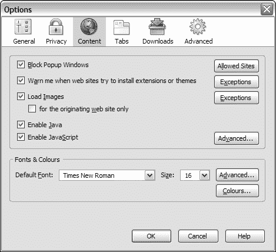

有许多非常优秀的工具专门用于开发基于 Web 的应用程序，例如 Adobe 公司出色的 Dreamweaver 8。然而，本书专注于 JavaScript，而不是任何特定的开发工具。在学习基础知识时，通常最好手动编写代码，而不是依赖工具替你完成。这有助于你在尝试超越工具能力的更高级逻辑之前，理解语言的基本原理。

当你对基础知识有了很好的理解后，就可以使用工具来节省时间，从而将更多精力投入到更高级、更有趣的编码中。

你还需要一个浏览器来查看你的网页。最好在你预期访问者会用来访问你网站的浏览器上开发 JavaScript 代码。本章后面你会看到，JavaScript 有多个版本，每个版本由不同版本的浏览器支持。这些 JavaScript 版本虽然拥有共同的核心，但也包含各种语言扩展。本书中给出的所有示例均在 Firefox 1.5、IE 6 和 IE 7 上测试过。如果某段代码在这些浏览器中的任何一个上无法运行，文中会做出相应说明。

如果你运行的是 Windows 系统，几乎肯定已经安装了 IE。如果没有，访问`www.microsoft.com/windows/ie/default.mspx`即可获取最新版本。

Firefox 可以在`www.mozilla.com/firefox/all.html`找到。安装 Firefox 时，建议选择自定义安装。这样你可以在之后选择安装哪些组件。特别值得选择的是开发者工具组件。虽然不是必需的，但拥有它也不错。

即使你的浏览器支持 JavaScript，也可能在浏览器中禁用此功能。因此，在下一节开始你的第一个 JavaScript 示例之前，你应该检查并确保浏览器中已启用 JavaScript。

在 Firefox 中执行此操作：从浏览器的“工具”菜单中选择“选项”。在出现的窗口中，单击“内容”选项卡。在此选项卡中，确保选中“启用 JavaScript”复选框，如图 1-1 所示。

图 1-1

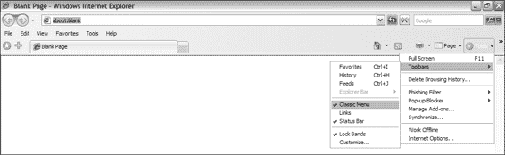

在 Internet Explorer 中禁用脚本则更困难。从浏览器的“工具”菜单中选择“Internet 选项”，单击“安全”选项卡，检查“Internet”或“本地 Intranet”选项是否具有自定义安全设置。如果其中任何一个有，请单击“自定义级别”按钮，向下滚动到“脚本”部分。确保“活动脚本”设置为“启用”。

最后一点需要注意的是如何在浏览器中打开代码示例。对于本书，你只需打开硬盘上存储示例的文件即可。有多种方法可以做到这一点。

在 IE6 中，一种方法是从“文件”菜单中选择“打开”，然后单击“浏览”按钮，浏览到存储代码的位置。类似地，在 Firefox 中，从“文件”菜单中选择“打开文件”，浏览到所需文件，然后单击“选择文件”按钮。

然而，IE7 有一个新的菜单结构，其中不包含“打开文件”选项。你可以通过在地址栏中键入硬盘驱动器盘符后跟冒号来解决此问题，例如，`C:`代表你的 C 盘。或者，你可以切换回早期版本 IE 的经典菜单（见图 1-2）。为此，你需要转到“工具”菜单，选择“工具栏”菜单选项，然后确保选中“经典菜单”选项。

图 1-2

## `<script>`标签和你的第一个简单 JavaScript 程序

关于 JavaScript 的话题已经说得够多了；现在来看看如何将它放入你的网页中。在本节中，你将编写第一段 JavaScript 代码。

将 JavaScript 插入网页与插入其他 HTML 内容非常相似；你使用标签来标记脚本代码的开始和结束。用于此目的的标签是`<script>`标签。它告诉浏览器，由结束标签`</script>`包围的后续文本不是要显示的 HTML，而是需要处理的脚本代码。被`<script>`和`</script>`标签包围的代码块称为*脚本块*。


基本上，当浏览器遇到`<script>`标签时，它不会尝试向用户显示包含的文本，而是使用浏览器内置的 JavaScript 解释器来运行代码的指令。当然，代码可能会给出关于页面显示方式或页面中显示内容的更改指令，但代码本身的文本永远不会显示给用户。

你可以将`<script>`标签放在 HTML 页面的头部（`<head>`和`</head>`标签之间）或正文（`<body>`和`</body>`标签之间）。然而，尽管你可以将它们放在这些区域之外——例如，在`<html>`标签之前或`</html>`标签之后——但这在 Web 标准中是不允许的，因此被认为是不良实践。

`<script>`标签有许多属性，但最重要的一个是`type`属性。正如你之前所见，JavaScript 并不是唯一的脚本语言，不同的脚本语言需要以不同的方式处理。你需要告诉浏览器期望哪种脚本语言，以便它知道如何处理该语言。你的开始脚本标签将如下所示：

```html
<script type=”text/javascript”>
```

包含`type`属性是良好的实践，但在网页中可以省略。IE 和 Firefox 等浏览器默认使用 JavaScript 作为脚本语言。这意味着如果浏览器遇到没有设置`type`属性的`<script>`标签，它会假定该脚本块是用 JavaScript 编写的。

然而，W3C（万维网联盟）规定使用`type`属性是强制性的，该组织制定了 HTML 标准。

好了，让我们来看第一个包含 JavaScript 代码的页面。

## 动手试一试：将文档涂成红色

这是一个使用 JavaScript 更改浏览器背景颜色的简单示例。在你的文本编辑器中（我使用的是 Windows 记事本），输入以下内容：

```html
<html>
<body BGCOLOR=”WHITE”>
<p>Paragraph 1</p>
<script type=”text/javascript”>
document.bgColor = “RED”;
</script>
</body>
</html>
```

将页面保存为`ch1_examp1.htm`，放在硬盘上的方便位置。现在将其加载到你的 Web 浏览器中。你应该会看到一个红色网页，左上角显示文本“Paragraph 1”。但等等——你不是将`<body>`标签的`BGCOLOR`属性设置为白色了吗？好吧，让我们看看这里发生了什么。

### 工作原理

页面包含在`<html>`和`</html>`标签内。此块包含一个`<body>`元素。当你定义开始的`<body>`标签时，你使用 HTML 将页面背景颜色设置为白色。

```html
<BODY BGCOLOR=”WHITE”>
```

然后，你使用`<script>`开始标签让浏览器知道接下来的几行代码是 JavaScript 代码。

```html
<script type=”text/javascript”>
```

从这里到结束标签`</script>`之间的所有内容都是 JavaScript，浏览器会将其视为 JavaScript。

在此脚本块中，你使用 JavaScript 将文档的背景颜色设置为红色。

```javascript
document.bgColor = “RED”;
```

在网页脚本中，你所谓的*页面*被称为*文档*。文档有许多属性，包括其背景颜色`bgColor`。你可以通过编写`document`，后跟一个点，再跟属性名称来引用文档的属性。现在不必担心`document`的用法；本书后面会深入探讨。

请注意，前面那行代码是一个 JavaScript *语句* 的示例。`<script>`和`</script>`标签之间的每一行代码都称为一个语句，尽管有些语句可能会跨越多行。

你还会看到行末有一个分号（`;`）。在 JavaScript 中，你使用分号来表示语句的结束。实际上，JavaScript 对分号的要求非常宽松，当你开始新的一行时，JavaScript 通常能够判断你是否打算开始新的一行代码。然而，为了良好的编程习惯，你应该在代码语句的末尾使用分号，并且一条 JavaScript 语句应该放在一行内，而不是延续到两行或更多行。此外，你会发现有些时候必须包含分号，这将在本书后面遇到。

最后，要告诉浏览器停止将你的文本解释为 JavaScript 并开始将其解释为 HTML，你需要使用脚本结束标签：

```html
</script>
```

现在你已经了解了代码是如何工作的，但还没有了解它的执行顺序。当浏览器加载网页时，它会从上到下逐标签地渲染页面。这个过程称为*解析*。浏览器从页面顶部开始，一直处理到页面底部。浏览器首先遇到`<body>`标签，并将文档的背景设置为白色。然后它继续解析页面。当遇到 JavaScript 代码时，它被指示将文档的背景更改为红色。

## 动手试一试

### 流程的运作方式

让我们扩展前面的示例，以演示网页解析的实际过程。在文本编辑器中输入以下内容：

```html
<html>
<body bgcolor=”WHITE”>
<p>段落 1</p>
<script type=”text/javascript”>
// 脚本块 1
alert(“第一个脚本块”);
</script>
<p>段落 2</p>
<script type=”text/javascript”>
// 脚本块 2
document.bgColor = “RED”;
alert(“第二个脚本块”);
</script>
<p>段落 3</p>
</body>
</html>
```

将文件保存到硬盘上，命名为`ch1_examp2.htm`，然后在浏览器中加载它。加载页面后，你应该会看到第一个段落“段落 1”，随后是第一个脚本块显示的消息框。浏览器会暂停解析，直到你单击“确定”按钮。如图 1-3 所示，页面背景为白色（如`<body>`标签中所设置），并且当前只显示了第一个段落。

图 1-3

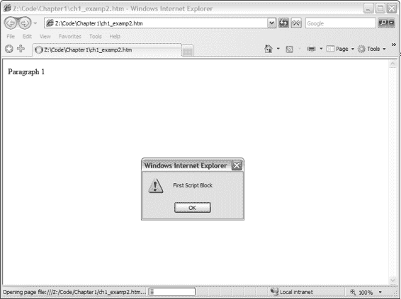

单击“确定”按钮，解析继续。浏览器显示第二个段落，并到达第二个脚本块，该脚本块将背景颜色更改为红色。第二个脚本块会显示另一个消息框，如图 1-4 所示。

单击“确定”，解析再次继续，显示第三个段落“段落 3”。

网页完成，如图 1-5 所示。

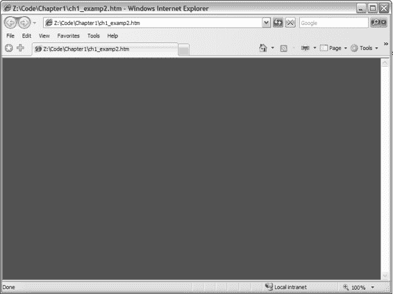

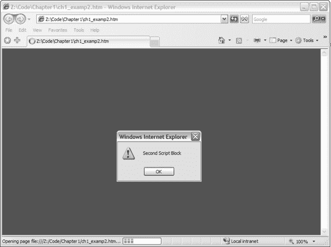

图 1-4

图 1-5

## 工作原理

页面的第一部分与我们之前的示例相同。在`<body>`标签的定义中，页面背景颜色设置为白色，然后向页面写入一个段落。

```html
<html>
<body BGCOLOR=”WHITE”>
<p>段落 1</p>
```

第一个新部分包含在第一个脚本块中。

```javascript
<script type=”text/javascript”>
// 脚本块 1
alert(“第一个脚本块”);
</script>
```

这个脚本块包含两行，对你来说都是新的。第一行——

```javascript
// 脚本块 1
```

只是一个*注释*，完全是为了方便你阅读。浏览器将双斜杠（`//`）之后一行中的任何内容都视为注释，并且不会对其进行任何操作。这对你作为程序员很有用，因为你可以在代码中添加解释，这样当你以后回顾代码时，更容易记住当时在做什么。

第二行代码中的`alert()`函数对你来说也是新的。在学习它的作用之前，你需要知道什么是*函数*。

函数将在第 3 章中更全面地定义，但现在你只需要将它们视为可以用来执行某些任务的 JavaScript 代码片段。如果你有数学背景，可能已经对函数有了一些了解：函数接收一些信息，处理它，然后给出结果。函数让程序员的生活更轻松，因为你不需要考虑函数如何完成任务——你只需专注于何时需要完成任务。

具体来说，`alert()`函数允许你通过显示一个消息框来提醒或通知用户某些信息。消息框中要显示的消息在`alert()`函数的括号内指定，称为函数的*参数*。

`alert()`函数显示的消息框是*模态*的。这是一个重要的概念，你以后还会遇到。它仅仅意味着消息框不会消失，直到用户通过单击“确定”按钮关闭它。实际上，页面的解析会在使用`alert()`函数的那一行停止，直到用户关闭消息框后才重新开始。这对于本例非常有用，因为它可以让你展示到目前为止解析的结果：页面颜色已设置为白色，并且第一个段落已显示。

当你单击“确定”时，浏览器继续向下解析页面，处理以下行：

```html
<p>段落 2</p>
<script type=”text/javascript”>
// 脚本块 2
document.bgColor = “RED”;
alert(“第二个脚本块”);
</script>
```

显示第二个段落，并运行第二个 JavaScript 块。脚本块代码的第一行是另一个注释，因此浏览器会忽略它。你在前面的示例中见过脚本代码的第二行——它将页面的背景颜色更改为红色。第三行代码是`alert()`函数，它显示第二个消息框。解析会暂停，直到你通过单击“确定”关闭消息框。

当你关闭消息框时，浏览器继续处理页面中的下一行代码，显示第三个段落，最后结束网页。

```html
<p>段落 3</p>
</body>
</html>
```

这个示例提出的另一个重要点是，通过 HTML 设置页面属性（如背景颜色）与使用 JavaScript 执行相同操作之间的区别。使用 HTML 设置属性的方法是*静态*的：一个值只能设置一次，并且以后无法通过 HTML 更改。使用 JavaScript 设置属性可以让你动态地更改它们的值。术语*动态*指的是可以更改的东西，其值或外观并非一成不变。

这个示例仅仅是一个示例。实际上，如果你希望页面背景为红色，你会将`<body>`标签的`BGCOLOR`属性设置为`"RED"`，而根本不会使用 JavaScript。你希望使用 JavaScript 的地方是当你需要向页面添加某种智能或逻辑时。例如，如果用户的屏幕分辨率特别低，你可能希望更改页面上显示的内容；使用 JavaScript，你可以做到这一点。使用 JavaScript 更改属性的另一个原因可能是为了特殊效果——例如，让页面从白色淡入到最终颜色。

## 浏览器与兼容性问题简介

在前面的示例中，你已经看到，通过使用 JavaScript，你可以利用`document`的`bgColor`属性来改变网页文档的背景颜色。无论你使用的是 Netscape 还是 Microsoft 浏览器，该示例都能正常工作，因为这两种浏览器都支持带有`bgColor`属性的文档。可以说这个示例是*跨浏览器兼容*的。然而，并非总是如此：一个浏览器中可用的属性或语言特性，在另一个浏览器中可能不可用。有时甚至在同一浏览器的不同版本之间也会出现这种情况。

*Internet Explorer 和 Firefox 浏览器的版本号通常以十进制数字表示；例如，Firefox 有 1.5 版本。在本书中，我们使用以下术语来指代这些版本。版本 1.x 表示所有以数字 1 开头的版本。版本 1.0+ 表示所有大于或等于 1 的版本。*

# 第 1 章：JavaScript 与 Web 简介

创建基于 Web 的 JavaScript 时，主要难点之一在于不同 Web 浏览器之间的差异、它们所支持的 HTML 级别以及其 JavaScript 解释器能够处理的功能。你会发现，在一个浏览器中，只需几行代码就能移动图像，而在另一个浏览器中却需要整页代码，甚至根本无法实现。某个版本的 JavaScript 可能包含将文本转换为大写的方法，而另一个版本则没有。IE 或 Firefox 浏览器的每个新版本都会在其 HTML 和 JavaScript 支持中添加令人兴奋的新功能。好消息是，与以往相比，浏览器制造商在很大程度上更加遵守 W3C 等组织制定的标准。此外，只要稍加巧思，你就能编写出同时适用于 IE 和 Firefox 浏览器的 JavaScript。

你希望支持哪些浏览器，实际上取决于你认为网站的大多数访问者（即你的*用户群*）会使用哪些浏览器。本书的目标浏览器是 IE6 及更高版本，以及 Firefox 1.5 及更高版本。

如果你希望网站具有专业性，就需要以某种方式处理旧版浏览器。你可以确保代码向后兼容——即只使用旧版浏览器中可用的特性。

然而，你可能会认为，仅仅为了兼容旧版浏览器的特性而限制自己，根本不值得。

在这种情况下，你需要确保页面能够优雅降级。换句话说，要确保虽然你的页面在旧版浏览器中无法正常工作，但它们的失败方式要么让用户完全察觉不到，要么提醒用户网站上的某些功能与其浏览器不兼容。与优雅降级相反的做法是，你的代码抛出大量错误消息，导致页面上显示奇怪的结果，并且通常让你看起来像个不懂行的傻瓜！

那么，如何让你的网页优雅降级呢？你可以通过使用 JavaScript 在页面部分或完全加载后，判断网页运行在哪个浏览器中。你可以利用这些信息来决定运行哪些脚本，甚至将用户重定向到另一个为充分利用其特定浏览器而编写的页面。在后续章节中，你将学习如何找出浏览器支持的功能，并采取相应措施，使你的页面在尽可能多的浏览器上都能正常工作。

## 介绍“谁想成为亿万富翁”问答游戏

在本书的前九章中，你将开发一个完整的基于 Web 的应用程序，即一个问答游戏。该问答游戏可在 Firefox 和 IE6+ 浏览器上运行，并充分利用它们的 JavaScript 功能。

让我们看看这个问答游戏的最终效果。主启动界面如图 1-6 所示。

在这里，用户可以选择时间限制。通过基于 JavaScript 的计时器，你可以跟踪已经过去的时间。


图 1-6

点击“开始问答”按钮后，用户将面对从你创建的用于存储问答问题的数据库中随机抽取的问题。问题有两种类型。第一种是选择题，如图 1-7 所示。对于这类问题，你可以指定的答案选项数量没有限制：JavaScript 可以处理它们，无需为每个问题编写不同的程序。

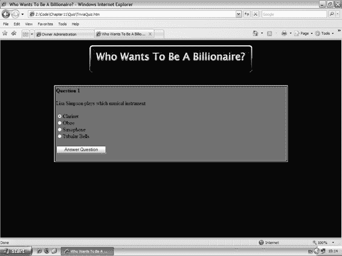

图 1-7

第二种问题类型是基于文本的。用户将答案输入到提供的文本框中，然后 JavaScript 会尽力智能地解释用户输入的内容。例如，对于图 1-8 所示的问题，“Saxaphone”是正确答案。然而，JavaScript 被编程为也接受缩写形式“sax”作为正确答案。你将在第 8 章中了解如何实现这一点。

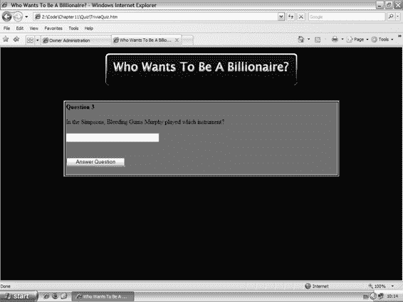

图 1-8

最后，在所有问题回答完毕后，问答游戏的最终页面会显示用户赢得了多少奖金。

### 问答游戏编码背后的思路

你已经简要了解了问答游戏最终版本的实际运行情况，并将在后续章节中查看实际代码，但思考其设计和编程的指导原则是值得的。

最重要的原则之一是代码复用。通过反复使用相同的代码，你可以节省时间和精力。在 Web 应用程序中，你经常会发现需要反复做同样的事情。例如，你需要反复使用检查问题是否回答正确的代码。你可以根据需要制作任意数量的代码副本，并将这些代码添加到页面中需要的地方。然而，这会使代码维护变得困难，因为如果你需要纠正错误或添加新功能，你需要在许多不同的地方对代码进行修改。一旦 Web 应用程序的代码从一个页面中的几行增长到多个页面中的许多行，实际跟踪你复制代码的位置就会变得相当困难。因此，本着复用的原则，问答游戏将所有需要多次使用的重要代码集中放在一个地方。

对于你使用的任何数据也是如此。例如，在问答游戏中，你跟踪已回答问题的数量，并尽可能在最少的地方更新这些信息。

有时，你不得不将重要代码放在多个地方——例如，当你需要只能在特定情况下获取的信息时。但是，如果你能将其放在一个地方，你会发现这样做会使编码更高效。

在问答游戏中，我还尝试将代码拆分为特定的*函数*。你将在第 3 章中详细了解 JavaScript 函数。在问答游戏中，无论问题是选择题还是纯文本问题，提供随机选择问题供网页显示的函数都放在一个地方。通过这样做，你不仅只编写一次代码，而且通过将提供相同服务或功能的代码放在一个地方，也让自己更轻松。正如你将在本书后面看到的，创建这些不同类型问题的代码非常不同，但至少将它们放在同一个逻辑位置，便于查找。

# 第 1 章：JavaScript 与 Web 简介

在创建自己的基于 Web 的应用程序时，你可能会发现将较大的概念（比如这里的问答测验）分解成更小的想法会很有用。分解后，编写代码会容易得多。与其面对空白屏幕思考“好了，现在我要写一个问答测验”，不如思考“好了，现在我要写一些代码来创建一个问题”。我们发现这种技巧能让编码不那么可怕，也更容易上手。这种将一段代码的需求拆分成更小、更易管理的部分的方法通常被称为“分而治之”。

让我们以问答测验为例。问答测验应用程序需要完成以下任务：

- 提出一个问题。
- 获取并检查用户提供的答案，判断是否正确。
- 记录已经提出了多少个问题。
- 记录用户正确回答了多少个问题。
- 如果是限时测验，则记录剩余时间，并在时间到时停止测验。
- 显示最终总结，即回答正确的数量与总回答数量的对比。

这些是问答测验的核心要素。你可能还想做其他事情，比如记录用户访问次数，但这些实际上与问答测验的功能无关。

将整个概念分解成各个逻辑区域后，有时值得再次使用分而治之的技巧，将这些区域进一步拆分成更小的块，特别是当某个区域相当复杂或涉及较多内容时。例如，我们取前面列表中的第一项。

提出一个问题将涉及以下步骤：

- 从存储位置（例如数据库）中检索问题数据。
- 处理数据并将其转换为可以呈现给用户的形式。这里需要创建 HTML 以在网页中显示。数据的处理方式取决于问题类型：选择题还是文本题。
- 显示问题供用户回答。

随着你在本书中逐步构建问答测验，你将更深入地研究其设计以及其中涉及的一些技巧和策略。你还会在遇到每个函数时对其进行分解，以明确需要完成的任务。


## 添加哪些功能以及在哪里添加？

如何构建问答测验所需的功能？以下列表应该能让你了解你将添加哪些内容以及在哪一章添加。

在第 2 章中，你通过定义将要提出的选择题来开始测验。你将使用一种称为`array`（数组）的东西来实现，该章也会介绍数组。

在第 3 章中，你将更详细地学习函数，并在代码中添加一个函数来检查用户是否输入了正确答案。

经过几章的理论学习后，在第 6 章中，你将使测验进入第一个“可用”状态。你将向用户显示问题，并允许用户回答这些问题。

在第 7 章中，你通过将测验转变为所谓的`multi-frame application`（多框架应用程序）来增强它。你添加一个用户可以点击开始测验的按钮，并指定测验必须在所有问题都提出后结束，而不是无限重复。

在第 8 章中，你向测验添加基于文本的问题。这些问题必须与选择题略有不同地处理，无论是在向用户显示的方式上，还是在检查用户答案的方式上。正如你之前所见，测验将接受这些问题的多个不同正确答案。

在第 9 章中，你允许用户选择是否希望测验有时间限制。如果用户选择给自己施加时间限制，你将在窗口的状态栏中倒计时，并在时间到时通知他们。

在第 11 章中，你通过使用`cookies`（该章会介绍）存储用户之前的结果信息来完成测验。这使我们能够在测验结束时向用户显示一个运行平均分。

## 总结

至此，你应该对 JavaScript 是什么以及它能做什么有了一个概念。特别是，这个简短的介绍涵盖了以下内容：

- 你了解了浏览器在解释网页时遵循的过程。它逐个元素地遍历页面（解析），并在遇到 HTML 标签和 JavaScript 代码时对其执行操作。
- 当你使用 JavaScript 进行 Web 开发时，你可以选择将代码在两种位置之一执行：服务器端或客户端。客户端本质上是浏览器运行的那一侧——用户的机器。服务器端指的是在 Web 服务器本身上进行的任何处理或存储。
- 与许多编程语言不同，JavaScript 只需要一个文本编辑器就可以开始创建代码。像 Windows 记事本这样的工具对于入门来说就足够了，不过随着你经验的增加，更强大的工具会变得更有价值。
- JavaScript 代码与 HTML 一起嵌入到网页本身中。它的存在通过使用`<script>`标签来标记。与 HTML 一样，脚本从页面顶部开始执行，一直向下执行，逐条解释和执行代码语句。
- 你了解了在线问答测验，这是你将在本书中构建的案例研究。你了解了问答测验编码背后的一些设计思路，并学习了测验的功能将如何在本书中逐步构建。

# 第 2 章：数据类型与变量

计算机的主要用途之一是处理和显示信息。所谓处理，是指计算机以某种方式修改、解释或过滤信息。例如，在一个在线银行网站上，客户可能请求查看上个月从其账户中支出的所有款项的详细信息。此时，计算机会检索信息，过滤掉任何与上个月支出无关的信息，然后在网页中显示剩余内容。在某些情况下，信息被处理但不显示；而在其他时候，信息直接获取而不经过处理。例如，在银行环境中，定期付款可能会被处理并以电子方式转账，无需人工干预或显示。

在计算中，我们将信息称为数据。数据有多种形式，例如数字、文本、日期和时间，仅举几例。在本章中，你将具体了解 JavaScript 如何处理数字和文本等数据。理解数据的处理方式对于任何编程语言都是基础。

本章首先介绍 JavaScript 可以处理的各种数据类型。然后，你将了解如何将这些数据存储在计算机内存中，以便在代码中反复使用。最后，你将看到如何使用 JavaScript 来操作和处理数据。

## JavaScript 中的数据类型

数据可以有多种不同的形式或类型。你会认出 JavaScript 处理的一些数据类型来自编程之外的世界——例如数字和文本。其他数据类型则更抽象一些，用于简化编程；一个例子是对象数据类型，你将在第 4 章中详细了解它。

# 第 2 章：数据类型与变量

有些编程语言是强类型语言。在这些语言中，每当你使用一段数据时，都需要明确说明你正在处理的是哪种类型的数据，并且对这些数据的使用必须遵循其类型所适用的严格规则。例如，你不能将数字和单词相加。

而 JavaScript 则是一种弱类型语言，对于如何使用不同类型的数据要宽容得多。当你处理数据时，通常不需要指定类型；JavaScript 会自动推断。此外，当你同时使用不同类型的数据时，JavaScript 会在幕后自行判断你想要做什么。

既然 JavaScript 对数据如此随和，为什么还要讨论数据类型呢？为什么不直接切入正题，开始使用数据而不必担心它们的类型呢？

首先，尽管 JavaScript 非常擅长判断它正在处理什么数据，但有时它也会出错，或者至少不会按照你的意愿行事。在这些情况下，你需要向 JavaScript 明确说明你打算使用哪种数据类型以及应该如何使用它。要做到这一点，你首先需要了解一些关于数据类型的基础知识。

第二个原因是，数据类型使你能够在代码中有效地使用数据。对数据可以执行的操作以及你将获得的结果取决于所使用的数据类型，即使你没有明确指定其类型。例如，虽然尝试将两个数字相乘是有意义的，但对文本做同样的事情则不行。此外，数字相加的结果与文本相加的结果截然不同。对于数字，你得到的是总和；而对于文本，你得到的是由其他文本片段拼接而成的一大段文本。

让我们简要了解一下一些更常用的数据类型：数值型、文本型和布尔型。你将在本章后面看到如何使用它们。

## 数值型数据

数值型数据有两种形式：

- 整数，例如 145，也称为*整数*。这些数字可以是正数或负数，并且在 JavaScript 中可以跨越非常大的范围：–2⁵³ 到 2⁵³。
- 小数，例如 1.234，也称为*浮点数*。与整数一样，它们可以是正数或负数，并且也有很大的范围。

简单来说，除非你在编写专门的科学应用程序，否则你不会遇到 JavaScript 中数字大小的问题。此外，尽管在存储时你可以将整数和浮点数区别对待，但 JavaScript 实际上将它们都视为浮点数。它友好地为你隐藏了细节，因此你通常无需担心。

一个例外情况是，当你需要一个整数但实际拥有一个浮点数时，你需要将数字四舍五入为整数。你将在本章后面了解如何对数字进行四舍五入。

## 文本型数据

一个或多个文本字符的另一个术语是*字符串*。你只需将文本用引号（`"`）括起来，就可以告诉 JavaScript 该文本应被视为文本而不是代码。例如，`"Hello World"` 和 `"A"` 是 JavaScript 能够识别的字符串示例。你也可以使用单引号（`'`），因此 `'Hello World'` 和 `'A'` 也是 JavaScript 能够识别的字符串示例。但是，你必须以与开头相同的引号结束字符串。因此，`"A'` 不是有效的 JavaScript 字符串，`'Hello World"` 也不是。

如果你想要一个中间带有单引号的字符串，比如 `Peter O'Toole` 这样的字符串，该怎么办？如果你用双引号将其括起来，那就没问题，因此 `"Peter O'Toole"` 能被 JavaScript 识别。然而，`'Peter O'Toole'` 会产生错误。这是因为 JavaScript 认为你的文本字符串是 `Peter O`（即它将中间的单个引号视为字符串的结束），然后遇到 `Toole'` 时就会出错。

另一种解决方法是告诉 JavaScript，中间的 `'` 是文本的一部分，而不是表示字符串的结束。你可以通过使用反斜杠字符（`\`）来实现，该字符在 JavaScript 中具有特殊含义，被称为*转义字符*。反斜杠告诉浏览器，下一个字符不是字符串的结束，而是文本的一部分。因此 `'Peter O\'Toole'` 会按预期工作。

如果你想在双引号括起来的字符串中使用双引号，该怎么办？嗯，刚才关于单引号的所有说明同样适用。因此 `'Hello "Paul"'` 有效，但 `"Hello "Paul""` 无效。然而，`"Hello \"Paul\""` 也会有效。

JavaScript 还有许多其他特殊字符，这些字符无法直接输入，但可以使用转义字符与其他字符结合来表示，从而创建*转义序列*。它们的工作原理与 HTML 中的类似。例如，HTML 中会忽略连续多个空格，因此空格用 `&nbsp;` 表示。类似地，在 JavaScript 中，有些情况下你不能直接使用某个字符，而必须使用转义序列。下表列出了一些更有用的转义序列。

| 转义序列 | 表示的字符 |
|---|---|
| `\b` | 退格 |
| `\f` | 换页 |
| `\n` | 换行 |
| `\r` | 回车 |
| `\t` | 制表符 |
| `\'` | 单引号 |
| `\"` | 双引号 |
| `\\` | 反斜杠 |
| `\xNN` | `NN` 是一个十六进制数，用于标识 Latin-1 字符集中的某个字符。 |

其中最不直观的是最后一个，它通过字符在 Latin-1 字符集中的编号而不是其正常外观来表示单个字符。举个例子：假设你想在字符串中包含版权符号（©）。你的字符串应该是什么样子？答案是 `"\xA9 Paul Wilton"`。

类似地，你可以使用 Unicode 转义序列来引用字符。这些序列写作 `\uNNNN`，其中 `NNNN` 指的是该特定字符的 Unicode 编号。例如，要使用这种方法引用版权符号，你可以使用字符串 `\u00A9`。

## 布尔型数据

在现实世界中，是或否、正或负、真或假的使用非常普遍。真和假的概念也是数字计算机的基础；它们不理解“可能”，只理解真和假。事实上，“是或否”的概念非常有用，以至于它在 JavaScript 中拥有自己的数据类型：*布尔型*数据。布尔类型有两个可能的值：`true` 表示是，`false` 表示否。

布尔数据在 JavaScript 中的用途与在编程之外的世界中完全相同：它们使我们能够回答问题并根据答案做出决策。例如，如果有人问你：“这本书是关于 JavaScript 的吗？”你希望回答：“是的，它是”，或者你可能会说：“那是真的。”同样，你可能会说：“如果这本书的主题不是 JavaScript，那就放下它。”这里有一个布尔逻辑语句（以其发明者乔治·布尔命名），它提出一个问题，然后根据答案是真是假来执行某些操作。在 JavaScript 中，你可以使用同样的布尔逻辑来赋予程序决策能力。你将在下一章中更详细地了解布尔逻辑。

## 变量——在内存中存储数据

数据可以永久存储，也可以临时存储。

你会希望将重要数据（例如某人的银行账户详细信息）保存在永久存储中。例如，当 Bloggs 女士从她的账户中取出 10 美元、英镑或欧元时，你需要从她的账户中扣除这笔钱，并永久记录新的余额。像这样的信息可能存储在称为*数据库*的东西中。

# 第 2 章：数据类型与变量

然而，在其他情况下，你并不想永久存储数据，而只是希望临时记录一些信息。让我们看一个例子。假设 Bloggs 女士从 BigBadBank Inc. 获得了一笔贷款，她想了解这笔贷款还有多少未还清。她登录贷款在线银行页面，点击一个链接查询欠款金额。这些数据会永久存储在某个地方。但假设你还提供了一个功能，允许增加还款额以提前还清贷款。如果 Bloggs 女士在网页的文本框中输入了更高的还款金额，你可能想展示贷款将提前多久还清。这涉及一些可能复杂的计算，因此为了简化，你需要编写代码分阶段计算结果，并在每个阶段存储中间结果，最后给出最终结果。计算完成并显示结果后，每个阶段的结果无需永久存储，因此你不需要使用数据库，而是需要使用一种称为*变量*的东西。为什么叫变量？或许是因为变量可以用来存储可更改或变化的临时数据。

变量的另一个优点是，与可能保存到磁盘或磁带的永久存储不同，变量存储在计算机的内存中。这意味着存储和检索数据的速度要快得多。

那么，是什么让变量成为临时存储数据的好地方呢？变量具有有限的生命周期。当访问者关闭页面或跳转到新页面时，变量就会丢失，除非你采取某些措施将其保存到其他地方。

每个变量都有一个名称，以便在代码的其他地方引用它。这些名称必须遵循一定的规则。

与大多数 JavaScript 代码一样，你会发现变量名是区分大小写的。例如，`myVariable` 和 `myvariable` 是不同的。你会发现，即使你成为 JavaScript 专家，这也是一个很容易让错误溜进代码中的方式。

此外，你不能使用某些名称和字符作为变量名。不能使用的名称称为*保留*字。保留字是 JavaScript 保留供自己使用的单词，例如 `var` 或 `with`。某些字符也被禁止在变量名中使用；例如，与号（`&`）和百分号（`%`）。变量名中允许使用数字，但名称不能以数字开头。因此 `101myVariable` 是不允许的，但 `myVariable101` 是允许的。让我们再看一些例子。

无效名称包括：

- `with`
- `99variables`
- `my%Variable`
- `theGood&theBad`

有效名称包括：

- `myVariable99`
- `myPercent_Variable`
- `the_Good_and_the_Bad`

你可能希望为变量使用命名约定；例如，一种描述你计划在变量中存储何种数据的约定。你可以用多种不同的方式命名变量——没有绝对的对错，但最好坚持使用其中一种。一种常见的方法是*匈牙利命名法*，其中每个变量名的开头是一个三位字母标识符，表示数据类型。例如，你可以用 `int` 开头表示整数变量，用 `flt` 开头表示浮点数变量，用 `str` 开头表示字符串变量，等等。然而，只要你使用的名称有意义且保持一致，选择哪种约定其实并不重要。

## 声明变量并为其赋值

在使用变量之前，你应该使用 `var` 关键字向计算机声明它的存在。

这告诉计算机需要预留一些内存，以便稍后存储你的数据。要声明一个名为 `myFirstVariable` 的新变量，你可以编写以下代码：`var myFirstVariable;`

请注意，行尾的分号不是变量名的一部分，而是用于向 JavaScript 指示语句的结束。这一行就是一个 JavaScript 语句的例子。

一旦声明，变量就可以用来存储任何类型的数据。正如我们之前提到的，许多其他编程语言（称为强类型语言）要求你不仅声明变量，还要声明将要存储的数据类型（如数字或文本）。然而，JavaScript 是一种弱类型语言；你不需要限制变量可以保存的数据类型。

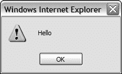

你将数据放入变量中，这个过程称为*给变量赋值*，使用等号（`=`）。例如，如果你想让名为 `myFirstVariable` 的变量保存数字 101，你可以这样写：

`myFirstVariable = 101;`

等号在用于给变量赋值时有一个特殊的名称；它被称为*赋值运算符*。

### 动手试一试

#### 声明变量

让我们看一个例子，其中声明了一个变量，存储一些数据，最后访问其内容。你还会看到变量可以保存任何类型的数据，并且保存的数据类型可以改变。例如，你可以先存储文本，然后改为存储数字，而 JavaScript 不会有任何问题。将以下代码输入到你的文本编辑器中，并将其保存为 `ch2_examp1.htm`：

```html
<html>
<head>
</head>
<body>
<script language=”JavaScript” type=”text/javascript”>
var myFirstVariable;
myFirstVariable = “Hello”;
alert(myFirstVariable);
myFirstVariable = 54321;
alert(myFirstVariable);
</script>
</body>
</html>
```

一旦你在 Web 浏览器中加载此文件，它应该会显示一个包含“Hello”的警告框，如图 2-1 所示。这是代码中此时变量 `myFirstVariable` 的内容。

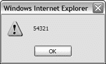

单击“确定”，另一个包含 54321 的警告框会出现，如图 2-2 所示。这是你赋给变量 `myFirstVariable` 的新值。

### 工作原理

在脚本块中，你首先声明了变量。

`var myFirstVariable;`

目前，它的值是 `undefined`，因为你只向计算机声明了它的存在，而没有声明任何实际数据。这听起来可能有点奇怪，但 `undefined` 是 JavaScript 中一个实际的原始值，它允许你进行比较。（例如，你可以检查变量是否包含实际值，或者是否尚未被赋值，即是否为 `undefined`。）然而，在下一行中，你为 `myFirstVariable` 赋了一个字符串值，即 Hello。

`myFirstVariable = “Hello”;`

这里你给变量赋了一个*字面量*值，即一段实际数据，而不是通过计算或从其他变量获得的数据。几乎在任何可以使用字面量字符串或数字的地方，你都可以用包含数字或字符串数据的变量来替换。在下一行代码中，你看到了一个例子，你在上一章见过的 `alert()` 函数中使用了变量 `myFirstVariable`。

`alert(myFirstVariable);`

这导致第一个警告框出现。接下来，你在变量中存储了一个新值，这次是一个数字。

`myFirstVariable = 54321;`

`myFirstVariable` 的旧值将永久丢失。用于存储该值的内存空间会由 JavaScript 通过一个称为*垃圾回收*的过程自动释放。每当 JavaScript 检测到变量的内容不再可用时（例如当你分配一个新值时），它就会执行垃圾回收过程，使内存重新可用。如果没有这种自动垃圾回收过程，计算机的内存会不断被消耗，直到最终耗尽内存，系统陷入停滞。然而，垃圾回收并不总是像预期那样高效，有时可能要等到加载另一个页面时才会执行。

为了证明新值已被存储，再次使用 `alert()` 函数来显示变量的新内容。

```javascript
alert(myFirstVariable);
```

# 第 2 章：数据类型与变量

## 用其他变量的值来赋值变量


你已经看到可以将变量赋值为数字或字符串，但能否将一个变量赋值为另一个变量中存储的数据呢？答案是肯定的，而且非常简单，方式与给变量赋予字面值完全相同。例如，如果你声明了两个变量`myVariable`和`myOtherVariable`，并将变量`myOtherVariable`赋值为`22`，如下所示：

```
var myVariable;
var myOtherVariable;
myOtherVariable = 22;
```

那么你可以使用下面这行代码将`myVariable`赋值为与`myOtherVariable`相同的值（即`22`）。

```
myVariable = myOtherVariable;
```

### 动手试一试

让我们再看一个例子，这次是将变量赋值为其他变量的值。将以下代码输入到你的文本编辑器中，并保存为`ch2_examp2.htm`：

```
<html>
<body>
<script language=”JavaScript” type=”text/javascript”>
var string1 = “Hello”;
var string2 = “Goodbye”;
alert(string1);
alert(string2);
string2 = string1;
alert(string1);
alert(string2);
string1 = “Now for something different”;
alert(string1);
alert(string2);
</script>
</body>
</html>
```

在浏览器中加载该页面，你会看到依次弹出六个警告框。点击每个警告框的“确定”以查看下一个。前两个分别显示`string1`和`string2`的值——分别是`Hello`和`Goodbye`。

然后你将`string2`赋值为`string1`中的值。接下来的两个警告框显示`string1`和`string2`的内容；这次两者都是`Hello`。

最后，你更改了`string1`的值。注意`string2`的值保持不变。最后两个警告框显示`string1`的新值（`Now for something different`）和`string2`未改变的值（`Hello`）。

### 工作原理

在脚本块中，你首先声明了两个变量`string1`和`string2`。但请注意，你在声明它们的同时就为它们赋了值。这是一种快捷方式，称为*初始化*，可以节省你输入过多代码的时间。

```
var string1 =”Hello”;
var string2 = “Goodbye”;
```

注意，这种快捷方式适用于所有数据类型，而不仅仅是字符串。接下来的两行使用`alert()`函数向用户显示每个变量的当前值。

```
alert(string1);
alert(string2);
```

然后你将`string2`赋值为`string1`中包含的值。为了证明赋值确实生效，你再次使用`alert()`函数向用户显示每个变量的内容。

```
string2 = string1;
alert(string1);
alert(string2);
```

接下来，你将`string1`设置为一个新值。

```
string1 = “Now for something different”;
```

这使`string2`保持其当前值，表明`string2`拥有从`string1`分配给它的一份独立数据副本。在后面的章节中你会看到，情况并非总是如此。但一般来说，基本数据类型（如文本和数字）在赋值时总是被复制，而更复杂的数据类型（如你在第 4 章中遇到的对象）实际上是共享的，而不是复制的。例如，如果你有一个值为`Hello`的变量，并将该变量的值赋给其他五个变量，那么你拥有原始数据和五份独立的数据副本。但如果它是一个对象而不是字符串，并且你做了同样的事情，你会发现实际上只有一份数据副本，但六个变量共享它。使用六个变量名中的任何一个来更改数据，都会对所有变量产生影响。

最后，使用`alert()`函数显示每个变量的当前值。

```
alert(string1);
alert(string2);
```

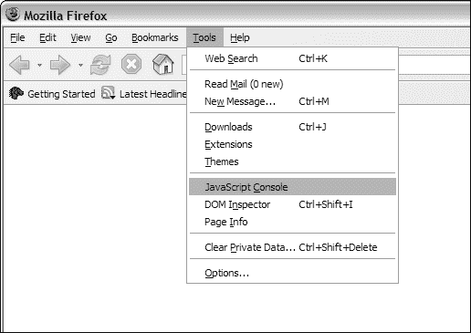

## 设置浏览器以显示错误

尽管到目前为止你的代码相当简单，但在输入时仍然可能出错。随着你开始接触更复杂、更详细的代码，这将成为越来越严重的问题。因此，在讨论如何使用变量中存储的数据之前，现在似乎是讨论如何确保浏览器向你显示代码中出现的任何错误的好时机，这样你就可以去修正它们。

当你浏览其他人的网站时，你可能不会对看到他们代码中的错误感兴趣。在这种情况下，人们很容易想方设法关闭浏览器中错误对话框的显示。然而，作为 JavaScript 程序员，我们希望了解自己网页中所有关于错误的详细细节；这样我们就可以在别人发现之前修复它们。因此，确保我们用来测试网站的浏览器正确配置为显示错误及其详细信息非常重要。在本节中，这正是我们要做的。

### 在 Firefox 中显示错误

Firefox 对错误保持沉默，因此如果出现问题，你不会看到任何弹出框警告你，也不会有警报响起。然而，它的开发者工具之一是 JavaScript 控制台，其中包含页面上任何 JavaScript 问题的详细信息。它还会报告其他问题，例如无效的 CSS。

要在 Firefox 中查看此控制台，请转到“工具”菜单并选择“JavaScript 控制台”，如图 2-3 所示。

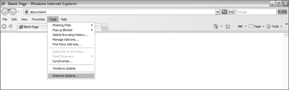

然后 JavaScript 控制台会在其自己的独立窗口中弹出，如图 2-4 所示。

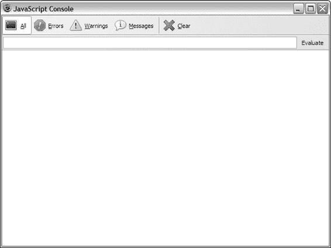

在开发 JavaScript 代码时，最好让 JavaScript 控制台保持打开状态。目前它可能是空白的。稍后你将故意制造一个错误，看看 JavaScript 控制台中会发生什么。

### 在 Internet Explorer 中显示错误

通常，IE 默认会使用对话框显示 JavaScript 错误。但是，可以关闭此类错误的显示，在这种情况下，你需要按照几个简单的步骤重新启用错误显示。首先打开 Internet Explorer，从“工具”菜单中选择“Internet 选项”菜单，如图 2-5 所示。

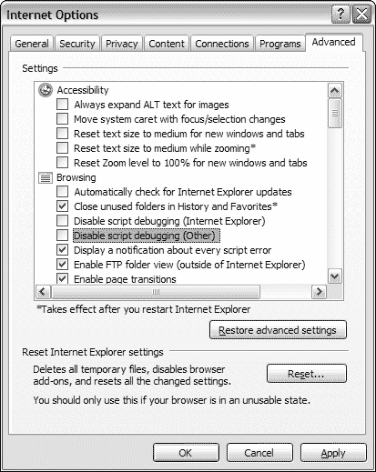

在出现的对话框中，选择“高级”选项卡。在“浏览”下，确保清除了“禁用脚本调试（其他）”复选框，并选中“显示每个脚本错误的通知”复选框，如图 2-6 所示。注意，IE 4 没有“显示每个脚本错误的通知”复选框，因此你只需清除“禁用脚本调试”复选框即可。完成此操作后，单击“确定”关闭对话框。


# 第 2 章：数据类型与变量

好了，现在你已经了解了错误消息的显示方式，接下来我们将看看代码中出现错误时会发生什么。请注意，与 Firefox 类似，微软也提供了一款程序来帮助排查代码中的错误；你将在第 10 章中了解如何使用它。

## 出现错误时会发生什么

如前所述，在变量名中使用保留字会导致浏览器中出现 JavaScript 错误。然而，显示的错误消息可能不会立即提供帮助，因为它可能不会指出你在声明变量时使用了保留字。让我们看看在这种情况下你可能看到的错误消息类型。请注意，这些错误消息也可能由与变量命名无关的其他错误产生，这有时会让人困惑。你将在本书后面看到这些其他错误——实际上，第 10 章整章都致力于发现和修复错误。

假设你尝试像这样定义一个名为`with`的变量：`var with;`

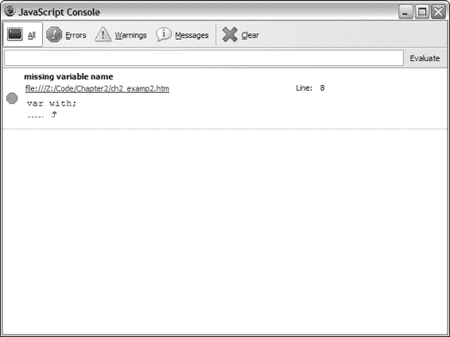

单词`with`在 JavaScript 中是保留字。你会看到什么错误？

在 Firefox 中，除非你打开 JavaScript 控制台，否则什么也看不到，打开后你会看到类似图 2-7 所示的内容。

图 2-7

在开发代码时，最简便的方法可能是让控制台保持打开状态。你将在第 10 章中看到一种更复杂的解决代码问题的方法，届时会介绍 Venkman，这是 Firefox 的创建者 Mozilla 发布的一款帮助消除错误的程序。

当你在 JavaScript 控制台中双击文件链接（此处为`file:///Z:/Code/Chapter2/ch2_examp2.htm`）时，它会打开该文件的源代码，并将你带到错误发生的位置，如图 2-8 所示。

在 Internet Explorer 中，只要你启用了错误显示（如上一节所述），你可能会看到如图 2-9 所示的消息。

如果你使用的是 IE 6+ 并且没有看到图 2-8 或图 2-9 中的错误消息，请不要惊慌。在浏览器的状态栏（通常位于浏览器窗口底部）中，你会注意到一个黄色的小三角形，里面有一个感叹号。双击该黄色三角形，错误消息对话框就会弹出。请确保选中**当页面发生错误时始终显示此消息**复选框。

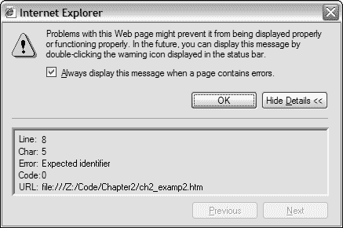

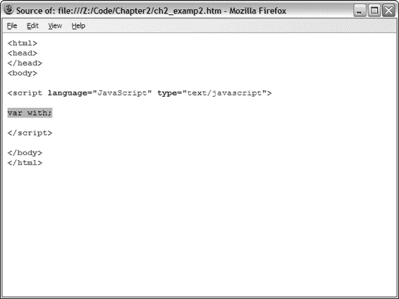

图 2-8

图 2-9

本书的其余部分将显示 Firefox 的错误消息。不过请记住，只要你能得到错误发生及其原因的提示，对话框的外观并不重要。

## 使用数据——计算与基本字符串操作

现在你已经了解了如何处理错误，可以回到本章的主要主题：数据及其使用方法。你已经了解了如何声明变量以及它们如何存储信息，但到目前为止，你还没有利用这些知识做任何真正有用的事情——那么，究竟为什么要使用变量呢？

变量使你能够临时保存信息，这些信息可用于数学计算、构建文本消息或处理用户输入的单词。变量有点像普通计算器上的记忆存储按钮。假设你正在计算你的财务状况。你可能先加总所有需要支出的钱，然后将其存储在临时记忆中。在加总所有收入后，你可以扣除存储在记忆中的金额，以计算出还剩多少钱。变量可以以类似的方式使用：你可以先获取必要的用户输入并将其存储在变量中，然后使用获取的值进行计算。

在本节中，你将看到如何将存储在变量中的值有效地用于数字运算和基于文本的操作。

### 数值计算

JavaScript 具有一系列基本的数学能力，例如加法、减法、乘法和除法。每个基本数学函数都由一个符号表示：加号（`+`）、减号（`-`）、星号（`*`）和斜杠（`/`）。这些符号被称为*运算符*，因为它们对你提供的值进行操作。换句话说，它们执行某种计算或操作，并返回结果。你几乎可以在任何使用数字或变量的地方使用这些计算的结果。

想象一下，你正在计算购物清单上商品的总价值。你可以这样写这个计算：

`购物总花费 = 10 + 5 + 5`

或者，如果你实际计算总和，则是：

`购物总花费 = 20`

现在让我们看看如何在 JavaScript 中实现这一点。实际上，它非常相似，只是你需要使用一个变量来存储最终的总和。

```
var TotalCostOfShopping;
TotalCostOfShopping = 10 + 5 + 5;
alert(TotalCostOfShopping);
```

首先，你声明一个变量`TotalCostOfShopping`来保存总花费。

在第二行中，你有代码`10 + 5 + 5`。这段代码被称为*表达式*。当你将变量`TotalCostOfShopping`赋值为该表达式的值时，JavaScript 会自动计算表达式的值（`20`）并将其存储在变量中。请注意，我们使用了等号来告诉 JavaScript 将计算结果存储在`TotalCostOfShopping`变量中。这被称为将计算的值*赋值*给变量，这就是为什么单个等号（`=`）被称为*赋值运算符*。

最后，你在一个警告框中显示该变量的值。

减法和乘法运算符的工作方式完全相同。除法略有不同。

#### 动手试一试

##### 计算

让我们看一个使用除法运算符的示例，了解它是如何工作的。输入以下代码并将其保存为`ch2_examp3.htm`：

```html
<html>
<body>
<script language="JavaScript" type="text/javascript">
var firstNumber = 15;
var secondNumber = 10;
var answer;
answer = 15 / 10;
alert(answer);
alert(15 / 10);
answer = firstNumber / secondNumber;
alert(answer);
</script>
</body>
</html>
```

将其加载到你的 Web 浏览器中。你应该会看到依次弹出三个警告框，每个都包含值`1.5`。这些值是三个计算的结果。

#### 工作原理

在脚本块中，你首先声明了三个变量，并为前两个变量赋值，这些值将在后面使用。

```
var firstNumber = 15;
var secondNumber = 10;
var answer;
```

接下来，你将`answer`变量设置为表达式`15/10`的计算结果。你在一个警告框中显示该变量的值。

```
answer = 15 / 10;
alert(answer);
```

这个示例演示了一种进行计算的方法，但实际上你几乎不会这样做。

为了证明你可以在使用数字或变量的地方使用表达式，你通过将`15/10`的计算结果直接包含在`alert()`函数中来显示它。

```
alert(15 / 10);
```

最后，你进行相同的计算，但这次使用了两个变量`firstNumber`（设置为`15`）和`secondNumber`（设置为`10`）。你有一个表达式`firstNumber / secondNumber`，将其结果存储在`answer`变量中。然后，为了证明一切正常，你通过使用老朋友`alert()`函数来显示`answer`中包含的值。

```
answer = firstNumber / secondNumber;
alert(answer);
```

大多数计算会采用第三种方式，即使用变量、或数字与变量，并将结果存储到另一个变量中。这样做的原因是，如果计算使用了字面值（实际值，例如`15 / 10`），那么你不如直接编程写出计算结果，而不是强迫 JavaScript 为你计算。例如，与其写`15 / 10`，不如直接写`1.5`。毕竟，你强迫 JavaScript 执行的计算越多，它就会越慢，尽管单独一次计算不会造成太大负担。

使用结果而非计算的另一个原因是，它能让代码更具可读性。在代码中，你更愿意看到`1.5 * 45 – 56 / 67 + 2.567`还是`69.231`？更好的是，使用一个变量名，例如`PricePerKG`，能让不熟悉代码的人更容易理解。

## 递增和递减运算符

许多使用数学运算符的操作非常常见，以至于它们拥有了自己的运算符。这里要介绍的是**递增**和**递减**运算符，分别由两个加号（`++`）和两个减号（`--`）表示。基本上，它们的作用就是将变量的值增加或减少 1。你也可以使用普通的`+`和`–`运算符来实现，例如：

```
myVariable = myVariable + 1;
myVariable = myVariable – 1;
```

（注意，你可以给变量赋一个新值，该值是涉及它先前值的表达式的结果。）然而，使用递增和递减运算符可以简化为：

```
myVariable++;
myVariable--;
```

结果是一样的——`myVariable`的值增加或减少 1——但代码更短。当你熟悉了这种语法后，它会变得非常清晰易读。

现在，你可能会觉得这些运算符听起来就像被戳了一下眼睛一样有用。然而，在下一章中，当你学习如何多次运行同一段代码时，你会看到这些运算符非常有用且被广泛使用。事实上，`++`运算符如此常用，以至于有一种计算机语言以它命名，即`C++`。这里的玩笑是`C++`比`C`高一级。（嗯，这就是程序员式的幽默！）

除了将`++`或`--`放在变量之后，你也可以将其放在前面，如下所示：

```
++myVariable;
--myVariable;
```

当`++`和`--`单独使用时（通常如此），它们放在哪里没有区别，但也可以将`++`和`--`运算符与其他运算符一起用在表达式中。例如：

```
myVar = myNumber++ - 20;
```

这段代码从`myNumber`中减去 20，然后将变量`myNumber`递增 1，再将结果赋给变量`myVar`。如果你将`++`放在前面，像这样前缀：`myVar = ++myNumber - 20;`

那么首先`myNumber`递增 1，然后从`myNumber`中减去 20。这是一个微妙的区别，但在某些情况下非常重要。看下面的代码：

```
myNumber = 1;
myVar = (myNumber++ * 10 + 1);
```

`myVar`会包含什么值？因为`++`是后缀（它在`myNumber`变量之后），所以它会在之后递增。因此等式为：将`myNumber`乘以 10 再加 1，然后将`myNumber`递增 1。

`myVar = 1 * 10 + 1 = 11`

然后给`myNumber`加 1 得到 12，但这发生在值 11 被赋给`myVar`之后。现在看下面的代码：

```
myNumber = 1;
myVar = (++myNumber * 10 + 1);
```

这次`myNumber`先递增 1，然后乘以 10 再加 1。

`myVar = 2 * 10 + 1 = 21`

可以想象，这种细微差别很容易被忽略，导致代码中出现错误；因此，通常最好避免这种语法。

在继续之前，这里似乎是介绍另一个运算符`+=`的好时机。这个运算符可以用作将变量持有的值增加一个固定量的快捷方式。例如：

```
myVar += 6;
```

与以下代码完全相同：

```
myVar = myVar + 6;
```

你也可以对减法和乘法做同样的事情，如下所示：

```
myVar -= 6;
myVar *= 6;
```

这等价于：


```javascript
myVar = myVar – 6;
myVar = myVar * 6;
```

## 运算符优先级

你之前看到，执行某些功能的符号——比如将两个数相加的`+`，以及从一个数中减去另一个数的`-`——被称为运算符。与人不同，并非所有运算符都是平等的；有些具有更高的**优先级**——也就是说，它们会被更早处理。快速看一个简单的例子有助于说明我的观点。

```html
<html>
<body>
<script language=”JavaScript” type=”text/javascript”>
var myVariable;
myVariable = 1 + 1 * 2;
alert(myVariable);
</script>
</body>
</html>
```

如果你输入这段代码，你期望警告框显示`myVariable`的值是多少？你可能会认为，因为`1 + 1 = 2`且`2 * 2 = 4`，所以答案是 4。实际上，你会发现警告框显示 3 作为`myVariable`中存储的计算结果。这是怎么回事？难道 JavaScript 不会正确加法吗？

嗯，你可能已经从数学知识中知道了原因。JavaScript 进行计算的方式是首先计算`1 * 2 = 2`，然后将这个结果用于加法，因此 JavaScript 最终得到`1 + 2 = 3`。

为什么？因为`*`的优先级高于`+`。`=`符号也是一个运算符（称为赋值运算符），它的优先级最低——它总是最后才被处理。

`+`和`–`运算符具有相同的优先级，那么哪个先被处理呢？JavaScript 从左到右工作，因此如果计算中存在相同优先级的运算符，它们会按照从左到右出现的顺序进行计算。`*`和`/`也是如此，它们也具有相同的优先级。

## 动手试一试

### 华氏度转摄氏度

来看一个稍微复杂一点的例子——华氏度转摄氏度转换器。（摄氏度是摄氏温标的另一种叫法。）输入以下代码并保存为`ch2_examp4.htm`：

```html
<html>
<body>
<script language=”JavaScript” type=”text/javascript”>
// Equation is °C = 5/9 (°F - 32).
var degFahren = prompt(“Enter the degrees in Fahrenheit”,50); var degCent;
degCent = 5/9 * (degFahren - 32);
alert(degCent);
</script>
</body>
</html>
```

如果你在浏览器中加载该页面，应该会看到一个提示框，如图 2-10 所示，要求你输入要转换的华氏度。默认已填入值 50。

图 2-10

如果你保持 50 不变并点击确定，会出现一个显示数字 10 的警告框。这表示 50 华氏度转换为摄氏度。

重新加载页面，尝试更改提示框中的值，看看得到什么结果。例如，将值改为 32 并重新加载页面。这次你应该会看到框中显示 0。

由于这仍然是一个相当简单的例子，没有对数据输入进行检查，因此它会允许你输入`abc`作为华氏度。稍后，在本章的“数据类型转换”部分，你将看到如何识别伪装成数值数据的无效字符。

### 工作原理

脚本块的第一行是注释，因为它以两个正斜杠（`//`）开头。它包含了将华氏度转换为摄氏度的公式，放在示例代码中仅供参考。

```javascript
// Equation is °C = 5/9 (°F - 32).
```

你的任务是用 JavaScript 代码表示这个公式。首先声明变量`degFahren`和`degCent`。

```javascript
var degFahren = prompt(“Enter the degrees in Fahrenheit”,50); var degCent;
```

你没有将`degFahren`变量初始化为字面值，而是通过`prompt()`函数从用户那里获取一个值。`prompt()`函数的工作方式与`alert()`函数类似，区别在于除了显示消息外，它还包含一个文本框，用户可以在其中输入值。这个值将被存储在`degFahren`变量中。返回的值是一个文本字符串，但当你将其用作数字时，JavaScript 会隐式地将其转换为数字，正如本章后面关于数据类型转换的章节所讨论的那样。

你向`prompt()`函数传递了两条信息：

- 要显示的文本——通常是一个提示用户输入的问题。
- 默认值——当提示对话框首次出现时，输入框中包含的默认值。

这两条信息必须按给定的顺序指定，并用逗号分隔。如果你不希望提示框打开时输入框中包含默认值，则应将空字符串（`""`）作为第二条信息。

正如你在前面的代码中看到的，文本是“Enter the degrees in Fahrenheit”，输入框中的默认值是 50。

接下来在脚本块中是用 JavaScript 表示的等式。你将等式的结果存储在`degCent`变量中。你可以看到 JavaScript 看起来非常像注释中的等式，只是你使用了`degFahren`而不是 °F，以及`degCent`而不是 °C。

```javascript
degCent = 5/9 * (degFahren - 32);
```

等号右侧表达式的计算引出了几个重要问题。首先，就像数学中一样，JavaScript 等式从左到右读取，至少对于像`+`、`-`等基本数学函数是这样。其次，正如你之前看到的，就像数学中有优先级一样，JavaScript 中也有优先级。

从左开始，JavaScript 首先计算出`5/9 = .5556`（近似值）。然后它进行乘法运算，但是等等……我们等式的最后一部分`degFahren – 32`在括号中。这提高了优先级，导致 JavaScript 在进行乘法之前先计算`degFahren – 32`的结果。例如，当`degFahren`设置为 50 时，`(degFahren - 32) = (50 – 32) = 18`。然后 JavaScript 进行乘法运算，`.5556 * 18`，结果大约是 10。

如果不使用括号会怎样？那么你的代码将是`degCent = 5/9 * degFahren - 32;`

`5/9`的计算保持不变，但随后 JavaScript 会计算乘法`5/9 * degFahren`。这是因为乘法优先级高于减法。当`degFahren`为 50 时，这相当于`5/9 * 50 = 27.7778`。最后 JavaScript 会减去 32，得到结果–4.2221；这不是你想要的答案！

最后，在你的脚本块中，你使用`alert()`函数显示答案。

```javascript
alert(degCent);
```

至此，我们简要介绍了 JavaScript 的基本计算。不过，在第 4 章中，你将学习`Math`对象，它使你能够进行更复杂的计算。

## 基本字符串操作

在前面的章节中，你了解了文本或字符串数据类型，以及数值数据。就像数值数据有相关的运算符一样，字符串也有运算符。本节将介绍使用这些运算符进行的一些基本字符串操作技巧。字符串将在第 4 章中更深入地介绍，高级字符串处理将在第 8 章中介绍。

在 JavaScript 中，你会反复做的一件事就是将两个字符串连接成一个字符串——这个过程称为*拼接*。例如，你可能想要将字符串“Hello ”和“Paul”拼接成字符串“Hello Paul”。那么如何拼接呢？很简单！

使用`+`运算符。回想一下，当应用于数字时，`+`运算符将它们相加，但当用于两个字符串时，它会将它们连接在一起。

```javascript
var concatString = “Hello ” + “Paul”;
```

现在存储在变量`concatString`中的字符串是“Hello Paul”。注意字符串“Hello ”的最后一个字符是一个空格——如果你省略了这个空格，拼接后的字符串将是“HelloPaul”。

### 动手试一试

#### 拼接字符串

让我们看一个使用`+`运算符进行字符串拼接的示例。输入以下代码并将其保存为`ch2_examp5.htm`：

```html
<html>
<body>
<script language=”JavaScript” type=”text/javascript”>
var greetingString = “Hello”;
var myName = prompt(“Please enter your name”, “”);
var concatString;
document.write(greetingString + “ “ + myName + “<br>”);
concatString = greetingString + “ “ + myName;
document.write(concatString);
</script>
</body>
</html>
```

如果你在浏览器中加载它，应该会看到一个提示框，要求你输入姓名。

输入你的姓名并单击“确定”。你应该会在网页上看到问候语和你的姓名显示两次。

### 工作原理

你通过声明三个变量来开始脚本块。你将第一个变量`greetingString`设置为一个字符串值。第二个变量`myName`被赋值为用户在提示框中输入的任何内容。你在这里没有初始化第三个变量`concatString`。它将用于存储稍后在代码中进行的拼接结果。

```javascript
var greetingString = “Hello”;
var myName = prompt(“Please enter your name”, “”);
var concatString;
```

在上一章中，你看到了网页是如何通过文档的概念来表示的，并且它有许多不同的属性，例如`bgColor`。你还可以使用`document`直接将文本和 HTML 写入页面本身。你可以通过使用单词`document`，后跟一个点，然后使用`write()`来实现这一点。然后你使用`document.write()`，就像使用`alert()`函数一样，将你想要在网页中显示的文本放在`write`后面的括号内。不过，这里不必过于担心，因为所有这些都将在第 4 章中详细解释。然而，你现在在代码中使用了`document.write()`来将表达式的结果写入页面。

```javascript
document.write(greetingString + “ “ + myName + “<br>”);
```

写入页面的表达式是`greetingString`变量的值、一个空格（`" "`）、`myName`变量的值以及 HTML 的`<br>`标签（用于换行）的拼接结果。例如，如果你在提示框中输入 Paul，则该表达式的值将如下所示：`Hello Paul<br>`

在下一行代码中是一个类似的表达式。这次只是`greetingString`变量的值、一个空格和`myName`变量的值的拼接。你将这个表达式的结果存储在变量`concatString`中。最后，你使用`document.write()`将变量`concatString`的内容写入页面。

```javascript
concatString = greetingString + “ “ + myName;
document.write(concatString);
```

## 混合数字和字符串

如果你想在表达式中混合文本和数字怎么办？一个典型的例子就是你之前看到的温度转换器。在那个例子中，你只是显示了数字，而没有告诉用户它实际的含义。你真正想要做的是显示数字，并附上描述性文本，例如“转换为摄氏度的值是 10。”

混合数字和文本实际上非常简单。你可以直接使用`+`运算符将它们连接在一起。

JavaScript 足够智能，知道当同时涉及字符串和数字时，你并不是在进行数值计算，而是希望将数字视为字符串并将其与文本连接起来。例如，要将文本`My age is`和数字`101`连接在一起，你可以简单地这样做：

`alert(“My age is “ + 101);`

这会产生一个包含“My age is 101”的警告框。

## 动手试试

### 让温度转换器更友好

你可以在我们的温度转换器示例中尝试这种字符串和数字拼接的技巧。你将输出一些解释性文本，以及转换计算的结果。需要做的改动非常小，因此将`ch2_examp4.htm`加载到文本编辑器中，并修改以下行。然后将其保存为`ch2_examp6.htm`。

```html
<html>
<body>
<script language=”JavaScript” type=”text/javascript”>
// Equation is °C = 5/9 (°F - 32).
var degFahren = prompt(“Enter the degrees in Fahrenheit”,50); var degCent;
degCent = 5/9 * (degFahren - 32);
alert(degFahren + “\xB0 Fahrenheit is “ + degCent + “\xB0 centigrade”);
</script>
</body>
</html>
```

将页面加载到你的网页浏览器中。在提示框中点击“确定”提交值 50，这次你应该会看到如图 2-11 所示的框。

44

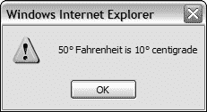

05_051511 ch02.qxp 4/13/07 6:19 PM Page 45

# 第 2 章：数据类型和变量

图 2-11

## 工作原理

这个示例与`ch2_examp4.htm`完全相同，除了一行代码：`alert(degFahren + “\xB0 Fahrenheit is “ + degCent + “\xB0 centigrade”);`，因此我们只在这里讨论这一行。你可以看到`alert()`函数包含一个表达式。让我们更仔细地看看这个表达式。

首先是变量`degFahren`，它包含数值数据。你将其与字符串`“\xBO Fahrenheit is “`拼接。JavaScript 意识到，由于你在将一个数字和一个字符串相加，你希望将它们合并成一个字符串，而不是试图求和，因此自动将`degFahren`中的数字转换为字符串。接着，你将这个字符串与包含数值数据的变量`degCent`拼接。同样，JavaScript 将这个变量的值转换为字符串。最后，你将其与字符串`“\xBO centigrade”`拼接。

还要注意用于在字符串中插入度数符号的转义序列。你在本章前面已经了解到，`\xNN`可用于插入无法直接键入的特殊字符。（`NN`是拉丁-1 字符表中代表一个字符的十六进制数）。因此，当 JavaScript 在字符串中遇到`\xB0`时，它不会显示这些字符，而是查找 B0 代表的字符并显示它。

使用特殊字符时需要注意的一点是，它们不一定跨平台兼容。尽管你可以在 Windows 计算机上使用`\xNN`表示某个字符，但你可能发现在 Mac 或 Unix 机器上需要使用不同的字符。

你将在第 4 章中学习更多字符串操作技巧——你将看到如何搜索字符串以及在字符串中间插入字符，而在第 8 章中你将看到一些非常复杂的字符串技术。

## 数据类型转换

正如你所见，如果你将字符串和数字相加，JavaScript 会做出明智的选择，将数字转换为字符串，然后拼接两者。通常，JavaScript 在需要时会足够智能地进行此类数据类型转换，但在某些情况下，你需要自己转换数据类型。例如，你可能得到一段字符串数据，但希望将其视为数字。这在通过表单收集用户数据时尤其常见。用户输入的任何值都被视为字符串，即使它们包含数值数据，比如用户的年龄。

45

05_051511 ch02.qxp 4/13/07 6:19 PM Page 46

为什么改变数据类型如此重要？考虑一种情况：你通过表单从用户那里收集两个数字，并希望计算它们的和。这两个数字以字符串形式提供给你，例如“22”和“15”。当你尝试使用`“22” + “15”`计算这些值的和时，你会得到结果“2215”，因为 JavaScript 认为你在尝试拼接两个字符串，而不是求两个数字的和。

在本节中，你将学习两个将字符串转换为数字的函数：`parseInt()`和`parseFloat()`。

首先来看`parseInt()`。这个函数接受一个字符串并将其转换为整数。这个名称一开始有点令人困惑——为什么叫`parseInt()`而不是`convertToInt()`？名称的主要来源在于函数的工作方式。它实际上会遍历（即解析）你要求转换的字符串的每个字符，并检查它是否为有效数字。如果是有效的，`parseInt()`会用它来构建数字；如果无效，该命令会停止转换并返回已转换的数字。

例如，如果你的代码是`parseInt(“123”)`，JavaScript 会将字符串“123”转换为数字 123。对于代码`parseInt(“123abc”)`，JavaScript 也会返回数字 123。当 JavaScript 解释器遇到字母 a 时，它会假定数字已结束，并将 123 作为字符串“123abc”的整数版本返回。

`parseFloat()`函数的工作方式与`parseInt()`类似，不同之处在于它返回浮点数（小数），并且它正在转换的字符串中的小数点被视为允许的数字的一部分。

## 动手试试

### 将字符串转换为数字

让我们看一个使用`parseInt()`和`parseFloat()`的示例。输入以下代码并将其保存为`ch2_examp7.htm`：


```html
<html>
<body>
<script language="JavaScript" type="text/javascript">
var myString = "56.02 degrees centigrade";
var myInt;
var myFloat;
document.write("\"" + myString + "\" is " + parseInt(myString) +
" as an integer" + "<BR>");
myInt = parseInt(myString);
document.write("\"" + myString + "\" when converted to an integer equals " +
myInt + "<BR>");
myFloat = parseFloat(myString);
document.write("\"" + myString +
"\" when converted to a floating point number equals " + myFloat);
</script>
</body>
</html>
```

46

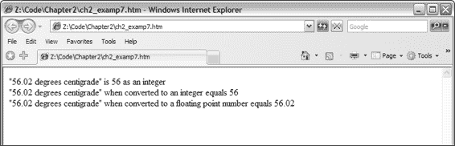

05_051511 ch02.qxp 4/13/07 6:19 PM Page 47

图 2-12

## 工作原理

在脚本块中，你的第一个任务是声明一些变量。变量`myString`被声明并初始化为你想要转换的字符串。在这个示例中，你也可以直接使用字符串而不将其存储在变量中，但在实践中，你会发现使用变量的频率高于字面值。你还声明了变量`myInt`和`myFloat`，它们将存储转换后的数字。

```javascript
var myString = "56.02 degrees centigrade";
var myInt;
var myFloat;
```

接下来，你向页面写入`myString`的转换整数值，并通过字符串拼接构建一个友好的句子来显示。注意，你使用了转义序列`\"`来在要转换的字符串周围显示引号（"）。

```javascript
document.write("\"" + myString + "\" is " + parseInt(myString) +
" as an integer" + "<BR>");
```

如你所见，你可以在使用数字本身或包含数字的变量的任何地方使用`parseInt()`和`parseFloat()`。实际上，在这一行中，JavaScript 解释器进行了两次转换。首先，它将`myString`转换为整数，因为这是你通过使用`parseInt()`要求的。然后，它自动将该整数转换回字符串，以便与其他字符串拼接成你的句子。还要注意，在处理整数时，`myString`变量值中只有 56 部分被视为有效数字。6 之后的任何内容都被视为无效并被忽略。

# 第 2 章：数据类型与变量

接下来，你使用 `parseInt()` 对 `myString` 进行同样的转换，但这次将结果存储在 `myInt` 变量中。在下一行，你将结果用于向用户显示的文本中：`myInt = parseInt(myString);`

```javascript
document.write("\"" + myString + "\" when converted to an integer equals " +
myInt + "<BR>");
```

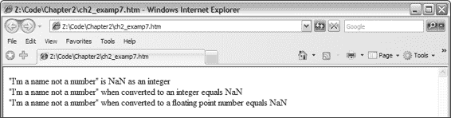

同样，尽管 `myInt` 保存的是一个数字，但 JavaScript 解释器知道，当涉及字符串和数字时，`+` 意味着你希望将 `myInt` 的值转换为字符串并连接到字符串的其余部分，以便显示。

最后，你使用 `parseFloat()` 将 `myString` 中的字符串转换为浮点数，并将其存储在变量 `myFloat` 中。这次小数点被视为数字的有效部分，因此只有 2 之后的内容被忽略。你再次使用 `document.write()` 将结果以用户友好的字符串形式写入网页。

```javascript
myFloat = parseFloat(myString);

document.write("\"" + myString +
"\" when converted to a floating point number equals " + myFloat);
```

### 处理无法转换的字符串

有些字符串根本无法转换为数字，例如不包含任何数值数据的字符串。如果尝试转换这些字符串会发生什么？作为一个小实验，尝试修改前面的示例，使 `myString` 保存一些不可转换的内容。例如，将 `var myString = "56.02 degrees centigrade";` 改为 `var myString = "I'm a name not a number";`

现在重新加载浏览器中的页面，你应该会看到如图 2-13 所示的内容。

图 2-13

你可以看到，之前显示数字的位置现在显示的是 `NaN`。那是什么数字？嗯，它根本就是 `Not a Number`（非数字）！

如果你对任何空字符串或不以至少一个有效数字开头的字符串使用 `parseInt()` 或 `parseFloat()`，你会得到 `NaN`，意思是 `Not a Number`。

`NaN` 实际上是 JavaScript 中的一个特殊值。它有自己的函数 `isNaN()`，用于检查某个值是否为 `NaN`。例如，`myVar1 = isNaN("Hello");` 会将值 `true` 存储在变量 `myVar1` 中，因为 `"Hello"` 不是数字；而 `myVar2 = isNaN("34");` 会将值 `false` 存储在变量 `myVar2` 中，因为 `isNaN()` 函数可以成功地将 34 从字符串转换为数字。

在下一章中，你将看到如何使用 `isNaN()` 函数检查字符串作为数字的有效性，这在处理用户输入时非常有用，正如你将在第 6 章中看到的那样。

## 数组

现在我们将探讨一个新概念——称为*数组*。数组与普通变量类似，你可以用它来保存任何类型的数据。但它有一个重要的区别，如下所述。

正如你已经看到的，普通变量一次只能保存一条数据。例如，你可以将 `myVariable` 设置为 25，如下所示：`myVariable = 25;` 然后将其设置为其他值，比如 35：`myVariable = 35;` 然而，当你将变量设置为 35 时，第一个值 25 就丢失了。变量 `myVariable` 现在只保存数字 35。

下表说明了该变量：

| 变量名       | 值   |
|--------------|------|
| `myVariable` | 35   |

普通变量与数组之间的区别在于，数组可以同时保存*多个*数据项。例如，你可以使用名为 `myArray` 的数组来同时存储数字 25 和 35。数组中每个可以存储数据的位置称为一个*元素*。

如何区分数组中的这两个数据？你为每个数据赋予一个*索引*值。要引用该数据，你需要在数组名称后的方括号内放入其索引值。例如，一个名为 `myArray` 的数组包含数据 25 和 35，可以用下表说明：

| 元素名       | 值   |
|--------------|------|
| `myArray[0]` | 25   |
| `myArray[1]` | 35   |

注意索引值从 0 开始，而不是 1。这是为什么？当然，从 1 开始更合理——毕竟，我们人类倾向于说第一个数据项，然后是第二个，依此类推。不幸的是，计算机从 0 开始，将第一个数据项视为第零项，第二个视为第一项，以此类推。

这可能会让人困惑，但你很快就会习惯。

数组非常有用，因为你可以根据需要存储尽可能多（在语言限制范围内，该限制指定最多 2 的 32 次方个元素）或尽可能少的数据项。此外，你不需要事先说明要在数组中存储多少数据，尽管如果你愿意，也可以这样做。

那么如何创建数组呢？这与声明普通变量略有不同。要创建一个新数组，你需要声明一个变量名，并使用 `new` 关键字和 `Array()` 函数告诉 JavaScript 你想要它成为一个新数组。例如，数组 `myArray` 可以这样定义：`var myArray = new Array();`

注意，与 JavaScript 中的一切一样，代码区分大小写，因此如果你输入 `array()` 而不是 `Array()`，代码将无法工作。这种定义数组的方式将在第 4 章中进一步解释。

与普通变量一样，你也可以先声明变量，然后告诉 JavaScript 你想要它成为一个数组。例如：

```javascript
var myArray;
myArray = new Array();
```

之前你了解到，如果你愿意，可以事先说明数组将包含多少个元素，尽管这不是必需的。你可以通过在 `Array` 后面的括号中放入你想要指定的元素数量来实现。例如，要创建一个包含六个元素的数组，你可以编写以下代码：`var myArray = new Array(6);`

你已经了解了如何声明一个新数组，但如何将数据存储在其中呢？你可以在定义数组时，将数据放在括号内，每个数据之间用逗号分隔。例如：`var myArray = new Array("Paul",345,"John",112,"Bob",99);` 这里，第一个数据项 `"Paul"` 将被放入索引为 0 的数组中。下一个数据项 345 将被放入索引为 1 的数组中，依此类推。这意味着名为 `myArray[0]` 的元素包含值 `"Paul"`，名为 `myArray[1]` 的元素包含值 345，以此类推。

注意，你不能使用这种方法来声明只包含一个数值数据（如 345）的数组，因为 JavaScript 会认为你正在声明一个包含 345 个元素的数组。

这引出了另一种在数组中声明数据的方法。你可以将前面的代码行写成这样：

```javascript
var myArray = new Array();
myArray[0] = "Paul";
myArray[1] = 345;
myArray[2] = "John";
myArray[3] = 112;
myArray[4] = "Bob";
myArray[5] = 99;
```

你将每个元素名当作变量使用，并为其赋值。你将在接下来的“动手试一试”部分学习这种声明数组元素值的方法。

显然，在这个例子中，第一种定义数据项的方法要简单得多。然而，在某些情况下，你可能希望在声明数组元素后更改存储在特定元素中的数据。在这种情况下，你将不得不使用后一种方法来定义数组元素的值。

你还会从前面的例子中发现，你可以在同一个数组中存储不同的数据类型。

JavaScript 对于可以在数组中放置什么以及放在哪里非常灵活。

在进入示例之前，请注意，如果你已经定义了一个名为 `myArray` 的数组，并指定它包含三个元素，例如：`var myArray = new Array(3);`

然后在索引为 130 的元素中定义了一个值：

```javascript
myArray[130] = "Paul";
```

JavaScript 不会报错，而是会愉快地认为你改变了主意，想要一个至少包含 131 个元素的数组。

## 动手试一试

### 一个数组

在下面的示例中，你将创建一个数组来存放一些名字。你将使用上一节中描述的第二种方法将这些数据存储到数组中，然后将数据显示给用户。输入代码并保存为`ch2_examp8.htm`。

```html
<html>
<body>
<script language="JavaScript" type="text/javascript">
var myArray = new Array();
myArray[0] = "Bob";
myArray[1] = "Pete";
myArray[2] = "Paul";
document.write("myArray[0] = " + myArray[0] + "<BR>");
document.write("myArray[2] = " + myArray[2] + "<BR>");
document.write("myArray[1] = " + myArray[1] + "<BR>");
myArray[1] = "Mike";
document.write("myArray[1] changed to " + myArray[1]);
</script>
</body>
</html>
```

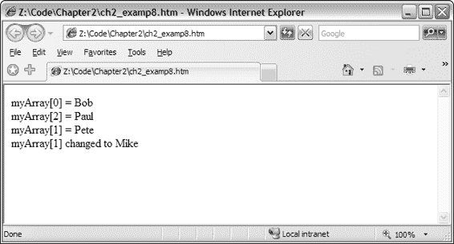

如果你在浏览器中加载这个页面，你会看到一个类似于图 2-14 所示的网页。


### 工作原理

脚本块中的第一个任务是声明一个变量，并告诉 JavaScript 解释器你希望它是一个新数组。

```javascript
var myArray = new Array();
```

现在你已经定义了数组，可以向其中存储数据了。每次使用新索引存储数据项时，JavaScript 都会自动为其创建一个新的存储空间。记住，第一个元素位于`myArray[0]`。

让我们依次查看数组的每次添加操作，看看发生了什么。在添加任何内容之前，数组是空的。然后你通过以下代码添加了一个数组元素：

```javascript
myArray[0] = "Bob";
```

现在你的数组看起来像这样：

| **索引** | **存储的数据** |
|-----------|-----------------|
| 0         | Bob             |

然后你添加了另一个数组元素，这次索引为 1。

```javascript
myArray[1] = "Pete";
```

| **索引** | **存储的数据** |
|-----------|-----------------|
| 0         | Bob             |
| 1         | Pete            |

最后，你添加了索引为 2 的数组元素。

```javascript
myArray[2] = "Paul";
```

现在你的数组看起来像这样：

| **索引** | **存储的数据** |
|-----------|-----------------|
| 0         | Bob             |
| 1         | Pete            |
| 2         | Paul            |

接下来，你使用一系列`document.write()`函数将数组每个元素包含的值插入到网页中。这里数组的顺序是乱的，只是为了演示你可以这样访问。

```javascript
document.write("myArray[0] = " + myArray[0] + "<BR>");
document.write("myArray[2] = " + myArray[2] + "<BR>");
document.write("myArray[1] = " + myArray[1] + "<BR>");
```

你可以将数组中的每个特定位置视为一个标准变量。因此，你可以用它进行计算，将其值传递给另一个变量或数组等。但是，如果你在定义之前尝试访问数组位置中的数据，你会得到`undefined`作为值。

最后，你将第二个数组位置的值改为`"Mike"`。你也可以将其改为数字，因为与普通变量一样，你可以在数组的每个数据位置随时存储任何数据类型。

```javascript
myArray[1] = "Mike";
```

现在你的数组内容如下：

| **索引** | **存储的数据** |
|-----------|-----------------|
| 0         | Bob             |
| 1         | Mike            |
| 2         | Paul            |

为了证明所做的更改生效了，你使用`document.write()`显示第二个元素的值。

```javascript
document.write("myArray[1] changed to " + myArray[1]);
```

## 多维数组

假设你想将公司的人员信息存储在一个数组中。你可能会有姓名、年龄、地址等数据。创建这样一个数组的一种方法是按顺序存储信息——第一个姓名放在数组的第一个元素中，然后对应的年龄放在下一个元素中，地址放在第三个元素中，下一个姓名放在第四个元素中，依此类推。你的数组可能看起来像这样：

| **索引** | **存储的数据** |
|-----------|-----------------|
| 0         | 姓名 1           |
| 1         | 年龄 1            |
| 2         | 地址 1        |
| 3         | 姓名 2           |
| 4         | 年龄 2            |
| 5         | 地址 2        |
| 6         | 姓名 3           |
| 7         | 年龄 3            |
| 8         | 地址 3        |

这样是可行的，但有一个更简洁的解决方案：使用*多维数组*。到目前为止，你一直在使用一维数组。在这些数组中，每个元素只由一个索引指定——即一个维度。因此，以上面的例子为例，你可以看到`姓名 1`在索引 0 处，`年龄 1`在索引 1 处，依此类推。

多维数组是指每个元素有两个或更多索引的数组。例如，这是你的人事数组作为二维数组的样子：

| **索引** | **0**    | **1**    | **2**       |
|-----------|----------|----------|-------------|
| 0         | 姓名 1    | 姓名 2    | 姓名 3       |
| 1         | 年龄 1     | 年龄 2     | 年龄 3        |
| 2         | 地址 1 | 地址 2    | 地址 3    |

你将在下面的“动手试一试”部分中了解如何创建这样的多维数组。

## 动手试一试


### 一个二维数组

下面的示例说明了如何在 JavaScript 代码中创建这样的多维数组，以及如何访问该数组的元素。输入代码并保存为`ch2_examp9.htm`。

```
<html>
<body>
<script language="JavaScript" type="text/javascript">
var personnel = new Array();
personnel[0] = new Array();
personnel[0][0] = "Name0";
personnel[0][1] = "Age0";
personnel[0][2] = "Address0";
personnel[1] = new Array();
personnel[1][0] = "Name1";
personnel[1][1] = "Age1";
personnel[1][2] = "Address1";
personnel[2] = new Array();
personnel[2][0] = "Name2";
personnel[2][1] = "Age2";
personnel[2][2] = "Address2";
document.write("Name : " + personnel[1][0] + "<BR>");
document.write("Age : " + personnel[1][1] + "<BR>");
document.write("Address : " + personnel[1][2]);
</script>
</body>
</html>
```

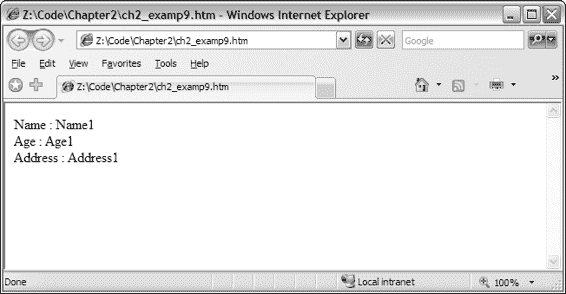

如果你在浏览器中加载它，你会看到页面中写入了三行，分别代表存储在数组`personnel[1]`元素中的人员的姓名、年龄和地址，如图 2-15 所示。


### 工作原理

这个脚本块中首先要做的是声明一个变量`personnel`，并告诉 JavaScript 你希望它是一个新数组。

```
var personnel = new Array();
```

然后你做了些新的事情：你告诉 JavaScript，你希望`personnel`数组的索引 0，即元素`personnel[0]`，成为另一个新数组。

```
personnel[0] = new Array();
```

那么这是怎么回事呢？实际上，JavaScript 并不真正支持多维数组，只支持一维数组。然而，JavaScript 允许我们通过在数组内部创建数组来模拟多维数组。因此，上面这行代码是在`personnel`数组的索引 0 元素内部创建一个新数组。

接下来的三行中，你将值放入新创建的`personnel[0]`数组中。JavaScript 让这变得很容易：你只需写出数组的名称`personnel[0]`，后面跟上方括号中的另一个索引。第一个索引（0）属于`personnel`数组；第二个索引属于`personnel[0]`数组。

```
personnel[0][0] = "Name0";
personnel[0][1] = "Age0";
personnel[0][2] = "Address0";
```

执行这些代码后，我们的数组看起来像这样：

| **索引** | **0**    |
|-----------|----------|
| 0         | Name0    |
| 1         | Age0     |
| 2         | Address0 |

顶部的数字（目前只有 0）指的是`personnel`数组。侧边的数字 0、1、2 实际上是`personnel`数组内部新`personnel[0]`数组的索引。

对于第二个人的详细信息，你重复这个过程，但这次使用的是`personnel`数组中索引为 1 的元素。

```
personnel[1] = new Array();
personnel[1][0] = "Name1";
personnel[1][1] = "Age1";
personnel[1][2] = "Address1";
```

现在你的数组看起来像这样：

| **索引** | **0**    | **1**    |
|-----------|----------|----------|
| 0         | Name0    | Name1    |
| 1         | Age0     | Age1     |
| 2         | Address0 | Address1 |

# 第 2 章：数据类型和变量

`Age0`

`Age1`

`2`

`Address0`

`Address1`

在接下来的几行中，你将创建第三个人的详细信息。你现在正在使用 `personnel` 数组中索引为 2 的元素来创建一个新数组。

```
personnel[2] = new Array();
personnel[2][0] = "Name2";
personnel[2][1] = "Age2";
personnel[2][2] = "Address2";
```

现在数组看起来像这样：

| 索引 | 0 | 1 | 2 |
|-------|---|---|---|
| 0 | Name0 | Name1 | Name2 |
| 1 | Age0 | Age1 | Age2 |
| 2 | Address0 | Address1 | Address2 |

现在你已经完成了多维数组的创建。你通过访问第二个人的数据（`Name1`、`Age1`、`Address1`）并使用 `document.write()` 将其显示在页面中，从而结束脚本块。正如你所见，访问数据与存储数据非常相似。你可以在任何使用普通变量或一维数组的地方使用多维数组。

```
document.write("Name : " + personnel[1][0] + "<BR>");
document.write("Age : " + personnel[1][1] + "<BR>");
document.write("Address : " + personnel[1][2]);
```

尝试修改 `document.write()` 命令，使其显示第一个人的详细信息。代码将如下所示：

```
document.write("Name : " + personnel[0][0] + "<BR>");
document.write("Age : " + personnel[0][1] + "<BR>");
document.write("Address : " + personnel[0][2]);
```

可以创建三维、四维甚至一百维的多维数组，但事情会开始变得非常混乱，你会发现你很少（如果有的话）需要超过二维。

为了让你有个概念，下面是如何声明和访问一个五维数组：

```
var myArray = new Array();
myArray[0] = new Array();
myArray[0][0] = new Array();
myArray[0][0][0] = new Array();
myArray[0][0][0][0] = new Array();
myArray[0][0][0][0][0] = "This is getting out of hand"
document.write(myArray[0][0][0][0][0]);
```

关于数组暂时就到这里，但你将在第 4 章中再次回到它们，届时你会发现一些令人震惊的事情。你还将学习它们的一些更高级的特性。

## “谁想成为亿万富翁”趣味问答——使用数组存储问题

好了，是时候迈出构建在线趣味问答的第一步了。你将通过定义构成问答中问题和答案的数据来奠定基础。

在本章中，你只需定义单选题，其答案是一个字母。

你将使用数组来存储问题和答案：一个二维数组用于问题，一个一维数组用于对应的答案。

每个单选题的格式是问题后跟所有可能的答案选项。问题的正确答案用对应选项的字母指定。

例如，问题“披头士是谁？”有以下选项：

A. 来自利物浦的六十年代摇滚乐队  

B. 四只有音乐天赋的昆虫  

C. 德国汽车  

D. 我不知道。能给我棒球方面的问题吗？

在这种情况下，答案是 A。

那么如何将这些信息存储到我们的数组中呢？首先来看存储问题的数组。

你像这样定义数组：

| 索引 | 0 | 1 | 2 |
|-------|---|---|---|
| 0 | 问题 0 的文本 | 问题 1 的文本 | 问题 2 的文本 |
| 1 | 问题 0 的选项 A | 问题 1 的选项 A | 问题 2 的选项 A |
| 2 | 问题 0 的选项 B | 问题 1 的选项 B | 问题 2 的选项 B |
| 3 | 问题 0 的选项 C | 问题 1 的选项 C | 问题 2 的选项 C |
| 4 | 问题 0 的选项 D | 问题 1 的选项 D | 问题 2 的选项 D |

当然，如果你创建更多问题，可以扩展这个数组。

然后答案数组将像这样定义：

| 索引 | 值 |
|-------|-------|
| 0 | 问题 0 的正确选项 |
| 1 | 问题 1 的正确选项 |
| 2 | 问题 2 的正确选项 |

同样，你可以随着添加更多问题而扩展这个数组。

现在你已经了解了如何存储问题数据，让我们来看看代码。

要添加代码的页面名为 `trivia_quiz.htm`。你首先在页面顶部创建 HTML 标签。

```html
<html>
<head>
<title>Wrox Online Trivia Quiz</title>
</head>
<body>
```

然后，在页面主体中，你开始一个 JavaScript 块，在其中声明两个变量 `questions` 和 `answers`，并将它们定义为新数组。这些变量的用途应该不言自明！不过，与代码的其他部分一样，你添加了注释，以便于理解你在做什么。

```javascript
<script language="JavaScript" type="text/javascript">

// questions and answers arrays will holds questions and answers
var questions = new Array();
var answers = new Array();
```

接下来你直接定义第一个问题。由于问题将放在一个二维数组中，你的第一个任务是将 `questions[0]` 设置为一个新数组。你将这个数组的第一个元素 `questions[0][0]` 赋值为问题的文本，后续元素赋值为可能的答案。

```javascript
// define question 1
questions[0] = new Array();

// the question
questions[0][0] = "The Beatles were";

// first choice
questions[0][1] = "A sixties rock group from Liverpool";

// second choice
questions[0][2] = "Four musically gifted insects";

// third choice
questions[0][3] = "German cars";

// fourth choice
questions[0][4] = "I don't know. Can I have the questions on baseball please?";
```

定义了第一个问题后，我们来设置第一个答案。对于单选题，你只需将 `answers` 数组中对应索引的元素设置为代表正确选项的字符。在前一个问题中，正确答案是“来自利物浦的六十年代摇滚乐队”。由于这是第一个选项，其字母是 A。

```javascript
// assign answer for question 1
answers[0] = "A";
```

让我们为问答再定义两个问题。它们都采用与第一个问题相同的格式。

```javascript
// define question 2
questions[1] = new Array();
questions[1][0] = "Homer Simpson's favorite food is";
questions[1][1] = "Fresh salad";
questions[1][2] = "Doughnuts";
questions[1][3] = "Bread and water";
questions[1][4] = "Apples";

// assign answer for question 2
answers[1] = "B";

// define question 3
questions[2] = new Array();
questions[2][0] = "Lisa Simpson plays which musical instrument?";
questions[2][1] = "Clarinet";
questions[2][2] = "Oboe";
questions[2][3] = "Saxophone";
questions[2][4] = "Tubular bells";

// assign answer for question 3
answers[2] = "C";
```

你通过创建一个提示框来结束脚本块，该提示框告诉你数组已初始化。

```javascript
alert("Array Initialized");
```

```html
</script>
</body>
</html>
```

将页面保存为 `trivia_quiz.htm`。这样就完成了问答问题和答案的定义。在下一章中，你可以继续编写代码，检查用户提供的答案与问题的正确答案是否匹配。

## 总结

在本章中，你建立了对 JavaScript 数据类型和变量基础知识的理解，以及如何在操作中使用它们。特别是，你了解到：

- JavaScript 支持多种数据类型，如数字、文本和布尔值。

- 文本由字符串表示，并用引号括起来。你必须匹配字符串周围的引号。转义字符使你能够在字符串中包含无法键入的字符。

- 变量是 JavaScript 在内存中存储数据（如数字和文本）的方式，以便在代码中反复使用。

❑

## 第 2 章：数据类型与变量

变量名不得包含某些非法字符，例如百分号（`%`）和与号（`&`），也不能是保留字，比如`with`。

- 在给变量赋值之前，必须先向 JavaScript 解释器声明其存在。

- JavaScript 有四个基本数学运算符，分别用加号（`+`）、减号（`-`）、星号（`*`）和斜杠（`/`）表示。要将计算结果赋值给变量，需要使用等号（`=`），称为赋值运算符。

- 运算符具有不同的优先级，因此乘法和除法会先于加法和减法进行计算。

- 字符串可以通过 `+` 运算符连接（即拼接）成一个长字符串。当数字和字符串使用 `+` 运算符拼接时，JavaScript 会自动将数字转换为字符串。

- 尽管 JavaScript 的自动数据类型转换在大多数情况下都能满足需求，但有时你需要强制转换数据类型。你已经看到如何使用 `parseInt()` 和 `parseFloat()` 将字符串转换为数字。尝试转换无法转换的字符串将返回 `NaN`（非数值）。

- 数组是一种特殊类型的变量，可以存储多个数据。数据通过唯一的索引号进行插入和访问。

### 练习题

这些问题的参考答案可在附录 A 中找到。

#### 问题 1

编写一个 JavaScript 程序，将摄氏度转换为华氏度，并将结果以描述性语句写入页面。华氏度与摄氏度的 JavaScript 公式如下：`degFahren = 9 / 5 * degCent + 32`

#### 问题 2

以下代码使用 `prompt()` 函数从用户处获取两个数字，然后将这两个数字相加并将结果写入页面：

```html
<html>
<body>
<script language=”JavaScript” type=”text/javascript”>
var firstNumber = prompt(“Enter the first number”,””);
var secondNumber = prompt(“Enter the second number”,””);
var theTotal = firstNumber + secondNumber;
document.write(firstNumber + “ added to “ + secondNumber + “ equals “ +
theTotal);
</script>
</body>
</html>
```

然而，如果你尝试运行这段代码，会发现它无法正常工作。为什么？请修改代码使其正常工作。

## 第 3 章：决策、循环与函数

到目前为止，你已经了解了如何使用 JavaScript 获取用户输入、利用输入执行计算和任务，并将结果写入网页。然而，一个袖珍计算器也能做到这些，那么是什么让计算机与众不同呢？也就是说，是什么让计算机看起来具有智能？答案是：基于收集到的信息做出决策的能力。

决策能力如何帮助你创建网站？在上一章中，你编写了一段将华氏度转换为摄氏度的代码。你使用 `prompt()` 函数从用户那里获取华氏度。如果用户输入了有效的数字（例如 50），代码就能正常工作。但如果用户输入了无效的华氏温度，比如字符串 `aaa`，你会发现代码不再按预期运行。现在，如果你的程序具备决策能力，就可以检查用户输入是否有效。如果有效，就进行计算；如果无效，就告知用户原因并请他输入有效数字。

用户输入验证可能是 JavaScript 中决策最常见的用途之一，但远非唯一用途。问答小测验也需要决策能力，以便检查用户给出的答案是对还是错。如果答案正确，你需要执行某些步骤，例如告知用户正确并增加她的分数。如果答案错误，则需要执行另一组代码来告知她错误。

在本章中，你将了解如何在 JavaScript 中实现决策，以及如何利用它让你的代码更智能。

### 决策——if 和 switch 语句


所有编程语言都允许你做出决策——也就是说，它们允许程序根据特定条件是否满足来执行不同的操作。这正是编程语言具有智能的原因。

例如，在某种情况下，你使用的 JavaScript 代码仅兼容版本 4 或更高版本的浏览器，那么条件可以是：用户正在使用版本 4 或更高版本的浏览器。如果发现条件不满足，你可以将用户引导至一组兼容早期浏览器的页面。

条件是对变量和数据进行的比较，例如：

- `A` 是否大于 `B`？
- `X` 是否等于 `Y`？
- `M` 是否不等于 `N`？

例如，如果变量 `browserVersion` 存储了用户正在使用的浏览器版本，那么条件可以是：

- `browserVersion` 是否大于或等于 4？

你会注意到，所有这些问题的答案都是“是”或“否”——也就是说，它们基于布尔值，只能计算为 `true` 或 `false`。如何利用这一点在代码中创建决策能力呢？

你让浏览器测试条件是否为真。如果（且仅当）为真，则执行特定的代码段。

再看另一个例子。回顾第 1 章中用于演示代码流程的自然英语指令。其中一条泡咖啡的指令是：

- 水壶烧开了吗？如果是，则倒水入杯；否则，继续等待。

这是一个决策的例子。该指令中的条件是“水壶烧开了吗？”它的答案是“是”或“否”。如果答案为“是”，你就倒水入杯；如果答案为“否”，你就继续等待。

在 JavaScript 中，你可以根据条件为真或假来改变代码的执行流程，使用 `if` 语句或 `switch` 语句。稍后你将学习这些语句，但首先需要介绍一些对定义条件至关重要的新运算符——比较运算符。

### 比较运算符

在上一章中，你了解了数学函数（如加法和除法）如何用符号（如加号 `+` 和斜杠 `/`）表示，这些符号称为运算符。你还了解到，如果要给变量赋值，可以使用等号（`=`）为其赋值或计算结果，等号称为赋值运算符。

决策也有自己的运算符，用于测试条件。比较运算符与上一章中看到的数学运算符类似，有左侧（LHS）和右侧（RHS），比较在两者之间进行。这些术语的技术名称是左操作数和右操作数。例如，小于运算符，符号为 `<`，是一个比较运算符。你可以写 `23 < 45`，意思是“23 是否小于 45？”这里，答案将是 `true`（见图 3-1）。

23（LHS）是否小于 45（RHS）

左侧（LHS）

右侧（RHS）

`23 < 45`

图 3-1

还有其他比较运算符，其中更有用的总结在下表中：

| 运算符符号 | 用途 |
|------------|------|
| `==` | 测试 LHS 是否等于 RHS |
| `<` | 测试 LHS 是否小于 RHS |
| `>` | 测试 LHS 是否大于 RHS |
| `<=` | 测试 LHS 是否小于或等于 RHS |
| `>=` | 测试 LHS 是否大于或等于 RHS |
| `!=` | 测试 LHS 是否不等于 RHS |

在下一节中，当你看到 `if` 语句时，就会看到这些比较运算符的实际应用。

## 优先级

回顾第 2 章，运算符具有优先级顺序。这也适用于比较运算符。`==` 和 `!=` 比较运算符的优先级最低，其余比较运算符 `<`、`>`、`<=` 和 `>=` 具有相同的优先级。

所有这些比较运算符的优先级都低于 `+`、`-`、`*` 和 `/` 等运算符。这意味着，如果你进行诸如 `3 * 5 > 2 * 5` 的比较，会先计算乘法运算，然后再比较它们的结果。不过，在这种情况下，将两侧的计算用括号括起来会更安全、更清晰，例如 `(3 * 5) > (2 * 5)`。作为一般规则，最好使用括号来确保优先级清晰，否则你可能会对结果感到惊讶。

## 赋值与比较

需要特别强调的一点是，赋值运算符（`=`）和比较运算符（`==`）很容易混淆。请记住，`=` 运算符将值赋给变量，而 `==` 运算符比较两个变量的值。即使你清楚这一点，也很容易在应该输入两个等号的地方只输入了一个。

### 存储比较结果

你可以将比较的结果存储在一个变量中，如下例所示：

```javascript
var age = prompt(“Enter age:”, “”);
var isOverSixty = parseInt(age) > 60;
document.write(“Older than 60: “ + isOverSixty);
```

这里，你使用 `prompt()` 函数获取用户的年龄。该函数将用户输入的任何值作为字符串返回。然后，你使用上一章中看到的 `parseInt()` 函数将其转换为数字，并使用大于运算符检查它是否大于 60。比较的结果（`true` 或 `false`）将存储在变量 `isOverSixty` 中。

如果用户输入 35，最后一行中的 `document.write()` 将在页面上写入：Older than 60: false

如果用户输入 61，则会显示：

Older than 60: true

## `if` 语句

`if` 语句是你几乎在每个超过几行代码的程序中都会用到的语句。它的工作方式与英语中的用法非常相似。例如，用英语你可能会说：

“如果室温超过 80 华氏度，那么我就打开空调。”在 JavaScript 中，这可以翻译成如下代码：

```javascript
if (roomTemperature > 80)
{
    roomTemperature = roomTemperature – 10;
}
```

这是如何工作的？见图 3-2。

测试条件

如果测试条件为真，则执行花括号内的所有代码

```javascript
if ( roomTemperature > 80 )
{
    roomTemperature = roomTemperature – 10;
}
```

图 3-2

请注意，测试条件放在括号中，并跟在 `if` 关键字后面。另外，注意这一行末尾没有分号。如果条件为真，要执行的代码放在条件后面一行的花括号中，并且这些代码行都以分号结尾。

花括号 `{}` 在 JavaScript 中有一个特殊用途：它们标记出一个代码块。将代码行标记为属于同一个块意味着 JavaScript 会将它们视为一个整体。

如果 `if` 语句的条件为真，JavaScript 会执行 `if` 语句后面的下一行或代码块。在前面的例子中，代码块只有一条语句，所以我们也可以这样写：

```javascript
if (roomTemperature > 80)
    roomTemperature = roomTemperature – 10;
```

但是，如果你有多行代码要执行，就需要用花括号将它们标记为一个代码块。例如，一个包含三行代码的修改版本就必须包含花括号。

```javascript
if (roomTemperature > 80)
{
    roomTemperature = roomTemperature – 10;
    alert(“It’s getting hot in here”);
    alert(“Air conditioning switched on”);
}
```

一个特别容易犯的错误是在标记要执行的代码块时忘记花括号。你会发现，当条件为真时，执行的并不是代码块中的代码，而是只有 `if` 语句后面的第一行。而其他行无论测试条件的结果如何，都会被执行。为了避免这类错误，最好始终使用花括号，即使只有一条语句也是如此。如果你养成了这个习惯，那么在真正需要花括号时就不太可能遗漏它们。

### 试一试

让我们回到第 2 章的温度转换器示例，并添加一些决策功能。输入以下代码并将其保存为 `ch3_examp1.htm`：

```html
<html>
<body>
<script language=”JavaScript” type=”text/javascript”>
var degFahren = Number(prompt(“Enter the degrees Fahrenheit”,32));
var degCent;
degCent = 5/9 * (degFahren - 32);
document.write(degFahren + “\xB0 Fahrenheit is “ + degCent +
“\xB0 centigrade<BR>”);
if (degCent < 0)
{
document.write(“That’s below the freezing point of water”);
}
if (degCent == 100)
document.write(“That’s the boiling point of water”);
</script>
</body>
</html>
```

将页面加载到浏览器中，并在提示框中输入 32 作为要转换的华氏度值。当值为 32 时，两个 `if` 语句的条件都不为真，因此页面中只会写入一行，如图 3-3 所示。

图 3-3

现在重新加载页面，并输入 31 作为华氏度值。这次你会在页面中看到两行，如图 3-4 所示。

图 3-4

最后，再次重新加载页面，但这次在提示框中输入 212。页面中将出现如图 3-5 所示的两行。

图 3-5

### 工作原理

此页面中脚本块的第一部分取自第 2 章的示例 `ch2_examp4.htm`。

你声明了两个变量 `degFahren` 和 `degCent`。变量 `degFahren` 通过 `prompt()` 函数从用户那里获取初始值。注意，`prompt()` 函数返回一个字符串值，然后你使用 `Number()` 函数将其显式转换为数值。变量 `degCent` 随后被设置为计算 `5/9 * (degFahren - 32)` 的结果，这是华氏度到摄氏度的转换计算。

```javascript
var degFahren = Number(prompt(“Enter the degrees Fahrenheit”,32));
var degCent;
degCent = 5/9 * (degFahren - 32);
```

然后，你将计算结果写入页面。

```javascript
document.write(degFahren + “\xB0 Fahrenheit is “ + degCent +
“\xB0 centigrade<BR>”);
```

现在到了新代码部分；两个 `if` 语句中的第一个。

```javascript
if (degCent < 0)
{
document.write(“That’s below the freezing point of water”);
}
```

这个 `if` 语句的条件是：“变量 `degCent` 的值是否小于零？”如果答案是肯定的（真），则执行花括号内的代码。在这种情况下，你使用 `document.write()` 向页面写入一句话。如果答案是否定的（假），则处理过程移动到右花括号之后的下一行。另外值得注意的是，`if` 语句左花括号内的代码进行了缩进。这不是必须的，但这是一个好习惯，因为它使代码更易于阅读。

# 第 3 章：决策、循环与函数

在尝试示例时，你首先输入了 `32`，因此 `degFahren` 会被初始化为 `32`。在这种情况下，计算 `degCent = 5/9 * (degFahren - 32)` 会将 `degCent` 设为 `0`。所以问题“`degCent` 是否小于零？”的答案是假，因为 `degCent` 等于零，而不是小于零。花括号内的代码将被跳过，不会执行。在这种情况下，接下来要执行的行是第二个 `if` 语句的条件，我们稍后会讨论。

当你在提示框中输入 `31` 时，`degFahren` 被设为 `31`，因此变量 `degCent` 将为 `-0.55555555556`。那么你的 `if` 语句现在看起来如何？它评估为“`–0.55555555556` 是否小于零？”这次答案是真，花括号内的代码（这里只是一个 `document.write()` 语句）会执行。

最后，当你输入 `212` 时，`if` 语句发生了什么变化？变量 `degCent` 通过计算被设为 `100`，因此 `if` 语句现在问的问题是“`100` 是否小于零？”答案是假，花括号内的代码将被跳过。

在第二个 `if` 语句中，你评估的条件是“变量 `degCent` 的值是否等于 `100`？”

```javascript
if (degCent == 100)
    document.write("That’s the boiling point of water");
```

这里没有花括号，所以如果条件为真，唯一要执行的代码是 `if` 语句下面的第一行。当你想在条件为真时执行多行代码时，则需要花括号。

你看到当 `degFahren` 为 `32` 时，`degCent` 将为 `0`。所以你的 `if` 语句将是“`0` 是否等于 `100`？”答案显然是假，代码不会执行。同样，当你将 `degFahren` 设为 `31` 时，`degCent` 将被计算为 `-0.55555555556`；“`–0.55555555556` 是否等于 `100`？”也是假，代码不会执行。

最后，当 `degFahren` 设为 `212` 时，`degCent` 将为 `100`。这次 `if` 语句是“`100` 是否等于 `100`？”答案为真，因此 `document.write()` 语句执行。

正如你已经看到的，JavaScript 中最常见的错误之一（即使是专家也会犯）是在评估时使用一个等号，而不是必要的两个等号。请看以下代码片段：

```javascript
if (degCent = 100)
    document.write("That’s the boiling point of water");
```

这个条件总是评估为真，并且 `if` 语句下面的代码总是会执行。更糟糕的是，你的变量 `degCent` 会被设为 `100`。为什么？因为单个等号将值赋给变量；只有双等号才比较值。赋值总是评估为真的原因是，赋值表达式的结果是右侧表达式的值，这里是数字 `100`，然后它被隐式转换为布尔值，而除了 `0` 和 `NaN` 之外的任何数字都会转换为 `true`。

### 逻辑运算符

现在你应该对如何在 `if` 语句中使用条件有了大致了解，但如何使用像“`degFahren` 是否大于零且小于 `100`”这样的条件呢？这里需要测试两个条件。你需要测试 `degFahren` 是否大于零并且 `degFahren` 是否小于 `100`。

JavaScript 允许你使用这样的多重条件。为此，你需要学习另外三个运算符：逻辑运算符 AND、OR 和 NOT。它们的符号如下表所示。

| 运算符 | 符号 |
| --- | --- |
| AND | `&&` |
| OR | `||` |
| NOT | `!` |

注意，AND 和 OR 运算符是两个重复的符号：`&&` 和 `||`。如果你只输入一个符号，比如 `&` 或 `|`，就会发生奇怪的事情，因为这些是称为位运算符的特殊运算符，用于二进制操作——对于逻辑操作，你必须始终使用两个。

在学习了这三个逻辑运算符之后，你将看到如何在 `if` 语句中使用它们，并附有大量实际示例。所以如果第一次阅读时感到有些困惑，不要惊慌。一切都会变得清晰。让我们从 AND 运算符开始，看看每个运算符是如何工作的。

### AND

回想一下，我们讨论过运算符的左侧（LHS）和右侧（RHS）。AND 运算符也是如此。不过，现在条件的左侧和右侧都是布尔值（通常是某个条件的结果）。

AND 运算符的工作原理与英语中的“and”非常相似。例如，你可能会说：“如果我感到冷并且我有外套，那么我就穿上外套。”这里，“and”一词的左侧是“我感到冷吗？”这可以评估为真或假。右侧是“我有外套吗？”同样评估为真或假。如果左侧为真（我冷）并且右侧为真（我确实有外套），那么你就穿上外套。

这与 JavaScript 中 AND 运算符的工作方式非常相似。AND 运算符实际上会产生一个结果，就像两个数字相加会产生一个结果一样。然而，AND 运算符接受两个布尔值（在其左侧和右侧），并产生另一个布尔值。如果左侧和右侧的条件都评估为真，则结果为真。在其他任何情况下，结果都为假。

以下是左侧和右侧可能评估的真值表以及使用 AND 时的结果。

| 左侧 | 右侧 | 结果 |
| --- | --- | --- |
| true | true | true |
| false | true | false |
| true | false | false |
| false | false | false |

虽然严格来说该表是正确的，但值得注意的是 JavaScript 不喜欢做不必要的工作。嗯，谁喜欢呢！如果左侧为假，那么即使右侧评估为真，也不会对最终结果产生任何影响——结果仍然是假。所以为了避免浪费时间，如果左侧为假，JavaScript 甚至不会费心检查右侧，直接返回假的结果。

### OR

与 AND 一样，OR 的工作方式也与英语中的“or”非常相似。例如，你可能会说，如果下雨或者下雪，那么你会带伞。如果“下雨”或“下雪”这两个条件中有一个为真，那么你就会带伞。

同样，与 AND 一样，OR 运算符作用于两个布尔值（一个来自左侧，一个来自右侧），并返回另一个布尔值。如果左侧评估为真或右侧评估为真，则返回的结果为真。否则，结果为假。下表显示了可能的结果。

| 左侧 | 右侧 | 结果 |
| --- | --- | --- |
| true | true | true |
| false | true | true |
| true | false | true |
| false | false | false |

与 AND 运算符一样，JavaScript 喜欢避免做那些对最终结果没有影响的事情。如果左侧为真，那么右侧是真还是假对最终结果没有影响——结果仍然为真。所以，为了避免工作，如果左侧为真，则不会评估右侧，JavaScript 直接返回真。最终结果是一样的——唯一的区别在于 JavaScript 得出结论的方式。然而，这确实意味着你不应该依赖 OR 运算符的右侧会被执行。

### NOT

在英语中，我们可能会说：“如果我不热，那么我就喝汤。”这里评估的条件是我们是否热。结果是真或假，但在这个例子中，如果结果为假，我们就会行动（喝汤）。

然而，JavaScript 习惯于只在条件为真时执行代码。所以如果你想让一个假的条件导致代码执行，你需要将该假值转换为真（并将任何真值转换为假）。这样你就可以欺骗 JavaScript 在假条件之后执行代码。


你可以使用 `NOT` 运算符来实现这一点。该运算符会反转结果的逻辑；它接受一个布尔值并将其转换为另一个布尔值。因此，它将 `true` 变为 `false`，将 `false` 变为 `true`。这有时被称为“取反”。

要使用 `NOT` 运算符，你需要将想要反转的条件放在括号中，并在括号前加上 `!` 符号。例如：

```javascript
if (!(degCent < 100))
{
    // 一些代码
}
```

只有当条件 `degCent < 100` 为 `false` 时，花括号内的代码才会执行。

下表详细列出了使用 `NOT` 时可能的结果。

| 右侧值 | 结果 |
| --- | --- |
| `true` | `false` |
| `false` | `true` |

## `if` 语句中的多个条件

上一节开始时提出了一个问题：如何使用条件“`degFahren` 是否大于零但小于 100？”实现这一目标的一种方法是使用两个 `if` 语句，其中一个嵌套在另一个内部。*嵌套* 简单来说就是有一个外层的 `if` 语句，在其内部还有一个内层的 `if` 语句。

如果外层 `if` 语句的条件为 `true`，那么（并且只有在这种情况下）才会测试嵌套的内层 `if` 语句的条件。

使用嵌套的 `if` 语句，你的代码将是：

```javascript
if (degCent < 100)
{
    if (degCent > 0)
    {
        document.write("degCent 介于 0 和 100 之间");
    }
}
```

这样是可行的，但略显冗长且容易让人困惑。JavaScript 提供了一种更好的替代方案——在 `if` 语句的条件部分中使用多个条件。这些多个条件通过你刚刚了解的逻辑运算符连接在一起。因此，前面的代码可以重写为：

```javascript
if (degCent > 0 && degCent < 100)
{
    document.write("degCent 介于 0 和 100 之间");
}
```

`if` 语句的条件首先判断 `degCent` 是否大于零。如果为 `true`，则继续判断 `degCent` 是否小于 100。只有当这两个条件都为 `true` 时，`document.write()` 代码行才会执行。

### 动手试一试

#### 多个条件

本示例演示了使用 `AND`、`OR` 和 `NOT` 运算符的多条件 `if` 语句。

输入以下代码，并将其保存为 `ch3_examp2.htm`：

```html
<html>
<body>
<script language="JavaScript" type="text/javascript">
    var myAge = Number(prompt("请输入你的年龄",30));
    if (myAge >= 0 && myAge <= 10)
    {
        document.write("myAge 介于 0 和 10 之间<br>");
    }
    if ( !(myAge >= 0 && myAge <= 10) )
    {
        document.write("myAge 不介于 0 和 10 之间<br>");
    }
    if ( myAge >= 80 || myAge <= 10 )
    {
        document.write("myAge 大于等于 80 或小于等于 10<br>");
    }
    if ( (myAge >= 30 && myAge <= 39) || (myAge >= 80 && myAge <= 89) )
    {
        document.write("myAge 介于 30 和 39 之间，或 myAge 介于 80 和 89 之间");
    }
</script>
</body>
</html>
```

当你将其加载到浏览器中时，应该会看到一个提示框。输入值 `30`，然后按回车键，图 3-6 中所示的几行文字将写入网页。

#### 工作原理

脚本块首先定义变量 `myAge`，并将其初始化为用户在提示框中输入的值，然后转换为数字。

```javascript
var myAge = Number(prompt("请输入你的年龄",30));
```

之后是四个 `if` 语句，每个都使用了多个条件。我们将逐一详细分析。

要理解多个条件的作用，最简单的方法是将它们拆分成更小的部分，然后评估组合后的结果。在本例中，你输入了值 `30`，该值已存储在变量 `myAge` 中。我们将把这个值代入条件中，看看它们是如何工作的。

这是第一个 `if` 语句：

```javascript
if (myAge >= 0 && myAge <= 10)
{
    document.write("myAge 介于 0 和 10 之间<BR>");
}
```

第一个 `if` 语句提出的问题是“`myAge` 是否介于 0 和 10 之间？”首先考虑条件的左侧部分，将你的具体值代入 `myAge`。左侧问的是“30 是否大于等于 0？”答案是 `true`。右侧条件提出的问题是“30 是否小于等于 10？”答案是 `false`。条件的这两个部分通过 `&&` 连接，表示 `AND` 运算符。根据前面展示的 `AND` 结果表，如果左侧为 `true` 且右侧为 `false`，则整体结果为 `false`。因此，`if` 语句条件的最终结果为 `false`，花括号内的代码不会执行。

接下来看第二个 `if` 语句。

```javascript
if ( !(myAge >= 0 && myAge <= 10) )
{
    document.write("myAge 不介于 0 和 10 之间<BR>");
}
```

第二个 `if` 语句提出的问题是“`myAge` 是否不介于 0 和 10 之间？”它的条件与第一个 `if` 语句类似，但有一个小区别：你将条件括在括号内，并在前面加上了 `NOT` 运算符（`!`）。

括号内的条件部分被评估，结果与之前相同——`false`。然而，`NOT` 运算符反转了结果，使其变为 `true`。由于 `if` 语句的条件为 `true`，这次花括号内的代码*将会*执行，导致 `document.write()` 向页面写入响应。

第三个 `if` 语句呢？

```javascript
if ( myAge >= 80 || myAge <= 10 )
{
    document.write("myAge 大于等于 80 或小于等于 10<BR>");
}
```

第三个 `if` 语句问的是“`myAge` 是否大于等于 80，或者小于等于 10？”首先考虑左侧条件——“30 是否大于等于 80？”答案是 `false`。右侧条件——“30 是否小于等于 10？”答案也是 `false`。条件的这两个部分通过 `||` 连接，表示 `OR` 运算符。查看本节前面展示的 `OR` 结果表，`false` OR `false` 的结果为 `false`。因此，`if` 语句的条件再次评估为 `false`，花括号内的代码不会执行。

最后一个 `if` 语句稍微复杂一些。

```javascript
if ( (myAge >= 30 && myAge <= 39) || (myAge >= 80 && myAge <= 89) )
{
    document.write("myAge 介于 30 和 39 之间 " +
        "或 myAge 介于 80 和 89 之间<BR>");
}
```

它提出的问题是“`myAge` 是否介于 30 和 39 之间，或者介于 80 和 89 之间？”让我们将条件分解成各个组成部分。有一个左侧条件和右侧条件，通过 `OR` 运算符组合。然而，左侧和右侧本身又各自有左侧和右侧，并通过 `AND` 运算符组合。注意，括号用于告诉 JavaScript 先评估条件的哪些部分，就像在数学计算中对数字所做的那样。

首先看条件的左侧部分，即 `(myAge >= 30 && myAge <= 39)`。通过将条件放入括号中，确保它被视为一个单一条件；无论括号内有多少个条件，它只产生一个结果，要么 `true`，要么 `false`。分解括号内的条件，有“30 是否大于等于 30？”结果为 `true`，以及“30 是否小于等于 39？”结果也为 `true`。根据 `AND` 表，`true` AND `true` 的结果为 `true`。

现在看条件的右侧部分，即 `(myAge >= 80 && myAge <= 89)`。再次分解条件，左侧问“30 是否大于等于 80？”结果为 `false`，右侧问“30 是否小于等于 89？”结果为 `true`。我们知道 `false` AND `true` 的结果为 `false`。

现在你可以将 `if` 语句的条件视为 `(true || false)`。查看 OR 结果表，你会发现 `true` OR `false` 的结果是 `true`，因此 `if` 语句后面花括号内的代码将会执行，并在页面上写入一行内容。

然而，请记住，JavaScript 不会评估那些不影响最终结果的条件，而前面的条件正是这种情况之一。条件的左侧（LHS）评估为 `true`。之后，无论条件的右侧（RHS）是 `true` 还是 `false` 都无关紧要，因为 OR 运算中只要有一个条件为 `true`，结果就是 `true`。因此，JavaScript 实际上不会评估条件的右侧。我们这样做只是为了演示。

正如你所见，理解或创建多个条件的最简单方法是将它们分解成最小的逻辑块。你会发现，随着经验的积累，除非遇到特别棘手的条件需要评估，否则你几乎可以不加思索地做到这一点。

虽然使用多个条件通常比使用多个 `if` 语句更好，但有时它会使代码更难阅读，从而更难理解和调试。你的 `if` 语句中可能有 10、20 甚至超过 100 个条件，但你能想象阅读一个包含 10 个条件的 `if` 语句吗？如果你觉得多个条件变得过于复杂，可以将它们分解成更小的逻辑块。

例如，假设你想在 `myAge` 处于 30–39、80–89 或 100–115 范围内时执行某些代码，每种情况使用不同的代码。你可以这样编写语句：

```javascript
if ( (myAge >= 30 && myAge <= 39) || (myAge >= 80 && myAge <= 89) ||
(myAge >= 100 && myAge <= 115) )
{
document.write(“myAge is between 30 and 39 “ +
“or myAge is between 80 “ +
“and 89 or myAge is between 100 and 115”);
}
```

这本身没有问题，但开始变得有点冗长且难以阅读。相反，你可以为 100–115 范围执行的代码创建另一个 `if` 语句。

# 第 3 章：决策、循环和函数

## `else` 和 `else if`

想象一种情况：如果某个条件为真，你想执行一些代码；如果为假，则执行其他代码。你可以通过两个 `if` 语句来实现，如下例所示：

```javascript
if (myAge >= 0 && myAge <= 10)
{
document.write(“myAge is between 0 and 10”);
}
if ( !(myAge >= 0 && myAge <= 10) )
{
document.write(“myAge is NOT between 0 and 10”);
}
```

第一个 `if` 语句测试 `myAge` 是否在 0 到 10 之间，第二个测试 `myAge` 不在 0 到 10 之间的情形。然而，JavaScript 提供了一种更简单的方法：使用 `else` 语句。同样，`else` 这个词的用法与英语中的用法相似。你可能会说：“如果下雨，我就带伞；否则我就带太阳帽。”在 JavaScript 中，你可以说如果条件为真，则执行一个代码块；否则执行另一个代码块。使用这种技术重写前面的代码，你会得到以下内容：

```javascript
if (myAge >= 0 && myAge <= 10)
{
document.write(“myAge is between 0 and 10”);
}
else
{
document.write(“myAge is NOT between 0 and 10”);
}
```

这样编写代码更简单，因此更容易阅读。此外，它还节省了 JavaScript 测试一个你已经知道答案的条件的时间。

你还可以在 `else` 语句中包含另一个 `if` 语句。例如：

```javascript
if (myAge >= 0 && myAge <= 10)
{
document.write(“myAge is between 0 and 10”);
}
else if ( (myAge >= 30 && myAge <= 39) || (myAge >= 80 && myAge <= 89) )
{
document.write(“myAge is between 30 and 39 “ +
“or myAge is between 80 and 89”);
}
else
{
document.write(“myAge is NOT between 0 and 10, “ +
“nor is it between 30 and 39, nor is it between 80 and 89”);
}
```

第一个 `if` 语句检查 `myAge` 是否在 0 到 10 之间，如果为真则执行一些代码。如果为假，则 `else if` 语句检查 `myAge` 是否在 30 到 39 或 80 到 89 之间，如果其中任一条件为真，则执行其他代码。如果都不满足，最后有一个 `else` 语句，用于处理 `myAge` 的值未触发前面任何 `if` 条件为真的情况。

使用 `if` 和 `else if` 时，你需要格外注意花括号，确保 `if` 和 `else if` 语句的起始和结束位置符合预期，并且不会出现 `else` 不属于正确 `if` 的情况。用语言描述这一点相当棘手——通过示例更容易理解我们的意思。

```javascript
if (myAge >= 0 && myAge <= 10)
{
document.write(“myAge is between 0 and 10”);
if (myAge == 5)
{
document.write(“You’re 5 years old”);
}
else
{
document.write(“myAge is NOT between 0 and 10”);
}
```

注意我们没有缩进代码。虽然这对 JavaScript 没有影响，但它使代码对人类来说更难阅读，并且隐藏了最后一个 `else` 语句之前缺失的花括号。

正确格式化并插入缺失的花括号后，代码如下所示：

```javascript
if (myAge >= 0 && myAge <= 10)
{
document.write(“myAge is between 0 and 10<br>”);
if (myAge == 5)
{
document.write(“You’re 5 years old”);
}
}
else
{
document.write(“myAge is NOT between 0 and 10”);
}
```

如你所见，代码现在可以正常工作了；而且更容易看出哪些代码属于哪个 `if` 块。

## 比较字符串

到目前为止，你只关注了数字的比较运算符。然而，它们同样适用于字符串。所有关于数字的讨论都适用于字符串，但有一个重要的区别。你现在是按字母顺序而不是按数字顺序比较数据，因此需要注意一些陷阱。

在下面的代码中，你将包含字符串“Paul”的变量 `myName` 与字符串字面量“Paul”进行比较。

```javascript
var myName =”Paul”;
if (myName == “Paul”)
{
alert(“myName is Paul”);
}
```

JavaScript 如何处理这个问题？它会依次检查左侧的每个字母，并与右侧相同位置的字母进行比较，看它们是否相同。如果在任何位置发现差异，则停止，结果为 `false`。如果依次检查每个字母直到末尾，确认它们全部相同，则返回 `true`。前面 `if` 语句中的条件将返回 `true`，因此你会看到一个警告框。

然而，JavaScript 中的字符串比较是区分大小写的。因此“P”与“p”不同。沿用前面的例子，但将变量 `myName` 改为“paul”，你会发现条件为 `false`，`if` 语句内的代码不会执行。

```javascript
var myName =”paul”;
if (myName == “Paul”)
{
alert(“myName is Paul”);
}
```

`>=`、`>`、`<=` 和 `<` 运算符同样适用于字符串和数字，但同样是按字母顺序比较。因此 `“A” < “B”` 为 `true`，因为 A 在字母表中排在 B 之前。然而，JavaScript 的区分大小写再次发挥作用。`“A” < “B”` 为 `true`，但 `“a” < “B”` 为 `false`。为什么？因为大写字母被视为总是排在*小写字母之前*。这是为什么呢？每个字母在 ASCII 和 Unicode 字符集中都有一个编码数字，而大写字母的编码数字小于小写字母的编码数字。在编写自己的代码时需要注意这一点。

# 第 3 章：决策、循环和函数

避免不同大小写混淆的最简单方法是在比较之前将两个字符串都转换为大写或小写。你可以使用 `toUpperCase()` 或 `toLowerCase()` 函数轻松实现这一点，这些函数将在下一章中介绍。

## `switch` 语句

你之前已经看到如何使用 `if` 和 `else if` 语句来检查各种条件；如果第一个条件不成立，则检查另一个条件，依此类推。然而，当你需要检查一个特定变量的大量可能值时，有一种更高效的替代方案，即 `switch` 语句。`switch` 语句的结构如图 3-7 所示。

理解 `switch` 语句的最佳方式是“切换到匹配的 `case` 代码”。`switch` 语句有四个重要元素：

- 测试表达式
- `case` 语句
- `break` 语句
- `default` 语句

被检查的变量表达式


这些花括号标记了`switch`语句中`case`语句的开始和结束。

检查可能的值。

`switch ( myName )`

如果找到匹配项，则从`case`语句下方的代码开始执行，并在`break`语句处结束。

```
case “Paul”:
// 一些代码
break;
case “John”:
// 其他代码
break;
default:
// 默认代码
break;
```

当没有任何`case`语句匹配时，执行此代码。

图 3-7

测试表达式位于`switch`关键字后面的括号中。在上面的例子中，你使用变量`myName`进行测试。但在括号内，你可以使用任何有效的表达式。

接下来是`case`语句。`case`语句负责条件检查。为了指明哪些`case`语句属于你的`switch`语句，你必须将它们放在测试表达式后面的花括号内。每个`case`语句指定一个值，例如`“Paul”`。然后`case`语句的作用类似于`if (myName == “Paul”)`。如果变量`myName`确实包含值`“Paul”`，则从`case: “Paul”`语句下方的代码开始执行，并一直执行到`switch`语句的末尾。这个例子只有两个`case`语句，但你可以根据需要添加任意多个。

在大多数情况下，你只希望执行相关`case`语句正下方的代码块，而不是相关`case`语句下方的所有代码（包括其他`case`语句）。为此，你可以在要执行的代码末尾添加一个`break`语句。这告诉 JavaScript 在该点停止执行并退出`switch`语句。

最后是`default` case，顾名思义，它是当其他`case`语句都不匹配时执行的代码。`default`语句是可选的；如果没有要执行的默认代码，可以省略它，但请记住，在这种情况下，如果没有`case`语句匹配，则不会执行任何代码。除非你绝对确定已经覆盖了所有选项，否则最好包含一个`default` case。

## 动手试一试

### 使用`switch`语句

让我们看看`switch`语句的实际应用。下面的例子演示了一个简单的猜数字游戏。输入代码并将其保存为`ch3_examp3.htm`。

```html
<html>
<body>
<script language=”JavaScript” type=”text/javascript”>
var secretNumber = prompt(“Pick a number between 1 and 5:”, “”);
secretNumber = parseInt(secretNumber);

switch (secretNumber)
{
case 1:
document.write(“Too low!”);
break;
case 2:
document.write(“Too low!”);
break;
case 3:
document.write(“You guessed the secret number!”);
break;
case 4:
document.write(“Too high!”);
break;
case 5:
document.write(“Too high!”);
break;
default:
document.write(“You did not enter a number between 1 and 5.”);
break;
}
document.write(“<BR>Execution continues here”);
</script>
</body>
</html>
```

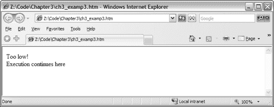

在浏览器中加载此文件，并在提示框中输入，例如，值 1。然后你应该会看到类似图 3-8 所示的内容。

图 3-8

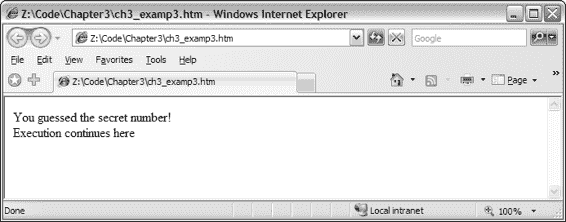

另一方面，如果你输入值 3，你应该会看到一条友好的消息，告诉你猜对了秘密数字，如图 3-9 所示。

图 3-9

### 工作原理

首先，你声明变量`secretNumber`，并将其设置为用户通过提示框输入的值。注意，你使用`parseInt()`函数将`prompt()`返回的字符串转换为整数值。

```javascript
var secretNumber = prompt(“Pick a number between 1 and 5:”, “”);
secretNumber = parseInt(secretNumber);
```

接下来，你创建`switch`语句的开始部分。

```javascript
switch (secretNumber)
{
```

括号中的表达式就是变量`secretNumber`，`case`语句将与此数字进行比较。

你使用花括号指定包含`case`语句的代码块。每个`case`语句检查 1 到 5 之间的一个数字，因为这是你告诉用户应该输入的范围。第一个`case`语句只是输出一条消息，表示她输入的数字太低了。

```javascript
case 1:
document.write(“Too low!”);
break;
```

第二个`case`语句（值为 2）具有相同的消息，因此此处不再重复代码。第三个`case`语句让用户知道她猜对了。

```javascript
case 3:
document.write(“You guessed the secret number!”);
break;
```

最后，第四个和第五个`case`语句输出一条消息，表示用户输入的数字太高了。

```javascript
case 4:
document.write(“Too high!”);
break;
```

在这个例子中，你需要添加一个`default` case，因为用户很可能（尽管有提示）输入一个不在 1 到 5 之间的数字，甚至可能是一个字母。在这种情况下，你添加一条消息让用户知道存在问题。

```javascript
default:
document.write(“You did not enter a number between 1 and 5.”);
break;
```

`default`语句对于捕捉错误也非常有用——如果你错误地编写了某些`case`语句，当看到默认代码在不应该运行时运行，你会很快发现问题。

最后，你添加了表示`switch`语句结束的右花括号。之后，你输出一行文字，指示执行继续的位置。

```javascript
}
document.write(“<BR>Execution continues here”);
```

注意，每个`case`语句都以`break`语句结束。这对于确保代码执行跳转到`switch`语句结束后的下一行非常重要。如果忘记包含它，你可能会在匹配的`case`之后继续执行每个`case`的代码。

### 为不同`case`执行相同代码

你可能已经注意到这个例子中`switch`语句的一个问题——如果用户输入 1 或 2，你想要执行相同的代码；输入 4 或 5 也是如此。然而，为了实现这一点，你不得不在每个`case`中重复代码。你希望有一种更简单的方法让 JavaScript 为不同的`case`执行相同的代码。嗯，这很简单！只需将代码修改为如下所示：

```javascript
switch (secretNumber)
{
case 1:
case 2:
document.write(“Too low!”);
break;
case 3:
document.write(“You guessed the secret number!”);
break;
case 4:
case 5:
document.write(“Too high!”);
break;
default:
document.write(“You did not enter a number between 1 and 5.”);
break;
}
```

# 循环——`for` 和 `while` 语句

*循环* 是指在条件为真时重复执行一段代码。在 JavaScript 中，这通过两种语句实现：`while` 语句和 `for` 语句。你很快就会看到它们，但为什么需要重复执行代码块呢？

假设你有一系列结果，比如一年中每个月的平均温度，并且你想将这些数据绘制成图表。绘制每个点所需的代码很可能是一样的。因此，与其写出 12 次代码（每个点一次），不如通过使用序列中的下一个数据项，将同一段代码执行 12 次，这样要简单得多。这时 `for` 语句就派上用场了，因为你明确知道代码需要执行多少次。

在另一种情况下，你可能希望在某个条件为真时重复执行同一段代码，例如，当用户不断点击“重新开始”按钮时。在这种情况下，`while` 语句会非常有用。

#### `for` 循环

`for` 语句允许你将一段代码重复执行特定次数。其语法如图 3-10 所示。

初始化循环变量

循环测试条件

递增循环变量

```
for ( loopCounter = 1; loopCounter <= 3; loopCounter++)
{
    // 执行这段代码
}
```

被循环的代码

图 3-10

让我们来看看 `for` 语句的构成。从图 3-10 中可以看出，与 `if` 和 `switch` 语句一样，`for` 语句的逻辑也放在圆括号内。不过，这次逻辑被分成了三个部分，每个部分用分号分隔。例如，在图 3-10 中，你有：`(var loopCounter = 1; loopCounter <= 3; loopCounter++)`。`for` 语句逻辑的第一部分是 *初始化* 部分。为了跟踪循环了多少次，你需要一个变量来计数。正是在初始化部分，你初始化变量。在示例中，你声明了 `loopCounter` 并将其设置为 1。与其它部分不同，这一部分在循环执行期间只执行一次。

如果变量在代码中已经声明过，则无需再次声明。

```
var loopCounter;
for (loopCounter = 1; loopCounter <= 3; loopCounter++)
```

分号之后是 `for` 语句的 *测试条件* 部分。只要测试条件求值为 `true`，`for` 语句内部的代码就会持续执行。每次循环结束后，都会测试这个条件。在图 3-10 中，只要 `loopCounter` 小于或等于 3，就会执行。循环执行的次数通常称为 *迭代* 次数。

最后是 `for` 循环的 *递增* 部分，在这里，循环测试条件中的变量值会递增。你可以看到，通过第 2 章中介绍的 `++` 运算符，`loopCounter` 增加了 1。同样，`for` 语句的这一部分在每次循环时都会重复执行。虽然我们称之为递增部分，但实际上它也可以用来减少或 *递减* 值——例如，如果你想从数组的最后一个元素向下计数到第一个元素。

`for` 语句之后是只要测试条件为 `true` 就会重复执行的代码块。这个代码块包含在花括号内。如果条件永远不为 `true`，即使在第一次测试循环条件时也是如此，那么 `for` 循环内部的代码将被跳过，永远不会执行。

综合来看，`for` 循环是如何工作的？

1. 执行 `for` 语句的初始化部分。

2. 检查测试条件。如果为 `true`，继续；否则，退出 `for` 语句。

3. 执行 `for` 语句后面的代码块。

4. 执行 `for` 语句的递增部分。

5. 重复步骤 2 到 4，直到测试条件为 `false`。

## 动手试一试

### 转换一系列华氏温度值

让我们修改温度转换器，使其能够转换存储在数组中的一系列华氏温度值，将其转换为摄氏温度。你将使用 `for` 语句遍历数组的每个元素。

输入以下代码并保存为 `ch3_examp4.htm`。

```html
<html>
<body>
<script language="JavaScript" type="text/javascript">
var degFahren = new Array(212, 32, -459.15);
var degCent = new Array();
var loopCounter;

for (loopCounter = 0; loopCounter <= 2; loopCounter++)
{
    degCent[loopCounter] = 5/9 * (degFahren[loopCounter] - 32);
}

for (loopCounter = 2; loopCounter >= 0; loopCounter--)
{
    document.write("值 " + loopCounter + " 是 " + degFahren[loopCounter] +
    " 华氏度");
    document.write(" 转换为 " + degCent[loopCounter] +
    " 摄氏度<BR>");
}
</script>
</body>
</html>
```

在浏览器中加载此页面后，你会看到页面中显示三行内容，包含将华氏温度数组转换为摄氏温度的结果（如图 3-11 所示）。

图 3-11

## 工作原理

首先，声明将要使用的变量。首先，声明并初始化 `degFahren`，使其包含一个包含三个值的数组：212、32 和 –459.15。接着，声明 `degCent` 为一个空数组。最后，声明 `loopCounter`，它将用于在循环过程中跟踪当前访问的数组索引。

```javascript
var degFahren = new Array(212, 32, -459.15);
var degCent = new Array();
var loopCounter;
```

接下来是第一个 `for` 循环。

```javascript
for (loopCounter = 0; loopCounter <= 2; loopCounter++)
{
    degCent[loopCounter] = 5/9 * (degFahren[loopCounter] - 32);
}
```

在第一行中，首先将 `loopCounter` 初始化为 0。然后检查 `for` 循环的测试条件 `loopCounter <= 2`。如果条件为 `true`，则循环第一次执行。花括号内的代码执行完毕后，执行 `for` 循环的递增部分 `loopCounter++`，然后重新评估测试条件。如果仍然为 `true`，则再次执行循环代码。这一过程持续进行，直到 `for` 循环的测试条件求值为 `false`，此时循环结束，并执行右花括号之后的第一条语句。

花括号内的代码是之前示例中见过的公式，只不过这次将结果放入 `degCent` 数组中，索引为 `loopCounter` 的值。

在第二个 `for` 循环中，将 `degCent` 数组中的结果写入屏幕。

```javascript
for (loopCounter = 2; loopCounter >= 0; loopCounter--)
{
    document.write("值 " + loopCounter + " 是 " + degFahren[loopCounter] +
    " 华氏度");
    document.write(" 转换为 " + degCent[loopCounter] +
    " 摄氏度<BR>");
}
```

这次你要从 2*倒数*到 0。变量`loopCounter`初始化为 2，循环条件在`loopCounter`小于 0 之前一直为真。这次`loopCounter`实际上每次递减而不是递增，通过`loopCounter--`实现。同样，`loopCounter`承担双重作用：它记录已执行的循环次数，同时也提供数组中的索引位置。

*请注意，在这些示例中，你在循环中使用了整数。不过，你完全可以使用小数，尽管这样做并不常见。*

## `for...in` 循环

这种循环主要与数组一起使用，正如你将在下一章中看到的，它也可以与称为对象的东西一起使用。它让你能够遍历数组中的每个元素，而无需知道数组实际包含多少个元素。用通俗的话说，这个循环的意思是：“对于数组中的每个元素，执行一些代码。” 你不需要自己计算每个元素的索引号，`for...in` 循环会为你完成这项工作，并在每次迭代（循环）中自动移动到下一个索引。

它与数组一起使用的语法是：

```
for (index in arrayName)
{
// 一些代码
}
```

在这段代码中，`index` 是你在循环之前声明的一个变量，它会自动被填充为数组中的下一个索引值。`arrayName` 是保存你想要遍历的数组的变量名。

让我们看一个例子来更清楚地说明。我们将定义一个数组并用三个值初始化它。

```
var myArray = new Array("Paul","Paula","Pauline");
```

要使用传统的 `for` 循环访问每个元素，你可以这样写：

```
var loopCounter;
for (loopCounter = 0; loopCounter < 3; loopCounter++)
{
document.write(myArray[loopCounter]);
}
```

要使用 `for...in` 循环完成完全相同的事情，你可以这样写：

```
var elementIndex;
for (elementIndex in myArray)
{
document.write(myArray[elementIndex]);
}
```

如你所见，第二个示例中的代码更清晰一些，也更简短。两种方法效果相同，都会迭代三次。然而，如果你增加数组的大小，例如通过添加元素 `myArray[3] = "Philip"`，第一种方法仍然只循环遍历数组的前三个元素，而第二种方法则会遍历所有四个元素。

## `while` 循环

`for` 循环用于循环特定次数，而 `while` 循环则允许你测试一个条件，并在条件为真时持续循环。当你需要循环的次数已知时，`for` 循环很有用，例如当你遍历一个已知元素数量的数组时。而当你不知道需要循环多少次时，`while` 循环更为有用。例如，如果你正在遍历一个温度值数组，并且希望在数组元素中的温度值小于 100 时继续循环，那么你就需要使用 `while` 语句。

让我们看看 `while` 语句的结构，如图 3-12 所示。


你可以看到`while`循环比`for`循环的组成部分更少。`while`循环包含一个条件，如果该条件求值为真，则花括号内的代码块执行一次；然后重新评估条件。如果条件仍然为真，则再次执行代码，再次重新评估条件，依此类推，直到条件求值为假。

```
条件 - 只要此条件为真就继续循环
while ( degCent != 100)
{
//
一些代码
}
循环执行的代码
```

需要注意的一点是，如果条件一开始就为假，则`while`循环永远不会执行。

例如：

```
degCent = 100;
while (degCent != 100)
{
// 一些代码
}
```

这里，如果`degCent`不等于100，循环将运行。然而，由于`degCent`是100，条件为假，代码永远不会执行。

在实践中，你通常期望循环至少执行一次；是否再次执行取决于循环内部的代码对循环条件中涉及的变量做了什么。例如：

```
degCent = new Array();
degFahren = new Array(34, 123, 212);
var loopCounter = 0;
while (loopCounter < 3)
{
degCent[loopCounter] = 5/9 * (degFahren[loopCounter] - 32); loopCounter++;
}
```

只要`loopCounter`小于3，循环就会执行。正是循环内部的代码（`loopCounter++;`）递增了`loopCounter`，并最终使`loopCounter < 3`为假，从而停止循环。然后执行将继续到`while`语句右花括号之后的第一行。

需要注意的一点是*无限循环*——一个永远不会结束的循环。假设你忘记了在代码中包含`loopCounter++;`这一行。省略这一行意味着`loopCounter`将保持为0，因此条件（`loopCounter < 3`）将始终为真，循环将持续下去，直到用户感到厌烦和恼火，关闭她的浏览器。然而，这是一个容易犯的错误，而且JavaScript不会对此发出警告。

不仅仅是遗漏代码行会导致无限循环，循环代码内部的错误也可能导致。例如：

```
var testVariable = 0;
while (testVariable <= 10)
{
alert("Test Variable is " + testVariable);
testVariable++;
if (testVariable = 10)
{
alert("The last loop");
}
}
```

看看你是否能发现导致无限循环的故意错误——是的，就是那个`if`语句，它会使这段代码永远运行下去。在`if`语句的条件中，你使用了`=`而不是`==`作为比较运算符，因此尽管有`testVariable++`这一行，`testVariable`在每次循环中又被设置为10。

这意味着在每次循环开始时，测试条件总是求值为真，因为10小于等于10。加上额外的`=`使其成为`if (testVariable == 10)`，一切就正常了。

## do...while循环

对于`while`循环，你看到循环内部的代码只有在条件为真时才执行；如果条件为假，代码永远不会执行，而是继续执行`while`循环之后的第一行。

然而，有时你可能希望`while`循环中的代码至少执行一次，无论`while`语句中的条件求值是否为真。甚至可能需要在测试`while`语句的条件之前，先执行`while`循环中的某些代码。正是这种情况，`do...while`循环是理想的选择。

看一个例子，你想通过提示框获取用户的年龄。你想显示提示框，同时确保用户输入的是数字。

```
var userAge;
do
{
userAge = prompt("请输入您的年龄","")
}
while (isNaN(userAge) == true);
```

循环内的代码行——`userAge = prompt("请输入您的年龄","")`——无论`while`语句的条件如何都会执行。这是因为条件是在*执行一次循环之后*才被检查的。如果条件为真，则再次循环执行代码。如果为假，则停止循环。

请注意，在`while`语句的条件中，你使用了第2章中看到的`isNaN()`函数。该函数检查`userAge`变量的值是否为`NaN`（非数字）。如果不是数字，条件返回真值；否则返回假值。从示例中可以看出，它允许你测试用户输入，以确保输入了正确的数据。用户可能会谎报年龄，但至少你知道他输入了一个数字！

`do...while`循环相当少见；没有它你也能完成大部分工作，因此除非确实必要，最好避免使用。

## break和continue语句

你在学习`switch`语句时已经见过`break`语句。它在`switch`语句中的作用是停止代码执行，并将执行流程转移到`switch`语句右花括号后的下一行代码。然而，当你想要提前退出循环时，`break`语句也可以作为`for`和`while`循环的一部分使用。例如，假设你正在遍历一个数组（就像温度转换示例中那样），遇到了一个无效值。在这种情况下，你可能希望立即停止代码运行，通知用户数据无效，然后退出循环。这正是`break`语句派上用场的一种场景。

让我们看看如何修改之前将一系列华氏温度值进行转换的示例（`ch3_examp4.htm`），使得当遇到一个非数值时，停止循环并告知用户数据无效。

```javascript
<script language=”JavaScript” type=”text/javascript”> var degFahren = new Array(212, “string data”, -459.67); var degCent = new Array();

var loopCounter;

for (loopCounter = 0; loopCounter <= 2; loopCounter++)

{

if (isNaN(degFahren[loopCounter]))

{

alert(“Data ‘“ + degFahren[loopCounter] + “‘ at array index “ +

loopCounter + “ is invalid”);

break;

}

degCent[loopCounter] = 5/9 * (degFahren[loopCounter] - 32);

}
```

我们修改了`degFahren`数组的初始化，使其现在包含一些无效数据。

然后，在`for`循环内部，添加了一个`if`语句来检查`degFahren`数组中的数据是否不是数值。这是通过`isNaN()`函数实现的；如果传递给括号内的值（这里是`degFahren[loopCounter]`）不是数值，该函数返回`true`。如果值不是数值，就告诉用户数组中哪个位置有无效数据。然后使用`break`语句完全跳出`for`循环，代码执行从`for`语句结束后的第一行继续。

以上就是`break`语句，那么`continue`呢？`continue`语句与`break`类似，它会在遇到的地方停止当前循环的执行，但不会退出循环，而是开始下一次迭代，重新评估`for`或`while`语句的条件，就像已经执行到循环代码的最后一行一样。

在`break`示例中，它是“要么全有要么全无”——只要有一项数据无效，就跳出循环。更好的做法可能是尝试转换`degFahren`中的所有值，但如果遇到数组中的无效数据项，则通知用户并继续处理下一项，而不是像`break`语句示例那样直接放弃。

```javascript
if (isNaN(degFahren[loopCounter]))

{

alert(“Data ‘“ + degFahren[loopCounter] + “‘ at array index “ +

loopCounter + “ is invalid”);

continue;

}
```

只需将`break`语句改为`continue`。你仍然会收到关于无效数据的消息，但第三个值也会被转换。

## 函数

函数是执行特定任务的东西。以袖珍计算器为例。它执行许多基本计算，如加法和减法。然而，许多计算器还有执行更复杂操作的函数键。例如，有些计算器有计算数字平方根的按钮，有些甚至提供统计函数，如计算平均值。这些函数中的大多数都可以用基本的数学运算（加、减、乘、除）来完成，但这可能需要很多步骤——如果用户只需按一个按钮，那就简单多了。她所需要做的就是提供数据（这里指数字），然后函数键完成其余工作。

JavaScript中的函数有点像袖珍计算器上的函数按钮：它们封装了一段执行特定任务的代码。到目前为止，在本书中你已经遇到了一些方便的内置函数，它们执行特定任务，例如`parseInt()`和`parseFloat()`函数（将字符串转换为数字），以及`isNaN()`函数（告诉你某个特定值是否可以转换为数字）。其中一些函数会返回数据，例如`parseInt()`返回一个整数；另一些则只执行操作，但不返回数据。你还会注意到，有些函数可以接收数据，而有些则不能。例如，`isNaN()`函数需要接收一些数据，然后检查它是否为`NaN`。函数需要接收的数据称为其*参数*。

随着你继续学习本书，你会遇到更多有用的内置函数，但能够编写自己的函数岂不是更好？当你编写并调试好一段执行特定任务的代码后，能够在你需要时反复调用它，那将非常方便。JavaScript赋予了我们这样的能力，而这正是本节要重点讨论的内容。

### 创建自己的函数

创建和使用自己的函数非常简单。图3-13展示了一个函数示例。

你可能已经意识到这个函数的功能以及代码是如何工作的。是的，它又是那个臭名昭著的华氏温度转摄氏温度的代码。

```
函数名

函数参数

function convertToCentigrade ( degFahren )

{

var degCent;

调用函数时执行的代码

degCent = 5/9 * (degFahren – 32 );

return degCent;

}
```

图3-13

你在JavaScript中定义的每个函数都必须为该页面指定一个唯一的名称。名称紧跟在`function`关键字之后。为了方便自己，尽量使用有意义的名称，这样当你在后面的代码中看到它时，就能确切知道它的作用。例如，一个以某人的生日和今天的日期为参数并返回该人年龄的函数可以命名为`getAge()`。然而，你能使用的名称是有限制的，就像变量名一样。例如，你不能使用JavaScript保留字，因此不能将函数命名为`with()`或`while()`。

函数的参数写在函数名后的括号内。参数是函数为了完成其工作而需要接收的数据项。通常，不传递所需的参数会导致错误。一个函数可以有零个或多个参数，但即使没有参数，你也必须在函数名后加上一对圆括号。例如，函数定义的顶部必须如下所示：

`function myNoParamFunction()`

然后编写函数在被调用时将执行的代码。所有函数代码必须放在一对花括号的代码块中。

函数还允许你向调用它的代码返回一个值。使用`return`语句返回一个值。在前面给出的示例函数中，你返回了刚刚计算出的变量`degCent`的值。如果你不想返回值，也可以不返回，但最好在函数末尾包含一个`return`语句，尽管JavaScript是一种非常宽容的语言，即使你完全不使用`return`语句也不会出现问题。

当JavaScript在函数中遇到`return`语句时，它会将其视为类似于`for`循环中的`break`语句——它会退出函数，并返回`return`关键字后指定的任何值。

你可能会发现，在JavaScript代码中建立一个常用函数的“库”非常有用，这样你就可以在需要时将它们复制粘贴到页面中。

创建好函数后，如何使用它们呢？与你之前看到的代码不同（那些代码会在JavaScript执行到该行时立即运行），函数只有在被调用时才会执行，这被称为*调用*函数。调用函数的方法是：在你想调用它的位置写上函数名，并确保传入它所需的参数，参数之间用逗号分隔。例如：`myTemp = convertToCentigrade(212);`

这一行调用了你之前见过的`convertToCentigrade()`函数，将`212`作为参数传入，并将函数的返回值（即`100`）存储在变量`myTemp`中。

现在，尝试创建你自己的函数，并更仔细地了解参数是如何传递的。

参数传递可能有点令人困惑，所以你先创建一个简单的函数，它只接受一个参数（用户名），并将它写入页面，形成一条友好的欢迎字符串。首先，你需要为函数想一个名字。一个简短但描述性的名字是`writeUserWelcome()`。现在你需要定义该函数期望接收哪些参数。只有一个参数——用户名。定义参数有点像定义变量——你需要遵循相同的命名规则，这意味着不能有空格、特殊字符或保留字。我们把参数命名为`userName`。你需要将它放在函数名末尾的括号内（注意，这一行末尾不要加分号）。

```
function writeUserWelcome(userName)
```

好了，现在你已经定义了函数名及其参数；剩下的就是创建函数体——即函数被调用时将要执行的代码。你需要用花括号将这部分函数体括起来。

```
function writeUserWelcome(userName)
{
    document.write("Welcome to my website " + userName + "<br>");
    document.write("Hope you enjoy it!");
}
```

代码很简单；你使用`document.write()`向网页输出一条消息。你可以看到`userName`的使用方式与任何普通变量一样；事实上，最好将参数视为普通变量。参数的值将由调用函数时的JavaScript代码指定。

让我们看看如何调用这个函数。

```
writeUserWelcome("Paul");
```

真的很简单——只需写出你想调用的函数名，然后在括号内添加要传递给每个参数的数据，这里只有一个数据。当函数中的代码执行时，函数体代码中使用的变量`userName`将包含文本`"Paul"`。

假设你想向函数传递两个参数——你需要修改什么？首先，你必须修改函数定义。假设第二个参数将保存用户的年龄——你可以将其命名为`userAge`，因为这样能清楚地表明参数数据代表什么。

以下是新代码：

```
function writeUserWelcome(userName, userAge)
{
    document.write("Welcome to my website" + userName + "<br>");
    document.write("Hope you enjoy it<br>");
    document.write("Your age is " + userAge);
}
```

你在函数体中添加了一行，使用了你添加的参数。要调用该函数，你可以编写以下代码：

```
writeUserWelcome("Paul",31);
```

第二个参数是一个数字，因此不需要加引号。这里`userName`参数将是`"Paul"`，第二个参数`userAge`将是`31`。

## 动手试一试

### 华氏度转摄氏度函数

让我们使用函数重写温度转换器页面。你可以从`ch3_examp4.htm`中复制粘贴大部分代码——已更改的部分已突出显示。完成后，将其保存为`ch3_examp5.htm`。

```html
<html>
<body>
<script language="JavaScript" type="text/javascript">
function convertToCentigrade(degFahren)
{
    var degCent;
    degCent = 5/9 * (degFahren - 32);
    return degCent;
}
var degFahren = new Array(212, 32, -459.15);
var degCent = new Array();
var loopCounter;
for (loopCounter = 0; loopCounter <= 2; loopCounter++)
{
    degCent[loopCounter] = convertToCentigrade(degFahren[loopCounter]);
}
for (loopCounter = 2; loopCounter >= 0; loopCounter--)
{
    document.write("Value " + loopCounter + " was " + degFahren[loopCounter] +
        " degrees Fahrenheit");
    document.write(" which is " + degCent[loopCounter] +
        " degrees centigrade<br>");
}
</script>
</body>
</html>
```

当你将此页面加载到浏览器中时，应该会看到与`ch3_examp4.htm`完全相同的结果。

### 工作原理

在脚本块的顶部，你声明了`convertToCentigrade()`函数。你之前见过这个函数：

```
function convertToCentigrade(degFahren)
{
    var degCent;
    degCent = 5/9 * (degFahren - 32);
    return degCent;
}
```

如果你在页面中使用多个独立的脚本块，那么函数必须在任何脚本调用它之前被定义，这一点非常重要。如果你有多个函数，你可能希望将它们全部放在页面顶部的自己的脚本块中——放在`<head>`和`</head>`标签之间是个好主意。这样你就知道在哪里找到所有函数，并且可以确保它们在使用之前已经被声明。


你应该对函数中的代码如何工作相当熟悉。你声明了一个变量`degCent`，进行计算，将结果存储在`degCent`中，然后将`degCent`返回给调用代码。函数的参数是`degFahren`，它提供了计算所需的信息。

函数声明之后是页面加载时执行的代码。首先定义所需的变量，然后是两个循环，分别进行计算和输出结果。除了第一个`for`循环之外，大部分代码与之前相同。

```
for (loopCounter = 0; loopCounter <= 2; loopCounter++)
{
    degCent[loopCounter] = convertToCentigrade(degFahren[loopCounter]);
}
```

第一个`for`循环内部的代码将函数`convertToCentigrade()`返回的值放入`degCent`数组中。

这个示例中的代码有一个微妙之处。请注意，你在函数`convertToCentigrade()`内部声明了变量`degCent`，同时也在函数定义之后将其声明为数组。

这难道不是不允许的吗？

嗯，这正好引出了本章的下一个主题——变量作用域。

## 变量作用域与生命周期

*作用域*是什么意思？简单来说，它指的是变量可用性的范围或程度——代码的哪些部分可以访问变量及其包含的数据。在网页中，任何在函数外部声明的变量都将对页面上的所有脚本可用，无论这些脚本是在函数内部还是外部——我们称之为*全局*或*页面级作用域*。然而，在函数内部声明的变量*仅*在该函数内部可见——函数外部的代码无法访问它们。因此，例如，你可以在页面上的每个函数中声明一个变量`degCent`，同时在页面上的任何函数外部也声明一次。但是，你不能在任何单个函数内部*多次*声明该变量，也不能在页面上的函数外部*多次*声明该变量。请注意，以这种方式在整个页面中重复使用变量名虽然不违法，但并不是标准的良好实践——它会使代码变得非常难以阅读。

函数参数与变量类似：它们在函数外部不可见，而且尽管你可以在函数中声明一个与参数同名的变量，但这会造成很多混乱，并且很容易导致细微的 bug 被忽略。因此，这是一种不良的编码实践，最好避免，哪怕只是为了调试时保持头脑清醒！

那么，当函数内部的代码执行完毕，并返回到调用代码的位置时，会发生什么？函数内定义的变量在下次调用该函数时还会保留它们的值吗？

答案是否定的：变量不仅具有作用域属性（即它们在哪里可见），还具有*生命周期*。当函数执行完毕时，该函数中的变量就会消亡，其值也会丢失，除非你将其中一个值返回给调用代码。JavaScript 会定期执行垃圾回收（我们在第 2 章中讨论过），它会扫描代码并检查是否有任何变量不再使用；如果是，它们所持有的数据就会从内存中释放，为其他变量的数据腾出空间。

既然全局变量可以在任何地方使用，为什么不把所有变量都设为全局呢？当你需要在全局范围内跟踪数据时，全局变量非常有用。然而，由于它们可以在代码中的任何位置被修改，这意味着如果它们因 bug 而被错误地更改，那么该 bug 可能出现在代码中的任何地方，从而使调试变得困难。因此，最好将全局变量的使用降到最低，尽管有时它们是一种必要的恶——例如，当你需要在不同函数之间共享数据时。

## 趣味问答——构建一个基本函数

在上一章中，你声明了用于存储趣味问答问题和答案的数组。

你还用前三个问题填充了这些数组。当时你还没有足够的知识来实际使用这些数据，但通过本章所学的内容，你可以创建一个函数，利用数组中的信息来检查答案是否正确。

加载`trivia_quiz.htm`并按如下所示进行修改：

```html
<html>
<head>
<title>Wrox 在线趣味问答</title>
<script language=”JavaScript” type=”text/javascript”>
function answerCorrect(questionNumber, answer)
{
    // 声明一个变量来保存返回值
    var correct = false;
    // 如果提供的答案与正确答案相同，则 correct 变量为 true
    if (answer == answers[questionNumber])
        correct = true;
    // 返回答案是否正确（true 或 false）
    return correct;
}

// Questions 变量将保存问题
var questions = new Array();
var answers = new Array();

// 定义问题 1
questions[0] = new Array();
// 问题
questions[0][0] = “The Beatles were”;
// 第一个选项
questions[0][1] = “A sixties rock group from Liverpool”;
// 第二个选项
questions[0][2] = “Four musically gifted insects”;
// 第三个选项
questions[0][3] = “German cars”;
// 第四个选项
questions[0][4] = “I don’t know. Can I have the questions on baseball please?”;
// 为问题 1 分配答案
answers[0] = “A”;

// 定义问题 2
questions[1] = new Array();
questions[1][0] = “Homer Simpson’s favorite food is”;
questions[1][1] = “Fresh salad”;
questions[1][2] = “Doughnuts”;
questions[1][3] = “Bread and water”;
questions[1][4] = “Apples”;
// 为问题 2 分配答案
answers[1] = “B”;

// 定义问题 3
questions[2] = new Array();
questions[2][0] = “Lisa Simpson plays which musical instrument?”;
questions[2][1] = “Clarinet”;
questions[2][2] = “Oboe”;
questions[2][3] = “Saxophone”;
questions[2][4] = “Tubular bells”;
// 为问题 3 分配答案
answers[2] = “C”;
</script>
</head>
<body>
</body>
</html>
```

这里唯一的改动是：你移除了用于告知用户数组已初始化的`alert()`函数，并添加了一个名为`answerCorrect()`的函数，用于检查趣味问答的答案是否正确。该函数已添加到页面 head 部分的 script 块中。`answerCorrect()`函数接受两个参数：参数`questionNumber`表示数组中的问题索引，参数`answer`表示用户给出的答案。然后它检查用户的答案是否正确——如果正确，函数返回`true`，否则返回`false`。

目前，代码通过检查`answers`数组中索引为`questionNumber`的元素是否等于`answer`参数来判断用户给出的答案。既然这个函数如此简单，难道不能直接把代码放在需要的地方吗？为什么还要费心创建一个函数？这个问题的答案是：我们对这个函数有进一步的规划。目前，它的作用仅仅是检查用户给出的单个字母（多项选择答案）是否与`answers`数组中存储的字母相同。然而，稍后我们将扩展趣味问答，使其能够处理基于文本的问题，例如“哪位总统卷入了水门事件？”，并且我们希望无论用户输入 Richard Nixon、Nixon、R Nixon 等，答案都被视为正确。这不仅仅是简单的比较，因此我们将在某个时候扩展`answerCorrect()`函数，以纳入这种额外的智能。通过将其包含在一个函数中，你只需要在一个地方修改代码，而不会破坏程序的其他部分。使用该函数的代码只期望得到`true`或`false`的结果——这个函数如何得到这个结果并不重要。

为了测试你新的`answerCorrect()`函数，让我们编写一些代码，遍历`questions`数组中的每个问题，并使用`answerCorrect()`函数找出哪个答案是正确的。

在页面 body 部分，在定义问题和答案数组之后的 script 块中插入以下几行。测试完成后，你可以删除这些代码，因为它们不属于最终趣味问答的一部分。

```javascript
// 定义问题 3
questions[2] = new Array();
questions[2][0] = “Lisa Simpson plays which musical instrument”;
questions[2][1] = “Clarinet”;
questions[2][2] = “Oboe”;
questions[2][3] = “Saxophone”;
questions[2][4] = “Tubular Bells”;
// 为问题 3 分配答案
answers[2] = “C”;
</script>
```

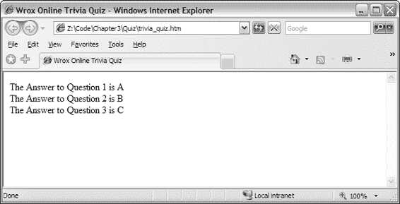

```html
</head>
<body>
<script language=”javascript” type=”text/javascript”>
document.write(“问题 1 的答案是 “ + answers[0] + “<br>”);
document.write(“问题 2 的答案是 “ + answers[1] + “<br>”);
document.write(“问题 3 的答案是 “ + answers[2]);
</script>
</body>
</html>
```

这段代码通过访问`answer`数组，获取每个问题正确答案对应的字母，并将所有答案写入页面。

如果你在浏览器中加载`trivia_quiz.htm`，应该会看到如图 3-14 所示的内容。

请注意，存储问题和答案数据的`questions`和`answers`数组在页面内具有全局作用域，这一点我们在上一节中曾警告过。但在这里是必要的，因为函数和页面内的 JavaScript 代码都需要访问这些数组。

## 总结

在本章中，你已经完成了对 JavaScript 语言核心及其语法的学习。

从现在开始，所有内容都建立在这些基础之上，掌握了这些不那么有趣的语法之后，你可以在本书的剩余部分继续学习更有趣的内容。

本章涉及以下内容：

❑

## 使用`if`和`switch`语句进行决策

决策能力本质上赋予了代码“智能”。根据条件为真或假，你可以决定要遵循的行动方案。

### 比较运算符

比较运算符将运算符左侧的值（左操作数，LHS）与运算符右侧的值（右操作数，RHS）进行比较，并返回一个布尔值。以下是主要比较运算符的列表：

- `==` 左操作数等于右操作数吗？

- `!=` 左操作数不等于右操作数吗？

- `<=` 左操作数小于或等于右操作数吗？

- `>=` 左操作数大于或等于右操作数吗？

- `<` 左操作数小于右操作数吗？

- `>` 左操作数大于右操作数吗？

### `if`语句

使用`if`语句，你可以在条件为真时选择执行一段代码块（由花括号定义）。`if`语句有一个测试条件，写在圆括号中。如果该条件求值为`true`，则`if`语句后的代码将被执行。

### `else`语句

如果你希望在`if`语句为假时执行代码，可以使用出现在`if`语句之后的`else`语句。

### 逻辑运算符

要组合条件，你可以使用三个逻辑运算符：AND、OR 和 NOT，分别用`&&`、`||`和`!`表示。

- AND 运算符仅在表达式两侧都为`true`时返回`true`。

- OR 运算符在表达式的一侧或两侧为`true`时返回`true`。

- NOT 运算符反转表达式的逻辑。

### `switch`语句

它将表达式的结果与一系列可能的 case 进行比较，效果类似于多个`if`语句。

### 使用`for`、`for...in`、`while`和`do...while`进行循环

通常需要多次重复执行一段代码，JavaScript 通过循环来实现这一点。

#### `for`循环

`for`循环适用于循环执行代码一定次数，它由三部分组成：初始化、测试条件和增量部分。当测试条件为`true`时，循环继续。每次循环执行代码块，然后执行`for`循环的增量部分，之后重新评估测试条件，看增量结果是否改变了它。

#### `for...in`循环

当你想要遍历一个数组但不知道数组中的元素数量时，这个循环很有用。JavaScript 会自动处理，确保不会遗漏任何元素。

#### `while`循环

这个循环适用于在测试条件保持为`true`时重复执行某段代码。它由一个测试条件和仅在条件为`true`时执行的代码块组成。如果条件永远不为`true`，则代码永远不会执行。

#### `do...while`循环

这个循环类似于`while`循环，不同之处在于它先执行一次代码，然后只要测试条件保持为`true`，就继续执行代码。

### `break`和`continue`语句

有时你有充分的理由提前跳出循环，这时需要使用`break`语句。遇到`break`语句时，由花括号标记的代码块停止执行，并立即从右花括号之后继续执行。`continue`语句类似于`break`，不同之处在于当代码在循环中的该点停止执行时，循环不会中断，而是继续执行，就好像已经到达了该次迭代的末尾一样。

### 函数是可重用的代码片段

JavaScript 有许多内置函数，为程序员提供服务，例如将字符串转换为数字。然而，JavaScript 也允许你使用`function`关键字定义和使用自己的函数。函数可以接受零个或多个参数，并且如果需要，可以返回一个值。

### 变量的作用域和生命周期

在函数外部声明的变量是全局可用的——也就是说，在页面中的任何位置都可以访问。在函数内部定义的任何变量都是该函数的私有变量，不能在函数外部访问。变量具有生命周期，其长度取决于变量声明的位置。如果是全局变量，其生命周期与页面相同——只要页面在浏览器中加载，该变量就保持存活。对于在函数中定义的变量，生命周期仅限于该函数的执行期间。当函数执行完毕后，变量消亡，其值丢失。如果稍后在代码中再次调用该函数，变量将为空。

### 练习题

这些问题的建议解答可在附录 A 中找到。

#### 问题 1

一位初级程序员带着一段似乎无法正常工作的代码来找你。你能找出他错在哪里吗？帮他一把，纠正错误。

```
var userAge = prompt(“Please enter your age”);

if (userAge = 0);

{

alert(“So you’re a baby!”);

}

else if ( userAge < 0 | userAge > 200)

alert(“I think you may be lying about your age”);

else

{

alert(“That’s a good age”);

}
```

#### 问题 2

使用`document.write()`编写代码，显示 12 的乘法表结果。输出应为计算结果。

```
12 * 1 = 12
12 * 2 = 24
12 * 3 = 36
.....
12 * 11 = 132
12 * 12 = 144
```

#### 问题 3

修改问题 2 的代码，使其成为一个函数，该函数接受三个参数：所需的乘法表、起始值和结束值。例如，你可以尝试显示从`4 * 4`开始到`4 * 9`结束的 4 的乘法表。

#### 问题 4

修改问题 3 的代码，向用户请求要显示的乘法表；代码应持续请求并显示乘法表，直到用户输入`-1`。此外，检查用户输入的是否为有效数字；如果数字无效，请要求用户重新输入。

---

# JavaScript——一种基于对象的语言

在本章中，你将了解 JavaScript 的一个核心概念，即*对象*。但什么是对象，它们为什么有用？

首先，我们得告诉你一个事实：你在本书中一直在使用对象（例如，数组就是一种对象）。JavaScript 是一种基于对象的语言，因此你所做的大部分工作都涉及操作对象。你会发现，当你充分利用这些对象时，你能用 JavaScript 做的事情范围会大大扩展。

本章我们将首先探讨对象的概念以及它们为何重要。

接着，我们将介绍 JavaScript 中使用的对象类型、如何创建和使用它们，以及它们如何简化许多编程任务。最后，你将更详细地了解 JavaScript 提供的一些最实用的对象，以及如何在实际场景中使用它们。

JavaScript 本身不仅由许多称为对象的东西组成（这些也称为*原生 JavaScript 对象*），而且浏览器本身也被建模为可供你使用的对象集合。你将在下一章中特别学习这些对象。

## 基于对象的编程

基于对象的编程是“使用对象进行编程”的一种略显吓人的说法。但你要用来编程的这些对象到底是什么？它们在哪里？你为什么要以及如何用它们编程？在本节中，你将了解这些问题的答案，既从一般编程术语的角度，也从 JavaScript 中更具体的角度。

### 对象简介

为了开始介绍对象，让我们思考一下在计算之外的“现实世界”中，对象意味着什么。世界由事物或对象组成，例如桌子、椅子和汽车（仅举几例！）。让我们以汽车为例，探索对象究竟是什么。

你会如何定义我们的汽车？你可能会说它是一辆蓝色的四轮驱动汽车。你可能会指定它行驶的速度。当你这样做时，你就是在指定对象的*属性*。例如，汽车有一个颜色属性，在这个例子中它的值是蓝色。

你如何使用我们的汽车？你转动点火钥匙，踩下油门踏板，按喇叭，换挡（即在手动挡汽车中选择 1、2、3、4 和倒挡，或在自动挡汽车中选择前进和倒挡），等等。当你这样做时，你就是在使用对象的*方法*。


你可以将方法视为有点像函数。有时，你可能需要使用方法时附带一些信息，或者向它传递一个参数，才能使其工作。例如，当你使用换挡方法时，你需要说明要换到哪个挡位。其他方法可能会将信息返回给所有者。例如，油尺方法会告诉车主汽车还剩多少机油。

有时使用一个或多个方法可能会改变对象的一个或多个属性。例如，使用加速器方法可能会改变汽车的速度属性。其他属性则无法改变：例如，汽车的车身形状属性（除非你以每小时 100 英里的速度撞上一堵砖墙！）。

可以说，汽车是由其方法和属性的集合定义的。在基于对象的编程中，其思想是通过对象来模拟现实世界的情况，而对象则由其方法和属性定义。

## JavaScript 中的对象

现在你应该对对象有了基本的概念——一个具有方法和属性的“东西”。但是如何在 JavaScript 中使用这个概念呢？

在前面的章节中，你（大部分情况下）一直在处理*原始*数据。这些是*实际*数据，例如字符串和数字。这类数据不太复杂，处理起来相当容易。

然而，并非所有信息都像原始数据那样简单。让我们看一个例子来稍微澄清一下。

假设你编写了一个显示公交车或火车时刻表信息的 Web 应用程序。

一旦用户选择了一段行程，你可能想让他知道这段行程需要多长时间。

要做到这一点，你需要用出发时间减去到达时间。

然而，这并不像乍看起来那么简单。例如，考虑出发时间 14:53（下午 2:53）和到达时间 15:10（下午 3:10）。如果你让 JavaScript 计算表达式`15.10–14.53`，你会得到结果 0.57，即 57 分钟。但是，你知道实际的时间差是 17 分钟。对时间使用普通的数学运算符是行不通的！

你需要做什么来计算这两个时间之间的差值？首先需要将每个时间的小时和分钟分开。然后，要得到两个时间之间的分钟差，你需要检查到达时间的分钟是否大于出发时间的分钟。如果是，你可以简单地从到达时间的分钟中减去出发时间的分钟。如果不是，你需要将到达时间的分钟加上 60，并从到达时间的小时中减去 1 以补偿，然后再从到达时间的分钟中减去出发时间的分钟。接着，你需要从到达时间的小时中减去出发时间的小时，最后将得到的分钟和小时重新组合在一起。

只要两个时间在同一天内，这种方法就能正常工作。例如，对于时间 23:45 和 04:32，它就行不通了。

这种计算时间差的方法显然存在问题，而且看起来也非常复杂。

有没有更简单的方法来处理像时间和日期这样更复杂的数据？

这就是对象的用武之地。你可以将出发时间和到达时间定义为`Date`对象。由于它们是`Date`对象，它们带有各种属性和方法，当你需要操作或计算时间时可以使用。例如，你可以使用`getTime()`方法来获取`Date`对象中的时间与 1970 年 1 月 1 日 00:00:00 之间的毫秒数。一旦你有了到达时间和出发时间的这些毫秒值，你可以简单地将一个减去另一个，并将结果存储在另一个`Date`对象中。要检索这个时间的小时和分钟，你只需使用`Date`对象的`getHours()`和`getMinutes()`方法。本章后面你将看到更多这样的例子。

`Date`对象并不是 JavaScript 提供的唯一对象。另一个对象在第 2 章中介绍过，但为了简单起见，当时我们没有告诉你它是一个对象。那个对象就是`Array`对象。回忆一下，数组是一种同时保存多个数据的方式。

`Array`对象有一个名为`length`的属性，它告诉你数组保存了多少个数据，或者说有多少个元素。你实际上在第 3 章的问答游戏中使用了这个属性，来计算你需要循环遍历数组多少次。

`Array`对象也有许多方法。一个例子是`sort()`方法，它可以用来将数组中的元素按字母顺序排序。

现在你应该明白为什么对象在 JavaScript 中很有用了。你已经看到了`Date`和`Array`对象，但 JavaScript 还提供了许多其他对象，以便你可以用代码实现更多功能。这些包括`Math`和`String`对象，我们将在本章后面进一步讨论。

## 使用 JavaScript 对象

既然你已经了解了 JavaScript 对象的*原因*，你需要看看*是什么*和*怎么做*。

每个 JavaScript 对象都有一组相关的属性和方法，可以用来操作某种类型的数据。例如，`Array`对象包含操作数组的方法和从中获取信息的属性。在大多数情况下，要使用这些方法和属性，你需要将数据定义为这些对象之一。换句话说，你需要创建一个对象。

在本节中，你将学习如何创建对象，以及创建之后如何使用它的属性和方法。

### 创建对象

你已经看到了一个创建`Array`对象的例子。要创建一个`Array`对象，你使用了以下 JavaScript 语句：

```javascript
var myArray = new Array();
```

那么这个语句是如何组成的呢？

语句的前半部分你很熟悉。你使用`var`关键字定义了一个名为`myArray`的变量。这个变量通过等号赋值运算符（`=`）初始化为语句的右侧部分。

语句的右侧由两部分组成。首先有运算符`new`。这告诉 JavaScript 你想要创建一个新对象。接下来是`Array()`。这是`Array`对象的*构造函数*。它告诉 JavaScript 你想要创建什么类型的对象。大多数对象都有这样的构造函数。例如，`Date`对象有`Date()`构造函数。你在本书中看到的唯一例外是`Math`对象，这将在本章后面部分解释。

# 第 4 章：JavaScript——一种基于对象的语言

你在第 2 章中也看到，可以向构造函数`Array()`传递参数来向对象添加数据。例如，要创建一个包含三个元素（数据分别为“Paul”、“Paula”和“Pauline”）的`Array`对象，可以使用：

```javascript
var myArray = new Array("Paul", "Paula", "Pauline");
```

让我们再看一些例子，这次使用`Date`对象。创建`Date`对象最简单的方式如下：

```javascript
var myDate = new Date();
```

这将创建一个包含创建时日期和时间的`Date`对象。然而，

```javascript
var myDate = new Date("1 Jan 2010");
```

将创建一个包含 2010 年 1 月 1 日这一日期的`Date`对象。

对象数据在变量中的存储方式与原始数据（如文本和数字）不同。（原始数据是 JavaScript 中最基本的数据。）对于原始数据，变量保存的是数据的实际值。例如，

```javascript
var myNumber = 23;
```

意味着变量`myNumber`将保存数据 23。然而，分配给对象的变量并不保存实际数据，而是保存一个指向数据所在内存地址的*引用*。这并不意味着你可以获取内存地址——这是只有 JavaScript 知道并在后台自行保留的细节。你只需要记住：当你说一个变量引用了一个对象时，意味着它引用了一个内存地址。如下例所示：

```javascript
var myArrayRef = new Array(0, 1, 2);
var mySecondArrayRef = myArrayRef;
myArrayRef[0] = 100;
alert(mySecondArrayRef[0]);
```

首先你将变量`myArrayRef`设置为引用新的数组对象，然后将`mySecondArrayRef`设置为相同的引用——例如，现在`mySecondArrayRef`被设置为引用同一个数组对象。因此，当你将数组的第一个元素设置为 100 时，如下所示：

```javascript
myArrayRef[0] = 100;
```

并显示`mySecondArrayRef`所引用的数组的第一个元素的内容，如下所示：

```javascript
alert(mySecondArrayRef[0]);
```

你会看到它也神奇地变成了 100！然而，正如你现在所知，这并非魔法；这是因为两个变量引用了同一个数组对象，因为对于对象而言，变量中存储的是对对象的引用，而不是对象本身。当你进行赋值时，并没有复制数组对象，而只是复制了引用。与以下情况对比：

```javascript
var myVariable = "ABC";
var mySecondVariable = myVariable;
myVariable = "DEF";
alert(mySecondVariable);
```

在这个例子中，你处理的是一个字符串，它是原始数据类型，数字也是如此。这次，变量中存储的是实际数据，因此当你执行：

```javascript
var mySecondVariable = myVariable;
```

`mySecondVariable`获得了`myVariable`中数据的独立副本。因此最后的`alert`仍会显示`mySecondVariable`保存的是“ABC”。

总结本节，你使用以下基本语法创建 JavaScript 对象：

```javascript
var myVariable = new ObjectName(*可选参数*);
```

## 使用对象的属性

访问对象属性中包含的值非常简单。你写出包含（或引用）对象的变量名，后跟一个点，然后是对象属性的名称。

例如，如果你定义了一个包含在变量`myArray`中的`Array`对象，你可以像这样访问它的`length`属性：

```javascript
myArray.length
```

但既然你有了这个属性，你能用它做什么呢？你可以像使用其他任何数据一样使用它，并将其存储在变量中：

```javascript
var myVariable = myArray.length;
```

或者你可以将其展示给用户：

```javascript
alert(myArray.length);
```

在某些情况下，你甚至可以更改属性的值，如下所示：

```javascript
myArray.length = 12;
```

然而，与变量不同，有些属性是只读的——你可以从中获取信息，但不能*更改*其中的信息。

## 调用对象的方法

方法非常类似于函数，它们可以用来执行有用的任务，例如从特定日期获取小时数或生成随机数。同样与函数类似，有些方法会返回值，例如`Date`对象的`getHours()`方法，而另一些方法则执行任务但不返回数据，例如`Array`对象的`sort()`方法。

使用对象的方法与使用属性非常相似，即先写对象变量名，然后是一个点，再然后是方法名。例如，要对变量`myArray`中的`Array`元素进行排序，你可以使用以下代码：

```javascript
myArray.sort();
```

与函数一样，你可以通过将参数放在方法名后的括号内来向某些方法传递参数。然而，无论方法是否接受参数，你都必须像对待函数一样在方法名后加上括号。一般来说，任何可以使用函数的地方，都可以使用对象的方法。

## 原始数据与对象

现在你应该对原始数据（如数字和字符串）与对象数据（如`Date`和`Array`）之间的区别有了很好的理解。然而，我们之前提到还有一个`String`对象。它属于哪一类呢？

实际上，存在与字符串、数字和布尔原始数据类型相对应的`String`、`Number`和`Boolean`对象。例如，要创建一个包含文本“I’m a String object”的`String`对象，你可以使用以下代码：

```javascript
var myString = new String("I’m a String object");
```

`String`对象拥有`length`属性，就像`Array`对象一样。它返回`String`对象中的字符数。例如，

```javascript
var lengthOfString = myString.length;
```

会将数据 19 存储在变量`lengthOfString`中（记住空格也被视为字符）。

但如果你声明了一个名为`mySecondString`的原始字符串，其中包含文本“I’m a primitive string”，如下所示：

```javascript
var mySecondString = "I’m a primitive string";
```

并且想知道这个原始字符串中有多少个字符，该怎么办呢？

这时 JavaScript 会帮助你。回顾前几章，JavaScript 可以自动处理一种数据类型到另一种数据类型的转换。例如，如果你尝试将一个字符串原始数据与一个数字原始数据相加，如下所示：

```javascript
theResult = "23" + 23;
```

JavaScript 会假设你想将数字视为字符串并将两者连接起来，数字会自动转换为文本。变量`theResult`将包含“2323”——即 23 和 23 的连接结果，而不是 23 和 23 的和（46）。

同样的道理也适用于对象。如果你声明了一个原始字符串，然后将其当作对象来使用，例如尝试访问它的某个方法或属性，JavaScript 会知道你要执行的操作无法工作。该操作只对对象有效；例如，它对`String`对象是有效的。在这种情况下，JavaScript 会将纯文本字符串临时转换为一个`String`对象，仅用于该操作。

因此，对于你的原始字符串`mySecondString`，你可以使用`String`对象的`length`属性来找出它包含的字符数。例如：

```javascript
var lengthOfSecondString = mySecondString.length;
```

这会将数据 22 存储在变量`lengthOfSecondString`中。

这里阐述的相同概念也适用于数字和布尔原始数据及其对应的`Number`和`Boolean`对象。然而，这些对象并不常用，因此本书不再进一步讨论。

## JavaScript 原生对象

到目前为止，你一直在了解对象是什么、如何创建它们以及如何使用它们。现在，让我们看看一些 JavaScript 原生提供的更有用的对象——也就是 JavaScript 让你可以直接使用的那些对象。

你不会看到所有原生的 JavaScript 对象，只会看到一些更常用的，即`String`对象、`Math`对象、`Array`对象和`Date`对象。在本书后面，会有一整章专门介绍更复杂的对象，例如`String`对象（第 8 章）和`Date`对象（第 9 章）。

## String 对象

与大多数对象一样，`String`对象在使用前需要先创建。要创建一个`String`对象，你可以这样写：

```javascript
var string1 = new String("Hello");
var string2 = new String(123);
var string3 = new String(123.456);
```

然而，正如你已经看到的，你也可以声明一个字符串原始值，并像使用`String`对象一样使用它，让 JavaScript 在后台为你自动转换为对象。例如：

```javascript
var string1 = "Hello";
```

只要 JavaScript 清楚你期望它在后台创建什么对象，使用这种技术是更可取的。如果原始数据类型是字符串，这不会有问题，JavaScript 会自行处理。这样做的好处是，你不需要创建`String`对象本身，并且避免了比较字符串对象时可能遇到的问题。当你尝试将字符串对象与原始字符串值进行比较时，比较的是实际值；但对于`String`对象，比较的是对象引用。

`String`对象有大量的方法和属性。在本节中，你只会看到一些较简单且更常用的方法。然而，在第 8 章中，你将看到一些与字符串和正则表达式对象（`RegExp`）相关的更棘手但非常强大的方法。正则表达式提供了一种非常强大的方式来搜索字符串中的字符模式。例如，如果你想在字符串 "Pauline, Paul, Paula" 中找到作为完整单词存在的 "Paul"，就需要使用正则表达式。不过，它们使用起来可能有点棘手，所以我们不会在本章进一步讨论——我们想把一些乐趣留到后面！

对于大多数`String`对象的方法，记住字符串只是一系列单独的字符，并且与数组一样，每个字符都有一个位置或索引，这会很有帮助。同样与数组一样，第一个位置或索引标记为 0，而不是 1。因此，例如，字符串 "Hello World" 的字符位置如下表所示：

| 索引 | 0 | 1 | 2 | 3 | 4 | 5 | 6 | 7 | 8 | 9 | 10 |
| --- | --- | --- | --- | --- | --- | --- | --- | --- | --- | --- | --- |
| 字符 | H | e | l | l | o |   | W | o | r | l | d |

### `length` 属性

`length`属性简单地返回字符串中的字符数。例如，

```javascript
var myName = new String("Paul");
document.write(myName.length);
```

会将字符串 "Paul" 的长度（即 4）写入页面。

### `charAt()` 和 `charCodeAt()` 方法——从字符串中选择单个字符

如果你想获取字符串中某个字符的信息，你需要使用`charAt()`和`charCodeAt()`方法。这些方法对于检查用户输入的有效性非常有用，你将在第 6 章学习 HTML 表单时看到更多相关内容。

`charAt()`方法接受一个参数：你想要获取的字符在字符串中的索引位置。然后它返回该字符。`charAt()`将字符串字符的位置视为从 0 开始，因此第一个字符在索引 0 处，第二个在索引 1 处，依此类推。

例如，要找到字符串中的最后一个字符，你可以使用以下代码：

```javascript
var myString = prompt("Enter some text","Hello World!");
var theLastChar = myString.charAt(myString.length - 1);
document.write("The last character is " + theLastChar);
```

在第一行中，你提示用户输入一个字符串，默认值为 "Hello World!"，并将该字符串存储在变量`myString`中。

在下一行中，你使用`charAt()`方法检索字符串中的最后一个字符。你使用了索引位置（`myString.length - 1`）。为什么？让我们以字符串 "Hello World!" 为例。

该字符串的长度是 12，但最后一个字符的位置是 11，因为索引从 0 开始。

因此，你需要从字符串长度中减去 1 才能得到最后一个字符的位置。

在最后一行中，你将字符串中的最后一个字符写入页面。


`charCodeAt()` 方法的使用与 `charAt()` 方法类似，但它不是返回字符本身，而是返回一个数字，该数字表示该字符在 Unicode 字符集中的十进制字符代码。回想一下，计算机只理解数字——对计算机来说，你所有的字符串都只是数值数据。当你请求文本而不是数字时，计算机会根据其对每个数字的内部理解进行转换，并提供相应的字符。

例如，要找到字符串中第一个字符的字符代码，你可以这样写：

```javascript
var myString = prompt("Enter some text", "Hello World!");
var theFirstCharCode = myString.charCodeAt(0);
document.write("The first character code is " + theFirstCharCode);
```

这将获取用户给定字符串中索引位置 0 处的字符的字符代码，并将其写入页面。

字符代码是按顺序排列的，例如，字母 A 的代码是 65，B 是 66，依此类推。小写字母从 97 开始（a 是 97，b 是 98，依此类推）。数字从 48（数字 0）到 57（数字 9）。

你可以将这些信息用于各种目的，正如你将在下一个示例中看到的那样。

### 动手试一试

#### 检查字符的大小写

以下是一个示例，用于检测给定字符串开头字符的类型——即该字符是大写字母、小写字母、数字还是其他。

```html
<html>
<head>
<script language="JavaScript" type="text/javascript">
function checkCharType(charToCheck)
{
    var returnValue = "O";
    var charCode = charToCheck.charCodeAt(0);
    if (charCode >= "A".charCodeAt(0) && charCode <= "Z".charCodeAt(0))
    {
        returnValue = "U";
    }
    else if (charCode >= "a".charCodeAt(0) && charCode <= "z".charCodeAt(0))
    {
        returnValue = "L";
    }
    else if (charCode >= "0".charCodeAt(0) && charCode <= "9".charCodeAt(0))
    {
        returnValue = "N";
    }
    return returnValue;
}
</script>
</head>
<body>
<script language="JavaScript" type="text/javascript">
var myString = prompt("Enter some text", "Hello World!");
switch (checkCharType(myString))
{
    case "U":
        document.write("First character was upper case");
        break;
    case "L":
        document.write("First character was lower case");
        break;
    case "N":
        document.write("First character was a number");
        break;
    default:
        document.write("First character was not a character or a number");
}
</script>
</body>
</html>
```

输入代码并将其保存为 `ch4_examp1.htm`。

当你将页面加载到浏览器中时，系统会提示你输入一个字符串。然后页面会写入一条消息，告知你输入的第一个字符的类型——是大写字母、小写字母、数字还是其他（例如标点符号）。

#### 工作原理

首先，你定义了一个函数 `checkCharType()`，该函数在页面主体中使用。你通过声明变量 `returnValue` 并将其初始化为字符 `"O"` 来开始这个函数，以表示该字符不是小写字母、大写字母或数字字符。

```javascript
function checkCharType(charToCheck)
{
    var returnValue = "O";
```

## 第 4 章：JavaScript——一种基于对象的语言

你使用这个变量作为函数末尾要返回的值，用于指示字符的类型。它将取值：U 表示大写字母，L 表示小写字母，N 表示数字，O 表示其他字符。

函数中的下一行使用 `charCodeAt()` 方法获取存储在 `charToCheck` 中的字符串的第一个字符的字符编码，`charToCheck` 是函数的唯一参数。字符编码存储在变量 `charCode` 中。

```javascript
var charCode = charToCheck.charCodeAt(0);
```

在接下来的几行中，你有一系列 `if` 语句，用于检查字符编码落在哪个值范围内。你知道，如果它落在 A 和 Z 的字符编码之间，那就是大写字母，因此你将变量 `returnValue` 赋值为 U。如果字符编码落在 a 和 z 的字符编码之间，那就是小写字母，因此你将变量 `returnValue` 赋值为 L。如果字符编码落在 0 和 9 的字符编码之间，那就是数字，你将变量 `returnValue` 赋值为 N。如果值不在这些范围内，那么变量保持其初始值 O（表示其他），你无需做任何操作。

```javascript
if (charCode >= "A".charCodeAt(0) && charCode <= "Z".charCodeAt(0))
{
    returnValue = "U";
}
else if (charCode >= "a".charCodeAt(0) && charCode <= "z".charCodeAt(0))
{
    returnValue = "L";
}
else if (charCode >= "0".charCodeAt(0) && charCode <= "9".charCodeAt(0))
{
    returnValue = "N";
}
```

这起初可能看起来有点奇怪，所以让我们看看 JavaScript 对你的代码做了什么。当你编写 `"A".charCodeAt(0)` 时，你似乎是在尝试对字符串字面量使用 `String` 对象的方法，而字符串字面量与原始字符串相同，只是字符而非对象。然而，JavaScript 意识到你在做什么，并执行必要的转换，将字面字符 `"A"` 转换为一个临时的包含 `"A"` 的 `String` 对象。然后，只有在那时，JavaScript 才在后台创建的 `String` 对象上执行 `charCodeAt()` 方法。完成后，该 `String` 对象被销毁。基本上，这是以下代码的简写形式：

```javascript
var myChar = new String("A");
myChar.charCodeAt(0);
```

无论哪种方式，都会返回第一个（在这个字符串中也是唯一的）字符的编码。例如，`"A".charCodeAt(0)` 将返回数字 65。

最后，你到达函数的末尾，并将 `returnValue` 变量返回给调用函数的地方。

```javascript
return returnValue;
}
```

你可能会想，为什么还要费心使用变量 `returnValue`，而不是直接返回它的值。例如，你可以将代码写成如下形式：

```javascript
if (charCode >= "A".charCodeAt(0) && charCode <= "Z".charCodeAt(0))
{
    return "U";
}
else if (charCode >= "a".charCodeAt(0) && charCode <= "z".charCodeAt(0))
{
    return "L";
}
else if (charCode >= "0".charCodeAt(0) && charCode <= "9".charCodeAt(0))
{
    return "N";
}
return "O";
```

这样也能正常工作，那么为什么不这样做呢？这种方式的缺点在于难以跟踪函数的执行流程，在像这样的小函数中问题不大，但在较大的函数中可能会变得棘手。使用原始代码，你总是确切知道函数执行在哪里结束：它在末尾唯一的 `return` 语句处结束。而刚刚展示的函数版本在遇到任何一个 `return` 语句时就会结束，因此函数可能有四个可能的结束位置。

在页面的主体中，你有一些测试代码来检查函数是否正常工作。你首先使用变量 `myString`，初始化为 `"Hello World!"` 或用户在提示框中输入的任何内容，作为测试字符串。

```javascript
var myString = prompt("Enter some text", "Hello World!");
```

接下来，`switch` 语句在其比较表达式中使用了你之前定义的 `checkCharType()` 函数。根据函数返回的结果，将执行其中一个 `case` 语句，并让用户知道字符类型是什么。

```javascript
switch (checkCharType(myString))
{
case "U":
document.write("First character was upper case");
break;
case "L":
document.write("First character was lower case");
break;
case "N":
document.write("First character was a number");
break;
default:
document.write("First character was not a character or a number");
}
```

至此，示例结束，但在继续之前，值得指出的是，这个示例仅仅是一个示例——演示了 `charCodeAt()` 的用法。在实践中，直接写 `if (char >= "A" && char <= "Z")` 要比写 `if (charCode >= "A".charCodeAt(0) && charCode <= "Z".charCodeAt(0))` 简单得多，而这里你使用了后者。

## `fromCharCode()` 方法——将字符编码转换为字符串

`fromCharCode()` 方法可以被视为 `charCodeAt()` 的逆操作，你向它传递一系列用逗号分隔的数字，这些数字代表字符编码，它会将它们转换为一个单一的字符串。然而，`fromCharCode()` 方法比较特殊，因为它是一个静态方法——你不需要先创建一个 `String` 对象就能使用它，它始终可用。

例如，以下代码将字符串 `"ABC"` 放入变量 `myString` 中：

```javascript
var myString;
myString = String.fromCharCode(65, 66, 67);
```

`fromCharCode()` 方法与变量一起使用时非常有用。例如，要构建一个由所有大写字母组成的字符串，你可以使用以下代码：

```javascript
var myString = "";
var charCode;
for (charCode = 65; charCode <= 90; charCode++)
{
    myString = myString + String.fromCharCode(charCode);
}
document.write(myString);
```

你使用 `for` 循环依次选择从 A 到 Z 的每个字符，并将其连接到 `myString` 上。请注意，虽然这是一个不错的示例，但更高效且更节省内存的做法是直接这样写：

```javascript
var myString = "ABCDEFGHIJKLMNOPQRSTUVWXYZ";
```

## `indexOf()` 和 `lastIndexOf()` 方法——在一个字符串中查找另一个字符串

`indexOf()` 和 `lastIndexOf()` 方法用于在一个字符串中查找另一个字符串的出现位置。包含在另一个字符串中的字符串通常被称为子字符串。当你有一长串信息，但只需要其中一小部分时，它们非常有用。例如，在问答游戏中，当有人输入文本答案时，你想检查字符串中是否包含某些关键词。

`indexOf()` 和 `lastIndexOf()` 都接受两个参数：

- 你要查找的字符串。
- 你希望开始搜索的字符位置（可选）。

与 `charAt()` 方法一样，字符位置从 0 开始。如果你不包含第二个参数，则从字符串的开头开始搜索。

`indexOf()` 和 `lastIndexOf()` 的返回值是子字符串在字符串中找到的字符位置。同样，它是基于零的，因此如果子字符串在字符串开头找到，则返回 0。如果没有匹配项，则返回值 -1。

例如，要在字符串 `"Hello paul. How are you Paul"` 中查找子字符串 `"Paul"`，你可以使用以下代码：

```html
<script language="JavaScript" type="text/javascript">
var myString = "Hello paul. How are you Paul";
var foundAtPosition;
foundAtPosition = myString.indexOf("Paul");
alert(foundAtPosition);
</script>
```

这段代码应该会弹出一个消息框，其中包含数字 24，即该字符的位置。

你可能会好奇为什么结果是 24，这显然指的是字符串中的第二个 `"Paul"`，而不是第一个 `"paul"` 对应的 6。嗯，这又是大小写敏感的问题。虽然有点啰嗦，但 JavaScript 在语法和比较时都非常严格地对待大小写。如果你输入 `IndexOf()` 而不是 `indexOf()`，JavaScript 会报错。同样，`"paul"` 和 `"Paul"` 也不相同。大小写错误非常容易犯，即使是专家也不例外，因此在编程时最好对大小写保持高度警惕。

你已经见识了 `indexOf()` 的用法，但 `lastIndexOf()` 有何不同呢？`indexOf()` 从字符串开头（或你指定的第二个参数位置）开始搜索，向末尾进行；而 `lastIndexOf()` 则从字符串末尾（或你指定的位置）开始搜索，向开头进行。

在当前示例中，你首先使用 `indexOf()` 进行搜索，它找到了第一个 `"Paul"`（从上一个示例更正为正确的大小写）。弹窗显示了这个结果，即字符位置 6。然后你使用 `lastIndexOf()` 进行搜索。它从字符串末尾开始搜索，因此它遇到的第一个 `"Paul"` 是字符串中最后一个，位于字符位置 24。因此，第二个弹窗显示结果 24。

```html
<script language="JavaScript" type="text/javascript">
var myString = "Hello Paul. How are you Paul";

var foundAtPosition;

foundAtPosition = myString.indexOf("Paul");

alert(foundAtPosition);

foundAtPosition = myString.lastIndexOf("Paul");

alert(foundAtPosition);
</script>
```

### 动手试一试

#### 统计子字符串出现次数

在这个示例中，你将学习如何使用 `indexOf()` 的“起始字符位置”参数。这里你将统计字符串中单词 Wrox 出现的次数。

```html
<html>
<body>
<script language="JavaScript" type="text/javascript">
var myString = "Welcome to Wrox books. ";
myString = myString + "The Wrox website is www.wrox.com. ";
myString = myString + "Visit the Wrox website today. Thanks for buying Wrox";

var foundAtPosition = 0;
var wroxCount = 0;

while (foundAtPosition != -1)
{
    foundAtPosition = myString.indexOf("Wrox", foundAtPosition);
    if (foundAtPosition != -1)
    {
        wroxCount++;
        foundAtPosition++;
    }
}

document.write("There are " + wroxCount + " occurrences of the word Wrox");
</script>
</body>
</html>
```

将此示例保存为 `ch4_examp2.htm`。当你在浏览器中加载该页面时，应该会看到以下句子：There are 4 occurrences of the word Wrox.

### 工作原理

在脚本块的顶部，你在变量 `myString` 中构建了一个字符串，然后想要搜索其中单词 Wrox 的出现次数。你还定义了两个变量：`wroxCount` 将存储 Wrox 在字符串中出现的次数，`foundAtPosition` 将存储当前找到的子字符串 Wrox 在字符串中的位置。

然后你使用了一个 `while` 循环，只要在字符串中找到单词 Wrox，循环就会继续——也就是说，只要变量 `foundAtPosition` 不等于 -1。在 `while` 循环内部，你有这样一行代码：

`foundAtPosition = myString.indexOf("Wrox", foundAtPosition);`


这里你搜索字符串`myString`中下一个出现的子字符串 Wrox。如何确保找到的是下一个出现位置呢？你使用变量`foundAtPosition`作为搜索的起始位置，因为它包含了上一次找到的子字符串 Wrox 的索引位置之后的下一个索引。你将变量`foundAtPosition`赋值为搜索的结果，即下一个子字符串 Wrox 出现的索引位置。

每次找到 Wrox 时（即每次`foundAtPosition`不等于`-1`），你增加变量`wroxCount`，用于统计找到子字符串的次数，同时增加`foundAtPosition`，以便从字符串的下一个位置继续搜索。

```javascript
if (foundAtPosition != -1)
{
    wroxCount++;
    foundAtPosition++;
}
```

最后，你使用`document.write()`将变量`wroxCount`的值输出到页面。

在第 3 章中，我们讨论过无限循环的危险，这里也存在这种风险。如果删除了`foundAtPosition++`，你就会一直从同一个起始点搜索，永远无法找到下一个单词 Wrox。

`indexOf()`和`lastIndexOf()`方法与`substr()`和`substring()`方法结合使用时更为有用，你将在下一节中了解这些方法。结合使用这些方法，你可以从字符串中截取子字符串。

## `substr()`和`substring()`方法——复制字符串的一部分

如果你想截取字符串的一部分，并将截取的部分赋值给另一个变量或在表达式中使用，可以使用`substr()`和`substring()`方法。这两种方法都能得到相同的结果——即字符串的一部分——但它们在所需的参数上有所不同。

`substring()`方法接受两个参数：你想要截取的字符串部分的起始字符位置和结束字符位置。第二个参数是可选的；如果不包含它，则会包含从起始位置到字符串末尾的所有字符。

例如，如果你的字符串是“JavaScript”，并且你只想要文本“Java”，你可以这样调用该方法：

```javascript
var myString = “JavaScript”;
var mySubString = myString.substring(0,4);
alert(mySubString);
```

与到目前为止`String`对象的所有方法一样，字符位置从 0 开始。不过，你可能会疑惑为什么将结束字符指定为 4。这个方法有点令人困惑，因为结束字符是结束标记，它不包含在截取的子字符串中。你可以将参数理解为指定返回字符串的`长度`：参数 0 和 4 将返回从位置 0 开始并包含该字符的（4 - 0）个字符。用图形表示如下：

**字符位置**

0 1 2 3 4 5 6 7 8 9

**字符**

J a v a S c r i p t

与`substring()`类似，`substr()`方法也接受两个参数，第一个参数是你希望包含在子字符串中的第一个字符的起始位置。不过，第二个参数指定了你想要从较长字符串中截取的字符长度。例如，你可以将前面的代码重写为：

```javascript
var myString = “JavaScript”;
var mySubString = myString.substr(0,4);
alert(mySubString);
```

与`substring()`方法一样，第二个参数是可选的。如果不包含它，则会包含从起始位置开始的所有字符。

选择使用哪种方法的主要原因是，`substring()`方法受 IE 3+和 NN 2+浏览器支持。而`substr()`方法仅适用于版本 4（及更高版本）的浏览器。

让我们看看如何结合使用`substr()`和`lastIndexOf()`方法。在下一章中，你将看到如何获取当前加载网页的文件路径和名称。然而，没有单独获取文件名的方法。因此，例如，如果你的文件是`http://mywebsite/temp/myfile.htm`，你可能需要提取`myfile.htm`部分。这正是`substr()`和`lastIndexOf()`的用武之地。

```javascript
var fileName = window.location.href;
fileName = fileName.substr(fileName.lastIndexOf(“/”) + 1);
document.write(“The file name of this page is “ + fileName);
```

第一行将变量`fileName`设置为当前文件路径和名称，例如进入`/mywebsite/temp/myfile.htm`。不要担心理解这一行；你将在下一章中看到它。

第二行是精彩动作发生的地方。你可以看到这段代码将`lastIndexOf()`方法的返回值作为另一个方法的参数，这是完全正确且非常有用的。使用`fileName.lastIndexOf("/")`的目的是找到最后一个正斜杠（`/`）的位置，它将是文件名之前的最后一个字符。你给这个值加 1，因为你不希望包含该字符，然后将这个新值传递给`substr()`方法。这里没有第二个参数（长度），因为你不知道它。结果，`substr()`将返回直到字符串末尾的所有字符，这正是你想要的。

这个示例检索本地机器上的页面名称，因为你没有从 Web 服务器访问页面。然而，不要让你误以为仅凭 JavaScript 就能从网页访问本地硬盘上的文件。为了保护用户免受恶意黑客的攻击，JavaScript 对用户系统的访问（例如文件访问）非常有限。你将在本书后面了解更多相关内容。

## `toLowerCase()`和`toUpperCase()`方法——改变字符串的大小写

如果你想改变字符串的大小写，例如在比较字符串时消除大小写敏感性，你需要`toLowerCase()`和`toUpperCase()`方法。不难猜到这两个方法的作用。它们都返回一个字符串，该字符串是`String`对象中字符串的值，但根据调用的方法将其大小写转换为大写或小写。任何非字母字符在这些函数中保持不变。

在下面的示例中，你可以看到通过改变两个字符串的大小写，可以在不区分大小写的情况下比较它们。

```javascript
var myString = "I Don’t Care About Case"

if (myString.toLowerCase() == "i don’t care about case")

{

alert("Who cares about case?");

}
```

尽管`toLowerCase()`和`toUpperCase()`不接受任何参数，但你必须记住在末尾加上两个空括号——即`()`——如果你想调用一个方法。

## `Math`对象

`Math`对象提供了许多有用的数学函数和数字操作方法。你将在这里了解其中一些，但其余的在 W3C 网站上有详细描述：`www.w3schools.com/jsref/default.asp`。

`Math`对象有点不寻常，因为 JavaScript 会自动为你创建它。无需将变量声明为`Math`对象或在使用前定义新的`Math`对象，这使得它更容易使用。

`Math`对象的属性包括一些有用的数学常量，例如`PI`属性（给出值 3.14159 等）。你像往常一样通过点号后跟属性名来访问这些属性：对象名（`Math`）后跟点号和属性名。例如，要计算圆的面积，你可以使用以下代码：

```javascript
var radius = prompt("Give the radius of the circle", "");
var area = (Math.PI)*radius*radius;

document.write("The area is " + area);
```

`Math`对象的方法包括一些使用标准数学运算符（`+`、`-`、`*`和`/`）无法或难以执行的操作。例如，`cos()`方法返回作为参数传递的值的余弦。你现在将了解其中几个方法。

### `abs()`方法

`abs()`方法返回作为参数传递的数字的绝对值。本质上，这意味着它返回数字的正值。因此，`-1`返回为`1`，`-4`返回为`4`，依此类推。然而，`1`将返回为`1`，因为它已经是正数。

例如，以下代码会将数字`101`写入页面。

```javascript
var myNumber = -101;

document.write(Math.abs(myNumber));
```

### `ceil()`方法

`ceil()`方法总是将数字向上舍入到下一个最大的整数。因此，`10.01`变成`11`，而`-9.99`变成`-9`（因为`-9`大于`-10`）。`ceil()`方法只有一个参数，即你想要向上舍入的数字。

使用`ceil()`与使用你在第 2 章中看到的`parseInt()`函数不同，因为`parseInt()`只是截断小数点后的任何数字以保留整数，而`ceil()`则将数字向上舍入。

例如，以下代码在页面中写入两行，第一行包含数字`102`，第二行包含数字`101`：

```javascript
var myNumber = 101.01;

document.write(Math.ceil(myNumber) + "<BR>");

document.write(parseInt(myNumber));
```

### `floor()`方法

与`ceil()`方法一样，`floor()`方法移除小数点后的任何数字，并返回一个整数。区别在于`floor()`总是向下舍入数字。因此，如果你传递`10.01`，你将得到`10`；如果你传递`-9.99`，你将看到`-10`返回。

### `round()`方法

`round()`方法与`ceil()`和`floor()`非常相似，不同之处在于它并非总是向上或向下舍入，而是仅当小数部分为`.5`或更大时向上舍入，否则向下舍入。

例如：

```javascript
var myNumber = 44.5;

document.write(Math.round(myNumber) + "<BR>");

myNumber = 44.49;

document.write(Math.round(myNumber));
```

这段代码会将数字`45`和`44`写入页面。

### 舍入方法总结

如你所见，`ceil()`、`floor()`和`round()`方法都移除小数点后的数字并返回一个整数。然而，它们返回哪个整数取决于使用的方法：`floor()`返回最低的，`ceil()`返回最高的，`round()`返回最接近的等效整数。这可能有点令人困惑，因此以下是参数值以及如果将这些值传递给`parseInt()`函数和`ceil()`、`floor()`、`round()`方法时返回的整数的表格。

| 参数 | `parseInt()`返回 | `ceil()`返回 | `floor()`返回 | `round()`返回 |
|---|---:|---:|---:|---:|
| 10.25 | 10 | 11 | 10 | 10 |
| 10.75 | 10 | 11 | 10 | 11 |
| 10.5 | 10 | 11 | 10 | 11 |
| -10.25 | -10 | -10 | -11 | -10 |
| -10.75 | -10 | -10 | -11 | -11 |
| -10.5 | -10 | -10 | -11 | -10 |

请记住，`parseInt()`是一个原生 JavaScript 函数，而不是`Math`对象的方法，就像此表中呈现的其他方法一样。

### 动手试一试

#### JavaScript 舍入函数结果计算器

如果你仍然对数字舍入不确定，下面的示例应该会有所帮助。在这里，你将看到一个计算器，它从用户那里获取一个数字，然后写出当你将该数字传递给`parseInt()`、`ceil()`、`floor()`和`round()`时得到的结果。

```html
<html>

<body>

<script language="JavaScript" type="text/javascript">
var myNumber = prompt("Enter the number to be rounded","");
document.write("<h3>The number you entered was " + myNumber + "</h3><br>");
document.write("<p>The rounding results for this number are</p>");
document.write("<table width=150 border=1>");

document.write("<tr><th>Method</th><th>Result</th></tr>");
document.write("<tr><td>parseInt()</td><td>"+ parseInt(myNumber) +"</td></tr>");
document.write("<tr><td>ceil()</td><td>" + Math.ceil(myNumber) + "</td></tr>");
document.write("<tr><td>floor()</td><td>"+ Math.floor(myNumber) +"</td></tr>");
document.write("<tr><td>round()</td><td>" + Math.round(myNumber) +"</td></tr>");
document.write("</table>")

</script>

</body>

</html>
```

将此文件保存为`ch4_examp3.htm`，并在网页浏览器中加载。在提示框中输入一个数字，例如 12.354，然后点击“确定”。该数字传递给`parseInt()`、`ceil()`、`floor()`和`round()`后的结果将以表格形式显示在页面中，如图 4-1 所示。

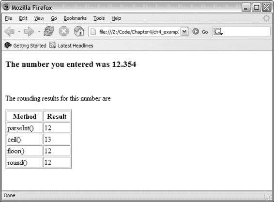

# 第 4 章：JavaScript——一种基于对象的语言

图 4-1

## 工作原理

首要任务是从用户那里获取要舍入的数字：`var myNumber = prompt("Enter the number to be rounded","");`然后输出该数字和一些描述性文本。

```javascript
document.write("<h3>The number you entered was " + myNumber + "</h3><br>");
document.write("<p>The rounding results for this number are</p>");
```

注意，这次包含了一些用于格式化的 HTML 标签——主标题使用`<h3>`标签，表格含义的描述放在段落`<p>`标签内。

接下来创建结果表格。

```javascript
document.write("<table width=150 border=1>");
document.write("<tr><th>Method</th><th>Result</th></tr>");
document.write("<tr><td>parseInt()</td><td>"+ parseInt(myNumber) +"</td></tr>");
document.write("<tr><td>ceil()</td><td>" + Math.ceil(myNumber) + "</td></tr>");
document.write("<tr><td>floor()</td><td>"+ Math.floor(myNumber) + "</td></tr>");
document.write("<tr><td>round()</td><td>" + Math.round(myNumber) +"</td></tr>");
document.write("</table>")
```

首先创建表格标题，然后在单独的行中显示每个舍入函数的结果。你可以看到仅使用 JavaScript 在网页中动态创建 HTML 是多么容易。其原理与页面中的 HTML 相同：必须确保标签语法有效，否则内容会显示异常或根本不显示。

每一行遵循相同的原理，但使用不同的舍入函数。我们来看第一行，它显示`parseInt()`的结果。

```javascript
document.write("<tr><td>parseInt()</td><td>"+ parseInt(myNumber) +"</td></tr>");
```

在要写入页面的字符串中，首先使用`<tr>`标签创建表格行。然后使用`<td>`标签创建表格单元格，并插入此行显示结果的方法名称。接着用`</td>`关闭该单元格，并用`<td>`打开一个新单元格。在这个新单元格中，放置`parseInt()`函数的实际结果。虽然`parseInt()`返回的是一个数字，但由于将其与字符串拼接，JavaScript 会在拼接前自动将`parseInt()`返回的数字转换为字符串。这一切都在后台自动完成，无需你做任何操作。最后，用`</td></tr>`关闭单元格和行。

## `random()`方法

`random()`方法返回一个介于 0 和 1 之间的随机浮点数，其中包含 0 但不包含 1。这对于显示随机横幅图像或编写 JavaScript 游戏非常有用。

我们来看如何模拟掷一次骰子。在下面的页面中，会向页面写入 10 个随机数。点击浏览器的“刷新”按钮可获取另一组随机数。

```html
<html>
<body>
<script language="JavaScript" type="text/javascript">
var throwCount;
var diceThrow;
for (throwCount = 0; throwCount < 10; throwCount++)
{
  diceThrow = (Math.floor(Math.random() * 6) + 1);
  document.write(diceThrow + "<br>");
}
</script>
</body>
</html>
```


你希望`diceThrow`介于 1 和 6 之间。`random()`函数返回一个介于 0 和略小于 1 之间的浮点数。将其乘以 6，得到介于 0 和略小于 6 之间的数。再加 1，得到介于 1 和略小于 7 之间的数。通过使用`floor()`始终向下取整到最接近的整数，可以确保最终得到介于 1 和 6 之间的数。

如果你想要一个介于 1 和 100 之间的随机数，只需修改代码，将`Math.random()`乘以 100 而不是 6。

## `pow()`方法

`pow()`方法将一个数提升到指定的幂次。它接受两个参数：第一个是要进行幂运算的数，第二个是幂次本身。例如，要计算 2 的 8 次方（即 2 * 2 * 2 * 2 * 2 * 2 * 2 * 2），可以写成`Math.pow(2,8)`，结果为 256。与其他一些数学方法（如`sin()`、`cos()`和`acos()`）不同，这些方法在 Web 编程中不常用，除非你正在编写科学应用程序，而`pow()`方法通常非常有用。

### 动手试一试

#### 使用`pow()`

在下面的示例中，你编写一个使用`pow()`的函数，用于固定数字的小数位数——这个功能在早期版本的 JavaScript 中缺失，不过现在已添加到 JScript 5.5 和 JavaScript 1.5 中，本章后面会看到。这有助于说明，即使 JavaScript 缺少某个函数，通常也可以利用现有函数来创建所需功能。

```html
<html>
<head>
<script language="JavaScript" type="text/javascript">
function fix(fixNumber, decimalPlaces)
{
  var div = Math.pow(10,decimalPlaces);
  fixNumber = Math.round(fixNumber * div) / div;
  return fixNumber;
}
</script>
</head>
<body>
<script language="JavaScript" type="text/javascript">
var number1 = prompt("Enter the number with decimal places you want to fix","");
var number2 = prompt("How many decimal places do you want?","");
document.write(number1 + " fixed to " + number2 + " decimal places is: ");
document.write(fix(number1,number2));
</script>
</body>
</html>
```

将页面保存为`ch4_examp4.htm`。在浏览器中加载页面后，会弹出两个提示框。第一个提示框中输入要固定小数位数的数字，例如 2.2345。第二个提示框中输入要保留的小数位数，例如 2。然后，将输入的数字固定到所选小数位数的结果会写入页面，如图 4-2 所示。对于示例数字，结果将是 2.23。

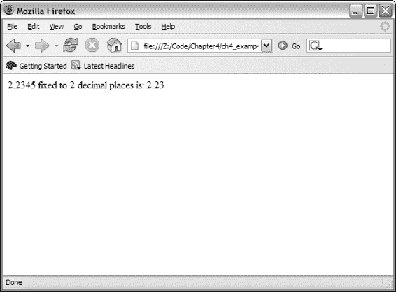

图 4-2

##### 工作原理

在页面的 head 部分定义了`fix()`函数。该函数将其`fixNumber`参数固定到最多`decimalPlaces`参数指定的小数位数。例如，将 34.76459 固定到最多三位小数将返回 34.765。

函数的第一行代码将变量`div`设置为 10 的`decimalPlaces`次幂。

```javascript
function fix(fixNumber, decimalPlaces)
{
  var div = Math.pow(10,decimalPlaces);
```

然后在下一行计算新的数字。

```javascript
fixNumber = Math.round(fixNumber * div) / div;
```

代码`Math.round(fixNumber * div)`的作用是将要转换的数字的小数点移动到要保留的数字之后。例如，对于 2.2345，如果要保留两位小数，则将其转换为 223.45。`Math.round()`方法将此数字四舍五入到最接近的整数（本例中为 223），从而去除任何不需要的小数部分。

然后将此数字转换回应有的分数形式，但只保留所需的小数部分。这是通过除以之前乘过的同一个数（`div`）来实现的。在本例中，将 223 除以 100，得到 2.23。这就是将 2.2345 固定到两位小数的结果。该值通过以下代码行返回给调用代码：

```javascript
return fixNumber;
}
```

在页面正文中，你使用两个提示框从用户那里获取数字。然后，你通过`document.write()`向用户展示这些数字在`fix()`函数中的使用结果。

## `Number`对象

与`String`对象一样，`Number`对象在使用前需要先创建。要创建一个`Number`对象，可以编写如下代码：

```javascript
var firstNumber = new Number(123);
var secondNumber = new Number('123');
```

不过，正如你所见，你也可以将数字声明为原始类型，然后像使用`Number`对象一样使用它，让 JavaScript 在后台自动将其转换为对象。例如：`var myNumber = 123.765;`

与`String`对象类似，只要 JavaScript 能清楚你期望在后台创建的是哪种对象，这种技术就是首选。例如，`var myNumber = “123.567”;`会让 JavaScript 正确地认为它是一个字符串，任何尝试使用`Number`对象方法的操作都会失败。

我们将只介绍`Number`对象的`toFixed()`方法，因为它是日常使用中最有用的方法。

### `toFixed()`方法

`toFixed()`方法是 JavaScript 1.5 和 JScript 5.5 新增的——基本上只适用于 Netscape 6+ 和 IE 5.5+。该方法将数字截断到指定小数位数。假设你想显示含销售税的价格。如果价格是 $9.99，销售税是 7.5%，那么税后成本将是 $10.73925。嗯，这对于货币交易来说是个相当奇怪的金额——你真正想做的是将数字固定到不超过两位小数。让我们创建一个示例。

```javascript
var itemCost = 9.99;
var itemCostAfterTax = 9.99 * 1.075;
document.write(“Item cost is $” + itemCostAfterTax + “<br>”);
itemCostAfterTax = itemCostAfterTax.toFixed(2);
document.write(“Item cost fixed to 2 decimal places is “ + itemCostAfterTax);
```

第一个`document.write()`会在页面上输出：`Item cost is 10.73925`

然而，这不是你想要的格式；你希望保留两位小数，所以在下一行输入：`itemCostAfterTax = itemCostAfterTax.toFixed(2);`

你使用`Number`对象的`toFixed()`方法将`itemCostAfterTax`所持有的数字变量固定到两位小数。该方法的唯一参数是你希望数字固定到的小数位数。这一行意味着下一个`document.write`会显示：`Item cost fixed to 2 decimal places is 10.74`

你可能首先会想，为什么是 10.74 而不是 10.73？实际上，`toFixed()`方法不仅仅是截掉不需要的数字，它还会进行四舍五入。在这个例子中，数字是 10.739，四舍五入后变成 10.74。如果是 10.732，则会向下舍入为 10.73。

请注意，你只能将数字固定到 0 到 20 位小数。

由于此方法仅受较新浏览器支持，最好先检查浏览器是否支持它，如下所示：

```javascript
var varNumber = 22.234;
if (varNumber.toFixed)
{
// 浏览器支持 toFixed() 方法
varNumber = varNumber.toFixed(2)
}
else
{
// 浏览器不支持 toFixed() 方法，因此使用其他代码
var div = Math.pow(10,2);
varNumber = Math.round(varNumber * div) / div;
}
```

## `Array`对象

你在第 2 章中已经了解了如何创建和使用数组，本章前面也提到过，它们实际上是对象。

除了存储数据，`Array`对象还提供了许多有用的属性和方法，你可以用来操作数组中的数据，并获取诸如数组大小之类的信息。

同样，这里并非详尽介绍`Array`对象的所有属性和方法，而只是介绍其中一些更有用的。

### `length`属性——查找数组中有多少个元素

`length`属性给出了数组中的元素数量。你在第 3 章的问答游戏中已经见过它。有时你确切知道数组的长度，但有些情况下，你可能一直在向数组添加新元素，却很难跟踪添加了多少个。

`length`属性可用于查找数组中最后一个元素的索引。下面的示例说明了这一点：

```javascript
var names = new Array();
names[0] = “Paul”;
names[1] = “Catherine”;
names[11] = “Steve”;
document.write(“The last name is “ + names[names.length - 1]);
```

请注意，你在索引位置 0、1 和 11 插入了数据。数组索引从 0 开始，因此最后一个元素的索引是`length - 1`，即 11，而不是`length`属性的值 12。

`length`属性另一个有用的场景是，当 JavaScript 方法返回一个它自己构建的数组时。例如，在第 8 章关于高级字符串处理的内容中，你会看到`String`对象有`split()`方法，它将文本分割成片段，并将结果作为`Array`对象返回。由于 JavaScript 创建了数组，如果没有`length`属性，你就无法知道数组中最后一个元素的索引。

### `concat()`方法——合并数组

如果你想将两个独立的数组合并成一个大的数组，可以使用`Array`对象的`concat()`方法。`concat()`方法返回一个新数组，它是两个数组的组合：第一个数组的元素，然后是第二个数组的元素。为此，你在第一个数组上调用该方法，并将第二个数组的名称作为参数传递。

例如，假设你有两个数组`names`和`ages`，它们分别如下所示：

**names 数组**

| 元素索引 | 值       |
|----------|----------|
| 0        | Paul     |
| 1        | Catherine|
| 2        | Steve    |

**ages 数组**

| 元素索引 | 值 |
|----------|-----|
| 0        | 31  |
| 1        | 29  |
| 2        | 34  |

如果你使用`names.concat(ages)`合并它们，将得到如下数组：

| 元素索引 | 值       |
|----------|----------|
| 0        | Paul     |
| 1        | Catherine|
| 2        | Steve    |
| 3        | 31       |
| 4        | 29       |
| 5        | 34       |

在下面的代码中，你正是这样做的：

```javascript
var names = new Array(“Paul”,”Catherine”,”Steve”);
var ages = new Array(31,29,34);
var concatArray;
concatArray = names.concat(ages);
```

也可以将两个数组合并为一个，但将新数组赋值给现有第一个数组的名称，使用`names = names.concat(ages)`。

如果你使用`ages.concat(names)`，会有什么不同？如下表所示，区别在于现在`ages`数组的元素在前，而`names`数组的元素被连接在后面。

| 元素索引 | 值       |
|----------|----------|
| 0        | 31       |
| 1        | 29       |
| 2        | 34       |
| 3        | Paul     |
| 4        | Catherine|
| 5        | Steve    |

### `slice()`方法——复制数组的一部分

当你只想复制数组的一部分时，可以使用`slice()`方法。使用`slice()`方法，你可以切出数组的一部分并将其赋值给一个新变量名。`slice()`方法有两个参数：

- 要复制的第一个元素的索引
- 标记要切出部分结束位置的元素的索引（可选）

就像使用`substr()`和`substring()`复制字符串一样，起始点包含在复制中，但结束点不包含。同样，如果不包含第二个参数，则从起始索引开始的所有元素都会被复制。

假设你有如下表所示的数组`names`。

| 索引 | 值     |
|------|--------|
| 0    | Paul   |
| 1    | Sarah  |
| 2    | Louise |
| 3    | Adam   |
| 4    | Bob    |

如果你想创建一个包含元素 1（Sarah）和元素 2（Louise）的新数组，你需要指定起始索引为 1，结束索引为 3。代码大致如下：

```javascript
var names = new Array(“Paul”,”Sarah”,”Louise”,”Adam”,”Bob”);
var slicedArray = names.slice(1,3);
```

# 第 4 章：JavaScript——一种基于对象的语言

请注意，当 JavaScript 复制数组时，它会将新元素复制到一个新数组中，这些元素在新数组中的索引为 0 和 1，而不是它们原来的索引 1 和 2。切片后，`slicedArray`看起来像这样：

| 索引 | 值     |
|------|--------|
| 0    | Sarah  |
| 1    | Louise |

第一个数组`names`不受切片操作的影响。

## `join()`方法——将数组转换为单个字符串

`join()`方法将数组中的所有元素连接起来，并以字符串形式返回。它还允许你指定在元素之间插入的任何字符，这些字符会在元素连接时插入。

该方法只有一个参数，即你想要放在元素之间的字符串。

用一个例子可以更好地说明。假设你的每周购物清单存储在一个数组中，看起来像这样：

| 索引 | 值       |
|------|----------|
| 0    | Eggs     |
| 1    | Milk     |
| 2    | Potatoes |
| 3    | Cereal   |
| 4    | Banana   |

现在你想使用`document.write()`将购物清单输出到页面上。你希望每个项目单独占一行，这意味着你需要在每个元素之间使用`<br>`标签。首先，你需要声明数组。

```javascript
var myShopping = new Array("Eggs","Milk","Potatoes","Cereal","Banana");
```

现在，使用`join()`方法将数组转换为一个字符串。

```javascript
var myShoppingList = myShopping.join("<br>");
```

现在，变量`myShoppingList`将包含以下文本：

```
"Eggs<br>Milk<br>Potatoes<br>Cereal<br>Banana"
```

你可以使用`document.write()`将其输出到页面。

```javascript
document.write(myShoppingList);
```

购物清单将显示在页面上，每个项目单独一行，如图 4-3 所示。

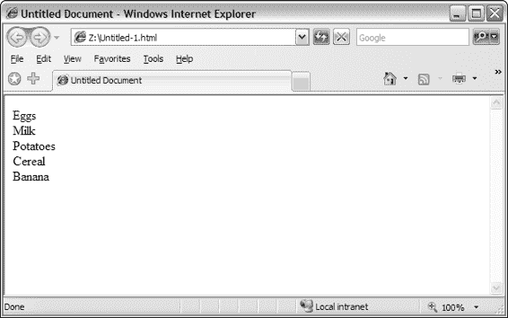

图 4-3

## `sort()`方法——对数组进行排序

如果你有一个包含相似数据的数组，例如姓名列表或年龄列表，你可能希望按字母顺序或数字顺序对它们进行排序。这正是`sort()`方法可以轻松实现的功能。

在下面的代码中，你定义数组，然后使用`names.sort()`按字母升序排序。最后，你输出数组，以便看到它已排序。

```javascript
var names = new Array("Paul","Sarah","Louise","Adam","Bob");
var elementIndex;

names.sort();

document.write("现在按顺序再次显示名字" + "<BR>");
for (elementIndex = 0; elementIndex < names.length; elementIndex++)
{
    document.write(names[elementIndex] + "<BR>");
}
```


不要忘记排序是区分大小写的，因此 `Paul` 会排在 `paul` 之前。请记住，JavaScript 以对应的 Unicode 数字编码存储字母，排序是基于 Unicode 数字而不是实际字母进行的。只是恰好 Unicode 数字与字母顺序一致。然而，小写字母被赋予了不同的数字序列，这些数字位于大写字母之后。因此，包含元素 `Adam`、`adam`、`Zoë`、`zoë` 的数组将按 `Adam`、`Zoë`、`adam`、`zoë` 的顺序排序。

请注意，在 `for` 语句中，你使用了 `Array` 对象的 `length` 属性作为条件，而不是直接插入数组的长度（5），像这样：`for (elementIndex = 0; elementIndex < 5; elementIndex++)`。为什么要这样做呢？毕竟你事先知道数组中有五个元素。那么，如果你通过添加两个名字来改变数组中的元素数量，会发生什么？

```javascript
var names = new Array("Paul","Sarah","Louise","Adam","Bob","Karen","Steve");
```

如果你插入了 5 而不是 `names.length`，那么你的循环代码将无法按预期工作。除非你将 `for` 循环的条件部分改为 7，否则它不会显示最后两个元素。通过使用 `length` 属性，你让生活变得更轻松，因为现在如果你添加数组元素，就不需要修改其他地方的代码了。

好了，你已经实现了升序排序，但如果想要降序排序呢？这时就需要用到 `reverse()` 方法。

## `reverse()` 方法——将数组反转

你将学习的 `Array` 对象的最后一个方法是 `reverse()` 方法——不用猜也知道——它会反转数组的顺序，使后面的元素移到前面。让我们再次以购物清单为例。

| 索引 | 值 |
|------|-----|
| 0 | Eggs |
| 1 | Milk |
| 2 | Potatoes |
| 3 | Cereal |
| 4 | Banana |

如果你使用 `reverse()` 方法：

```javascript
var myShopping = new Array("Eggs","Milk","Potatoes","Cereal","Banana");
myShopping.reverse();
```

最终数组元素的顺序如下：

| 索引 | 值 |
|------|-----|
| 0 | Banana |
| 1 | Cereal |
| 2 | Potatoes |
| 3 | Milk |
| 4 | Eggs |

为了证明这一点，你可以使用之前学过的 `join()` 方法将其输出到页面。

```javascript
var myShoppingList = myShopping.join("<br>")
document.write(myShoppingList);
```

### 动手试一试

#### 对数组进行排序

当与 `sort()` 方法结合使用时，`reverse()` 方法可用于对数组进行排序，使其元素按反向字母顺序或数字顺序显示。如下例所示：

```html
<html>
<body>
<script language="JavaScript" type="text/javascript">
var myShopping = new Array("Eggs","Milk","Potatoes","Cereal","Banana");
var ord = prompt("输入 1 表示字母顺序，输入 -1 表示反向顺序", 1);
if (ord == 1)
{
    myShopping.sort();
    document.write(myShopping.join("<br>"));
}
else if (ord == -1)
{
    myShopping.sort();
    myShopping.reverse();
    document.write(myShopping.join("<br>"));
}
else
{
    document.write("输入无效");
}
</script>
</body>
</html>
```

将示例保存为 `ch4_examp5.htm`。当你在浏览器中加载此文件时，系统会要求你根据希望数组按正向还是反向顺序排序来输入一些内容。如果输入 1，数组将按正向顺序显示。如果输入 -1，数组将按反向顺序显示。如果输入的值既不是 1 也不是 -1，则会被告知输入无效。

### 工作原理

在脚本块的顶部，你定义了包含购物清单的数组。接下来，你将变量 `ord` 定义为用户在提示框中输入的值。

```javascript
var ord = prompt("输入 1 表示字母顺序，输入 -1 表示反向顺序", 1);
```

这个值用于后续 `if` 语句的条件中。第一个 `if` 检查 `ord` 的值是否为 1——即用户是否希望数组按字母顺序排列。如果是，则执行以下代码：

```javascript
myShopping.sort();
document.write(myShopping.join("<br>"));
```

数组被排序，然后使用 `join()` 方法在单独的行上显示给用户。接下来，在 `else if` 语句中，你检查 `ord` 的值是否为 -1——即用户是否希望数组按反向字母顺序排列。如果是，则执行以下代码：

```javascript
myShopping.sort();
myShopping.reverse();
document.write(myShopping.join("<br>"));
```

在这里，你首先对数组进行排序，然后反转其顺序。再次通过 `join()` 方法将数组显示给用户。

最后，如果 `ord` 既不是 1 也不是 -1，你告诉用户他的输入无效。

```javascript
document.write("输入无效");
```

## 日期对象

`Date` 对象处理 JavaScript 中与日期和时间相关的所有内容。使用它，你可以获取当前的日期和时间，存储自己的日期和时间，对这些日期进行计算，以及将日期转换为字符串。

`Date` 对象有很多方法，使用起来可能有点棘手，因此第 9 章专门介绍了 JavaScript 中的日期、时间和计时器。你还会在第 11 章中看到如何利用日期来判断自用户上次访问网站以来是否有新内容添加。不过，在本节中，你将重点学习如何创建 `Date` 对象以及它的一些常用方法。

### 创建日期对象

你可以通过四种方式声明并初始化一个 `Date` 对象。第一种方式，你只需声明一个新的 `Date` 对象，而不初始化其值。在这种情况下，日期和时间值将被设置为运行脚本的 PC 上的当前日期和时间。

```javascript
var theDate1 = new Date();
```

其次，你可以通过传递自 1970 年 1 月 1 日 00:00:00 GMT 以来的毫秒数来定义一个 `Date` 对象。在下面的示例中，日期是 2000 年 1 月 31 日 00:20:00 GMT（即午夜过后 20 分钟）。

```javascript
var theDate2 = new Date(949278000000);
```

你不太可能经常使用这种方式来定义 `Date` 对象，但这正是 JavaScript 实际存储日期的方式。其他提供日期的格式只是为了方便我们使用。

接下来，你可以传递一个表示日期或日期和时间的字符串。在下面的示例中，你传递了“31 January 2010”。

```javascript
var theDate3 = new Date("31 January 2010");
```

不过，你也可以写成 `31 Jan 2010`、`Jan 31 2010`、`01-31-2010` 或任何你通常书写日期时常见的有效变体——如果不确定，可以尝试一下。请注意，Firefox 和 Netscape 浏览器不支持将字符串 `"01-31-2010"` 作为有效的日期格式。如果你为美国以外的国际用户编写网页，需要注意指定日期的不同方式。在英国和许多其他地方，标准格式是日、月、年，而在美国，标准格式是月、日、年。如果你只使用数字，可能会引起问题——JavaScript 可能会在你表示月份时误认为是日期。避免这种麻烦的最简单方法是，尽可能始终使用月份的名称。这样就不会产生混淆了。

在第四种也是最后一种定义 `Date` 对象的方式中，你通过传递以下用逗号分隔的参数来初始化它：年、月、日、小时、分钟、秒和毫秒。例如：

```javascript
var theDate4 = new Date(2010,0,31,15,35,20,20);
```

这个日期实际上是 2010 年 1 月 31 日 15:35:20 和 20 毫秒。如果你愿意，可以只指定日期部分而忽略时间。

需要注意的是，在这种情况下，一月是月份 0，而不是你预期的月份 1，而十二月是月份 11。在指定月份时很容易出错。

### 获取日期值

存储了日期固然很好，但如何再次获取信息呢？很简单，只需使用 `get` 方法。这些方法总结在下表中。

| 方法 | 返回值 |
|------|--------|
| `getDate()` | 月份中的日期（日） |
| `getDay()` | 星期几，以整数表示，星期日为 0，星期一为 1，依此类推 |
| `getMonth()` | 月份，以整数表示，一月为 0，二月为 1，依此类推 |
| `getFullYear()` | 年份，四位数字 |
| `toDateString()` | 基于当前时区返回完整的日期，以人类可读的字符串形式。例如“Wed 31 Dec 2003”。 |

例如，如果你想获取 `ourDateObj` 中的月份，可以简单地编写以下代码：

```javascript
theMonth = myDateObject.getMonth();
```

所有方法的工作方式都非常相似，返回的所有值都基于本地时间，即代码运行所在机器的本地时间。也可以使用协调世界时（以前称为 GMT），我们将在第 9 章中讨论。

### 动手试一试

#### 使用日期对象获取当前日期

在这个示例中，你将使用前面介绍的 `get` 日期类型方法，将当前的日、月、年写入网页。

```html
<html>
<body>
<script language="JavaScript" type="text/javascript">
var months = new Array("January","February","March","April","May","June","July",
    "August","September","October","November","December");
var dateNow = new Date();
var yearNow = dateNow.getFullYear();
var monthNow = months[dateNow.getMonth()];
var dayNow = dateNow.getDate();
var daySuffix;
switch (dayNow)
{
    case 1:
    case 21:
    case 31:
        daySuffix = "st";
        break;
    case 2:
    case 22:
        daySuffix = "nd";
        break;
    case 3:
    case 23:
        daySuffix = "rd";
        break;
    default:
        daySuffix = "th";
        break;
}
document.write("It is the " + dayNow + daySuffix + " day ");
document.write("in the month of " + monthNow);
document.write(" in the year " + yearNow);
</script>
</body>
</html>
```

将代码保存为 `ch4_examp6.htm`。如果你加载该页面，应该会看到一个格式正确的句子，告诉你当前日期。

#### 工作原理

代码中首先做的是声明一个数组，并用一年的月份填充它。为什么要这样做？因为 `Date` 对象没有提供按名称（而非数字）返回月份的方法。但这不成问题；你只需声明一个月份数组，并使用月份数字作为数组索引来选择正确的月份名称。

```javascript
var months = new Array("January","February","March","April","May","June","July",
    "August","September","October","November","December");
```

接下来，你创建了一个新的 `Date` 对象，并且没有用自己的值初始化它，从而让它自动初始化为当前日期和时间。

```javascript
var dateNow = new Date();
```

然后，你将 `yearNow` 变量设置为当前年份，由 `getFullYear()` 方法返回。

```javascript
var yearNow = dateNow.getFullYear();
```

请注意，`getFullYear()` 仅在版本 4 的浏览器（如 IE 4 和 NN 4.06 及以上版本）中可用。在此之前，只有 `getYear()` 方法，在某些浏览器上只返回两位数的年份。

接着，你用数组元素的值填充 `monthNow` 变量，该数组元素的索引是 `getMonth()` 返回的数字。请记住，`getMonth()` 以整数值返回月份，从 0 开始表示一月——这正好是一个优势，因为数组也是从 0 开始，所以无需调整即可找到正确的数组元素。

```javascript
var monthNow = months[dateNow.getMonth()];
```

最后，将月份中的当前日期放入变量 `dayNow` 中。

```javascript
var dayNow = dateNow.getDate();
```

接下来，你使用了一个 `switch` 语句，这是你在上一章中学到的。这是一种为已有日期添加正确后缀的有用技术。毕竟，如果你能说“这是第 1 天”，而不是“这是第 1 天”，你的应用程序会显得更专业。不过，这有点棘手，因为你要添加的后缀取决于前面的数字。因此，对于月份的第一天、第二十一天和第三十一天，你有以下代码：

```javascript
switch (dayNow)
{
    case 1:
    case 21:
    case 31:
        daySuffix = "st";
        break;
```

对于第二天和第二十二天，你有以下代码：

```javascript
    case 2:
    case 22:
        daySuffix = "nd";
        break;
```

对于第三天和第二十三天，你有以下代码：

```javascript
    case 3:
    case 23:
        daySuffix = "rd";
        break;
```

最后，你需要一个默认情况来处理所有其他情况。正如你现在可能已经猜到的，默认后缀就是“th”。

```javascript
    default:
        daySuffix = "th";
        break;
}
```

在最后几行中，你使用 `document.write()` 将信息写入 HTML 页面。

## 设置日期值

要更改 `Date` 对象中的日期部分，你可以使用一组 set 函数，这些函数与前面描述的 get 函数基本相同，区别在于你是在设置值，而不是获取值。这些函数总结在下表中。

| 方法 | 描述 |
|------|------|
| `setDate()` | 将月份中的日期作为参数传入，以设置日期 |
| `setMonth()` | 将年份中的月份作为整数参数传入，其中 0 表示一月，1 表示二月，以此类推 |
| `setFullYear()` | 将年份设置为传入的四位整数 |

请注意，出于安全原因，基于 Web 的 JavaScript 无法更改用户计算机上的当前日期和时间。

因此，要将年份改为 2009，代码如下：`myDateObject.setFullYear(2009);`

将日期和月份设置为 2 月 27 日，代码如下：`myDateObject.setDate(27);` `myDateObject.setMonth(1);`

这里需要注意一个小细节：没有与 `getDay()` 方法直接对应的 set 方法。在年份、日期和月份定义之后，星期几会自动为你设置。

## 计算与日期

请看以下代码：

```javascript
var myDate = new Date("1 Jan 2010");
myDate.setDate(32);
document.write(myDate);
```

这肯定有错误——一月什么时候有过 32 天？答案是当然没有，JavaScript 也知道这一点。相反，JavaScript 将日期设置为从 1 月 1 日起的第 32 天——也就是说，它将其设置为 2 月 1 日。

同样的规则也适用于 `setMonth()` 方法。如果你将其设置为大于 11 的值，日期会自动滚动到下一年。因此，如果你使用 `setMonth(12)`，则会将日期设置为下一年的 1 月，类似地，`setMonth(13)` 是下一年的 2 月。


如何利用`setDate()`和`setMonth()`的这一特性呢？假设你想知道从现在起 28 天后是哪一天。考虑到不同月份的天数不同，并且可能会跨年，这并不像乍看起来那么简单。或者说，如果没有`setDate()`，情况就会如此。实现这一任务的代码如下：

```
var nowDate = new Date();
var currentDay = nowDate.getDate();
nowDate.setDate(currentDay + 28);
```

首先，通过将`nowDate`变量设置为一个没有初始化值的新`Date`对象，获取当前系统日期。在下一行中，你将当前月份中的日期存入一个名为`currentDay`的变量中。为什么？因为当你使用`setDate()`并传入一个超出该月最大天数的值时，它会从该月的第一天开始，向前计数那么多天。所以，如果今天的日期是 1 月 15 日，而你使用`setDate(28)`，那么它并不是从 1 月 15 日起的 28 天，而是从 1 月 1 日起的 28 天。你想要的是从当前日期起 28 天，因此你需要将当前日期加上你想要提前的天数。所以你需要`setDate(15 + 28)`。在第三行中，你将日期设置为当前日期加上 28 天。你已经将当前月份中的日期存储在`currentDay`中，所以现在只需加上 28 即可向前移动 28 天。

如果你想要当前日期之前 28 天的日期，只需传入当前日期减去 28。请注意，这通常是一个负数。你只需要更改一行，即第三行，将其改为：

```
nowDate.setDate(currentDay - 28);
```

你可以将用于`setDate()`的相同原理应用于`setMonth()`。

## 获取时间值

用于检索各个时间数据片段的方法与用于日期值的`get`方法非常相似。这里使用的方法有：

- `getHours()`
- `getMinutes()`
- `getSeconds()`
- `getMilliseconds()`
- `toTimeString()`

这些方法分别返回指定`Date`对象的小时、分钟、秒、毫秒和完整时间，其中时间基于 24 小时制：0 表示午夜，23 表示晚上 11 点。最后一个方法与`toDateString()`方法类似，返回一个易于阅读的字符串，只不过这里包含的是时间（例如，"13:03:51 UTC"）。

请注意，`getMilliseconds()`方法仅在 IE 4+ 和 NN 4.06+ 浏览器中可用。

## 动手试一试

### 将当前时间写入网页

让我们看一个将当前时间写入页面的示例。

```
<html>
<body>
<script language="JavaScript" type="text/javascript">
var greeting;
var nowDate = new Date();
var nowHour = nowDate.getHours();
var nowMinute = nowDate.getMinutes();
var nowSecond = nowDate.getSeconds();

if (nowMinute < 10)
{
    nowMinute = "0" + nowMinute;
}

if (nowSecond < 10)
{
    nowSecond = "0" + nowSecond;
}

if (nowHour < 12)
{
    greeting = "Good Morning";
}
else if (nowHour < 17)
{
    greeting = "Good Afternoon";
}
else
{
    greeting = "Good Evening";
}

document.write("<h4>" + greeting + " and welcome to my website</h4>");
document.write("According to your clock the time is ");
document.write(nowHour + ":" + nowMinute + ":" + nowSecond);
</script>
</body>
</html>
```

将此页面保存为`ch4_examp7.htm`。当你在浏览器中加载它时，它会根据一天中的时间显示问候语以及当前时间，如图 4-4 所示。

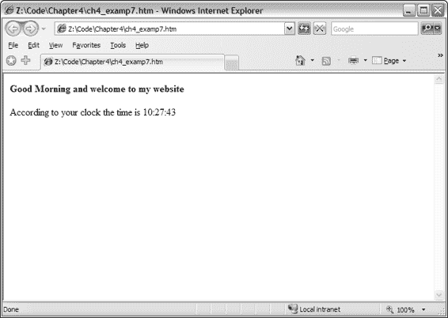

图 4-4

## 工作原理

前两行代码声明了两个变量——`greeting`和`nowDate`。

```
var greeting;
var nowDate = new Date();
```

`greeting`变量将用于存储网站上的欢迎信息，无论是"Good Morning"、"Good Afternoon"还是"Good Evening"。`nowDate`变量被初始化为一个新的`Date`对象。注意，`Date`对象的构造函数是空的，因此 JavaScript 会将当前日期和时间存储在其中。

接下来，你从`nowDate`中获取当前时间的信息，并将其存储到各个变量中。你可以看到，获取时间数据与获取日期数据非常相似，只是使用了不同的方法。

```
var nowHour = nowDate.getHours();
var nowMinute = nowDate.getMinutes();
var nowSecond = nowDate.getSeconds();
```

你可能会疑惑为什么示例中包含以下代码行：

```
if (nowMinute < 10)
{
    nowMinute = "0" + nowMinute;
}

if (nowSecond < 10)
{
    nowSecond = "0" + nowSecond;
}
```

这些行只是为了格式化。如果时间是 10 点零 9 分，你期望看到的是 10:09，而不是 10:9——如果不添加额外的零，使用`getMinutes()`方法就会得到后者。秒数也是如此。如果你只是在计算中使用数据，则无需担心格式化问题——但在这里你需要，因为你要将代码执行的时间插入到网页中。

接下来，通过一系列`if`语句，你根据一天中的时间决定向用户显示哪个问候语。

```
if (nowHour < 12)
{
    greeting = "Good Morning";
}
else if (nowHour < 17)
{
    greeting = "Good Afternoon";
}
else
{
    greeting = "Good Evening";
}
```

最后，你将问候语和当前时间写入页面。

```
document.write("<h4>" + greeting + " and welcome to my website</h4>");
document.write("According to your clock the time is ");
document.write(nowHour + ":" + nowMinute + ":" + nowSecond);
```

你将在第 9 章关于日期、时间和计时器的内容中看到如何将不断更新的时间写入网页，使其看起来像一个时钟。

## 设置时间值

当你想要设置`Date`对象中的时间时，有一系列与获取时间类似的方法：

- `setHours()`
- `setMinutes()`
- `setSeconds()`
- `setMilliseconds()`

这些方法与你用来设置日期的方法非常相似，如果你将任何时间参数设置为非法值，JavaScript 会假定你指的是下一个或上一个时间边界。例如，如果当前时间是 9:57，你将分钟设置为 64，那么时间将被设置为 10:04——即从 9:00 开始算起的 64 分钟。

以下代码演示了这一点：

```
var nowDate = new Date();
nowDate.setHours(9);
nowDate.setMinutes(57);
alert(nowDate);
nowDate.setMinutes(64);
alert(nowDate);
```

首先，你声明了`nowDate`变量并将其赋值为一个新的`Date`对象，该对象将包含当前日期和时间。在接下来的两行中，你将小时设置为 9，分钟设置为 57。你使用`alert`框显示日期和时间，应该显示时间为 9:57。然后将分钟设置为 64，再次使用`alert`框向用户显示日期和时间。现在分钟数超过了小时，因此显示的时间应为 10:04。

如果将小时设置为 23 而不是 9，那么将分钟设置为 64 不仅会将时间移到另一个小时，还会导致日期更改为下一天。

## JavaScript 类

在本节中，你将接触到一些相当复杂和高级的内容。这些内容并非必需，因此你可以先跳过，稍后再回来学习。

你已经看到 JavaScript 提供了许多内置对象，供我们直接使用。

这有点像一栋已经建好的房子，你可以直接搬进去。然而，如果你想建造自己的房子，根据自己的特定需求来设计呢？在这种情况下，你会请一位建筑师来创建技术图纸和计划，为新房子提供模板——建筑工人根据这些计划来建造房子。

那么，这一切与 JavaScript 和对象有什么关系呢？实际上，JavaScript 让你能够成为建筑师，根据自己的规格创建自己的对象模板，以满足你的特定需求。例如，假设你正在创建一个电影院订票系统。JavaScript 没有内置的电影院订票对象，因此你必须自己设计。你需要做的是创建以现实世界为模型的对象。因此，对于一个简单的电影院订票系统，你可能需要一个表示客户订票详细信息的对象，以及一个表示已订票的电影院的对象。除了能够存储信息之外，你还可以为对象创建自己的方法。

因此，对于订票系统，你可能需要一个“添加新订票”方法，或者一个获取当前所有订票详细信息的方法。

当你不需要存储数据而只需要功能时（例如之前看到的`fix()`函数），通常更简单的方法是拥有一个代码库，而不是创建一个特殊的对象。

就像建造房子需要建筑师的计划来知道要建造什么以及如何布局一样，你需要提供蓝图来告诉 JavaScript 你的对象应该是什么样子。例如，你需要定义它的方法并为这些方法提供代码。关键在于 JavaScript 支持类的定义。类本质上是对象的模板，就像建筑师的图纸是建造房子的模板一样。在使用新的对象类型之前，你需要定义它的类、方法和属性。重要的区别在于，当你定义类时，并不会创建基于该类的对象。只有当你使用`new`关键字创建类的实例时，才会根据你的类蓝图或原型创建该类的对象。

一个类由三部分组成：

- 构造函数
- 方法定义
- 属性

构造函数是一个方法，每次创建基于该类的对象时都会调用它。当你想要以某种方式初始化属性或对象时，它非常有用。即使你不向它传递任何参数，或者它不包含任何代码，你也需要创建一个构造函数（在这种情况下，它只是一个空定义）。与函数一样，构造函数可以有零个或多个参数。

你在使用 JavaScript 内置对象时已经使用过方法；现在你有机会使用类来定义自己的方法，执行特定任务。你的类将指定你有哪些方法以及它们执行的代码。同样，你之前已经使用过内置对象的属性，现在可以定义自己的属性了。你不需要声明类的属性。你可以直接使用属性，而无需提前告知 JavaScript。

让我们基于电影院订票系统的现实示例创建一个简单的类。

### 定义类

让我们从为客户订票创建一个类开始。这个类将被称为`CustomerBooking`类。你需要做的第一件事是创建类的构造函数。

类的构造函数如下所示：

```
function CustomerBooking (bookingId, customerName, film, showDate)
{
    this.customerName = customerName;
    this.bookingId = bookingId;
    this.showDate = showDate;
    this.film = film;
}
```

你的第一反应可能是这只是一个函数，没错。直到你开始定义`CustomerBooking`类的属性和方法时，它才成为一个类。这与某些编程语言不同，这些语言有更正式的类定义方式。

当你查看代码时，需要注意的重要一点是，构造函数的名字必须与你正在定义的类名匹配——在本例中是`CustomerBooking`类。这样，当你的类作为对象（称为*对象实例*）的新实例被创建时，这个函数将自动被调用。注意，你的构造函数有四个参数，这些参数在类内部使用。然而，请注意你使用了`this`关键字。例如：`this.customerName = customerName;`

在构造函数内部或类方法中，`this`关键字将指向你的类的那个对象实例。这里你引用了该类对象的`customerName`属性，并将其设置为等于`customerName`参数。如果你使用过其他面向对象编程语言，你可能会想知道你在哪里定义了`customerName`属性。答案是：你没有定义；仅仅通过给属性赋值，JavaScript 就会为你创建它。它不会检查属性是否存在；JavaScript 会在需要时创建它。如果你使用一个在类定义中从未提及的属性来操作对象，情况也是如此。这种自由创建属性的特性听起来很棒，但它也有缺点，主要缺点是：如果你不小心拼错了属性名，JavaScript 不会告诉你；它只会用拼错的名称创建一个新属性，这可能会使追踪 bug 变得困难。解决这个问题的一种方法是创建获取属性值和设置属性值的方法。这听起来可能很麻烦，但它可以减少 bug，或者至少让 bug 更容易被发现。让我们为`CustomerBooking`类创建几个属性获取/设置方法。

```
CustomerBooking.prototype.getCustomerName = function()
{
    return this.customerName;
}

CustomerBooking.prototype.setCustomerName = function(customerName)
{
    this.customerName = customerName;
}

CustomerBooking.prototype.getShowDate = function()
{
    return this.showDate;
}

CustomerBooking.prototype.setShowDate = function(showDate)
{
    this.showDate = showDate;
}

CustomerBooking.prototype.getFilm = function()
{
    return this.film;
}
```

# 第 4 章：JavaScript——一种基于对象的语言

现在你已经为类的四个属性（`bookingId`、`film`、`customerName`和`showDate`）分别定义了`get`和`set`方法。让我们看看你是如何创建其中一个方法`getCustomerName()`的。

```javascript
CustomerBooking.prototype.getCustomerName = function()
{
    return this.customerName;
}
```

你首先注意到的是，这是一种非常奇怪的函数定义方式。在左侧，你将类的`prototype`属性的`getCustomerName`设置为一个函数，然后立即在后面定义这个函数。实际上，JavaScript 为大多数对象提供了`prototype`属性，允许创建新的属性和方法。因此，每当你想要为类创建一个方法时，只需编写以下代码：

```javascript
className.prototype.methodName = function(method parameter list)
{
    // method code
}
```

你已经创建了类，但现在如何基于该类创建新对象呢？好的，我们将在下一节中探讨这个问题。

## 创建和使用类对象实例

创建类的实例与创建内置 JavaScript 类的实例方式相同：使用`new`关键字。因此，要创建`CustomerBooking`类的新实例，你可以这样写：

```javascript
var firstBooking = new CustomerBooking(1234, "Robert Smith", "Raging Bull", "25 July 2004 18:20");
var secondBooking = new CustomerBooking(1244, "Arnold Palmer", "Toy Story", "27 July 2004 20:15");
```

这里，与`String`对象一样，你创建了两个新对象并存储在变量`firstBooking`和`secondBooking`中，但这次它们是基于你的类的新对象。

让我们调用这两个对象的`getCustomerName()`方法，并将结果写入页面。

```javascript
document.write("1st booking person's name is " +
    firstBooking.getCustomerName() + "<br>");
document.write("2nd booking person's name is " +
    secondBooking.getCustomerName());
```

你会看到页面中根据类对象包含的信息写入以下内容：

```
1st booking person's name is Robert Smith
2nd booking person's name is Arnold Palmer
```

现在让我们把这些整合到一个页面中。


页面顶部是你的`<script>`标签，其中包含定义类的代码。你必须在每个使用该类创建对象的页面中包含类定义代码。为了方便起见，你可以将类定义放在一个单独的文件中，然后将其导入到每个使用该类的页面中。你可以使用`<script>`标签来实现这一点，但不是在开闭标签之间放置代码，而是使用`script`标签的`src`属性指向包含JavaScript的文件。例如，如果你创建一个名为`MyCinemaBookingClasses.js`的文件并将类代码放入其中，你可以像这样将其导入到页面中：

```html
<script language="JavaScript" src="MyCinemaBookingClasses.js"></script>
```

`src`属性指向你的类的URL，这里假设类的`.js`文件与你的页面位于同一目录中。

## 项目数组

到目前为止，你有一个用于单个预订项目的类，但没有一个表示电影院所有预订的类。那么，如何创建一个支持存储零个或多个项目的电影院类呢？答案是使用数组，我们在第3章中讨论过。

让我们开始定义你的类，将其命名为`cinema`类，并将其添加到包含`CustomerBooking`类的脚本块中。

```javascript
// cinema class
function cinema()
{
    this.bookings = new Array();
}
```

这里你定义了构造函数。在构造函数内部，你初始化了`bookings`属性，该属性将保存所有`CustomerBooking`类对象。

接下来，你需要添加一种为电影院进行预订的方法；为此，你创建了`addBooking()`方法。

```javascript
cinema.prototype.addBooking = function(bookingId, customerName, film, showDate)
{
    this.bookings[bookingId] = new CustomerBooking(bookingId, customerName, film, showDate);
}
```

该方法接受四个参数，即创建新预订所需的详细信息。然后，在方法内部，你创建了一个`CustomerBooking`类型的新对象。该对象的引用存储在`bookings`数组中，使用唯一的`bookingId`来关联新对象的存储位置。

让我们看看如何访问数组中的项目。在下面的`getBookingsTable()`方法中，你遍历电影院中的每个预订，并生成在表格中显示所有预订所需的HTML。

```javascript
cinema.prototype.getBookingsTable = function()
{
    var booking;
    var bookingsTableHTML = "<table border=1>";
    for (booking in this.bookings)
    {
        bookingsTableHTML += "<tr><td>";
        bookingsTableHTML += this.bookings[booking].getBookingId();
        bookingsTableHTML += "</td>";
        bookingsTableHTML += "<td>";
        bookingsTableHTML += this.bookings[booking].getCustomerName();
        bookingsTableHTML += "</td>";
        bookingsTableHTML += "<td>";
        bookingsTableHTML += this.bookings[booking].getFilm();
        bookingsTableHTML += "</td>";
        bookingsTableHTML += "<td>";
        bookingsTableHTML += this.bookings[booking].getShowDate();
        bookingsTableHTML += "</td>";
        bookingsTableHTML += "</tr>";
    }
    bookingsTableHTML += "</table>";
    return bookingsTableHTML;
}
```

你可以通过唯一的`bookingId`访问每个预订，但你想做的是简单地循环遍历电影院的所有预订，因此你使用了`for...in`循环，它会遍历项目数组中的每个项目。每次循环执行时，JavaScript会将`booking`设置为包含下一个预订的`bookingId`；它不包含项目本身，而是包含其关联的关键字。

由于你有关联的关键字，你可以像这样访问数组中的项目对象：`this.bookings[booking]`

请记住，`this`指向你类的对象实例。然后，你使用`CustomerBooking`对象的get方法来获取每个预订的详细信息。最后，在最后一行，你将包含所有预订摘要的HTML返回给调用代码。

让我们在一个页面中整合所有这些内容，并将页面保存为`ch4_examp8.htm`。

```html
<html>
<body>
<h2>Summary of bookings</h2>
<script language="JavaScript" type="text/javascript">
// CustomerBooking class
function CustomerBooking(bookingId, customerName, film, showDate)
{
    this.customerName = customerName;
    this.bookingId = bookingId;
    this.showDate = showDate;
    this.film = film;
}
CustomerBooking.prototype.getCustomerName = function()
{
    return this.customerName;
}
CustomerBooking.prototype.setCustomerName = function(customerName)
{
    this.customerName = customerName;
}
CustomerBooking.prototype.getShowDate = function()
{
    return this.showDate;
}
CustomerBooking.prototype.setShowDate = function(showDate)
{
    this.showDate = showDate;
}
CustomerBooking.prototype.getFilm = function()
{
    return this.film;
}
CustomerBooking.prototype.setFilm = function(film)
{
    this.film = film;
}
CustomerBooking.prototype.getBookingId = function()
{
    return this.bookingId;
}
CustomerBooking.prototype.setBookingId = function(bookingId)
{
    this.bookingId = bookingId;
}
// cinema class
function cinema()
{
    this.bookings = new Array();
}
cinema.prototype.addBooking = function(bookingId, customerName, film, showDate)
{
    this.bookings[bookingId] = new CustomerBooking(bookingId, customerName, film, showDate);
}
cinema.prototype.getBookingsTable = function()
{
    var booking;
    var bookingsTableHTML = "<table border=1>";
    for (booking in this.bookings)
    {
        bookingsTableHTML += "<tr><td>";
        bookingsTableHTML += this.bookings[booking].getBookingId();
        bookingsTableHTML += "</td>";
        bookingsTableHTML += "<td>";
        bookingsTableHTML += this.bookings[booking].getCustomerName();
        bookingsTableHTML += "</td>";
        bookingsTableHTML += "<td>";
        bookingsTableHTML += this.bookings[booking].getFilm();
        bookingsTableHTML += "</td>";
        bookingsTableHTML += "<td>";
        bookingsTableHTML += this.bookings[booking].getShowDate();
        bookingsTableHTML += "</td>";
        bookingsTableHTML += "</tr>";
    }
    bookingsTableHTML += "</table>";
    return bookingsTableHTML;
}
var londonOdeon = new cinema();
londonOdeon.addBooking(342, "Arnold Palmer", "Toy Story", "15 July 2009 20:15");
londonOdeon.addBooking(335, "Louise Anderson", "The Shawshank Redemption", "27 July 2009 11:25");
londonOdeon.addBooking(566, "Catherine Hughes", "Never Say Never", "27 July 2009 17:55");
londonOdeon.addBooking(324, "Beci Smith", "Shrek", "29 July 2009 20:15");
document.write(londonOdeon.getBookingsTable());
</script>
</body>
</html>
```

你的新代码是以下几行：

```javascript
var londonOdeon = new cinema();
londonOdeon.addBooking(342, "Arnold Palmer", "Toy Story", "15 July 2009 20:15");
londonOdeon.addBooking(335, "Louise Anderson", "The Shawshank Redemption", "27 July 2009 11:25");
londonOdeon.addBooking(566, "Catherine Hughes", "Never Say Never", "27 July 2009 17:55");
londonOdeon.addBooking(324, "Beci Smith", "Shrek", "29 July 2009 20:15");
document.write(londonOdeon.getBookingsTable());
```

这些代码创建了一个新的`cinema`对象，并将其引用存储在变量`londonOdeon`中。然后，你使用`cinema`类的`addBooking()`方法创建了四个新预订。在最后一行，你将`getBookingsTable()`方法返回的HTML写入页面。

你的页面现在应该如图4-5所示。

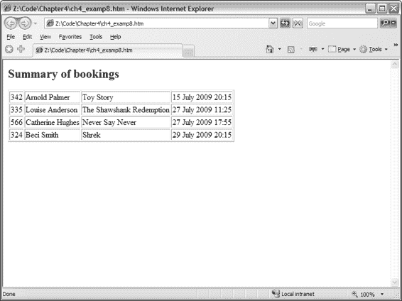

你创建的影院预订系统至少可以说是非常基础的！然而，它让你了解了如何使用JavaScript类来帮助使代码更易于维护，以及如何用它们来模拟现实世界的问题和场景。

## 总结

在本章中，你了解了对象的概念，并看到了它们对于理解JavaScript有多么重要——JavaScript几乎用对象来表示一切。你还了解了JavaScript语言提供的一些原生对象，它们增强了语言的功能。

你了解到：

- JavaScript是基于对象的——它使用对象的概念来表示字符串、日期和数组等事物。

- 对象具有属性和方法。例如，`Array`对象有`length`属性和`sort()`方法。

- 要创建一个新对象，只需编写`new ObjectType()`。你可以在创建对象时选择初始化它。

- 要设置或获取对象的属性值，只需编写`ObjectName.ObjectProperty`。

- 调用对象的方法与调用函数类似。可以传递参数，也可以返回返回值。访问对象的方法与访问属性相同，只是必须记住在末尾加上括号，即使没有参数也是如此。例如，你应该编写`ObjectName.ObjectMethod()`。

- `String`对象为文本提供了许多便捷功能，让你能够找出文本的长度、在字符串中搜索文本以及选择文本的部分内容。

- `Math`对象是自动创建的，提供了许多数学属性和方法。例如，要获取0到1之间的随机数，可以使用`Math.random()`方法。

- `Array`对象提供了操作数组的方法。你可以执行的操作包括查找数组长度、对元素进行排序以及连接两个数组。

- `Date`对象提供了一种存储、计算以及稍后访问日期和时间的方法。

- JavaScript允许你使用类创建自己的对象类型。这些类可用于模拟现实世界的情况，并使代码更易于创建和维护，尽管在开始时需要额外的工作。

在下一章中，你将把注意力转向Web浏览器本身，特别是浏览器为你的JavaScript编程提供的各种对象。你将看到，浏览器对象的使用是创建强大网页的关键。

### 练习题

这些问题的参考答案可在附录A中找到。

#### 问题 1


使用 `Date` 对象，计算从现在起 12 个月后的日期，并将其写入网页。

#### 问题 2

从用户那里获取一个姓名列表，将输入的每个姓名存储在一个数组中。持续获取下一个姓名，直到用户不输入任何内容。按升序对姓名进行排序，然后将它们写入页面，每个姓名单独占一行。

#### 问题 3

在本章前面研究 `pow()` 方法时，你看到了如何创造性地使用它来将数字固定到特定的小数位数。然而，你创建的函数存在一个缺陷。一个正确的 `fix()` 函数应该将 2.1 固定到三位小数，返回 2.100。但是，你的 `fix()` 函数却返回 2.1。修改 `fix()` 函数，使其在必要时添加额外的零。

# 第 5 章：浏览器编程

## 浏览器编程

在过去的三个章节中，你已经深入研究了 JavaScript 核心语言。你了解了如何使用变量和数据、对数据执行操作、在代码中做出决策、重复循环同一段代码，甚至如何编写自己的函数。在上一章中，你进一步学习了 JavaScript 如何是一种基于对象的语言，并了解了如何使用 JavaScript 原生对象。然而，你不仅对语言本身感兴趣——你还想了解如何为网页浏览器编写脚本。利用这种能力，你可以开始创建更令人印象深刻的网页。

JavaScript 不仅是基于对象的，浏览器本身也由对象构成。当 JavaScript 在浏览器中运行时，你可以像上一章使用 JavaScript 原生对象一样，以完全相同的方式访问浏览器的对象。但浏览器提供了哪些类型的对象呢？

浏览器提供了数量可观的对象。例如，有一个 `window` 对象对应于浏览器的窗口。你已经使用了该对象的两个方法，即 `alert()` 和 `prompt()` 方法。为简单起见，我们之前称它们为函数，但它们实际上是浏览器 `window` 对象的方法。

浏览器提供的另一个对象是页面本身，由 `document` 对象表示。同样，你已经使用了该对象的方法和属性。回想第 1 章，你使用了 `document` 对象的 `bgColor` 属性来更改页面的背景颜色。你还使用了 `document` 对象的 `write()` 方法将信息写入页面。

还存在各种其他对象，它们代表你在页面中编写的大量 HTML。例如，每个用于在文档中插入图像的 `` 标签都有一个 `img` 对象。

浏览器提供给你用于 JavaScript 的对象集合通常被称为*浏览器对象模型（BOM）*。

你经常会看到它被称为文档对象模型（DOM）。然而，在本书中，我们将使用术语 DOM 来指代 W3C 的标准文档对象模型，这将在第 13 章中讨论。

JavaScript 的所有这些附加功能都伴随着一个潜在的缺点。哪些对象集合可供你使用，高度依赖于你使用的浏览器品牌和版本。某些对象在某些浏览器中可用，而在其他浏览器中不可用，而其他对象在不同浏览器中具有不同的属性和方法。好消息是，浏览器比过去更遵循 W3C 的指南。这意味着如果你遵循 W3C 指南，你的代码更有可能在不同浏览器中工作。但请注意，一些浏览器编写者以不同的方式解释了 W3C 标准。你将在第 12 章中看到更多关于 IE 和 Firefox 浏览器 BOM 之间差异的内容。

然而，在本章中，你将专注于 BOM 的核心功能，即所有浏览器通用的对象。仅通过使用这些对象，你就可以在 JavaScript 中实现很多功能。你可以在以下网址找到更多相关信息：[`www.w3schools.com/dhtml/dhtml_domreference.asp`](http://www.w3schools.com/dhtml/dhtml_domreference.asp) 和 [`msdn.microsoft.com/library/default.asp?url=/workshop/author/dhtml/dhtml_node_entry.asp`](http://msdn.microsoft.com/library/default.asp?url=/workshop/author/dhtml/dhtml_node_entry.asp)。

## 浏览器对象简介

在本节中，我们将介绍所有浏览器通用的 BOM 对象。

在第 4 章中，你看到 JavaScript 有许多你可以访问和使用的原生对象。大多数对象是你需要自己创建的，例如 `String` 和 `Date` 对象。其他对象，如 `Math` 对象，无需你创建即可存在，并在页面开始加载时立即可用。

当 JavaScript 在网页中运行时，它可以访问由网页浏览器提供的大量其他对象。与 `Math` 对象类似，这些对象是为你创建的，而不是需要你显式创建。如前所述，这些对象及其方法、属性和事件都在 BOM 中进行了映射。

BOM 非常庞大，起初可能会让人不知所措。然而，你会发现最初你只会使用 BOM 中可用对象、方法和属性的不到 10%。在本章中，你将首先查看 BOM 中更常用的部分，如图 5-1 所示。

BOM 的这些部分在一定程度上在所有浏览器中都是通用的。后续章节将在此基础上进一步展开，以便在本书结束时，你能够真正让 BOM 为你所用。

- `window` 对象
- `location` 对象
- `history` 对象
- `document` 对象
- `navigator` 对象
- `screen` 对象
- `forms` 对象
- `images` 对象
- `links` 对象

**图 5-1**

BOM 具有层次结构。该层次结构的顶部是 `window` 对象。你可以将其视为代表浏览器的框架以及与之相关的所有内容，例如滚动条、导航栏图标等。

包含在窗口框架内的是页面。页面在 BOM 中由 `document` 对象表示。你可以在图 5-2 中看到这两个对象。

- 浏览器窗口或框架，在 BOM 中由 `window` 对象表示
- HTML 页面，在 BOM 中由 `document` 对象表示

**图 5-2**

现在让我们更详细地查看每个对象。

### `window` 对象——我们通往页面的窗口

`window` 对象代表浏览器的框架或窗口，你的网页包含在其中。在某种程度上，它也代表浏览器本身，并包含许多属性，这些属性之所以存在，仅仅是因为它们没有其他地方可放。例如，通过 `window` 对象的属性，你可以了解正在运行什么浏览器、用户访问过的页面、浏览器窗口的大小、用户屏幕的大小等等。你还可以使用 `window` 对象访问和更改浏览器状态栏中的文本、更改加载的页面，甚至打开新窗口。

`window` 对象是一个全局对象，这意味着你不需要使用它的名称来访问其属性和方法。事实上，全局函数和变量（在页面中任何地方的脚本都可访问的那些）都是作为全局对象的属性创建的。例如，你从本书开头就一直使用的 `alert()` 函数，实际上是 `window` 对象的 `alert()` 方法。虽然你一直简单地使用它：

```javascript
alert("Hello!");
```

但你可以写成：

```javascript
window.alert("Hello!");
```

然而，由于 `window` 对象是全局对象，使用第一种写法是完全正确的。

`window` 对象的某些属性本身也是对象。IE 和 NN 都通用的属性包括 `document`、`navigator`、`history`、`screen` 和 `location` 对象。`document` 对象代表你的页面，`history` 对象包含用户访问过的页面历史记录，`navigator` 对象保存有关浏览器的信息，`screen` 对象包含有关客户端显示能力的信息，`location` 对象包含当前页面位置的详细信息。你将在本章后面单独查看这些重要的对象。

#### 使用 `window` 对象

让我们从一个简单易懂的例子开始，在这个例子中，你将更改浏览器状态栏中显示的默认文本。状态栏（通常位于浏览器窗口的左下角）通常用于显示浏览器加载文档的状态。例如，在 IE 和 Firefox 中，文档加载完成后，你通常会在状态栏中看到“完成”。现在我们来修改它，让它显示“你好，欢迎”。

要更改窗口状态栏中的默认消息，你需要使用 `window` 对象的 `defaultStatus` 属性。为此，你可以编写如下代码：

`window.defaultStatus = "Hello and Welcome";`

或者，由于 `window` 是全局对象，你也可以直接这样写：

`defaultStatus = "Hello and Welcome";`

两种方式都有效，且都是合法的；然而，在前面加上 `window` 可以清楚地表明 `defaultStatus` 属性来自何处。否则，`defaultStatus` 看起来可能像一个变量名。对于不太常见的属性和方法（如 `defaultStatus`）尤其如此。对于更常见的属性和方法（如 `document` 和 `alert()`），你会逐渐熟悉到不需要在前面加上 `window` 来提醒自己它们的上下文。

现在，让我们把代码放到一个页面中。

```html
<html>
<head>
<script language="JavaScript" type="text/javaScript">
window.defaultStatus = "Hello and Welcome";
</script>
</head>
</html>
```

将页面保存为 `ch5_examp1.htm`，并在浏览器中加载。你应该会在状态栏中看到指定的消息。

在此，有必要强调一点：在网页中，你不应该使用与 BOM 对象或其属性、方法名称冲突的函数或变量名。如果这样做，可能不会报错，但会得到意想不到的结果。例如，在下面的代码中，你声明了一个名为 `defaultStatus` 的变量。然后你尝试将 `window` 对象的 `defaultStatus` 属性设置为“Welcome to my website”。然而，这并不会改变状态栏中的默认消息；相反，`defaultStatus` 变量中的值会被改变。

```javascript
var defaultStatus;
defaultStatus = "Welcome to my website";
```

在这种情况下，你需要使用一个不同的变量名。

与所有 BOM 对象一样，你可以查看 `window` 对象的许多属性和方法。不过，在本章中，你将重点学习 `history`、`location`、`navigator`、`screen` 和 `document` 属性。这五个属性各自包含一个对象（分别是 `history`、`location`、`navigator`、`screen` 和 `document` 对象），每个对象都有自己的属性和方法。在接下来的几页中，你将逐一了解这些对象，并发现它们如何帮助你充分利用 BOM。

### `history` 对象

`history` 对象会跟踪用户访问的每个页面。这个页面列表通常被称为浏览器的历史堆栈。它允许用户点击浏览器的“后退”和“前进”按钮来重新访问页面。你可以通过 `window` 对象的 `history` 属性来访问这个对象。

与原生 JavaScript 的 `Array` 对象类似，`history` 对象也有一个 `length` 属性。你可以用它来了解历史堆栈中有多少个页面。

正如你所料，`history` 对象有 `back()` 和 `forward()` 方法。当它们被调用时，浏览器当前加载页面的位置会变为用户访问过的上一个或下一个页面。

`history` 对象还有一个 `go()` 方法。它接受一个参数，指定你想在历史堆栈中向前或向后移动多少步。例如，如果你想将用户返回到上一个页面的前一个页面，你可以这样写：

`history.go(-2);`

要向前跳转三个页面，你可以这样写：

`history.go(3);`

注意，`go(-1)` 和 `back()` 是等价的，`go(1)` 和 `forward()` 也是等价的。

### `location` 对象

`location` 对象包含关于当前页面位置的大量有用信息。它不仅包含页面的 URL（统一资源定位符），还包含托管页面的服务器、服务器连接的端口号以及所使用的协议。这些信息可以通过 `location` 对象的 `href`、`hostname`、`port` 和 `protocol` 属性获取。不过，其中许多值只有在从服务器加载页面时才真正相关，而像当前示例这样直接从本地硬盘加载页面时则不然。

除了检索当前页面的位置，你还可以使用 `location` 对象的方法来更改位置和刷新当前页面。

你可以通过两种方式导航到另一个页面。你可以设置 `location` 对象的 `href` 属性指向另一个页面，也可以使用 `location` 对象的 `replace()` 方法。两者的效果相同：页面位置发生变化。然而，它们的区别在于：`replace()` 方法会将当前页面从历史堆栈中移除，并用你要跳转的新页面替换它；而使用 `href` 属性则只是将新页面添加到历史堆栈的顶部。这意味着，如果使用了 `replace()` 方法，用户点击浏览器的“后退”按钮时，将无法返回到最初加载的页面。如果使用了 `href` 属性，用户可以像往常一样使用“后退”按钮。

例如，要用一个名为 `myPage.htm` 的新页面替换当前页面，你可以使用 `replace()` 方法，编写如下代码：

`window.location.replace("myPage.htm");`

这将加载 `myPage.htm`，并用 `myPage.htm` 替换历史堆栈中当前页面的所有出现。

要加载同一个页面并将其添加到导航历史中，你可以使用 `href` 属性：

`window.location.href = "myPage.htm";`

这样当前加载的页面就会被添加到历史中。在上述两种情况下，`window` 都位于表达式前面，但由于 `window` 对象在整个页面中是全局的，你也可以这样写：

`location.replace("myPage.htm");`

或者：

`location.href = "myPage.htm";`

### `navigator` 对象

`navigator` 对象是 `window` 对象的另一个属性，在 IE 和 Firefox 浏览器中都可以使用。它的名称更多是历史原因而非描述性的。也许更好的名称是“浏览器对象”，因为 `navigator` 对象包含大量关于浏览器及其运行的操作系统的信息。

`navigator` 对象最常见的用途可能是处理浏览器差异。通过它的属性，你可以了解用户使用的是哪种浏览器、版本以及操作系统。然后你可以根据这些信息采取行动，确保用户被引导到适合其浏览器的页面。本章最后一节专门讨论这个重要主题，因此这里不再赘述。

### `screen` 对象

`window` 对象的 `screen` 对象属性包含大量关于客户端机器显示能力的信息。它的属性包括 `height` 和 `width`，分别表示屏幕的垂直和水平范围（以像素为单位）。

`screen` 对象的另一个属性是 `colorDepth`，你将在后面的示例中使用它。它告诉你在客户端屏幕上用于颜色的位数。

### `document` 对象——页面本身

与 `window` 对象一样，`document` 对象可能是 BOM 中最重要且最常用的对象之一。通过这个对象，你可以访问页面中 HTML 标签定义的一些对象的属性和方法。

不幸的是，不同浏览器的 BOM 可能差异很大。在本章中，你将专注于那些所有浏览器都通用的 `document` 对象的属性和方法。

更高级的浏览器文档对象操作将在第 12 章和第 13 章中介绍。

`document` 对象有许多与之关联的属性，这些属性也是数组。主要的几个是 `forms`、`images` 和 `links` 数组。IE 支持许多其他数组属性，例如 `all` 数组属性，它是页面中所有由对象表示的标签的数组。不过，你将专注于使用具有跨浏览器支持的对象，这样就不会将网页限制在单一浏览器上。

稍后你将了解 `images` 和 `links` 数组。第三个数组 `forms[]` 将是下一章的主题之一，届时你将研究 Web 浏览器中的表单。不过，首先来看一个关于如何使用 `document` 对象的方法和属性的简单示例。

## 使用 `document` 对象

你已经接触过一些 `document` 对象的属性和方法，例如 `write()` 方法和 `bgColor` 属性。

### 动手试一试：根据用户屏幕颜色深度设置颜色

在这个示例中，你将根据用户屏幕支持的颜色数量来设置页面的背景颜色。这被称为屏幕颜色深度。如果用户的显示器只支持两种颜色（黑色和白色），那么将背景颜色设置为亮红色就没有意义。你可以通过使用 JavaScript 设置用户实际能看到的颜色来适应不同的深度。

```html
<html>
<body>
<script language="JavaScript" type="text/javascript">
switch (window.screen.colorDepth)
{
case 1:
case 4:
    document.bgColor = "white";
    break;
case 8:
case 15:
case 16:
    document.bgColor = "blue";
    break;
case 24:
case 32:
    document.bgColor = "skyblue";
    break;
default:
    document.bgColor = "white";
}
document.write("Your screen supports " + window.screen.colorDepth + "bit color");
</script>
</body>
</html>
```

将页面保存为 `ch5_examp2.htm`。当你在浏览器中加载它时，页面的背景颜色将由你当前的屏幕颜色深度决定。此外，页面中会显示一条消息，告诉你当前的颜色深度。

你可以通过更改屏幕支持的颜色来测试代码是否正常工作。在 Windows 上，你可以右键单击桌面，选择“属性”选项。在“设置”选项卡下，有一个名为“颜色质量”的部分，你可以在其中更改支持的颜色数量。通过刷新浏览器，你可以看到这对页面颜色产生的影响。


*在 Netscape 和 Firefox 浏览器上，需要关闭并重新启动浏览器才能观察到任何效果。*

### 工作原理

正如你之前所见，`window` 对象具有 `screen` 对象属性。该对象的属性之一是 `colorDepth` 属性，它返回 1、4、8、15、16、24 或 32 的值。这表示屏幕上每个像素分配的位数。（像素只是构成屏幕的众多点之一。）要计算有多少种颜色，只需计算 2 的 `colorDepth` 次幂的值。例如，`colorDepth` 为 1 表示有 2 种颜色可用，`colorDepth` 为 8 表示有 256 种颜色可用，依此类推。目前，大多数人的屏幕颜色深度至少为 8，但通常是 16 或 24，而 32 也越来越常见。

脚本块的第一个任务是根据用户实际能看到的颜色数量来设置页面背景的颜色。你通过一个大的 `switch` 语句来完成。`switch` 语句中检查的条件是 `window.screen.colorDepth` 的值。

```javascript
switch (window.screen.colorDepth)
{
case 1:
case 4:
    document.bgColor = "white";
    break;
case 8:
case 15:
case 16:
    document.bgColor = "blue";
    break;
case 24:
case 32:
    document.bgColor = "skyblue";
    break;
default:
    document.bgColor = "white";
}
document.write("Your screen supports " + window.screen.colorDepth + "bit color");
```

到目前为止，你已经在本书的示例中一直使用 `document` 对象。你在第 1 章中使用了它的 `bgColor` 属性来更改页面的背景颜色，并且在示例中很好地使用了它的 `write()` 方法将 HTML 和文本写入页面。

现在让我们来看一些稍微复杂的 `document` 对象属性。这些属性的共同点是它们都包含数组。你首先看到的是一个数组，其中包含页面中每个图像的对象。

## `images` 数组

如你所知，你可以使用以下标签将图像插入 HTML 页面：

``

浏览器通过为该图像创建一个名为 `myImage` 的 `img` 对象，使其可供你通过 JavaScript 进行脚本操作。实际上，页面上的每个图像都会为其创建一个 `img` 对象。

页面中的每个 `img` 对象都存储在 `images[]` 数组中。该数组是 `document` 对象的一个属性。页面上的第一个图像位于 `document.images[0]` 中，第二个位于 `document.images[1]` 中，依此类推。

如果你愿意，可以分配一个变量来引用 `images[]` 数组中的 `img` 对象。这可以使代码更易于阅读。例如，如果你编写：

`var myImage2 = document.images[1];`

那么 `myImage2` 变量将包含对 `images[]` 数组中索引位置 1 处的 `img` 对象的引用。现在你可以在代码中编写 `myImage2` 而不是 `document.images[1]`，效果完全相同。

你也可以通过名称访问 `images` 数组中的 `img` 对象。例如，由 `` 标签创建的名为 `myImage` 的 `img` 对象可以像这样在 `document` 对象的 `images` 数组属性中访问：

`document.images["myImage"]`

由于 `document.images` 属性是一个数组，它拥有原生 JavaScript `Array` 对象的属性，例如 `length` 属性。例如，如果你想知道页面上有多少张图像，代码 `document.images.length` 会告诉你。

### 动手试一试

#### 图像选择

`img` 对象本身有许多有用的属性。其中最重要的是它的 `src` 属性。通过更改此属性，你可以更改加载的图像。下一个示例演示了这一点。

`<html>`

```html
<body>

<script language=”JavaScript” type=”text/javaScript”> var myImages = new Array(“usa.gif”,”canada.gif”,”jamaica.gif”,”mexico.gif”); var imgIndex = prompt(“Enter a number from 0 to 3”,””); document.images[“img1”].src = myImages[imgIndex];
</script>
</body>
</html>
```

将此文件保存为 `ch5_examp3.htm`。你还需要四个图像文件，分别命名为 `usa.gif`、`canada.gif`、`jamaica.gif` 和 `mexico.gif`。你可以自己创建这些文件，或者从本书的代码下载中获取提供的文件。

当此页面加载到浏览器中时，会弹出一个提示框，要求你输入一个 0 到 3 之间的数字。根据你输入的数字，将显示不同的图像。

## 工作原理

在页面顶部，你有一个 HTML `` 标签。注意 `src` 属性留空，并赋予了名称值 `img1`。

`` 接下来是脚本块，其中决定了要显示的图像。第一行定义了一个包含图像源列表的数组。在此示例中，图像与 HTML 文件位于同一目录下，因此未指定路径。如果你的图像不在同一目录，请确保输入完整路径（例如 `C:\myImages\mexico.gif`）。

然后，你要求用户输入一个 0 到 3 之间的数字，该数字将用作数组索引，以访问 `myImages` 数组中的图像源。

`var imgIndex = prompt(“Enter a number from 0 to 3”,””);` 最后，你将 `img` 对象的 `src` 属性设置为 `myImages` 数组中由用户提供的索引号对应的源文本。

`document.images[“img1”].src = myImages[imgIndex];`

别忘了，当你写 `document.images[“img1”]` 时，你正在访问存储在 `images` 数组中的 `img` 对象。这里使用了 `` 标签的 `name` 属性中定义的图像名称，但你也可以使用 `document.images[0]`。它的索引位置是 0，因为它是此页面上的第一个（也是唯一一个）图像。

## `links` 数组

对于每个定义了 `href` 属性的超链接标签 `<A>`，浏览器都会创建一个 `A` 对象。`A` 对象最重要的属性是 `href` 属性，对应于标签的 `href` 属性。

利用这一点，你可以找出链接指向的位置，并且即使在页面加载后，你也可以更改它。

页面中所有 `A` 对象的集合包含在 `links[]` 数组中，就像你之前看到的 `img` 对象包含在 `images[]` 数组中一样。

## 将代码连接到网页事件

第 4 章介绍了由方法和属性定义的对象。然而，对象也有与之关联的事件。我们之前没有提到这一点，因为原生 JavaScript 对象没有这些事件，但 BOM 的对象有。

那么这些事件是什么呢？

事件在特定情况发生时触发。例如，用户点击页面、点击超链接或将鼠标指针移动到某些文本上都会触发事件。另一个经常使用的例子是页面的 `load` 事件。

为什么你对事件感兴趣？

举个例子，假设你想在用户点击网页中的任意位置时弹出一个菜单。假设你可以编写一个函数来显示弹出菜单，那么你如何知道*何时*显示它，换句话说，*何时*调用该函数？你需要以某种方式拦截用户点击文档的事件，并确保在该事件发生时调用你的函数。

为此，你需要使用一种称为*事件处理程序*的东西。你将它与希望在事件发生时执行的代码关联起来。这为你提供了一种拦截事件并在事件发生后执行代码的方法。你会发现，将事件处理程序添加到代码中通常被称为“将代码连接到事件”。这有点像设置闹钟——你设置闹钟，使其在特定事件发生时发出响声。对于闹钟来说，事件就是到达某个特定时间。

事件处理程序由单词 `on` 和它们将要处理的事件组成。例如，`click` 事件有 `onclick` 事件处理程序，`load` 事件有 `onload` 事件处理程序。

有多种方法可以使用事件处理程序将代码连接到事件。在本章中，你将了解两种最简单的事件添加方式，这些方式自 Netscape 2 以来就已存在，因此即使是较旧的浏览器以及当前浏览器也支持。在第 12 章中，你将了解更新且符合标准的事件添加方式。

### 将事件处理程序作为属性

第一种也是最常见的方法是将事件处理程序的名称和要执行的代码添加到 HTML 标签的属性中。

让我们创建一个包含单个超链接的简单 HTML 页面，该超链接由元素 `<A>` 给出。与此元素关联的是 `A` 对象。`A` 对象的事件之一是 `click` 事件。毫不奇怪，当用户点击超链接时，`click` 事件会触发。

```html
<html>
<body>
<A href=”somepage.htm” name=”linkSomePage”>
点击我
</A>
</body>
</html>
```

目前，此页面没有执行任何普通超链接不会执行的操作。你点击它，它会将窗口导航到另一个页面，名为 `somepage.htm`，该页面需要创建。尚未向链接添加事件处理程序——还没有！

如前所述，将事件连接到代码的一种非常常见且简单的方法是将其直接添加到你要捕获其事件的对象的标签中。在这种情况下，就是由 `<A>` 标签定义的 `A` 对象的 `click` 事件。点击链接时，你想要捕获该事件并将其连接到你的代码。你需要将事件处理程序（此处为 `onclick`）作为属性添加到 `<A>` 标签中。你将属性的值设置为事件发生时希望执行的代码。

让我们按如下方式重写 `<A>` 标签：

```html
<A href=”somepage.htm” name=”linkSomePage” onclick=”alert(‘你点击了？’)”> 点击我
</A>
```

你可以看到，你已经在 `<A>` 标签的定义中添加了 `onclick=”alert(‘你点击了？’)”`。

现在，当链接被点击时，你会看到一个警告框。之后，超链接会执行其常规操作，并将你带到 `href` 属性中定义的页面。

如果你只有一行代码要连接到事件处理程序，这没问题，但如果你希望在点击链接时执行多行代码呢？

好吧，你只需要定义要执行的函数，并在 `onclick` 代码中调用它。现在让我们这样做。

```html
<html>
<body>
<script language=”JavaScript”>
function linkSomePage_onclick()
{
alert(‘你点击了？’);
return true;
}
</script>
<A href=”somepage.htm” name=”linkSomePage”
onclick=”return linkSomePage_onclick()”>
点击我
</A>
</body>
</html>
```

在脚本块中，你创建了一个函数，只是一个标准函数，并给它起了一个描述性的名称，以便在阅读代码时帮助你。这里我们使用 `ObjectName_event()` 作为函数名。

这样，你可以立即看到此函数与页面上的哪个对象相关，以及连接的是哪个事件。因此，在前面的示例中，函数被命名为 `linkSomePage_onclick()`，因为你正在引用名称为 `linkSomePage` 的 `A` 对象的 `onclick` 事件处理程序。请注意，这种命名约定只是作者创建的一种方式；它不是强制性的，只要保持一致，你可以使用任何你喜欢的约定。

现在，`onclick` 属性连接到调用 `linkSomePage_onclick()` 函数的代码。

因此，当用户点击超链接时，将执行此函数。

你还会看到函数返回一个值，在本例中是 `true`。此外，在定义 `onclick` 属性时，你在函数名之前使用了 `return` 语句来返回函数的返回值。为什么要这样做呢？

`onclick="return linkSomePage_onclick()"` 返回的值被 JavaScript 用来决定是否应该执行链接的正常操作——即跳转到新页面。如果你返回 `true`，操作继续，你会跳转到 `somepage.htm`。如果你返回 `false`，事件的正常链（即跳转到 `somepage.htm`）就不会发生。可以说，与事件关联的操作被取消了。尝试将函数改为这样：

```javascript
function linkSomePage_onclick()
{
alert('This link is going nowhere');
return false;
}
```

现在你会发现，你只会收到一条消息，而不会尝试跳转到 `somepage.htm`。

并非所有对象及其事件都会使用返回值，所以有时它是多余的。此外，返回 `false` 并不总是取消操作。出于浏览器历史记录而非逻辑的原因，有时返回 `true` 才会取消操作。一般来说，最好返回 `true`，并在遇到异常时再处理。

有些事件并不直接与用户的操作相关联。例如，`window` 对象有 `load` 事件（页面加载时触发）和 `unload` 事件（页面卸载时触发，即用户关闭浏览器或跳转到其他页面时）。

`window` 对象的事件处理程序实际上位于 `<body>` 标签内。例如，要为 `load` 和 `unload` 事件添加事件处理程序，你可以这样写：

```html
<body language="JavaScript" onload="myOnLoadfunction()"
onunload="myOnUnloadFunction()">
```

注意，你将 `<body>` 标签的 `language` 属性指定为 JavaScript。这是因为 `<body>` 标签并不包含在用 `<script>` 标签定义的 JavaScript 脚本块中。和往常一样，由于 JavaScript 是默认的脚本语言，这个属性可以省略。

## 事件处理程序作为属性

现在让我们来看第二种连接事件的方法。

使用这种方法，你首先需要定义事件发生时将要执行的函数。

然后，你需要将该对象的事件处理程序属性设置为你定义的函数。

下面的示例说明了这一点：

```html
<html>
<body>
<script language="JavaScript" type="text/javascript">
function linkSomePage_onclick()
{
alert('This link is going nowhere');
return false;
}
</script>
<A href="somepage.htm" name="linkSomePage">
Click Me
</A>
<script language="JavaScript" type="text/javaScript">
window.document.links[0].onclick = linkSomePage_onclick;
</script>
</body>
</html>
```

将其保存为 `ch5_examp4.htm`。

你定义了函数 `linkSomePage_onclick()`，和之前类似。和之前一样，你可以返回一个值，指示你是否希望该对象的正常操作发生。

接下来是 `<A>` 标签，你要连接的是该对象的事件。你会注意到，在标签的属性中并没有提到事件处理程序或函数。

对象的事件与我们的函数之间的连接是在脚本的最后几行建立的，如下面的代码所示：

```javascript
<script language="JavaScript" type="text/javaScript">
document.links[0].onclick = linkSomePage_onclick;
</script>
```

正如你之前看到的，`document.links[0]` 返回与网页中第一个链接对应的 `A` 对象，也就是你的 `linkSomePage` 超链接。你将该对象的 `onclick` 属性设置为引用你的函数——这样就建立了对象的事件处理程序与你的函数之间的连接。注意，函数名后面没有加括号。现在，每当你点击链接时，你的函数就会被执行。

第一种连接代码与事件的方法更简单，那么为什么还要使用第二种呢？

你可能需要使用第二种方法的最常见情况是，你想要捕获一个事件，但没有 HTML 标签可以将事件处理程序作为属性写入。当你希望动态更改附加到事件处理程序的代码时，这种方法也很有用。

## 动手试一试

### 页面加载时显示随机图像

让我们来看另一个示例，其中你连接到一个超链接的点击事件，以随机更改页面中加载的图像。


```html
<html>
<head>
<script language="JavaScript" type="text/javascript">
var myImages = new Array("usa.gif","canada.gif","jamaica.gif","mexico.gif");
function changeImg(imgNumber)
{
var imgClicked = document.images[imgNumber];
var newImgNumber = Math.round(Math.random() * 3);
while (imgClicked.src.indexOf(myImages[newImgNumber]) != -1)
{
newImgNumber = Math.round(Math.random() * 3);
}
imgClicked.src = myImages[newImgNumber];
return false;
}
</script>
</head>
<body>


</body>
</html>
```

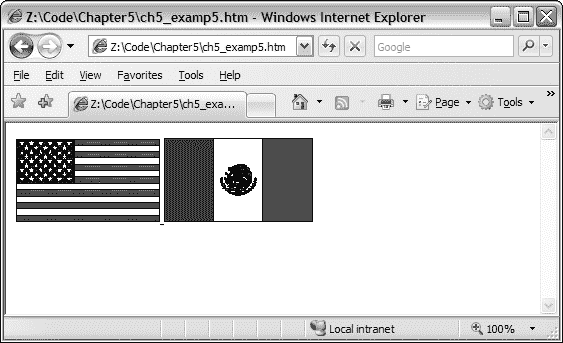

将页面保存为 `ch5_examp5.htm`。同样，你需要四个图像文件用于示例，你可以自己创建或从本书附带的代码下载中获取。

将页面加载到浏览器中。你应该会看到类似图 5-3 所示的页面。

**图 5-3**

如果你点击一个图像，你会看到它变为另一个随机选择的图像。

### 工作原理

页面顶部脚本块中的第一行定义了一个具有页面级作用域的变量。这是一个包含图像源列表的数组。

```javascript
var myImages = new Array("usa.gif","canada.gif","jamaica.gif","mexico.gif");
```

接下来是 `changeImg()` 函数，它将连接到每个图像周围的 `` 标签的 `onclick` 事件处理程序。你对两个图像的 `onclick` 事件处理程序使用同一个函数，实际上你可以将一个函数连接到任意多个事件处理程序。你向该函数传递一个参数——与点击事件相关的 `img` 对象在 `images` 数组中的索引——这样你就知道需要对哪个图像进行操作。

在函数的第一行，你使用传递的参数声明一个新变量，该变量指向 `images[]` 数组中与所点击图像对应的 `img` 对象，如下所示：

```javascript
function changeImg(imgNumber)
{
var imgClicked = document.images[imgNumber];
```

接下来，你将 `newImgNumber` 变量设置为 0 到 3 之间的随机整数。`Math.random()` 方法提供 0 到 1 之间的随机数，你将其乘以 3 得到 0 到 3 之间的数。然后通过 `Math.round()` 将其转换为整数（0、1、2 或 3）。这个整数将提供你从 `myImages` 数组中选择图像 `src` 的索引。

```javascript
var newImgNumber = Math.round(Math.random() * 3);
```

接下来的几行是一个 `while` 循环，其目的是确保你不会选择与当前图像相同的图像。如果在当前图像的 `src` 属性中找到了 `myImages[newImgNumber]` 中包含的字符串，则说明是同一张图像，你需要获取另一个随机数。你不断循环，直到获得一张新图像，此时 `myImages[newImgNumber]` 不会出现在现有的 `src` 中，`indexOf()` 方法将返回 `-1`，从而跳出循环。

```javascript
while (imgClicked.src.indexOf(myImages[newImgNumber]) != -1)
{
newImgNumber = Math.round(Math.random() * 3);
}
```

最后，你将 `img` 对象的 `src` 属性设置为 `myImages` 数组中包含的新值。

你返回 `false` 以阻止链接尝试导航到另一个页面；请记住，HTML 链接仅用于提供捕获 `onclick` 事件处理程序的手段。

```javascript
imgClicked.src = myImages[newImgNumber];
return false;
```

接下来，你将第一个 `` 标签的 `onclick` 事件连接到 `changeImg()` 函数：

```html

```

现在轮到第二个 `` 标签：

```html

```

在 `changeImg()` 函数中传递 `1` 可以让函数知道需要更改页面中的第二个图像（即图像 1）。

## 浏览器版本检查示例

互联网上存在许多浏览器、这些浏览器的版本以及操作系统，每个都有自己版本的 BOM 和特定的怪癖。因此，确保你的页面在所有浏览器上都能正常工作，或者至少能够优雅降级（例如显示一条建议用户升级浏览器的消息）非常重要。

虽然跨浏览器兼容代码可以解决大部分问题，但有时你可能希望添加只有某个浏览器支持的额外功能。解决方案是编写脚本，检查浏览器名称、版本，必要时检查操作系统，并执行与这些变体兼容的脚本。

检查浏览器详细信息主要有两种方法。第一种是查看你在代码中使用的对象和属性是否在用户的浏览器中实际可用。例如，假设我们的代码依赖于 `document` 对象的 `all` 属性，该属性在 IE 4+ 等浏览器中可用，但在任何 Firefox 或 Netscape 浏览器中不可用。如果你编写：

```javascript
if (document.all)
{
    // 使用 document.all 属性的代码
}
```

如果该属性返回有效值，则 `if` 语句的条件将评估为 `true`；如果不支持该属性，其值将为 `undefined`，`if` 语句将评估为 `false`。要检查是否支持特定方法，可以这样做：

```javascript
if (document.getElementById)
{
    // 代码
}
else
{
    // 替代代码
}
```

你像检查属性一样“测试”了该方法的存在。请记住，即使该方法通常有多个参数，也不要在其后包含左括号或右括号。例如，`getElementById` 方法有一个参数。

下一个示例展示了如何使用对象检查来确保为正确的浏览器执行正确的代码；这种技术并非万无一失，但非常有用。

### 试一试

**检查支持的浏览器属性**

```html
<html>
<body>
<script language="JavaScript" type="text/javascript">
var browser = "Unknown";
var version = "0";

// NN4+
if (document.layers)
{
    browser = "NN";
    version = "4.0";
    if (navigator.securityPolicy)
    {
        version = "4.7+";
    }
}
else if (document.all)
{
    browser = "IE"
    version = "4"
}

// IE5+
if (window.clipboardData)
{
    browser = "IE"
    version = "5+"
}

// Firefox/NN6+
else if (window.sidebar)
{
    browser = "Firefox";
    version = "1+";
}

document.write(browser + " " + version);
</script>
</body>
</html>
```

将此示例保存为 `ch5_examp6.htm`。

### 工作原理

该页面查看浏览器支持哪些 BOM 和 JavaScript 属性，并据此粗略猜测浏览器类型。因此，在前几行中，你检查浏览器的 `document` 对象是否具有 `layers` 属性。

```javascript
if (document.layers)
{
    browser = "NN";
    version = "4.0";
    if (navigator.securityPolicy)
    {
        version = "4.7+";
    }
}
```

由于只有 NN 4 支持 `layers` 属性，你可以假设这是一个 NN 4 浏览器，或者至少是一个支持 NN 4 layers 功能的浏览器。内部的 `if` 语句检查 `navigator` 对象是否支持 `securityPolicy` 属性；该属性仅由 Netscape Navigator 4 版本支持，特别是仅由 4.7 及更高子版本支持。然而，这里的一个小风险是，一个非 Netscape 或 Microsoft 的罕见浏览器可能支持 `securityPolicy` 属性，但不支持 NN 4.7+ 浏览器的其他功能。明智的做法是使用你预期会访问网站的各种浏览器进行测试，看看会发生什么。如果某个浏览器失败，你可以查看它在哪个属性上失败，并编写代码来检查它。

接下来，你测试 `document` 对象的 `all` 属性，该属性由 IE 4+ 和 Opera 7+ 支持。

```javascript
else if (document.all)
{
    browser = "IE"
    version = "4"
}
```

要检查浏览器是否为 IE 5+，请检查 `window` 对象的 `clipboardData` 属性，该属性目前仅由 IE 5+ 支持。

```javascript
// IE5+
if (window.clipboardData)
{
    browser = "IE"
    version = "5+"
}
```

最后一项检查是针对 Firefox 支持的 `sidebar` 属性，该属性用于处理侧边栏工具。

```javascript
// Firefox/NN6+
else if (window.sidebar)
{
    browser = "Firefox";
    version = "1+";
}
```

在最后一行，你输出 BOM 属性检查的结果。

```javascript
document.write(browser + " " + version);
```

希望这个示例能演示如何使用对象检查来查看浏览器是否支持特定功能。在示例中，你实际上并没有使用各种功能；它只是演示如何检查浏览器特定对象的一种方式。在编写自己的代码时，请务必仔细检查你使用的特定功能是否被你预期访问网站的所有浏览器支持。如果你预期的一些浏览器不支持某个特定功能，那么请测试该功能，并为不支持它的浏览器编写替代代码。

你将在第 12 章中看到更高级的对象检查。

### 完全没有脚本

有时人们会在浏览器中关闭 JavaScript，或者使用不支持 JavaScript 的浏览器（尽管这种情况现在很少见）。为了应对这种情况，你可以使用 `<noscript>` 标签。

`<noscript>` 标签内的任何 HTML 将仅显示给不支持 JavaScript 或已禁用 JavaScript 的浏览器：

```html
<html>
<body>
<noscript>
此网站需要启用 JavaScript。
</noscript>
</body>
</html>
```

## 使用 Navigator 对象进行浏览器检查

检查浏览器详细信息的第二种方法是使用 `window` 对象的 `navigator` 对象属性。具体来说，你使用 `navigator` 对象的 `appName` 和 `userAgent` 属性。这种方法的主要问题是，一个不太常见的浏览器可能会声明自己是 Internet Explorer 或 Firefox 的特定版本，但实际上并不支持该浏览器的所有 JavaScript 或 BOM 对象、属性或方法。因此，这种“浏览器嗅探”方法已不再受欢迎，也不是推荐的兼容性检查方式。它实际上是所有其他方法都失败时的最后手段，例如当两个不同的浏览器支持相同的对象和属性，但实现方式不同导致行为不同时。对象检查在这种情况下帮不了你，因此你不得不退而使用 `navigator` 对象。

`appName` 属性返回浏览器的型号，例如 Microsoft Internet Explorer 或 Netscape。

`userAgent` 属性返回一个包含各种信息的字符串，例如浏览器版本、操作系统和浏览器型号。然而，该属性返回的值因浏览器而异，因此使用时必须非常非常小心。例如，你不能假设它以浏览器版本开头。在 NN 下是这样，但在 IE 下，浏览器版本嵌入在字符串中间。

### 试一试

# 检查并处理不同浏览器

在本示例中，你将创建一个页面，利用前述属性来检测客户端的浏览器及其版本。然后，页面可以根据客户端的规格采取相应操作。

```html
<html>
<head>
<script language=”JavaScript” type=”text/javaScript”>
function getBrowserName()
{
    var lsBrowser = navigator.userAgent;
    if (lsBrowser.indexOf(“MSIE”) >= 0)
    {
        lsBrowser = “MSIE”;
    }
    else if (lsBrowser.indexOf(“Netscape”) >= 0)
    {
        lsBrowser = “Netscape”;
    }
    else if (lsBrowser.indexOf(“Firefox”) >= 0)
    {
        lsBrowser = “Firefox”;
    }
    else if (lsBrowser.indexOf(“Safari”) >= 0)
    {
        lsBrowser = “Safari”;
    }
    else if (lsBrowser.indexOf(“Opera”) >= 0)
    {
        lsBrowser = “Opera”;
    }
    else
    {
        lsBrowser = “UNKNOWN”;
    }
    return lsBrowser;
}

function getBrowserVersion()
{
    var findIndex;
    var browserVersion = 0;
    var browser = getBrowserName();
    browserVersion = navigator.userAgent;
    findIndex = browserVersion.indexOf(browser) + browser.length + 1;
    browserVersion = parseFloat(browserVersion.substring(findIndex,findIndex + 3));
    return browserVersion;
}
</script>
</head>
<body>
<script language=”JavaScript” type=”text/javaScript”>
var browserName = getBrowserName();
var browserVersion = getBrowserVersion();

if (browserName == “MSIE”)
{
    if (browserVersion < 5.5)
    {
        document.write(“Your version of Internet Explorer is too old”);
    }
    else
    {
        document.write(“Your version of Internet Explorer is fully supported”);
    }
}
else if (browserName == ‘Firefox’)
{
    document.write(“Firefox is fully supported”);
}
else if (browserName == ‘Netscape’)
{
    if (browserVersion < 6)
    {
        document.write(“Your version of Netscape is too old”);
    }
    else
    {
        document.write(“Your version of Netscape is fully supported”);
    }
}
else
{
    document.write(“<h2>Sorry this browser version is not supported</h2>”);
}
</script>
<noscript>
<h2>This website requires a browser supporting scripting</h2>
</noscript>
</body>
</html>
```

将此脚本保存为 `ch5_examp7.htm`。

如果浏览器是 Firefox、Internet Explorer 5.5+ 或 Netscape Navigator 6+，则会显示一条消息，告知用户该浏览器受支持。如果是较早版本的 IE 或 Navigator，用户将看到一条消息，告知其浏览器版本不受支持。


如果不是这些浏览器，用户将看到一条消息，告知其浏览器不受支持。这并不特别友好，因此在实际应用中，你可以提供一个没有脚本的简单版本页面——尽可能多地提供功能，但不使用 JavaScript。

如果浏览器不支持 JavaScript 或用户已关闭支持，那么他将看到一条消息，告知该网站需要 JavaScript 才能运行。

## 工作原理

页面 `head` 部分的脚本块定义了两个重要函数。`getBrowserName()` 函数用于查找浏览器名称，`getBrowserVersion()` 函数用于查找浏览器版本。

浏览器检测代码的关键在于 `navigator.userAgent` 属性返回的值。

以下是当前浏览器的一些 `userAgent` 字符串示例：

1. `Mozilla/4.0 (compatible; MSIE 6.0; Windows NT 5.1; SV1; .NET CLR 1.1.4322; .NET CLR 2.0.40607)`
2. `Mozilla/4.0 (compatible; MSIE 7.0; Windows NT 5.1; .NET CLR 2.0.40607)`
3. `Mozilla/5.0 (Windows; U; Windows NT 5.1; en-GB; rv:1.8.0.4) Gecko/20060508 Firefox/1.5.0.4`
4. `Mozilla/5.0 (Windows; U; Windows NT 5.1; en-US; rv:1.7.5) Gecko/20060127 Netscape/8.1`
5. `Opera/9.00 (Windows NT 5.0; U; en)`

这里，`userAgent` 字符串的每一行都已编号。仔细观察每一行，不难猜出每个 agent 字符串对应哪个浏览器。按顺序：

1. Microsoft Internet Explorer 6
2. Microsoft Internet Explorer 7 (beta 3)
3. Firefox 1.5
4. Netscape 8.1
5. Opera 9.0

利用这些信息，我们开始编写第一个函数 `getBrowserName()`。首先，获取 `navigator.userAgent` 中的浏览器名称，并将其存储在变量 `lsBrowser` 中。该变量也将用于存储函数的返回值。

```javascript
function getBrowserName()
{
    var lsBrowser = navigator.userAgent;
```

该属性返回的字符串通常很长，有时会略有变化。然而，通过检查某些关键字（如 `MSIE` 或 `Netscape`）是否存在，你可以确定浏览器名称。从以下几行开始：

```javascript
if (lsBrowser.indexOf(“MSIE”) >= 0)
{
    lsBrowser = “MSIE”;
}
```

这些行在 `lsBrowser` 字符串中搜索 Microsoft。如果该子字符串的 `indexOf` 值为 0 或更大，则说明找到了，于是将返回值设置为 `MSIE`。

接下来的 `else if` 语句执行相同操作，只是针对 Netscape 进行了修改。

```javascript
else if (lsBrowser.indexOf(“Netscape”) >= 0)
{
    lsBrowser = “Netscape”;
}
```

这个原则继续应用于另外三个 `if` 语句，其中还检查了 Firefox、Safari 和 Opera。如果你有想要检查的浏览器，可以在此处添加其 `if` 语句。只需查看它在 `navigator.userAgent` 中返回的字符串，并查找其名称或唯一标识它的内容。

如果没有匹配的 `if` 语句，则返回 `UNKNOWN` 作为浏览器名称。

```javascript
else
{
    lsBrowser = “UNKNOWN”;
}
```

然后将 `lsBrowser` 的值返回给调用代码。

```javascript
return lsBrowser;
}
```

现在来看最后一个函数 `getBrowserVersion()`。

浏览器版本详细信息通常出现在 `userAgent` 字符串中，紧跟在浏览器名称之后。因此，函数中的首要任务是确定正在处理哪个浏览器。使用刚刚编写的 `getBrowserName()` 函数声明并初始化 `browser` 变量为浏览器名称。

```javascript
function getBrowserVersion()
{
    var findIndex;
    var browserVersion = 0;
    var browser = getBrowserName();
```

如果浏览器是 MSIE（Internet Explorer），则需要再次使用 `userAgent` 属性。在 IE 下，`userAgent` 属性始终包含 `MSIE` 后跟浏览器版本。因此，你需要搜索 `MSIE`，然后获取其后的数字。

将 `findIndex` 设置为浏览器名称的字符位置加上名称长度再加 1。这样做可以确保获取到名称之后、版本号之前的空格或 `/` 字符之后的字符。`browserVersion` 被设置为该数字的浮点值，通过 `substring()` 方法获得。该方法选择从 `findIndex`（你的数字）开始，到 `findIndex` 加 3 之前结束的字符。这确保你只选择版本号的三个字符。

```javascript
browserVersion = navigator.userAgent;
findIndex = browserVersion.indexOf(browser) + browser.length + 1;
browserVersion = parseFloat(browserVersion.substring(findIndex,findIndex + 3));
```

回顾之前的 `userAgent` 字符串，可以看到 IE7 的字符串如下：`Mozilla/4.0 (compatible; MSIE 7.0; Windows NT 5.1; .NET CLR 2.0.40607)` 因此，`findIndex` 将被设置为浏览器名称后数字 7 的字符索引。`browserVersion` 将被设置为从 7 开始（包括 7）的三个字符，得到版本号 7.0。

在函数末尾，将 `browserVersion` 返回给调用代码，如下所示：

```javascript
return browserVersion;
}
```

你已经看到了辅助函数，但如何使用它们呢？在页面加载时执行的以下代码中，你获取了两条信息——浏览器名称和版本——并用它们来过滤用户正在运行的浏览器。

```javascript
var browserName = getBrowserName();
```

```javascript
var browserVersion = getBrowserVersion();

if (browserName == “MSIE”)
{
    if (browserVersion < 5.5)
    {
        document.write(“Your version of Internet Explorer is too old”);
    }
    else
    {
        document.write(“Your version of Internet Explorer is fully supported”);
    }
}
```

# 第 5 章：浏览器编程

前面的代码展示了第一个 `if` 语句，它检查用户是否使用 IE。如果是，则进一步检查版本是否低于 5.5。如果低于，则告知用户其 IE 版本太旧；如果是 IE5.5 及以上，则告知完全支持。

接下来对 Firefox 和 Netscape 进行同样的操作。本例中未检查 Firefox 版本，但你可以根据需要自行检查：

```javascript
else if (browserName == ‘Firefox’)
{
    document.write(“Firefox is fully supported”);
}
else if (browserName == ‘Netscape’)
{
    if (browserVersion < 6)
    {
        document.write(“Your version of Netscape is too old”);
    }
    else
    {
        document.write(“Your version of Netscape is fully supported”);
    }
}
else
{
    document.write(“<h2>Sorry this browser version is not supported</h2>”)
}
```

`if` 语句的最后一部分是 `else` 语句，它覆盖所有其他浏览器，并告知用户该浏览器不受支持。

最后，还有一些 `<noscript>` 标签，用于早期浏览器以及选择禁用 JavaScript 的用户。这些标签会显示一条消息，告知用户需要一个支持 JavaScript 的浏览器。

```html
<noscript>
<h2>This website requires a browser supporting scripting</h2>
</noscript>
```

如前所述，尽管这段脚本目前可以正常工作，但浏览器可能会更改其 `userAgent` 字符串，你需要更新函数以跟踪这些变化。此外，有些浏览器会伪装成其他浏览器，即使它们的功能并非 100% 相同，这可能导致代码显示错误。

因此，请坚持使用对象检查方法，本章前面已详细介绍过，第 12 章将进一步深入探讨。

## 总结

本章涵盖了很多内容，但现在你已经掌握了继续学习更有用知识所需的基础，例如表单和用户输入，以及后续更高级的文本和日期处理。

- 你将注意力转向了浏览器——JavaScript 存在的环境。就像 JavaScript 有原生对象一样，Web 浏览器也有自己的对象。Web 浏览器中的对象及其组织层次结构由所谓的浏览器对象模型（BOM）描述。这本质上是一张浏览器对象的地图。利用它，你可以导航浏览器提供的每个对象，以及它们的属性、方法和事件。
- 你首先看到的主要对象之一是 `window` 对象。它位于 BOM 层次结构的顶层。`window` 对象包含许多重要的子对象，包括 `location` 对象、`navigator` 对象、`history` 对象、`screen` 对象和 `document` 对象。
- `location` 对象包含当前页面位置的信息，例如文件名、托管页面的服务器以及使用的协议。这些都是 `location` 对象的属性。有些属性是只读的，但其他属性（如 `href` 属性）不仅允许我们查找页面的位置，还可以更改，以便将页面导航到新位置。
- `history` 对象记录了用户打开浏览器以来访问过的所有页面。有时页面不会被记录（例如，当使用 `location` 对象的 `replace()` 方法进行导航时）。你可以在历史记录堆栈中向前或向后移动浏览器，并发现用户访问过的页面。
- `navigator` 对象代表浏览器本身，包含有关用户浏览器类型、版本和操作系统的有用详细信息。这些详细信息使你能够编写处理各种类型浏览器的页面，即使它们可能不兼容。
- `screen` 对象包含有关用户计算机显示能力的信息。
- `document` 对象是最重要的对象之一。它是我们页面的对象表示，包含页面中的所有元素（也由对象表示）。Netscape 和 Microsoft 浏览器之间的差异在这里尤为突出。如果你希望页面跨浏览器兼容，你会发现可访问的元素非常有限。
- `document` 对象包含三个实际上是数组的属性：`links[]`、`images[]` 和 `forms[]` 数组。每个数组都包含页面上由 `<A>`、`` 和 `<form>` 标签创建的所有对象，这是我们访问这些标签的方式。
- `images[]` 数组为页面上的每个 `` 元素包含一个 `img` 对象。你发现即使在页面加载后，也可以更改图像的属性。例如，你可以让图像在点击时发生变化。使用 `images[]` 数组的相同原则也适用于 `links[]` 数组。
- 接下来你看到 BOM 对象除了方法和属性外，还有事件。你通过使用事件处理程序在 JavaScript 中处理这些事件，将事件处理程序连接到希望在事件发生时执行的代码。可用的事件取决于你处理的对象。
- 将你编写的函数连接到事件处理程序，只需向与你感兴趣的对象对应的元素添加一个属性即可。该属性的名称是你想要捕获的事件处理程序，其值是你想要连接的函数。
- 在某些情况下，例如对于 `document` 对象，需要第二种将事件处理程序连接到代码的方式。将对象的事件处理程序名称的属性设置为我们的函数，会产生与将事件处理程序作为属性使用相同的效果。
- 在某些情况下，从事件函数返回值可以让你取消与事件关联的操作。例如，要阻止点击的链接导航到页面，你可以从事件处理程序的代码中返回 `false`。
- 最后，你学习了如何检查用户浏览器的类型，以确保用户只看到其浏览器兼容的页面或页面部分。`navigator` 对象提供了你需要的详细信息，特别是 `appName` 和 `userAgent` 属性。你还可以在使用特定 BOM 属性之前检查它们是否受支持。如果浏览器不支持代码运行所需的特定属性，你可以编写替代代码，或者让用户知道需要升级浏览器。

本章到此结束。下一章我们将进入更令人兴奋的表单脚本编写，你可以在页面中添加各种控件，以帮助收集用户信息。

### 练习题

这些问题的参考答案见附录 A。

#### 问题 1

创建一个包含多个链接的页面。然后编写代码，在窗口的 `onload` 事件触发时，显示页面上每个链接的 `href`。

#### 问题 2

创建两个页面，一个名为 `IEOnly.htm`，另一个名为 `FFOnly.htm`。每个页面应有一个标题，告知你加载的是哪个页面，例如：

```html
<H2>欢迎来到仅限 Internet Explorer 的页面</H2>
```

使用检查浏览器类型的函数，连接到 `window` 对象的 `onload` 事件处理程序，检测用户使用的浏览器。然后，如果当前页面与该浏览器不匹配，则重定向到另一个页面。

#### 问题 3

在页面中使用 `` 标签插入一张图片。当鼠标指针悬停在图片上时，应切换为另一张图片。当鼠标指针移出（离开图片）时，应再次切换回原图。

# 第 6 章：HTML 表单——与用户交互

如果无法与用户交互或获取用户信息（如文本、数字或日期），网页将变得非常乏味。幸运的是，借助 JavaScript 可以实现这一点。你可以在网页中使用这些信息，也可以将其提交到 Web 服务器，在那里进行处理，如果需要还可以存储到数据库中。本章将重点介绍如何在 Web 浏览器中使用这些信息，这被称为*客户端处理*。在第 14 章和第 15 章中，你将学习如何将这些信息发送到 Web 服务器并存储到数据库中，这被称为*服务器端处理*。

你对各种用户界面元素应该已经很熟悉了。例如，Windows 操作系统有许多标准元素，比如可以点击的按钮；可以选择的列表、下拉列表框和单选按钮；以及可以勾选的复选框。任何图形用户界面（GUI）操作系统（无论是 Mac、Unix 还是 Linux 系统）都是如此。这些元素是我们现在与应用程序交互的方式。好消息是，你可以在网页中包含许多这类元素——更棒的是，实现起来非常简单。当你在页面中放置了这样一个元素（比如一个按钮）后，就可以将代码绑定到它的事件上。例如，当按钮被点击时，可以触发你编写的 JavaScript 函数。

需要特别注意的是，本章讨论的元素是 HTML 提供的常见元素，而不是 ActiveX 元素、Java Applet 或插件。你将在第 15 章中了解其中一些内容。

所有用于交互的 HTML 元素都应放在 HTML 表单内。在 Netscape 4+ 中，元素必须位于表单内，否则不会显示。如果要将表单提交到服务器，这也是强制要求。让我们先来看看 HTML 表单以及如何通过 JavaScript 与它们交互。

## HTML 表单

表单提供了一种将具有共同目的的 HTML 交互元素分组的方式。例如，一个表单可能包含用于输入用户数据以在网站上注册的元素。另一个表单可能包含允许用户获取汽车保险报价的元素。在一个页面中可以包含多个独立的表单。在需要将信息提交到 Web 服务器之前，你无需担心页面包含多个表单的问题——但那时需要注意，一个页面中只能同时提交一个表单的信息。

要创建表单，可以使用 `<form>` 和 `</form>` 标签来声明其开始和结束位置。`<form>` 标签有许多属性，例如 `action` 属性，用于确定表单提交的目标地址；`method` 属性，用于确定信息的提交方式；以及 `target` 属性，用于确定表单响应加载到的框架。

一般来说，对于不打算向服务器提交信息的客户端脚本，这些属性不是必需的。它们将在后续章节中介绍服务器端编程时发挥作用。目前，你只需要在 `<form>` 标签中设置 `name` 属性，以便能够引用该表单。

因此，要创建一个空白表单，所需的标签大致如下：

```html
<form name="myForm">
</form>
```

你可能会猜到，这些标签会创建一个 Form 对象，你可以通过它来访问表单。有两种方式可以访问该对象。

第一种，直接使用表单的名称来访问对象——在本例中是 `document.myForm`。另一种方式是通过 `document` 对象的 `forms[]` 数组属性来访问。还记得上一章讨论了 `document` 对象的 `images[]` 数组以及如何像操作其他数组一样操作它吗？`forms[]` 数组也是如此，只不过数组中的每个元素不再是 IMG 对象，而是 Form 对象。例如，如果我们的表单是页面中的第一个表单，则可以使用 `document.forms[0]` 来引用它。


`<form>`标签的许多属性都可以作为`Form`对象的属性来访问。特别是，`Form`对象的`name`属性与`<form>`标签的`name`属性相对应。

## 动手试一试

### forms 数组

让我们来看一个使用`forms`数组的示例。这里有一个包含三个表单的页面。通过`forms[]`数组，我们依次访问每个`Form`对象，并在消息框中显示其`name`属性的值。

```
<html>
<head>
<script language="JavaScript" type="text/javascript">
function window_onload()
{
    var numberForms = document.forms.length;
    var formIndex;
    for (formIndex = 0; formIndex < numberForms; formIndex++)
    {
        alert(document.forms[formIndex].name);
    }
}
</script>
</head>
<body language=JavaScript type="text/javascript" onload="window_onload()">
<form name="form1">
<p>This is inside form1</p>
</form>
<form name="form2">
<p>This is inside form2</p>
</form>
<form name="form3">
<p>This is inside form3</p>
</form>
</body>
</html>
```

将其保存为`ch6_examp1.htm`。在浏览器中加载该文件后，你应该会看到三个警告框，每个框显示一个表单的名称。

### 工作原理

在页面主体中，我们定义了三个表单。每个表单都有一个名称，并包含一段文本。

在`<body>`标签的定义中，`window_onload()`函数被连接到`window`对象的`onload`事件处理程序。

`<body language=JavaScript onload="return window_onload()">`这意味着当页面加载时，会调用你的`window_onload()`函数。

`window_onload()`函数定义在页面头部的脚本块中。在该函数中，我们遍历`forms[]`数组。与任何其他 JavaScript 数组一样，`forms[]`数组有一个`length`属性，你可以用它来确定需要循环的次数。实际上，由于你知道表单的数量，也可以直接写入数字。不过，本示例使用了`length`属性，因为这样更容易向数组中添加元素，而无需修改函数。

像这样泛化代码是一种良好的编程习惯。

函数首先获取`forms`数组中`Form`对象的数量，并将其存储在变量`numberForms`中。

```
function window_onload()
{
    var numberForms = document.forms.length;
```

接下来，我们定义一个变量`formIndex`，用于`for`循环。然后是`for`循环本身。

```
var formIndex;
for (formIndex = 0; formIndex < numberForms; formIndex++)
{
    alert(document.forms[formIndex].name);
}
```

请记住，由于数组的索引从 0 开始，循环需要从索引 0 到`numberForms – 1`。我们通过将`formIndex`变量初始化为 0，并将`for`循环的条件设置为`formIndex < numberForms`来实现这一点。

在`for`循环的代码中，我们将所需表单的索引（即`formIndex`）传递给`document.forms[]`，从而获得`forms`数组中该索引位置的`Form`对象。要访问`Form`对象的`name`属性，只需在属性名称`name`后面加上一个点即可。

### 其他 Form 对象属性和方法

HTML 表单中常见的表单控件（稍后你会详细了解）也有对应的对象。访问这些对象的一种方式是通过`Form`对象的`elements[]`属性。这个数组类似于你之前看到的`document`对象的`forms[]`数组属性。

`elements[]`数组包含表单中所有与 HTML 交互元素对应的对象，但很少使用的`<input type=image>`元素除外。稍后你会看到，这个属性对于遍历表单中的每个元素非常有用。例如，你可以在提交表单之前遍历每个元素，检查它是否包含有效数据。

作为一个数组，`Form`对象的`elements[]`属性具有`length`属性，它告诉你表单中有多少个元素。`Form`对象本身也有`length`属性，同样返回表单中的元素数量。使用哪一个由你决定，因为两者功能相同，不过编写`document.myForm.length`比`document.myForm.elements.length`更短，因此输入更快，在代码中看起来也更简洁。

当你将表单数据提交到服务器时，通常使用提交按钮（稍后会介绍）。然而，`Form`对象也有`submit()`方法，它执行几乎相同的操作。区别在于它不会调用`Form`对象的`onsubmit`事件处理程序。

回想上一章，你看到了事件处理程序代码返回的值如何影响正常事件流程是继续还是被取消。例如，从超链接的`onclick`事件处理程序返回`false`会导致链接的导航被取消。同样的原理也适用于`Form`对象的`onsubmit`事件处理程序，它在用户提交表单时触发。如果你向该事件处理程序返回`true`，表单提交将继续；如果返回`false`，提交将被取消。这使得`onsubmit`事件处理程序的代码成为进行表单验证（即检查用户在表单中输入的内容是否有效）的理想场所。例如，如果你询问用户的年龄，而她输入了“关你什么事”，你可以发现这是文本而不是有效数字，并阻止她继续操作。

除了有重置按钮（我们将在本章后面讨论）之外，`Form`对象还有`reset()`方法，它可以清空表单，或者如果存在默认值则恢复默认值。

创建空白表单并不令人兴奋或有用，所以现在让我们把注意力转向在表单内提供交互功能的 HTML 元素。

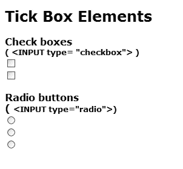

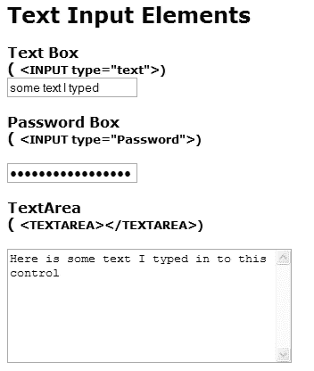

# 第 6 章：HTML 表单——与用户交互

## 表单中的 HTML 元素

在`<form>`元素中，大约有十种常见的元素。最有用的如图 6-1、6-2、6-3 和 6-4 所示，按一般类型排序。我们给出了每个元素的名称，并在括号中给出了创建它所需的 HTML，但请注意这不是完整的 HTML，而只是一部分。

图 6-1

图 6-2

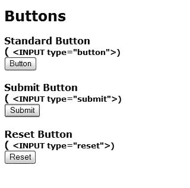

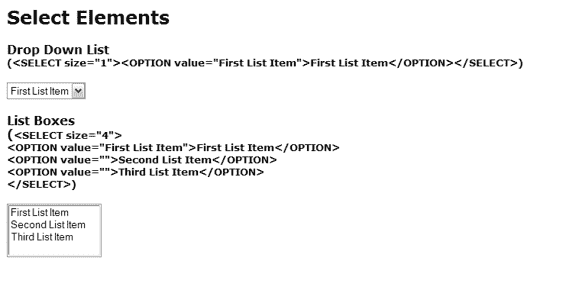

图 6-3

图 6-4

如你所见，大多数`<form>`元素是通过`<input>`标签创建的。`<input>`标签的属性之一是`type`属性。正是这个属性决定了该标签将成为哪个 HTML 元素。该属性的值示例包括`button`（创建按钮）和`text`（创建文本框）。

网页中的每个表单元素都以对象的形式提供给你——是的，你猜对了。与之前看到的所有其他对象一样，每个元素的对象都有自己独特的属性、方法和事件。我们将逐一介绍每个表单元素以及如何使用其特定的属性、方法和事件，但在此之前，让我们先看看表单元素对象共有的属性和方法。

### 共有属性和方法

所有表单元素对象共有的一个属性是`name`属性。你可以使用该属性的值在脚本中引用该特定元素。此外，如果你将表单中的信息发送到服务器，元素的`name`属性会与表单元素的任何值一起发送，以便服务器知道该值与什么相关。

大多数表单元素对象也有`value`属性，它返回元素的值。例如，对于文本框，`value`属性返回用户在文本框中输入的文本。此外，设置`value`属性的值可以让你在文本框中放入文本。然而，`value`属性的使用是特定于每个元素的，因此我们将在介绍每个元素时讨论它的含义。

所有表单元素对象还有`form`属性，它返回包含该元素的`Form`对象。这在你有通用例程检查表单中数据有效性时非常有用。例如，当用户单击提交按钮时，你可以将`form`属性引用的`Form`对象传递给数据检查器，数据检查器可以使用它依次遍历表单中的每个元素，检查元素中的数据是否有效。如果页面上定义了多个表单，或者你有一个通用数据检查器可以复制粘贴到不同页面，这很方便——这样你就不需要事先知道表单的名称。

有时了解你正在处理的元素类型很有用，特别是当你使用`Form`对象的`elements[]`数组属性遍历表单中的元素时。可以通过每个元素对象都具有的`type`属性来获取此信息。该属性返回元素的类型（例如`button`或`text`）。

所有表单元素对象还有`focus()`和`blur()`方法。*焦点*是一个你可能尚未接触的概念。如果一个元素是焦点的中心，用户按下的任何键都将直接传递给该元素。例如，如果文本框获得焦点，按键将向文本框中输入值。同样，如果按钮获得焦点，按回车键将触发按钮的`onclick`事件处理程序代码，就像用户用鼠标单击了该按钮一样。

用户可以通过单击元素或使用 Tab 键选择元素来设置当前哪个元素获得焦点。然而，作为程序员，你也可以通过使用表单元素对象的`focus()`方法来决定哪个元素获得焦点。例如，如果你有一个文本框让用户输入年龄，而他输入了无效值（例如字母而不是数字），你可以告诉他输入无效，并让他回到该文本框纠正错误。

*失焦*（或许可以更好地称为“失去焦点”）是焦点的反面。如果你想将表单元素从用户关注的焦点中移除，可以使用`blur()`方法。当与表单元素一起使用时，`blur()`方法通常会导致焦点转移到包含该表单的页面。

除了`focus()`和`blur()`方法之外，所有表单元素对象都有`onfocus`和`onblur`事件处理程序。正如你所料，这些事件分别在元素获得或失去焦点时触发，原因可能是用户操作，也可能是`focus()`和`blur()`方法。`onblur`事件处理程序是检查刚刚失去焦点的元素中数据有效性的好地方。如果数据无效，你可以将焦点设置回该元素，并让用户知道他输入的数据为什么错误。

# 第 6 章：HTML 表单——与用户交互

需要特别注意的是，在`onfocus`或`onblur`事件处理代码中使用`focus()`和`blur()`方法时，存在无限循环的风险。例如，考虑两个元素，每个元素的`onfocus`事件都会将焦点传递给另一个元素。那么，如果一个元素获得焦点，它的`onfocus`事件会将焦点传递给第二个元素，而第二个元素的`onfocus`事件又会将焦点传回第一个元素，如此循环，唯一的出路就是关闭浏览器。这恐怕不会让用户感到满意！

此外，如果某个字段或其他字段依赖于用户的某些输入，使用`focus()`和`blur()`方法将焦点放回有问题的字段时也要格外小心。例如，假设有两个文本框，一个希望用户输入城市，另一个希望用户输入州。同时，州文本框的输入会被检查，以确保指定的城市属于该州。如果该州不包含该城市，你会将焦点放回州文本框，以便用户更改州名。然而，如果用户实际输入了错误的城市名和正确的州名，她可能无法返回城市文本框来纠正问题。

## 按钮表单元素

我们从标准按钮元素开始介绍表单元素，因为它可能是最常用且相当简单的。创建按钮的 HTML 标签是`<input>`标签。例如，要创建一个名为`myButton`、按钮上显示“Click Me”文字的按钮，`<input>`标签需要如下所示：

```
<input type=”button” name=”myButton” value=”Click Me”>
```

`type`属性设置为`button`，`value`属性设置为你希望显示在按钮上的文字。你可以省略`value`属性，但这样会得到一个空白按钮，让用户猜测其用途。

该元素会创建一个关联的`Button`对象；在这个例子中，它被称为`myButton`。该对象拥有前面描述的所有通用属性和方法，包括`value`属性。这个属性允许你使用 JavaScript 更改按钮上的文字，尽管你可能并不经常需要这样做。按钮的真正核心在于`click`事件。

你可以像处理其他 HTML 标签（如`<A>`标签）的`onclick`事件一样，连接到按钮的`onclick`事件处理程序。你只需定义一个希望在按钮被点击时执行的函数（例如`button_onclick()`），然后将`onclick`事件处理程序作为`<input>`标签的一个属性添加进去，如下所示：

```
<input type=”button” onclick=”button_onclick()”>
```

### 动手试一试

#### 统计按钮点击次数

在下面的示例中，你将使用前面描述的方法来记录按钮被点击的次数。

```
<html>
<head>
<script language=”JavaScript” type=”text/javascript”>
var numberOfClicks = 0;

function myButton_onclick()
{
    numberOfClicks++;
    window.document.form1.myButton.value = ‘Button clicked ‘ + numberOfClicks +
        ‘ times’;
}
</script>
</head>
<body>
<form name=form1>
<input type=’button’ name=’myButton’ value=’Button clicked 0 times’
    onclick=”myButton_onclick()”>
</form>
</body>
</html>
```

将此页面保存为`ch6_examp2.htm`。如果你在浏览器中加载此页面，你会看到一个显示“Button clicked 0 times”的按钮。如果你反复按下这个按钮，你会看到按钮文字上记录了按钮的点击次数。

##### 工作原理

你在页面头部的脚本块中定义了一个全局变量`numberOfClicks`，该变量在页面内任何地方都可访问。你在这个变量中记录按钮被点击的次数，并利用这些信息更新按钮的文字。

脚本块中的另一段代码是函数`myButton_onclick()`的定义。这个函数连接到页面主体中`<input>`标签的`onclick`事件处理程序。该标签对应一个名为`myButton`的按钮元素，它包含在一个名为`form1`的表单中。

```
<form name=form1>
<input type=’button’ name=’myButton’ value=’Button clicked 0 times’
    onclick=”myButton_onclick()”>
</form>
```

让我们更仔细地看一下`myButton_onclick()`函数。首先，该函数将变量`numberOfClicks`的值增加 1。

```
function myButton_onclick()
{
    numberOfClicks++;
```

接下来，你使用`Button`对象的`value`属性更新按钮上的文字。

```
    window.document.form1.myButton.value = ‘Button clicked ‘ + numberOfClicks +
        ‘ times’;
}
```

这个示例中的函数是特定于该表单和按钮的，而不是一个你会在其他情况下使用的通用函数。因此，示例中的代码直接使用`window.document.form1.myButton`来引用表单和按钮。请记住，`window`对象有一个包含`document`对象的属性，而`document`对象本身包含了页面中的所有元素，包括`<form>`元素，并且按钮嵌入在你的表单中。

### 动手试一试

#### onmouseup 和 onmousedown

`Button`对象支持的两个不太常用的事件是`onmousedown`和`onmouseup`事件。你可以在下一个示例中看到这两个事件的实际效果。

```
<html>
<head>
<script language=”JavaScript” type=”text/javascript”>
function myButton_onmouseup()
{
    document.form1.myButton.value = “Mouse Goes Up”
}

function myButton_onmousedown()
{
    document.form1.myButton.value = “Mouse Goes Down”
}
</script>
</head>
<body>
<form name=form1>
<input type=’button’ name=’myButton’ value=’ Mouse Goes Up ‘
    onmouseup=”myButton_onmouseup()”
    onmousedown=”myButton_onmousedown()”>
</form>
</body>
</html>
```

将此页面保存为`ch6_examp3.htm`并在浏览器中加载。如果你用鼠标左键点击按钮并保持按住，你会看到按钮上的文字变为“Mouse Goes Down”。一旦你松开按钮，文字就会变回“Mouse Goes Up”。

##### 工作原理


在页面主体中，你在一个名为`form1`的表单内定义了一个名为`myButton`的按钮。在`<input>`标签的属性中，你将函数`myButton_onmouseup()`附加到`onmouseup`事件处理程序，将函数`myButton_onmousedown()`附加到`onmousedown`事件处理程序。

```html
<form name=form1>
<input type=’button’ name=’myButton’ value=’ Mouse Goes Up ‘
    onmouseup=”myButton_onmouseup()”
    onmousedown=”myButton_onmousedown()”>
</form>
```

`myButton_onmouseup()`和`myButton_onmousedown()`函数在页面头部的脚本块中定义。每个函数只包含一行代码，你使用`Button`对象的`value`属性来更改按钮上显示的文字。

需要重点注意的是，像`onmouseup`和`onmousedown`这样的事件只有在鼠标指针实际位于相关元素上方时才会触发。例如，如果你在按钮上按住鼠标左键，然后在松开鼠标按钮之前将鼠标移开按钮，你会发现`onmouseup`事件不会触发，按钮上的文字也不会改变。在这种情况下，如果你为`document`对象的`onmouseup`事件处理程序连接了任何代码，那么该处理程序代码才会触发。

不要忘记，与所有表单元素对象一样，`Button`对象也拥有`onfocus`和`onblur`事件，尽管它们在按钮的上下文中很少使用。

## 提交和重置按钮

另外两种按钮类型是提交按钮和重置按钮。定义这些按钮的方式与标准按钮相同，只是`<input>`标签的`type`属性设置为`submit`或`reset`，而不是`button`。例如，图 6-4 中的提交和重置按钮是通过以下代码创建的：

```html
<input type="submit" value="Submit" name="submit1">
<input type="reset" value="Reset" name="reset1">
```

这些按钮具有特殊用途，但与脚本无关。

当点击提交按钮时，按钮所在表单的表单数据会自动发送到服务器，无需任何脚本。

当点击重置按钮时，表单中的所有元素都会被清空并恢复为默认值（即页面首次加载时的值）。

提交和重置按钮有对应的对象，分别称为`Submit`和`Reset`，它们与标准`Button`对象具有完全相同的属性、方法和事件。

## 文本元素

标准文本元素允许用户输入单行文本。这些信息随后可在 JavaScript 代码中使用，或提交到服务器进行服务器端处理。

文本框通过`<input>`标签创建，与按钮类似，但`type`属性设置为`text`。同样，你可以选择不包含`value`属性，但如果包含，该值将在页面加载时显示在文本框中。

在以下示例中，`<input>`标签有两个额外属性：`size`和`maxlength`。`size`属性决定文本框的字符宽度，`maxlength`决定用户可在框中输入的最大字符数。这两个属性都是可选的，并使用浏览器确定的默认值。

例如，要创建一个宽度为 10 个字符、最大字符长度为 15、初始内容为 "Hello World" 的文本框，你的`<input>`标签应如下所示：

```html
<input type="text" name="myTextBox" size=10 maxlength=15 value="Hello World">
```

该元素创建的`Text`对象具有`value`属性，你可以在脚本中使用它来设置或读取文本框中的文本。除了我们之前讨论的通用属性和方法外，`Text`对象还具有`select()`方法，该方法用于选中或高亮文本框中的所有文本。当用户输入了无效值时，可以使用此方法，将焦点设置到文本框并选中其中的文本。这样可以将用户的光标置于正确位置以修正数据，并让用户清楚地知道无效数据在哪里。

`Text`对象的`value`属性始终返回字符串数据类型，即使输入的是数字字符也是如此。如果你将值用作数字，JavaScript 通常会为你从字符串类型转换为数字类型，但并非总是如此。例如，如果你执行的操作对字符串有效，JavaScript 就不会进行转换。如果你有一个包含两个文本框的表单，并将这两个文本框返回的值相加，JavaScript 会进行字符串拼接而不是加法，因此 1 加 1 会得到 11 而不是 2。

要解决这个问题，你需要将所有涉及的值转换为数值数据类型，例如使用`parseInt()`、`parseFloat()`或`Number()`。然而，如果你对两个值进行减法运算（该运算仅对数字有效），JavaScript 会认为“啊，这只能用数字完成，所以我会将这些值转换为数字类型。”因此，1 减 1 会返回 0，而无需你使用`parseInt()`或`parseFloat()`。这是一个难以发现的 bug，因此最好养成显式转换的习惯，以避免后续问题。

除了通用事件处理程序（如`onfocus`和`onblur`）外，`Text`对象还具有`onchange`、`onselect`、`onkeydown`、`onkeypress`和`onkeyup`事件处理程序。

当用户在文本框中选中某些文本时，会触发`onselect`事件。

更有用的是`onchange`事件，当元素失去焦点时，如果（且仅当）文本框中的值与获得焦点时的值不同，则会触发该事件。这使你能够执行仅在内容发生变化时才进行的有效性检查。

如前所述，`onfocus`和`onblur`事件可用于验证用户输入。但它们还有另一个用途，即让文本框变为只读。在 IE 4.0+ 和 NN 6 中，你可以使用`<input>`标签的`READONLY`属性或`Text`对象的`readOnly`属性来防止内容被更改。然而，这些技术在 NN 4.x 中不起作用。你可以使用`blur()`方法来解决这个问题。你只需在定义文本框的`<input>`标签中添加一个`onfocus`事件处理程序，并将其连接到使用`blur()`方法使文本框失去焦点的代码即可。

```html
<input type="text" name=txtReadonly value="Look but don't change"
onfocus="window.document.form1.txtReadonly.blur()"
READONLY=true>
```

`onkeypress`、`onkeydown`和`onkeyup`事件分别会在用户按下按键、用户按下按键时以及用户松开按下的按键时触发。

## 动手试一试

### 一个带验证的简单表单

让我们将关于文本框和按钮的所有信息整合到一个示例中。在这个示例中，你有一个包含两个文本框和一个按钮的简单表单。上面的文本框用于输入用户名，第二个用于输入年龄。你将进行各种有效性检查。当年龄文本框失去焦点时，你会检查其有效性。然而，当点击按钮时，只会检查姓名和年龄文本框是否为空。

```html
<html>
<head>
<script language="JavaScript" type="text/javascript">
function butCheckForm_onclick()
{
    var myForm = document.form1;
    if (myForm.txtAge.value == "" || myForm.txtName.value == "")
    {
        alert("Please complete all the form");
        if (myForm.txtName.value == "")
        {
            myForm.txtName.focus();
        }
        else
        {
            myForm.txtAge.focus();
        }
    }
    else
    {
        alert("Thanks for completing the form " + myForm.txtName.value);
    }
}
function txtAge_onblur()
{
    var txtAge = document.form1.txtAge;
    if (isNaN(txtAge.value) == true)
    {
        alert("Please enter a valid age");
        txtAge.focus();
        txtAge.select();
    }
}
function txtName_onchange()
{
    window.status = "Hi " + document.form1.txtName.value;
}
</script>
</head>
<body>
<form name=form1>
Please enter the following details:
<p>
Name:
<br>
<input type="text" name=txtName onchange="txtName_onchange()">
<br>
Age:
<br>
<input type="text" name=txtAge onblur="txtAge_onblur()" size=3 maxlength=3>
<br>
<input type="button" value="Check Details" name=butCheckForm onclick="butCheckForm_onclick()">
</form>
</body>
</html>
```

输入文本后，将文件保存为`ch6_examp4.htm`，并在 Web 浏览器中加载。

在图 6-5 所示的文本框中，输入你的姓名。当你离开文本框时，会在窗口底部的状态栏中看到 "Hi yourname"。

在年龄文本框中输入无效值，例如 aaaa，当你尝试离开该框时，它会提示错误，并将你送回以修正。

最后，点击 "Check Details" 按钮，两个文本框都会被检查是否已填写。如果其中任何一个为空，你会收到一条消息，提示你完成整个表单，并将你送回空文本框。

如果所有内容都正确填写，你会收到一条感谢消息，如图 6-5 所示。

请注意，此示例在 Firefox 或 Netscape 浏览器上无法正常工作；我们稍后将讨论原因。

## 工作原理

# 第 6 章：HTML 表单——与用户交互

在页面主体中，你可以创建定义表单的 HTML 标签。在你的表单（名为`form1`）内部，创建三个表单元素，分别命名为`txtName`、`txtAge`和`butCheckForm`。

```html
<form name=form1>
请输入以下详细信息：
<p>
姓名：
<br>
<input type="text" name=txtName onchange="txtName_onchange()">
<br>
年龄：
<br>
<input type="text" name=txtAge onblur="txtAge_onblur()" size=3 maxlength=3>
<br>
<input type="button" value="检查详细信息" name=butCheckForm onclick="butCheckForm_onclick()">
</form>
```

你会看到，对于第二个文本框（`txtAge`文本框），你在`<input>`标签中包含了`size`和`maxlength`属性。将`size`属性设置为 3 可以让用户了解你期望输入多少文本，而将`maxlength`属性设置为 3 则有助于确保年龄值不会输入过大的数字！

第一个文本框的`onchange`事件处理程序连接到函数`txtName_onchange()`，第二个文本框的`onblur`事件处理程序连接到函数`txtAge_onblur()`，按钮的`onclick`事件处理程序连接到函数`butCheckForm_onclick()`。这些函数定义在页面头部的脚本块中。我们将逐一介绍它们，先从`butCheckForm_onclick()`开始。

首先，定义一个变量`myForm`，并将其设置为引用页面后面由`<form>`标签创建的`Form`对象。

```javascript
function butCheckForm_onclick()
{
var myForm = document.form1;
if (myForm.txtAge.value == "" || myForm.txtName.value == "")
{
alert("请填写所有表单字段");
if (myForm.txtName.value == "")
{
myForm.txtName.focus();
}
else
{
myForm.txtAge.focus();
}
}
else
{
alert("感谢您填写表单，" + myForm.txtName.value);
}
}
```

这样做可以减少每次使用`form1`对象时代码的长度。你可以直接输入`myForm`，而不必写`document.form1`。这使代码更易读，从而更容易调试，并且节省了输入。当你将一个变量设置为等于一个现有对象时（在这种情况下），实际上并不会创建一个新的`form1`对象；你只是将变量指向现有的`form1`对象。因此，当你输入`myForm.name`时，JavaScript 会检查你的变量，发现它实际上存储了对象`form1`在内存中的位置，并使用该对象。这一切都在后台进行，所以你无需担心，只需像使用`document.form1`一样使用`myForm`即可。

获取对`Form`对象的引用后，你可以在`if`语句中使用它来检查名为`txtAge`或`txtName`的文本框中是否包含任何文本。

如果发现表单不完整，你会向用户发出警告。然后在内部的`if`语句中，检查哪个文本框未被填写。你将焦点设置到有问题的文本框上，这样用户就可以直接开始填写，而无需自己移动焦点。这还能让用户知道我们的程序要求他填写哪个文本框。为了避免惹恼用户，请确保页面中的文本告知用户哪些字段是必填的。

如果外层的`if`语句发现表单已完整填写，它会向用户显示一条感谢消息。

在这种情况下，更可能的是将表单提交到服务器，而不是仅仅显示感谢消息。你可以使用`Form`对象的`submit()`方法或普通的提交按钮来实现。

三个函数中的第二个是`txtAge_onblur()`，它连接到`txtAge`文本框的`onblur`事件。此函数的目的是检查用户输入到年龄框中的字符串值是否由数字字符组成。

```javascript
function txtAge_onblur()
{
var txtAge = document.form1.txtAge;
if (isNaN(txtAge.value) == true)
{
alert("请输入有效的年龄");
txtAge.focus();
txtAge.select();
}
}
```

同样，在函数开头，你声明一个变量并将其设置为引用一个对象；这次是引用为页面后面定义的`txtAge`文本框创建的`Text`对象。现在，每次只需输入`txtAge`，而不必输入`document.form1.txtAge`，效果相同。这确实有助于节省打字的手指，尤其是当函数较大且多次使用`txtAge`对象时。

接下来的`if`语句检查`txtAge`文本框中输入的内容是否可以转换为数字。你使用`isNaN()`函数来完成此操作。如果`txtAge`文本框中的值不是数字，则向用户发出警告，并使用相应`Text`对象的`focus()`方法将焦点设置回有问题的元素。此外，这次你使用`Text`对象的`select()`方法来高亮显示文本。这使用户更清楚地知道需要修正什么，并且无需先删除文本即可纠正问题。

你可以进一步检查文本框中的数字是否确实是有效的年龄——例如，191 不是有效年龄，255 也不太可能。你只需添加另一个`if`语句来检查这些可能性。

此函数连接到`txtAge`文本框的`onblur`事件处理程序，但为什么没有使用`onchange`事件处理程序呢？它的优点在于仅在值实际更改时才重新检查。如果文本框在获得焦点之前和失去焦点之后都为空，则`onchange`事件不会触发。然而，最好将表单完整性的检查推迟到表单即将提交之前，因为有些用户喜欢不按顺序填写信息，稍后再回来填写某些表单元素。

最后一个函数用于`txtName`文本框的`onchange`事件。这里的使用有点随意，主要目的是作为`onchange`事件的示例。

```javascript
function txtName_onchange()
{
window.status = "你好，" + document.form1.txtName.value;
}
```

当`onchange`事件触发时（当焦点离开姓名文本框且其内容已更改时），你获取`txtName`框的值并将其放入窗口底部的状态栏中。它简单地显示“你好，你的名字”。你可以使用`window`对象的`status`属性访问状态栏，尽管你也可以直接输入：`status = "你好，" + document.form1.txtName.value;`

这里在前面加上`window`只是为了明确你实际访问的是什么。在阅读代码时，很容易将`status`误认为是变量，因此在这种情况下，虽然并非严格必要，但加上`window`确实使代码更易读、易理解，从而更容易调试。

### Firefox、Netscape 和 blur 事件的问题

如果你在姓名文本框中输入一个名字，然后在年龄框中输入一个无效年龄（例如，输入 abc 然后点击“检查详细信息”按钮），前面的示例在 Firefox 和 Netscape 中会失败。在 IE 中，如果年龄无效，`blur`事件会触发并显示一个警告框，但按钮的`click`事件不会触发。然而，在 FF/NN 中，两个事件都会触发，导致“表单填写成功”的警告框覆盖了无效年龄的警告。


此外，如果你在 IE 和 Firefox/Netscape 浏览器中都输入了无效年龄，然后切换到另一个程序，会出现“无效年龄”的警告框，这对用户来说很烦人。用户可能正在打开另一个程序来检查详细信息。

尽管这是一个不错的示例，但在实际应用中并不理想。更好的做法是在表单最终提交时进行检查，而不是在用户输入数据的过程中。或者，你也可以在输入数据时进行检查，但不要使用警告框来显示错误。相反，你可以在错误的输入控件旁边用红色写出警告信息，告知用户无效数据，然后在表单提交时让代码再次检查。在动态 HTML 章节中，你将看到如何在页面加载后向页面写入内容。

## 密码文本框

密码框的唯一实际用途是让用户在页面上输入密码，并隐藏密码字符，这样别人就无法从用户背后窥视到密码。然而，当发送到服务器时，密码中的文本是以纯文本形式发送的——没有加密或任何隐藏文本的尝试——因此这不是一种安全的信息传递方式。

定义密码框与定义文本框相同，只是`type`属性为`password`。

```html
<input name=”password1” type=”password”>
```

该表单元素会创建一个关联的`Password`对象，该对象在属性、方法和事件上与`Text`对象完全相同。

## 隐藏文本框

隐藏文本框可以像普通文本框一样保存文本和数字，区别在于它对用户不可见。一个隐藏元素？听起来可能像一幅隐形画一样无用，但实际上它非常有用。

要定义隐藏文本框，可以使用以下 HTML：

```html
<input type=”hidden” name=myHiddenElement>
```

隐藏文本框会创建一个`Hidden`对象。该对象可通过`Form`对象的`elements`数组属性访问，并可以像其他对象一样在 JavaScript 中操作，尽管你只能通过其 HTML 定义或 JavaScript 来设置其值。与普通文本框一样，当用户提交表单时，其值会被发送到服务器。

那么隐藏文本框有什么用呢？假设你需要从用户那里获取大量信息，但为了避免页面塞满元素，看起来像航天飞机的控制面板，你决定通过多个页面来获取信息。问题是如何记录之前页面中输入的内容？很简单——使用隐藏文本框并将值放入其中。然后在最后一页，所有信息都会被提交到服务器——只是其中一些是隐藏的。无论如何，你将在第 16 章中了解更多。

### textarea 元素

`textarea`元素允许多行文本输入。除此之外，它的行为与文本框元素非常相似。

然而，与文本框不同，`textarea`元素有自己的标签，即`<textarea>`标签。它还有两个额外的属性：`COLS`和`ROWS`。`COLS`属性定义文本区域的字符宽度，`ROWS`属性定义字符行数。通过将文本放在开始和结束标签之间来设置元素内的文本，而不是使用`value`属性。因此，如果你想要一个宽度为 40 个字符、深度为 20 行、初始文本第一行为`Hello World`、第二行为`Line 2`的`textarea`元素，可以这样定义：

```html
<textarea name=myTextArea cols=40 rows=20>Hello World
Line 2
</textarea>
```

`<textarea>`标签的另一个属性是`wrap`属性，它决定当用户输入到行尾时会发生什么。默认值为`soft`，因此用户不必在行尾按回车键，但这可能因浏览器而异。要启用换行，可以使用两个值之一：`soft`（仅包含`wrap`属性本身）和`hard`。就客户端处理而言，两者作用相同：都启用换行。然而，在服务器端处理时，它们会影响表单提交时发送到服务器的信息。

如果将`wrap`属性设置为`soft`来启用换行，则换行会在客户端发生，但回车符不会发送到服务器，只发送文本。如果将`wrap`属性设置为`hard`，则由换行引起的任何回车符都将转换为硬回车——就像用户按了回车键一样，这些回车符将被发送到服务器。此外，需要注意回车符由浏览器运行的操作系统决定——例如，在 Windows 中回车符是`\r\n`，而在 Macintosh 中回车符是`\r`，在 Unix 中回车符是`\n`。要关闭客户端换行，将`wrap`设置为`off`。

由`<textarea>`标签创建的`Textarea`对象具有与之前看到的`Text`对象相同的属性、方法和事件，只是文本区域没有`maxlength`属性。请注意，即使`<textarea>`标签没有`value`属性，也存在`value`属性。`value`属性只是返回`<textarea>`和`</textarea>`标签之间的文本。`Textarea`对象支持的事件包括`onkeydown`、`onkeypress`、`onkeyup`和`onchange`事件处理程序。

## 动手试一试

### 事件监控

为了帮助演示`keydown`、`keypress`、`keyup`和`change`事件的工作原理（特别是它们触发的顺序），你将创建一个示例来告诉你哪些事件正在触发。

```html
<html>
<head>
<script language=”JavaScript” type=”text/javascript”>
function DisplayEvent(eventName)
{
    var myMessage = window.document.form1.textarea2.value;
    myMessage = myMessage + eventName;
    window.document.form1.textarea2.value = myMessage;
}
</script>
</head>
<body>
<form name=form1>
<textarea rows=15 cols=40 name=textarea1
    onchange=”DisplayEvent(‘onchange\n’);”
    onkeydown=”DisplayEvent(‘onkeydown\n’);”
    onkeypress=”DisplayEvent(‘onkeypress\n’);”
    onkeyup=”DisplayEvent(‘onkeyup\n\n’);”></textarea>
<textarea rows=15 cols=40 name=textarea2></textarea>
<br><br>
<input type=”button” value=”Clear Event TextArea”
    name=button1 onclick=”window.document.form1.textarea2.value=’’”>
</form>
</body>
</html>
```

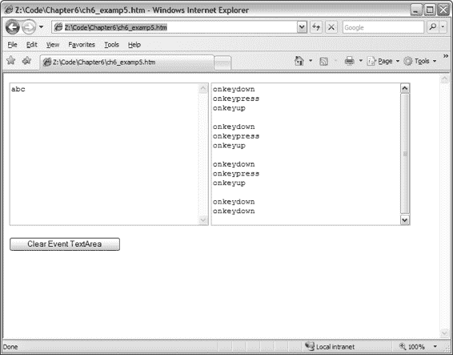

将此页面保存为`ch6_examp5.htm`。在浏览器中加载该页面，并在第一个文本区域框中输入任意字母，观察发生了什么。你应该会在第二个文本区域框中看到触发的事件列表（`onkeydown`、`onkeypress`和`onkeyup`），如图 6-6 所示。当你点击第一个文本区域框外部时，会看到`onchange`事件触发。

图 6-6

尝试使用该示例，观察哪些事件在何时触发。

### 工作原理

在页面正文中名为`form1`的表单内，定义了两个文本区域和一个按钮。第一个文本区域是你要监控其事件的区域。你将调用`DisplayEvent()`函数的代码附加到`onchange`、`onkeydown`、`onkeypress`和`onkeyup`事件处理程序上。传递给函数的值反映了触发事件的名称。

```html
<textarea rows=15 cols=40 name=textarea1
    onchange=”DisplayEvent(‘onchange\n’);”
    onkeydown=”DisplayEvent(‘onkeydown\n’);”
    onkeypress=”DisplayEvent(‘onkeypress\n’);”
    onkeyup=”DisplayEvent(‘onkeyup\n\n’);”></textarea>
```

接下来是一个与第一个大小相同的空文本区域。

```html
<textarea rows=15 cols=40 name=textarea2></textarea>
```

最后是按钮元素。

```html
<input type=”button” value=”Clear Event TextArea”
    name=button1 onclick=”window.document.form1.textarea2.value=’’”>
```

`NAME=button1 onclick="window.document.form1.textarea2.value=''"`> 注意，按钮的`onclick`事件处理程序并没有调用函数，而只是执行了一行 JavaScript 代码。虽然通常你会调用函数，但这并非强制要求；如果你只有一行代码要执行，直接插入它比创建并调用函数更简单。在这个例子中，`onclick`事件处理程序连接到了一段代码，该代码将第二个文本区域的内容设置为空（`''`）。

现在让我们看看`DisplayEvent()`函数。它定义在页面头部的脚本块中。该函数将作为参数传入的事件处理程序名称添加到第二个文本区域已有的文本中。

```javascript
function DisplayEvent(eventName)
{
    var myMessage = window.document.form1.textarea2.value;
    myMessage = myMessage + eventName;
    window.document.form1.textarea2.value = myMessage;
}
```

### 复选框和单选按钮

将复选框和单选按钮放在一起讨论，是因为它们的对象具有相同的属性、方法和事件。复选框允许用户勾选或取消勾选。它类似于你可能收到的纸质调查问卷，上面写着“勾选适用于你的选项”。单选按钮本质上是一组复选框，但具有一次只能选中一个的特性。当然，它们的外观也不同，并且其分组性质意味着它们的处理方式也不同。

创建复选框和单选按钮需要使用我们的老朋友`<input>`标签。将其`type`属性设置为`"checkbox"`或`"radio"`，以确定创建的是哪种框或按钮。要在页面加载时让复选框或单选按钮处于选中状态，只需在`<input>`标签中插入关键字`checked`。如果你想设置一个默认选项，比如你在网上经常看到的那些“如果你想要我们的垃圾邮件，请勾选此框”的表单，它们通常默认被勾选，迫使你取消勾选，这时就很有用。因此，要创建一个默认选中的复选框，你的`<input>`标签如下所示：

```html
<input type="checkbox" name=chkDVD checked value="DVD">
```

要创建一个默认选中的单选按钮，`<input>`标签如下所示：

```html
<input type="radio" name=radCPUSpeed checked value="1 GHz">
```

如前所述，单选按钮是分组元素。实际上，在页面上只放一个单选按钮几乎没有意义，因为用户无法在多个选项之间进行选择。要创建一组单选按钮，只需给每个单选按钮相同的名称。这将创建一个以该名称命名的单选按钮数组，你可以像访问任何数组一样，通过索引来访问它们。

例如，要创建一组三个单选按钮，你的 HTML 代码如下：

```html
<input type="radio" name=radCPUSpeed checked value="800 MHz">
<input type="radio" name=radCPUSpeed value="1 GHz">
<input type="radio" name=radCPUSpeed value="1.5 GHz">
```

你可以在一个表单中放置任意多组单选按钮，只需给每组一个唯一的名称。注意，你只使用了一个`CHECKED`属性，因为一组中只能有一个单选按钮被选中。如果你在多个单选按钮中使用了`CHECKED`属性，那么只有最后一个会被实际选中。

使用复选框和单选按钮元素的`value`属性与你之前看到的其他元素不同。首先，它不会告诉你用户与元素的交互情况，因为该值是在 HTML 或 JavaScript 中预定义的。无论复选框或单选按钮是否被选中，它都返回相同的值。其次，当表单提交到服务器时，只有被选中的复选框和单选按钮的值会被发送。因此，如果你有一个包含 10 个复选框的表单，而用户提交时没有勾选任何一个，那么除了一个空白表单外，什么也不会发送到服务器。你将在第 16 章学习服务器端脚本时了解更多。

每个复选框都有一个关联的`Checkbox`对象，而组中的每个单选按钮都有一个单独的`Radio`对象。如前所述，对于同名的单选按钮，你可以将这一组单选按钮视为一个数组，数组名就是组中单选按钮的名称，从而访问组中的每个`Radio`对象。与任何数组一样，你拥有`length`属性，它可以告诉你组中有多少个单选按钮。

要确定用户是否勾选或取消勾选了复选框，你需要使用`Checkbox`对象的`checked`属性。如果复选框当前被选中，该属性返回`true`，否则返回`false`。

单选按钮略有不同。由于同名的单选按钮被分组在一起，你需要依次测试组中的每个`Radio`对象，看它是否被选中。一组中只能有一个单选按钮被选中，因此如果你勾选了组中的另一个，之前选中的那个会变成未选中，而新选中的那个会取而代之。

`Checkbox`和`Radio`都有事件处理程序`onclick`、`onfocus`和`onblur`，它们的工作方式与你之前看到的其他元素相同，尽管它们也可以用于取消默认操作，例如点击复选框或单选按钮。

### 动手试一试

#### 复选框和单选按钮

让我们来看一个例子，它使用了我们刚刚讨论的所有属性、方法和事件。这个例子是一个简单的表单，允许用户构建一个计算机系统。也许它可以用于电子商务场景，销售由客户指定确切配置的计算机。


```html
<html>
<head>
<script language="JavaScript" type="text/javascript">
    var radCpuSpeedIndex = 0;
    function radCPUSpeed_onclick(radIndex)
    {
        var returnValue = true;
        if (radIndex == 1)
        {
            returnValue = false;
            alert("Sorry that processor speed is currently unavailable");
            // Next line works around a bug in IE that doesn't cancel the
            // Default action properly
            document.form1.radCPUSpeed[radCpuSpeedIndex].checked = true;
        }
        else
        {
            radCpuSpeedIndex = radIndex;
        }
        return returnValue;
    }
    function butCheck_onclick()
    {
        var controlIndex;
        var element;
        var numberOfControls = document.form1.length;
        var compSpec = "Your chosen processor speed is ";
        compSpec = compSpec + document.form1.radCPUSpeed[radCpuSpeedIndex].value;
        compSpec = compSpec + "\nWith the following additional components\n";
        for (controlIndex = 0; controlIndex < numberOfControls; controlIndex++)
        {
            element = document.form1[controlIndex];
            if (element.type == "checkbox")
            {
                if (element.checked == true)
                {
                    compSpec = compSpec + element.value + "\n";
                }
            }
        }
        alert(compSpec);
    }
</script>
</head>
<body>
<form name=form1>
<p> Tick all of the components you want included on your computer <br><br>
<table>
    <tr>
        <td>DVD-ROM</td>
        <td><input type="checkbox" name="chkDVD" value="DVD-ROM"></td>
    </tr>
    <tr>
        <td>CD-ROM</td>
        <td><input type="checkbox" name="chkCD" value="CD-ROM"></td>
    </tr>
    <tr>
        <td>Zip Drive</td>
        <td><input type="checkbox" name="chkZip" value="ZIP Drive"></td>
    </tr>
</table>
<p>
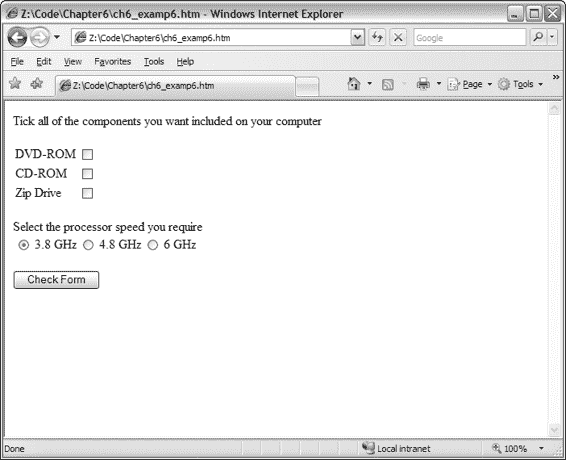

Select the processor speed you require

<table>
    <tr>
        <td><input type="radio" name="radCPUSpeed" checked onclick="return radCPUSpeed_onclick(0)" value="3.8 GHz"></td>
        <td>3.8 GHz</td>
        <td><input type="radio" name="radCPUSpeed" onclick="return radCPUSpeed_onclick(1)" value="4.8 GHz"></td>
        <td>4.8 GHz</td>
        <td><input type="radio" name="radCPUSpeed" onclick="return radCPUSpeed_onclick(2)" value="6 Ghz"></td>
        <td>6 GHz</td>
    </tr>
</table>
</p>
<input type="button" value="Check Form" name="butCheck"
</form>
</body>
</html>
```

```html
onclick="return butCheck_onclick()">

</form>

</body>

</html>
```

将页面保存为 `ch6_examp6.htm`，并在网页浏览器中加载。你应该会看到一个如图 6-7 所示的表单。

图 6-7

勾选一些复选框，更改处理器速度，然后点击“Check Form”按钮。将出现一个消息框，列出你选择的组件和处理器速度。例如，如果你选择了 DVD-ROM、Zip 驱动器以及 6 GHz 的处理器速度，你将看到类似图 6-8 所示的内容。

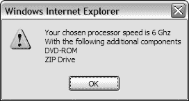

# 第 6 章：HTML 表单——与用户交互

图 6-8

请注意，4.8 GHz 处理器缺货，因此如果你选择该选项，将出现一个消息框告知你缺货，并且 4.8 GHz 处理器速度的单选按钮将不会被选中。当用户关闭消息框后，将恢复之前的设置。

## 工作原理

首先来看页面的主体部分，你在一个名为 `form1` 的表单中定义了复选框、单选按钮和一个标准按钮。先从复选框开始。它们被放入一个表格中，仅用于格式化目的。没有调用任何函数，也没有关联任何事件。

```html
<table>
<tr>
<td>DVD-ROM</td>
<td><input type="checkbox" name=chkDVD value="DVD-ROM"></td>
</tr>
<tr>
<td>CD-ROM</td>
<td><input type="checkbox" name=chkCD value="CD-ROM"></td>
</tr>
<tr>
<td>Zip Drive</td>
<td><input type="checkbox" name=chkZip value="ZIP Drive"></td>
</tr>
</table>
```

接下来是用于选择所需 CPU 速度的单选按钮，这部分稍微复杂一些。同样，它们被放入一个表格中用于格式化。

```html
<table>
<tr>
<td><input type="radio" name=radCPUSpeed checked onclick="return radCPUSpeed_onclick(0)" value="3.8 GHz"></td>
<td>3.8 Ghz</td>
<td><input type="radio" name=radCPUSpeed onclick="return radCPUSpeed_onclick(1)" value="4.8 GHz"></td>
<td>4.8 GHz</td>
<td><input type="radio" name=radCPUSpeed onclick="return radCPUSpeed_onclick(2)" value="6 GHz"></td>
<td>6 GHz</td>
</tr>
</table>
```

单选按钮组的名称是 `radCPUSpeed`。这里，第一个按钮默认被选中，因为在 `<input>` 标签的定义中包含了 `CHECKED` 一词。确保默认选中一个单选按钮是个好主意，因为如果不这样做，用户没有选择任何按钮时，表单提交时该单选组将没有值。

你利用了每个 `Radio` 对象的 `onclick` 事件。每个按钮都连接到同一个函数 `radCPUSpeed_onclick()`，但对于每个单选按钮，你传递了一个值——该按钮在 `radCPUSpeed` 单选按钮组数组中的索引。这使得确定哪个单选按钮被选中变得容易。稍后我们会查看这个函数，但首先来看一下完成表单的标准按钮。

```html
<input type="button" value="Check Form" name=butCheck onclick="return butCheck_onclick()">
```

这个按钮的 `onclick` 事件处理程序连接到 `butCheck_onclick()` 函数，供用户在填写完表单后点击。

因此，你有两个函数：`radCPUSpeed_onclick()` 和 `butCheck_onclick()`。它们都在页面头部的脚本块中定义。现在来看这个脚本块。它首先声明了一个变量 `radCpuSpeedIndex`。这个变量将用于存储 `radCPUSpeed` 单选按钮组当前选中的索引。

```javascript
var radCpuSpeedIndex = 0;
```

接下来是 `radCPUSpeed_onclick()` 函数，它由每个单选按钮的 `onclick` 事件处理程序调用。该函数有一个参数，即所选单选对象在 `radCPUSpeed[]` 数组中的索引位置。

```javascript
function radCPUSpeed_onclick(radIndex)
{
    var returnValue = true;
```

函数中首先声明了 `returnValue` 变量并将其设置为 `true`。你将把这个值作为函数的返回值返回。在这种情况下，返回值很重要，因为它决定了用户点击后单选按钮是否保持选中状态。如果返回 `false`，则会取消用户的操作，单选按钮将保持未选中状态。实际上，没有任何单选按钮被选中，这就是为什么你要跟踪已选中单选按钮的索引，以便知道之前选中的是哪个按钮。要允许用户的操作继续，你返回 `true`。

作为实际示例，下一行有一个 `if` 语句。如果传递的单选按钮索引值为 `1`（即用户勾选了 4.8 GHz 处理器），你会告知用户该处理器缺货，并通过将 `returnValue` 设置为 `false` 来取消点击操作。

```javascript
    if (radIndex == 1)
    {
        returnValue = false;
        alert("抱歉，该处理器速度目前不可用");
        document.form1.radCPUSpeed[radCpuSpeedIndex].checked = true;
    }
```

如前所述，取消点击操作会导致没有单选按钮被选中。为了纠正这一点，你在下一行将之前选中的复选框重新设为选中状态：`document.form1.radCPUSpeed[radCpuSpeedIndex].checked = true;` 这里你使用了 `radCpuSpeed` 单选组的 `Array` 对象。每个数组元素实际上包含一个对象，即你的三个 `Radio` 对象。你使用 `radCpuSpeedIndex` 变量作为最后选中的 `Radio` 对象的索引，因为它存储的就是这个值。

最后，在 `else` 语句中，你将 `radCpuSpeedIndex` 设置为新选中的单选按钮的索引值。

```javascript
    else
    {
        radCpuSpeedIndex = radIndex;
    }
```

在函数的最后一行，`returnValue` 的值被返回到函数调用的地方，并将取消或允许点击操作。

```javascript
    return returnValue;
}
```

你的第二个函数 `butCheck_onclick()` 连接到按钮的 `onclick` 事件。在实际的电子商务场景中，这个按钮将是你检查表单然后提交到服务器进行处理的地方。这里，你使用表单来显示一个消息框，确认你勾选了哪些复选框，就好像你本来不知道似的！

在函数顶部，你声明了四个局部变量，它们将在函数中使用。变量 `numberOfControls` 被设置为表单的 `length` 属性，即表单中元素的数量。变量 `compSpec` 用于构建将在消息框中显示的字符串。

```javascript
function butCheck_onclick()
{
    var controlIndex;
    var element;
    var numberOfControls = document.form1.length;
    var compSpec = "您选择的处理器速度是 ";
    compSpec = compSpec + document.form1.radCPUSpeed[radCpuSpeedIndex].value;
    compSpec = compSpec + "\n 以及以下附加组件\n";
```

在下一行中，你将用户选择的单选按钮的值添加到消息字符串中：`compSpec = compSpec + document.form1.radCPUSpeed[radCpuSpeedIndex].value;` 全局变量 `radCpuSpeedIndex` 由单选按钮组的 `onclick` 事件设置，它包含了所选单选按钮的数组索引。

另一种找出哪个单选按钮被点击的方法是遍历单选按钮组的数组，并依次测试每个单选按钮是否被选中。代码看起来像这样：

```javascript
var radIndex;
for (radIndex = 0; radIndex < document.form1.radCPUSpeed.length; radIndex++)
{
    if (document.form1.radCPUSpeed[radIndex].checked == true)
    {
        radCpuSpeedIndex = radIndex;
        break;
    }
}
```

但回到实际代码，你会注意到消息字符串中为了格式化而加入了一些换行符（`\n`）。

接下来是你的大 `for` 语句。

# 第 6 章：HTML 表单——与用户交互

## select 元素

尽管下拉列表和列表框看起来截然不同，但它们实际上都是使用 `<select>` 标签创建的元素，严格来说，它们都属于 select 元素。select 元素包含一个或多个可供选择的选项列表；每个选项通过 `<option>` 标签定义。`<option>` 标签列表位于 `<select>` 和 `</select>` 标签之间。

`<select>` 标签的 `size` 属性用于指定用户可见的选项数量。

例如，要创建一个深度为五行、包含七个选项的列表框，你的 `<select>` 标签应如下所示：

```html
<select name=theDay size=5>
<option value=0 selected>星期一
<option value=1>星期二
<option value=2>星期三
<option value=3>星期四
<option value=4>星期五
<option value=5>星期六
<option value=6>星期日
</select>
```

注意，星期一的 `<option>` 标签还包含了 `selected` 一词；这会使该选项在页面加载时成为默认选中项。选项的值被定义为数字，但使用文本也同样有效。

如果你希望这是一个下拉列表，只需将 `<select>` 标签中的 `size` 属性改为 `1`，瞬间它就变成了下拉列表。

如果你希望允许用户一次从列表中选择多个项目，只需在 `<select>` 定义中添加 `multiple` 属性即可。

`<select>` 标签会创建一个 `Select` 对象。该对象有一个 `options[]` 数组属性，这个数组由 `Option` 对象组成，每个 `<option>` 元素对应一个 `Option` 对象，这些元素位于与 `Select` 对象关联的 `<select>` 元素内部。例如，在前面的例子中，如果 `<select>` 元素包含在一个名为 `theForm` 的表单中，那么：

`document.theForm.theDay.options[0]`

就可以访问为星期一创建的选项。

如何判断用户选择了哪个选项？很简单：使用 `Select` 对象的 `selectedIndex` 属性。你可以利用该属性返回的索引值，通过 `options[]` 数组访问选中的选项。

`Option` 对象还具有 `index`、`text` 和 `value` 属性。`index` 属性返回该选项在 `options[]` 数组中的索引位置。`text` 属性是列表中显示的内容，而 `value` 属性是为选项定义的值，如果表单被提交，该值将被发送到服务器。

如果你想了解 select 元素中有多少个选项，可以使用 `Select` 对象本身或其 `options[]` 数组属性的 `length` 属性。

让我们看看如何遍历前面选择框的 `options[]` 数组：


```javascript
var theDayElement = window.document.form1.theDay;
document.write(“共有 ” + theDayElement.length + “ 个选项<br>”);
var optionCounter;
for (optionCounter = 0; optionCounter < theDayElement.length; optionCounter++)
{
document.write(“选项文本为 ” + theDayElement.options[optionCounter].text)
document.write(“，其值为 ”);
document.write(theDayElement.options[optionCounter].value);
document.write(“<br>”)
}
```

首先，将变量`theDayElement`设置为引用`Select`对象。然后，将选项数量写入页面，本例中为 7。

接下来，使用`for`循环遍历`options[]`数组，显示每个选项的文本（如星期一、星期二等）及其值（如 0、1 等）。如果你基于此代码创建页面，必须将其放在`<select>`标签定义之后。

还可以在页面加载完成后向 select 元素添加选项。接下来将介绍如何实现。

### 添加新选项

要向 select 元素添加新选项，只需使用`new`运算符创建一个新的`Option`对象，然后将其插入到`Select`对象的`options[]`数组的空索引位置。

创建新的`Option`对象时，需要传递两个参数——第一个是希望在列表中显示的文本，第二个是分配给该选项的值。

```javascript
var myNewOption = new Option(“文本内容”,”值内容”);
```

然后，只需将这个`Option`对象赋值给一个空数组元素，例如：`document.theForm.theSelectObject.options[0] = myNewOption;` 如果要删除一个选项，只需将`options[]`数组的对应部分设置为`null`。例如，要删除刚刚插入的元素，需要执行以下操作：`document.theForm.theSelectObject.options[0] = null;`

当你从`options[]`数组中删除一个`Option`对象时，数组会重新排序，使得被删除选项上方的每个选项的数组索引值都减一。

当你在某个索引位置插入新选项时，请注意它会覆盖该位置原有的任何`Option`对象。

### 动手试一试

#### 添加和删除列表选项

使用之前看到的星期列表示例来演示添加和删除列表选项。

```html
<html>
<head>
<script language=”JavaScript” type=”text/javascript”>
function butRemoveWed_onclick()
{
if (document.form1.theDay.options[2].text == “星期三”)
{
document.form1.theDay.options[2] = null;
}
else
{
alert(‘这里没有星期三！’);
}
}
function butAddWed_onclick()
{
if (document.form1.theDay.options[2].text != “星期三”)
{
var indexCounter;
var days = document.form1.theDay;
var lastoption = new Option();
days.options[6] = lastoption;
for (indexCounter = 6;indexCounter > 2; indexCounter--)
{
days.options[indexCounter].text = days.options[indexCounter - 1].text;
days.options[indexCounter].value = days.options[indexCounter - 1].value;
}
var option = new Option(“星期三”,2);
days.options[2] = option;
}
else
{
alert(‘你想要两个星期三吗？？？？？’);
}
}
</script>
</head>
<body>
<form name=form1>
<select name=theDay size=5>
<option value=0 selected>星期一
<option value=1>星期二
<option value=2>星期三
<option value=3>星期四
<option value=4>星期五
<option value=5>星期六
<option value=6>星期日
</select>
<BR>
<input type=”button” value=”删除星期三” name=butRemoveWed
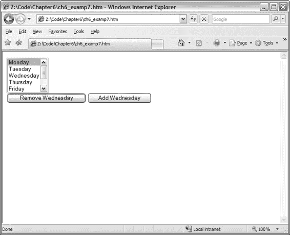
onclick=”butRemoveWed_onclick()”>
<input type=”button” value=”添加星期三” name=butAddWed onclick=”butAddWed_onclick()”>
<BR>
</form>
</body>
```

# 第 6 章：HTML 表单——与用户交互

将此文件保存为`ch6_examp7.htm`。如果你输入页面并加载到浏览器中，应该会看到如图 6-9 所示的表单。点击“移除星期三”按钮，你会看到星期三从列表中消失。点击“添加星期三”按钮将其重新添加。如果你尝试添加第二个星期三或移除一个不存在的星期三，你会收到一个礼貌的警告，告诉你无法执行该操作。

图 6-9

## 工作原理

在页面主体中，你定义了一个名为`form1`的表单。其中包含`select`元素，该元素包含了之前见过的星期选项。表单还包含两个按钮，如下所示：

`<input type="button" value="Remove Wednesday" name=butRemoveWed onclick="butRemoveWed_onclick()">`

`<input type="button" value="Add Wednesday" name=butAddWed onclick="butAddWed_onclick()">`

每个按钮的`onclick`事件处理程序都连接到调用两个函数之一的代码：`butRemoveWed_onclick()`和`butAddWed_onclick()`。这些函数定义在页面头部的脚本块中。我们将逐一查看它们。

在页面顶部，你有第一个函数`butRemoveWed_onclick()`，它用于移除星期三选项。

```javascript
function butRemoveWed_onclick()
{
    if (document.form1.theDay.options[2].text == "Wednesday")
    {
        document.form1.theDay.options[2] = null;
    }
    else
    {
        alert('There is no Wednesday here!');
    }
}
```

在函数中，你首先进行一项合理性检查：只有当星期三选项确实存在时，你才尝试移除它！你通过检查数组中的第三个选项（索引为 2，因为数组从索引 0 开始）的文本是否为"Wednesday"来确保这一点。如果是，你可以通过将该选项设置为`null`来移除星期三选项。如果数组中的第三个选项不是星期三，你会向用户发出警告，提示没有星期三可移除。虽然这段代码在`if`语句的条件中使用了`text`属性，但你也可以使用`value`属性，效果是一样的。

接下来是`butAddWed_onclick()`函数，顾名思义，它用于添加星期三选项。这比移除选项的代码稍微复杂一些。首先，你使用`if`语句检查是否已经存在星期三选项。

```javascript
function butAddWed_onclick()
{
    if (document.form1.theDay.options[2].text != "Wednesday")
    {
        var indexCounter;
        var days = document.form1.theDay;
        var lastoption = new Option();
        days.options[6] = lastoption;
        for (indexCounter = 6;indexCounter > 2; indexCounter--)
        {
            days.options[indexCounter].text = days.options[indexCounter - 1].text; days.options[indexCounter].value = days.options[indexCounter - 1].value;
        }
```

如果没有星期三选项，那么你需要为新插入的星期三选项腾出空间。

在此之前，你定义了两个变量：`indexCounter`和`days`（后者指向`theDay`选择元素，是为了方便而使用的简写引用）。接下来，你创建一个名为`lastoption`的新选项，并将这个新选项分配给`options`数组中索引位置 6 的元素（该位置之前没有内容）。然后，你将星期四到星期日的每个`Option`对象的`text`和`value`属性分配给`options`数组中索引值加 1 的`Option`，从而在`options`数组的位置 2 处留出一个空位来放置星期三。这就是`if`语句中`for`循环的任务。

接下来，你通过将文本"Wednesday"和值 2 传递给`Option`构造函数来创建一个新的`Option`对象。然后将该`Option`对象插入到`options[]`数组的位置 2，瞬间，它就会出现在你的选择框中。

```javascript
        var option = new Option("Wednesday",2);
        days.options[2] = option;
    }
    else
    {
        alert('Do you want to have TWO Wednesdays?????');
    }
}
```

如果`if`语句的条件为假，你会在函数末尾向用户发出警告，提示列表中已经存在星期三选项。

## 使用 Internet Explorer 添加新选项

在 IE 中，选择选项还关联了额外的属性、方法和事件。特别是，你感兴趣的`options[]`数组具有额外的`add()`和`remove()`方法，用于添加和移除选项。这使事情变得简单一些。

在添加选项之前，你需要创建它。和之前一样，使用`new`运算符。

`add()`方法允许你插入一个已创建的`Option`对象，并接受两个参数。第一个参数传入你想要添加的选项。可选的第二个参数允许你指定要添加选项的索引位置。该参数不会覆盖该位置已有的任何`Option`对象，而是将`Option`对象在数组中向上移动以腾出空间。这基本上与你在`butAddWed_onclick()`函数中使用`for`循环编写的代码相同。

使用`add()`方法，你可以将`ch6_examp7.htm`示例中的`butAddWed_onclick()`函数重写为如下形式：

```javascript
function butAddWed_onclick()
{
    if (document.form1.theDay.options[2].text != "Wednesday")
    {
        var option = new Option("Wednesday",2);
        document.form1.theDay.options.add(option,2);
    }
    else
    {
        alert('Do you want to have TWO Wednesdays?????');
    }
}
```

`remove()`方法只接受一个参数，即要移除选项的索引。当移除一个选项时，索引位置更高的选项会在数组中向下移动以填补空缺。

使用`remove()`方法，你可以将`ch6_examp7.htm`示例中的`butRemoveWed_onclick()`函数重写为如下形式：

```javascript
function butRemoveWed_onclick()
{
    if (document.form1.theDay.options[2].text == "Wednesday")
    {
        document.form1.theDay.options.remove(2);
    }
    else
    {
        alert('There is no Wednesday here!');
    }
}
```

修改之前的示例，将其保存为`ch6_examp8_IE.htm`，然后加载到 IE 中。你会看到它和之前的版本运行效果相同。

## 选择元素事件

选择元素有三个事件处理程序：`onblur`、`onfocus`和`onchange`。你之前已经见过所有这些事件。你曾在文本框元素中看到过`onchange`事件，当焦点离开文本框且文本框中的值发生改变时触发。在这里，当用户更改列表中选中的选项时触发。

## 动手试一试

### 使用选择元素计算日期差

让我们看一个使用`onchange`事件并充分利用下拉列表形式的`select`元素的示例。其目的是计算用户通过下拉列表框设置的两个日期之间的天数差。

```html
<html>
<head>
<script language="JavaScript" type="text/javascript">
function writeOptions(startNumber, endNumber)
{
    var optionCounter;
    for (optionCounter = startNumber; optionCounter <= endNumber; optionCounter++)
    {
        document.write('<option value=' + optionCounter + '>' + optionCounter);
    }
}

function writeMonthOptions()
{
    var theMonth;
    var monthCounter;
    var theDate = new Date(1);
    for (monthCounter = 0; monthCounter < 12; monthCounter++)
    {
        theDate.setMonth(monthCounter);
        theMonth = theDate.toString();
        theMonth = theMonth.substr(4,3);
        document.write('<option value=' + theMonth + '>' + theMonth);
    }
}

function recalcDateDiff()
{
    var myForm = document.form1;
    var firstDay = myForm.firstDay.options[myForm.firstDay.selectedIndex].value;
    var secondDay = myForm.secondDay.options[myForm.secondDay.selectedIndex].value;
    var firstMonth =
```


```html
myForm.firstMonth.options[myForm.firstMonth.selectedIndex].value;
var secondMonth =
myForm.secondMonth.options[myForm.secondMonth.selectedIndex].value;
var firstYear =
myForm.firstYear.options[myForm.firstYear.selectedIndex].value;
var secondYear =
myForm.secondYear.options[myForm.secondYear.selectedIndex].value;
var firstDate = new Date(firstDay + “ “ + firstMonth + “ “ + firstYear);
var secondDate = new Date(secondDay + “ “ + secondMonth + “ “ + secondYear);
var daysDiff = (secondDate.valueOf() - firstDate.valueOf());
daysDiff = Math.floor(Math.abs((((daysDiff / 1000) / 60) / 60) / 24));
myForm.txtDays.value = daysDiff;

return true;
}

function window_onload()
{
    var theForm = document.form1;
    var nowDate = new Date();

    theForm.firstDay.options[nowDate.getDate() - 1].selected = true;
    theForm.secondDay.options[nowDate.getDate() - 1].selected = true;
    theForm.firstMonth.options[nowDate.getMonth()].selected = true;
    theForm.secondMonth.options[nowDate.getMonth()].selected = true;
    theForm.firstYear.options[nowDate.getFullYear() - 1970].selected = true;
    theForm.secondYear.options[nowDate.getFullYear() - 1970].selected = true;
}

</script>
</head>

<body language=JavaScript onload=”return window_onload()”>

<form name=form1>

<p>

First Date<br>

<select name=firstDay size=1 onchange=”return recalcDateDiff()”>

<script language=JavaScript>

writeOptions(1,31);

</script>

</select>

<select name=firstMonth size=1 onchange=”return recalcDateDiff()”>

<script language=JavaScript>

writeMonthOptions();

</script>

</select>

<select name=firstYear size=1 onchange=”return recalcDateDiff()”>

<script language=JavaScript>

writeOptions(1970,2020);

</script>

</select>

222

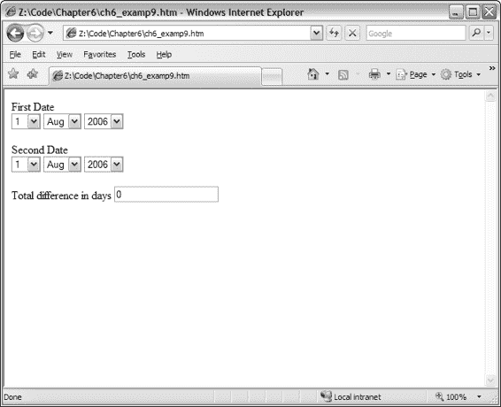

09_051511 ch06.qxp 4/13/07 6:20 PM Page 223

第 6 章：HTML 表单——与用户交互

</p>

<p>

Second Date<br>

<select name=secondDay size=1 onchange=”return recalcDateDiff()”>

<script language=JavaScript>

writeOptions(1,31);

</script>

</select>

<select name=secondMonth size=1 onchange=”return recalcDateDiff()”>

<script language=JavaScript>

writeMonthOptions();

</script>

</select>

<select name=secondYear size=1 onchange=”return recalcDateDiff()”>

<script language=JavaScript>

writeOptions(1970,2020);

</script>

</select>

</p>

Total difference in days

<input type=”text” name=txtDays value=0 readonly>

<br>

</form>

</body>

</html>
```

将示例命名为`ch6_examp9.htm`并加载到你的网页浏览器中。你应该会看到如图 6-10 所示的表单，但两个日期框都设置为当前日期。

图 6-10

如果你更改任何一个选择框，日期之间的差值将被重新计算并显示在文本框中。

## 工作原理

在页面的主体部分，网页中的表单由六个下拉列表框和一个文本框构成。我们来看其中一个`<select>`元素的例子：第一个`<select>`标签，它允许用户选择第一个日期的“日”部分。

```html
<select name=firstDay size=1 onchange=”return recalcDateDiff()”>
<script language=JavaScript>
writeOptions(1,31);
</script>
</select>
```

`size`属性被设置为 1，这样你得到的是一个下拉列表框而不是列表框，不过严格来说 1 是默认值，所以你不必指定它。`onchange`事件处理程序被连接到`recalcDateDiff()`函数，稍后你会看到这个函数。

然而，在`<select>`元素内部没有定义`<option>`标签。下拉列表框需要填充大量选项，手动输入太麻烦。相反，你使用函数来填充选项，这些函数利用了`document.write()`方法。

日期和年份选项通过页面头部声明的`writeOptions()`函数来填充。该函数接收两个值：你想要填充到`select`元素中的选项的起始编号和结束编号。我们来看一下`writeOptions()`函数。

```javascript
function writeOptions(startNumber, endNumber)
{
    var optionCounter;
    for (optionCounter = startNumber; optionCounter <= endNumber; optionCounter++)
    {
        document.write(‘<option value=’ + optionCounter + ‘>’ + optionCounter);
    }
}
```

这个函数实际上非常简单，它由一个`for`循环组成，循环从第一个数字（`startNumber`）到最后一个数字（`endNumber`），使用变量`optionCounter`，并写出每个`<option>`标签所需的 HTML。选项的文本和`<option>`标签的`value`属性都被设置为变量`optionCounter`的值。这显然比手动输入一个月中 31 个`<option>`标签要快得多。

对于年份选择框，可以复用同一个函数。你只需将 1970 和 2020 作为参数传递给`writeOptions()`函数来填充年份选择框。

```html
<select name=firstYear size=1 onchange=”return recalcDateDiff()”>
<script language=JavaScript>
writeOptions(1970,2020);
</script>
</select>
```

为了用每个月份的名称填充月份选择框，你需要一个不同的函数。然而，填充`<select>`元素的原理是一样的：你使用`document.write()`来完成。这个函数是`writeMonthOptions()`，如下面的月份选择元素所示：

```html
<select name=firstMonth size=1 onchange=”return recalcDateDiff()”>
<script language=JavaScript>
writeMonthOptions();
</script>
</select>
```

新的函数`writeMonthOptions()`在页面头部定义。现在我们来看一下它。

你首先定义三个变量，并将变量`theDate`初始化为当前月份的第一天。

```javascript
function writeMonthOptions()
{
    var theMonth;
    var monthCounter;
    var theDate = new Date(1);
```

你使用存储的`Date`对象来获取月份的文本形式（Jan, Feb...Dec）。你通过在一个`for`循环中使用`setMonth()`方法将`theDate`变量中的月份从 0 设置到 11 来获得这些月份。虽然`Date`对象没有提供返回日期为其他格式（除了数字）的方法，但它有`toString()`方法，该方法将变量中存储的日期值作为字符串返回。它返回的日期格式为：星期几、月份、日期、时间，最后是年份，例如 Sat Feb 19 19:04:34 2000。你只需要月份部分。由于你总是知道它在字符串中的位置，并且它的长度总是 3，你可以轻松地使用`String`对象的`substr()`方法来提取月份。

```javascript
for (monthCounter = 0; monthCounter < 12; monthCounter++)
{
    theDate.setMonth(monthCounter);
    theMonth = theDate.toString();
    theMonth = theMonth.substr(4,3);
    document.write(‘<option value=’ + theMonth + ‘>’ + theMonth);
}
}
```

现在你有了三个字符的月份字符串，你可以创建`<option>`标签，并用月份填充其文本和值。

为了方便用户，在页面加载时将两个日期选择框都设置为今天的日期会很好。这就是你在`window_onload()`函数中所做的，该函数通过`<body>`标签连接到窗口的`onload`事件。

`<body language=”JavaScript” onload=”return window_onload()”>` `window_onload()`函数在页面头部定义。你首先将`theForm`变量设置为引用你的`Form`对象，因为这样可以缩短代码中所需的引用。

接下来，你创建一个变量来保存一个`Date`对象，用于存储今天的日期。

```javascript
function window_onload()
{
    var theForm = document.form1;
    var nowDate = new Date();
```

设置每个`<select>`框的初始值很简单；通过修改`Date`对象`nowDate`返回的值，即可获得`options[]`数组所需的索引。对于日期而言，正确的索引就是当月的天数减一——记住数组从 0 开始，所以第 1 天实际上对应索引 0。

将`selected`属性设为`true`，即可使该日期成为列表中当前选中的选项。

```javascript
theForm.firstDay.options[nowDate.getDate() - 1].selected = true;
theForm.secondDay.options[nowDate.getDate() - 1].selected = true;
```

月份的处理更加简单，因为`getMonth()`函数返回的月份值在 0 到 11 之间，正好与`options[]`数组所需的索引值完全匹配。

```javascript
theForm.firstMonth.options[nowDate.getMonth()].selected = true;
theForm.secondMonth.options[nowDate.getMonth()].selected = true;
```

对于年份，由于你以 1970 年作为起始年份，因此需要从当前年份中减去 1970 才能得到正确的索引值。

```javascript
theForm.firstYear.options[nowDate.getFullYear() - 1970].selected = true;
theForm.secondYear.options[nowDate.getFullYear() - 1970].selected = true;
```

代码中最后需要关注的部分是与每个`select`元素的`onchange`事件相连的函数，即`recalcDateDiff()`函数。该函数的首要任务是构建用户通过下拉列表选择的两个日期。

```javascript
function recalcDateDiff()
{
    var myForm = document.form1;
    var firstDay = myForm.firstDay.options[myForm.firstDay.selectedIndex].value;
    var secondDay = myForm.secondDay.options[myForm.secondDay.selectedIndex].value;
    var firstMonth = myForm.firstMonth.options[myForm.firstMonth.selectedIndex].value;
    var secondMonth = myForm.secondMonth.options[myForm.secondMonth.selectedIndex].value;
    var firstYear = myForm.firstYear.options[myForm.firstYear.selectedIndex].value;
    var secondYear = myForm.secondYear.options[myForm.secondYear.selectedIndex].value;
```

你遍历每个`select`元素，并获取所选`Option`对象的值。`Select`对象的`selectedIndex`属性提供了在`options[]`数组中引用所选`Option`对象所需的索引。例如，下面这行代码中，索引由`myForm.firstDay.selectedIndex`提供：

```javascript
var firstDay = myForm.firstDay.options[myForm.firstDay.selectedIndex].value;
```

然后，你在方括号内使用该值作为`firstDay`选择元素的`options[]`数组的索引。这样就得到了对所选`Option`对象的引用，并将其`value`属性存储在变量`firstDay`中。

你对剩余的所有选择元素都采用这种技术。

接着，你可以根据从选择元素中获取的值创建新的`Date`对象，并将其存储在变量`firstDate`和`secondDate`中。

```javascript
var firstDate = new Date(firstDay + " " + firstMonth + " " + firstYear);
var secondDate = new Date(secondDay + " " + secondMonth + " " + secondYear);
```

最后，你需要计算两个日期之间的天数差。

```javascript
var daysDiff = (secondDate.valueOf() - firstDate.valueOf());
daysDiff = Math.floor(Math.abs((((daysDiff / 1000) / 60) / 60) / 24));
```

`Date`对象有一个`valueOf()`方法，它返回从 1970 年 1 月 1 日到`Date`对象中存储的日期之间的毫秒数。你用`secondDate`的`valueOf`属性值减去`firstDate`的`valueOf`属性值，并将结果存储在变量`daysDiff`中。此时，它保存的是两个日期之间的毫秒差，因此你在下一行将这个值转换为天数。除以 1000 得到秒数，再除以 60 得到分钟数，再除以 60 得到小时数，最后除以 24 得到最终的天数差。`Math`对象的`abs()`方法可以将负数变为正数。用户可能将第一个日期设置得比第二个日期晚，而由于你只想找出两者之间的差值，而不关心哪个更早，因此你将任何负数结果都转为正数。

`Math.floor()`方法会去除任何结果的小数部分，并返回向下取整到最接近整数的整数部分。

最后，你将天数差写入页面中的`txtDays`文本框。

```javascript
myForm.txtDays.value = daysDiff;
return true;
}
```


至此，我们完成了对网页中一些更有用的表单元素的介绍。下一节将回到趣味问答，你可以将新学到的知识付诸实践，真正创建一个可运行的问答页面。

# 趣味问答

现在该回到第 3 章中我们搁置的趣味问答了。到目前为止，你已经在数组中定义了问题和答案，并定义了一个函数来检查用户的答案是否正确。既然你已经知道如何创建 HTML 表单和元素，就可以在问答中使用它们来提供用户输入。在本节结束时，问题表单将如图 6-11 所示。

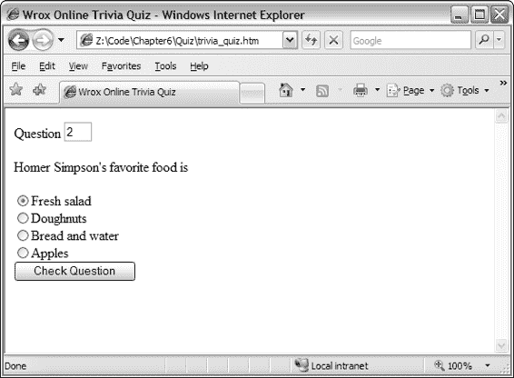

第 6 章：HTML 表单——与用户交互

图 6-11

目前我们的问题是多项选择题；我们用单选按钮组来表示多项选择选项。

我们使用老朋友`document.write()`以及`questions`数组中包含的信息来动态创建表单元素。当用户选择了代表答案的单选按钮后，她点击“检查问题”按钮，该按钮会调用你的`checkAnswer()`函数。这个函数会告诉用户她是否答对了，并让她知道结果。然后你继续回答下一个问题。

让我们从创建表单元素开始。

## 创建表单

你需要做的第一件事是在页面中添加一个表单，用于写入单选按钮。

加载`trivia_quiz.htm`并修改页面底部（即问题和答案数组定义的下方），如下所示：

```
 // 为问题 3 分配答案
 answers[2] = "C";
</script>
</head>
<body>
<form name="QuestionForm">
问题
<input type="text" name=txtQNumber size=1>
<script language="JavaScript" type="text/javascript">
document.write(getQuestion());
</script>
<input type="button" value="检查问题" name="buttonCheckQ"
onclick="return buttonCheckQ_onclick()">
</form>
</body>
</html>
```

你在页面的`body`中插入了名为`QuestionForm`的新表单。

表单上的元素包括一个文本框，由以下代码定义：

```
<input type="text" name=txtQNumber size=1>
```

这个文本框将显示当前问题编号，以及一个名为`buttonCheckQ`的按钮。

```
<input type="button" value="检查问题" name="buttonCheckQ"
onclick="return buttonCheckQ_onclick()">
```

点击该按钮时，它会检查用户提供的答案，并告知用户是否正确。该按钮的`onclick`事件连接到一个函数`buttonCheckQ_onclick()`，你稍后将创建这个函数。

你在图 6-11 中看到的单选按钮在哪里？嗯，你将再次使用`document.write()`方法在页面加载时动态插入问题。这样你就可以从问题数组中每次随机选取一个问题。以下代码使用你需要添加的第二个函数`getQuestion()`来插入问题：

```
<script language="JavaScript" type="text/javascript">
document.write(getQuestion());
</script>
```

## 创建答案单选按钮

你在代码中看到，所需的单选按钮将由`getQuestion()`函数插入，而`buttonCheckQ_onclick()`函数则连接到按钮的`onclick`事件处理程序。

现在，你将把这些函数添加到页面顶部，与你在第 3 章中定义的`answerCorrect()`函数位于同一个脚本块中。

将以下行添加到`trivia_quiz.htm`页面的顶部：

```
<html>
<head>
<title>Wrox 在线问答测验</title>
<script language="JavaScript" type="text/javascript">
var questionNumber;

function answerCorrect(questionNumber, answer)
{
    // 声明一个变量来保存返回值
    var correct = false;
    // 如果提供的答案与正确答案相同，则答案为正确
    if (answer == answers[questionNumber])
        correct = true;
    // 返回答案是否正确（true 或 false）
    return correct;
}

function getQuestion()
{
    questionNumber = Math.floor(Math.random() * (questions.length));
    var questionHTML = "<p>" + questions[questionNumber][0] + "</p>";
    var questionLength = questions[questionNumber].length;
    var questionChoice;
    for (questionChoice = 1; questionChoice < questionLength; questionChoice++)
    {
        questionHTML = questionHTML + "<input type=radio name=radQuestionChoice"
        if (questionChoice == 1)
        {
            questionHTML = questionHTML + " checked";
        }
        questionHTML = questionHTML + ">";
        questionHTML = questionHTML + questions[questionNumber][questionChoice];
        questionHTML = questionHTML + "<br>";
    }
    document.QuestionForm.txtQNumber.value = questionNumber + 1;
    return questionHTML;
}

function buttonCheckQ_onclick()
{
    var answer = 0;
    while (document.QuestionForm.radQuestionChoice[answer].checked != true)
    {
        answer++;
    }
    answer = String.fromCharCode(65 + answer);
    if (answerCorrect(questionNumber, answer) == true)
    {
        alert("你答对了");
    }
    else
    {
        alert("你答错了");
    }
    window.location.reload();
}
// questions 和 answers 数组将保存问题和答案
</script>
</head>
```

首先讨论`getQuestion()`函数，该函数用于构建向用户显示问题所需的 HTML。首先需要从`questions`数组中随机选择一个问题，因此需要生成一个随机数，该随机数将作为问题的索引。将这个数字存储在脚本块顶部声明的全局变量`questionNumber`中。

```
function getQuestion()
{
    questionNumber = Math.floor(Math.random() * (questions.length));
```

使用`Math.random()`方法生成一个介于 0 和 1 之间的随机数，然后将其乘以`questions`数组中的问题数量。使用`Math`对象的`floor()`方法将该数字转换为整数，该方法返回浮点数的最小整数部分。

这正是我们需要的：一个从 0 到`questions.length`减 1 的随机选择数字。不要忘记数组的索引从 0 开始。

下一个任务是创建单选按钮，让用户回答问题。通过构建需要写入页面的 HTML 并将其存储在变量`questionHTML`中来实现。然后只需使用一个`document.write()`即可一次性写出整个问题。

首先声明`questionHTML`变量，并将其设置为将实际问题写入页面所需的 HTML。这些信息存储在`questions`数组第二维的第一个索引位置，即`questions[questionNumber][0]`，其中`questionNumber`是之前生成的随机索引。

```
var questionHTML = "<p>" + questions[questionNumber][0] + "</p>";
var questionLength = questions[questionNumber].length;
var questionChoice;
```

为了创建用户可选择的可能答案，需要知道需要多少个单选按钮，这些信息存储在`questions`数组第二维的`length`属性中。请记住，第二维实际上是一个存储在`questions`数组特定位置的`Array`对象，而`Array`对象具有`length`属性。使用变量`questionLength`存储数组的长度，并声明另一个变量`questionChoice`，用于遍历数组。

现在可以开始遍历问题选项并构建单选按钮组。在接下来的`for`循环中完成此操作。如果是正在为其创建 HTML 的第一个单选按钮，则在`<input>`标签中添加`checked`单词。这样做是为了确保其中一个单选按钮被选中，以防用户在未提供答案的情况下按下“检查答案”按钮。

```
for (questionChoice = 1; questionChoice < questionLength; questionChoice++)
{
    questionHTML = questionHTML + "<input type=radio name=radQuestionChoice"
    if (questionChoice == 1)
    {
        questionHTML = questionHTML + " checked";
    }
    questionHTML = questionHTML + ">";
    questionHTML = questionHTML + questions[questionNumber][questionChoice];
    questionHTML = questionHTML + "<br>";
}
```

例如，在`for`循环的一次迭代中，`questionHTML`中构建的 HTML 可能如下：

```
<input type=radio name=radQuestionChoice checked> 来自利物浦的六十年代摇滚乐队<br>
```

循环结束后，`questionHTML`包含了显示一个问题所需的完整 HTML，剩下的工作就是将当前问题的题号显示在表单的文本框中，然后将`questionHTML`字符串返回给调用代码。使用`questionNumber + 1`作为题号纯粹是为了用户友好。尽管它可能是索引为 0 的问题，但大多数人认为问题从 1 开始，而不是从 0 开始。

```
document.QuestionForm.txtQNumber.value = questionNumber + 1;
return questionHTML;
```

至此，`getQuestion()`函数完成。需要查看的最后一个新代码是`buttonCheckQ_onclick()`函数，该函数在按钮被点击时触发。之前已经看到它被添加到代码中。

函数开始时声明变量`answer`并将其初始化为 0。在遍历单选按钮组时，将使用它作为索引，同时也用于保存实际答案。

```
function buttonCheckQ_onclick()
{
    var answer = 0;
```

然后使用`while`语句遍历每个单选按钮，递增`answer`变量，直到找到被选中的单选按钮。此时循环结束，现在知道用户选择了哪个单选按钮作为答案，即索引存储在`answer`变量中的那个。

```
while (document.QuestionForm.radQuestionChoice[answer].checked != true)
{
    answer++;
}
```

由于`answers`数组将答案存储为 A、B、C、D 等，因此需要将`answer`中包含的单选按钮索引转换为字符。在下一行中完成此操作。

```
answer = String.fromCharCode(65 + answer);
```

这利用了字符代码 A 为 65 的事实，因此如果用户选择了第一个单选按钮（索引为 0），只需将 65 与`answer`中包含的索引号相加，即可得到答案的字符代码。通过`String`对象的`fromCharCode()`方法将该代码转换为字符。请记住，`String`对象的某些方法（称为静态方法）可以在不实际创建`String`对象的情况下使用；可以直接使用始终存在的原生`String`对象。

在第 3 章中创建的`answerCorrect()`函数随后作为`if`语句的一部分使用。将题号和答案字符传递给该函数，如果答案正确，则返回`true`。如果返回`true`，则显示一个消息框，告诉用户答对了；否则`else`语句会告知用户答错了。

```
if (answerCorrect(questionNumber, answer) == true)
{
    alert("你答对了");
}
else
{
    alert("你答错了");
}
```

# 第 6 章：HTML 表单——与用户交互

最后，你重新加载页面以选择另一个随机问题。

```
window.location.reload();
}
```

在下一章中，你将把问答游戏制作成一个更复杂的基于多帧的应用程序，并添加必要的功能，例如确保用户不会两次遇到相同的问题。

## 总结

在本章中，你学习了如何为 JavaScript 添加用户界面，以便与用户交互并从中获取信息。让我们回顾一下本章讨论的一些内容。

- HTML 表单是你在页面中放置构成界面的元素的地方。
- 每个 HTML 表单将一组 HTML 元素组合在一起。当表单提交到服务器进行处理时，该表单中的所有数据都会被发送到服务器。一个页面可以有多个表单，但只能将其中一个表单的信息发送到服务器。
- 表单通过开始标签`<form>`创建，并以结束标签`</form>`结束。你想要包含在该表单中的所有元素都放置在开始和结束`<form>`标签之间。
- `<form>`标签具有多种属性——对于客户端脚本，`name`属性是重要的一个。你可以通过`name`属性或`ID`属性来访问表单。
- 每个`<form>`元素创建一个`Form`对象，该对象包含在`document`对象中。要访问名为`myForm`的表单，你可以写`document.myForm`。`document`对象还有一个`forms[]`属性，它是一个包含文档中所有表单的数组。页面中的第一个表单是`document.forms[0]`，第二个是`document.forms[1]`，以此类推。使用`Array`对象的`length`属性，`document.forms.length`告诉你页面上有多少个表单。
- 在讨论了表单之后，我们接着研究了可以放置在表单内的不同类型的 HTML 元素，如何创建它们，以及它们在 JavaScript 中的使用方式。
- 与表单元素关联的对象具有许多共同的属性、方法和事件。它们都有`name`属性，你可以用它来在 JavaScript 中引用它们。它们也都有`form`属性，该属性提供了对该元素所在的`Form`对象的引用。`type`属性返回一个文本字符串，告诉你这是什么类型的元素；类型包括`text`、`button`和`radio`。
- 你还看到，方法`focus()`和`blur()`以及事件`onfocus`和`onblur`可用于每个表单元素对象。当一个元素成为表单中的活动元素时，无论是由于用户选择了该元素还是因为你使用了`focus()`方法，该元素就被称为获得焦点。无论元素如何获得焦点，其`onfocus`事件都会触发。当另一个元素被设置为当前活动元素时，前一个元素被称为失去焦点或模糊。同样，失去焦点可能是用户选择另一个元素或使用`blur()`方法的结果；无论哪种方式，当它发生时，`onblur`事件都会触发。你看到，如果谨慎使用，`onfocus`和`onblur`的触发可以成为检查用户输入元素的数据有效性等的好地方。
- 所有元素都返回一个值，即分配给该元素的字符串数据。该值的含义取决于元素；对于文本框，它是文本框内的值；对于按钮，它是按钮上显示的文本。
- 在讨论了元素的共同特性之后，我们接着依次研究了每个更常用的元素，从按钮元素开始。
- 按钮元素的存在意义就是被用户点击，点击会触发你编写的某些脚本。你可以通过连接到按钮的`onclick`事件来捕获点击。按钮通过`<input>`标签创建，其`type`属性设置为`button`。
- `value`属性决定按钮上显示的文本。按钮的两种变体是`submit`和`reset`按钮。除了作为按钮之外，它们还提供与代码无关的特殊服务。提交按钮会自动将表单提交到服务器；重置按钮将表单清除回页面加载时的默认状态。


- 文本元素允许用户输入单行纯文本。文本框通过`<input>`标签创建，其`type`属性设置为`text`。你可以分别使用`<input>`标签的`maxlength`和`size`属性来设置用户可以输入的字符数和文本框的宽度。文本框有一个关联的对象`Text`，它具有额外的事件`onselect`和`onchange`。当用户在框中选择文本时触发`onselect`事件，而更有用的`onchange`事件在元素失去焦点且其内容自获得焦点以来发生变化时触发。`onchange`事件的触发是验证用户刚刚输入内容的好时机。如果她输入了非法值，例如在你需要数字时输入了字母，你可以通知用户并让她返回纠正错误。文本框的一种变体是密码框，它与文本框几乎相同，只是输入的值被隐藏并显示为星号。此外，文本框还具有`onkeydown`、`onkeypress`和`onkeyup`事件。

- 你接下来研究的元素是文本区域，它与文本框类似，但允许输入多行文本。该元素通过开始标签`<textarea>`创建，并以`</textarea>`标签结束，文本框的宽度和高度（以字符计）分别由`COLS`和`ROWS`属性决定。`wrap`属性决定文本区域是否对到达行尾的文本进行换行，以及当内容提交到服务器时是否发送该换行。如果省略此属性或设置为`off`，则不进行换行；如果设置为`soft`，则在客户端进行换行，但在表单发送时不发送到服务器；如果设置为`hard`，则在客户端进行换行并发送到服务器。关联的`Textarea`对象与`Text`对象几乎具有相同的属性、方法和事件。

- 然后你一起研究了复选框和单选按钮元素。本质上它们是相同类型的元素，只是单选按钮是分组元素，意味着同一组中一次只能选中一个。选中另一个会导致之前选中的按钮取消选中。这两个元素都通过`<input>`标签创建，`type`属性为`checkbox`或`radio`。如果在`<input>`标签中放入`checked`，则该元素在页面加载时会被选中。创建具有相同名称的单选按钮会形成一个单选按钮组。单选按钮的名称实际上指向一个数组，该数组中的每个元素都是表单上定义在该组中的单选按钮。这些元素有相关联的对象`Checkbox`和`Radio`。使用这些对象的`checked`属性，你可以判断复选框或单选按钮当前是否被选中。除了常见的事件`onfocus`和`onblur`之外，这两个对象还具有`onclick`事件。

接下来，在元素的学习中，你接触到了下拉列表和列表框。实际上，两者都是同一个`select`元素，通过`size`属性决定它是下拉列表还是列表框。`<select>`标签创建这些元素，`size`属性决定一次可见的列表项数量。如果`size`为 1，则创建的是下拉框而非列表框。`select`元素中的每个项由`<option>`标签定义，或者之后通过`Select`对象的`options[]`数组属性添加，该数组包含该元素的每个`Option`对象。然而，在页面加载后添加选项的方式在 Firefox 和 Microsoft 浏览器中有所不同。`Select`对象的`selectedIndex`属性告诉你哪个选项被选中；然后你可以用该值访问`options[]`数组中的相应选项，并使用`Option`对象的`value`属性。`Option`对象还有`text`和`index`属性，`text`是列表中显示的文本，`index`是它在`Select`对象的`options[]`数组属性中的位置。你可以遍历`options[]`数组，通过`Select`对象的`length`属性获取其长度。`Select`对象有`onchange`事件，当用户从列表中选择另一个项时触发。

最后，你为问答小测验添加了一个基本用户界面。现在，问题通过`document.write()`方法动态创建，用户可以从一组单选按钮中选择答案。

在下一章中，你将学习如何在页面中创建框架集后，在框架之间访问代码和变量。你还将学习如何使用 JavaScript 打开新窗口，以及窗口打开后的操作方法。你将看到问答小测验变成一个基于框架的应用程序。

### 练习题

这些问题的参考答案见附录 A。

#### 问题 1

使用第 2 章中温度转换器示例的代码，为其创建一个用户界面，并将其连接到现有代码，以便用户可以输入华氏度值并将其转换为摄氏度。

#### 问题 2

创建一个用户界面，允许用户选择她梦想中的计算机系统，原理类似于通过互联网销售计算机的电子商务网站。例如，她可以选择处理器类型、速度、内存和硬盘大小，还可以选择添加额外组件，如 DVD-ROM 驱动器、声卡等。当用户更改选择时，系统价格应自动更新，并通过警告框或更新文本框内容来通知她所指定系统的成本。

# 窗口与框架

到目前为止，你看到的页面都只是单个页面。然而，许多 Web 应用程序使用框架来分割浏览器窗口，就像玻璃窗格分割真实窗户一样。你很可能希望构建使用此类框架的网站。

好消息是，JavaScript 能够操作框架，并允许你在一个框架中创建的函数和变量在另一个框架中使用。这样做的一个好处是，你可以将通用变量和函数放在一个地方，但可以从多个地方使用它们。本章首先介绍如何跨框架编写脚本。

但还有许多其他充分的理由需要访问另一个框架中的变量和函数。两个重要的原因是使代码*模块化*，以及能够在页面之间维护信息。

*模块化*是什么意思？在其他编程语言（如 Visual Basic）中，你可以创建一个模块——一个存放通用函数和变量的区域——并在程序的不同位置重复使用它。那么，在使用框架时，你可以将所有通用函数和变量放在一个区域中，例如顶部框架，你可以将其视为代码模块。然后，你可以从不同页面和不同框架中重复调用这些函数。

如果将通用函数和变量放在定义其所包含框架的页面中（即框架集定义页面），那么如果需要更改框架内的页面，框架集页面中定义的任何变量都将保留其值。这提供了一种非常有用的方式来保存信息，即使用户在你的网站中导航也是如此。另一个优点是，框架集定义页面中定义的任何函数都可以被后续页面调用，并且只需加载到浏览器一次，从而使页面加载更快。

本章的第二个主题是如何打开和操作新的浏览器窗口。

新窗口有很多好的用途。例如，你可能希望从你的网站打开一个“外部”网站到新窗口，但仍然让你的网站保持打开状态。这里的*外部*指的是由其他人或公司创建和维护的网站。

假设你有一个关于汽车的网站——那么你可能希望链接到外部网站，例如制造商的网站（例如福特或通用汽车）。也许更有用的是使用小窗口作为对话框，你可以从中获取用户信息。就像你可以在框架之间编写脚本一样，你可以在某些窗口之间执行类似操作。

你将在本章后面了解如何操作，但让我们先来看看框架之间的脚本编写。

## 框架与`window`对象

框架是一种将浏览器窗口分割成多个窗格的方法，然后你可以将不同的 HTML 文档加载到这些窗格中。框架在框架集定义页面中通过`<frameset>`和`<frame>`标签定义。`<frameset>`标签用于包含`<frame>`标签，并指定框架在页面上的外观。`<frame>`标签则用于指定每个框架，并将所需的文档包含在页面中。

你在第 5 章中看到，`window`对象代表浏览器在页面或文档上的框架。

如果你有一个没有框架的页面，那么只有一个`window`对象。但是，如果有多个框架，则每个框架都有一个`window`对象。除了框架集的顶层窗口外，每个`window`对象都包含在另一个对象内部。

演示这一点的最简单方法是通过一个示例，其中你创建三个框架，一个顶部框架包含两个内部框架。

### 动手试一试

#### 多框架

对于这个多框架示例，你需要创建三个 HTML 文件。第一个是框架集定义页面。

```html
<html>

<frameset rows=”50%,*” ID=”TopWindow”>

<frame name=”UpperWindow” src=”UpperWindow.htm”>

<frame name=”LowerWindow” src=”LowerWindow.htm”>

</frameset>

</html>
```

将其保存为`TopWindow.htm`。请注意，此页面中两个`<frame>`标签的`src`属性分别是`UpperWindow.htm`和`LowerWindow.htm`。接下来你将创建这些文件。

```html
<html>

<head>

<script language=”JavaScript” type=”text/javascript”> function window_onload()

{

alert(“The name of the upper frame’s window object is “ + window.name); alert(“The location of UpperWindow’s parent is “ +

window.parent.location.href);

}

</script>

</head>

<body onload=”return window_onload()”>

<p>Upper Frame</p>

</body>

</html>
```

上述页面是名为`UpperWindow`的顶部框架的源页面，需要保存为`UpperWindow.htm`。最后一个页面与它非常相似：

```html
<html>

<head>

<script language=”JavaScript” type=”text/javascript”> function window_onload()

{

alert(“The name of the lower frame’s window object is “ + window.name); alert(“The location of LowerWindow’s parent is “ +

window.parent.location.href);

}

</script>

</head>

<body onload=”return window_onload()”>

<p>Lower Frame</p>

</body>

</html>
```

# 第 7 章：窗口与框架

```html
<body onload="return window_onload()">

<p>下方框架</p>

</body>

</html>
```

这是下方框架的源页面；将其保存为`LowerWindow.htm`。

这三个页面组合在一起，使得`UpperWindow.htm`和`LowerWindow.htm`被包含在`TopWindow.htm`页面中。

当你在浏览器中加载它们时，你会得到三个窗口对象。一个是*父*窗口对象，包含文件`TopWindow.htm`；另外两个是*子*窗口对象，分别包含文件`UpperWindow.htm`和`LowerWindow.htm`。这两个子窗口对象被包含在父窗口中，如图 7-1 所示。

父窗口对象——定义在页面`TopWindow.htm`中。第一个子窗口对象——名称`UpperWindow`，文件`UpperWindow.htm`。第二个子窗口对象——名称`LowerWindow`，文件`LowerWindow.htm`。

图 7-1

如果任何框架内部还包含框架，那么这些框架将拥有该框架窗口对象的子窗口对象。

当你将`TopWindow.htm`加载到浏览器中时，你会看到一系列四个消息框，如图 7-2 至图 7-5 所示。这些消息框利用窗口对象的属性来获取信息，并展示窗口对象在层级结构中的位置。

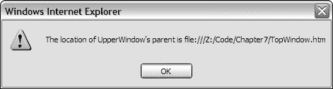

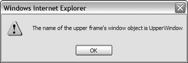

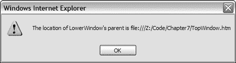

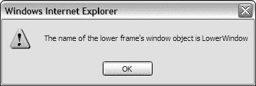

图 7-2

图 7-3

图 7-4

图 7-5

## 工作原理

来看定义框架集的页面，从`TopWindow.htm`开始，如下代码片段所示：

```html
<html>

<frameset rows="50%,*" ID=TopWindow>

<frame name="UpperWindow" src="UpperWindow.htm">

<frame name="LowerWindow" src="LowerWindow.htm">

</frameset>

</html>
```

框架集通过`<frameset>`标签定义。你使用了两个属性：`rows`和`ID`。`rows`属性的值为`"50%,*"`，表示第一个框架应占据窗口长度的一半，第二个框架占据剩余部分。`ID`属性用于指定一个名称，以便引用该页面。

两个子窗口通过`<frame>`标签创建。在每个`<frame>`标签中，你指定了窗口对象的名称以及`src`属性，该属性指向要加载到新创建窗口中的页面，并构成每个窗口对象所包含的文档对象的基础。

接下来，我们来看`UpperWindow.htm`文件。在页面的`<body>`标签中，你将函数`window_onload()`绑定到窗口对象的`onload`事件处理程序上。当浏览器完成加载窗口、窗口内的文档以及文档中的所有对象后，会调用此事件处理程序。这是一个非常实用的位置，可以放置初始化代码，或者在页面加载完成后、控制权交还给用户之前需要修改内容的代码。

```html
<body onload="return window_onload()">
```

该函数定义在页面头部的脚本块中，如下所示：

```javascript
function window_onload()
{
    alert("上方框架的窗口对象名称是 " + window.name);
    alert("UpperWindow 的父窗口位置是 " +
        window.parent.location.href);
}
```

`window_onload()`函数使用了该框架所加载页面的窗口对象的两个属性：`name`和`parent`。`name`属性不言自明——它是在框架集页面中定义的名称。在本例中，名称为`UpperWindow`。

第二个属性`parent`非常有用。它允许你访问框架父级的窗口对象。这意味着你可以访问父窗口对象的所有属性和方法。

通过这些，你可以访问父窗口内的文档，以及父窗口定义的其他任何框架。在这里，你通过使用`location`对象（它本身是窗口对象的一个属性）的`href`属性，显示了一个消息框，其中包含父框架的文件名或 URL 的详细信息。

`LowerWindow.htm`的代码与`UpperWindow.htm`的代码相同，但由于访问的是不同的窗口对象，结果会有所不同。这次窗口对象的名称是`LowerWindow`。然而，它与`UpperWindow`共享同一个父窗口，因此当你访问窗口对象的`parent`属性时，你会得到与`UpperWindow`中相同的窗口对象引用。

消息框通过显示文件名/URL 或`href`属性来演示这一点，并且该值与`UpperWindow`框架中显示的页面文件名相匹配。

请注意，消息框的显示顺序可能因浏览器类型甚至操作系统的不同而有所差异。在这里这可能并不重要，但有时事件的触发顺序很重要，会影响代码的运行。这是一个值得注意并在你自己的程序中警惕的不兼容问题。

## 框架间的编码

你已经看到，每个框架都作为一个不同的窗口存在，并拥有自己的窗口对象。此外，你还了解到，可以通过使用窗口对象的`parent`属性，从框架集定义页面所指定的任何框架页面访问该页面的窗口对象。当你获得父窗口的窗口对象引用后，就可以像访问当前页面的窗口对象一样访问其属性和方法。此外，你还可以访问该页面中定义的所有 JavaScript 变量和函数。

## 动手试一试

### 将框架集页面用作模块

让我们看一个更复杂的示例，其中你使用顶部框架来跟踪用户在网站中导航时访问过的页面。在这个示例中，你将创建五个页面，但别担心；其中四个几乎完全相同。需要创建的第一个页面是框架集定义页面。

```html
<html>

<head>

<title>不变的框架集页面</title>

<script Language="JavaScript" type="text/javascript">
    var pagesVisited = new Array();

    function returnPagesVisited()
    {
        var returnValue = "到目前为止，您已访问以下页面\n";
        var pageVisitedIndex;
        var numberOfPagesVisited = pagesVisited.length;
        for (pageVisitedIndex = 0; pageVisitedIndex < numberOfPagesVisited; pageVisitedIndex++)
        {
            returnValue = returnValue + pagesVisited[pageVisitedIndex] + "\n";
        }
        return returnValue;
    }

    function addPage(fileName)
    {
        var fileNameStart = fileName.lastIndexOf("/") + 1;
        fileName = fileName.substr(fileNameStart);
        pagesVisited[pagesVisited.length] = fileName;
        return true;
    }
</script>

</head>

<frameset cols="50%,*">
    <frame name=fraLeft src="page_a.htm">
    <frame name=fraRight src="page_b.htm">
</frameset>

</html>
```


将此页面保存为`frameset_page.htm`。

注意，两个框架的`src`属性初始化为`page_a.htm`和`page_b.htm`。但是，你还需要创建`page_c.htm`和`page_d.htm`，因为你将允许用户从这四个页面中选择要加载到每个框架中的页面。首先创建`page_a.htm`页面，如下所示：

```
<html>

<head>

<script language="JavaScript" type="text/javascript">
    function butShowVisited_onclick()
    {
        document.form1.txtaPagesVisited.value = window.parent.returnPagesVisited();
    }
</script>

</head>

<body onload="window.parent.addPage(window.location.href);">

<center>
    <font size=6 color=MidnightBlue face=verdana>
        这是页面 A
    </font>
</center>

<p>
    <A href="page_a.htm">页面 A</A>
    <A href="page_b.htm">页面 B</A>
    <A href="page_c.htm">页面 C</A>
    <A href="page_d.htm">页面 D</A>
</p>

<form name=form1>
    <textarea rows=10 cols=35 name=txtaPagesVisited wrap=hard>
    </textarea>
    <br>
    <input type="button" value="列出已访问页面" name=butShowVisited onclick="butShowVisited_onclick()">
</form>
```

`</body>`

`</html>`

将其保存为`page_a.htm`。

其他三个页面与`page_a.htm`完全相同，只有一行不同，因此你可以直接从`page_a.htm`中复制粘贴文本。将显示已加载页面名称的HTML修改为以下内容：

```
<center>
<font size=6 color=MidnightBlue face=verdana>
This is Page B
</font>
</center>
```

然后将其保存为`page_b.htm`。

重复同样的操作，创建第三个页面（页面C）：

```
<center>
<font size=6 color=MidnightBlue face=verdana>
This is Page C
</font>
</center>
```

将其保存为`page_c.htm`。

最后一个页面同样是`page_a.htm`的副本，但以下行除外：

```
<center>
<font size=6 color=MidnightBlue face=verdana>
This is Page D
</font>
</center>
```

将其保存为`page_d.htm`。

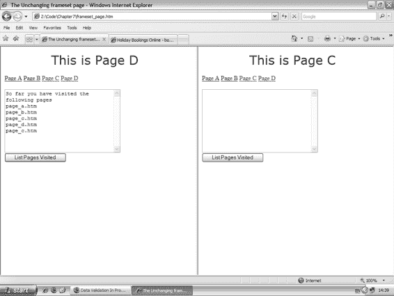

# 第7章：窗口与框架

在浏览器中加载`FramesetPage.htm`，并通过点击链接导航到各个页面。然后点击左侧框架中的“列出已访问页面”按钮，你应该会看到类似图7-6所示的屏幕。

图7-6

点击任一框架中的链接以导航到新位置。例如，点击右侧框架中的“页面C”链接，然后点击左侧框架中的“页面D”链接。点击左侧框架的“列出已访问页面”按钮，你会看到`page_c.htm`和`page_d.htm`已被添加到列表中。

通常，当加载新页面时，前一页面中的所有变量及其值都会丢失，但对于框架集来说，每个框架中加载的是哪个页面并不重要——顶部框架始终保持加载状态，其变量也保持原值。在这个示例中，你看到的是：无论每个框架中加载的是哪个页面，顶部框架中的某个全局变量都在跟踪已查看的页面，并且顶部框架的变量和函数可以被任一框架中加载的任何页面访问。

*稍后你会看到，当加载到框架中的页面来自外部来源时，会存在一些限制——本章后面会详细介绍。*

## 工作原理

首先来看`frameset_page.htm`中的JavaScript，这是定义框架集的页面。页面的head部分包含一个脚本块。在这个脚本块中，你首先声明了变量`pagesVisited`，并将其设置为引用一个新的`Array`对象。在这个数组中，你将存储用户浏览站点时访问的每个页面的文件名。

```
var pagesVisited = new Array();
```

然后你有两个函数。第一个函数`returnPagesVisited()`如其名所示——它返回一个字符串，包含一条消息和已访问页面的列表。它通过循环遍历`pagesVisited`数组，在变量`returnValue`中构建消息字符串，然后将其返回给调用函数。

```
function returnPagesVisited()
{
    var returnValue = "到目前为止，您已访问以下页面\n";
    var pageVisitedIndex;
    var numberOfPagesVisited = pagesVisited.length;
    for (pageVisitedIndex = 0; pageVisitedIndex < numberOfPagesVisited; pageVisitedIndex++)
    {
        returnValue = returnValue + pagesVisited[pageVisitedIndex] + "\n";
    }
    return returnValue;
}
```

第二个函数`addPage()`将页面名称添加到`pagesVisited`数组中。

```
function addPage(fileName)
{
    var fileNameStart = fileName.lastIndexOf("/") + 1;
    fileName = fileName.substr(fileNameStart);
    pagesVisited[pagesVisited.length] = fileName;
    return true;
}
```

传递给此函数的`fileName`参数是已访问页面的完整文件路径和名称，因此你需要剥离路径以仅获取文件名。字符串的格式类似于`file:///D:/myDirectory/page_b.htm`，你只需要最后一个`/`字符之后的部分。所以在第一行代码中，你找到该字符的位置并加一，因为你希望从下一个字符开始。

然后，在下一行中使用`String`对象的`substr()`方法，提取从字符位置`fileNameStart`到字符串末尾的所有内容。请记住，`substr()`方法接受两个参数，即起始字符和要提取的字符串长度，但如果缺少第二个参数，则会提取从起始位置到末尾的所有字符。

接着，你将文件名添加到数组中，数组的`length`属性提供了下一个空闲的索引位置。

现在，我们将共同查看框架页面，即`page_a.htm`、`page_b.htm`、`page_c.htm`和`page_d.htm`。在每个页面中，你创建了一个名为`form1`的表单。

```
<form name=form1>
<textarea rows=10 cols=35 name=txtaPagesVisited wrap=hard>
</textarea>
<br>
<input type="button" value="列出已访问页面" name=butShowVisited onclick="butShowVisited_onclick()">
</form>
```

其中包含`textarea`控件，用于显示已访问页面的列表，以及一个按钮，用户点击后可以填充`textarea`。

当这些页面之一被加载时，其名称会被放入`frameset_page.htm`中定义的`pagesVisited`数组中，这是通过将`window`对象的`onload`事件处理程序连接到同样在`frameset_page.htm`中创建的`addPage()`函数来实现的。你在页面的`<body>`标签中按如下方式将代码连接到事件处理程序：

```
<body onload="window.parent.addPage(window.location.href);">
```

回想一下，你在页面中声明的所有函数，就像页面中的其他所有内容一样，都包含在该页面的`window`对象中，但由于`window`对象是全局对象，你不需要在变量或函数名称前加上`window`。

然而，这次函数不在当前页面中，而是在`frameset_page.htm`页面中。包含此页面的窗口是当前页面所在窗口的父窗口。因此，你需要使用`window`对象的`parent`属性来引用父框架的`window`对象。代码`window.parent`为你提供了对`frameset_page.htm`的`window`对象的引用。有了这个引用，你现在可以访问`frameset_page.htm`中包含的变量和函数。在指定了所引用的`window`对象之后，你只需添加所调用函数的名称，在本例中是`addPage()`函数。你将`location.href`字符串（包含页面的完整路径和文件名）作为其唯一参数的值传递给此函数。

如前所述，页面上的按钮将其`onclick`事件处理程序连接到一个名为`butShowVisited_onclick()`的函数。该函数在页面的head部分定义。

```
function butShowVisited_onclick()
{
    document.form1.txtaPagesVisited.value = window.parent.returnPagesVisited();
}
```

在这个函数中，你调用了父窗口对象的`returnPagesVisited()`函数，如前所述，该函数返回一个包含已访问页面列表的字符串。`textarea`对象的`value`属性被设置为这个文本。

至此，我们完成了对框架页面代码的查看。如你所见，代码并不多，因为你将所有通用函数都放在了框架集页面中。这种代码复用不仅减少了输入量，还意味着所有函数都集中在一个地方。如果某个函数存在错误，修复一个页面的错误也会修复所有其他使用该函数的页面。当然，将通用函数放在一个地方才有意义；特定于某个页面且之后不再使用的函数最好保留在该页面中。

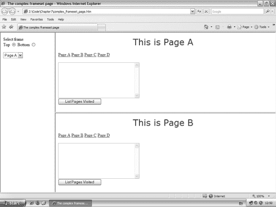

## 框架间的代码访问

你刚刚看到了子窗口如何访问其父窗口的变量和函数，但框架集内部的框架之间如何相互访问呢？

你在本章前面已经看到了一个简单的例子，所以这次我们来看一个更复杂的例子。创建完成后，你的页面将如图7-7所示。

图7-7

框架布局的示意图如图7-8所示。文本标签指示了每个框架在`<frameset>`和`<frame>`标签中被赋予的名称，但顶部框架除外，它只是框架集层次结构顶部的窗口。

**第7章：窗口与框架**

`fraTop`

顶部窗口

`fraMain`

`fraMenu`

`fraBottom`

图7-8

理解这种基于框架的网页层次结构最简单的方法是使用家族关系，这可以用家谱图来表示。如果你这样表示你的框架集，它看起来就像图7-9中的示意图。

顶部窗口

`fraMenu`

`fraMain`

`fraTop`

`fraBottom`

图7-9

从图中可以看出，`fraBottom`（右侧框架的底部框架）有一个名为`fraMain`的父框架，而`fraMain`本身又有一个父框架，即顶部窗口。因此，如果你想从`fraBottom`窗口访问顶部窗口中的某个函数，就需要访问`fraBottom`的父窗口的父窗口对象。你知道窗口对象具有`parent`属性，它是对该窗口对象的父窗口的引用。那么，让我们利用这一点，编写代码来访问顶部窗口中的一个函数，例如名为`myFunction()`的函数。

```
window.parent.parent.myFunction();
```

我们来分解一下。以下代码获取了对代码运行所在窗口的父窗口对象的引用。

```
window.parent
```

代码位于`fraBottom`中，因此`window.parent`将是`fraMain`。但你需要的是顶部窗口，即`fraMain`的父窗口，所以你在前面的代码基础上添加了`window.parent.parent`。

现在你有了对顶部窗口的引用。最后，你在表达式末尾添加`myFunction()`来调用它。

```
window.parent.parent.myFunction();
```

如果你想从`fraBottom`中的代码访问`fraMenu`的窗口对象呢？其实你已经有了大部分所需的代码。你看到`window.parent.parent`给出了顶部窗口，那么现在你需要该窗口的子窗口对象`fraMenu`。有三种方法可以获取它，结果完全相同。

你可以使用它在窗口对象的`frames[]`数组属性中的索引，如下所示：`window.parent.parent.frames[0]`

或者，你可以像这样在`frames[]`数组中使用它的名称：`window.parent.parent.frames["fraMenu"]`

最后，你可以像对待任何窗口对象一样，直接使用它的名称来引用它：`window.parent.parent.fraMenu`

第三种方法最简单，除非你不知道某个框架的名称，需要根据它在`frames[]`数组中的索引值来访问它，或者需要依次遍历每个子框架。

由于`window.parent.parent.fraMenu`获取了对与`fraMenu`关联的窗口对象的引用，要访问函数`myFunction()`或变量`myVariable`，你只需输入以下其中一行：

```
window.parent.parent.fraMenu.myFunction
```

或

```
window.parent.parent.fraMenu.myVariable
```

如果你想访问的不是框架内页面中的函数或变量，而是表单上的控件，甚至是该页面上的链接呢？好吧，假设你想从`fraBottom`页面访问`fraMenu`页面中名为`myForm`的表单上的一个名为`myControl`的控件。

你发现`window.parent.parent.fraMenu`从`fraBottom`给出了对`fraMenu`窗口对象的引用，但如何引用那里的表单呢？

基本上，这与从脚本所在的同一页面内部访问表单的方式相同，只不过你需要引用的不是该页面的窗口对象，而是你感兴趣的页面`fraMenu`的窗口对象。

通常你会写`document.myForm.myControl.value`，其中`window`是隐含的，因为它是全局对象。严格来说，应该是`window.document.myForm.myControl.value`。

现在你要访问另一个窗口，只需引用你想要的窗口，然后使用相同的代码即可。因此，如果你想从`fraBottom`访问`myControl`的`value`属性，需要以下代码：

```
window.parent.parent.fraMenu.document.myForm.myControl.value
```

如你所见，对其他框架的引用可能会变得相当长，在这种情况下，将引用存储在变量中是一个非常好的主意。例如，如果你多次访问`myForm`，可以这样写：

```
var myFormRef = window.parent.parent.fraMenu.document.myForm;
```

完成之后，你现在可以写

```
myFormRef.myControl.value;
```

而不是

```
window.parent.parent.fraMenu.document.myForm.myControl.value;
```

### top属性

当你想要从框架层次结构中较低层的框架访问最顶层的窗口时，使用`parent`属性可能会变得有点繁琐。另一种选择是窗口对象的`top`属性。它返回对框架层次结构中最顶层窗口的窗口对象的引用。在当前示例中，这就是顶部窗口。

例如，在你刚刚看到的示例中，这段代码：

```
window.parent.parent.fraMenu.document.myForm.myControl.value;
```

可以写成这样：

```
window.top.fraMenu.document.myForm.myControl.value;
```

不过，由于`window`是全局对象，你可以将其简化为：

```
top.fraMenu.document.myForm.myControl.value;
```

那么，什么时候应该使用`top`而不是`parent`，或者反过来呢？


这两个属性各有优缺点。`parent` 属性允许你指定相对于当前窗口的窗口对象。当前窗口之上的窗口是`window.parent`，它的父窗口是`window.parent.parent`，依此类推。`top` 属性则更加通用；无论使用何种框架集布局，`top` 始终是最顶层的窗口。总是会有一个`top`，但不一定总是存在`parent.parent`。如果你将所有希望从框架集中任何页面访问的全局函数和变量都放在最顶层的窗口中，那么无论其下的框架集如何变化，`window.top`始终有效，而`parent`属性则依赖于其上方的框架集结构。然而，如果其他人将你的网站加载到他自己的框架集页面中，那么顶层窗口就不再是你的，而是他的，此时`window.top`就不再有效。你无法两全其美，或者你能吗？

一个技巧是检查顶层窗口是否包含你的页面；如果没有，则重新加载顶层页面，并指定你的顶层页面为要加载的页面。例如，检查顶层页面的文件名是否与你期望的名称匹配。`window.top.location.href`会给出名称和路径——如果它们不匹配，则使用`window.top.location.replace("myPagename.htm")`来加载正确的顶层页面。但是，正如你稍后将看到的，如果其他人将你的页面加载到他创建的框架集中，这会导致问题——这就是所谓的同源策略适用的地方。本章后面会详细介绍。

### 试一试

#### 脚本化框架

让我们将你学到的关于框架和脚本的所有知识，基于你一直在看的框架集，应用到一个示例中。你将重复使用本章前面示例中的许多页面和代码。

你创建的第一个页面是顶层窗口页面。

```html
<html>
<head>
<title>复杂框架集页面</title>
<script language="JavaScript" type="text/javascript">
var pagesVisited = new Array();
function returnPagesVisited()
{
    var returnValue = "到目前为止，您已访问过以下页面\n";
    var pageVisitedIndex;
    var numberOfPagesVisited = pagesVisited.length;
    for (pageVisitedIndex = 0; pageVisitedIndex < numberOfPagesVisited; pageVisitedIndex++)
    {
```

# 第 7 章：窗口与框架

如你所见，你复用了`frameset_page.htm`中的大量代码，因此你可以从那里剪切并粘贴脚本块。只有不同的代码行被高亮显示。将此页面保存为`complex_frameset_page.htm`。

```html
returnValue = returnValue + pagesVisited[pageVisitedIndex] + "\n";

}

return returnValue;

}

function addPage(fileName)

{

var fileNameStart = fileName.lastIndexOf("/") + 1;

fileName = fileName.substr(fileNameStart);

pagesVisited[pagesVisited.length] = fileName;

return true;

}

</script>

</head>

<frameset cols="200,*">

<frame name=fraMenu src="menu_page.htm">

<frame name=fraMain src="main_page.htm">

</frameset>

</html>
```

接下来，创建将加载到`fraMenu`中的页面，即`menu_page.htm`。

```html
<html>

<head>

<script language="JavaScript" type="text/javascript"> function choosePage_onchange()

{

var choosePage = document.form1.choosePage;

var windowobject;

if (document.form1.radFrame[0].checked == true)

{

windowobject = window.parent.fraMain.fraTop;

}

else

{

windowobject = window.parent.fraMain.fraBottom;

}

windowobject.location.href =

choosePage.options[choosePage.selectedIndex].value;

return true;

}

</script>

</head>

<body>

<form name=form1>

Select frame<br>

Top <input name="radFrame" checked type=radio>

Bottom <input name="radFrame" type=radio>

<br><br>

<select name=choosePage language="JavaScript" type="text/javascript"

onchange="choosePage_onchange()">

<option value=page_a.htm>Page A

<option value=page_b.htm>Page B

<option value=page_c.htm>Page C

<option value=page_d.htm>Page D

</select>

</form>

</body>

</html>
```

将其保存为`menu_page.htm`。

`fraMain`框架包含一个页面，该页面只是`fraTop`和`fraBottom`页面的框架集。

```html
<html>

<frameset rows="50%,*">

<frame name=fraTop src="page_a.htm">

<frame name=fraBottom src="page_b.htm">

</frameset>

</html>
```

将其保存为`main_page.htm`。

接下来的四个页面，你复用了第一个示例中的四个页面——`page_a.htm`、`page_b.htm`、`page_c.htm`和`page_d.htm`。你需要做一些修改，如下面的代码所示。（同样，除了页面中显示的文本外，所有页面都是相同的，因此只显示`page_a.htm`。以类似方式修改其余页面。）

```html
<html>

<head>

<script language="JavaScript" type="text/javascript"> function butShowVisited_onclick()

{

document.form1.txtaPagesVisited.value = window.top.returnPagesVisited();

}

function setFrameAndPageControls(linkIndex)

{

var formobject = window.parent.parent.fraMenu.document.form1; formobject.choosePage.selectedIndex = linkIndex;

if (window.parent.fraTop == window.self)

{

formobject.radFrame[0].checked = true;

}

else

{

formobject.radFrame[1].checked = true;

}

return true;

}

</script>

</head>

<body

onload="return window.top.addPage(window.location.href);">

<center>

<font size=6 color=MidnightBlue face=verdana>

This is Page A

</font>

</center>

<p>

<A href="page_a.htm" name="pageALink"

onclick="return setFrameAndPageControls(0)">Page A</A>

<A href="page_b.htm" name="pageBLink"

onclick="return setFrameAndPageControls(1)">Page B</A>

<A href="page_c.htm" name="pageCLink"

onclick="return setFrameAndPageControls(2)">Page C</A>

<A href="page_d.htm" name="pageDLink"

onclick="return setFrameAndPageControls(3)">Page D</A>

</p>

<form name=form1>

<textarea rows=8 cols=35 name=txtaPagesVisited>

</textarea>

<br>

<input type="button" value="List Pages Visited" name=butShowVisited onclick="butShowVisited_onclick()">

</form>

</body>

</html>
```

以原有名称重新保存这些页面。

在浏览器中加载`complex_frameset_page.htm`，你将看到类似图 7-7 所示的屏幕。

单选按钮允许用户确定要导航到新页面的框架。当用户更改下拉列表中当前选中的页面时，该页面将加载到由单选按钮选中的框架中。

如果你使用`fraTop`和`fraBottom`框架内页面中的链接进行导航，你会注意到左侧`fraMenu`中的选中框架单选按钮和下拉列表将自动更新为刚刚导航到的页面和框架。请注意，就当前示例而言，如果用户将`page_a.htm`加载到一个框架中，选择列表不允许在另一个框架中加载同一页面。你可以通过添加一个按钮来改进此示例，该按钮将当前选中的页面加载到选定的框架中。

“列出已访问页面”按钮会显示已访问页面的列表，与上一个示例中的功能相同。

## 工作原理

你已经了解了`complex_frameset_page.htm`中定义顶层窗口的代码是如何工作的，因为它与上一个示例非常相似。不过，我们快速看一下`<frameset>`标签，如你所见，窗口的名称是在`<frame>`标签的`name`属性中定义的。

```html
<frameset cols="200,*">
<frame name=fraMenu src="menu_page.htm">
<frame name=fraMain src="main_page.htm">
</frameset>
```

还要注意，`<frameset>`标签的`cols`属性设置为`"200,*"`。这意味着第一个框架将占据一个 200 像素宽的列，而另一个框架将占据剩余空间的列。

让我们更详细地看看包含`menu_page.htm`的`fraMenu`框架。在页面顶部，你有主脚本块。其中包含函数`choosePage_onchange()`，该函数连接到页面下方选择框的`onchange`事件处理程序。选择框的选项包含各个页面的 URL。

该函数首先定义两个变量。其中一个`choosePage`是对页面下方`choosePage`选择对象的快捷引用。

```javascript
function choosePage_onchange()
{
var choosePage = document.form1.choosePage;
var windowobject;
```

然后，`if...else`语句将变量`windowobject`设置为引用用户通过`radFrame`单选按钮组选中的框架的窗口对象。

```javascript
if (document.form1.radFrame[0].checked == true)
{
windowobject = window.parent.fraMain.fraTop;
}
else
{
windowobject = window.parent.fraMain.fraBottom;
}
```

正如你之前所见，只需跟踪引用即可：`window.parent`获取对父窗口对象的引用。在这种情况下，`window.top`也能达到同样的效果。然后`window.parent.fraMain`获取对`fraMain`框架窗口对象的引用。最后，根据你要导航的框架，使用`window.parent.fraMain.fraTop`或`window.parent.fraMain.fraBottom`引用`fraMain`中包含的`fraTop`或`fraBottom`窗口对象。

现在你有了要导航的框架窗口对象的引用，就可以继续将其`location.href`属性更改为所选下拉列表项的值，从而使框架加载该页面。

```javascript
windowobject.location.href =
choosePage.options[choosePage.selectedIndex].value;
return true;
}
```

如前所述，`main_page.htm`只是为`fraTop`和`fraBottom`定义框架集的页面。

现在让我们看看实际加载到`fraTop`和`fraBottom`中的页面。由于它们都相同，我们只查看`page_a.htm`。

首先看顶部的脚本块。它包含两个函数：`butShowVisited_onclick()`和`setFrameAndPageControls()`。你在上一个示例中已经见过函数`butShowVisited_onclick()`。

```javascript
function butShowVisited_onclick()
{
document.form1.txtaPagesVisited.value = window.top.returnPagesVisited();
}
```

# 第 7 章：窗口与框架

然而，由于框架集布局发生了变化，你确实需要修改代码。之前`returnPagesVisited()`函数位于父窗口中，现在它移到了顶层窗口。如你所见，你只需将引用从`window.parent.returnPagesVisited();`改为`window.top.returnPagesVisited();`。

实际上，在前面的例子中，父窗口同时也是顶层窗口，所以如果你一开始就按这种方式编写代码，这里就不需要修改了。通常，将所有通用函数放在顶层框架集页面中是个好主意。这样，即使后来框架集布局发生变化，所有引用都可以使用`window.top`。

本页中的新函数是`setFrameAndPageControls()`，它连接到页面下方定义的链接的`onclick`事件处理程序。该函数的目的是确保如果用户通过链接而不是`fraMenu`窗口中的控件导航到不同页面，这些控件会更新以反映用户的操作。

首先，你将`formobject`变量设置为引用`fraMenu`页面中的`form1`，如下所示：

```javascript
function setFrameAndPageControls(linkIndex)
{
    var formobject = window.parent.parent.fraMenu.document.form1;
```

我们来分解一下。

`window.parent`获取对`fraMain`窗口对象的引用。向上移动层次结构，你使用以下代码获取对顶层窗口对象的引用：`window.parent.parent`

是的，你说得对。你也可以使用`window.top`，而且这样做会更好。我们这里用较长的写法只是为了演示层次结构的工作原理。

现在，你向下移动层次结构，但位于树形图的另一侧，以引用`fraMenu`的窗口对象。

`window.parent.parent.fraMenu`

最后，你只关心表单及其控件，因此你这样引用该对象：`window.parent.parent.fraMenu.document.form1`

现在你有了对表单的引用，就可以像在`fraMenu`自身代码中一样使用它。

函数的参数`linkIndex`告诉你四个链接中的哪一个被点击了，你在函数代码的下一行使用这个值来设置`fraMenu`表单中下拉列表框选中的选项。

```javascript
formobject.choosePage.selectedIndex = linkIndex;
```

在`if...else`语句中，你将`fraMenu`的单选按钮组`radFrame`设置为用户刚刚点击的框架，但你如何知道是哪个框架呢？

```javascript
if (window.parent.fraTop == window.self)
{
    formobject.radFrame[0].checked = true
}
else
{
    formobject.radFrame[1].checked = true
}
```

你检查当前窗口对象是否与`fraTop`的窗口对象相同。你使用`window`对象的`self`属性（返回当前窗口对象的引用）和`window.parent.fraTop`（返回`fraTop`窗口对象的引用）来实现。如果两者相等，你就知道它们是同一个对象，当前窗口就是`fraTop`。如果是这种情况，`fraMenu`框架中的`radFrame`单选按钮组的第一个单选按钮被选中。

否则，你选中`fraBottom`的另一个单选按钮。


函数中最后要做的是`return true`。记住，这个函数连接到一个`A`对象，因此返回`false`会取消链接的动作，而`true`则允许它继续，这正是你想要的。

```
return true;
}
```

## 打开新窗口

到目前为止，本章一直在讨论框架以及框架之间的脚本编写。在本节中，我们将稍微改变方向，看看如何打开额外的浏览器窗口。

为什么需要费心打开新窗口呢？嗯，它们在各种不同的情况下都很有用，例如：

- 你可能想要一个网站链接页面，点击链接会打开一个包含该网站的新窗口。
- 额外的窗口可用于显示信息。例如，如果你有一个产品页面，用户可以点击产品图片，弹出一个新的小窗口，列出该产品的详细信息。这比将现有窗口导航到产品详情的新页面，然后要求用户点击“返回”回到产品列表更不突兀。本章后面你将创建一个示例来演示这一点。
- 对话框窗口对于从用户那里获取信息非常有用，尽管过度使用可能会惹恼用户。

你需要知道的是，有些用户安装了阻止弹出窗口的程序，而最新版本的`Firefox`和`Internet Explorer`也允许用户关闭打开新窗口的功能。默认情况下，页面加载时自动创建的新窗口通常会被阻止。然而，只有在用户必须执行操作（例如点击链接或按钮）时才打开的窗口通常不会被默认阻止，但用户可能会更改浏览器设置来阻止它们。

### 打开一个新的浏览器窗口

`window`对象有一个`open()`方法，用于打开一个新窗口。它接受三个参数，其中第三个是可选的，并返回新浏览器窗口的`window`对象的引用。

`open()`方法的第一个参数是你希望在新窗口中打开的页面的URL。不过，如果你愿意，也可以为此参数传递一个空字符串，得到一个空白页面，然后使用`document.write()`方法动态地将HTML插入到新窗口中。

本章后面你将看到一个这样的例子。

第二个参数是你想分配给新窗口的名称。这不是用于脚本编写的名称，而是用于超链接和表单等元素的`target`属性。

例如，如果你将此参数设置为`myWindow`，并将原始页面上的超链接设置为`<A href="test3.htm" TARGET=myWindow>Test3.htm</A>`，那么点击该超链接将导致超链接作用于新打开的窗口。这意味着`test3.htm`将被加载到新窗口中，而不是当前窗口。同样适用于`<form>`标签的`target`属性，你将在关于服务器端JavaScript的章节中看到这一点。在这种情况下，如果从原始窗口提交表单，服务器的响应可以显示在新窗口中。

当新窗口打开时，默认情况下会带有某些属性集，例如宽度和高度，以及正常的浏览器窗口功能。浏览器窗口功能包括地址输入栏、带有导航按钮的菜单栏等。

`open()`方法的第三个参数可用于指定高度和宽度属性的值。此外，由于默认情况下大多数浏览器窗口功能是关闭的，你可以使用`open()`方法的第三个参数将它们重新打开。稍后你将更详细地了解浏览器功能。

首先，让我们看一个打开基本窗口所需的代码示例。你将此窗口命名为`myWindow`，并设置宽度和高度为250像素。你希望新窗口打开时显示`test2.htm`页面。

```
var newWindow;
newWindow = window.open("test2.htm","myWindow","width=250,height=250");
```

你可以看到`test2.htm`作为第一个参数传递；这是你想要打开的页面的URL。你在第二个参数中将窗口命名为`myWindow`。在第三个参数中，你将宽度和高度属性设置为250。

你还会注意到，你将变量`newWindow`设置为`open()`方法返回的返回值，该返回值是对刚刚打开的新窗口的窗口对象的引用。现在你可以使用`newWindow`来操作这个新窗口，并通过`window.document`属性访问其中包含的文档。你可以像处理框架及其窗口对象时那样，利用这个引用做任何事情。例如，如果你想更改新窗口内文档的背景颜色，可以输入：`newWindow.document.bgColor = "RED"`；

如何关闭刚刚打开的窗口？很简单，只需像这样使用窗口对象的`close()`方法：`newWindow.close();`

## 动手试一试

### 打开新窗口

让我们来看前面提到的产品页面示例，在该页面中，点击某个产品会弹出一个窗口，列出该产品的详细信息。这里我们厚颜无耻地以几本Wrox的书为例——不过页面上只有两个产品，算不上世界上最全面的在线目录。

```html
<html>
<head>
<title>在线图书</title>
<script language="JavaScript" type="text/javascript">
var detailsWindow;

function showDetails(bookURL)
{
    detailsWindow = window.open(bookURL,"bookDetails","width=400,height=350");
    detailsWindow.focus();
    return false;
}
</script>
</head>
<body>
<h2 align=center>在线图书购买</h2>
<p>
点击下方任意图片获取更多详情
</p>
<strong>Professional Active Server Pages .Net</strong>
<br>

<br><br>
<strong>Beginning Dreamweaver MX 2004</strong>
<br>

</body>
</html>
```

将此页面保存为`online_books.htm`。你还需要创建两个图片，分别命名为`pro_asp.jpg`和`beg_dreamweaver.jpg`。或者，你也可以在代码下载中找到这些文件。请注意，如果用户禁用了JavaScript，则不会打开窗口。你可以通过将页面详情添加到`href`属性来解决这个问题，如下所示：

`<a href="pro_asp_details.htm" onclick="return showDetails(this.href);"></a>`

现在你需要创建两个详情页面，都是纯HTML。

```html
<html>
<head>
<title>Professional ASP.NET 2.0</title>
</head>
<body>
<strong>Professional ASP.NET 2.0</strong>
<br>
主题
<br>
ASP
<br>
Internet
<br>
<HR color=#cc3333>
<p><strong>图书概述</strong> </p>
<p>这本全面的汇编对使用 ASP.NET 进行编程的各个方面进行了广泛而深入的研究。本书针对 .NET 2.0 版本进行了全面修订和更新，将为你提供掌握 ASP.NET 并构建动态、成功的企业级 Web 应用程序所需的信息。
</p>
</body>
</html>
```

将其保存为`pro_asp_details.htm`。

```html
<html>
<head>
<title>Beginning Dreamweaver MX 2004</title>
</head>
<body>
<strong>Beginning Dreamweaver MX 2004</strong>
<br>
<strong>主题</strong>
Dreamweaver<br>
Internet<br>
Web 设计<br>
XML 和脚本<br>
<HR color=#cc3333>
<p><strong>图书概述</strong></p>
<p>通过本书，你将快速学会使用 Dreamweaver MX 2004（Macromedia 强大的集成式 Web 开发和编辑工具）创建功能强大的动态网站。
你将学习如何利用 Dreamweaver 的工具和功能，使用 HTML、JavaScript、Active Server Pages (ASP) 和数据库构建三个完整的网站。
</p>
</body>
</html>
```

将最后一个页面保存为`beg_dreamweaver_details.htm`。

在浏览器中加载`online_books.htm`，然后点击任意一张图片。一个包含图书详情的新窗口应该会出现在现有浏览器窗口的上方。点击另一本书的图片，该窗口将被替换为包含那本书详情的窗口。

## 工作原理

文件`pro_asp_details.htm`和`beg_dreamweaver_details.htm`都是纯HTML文件，因此我们不再赘述。但在`online_books.htm`中，你会发现一些脚本操作，这里我们将重点介绍。

在页面顶部的脚本块中，首先定义了变量`detailsWindow`。

```javascript
var detailsWindow;
```

然后，你有了实际打开新窗口的函数。

```javascript
function showDetails(bookURL)
{
    detailsWindow = window.open(bookURL,"bookDetails","width=400,height=350");
    detailsWindow.focus();
    return false;
}
```

该函数与页面后面出现的图书图片的`onclick`事件处理程序相连。参数`bookURL`由`onclick`事件处理程序中的代码传递，它将是`beg_asp3_details.htm`或`prof_js_details.htm`。

你使用`window.open()`方法创建新窗口。将`bookURL`参数作为要打开的URL传递。将`bookDetails`作为要应用于新窗口的名称传递。如果该窗口已经存在，则不会打开另一个新窗口，而是将现有窗口导航到你传递的URL。这是因为你在为每本书打开窗口时使用了相同的名称（`bookDetails`）。如果你使用了不同的名称，则会打开一个新窗口。

通过将对刚刚创建的窗口对象的引用存储在变量`detailsWindow`中，你可以访问其方法和属性。在下一行，你会看到你使用由`detailsWindow`引用的窗口对象将焦点设置到新窗口——否则，如果你在主窗口中多次点击同一张图片，新窗口会出现在现有窗口后面。

尽管你为每个图片的`onclick`事件处理程序使用了相同的函数，但为每个图片传递了不同的参数，即所涉及图书的详情页面的URL。

```html
<strong>Professional Active Server Pages .Net</strong>
<br>

<br><br>
<strong>Beginning Dreamweaver MX 2004</strong>
<br>

</A>
```

## 向新窗口添加HTML

之前你了解到，可以将空字符串作为窗口对象`open()`方法的第一个参数传递，然后使用HTML写入页面。让我们看看如何做到这一点。

首先，你需要通过向指定要加载文件名的第一个参数传递空值来打开一个空白窗口。

```javascript
var newWindow = window.open("","myNewWindow","width=150,height=150");
```

现在你可以打开窗口的文档以接收你的HTML。

```javascript
newWindow.document.open();
```

当打开一个新窗口时，这不是必需的，因为页面是空白的；但对于已经包含HTML的文档，它的作用是清除所有现有的HTML并清空页面，使其准备好写入。

现在你可以使用`document.write()`方法写入任何有效的HTML。

```javascript
newWindow.document.write("<h4>Hello</h4>");
newWindow.document.write("<p>Welcome to my new little window</p>");
```

每次使用`write()`方法时，文本都会添加到已有内容中，直到你使用`document.close()`方法。

```javascript
newWindow.document.close();
```

如果之后再次使用`document.write()`方法，传递的文本将替换现有的HTML，而不是添加到其中。

## 为窗口添加功能

如你所见，`window.open()`方法接受三个参数，本节将重点介绍第三个参数。使用这第三个参数，你可以控制诸如创建的新窗口的大小、其在屏幕上的起始位置、用户是否可以调整其大小、是否具有工具栏等属性。

菜单栏、状态栏和工具栏等功能可以通过`yes`或`1`开启，`no`或`0`关闭。你也可以直接包含这些功能的名称（不指定值）来开启它们。

下表中列出的可选选项并不完整，且并非所有选项都同时适用于IE和Firefox浏览器。

| 窗口特性 | 可选值 | 描述 |
| --- | --- | --- |
| `copyHistory` | `yes`, `no` | 将打开窗口的历史记录复制到新窗口 |
| `directories` | `yes`, `no` | 显示目录按钮 |
| `height` | 整数 | 新窗口的高度（像素） |
| `left` | 整数 | 窗口左侧起始位置（像素） |
| `location` | `yes`, `no` | 显示位置文本框 |
| `menubar` | `yes`, `no` | 显示菜单栏 |
| `resizable` | `yes`, `no` | 允许用户在窗口打开后调整大小 |
| `scrollbars` | `yes`, `no` | 如果页面太大无法适应窗口，则显示滚动条 |
| `status` | `yes`, `no` | 显示状态栏 |
| `toolbar` | `yes`, `no` | 显示工具栏 |
| `top` | 整数 | 窗口顶部起始位置（像素） |
| `width` | 整数 | 新窗口的宽度（像素） |

如前所述，第三个参数是可选的。如果不包含它，所有窗口特性默认为`yes`，但窗口的大小和位置属性除外，它们默认为预设值。例如，尝试以下代码，你将看到一个类似图7-10所示的窗口：

```html
<html>
<head>
<script language="JavaScript" type="text/javascript">
var newWindow;
newWindow = window.open("","myWindow");
</script>
</head>
</html>
```

菜单栏 位置 工具栏 状态栏

图7-10

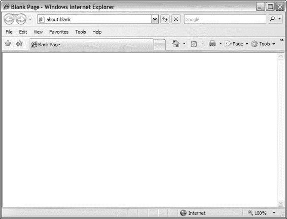

然而，如果你指定了任何一个特性，其他所有特性（大小和位置属性除外）默认都会被设置为`no`。例如，尽管定义了大小，以下代码生成的窗口没有任何特性，如图7-11所示：

```javascript
var newWindow;
newWindow = window.open("","myWindow","width=200,height=120")
```

较大的窗口是原始页面，而顶部较小的窗口（如图7-11所示）是弹出窗口。

图7-11

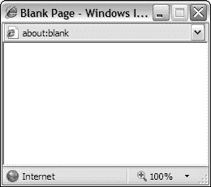

再看另一个例子。以下代码创建了一个可调整大小的250×250像素窗口，带有位置字段和菜单栏：

```javascript
var newWindow;
newWindow =
window.open("","myWindow","width=250,height=250,location,menubar,resizable")
```

但请注意：切勿在特性字符串中包含空格；否则某些浏览器会认为该字符串无效并忽略你的设置。

## 窗口间脚本

你已经简要了解了如何操作新窗口的属性和方法，以及如何使用`window.open()`方法的返回值访问其文档对象。现在你将学习新打开的窗口如何访问打开它的窗口，并且就像使用框架一样，如何使用其中的函数。

访问打开当前窗口的窗口对象的关键是`window`对象的`opener`属性。它返回对打开当前窗口的窗口对象的引用。因此，以下代码会将打开者窗口的背景颜色更改为红色：`window.opener.document.bgColor = "RED"`

你可以像使用框架时的`window.parent`和`window.top`属性一样使用这个引用。

### 动手试一试

#### 窗口间脚本

让我们看一个示例，其中你打开一个新窗口，并从新窗口访问打开者窗口上的表单。


```html
<html>
<head>
<script language=”JavaScript” type=”text/javascript”>
var newWindow;

function butOpenWin_onclick()
{
var winTop = (screen.height / 2) - 125;
var winLeft = (screen.width / 2) - 125;
var windowFeatures = “width=250,height=250,”;
windowFeatures = windowFeatures + “left=” + winLeft + “,”;
windowFeatures = windowFeatures + “top=” + winTop;
newWindow = window.open(“newWindow.htm”,”myWindow”,windowFeatures);
}

function butGetText_onclick()
{
if (typeof(newWindow) == “undefined” || newWindow.closed == true)
{
alert(“No window is open”);
}
else
{
document.form1.text1.value = newWindow.document.form1.text1.value;
}
}

function window_onunload()
{
if (typeof(newWindow) != “undefined” && newWindow.closed == false)
{
newWindow.close();
}
}
</script>
</head>
<body onunload=”window_onunload()”>
<form name=form1>
<input type=”button” value=”Open newWindow” name=butOpenWin onclick=”butOpenWin_onclick()”>
<br><br>
NewWindow’s Text <br>
<input type=”text” name=text1>
<br>
<input type=”button” value=”Get Text” name=butGetText onclick=”return butGetText_onclick()”>
</form>
</body>
</html>
```

这是原始窗口的代码。将其保存为`openerwindow.htm`。现在来看一下将由打开者窗口加载的页面。

```html
<html>
<head>
<script language=”JavaScript” type=”text/javascript”>
function butGetText_onclick()
{
document.form1.text1.value = window.opener.document.form1.text1.value;
}
</script>
</head>
<body>
<form name=form1>
Opener window’s text<BR>
<input type=”text” name=text1>
<br>
<input type=”button” value=”Get Text” name=butGetText language=”JavaScript”
type=”text/javascript”
onclick=”butGetText_onclick()”>
</form>
</body>
</html>
```

将其保存为`newWindow.htm`。

在浏览器中打开`openerwindow.htm`，你将看到一个包含简单表单的页面，如图 7-12 所示。

图 7-12

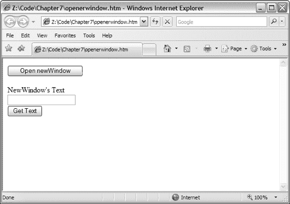

单击“Open newWindow”按钮，你将看到如图 7-13 所示的窗口在原始页面上方打开。

图 7-13

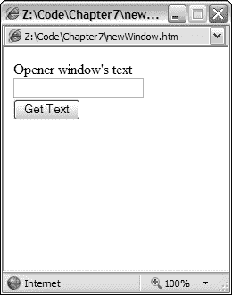

在新窗口的文本框中输入一些内容。然后返回原始打开者窗口，单击“Get Text”按钮，你将看到刚刚在`newWindow`中输入的内容出现在打开者窗口表单的文本框中。

更改打开者窗口文本框中的文本，然后返回`newWindow`并单击“Get Text”按钮。你在打开者窗口文本框中输入的文本将出现在`newWindow`的文本框中。

#### 工作原理

首先来看打开者窗口。在页面的 head 部分有一个脚本块，其中定义了一个变量和三个函数。顶部声明了一个新变量`newWindow`，它将保存稍后使用的`window.open()`方法返回的窗口对象引用。由于该变量位于任何函数之外，因此具有全局作用域，你可以从页面上的任何函数访问它。

```javascript
var newWindow;
```

然后是页面中三个函数中的第一个`butOpenWin_onclick()`，它在页面下方与“Open newWindow”按钮的`onclick`事件处理程序相连。其目的就是打开新窗口。

为了不让新窗口随意出现在页面上，你使用了内置的`screen`对象（它是`window`对象的属性）来获取用户显示器的分辨率，并将窗口放置在屏幕中央。`screen`对象有许多只读属性，这里我们关注的是`width`和`height`属性。你将`winTop`变量初始化为希望弹出窗口顶部边缘出现的垂直屏幕位置。`winLeft`变量设置为希望弹出窗口左侧边缘出现的水平屏幕位置。

在本例中，你希望位置在屏幕的水平和垂直中央。

```javascript
function butOpenWin_onclick()
{
var winTop = (screen.height / 2) - 125;
var winLeft = (screen.width / 2) - 125;
```

# 第 7 章：窗口与框架

你构建一个用于窗口特性的字符串，并将其存储在`windowFeatures`变量中。你将宽度和高度设置为 250，然后使用刚刚填充的`winLeft`和`winTop`变量来创建窗口的初始起始位置。

```javascript
var windowFeatures = "width=250,height=250,";
windowFeatures = windowFeatures + "left=" + winLeft + ",";
windowFeatures = windowFeatures + "top=" + winTop;
```

最后，你打开新窗口，确保将`window.open()`的返回值存入全局变量`newWindow`，以便后续操作。

```javascript
newWindow = window.open("newWindow.htm","myWindow",windowFeatures);
}
```

下一个函数用于从`newWindow`中表单的文本框获取文本。

在这个函数中，你使用`if`语句检查两件事。首先，检查`newWindow`是否已定义；其次，检查窗口是否确实处于打开状态。之所以进行检查，是因为你不希望尝试访问一个不存在的窗口，例如尚未打开任何窗口或用户已关闭窗口的情况。`typeof`运算符返回变量中保存的信息类型，例如 number、string、Boolean、object 和 undefined。如果变量从未被赋值，它会返回`undefined`，就像未打开新窗口时`newWindow`的情况一样。

确认某个时刻已打开一个窗口后，你需要检查它是否仍然打开，而窗口对象的`closed`属性正好用于此目的。如果返回`true`，表示窗口已关闭；如果返回`false`，则表示窗口仍处于打开状态。（不要将此`closed`属性与之前看到的`close()`方法混淆。）

在`if`语句中，你会看到首先检查`newWindow`是否已定义，这并非偶然。

如果`newWindow`确实未定义，那么`newWindow.closed`会导致错误，因为`newWindow`内部没有数据。然而，你利用了这样一个事实：如果`if`语句的条件在某个点上无论剩余条件如何都会为 true 或 false，那么剩余条件将不会被检查。

```javascript
function butGetText_onclick()
{
    if (typeof(newWindow) == "undefined" || newWindow.closed == true)
    {
        alert("没有窗口打开");
    }
    else
    {
        document.form1.text1.value = newWindow.document.form1.text1.value;
    }
}
```

如果`newWindow`存在且处于打开状态，则执行`else`语句中的代码。请记住，`newWindow`将包含对已打开窗口的窗口对象的引用。这意味着你可以通过`newWindow`窗口对象中的`document`对象来访问`newWindow`中的表单，就像访问脚本运行所在页面上的表单一样。

三个函数中的最后一个是`window_onunload()`，它与此页面的`onunload`事件关联，并在浏览器窗口关闭或用户导航到另一个页面时触发。在`window_onunload()`函数中，你以与刚才类似的方式检查`newWindow`是否有效且处于打开状态。你必须首先检查`newWindow`变量是否已定义。使用`&&`运算符时，仅当第一部分求值为 true 时，JavaScript 才会检查操作的第二部分。如果`newWindow`已定义，并且因此持有一个窗口对象（即使它可能是一个已关闭的窗口），你可以检查该窗口的`closed`属性。然而，如果`newWindow`未定义，则不会检查其`closed`属性，也不会发生错误。如果你先检查`closed`属性而`newWindow`未定义，则会发生错误，因为未定义的变量没有`closed`属性。

```javascript
function window_onunload()
{
    if (typeof(newWindow) != "undefined" && newWindow.closed == false)
    {
        newWindow.close();
    }
}
```

如果`newWindow`已定义且处于打开状态，则将其关闭。这可以防止在不存在父窗口可获取文本时（因为此函数在父窗口关闭时触发）点击`newWindow`的“获取文本”按钮。

现在，让我们看看将在`newWindow`中加载的页面（即`newWindow.htm`）的代码。

此页面包含一个函数`butGetText_onclick()`。它与此页面中“获取文本”按钮的`onclick`事件处理程序关联，用于从父窗口的文本框中检索文本。

```javascript
function butGetText_onclick()
{
    document.form1.text1.value = window.opener.document.form1.text1.value;
}
```

在这个函数中，你使用`window.opener`属性获取对打开此窗口的窗口对象的引用，然后使用该引用从该窗口的表单文本框中获取值。该值被放入当前页面的文本框中。

### 移动和调整窗口大小

在结束窗口主题之前，让我们看看可用于调整现有窗口大小和移动现有窗口的方法。

打开窗口后，你可以使用窗口对象的`resizeTo()`和`moveTo()`方法更改其在屏幕上的位置和大小，这两个方法都接受两个以像素为单位的参数。

假设你刚刚打开了一个新窗口，如下所示：

```javascript
var newWindow = window.open("myURL","myWindow","width=125,height=150,resizable");
```

你想将其设置为宽 350 像素、高 200 像素，并将其移动到距离屏幕左侧 100 像素、距离顶部 400 像素的位置。你需要什么代码？

```javascript
newWindow.resizeTo(350,200);
newWindow.moveTo(100,400);
```

你可以看到，使用`resizeTo()`可以将窗口调整为宽 350 像素、高 200 像素。然后使用`moveTo()`将其移动到距离屏幕左侧 100 像素、距离屏幕顶部 400 像素的位置。

窗口对象还有`resizeBy()`和`moveBy()`方法。它们各自接受两个参数，以像素为单位。例如：

```javascript
newWindow.resizeBy(100,200);
newWindow.moveBy(20,50);
```

这段代码将使`newWindow`的宽度增加 100 像素，高度增加 200 像素。类似地，它会使`newWindow`水平移动 20 像素，垂直移动 50 像素。

使用这些方法时，你必须记住，用户可以根据需要手动调整这些窗口的大小。此外，客户端屏幕的像素大小会因用户而异。

## 安全性

诸如 Firefox 和 Internet Explorer 之类的浏览器对脚本在框架和窗口之间可以访问的信息施加了某些限制。

如果这些框架和窗口中的所有页面都基于同一台服务器，或者当你在本地将它们加载到浏览器中时（就像这些示例中一样）基于同一台计算机，那么你的脚本可以相对自由地访问和操作。然而，确实存在一些限制。例如，如果你尝试在用户打开的浏览器窗口（而不是由你的脚本打开的窗口）中加载的脚本页面中使用`window.close()`方法，则会弹出一个消息框，让用户选择取消你的`close()`方法并保持窗口打开。

当一个窗口或框架中的页面托管在一台服务器上，并尝试访问包含来自不同服务器页面的窗口或框架的属性时，同源策略就会生效，你会发现你的脚本能做的事情非常有限。

假设你有一个托管在 Web 服务器上的页面，其 URL 为`http://www.myserver.com`。该页面中包含以下脚本：

```javascript
var myWindow =
window.open("http://www.anotherserver.com/anotherpage.htm","myWindow");
```

现在你有两个窗口，一个托管在`www.myserver.com`，另一个托管在不同的服务器`www.anotherserver.com`上。虽然这段代码可以工作，但同源策略会阻止从一个页面访问另一个页面的文档对象。例如，在开启页面中的以下代码会导致安全问题，并被浏览器阻止：

```javascript
var myVariable = myWindow.document.form1.text1.value;
```

尽管你可以访问另一台服务器上页面的`window`对象，但只能访问其属性和方法的一个有限子集。

同源限制同样适用于框架和窗口。其背后的理念非常合理：它旨在防止黑客将你的页面嵌入到他们自己的页面中，并通过其页面内的代码提取信息。然而，这些限制相当严格，也许过于严格，这意味着如果页面托管在不同的服务器上，你应该避免跨框架或跨窗口编写脚本。

## 趣味问答

正如你在上一章中所见，趣味问答只是一个单页应用，每次随机提出一个问题。本章中趣味问答的任务是将其从单页应用转换为一个包含六个页面的多框架应用。这不是一个小改动，需要大量工作。本章的增强功能将把问答应用转变为一个更像样子的应用程序。当应用首次加载时，用户将看到如图 7-14 所示的屏幕。

如你所见，这与第 6 章中问答应用的外观相比有了很大变化！接下来你将看到创建此应用的策略。

*在某些浏览器上，例如 Internet Explorer 6 的某些版本，加载问答时可能会看到一个警告栏。这仅在你从本地计算机加载页面时发生；如果页面从网站加载则不会发生。当它询问是否要运行活动内容时，请单击“是”。*

271


10_051511 ch07.qxp 4/13/07 6:17 PM Page 272

# 第 7 章：窗口与框架

图 7-14

### 创建新的趣味问答

使用框架的思路是：有一个名为`globalfunctions.htm`的页面，用于存放所有反复使用的全局函数。该页面将被加载到一个名为`fraGlobalFunctions`的框架中。

还有一个页面仅显示横幅“谁想成为亿万富翁”，如图 7-14 所示。该页面名为`menubar.htm`，将被加载到一个名为`fraMenubar`的框架中。

第三和第四个页面是用户交互的核心区域。`QuizPage.htm`是问答开始的地方——它显示欢迎信息和“开始问答”按钮，如图 7-14 所示。`AskQuestion.htm`页面用于显示和回答问题，最后，当问答结束时，显示结果。这些页面将被加载到名为`fraQuizPage`的框架中。

另外两个页面名为`TriviaQuiz.htm`和`TopFrame.htm`，它们的作用仅仅是定义包含其他页面的框架的框架集。这些框架集页面将被包含在名为 Top window 和`fraTopFrame`的框架中。

272

10_051511 ch07.qxp 4/13/07 6:17 PM Page 273

# 第 7 章：窗口与框架

应用的框架结构如图 7-15 所示，并标明了每个框架的名称。请注意，虽然显示了`fraGlobalFunctions`框架，但它对用户实际上是不可见的，因此用户无法轻易看到代码并通过阅读答案作弊。

顶层窗口

`fraGlobalFunctions`

`fraMenuBar`

`fraTopFrame`

`fraQuizPage`

图 7-15

用树形图表示，框架如图 7-16 所示。

顶层窗口

`fraTopFrame`

`fraQuizPage`

`fraGlobalFunctions`

`fraMenubar`

图 7-16

接下来，我们将依次查看每个框架，并给出将加载到其中的页面代码。


### 顶层窗口

图 7-17 显示了框架结构，其中顶层窗口框架被高亮显示。

顶层窗口

`fraTopFrame`

`fraQuizPage`

`fraGlobalFunctions`

`fraMenubar`

图 7-17

273

10_051511 ch07.qxp 4/13/07 6:17 PM Page 274

# 第 7 章：窗口与框架

创建定义顶部和底部框架的框架集页面，如下所示。

```html
<!DOCTYPE HTML PUBLIC "-//W3C//DTD HTML 4.01 Frameset//EN"
"http://www.w3.org/TR/html4/frameset.dtd">
<html>
<head>
<meta http-equiv="Content-Type" content="text/html; charset=iso-8859-1">
<title>Wrox 在线趣味问答</title>
</head>
<frameset rows="120,*" border="0">
<frame src="TopFrame.htm" name="fraTopFrame">
<frame src="QuizPage.htm" name="fraQuizPage">
</frameset>
</html>
```

将其保存为`TriviaQuiz.htm`。

这是用户加载到浏览器中的页面。它定义了框架`fraTopFrame`和`fraQuizPage`，并指定了将加载到其中的页面。

### `fraQuizPage`

接下来要查看的框架是`fraQuizPage`，它在框架层次结构中的位置如图 7-18 所示。该框架将依次加载两个页面：`QuizPage.htm`和`AskQuestion.htm`。

顶层窗口

`fraTopFrame`

`fraQuizPage`

`fraGlobalFunctions`

`fraMenubar`

图 7-18

#### `QuizPage.htm`

在前面的截图中，你看到了问答开始前的样子。你只有一个包含一些文本和一个按钮的起始页面，点击按钮即可开始问答。当问答结束时，如果用户要求重新开始，该页面会再次加载。

让我们创建这个起始页面。输入完代码后，将页面保存为`QuizPage.htm`。

```html
<!DOCTYPE HTML PUBLIC "-//W3C//DTD HTML 4.01 Transitional//EN"
"http://www.w3.org/TR/html4/loose.dtd">
<html>
<head>
<meta http-equiv="Content-Type" content="text/html; charset=iso-8859-1">
<title>问答页面</title>
<script language="JavaScript" type="text/javascript">
function cmdStartQuiz_onclick()
{
    window.top.fraTopFrame.fraGlobalFunctions.resetQuiz();
    window.location.href = "AskQuestion.htm";
}
</script>
<style type="text/css">
<!--
body {
    background-color: #000033;
}
body,td,th {
    font-family: Trebuchet MS, helvetica, sans-serif;
    color: #CCCCCC;
}
input, select {
    font-family: "Trebuchet MS", "Lucida Sans", Georgia, "Times New Roman", Times, serif;
    font-size: 13px;
    color: #333333;
    padding: 1px;
    background: #EEE;
}
.SmallText {font-size: 12px}
div#MainBodyDIV
{
    border:1px;
    border-color:#CCCCCC;
    border-style:groove;
    padding:10px;
    margin-top:20px;
}
-->
</style>
</head>
<body>
<div id="MainBodyDIV">
<p>你准备好成为亿万富翁了吗？</p>
<p>点击下面的“开始问答”按钮，你只需回答 13 个问题就能赢得十亿美元。
<span class="SmallText">（好吧，不是真的，但梦想总是美好的……）</span> </p>
<form name="frmQuiz">
<input name="cmdStartQuiz" type=button value="开始问答"
onclick="return cmdStartQuiz_onclick()" style="width:150px; height:30px;">
</p>
</form>
</div>
</p>
</body>
</html>
```

275


10_051511 ch07.qxp 4/13/07 6:17 PM Page 276

# 第 7 章：窗口与框架

#### `AskQuestion.htm`

点击“开始问答”按钮后，加载到`fraQuizPage`框架中的下一个页面是`AskQuestion.htm`，如图 7-19 所示（问题是随机选择的，因此你可能会看到不同的起始问题）。

图 7-19

当点击“回答问题”按钮时，会检查用户的答案，并重新加载此页面。

如果还有更多问题要问，则会显示另一个不同的随机问题。如果问答结束，则会显示如图 7-20 所示的结果页面。

实际上，结果页面和提问页面是同一个 HTML 页面，但会根据问答是否结束而动态生成。

276


图 7-20

现在你将创建该页面，并将其保存为`AskQuestion.htm`。

```html
<!DOCTYPE HTML PUBLIC “-//W3C//DTD HTML 4.01 Transitional//EN”
“http://www.w3.org/TR/html4/loose.dtd”>
<html>
<head>
<meta http-equiv=”Content-Type” content=”text/html; charset=iso-8859-1”>
<title>Ask Questions</title>
<script language=”JavaScript” type=”text/javascript”> var globalFunctions;
globalFunctions = window.top.fraTopFrame.fraGlobalFunctions; function getAnswer()
{
var answer = 0;
while (document.QuestionForm.radQuestionChoice[answer].checked != true)
{
answer++;
}
return String.fromCharCode(65 + answer);
}
function buttonCheckQ_onclick()
{
var questionNumber = globalFunctions.currentQNumber;
if (globalFunctions.answerCorrect(questionNumber,getAnswer()) == true)
{
alert(“You got it right”);
}
else
{
alert(“You got it wrong”);
}
window.location.reload();
}
</script>
</head>
<body style=”background-color: #000033;”>
<table align=center border=”2” width=”70%”>
<tr>
<td bgcolor=RoyalBlue>
<form name=”QuestionForm”>
<script language=”JavaScript” type=”text/javascript”> document.write(globalFunctions.getQuestion());
</script>
</form>
</td>
</tr>
</table>
</body>
</html>
```

## `fraTopFrame`

接下来要查看的框架是`fraTopFrame`，它在框架层级中的位置如图 7-21 所示。

顶层窗口

`fraTopFrame`

`fraQuizPage`

`fraGlobalFunctions`

`fraMenubar`

图 7-21

在顶层窗口中定义的另一个框架实际上是一个定义框架集的页面。它定义了一个可见框架（包含页面标题）和一个不可见框架（包含全局函数，但没有 HTML）。接下来让我们创建这个定义框架集的页面。

```html
<!DOCTYPE HTML PUBLIC “-//W3C//DTD HTML 4.01 Frameset//EN”
“http://www.w3.org/TR/html4/frameset.dtd”>
<html>
<head>
<meta http-equiv=”Content-Type” content=”text/html; charset=iso-8859-1”>
<title>Top Frame</title>
</head>
<frameset rows=”0,*” border=”0”>
<frame src=”GlobalFunctions.htm” name=”fraGlobalFunctions”>
<frame src=”Menubar.htm” name=”fraMenubar”>
</frameset>
</html>
```

将此页面保存为`TopFrame.htm`。

可以看到它定义了两个框架：`fraGlobalFunctions`和`fraMenubar`，接下来将介绍它们。

## `fraMenubar`

接下来你将创建`fraMenubar`框架的页面，它在框架层级中的位置如图 7-22 所示。

顶层窗口

`fraTopFrame`

`fraQuizPage`

`fraGlobalFunctions`

`fraMenubar`

图 7-22

```html
<!DOCTYPE HTML PUBLIC “-//W3C//DTD HTML 4.01 Transitional//EN”
“http://www.w3.org/TR/html4/loose.dtd”>
<html>
<head>
<title>Menu Bar</title>
<meta http-equiv=”Content-Type” content=”text/html; charset=iso-8859-1”>
</head>
<body style=”background-color:#000033”>
<div style=”text-align:center;”>

</div>
</body>
</html>
```

将其保存为`menubar.htm`。

该页面仅定义了在整个问答游戏中可见的标题。它还使用了一个名为`MainLogo.gif`的图片，你需要自行创建或从代码下载中获取。

## `fraGlobalFunctions`

在图 7-23 中，你可以看到`fraGlobalFunctions`在框架层级中的位置。

顶层窗口

`fraTopFrame`

`fraQuizPage`

`fraGlobalFunctions`

`fraMenubar`

图 7-23

现在将注意力转向最后一个新页面，即`globalfunctions.htm`，它作为一个模块，包含所有通用的 JavaScript 函数。它位于框架`fraGlobalFunctions`中。

你可能会认出其中一些代码来自第 6 章创建的`trivia_quiz.htm`页面。


```html
<!DOCTYPE HTML PUBLIC “-//W3C//DTD HTML 4.01 Transitional//EN”
“http://www.w3.org/TR/html4/loose.dtd”>
<html>
<head>
<meta http-equiv=”Content-Type” content=”text/html; charset=iso-8859-1”>
<title>Global functions</title>
<script language=”JavaScript” type=”text/javascript”>
// questions and answers variables will holds questions and answers
var questions = new Array();
var answers = new Array();
var questionsAsked;
var numberOfQuestionsAsked = 0;
var numberOfQuestionsCorrect = 0;
var currentQNumber = -1;

// define question 1
questions[0] = new Array();
questions[0][0] = “The Beatles were”;
questions[0][1] = “A sixties rock group from Liverpool”;
questions[0][2] = “Four musically gifted insects”;
questions[0][3] = “I don’t know - can I have the questions on baseball please”;

// assign answer for question 1
answers[0] = “A”;

// define question 2
questions[1] = new Array();
questions[1][0] = “Homer Simpson’s favorite food is”;
questions[1][1] = “Fresh salad”;
questions[1][2] = “Doughnuts”;
questions[1][3] = “Bread and water”;
questions[1][4] = “Apples”;

// assign answer for question 2
answers[1] = “B”;

// define question 3
questions[2] = new Array();
questions[2][0] = “Lisa Simpson plays which musical instrument”;
questions[2][1] = “Clarinet”;
questions[2][2] = “Oboe”;
questions[2][3] = “Saxophone”;
questions[2][4] = “Tubular Bells”;

// assign answer for question 3
answers[2] = “C”;

function resetQuiz()
{
    var indexCounter;
    currentQNumber = -1;
    questionsAsked = new Array();

    for (indexCounter = 0; indexCounter < questions.length;indexCounter++)
    {
        questionsAsked[indexCounter] = false;
    }

    numberOfQuestionsAsked = 0;
    numberOfQuestionsCorrect = 0;
}

function answerCorrect(questionNumber, answer)
{
    // declare a variable to hold return value
    var correct = false;

    // if answer provided is same as answer then correct answer is true
    if (answer == answers[questionNumber])
    {
        numberOfQuestionsCorrect++;
        correct = true;
    }

    // return whether the answer was correct (true or false)
    return correct;
}

function getQuestion()
{
    if (questions.length != numberOfQuestionsAsked)
    {
        var questionNumber = Math.floor(Math.random() * questions.length);

        while (questionsAsked[questionNumber] == true)
        {
            questionNumber = Math.floor(Math.random() * questions.length);
        }

        var questionLength = questions[questionNumber].length;
        var questionChoice;
        numberOfQuestionsAsked++;

        var questionHTML = “<h4>Question “ + numberOfQuestionsAsked + “</h4>”;
        questionHTML = questionHTML + “<p>” + questions[questionNumber][0];
        questionHTML = questionHTML + “</p>”;

        for (questionChoice = 1;questionChoice < questionLength;questionChoice++)
        {
            questionHTML = questionHTML + “<input type=radio “;
            questionHTML = questionHTML + “name=radQuestionChoice”;

            if (questionChoice == 1)
            {
                questionHTML = questionHTML + “ checked”;
            }

            questionHTML = questionHTML + “>” +
                questions[questionNumber][questionChoice];

            questionHTML = questionHTML + “<br>”;
        }

        questionHTML = questionHTML + “<br><input type=’button’ ”;
        questionHTML = questionHTML + “ value=’Answer Question’”;
        questionHTML = questionHTML + “name=buttonNextQ ”;
        questionHTML = questionHTML + “onclick=’return buttonCheckQ_onclick()’>”;

        currentQNumber = questionNumber;
        questionsAsked[questionNumber] = true;
    }
    else
    {
        var questionHTML = “<h3>Quiz Complete</h3>”;
        questionHTML = questionHTML + “You got “ + numberOfQuestionsCorrect;
        questionHTML = questionHTML + “ questions correct out of ”;
        questionHTML = questionHTML + numberOfQuestionsAsked;
        questionHTML = questionHTML + “<br><br>Your trivia rating is ”;

        switch(Math.round(((numberOfQuestionsCorrect / numberOfQuestionsAsked) * 10)))
        {
            case 0:
            case 1:
            case 2:
            case 3:
                questionHTML = questionHTML + “Beyond embarrassing”;
                break;

            case 4:
            case 5:
            case 6:
            case 7:
                questionHTML = questionHTML + “Average”;
                break;

            default:
                questionHTML = questionHTML + “Excellent”;
        }

        questionHTML = questionHTML + “<br><br><A ”;
        questionHTML = questionHTML + “href=’quizpage.htm’><strong>”;
        questionHTML = questionHTML + “Start again</strong></A>”;
    }

    return questionHTML;
}
</script>
</head>

<body>
</body>
</html>
```

将此页面保存为`GlobalFunctions.htm`。至此所有页面已完成，现在可以加载新的问答游戏并了解其工作原理。

# 第 7 章：窗口与框架

## 工作原理

在浏览器中加载`TriviaQuiz.htm`即可开始游戏并尝试运行。

虽然看起来有很多新代码，但其中大部分与之前版本的问答游戏相同。

接下来将详细查看页面`QuizPage.htm`和`AskQuestion.htm`（它们被加载到`fraQuizPage`框架中），以及`GlobalFunctions.htm`（被加载到`fraGlobalFunction`框架中）。

在其他页面中，`TriviaQuiz.htm`和`TopFrame.htm`只是定义框架集的页面，而`menubar.htm`仅定义了页面的标题。

### QuizPage.htm

这是一个简单的页面。定义了一个函数`cmdStartQuiz_onclick()`，该函数与页面下方“开始问答”按钮的`onclick`事件处理程序相关联。

```javascript
function cmdStartQuiz_onclick()
{
    window.top.fraTopFrame.fraGlobalFunctions.resetQuiz();
    window.location.href = “AskQuestion.htm”;
}
```

在该函数中，通过调用`fraGlobalFunctions`框架中的`resetQuiz()`函数来重置问答。稍后将介绍该函数。要获取`fraGlobalFunctions`的窗口对象引用，需要先获取顶层窗口下的`fraTopFrame`引用。

在函数的第二行，将框架导航到`AskQuestion.htm`，即提问页面。接下来将介绍该页面。

### AskQuestion.htm

在此页面中，将多次访问`fraGlobalFunctions`框架中的函数，因此声明一个页面级变量并将其设置为引用`fraGlobalFunctions`的窗口对象。这样可以减少输入量，并使代码更易读。

```javascript
var globalFunctions;
globalFunctions = window.top.fraTopFrame.fraGlobalFunctions;
```

接下来是`getAnswer()`函数，该函数从页面下方的表单中获取用户选择的答案。它通过遍历表单中的每个选项，递增变量`answer`，直到找到用户选中的选项。请注意，答案存储为 A、B、C 等，因此使用`String`对象的`fromCharCode()`方法将索引号转换为对应的字符。这与之前版本问答游戏中`buttonCheckQ_onclick()`函数前半部分的操作相同。

```javascript
function getAnswer()
{
    var answer = 0;

    while (document.QuestionForm.radQuestionChoice[answer].checked != true)
    {
        answer++;
    }

    return String.fromCharCode(65 + answer);
}
```

第二个函数`butCheckQ_onclick()`将连接到“检查答案”按钮的`onclick`事件。它与之前版本中间名函数的后半部分类似。不过，现在它引用的是`fraGlobalFunctions`框架中的`answerCorrect()`函数，而非当前页面，并且使用`getAnswer()`函数而非变量`answer`。

```javascript
function buttonCheckQ_onclick()
{
    var questionNumber = globalFunctions.currentQNumber;

    if (globalFunctions.answerCorrect(questionNumber,getAnswer()) == true)
    {
        alert(“You got it right”);
    }
    else
    {
        alert(“You got it wrong”);
    }

    window.location.reload();
}
```

与第 6 章类似，向用户显示问题的表单通过`document.write()`动态填充。不过，这次函数`getQuestion()`位于`GlobalFunctions.htm`页面中。

### GlobalFunctions.htm

此页面的大部分内容取自第 6 章创建的`trivia_quiz.htm`页面。在页面顶部添加了四个页面级变量。

```javascript
var questions = new Array();
var answers = new Array();
var questionsAsked;
var numberOfQuestionsAsked = 0;
var numberOfQuestionsCorrect = 0;
var currentQNumber = -1;
```

然后，像之前一样定义`questions`和`answers`数组。第一个新函数`resetQuiz()`如下所示：

```javascript
function resetQuiz()
{
    var indexCounter;
    currentQNumber = -1;
    questionsAsked = new Array();

    for (indexCounter = 0; indexCounter < questions.length;indexCounter++)
    {
        questionsAsked[indexCounter] = false;
    }

    numberOfQuestionsAsked = 0;
    numberOfQuestionsCorrect = 0;
}
```

当问答开始或重新开始时，会调用此函数将所有全局问答变量重置为默认状态。例如，`questionsAsked`变量被重新初始化为一个新数组，其长度与`questions`数组的长度相同，每个元素默认设置为`false`，表示对应的问题尚未被提问。

接下来是`answerCorrect()`函数，与上一章相同。页面的其余部分由`getQuestion()`函数组成，该函数自上一版本以来发生了重大变化。

之前是随机提问，直到用户厌倦为止。现在将跟踪哪些问题已被提问以及已提问了多少个问题。`questionsAsked`数组将存储已被提问的问题，从而避免重复提问。变量`numberOfQuestionsAsked`记录已提问的数量，以便在问题库用尽时停止。变量`numberOfQuestionsCorrect`用于记录正确答案的数量。这些变量已在页面头部定义。

转到`getQuestion()`，可以看到该函数首先使用`if`语句检查是否已提问了与数据库中问题数量相同的问题。`questions`数组的`length`属性告诉数组中有多少个元素，而`numberOfQuestionsAsked`则告诉已提问了多少个。如果所有问题都已提问，稍后将看到该函数会写出一个结束页面，其中包含用户答对的数量并评价其问答知识水平。

```javascript
function getQuestion()
{
    if (questions.length != numberOfQuestionsAsked)
    {
        var questionNumber = Math.floor(Math.random() * questions.length);

        while (questionsAsked[questionNumber] == true)
        {
            questionNumber = Math.floor(Math.random() * questions.length);
        }
```

从上述代码可以看出，问题的选择是随机的，与第 6 章版本相同。不过，添加了一个`while`循环，利用之前声明的`questionsAsked`数组。每次提问一个问题时，将`questionsAsked`数组中与该问题编号相同位置的元素值设置为`true`。通过检查特定数组位置是否为`true`，可以判断该问题是否已被提问，如果是，则`while`循环继续，直到找到`false`值——即未被提问的问题。

现在知道了要提问哪个问题，接下来只需继续提问即可，这正是后续代码的目的。


```javascript
var questionLength = questions[questionNumber].length;
var questionChoice;
numberOfQuestionsAsked++;
var questionHTML = “<h4>Question “ + numberOfQuestionsAsked + “</h4>”;
questionHTML = questionHTML + “<p>” + questions[questionNumber][0];
questionHTML = questionHTML + “</p>”;
for (questionChoice = 1;questionChoice < questionLength;questionChoice++)
{
    questionHTML = questionHTML + “<input type=radio “
```

# 第 7 章：窗口与框架

```javascript
questionHTML = questionHTML + “name=radQuestionChoice”

if (questionChoice == 1)

{

questionHTML = questionHTML + “ checked”;

}

questionHTML = questionHTML + “>” +

questions[questionNumber][questionChoice];

questionHTML = questionHTML + “<br>”

}

questionHTML = questionHTML + “<br><input type=’button’ “

questionHTML = questionHTML + “ value=’Answer Question’”; questionHTML = questionHTML + “name=buttonNextQ “;

questionHTML = questionHTML + “onclick=’return buttonCheckQ_onclick()’>”;
```

这段代码与第 6 章中的前一个版本几乎相同，区别在于现在你动态创建了按钮以及答案选项。为什么？在函数开头，你看到了一个`if`语句检查是否已到达测验的末尾。如果没有，你就创建另一个问题，就像这里所做的那样。如果测验已经结束，你就不想再创建答案数组，而是想创建一个测验结束表单。避免出现“回答问题”按钮的唯一方法就是将其作为动态问题创建的一部分。

最后，你会看到`questionsAsked`数组被更新——即刚刚提出的问题被存储在该数组中，如下所示：

```javascript
currentQNumber = questionNumber;

questionsAsked[questionNumber] = true;

}
```

接下来是函数顶部`if`语句的`else`部分。其目的是创建“测验完成”消息。你构建所需的 HTML，并将其存储在`questionHTML`变量中。你不仅指定了用户在回答的问题中答对了多少道，还对他的知识水平进行了评级。

```javascript
else

{

questionHTML = “<h3>Quiz Complete</h3>”;

questionHTML = questionHTML + “You got “ + numberOfQuestionsCorrect; questionHTML = questionHTML + “ questions correct out of “

questionHTML = questionHTML + numberOfQuestionsAsked;

questionHTML = questionHTML + “<br><br>Your trivia rating is “
```

评级通过`switch`语句完成，该语句基于答对的问题数除以提问的问题数，为简化起见，你将其乘以 10 并四舍五入到最接近的整数。然后使用`case`语句创建正确的评级。请记住，代码执行从第一个匹配的`case`语句开始，并持续到`switch`语句结束或遇到`break`语句为止。因此，如果你的评级计算`Math.round(((numberOfQuestionsCorrect / numberOfQuestionsAsked) * 10`结果为 1，代码将从`case 1:`语句开始执行，并持续到`case 3`中的`break`语句。这实质上意味着评级 0–3 将被描述为“尴尬至极”，4–7 为“一般”，其他情况（即`default`情况）为“优秀”。

```javascript
switch(Math.round(((numberOfQuestionsCorrect / numberOfQuestionsAsked) * 10)))

{

case 0:

case 1:

case 2:

case 3:

questionHTML = questionHTML + “Beyond embarrassing”;

break;

case 4:

case 5:

case 6:

case 7:

questionHTML = questionHTML + “Average”;

break;

default:

questionHTML = questionHTML + “Excellent”

}
```

最后，你添加了一个链接，允许用户重新开始测验。

```javascript
questionHTML = questionHTML + “<br><br><A “

questionHTML = questionHTML + “href=’quizpage.htm’><strong>”

questionHTML = questionHTML + “Start again</strong></A>”

}
```

在函数末尾，你返回要写入页面的 HTML：要么是一个新问题，要么是测验结束的结果。

```javascript
return questionHTML;

}
```

至此，本章关于趣味问答的讨论就结束了。在下一章中，你将使用高级字符串操作来提出需要基于文本而非选项的答案的问题。

## 总结

出于各种原因，基于框架的网站可能非常有用。因此，你需要能够创建能够与框架以及这些框架内的文档和代码进行交互的 JavaScript。

- 你了解到框架的一个优势是，通过将所有通用函数放在一个框架中，你可以创建一个 JavaScript 代码模块，供整个网站使用。
- 你了解到使用框架进行编码的关键是获取对其他框架的窗口对象的引用。你看到了两种访问层次结构中更高层框架的方法：使用窗口对象的`parent`属性和`top`属性。
- `parent`属性返回包含当前窗口对象的窗口对象，即包含创建该窗口的框架集的页面。`top`属性返回包含所有其他框架的窗口的窗口对象。
- 框架集中的每个框架可以通过三种方法访问。一种是使用框架的名称。第二种是使用`frames[]`数组并指定框架的索引。第三种是通过框架在`frames`数组中的名称来访问——例如，`parent.frames.frameName`。这是最安全的方式，因为它避免了与全局变量的任何冲突。
- 如果你要访问的框架定义在另一个窗口中，你需要使用`parent`或`top`属性来获取定义该框架的窗口对象的引用，然后必须在`frames[]`数组中指定名称或位置。

接着，你了解了如何使用脚本打开新的附加浏览器窗口。

- 使用窗口对象的`open()`方法，你可以打开新窗口。要打开的页面的 URL 作为第一个参数传递；新窗口的名称作为第二个参数传递；可选的第三个参数允许你定义新窗口将具有哪些特性。
- `window.open()`方法返回一个值，即新窗口的窗口对象的引用。使用这个引用，你可以访问该窗口的文档、脚本和方法，就像处理框架一样。如果你想这样做，需要确保将该引用存储在一个变量中。
- 要关闭窗口，只需使用`window.close()`方法。要检查窗口是否已关闭，使用窗口对象的`closed`属性，如果已关闭则返回`true`，如果仍打开则返回`false`。
- 对于新打开的窗口对象，要访问打开它的窗口，需要使用`window.opener`属性。就像框架中的`window.parent`一样，这提供了对打开新窗口的窗口对象的引用，使你能够访问该窗口的窗口对象及其属性。
- 窗口打开后，你可以使用`resizeTo(x,y)`和`resizeBy(x,y)`调整其大小，并使用`moveTo(x,y)`和`moveBy(x,y)`移动它。

你还简要了解了对于非同源的窗口和框架的安全限制。“非同源”指的是一个框架中的文档托管在一台服务器上，而另一个框架中的文档托管在另一台服务器上的情况。在这种情况下，存在非常严格的限制，限制了框架或窗口之间的脚本交互程度。

在下一章中，你将学习高级字符串操作，以及如何利用它为你的趣味问答添加不同类型的问题。

### 练习题

这些问题的参考答案可在附录 A 中找到。

#### 问题 1

在上一章的练习题中，你创建了一个允许用户选择计算机系统的表单。用户可以通过点击一个按钮查看其系统的详细信息和总成本，该按钮将详细信息写入一个文本区域。请修改该示例，使其成为一个基于框架的网页；用户不应将详细信息写入文本区域，而应写入另一个框架。

#### 问题 2

# 第 8 章：字符串操作

本章的第一个示例是一个包含书籍图片的页面，点击书籍图片会在弹出窗口中显示该书籍的信息。请修改此功能，使弹出窗口还包含一个按钮或链接，点击后可将该商品添加到用户的购物篮中。此外，在主页面中，为用户提供某种方式打开一个购物篮窗口，显示其已购买的所有商品的详细信息，并允许用户从购物篮中删除商品。

在第 4 章中，你学习了`String`对象，它是 JavaScript 提供的原生对象之一。你看到了它的许多属性和方法，包括以下内容：

- `length` — 字符串的字符长度
- `charAt()`和`charCodeAt()` — 返回字符串中指定位置的字符或字符代码的方法
- `indexOf()`和`lastIndexOf()` — 允许你在字符串中搜索另一个字符串是否存在，如果找到则返回该字符串的字符位置的方法
- `substr()`和`substring()` — 仅返回字符串一部分的方法
- `toUpperCase()`和`toLowerCase()` — 返回转换为大写或小写的字符串的方法

在本章中，你将学习`String`对象的四个新方法，即`split()`、`match()`、`replace()`和`search()`。特别是后三个方法，为你提供了非常强大的文本操作功能。然而，要充分利用这些功能，你需要学习一个稍微复杂一些的主题。

方法`split()`、`match()`、`replace()`和`search()`都可以使用*正则表达式*，JavaScript 将其封装在一个名为`RegExp`的对象中。正则表达式允许你定义一个字符模式，用于文本搜索或替换。

例如，假设你有一个字符串，想要将所有包围文本的单引号替换为双引号。这看起来很简单——只需搜索字符串中的`'`并将其替换为`"`——但如果字符串是`Bob O'Hara said "Hello"`呢？你不想替换`O'Hara`中的单引号字符。不使用正则表达式也可以执行此文本替换，但所需的代码行数会比使用正则表达式多得多。

尽管`split()`、`match()`、`replace()`和`search()`在正则表达式中最为强大，但它们也可以仅与纯文本一起使用。我们将首先了解它们在这种更简单上下文中的工作方式，以熟悉这些方法。

## 其他字符串方法

在本节中，你将了解`split()`、`replace()`、`search()`和`match()`方法，并了解它们在不使用正则表达式时的工作方式。

### `split()`方法

`String`对象的`split()`方法将单个字符串拆分为子字符串数组。字符串的拆分位置由传递给该方法的分隔参数决定。该参数只是一个字符或文本字符串。

例如，要将字符串`"A,B,C"`拆分为一个数组，其中包含逗号之间的字母，代码如下：

```javascript
var myString = "A,B,C";
var myTextArray = myString.split(',');
```

JavaScript 创建一个包含三个元素的数组。在第一个元素中，它放入从字符串`myString`开头到第一个逗号之前的所有内容。在第二个元素中，它放入从第一个逗号之后到第二个逗号之前的所有内容。最后，在第三个元素中，它放入从第二个逗号之后到字符串末尾的所有内容。因此，你的数组`myTextArray`将如下所示：`A`、`B`、`C`。

但是，如果你的字符串是`"A,B,C,"`，JavaScript 会将其拆分为四个元素，最后一个元素包含从最后一个逗号到字符串末尾的所有内容；换句话说，最后一个字符串将是一个空字符串。`A`、`B`、`C`、``（空字符串）。如果你没有意识到这一点，可能会让你措手不及。

#### 动手试一试：反转文本顺序

让我们使用`split()`方法创建一个简短示例，其中你反转`<textarea>`元素中写入的行。

```html
<!DOCTYPE HTML PUBLIC "-//W3C//DTD HTML 4.01 Transitional//EN"
"http://www.w3.org/TR/html4/loose.dtd">
<html>
<head>
<meta http-equiv="Content-Type" content="text/html; charset=iso-8859-1">
<title>示例 1</title>
<script language="JavaScript" type="text/JavaScript">
function splitAndReverseText(textAreaControl)
{
    var textToSplit = textAreaControl.value;
    var textArray = textToSplit.split('\n');
    var numberOfParts = 0;
    numberOfParts = textArray.length;
    var reversedString = "";
    var indexCount;
    for (indexCount = numberOfParts - 1; indexCount >= 0; indexCount--)
    {
        reversedString = reversedString + textArray[indexCount];
        if (indexCount > 0)
        {
            reversedString = reversedString + "\n";
        }
    }
    textAreaControl.value = reversedString;
}
</script>
</head>
<body>
<form name=form1>
<textarea rows="20" cols="40" name="textarea1" wrap="soft">第 1 行
第 2 行
第 3 行
第 4 行</textarea>
<br>
<input type="button" value="反转行顺序" name="buttonSplit"
onclick="splitAndReverseText(document.form1.textarea1)">
</form>
</body>
</html>
```

将其保存为`ch8_examp1.htm`并在浏览器中加载。你应该会看到如图 8-1 所示的屏幕。

单击“反转行顺序”按钮会反转行的顺序，如图 8-2 所示。

尝试更改文本区域中的行以进一步测试。

*尽管此示例在 Internet Explorer 中按原样工作，但会插入一个额外的行。如果这让你困扰，可以通过将每个`\n`替换为`\r\n`来修复（针对 Internet Explorer）。*

#### 工作原理

此代码工作的关键在于函数`splitAndReverseText()`。该函数在页面头部的脚本块中定义，并连接到页面下方按钮的`onclick`事件处理程序。

```html
<input type="button" value="反转行顺序" name=buttonSplit onclick="splitAndReverseText(document.form1.textarea1)">
```

如你所见，你将要反转的文本区域的引用作为参数传递给函数。通过这种方式，而不是在函数内部直接使用元素本身的引用，可以使函数更加通用，从而可以将其用于任何`textarea`元素。

现在，继续函数。首先将`textarea`元素中文本的值赋给变量`textToSplit`。然后使用`String`对象的`split()`方法将该字符串拆分为文本行数组，并将结果数组放入变量`textArray`中。

```javascript
function splitAndReverseText(textAreaControl)
{
    var textToSplit = textAreaControl.value;
    var textArray = textToSplit.split('\n');
```

那么，你使用什么作为分隔符传递给`split()`方法呢？回想第 2 章，转义字符`\n`用于换行。另一个令人困惑的点是，Internet Explorer 似乎需要`\r\n`而不是`\n`。

接下来，你定义并初始化另外三个变量。

```javascript
var numberOfParts = 0;
numberOfParts = textArray.length;
var reversedString = "";
var indexCount;
```


现在你已经有了字符串数组，接下来需要反转它们。你可以通过构建一个新字符串来实现，从数组的最后一个元素开始，依次向前添加每个字符串。在`for`循环中完成此操作，与通常从 0 开始递增不同，这里从一个大于 0 的数开始递减，直到达到 0 时停止循环。

```
for (indexCount = numberOfParts - 1; indexCount >= 0; indexCount--)
{
reversedString = reversedString + textArray[indexCount]; if (indexCount > 0)
{
reversedString = reversedString + "\n";
}
}
```

当你拆分字符串时，所有的行格式都会被移除。因此，在`if`语句中，你会在每个字符串末尾添加一个换行符（`\n`），但最后一个字符串除外，即当`indexCount`变量为 0 时。

最后，你将`textarea`元素中的文本赋值给你构建的新字符串。

```
textAreaControl.value = reversedString;
}
```

在学习了正则表达式之后，你将重新审视`split()`方法。

## `replace()` 方法

`replace()` 方法在字符串中搜索子串的出现位置。当找到匹配的子串时，它会将该子串替换为你指定的第三个字符串。

来看一个例子。假设你有一个包含单词 May 的字符串，如下所示：`var myString = "The event will be in May, the 21st of June";`

现在，你想将 May 替换为 June。你可以像这样使用 `replace()` 方法：`myCleanedUpString = myString.replace("May","June");`

`myString` 的值不会改变。相反，`replace()` 方法返回 `myString` 的值，但其中 May 被替换为 June。你将返回的字符串赋值给变量 `myCleanedUpString`，它将包含修正后的文本。

"The event will be in June, the 21st of June"

## `search()` 方法

`search()` 方法允许你在字符串中搜索特定的文本片段。如果找到该文本，则返回找到时的字符位置；否则返回 -1。该方法只接受一个参数，即你要搜索的文本。

当与纯文本一起使用时，`search()` 方法相比你已经见过的 `indexOf()` 等方法并没有实际优势。然而，稍后你会看到，当使用正则表达式时，这个方法的强大之处才会显现。

在下面的例子中，你想找出单词 Java 是否包含在名为 `myString` 的字符串中。

```
var myString = "Beginning JavaScript, Beginning Java, Professional JavaScript";
alert(myString.search("Java"));
```

弹出的警告框将显示值 10，这是第一次出现 Java 的 J 的字符位置，作为单词 JavaScript 的一部分。

## `match()` 方法

`match()` 方法与 `search()` 方法非常相似，区别在于它不返回匹配的位置，而是返回一个数组。数组的每个元素包含找到的每个匹配的文本。

尽管你可以对 `match()` 方法使用纯文本，但这样做完全没有意义。

例如，请看下面的代码：

```
var myString = "1997, 1998, 1999, 2000, 2000, 2001, 2002";
myMatchArray = myString.match("2000");
alert(myMatchArray.length);
```

这段代码导致 `myMatchArray` 包含一个元素，其值为 2000。鉴于你已经知道搜索字符串是 2000，可以看出这是一个毫无意义的练习。

然而，当我们将 `match()` 方法与正则表达式一起使用时，它就变得更有意义了。例如，你可能搜索 21 世纪的所有年份——即那些以 2 开头的年份。在这种情况下，你的数组将包含值 2000、2000、2001 和 2002，这是更有用的信息！

## 正则表达式

在重新审视 `String` 对象的 `split()`、`match()`、`search()` 和 `replace()` 方法之前，你需要了解正则表达式和 `RegExp` 对象。正则表达式提供了一种定义字符模式的方法，然后你可以使用该模式在字符串中拆分、搜索或替换符合该模式的字符。

JavaScript 的正则表达式语法大量借鉴了另一种脚本语言 Perl 的正则表达式语法。最新版本的编程语言（如 VBScript）以及许多应用程序（如 Microsoft Word，其查找功能允许使用正则表达式）也加入了正则表达式。Dreamweaver 也是如此。你会发现，即使在 JavaScript 之外，你的正则表达式知识也会很有用。

JavaScript 中的正则表达式通过 `RegExp` 对象使用，这是一个原生的 JavaScript 对象，就像 `String`、`Array` 等一样。创建新的 `RegExp` 对象有两种方法。更简单的方法是使用正则表达式字面量，例如：`var myRegExp = /\b'|'\b/;`

正斜杠（`/`）标记正则表达式的开始和结束。这是一种特殊语法，告诉 JavaScript 该代码是一个正则表达式，就像引号定义字符串的开始和结束一样。

暂时不要担心实际表达式的语法（`\b'|'\b`）——稍后会详细解释。

或者，你可以使用 `RegExp` 对象的构造函数 `RegExp()` 并输入以下内容：`var myRegExp = new RegExp("\\b'|'\\b");`

两种指定正则表达式的方式都可以，不过前一种方法更简短，JavaScript 使用起来效率更高，因此通常更受青睐。在本章剩余的大部分内容中，你将使用第一种方法。使用第二种方法的主要原因是它允许在运行时（即代码执行时，而不是编写代码时）确定正则表达式。例如，如果你想根据用户输入来构建正则表达式，这很有用。

一旦你熟悉了正则表达式，你将回到第二种定义方式，即使用 `RegExp()` 构造函数。如你所见，第二种方法的正则表达式语法略有不同，因此我们稍后会回到这个主题。

尽管你将重点放在将 `RegExp` 对象作为 `String` 对象的 `split()`、`replace()`、`match()` 和 `search()` 方法的参数上，但 `RegExp` 对象本身也有自己的方法和属性。例如，`test()` 方法允许你测试作为参数传入的字符串是否包含与 `RegExp` 对象中定义的模式相匹配的模式。稍后你将在示例中看到 `test()` 方法的使用。

## 简单正则表达式

使用正则表达式语法定义字符模式可能会相当复杂。在本节中，你将只探讨正则表达式模式的基础知识。最好的方法是通过示例来学习。


让我们从一个示例开始，你想使用 `replace()` 方法和正则表达式进行简单的文本替换。假设你有以下字符串：`var myString = "Paul, Paula, Pauline, paul, Paul";` 并且你想将所有出现的名字"保罗"替换为"林戈"。

那么，你需要查找的文本模式就是 Paul。将其表示为正则表达式，你只需这样写：

`var myRegExp = /Paul/;`

正如你之前看到的，正斜杠字符标记正则表达式的开始和结束。现在让我们将这个表达式与 `replace()` 方法一起使用。

`myString = myString.replace(myRegExp, "Ringo");`

你可以看到 `replace()` 方法接受两个参数：定义要搜索和替换的模式的 `RegExp` 对象，以及替换文本。

如果你将所有这些放在一个示例中，你将得到以下内容：

```
<!DOCTYPE HTML PUBLIC "-//W3C//DTD HTML 4.01 Transitional//EN" "http://www.w3.org/TR/html4/loose.dtd">
<html>
<body>
<script language="JavaScript" type="text/JavaScript">
var myString = "Paul, Paula, Pauline, paul, Paul";
var myRegExp = /Paul/;
myString = myString.replace(myRegExp, "Ringo");
alert(myString);
</script>
</body>
</html>
```

如果你将这段代码加载到浏览器中，你会看到如图 8-3 所示的屏幕。

图 8-3

可以看到，这已经替换了字符串中第一次出现的`Paul`。但如果你想要替换字符串中所有出现的`Paul`呢？字符串末尾的两个`Paul`仍然存在，那么发生了什么？

默认情况下，`RegExp`对象只查找第一个匹配的模式，在这个例子中是第一个`Paul`，然后停止。这是`RegExp`对象常见且重要的行为。正则表达式通常从字符串的一端开始，逐个字符查找，直到找到第一个完整匹配，然后停止。

你真正需要的是全局匹配，即搜索所有可能的匹配并进行替换。

为了帮助你，`RegExp`对象有三个可以定义的属性。你可以在下表中看到这些属性。

| 属性字符 | 描述 |
| --- | --- |
| `g` | 全局匹配。查找模式的所有匹配，而不是在找到第一个匹配后停止。 |
| `i` | 模式不区分大小写。例如，`Paul`和`paul`被视为相同的字符模式。 |
| `m` | 多行标志。仅在 IE 5.5+和 NN 6+中可用，指定特殊字符`^`和`$`可以匹配行的开头和结尾，以及字符串的开头和结尾。你将在本章后面了解这些字符。 |

如果你将代码中的`RegExp`对象改为以下内容，将进行全局不区分大小写的匹配。

```javascript
var myRegExp = /Paul/gi;
```

现在运行代码，会产生如图 8-4 所示的结果。

图 8-4

看起来一切都变得非常糟糕。正则表达式匹配了字符串开头和结尾的`Paul`子串，以及倒数第二个`paul`，正如你所期望的那样。然而，`Pauline`和`Paula`内部的`Paul`子串也被替换了。

`RegExp`对象正确地完成了它的工作。你要求替换所有字符模式`Paul`，结果就是这样。你实际的意思是替换所有作为独立单词出现的`Paul`，而不是作为其他单词的一部分，比如`Paula`。让正则表达式工作的关键是精确定义你想要的字符模式，使得只有该模式能够匹配，而其他不能。那么让我们开始吧。

1. 你想要替换`paul`或`Paul`。
2. 你不希望当它实际上是另一个单词的一部分时被替换，比如`Pauline`。

如何指定第二个条件？如何知道单词是与其他字符相连，还是仅与空格、标点符号或字符串的开头/结尾相连？

要了解如何用正则表达式实现所需结果，你需要借助正则表达式的特殊字符。你将在下一节中了解这些内容，到本节结束时，你应该能够解决这个问题。

## 正则表达式：特殊字符

在本节中，你将了解三种类型的特殊字符。

### 文本、数字和标点符号

你将了解的第一组特殊字符包含字符类的特殊字符。

*字符类*指的是数字、字母和空白字符。特殊字符如下表所示。

| 字符类 | 匹配的字符 | 示例 |
| --- | --- | --- |
| `\d` | 0 到 9 之间的任意数字 | `\d\d`匹配`72`，但不匹配`aa`或`7a` |
| `\D` | 任意非数字字符 | `\D\D\D`匹配`abc`，但不匹配`123`或`8ef` |
| `\w` | 任意单词字符，即 A–Z、a–z、0–9 和下划线（`_`） | `\w\w\w\w`匹配`Ab_2`，但不匹配`£$%*`或`Ab_@` |
| `\W` | 任意非单词字符 | `\W`匹配`@`，但不匹配`a` |
| `\s` | 任意空白字符，包括制表符、换行符、回车符、换页符和垂直制表符 | `\s`匹配*制表符* |
| `\S` | 任意非空白字符 | `\S`匹配`A`，但不匹配制表符 |
| `.` | 除换行符（`\n`）之外的任意单个字符 | `.`匹配`a`或`4`或`@` |
| `[...]` | 方括号内的任意一个字符 | `[abc]`将匹配`a`或`b`或`c`，但不匹配其他；`[a-z]`将匹配`a`到`z`范围内的任意字符 |
| `[^...]` | 任意一个字符，但不是方括号内的字符 | `[^abc]`将匹配除`a`、`b`、`c`之外的任意字符；`[^a-z]`将匹配不在`a`到`z`范围内的任意字符 |

请注意，大写和小写字符的含义截然不同，因此在使用正则表达式时需要格外小心大小写。

让我们看一个例子。要匹配格式为`1-800-888-5474`的电话号码，正则表达式如下：

```
\d-\d\d\d-\d\d\d-\d\d\d\d
```

可以看到这里有很多重复的字符，使得表达式相当笨拙。

为了简化，正则表达式提供了一种定义重复的方式。你将在本章稍后看到这一点，但首先让我们看另一个例子。

### 动手试一试：检查密码短语是否只包含字母数字字符

你将在一个完整的示例中使用到目前为止学到的正则表达式知识，检查密码短语是否只包含字母和数字——即字母数字字符，而不包含标点符号或像`@`、`%`等符号。

```html
<!DOCTYPE HTML PUBLIC "-//W3C//DTD HTML 4.01 Transitional//EN"
"http://www.w3.org/TR/html4/loose.dtd">
<html>
<head>
<title>示例</title>
<meta http-equiv="Content-Type" content="text/html; charset=iso-8859-1">
</head>
<body>
<script language="JavaScript" type="text/JavaScript">
function regExpIs_valid(text)
{
    var myRegExp = /[^a-z\d ]/i;
    return !(myRegExp.test(text));
}
function butCheckValid_onclick()
{
    if (regExpIs_valid(document.form1.txtPhrase.value) == true)
    {
        alert("你的密码短语只包含有效字符");
    }
    else
    {
        alert("你的密码短语包含一个或多个无效字符");
    }
}
</script>
<form name=form1>
输入你的密码短语：
<br>
<input type="text" name=txtPhrase>
<br>
<input type="button" value="检查字符有效性" name=butCheckValid onclick="butCheckValid_onclick()">
</form>
</body>
</html>
```

将页面保存为`ch8_examp2.htm`，然后加载到浏览器中。在文本框中只输入字母、数字和空格；点击**检查字符有效性**按钮，你会被告知短语包含有效字符。尝试在文本框中输入标点符号或特殊字符，如`@`、`^`、`$`等，你会被告知密码短语无效。

#### 工作原理

让我们从查看页面头部脚本块顶部定义的`regExpIs_valid()`函数开始。该函数使用正则表达式检查密码短语的有效性。

```javascript
function regExpIs_valid(text)
{
    var myRegExp = /[^a-z\d ]/i;
    return !(myRegExp.test(text));
}
```

该函数只接受一个参数：你要检查有效性的文本。然后声明一个变量`myRegExp`，并将其设置为一个新的正则表达式，这隐式地创建了一个新的`RegExp`对象。

正则表达式本身相当简单，但首先让我们思考一下你要查找的模式是什么。

你想要找出的是密码短语字符串是否包含任何不是字母（A 到 Z 或 a 到 z）、数字（0 到 9）或空格的字符。让我们看看这如何转化为正则表达式。

首先，你使用方括号并加上 `^` 符号。

`[^]`

这意味着你想要匹配任何不在方括号内指定字符集中的字符。接下来，你添加 `a-z`，它指定了从 a 到 z 范围内的任意字符。

`[^a-z]`

到目前为止，你的正则表达式匹配任何不在 a 到 z 之间的字符。注意，由于你在表达式定义末尾添加了 `i`，模式已变为不区分大小写。因此，你的正则表达式实际上匹配任何不在 A 到 Z 或 a 到 z 之间的字符。

接下来，你添加 `\d` 来表示任意数字字符，即 0 到 9 之间的任意字符。

`[^a-z\d]`

所以你的表达式匹配任何不在 a 到 z、A 到 Z 或 0 到 9 之间的字符。最后，你决定空格是有效的，因此将其添加到方括号内。

`[^a-z\d ]`

综合起来，你得到了一个正则表达式，它将匹配任何不是字母、数字或空格的字符。

在函数的第二行也是最后一行，你使用 `RegExp` 对象的 `test()` 方法来返回一个值。

`return !(myRegExp.test(text));`

`RegExp` 对象的 `test()` 方法会检查作为参数传入的字符串，看正则表达式语法指定的字符是否与字符串中的内容匹配。如果匹配，则返回 `true`；否则返回 `false`。你的正则表达式会匹配找到的第一个无效字符，因此如果结果为 `true`，则说明密码短语无效。然而，对于一个 `is_valid` 函数来说，在无效时返回 `true` 有点不合逻辑，因此你通过添加逻辑非运算符（`!`）来反转返回的结果。


之前你看到了使用正则表达式的两行有效性检查函数。为了展示不使用正则表达式完成相同任务需要多少代码，这里给出第二个函数，它实现与`regExpIs_valid()`相同的功能，但不使用正则表达式。

```javascript
function is_valid(text)
{
  var isValid = true;
  var validChars = "abcdefghijklmnopqrstuvwxyz1234567890 ";
  var charIndex;
  for (charIndex = 0; charIndex < text.length; charIndex++)
  {
    if ( validChars.indexOf(text.charAt(charIndex).toLowerCase()) < 0)
    {
      isValid = false;
      break;
    }
  }
  return isValid;
}
```

这大概是非正则表达式版本能做到的最小规模了，但它仍然有 15 行代码。这是正则表达式版本代码量的六倍。

这个函数的原理与正则表达式版本类似。你有一个变量`validChars`，其中包含所有你认为有效的字符。然后，你在`for`循环中使用`charAt()`方法获取密码短语字符串中的每个字符，并检查它是否存在于`validChars`字符串中。如果不存在，你就知道遇到了无效字符。

在这个例子中，非正则表达式版本的函数有 15 行，但如果问题更复杂，你会发现需要 20 或 30 行才能完成正则表达式只需几行就能做到的事情。

回到你的实际代码：页面头部定义的另一个函数是`butCheckValid_onclick()`。顾名思义，当点击页面主体中定义的`butCheckValid`按钮时，会调用此函数。

该函数在`if`语句中调用你的`regExpIs_valid()`函数，以检查用户在`txtPhrase`文本框中输入的密码短语是否有效。如果有效，则使用警告框通知用户。

```javascript
function butCheckValid_onclick()
{
  if (regExpIs_valid(document.form1.txtPhrase.value) == true)
  {
    alert("你的密码短语包含有效字符");
  }
```

如果无效，则使用另一个警告框告知用户其文本无效。

```javascript
  else
  {
    alert("你的密码短语包含一个或多个无效字符");
  }
}
```

## 重复字符

正则表达式包含一种称为重复字符的东西，它们用于指定要匹配的前一个项目或字符的数量。这非常有用，例如，当你想要指定一个电话号码，其中某个字符重复特定次数时。下表列出了一些最常见的重复字符及其作用。

| 特殊字符 | 含义 | 示例 |
| --- | --- | --- |
|`{n}`|匹配前一项恰好 n 次|`x{2}`匹配`xx`|
|`{n,}`|匹配前一项至少 n 次|`x{2,}`匹配`xx`、`xxx`、`xxxx`、`xxxxx`等|
|`{n,m}`|匹配前一项至少 n 次，最多 m 次|`x{2,4}`匹配`xx`、`xxx`和`xxxx`|
|`?`|匹配前一项零次或一次|`x?`匹配空或`x`|
|`+`|匹配前一项一次或多次|`x+`匹配`x`、`xx`、`xxx`、`xxxx`、`xxxxx`等|
|`*`|匹配前一项零次或多次|`x*`匹配空，或`x`、`xx`、`xxx`、`xxxx`等|

你之前看到，要匹配格式为`1-800-888-5474`的电话号码，正则表达式为`\d-\d\d\d-\d\d\d-\d\d\d\d`。让我们看看如何使用重复字符来简化它。

你要查找的模式以一个数字后跟一个短横线开头，因此你需要以下内容：

`\d-`

接下来是三个数字后跟一个短横线。这次你可以使用重复特殊字符——`\d{3}`将精确匹配三个`\d`，即任意数字字符。

`\d-\d{3}-`

接下来又是三个数字后跟一个短横线，现在你的正则表达式看起来像这样：

`\d-\d{3}-\d{3}-`

最后，表达式的最后一部分是四个数字，即`\d{4}`。

`\d-\d{3}-\d{3}-\d{4}`

你可以这样声明这个正则表达式：

```javascript
var myRegExp = /\d-\d{3}-\d{3}-\d{4}/
```

记住，第一个`/`和最后一个`/`告诉 JavaScript 它们之间的内容是正则表达式。JavaScript 会基于这个正则表达式创建一个`RegExp`对象。

再举一个例子，假设你有字符串`Paul Paula Pauline`，并且你想将`Paul`和`Paula`替换为`George`。为此，你需要一个同时匹配`Paul`和`Paula`的正则表达式。

我们来分解一下。你知道你想要字符`Paul`，因此你的正则表达式以`Paul`开头。

现在你还想匹配`Paula`，但如果你的表达式是`Paula`，它将排除对`Paul`的匹配。这时特殊字符`?`就派上用场了。它允许你指定前一个字符是可选的——它必须出现零次（完全不出现）或一次。因此，解决方案是`Paula?`

你可以这样声明：

```javascript
var myRegExp = /Paula?/
```

## 位置字符

你要学习的第三组特殊字符是那些允许你指定匹配应该开始或结束的位置，或者字符模式两侧应该是什么的字符。例如，你可能希望你的模式出现在字符串或行的开头或结尾，或者希望它位于两个单词之间。下表列出了一些最常见的位置字符及其作用。

| 位置字符 | 描述 |
| --- | --- |
|`^`|模式必须位于字符串的开头，如果是多行字符串，则位于行的开头。对于多行文本（包含回车符的字符串），你需要在定义正则表达式时使用`/myregex/m`设置多行标志。注意，这仅适用于 IE 5.5 及更高版本和 NN 6 及更高版本。|
|`$`|模式必须位于字符串的结尾，如果是多行字符串，则位于行的结尾。对于多行文本（包含回车符的字符串），你需要在定义正则表达式时使用`/myregex/m`设置多行标志。注意，这仅适用于 IE 5.5 及更高版本和 NN 6 及更高版本。|
|`\b`|匹配单词边界，本质上是单词字符和非单词字符之间的位置。|
|`\B`|匹配非单词边界的位置。|


## 第 8 章：字符串操作

例如，如果你想确保你的模式位于一行的开头，可以输入以下内容：

`^myPattern`

如果`myPattern`出现在行首，这将匹配该模式。

要匹配相同的模式，但位于行尾，可以输入：`myPattern$`

单词边界特殊字符`\b`和`\B`可能会引起混淆，因为它们不匹配字符，而是匹配字符之间的位置。

假设你有一个字符串“Hello world!, let’s look at boundaries said 007.”，在代码中定义如下：

`var myString = “Hello world!, let’s look at boundaries said 007.”;`

为了突出显示这个字符串的单词边界（即单词之间的边界），让我们将它们转换为`|`字符。

```javascript
var myRegExp = /\b/g;
myString = myString.replace(myRegExp, “|”);
alert(myString);
```

你已经将所有单词边界`\b`替换为`|`，消息框看起来像图 8-5 所示。

图 8-5


你可以看到，任何单词字符（字母、数字或下划线）与非单词字符之间的位置都是单词边界。你还会注意到，字符串开头或结尾与单词字符之间的边界也被视为单词边界。这个字符串的结尾是一个句点。因此，句点与字符串结尾之间的边界是非单词边界，所以没有插入`|`。

如果你更改示例中的正则表达式，使其替换非单词边界，如下所示：`var myRegExp = /\B/g;`

你将得到图 8-6 所示的结果。


## 第 8 章：字符串操作

图 8-6

现在，字母、数字或下划线之间的位置被视为非单词边界，并在我们的示例中被替换为`|`。然而，稍微令人困惑的是，两个非单词字符（例如感叹号和逗号）之间的边界也被视为非单词边界。仔细想想，这其实是有道理的，但在编写正则表达式时很容易忘记。

你还记得我们开始学习正则表达式时的这个例子：

```html
<html>
<body>
<script language=”JavaScript” type=”text/JavaScript”>
var myString = “Paul, Paula, Pauline, paul, Paul”;
var myRegExp = /Paul/gi;
myString = myString.replace(myRegExp, “Ringo”);
alert(myString);
</script>
</body>
</html>
```

我们使用这段代码将所有`Paul`或`paul`的实例转换为`Ringo`。

然而，我们发现这段代码实际上将所有`Paul`的实例都转换成了`Ringo`，即使`Paul`出现在另一个单词内部。

解决这个问题的一种方法是，只在`Paul`后面跟着非单词字符时才替换它。非单词字符的特殊字符是`\W`，所以你需要将正则表达式修改为：

`var myRegExp = /Paul\W/gi;`

结果如图 8-7 所示。

图 8-7


## 第 8 章：字符串操作

情况有所改善，但仍然不是你想要的结果。注意，第二个和第三个`Paul`子串后面的逗号也被替换了，因为它们匹配了`\W`字符。此外，你仍然没有替换字符串末尾的`Paul`。这是因为最后一个`Paul`中字母 l 后面没有字符。最后一个`Paul`中 l 后面是什么？什么都没有，只是单词字符和非单词字符之间的边界，而答案就在于此。你需要的正则表达式是`Paul`后面跟着一个单词边界。让我们修改正则表达式来处理这个问题，输入以下内容：`var myRegExp = /Paul\b/gi;`

现在你得到了想要的结果，如图 8-8 所示。

图 8-8

终于正确了，这个例子就完成了。

### 覆盖所有可能性

正则表达式最棘手的事情之一可能是确保它覆盖所有可能性。在前面的例子中，你的正则表达式对定义的字符串有效，但它对以下字符串也有效吗？

`var myString = “Paul, Paula, Pauline, paul, Paul, JeanPaul”;`

这里，`JeanPaul`中的`Paul`子串会被改为`Ringo`。你实际上只想在`Paul`单独出现时转换它，即两侧都有单词边界。如果你将正则表达式代码改为：

`var myRegExp = /\bPaul\b/gi;`

你就得到了最终答案，可以确保只匹配`Paul`或`paul`。

### 分组正则表达式

在我们学习使用`match()`、`replace()`和`search()`方法的例子之前，正则表达式的最后一个主题是如何对表达式进行分组。实际上这很简单。如果你希望将多个表达式视为一个组，只需将它们放在括号中，例如`/(\d\d)/`。

正则表达式中的括号是特殊字符，用于将字符模式分组，它们本身不是要匹配的字符的一部分。

问题是，为什么要这样做？通过将字符分组为模式，你可以使用特殊重复字符来应用于整个字符组，而不仅仅是单个字符。

让我们以`myString`中定义的以下字符串为例：`var myString = “JavaScript, VBScript and Perl”;`

如何使用同一个正则表达式同时匹配`JavaScript`和`VBScript`？它们唯一的共同点是都是完整的单词，并且都以`Script`结尾。一种简单的方法是使用括号将模式`Java`和`VB`分组。然后使用`?`特殊字符应用于这些字符组，使模式匹配任何包含零个或一个`Java`或`VB`字符并以`Script`结尾的单词。

`var myRegExp = /\b(VB)?(Java)?Script\b/gi;`

分解这个表达式，你可以看到它需要的模式如下：

1. 单词边界：`\b`
2. 零个或一个`VB`实例：`(VB)?`
3. 零个或一个`Java`实例：`(Java)?`
4. 字符`Script`：`Script`
5. 单词边界：`\b`

将它们组合起来，得到：

```javascript
var myString = “JavaScript, VBScript and Perl”;
var myRegExp = /\b(VB)?(Java)?Script\b/gi;
myString = myString.replace(myRegExp, “xxxx”);
alert(myString);
```

这段代码的输出如图 8-9 所示。

图 8-9

如果你回顾一下特殊重复字符表，你会发现它们应用于前面的项。这个项可以是一个字符，或者如果通过括号分组，则是前一组字符。

然而，你刚刚定义的正则表达式存在一个潜在问题。除了匹配`VBScript`和`JavaScript`之外，它还会匹配`VBJavaScript`。这显然不是你的本意。

为了解决这个问题，你需要同时使用分组和特殊字符`|`，即交替字符。它具有“或”的含义，类似于`if`语句中的`||`，将匹配其两侧的字符。

让我们重新思考这个问题。你希望模式匹配`VBScript`或`JavaScript`。显然它们都有`Script`部分。所以你需要一个以`Java`或`VB`开头的新单词；无论哪种方式，它都必须以`Script`结尾。

首先，你知道单词必须以单词边界开头。

`\b`

接下来，你知道你想要`VB`或`Java`位于单词的开头。你刚刚看到在正则表达式中`|`提供了你需要的“或”，所以在正则表达式语法中，你想要以下内容：

`\b(VB|Java)`

这匹配模式`VB`或`Java`。现在你可以直接添加`Script`部分。

## 第 8 章：字符串操作

`\b(VB|Java)Script\b`

你的最终代码如下所示：

```javascript
var myString = “JavaScript, VBScript and Perl”;
var myRegExp = /\b(VB|Java)Script\b/gi;
myString = myString.replace(myRegExp, “xxxx”);
alert(myString);
```

## 重用字符组

你可以在正则表达式中稍后重用由字符组指定的模式。要引用之前的字符组，只需输入`\`和一个表示该组顺序的数字。例如，第一个组可以引用为`\1`，第二个为`\2`，以此类推。

让我们看一个例子。假设你有一个字符串中的数字列表，每个数字由逗号分隔。由于某种原因，不允许连续出现两个相同的数字，因此虽然`009,007,001,002,004,003`是可以的，但`007,007,001,002,002,003`是无效的，因为`007`和`002`重复出现了。

如何找到重复的数字实例并将其替换为单词`ERROR`？你需要利用正则表达式中引用组的能力。

首先，将字符串定义如下：

```javascript
var myString = “007,007,001,002,002,003,002,004”;
```

现在你知道需要搜索一个或多个数字字符的序列。在正则表达式中，`\d`表示任意数字字符，`+`表示一个或多个前面的字符。到目前为止，你得到这个正则表达式：

`\d+`

你想要匹配一个数字序列后跟一个逗号，所以只需添加逗号。

`\d+,`

这将匹配任何后跟逗号的数字序列，但如何搜索任何后跟逗号、然后再次出现相同数字序列的序列？由于数字可以是任意数字，你不能像这样直接将它们添加到表达式中：

`\d+,007`

这对于`002`的重复不起作用。你需要做的是将第一个数字序列放入一个组中；然后你可以指定要再次匹配该数字组。这可以通过`\1`实现，它表示“匹配第一个用括号定义的组中的字符”。综合起来，你得到以下内容：

`(\d+),\1`

这定义了一个组，其字符模式是一个或多个数字字符。该组后面必须跟一个逗号，然后是与第一个组相同的字符模式。将其放入 JavaScript 中，得到以下代码：

```javascript
var myString = “007,007,001,002,002,003,002,004”;
var myRegExp = /(\d+),\1/g;
myString = myString.replace(myRegExp,”ERROR”);
alert(myString);
```

警告框将显示以下消息：

`ERROR,1,ERROR,003,002,004`

至此，我们对正则表达式语法的简要介绍就结束了。由于正则表达式可能变得有点复杂，通常最好从简单开始，逐步构建，就像我们在这里所做的那样。事实上，大多数正则表达式很难一步到位——至少对于我们这些没有行星般大脑的凡人来说是这样。

如果它看起来仍然有点奇怪和令人困惑，不要惊慌。在接下来的部分中，你将学习`String`对象的`split()`、`replace()`、`search()`和`match()`方法，并附有更多正则表达式语法的示例。

## `String`对象——`split()`、`replace()`、`search()`和`match()`方法

使用正则表达式的主要函数是`String`对象的`split()`、`replace()`、`search()`和`match()`方法。你已经见过它们的语法，所以我们将重点放在它们与正则表达式的使用上，同时学习更多关于正则表达式语法和用法的知识。

### `split()`方法


你已经看到`split()`方法允许我们将字符串分割成多个部分，分割点由作为参数指定的一个或多个字符决定。该方法的结果是一个数组，每个元素包含一个分割后的片段。例如，以下字符串：`var myListString = “apple, banana, peach, orange”`可以分割成一个数组，其中每个元素包含一种不同的水果，如下所示：`var myFruitArray = myListString.split(“, ”);`

如果字符串是这样的呢？

`var myListString = “apple, 0.99, banana, 0.50, peach, 0.25, orange, 0.75”;`

例如，该字符串可能同时包含水果的名称和价格。如何分割字符串，但只检索水果的名称而不包括价格？不使用正则表达式也可以做到，但需要很多行代码。使用正则表达式，你可以使用相同的代码，只需修改`split()`方法的参数。

### 动手试一试

分割水果字符串

让我们创建一个示例来解决刚才描述的问题——它必须分割字符串，但只包含水果名称，不包括价格。

```html
<!DOCTYPE HTML PUBLIC “-//W3C//DTD HTML 4.01 Transitional//EN”
“http://www.w3.org/TR/html4/loose.dtd”>
<html>
<body>
<script language=”JavaScript” type=”text/JavaScript”>
var myListString = “apple, 0.99, banana, 0.50, peach, 0.25, orange, 0.75”;
var theRegExp = /[^a-z]+/i;
var myFruitArray = myListString.split(theRegExp);
document.write(myFruitArray.join(“<br>”));
</script>
</body>
</html>
```

将文件保存为`ch8_examp3.htm`并在浏览器中加载。你应该会看到字符串中的四种水果被写入页面，每种水果单独一行。

#### 工作原理

在脚本块中，首先有包含水果名称和价格的字符串。

`var myListString = “apple, 0.99, banana, 0.50, peach, 0.25, orange, 0.75”;`

如何分割它才能只包含水果名称？你的第一反应可能是使用逗号作为`split()`方法的参数，但当然这样也会得到价格。你需要问的是：“我想要的项目之间是什么？”换句话说，水果名称之间有哪些字符可以用来定义分割点？答案是水果名称之间有许多字符，例如逗号、空格、数字、句点、更多数字，最后是另一个逗号。这些字符有什么共同点，使它们与你想要的水果名称不同？它们的共同点是都不是从`a`到`z`的字母。

如果你说“在有一组不在`a`到`z`之间的字符的位置分割字符串”，那么你就会得到你想要的结果。现在你知道需要创建的正则表达式了。

你知道你想要的是不是字母`a`到`z`，所以从以下开始：

`[^a-z]`

`^`表示“匹配任何不在方括号内指定的字符”。这里你指定了一个不匹配的字符范围——所有在`a`和`z`之间的字符。

如上所述，这个表达式只匹配一个字符，而你想要在有一个或多个不在`a`到`z`之间的字符组的位置进行分割。为此，你需要添加`+`特殊重复字符，它表示“匹配一个或多个前面的字符或指定的组”。

`[^a-z]+`

最终结果如下：

`var theRegExp = /[^a-z]+/i`

`/`和`/`字符标记正则表达式的开始和结束，其`RegExp`对象作为引用存储在变量`theRegExp`中。你在末尾添加了`i`以使匹配不区分大小写。

如果创建正则表达式看起来令人沮丧且不够直观，请不要惊慌。起初，需要大量的试错才能正确，但随着经验的积累，你会发现创建它们变得容易得多，并且能够让你做到那些没有正则表达式会非常棘手或几乎不可能的事情。

在脚本的下一行中，你将`RegExp`对象传递给`split()`方法，该方法使用它来决定在哪里分割字符串。

```javascript
var myFruitArray = myListString.split(theRegExp);
```

分割后，变量`myFruitArray`将包含一个`Array`，每个元素对应一个水果名称，如下所示：

| 数组元素索引 | 0 | 1 | 2 | 3 |
|--------------|---|---|---|---|
| 元素值       | apple | banana | peach | orange |

然后，你使用`Array`对象的`join()`方法（在第4章中已介绍）将字符串重新拼接起来。

```javascript
document.write(myFruitArray.join(“<BR>”))
```

## `replace()`方法

你已经了解了`replace()`方法的语法和用法。然而，`replace()`方法的一个独特之处在于它能够基于正则表达式中匹配的分组来替换文本。这是通过使用`$`符号和分组编号来实现的。正则表达式中的每个分组都有一个从1到99的编号；大于99的分组无法访问。请注意，在较早的浏览器中，分组只能从1到9（例如，在IE 5或更早版本，或Netscape 4及更早版本中）。要引用一个分组，你写成`$`后跟分组的序号。例如，如果你有以下代码：`var myRegExp = /(\d)(\W)/g;`

那么`$1`引用分组`(\d)`，`$2`引用分组`(\W)`。你还设置了全局标志`g`，以确保所有匹配的模式都被替换——而不仅仅是第一个。

在下一个例子中，你可以更清楚地看到这一点。假设你有以下字符串：`var myString = “1999, 2000, 2001”;`

如果你想将其改为“the year 1999, the year 2000, the year 2001”，如何使用正则表达式实现呢？

首先，你需要将模式定义为一个正则表达式，这里就是四位数字。

`var myRegExp = /\d{4}/g;`

但是，由于年份每次不同，你如何将年份值替换到结果字符串中呢？

那么，你可以修改正则表达式，将其放在一个分组内，如下所示：`var myRegExp = /(\d{4})/g;`

现在，你可以在替换字符串中使用这个分组（编号为1），像这样：`myString = myString.replace(myRegExp, “the year $1”);`

变量`myString`现在包含了所需的字符串“the year 1999, the year 2000, the year 2001”。

让我们看另一个例子，你想将文本中的单引号转换为双引号。测试字符串如下：

‘Hello World’ said Mr. O’Connerly.

He then said ‘My Name is O’Connerly, yes that’s right, O’Connerly’.

测试字符串明确指出的一个问题是，你只想替换成对出现在引语中的单引号，而不是作为撇号（例如单词that’s中的）或作为人名的一部分（例如O’Connerly中的）的单引号。

首先定义正则表达式。首先，它必须包含一个单引号，如下代码所示：

`var myRegExp = /’/;`

然而，这样会替换所有单引号，这不是你想要的。

观察文本，你还会注意到引号总是在单词的开头或结尾——即边界处。乍一看，可能会认为它是单词边界。但别忘了，`'`是一个非单词字符，因此边界将位于它和另一个非单词字符（如空格）之间。所以这个边界是非单词边界，换句话说，就是`\B`。

因此，你要查找的字符模式要么是非单词边界后跟一个单引号，要么是一个单引号后跟非单词边界。关键在于“或”，在正则表达式中使用`|`。这样你的正则表达式就变成了：`var myRegExp = /\B’|’\B/g;`

这将匹配`|`左侧的模式或右侧的字符模式。你想将所有单引号替换为双引号，因此在末尾添加了`g`，表示进行全局匹配。

### 动手试一试

将单引号替换为双引号

让我们看一个使用刚刚定义的正则表达式的例子。

```html
<!DOCTYPE HTML PUBLIC “-//W3C//DTD HTML 4.01 Transitional//EN”
“http://www.w3.org/TR/html4/loose.dtd”>
<html>
<head>
<title>example</title>
<meta http-equiv=”Content-Type” content=”text/html; charset=iso-8859-1”>
<script language=”JavaScript” type=”text/JavaScript”>
function replaceQuote(textAreaControl)
{
var myText = textAreaControl.value;
var myRegExp = /\B’|’\B/g;
myText = myText.replace(myRegExp,’”’);
textAreaControl.value = myText;
}
</script>
</head>
<body>
<form name=”form1”>
<textarea rows=”20” cols=”40” name=”textarea1”>
‘Hello World’ said Mr O’Connerly.
He then said ‘My Name is O’Connerly, yes that’s right, O’Connerly’.
</textarea>
<br>
<input type=”button” VALUE=”Replace Single Quotes” name=”buttonSplit”
onclick=”replaceQuote(document.form1.textarea1)”>
</form>
</body>
</html>
```


将页面保存为`ch8_examp4.htm`。在浏览器中加载该页面，你应该会看到如图8-10所示的内容。

图8-10


点击“Replace Single Quotes”按钮，文本区域中的单引号将被替换，如图8-11所示。

图8-11

尝试在文本区域中输入你自己的带单引号的文本，并检查结果。

#### 工作原理

你可以看到，通过使用正则表达式，你仅用几行简单的代码就完成了一项任务。如果没有正则表达式，代码量可能会是现在的四到五倍。

首先，我们来看页面头部中执行所有操作的`replaceQuote()`函数。

```javascript
function replaceQuote(textAreaControl)
{
var myText = textAreaControl.value;
var myRegExp = /\B’|’\B/g;
myText = myText.replace(myRegExp,’”’);
textAreaControl.value = myText;
}
```

函数的参数是页面后面定义的`textarea`对象——这是你想要替换单引号的文本区域。你可以看到`textarea`对象是如何在按钮的标签定义中传递的。

`<input type=”button” value=”Replace Single Quotes” name=”buttonSplit” onclick=”replaceQuote(document.form1.textarea1)”>`

在`onclick`事件处理程序中，你调用`replaceQuote()`并将`document.form1.textarea1`作为参数传递——即`textarea`对象。

回到函数，第一行获取`textarea`的值并将其放入变量`myText`中。然后定义正则表达式（如前所述），该表达式匹配任何非单词边界后跟单引号，或任何单引号后跟非单词边界。例如，`‘H`会匹配，`H’`也会匹配，但`O’R`不会匹配，因为引号位于两个单词边界之间。

别忘了，单词边界是单词开头或结尾与非单词字符（如空格或标点符号）之间的位置。

在函数的最后两行，首先使用`replace()`方法进行字符模式搜索和替换，最后将`textarea`对象的值设置为更改后的字符串。

## `search()`方法

`search()`方法允许你在字符串中搜索字符模式。如果找到该模式，则返回找到时的字符位置，否则返回`-1`。该方法只接受一个参数，即你创建的`RegExp`对象。

虽然对于基本搜索，`indexOf()`方法已经足够，但如果你需要更复杂的搜索，例如搜索任意数字的模式，或者搜索必须位于特定边界之间的单词，那么`search()`提供了一种更强大、更灵活（但有时也更复杂）的方法。

在下面的例子中，你想找出字符串中是否包含单词Java。

然而，你只想查找作为完整单词的Java，而不是像JavaScript这样的单词中的一部分。

```
var myString = “Beginning JavaScript, Beginning Java 2, Professional JavaScript”; var myRegExp = /\bJava\b/i;

alert(myString.search(myRegExp));
```

首先，你定义了字符串，然后创建了正则表达式。你希望找到位于两个单词边界之间、独立出现的字符模式Java。通过在正则表达式后添加`i`，你使搜索不区分大小写。请注意，对于`search()`方法，全局标志`g`并不相关，使用它也没有效果。

在最后一行，你输出了搜索定位到该模式的位置，在本例中是32。

## `match()`方法

`match()`方法与`search()`方法非常相似，区别在于它返回的是一个数组，而不是匹配到的位置。数组的每个元素包含一次匹配的文本。

例如，如果你有字符串

```
var myString = “The years were 1999, 2000 and 2001”;
```

并且想从中提取年份，你可以使用`match()`方法来实现。要匹配每个年份，你需要查找位于单词边界之间的四位数字。这个需求转化为以下正则表达式：

```
var myRegExp = /\b\d{4}\b/g;
```

你想匹配所有年份，因此在末尾添加了`g`以进行全局搜索。

要执行匹配并存储结果，你使用`match()`方法，并将它返回的`Array`对象存储在一个变量中。

```
var resultsArray = myString.match(myRegExp);
```

为了证明它已生效，我们用一些代码来输出数组中的每一项。你添加了一个`if`语句来双重检查结果数组是否确实包含一个数组。如果没有匹配项，结果数组将包含`null`——执行`if (resultsArray)`会在变量有值且不为`null`时返回`true`。

```
if (resultsArray)
{
    var indexCounter;
    for (indexCounter = 0; indexCounter < resultsArray.length; indexCounter++)
    {
        alert(resultsArray[indexCounter]);
    }
}
```

这将弹出三个警告框，分别显示数字1999、2000和2001。

### 动手试一试：拆分HTML

在下一个示例中，你将获取一个HTML字符串并将其拆分为各个组成部分。例如，你希望将HTML `<P>Hello</P>`转换为一个数组，其元素内容如下：

```
<P>
Hello
</P>
```

```html
<!DOCTYPE HTML PUBLIC “-//W3C//DTD HTML 4.01 Transitional//EN”
“http://www.w3.org/TR/html4/loose.dtd”>
<html>
<head>
<title>example</title>
<meta http-equiv=”Content-Type” content=”text/html; charset=iso-8859-1”>
<script language=”JavaScript” type=”text/JavaScript”>
function button1_onclick()
{
    var myString = “<table align=center><tr><td>”;
    myString = myString + “Hello World</td></tr></table>”;
    myString = myString +”<br><h2>Heading</h2>”;
    var myRegExp = /<[^>\r\n]+>|[^<>\r\n]+/g;
    var resultsArray = myString.match(myRegExp);
    document.form1.textarea1.value = “”;
    document.form1.textarea1.value = resultsArray.join (“\r\n”);
}
</script>
</head>
<body>
<form name=”form1”>
<textarea rows=”20” cols=”40” name=”textarea1”></textarea>
<input type=”button” value=”Split HTML” name=”button1”
onclick=”return button1_onclick();”>
</form>
</body>
</html>
```


将此文件保存为`ch8_examp5.htm`。当你在浏览器中加载页面并单击“Split HTML”按钮时，一个 HTML 字符串会被拆分，每个标签都会放置在文本区域的单独一行中，如图 8-12 所示。

### 工作原理

页面顶部定义的函数`button1_onclick()`在单击“Split HTML”按钮时触发。在函数顶部，以下几行定义了要拆分的 HTML 字符串：

```javascript
function button1_onclick()
{
    var myString = “<table align=center><tr><td>”;
    myString = myString + “Hello World</td></tr></table>”;
    myString = myString +”<br><h2>Heading</h2>”;
```

接下来，你创建`RegExp`对象并将其初始化为你的正则表达式。

```javascript
var myRegExp = /<[^>\r\n]+>|[^<>\r\n]+/g;
```

让我们分解一下，看看你要匹配的模式。首先注意，模式由交替符号`|`分隔。这意味着你要匹配该符号左侧或右侧的模式。

我们分别来看这些模式。左侧的内容如下：

- 模式必须以`<`开头。
- 在`[^>\r\n]+`中，你指定要匹配一个或多个除`>`、`\r`（回车）或`\n`（换行）之外的任意字符。
- `>`指定模式必须以`>`结尾。

右侧只有以下内容：

- `[^<>\r\n]+`指定模式是一个或多个任意字符，只要该字符不是`<`、`>`、`\r`或`\n`。这将匹配纯文本。

在正则表达式定义之后有一个`g`，指定这是一个全局匹配。

因此，`<[^>\r\n]+>`正则表达式将匹配任何开始或结束标签，例如`<p>`或`</p>`。另一个模式是`[^<>\r\n]+`，它将匹配任何不是开始或结束标签的字符模式。

在下面一行中，你将`resultsArray`变量赋值为`match()`方法返回的`Array`对象：

```javascript
var resultsArray = myString.match(myRegExp);
```

其余代码负责用拆分后的 HTML 填充文本区域。你使用`Array`对象的`join()`方法将所有数组元素连接成一个字符串，每个元素之间用`\r\n`字符分隔，这样每个标签或文本片段都位于单独的一行，如下所示：

```javascript
document.form1.textarea1.value = “”;
document.form1.textarea1.value = resultsArray.join(“\r\n”);
```

## 使用`RegExp`对象的构造函数

到目前为止，你一直使用`/`和`/`字符来定义正则表达式的开始和结束，从而创建`RegExp`对象，如下例所示：

```javascript
var myRegExp = /[a-z]/;
```

虽然这通常是首选方法，但之前简要提到过，也可以通过`RegExp()`构造函数来创建`RegExp`对象。大多数情况下你可能使用第一种方式。

然而，在某些情况下（例如，当正则表达式需要由用户输入构建时），第二种创建`RegExp`对象的方式是必要的，稍后在趣味问答中你会看到。

例如，前面的正则表达式同样可以定义为：

```javascript
var myRegExp = new RegExp(“[a-z]”);
```

这里你将正则表达式作为字符串参数传递给`RegExp()`构造函数。

使用这种方法时一个非常重要的区别在于如何处理特殊正则表达式字符，例如前面带有反斜杠的`\b`。问题在于反斜杠在 JavaScript 字符串中表示转义字符——例如，你可能使用`\b`表示退格。为了区分字符串中的`\b`（退格）和正则表达式中的特殊字符`\b`，你必须在正则表达式特殊字符前面再加一个反斜杠。因此，当你想表示匹配单词边界的正则表达式`\b`时，`\b`就变成了`\\b`，而不是退格字符。

例如，假设你使用以下方式定义了`RegExp`对象：

```javascript
var myRegExp = /\b/;
```

要使用`RegExp()`构造函数声明它，你需要这样写：

```javascript
var myRegExp = new RegExp(“\\b”);
```

而不是这样：

```javascript
var myRegExp = new RegExp(“\b”);
```

所有特殊正则表达式字符，如`\w`、`\b`、`\d`等，在使用`RegExp()`创建时，前面都必须多加一个`\`。

# 第 8 章：字符串操作

当你使用`/`和`/`方法定义正则表达式时，可以在最后的`/`后面添加特殊标志`m`、`g`和`i`，分别表示模式匹配应为多行、全局或忽略大小写。当使用`RegExp()`构造函数时，如何实现同样的功能？

很简单。`RegExp()`构造函数的可选第二个参数接受指定全局或忽略大小写匹配的标志。例如，以下代码将执行全局忽略大小写的模式匹配：`var myRegExp = new RegExp("hello\\b","gi");`

如果你愿意，也可以只指定其中一个标志——例如：`var myRegExp = new RegExp("hello\\b","i");`

或

`var myRegExp = new RegExp("hello\\b","g");`

## 趣味问答

本章趣味问答的目标是，除了已有的选择题外，还能设置需要用户输入答案的问题。为此，你将利用新学到的正则表达式知识，搜索用户输入的回复，看是否与正确答案匹配。

文本答案面临的问题是，可能有多个正确答案，你不希望因为只接受一个特定版本而惹恼用户。例如，“哪位总统卷入了水门事件？”的答案是理查德·米尔豪斯·尼克松。

然而，大多数人会输入 Nixon，或者 Richard Nixon，甚至 R Nixon。这些变体都是有效的，使用正则表达式，你只需几行代码就能轻松检查所有这些（或至少许多合理的）变体。

你需要修改哪些内容来添加这个额外功能？实际上只需要修改两个页面：`GlobalFunctions.htm`页面和`AskQuestion.htm`页面。

在`GlobalFunctions.htm`页面中，你需要定义新的问题和答案，修改`getQuestion()`函数（该函数构建向用户显示问题的 HTML），以及修改`answerCorrect()`函数（该函数检查用户的答案是否正确）。

在`AskQuestion.htm`页面中，你需要修改`getAnswer()`函数，该函数从页面表单中获取用户的答案。

首先，从修改上一章创建的`GlobalFunctions.htm`开始，请在 HTML 编辑器中打开该文件。

页面顶部附近定义的所有现有选择题都可以保持完全相同的格式，因此无需进行任何修改。既然你使用了正则表达式，这怎么可能呢？

之前你检查用户选择的答案（如 A、B、C 等）是否等于`answers`数组中的字符。在这里你也可以做同样的事情，但使用一个非常简单的正则表达式，将用户提供的字符与`answers`数组中的字符进行匹配。如果匹配，则说明答案正确。

现在，在`GlobalFunctions.htm`文件中最后一个选择题的正下方，添加第一个新的基于文本的问题和答案。

```javascript
// 定义问题 4
questions[3] = "在《辛普森一家》中，Bleeding Gums Murphy 演奏的是什么乐器？";
// 为问题 4 分配答案
answers[3] = "\\bsax(ophone)?\\b";
```

对于基于文本的问题，问题定义比选择题简单得多：它只是问题文本本身。

答案定义是一个正则表达式。注意，你使用了`\\b`而不是`\b`，因为你要使用`new RegExp()`而不是`/`和`/`方法来创建正则表达式。这个问题的有效答案是`sax`和`saxophone`，因此你需要定义正则表达式来匹配其中任何一个。稍后你会看到，大小写标志将被设置，因此即使`SaxoPhone`也是有效的（尽管英语用法可疑）。让我们逐步分解，如下表所示。

| 表达式 | 描述 |
| --- | --- |
| `\\b` | `\\b`表示答案必须以单词边界开头；换句话说，它必须是一个完整的单词，而不是包含在另一个单词中。这样做是为了防止用户在其答案前添加字符，例如`My answer is saxophone`。 |
| `Sax` | 用户的答案必须以字符`sax`开头。 |
| `(ophone)?` | 你将模式`ophone`分组放在括号中。在其后面加上`?`，表示该模式可以出现零次或一次。如果用户输入`sax`，则出现零次；如果用户输入`saxophone`，则出现一次——无论哪种情况都能匹配。 |
| `\\b` | 最后，你希望单词以单词边界结束。 |

你要创建的第二个问题是：

“哪位美国总统卷入了水门事件？”

可能的正确答案相当多，包括以下内容：

- Richard Milhous Nixon
- Richard Nixon
- Richard M. Nixon
- Richard M Nixon
- R Milhous Nixon
- R. Milhous Nixon
- R. M. Nixon
- R M Nixon
- R.M. Nixon
- RM Nixon
- R Nixon
- R. Nixon
- Nixon

这是一个相当详尽的可能正确答案列表。你也可以只接受 Nixon 和 Richard Nixon，但更长的列表使得正则表达式更具挑战性。

```javascript
// 定义问题 5
questions[4] = "哪位美国总统卷入了水门事件？";
// 为问题 5 分配答案
answers[4] = "\\b((Richard |R\\.? ?)(Milhous |M\\.? )?)?Nixon\\b";
```

在`GlobalFunctions.htm`文件中的其他问题和答案下方添加这段问题与答案代码。

现在来分析这个正则表达式。

| 表达式 | 描述 |
| --- | --- |
| `\\b` | 这表示答案必须以单词边界开头，因此答案必须是一个完整的单词，而不是包含在另一个单词中。这样做是为了防止用户在其答案前添加字符，例如`My answer is President Nixon`。 |
| `((Richard \|R\\.? ?)` | 这部分表达式与下一部分`(Milhous \|M\\.? )?)`分组在一起。第一个括号创建了外层组。内部是一个内层组，可以是两种模式之一。在`\|`之前是模式`Richard`，之后是模式`R`后跟一个可选的点（`.`）再跟一个可选的空格。因此`Richard`或`R`都能匹配。由于`.`是正则表达式中的特殊字符，你必须告诉 JavaScript 你指的是字面点而不是特殊字符点。通过在点前加`\`来实现。然而，由于你使用`RegExp()`构造函数定义这个正则表达式，你需要额外加一个`\`。 |
| `(Milhous \|M\\.? )?)` | 这是外层组内的第二个子组。它的工作方式与第一个子组类似，但匹配的是`Milhous`而不是`Richard`，以及`M`而不是`R`。此外，首字母后的空格不是可选的，因为你不希望匹配`RMNixon`。这个内层组外部的第二个`?`表示中间名/首字母是可选的。最后的括号表示外层组的结束。最后的`?`表示外层组模式是可选的——这是为了允许单独使用`Nixon`作为有效答案。 |
| `Nixon\\b` | 最后，必须匹配模式`Nixon`，并且后面跟着一个单词边界。 |

这样就完成了两个额外的基于文本的问题。现在你需要修改问题创建函数`getQuestion()`，同样在`GlobalFunctions.htm`文件中，如下所示：

```javascript
function getQuestion()
{
    if (questions.length != numberOfQuestionsAsked)
    {
        var questionNumber = Math.floor(Math.random() * questions.length);
        while (questionsAsked[questionNumber] == true)
        {
            questionNumber = Math.floor(Math.random() * questions.length);
        }
        var questionLength = questions[questionNumber].length;
        var questionChoice;
        numberOfQuestionsAsked++;
```

# 第 8 章：字符串操作

```javascript
var questionHTML = “<h4>Question “ + numberOfQuestionsAsked + “</h4>”;

// 检查是数组还是字符串

if (typeof questions[questionNumber] == “string”)

{

questionHTML = questionHTML + “<p>” + questions[questionNumber] + “</p>”;

questionHTML = questionHTML + “<p><input type=text name=txtAnswer “; questionHTML = questionHTML + “ maxlength=100 size=35></p>”; questionHTML = questionHTML + ‘<script type=”text/javascript”>’;

+ ‘document.QuestionForm.txtAnswer.value = “”;<\/script>’;

}

else

{

questionHTML = questionHTML + “<p>” + questions[questionNumber][0]; questionHTML = questionHTML + “</p>”;

for (questionChoice = 1;questionChoice < questionLength;questionChoice++)

{

questionHTML = questionHTML + “<input type=radio “;

questionHTML = questionHTML + “name=radQuestionChoice”; if (questionChoice == 1)

{

questionHTML = questionHTML + “ checked”;

}

questionHTML = questionHTML + “>” +

questions[questionNumber][questionChoice];

questionHTML = questionHTML + “<br>”

}

}

questionHTML = questionHTML + “<br><input type=’button’ “

questionHTML = questionHTML + “value=’Answer Question’”; questionHTML = questionHTML + “name=buttonNextQ “;

questionHTML = questionHTML + “onclick=’return buttonCheckQ_onclick()’>”; currentQNumber = questionNumber;

questionsAsked[questionNumber] = true;

}

else

{

questionHTML = “<h3>Quiz Complete</h3>”;

questionHTML = questionHTML + “You got “ + numberOfQuestionsCorrect; questionHTML = questionHTML + “ questions correct out of “; questionHTML = questionHTML + numberOfQuestionsAsked;

questionHTML = questionHTML + “<br><br>Your trivia rating is “; switch(Math.round(((numberOfQuestionsCorrect / numberOfQuestionsAsked) * 10)))

{

case 0:

case 1:

case 2:

case 3:

questionHTML = questionHTML + “Beyond embarrassing”;

break;

case 4:

case 5:

case 6:

case 7:

questionHTML = questionHTML + “Average”;

break;

default:

questionHTML = questionHTML + “Excellent”

}

questionHTML = questionHTML + “<br><br><A href=’quizpage.htm’><strong>”;

questionHTML = questionHTML + “Start again</strong></A>”;

}

return questionHTML;
```

你可以看到，`getQuestion()`函数在你需要提出基于文本的问题时基本保持不变。唯一发生变化的代码行如下：


```javascript
if (typeof questions[questionNumber] == “string”)

{

questionHTML = questionHTML + “<p>” + questions[questionNumber] + “</p>”; questionHTML = questionHTML + “<p><input type=text name=txtAnswer “; questionHTML = questionHTML + “ maxlength=100 size=35></P>”;

// 下一行因 Netscape 7.x 的 bug 而必要

questionHTML = questionHTML + ‘<script type=”text/javascript”>’

+ ‘document.QuestionForm.txtAnswer.value = “”;<\/script>’;

}

else

{
```

这一变化的原因是，选择题和文本题的显示方式不同。在获取到问题编号后，你需要检查这是一个文本题还是选择题。对于文本题，你将包含文本的字符串存储在`questions[]`数组中；对于选择题，你在`questions[]`数组中存储一个数组，其中包含问题和选项。你可以检查`questions[]`数组中该特定问题索引处存储的数据类型是否为字符串类型。如果是字符串类型，则说明是文本题；否则可以假定是选择题。请注意，`Netscape 7.x`有一个习惯，会保留文本字段中之前输入的数据。这意味着当第二个文本题被提出时，前一个文本题的答案会自动预填。

你在`if`语句的条件中使用了`typeof`运算符，如下所示：

```javascript
if (typeof questions[questionNumber] == “string”)
```

如果条件为真，则创建文本题的 HTML；否则创建选择题的 HTML。

`GlobalFunctions.htm`中需要修改的第二个函数是`answerCorrect()`函数，它实际检查用户给出的答案。

```javascript
function answerCorrect(questionNumber, answer)

{

// 声明一个变量来保存返回值

var correct = false;

// 如果提供的答案与答案相同，则正确答案为 true var answerRegExp = new RegExp(answers[questionNumber],”i”); if (answer.search(answerRegExp) != -1)

{

numberOfQuestionsCorrect++;

correct = true;

}

// 返回答案是否正确（true 或 false） return correct;

}
```

现在，你不再简单地将用户的答案与`answers[]`数组中的值进行比较，而是使用正则表达式。

首先，你创建一个新的`RegExp`对象`answerRegExp`，并将其初始化为`answers[]`数组中存储的字符串形式的正则表达式。你想要进行不区分大小写的匹配，因此将字符串`i`作为第二个参数传入。

在`if`语句中，你在用户给出的答案中搜索正则表达式答案模式。对于文本题，这个答案是一个字符串；对于选择题，它是一个单个字符。如果找到匹配，你将得到字符匹配的位置。如果没有找到匹配，则返回`-1`。因此，如果匹配值不是`-1`，你就知道用户的答案是正确的，并执行`if`语句中的代码。这会增加变量`numberOfQuestionsCorrect`的值，并将变量`correct`设置为`true`。

这样就完成了对`GlobalFunctions.htm`的修改。在关闭文件之前，请记得保存。

最后，在完成修改之前，你还需要修改一个函数。这次，该函数位于文件`AskQuestion.htm`中。这个函数是`getAnswer()`，用于从页面上的表单中获取用户的答案。修改内容如下所示：

```javascript
function getAnswer()

{

var answer = 0;

if (document.QuestionForm.elements[0].type == “radio”)

{

while (document.QuestionForm.radQuestionChoice[answer].checked != true) answer++;

answer = String.fromCharCode(65 + answer);

}

else

{

answer = document.QuestionForm.txtAnswer.value;

}

return answer;

}
```

现在，用户的答案可以通过两种方式给出：在选项组中选择一个选项，或者在文本框中输入文本。你通过表单中第一个控件的`type`属性来确定本题使用了哪种方式。如果第一个控件是单选按钮，则说明这是选择题；否则假定是文本题。

如果是选择题，你像添加文本题之前那样获取答案（一个字符）。如果是文本题，只需从文本控件中获取文本值，该控件由`GlobalFunctions.htm`页面中的`getQuestion()`函数动态写入表单。

保存对页面的修改。现在，你可以运行更新后的问答测验了。加载`TriviaQuiz.htm`开始测验。你应该会看到你创建的文本题（见图 8-13）。


**图 8-13**

尽管在修改问答测验的过程中你学到了一些关于正则表达式的知识，但或许最重要的教训是：使用通用函数，并尽可能将它们放在公共代码模块中，可以使后续的修改变得非常简单。在不到 20 行的代码中（主要在一个文件中），你为测验增加了一个重要的功能。

## 总结

在本章中，你学习了`String`对象的一些更高级的方法，以及如何通过正则表达式优化它们的使用。

回顾一下，本章涵盖了以下要点：

- `split()`方法将单个字符串拆分为字符串数组。你可以向该方法传递一个字符串或正则表达式，以确定拆分的位置。
- `replace()`方法允许你将一个字符模式替换为第二个参数指定的另一个模式。
- `search()`方法返回与给定参数匹配的第一个模式的字符位置。
- `match()`方法匹配模式，并以数组形式返回匹配的文本。
- 正则表达式允许你定义要匹配的字符模式。使用此模式，你可以对字符串执行拆分、搜索、文本替换和匹配操作。
- 在 JavaScript 中，正则表达式以`RegExp`对象的形式存在。你可以使用`myRegExp = /myRegularExpression/`或`myRegExp = new RegExp("myRegularExpression")`创建`RegExp`对象。第二种形式要求某些通常前面只有一个`\`的特殊字符现在有两个。
- 正则表达式末尾的`g`和`i`字符（例如`myRegExp = /Pattern/gi;`）确保进行全局且不区分大小写的匹配。
- 除了指定实际字符外，正则表达式还有某些特殊字符组，允许匹配某些字符组中的任意字符，例如数字、单词或非单词字符。
- 特殊字符还可用于指定模式或字符的重复。此外，你可以指定模式边界必须满足的条件，例如在字符串的开头或结尾，或者紧邻单词边界或非单词边界。
- 最后，你可以定义字符组，这些字符组可以在正则表达式中稍后使用，也可以与`replace()`方法一起使用的结果中使用。
- 在本章中，你还更新了知识问答，除了你已经看到的多选题之外，还允许设置需要用户输入文本答案的问题。

在下一章中，你将学习如何使用 JavaScript 处理日期和时间，以及不同世界时区之间的时间转换。还将介绍如何创建一个定时器，在页面加载后按固定间隔执行代码。你将调整知识问答，使用户可以选择完成问答的时间限制——例如，允许他指定在一分钟内必须回答五个问题。

### 练习题

这些问题的建议解答可在附录 A 中找到。

#### 问题 1

下面的代码解决了什么问题？

```javascript
var myString = "This sentence has has a fault and and we need to fix it."
var myRegExp = /(\b\w+\b) \1/g;
myString = myString.replace(myRegExp,"$1");
```

现在假设你修改了这段代码，像这样创建`RegExp`对象：`var myRegExp = new RegExp("(\b\w+\b) \1");`

为什么这不起作用，你如何解决这个问题？

#### 问题 2

编写一个正则表达式，找出下面句子中所有单词“a”的出现，并将其替换为“the”：

“a dog walked in off a street and ordered a finest beer”

句子应变为：

“the dog walked in off the street and ordered the finest beer”

#### 问题 3

假设你有一个带留言板的网站。编写一个正则表达式，用于删除被禁止的单词。（你可以自己编造这些单词！）

# 第 9 章：日期、时间和定时器

在第 4 章中，我们讨论了日期和时间的概念在 JavaScript 中通过`Date`对象体现。你了解了`Date`对象的一些属性和方法，包括以下内容：

- `getDate()`、`getDay()`、`getMonth()`和`getFullYear()`方法允许你从`Date`对象中检索日期值。
- `setDate()`、`setMonth()`和`setFullYear()`方法允许你设置现有`Date`对象的日期值。
- `getHours()`、`getMinutes()`、`getSeconds()`和`getMilliseconds()`方法检索`Date`对象中的时间值。
- `setHours()`、`setMinutes()`、`setSeconds()`和`setMilliseconds()`方法允许你设置现有`Date`对象的时间值。

那一章没有涉及的一个问题是时间取决于你在世界上的位置。在本章中，你将通过研究日期和时间与*世界时间*的关系来弥补这一遗漏。

例如，假设你的网站上有一个聊天室，并希望安排某个日期和时间的聊天。如果你的网站吸引国际访客，仅仅说 15:30 是不够的。15:30 可能是东部标准时间、太平洋标准时间、英国时间，甚至是吉隆坡时间。当然，你可以说 15:30 EST，让访客自己理解其含义，但这也不是万无一失的。澳大利亚和美国都有 EST。如果你能自动将时间转换为用户所在的时区，那该多好？在本章中，你将看到如何实现。

除了研究世界时间，你还将学习如何在网页中创建*定时器*。你将看到，通过使用定时器，你可以触发代码，无论是按固定间隔还是仅一次（例如，页面加载后五秒）。你将看到如何使用定时器在网页中添加实时时钟，以及如何在状态栏中创建滚动文本。定时器还可用于在 Web 应用程序中创建动画或特效。最后，你将使用定时器让知识问答的用户为自己设置回答问题的时限。

## 世界时间

*现在*这个概念在世界各地指的是同一时间点。然而，当这个时间点用数字表示时，这些数字会根据你所在的位置而不同。需要一个标准数字来表示那个时刻。这通过协调世界时（UTC）实现，它是民用和科学时间的国际基准，于 1964 年实施。它以前被称为 GMT（格林威治标准时间），实际上，在 UTC 0:00 时，伦敦格林威治是午夜。

下表显示了 UTC 时间 0:00 时世界各地的当地时间。

| 旧金山 | 纽约（EST） | 伦敦格林威治 | 德国柏林 | 日本东京 |
| --- | --- | --- | --- | --- |
| 下午 4:00 | 下午 7:00 | 0:00（午夜） | 凌晨 1:00 | 上午 9:00 |

请注意，给出的时间是冬季时间——未考虑夏令时。

JavaScript 中对 UTC 的支持来自`Date`对象的一些方法，这些方法与你已经看到的类似。对于你目前看到的每个设置日期和获取日期类型的方法，都有一个对应的 UTC 版本。例如，`setHours()`设置`Date`对象中的本地小时，而`setUTCHours()`对 UTC 时间执行相同操作。你将在下一节中更详细地了解这些方法。

此外，`Date`对象的另外三个方法涉及世界时间。

你有`toUTCString()`和`toLocaleString()`方法，它们将`Date`对象中存储的日期和时间作为基于 UTC 或本地时间的字符串返回。大多数现代浏览器还有这些额外的方法：`toLocaleTimeString()`、`toTimeString()`、`toLocaleDateString()`和`toDateString()`。

如果你只想找出当前区域时间与 UTC 之间的分钟差，可以使用`getTimezoneOffset()`方法。如果时区落后于 UTC（例如美国），它将返回一个正数。如果时区超前（例如澳大利亚或日本），它将返回一个负数。

## 动手试一试

### `Date`对象的世界时间方法

在以下代码中，你使用了`toLocaleString()`、`toUTCString()`、`getTimezoneOffset()`、`toLocaleTimeString()`、`toTimeString()`、`toLocaleDateString()`和`toDateString()`方法，并将它们的值输出到页面。

```html
<!DOCTYPE HTML PUBLIC “-//W3C//DTD HTML 4.01 Transitional//EN”
“http://www.w3.org/TR/html4/loose.dtd”>
<html>
<head>
<title>example</title>
<script language=”JavaScript” type=”text/javascript”> var localTime = new Date();
</script>
</head>
<body>
<h4>
UTC 时间是
<script language=”JavaScript” type=”text/javascript”> document.write(localTime.toUTCString());
</script>
</h4>
<h4>
本地时间是
<script language=”JavaScript” type=”text/javascript”> document.write(localTime.toLocaleString());
</script>
</h4>
<h4>
时区偏移是
<script language=”JavaScript” type=”text/javascript”> document.write(localTime.getTimezoneOffset());
</script>
</h4>
<h4>
使用 toLocalTimeString() 得到：
<script language=”JavaScript” type=”text/javascript”> if (localTime.toLocaleTimeString)
{
document.write(localTime.toLocaleTimeString())
}
</script>
</h4>
<h4>
使用 toTimeString() 得到：
<script language=”JavaScript” type=”text/javascript”> if (localTime.toTimeString)
{
document.write(localTime.toTimeString() )
}
</script>
</h4>
<h4>
使用 toLocaleDateString() 得到：
<script language=”JavaScript” type=”text/javascript”> if (localTime.toLocaleDateString)
{
document.write(localTime.toLocaleDateString())
}
</script>
</h4>
<h4>
使用 toDateString() 得到：
<script language=”JavaScript” type=”text/javascript”> if (localTime.toDateString)
{
document.write(localTime.toDateString())
}
</script>
</h4>
</body>
</html>
```

将此文件保存为`timetest.htm`并在浏览器中加载。你看到的内容当然取决于你的计算机设置的时区，但你的浏览器应该显示类似于图 9-1 的内容。

图 9-1

这里计算机的时间设置为 2006 年 9 月 26 日上午 10:59:10，时区为美国东部标准时间（例如纽约）。

## 工作原理

那么它是如何工作的呢？在页面顶部的脚本块中，只有这一行代码：`var localTime = new Date();`

这创建了一个新的`Date`对象，并根据客户端计算机的时钟将其初始化为当前日期和时间。（注意，实际上`Date`对象只是存储了计算机时钟的日期时间与 1970 年 1 月 1 日 UTC 午夜之间的毫秒数。）在页面主体中，有七个脚本块使用了你之前看到的三个世界时间方法。注意其中一些被包裹在`if`语句中，例如：

```javascript
if (localTime.toLocaleTimeString)
{
document.write(localTime.toLocaleTimeString())
}
```

`if`语句检查浏览器是否支持该方法，仅在支持时使用。较旧的浏览器不支持所有日期/时间方法，这样做可以防止出现难看的错误。


在下面一行中，你将 `toUTCString()` 方法返回的字符串写入页面：

```javascript
document.write(localTime.toUTCString());
```

这将 `localTime` `Date` 对象中存储的日期和时间转换为等效的 UTC 日期和时间。

然后下面一行返回一个包含本地日期和时间值的字符串：

```javascript
document.write(localTime.toLocaleString());
```

由于这个时间仅基于用户计算机的时钟，因此该方法返回的字符串也会根据夏令时进行调整（只要时钟进行了相应调整）。

接下来，这段代码输出本地时区时间与 UTC 时间之间的差值（以分钟为单位）。

```javascript
document.write(localTime.getTimezoneOffset());
```

你可能会注意到在图 9-1 中，纽约时间与 UTC 时间的差值为 240 分钟，即 4 小时。然而在前面的表格中，你看到纽约时间比 UTC 晚 5 小时。

这是怎么回事呢？

嗯，在 9 月 26 日的纽约，夏令时正在使用中。夏季当 UTC 为 0:00 时，纽约是晚上 8:00；而冬季当 UTC 为 0:00 时，纽约是晚上 7:00。因此，夏季 `getTimezoneOffset()` 方法返回 240，而冬季返回 300。

为了说明这一点，将图 9-1 与图 9-2 进行比较，其中计算机时钟的日期向前推进了两个月。


图 9-2

接下来的两个方法是 `toLocaleTimeString()` 和 `toTimeString()`，如下所示：

```html
<h4>
使用 toLocalTimeString() 得到：
<script language=”JavaScript” type=”text/javascript”> document.write(localTime.toLocaleTimeString())
</script>
</h4>
<h4>
使用 toTimeString() 得到：
<script language=”JavaScript” type=”text/javascript”> document.write(localTime.toTimeString() )
</script>
</h4>
```

这些方法仅显示 `Date` 对象中日期和时间的时间部分。`toLocaleTimeString()` 方法按照用户在其计算机上指定的格式显示时间。第二个方法显示时间，同时也会指示时区（在示例中为 EST，即美国东部标准时间）。

最后两个方法显示日期和时间的日期部分。`toLocaleDateString()` 以用户在其计算机上指定的格式显示日期。在 Windows 操作系统中，这通过 PC 控制面板的区域设置进行配置。然而，由于它依赖于用户的 PC 设置，日期的显示方式因计算机而异。`toDateString()` 方法以标准格式显示 PC 日期中包含的当前日期。

当然，这个示例依赖于用户计算机的时钟设置正确，这一点你无法百分之百确定——令人惊讶的是，许多用户的本地时区设置完全错误。

## 设置和获取 Date 对象的 UTC 日期和时间

当你创建一个新的 `Date` 对象时，你可以用某个值初始化它，或者让 JavaScript 将其设置为当前日期和时间。无论哪种方式，JavaScript 都假定你设置的是*本地*时间值。如果你想指定 UTC 时间，你需要使用 `setUTC` 类型的方法，例如 `setUTCHours()`。

以下是用于设置 UTC 日期和时间的七个方法：

- `setUTCDate()`
- `setUTCFullYear()`
- `setUTCHours()`
- `setUTCMilliseconds()`
- `setUTCMinutes()`
- `setUTCMonth()`
- `setUTCSeconds()`

这些方法的名字基本上已经说明了它们各自的功能，所以让我们直接进入一个简单的示例，该示例设置 UTC 时间。

```html
<!DOCTYPE HTML PUBLIC “-//W3C//DTD HTML 4.01 Transitional//EN”
“http://www.w3.org/TR/html4/loose.dtd”>
<html>
<body>
<script language= “JavaScript” type=”text/javascript”> var myDate = new Date();
myDate.setUTCHours(12);
myDate.setUTCMinutes(0);
myDate.setUTCSeconds(0);
document.write(“<h3>” + myDate.toUTCString() + “</h3>”) document.write(“<h3>” + myDate.toLocaleString() + “</h3>”)
</script>
</body>
</html>
```

将此文件保存为 `settimetest.htm`。当你在浏览器中加载它时，你应该会在网页中看到类似于图 9-3 所示的内容，不过实际日期将取决于当前日期以及你所在的世界位置。


图 9-3

你可能想要更改计算机的时区和年份设置，以查看不同地区以及夏令时变化带来的影响。例如，虽然我身处英国，但为了这个示例，我将计算机的设置改为了美国东部标准时间。在 Windows 中，你可以通过打开控制面板，然后双击“日期/时间”图标来进行更改。

那么这个示例是如何工作的呢？你声明一个变量 `myDate`，并将其设置为一个新的 `Date` 对象。由于你没有初始化 `Date` 对象为任何值，它包含的是本地当前的日期和时间。

然后，使用 `setUTC` 方法，你设置小时、分钟和秒，使得时间为 UTC 12:00:00（正午，而非午夜）。

现在，当你将 `myDate` 的值以 UTC 字符串形式输出时，你会得到 12:00:00 和今天的日期。当你将 `Date` 对象的值以本地字符串形式输出时，你会得到今天的日期以及将 UTC 时间 12:00:00 转换为等效本地时间后的时间。你看到的本地值当然取决于你的时区。例如，纽约人在夏季会看到 08:00:00，冬季会看到 07:00:00，这是因为夏令时。在英国，冬季你会看到 12:00:00，但夏季你会看到 13:00:00。

对于获取 UTC 日期和时间，你拥有与设置 UTC 日期和时间相同的函数，只不过这次，例如，是 `getUTCHours()` 而不是 `setUTCHours()`。

- `getUTCDate()`
- `getUTCDay()`
- `getUTCFullYear()`
- `getUTCHours()`
- `getUTCMilliseconds()`
- `getUTCMinutes()`
- `getUTCMonth()`
- `getUTCSeconds()`

注意，这次多了一个方法 `getUTCDay()`。它的工作方式与 `getDay()` 方法相同，返回星期几的数字，从 0（星期日）到 6（星期六）。

由于星期几是由月份中的日期、月份和年份决定的，因此没有 `setUTCDay()` 方法。

在继续讨论定时器之前，让我们利用你新获得的关于 `Date` 对象和世界时间的知识来创建一个世界时间转换器。在本章后面，当你学会如何使用定时器后，你将更新这个示例，制作一个世界时间时钟。

## 动手试一试

### 世界时间转换器（第一部分）

世界时间转换器由两个页面组成。第一个是框架集页面，第二个是包含时间转换表单的页面。让我们先创建框架集页面。

```html
<!DOCTYPE HTML PUBLIC “-//W3C//DTD HTML 4.01 Frameset//EN”
“http://www.w3.org/TR/html4/frameset.dtd”>
<html>
<head>
</head>
<frameset cols=”250,*” frameborder=”0”>
<frame src=”worldtimeconverter.htm” name=formFrame>
<frame src=”about:blank” name=resultsFrame>
</frameset>
</html>
```

这简单地将页面分为两个框架。然而，通过将框架之间的边框设置为 0，你可以让它看起来像一个单独的页面。将此框架集页面保存为 `WorldTimeConverterFrameset.htm`。

左侧框架将包含一个表单，用户可以在其中选择想要查看时间的城市，右侧框架将显示转换结果。右侧框架将通过代码写入内容，因此无需为其创建页面。

接下来，创建左侧框架的页面。

```html
<html>
<head>
<script language=”javascript” type=”text/javascript”> var timeDiff;
var selectedCity;
var daylightSavingAdjust = 0;
function updateTimeZone()
{
var lstCity = document.form1.lstCity;
timeDiff = lstCity.options[lstCity.selectedIndex].value; selectedCity = lstCity.options[lstCity.selectedIndex].text; updateTime();
}
function getTimeString(dateObject)
{
var timeString;
var hours = dateObject.getHours();
if (hours < 10)
hours = “0” + hours;
var minutes = dateObject.getMinutes();
if (minutes < 10)
minutes = “0” + minutes;
var seconds = dateObject.getSeconds()
if (seconds < 10)
seconds = “0” + seconds;
timeString = hours + “:” + minutes + “:” + seconds;
return timeString;
}
function updateTime()
{
var nowTime = new Date();
var resultsFrame = window.top.resultsFrame.document;
resultsFrame.open()
resultsFrame.write(“Local Time is “ + getTimeString(nowTime) + “<br>”); nowTime.setMinutes(nowTime.getMinutes() + nowTime.getTimezoneOffset() +
parseInt(timeDiff) + daylightSavingAdjust);
resultsFrame.write(selectedCity + “ time is “ + getTimeString(nowTime)); resultsFrame.close();
}
function chkDaylightSaving_onclick()
{
if (document.form1.chkDaylightSaving.checked)
{
daylightSavingAdjust = 60;
}
else
{
daylightSavingAdjust = 0;
}
updateTime();
}
</script>
</head>
<body onload=”updateTimeZone()”>
<form name=form1>
<select size=5 name=lstCity language=JavaScript onchange=”updateTimeZone();”>
<option value=60 selected>Berlin
<option value=330>Bombay
<option value=0>London
<option value=180>Moscow
<option value=-300>New York (EST)
<option value=60>Paris
<option value=-480>San Francisco (PST)
<option value=600>Sydney
</select>
<p>
It’s summertime in the selected city
and its country adjusts for summertime daylight saving
<input type=”checkbox” name=chkDaylightSaving language=JavaScript onclick=”return chkDaylightSaving_onclick()”>
</p>
</form>
</body>
</html>
```

将此页面保存为 `WorldTimeConverter.htm`。然后在浏览器中加载 `WorldTimeConverterFrameset.htm` 页面。

表单布局大致如图 9-4 所示。每当用户点击列表中的某个城市时，会显示用户的本地时间以及所选城市的对应时间。在图 9-4 所示的示例中，本地区域设置为美国东部标准时间（例如纽约这样的城市），所选城市为柏林，并且勾选了夏令时复选框。

图 9-4


值得指出的是，这只是一个示例，并非完全可靠，因为夏令时存在一些问题。有些国家没有夏令时，有些国家在每年的固定时间实行夏令时，而另一些国家则在每年的不同时间实行夏令时。这使得准确预测一个国家何时进入夏令时变得困难。我们试图通过添加一个复选框来解决这个问题，如果用户从列表中选择的城市正在使用夏令时（我们假设这会使该城市的时间提前一小时），用户可以勾选该复选框。

此外，不要忘记有些用户可能甚至没有正确设置他们的区域设置——这个问题没有简单的解决方法。

## 工作原理

在查看 `WorldTimeConverter.htm` 之前，我们先提一下框架集定义页面 `WorldTimeConverterFrameset.htm` 中的一个要点。

```html
<frame src=”about:blank” name=resultsFrame>
```

注意，我们将右侧框架的 `src` 属性设置为 `“about:blank”`。这对于某些浏览器（主要是 Netscape）是必要的——如果没有它，`document.write()` 有时会失败，因为没有加载任何页面可供写入。请注意，就目前而言，此示例在 Opera 7 中无法运行。要使其运行，你只需创建一个空白 HTML 页面并将其加载到结果框架中即可。

现在我们来关注页面 `WorldTimeConverter.htm`，大部分操作都在这里进行。在页面主体中有一个表单，其中使用 `<select>` 元素定义了一个列表框。

```html
<select size=5 name=lstCity language=JavaScript onchange=”updateTimeZone();”>
<option value=60 selected>Berlin
<option value=330>Bombay
<option value=0>London
<option value=180>Moscow
<option value=-300>New York (EST)
<option value=60>Paris
<option value=-480>San Francisco (PST)
<option value=600>Sydney
</select>
```

列表框中每个选项都显示城市名称，其值设置为该城市时区（冬季）与 UTC 的分钟差。因此，使用 UTC 的伦敦值为 0。

比 UTC 快一小时的巴黎值为 60（即 60 分钟）。比 UTC 慢五小时的纽约值为 -300。

你会看到，你已经捕获了 `<select>` 元素的 `change` 事件，并将其连接到页面头部脚本块中定义的 `updateTimeZone()` 函数。该函数涉及脚本块顶部定义的三个全局变量。

```javascript
var timeDiff;
var selectedCity;
var daylightSavingAdjust = 0;
```

`updateTimeZone()` 函数更新其中两个变量：将 `timeDiff` 变量设置为列表选中选项的值（即所选城市与 UTC 时间的时差），将 `selectedCity` 变量设置为选中选项显示的文本（即所选城市）。

```javascript
function updateTimeZone()
{
    var lstCity = document.form1.lstCity;
    timeDiff = lstCity.options[lstCity.selectedIndex].value;
    selectedCity = lstCity.options[lstCity.selectedIndex].text;
    updateTime();
}
```

在继续查看这个函数之前，我们先回到页面表单的最后一部分。这是一个复选框，当用户从选择列表中选择的城市处于使用夏令时的国家的夏季时，用户会点击它。

```html
<input type="checkbox" name=chkDaylightSaving language=JavaScript onclick="return chkDaylightSaving_onclick()">
```

如你所见，这个复选框的 `click` 事件连接到另一个函数 `chkDaylightSaving_onclick()`。


```javascript
function chkDaylightSaving_onclick()
{
    if (document.form1.chkDaylightSaving.checked)
    {
        daylightSavingAdjust = 60;
    }
    else
    {
        daylightSavingAdjust = 0;
    }
    updateTime();
}
```

在`if`语句内部，代码访问复选框的`checked`属性，如果复选框被选中则返回`true`，否则返回`false`。如果被选中，则将全局变量`daylightSavingAdjust`设置为 60（夏季夏令时）；否则设置为 0。

在这个函数的末尾（就像你之前看到的`updateTimeZone()`函数的末尾一样），调用了`updateTime()`函数。接下来我们将查看这个函数。

在`updateTime()`函数中，你将当前本地时间和所选城市的对应时间写入右侧框架`resultsFrame`（你在框架集页面中定义的）。

你从函数顶部开始，创建一个新的`Date`对象，存储在变量`nowTime`中。`Date`对象将被初始化为当前本地时间。

```javascript
function updateTime()
{
    var nowTime = new Date();
```

接下来，为了使代码更紧凑且易于理解，你定义了一个变量`resultsFrame`，它将引用`resultsFrame`窗口中的文档对象。

```javascript
    var resultsFrame = window.top.resultsFrame.document;
```

有了对`resultsFrame`文档的引用后，你打开该文档进行写入。这样做会清除文档中当前的所有内容，并提供一个干净的空白文档来写入你的 HTML。你写入的第一项内容是基于刚刚创建的`Date`对象的本地时间。

然而，你希望时间格式化为*小时*:*分钟*:*秒*的友好形式，因此你编写了另一个函数`getTimeString()`来完成这项工作。稍后你会看到这个函数。

```javascript
    resultsFrame.open()
    resultsFrame.write("Local Time is " + getTimeString(nowTime) + "<br>");
```

将当前时间写入`resultsFrame`后，你现在需要计算所选城市的时间，然后再将其写入`resultsFrame`。

你在第 4 章中看到，如果将`Date`对象的各个部分（如小时、分钟和秒）的值设置为超出其正常范围的值，JavaScript 会假定你想要调整日期、小时或分钟以考虑这一点。例如，如果将小时设置为 36，JavaScript 会将小时改为 12，并将`Date`对象中存储的日期增加一天。你在下面这行代码中利用了这一点：

```javascript
    nowTime.setMinutes(nowTime.getMinutes() + nowTime.getTimezoneOffset() +
        parseInt(timeDiff) + daylightSavingAdjust);
```

我们来分解这行代码，看看它是如何工作的。假设你在纽约，当地夏季时间为 5:11，你想知道柏林现在是几点。这行代码是如何计算的呢？

首先，你获取当前本地时间的分钟数；现在是 5:11，所以`nowTime.getMinutes()`返回 11。

然后，你使用`nowTime.getTimezoneOffset()`获取用户本地时间与 UTC 之间的分钟差。如果你在纽约，夏季与 UTC 相差 4 小时，即 240 分钟。

接着，你获取所选城市标准冬季时间与 UTC 时间之间分钟差的整数值，该值存储在变量`timeDiff`中。这里你使用了`parseInt()`，因为这是少数几种 JavaScript 会混淆并假定你想将两个字符串连接起来而不是将值视为数字相加的情况之一。请记住，你是从 HTML 元素的值中获取`timeDiff`的，而 HTML 元素的值是字符串，即使它们包含数字字符也是如此。由于你想要的是柏林的时间，它与 UTC 时间相差 60 分钟，因此该值为 60。

最后，你加上`daylightSavingsAdjust`的值。这个变量是在我们之前讨论过的`chkDaylightSaving_onclick()`函数中设置的。由于你所在的地方是夏季，并且柏林使用夏令时，因此该值为 60。

所以，你得到以下结果：

```text
11 + 240 + 60 + 60 = 371
```

因此`nowTime.setMinutes()`将分钟设置为 371。显然，不存在 371 分钟过一小时的情况，所以 JavaScript 假定你的意思是 5:00 之后的 6 小时 11 分钟，即 11:11——这正是你想要的柏林时间。

最后，`updateTime()`函数将结果写入`resultsFrame`，然后关闭文档写入。

```javascript
    resultsFrame.write(selectedCity + " time is " + getTimeString(nowTime));
    resultsFrame.close();
}
```

在`updateTime()`函数中，你看到它使用了`getTimeString()`函数来格式化时间字符串。现在让我们来看看这个函数。该函数接收一个`Date`对象作为参数，并使用它创建一个格式为*小时*:*分钟*:*秒*的字符串。

```javascript
function getTimeString(dateObject)
{
    var timeString;
    var hours = dateObject.getHours();
    if (hours < 10)
        hours = "0" + hours;
    var minutes = dateObject.getMinutes();
    if (minutes < 10)
        minutes = "0" + minutes;
    var seconds = dateObject.getSeconds()
    if (seconds < 10)
        seconds = "0" + seconds;
    timeString = hours + ":" + minutes + ":" + seconds;
    return timeString;
}
```

为什么需要这个函数？嗯，你不能直接使用`getHours() + ":" + getMinutes() + ":" + getSeconds()`。当这三个函数的结果中任何一个小于 10 时，它不会处理这种情况。例如，中午 1 分钟会显示为 12:1:00 而不是 12:01:00。

因此，该函数获取小时、分钟和秒的值，并检查每个值是否小于 10。如果是，则在字符串前面添加一个零。当所有值都获取完毕后，它们被连接成变量`timeString`，然后返回给调用函数。

在下一节中，你将看到如何通过添加一个计时器，使显示的时间像时钟一样每秒更新一次。

## 网页中的计时器

你可以创建两种类型的定时器：一次性定时器和持续触发定时器。一次性定时器在指定时间后仅触发一次，而第二种定时器会按设定的时间间隔持续触发。在接下来的两节中，你将逐一了解这两种定时器。

在合理范围内，你可以根据需要创建任意数量的定时器，并在代码中的任何位置启动它们，例如在窗口的`onload`事件中或点击按钮时。定时器的常见用途包括定期更换的广告横幅图片，或在网页中显示不断变化的时间。此外，所有使用 DHTML 实现的动画都需要`setTimeout()`或`setInterval()`——本书后面会介绍 DHTML。

## 一次性定时器

设置一次性定时器非常简单：只需使用`window`对象的`setTimeout()`方法。

`window.setTimeout("你的 JavaScript 代码", 毫秒延迟)`

`setTimeout()`方法接受两个参数。第一个参数是你希望执行的 JavaScript 代码，第二个参数是延迟时间，以毫秒（千分之一秒）为单位，表示代码将在多久后执行。

该方法返回一个值（整数），即定时器的唯一 ID。如果你之后决定要停止该定时器触发，可以使用这个 ID 告诉 JavaScript 你指的是哪个定时器。

例如，要设置一个在页面加载后三秒触发的定时器，可以使用以下代码：

```html
<!DOCTYPE HTML PUBLIC "-//W3C//DTD HTML 4.01 Transitional//EN"
"http://www.w3.org/TR/html4/loose.dtd">
<html>
<head>
<script language="JavaScript" type="text/javascript">
var timerID;
function window_onload()
{
    timerID = setTimeout("alert('Times Up!')",3000);
    alert("Timer Set");
}
</script>
</head>
<body language = JavaScript onload="window_onload()">
</body>
</html>
```

将此文件保存为`timertest.htm`，并在浏览器中加载。在该页面中，窗口的`onload`事件触发后 3000 毫秒（即 3 秒）会弹出一个消息框。

尽管`setTimeout()`是`window`对象的方法，但你应该记得，由于`window`对象位于层次结构的顶层，在引用其属性和方法时无需使用其名称。因此，你可以直接使用`setTimeout()`而不是`window.setTimeout()`。

需要注意的是，设置定时器并不会阻止脚本继续执行。定时器在后台运行，并在时间到达时触发。在此期间，页面正常运行，启动定时器倒计时后的任何脚本都会立即执行。因此，在这个例子中，告知你定时器已设置的警告框会在设置定时器的代码执行后立即出现。

如果你决定在定时器触发前停止它，该怎么办？要清除定时器，可以使用`window`对象的`clearTimeout()`方法。该方法只接受一个参数，即`setTimeout()`方法返回的唯一定时器 ID。

让我们修改前面的示例，添加一个按钮，点击它可以停止定时器。

```html
<!DOCTYPE HTML PUBLIC "-//W3C//DTD HTML 4.01 Transitional//EN"
"http://www.w3.org/TR/html4/loose.dtd">
<html>
<head>
<script language=JavaScript type="text/javascript">
var timerID;
function window_onload()
{
    timerID = setTimeout("alert('Times Up!')",3000);
    alert("Timer Set");
}
function butStopTimer_onclick()
{
    clearTimeout(timerID);
    alert("Timer has been cleared");
}
</script>
</head>
<body onload="window_onload()">
<form name=form1>
<input type="button" value="Stop Timer" name=butStopTimer language=JavaScript onclick="return butStopTimer_onclick()">
</form>
</body>
</html>
```

将其保存为`timertest2.htm`并在浏览器中加载。现在，如果你在三秒内点击“Stop Timer”按钮，定时器将被清除。这是因为该按钮连接到了`butStopTimer_onclick()`函数，该函数使用定时器的 ID`timerID`调用了`window`对象的`clearTimeout()`方法。

### 动手实践：更新横幅广告

现在来看一个使用`setTimeout()`方法的更大示例。以下示例创建了一个网页，其中的图片横幅广告每隔几秒更换一次。

```html
<!DOCTYPE HTML PUBLIC "-//W3C//DTD HTML 4.01 Transitional//EN"
"http://www.w3.org/TR/html4/loose.dtd">
<html>
<head>
<script language=JavaScript type="text/javascript">
var currentImgNumber = 1;
var numberOfImages = 3;
function window_onload()
{
    setTimeout("switchImage()",3000);
}
function switchImage()
{
    currentImgNumber++;
    document.imgAdvert.src = "AdvertImage" + currentImgNumber + ".jpg";
    if (currentImgNumber < numberOfImages)
    {
        setTimeout("switchImage()",3000);
    }
}
</script>
</head>
<body onload="window_onload()">

</body>
</html>
```

输入代码后，将页面保存为`Adverts.htm`。你还需要创建三张图片，分别命名为`AdvertImage1.jpg`、`AdvertImage2.jpg`和`AdvertImage3.jpg`（或者，这三张图片也包含在本书的可下载代码中）。

页面加载时，你首先看到的是`AdvertImage1.jpg`，如图 9-5 所示。


三秒后，图片切换为第二张，如图 9-6 所示。


最后，再过三秒，第三张也是最后一张图片加载，如图 9-7 所示。


#### 工作原理

页面加载时，``标签的`src`属性设置为第一张图片。

```html

```

在`<body>`标签中，你将窗口对象的`onload`事件处理程序连接到`window_onload()`函数。

```javascript
function window_onload()
{
    setTimeout("switchImage()",3000)
}
```

在该函数中，你使用`setTimeout()`方法启动一个定时器，该定时器将在三秒后调用`switchImage()`函数。由于不需要清除定时器，你没有保存`setTimeout()`方法返回的定时器 ID。

`switchImage()`函数会更改页面中``标签对应的`img`对象的`src`属性值。

```javascript
function switchImage()
{
    currentImgNumber++;
    document.imgAdvert.src = "AdvertImage" + currentImgNumber + ".jpg";
```

你的广告图片编号从 1 到 3：`AdvertImage1.jpg`、`AdvertImage2.jpg`和`AdvertImage3.jpg`。你通过全局变量`currentImgNumber`跟踪当前加载的广告图片编号，该变量在脚本块顶部定义并初始化为 1。要获取下一张图片，只需将该变量加 1，然后通过设置`img`对象的`src`属性来更新加载的图片，并使用变量`currentImgNumber`构建其完整名称。

```javascript
    if (currentImgNumber < numberOfImages)
    {
        setTimeout("switchImage()",3000);
    }
}
```

你有三张广告图片要显示。在`if`语句中，你检查`currentImgNumber`（当前图片编号）是否小于 3。如果是，则说明还有更多图片要显示，于是你启动另一个定时器，与你在窗口对象的`onload`事件处理程序中设置的定时器相同。该定时器将在三秒后再次调用此函数。

在早期的浏览器中，这是创建持续按固定间隔触发的定时器的唯一方法。然而，在版本 4 及更高版本的浏览器中，你接下来会看到一种更简单的方法。

## 设置按固定间隔触发的定时器

# 第 9 章：日期、时间和定时器

现代浏览器为`window`对象添加了设置定时器的新方法，即`setInterval()`和`clearInterval()`方法。它们的工作方式与`setTimeout()`和`clearTimeout()`非常相似，不同之处在于定时器会按固定间隔持续触发，而不是只触发一次。

`setInterval()`方法接受与`setTimeout()`相同的参数，只是第二个参数现在指定定时器每次触发之间的间隔（以毫秒为单位），而不是定时器触发前的延迟时间。

例如，要设置一个每五秒触发一次`myFunction()`函数的定时器，代码如下：

```javascript
var myTimerID = setInterval("myFunction()",5000);
```


与`setTimeout()`类似，`setInterval()`方法返回一个唯一的定时器 ID，如果你想要用`clearInterval()`清除定时器（其工作方式与`clearTimeout()`完全相同），就需要这个 ID。因此，要停止前面代码中启动的定时器，可以使用以下代码：

```
clearInterval(myTimerID);
```

## 动手试一试

### 世界时间转换器（第二部分）

让我们修改之前看到的世界时间示例，使其显示本地时间和所选城市时间，并作为一个持续更新的时钟。

你将修改`WorldTimeConverter.htm`文件，因此在文本编辑器中打开它。在已定义的函数之前添加以下函数：

```
var daylightSavingAdjust = 0;

function window_onload()
{
    updateTimeZone();
    window.setInterval("updateTime()",1000);
}

function updateTimeZone()
{
```

接下来编辑`<body>`标签，使其如下所示：

```
<body onload="return window_onload()">
```

重新保存文件，然后在浏览器中加载`WorldTimeConverterFrameset.htm`。页面应该与之前版本的时间转换器相同，只是时间每秒更新一次。

### 工作原理

这些修改简短而简单。在函数`window_onload()`中，你添加了一个定时器，它将每 1000 毫秒（即每秒）调用一次`updateTime()`函数。它会一直这样做，直到你离开页面。之前，`updateTime()`函数仅在用户点击列表框中的不同城市或夏令时复选框时被调用。

`window_onload()`函数通过`<body>`标签连接到`window`对象的`onload`事件，因此页面加载后你的时钟就开始运行。

这就完成了对这个示例的讲解，也结束了对定时器的介绍。接下来，你将运用这些知识来修改问答游戏，使其成为一个基于时间限制的问答游戏。

## 问答游戏

在本章中，你将对该问答游戏进行两处修改。首先，允许用户选择完成游戏的时间限制；其次，允许用户选择想要回答的问题数量。

将游戏转换为基于定时器的版本只需要修改两个页面，即`QuizPage.htm`和`GlobalFunctions.htm`。

你在`QuizPage.htm`中的第一个修改将是游戏开始时的表单，因为你需要允许用户选择时间限制和问题数量。然后，你将修改`cmdStartQuiz_onclick()`函数，使其在调用`GlobalFunctions.htm`页面中的`resetQuiz()`函数时，同时传递用户选择的时间限制和问题数量作为参数。

现在继续处理`GlobalFunctions.htm`页面本身，你需要修改`resetQuiz()`函数，使其在必要时根据所选时间限制启动一个定时器。然后需要创建处理时间限制的新函数：一个在滚动条中显示消息，通知用户剩余时间；另一个处理时间限制到期的情况。

你将从修改`QuizPage.htm`开始，因此在文本编辑器中打开它。

你要做的第一个修改是表单，目前它只包含一个按钮。

```
<form name="frmQuiz">
<p>
Number of Questions <br>
<select name="cboNoQuestions" size="1">
<option value="3">3
<option value="5">5
</select>
</p>
<p>
Time Limit <br>
<select name="cboTimeLimit" size="1">
<option value="-1">No Time Limit
<option value="60">1 Minute
<option value="180">3 Minutes
<option value="300">5 Minutes
</select>
</p>
<input name=cmdStartQuiz type=button value="Start Quiz"
onclick="return cmdStartQuiz_onclick()">
</form>
```

你添加了两个新控件；它们都是使用`<select>`标签创建的下拉列表框。在第一个列表框中，用户可以选择要回答的问题数量；在第二个列表框中，用户可以选择回答问题的时限。

接下来，你需要修改页面顶部定义的`cmdStartQuiz_onclick()`函数。

```
<script language=JavaScript>
function cmdStartQuiz_onclick()
{
    var cboNoQuestions = document.frmQuiz.cboNoQuestions;
    var noQuestions = cboNoQuestions.options[cboNoQuestions.selectedIndex].value;
    var cboTimeLimit = document.frmQuiz.cboTimeLimit;
    var timeLimit = cboTimeLimit.options[cboTimeLimit.selectedIndex].value;
    window.top.fraTopFrame.fraGlobalFunctions.resetQuiz(noQuestions,timeLimit);
    window.location.href = "AskQuestion.htm";
}
</script>
```

该函数连接到`cmdStartQuiz`按钮的`onclick`事件处理程序，是用户启动游戏的方式。之前你只是调用了全局模块中的`resetQuiz()`函数，然后加载了`AskQuestion.htm`页面。现在你需要获取用户在 select 元素中选择的问题数量和时间限制的值。稍后你会看到，`resetQuiz()`函数已被修改，现在接受两个参数，即要回答的问题数量和时间限制。

在`cmdStartQuiz_onclick()`函数的开头，你首先设置一个变量`cboNoQuestions`来引用表单中的`cboNoQuestions`控件（用户在此选择要回答的问题数量）。然后你可以使用该引用，而不是通过`document`和`form`的更冗长的完整引用。这样做的好处是使代码行更短、更易读。

在第二行，你获取问题数量选择控件中选中选项的值，并将其存储在`noQuestions`变量中。

在接下来的两行中，你再次执行相同的操作，只不过这次需要处理的是时间限制控件及其值。

最后，在函数的最后一行新代码中，你重置游戏，这次传递要回答的问题数量（`noQuestions`）和时间限制（`timeLimit`）。

这就完成了对`QuizPage.htm`页面的所有修改，因此你可以在文本编辑器中重新保存该页面并关闭它。

现在将注意力转向`GlobalFunctions.htm`页面，首先查看需要对`resetQuiz()`函数进行的修改，如下所示：

```
function resetQuiz(numberOfQuestions, SelectedTimeLimit)
{
    timeLeft = SelectedTimeLimit;
    totalQuestionsToAsk = numberOfQuestions;
    var indexCounter;
    currentQNumber = -1;
    questionsAsked = new Array();
    for (indexCounter = 0; indexCounter < questions.length;indexCounter++)
    {
        questionsAsked[indexCounter] = false;
    }
    numberOfQuestionsAsked = 0;
    numberOfQuestionsCorrect = 0;
    if (timeLeft == -1)
    {
        window.status = "No Time Limit";
    }
    else
    {
        quizTimerId = window.setInterval("updateTimeLeft()",1000);
    }
}
```

第一个修改是函数的定义。之前它不接受参数，现在接受两个参数：要回答的问题数量以及完成游戏的时间限制。

# 第 9 章：日期、时间和计时器

你的下一个改动是设置两个新的全局变量`timeLeft`和`totalQuestionsToAsk`，并将它们赋值为传递给函数的值。稍后你会看到，这些全局变量在其他地方被用来判断是否已经问了足够多的问题，以及检查是否达到了时间限制。

对这个函数的最后一个改动是设置一个计时器，用于监控剩余时间。用户可选的选项之一是完全没有时间限制，这由值`-1`表示。如果时间限制是`-1`，你只需使用`window`对象的`status`属性在浏览器窗口的状态栏中显示一条消息。请注意，在 Netscape 浏览器中，当框架发生变化时，状态栏中的`No Time Limit`文本会被`Document:Done`覆盖。然而，如果时间限制不是`-1`，你就使用`setInterval()`启动一个计时器，该计时器每秒调用一次`updateTimeLeft()`函数。

`updateTimeLeft()`函数是一个新函数，所以我们现在就来创建它。将其添加到脚本块中，位于所有其他函数定义的下方。

```
function updateTimeLeft()
{
    timeLeft--;
    if (timeLeft == 0)
    {
        alert("Time's Up");
        numberOfQuestionsAsked = totalQuestionsToAsk;
        window.top.fraQuizPage.location.href = "AskQuestion.htm";
    }
    else
    {
        var minutes = Math.floor(timeLeft / 60);
        var seconds = timeLeft - (60 * minutes);
        if (minutes < 10)
            minutes = "0" + minutes;
        if (seconds < 10)
            seconds = "0" + seconds;
        window.status = "Time left is " + minutes + ":" + seconds;
    }
}
```

这个函数做了三件事：减少剩余时间，如果剩余时间达到 0 则停止测验，最后通过在浏览器的状态栏中显示消息来通知用户剩余时间。

正如你之前看到的，当使用`resetQuiz()`函数重置测验时，全局变量`timeLeft`被设置为用户完成测验所需的时间（以秒为单位）。`updateTimeLeft()`函数每秒被调用一次，在第一行中，你将剩余秒数减一。

```
timeLeft--;
```

在接下来的`if`语句中，你检查`timeLeft`是否为 0。如果是，则表示没有剩余秒数，你通过将全局变量`numberOfQuestionsAsked`设置为与用户想要回答的问题数量相同的值来结束测验，该值存储在全局变量`totalQuestionsToAsk`中。然后，当你将页面导航到`AskQuestion.htm`时，该页面会认为所有需要问的问题都已经问完，并结束测验，而不是再问另一个问题。

如果还有剩余时间，则执行`if`语句的`else`部分，并用剩余的分和秒更新状态栏。

你需要将`timeLeft`（以秒为单位）拆分为分钟和秒。首先，使用以下代码行获取分钟数：

```
var minutes = Math.floor(timeLeft / 60);
```

这将返回秒数除以 60 后的整数部分，即所需的分钟数。然后使用以下代码行获取秒数：

```
var seconds = timeLeft - (60 * minutes);
```

这相当于`timeLeft`（总秒数）减去分钟数所代表的秒数。因此，如果`timeLeft`是 61，你会得到：

```
minutes = 61 / 60 = 1.01667
```

结果是整数 1，接着是：

```
seconds = 61 - (60 * 1) = 1
```

你希望以`minutes`:`seconds`的格式在状态栏中显示为字符串，在本例中为`01:01`。然而，仅仅拼接`minutes`和`seconds`会在其中任何一个值小于 10 时得到类似`1:1`的结果。目前分钟数不会超过 5，所以你可以直接添加 0，但通过使用`if`语句，你可以为将来允许用户设置超过九分钟的时间限制做好准备。

为了解决这个问题，当值小于 10 时，你添加一个额外的 0。

```
if (minutes < 10)
    minutes = "0" + minutes;
if (seconds < 10)
    seconds = "0" + seconds;
```

最后，你更改窗口状态栏中显示的值。

```
window.status = "Time left is " + minutes + ":" + seconds;
```

在前两个函数中，你使用了一些尚未定义的新全局变量，所以我们现在就来定义它们。

```
var timeLeft = -1;
var totalQuestionsToAsk = 0;
var quizTimerId = 0;
```

将这些代码放在脚本块的顶部。

最后，你只需要对`getQuestion()`函数做两个小改动，这样就完成了本章的问答测验。

第一个改动是函数顶部的`if`语句。

```
if (totalQuestionsToAsk != numberOfQuestionsAsked)
{
    var questionNumber = Math.floor(Math.random() * questions.length);
```

之前，只要还没有用完所有可用的问题，你就会再问一个问题。现在，只要`totalQuestionsToAsk`变量不等于实际问过的问题数量，你就会再问一个问题。全局变量`totalQuestionsToAsk`的值由用户在从下拉列表中选择想要回答的问题数量时确定。你将这个值传递给了`resetQuiz()`函数，该函数实际设置了变量的值。

第二个改动是在测验实际结束并写出用户表现总结时的`else`语句中的代码。记住，你设置了一个计时器来跟踪测验结束前还剩多少时间。现在测验已经结束，你需要停止这个计时器，方法是使用`clearInterval()`方法，并传入你存储在全局变量`quizTimerId`中的计时器 ID，该 ID 在计时器启动时设置。但是，如果用户没有选择时间限制，即没有设置计时器，那么你不应该尝试停止它。

```
currentQNumber = questionNumber;
questionsAsked[questionNumber] = true;
}
else
{
    if (timeLeft != -1)
    {
        clearInterval(quizTimerId);
    }
    questionHTML = "<h3>Quiz Complete</h3>";
    questionHTML = questionHTML + "You got " + numberOfQuestionsCorrect;
```

好了，所有改动都已完成，所以重新保存`GlobalFunctions.htm`。你可以通过将`TriviaQuiz.htm`加载到浏览器中来启动测验。

希望你应该会看到如图 9-8 所示的页面。


图 9-8

如果你选择一个时间限制，然后点击“开始测验”按钮，你将看到第一个问题（随机选择），并且计时器（显示在页面底部的状态栏中）将开始倒计时。

在 Firefox 和 IE 7 浏览器中，JavaScript 更改状态栏文本的功能默认是禁用的。

要在 Firefox 中启用它，你需要转到“工具” ➪ “选项”，然后选择“内容”选项卡。接着，要启用 JavaScript，请点击“高级选项”按钮。选中“更改状态栏文本”复选框。在 IE7 中，你需要转到“工具” ➪ “Internet 选项”。然后选择“安全”选项卡。点击“Internet”，然后点击“自定义级别”，向下滚动到“允许脚本更新状态栏”复选框并选中它。

这样就完成了本章对问答测验的所有改动。你将在第 11 章再次回到这个问答测验，了解如何将信息存储在用户的计算机上，以便提供之前结果的表格。

## 总结

本章开始时，我们了解了协调世界时（UTC），这是一种国际标准时间。然后我们学习了如何在网页中创建计时器。

我们涵盖的具体要点如下：

`Date`对象使您能够以类似于通过方法（如`setUTCHours()`和`getUTCHours()`）设置和获取 UTC 小时的方式，来设置和获取 UTC 时间，这些方法同样适用于月份、年份、分钟、秒等。

在国际时间转换中，一个有用的工具是`getTimezoneOffset()`方法，它返回用户本地时间与 UTC 之间的差值（以分钟为单位）。其一个陷阱是，您假设用户已在计算机上正确设置了时区。如果没有，`getTimezoneOffset()`将失效，同样，如果用户时钟设置不正确，任何本地日期和时间方法也将失效。


使用`setTimeout()`方法，您可以启动一个定时器，该定时器会在一定毫秒数后仅触发一次。`setTimeout()`接受两个参数：第一个是您希望执行的代码，第二个是执行该代码前的延迟时间。它返回一个值，即唯一的定时器 ID，您可以在之后需要引用该定时器时使用；例如，要在其触发前停止它，您可以使用`clearTimeout()`方法。

要创建一个按固定间隔触发的定时器，您可以使用`setInterval()`方法，其工作方式与`setTimeout()`相同，不同之处在于它会持续触发，除非用户离开页面或您调用`clearInterval()`方法。

最后，利用您新掌握的定时器知识，您修改了问答游戏，使用户可以决定要回答多少问题以及必须在多长时间内完成。

在下一章中，您将了解有史以来最常见的七个错误，这些错误每个程序员在某个时候都会犯，无论他或她自称有多专业。您还将了解 IE 的脚本调试器，以及如何使用它逐行逐步执行实时代码。最后，您将学习如何避免错误以及遇到错误时如何处理。

## 练习题

这些问题的参考答案可在附录 A 中找到。

### 问题 1

创建一个网页，顶部有一张广告图片。页面加载时，随机选择一张广告图片。每四秒钟更换一次图片，确保选择不同的广告，直到所有广告图片都显示过。

### 问题 2

创建一个表单，获取用户的出生日期。然后，利用该信息，告诉用户她出生那天是星期几。

# 常见错误、调试与错误处理

即使是 JavaScript 大师也会犯错，哪怕只是烦人的拼写错误。特别是当代码扩展到数百行时，出错的几率会大大增加。

相应地，找到这些错误（或 bug）的难度也会增加。在本章中，您将学习各种技巧，帮助您最大限度地减少由此产生的问题。

首先，您将了解 JavaScript 编码中最常见的七个错误。了解它们之后，在编写代码时就能留意避免。希望这样您就不会那么频繁地犯错了。

然后，您将了解 Microsoft 脚本调试器，它可以与 Internet Explorer 一起使用。您将看到如何使用它来逐步执行代码，并在代码运行时检查变量的内容，这一过程使我们能够追踪难以发现的 bug。您还将简要了解 Firefox 可用的调试工具。

最后，您将学习如何在错误发生时应对它们，从而防止用户看到您的编码错误。

## 我简直不敢相信我竟然犯了这种错：一些常见错误

现在来盘点一下七个常见错误。其中一些错误会随着您经验的增长而学会避免，但另一些可能会永远困扰您！

*在本章中，如果您的浏览器设置为显示错误，将会非常有用。您在第 2 章的“为错误设置浏览器”一节中已经做过。因此，如果您尚未设置错误显示，现在正是时候。*


### 1：未定义的变量

实际上，JavaScript 在变量赋值前是否定义方面非常宽松。例如，以下代码会隐式创建新变量`abc`并将其赋值为 23。

`abc = 23;`

尽管严格来说，您应该显式定义变量。

`var abc = 23;`

（实际上，是否使用`var`关键字会影响变量的作用域，因此最好始终使用`var`关键字。）

然而，如果变量在定义之前就被使用，则会产生错误。例如，如果变量`abc`之前未被定义（显式或隐式），以下代码将导致图 10-1 所示的错误。

`alert(abc);`

图 10-1


在 Firefox 中，您需要查看 JavaScript 控制台，可以通过选择“工具 ➪ JavaScript 控制台”来查看。

此外，您必须记住函数定义也有参数，如果参数声明不正确，也可能导致相同类型的错误。

请看以下代码：

```
function resetQuiz(numberOfQustions, timeLimit)
{
    timeLeft = timeLimit;
    totalQuestionsToAsk = numberOfQuestions;
    currentQNumber = -1;
    questionsAsked = new Array();
    numberOfQuestionsAsked = 0;
    numberOfQuestionsCorrect = 0;
}
```

如果调用此函数，您会得到类似图 10-2 所示的错误消息。

图 10-2


这里的错误实际上是函数定义中的一个简单拼写错误。第一个参数有拼写错误：应该是`numberOfQuestions`，而不是`numberOfQustions`。这类错误令人困惑的地方在于，虽然浏览器告诉我们错误在某一行，但实际上错误的根源在另一行。

### 2：大小写敏感

这是错误的主要来源，尤其是因为有时很难发现。

例如，找出以下代码中的三个大小写错误：

```
var myName = "Paul";
If (myName == "paul")
    alert(myName.toUppercase());
```

第一个错误是您输入了`If`而不是`if`。然而，JavaScript 不会告诉我们错误是大小写使用不当，而是 IE 会提示“对象期望”，Firefox 会提示`If`未定义。虽然错误消息让我们对问题有所了解，但通常它们是以隐晦的方式表达的。在这种情况下，IE 认为您正在尝试使用一个名为`If`的对象，而 Firefox 认为您正在尝试使用一个名为`If`的未定义变量。

好了，解决了这个错误，接下来是下一个错误，不是 JavaScript 语法错误，而是逻辑错误。请记住，在 JavaScript 中`"Paul"`不等于`"paul"`，因此`myName == "paul"`为 false，即使您很可能并不关心单词是`paul`还是`Paul`。这类错误不会产生任何错误消息，只是代码不会按您预期的方式执行。

第三个错误是`myName`中包含的`String`对象的`toUpperCase()`方法。您写成了`toUppercase`，其中的 C 是小写。IE 会提示“对象不支持此属性或方法”，Firefox 会报告`myName.toUppercase`不是一个函数。乍一看，很容易忽略这样一个小错误，然后开始查阅 JavaScript 参考指南寻找该方法。您可能会想为什么方法存在，但代码却不工作。同样，您需要时刻注意大小写，即使是专家有时也会搞错。

### 3：闭合花括号数量错误

在以下代码中，你定义了一个函数并调用它。然而，这里有一个故意设置的错误。看看你是否能找出它在哪里。

```
function myFunction()
{
x = 1;
y = 2;
if (x <= y)
{
if (x == y)
{
alert(“x equals y”);
}
}
myFunction();
```

如果你正确格式化代码，就能更容易地发现错误。

```
function myFunction()
{
x = 1;
y = 2;
if (x <= y)
{
if (x == y)
{
alert(“x equals y”);
}
}
myFunction();
```

现在你可以看到，你忘记用右花括号标记函数的结束。当有大量`if`、`for`或`do while`语句时，很容易出现闭合花括号过多或过少的情况。

通过正确的格式化，这个问题就更容易发现了。

### 4：拼接时缺少加号

在以下代码中，有一个故意设置的拼接错误。

```
var myName = “Paul”;
var myString = “Hello”;
var myOtherString = “World”;
myString = myName + “ said “ + myString + “ “ myOtherString; alert(myString);
```

在第四行代码中，`“ “`和`myOtherString`之间应该有一个`+`运算符。

虽然只有几行代码时很容易发现，但在大段代码中这种错误就更难察觉了。此外，这类错误引发的错误信息可能具有误导性。将这段代码加载到浏览器中，IE 会提示`Error : Expected`，而 Firefox 会提示`Missing ; before statement`。令人惊讶的是，这种错误经常出现。

### 5：赋值号而非等号

看看下面的代码：

```
var myNumber = 99;
if (myNumber = 101)
{
alert(“myNumber is 101”);
}
else
{
alert(“myNumber is “ + myNumber);
}
```

乍一看，你可能会认为`if`语句中`else`部分的`alert()`方法会执行，告诉我们`myNumber`中的数字是 99，但事实并非如此。你犯了一个经典的“一个等号而非两个等号”的错误。因此，你没有将`myNumber`与 101 进行比较，而是将`myNumber`设置为 101。如果你像我一样使用 Visual Basic 等语言（这些语言在比较和赋值时都只用一个等号），你会发现这种错误时不时就会出现。

这种错误实在太容易犯了。

更棘手的是，不会引发任何错误信息；受影响的只是你的数据和逻辑。在`if`语句中给变量赋值可能有些反常，但这是完全合法的，因此 JavaScript 不会报错。当嵌入到大段代码中时，这种错误很容易被忽略。请记住，下次你的程序逻辑看起来很奇怪时，值得检查一下这个错误。

### 6：闭合括号数量错误

看看下面的代码：

```
if (myVariable + 12) / myOtherVariable < myString.length)
```

发现错误了吗？

问题在于你漏掉了开头的一个括号。你希望先计算`myVariable + 12`，然后再除以`myOtherVariable`，所以你知道需要把它放在括号里。

```
(myVariable + 12) / myOtherVariable
```

然而，`if`语句的条件也必须放在括号里。不仅开头括号缺失，而且你的右括号比左括号多了一个；数量必须匹配。每打开一个括号，就必须有一个对应的闭合括号。你的代码应该如下：

```
if ((myVariable + 12) / myOtherVariable < myString.length)
```

当有大量开闭括号时，很容易漏掉一个或多出一个。

### 7：将方法用作属性，反之亦然

最后一个常见错误是，要么你忘记在无参数的方法名后加括号，要么你使用了属性却在其后加了括号。

调用方法时，方法名后必须始终有括号；否则 JavaScript 会认为它必须是一个属性。例如，检查以下代码：

```
var nowDate = new Date;
alert(nowDate.getMonth);
```

在第一行中，你使用了`Date`构造函数（它只是`Date`对象的一个方法），但没有加括号。

在第二行中，你调用了`Date`对象的`getMonth()`方法，但这里也忘了加括号。

正确的写法应该是：

```
var nowDate = new Date();
alert(nowDate.getMonth());
```

正如方法后必须始终有括号一样，属性后绝不能有括号，否则 JavaScript 会认为你在尝试使用该对象的方法：

```
var myString = new String(“Hello”);
alert(myString.length());
```

在第二行中，你在`length`属性后加了括号，导致 JavaScript 认为它是一个方法。你应该这样写：

```
var myString = new String(“Hello”);
alert(myString.length);
```

这个错误在两行代码中似乎很明显，但在大量编写代码时很容易出错。

现在你已经了解了这七个最常见的错误，接下来我们将介绍一种更容易修复它们的方法。那就是使用 Microsoft 脚本调试器。

## Microsoft 脚本调试器

用于 IE 的 Microsoft 脚本调试器是一个非常实用的工具，可以帮助你发现哪里出了问题以及原因。使用它，你可以暂停脚本的执行，然后逐行单步执行代码，以准确了解正在发生的事情。

你还可以找出变量中保存了哪些数据，并即时执行语句。如果没有脚本调试器，你最多只能在代码中使用`alert()`方法来显示各个点的变量状态。

*脚本调试器适用于 IE 5 及以上版本。*

### 获取脚本调试器

你目前可以从以下 URL 下载脚本调试器：`www.microsoft.com/downloads/details.aspx?FamilyID=2f465be0-94fd-4569-b3c4-dffdf19ccd99&displaylang=en`

如果 URL 发生变化，在 Microsoft 网站`www.microsoft.com`上搜索“script debugger”应该能找到它的新位置。

其他程序，如 Microsoft Visual Studio，也内置了脚本调试器，因此无需安装此版本。

此外，Windows 2000 自动附带脚本调试器，尽管你的系统上可能尚未设置。要安装它，请打开控制面板并选择“添加/删除程序”。单击“添加/删除 Windows 组件”按钮，在打开的窗口中向下滚动列表找到脚本调试器。如果它未被选中，则勾选它，然后单击“下一步”进行安装。

要检查脚本调试器是否已安装，请启动 Internet Explorer 并选择“查看”菜单。如果其中一个菜单选项是“脚本调试器”，如图 10-3 所示，则说明调试器已安装。如果未找到此菜单选项，则脚本调试器可能已安装但被禁用。

请参阅下一节的末尾，了解如何启用脚本调试器，然后再次检查菜单选项。


图 10-3

### 安装脚本调试器

下载脚本调试器后，你需要安装它。首先，你需要运行刚刚下载的文件，例如通过 Windows 开始栏的“运行”菜单选项。然后你应该会看到如图 10-4 所示的对话框，询问是否要安装调试器：单击“是”按钮。

图 10-4

接下来出现许可屏幕，如图 10-5 所示。检查许可，然后单击“是”按钮同意条款并安装调试器。

图 10-5

# 第 10 章：常见错误、调试与错误处理


图 10-5

接下来，你需要选择调试器的安装位置（见图 10-6）。本地计算机上的任何位置都可以。

图 10-6

点击“确定”，如果出现询问是否要创建目录的屏幕，只需点击“是”。

脚本调试器将开始安装。安装完成后，你会看到如图 10-7 所示的消息。

图 10-7

点击“确定”，如果询问是否要重启计算机，点击“是”。


计算机重启后，打开 Internet Explorer。如果你进入“查看”菜单，应该能看到“脚本调试器”选项。如果没有，说明脚本调试器可能已被禁用。要在 IE 5 及更高版本中启用它，请转到“工具”➪“Internet 选项”。然后选择“高级”选项卡，会看到类似图 10-8 的界面。

图 10-8

确保“禁用脚本调试(Internet Explorer)”复选框未被选中，如图 10-8 所示。点击“确定”，然后关闭浏览器。重新打开浏览器后，你应该能在“查看”菜单中看到“脚本调试器”选项。

## 使用脚本调试器

需要指出的是，实际上有两个版本的脚本调试器：你在上一节安装的基本版本，以及随 Microsoft Visual Studio .Net 等程序提供的更高级版本。更高级版本具备基本版本的所有功能，但屏幕布局和外观会略有不同，一些按键和图标也会有所差异。这里我们只介绍基本版本，因此所有截图都适用于该版本。

### 在调试器中打开页面

有多种方法可以在脚本调试器中打开页面，但这里我们只介绍三种最实用的方法。不过，在开始之前，我们先创建一个可供调试的页面。请注意第 14 行故意写错的代码。如果从头创建页面，请务必包含这个错误。


```
<!DOCTYPE HTML PUBLIC “-//W3C//DTD HTML 4.01 Transitional//EN”
“http://www.w3.org/TR/html4/loose.dtd”>
<html>
<head>
<script language=”JavaScript” type=”text/javascript”>
function writeTimesTable(timesTable)
{
var counter;
var writeString;
for (counter = 1; counter < 12; counter++)
{
writeString = counter + “ * “ + timesTable + “ = “;
writeString = writeString + (timesTable * counter);
writeString = writeString + “<br>”;
documents.write(writeString);
}
}
</script>
</head>
<body>
<div><script language=JavaScript type=”text/javascript”>
writeTimesTable(2)
</script>
</div>
</body>
</html>
```

将此页面保存为`debug_timestable.htm`。

当你在 Internet Explorer 中加载此页面时，你会发现激活脚本调试器的第一种方法：当代码中出现错误时，它会自动激活。

你应该会看到一个消息框，类似于图 10-9，询问你是否要进行调试。

点击“是”。

图 10-9


确认要进行调试后，你应该会看到如图 10-10 所示的屏幕。调试器已打开，并停在出错的那一行，并用黄色高亮显示（尽管在本章的黑白截图中可能不太明显）。故意犯的错误是你写了 `documents.write` 而不是 `document.write`。该视图是只读的，因此你无法在此处编辑；你需要返回文本编辑器进行更正。我们来更正一下，然后重新加载页面。


图 10-10

更正错误并重新加载页面后，你应该会在网页中看到 2 的乘法表，如图 10-11 所示。

图 10-11

第二种打开调试器的方法是从加载要调试的页面开始；然后使用 Internet Explorer“查看”菜单中“脚本调试器”下的“在下一语句处中断”菜单选项，如图 10-12 所示。


图 10-12

你已经加载了 `debug_timestable.htm`，因此选择“查看”➪“脚本调试器”➪“在下一语句处中断”。似乎没有发生什么变化，但点击刷新图标或按 F5 重新加载页面后，调试器将在执行的下一条 JavaScript 语句处打开。

页面中下一条 JavaScript 语句的位置取决于你的代码。如果页面中除了函数或与事件处理程序关联的代码之外还有其他代码，那么浏览器执行的第一行就是下一条 JavaScript 语句。在你的例子中，这是调用以下函数的代码：

`<script>writeTimesTable(2)</script>`

如果页面中除了事件处理程序或函数内部的代码之外没有其他代码，那么下一条执行的语句将是事件处理程序中触发的语句，例如 `window` 对象的 `onload` 事件处理程序或按钮的 `onclick` 事件处理程序。

请注意，在某些脚本调试器的设置下，浏览器会弹出一个对话框，提示“运行时错误”类型的异常未被处理。这并不意味着代码中存在错误，而只是“在下一语句处中断”的工作方式。

从图 10-13 可以看出，在你的示例中，下一条执行的语句发生在浏览器到达嵌入在网页中调用 `writeTimesTable()` 函数的脚本时。同样，调试器用黄色高亮显示了该脚本。


图 10-13

现在，我们将使用“单步进入”图标（如下所示），该图标位于顶部工具栏上。

点击此图标，调试器将执行当前代码行并移动到下一行，在本例中是你的函数。（稍后我们将更全面地介绍单步执行代码和检查变量内容。）你也可以按 F8 键单步进入代码，这通常比点击图标更方便。

最后，我们来看第三种打开调试器的方法，这可能是最简单也最实用的方法。

假设你想在 `for` 循环执行之前停止代码执行并打开调试器。你可以通过在脚本中添加关键字 `debugger` 来实现，这将在该点停止执行并打开调试器。我们现在就来操作。

你需要关闭调试器，返回文本编辑器，并将以下代码添加到 `debug_timestable.htm` 中：

```javascript
function writeTimesTable(timesTable)
{
var counter;
var writeString;
debugger
for (counter = 1; counter < 12; counter++)
{
writeString = counter + “ * “ + timesTable + “ = “;
writeString = writeString + (timesTable * counter);
writeString = writeString + “<br>”;
document.write(writeString);
}
}
```

现在在 Internet Explorer 中刷新页面，你会发现调试器已打开，代码执行暂停在包含 `debugger` 关键字的那一行（见图 10-14）。

图 10-14

再次点击之前使用的“单步进入”图标，你可以逐条语句地观察代码执行。

## 单步执行代码

单步执行代码有三种重要方式，每种方式都涉及脚本调试器顶部工具栏中的一个图标。

# 第 10 章：常见错误、调试与错误处理

你已经看到，一种方法是单步执行代码。这仅仅意味着逐行执行每一行代码。如果调用了一个函数，你会单步进入该函数，并逐条语句执行函数内部的代码，然后在函数末尾单步跳出，返回到调用行。要执行此操作，请使用“单步进入”图标。

你可能会发现，在单步进入一个函数后，执行到一半时认为该函数并非错误的根源，于是希望执行完函数中剩余的代码行，然后从函数被调用的位置继续逐行执行。这称为单步跳出函数，要执行此操作，请使用“单步跳出”图标。


除了点击图标，你也可以按 Ctrl+Shift+F8。

有时，你可能会遇到一段包含错误的代码，它调用了多个函数。

如果你知道其中某些函数没有错误，那么你可能希望直接执行这些函数，而不是单步进入并逐行查看它们的执行过程。为此，调试器提供了“单步跳过”图标，它可以执行函数内的代码，而无需你逐行查看。

或者你可以按 Shift+F8。

现在，让我们修改 `debug_timestable.htm` 中的乘法表代码，演示这三种单步操作。注意，`debugger` 关键字已从 `writeTimesTable()` 函数中移除，现在位于第二个脚本块中。

```html
<html>

<head>

<script language=JavaScript type=”text/javascript”> function writeTimesTable(timesTable)

{

var counter;

var writeString;

for (counter = 1; counter < 12; counter++)

{

writeString = counter + “ * “ + timesTable + “ = “;

writeString = writeString + (timesTable * counter);

writeString = writeString + “<BR>”;

document.write(writeString);

}

}

</script>

</head>

<body>

<div><script language=JavaScript type=”text/javascript”> var timesTable;

debugger

for (timesTable = 1; timesTable <= 12; timesTable++)

{

document.write(“<P>”)

writeTimesTable(timesTable)

document.write(“</P>”)

}

</script></div>

</body>

</html>
```

将其保存为 `debug_timestable2.htm`。当你在浏览器中加载它时，脚本调试器将由 `debugger` 语句打开，如图 10-15 所示。


图 10-15

点击“单步进入”图标，代码执行将移动到下一条语句。在本例中，下一条语句是 for 循环中的第一条语句，其中你将变量 `timesTable` 初始化为值 1，如图 10-16 所示。

图 10-16


再次点击“单步进入”图标，`timesTable = 1` 语句被执行，你进入下一条待执行的语句，即 for 循环的条件部分。由于 `timesTable` 被设置为 1，你知道条件 `timesTable <= 12` 将为真。点击“单步进入”图标，条件被执行，你发现确实如此，条件为真。现在，for 循环内部的第一条语句 `document.write(“<P>”)` 即将执行。

再次点击“单步进入”图标，它将带你进入对 `writeTimesTable()` 函数的第一次调用。你想看看该函数内部发生了什么，因此再次点击“单步进入”，你将单步进入该函数。你的屏幕应如图 10-17 所示。

图 10-17

下一条要执行的语句不是 `var counter;` 或 `var writeString;` 行，而是 for 循环的初始化条件。前两行已经执行，但脚本调试器不允许我们逐行单步执行变量声明。

多次点击“单步进入”图标，以了解函数执行流程的要点。实际上，逐行单步执行代码可能会有些繁琐。因此，假设你对这个函数已经满意，希望运行其剩余部分。从函数被调用后的下一行开始单步执行。为此，请点击“单步跳出”图标。

现在函数已完全执行完毕，你已跳出函数，位于下一行 `document.write(“</P>”)`，如图 10-18 所示。


图 10-18

点击“单步进入”图标，可以看到 `document.write()` 行将被执行，执行流程中的下一条语句是 for 循环的增量部分。再次点击“单步进入”，执行将继续到 for 循环的条件部分。再点击两次“单步进入”，你将回到对 `writeTimesTable()` 函数的调用。你已经看到过它的执行过程，因此实际上你希望跳过它，直接进入下一行。那么，不用猜也知道，你需要点击“单步跳过”图标来完成此操作。

点击“单步跳过”图标，函数将被执行，但无需你逐条语句地单步执行。你应该发现自己回到了 `document.write(“</P>”)` 行。

如果你已完成调试，可以点击工具栏上的“运行”图标（如下所示）来运行剩余代码，而无需逐行单步执行。让我们这样做；然后你可以返回浏览器，查看已执行代码的结果。你应该在浏览器中看到一页乘法表，从 1*1=1 到 11*12=132。

除了点击图标，你也可以按 F5 键。


## 断点

断点是你在调试器中设置的标记，它强制代码执行在该点停止，并开始单步执行代码。

在浏览器中加载你的 `debug_timestable2.htm` 页面。这将打开调试器，并在包含 `debugger` 语句的行停止执行。现在，假设你想在 `writeTimesTable()` 函数中，将乘法表结果写入页面的那一行（即 `document.write(writeString)`）处停止，如图 10-19 所示。这是 for 循环中的最后一条语句。

然而，我们都很忙，不想手动逐行执行之前的每一行。你可以做的是在该行设置一个断点，然后点击“运行”图标，这将正常重新启动代码执行（即不进行单步执行）。然后，当到达断点时，代码执行将停止，如果需要，你可以开始单步执行。

要设置断点，你需要在调试器的代码窗口中向上滚动，直到看到你想要设置断点的行。点击该行；然后点击工具栏上的“切换断点”图标，如下所示。

任何带有断点的行都会在代码窗口左侧显示一个红褐色圆点，并且该行本身也会变为红褐色（尽管该行可能并不总是着色）。你可以一次设置任意数量的断点，因此如果你希望在其他行中断，也可以在那里添加断点。

要取消断点，只需点击相关的代码行，然后再次点击“切换断点”图标，即可将其关闭。要一次性清除所有断点，可以点击此处显示的“清除所有断点”图标（见图 10-19）。

好了，现在让我们点击工具栏上的“运行”图标，重新开始运行代码。

你会发现，代码会恢复执行，不再单步执行，直到到达断点处才会停止。你可以使用 `Step Into` 图标进行单步执行，或者再次点击 `Run` 图标，在这种情况下，除非遇到另一个断点，否则执行会继续。

保持调试器打开，让代码执行停在你的断点上；稍后你会用到它。

380


13_051511 ch10.qxp 4/13/07 6:38 PM Page 381

# 第 10 章：常见错误、调试与错误处理

## 图 10-19

## 命令窗口

当你单步执行代码并检查其执行流程时，能够检查变量中包含的值、评估条件甚至动态更改内容将非常有用。你可以通过调试器的命令窗口完成所有这些操作。

希望你的调试器仍然打开，并且执行停在之前设置的断点上。

图 10-19 中停住的行在此重复：

`document.write(writeString);`

让我们看看如何找出变量 `writeString` 当前包含的值。

首先，你需要从调试器中打开命令窗口。通过点击此处所示的 `Command Window` 图标，或者从 `View` 菜单中选择 `Command Window` 来执行此操作。

在命令窗口中，输入你要检查的变量名称，此处为 `writeString`，然后按 `Enter`。这将导致变量中包含的值打印在命令窗口中你的命令下方，如图 10-20 所示。

381


13_051511 ch10.qxp 4/13/07 6:38 PM Page 382

## 图 10-20

如果你想更改变量，可以在命令窗口中写一行 JavaScript 代码，然后按 `Enter`。用以下代码试试：

`writeString = "Changed on the Fly<BR>"`

现在移除断点（参见上一节的说明），然后点击 `Run` 图标。如果切换到浏览器，你会看到操作的结果：在原本应该显示 1*1 乘法表结果的位置，插入了你动态更改的文本。请注意，此更改不会改变实际的 HTML 源文件，只会改变当前加载在浏览器中的页面。

命令窗口还可以评估条件。刷新浏览器以重置调试器，并让执行停在你的 `debugger` 语句处。点击 `Step Into` 图标两次，执行将停在 `for` 语句的条件上。

在命令窗口中输入以下内容并按 `Enter`：`timesTable <= 12`

由于这是循环第一次运行，如图 10-21 所示，`timesTable` 等于 1，因此条件 `timesTable <= 12` 评估为 `true`。请注意，调试器有时会用值 `-1` 表示 `true`，用值 `0` 表示 `false`，因此你可能会看到值 `-1` 而不是 `true`。

382


13_051511 ch10.qxp 4/13/07 6:38 PM Page 383

## 图 10-21

你还可以使用命令窗口访问浏览器对象模型（BOM）的属性。例如，如果在命令窗口中输入 `window.location.href` 并按 `Enter`，它会告诉你当前页面的存储位置。

实际上，命令窗口可以执行任何单行 JavaScript 代码，包括函数。

## 调用堆栈窗口

当你单步执行代码时，调用堆栈窗口会持续列出为了到达当前执行点而调用了哪些函数。

让我们创建一个示例网页，很好地演示调用堆栈。

```html
<!DOCTYPE HTML PUBLIC "-//W3C//DTD HTML 4.01 Transitional//EN"
"http://www.w3.org/TR/html4/loose.dtd">
<html>
<head>
<script language=JavaScript type="text/javascript">
function firstCall()
{
    secondCall();
}
function secondCall()
{
    thirdCall();
}
function thirdCall()
{
    //
}
function button1_onclick()
{
    debugger
    firstCall();
}
</script>
</head>
<body>
<input type="button" value="Button" name=button1
onclick="return button1_onclick()">
</body>
</html>
```

将此页面保存为 `debug_callstack.htm`，然后加载到 IE 中。完成后，你只会看到一个带有按钮的空白网页。点击按钮，调试器将在 `button1_onclick()` 函数中的 `debugger` 语句处打开，该函数连接到按钮的 `onclick` 事件处理程序。

要打开调用堆栈窗口，请点击工具栏中的 `Call Stack` 图标（如下所示），或者从 `View` 菜单中选择 `Call Stack`。

你的调试器现在看起来如图 10-22 所示。

383


13_051511 ch10.qxp 4/13/07 6:38 PM Page 384

## 图 10-22

每次调用函数时，调试器都会将该函数添加到调用堆栈的顶部。你已经可以看到，第一个被调用的函数实际上是附加到按钮的 `onclick` 事件处理程序上的代码。匿名函数是调用你的 `onclick` 函数的事件处理程序代码。接下来，添加到调用堆栈的是由 `onclick` 事件处理程序调用的函数，即显示在调用堆栈顶部的 `button1_onclick()` 函数。

如果你想查看每个函数最初是在哪里进入的，只需在调用堆栈窗口中双击函数名称即可。双击 `<Jscript> - Jscript - anonymous function`，将显示调用行——即连接到 `<input>` 标签的 `onclick` 属性的代码。现在双击顶行——`<Jscript> - button1_onclick`——这将带你回到当前执行点。


现在使用 `Step Into` 图标单步执行两次。第一步是调用 `firstCall()` 函数的行。第二步带你进入该函数本身。该函数会立即被添加到调用堆栈中，如图 10-23 所示。

384


`13_051511 ch10.qxp 4/13/07 6:38 PM Page 385`

## 图 10-23

再次点击 `Step Into` 图标，你将进入第二个函数 `secondCall()`。同样，它会被添加到调用堆栈中。再点击一次，你将进入第三个函数 `thirdCall()`，其名称也会被添加到调用堆栈的顶部。

现在再次点击 `Step Into`，当你离开函数 `thirdCall()` 时，你会看到它的名称从调用堆栈顶部被移除。再点击一次，你将离开第二个函数 `secondCall()`，其名称也会从堆栈中移除。每多点击一次，你就会离开一个函数，并将其名称从调用堆栈中移除，直到最终所有代码执行完毕，你回到浏览器。

385

`13_051511 ch10.qxp 4/13/07 6:38 PM Page 386`

你的演示页面非常简单易懂，但对于复杂页面，尤其是多框架页面，调用堆栈对于追踪你当前的位置、你曾经到过哪里以及你是如何到达那里的非常有用。

## 运行文档窗口

你要看的最后一个窗口是运行文档窗口。此窗口列出每个正在运行的 Internet Explorer 实例，并显示该实例中当前加载了哪些页面或文档。

让我们创建一些示例页面来演示运行文档窗口的用法。

运行文档窗口对于基于框架的页面最为有用，因此让我们创建一个包含两个框架的页面。

```html
<!DOCTYPE HTML PUBLIC "-//W3C//DTD HTML 4.01 Frameset//EN"
"http://www.w3.org/TR/html4/frameset.dtd">
<html>
<frameset rows="50%,*">
<frame name="topFrame" src="debug_topFrame.htm">
<frame name="bottomFrame" src="debug_bottomFrame.htm">
</frameset>
</html>
```

第一个页面定义了框架集。将其保存为 `debug_frameset.htm`。

接下来是顶部窗口的页面。

# 第 10 章：常见错误、调试与错误处理

```html
<!DOCTYPE HTML PUBLIC “-//W3C//DTD HTML 4.01 Transitional//EN”
“http://www.w3.org/TR/html4/loose.dtd”>
<html>
<head>
<title>example</title>
<script language=JavaScript type=”text/javascript”>
function button1_onclick()
{
    var x;
    x = 1 + 1;
    alert(x)
}
</script>
</head>
<body>
<h2>Top Frame</h2>
<input type=”button” value=”Button” name=”button1” onclick=”return button1_onclick()”>
</body>
</html>
```

将此页面保存为 `debug_topFrame.htm`。


最后，进入第三个页面。

```html
<!DOCTYPE HTML PUBLIC “-//W3C//DTD HTML 4.01 Transitional//EN”
“http://www.w3.org/TR/html4/loose.dtd”>
<html>
<head>
<script language=JavaScript type=”text/javascript”>
function button1_onclick()
{
    var x;
    x = 2 * 2;
    alert(x);
}
</script>
</head>
<body>
<h2>Bottom Frame</h2>
<input type=”button” value=”Button” name=”button1”
onclick=”return button1_onclick()”>
</body>
</html>
```

将此页面保存为 `debug_bottomFrame.htm`。

现在在浏览器中加载 `debug_frameset.htm`。你会看到两个框架，每个框架包含一个按钮。

你可以通过选择“查看”菜单中的“脚本调试器”➪“打开”来打开调试器，从而查看框架中当前加载的所有页面。打开调试器后，你需要通过单击工具栏中的“运行文档”图标（如下所示）或从“查看”菜单中选择“运行文档”来查看正在运行的文档窗口。

这将首先显示机器上运行的每个 Internet Explorer 实例。单击加号打开一个窗口，显示该 Internet Explorer 实例中当前加载或运行的页面。当页面位于框架集中（就像我们的页面一样），窗口框架集页面中包含的页面会以缩进形式列在框架集页面下方（见图 10-24）。你需要再次单击加号才能展开它们。

调试顶部框架中代码的最简单方法是：在“运行文档”窗口中右键单击 `debug_topFrame.htm`，然后选择“在下一个语句处中断”。接着单击顶部框架中的按钮，调试器将打开，并在第一个要执行的语句处停止执行（`onclick=”return button1_onclick()”`）。


图 10-24

至此，你对 Microsoft 脚本调试器的简要介绍就结束了。这个调试器非常适合调试页面，使其能在 IE 中正常工作。然而，它无法帮助我们找出由跨浏览器不兼容引起的错误。例如，在 Firefox 中能正常工作的代码可能在 IE 中抛出错误，而你在 IE 中成功调试的页面也可能在 Firefox 中轻易报错。除了这个问题，调试器在发现代码中的逻辑错误方面非常有帮助。

## 使用 Venkman 进行 Firefox 调试

与 IE 一样，Firefox 也有自己的调试器，名为 Venkman。它提供了 IE 调试器的所有功能和调试能力：例如，你可以单步进入、跳过和跳出代码，使用断点，以及访问调用堆栈窗口。

你可以从以下网址下载 Venkman：

https://addons.mozilla.org/firefox/216/

不幸的是，在撰写本文时（2006 年 9 月），Venkman 和 Firefox 存在一些 bug，导致它们难以协同使用。初次安装后 Venkman 可以工作，但后续尝试打开时会失败。必须重启 Firefox 才能让 Venkman 再次工作。希望在你阅读本文时，Venkman 已经恢复正常！

要安装 Venkman，请打开 Firefox 并访问前面提到的 mozilla.org 网址，然后按照说明操作。安装 Venkman 后，你需要关闭并重新启动 Firefox。关于 Venkman 的简要指南可以在以下网址找到：

`www.hacksrus.com/~ginda/venkman/`


重新打开 Firefox 后，你可以启动调试器。如果你现在查看“工具”➪“JavaScript 调试器”菜单，会发现多了一个菜单选项（见图 10-25）。

图 10-25

选择“JavaScript 调试器”即可打开 Venkman，如图 10-26 所示。

图 10-26


重要的第一步是启动 Venkman。然后，你可以将要调试的页面或框架集加载到 Firefox 中。保持 Venkman 打开，切换到 Firefox，并加载之前创建的 `debug_timestable2.htm` 文件。页面加载后立即运行，并在调试器命令处停止，同时高亮显示停止位置，就像在 IE 调试器中一样（见图 10-27）。

图 10-27

尽管布局和图标与 IE 调试器不同，但概念以及你能执行的操作类型是相同的。如图 10-27 所示，右下角交互窗口的黑色背景与 IE 调试器的命令窗口基本相同。在其下方的长文本框中，你可以像在 IE 调试器中一样输入 JavaScript 代码。如果在文本框中输入 `timesTable` 并按回车，它会告诉你 `timesTable` 变量中存储的值，由于尚未赋值，当前值为 void。

单击调试器工具栏上的“单步进入”图标，代码将执行到下一行。单步跳过、单步进入和单步跳出命令在这里的工作方式与 IE 调试器非常相似，但存在一些差异。例如，`for` 循环头在 Venkman 中只算一步，而 MS 调试器会先进入初始化，再进入条件判断。此外，MS 调试器会跳过变量声明，而 Venkman 不会。

继续单步执行，直到进入 `writeTimesTable()` 函数，如图 10-28 所示。


图 10-28

注意，左侧中间的窗口（名为“局部变量”）发生了变化。现在它在“作用域”标题下显示了该函数作用域内的变量。在这个函数中，这些变量是 `counter`、`timesTable` 和 `writeString`。同时显示了每个变量的当前值，尚未赋值的变量显示为 void。

左下角是“断点”和“调用堆栈”窗口。目前你只看到“断点”窗口，但通过单击窗口下方的“调用堆栈”选项卡可以切换到该窗口（你可以通过“断点”选项卡切换回来）。单击“调用堆栈”选项卡，显示调用堆栈的当前状态，如图 10-29 所示。

如图 10-29 所示，调用堆栈中有两个项目：`writeTimesTable()` 函数调用以及调用它的代码。

要设置断点，请在源代码窗口中要设置断点的行上单击灰色区域（见图 10-30）。


图 10-29

图 10-30

# 第 10 章：常见错误、调试与错误处理

在图 10-30 中，我们点击了 `writeString = counter...` 这一行上的灰色区域，灰色区域变成了红色并标记了字母 B，表示这是一个断点。如果再次点击该断点，它会变成橙色并标记字母 F，表示这是一个未来断点。第三次点击则会移除该断点。或者，你也可以右键点击断点窗口中列出的断点，在那里清除它——实际上，也可以清除所有断点。请注意，未来断点是指未针对本次代码执行设置，但会在下次页面执行时（例如重新加载页面时）设置的断点。

最后一个窗口是“已加载脚本”窗口，位于图 10-30 的左上角。它显示了当前加载的文件。在你的情况下，只有一个文档，但如果加载了框架集，则可能会有多个文档。这相当于 IE 调试器中的“运行文档”窗口。

Venkman 调试器比基本的 IE 调试器更复杂一些，值得阅读 Venkman 主页上完整且相当详细的文档以了解详情。

## 错误处理

在编写程序时，你希望被告知每一个错误。然而，当你最终将代码部署到 Web 服务器供全世界访问时，你最不希望用户看到的就是大量的错误消息对话框。当然，编写无错误的代码是一个好的开始，但请记住以下几点：

- 有时，超出你控制范围的条件会导致错误。一个很好的例子是当你依赖某些东西（例如 Java 小程序）时，而用户的计算机上没有它，并且你无法检查。
- 墨菲定律指出：任何可能出错的事情都会出错！

### 预防错误

处理错误的最佳方法是一开始就阻止它们发生。这似乎是显而易见的，但如果你想拥有无错误的页面，还需要做许多事情。

1. 尽可能在多种不同的平台和浏览器上彻底检查页面。当然，考虑到可能的变体数量，这说起来容易做起来难，而对于由团队创建的专业网站来说，由于拥有硬件、软件和时间来检查平台和浏览器兼容性，这更容易实现。另一种方法是，你决定支持哪些浏览器和平台，并在你的第一个网页上说明你的要求。然后验证你的页面是否能在指定的组合下正常工作。使用你在本书前面看到的浏览器和平台检查代码，将不受支持的用户引导到一个功能简化、安全且可能很无聊的网页，或者只是向他们提供一条消息，说明他们的浏览器/平台不受支持。
2. 验证你的数据。如果用户有可能输入导致程序崩溃的无效数据，那么他们一定会这样做。如果你的代码在文本框为空时会崩溃，你必须检查它是否包含内容。如果你需要整数，你必须检查用户输入的是否是整数。用户刚刚输入的日期是否有效？用户刚刚输入的电子邮件地址是否可能有效？不，所以你必须检查它是否符合 `something@something.something` 的格式。

好吧，假设你已经仔细检查了页面，没有发现任何语法或逻辑错误。你添加了数据验证，确认用户输入的所有内容都是有效格式。但事情仍然可能出错，可能会出现你无能为力的问题。这里有一个现实世界的例子，说明仍然可能出错的情况。

本人保罗创建了一个在线留言板，它使用了一种叫做远程脚本的技术，这是一种微软技术，使我们能够将数据从服务器传输到网页。它依赖于一个小型 Java 小程序来实现数据传输。保罗检查了代码，一切正常。发布留言板后，它运行良好，除了大约 5%的情况下，Java 小程序初始化了，但随后导致了一个错误。长话短说，远程脚本运行正常，除了少数情况下用户位于特定类型的防火墙后面（防火墙是一种阻止黑客进入本地计算机网络的手段）。现在，无法确定用户是否位于某种类型的防火墙后面，因此在这种特殊情况下无能为力。或者，有办法吗？

实际上，IE 5+ 和 Firefox 包含一种叫做 `try...catch` 语句的东西。它也是 ECMAScript 3 标准的一部分。这允许你尝试运行代码；如果失败，错误会被 `catch` 子句捕获，并可以按你的意愿处理。对于留言板，保罗使用了 `try...catch` 子句来捕获 Java 小程序的失败，并将用户重定向到一个更基本的页面，该页面仍然显示消息，但不使用小程序。

现在让我们来看看 `try...catch` 语句。

### `try...catch` 语句

`try...catch` 语句成对工作；不能只有其中一个而没有另一个。

你使用 `try` 语句来定义一个你想要尝试执行的代码块。

你使用 `catch` 语句来定义一个代码块，该代码块将在 `try` 语句定义的代码块中发生异常（即代码正常运行的例外情况）时执行。术语“异常”在这里是关键：它意味着一种特殊且不可预测的情况。将其与“错误”进行比较，后者是代码中编写不正确的内容。如果没有发生异常，则永远不会执行 `catch` 语句中的代码。`catch` 语句还允许你获取异常消息的内容，如果你没有先捕获它，该消息本会显示给用户。

让我们创建一个简单的 `try...catch` 子句示例。

```html
<!DOCTYPE HTML PUBLIC “-//W3C//DTD HTML 4.01 Transitional//EN”
“http://www.w3.org/TR/html4/loose.dtd”>
<html>
<body>
<script language=”JavaScript” type=”text/javascript”> try
{
alert(‘This is code inside the try clause’);
alert(‘No Errors so catch code will not execute’);
}
catch(exception)
{
if (exception.description == null)
{
alert(“Firefox says the error is “ + exception.message)
}
else
{
alert(“Internet Explorer says the error is “ + exception.description);
}
}
</script>
</body>
</html>
```

将其保存为 `TryCatch.htm`。

首先定义 `try` 语句；通过用花括号括起来，标记出 `try` 语句中的代码块。

接下来是 `catch` 语句。你在 `catch` 语句后面的括号中包含了 `exception`。这个 `exception` 只是一个变量名。它将存储一个 `Exception` 对象，其中包含有关在 `try` 代码块执行期间抛出的任何异常的信息。虽然你使用了 `exception`，但你可以使用任何有效的变量名。例如，`catch(exceptionObject)` 也是可以的，而且描述性更强。

`Exception` 对象包含两个属性，提供有关发生的异常的信息。坏消息是，虽然 IE 和 Firefox 都支持 `Exception` 对象，并且都有两个属性，但这些属性的名称不同。

IE 版本的 `Exception` 对象具有 `number` 和 `description` 属性。`number` 属性是该错误类型的唯一编号。`description` 属性是用户通常会看到的错误消息。

使用 Firefox 时，`Exception` 对象的属性是 `name` 和 `message`。`name` 属性是该类型错误的唯一名称，而 `message` 属性类似于 IE 的 `description` 属性，用于更详细地解释错误原因。这些属性也是 ECMAScript 3 标准的一部分，IE 和 Opera 6+ 均支持它们。

在 `catch` 语句后的花括号内，是仅当发生错误时才会执行的代码块。在本例中，`try` 代码块内的代码没有问题，因此 `catch` 块中的 `alert()` 方法不会执行。

插入一个故意错误。


```javascript
try
{
    alert('This is code inside the try clause');
    ablert ('Exception will be thrown by this code');
}
catch(exception)
{
    if (exception.description == null)
    {
        alert("Firefox says the error is " + exception.message)
    }
    else
    {
        alert("Internet Explorer says the error is " + exception.description);
    }
}
```

现在，当你加载页面时，第一个 `alert()` 方法（即 `try` 块中的代码）会正常执行，并向用户显示警告框。然而，第二个 `ablert()` 语句会导致错误，代码执行将从 `catch` 块中的第一条语句开始。

由于 IE 和 Firefox 的 `Exception` 对象支持不同的属性，你需要为每种浏览器编写不同的代码。如何判断浏览器是 IE 还是 Firefox？

通过检查 `exception.description` 属性是否为 `null`，你可以判断是否支持 `description` 属性，从而确定浏览器是否属于支持该属性的类型（例如 IE）。如果该属性等于 `null`，则浏览器不支持它，因此你需要改用 `Exception` 对象的 `message` 属性。如果该属性不为 `null`，则说明它存在且有值，可以直接使用。

如果你使用的是 Internet Explorer，显示的错误描述将是 `Object expected`。如果你使用的是 Firefox，同样的错误会被解释为不同的信息，并报告为 `ablert is not defined`。

如果你再次修改代码，使其包含不同的错误，你会看到一些重要的现象。

```javascript
try
{
    alert('This is code inside the try clause');
    alert('This code won’t work');
}
catch(exception)
{
    if (exception.description == null)
    {
        alert("Firefox says the error is " + exception.message)
    }
    else
    {
        alert("Internet Explorer says the error is " + exception.description);
    }
}
```

如果你在 IE 或 Firefox 浏览器中加载这段代码，错误不会被你的 `catch` 子句处理，而是会显示正常的浏览器错误消息，提示你 `Expected ')'`。

原因在于这段代码包含一个语法错误：函数和方法本身是有效的，但存在一个无效字符。单词 `won’t` 中的单引号提前结束了传递给 `alert()` 方法的字符串参数。此时，JavaScript 语法（即语言规则）要求出现一个右括号，但实际情况并非如此。在执行任何代码之前，JavaScript 会遍历所有代码并检查语法错误（即违反 JavaScript 规则的代码）。如果发现语法错误，浏览器会按常规方式处理；你的 `try` 子句永远不会运行，因此无法处理语法错误。

## 抛出错误

`throw` 语句可以在 `try` 代码块中使用，用于创建你自己的运行时错误。既然糟糕的代码也能产生同样的效果，为什么还要专门创建语句来生成错误呢？

抛出错误对于指示问题（如无效的用户输入）非常有用。你可以检查用户输入的有效性，然后使用 `throw` 立即停止代码执行，并让 `catch` 代码块中的错误捕获代码接管，而无需使用大量的 `if...else` 语句。在 `catch` 子句中，你可以判断错误是否基于用户输入，如果是，则可以通知用户哪里出了问题以及如何纠正。或者，如果这是一个意外错误，你可以比大量 JavaScript 错误更优雅地处理它。

要使用 `throw`，只需输入 `throw` 并在其后包含错误消息。

```javascript
throw "This is my error message";
```

请记住，当你在 `catch` 语句中捕获 `Exception` 对象时，你可以获取到你抛出的错误消息。尽管此示例 `throw` 语句中使用的是字符串，但实际上你可以抛出任何类型的数据，包括数字和对象。

## 动手试一试

### try...catch 与抛出错误

在此示例中，你将创建一个简单的阶乘计算器。本示例的重要部分是 `try...catch` 子句和 `throw` 语句。这是一个框架集页面，用于演示某些你无法控制的问题。在本例中，页面依赖于在框架集页面中定义的函数，因此如果页面单独加载，就会发生问题。

首先，创建定义框架集并包含一个重要函数的页面。

```html
<!DOCTYPE HTML PUBLIC “-//W3C//DTD HTML 4.01 Transitional//EN”
“http://www.w3.org/TR/html4/loose.dtd”>
<html>
<head>
<title>Example</title>
<script language=”JavaScript” type=”text/javascript”>
function calcFactorial(factorialNumber)
{
    var factorialResult = 1;
    for (; factorialNumber > 0; factorialNumber--)
    {
        factorialResult = factorialResult * factorialNumber;
    }
    return factorialResult;
}
</script>
</head>
<frameset COLS=”100%,*”>
<frame name=”fraCalcFactorial” src=”CalcFactorial.htm”>
</frameset>
</html>
```

将此页面保存为 `CalcFactorialTopFrame.htm`。

现在创建将加载到框架中的页面。

```html
<!DOCTYPE HTML PUBLIC “-//W3C//DTD HTML 4.01 Transitional//EN”
“http://www.w3.org/TR/html4/loose.dtd”>
<html>
<head>
<title>Example</title>
<script language=”JavaScript” type=”text/javascript”>
function butCalculate_onclick()
{
    try
    {
        if (window.top.calcFactorial == null)
            throw “This page is not loaded within the correct frameset”;
        if (document.form1.txtNum1.value == “”)
            throw “!Please enter a value before you calculate its factorial”;
        if (isNaN(document.form1.txtNum1.value))
            throw “!Please enter a valid number”;
        if (document.form1.txtNum1.value < 0)
            throw “!Please enter a positive number”;
        document.form1.txtResult.value =
            window.parent.calcFactorial(document.form1.txtNum1.value);
    }
    catch(exception)
    {
        if (typeof(exception) == “string”)
        {
            if (exception.charAt(0) == “!”)
            {
                alert(exception.substr(1));
                document.form1.txtNum1.focus();
                document.form1.txtNum1.select();
            }
            else
            {
                alert(exception);
            }
        }
        else
        {
            if (exception.description == null)
            {
                alert(“The following error occurred “ + exception.message)
            }
            else
            {
                alert(“The following error occurred “ + exception.description);
            }
        }
    }
}
</script>
</head>
<body>
<form name=”form1”>
<input type=”text” name=txtNum1 size=3> factorial is
<input type=”text” name=txtResult size=25><br>
<input type=”button” value=”Calculate Factorial”
name=butCalculate onclick=”butCalculate_onclick()”>
</form>
</body>
</html>
```


将此页面保存为 `CalcFactorial.htm`。然后在浏览器中加载第一个页面 `CalcFactorialTopFrame.htm`。

该页面由一个包含两个文本框和一个按钮的简单表单组成。在第一个框中输入数字 4，然后单击“Calculate Factorial”按钮。4 的阶乘（即 24）将被计算并显示在第二个文本框中。（参见图 10-31。）

图 10-31

# 第 10 章：常见错误、调试与错误处理

一个数的阶乘是指所有小于等于该数的正整数的乘积。例如，4 的阶乘（写作 `4!`）是 `1 * 2 * 3 * 4 = 24`。阶乘在数学的多个分支中都有应用，包括统计学。在这里，你只需要创建一个足够复杂的函数来体现函数的价值，但又不会复杂到让你偏离本示例的主要目的：`try...catch` 和 `throw` 语句。

如果你清空第一个文本框并点击“计算阶乘”，系统会提示你需要输入一个值。

如果你在第一个文本框中输入一个无效的非数值，系统会提示你输入一个有效值。如果你输入一个负数，系统会提示你输入一个正数。

此外，如果你尝试在浏览器中加载页面 `CalcFactorial.htm`，在文本框中输入一个值并点击“计算阶乘”，系统会提示该页面未加载到正确的框架集中。

正如你将看到的，所有这些错误消息都是使用 `try...catch` 和 `throw` 语句创建的。

## 工作原理

由于本示例主要围绕 `try...catch` 和 `throw`，我们将重点放在 `CalcFactorial.htm` 页面上，特别是与表单唯一按钮的 `onclick` 事件处理程序关联的 `butCalculate_onclick()` 函数。

首先，我们来看 `try` 子句及其内部的代码。该代码由四个 `if` 语句和一行将计算出的阶乘放入第二个文本框的代码组成。每个 `if` 语句都在检查一个条件，如果该条件为真，则会导致代码出现问题。

第一个 `if` 语句检查顶层框架集窗口中的 `calcFactorial()` 函数是否实际存在。如果不存在，则抛出一个错误，该错误将被 `catch` 块捕获。如果用户加载的是 `CalcFactorial.htm` 页面而不是框架集页面 `CalcFactorialTopFrame.htm`，那么没有这个 `throw` 语句，你的代码就会失败。

```javascript
try
{
    if (window.top.calcFactorial == null)
        throw "This page is not loaded within the correct frameset";
```

接下来的三个 `if` 语句检查用户在文本框中输入的数据的有效性。首先检查是否确实输入了内容，然后检查输入的是否为数字，最后检查该值是否为非负数。同样，如果任何一个 `if` 条件为真，则抛出一个错误，该错误将被 `catch` 块捕获。你定义的每个错误消息都以感叹号开头，其目的是将该错误标记为用户输入错误，而不是像不在框架集中这样的错误。

```javascript
if (document.form1.txtNum1.value == "")
    throw "!Please enter a value before you calculate its factorial";
if (isNaN(document.form1.txtNum1.value))
    throw "!Please enter a valid number";
if (document.form1.txtNum1.value < 0)
    throw "!Please enter a positive number";
```

如果一切正常，将执行 `calcFactorial()` 函数，结果文本框将填充用户输入数字的阶乘。

```javascript
document.form1.txtResult.value =
    window.parent.calcFactorial(document.form1.txtNum1.value);
}
```

最后，我们将注意力转向 `try...catch` 语句的 `catch` 部分。首先，`try` 代码抛出的任何消息都将被异常变量捕获。

```javascript
catch(exception)
{
```

`exception` 中包含的数据类型取决于错误是如何抛出的。如果是由浏览器而不是你的代码抛出的，那么 `exception` 将是一个对象，即 `Exception` 对象。如果是由你的代码抛出的，那么在本例中，你只抛出了原始字符串。因此，你需要做的第一件事是判断 `exception` 包含的数据类型。如果它是一个字符串，你就知道它是由你的代码抛出的，并可以相应地处理它。如果它是一个对象，并且考虑到你知道你的代码中没有抛出对象，那么你假设它一定是浏览器生成的异常，并且该异常是一个 `Exception` 对象。

```javascript
if (typeof(exception) == "string")
{
```

如果是由代码使用 `throw` 生成的异常（因此 `exception` 是一个字符串），那么你需要确定该错误是用户输入错误（例如文本框中没有要计算的值），还是其他类型的错误（例如页面未加载到框架集中）。所有用户输入异常消息的开头都有一个感叹号，因此你使用 `if` 语句检查第一个字符。如果是 `!`，则通知用户错误，然后将焦点返回到你的控件。如果不是，则只显示一条错误消息。

```javascript
if (exception.charAt(0) == "!")
{
    alert(exception.substr(1));
    document.form1.txtNum1.focus();
    document.form1.txtNum1.select();
}
else
{
    alert(exception);
}
}
```

如果 `exception` 不是字符串，你就知道它是一个异常对象，需要显示 `message` 属性（如果是 Firefox）或 `description` 属性（如果是 IE）。你使用 `if (e.description == null)` 检查来查看支持哪个属性。

```javascript
else
{
    if (exception.description == null)
    {
        alert("The following error occurred " + exception.message)
    }
    else
    {
        alert("The following error occurred " + exception.description);
    }
}
}
```

## 嵌套的 try...catch 语句

到目前为止，你只使用了一个 `try...catch` 语句，但可以在另一个 `try` 语句内部包含一个 `try...catch` 语句。实际上，你还可以更进一步，在这个内部 `try...catch` 的 `try` 语句中再嵌套一个 `try...catch`，甚至再嵌套一层，其限制仅在于实际操作的合理性。

那么为什么要使用嵌套的 `try...catch` 语句呢？你可以在内部的 `try...catch` 语句中处理某些错误。然而，如果你正在处理一个更严重的错误，内部的 `catch` 子句可以通过向外部 `catch` 子句抛出该错误来将其传递出去。

下面是一个示例。


```javascript
try
{
    try
    {
        ablurt("This code has an error");
    }
    catch(exception)
    {
        var eMessage
        if (exception.description == null)
        {
            eMessage = exception.name;
        }
        else
        {
            eMessage = exception.description;
        }
        if (eMessage == "Object expected" || eMessage == "ReferenceError")
        {
            alert("Inner try...catch can deal with this error");
        }
        else
        {
            throw exception;
        }
    }
}
catch(exception)
{
    alert("Error the inner try...catch could not handle occurred");
}
```

在这段代码中，你有两个`try...catch`对，一个嵌套在另一个内部。

内部的`try`语句包含一行有错误的代码。内部`try...catch`的`catch`语句检查由该错误引起的错误消息的值。如果异常消息是`Object expected`或`ReferenceError`，则内部的`try...catch`通过一个警告框来处理它。

实际上，这两个被检查的异常消息是同一回事，但 IE 和 Firefox 的报告方式不同。请注意，这些示例使用 Firefox 的`Exception`对象的`name`属性而不是`message`进行比较，因为`name`是对异常的更简短的单词描述，而`message`是一个描述异常的句子。

然而，如果内部`catch`语句捕获的错误是任何其他类型的错误，它将被再次抛出，供外部`try...catch`的`catch`语句处理。

让我们修改上一个示例`CalcFactorial.htm`中的`butCalculate_onclick()`函数，使其同时包含内部和外部`try...catch`。

```javascript
function butCalculate_onclick()
{
    try
    {
        try
        {
            if (window.top.calcFactorial == null)
```

# 第 10 章：常见错误、调试与错误处理

## `finally`子句

`try...catch`语句有一个`finally`子句，用于定义无论是否抛出异常都会执行的脚本块。`finally`子句不能单独出现，必须跟在`try`块之后，如下代码所示。

```javascript
try
{
    ablurt("An exception will occur");
}
catch(exception)
{
    alert("Exception occurred");
}
finally
{
    alert("Whatever happens this line will execute");
}
```

`finally`部分是放置任何需要执行的清理代码的好地方，无论之前是否发生错误。

## 总结

在本章中，你了解了编码中不那么令人兴奋的部分，即 bug。在理想情况下，你每次都能一次做对，但现实中，任何超过几行的代码都可能存在 bug。

- 你首先了解了一些常见的错误，这些错误不仅 JavaScript 初学者会犯，经验丰富的专家也会犯。
- 你安装了脚本调试器，它适用于 Internet Explorer。没有脚本调试器时，任何错误只会弹出消息，没有其他信息。有了脚本调试器，你可以精确地看到错误可能发生的位置，并检查错误发生时变量的当前状态。此外，你还可以在代码运行时使用脚本调试器分析代码，从而逐步查看其流程，并检查变量和条件。
- 你了解了 Venkman，即 Firefox 的脚本调试器。你发现它的工作方式与 IE 调试器非常相似，并且在某些方面更胜一筹。尽管这些调试器有不同的界面，但它们的原理是相同的。
- 有些错误不一定是代码中的 bug，而是导致代码失败的异常情况。（例如，Java 小程序可能因为用户处于防火墙后面而失败。）你了解到`try...catch`语句非常适合处理这类错误，并且可以将`catch`子句与`throw`语句结合使用来处理可能的错误，例如由用户输入引起的错误。最后，你了解到如果希望无论是否发生错误都执行某段代码，可以使用`finally`子句。

在下一章中，你将学习一种使用名为`cookie`的东西在用户计算机上存储信息的方法。虽然它们可能不足以存储用户的完整历史记录，但足以让你跟踪用户对网站的访问以及他们在访问时查看了哪些页面。利用这些信息，你可以为用户提供更个性化的体验。

### 练习题

这些问题的建议解答可在附录 A 中找到。

#### 问题 1

示例`debug_timestable2.htm`中有一个故意设置的 bug。对于每个乘法表，它只创建乘数从 1 到 11 的乘法算式。

使用脚本调试器找出原因，然后修正这个 bug。

#### 问题 2

以下代码包含多个常见错误。看看你是否能找出它们：

```html
<html>
<head>
</head>
<body>
<script language=JavaScript>
function checkForm(theForm)
{
    var formValid = true;
    var elementCount = 0;
    while(elementCount =< theForm.length)
    {
        if (theForm.elements[elementcount].type == "text")
        {
            if (theForm.elements[elementCount].value() = "")
                alert("Please complete all form elements")
            theForm.elements[elementCount].focus;
            formValid = false;
            break;
        }
    }
    return formValid;
}
</script>
<form name=form1 onsubmit="return checkForm(document.form1)">
<input type="text" ID=text1 name=text1>
<br>
CheckBox 1<input type="checkbox" ID=checkbox1 name=checkbox1>
<br>
CheckBox 2<input type="checkbox" ID=checkbox2 name=checkbox2>
<br>
<input type="text" ID=text2 name=text2>
<p>
<input type="submit" value="Submit" ID=submit1 name=submit1>
</p>
</form>
</body>
</html>
```

# 第 11 章：存储信息：Cookie

作为网站程序员，我们的目标应该是让用户尽可能轻松愉快地体验网站。显然，设计良好且布局易于导航的页面是核心，但这并不是全部。你可以更进一步，通过了解用户并利用获取的信息来个性化网站。

例如，想象一个用户，你在她第一次访问时询问了她的名字，她再次访问你的网站。你可以通过称呼她的名字来欢迎她回来。另一个很好的例子是像亚马逊这样的网站，它采用一键购买系统。通过预先知道用户的购买详细信息，如信用卡号和送货地址，你可以让用户只需点击一下即可从浏览图书到购买，从而大大增加用户购买的可能性。此外，基于用户之前的购买记录和浏览模式等信息，还可以推荐书籍。

这种个性化要求将用户的信息存储在用户两次访问网站之间的某个地方。前面的章节提到，由于浏览器中的安全限制，从 Web 应用程序访问用户的本地文件系统几乎是不可能的。但是，作为网站开发者，你可以使用名为`cookie`的东西，在用户本地磁盘上的一个特殊位置存储少量信息。为什么它们被称为 cookie 可能有一个合乎逻辑的原因，但这也为作者提供了大量低级的、与食物相关的笑话素材！

## 烘焙你的第一个 Cookie

Cookie 的关键在于`document`对象的`cookie`属性。使用这个属性，你可以在 JavaScript 代码中创建和检索 cookie 数据。

你可以通过将`document.cookie`设置为一个*cookie 字符串*来设置 cookie。本章稍后将详细讨论这个 cookie 字符串的构成，但让我们先创建一个简单的 cookie 示例，看看信息存储在用户计算机的哪个位置。


### 一个新鲜出炉的 Cookie

内部的`try...catch`处理用户输入错误。然而，如果错误不是我们抛出的用户输入错误，它会被抛出给外部的`catch`语句处理。外部的`catch`语句有一个`switch`语句，用于检查抛出的错误消息的值。如果错误消息是我们因为`calcFactorialTopFrame.htm`未加载而抛出的，`switch`语句会在第一个`case`语句中处理它。任何其他错误都会在`default`语句中处理。然而，很多时候你可能会有很多不同的错误需要在`case`语句中处理。

```javascript
throw ("This page is not loaded within the correct frameset");
if (document.form1.txtNum1.value == "")
    throw("!Please enter a value before you calculate its factorial");
if (isNaN(document.form1.txtNum1.value))
    throw("!Please enter a valid number");
if (document.form1.txtNum1.value < 0)
    throw("!Please enter a positive number");
document.form1.txtResult.value =
    window.parent.calcFactorial(document.form1.txtNum1.value);
}
catch(exception)
{
    if (typeof(exception) == "string" && exception.charAt(0) == "!")
    {
        alert(exception.substr(1));
        document.form1.txtNum1.focus();
        document.form1.txtNum1.select();
    }
    else
    {
        throw exception;
    }
}
}
catch(exception)
{
    switch (exception)
    {
        case "This page is not loaded within the correct frameset":
            alert(exception);
            break;
        default:
            alert("The following critical error has occurred \n" + exception);
    }
}
```

以下代码将设置一个 cookie，其中`UserName`设为`Paul`，过期日期为 2020 年 12 月 28 日。

```html
<html>
<head>
<script language=”JavaScript” type=”text/javascript”>
document.cookie = “UserName=Paul;expires=Tue, 28 Dec 2020 00:00:00;”;
</script>
</head>
<body>
<p>This page just created a cookie</p>
</body>
</html>
```

将页面保存为`FreshBakedCookie.htm`。在学习 cookie 字符串的各部分时，你会看到代码是如何工作的，但首先让我们看看创建 cookie 时会发生什么。

如何在不使用代码的情况下查看 cookie，取决于你使用的浏览器。你将首先在 IE 中看到如何操作，然后在 Firefox 中。

## 在 IE 中查看 Cookie

在本节中，你将了解如何查看 IE 已存储在计算机上的 cookie。然后，你将加载之前用上述代码创建的 cookie 创建页面，看看会产生什么效果。

首先，你需要打开 IE。本章中的示例使用 IE 7，因此如果你使用的是 IE 6，可能会发现截图和菜单的位置略有不同。

在查看 cookie 之前，你首先要清除浏览器的临时 Internet 文件文件夹，因为这样更容易查看浏览器已存储的 cookie。在 IE 中，从“工具”菜单中选择“Internet 选项”，如图 11-1 所示。

图 11-1


选择此选项后，将出现“Internet 选项”对话框，如图 11-2 所示。

图 11-2

单击“浏览历史记录”下的“删除”按钮。将出现另一个对话框，如图 11-3 所示。

图 11-3


单击“临时 Internet 文件”旁边的“删除文件”按钮，并在询问是否确定时选择“是”。

现在你有了一个干净的缓存，这样在创建 cookie 时就很容易看到。现在可以关闭对话框，返回主“Internet 选项”对话框。

让我们看看当前计算机上存在的 cookie。在“Internet 选项”对话框中，单击“浏览历史记录”下“删除”按钮旁边的“设置”按钮。你应该会看到如图 11-4 所示的对话框。

图 11-4

现在单击“查看文件”按钮，将显示计算机上所有临时页面和 cookie 文件的列表。如果你按照之前的说明删除了所有临时 Internet 文件，那么除了你访问过的网站的 cookie 之外，应该没有任何列表，如图 11-5 所示。

实际的 cookie、它们的名称和值可能因计算机的操作系统而略有不同。


图 11-5

你可以通过双击 cookie 来查看其内容。请注意，你可能会收到关于打开文本文件潜在安全风险的警告，但 cookie 相对安全，因为它们只是文本文件。在图 11-6 中，你可以看到由搜索引擎 Google 设置的名为`google`的 cookie 文件的内容。

图 11-6


如你所见，cookie 只是一个普通的旧文本文件。每个网站或*域名*都有自己的文本文件，用于存储该网站的所有 cookie。在这种情况下，当前只为`google.co.uk`存储了一个 cookie。像`amazon.com`这样的域名几乎肯定会有许多 cookie 被设置。

在图 11-6 中，你可以看到 cookie 的详细信息。这里，cookie 的名称是`PREF`；它的值是一系列字符，虽然对你来说难以辨认，但对 Google 网站来说是有意义的。它由域名`google.co.uk`设置，并关联到根目录`/`。内容看起来可能是一堆乱码，但别担心：当你学习如何编程处理 cookie 时，你会发现不需要担心以这种格式设置详细信息。

完成后，关闭 cookie，并在对话框上单击“确定”返回浏览器。

现在，让我们将`FreshBakedCookie.htm`页面加载到 IE 浏览器中。这将设置一个 cookie。让我们通过返回“Internet 选项”对话框（从“工具”菜单中选择“Internet 选项”）来看看它如何改变了情况。单击“设置”按钮，然后单击“查看文件”。你的计算机现在显示类似图 11-7 的信息。

图 11-7


因为你正在从本地硬盘驱动器上存储的网页（而不是服务器）创建 cookie，所以其域名已设置为该网页所在目录的名称。显然，这有点不真实。实际上，人们将从互联网上的你的网站加载你的网页，而不是从你的本地硬盘驱动器。Internet 地址基于`FreshBakedCookie.htm`文件所在的目录。你还可以看到它将在 2020 年 12 月 28 日过期，正如你在创建 cookie 时指定的那样。双击 cookie 查看其内容，如图 11-8 所示。

图 11-8

你可以在左侧看到你给 cookie 指定的名称`UserName`，其值`Paul`，以及它适用的目录。过期日期也在那里；只是不是一种容易识别的格式。请注意，有时你可能需要关闭浏览器并重新打开，才能看到 cookie 文件。

## 在 Firefox 中查看 Cookie

浏览器之间不共享 cookie，因此当你使用 IE 浏览器访问网站时存储的 cookie 对 Firefox 不可用，反之亦然。


Firefox 将 cookie 保存在与 IE 完全不同的位置，并且通过不同的方式查看内容。要在 Firefox 1.5 中查看 cookie，请从“工具”菜单中选择“选项”。然后选择“隐私”选项卡，最后选择“Cookie”选项卡，你应该会看到如图 11-9 所示的对话框。

图 11-9


单击“查看 Cookie”，这将打开另一个对话框，列出当前存储在 PC 上的所有 cookie。它应该类似于图 11-10 所示的内容。

图 11-10

单击“确定”返回浏览器，然后加载 `FreshBakedCookie.htm`。然后重复之前的过程进入 Cookie 管理器，你应该会发现 `UserName` cookie 已添加到框中。由于它是从 PC 上的文件加载的，而不是从互联网加载的，因此该 cookie 的网址为空。展开的 cookie 详细信息如图 11-11 所示。

图 11-11


请注意，Cookie 管理器底部提供了按钮，用于删除选定的 cookie 或所有存储的 cookie。

现在你已经了解了如何手动查看 cookie，让我们看看如何使用代码创建和读取它们。你将首先查看组成 cookie 字符串的各个部分。

*请注意，Firefox 2.0 中的 cookie 管理已更改。你仍然可以在“工具” ➪ “选项”菜单下找到它，但现在没有“Cookie”选项卡。取而代之的是一个“显示 Cookie”按钮。单击“显示 Cookie”按钮将打开一个新对话框，让你查看和删除 cookie。*

## Cookie 字符串

创建 cookie 时，你可以设置六个部分：名称、值、过期时间、路径、域和安全，尽管后四个是可选的。现在你将依次了解每个部分。

## 名称与值

Cookie 字符串的第一部分包含 Cookie 的名称和值。名称用于后续引用该 Cookie，而值则是 Cookie 的信息部分。

Cookie 字符串中的名称/值部分是必需的；如果不存储名称或值，就违背了 Cookie 的初衷，因为存储信息正是 Cookie 的核心功能。请确保这部分位于 Cookie 字符串的开头。

Cookie 的值是一个原始字符串，当然，如果要存储的是数值数据，该字符串也可以包含数字字符。如果存储的是文本，则值中不能使用某些字符（例如分号），除非使用特殊的编码方式（稍后会介绍）。之所以不能使用分号，是因为分号用于分隔 Cookie 字符串中的不同部分。

在下面的代码行中，你设置了一个名为 `UserName`、值为 `Paul` 的 Cookie。

```
document.cookie = “UserName=Paul;”;
```

这个 Cookie 的*生命周期*非常有限，即信息持续存在的时间长度。

如果不设置过期日期，Cookie 会在用户关闭浏览器时过期。下次用户打开浏览器时，该 Cookie 将消失。如果你只想在用户*会话*（即用户对网站的一次访问）期间存储信息，这样是可行的。但如果你希望 Cookie 能保存更长时间，就必须设置其过期日期，接下来你将学习如何设置。

## 过期时间

如果你希望 Cookie 的存活时间超过单次用户会话，就需要使用 Cookie 字符串的第二部分 `expires` 来设置过期日期，如下所示：

```
document.cookie = “UserName=Paul;expires=Tue, 28 Dec 2020 00:00:00 GMT; “;
```

上面代码行设置的 Cookie 将一直可用，直到 2020 年 12 月 28 日。请注意，过期日期的格式非常重要，尤其是对于 IE 浏览器。它必须与 `toGMTString()` 方法返回的 Cookie 格式一致。该方法与你之前在第九章中看到的 `toUTCString()` 方法类似。

在实际应用中，你可能会使用 `Date` 对象获取当前日期，然后将 Cookie 的过期时间设置为当前日期之后的三个月或六个月。否则，你需要在 2020 年 12 月 28 日重写页面。

例如，你可以这样写：

```
var expireDate = new Date();
expireDate.setMonth(expireDate.getMonth() + 6);
document.cookie = “UserName=Paul;expires=” + expireDate.toGMTString() + “;”;
```

这将创建一个名为 `UserName`、值为 `Paul` 的新 Cookie，并在当前日期六个月后过期。请注意，其他因素也可能导致 Cookie 在过期日期之前失效，例如用户删除 Cookie 或达到 Cookie 数量上限。

## 路径

你会发现，99% 的情况下你只需要设置 Cookie 的名称、值和 `expires` 部分。但有时也需要设置其他三个部分，例如本节中介绍的 `path` 部分。最后两个部分 `domain` 和 `secure` 属于高级用法，超出了入门书籍的范围，但为了完整性，我们也会简要介绍。

你可能已经熟悉硬盘上存在目录的概念。你不会把计算机上的所有内容都存放在硬盘的同一个位置，而是将其划分到不同的目录中。例如，你可能将文字处理文件放在“我的文档”中，将图像文件放在“我的图片”中，等等。你很可能还会进一步细分目录，比如在“我的图片”下再创建“我的家人”和“我的假期”子目录。

Web 服务器也采用同样的原理。将整个网站放在一个 Web 目录中并不常见，更合理的方式是将其划分到不同的目录中。例如，如果你访问 Wrox 网站 www.wrox.com，然后点击某个图书分类，你会发现导航到的页面路径变成了 www.wrox.com/Books/。

这很有趣，但和 Cookie 有什么关系呢？

问题在于，Cookie 不仅特定于某个 Web 域（例如 www.wrox.com），还特定于该域下的某个路径。例如，如果 www.wrox.com/Books/ 下的某个页面设置了一个 Cookie，那么只有该目录或其子目录下的页面才能读取和修改这个 Cookie。如果 www.wrox.com/academic/ 下的页面尝试读取该 Cookie，则会失败。为什么 Cookie 要受到这样的限制？

以常见的免费网页空间为例。网络上很多公司允许你注册免费网页空间。通常，每个注册用户都会在同一个域下拥有自己的站点。例如，Bob 的网站可能在 www.freespace.com/members/bob/，而 Belinda 的网站可能在 www.freespace.com/members/belinda。如果 Cookie 可以不受路径限制地被检索和修改，那么 Bob 网站上设置的任何 Cookie 都可能被 Belinda 看到，反之亦然。这显然会让双方都不高兴。这不仅存在安全问题，而且如果双方在不知情的情况下都设置了一个名为 `MyHotCookie` 的 Cookie，那么他们在设置和检索同一个 Cookie 时就会产生问题。想想免费网页空间提供商通常拥有多少用户，你就能明白这可能会造成混乱。

好了，现在你知道 Cookie 是特定于某个路径的。但如果你希望从服务器上的两个不同路径查看自己的 Cookie 呢？假设你有一个在线商店，位于 www.mywebsite.com/mystore/，但你又将该商店细分为子目录，例如 `/Books` 和 `/Games`。现在假设你的结账页面位于 www.mywebsite.com/mystore/Checkout 目录下。在 `/Books` 和 `/Games` 目录中设置的 Cookie 彼此不可见，也无法被 `/Checkout` 目录中的页面看到。为了解决这个问题，你可以只在 `/mystore` 目录中设置 Cookie（因为该目录及其所有子目录都可以读取这些 Cookie），或者使用 Cookie 字符串的 `path` 部分来指定 Cookie 的路径为 `/mystore`，即使它是在 `/Games`、`/Books` 或 `/Checkout` 子目录中设置的。

例如，你可以这样做：

```
document.cookie = “UserName=Paul;expires=Tue, 28 Dec 2020 00:00:00” +
“;path=/mystore;”;
```

现在，即使 Cookie 是由 `/Books` 目录中的页面设置的，它仍然可以被 `/mystore` 目录及其子目录（如 `/Checkout` 和 `/Games`）中的文件访问。

如果你希望 Cookie 对其所在域的所有子目录都可用，可以使用 `/` 字符指定根目录的路径。

```
document.cookie = “UserName=Paul;expires=Tue, 28 Dec 2020 00:00:00;path=/;”;
```

现在，该 Cookie 将对其所在域的所有目录可用。如果该网站只是该域下的众多网站之一，最好不要这样做，因为其他人也能访问你的 Cookie 信息。

需要注意的是，虽然 Windows 计算机的目录名不区分大小写，但许多其他操作系统是区分大小写的。例如，如果你的网站托管在基于 Unix 或 Linux 的服务器上，那么 `path` 属性将区分大小写。

## 域

Cookie 字符串的第四部分是 `domain`。域的一个例子是 wrox.com 或 pawilton.com。与 Cookie 字符串的 `path` 部分一样，`domain` 部分是可选的，并且你不太可能经常用到它。

默认情况下，Cookie 仅对设置它们的域中的页面可用。例如，如果你的第一个网站在域名为 `MyPersonalWebSite.MyDomain.Com` 的服务器上运行，而第二个网站在 `MyBusinessWebSite.MyDomain.Com` 下运行，那么在一个网站中设置的 Cookie 将无法被另一个域名下的页面访问，反之亦然。大多数情况下这正是你想要的，但如果不是，你可以使用 Cookie 字符串的 `domain` 部分来指定该 Cookie 对指定域的所有子域可用。例如，以下代码设置了一个可以在两个子域之间共享的 Cookie：`document.cookie = "UserName=Paul;expires=Tue, 28 Dec 2020 00:00:00;path=/" + ";domain=MyDomain.Com;"`;

请注意，域必须相同：你不能将 `www.SomeoneElsesDomain.com` 与 `www.MyDomain.com` 共享。

## secure

Cookie 字符串的最后一部分是 `secure` 部分。这只是一个布尔值；如果设置为 `true`，则 Cookie 只会发送给尝试通过安全通道检索它的 Web 服务器。默认值为 `false`，意味着无论安全性如何，Cookie 都会被发送。这仅在你设置了使用 SSL（安全套接字层）的服务器时才适用。

## 创建 Cookie

为了方便起见，你将编写一个函数，使你能够更轻松地创建新 Cookie 并设置其某些属性。我们先看代码，然后立即创建一个示例来使用它。

```
function setCookie(cookieName, cookieValue, cookiePath, cookieExpires)
{
    cookieValue = escape(cookieValue);
    if (cookieExpires == "")
    {
        var nowDate = new Date();
        nowDate.setMonth(nowDate.getMonth() + 6);
        cookieExpires = nowDate.toGMTString();
    }
    if (cookiePath != "")
    {
        cookiePath = ";Path=" + cookiePath;
    }
    document.cookie = cookieName + "=" + cookieValue +
    ";expires=" + cookieExpires + cookiePath;
}
```


Cookie 字符串的 `secure` 和 `domain` 部分通常不需要，因此该函数只允许设置 Cookie 的名称、值、过期时间和路径。如果你不想设置路径或过期日期，只需为这些参数传递空字符串即可。如果未指定路径，则当前目录及其子目录将成为路径。如果未设置过期日期，则默认设置为从现在起六个月后的日期。

函数的第一行引入了你之前未见过的 `escape()` 函数。

`cookieValue = escape(cookieValue);`

在讨论设置 Cookie 的值时，我们提到某些字符不能直接使用，例如分号。（这也适用于 Cookie 的名称。）为了解决这个问题，你可以使用内置的 `escape()` 和 `unescape()` 函数。`escape()` 函数将非文本或数字的字符转换为其在 Latin-1 字符集中的十六进制等效值，并在前面加上 `%` 字符。

例如，空格的十六进制值为 `20`，分号的值为 `3B`。因此，以下代码将产生如图 11-12 所示的输出：

`alert(escape("2001 a space odyssey;"));`


你可以看到每个空格都被转换为 `%20`，`%` 表示它代表一个转义或特殊字符，而不是实际字符，而 `20` 是实际字符的 ASCII 值。

分号按预期被转换为 `%3B`。

稍后你会看到，在检索 Cookie 值时，可以使用 `unescape()` 函数将编码版本转换为纯文本。

回到你的函数；接下来是一个 `if` 语句。

```
if (cookieExpires == "")
{
    var nowDate = new Date();
    nowDate.setMonth(nowDate.getMonth() + 6);
    cookieExpires = nowDate.toGMTString();
}
```

这处理了为函数的 `cookieExpires` 参数传递空字符串 (`""`) 的情况。因为大多数情况下你希望 Cookie 的持续时间比创建它的会话更长，所以你将过期时间的默认值设置为当前日期后的六个月。

接下来，如果为函数的 `cookiePath` 参数传递了非空字符串 (`""`) 的值，则需要在创建 Cookie 时添加该值。你只需在 `cookiePath` 参数中传递的任何值前面加上 `"path="`。

```
if (cookiePath != "")
{
    cookiePath = ";Path=" + cookiePath;
}
```

最后，在最后一行，你实际创建了 Cookie，将字符串的 `cookieName`、`cookieValue`、`cookieExpires` 和 `cookiePath` 部分组合在一起。

```
document.cookie = cookieName + "=" + cookieValue +
";expires=" + cookieExpires + cookiePath;
```

每当你想创建新 Cookie 时，都会使用 `setCookie()` 函数，因为它比记住所有要设置的部分稍微容易一些。更重要的是，它可以将过期日期设置为当前日期之后的六个月。

例如，要使用该函数并设置具有默认过期时间和路径的 Cookie，只需输入以下内容：

`setCookie("cookieName","cookieValue","","")`

### 动手试一试

**使用 setCookie()**

现在，你将在一个简单示例中综合运用这些知识，使用 `setCookie()` 函数设置三个名为 `Name`、`Age` 和 `FirstVisit` 的 Cookie。然后显示 `document.cookie` 属性中的内容，以查看其如何受到影响。

```
<!DOCTYPE HTML PUBLIC "-//W3C//DTD HTML 4.01 Transitional//EN"
"http://www.w3.org/TR/html4/loose.dtd">
<html>
<head>
<script language="JavaScript" type="text/JavaScript">
function setCookie (cookieName, cookieValue, cookiePath, cookieExpires)
{
    cookieValue = escape(cookieValue);
    if (cookieExpires == "")
    {
        var nowDate = new Date();
        nowDate.setMonth(nowDate.getMonth() + 6);
        cookieExpires = nowDate.toGMTString();
    }
    if (cookiePath != "")
    {
        cookiePath = ";Path=" + cookiePath;
    }
    document.cookie = cookieName + "=" + cookieValue +
    ";expires=" + cookieExpires + cookiePath;
}
setCookie("Name","Bob","","");
setCookie("Age","101","","");
setCookie("FirstVisit","10 May 2007","","");
alert(document.cookie);
</script>
</head>
<body>
</body>
</html>
```

将示例保存为 `CreateCookie.htm` 并在 Web 浏览器中加载。


你将看到如图 11-13 所示的警告框。请注意，所有三个 Cookie 都以名称/值对的形式显示，彼此之间用分号分隔，并且过期日期未显示。如果你设置了路径参数，它也不会显示。之前示例中的 `UserName` Cookie 也会显示。


### 工作原理

你已经了解了 `setCookie()` 函数的工作原理，现在让我们看看使用该函数创建三个新 Cookie 的三行代码。

```javascript
setCookie("Name","Bob","","");
setCookie("Age","101","","");
setCookie("FirstVisit","10 May 2007","","");
```

这相当简单。第一个参数是你给 Cookie 的名称。（稍后你将看到如何根据你给 Cookie 的名称检索其值。）重要的是，你使用的名称只能包含字母数字字符，不能有空格、标点符号或特殊字符。虽然你也可以使用包含这些字符的 Cookie 名称，但这样做更复杂，最好避免。接下来是你想给 Cookie 的值。第三个参数是路径，第四个参数是你希望 Cookie 过期的日期。

例如，以你使用 `setCookie()` 函数的第一行为例。这里你正在设置一个名为 `Name`、值为 `Bob` 的 cookie。你不想设置路径或过期部分，因此只需传递一个空字符串（`""`）。请注意，你必须传递空字符串，而不能什么都不传。

前面代码片段中的剩余两行设置了名为 `Age` 和 `FirstVisit` 的 cookie，并将其值分别设置为 `101` 和 `10 May 2007`。

如果你确实想设置路径和过期日期，应该如何修改代码呢？

## 第 11 章：存储信息：Cookie

假设你希望路径为 `/MyStore`，过期日期为一年后。那么你可以按以下方式使用 `setCookie()` 函数：

```javascript
var expireDate = new Date();
expireDate.setMonth(expireDate.getMonth() + 12);
setCookie("Name","Bob","/MyStore",expireDate.toGMTString());
```

首先，你创建一个新的 `Date` 对象，并且不向其构造函数传递任何参数，让它初始化为当前日期。在下一行中，你给该日期增加了 12 个月。使用 `setCookie()` 设置 cookie 时，你传递 `"/MyStore"` 作为路径，`expireDate.toGMTString()` 作为过期参数。

那么，如果你已经创建了一个 cookie（例如名为 `Name`、值为 `Bob`），并且想要更改其值，该怎么办？为此，你只需再次设置同一个 cookie，但使用新值。要将名为 `Name` 的 cookie 的值从 `Bob` 改为 `Bobby`，你需要以下代码：

```javascript
setCookie("Name","Bobby","","");
```

如果你想删除一个现有的 cookie 呢？这很简单。只需更改其值并将过期日期设置为过去的某个日期，使其过期即可，如下例所示：

```javascript
setCookie("Name","","","Mon, 1 Jan 1990 00:00:00");
```

## 获取 Cookie 的值

在前面的例子中，你使用了 `document.cookie` 来检索包含已设置 cookie 信息的字符串。然而，这个字符串有两个限制。

首先，cookie 以名称/值对的形式检索，每个单独的 cookie 用分号分隔。cookie 的过期时间、路径、域和安全部分对你不可用，也无法检索。

其次，cookie 属性只允许你检索特定路径下设置的所有 cookie，如果托管在 Web 服务器上，则只检索该 Web 服务器下的所有 cookie。因此，例如，没有简单的方法只获取名为 `Age` 的 cookie 的值。为此，你必须使用之前学过的字符串操作技术，从返回的字符串中截取所需信息。

获取单个 cookie 值的方法有很多种，但你将使用的方法有一个优点：它适用于所有支持 cookie 的浏览器。你使用以下函数：

```javascript
function getCookieValue(cookieName)
{
  var cookieValue = document.cookie;
  var cookieStartsAt = cookieValue.indexOf(" " + cookieName + "=");
  if (cookieStartsAt == -1)
  {
    cookieStartsAt = cookieValue.indexOf(cookieName + "=");
  }
  if (cookieStartsAt == -1)
  {
    cookieValue = null;
  }
  else
  {
    cookieStartsAt = cookieValue.indexOf("=", cookieStartsAt) + 1;
    var cookieEndsAt = cookieValue.indexOf(";", cookieStartsAt);
    if (cookieEndsAt == -1)
    {
      cookieEndsAt = cookieValue.length;
    }
    cookieValue = unescape(cookieValue.substring(cookieStartsAt, cookieEndsAt));
  }
  return cookieValue;
}
```

该函数的第一个任务是获取 `document.cookie` 字符串并将其存储在变量 `cookieValue` 中。

```javascript
var cookieValue = document.cookie;
```

接下来，你需要找出与传递给函数的参数同名的 cookie 在 `cookieValue` 字符串中的位置。你使用 `String` 对象的 `indexOf()` 方法来查找此信息，如下一行所示：

```javascript
var cookieStartsAt = cookieValue.indexOf(" " + cookieName + "=");
```

该方法将返回该 cookie 所在字符位置，如果不存在这样的名称（因此也不存在这样的 cookie），则返回 `-1`。你搜索 `" " + cookieName + "="`，以避免意外找到包含所需名称的 cookie 名称或值。例如，如果你有 `xFoo`、`Foo` 和 `yFoo` 作为 cookie 名称，那么搜索不带前导空格的 `Foo` 会首先匹配 `xFoo`，这不是你想要的！

如果 `cookieStartsAt` 为 `-1`，则要么 cookie 不存在，要么它位于 cookie 字符串的最开头，因此其名称前没有空格。为了确定是哪种情况，你再次进行搜索，这次不带空格。

```javascript
if (cookieStartsAt == -1)
{
  cookieStartsAt = cookieValue.indexOf(cookieName + "=");
}
```

在下一个 `if` 语句中，你检查是否找到了 cookie。如果没有找到，则将 `cookieValue` 变量设置为 `null`。

```javascript
if (cookieStartsAt == -1)
{
  cookieValue = null;
}
```

如果找到了 cookie，则在 `else` 语句中从 `document.cookie` 字符串中获取所需 cookie 的值。你通过找到该 cookie 值部分的起始和结束位置来实现。

起始位置紧跟在名称后面的等号之后。因此，在下一行中，你通过从 cookie 名称/值对开始的字符位置开始搜索等号，找到字符串中 cookie 名称后面的等号。

```javascript
else
{
  cookieStartsAt = cookieValue.indexOf("=", cookieStartsAt) + 1;
```

然后你给这个值加 1，以越过等号。

cookie 值的结束位置要么是下一个分号，要么是字符串的结尾，以先到者为准。在下一行中，你从 `cookieStartsAt` 索引开始搜索分号。

```javascript
var cookieEndsAt = cookieValue.indexOf(";", cookieStartsAt);
```

如果你要找的 cookie 是字符串中的最后一个，则不会有分号，`cookieEndsAt` 变量将为 `-1`（表示未匹配）。在这种情况下，你知道 cookie 值的结尾必须是字符串的结尾，因此你将变量 `cookieEndsAt` 设置为字符串的长度。

```javascript
if (cookieEndsAt == -1)
{
  cookieEndsAt = cookieValue.length;
}
```

然后，你使用 `substring()` 方法从主字符串中截取所需的值，从而获得 cookie 的值。由于你之前使用 `escape()` 函数对字符串进行了编码，因此需要使用 `unescape()` 函数来解码以获取真实值，这就是使用 `unescape()` 函数的原因。

```javascript
cookieValue = unescape(cookieValue.substring(cookieStartsAt, cookieEndsAt));
}
```

最后，你将 cookie 的值返回给调用函数。

```javascript
return cookieValue;
```

## 动手试一试

### 有什么新内容？

现在你已经知道如何创建和检索 cookie。让我们在一个示例中运用这些知识，检查自用户上次访问网站以来是否有任何更改。

你将为此示例创建两个页面。第一个是网站的主页；第二个是显示网站新增内容和更改的页面。只有当用户之前访问过该页面（即存在 cookie）但自上次更新后未访问过时，第一个页面上才会出现指向第二个页面的链接。

让我们创建第一个页面。

```html
<!DOCTYPE html PUBLIC "-//W3C//DTD html 4.01 Transitional//EN">
<html>
<head>
<title>Cookie 示例</title>
<script language="JavaScript" type="text/javascript">
var lastUpdated = new Date("Tue, 28 Dec 2020");
function getCookieValue(cookieName)
{
  var cookieValue = document.cookie;
  var cookieStartsAt = cookieValue.indexOf(" " + cookieName + "=");
  if (cookieStartsAt == -1)
  {
    cookieStartsAt = cookieValue.indexOf(cookieName + "=");
  }
  if (cookieStartsAt == -1)
  {
    cookieValue = null;
  }
  else
  {
```

```javascript
cookieStartsAt = cookieValue.indexOf("=", cookieStartsAt) + 1;
var cookieEndsAt = cookieValue.indexOf(";", cookieStartsAt);
if (cookieEndsAt == -1)
{
  cookieEndsAt = cookieValue.length;
}
cookieValue = unescape(cookieValue.substring(cookieStartsAt, cookieEndsAt));
}
return cookieValue;
}

function setCookie(cookieName, cookieValue, cookiePath, cookieExpires)
{
cookieValue = escape(cookieValue);

if (cookieExpires == "")
{
var nowDate = new Date();
nowDate.setMonth(nowDate.getMonth() + 6);
cookieExpires = nowDate.toGMTString();
}

if (cookiePath != "")
{
cookiePath = ";Path=" + cookiePath;
}

document.cookie = cookieName + "=" + cookieValue +
";expires=" + cookieExpires + cookiePath;
}
</script>
</head>
<body>
<h2 align=center>欢迎访问我的网站</h2>
<br><br>
<center>
425

14_051511 ch11.qxp 4/13/07 6:18 PM Page 426

第 11 章：存储信息：Cookie

<script>
var lastVisit = getCookieValue("LastVisit");
if (lastVisit != null)
{
lastVisit = new Date(lastVisit);
if (lastVisit < lastUpdated)
{
document.write("<A href=\"WhatsNew.htm\">");
document.write("</A>");
}
}
var nowDate = new Date();
setCookie("LastVisit", nowDate.toGMTString(),"","");
</script>
</center>
</body>
</html>
```

此页面需要保存为 `MainPage.htm`。请注意，它包含了你之前创建的两个函数 `setCookie()` 和 `getCookieValue()`。另外，该页面引用了图片 `WhatsNew.gif`；你可以创建这样一张图片，或者从代码下载中获取该图片。

接下来，你只需创建一个简单的页面，作为“最新动态”详情的链接目标。

```html
<html>
<body>
<h2 align=center>以下是本网站的最新动态</h2>
</body>
</html>
```

将此页面保存为 `WhatsNew.htm`。

在浏览器中加载 `MainPage.htm`。第一次访问主页面时，页面上只有一行标题“欢迎访问我的网站”。显然，如果这是一个真实的网站，内容会丰富得多，但作为示例，这样已经足够了。然而，刷新页面后，你会突然看到如图 11-14 所示的页面。

点击图片，你会被带到 `WhatsNew.htm` 页面，该页面详细列出了自你上次访问以来网站新增的所有内容。显然，在你加载页面并刷新之间，示例网站实际上并没有发生任何变化。为了测试，我们通过将网站最后修改日期（存储在变量 `lastUpdated` 中）设置为未来的某个日期（此处为 2020 年 12 月 28 日）来绕过这个问题。

426


14_051511 ch11.qxp 4/13/07 6:18 PM Page 427

第 11 章：存储信息：Cookie

图 11-14

### 工作原理

`WhatsNew.htm` 页面只是一个简单的 HTML 页面，没有脚本，因此我们只关注 `MainPage.htm`。在页面头部的第一个脚本块中，你声明了变量 `lastUpdated`。

```javascript
var lastUpdated = new Date("Tue, 28 Dec 2020");
```

每当网站发生更改时，都需要修改这个变量。目前它被设置为 Tue, 28 Dec 2020，只是为了确保你在刷新页面时能看到“最新动态”图片。对于实际页面，更好的替代方案是使用 `document.lastModified` 属性，该属性返回页面最后修改的日期。

第一个脚本块的其余部分包含了你之前看到的两个函数 `getCookieValue()` 和 `setCookie()`。它们没有变化，因此我们在此不再详细讨论。

有趣的部分在页面主体内的第二个脚本块中。首先，你使用 `getCookieValue()` 函数从 `LastVisit` cookie 中获取用户上次访问的日期。

```javascript
var lastVisit = getCookieValue("LastVisit");
```

如果该值为 `null`，说明用户要么从未访问过，要么距离上次访问已超过六个月，cookie 已过期。无论哪种情况，你都不会显示“最新动态”图片，因为如果用户是首次访问，所有内容都是新的；而过去六个月中可能发生了很多变化——远超过“最新动态”页面所能详述的内容。

427

14_051511 ch11.qxp 4/13/07 6:18 PM Page 428

第 11 章：存储信息：Cookie

如果 `lastVisit` 不为 `null`，你需要检查用户是否在网站最后一次更新之前访问过，如果是，则引导用户进入显示最新动态的页面。你在 `if` 语句中完成这一操作。

```javascript
if (lastVisit != null)
{
    lastVisit = new Date(lastVisit);
    if (lastVisit < lastUpdated)
    {
        document.write("<A href=\"WhatsNew.htm\">");
        document.write("</A>");
    }
}
```


你首先基于`lastVisit`的值创建一个新的`Date`对象，并将其存回`lastVisit`变量。然后，在内层`if`语句的条件中，你将用户上次访问的日期与网站最后更新的日期进行比较。如果自用户上次访问以来网站发生了变化，你就在页面上写入“最新动态”图片，以便用户点击查看新内容。

请注意，在写入页面的字符串中，你使用了转义字符`\"`来表示双引号；否则，JavaScript 会认为它们表示字符串的结束。

最后，在脚本块的末尾，你使用`setCookie()`函数将`LastVisit` cookie 重置为当前日期和时间。

```javascript
var nowDate = new Date();
setCookie(“LastVisit”, nowDate.toGMTString(),””,””)
```

## Cookie 的限制

使用 Cookie 时，你需要注意一些限制。

首先，尽管所有现代浏览器都支持 Cookie，但用户可能已禁用它们。在 Firefox 中，你可以通过选择“选项”菜单，然后选择“隐私”选项卡和“Cookie”选项卡来禁用。在 IE 中，你可以在“工具”菜单中选择“Internet 选项”，选择“隐私”选项卡，然后使用滚动控件更改级别。大多数用户默认启用了会话 Cookie。会话 Cookie 在用户浏览你的网站期间持续有效，关闭浏览器后 Cookie 会被清除。更持久的 Cookie 通常也默认启用。然而，第三方 Cookie（来自第三方网站的 Cookie）通常被禁用。这些 Cookie 用于跨网站追踪用户，因此引发了最多的隐私担忧。

你创建的两个用于创建和获取 Cookie 的函数在 Cookie 被禁用时不会引发错误，但任何设置的 Cookie 的值都会是`null`，你需要确保代码能够处理这种情况。

你可以为 Cookie 被禁用时设置一个默认操作。在前面的示例中，如果 Cookie 被禁用，“最新动态”图片将永远不会显示。

或者，你可以在网页中放置一条消息，告知用户你的网站需要 Cookie 才能正常运行。

428

14_051511 ch11.qxp 4/13/07 6:18 PM Page 429

# 第 11 章：存储信息：Cookie

另一种策略是主动检查 Cookie 是否启用，如果未启用，则采取相应措施，例如将用户引导至一个功能较少且不需要 Cookie 的页面。

### 如何检查 Cookie 是否启用？

在以下脚本中，你设置一个测试 Cookie，然后读取其值。如果值为`null`，你就知道 Cookie 被禁用了。

```javascript
setCookie(“TestCookie”,”Yes”,””,””);
if (getCookieValue(“TestCookie”) == null)
{
    alert(“此网站需要 Cookie 才能正常运行”);
}
```

第二个限制是关于你可以在用户计算机上为你的网站设置的 Cookie 数量以及每个 Cookie 可以存储的信息量。对于每个域名，你最多可以存储 20 个 Cookie，并且每个`cookie pair`（即 Cookie 的名称和值组合）不得超过 4096 字符大小。同样重要的是，所有浏览器都对存储的 cookie 数量设置了一定的上限。当达到该上限时，较旧的 cookie（无论其过期时间如何）通常会被删除。现代浏览器有 300 个 cookie 的限制，不过不同浏览器可能有所不同。

为了绕过 20 个 cookie 的限制，你可以在每个 cookie 中存储多条信息。以下示例使用了多个 cookie：

```javascript
setCookie(“Name”,”Karen”,””,””)
setCookie(“Age”,”44”,””,””)
setCookie(“LastVisit”,”10 Jan 2001”,””,””)
```

你可以将这些信息合并到一个 cookie 中，每条细节用分号分隔。

```javascript
setCookie(“UserDetails”,”Karen;44;10 Jan 2001”,””,””)
```

由于`setCookie()`函数会对 cookie 的值进行转义，因此不会混淆 cookie 值中用于分隔数据的分号与 cookie 各部分之间的分号。当你使用`getCookieValue()`获取 cookie 值时，只需将其拆分为各个组成部分；但你必须记住存储时的顺序。

```javascript
var cookieValues = getCookieValue(“UserDetails”);
cookieValues = cookieValues.split(“;”)
alert(“Name = “ + cookieValues[0]);
alert(“Age = “ + cookieValues[1]);
alert(“Last Visit = “ + cookieValues[2]);
```

现在你已经获取了三条信息，并且 cookie 罐中还有 19 个 cookie 可用。

## Cookie 安全性与 IE6 和 IE7

IE6 引入了一项基于 P3P 建议的新 cookie 安全策略，该建议由万维网联盟（W3C）提出。W3C 是一个网络标准组织，不仅处理 cookie，还处理 HTML、XML 以及其他各种浏览器标准。（你将在第 13 章中了解更多关于 W3C 的信息。其网站位于`www.w3.org`，包含大量信息，尽管阅读起来并不轻松。）P3P 的总体目标是安抚那些担心 cookie 被用于获取其浏览习惯个人信息的用户。在 IE 6 和 7 中，你可以选择“工具”➪“Internet 选项”，然后点击“隐私”选项卡，查看设置 cookie 隐私级别的位置（见图 11-15）。你需要在设置过高（导致任何网站都无法工作）和设置过低（可能导致浏览习惯甚至个人数据被记录）之间取得平衡。


图 11-15

通常，默认情况下允许会话 cookie——即仅在用户浏览你的网站期间存在的 cookie。一旦用户关闭浏览器，会话即结束。但是，如果你希望 cookie 在用户离开你的网站后仍然存在，则需要根据 P3P 建议创建隐私策略。这听起来有点复杂，而且策略的细节确实可能很复杂。不过，IBM 开发了一款软件，可以相当轻松地创建策略所需的 XML。该软件并不便宜，但有 90 天的免费试用期。可以从`www.alphaworks.ibm.com/tech/p3peditor`下载。

还有许多其他策略创建软件可用；这款恰好比较容易使用。P3PEdit 可以从`http://policyeditor.com/`以更低的价格获得。

## 动手实践

### 存储之前的测验结果

让我们最后一次回到问答测验，利用你对 cookie 的了解，添加跟踪之前测验结果的功能。你将计算用户在所有已完成测验中的平均分数。你还将允许用户重置统计数据。

你只需要修改问答测验的一个页面：`GlobalFunctions.htm`页面。首先，你需要添加本章前面介绍的两个 cookie 函数：`getCookieValue()`和`setCookie()`。你可以将它们添加到脚本块中的任何位置——这里将它们添加到了所有其他函数之后。

```javascript
function getCookieValue(cookieName)
{
   var cookieValue = document.cookie;
   var cookieStartsAt = cookieValue.indexOf(“ “ + cookieName + “=”); if (cookieStartsAt == -1)
   {
      cookieStartsAt = cookieValue.indexOf(cookieName + “=”);
   }
   if (cookieStartsAt == -1)
   {
      cookieValue = null;
   }
   else
   {
      cookieStartsAt = cookieValue.indexOf(“=”, cookieStartsAt) + 1; var cookieEndsAt = cookieValue.indexOf(“;”, cookieStartsAt); if (cookieEndsAt == -1)
      {
         cookieEndsAt = cookieValue.length;
      }
      cookieValue = unescape(cookieValue.substring(cookieStartsAt, cookieEndsAt));
   }
   return cookieValue;
}

function setCookie(cookieName, cookieValue, cookiePath, cookieExpires)
{
   cookieValue = escape(cookieValue);
   if (cookieExpires == “”)
   {
      var nowDate = new Date();
      nowDate.setMonth(nowDate.getMonth() + 6);
      cookieExpires = nowDate.toGMTString();
   }
   if (cookiePath != “”)
   {
      cookiePath = “;Path=” + cookiePath;
   }
   document.cookie = cookieName + “=” + cookieValue +
      “;expires=” + cookieExpires + cookiePath;
}
```

你需要做的最后修改是`getQuestion()`函数。在这个函数中，要么向页面写入一个新问题，要么在问完所有问题后显示最终结果。目前，你只写入了用户答对的问题数量并给出了评分。现在，你将保留之前结果的运行平均值，并同时显示这些信息。添加的内容位于函数末尾，在向页面写入评分的脚本之后。

```javascript
default:
   questionHTML = questionHTML + “Excellent”
}
var previousNoCorrect = Math.floor(getCookieValue(“previousNoCorrect”)); var previousNoAsked = Math.floor(getCookieValue(“previousNoAsked”)); var currentAvgScore = Math.round(numberOfQuestionsCorrect /
   numberOfQuestionsAsked * 100);
questionHTML = questionHTML + “<br>The percentage you’ve “ +
   “ answered correctly in this quiz is “ + currentAvgScore + “%”; if (previousNoAsked == 0)
{
   previousNoCorrect = 0;
}
previousNoCorrect = previousNoCorrect + numberOfQuestionsCorrect; previousNoAsked = previousNoAsked + numberOfQuestionsAsked; currentAvgScore = Math.round(previousNoCorrect / previousNoAsked * 100); setCookie(“previousNoAsked”, previousNoAsked,””,””);
setCookie(“previousNoCorrect”, previousNoCorrect,””,””); questionHTML = questionHTML + “<br>This brings your average todate to “ +
   currentAvgScore + “%”
questionHTML = questionHTML + “<p><input type=button “ +
   “value=’Reset Stats’ “ +
   “onclick=\”window.top.fraTopFrame.fraGlobalFunctions.setCookie” +
   “(‘previousNoAsked’, 0,’’,’1 Jan 1970’)\” “ +
   “name=buttonReset>”
questionHTML = questionHTML + “<p><input type=button “ +
   “value=’Restart Quiz’ “ +
   “onclick=\”window.location.replace(‘quizpage.htm’)\” “ +
   “name=buttonRestart>”
}
return questionHTML;
```

### 工作原理

那么这段新代码是如何工作的呢？

首先，你使用 cookie 检索之前答对的问题数量和之前总共问过的问题数量。

```javascript
var previousNoCorrect = Math.floor(getCookieValue(“previousNoCorrect”)); var previousNoAsked = Math.floor(getCookieValue(“previousNoAsked”));
```

请注意，如果没有设置 cookie，`CookieValue()`将返回`null`，而`Math.floor()`会将其转换为`0`。

然后，你计算出当前分数的平均值，即用户在此次测验中答对的问题数除以回答的问题数再乘以 100。

```javascript
var currentAvgScore = Math.round(numberOfQuestionsCorrect /
   numberOfQuestionsAsked * 100);
```

接着，你将平均结果添加到`questionHTML`中，这是你将写入页面的 HTML 字符串。

```javascript
questionHTML = questionHTML + “<br>The percentage you’ve “ +
```

`answered correctly in this quiz is “ + currentAvgScore + “%”;`接下来，你检查之前回答的问题数量是否为 0。如果是，说明用户重置了统计数据，或者这是她第一次参加测验。你将正确回答数重置为 0，因为如果用户没有回答任何问题却答对了 10 道，这显然不合理。

```javascript
if (previousNoAsked == 0)
{
    previousNoCorrect = 0;
}
```

然后，你更新用户之前正确回答的问题数量以及之前回答的总问题数，并利用这些信息计算自用户开始测验或重置统计数据以来所有测验的平均分。

```javascript
previousNoCorrect = previousNoCorrect + numberOfQuestionsCorrect;
previousNoAsked = previousNoAsked + numberOfQuestionsAsked;
currentAvgScore = Math.round(previousNoCorrect / previousNoAsked * 100);
```

在接下来的几行中，你使用之前创建的`setCookie()`函数，用新值更新 Cookie。

```javascript
setCookie("previousNoAsked", previousNoAsked,"","");
setCookie("previousNoCorrect", previousNoCorrect,"","");
```

在最后的几行新代码中，你完成了结果字符串的构建，添加了平均分，然后创建了两个按钮。第一个按钮通过将`previousNoAsked`变量设为 0 来重置问题数量，第二个按钮则替代了重新开始测验的链接。

```javascript
questionHTML = questionHTML + "<br>This brings your average todate to " +
    currentAvgScore + "%"
questionHTML = questionHTML + "<p><input type=button " +
    "value='Reset Stats' " +
    "onclick=\"window.top.fraTopFrame.fraGlobalFunctions.setCookie" +
    "('previousNoAsked', 0,'','1 Jan 1970')\" " +
    "name=buttonReset>"
questionHTML = questionHTML + "<p><input type=button " +
    "value='Restart Quiz' " +
    "onclick=\"window.location.replace('quizpage.htm')\" " +
    "name=buttonRestart>"
```

在创建按钮的代码行中，你需要在双引号内包含单引号，而双引号本身又被更多双引号包围。这会让 JavaScript 感到困惑，因为它会认为字符串在真正结束之前就已经结束了。这就是为什么你要使用特殊的转义字符`\"`，它表示这里的双引号不是字符串的定界符，而是字符串本身的一部分。

保存页面并加载`TriviaQuiz.htm`。

现在，当你完成测验时，你会看到类似图 11-16 的摘要。

至此，本章对趣味问答的修改就完成了。

## 小结

在本章中，你学习了如何在用户的计算机上存储信息，并利用这些信息来个性化网站。具体来说，你了解了以下内容：

❑ Cookie 的关键在于文档对象的`cookie`属性。

❑ 创建 Cookie 只需设置`document.cookie`属性。Cookie 有六个可设置的部分：名称、值、过期时间、可用路径、可用域，以及最后是否仅通过安全连接发送。


❑ 虽然设置新 Cookie 相当简单，但你发现检索其值实际上会获取该域和路径下的所有 Cookie，并且需要使用`String`对象的方法来拆分 Cookie 的名称/值对，以获取特定的 Cookie。

❑ Cookie 有一些限制。首先，用户可以将浏览器设置为禁用 Cookie；其次，每个域最多只能有 20 个 Cookie，每个 Cookie 的名称/值对最多只能有 4096 个字符。

❑ 最后，你为趣味问答添加了平均分的显示。

### 练习题

这些问题的参考答案见附录 A。

#### 问题 1

创建一个页面，记录用户在过去一个月中访问该页面的次数。

#### 问题 2

使用 Cookie，在用户每次访问网页时加载不同的广告。

# 第 12 章：动态 HTML 简介

*动态 HTML（DHTML）* 是一个有多种含义的术语，但它可以归结为一个基本概念：在网页加载到浏览器后动态地改变它。例如，它可以在鼠标指针移过文本时改变文本的颜色和样式。它也被广泛用于增强访问者浏览网页时的体验，使页面更具交互性。

在 DHTML 出现之前，网页是静态的。也就是说，当 HTML 文档被下载并在用户浏览器中显示后，页面的内容或外观无法进行任何更改。然而，借助 DHTML，你可以改变现有内容的外观，甚至可以在屏幕上移动内容。想把标题颜色改成红色？没问题。想让文本在屏幕上滚动？完全可以。

JavaScript 为你提供了编写 DHTML 页面的方法。你在第 5 章的示例中已经看到了实际应用，该示例允许用户通过点击按钮来更改页面中加载的图像。如今的浏览器更进一步，你几乎可以更改网页中的任何内容。

在本章中，你将初步了解 DHTML。你将学习如何更改页面上的内容以及如何移动它们。在本章末尾，你将构建一个滚动字幕，用于显示你想要的任何文本。

## 跨浏览器问题

1997 年年中，Netscape 发布了其 Navigator 浏览器的第四版。这不仅是 Navigator 3 的迭代版本，也是第一个支持 DHTML 的浏览器。然而，这种支持充其量只是初级的。Netscape 选择实现自己专有的 DHTML 版本。这种实现虽然独特，但极大地限制了用户能通过该浏览器完成的操作。

同年晚些时候，微软发布了 Internet Explorer 4（IE4），它也支持 DHTML。然而，微软的版本远远超过了 Netscape。它仍然远非完美，但 IE4 中的 DHTML 让你能做的事情比 Netscape 多得多。这款浏览器的出现迅速将 DHTML 推向了前沿，IE4 成为开发者的首选浏览器。

尽管 IE4 当时备受青睐，但开发者构建能在两种浏览器中运行的 DHTML 脚本仍然是有利的，因为 Netscape 仍占据着相当一部分浏览器市场。有人将这种为两种浏览器编写代码的义务称为“DHTML 地狱”，这并不为过。由于`代码分支`（通过浏览器检测为特定浏览器编写代码），一个 DHTML 脚本所需的 JavaScript 代码量很容易翻倍，而且让脚本正确运行（尤其是在 Netscape 中）非常耗时。

快进到今天，浏览器的数量已经翻倍：我们现在有 Internet Explorer 7、Firefox 1.5、Safari 2 和 Opera 9。然而，90 年代末的“DHTML 地狱”不过是一段糟糕的记忆。幸运的是，如今的现代浏览器对 DHTML 的支持要一致得多。但仍存在一些陷阱——最突出的是事件处理。

## 事件

事件是 DHTML 的重要组成部分。大多数情况下，DHTML 代码会对用户的操作做出反应：当用户将鼠标移到某些内容上时，内容的颜色发生变化；当用户点击某个链接时，隐藏的元素显现出来；或者弹出一个与用户按键匹配的单词列表。

在第 5 章中，你学习了事件以及如何将代码与事件关联，你所看到和练习的每个示例在所有浏览器中都能正常工作。然而，当你开始接触更高级的事件处理概念时，你会注意到浏览器之间的差异。这些浏览器可以轻松地分为两组：Internet Explorer（IE）和其他现代浏览器（非 IE）。

## 将事件处理程序作为属性（回顾）

你在第 5 章中学到，添加事件最常见的方式是将事件处理程序的名称和要执行的代码添加到 HTML 标签的属性中。这是一种为特定 HTML 标签添加事件处理程序的简单方法：

```html
<html>
<body>
<a href="somepage.htm" name="linkSomePage" onmouseover="alert('你移动了？')" onclick="alert('你点击了？')">点击我</a>
</body>
</html>
```

这个 HTML 页面包含一个链接。当你将鼠标指针移过它时，会弹出一个显示文本`你移动了？`的警告框；当你点击它时，还会显示消息`你点击了？`。很简单，对吧？这在所有主流浏览器中都能正常工作。那么问题出在哪里呢？

如果你想在页面中的多个链接上执行此操作怎么办？当然，你可以根据需要多次复制和粘贴事件属性，但如果你以后想更改警告框中的消息，就必须编辑每一个使用过的属性。此外，如果你想只用一个函数来处理`onmouseover`和`onclick`事件，并根据触发的事件显示相应的消息，又该怎么办？

这时事情就变得有点复杂了，你必须调整代码以适应 IE 和其他浏览器之间的差异。

## Internet Explorer 中的事件

当 IE 中触发事件时，浏览器会填充一个名为`event`的全局对象，其中包含与触发事件相关的数据。你可以通过`window`对象访问这个对象，如下所示：`var myEvent = window.event;`

`event`对象有多种属性，每个属性都包含一条你可以使用的特定信息。你首先要了解的是`type`属性，它可用于检索触发的事件类型。

### 事件类型

`type`属性返回一个字符串，其中包含不带`on`前缀的事件名称。因此，`onclick`事件返回为`click`，`onmouseover`事件返回为`mouseover`。

#### 动手试一试：使用`type`属性

让我们看看如何在一个示例中使用这个有用的属性。

```html
<!DOCTYPE html PUBLIC "-//W3C//DTD XHTML 1.0 Transitional//EN"
"http://www.w3.org/TR/xhtml1/DTD/xhtml1-transitional.dtd">
<html xmlns="http://www.w3.org/1999/xhtml" >
<head>
<title>使用 type 属性</title>
<script type="text/javascript">
function paragraph_eventHandler() {
    if (window.event.type == "click") { //触发了 click 事件。
        alert("你点击了我！");
    } else if (window.event.type == "mouseover") { //mouseover 事件。
        alert("你挠了我！");
    }
}
</script>
</head>
<body>
<p onmouseover="paragraph_eventHandler()">将鼠标移到我上面。</p>
<p onclick="paragraph_eventHandler()">点击我！</p>
</body>
</html>
```


将此文件保存为`IE_type_property.htm`。当你在 IE 中加载此页面时，你会看到两个段落中的普通文本。当你将鼠标移到第一个段落上时，会看到一个显示`你挠了我！`的警告框（见图 12-1）。


如果你点击第二个段落中的文本，你会看到一个显示`你点击了我！`的警告框，如图 12-2 所示。


#### 工作原理

页面主体包含两个`<p/>`元素，它们都包含文本。第一个段落将`paragraph_eventHandler()`函数分配给`mouseover`事件处理。因此，当这个段落被点击时，浏览器知道要调用事件处理程序。

```html
<p onmouseover="paragraph_eventHandler()">将鼠标移到我上面。</p>
```

第二个段落遵循相同的概念。不过，`paragraph_eventHandler()`处理的是`click`事件，而不是`mouseover`事件。

```html
<p onclick="paragraph_eventHandler()">点击我！</p>
```

页面头部有一个脚本块。该代码块中的 JavaScript 只包含一个名为`paragraph_eventHandler()`的函数，它处理前面创建的两个段落的`click`和`mouseover`事件。

```javascript
function paragraph_eventHandler() {
    //更多代码
}
```

该函数通过使用`window.event.type`属性来确定事件类型：

```javascript
function paragraph_eventHandler() {
    if (window.event.type == "click") { //触发了 click 事件。
        //更多代码
    } else if (window.event.type == "mouseover") { //mouseover 事件。
        //更多代码
    }
}
```

为了确定事件，将`type`属性与事件名称进行比较。与事件处理程序的名称不同，事件名称没有`on`前缀。因此，本例中所需的事件是`click`和`mouseover`。然后，根据事件，函数使用`alert()`方法向用户显示相应的消息，如下所示：

```javascript
function paragraph_eventHandler() {
    if (window.event.type == "click") { //触发了 click 事件。
        alert("你点击了我！");
    } else if (window.event.type == "mouseover") { //mouseover 事件。
        alert("你挠了我！");
    }
}
```

现在，当用户通过移动或点击鼠标触发这些事件时，会弹出一个警告框，显示与触发事件相对应的消息。

`type`属性受 Internet Explorer、Firefox、Safari 和 Opera 支持。唯一的区别在于访问方式，这将在后面讨论。

### `srcElement` 属性

`event`对象提供的另一个有价值的信息是`srcElement`属性。该属性检索接收事件的 HTML 元素。例如，考虑以下 HTML：

```html
<a href="somePage.htm" onclick="alert('你好！你点击了我！')">点击我</a>
```

当你点击这个链接时，会弹出一个显示消息`你好！你点击了我！`的警告框。这很明显，对吧？可能不那么明显的是实际接收点击事件的是哪个元素：`<a/>`元素。如果你在此事件期间检查`srcElement`属性，它将指向这个特定的`<a/>`元素。当你需要操作接收事件的元素时，这个信息特别有用。

#### 动手试一试：`srcElement` 属性

以下代码演示了一个图像翻转效果：

```html
<!DOCTYPE html PUBLIC "-//W3C//DTD XHTML 1.0 Transitional//EN"
"http://www.w3.org/TR/xhtml1/DTD/xhtml1-transitional.dtd">
<html xmlns="http://www.w3.org/1999/xhtml" >
<head>
<title>使用 srcElement 属性</title>
<script type="text/javascript">
function image_eventHandler() {
    var sourceElement = window.event.srcElement; //获取元素。
    var eventType = window.event.type; //获取事件类型。
    if (eventType == "mouseover") { //鼠标移到了图像上。
        sourceElement.src = "o.gif"; //因此更改图像的 src 属性。
    }
    if (eventType == "mouseout") { //鼠标移出。
        sourceElement.src = "x.gif"; //因此将其改回原始图像。
    }
}
</script>
</head>
<body>

</body>
</html>
```


将此文件保存为`IE_srcElement_property.htm`。图 12-3 显示了在 IE 中加载时的页面外观。


将鼠标移到图片上，它会从 X 变成 O（见图 12-4）。将鼠标指针移出图片，它会变回 X。


图 12-4

## 工作原理

脚本块包含一个名为`image_EventHandler()`的函数，该函数处理页面主体中``元素的`mouseover`和`mouseout`事件。该函数的前两行获取`window.event.srcElement`和`window.event.type`。这些值分别赋给`sourceElement`和`eventType`变量。

```javascript
function image_eventHandler() {
    var sourceElement = window.event.srcElement;
    var eventType = window.event.type;
    //more code here
}
```

接下来，检查事件类型，看是否为`mouseover`事件。为此，将`eventType`与字符串`mouseover`进行比较。

```javascript
function image_eventHandler() {
    var sourceElement = window.event.srcElement;
    var eventType = window.event.type;
    if (eventType == "mouseover") { //The mouse rolled over the image
        sourceElement.src = "o.gif"; //So change the image’s src property.
    }
    //more code here
}
```

如果是`mouseover`事件，则将图片的`src`属性改为`o.gif`。这会将``元素显示的图片改为 O。现在检查`mouseout`事件，并将图片的`src`属性改回`x.gif`。

```javascript
function image_eventHandler() {
    var sourceElement = window.event.srcElement;
    var eventType = window.event.type;
    if (eventType == "mouseover") { //The mouse rolled over the image
        sourceElement.src = "o.gif"; //So change the image’s src property.
    }
    if (eventType == "mouseout") { //The mouse moved out.
        sourceElement.src = "x.gif"; //So change it back to the original.
    }
}
```

完成这些操作后，图片会再次显示 X，并保持该状态，直到鼠标指针再次移过它。

## 其他浏览器中的事件

尽管 IE 和非 IE 浏览器的实现有所不同，但基本原理是相同的。然而，与 IE 不同，非 IE 浏览器没有全局事件对象来跟踪事件。相反，访问事件的责任落在了开发者（也就是你）身上。考虑以下 HTML：

```html
<p onmouseover="paragraph_eventHandler(event)">
    Move your mouse over me.
</p>

<p onclick="paragraph_eventHandler(event)">
    Click me!
</p>
```

这段 HTML 可能看起来很熟悉。实际上，它曾在`window.event.type`属性的“动手试一试”部分中使用过。但有一个小改动：由`event`表示的事件被显式传递给`paragraph_eventHandler()`。这个变量的奇怪之处在于它没有在任何地方定义；相反，它只是一个通过 HTML 属性连接的事件处理程序所使用的参数。它包含对当前事件对象的引用。

重要的是不要将这个事件对象与 IE 的事件对象混淆。它们可能共享相同的名称，但相似之处几乎仅限于此。非 IE 浏览器没有像`window.event`这样的全局事件对象；它们的事件对象是一个预定义的属性，在事件触发时传递给事件处理程序。

由于现在事件对象被传递给`paragraph_eventHandler()`函数，函数定义必须适应这一功能。

```javascript
function paragraph_eventHandler(evt) {
}
```


这段代码只是向函数添加了一个名为`evt`的参数，使你可以轻松访问传递给函数的事件对象。

### 动手试一试

#### 其他浏览器的`type`属性

尽管非 IE 事件对象与 IE 事件对象不同，但它们都暴露了一些相同的属性。其中一个属性是`type`属性，它在 IE 和非 IE 浏览器中执行相同的功能。以下示例展示了如何使用它。

```html
<!DOCTYPE html PUBLIC "-//W3C//DTD XHTML 1.0 Transitional//EN"

"http://www.w3.org/TR/xhtml1/DTD/xhtml1-transitional.dtd">

<html xmlns="http://www.w3.org/1999/xhtml" >

<head>

<title>Using the type Property in Other Browsers</title>

<script type="text/javascript">

function paragraph_eventHandler(evt) {

if (evt.type == "click") { //The click event was fired.

alert("You Clicked Me!");

} else if (evt.type == "mouseover") { //The mouseover event was fired.

alert("You Tickled Me!");

}

}

</script>

</head>

<body>

<p onmouseover="paragraph_eventHandler(event)">

Move your mouse over me.

</p>

<p onclick="paragraph_eventHandler(event)">

Click me!

</p>

</body>

</html>
```

将其保存为`OB_type_property.htm`（OB 代表“其他浏览器”）。在 Firefox、Safari 或 Opera 中加载此页面，你会看到两个包含文本的段落。将鼠标指针移到第一个段落上，会弹出一个显示文本`You Tickled Me!`的警告框。点击第二个段落会显示另一个显示文本`You Clicked Me!`的警告框。

#### 工作原理

页面主体中定义了两个段落（似曾相识！）。第一个段落通过将`onmouseover`属性设置为`paragraph_eventHandler()`并传递事件对象给函数来处理`mouseover`事件。第二个段落的`onclick`属性设置为同一个函数，并处理`click`事件。

传递给事件处理程序的事件对象必须命名为`event`；否则代码将无法工作。

在脚本块中，定义了`paragraph_eventHandler()`函数，它接受一个名为`evt`的参数。该参数提供了对事件对象的便捷访问。

```javascript
function paragraph_eventHandler(evt) {

//more code here

}
```

接下来，代码检查是哪个事件调用了事件处理程序。它通过使用`type`属性并将其与事件名称（同样不带`on`前缀）进行比较来实现。

```javascript
function paragraph_eventHandler(evt) {

if (evt.type == "click") { //The click event was fired.

alert("You Clicked Me!");

} else if (evt.type == "mouseover") { //The mouseover event was fired.

alert("You Tickled Me!");

}

}
```

这段代码与 IE 特定示例中的代码没有太多区别。唯一的区别在于访问`type`属性的方式。IE 使用`window.event`对象，而非 IE 浏览器使用隐式事件对象，该对象被传递给事件处理程序。

### `target`属性

当事件触发时，了解它触发在哪个元素上非常有用。IE 通过`srcElement`属性向开发者提供此信息。其他浏览器的事件对象不支持这个特定属性，但它有`target`属性。该属性获取接收事件的 HTML 元素。

#### 动手试一试

`target`属性的使用与 IE 的`srcElement`属性非常相似。主要区别在于访问属性的方式，以下示例展示了如何操作。

```html
<!DOCTYPE html PUBLIC "-//W3C//DTD XHTML 1.0 Transitional//EN"

"http://www.w3.org/TR/xhtml1/DTD/xhtml1-transitional.dtd">

<html xmlns="http://www.w3.org/1999/xhtml" >

<head>

<title>Using the target Property</title>

<script type="text/javascript">

function image_eventHandler(evt) {

var eventTarget = evt.target; //Get the element.

var eventType = evt.type; //Get the type of event.

if (eventType == "mouseover") { //The mouse rolled over the image.

eventTarget.src = "o.gif"; //So change the image’s src property.

}

if (eventType == "mouseout") { //The mouse moved out.

eventTarget.src = "x.gif"; //So change it back to the original picture.

}

}

</script>

</head>

<body>


</body>

</html>
```

将此文件保存为`OB_target_property.htm`。当在 Firefox、Safari 或 Opera 中加载时，你会看到一个 X 的图片。当鼠标指针移动到``元素上时，图片会变为 O。

当鼠标指针离开``元素时，图片恢复为 X。

#### 工作原理

脚本块中唯一的 JavaScript 代码是一个函数：`image_eventHandler()`，它处理页面主体中``元素的`mouseover`和`mouseout`事件。它接受一个名为`evt`的参数，该参数提供对事件对象的访问。以下是函数定义。

```javascript
function image_eventHandler(evt) {
  //more code here
}
```

为了使翻转效果生效，函数需要两条信息：事件类型以及触发事件的 HTML 元素。

```javascript
function image_eventHandler(evt) {
  var eventTarget = evt.target; //Get the element.
  var eventType = evt.type;     //Get the type of event.
  //more code here
}
```

这段代码的第一行创建了一个名为`eventTarget`的变量，它包含事件对象的`target`属性的值（即接收事件的 HTML 元素）。接下来，创建`eventType`变量，并将其赋值为触发的事件类型。

现在利用这些信息来检查调用函数的事件类型。通过将`eventType`与事件类型的名称进行比较来实现。以下代码检查是否触发了`mouseover`事件：

```javascript
function image_eventHandler(evt) {
  var eventTarget = evt.target; //Get the element.
  var eventType = evt.type;     //Get the type of event.
  if (eventType == "mouseover") { //The mouse rolled over the image.
    eventTarget.src = "o.gif";    //So change the image's src property.
  }
  //more code here
}
```

如果是，则更改目标的`src`属性（目标即``元素）。下一步是检查事件是否为`mouseout`。按照与`mouseover`事件相同的步骤，但这次将`eventType`与字符串`mouseout`进行比较。

```javascript
function image_eventHandler(evt) {
  var eventTarget = evt.target; //Get the element.
  var eventType = evt.type;     //Get the type of event.
  if (eventType == "mouseover") { //The mouse rolled over the image.
    eventTarget.src = "o.gif";    //So change the image's src property.
  }
  if (eventType == "mouseout") { //The mouse moved out.
    eventTarget.src = "x.gif";   //So change it back to the original picture.
  }
}
```

这段代码将图片改回`x.gif`，从而恢复到原始状态。

## 现在一起玩吧，孩子们

DHTML 开发者面临的挑战是让他们的代码在所有主流浏览器中都能运行。在过去 DHTML 的混乱时期，让代码在主流浏览器中运行至少是一件令人头疼的事。幸运的是，时代变了，让 DHTML 代码与当今主流浏览器良好配合变得相当简单。

事实上，这是开发者面临的最简单的跨浏览器问题之一。

首先要解决的问题是如何让浏览器以类似的方式获取事件对象。快速回顾一下，IE 有一个名为`event`（或`window.event`）的全局对象。非 IE 浏览器需要一个同样名为`event`的事件对象传递给事件处理程序。这两个对象名称相似，因此可以利用这一点。本质上，当使用 HTML 属性分配事件时，使用非 IE 浏览器的方法如下：

```html

```

这段 HTML 做了两件事。首先，它允许非 IE 浏览器处理事件；这与目标属性示例中使用的 HTML 相同。事件对象被传递给`image_eventHandler()`。

其次，仅针对 IE，这段 HTML 将全局事件对象传递给`image_eventHandler()`。

尽管事件对象是全局的，但可以将其传递给其他函数。因此，无论用户是在 IE、Firefox、Safari 还是 Opera 中查看网页，适当的事件对象都会被传递给`image_eventHandler()`。

第二个问题是如何处理事件。图像翻转 DHTML 脚本必须检索触发事件的元素。在 IE 中，通过`srcElement`属性检索该元素。在非 IE 浏览器中，`target`属性是所需的属性。幸运的是，这个问题有一个直接的解决方案：根据显示页面的浏览器分支代码。在第 5 章中，你学习了如何使用对象检测来确定用户使用的浏览器。这里也采用相同的方法。

考虑以下代码：

```javascript
var elementTarget; //contains either the srcElement or the target property
if (evt.srcElement) { //The browser is IE
  elementTarget = evt.srcElement;
}
//more code here
```

这段代码的第一行创建了一个名为`elementTarget`的变量，它根据加载页面的浏览器存储`srcElement`或`target`属性。下一行使用对象检测来确定浏览器。在这种情况下，检查`srcElement`。如果存在，则浏览器是 IE，你可以安全地使用该属性。

接下来，为其他浏览器编写代码。如果`srcElement`属性不存在，则浏览器显然不是 IE，你可以使用`target`属性。

```javascript
var elementTarget; //contains either the srcElement or the target property
if (evt.srcElement) { //The browser is IE
  elementTarget = evt.srcElement;
} else { //The browser is non-IE
  elementTarget = evt.target;
}
```

现在你可以使用`elementTarget`变量来访问触发事件的 HTML 元素。以下示例展示了代码为适应不同浏览器而进行分支的唯一情况。

## 动手试一试

### 跨浏览器图像翻转

此示例修改了你之前编写的图像翻转，使其在所有现代浏览器中都能工作。

```html
<!DOCTYPE html PUBLIC "-//W3C//DTD XHTML 1.0 Transitional//EN"
  "http://www.w3.org/TR/xhtml1/DTD/xhtml1-transitional.dtd">
<html xmlns="http://www.w3.org/1999/xhtml" >
<head>
  <title>Cross-browser Image Rollover</title>
  <script type="text/javascript">
    function image_eventHandler(evt) {
      var elementTarget;
      if (evt.srcElement) { //The browser is IE
        elementTarget = evt.srcElement;
      } else { //The browser is non-IE
        elementTarget = evt.target;
      }
      if (evt.type == "mouseover") { //The mouse rolled over the image.
        elementTarget.src = "o.gif"; //So change the image's src property.
      }
      if (evt.type == "mouseout") { //The mouse moved out.
        elementTarget.src = "x.gif"; //So change it back to the original.
      }
    }
  </script>
</head>
<body>
  
</body>
</html>
```

将此文件保存为`CB_image_rollover.htm`（CB 表示跨浏览器）。使用任何现代浏览器（IE、Firefox、Opera 或 Safari）打开此页面，你将看到类似于图 12-5 的内容。

图 12-5

将鼠标指针移动到图像上，它会变为 O（见图 12-6）。

图 12-6

#### 工作原理

页面主体中有一个``元素。`src`属性设置为`x.gif`。此外，`onmouseover`和`onmouseout`事件处理程序设置为`image_eventHandler(event)`。

```html

```

这不仅满足了非 IE 浏览器的需求，还将 IE 特有的全局事件对象传递给了`image_eventHandler()`函数。这使得该函数能够根据显示网页的浏览器使用两种事件对象。

在脚本块中，定义了`image_eventHandler()`函数。


```javascript
function image_eventHandler(evt) {
  var elementTarget;
  if (evt.srcElement) { //The browser is IE
    elementTarget = evt.srcElement;
  } else { //The browser is non-IE
    elementTarget = evt.target;
  }
  if (evt.type == "mouseover") { //The mouse rolled over the image.
    elementTarget.src = "o.gif"; //So change the image's src property.
  }
  if (evt.type == "mouseout") { //The mouse moved out.
    elementTarget.src = "x.gif"; //So change it back to the original.
  }
}
```

# 第 12 章：动态 HTML 简介

该函数接受一个事件对象作为参数，第一行创建了一个名为`elementTarget`的变量。

接下来，代码分支以适应不同的浏览器：

```javascript
function image_eventHandler(evt) {
  var elementTarget;
  if (evt.srcElement) { //该浏览器为 IE
    elementTarget = evt.srcElement;
  } else { //该浏览器为非 IE
    elementTarget = evt.target;
  }
  //此处有更多代码
}
```

这段代码将不同的事件对象实现整合到一个可用的变量`elementTarget`中。为此，使用对象检测来确定浏览器，并将相应的属性赋值给`elementTarget`变量。

由于此函数处理两个事件，它需要确定是哪个事件调用了该函数。如你所知，`type`属性包含此信息。首先检查事件是否由鼠标指针移动到图像元素上引起：

```javascript
function image_eventHandler(evt) {
  var elementTarget;
  if (evt.srcElement) { //该浏览器为 IE
    elementTarget = evt.srcElement;
  } else { //该浏览器为非 IE
    elementTarget = evt.target;
  }
  if (evt.type == "mouseover") { //鼠标悬停在图像上。
    elementTarget.src = "o.gif"; //因此更改图像的 src 属性。
  }
  //此处有更多代码
}
```

如果是这种情况，将``元素的`src`属性更改为`o.gif`，从而更改显示给用户的图片。注意，这里使用了`elementTarget`变量。

接下来，检查事件是否由用户将鼠标指针移出图像引起：

```javascript
function image_eventHandler(evt) {
  var elementTarget;
  if (evt.srcElement) { //该浏览器为 IE
    elementTarget = evt.srcElement;
  } else { //该浏览器为非 IE
    elementTarget = evt.target;
  }
  if (evt.type == "mouseover") { //鼠标悬停在图像上。
    elementTarget.src = "o.gif"; //因此更改图像的 src 属性。
  }
  if (evt.type == "mouseout") { //鼠标移出。
    elementTarget.src = "x.gif"; //因此将其改回原始图像。
  }
}
```

这段代码将`type`属性与字符串`mouseout`进行比较，如果触发了此事件，则将图像的`src`属性改回`x.gif`。有了这几行最后的代码，你的第一个跨浏览器 DHTML 脚本就完成了！

这些示例重点介绍了使用 HTML 元素的事件处理属性。下一节将重点介绍通过 JavaScript 分配的事件处理程序。

## 回顾：事件处理程序作为属性

使用 HTML 属性分配事件处理程序与使用 JavaScript 分配事件处理程序之间存在一个显著差异。使用 HTML 属性时，你可以向处理事件的函数传递参数（例如事件对象）。然而，使用属性时，在分配事件处理程序时无法向函数传递任何参数：

```javascript
document.images[0].onmouseover = image_eventHandler(event); //这是错误的！
document.images[0].onmouseover = image_eventHandler; //这是正确的。
```

对于 IE 来说，这其实不是问题，因为事件对象是全局`window`对象的一部分。对于非 IE 浏览器，浏览器会在事件触发时自动将事件对象传递给事件处理程序。因此，以这种方式处理事件与上一节中的处理方式几乎相同。

## 动手试一试

### 使用属性事件处理程序的图像翻转

以下 HTML 是图像翻转脚本的另一种实现：

```html
<!DOCTYPE html PUBLIC "-//W3C//DTD XHTML 1.0 Transitional//EN"
"http://www.w3.org/TR/xhtml1/DTD/xhtml1-transitional.dtd">
<html xmlns="http://www.w3.org/1999/xhtml" >
<head>
<title>跨浏览器图像翻转</title>
</head>
<body>

<script type="text/javascript">
function image_eventHandler(evt) {
  var elementTarget;
  var eventType;
  if (window.event) { //该浏览器为 IE
    elementTarget = window.event.srcElement;
    eventType = window.event.type;
  } else { //该浏览器为非 IE
    elementTarget = evt.target;
    eventType = evt.type;
  }
  if (eventType == "mouseover") { //鼠标悬停在图像上。
    elementTarget.src = "o.gif"; //因此更改图像的 src 属性。
  }
  if (eventType == "mouseout") { //鼠标移出。
    elementTarget.src = "x.gif"; //因此将其改回原始图像。
  }
}
document.images[0].onmouseover = image_eventHandler;
document.images[0].onmouseout = image_eventHandler;
</script>
</body>
</html>
```

将此文件保存为`CB_image_rollover_property_events.htm`。在浏览器中加载时，会显示一个 X 的图片。

### 工作原理

在页面主体中，定义了一个``元素。这是一个简单的元素：仅使用了`src`属性。

```html

```

这里开始发生变化。我们没有将`<script/>`元素放在页面头部，而是将其放在主体中。这样做只有一个原因：图像需要先加载到文档中，然后才能通过 JavaScript 访问。在文档加载之前尝试访问 HTML 元素会导致错误。

*如果浏览器尚未加载 HTML 元素，则无法在 JavaScript 中访问它。*

脚本块中的第一件事是`image_eventHandler()`函数。它与前几节中的函数基本相同，但此版本包含一些更改。首先是添加了`eventType`变量。此变量将包含事件对象的`type`属性的值。

```javascript
function image_eventHandler(evt) {
  var elementTarget;
  var eventType;
  //此处有更多代码
}
```

这样做是因为该函数现在必须处理两个不同的事件对象。`evt`参数仅用于非 IE 浏览器；如果在 IE 中运行以下代码，将会产生错误：

```javascript
alert(evt.type); //在 IE 中抛出错误
```

这是因为 IE 在事件触发时不会向事件处理程序传递值。因此，在分支代码以赋值`elementTarget`时，还必须同时赋值`eventType`变量，如下所示：

```javascript
function image_eventHandler(evt) {
  var elementTarget;
  var eventType;
  if (window.event) { //该浏览器为 IE
    elementTarget = window.event.srcElement;
    eventType = window.event.type;
  }
  //此处有更多代码
}
```

这段代码使用全局`window.event`对象来检索事件类型并将其赋值给`eventType`。

接下来，为非 IE 浏览器获取相同的信息：

```javascript
function image_eventHandler(evt) {
  var elementTarget;
  var eventType;
  if (window.event) { //该浏览器为 IE
    elementTarget = window.event.srcElement;
    eventType = window.event.type;
  } else { //该浏览器为非 IE
    elementTarget = evt.target;
    eventType = evt.type;
  }
  //此处有更多代码
}
```

这段代码使用`evt`参数来检索`target`和`type`属性。至此，你已经获得了所需的信息；现在该用它来更改图像元素的`src`属性了。

```javascript
function image_eventHandler(evt) {
  var elementTarget;
  var eventType;
  if (window.event) { //该浏览器为 IE
    elementTarget = window.event.srcElement;
    eventType = window.event.type;
  } else { //该浏览器为非 IE
    elementTarget = evt.target;
    eventType = evt.type;
  }
  if (eventType == "mouseover") { //鼠标悬停在图像上。
    elementTarget.src = "o.gif"; //因此更改图像的 src 属性。
  }
  if (eventType == "mouseout") { //鼠标移出。
    elementTarget.src = "x.gif"; //因此将其改回原始图像。
  }
}
```

这段代码与之前的示例没有变化：它判断是哪个事件调用了函数，并相应地更改`src`属性。现在剩下的工作就是绑定事件。通过使用图像元素的`onmouseover`和`onmouseout`属性来实现。

```javascript
document.images[0].onmouseover = image_eventHandler;
document.images[0].onmouseout = image_eventHandler;
```

这段代码通过`images`集合获取图像元素。文档中只有一张图像，因此使用索引`0`来获取该元素。

这些章节带你了解了多个鼠标悬停示例。下一节将离开 JavaScript，向你介绍层叠样式表。

## CSS：入门

层叠样式表（CSS）是一项重要的技术，开发者用它来构建许多 DHTML 脚本。CSS 是一种语言，它允许你将一组样式应用于各种 HTML 标签。例如，你可能希望网页中所有的`<h1/>`元素都显示为蓝色并带有下划线。在 CSS 出现之前，你需要使用各种格式化标签（如`<font>`和`<u>`）来实现。这种方法虽然可行，但会带来一些问题。

第一个问题是，你需要用这些格式化标签包裹内容，并且对不同的内容应用相同的样式需要重复使用标签。这给网页作者带来了额外的工作量。此外，如果要将现有样式（例如蓝色下划线文本）更改为新样式（例如红色粗体文本），则需要修改文档中所有的`<font>`和`<u>`标签。

更糟糕的是，你可能希望为`<h1>`标签的文本设置一个非常具体的字号。`<font>`标签提供的字号非常有限，而且这些有限的字号只能让你指定字体应该比正常字体大还是小。这些字号是相对于用户在浏览器中设置的字体大小而言的，这可能导致文本以不可读的大小呈现。

HTML 也无法让你控制元素在页面中的位置。浏览器会根据标签在源代码中出现的顺序来显示 HTML 元素。因此，以下 HTML 总是会在第一行显示 Hello，第二行显示 World：

```html
<p>Hello</p>
<p>World</p>
```

这就是所谓的*文档流*——浏览器自然显示网页的方式。没有 CSS，就无法改变文档流。你可以使用格式化标签进行不同类型的定位（如列表或表格），但无法指定精确的位置。

CSS 解决了这些问题。它允许你指定某些样式，并轻松高效地在整个网页中使用这些样式。它还让你对网页的外观有更多的控制权，从而使你更有能力让页面呈现出你最初设想的样子。

### 为 HTML 添加样式

你可以通过在`<style>`标签内创建样式表，或者在元素的开始标签中指定样式属性，来为 HTML 页面添加样式。定义样式的方法有很多种，但本入门指南只介绍其中三种：

- 为特定的 HTML 元素定义样式，例如为所有段落元素定义样式。
- 创建一个样式类。然后在标签的`class`属性中指定要应用的样式类名称。
- 仅为单个元素指定样式。

### `<style>`标签

你可以通过在前文提到的`<head/>`元素内创建一个`<style/>`元素，来使用前两种添加样式的方法——为某种标签定义样式以及定义样式类。

要为特定元素定义样式，请使用以下格式：

```css
elementName {
    style-property-name: style property value;
    another-style-property: another value;
}
```

这段 CSS 代码被称为 CSS *规则*。一条规则首先包含一个*选择器*。选择器用于选择将应用样式规则的 HTML 元素。在上面的示例中，`elementName`就是选择器。任何 HTML 元素名称都可以用作选择器；只需记住去掉尖括号（`<`和`>`）。例如，要为所有`<p>`标签定义选择器，你可以使用`p`作为`elementName`。

选择器后面是一组放在花括号内的*样式声明*。一条声明由属性名、冒号（而不是等号）以及属性值组成。样式声明之间用分号分隔。例如，假设你希望所有`<p>`标签都是蓝色、Arial 字体、字号为 10 磅。首先创建一个规则来选择`<p>`标签。然后通过指定`font-family`、`font-size`和`color`属性来添加声明。以下代码实现了这一点：

```html
<html>
<head>
<style>
p {
    font-family: arial;
    font-size: 10pt;
    color: blue;
}
</style>
</head>
<body>
<p>Some blue arial 10 point text</p>
<p>Also blue arial 10 point text</p>
</body>
</html>
```

第一个指定的属性是`font-family`，其值为`arial`。后面跟一个分号表示该样式声明的结束。接下来定义`font-size`属性，其值设为`10pt`。最后指定`color`属性，其值为`blue`。页面中定义的两个段落将具有相同的字体、字号和颜色。

如果你想为`<td>`标签定义类似的属性，可以在`<style>`标签内添加一条规则。

```html
<style>
p {
    font-family: arial;
    font-size: 10pt;
    color: blue;
}
td {
    font-family: arial;
    font-size: 12pt;
    color: red;
}
</style>
```

这段 CSS 将`<td>`标签的字体族设置为与`<p>`标签相同，但字号更大，文本显示为红色。这是 CSS 的基本行为，但如果你希望某些段落使用更大的字号，而其他段落保持 10 磅字号，这种方法就无能为力了。

不过，CSS 并不局限于这种基本功能。你可以定义所谓的*类*：可以应用于多种元素的 CSS 规则。实际上，使用 CSS 类，你可以让任何元素模拟几乎任何其他元素。

类的选择器是你自定义的名称。类通过名称前面的点号来区分。以下代码定义了一个名为`heading1`的类：

```html
<style>
p {
    font-family: arial;
    font-size: 10pt;
    color: blue;
}
.heading1 {
    font-size: 24pt;
    color: orange;
}
</style>
```


`heading1` 类的样式声明指定 `font-size` 应为 `24pt`，`color` 应为 `orange`。要将此类应用于 HTML 元素，需要使用 `class` 属性。`<body/>` 元素内的所有元素都可以被归类。以下代码修改了之前的 HTML 示例。两个段落中的第一个被归类为 `heading1`。

```html
<html>
<head>
<style>
p {
    font-family: arial;
    font-size: 10pt;
    color: blue;
}
.heading1 {
    font-size: 24pt;
    color: orange;
}
</style>
</head>
<body>
<p class="heading1">A Heading in orange arial 24 point text</p>
<p>Some blue arial 10 point text</p>
</body>
</html>
```

现在，第一个段落应用了 `heading1` 样式类。因此，它显示为橙色、24 磅、Arial 字体的文本。`heading1` 类没有声明字体族属性；它从 `p` 规则中继承了字体族。`p` 规则中定义的样式会应用于所有 `<p/>` 元素。因此，第一个 `<p/>` 元素同时应用了 `p` 规则和 `heading1` 规则。如果两条规则中定义了相同的样式声明，则类规则中的声明优先。因此，第一个段落从 `<p/>` 定义中继承了 Arial 字体，但 `heading1` 类中的字号和颜色样式声明覆盖了 `p` 规则中定义的相应声明。

### `style` 属性

定义样式的第三种方式是使用 `style` 属性，大多数 HTML 元素都支持该属性。例如，如果你只想让一个段落显示为绿色斜体，可以像这样修改 HTML 标签定义：

```html
<p style=”font-style: italic; color: green”>
Some green arial 10 point text
</p>
```

在标签的 `style` 属性中定义样式声明，就像之前将其放在 `<style>` 标签中一样。首先将 `font-style` 属性设置为 italic；然后，在分号之后，将 `color` 设置为 green。和之前一样，这里的 `color` 属性设置会覆盖样式表定义中所有 `<p/>` 元素的设置。不过，该段落仍会使用 `<style/>` 标签中设置的 `font-family` 和 `font-size` 属性。

# 第 12 章：动态 HTML 入门

## 层叠样式表

为一个元素定义的样式声明可能会层叠到该元素所包含的子元素上；因此得名“层叠样式表”。换句话说，父元素的某些样式声明会层叠到其内部的子元素上。例如，在以下代码中，没有为两个段落元素定义任何规则。相反，为 `<div/>` 元素创建了一条规则，而其中一个 `<div/>` 元素包含了一个 `<p/>` 元素。`<div/>` 外部的段落没有应用任何样式，但 `<div/>` 内部的 `<p/>` 继承了为 `<div/>` 标签设置的样式。

```html
<html>
<head>
<style>
div {
font-family: arial;
font-size: 10pt;
color: blue;
}
</style>
</head>
<body>
<p>This text has no style.</p>
<div>
<p>This text inherits style from its parent div element.</p>
</div>
</body>
</html>
```

## 样式属性

在前面的章节中，你学习了如何选择 HTML 页面中的元素来应用样式，但并没有深入介绍实际的样式属性。毕竟，一个几乎没有任何样式声明的样式表有什么用呢？

属性基本上可以分为不同的组。虽然本入门指南无法涵盖所有属性，但仍有不少值得讨论的内容。

### 颜色与背景

网页上最简单的样式可能就是颜色了。你可以改变文本的颜色（前景色），以及背景的颜色。你不仅限于使用颜色作为背景，还可以选择使用图像。

#### 前景色

改变前景色非常简单，本章中你已经看到过相关示例。控制此颜色的 CSS 属性是 `color` 属性，并且有多种方式可以为其赋值。这一小节将展示多种将文本颜色设置为红色的方法。

第一种赋值方法是使用颜色关键字。

```css
color: red;
```

使用这种方法可以确保 CSS 具有良好的可读性；但使用关键字会限制你的选择。CSS 规范定义了 17 个所有浏览器都应实现的关键字：`aqua`、`black`、`blue`、`fuchsia`、`gray`、`green`、`lime`、`maroon`、`navy`、`olive`、`orange`、`purple`、`red`、`silver`、`teal`、`white` 和 `yellow`。有些浏览器实现了更多颜色，而有些则没有。你可以通过使用上述列出的名称或其他颜色值来轻松避免这种差异带来的问题。

第二种方法允许你使用 `rgb()` 表示法来指定颜色的红、绿、蓝具体值。这种表示法支持两种类型的值：范围从 0 到 255 的整数值，以及从 0% 到 100% 的百分比值。你需要为红、绿、蓝分别赋值。

```css
color: rgb(255, 0, 0);
color: rgb(100%, 0%, 0%);
```

无论使用整数还是百分比，上述 CSS 的结果都是相同的。

最后，你可以使用十六进制值来指定颜色。为此，你需要在十六进制数字前加上井号（`#`）。CSS 中的十六进制数字通常由三对数字组成。

```css
color: #FF0000;
```

第一对是红色（`FF`），第二对是绿色（`00`），第三对是蓝色（`00`）。你也可以使用三位数字，如下所示：

```css
color: #f00;
```

当浏览器遇到三位十六进制值时，会将其转换为六位形式并复制数字。因此，上面的三位值就变成了你刚刚看到的六位值。

颜色的概念并不仅限于前景色。同样的原理也适用于背景色（以及任何可以使用颜色的地方）。

#### 背景与颜色

要为元素的背景指定颜色，必须使用 `background-color` 属性：

```css
background-color: gray;
color: red;
```

第一行将元素的背景色设置为灰色，文本则呈现红色。如前所述，上述颜色原理同样适用于背景色。你可以使用颜色名称、十六进制数字或 `rgb()` 表示法来指定背景色。

有时你只需要一点颜色，但有时你希望用更多元素来美化网站——比如一张图片。通过 CSS，可以让元素在其背景中显示图像。为此，你需要使用 `background-image` 属性：

```css
background-image: url(myImage.gif);
```

你可能首先注意到的是 `url()` 表示法的使用。这个具体示例展示了相对 URI 的使用，意味着 `myImage.gif` 与该样式表位于同一目录中。你也可以使用绝对 URI，如下所示：

```css
background-image: url(http://www.yoursite.com/myImage.gif);
```

两种方式都是正确的。请记住，你可以同时使用 `background-color` 和 `background-image`；你并不局限于只使用其中一种。

也可以在 `url()` 表示法中使用单引号（`'`）或双引号（`"`），例如：`background-image: url("myImage.gif");`，但这种方式在某些 Mac 浏览器中无效。出于兼容性考虑，最好省略引号。

### 字体与文本

文本是任何网站最重要的方面。百分之九十九的情况下，访问者是为了阅读你的内容而来。因此，学习如何设置文本样式非常重要。你已经学会了如何设置文本颜色；现在来看看如何设置字体类型、大小、粗细和装饰。

`font-family` 属性，顾名思义，用于设置文本的字体。你的计算机上安装了多种字体可供使用；如果访问者的计算机缺少你指定的字体，你还可以使用通用字体：

```css
font-family: arial, verdana, sans-serif;
```

在这段 CSS 中，`font-family` 属性被设置为三个值：`arial`、`verdana` 和 `sans-serif`。如果访问者的计算机没有安装 Arial 字体，浏览器会尝试使用 Verdana。如果 Arial 和 Verdana 都没有安装，浏览器会使用通用字体 `sans-serif`。建议使用通用字体（即使它是“最后手段”的字体），因为它能告诉浏览器，如果你首选的字体都不可用，应该使用哪种类型的字体。以下是通用字体的列表：

- `serif`
- `sans-serif`
- `cursive`
- `fantasy`
- `monospace`

你可以为 `font-family` 属性分配任意数量的字体，没有限制。只需知道浏览器会按照你指定的顺序尝试使用每种字体。

既然已经设置了字体系列，还应该设置大小。用于此目的的 CSS 属性恰如其分地命名为 `font-size`。该属性接受多种单位的值，你已经见过使用点（`pt`）作为度量单位。另一种流行的字体大小单位是像素（`px`）。当你以像素为单位指定字体大小时，浏览器会使用像素作为字体度量来渲染文本。例如，请看以下 CSS：

```css
font-size: 12px;
```

# 第 12 章：动态 HTML 简介

当浏览器使用此样式渲染文本时，字体高度设置为 12 像素。你可以使用的尺寸也没有限制；不过，你应当选择易于阅读的尺寸。

当你想要强调文本的某一部分时，有几种选择。首先，你可以使用 `font-weight` 属性将文本加粗：

`font-weight: bold;`

这会使文本变为粗体，让用户看到它在某种程度上很重要。你还可以通过 `font-style` 属性将文本设为斜体：

`font-style: italic;`

这会将文本变为斜体。为了让生活更轻松一些，CSS 规范提供了一种快速设置字体偏好的方法，即将这些值赋给 `font` 属性。`font` 属性的语法如下：

`font: font-style font-weight font-size font-family;`

例如，如果你希望将某个元素中的字体设置为 12 磅粗体，并使用 Verdana 字体，你的 CSS 应如下所示：

`font: bold 12pt verdana;`

你不需要指定每个属性的每个值，只需指定你需要的那些。不过，保持它们按前面列出的顺序很重要。请看以下示例：

`font: bold italic verdana 12pt; /* 错误格式 */`

这段 CSS 格式不正确，因为 `font-style` 应位于 `font-weight` 之前，而 `font-size` 应位于 `font-family` 之前。某些浏览器可能会按期望样式显示文本，但其他浏览器可能不会——因此最好遵循标准顺序。

最后，你可以使用 `text-decoration` 属性为文本添加下划线：

`text-decoration: underline;`

此属性与前面讨论的字体属性无关。因此，你不能将下划线添加到 `font` 属性中。

默认情况下，链接带有下划线。你可以通过将 `text-decoration` 设置为 `none` 来更改这一点。

文本的呈现方式在用户感知你网站的方式中起着重要作用。确保文本易于阅读：合适的尺寸、颜色和强调会让访问者感到满意。

## 显示和隐藏元素

默认情况下所有元素都是显示的；不过，你可能希望根据用户的操作来隐藏（或显示）内容。例如，当用户将鼠标悬停在某个链接上时，你可以显示一个包含该链接相关信息的元素，或者当用户正在某个表单元素中输入时，弹出一个元素来显示相关信息。

那么如何显示和隐藏元素呢？使用 `visibility` 属性：

`visibility: hidden;`

将此属性设置为 `hidden` 会隐藏元素。然而，使用此属性有一个副作用。隐藏元素并不会将其从文档流中移除；相反，你会看到元素所在的区域，但元素的内容被隐藏了。换句话说，当元素被隐藏时，你会得到一个空白区域。

要显示一个隐藏的元素，将 `visibility` 属性设置为 `visible`：

`visibility: visible;`

当你使用此值时，元素的内容（以及元素本身）将再次对用户可见。

使用 `visibility` 属性隐藏元素会导致元素原本所在的位置出现空白区域。这有时会产生不理想的结果。为了解决这个问题，CSS 还提供了另一种隐藏元素的方法。通过使用 `display` 属性，你可以将元素完全从文档流中移除，不留下任何元素曾经存在的痕迹。要做到这一点，将 `display` 属性设置为 `none`，如下所示：

`display: none;`

`display` 属性可以接受其他值，这些值会使元素再次显示。为简单起见，我们这里只介绍两个。第一个值是 `block`。将 `display` 属性设置为 `block` 会告诉浏览器将元素渲染为块级元素，就像显示段落一样。

`display: block;`

第二个值是 `inline`。此属性将元素显示为行内元素，而不是块级元素。许多元素默认就是行内显示，比如 `<span/>` 元素和 `<a/>` 元素。

`display: inline;`

需要注意的是，`visibility` 和 `display` 是两个不同的属性，应当区别对待。`display` 属性能够将元素从 HTML 页面中视觉上移除，而 `visibility` 属性只是隐藏或显示元素。

## 一切皆与位置有关

HTML 内容通常从页面顶部流向底部，输出的位置基于标签在页面中定义的位置。考虑以下 HTML：

```html
<P>段落 1</P>
<P>段落 2</P>
```

当浏览器渲染这段 HTML 时，段落会一个接一个地显示。

段落 1

段落 2

然而，使用样式表也可以定位内容。有多种方法可以实现，但本入门指南只介绍两种。使用*绝对定位*时，被定位的元素会从文档流中移除，并可以放置在浏览器视口中的任何位置。使用*相对定位*时，元素的位置根据正常流计算，但可以相对于其原始位置进行偏移。你可以通过 `position` 样式属性来指定元素是相对定位还是绝对定位，该属性接受 `relative` 和 `absolute` 两个值。

定位元素的关键是 CSS 属性 `left` 和 `top`。你可以使用多种不同的单位来表示这些值，但为简单起见，我们这里只介绍最常用的两种：像素和百分比。我们先从像素开始。

当你设置电脑屏幕的显示分辨率时，可以选择像 800×600 或 1024×768 这样的值，等等。这些值实际上是像素，所以 800×600 意味着你的屏幕被视为宽 800 像素、高 600 像素。这些值与你的实际物理显示器尺寸无关；它们决定了浏览器窗口的最大尺寸。如果用户使用的是 800×600 的屏幕，而你设置一个 `<div/>` 元素出现在距离顶部 1000 像素的位置，那么该元素将位于屏幕之外。你还需要记住，用户可以调整浏览器窗口的大小，并且屏幕分辨率是一个理论最大值。此外，浏览器的工具栏和边框也会占用一些空间。

就绝对定位而言，浏览器窗口的左上角是 (0,0)，右下角则位于决定屏幕分辨率的值的上限。因此，对于 800×600 的分辨率，右下角坐标为 (800,600)；而对于 1024×768 的分辨率，则为 (1024,768)，如图 12-7 所示。

0,0

400,300

800,600

1024,768

图 12-7

如果你指定某个 `<div/>` 元素的 `left` 样式属性为 400 像素，`top` 样式属性为 300 像素，那么在 800×600 分辨率的显示器上，该元素的左上角将接近浏览器窗口的中间位置。如果显示器设置为 1024×768，那么左上角将大约位于浏览器窗口横向五分之二、纵向五分之二的位置。这个位置已大致标记在图 12-7 的示意图中。

让我们看一个示例。假设你有一个绝对定位的 `<div/>` 元素，其 `left` 位置为 200，`top` 位置为 100，并且其他样式属性指定它应为 200 像素宽、200 像素高，背景颜色为蓝色。你的浏览器窗口将类似于图 12-8 所示。

0,0

800,600

1024,768

图 12-8

现在，如何将包含在 `<div/>` 元素内的段落相对于该 `<div/>` 元素进行定位？如果你将 `<div/>` 元素视为屏幕中的一种屏幕，在本例中是一个分辨率为 200×200 的屏幕，那么相对定位就更容易理解了。

如果你将 `<div/>` 元素本身视为一个浏览器窗口，那么 `<div/>` 元素的左上角坐标为 (0,0)，右下角坐标为 (200,200)——即 `<div/>` 元素的宽度和高度，在本例中如此。如果你随后指定 `<p/>` 元素应位于相对位置 `left` 为 100、`top` 为 100，那么 `<p/>` 元素的左上角将正好位于其所在的 `<div/>` 元素的中央。

如果你相对定位一个不在另一个标签内部的标签呢？在这种情况下，它将相对于 `<body/>` 元素，即整个页面本身。如果整个页面填满屏幕，这本质上与绝对定位相同。

让我们来看一个包含 `<div/>` 和 `<p/>` 元素且位置如我们所讨论的页面的 HTML。

```html
<html>
<head>
<style>
.divStyle1 {
background-color: blue;
position : absolute;
width: 200px; height: 200px;
}
.pStyle1 {
color: white;
position : relative;
}
</style>
</head>
<body>
<div style="left: 200px; top: 200px" class="divStyle1">
<p class="pStyle1" style="left: 100px; top: 100px">My Paragraph</p>
</div>
</body>
</html>
```


将其输入文本编辑器并保存为 `relativepos.htm`。


在 `<style/>` 元素中，你创建了两个样式类：`divStyle1` 和 `pStyle1`。在这些类中，你指定了之前讨论过的样式声明。在 `divStyle1` 中，你指定了蓝色背景、定位方式为绝对定位以及宽度和高度（以像素为单位）。`pStyle1` 仅指定了文本颜色以及定位方式为相对定位。

然后，在 `<div/>` 元素中，通过使用 `class` 属性分配了 CSS 类 `divStyle1`，并且 `style` 属性指定了标签的 `left` 和 `top` 位置。由于 `divStyle1` 类指定的定位方式为绝对定位，因此值 200 和 200 将是屏幕的绝对坐标值。

在 `<p/>` 元素中，你应用了 `pStyle1` 类，然后指定元素的位置为 100px 和 100px。这次，元素相对于其在文档流中的位置进行放置，其中 (0,0) 为 `<div/>` 的左上角，(200,200) 为右下角。

大多数现代浏览器要求你在为 `top`、`left`、`height` 和 `width` 赋值时指定度量单位。与我们之前看到的 `font-size` 属性一样，你只需在数值末尾添加 `px`。

在分辨率为 800×600 且浏览器窗口最大化的屏幕上，该示例应如图 12-9 所示。

`<P>` 左上角位于 (100, 100)，基于 `<DIV>` 的左上角。

`<DIV>` 左上角位于 (200, 200)，基于屏幕。

图 12-9

请记住，`left` 和 `top` 样式属性分别应用于元素的左侧和顶部，使得字母 M 的左上角位于 `<div/>` 元素内的 (100, 100) 位置。

除了以像素为单位指定位置属性外，你还可以使用百分比。为此，你只需在值的末尾加上 `%` 而不是 `px`。例如，要将 `<div/>` 和 `<p/>` 元素定位，使得 `<div/>` 的左上角出现在浏览器窗口的中央，而 `<p/>` 的左上角出现在 `<div/>` 的中央，无论屏幕分辨率如何，你可以编写以下代码：

```html
<div style="left: 50%; top: 50%" class="divStyle1">
<p class="pStyle1" style="left: 50%;top: 50%">My Paragraph</p>
</div>
```

## 动态 HTML

你可能想知道为什么在一本关于 JavaScript 的书中会有关于样式表的介绍。

请记住，DHTML 是在 HTML 文档加载到浏览器后对其进行操作，而操作文档最常见的方式是改变 HTML 元素的外观。为此，你需要了解几个主题。首先，你将了解如何在文档中查找元素。其次，你将了解如何以编程方式更改元素的样式。

### 访问元素

文档对象模型（DOM）提供了查找和访问 HTML 元素的能力；DOM 是一个层次树，你当然可以攀爬它，检查每个分支和叶子，找到你要找的东西。然而，DOM 提供了一种更简单的方法来查找特定元素。

DOM 暴露了一个名为 `getElementById()` 的方法，用于在网页中查找 `id` 属性与传递给该方法的参数匹配的特定 HTML 元素。以下面的 HTML 为例：

```html
<div id="divAdvert">Here is an advertisement</div>
```

这段 HTML 创建了一个 `<div/>` 元素，并且 `id` 属性被赋值为 `divAdvert`。有了这些信息，你可以使用 `getElementById()` 轻松检索该元素。

```javascript
var divAdvert = document.getElementById("divAdvert");
```

这段 JavaScript 代码检索了之前创建的 `<div/>` 元素，你可以使用 `divAdvert` 变量以编程方式操作它。有多种方式可以更改 HTML 元素；最常见的是更改元素的外观和更改元素的位置。

### 更改外观

DHTML 最常见的用途可能是更改元素的外观。这种更改可以为网站访问者创造交互式体验，甚至可以用来提醒他们重要信息或需要他们执行操作。更改元素的外观几乎完全包括更改 HTML 元素的 CSS 属性。你可以通过 JavaScript 以两种方式实现：你可以更改每个 CSS 属性，也可以更改元素的 `class` 属性的值。

### 使用 `style` 属性

为了更改特定的 CSS 属性，你必须再次求助于 DOM。所有现代浏览器都实现了 `style` 对象，它直接映射到元素的 `style` 属性。该对象包含 CSS 属性，通过使用它，你可以更改浏览器支持的任何 CSS 属性。像这样使用 `style` 属性：

```javascript
oHtmlElement.style.cssProperty = value;
```

CSS 属性名称通常与 CSS 文件中使用的名称匹配；因此，更改元素的文本颜色需要使用 `color` 属性，如下所示：

```javascript
var divAdvert = document.getElementById("divAdvert"); //获取目标元素
divAdvert.style.color = "blue"; //将文本颜色改为蓝色
```

然而，在某些情况下，属性名称与 CSS 文件中看到的略有不同。包含连字符（`-`）的 CSS 属性就是这种例外的典型例子。对于这些属性，你需要去掉连字符并将连字符后面的单词首字母大写。以下代码展示了错误和正确的做法：

```javascript
divAdvert.style.background-color = "gray"; //错误
divAdvert.style.backgroundColor = "gray"; //正确
```

你还可以使用 `style` 对象检索之前已声明的样式。但是，如果你尝试检索的样式属性尚未通过 `style` 属性（内联样式）或 `style` 对象设置，你将无法获取该属性的值。考虑以下样式表，它为 `id` 为 `divAdvert` 的元素设置了样式：

```css
<style>
#divAdvert {
background-color: gray;
}
</style>
```

# 第 12 章：动态 HTML 简介

首先，本 CSS 中引入了一个新概念。观察选择器，以及它前面带有一个井号（`#`）。在 CSS 中，这个符号是 ID 选择器，它选择 ID 属性与选择器名称（不带井号）匹配的 HTML 元素。因此，此样式规则应用于本节前面定义的 `<div/>` 元素。在此 CSS 中，你将元素的背景色设置为灰色。同时，HTML 元素也发生了变化，加入了 `style` 属性的使用：

```html
<div id="divAdvert" style="color: green">I am an advertisement.</div>
```

当浏览器渲染此元素时，它将显示绿色文本和灰色背景。如果你使用 `style` 对象来获取 `background-color` 和 `color` 属性的值，你会得到混合结果：

```javascript
var divAdvert = document.getElementById("divAdvert"); //获取目标元素
alert(divAdvert.style.backgroundColor); //弹出空字符串
alert(divAdvert.style.color); //弹出 green
```

471

15_051511 ch12.qxp 4/13/07 6:17 PM Page 472

## 动手试一试

让我们看一个简单的例子，通过使用 `style` 对象来改变文本的外观。

```html
<!DOCTYPE html PUBLIC "-//W3C//DTD XHTML 1.0 Transitional//EN"
"http://www.w3.org/TR/xhtml1/DTD/xhtml1-transitional.dtd">
<html xmlns="http://www.w3.org/1999/xhtml" >
<head>
<title>使用 style 对象</title>
<style type="text/css">
#divAdvert {
font: 12pt arial;
}
</style>
<script type="text/javascript">
function divAdvert_onMouseOver() {
//获取元素
var divAdvert = document.getElementById("divAdvert");
//将文本设为斜体
divAdvert.style.fontStyle = "italic";
//为文本添加下划线
divAdvert.style.textDecoration = "underline";
}
function divAdvert_onMouseOut() {
//获取元素
var divAdvert = document.getElementById("divAdvert");
//将字体样式设为正常
divAdvert.style.fontStyle = "normal";
//移除下划线
divAdvert.style.textDecoration = "none";
}
</script>
</head>
<body>
<div id="divAdvert" onmouseover="divAdvert_onMouseOver()"
onmouseout="divAdvert_onMouseOut()">Here is an advertisement.</div>
</body>
</html>
```

将此文件保存为 `style_object.htm`。在浏览器中运行它，你应该会看到一行文本，如图 12-10 所示。

472


15_051511 ch12.qxp 4/13/07 6:17 PM Page 473

图 12-10

将鼠标悬停在文本上，你会看到它变为斜体并带有下划线（见图 12-11）。

473


15_051511 ch12.qxp 4/13/07 6:17 PM Page 474

图 12-11

当鼠标移出文本时，它恢复为正常状态。

### 工作原理

在页面的主体中，创建了一个 `<div/>` 元素，其 `id` 为 `divAdvert`。将 `mouseover` 和 `mouseout` 事件分别连接到页面头部 `<script/>` 块中定义的 `divAdvert_onMouseOver()` 和 `divAdvert_onMouseOut()` 函数。

当鼠标指针进入 `<div/>` 元素时，调用 `divAdvert_onMouseOver()` 函数。以下是函数声明和第一行：

```javascript
function divAdvert_onMouseOver() {
//获取元素
var divAdvert = document.getElementById("divAdvert");
//更多代码
}
```

在对 `<div/>` 元素进行操作之前，必须先获取它。只需使用 `getElementById()` 方法即可。现在有了元素，就可以操作其样式了。

首先，使用 `fontStyle` 属性将文本设为斜体：

```javascript
function divAdvert_onMouseOver() {
//获取元素
var divAdvert = document.getElementById("divAdvert");
//将文本设为斜体
divAdvert.style.fontStyle = "italic";
//更多代码
}
```

接下来，使用 `textDecoration` 属性为文本添加下划线：

```javascript
function divAdvert_onMouseOver() {
//获取元素
var divAdvert = document.getElementById("divAdvert");
//将文本设为斜体
divAdvert.style.fontStyle = "italic";
//为文本添加下划线
divAdvert.style.textDecoration = "underline";
}
```

由于将 `textDecoration` 属性设置为 `underline`，`<div/>` 元素中显示的文本变为带下划线。

当然，你不希望文本一直保持斜体和下划线；因此使用 `mouseout` 事件将文本恢复为原始状态。当此事件触发时，调用 `divAdvert_onMouseOut()` 函数。

```javascript
function divAdvert_onMouseOut() {
//获取元素
var divAdvert = document.getElementById("divAdvert");
//将字体样式设为正常
divAdvert.style.fontStyle = "normal";
//移除下划线
divAdvert.style.textDecoration = "none";
}
```

此函数的代码与 `divAdvert_onMouseOver()` 函数有些相似。首先，获取 `divAdvert` 元素；接着，将 `fontStyle` 属性设置为 `normal`，从而移除斜体。最后，将 `textDecoration` 设置为 `none`，移除文本的下划线。

## 更改 `class` 属性

如前所述，你可以通过元素的 `class` 属性为其分配 CSS 类。该属性在 DOM 中通过 `className` 属性暴露，并可以通过 JavaScript 更改，从而将不同的样式规则与元素关联。

```javascript
oHtmlElement.className = sNewClassName;
```

使用 `className` 属性更改元素样式有两个优点。首先，它减少了需要编写的 JavaScript 代码量，这想必没人会抱怨。其次，它将样式信息从 JavaScript 文件中分离出来，放入 CSS 文件中，使其各归其位。对样式规则进行任何类型的更改都更加容易，因为无需打开多个文件即可修改。

### 动手试一试

让我们重新审视上一节中 `style_object.htm` 的代码，但做一些修改。

```html
<!DOCTYPE html PUBLIC "-//W3C//DTD XHTML 1.0 Transitional//EN"
"http://www.w3.org/TR/xhtml1/DTD/xhtml1-transitional.dtd">
<html xmlns="http://www.w3.org/1999/xhtml" >
<head>
<title>使用 className 属性</title>
<style type="text/css">
.defaultStyle {
font: normal 12pt arial;
text-decoration: none;
}
.newStyle {
font: italic 12pt arial;
text-decoration: underline;
}
</style>
<script type="text/javascript">
function divAdvert_onMouseOver() {
//获取元素
var divAdvert = document.getElementById("divAdvert");
//更改 className
divAdvert.className = "newStyle";
}
function divAdvert_onMouseOut() {
//获取元素
var divAdvert = document.getElementById("divAdvert");
//更改 className
divAdvert.className = "defaultStyle";
}
</script>
</head>
<body>
<div id="divAdvert" class="defaultStyle" onmouseover="divAdvert_onMouseOver()"
onmouseout="divAdvert_onMouseOut()">Here is an advertisement.</div>
</body>
</html>
```

将此文件保存为 `className_property.htm`。此页面的行为与 `style_object.htm` 完全相同。当鼠标指针悬停在文本上时，文本变为斜体并带下划线；当鼠标移出文本时，文本恢复为正常状态。

#### 工作原理

此 HTML 页面与使用 `style` 对象创建的页面有几个关键区别。首先，移除了 `#divAdvert` 样式规则，取而代之的是两个 CSS 类：

```css
.defaultStyle {
font: normal 12pt arial;
text-decoration: none;
}
.newStyle {
font: italic 12pt arial;
text-decoration: underline;
}
```

第一个名为 `defaultStyle` 的类，是首先应用于 `<div/>` 元素的规则。它声明了常规的 12 磅 Arial 字体，不带下划线。接着，创建了另一个名为 `newStyle` 的类。这个新规则包含样式声明，指定了带下划线的 12 磅斜体 Arial。通过这些更改，`<div/>` 元素定义被修改为使用 `defaultStyle` CSS 类：

```html
<div id="divAdvert" class="defaultStyle" onmouseover="divAdvert_onMouseOver()"
     onmouseout="divAdvert_onMouseOut()">Here is an advertisement.</div>
```

请注意，`id` 属性保持不变：JavaScript 仍然需要访问该元素才能更改其 `className` 属性。`onmouseover` 和 `onmouseout` 事件处理程序保持不变，因为你需要与 `style_object.htm` 相同的功能。


最后的更改在 JavaScript 本身。当`mouseover`事件在元素上触发时，会调用关联的`divAdvert_onMouseOver()`函数。该函数由两行代码组成，而之前使用样式对象时用了三行。

```javascript
function divAdvert_onMouseOver() {
    //Get the element
    var divAdvert = document.getElementById("divAdvert");
    //Change the className
    divAdvert.className = "newStyle";
}
```

第一条语句通过`getElementById()`方法获取`<div/>`元素。接着函数将`className`属性更改为`newStyle`。通过这一行，`divAdvert`元素应用了新的样式规则，浏览器会改变其外观。

当鼠标指针移出文本时，`mouseout`事件触发并执行`divAdvert_onMouseOut()`。该函数与`divAdvert_onMouseOver()`几乎相同，只是将`className`设置回原始值：

```javascript
function divAdvert_onMouseOut() {
    //Get the element
    var divAdvert = document.getElementById("divAdvert");
    //Change the className
    divAdvert.className = "defaultStyle";
}
```

通过将`className`设置回`defaultStyle`，浏览器会像之前一样显示`<div/>`元素，没有斜体或下划线。

### 定位与移动内容

改变元素的外观是 DHTML 中的一个重要模式，并在许多 DHTML 脚本中占有一席之地。然而，DHTML 不仅仅是改变内容在页面上的显示方式；你还可以通过 JavaScript 改变元素的位置。

本章前面你已经了解了`position` CSS 属性，通过它可以指定元素为绝对定位或相对定位。你还学习了`top`和`left`属性，它们使你能够将元素定位到所需位置。通过 JavaScript 更改这些属性的值，你可以实现同样的效果。

#### 只需移到那里

用 JavaScript 移动内容和使用`style`对象一样简单。使用`position`属性更改所需的定位类型，并通过`left`和`top`属性来定位元素。

```javascript
var divAdvert = document.getElementById("divAdvert");
divAdvert.style.left = "100px"; //设置左侧位置
divAdvert.style.top = "100px";  //设置顶部位置
```

这段代码首先获取`divAdvert`元素，然后将元素设置为距离左侧和顶部边缘各 100 像素。注意在赋值给位置的值后面添加了`px`。许多浏览器要求你在指定位置值时带上单位，否则浏览器将无法定位元素。

#### 动手试一试：移动元素

如你所见，在页面上移动元素与使用`style`对象更改其他样式非常相似。然而，在页面上移动元素的能力是经常用到的，本章后面你一定会看到。因此，你将构建一个页面，通过表单字段指定元素的位置。

```html
<!DOCTYPE html PUBLIC "-//W3C//DTD XHTML 1.0 Transitional//EN"
    "http://www.w3.org/TR/xhtml1/DTD/xhtml1-transitional.dtd">
<html xmlns="http://www.w3.org/1999/xhtml">
<head>
    <title>定位</title>
    <style type="text/css">
        #divBox {
            position: absolute;
            background-color: silver;
            width: 150px;
            height: 150px;
        }
        input {
            width: 100px;
        }
    </style>
    <script type="text/javascript">
        function moveBox() {
            var divBox = document.getElementById("divBox");
            var inputLeft = document.getElementById("inputLeft");
            var inputTop = document.getElementById("inputTop");
            divBox.style.left = parseInt(inputLeft.value) + "px";
            divBox.style.top = parseInt(inputTop.value) + "px";
        }
    </script>
</head>
<body>
    <div id="divBox">
        <form id="formBoxController" onsubmit="moveBox(); return false;">
            <p>左侧：<input type="text" id="inputLeft" /></p>
            <p>顶部：<input type="text" id="inputTop" /></p>
            <p><input type="submit" value="移动盒子" /></p>
        </form>
    </div>
</body>
</html>
```

将此文件保存为`positioning.htm`。在浏览器中加载页面后，你应该会在视口的左上角看到一个银色盒子。盒子内部有一个包含两个字段和一个按钮的表单，如图 12-12 所示。


**图 12-12**

在文本字段中输入数值并按下按钮后，盒子会移动到指定的坐标。图 12-13 显示了盒子移动到 (100,100) 的情况。


**图 12-13**

#### 工作原理

在页面主体中，你定义了一个`id`为`divBox`的`<div/>`标签。

```html
<div id="divBox"></div>
```

该元素内部是一个包含三个`<input/>`元素的表单。其中两个是文本框，用于输入将`<div/>`移动到的左侧和顶部位置，它们的`id`分别为`inputLeft`和`inputTop`。第三个`<input/>`是一个提交按钮。

```html
<div id="divBox">
    <form id="formBoxController">
        <p>左侧：<input type="text" value="0" id="inputLeft" /></p>
        <p>顶部：<input type="text" value="0" id="inputTop" /></p>
        <p><input type="submit" value="移动盒子" /></p>
    </form>
</div>
```

当你点击提交按钮时，浏览器会触发表单的`submit`事件。按下提交按钮后，浏览器会尝试将数据发送到 Web 服务器。这种通信尝试会导致浏览器重新加载页面，从而使你通过 DHTML 所做的任何更改重置。

因此，你必须强制浏览器不重新加载页面。通过将`submit`事件设置为返回`false`来实现。

```html
<div id="divBox">
    <form id="formBoxController" onsubmit="return false;">
        <p>左侧：<input type="text" value="0" id="inputLeft" /></p>
        <p>顶部：<input type="text" value="0" id="inputTop" /></p>
        <p><input type="submit" value="移动盒子" /></p>
    </form>
</div>
```

现在，当你点击提交按钮时，看起来什么也没发生。这正是期望的结果。

为了使`<div/>`元素能够在页面上移动，它需要被定位。本例将元素绝对定位，尽管也可以相对定位。

```css
#divBox {
    position: absolute;
    background-color: silver;
    width: 150px;
    height: 150px;
}
```

除了定位之外，你还指定了盒子的背景颜色为银色，并将高度和宽度都设置为 150 像素，使其成为一个正方形。然而，在这种尺寸下，表单中的文本框实际上会超出盒子的边框。为了解决这个问题，还需要为`<input/>`标签设置规则。

```css
input {
    width: 100px;
}
```

通过将`<input/>`标签设置为 100 像素宽，你可以将所有内容完美地放入框中。至此，HTML 基本完成并已设置样式。剩下的就是编写 JavaScript 来从表单字段中获取值，并将框移动到表单提供的坐标位置。

负责此功能的函数名为`moveBox()`，它是此页面上的唯一函数。

```javascript
function moveBox() {

var divBox = document.getElementById(“divBox”); //Get the box var inputLeft = document.getElementById(“inputLeft”); //Get one form field var inputTop = document.getElementById(“inputTop”); //Get the other one

//more code here

}
```

该函数首先获取移动框所需的 HTML 元素。它先获取`<div/>`元素本身，然后获取用于左和上位置的文本框，并将它们分别存储在`inputLeft`和`inputTop`变量中。选中所需元素后，你就可以移动框了。

```javascript
function moveBox() {

var divBox = document.getElementById(“divBox”);

var inputLeft = document.getElementById(“inputLeft”);

var inputTop = document.getElementById(“inputTop”);

divBox.style.left = parseInt(inputLeft.value) + “px”;

divBox.style.top = parseInt(inputTop.value) + “px”;

}
```

`moveBox()`中的这两行新代码正是执行此操作。在第一行新代码中，你使用`value`属性获取左侧位置文本框的值。将该值传递给`parseInt()`函数，因为你要确保该值是整数。然后在该数字后追加`px`，以确保所有浏览器都能正确定位框。接下来，对顶部定位执行相同操作：从`inputTop`文本框中获取值，传递给`parseInt()`，并追加`px`。

最后一点：目前，点击提交按钮时什么也不会发生。你正在使用表单的提交事件来阻止页面尝试向服务器发送数据。在那里也添加对`moveBox()`的调用。你只需用分号分隔语句即可。

```html
<div id=”divBox”>
    <form id=”formBoxController” onsubmit=”moveBox(); return false;”>
        <p>Left: <input type=”text” value=”0” id=”inputLeft” /></p>
        <p>Top: <input type=”text” value=”0” id=”inputTop” /></p>
        <p><input type=”submit” value=”Move The Box” /></p>
    </form>
</div>
```

加上这一行后，框就会移动到用户输入的数字所指定的位置。

## 示例：动画广告

更改元素的外观和位置是 DHTML 中的重要模式，它们在许多 DHTML 脚本中都有应用。DHTML 最具创造性的用途或许是对页面内容进行动画处理。你可以使用 DHTML 执行多种动画效果。你可以淡入淡出文本元素或图像，为它们添加滑动动画（使其看起来像是被擦入页面），并让它们在页面上移动。

动画可以为重要信息增添所需的亮点，使其易于被读者识别，同时还能增加“酷炫”感。使用 DHTML 进行动画遵循与其他任何类型动画相同的原则：你按顺序一次进行看似微不足道的更改，直到动画结束。本质上，任何动画都有以下要素：

1. 起始状态
2. 向最终目标移动的过程
3. 结束状态；停止动画

移动一个绝对定位的元素（正如我们将在本节中做的）也不例外。首先，使用 CSS 将元素定位在起始位置。然后执行动画，直到到达终点，这标志着动画的结束。

在本节中，你将学习如何让内容在两个点之间来回弹跳。为此，你需要一个重要的信息：内容的当前位置。

### 我们到了吗？

现代浏览器中的 DOM 暴露了 HTML 元素对象的`offsetTop`和`offsetLeft`属性。这两个属性返回相对于元素父元素的计算位置：`offsetTop`告诉你顶部位置，`offsetLeft`告诉你左侧位置。这些属性返回的值是数值，因此你可以轻松检查元素当前在动画中的位置。例如：

```javascript
var endPointX = 394;

if (oElement.offsetLeft < endPointX) {
    //Continue animation
}
```

前面的代码指定了终点（此处为 394），并将其赋值给`endPointX`变量。然后你可以检查元素的`offsetLeft`值是否小于终点的值。如果是，则可以继续动画。这个例子将我们带入内容移动的下一个主题：执行动画。

### 搞定它

为了执行动画，你需要逐步且快速地修改`style`对象的`top`和`left`属性。在 DHTML 中，你通过定期执行函数来实现这一点，直到动画结束。为此，使用`window`对象的两种方法之一：`setTimeout()`或`setInterval()`。本示例使用`setInterval()`方法定期移动元素。

### 动手试试

#### 动画内容

以下 HTML 页面将一个元素从右向左移动：

```html
<!DOCTYPE html PUBLIC “-//W3C//DTD XHTML 1.0 Transitional//EN”
    “http://www.w3.org/TR/xhtml1/DTD/xhtml1-transitional.dtd”>

<html xmlns=”http://www.w3.org/1999/xhtml”>
<head>
    <title>Moving Content</title>
    <style type=”text/css”>
        #divAdvert {
            position: absolute;
            font: 12px Arial;
            top: 4px;
            left: 0px;
        }
    </style>
    <script type=”text/javascript”>
        var switchDirection = false; //To keep track of which way we’re going

        function doAnimation() {
            var divAdvert = document.getElementById(“divAdvert”); //Get the element
            var currentLeft = divAdvert.offsetLeft; //Get the current left position

            var newLocation; //Will store the new location

            if (switchDirection == false) {
                newLocation = currentLeft + 2; //Move the text 2 pixels to the right

                if (currentLeft >= 400) { //We’ve reached our destination
                    switchDirection = true; //So let’s turn around
                }
            } else {
                newLocation = currentLeft - 2; //Move the text 2 pixels to the left

                if (currentLeft <= 0) { //We’ve reached our destination
                    switchDirection = false; //So let’s turn around
                }
            }

            divAdvert.style.left = newLocation + “px”; //Change the left position
        }
    </script>
</head>
<body onload=”setInterval(doAnimation, 10)”>
    <div id=”divAdvert”>Here is an advertisement.</div>
</body>
</html>
```


将此页面保存为 `moving_content.htm`，并在浏览器中加载。当你在浏览器中加载页面时，内容应从左向右移动，从视口的左边缘开始。

当内容到达左侧位置 400 像素时，内容切换方向并开始向左边缘移动。此动画是连续的，因此它会在两个点（0 和 400）之间永久弹跳。

### 工作原理

页面主体内部有一个 `<div/>` 元素。该元素的 `id` 为 `divAdvert`，以便你可以使用 JavaScript 检索它，因为这是你想要动画化的标签。

```html
<div id=”divAdvert”>Here is an advertisement.</div>
```

该标签中没有样式属性，因为所有样式信息都在样式表中。在样式表中，你为这个 `<div/>` 定义了一个起点。你希望动画首先从左到右进行，并且希望它从浏览器的左边缘开始。

```css
#divAdvert {
  position: absolute;
  font: 12pt arial;
  top: 4px;
  left: 0px;
}
```

第一个样式声明将元素绝对定位。接下来，将字体指定为 12 磅的 Arial。下一个声明将元素定位在浏览器视口顶部下方 4 像素处。将顶部位置远离最上边缘，可以使文本更易于阅读。最后，使用 `left` 属性将 `divAdvert` 定位在视口的左边缘。

## 第 12 章：动态 HTML 简介

在脚本块中，有一个名为 `switchDirection` 的全局变量。

```javascript
var switchDirection = false; //To keep track of which way we’re going
```

该变量用于跟踪内容当前移动的方向。如果 `switchDirection` 为 `false`，则内容从左向右移动，这是默认情况。如果 `switchDirection` 为 `true`，则内容从右向左移动。

接下来在脚本块中，你会找到执行动画的 `doAnimation()` 函数。

```javascript
function doAnimation() {
  var divAdvert = document.getElementById(“divAdvert”); //Get the element
  var currentLeft = divAdvert.offsetLeft; //Get the current left position
  var newLocation; //Will store the new location

  // more code here
}
```

首先，使用 `getElementById()` 方法获取 `divAdvert` 元素；同时获取 `offsetLeft` 属性并将其值赋给 `currentLeft` 变量。你使用这个变量来检查内容的当前位置。接下来，创建一个名为 `newLocation` 的变量。该变量将包含新的左侧位置，但在赋值之前，你需要知道内容的移动方向。

```javascript
function doAnimation() {
  var divAdvert = document.getElementById(“divAdvert”); //Get the element
  var currentLeft = divAdvert.offsetLeft; //Get the current left position
  var newLocation; //Will store the new location

  if (switchDirection == false) {
    newLocation = currentLeft + 2; //Move the text 2 pixels to the right

    if (currentLeft >= 400) { //We’ve reached our destination
      switchDirection = true; //So let’s turn around
    }
  }

  //more code here
}
```

首先通过检查 `switchDirection` 变量来判断方向。记住，如果它为 `false`，动画从左向右移动；因此将 `newLocation` 赋值为内容的当前位置加 2，从而将内容向右移动 2 像素。

然后你需要检查内容是否已经到达左侧位置 400 像素。如果到达，则需要切换动画方向，通过将 `switchDirection` 改为 `true` 来实现。这样，下次 `doAnimation()` 运行时，它将开始从右向左移动内容。

这个新方向的代码与之前的代码类似，但有几个关键区别。

```javascript
function doAnimation() {
  var divAdvert = document.getElementById(“divAdvert”); //Get the element
  var currentLeft = divAdvert.offsetLeft; //Get the current left position
  var newLocation; //Will store the new location

  if (switchDirection == false) {
    newLocation = currentLeft + 2; //Move the text 2 pixels to the right

    if (currentLeft >= 400) { //We’ve reached our destination
      switchDirection = true; //So let’s turn around
    }
  } else {
    newLocation = currentLeft - 2; //Move the text 2 pixels to the left

    if (currentLeft <= 0) { //We’ve reached our destination
      switchDirection = false; //So let’s turn around
    }
  }

  //more code here
}
```

第一个区别是赋给 `newLocation` 的值；不再是当前位置加 2，而是减 2，从而将内容向左移动 2 像素。接下来，检查 `currentLeft` 是否小于等于 0。如果是，则说明已经到达从右向左移动的终点，需要再次切换方向，将 `switchDirection` 赋值为 `false`。

最后，设置内容的新位置。

```javascript
function doAnimation() {
  var divAdvert = document.getElementById(“divAdvert”); //Get the element
  var currentLeft = divAdvert.offsetLeft; //Get the current left position
  var newLocation; //Will store the new location

  if (switchDirection == false) {
    newLocation = currentLeft + 2; //Move the text 2 pixels to the right

    if (currentLeft >= 400) { //We’ve reached our destination
      switchDirection = true; //So let’s turn around
    }
  } else {
    newLocation = currentLeft - 2; //Move the text 2 pixels to the left

    if (currentLeft <= 0) { //We’ve reached our destination
      switchDirection = false; //So let’s turn around
    }
  }

  divAdvert.style.left = newLocation + “px”; //Change the left position
}
```

这最后一行完成了 `doAnimation()` 函数，它将元素的左侧位置设置为 `newLocation` 变量中的值。

要运行动画，请在 `<body/>` 元素中使用 `onload` 事件处理程序，并使用 `window.setInterval()` 方法连续执行 `doAnimation()`。以下代码每 10 毫秒运行一次 `doAnimation()`：

```html
<body onload=”setInterval(doAnimation, 10)”>
```

以这种速度，内容移动的节奏对于浏览页面的人来说是清晰可见的。

### 总结

DHTML 是一个庞大的主题，本章我们只涉及了它的一些基础内容。掌握了这些知识，你可以探索 DHTML 的其他领域，并创建更复杂的用户界面技巧。

本章涵盖的主要要点如下：

- 尽管浏览器厂商取得了巨大进步，但一些差异仍然存在。你学会了如何通过分支代码将两个不同的 API 合并为一个，从而处理两种不同的事件对象。
- 样式表可用于为各种类型的标签或单个标签设置样式。你还可以定义类，并使用 `class` 属性将其应用于特定标签。样式包括标签的字体、颜色和位置。
- DHTML 使你能够在页面加载到浏览器后对其进行更改，并且你可以执行各种用户界面技巧来为页面增添特色。
- 你学会了如何使用 `style` 和 `className` 属性更改标签的样式。
- 你还学习了 DHTML 中动画的基础知识，并让文本在两个点之间来回弹跳。

### 练习题

这些问题的建议解答可在附录 A 中找到。

#### 问题 1

创建一个包含两个链接的网页。第一个链接应显示“显示第一个框”，第二个链接显示“显示第二个框”。然后添加两个 `<div/>` 元素，并将其 `id` 属性分别设置为 `boxOne` 和 `boxTwo`。为它们设置高度、宽度、背景颜色和位置，然后隐藏它们。接下来，设置链接，使得单击第一个链接时只显示第一个框，单击第二个链接时只显示第二个框。

#### 问题 2

创建一个在页面上浮动的 `<div/>` 元素。以浏览器视口的边缘作为边界。

## 第 13 章：现代浏览器中的动态 HTML

在上一章中，你了解了 DHTML，并通过滚动文本动画初步了解了它的功能。你还看到，Web 开发人员需要为不同的浏览器使用不同的代码才能达到相同的结果，这给他们的工作带来了困难。在本章中，你将专注于按照 W3C 制定的 Web 标准编写代码。一般来说，你可以编写在 IE 6+、Firefox、Opera 和 Safari 中都能正常工作的代码，而无需进行大的改动。

W3C Web 标准中最容易被误解的部分之一是文档对象模型，简称 DOM。DOM 为开发人员提供了一种表示网页上所有内容的方式，使其可以通过 JavaScript 或任何其他基于对象的编程语言中的一组通用属性和方法进行访问。所谓“所有内容”，指的是所有内容。你可以通过使用 JavaScript 更改相关的 DOM 属性来修改图形、表格、表单，甚至文本本身。

DOM 不应与第 5 章介绍的浏览器对象模型（BOM）混淆。稍后你将详细了解两者之间的区别。不过，现在可以将 BOM 视为浏览器所有功能的浏览器相关表示，包括浏览器按钮、URL 地址栏、标题栏、浏览器窗口控件以及网页的某些部分。而 DOM 仅处理浏览器窗口或网页的内容——换句话说，即 HTML 文档。它以一种任何浏览器都能使用完全相同的代码来访问和操作文档内容的方式呈现文档。

总而言之，BOM 让你能够访问浏览器和部分文档，而 DOM 让你能够访问整个文档，但仅限文档。

DOM 的伟大之处在于它与浏览器和平台无关。这意味着开发者终于可以考虑编写一段 JavaScript 代码来动态更新页面（如上一章所见），并且该代码无需任何调整即可在任何符合 DOM 标准的浏览器上运行。你无需为不同浏览器编写代码，也无需在编码时过分谨慎。

DOM 通过将页面内容表示为通用的树形结构来实现这种独立性。而在 BOM 中，你可能需要查找与浏览器该部分相关的属性并进行调整，DOM 则要求你通过不特定于浏览器的节点和属性来导航其页面表示。稍后你将探索这种结构。

然而，要使用 DOM 标准，最终需要浏览器完全实现该标准，但没有任何浏览器能做到 100% 高效。不幸的是，IE 5.5 不支持该标准的许多方面。IE 6 和 7 大大改进了对标准的支持，但仍未完全实现。即使是至少旨在支持该标准的 Firefox，在某些方面仍有不足。

这听起来让 DOM 像是一个不可能实现的理想，但它并非纯粹作为标准存在。DOM 标准的特性早在 Netscape 2 中就已实现。然而，在 Netscape 2、3 和 4 版本中，许多 HTML 页面元素及其属性根本无法通过脚本访问——而正如你所见，IE 几乎让所有页面元素及其属性都可脚本化。

不幸的是，Netscape 4 提供脚本访问某些元素的方式往往与 IE 提供这些元素的方式不兼容。因此，制定了文档对象模型标准。最新版本的 IE、Mozilla、Opera 和 Safari 支持该标准中概述的许多特性。

为了真实了解 DOM 的定位，我们需要简要审视它与其他现有 Web 标准的关系。我们还应该讨论为什么 DOM 标准有多个版本，以及为什么标准本身包含不同部分。（特别是微软，为 W3C DOM 添加了许多扩展。）在理解这些关系之后，你可以学习如何使用 JavaScript 导航 DOM，并在多个浏览器中动态更改网页内容，这种方式在纯 DHTML 时代是不可能实现的。以下是你的议程：

- HTML、ECMAScript、XML 和 XHTML 网页标准
- DOM 标准
- DOM 树结构
- 编写跨浏览器 DHTML

*请记住，本章中的示例仅针对 DOM，因此仅受 IE 6+、Firefox 1+、Opera 和 Safari 支持。*

## 为什么我们需要网页标准？

当蒂姆·伯纳斯-李在 1991 年创建 HTML 时，他可能几乎没有意识到，这种通过一组标签为他的全球超文本项目（即万维网）标记科学论文的技术，会在几年内成为 20 世纪 90 年代中期两大软件巨头之间的战场。HTML 是从元语言标准通用标记语言（SGML）简单派生而来的，而 SGML 已在学术机构中流传了几十年。其目的是保留用其创建的文档的结构。HTML 依赖于超文本传输协议（HTTP）在资源和查看者（例如服务器和客户端计算机）之间来回传输文档。这两项技术构成了 Web 的基础，并且在 20 世纪 90 年代初期很快就明显需要对这两项规范进行某种形式的监管，以确保 HTML 和 HTTP 的通用实现，从而能够在全球范围内进行通信。

1994 年，蒂姆创立了万维网联盟（W3C），该组织旨在监督 Web 的技术演进。它有三大主要目标：

- 提供通用访问，使任何人都能使用 Web
- 开发软件环境，允许用户利用 Web
- 指导 Web 的发展，同时考虑由此产生的法律、社会及商业问题

每种 Web 技术规范的新版本在成为标准之前，都必须经过 W3C 的仔细审查。HTML 和 HTTP 规范都遵循这一过程，每次对这些规范的更新都会产生新版本的标准。每个标准都必须经过工作草案、候选推荐和提议推荐阶段，才能被视为完全可操作的标准。在过程的每个阶段，W3C 联盟的成员都会投票决定进行哪些修改，甚至是否完全取消该标准并将其打回原形。

这听起来像是创建标准格式的一种非常痛苦且费力的方法，并且不是你想象中引领技术革命前沿的东西。事实上，20 世纪 90 年代中期的软件公司发现所涉及的过程太慢，因此他们自己实施新创新，然后提交给标准机构批准，从而定下了基调。Netscape 首先在其浏览器中引入了新元素，例如 `<font>` 元素，以向网页添加表现性内容。这很受欢迎，因此 Netscape 添加了一整套元素，使用户能够更改网页上的表现和样式方面。实际上，JavaScript 本身正是 Netscape 的此类创新。

当微软加入竞争时，它在 Internet Explorer 浏览器的前两个版本中一直在追赶。然而，随着 1996 年 Internet Explorer 3 的发布，他们建立了一套大致相当的功能集来与 Netscape 竞争，并因此能够添加自己特定于浏览器的元素。很快，Web 在这两个浏览器之间两极分化，在一个浏览器上可查看的页面在另一个浏览器上往往无法显示。一个问题是，微软利用其在市场上更强大的地位免费提供其浏览器，而 Netscape 仍然需要销售自己的浏览器，因为它无法承担免费分发其旗舰产品的成本。为了保持竞争地位，Netscape 需要提供新功能，让用户愿意购买其浏览器，而不是使用免费的微软浏览器。

两家公司的第四版浏览器引入了动态页面功能，导致事态激化。不幸的是，网景公司通过 `<layer>` 元素实现这一功能，而微软则选择通过脚本语言属性和方法来实现。W3C 必须在此采取坚定立场，因为其三大主要目标之一——通用访问——受到了损害。如果用户需要特定供应商的浏览器才能查看特定页面，那么访问如何能实现通用？他们决定采用一种解决方案，即使用现有的标准 HTML 元素和层叠样式表，这两者都已被纳入微软的解决方案中。结果，微软在浏览器战争中占据了主导地位，并且从未放弃这一地位；网景导航者浏览器从未能对抗 Internet Explorer 的持续更新，而其替代品 Firefox 的用户基础增长缓慢。当前的用户统计数据显示，微软的优势在 70% 对 30% 到 90% 对 10% 之间波动。

## 第 13 章：现代浏览器中的动态 HTML

随着 HTML 标准 4.01 版本的相对稳定——该版本拥有一系列特性，任何浏览器制造商都需要很长时间才能完全实现——人们的注意力转向了 Web 的其他领域。20 世纪 90 年代末，一系列新标准被引入，用于规范 HTML 的呈现方式（样式表）以及 HTML 文档在脚本中的表示方式（文档对象模型，即 DOM）。其他标准也应运而生，例如可扩展标记语言（XML），它提供了一种通用格式，以保留数据结构的方式表示数据。现在，你将了解已创建的主要标准，并了解每种技术的作用。

### Web 标准

W3C 网站（www.w3.org）上有大量处于不同创建阶段的标准。并非所有这些标准都与我们相关，也并非所有与我们相关的标准都能在该网站上找到。然而，绝大多数与我们相关的标准都可以在那里找到。

现在，你将简要了解对 JavaScript 有影响的技术和标准，并了解每种技术的一些背景信息。其中一些技术可能不熟悉，但你至少需要知道它们的存在。

### HTML


HTML 标准由 W3C 维护。这个标准看似相当简单，因为每个版本应该只引入几个新元素，但实际上，浏览器战争使标准制定机构的工作变得极其复杂。HTML 1.0 和 2.0 版本是简单的小文档，但当 W3C 开始讨论 HTML 3.0 版本时，他们发现正在讨论的许多新功能已经被 3.0 版本浏览器的新增内容（如 `<applet/>` 和 `<style/>` 元素）所取代。3.0 版本被废弃，而新版本 3.2 成为了标准。

然而，HTML 3.2 中的许多特性是在浏览器制造商的要求下引入的，这与 HTML 的精神相悖——HTML 原本仅用于定义结构。这些源于 `<font>` 元素的新特性只会混淆问题，并为 HTML 添加了不必要的呈现特性。随着样式表的引入，这些特性实际上变得多余。因此，在第三版浏览器中，突然出现了三种不同的方式来定义文本项目的样式。哪种方式是正确的？如果三种方式都使用，文本最终采用哪种样式？HTML 标准 4.0 版本的任务是理清这一混乱局面，并指定了许多元素将在下一版本标准中被弃用（移除）。这是迄今为止最大的标准版本，包含了与样式表和文档对象模型相关的特性，还增加了对视觉障碍者及其他被不公平忽视的少数群体兴趣领域的支持。当前 HTML 标准版本是 4.01。

## ECMAScript

JavaScript 本身经历了与 HTML 类似的轨迹。它首先在网景导航者中使用，随后被添加到 Internet Explorer 中。Internet Explorer 版本的 JavaScript 被命名为 JScript，与网景导航者中的 JavaScript 版本相差不大。然而，两种实现之间再次存在差异，在编写同时适用于两种浏览器的脚本时必须格外小心。

奇怪的是，最终由欧洲计算机制造商协会（ECMA）提出了 JavaScript 的标准规范。这直到几个版本的 JavaScript 发布后才出现。与从一开始就由 W3C 联盟开发的 HTML 不同，JavaScript 是专有产品。这就是它由不同标准机构管理的原因。

微软和网景都同意将 ECMA 作为标准制定/讨论平台，因为 ECMA 在快速推进标准方面享有声誉，或许也因其被认为具有中立性。选择 ECMAScript 这个名称是为了不偏向任何一方的产品，同时也因为 JavaScript 中的“Java”部分是 Sun 公司授权给网景的商标。该标准名为 ECMA-262，规定了大致相当于 JavaScript 1.1 规范的规范。

也就是说，ECMAScript 标准仅涵盖核心 JavaScript 特性，例如数字、字符串和布尔值等原始数据类型，`Date`、`Array` 和 `Math` 等原生对象，以及 `for` 和 `while` 循环、`if` 和 `else` 条件等过程语句。它没有涉及客户端对象或集合，例如 `window`、`document`、`forms`、`links` 和 `images`。因此，尽管该标准有助于在 JavaScript 和 JScript 都符合规范时使核心编程任务兼容，但对于使主要浏览器之间的客户端对象脚本兼容毫无用处。一些不兼容性仍然存在。

所有当前的 JavaScript 实现都应符合当前的 ECMAScript 标准，即 1999 年 12 月发布的 ECMAScript 第 3 版。截至 2006 年 11 月，ECMAScript 第 4 版正在开发中。

尽管在第三版浏览器中，微软和网景的 JavaScript 方言之间存在不少差异，但现在它们已经足够相似，可以被视为同一种语言。Opera 和 Safari 浏览器也支持该标准，并提供类似的支持。这是一个很好的例子，说明标准如何在不同的浏览器实现中提供了统一的语言，尽管类似于 HTML 领域的功能战争仍在 JavaScript 领域以较小规模持续。

## XML

可扩展标记语言（XML）是一种用于创建标记语言（如 HTML）的标准。XML 本身被设计得尽可能像 HTML，但相似之处仅此而已。

HTML 实际上是元语言 SGML 的一种应用，SGML 也是用于生成标记语言的标准。SGML 已被用于创建许多标记语言，但 HTML 是唯一一种被普遍熟悉和流行的语言。而 XML 是 SGML 的直接子集。

SGML 通常被认为过于复杂，难以在计算机上准确表示，因此 XML 是 SGML 的简化子集。XML 也比 SGML 更易于阅读。

XML 的主要用途是创建自定义的标记语言，这些语言在外观和结构上与 HTML 非常相似。XML 的一个主要用途是表示数据。虽然普通数据库可以存储信息，但数据库不允许单个存储项包含其结构信息。XML 可以利用标记语言的元素结构来表示任何类型的数据，这些数据中原本可能丢失的结构信息，从数学和化学符号到莎士比亚的全部作品都可以涵盖。例如，可以用 XML 文档记录马克·安东尼直到莎士比亚戏剧《尤利乌斯·恺撒》的第二幕第一场才出现，而关系数据库在没有大量额外字段的情况下很难做到这一点，如下例所示：

```xml
<play>
<act1>
<scene1>
...
</scene1>
<scene2>
<mark_anthony>
Caesar, my lord?
</mark_anthony>
</scene2>
<scene3>
...
</scene3>
</act1>
<act2>
...
</act2>
<act3>
...
</act3>
<act4>
...
</act4>
<act5>
...
</act5>
</play>
```

XML 也是完全跨平台的，因为它只包含文本。这意味着 Windows 上的应用程序可以用这种格式打包数据，而 Unix 上完全不同的应用程序应该能够解析并读取这些数据。

XML 比 HTML 更复杂。浏览器会直接处理 HTML 代码，解释相关细节，并显示相应的网页，无需任何干预；而解释 XML 则需要额外的几个步骤。

由于你自己创建标记语言，首先需要制定一套规则来运行该语言。你可以通过两种方式之一来实现：使用 XML 模式或文档类型定义（DTD）。这两者都用于制定规则，例如标记语言中可以使用哪些元素、这些元素具有哪些属性，以及这些属性期望的数据类型。

其次，当你用新语言编写好 XML 文档后，必须对照 XML 文档的语法规则以及模式或 DTD 中的规则进行检查，以确认代码是否符合规范。你将在下一章深入探讨 XML。

## XHTML

XHTML 1.0 是 XML 和 HTML 标准交汇的产物。XHTML 只是将 HTML 4.01 标准重新规范为 XML 应用。这样做的好处是，XHTML 可以规避浏览器对 HTML 特定解释所带来的一些问题，更重要的是，它提供了一种规范，使得 Web 可以被浏览器以外的客户端使用，例如掌上电脑、手机或任何可能连接到互联网的软件设备（甚至可能是你的冰箱！）。

XHTML 还提供了一种通用方法来指定你自己的元素，而不是随意添加。你可以通过使用 XML DTD 和 XML 命名空间的通用方法来指定新元素。（命名空间是一种将一组元素与其他任何一组元素唯一区分的方式。）这对于新的标记语言特别有用，例如无线标记语言（WML），它面向移动技术，需要一组不同的元素才能在简化的界面上显示。

也就是说，任何熟悉 HTML 的人都应该能够查看 XHTML 页面并理解其内容。两者之间存在差异，但这些差异并不涉及新增元素或属性。

以下是 XHTML 与 HTML 的主要区别列表：

- XHTML 建议在文件顶部放置一个 XML 声明，格式如下：`<?xml version='1.0'?>`。
- 你还必须在文件顶部提供 DTD 声明，引用你所使用的 DTD 标准版本。
- 你必须在 HTML 元素中包含对 XML 命名空间的引用。
- 所有 XHTML 元素名称必须使用小写，因为 XML 区分大小写。
- XHTML 文档中必须始终包含 `<head/>` 和 `<body/>` 元素。
- 标签必须始终正确闭合和嵌套。当只需要一个标签时（例如换行），标签以斜杠闭合（例如 `<br/>`）。
- 属性值必须始终用引号括起来。

这套规则使得元素能够保持严格的层次结构，进而使文档对象模型能够正确工作。这是 HTML 当前的发展方向，所有未来的 HTML 标准都将是 XHTML 标准。这也使得所有设备类型的标记语言能够标准化，因此下一版本的 WML（移动设备的标记语言）也将符合 XHTML 标准。你现在应该按照上述规则创建 HTML 文档。如果这样做，你会发现编写通过 DOM 操作页面并按预期方式工作的 JavaScript 会容易得多。

现在，是时候考虑文档对象模型本身了。

## 文档对象模型

如前所述，文档对象模型（DOM）是一种独立于浏览器类型的文档表示方式。它允许用户通过一组通用的对象、属性、方法和事件来访问文档，并使用脚本动态更改网页内容。

有多种脚本语言可用，例如 JavaScript 和 VBScript。每种语言在语法上略有不同，因此在编程时需要采用不同的方法。即使你使用所有浏览器通用的语言（如 JavaScript），也应注意供应商通常会在语言中添加一些细微的差异。因此，为了确保你不会因特定实现而出现问题，W3C 以 DOM 标准的形式提供了一组通用的对象、属性和方法，这些应在所有脚本语言中可用。

### DOM 标准

到目前为止我们还没有讨论 DOM 标准，原因很特别：它并不是最容易遵循的标准。支持一组通用的属性和方法已被证明是一项非常复杂的任务，因此 DOM 标准被分解为不同的级别和部分来处理不同的领域。标准的不同级别目前处于不同的完成阶段。

#### 第 0 级

第 0 级这个说法有点用词不当，因为实际上并不存在标准的第 0 级。这个术语实际上指的是“旧的方式”——在 DOM 标准之前由浏览器供应商实现的方法。提到第 0 级属性的人指的是一种更线性的访问属性和方法的表示法。例如，通常你会用以下代码引用表单中的项目：

```javascript
document.forms[0].elements[1].value = "button1";
```

本章不打算介绍这些属性和方法，因为它们已被更新的方法所取代。

#### 第 1 级

第 1 级是标准的第一个版本。它分为两个部分：一部分定义为核心（可应用于 XML 和 HTML 的对象、属性和方法），另一部分定义为 HTML（特定于 HTML 的对象、属性和方法）。第一部分涉及如何导航和操作文档的结构。该部分中的对象、属性和方法非常抽象。第二部分仅涉及 HTML，并提供一组与所有 HTML 元素相对应的对象。本章主要涉及第二部分——标准的第 1 级。

2000 年，第一级（Level 1）进行了修订和更正，但仅作为工作草案发布，并未成为完整的 W3C 推荐标准。

### 第二级

第二级（Level 2）已完成，现代浏览器已实现了其中的许多属性、方法和事件。该级别包含一些章节，为核心及 HTML 特定的属性和事件规范增加了事件和样式表的规范。（此外，它还提供了关于视图和遍历范围的章节，本书不会涉及这些内容；你可以在 `www.w3.org/TR/2000/PR-DOM-Level-2-Views-20000927/` 和 `www.w3.org/TR/2000/PR-DOM-Level-2-Traversal-Range-20000927/` 找到更多信息。）本章后面你将用到该级别 DOM 中事件和样式章节的部分特性，因为这些特性已在两个浏览器的最新版本中实现。

### 第三级

第三级（Level 3）仍在开发中。它旨在解决标准第二级事件模型中仍存在的许多复杂问题，并增加了对 XML 特性的支持，例如内容模型以及将 DOM 保存为 XML 文档的能力。

### 浏览器对标准的兼容性

几乎没有浏览器能百分之百兼容任何标准，尽管有些浏览器（如 Firefox 和 Opera）在 DOM 方面已经相当接近。因此，无法保证 DOM 标准的所有对象、属性和方法在特定版本的浏览器中都可用，尽管一些第一级和第二级的对象、属性和方法已在所有浏览器中存在了一段时间。

然而，到目前为止，IE6++ 和 Firefox 的兼容性最好，Opera 和 Safari 也在迎头赶上。

DOM 标准中的许多材料直到最近才得以澄清，许多 DOM 特性和支持仅被添加到最新的浏览器版本中。因此，本章中的示例仅保证在最新版本的 IE、Firefox、Opera 和 Safari 中有效。虽然跨浏览器脚本编写是一个现实目标，但向后兼容性则完全无法保证。

尽管标准可能尚未完全实现，但它们确实为你提供了关于某个属性或方法应如何实现的思路，并为所有浏览器制造商提供了指南，以便他们在后续版本中朝着共同的方向努力。DOM 并未引入任何新的 HTML 元素或样式表属性来实现其目标。DOM 的理念是利用现有技术，并且常常利用某个或某些浏览器现有的属性和方法。

#### DOM 与 BOM 的区别

如前所述，文档对象模型（DOM）和浏览器对象模型（BOM）之间有两个主要区别。然而，使问题复杂化的是，BOM 有时也被称为 DOM。在相关文献中请注意这一点。

首先，DOM 仅涵盖网页的文档部分，而 BOM 则提供对浏览器所有区域的脚本访问，从按钮到标题栏，包括页面的某些部分。

其次，BOM 是特定于某个浏览器的。仔细想想，这很有道理：你不能期望标准化浏览器，因为它们必须提供有竞争力的特性。因此，你需要一套不同的属性、方法甚至对象，才能用 JavaScript 操作它们。

#### 将 HTML 文档表示为树结构

由于 HTML 是标准化的，网页只能包含该语言支持的标准特性，如表单、表格、图像等，因此需要一种通用的方法来访问这些特性。这就是 DOM 的用武之地。它提供了 HTML 文档的统一表示，通过将整个 HTML 文档/网页表示为树结构来实现这一点。

只有较新版本的浏览器才能通过这种树结构访问网页的所有部分。

早期版本只能部分地将网页表示为这种树结构，而将文本等部分排除在外，使脚本无法访问。

事实上，任何 HTML 文档（实际上任何 XML 文档）都可以表示为树结构。

唯一的先决条件是 HTML 文档必须是格式良好的。你已经知道为什么这是一个如此理想的属性，但再次强调也不为过。不同浏览器可能对未闭合标签或 HTML 表单控件未包含在 `<form>` 元素内等怪癖有不同程度的容忍；然而，为了准确描述 HTML 文档的结构，你需要能够始终预测文档的结构。对结构的滥用（如未闭合标签）会阻止你将结构描述为真正的层次结构，因此是不允许的。通过 DOM 访问元素的能力取决于将页面表示为层次结构的能力。

#### 什么是树结构？

如果你不熟悉树的概念，不用担心。它们只是表示层次结构的一种图解方式。

让我们以一本包含多个章节的书为例。如果按照指示，你可以经过一番搜索找到第 543 页的第三行。如果该书出版了包含额外章节的更新版，那么按照同样的指示，你很可能会找不到相同的文本。然而，如果指示改为“找到关于静物画的章节、关于水彩使用的部分以及关于光源定位的段落”，那么即使在增加了页面和章节的重印版中，你也能找到它，尽管可能需要比第一个请求更多的努力。

书籍并不是特别动态的例子，但考虑到像网页这样的东西，信息可能每天甚至每小时都在变化，你能看出为什么第二组指示比第一组更有用吗？同样的原则也适用于 DOM。以层次结构的方式导航 DOM，而不是严格的线性方式，更有意义。当你将 DOM 视为一棵树时，以这种方式导航页面就变得容易了。想想你在 Windows 中使用 Windows 资源管理器定位文件的方式，它创建了一个文件夹的树视图，你可以逐层深入。你不是按字母顺序查找文件，而是通过进入特定文件夹来定位它。

创建树的规则很简单。从树的顶部开始，即文档和包含页面中所有其他元素的元素。文档是根节点。节点只是树上的一个点，代表某个特定元素、元素的属性，甚至元素包含的文本。根节点包含所有其他节点，如 DTD 声明、XML 声明和根元素（包含所有其他元素的 HTML 或 XML 元素）。在 HTML 文档中，根元素始终是 `<html>` 元素。在根元素之下是根元素包含的 HTML 元素。通常，一个 HTML 页面在 `<html>` 元素内包含 `<head>` 和 `<body>` 元素。这些元素表示为根元素节点下方的节点，而根元素节点本身位于树顶的根节点之下（见图 13-1）。

```html
<HTML>
  <HEAD>
  <BODY>
```

图 13-1

代表 `<head>` 和 `<body>` 元素的两个节点是子节点的例子，而它们上方的 `<html>` 元素节点是父节点。由于 `<head>` 和 `<body>` 元素都是 `<html>` 元素的子节点，它们都位于父节点下方的同一层级。

`<html/>` 元素。而 `<head/>` 和 `<body/>` 元素又包含其他子节点/HTML 元素，这些子节点会出现在其节点的下一层级。因此，子节点也可以成为父节点。

每当你在一个元素内部遇到一组 HTML 元素时，它们都会在树的同一层级上各自形成一个独立的节点。要清晰解释这一点，最简单的方式就是通过一个示例。

## 一个 HTML 页面示例

让我们考虑一个像这样的基本 HTML 页面：

```html
<!DOCTYPE html PUBLIC "-//W3C//DTD XHTML 1.0 Transitional//EN"
"http://www.w3.org/TR/xhtml1/DTD/xhtml1-transitional.dtd">
<html xmlns="http://www.w3.org/1999/xhtml" ><head>
</head>
<body>
<h1>My Heading</h1>
<p>This is some text in a paragraph</p>
</body>
</html>
```

`<html/>` 元素包含 `<head/>` 和 `<body/>` 元素。只有 `<body/>` 元素实际包含内容。它包含一个 `<h1/>` 元素和一个 `<p/>` 元素。`<h1/>` 元素包含文本“My Heading”。当你遇到一个不包含其他内容的项目（如文本、图像或元素）时，树结构将在该节点终止。这样的节点称为 `leaf node`（叶节点）。然后你继续到 `<p/>` 节点，它包含一些文本，这些文本也是文档中的一个节点。你可以用图 13-2 所示的树结构来描述这一点。

```text
<HTML>
<HEAD>
<BODY>
<H1>
<P>
'My Heading'
'This is some
text in a
paragraph'
```

图 13-2


很简单，对吧？这个例子几乎过于直白，所以我们来看一个稍微复杂一点的例子，其中还涉及一个表格。

```html
<!DOCTYPE html PUBLIC "-//W3C//DTD XHTML 1.0 Transitional//EN"
"http://www.w3.org/TR/xhtml1/DTD/xhtml1-transitional.dtd">
<html xmlns="http://www.w3.org/1999/xhtml" >
<head>
<title>This is a test page</title>
</head>
<body>
<span>Below is a table...</span>
<table border="1">
<tr>
<td>Row 1 Cell 1</td>
<td>Row 1 Cell 2</td>
</tr>
<tr>
<td>Row 2 Cell 1</td>
<td>Row 2 Cell 2</td>
</tr>
</table>
</body>
</html>
```

这里没有什么特别之处。文档只包含一个有两行、每行两个单元格的表格。你可以再次用树结构来表示页面的层次结构（例如，`<html/>` 元素包含 `<head/>` 和 `<body/>` 元素，`<head/>` 元素包含 `<title/>` 元素，等等），如图 13-3 所示。

```
<HTML>
<HEAD>
<BODY>
<TITLE>
<SPAN>
<TABLE>
'This is a
'Below is
<TR>
<TR>
test page'
a table'
<TD>
<TD>
<TD>
<TD>
'Row1
'Row1
'Row2
'Row2
Cell1'
Cell2'
Cell1'
Cell2'
```

图 13-3

树的顶层非常简单：`<html/>` 元素包含 `<head/>` 和 `<body/>` 元素。`<head/>` 元素又包含一个 `<title/>` 元素，而 `<title/>` 元素包含一些文本。这个文本节点是一个终止分支的子节点（叶节点）。然后你可以回到下一个节点，即 `<body/>` 元素节点，并沿着该分支向下。在这里，`<body/>` 元素内包含两个元素：`<span/>` 和 `<table/>` 元素。虽然 `<span/>` 元素只包含文本并在此终止，但 `<table/>` 元素包含两行 `<tr/>`，而这两个 `<tr/>` 元素又包含两个表格单元格 `<td/>` 元素。只有到这时，你才能到达树的底部，即每个表格单元格中包含的文本。现在，你的树已经完整地表示了你的 HTML 代码。

## DOM 对象

到目前为止，你所看到的都是高度理论化的内容，现在让我们更实际一些。

DOM 为你提供了一组具体的对象、属性和方法，你可以通过 JavaScript 访问它们，从而在 DOM 的树结构中导航。让我们从 DOM 中用于表示树上节点（元素、属性或文本）的那组对象开始。

### 基础 DOM 对象

下表中所示的三个对象被称为基础 DOM 对象。

| 对象 | 描述 |
| --- | --- |
| `Node` | 文档中的每个节点都有自己的 `Node` 对象 |
| `NodeList` | 这是一个 `Node` 对象的列表 |
| `NamedNodeMap` | 通过名称而非索引来访问所有 `Node` 对象 |

这就是 DOM 与 BOM 差异较大的地方。BOM 对象的名称与浏览器的特定部分相关，例如 `window` 对象，或 `forms` 和 `images` 数组。如前所述，要能够像在树中一样在网页中导航，你必须以抽象的方式进行。

你无法预先知道页面的结构；最终一切都只是一个节点。要从一个 HTML 元素移动到另一个 HTML 元素，或从元素移动到属性，你必须从一个节点移动到另一个节点。这也意味着你可以添加、替换或移除网页的某些部分，而不会影响整体结构，因为你只是在更改节点。这就是为什么你有三个听起来相当晦涩的对象来表示你的树结构。

我已经提到过，树结构的顶部是根节点，根节点包含 XML 声明、DTD 和根元素。因此，你需要的不仅仅是这三个对象来表示你的文档。实际上，有不同的对象来表示树上不同类型的节点。

### 高级 DOM 对象

正如你所见，节点有多种类型。节点是元素、属性还是纯文本？`Node` 对象有不同的对象来表示每种可能的节点类型。以下是通过 DOM 可以访问的所有不同节点类型对象的完整列表。本书中大部分对象与你无关，因为它们仅适用于 XML 文档而非 HTML 文档，但你应该注意到，你的三种主要节点类型——元素、属性和文本——都已涵盖。

| 对象 | 描述 |
| --- | --- |
| `Document` | 文档的根节点 |
| `DocumentType` | XML 文档的 DTD 或模式类型 |
| `DocumentFragment` | 文档部分的临时存储空间 |
| `EntityReference` | 对 XML 文档中实体的引用 |
| `Element` | 文档中的一个元素 |
| `Attr` | 文档中元素的一个属性 |
| `ProcessingInstruction` | 处理指令 |
| `Comment` | XML 文档或 HTML 文档中的注释 |
| `Text` | 必须形成元素子节点的文本 |
| `CDATASection` | XML 文档中的 CDATA 段 |
| `Entity` | DTD 中未解析的实体 |
| `Notation` | DTD 中声明的符号 |

本章不会详细讨论这些对象中的大多数，但如果你需要导航 XML 文档的 DOM，你将不得不使用它们。

这些对象中的每一个都继承了 `Node` 对象的所有属性和方法，但也有自己的一些属性和方法。你将在下一节中看到一些示例。

## DOM 属性和方法

如果你试图查看 DOM 中所有对象的属性和方法，那将占去本书一半的篇幅。相反，我们将只主动考虑三个对象，即 `node` 对象、`element` 对象和 `document` 对象。这就是你创建、修改和导航树结构所需的全部内容。此外，我们不会花大量时间逐一浏览这些对象的每个属性和方法，而只会关注一些最有用的属性和方法，并用它们来实现特定目标。我们将从 `document` 对象本身的两个最有用的方法开始。

### `document` 对象的方法：返回一个元素或多个元素

让我们从最基本的层面开始。你有一个 HTML 网页，那么如何在脚本中获取页面上的特定元素呢？两种跨浏览器的方法如下表所示。

# 第 13 章：现代浏览器中的动态 HTML

## `document` 对象的方法

### 描述

- `getElementById(idvalue)`：当提供某个元素的 `id` 属性值时，返回对该元素的一个引用（一个节点）。
- `getElementsByTagName(tagname)`：返回对一组具有与参数相同标签的元素的引用（一个节点列表）。

这两个方法中的第一个，`getElementById()`，要求你确保页面中每个你想访问的元素都使用了 `id` 属性，否则该方法将返回 `null` 值（表示缺失或未知值的单词）。让我们回到第一个示例，为元素添加一些 `id` 属性。

```html
<!DOCTYPE html PUBLIC "-//W3C//DTD XHTML 1.0 Transitional//EN"
"http://www.w3.org/TR/xhtml1/DTD/xhtml1-transitional.dtd">
<html xmlns="http://www.w3.org/1999/xhtml"><head>
<title>example</title>
</head>
<body>
<h1 id="Heading1">My Heading</h1>
<p id="Paragraph1">This is some text in a paragraph</p>
</body>
</html>
```

现在你可以使用 `getElementById()` 方法返回对页面中任何带有 `id` 属性的 HTML 元素的引用。例如，添加以下代码，你可以引用 `<h1/>` 元素：

```html
<!DOCTYPE html PUBLIC "-//W3C//DTD XHTML 1.0 Transitional//EN"
"http://www.w3.org/TR/xhtml1/DTD/xhtml1-transitional.dtd">
<html xmlns="http://www.w3.org/1999/xhtml">
<title>example</title>
</head>
<body>
<h1 id="Heading1">My Heading</h1>
<p id="Paragraph1">This is some text in a paragraph</p>
<script type="text/javascript">
alert(document.getElementById("Heading1"));
</script>
</body>
</html>
```

这将显示如图 13-4 所示的页面。


Figure 13-4

你可能期望它返回类似 `<h1/>` 或 `<h1 id="Heading1">` 的内容，但实际上它只返回了对 `<h1/>` 元素的引用。不过，这个对 `<h1/>` 元素的引用更有用，因为你可以用它来修改元素的属性，例如更改颜色或大小。你可以通过 `style` 对象来实现这一点。

```html
<!DOCTYPE html PUBLIC "-//W3C//DTD XHTML 1.0 Transitional//EN"
"http://www.w3.org/TR/xhtml1/DTD/xhtml1-transitional.dtd">
<html xmlns="http://www.w3.org/1999/xhtml">
<head>
<title>example</title>
</head>
<body>
<h1 id="Heading1">My Heading</h1>
<p id="Paragraph1">This is some text in a paragraph</p>
<script type="text/javascript">
var H1Element = document.getElementById("Heading1");
H1Element.style.fontFamily = "Arial";
</script>
</body>
</html>
```

如果在浏览器中显示，你会看到可以直接在脚本中影响 `<h1/>` 元素的属性，就像这里通过将其字体类型更改为 Arial 所做的那样（见图 13-5）。


Figure 13-5

这两个方法中的第二个，`getElementsByTagName()`，工作方式相同，但顾名思义，它可以返回多个元素。如果回到第二个包含表格的示例，并使用此方法返回代码中的表格单元格（`<td/>`），你将得到总共四个表格单元格返回给对象。你仍然只得到一个对象，但这个对象是一个元素集合。要引用集合中的特定元素，你需要更精确地指定。

你需要指定一个索引号，这可以通过 `item()` 方法来实现。

```html
<!DOCTYPE html PUBLIC "-//W3C//DTD XHTML 1.0 Transitional//EN"
"http://www.w3.org/TR/xhtml1/DTD/xhtml1-transitional.dtd">
<html xmlns="http://www.w3.org/1999/xhtml">
<head>
<title>This is a test page</title>
</head>
<body>
<span>Below is a table... </span>
<table border="1">
<tr>
<td>Row 1 Cell 1</td>
<td>Row 1 Cell 2</td>
</tr>
<tr>
<td>Row 2 Cell 1</td>
<td>Row 2 Cell 2</td>
</tr>
</table>
<script type="text/javascript">
var TDElement = document.getElementsByTagName("td").item(0);
TDElement.style.fontFamily = "arial";
</script>
</body>
</html>
```

与数组类似，集合是从零开始的，因此表格中的第一个元素对应索引号 0。如果运行此示例，再次使用 `style` 对象，它将仅修改表格中第一个单元格内容的样式，如图 13-6 所示。


Figure 13-6

再次强调，每个元素的所有属性都可通过 DOM 访问。你可以利用这些属性修改元素的任何方面，从呈现到实际包含的链接。如果你想以这种方式引用所有单元格，则需要在代码中显式地提及每一个，并为每个元素分配一个新变量，如下所示：

```html
<script type="text/javascript">
var TDElement0 = document.getElementsByTagName("td").item(0);
var TDElement1 = document.getElementsByTagName("td").item(1);
var TDElement2 = document.getElementsByTagName("td").item(2);
var TDElement3 = document.getElementsByTagName("td").item(3);
TDElement0.style.fontFamily = "arial";
TDElement1.style.fontFamily = "arial";
TDElement2.style.fontFamily = "arial";
TDElement3.style.fontFamily = "arial";
</script>
```

关于 `getElementsByTagName()` 方法，需要注意的一点是，它接受引号内的元素名称，并且不带通常包围标签的尖括号 `<>`。

## DOM 与 BOM 的重叠部分

这里需要快速指出的一点是，在前一组示例中，你使用了上一章在浏览器对象模型下介绍的一个特性来访问元素的样式属性，即 `style` 对象。然而，你仍然在使用 DOM 的一部分。这是一个常见的混淆点，因为尽管 DOM 只关心浏览器窗口中的内容，但 BOM 既涉及浏览器窗口内部的一些特性，也涉及实际浏览器的不同部分。在浏览器窗口内部，这两个对象模型都可以使用，这种重叠使得情况变得不那么清晰。之所以出现这种情况，是因为在标准制定之前，浏览器就已经有了用于文档内容的对象模型。样式是浏览器支持脚本属性和方法的一个主要领域，它绝对属于文档的一部分，但目前仍然依赖于浏览器。

鉴于这些信息，`style` 对象（在第 12 章中讨论过）可能看起来属于浏览器对象模型而非文档对象模型，因为它依赖于浏览器。然而，尽管 `style` 对象在 DOM 第 1 级中未被涉及，但这并不是因为 `style` 对象是非标准的。标准中未涵盖 `style` 对象，是因为标准的第一个版本将样式留给了第二级。即使在第二级中，样式问题也未完全解决，很可能要到第三级才能得到妥善处理。尽管依赖于浏览器，但 `style` 对象在两个浏览器中实际上都工作良好，并提供了一组非常相似的属性，这就是我们在本例中使用它的原因。你也可以使用 DOM 方法 `setAttribute()`（稍后会介绍）来设置样式属性，但这会麻烦得多，并且目前仅在 Firefox 中有效。

## `document` 对象的属性：返回对最顶层元素的引用

# 第 13 章：现代浏览器中的动态 HTML

现在你已经能够引用页面上的单个元素，但之前提到的树形结构呢？树形结构包含了页面上所有的元素和节点，并赋予它们一个层级结构。如果你想引用这个结构，就需要用到 `document` 对象的一个特定属性，该属性返回文档的最外层元素。在 HTML 中，这通常应该是 `<html/>` 元素。返回这个元素的属性是 `documentElement`，如下表所示。

| `document` 对象的属性 | 描述 |
| --- | --- |
| `documentElement` | 返回对文档最外层元素（根元素，例如 `<html/>`）的引用 |

你可以像下面这样使用 `documentElement`。回到之前的示例代码，你可以将整个 DOM 存入一个变量，如下所示：

```html
<!DOCTYPE html PUBLIC “-//W3C//DTD XHTML 1.0 Transitional//EN”
“http://www.w3.org/TR/xhtml1/DTD/xhtml1-transitional.dtd”>
<html xmlns=”http://www.w3.org/1999/xhtml”>
<head>
<title>example</title>
</head>
<body>
<h1 id=”Heading1”>My Heading</h1>
<p id=”Paragraph1”>This is some text in a paragraph</p>
<script type=”text/javascript”>
var Container = document.documentElement;
</script>
</body>
</html>
```

变量 `Container` 现在包含了根元素，即 `<html/>`。`documentElement` 属性以对象的形式返回了对该元素的引用，准确地说是一个 `Element` 对象。`Element` 对象拥有自己的一组属性和方法。如果你想使用它们，可以通过变量名后跟方法或属性名来引用。


`Container.elementObjectProperty`

幸运的是，`Element` 对象只有一个属性。

## `Element` 对象的属性

`Element` 对象的属性是对元素标签名的引用，如下表所示。

| `Element` 对象的属性 | 描述 |
| --- | --- |
| `tagName` | 返回元素的标签名 |

在前面的示例中，变量 `Container` 包含了 `<html/>` 元素，但使用这个属性可以演示该属性的作用。添加下面高亮显示的行，它使用了 `tagName` 属性。

```html
<!DOCTYPE html PUBLIC “-//W3C//DTD XHTML 1.0 Transitional//EN”
“http://www.w3.org/TR/xhtml1/DTD/xhtml1-transitional.dtd”>
<html xmlns=”http://www.w3.org/1999/xhtml”>
<head>
<title>example</title>
</head>
<body>
<h1 id=”Heading1”>My Heading</h1>
<p id=”Paragraph1”>This is some text in a paragraph</p>
<script type=”text/javascript”>
var Container = document.documentElement;
alert(Container.tagName);
</script>
</body>
</html>
```

这段代码现在将证明你的变量 `Container` 持有最外层元素，并隐含地包含了其中的所有其他元素（见图 13-7）。

现在你已经能够返回任意单个元素以及根元素，接下来可以看看如何开始遍历你的树形结构。


图 13-7

## `Node` 对象的属性：遍历文档

现在你已经从网页中获取了元素，但如果你想系统地遍历页面，从一个元素到另一个元素，或者从一个属性到另一个属性，该怎么办？这时你需要退回到更高的层次。要在元素、属性和文本之间移动，你必须在树形结构中的节点之间移动。节点中包含什么内容，或者说节点是什么类型，并不重要。这就是为什么你需要回到我们称之为基础对象之一的原因。你的整个树形结构由这些基础级别的 `Node` 对象组成。

以下是 `Node` 对象的一些常见属性列表，它们提供关于节点的信息——无论是元素、属性还是文本——并允许你从一个节点移动到另一个节点。

| `Node` 对象的属性 | 属性描述 |
| --- | --- |
| `firstChild` | 返回元素的第一个子节点 |
| `lastChild` | 返回元素的最后一个子节点 |
| `previousSibling` | 返回与当前子节点同一层级的前一个子节点 |
| `nextSibling` | 返回与当前子节点同一层级的下一个子节点 |
| `ownerDocument` | 返回包含该节点的文档的根节点（注意：在 IE 5 或 5.5 中不可用） |
| `parentNode` | 返回树形结构中包含当前节点的元素 |
| `nodeName` | 返回节点的名称 |
| `nodeType` | 以数字形式返回节点的类型 |
| `nodeValue` | 以纯文本格式设置节点的值 |

让我们快速看看其中一些属性是如何工作的。再次考虑第一个示例。

```html
<!DOCTYPE html PUBLIC “-//W3C//DTD XHTML 1.0 Transitional//EN”
“http://www.w3.org/TR/xhtml1/DTD/xhtml1-transitional.dtd”>
<html xmlns=”http://www.w3.org/1999/xhtml”>
<head>
<title>example</title>
</head>
<body>
<h1 id=”Heading1”>My Heading</h1>
<p id=”Paragraph1”>This is some text in a paragraph</p>
<script type=”text/javascript”>
var H1Element = document.getElementById(“Heading1”);
H1Element.style.fontFamily = “Arial”;
</script>
</body>
</html>
```

现在你可以使用 `H1Element` 来遍历树形结构，访问文本内容并修改它。请注意，Firefox、Opera 和 Safari 会将所有空白实例计为子节点；因此，这个示例在这些浏览器中无法正常工作。如果你添加以下几行，你就在将变量 `PElement` 中的引用设置为树形结构中同一层级的下一个元素。

```html
<!DOCTYPE html PUBLIC “-//W3C//DTD XHTML 1.0 Transitional//EN”
“http://www.w3.org/TR/xhtml1/DTD/xhtml1-transitional.dtd”>
<html xmlns=”http://www.w3.org/1999/xhtml”>
<head>
<title>example</title>
</head>
<body>
<h1 id=”Heading1”>My Heading</h1>
<p id=”Paragraph1”>This is some text in a paragraph</p>
<script type=”text/javascript”>
var H1Element = document.getElementById(“Heading1”);
H1Element.style.fontFamily = “Arial”;
var PElement = H1Element.nextSibling;
PElement.style.fontFamily = “Arial”;
</script>
</body>
</html>
```

实际上，你正在遍历树形结构，如图 13-8 所示。

```text
<BODY>

<H1>

<P>

'My Heading'

'This is

some text in

a paragraph'
```

图 13-8

同样的原理也适用于反向操作。你可以返回并添加更多代码，导航回前一个节点，并将前一个元素的文本改为你的示例。

```html
<!DOCTYPE html PUBLIC “-//W3C//DTD XHTML 1.0 Transitional//EN”
“http://www.w3.org/TR/xhtml1/DTD/xhtml1-transitional.dtd”>
<html xmlns=”http://www.w3.org/1999/xhtml”>
<head>
</head>
<body>
<h1 id=”Heading1”>My Heading</h1>
<p id=”Paragraph1”>This is some text in a paragraph</p>
<script type=”text/javascript”>
var H1Element = document.getElementById(“Heading1”);
H1Element.style.fontFamily = “Arial”;
var PElement = H1Element.nextSibling;
PElement.style.fontFamily = “Arial”;
H1Element = PElement.previousSibling;
H1Element.style.fontFamily = “Courier”;
</script>
</body>
</html>
```

这里所做的，是将第一个 `<h1/>` 元素设置为 Arial 字体；然后导航到下一个兄弟节点，即 `<body/>` 元素的下一个子节点。第一个子节点是 `<h1/>` 元素；第二个是 `<p/>` 元素。请注意，在 Firefox、Opera 和 Safari 中情况有所不同；在元素节点之间的 body 中有许多空白文本节点作为子节点。

你在这里也将字体设置为 Arial。新添加的两行代码使用 `previousSibling` 属性跳回 `<h1/>` 元素，然后再次修改 `fontFamily` 样式，但这次将其改为 Courier。因此，程序的总效果是将 `<h1/>` 元素改为 Courier，将 `<p/>` 元素改为 Arial。

## 动手试一试

### 使用 DOM 导航 HTML 文档

到目前为止，你一直在“作弊”，因为你并没有真正地导航你的 HTML 文档。你只是使用 `document.getElementById()` 返回一个元素，然后从那里导航到不同的节点。现在，让我们使用 `document` 对象的 `documentElement` 属性，并正确地执行此操作。你将从树的顶部开始，向下移动通过子节点来获取这些元素；然后你将导航通过子节点，并以与之前相同的方式更改属性。

在文本编辑器中输入以下内容：

```html
<!DOCTYPE html PUBLIC "-//W3C//DTD XHTML 1.0 Transitional//EN"
"http://www.w3.org/TR/xhtml1/DTD/xhtml1-transitional.dtd">
<html xmlns="http://www.w3.org/1999/xhtml">
<head>
<title>NavLast</title>
</head>
<body>
<h1 id="Heading1">My Heading</h1>
<p id="Paragraph1">This is some text in a paragraph</p>
<script type="text/javascript">
var htmlElement; // htmlElement stores reference to <html>
var headingElement; // headingElement stores reference to <head>
var bodyElement; // bodyElement stores reference to <body>
var h1Element; // h1Element stores reference to <h1>
var pElement; // pElement stores reference to <p>
htmlElement = document.documentElement;
headingElement = htmlElement.firstChild;
alert(headingElement.tagName);
if (headingElement.nextSibling.nodeType == 3)
{
bodyElement = headingElement.nextSibling.nextSibling;
}
else
{
bodyElement = headingElement.nextSibling;
}
alert(bodyElement.tagName);
if (bodyElement.firstChild.nodeType == 3)
{
h1Element = bodyElement.firstChild.nextSibling;
}
else
{
h1Element = bodyElement.firstChild;
}
alert(h1Element.tagName);
h1Element.style.fontFamily = "Arial";
if (h1Element.nextSibling.nodeType == 3)
{
pElement = h1Element.nextSibling.nextSibling;
}
else
{
pElement = h1Element.nextSibling;
}
alert(pElement.tagName);
pElement.style.fontFamily = "Arial";
if (pElement.previousSibling.nodeType==3)
{
h1Element = pElement.previousSibling.previousSibling
}
else
{
h1Element = pElement.previousSibling
}
h1Element.style.fontFamily = "Courier"
</script>
</body>
</html>
```

将其保存为 `navlast.htm`。然后在浏览器中打开该页面（此示例在 IE、Firefox、Opera 和 Safari 中均可运行），在每个消息框中单击“确定”，直到看到如图 13-9 所示的页面。

图 13-9

### 工作原理

希望这个示例通过添加多个 `alert` 来演示你在树的每个部分所处的位置，使其变得非常清晰。你还用不同的元素命名了变量，以便更清楚地了解每个变量中存储的内容。（你也可以轻松地将它们命名为 `a`、`b`、`c`、`d` 和 `e`，所以不要认为你必须受此命名约定的约束。）你从脚本块的顶部开始，使用 `documentElement` 属性检索整个文档。`var htmlElement = document.documentElement;`

根元素是 `<html/>` 元素，因此你的第一个变量得名于此。现在，如果你参考你的树，你会看到 HTML 元素必须有两个子节点：一个包含 `<head/>` 元素，另一个包含 `<body/>` 元素。你首先移动到 `<head/>` 元素。你使用包含 `<html/>` 元素的 `Node` 对象的 `firstChild` 属性到达那里。你使用第一个 `alert` 来证明这一点。`alert(headingElement.tagName);`

你的 `<body/>` 元素是 `<head/>` 元素的下一个兄弟节点，因此你通过创建一个变量来导航过去，该变量是 `<head/>` 元素的下一个兄弟节点。

```javascript
if (headingElement.nextSibling.nodeType == 3)
{
bodyElement = headingElement.nextSibling.nextSibling;
}
else
{
bodyElement = headingElement.nextSibling;
}
alert(bodyElement.tagName);
```

这里你检查 `headingElement` 的 `nextSibling` 的 `nodeType` 是什么。如果返回 3，则将 `bodyElement` 设置为 `headingElement` 的 `nextSibling` 的 `nextSibling`；否则，直接将其设置为 `headingElement` 的 `nextSibling`。为什么要这样做？答案在于 Firefox、Opera 和 Safari 中 DOM 的实现。你可能会认为树中 `<head/>` 元素的下一个兄弟节点是 `<body/>` 元素，在 IE 6+ 中确实如此。然而，Firefox、Opera 和 Safari 将所有的空白实例都计为文档中的节点。为了以在两种浏览器中都能工作的方式导航树，你需要检查下一个兄弟节点的 `nodeType` 是否为 3。如果是，则它是一个文本节点，你需要移动到下一个节点。

你使用一个 `alert` 来证明你现在位于 `<body/>` 元素处。`alert(bodyElement.tagName);`

此页面中的 `<body/>` 元素也有两个子节点，即 `<h1/>` 和 `<p/>` 元素。使用 `firstChild` 属性，你向下移动到 `<h1/>` 元素。再次检查子节点是否为 Firefox、Opera 和 Safari 中的空白。你再次使用 `alert` 来显示你已经到达 `<h1/>`。

```javascript
if (bodyElement.firstChild.nodeType == 3)
{
h1Element = bodyElement.firstChild.nextSibling;
}
else
{
h1Element = bodyElement.firstChild;
}
alert(h1Element.tagName);
```

在第三个 `alert` 之后，你的第一个元素的样式将被更改，将字体改为 Arial。`h1Element.style.fontFamily = "Arial";`

然后你使用 `nextSibling` 属性导航到 `<p/>` 元素，再次检查空白。

```javascript
if (h1Element.nextSibling.nodeType == 3)
{
pElement = h1Element.nextSibling.nextSibling;
}
else
{
pElement = h1Element.nextSibling;
}
alert(pElement.tagName);
```

你也将 `<p/>` 元素的字体改为 Arial。`pElement.style.fontFamily = "Arial";`

最后，你使用 `previousSibling` 属性在树中向后移动到 `<h1/>` 元素，这次将字体改为 Courier。

```javascript
if (pElement.previousSibling.nodeType==3)
{
h1Element = pElement.previousSibling.previousSibling
}
else
{
h1Element = pElement.previousSibling
}
h1Element.style.fontFamily = "Courier"
```

这是一个相当容易理解的示例，因为你使用了之前用图表创建的相同树结构，但它确实展示了 DOM 如何有效地创建这种层次结构，以及你可以使用脚本在其中移动。

## `Node` 对象的方法：在文档中添加和删除元素


现在你可以在树结构中移动，并在移动过程中更改元素的内容，但你仍然无法从根本上改变 HTML 文档的结构。不过，有办法了，因为`Node`对象的方法允许你这样做。

以下是一系列方法，它们允许你通过创建新节点并将其添加到树中来更改 HTML 文档的结构。

| Node 对象的方法 | 描述 |
| --- | --- |
| `appendChild(newNode)` | 将一个新的节点对象添加到子节点列表的末尾。此方法返回追加的节点。 |
| `cloneNode(cloneChildren)` | 返回当前节点的副本。它接受一个布尔值。如果值为 true，则该方法克隆当前节点及其所有子节点。如果值为 false，则仅克隆当前节点，子节点不包含在克隆中。 |
| `hasChildNodes()` | 如果节点有任何子节点，则返回 true。 |
| `insertBefore(newNode, referenceNode)` | 在由`referenceNode`指定的节点之前，向子节点列表中插入一个新的节点对象。返回被插入的节点。 |
| `removeChild(childNode)` | 从节点对象的子节点列表中移除一个子节点。返回被移除的节点。 |
| `replaceChild(newChild, oldChild)` | 用一个新的子节点对象替换旧的子节点对象。返回被替换的节点。 |

稍后你将了解它们的工作方式。

## `document`对象的方法：在文档中添加和移除元素

除了前面列出的`Node`对象的方法外，`document`对象本身还拥有一些用于创建元素、属性和文本的方法，如下表所示。

| document 对象的方法 | 描述 |
| --- | --- |
| `createElement(elementName)` | 创建一个具有指定名称的元素节点。返回创建的元素。 |
| `createTextNode(text)` | 创建并返回一个包含指定文本的文本节点。 |
| `createAttribute(attributeName)` | 创建一个具有指定名称的属性节点。返回创建的属性节点。 |

# 第 13 章：现代浏览器中的动态 HTML

同时演示`Node`对象和`document`对象的两组方法的最佳方式是通过一个示例。

### 动手试一试

#### 使用 DOM JavaScript 创建 HTML 元素和文本

你将创建一个仅包含段落`<p/>`和标题`<h1/>`元素的网页，但将使用 DOM 属性和方法（而非 HTML）将这些元素放置到网页上。图 13-10 显示的是 IE 浏览器。不过，你无需做任何修改，该示例在 Firefox 中也能同样良好地运行。现在启动你喜欢的文本编辑器，输入以下内容：

```html
<!DOCTYPE html PUBLIC "-//W3C//DTD XHTML 1.0 Transitional//EN"
"http://www.w3.org/TR/xhtml1/DTD/xhtml1-transitional.dtd">
<html xmlns="http://www.w3.org/1999/xhtml">
<head>
<title>Creating Nodes</title>
</head>
<body>
<script type="text/javascript">
var newText = document.createTextNode("My Heading");
var newElem = document.createElement("h1");
newElem.appendChild(newText);
document.body.appendChild(newElem);
newText = document.createTextNode("This is some text in a paragraph");
newElem = document.createElement("p");
newElem.appendChild(newText);
document.body.appendChild(newElem);
</script>
</body>
</html>
```

将此页面保存为`create.htm`，并在浏览器中打开。

图 13-10

### 工作原理

这看起来有点平淡无奇，对吧？是的，用 HTML 可以更简单地实现。但重点不在这里。关键在于你使用通过 JavaScript 访问的 DOM 属性和方法来插入这些内容。脚本块的前两行用于定义脚本中的变量，这些变量被初始化为要插入到页面中的文本以及要插入的 HTML 元素。

```javascript
var newText = document.createTextNode("My Heading");
var newElem = document.createElement("h1");
```

你首先从树的底部开始，使用`createTextNode()`方法创建一个文本节点。然后使用`createElement()`方法创建一个 HTML 标题。

此时，这两个变量完全相互独立。你有一个文本节点和一个`<h1/>`元素，但它们尚未连接。下一行代码使你能够将文本节点附加到 HTML 元素上。你通过变量名`newElem`引用已创建的 HTML 元素，使用节点的`appendChild()`方法，并将之前创建的`newText`变量的内容作为参数传入。

```javascript
newElem.appendChild(newText);
```

让我们回顾一下。你创建了一个文本节点并将其存储在`newText`变量中。你创建了一个`<h1/>`元素并将其存储在`newElem`变量中。然后你将文本节点作为子节点附加到`<h1/>`元素上。这仍然留下一个问题：你创建了一个带有值的元素，但该元素还不是文档的一部分。你需要将到目前为止创建的所有内容附加到文档主体上。同样，你可以使用`appendChild()`方法，但这次将其应用于`document.body`对象。

```javascript
document.body.appendChild(newElem);
```

这完成了代码的第一部分。现在你只需对`<p/>`元素重复该过程。

```javascript
newText = document.createTextNode("This is some text in a paragraph");
newElem = document.createElement("p");
newElem.appendChild(newText);
document.body.appendChild(newElem);
```

你首先创建一个文本节点，然后创建一个元素。你将文本附加到元素上，最后将元素和文本附加到文档主体上。这样就完成了在脚本中创建 HTML 文档部分的工作。

现在你已经创建了元素并更改了文本，但遗漏了网页的一个重要部分，即属性。接下来你将了解如何使用属性。

## `Element`对象的方法：获取和设置属性

虽然通过`style`对象设置样式属性仍然可以接受，但如果你想设置其他元素属性，则应使用`Element`对象的 DOM 特定方法。

可用于返回和更改 HTML 元素属性内容的三种方法是`getAttribute()`、`setAttribute()`和`removeAttribute()`，如下表所示。

| Element 对象的方法 | 描述 |
| --- | --- |
| `getAttribute(attributeName)` | 返回属性的值 |
| `setAttribute(attributeName, value)` | 设置属性的值 |
| `removeAttribute(attributeName)` | 移除属性的值，并用默认值替换 |

现在让我们快速了解一下这些方法是如何工作的。在前面的示例中，使用了`createElement()`和`createTextNode()`来向页面添加 HTML 元素和文本，但实际上并没有使用`createAttribute()`。这是因为有一种更简单的创建属性的方法：使用`setAttribute()`和`getAttribute()`方法。

### 动手试一试

#### 创建属性

现在你将基于前面的示例，添加一些会影响文本呈现和布局的属性。输入这些行时务必注意大小写，因为大小写错误会导致示例无法正常运行。

在文本编辑器中打开`create.htm`，并添加以下高亮显示的行：

```html
<!DOCTYPE html PUBLIC "-//W3C//DTD XHTML 1.0 Transitional//EN"
"http://www.w3.org/TR/xhtml1/DTD/xhtml1-transitional.dtd">
<html xmlns="http://www.w3.org/1999/xhtml">
<head>
<title>Creating Attributes</title>
</head>
<body>
<script type="text/javascript">
var newText = document.createTextNode("My Heading");
var newElem = newElem = document.createElement("h1");
newElem.setAttribute("align", "center");
newElem.appendChild(newText);
document.body.appendChild(newElem);
newText = document.createTextNode("This is some text in a paragraph");
newElem = document.createElement("p");
alert(newElem.getAttribute("align"));
newElem.setAttribute("align", "right");
alert(newElem.getAttribute("align"));
newElem.appendChild(newText);
document.body.appendChild(newElem);
</script>
</body>
</html>
```

将其保存为`attribute.htm`，并在浏览器中打开。你的页面将如图 13-11 所示。

图 13-11

点击警告框中的“确定”，第二次应该会正确显示（见图 13-12）。

图 13-12

再次点击“确定”以到达图 13-13 所示的屏幕。

图 13-13

### 工作原理

你在这里添加了四行代码来增强现有的文档结构。第一行获取你的`<h1/>`元素，并为其添加一个`align`属性。

```javascript
var newText = document.createTextNode("My Heading");
var newElem = document.createElement("h1");
newElem.setAttribute("align", "center");
```

请注意，在`setAttribute()`方法中，`align`按照本章前面推荐的 XHTML 标准使用小写。如果使用大写，如下所示，该示例在某些浏览器（如 IE）中会失败。

```javascript
newElem.setAttribute("ALIGN","center");
```

`setAttribute()`方法接收`align`（一个现有属性，即 HTML 规范中为该特定元素指定的属性），并将其值设为`center`。结果会将文本定位在页面中央。

*严格来说，*`align`*属性在 XHTML 中已被弃用，但你之所以使用它，是因为它有效，并且它在网页上具有最容易演示的视觉效果之一。*

因此，`setAttribute()`首先接收属性名称，然后接收值。如果你将属性名称设置为一个不存在的属性，它对页面不会产生任何效果。你也可以将属性设置为一个不存在的值，这完全合法，但同样对页面没有影响。

代码的第二部分与第一部分非常相似。

```javascript
newText = document.createTextNode("This is some text in a paragraph");
newElem = document.createElement("p");
alert(newElem.getAttribute("align"));
newElem.setAttribute("align", "right");
alert(newElem.getAttribute("align"));
```

在创建了`<p/>`元素及其附带的文本之后，你使用`getAttribute()`来返回`align`属性的值。由于`align`尚未设置，它返回空值，甚至没有默认值。然后你使用`setAttribute()`方法将`align`属性设置为`right`，并使用`getAttribute()`返回该值。这次它返回`right`。这最终会反映在网页的最终显示中。

到目前为止你看到了什么？你从一个几乎空的 DOM 层次结构开始。然后你将 HTML 文档返回给一个变量，通过层次结构之外的 DOM 对象（`Node`对象）遍历其不同部分，并更改对象的内容，从而改变网页的内容。接着你将 DOM 对象插入到层次结构中，从而向页面中插入新元素。

这就只剩下 DOM 的一个领域需要介绍：事件模型。

### DOM 事件模型

DOM 事件模型是在 DOM 标准第 2 级中引入的。它是一种处理事件并向脚本提供这些事件信息的方式。它提供了一种标准方法的指南，用于确定什么生成了事件、事件类型是什么，以及事件发生的时间和地点。

当然，所有这些在早期版本的 IE 中，以及在较小程度上在 Netscape 中，都可以通过上一章中看到的`event`对象进行追踪。然而，主要问题在于，这两个浏览器之间访问该对象的方式及其属性名称完全不同。

DOM 事件模型在某些方面看起来并不完整，并且可能在标准的第 3 级中还会进行调整，但它确实引入了一组基本的对象、属性和方法。它还做出了一些重要的区分。

首先有一个`event`对象，它提供有关生成事件的元素的信息，并使你能够在脚本中检索它。如果你想在脚本中使用它，必须将其作为参数传递给连接到事件处理程序的函数，正如你在上一章中看到的那样。它不像 IE 的`event`对象那样是全局可用的。

该标准概述了`event`对象的几个属性和方法，这些属性和方法长期以来一直是 IE 和其他浏览器之间争议的根源。你将只使用这些属性，因此这里只考虑它们。

## `event`对象的属性

| 属性 | 描述 |
| --- | --- |
| `bubbles` | 指示事件是否可以冒泡（将控制权从一个元素传递到另一个元素） |
| `cancelable` | 指示是否可以取消事件的默认操作 |
| `currentTarget` | 指示当前正在处理哪个事件 |
| `eventPhase` | 指示事件处于事件流的哪个阶段 |
| `target`（仅限 DOM 浏览器） | 指示哪个元素触发了事件；在 DOM 事件模型中，文本节点可能是事件的目标 |
| `timeStamp`（仅限 Firefox） | 指示事件发生的时间 |
| `type` | 指示事件的名称 |

其次，DOM 引入了一个`MouseEvent`对象，用于处理由鼠标专门生成的事件。这很有用，因为你可能需要关于事件的更具体信息，例如光标的像素位置，或者鼠标来自哪个元素。

## `mouse`事件对象的属性

| 属性 | 描述 |
| --- | --- |
| `altKey` | 指示事件生成时是否按下了 Alt 键。 |
| `button` | 指示按下了鼠标上的哪个按钮。 |
| `clientX` | 指示事件生成时，鼠标指针在浏览器窗口中的水平坐标位置。 |
| `clientY` | 指示事件生成时，鼠标指针在浏览器窗口中的垂直坐标位置。 |
| `ctrlKey` | 指示事件生成时是否按下了 Ctrl 键。 |
| `metaKey` | 指示事件生成时是否按下了 meta 键。 |
| `relatedTarget`（仅限 DOM 浏览器） | 在 DOM 事件模型中，文本节点是`mouseover`事件的（可能）目标。此对象类似于 IE 的`event.toElement`和`event.fromElement`。 |
| `screenX` | 指示事件生成时，鼠标指针在浏览器窗口中的水平坐标位置（相对于屏幕坐标原点）。 |
| `screenY` | 指示事件生成时，鼠标指针在浏览器窗口中的垂直坐标位置（相对于屏幕坐标原点）。 |
| `shiftKey` | 指示事件生成时是否按下了 Shift 键。 |

尽管任何事件都可能创建一个`event`对象，但只有特定的一组事件才能生成`MouseEvent`对象。当发生`MouseEvent`事件时，你将能够访问`event`对象和`MouseEvent`对象的属性。对于非鼠标事件，上表中的鼠标对象属性均不可用。以下鼠标事件可以创建鼠标事件对象：

- `click` 当鼠标按钮被点击（按下并释放）且指针位于元素或文本上时发生
- `mousedown` 当鼠标按钮被按下且指针位于元素或文本上时发生
- `mouseup` 当鼠标按钮被释放且指针位于元素或文本上时发生
- `mouseover` 当鼠标按钮移动到元素或文本上时发生
- `mousemove` 当鼠标按钮移动且已经位于元素或文本上方时发生
- `mouseout` 当鼠标按钮移出并离开元素或文本时发生

要使用 DOM 获取事件，你只需查询引发事件的单个元素所创建的`event`对象。例如，在以下代码中，`<p/>`元素将引发一个`dblclick`事件：


```html
<p ondblclick="handle(event)">Paragraph</p>
<script type="text/javascript">
function handle(e)
{
    alert(e.type);
}
</script>
```

你必须在函数调用中将 `<p/>` 元素创建的事件对象作为参数传递，才能在函数内部使用它。然后，你可以将传递的参数作为事件对象，并利用 DOM 提供的通用属性。

然而，浏览器在这方面表现得不稳定。IE 6 和 7 不支持表中提到的许多 DOM 属性。相反，IE 有自己的一套 IE 专属属性，这里我们不做讨论。

如果你运行前面的示例，它只会告诉你哪种事件触发了你的事件处理函数。在前面的示例中，这似乎不言自明，但如果你添加了下面这几行额外的代码，那么三个元素中的任何一个都可能触发该函数：

```html
<p ondblclick="handle(event)">Paragraph</p>
<h1 onclick="handle(event)">Heading 1</h1>
<span onmouseover="handle(event)">Special Text</span>
<script type="text/javascript">
function handle(e)
{
    alert(e.type);
}
</script>
```

这使得代码更加有用。通常，你会使用相对较少的事件处理程序来处理任意数量的事件，并且你可以利用事件属性作为过滤器，判断发生了哪种类型的事件以及是哪个 HTML 元素触发了它，从而对不同的事件采取不同的处理方式。

在下面的示例中，你会看到根据返回的事件类型，你可以采取不同的行动：

```html
<p ondblclick="handle(event)">Paragraph</p>
<h1 onclick="handle(event)">Heading 1</h1>
<span onmouseover="handle(event)">Special Text</span>
...
<script type="text/javascript">
function handle(e)
{
    if (e.type == "mouseover")
    {
        alert("You moved over the Special Text");
    }
}
</script>
```

# 第 13 章：现代浏览器中的动态 HTML

## 动手试一试

### 使用 DOM 事件模型

让我们快速看一个示例，该示例在用户点击屏幕任意位置时创建一个鼠标事件对象，并返回鼠标按钮按下时鼠标指针位置的 x 和 y 坐标（见图 13-14）。此示例适用于 IE 5+ 和 Firefox。

打开文本编辑器并输入以下内容：

```html
<!DOCTYPE html PUBLIC "-//W3C//DTD XHTML 1.0 Transitional//EN"
"http://www.w3.org/TR/xhtml1/DTD/xhtml1-transitional.dtd">
<html xmlns="http://www.w3.org/1999/xhtml">
<head>
</head>
<body onclick="handleClick(event)">
Click anywhere on the screen if you’re using Firefox.
Click on this text if you’re using IE, Opera, or Safari.
<script language="JavaScript">
function handleClick(e)
{
    alert("You clicked on the screen at X" + e.clientX +" and Y" + e.clientY);
}
</script>
</body>
</html>
```

将其保存为`mouseevent.htm`并在浏览器中运行。

图 13-14

现在点击“确定”，在浏览器窗口中移动指针，然后再次点击。会出现不同的结果。

## 工作原理

此示例与事件处理行为一致：浏览器等待事件发生，每次事件发生时都会触发相应的函数。它会持续等待事件，直到你退出浏览器或该特定网页。在此示例中，你使用 `<body/>` 元素来触发点击事件。

```html
<body onclick="handleClick(event)">
```

每当遇到该函数时，就会触发`handleClick()`函数并生成一个新的`MouseEvent`对象。请记住，`MouseEvent`对象允许你访问事件对象属性以及`MouseEvent`对象属性，尽管在此示例中你没有使用它们。

该函数接收鼠标事件对象并将其赋值给引用`e`。

```javascript
function handleClick(e)
{
    alert("You clicked on the screen at X" + e.clientX +" and Y" + e.clientY);
}
```

在函数内部，你使用`alert()`语句在屏幕上显示鼠标事件对象的`clientX`和`clientY`属性的内容。每次生成事件时，这个`MouseEvent`对象都会被覆盖并重新创建，因此下次点击鼠标指针时，它会返回新的 x 和 y 位置坐标。

如前所述，阻碍对 DOM 事件模型进行更深入讨论的一个问题是，并非所有浏览器都支持它。具体来说，目前最流行的浏览器 IE 并没有完全支持它。在后面的示例中你会看到，在通过属性返回事件信息方面，我们仍然需要为两种浏览器编写代码，但这应该能让你初步了解它们的工作方式，以及它们在未来的浏览器中如何工作。这里我们不再深入讨论事件，但本章后面会有一个关于如何编写跨浏览器代码的示例，届时你将再次回到 DOM 事件对象模型。

尽管在标准兼容性方面取得了进展，但主流浏览器之间仍然存在差异，需要你使用特定于浏览器的代码。在接下来的几节中，你将逐步创建一个用于 Internet Explorer 的 DHTML 工具栏。然后，你将对该脚本进行修改以适用于 Firefox，最后使其跨浏览器兼容。

## DHTML 示例：Internet Explorer 5+

我们已经花了几页篇幅讨论 DOM 事件模型，虽然本章主要关注 Web 标准，但我们也应该简要介绍一下 IE 事件模型。

### IE 事件模型

IE 下的 DHTML 提供了事件对象，我们在上一章中简要讨论过。该对象是`window`对象的一个属性，每个打开的浏览器窗口都有一个这样的对象。它为你提供了关于最近触发的事件的许多非常有用的信息，例如触发的事件的详细信息、哪个元素导致了事件触发、用户鼠标指针的位置、按下了哪些按钮或键，等等。

事件对象有很多属性和方法，但我们只关注其中几个更有用的。我们将在接下来的几节中介绍它们。

### 事件为何触发？

事件对象使你能够找到关于用户做了什么操作导致事件触发的信息。例如，你可以检查鼠标指针的位置、点击了哪个鼠标按钮、按下了哪些键。

事件对象的`screenX`和`screenY`属性提供了事件发生时用户鼠标指针的坐标。由于事件对象已经为你创建好了，你只需输入其名称后跟感兴趣的属性或方法即可使用。

`event.screenX`

上述代码获取用户鼠标指针的水平位置（以像素为单位）。

与此对比：

`event.screenY`

这获取鼠标指针的垂直位置（以像素为单位）。请记住，屏幕坐标从屏幕左上角的 (0,0) 开始。

事件对象的`button`属性告诉你用户按下了哪个鼠标按钮（如果有的话）。它返回一个介于 0 到 7（含）之间的数字，表示以下含义：

- 0：没有按钮被按下。
- 1：左键被按下。
- 2：右键被按下。
- 3：左键和右键同时被按下。
- 4：中键被按下。
- 5：左键和中键同时被按下。
- 6：右键和中键同时被按下。
- 7：所有三个按钮（左、右、中）都被按下。

最后，你可以通过使用事件对象的`keyCode`属性来了解是否有键被按下，以及按下了哪个键。它返回一个数字，表示与按下的键对应的 Unicode 字符代码。如果没有键被按下，返回的数字将为 0。

## 找出事件中涉及的元素

事件对象有三个属性：`fromElement`、`srcElement`和`toElement`。这些属性提供了事件所涉及元素的对象的引用。例如，在`mouseover`事件中，适用以下条件：

- `fromElement`属性将引用用户鼠标指针在移动到触发`onmouseover`事件的元素之前所在的那个元素的对象。
- `srcElement`属性将是导致事件触发的元素的对象。例如，如果鼠标指针刚刚移过一张图片，那么`srcElement`就是该``元素的对象。
- `toElement`属性是用户鼠标指针即将移动到的元素的对象，例如在`mouseout`事件中。浏览器如何知道鼠标要去哪里？实际上，它是在特定用户操作实际发生之后才引发事件的，尽管延迟只有微秒级。这有点像电视直播，实际上会有一个短暂的延迟，以便可以屏蔽脏话。

这些属性中的每一个都提供了元素的实际对象，你可以像直接引用该元素一样使用和操作它。当你编写放置在更高层对象（如`document`）的事件中的通用代码时，这种能力尤其有用。

## 构建一个 DHTML 工具栏

你将在本节中编写的 DHTML 脚本是一个工具栏，这是一种在应用程序中经常使用的 UI 元素。Web 浏览器中的“后退”、“前进”、“停止”和“主页”按钮就是很好的例子。你要构建的工具栏将只包含图标（没有文本），点击按钮将执行 JavaScript 代码或将用户带到另一个网页。

你将使用 DOM 方法动态生成 HTML。因此，在深入代码之前，让我们先看看生成的 HTML 会是什么样子。

### HTML 结构

工具栏本身只不过是一个`<div/>`元素，它将包含任意数量的按钮。

```html
<div class="toolbar">
  <span href="go_someplace" class="toolbar-button">
    
  </span>
</div>
```

按钮也是`<span/>`元素。按钮有一个 CSS 类`toolbar-button`，并且每个按钮都包含一个`href`属性。在 HTML 规范中，`<span/>`元素没有这个属性，因此浏览器在显示 HTML 时会忽略该属性及其值。但是，你可以使用 JavaScript 访问它，并通过`click`事件编程实现所需的功能。当用户将鼠标移到按钮上时，你将把 CSS 类名更改为`toolbar-button-hover`。这将使你能够轻松更改按钮的样式。为了澄清，你需要处理`mouseover`、`mouseout`和`click`事件。

每个按钮内部都有一个``元素，作为图标。这些图标有一个 CSS 类`toolbar-icon`，你将通过 CSS 限制图像的大小。说到 CSS，你应该回顾一下你希望如何设置工具栏的样式。

### 添加样式

你希望这个工具栏看起来像人们习惯看到的 UI 结构。这一点很重要，因为你希望用户无需任何说明就能知道如何使用工具栏。如果用户认出了工具栏，她就会知道该怎么做。

#### 设置工具栏的样式

你的工具栏将具有灰色背景色。

```css
.toolbar {
  background-color: #E4E2D5;
  padding: 2px;
}
```

你还会在边缘添加一些内边距。很明显，按钮包含在工具栏内部；然而，添加一些内边距会强调这一点，并使工具栏看起来更整洁。

#### 设置按钮的样式

如前所述，按钮是`<span/>`元素，它们有两种状态：默认状态和鼠标指针悬停在按钮上时的状态。因此，你至少需要两条规则，每条规则都有自己的属性和值。

第一条规则是按钮的默认状态；换句话说，这是鼠标指针悬停在按钮上之前的样子。

```css
.toolbar-button {
  display: inline-block;
  height: 24px;
  width: 24px;
  padding: 3px;
}
```

此规则将按钮设置为以`inline-block`元素显示。这看起来可能有些矛盾，但它是该属性的一个有效值。这个值允许元素的内部被格式化为块级元素，而元素本身被格式化为内联元素。接下来，按钮的高度和宽度设置为 24 像素。最后，为按钮添加 3 像素的内边距。添加此内边距的原因与为`toolbar`类添加内边距的原因相同。

现在，为按钮的第二种状态添加样式规则：当鼠标悬停在按钮上时。

```css
.toolbar-button-hover {
  display: inline-block;
  height: 24px;
  width: 24px;
  border: 1px solid #316AC5;
  background-color: #C1D2EE;
  padding: 2px;
  cursor: pointer;
}
```

你已经看到了前三个属性；它们曾在`toolbar-button`类中使用过。接下来，为元素添加一个 1 像素宽的蓝色边框，并将背景颜色改为浅蓝色。

内边距减少到 2 像素。这样做是因为内边距和边框会增加 HTML 元素的额外高度和宽度。请看图 13-15，它说明了这一概念。

```text
内边距
边框
<div/>
内边距
<div/>
两个元素的高度和宽度均为 30 像素
图 13-15
```

这是`toolbar-button`和`toolbar-button-hover`类的并排比较。`toolbar-button`类的高度和宽度为 24 像素，加上每边 3 像素的内边距。这使得`toolbar-button`的高度和宽度为 30 像素。

`toolbar-button-hover`类从相同的 24 像素高度和宽度开始。然后添加 1 像素的边框，这会使高度和宽度增加 2 像素。接着在每边添加 2 像素的内边距，这使得`toolbar-button-hover`的高度和宽度也为 30 像素，与`toolbar-button`相同。如果在`toolbar-button-hover`中使用 3 像素的内边距而不是 2 像素，那么当鼠标指针悬停在按钮上时，按钮会变大，如图 13-16 所示。

```text
内边距
边框
<div/>
内边距
<div/>
30px
32px
图 13-16
```

让我们花点时间看看这两条规则。注意，每条规则都有三个属性具有相同的值（`display`、`height`和`width`）。你可以将这些属性提取出来，为工具栏内的所有`<span/>`元素编写一条新规则。

```css
.toolbar span {
  display: inline-block;
  height: 24px;
  width: 24px;
}
```

现在你可以精简`toolbar-button`和`toolbar-button-hover`类：

```css
.toolbar-button {
  padding: 3px;
}

.toolbar-button-hover {
  border: 1px solid #316AC5;
  background-color: #C1D2EE;
  padding: 2px;
  cursor: pointer;
}
```

通过这一更改，你可以轻松添加两种状态共享的样式。

我们要讨论的按钮的最后一个属性是`cursor`属性。鼠标光标（或指针）是一个重要的用户界面组件。它可以告诉用户后台正在发生什么，或者让用户知道何时可以高亮文本。当用户将光标移到链接上时，它还会变成手形，让用户知道点击时会发生某些事情。

如前所述，你希望用户理解工具栏是什么以及它的作用。通过使用`cursor`属性并将其设置为`pointer`，当用户将鼠标移到按钮上时，你会向用户显示一个手形。这暗示着“嘿！你可以点击我！”

#### 设置图标的样式

你需要编写的最后一条样式规则是针对图标的。这些是简单的``元素，其 CSS 类名为`toolbar-icon`。

```css
.toolbar-icon
{
  height: 24px;
  width: 24px;
}
```

通过设置`height`和`width`，你可以将图像限制在特定尺寸内。这样可以确保图标看起来整齐统一。

## 存储按钮信息

你需要某种方式来存储按钮信息。在本脚本中，你将使用一个多维数组来存储特定按钮的信息。先从第一个数组开始，我们将其命名为`myToolbar`。

```javascript
var myToolbar = new Array();
```

该数组中的每个元素`myToolbar[x]`也将被声明为一个数组。这些内部数组中的每一个都将保存特定按钮的信息。

我们从索引为 0 的数组元素开始。

```javascript
myToolbar[0] = new Array();
```

现在，你可以使用该数组的元素，即`myToolbar[0][0]`和`myToolbar[0][1]`，来保存第一个按钮的信息。这些信息包括图标的图片位置，以及点击按钮时要加载的页面（或 JavaScript 代码）。因此，下面的代码保存了图标的位置：

```javascript
myToolbar[0][0] = "img/green.gif";
```

下一行保存了要加载的网页位置或 JavaScript 代码。

```javascript
myToolbar[0][1] = "javascript: alert('You Clicked the Green Button!')";
```

每个按钮都遵循这种模式：定义一个新的`Array`对象，并将其插入到第一维中。然后，你将数组的第二维设置为保存图标信息以及要加载的链接或 JavaScript 代码。


```javascript
myToolbar[0] = new Array();
myToolbar[0][0] = "img/green.gif";
myToolbar[0][1] = "javascript: alert('You Clicked the Green Button!')";
myToolbar[1] = new Array();
myToolbar[1][0] = "img/blue.gif";
myToolbar[1][1] = "javascript: alert('You Clicked the Blue Button!')";
myToolbar[2] = new Array();
myToolbar[2][0] = "img/red.gif";
myToolbar[2][1] = "http://www.wrox.com";
```

## 构建工具栏

你需要一个函数来构建工具栏并用按钮填充它。让我们编写一个名为`createToolbar()`的函数来完成这项工作。它需要接受两个参数：第一个是工具栏的名称，第二个是包含按钮信息的多维数组。你已经知道 HTML 应该如何组织，那么让我们开始吧。

第一步是动态创建工具栏的`<div/>`元素。

```javascript
function createToolbar(sName, aItems)
{
  var toolbar = document.createElement("div");
  toolbar.id = sName;
  toolbar.className = "toolbar";
  //more code here
  document.body.appendChild(toolbar);
}
```

在这段代码中，你使用`createElement()`方法创建了`<div/>`元素，并将工具栏的名称（由第一个参数指定）作为其`id`属性。然后，你为其分配了 CSS 类`toolbar`，并使用`appendChild()`方法将其附加到文档中。

现在你有了一个空的工具栏，因此需要使用`myToolbar`数组来用按钮填充它。你将使用一个`for`循环来完成此操作。

```javascript
function createToolbar(sName, aButtons)
{
  var toolbar = document.createElement("div");
  toolbar.id = sName;
  toolbar.className = "toolbar";
  for (var i = 0; i < aButtons.length; i++)
  {
    var thisButton = aButtons[i];
    var button = document.createElement("span");
    var icon = document.createElement("img");
    //more code here
  }
  document.body.appendChild(toolbar);
}
```

在循环内部，你获取数组中对应于该按钮的元素，并将其赋值给`thisButton`。这使你能够轻松访问按钮的信息。然后，你创建所需的`<span/>`和``元素。`button`变量引用`<span/>`元素，`icon`变量引用``元素。

接下来，使用`setAttribute()`方法为`button`添加`href`属性。该属性的值包含在`thisButton`数组的`thisButton[1]`元素中。同时设置 CSS 类。

```javascript
function createToolbar(sName, aButtons)
{
  var toolbar = document.createElement("div");
  toolbar.id = sName;
  toolbar.className = "toolbar";
  for (var i = 0; i < aButtons.length; i++)
  {
    var thisButton = aButtons[i];
    var button = document.createElement("div");
    var icon = document.createElement("img");
    button.setAttribute("href", thisButton[1]);
    button.className = "toolbar-button";
    icon.src = thisButton[0];
    icon.className = "toolbar-icon";
    button.appendChild(icon);
    toolbar.appendChild(button);
  }
  document.body.appendChild(toolbar);
}
```

这段代码还设置了图标的`src`和`className`属性。然后，你将`icon`附加到`button`，并将`button`添加到工具栏。

使用这段代码，工具栏被创建并用按钮填充，但目前它没有任何功能。请记住，你希望有悬停效果，并且希望在点击按钮时发生某些操作。

## 处理用户交互

用户交互是 DHTML 的重要组成部分；你通常希望 HTML 对用户的操作做出反应，工具栏也不例外。如前所述，你需要处理三个方面的用户交互：

- 当用户将鼠标指针移到按钮上时
- 当用户将鼠标指针移出按钮时
- 当用户点击按钮时

你将编写一个函数来处理这些事件：`button_mouseHandler()`。

### `button_mouseHandler()`函数

使用一个函数来处理三个鼠标事件是一种节省时间和代码的措施，尤其是在这个 DHTML 脚本中。该函数以定义和两个变量开始：

```javascript
function button_mouseHandler()
{
  var eType = event.type;
  var eSrc = event.srcElement;
  //more code here
}
```

这个 DHTML 脚本与你在前一章中编写的图像翻转脚本非常相似。在这里，你只关心事件被触发的元素（源元素）以及调用事件处理程序的事件类型。下一步是编写`mouseover`事件的代码。

```javascript
function button_mouseHandler()
{
  var eType = event.type;
  var eSrc = event.srcElement;
  if (eType == "mouseover")
  {
    eSrc.className = "toolbar-button-hover";
  }
  //more code here
}
```

这段代码检查事件类型是否为`mouseover`事件，如果是，则将源元素的`className`属性更改为`toolbar-button-hover`。

现在是处理`mouseout`事件的时候了。当鼠标指针离开按钮时，期望的效果是将之前高亮的按钮恢复到原始状态。因此，以下代码将源元素（`mouseout`事件的源）的`className`属性改回`toolbar-button`。

```javascript
function button_mouseHandler()
{
  var eType = event.type;
  var eSrc = event.srcElement;
  if (eType == "mouseover")
  {
    eSrc.className = "toolbar-button-hover";
  }
  else if (eType == "mouseout")
  {
    eSrc.className = "toolbar-button";
  }
  //more code here
}
```

现在事情开始成形了。当鼠标指针移到按钮上时，其样式会发生变化以产生高亮效果，而鼠标指针离开按钮则使其恢复到原始状态。现在你需要编写处理`click`事件的代码，以下代码实现了这一点：

```javascript
function button_mouseHandler()
{
  var eType = event.type;
  var eSrc = event.srcElement;
  //more code here
  if (eType == "mouseover")
  {
    eSrc.className = "toolbar-button-hover";
  }
  else if (eType == "mouseout")
  {
    eSrc.className = "toolbar-button";
  }
  else if (eType == "click")
  {
    eSrc.className = "toolbar-button";
    window.location.href = eSrc.getAttribute("href");
  }
}
```

处理点击事件的代码做了两件事。首先，它将点击按钮的`className`属性恢复为`toolbar-button`，其次，它导航到目标网页或执行 JavaScript 代码。

但可惜的是，一切并不顺利。如果你运行这段代码，会发现一些奇怪的现象。

按钮会在奇怪的时间高亮和取消高亮，图标会变得和按钮一样大，而且如果鼠标指针悬停在图标上时点击按钮，你会看到非常奇怪的结果（浏览器会导航到``元素的`src`属性中指定的 URL）。

这些行为看似奇怪，但其实是正常的。当鼠标指针移动到``元素上时，它就不再位于`<span/>`元素（按钮）上方。因此，当鼠标离开`<span/>`并进入``时，会触发`mouseout`事件。

解决这个问题的一个简单方法是检查源元素的`tagName`属性，如果是`IMG`，则访问该图片的父节点：即代表按钮的`<span/>`元素。

```javascript
function button_mouseHandler()
{
    var eType = event.type;
    var eSrc = event.srcElement;
    if (eSrc.tagName == "IMG")
    {
        eSrc = eSrc.parentNode;
    }
    if (eType == "mouseover")
    {
        eSrc.className = "toolbar-button-hover";
    }
    else if (eType == "mouseout")
    {
        eSrc.className = "toolbar-button";
    }
    else if (eType == "click")
    {
        eSrc.className = "toolbar-button";
        window.location.href = eSrc.getAttribute("href");
    }
}
```

现在，`eSrc`变量将始终引用`<span/>`元素，从而使按钮的行为符合预期。

### 完成`createToolbar()`

编写好鼠标事件处理程序后，可以将其分配给相应的事件。在`createToolbar()`中完成此操作。

```javascript
function createToolbar(sName, aButtons)
{
    var toolbar = document.createElement("div");
    toolbar.id = sName;
    toolbar.className = "toolbar";
    for (var i = 0; i < aButtons.length; i++)
    {
        var thisButton = aButtons[i];
        var button = document.createElement("span");
        var icon = document.createElement("img");
        button.setAttribute("href", thisButton[1]);
        button.className = "toolbar-button";
        button.onclick = button_mouseHandler;
        button.onmouseover = button_mouseHandler;
        button.onmouseout = button_mouseHandler;
        icon.src = thisButton[0];
        icon.className = "toolbar-icon";
        button.appendChild(icon);
        toolbar.appendChild(button);
    }
    document.body.appendChild(toolbar);
}
```

现在工具栏的代码已经完成。你已经创建了工具栏，向其中添加了按钮，并为这些按钮添加了交互功能。接下来只需要调用`createToolbar()`即可。

### 收尾工作

创建工具栏很容易，但有一个注意事项必须考虑。由于你是动态生成 HTML 元素并将其追加到`document.body`，因此必须在文档加载期间或文档加载完成后创建工具栏。如果在其他任何时间尝试加载工具栏，页面中会出现错误。

在本练习中，你将使用`onload`事件处理程序在文档加载完成后创建工具栏。

以下是工具栏 DHTML 脚本的完整源代码。打开你喜欢的文本编辑器，输入以下内容：


```html
<!DOCTYPE html PUBLIC "-//W3C//DTD XHTML 1.0 Transitional//EN"
"http://www.w3.org/TR/xhtml1/DTD/xhtml1-transitional.dtd">
<html xmlns="http://www.w3.org/1999/xhtml">
<head>
<title>IE Toolbar</title>
<style type="text/css">
.toolbar
{
    background-color: #E4E2D5;
    padding: 2px;
}
.toolbar span
{
    display: inline-block;
    height: 24px;
    width: 24px;
}
.toolbar-button
{
    padding: 3px;
}
.toolbar-button-hover
{
    border: 1px solid #316AC5;
    background-color: #C1D2EE;
    padding: 2px;
    cursor: pointer;
}
.toolbar-icon
{
    height: 24px;
    width: 24px;
}
</style>
<script type="text/javascript">
function button_mouseHandler()
{
    var eType = event.type;
    var eSrc = event.srcElement;
    if (eSrc.tagName == "IMG")
    {
        eSrc = eSrc.parentNode;
    }
    if (eType == "mouseover")
    {
        eSrc.className = "toolbar-button-hover";
    }
    else if (eType == "mouseout")
    {
        eSrc.className = "toolbar-button";
    }
    else if (eType == "click")
    {
        eSrc.className = "toolbar-button";
        window.location.href = eSrc.getAttribute("href");
    }
}
function createToolbar(sName, aButtons) {
    var toolbar = document.createElement("div");
    toolbar.id = sName;
    toolbar.className = "toolbar";
    for (var i = 0; i < aButtons.length; i++)
    {
        var thisButton = aButtons[i];
        var button = document.createElement("span");
        var icon = document.createElement("img");
        button.setAttribute("href", thisButton[1]);
        button.className = "toolbar-button";
        button.onclick = button_mouseHandler;
        button.onmouseover = button_mouseHandler;
        button.onmouseout = button_mouseHandler;
        icon.src = thisButton[0];
        icon.className = "toolbar-icon";
        button.appendChild(icon);
        toolbar.appendChild(button);
    }
    document.body.appendChild(toolbar);
}
var myToolbar = new Array();
myToolbar[0] = new Array();
myToolbar[0][0] = "img/green.gif";
myToolbar[0][1] = "javascript: alert('You Clicked the Green Button!')";
myToolbar[1] = new Array();
myToolbar[1][0] = "img/blue.gif";
myToolbar[1][1] = "javascript: alert('You Clicked the Blue Button!')";
myToolbar[2] = new Array();
myToolbar[2][0] = "img/red.gif";
myToolbar[2][1] = "http://www.wrox.com";
</script>
</head>
<body onload="createToolbar('myToolbar', myToolbar);">
</body>
</html>
```

将此文件保存为 `toolbar_ie.htm`。在 Internet Explorer 中加载它时，你应该会看到类似图 13-17 所示的内容。


将鼠标指针移到按钮上，你会看到它们高亮显示。当鼠标移到另一个按钮上时，前一个按钮会取消高亮。点击任意按钮。绿色和蓝色按钮会显示一个警告框，红色按钮会将你带到 `www.wrox.com`。

## DHTML 示例：Firefox 和 Opera 中的工具栏

为 Firefox 编写工具栏脚本出奇地简单，因为大部分代码可以重用。正如你已经了解的，IE 和 Firefox 有很多相似之处，但它们在事件模型上差异很大。

工具栏脚本也遵循同样的模式。你需要修改 CSS，并更改事件处理程序以适配 DOM 事件模型，除此之外，代码保持不变。

### 动手试一试

#### Firefox 和 Opera 中的工具栏

打开你喜欢的文本编辑器，输入以下内容：

```html
<!DOCTYPE html PUBLIC "-//W3C//DTD XHTML 1.0 Transitional//EN"
"http://www.w3.org/TR/xhtml1/DTD/xhtml1-transitional.dtd">
<html xmlns="http://www.w3.org/1999/xhtml">
<head>
<title>Firefox, Opera, and Safari Toolbar</title>
<style type="text/css">
.toolbar
{
    background-color: #E4E2D5;
    padding: 2px;
}
.toolbar span
{
    display: -moz-inline-stack;
    display: inline-block;
    height: 24px;
    width: 24px;
}
.toolbar-button
{
    padding: 3px;
}
.toolbar-button-hover
{
    border: 1px solid #316AC5;
    background-color: #C1D2EE;
    padding: 2px;
    cursor: pointer;
}
.toolbar-icon
{
    height: 24px;
    width: 24px;
}
</style>
<script type="text/javascript">
function button_mouseHandler(e)
{
    var eType = e.type;
    var eSrc = e.target;
    if (eSrc.tagName == "IMG")
    {
        eSrc = eSrc.parentNode;
    }
    if (eType == "mouseover")
    {
        eSrc.className = "toolbar-button-hover";
    }
    else if (eType == "mouseout")
    {
        eSrc.className = "toolbar-button";
    }
}
```

# 第 13 章：现代浏览器中的动态 HTML

```javascript
else if (eType == “click”)
{
    eSrc.className = “toolbar-button”;
    window.location.href = eSrc.getAttribute(“href”);
}
}
function createToolbar(sName, aButtons)
{
    var toolbar = document.createElement(“div”);
    toolbar.id = sName;
    toolbar.className = “toolbar”;
    for (var i = 0; i < aButtons.length; i++)
    {
        var thisButton = aButtons[i];
        var button = document.createElement(“span”);
        var icon = document.createElement(“img”);
        button.setAttribute(“href”, thisButton[1]);
        button.className = “toolbar-button”;
        button.onclick = button_mouseHandler;
        button.onmouseover = button_mouseHandler;
        button.onmouseout = button_mouseHandler;
        icon.src = thisButton[0];
        icon.className = “toolbar-icon”;
        button.appendChild(icon);
        toolbar.appendChild(button);
    }
    document.body.appendChild(toolbar);
}
var myToolbar = new Array();
myToolbar[0] = new Array();
myToolbar[0][0] = “img/green.gif”;
myToolbar[0][1] = “javascript: alert(‘You Clicked the Green Button!’)”;
myToolbar[1] = new Array();
myToolbar[1][0] = “img/blue.gif”;
myToolbar[1][1] = “javascript: alert(‘You Clicked the Blue Button!’)”;
myToolbar[2] = new Array();
myToolbar[2][0] = “img/red.gif”;
myToolbar[2][1] = “http://www.wrox.com”;
</script>
</head>
<body onload=”createToolbar(‘myToolbar’, myToolbar)”>
</body>
</html>
```

将此文件保存为 `toolbar_ff.htm`。在 Firefox、Opera 或 Safari 中打开它，你应该会看到类似图 13-18 所示的内容。

**图 13-18**

## 工作原理

这段代码与 IE 示例中的代码基本相同。变化虽然不多，但从 CSS 开始。在 IE 示例中，你将按钮样式设置为 `inline-block`，强制按钮并排显示，同时添加了块级样式选项。而在第二个示例中，你需要采用不同的方法。

```css
.toolbar span
{
    display: -moz-inline-stack;
    display: inline-block;
    height: 24px;
    width: 24px;
}
```

Firefox 不支持 `inline-block` 值，但它有一个供应商特定的等价物，称为 `-moz-inline-stack`。紧接其下是另一个 `display` 样式声明，用于 Opera。Firefox 会忽略第二个 `display` 声明，因为它不认为 `inline-block` 是 `display` 属性的有效值。

现在让我们跳到鼠标事件处理函数。该函数的主要变化在于 `eType` 和 `eSrc` 变量的值，以及增加了一个参数。

```javascript
function button_mouseHandler(e)
{
    var eType = e.type;
    var eSrc = e.target;
    if (eSrc.tagName == “IMG”)
    {
        eSrc = eSrc.parentNode;
    }
    if (eType == “mouseover”)
    {
        eSrc.className = “toolbar-button-hover”;
    }
    else if (eType == “mouseout”)
    {
        eSrc.className = “toolbar-button”;
    }
    else if (eType == “click”)
    {
        eSrc.className = “toolbar-button”;
        window.location.href = eSrc.getAttribute(“href”);
    }
}
```

由于现在处理的是 DOM 事件模型，你需要为函数添加一个事件对象参数。然后使用 `target` 属性来获取触发事件的元素。函数的其余部分保持不变：确保 `eSrc` 是一个按钮，并根据事件更改元素的 `className` 属性。

## 创建跨浏览器 DHTML

到目前为止，你已经编写了一个 DHTML 脚本，并使其在 IE 和 Firefox 中都能工作。在本节中，你将把两个版本合并成一个跨浏览器版本。你可能已经大致知道要修改哪些代码，因为你已经修改过一次了。不过，这里你还会使用一些技巧，确保脚本在两个浏览器中都能正常工作。

### 动手试一试

#### 跨浏览器工具栏

打开文本编辑器，输入以下内容：


```html
<!DOCTYPE html PUBLIC “-//W3C//DTD XHTML 1.0 Transitional//EN”
“http://www.w3.org/TR/xhtml1/DTD/xhtml1-transitional.dtd”>
<html xmlns=”http://www.w3.org/1999/xhtml”>
<head>
<title>Cross-Browser Toolbar</title>
<style type=”text/css”>
.toolbar
{
    background-color: #E4E2D5;
    padding: 2px;
}
.toolbar span
{
    display: -moz-inline-stack;
    display: inline-block;
    height: 24px;
    width: 24px;
}
.toolbar-button
{
    padding: 3px;
}
.toolbar-button-hover
{
    border: 1px solid #316AC5;
    background-color: #C1D2EE;
    padding: 2px;
    cursor: pointer;
}
.toolbar-icon
{
    height: 24px;
    width: 24px;
}
</style>
<script type=”text/javascript”>
function button_mouseHandler(e)
{
    var eType;
    var eSrc;
    if (window.event)
    {
        eType = event.type;
        eSrc = event.srcElement;
    }
    else
    {
        eType = e.type;
        eSrc = e.target;
    }
    if (eSrc.tagName == “IMG”)
    {
        eSrc = eSrc.parentNode;
    }
    if (eType == “mouseover”)
    {
        eSrc.className = “toolbar-button-hover”;
    }
    else if (eType == “mouseout”)
    {
        eSrc.className = “toolbar-button”;
    }
    else if (eType == “click”)
    {
        eSrc.className = “toolbar-button”;
        window.location.href = eSrc.getAttribute(“href”);
    }
}
function createToolbar(sName, aButtons)
{
    var toolbar = document.createElement(“div”);
    toolbar.id = sName;
    toolbar.className = “toolbar”;
    for (var i = 0; i < aButtons.length; i++)
    {
        var thisButton = aButtons[i];
        var button = document.createElement(“span”);
        var icon = document.createElement(“img”);
        button.setAttribute(“href”, thisButton[1]);
        button.className = “toolbar-button”;
        button.onclick = button_mouseHandler;
        button.onmouseover = button_mouseHandler;
        button.onmouseout = button_mouseHandler;
        icon.src = thisButton[0];
        icon.className = “toolbar-icon”;
        button.appendChild(icon);
        toolbar.appendChild(button);
    }
    document.body.appendChild(toolbar);
}
var myToolbar = new Array();
myToolbar[0] = new Array();
myToolbar[0][0] = “img/green.gif”;
myToolbar[0][1] = “javascript: alert(‘You Clicked the Green Button!’)”;
myToolbar[1] = new Array();
myToolbar[1][0] = “img/blue.gif”;
myToolbar[1][1] = “javascript: alert(‘You Clicked the Blue Button!’)”;
myToolbar[2] = new Array();
myToolbar[2][0] = “img/red.gif”;
myToolbar[2][1] = “http://www.wrox.com”;
</script>
</head>
<body onload=”createToolbar(‘myToolbar’, myToolbar)”>
</body>
</html>
```

将此文件保存为`toolbar_xb.htm`。在 IE、Firefox 和/或 Opera 中打开它。你应该会看到与前两个示例相同的内容。

## 工作原理

与 Firefox 和 Opera 示例一样，我们只关注此版本所做的更改；这些更改仅限于`button_mouseHandler()`函数。由于这是一个跨浏览器示例，代码必须同时适应 IE 和 DOM 事件模型。

```javascript
function button_mouseHandler(e)
{
    var eType;
    var eSrc;
    if (window.event)
    {
        eType = event.type;
        eSrc = event.srcElement;
    }
    else
    {
        eType = e.type;
        eSrc = e.target;
    }
    if (eSrc.tagName == “IMG”)
    {
        eSrc = eSrc.parentNode;
    }
    if (eType == “mouseover”)
    {
        eSrc.className = “toolbar-button-hover”;
    }
    else if (eType == “mouseout”)
    {
        eSrc.className = “toolbar-button”;
    }
    else if (eType == “click”)
    {
        eSrc.className = “toolbar-button”;
        window.location.href = eSrc.getAttribute(“href”);
    }
}
```

这段新代码使用对象检测来为`eType`和`eSrc`赋予正确的值。当这个过程完成后，函数的行为与之前的示例相同。

这个示例并不庞大，也不过于复杂。然而，其中的概念和问题反映了 DHTML 开发者经常面临的困难：处理两种不同的事件模型以及使用 CSS。

确保 DHTML 在两种浏览器中都能正确显示的变通方法。如果你意识到这个困难，处理起来其实并不太难。

## 总结

本章涉及了不少题外话和离题内容，但这些对于展示文档对象模型在 JavaScript 中的地位和重要性是必要的。

本章涵盖了以下几点：

- 你首先概述了四个主要标准——HTML、ECMAScript、XML 和 XHTML——并考察了它们之间的关系。你看到这些标准共同的一个目标是提供编写 HTML 网页的指南。这些指南反过来又使文档对象模型受益，使得如果网页按照这些指南编写，就可以使用脚本访问和操作网页上的任何项目。
- 你考察了文档对象模型，发现它提供了一种独立于浏览器和语言的方式来访问网页上的项目，并且它解决了一些困扰旧版浏览器的问题。你看到了 DOM 如何将 HTML 文档表示为树结构，以及如何通过树导航到不同的元素，并使用它暴露的属性和方法来访问网页的不同部分。
- 尽管遵循标准是操作网页内容的最佳方法，但目前没有主流浏览器完全实现它。你查看了最新的示例，并看到它们如何为创建动态、可互操作的网页提供了坚实的基础，因为它们支持 DOM。

### 练习题

这些问题的参考答案可以在附录 A 中找到。

#### 问题 1

下面是一些创建网页的 HTML 代码。请重新创建这个页面，使用 JavaScript 仅通过 DOM 对象、属性和方法来生成 HTML。在 IE、Firefox、Opera 和 Safari（如果你有的话）中测试你的代码，确保它能正常工作。

提示：在编写每一行代码时添加注释，以跟踪你在树结构中的位置，并为页面上的每个元素创建一个新变量（例如，不仅为每个 TD 单元格创建一个变量，而是创建九个变量）。

```html
<html>
<head>
</head>
<body>
<table>
<thead>
<tr>
<td>Car</td>
<td>Top Speed</td>
<td>Price</td>
</tr>
</thead>
<tbody>
<tr>
<td>Chevrolet</td>
<td>120mph</td>
<td>$10,000</td>
</tr>
<tr>
<td>Pontiac</td>
<td>140mph</td>
<td>$20,000</td>
</tr>
</tbody>
</table>
</body>
</html>
```

#### 问题 2

增强你的 DOM 网页，使表格具有边框，并且只有表格的标题（即不是列标题）居中对齐。同样，在 IE、Firefox、Opera 和 Safari（如果你有的话）中测试你的代码。

提示：将任何额外的代码添加到你已经编写的脚本代码的末尾。

# 第 14 章：JavaScript 与 XML

在上一章中，你简要了解了可扩展标记语言（XML）。与 HTML 类似，它由元素组成。你看到它的目的是描述数据，而不是像 HTML 那样以特定格式实际显示信息。XML 并没有什么特别之处。它只是纯文本，加上一些用尖括号括起来的 XML 标签。你可以使用任何能处理纯文本的软件来创建和编辑 XML。

在本章中，你将学习 XML 的基础知识。这是一个庞大的主题，值得用一整本书来充分阐述，所以这里只是一个入门介绍。在开始编码之前，让我们先看看 XML 可以用来做什么。

## XML 能为我做什么？

开发人员喜欢 XML 的原因有很多。它使许多 Web 开发任务比使用 HTML 简单得多；它还使许多 HTML 根本无法完成的任务成为可能。它是一种强大的语言，能够根据你的特定需求进行定制。

XML 是一种以数据为中心的语言。它不仅包含数据，还通过使用语义元素名称来描述这些数据。文档的结构也在描述中发挥作用。与 HTML 不同，XML 不是一种格式化语言；事实上，一个结构良好的 XML 文档不包含任何格式化元素。这个概念通常被称为“内容与样式的分离”，并且是 XML 成功的一部分，因为它使语言简单易用。

例如，你可以将 XML 用作像数据库一样的数据存储。事实上，XML 非常适合大型和复杂的文档，因为数据是结构化的；你可以设计结构，并使用自己的元素来实现它，以描述元素中包含的数据。定义 XML 文档中使用的结构和元素的能力使 XML 成为一种自描述语言。也就是说，元素描述它们包含的数据，结构描述数据之间的相互关系。

XML 的另一个有用之处在于从远程服务器检索数据。可能最广为人知的应用是用于 Web 联合的 RSS 和 Atom 格式。这些 XML 文档以及其他类似的文档包含任何人都可以轻松获取的信息。网站或程序可以连接到远程服务器，下载 XML 文档的副本，并根据需要使用这些信息。

XML 的第三个极其有用的应用是在不兼容的系统之间传输数据。XML 文档是纯文本文档；因此，所有操作系统都可以读取和写入 XML 文件。唯一的主要要求是一个理解 XML 语言和文档结构的应用程序。例如，微软最近发布了 Microsoft Office Open XML 的详细信息，这是 Microsoft Office 2007 中使用的文件格式。这些文件本身实际上是 Zip 文件。然而，任何编写来读取 Zip 文件中包含的 XML 文件的程序都可以毫无问题地显示数据；无论它们是在 Windows XP、Mac OS X、任何 Linux 发行版还是任何其他操作系统下编写的，都没有关系。

## XML 基础

XML 相对于其他文档格式的优势在于，它指定了一种协议，文档可以通过该协议描述自身。例如，一个文档可能将自身描述为书中的特定章节，包含章节标题、节和文本，文本被分成不同的段落。为了编写 XML 文档，你需要扎实掌握该语言的基础知识。

### 理解 XML 语法

XML 是一种简单的语言，具有简单的语法和规则。遵循本节中的指南，你将能够轻松创建 XML 文档。

### XML 是一种格式良好的语言

格式良好的文档是指那些符合 XML 语法规则的文档。要求包括但不限于以下内容：

- 所有元素都必须有开始标签和结束标签，或者空元素中有一个结束斜杠。
- 元素必须在根元素内正确嵌套。

制作格式良好的 XML 文档很重要，因为每个 XML 解析器都是根据 XML 规范构建的。它是一种不宽容的语言，意味着任何遵循标准规范的 XML 解析器都不会显示格式不正确的文档。

### 关闭标签！

XML 规范要求所有元素都必须有开始标签和结束标签。这是 XML 与 HTML 的不同之处之一，在 HTML 中，有些元素没有结束标签（如``和`<br>`）。因此，当你打开一个标签时，如果它包含你想要的数据，就需要关闭它。

```xml
<?xml version="1.0" encoding="iso-8859-1"?>
<myElement>一些数据放在这里</myElement>
```

这个示例展示了一个简单的 XML 文档。第一行包含 XML 声明，它告诉将要使用该 XML 文档的应用程序该文档使用的是哪个版本的规范。目前只有 1.0 版本（1.1 版本即将推出）。请注意，该行以`<?`开头，以`?>`结尾。这些是分隔符，表示它们之间有一条 XML 声明指令。在本例中，该指令说明了文档使用的 XML 版本。声明还说明了文档中使用的字符编码。在本例中，文档符合 XML 1.0 规范，并使用 ISO-8859-1（拉丁-1/西欧）字符集。

*XML 声明没有结束标签。*

声明之后，你会看到几个标签包围着一些文本。第一个标签是`myElement`元素的开始标签，第二个是同一元素的结束标签。XML 是一种区分大小写的语言；因此，请确保结束标签与开始标签完全匹配。

一个格式良好的元素不需要在开始标签和结束标签之间包含任何数据。以下面这行为例：

```xml
<myElement></myElement>
```

这也是一个格式良好的 XML 元素，尽管它不包含任何数据。这被称为空元素。对于这样的元素，可以使用结束标签的简写形式。

```xml
<myElement />
```

对于 XML 解析器来说，这行代码与上一行代码完全相同。因此，当你有空元素时，可以使用简写方式关闭它们。

*XML 中没有规定元素必须包含数据。*

### 正确嵌套元素

多年来，浏览器制造商构建的网页浏览器能够渲染和显示格式不良好的页面。这并非问题，因为万维网正是由于普通大众的参与而飞速发展。然而，如果你将这些 HTML 文档加载到 XML 解析器中，它会不断抛出错误。最大的罪魁祸首很可能是错误嵌套的元素。

XML 要求元素正确嵌套；它们不能像在 HTML 中那样重叠。例如，以下 XML 文档格式不良好：

```xml
<?xml version="1.0" encoding="iso-8859-1"?>
<myDogs>
  <name>Morgan</name>
  <name>Molly
</myDogs></name>
```

这个 XML 几乎格式良好；但是，第二个`<name/>`元素的结束标签出现在`<myDogs/>`结束标签之后。这是一个元素重叠的例子，会使任何 XML 文档无效。在关闭父元素之前，请先关闭已打开的元素。

如果你遵循这两条规则，编写 XML 文档时就会很轻松。说到这，让我们更深入地探讨 XML 的语法。

# 第 14 章：JavaScript 与 XML

## 文档结构

XML 旨在提供一种以结构化方式存储数据的手段。所有 XML 文档必须至少有一个元素。文档中的第一个元素称为根元素或文档元素。无论使用哪个名称，这两个术语的含义相同。所有 XML 文档都必须有一个根元素，并且不能有多个根元素。

想象一下操作系统的目录结构。一切从根目录（`C:`）开始。这个主目录可以有许多子目录，这些子目录又可以有许多子目录，以此类推。

XML 文档非常相似。从根元素开始，然后在此基础上构建文档。

例如，请看以下 XML 文档：

```xml
<?xml version="1.0" encoding="iso-8859-1"?>
<myDogs>
  <name>Morgan</name>
  <name>Molly</name>
</myDogs>
```


第一个元素`<myDogs/>`是文档的根元素。从这里开始，添加了两个名为`<name/>`的元素。你甚至可以进一步添加更多数据（和元素），直到对文档满意为止。文档中可使用的元素数量没有限制；只需记住只能有一个根元素，并且文档是基于该元素构建的。

## XML 元素

XML 使用元素来描述文档中包含的数据。因此，在创建自己的 XML 文档时，请确保元素能够正确描述其中包含的数据。让我们扩展一下关于狗的文档。

```xml
<?xml version="1.0" encoding="iso-8859-1"?>
<myDogs>
  <dog breed="Labrador Retriever">
    <name>Morgan</name>
  </dog>
  <dog breed="Labrador Retriever">
    <name>Molly</name>
  </dog>
</myDogs>
```

这个文档包含了一些新信息，文档结构也因此发生了变化。尽管有变化，文档仍然是格式良好的，因为每个开始标签都有对应的结束标签，并且元素嵌套正确。

XML 文档的第一行包含 XML 声明。在本例中，文档符合 XML 1.0 规范，并使用 ISO-8859-1（拉丁-1/西欧）字符集。

下一行描述了文档根元素的开始标签。在这个例子中，它表示“此文档包含关于我的狗的信息”。

```xml
<myDogs>
```

下一行打开了`<dog/>`元素，它是根元素的子元素。该元素包含关于其中一只狗的信息。

```xml
<dog breed="Labrador Retriever">
  <name>Morgan</name>
</dog>
```

显然，这些信息与上一节中更简单的 XML 文档相比发生了变化。添加`<dog/>`元素使你可以为每只狗添加任意多的信息。

此外，还为`<dog/>`元素添加了`breed`属性，其中包含狗的特定品种。元素可以具有属性，这些属性是传递给应用程序（在本例中为 Internet 浏览器，如 IE 或 Netscape）的值，但不属于元素内容的一部分。属性包含在元素的开始标签中，其值必须用引号括起来。有些人使用属性来代替创建子节点。

最后，`<dog/>`元素包含一个名为`name`的子元素，它保存了狗的名字。

下一个`<dog/>`元素包含相同类型的数据：

```xml
<dog breed="Labrador Retriever">
  <name>Molly</name>
</dog>
```

最后，最后一行定义了根元素的结束。

```xml
</myDogs>
```

该文档中的元素（和属性）正确地描述了它们所包含的数据。你可以查看此文档，并毫无困难地解读数据是什么，以及它们与元素之间的关系。

## 字符数据

字符数据可以是任何合法的（Unicode）字符，但`<`字符除外。`<`字符保留用于开始或结束标签的开头。

XML 还提供了一些有用的实体引用，以明确你指定的是字符数据还是标记。具体来说，XML 提供了以下实体引用：

| 实际字符 | 实体引用 |
| --- | --- |
| > | `&gt;` |
| < | `&lt;` |
| & | `&amp;` |
| ' | `&apos;` |

显然，`&lt;`实体引用对于字符数据很有用。其他实体引用可以在可能引起混淆的标记中使用，例如：

```xml
<statement value = "She said, "Don't go there!"" />
```

这一行应该写成如下形式：

```xml
<statement value = "She said, &quot;Don&apos;t go there!&quot;" />
```

### CDATA

一个相当好的经验法则是：将元素标签之外的任何内容视为字符数据，将标签内部的内容视为标记。但不幸的是，有一种情况并非如此。在 CDATA 块的特殊情况下，XML 处理器会忽略所有元素标签和实体引用，将它们视为普通的字符数据。

当你希望将大块特殊字符作为字符数据包含进来，但又不想使用实体引用时，CDATA 块提供了一种便利方式。如果你想在 XML 中编写关于 XML 文档的内容，该怎么办？考虑以下示例：

```xml
<example>
  &lt;document&gt;
</example>
```

```xml
<name>mrs smith</name>
```

```xml
<email>mrssmith@herdomain.com</email>
```

```xml
</document>
```

正如这段代码所示，此类任务需要对所有开闭标签使用实体引用，这看起来杂乱无章，且使代码难以阅读。

为避免这种不便，可以使用 CDATA 块来指定所有字符数据都应被视为字符数据，无论它们是否“看起来像”开闭标签或实体引用，如下所示：

```xml
<example>
<![CDATA[
<document>
<name>mrs smith</name>
<email>mrssmith@herdomain.com</email>
</document>
]]>
</example>
```

## 注释

有时你不仅希望在 XML 文档中包含希望 XML 处理器忽略的元素（即作为字符数据显示），还希望放入希望 XML 处理器忽略的字符数据（即根本不显示）。这时就需要用到注释。

请注意，使用默认样式表时，注释会显示出来。这种文本称为注释文本。

XML 注释与 HTML 注释类似。在 HTML 中，注释使用`<!--`和`-->`语法指定。在 XML 中，注释的创建方式完全相同！因此，以下是一个有效的 XML 注释：

```xml
<!--List Audioslave -->
<name>Chris Cornell</name>
<name>Tom Morello</name>
<name>Timmy C</name>
<name>Brad Wilk</name>
<!-- End the names -->
```

在 XML 文档中使用注释时，请记住几条规则。首先，注释文本中绝不能出现连字符或双连字符（`-`或`--`），这可能会让 XML 处理器感到困惑。其次，绝不能在开闭标签内放置注释。因此，以下代码将是格式错误的 XML：

```xml
<name <!--The name --> >Tom Morello</name>
```

同样，绝不能在实体声明内放置注释，也绝不能在 XML 声明之前放置注释。

XML 声明必须始终是任何 XML 文档的第一行。

如有必要，可以使用注释来注释掉一组元素。因此，在以下情况下，除了 Brad Wilk 之外的所有名称都将被忽略：

```xml
<!-- don’t show these names
<name>Chris Cornell </name>
<name>Tom Morello </name>
<name>Timmy C</name>
-->
<name>Brad Wilk</name>
```

在注释一组元素时，请确保剩余的 XML 格式良好。

## 创建 XML 文档

现在是将所有理论付诸实践的时候了。XML 是关于数据的，因此示例中需要数据，这里将使用关于我的狗的信息。以下是包含的一些数据字段：

- 名称
- 年龄
- 品种
- 纯种
- 毛色

利用这些数据字段，可以创建文档的结构。

```xml
<?xml version="1.0" encoding="iso-8859-1"?>
<myDogs>
  <dog breed="">
    <name></name>
    <age>
      <years></years>
      <months></months>
    </age>
    <fullBlood></fullBlood>
    <color></color>
  </dog>
</myDogs>
```

这里列出的是基本文档结构；数据将在稍后添加。让我们讨论一下这里列出的元素。

请记住，元素应描述它们将包含的数据。同时要记住 XML 是区分大小写的。元素的结束标签必须与其对应的开始标签完全匹配。

`<?xml version="1.0" encoding="iso-8859-1"?>`

正如你已经知道的，第一行是 XML 声明，告诉 XML 解析器你使用的是 1.0 版本和 ISO-8859-1（拉丁-1/西欧）字符集。接下来是根元素`<myDogs/>`。

```xml
<myDogs>
</myDogs>
```

这个元素描述了文档；因此，任何看到此文档的人都能轻易推断出其中包含的数据与我的狗有关。由于这是根元素，所有其他标签都包含在其中。

```xml
<myDogs>
  <dog breed="">
  </dog>
</myDogs>
```

`<dog/>`元素是`<myDogs/>`的直接子元素，它包含特定于某只狗的数据。它有一个名为`breed`的属性，其值与该狗的具体品种相匹配。接下来的元素是`<dog/>`的子元素，包含更具体的信息：

```xml
<myDogs>
  <dog breed="">
    <name></name>
    <age>
      <years></years>
      <months></months>
    </age>
    <fullBlood></fullBlood>
    <color></color>
  </dog>
</myDogs>
```

`<name/>`元素包含狗的名字，`<age/>`元素表示狗的年龄。由于年龄通常以月和年计算，`<age/>`包含两个子元素：`<years/>`和`<months/>`。接下来，`<fullBlood/>`元素包含两个布尔值之一：是或否。自然，如果狗是纯种，该元素包含的值是“是”。最后，`<color/>`元素将包含狗毛的颜色。

这里你拥有的是一个格式良好的 XML 文档结构，但让我们更进一步，看看如何使其有效。

### 文档类型定义

如果在构建 XML 文件时出现布局错误，浏览器会告诉你哪里不匹配；但如果错误与实际数据相关，它不会通知你。我们都是人，容易犯错（虽然不常见，但确实会发生！）。

本节引入了一个新术语：*有效*。XML 文档可以是格式良好的，也可以是有效的，或者两者兼有。有效文档是格式良好且符合文档类型定义（DTD）的文档。DTD 为 XML 文档提供了结构。看看电子邮件；它有结构。电子邮件有`To:`字段、`Subject:`字段和正文。甚至还有可选的`CC:`和`BCC:`字段。电子邮件程序会为我们填写`From:`字段以及发送日期和时间，但它们确实存在。这种结构非常熟悉，以至于你几乎注意不到它，除非在传输过程中出现混乱！这种结构使电子邮件易于阅读。如果一个程序试图处理这封电子邮件（实际上就是数据），它必须知道电子邮件的结构才能解析它。了解结构意味着能够每次都正确解析它，一次又一次。

DTD 规定了 XML 文件的标记方式。任何遵循此 DTD 的人都可以处理其他也按照相同 DTD 构建 XML 文件的人所生成的 XML 文件。遵循 DTD 还可以让你在将格式不正确或包含错误数据的文件传递给应用程序时捕获错误。

关于 DTD 能做什么已经说得够多了。让我们构建一个来看看。

### 创建第一个 DTD 文件

DTD 的目的如下：

- 声明标记是什么
- 声明标记的含义

但如何构建一个呢？关于如何编写 DTD 有完整的规范。本节仅涉及 DTD 中可以使用的一些项目。

打开任意文本编辑器（Windows 中的记事本即可），新建一个文件，命名为`mydogs.dtd`，然后跟着做。以下是`myDogs`文档的 DTD 的样子：

```xml
<!-- The myDogs DTD -->
<!ELEMENT myDogs (dog+)>
<!-- The <dog/> section -->
<!ELEMENT dog (name, age, fullBlood, color)>
<!ATTLIST dog breed CDATA #REQUIRED>
<!ELEMENT name (#PCDATA)>
<!ELEMENT age (years, months)>
<!-- The <age/> section-->
<!ELEMENT months (#PCDATA)>
<!ELEMENT years (#PCDATA)>
<!-- END age section-->
<!ELEMENT fullBlood (#PCDATA)>
<!ELEMENT color (#PCDATA)>
<!-- END <dog/> section -->
<!-- END of myDogs DTD-->
```

第一行如下所示，是一条注释。`<!--`和`-->`之间的任何内容都将被忽略。

```xml
<!-- The myDogs DTD -->
```

始终对代码进行注释是好的做法。所有元素声明都遵循以下格式：

## 第 14 章：JavaScript 与 XML

`<!ELEMENT elementName (content)>`此声明用于声明文档中使用的元素。要定义根元素，请使用`myDogs`作为元素名称。在`myDogs`下包含多个`<dog/>`元素，因此使用`+`符号。

```xml
<!ELEMENT myDogs (dog+)>
```

接下来是另一条注释，用于指示后续内容是对`<dog/>`元素的定义。

```xml
<!-- <dog/> 部分 -->
```

如果回顾所需的 XML 结构，你会发现`<dog/>`元素有一个名为`breed`的属性，并包含以下子元素：`name`、`age`、`fullBlood`和`color`。

```xml
<!ELEMENT dog (name, age, fullBlood, color)>
```

每个子元素名称之间的逗号表示`<dog/>`具有严格的顺序。如果任何元素顺序错乱，则该 XML 文档无效。由于`age`包含子元素，这些子元素将在后面定义。接下来，定义`breed`属性。

```xml
<!ATTLIST dog breed CDATA #REQUIRED>
```

属性的定义与元素类似，遵循以下模式：

`<!ATTLIST elementName attributeName attributeType defaultValue>`有几种属性类型，但最常见的是`CDATA`。对于默认值，`#REQUIRED`用于告诉 XML 解析器，每个`<dog/>`元素都必须使用`breed`属性。还有其他可能的默认值，但`#REQUIRED`最符合文档的需求。（毕竟，你想知道你养的是什么品种的狗，不是吗？）

在`#REQUIRED`（以及后续代码中的`#PCDATA`）中使用`#`是为了防止这些词被解释为元素名称。

以下是实际元素类型定义的开头部分。这些定义遵循我们刚刚介绍的相同规则。

```xml
<!ELEMENT name (#PCDATA)>
<!ELEMENT age (months, years)>
<!-- <age/> 部分-->
<!ELEMENT years (#PCDATA)>
<!ELEMENT months (#PCDATA)>
<!-- age 部分结束-->
<!ELEMENT fullBlood (#PCDATA)>
<!ELEMENT color (#PCDATA)>
<!-- <dog/> 部分结束 -->
<!-- myDogs DTD 结束-->
```

就是这样，这是编写 DTD 的最简单方式。当你编写 XML 文档时，你将通过在 XML 文档中使用`<!DOCTYPE>`声明来引用此 DTD。

### 引入数据

现在你已经有了使格式良好的 XML 文档有效的方法。让我们向其中添加一些实际数据。

下表显示了要使用的数据：

| 数据字段 | 狗 1 | 狗 2 | 狗 3 |
| --- | --- | --- | --- |
| 名字 | Morgan | Molly | Casey |
| 年龄 | 10 个月 | 8 岁 | 6 岁 |
| 品种 | 拉布拉多寻回犬 | 拉布拉多寻回犬 | 博美犬 |
| 纯种 | 是 | 是 | 是 |
| 颜色 | 巧克力色 | 黄色 | 棕色 |

再次打开任意纯文本编辑器，创建以下 XML 文档：

```xml
<?xml version="1.0" encoding="iso-8859-1"?>
<!DOCTYPE myDogs SYSTEM "myDogs.dtd">
<myDogs>
  <dog breed="拉布拉多寻回犬">
    <name>Morgan</name>
    <age>
      <years>0</years>
      <months>10</months>
    </age>
    <fullBlood>yes</fullBlood>
    <color>chocolate</color>
  </dog>
  <dog breed="拉布拉多寻回犬">
    <name>Molly</name>
    <age>
      <years>8</years>
      <months>11</months>
    </age>
    <fullBlood>yes</fullBlood>
    <color>yellow</color>
  </dog>
  <dog breed="博美犬">
    <name>Casey</name>
    <age>
      <years>6</years>
      <months>2</months>
    </age>
    <fullBlood>yes</fullBlood>
    <color>brown</color>
  </dog>
</myDogs>
```

将此文件保存为`mydogs.xml`。这个 XML 文档中并没有太多新内容。文档结构与本节前面设计的结构一致——当然，现在`<dog/>`元素中填充了数据。不过，这里添加了你之前创建的 DTD 文件。

```xml
<!DOCTYPE myDogs SYSTEM "myDogs.dtd">
```


`!DOCTYPE` 告诉 XML 解析器，你正在指定一个文档作为此文件的一部分。紧随其后的是 `myDogs`，即根元素的名称。`SYSTEM` 让解析器知道该文档使用外部 DTD，即位于 XML 文件之外的 DTD。最后，`"myDogs.dtd"` 是 DTD 的位置。如果 DTD 位于 Web 服务器上，则 URI 将是类似 `http://myserver/myxmlstuff/myfile.dtd` 的路径。如果 DTD 和 XML 文件位于同一文件夹中，则只需引用 DTD 文件的名称。

如果你不想使用外部 DTD，而是希望将 DTD 包含在 XML 文件内部，那么部分内容将如下所示：

```xml
<?xml version="1.0" encoding="iso-8859-1"?>
<!DOCTYPE myDogs [
  <!-- myDogs DTD -->
  <!ELEMENT myDogs (dog+)>
  <!-- dog 部分 -->
  <!ELEMENT dog (name, age, fullBlood, color)>
  <!ATTLIST dog breed CDATA #REQUIRED>
  .........（为演示而省略的行）.........
  <!-- myDogs DTD 结束-->
]>
<myDogs>
```


无论采用哪种方式，能够验证 XML 文档的 XML 解析器都会认为此文件有效。继续将 `mydogs.xml` 加载到浏览器中。在 IE 7 中，你应该会看到如图 14-1 所示的页面。

**图 14-1**

而在 Firefox 中，文档应如图 14-2 所示。


**图 14-2**

如果 XML 文档中出现错误，即使是很小的错误，浏览器也会显示如图 14-3 和图 14-4 所示的错误消息。这里故意犯的错误是将 `</myDogs>` 的结束标签改为 `</mydogs>`。由于浏览器可以显示 XML，它会检查文档以确保其格式良好。请注意，根据你使用的浏览器，显示效果可能有所不同。IE 和 Firefox 都使用 XSLT 来格式化文档，使其呈现为当前样式（你将在本章后面了解更多关于 XSLT 的内容）。然而，其他浏览器则不会这样做。

Firefox 无法验证 XML 文档。IE 默认情况下不会验证文档，但你可以下载一个工具来实现验证。该工具名为 Internet Explorer Tools for Validating XML and Viewing XSLT Output，可在 [www.microsoft.com/downloads/details.aspx?FamilyID=d23c1d2c-1571-4d61-bda8-adf9f6849df9&DisplayLang=en](http://www.microsoft.com/downloads/details.aspx?FamilyID=d23c1d2c-1571-4d61-bda8-adf9f6849df9&DisplayLang=en) 找到。


**图 14-3**

还有一点：在浏览器中查看 XML 文件（见图 14-1），你会看到某些开始标签旁边有几个红色减号。点击这些减号可以折叠文档层次结构的相应部分。你可以展开和折叠包含子元素的元素/节点。因此，可以折叠整个 `<dog/>` 元素，甚至整个文档。

你之所以能在 IE5+ 和 Firefox 中显示此 XML 文件，并且它带有颜色且可折叠，是因为这些浏览器内置了默认样式表，用于那些没有引用自己样式表的 XML 文件。将样式表与 XML 结合使用称为可扩展样式表语言（XSL）。（稍后会详细介绍。）


**图 14-4**

## 改变 XML 的外观

到目前为止，你已经定义了数据，并看到了这些数据在浏览器中的显示，但你的用户会喜欢阅读原始信息吗？不，本节将向你展示如何显示和格式化数据。本节不介绍层叠样式表（CSS）；你在第 12 章中已经了解了 CSS 的基础知识。这里只介绍如何将 CSS 与 XML 结合使用。

### 样式表与 XML

使用 CSS 有几个目的：

- 在文档显示时提高文档的清晰度
- 可以一次编写，多次使用
- 一处更改可以反映在多个地方
- 可以为不同目的以不同方式呈现相同的数据

使用样式表时，所有显示规则都保存在一个文件中，该文件链接到源文档。因此，你需要定义显示规则，并将其与 XML 标签关联起来。

创建一个名为 `mydogs.css` 的新文件，并输入以下内容：

```css
dog
{
margin: 15px;
display: block;
}

name
{
display: block;
font: bold 18pt Arial;
}

age
{
display: block;
color: red;
}

fullBlood
{
display: none;
}

color
{
display: block;
font-style: italic;
}
```

这里定义了一些样式规则，用于匹配包含数据的元素：`dog`、`name`、`age`、`fullBlood` 和 `color`。XML 文档中定义的这些元素各自包含要显示的数据。正如你在第 12 章中学到的，CSS 中可以使用元素名称来为该元素应用样式。

样式规则生效的关键在于属性，它们位于花括号（`{ }`）之间。这些属性会对匹配的元素执行操作。从 `dog` 元素开始，它有两个属性：`margin` 和 `display`。`margin` 属性是新的。它本质上是一个围绕元素的边缘。如果 `margin` 为 `0px`，则元素周围的边缘为零像素。如果为 `15px`，则元素周围有 15 像素的缓冲区。在本例中，`margin` 属性用于强调一条狗的数据开始和结束的位置。

其余元素（除了 `fullBlood`）都设置为通过 `display: block` 单独占一行（`fullBlood` 设置为完全不显示）。`name` 元素的文本为粗体 18 磅 Arial 字体。`age` 的文本为红色，`color` 元素为斜体。

现在有两个文件：`mydogs.xml` 和 `mydogs.css`，但 XML 文件需要引用 CSS 文件。

打开 `mydogs.xml`，在 XML 声明之后添加以下行。将文件另存为 `mydogs_css.xml`。

```xml
<?xml-stylesheet href=”mydogs.css” type=”text/css”?>
```

当你在 IE 中打开 XML 文件时，应该会看到如图 14-5 所示的画面。


**图 14-5**

图 14-6 显示了该文件在 Firefox 中的显示效果。

你可能会注意到，数据虽然显示出来了，但没有任何内容真正描述它们的含义。当然，你完全知道这些数据是什么，因为是你自己编写的。CSS 可以让数据看起来更美观，但如果你想要更多呢？你问得好。

## 可扩展样式表语言

以下部分将展示如何使用 XSL 通过 XSLT 转换来格式化 XML 文档。

### 什么是 XSLT 转换？

XSLT 是一种基于模板的编程语言，它允许你重构内容以创建所需的样式。XSLT 转换可以使不同类型的软件应用程序交换数据。它们还可以用于生成同一源文档的多个视图，以便网站内容能够在各种设备上显示。


**图 14-6**

XSLT 的元素和属性提供了一种用于处理 XML 数据的声明式编程语言。

你可以使用 XSLT 的词汇从其他文档中获取内容，创建新的元素和属性，或者更常见的是，将两者结合使用。

XSLT 1.0 转换需要两个起始文档（一个 XML 源文档和一个 XSLT 样式表）来生成一个结果文档（即将推出的 XSLT 2.0 将不再需要此要求）。该过程始于将 XSLT 样式表应用于 XML 文档，以生成一个结果树，该结果树通常保存为 XML 或 HTML 文档（见图 14-7）。

*XSLT 是一种强大的语言，能够将 XML 转换为几乎任何其他基于文本的语言或格式。*

与 CSS 类似，XSLT 也有一种称为规则的结构，它负责选择要应用转换的元素。


**图 14-7**

### 什么是模板规则？

XSLT 样式表包含模板规则，这些规则定义了以下内容：

- 从源树中选择元素的标准
- 用于重构所选内容以创建结果树的指令

模板规则是 XSLT 转换的关键构建块。模板规则有两个部分：模式（pattern）和模板（template）。模式（通常是元素名称）与源树中的元素进行匹配，以确定选择哪些节点进行处理。模板则提供了处理所选内容的指令。

每个模板规则都会构建一个由标记和内容组成的结果树片段。当所有结果树片段按照指定的顺序组合成一个完整的整体时，就创建了 XSLT 转换的结果树。

现在，让我们通过一个示例样式表来更详细地了解 XSLT 的模板规则。

### 示例模板

XSLT 样式表文档需要包含一个 XML 版本声明（就像任何其他 XML 文档一样）。

```xml
<?xml version=”1.0” encoding=”iso-8859-1”?>
```

接下来，声明 XSLT 的命名空间前缀。XSLT 的命名空间前缀元素使 XSLT 处理器能够将它们与样式表中的其他标记（例如模板规则中包含的 HTML 元素）区分开来。

XSLT 的命名空间前缀在样式表的根元素中声明，该根元素可以是 `xsl:stylesheet` 或 `xsl:transform`。

XSLT 的 `version` 属性应包含在根元素和 `xsl` 命名空间前缀声明之间。

XSLT 命名空间由其唯一的 URI 值（`http://www.w3.org/1999/XSL/Transform`）标识，而不是由 `xsl` 前缀标识。

```xml
<?xml version=”1.0” encoding=”ISO-8859-1”?>
<xsl:stylesheet version=”1.0” xmlns:xsl=”http://www.w3.org/1999/XSL/Transform”>
```

现在命名空间前缀已声明，你可以开始创建一些模板规则，将源词汇表文档转换为 HTML 表格。就像老式的邮件合并一样，以下模板中的 HTML 标记片段为 XSLT 处理器提供了重构源内容的模型。

`xsl:template` 元素用于封装模板规则。其 `match` 属性的值包含一个 XPath 语句，该语句用作选择源元素进行处理的模式。文档的第一个模板几乎总是将 `match` 值设置为 `/`，这表示文档根节点。

```xml
<?xml version=”1.0” encoding=”utf-8”?>
<xsl:stylesheet version=”1.0”
xmlns:xsl=”http://www.w3.org/1999/XSL/Transform”>
<xsl:template match=”/”>
<html>
<head>
<title>我的狗狗回顾</title>
</head>
<body>
<h4>我的狗狗列表</h4>
<table width=”100%” border=”1”>
<thead>
<tr>
<th>名字</th>
<th>品种</th>
<th>年龄</th>
<th>纯种</th>
<th>颜色</th>
</tr>
</thead>
<tbody>
<xsl:apply-templates/>
</tbody>
</table>
</body>
</html>
</xsl:template>
```

`apply-templates` 元素指示 XSLT 处理器查找其他模板规则，并在样式表结构中的该点应用它们。每个规则的结果组合起来形成完整转换的结果树。

以下模板匹配 XML 文档中的每个 `<dog/>` 元素，并创建表格行，直到处理完所有 `<dog/>` 元素。

```xml
<xsl:template match=”dog”>
<tr>
<td>
<strong>
<xsl:value-of select=”name” />
</strong>
</td>
<td>
<xsl:value-of select=”@breed” />
</td>
<td>
<xsl:apply-templates select=”age” />
</td>
<td>
<xsl:value-of select=”fullBlood” />
</td>
<td>
<xsl:value-of select=”color” />
</td>
</tr>
</xsl:template>
```

注意 `value-of` 元素也使用 `select` 属性从源文档中选择你想要用于创建结果文档的内容。这段代码还使用了 `<xsl:apply-templates />` 指令；其 `select` 属性包含 `"age"`，因此 XML 解析器知道要查找另一个选择 `<age/>` 元素的模板。

```xml
<xsl:template match=”age”>
<xsl:value-of select=”years”/> 岁
</xsl:template>
```

```xml
<xsl:value-of select=”months”/> 个月

</xsl:template>

</xsl:stylesheet>
```

572

17_051511 ch14.qxp 4/13/07 6:38 PM Page 573

# 第 14 章：JavaScript 与 XML

该模板选取 `<age/>` 元素，并获取其子元素 `<years/>` 和 `<months/>` 的值。为了让这些值有意义，代码在元素值后添加了“年”和“个月”字样。这样，任何查看此信息的人都能毫无困难地理解这些值所代表的含义。

完成的 XSL 文件如下所示：

```xml
<?xml version=”1.0” encoding=”utf-8”?>
<xsl:stylesheet version=”1.0”
xmlns:xsl=”http://www.w3.org/1999/XSL/Transform”>
<xsl:template match=”/”>
<html>
<head>
<title>Review Of My Dogs</title>
</head>
<body>
<h4>List Of My Dogs</h4>
<table width=”100%” border=”1”>
<thead>
<tr>
<th>Name</th>
<th>Breed</th>
<th>Age</th>
<th>Full Blood</th>
<th>Color</th>
</tr>
</thead>
<tbody>
<xsl:apply-templates/>
</tbody>
</table>
</body>
</html>
</xsl:template>
<xsl:template match=”dog”>
<tr>
<td>
<strong>
<xsl:value-of select=”name” />
</strong>
</td>
<td>
<xsl:value-of select=”@breed” />
</td>
<td>
<xsl:apply-templates select=”age” />
</td>
573
17_051511 ch14.qxp 4/13/07 6:38 PM Page 574
第 14 章：JavaScript 与 XML
<td>
<xsl:value-of select=”fullBlood” />
</td>
<td>
<xsl:value-of select=”color” />
</td>
</tr>
</xsl:template>
<xsl:template match=”age”>
<xsl:value-of select=”years”/> 年
<xsl:value-of select=”months”/> 个月
</xsl:template>
</xsl:stylesheet>
```

请务必将其保存为 `mydogs.xsl`。

## 将 XML 文档链接到其 XSL 样式表

与本章前面的 CSS 示例类似，将 XSL 样式表关联到 XML 文档需要使用 XML 处理指令。实际上，除了 `type` 属性的值不同（根据使用的样式表类型，为 `text/css` 或 `text/xsl`）之外，语法完全相同。

下面并列展示两种变体，以说明 `type` 属性的不同值。

```xml
<?xml-stylesheet type=”text/xsl” href=”mydogs.xsl”?>
<?xml-stylesheet type=”text/css” href=”mydogs.css”?>
```

样式表声明的正确位置是在文档的序言中（XML 声明之后，根元素之前）。

现在修改 `mydogs_css.xml` 文件，使其引用 `mydogs.xsl` 文件。打开 `mydogs_css.xml`，并按如下所示修改顶部部分：

```xml
<?xml version=”1.0” encoding=”iso-8859-1”?>
<?xml-stylesheet type=”text/xsl” href=”mydogs.xsl”?>
<!DOCTYPE myDogs SYSTEM “mydogs.dtd”>
<myDogs>
```

574


17_051511 ch14.qxp 4/13/07 6:38 PM Page 575

# 第 14 章：JavaScript 与 XML

```xml
<dog>
...
....
```

除了删除对 `mydogs.css` 文件的引用并添加对 `mydogs.xsl` 文件的引用外，文件其余部分保持不变。将其保存为 `mydogs_xslt.xml`，并在 IE 中加载，您将看到如图 14-8 所示的页面。

图 14-9 显示了它在 Firefox 中的外观。

**图 14-8**

575


17_051511 ch14.qxp 4/13/07 6:38 PM Page 576

# 第 14 章：JavaScript 与 XML

图 14-9

## 使用 JavaScript 操作 XML

好消息是，您已经从上一章（学习操作 DOM）中学到了在 Web 浏览器中操作 XML 所需的大部分知识。坏消息是，尽管每个新版本的浏览器对 XML JavaScript 的支持越来越好，但仍然远非完美，并且存在大量跨浏览器问题。因此，本节将重点介绍与 IE5.5+（Windows 版；Mac 版 IE 不支持 XML）、Firefox 和 Opera 兼容的脚本，因为这些浏览器对 XML JavaScript 的支持有了很大改进。

第一个任务是读取 XML 文档。这是跨浏览器问题最多的地方，因为 IE 和其他浏览器读取文档的方式不同，Firefox 和 Opera 更符合标准，而 IE 更易于使用且功能更全面。好消息是，一旦 XML 文档加载完成，IE、Firefox 和 Opera 之间的差异就较小了，尽管 Microsoft 在其实现中添加了许多有用但非标准的扩展。

576

17_051511 ch14.qxp 4/13/07 6:38 PM Page 577

# 第 14 章：JavaScript 与 XML

Safari 2 确实有一些 XML 支持，但其加载 XML 文档的实现与 IE、Firefox 和 Opera 有很大不同，需要使用第 16 章介绍的 `XMLHttpRequest` 对象。

## 在 IE 中检索 XML 文件

Internet Explorer 依赖 `ActiveXObject()` 对象和 MSXML 库来获取和打开 XML 文档。有多种 ActiveX 对象可用于脚本编写；要创建 ActiveX 对象，只需调用 `ActiveXObject()` 构造函数，并传入一个包含要创建的 ActiveX 对象版本的字符串。

```javascript
var xmlDoc = new ActiveXObject(“Microsoft.XMLDOM”);
xmlDoc.load(“myfile.xml”);
```

此代码使用版本字符串 `“Microsoft.XMLDOM”` 创建一个 XML DOM 对象，使您能够加载和操作 XML 文档。创建 XML DOM 对象后，使用 `load()` 方法加载 XML 文档。此代码加载一个名为 `myfile.xml` 的虚构文件。

Microsoft MSXML 库有多个版本，每个新版本都比前一个版本提供更多功能和更好的性能。但是，用户计算机上必须安装这些版本才能使用它们，并且版本选择代码可能变得复杂。幸运的是，Microsoft 建议只检查两个版本的 MSXML。它们的版本字符串如下：

- `Msxml2.DOMDocument.6.0`
- `Msxml2.DOMDocument.3.0`

在创建 XML DOM 时，您希望尽可能使用最新版本，以下函数实现了这一点：

```javascript
function createDocument()
{
    //临时 DOM 对象。
    var xmlDoc;
    //为 IE 创建 DOM 对象
    if (window.ActiveXObject)
    {
        var versions =
        [
            “Msxml2.DOMDocument.6.0”,
            “Msxml2.DOMDocument.3.0”
        ];
        for (var i = 0; i < versions.length; i++)
        {
            577
            17_051511 ch14.qxp 4/13/07 6:38 PM Page 578
            第 14 章：JavaScript 与 XML
            try
            {
                xmlDoc = new ActiveXObject(versions[i]);
                return xmlDoc;
            }
            catch (error)
            {
                //此处不做任何操作
            }
        }
    }
    //未找到任何版本；返回 null
    return null;
}
```

此代码定义了 `createDocument()` 函数。第一行创建了 `xmlDoc` 变量。这是一个用于创建 XML DOM 的临时变量。下一行代码是一个 `if` 语句，通过检查 `window.ActiveXObject` 是否存在来判断浏览器是否为 IE。如果条件为真，则创建一个名为 `versions` 的数组，并将两个 MSXML 版本作为元素添加到数组中。

```javascript
var versions =
[
    “Msxml2.DOMDocument.6.0”,
    “Msxml2.DOMDocument.3.0”
];
```

添加的顺序很重要；您希望始终先检查最新版本，因此版本字符串按最新版本位于索引 0 的顺序添加。

接下来是一个 `for` 循环，用于遍历 `versions` 数组的元素。循环内部是一个 `try...catch` 语句。

```javascript
for (var i = 0; i < versions.length; i++)
{
    try
    {
        xmlDoc = new ActiveXObject(versions[i]);
        return xmlDoc;
    }
    catch (error)
    {
        //此处不做任何操作
    }
}
```

如果 `try` 块中的 `ActiveXObject` 对象创建失败，则代码执行跳转到 `catch` 块。此时不执行任何操作：循环迭代到 `versions` 中的下一个索引，并尝试使用另一个 MSXML 版本字符串创建 `ActiveXObject` 对象。如果所有尝试都失败，则循环退出并返回 `null`。使用 `createDocument()` 函数的方式如下：

578

17_051511 ch14.qxp 4/13/07 6:38 PM Page 579

# 第 14 章：JavaScript 与 XML

```javascript
var xmlDoc = createDocument();
```

通过使用此函数，您可以轻松创建最新的 MSXML XML DOM 对象。

## 确定 XML 文件何时加载完成

在你实际尝试操作 XML 文件之前，首先要确保它已经完全加载到客户端的浏览器缓存中。否则，每次页面被查看时你都在碰运气，并且一旦脚本的执行先于相关 XML 文件的完全下载，就有可能抛出 JavaScript 错误。幸运的是，有一些方法可以检测 XML 文件的当前下载状态。

`async` 属性表示浏览器是否应等待指定的 XML 文件完全加载后再继续下载页面的其余部分。该属性名称代表 `asynchronous`（异步），默认设置为 `true`，意味着浏览器不会等待 XML 文件，而是直接渲染后续的所有内容。将此属性设置为 `false` 会指示浏览器先加载该文件，然后才加载页面的其余部分。

```javascript
var xmlDoc = createDocument();
xmlDoc.async = false; //先下载 XML 文件，再加载页面其余部分
xmlDoc.load("myfile.xml");
```

`async` 属性的简洁性并非没有缺陷。当你将此属性设置为 `false` 时，IE 会暂停页面，直到它建立连接并完全接收到指定的 XML 文件。当浏览器在连接和/或下载文件时遇到问题，页面就会像猴子挂在树枝上一样悬在那里。这时，`onreadystatechange` 事件处理程序和 `readyState` 属性就能派上用场（只要 `async` 属性为 `true`）。

IE 的 `readyState` 属性存在于 XML 对象和许多 HTML 对象中，并返回对象的当前加载状态。下表显示了四种可能的返回值。

| `readyState` 属性的返回值 | 描述 |
|---|---|
| 1 | 对象正在初始化，但尚未读取任何数据（加载中）。 |
| 2 | 数据正在加载到对象中并进行解析（已加载）。 |
| 3 | 对象的部分数据已被读取并解析，因此对象模型可用。但完整的对象数据尚未就绪（交互中）。 |
| 4 | 对象已加载，其内容已解析（完成）。 |

你感兴趣的值是最后一个，即 4，表示对象已完全加载。要使用 `readyState` 属性，请分配一个函数来处理 `readystatechange` 事件，该事件在 `readyState` 每次变化时触发。

```javascript
//处理 onreadystatechange 事件的函数
function xmlDoc_readyStateChange()
{
  //检查 readyState。如果为 4，则表示已加载！
  if (xmlDoc.readyState == 4)
  {
    alert("XML 文件已加载！");
  }
}

var xmlDoc = createDocument();
xmlDoc.onreadystatechange = xmlDoc_readyStateChange;
xmlDoc.load("myfile.xml");
```

这段代码首先创建了一个名为 `xmlDoc_readyStateChange()` 的函数。使用此函数来处理 `readystatechange` 事件。在函数内部，检查 `readyState` 属性是否等于 4。如果是，则 XML 文件已完全加载，并显示提示文本“XML 文件已加载！”。接下来，创建 XML DOM 对象，并将 `xmlDoc_readyStateChange()` 函数分配给 `onreadystatechange` 事件处理程序。最后一行代码启动 `myfile.xml` 的加载。

## 在 Firefox 和 Opera 中检索 XML 文件

在 Firefox 和 Opera 中加载 XML 文档与在 IE 中略有不同，因为这些浏览器采用更以标准为中心的方法。创建 XML DOM 不需要像 IE 那样使用附加组件；DOM 是浏览器和 JavaScript 实现的一部分。

```javascript
var xmlDoc = document.implementation.createDocument("","",null); xmlDoc.load("myfile.xml");
```

这段代码通过使用 `document.implementation` 对象的 `createDocument()` 方法创建了一个空的 DOM。创建 DOM 对象后，使用 `load()` 方法加载 XML 文档；Firefox 和 Opera 也支持该方法。

## 确定文件何时加载完成

与 IE 类似，Firefox 和 Opera 支持 `async` 属性，该属性允许文件异步或同步加载。在这些浏览器中，同步加载的行为与 IE 相同。但是，当你想异步加载文件时，情况就不同了。

毫不奇怪，Firefox 和 Opera 在检查 XML 文件加载状态时使用了与 IE 不同的实现。实际上，这两个浏览器不允许你使用类似 `readyState` 属性的方式来检查状态。相反，Firefox 和 Opera 暴露了一个 `onload` 事件处理程序，该处理程序在文件加载完成且 DOM 对象可用时执行。

```javascript
//处理 onload 事件
function xmlDoc_load()
{
  alert("XML 已加载！");
}

var xmlDoc = document.implementation.createDocument("","",null);
xmlDoc.onload = xmlDoc_load;
xmlDoc.load("myfile.xml");
```

这段代码以异步模式加载虚构文件 `myfile.xml`。当加载过程完成时，load 事件触发并调用 `xmlDoc_load()`，然后向用户显示文本“XML 已加载！”。

## 跨浏览器 XML 文件检索

如你所见，创建 XML DOM 对象的不同方式要求你寻求跨浏览器解决方案。你可以通过对象检测轻松做到这一点，以确定正在使用哪个浏览器。实际上，你可以轻松编辑 `createDocument()` 函数以包含 Firefox 和 Opera 的支持。请看以下代码：

```javascript
function createDocument()
{
  //临时 DOM 对象
  var xmlDoc;

  //为 IE 创建 DOM 对象
  if (window.ActiveXObject)
  {
    var versions =
    [
      "Msxml2.DOMDocument.6.0",
      "Msxml2.DOMDocument.3.0"
    ];

    for (var i = 0; i < versions.length; i++)
    {
      try
      {
        xmlDoc = new ActiveXObject(versions[i]);
        return xmlDoc;
      }
      catch (error)
      {
        //此处不做任何操作
      }
    }
  }

  //为 Firefox 和 Opera 创建 DOM
  else if (document.implementation && document.implementation.createDocument)
  {
    xmlDoc = document.implementation.createDocument("","",null);
    return xmlDoc;
  }

  //未找到任何版本；返回 null
  return null;
}
```

灰色高亮的代码是添加到函数中的唯一新代码，它使用 `document.implementation.createDocument()` 为 Firefox 和 Opera 创建 XML DOM，并将 DOM 对象返回给调用者。使用该函数的方式与你之前看到的完全相同：现在它可以在不同浏览器中工作。

```javascript
var xmlDoc = createDocument();
xmlDoc.async = false;
xmlDoc.load("myfile.xml");
```

## 显示每日消息

现在你已经知道如何加载 XML 文档，让我们直接开始构建你的第一个支持 XML 的 JavaScript 应用程序——一个每日消息显示程序。

首先，使用以下简单的 XML 文件。你将使用 DHTML 检索并显示每日消息。将其保存为 `motd.xml`。

```xml
<?xml version="1.0"?>
<messages>
  <daily>今天是星期日。</daily>
  <daily>今天是星期一。</daily>
  <daily>今天是星期二。</daily>
  <daily>今天是星期三。</daily>
  <daily>今天是星期四。</daily>
  <daily>今天是星期五。</daily>
  <daily>今天是星期六。</daily>
</messages>
```

如你所见，这个基本的 XML 文件为每周的每一天填充了不同的消息。首先将 `createDocument()` 函数添加到页面中。

```html
<html>
<head>
<title>每日消息</title>
<script type="text/javascript">
function createDocument()
{
  //临时 DOM 对象
  var xmlDoc;

  //为 IE 创建 DOM 对象
  if (window.ActiveXObject)
  {
    var versions =
    [
      "Msxml2.DOMDocument.6.0",
      "Msxml2.DOMDocument.3.0"
    ];

    for (var i = 0; i < versions.length; i++)
    {
      try
      {
        xmlDoc = new ActiveXObject(versions[i]);
        return xmlDoc;
      }
      catch (error)
      {
        //此处不做任何操作
      }
    }
  }

  //为 Firefox 和 Opera 创建 DOM
  else if (document.implementation && document.implementation.createDocument)
  {
```

# 第 14 章：JavaScript 与 XML

```javascript
xmlDoc = document.implementation.createDocument("","",null); return xmlDoc;

}

//no version was found; return null

return null;

}

//More code to come

</script>

</head>
```

在深入页面主体之前，还需要在页面头部添加一个函数。这个函数名为 `getDailyMessage()`，用于获取并返回每日消息。


```html
<html>

<head>

<title>每日消息</title>

<script type="text/javascript">

function createDocument()
{
    //Temporary DOM object.
    var xmlDoc;

    //Create the DOM object for IE
    if (window.ActiveXObject)
    {
        var versions =
        [
            "Msxml2.DOMDocument.6.0",
            "Msxml2.DOMDocument.3.0"
        ];

        for (var i = 0; i < versions.length; i++)
        {
            try
            {
                xmlDoc = new ActiveXObject(versions[i]);
                return xmlDoc;
            }
            catch (error)
            {
                //do nothing here
            }
        }
    }

    //Create the DOM for Firefox and Opera
    else if (document.implementation && document.implementation.createDocument)
    {
        xmlDoc = document.implementation.createDocument("","",null);
        return xmlDoc;
    }

    //no version was found; return null
    return null;
}

//Gets the message from the XML file
function getDailyMessage()
{
    //Get the node list of <daily/> elements.
    var messages = xmlDoc.getElementsByTagName("daily");

    //Create a date object.
    var dateobj = new Date();

    //And get today's day.
    var today = dateobj.getDay();

    //Return the message.
    return messages[today].firstChild.nodeValue;
}

</script>

</head>
```

首先使用`getElementsByTagName()`方法获取`<daily/>`元素。如你所知，这将返回所有`<daily/>`元素的节点列表。下一步是找到星期几的数字表示。通过先创建一个`Date`对象，然后使用它的`getDay()`方法来实现。

这会得到一个介于 0 到 6 之间的数字，其中 0 代表星期日，1 代表星期一，依此类推；该数字被赋值给`today`变量。最后，使用该变量作为`messages`节点列表的索引，选择正确的`<daily/>`元素并获取其文本。

你可能已经注意到，`getDailyMessage()`中的`xmlDoc`在 HTML 文档的头部并未声明。它在`createDocument()`中被使用，但该变量是在函数内部声明的。实际上，全局变量`xmlDoc`是在 HTML 页面的主体中声明的。

```html
<body>

<div id="messageContainer"></div>

<script type="text/javascript">

//Create the DOM object
var xmlDoc = createDocument();

//We'll load it in synchronous mode.
xmlDoc.async = false;

//Load the XML file
xmlDoc.load("motd.xml");

document.getElementById("messageContainer").innerHTML = getDailyMessage();

</script>

</body>

</html>
```

主体中的第一个 HTML 元素是一个`<div/>`元素，其`id`为`messageContainer`。使用这个`<div/>`来显示每日消息。

在`<div/>`之后是页面中的最后一个`<script/>`元素。在这个代码块中，你创建了一个 DOM 文档并将其赋值给全局变量`xmlDoc`。然后同步加载`motd.xml`文件，并通过调用`getDailyMessage()`将消息容器的`innerHTML`设置为每日消息。

## 动手试一试

### 用表格列出狗狗

编写一个网页，使用修改后的狗狗 XML 文件。将以下内容保存为`mydogs_js.htm`。

```html
<html>

<head>

<title>我的狗狗最终版</title>

<script type="text/javascript">

function createDocument()
{
    //Temporary DOM object.
    var xmlDoc;

    //Create the DOM object for IE
    if (window.ActiveXObject)
    {
        var versions =
        [
            "Msxml2.DOMDocument.6.0",
            "Msxml2.DOMDocument.3.0"
        ];

        for (var i = 0; i < versions.length; i++)
        {
            try
            {
                xmlDoc = new ActiveXObject(versions[i]);
                return xmlDoc;
            }
            catch (error)
            {
                //do nothing here
            }
        }
    }

    //Create the DOM for Firefox and Opera
    else if (document.implementation && document.implementation.createDocument)
    {
        xmlDoc = document.implementation.createDocument("","",null);
        return xmlDoc;
    }

    //no version was found; return null
    return null;
}

var xmlDocument = createDocument();
xmlDocument.load("mydogs_js.xml");

function displayDogs()
{
    //Get the <dog/> elements.
    var dogNodes = xmlDocument.getElementsByTagName("dog");

    //Create a <table/> element.
    var table = document.createElement("table");
    table.setAttribute("cellPadding",5); //Give the table some cell padding.
    table.setAttribute("width", "100%");
    table.setAttribute("border", "1");

    /*** Begin <thead/> Element. ***/
    var tableHeader = document.createElement("thead");
    //Create a <tr/> element.
    var tableRow = document.createElement("tr");

    //Loop through the child nodes of a <dog/> element.
    for (var i = 0; i < dogNodes[0].childNodes.length; i++)
    {
        var currentNode = dogNodes[0].childNodes[i];
        //Check to see if the child node is an element.
        if (currentNode.nodeType == 1)
        {
            //Create a <th/> element.
            var tableHeaderCell = document.createElement("th");
            //Create a text node with currentNode's nodeName.
            var textData = document.createTextNode(currentNode.nodeName);
            //Append the text node to the heading.
            tableHeaderCell.appendChild(textData);
            //Append heading to the row.
            tableRow.appendChild(tableHeaderCell);
        }
    }

    //Append the row with the column headers to the <thead/>
    tableHeader.appendChild(tableRow);
    //Append the <thead/> to the table.
    table.appendChild(tableHeader);
    /*** End <thead/> Element. ***/

    /*** Begin <tbody/> Element. ***/
    var tableBody = document.createElement("tbody");

    //Loop through the <dog/> elements.
    for (var i = 0; i < dogNodes.length; i++)
    {
        //Create a new <tr/> element.
        var tableRow = document.createElement("tr");

        //Now loop through this <dog/>'s child nodes.
        for (var j = 0; j < dogNodes[i].childNodes.length; j++)
        {
            //Store the current node for easier access.
            var currentNode = dogNodes[i].childNodes[j];
            //Check the node to see if it's an element.
            if (currentNode.nodeType == 1)
            {
                //Create a data cell.
                var tableDataCell = document.createElement("td");
                //Create a text node with currentNode's nodeName.
                var textData = document.createTextNode
                (
                    currentNode.firstChild.nodeValue
                );
                //Append the text node to the data cell.
                tableDataCell.appendChild(textData);
                //Append the data cell to the row.
                tableRow.appendChild(tableDataCell);
            }
        }

        //Append the row to the <tbody/>.
        tableBody.appendChild(tableRow);
    }

    //Append the tbody to the table.
    table.appendChild(tableBody);
    /*** End <tbody/> Element. ***/

    document.body.appendChild(table);
}

</script>

</head>

<body>

<a href="javascript: displayDogs();">显示狗狗</a>

</body>

</html>
```

打开`mydogs.xml`，并将其修改为如下所示。将修改后的版本保存为`mydogs_js.xml`。

```xml
<myDogs>
    <dog>
        <name>摩根</name>
        <breed>拉布拉多寻回犬</breed>
        <age>0 岁 10 个月</age>
        <fullBlood>是</fullBlood>
        <color>巧克力色</color>
    </dog>
    <dog>
        <name>莫莉</name>
        <breed>拉布拉多寻回犬</breed>
        <age>8 岁 11 个月</age>
        <fullBlood>是</fullBlood>
        <color>黄色</color>
    </dog>
    <dog>
        <name>凯西</name>
        <breed>博美犬</breed>
        <age>6 岁 2 个月</age>
        <fullBlood>是</fullBlood>
        <color>棕色</color>
    </dog>
</myDogs>
```

在浏览器中打开此页面时，你将看到一个只显示一个链接的网页。点击该链接后，你应该会看到类似图 14-10 所示的内容。

图 14-10

## 工作原理

首先，你创建了一个 DOM 对象并将一个 XML 文档加载到其中。

```javascript
function createDocument()
{
    //Temporary DOM object.
    var xmlDoc;

    //Create the DOM object for IE
    if (window.ActiveXObject)
    {
```

# 第 14 章：JavaScript 与 XML

```javascript
var versions =
[
"Msxml2.DOMDocument.6.0",
"Msxml2.DOMDocument.3.0"
];

for (var i = 0; i < versions.length; i++)
{
try
{
xmlDoc = new ActiveXObject(versions[i]);
return xmlDoc;
}
catch (error)
{
//do nothing here
}
}
}

//Create the DOM for Firefox and Opera
else if (document.implementation && document.implementation.createDocument)
{
xmlDoc = document.implementation.createDocument("","",null); return xmlDoc;
}

//no version was found; return null
return null;
}

var xmlDocument = createDocument();
xmlDocument.load("mydogs_final.xml");
```

此页面的核心是接下来的函数`displayDogs()`，其任务是构建一个表格，并用 XML 文件中的信息填充它。


```javascript
function displayDogs()
{
//Get the <dog/> elements.
var dogNodes = xmlDocument.getElementsByTagName("dog");
//Create a <table/> element.
var table = document.createElement("table");
table.setAttribute("cellPadding",5); //Give the table some cell padding.
table.setAttribute("width", "100%");
table.setAttribute("border", "1");
```

首先，使用`getElementsByTagName()`方法获取`<dog/>`元素，并将结果数组赋值给`dogNodes`。接着，通过`document.createElement()`方法创建一个`<table/>`元素，并设置其`cellPadding`、`width`和`border`属性。

接下来，创建表头和表头单元格。对于列标题，使用`<dog/>`元素子元素的标签名（`name`、`breed`、`age`等）。

```javascript
/*** Begin <thead/> Element. ***/
var tableHeader = document.createElement("thead");
//Create a <tr/> element.
var tableRow = document.createElement("tr");
//Loop through the child nodes of a <dog/> element.
for (var i = 0; i < dogNodes[0].childNodes.length; i++)
{
var currentNode = dogNodes[0].childNodes[i];
//More code here.
}
//Append the row with the column headers to the <thead/>
tableHeader.appendChild(tableRow);
//Append the <thead/> to the table.
table.appendChild(tableHeader);
```

这段代码的前几行创建了`<thead/>`和`<tr/>`元素。然后，代码遍历第一个`<dog/>`元素的子节点（稍后会详细说明）。循环结束后，将`<tr/>`元素追加到表头，并将表头添加到表格中。现在来看循环部分。

```javascript
/*** Begin <thead/> Element. ***/
var tableHeader = document.createElement("thead");
//Create a <tr/> element.
var tableRow = document.createElement("tr");
//Loop through the child nodes of a <dog/> element.
for (var i = 0; i < dogNodes[0].childNodes.length; i++)
{
var currentNode = dogNodes[0].childNodes[i];
//Check to see if the child node is an element.
if (currentNode.nodeType == 1)
{
//Create a <th/> element.
var tableHeaderCell = document.createElement("th");
//Create a text node with currentNode's nodeName.
var textData = document.createTextNode(currentNode.nodeName);
//Append the text node to the heading.
tableHeaderCell.appendChild(textData);
//Append heading to the row.
tableRow.appendChild(tableHeaderCell);
}
}
//Append the row with the column headers to the <thead/>
tableHeader.appendChild(tableRow);
//Append the <thead/> to the table.
table.appendChild(tableHeader);
```

目标是使用元素名称作为列标题。然而，你正在遍历`<dog/>`元素的每一个子节点，因此在 Firefox 和 Opera 中，元素之间的任何空白字符都会被计为一个子节点。为了解决这个问题，使用`nodeType`属性检查当前节点的类型。如果它等于 1，则该子节点是一个元素。接着创建一个`<th/>`元素，以及一个包含当前节点`nodeName`的文本节点，并将其追加到表头单元格中。最后，将`<th/>`元素追加到行中。

`displayDogs()`的第二部分构建表格的主体并用数据填充它。其外观和功能与生成表头的代码类似。

```javascript
/*** Begin <tbody/> Element. ***/
var tableBody = document.createElement("tbody");
//Loop through the <dog/> elements.
for (var i = 0; i < dogNodes.length; i++)
{
//Create a new <tr/> element.
var tableRow = document.createElement("tr");
//More code here
//Append the row to the <tbody/>.
tableBody.appendChild(tableRow);
}
//Append the tbody to the table.
table.appendChild(tableBody);
/*** End <tbody/> Element. ***/
```

首先创建`<tbody/>`元素。接着，遍历`dogNodes`数组，循环处理每个`<dog/>`元素。在这个循环内部，创建一个`<tr/>`元素并将其追加到表格主体中。循环结束后，将`<tbody/>`元素追加到表格中。现在向行中添加数据单元格：

```javascript
/*** Begin <tbody/> Element. ***/
var tableBody = document.createElement("tbody");
//Loop through the <dog/> elements.
for (var i = 0; i < dogNodes.length; i++)
{
//Create a new <tr/> element.
var tableRow = document.createElement("tr");
//Now loop through this <dog/>'s child nodes.
for (var j = 0; j < dogNodes[i].childNodes.length; j++)
{
//Store the current node for easier access.
var currentNode = dogNodes[i].childNodes[j];
//Check the node to see if it's an element.
if (currentNode.nodeType == 1)
{
//Create a data cell.
var tableDataCell = document.createElement("td");
//Create a text node with currentNode's nodeName.
var textData = document.createTextNode(
currentNode.firstChild.nodeValue
);
//Append the text node to the data cell.
tableDataCell.appendChild(textData);
//Append the data cell to the row.
tableRow.appendChild(tableDataCell);
}
}
//Append the row to the <tbody/>.
tableBody.appendChild(tableRow);
}
//Append the tbody to the table.
table.appendChild(tableBody);
/*** End <tbody/> Element. ***/
```

这个内层循环遍历`<dog/>`的子元素。首先将`currentNode`变量赋值为当前节点的引用，这样可以更方便地访问该节点（少打很多字！）。接着，检查节点类型。同样，某些浏览器会将空白字符视为子节点，因此需要确保当前节点是一个元素。确认当前节点是元素后，创建一个`<td/>`元素和一个包含`currentNode`文本的文本节点。将文本节点追加到数据单元格，再将数据单元格追加到外层`for`循环中创建的行中。

至此，表格构建完成，接下来将其添加到 HTML 页面中。通过以下代码实现：

```javascript
document.body.appendChild(table);
}
```

现在只需调用`displayDogs()`函数即可。为此，在页面主体中放置一个超链接，点击时调用该函数。

`<a href="javascript: displayDogs();">显示狗狗</a>`

## 总结

在本章中，你简要了解了 XML，创建了第一个 XML 文档（一个 DTD），然后使用 CSS 和 XSL 格式化了 XML 文档。你学习了以下内容：

- XML 的用途
- 如何创建格式良好且有效的 XML 文档
- XML 语法规则
- XML 数据元素
- XSLT（可扩展样式表语言转换）
- 如何使用 XSLT 代替 CSS 显示 XML，以及 XSLT 如何更进一步，能够动态生成 HTML 格式
- 使用 JavaScript 操作 XML 文档
- 如何加载 XML 文件，然后使用 JavaScript 操作其文档

### 练习题

这些问题的参考答案见附录 A。

#### 问题 1

创建一个 XML 文档，按逻辑顺序组织以下学校数据：

- 孩子姓名
- 孩子年龄
- 孩子所在班级

使用以下数据：

Bibby Jones  

13  

1B  

Beci Smith  

12  

1B  

Jack Wilson  

14  

2C  

#### 问题 2

# 15 在 JavaScript 中使用 ActiveX 和插件

如今的浏览器提供了大量内置功能；然而，有许多事情它们无法独立完成，例如播放视频或音频。这类功能在互联网上已经变得相当普遍，这要归功于插件及其扩展浏览器功能的能力。

插件是下载后“插入”浏览器的应用程序，正如其名。如今存在许多不同的插件；较常见的包括播放 Flash 影片的 Adobe Flash Player，以及播放 RealAudio 和媒体文件的 RealNetworks Real Audio 视频播放器。

本质上，插件是封装了执行任务所需所有功能的对象，例如播放音频文件，并以一种对程序员隐藏复杂性的方式实现。它们通常用 C++ 和 Java 等语言编写。

插件通常（但并非总是）具有某种用户界面。例如，Real Audio 插件有一个用户界面，显示用于播放、暂停和停止音频文件播放的按钮（见图 15-1）。

图 15-1

某些插件会提供具有各种方法和属性的对象供你使用。你可以通过 JavaScript 访问这些方法和属性，就像访问`window`对象或`Math`对象的方法和属性一样。例如，RealOne 播放器插件提供了`DoPlay()`方法，你可以用它来播放音频片段。

插件已经存在相当长一段时间了；事实上，Netscape 在版本 3 中就支持它们。你可能不会惊讶地发现，微软的做法与其他浏览器制造商不同。IE 不支持插件，但在 Windows 上运行的 IE 4.0+ 支持 ActiveX 控件，它提供相同的功能。

幸运的是，正如你将看到的，使用 ActiveX 控件与使用 Firefox 插件类似，只需稍作调整，就可以用几乎相同的代码实现。主要区别在于首先要确保插件或 ActiveX 控件在用户的浏览器中可用并准备运行。

在讨论使用插件和 ActiveX 控件之前，我们将更详细地介绍 Firefox 和 IE 中的这个问题。

## 在 Firefox 中检查并嵌入插件

创建一个脚本来使用 WizzoUltra3D 插件以获得终身难忘的网页体验固然很好，但除非你网页的访问者也在其计算机上安装了 WizzoUltra3D 插件，否则他对网页的体验将充满错误和错误消息。因此，不仅要在页面中正确添加使用插件所需的 HTML，还要使用 JavaScript 检查用户的浏览器是否安装了页面所使用的插件，这一点非常重要。本节将讨论这两个主题。

*尽管本节重点介绍 Firefox，但同样的原则也适用于 Apple Safari 和 Opera。*

### 向页面添加插件

要使用已安装在用户浏览器中的插件，你需要使用 HTML 告诉浏览器在页面中的何处以及何时使用它。这个过程称为*嵌入*插件。

在 Firefox 中，嵌入插件的关键是使用非标准的`<embed/>`元素。这会在页面中的该位置插入插件的可见界面（如果有的话）。`<embed/>`元素支持许多适用于所有插件的通用属性，例如`height`、`width`、`pluginspage`、`src`和`type`。

这里我们将更详细地介绍最后两个属性`src`和`type`。下一节还将介绍`pluginspage`属性。

大多数插件显示存储在 Web 服务器上的内容。例如，用于音频的插件（如 Real Audio）会播放扩展名为`.ra`的文件中的音乐，而 Flash 插件会播放 Flash 影片，即扩展名为`.swf`的文件。`<embed/>`元素的`src`属性允许你指定插件要加载和播放的初始文件。这是一个指向该文件的 URL，通常与 HTML 页面托管在同一 Web 服务器上。浏览器根据此文件确定需要哪种类型的插件。例如，如果`src`是`http://www.myserver.com/myflashmovie.swf`，那么通过检查文件类型，浏览器可以看出需要使用 Flash 播放器插件。


然而，并非所有插件都需要来自外部源的数据，因此也不需要为`src`属性提供值。在这种情况下，浏览器如何知道要加载哪个插件呢？这就是`<embed/>`元素的`type`属性的作用所在。`type`属性的实际值将特定于该插件。你可以通过在地址栏中输入`about:plugins`来查找此信息。插件信息会加载到浏览器中，如图 15-2 所示。

图 15-2

你会看到浏览器上安装的所有插件的列表。`type`属性所需的值列为多用途互联网邮件扩展（MIME）类型，它指定了内容类型，例如网页、图像或 Flash 文件。例如，Flash 的 MIME 类型是`application/x-shockwave-flash`。

除了所有插件共有的多个属性外，你还可以使用`<embed/>`元素指定特定于某个插件的属性。例如，Flash 插件支持`quality`属性，它决定了 Flash 影片的图像质量。要在`<embed/>`元素中设置此属性，只需将其添加到属性列表中，如下例所示：

```
<embed id="FlashPlugIn1"
src="topmenu.swf"
border=0
height=100
width=500
quality=high
type="application/x-shockwave-flash"
</embed>
```

尽管 Firefox 支持`<embed/>`元素，但它也支持使用 HTML 标准的`<object/>`元素将插件嵌入到页面中，方式与 IE 类似，稍后你将看到。

### 在 Firefox 中检查并安装插件

在决定将哪种类型的插件嵌入页面后，如果浏览器发现用户的计算机上不存在该特定插件，会发生什么情况？

为了解决这个问题，你可以将`<embed/>`的`pluginspage`属性设置为指向插件创建者页面上的 URL。如果用户的计算机上没有该插件，则会在网页中显示指向`pluginspage`属性中指定 URL 的链接。用户可以单击该链接并加载插件，从而使你的网页正常运行。

例如，对于 Flash，所需的`pluginspage`属性是：`PLUGINSPAGE="http://www.adobe.com/shockwave/download/index.cgi?P1_Prod_Version=ShockwaveFlash"`。

然而，如果用户没有安装该插件，你可能更希望将他引导到你的网站中不依赖该插件的版本。那么，如何知道插件是否已安装呢？

第 5 章介绍的`navigator`对象有一个名为`plugins`的属性，它是一个`Plugin`对象数组，每个对象对应浏览器上安装的一个插件。你可以通过使用索引值（该索引值索引用户浏览器上安装的所有插件）或使用插件应用程序的名称来访问`plugins`数组中的`Plugin`对象。

**Internet Explorer 有一个`navigator.plugins`数组，但它始终为空。**


每个 `Plugin` 对象都有四个属性：`description`、`filename`、`length` 和 `name`。你可以通过查看之前看到的插件信息页面来找到这些值。

以 Flash 为例。在地址栏中输入 `about:plugins` 并按回车。图 15-3 显示的是 Netscape 中的已安装插件页面，但在 Firefox 2 中该页面基本保持不变。你可以看到 Flash 的 `name` 属性是 Shockwave Flash。`filename` 和 `description` 属性的含义显而易见。`length` 属性给出了该插件支持的 MIME 类型数量。


如前所述，`name` 属性可用于在 `plugins` 数组中引用 `Plugin` 对象。因此，如果安装了 Flash，以下代码会将变量 `shockWavePlugin` 设置为 Flash 的 `Plugin` 对象：

```
var shockWavePlugIn = navigator.plugins["Shockwave Flash"];
```

如果没有安装，`navigator.plugins["Shockwave Flash"]` 将返回 `undefined`。

你可以使用以下代码将未安装所需插件的浏览器用户重定向：

```
if (navigator.plugins["Shockwave Flash"])
{
    window.location.replace("my_flash_enabled_page.htm");
}
else
{
    window.location.replace("my_non_flash_page.htm");
}
```

如果未安装 Flash 插件，`navigator.plugins["Shockwave Flash"]` 将为 `undefined`，JavaScript 将其视为 `false`，从而执行 `else` 语句。如果安装了 Flash，`navigator.plugins["Shockwave Flash"]` 将返回 Flash 的 `Plugin` 对象，JavaScript 将其视为 `true`，并执行主 `if` 语句。

这种检测方法的问题在于，插件的名称可能因操作系统而异。例如，Windows XP 版本的插件名称可能与 Mac 版本不同，而 Mac 版本又可能与 Linux 版本不同。某些插件（如 RealPlayer）使用这种检测方法完全不可靠，因为其名称并非简单的 RealPlayer，而是包含“RealPlayer”字样的字符串。

另一种判断插件是否安装的方法是遍历 `plugins[]` 数组，并检查每个 `name` 是否包含特定关键字。如果找到，就可以假定该控件已安装。例如，要检查 RealPlayer，可以使用以下代码：

```
var plugInCounter;
for (plugInCounter = 0; plugInCounter < navigator.plugins.length; plugInCounter++)
{
    if (navigator.plugins[plugInCounter].name.indexOf("RealPlayer") >= 0)
    {
        alert("RealPlayer is installed");
        break;
    }
}
```

`for` 循环遍历 `navigator.plugins` 数组，从索引 0 开始直到最后一个元素。数组中的每个插件都会检查其 `name` 属性是否包含文本 RealPlayer。如果包含，则说明已安装 RealPlayer，并跳出循环；否则，显然未安装 RealPlayer。

另一种替代方法是使用 `navigator` 对象的 `mimeTypes[]` 数组，该数组包含一组 `mimeType` 对象，表示浏览器支持的 MIME 类型。你可以使用此数组检查浏览器是否支持特定类型的媒体，例如 Flash 影片。

你之前已经接触过 MIME 类型——`<embed/>` 元素的 `type` 属性可用于指定 MIME 类型，以便浏览器知道要嵌入哪个插件。同样，通过“帮助”菜单中的“关于插件”选项，你可以找到特定插件的 MIME 类型。实际上，一个插件可能支持多种 MIME 类型。当你检查特定 MIME 类型时，你是在检查浏览器是否支持某种特定文件格式，而不一定是特定插件。

例如，你可以使用 `mimeTypes` 数组检查 Flash 插件，如下所示：

```
if (navigator.mimeTypes["application/x-shockwave-flash"] && navigator.mimeTypes['application/x-shockwave-flash'].enabledPlugin)
{
    window.location.replace("my_flash_enabled_page.htm");
}
else
{
    window.location.replace("my_non_flash_page.htm");
}
```

这里的 `if` 语句是关键。其条件由 AND 运算符 `&&` 分隔的两部分组成。

第一部分通过尝试访问 `mimeTypes` 数组中的特定 `mimeType` 对象来检查指定的 MIME 类型是否受支持。如果不存在这样的对象，则返回 `undefined`，对于 `if` 语句而言，这等同于返回 `false`。

第二部分不仅检查 MIME 类型是否受支持，还检查处理该 MIME 类型的插件是否已启用。虽然不常见，但有可能浏览器支持（或识别）某种 MIME 类型，却没有安装相应的插件。例如，如果用户安装了 Microsoft Word，MIME 类型 `application/msword` 将是有效的，但这并不意味着存在一个插件可以在浏览器中显示它！`mimeType` 对象的 `enabledPlugin` 属性实际上返回一个 `Plugin` 对象，但如果不存在，则返回 `null`，`if` 语句会将其视为 `false`。

如果有人使用完全不支持插件的浏览器访问你的页面，会发生什么？那么 `<embed/>` 元素基本上会被忽略，如果浏览器支持脚本，当你通过脚本访问插件时会出现错误。为了解决这个问题，可以使用 `<noembed/>` 元素。支持 `<embed/>` 元素的浏览器会忽略 `<noembed>` 开始标签和 `</noembed>` 结束标签之间的任何内容，因此你可以在其中放置一条消息，告知用户该页面需要支持插件的浏览器。

```
<noembed>
<h2> This page requires a browser that supports plug-ins </h2>
</noembed>
```

你还可以使用对象检查来避免不同浏览器版本导致的错误。

```
if (document.embeds && document.embeds[0])
```

## 在 Internet Explorer 中检查并嵌入 ActiveX 控件

虽然 IE 在一定程度上支持插件，但它对 ActiveX 控件的支持更为完善。ActiveX 控件和插件之间的主要区别在于它们如何嵌入页面以及如何安装。一旦嵌入并安装，就脚本而言，它们的使用方式与插件非常相似。

ActiveX 控件有点像迷你程序，通常使用 C++ 或 Visual Basic 等语言创建。与记事本或 Microsoft Word 等普通程序不同，ActiveX 控件不能独立运行；它们需要放置在容器程序中。并非所有程序都能充当 ActiveX 控件的容器，只有专门为此设计的程序才能做到，例如 Microsoft Access，当然还有 Internet Explorer。当 ActiveX 控件的创建者编译其代码时，还会为其分配一个唯一的标识字符串，使像你这样的程序员能够精确指定要在 IE ActiveX 容器中嵌入哪个控件。

### 向页面添加 ActiveX 控件

要在 IE 浏览器的页面中添加 ActiveX 控件，需要使用 `<object/>` 元素。所有控件都有两个非常重要的 `<object/>` 元素属性，即 `classid` 和 `codebase`。`classid` 属性是控件创建者在编译时为其分配的唯一 ID。`codebase` 属性提供了可以找到该 ActiveX 控件的 URL——你将在下一节中更详细地了解此属性。

如何找到 `classid`？一种方法是查看控件附带的文档或控件创建者网站上的文档。如果你已经安装了该控件，另一种方法是通过 IE 本身来查看，它会告诉你计算机上安装了哪些控件以及 IE 可用的控件。此外，IE 还会提供诸如 `classid` 之类的额外信息，但不会告知你随操作系统安装的任何控件。例如，Flash 3 随 Windows 98 一起安装，因此不会显示。

要获取此信息，请打开 IE，然后从“工具”菜单中选择“Internet 选项”，如图 15-4 所示。

图 15-4

这将打开如图 15-5 所示的控制台。在“浏览历史记录”区域中，单击“设置”按钮。


图 15-5

在打开的下一控制台中，单击“查看对象”按钮，如图 15-6 所示。

图 15-6


这将显示 IE 从 Internet 安装的所有 ActiveX 控件的列表。图 15-7 中显示的列表很可能与你计算机上的列表不同。

你可以看到每个控件的许多信息，例如创建时间和版本号。

但是，要找到 `classid`，你需要右键单击感兴趣的控件名称，然后从弹出的菜单中选择“属性”。

图 15-7

将显示如图 15-8 所示的信息，尽管在你的系统上可能略有不同。

你可以看到 `classid` 属性（仅显示为 ID）和 `codebase` 属性（显示为 CodeBase）都已显示，但对于 `codebase`，你可能需要选择该行，然后使用箭头键滚动以查看所有信息。

根据这些信息，你发现要在网页中插入 Flash ActiveX 控件，需要添加以下 `<object/>` 元素：

```
<object classid=”clsid:D27CDB6E-AE6D-11cf-96B8-444553540000”
id=flashPlayer1
width=500
height=100>
</object>
```

图 15-8

你还可以为控件本身设置属性或参数值。例如，对于 Flash，你需要设置 `src` 属性以指向要加载的 `.swf` 文件，并且可能还需要设置 `quality` 属性，该属性决定了 Flash 影片的外观质量。但是，要设置 ActiveX 控件的此类参数（与 `<object/>` 元素的属性不同），你需要在开始 `<object>` 标签和结束 `</object>` 标签之间插入 `<param/>` 元素。

在每个 `<param/>` 元素中，你需要指定要设置的参数名称以及要设置的值。例如，如果要将 `src` 属性设置为 `myFlashMovie.swf`，则需要添加如下 `<param/>` 元素：

```
<param name=src value=”myFlashMovie.swf”>
```

让我们将其添加到完整的 `<object/>` 元素定义中，并同时定义 `quality` 属性。

```
<object classid=”clsid:D27CDB6E-AE6D-11cf-96B8-444553540000”
id=flashPlayer1
width=500
height=100>
<param name=src value=”myFlashMovie.swf”>
<param name=quality value=high>
</object>
```

或者，你可以使用 `movie` 参数代替 `src` 参数。

## 安装 ActiveX 控件

你已经了解了如何将 ActiveX 控件插入到页面中，但如果用户的计算机上没有安装该控件，会发生什么情况？

这就是 `<object>` 标签的 `codebase` 属性的作用。如果浏览器发现用户的计算机上未安装 ActiveX 控件，它将尝试从 `codebase` 属性指向的 URL 下载并安装该控件。

ActiveX 控件的创建者通常会提供一个 URL，你可以将其用作 `codebase` 属性的值。你之前看到的“工具”菜单下的“Internet 选项”信息提供了计算机上已安装控件的 `codebase`，但这不一定是最佳 URL，特别是如果它不是指向控件创建者的链接。

对于 Flash，`codebase` 是 `http://fpdownload.macromedia.com/get/shockwave/cabs/flash/swflash.cab`，因此你的 `<object>` 标签将如下所示：

```
<object classid=”clsid:D27CDB6E-AE6D-11CF-96B8-444553540000”
codebase=”http://fpdownload.macromedia.com/get/shockwave/cabs/flash/swflash.cab “
id=”flashPlayer1”
width=500
height=100 >
<param name=src value=”myFlashMovie.swf”>
<param name=quality value=high>
</object>
```

根据许可协议，你可能能够下载安装该控件的 `.cab` 文件到自己的服务器，并将 `codebase` 属性指向该文件。

不幸的是，没有简单且万无一失的方法来检查用户计算机上安装了哪些 ActiveX 控件。但是，`<object/>` 元素的 Object 对象确实具有 `readyState` 属性。

该属性返回 0、1、2、3 或 4，表示对象的操作状态。可能的值如下：

- 0 — 控件未初始化，尚未准备好使用
- 1 — 控件仍在加载
- 2 — 控件已完成数据加载
- 3 — 用户可以与控件交互，即使它尚未完全加载
- 4 — 控件已加载并准备好使用

在检查 `readyState` 属性之前，你需要给控件一些加载时间，因此最好在窗口的 `onload` 事件处理程序甚至文档对象的 `onreadystatechange` 事件处理程序触发后再进行检查。

要将用户重定向到不需要该控件的另一个页面，你需要编写以下代码：

```
var flashPlayer1;
//代码用于检索 ActiveX 插件
if (flashPlayer1.readyState == 0)
{
window.location.replace(“NoControlPage.htm”);
}
```

将此代码附加到窗口的 `onload` 事件处理程序。

你之前看到 `<noembed/>` 元素允许你为不支持插件的浏览器用户显示一条消息。该元素在 IE 中的工作方式完全相同。或者，你可以将文本放在 `<object>` 和 `</object>` 标签之间，在这种情况下，只有当浏览器无法显示 ActiveX 控件时才会显示该文本。

## 使用插件和 ActiveX 控件

当你将插件或 ActiveX 控件嵌入到页面中后，它们的实际使用非常统一。为了方便你，大多数插件和控件的开发者使每个插件和 ActiveX 控件支持的属性、方法和事件相似。但是，务必查看开发者的文档，因为很可能存在一些特性。

在 `<embed/>` 或 `<object/>` 元素内部，你为插件或控件指定一个唯一的 `id` 值。然后，你可以像访问任何其他标签一样访问相应对象的方法、属性和事件。插件或控件支持的实际属性、方法和事件将特定于该控件，但让我们看看一个更常用的控件：RealNetworks RealPlayer，它既有适用于 Firefox 的插件形式，也有适用于 IE 的 ActiveX 控件形式。你可以在 `www.realnetworks.com/resources/index.html` 找到有关此控件的更多信息，并可以从 `www.realnetworks.com` 下载免费版本（RealOne Player）。请注意，你可以购买功能更多的版本，但如果你搜索该网站，可以找到免费的基本版本。

首先，你需要将控件嵌入到网页中。在文本编辑器中输入以下内容：

```
<html>
<head>
```

# 第 15 章：在 JavaScript 中使用 ActiveX 和插件

将此代码保存为 `realplayer.htm`。

首先要注意的是，用于 Firefox 插件的 `<embed/>` 元素被插入到了 `<object>` 开始标签和 `</object>` 结束标签之间。这是因为 Firefox 会忽略 `<object/>` 元素，只显示 `<embed/>` 元素中定义的插件。而 IE 则会忽略 `<object/>` 元素内部的 `<embed/>` 元素，但 IE 会显示 ActiveX 控件。

IE 确实支持 `<embed/>` 元素，不过不推荐使用。这意味着如果你将 `<embed/>` 元素放在 `<object/>` 元素外部，IE 会同时识别 `<object/>` 和 `<embed/>` 元素，从而产生混淆——尤其是在 `id` 值上，因为两者具有相同的 `id` 值 `real1`。

你将 `<embed/>` 和 `<object/>` 元素放在了 `<head/>` 中。为什么呢？嗯，在这个例子中，你并不想显示控件本身的图形界面，而是只想利用它播放声音的能力。通过将其放在文档的头部，你可以使其对用户不可见。

最后，你在页面主体中放置了一个 `<noembed/>` 元素，用于那些不支持插件或 ActiveX 控件的浏览器。这将会向这些用户显示一条消息，告诉他们为什么他们面对的是一个空白页面！


你需要确保，当开始编写脚本控制这些控件时，没有安装 RealPlayer 插件或控件的用户不会看到错误消息。因此，如果他们没有正确的插件或控件，我们将把他们重定向到另一个页面。为此，你将添加一个函数来检查插件或控件的可用性，并将其附加到 `<body>` 标签中 `window` 对象的 `onload` 事件处理程序上。

```html
<html>
<head>
<object classid="clsid:CFCDAA03-8BE4-11CF-B84B-0020AFBBCCFA" id="real1"
width="0" height="0">
<param name="height" value="0">
<param name="width" value="0">
<embed name="real1"
id="real1"
border="0"
controls="play"
height=0
width=0
type="audio/x-pn-realaudio-plugin">
</object>
<script type="text/javascript">
function window_onload()
{
    var plugInInstalled = false;
    if (navigator.appName.indexOf("Microsoft") == -1)
    {
        var plugInCounter;
        for (plugInCounter = 0; plugInCounter < navigator.plugins.length; plugInCounter++)
        {
            if (navigator.plugins[plugInCounter].name.indexOf("RealPlayer") >= 0)
            {
                plugInInstalled = true;
                break;
            }
        }
    }
    else
    {
        if (real1.readyState == 4)
        {
            plugInInstalled = true;
        }
    }
    if (plugInInstalled == false) {
        window.location.replace("NoRealPlayerPage.htm");
    }
}
</script>
</head>
<body onload="return window_onload()">
<noembed>
<h2>此页面需要支持插件或 ActiveX 控件的浏览器</h2>
</noembed>
</body>
</html>
```

在 `window_onload()` 函数中，你首先定义了一个变量 `plugInInstalled`，并将其初始化为 `false`。接下来，由于检查插件或控件依赖于浏览器，你需要检查当前是否为微软浏览器。如果不是，则假定为 Firefox，不过在实际示例中，你可能需要进行更详细的检查。

如果浏览器是 Firefox，你使用一个 `for` 循环遍历 `navigator` 对象的 `plugins` 数组，检查每个已安装插件的名称中是否包含 `RealPlayer` 这个词。如果找到，则将变量 `plugInInstalled` 设置为 `true` 并跳出 `for` 循环。

如果发现是微软浏览器，你使用 `<object/>` 元素的 Object 对象的 `readyState` 属性来检查 ActiveX 控件是否已加载、初始化成功并准备就绪。如果其值为 `4`，则表明所有系统都已就绪，可以使用该控件，因此你将变量 `plugInInstalled` 设置为 `true`。

最后，函数中的最后一个 `if` 语句检查 `plugInInstalled` 是 `true` 还是 `false`。如果是 `false`，则将用户重定向到另一个名为 `NoRealPlayerPage.htm` 的页面，在那里你可以提供替代方式来显示内容，或者提供加载 RealPlayer 控件的链接。让我们创建一个简单的页面来实现这一点。

```html
<html>
<head>
<title>未安装 RealPlayer</title>
</head>
<body>
<h2>您没有安装所需的 RealPlayer 插件</h2>
<p>
您可以从
<a href="http://www.real.com">Real Player</a>
下载该插件
</p>
</body>
</html>
```

将其保存为 `NoRealPlayerPage.htm`。

最后，回到 `realplayer.htm` 页面，让用户能够选择声音文件以及开始和停止播放。你在脚本块的顶部添加以下代码：

```html
<html>
<head>
<object classid="clsid:CFCDAA03-8BE4-11CF-B84B-0020AFBBCCFA" id="real1"
width="0" height="0">
<param name="height" value="0">
<param name="width" value="0">
<embed name="real1"
id="real1"
border="0"
controls="play"
height=0
width=0
type="audio/x-pn-realaudio-plugin">
</object>
<script type="text/javascript">
var fileName = "";
function butPlay_onclick()
{
    document.real1.SetSource("file:///" + fileName);
    document.real1.DoPlay();
}
function butStop_onclick()
{
    document.real1.DoStop();
}
function file1_onblur()
{
    fileName = document.form1.file1.value;
}
function window_onload()
{
    var plugInInstalled = false;
    if (navigator.appName.indexOf("Microsoft") == -1)
    {
        var plugInCounter;
        for (plugInCounter = 0; plugInCounter < navigator.plugins.length; plugInCounter++)
        {
            if (navigator.plugins[plugInCounter].name.indexOf("RealPlayer") >= 0)
            {
                plugInInstalled = true;
                break;
            }
        }
    }
    else
    {
        if (real1.readyState == 4)
        {
            plugInInstalled = true;
        }
    }
    if (plugInInstalled == false) {
        window.location.replace("NoRealPlayerPage.htm");
    }
}
</script>
</head>
<body onload="return window_onload()">
<noembed>
<h2>此页面需要支持插件或 ActiveX 控件的浏览器</h2>
</noembed>
</body>
</html>
```

你还在页面主体中添加了一个包含开始、停止和选择声音文件按钮的表单。

```html
<html>
<head>
<object classid="clsid:CFCDAA03-8BE4-11CF-B84B-0020AFBBCCFA" id="real1"
width="0" height="0">
<param name="height" value="0">
<param name="width" value="0">
<embed name="real1"
id="real1"
border="0"
controls="play"
height=0
width=0
type="audio/x-pn-realaudio-plugin">
</object>
<script type="text/javascript">
var fileName = "";
function butPlay_onclick()
{
    document.real1.SetSource("file:///" + fileName);
    document.real1.DoPlay();
}
function butStop_onclick()
{
    document.real1.DoStop();
}
function file1_onblur()
{
    fileName = document.form1.file1.value;
}
function window_onload()
{
    var plugInInstalled = false;
    if (navigator.appName.indexOf("Microsoft") == -1)
    {
        var plugInCounter;
        for (plugInCounter = 0; plugInCounter < navigator.plugins.length; plugInCounter++)
        {
            if (navigator.plugins[plugInCounter].name.indexOf("RealPlayer") >= 0)
            {
                plugInInstalled = true;
                break;
            }
        }
    }
    else
    {
        if (real1.readyState == 4)
        {
            plugInInstalled = true;
        }
    }
    if (plugInInstalled == false) {
        window.location.replace("NoRealPlayerPage.htm");
    }
}
</script>
</head>
<body onload="return window_onload()">
<noembed>
```

```html
<h2>此页面需要支持插件或 ActiveX 控件的浏览器</h2>
```

```html
</noembed>

<form id=form1 name=form1>

<input type="button" value="播放声音" id="butPlay" name="butPlay"

onclick="return butPlay_onclick()">

<input type="button" value="停止声音" id="butStop" name="butStop"

onclick="return butStop_onclick()">

<input type="file" id="file1" name="file1"

onblur="return file1_onblur()">

</form>

</body>

</html>
```


# 第 15 章：在 JavaScript 中使用 ActiveX 和插件

你已经完成了页面，现在让我们重新保存它。在浏览器中加载 `realplayer.htm`，只要你的浏览器支持插件或 ActiveX 控件，并且已安装 RealPlayer 插件，你应该会看到类似图 15-9 所示的内容。

图 15-9

点击“浏览”按钮，浏览到一个 MP3 声音文件（代码下载中提供了 `Budd_Eno.mp3`，或者你也可以使用 Real Producer Basic 自行创建，该软件也可在 `www.realnetworks.com` 获取）。点击“播放声音”和“停止声音”按钮来播放和停止声音。

## 那么这是如何工作的呢？

页面主体中的表单包含三个表单元素。前两个只是标准按钮，但最后一个是 `type="file"` 的 `<input/>` 元素。这意味着会显示一个文本框和一个按钮。点击按钮时，会打开一个“选择文件”对话框，让你选择想要听的 `.ra` 文件。选择后，该文件的名称会显示在文本框中。

你将两个按钮的 `onclick` 事件处理程序以及文件控件的 `onblur` 事件处理程序分别连接到了三个函数：`butPlay_onclick()`、`butStop_onclick()` 和 `file1_onblur()`，这些函数定义在页面头部的脚本块中。

在函数 `file1_onblur()` 中，你将一个全局变量 `fileName` 设置为文件控件的值。换句话说，`fileName` 将包含用户选择播放的文件的名称和路径。当用户将焦点从文件控件移动到页面上的另一个控件或区域时，会触发 blur 事件。

实际上，你还需要执行检查，以确认用户选择的文件类型确实是有效的声音文件。

在另外两个函数中，你访问了嵌入在页面中的 RealPlayer 插件或控件。

你使用一个函数来加载用户选择的文件并播放它，另一个函数则用于停止播放。

在这两个函数中，你通过使用以 `document` 为前缀的名称来访问 RealPlayer 控件。该脚本适用于 IE 和 Firefox，不过在 IE 下它访问的是 `<object/>` 中定义的 ActiveX 控件，而在 Firefox 下它访问的是 `<embed/>` 标签中定义的插件。

在 `butPlay_onclick()` 函数中，你使用了 RealPlayer 对象的 `SetSource()` 方法。该方法接受一个参数——即你希望 RealPlayer 插件加载的文件。因此，在以下代码行中：

```javascript
document.real1.SetSource("file:///" + fileName);
```

你加载了用户指定的文件。接下来，你使用 RealPlayer 对象的 `DoPlay()` 方法来开始播放源文件。

```javascript
document.real1.DoPlay();
```

在函数 `butStop_onclick()` 中，你使用 RealPlayer 对象的 `DoStop()` 方法来停止播放剪辑。

```javascript
document.real1.DoStop();
```

## 测试你的“无插件或 ActiveX 控件”重定向脚本

如果你计划使用 ActiveX 控件或插件，你很可能会确保它已安装在你的计算机上。问题是，虽然这对于测试页面在安装了控件的情况下是否正常工作很有用，但这也使得很难检查针对没有该控件的用户的重定向脚本。你有以下几种可选方案：

1. 准备一台安装了干净操作系统和浏览器的第二台计算机，然后将你的页面加载到那台计算机上。这是检查页面的唯一百分之百可靠的方法。

2. 卸载插件。根据插件或控件的安装方式，可能有一个卸载程序。Windows 用户可以使用控制面板中的“添加/删除程序”选项。

3. 对于 Firefox，安装不同版本的浏览器。例如，如果你安装了 Firefox 2，可以尝试安装一个旧版本，比如 Firefox 1，甚至如果能找到的话，安装一个测试版。当前安装的插件通常不会提供给后来安装的浏览器，但这并非总是如此。

4. 对于 IE，你一次只能安装一个版本的浏览器。不过，IE 确实很容易移除 ActiveX 控件。在 IE 5+ 中，从“工具”菜单中选择“Internet 选项”。在“临时 Internet 文件”（IE7 中为“浏览历史记录”）下点击“设置”按钮，然后点击“查看对象”按钮。在这里，你需要右键单击要移除的控件名称，然后从弹出菜单中选择“删除”。

## 潜在问题

插件和 ActiveX 控件是扩展浏览器功能的好方法，但它们是有代价的——兼容性问题。你可能面临的一些问题将在以下各节中讨论。

### 相似但不同——浏览器之间的差异

尽管 Firefox 的插件和 IE 的等效 ActiveX 控件可能支持许多相似的属性和方法，但你经常会发现显著且有时微妙的差异。

例如，RealPlayer 的插件和 ActiveX 控件版本都支持 `SetSource()` 方法。然而，虽然

```javascript
document.real1.SetSource("file:///D:\\MyDir\\MyFile.ra")
```

在 IE 中有效，但在其他浏览器中会导致问题。为了在 Firefox 等浏览器中正常工作，需要指定加载文件的协议。如果是 URL，请指定 `http://`，但对于用户本地硬盘上的文件，请使用 `file:///`。

为了使代码跨平台工作，你必须这样写：

```javascript
document.real1.SetSource("file:///D:\MyDir\MyFile.ra")
```

### 插件脚本编写的差异

在 Firefox 中编写 RealPlayer 插件的脚本时，你是这样嵌入它的：

```html
<embed name="real1" id="real1"
border="0"
controls="play"
height=0 width=0 type="audio/x-pn-realaudio-plugin">
```

然后你只需这样通过脚本访问它：

```javascript
document.real1.DoPlay()
```


然而，如果你正在编写 Flash 播放器的脚本，你需要在 HTML 的`<embed/>`定义中添加以下属性：

```
swliveconnect="true"
```

否则，任何访问插件的尝试都会导致错误。

```
<embed name="map"
swLiveConnect=true
src="topmenu.swf"
width=300 height=200
pluginspage="http://fpdownload.macromedia.com/get/shockwave/cabs/flash/swflash.cab"
Version=ShockwaveFlash">
```

仔细研究插件附带的任何可用文档，以检查是否存在像这样的细微问题，这一点非常重要。

## 操作系统之间的差异

不同操作系统对 ActiveX 控件的支持差异很大。Mac 上的 IE 支持它，但不如 Win32 操作系统（如 Windows 95、98、2000 和 XP）那样完善。

你还需要注意，为 Win32 编写的 ActiveX 控件无法在 Mac 上运行；你需要确保下载的是 Mac 专用的控件。

Mac 上的 IE 同时支持插件和 ActiveX 控件；例如，Flash 在 Mac 上是插件，而在 Win32 上是 ActiveX 控件。显然，如果你想同时支持 Mac 和 Windows 用户，你需要编写更复杂的代码。

检查用户运行的操作系统（例如，使用第 5 章末尾给出的脚本）并处理可能出现的任何问题，这一点非常重要。

## 同一插件或 ActiveX 控件的不同版本之间的差异

插件和控件的创建者通常会定期发布带有新功能的新版本。如果你使用了这些新功能，你不仅需要确保用户加载了正确的插件或 ActiveX 控件，还需要确保其版本正确。

## ActiveX 控件

对于 ActiveX 控件，你可以在`<object/>`元素的`codebase`属性中添加版本信息。

```
<object classid=clsid:AAA03-8BE4-11CF-B84B-0020AFBBCCFA id=”myControl”
codebase=”http://myserver/mycontrol.cab#version=3,0,0,0”>
</object>
```

现在，浏览器不仅会检查控件是否安装在用户系统上，还会检查已安装的版本是否为 3.0 或更高版本。

如果你想检查版本，然后在版本低于页面要求时重定向到另一个页面，该怎么办？

对于 ActiveX 控件，没有简单的方法可以使用 JavaScript 代码来检查 ActiveX 控件的版本。

一种方法是找到一个新控件支持但旧版本不支持的属性，然后将其与`null`进行比较。例如，假设你有一个控件，其最新版本引入了`BgColor`属性。要检查已安装的版本是否是你想要的版本，你可以输入以下代码：

```javascript
if (document.myControl.BgColor == null)
{
    alert(“这是旧版本”);
}
```

ActiveX 创建者也可能在其控件对象中添加了某种版本属性供你检查，但这会因控件而异。

## 插件

对于插件，你需要使用`navigator`对象的`plugins[]`数组属性中的 Plugin 对象。数组中的每个 Plugin 对象都有`name`、`filename`和`description`属性，这些属性可能提供版本信息。然而，这也会因插件而异。

例如，对于 Win32 上的 Flash Player 4，`navigator.plugins[“Shockwave Flash”].description`给出的描述是`Flash 4.0 r7`。

使用第 8 章介绍的正则表达式，你可以从该字符串中提取版本号：

```javascript
var myRegExp = /\d{1,}.\d{1,}/;
var flashVersion = navigator.plugins[“Shockwave Flash”].description;
flashVersion = parseFloat(flashVersion.match(myRegExp)[0]);
```

在第一行代码中，你定义了一个正则表达式，它将匹配一个或多个数字，后跟一个点，再后跟一个或多个数字。接下来，你将 Flash 插件的描述存储在变量`flashVersion`中。最后，你在该变量中搜索正则表达式，返回所有匹配项的数组。然后，你对数组中索引为 0 的元素（即数组的第一个元素）的内容使用`parseFloat()`函数。

## Internet Explorer 6 Service Pack 1b 和 ActiveX 控件的变更

主要出于法律原因，微软正在改变 ActiveX 控件在 IE 中的工作方式。现在，每当用户浏览包含 ActiveX 控件的页面时，都会收到关于该控件的警告，并且默认情况下该控件会被阻止，除非用户选择解除阻止。有两种方法可以解决这个问题：

1. 在定义中不访问任何外部数据，也不包含任何`<param/>`元素，如下例所示：

   ```html
   <object classid=”CLSID:6BF52A52-394A-11d3-B153-00C04F79FAA6”></object>
   ```

2. 使用新的`noexternaldata`属性来指定不使用外部数据访问。

   ```html
   <object noexternaldata=”true” classid=”CLSid:6BF52A52-394A-11d3-B153-00C04F79FAA6”>
       <param
           name=”URL”
           value=”http://msdn.microsoft.com/workshop/samples/author/dhtml/media/drums.wav”/>
   </object>
   ```

URL 参数将被忽略，并且不会访问来自该 URL 的外部数据（本例中为`.wav`文件）。

## 总结

在本章中，你了解了如何使用插件和 ActiveX 控件来扩展浏览器的功能。你看到：

- Internet Explorer 在 Windows 操作系统上支持 ActiveX 控件，并在一定程度上支持插件。Firefox 对插件有良好的支持，但不支持 ActiveX 控件。
- 大多数插件的创建者也会提供等效的 ActiveX 控件。就插件和 ActiveX 控件的安装而言，Internet Explorer 和 Firefox 是不兼容的。
- 插件通过`<embed/>`元素嵌入到网页中。你通过指定源文件或 MIME 类型（使用`<embed/>`元素的`src`和`type`属性）来让 Firefox 知道要嵌入哪个插件。如果你为`<embed/>`元素的`pluginspage`属性定义了值，那么没有安装该插件的用户将能够点击链接并安装它。
- 你可以通过“帮助”菜单中的“关于插件”选项，找到有关 Firefox 浏览器中安装了哪些插件的详细信息，以及它们的描述和类型。
- 要使用脚本检查用户是否拥有某个插件，你可以使用`navigator`对象的`plugins[]`数组属性。对于每个已安装的插件，该数组中都会定义一个 Plugin 对象。每个 Plugin 对象都有`name`、`description`、`filename`和`length`属性，你可以使用这些属性来确定用户计算机上是否存在某个插件。你还可以使用`navigator`对象的`mimeTypes[]`数组属性来检查是否支持某种文件类型。
- Internet Explorer 支持 ActiveX 控件作为插件的替代方案。这些控件通过`<object/>`元素嵌入到网页中。你使用`classid`属性指定所需的 ActiveX 控件。如果你希望为尚未安装特定控件的用户自动安装控件，则需要指定`codebase`属性。
- 控件特有的任何参数都通过`<param/>`元素指定，该元素插入在`<object>`开始和结束标签之间。
- 你可以使用 Object 对象的`readyState`属性检查控件是否已成功加载，该属性返回一个数字：0 表示控件未安装，1 表示仍在加载，2 表示已加载，3 表示可以与之交互，4 表示已安装并准备就绪。
- 实际上，每种不同类型的插件和 ActiveX 控件都有其自己的接口，控件的文档将提供详细信息。你简要了解了 RealNetworks 的 RealPlayer 控件。
- 你还看到，虽然插件和控件在扩展功能方面非常出色，但它们也存在潜在的陷阱。这些包括插件和 ActiveX 控件在脚本编写方式上的差异、操作系统的差异，以及同一插件或控件不同版本之间的差异。

在下一章中，你将改变方向，介绍一种“新”的 JavaScript 技术，该技术重新点燃了 Web 应用程序开发。

### 练习题

此问题的建议解答可在附录 A 中找到。

#### 问题 1

使用 RealPlayer 插件/ActiveX 控件，创建一个包含三个链接的页面，当鼠标指针悬停在任意一个链接上时，会播放声音。该页面应在 Firefox 和 IE 中正常工作。然而，其他浏览器也应能够查看该页面并悬停在链接上，而不会出现错误。

## Ajax 与远程脚本

自互联网诞生以来，它一直采用类似事务的通信模型。浏览器向服务器发送请求，服务器向浏览器发送响应，浏览器在此基础上（重新）加载页面。

这是典型的 HTTP 通信，并且设计如此，但这种模型对开发人员来说相当繁琐，因为它要求我们的 Web 应用程序由多个页面组成。由此产生的用户体验是脱节且中断的。

在 21 世纪初，一场运动开始兴起，旨在寻找和开发新技术以增强用户体验，同时让应用程序更易于构建和维护。这些新技术提供了通常与传统桌面应用程序相关的性能和可用性。不久之后，开发者们开始完善这些流程，以提供更丰富的功能。

这场运动的核心是一种语言：JavaScript，以及它的远程脚本能力。

### 什么是远程脚本？

本质上，远程脚本允许客户端 JavaScript 在不刷新网页的情况下从服务器请求和接收数据。这项技术使开发者能够创建不间断的应用程序，只让页面的部分区域重新加载新数据。

“远程脚本”这个术语范围很广，因为可以使用多种 JavaScript 技术。这些技术包括使用隐藏的框架/内联框架、动态向文档中添加`<script/>`元素，以及/或者使用 JavaScript 向服务器发送 HTTP 请求；后者在过去几年中变得非常流行。这些新技术只刷新页面的部分区域，既减少了发送到浏览器的数据量，又让网页感觉更像传统应用程序。

#### 它能做什么？

远程脚本的概念为高级 Web 应用程序打开了大门——这些应用程序在形式和功能上模仿桌面应用程序。


## Ajax 与远程脚本

许多商业网站都采用了远程脚本技术。这些网站的外观和行为更像桌面应用程序而非网站，但这正是远程脚本的全部意义所在。最著名的支持远程脚本的 Web 应用程序来自搜索巨头谷歌：谷歌地图和谷歌建议。

### 谷歌地图

谷歌地图（http://maps.google.com）旨在与现有的商业地图网站竞争（并使用来自谷歌地球的图像），它利用远程脚本动态地将地图图像添加到网页中。当你输入一个地点时，主页面根本不会重新加载；图像会动态加载到地图区域。谷歌地图还允许你将地图拖拽到新位置，同样，地图图像会动态添加到地图区域（见图 16-1）。

图 16-1

### 谷歌建议

谷歌建议（http://labs.google.com/suggest/）是谷歌的另一项创新，也采用了远程脚本技术。乍一看，它就像一个普通的谷歌搜索页面。然而，当你开始输入时，一个下拉框会显示你可能感兴趣的搜索词建议。建议词或短语的右侧显示该搜索词返回的结果数量（见图 16-2）。


图 16-2

## Ajax

2005 年，Jesse James Garrett 撰写了一篇题为“Ajax：一种新的 Web 应用程序方法”的文章（www.adaptivepath.com/publications/essays/archives/000385.php）。在文章中，Garrett 指出 Web 应用程序与桌面应用程序之间的交互差距正在缩小，并以谷歌地图和谷歌建议作为证明。他将这种新方法命名为异步 JavaScript + XML，简称`Ajax`。尽管这个新术语是在 2005 年创造的，但 Ajax 的基础方法——远程脚本——已经存在多年。事实上，许多开发者将远程脚本和`Ajax`互换使用。Ajax 的整个概念可以归结为客户端-服务器通信——也就是远程脚本。

无论出于何种目的，当本章提到 Ajax 时，请将其视为远程脚本。

### 浏览器支持

Ajax 受限于运行 Web 应用程序的浏览器，并且与本书中介绍的其他高级 JavaScript 概念一样，Ajax 的能力因浏览器而异。幸运的是，最常见的 Ajax 形式在以下浏览器中有效：

- Internet Explorer 5+
- Firefox 1+
- Opera 9+
- Safari 2+

当使用隐藏框架（一种流行的 Ajax 方法）时，在这些浏览器中，你会发现代码差异很小，因为每个 BOM 都以相同的方式处理框架（我们将在本章后面介绍这种方法）。然而，当你开始使用其他形式的 Ajax 时，代码的差异就会变得明显。

## 使用 JavaScript 实现 Ajax：`XMLHttpRequest`对象

如前所述，有多种方法可以创建支持 Ajax 的应用程序。然而，最流行的 Ajax 技术可能是使用 JavaScript 的`XMLHttpRequest`对象，该对象存在于 IE 5+、Firefox、Opera 和 Safari 中。

尽管名称如此，但你可以使用`XMLHttpRequest`检索其他类型的数据，例如纯文本。

`XMLHttpRequest`对象最初是微软的一个组件，名为`XmlHttp`，包含在随 IE 5 首次发布的 MSXML 库中。它为开发者提供了一种简单的方法来打开 HTTP 连接并检索 XML 数据。微软随着每个新版本的 MSXML 改进了该组件，使其更快、更高效。

随着微软`XMLHttpRequest`对象的流行，Mozilla 决定在 Firefox 中包含自己的版本。Mozilla 版本保留了微软 ActiveX 组件中使用的相同属性和方法，使得跨浏览器使用成为可能。不久之后，Opera Software 和 Apple 复制了 Mozilla 的实现，从而将这一易于使用的对象带到了所有现代浏览器中。

### 跨浏览器问题

`XMLHttpRequest`对象与浏览器支持的其他 Web 标准并无不同，其差异可以分为两类：IE 5 和 IE 6 的方法，以及 IE 7、Firefox、Opera 和 Safari 的方法。幸运的是，这两种浏览器类型仅在需要创建`XMLHttpRequest`对象时有所不同。创建对象后，其余代码在所有浏览器中都是兼容的。

#### IE 5 和 IE 6：使用 ActiveX

由于`XMLHttpRequest`对象最初是 MSXML 库（一个 ActiveX XML 解析器）的一部分，因此在这些浏览器下实例化`XMLHttpRequest`需要创建一个 ActiveX 对象。在第 14 章中，你创建了 ActiveX 对象来遍历 XML DOM。创建`XmlHttp`对象与此类似。

```javascript
var oHttp = new ActiveXObject("Microsoft.XMLHttp");
```

这行代码创建了微软`XMLHttpRequest`的第一个版本。微软的`XmlHttp`还有许多其他版本，但微软建议使用以下版本之一：

- `MSXML2.XmlHttp.6.0`
- `MSXML2.XmlHttp.3.0`

在创建`XmlHttpRequest`对象时，应尽可能使用最新版本；最新版本包含错误修复和性能增强。缺点是并非每个人的计算机上都安装了相同的版本。不过，你可以编写一个函数来实现这一点。

根据上述版本信息，你将编写一个名为`createXmlHttpRequest()`的函数，以使用用户计算机支持的最新版本来创建`XMLHttpRequest`对象。

```javascript
function createXmlHttpRequest()
{
    var versions =
    [
        "MSXML2.XmlHttp.6.0",
        "MSXML2.XmlHttp.3.0"
    ];
    //more code here
}
```

这段代码定义了`createXmlHttpRequest()`函数。在函数内部，创建了一个名为`versions`的数组，其中包含微软推荐的不同版本名称。注意，版本名称按从最新到最旧的顺序列出。这样做是因为你总是希望先检查最新版本，然后依次向下检查，直到找到计算机上安装的版本。

为了决定使用哪个版本，使用一个`for`循环遍历数组中的元素，然后尝试创建一个`XMLHttpRequest`对象。

# 第 16 章：Ajax 与远程脚本

```javascript
function createXmlHttpRequest()
{
    var versions =
    [
        "MSXML2.XmlHttp.6.0",
        "MSXML2.XmlHttp.3.0"
    ];
    for (var i = 0; i < versions.length; i++)
    {
        try
        {
            var oHttp = new ActiveXObject(versions[i]);
            return oHttp;
        }
        catch (error)
        {
            //do nothing here
        }
    }
    //more code here
}
```


在循环内部使用了`try...catch`块。不幸的是，这是判断计算机上是否安装了某个版本的唯一方法。如果下面这行代码执行失败：`var oHttp = new ActiveXObject(versions[i]);`，代码会跳转到`catch`块。由于该块中没有任何操作，循环会继续遍历数组中的下一个元素，直到找到可用的版本或循环结束。如果计算机上没有找到任何版本，那么函数会返回`null`，如下所示：

```javascript
function createXmlHttpRequest()
{
    var versions =
    [
        "MSXML2.XmlHttp.6.0",
        "MSXML2.XmlHttp.3.0"
    ];
    for (var i = 0; i < versions.length; i++)
    {
        try
        {
            var oHttp = new ActiveXObject(versions[i]);
            return oHttp;
        }
        catch (error)
        {
            //do nothing here
        }
    }
    return null;
}
```

现在你无需再担心如何通过 ActiveX 对象来创建对象了。如果你调用这个函数，它会为你完成所有工作。

`var oHttp = createXmlHttpRequest();`

## 其他浏览器：原生支持

与 IE 5 和 IE 6 不同，IE 7、Firefox、Opera 和 Safari 浏览器都原生实现了`XMLHttpRequest`对象，即它是位于`window`对象中的一个对象。创建`XMLHttpRequest`对象只需调用其构造函数即可。

`var oHttp = new XMLHttpRequest();`

这行代码创建了一个`XMLHttpRequest`对象，你可以用它来连接服务器、请求和接收数据。与上一节中的 ActiveX 对象不同，`XMLHttpRequest`没有不同的版本。只需调用构造函数即可创建对象，并立即投入使用。

## 协同工作

与其他所有跨浏览器问题一样，我们可以找到一种跨浏览器的方式来创建`XMLHttpRequest`对象。你已经编写了`createXmlHttpRequest()`函数，因此可以扩展它以实现跨浏览器功能。

```javascript
function createXmlHttpRequest()
{
    if (window.XMLHttpRequest)
    {
        var oHttp = new XMLHttpRequest();
        return oHttp;
    }
    else if (window.ActiveXObject)
    {
        var versions =
        [
            "MSXML2.XmlHttp.6.0",
            "MSXML2.XmlHttp.3.0"
        ];
        for (var i = 0; i < versions.length; i++)
        {
            try
            {
                var oHttp = new ActiveXObject(versions[i]);
                return oHttp;
            }
            catch (error)
            {
                //do nothing here
            }
        }
    }
    return null;
}
```

这段新代码首先检查`window.XMLHttpRequest`是否存在。如果存在，则可以使用`XMLHttpRequest`构造函数创建`XMLHttpRequest`对象。如果第一次检查失败，则代码会检查`window.ActiveXObject`（针对 IE 5 和 6），并尝试使用最新的 MSXML 版本创建对象。如果无法创建任何`XMLHttpRequest`对象（无论是 IE 5/6 还是其他浏览器），则函数返回`null`。

浏览器测试的顺序很重要；由于 IE 7 同时支持`window.XMLHttpRequest`和`window.ActiveXObject`，因此应首先测试`window.XMLHttpRequest`。

使用这个函数，你可以轻松地在两种浏览器中创建`XMLHttpRequest`对象。例如：`var oHttp = createXmlHttpRequest();`

无论用户使用何种浏览器，只要它支持`XMLHttpRequest`，就会创建一个对象。

### 使用 XMLHttpRequest 对象

一旦创建了`XMLHttpRequest`对象，你就可以开始用它请求数据了。此过程的第一步是调用`open()`方法来初始化对象。

`oHttp.open(requestType, url, async);`

该方法接受三个参数。第一个参数`requestType`是一个字符串值，表示要发出的请求类型。其值可以是`"GET"`或`"POST"`。第二个参数是要发送请求的 URL，第三个参数是一个布尔值`true`或`false`，指示是否应以异步模式发送请求。我们在第 14 章中讨论过同步和异步模式，但作为复习，同步模式下发出的请求会暂停所有 JavaScript 代码的执行，直到从服务器收到响应。

下一步是发送请求；使用`send()`方法完成此操作。该方法接受一个参数，即一个包含随请求一起发送的请求体的字符串。GET 请求不包含任何信息，因此你必须传递`null`作为参数。

`var oHttp = createXmlHttpRequest();`

`oHttp.open("GET", "http://localhost/myTextFile.txt", false);`

`oHttp.send(null);`

这段代码使用 GET 请求以同步模式检索名为`myTextFile.txt`的文件。当调用`send()`方法时，请求被发送到服务器。

`send()`方法要求必须传递一个参数；即使它是`null`。

每个`XMLHttpRequest`对象都有一个`status`属性。该属性包含服务器响应中发送的 HTTP 状态码。如果请求的文件未找到，则`status`为 404。如果请求成功，则`status`为 200。请考虑以下示例：

```javascript
var oHttp = createXmlHttpRequest();
oHttp.open("GET", "http://localhost/myTextFile.txt", false);
oHttp.send(null);
if (oHttp.status == 200)
{
    alert("文本文件已找到！");
}
else if (oHttp.status == 404)
{
    alert("无法找到文本文件！");
}
else
{
    alert("尝试检索文件时发生错误！");
}
```

如果请求成功（`status`为 200），则弹出一个提示框告知用户文件已找到。如果无法找到文件（`status`为 404），则弹出一个提示框告知用户文件未找到。最后，如果状态码恰好是 200 或 404 以外的值，则弹出一个提示框告知用户发生了错误。

HTTP 状态码有很多种，逐一检查所有状态码并不可行。大多数情况下，你只需要关心请求是否成功。因此，你可以将前面的代码简化为：

```javascript
var oHttp = createXmlHttpRequest();
oHttp.open("GET", "http://localhost/myTextFile.txt", false);
oHttp.send(null);
if (oHttp.status == 200)
{
    alert("文本文件已找到！");
}
else
{
    alert("尝试检索文件时发生错误！");
}
```

这段代码执行相同的基本功能，但你只检查状态码是否为 200，如果发生错误，则向用户显示一条通用消息。

### 异步请求

前面的代码示例演示了同步请求，代码很简单。而异步请求则稍微复杂一些，需要更多的代码。

异步请求的关键在于`onreadystatechange`事件处理程序。在异步请求中，`XMLHttpRequest`对象暴露了一个`readyState`属性，该属性包含一个数值；每个值对应请求的一个特定就绪状态。

- 0 — 对象已创建，但尚未调用`open()`方法
- 1 — 已调用`open()`方法，但尚未发送请求
- 2 — 请求已发送
- 3 — 已从服务器收到响应
- 4 — 已收到请求的数据

每当`readyState`发生变化时，就会触发`readystatechange`事件，从而调用`onreadystatechange`事件处理程序。大多数情况下，你只关心状态 4，因为它表示请求已完成。

# 第 16 章：Ajax 与远程脚本

需要注意的是，即使请求成功，也可能无法获得所需的信息。服务器端可能发生了错误（如 404、500 或其他错误）。因此，仍需检查请求的状态码。

处理`readystatechange`事件的代码如下所示：

```javascript
var oHttp = createXmlHttpRequest();

function oHttp_readyStateChange()
{
    if (oHttp.readyState == 4)
    {
        if (oHttp.status == 200)
        {
            alert(oHttp.responseText);
        }
        else
        {
            alert("检索文本文件时发生错误！");
        }
    }
}
//此处有更多代码
```

这段代码首先定义了`oHttp_readyStateChange()`函数，并将其赋值给`onreadystatechange`事件处理程序。

首先检查`readyState`是否为 4（即完成状态）。如果是，则说明可以使用接收到的数据。接着检查`status`属性以确保一切正常，然后使用`responseText`属性（该属性以纯文本格式包含请求的文件）并将其弹出显示给用户。

要使用`oHttp_readyStateChange()`函数处理`readystatechange`事件，需将其赋值给`onreadystatechange`事件处理程序。

```javascript
var oHttp = createXmlHttpRequest();

function oHttp_readyStateChange()
{
    if (oHttp.readyState == 4)
    {
        if (oHttp.status == 200)
        {
            alert(oHttp.responseText);
        }
        else
        {
            alert("检索文本文件时发生错误！");
        }
    }
}

oHttp.open("GET", "http://localhost/myTextFile.txt", true);
oHttp.onreadystatechange = oHttp_readyStateChange;
oHttp.send(null);
```

在这段新代码中，首先调用`open()`方法，将请求类型设置为`GET`，并指定要发送请求的目标 URL。与之前不同，`open()`的最后一个参数设置为`true`，表示希望进行异步请求。在调用`send()`之前，将`onreadystatechange`事件处理程序赋值为之前编写的`oHttp_readyStateChange()`函数。

异步请求确实需要更多代码；然而，使用异步通信的好处是值得的，因为在发出请求的同时，其他 JavaScript 代码可以继续运行。或许一个封装了`XMLHttpRequest`对象的用户自定义类能让异步请求更易于使用和管理。

`XMLHttpRequest`对象还有一个名为`responseXML`的属性，它会尝试将接收到的数据加载到 XML DOM 中（而`responseText`仅返回纯文本）。这是 Safari 2 将 XML 数据加载到 DOM 的唯一方式。

## 创建远程脚本类

代码复用是编程中的一个重要概念；这也是我们定义函数来执行特定常见任务的原因。在第 4 章中，你了解到基于对象和面向对象的语言有一种不同的代码复用结构：类。类包含存储数据的属性和/或对这些数据进行操作的方法。

在本节中，你将把`XMLHttpRequest`对象封装到自己的类`HttpRequest`中，从而更轻松地发起异步请求。在编写类之前，我们需要讨论一些属性和方法。

在`HttpRequest`类中，只需跟踪一条信息：底层的`XMLHttpRequest`对象。因此，该类只有一个属性：

- `request` — 包含底层的`XMLHttpRequest`对象

该类的方法同样容易确定：

- `createXmlHttpRequest()` — 以跨浏览器方式创建`XMLHttpRequest`对象。本质上是本章前面编写的同名函数的副本。
- `send()` — 向服务器发送请求。

确定了属性和方法后，就可以开始编写类了。

### HttpRequest 构造函数

类的构造函数定义其属性，并执行类正常运行所需的任何逻辑。

```javascript
function HttpRequest(sUrl, fpCallback)
{
    this.request = this.createXmlHttpRequest();
    //此处有更多代码
}
```

`HttpRequest`构造函数接受两个参数。第一个参数`sUrl`是一个字符串，包含请求要发送到的 URL。第二个参数`fpCallback`是一个回调函数。当收到服务器响应时（即请求的`readyState`为 4 且`status`为 200 时），将调用该函数。构造函数的第一行初始化`request`属性，为其赋值一个`XMLHttpRequest`对象。

创建好`request`属性并准备就绪后，就可以准备发送请求了。

```javascript
function HttpRequest(sUrl, fpCallback)
{
    this.request = this.createXmlHttpRequest();
    this.request.open("GET", sUrl, true);

    function request_readystatechange()
    {
        //此处有更多代码
    }

    this.request.onreadystatechange = request_readystatechange;
}
```

新代码的第一行使用`XMLHttpRequest`对象的`open()`方法初始化请求对象。将请求类型设置为`GET`，使用`sUrl`参数指定要请求的 URL，并将请求对象设置为异步模式。接下来的几行定义了`request_readystatechange()`函数。在函数内部定义函数可能看起来很奇怪，但这是合法的。这个函数被称为*闭包*。`request_readystatechange()`函数无法在构造函数外部访问，但它可以访问`HttpRequest`构造函数的变量和参数。

该函数处理请求对象的`readystatechange`事件，通过将其赋值给`onreadystatechange`事件处理程序来绑定。

```javascript
function HttpRequest(sUrl, fpCallback)
{
    this.request = this.createXmlHttpRequest();
    this.request.open("GET", sUrl, true);
    var tempRequest = this.request;

    function request_readystatechange()
    {
        if (tempRequest.readyState == 4)
        {
            if (tempRequest.status == 200)
            {
                fpCallback(tempRequest.responseText);
            }
            else
            {
                alert("尝试联系服务器时发生错误。");
            }
        }
    }

    this.request.onreadystatechange = request_readystatechange;
}
```

这些新代码可能看起来有些奇怪。首先是`tempRequest`变量及其值。该变量指向当前对象的`request`属性，用于绕过作用域问题。理想情况下，你会在`request_readystatechange()`函数中使用`this.request`。然而，在 Firefox 中，`this`指向的是`request_readystatechange()`函数而非`XMLHttpRequest`对象，这会导致代码无法正常运行。因此，当你看到`tempRequest`时，可以将其视为`this.request`。


在`request_readystatechange()`函数内部，你会看到以下代码行：

```javascript
fpCallback(tempRequest.responseText);
```

这行代码调用构造函数`fpCallback`参数指定的回调函数，并将`responseText`属性传递给该函数。这样，回调函数就可以使用从服务器接收到的信息。

### 创建方法

该类有两个方法：一个在构造函数内部使用，另一个用于向服务器发送请求。

#### 再次实现跨浏览器 XMLHttpRequest 创建

第一个方法是`createXmlHttpRequest()`。跨浏览器对象创建的内部机制已在前面介绍过，因此我们直接看方法定义。

```javascript
HttpRequest.prototype.createXmlHttpRequest = function ()
{
    if (window.XMLHttpRequest)
    {
        var oHttp = new XMLHttpRequest();
        return oHttp;
    }
    else if (window.ActiveXObject)
    {
        var versions =
        [
            "MSXML2.XmlHttp.6.0",
            "MSXML2.XmlHttp.3.0"
        ];
        for (var i = 0; i < versions.length; i++)
        {
            try
            {
                var oHttp = new ActiveXObject(versions[i]);
                return oHttp;
            }
            catch (error)
            {
                //此处不做任何操作
            }
        }
    }
}
```

# 第 16 章：Ajax 与远程脚本

```
}
alert("您的浏览器不支持 XMLHttp");
}
```

在第 4 章中，你了解到类方法是通过`prototype`对象来分配的。这段代码在编写`createXmlHttpRequest()`方法和下一个方法时遵循了这一规则。

## 发送请求

向服务器发送请求涉及`XMLHttpRequest`对象的`send()`方法。这个`send()`方法类似，区别在于它不接受参数。

```
HttpRequest.prototype.send = function ()
{
    this.request.send(null);
}
```

这个版本的`send()`很简单，你只需调用请求对象的`send()`方法并传入`null`。

## 完整代码

现在代码已经介绍完毕，打开你的文本编辑器并输入以下内容：

```
function HttpRequest(sUrl, fpCallback)
{
    this.request = this.createXmlHttpRequest();
    this.request.open("GET", sUrl, true);
    var tempRequest = this.request;
    function request_readystatechange()
    {
        if (tempRequest.readyState == 4)
        {
            if (tempRequest.status == 200)
            {
                fpCallback(tempRequest.responseText);
            }
            else
            {
                alert("尝试联系服务器时发生错误。");
            }
        }
    }
    this.request.onreadystatechange = request_readystatechange;
}

HttpRequest.prototype.createXmlHttpRequest = function ()
{
    if (window.XMLHttpRequest)
    {
        var oHttp = new XMLHttpRequest();
        return oHttp;
    }
    else if (window.ActiveXObject)
    {
        var versions =
        [
            "MSXML2.XmlHttp.6.0",
            "MSXML2.XmlHttp.3.0"
        ];
        for (var i = 0; i < versions.length; i++)
        {
            try
            {
                var oHttp = new ActiveXObject(versions[i]);
                return oHttp;
            }
            catch (error)
            {
                // 此处不做任何处理
            }
        }
    }
    return null;
}

HttpRequest.prototype.send = function ()
{
    this.request.send(null);
}
```

将此文件保存为`httprequest.js`。你将在本章后面用到它。

这个类的目标是让异步请求更易于使用，所以让我们看一个简短的纯代码示例，看看这个目标是否达成。

首先，你需要一个函数来处理从请求接收到的数据。你将把这个函数传递给`HttpRequest`构造函数。

```
function handleData(sResponseText)
{
    alert(sResponseText);
}
```

这里定义了一个名为`handleData()`的函数：它接受`responseText`（来自`XMLHttpRequest`对象）的值作为唯一参数。在这个例子中，它只是弹出了传递给它的数据。

现在创建一个`HttpRequest`对象并发送请求。

```
var request = new HttpRequest("http://localhost/myTextFile.txt", handleData);
request.send();
```

将文本文件的位置和`handleData()`函数传递给构造函数。然后使用`send()`方法发送请求。如果请求成功，`handleData()`就会被调用。

这看起来比需要反复重写的`XMLHttpRequest`代码更容易使用（和复用）。你无需担心`readyState`和`status`属性；`HttpRequest`类会处理一切。

# 使用 XMLHttpRequest 创建更智能的表单

你可能已经见过很多次了：在网站论坛上注册用户或注册基于网页的电子邮件，结果发现你想要的用户名已被占用。当然，你只有在填完整个表单、提交并看着页面重新加载新数据（更不用说丢失了一些已输入的数据）之后才会发现这一点。幸运的是，Ajax 可以缓解这种令人沮丧的体验，让用户在提交表单之前就能提前知道用户名是否已被占用。

你可以通过多种方式来实现这一解决方案：最简单的方法是提供一个链接，该链接向服务器应用程序发起 HTTP 请求，以检查用户想要的信息是否可用。

你将构建的表单将类似于当今使用的典型表单；它将包含以下字段：

❑ 用户名（已验证）—— 用户输入所需用户名的字段

❑ 电子邮件（已验证）—— 用户输入电子邮件的字段

❑ 密码（未验证）—— 用户输入密码的字段

❑ 确认密码（未验证）—— 用户确认密码的字段

请注意，在此示例中，密码和确认密码字段仅用于展示。验证输入的密码当然是服务器应用程序可以做的事情；然而，让 JavaScript 执行该验证要高效得多。

在用户名和电子邮件字段旁边将有一个超链接，该链接调用一个 JavaScript 函数，使用你在本章前面构建的`HttpRequest`类向服务器查询。服务器应用程序是一个简单的 PHP 文件。PHP 编程超出了本书的范围。然而，我们应该讨论如何向 PHP 应用程序请求数据，以及查看应用程序发送回 JavaScript 的响应。

## 请求信息

PHP 应用程序在查询字符串中查找两个参数之一：`username`和`email`。

要检查用户名的可用性，请使用`username`参数。执行此操作的 URL 如下所示：

`http://localhost/formvalidator.php?username=[要搜索的用户名]`

搜索用户名时，将`[要搜索的用户名]`替换为实际名称。

搜索电子邮件遵循相同的模式。电子邮件 URL 如下所示：

`http://localhost/formvalidator.php?email=[要搜索的电子邮件]`

## 接收到的数据

成功的请求将返回以下两个值之一：

❑ `available` —— 表示用户名和/或电子邮件可用

❑ `not available` —— 表示用户名和/或电子邮件已被使用，因此不可用

这些值以纯文本格式发送到客户端。通过简单的比较，你就可以告诉用户她的用户名或电子邮件是否已被使用。

## 开始之前

这是一个实时代码的 Ajax 示例；因此，如果你想运行此示例，你的计算机必须满足一些要求。

### 网络服务器

首先，你需要一个网络服务器。如果你使用的是 Windows 2000（服务器版或专业版）、Windows XP Professional 或 Windows Server 2003，你可以免费使用微软的网络服务器软件 Internet Information Services。要安装它，请打开控制面板中的“添加/删除程序”，然后单击“添加/删除 Windows 组件”。图 16-3 显示了 Windows XP Professional 中的 Windows 组件向导。

图 16-3

勾选 IIS 旁边的复选框，然后单击“下一步”进行安装。你可能需要操作系统的安装光盘才能完成安装。

如果你的操作系统不在上述列表中，或者你希望使用其他方法，你可以安装 Apache HTTP Server（www.apache.org）。这是一个开源网络服务器，可以在多种操作系统上运行，例如 Linux、Unix 和 Windows 等。

### PHP

PHP 是一种流行的开源服务器端脚本语言，如果你想运行 PHP 脚本，必须将其安装在你的计算机上。你可以在 www.php.net 下载各种形式的 PHP（二进制文件、Windows 安装向导和源代码）。本示例中使用的 PHP 代码是用 PHP 4 编写的，但在版本 5 中应该也能正常工作。

## 动手试一试：XMLHttpRequest 智能表单

打开你的文本编辑器并输入以下内容：

```
<html>
<head>
<title>表单字段验证</title>
<style type="text/css">
.fieldname
{
    text-align: right;
}
.submit
{
    text-align: right;
}
</style>
<script type="text/javascript" src="HttpRequest.js"></script>
<script type="text/javascript">
function checkUsername()
{
    var userValue = document.getElementById("username").value;
    if (userValue == "")
    {
        alert("请输入要检查的用户名！");
```

# 第 16 章：Ajax 与远程脚本

```javascript
return;

}

var url = "formvalidator.php?username=" + userValue;

var request = new HttpRequest(url, checkUsername_callBack); request.send();

}

function checkUsername_callBack(sResponseText)

{

var userValue = document.getElementById("username").value; if (sResponseText == "available")

{

alert("The username " + userValue + " is available!");

}

else

{

alert("We're sorry, but " + userValue + " is not available.");

}

}

function checkEmail()

{

var emailValue = document.getElementById("email").value; if (emailValue == "")

{

alert("Please enter an email address to check!");

return;

}

var url = "formvalidator.php?email=" + emailValue;

var request = new HttpRequest(url, checkEmail_callBack); request.send();

}

function checkEmail_callBack(sResponseText)

{

var emailValue = document.getElementById("email").value; if (sResponseText == "available")

{

alert("The email " + emailValue + " is currently not in use!");

}

else

{

alert("I'm sorry, but " + emailValue + " is in use by another user.");

}

}

</script>

</head>

<body>

<form>

<table>

<tr>

<td class="fieldname">

Username:

</td>

<td>

<input type="text" id="username" />

</td>

<td>

<a href="javascript: checkUsername()">Check Availability</a>

</td>

</tr>

<tr>

<td class="fieldname">

Email:

</td>

<td>

<input type="text" id="email" />

</td>

<td>

<a href="javascript: checkEmail()">Check Availability</a>

</td>

</tr>

<tr>

<td class="fieldname">

Password:

</td>

<td>

<input type="text" id="password" />

</td>

<td />

</tr>

<tr>

<td class="fieldname">

Verify Password:

</td>

<td>

<input type="text" id="password2" />

</td>

<td />

</tr>

<tr>

<td colspan="2" class="submit">

<input type="submit" value="Submit" />

</td>

<td />

</tr>

</table>

</form>

</body>

</html>
```

将此文件保存到 Web 服务器的根目录。如果你使用 IIS 作为 Web 服务器，请将其保存为`c:\inetpub\wwwroot\validate_form.htm`。如果你使用 Apache，则需要将其保存在`htdocs`文件夹内：`pathTohtdocs\htdocs\validate_form.htm`。


你还需要将`httprequest.js`（`HttpRequest`类）和`formvalidator.php`文件放在与`validate_form.htm`相同的目录中。

现在打开浏览器，导航到`http://localhost/formvalidator.php`。如果一切正常，你应该会看到文本“PHP is working correctly. Congratulations!”，如图 16-4 所示。

图 16-4

现在将浏览器指向`http://localhost/validate_form.htm`，你应该会看到类似图 16-5 的内容。


图 16-5

在“用户名”字段中输入**jmcpeak**，然后点击旁边的“检查可用性”链接。你将看到一个类似图 16-6 的警告框。

图 16-6


现在在“电子邮件”字段中输入`someone@xyz.com`，然后点击旁边的“检查可用性”链接。同样，你会看到一个警告框，提示该电子邮件已被使用。现在在这些字段中输入你自己的用户名和电子邮件，并点击相应的链接。很可能警告框会告诉你，你的用户名和/或电子邮件是可用的（应用程序仅使用了用户名`jmcpeak`和`pwilton`，以及电子邮件`someone@xyz.com`和`someone@zyx.com`）。

## 工作原理

这个 HTML 页面的主体是一个简单的表单，其字段包含在一个表格中。每个表单字段位于表格的单独一行中。前两行包含我们最感兴趣的字段：用户名和电子邮件字段。

```html
<form>
<table>
<tr>
<td class="fieldname">
Username:
</td>
<td>
<input type="text" id="username" />
</td>
<td>
<a href="javascript: checkUsername()">Check Availability</a>
</td>
</tr>
<tr>
<td class="fieldname">
Email:
</td>
<td>
<input type="text" id="email" />
</td>
<td>
<a href="javascript: checkEmail()">Check Availability</a>
</td>
</tr>
<!-- HTML to be continued later -->
```

第一列包含字段的文本标识符。第二列包含`<input/>`元素本身。每个标签都有一个`id`属性，用户名字段为`username`，电子邮件字段为`email`。这使你能够轻松找到`<input/>`元素并获取其中输入的文本。第三列包含一个`<a/>`元素。超链接使用`javascript:`协议来调用 JavaScript 代码。在这种情况下，当用户点击链接时，会调用`checkUsername()`和`checkEmail()`函数。我们稍后将分析这些函数。

表格中剩下的三行包含两个密码字段和提交按钮（智能表单目前未使用这些字段）。接下来的两行也包含三列：第一列是描述字段功能的文本，第二列包含`<input/>`标签，第三列为空。

```html
<!-- HTML continued from earlier -->
<tr>
<td class="fieldname">
Password:
</td>
<td>
<input type="text" id="password" />
</td>
<td />
</tr>
<tr>
<td class="fieldname">
Verify Password:
</td>
<td>
<input type="text" id="password2" />
</td>
<td />
</tr>
<tr>
<td colspan="2" class="submit">
<input type="submit" value="Submit" />
</td>
<td />
</tr>
</table>
</form>
```

最后一行包含两个单元格。第一个单元格跨越两列，包含提交按钮。第二个单元格为空。

此 HTML 页面中的 CSS 仅包含几条规则。

```css
.fieldname
{
text-align: right;
}
.submit
{
text-align: right;
}
```

使用的样式声明是为了对齐字段，使表单看起来整洁且对齐。

如前所述，超链接是 Ajax 功能的关键，因为点击它们时会调用 JavaScript 函数。第一个要讨论的函数`checkUsername()`负责获取用户在用户名字段中输入的文本，并使用该信息执行 HTTP 请求。

```javascript
function checkUsername()
{
var userValue = document.getElementById("username").value;
if (userValue == "")
{
alert("Please enter a user name to check!");
return;
}
var url = "formvalidator.php?username=" + userValue;
var request = new HttpRequest(url, checkUsername_callBack);
request.send();
}
```

要获取用户名数据，使用`document.getElementById()`方法获取`<input/>`元素，并使用`value`属性获取文本框中输入的文本。接下来，通过将`userValue`变量与空字符串（`""`）进行比较，检查用户是否输入了文本。如果文本框为空，该函数会提醒用户输入用户名，并停止进一步处理。

如果不这样做，应用程序会向服务器发出不必要的请求。

接下来，构造用于向 PHP 应用程序发出请求的 URL。该函数的最后一步是创建一个`HttpRequest`对象，传递 URL 和回调函数，然后发送请求。

当`HttpRequest`对象从服务器收到完整响应时，会执行`checkUsername_callBack()`函数。该函数使用请求的信息告诉用户该用户名是否可用。请记住，服务器发送的可能值有两个：`available`和`not available`；因此，你只需要检查其中一个值。

```javascript
function checkUsername_callBack(sResponseText)
{
```

# 第 16 章：Ajax 与远程脚本

```javascript
var userValue = document.getElementById("username").value;
if (sResponseText == "available")
{
    alert("The username " + userValue + " is available!");
}
else
{
    alert("We're sorry, but " + userValue + " is not available.");
}
```

如果服务器的响应是`available`，该函数会告知用户其想要的用户名可以使用。否则，警告框会提示该用户名已被占用。

检查电子邮件的可用性是一个类似的过程。`checkEmail()`函数的目的是获取在 Email 字段中输入的文本，并将该信息传递给服务器应用程序。

```javascript
function checkEmail()
{
    var emailValue = document.getElementById("email").value;
    if (emailValue == "")
    {
        alert("Please enter an email address to check!");
        return;
    }
    var url = "formvalidator.php?email=" + emailValue;
    var request = new HttpRequest(url, checkEmail_callBack);
    request.send();
}
```

`checkEmail_callBack()`函数与`checkUsername_callBack()`类似。该函数使用相同的逻辑，但基于 Email 字段的值。

```javascript
function checkEmail_callBack(sResponseText)
{
    var emailValue = document.getElementById("email").value;
    if (sResponseText == "available")
    {
        alert("The email " + emailValue + " is currently not in use!");
    }
    else
    {
        alert("I'm sorry, but " + emailValue + " is in use by another user.");
    }
}
```

同样，该函数检查服务器的响应是否为`available`，如果是，则告知用户该电子邮件地址当前未被使用。如果地址不可用，则显示另一条消息，告知用户其电子邮件已被占用。

使用`XMLHttpRequest`并不是处理此表单的唯一方法，稍后我们将探讨另一种实现方式。

## 使用 IFrame 创建更智能的表单

`XMLHttpRequest`的优点之一是其易用性。你只需创建对象、发送请求并等待服务器响应。不幸的是，这个 JavaScript 对象也有一个缺点：浏览器不会记录使用该对象发出的请求历史。因此，`XMLHttpRequest`实际上破坏了浏览器的“后退”按钮功能。

解决这个问题的方法在于一种较旧的 Ajax 技术：使用隐藏的框架/iframe 来促进客户端与服务器之间的通信。要使此方法正常工作，必须使用两个框架：一个必须是隐藏的，另一个必须是可见的。

*请注意，当使用 iframe 时，包含 iframe 的文档就是可见框架。*

隐藏框架技术包含四个步骤。第一步发生在用户有意或无意地通过 JavaScript 调用隐藏框架时。这可以通过用户点击可见框架中的链接或其他形式的用户交互来实现。这个调用通常只是将框架重定向到另一个网页。这种重定向会自动触发第二步：请求被发送到服务器。

服务器处理完请求后，进入第三步：服务器将响应发送到隐藏框架。服务器的响应是一个网页，因为该响应被发送到隐藏框架。当响应完全接收后，隐藏框架中的网页必须联系可见框架，告知其响应已完成。这是第四步，有时通过隐藏框架的`window.onload`事件处理程序来完成。

本节中的示例基于上一节构建的示例。但这次，你将使用隐藏的 iframe 来促进浏览器与服务器之间的通信。在深入代码之前，我们首先应该讨论从服务器接收到的数据。

**以下示例在 Safari 中无法正常工作，因为它不会记录 iframe 的历史记录。**

### 服务器响应

当我们使用`XMLHttpRequest`从服务器获取数据时，我们只期望服务器返回几个单词作为响应。使用这种不同的方法，我们知道响应必须包含两件事：

- 数据，必须采用 HTML 格式
- 当 iframe 接收到 HTML 响应时，一种联系父文档的机制。

牢记这两点，你可以开始构建响应 HTML 页面。

```html
<html>
<head>
<title>Returned Data</title>
</head>
<body>
<script type="text/javascript">
//more code here
</script>
</body>
</html>
```

这个简单的 HTML 页面在文档的 body 中包含一个`<script/>`元素。该脚本块中包含的 JavaScript 代码将由 PHP 应用程序生成，调用可见框架中的`checkUsername_callBack()`或`checkEmail_callBack()`，并传递`available`或`not available`作为参数。因此，以下 HTML 文档是 PHP 应用程序的有效响应：

```html
<html>
<head>
<title>Returned Data</title>
</head>
<body>
<script type="text/javascript">
top.checkUsername_callBack("available", "some_username");
</script>
</body>
</html>
```

在这个示例响应中，测试的用户名是可用的。因此，HTML 页面调用父窗口中的`checkUsername_callBack()`函数，并传递字符串`available`。同时，搜索的用户名（或电子邮件）被发送回客户端。这样做是因为当按下“后退”或“前进”按钮时，客户端应用程序将显示正确的用户名或电子邮件。使用这种格式的响应，你可以保留大部分 JavaScript 代码不变。

### 动手实践

#### Iframe 智能表单

这个修订版智能表单的代码与之前使用`XMLHttpRequest`示例的代码非常相似。不过，有一些细微的变化。打开你的文本编辑器并输入以下内容：

```html
<html>
<head>
<title>Form Field Validation</title>
<style type="text/css">
.fieldname
{
    text-align: right;
}
.submit
{
    text-align: right;
}
#hiddenFrame
{
    display: none;
}
</style>
<script type="text/javascript">
function checkUsername()
{
    var userValue = document.getElementById("username").value;
    if (userValue == "")
    {
        alert("Please enter a user name to check!");
        return;
    }
    var url = "iframe_formvalidator.php?username=" + userValue;
    frames["hiddenFrame"].location = url;
}

function checkUsername_callBack(data, userValue)
{
    if (data == "available")
    {
        alert("The username " + userValue + " is available!");
    }
    else
    {
        alert("We're sorry, but " + userValue + " is not available.");
    }
}

function checkEmail()
{
    var emailValue = document.getElementById("email").value;
    if (emailValue == "")
    {
        alert("Please enter an email address to check!");
        return;
    }
    var url = "iframe_formvalidator.php?email=" + emailValue;
    frames["hiddenFrame"].location = url;
}

function checkEmail_callBack(data, emailValue)
{
    if (data == "available")
    {
        alert("The email " + emailValue + " is currently not in use!");
    }
    else
    {
        alert("We're sorry, but " + emailValue
            + " is in use by another user.");
    }
}
</script>
</head>
<body>
<form>
<table>
<tr>
    <td class="fieldname">
        Username:
    </td>
    <td>
        <input type="text" id="username" />
    </td>
    <td>
        <a href="javascript: checkUsername()">Check Availability</a>
    </td>
</tr>
<tr>
    <td class="fieldname">
        Email:
    </td>
    <td>
        <input type="text" id="email" />
    </td>
    <td>
        <a href="javascript: checkEmail()">Check Availability</a>
    </td>
</tr>
<tr>
    <td class="fieldname">
        Password:
    </td>
    <td>
        <input type="text" id="password" />
    </td>
    <td />
</tr>
<tr>
    <td class="fieldname">
        Verify Password:
    </td>
    <td>
```

```html
<input type="text" id="password2" />
</td>
<td />
</tr>
<tr>
<td colspan="2" class="submit">
<input type="submit" value="提交" />
</td>
<td />
</tr>
</table>
</form>
<iframe src="about:blank" id="hiddenFrame" name="hiddenFrame" />
</body>
</html>
```


将此文件保存为`validate_iframe_form.htm`，并放置在你的 Web 服务器根目录下。同时，从代码下载中找到`iframe_formvalidator.php`文件，并将其放在同一目录中。

打开你的 Web 浏览器（非 Safari），导航至`http://localhost/validate_iframe_form.htm`。你应该会看到类似图 16-7 所示的内容。

检查三个用户名和电子邮件地址。在关闭最后一个警告框后，按几次浏览器的“后退”按钮。你会注意到它正在循环显示你输入的信息。文本框中的文本不会改变；然而，警告框会显示你输入的名称和电子邮件。使用“前进”按钮也可以实现同样的效果。


# 第 16 章：Ajax 与远程脚本

图 16-7

## 工作原理

页面主体中的 HTML 保持不变，只是在`</form>`标签之后添加了`<iframe/>`标签。

```html
<iframe src=”about:blank” id=”hiddenFrame” name=”hiddenFrame” />
```

该框架初始化为加载一个空白 HTML 页面。其`name`和`id`属性包含值`hiddenFrame`。稍后我们将使用`name`属性的值从 BOM 的`frames`集合中检索此框架。接下来，我们为框架设置 CSS。

```css
#hiddenFrame
{
    display: none;
}
```

这条规则包含一个样式声明，用于隐藏 iframe。

*通过 CSS 隐藏 iframe 可以让你在需要调试服务器端应用程序时轻松显示它。*

接下来是 JavaScript。

```javascript
function checkUsername()
{
    var userValue = document.getElementById(“username”).value;
    if (userValue == “”)
    {
        alert(“请输入要检查的用户名！”);
        return;
    }
    var url = “iframe_formvalidator.php?username=” + userValue;
    frames[“hiddenFrame”].location = url;
}
```

`checkUsername()`函数发生了一个小变化：它通过 iframe 发起请求，而不是使用`XMLHttpRequest`。它首先获取用户名文本框的值。然后检查用户是否在框中输入了内容；如果没有，则弹出一个警告框，提示用户输入用户名。如果值不是空字符串，则函数继续执行并构造要发送请求的 URL。最后一步是通过`frames`集合和`location`属性将 URL 加载到隐藏的 iframe 中。

第二个函数`checkUsername_callBack()`也略有变化。它现在接受两个参数：第一个参数包含`available`或`not available`，第二个参数包含请求中发送的用户名。

```javascript
function checkUsername_callBack(data, userValue)
{
    if (data == “available”)
    {
        alert(“用户名 “ + userValue + “ 可用！”);
    }
    else
    {
        alert(“很抱歉，用户名 “ + userValue + “ 不可用。”);
    }
}
```

该函数首先检查用户名是否可用。如果可用，则弹出一个警告框告知用户用户名可用。如果不可用，用户会看到一个警告框，说明用户名不可用。

用于搜索电子邮件地址的函数与用于搜索用户名的函数非常相似。

```javascript
function checkEmail()
{
    var emailValue = document.getElementById(“email”).value;
    if (emailValue == “”)
    {
        alert(“请输入要检查的电子邮件地址！”);
        return;
    }
    var url = “iframe_formvalidator.php?email=” + emailValue;
    frames[“hiddenFrame”].location = url;
}

function checkEmail_callBack(data, emailValue)
{
    if (data == “available”)
    {
        alert(“电子邮件 “ + emailValue + “ 当前未被使用！”);
    }
    else
    {
        alert(“很抱歉，电子邮件 “ + emailValue + “ 已被其他用户使用。”);
    }
}
```

`checkEmail()`过程遵循与`checkUsername()`相同的模式。该函数获取文本框的值，检查用户是否输入了数据，构造 URL，并将 URL 加载到 iframe 中。

`checkEmail_callBack()`函数包含与`checkUsername_callBack()`类似的更改。该函数现在接受两个参数，检查电子邮件是否可用，并相应地显示消息。

这两个示例都很简单，设计如此是为了专注于使它们工作的 Ajax 技术。还有其他实现智能表单的方法（无需点击链接的方法），有些方法与本例中的一样易于实现，而另一些则不然。

另外，请记住 Ajax 的真正含义：不会导致页面刷新的客户端-服务器通信。该定义中的两个关键词是*客户端*和*服务器*。正如这两个示例所示，需要一个服务器组件来处理来自客户端的数据并向客户端发送数据。为了充分利用 Ajax，你需要掌握一种服务器端技术来执行此任务。任何服务器端技术都可以：PHP、ASP（经典版或 .NET）、ColdFusion、PERL——任何能够以文本格式输出数据的技术。

## 注意事项

使用 JavaScript 在服务器和客户端之间进行通信极大地增强了该语言的能力。然而，这种能力并非没有其局限性。

首先讨论的两点更多是“供你参考”。第三个小节涵盖了可用性问题：Ajax 如何破坏网页的某些方面以及如何修复它们。

### 同源策略

自 Netscape Navigator 2.0 早期以来，JavaScript 无法访问来自不同源的脚本或文档。这是浏览器制造商遵守的一项安全措施；否则，恶意编码者可以在任何地方执行代码。同源策略规定，只有当协议（HTTP）、端口（默认为 80）和主机相同时，两个页面才属于同一源。

考虑以下两个页面：

- 页面 1 位于`http://www.site.com/folder/mypage1.htm`

- 页面 2 位于`http://www.site.com/folder10/mypage2.htm`

根据同源策略，这两个页面属于同一源。它们共享相同的主机（`www.site.com`），使用相同的协议（HTTP），并通过相同的端口访问（未指定端口，因此两者都使用 80）。由于它们属于同一源，一个页面上的 JavaScript 可以访问另一个页面。

现在考虑以下两个页面：

- 页面 1 位于`http://www.site.com/folder/mypage1.htm`

- 页面 2 位于`https://www.site.com/folder/mypage2.htm`

这两个页面不属于同一源。主机相同，端口也相同。然而，它们的协议不同。页面 1 使用 HTTP，而页面 2 使用 HTTPS。这个差异虽然微小，但足以使两个页面拥有不同的源。因此，其中一个页面上的 JavaScript 无法访问另一个页面。

那么这与 Ajax 有什么关系呢？关系重大，因为 Ajax 的很大一部分就是 JavaScript。例如，由于此策略，`XMLHttpRequest`对象无法从不同源检索任何文件或文档。你可以通过使用页面所在源的服务器作为代理来轻松克服这一障碍，以从不同源的服务器检索数据。此策略也会影响隐藏框架/iframe 技术。

JavaScript 无法与不同源的两个页面进行交互，即使它们位于同一个框架集中。

### ActiveX

# 第 16 章：Ajax 与远程脚本

`XMLHttpRequest`的一个缺点在于 ActiveX，且仅影响 Windows 上的 Internet Explorer；然而，IE 目前在所有浏览器中拥有最高的市场份额，而且这一情况似乎短期内不会改变。过去几年中，ActiveX 引发了越来越多的安全担忧，尤其是许多广告软件和间谍软件公司利用该技术将他们的产品安装到信任用户的计算机上。

由于安全意识的提升，微软（以及用户）正在采取措施，通过限制对 ActiveX 插件和对象的访问，使浏览器更安全，防止被劫持。如果用户完全关闭 ActiveX，或者你的网站被标记为某个安全区域，则无法创建 ActiveX 对象，导致基于`XMLHttpRequest`的 Ajax 应用彻底失效。

## 可用性问题

Ajax 打破了传统 Web 应用和页面的模式。它使我们能够构建行为更传统、非“网页化”的应用。然而，这也是一个缺点，因为互联网已经存在了很多年，用户已经习惯了传统的网页。

因此，我们有责任确保用户能够使用我们的网页，并按照他们的预期使用，而不会造成困扰。

### 浏览器的后退按钮

浏览器的“后退”和“前进”按钮是用户使用网络的基础。本章前面我们讨论了`XMLHttpRequest`如何破坏这些按钮，并构建了一个支持 Ajax 的表单，该表单使用隐藏的`iframe`来确保“后退”和“前进”按钮的功能得以保留。

然而，这种方法存在一些问题。在 Internet Explorer 中，使用隐藏框架/`iframe`技术几乎没有问题。浏览器会记录每次向服务器发出的请求，因此你可以毫无问题地前进和后退。但其他浏览器确实有一些值得注意的小问题。

例如，Firefox 也会记录每次请求，正如示例所示。但我们通过`<iframe>`标签将`iframe`添加到了 HTML 页面中。在某些早期版本的 Firefox 中，如果你使用 DOM 方法动态地向 HTML 页面添加`<iframe/>`元素，Firefox 将不会记录该`iframe`的历史记录。

Safari 是另一个需要注意的浏览器；它不会存储`iframe`的历史记录。必须使用传统的框架集，Safari 才能将请求记录到历史中。隐藏框架技术与`iframe`技术几乎完全相同；唯一的区别是你使用框架集而不是`iframe`。

### 处理延迟

Web 浏览器就像任何其他传统应用程序一样，通过用户界面（UI）提示告诉用户正在发生什么。当用户点击链接时，会显示加载动画，光标旁会出现沙漏（在 Windows 中），状态栏通常会显示浏览器加载页面的进度。

这是 Ajax 解决方案，特别是`XMLHttpRequest`未能达到标准的另一个领域。然而，这个问题很容易解决：只需添加 UI 元素来告诉用户正在发生什么，并在操作完成时移除它们。考虑以下代码：

```
function requestComplete(sResponseText)
{
   // 在这里处理数据
   document.getElementById("divLoading").style.display = "none";
}
var myRequest = new HttpRequest("http://localhost/myfile.txt", requestComplete);
document.getElementById("divLoading").style.display = "block";// 显示正在加载
myRequest.send();
```

这段代码使用之前构建的`HttpRequest`类来请求一个文本文件。在发送请求之前，获取文档中`id`为`divLoading`的 HTML 元素。这个`<div/>`元素告诉用户数据正在加载。当请求完成时，隐藏加载中的`<div/>`元素，让用户知道加载过程已完成。

向用户提供这些信息，让他们知道应用程序正在执行他们请求的操作。否则，当他们点击某个东西却看不到任何即时反应时，可能会怀疑应用程序是否正常工作。

### 当 Ajax 失败时优雅降级

在理想世界中，你编写的代码每次运行都会成功。不幸的是，你必须面对这样一个事实：很多时候，支持 Ajax 的网页并不会使用 Ajax 的优势，因为用户关闭了浏览器中的 JavaScript。

解决这个问题的唯一真正方法是构建一个使用传统表单、链接和其他 HTML 元素的旧式网页。然后，使用 JavaScript，你可以禁用这些 HTML 元素的默认行为并添加 Ajax 功能。例如，考虑这个超链接：

```
<a href="http://www.wrox.com" title="Wrox Publishing">Wrox Publishing</a>
```

这是一个普通的、常规的超链接。当用户点击它时，会跳转到`http://www.wrox.com`。通过使用 JavaScript，你可以覆盖这个动作并用你自己的动作替换它。

```
<a href="http://www.wrox.com" title="Wrox Publishing"
onclick="return false;">Wrox Publishing</a>
```

这个功能的关键在于`onclick`事件处理程序并返回`false`。你可以在事件处理程序中执行任何你想要的代码；只需记住在最后返回`false`。这告诉浏览器在点击链接时不执行任何操作。如果用户的 JavaScript 被关闭，`onclick`事件处理程序将被忽略，链接将像往常一样工作。

作为经验法则，先构建你的网页，然后再添加 Ajax。

## 总结

在本章中，你了解了 Ajax 的概念，这是一个用于旧技术“远程脚本”的花哨词汇。

- 我们讨论了`XMLHttpRequest`，以及它在 IE 5 和 6、IE 7、Firefox、Opera 和 Safari 之间的差异。你学习了如何向服务器发出同步和异步请求，以及如何使用`onreadystatechange`事件处理程序。

- 我们构建了自己的 Ajax 类，使异步 HTTP 请求的编码更加容易。

- 我们在一个更智能的表单中使用了新的 Ajax 类，该表单检查用户名和电子邮件是否已被使用。

- 我们讨论了`XMLHttpRequest`如何破坏浏览器的“后退”和“前进”按钮，并通过使用隐藏的`iframe`重新构建相同的表单来发出请求，从而解决了这个问题。

- 我们探讨了 Ajax 的一些缺点，包括安全问题和陷阱。

### 练习题

这些问题的建议解答可在附录 A 中找到。

#### 问题 1

扩展`HttpRequest`类，使其除了已有的异步请求外，还能支持同步请求。你需要对代码进行一些调整以整合此功能。

*提示：为类创建一个`async`属性。*

#### 问题 2

本章前面提到，智能表单可以修改为不使用超链接。修改使用`HttpRequest`类的表单，使得在提交表单时检查用户名和电子邮件字段。只有在用户名或电子邮件已被占用时才需要提醒用户。

*提示：使用新版本的`HttpRequest`及其新功能。*

# A 练习题解答

在本附录中，你将找到本书大多数章节末尾练习题的建议解答。

## 第 2 章

在本章中，你了解了 JavaScript 如何存储和操作数字、文本等数据。

#### 问题 1

编写一个 JavaScript 程序，将摄氏度转换为华氏度，并将结果以描述性语句写入页面。华氏度与摄氏度的 JavaScript 公式如下：

# 附录 A：练习解答

## 第 2 章

#### 问题 1

`degFahren = 9 / 5 * degCent + 32`

**解答**

```html
<html>
<body>
<script language="JavaScript" type="text/javascript">
var degCent = prompt("Enter the degrees in centigrade",0);
var degFahren = 9 / 5 * degCent + 32;
document.write(degCent + " degrees centigrade is " + degFahren +
" degrees Fahrenheit");
</script>
</body>
</html>
```

将其保存为`ch2_q1.htm`。

通过使用`prompt()`函数获取用户想要转换的摄氏温度，并将其存储在`degCent`变量中。

然后进行计算，使用存储在`degCent`中的数据并将其转换为华氏温度。

结果赋值给`degFahren`变量。

最后，将结果写入网页，使用连接运算符`+`构建成一个句子。注意 JavaScript 在计算中如何知道`degCent`应被视为数字，但在`document.write()`中它知道应被视为文本进行连接。那么它是如何知道的呢？

很简单，它根据上下文判断。在计算中，`degCent`被数字和仅数字运算符（如`*`和`/`）包围。在`document.write()`中，`degCent`被字符串包围，因此 JavaScript 假定`+`表示连接。

#### 问题 2

以下代码使用`prompt()`函数从用户处获取两个数字。然后它将这两个数字相加并将结果写入页面：


```html
<html>
<body>
<script language="JavaScript" type="text/javascript">
var firstNumber = prompt("Enter the first number","");
var secondNumber = prompt("Enter the second number","");
var theTotal = firstNumber + secondNumber;
document.write(firstNumber + " added to " + secondNumber + " equals " +
theTotal);
</script>
</body>
</html>
```

然而，如果你尝试运行这段代码，你会发现它不起作用。为什么？

修改代码使其正常工作。

**解答**

`prompt()` 实际获取的数据是字符串。因此 `firstNumber` 和 `secondNumber` 都包含恰好是数字字符的文本。当你使用 `+` 符号将两个变量相加时，JavaScript 假定由于它是字符串数据，你一定是想将两者连接起来，而不是求和。

为了明确告诉 JavaScript 你想要将数字相加，你需要使用 `parseFloat()` 函数将数据转换为数字。

```html
<html>
<body>
<script language="JavaScript" type="text/javascript">
var firstNumber = parseFloat(prompt("Enter the first number",""));
var secondNumber = parseFloat(prompt("Enter the second number",""));
var theTotal = firstNumber + secondNumber;
document.write(firstNumber + " added to " + secondNumber + " equals " +
theTotal);
</script>
</body>
</html>
```

将其保存为`ch2_q2.htm`。

现在，`prompt()` 函数返回的数据在存储到`firstNumber`和`secondNumber`变量之前被转换为浮点数。然后，当我们进行加法并将结果存储在`theTotal`中时，JavaScript 做出了正确的假设：由于两个变量都是数字，我们一定是想将它们相加而不是连接。

一般规则是，在只有数字数据的表达式中，`+` 运算符表示*执行加法*。如果存在任何字符串数据，`+` 将表示连接。

## 第 3 章

在本章中，你了解了 JavaScript 如何根据条件做出决策。你还了解了循环和函数。

### 问题 1

一位初级程序员带着一段似乎无法正常工作的代码来找你。你能找出他哪里出错了吗？帮他一把，纠正错误。

```javascript
var userAge = prompt("Please enter your age");
if (userAge = 0);
{
alert("So you're a baby!");
}
else if ( userAge < 0 | userAge > 200)
alert("I think you may be lying about your age");
else
{
alert("That's a good age");
}
```

**解答**

哎呀，我们的初级程序员今天运气不佳！以下这行有两个错误：`if (userAge = 0);`

首先，他在`if`的条件中只写了一个等号而不是两个，这意味着`userAge`将被赋值为 0，而不是将`userAge`*与* 0 进行比较。第二个错误是行尾的分号——像`if`这样的语句以及像`for`和`while`这样的循环不需要分号。一般规则是，如果语句有关联的代码块（即花括号中的代码），则不需要分号。因此该行应如下所示：

```javascript
if (userAge == 0)
```

下一个错误出现在以下几行：

```javascript
else if ( userAge < 0 | userAge > 200)
alert("I think you may be lying about your age");
else
```

初级程序员的条件是询问`userAge`是否小于 0 或`userAge`是否大于 200。

布尔 OR 的正确运算符是`||`，但程序员只使用了一个`|`。

```javascript
else if ( userAge < 0 || userAge > 200)
{
alert("I think you may be lying about your age");
}
else
```

### 问题 2

使用`document.write()`编写代码，显示 12 的乘法表的结果。其输出应为计算结果。

```
12 * 1 = 12
12 * 2 = 24
12 * 3 = 36
.....
12 * 11 = 132
12 * 12 = 144
```

**解答**

```html
<html>
<body>
<script language="JavaScript" type="text/javascript">
var timesTable = 12;
var timesBy;
for (timesBy = 1; timesBy < 13; timesBy++)
{
document.write(timesTable + " * " + timesBy + " = " + timesBy * timesTable +
"<br>");
}
</script>
</body>
</html>
```

将其保存为`ch3_q2.htm`。

你使用`for`循环计算从`1 * 12`到`12 * 12`的结果。结果通过`document.write()`写入页面。这里需要注意的是运算符优先级的影响；连接运算符（`+`）的优先级低于乘法运算符`*`。这意味着`timesBy * timesTable`会在连接之前执行，这正是你想要的结果。如果不是这样，你就需要将计算放在括号中以提高其优先级。

### 问题 3

修改问题 2 的代码，使其成为一个函数，该函数接受所需的乘法表以及开始和结束的值作为参数。例如，你可以尝试显示从`4 * 4`开始到`4 * 9`结束的 4 的乘法表。

**解答**

```html
<html>
<body>
<script language="JavaScript" type="text/javascript">
function writeTimesTable(timesTable, timesByStart, timesByEnd)
{
for (;timesByStart <= timesByEnd; timesByStart++)
{
document.write(timesTable + " * " + timesByStart + " = " +
timesByStart * timesTable + "<br>");
}
}
writeTimesTable(4,4,9);
</script>
</body>
</html>
```

将其保存为`ch3_q3.htm`。

你声明了函数，将其命名为`writeTimesTable()`，并给了它三个参数。第一个是你想要显示的乘法表，第二个是起始点，第三个是它应该达到的数字。

你修改了`for`循环。首先你不需要初始化任何变量，因此初始化部分留空——你仍然需要放一个分号，但前面没有代码。`for`循环在`timesByStart`参数小于或等于`timesByEnd`参数时继续。你可以看到，与变量一样，你可以修改参数——在这种情况下，每次循环迭代时`timesByStart`递增 1。

显示乘法表的代码大致相同。为了执行函数的代码，你现在需要实际调用它，你在以下行中调用：`writeTimesTable(4,4,9);`

这将显示 4 的乘法表，从 4 乘以 4 开始，到 9 乘以 4 结束。

### 问题 4

修改问题 3 的代码，使其向用户请求要显示的乘法表；代码应持续请求并显示乘法表，直到用户输入-1。此外，添加检查以确保用户输入的是有效数字；如果数字无效，请提示用户重新输入。

## 解决方案

```html
<html>
<body>
<script language="JavaScript" type="text/javascript">
function writeTimesTable(timesTable, timesByStart, timesByEnd)
{
for (;timesByStart <= timesByEnd; timesByStart++)
{
document.write(timesTable + " * " + timesByStart + " = " +
timesByStart * timesTable + "<br>");
}
}
var timesTable;
while ( (timesTable = prompt("Enter the times table",-1)) != -1)
{
while (isNaN(timesTable) == true)
{
timesTable = prompt(timesTable + " is not a valid number, please retry",-1);
}
if (timesTable == -1)
{
break;
}
document.write("<br>The " + timesTable + " times table<br>");
writeTimesTable(timesTable,1,12);
}
</script>
</body>
</html>
```

将此文件保存为`ch3_q4.htm`。

函数保持不变，因此我们来看新代码。与问题 3 相比，第一个变化是声明了一个变量`timesTable`，然后在第一个`while`循环的条件中对其进行初始化。乍一看这可能有些奇怪，但确实可行。`while`循环条件中括号内的代码

`(timesTable = prompt("Enter the times table",-1))`

会先执行，因为括号提高了其优先级。这将返回一个值，然后该值与 -1 进行比较。如果不是 -1，则`while`条件为真，执行循环体。否则跳过循环，页面中不再执行其他操作。

在嵌套于第一个循环内部的第二个`while`循环中，使用函数`isNaN()`检查用户输入的值是否为数字。如果不是，则提示用户重试，直到输入有效数字为止。

如果用户最初输入了无效值，那么在第二个`while`循环中她可能输入了 -1，因此在`while`循环之后有一个`if`语句检查是否输入了 -1。如果是，则跳出`while`循环；否则调用`writeTimesTable()`函数。

## 第 4 章

在本章中，你了解到 JavaScript 是一种基于对象的语言，并学习了如何使用一些原生 JavaScript 对象，例如`Date`和`Math`对象。

### 问题 1

使用`Date`对象，计算从现在起 12 个月后的日期，并将其写入网页。

#### 解决方案

```html
<html>
<body>
<script language="JavaScript" type="text/javascript">
var months = new Array("Jan","Feb","Mar","Apr","May","Jun","Jul","Aug",
"Sep","Oct","Nov","Dec");
var nowDate = new Date();
nowDate.setMonth(nowDate.getMonth() + 12);
document.write("Date 12 months ahead is " + nowDate.getDate());
document.write(" " + months[nowDate.getMonth()]);
document.write(" " + nowDate.getFullYear());
</script>
</body>
</html>
```

将此文件保存为`ch04_q1.htm`。

由于`getMonth()`方法返回的是 0 到 11 之间的数字，而不是月份名称，因此创建了一个名为`months`的数组，用于存储每个月份的名称。你可以使用`getMonth()`获取正确月份名称的数组索引。

变量`nowDate`被初始化为一个新的`Date`对象。由于未指定初始值，新的`Date`对象将包含今天的日期。

要将当前日期增加 12 个月，只需使用`setMonth()`。先用`getMonth()`获取当前月份值，然后加上 12。

最后将结果写入页面。

### 问题 2

从用户处获取一个姓名列表，将每个输入的姓名存储到数组中。持续获取姓名，直到用户不输入任何内容为止。将姓名按升序排序，然后将其写入页面，每个姓名占一行。

#### 解决方案

```html
<html>
<body>
<script language="JavaScript" type="text/javascript">
var inputName = "";
var namesArray = new Array();
while ( (inputName = prompt("Enter a name","")) != "" )
{
namesArray[namesArray.length] = inputName;
}
namesArray.sort();
var namesList = namesArray.join("<br>")
document.write(namesList);
</script>
</body>
</html>
```

将此文件保存为`ch04_q2.htm`。

首先声明两个变量：`inputName`，用于保存用户输入的姓名；`namesArray`，用于保存一个`Array`对象，存储每个输入的姓名。

使用`while`循环持续从用户处获取姓名，只要用户没有将提示框留空。注意，`while`条件中括号的使用至关重要。通过将以下代码放在括号内，确保它先执行，并从用户处获取一个姓名，存储在`inputName`变量中。

`(inputName = prompt("Enter a name",""))`

然后将括号内返回的值（即用户输入的内容）与空字符串（用`""`表示）进行比较。如果不相等（即用户确实输入了值），则再次循环。

现在，要对数组进行排序，使用`Array`对象的`sort()`方法。

`namesArray.sort();`

最后，要创建一个包含数组中所有元素值的字符串，每个元素占一行，使用 HTML 的`<br>`标签，并编写以下代码：`var namesList = namesArray.join("<br>")`

`document.write(namesList);`

代码`namesArray.join("<br>")`创建了一个数组元素的字符串，每个元素之间用`<br>`分隔。

最后，使用`document.write()`将字符串写入页面。

### 问题 3

在本章前面学习`pow()`方法时，你看到了如何创造性地使用它来将数字固定到指定的小数位数。然而，你创建的函数存在一个缺陷。一个正确的`fix()`函数应该将 2.1 固定到三位小数，返回 2.100。

但是，你的`fix()`函数却返回了

2.1

修改`fix()`函数，使其在必要时添加额外的零。

#### 解决方案

```html
<html>
<head>
<script language=JavaScript>
function fix(fixNumber, decimalPlaces)
{
var div = Math.pow(10,decimalPlaces);
fixNumber = new String(Math.round(fixNumber * div) / div);
if (fixNumber.lastIndexOf(".")==-1)
{
fixNumber = fixNumber + ".";
}
var zerosRequired = decimalPlaces -
(fixNumber.length - fixNumber.lastIndexOf(".") - 1);
for (; zerosRequired > 0; zerosRequired--)
{
fixNumber = fixNumber + "0";
}
return fixNumber;
}
</script>
</head>
<body>
<script language=JavaScript>
var number1 = prompt("Enter the number with decimal places you want to fix","");
var number2 = prompt("How many decimal places do you want?","");
document.write(number1 + " fixed to " + number2 + " decimal places is: ");
document.write(fix(number1,number2));
</script>
</body>
</html>
```

将此文件保存为`ch04_q3.htm`。

函数声明和第一行与本章前面看到的`fix()`函数相同。但之后的内容发生了变化。


像之前一样，使用`Math.round(fixNumber * div) / div`创建固定数字。新变化是，将结果作为参数传递给`String()`构造函数，创建一个新的`String`对象，并将其存回`fixNumber`。

现在，数字已固定到所需的小数位数，但它仍然会是 2.1 的形式，而不是所需的 2.100。因此，下一步是添加所需的额外零。为此，需要用`decimalPlaces`中指定的小数位数减去小数点后的数字位数。首先，要找出小数点后有多少位数字，编写以下代码：

`(fixNumber.length - fixNumber.lastIndexOf(".") - 1)`

对于你的数字 2.1，`fixNumber.length`的值是 3。`fixNumber.lastIndexOf(".")`会返回 1；记住第一个字符是 0，第二个是 1，以此类推。所以`fixNumber.length - fixNumber.lastIndexOf(".")`的结果是 2。然后你在末尾减去 1，得到结果 1，这就是小数点后的位数。

完整的代码如下：

```javascript
var zerosRequired = decimalPlaces - (fixNumber.length - fixNumber.lastIndexOf(".") - 1);
```

你知道最后一部分`(fixNumber.length - fixNumber.lastIndexOf(".") - 1)`是 1，并且传入的`decimalPlaces`参数是 3。三减一得到两个零，需要添加。

现在你知道需要多少个额外的零了，让我们把它们加上。

```javascript
for (; zerosRequired > 0; zerosRequired--)
{
    fixNumber = fixNumber + "0";
}
```

现在你只需要将结果从函数返回给调用代码。

```javascript
return fixNumber;
```

## 第 5 章

本章讲述了 JavaScript 如何使用用户浏览器的 BOM（浏览器对象模型）所提供的对象、方法、属性和事件。

### 问题 1

创建一个包含多个链接的页面。然后编写代码，在窗口的`onload`事件触发时，显示页面上每个链接的`href`。

### 解决方案

```html
<html>
<head>
<script language="JavaScript" type="text/javascript">
function displayLinks()
{
    var linksCounter;
    for (linksCounter = 0; linksCounter < document.links.length; linksCounter++)
    {
        alert(document.links[linksCounter].href);
    }
}
</script>
</head>
<body onload="displayLinks()">
<A href="link0.htm" >Link 0</A>
<A href="link1.htm">Link 2</A>
<A href="link2.htm">Link 2</A>
</body>
</html>
```

将其保存为`ch05_q1.htm`。

你通过在`<body>`标签中添加一个属性来连接到`window`对象的`onload`事件处理程序。

```html
<body onload="displayLinks()">
```

当`onload`事件触发时，这将运行引号中的脚本，调用`displayLinks()`函数。

在这个函数中，你使用一个`for`循环来遍历`document`对象的`links`数组中的每个`A`对象。

```javascript
function displayLinks()
{
    var linksCounter
    for (linksCounter = 0; linksCounter < document.links.length; linksCounter++)
    {
        alert(document.links[linksCounter].href);
    }
}
```

你在条件中使用了`links`数组的`length`属性来确定需要循环多少次。然后，使用一个`alert`框显示每个`A`对象的`href`属性。你不能在`onload`事件中使用`document.write()`，因为它发生在页面加载完成之后。

### 问题 2

创建两个页面，一个叫`IEOnly.htm`，另一个叫`FFOnly.htm`。每个页面应该有一个标题，告诉你加载的是哪个页面，例如：

```html
<H2>欢迎来到仅限 Internet Explorer 的页面</H2>
```

使用检查浏览器类型的函数，连接到`window`对象的`onload`事件处理程序，检测用户使用的浏览器。如果当前页面与该浏览器不匹配，则重定向到另一个页面。

### 解决方案

`FFOnly.htm`页面如下：

```html
<html>
<head>
<script language="JavaScript" type="text/javascript">
function getBrowserName()
{
    var lsBrowser = navigator.userAgent;
    if (lsBrowser.indexOf("MSIE") >= 0)
    {
        lsBrowser = "MSIE";
    }
    else if (lsBrowser.indexOf("Netscape") >= 0)
    {
        lsBrowser = "Netscape";
    }
    else if (lsBrowser.indexOf("Firefox") >= 0)
    {
        lsBrowser = "Firefox";
    }
    else if (lsBrowser.indexOf("Safari") >= 0)
    {
        lsBrowser = "Safari";
    }
    else if (lsBrowser.indexOf("Opera") >= 0)
    {
        lsBrowser = "Opera";
    }
    else
    {
        lsBrowser = "UNKNOWN";
    }
    return lsBrowser;
}

function checkBrowser()
{
    if (getBrowserName() == "MSIE")
    {
        window.location.replace("IEOnly.htm");
    }
}
</script>
</head>
<body onload="checkBrowser()">
<H2>欢迎来到仅限 Firefox 的页面</H2>
</body>
</html>
```

`IEOnly.htm`页面非常相似：

```html
<html>
<head>
<script language="JavaScript" type="text/javascript">
function getBrowserName()
{
    var lsBrowser = navigator.userAgent;
    if (lsBrowser.indexOf("MSIE") >= 0)
    {
        lsBrowser = "MSIE";
    }
    else if (lsBrowser.indexOf("Netscape") >= 0)
    {
        lsBrowser = "Netscape";
    }
    else if (lsBrowser.indexOf("Firefox") >= 0)
    {
        lsBrowser = "Firefox";
    }
    else if (lsBrowser.indexOf("Safari") >= 0)
    {
        lsBrowser = "Safari";
    }
    else if (lsBrowser.indexOf("Opera") >= 0)
    {
        lsBrowser = "Opera"
    }
    else
    {
        lsBrowser = "UNKNOWN"
    }
    return lsBrowser;
}

function checkBrowser()
{
    if (getBrowserName() == "Firefox")
    {
        window.location.replace("FFOnly.htm");
    }
}
</script>
</head>
<body onload="checkBrowser()">
<H2>欢迎来到仅限 Internet Explorer 的页面</H2>
</body>
</html>
```

从`IEOnly.htm`页面开始，首先添加一个`onload`事件处理程序，这样在页面加载时，你的`checkBrowser()`函数就会被调用。

```html
<body onload="checkBrowser()">
```

然后，在`checkBrowser()`中，你使用`getBrowserName()`函数来告知用户使用的是哪种浏览器。如果是 Firefox，你就用`FFOnly.htm`页面替换当前加载的页面。注意，你使用的是`replace()`而不是`href`，因为你不想让用户能够点击浏览器的“后退”按钮。这样，用户就不太容易发现正在加载一个新页面。

```javascript
function checkBrowser()
{
    if (getBrowserName() == "Firefox")
    {
        window.location.replace("FFOnly.htm");
    }
}
```

`FFOnly.htm`页面是相同的，只不过在你的`if`语句中，你检查的是 MSIE，如果是 MSIE 则重定向到`IEOnly.htm`。

```javascript
function checkBrowser()
{
    if (getBrowserName() == "MSIE")
    {
        window.location.replace("IEOnly.htm");
    }
}
```

### 问题 3

使用``标签在页面中插入一张图片。当鼠标指针悬停在图片上时，它应该切换为另一张图片。当鼠标指针移出（离开图片）时，它应该切换回原来的图片。

### 解决方案

```html
<html>
<head>
<script language="JavaScript" type="text/javascript">
function mouseOver()
{
    document.images["myImage"].src = "Img2.jpg";
}
function mouseOut()
{
    document.images["myImage"].src = "Img1.jpg";
}
</script>
</head>
<body>

</body>
</html>
```

将其保存为`ch05_q3.htm`。

在页面顶部，你定义了两个函数来处理`onmouseover`和`onmouseout`事件。

```javascript
function mouseOver()
{
    document.images["myImage"].src = "Img2.jpg";
}
function mouseOut()
{
    document.images["myImage"].src = "Img1.jpg";
}
```

函数名告诉你它们将处理哪些事件。你使用`document.images`数组并将名称放在方括号中来访问``标签的`img`对象。在`onmouseover`事件中，你将图像的`src`属性更改为`Img2.jpg`；在`onmouseout`事件中，你将其改回`img1.jpg`，即页面加载时指定的图像。

在页面本身中，你有``标签。

```html

```

## 第 6 章

在本章中，你学习了如何为 JavaScript 添加用户界面，以便与用户交互并从中获取信息。

### 问题 1

使用你在第 2 章中看到的温度转换器示例中的代码，为其创建一个用户界面，并将其连接到现有代码，以便用户可以输入华氏温度值并将其转换为摄氏温度。

### 解决方案

```html
<html>
<head>
<script language="JavaScript" type="text/javascript">
function convertToCentigrade(degFahren)
{
    var degCent;
    degCent = 5/9 * (degFahren - 32);
    return degCent;
}
function butToCent_onclick()
```

## 附录 A：习题解答

### 问题 1

```javascript
{
    var CalcBox = document.form1.txtCalcBox;
    if (isNaN(CalcBox.value) == true || CalcBox.value == "")
    {
        CalcBox.value = "Error Invalid Value";
    }
    else
    {
        CalcBox.value = convertToCentigrade(CalcBox.value);
    }
}
</script>
</head>
<body>
<form name=form1>
<P>
<input type="text" name=txtCalcBox value="0.0">
</P>
<input type="button"
    value="Convert to centigrade"
    name=butToCent
    onclick="butToCent_onclick()">
</form>
</body>
</html>
```

将其保存为`ch06_q1.htm`。

界面部分是一个简单的表单，包含一个文本框，用户在其中输入华氏温度值，以及一个按钮，用户点击该按钮将温度转换为摄氏温度。该按钮的`onclick`事件处理程序设置为调用名为`butToCent_onclick()`的函数。

`butToCent_onclick()`的第一行声明了一个变量，并将其设置为引用代表文本框的对象。

`var CalcBox = document.form1.txtCalcBox;`

为什么要这样做？因为在代码中，当你想使用`document.form1.txtCalcBox`时，现在只需使用更短的`CalcBox`即可；这减少了输入量，使代码更短且更易读。

因此：

`alert(document.form1.txtCalcBox.value);`

等同于：

`alert(CalcBox.value);`

在函数的剩余部分，你进行了一个合理性检查——如果用户输入的是一个数字（即不是`NotANumber`）并且文本框确实包含一个值，那么你就使用你在第 2 章中看到的华氏转摄氏转换函数进行转换，转换结果用于设置文本框的值。

### 问题 2

创建一个用户界面，允许用户选择她梦想中的计算机系统，原理类似于通过互联网销售计算机的电子商务网站。例如，她可以选择处理器类型、速度、内存和硬盘大小，还可以选择添加额外组件，如 DVD-ROM 驱动器、声卡等。当用户更改选择时，系统价格应自动更新，并通过警告框或更新文本框内容来通知她所指定系统的成本。

### 解决方案


```html
<html>
<head>
<script language="JavaScript" type="text/javascript">
    var CompItems = new Array();
    CompItems[100] = 1000;
    CompItems[101] = 1250;
    CompItems[102] = 1500;
    CompItems[200] = 35;
    CompItems[201] = 65;
    CompItems[202] = 95;
    CompItems[300] = 50;
    CompItems[301] = 75;
    CompItems[302] = 100;
    CompItems[400] = 10;
    CompItems[401] = 15;
    CompItems[402] = 25;

    function updateOrderDetails()
    {
        var total = 0;
        var orderDetails = "";
        var formElement;

        formElement =
            document.form1.cboProcessor[document.form1.cboProcessor.selectedIndex];
        total = parseFloat(CompItems[formElement.value]);
        orderDetails = "Processor : " + formElement.text;
        orderDetails = orderDetails + " $" + CompItems[formElement.value] + "\n";
        formElement =
            document.form1.cboHardDrive[document.form1.cboHardDrive.selectedIndex];
        total = total + parseFloat(CompItems[formElement.value]);
        orderDetails = orderDetails + "Hard Drive : " + formElement.text;
        orderDetails = orderDetails + " $" + CompItems[formElement.value] + "\n";
        formElement = document.form1.chkCDROM
        if (formElement.checked == true)
        {
            orderDetails = orderDetails + "CD-ROM : $" +
                CompItems[formElement.value] + "\n";
            total = total + parseFloat(CompItems[formElement.value]);
        }
        formElement = document.form1.chkDVD
        if (formElement.checked == true)
        {
            orderDetails = orderDetails + "DVD-ROM : $" +
                CompItems[formElement.value] + "\n";
            total = total + parseFloat(CompItems[formElement.value]);
        }
        formElement = document.form1.chkScanner
        if (formElement.checked == true)
        {
            orderDetails = orderDetails + "Scanner : $" +
                CompItems[formElement.value] + "\n";
            total = total + parseFloat(CompItems[formElement.value]);
        }
        formElement = document.form1.radCase
        if (formElement[0].checked == true)
        {
            orderDetails = orderDetails + "Desktop Case : $" +
                CompItems[formElement[0].value];
            total = total + parseFloat(CompItems[formElement[0].value]);
        }
        else if (formElement[1].checked == true)
        {
            orderDetails = orderDetails + "Mini Tower Case : $" +
                CompItems[formElement[1].value];
            total = total + parseFloat(CompItems[formElement[1].value]);
        }
        else
        {
            orderDetails = orderDetails + "Full Tower Case : $" +
                CompItems[formElement[2].value]
            total = total + parseFloat(CompItems[formElement[2].value]);
        }
        orderDetails = orderDetails + "\n\nTotal Order Cost is $" + total;
        document.form1.txtOrder.value = orderDetails;
    }
</script>
</head>
<body>
<form name="form1">
<table>
<TR>
<TD width="300">
Processor
<br>
<select name=cboProcessor>
    <option value="100">MegaPro 10ghz</option>
    <option value="101">MegaPro 12</option>
    <option value="102">MegaPro 15ghz</option>
</select>
<br><br>
Hard drive
<br>
<select name=cboHardDrive>
    <option value="200">30tb</option>
    <option value="201">40tb</option>
    <option value="202">60tb</option>
</select>
<br><br>
CD-ROM
<input type="checkbox" name=chkCDROM value="300">
<br>
DVD-ROM
<input type="checkbox" name=chkDVD value="301">
<br>
Scanner
<input type="checkbox" name=chkScanner value="302">
<br><br>
Desktop Case
<input type="radio" name=radCase checked value="400">
<br>
Mini Tower
<input type="radio" name=radCase value="401">
<br>
Full Tower
<input type="radio" name=radCase value="402">
<P>
<input type="button" value="Update" name=butUpdate onclick="updateOrderDetails()">
</P>
</TD>
<TD>
<textarea rows="20" cols="35" id=txtOrder name="txtOrder">
</textarea>
</TD>
</TR>
</table>
</form>
</body>
</html>
```

将其保存为`ch06_q2.htm`。

这只是解决此问题的众多方法之一——你很可能想到了更好的方法。

在这里，我们将用户选择的结果以文本形式显示在文本区域框中，每个项目及其成本显示在单独的行中，最后显示总价。

每个表单元素都设置了一个值，用于保存库存 ID 编号。例如，全塔式机箱的库存 ID 为`402`。项目的实际成本存储在页面开头定义的数组中。为什么不直接将价格存储在表单元素的`value`属性中呢？因为这种方式更灵活。目前，你的数组仅保存每个项目的价格详细信息，但我们可以修改它，使其保存更多数据——例如价格、描述、库存数量等。此外，如果此表单提交到服务器，传递的值将是库存 ID，然后我们可以使用这些 ID 在库存数据库中进行查找。如果值设置为价格并且表单被提交，我们将无法知道客户订购了什么——我们只知道总花费。

此解决方案包含一个“更新”按钮，单击该按钮时会更新文本区域框中的订单详细信息。但是，你可能希望为每个表单元素添加事件处理程序，并在任何更改时更新。

现在来看实际显示订单摘要的函数`updateOrderDetails()`，我们可以看到有很多代码，虽然看起来复杂，但实际上相当简单。其中很多代码都是重复的，只是稍作修改。

为了减少输入并使代码更易读，此解决方案声明了一个变量`formElement`，该变量将依次设置为表单上的每个元素，并用于提取库存 ID，进而提取价格。在声明变量之后，我们找出选择了哪个处理器，计算成本，并将详细信息添加到文本区域中。

```javascript
formElement =
document.form1.cboProcessor[document.form1.cboProcessor.selectedIndex];
total = parseFloat(CompItems[formElement.value]);

orderDetails = "Processor : " + formElement.text;

orderDetails = orderDetails + " $" + CompItems[formElement.value] + "\n";
```

`selectedIndex`属性告诉我们用户选择了`select`控件中的哪个`Option`对象，我们将`formElement`变量设置为引用该对象。

同样的原理适用于查找所选硬盘大小，接下来我们来看可选附加项的复选框，首先看 CD-ROM 复选框。

```javascript
formElement = document.form1.chkCDROM

if (formElement.checked == true)
{
    orderDetails = orderDetails + "CD-ROM : $" +
        CompItems[formElement.value] + "\n";
    total = total + parseFloat(CompItems[formElement.value]);
}
```

同样，我们将`formElement`变量设置为引用`chkCDROM`复选框对象。然后，如果复选框被选中，我们将 CD-ROM 添加到订单详情中并更新累计总额。同样的原理适用于 DVD 和扫描仪复选框。

最后，我们来看机箱类型。由于只能从选项中选择一种机箱类型，我们使用了单选按钮组。不幸的是，单选按钮没有像复选框那样的`selectedIndex`，因此我们必须逐个检查每个单选按钮是否被选中。

```javascript
formElement = document.form1.radCase

if (formElement[0].checked == true)
{
    orderDetails = orderDetails + "Desktop Case : $" +
        CompItems[formElement[0].value];
    total = total + parseFloat(CompItems[formElement[0].value]);
}
else if (formElement[1].checked == true)
{
    orderDetails = orderDetails + "Mini Tower Case : $" +
        CompItems[formElement[1].value];
    total = total + parseFloat(CompItems[formElement[1].value]);
}
else
{
    orderDetails = orderDetails + "Full Tower Case : $" +
        CompItems[formElement[2].value]
    total = total + parseFloat(CompItems[formElement[2].value]);
}
```

我们检查哪个单选按钮被选中，并将其详情添加到文本区域，价格添加到总额中。如果代码块开头定义的库存数组包含更多详情（例如描述和价格），我们可以遍历单选按钮数组并根据`CompItems`数组添加详情。

最后，我们将文本区域设置为用户所选系统的详情。

```javascript
orderDetails = orderDetails + "\n\nTotal Order Cost is " + total;
document.form1.txtOrder.value = orderDetails;
```

## Chapter 7

在本章中，你学习了如何将框架放入网页，以及如何编写在框架之间进行脚本操作的 JavaScript 代码。你还学习了如何使用脚本打开和修改新的浏览器窗口。

### Question 1

在上一章的练习题中，你创建了一个允许用户选择计算机系统的表单。用户可以通过点击按钮将系统详情和总价写入文本区域来查看。请修改该示例，使其成为一个基于框架的网页；不再写入文本区域，而是将详情写入另一个框架。

#### Solution

此处展示的解决方案涉及一个将页面分为左右两个框架的框架集。在左侧框架中，用户可以通过表单选择系统。当用户点击“更新”按钮时，所选系统会汇总显示在右侧框架中。

第一个页面是定义顶层框架集的页面，需要首先在浏览器中加载。

```html
<html>
<head>
</head>
<frameset cols="55%,*">
    <frame src="PickSystem.htm" name="pickSystem">
    <frame src="blank.htm" name="systemSummary">
</frameset>
</html>
```

将其保存为`ch7Q1TopFrame.htm`。

最后，我们来看加载到左侧框架的页面，该页面允许用户选择计算机系统及其组件。这与上一章问题 2 的解决方案非常相似，因此本示例仅展示修改的部分。所有修改都在`updateOrderDetails()`函数中。


```javascript
function updateOrderDetails()
{
    var total = 0;
    var orderDetails = “<H3>Your selected system</H3>”;
    var formElement;

    formElement =
        document.form1.cboProcessor[document.form1.cboProcessor.selectedIndex];
    total = parseFloat(CompItems[formElement.value]);
    orderDetails = orderDetails + “Processor : “ + formElement.text
    orderDetails = orderDetails + “ $” + CompItems[formElement.value] + “<br>”;

    formElement =
        document.form1.cboHardDrive[document.form1.cboHardDrive.selectedIndex];
    total = total + parseFloat(CompItems[formElement.value]);
    orderDetails = orderDetails + “Hard Drive : “ + formElement.text
    orderDetails = orderDetails + “ $” + CompItems[formElement.value] + “<br>”;

    formElement = document.form1.chkCDROM
    if (formElement.checked == true)
    {
        orderDetails = orderDetails + “CD-ROM : $” +
            CompItems[formElement.value] + “<br>”;
        total = total + parseFloat(CompItems[formElement.value]);
    }

    formElement = document.form1.chkDVD
    if (formElement.checked == true)
    {
        orderDetails = orderDetails + “DVD-ROM : $” +
            CompItems[formElement.value] + “<br>”;
        total = total + parseFloat(CompItems[formElement.value]);
    }

    formElement = document.form1.chkScanner
    if (formElement.checked == true)
    {
        orderDetails = orderDetails + “Scanner : $” +
            CompItems[formElement.value] + “<br>”;
        total = total + parseFloat(CompItems[formElement.value]);
    }

    formElement = document.form1.radCase
    if (formElement[0].checked == true)
    {
        orderDetails = orderDetails + “Desktop Case : $” +
            CompItems[formElement[0].value] + “<br>”;
        total = total + parseFloat(CompItems[formElement[0].value]);
    }
    else if (formElement[1].checked == true)
    {
        orderDetails = orderDetails + “Mini Tower Case : $” +
            CompItems[formElement[1].value] + “<br>”;
        total = total + parseFloat(CompItems[formElement[1].value]);
    }
    else
    {
        orderDetails = orderDetails + “Full Tower Case : $” +
            CompItems[formElement[2].value]
        total = total + parseFloat(CompItems[formElement[2].value]);
    }

    orderDetails = orderDetails + “<P>Total Order Cost is $” + total + “</P>”;
    window.parent.systemSummary.document.open();
    window.parent.systemSummary.document.write(orderDetails);
    window.parent.systemSummary.document.close();
}
```

最后一个可选修改是移除文本区域控件，因为它不再需要。

将其保存为`PickSystem.htm`，然后在浏览器中加载`ch7Q1TopFrame.htm`来测试代码。

此代码与上一章问题 2 的代码的第一个区别是：在创建系统摘要文本时，我们生成的是 HTML 而非纯文本，因此使用`<br>`标签代替`\n`换行。

然而，主要变化在于以下三行：

```javascript
window.parent.systemSummary.document.open();
window.parent.systemSummary.document.write(orderDetails);
window.parent.systemSummary.close();
```

与上一章问题 2 的解决方案中设置文本区域的值不同，这次我们将订单摘要写入一个 HTML 页面，即右侧框架`systemSummary`中的页面。首先打开文档进行写入，然后写入字符串，最后关闭文档，表示已完成对页面的写入。

## Question 2

### 解决方案

本章的第一个示例是一个展示书籍图片的页面，点击书籍图片会在弹出窗口中显示该书籍的信息。请修改此示例，使得弹出窗口中也包含一个按钮或链接，点击后可将商品添加到用户的购物篮中。此外，在主页面中，为用户提供某种方式打开一个购物篮窗口，其中显示用户已购买的所有商品的详细信息，并允许用户从购物篮中删除商品。

这是迄今为止最具挑战性的练习，但通过它你将看到如何使用 JavaScript 创建更复杂的应用程序。该练习的解决方案涉及四个页面：两个显示书籍详细信息（与你之前在示例中创建的页面非常相似），第三个显示书籍图片并打开新窗口，第四个则是全新的页面，用于存放购物篮。

让我们来看一下要加载的主页面，名为`online_books.htm`。

```html
<html>
<head>
<title>Online Books</title>
<script language="JavaScript" type="text/javascript">
var detailsWindow;
var basketWindow;
var stockItems = new Array();
stockItems[100] = new Array();
stockItems[100][0] = "Beginning ASP.net 2";
stockItems[100][1] = "$39.99";
stockItems[100][2] = 0;
stockItems[101] = new Array();
stockItems[101][0] = "Professional JavaScript";
stockItems[101][1] = "$46.99";
stockItems[101][2] = 0;

function removeItem(stockId)
{
    stockItems[stockId][2] = 0;
    alert("Item Removed");
    showBasket();
    return false;
}

function showDetails(bookURL)
{
    detailsWindow = window.open(bookURL,"bookDetails","width=400,height=500");
    detailsWindow.focus();
    return false;
}

function addBookToBasket(stockId)
{
    stockItems[stockId][2] = 1;
    alert("Item added successfully");
    detailsWindow.close();
}

function showBasket()
{
    basketWindow = window.open('ShoppingBasket.htm','shoppingBasket','width=400,height=350');
    basketWindow.document.open();
    var basketItem;
    var containsItems = false;
    basketWindow.document.write("<H4>Your shopping basket contains :</H4>");
    for (basketItem in stockItems)
    {
        if (stockItems[basketItem][2] > 0)
        {
            basketWindow.document.write(stockItems[basketItem][0] + " at ");
            basketWindow.document.write(stockItems[basketItem][1]);
            basketWindow.document.write("&nbsp&nbsp&nbsp&nbsp");
            basketWindow.document.write("<A href='' onclick='return " +
                "window.opener.removeItem(" + basketItem + ")'>");
            basketWindow.document.write("Remove Item</A><br>");
            containsItems = true;
        }
    }
    if (containsItems == false)
    {
        basketWindow.document.write("<H4>No items</H4>");
    }
    basketWindow.document.close();
    basketWindow.focus();
}
</script>
</head>
<body>
<H2 align=center>Online Book Buyer</H2>
<form name=form1>
<input type="button" value="Show Shopping Basket" onclick="showBasket()" name=butShowBasket>
</form>
<P>
Click any of the images below for more details
</P>
<strong>Beginning ASP.net 2</strong>
<br>
<A name="begASPLink" href="" onclick="return showDetails('beg_asp2_details.htm')">
</A>
<br>
<br>
<strong>Professional JavaScript</strong>
<br>
<A name="profJSLink" href="" onclick="return showDetails('prof_js_details.htm')">

</A>
</body>
</html>
```

*请注意这一行* `basketWindow.document.write("<A href='' onclick='return " + "window.opener.removeItem(" + basketItem + ")' >");` *必须写在一行内。由于页面篇幅限制，在前面的代码清单中被分成了两行。*

书籍的详细信息存储在`stockItems`数组中，该数组是一个多维数组。第二维存储了书籍的标题、价格以及顾客购物篮中的数量。

因此，在第一个元素中，你有：

```javascript
stockItems[100] = new Array();
stockItems[100][0] = "Beginning ASP.Net 2";
stockItems[100][1] = "$39.99";
stockItems[100][2] = 0;
```

`[100][0]`是标题，`[100][1]`是价格，最后`[100][2]`是所需数量，初始值为 0。实际上，虽然顾客可能订购同一本书的多本，但代码并未支持这一点。

代码中定义的第一个函数是`removeItem()`。

```javascript
function removeItem(stockId)
{
    stockItems[stockId][2] = 0;
    alert("Item Removed");
    showBasket();
    return false;
}
```

该函数从购物篮中移除一本书。参数`stockId`就是该书籍的数组元素索引，你用它来将第二维的数量元素设置为 0。

接下来，是向购物篮添加书籍的函数。

```javascript
function addBookToBasket(stockId)
{
    stockItems[stockId][2] = 1;
    alert("Item added successfully");
    detailsWindow.close();
}
```

最后一个函数在新窗口中显示购物篮的内容。

```javascript
function showBasket()
{
    basketWindow = window.open('ShoppingBasket.htm','shoppingBasket','width=400,height=350');
    basketWindow.document.open();
    var basketItem;
    var containsItems = false;
    basketWindow.document.write("<H4>Your shopping basket contains :</H4>");
    for (basketItem in stockItems)
    {
        if (stockItems[basketItem][2] > 0)
        {
            basketWindow.document.write(stockItems[basketItem][0] + " at ");
            basketWindow.document.write(stockItems[basketItem][1]);
            basketWindow.document.write("&nbsp&nbsp&nbsp&nbsp");
            basketWindow.document.write("<A href='' onclick='return " +
                "window.opener.removeItem(" + basketItem + ")'>");
            basketWindow.document.write("Remove Item</A><br>");
            containsItems = true;
        }
    }
    if (containsItems == false)
    {
        basketWindow.document.write("<H4>No items</H4>");
    }
    basketWindow.document.close();
    basketWindow.focus();
}
```

打开一个新窗口，其窗口对象引用存储在`basketWindow`中。然后你向新窗口的文档写入内容。首先写入一个标题，然后遍历`stockItems`数组中的每一项，检查第二维的数量元素，即`stockItems[basketItem][2]`。如果大于零，就将书籍的详细信息写入购物清单窗口。你还写入一个指向购物篮的链接，点击该链接会调用你的`removeItem()`函数。

让我们创建购物篮页面。

```html
<html>
<head>
<title>Shopping Basket</title>
</head>
<body>
</body>
</html>
```


将其保存为`ShoppingBasket.htm`。虽然其中没有代码，但如果你不创建该页面并将其加载到购物篮窗口中，你将无法对其执行`document.write()`。

最后，你需要创建书籍描述页面。首先是`prof_js_details.htm`。该页面与你为示例创建的版本相同，只是内部添加了表单和按钮。点击按钮时，会调用打开此窗口的窗口（即你的`online_books.htm`页面）中的`addToBasket()`函数。

```html
<html>
<head>
<title>Professional JavaScript</title>
</head>
<body><strong>Professional JavaScript</strong>
<br>
<form name=form1>
<input type="button" value="Add to basket" name=butAddBook onclick="window.opener.addBookToBasket(101)">
</form>
<strong>Subjects</strong>
ECMAScript<br>
Internet<br>JavaScript
<br>XML and Scripting<BR>
<HR color=#cc3333>
<P>This book covers the broad spectrum of programming JavaScript - from the core language to browser applications and server-side use to stand-alone and embedded JavaScript.
</P>
<P>
```

# 附录 A：练习解答

本书包含一份语言指南——何时、何地以及如何充分利用 JavaScript——以及展示 JavaScript 实际应用的实践案例研究。内容紧跟最新发展，讨论了兼容性问题和版本差异，并在书末附有全面的参考章节。

最后，你有了自己的`beg_asp2_details.htm`页面。同样，它与示例中创建的版本完全相同，包含一个表单和按钮，用于将书籍添加到购物篮，如前页所示。

```html
<html>
<head>
<title>Beginning ASP.Net 2</title>
</head>
<body>
<strong>Beginning ASP.Net 2</strong>
<form name=form1>
<input type="button" value="Add to basket" name=butAddBook onclick="window.opener.addBookToBasket(100)">
</form>
<br>
Subjects
<br>
ASP
<br>
Internet
685
20_051511 appa.qxp 4/13/07 6:23 PM Page 686
<br>
<HR color=#cc3333>
<P>ASP.Net 2 is the most recent version of ASP and this book covers it in-depth in a clear and easy to read manner.</P>
</body>
</html>
```

## 第 8 章

在本章中，你学习了使用`string`对象进行字符串操作，以及使用`RegExp`对象匹配字符串中的字符模式。

### 问题 1

以下代码解决了什么问题？

```javascript
var myString = "This sentence has has a fault and and we need to fix it."
var myRegExp = /(\b\w+\b) \1/g;
myString = myString.replace(myRegExp,"$1");
```

现在假设你修改了这段代码，像这样创建`RegExp`对象：`var myRegExp = new RegExp("(\b\w+\b) \1");`

为什么这不起作用，你该如何解决这个问题？

#### 解答

问题在于句子中包含“has has”和“and and”，这显然是一个错误。许多文字处理器都有自动更正功能来修复此类常见错误，而你的正则表达式正是模拟了这一功能。

因此，错误的`myString`

`"This sentence has has a fault and and we need to fix it."`

将变为

`"This sentence has a fault and we need to fix it."`

让我们看看代码是如何工作的，先从正则表达式开始。

`/(\b\w+\b) \1/g;`

通过使用括号，你定义了一个分组，因此`(\b\w+\b)`是分组一。该分组匹配一个单词边界后跟一个或多个字母数字字符（即 a–z、A–Z、0–9 和 _），再跟一个单词边界的模式。在分组之后有一个空格，然后是`\1`。`\1`的意思是“精确匹配与分组一匹配的相同字符”。例如，如果分组一匹配了“has”，那么`\1`也会匹配“has”。需要注意的是，`\1`会匹配分组一上一次精确匹配的内容。因此，当分组一匹配“and”时，`\1`现在也匹配“and”，而不是之前匹配的“has”。

你在`replace()`方法中再次使用了该分组；这次分组通过`$`符号指定，因此`$1`匹配分组一。正是这一点使得两个匹配到的重复单词“has”和“and”在各自的位置被替换为单个单词。

回到问题的第二部分，如何修改以下代码使其正常工作？

`var myRegExp = new RegExp("(\b\w+\b) \1");`

很简单：现在你使用的是传递给`RegExp`对象构造函数的字符串，当表示正则表达式语法字符时，你需要使用两个反斜杠而不是一个，如下所示：

`var myRegExp = new RegExp("(\\b\\w+\\b) \\1","g");`

注意，你还向第二个参数传递了`g`以使其成为全局匹配。

### 问题 2

编写一个正则表达式，找出以下句子中所有单词“a”的出现，并将其替换为“the”：

`"a dog walked in off a street and ordered a finest beer"`

#### 解答

```html
<html>
<body>
<script language="JavaScript" type="text/javascript">
var myString = "a dog walked in off a street and ordered a finest beer";
var myRegExp = /\ba\b/gi;
myString = myString.replace(myRegExp,"the");
alert(myString);
</script>
</body>
</html>
```

将其保存为`ch08_q2.htm`。

使用正则表达式时，问题往往不仅在于你想要匹配什么，还在于你不想要匹配什么。这里你想要匹配字母 *a*，那么为什么不直接这样写呢？

`var myRegExp = /a/gi;`

嗯，这样也能工作，但它也会替换“walked”中的 *a*，而这是你不希望的。你想要替换字母 *a*，但仅限于它作为一个独立单词出现时，而不是在其他单词内部。那么，一个字母何时成为一个单词？答案是当它位于两个单词边界之间时。单词边界由正则表达式特殊字符`\b`表示，因此正则表达式变为：

`var myRegExp = /\ba\b/gi;`

末尾的`gi`确保进行全局、不区分大小写的搜索。

现在，创建好正则表达式后，你可以在`replace()`方法的第一个参数中使用它。

`myString = myString.replace(myRegExp,"the");`

### 问题 3

假设你有一个带留言板的网站。编写一个正则表达式，用于删除被禁止的词语。（你可以自己编造词语。）

#### 解答

```html
<html>
<body>
<script language="JavaScript" type="text/javascript">
var myRegExp = /(sugar )?candy|choc(olate|oholic)?/gi;
var myString = "Mmm, I love chocolate, I'm a chocoholic. " +
"I love candy too, sweet, sugar candy";
myString = myString.replace(myRegExp,"salad");
alert(myString)
</script>
</body>
</html>
```

将其保存为`ch08_q3.htm`。

在这个例子中，假设你正在为一个减肥网站的留言板编写脚本，其中与糖果相关的文本被禁止，并将被替换为更健康的选择——沙拉。

被禁止的词语有：

- chocolate

- choc

- chocoholic

- sugar candy

- candy

让我们看看如何构建正则表达式来删除这些违规词语。

从两个基本词开始，要匹配 *choc* 或 *candy*，使用：

`candy|choc`

接下来，添加对 *sugar candy* 的匹配。由于“sugar”部分是可选的，你将其放在括号中并在其后添加问号。这意味着“匹配该分组零次或一次”。

`(sugar )?candy|choc`

最后，你需要添加可选的结尾部分`olate`和`oholic`。你将它们作为分组添加到“choc”之后，并再次使该分组可选。你可以使用`|`字符匹配分组中的任一结尾。

`(sugar )?candy|choc(olate|oholic)?/gi`

最后，声明如下：

`var myRegExp = /(sugar )?candy|choc(olate|oholic)?/gi`

末尾的`gi`表示正则表达式将进行全局、不区分大小写的查找和替换。

总结一下：

`/(sugar )?candy|choc(olate|oholic)?/gi`

解读为：

*要么匹配零次或一次出现的“sugar”后跟“candy”；要么匹配“choc”后跟零次或一次出现的“olate”，或者匹配“choc”后跟零次或一次出现的“oholic”。*

最后，以下代码：

`myString = myString.replace(myRegExp,"salad");`

将违规词语替换为“salad”，并将`myString`设置为新的干净版本：

`"Mmm, I love salad, I'm a salad. I love salad too, sweet, salad."`

## 第 9 章

在本章中，你更详细地学习了`Date`对象，特别是关于世界时间和本地时间。你还学习了如何创建定时器来触发网页上的代码。

### 问题 1

创建一个网页，顶部有一张广告图片。页面加载时，为该广告随机选择一张图片。每四秒钟，让图片更换为另一张，确保在所有广告图片都被展示之前，每次选择不同的广告。

#### 解答

```html
<html>
<head>
```

# 附录 A：练习解答

## 第 9 章

### 问题 1

```html
<script language="JavaScript" type="text/javascript">
var imagesSelected = new Array(false,false,false);
var noOfImages = 3;
var totalImagesSelected = 0;

function window_onload()
{
    setInterval("switchImage()",4000);
}

function switchImage()
{
    var imageIndex;
    if (totalImagesSelected == noOfImages)
    {
        for (imageIndex = 0; imageIndex < noOfImages; imageIndex++)
        {
            imagesSelected[imageIndex] = false;
        }
        totalImagesSelected = 0;
    }
    var selectedImage = Math.floor(Math.random() * noOfImages) + 1;
    while (imagesSelected[selectedImage - 1] == true)
    {
        selectedImage = Math.floor(Math.random() * noOfImages) + 1;
    }
    totalImagesSelected++;
    imagesSelected[selectedImage - 1] = true;
    document.imgAdvert.src = "AdvertImage" + selectedImage + ".jpg";
}
</script>
</head>
<body onload="window_onload()">

</body>
</html>
```

将其保存为`ch09_q1.htm`。

此解答基于本章中的示例`Adverts.htm`，该示例按固定时间间隔依次显示三张图片。第一个不同之处在于，你每次随机选择一张图片，而不是按顺序选择。其次，你通过一个数组`imagesSelected`确保在同一轮中不会重复选择同一张图片，该数组的每个元素根据图片是否已被选择而设置为`true`或`false`。一旦每张图片都显示过，你就重置数组并重新开始随机选择图片的序列。

此解答与本章示例的最后一个不同之处在于，你使用`setInterval()`让计时器持续运行。因此，在用户跳转到其他页面之前，你的随机图片显示会一直持续。

### 问题 2

创建一个表单，获取用户的出生日期。然后，利用该信息告诉用户她出生那天是星期几。

#### 解答


```html
<html>
<head>
<script language="JavaScript" type="text/javascript">
var days = new Array();
days[0] = "Sunday";
days[1] = "Monday";
days[2] = "Tuesday";
days[3] = "Wednesday";
days[4] = "Thursday";
days[5] = "Friday";
days[6] = "Saturday";

function dayOfWeek()
{
    var form = document.form1;
    var date = parseInt(form.txtDate.value)
    var year = parseInt(form.txtYear.value)
    if (isNaN(date) || isNaN(year))
    {
        alert("Please enter a valid whole number");
    }
    else
    {
        if (date < 1 || date > 31)
        {
            alert("Day of the month must be between 1 and 31");
        }
        else
        {
            userDate = date + " ";
            userDate = userDate +
                form.selMonth.options[form.selMonth.selectedIndex].value;
            userDate = userDate + " " + year;
            var dateThen = new Date(userDate);
            alert(days[dateThen.getDay()]);
        }
    }
}
</script>
</head>
<body>
<P>Find the day of your birth</P>
<P>
<form name="form1">
<input type="text" name="txtDate" size="2" maxlength="2">
<select name=selMonth>
<option selected value="Jan">Jan</option>
<option selected value="Feb">Feb</option>
<option selected value="Mar">Mar</option>
<option selected value="Apr">Apr</option>
<option selected value="May">May</option>
<option selected value="Jun">Jun</option>
<option selected value="Jul">Jul</option>
<option selected value="Aug">Aug</option>
<option selected value="Sept">Sept</option>
<option selected value="Oct">Oct</option>
<option selected value="Nov">Nov</option>
<option selected value="Dec">Dec</option>
</select>
<input type=text name=txtYear size=4 maxlength=4>
<br>
<input type="button" value="Day of the week"
    onclick="dayOfWeek()" name="button1">
</form>
</P>
</body>
</html>
```

将其保存为`ch09_q2.htm`。

这个解答出奇地简单。你根据用户输入的日期创建一个新的`Date`对象。然后使用`Date`对象的`getDay()`方法获取星期几。该方法返回一个数字，但通过定义一个与数字对应的星期数组，你可以将`getDay()`的值作为`days`数组的索引。

你还进行了一些基本的合理性检查，以确保用户输入的是数字，并且日期在 1 到 31 之间。你也可以定义一个`select`元素来获取日期，并只包含 1 到 31 的数字。当然，无论哪种方式，你都没有检查是否输入了无效日期（例如 2 月 31 日）。你可以尝试将此作为额外的练习。

*提示：要获取某个月的最后一天，可以获取下个月的第一天，然后减去一天。*

## 第 10 章

在本章中，你学习了 JavaScript 代码中的一些常见错误、使用 Microsoft 脚本调试器调试代码，以及使用`try...catch`子句和`throw`语句处理错误的方法。

### 问题 1

示例`debug_timestable2.htm`中有一个故意设置的错误。对于每个乘法表，它只生成乘数从 1 到 11 的结果。

使用脚本调试器找出原因，然后修正该错误。

### 解答

问题出在代码的逻辑上，而不是语法上。逻辑错误更难发现和处理，因为与语法错误不同，浏览器不会告诉你某行存在某个错误，而只是无法按预期工作。错误出现在这一行：

```javascript
for (counter = 1; counter < 12; counter++)
```

你希望循环从 1 到 12（包含 12）。你的`counter < 12`语句在计数器为 1 到 11 时为真，但当计数器达到 12 时为假，因此 12 被遗漏了。要修正此问题，可以将代码改为：

```javascript
for (counter = 1; counter <= 12; counter++)
```

### 问题 2

以下代码包含多个常见错误。看看你是否能找出它们：

```html
<html>
<head>
</head>
<body>
<script language=JavaScript>
function checkForm(theForm)
{
    var formValid = true;
    var elementCount = 0;
    while(elementCount =< theForm.length)
    {
        if (theForm.elements[elementcount].type == "text")
        {
            if (theForm.elements[elementCount].value() = "")
                alert("Please complete all form elements")
                theForm.elements[elementCount].focus;
                formValid = false;
                break;
        }
    }
    return formValid;
}
</script>
<form name=form1 onsubmit="return checkForm(document.form1)">
<input type="text" ID=text1 name=text1>
<br>
CheckBox 1<input type="checkbox" ID=checkbox1 name=checkbox1>
<br>
CheckBox 2<input type="checkbox" ID=checkbox2 name=checkbox2>
<br>
<input type="text" ID=text2 name=text2>
<p>
<input type="submit" value="Submit" ID=submit1 name=submit1>
</p>
</form>
</body>
</html>
```

### 解答

无错误的版本如下：

```html
<html>
<head>
</head>
<body>
<script language="JavaScript">
function checkForm(theForm)
{
    var formValid = true;
    var elementCount = 0;
    while(elementCount < theForm.length)
    {
        if (theForm.elements[elementCount].type == "text")
        {
            if (theForm.elements[elementCount].value == "")
            {
                alert("Please complete all form elements")
                theForm.elements[elementCount].focus();
                formValid = false;
                break;
            }
        }
        elementCount++;
    }
    return formValid;
}
</script>
<form name="form1" onsubmit="return checkForm(document.form1)">
<input type="text" id="text1" name="text1">
<br>
CheckBox 1<input type="checkbox" id="checkbox2" name="checkbox2">
<br>
CheckBox 1<input type="checkbox" id="checkbox1" name="checkbox1">
<br>
<input type="text" id="text2" name="text2">
<P>
<input type="submit" value="Submit" id="submit1" name="submit1">
</P>
</form>
</body>
</html>
```

让我们逐一分析每个错误。

第一个错误是逻辑错误。

```javascript
while(elementCount =< theForm.length)
```

数组从 0 开始，因此第一个`Form`对象位于索引 0，第二个位于索引 1，以此类推。最后一个`Form`对象的索引值为 4。然而，`theForm.length`会返回 5，因为表单中有五个元素。所以`while`循环会一直执行，直到`elementCount`小于或等于 5，但由于最后一个元素的索引是 4，这超出了限制。你应该写成这样：`while(elementCount < theForm.length)`

或者这样：

`while(elementCount <= theForm.length - 1)`

两种写法都可以，不过第一种更简洁。

接下来，你在下面这行代码中遇到了第二个错误：

`if (theForm.elements[elementcount].type == “text”)`

乍一看似乎没问题，但正是 JavaScript 对大小写的严格性导致了你的失误。变量名是`elementCount`，而不是小写`c`的`elementcount`。因此，这一行应该写成：

`if (theForm.elements[elementCount].type == “text”)`

下一个有错误的行是：

`if (theForm.elements[elementCount].value() = “”)`

这里有两个错误。首先，`value`是一个属性，而不是方法，所以后面不需要括号。其次，你犯了一个经典错误：只写了一个等号，而不是两个。记住，一个等号表示“将其赋值为”，两个等号表示“检查是否等于”。因此，修改后这一行应为：

`if (theForm.elements[elementCount].value == “”)`

下一个错误是你没有将`if`代码块放在花括号中。虽然 JavaScript 不会因为语法正确而报错，但逻辑上并不正确，你无法得到预期的结果。

加上花括号后，`if`语句应如下所示：

```javascript
if (theForm.elements[elementCount].value == “”)
{
    alert(“Please complete all form elements”)
    theForm.elements[elementCount].focus;
    formValid = false;
    break;
}
```

倒数第二个错误出现在这一行：

`theForm.elements[elementCount].focus;`

这次你有一个方法，但后面没有括号。即使是没有参数的方法，也必须在其后加上空括号。因此，修正后这一行如下：`theForm.elements[elementCount].focus();`

现在你几乎完成了；只剩下一个错误。这次不是现有内容有问题，而是缺少了非常重要的东西。是什么？就是这一行：`elementCount++;`

这一行应该放在你的`while`循环中，否则`elementCount`永远不会超过 0，`while`循环的条件将始终为真，导致循环无限继续：一个经典的无限循环。

# 第 11 章

在本章中，你学习了如何在用户计算机上存储少量信息（称为 cookie），并利用这些信息为用户定制你的网站。

### 问题 1

创建一个页面，记录用户在过去一个月中访问该页面的次数。

### 解决方案


```html
<html>
<head>
<script language=”JavaScript” type=”text/javascript”>
function getCookieValue(cookieName)
{
    var cookieValue = document.cookie;
    var cookieStartsAt = cookieValue.indexOf(“ “ + cookieName + “=”);
    if (cookieStartsAt == -1)
    {
        cookieStartsAt = cookieValue.indexOf(cookieName + “=”);
    }
    if (cookieStartsAt == -1)
    {
        cookieValue = null;
    }
    else
    {
        cookieStartsAt = cookieValue.indexOf(“=”, cookieStartsAt) + 1;
        var cookieEndsAt = cookieValue.indexOf(“;”, cookieStartsAt);
        if (cookieEndsAt == -1)
        {
            cookieEndsAt = cookieValue.length;
        }
        cookieValue = unescape(cookieValue.substring(cookieStartsAt, cookieEndsAt));
    }
    return cookieValue;
}

function setCookie(cookieName,cookieValue, cookiePath, cookieExpires)
{
    cookieValue = escape(cookieValue);
    if (cookieExpires == “”)
    {
        var nowDate = new Date();
        nowDate.setMonth(nowDate.getMonth() + 6);
        cookieExpires = nowDate.toGMTString();
    }
    if (cookiePath != “”)
    {
        cookiePath = “;Path=” + cookiePath;
    }
    document.cookie = cookieName + “=” + cookieValue + “;Expires=” +
    cookieExpires + cookiePath;
}

var pageViewCount = getCookieValue(“pageViewCount”);
var pageFirstVisited = getCookieValue(“pageFirstVisited”);
if (pageViewCount == null)
{
    pageViewCount = 1;
    pageFirstVisited = new Date();
    pageFirstVisited.setMonth(pageFirstVisited.getMonth());
    pageFirstVisited = pageFirstVisited.toGMTString();
    setCookie(“pageFirstVisited”,pageFirstVisited,””,””)
}
else
{
    pageViewCount = Math.floor(pageViewCount) + 1;
}
setCookie(“pageViewCount”,pageViewCount,””,””)
</script>
</head>
<body>
<script>
var pageHTML = “You’ve visited this page “ + pageViewCount;
pageHTML = pageHTML + “ times since “ + pageFirstVisited;
document.write(pageHTML);
</script>
</body>
</html>
```

将此文件保存为`ch11_q1.htm`。

我们在第 11 章中讨论过 cookie 函数，所以直接来看新代码。

前两行我们获取了两个 cookie 并存储在变量中。第一个 cookie 保存访问次数，第二个 cookie 保存页面首次被访问的日期。

`var pageViewCount = getCookieValue(“pageViewCount”);`

`var pageFirstVisited = getCookieValue(“pageFirstVisited”);`

如果`pageViewCount` cookie 不存在，要么是因为 cookie 已过期（记住我们统计的是过去一个月的访问次数），要么是因为用户从未访问过我们的网站。无论哪种情况，我们都需要将`pageViewCount`设置为 1，并将页面首次访问日期加上一个月存储在`pageFirstVisited`变量中。稍后当我们设置创建的`pageViewCount` cookie 的过期值时，会用到这个值，因为无法通过代码找出已有 cookie 的过期日期。

```javascript
if (pageViewCount == null)
{
    pageViewCount = 1;
    pageFirstVisited = new Date();
    pageFirstVisited.setMonth(pageFirstVisited.getMonth() + 1)
    pageFirstVisited = pageFirstVisited.toGMTString();
    setCookie(“pageFirstVisited”,pageFirstVisited,””,””)
}
```

在`else`语句中，我们增加`pageViewCount`的值。

```javascript
else
{
    pageViewCount = Math.floor(pageViewCount) + 1;
}
```

然后我们设置用于记录用户页面访问次数的 cookie。

`setCookie(“pageViewCount”,pageViewCount,””,””)`

最后，我们输出页面访问次数以及计数器重置以来的日期。

```javascript
var pageHTML = “You’ve visited this page “ + pageViewCount;
pageHTML = pageHTML + “ times since “ + pageFirstVisited;
document.write(pageHTML);
```

#### 问题 2

使用 cookie，在用户每次访问网页时加载不同的广告。

### 解决方案

```html
<html>
<head>
<script language=”JavaScript” type=”text/javascript”>
function getCookieValue(cookieName)
{
    var cookieValue = document.cookie;
    var cookieStartsAt = cookieValue.indexOf(“ “ + cookieName + “=”);
    if (cookieStartsAt == -1)
    {
        cookieStartsAt = cookieValue.indexOf(cookieName + “=”);
    }
    if (cookieStartsAt == -1)
    {
        cookieValue = null;
    }
    else
    {
        cookieStartsAt = cookieValue.indexOf(“=”, cookieStartsAt) + 1;
        var cookieEndsAt = cookieValue.indexOf(“;”, cookieStartsAt);
        if (cookieEndsAt == -1)
        {
            cookieEndsAt = cookieValue.length;
        }
        cookieValue = unescape(cookieValue.substring(cookieStartsAt, cookieEndsAt));
    }
    return cookieValue;
}

function setCookie(cookieName,cookieValue, cookiePath, cookieExpires)
{
    cookieValue = escape(cookieValue);
    if (cookieExpires == “”)
    {
        var nowDate = new Date();
        nowDate.setMonth(nowDate.getMonth() + 6);
        cookieExpires = nowDate.toGMTString();
    }
    if (cookiePath != “”)
    {
        cookiePath = “;Path=” + cookiePath;
    }
    document.cookie = cookieName + “=” + cookieValue + “;Expires=” +
    cookieExpires + cookiePath;
}
</script>
</head>
<body>

<script>
```

```javascript
var imageNumber = getCookieValue("displayedImages");
var totalImages = 3;
if (imageNumber == null)
{
    imageNumber = "1";
}
else
{
    imageNumber = Math.floor(imageNumber) + 1;
}
if (totalImages == imageNumber)
{
    setCookie("displayedImages","","","Mon, 1 Jan 1970 00:00:00");
}
else
{
    setCookie("displayedImages",imageNumber,"","");
}
document.imgAdvert.src = "AdvertImage" + imageNumber + ".jpg";
</script>
</body>
</html>
```

将其保存为`ch11_q2.htm`。

此解决方案基于前几章中类似的问题，例如第 9 章中我们显示了一个随机选择的图像。在本例中，我们在用户每次访问页面时显示不同的图像，前提是我们的图像选择允许。

我们在本章前面已经看到了 cookie 设置和读取函数，所以让我们看看新代码。

我们将之前显示的图像编号存储在一个名为`displayedImages`的 cookie 中。我们接下来显示的图像是该图像编号加一。一旦所有图像都显示完毕，我们从 1 重新开始。如果用户从未访问过该网站，则不存在 cookie，因此`getCookieValue()`将返回`null`，在这种情况下，我们将`imageNumber`设置为 1。

大部分代码都是不言自明的，除了这几行：

```javascript
if (totalImages == imageNumber)
{
    setCookie("displayedImages","","","Mon, 1 Jan 1970 00:00:00")
}
```

这段代码的作用是通过将 cookie 的过期日期设置为一个已经过去的日期来删除 cookie。

## 第 12 章

在本章中，你了解了动态 HTML（DHTML），它使用 JavaScript 在网页加载到浏览器后对其进行操作，以增强用户交互。

#### 问题 1

创建一个包含两个链接的网页。第一个链接应显示“显示第一个框”，第二个链接应显示“显示第二个框”。然后添加两个 `<div/>` 元素，并将其 `id` 属性设置为`boxOne`和`boxTwo`。

为它们设置高度、宽度、背景颜色和位置，然后隐藏它们。接下来，设置链接，使得单击第一个链接时只显示第一个框，单击第二个链接时只显示第二个框。

#### 解决方案

```html
<html>
<head>
<title>第 12 章，问题 1</title>
<style type="text/css">
#boxOne {
    position: absolute;
    top: 125px;
    left: 231px;
    width: 100px;
    height: 100px;
    background-color: navy;
    visibility: hidden;
}
#boxTwo {
    position: absolute;
    top: 100px;
    left: 400px;
    width: 200px;
    height: 200px;
    background-color: red;
    visibility: hidden;
}
</style>
<script type="text/javascript">
function showBoxOne() {
    var boxOne = document.getElementById("boxOne");
    var boxTwo = document.getElementById("boxTwo");
    boxOne.style.visibility = "visible";
    boxTwo.style.visibility = "hidden";
}
function showBoxTwo() {
    var boxOne = document.getElementById("boxOne");
    var boxTwo = document.getElementById("boxTwo");
    boxOne.style.visibility = "hidden";
    boxTwo.style.visibility = "visible";
}
</script>
</head>
<body>
<a href="#" onclick="showBoxOne(); return false;">显示第一个框</a>
<a href="#" onclick="showBoxTwo(); return false;">显示第二个框</a>
<div id="boxOne"></div>
<div id="boxTwo"></div>
</body>
</html>
```

让我们更详细地查看这个页面，从样式表开始。这个样式表中有两条规则，分别对应页面主体中的每个 `<div/>` 元素。这些规则定位元素并分配它们的高度、宽度、`background-color` 和 `visibility` 属性。

在页面主体中，你可以找到两个 `<a/>` 元素和两个 `<div/>` 元素。`<a/>` 元素通过`onclick`属性设置为处理点击事件。第一个链接调用`showBoxOne()` JavaScript 函数，第二个链接调用`showBoxTwo()`。两个`onclick`事件处理程序都返回`false`，这告诉浏览器不要导航到`href`属性中指定的 URL。

```html
<a href="#" onclick="showBoxOne(); return false;">显示第一个框</a>
<a href="#" onclick="showBoxTwo(); return false;">显示第二个框</a>
```

接下来是 `<div/>` 元素，它们不包含任何内容。唯一指定的属性是它们的`id`属性。

```html
<div id="boxOne"></div>
<div id="boxTwo"></div>
```

在 `<script/>` 元素中，可以找到两个函数：`showBoxOne()` 和`showBoxTwo()`。它们的作用是显示一个 `<div/>` 元素，同时隐藏另一个。第一个函数`showBoxOne()`显示第一个框。

```javascript
function showBoxOne() {
    var boxOne = document.getElementById("boxOne");
    var boxTwo = document.getElementById("boxTwo");
    boxOne.style.visibility = "visible";
    boxTwo.style.visibility = "hidden";
}
```

此过程的第一步是使用`document.getElementById()`获取两个 `<div/>` 元素。接下来，将`boxOne`的`visibility`属性设置为`visible`，同时将`boxTwo`的相同属性设置为`hidden`。这样显示第一个框，同时隐藏另一个。

`showBoxTwo()`函数遵循相同的思路，并且在很大程度上使用与`showBoxOne()`相同的代码。


```javascript
function showBoxTwo() {
    var boxOne = document.getElementById("boxOne");
    var boxTwo = document.getElementById("boxTwo");
    boxOne.style.visibility = "hidden";
    boxTwo.style.visibility = "visible";
}
```

此函数唯一的区别是分配给两个元素`visibility`属性的值。在这种情况下，`boxOne`设置为`hidden`，而`boxTwo`设置为`visible`。

### 问题 2

创建一个在页面上漂浮的`<div/>`元素。使用浏览器视口的边缘作为边界。

### 解决方案

```html
<html>
<head>
<style type="text/css">
#floatingDiv {
    position: absolute;
    left: 0px;
    top: 0px;
    width: 50px;
    height: 50px;
    background-color: navy;
}
</style>
<script type="text/javascript">
var floatingDiv;
var screenWidth;
var screenHeight;
var horizontalMovement = Math.ceil(Math.random() * 5);
var verticalMovement = Math.ceil(Math.random() * 5);
function startTimer() {
    floatingDiv = document.getElementById("floatingDiv");
    screenWidth = document.body.clientWidth;
    screenHeight = document.body.clientHeight;
    window.setInterval("moveDiv()", 10);
}
function moveDiv() {
    var currentLeft = floatingDiv.offsetLeft;
    var currentTop = floatingDiv.offsetTop;
    if (currentTop < 0) {
        verticalMovement = Math.ceil(Math.random() * 5);
    } else if ( ( currentTop + floatingDiv.offsetHeight ) > screenHeight ) {
        verticalMovement = -(Math.ceil(Math.random() * 5));
    }
    if (currentLeft < 0) {
        horizontalMovement = Math.ceil(Math.random() * 5);
    } else if ( ( currentLeft + floatingDiv.offsetWidth) > screenWidth ) {
        horizontalMovement = -(Math.ceil(Math.random() * 5));
    }
    floatingDiv.style.left = currentLeft + horizontalMovement + "px";
    floatingDiv.style.top = currentTop + verticalMovement + "px";
}
</script>
</head>
<body onload="startTimer()">
<div id="floatingDiv"></div>
</body>
</html>
```

让我们看看这个页面是如何工作的。当页面加载时，窗口的`onload`事件处理程序调用函数`startTimer()`。这会启动一个定时器，以10毫秒的固定间隔运行。每次定时器触发时，它都会调用函数`moveDiv()`，该函数在页面上移动`<div/>`元素。

此页面中的样式表只包含一条规则，用于`floatingDiv` `<div/>`元素。

```css
#floatingDiv {
    position: absolute;
    left: 0px;
    top: 0px;
    width: 50px;
    height: 50px;
    background-color: navy;
}
```

这条规则将元素设置为绝对定位在(0,0)。它还将高度和宽度设置为50像素，并为元素赋予海军蓝背景颜色。

现在让我们看看代码。在脚本块的顶部，定义了五个全局的页面级变量。

这些变量可以从网页中使用的任何JavaScript函数访问。

```
var floatingDiv;
var screenWidth;
var screenHeight;
var horizontalMovement = Math.ceil(Math.random() * 5);
var verticalMovement = Math.ceil(Math.random() * 5);
```

`floatingDiv`变量将引用`<div/>`元素。`screenHeight`和`screenWidth`变量将分别包含浏览器视口的高度和宽度。这些值用于判断元素是否到达了视口的边缘。最后两个全局变量是`horizontalMovement`和`verticalMovement`。它们包含1到5之间的随机数，表示每次定时器调用`moveDiv()`时`<div/>`元素应该移动的距离。

第一个函数`startTimer()`在页面加载时被调用。它的任务是填充`floatingDiv`、`screenHeight`和`screenWidth`变量的值，并启动动画。

```
function startTimer() {
  floatingDiv = document.getElementById("floatingDiv");
  screenWidth = document.body.clientWidth;
  screenHeight = document.body.clientHeight;
  window.setInterval("moveDiv()", 10);
}
```

`floatingDiv`变量通过使用`document.getElementById()`方法获取页面主体中的`<div/>`元素来获得其值。通过使用`document.body`对象的`clientWidth`和`clientHeight`属性，`screenWidth`和`screenHeight`变量获得它们的值。该函数的最后一行使用`window.setInterval()`每10毫秒重复调用`moveDiv()`。

这个示例中的核心函数是`moveDiv()`，它负责在页面上移动元素。第一个任务是找到元素当前的顶部和左侧位置。

```
function moveDiv() {
  var currentLeft = floatingDiv.offsetLeft;
  var currentTop = floatingDiv.offsetTop;
  //more code here
}
```

通过使用`floatingDiv`的`offsetLeft`和`offsetTop`属性来实现。接下来，函数需要确定元素应该移动到的位置。这分两部分完成。

第一部分判断元素是否到达了页面的顶部或底部。

```
function moveDiv() {
  var currentLeft = floatingDiv.offsetLeft;
  var currentTop = floatingDiv.offsetTop;
  if (currentTop < 0) {
    verticalMovement = Math.ceil(Math.random() * 5);
  } else if ( ( currentTop + floatingDiv.offsetHeight ) > screenHeight ) {
    verticalMovement = -(Math.ceil(Math.random() * 5));
  }
  //more code here
}
```

如果元素的顶部到达了页面的顶部，那么`<div/>`需要向下移动。因此，`verticalMovement`被设置为一个1到5之间的随机正数，使元素向页面底部移动。如果元素的底部到达了页面底部，那么元素需要开始向顶部移动。因此，`verticalMovement`被赋值为一个1到5之间的随机负数。

第二部分判断元素是否到达了浏览器视口的右侧或左侧边缘。

```
function moveDiv() {
  var currentLeft = floatingDiv.offsetLeft;
  var currentTop = floatingDiv.offsetTop;
  if (currentTop < 0) {
    verticalMovement = Math.ceil(Math.random() * 5);
  } else if ( ( currentTop + floatingDiv.offsetHeight ) > screenHeight ) {
    verticalMovement = -(Math.ceil(Math.random() * 5));
  }
  if (currentLeft < 0) {
    horizontalMovement = Math.ceil(Math.random() * 5);
  } else if ( ( currentLeft + floatingDiv.offsetWidth) > screenWidth ) {
    horizontalMovement = -(Math.ceil(Math.random() * 5));
  }
  //more code here
}
```

这段新代码遵循与顶部/底部代码相同的原则。首先，它检查元素是否到达了视口的左侧边缘。如果是，则将`horizontalMovement`设置为一个随机正数，使元素向右移动。当元素的右侧边缘到达页面的右侧边缘时，`horizontalMovement`被设置为一个随机负数，使元素向左移动。

最后一步是将元素移动到新位置。

```
function moveDiv() {
  var currentLeft = floatingDiv.offsetLeft;
  var currentTop = floatingDiv.offsetTop;
  if (currentTop < 0) {
    verticalMovement = Math.ceil(Math.random() * 5);
  } else if ( ( currentTop + floatingDiv.offsetHeight ) > screenHeight ) {
    verticalMovement = -(Math.ceil(Math.random() * 5));
  }
  if (currentLeft < 0) {
    horizontalMovement = Math.ceil(Math.random() * 5);
  } else if ( ( currentLeft + floatingDiv.offsetWidth) > screenWidth ) {
    horizontalMovement = -(Math.ceil(Math.random() * 5));
  }
  floatingDiv.style.left = currentLeft + horizontalMovement + "px";
  floatingDiv.style.top = currentTop + verticalMovement + "px";
}
```

这段代码使用`style`对象以及`left`和`top`属性来设置`<div/>`元素的新左侧和顶部位置。新的左侧位置设置为元素的当前左侧加上`horizontalMovement`中的数值，新的顶部位置设置为元素的当前顶部加上`verticalMovement`。在两个语句的末尾，字符串`px`被附加到值上，确保浏览器能够正确定位元素。

## 第13章

在本章中，你学习了DOM，以及如何将访问HTML文档中对象的标准方法应用于JavaScript，并用于创建能在两大主流浏览器中正常工作的网页。

### 问题1

下面是一段创建网页的HTML代码。请重新创建这个页面，使用JavaScript仅通过DOM对象、属性和方法生成HTML。在IE、Firefox、Opera和Safari（如果你有的话）中测试你的代码，确保它能正常工作。

*提示：在编写每一行代码时添加注释，以跟踪你在树结构中的位置，并为页面上的每个元素创建一个新变量（例如，不只是为每个TD单元格创建一个变量，而是创建九个变量）。*

```
<html>
<head>
</head>
<body>
<table>
<thead>
<tr>
<td>Car</td>
<td>Top Speed</td>
<td>Price</td>
</tr>
</thead>
<tbody>
<tr>
<td>Chevrolet</td>
<td>120mph</td>
<td>$10,000</td>
</tr>
<tr>
<td>Pontiac</td>
<td>140mph</td>
<td>$20,000</td>
</tr>
</tbody>
</table>
</body>
</html>
```

### 解决方案

这个例子看起来相当复杂，但与其说它困难，不如说它只是两个领域的结合：一个是构建树结构，另一个是遍历树结构。你首先导航到`<body/>`元素并创建一个`<table/>`元素。然后，你可以导航到你创建的新`<table/>`元素，创建一个新的`<thead/>`元素，并继续下去。这是一个冗长且重复的过程，因此建议在代码中添加注释以跟踪你的位置。

```
<html>
<head>
</head>
<body>
<script language="JavaScript">
var TableElem = document.createElement("table")
var THElem = document.createElement("thead")
var TRElem1 = document.createElement("TR")
var TRElem2 = document.createElement("TR")
var TRElem3 = document.createElement("TR")
var TDElem1 = document.createElement("TD")
var TDElem2 = document.createElement("TD")
var TDElem3 = document.createElement("TD")
var TDElem4 = document.createElement("TD")
var TDElem5 = document.createElement("TD")
var TDElem6 = document.createElement("TD")
var TDElem7 = document.createElement("TD")
var TDElem8 = document.createElement("TD")
var TDElem9 = document.createElement("TD")
var TBODYElem = document.createElement("TBODY")
var TextNodeA1 = document.createTextNode("Car")
var TextNodeA2 = document.createTextNode("Top Speed")
var TextNodeA3 = document.createTextNode("Price")
var TextNodeB1 = document.createTextNode("Chevrolet")
```

## 附录A：练习解答

### 问题2

增强你的DOM网页，使表格具有边框，并且只有表格的标题（即不是列标题）居中对齐。再次在IE、Firefox、Opera和Safari（如果有）中测试你的代码。

*提示：将任何额外代码添加到你已经编写的脚本代码的末尾。*

### 解答

将这些行添加到脚本代码的底部以添加边框：

```
docAttr = document.getElementsByTagName("table").item(0);
docAttr.setAttribute("border", "1");
```

将这些行添加到脚本代码的底部以使标题居中对齐：

```
docNewAttr = document.getElementsByTagName("thead").item(0);
docNewAttr.setAttribute("align", "center");
```

## 第14章

在本章中，你简要了解了XML，创建了你的第一个XML文档（一个DTD），然后使用CSS和XSL格式化了XML文档。

### 问题1

创建一个XML文档，逻辑上组织以下学校数据：

- 孩子姓名
- 孩子年龄
- 孩子所在的班级

使用以下数据：

- Bibby Jones, 13, 1B
- Beci Smith, 12, 1B
- Jack Wilson, 14, 2C

### 解答


```xml
<?xml version=”1.0” encoding=”iso-8859-1”?>
<school>
  <child>
    <name>Bibby Jones</name>
    <age>13</age>
    <class>1B</class>
  </child>
  <child>
    <name>Beci Smith</name>
    <age>12</age>
    <class>1B</class>
  </child>
  <child>
    <name>Jack Wilson</name>
    <age>14</age>
    <class>2C</class>
  </child>
</school>
```

将此文件保存为`school.xml`。

## 问题 2

使用 JavaScript，将 XML 文件中的信息加载到页面中，并在用户点击链接时显示它。

### 解答

```html
<html>
<head>
<title>Chapter 14 Question 2</title>
<script type=”text/javascript” language=”javascript”>
function createDocument()
{
  //Temporary DOM object.
  var xmlDoc;
  //Create the DOM object for IE
  if (window.ActiveXObject)
  {
    var versions =
    [
      “Msxml2.DOMDocument.6.0”,
      “Msxml2.DOMDocument.3.0”
    ];
    for (var i = 0; i < versions.length; i++)
    {
      try
      {
        xmlDoc = new ActiveXObject(versions[i]);
        return xmlDoc;
      }
      catch (error)
      {
        //do nothing here
      }
    }
  }
  //Create the DOM for Firefox and Opera
  else if (document.implementation && document.implementation.createDocument)
  {
    xmlDoc = document.implementation.createDocument(“”,””,null);
    return xmlDoc;
  }
  return null;
}

var xmlDoc = createDocument();
xmlDoc.load(“school.xml”);

function writeTableOfSchoolChildren()
{
  var xmlNode = xmlDoc.getElementsByTagName(‘child’);
  var newTableElement = document.createElement(‘table’);
  newTableElement.setAttribute(‘cellPadding’,5);
  var tempElement = document.createElement(‘tbody’);
  newTableElement.appendChild(tempElement);
  var tableRow = document.createElement(‘TR’);
  tempElement.appendChild(tableRow );
  for (var i = 0; i < xmlNode.length; i++)
  {
    var tableRow = document.createElement(‘TR’);
    for (var iRow= 0; iRow < xmlNode[i].childNodes.length; iRow++)
    {
      if (xmlNode[i].childNodes[iRow].nodeType != 1)
      {
        continue;
      }
      var tdElement = document.createElement(‘TD’);
      var textData = document.createTextNode(xmlNode[i].childNodes[iRow]
        .firstChild.nodeValue);
      tdElement.appendChild(textData);
      tableRow.appendChild(tdElement);
    }
    tempElement.appendChild(tableRow);
  }
  document.getElementById(‘displaySchoolInfo’).appendChild(newTableElement);
}
</script>
</head>
<body>
<p>
<a href=”javascript: writeTableOfSchoolChildren()”> Show Table of Children At The School
</a>
</p>
<p id=”displaySchoolInfo”></p>
</body>
</html>
```

## 第 15 章

在本章中，你了解了如何通过使用插件和 ActiveX 控件来扩展浏览器的功能，以及如何在网页中使用这些插件。

### 问题 1

使用 RealPlayer 插件/ActiveX 控件，创建一个包含三个链接的页面，使得当鼠标指针悬停在任何一个链接上时播放声音。该页面应在 Firefox 和 IE 中工作。然而，任何其他浏览器应该能够查看页面并悬停在链接上而不出现错误。

### 解答

```html
<html>
<head>
<script type=”text/javascript”>
function play(fileName)
{
  document.real1.SetSource(fileName);
  document.real1.DoPlay();
}
function window_onload() {
  var plugInInstalled = false;
  if (navigator.appName.indexOf(“Microsoft”) == -1)
  {
    var plugInCounter;
```

注意：原文突然结束。第 15 章问题 1 的解答在提供的源中不完整。上面的代码块包含了给出的解答的开头部分。

## 附录 A：练习解答

```javascript
for (plugInCounter = 0; plugInCounter < navigator.plugins.length; plugInCounter++)
{
    if (navigator.plugins[plugInCounter].name.indexOf(“RealPlayer”) >= 0)
    {
        plugInInstalled = true
        break;
    }
}
}
else
{
    if (real1.readyState == 4)
        plugInInstalled = true;
}
if (plugInInstalled == false)
    window.location.replace(“NoRealAudioPage.htm”);
}
</script>

<object classid=”clsid:CFCDAA03-8BE4-11CF-B84B-0020AFBBCCFA” id=”real1”
viewastext>
<param name=”height” value=”0”>
<param name=”width” value=”0”>
<embed name=”real1” id=”real1” border=”0” controls=”play” height=”0”
width=”0” type=”audio/x-pn-realaudio-plugin”>
</object>
</head>
<body onload=”window_onload()”>
<a onmouseover=”play(‘Evil_Laugh.ra’)” onmouseout=”document.real1.DoStop();”
href=”#”>
Evil Laugh
</a>&nbsp;&nbsp;
<a onmouseover=”play(‘Whoosh.ra’)” onmouseout=”document.real1.DoStop();”
href=”#”>
Whooosh!
</a>&nbsp;&nbsp;
<a onmouseover=”play(‘Explosion.ra’)” onmouseout=”document.real1.DoStop();”
href=”#”>
Kaboom!
</a>
</body>
</html>
```

将其保存为`ch15_q1.htm`。

此解答基于本章中的 RealPlayer 示例。请注意，三个声音文件`Evil_Laugh.ra`、`Whoosh.ra`和`Explosion.ra`可以在本书的代码下载中找到。

在窗口加载事件处理程序中验证用户是否有能力播放 RealAudio 文件，该处理程序调用`window_onload()`函数。

正如 IE 和 Firefox 对插件的支持不同一样，检查插件的方式也不同。对于 Firefox，遍历`navigator`对象的`plugins`数组，检查每个已安装的插件名称是否为`RealPlayer`；如果找到，则表明用户已安装 RealAudio 播放器。

对于 IE，只需使用`real1` ActiveX 控件的`readyState`属性来检查它是否已正确安装和初始化。

为了播放声音，定义了一个名为`play()`的函数，其参数是要播放的`.ra`（或`.rm`）声音文件的名称。

```javascript
function play(fileName)
{
    document.real1.SetSource(fileName);
    document.real1.DoPlay();
}
```

该函数利用 RealAudio 播放器的`setSource()`方法设置要播放的声音文件，并利用`DoPlay()`方法实际开始播放片段。通过每次为`play()`函数的参数指定不同的文件名，你为每个链接使用了不同的声音。

使用`onmouseover`和`onmouseout`事件处理程序，分别在鼠标指针悬停在链接上时开始播放声音，在鼠标指针移出链接时停止播放。`mouseover`事件通过调用`play()`函数开始播放音频片段，而`mouseout`事件通过调用 RealPlayer 的`DoStop()`方法停止播放。

```html
<a onmouseover=”play(‘audiosig.ra’)” onmouseout=”document.real1.DoStop()” href=”#”> Evil Laugh
</a>
```

## 第 16 章

本章向你介绍了远程脚本的概念。你编写了一个 JavaScript 类来轻松执行异步 HTTP 请求，并创建了两个使用 Ajax 验证其字段的表单。

### 问题 1

扩展`HttpRequest`类，使其除了已有的异步请求外，还能支持同步请求。

### 解答

```javascript
function HttpRequest(sUrl, fpCallback)
{
    this.url = sUrl;
    this.callBack = fpCallback;
    this.async = true;
    this.request = this.createXmlHttpRequest();
}

HttpRequest.prototype.createXmlHttpRequest = function ()
{
    if (window.XMLHttpRequest)
    {
        var oHttp = new XMLHttpRequest();
        return oHttp;
    }
    else if (window.ActiveXObject)
    {
        var versions =
        [
            “MSXML2.XmlHttp.6.0”,
            “MSXML2.XmlHttp.3.0”
        ];
        for (var i = 0; i < versions.length; i++)
        {
            try
            {
                oHttp = new ActiveXObject(versions[i]);
                return oHttp;
            }
            catch (error)
            {
                //do nothing here
            }
        }
    }
    return null;
}

HttpRequest.prototype.send = function()
{
    this.request.open(“GET”, this.url, this.async);
    if (this.async)
    {
        var tempRequest = this.request;
        var fpCallback = this.callBack;
        function request_readystatechange()
        {
            if (tempRequest.readyState == 4)
            {
                if (tempRequest.status == 200)
                {
                    fpCallback(tempRequest.responseText);
                }
                else
                {
                    alert(“An error occurred while attempting to contact the server.”);
                }
            }
        }
        this.request.onreadystatechange = request_readystatechange;
    }
    this.request.send(null);
    if (!this.async)
    {
        this.callBack(this.request.responseText);
    }
}
```

可以通过多种方式为你的`HttpRequest`类添加同步通信功能。本解答中的方法重构了代码，以容纳一个名为`async`的新属性，该属性包含`true`或`false`。如果为`true`，则类使用异步通信来获取文件；如果为`false`，则类使用同步通信。简而言之，该属性类似于 XML DOM 的`async`属性，用于确定 XML 文档的加载方式。

对类所做的第一个更改是在构造函数本身。原始构造函数初始化并准备好`XMLHttpRequest`（XHR）对象以发送数据。然而，这对于新版本来说并不适用。

相反，构造函数仅初始化所有属性。

```javascript
function HttpRequest(sUrl, fpCallback)
{
    this.url = sUrl;
    this.callBack = fpCallback;
    this.async = true;
    this.request = this.createXmlHttpRequest();
}
```

该类有三个新属性。第一个是`url`，包含 XHR 对象应尝试向服务器请求的 URL。`callBack`属性包含对回调函数的引用，`async`属性决定 XHR 使用的通信类型。在构造函数中将`async`设置为`true`，为该属性提供了默认值。因此，你可以在不外部设置该属性的情况下发送请求。

新的构造函数和类属性实际上非常理想，因为它们使你能够为多个请求重用同一个`HttpRequest`对象。如果你想向不同的 URL 发出请求，只需为`url`属性赋予新值即可。回调函数也是如此。

`createXmlHttpRequest()`方法保持不变。这是一个辅助方法，与发送请求无关。但为了完整性，这里给出其定义：


```javascript
HttpRequest.prototype.createXmlHttpRequest = function ()
{
    if (window.XMLHttpRequest)
    {
        var oHttp = new XMLHttpRequest();
        return oHttp;
    }
    else if (window.ActiveXObject)
    {
        var versions =
        [
            “MSXML2.XmlHttp.6.0”,
            “MSXML2.XmlHttp.3.0”
        ];
        for (var i = 0; i < versions.length; i++)
        {
            try
            {
                oHttp = new ActiveXObject(versions[i]);
                return oHttp;
            }
            catch (error)
            {
                //do nothing here
            }
        }
    }
    return null;
}
```

该类的大部分更改都在`send()`方法中。正是在这里，类决定使用异步还是同步通信。这两种通信方式在发出请求时几乎没有共同点；异步通信使用`onreadystatechange`事件处理程序，而同步通信允许在请求完成时访问 XHR 对象的属性。因此，需要进行代码分支。

```javascript
HttpRequest.prototype.send = function()
{
    this.request.open(“GET”, this.url, this.async);
    if (this.async)
    {
        //more code here
    }
    this.request.send(null);
    if (!this.async)
    {
        //more code here
    }
}
```

该方法的第一行使用了`XHR`对象的`open()`方法。`async`属性作为该方法的最后一个参数，用于决定`XHR`对象是否采用异步通信。接下来是一个`if`语句，用于检查`this.async`是否为`true`；如果是，则异步代码将放置在该`if`块中。随后，调用`XHR`对象的`send()`方法，将请求发送到服务器。最后一个`if`语句检查`this.async`是否为`false`。如果是，则在此处放置同步代码并执行。

```javascript
HttpRequest.prototype.send = function()
{
    this.request.open("GET", this.url, this.async);
    if (this.async)
    {
        var tempRequest = this.request;
        var fpCallback = this.callBack;
        function request_readystatechange()
        {
            if (tempRequest.readyState == 4)
            {
                if (tempRequest.status == 200)
                {
                    fpCallback(tempRequest.responseText);
                }
                else
                {
                    alert("An error occurred while attempting to contact the server.");
                }
            }
        }
        this.request.onreadystatechange = request_readystatechange;
    }
    this.request.send(null);
    if (!this.async)
    {
        this.callBack(this.request.responseText);
    }
}
```

这段新代码完成了该方法。我们先来看第一个`if`块。一个新变量`fpCallback`被赋值为`this.callBack`。这样做与`tempRequest`变量的原因相同——作用域问题——因为`this`指向的是`request_readystatechange()`函数，而不是`HttpRequest`对象。除此之外，异步代码保持不变。`request_readystatechange()`函数处理`readystatechange`事件，并在请求成功时调用回调函数。

第二个`if`块要简单得多。由于这段代码仅在需要同步通信时执行，因此只需调用回调函数并传入`XHR`的`responseText`属性即可。

使用这个新重构的类非常简单。以下代码对一个名为`test.txt`的虚构文本文件发起异步请求。

```javascript
function request_callback(sResponseText)
{
    alert(sResponseText);
}
var oHttp = new HttpRequest("test.txt", request_callback);
oHttp.send();
```

对于异步请求来说，实际上没有任何变化。这与本章前面使用的代码完全相同。如果你想使用同步通信，只需将`async`设置为`false`，如下所示：

```javascript
function request_callback(sResponseText)
{
    alert(sResponseText);
}
var oHttp = new HttpRequest("test.txt", request_callback);
oHttp.async = false;
oHttp.send();
```

现在，你拥有了一个既能以异步方式也能以同步方式请求信息的类！

#### 问题 2

本章前面提到，可以修改智能表单使其不再使用超链接。

请修改使用`HttpRequest`类的表单，使其在提交表单时检查用户名和电子邮件字段。仅在用户名或电子邮件已被占用时才需要提醒用户。

## 解决方案

```html
<html>
<head>
<title>Form Field Validation</title>
<style type="text/css">
.fieldname
{
    text-align: right;
}
.submit
{
    text-align: right;
}
</style>
<script type="text/javascript" src="HttpRequest.js"></script>
<script type="text/javascript">
var isUsernameTaken;
var isEmailTaken;

function checkUsername_callBack(sResponseText)
{
    if (sResponseText == "available")
    {
        isUsernameTaken = false;
    }
    else
    {
        isUsernameTaken = true;
    }
}

function checkEmail_callBack(sResponseText)
{
    if (sResponseText == "available")
    {
        isEmailTaken = false;
    }
    else
    {
        isEmailTaken = true;
    }
}

function form_submit()
{
    var request = new HttpRequest();
    request.async = false;

    //First check the username
    var userValue = document.getElementById("username").value;
    if (userValue == "")
    {
        alert("Please enter a user name to check!");
        return false;
    }
    request.url = "formvalidator.php?username=" + userValue;
    request.callBack = checkUsername_callBack;
    request.send();

    if (isUsernameTaken)
    {
        alert("The username " + userValue + " is not available!");
        return false;
    }

    //Now check the email
    var emailValue = document.getElementById("email").value;
    if (emailValue == "")
    {
        alert("Please enter an email address to check!");
        return false;
    }
    request.url = "formvalidator.php?email=" + emailValue;
    request.callBack = checkEmail_callBack;
    request.send();

    if (isEmailTaken)
    {
        alert("I'm sorry, but " + emailValue + " is in use by " +
            "another user.");
        return false;
    }

    //If the code's made it this far, everything's good
    return true;
}
</script>
</head>
<body>
<form onsubmit="return form_submit()">
<table>
<tr>
<td class="fieldname">
Username:
</td>
<td>
<input type="text" id="username" />
</td>
</tr>
<tr>
<td class="fieldname">
Email:
</td>
<td>
<input type="text" id="email" />
</td>
</tr>
<tr>
<td class="fieldname">
Password:
</td>
<td>
<input type="text" id="password" />
</td>
</tr>
<tr>
<td class="fieldname">
Verify Password:
</td>
<td>
<input type="text" id="password2" />
</td>
</tr>
<tr>
<td colspan="2" class="submit">
<input type="submit" value="Submit" />
</td>
</tr>
</table>
</form>
</body>
</html>
```

我们从 HTML 开始。链接已被移除，表格的第三列也被移除。这个新 HTML 的关键区别在于`<form>`开始标签中的`onsubmit`事件处理程序。理想情况下，表单只有在字段验证通过后才应提交数据。因此，`onsubmit`事件处理程序被设置为`return form_submit()`。`form_submit()`函数返回`true`或`false`，如果一切正常，浏览器会提交表单数据；如果字段未通过验证，则不提交。

JavaScript 代码改动最大，所以我们从这里开始。在这个新实现中，声明了两个全局变量`isUsernameTaken`和`isEmailTaken`。这些变量保存`true`或`false`值：如果用户名或电子邮件已被占用则为`true`，否则为`false`。

```javascript
var isUsernameTaken;
var isEmailTaken;

function checkUsername_callBack(sResponseText)
{
    if (sResponseText == "available")
    {
        isUsernameTaken = false;
    }
    else
    {
        isUsernameTaken = true;
    }
}

function checkEmail_callBack(sResponseText)
{
    if (sResponseText == "available")
    {
        isEmailTaken = false;
    }
    else
    {
        isEmailTaken = true;
    }
}
```

前两个函数`checkUsername_callBack()`和`checkEmail_callBack()`与原始版本有些相似。不过，它们不再向用户弹出提示信息，而是直接为`isUsernameTaken`和`isEmailTaken`变量赋值。

执行大部分工作的函数是`form_submit()`。它负责向服务器发起请求，并判断表单字段中的数据是否已准备好提交。

```javascript
function form_submit()
{
    var request = new HttpRequest();
    request.async = false;
    //more code here
}
```

这段代码创建了`HttpRequest`对象并将其设置为同步通信。有时使用同步通信是合适的，表单验证就是其中之一。验证表单中的字段是一个顺序过程，其提交取决于`onsubmit`事件处理程序的结果。使用同步通信会强制函数在尝试验证字段之前等待从服务器检索信息。如果使用异步通信，`form_submit()`会在获取每个字段的适当信息之前尝试验证`Username`和`Email`字段。另请注意，`HttpRequest`构造函数没有接收任何参数。这是因为你可以使用新版本显式设置`url`和`callBack`属性。

第一个要检查的字段是`Username`字段。

```javascript
function form_submit()
{
    var request = new HttpRequest();
    request.async = false;
    //First check the username
    var userValue = document.getElementById("username").value; if (userValue == "")
    {
        alert("Please enter a user name to check!");
        return false;
    }
    request.url = "formvalidator.php?username=" + userValue;
    request.callBack = checkUsername_callBack;
    request.send();
    if (isUsernameTaken)
    {
        alert("The username " + userValue + " is not available!"); return false;
    }
    //more code here
}
```

这段代码检索`Username`字段的值，并检查是否输入了任何信息。如果没有输入，则会向用户弹出一条消息，提示她输入数据。如果用户在`Username`字段中输入了信息，则继续执行代码。`url`和`callBack`属性被赋值，请求被发送到服务器。如果发现用户想要的用户名已被占用，则会弹出一个警告框告知她。否则，代码继续执行并检查电子邮件信息：


```javascript
function form_submit()
{
    var request = new HttpRequest();
    request.async = false;
    //First check the username
    var userValue = document.getElementById("username").value; if (userValue == "")
    {
        alert("Please enter a user name to check!");
        return false;
    }
    request.url = "formvalidator.php?username=" + userValue;
    request.callBack = checkUsername_callBack;
    request.send();
    if (isUsernameTaken)
    {
        alert("The username " + userValue + " is not available!"); return false;
    }
    //Now check the email
    var emailValue = document.getElementById("email").value; if (emailValue == "")
    {
        alert("Please enter an email address to check!");
        return false;
    }
    request.url = "formvalidator.php?email=" + emailValue;
    request.callBack = checkEmail_callBack;
    request.send();
    if (isEmailTaken)
    {
        alert("I'm sorry, but " + emailValue + " is in use by another user."); return false;
    }
    //If the code's made it this far, everything's good
    return true;
}
```

电子邮件检查代码经历了与检查用户名相同的过程。检索`Email`字段的值并检查用户是否在文本框中输入了内容。然后使用该值向服务器发出另一个请求。再次注意，`url`和`callBack`属性被显式设置。如果`isEmailTaken`为 true，则警告框会向用户显示该电子邮件地址已被其他用户占用，函数返回 false。如果地址可用，函数返回 true，从而使浏览器提交表单。

## 索引

### 符号与数字

- `--`（递减），运算符，37–39
- `\d`，字符类，300–304
- `$`（美元符号），位置字符，305–308
- `==`（双等号），运算符符号，65
- `!=`（感叹号等号），运算符符号，65
- `\f`，转义序列，23
- `>`（大于号），运算符符号，65
- `>=`（大于或等于），运算符符号，65
- `++`（递增），运算符，37–39
- `<A>`标签，事件处理程序与，170–175
- ``标签，练习题，186, 671
- `<`（小于号），运算符符号，65
- `<=`（小于或等于），运算符符号，65
- `!`（非），逻辑运算符，70–72
- `\b`，转义序列，23
- `\b`，位置字符，305–308
- `\\b`，正则表达式，324–329
- `||`（或），逻辑运算符，70–72
- `.`（句点），字符类，300–304
- `[...]`（方括号内的句点），字符类，300–304
- `+`（加号），重复字符，304–305
- `^`（脱字符），位置字符，305–308
- `[^...]`（脱字符与方括号内的句点），字符类，300–304
- `#`（井号），CSS（层叠样式表）与，471
- `{}`（花括号），用其标记代码块，67
- `?`（问号），重复字符，304–305
- `"`（引号），转义序列，23
- `"`（引号），字符串与，22
- `\r`，转义序列，23
- `\S`，字符类，300–304
- `;`（分号），要求，660
- `;`（分号），使用，8
- `\t`，转义序列，23
- `|`（竖线），交替字符，309–310
- `\W`，字符类，300–304
- `\xNN`，转义序列，23
- `addPage()`，函数，245–247
- `addToBasket()`，函数，685–686
- **Ajax：一种构建 Web 应用的新方法**（Garrett），621
- `Ajax`（异步 JavaScript + XML），延迟，653–654
- `Ajax`（异步 JavaScript + XML），远程脚本与，621
- `Ajax`（异步 JavaScript + XML），同源策略，652
- `Ajax`（异步 JavaScript + XML），总结，655
- `Ajax`（异步 JavaScript + XML），`XMLHttpRequest`对象，622
- `alert()`，函数，11–12
- `alert()`，HTML 表单中的方法，214
- `align`，属性，521
- `alphanumeric`字符，检查，301–304
- 交替字符，`|`（竖线），309–310
- `altKey`属性，`mouseEvent`对象，522–526
- `&`（与号），XML（可扩展标记语言），字符数据，555–556
- `&amp;`，实体引用，555–556
- `AND`（`&&`），逻辑运算符，71
- 动画，必要条件，483
- `answerCorrect()`函数，答案单选按钮，229–233
- `answerCorrect()`函数，问答游戏，99–100, 287, 323–329
- `add()`方法，`options[]`数组，220–221
- Apache HTTP 服务器，网站，636
- `addBookToBasket()`，函数，683
- `'`（撇号），XML（可扩展标记语言），字符数据，555–556
- `ActiveX`控件，在 Internet Explorer 中添加到页面，602–605
- `ActiveX`控件，浏览器差异，614–615
- `ActiveX`控件，Internet Explorer 6 Service Pack 1b 的更改，617
- `ActiveX`控件，创建包含的页面，713–715
- `ActiveX`控件，定义，601–602
- `ActiveX`控件，练习题，618, 713–715
- `ActiveX`控件，练习解答，713–715
- `ActiveX`控件，一般使用，607–617
- `ActiveX`控件，安装，606–607
- `ActiveX`控件，与插件的对比，601–602
- `ActiveX`控件，问题，614–617, 652–653
- `ActiveX`控件，总结，617–618
- `ActiveX`控件，在 Internet Explorer 5/6 中使用，622–624
- `ActiveX`控件，版本差异，616–617
- `ActiveX`对象，概述，577–579
- `ActiveXObject()`对象，使用，577–579
- `add()`方法，`options[]`数组，220–221
- `addPage()`，函数，245–247
- `addToBasket()`，函数，685–686
- `addBookToBasket()`，函数，683
- `alert()`，函数，11–12
- `alert()`，HTML 表单中的方法，214
- `align`，属性，521
- `alphanumeric`字符，检查，301–304
- `altKey`属性，`mouseEvent`对象，522–526
- `&`（与号），XML（可扩展标记语言），字符数据，555–556
- `&amp;`，实体引用，555–556
- `AND`（`&&`），逻辑运算符，71
- `answerCorrect()`函数，答案单选按钮，229–233
- `answerCorrect()`函数，问答游戏，99–100, 287, 323–329
- `add()`方法，`options[]`数组，220–221
- Apache HTTP 服务器，网站，636
- `addBookToBasket()`，函数，683
- `'`（撇号），XML（可扩展标记语言），字符数据，555–556
- `ActiveX`控件，在 Internet Explorer 中添加到页面，602–605
- `ActiveX`控件，浏览器差异，614–615
- `ActiveX`控件，Internet Explorer 6 Service Pack 1b 的更改，617
- `ActiveX`控件，创建包含的页面，713–715
- `ActiveX`控件，定义，601–602
- `ActiveX`控件，练习题，618, 713–715
- `ActiveX`控件，练习解答，713–715
- `ActiveX`控件，一般使用，607–617
- `ActiveX`控件，安装，606–607
- `ActiveX`控件，与插件的对比，601–602
- `ActiveX`控件，问题，614–617, 652–653
- `ActiveX`控件，总结，617–618
- `ActiveX`控件，在 Internet Explorer 5/6 中使用，622–624
- `ActiveX`控件，版本差异，616–617
- `ActiveX`对象，概述，577–579
- `ActiveXObject()`对象，使用，577–579
- `&apos;`，实体引用，555–556
- 资源管理器，602–605
- 外观，更改，470–478
- 网页边框，710
- `appendChild(newNode)`方法，`Node`对象，516–518
- 弹出窗口中的按钮，681–686
- 728
- 21_051511 bindex.qxp 4/13/07 6:18 PM Page 729
- `\”`（反斜杠引号），转义序列

## 索引

- Apple Safari。参见 Safari

### 异步

- `apply_templates`，元素，572–574
- 通信，720
- `appName`属性，`navigator`对象，179–184
- 请求，627–629

### 异步 JavaScript + XML（Ajax）

- 数组
  - 延迟，653–654
  - 远程脚本，621
  - 同源策略，652
  - 摘要，655
  - `XMLHttpRequest`对象，622
- 对数组进行字母排序，134–135
- 将数组转换为单个字符串，133–134
- 复制数组的一部分，132–133
- 创建数组，50–54

- `Attr`对象，高级 DOM 对象，502

### 属性

- `align`，521
- `bgColor`，7
- `CHECKED`，208
- `class`，475–478
- `classid`，602–605
- `codebase`，602–605
- `COLS`，204–207
- 创建属性，519–521
- 作为属性的事件处理程序，170–172
- `font-style`，461
- 获取属性，518–521
- `g`，299
- `i`，299
- `ID`，240–241
- `m`，299
- `name`，233
- `onclick`，170–172
- `pluginspage`，598–601
- `rows`，204–207, 240–241
- 设置属性，518–521
- `src`，151
- `style`，461
- `target`，188–189
- `type`，7
- `value`，677
- `wrap`，204–207

### `Array`对象

- `concat()`方法，131–132
- 创建数组，107–109
- HTML 表单，213
- `join()`方法，133–134
- `length`属性，130–131
- 概述，107, 130, 156
- `reverse()`方法，135–137
- `slice()`方法，132–133
- `sort()`方法，134–135

- `AskQuestion.htm`，为问答游戏创建，276–278, 283–284

## B

- `\`（反斜杠），转义字符，23
- `\’`（反斜杠撇号），转义序列，23
- `\”`（反斜杠引号），转义序列，23
- `*`（星号），重复字符，304–305
- `async`属性，使用，579–580, 717–726

### 赋值运算符

- 与比较运算符的区别，66
- 定义，26, 36

- `\\`（双反斜杠），转义序列，23
- `\b`
  - 转义序列，23
  - 位置字符，305–308
- `\\b`，正则表达式，324–329
- `\B`，位置字符，305–308
- 后退按钮，浏览器，653
- `back()`方法，`history`对象，163

### 背景颜色

- 更改，463–464
- 在浏览器中更改背景颜色的示例，7–8

- `background-color`，属性，463–464
- 反斜杠，转义序列，23
- 退格键，转义序列，23
- 向后兼容，定义，13
- 基础 DOM 对象，概述，501
- Berners-Lee, Tim，HTML 创建者，490–492
- `bgColor`，属性，7
- 二进制数，定义，2
- 按位运算符，定义，70
- 阻止，弹出窗口，257

### `blur`事件

- Firefox/Netscape，203
- 故障排除，203

### `blur()`方法

- `<form>`元素，193–194
- 摘要，233–234

### BOM（浏览器对象模型）

- `<A>`标签，170–175
- 浏览器属性检查，176–178
- 命令窗口，383
- `document`对象，165–169
- DOM（文档对象模型）对比，497
- 练习题，667–672
- 练习解答，667–672
- `history`对象，163
- `images[]`数组，167–169
- `links[]`数组，169
- `location`对象，163–164
- `navigator`对象，164, 179–184
- `<noscript>`标签，178
- 概述，159–160, 160–161, 489–490
- `screen`对象，164
- 与文档对象模型（DOM）的相似之处，506–507
- 摘要，185
- `window`对象，161–163

- 浏览器属性，检查支持的，176–178
- 浏览器支持，远程脚本，621–622

### 浏览器类型

- 检查代码，668–671
- 练习题，186

### 浏览器

- 窗口，打开新窗口，257–261
- 后退按钮，653
- 检查不同浏览器，179–184
- 兼容性，12–13
- 差异，13
- 插件和 ActiveX 控件的差异，614–615
- 显示错误，30–34
- 更改背景颜色的示例，7–8
- JavaScript 工具，5
- 脚本语言默认值，7
- 摘要，186
- 测试顺序，625
- 版本检查，175–184
- 版本兼容性，12
- W3C 指南，160

- `bubbles`属性，`event`对象，522–526
- `cancelable`属性，`event`对象，522–526

### 构建

- DHTML（动态 HTML）工具栏，528–540
- XML（可扩展标记语言）应用程序，582–592

- `butAddWedexampleonclick()`，函数，219–220
- `butCalculate_onclick()`，函数，402–403
- `butCheckForm_onclick()`，函数，201–203
- `butCheckfunctiononclick()`，函数，212–213
- `butCheckQ_onclick()`，函数，283–284
- `butCheckValid_onclick()`，函数，303–304
- `butGetText_onclick()`，函数，269
- `butOpenWin_onclick()`，函数，267–269
- `butPlay_onclick()`，函数，613–614
- `butShowVisitedfunctiononclick()`，函数，255–257
- `butToCent_onclick()`，函数，673–674
- 按钮，添加到弹出窗口，681–686
- `button`属性，`mouseEvent`对象，522–526
- `button1_onclick()`，函数，320–321, 384–388
- `button_mouseHandler()`，函数，535–537
- `buttononCheckQfunctiononclick()`，函数，229–233

### 按钮

- HTML 表单，194–197
- 摘要，234

## C

- 缓存，清理，408–410
- `calcFactorial()`，函数，400–401

### 计算

- 日期，663–664
- 温度转换，657–658
- 乘法表，660–663

- 调用堆栈窗口，Microsoft 脚本调试器，383–386

### 调用

- 函数，93
- 方法，156

- `^`（脱字符），位置字符，305–308
- `[^...]`（方括号中的脱字符和句点），字符类，300–304
- 回车符，转义序列，23

### 层叠样式表（CSS）

- `#`（井号），471
- 十六进制值，463
- 概述，458–459, 462
- 属性名称指南，471
- `rgb()`表示法，463–464
- `<style>`标签，459–461
- `style`属性，461
- 样式属性，462–470
- `url()`表示法，464

### 大小写

- 默认，80
- 敏感性错误，363–364

- `case`语句，`switch`语句，80
- CDATA，XML（可扩展标记语言），556
- `CDATASection`对象，高级 DOM 对象，502
- `ceil()`方法，概述，123
- `changeImg()`，函数，174–175
- 字符类，定义，300


## 字符数据

- XML（可扩展标记语言），555–556

### 字符

- 转义，23
- 重用字符组，310–311
- `charAt()` 方法，`String` 对象，291
- `charCodeAt()` 方法，`String` 对象，291

## 复选框

- 创建，207–214
- 摘要，234
- `Checkbox` 对象，HTML 表单，208–214
- `CHECKED` 属性，208
- `checkEmail()` 函数，643–644
- `checkEmail_callBack()` 函数，643–644，724–726
- `checkUsername()` 函数，642–644，650–651
- `checkUsername_callBack()` 函数，643–644，650–651，724–726
- `cmdStartQuiz_onclick()` 函数，354–359

## 代码

- 框架间访问，247–257
- 分支定义，438
- 检查浏览器类型的代码，670–671
- 定义，1
- `choosePageframesonchange()` 函数
- 在 Internet Explorer 6 和 7 中打开的示例，6
- 254–257
- `executing`，1
- `class`
  - 重复块，84–88
- `character`，300
- 逐步执行，375–379
- 已定义，460
- 使用 `codebase` 属性，602–605
- 定义一个，147–149
- `coding`。***另请参阅*** `coding explanation`
- `HttpRequest`，655，716
- `A Simple Form with Validation` 示例，198–200
- `JavaScript`，146–156
- `A Two-Dimensional Array` 示例，55–56
- 对象实例，149–151
- `Adding and Removing List Options` 示例，概述，146–147，217–218
- 使用 `class` 属性，475–478
- 使用 `classid` 属性，602–605
- `finally` 子句，404
- 清理缓存，408–410
- 清除 Internet Explorer 中的临时 Internet 文件文件夹，408–410
- `clearInterval()` 方法
  - 摘要，360
  - 使用，352–353
- 使用 `clearTimeout()` 方法，349–352
- 点击，鼠标事件，523–526
- `client`
  - 已定义，3
  - 服务器与客户端对比，651
- `clientX` 属性，`mouseEvent` 对象，522–526
- `coding explanation`。***另请参阅*** `coding`
  - `A Simple Form with Validation` 示例，200–203
  - `A Two-Dimensional Array` 示例，56–58
  - `Adding and Removing List Options` 示例，218–220
  - `An Array` 示例，52–54
  - `Animating Content` 示例，485–488
  - `Assigning Variables the Values of Other Variables` 示例，29
  - `Calculations` 示例，36–37
  - `Check Boxes and Radio Buttons` 示例，211–214
  - `Checking a Character’s Case` 示例，114–116
  - `Checking for and Dealing with Different Browsers` 示例，181–184
  - `Checking a Passphrase for Alphanumeric Characters` 示例，302–304
  - `Checking for Supported Browser Properties` 示例，177–178
  - `Concatenating Strings` 示例，43
  - `Converting a Series of Fahrenheit Values` 示例，86–87
  - `Converting Strings to Numbers` 示例，47–48
  - `Counting Button Clicks` 示例，195
  - `Counting Occurrences of Substrings` 示例，119–120
  - `Create HTML Elements and Text with DOM (Document Object Model) JavaScript` 示例，517–518
  - `Creating Attributes` 示例，520–521
  - `creating an IFrame Smart Form` 示例，649–651
  - `creating an XMLHttpRequest Smart Form` 示例，641–644
  - `Cross-Browser Image Rollover` 示例，453–455
  - `Declaring Variables` 示例，27
  - `Displaying a Random Image when the Page Loads` 示例，174–175
  - `Event Watching` 示例，206–207
  - `Fahrenheit to Centigrade` 示例，41–42
  - `Fahrenheit to Centigrade Function` 示例，96
  - `Image Rollover with Property Event Handlers` 示例，456–458
  - `Image Selection` 示例，168–169
  - `Inter-Window Scripting` 示例，267–269
  - `JavaScript’s Rounding Functions Results Calculator` 示例，125–126
  - `Making the Temperature Converter User-Friendly` 示例，45
  - `Moving an Element Around` 示例，481–483
  - `Multiple Conditions` 示例，74–76
  - `Multiple Frames` 示例，240–241
  - `Navigating Your HTML Document Using the DOM (Document Object Model)` 示例，514–515
  - `onmouseup` and `onmousedown` 示例，196–197
  - `Opening Up New Windows` 示例，260–261
  - `Painting the Document Red` 示例，7–8
  - `Replacing Single Quotes with Double Quotes` 示例，317–319
  - `Reversing the Order of Text` 示例，294–295
  - `Scripting Frames` 示例，254–257
  - `Setting Colors According to the User’s Screen Color Depth` 示例，166–167
  - `Sorting an Array` 示例，136–137
  - `Splitting the Fruit String` 示例，313–314
  - `Splitting HTML` 示例，320–321
  - `Storing Previous Quiz Results` 示例，432–434
  - `for tabulating a file`，589–592
  - `The Cross-Browser Toolbar`，547–548
  - `The forms Array` 示例，189–190
  - `The if Statement` 示例，69–70
  - `The srcElement Property` 示例，445–446
  - `The target Property` 示例，449–450
  - `The Toolbar in Firefox and Opera` 示例，543–544
  - `The type Property for the Other Browsers` 示例，447–448
  - `The Way Things Flow` 示例，11–12
  - `The World Time Method of the Date Object` 示例，336–339
  - `try...catch` and `Throwing Errors`，400–401
  - `Updating a Banner Advertisement` 示例，352
  - `Using the className Property` 示例，477–478
  - `Using Cookies to Check for Web Site Changes` 示例，427–428
  - `Using the Date Object to Retrieve the Current Date` 示例，139–141
  - `Using the DOM (Document Object Model) Event Model` 示例，526
  - `Using the Frameset Page as a Module` 示例，245–247
  - `Using pow()` 示例，128–129
  - `Using the select Element for Date Difference Calculations` 示例，221–224
  - `Using setCookie()` 示例，420–421
  - `Using the style Object` 示例，472–474
  - `Using the switch Statement` 示例，80–82
  - `Using the type Property` 示例，439–441
  - `World Time Converter (Part I)` 示例，341–344
  - `World Time Converter (Part II)` 示例，353
  - `Writing the Current Time into a Web Page` 示例，143–144
- 比较运算符
  - 分配比较结果，66
  - 赋值运算符与比较运算符对比，66
  - 赋值与比较，66
  - 常见，65
  - 决策，65
  - 已定义，64
- 使用 `select` 元素计算日期差
- 优先级，65
- 计算示例，224–227
- 摘要，101
- 使用 `setCookie()` 示例，421–422

## 兼容性

- 使用 `style` 对象示例，474–475
- 浏览器，12–13
- 使用 `switch` 语句示例，82–83
- 版本，12
- 使用 `type` 属性示例，441–442

## 编译型语言，解释型语言

- 世界时间转换器（第一部分）示例，344–347
- 对比，2
- 世界时间转换器（第二部分）示例，353

## 计算机语言

- 定义，1
- 将当前时间写入网页示例，144–145

## 计算机要求

- 用于通过 XMLHttpRequest 创建表单，635–644

## 颜色

- 更改背景，463–464
- 更改前景，462–463
- `color` 属性，460–461
- `colorDepth` 属性，`screen` 对象，164

## `COLS` 属性

- 概述，204–207
- 摘要，234

## 命令窗口

- BOM（浏览器对象模型）与，383
- Microsoft 脚本调试器，381–383

## 注释

- 定义，11
- 文本定义，556
- `Comment` 对象，高级 DOM 对象，502

## 常见错误

***另请参阅*** 错误

- 大小写敏感，363–364
- 使用等号而非相等运算符，365
- 闭合花括号数量错误，364
- 闭合圆括号数量错误，365–366
- 拼接时缺少加号，364–365
- 未定义变量，362–363
- 将方法用作属性，反之亦然，366

## 比较

- 字符串，78–79

## `concat()` 方法

- 使用，131–132

## 拼接

- 定义，42
- 错误，364–365

## 条件

- 定义，64
- 练习题/解答，659–663
- 摘要，234

## 构造函数

- 类，147
- 定义，108

## 内容

- 动画化，484–488

## `continue` 语句

- 循环与，91–92
- 摘要，102

## 转换

- 数据类型，45–49

## `convertToCentigrade()` 函数

- 96

## `cookie` 属性

- 422–428

## Cookie 对

- 定义，429

## Cookie 安全性

- Internet Explorer 6 和 Internet Explorer 7，429–434

## Cookie 字符串

- 定义，407
- 域，418
- 过期时间，416
- 名称和值，415–416
- 路径，416–417
- 安全标志，418

## Cookie

- 检查是否启用，429
- 组成部分，415–418
- 创建，408，418–422
- 定义，404
- 删除，422
- 练习题，435，697–701
- 练习解答，697–701
- 获取值，422–428
- 限制，428–429
- 安全性与，429–434
- 会话，428
- 摘要，434
- 用于加载广告，699–701
- 在 Firefox 中查看，413–415
- 在 Internet Explorer 中查看，408–413

## Cookie 对话框

- 414

## 协调世界时（UTC）

- 定义，334
- 摘要，360

## `copyHistory`

- 窗口特性，262–264

## 复制

- 字符串的一部分，120–121

## ©（版权符号）

- 在字符串中插入，23

## `createAttribute(attributeName)` 方法

- `Document` 对象，516–518

## `createDocument()` 函数

- 578–582

## `createElement(elementName)` 方法

- `Document` 对象，516–518

## `createTextNode(text)` 方法

- `Document` 对象，516–518

## `createToolbar()` 函数

- 533，537

## `createXmlHttpRequest()` 函数

- 623–625

## `createXmlHttpRequest()` 方法

- 使用，629，631–632，718–726

## 创建

- 数组，50–54
- 问答游戏的 `AskQuestion.htm` 文件，283–284
- 属性，519–521
- 复选框，207–214
- 类对象实例，149–151
- Cookie，408，418–422
- 跨浏览器 DHTML（动态 HTML），544–548
- `Date` 对象，137–138
- DTD 文件，559–561
- 表单，188
- 带 iframe 的表单，644–651
- 通过 XMLHttpRequest 创建表单，634–644
- 问答游戏的 `fraGlobalFunctions`，280–283
- 问答游戏的 `fraMenubar`，279
- 基于框架的网页，678–680
- 问答游戏的 `fraQuizPage` 文件，274–278
- 问答游戏的 `fraTopFrame` 文件，278–279
- 函数，92–96
- 问答游戏的 `GlobalFunctions.htm` 文件，284–287
- 隐藏文本框，204
- HTML 文件，239–241
- 网页上的链接，701–703
- 多维数组，55–58
- 多个框架，238–241
- 对象，107–109
- 页面，667–671
- 带 RealPlayer 插件/ActiveX 控件的页面，713–715
- 密码文本框，203–204
- 问答游戏的 `QuizPage.htm` 文件，283
- 单选按钮，207–214
- 远程脚本方法，629–634
- 重置按钮，197
- 提交按钮，197
- 文本框，197
- 基于计时器的问答游戏，354–359
- 工具栏，538–540
- 问答游戏的顶层窗口框架集页面，273–274
- 树结构，708–710
- 问答游戏答案单选按钮，229–233
- 问答游戏表单，228–229
- 用户界面，672–678
- 访客计数页面，697–699
- XML（可扩展标记语言）文档，557–566，711
- Internet Explorer 7、Firefox、Opera 和 Safari 中的 XMLHttp 对象，622–624

## 跨浏览器

***另请参阅*** DHTML（动态 HTML）

- 兼容定义，12
- DHTML 创建，544–548
- 事件处理程序作为属性，438–439
- 事件处理程序作为属性，455–458
- Internet Explorer 中的事件，439–446
- 其他浏览器中的事件，446–450
- 图像翻转，450–455
- 概述，437–438
- XMLHttpRequest 对象，622–625

## 跨浏览器图像翻转

- 示例，451–455

## CSS（层叠样式表）

- `#`（井号）与，471
- 十六进制值与，463
- 通过 CSS 隐藏 iframe，650
- 概述，458–459
- 属性名称指南，471
- `rgb()` 表示法，463–464
- 规则定义，459
- `<style>` 标签，459–461
- `style` 属性，461
- 样式属性，462–470
- `url()` 表示法，464

## `ctrlKey` 属性

- `mouseEvent` 对象，523–526

## `{}`（花括号）

- 用其标记代码块，67

## `currentTarget` 属性

- `event` 对象，522–526


# D

`\D`，字符类，300–304

## 数据

- 添加到 XML（可扩展标记语言）文档，561–566
- 字符数据，555–556
- 转换为数字，658–659
- 数值计算，35–39
- 存储在内存中，24–25

## 数据类型

- 转换，45–49
- 练习题，62

## 数据库

- 定义，24

## 数据存储

- 练习题，657–659
- 练习解答，657–659

## 日期

- 计算日期，663–664
- 练习题，360
- 概述，333

### `Date` 对象

- 计算与日期，141–142
- 创建，137–138
- 示例，138–141
- 练习题，157，663–667，689–693
- 练习解答，663–667，689–693
- `get` 方法，138–141
- 获取日期值，138–141
- 获取时间值，142–145
- 概述，107，156
- 设置日期值，141
- 设置时间值，145–146

## 调试

- 练习题，405
- Firefox，388–393

## 决策

- 比较运算符，65
- 练习题，102–103

## 声明

- 变量，25

## 运算符

- 递减（`--`），37–39

## `switch` 语句

- `default` 分支，80

## 类

- 定义，147–149

## 对话框

- 删除浏览历史记录，409
- 删除浏览历史记录，409
- Internet Explorer 6 错误消息，33–34
- Internet 选项，409
- 选项，413–414
- 临时 Internet 文件和历史记录设置，410
- 选择文件，613

## Cookie

- 删除，422
- 对话框，414

## DHTML（动态 HTML）

*另请参阅* 跨浏览器

- 访问元素，470
- 浏览器兼容性与，450–455
- 更改外观，470–478
- 创建跨浏览器，544–548
- 定义，437
- 示例，483–488
- 练习题，488，701–707
- 练习解答，701–707
- 定位与移动内容，478–483
- 摘要，488

## DHTML（动态 HTML）工具栏

- 添加样式到，529–532
- 构建，528–540
- Firefox 与 Opera，540–544
- HTML 结构，528–529
- Internet Explorer 5+，526–540
- 存储按钮信息，532–533
- 用户交互，534–537

## 流程

- 定义，458

## 导航

- 对话框，509–515

## XML

- 对话框中的结构，554
- 有效，559
- 验证 XML（可扩展标记语言），564

## `Document` 对象

- `documentElement`，512–513
- 高级 DOM 对象，502
- 方法，516–518
- 属性，507
- 摘要，185
- 使用，165–169，668

## 文档对象模型（DOM）

- 通过 DOM 访问元素，470
- 浏览器对象模型（BOM）对比，497
- 通过 DOM 更改外观，471–478
- 定义，159
- 事件模型，521–526
- 练习题，708–710
- 练习解答，708–710
- Internet Explorer 中的 `JavaScript`，6
- `HTML` 文档树结构，497–501
- `displayDogs()` 函数，589–592
- 对象，501–502
- `DisplayEvent()` 函数，207
- 概述，489–490
- 显示
  - 属性和方法，502–521
  - 浏览器错误，30–34
  - 浏览器对象模型与（该模型）的相似之处，506–507
  - 每日消息，582–592
- `XML`（可扩展标记语言），566–576
- 小结，548
- `displayLinks()` 函数，668
- Web 标准，496–497

### `<div/>` 元素

- 动画内容，488
- `className` 属性，477–478
- 内容定位，467–470
- 练习题，703–707
- 练习解答，703–707
- 移动元素，481–483

### 相关函数

- `divAdvert_onMouseOut()` 函数，474–478
- `divAdvert_onMouseOver()` 函数，474–478
- `doAnimation()` 函数，486–488

### `document`

- 定义，8
- 元素定义，554

### `document.write()`

- 示例，483–488
- 练习题，102–103
- 函数，378–383
- 方法，660–661
- 练习题，488，701–707
- 练习解答，701–707
- 定位与移动内容，478–483
- 小结，488

### 字符与 DOM 相关项

- `$`（美元符号），位置字符，305–308
- `DOM`（文档对象模型）
  - 使用 `DOM` 访问元素，470
  - `BOM`（浏览器对象模型）与 `DOM` 的对比，497
  - 使用 `DOM` 改变外观，471–478
  - 定义，159
  - 事件模型，521–526
  - 练习题，548–549，708–710
  - 练习解答，708–710
  - 对象，501–502
  - 概述，489–490
  - 属性和方法，502–521
  - `BOM`（浏览器对象模型）与 `DOM` 的相似之处，506–507
  - 小结，548
  - Web 标准，496–497
- `Element` 对象
  - 高级 `DOM`（文档对象模型）对象，502
  - 方法，518–521
  - 属性，508–509
- 元素，`<form>`，193–194
  - 添加到文档，516–518
  - `apply_templates`，572–574
  - 域定义，49
  - Cookie 字符串与，418
  - `<div/>`，467–470，477–478，481–483，485–488，703–707
  - 文档，554
  - `DoPlay()` 方法，使用，715
  - `<embed>/<embed/>`，596–601，607–614
  - `==`（双等号），运算符符号，65

### `do...while` 循环

- 概述，90–91
- 小结，101

### 条件语句

- `else if` 语句，示例，78
- `else` 语句
  - 示例，77–78
  - 小结，101

### `<embed>/<embed/>` 元素

- `<embed>/<embed/>` 元素，596–601，608–614
- 嵌入，定义，596

### XML 和 DTD

- 空元素，定义，553
- `DTD`（文档类型定义）
  - 创建文件，559–561
  - 定义，494
  - 概述，559
- 实体引用，概述，555–556
- `Entity` 对象，高级 `DOM`（文档对象模型）对象，502
- `Entityreference` 对象，高级 `DOM`（文档对象模型）对象，502
- `ECMA`（欧洲计算机制造商协会），Web 标准与，493

### 脚本调试与错误

- 启用 Internet Explorer 中的脚本调试器，5，370
- 等于/相等，错误，365
- 错误处理
  - 练习题，693–696
  - 练习解答，693–696
  - 小结，404
- 错误

*另请参阅* 常见错误

  - 大小写敏感，363–364
  - 闭合花括号，364
  - 闭合圆括号，365–366
  - 连接，364–365
  - 处理，32–34
  - 定义，394
  - 在浏览器中显示，30–34
  - 在 Internet Explorer 中显示，31–32
  - 在 Firefox 中显示，30–31
  - 等于/相等，365
  - 示例，397–401
  - 练习题，405
  - `finally` 子句，404
  - 逻辑错误与语法错误，693–696
  - 方法与属性，366
  - 嵌套 `try...catch` 语句，401–403
  - 预防，393–394
  - 小结，404
  - 抛出，397–401
- `escape()` 函数，419–420
- 转义字符，定义，23
- 转义序列
  - 常见，23
  - Unicode，23
- 异常，定义，394
- `Exception` 对象，错误处理，395–397

### 事件处理程序

- 作为属性，170–172，438–439
- 定义，170
- 使用属性的图像翻转，455–458
- `onblur`，198，233–234
- `onchange`，198
- `onclick`，673–674
- `onfocus`，193–194，198，233–234
- `onkeydown`，198
- `onkeypress`，198
- `onkeyup`，198
- `onload`，667–671
- `onmouseover`/`onmouseout`，477–478，715
- `onreadystatechange`，627–629
- `onselect`，198
- `onsubmit`，723–726
- 作为属性，172–175，455–458
- 小结，186

### 事件

*另请参阅* 网页事件

- 定义，169
- 触发，527
- 在非 Internet Explorer 浏览器中，446–450
- `onload`，186
- `onmousedown`/`onmouseup`，196–197
- `onmouseover`/`onmouseout`，672
- 选择元素，221–227
- 提交，482

### 示例

- 带验证的简单表单，198–203
- 添加和删除列表选项，217–220
- 动画广告，483–488
- 内容动画，484–488
- 将其他变量的值赋给变量，28–29
- 更改浏览器背景颜色，7–8
- 复选框和单选按钮，208–214
- 检查字符的大小写，113–116
- 检查并处理不同浏览器，179–184
- 检查 Cookie 是否存在，424–428
- 检查口令是否只包含字母数字字符，301–304
- 检查浏览器支持的属性，176–178
- 连接字符串，42–43
- 转换一系列华氏温度值，85–87
- 将字符串转换为数字，46–49
- 统计按钮点击次数，194–195
- 统计子字符串出现次数，119–120
- 使用 DOM JavaScript 创建 HTML 元素和文本，517–518
- 创建数组，51–54
- 创建属性，519–521
- 创建多维数组，55–58
- 创建多个框架，238–241
- 跨浏览器图像翻转，451–455
- 声明变量，26–27
- 页面加载时显示随机图像，173–175
- 事件监视，205–207
- 华氏度转摄氏度转换器，40–42
- 华氏度转摄氏度函数，95–96
- 数值计算，36–37
- `onmousedown`/`onmouseup` 事件，196–197
- 打开新窗口，258–261
- 运算符优先级，40–42
- 解析网页，8–12
- `pow` 方法，127–129
- 将单引号替换为双引号，315–318
- 反转文本顺序，292–295
- 脚本化框架，251–257
- 根据用户屏幕颜色深度设置颜色，165–167
- 对数组排序，136–137
- 分割水果字符串，312–314
- 分割 HTML，319–321
- `srcElement` 属性，443–446
- `for` 语句，85–87
- 存储之前的测验结果，430–434
- `switch` 语句，80–84
- 统计狗的数量，585–592
- 非 Internet Explorer 浏览器的 `target` 属性，448–450
- 温度转换器，44–45
- 跨浏览器工具栏，544–548
- Firefox 和 Opera 中的工具栏，541–544
- `Date` 对象的 World Time 方法，334–339
- `try...catch`/`throw` 语句，397–401
- 更新横幅广告，349–352
- 使用 `className` 属性，476–478
- 使用 `Date` 对象检索当前
  - `forms` `Array`，188–190
  - `Date`，138–141
  - `functions`，95–96
- 使用 DOM 事件模型，525–526
- `if` 语句，67–70
- 将框架集页面用作模块，242–247
- `Iframe` 智能表单，646–651
- 使用 Select 元素进行日期差计算，221–227
- 使用属性事件处理程序的图像翻转，455–458
- 使用 `setCookie()`，420–422
- 图像选择，168–169
- 使用 `style` 对象，472–475
- 窗口间脚本，265–269
- 使用 `type` 属性，439–442
- JavaScript 的舍入函数结果计算器，124–126
- 世界时间转换器，341–347，353
- 将当前时间写入网页，143–145
- 移动元素，478–483
- 多条件 `if` 语句，73–76
- `XMLHttpRequest` 智能表单，636–644
- 使用 DOM 导航 HTML 文档，512–515
- `XSLT` 模板，571–574

741

`21_051511 bindex.qxp` 4/13/07 6:18 PM Page 742

# 索引续

- `!=`（感叹号等于），运算符符号
- `!=`（感叹号等于），运算符符号，65
- 字符串操作，686–689
- 时间，360
- 定时器，689–693
- 用户界面，235，672–678
- 执行代码，定义，1
- XML（可扩展标记语言），593，710–713

## 练习题

- `ActiveX` 控件，618，713–715
- BOM（浏览器对象模型），667–672
- 浏览器类型，186
- 条件，659–663
- Cookie，435，697–701
- 数据存储，657–659
- 数据类型，62
- `Date` 对象，663–667，689–693
- 日期，360
- 决策、循环和函数，659–663
- `Date` 对象，157，663–667，689–693
- 文档对象模型（DOM），708–710
- 决策、循环和函数，102–103，659–663
- DHTML（动态 HTML），488，701–707
- `fix()` 函数，665
- 文档对象模型（DOM），548–549，708–710
- 框架和窗口，678
- DOM（文档对象模型），548–549，708–710
- `href` 属性，667
- 错误处理，693–696
- `HttpRequest` 类，716–726
- 错误，405
- `` 标签，671
- 可扩展标记语言（XML），593，710–713
- `Math` 对象，663–667
- `fix()` 函数，157，665
- 插件，713–715
- 框架和窗口，289，678
- 弹出窗口，681
- `href` 属性，186，667
- `pow()` 方法，665
- HTML 代码，548–549
- `prompt()` 函数，658–659
- HTML 表单，235
- `RegExp()` 对象，686–689
- `HttpRequest` 类，655，716–726
- 正则表达式，687–689
- `` 标签，186，671
- 远程脚本，716–726
- `Math` 对象，663–667
- 字符串操作，686–689
- Microsoft 脚本调试器，405，693
- 定时器，689–693
- 插件，618，713–715
- 用户界面，672–678


弹出窗口，289，681

XML（可扩展标记语言），710–713

`pow()` 方法，157，665

`expires`，Cookie 字符串和，416

`prompt()` 函数，62，658–659

可扩展标记语言（XML）

`RegExp()` 对象，330，686–689

CDATA，556

正则表达式，330–331，687–689

字符数据，555–556

远程脚本，716–726

闭合标签，552–553

存储，157

注释，556–557

742

创建文档，557–566

21_051511 bindex.qxp 4/13/07 6:18 PM Page 743

显示，566–576

`<form>/</form>` 标签

文档结构，554

索引

练习题，593，710–713

在 Firefox 中检查/安装插件，598–601

练习题解答，710–713

在 Firefox 中创建 `XMLHttp` 对象，624

格式化，566–576

调试，388–393

用 JavaScript 操作，576–592

DHTML（动态 HTML）工具栏，540–544

嵌套元素，553

在 Firefox 中禁用 JavaScript，5–6

开放标签，552–553

在 Firefox 中显示错误，30–31

概述，551–552

DOM（文档对象模型）标准和，497

样式表和，566–568

`Exception` 对象，395–397

总结，592–593

在 Firefox 中检索 XML（可扩展标记语言）文件，580

模板规则，570

状态栏文本和，359

Web 标准，493–494

解决 blur 事件问题，203

作为格式良好的语言，552

在 Firefox 中验证 XML（可扩展标记语言）文档，564

XML（可扩展标记语言）元素，554–555

在 Firefox 中查看 Cookie，413–415

XSLT 转换，568–576

从 Firefox 查看 JavaScript 控制台，30

可扩展标记语言（XML）文档

网站，5

向文档添加数据，561–566

Firefox 2.0，显示 Cookie 按钮，415

创建，711

Firefox Venkman，总结，404

创建 DTD 文件，559–561

`firstCall`，函数，385

文档类型定义（DTD），559

`firstChild` 属性，`Node` 对象，510–512

链接到 XSL 样式表，574–576

`fix()` 函数

可扩展标记语言（XML）文件

定义，128–129

跨浏览器检索，581–582

练习题，157，665

练习题，593

练习题解答，665–667

加载，579–581，711–713

浮点数，定义，22

在 Firefox 和 Opera 中检索，580

外部，定义，237

在 Internet Explorer 中检索，577–579

`floor()` 方法，概述，123

`focus()` 方法

F

`<form>` 元素，193–194

`\f`，转义序列，23

总结，233

阶乘，定义，399

`font-family`，属性，460–461，464–465

文件。另请参阅问答游戏文件

`font-size`，属性，460–461，464–465

创建 HTML，239–241

`font-style`

Zip，552

属性，461

finally 子句，错误处理，404

属性，465，474–475

Firefox

`font-weight`，属性，465

在页面中添加插件，596–598

字体/文本，样式化，464–465

阻止弹出窗口，257

`<form>/</form>` 标签

blur 事件和，203

总结，233

使用，188–189，723–726

743

21_051511 bindex.qxp 4/13/07 6:18 PM Page 744

`<form>` 元素

`<form>` 元素

`forms[]` `Array`

`blur()` 方法，193–194

概述，188–190

`elements[]` 数组属性，193

总结，185

`focus()` 方法，193–194

`form_submit()`，函数，723–726

`form` 属性，193

`forward()` 方法，`history` 对象，163

其中的 HTML 元素，191–192

`fpCallback`，函数，630–631

`<frame>/<frameset>` 标签，`window` 对象，238–257

`name` 属性，193

`fraGlobalFunctions`，为问答游戏创建，280–283

`onfocus`/`onblur` 事件处理程序，193–194

`fraMenubar`，为问答游戏创建，279

`value` 属性，193

`for` 循环

框架

总结，101

框架间的代码访问，247–257

使用，578，661–662，668

框架间的代码编写，241–247

工作流程，85

练习题，289，678

`for` 语句

练习题解答，678–680

示例，85–87，88

ID 属性，240–241

概述，84–85，87–88

多个框架，238–241

前景色，更改，462–463

概述，237

`for...in` 循环

脚本编写，251–257

数组和，87–88

安全性，270–271

总结，101

总结，288

表单元素。另请参阅 HTML 表单

问答游戏，272–273

换页符，转义序列，23

`window` 对象和，238–257

`Form` 对象

`frames[]` 数组

`elements[]` 属性，190

总结，288

`reset()` 方法，190

`window` 对象，249

`submit()` 方法，190

基于框架的网页创建，678–680

总结，233

框架集，图示，248

使用，188–189

`fraQuizPage`，为问答游戏创建，274–278

`form` 属性

`fraTopFrame`，为问答游戏创建，278–279

`<form>` 元素，193

`fromCharCode()` 方法，概述，117

总结，233

`fromElement` 属性，事件对象，528

格式化

表单

XML（可扩展标记语言），566–576

创建，188，691–693

使用 XSLT 转换格式化 XML（可扩展标记语言）文档，568–576

使用 iframe 创建，644–651

使用 `XMLHttpRequest` 创建，634–644

函数

练习题，360

调用，93

闭包，630

创建，92–96

接收的数据，635

创建，92–96

为问答游戏创建，97–100

定义，11，92

练习题，102–103，659–663

练习题解答，659–663

744

21_051511 bindex.qxp 4/13/07 6:18 PM Page 745

函数（现代浏览器中的动态 HTML）

索引

调用，93

`getQuestion()`，431–434

概述，92

`setCookie()`，420–422，431–434

参数传递，93–94

`unescape()`，419–420

总结，102

函数（数据类型和变量）

函数（ActiveX 和插件）

`isNaN()`，48–49

`play()`，715

`parseFloat()`，46–48，658–659

# 索引

`window_onload()`，715

`parseInt()`，46–48

`function`（ActiveX 与远程脚本），但-

`prompt()`，41，62，658–659

`Play_onclick()`，613–614

`function`（日期、时间与定时器）

`function`（Ajax 与远程脚本）

`chkDaylightSaving_onclick()`，345–347

`checkEmail()`，643–644

`cmdStartQuiz_onclick()`，354–359

`checkEmail_callBack()`，643–644，724–726

`getQuestion()`，358–359

`checkUsername()`，642–644，650–651，724–726

`getTimeString()`，346–347

`checkUsername_callBack()`，643–644，650–651

`resetQuiz()`，355–359

`createXmlHttpRequest()`，623–625

`switchImage()`，352

`form_submit()`，723–726

`updateTime()`，345–347，353

`fpCallback`，630–631

`updateTimeLeft()`，356–359

`handleData()`，633–634

`updateTimeZone()`，344–347

`oHttp_readyStateChange()`，628–629

`window_onload()`，352，353

`request_readystatechange()`，630–631，720–726

## `function`（决策、循环与函数）

`isNan()`，663

`answerCorrect()`，99–100

`Number()`，69

`convertToCentigrade()`，96

## `function`（基础 JavaScript）

`document.write()`，102–103

`alert()`，11–12

## `function`（浏览器编程）

`prompt()`，69

`changeImg()`，174–175

`writeTimesTable()`，661–662

`displayLinks()`，668

## `function`（动态 HTML）

`getBrowserName()`，179–184，670–671

`divAdvert_onMouseOut()`，474–478

`getBrowserVersion()`，179–184

`divAdvert_onMouseOver()`，474–478

`linkSomePage_onclick()`，172–173

`doAnimation()`，486–488

## `function`（常见错误、调试与错误处理）

`image_EventHandler()`，445–446，449–458

`butCalculate_onclick()`，402–403

`moveBox()`，482–483

`button1_onclick()`，384–388

`moveDiv()`，705–707

`calcFactorial()`，400–401

`paragraph_eventHandler()`，441–442

`document.write()`，378–383

`showBoxOne()`，703

`firstCall()`，385

`showBoxTwo()`，703

`secondCall()`，385

`startTimer()`，705–707

`thirdCall()`，385

## `function`（现代浏览器中的动态 HTML）

`writeTimesTable()`，373–374，390–393

`button_mouseHandler()`，535–537

## `function`（Cookie）

`createToolbar()`，533，537

`escape()`，419–420

`handleClick()`，526

`getCookieValue()`，431–434

745

21_051511 bindex.qxp 4/13/07 6:18 PM Page 746

## `function`（HTML 表单）

## `function`（HTML 表单）

`butShowVisitedfunctiononclick()`，255–257

`answerCorrect()`，229–233

`butAddWedexampleonclick()`，219–220

`choosePageframesonchange()`，254–257

`butCheckForm_onclick()`，201–203

`getQuestion()`，285–287

`butCheckfunctiononclick()`，212–213

`removeItem()`，683

`butToCent_onclick()`，673–674

`returnPagesVisited()`，245–247

`buttononCheckQfunctiononclick()`，229–233

`setFrameAndPageControls()`，255–257

`DisplayEvent()`，207

`showBasket()`，684

`getMonth()`，226

`updateOrderDetails()`，679–680

`getQuestion()`，229–233

`windowonload()`，241

`myButton_onclick()`，195

`window_onunload()`，269

`myButton_onmousedown()`，196–197

## `function`（XML）

`myButton_onmouseup()`，196–197

`createDocument()`，578–582

`radCPUSpeed_onclick()`，212

`displayDogs()`，589–592

`recalcDateDiff()`，226

`getDailyMessage()`，583–585

`txtAge_onblur()`，201–203

`xmlDoc_readyStateChange()`，580

`txtName_onchange()`，201–203

## G

`updateOrderDetails()`，677–678

`g`，属性，299，330

`windowfunctiononload()`，189–190

垃圾回收，定义，27

`windowonload()`，225–226

Garrett, Jesse James，《Ajax：一种新的 Web 应用方法》，621

`writeMonthOptions()`，225

`getAnswer()`，函数，328–329

`writeOptions()`，224

`getAttribute(attributeName)` 方法，

## `function`（基于对象的语言）

`Element` 对象，519–521

`fix`，

`getBrowserName()`，函数，179–184，670–671

128–129，157

## `function`（字符串操作）

`getBrowserVersion()`，函数，179–184

`answerCorrect()`，323–329

`getCookieValue()`，函数，431–434

`butCheckValid_onclick()`，303–304

`getDailyMessage()`，函数，583–585

`button1_onclick()`，320–321

`getDate()` 方法，概述，138

`getAnswer()`，328–329

`getDay()` 方法

`getQuestion()`，323–329

概述，138

`regExpIs_valid()`，302–304

使用，692–694

`replaceQuote()`，317–318

`getElementsById()` 方法

`splitAndReverseText()`，294–295

DOM 方法，486–488，503–504

## `function`（窗口与框架）

使用，470

`addBookToBasket()`，683

`getElementsByTagName()` 方法，DOM 对象，505–506，590–592

`addPage()`，245–247

`getFullYear()` 方法，概述，138

`addToBasket()`，685–686

`getHours()` 方法，概述，142–145

`answerCorrect()`，285–287

`butCheckQ_onclick()`，283–284

746


`butGetText_onclick()`, 269

21_051511 bindex.qxp 4/13/07 6:18 PM Page 747

`butOpenWin_onclick()`, 267–269

## HTML

`getMilliseconds()` 方法，使用，

`&gt;`，实体引用，555–556

142–145

`getMinutes()` 方法，概述，142–145

## H

`getMonth()`，函数，226

`handleClick()`，函数，526

`getMonth()` 方法

`handleData()`，函数，633–634

概述，138

`hasChildNodes()` 方法，`Node` 对象，

使用，664

516–518

`getQuestion()`，函数，229–233, 285–287,

`height`，窗口特性，262–264

323–329, 358–359, 431–434

`height` 属性，`screen` 对象，164

`getSeconds()` 方法，使用，142–145

十六进制值，用其分配颜色，463

`getTimeString()`，函数，346–347

隐藏框架技术，过程，644–651

`getTimezoneOffset()` 方法

隐藏文本框，创建，204

`Date` 对象，334–339

隐藏

摘要，360

元素，465–466

获取，属性，518–521

隐藏 `iframe`，650

`getUTCDate()` 方法，使用，340–348

高级 DOM 对象，概述，501–502

`getUTCDay()` 方法，使用，340–348

`history` 对象

`getUTCFullYear()` 方法，使用，

概述，163

340–348

摘要，185

`getUTCHours()` 方法，使用，340–348

`href` 属性

`getUTCMilliseconds()` 方法，使用，

练习题，186, 667

340–348

练习解答，667–668

`getUTCMinutes()` 方法，使用，340–348

`location` 对象，164

`getUTCMonth()` 方法，使用，340–348

HTML

`getUTCSeconds()` 方法，使用，340–348

添加到新窗口，261–262

全局

代码练习题，548–549

匹配属性，299

注释与 XML（可扩展标记语言）注释的区别，557

对象定义，161

文档树结构，497–501

作用域定义，96

编辑器作为 JavaScript 工具，4–5

全局变量，`switchDirection`, 486–488

元素摘要，233

`GlobalFunctions.htm`，为问答测验创建，284–287

`<form>` 元素内的元素，191–192

GMT（格林威治标准时间），定义，334

文件，239–241

`go()` 方法，`history` 对象，163

起源，490–492

Google Maps，远程脚本与，620

Netscape 中的页面元素，490

Google Suggest，远程脚本与，620–621

页面示例，499–501

`>`（大于）

页面样式，459–470

运算符符号，65

拆分，319–321

`>=`（大于或等于），运算符

DHTML（动态 HTML）工具栏的结构，528–529

符号，65

Web 标准，492

格林威治标准时间（GMT），定义，334

Web 标准摘要，548

分组，正则表达式，308–311

XHTML 与 HTML 的比较，495

747

21_051511 bindex.qxp 4/13/07 6:18 PM Page 748

## HTML 表单

`IE`。*参见* Internet Explorer

`alert()` 方法，214

`if` 语句

`Array` 对象，213

示例，67–70

`Button` 对象，194–195

多个条件，73–76

复选框与单选按钮，207–214

概述，66–67

`Checkbox` 对象，208–214

摘要，100, 101

`CHECKED` 属性，208

`iframe`

创建提交/重置按钮，197

使用 `iframe` 创建表单，644–651

创建文本框，197

隐藏，650

示例，198–203

Safari 与，645

练习题，235

服务器响应，645

隐藏文本框，204

图像，在页面中插入，671–672

`onmousedown`/`onmouseup` 事件，196–197

图像翻转，使用属性事件处理程序，455–458

`Option` 对象，215–221

`image_EventHandler()`，函数，445–446,

`options[]` 数组，216

449–458

概述，187–188

`images[]`

密码文本框，203–204

数组，167–169

`Radio` 对象，208–214

摘要，185

`<select>`/`</select>` 标签，215

`` 标签

选择元素，215–227

练习题，186, 671

摘要，233

练习解答，671–672

文本元素，197–207

`img` 对象，使用，672

`textarea` 元素，204–207

HTTP（超文本传输协议）

递增（`++`）

定义，3

`operators`, 37–39

起源, 490–492

`for` 语句, 85

`HttpRequest` 类

`index` 属性, `Option` 对象, 215–216

练习题, 655, 716–726

`index` 值, 定义, 49

练习解答, 716–726

`indexOf()` 方法, 概述, 117–118, 291,

`HttpRequest` 构造函数, 使用, 629–631

423

匈牙利命名法, 定义, 25

无限循环, 定义, 90

超文本传输协议 (HTTP)

初始化, `for` 语句, 85

定义, 3

`<input>`, 标签, 197–203

起源, 490–492

`<input/>`, 元素, 481–483

`insertBefore(newNode, referenceNode)`

I

方法, `Node` 对象, 516–518

插入

`i`, 属性, 299, 330

网页中的广告, 690–691

图标

页面中的图像, 671–672

`Step Into`, 274

将 JavaScript 插入网页, 6–7

`Step Out`, 375

安装

`Step Over`, 376

ActiveX 控件, 606–607

样式, 532

Microsoft 脚本调试器, 368–370

`ID` 属性, 框架, 240–241

748

21_051511 bindex.qxp 4/13/07 6:18 PM Page 749

JScript, Internet Explorer 和

索引

Firefox 中的插件, 598–601

在 Internet Explorer 中创建 `XMLHttp` 对象, 624

Venkman, 388–389

DOM (文档对象模型) 属性和,

Web 服务器, 635–636

524

整数, 定义, 22

在 Internet Explorer 中打开代码示例, 6

Internet Explorer

状态栏文本和, 359

在页面中添加 ActiveX 控件,

Internet Explorer 事件

602–605

`srcElement` 属性, 442–446

使用 Internet Explorer 添加新选项, 220–221

`type` 属性, 439–442

阻止弹出窗口, 257

清除临时 Internet 文件夹,

清除临时 Internet 文件夹,

408–410

408–410

Internet 选项对话框, Cookie 和, 409

Cookie 安全性, 429–434

Internet 协议 (IP) 地址, 定义, 3

禁用 JavaScript, 6

解释型语言, 编译型语言

显示错误, 31–32

对比, 2

`Exception` 对象, 395–397

调用, 函数, 93

JScript 和, 3

IP (Internet 协议) 地址, 定义, 3

`navigator.plugins` 数组, 598

等于, 错误, 365

在 Internet Explorer 中检索 XML (可扩展标记语言) 文件,

`isNaN()`, 函数, 48–49, 663

577–579

在 Internet Explorer 中验证 XML (可扩展标记语言) 文档,

J

564

Java 语言, JavaScript 对比, 2

在 Internet Explorer 中查看 Cookie, 408–413

JavaScript. ***另请参阅*** LiveScript

Web 标准和, 491–492

使用 JavaScript 的优势, 3–4

万维网联盟 (W3C) 和, 491

类, 146–156

Internet Explorer 5

在 Firefox 中禁用 JavaScript, 5–6

创建 `XMLHttp` 对象, 622–624

在 Internet Explorer 中禁用 JavaScript, 6

启用脚本调试器, 370

将 JavaScript 插入网页, 6–7

事件模型, 526–528

Java 语言对比, 2

在 Internet Explorer 中使用 ActiveX, 622–624

匹配 VBScript 和, 309–310

Internet Explorer 6

对象, 106–107

Cookie 安全性, 429–434

概述, 1–2

创建 `XMLHttp` 对象, 622–624

用途, 4

DOM (文档对象模型) 属性和,

Web 和, 2–3

524

JavaScript 控制台

DOM (文档对象模型) 标准和, 497

从 Firefox 查看, 30

错误消息对话框, 33–34

查看, 362

打开代码示例, 6

JavaScript 对象, 使用, 107–110

Service Pack 1b 和 ActiveX 控件更改,

JavaScript Web 应用程序, 创建工具,

617

4–6

`join()` 方法, 使用, 133–134

在 Internet Explorer 中使用 ActiveX, 622–624

JScript, Internet Explorer 和, 3

Internet Explorer 7

749

Cookie 安全性, 429–434

21_051511 bindex.qxp 4/13/07 6:18 PM Page 750

语言, 计算机

L

加载

使用 Cookie 加载广告, 699–701

语言, 计算机, 1

加载 XML (可扩展标记语言) 文件,

`lastChild` 属性, `Node` 对象, 510–512

579–581, 711–713

`lastIndexOf()` 方法, 概述, 117–118,

`location` 对象

291

概述, 163–164

叶节点, 定义, 499

总结, 185

左, 窗口特性, 262–264

窗口特性, 262–264

左操作数, 定义, 65

逻辑, 错误与语法错误, 693–696

`length` 属性

逻辑运算符

`Array` 对象和, 107, 233

AND (`&&`), 71

`elements[]` 属性, 190

NOT (`!`), 72

概述, 112

OR (`||`), 71–72

`String` 对象, 291

概述, 70

使用, 130–131

总结, 101

循环

`<` (小于)

`do...while`, 90–91

运算符符号, 65

练习题, 102–103, 659–663

XML (可扩展标记语言) 字符数据, 555–556

练习解答, 659–663

`<=` (小于等于), 运算符符号, 65

`for`, 84–87, 578, 661–662, 668

0 级, DOM (文档对象模型) 标准, 496

`for...in`, 87–88

1 级, DOM (文档对象模型) 标准, 496

无限, 90

2 级, DOM (文档对象模型) 标准, 496

`while`, 88–90, 662–663

3 级, DOM (文档对象模型) 标准, 497

循环

`&lt;`, 实体引用, 555–556

`break` 语句和, 91

生命周期, 定义, 416

`continue` 语句和, 91–92

生存期

定义, 84

定义, 97

`for`/`while` 语句, 84–88

总结, 102

总结, 101–102

M

`m`, 属性, 299

Mac 浏览器, `url()` 表示法, 464

机器码, 定义, 2

`match()` 方法

`String` 对象, 296, 318–319

总结, 329

匹配, JavaScript 和 VBScript, 309–310

`links[]` 数组

`Math` 对象

总结, 185

`abs()` 方法, 122

使用, 169, 668

`ceil()` 方法, 123

`linkSomePage_onclick()`, 函数, 172–173

示例, 124–126

练习题, 663–667

字面值, 定义, 27

练习解答, 663–667

LiveScript. ***另请参阅*** JavaScript

Netscape Navigator 2 和, 2–3

750

21_051511 bindex.qxp 4/13/07 6:18 PM Page 751

方法 (现代浏览器中的动态 HTML)

索引

`floor()` 方法, 123

`setHours()`, 334–339

概述, 122, 156

`setInterval()`, 352–353, 360, 691

`pow()` 方法, 127–129

`setTimeout()`, 352

`random()` 方法, 126

`setUTCDate()`, 339–348

`round()` 方法, 123

`setUTCFullYear()`, 339–348

菜单栏, 窗口特性, 262–264

`setUTCHours()`, 334–339

`metaKey` 属性, `mouseEvent` 对象, 523–526

`setUTCMilliseconds()`, 339–348

方法

`setUTCMinutes()`, 339–348

调试方法, 366

`setUTCMonth()`, 339–348

与属性错误对比, 366

`setUTCSeconds()`, 339–348

方法 (ActiveX 和插件)

`toLocaleDateString()`, 334–339

`DoPlay()`, 715

`toLocaleString()`, 334–339

`setSource()`, 613–614, 715

`toLocaleTimeString()`, 334–339

方法 (Ajax 和远程脚本)

`toTimeString()`, 334–339

`createXmlHttpRequest()`, 629, 631–632,

`toUTCString()`, 334–339

718–726

`window_onload()`, 353

`document.getElementsById()`, 643–644

方法 (决策、循环和函数),

`open()`, 626, 719–726

`document.write()`, 660–661

远程脚本, 631–632

方法 (动态 HTML)

`send()`, 626–627, 629, 631–632, 718–726

`document.getElementsById()`, 706

方法 (浏览器编程)

`getElementsById()`, 470, 486–488

`back()`, 163

方法 (现代浏览器中的动态 HTML)

`forward()`, 163

`appendChild(newNode)`, 516–518

`go()`, 163

`cloneNode(cloneChildren)`, 516–518

`replace()`, 164

`createAttribute(attributeName)`,

方法 (常见错误、调试和错误处理), `getDay()`, 694

516–518

方法 (Cookie)

`createElement(elementName)`, 516–518

`indexOf()`, 423

`createTextNode(text)`, 516–518

`toGMTString()`, 416

`Document` 对象, 516–518

方法 (日期、时间和计时器)

`Element` 对象, 518–521

`clearInterval()`, 352–353, 360

`getAttribute(attributeName)`, 519–521

`clearTimeout()`, 349–352

`getDay`, 138

`getDay()`, 692–693

`getElementsById()`, 503–504

`getTimeZoneOffset()`, 334–339, 360


`getElementsByTagName()`, 505–506

用于获取 UTC 日期和时间的方法, 339–348

`hasChildNode()`, 516–518

340–348

`insertBefore(newNode`, `referenceNode)`, 516–518

`getUTCDate()`, 340–348

`getUTCDay()`, 340–348

`Node` 对象, 516–518

`getUTCFullYear()`, 340–348

`removeAttribute(attributeName)`, 519–521

`getUTCHours()`, 340–348

`removeChild(childNode)`, 516–518

`getUTCMilliseconds()`, 340–348

`replaceChild(newChild, oldChild)`, 516–518

`getUTCMinutes()`, 340–348

`setAttribute(attributeName, value)`, 519–521

`getUTCMonth()`, 340–348

751

21_051511 bindex.qxp 4/13/07 6:18 PM Page 752

## 方法（HTML 表单）

`toTimeString()`, 142–145

`add()`, 220–221

`toUpperCase()`, 121–122

`alert()`, 214

### 方法（字符串操作）

`blur()`, 193–194

`blur()`, 233–234

`focus()`, 193–194, 233

`charCodeAt()`, 291

`onblur()`, 193–194

`lastIndexOf()`, 291

`remove()`, 220–221

`match`, 296, 318–319, 329

`reset()`, 190, 234

`replace()`, 295–296, 314–318, 329

`submit()`, 190, 234

`search()`, 296, 318, 329

### 方法（基于对象的语言）

`split()`, 292–295, 312–314, 329

`abs()`, 122

`substr()`, 291

`ceil()`, 123

`substring()`, 291

`charAt()`, 112–116

`test()`, 302–304

`charCodeAt()`, 112–116

`toLowerCase()`, 291

`concat()`, 131–132

`toUpperCase()`, 291

`document.write()`, 665

### 方法（窗口与框架）

`floor()`, 123

`moveBy()`, 270, 288

`fromCharCode()`, 117

`moveTo()`, 269–270, 288

`getDate`, 138

`open()`, 257–261, 288

`getFullYear()`, 138

`resizeBy()`, 270, 288

`getHours()`, 142–145

`resizeTo()`, 269–270, 288

`getMilliseconds()`, 142–145

`substr()`, 245–247

`getMinutes()`, 142–145

`window.close()`, 288

`getMonth()`, 138, 664

`window.open()`, 288

`getSeconds()`, 142–145

### 方法（XML）

`getElementsByTagName()`, 590–592

## Microsoft

MSXML 库, 577–579

网站, 5

### Microsoft 脚本调试器

断点, 380–381

调用堆栈窗口, 383–386

命令窗口, 381–383

下载, 367–368

练习题, 405, 693

练习解答, 693

安装, 368–370

在调试器中打开页面, 370–375

概述, 367

运行文档窗口, 386–388

单步执行代码, 375–379

总结, 404

使用调试器, 370–388

`indexOf()`, 117–118

`join()`, 133–134

`lastIndexOf()`, 117–118

`pow`, 127–129, 157

`random()`, 126

`reverse()`, 135–137

`round()`, 123

`setHours()`, 145–146

`setMilliseconds()`, 145–146

`setMinutes()`, 145–146

`setSeconds()`, 145–146

`slice()`, 132–133

`sort()`, 107, 134–135, 665

`substr()`, 120–121

`substring()`, 120–121

`toDateString()`, 138

`toFixed()`, 129–130

`toLowerCase()`, 121–122

752

21_051511 bindex.qxp 4/13/07 6:18 PM Page 753

### 节点

子节点, 499

定义, 498

叶节点, 499

父节点, 499

753

21_051511 bindex.qxp 4/13/07 6:18 PM Page 754

### Node 对象

`appendChild(newNode)` 方法, 516–518

基础 DOM 对象, 501

`firstChild` 属性, 510–512

`hasChildNodes()` 方法, 516–518

`insertBefore(newNode, referenceNode)` 方法, 516–518

`lastChild` 属性, 510–512

该对象的方法, 516–518

`nextSibling` 属性, 510–512

`nodeName` 属性, 510–512

`nodeType`, 510–512

`nodeValue`, 510–512

`ownerDocument` 属性, 510–512

`parentNode` 属性, 510–512

`previousSibling` 属性, 510–512

该对象的属性, 509–515

`removeChild(childNode)` 方法, 516–518

`replaceChild(newChild, oldChild)` 方法, 516–518

### NodeList 对象

基础 DOM 对象, 501

`nodeName` 属性, Node 对象, 510–512

`nodeType` 属性, Node 对象, 510–512

`nodeValue` 属性, Node 对象, 510–512

`<noembed/>`, 元素, 608–614

### 非 Internet Explorer 浏览器

target 属性, 448–450

type 属性, 447–448

### 非 Internet Explorer 事件

446–450

`<noscript>` 标签, 使用, 178

### NOT (!)

逻辑运算符, 72

### 表示法

`rgb()`, 463–464

`url()`, 464

### Notation 对象

高级 DOM 对象, 502

### Number()

函数, 69

### 数字字符

正则表达式, 300–304

### Number 对象

概述, 129

`toFixed()` 方法, 129–130

### 数字

二进制, 2

浮点数, 22

字符串与数字混合, 44–45

### 数值

计算与数据, 35–39

计算示例, 36–37

数据类型, 22

## O

`<object>` 标签, 使用, 608–614

### 对象

`ActiveXObject()`, 577–579

`Array`, 107–109, 130–137, 156, 213, 233

`Attr`, 502

基础 DOM, 501

`Button`, 194–195

`CDATASection`, 502

`Checkbox`, 208–214

`Comment`, 502

创建对象, 107–109, 156

`Date`, 107, 137, 138, 156, 157, 334–339

定义, 105–106

`document`, 165–169, 507, 512–513, 516–518, 668

`DocumentType`, 502

`Element`, 502, 508–509, 518–521

`Entity`, 502

`Entityreference`, 502

`event`, 522–526, 528

`Exception`, 395–397

`Form`, 188–190, 233

全局对象, 161

高级 DOM, 501–502

`history`, 163, 185

`img`, 672

实例定义, 147

`JavaScript`, 106–107

`location`, 163–164, 185

`Math`, 122, 123, 124–126, 127–129, 156, 663–667

`mouseEvent`, 522–526

`NamedNodeMap`, 501

`navigator`, 164, 179–184, 185

`Node`, 509–515, 516–518

`NodeList`, 501

`Notation`, 502

`Number`, 129–130

`Option`, 215–221, 677–678

`Plugin`, 598–601

原始类型与对象, 110–111

`ProcessingInstruction`, 502

`prototype`, 632

`Radio`, 208–214

`RegExp`, 330

`screen`, 164, 185

`String`, 111–122, 156, 291, 295–296, 314–318

`style`, 506–507

总结, 156

`Text`, 198, 502

使用 JavaScript 对象, 107–110

`window`, 161–163, 249, 269–270

`window.event`, 457–458

`XMLHttpRequest`, 622–629

### 基于对象的编程

对象, 105–106

JavaScript 中的对象, 106–107

概述, 105

原始类型与对象, 110–111

总结, 156

使用 JavaScript 对象, 107–110

### 对象方法

调用与方法, 110

### 对象属性

使用属性, 109–110

`offsetLeft`, 属性, 484

`offsetTop`, 属性, 484

### onclick

属性, 170–172

事件处理程序, 673–674

### 一次性定时器

定义, 347

### onfocus 事件处理程序

`<form>` 元素, 193–194

总结, 233–234

`Text` 对象, 198

### onkeydown 事件处理程序

`Text` 对象, 198

### onkeypress 事件处理程序

`Text` 对象, 198

### onkeyup 事件处理程序

`Text` 对象, 198

### onload 事件

练习题, 186

### onload 事件处理程序

页面创建与, 667–671

### onmousedown 事件

HTML 表单, 196–197

### onmouseout

事件处理程序, 715

### onmouseout 事件

使用, 672

### onmouseover

事件处理程序, 715

### onmouseover 事件

使用, 672

### onmouseup 事件

HTML 表单, 196–197

### onreadystatechange

事件处理程序, 627–629

### onselect 事件处理程序

`Text` 对象, 198

### onsubmit

事件处理程序, 723–726

### open() 方法

总结, 288

使用, 626, 719–726

`window` 对象, 257–261

### 打开

在 Internet Explorer 6 和 7 中打开代码示例, 6

打开新的浏览器窗口, 257–261

新窗口, 257–264

在 Microsoft 脚本调试器中打开页面, 370–375

开始标签与结束标签, 558

XML（可扩展标记语言）中的标签, 552–553

`oHttp_readyStateChange()`，函数，628–629

### Opera

在...中创建`XMLHttp`对象，624

### onblur 事件处理程序

DHTML（动态 HTML）工具栏，540–544

摘要，233–234

DOM（文档对象模型）标准与，497

`Text`对象，198

`onblur`方法，`<form>`元素，193–194

检索 XML（可扩展标记语言）文件，580

`onchange`事件处理程序，`Text`对象，198

755

21_051511 bindex.qxp 4/13/07 6:18 PM Page 756

### 操作系统，插件与 ActiveX 控件之间的差异

差异，615

### 参数

定义，11，92

### 操作

基本字符串，42–43

`indexOf()`方法，117–118

`lastIndexOf()`方法，117–118

传递，93–94

### 父节点

定义，499

`parent`属性，摘要，288

`parentNode`属性，`Node`对象，510–512

### parseFloat()

函数，46–48，658–659

### parseInt()

函数，46–48

### 解析

定义，8

网页示例，8–12

### 密码文本框

创建，203–204

### 路径

Cookie 字符串与，416–417

### pattern

区分大小写，属性，299

`(ophone)?`，正则表达式，324–329

`.`（句点），字符类，300–304

`[...]`（方括号内的句点），字符类，300–304

### Perl

正则表达式，297

### PHP

下载，636

### 像素

定位与，467–470

### play()

函数，715

### +

（加号），重复字符，304–305

### OR（||）

运算符，71–72

### ownerDocument 属性

`Node`对象，510–512

## P

`<p/>`，元素，468–470

### P3PEdit

策略创建软件，430

### 页面

创建，667–671

创建访问者计数，697–699

在页面中插入图像，671–672

查看，387

### 页面级作用域

定义，96

`<param/>`，元素，605–614

`paragraph_eventHandler()`，函数，441–442

### 参数

定义，11，92

### 传递参数

93–94

### 选项

使用 Internet Explorer 添加，220–221

添加新，216–220

`options[]`，数组，220–221

`options[]`数组，HTML 表单，216

选项对话框，Cookie 与，413–414

### Plugin 对象

使用，598–601

### pluginspage

属性，598–601

### 插件

ActiveX 控件与，601–602

在 Firefox 中添加到页面，596–598

浏览器差异，614–615

在 Firefox 中检查/安装，598–601

定义，595

练习题，618，713–715

练习解答，713–715

概述，595–596

问题，614–617

RealPlayer，595–596，713–715

脚本差异，615

摘要，617–618

使用，607–617

版本差异，616

756

21_051511 bindex.qxp 4/13/07 6:18 PM Page 757

## 属性

### 索引

### 弹出窗口

添加按钮/链接到，681–686

阻止，257

练习题，289，681

练习解答，681–686

### 定位

正则表达式中的字符，305–308

内容，478–483

内容定位，467–470

概述，467–470

`#`（井号），CSS（层叠样式表）与，471

### pow() 方法

示例，127–129

练习题，157，665

练习解答，665–666

概述，127

### 属性

`altKey`，522–526

`appName`，179–184

`async`，579–580，717–726

`background-color`，463–464

`bubbles`，522–526

`buttons`，522–526

`cancelable`，522–526

`clientX`，522–526

`clientY`，523–526

`color`，460–461

`colorDepth`，164

`cookie`，422–428

`ctrlKey`，523–526

`currentTarget`，522–526


`documentElement`，507，512–513

优先级

`document.lastmodified`，427–428

定义，39

`elements[]`，190

运算符，65

`elements[]`数组，191–194

防止错误，393–394

`eventPhase`，522–526

`previousSibling`属性，`Node`对象，`firstChild`，510–512

510–512，515

`font-family`，460–461，464–465

原始类型，对象与，110–111

`font-size`，460–461，464–465

已处理，定义，1

`font-style`，465，474–475

`ProcessingInstruction`对象，高级 DOM 对象，502

`font-weight`，465

`prompt()`函数

`form`，193，233

练习题，62，658–659

`fromElements`，528

练习解答，658–659

`height`，164

使用，41，69

`href`，164，186，667–668

属性

`index`，215–216

浏览器，176–178

`lastChild`，510–512

`class`，147

`length`，107，112，130–131，190，233，291

`Document`对象的属性，507

`name`，193，233

`Element`对象的属性，508–509

`navigator.userAgent`，181–184

事件处理程序作为，172–175，455–458

`nextSibling`，510–512，515

`Node`对象的属性，509–515

`nodeName`，510–512

设置，12

`nodeType`，510–512

样式，462–470

`nodeValue`，510–512

故障排除，366

`offsetLeft`，484

与方法错误，366

`offsetTop`，484

`parent`，288

`ownerDocument`，510–512

757

`21_051511 bindex.qxp 4/13/07 6:18 PM Page 758`

属性（续）

属性（续）

单选按钮

`parentNode`，510–512

创建，207–214，229–233

`previousSibling`，510–512，515

摘要，234

`readyState`，579–580

`Radio`对象，HTML 表单，208–214

`relatedTarget`，523–526

`random()`方法，概述，126

`request`，629，630

`readyState`属性，使用，579–580

`responseXML`，629

RealPlayer 插件，用于创建页面，595–596，713–715

`screenX`，523–526

`recalcDateDiff()`，函数，226

`screenY`，523–526

引用，定义，108

`selectedIndex`，677–678

`RegExp()`构造函数，`RegExp`对象，321–322

`shiftKey`，523–526

`RegExp()`对象

`srcElement`，442–446，528

练习题，330，686–689

`status`，626–627

练习解答，686–689

`style`，471–472

概述，291，297

`tagName`，508–509

`RegExp()`构造函数，321–322

`target`，448–450，522–526

摘要，330

`text`，215–216

`test()`方法，302–304

`text-decoration`，465，475

使用，298–311

`toElement`，528

`regExpIs_valid()`，函数，302–304

`top`，250–257，288

正则表达式

`type`，233，447–448

定义，291

`userAgent`，179–184

练习题，330–331，687–689

`value`，193，215–216，234

练习解答，687–689

`visibility`，466

分组，308–311

`window.event.type`，442

数字字符，300–304

`prototype`，对象，632

标点字符，正则表达式，300–304

`(ophone)?`，324–329

概述，297

位置字符，305–308

Q

重复字符，304–305

Sax，324–329

`?`（问号），重复字符，304–305

简单，297–300

问题，使用数组存储，58–61

摘要，329–330

`QuizPage.htm`

文本、数字和标点字符，300–304

为问答游戏创建，283

问答游戏与，322–329

问答游戏，274–275

`"`（引号）

`relatedTarget`属性，`mouseEvent`对象，523–526

转义序列，23

相对定位，定义，467

字符串与，22

R

远程脚本

`\r`，转义序列，23

类创建，629–634

`radCPUSpeed_onclick()`，函数，212

定义，619

练习题，716–726

758

`21_051511 bindex.qxp 4/13/07 6:18 PM Page 759`

`</script>`，关闭标签

索引

练习解答，716–726

`rgb()`表示法，层叠样式表（CSS），463–464

`HttpRequest`构造函数，629–631

右操作数，定义，65

方法，631–632

根元素，定义，554

用途，619–622

根节点，定义，498

`remove()`方法，`options[]`数组，220–221

`round()`方法，123

`removeAttribute(attributeName)`方法，`Element`对象，519–521

舍入

`removeChild(childNode)`方法，`Node`对象，516–518

函数示例，124–126

`removeItem()`，函数，683

方法摘要，123–124

从文档中移除元素，516–518

`ROWS`

重复字符，正则表达式，304–305

属性，204–207

`replace()`方法

摘要，234

`location`对象，164

`rows`属性，框架，240–241

`String`对象，295–296，314–318

规则，样式，567

摘要，329

运行代码，定义，1

使用，670–671

运行文档窗口，Microsoft 脚本调试器，386–388

`replaceChild(newChild,oldChild)`方法，`Node`对象，516–518

S

`replaceQuote()`，函数，317–318

`\S`，字符类，300–304

`request`属性，`XMLHttpRequest`对象，629

Safari

`request_readystatechange()`，函数，497，630–631，720–726

在...中创建`XMLHttp`对象，624

`reserved words`（保留字），定义，25

DOM（文档对象模型）标准与，`iframes` 与，645

`Reset button`（重置按钮），创建，197

`Safari 2`，`XML`（可扩展标记语言）支持与，577

`reset()`方法

`Same-Origin Policy`（同源策略），Ajax，652

`Form`对象，190

`Sax`，正则表达式，324–329

摘要，234

`scope`（作用域）

`resetQuiz()`，函数，355–359

定义，96

`resizable`（可调整大小），窗口特性，262–264

摘要，102

`resizeBy()`方法

`<script/>`，元素，703

摘要，288

`screen color depth`（屏幕颜色深度），定义，165

`window`对象，270

`screen`对象

`resizeTo()`方法

摘要，185

摘要，288

使用，164

`window`对象，269–270

`screenX`属性，`mouseEvent`对象，523–526

`resizing`（调整大小），窗口，269–270

`responseXML`，属性，629

`screenY`属性，`mouseEvent`对象，523–526

`returnPagesVisited()`，函数，245–247

`reverse()`方法，使用，135–137

`</script>`，关闭标签，8

`script block`（脚本块），定义

`script block`（脚本块），定义，6

`setAttribute(attributeName,value)`方法，`Element`对象，519–521

`Script Debugger`（脚本调试器）。参见`Microsoft Script Debugger`

`script language`（脚本语言），浏览器默认值，7

`setCookie()`，函数，420–422，431–434

`<script>`标签

`setFrameAndPageControls()`，函数，255–257

属性，7

`setHours()`方法

概述，6–7

`Date`对象，334–339

使用，6–12

使用，145–146

`scripting`（脚本编写）

`setInterval()`方法

`frames`（框架），251–257

摘要，360

窗口之间，264–269

使用，352–353，691

`scrollbars`（滚动条），窗口特性，263–264

`setMilliseconds()`方法，使用，145–146

`search()`方法

`setMinutes()`方法，使用，145–146

`String`对象，296，318

`secondCall()`，函数，385

摘要，329

`setSeconds()`方法，使用，145–146

`secure`（安全），Cookie字符串与，418

`SetSource()`，方法，613–614

`Secure Sockets Layer (SSL)`（安全套接层），Cookie与，418

`setSource()`方法，使用，715

`security`（安全性），框架与窗口，270–271

`setTimeout()`，方法，352

`<select>/</select>`标签

`setTimeout()`方法

`HTML Forms`（HTML表单），215

摘要，360

摘要，235

使用，348–352

`select elements`（选择元素）

`setting`（设置）

添加新选项，216–220

`attributes`（属性），518–521

事件，221–227

更改时间，340

`HTML Forms`（HTML表单），215–227

UTC日期/时间，339–348

`<select>/</select>`标签，215

`setUTCDate()`方法，使用，339–348

`selectedIndex`属性，使用，677–678

`setUTCFullYear()`，使用，339–348

`selector`（选择器），定义，459

`setUTCHours()`

`;`（分号）

`Date`对象，334–339

要求，660

方法，339–348

使用，8

`setUTCMilliseconds()`方法，使用，339–348

`send()`方法

`setUTCMinutes()`方法，使用，339–348

练习题，718–726

`setUTCMonth()`方法，使用，339–348

练习解答，719–726

`setUTCSeconds()`方法，使用，339–348

远程脚本编写，629

`SGML`（标准通用标记语言），起源，490–492

`XMLHttpRequest`对象，626–627，631–632

`Sequence`（序列），Unicode/通用转义，23

`server`（服务器），客户端与，651

`shiftKey`属性，`mouseEvent`对象，523–526

`server response`（服务器响应），iframe，645

`Show Cookies`按钮，Firefox 2.0，415

`server-side processing`（服务器端处理），定义，187

`showBasket()`，函数，684

`session`（会话）

`showBoxOne()`，函数，703

Cookie定义，428

`showBoxTwo()`，函数，703

定义，416

`showing`（显示），元素，465–466

`Step Into`（单步进入），图标，374，375

`slice()`方法

`Step Out`（单步跳出），图标，375

参数，132

`Step Over`（单步跳过），图标，376

使用，132–133

`storing`（存储）

`software`（软件），P3PEdit策略创建，430

数据在内存中，24–25

`sort()`方法

`DHTML`（动态HTML）工具栏按钮信息，532–533

`Array`对象与，107

练习题，157

使用`sort()`方法对数组排序，664

名称，664–665

使用，134–135

`sorting`（排序）

比较结果，66

数组，665

名称，664–665

`string manipulation`（字符串操作）

`split()`方法

练习题，686–689

`String`对象，292–295，312–314

练习解答，686–689

摘要，329

`string methods`（字符串方法），附加，292–296

`splitAndReverseText()`，函数，294–295

`String`对象

`splitting`（拆分）

`charAt()`/`charCodeAt()`方法，112–116，291

`HTML`，319–321

`fromCharCode()`方法，117

字符串，292–295

`indexOf()`/`lastIndexOf()`方法，117–120，291

`src`，属性，151

`length`属性，112，291

`srcElement`属性

`match()`方法，296，318–319

`event`对象，528

概述，111–112

事件与，442–446

`replace()`方法，295–296，314–318

`SSL`（安全套接层），Cookie与，418

`search()`方法，296，318

`Standard Generalized Markup Language (SGML)`（标准通用标记语言），起源，490–492

`split()`方法，292–295，312–314

`startTimer()`，函数，705–707

`substr()`/`substring()`方法，120–121，291

`statement`（语句）

`toLowerCase()`/`toUpperCase()`方法，121–122，291

`break`，80，91，102

`strings`（字符串）

`case`，80

基本操作，42–43

`continue`，91–92，102

更改大小写，121–122

定义，8

比较，78–79

`else`，77–78

连接示例，42–43

`else if`，78

将数组转换为单个字符串，133–134

`for`，84–88

将字符代码转换为字符串，117

`if`，66–70，73–76，100，101

复制，120–121

嵌套`try...catch`，401–403

复制部分，120–121

`switch`，79–84，100，101

定义，22

`try...catch`，394–397，401–403

在其他字符串中查找字符串，117–118

`while`，84–88

数字与字符串混合，44–45

`static`（静态），定义，12

不可转换，48–49

`status`（状态）

`strings`（字符串）（续）

属性，626–627

窗口特性，263–264

`strings`（字符串）（续）

T


正则表达式，297–311

`\t`，转义序列，23

搜索与替换，295–296

`tab`（制表符），转义序列，23

从字符串中选择单个字符，112–113

`tag`（标签）

拆分，292–295

`</script>`，8

`sUrl`，630–631

`<A>`，170–175

`<style>` 标签，使用添加样式，459–461

`<br>`，665

`style`，属性，461

在 `XML`（可扩展标记语言）中关闭，`style`（样式），552–553

声明定义，459

`<form>/</form>`，188–189，233，723–726

规则，567

`<frame>/<frameset>`，238–257

样式表与 `XML`（可扩展标记语言），566–568

``，186，671–672

`<input>`，197–203

`style` 对象，使用，506–507

`<noscript>`，178

`style` 属性，使用，471–472

`<object>/<object/>`，608–614

`styling`（样式化）

`<script>`，6–12

背景与颜色，463–464

`<select>/</select>`，215，235

按钮，529–532

`<style>`，459–461

颜色与背景，462

`<textarea>`，204–207

DHTML 工具栏，529–532

`<textarea>/</textarea>`，204–207，234

字体与文本，464–465

`tagName`，属性，508–509

前景色，462–463

`target`，属性，188–189

图标，532

`target` 属性，`event` 对象，522–526

位置，466–470

`<tbody/>`，元素，591–592

显示与隐藏元素，465–466

温度转换，计算，657–658

`submit`，事件，482

温度转换器，示例，44–45

`Submit button`（提交按钮），创建，197

`template`（模板）

`submit()` 方法

规则定义，570

`Form` 对象，190

在 `XML`（可扩展标记语言）中的规则，570

摘要，234

`Temporary Internet Files and History Settings`（临时 Internet 文件和历史记录设置）对话框，410

`substr()` 方法，使用，120–121，245–247，291

`test()`，方法，302–304

`substring`（子字符串），定义，117

测试条件，`for` 语句，85

`substring()` 方法，概述，120–121，291

测试表达式，`switch` 语句，80

`sUrl`，字符串，630–631

`testing`（测试）

`switch` 语句

浏览器顺序，625

元素，79–80

你的“无插件或 ActiveX 控件重定向”脚本，614

示例，80–84

`<textarea>/</textarea>` 标签

摘要，100，101

摘要，234

`switchDirection`，全局变量，486–488

`textarea` 元素，204–207

`switchImage()`，函数，352

`text`（文本）

`syntax`（语法），错误与逻辑错误，693–696

注释，556

`toElement` 属性，`event` 对象，528

数据类型，22–23

`toFixed()` 方法，概述，129–130

编辑器 JavaScript 工具，4

`toGMTString()`，方法，416

`text box`（文本框）

`toLocaleDateString()` 方法，`Date` 对象，334–339

创建，197

`toLocaleString()` 方法，`Date` 对象，334–339

创建隐藏文本框，204

`creating a password`，203–204

`toLocaleTimeString()` 方法，`Date` 对象，334–339

文本字符，正则表达式，300–304

`text-decoration` 属性，465，475

`toLowerCase()` 方法，概述，121–122，291

文本元素

`toolbar`

创建文本框，197–198

创建，538–540

`select()` 方法，197–198

DHTML，528–540

小结，234

`toolbar`，窗口特性，263–264

`Text` 对象，197–198

`top`

文本/字体，样式化，464–465

属性小结，288

`Text` 对象

属性窗口对象，250–257

事件处理程序，198

窗口特性，263–264

高级 DOM 对象，502

`toTimeString()` 方法

`text` 属性，`Option` 对象，215–216

`Date` 对象，334–339

`textarea` 元素，HTML 表单，204–207

使用，142–145

`<thead/>`，元素，590–592

`toUpperCase()` 方法，概述，121–122，291

`thirdCall()`，函数，385

`throw` 语句，错误处理，397–401

`toUTCString()` 方法，`Date` 对象，334–339

`time`

`<tr/>`，元素，590–592

练习题，360

树结构

概述，333

创建/导航，708–710

设置，340

概述，498–499

世界，334

琐事问答

清除，349–352

构建其功能，18

练习题，689–693

创建答案单选按钮，229–233

练习解答，689–693

为它创建 `AskQuestion.htm`，283–284

一次性，347–352

创建表单，228–229

概述，333

为它创建 `fraGlobalFunctions`，280–283

固定间隔，352–353

创建 `fraMenubar`，279

小结，360

创建 `fraQuizPage`，274–278

网页，347–352

创建 `fraTopFrame`，278–279

计算乘法表，660–663

为它创建函数，97–100

`timestamp` 属性，事件对象，522–526

为它创建 `GlobalFunctions.htm`，284–287

`toDateString()` 方法

为它创建 `QuizPage.htm`，283

`Date` 对象，334–339

创建基于计时器的，354–359

概述，138

763

`21_051511 bindex.qxp 4/13/07 6:18 PM Page 764`

## 琐事问答（续）

创建顶层窗口框架集页面，273–274

设计和编程概述，16–18

框架，272–273

概述，13–16

正则表达式与，322–329

使用数组存储问题，58–61

## 琐事问答文件

`AskQuestion.htm`，283–284

`GlobalFunctions.htm`，284–287

`QuizPage.htm`，283

## 故障排除

`ActiveX`，652–653

`ActiveX` 控件，614–617

大小写敏感，363–364

闭合花括号，364

闭合圆括号，365–366

连接，364–365

等于/等于，365

练习题，102

Firefox、Netscape 与 `blur` 事件，203

方法，366

属性，366

变量，362–363

## `timestamp` 属性

事件对象，522–526

## `toDateString()` 方法

`Date` 对象，334–339

概述，138

## `toGMTString()` 方法

`Date` 对象，416

## `try...catch` 语句

错误处理与，394–397

嵌套，401–403

## `type` 属性

事件对象，522–526

## U

### 未定义

变量，362–363

### `unescape()` 函数

419–420

### Unicode

转义序列，23

### UTC（协调世界时）

定义，334

设置日期，339–348

设置时间，339–348

小结，360

## V

### 有效

定义，559

文档定义，559

### 验证

`XML`（可扩展标记语言）文档，564

### 值

属性存储与数组，677

#### 值类型

属性，7

#### Cookie 字符串的值

415–416

#### Cookie 的值

422–428

#### 十六进制值

463

#### `NaN`

48

### `value` 属性

`<form>` 元素，193

`Option` 对象，215–216

小结，234

## 变量

优势，24–25

赋值给，26

声明，25

定义，24

将变量赋值为其他变量值的示例，28–29

声明变量的示例，26–27

练习题，62

作用域小结，102

在内存中存储数据，24–25

故障排除，362–363

未定义，362–363

有效/无效名称，25

## `unescape()` 函数

419–420

## VBScript

匹配 JavaScript 与，309–310

正则表达式，297

可用性，4

## Venkman

下载，388

使用 Firefox 调试，388–393

安装，388–389

小结，404

## `|`（竖线）

交替字符，309–310

## 查看

Firefox 中的 Cookie，413–415

Internet Explorer 中的 Cookie，408–413

JavaScript 控制台，362

页面，387

## `visibility` 属性

466

## W

### W3C（万维网联盟）

目标，491

浏览器指南，160

起源，491–492

网站，492

### Web

JavaScript 与，2–3

### Web 服务器

定义，3

安装，635–636

### Web 空间

免费，417

### Web 标准

DOM（文档对象模型），496–497

ECMAScript，492–493

HTML，492

概述，490–492

小结，548

XHTML，494–495

XML，493–494

### Web 浏览器

后退按钮，653

检查不同，179–184

兼容性，12–13

差异，13

插件与 `ActiveX` 控件的差异，614–615

### `\W`

字符类，300–304

### `while` 循环

概述，88–90

小结，101

使用，662–663

### `while` 语句

单选按钮，232

### `width`

窗口特性，263–264

### `width` 属性

`screen` 对象，164

### `window`

添加特性，262–264

向新窗口添加 HTML，261–262

调用堆栈，383–386

命令，381–383

练习题，289

移动和调整大小，269–270

打开新窗口，257–264

概述，237，257

运行文档，386–388

窗口间脚本，264–269

安全性，270–271

### `window` 对象

框架与，238–257

概述，161–162

父/子，239

小结，185

`top` 属性，250–257

使用，162–163

### `windowarrayonload()` 函数

189–190

### `window.close()` 方法

小结，288

### `window.event` 对象

457–458

### `window.event.type` 属性

442

### `windowonload()` 函数

225–226，241

### `window_onload()` 函数

352，353，715

### `window_onunload()` 函数

269

### `window.open()` 方法

小结，288

### Windows 2000

脚本调试器与，367

## 世界时间

转换器示例，341–347，353

概述，334

## 万维网联盟（W3C）

目标，491

## X

### XHTML

HTML 与 XHTML 对比，495

Web 标准，494–495，548

### XMLHttp 对象

在 Internet Explorer 5/6 中创建，622–624

在 Internet Explorer 7、Firefox、Opera 和 Safari 中创建，624

### XMLHttpRequest 对象

异步请求，627–629

使用该对象创建表单，634–644

跨浏览器问题，622–625

Internet Explorer 5 和 6 与该对象，622–625

其他浏览器，624–625

概述，622

小结，654–655

使用该对象，626–627

### `\xNN`

转义序列，23

### XSL 样式表

将 `XML`（可扩展标记语言）文档链接到，574–576

## Z

### Zip 文件

552

# 索引

- `origination of`（起源），491–492
- 链接到 XSL 样式表，574–576
- 网站，492
- `wrap` 属性，204–207
- `writeMonthOptions()` 函数，225
- 练习题，593
- `writeOptions()` 函数，224
- 加载，579–581，711–713
- `writeTimesTable()` 函数，373–374，390–393，661–662
- 在 Firefox 和 Opera 中检索，580
- 在 Internet Explorer 中检索，577–579
- `xmlDoc_readyStateChange()` 函数，580

## X

- ### XHTML
  - HTML 与 XHTML 对比，495
  - Web 标准，494–495，548
- ### XMLHttp 对象
  - 在 Internet Explorer 5/6 中创建，622–624
  - 在 Internet Explorer 7、Firefox、Opera 和 Safari 中创建，624
- ### XMLHttpRequest 对象
  - 异步请求，627–629
  - 使用该对象创建表单，634–644
  - 跨浏览器问题，622–625
  - Internet Explorer 5 和 6 与该对象，622–625
  - 其他浏览器，624–625
  - 概述，622
  - 小结，654–655
  - 使用该对象，626–627
- `\xNN`，转义序列，23
- XSL 样式表，将 `XML`（可扩展标记语言）文档链接到，574–576

## Z

- Zip 文件，552

## 21_051511 bindex.qxp

4/13/07 6:18 PM Page 766

# 文档大纲

- *Beginning JavaScript*，第三版
  - 关于作者
  - 致谢
  - 版权信息
  - 目录
  - 引言
    - 本书读者对象
    - 本书涵盖内容
    - 使用本书所需条件
    - 排版约定
    - 源代码
    - 勘误
    - `p2p.wrox.com`
  - 第 1 章：JavaScript 与 Web 简介
    - JavaScript 简介
      - 什么是 JavaScript？
      - 为什么选择 JavaScript？
      - JavaScript 能为我做什么？


# 创建 JavaScript Web 应用所需的工具

- `<script>` 标签与你的第一个简单 JavaScript 程序
- 浏览器与兼容性问题简述
- 介绍“谁想成为亿万富翁”知识问答
  - 知识问答编码背后的思路
  - 添加哪些功能以及在哪里添加？
- 小结

# 第 2 章：数据类型与变量

## JavaScript 中的数据类型

- 数值数据
- 文本数据
- 布尔数据

## 变量——在内存中存储数据

- 声明变量并赋值
- 用其他变量的值给变量赋值

## 为错误设置浏览器

- 在 Firefox 中显示错误
- 在 Internet Explorer 中显示错误
- 遇到错误时会发生什么

## 使用数据——计算与基本字符串操作

- 数值计算
- 运算符优先级
- 基本字符串操作
- 数字与字符串的混合

## 数据类型转换

- 处理无法转换的字符串

## 数组

- 多维数组

## “谁想成为亿万富翁”知识问答——使用数组存储问题

## 小结

## 练习题

- 问题 1
- 问题 2

# 第 3 章：决策、循环与函数

## 决策——`if` 和 `switch` 语句

- 比较运算符
- `if` 语句
- 逻辑运算符
- `if` 语句中的多个条件
- `else` 和 `else if`
- 字符串比较
- `switch` 语句

## 循环——`for` 和 `while` 语句

- `for` 循环
- `for...in` 循环
- `while` 循环
- `do...while` 循环
- `break` 和 `continue` 语句

## 函数

- 创建自己的函数
- 变量作用域与生命周期

## 知识问答——构建一个基本函数

## 小结

## 练习题

- 问题 1
- 问题 2
- 问题 3
- 问题 4

# 第 4 章：JavaScript——一种基于对象的语言

## 基于对象的编程

- 对象简介
- JavaScript 中的对象
- 使用 JavaScript 对象
- 原始类型与对象

## JavaScript 原生对象

- `String` 对象
- `Math` 对象
- `Number` 对象
- `Array` 对象
- `Date` 对象
- JavaScript 类

## 小结

## 练习题

- 问题 1
- 问题 2
- 问题 3

# 第 5 章：浏览器编程

## 浏览器对象简介

# 第 5 章：`window` 对象——我们通往页面的窗口

## `window` 对象——我们通往页面的窗口

### `history` 对象

### `location` 对象

### `navigator` 对象

### `screen` 对象

### `document` 对象——页面本身

### 将代码连接到网页事件

### 浏览器版本检查示例

## 小结

### 练习题

#### 问题 1

#### 问题 2

#### 问题 3

# 第 6 章：HTML 表单——与用户交互

## HTML 表单

### 其他表单对象的属性和方法

## 表单中的 HTML 元素

### 常用属性和方法

### 按钮表单元素

### 文本元素

### `textarea` 元素

### 复选框和单选按钮

### `select` 元素

## 趣味问答

### 创建表单

### 创建答案单选按钮

## 小结

### 练习题

#### 问题 1

#### 问题 2

# 第 7 章：窗口与框架

## 框架与 `window` 对象

### 框架间的编码

### 框架间的代码访问

## 打开新窗口

### 打开新的浏览器窗口

### 窗口间的脚本交互

### 移动和调整窗口大小

## 安全性

## 趣味问答

### 创建新的趣味问答

## 小结

### 练习题

#### 问题 1

#### 问题 2

# 第 8 章：字符串操作

## 其他字符串方法

### `split()`方法

### `replace()`方法

### `search()`方法

### `match()`方法

## 正则表达式

### 简单正则表达式

### 正则表达式：特殊字符

### 覆盖所有可能性

### 分组正则表达式

## `String` 对象——`split()`、`replace()`、`search()`和 `match()`方法

### `split()`方法

### `replace()`方法

### `search()`方法

### `match()`方法

## 使用 `RegExp` 对象的构造函数

## 趣味问答

## 小结

### 练习题

#### 问题 1

#### 问题 2

#### 问题 3

# 第 9 章：日期、时间和定时器

## 世界时间

### 设置和获取 `Date` 对象的 UTC 日期和时间

## 网页中的定时器

### 一次性定时器

### 设置定期触发的定时器

## 趣味问答

## 小结

### 练习题

#### 问题 1

#### 问题 2

# 第 10 章：常见错误、调试与错误处理

## 我简直不敢相信我竟然犯了这种错：一些常见错误

### 1：未定义的变量

### 2：大小写敏感

### 3：闭合花括号数量错误

### 4：拼接时缺少加号

### 5：使用赋值号而非相等运算符

### 6：闭合括号数量错误

### 7：将方法用作属性，反之亦然

## Microsoft 脚本调试器

### 获取脚本调试器

### 安装脚本调试器

### 使用脚本调试器

## 使用 Venkman 进行 Firefox 调试

## 错误处理

### 预防错误

### `try...catch` 语句

## 小结

### 练习题

#### 问题 1

#### 问题 2

# 第 11 章：存储信息：Cookie

## 烘焙你的第一个 Cookie

### 新鲜出炉的 Cookie

### Cookie 字符串

## 创建 Cookie

## 获取 Cookie 的值

## Cookie 的限制

## Cookie 安全性与 IE6 和 IE7

## 小结

### 练习题

#### 问题 1

#### 问题 2

# 第 12 章：动态 HTML 简介

## 跨浏览器问题

### 事件

## CSS：入门指南

# 为 HTML 添加样式

## 动态 HTML

### 访问元素

### 改变外观

### 定位和移动内容

### 示例：动画广告

## 小结

### 练习题

#### 问题 1

#### 问题 2

# 第 13 章：现代浏览器中的动态 HTML

## 为什么需要 Web 标准？

## Web 标准

### HTML

### ECMAScript

### XML

### XHTML

## 文档对象模型

### DOM 标准

### DOM 与 BOM 的区别

### 将 HTML 文档表示为树结构

### DOM 对象

### DOM 属性和方法

### DOM 事件模型

## DHTML 示例：Internet Explorer 5+

### IE 事件模型

### 构建 DHTML 工具栏

## DHTML 示例：Firefox 和 Opera 中的工具栏

## 创建跨浏览器 DHTML

## 小结

### 练习题

#### 问题 1

#### 问题 2

# 第 14 章：JavaScript 与 XML

## XML 能为我做什么？

## XML 基础

### 理解 XML 语法

## 创建 XML 文档

### 文档类型定义

### 创建第一个 DTD 文件

### 引入数据

## 改变 XML 的外观

### 样式表与 XML

### 可扩展样式表语言

## 使用 JavaScript 操作 XML

### 在 IE 中检索 XML 文件

### 确定 XML 文件何时加载完成

### 在 Firefox 和 Opera 中检索 XML 文件

### 确定文件何时加载完成

### 跨浏览器 XML 文件检索

### 显示每日消息

## 小结

### 练习题

#### 问题 1

#### 问题 2

# 第 15 章：在 JavaScript 中使用 ActiveX 和插件

## 在 Firefox 中检查并嵌入插件

### 向页面添加插件

### 在 Firefox 中检查并安装插件

## 在 Internet Explorer 中检查并嵌入 ActiveX 控件

### 向页面添加 ActiveX 控件

### 安装 ActiveX 控件

## 使用插件和 ActiveX 控件

### 测试“无插件或 ActiveX 控件”重定向脚本

### 潜在问题

## 小结

### 练习题

#### 问题 1

# 第 16 章：Ajax 与远程脚本

## 什么是远程脚本？

### 它能做什么？

### Ajax

### 浏览器支持

## 使用 JavaScript 的 Ajax：`XMLHttpRequest` 对象

### 跨浏览器问题

### 使用 `XMLHttpRequest` 对象

### 异步请求

## 创建远程脚本类

### `HttpRequest` 构造函数

### 创建方法

### 完整代码

## 使用 `XMLHttpRequest` 创建更智能的表单

### 请求信息

### 接收到的数据

### 开始之前

## 使用 IFrame 创建更智能的表单

### 服务器响应

## 注意事项

### 同源策略

### ActiveX

### 可用性问题

## 小结

### 练习题

#### 问题 1

#### 问题 2

# 附录 A：练习答案

## 第 2 章

## 第 3 章

## 第 4 章

## 第 5 章

## 第 6 章

## 第 7 章

## 第 8 章

## 第 9 章

## 第 10 章

## 第 11 章

## 第 12 章

## 第 13 章

## 第 14 章

## 第 15 章

## 第 16 章

# 索引
