# JavaScript 入门指南（第 4 版）

## 充分利用 Wrox.com

### 互动交流

积极参与我们的 P2P 论坛，在线发挥主动性。

### 按需获取章节

以 PDF 格式购买单本书籍章节。

### Wrox 在线图书馆

我们通过 Books24x7.com 在线提供数百种图书。

### 加入社区

在 `newsletter.wrox.com` 注册我们的免费月刊。

### Wrox 速览

下载简短的信息片段和代码，让您与时俱进、远离麻烦！

### 浏览

想要更多 Wrox 资源？我们提供 .NET、SQL Server、Java、XML、Visual Basic、C#/C++ 等方面的纸质书和电子书！

### 联系我们

我们非常希望收到读者的反馈。有书籍创意？需要社区支持？请发送电子邮件至 `wrox-partnerwithus@wrox.com`。

> 谨以此书纪念我的母亲 June Wilton，她于 2006 年勇敢地战胜了癌症。她一直为我和我的书感到骄傲，无论遇到什么人，不管多么短暂，也不管对方是否愿意，都会向他们展示我的书！我们非常想念她。
>
> — Paul Wilton

> 献给我的家人：Starla、Hayden 和 Evan（我们还素未谋面）。
>
> 献给我的父母：Jerry 和 Judy。
>
> 感谢你们所有人的爱和支持。
>
> — Jeremy McPeak

## 关于作者

`Paul Wilton` 起初在英国国防部担任 Visual Basic 应用程序程序员，后来发现自己被吸引到了互联网上。加入一家互联网开发公司后，他花了三年时间协助创建互联网解决方案。现在，他经营着自己的公司，成功且快速地发展在线度假物业预订系统业务。

`Jeremy McPeak` 是一位自学成才的程序员，1998 年开始通过捣鼓网站开启职业生涯。他是 *Professional Ajax, 2nd Edition*（Wiley 2007）的合著者，以及多篇在线文章的作者，内容涵盖 XSLT、ASP.NET WebForms 和 C# 等主题。他目前在一家能源公司工作，负责构建内部传统应用程序和 Web 应用程序。

Jeremy 可以通过他的网站 `www.wdonline.com` 联系。

## 致谢

### 策划编辑

Scott Meyers

### 副总裁兼执行集团出版人

Richard Swadley

### 项目编辑

Maureen Spears

### 副总裁兼执行出版人

Barry Pruett

### 技术编辑

David M. Karr

### 副主编

Jim Minatel

### 制作编辑

Rebecca Anderson

### 封面项目协调员

Lindsay Stanford

### 文字编辑

C.M. Jones

### 排版员

Craig Johnson, Happenstance Type-O-Rama

### 编辑总监

Robyn B. Siesky

### 校对员

Kathryn Duggan

### 编辑经理

Mary Beth Wakefield

### 索引编制

J & J Indexing

### 营销经理

David Mayhew

### 封面图片

© Photographer's Choice/Punchstock

### 制作经理

Tim Tate

## 致谢

首先，非常感谢我的伴侣贝琪，现在书终于完成了，她将能看到我每周超过 10 分钟的时间。

我还要非常感谢莫琳·斯皮尔斯，她在本书付印方面工作效率极高。

也要感谢吉姆·米纳特促成了本书的出版。

非常感谢多年来所有支持和鼓励我写书的人。你们的帮助将永远被铭记。

最后，要对我的德国牧羊犬凯蒂说声“真棒”，并给它点零食作为奖励，它在阻挡上门推销员的打扰方面表现非常出色。

— 保罗·威尔顿

首先，非常感谢我的妻子忍受我深夜工作。

同样非常感谢威利出版社的人们：吉姆·米纳特和斯科特·迈尔斯促成了此事；莫琳·斯皮尔斯在将本书最终付印的过程中合作得非常愉快；以及大卫·M·卡尔让我保持诚实。

最后，感谢《*Professional JavaScript, 2nd Edition*》（Wiley 2009）的作者以及《*Professional Ajax, 2nd Edition*》（Wiley 2007）的合著者尼古拉斯·C·扎卡斯，是他带我进入了这个行业。

— 杰里米·麦克皮克

## 目录

- 收尾工作 - 482
- 测试禁用表单 - 484
- 潜在问题 - 485
- 总结 - 488
  - 练习题 - 489

# 第 14 章：Ajax

- 什么是 Ajax？ - 491
  - 它能做什么？ - 492
  - 浏览器支持 - 493
- 使用 `XMLHttpRequest` 对象 - 494
  - 跨浏览器问题 - 494
  - 使用 `XMLHttpRequest` 对象 - 497
  - 异步请求 - 499
- 创建一个简单的 Ajax 模块 - 500
  - 规划 `HttpRequest` 模块 - 500
  - `HttpRequest` 构造函数 - 501
  - 创建方法 - 502
  - 完整代码 - 503
- 使用 Ajax 验证表单字段 - 505
  - 请求信息 - 506
  - 接收到的数据 - 506
  - 开始之前 - 506
- 需要注意的事项 - 515
  - 安全性问题 - 515
  - 可用性考量 - 516
- 总结 - 525
- 练习题 - 525

# 第 15 章：JavaScript 框架

- 选择一个框架 - 527
- 入门 - 528
  - 安装框架 - 529
  - 测试框架 - 530
- 深入探究 `jQuery` - 537
  - 选择元素 - 537
  - 更改样式 - 539
  - 创建、追加和移除元素 - 541
  - `jQuery` 事件模型与事件处理 - 543
  - 使用 `jQuery` 重写 DHTML 工具栏 - 545
  - 使用 `jQuery` 实现 Ajax - 550
- 深入探究 `Prototype` - 558
  - 检索元素 - 558
  - 操作样式 - 560
  - 创建、插入和移除元素 - 561
  - 使用事件 - 562
  - 使用 `Prototype` 重写 DHTML 工具栏 - 563
  - 使用 Ajax 支持 - 567
- 深入探究 `MooTools` - 575
  - 查找元素 - 575
  - 更改样式 - 576
  - 创建、插入和移除元素 - 577
  - 使用和处理事件 - 578
  - 使用 `MooTools` 重写 DHTML 工具栏 - 579
  - `MooTools` 中的 Ajax 支持 - 584
- 总结 - 590
- 练习题 - 590

## 简介

JavaScript 是一种脚本语言，它通过提供动态、个性化和交互式的内容来增强静态 Web 应用程序。这改善了网站访问者的体验，并增加了他们再次访问的可能性。你一定见过现在在网站上随处可见的炫酷下拉菜单、移动文本和变化的内容——它们正是通过 JavaScript 实现的。所有主要浏览器都支持 JavaScript，它是 Web 上的首选语言。它甚至可以在 Web 应用程序之外使用——例如，用于自动化管理任务。

本书旨在教你开始尝试 JavaScript 所需的所有知识：它是什么、如何工作以及你能用它做什么。从基本语法开始，你将学习如何创建强大的 Web 应用程序。即使你从未编程过也不用担心——本书将循序渐进地教你所需的一切。你会发现 JavaScript 可以成为通往编程世界的绝佳入门：凭借你将从本书中获得的知识和理解，你将能够继续学习计算领域更新、更高级的技术。

## 本书适合谁

要充分利用本书，你需要了解 HTML 以及如何创建静态网页。你不需要有任何编程经验。

如果你已经有一定的编程经验，并且想尝试 Web 编程，这本书也很适合你。你可能对计算概念了解很多，但对 Web 技术可能了解不多。

或者，你可能有设计背景，对 Web 和计算概念了解相对较少。对你来说，JavaScript 将是一个低成本且相对容易的编程和 Web 应用程序开发入门。

无论你是谁，我们希望本书能达到你的期望。

## 本书涵盖的内容

你将首先了解 JavaScript 究竟是什么，并开始接触其底层语言和语法。你将学习所有基本的编程概念，包括数据和数据类型，以及如何组织代码以使程序做出决策或多次循环执行同一段代码。

一旦你掌握了基础知识，你将进入 JavaScript 的一个关键概念——对象。你将学习如何利用 JavaScript 语言本身提供的对象，例如日期和字符串，并了解这些对象如何帮助你管理复杂数据并简化程序。接下来，你将看到如何使用 JavaScript 操作浏览器提供的对象，例如表单、窗口和其他控件。利用这些知识，你可以开始创建真正专业的应用程序，实现与用户的交互。

即使是经验丰富的程序员也很难每次都写对冗长的代码——JavaScript 代码也不例外。你将了解常见的语法和逻辑错误，如何发现它们，以及如何使用 Firefox、Internet Explorer、Safari/Chrome 和 Opera 的 JavaScript 调试器来协助你完成这项任务。此外，你需要研究如何处理那些漏网的错误，并确保这些错误不会损害最终用户的体验。

此后，你将进入更高级的主题，例如使用 cookie 以及通过动态 HTML 和 XML 让你的网页更加生动。最后，你将了解一项相对较新且令人兴奋的技术：Ajax。它允许你 HTML 页面中的 JavaScript 直接与服务器通信，例如用于查询服务器上数据库中的信息。如果你有 Google 工具栏，你可能已经看到过类似功能的实际应用。当你在 Google 工具栏中输入搜索词时，它会显示建议，这些建议就是通过 Google 搜索数据库获取的。

最后，你将探索一些节省时间的 JavaScript 框架，如 `jQuery`、`Prototype` 和 `MooTools`，了解它们如何工作以及它们如何帮助你创建功能复杂的 JavaScript 应用程序。

本书介绍的所有新概念都将通过实际示例加以说明，使你能够尝试 JavaScript 并建立在刚刚学到的理论基础之上。

你将在书末找到四个附录。附录 A 提供了本书大多数章节末尾所包含练习题的解答。其余附录包含作者们希望你认为有用且信息丰富的参考资料。附录 B 包含 JavaScript 语言核心参考。附录 C 包含完整的 W3C DOM Core 参考——以及 HTML DOM 和 DOM Level 2 事件模型的相关信息。附录 D 包含 Latin-1 字符集的十进制和十六进制字符代码。

## 使用本书所需的工具

因为 JavaScript 是一种基于文本的技术，所以要创建包含 JavaScript 的文档，你真正需要的只是记事本（或你等效的文本编辑器）。

此外，为了尝试本书中的代码，你需要一个支持现代版本 JavaScript 的 Web 浏览器。理想情况下，这意味着 Internet Explorer 8 或更高版本以及 Firefox 3 或更高版本。本书已经过这两个浏览器的广泛测试。然而，代码应该在大多数现代 Web 浏览器中都能工作，尽管后面章节中涉及动态 HTML 和脚本化 DOM 的一些代码是特定于特定浏览器的；但大多数呈现的代码都是跨浏览器的。如果有例外，将会明确注明。

## 约定

为了帮助你从文本中获得最大收益并跟踪进展情况，我们在全书中使用了一些约定。

### 引言

#### 动手试一试

*动手试一试*是您应该按照书中的文字来完成的一个练习。

1. 它通常包含一系列步骤。
2. 每个步骤都有一个编号。
3. 请使用您自己的数据库副本来完成这些步骤。

在完成每个*动手试一试*练习的过程中，您输入的代码将得到详细解释。

> **像这样的方框中包含着重要的、不应忘记的、与周围文本直接相关的信息。**

*与当前讨论相关的提示、线索、技巧和旁注，会像这样偏移并以斜体字体显示。*

关于文中的样式：

- 我们在引入新术语和重要词汇时，会*用斜体字高亮显示*。
- 我们会这样显示按键操作：`Ctrl+A`。
- 我们会在文中这样显示文件名、URL 和代码：`persistence.properties`。
- 我们用两种不同的方式呈现代码：

```text
代码示例中的重要代码会用灰色背景高亮显示。
在当前上下文中不太重要的代码，或者之前已经展示过的代码，则不使用灰色高亮。
```

## 源代码

在学习本书示例的过程中，您可以选择手动输入所有代码，也可以使用随书附带的源代码文件。本书中使用的所有源代码都可以从 `www.wrox.com` 下载。访问该网站后，只需找到本书的书名（使用搜索框或书名列表均可），然后点击书籍详情页面上的“下载代码”链接，即可获取本书的全部源代码。

*由于许多书名相似，您可能会发现通过 ISBN 搜索最为便捷；本书的 ISBN 是 `978-0-470-52593-7`。*

下载代码后，只需用您喜欢的解压工具解压即可。或者，您也可以访问 `www.wrox.com/dynamic/books/download.aspx` 上的 Wrox 代码下载主页面，查看本书以及所有其他 Wrox 图书的可用代码。

## 勘误

我们尽一切努力确保文本或代码中没有错误。然而，人无完人，错误难免发生。如果您在我们的某本书中发现错误，比如拼写错误或代码错误，我们将非常感谢您的反馈。通过发送勘误，您可能会为其他读者节省数小时的困扰，同时也有助于我们提供更高质量的信息。

要查找本书的勘误页面，请访问 `www.wrox.com`，并使用搜索框或书名列表找到本书。然后，在书籍详情页面上，点击“勘误”链接。在这个页面上，您可以查看已提交并由 Wrox 编辑发布的所有勘误。完整的书单，包括每本书的勘误链接，也可以在 `www.wrox.com/misc-pages/booklist.shtml` 找到。

如果您在“勘误”页面上没有发现“您的”错误，请访问 `www.wrox.com/contact/techsupport.shtml` 并填写表格，将您发现的错误发送给我们。我们会核实信息，如果合适，会在书籍的勘误页面上发布消息，并在后续版本中修正该问题。

## `p2p.wrox.com`

要参与作者和同行讨论，请加入 `p2p.wrox.com` 上的 P2P 论坛。这些论坛是一个基于网络的系统，您可以在其中发布与 Wrox 图书及相关技术相关的消息，并与其他读者和技术用户互动。论坛提供订阅功能，当有新消息发布到论坛时，会通过电子邮件通知您所选择的感兴趣的主题。Wrox 的作者、编辑、其他行业专家以及您的读者同行都会出现在这些论坛上。

在 `http://p2p.wrox.com`，您会发现许多不同的论坛，它们不仅在您阅读本书时有所帮助，在您开发自己的应用程序时也是如此。要加入论坛，只需按照以下步骤操作：

1. 访问 `p2p.wrox.com` 并点击“注册”链接。
2. 阅读使用条款并点击“同意”。
3. 填写加入所需的信息以及任何您希望提供的可选信息，然后点击“提交”。
4. 您将收到一封电子邮件，其中包含有关如何验证您的账户并完成加入过程的说明。

> 您无需加入 P2P 即可阅读论坛中的消息，但要发布自己的消息，您必须先加入。

加入后，您可以发布新消息并回复其他用户发布的消息。您可以随时在网上阅读消息。如果您希望将特定论坛的新消息通过电子邮件发送给您，请在论坛列表中点击论坛名称旁边的“订阅此论坛”图标。

有关如何使用 Wrox P2P 的更多信息，请务必阅读 P2P 常见问题解答，其中包含关于论坛软件如何工作的答案，以及许多针对 P2P 和 Wrox 图书的常见问题。要阅读常见问题解答，请在任何 P2P 页面上点击“常见问题解答”链接。

# Beginning JavaScript®

## 第四版

## JavaScript 与 Web 简介

在这个入门章节中，您将了解 JavaScript 是什么，它能为您做什么，以及使用它需要什么。在掌握了这些基础之后，您将在本书的其余部分看到 JavaScript 如何帮助您为网站创建强大的 Web 应用程序。

学习某样东西最简单的方法就是实际动手去做，因此在本书中，您将使用 JavaScript 创建许多有用的示例程序。这个过程从本章开始，到本章结束时，您将创建出您的第一段 JavaScript 代码。

### JavaScript 简介

在本节中，您将简要了解 JavaScript 是什么、它从何而来、如何工作，以及您可以使用它做哪些有用的事情。

### 什么是 JavaScript？

购买本书后，您可能已经很清楚 JavaScript 是某种*计算机语言*，但什么是计算机语言呢？简单地说，计算机语言是一系列告诉计算机执行操作的指令。这些操作可以是多种多样事情中的一种，包括显示文本、移动图像或向用户询问信息。通常，这些指令，或称为*代码*，是从顶行向下*处理*的。这仅仅意味着计算机查看您编写的代码，计算出您希望执行的操作，然后执行该操作。处理代码的过程称为*运行*或*执行*它。

用自然英语表达，下面是您可能会编写的用于冲一杯速溶咖啡的指令或代码：

1. 将咖啡晶体放入杯中。
2. 将水壶装满水。
3. 将水壶放在炉子上烧开。
4. 水壶烧开了吗？如果是，则将水倒入杯中；否则，继续等待。
5. 喝咖啡。

您会从第一行（指令 1）开始执行这段代码，然后继续下一行（指令 2），再下一行，依此类推，直到结束。大多数计算机语言的工作方式都与此类似，JavaScript 也不例外。但是，有时您可能需要改变执行流程，甚至跳过某些代码，您将在第 3 章中看到更多相关内容。

JavaScript 是一种解释型语言，而不是编译型语言。*解释型*和*编译型*这两个术语是什么意思呢？


嗯，告诉您一个秘密，您的计算机实际上根本不理解 JavaScript。它需要某种东西来解释 JavaScript 代码并将其转换成它能理解的东西；因此它是一种`解释型语言`。计算机只理解`机器码`，这本质上是一串二进制数（即一串零和一）。当浏览器处理 JavaScript 时，它会将其传递给一个称为`解释器`的特殊程序，该程序将 JavaScript 转换为您的计算机能理解的机器码。这有点像让翻译将英语翻译成西班牙语。需要注意的重要一点是，JavaScript 的转换发生在代码运行的时候；每次运行都必须重复此过程。JavaScript 并非唯一的解释型语言；还有其他语言，包括 VBScript。

另一种`编译型语言`则是在程序实际运行之前将其代码转换为机器码，而且这种转换只需要做一次。程序员使用编译器将他编写的代码转换为机器码，然后由程序的用户运行此机器码。编译型语言包括 Visual Basic 和 C++。用一个现实世界的类比来说，这有点像让一位西班牙语翻译用口头英语告诉您一份西班牙语文档的内容。除非您更改了文档，否则您可以在不重新翻译的情况下多次使用它。

也许这是消除一个普遍误解的好时机：JavaScript 并不是 Java 语言的脚本版本。事实上，尽管它们共享相同的名称，但它们几乎没有任何共同之处。特别好的消息是，JavaScript 比 Java 容易学习和使用得多得多。事实上，像 JavaScript 这样的语言是所有语言中最容易学习的，但它们仍然具有惊人的强大功能。

## JavaScript 与 Web

在本书的大部分内容中，您将看到在浏览器中加载的网页内运行的 JavaScript 代码。要创建这些网页，您只需要一个文本编辑器——例如 Windows 记事本——以及一个可以查看您页面的网页浏览器，如 Firefox 或 Internet Explorer。这些浏览器都配备了 JavaScript 解释器。

事实上，JavaScript 语言最早出现在 Netscape Navigator 2 浏览器中。最初，它被称为 LiveScript。然而，由于 Java 是当时的热门技术，Netscape 决定 JavaScript 听起来更激动人心。当 JavaScript 真正流行起来时，微软决定在 Internet Explorer 中添加自己品牌的 JavaScript，称为 JScript。此后，Netscape、微软和其他公司都发布了改进版本，并将其包含在他们的最新浏览器中。尽管这些不同品牌和版本的 JavaScript 有很多共同点，但也有足够多的差异，如果不小心可能会导致问题。起初，您将创建的代码将适用于大多数浏览器，无论 Firefox、Internet Explorer 或 Safari。后续章节将介绍仅适用于 Firefox 3 或更高版本以及 Internet Explorer 7 和 8 等现代浏览器的特性。你将在本章后面部分深入了解不同浏览器及 JavaScript 版本存在的问题，并学习如何应对。

你有时可能会听到 JavaScript 被称为 ECMAScript。ECMA（欧洲计算机制造商协会）是一个制定信息与通信系统标准的私营组织。他们制定的其中一个标准就是 JavaScript，他们称之为 ECMAScript。他们的标准规范了该语言的各个方面，有助于确保不同版本的 JavaScript 兼容。然而，尽管 ECMA 为语言本身设定了标准，但并未指定其在特定`宿主`中的使用方式。这里的`宿主`指的是托管环境；在本书中，即指 Web 浏览器。其他托管环境包括 PDF 文件、Web 服务器、Macromedia Flash 应用程序以及许多许多其他地方。在本书中，我们仅讨论其在 Web 浏览器中的使用。制定网页标准的组织是万维网联盟（W3C）。他们不仅为 HTML、XHTML 和 XML 设定标准，也为 JavaScript 在 Web 浏览器内与网页交互的方式设定标准。你将在本书的后续章节中学习更多相关内容。最初，在深入更高级的内容之前，你将学习 JavaScript 的基础知识。在本书的附录中，你会发现关于 JavaScript 语言及其如何与 Web 浏览器交互的实用指南。

本书中你创建的大多数包含 JavaScript 的网页都可以存储在你的硬盘上，并像加载任何普通文件（例如文本文件）一样直接从硬盘加载到浏览器中。然而，当你在互联网上浏览网站时，网页并非以此方式加载。互联网实际上只是一个连接计算机的巨大网络。访问网站是由互联网上特定计算机提供的特殊服务；提供此服务的计算机被称为`Web 服务器`。

基本上，Web 服务器的工作是将其硬盘上的大量网页保存起来。当浏览器（通常在另一台计算机上）请求该 Web 服务器上包含的网页时，Web 服务器会从自己的硬盘加载该页，然后通过一种称为`超文本传输协议（HTTP）`的特殊通信协议将页面传回请求该页的计算机。发出请求的运行 Web 浏览器的计算机被称为`客户端`。可以将客户端/服务器关系想象成有点像顾客/店主的关系。顾客进入商店说：“给我那个。”店主通过拿起所请求的物品并将其递给顾客来服务顾客。在 Web 环境中，运行 Web 浏览器的客户端机器就像顾客，提供所请求页面的 Web 服务器就像店主。

当你在 Web 浏览器中输入一个地址时，它如何知道从哪个 Web 服务器获取页面？嗯，就像商店有地址一样，例如 "Sometownsville 中央大道 45 号"，Web 服务器也有地址。Web 服务器没有街道名称；相反，它们有`互联网协议（IP）`地址，这些地址在互联网上唯一标识它们。这些地址由四组数字组成，用点分隔（例如 `127.0.0.1`）。

如果你曾经上过网，你可能想知道我到底在说什么。当然，Web 服务器有友好的`www.somewebsite.com`名称，而不是 IP 地址？实际上，`www.somewebsite.com`名称是实际 IP 地址的“友好”名称；它对我们人类来说容易记忆得多。在互联网上，这个友好名称由称为`域名服务器`的计算机转换为实际的 IP 地址，你的互联网服务提供商会为你设置好这些服务器。

最后一点：在本书中，我们将始终将 Internet Explorer 浏览器简称为 IE。

## 为什么选择 JavaScript？

JavaScript 并不是唯一的脚本语言；还有其他语言如 VBScript 和 Perl。那么，为什么选择 JavaScript 而不是其他语言呢？

选择 JavaScript 的主要原因是其广泛的应用和可用性。最常用的两种浏览器 IE 和 Firefox 都支持 JavaScript，几乎所有不常用的浏览器也支持。因此，你可以假设大多数浏览你网站的人都安装了某个版本的 JavaScript，尽管用户可以通过浏览器选项禁用它。

在前面提到的其他脚本语言中，VBScript 可以用于与 JavaScript 相同的目的，但它仅受运行在 Windows 操作系统上的 Internet Explorer 支持，而 Perl 在 Web 浏览器中根本不使用。

JavaScript 也非常通用，不仅限于在网页内使用。例如，它可以在 Windows 中用于自动化计算机管理任务，也可以在 Adobe Acrobat PDF 文件中用于控制页面的显示（就像在网页中一样），尽管 Acrobat 使用的是一个功能更受限的 JavaScript 版本。然而，哪种脚本语言更强大、更有用的问题没有真正的答案。几乎所有在 JavaScript 中能完成的事情在 VBScript 中也能完成，反之亦然。

## JavaScript 能为我做什么？

JavaScript 最常见的用途是与用户交互、从用户那里获取信息并验证他们的操作。例如，假设你想在页面上放置一个下拉菜单，以便用户可以选择他们想去网站的哪个部分。下拉菜单可能是普通的 HTML，但它需要 JavaScript 在其后处理用户的输入以实际执行某些操作。使用 JavaScript 进行交互的另一个例子是表单，用于从用户那里获取信息。同样，这些可能是普通的 HTML，但你可能需要检查用户输入信息的有效性。例如，如果你有一个表单收集用户的信用卡详细信息以进行在线商品购买，你会希望确保他在发货前确实填写了这些详细信息。你还可能想检查输入的数据类型是否正确，例如他的年龄是数字而不是文本。

JavaScript 也可以用于各种技巧。一个例子是当用户将鼠标悬停在页面上的图像时，将其切换为另一张图像，这在网页菜单中很常见。另外，如果你曾经在浏览器的状态栏（通常在浏览器窗口底部）或页面本身内部看到滚动消息，并想知道这是如何实现的，这是另一个 JavaScript 技巧，你将在本书后面学习到。你还将了解如何创建展开菜单，当用户将鼠标悬停在上面时显示一系列选项，这是另一个常见的 JavaScript 驱动技巧。

浏览器复杂性和 JavaScript 的进步意味着现代 JavaScript 的用途远不止一些巧妙的技巧。事实上，可以创建相当高级的应用程序。此类应用程序的例子包括 Google 地图、Google 日历，甚至一个功能齐全的文字处理器 Google Docs。这些应用程序提供真实的服务。只要有一点创造力，你会惊讶于可以实现什么。当然，虽然 JavaScript 驱动用户界面，但实际的数据处理是在后台强大的服务器上完成的。JavaScript 功能强大，但仍然有其局限性。

## 创建 JavaScript Web 应用程序所需的工具

好消息是，开始学习 JavaScript 不需要购买昂贵的软件；你可以在任何 PC 或 Mac 上免费学习 JavaScript。你将在本节中了解有哪些可用工具以及如何获取它们。

### 开发工具

开始为 Web 应用程序创建 JavaScript 代码，你只需要一个简单的文本编辑器，如 Windows 记事本，或许多提供行号、查找替换等稍高级功能的文本编辑器之一。另一种选择是使用合适的 HTML 编辑器；你需要一个能让你编辑 HTML 源代码的编辑器，因为你需要在那里添加 JavaScript。还有一些专门为基于 Web 的应用程序开发而设计的非常好的工具，例如 Adobe 出色的 Dreamweaver。然而，本书专注于 JavaScript，而非任何特定的开发工具。在学习基础知识时，最好手动编写代码，而不是依赖工具为你代劳。这有助于你在尝试更高级的、超出工具能力的逻辑之前理解语言的基础知识。当你对基础知识有了很好的理解后，你可以将工具用作节省时间的手段，从而可以花更多时间在更高级、更有趣的编码上。

一旦你变得更加熟练，你可能会发现网页编辑器通过包含诸如检查代码有效性、为重要的 JavaScript 关键词添加颜色编码以及在将页面加载到 Web 浏览器之前更容易查看页面等功能，使工作变得更加轻松。一个免费的 Web 开发软件的例子是 Microsoft 的 Visual Web Developer 2008 Express Edition，你可以从`http://www.microsoft.com/express/vwd/`下载。

还有许多其他同样优秀的免费网页编辑器。在 Google 上搜索“网页编辑软件”会返回一长串你可以使用的软件。也许最著名的付费软件是 Adobe Dreamweaver。

随着你编写越来越复杂的 Web 应用程序，你会发现有用的工具可以帮助你发现和解决错误。代码中的错误就是程序员所说的 bug，不过当我们的程序出错时，我们更愿意称它们为“意外的附加功能”。在解决 bug 方面非常有用的是称为调试器的开发工具。调试器允许你在代码运行时监控其发生的情况。在第 4 章中，你将深入探讨 bug 和调试器开发工具。

### Web 浏览器

除了可以让你编辑网页的软件外，你还需要一个浏览器来查看你的网页。最好在你希望访问者用来访问你网站的那种浏览器上开发你的 JavaScript 代码。你将在本章后面看到，尽管浏览器更加基于标准，但它们在查看网页和处理 JavaScript 代码方面存在差异。本书中提供的所有示例都在 Firefox 3+ 版本和 IE 7、8 版本上进行了测试。如果某段代码在这些浏览器中的任何一个上无法正常工作，文中会注明这一点。

如果你运行的是 Windows，你几乎肯定已经安装了 IE。如果没有，访问`http://www.microsoft.com/windows/internet-explorer/default.aspx`可以获取最新版本。

Firefox 可以在`www.mozilla.com/firefox/all.html`找到。

## JavaScript 与网络入门

默认情况下，大多数浏览器都启用了 JavaScript 支持。不过，确实可以在浏览器中禁用此功能。因此，在开始下一节的第一个 JavaScript 示例之前，你应该先检查并确保浏览器已启用 JavaScript。

在 Firefox 中，要在浏览器中检查，可选择“工具 ➔ 选项”。在出现的窗口中，单击“内容”选项卡。从该选项卡中，确保“启用 JavaScript”复选框被选中，如图 1-1 所示。

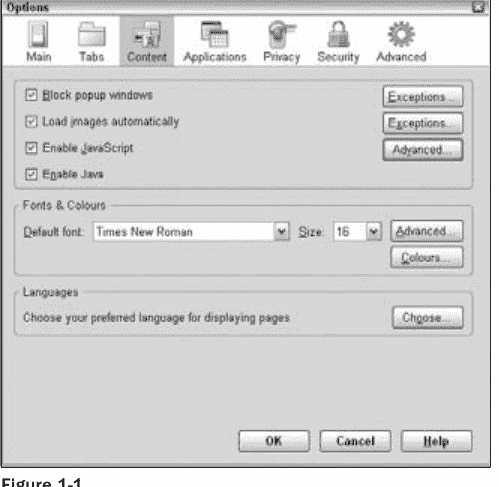

在 Internet Explorer 中关闭脚本功能更难一些。在浏览器中选择“工具 ➔ Internet 选项”，单击“安全”选项卡，检查“Internet”或“本地 Intranet”选项是否设置了自定义安全设置。如果其中任何一个设置了，则单击“自定义级别”按钮，向下滚动到“脚本”部分。检查“活动脚本”是否设置为“启用”。

最后需要注意的一点是如何在浏览器中打开代码示例。对于本书，你只需打开硬盘上存储示例的文件即可。你可以通过多种方式完成此操作。在 IE6 中，一种方式是选择“文件 ➔ 打开”，然后单击“浏览”按钮以浏览到存储代码的位置。同样，在 Firefox 中，选择“文件 ➔ 打开文件”，浏览到所需文件，然后单击“选择文件”按钮。

然而，IE7 和 IE8 采用了新的菜单结构，其中不包含“打开文件”选项。你可以通过在地址栏中输入硬盘驱动器盘符后跟冒号（例如，C 盘输入`c:`）来绕过此问题。在 Microsoft Windows 中，你可以按 Ctrl+O 键以显示“打开文件”菜单。或者，你可以切换回早期版本 IE 的经典菜单。为此，你可以单击“工具 ➔ 工具栏”，并确保选中了“菜单栏”选项（参见图 1-2）。

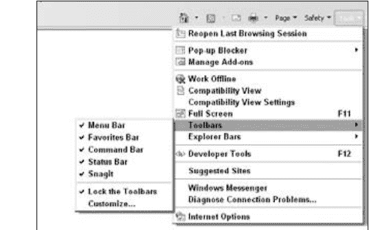

## 我的脚本放在哪里？

关于 JavaScript 的话题说得够多了；现在来看看如何将其放入你的网页中。在本节中，你将了解如何向网页添加 JavaScript 代码。

包含`type`属性是良好实践，但在网页内部可以省略它。IE 和 Firefox 等浏览器使用 JavaScript 作为其默认脚本语言。这意味着如果浏览器遇到没有设置`type`属性的`<script>`标签，它会假定脚本块是用 JavaScript 编写的。然而，`type`属性的使用被 W3C（万维网联盟）指定为强制性的，该联盟为 HTML 制定了标准。

## 链接到外部 JavaScript 文件

`<script>`标签还有另一项功能：能够指定 JavaScript 代码不在网页内部，而是在一个单独的文件中。所有外部文件都应赋予文件扩展名`.js`。虽然这不是强制性的，但它确实可以让你更容易地弄清楚每个文件包含的内容。

要链接到外部 JavaScript 文件，你需要按照前面描述的方式创建一个`<script>`标签，并使用其`src`属性指定外部文件的位置。例如，假设你创建了一个名为`MyCommonFunctions.js`的文件并希望链接它，并且该文件与你的网页位于同一目录中。`<script>`标签将如下所示：

```html
<script type="text/javascript" src="MyCommonFunctions.js"></script>
```

Web 浏览器将读取此代码，并将文件内容包含为网页的一部分。链接到外部文件时，切勿在`<script>`标签内放置任何代码；例如，以下内容是无效的：

```html
<script type="text/javascript" src="MyCommonFunctions.js">
var myVariable;
if ( myVariable == 1 )
{
    // do something
}
</script>
```

如果你的网页是 XHTML 文档，你可以省略结束标签`</script>`，改为这样写：

```html
<script type="text/javascript" src="MyCommonFunctions.js" />
```

通常，你使用`<script>`标签加载本地文件（即与网页本身位于同一计算机上的文件）。但是，你可以通过指定文件的网址来从 Web 服务器加载外部文件。例如，如果你的文件名为`MyCommonFunctions.js`，并且加载在域名`www.mysite.com`的 Web 服务器上，`<script>`标签将如下所示：

```html
<script type="text/javascript" src="http://www.mysite.com/MyCommonFunctions.js"></script>
```

但是，要小心链接到由他人控制的外部文件。这将赋予那些人控制和更改你网页的能力，因此你需要非常确定你信任他们！

## 使用外部文件的优势

外部文件最大的优势是代码重用。假设你编写了一段复杂的 JavaScript，执行一个你可能在很多页面中都需要的通用功能。如果你内联包含该代码（在网页内部，而不是通过外部文件），你需要将代码剪切并粘贴到每个使用它的网页中。只要你永远不需要更改代码，这没问题，但现实是，你很可能在某个时候需要更改或改进代码。如果你已经将代码剪切并粘贴到了 30 个不同的网页中，你就需要在 30 个不同的地方更新它。相当头疼！通过使用一个外部文件并将其包含在所有需要它的页面中，你只需要更新一次代码，所有 30 个页面会立即更新。简单多了！

使用外部文件的另一个优势是浏览器会缓存它们，就像它缓存页面间共享的图像一样。如果你的文件很大，这可以节省下载时间并减少带宽使用。

## 你的第一个简单 JavaScript 程序


关于 JavaScript 的话题说得够多了；现在来看看如何将其放入你的网页中。在本节中，你将编写你的第一段 JavaScript 代码。

将 JavaScript 插入网页与插入任何其他 HTML 内容非常相似；你使用标签来标记脚本代码的开始和结束。用于此目的的标签是`<script>`。这告诉浏览器，接下来的一段文本，由结束标签`</script>`界定，不是要显示的 HTML，而是要处理的脚本代码。被`<script>`和`</script>`标签包围的代码块称为脚本块。

基本上，当浏览器发现`<script>`标签时，它不会尝试向用户显示包含的文本，而是使用浏览器内置的 JavaScript 解释器来运行代码的指令。当然，代码可能会给出关于更改页面显示方式或页面中显示内容的指令，但代码本身的文本永远不会显示给用户。

你可以将`<script>`标签放在 HTML 页面的头部（在`<head>`和`</head>`标签之间）或主体（在`<body>`和`</body>`标签之间）。然而，尽管你可以将它们放在这些区域之外——例如，在`<html>`标签之前或`</html>`标签之后——但这在 Web 标准中是不允许的，因此被认为是不良实践。

`<script>`标签有多个属性，但最重要的是`type`。正如你之前看到的，JavaScript 并不是唯一可用的脚本语言，不同的脚本语言需要以不同的方式处理。你需要告诉浏览器期望哪种脚本语言，以便它知道如何处理该语言。你的开始脚本标签将如下所示：

```html
<script type="text/javascript">
```

包含`type`属性是良好实践，但在网页内部可以省略它。IE 和 Firefox 等浏览器使用 JavaScript 作为其默认脚本语言。这意味着如果浏览器遇到没有设置`type`属性的`<script>`标签，它会假定脚本块是用 JavaScript 编写的。然而，`type`属性的使用被 W3C 指定为强制性的，该联盟为 HTML 制定了标准。

好的，让我们看看第一个包含 JavaScript 代码的页面。

## 尝试将页面染成红色

这是一个使用 JavaScript 更改浏览器背景颜色的简单示例。在你的文本编辑器（我们使用 Windows 记事本）中，键入以下内容：

```html
<html>
<body bgcolor="WHITE">
<p>Paragraph 1</p>
<script type="text/javascript">
document.bgColor = "RED";
</script>
</body>
</html>
```

将页面保存为`ch1_examp1.htm`到硬盘上的某个方便位置。现在将其加载到你的 Web 浏览器中。你应该会看到一个红色的网页，左上角显示文本`Paragraph 1`。但是等等——你不是将`<body>`标签的`BGCOLOR`属性设置为白色了吗？好的，让我们看看这里发生了什么。

该页面包含在`<html>`和`</html>`标签内。这个块包含一个`<body>`元素。当你定义开始`<body>`标签时，你使用 HTML 将页面的背景颜色设置为白色。

```html
<body bgcolor="WHITE">
```

然后你通过使用`<script>`开始标签，让浏览器知道你的下几行代码是 JavaScript 代码。

```html
<script type="text/javascript">
```

## 第一章：JavaScript 与 Web 简介

从这里开始直到结束标签`</script>`之间的所有内容都是 JavaScript，并会被浏览器视为 JavaScript 来处理。在这个脚本块内，你可以使用 JavaScript 将文档的背景色设置为红色。

```javascript
document.bgColor = "RED";
```

你可能称之为“页面”的东西，在网页脚本编写中被称为“文档”。文档有许多属性，包括背景色`bgColor`。你可以通过书写`document`，后跟一个点，再跟属性名来引用文档的属性。暂时不必担心`document`的用法；本书后续会更深入地探讨它。

请注意，上面那行代码是一个 JavaScript`语句`的例子。`<script>`和`<!--  -->`标签之间的每一行代码都称为语句，尽管有些语句可能会跨多行。

你还会看到行末有一个分号（`;`）。在 JavaScript 中，使用分号来表示一个语句的结束。实际上，JavaScript 对分号的要求非常宽松，当你开始新的一行时，JavaScript 通常能判断你是否打算开始新的代码行。然而，为了良好的编码实践，你应该在语句末尾使用分号，并且一个 JavaScript 语句应该放在一行内，而不是延续到两行或更多行。此外，你会发现有时必须包含分号，这一点本书后面会讲到。

最后，要告诉浏览器停止将你的文本解释为 JavaScript，并开始将其解释为 HTML，你需要使用脚本结束标签：

```html
</script>
```

你已经了解了代码是如何工作的，但还没有了解它的工作顺序。当浏览器加载网页时，它会从上到下逐标签地渲染页面，这个过程称为`解析`。Web 浏览器从页面顶部开始，一直解析到页面底部。浏览器首先遇到`<body>`标签，并将文档背景设置为白色。然后它继续解析页面。当遇到 JavaScript 代码时，它被指示将文档背景更改为红色。

## 试一试：事件的流程

让我们扩展前面的示例，以实际演示网页的解析过程。在你的文本编辑器中输入以下内容：

```html
<html>
<body bgcolor="WHITE">
<p>段落一</p>
<script type="text/javascript">
    // 脚本块 1
    alert("第一个脚本块");
</script>
<p>段落二</p>
<script type="text/javascript">
    // 脚本块 2
    document.bgColor = "RED";
    alert("第二个脚本块");
</script>
<p>段落三</p>
</body>
</html>
```

将文件保存到硬盘，命名为`ch1_examp2.htm`，然后在浏览器中加载它。加载页面时，你应该会看到第一段文字`Paragraph 1`，随后是由第一个脚本块显示的消息框。浏览器会暂停解析，直到你点击确定按钮。如图 1-3 所示，页面背景是白色（如`<body>`标签中所设置），并且只显示了第一段文字。

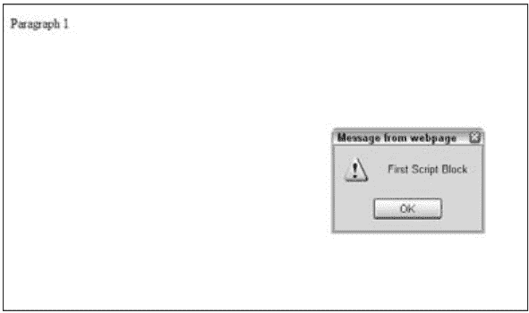

图 1-3

点击确定按钮，解析继续。浏览器显示第二段文字，并到达第二个脚本块，该脚本块将背景颜色更改为红色。第二个脚本块还会显示另一个消息框，如图 1-4 所示。

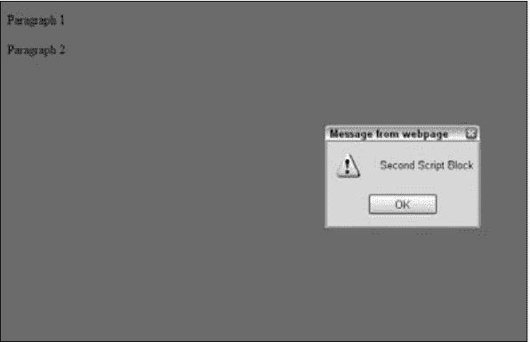

图 1-4

点击确定，解析再次继续，显示第三段文字`Paragraph 3`。网页完成，如图 1-5 所示。

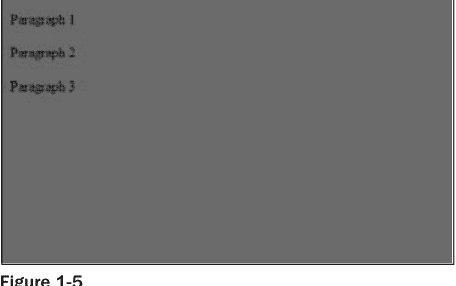

图 1-5

页面的开头部分与我们之前的例子相同。页面的背景颜色在`<body>`标签的定义中设置为白色，然后向页面写入了一个段落。

```html
<html>
<body bgcolor="WHITE">
<p>段落一</p>
```

第一个新部分包含在第一个脚本块中。

```html
<script type="text/javascript">
    // 脚本块 1
    alert("第一个脚本块");
</script>
```

这个脚本块包含两行代码，对你来说都是新的。第一行：

```javascript
// 脚本块 1
```

只是一个`注释`，仅供你参考。浏览器会将双正斜杠（`//`）之后行上的任何内容识别为注释，并且不会对其进行任何处理。它对作为程序员的你很有用，因为你可以为代码添加解释，使得在后续回顾代码时更容易记起你当时在做什么。

第二行代码中的`alert()`函数对你来说也是新的。在了解它的作用之前，你需要知道什么是`函数`。

函数在第三章有更完整的定义，但现在你只需要将它们视为可以用来执行某些任务的 JavaScript 代码片段。如果你有数学背景，你可能已经对函数是什么有了一些概念：一个`函数`接收一些信息，处理它，然后给你一个结果。函数让作为程序员的你生活更轻松，因为你不必去思考函数是如何完成任务的——你只需要专注于何时想执行该任务。

特别是，`alert()`函数使你能够通过显示一个消息框来向用户发出警报或通知。消息框中要显示的消息在`alert()`函数的括号内指定，被称为该函数的`参数`。

由`alert()`函数显示的消息框是`模态`的。这是一个重要的概念，你还会再次遇到。它简单意味着消息框不会消失，直到用户通过点击确定按钮关闭它。实际上，页面的解析会在使用`alert()`函数的那一行停止，直到用户关闭消息框才会重新开始。这对于这个示例非常有用，因为它使你能够演示到目前为止已解析的结果：页面颜色已被设置为白色，并且第一段文字已经显示。

当你点击确定时，浏览器继续向下解析页面的以下几行：

```html
<p>段落二</p>
<script type="text/javascript">
  // 脚本块 2
  document.bgColor = "RED";
  alert("第二个脚本块");
</script>
```

第二段文字被显示，第二块 JavaScript 被运行。脚本块代码的第一行是另一个注释，因此浏览器忽略它。你在前面的示例中见过脚本代码的第二行——它将页面的背景颜色更改为红色。第三行代码是`alert()`函数，它显示第二个消息框。解析再次暂停，直到你点击确定关闭消息框。

当你关闭消息框时，浏览器继续处理页面中的下几行代码，显示第三段文字，最终结束网页。

```html
<p>段落三</p>
</body>
</html>
```

这个示例引出的另一个重点是通过 HTML 设置页面属性（如背景颜色）与使用 JavaScript 执行相同操作之间的区别。使用 HTML 设置属性的方法是`静态`的：一个值只能设置一次，并且永远不能通过 HTML 再次更改。使用 JavaScript 设置属性使你能够动态地更改它们的值。术语`动态`指的是可以更改且其值或外观不是固定不变的事物。

这个示例仅仅是一个示例。在实践中，如果你希望页面的背景是红色，你可以将`<body>`标签的`BGCOLOR`属性设置为 "RED"，而完全不需要使用 JavaScript。你想使用 JavaScript 的地方是你想为页面添加某种智能或逻辑的地方。例如，如果用户的屏幕分辨率特别低，你可能想要更改页面上显示的内容；使用 JavaScript，你就可以做到这一点。使用 JavaScript 更改属性的另一个原因可能是为了特效——例如，让页面从白色淡入到其最终颜色。

# 第1章：JavaScript与Web简介

## 在网页中显示结果

在最后一个示例中，你将学习如何使用 JavaScript 将信息直接写入网页。当你需要将计算结果或使用 JavaScript 创建的文本显示出来时，这种方法会显得尤为实用，我们将在下一章中看到这一点。现在，我们将仅使用 JavaScript 在一个空白页面上显示“Hello World!”：

```html
<!DOCTYPE html PUBLIC "-//W3C//DTD XHTML 1.0 Transitional//EN"
"http://www.w3.org/TR/xhtml1/DTD/xhtml1-transitional.dtd">
<html xmlns="http://www.w3.org/1999/xhtml">
<body>

<p id="ResultsP"></p>

<script type="text/javascript">
// Script block 1
document.getElementById('ResultsP').innerHTML = 'Hello World!';
</script>

</body>
</html>
```

将页面保存为`ch1_examp3.htm`到你硬盘上的一个方便位置。现在将其加载到你的网页浏览器中，你将在页面中看到 Hello World!。虽然使用 HTML 来实现同样的效果会更简单，但这项技术在后续章节中将证明是非常有用的。

页面的第一部分与我们之前的示例相同，除了添加了以下行：

```html
<!DOCTYPE html PUBLIC "-//W3C//DTD XHTML 1.0 Transitional//EN"
"http://www.w3.org/TR/xhtml1/DTD/xhtml1-transitional.dtd">
<html xmlns="http://www.w3.org/1999/xhtml">
```

这告诉网页浏览器你正在使用 XHTML，这是本书中使用的标准。实际上，这对代码没有任何影响；没有这些额外的行，代码也能正常工作。

请看这行：

```html
<p id="ResultsP"></p>
```

你会注意到`<p>`标签被赋予了一个通过`id`属性的 id。这个 id 在网页中必须是唯一的，因为 JavaScript 在接下来的代码中使用它来识别特定的 HTML 元素：

```javascript
document.getElementById('ResultsP').innerHTML = 'Hello World!';
```

如果现在看起来很复杂，请不要担心；你将在后续章节，特别是第 6 章和第 12 章中学习更多关于它如何工作的知识。基本上，这段代码的意思是：“获取 id 为 ResultsP 的文档元素，并将该元素内的 HTML 设置为 Hello World！”

在你的示例中，重要的是访问段落的代码必须在段落之后。否则，代码将试图在页面中访问一个尚不存在的段落，从而引发错误。

## 简要了解浏览器和兼容性问题

你在前面的示例中看到，通过使用 JavaScript，你可以使用文档的`bgColor`属性来更改网页的文档背景颜色。无论你使用的是 Netscape 还是 Microsoft 浏览器，这个示例都能工作，因为两种类型的浏览器都支持带有`bgColor`属性的文档。你可以说这个示例是跨浏览器兼容的。然而，在一个浏览器中可用的属性或语言特性在另一个浏览器中并不总是可用的。有时甚至在同一种浏览器的不同版本之间也会出现这种情况。

> Internet Explorer 和 Firefox 浏览器的版本号通常写为十进制数；例如，Firefox 的版本是 1.5。本书使用以下术语来指代这些版本：版本 1.x 指的是所有以数字 1 开头的版本；版本 1.0+ 指的是所有版本号大于或等于 1 的版本。

创建基于 Web 的 JavaScript 的主要麻烦之一是不同 Web 浏览器之间的差异、它们支持的 HTML 级别以及其 JavaScript 解释器可以处理的功能。你会发现，在一个浏览器中，你只需几行代码就可以移动一个图像，但在另一个浏览器中，这可能需要整整一页的代码，甚至证明是不可能的。一个版本的 JavaScript 会包含将文本转换为大写的方法，而另一个版本则不会。IE 或 Firefox 浏览器的每一个新版本都会在其 HTML 和 JavaScript 支持中添加新的令人兴奋的功能。好消息是，与以往相比，浏览器创建者在很大程度上遵守了 W3C 等组织制定的标准。此外，只要你稍加巧思，你就可以编写出同时适用于 IE 和 Firefox 浏览器的 JavaScript 代码。

你想要支持哪些浏览器，实际上取决于你认为你的网站访问者，即你的用户群，将主要使用哪些浏览器。本书同时面向 IE7 及更高版本和 Firefox 2 及更高版本。

如果你想让你的网站显得专业，你需要以某种方式处理旧版浏览器。你可以确保你的代码向后兼容——也就是说，它只使用旧版浏览器中可用的功能。然而，你可能会认为，将自己限制在旧版浏览器的功能中根本不值得。在这种情况下，你需要确保你的页面能够优雅地降级。换句话说，确保虽然你的页面在旧版浏览器中无法工作，但它们会以一种不会让用户意识到故障的方式失败，或者会提醒用户该网站上的某些功能与其浏览器不兼容。与优雅降级相对的是让你的代码引发大量错误消息，在页面上显示奇怪的结果，并且通常让你看起来像一个不知道自己在做什么的白痴！

那么，如何让你的网页优雅地降级呢？你可以通过使用 JavaScript 在网页部分或完全加载后确定网页正在哪个浏览器中运行来实现。你可以使用这些信息来确定要运行哪些脚本，甚至将用户重定向到另一个充分利用其特定浏览器的页面。在后续的章节中，你将学习如何找出浏览器支持哪些功能，并采取适当的行动，以便你的页面能在尽可能多的浏览器上令人满意地工作。

## 总结

至此，你应该对 JavaScript 是什么以及它能做什么有了一个大致的了解。特别是，这个简要介绍涵盖了以下内容：

- 你了解了浏览器在解释你的网页时所遵循的过程。它逐个元素地（`解析`）处理页面，并在遇到你的 HTML 标签和 JavaScript 代码时执行它们。
- 与许多编程语言不同，JavaScript 只需要一个文本编辑器就可以开始创建代码。像 Windows 记事本这样的工具就足以让你入门，不过一旦你有了更多的经验，更全面的工具将证明是非常有价值的。
- JavaScript 代码嵌入在网页本身中，与 HTML 一起。它的存在是通过使用`<script>`标签来标记的。与 HTML 一样，脚本从页面顶部开始执行，一直工作到底部，逐条语句地解释和执行代码语句。

# 2 数据类型和变量

计算机的主要用途之一是处理和显示信息。处理，我们的意思是信息被计算机以某种方式修改、解释或过滤。例如，在一个网上银行网站上，客户可能请求其账户上个月所有支出的详细信息。在这里，计算机将检索信息，过滤掉任何与上个月支付无关的信息，然后将剩余的内容显示在网页中。在某些情况下，信息被处理但不被显示，而在其他情况下，信息是直接获取而没有经过处理。例如，在银行环境中，定期付款可能会在没有任何人工交互或显示的情况下通过电子方式处理和转移。


在计算中，信息被称为`data`。数据有各种形式，例如数字、文本、日期和时间，这里仅提及几种。在本章中，你将特别关注 JavaScript 如何处理诸如数字和文本之类的数据。理解数据如何处理是任何编程语言的基础。

本章首先介绍 JavaScript 可以处理的各种数据类型。然后你将了解如何将这些数据存储在计算机内存中，以便在代码中反复使用。最后，你将学习如何使用 JavaScript 来操作和处理数据。

## JavaScript 中的数据类型

数据可以有许多不同的形式或`types`。你会从编程之外的世界认出一些 JavaScript 处理的数据类型——例如，数字和文本。其他数据类型则更抽象一些，用于使编程更容易；其中一个例子是对象数据类型，你直到第 4 章才会详细看到它。

一些编程语言是强类型的。在这些语言中，无论何时使用一段数据，你都需要明确说明你正在处理什么样的数据，并且这些数据的使用必须遵循适用于其类型的严格规则。例如，你不能将一个数字和一个单词相加。

## 数据类型与变量

JavaScript 则是一种弱类型语言，对于如何使用不同类型的数据要宽容得多。处理数据时，你通常无需指定类型；JavaScript 会自行判断。此外，当你同时使用不同类型的数据时，JavaScript 会在幕后自动推断你试图执行的操作。

既然 JavaScript 对数据如此宽容，为何还要讨论数据类型？为何不直接开始使用数据而无需关心其类型呢？

首先，尽管 JavaScript 擅长处理它所操作的数据，但有时它也会出错，或者至少无法达到你期望的效果。在这些情况下，你需要明确告诉 JavaScript 你期望的数据类型及其使用方式。要做到这一点，你首先需要对数据类型有所了解。

第二个原因是数据类型使你能在代码中有效使用数据。即使你未明确指定数据类型，数据所能执行的操作及其结果也取决于所使用的数据类型。例如，虽然将两个数字相乘有意义，但对文本进行同样操作则毫无意义。此外，数字相加的结果与文本相加的结果截然不同：数字相加得到和，而文本相加则得到连接在一起的更长文本字符串。

接下来，我们简要介绍一些更常用的数据类型：数值型、文本型和布尔型。本章后续将详细讲解如何使用它们。

### 数值型数据

数值型数据有两种形式：

- 整数，例如 145，也称为整数。这些数字可以是正数或负数，在 JavaScript 中的范围非常大：$-2^{53}$ 到 $2^{53}$。
- 小数，例如 1.234，也称为浮点数。与整数一样，它们可以是正数或负数，范围同样庞大。

简单来说，除非你正在编写专业的科学应用程序，否则你不会遇到 JavaScript 中可用数字大小的问题。另外，尽管在存储整数和浮点数时可以区别对待，但 JavaScript 实际上将它们都视为浮点数。它友善地为你隐藏了这一细节，因此你通常无需担心。一个例外是当你需要整数但得到的是浮点数时，这种情况下你需要对数字进行四舍五入以得到整数。本章稍后将介绍数字四舍五入的方法。

### 文本型数据

一个或多个文本字符的另一个术语是字符串。你只需将文本用引号（"）括起来，就能告诉 JavaScript 将其视为文本而非代码。例如，`"Hello World"` 和`"A"`是 JavaScript 能识别的字符串示例。你也可以使用单引号（'），因此`'Hello World'`和`'A'`同样是 JavaScript 能识别的字符串。但你必须使用开始引号来结束字符串。因此，`"A'`不是有效的 JavaScript 字符串，`'Hello World"`也不是。

如果你想创建一个中间包含单引号的字符串，比如像 Peter O'Toole 这样的字符串，该怎么办？如果将其放在双引号内，就没问题了，因此`"Peter O'Toole"`能被 JavaScript 识别。然而，`'Peter O'Toole'`会产生错误。这是因为 JavaScript 认为你的文本字符串是`Peter O`（即它将中间的单引号视为字符串的结束），然后因无法理解`Toole'`而报错。

另一种解决方法是告诉 JavaScript 中间的`'`是文本的一部分，而不是表示字符串的结束。你可以通过使用反斜杠字符（`\`）来实现，它在 JavaScript 中具有特殊含义，被称为**转义字符**。反斜杠告诉浏览器下一个字符不是字符串的结束，而是文本的一部分。因此`'Peter O\'Toole'`将按预期工作。

如果你想在双引号括起来的字符串中使用双引号怎么办？那么之前关于单引号的所有说法仍然适用。所以`'Hello "Paul"'`可以工作，但`"Hello "Paul""`不行。不过，`"Hello \"Paul\""`也可以工作。

JavaScript 还有许多其他特殊字符，这些字符无法直接输入，但可以使用转义字符与其他字符结合来创建**转义序列**。它们的工作原理与 HTML 中类似。例如，在 HTML 中连续多个空格会被忽略，因此空格用`&nbsp;`表示。同样，在 JavaScript 中，有些情况下不能直接使用字符，而必须使用转义序列。下表详细列出了一些较常用的转义序列。

| 转义序列 | 表示的字符 |
| --- | --- |
| `\b` | 退格符 |
| `\f` | 换页符 |
| `\n` | 换行符 |
| `\r` | 回车符 |
| `\t` | 制表符 |
| `\'` | 单引号 |
| `\"` | 双引号 |
| `\\` | 反斜杠 |
| `\xNN` | NN 是一个十六进制数，用于标识拉丁-1 字符集中的字符。 |

其中最不明显的是最后一个，它通过字符在拉丁-1 字符集中的编号来表示字符，而不是通过其常规外观。举个例子：假设你想在字符串中包含版权符号（©）。你的字符串应该是什么样子？答案是`"\xA9 Paul Wilton"`。

同样，你可以使用 Unicode 转义序列来引用字符。这些序列写作`\uNNNN`，其中`NNNN`指的是该特定字符的 Unicode 编号。例如，要使用此方法引用版权符号，你需要使用字符串`\u00A9`。

### 布尔型数据

是或否、正或负、真或假在现实世界中很常见。真和假的概念对数字计算机也至关重要；它们不理解“也许”，只理解真和假。事实上，“是或否”的概念非常有用，在 JavaScript 中拥有自己的数据类型：`布尔`数据类型。布尔类型有两个可能的值：`true`表示是，`false`表示否。

布尔数据在 JavaScript 中的用途与编程世界之外完全相同：它们使你能够回答问题并根据答案做出决策。例如，如果有人问你，“这本书是关于 JavaScript 的吗？”，你可能会回答“是的”，或者说“这是真的”。同样，你可能会说，“如果这本书的主题是 JavaScript 这一说法是假的，那就把它放下。”这里你得到了一个布尔逻辑语句（以其发明者乔治·布尔命名），它提出一个问题，然后根据答案是真还是假执行某些操作。在 JavaScript 中，你可以使用类似的布尔逻辑赋予我们的程序决策能力。下一章将更详细地介绍布尔逻辑。

### 变量——在内存中存储数据

数据可以永久存储或临时存储。

你会希望将重要数据（如某人银行账户的详细信息）永久存储。例如，当布拉格斯女士从她的账户中取出十美元、英镑或欧元时，你需要从她的账户中扣除这笔钱，并永久记录新的余额。此类信息可能存储在称为`数据库`的东西中。

然而，在其他情况下，你不想永久存储数据，而只想对其进行临时记录。让我们看一个例子。假设布拉格斯女士从“大坏银行公司”获得一笔贷款，她想查明这笔贷款还有多少未还清。她进入贷款的网上银行页面，点击链接查询欠款金额。这些数据将永久存储在某个地方。然而，假设你还提供了一种增加贷款还款额以提前还清贷款的功能。如果布拉格斯女士在网页的文本框中输入更高的还款额，你可能想显示贷款将提前多久还清。这将涉及一些可能复杂的计算，因此为了简化，你希望编写代码分阶段计算结果，在提供最终结果之前，在每个阶段存储中间结果。在你完成计算并显示结果后，没有必要永久存储每个阶段的结果，因此你需要使用称为`变量`的东西，而不是数据库。为什么称之为变量？嗯，也许是因为变量可用于存储可以修改或变化的临时数据。

变量的另一个优点是，与可能保存到磁盘或磁带上的永久存储不同，变量保存在计算机的内存中。这意味着存储和检索数据的速度要快得多。

那么，是什么让变量成为临时存储数据的好地方呢？嗯，变量的生命周期有限。当你的访客关闭页面或跳转到新页面时，你的变量就会丢失，除非你采取措施将它们保存到其他地方。

每个变量都有一个名称，以便你可以在代码的其他地方引用它。这些名称必须遵循某些规则。

正如大多数 JavaScript 代码一样，你会发现变量名是区分大小写的。例如，`myVariable`与`myvariable`并不相同。你会发现，这是错误很容易溜进代码的一个常见原因，即使你已成为 JavaScript 专家。

此外，你不能为变量使用某些名称和字符。不能使用的名称称为**保留字**。保留字是 JavaScript 为自己保留使用的词语（例如，`var`或`with`）。变量名中也禁止使用某些字符：例如，和号（`&`）和百分号（`%`）。变量名中可以使用数字，但名称不能以数字开头。因此`101myVariable`是无效的，而`myVariable101`是有效的。让我们看更多示例。

无效的名称包括：

- `with`
- `99variables`
- `my%Variable`
- `theGood&theBad`

有效的名称包括：

- `myVariable99`
- `myPercent_Variable`
- `the_Good_and_the_Bad`

你可能希望为变量使用命名约定（例如，一种能描述你计划在变量中存放何种数据的约定）。你可以用很多不同的方式来命名变量——没有绝对的对错，但最好坚持使用其中一种。一种常见的方法是**匈牙利命名法**，其中每个变量名的开头是一个表示数据类型的三字母标识符。例如，你可以用`int`作为整数变量名的开头，`flt`作为浮点数变量名的开头，`str`作为字符串变量名的开头，等等。然而，只要你使用的名称有意义并且使用一致，你选择什么约定其实并不重要。

## 创建变量并赋值

在使用变量之前，你应该使用`var`关键字向计算机声明它的存在。这会提醒计算机需要为其后续存储数据预留一些内存。要声明一个名为`myFirstVariable`的新变量，请编写以下代码：

```javascript
var myFirstVariable;
```

请注意，行尾的分号不是变量名的一部分，而是用于向 JavaScript 表明一条语句的结束。这一行是一个 JavaScript 语句的示例。

一旦声明了变量，就可以用它来存储任何类型的数据。正如我们之前提到的，许多其他编程语言，称为**强类型语言**，不仅要求你声明变量，还要求你声明将要存储的数据类型，如数字或文本。然而，JavaScript 是一种**弱类型语言**；你不需要将自己限制在变量可以保存的数据类型上。

你可以通过使用等号（`=`）将数据放入变量中，这个过程称为**赋值**。例如，如果你想让你的变量`myFirstVariable`保存数字 101，你会这样写：

```javascript
myFirstVariable = 101;
```

等号在用于给变量赋值时有一个特殊的名称；它被称为**赋值运算符**。

### 动手试试：声明变量

让我们看一个例子，其中声明了一个变量，在其中存储一些数据，最后访问其内容。你还会看到变量可以保存任何类型的数据，并且保存的数据类型可以改变。例如，你可以先存储文本，然后改为存储数字，而 JavaScript 不会有任何问题。在你的文本编辑器中键入以下代码，并将其保存为`ch2_examp1.htm`：

```html
<!DOCTYPE html PUBLIC "-//W3C//DTD XHTML 1.0 Transitional//EN"
"http://www.w3.org/TR/xhtml1/DTD/xhtml1-transitional.dtd">
<html xmlns="http://www.w3.org/1999/xhtml">

<head>
</head>
<body>

<script type="text/javascript">

var myFirstVariable;

myFirstVariable = "Hello";
alert(myFirstVariable);

myFirstVariable = 54321;
alert(myFirstVariable);

</script>

</body>
</html>
```

一旦将此页面加载到你的 Web 浏览器中，它应该会显示一个包含"Hello"的`alert`框，如图 2-1 所示。这是代码在该时刻变量`myFirstVariable`的内容。

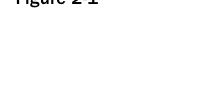

点击"确定"，另一个包含 54321 的`alert`框会出现，如图 2-2 所示。这是你赋给变量`myFirstVariable`的新值。

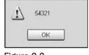

在脚本块中，你首先声明了你的变量。

```javascript
var myFirstVariable;
```

目前，它的值是`undefined`，因为你只向计算机声明了它的存在，而不是任何实际的数据。这听起来可能很奇怪，但`undefined`是 JavaScript 中的一个实际的**原始值**，它使你能够进行比较。（例如，你可以检查一个变量是否包含实际值，或者它是否尚未被赋予值，即它是未定义的。）然而，在下一行中，你给`myFirstVariable`分配了一个字符串值，即`Hello`。

```javascript
myFirstVariable = "Hello";
```

在这里，你给变量赋了一个**字面值**（即，一段实际的数据，而不是通过计算或从另一个变量获得的数据）。几乎在任何可以使用字面字符串或数字的地方，你都可以用包含数字或字符串数据的变量来替换它。你在下一行代码中看到了这样的例子，其中你在上一章看到的`alert()`函数中使用了你的变量`myFirstVariable`。

```javascript
alert(myFirstVariable);
```

这导致第一个`alert`框出现。接下来，你在变量中存储一个新值，这次是一个数字。

```javascript
myFirstVariable = 54321;
```

`myFirstVariable`的先前值永远丢失了。用于存储该值的内存空间由 JavaScript 自动释放，这个过程称为**垃圾回收**。每当 JavaScript 检测到变量的内容不再可用时，例如当你分配一个新值时，它就会执行垃圾回收过程并释放内存。没有这种自动的垃圾回收过程，计算机的内存会被消耗得越来越多，直到最终耗尽，系统就会停止运行。然而，垃圾回收并不总是像它应该的那样高效，可能直到加载另一个页面时才会发生。

为了证明新值已被存储，再次使用`alert()`函数来显示变量的新内容。

```javascript
alert(myFirstVariable);
```

## 将其他变量的值赋给变量

你已经看到可以给变量赋一个数字或字符串，但你能用存储在另一个变量中的数据给变量赋值吗？答案是肯定的，非常容易，并且与给变量赋字面值的方式完全相同。例如，如果你已经声明了两个变量`myVariable`和`myOtherVariable`，并给变量`myOtherVariable`赋了值 22，如下所示：

```javascript
var myVariable;
var myOtherVariable;
myOtherVariable = 22;
```

那么你可以使用以下代码行将`myVariable`赋为与`myOtherVariable`相同的值（即 22）。

```javascript
myVariable = myOtherVariable;
```

### 动手试试：将变量的值赋给其他变量

让我们看另一个例子，这次是将变量的值赋给其他变量。

1. 在你的文本编辑器中键入以下代码，并将其保存为`ch2_examp2.htm`：

```html
<!DOCTYPE html PUBLIC "-//W3C//DTD XHTML 1.0 Transitional//EN"
  "http://www.w3.org/TR/xhtml1/DTD/xhtml1-transitional.dtd">
<html xmlns="http://www.w3.org/1999/xhtml">
<body>

<script language="JavaScript" type="text/javascript">

var string1 = "Hello";
var string2 = "Goodbye";

alert(string1);
alert(string2);

string2 = string1;

alert(string1);
alert(string2);

string1 = "Now for something different";

alert(string1);
alert(string2);

</script>

</body>
</html>
```

2. 将页面加载到你的浏览器中，你会看到一系列六个`alert`框出现。

3. 点击每个`alert`框的"确定"按钮以查看下一个`alert`。前两个显示了`string1`和`string2`的值——分别是 Hello 和 Goodbye。然后你将`string2`赋为`string1`中的值。接下来的两个`alert`框显示了`string1`和`string2`的内容；这次两者都是 Hello。

4. 最后，你改变了`string1`的值。请注意，`string2`的值保持不变。最后两个`alert`框显示了`string1`的新值（Now for something different）和`string2`未改变的值（Hello）。

你在脚本块中做的第一件事是声明你的两个变量：`string1`和`string2`。但是，请注意你在声明它们的同时就为它们赋了值。这是一个捷径，称为**初始化**，可以为你节省大量输入代码的时间。


```javascript
var string1 = "Hello";
var string2 = "Goodbye";
```

请注意，这个捷径可以用于所有数据类型，而不仅仅是字符串。接下来的两行使用`alert()`函数向用户显示每个变量的当前值。

```javascript
alert(string1);
alert(string2);
```

然后你将`string2`赋为`string1`中包含的值。为了证明赋值确实有效，你再次使用`alert()`函数向用户显示每个变量的内容。

```javascript
string2 = string1;

alert(string1);
alert(string2);
```

接下来，你将`string1`设置为一个新值。

```javascript
string1 = "Now for something different";
```

这使得`string2`保持其当前值，证明`string2`拥有从`string1`赋给它的数据的独立副本。你将在后面的章节中看到，这并非总是如此。然而，一般来说，基本数据类型（如文本和数字）在赋值时总是会被复制，而更复杂的数据类型，如第4章中你遇到的对象，则是共享而非复制。例如，如果你有一个包含字符串`Hello`的变量，并将五个其他变量赋为此变量的值，那么你现在拥有的是原始数据和五个数据的独立副本。然而，如果它是一个对象而不是字符串，你做了同样的事情，你会发现你仍然只有一个数据副本，而是六个变量共享它。使用任何一个变量名更改数据都会为所有变量更改它。

最后，使用`alert()`函数显示每个变量的当前值。

```javascript
alert(string1);
alert(string2);
```

## 第二章：数据类型与变量

### 使用数据——计算与基本字符串操作

既然你已经了解了如何处理错误，现在可以回到本章的主旨：数据以及如何使用它们。你已经学会了如何声明变量以及它们如何存储信息，但到目前为止你还没有真正运用这些知识做任何有用的事情——那么，究竟为什么需要使用变量呢？

变量的作用是让你能够**临时保存信息**，以便用于数学计算、构建文本消息或处理用户输入的词语。变量有点像普通口袋计算器上的**存储**按钮。假设你在汇总财务开支：你可能先计算所有需要支出的金额，然后将其存入临时内存；在计算完所有收入后，再用收入减去存储的支出金额，就能得出剩余多少。变量的使用方式类似：你可以先获取必要的用户输入并将其存储在变量中，然后利用这些值进行计算。

在本节中，你将看到如何将变量中存储的值，高效地应用于数值计算和文本操作中。

### 数值计算

JavaScript 提供了一系列基本数学功能，如加法、减法、乘法和除法。每个数学函数都用一个符号表示：加号（`+`）、减号（`–`）、星号（`*`）和斜杠（`/`）。这些符号被称为运算符，因为它们作用于你提供的值。换句话说，它们执行某种计算或操作，并向我们返回一个结果。这些计算的结果几乎可以在任何需要使用数字或变量的地方使用。

想象一下，你正在计算购物清单上所有物品的总价。你可以这样写计算式：

`购物总成本 = 10 + 5 + 5`

或者，如果你实际计算总和，则是：

`购物总成本 = 20`

现在，让我们看看如何在 JavaScript 中实现这一点。实际上，它非常相似，只不过你需要使用一个变量来存储最终的总和。

```javascript
var TotalCostOfShopping;
TotalCostOfShopping = 10 + 5 + 5;
alert(TotalCostOfShopping);
```

首先，你声明一个变量`TotalCostOfShopping`来保存总成本。

第二行代码是`10 + 5 + 5`。这段代码被称为一个表达式。当你给变量`TotalCostOfShopping`赋予这个表达式的值时，JavaScript 会自动计算表达式的值（20）并将其存储在变量中。注意，等号指示 JavaScript 将计算结果存储到`TotalCostOfShopping`变量中。这称为将计算的值赋给变量，因此单等号（`=`）被称为赋值运算符。

最后，你在`alert`框中显示变量的值。

减法和乘法运算符的工作方式完全相同。除法略有不同。

### 动手试一试：计算

让我们看一个使用除法运算符的例子，看看它是如何工作的。

1. 输入以下代码并将其保存为`ch2_examp3.htm`：

```html
<!DOCTYPE html PUBLIC "-//W3C//DTD XHTML 1.0 Transitional//EN"
"http://www.w3.org/TR/xhtml1/DTD/xhtml1-transitional.dtd">
<html xmlns="http://www.w3.org/1999/xhtml">
<body>

<script language="JavaScript" type="text/javascript">
var firstNumber = 15;
var secondNumber = 10;
var answer;
answer = 15 / 10;
alert(answer);

alert(15 / 10);

answer = firstNumber / secondNumber;
alert(answer);

</script>

</body>
</html>
```

2. 在网页浏览器中加载此文件。你应该会看到连续弹出三个`alert`框，每个框中都包含值 1.5。这些值是三次计算的结果。

3. 在脚本块中，你做的第一件事是声明三个变量，并为前两个变量赋值，以便稍后使用。

```javascript
var firstNumber = 15;
var secondNumber = 10;
var answer;
```

4. 接下来，你将`answer`变量设置为表达式`15 / 10`的计算结果。然后你在`alert`框中显示这个变量的值。

```javascript
answer = 15 / 10;
alert(answer);
```

这个例子展示了进行计算的一种方式，但在现实中，你几乎永远不会这样写。

为了演示你可以在使用数字或变量的地方使用表达式，你直接将`15 / 10`包含在`alert()`函数中，来显示计算结果。

```javascript
alert(15 / 10);
```

最后，你进行相同的计算，但这次使用了两个变量`firstNumber`（设置为 15）和`secondNumber`（设置为 10）。你写出表达式`firstNumber / secondNumber`，并将结果存储在`answer`变量中。然后，为了证明一切都有效，你使用`alert()`函数显示`answer`中包含的值。

```javascript
answer = firstNumber / secondNumber;
alert(answer);
```

大多数计算都会用第三种方式完成（即使用变量，或数字和变量，并将结果存储到另一个变量中）。这样做的原因是，如果计算使用了字面值（实际值，例如`15 / 10`），那么你完全可以直接将计算结果写出来，而无需强制 JavaScript 为你计算。例如，与其写`15 / 10`，不如直接写`1.5`。毕竟，你强迫 JavaScript 做的计算越多，它就越慢，尽管不可否认，一个计算不会给它带来太大负担。

另一个使用结果而非计算式的原因是它使代码更具可读性。在代码中，你更愿意看到`1.5 * 45 - 56 / 67 + 2.567`还是`69.231`？更好的是，一个命名为例如`PricePerKG`的变量，能让不熟悉代码的人更容易理解。

### 递增和递减运算符

使用数学运算符的某些操作非常常见，因此它们被赋予了专门的运算符。这里你将要了解的两个是递增和递减运算符，分别由两个加号（`++`）和两个减号（`--`）表示。基本上，它们所做的就是将变量的值增加或减少一。你可以使用普通的`+`和`–`运算符来实现，例如：

```javascript
myVariable = myVariable + 1;
myVariable = myVariable - 1;
```

你可以将一个涉及变量先前值的表达式的结果，赋给该变量一个新值。

然而，使用递增和递减运算符可以将上述代码简化为：

```javascript
myVariable++;
myVariable--;
```

结果是一样的——`myVariable`的值增加了或减少了一——但代码更短了。当你熟悉这种语法后，它会变得非常清晰易读。

现在，你可能认为这些运算符听起来像“戳眼睛一样有用”（意指毫无用处）。然而，在第三章中，当你学习如何多次运行同一段代码时，你会看到这些运算符非常有用且被广泛使用。事实上，`++`运算符如此流行，以至于有一门编程语言以它命名：C++。这里的笑点是 C++ 比 C 高级一点。（嗯，这就是程序员的幽默！）

除了将`++`或`--`放在变量后面，你也可以放在前面，像这样：

```javascript
++myVariable;
--myVariable;
```

当`++`和`--`单独使用时（通常是这样），它们的位置放在前面或后面没有区别。但是，可以在表达式中与其他运算符一起使用`++`和`--`运算符。例如：

```javascript
myVar = myNumber++ - 20;
```

这段代码从`myNumber`中减去 20，然后在将结果赋给变量`myVar`之前，将变量`myNumber`的值递增一。如果你将`++`放在前面，像这样：

```javascript
myVar = ++myNumber - 20;
```

首先，`myNumber`递增一，然后从`myNumber`中减去 20。这是一个细微的差别，但在某些情况下非常重要。看下面的代码：

```javascript
myNumber = 1;
myVar = (myNumber++ * 10 + 1);
```

`myVar`的值会是多少？因为`++`是后置的（它在`myNumber`变量后面），所以它会在之后被递增。因此这个等式读作：将`myNumber`乘以 10，然后加 1，最后将`myNumber`递增一。

```javascript
myVar = 1 * 10 + 1 = 11
```

然后给`myNumber`加 1 得到 12，但这是在值 11 被赋给`myVar`之后才完成的。现在看下面的代码：

```javascript
myNumber = 1;
myVar = (++myNumber * 10 + 1);
```

这次，`myNumber`首先递增一，然后乘以 10 再加 1。

```javascript
myVar = 2 * 10 + 1 = 21
```

可以想象，这样的细微差别很容易被忽视，从而导致代码中的 bug；因此，最好避免使用这种语法。

在继续之前，这里似乎是介绍另一个运算符的好时机：`+=`。这个运算符可以用作将变量的值增加一个固定量的快捷方式。例如：

```javascript
myVar += 6;
```

与下面的写法完全相同：

```javascript
myVar = myVar + 6;
```

## 第2章：数据类型与变量

你也可以对减法和乘法进行相同的操作，如下所示：

```javascript
myVar -= 6;
myVar *= 6;
```

这等价于：

```javascript
myVar = myVar - 6;
myVar = myVar * 6;
```

## 运算符优先级

你已经看到，执行某些功能的符号——如将两个数字相加的`+`和从一个数字中减去另一个数字的`-`——被称为运算符。与人类不同，并非所有运算符都是平等的；有些具有更高的优先级——也就是说，它们会得到更早的处理。快速查看一个简单的例子将有助于说明这一点。

```javascript
var myVariable;

myVariable = 1 + 1 * 2;

alert(myVariable);
```

如果你输入这个代码，你期望警报框显示`myVariable`的值是什么？你可能期望，由于`1 + 1 = 2`且`2 * 2 = 4`，答案是 4。实际上，你会发现警报框显示 3 作为`myVariable`中存储的计算结果。那么问题出在哪里？难道 JavaScript 加法不对吗？

嗯，你可能已经从数学知识中知道原因了。JavaScript 执行计算的方式是首先计算`1 * 2 = 2`，然后在加法中使用这个结果，因此 JavaScript 最终得到`1 + 2 = 3`。

为什么？因为`*`的优先级高于`+`。`=`符号，也是一种运算符（称为赋值运算符），具有最低的优先级——它总是留到最后处理。

`+`和`-`运算符具有相同的优先级，那么哪个先执行？嗯，JavaScript 从左到右执行，因此如果计算中存在具有相同优先级的运算符，它们将按照从左到右出现的顺序进行计算。同样的规则也适用于`*`和`/`，它们也具有相同的优先级。

让我们看一个稍微复杂一点的例子——一个华氏度到摄氏度的转换器。（摄氏度是摄氏温度刻度的另一个名称。）输入此代码并将其保存为`ch2_expamp4.htm`：

```html
<!DOCTYPE html PUBLIC "-//W3C//DTD XHTML 1.0 Transitional//EN"
"http://www.w3.org/TR/xhtml11/DTD/xhtml1-transitional.dtd">
<html xmlns="http://www.w3.org/1999/xhtml">
```

```javascript
<script type="text/javascript">
// Equation is °C = 5/9 (°F - 32).
var degFahren = prompt("Enter the degrees in Fahrenheit",50);
var degCent;

degCent = 5/9 * (degFahren - 32);

alert(degCent);

</script>

</body>
</html>
```

如果你将页面加载到浏览器中，你应该会看到一个提示框，如图 2-3 所示，它要求你输入要转换的华氏度。默认值 50 已经填充好了。

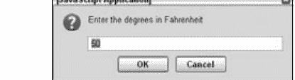

图 2-3

如果你保持 50 并单击“确定”，一个包含数字 10 的警报框会出现。这代表 50 华氏度转换为摄氏度的结果。

重新加载页面并尝试更改提示框中的值，以查看你得到的结果。例如，将值更改为 32 并重新加载页面。这次你应该看到 0 出现在框中。

由于这仍然是一个相当简单的例子，没有对数据输入进行验证，因此它会允许你输入`abc`作为华氏度。稍后，在本章的“数据类型转换”部分，你将看到如何识别伪装成数字数据的无效字符。

### 动手实践：Internet Explorer 8 的安全问题

将页面加载到 Internet Explorer 8 (IE8) 时，你可能会看到图 2-4 所示的安全警告问题，并且提示窗口不会出现。


图 2-4

如果出现这种情况，你需要更改 IE8 的安全设置并将`file://*.host`添加为受信任的站点。为此：

- 打开 IE8 并从“工具”菜单栏中选择“Internet 选项”菜单，如图 2-5 所示。


- 单击“安全”选项卡，然后单击绿色的“受信任的站点”按钮，如图 2-6 所示。


- 单击“站点”按钮，并在“将此网站添加到区域”文本框中输入`file://*.host`，如图 2-7 所示。


**4.** 确保“要求服务器验证(https:)”复选框未被选中，单击“添加”按钮，然后单击“关闭”按钮。

**5.** 单击“Internet 选项”对话框上的“确定”按钮返回到网页，按 F5 键刷新页面，示例现在将可以正常工作。

脚本块的第一行是注释，因为它以两个正斜杠（`//`）开头。它包含将华氏温度转换为摄氏度的公式，并且仅在示例代码中作为参考。

```javascript
// Equation is °C = 5/9 (°F - 32).
```

你的任务是用 JavaScript 代码表示这个公式。你首先声明变量`degFahren`和`degCent`。

```javascript
var degFahren = prompt("Enter the degrees in Fahrenheit", 50);
var degCent;
```

你不是将`degFahren`变量初始化为字面量值，而是使用`prompt()`函数从用户那里获取一个值。`prompt()`函数的工作方式类似于`alert()`函数，不同之处在于除了显示消息外，它还包含一个文本框，用户可以在其中输入值。这个值将被存储在`degFahren`变量内部。返回的值是一个文本字符串，但当你将它用作数字时，JavaScript 会隐式地将其转换为数字，正如本章后面关于数据类型转换的部分所讨论的那样。

你向`prompt()`函数传递两段信息：

- 要显示的文本——通常是提示用户输入的问题。
- 当提示对话框首次出现时，输入框中包含的默认值。

这两段信息必须按给定的顺序指定，并用逗号分隔。如果你不想在提示框打开时输入框中包含默认值，请对第二段信息使用空字符串（`""`）。

如上一节中的代码所示，文本是`"Enter the degrees in Fahrenheit"`，输入框中的默认值是 50。


接下来是脚本块中用 JavaScript 表示的公式。你将公式的结果存储在 `degCent` 变量中。你可以看到 JavaScript 代码看起来非常像注释中的公式，只是你使用 `degFahren` 代替 °F，使用 `degCent` 代替 °C。

```javascript
degCent = 5/9 * (degFahren - 32);
```

等号右侧表达式的计算提出了几个重要点。首先，就像在数学中一样，JavaScript 公式是从左到右读取的，至少对于基本数学函数（如 `+`、`-` 等）是这样。其次，正如你之前所看到的，就像数学中有优先级一样，JavaScript 中也有。

从左边开始，JavaScript 首先计算 `5/9 = .5556`（近似值）。然后遇到乘法，但是等等……我们公式的最后一部分 `degFahren - 32` 在括号中。这提高了优先级，并导致 JavaScript 在执行乘法之前先计算 `degFahren - 32` 的结果。例如，当 `degFahren` 设置为 50 时，(`degFahren - 32`) = (50 - 32) = 18。现在 JavaScript 执行乘法，.5556 * 18，大约等于 10。

如果你不使用括号会怎样？那么你的代码将是：

```javascript
degCent = 5/9 * degFahren - 32;
```

`5/9` 的计算保持不变，但然后 JavaScript 会计算乘法 `5/9 * degFahren`。这是因为乘法优先于减法。当 `degFahren` 是 50 时，这等同于 5/9 * 50 = 27.7778。最后，JavaScript 会减去 32，结果为 -4.2221；这不是你想要的答案！

### 基本字符串操作

在前面的部分中，你已经了解了文本或字符串数据类型以及数值数据。就像数值数据有相关的运算符一样，字符串也有。本节介绍使用这些运算符的一些基本字符串操作技术。

```javascript
var concatString = "Hello" + "Paul";
```

#### 动手实践 | 连接字符串

让我们看一个使用 `+` 运算符进行字符串连接的例子。

```html
<html xmlns="http://www.w3.org/1999/xhtml">
<body>
</body>
</html>
```

## 第2章：数据类型与变量

```javascript
concatString = greetingString + " " + myName;
document.write(concatString);
</script>
</body>
</html>
```

2. 如果你在网页浏览器中加载它，你应该会看到一个提示框，询问你的姓名。
3. 输入你的姓名并点击确定。你应该会看到网页上显示了一条问候语，并且你的姓名被显示了两次。

你通过声明三个变量来开始脚本块。你将第一个变量 `greetingString` 设置为一个字符串值。第二个变量 `myName` 被赋值为用户在提示框中输入的任何内容。你在这里没有初始化第三个变量 `concatString`。它将用于存储你稍后在代码中进行的连接操作的结果。

```javascript
var greetingString = "Hello";
var myName = prompt("Please enter your name", "");
var concatString;
```

在上一章中，你了解了网页是如何通过 `document` 这个概念来表示的，以及它具有许多不同的属性，例如 `bgColor`。你也可以使用 `document` 将文本和 HTML 直接写入页面本身。你可以通过使用 `document` 这个词，后跟一个点，然后是 `write()` 来实现这一点。然后你使用 `document.write()` 的方式与使用 `alert()` 函数类似，即将你想要在网页中显示的文本放在 `write` 一词之后的括号内。不过，这里不必过于担心，因为这将在第4章中详细解释。然而，你现在在代码中利用 `document.write()` 将一个表达式的结果写入页面。

```javascript
document.write(greetingString + " " + myName + "<br>");
```

写入页面的表达式是 `greetingString` 变量的值、一个空格（" "）、`myName` 变量的值以及 HTML `<br>` 标签（导致换行）的连接。例如，如果你在提示框中输入 Paul，这个表达式的值将是：

```html
Hello Paul<br>
```

代码的下一行是一个类似的表达式。这次它只是变量 `greetingString` 的值、一个空格和变量 `myName` 的值的连接。你将这个表达式的结果存储在变量 `concatString` 中。最后，你使用 `document.write()` 将变量 `concatString` 的内容写入页面。

```javascript
concatString = greetingString + " " + myName;
document.write(concatString);
```

混合数字和文本实际上非常简单。你可以简单地使用 `+` 运算符将它们连接起来。JavaScript 足够智能，知道当同时涉及字符串和数字时，你并不是试图进行数值计算，而是希望将数字视为字符串并将其连接到文本中。例如，要将文本 "My age is" 和数字 101 连接起来，你可以简单地这样做：

```javascript
alert("My age is" + 101);
```

这将产生一个警告框，其中包含 "My age is 101"。

## 使温度转换器更用户友好

你可以在我们的温度转换器示例中尝试这种连接字符串和数字的技巧。你将输出一些解释性文本以及转换计算的结果。你需要做的改动非常小，所以将 `ch2_examp4.htm` 加载到你的文本编辑器中，然后更改以下行。接着将其另存为 `ch2_examp6.htm`。

```html
<!DOCTYPE html PUBLIC "-//W3C//DTD XHTML 1.0 Transitional//EN"
"http://www.w3.org/TR/xhtml1/DTD/xhtml1-transitional.dtd">
<html xmlns="http://www.w3.org/1999/xhtml">
<body>

<script type="text/javascript">
var degFahren = prompt("Enter the degrees in Fahrenheit", 50);
var degCent;
degCent = 5/9 * (degFahren - 32);
alert (degFahren + "\xB0 Fahrenheit is " + degCent + "\xB0 centigrade");
</script>

</body>
</html>
```

将页面加载到你的网页浏览器中。在提示框中点击确定以提交值50，这一次你应该会看到如图2-8所示的框。

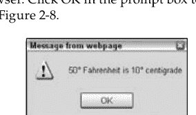

图2-8

这个示例与 `ch2_examp4.htm` 相同，只有一行不同：

```javascript
alert (degFahren + "\xB0 Fahrenheit is " + degCent + "\xB0 centigrade");
```

36

### 动手试一试

所以我们就来看看这一行代码。你可以看到 `alert()` 函数包含一个表达式。让我们更仔细地看看那个表达式。

首先是变量 `degFahren`，它包含数字数据。你将其连接到字符串 "\xB0 Fahrenheit is "。JavaScript 意识到因为你是在将一个数字和一个字符串相加，所以你是想将它们连接成一个字符串，而不是试图求它们的和，因此会自动将 `degFahren` 中包含的数字转换为字符串。接下来你将这个字符串连接到包含数字数据的变量 `degCent`。JavaScript 再次将此变量的值转换为字符串。最后，你将其连接到字符串 "\xB0 centigrade"。

还要注意用于将度数符号插入字符串的转义序列。你会记得在本章前面提到，`\xNN` 可以用来插入无法直接键入的特殊字符。（NN 是一个十六进制数字，表示 Latin-1 字符表中的一个字符）。因此，当 JavaScript 在字符串中看到 `\xB0` 时，它不会显示这些字符，而是会查找 B0 所代表的字符并显示它。

使用特殊字符时需要注意的是，它们不一定跨平台兼容。虽然你可以在 Windows 电脑上使用 `\xNN` 来表示某个字符，但你可能会发现在 Mac 或 Unix 机器上需要使用不同的字符。

你将在第4章中学习更多字符串处理技巧——你将看到如何搜索字符串和在字符串中间插入字符，在第8章中你将看到一些非常复杂的字符串技巧。

## 数据类型转换

如你所见，如果你将一个字符串和一个数字相加，JavaScript 会做出明智的选择，将数字转换为字符串，然后将两者连接起来。通常，JavaScript 在需要时会有足够的智能来进行此类数据类型转换，但在某些情况下，你需要自己转换数据类型。例如，你可能获得了一段你希望视为数字的字符串数据。如果你使用表单从用户那里收集数据，这种情况尤其可能发生。用户输入的任何值都被视为字符串，即使它们可能包含数字数据，例如用户的年龄。

为什么改变数据类型如此重要？考虑这样一个情况：你使用表单从用户那里收集两个数字并想计算它们的和。这两个数字以字符串的形式提供给你，例如 "22" 和 "15"。当你尝试使用 "22" + "15" 来计算这些值的和时，你会得到结果 "2215"，因为 JavaScript 认为你是在尝试连接两个字符串，而不是试图求两个数字的和。更令人困惑的是，顺序也有影响。所以：

```javascript
1 + 2 + 'abc'
```

的结果是包含 "3abc" 的字符串，而：

```javascript
'abc' + 1 + 2
```

的结果将是包含 "abc12" 的字符串。

在本节中，你将了解两个将字符串转换为数字的转换函数：`parseInt()` 和 `parseFloat()`。

我们先看 `parseInt()`。这个函数接受一个字符串并将其转换为一个整数。这个名称起初可能有点令人困惑——为什么是 `parseInt()` 而不是 `convertToInt()`？这个名称的主要原因来自函数的工作方式。它实际上会遍历（即解析）你要求其转换的字符串的每个字符，并检查它是否是有效的数字。如果有效，`parseInt()` 会使用它来构建数字；如果无效，命令就会停止转换并返回它已经转换的数字。

例如，如果你的代码是 `parseInt("123")`，JavaScript 会将字符串 "123" 转换为数字 123。对于代码 `parseInt("123abc")`，JavaScript 也会返回数字 123。当 JavaScript 解释器遇到字母 a 时，它假定数字已经结束，并将 123 作为字符串 "123abc" 的整数版本返回。

`parseFloat()` 函数的工作方式与 `parseInt()` 相同，只是它返回浮点数——分数数字——并且字符串中正在转换的十进制小数点被认为是允许数字的一部分。

### 动手试一试：将字符串转换为数字

让我们看一个使用 `parseInt()` 和 `parseFloat()` 的示例。输入以下代码并将其保存为 `ch2_examp7.htm`：

```html
<!DOCTYPE html PUBLIC "-//W3C//DTD XHTML 1.0 Transitional//EN"
"http://www.w3.org/TR/xhtml1/DTD/xhtml1-transitional.dtd">
<html xmlns="http://www.w3.org/1999/xhtml">
<body>

<script type="text/javascript">
var myString = "56.02 degrees centigrade";
var myInt;
var myFloat;

document.write("\"" + myString + "\" is " + parseInt(myString) +
  " as an integer" + "<BR>");

myInt = parseInt(myString);
document.write("\"" + myString + "\" when converted to an integer equals " +
  myInt + "<BR>");

myFloat = parseFloat(myString);
document.write("\"" + myString +
  "\" when converted to a floating point number equals " + myFloat);
</script>

</body>
</html>
```

38

## 处理无法转换的字符串

有些字符串根本无法转换为数字，例如不包含任何数字数据的字符串。如果你尝试转换这些字符串会发生什么？作为一个小实验，试着修改前面的示例，使 `myString` 存储一个无法转换的内容。例如，将这一行：

```javascript
var myString = "56.02 degrees centigrade";
```

改为：

```javascript
var myString = "I'm a name not a number";
```

现在重新加载浏览器页面，你应该会看到如图2-10所示的内容。

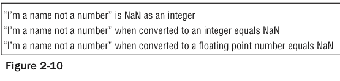

你可以看到，之前出现数字的地方，现在显示的是 `NaN`。这是什么样的数字呢？嗯，它根本不是数字！

如果你对任何空字符串或不以至少一个有效数字开头的字符串使用 `parseInt()` 或 `parseFloat()`，你都会得到 `NaN`，意思是“非数字”。

`NaN` 实际上是 JavaScript 中的一个特殊值。它有自己的函数 `isNaN()`，用于检查某个值是否为 `NaN`。例如：

```javascript
myVar1 = isNaN("Hello");
```

会将值 `true` 存储在变量 `myVar1` 中，因为“Hello”不是数字；而：

```javascript
myVar2 = isNaN("34");
```

会将值 `false` 存储在变量 `myVar2` 中，因为34可以通过 `isNaN()` 函数成功地从字符串转换为数字。

在第3章中，你将看到如何使用 `isNaN()` 函数检查字符串是否为有效数字，这在处理用户输入时非常有价值，正如你将在第7章中看到的那样。

## 数组

现在我们要看一个新概念——一个叫做数组的东西。数组类似于普通变量，因为你可以用它来存储任何类型的数据。但是，它有一个重要的区别，你将在本节中看到。

正如你已经看到的，普通变量一次只能存储一条数据。例如，你可以将 `myVariable` 设置为等于25，如下所示：

```javascript
myVariable = 25;
```

然后去将其设置为其他值，比如35：

```javascript
myVariable = 35;
```

然而，当你将变量设置为35时，第一个值25就丢失了。变量 `myVariable` 现在只包含数字35。

下表说明了该变量：

| 变量名 | 值 |
| --- | --- |
| `myVariable` | 35 |

普通变量和数组之间的区别在于，数组可以同时存储多个数据项。例如，你可以使用一个名为 `myArray` 的数组来存储数字25和35。数组中可以存储数据的每个位置称为一个元素。

你如何区分数组中的这两条数据？你为每条数据赋予一个索引值。要引用该数据，你需要在数组名称后跟上用方括号括起来的索引值。例如，一个包含数据25和35的名为 `myArray` 的数组可以用下表来说明：

| 元素名 | 值 |
| --- | --- |
| `myArray[0]` | 25 |
| `myArray[1]` | 35 |

注意索引值从0开始，而不是1。为什么这样呢？当然1更合理——毕竟，我们人类倾向于说第一项数据，然后是第二项数据，依此类推。不幸的是，计算机从0开始，将第一项视为零项，第二项视为第一项，依此类推。令人困惑，但你会很快习惯的。

数组非常有用，因为你可以在数组中存储任意多（在语言限制内，最多为2的32次方个元素）或任意少的数据项。此外，你不必预先说明要在数组中存储多少条数据，尽管如果你愿意可以这样做。

那么如何创建一个数组呢？这与声明普通变量略有不同。要创建一个新数组，你需要声明一个变量名，并使用 `new` 关键字和 `Array()` 函数告诉 JavaScript 你想要它是一个新数组。例如，数组 `myArray` 可以这样定义：

```javascript
var myArray = new Array();
```

请注意，与 JavaScript 中的所有内容一样，代码区分大小写，因此如果你输入 `array()` 而不是 `Array()`，代码将无法工作。这种定义数组的方法将在第5章进一步解释。

与普通变量一样，你也可以先声明变量，然后告诉 JavaScript 你希望它是一个数组。例如：

```javascript
var myArray;
myArray = new Array();
```

之前你了解到，如果你愿意，可以预先说明数组将包含多少个元素，尽管这不是必需的。你可以通过在 `Array` 后的括号中指定你想要的元素数量来实现。例如，要创建一个包含六个元素的数组，你可以这样写：

```javascript
var myArray = new Array(6);
```

你已经看到如何声明一个新数组，但如何将数据存储到其中呢？你可以在定义数组时，在括号中包含数据，每个数据项用逗号分隔来实现。例如：

```javascript
var myArray = new Array("Paul", 345, "John", 112, "Bob", 99);
```


这里，第一项数据“Paul”将被放入索引为`0`的数组中。下一项数据`345`将被放入索引为`1`的数组中，依此类推。这意味着名为`myArray[0]`的元素包含值“Paul”，名为`myArray[1]`的元素包含值`345`，依此类推。

请注意，你不能使用此方法声明仅包含一条数值数据（例如`345`）的数组，因为 JavaScript 会假定你正在声明一个将包含`345`个元素的数组。

这就引出了在数组中声明数据的另一种方式。你可以将上一行写成这样：

```
var myArray = new Array();
myArray[0] = "Paul";
myArray[1] = 345;
myArray[2] = "John";
myArray[3] = 112;
myArray[4] = "Bob";
myArray[5] = 99;
```

你将每个元素名用作变量，并为其赋值。你将在接下来的“动手实践”部分学习这种声明数组元素值的方法。

显然，在这个示例中，第一种定义数据项的方法要容易得多。然而，在某些情况下，你可能希望在声明后更改存储在数组特定元素中的数据。在这种情况下，你将必须使用后一种方法来定义数组元素的值。

从前面的示例中你还会注意到，你可以在同一个数组中存储不同的数据类型。JavaScript 对于你可以将什么放入数组以及可以将它放在哪里非常灵活。

## 第2章：数据类型与变量

在继续示例之前，请注意，例如，如果您定义了一个名为`myArray`的数组，并指定它包含三个元素，如下所示：

```
var myArray = new Array(3);
```

然后为索引`130`的元素定义一个值，如下：

```
myArray[130] = "Paul";
```

JavaScript不会报错，并且会欣然接受您改变了主意，想要一个包含（至少）`131`个元素的数组。

## 动手实践：数组

在下面的示例中，您将创建一个数组来存储一些姓名。您将使用上一节描述的第二种方法将这些数据存储到数组中。然后向用户显示这些数据。输入以下代码并将其保存为`ch2_examp8.htm`。

```
<!DOCTYPE html PUBLIC "-//W3C//DTD XHTML 1.0 Transitional//EN"
"http://www.w3.org/TR/xhtml1/DTD/xhtml1-transitional.dtd">
<html xmlns="http://www.w3.org/1999/xhtml">
<body>

<script type="text/javascript">

var myArray = new Array();
myArray[0] = "Bob";
myArray[1] = "Pete";
myArray[2] = "Paul";

document.write("myArray[0] = " + myArray[0] + "<BR>");
document.write("myArray[2] = " + myArray[2] + "<BR>");
document.write("myArray[1] = " + myArray[1] + "<BR>");

myArray[1] = "Mike";
document.write("myArray[1] changed to " + myArray[1]);

</script>

</body>
</html>
```

如果您在网页浏览器中加载此文件，应该会看到一个类似图`2-11`所示的网页。

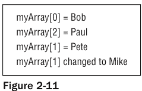

脚本块中的第一个任务是声明一个变量，并告诉JavaScript解释器您希望它成为一个新的数组。

```
var myArray = new Array();
```

既然数组已定义，您就可以在其中存储一些数据了。每次使用新索引存储一项数据时，JavaScript都会自动为其创建新的存储空间。请记住，第一个元素将位于`myArray[0]`。

依次查看向数组添加的每一项，看看发生了什么。在添加任何内容之前，您的数组是空的。然后您通过以下行添加一个数组元素：

```
myArray[0] = "Bob";
```

您的数组现在看起来像这样：

| 索引 | 存储的数据 |
| :--- | :--- |
| 0 | Bob |

然后您向数组添加另一个元素，这次使用索引`1`。

```
myArray[1] = "Pete";
```

| 索引 | 存储的数据 |
| :--- | :--- |
| 0 | Bob |
| 1 | Pete |

最后，您使用索引`2`向数组添加另一个元素。

```
myArray[2] = "Paul";
```

您的数组现在看起来像这样：

| 索引 | 存储的数据 |
| :--- | :--- |
| 0 | Bob |
| 1 | Pete |
| 2 | Paul |

接下来，您使用一系列`document.write()`函数将数组每个元素包含的值插入到网页中。这里数组的顺序是打乱的，只是为了演示您也可以这样访问它。

```
document.write("myArray[0] = " + myArray[0] + "<BR>");
document.write("myArray[2] = " + myArray[2] + "<BR>");
document.write("myArray[1] = " + myArray[1] + "<BR>");
```

您可以将数组中的每个特定位置视为一个标准变量。因此，您可以使用它进行计算，将其值转移到另一个变量或数组，等等。但是，如果您在定义数组位置之前尝试访问其内部数据，您将得到`undefined`作为值。

最后，您将第二个数组位置的值更改为"Mike"。您本可以将其更改为一个数字，因为就像普通变量一样，您可以在任何时间在数组的每个单独数据位置中存储任何数据类型。

```
myArray[1] = "Mike";
```

现在您的数组内容看起来像这样：

| 索引 | 存储的数据 |
|---|---|
| 0 | Bob |
| 1 | Mike |
| 2 | Paul |

为了显示您所做的更改已生效，您使用`document.write()`来显示第二个元素的值。

```
document.write("myArray[1] changed to " + myArray[1]);
```

## 多维数组

假设您想在数组中存储公司的人员信息。您可能有姓名、年龄、地址等数据。创建此类数组的一种方法是按顺序存储信息——将第一个姓名存储在数组的第一个元素中，然后将相应的年龄存储在下一个元素中，地址存储在第三个元素中，下一个姓名存储在第四个元素中，依此类推。您的数组可能看起来像这样：

| 索引 | 存储的数据 |
|---|---|
| 0 | 姓名1 |
| 1 | 年龄1 |
| 2 | 地址1 |
| 3 | 姓名2 |
| 4 | 年龄2 |
| 5 | 地址2 |
| 6 | 姓名3 |
| 7 | 年龄3 |
| 8 | 地址3 |

这可行，但有一个更简洁的解决方案：使用*多维数组*。到目前为止，您一直在使用一维数组。在这些数组中，每个元素仅由一个索引指定——即一个维度。因此，以上述示例为例，您可以看到姓名1位于索引`0`，年龄1位于索引`1`，依此类推。

多维数组是每个元素有两个或更多索引的数组。例如，以下是一个二维数组形式的人员数组：

| 索引 | 0 | 1 | 2 |
| --- | --- | --- | --- |
| 0 | 姓名1 | 姓名2 | 姓名3 |
| 1 | 年龄1 | 年龄2 | 年龄3 |
| 2 | 地址1 | 地址2 | 地址3 |

您将在下面的“动手实践”部分了解如何创建这样的多维数组。

### 动手实践：二维数组

以下示例说明了如何在JavaScript代码中创建这样的多维数组，以及如何访问此数组的元素。输入以下代码并将其保存为`ch2_examp9.htm`。

```
<!DOCTYPE html PUBLIC "-//W3C//DTD XHTML 1.0 Transitional//EN"
"http://www.w3.org/TR/xhtml1/DTD/xhtml1-transitional.dtd">
<html xmlns="http://www.w3.org/1999/xhtml">
<body>

<script type="text/javascript">

var personnel = new Array();

personnel[0] = new Array();
personnel[0][0] = "Name0";
personnel[0][1] = "Age0";
personnel[0][2] = "Address0";

personnel[1] = new Array();
personnel[1][0] = "Name1";
personnel[1][1] = "Age1";
personnel[1][2] = "Address1";

personnel[2] = new Array();
personnel[2][0] = "Name2";
personnel[2][1] = "Age2";
personnel[2][2] = "Address2";

document.write("Name : " + personnel[1][0] + "<BR>");
document.write("Age : " + personnel[1][1] + "<BR>");
document.write("Address : " + personnel[1][2]);

</script>

</body>
</html>
```

如果您在网页浏览器中加载它，您将在页面上看到三行文字，它们代表存储在数组`personnel[1]`元素中的人的姓名、年龄和地址，如图`2-12`所示。

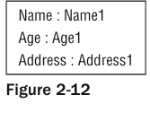

此脚本块中的第一件事是声明一个变量`personnel`，并告诉JavaScript您希望它成为一个新的数组。

```
var personnel = new Array();
```

然后您要做一些新的事情；您告诉JavaScript您希望人员数组的索引`0`，即元素`personnel[0]`，成为另一个新的数组。

```
personnel[0] = new Array();
```

那么这是怎么回事呢？事实是，JavaScript实际上并不支持多维数组，只支持一维数组。但是，JavaScript允许我们通过在另一个数组内部创建数组来模拟多维数组。因此，上一行所做的就是在我们的`personnel`数组中索引为`0`的元素内创建一个新数组。

在接下来的三行中，您将值放入新创建的`personnel[0]`数组中。JavaScript使这变得容易：您只需声明数组名称`personnel[0]`，后跟另一个用方括号括起来的索引。第一个索引（`0`）属于`personnel`数组；第二个索引属于`personnel[0]`数组。

```
personnel[0][0] = "Name0";
personnel[0][1] = "Age0";
personnel[0][2] = "Address0";
```

执行这些代码行后，您的数组如下所示：

| 索引 | 0 |
|---|---|
| 0 | Name0 |
| 1 | Age0 |
| 2 | Address0 |

顶部的数字（目前只有`0`）指的是`personnel`数组。侧边的数字`0`、`1`、`2`实际上是`personnel`数组内部新`personnel[0]`数组的索引。

## 第2章：数据类型与变量

要录入第二个人的详细信息，你需要重复这个过程，但这次是使用`personnel`数组中索引为`1`的元素。

```
personnel[1] = new Array();
personnel[1][0] = "Name1";
personnel[1][1] = "Age1";
personnel[1][2] = "Address1";
```

现在你的数组看起来像这样：

| 索引 | 0 | 1 |
| --- | --- | --- |
| 0 | Name0 | Name1 |
| 1 | Age0 | Age1 |
| 2 | Address0 | Address1 |

接下来几行，你将创建第三个人的详细信息。现在你使用`personnel`数组中索引为`2`的元素来创建一个新数组。

```
personnel[2] = new Array();
personnel[2][0] = "Name2";
personnel[2][1] = "Age2";
personnel[2][2] = "Address2";
```

数组现在看起来像这样：

| 索引 | 0 | 1 | 2 |
| --- | --- | --- | --- |
| 0 | Name0 | Name1 | Name2 |
| 1 | Age0 | Age1 | Age2 |
| 2 | Address0 | Address1 | Address2 |

至此，你已完成了多维数组的创建。最后，你通过访问第二个人的数据（`Name1`、`Age1`、`Address1`）并使用`document.write()`将其显示在页面上，以此结束这个脚本块。如你所见，访问数据与存储数据的方式非常相似。在任何可以使用普通变量或一维数组的地方，你都可以使用多维数组。

```
document.write("Name : " + personnel[1][0] + "<BR>");
document.write("Age : " + personnel[1][1] + "<BR>");
document.write("Address : " + personnel[1][2]);
```

尝试修改`document.write()`命令，使其显示第一个人的详细信息。代码将如下所示：

```
document.write("Name : " + personnel[0][0] + "<BR>");
document.write("Age : " + personnel[0][1] + "<BR>");
document.write("Address : " + personnel[0][2]);
```

虽然可以创建三维、四维甚至一百维的多维数组，但事情可能会变得非常混乱，而且你会发现你很少（如果有的话）需要超过两个维度。为了让你有个概念，以下是声明和访问一个五维数组的方法：

```
var myArray = new Array();
myArray[0] = new Array();
myArray[0][0] = new Array();
myArray[0][0][0] = new Array();
myArray[0][0][0][0] = new Array();

myArray[0][0][0][0][0] = "This is getting out of hand"

document.write(myArray[0][0][0][0][0]);
```

关于数组的内容就到这里，但你将在第4章再次接触它们，届时你会发现一些关于它们的惊人事实。你还将学习它们的一些更高级的特性。

# 本章总结

在本章中，你已经建立了对JavaScript数据类型和变量基础知识以及如何在运算中使用它们的了解。特别是，你看到了：

- JavaScript支持多种数据类型，例如数字、文本和布尔值。
- 文本由字符字符串表示，并用引号包围。你必须匹配包围字符串的引号。转义字符使你能够在字符串中包含无法直接输入的字符。
- 变量是JavaScript在内存中存储数据（如数字和文本）的方式，以便你可以在代码中反复使用它们。
- 变量名不能包含某些非法字符（如百分号`%`和和号`&`），也不能是保留字（如`with`）。
- 在将值赋给变量之前，你必须向JavaScript解释器声明它的存在。
- JavaScript有四种基本的数学运算符，分别用加号`+`、减号`-`、星号`*`和斜杠`/`表示。要将计算结果赋值给一个变量，你需要使用等号`=`，这被称为赋值运算符。
- 运算符具有不同的优先级，因此乘法和除法会在加法和减法之前进行计算。
- 字符串可以通过`+`运算符进行连接，形成一个大的字符串。当数字和字符串使用`+`运算符连接时，JavaScript会自动将数字转换为字符串。
- 尽管JavaScript的自动数据转换在大多数情况下都适用，但有时你需要强制转换数据。你已经看到如何使用`parseInt()`和`parseFloat()`将字符串转换为数字。尝试转换无法转换的字符串将返回`NaN`（非数字）。
- 数组是一种特殊的变量，可以存储多个数据项。数据通过唯一的索引号进行插入和访问。

## 练习题

这些问题的建议解答可以在附录A中找到。

1. 编写一个JavaScript程序，将摄氏度转换为华氏度，并将结果以描述性句子的形式写入页面。华氏度转摄氏度的JavaScript公式如下：

```
degFahren = 9 / 5 * degCent + 32
```

2. 以下代码使用`prompt()`函数从用户那里获取两个数字。然后将这两个数字相加，并将结果写入页面：


```html
<!DOCTYPE html PUBLIC "-//W3C//DTD XHTML 1.0 Transitional//EN"
"http://www.w3.org/TR/xhtml1/DTD/xhtml1-transitional.dtd">
<html xmlns="http://www.w3.org/1999/xhtml">
<script language="JavaScript" type="text/javascript">

var firstNumber = prompt("Enter the first number"," ");
var secondNumber = prompt("Enter the second number"," ");
var theTotal = firstNumber + secondNumber;
document.write(firstNumber + " added to " + secondNumber + " equals " + 
theTotal);

</script>
</body>
</html>
```

但是，如果你运行这段代码，你会发现它不起作用。为什么？修改代码使其能正常工作。

# 第3章：判断、循环与函数

到目前为止，你已经学会了如何使用 JavaScript 获取用户输入，用该输入执行计算和任务，并将结果写入网页。然而，一个简单的计算器也能做到这一切，那么是什么让计算机与众不同呢？也就是说，是什么让计算机看起来具有智能？答案是能够根据收集到的信息做出决策的能力。

决策能力将如何帮助你创建网站呢？在上一章中，你编写了一些代码将华氏温度转换为摄氏度。你使用`prompt()`函数从用户那里获取华氏度。如果用户输入了一个有效的数字（例如50），这没问题。但是，如果用户输入了一个无效的华氏温度（例如字符串`aaa`），你会发现你的代码不再按预期工作。现在，如果你的程序有一些决策能力，你就可以检查用户输入的内容是否有效。如果有效，你可以进行计算；如果无效，你可以告诉用户原因并要求他输入有效的数字。

用户输入的验证可能是 JavaScript 中最常见的决策应用之一，但它远非唯一的应用。

在本章中，你将了解如何在 JavaScript 中实现决策，以及如何利用它使你的代码更智能。

## 判断——`if` 和 `switch` 语句

所有编程语言都允许你做出决策——也就是说，它们允许程序根据是否满足某个*条件*来遵循特定的操作路线。这就是编程语言智能所在。

例如，在一个只使用兼容4.0或更高版本浏览器的 JavaScript 代码的情况下，条件可以是用户正在使用4.0或更高版本的浏览器。如果你发现该条件不满足，你可以将他引导至一组兼容早期浏览器的页面。

条件是对变量和数据之间的比较，例如：

- *A* 是否大于 *B*？
- *X* 是否等于 *Y*？
- *M* 是否不等于 *N*？

例如，如果变量`browserVersion`存储了用户使用的浏览器版本，那么条件可以是：

```text
browserVersion 是否大于或等于4？
```

你会注意到，所有这些问题都有一个“是”或“否”的答案——也就是说，它们是基于布尔值的，结果只能为`true`或`false`。你如何利用这一点在代码中创建决策能力呢？你让浏览器测试条件是否为`true`。如果（且仅当）它为`true`，你才执行特定的代码段。

再看一个例子。回想一下第1章中用于演示代码流程的自然英语指令。其中一个关于制作咖啡的指令是：

> 水壶烧开了吗？如果是，则将水倒入杯中；否则，继续等待。

这就是一个做决策的例子。这条指令中的条件是“水壶烧开了吗？”它有一个`true`或`false`的答案。如果答案是`true`，你就把水倒入杯中。如果不是`true`，你就继续等待。

在 JavaScript 中，你可以使用`if`语句或`switch`语句，根据条件是`true`还是`false`来改变代码的执行流程。你很快就会看到这些，但首先我们需要介绍一些对定义条件至关重要的新运算符——*比较运算符*。

## 比较运算符

在第2章中，你已经看到数学函数（如加法和除法）是如何由称为运算符的符号（如加号`+`和斜杠`/`）表示的。你还看到，如果你想给一个变量赋值，可以使用等号`=`（称为赋值运算符）为其分配一个值或一个计算结果。

判断也有自己的运算符，使你能够测试条件。比较运算符与你上一章看到的数学运算符一样，有一个左侧（LHS）和一个右侧（RHS），并在两者之间进行比较。这些在技术术语中称为*左操作数*和*右操作数*。例如，小于运算符（符号为`<`）就是一个比较运算符。你可以写`23 < 45`，翻译过来就是“23是否小于45？”在这里，答案将是`true`（见图3-1）。

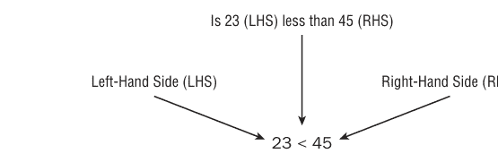

还有其他比较运算符，其中更有用的已汇总在下表中：

| 运算符符号 | 用途 |
| --- | --- |
| `==` | 测试左侧是否等于右侧 |
| `<` | 测试左侧是否小于右侧 |
| `>` | 测试左侧是否大于右侧 |
| `<=` | 测试左侧是否小于或等于右侧 |
| `>=` | 测试左侧是否大于或等于右侧 |
| `!=` | 测试左侧是否不等于右侧 |

你将在下一节学习`if`语句时，看到这些比较运算符的用法。

## 优先级

回忆第2章，运算符具有优先级。这也适用于比较运算符。`==`和`!=`比较运算符的优先级最低，而其余比较运算符`<`、`>`、`<=`和`>=`的优先级相等。

所有这些比较运算符的优先级都低于`+`、`-`、`*`和`/`等运算符。这意味着，如果你进行如`3 * 5 > 2 * 5`这样的比较，乘法运算会先被计算出来，然后才对它们的结果进行比较。然而，在这种情况下，将两侧的计算分别用括号括起来既更安全也更清晰，例如`(3 * 5) > (2 * 5)`。作为一般规则，使用括号来确保优先级清晰是一个好主意，否则你可能会对结果感到惊讶。

## 赋值与比较

需要提及的一个非常重要的点是赋值运算符（`=`）和比较运算符（`==`）很容易混淆。请记住，`=`运算符用于将值赋给变量，而`==`运算符用于比较两个变量的值。即使你清楚这一点，也很容易在一个本应放置两个等号的地方只放了一个等号。

### 赋值比较结果

你可以将比较的结果存储在一个变量中，如下例所示：

```javascript
var age = prompt("Enter age:", "");
var isOverSixty = parseInt(age) > 60;
document.write("Older than 60: " + isOverSixty);
```

这里你使用`prompt()`函数获取用户的年龄。它以字符串形式返回用户输入的任何值。然后你使用上一章学过的`parseInt()`函数将其转换为数字，并使用大于运算符检查它是否大于60。比较的结果（真或假）将存储在变量`isOverSixty`中。

如果用户输入35，最后一行的`document.write()`将向页面写入以下内容：

```text
Older than 60: false
```

如果用户输入61，将显示：

```text
Older than 60: true
```

## `if` 语句

`if`语句是你几乎在每个超过几行长的程序中都会用到的语句。它的工作原理与英语中的非常相似。例如，你可能会在英语中说：“如果房间温度超过80华氏度，那么我就打开空调。”在 JavaScript 中，这可以转换成类似这样的代码：

```javascript
if (roomTemperature > 80)
{
    roomTemperature = roomTemperature - 10;
}
```

这是如何工作的？请参见图3-2。

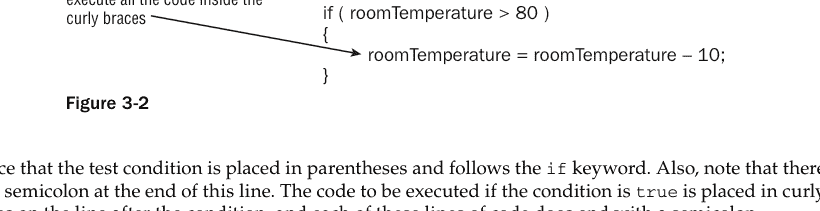

注意，测试条件放在`if`关键字之后的括号中。另外，请注意此行末尾没有分号。如果条件为`true`，要执行的代码放在条件之后的花括号中，并且每一行代码都以分号结束。

花括号`{}`在 JavaScript 中有一个特殊用途：它们标记出一个代码*块*。将代码行标记为属于单个块，意味着 JavaScript 会将它们全部视为一段代码。如果`if`语句的条件为`true`，JavaScript 将执行紧随`if`语句之后的下一行或代码块。在前面的例子中，代码块只有一条语句，所以我们同样可以这样写：

```javascript
if (roomTemperature > 80)
    roomTemperature = roomTemperature - 10;
```

但是，如果你想执行多行代码，你需要用花括号将它们标记为单个代码块。例如，一个包含三条代码语句的修改版示例必须包含花括号。

```javascript
if (roomTemperature > 80)
{
    roomTemperature = roomTemperature - 10;
    alert("It's getting hot in here");
    alert("Air conditioning switched on");
}
```

一个特别容易犯的错误是，在标记要执行的代码块时忘记使用花括号。当条件为真时，你可能会发现只有`if`语句之后的*第一行*被执行，而不是块中的代码被执行。然而，其他行无论测试条件的结果如何都会被执行。为了避免这类错误，即使只有一条语句，也最好总是使用花括号。如果你养成了这个习惯，在真正需要时就更不容易遗漏它们。

## 动手实践 `if` 语句

让我们回到第2章的温度转换器示例，并添加一些决策功能。

1. 输入以下代码并将其保存为`ch3_examp1.htm`：

```html
<!DOCTYPE html PUBLIC "-//W3C//DTD XHTML 1.0 Transitional//EN"
"http://www.w3.org/TR/xhtml1/DTD/xhtml1-transitional.dtd">
<html xmlns="http://www.w3.org/1999/xhtml">
<body>

<script type="text/javascript">

var degFahren = Number(prompt("Enter the degrees Fahrenheit",32));
var degCent;

degCent = 5/9 * (degFahren - 32);

document.write(degFahren + "\xB0 Fahrenheit is " + degCent +
    "\xB0 centigrade<br />");

if (degCent < 0)
{
    document.write("That's below the freezing point of water");
}

if (degCent == 100)
    document.write("That's the boiling point of water");

</script>

</body>
</html>
```

2. 将页面加载到浏览器中，并在提示框中输入32作为要转换的华氏温度值。值为32时，`if`语句的两个条件都不是`true`，因此页面上唯一写入的行将如图3-3所示。

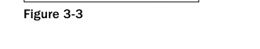

3. 现在重新加载页面，输入31作为华氏温度值。这次你将在页面中看到两行，如图3-4所示。

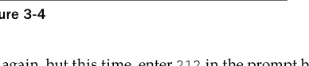

4. 最后，再次重新加载页面，但这次在提示框中输入212。页面中将出现如图3-5所示的两行。

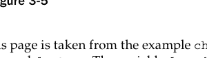

此页面脚本块的第一部分取自第2章的示例`ch2_examp4.htm`。你声明了两个变量：`degFahren`和`degCent`。变量`degFahren`的初始值通过`prompt()`函数从用户处获得。请注意`prompt()`函数返回一个字符串值，你随后使用`Number()`函数将其显式转换为数值。然后变量`degCent`被设置为计算`5/9 * (degFahren - 32)`的结果，这就是华氏度转摄氏度的计算。

```javascript
var degFahren = Number(prompt("Enter the degrees Fahrenheit",32));
var degCent;

degCent = 5/9 * (degFahren - 32);
```

然后你将计算结果写入页面。

```javascript
document.write(degFahren + "\xB0 Fahrenheit is " + degCent +
    "\xB0 centigrade<br />");
```

现在是新代码；两个`if`语句中的第一个。

```javascript
if (degCent < 0)
{
    document.write("That's below the freezing point of water");
}
```

这个`if`语句的条件是：“变量`degCent`的值是否小于零？”如果答案是 yes（true），则执行花括号内的代码。在这种情况下，你使用`document.write()`向页面写入一句话。如果答案是 no（false），处理将继续到闭合花括号之后的下一行。同样值得注意的是，`if`语句起始花括号内的代码是缩进的。这不是必需的，但这是一个值得养成的好习惯，因为它使你的代码更易于阅读。

在尝试该示例时，你首先输入了32，因此`degFahren`将被初始化为32。在这种情况下，计算`degCent = 5/9 * (degFahren - 32)`会将`degCent`设置为0。因此，“`degCent`是否小于零？”这个问题的答案是 false，因为`degCent`等于零，而不是小于零。花括号内的代码将被跳过，永远不会执行。在这种情况下，下一个要执行的行是第二个`if`语句的条件，我们稍后将讨论。

当你在提示框中输入31时，`degFahren`被设置为31，因此变量`degCent`将是-0.5555555556。那么你的`if`语句现在看起来如何？它会计算为“Is -0.5555555556 less than zero?”这次答案是 true，因此花括号内的代码，这里只是一个`document.write()`语句，将被执行。

最后，当你输入212时，这对`if`语句有什么影响？变量`degCent`通过计算被设置为100，因此`if`语句现在提出的问题是：“Is 100 less than zero?”答案是 false，花括号内的代码将被跳过。

在第二个`if`语句中，你评估条件“变量`degCent`的值是否等于100？”

```javascript
if (degCent == 100)
    document.write("That's the boiling point of water");
```

这里没有花括号，因此如果条件为 true，要执行的代码只是`if`语句下方的第一行。当你希望在条件为 true 时执行多行代码时，则需要花括号。

你已经看到，当`degFahren`为32时，`degCent`将为0。所以你的`if`语句将是“Is 0 equal to 100?”答案显然是 false，代码不会执行。同样，当你将`degFahren`设置为31时，`degCent`将被计算为-0.5555555556；“Is -0.5555555556 equal to 100?”也是 false，代码不会执行。

最后，当`degFahren`设置为212时，`degCent`将为100。这次`if`语句是“Is 100 equal to 100?”答案是 true，因此`document.write()`语句会执行。

正如你已经看到的，即使是专家，JavaScript 中最常见的错误之一也是在求值时使用一个等号，而不是必要的两个。看看以下代码片段：

```javascript
if (degCent = 100)
    document.write("That's the boiling point of water");
```

# 第3章：条件判断、循环与函数

赋值表达式的结果是右侧表达式的值，这个值是100，然后被隐式转换为布尔值，除了0和`NaN`之外的任何数字都会转换为`true`，这是正确的。

## 逻辑运算符

你现在应该对如何在`if`语句中使用条件有了大致了解，但是如何使用像“`degFahren`是否大于零且小于100？”这样的条件呢？这里有两个条件需要测试。你需要测试`degFahren`是否大于零以及`degFahren`是否小于100。

JavaScript 允许你使用这样的多重条件。为此，你需要了解另外三个运算符：逻辑与（AND）、逻辑或（OR）和逻辑非（NOT）。这些运算符的符号列在下面的表格中。

| 运算符 | 符号 |
| :--- | :--- |
| 与（AND） | `&&` |
| 或（OR） | `\|\|` |
| 非（NOT） | `!` |

请注意，与（AND）和或（OR）运算符是两个重复的符号：`&&`和`||`。如果你只输入一个符号`&`或`|`，将会发生奇怪的事情，因为这些是用于二进制运算的特殊运算符，称为位运算符——对于逻辑运算，你必须始终使用两个符号。

在学习了这三个逻辑运算符之后，你将学习如何在`if`语句中使用它们，并提供大量实际示例。所以如果第一次阅读时觉得有点困惑，不要惊慌。一切都会变得清晰。让我们从与（AND）运算符开始，看看每个运算符是如何工作的。

## 与（AND）

回想一下，我们谈论过运算符的左侧（LHS）和右侧（RHS）。与（AND）运算符也是如此。然而，现在条件的左侧和右侧是布尔值（通常是条件的结果）。


与（AND）运算符的工作原理与英语中的用法非常相似。例如，你可能会说：“如果我感到冷并且我有一件外套，那么我就穿上外套。”这里，“and”这个词的左侧是“我感到冷吗？”，这可以被评估为真（`true`）或假（`false`）。右侧是“我有一件外套吗？”，同样被评估为真或假。如果左侧为真（我感到冷）并且右侧为真（我有一件外套），那么你就穿上外套。

这与 JavaScript 中与（AND）运算符的工作原理非常相似。与（AND）运算符实际上会产生一个结果，就像两个数字相加会产生一个结果一样。然而，与（AND）运算符接受两个布尔值（在其左侧和右侧）并产生另一个布尔值。如果左侧和右侧条件都被评估为真，结果将为真。在任何其他情况下，结果将为假。

以下是当使用与（AND）时，左侧和右侧可能评估结果的真值表。

| 左侧（LHS） | 右侧（RHS） | 结果 |
| --- | --- | --- |
| `true` | `true` | `true` |
| `false` | `true` | `false` |
| `true` | `false` | `false` |
| `false` | `false` | `false` |

尽管从严格意义上讲，这个表是正确的，但值得注意的是 JavaScript 不喜欢做不必要的工作。嗯，谁会喜欢呢！如果左侧为 `false`，即使右侧评估为 `true`，也不会对最终结果产生任何影响——它仍然是 `false`。因此，为了避免浪费时间，如果左侧为 `false`，JavaScript 甚至不会检查右侧，直接返回 `false` 的结果。

## 或（OR）

就像与（AND）一样，或（OR）的工作原理也与英语中的用法非常相似。例如，你可能会说，如果正在下雨或者正在下雪，那么我会带一把伞。如果“正在下雨”或“正在下雪”这两个条件中的任何一个为真，你就会带一把伞。

同样，就像与（AND）一样，或（OR）运算符作用于两个布尔值（一个来自左侧，一个来自右侧）并返回另一个布尔值。如果左侧评估为 `true` 或者右侧评估为 `true`，返回的结果就是 `true`。否则，结果就是 `false`。下表显示了可能的结果。

| 左侧（LHS） | 右侧（RHS） | 结果 |
| --- | --- | --- |
| `true` | `true` | `true` |
| `false` | `true` | `true` |
| `true` | `false` | `true` |
| `false` | `false` | `false` |

与与（AND）运算符一样，JavaScript 喜欢避免对最终结果没有影响的操作。如果左侧为 `true`，那么右侧是 `true` 还是 `false` 都不会对最终结果产生影响——它仍然是 `true`。因此，为了避免工作，如果左侧为 `true`，则不会评估右侧，JavaScript 只是简单地返回 `true`。最终结果是相同的——唯一的区别在于 JavaScript 得出结论的方式。然而，这确实意味着你不应该依赖或（OR）运算符右侧的代码被执行。

## 非（NOT）

在英语中，我们可能会说：“如果我不热，那么我就喝汤。”被评估的条件是我们是否感到热。结果是真或假，但在这个例子中，我们在结果为假时采取行动（喝汤）。

然而，JavaScript 习惯于只在条件为真时执行代码。因此，如果你想让一个假的条件触发代码执行，你需要将该假值转换为真（并将任何真值转换为假）。这样你就可以“欺骗”JavaScript 在假条件之后执行代码。

你通过使用非（NOT）运算符来实现这一点。该运算符反转结果的逻辑；它接受一个布尔值并将其更改为另一个布尔值。所以它将真改为假，假改为真。这有时被称为取反。

要使用非（NOT）运算符，你需要将要反转的条件放在括号内，并在括号前加上 `!` 符号。例如：

```javascript
if (!(degCent < 100))
{
    // Some code
}
```

只有当条件 `degCent < 100` 为假时，花括号内的任何代码才会执行。

下表详细说明了使用非（NOT）时的可能结果。

| 右侧（RHS） | 结果 |
| :--- | :--- |
| `true` | `false` |
| `false` | `true` |

## 在 `if` 语句中使用多个条件

上一节开始时提出了如何使用条件“`degFahren` 是否大于零且小于 100？”的问题。一种方法是使用两个 `if` 语句，一个嵌套在另一个内部。嵌套仅仅意味着有一个外部 `if` 语句，其内部有一个内部 `if` 语句。如果外部 `if` 语句的条件为真，那么（且仅在那时）才会测试嵌套的内部 `if` 语句的条件。

使用嵌套的 `if` 语句，你的代码将是：

```javascript
if (degCent < 100)
{
    if (degCent > 0)
    {
        document.write("degCent is between 0 and 100");
    }
}
```

这可以工作，但有点冗长，而且可能相当令人困惑。JavaScript 提供了一个更好的替代方案——在 `if` 语句的条件部分使用多个条件。这些多重条件通过你刚刚看到的逻辑运算符连接在一起。因此，前面的代码可以重写如下：

```javascript
if (degCent > 0 && degCent < 100)
{
    document.write("degCent is between 0 and 100");
}
```

`if` 语句的条件首先评估 `degCent` 是否大于零。如果为真，则继续评估 `degCent` 是否小于 100。只有当这两个条件都为真时，`document.write()` 代码行才会执行。

### 试一试：多个条件

此示例演示了使用与（AND）、或（OR）和非（NOT）运算符的多重条件 `if` 语段。键入以下代码，并将其保存为 `ch3_examp2.htm`。

当将其加载到浏览器中时，应该会出现一个提示框。输入值 30，然后按回车键，如图 3-6 所示的行将被写入网页。

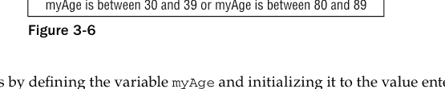

脚本块首先定义变量 `myAge`，并将其初始化为用户在提示框中输入并转换为数字的值。

```javascript
var myAge = Number(prompt("Enter your age", 30));
```

在此之后是四个 `if` 语句，每个都使用多个条件。你将依次详细研究每个语句。计算多个条件作用的最佳方法是将它们分解成更小的部分，然后评估组合结果。在此示例中，你输入了值 30，该值已存储在变量 `myAge` 中。你将把这个值代入条件以查看它们是如何工作的。

这是第一个 `if` 语句：

```javascript
if (myAge >= 0 && myAge <= 10)
{
    document.write("myAge is between 0 and 10<br />");
}
```

第一个 `if` 语句提出的问题是“`myAge` 是否在 0 到 10 之间？”。你将首先取条件的左侧（LHS），用你的特定值替换 `myAge`。左侧问“30 是否大于或等于 0？”答案是 `true`。右侧条件提出的问题是“30 是否小于或等于 10？”答案是 `false`。条件的这两部分使用 `&&` 连接，这表示与（AND）运算符。使用前面显示的与（AND）结果表，你可以看到如果左侧为 `true` 而右侧为 `false`，整体结果就是 `false`。因此 `if` 语句条件的最终结果是 `false`，花括号内的代码不会执行。

让我们继续看第二个 `if` 语句。

```javascript
if ( !(myAge >= 0 && myAge <= 10) )
{
    document.write("myAge is NOT between 0 and 10<br />");
}
```

第二个 `if` 语句提出的问题是“`myAge` 是否不在 0 到 10 之间？”它的条件与第一个 `if` 语句类似，但有一个小不同：你将条件括在括号内，并在前面加上了非（NOT）运算符（`!`）。

括号内的部分被评估，与之前一样，产生相同的结果——`false`。然而，非（NOT）运算符反转了结果，使其变为 `true`。因为 `if` 语句的条件为 `true`，这次花括号内的代码会执行，导致 `document.write()` 将响应写入页面。

第三个 `if` 语句呢？

```javascript
if ( myAge >= 80 || myAge <= 10 )
{
    document.write("myAge is either 80 and above OR 10 or below<br />");
}
```

第三个 `if` 语句提问：“`myAge` 是否大于等于 80，或小于等于 10？”首先处理左侧条件——“30 是否大于等于 80？”——答案为 `false`。右侧条件——“30 是否小于等于 10？”——答案同样为 `false`。这两个半部分条件通过 `||`（表示 OR 运算符）组合在一起。查看本节前面的 OR 结果表，你会发现 `false` OR `false` 的结果为 `false`。因此，`if` 语句的条件再次求值为 `false`，花括号内的代码不会执行。

最后一个 `if` 语句稍微复杂一些。

```javascript
if ( (myAge >= 30 && myAge <= 39) || (myAge >= 80 && myAge <= 89) )
{
    document.write("myAge is between 30 and 39 " +
                   "or myAge is between 80 and 89<br />");
}
```

它提出的问题是：“`myAge` 是在 30 到 39 之间，还是在 80 到 89 之间？”让我们将条件分解为组成部分。存在一个左侧条件和一个右侧条件，通过 OR 运算符组合。然而，左侧和右侧条件本身又各自包含一个左侧和右侧部分，它们通过 AND 运算符组合。注意括号的使用是为了告诉 JavaScript 先计算条件的哪一部分，就像在数学计算中处理数字一样。

首先看条件的左侧，即（`myAge >= 30 && myAge <= 39`）。通过将条件放入括号，你确保它被视为一个单一条件；无论括号内有多少条件，它只产生一个结果，要么是 `true`，要么是 `false`。分解括号内的条件：“30 是否大于等于 30？”结果为 `true`，以及“30 是否小于等于 39？”结果同样为 `true`。根据 AND 表，你知道 `true` AND `true` 的结果为 `true`。

现在看条件的右侧，即（`myAge >= 80 && myAge <= 89`）。同样分解条件，你会看到左侧提问：“30 是否大于等于 80？”结果为 `false`，右侧提问：“30 是否小于等于 89？”结果为 `true`。你知道 `false` AND `true` 的结果为 `false`。

现在你可以将 `if` 语句的条件视为（`true || false`）。查看 OR 结果表，你可以看到 `true` OR `false` 的结果为 `true`，因此 `if` 语句后面的花括号内的代码将会执行，并将一行内容写入页面。

然而，请记住 JavaScript 不会计算那些不影响最终结果的条件，而上述条件就属于这种情况。条件的左侧求值为 `true`。之后，右侧条件是 `true` 还是 `false` 并不重要，因为在 OR 操作中，只需要其中一个条件为 `true`，结果就是 `true`。因此 JavaScript 实际上并没有求值条件的右侧。我们这样做只是为了演示目的。

正如你所见，理解或创建多个条件最简单的方法是将它们分解为最小的逻辑块。你会发现，随着经验的积累，你会几乎不假思索地这样做，除非遇到特别棘手的条件需要评估。

虽然使用多个条件通常比使用多个 `if` 语句更好，但有时它会使你的代码更难阅读，从而更难理解和调试。你的 `if` 语句中可能包含 10、20 甚至超过 100 个条件，但你能想象尝试阅读一个有 10 个条件的 `if` 语句吗？如果你觉得你的多个条件变得太复杂，就把它们分解成更小的逻辑块。

例如，想象你想在 `myAge` 处于 30–39、80–89 或 100–115 范围时执行一些代码，并在每种情况下使用不同的代码。你可以这样编写语句：

```javascript
if ( (myAge >= 30 && myAge <= 39) || (myAge >= 80 && myAge <= 89) ||
     (myAge >= 100 && myAge <= 115) )
{
    document.write("myAge is between 30 and 39 " +
                   "or myAge is between 80 " +
                   "and 89 or myAge is between 100 and 115");
}
```

这没有错，但它开始变得有点长且难以阅读。相反，你可以为 100–115 范围的代码创建另一个 `if` 语句。

### `else` 和 `else if`

想象一种情况，你想在某个条件为真时执行一些代码，在条件为假时执行另一些代码。你可以通过两个 `if` 语句来实现这一点，如下面的示例所示：

```javascript
if (myAge >= 0 && myAge <= 10)
{
    document.write("myAge is between 0 and 10");
}

if ( !(myAge >= 0 && myAge <= 10) )
{
    document.write("myAge is NOT between 0 and 10");
}
```

第一个 `if` 语句测试 `myAge` 是否在 0 到 10 之间，第二个用于 `myAge` 不在 0 到 10 之间的情况。然而，JavaScript 提供了一种更简单的方法来实现这一点：使用 `else` 语句。同样，`else` 这个词的使用类似于其在英语中的用法。你可能会说：“如果下雨，我就带把伞；否则我就带顶太阳帽。”在 JavaScript 中，你可以说 `if` 条件为 `true`，则执行一个代码块；`else` 执行另一个备选代码块。使用这种技术重写前面的代码，你会得到以下内容：

```javascript
if (myAge >= 0 && myAge <= 10)
{
    document.write("myAge is between 0 and 10");
}
else
{
    document.write("myAge is NOT between 0 and 10");
}
```

这样编写代码更简单，因此更容易阅读。此外，它也免去了 JavaScript 测试一个你已知答案的条件的麻烦。

你也可以在 `else` 语句中包含另一个 `if` 语句。例如：

```javascript
if (myAge >= 0 && myAge <= 10)
{
    document.write("myAge is between 0 and 10");
}
else if ( (myAge >= 30 && myAge <= 39) || (myAge >= 80 && myAge <= 89) )
{
    document.write("myAge is between 30 and 39 " +
                   "or myAge is between 80 and 89");
}
else
{
    document.write("myAge is NOT between 0 and 10, " +
                   "nor is it between 30 and 39, nor is it between 80 and 89");
}
```

第一个 `if` 语句检查 `myAge` 是否在 0 到 10 之间，如果是，则执行一些代码。如果不是，一个 `else if` 语句检查 `myAge` 是否在 30 到 39 或 80 到 89 之间，如果任一条件为真，则执行一些其他代码。如果这些都不满足，你有一个最终的 `else` 语句，它捕获 `myAge` 的值在前面所有 `if` 条件中均未触发为真的情况。

当使用 `if` 和 `else if` 时，你需要格外注意花括号，以确保 `if` 和 `else if` 语句按预期开始和结束，并且你不会以一个不属于正确 `if` 的 `else` 结尾。用文字描述这相当棘手——通过一个例子更容易理解我们的意思。

```javascript
if (myAge >= 0 && myAge <= 10)
{
document.write("myAge is between 0 and 10");
if (myAge == 5)
{
document.write("You're 5 years old");
}
else
{
document.write("myAge is NOT between 0 and 10");
}
}
```

注意我们没有缩进代码。虽然这对 JavaScript 来说无关紧要，但这确实使得代码对人类来说更难阅读，并隐藏了应该在最后一个 `else` 语句之前缺少的花括号。

正确格式化并插入缺少的括号后，代码如下所示：

```javascript
if (myAge >= 0 && myAge <= 10)
{
    document.write("myAge is between 0 and 10<br />");
    if (myAge == 5)
    {
        document.write("You're 5 years old");
    }
}
else
{
    document.write("myAge is NOT between 0 and 10");
}
```

正如你所见，代码现在可以工作了；也更容易看出哪部分代码属于哪个 `if` 块。

### 比较字符串

到目前为止，你一直在专门研究将比较运算符与数字一起使用。然而，它们同样适用于字符串。所有关于数字的讨论和操作都适用于字符串，但有一个重要的区别。你现在是按字母顺序而不是数字顺序比较数据，因此有一些陷阱需要注意。

在下面的代码中，你将变量 `myName`（包含字符串 `"Paul"`）与字符串字面量 `"Paul"` 进行比较。


```javascript
var myName ="Paul";
if (myName == "Paul")
{
  alert("myName is Paul");
}
```

JavaScript 如何处理这个问题？嗯，它会逐个字母地检查左侧的每个字母，并与右侧相同位置的字母进行比较，以查看它们是否真的相同。如果在任何点发现差异，它就会停止，结果为`false`。如果在逐个字母检查到最后之后，确认它们都相同，它就返回`true`。上述`if`语句中的条件将返回`true`，因此你会看到一个`alert`框。

然而，JavaScript 中的字符串比较是区分大小写的。所以`"P"`与`"p"`不同。采用前面的例子，但将变量`myName`改为`"paul"`，你会发现条件为`false`，`if`语句内的代码不会执行。

```javascript
var myName ="paul";
if (myName == "Paul")
{
  alert("myName is Paul");
}
```

`>=`、`>`、`<=`和`<`运算符既适用于数字也适用于字符串，但同样是比较字母顺序。所以`"A" < "B"`为`true`，因为 A 在字母表中排在 B 之前。然而，JavaScript 的区分大小写特性再次起作用。`"A" < "B"`为`true`，但`"a" < "B"`为`false`。为什么？因为大写字母被视为总是排在小写字母之前。为什么是这样？每个字母在 ASCII 和 Unicode 字符集中都有一个代码数字，大写字母的代码数字比小写字母的代码数字低。在编写自己的代码时需要注意这一点。

避免大小写混淆最简单的方法是在比较之前将两个字符串都转换为大写或小写。你可以使用`toUpperCase()`或`toLowerCase()`函数轻松完成，这将在第 4 章中学习。

## switch 语句

你之前已经了解过如何使用`if`和`else if`语句来检查各种条件：如果第一个条件不满足，则检查下一个，再下一个，依此类推。然而，当你需要检查一个特定变量是否等于大量可能的值时，有一个更有效的替代方案，即`switch`语句。`switch`语句的结构如图 3-7 所示。

理解`switch`语句最好的方式是“切换到与`case`匹配的代码”。`switch`语句有四个重要组成部分：

- 测试表达式
- `case`语句
- `break`语句
- `default`语句

测试表达式位于`switch`关键字后面的括号中。在前面的例子中，你使用变量`myName`进行测试。不过，在括号里也可以是任何有效的表达式。

接下来是`case`语句。`case`语句用于执行条件检查。为了指明哪些`case`语句属于你的`switch`语句，你必须将它们放在测试表达式后面的花括号内。每个`case`语句指定一个值，例如`"Paul"`。然后`case`语句就像`if (myName == "Paul")`一样起作用。如果变量`myName`确实包含值`"Paul"`，执行将从`case "Paul"`语句下方的代码开始，并一直持续到`switch`语句的末尾。这个例子中只有两个`case`语句，但你可以根据需要添加任意多个。

在大多数情况下，你希望只有相关`case`语句正下方的代码块被执行，而不是相关`case`语句下方的所有代码（包括其他`case`语句）。

## 第 3 章：决策、循环与函数

为此，你需要在希望执行的代码末尾添加一个`break`语句。这会告诉 JavaScript 在此处停止执行并退出`switch`语句。

最后是`default`分支，顾名思义，当其他所有`case`语句都不匹配时，它将执行。`default`语句是可选的；如果你没有想要执行的默认代码，可以省略它，但请记住，在这种情况下，如果没有`case`语句匹配，则不会有任何代码执行。最好包含一个`default`分支，除非你完全确定已经涵盖了所有可能的情况。

**动手实践：使用 switch 语句**

让我们看看`switch`语句的实际应用。下面的例子展示了一个简单的猜数字游戏。请输入代码并将其保存为`ch3_examp3.htm`。

```html
<!DOCTYPE html PUBLIC "-//W3C//DTD XHTML 1.0 Transitional//EN"
"http://www.w3.org/TR/xhtml1/DTD/xhtml1-transitional.dtd">
<html xmlns="http://www.w3.org/1999/xhtml">
<body>

<script type="text/javascript">

var secretNumber = prompt("Pick a number between 1 and 5:", "");
secretNumber = parseInt(secretNumber);

switch (secretNumber)
{
case 1:
    document.write("Too low!");
    break;

case 2:
    document.write("Too low!");
    break;

case 3:
    document.write("You guessed the secret number!");
    break;

case 4:
    document.write("Too high!");
    break;

case 5:
    document.write("Too high!");
    break;

default:
    document.write("You did not enter a number between 1 and 5.");
    break;
}
```

68

## 第 3 章：决策、循环与函数

```javascript
document.write("<br />Execution continues here");
```

```html
</script>
```

```html
</body>
</html>
```

将此文件加载到浏览器中，并在提示框中输入，例如值 1。你应该会看到类似图 3-8 所示的内容。

图 3-8

另一方面，如果你输入值 3，你应该会看到一条友好的消息，告诉你猜中了秘密数字，如图 3-9 所示。

图 3-9

首先，你声明了变量`secretNumber`，并将其设置为用户通过提示框输入的值。注意，你使用了`parseInt()`函数将`prompt()`返回的字符串转换为整数值。

```javascript
var secretNumber = prompt("Pick a number between 1 and 5:", "");
secretNumber = parseInt(secretNumber);
```

接下来，你创建`switch`语句的开头。

```javascript
switch (secretNumber)
{
```

括号中的表达式就是变量`secretNumber`，`case`语句将与这个数字进行比较。

你使用花括号来指定包含`case`语句的代码块。每个`case`语句检查 1 到 5 之间的某个数字，因为这是你告诉用户应该输入的范围。第一个`case`语句简单地输出一条消息，表示输入的数字太低。

```javascript
case 1:
    document.write("Too low!");
    break;
```

第二个`case`语句，对应值 2，显示相同的消息，所以这里不重复代码。第三个`case`语句让用户知道猜对了。

```javascript
case 3:
    document.write("You guessed the secret number!");
    break;
```

## 第 3 章：决策、循环与函数

最后，第四个和第五个`case`语句输出一条消息，表示用户输入的数字太高。

```javascript
case 4:
    document.write("Too high!");
    break;
```

在这个例子中，你确实需要添加一个`default`分支，因为用户很可能（尽管有指示）输入一个不在 1 到 5 之间的数字，甚至可能输入一个字母。在这种情况下，你添加一条消息让用户知道出了问题。

```javascript
default:
    document.write("You did not enter a number between 1 and 5.");
    break;
```

`default`语句对于捕捉错误也非常有用——如果你错误地编写了某些`case`语句，当你看到`default`代码在不应该运行时运行了，你就会很快发现问题。

你最后添加了表示`switch`语句结束的闭合花括号。之后，你输出一行来表示执行继续的位置。

```javascript
}
document.write("<br />Execution continues here");
```

请注意，每个`case`语句都以`break`语句结尾。这一点很重要，它确保代码的执行会移动到`switch`语句结束后的那一行。如果你忘记包含这一点，最终可能会执行匹配的`case`之后每个`case`的代码。

## 为不同情况执行相同代码

你可能已经发现了这个例子中`switch`语句的一个问题——如果用户输入 1 或 2，你想执行相同的代码；对于 4 或 5 也是如此。然而，为了实现这一点，你不得不在每个`case`中重复代码。你想要的是一种更简单的方法，让 JavaScript 为不同的情况执行相同的代码。这很简单！只需将代码更改为如下所示：

```javascript
switch (secretNumber)
{
case 1:
case 2:
    document.write("Too low!");
    break;

case 3:
    document.write("You guessed the secret number!");
    break;

case 4:
case 5:
```

## 第 3 章：决策、循环与函数

```javascript
document.write("Too high!");
break;

default:
    document.write("You did not enter a number between 1 and 5.");
    break;
}
```

如果你将此加载到浏览器中并尝试输入不同的数字，你应该会看到它的行为与之前的代码完全相同。

这里，你利用了这样一个事实：如果某个`case`语句的代码下面没有`break`语句，执行将继续通过每个后续的`case`语句，直到遇到`break`语句或`switch`语句的末尾。可以把它想象成一种在`switch`语句中“自由落体”的过程，直到你撞上`break`语句。

如果值为 1 的`case`语句匹配，执行将一直持续到`case` 2 下的`break`语句，因此实际上你可以为两种情况执行相同的代码。同样的技术也用于值为 4 和 5 的`case`语句。

## 循环——for 和 while 语句

*循环*意味着当条件为`true`时重复一段代码。这在 JavaScript 中通过使用两个语句来实现：`while`语句和`for`语句。你很快就会看到这些，但为什么你想重复代码块呢？

好吧，以这种情况为例：你有一系列结果，比如一年中每个月的平均温度，并且你想将这些数据绘制在图表上。绘制每个点所需的代码很可能是相同的。因此，与其编写 12 次代码（每个点一次），不如通过使用序列中的下一项数据来执行相同的代码 12 次，这要容易得多。这就是`for`语句会派上用场的地方，因为你知道你希望代码执行多少次。

在另一种情况下，当某个条件为`true`时，你可能想重复执行同一段代码，例如，当用户不断点击“重新开始”按钮时。在这种情况下，`while`语句将非常有用。

## for 循环

`for`语句使你能够将一个代码块重复执行一定次数。其语法如图 3-10 所示。

让我们看看`for`语句的构成。从图 3-10 中你可以看到，就像`if`和`switch`语句一样，`for`语句的逻辑也在括号内。然而，这次该逻辑被分成三个部分，每个部分由分号分隔。例如，在图 3-10 中有以下内容：

```javascript
(var loopCounter = 1; loopCounter <= 3; loopCounter++)
```

## 第 3 章：判断、循环与函数

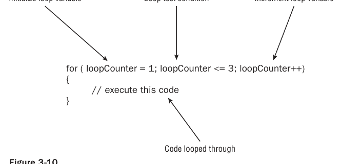

图 3-10

> `for`语句逻辑的第一部分是其初始化部分。为了跟踪你循环执行代码的次数，你需要一个变量来计数。你正是在初始化部分初始化变量。在本例中，你声明了`loopCounter`并将其值设为 1。与循环的其他部分不同，此部分在循环执行期间只运行一次。如果该变量在代码前面已经声明过，则无需再次声明。
>
> 分号之后是`for`语句的测试条件部分。只要此测试条件求值为`true`，`for`语句内的代码就会持续执行。每次代码循环执行后，都会检查此条件。如图 3-10 所示，只要`loopCounter`小于或等于 3，代码就会执行。循环执行的次数通常称为迭代次数。
>
> 最后是`for`循环的递增部分，其中我们循环测试条件中的变量值会在此处递增。你可以看到，`loopCounter`通过你第二章见到的`++`操作符递增了 1。同样，`for`语句的这一部分在代码的每次循环中都会重复执行。虽然我们称其为递增部分，但它实际上也可以用于递减或减少值——例如，如果你想从数组的最后一个元素倒数至第一个元素。
>
> `for`语句之后是只要测试条件为`true`就会被重复执行的代码块。这个代码块包含在花括号中。如果条件从不为`true`（即使在循环条件的首次检查时），则`for`循环内的代码将被跳过，永不执行。

```javascript
var loopCounter;
for (loopCounter = 1; loopCounter <= 3; loopCounter++)
```

将所有这些结合起来，`for`循环是如何工作的呢？

1. 执行`for`语句的初始化部分。
2. 检查测试条件。如果为`true`，继续执行；如果为`false`，则退出`for`语句。
3. 执行`for`语句之后代码块中的代码。
4. 执行`for`语句的递增部分。
5. 重复步骤 2 至 4，直到测试条件为`false`。

### 动手实践：转换一系列华氏温度值

让我们修改温度转换器，使其能够转换存储在数组中的一系列华氏温度值为摄氏温度。你将使用`for`语句遍历数组中的每个元素。输入代码并将其保存为`ch3_examp4.htm`。

```html
<!DOCTYPE html PUBLIC "-//W3C//DTD XHTML 1.0 Transitional//EN"
"http://www.w3.org/TR/xhtml1/DTD/xhtml1-transitional.dtd">
<html xmlns="http://www.w3.org/1999/xhtml">
<body>

<script type="text/javascript">

var degFahren = new Array(212, 32, -459.15);
var degCent = new Array();
var loopCounter;

for (loopCounter = 0; loopCounter <= 2; loopCounter++)
{
   degCent[loopCounter] = 5/9 * (degFahren[loopCounter] - 32);
}

for (loopCounter = 2; loopCounter >= 0; loopCounter--)
{
   document.write("Value " + loopCounter + " was " + degFahren[loopCounter] +
                  " degrees Fahrenheit");
   document.write(" which is " + degCent[loopCounter] +
                  " degrees centigrade<br />");
}

</script>

</body>
</html>
```

将此代码加载到浏览器后，你将在页面上看到三行内容，其中包含将我们的华氏温度数组转换为摄氏温度的结果（如图 3-11 所示）。


图 3-11

第一个任务是声明你将要使用的变量。首先，你声明并初始化`degFahren`以包含一个包含三个值的数组：212、32 和-459.15。接下来，声明`degCent`为空数组。最后声明`loopCounter`，它将用于跟踪在循环过程中访问的数组索引。

```javascript
var degFahren = new Array(212, 32, -459.15);
var degCent = new Array();
var loopCounter;
```

接下来是我们的第一个`for`循环。

```javascript
for (loopCounter = 0; loopCounter <= 2; loopCounter++)
{
    degCent[loopCounter] = 5/9 * (degFahren[loopCounter] - 32);
}
```

在第一行，你将`loopCounter`初始化为 0。然后检查`for`循环的测试条件`loopCounter <= 2`。如果此条件为`true`，循环将首次执行。花括号内的代码执行完毕后，`for`循环的递增部分`loopCounter++`将被执行，然后测试条件将被重新评估。如果它仍然是`true`，则循环代码将再次执行。此过程持续进行，直到`for`循环的测试条件求值为`false`，此时循环结束，将执行右花括号后的第一条语句。


花括号内的代码是你之前示例中见过的等式，只是这次你将其结果放入`degCent`数组，索引为`loopCounter`的值。

在第二个`for`循环中，你将`degCent`数组中的结果写入屏幕。

```
for (loopCounter = 2; loopCounter >= 0; loopCounter--)
{
    document.write("Value " + loopCounter + " was " + degFahren[loopCounter] +
                         " degrees Fahrenheit");
    document.write(" which is " + degCent[loopCounter] +
                         " degrees centigrade<br />");
}
```

这次你从2倒数到0。变量`loopCounter`初始化为2，循环条件在`loopCounter`小于0之前一直为`true`。这次`loopCounter`实际上是通过`loopCounter--`每次递减，而非递增。同样，`loopCounter`有两个作用：它跟踪循环执行的次数，同时也提供数组中的索引位置。

> 请注意，在这些示例中，你在循环中使用的是整数。然而，使用小数也是完全可以的，尽管这样做要少见得多。

### `for...in`循环

此循环主要用于数组，正如你将在下一章看到的，它也适用于一种叫做对象的东西。它使你能够遍历数组中的每个元素，而无需知道数组实际包含多少个元素。用简单的英语来说，这个循环的意思是“对于数组中的每个元素，执行一些代码。”`for...in`循环会为你完成计算每个元素索引号的工作，并在每次迭代中自动移动到下一个索引。

其用于数组的语法如下：

```
for (index in arrayName)
{
    //some code
}
```

在此代码片段中，`index`是你在循环前声明的变量，它将自动填充数组中的下一个索引值。`arrayName`是你想要遍历的数组变量的名称。

让我们看一个例子来让事情更清楚。你将定义一个数组并用三个值初始化它。

```
var myArray = new Array("Paul", "Paula", "Pauline");
```

要使用常规的`for`循环访问每个元素，你会这样写：

```
var loopCounter;
for (loopCounter = 0; loopCounter < 3; loopCounter++)
{
    document.write(myArray[loopCounter]);
}
```

使用`for...in`循环完成完全相同的事情，你会这样写：

```
var elementIndex;
for (elementIndex in myArray)
{
    document.write(myArray[elementIndex]);
}
```

如你所见，第二个示例中的代码更清晰一些，也更短。两种方法同样有效，都会迭代三次。然而，如果你增加数组的大小，例如添加元素`myArray[3] = "Philip"`，第一种方法仍然只遍历数组中的前三个元素，而第二种方法将遍历所有四个元素。

### `while`循环

`for`循环用于循环执行特定次数，而`while`循环则使你能够测试一个条件，并在该条件为`true`时持续循环。当你知道需要循环多少次时，`for`循环很有用，例如当你遍历一个已知包含特定数量元素的数组时。当你不知道需要循环多少次时，`while`循环就更有用了。例如，如果你正在遍历一个温度值数组，并且希望当数组元素包含的温度值小于100时继续循环，你就需要使用`while`语句。

让我们看看`while`语句的结构，如图3-12所示。

## 第三章：决策、循环与函数

你可以看到，`while`循环比`for`循环的组成部分更少。`while`循环包含一个条件，如果该条件求值为`true`，就会导致花括号内的代码块执行一次；然后条件会被重新求值。如果仍然为`true`，则代码再次执行，条件再次重新求值，如此循环，直到条件求值为`false`。

需要注意的一点是，如果条件一开始就是`false`，`while`循环就永远不会执行。例如：

```
degCent = 100;
while (degCent != 100) {
    // some code
}
```

这里，如果`degCent`不等于100，循环才会运行。然而，由于`degCent`是100，条件为`false`，代码永远不会执行。

在实践中，你通常期望循环至少执行一次；它是否再次执行将取决于循环内的代码对循环条件中涉及的变量做了什么。例如：

```
degCent = new Array();
degFahrenheit = new Array(34, 123, 212);
var loopCounter = 0;
while (loopCounter < 3) {
    degCent[loopCounter] = 5/9 * (degFahrenheit[loopCounter] - 32);
    loopCounter++;
}
```

只要`loopCounter`小于3，循环就会执行。是循环内的代码（`loopCounter++`）递增了`loopCounter`，最终会使`loopCounter < 3`变为`false`，从而停止循环。然后执行将继续到`while`语句结束花括号后的第一行。

76

需要注意的是*无限循环*——一个永远不会结束的循环。假设你忘记了在代码中包含`loopCounter++;`这一行。省略这一行将意味着`loopCounter`将保持为0，因此条件`(loopCounter < 3)`将始终为`true`，循环将持续运行，直到用户感到无聊和恼火，并关闭她的浏览器。然而，这是一个很容易犯的错误，而 JavaScript 不会对此发出警告。

不仅仅是缺少代码行会导致无限循环，循环代码内的错误也会。例如：

```
var testVariable = 0;
while (testVariable <= 10)
{
    alert("Test Variable is " + testVariable);
    testVariable++;
    if (testVariable = 10)
    {
        alert("The last loop");
    }
}
```

看看你是否能发现导致无限循环的故意错误——是的，就是那个`if`语句会导致这段代码永远运行下去。在`if`语句的条件中，你使用了`=`而不是作为比较运算符的`==`，因此在每次循环中`testVariable`都被重新设置为10，尽管有`testVariable++`这一行。这意味着在每次循环开始时，测试条件总是求值为`true`，因为10小于或等于10。将多余的`=`改为`if (testVariable == 10)`，一切就正常了。

### `do...while`循环

在`while`循环中，你看到只有当条件为`true`时，循环内的代码才会执行；如果为`false`，代码永远不会执行，执行将移动到`while`循环后的第一行。然而，有时你可能希望`while`循环中的代码至少执行一次，无论`while`语句中的条件求值为`true`还是`false`。甚至可能需要在测试`while`语句的条件之前，先执行`while`循环内的一些代码。`do...while`循环正是适用于这种情况。

看一个例子，你想通过提示框获取用户的年龄。你想显示提示框，但也要确保用户输入的是一个数字。

```
var userAge;
do
{
    userAge = prompt("Please enter your age","")
}
while (isNaN(userAge) == true);
```

循环内的代码行：

```
userAge = prompt("Please enter your age","")
```

无论`while`语句的条件如何，都会执行。这是因为条件直到循环执行一次后才被检查。如果条件为`true`，代码将再次循环执行。如果为`false`，循环停止。

请注意，在`while`语句的条件中，你使用了第二章中看到的`isNaN()`函数。它检查`userAge`变量的值是否是`NaN`（非数字）。如果不是数字，条件返回`true`值；否则返回`false`。正如你从示例中看到的，它使你能够测试用户输入，以确保输入了正确的数据。用户可能谎报年龄，但至少你知道他输入了一个数字！

`do...while`循环相当少见；没有它你几乎做不了什么，所以除非真的必要，最好避免使用它。

### `break`和`continue`语句

你之前在研究`switch`语句时已经遇到了`break`语句。它在`switch`语句中的功能是停止代码执行，并将执行移动到`switch`语句结束花括号后的下一行代码。然而，当你想要提前退出循环时，`break`语句也可以用作`for`和`while`循环的一部分。例如，假设你正在循环遍历一个数组，就像你在温度转换示例中所做的那样，并且遇到了一个无效值。在这种情况下，你可能想要立即停止代码，通知用户数据无效，并退出循环。这就是`break`语句派上用场的情况。

让我们看看如何修改转换一系列华氏值的例子（`ch3_examp4.htm`），使得如果遇到一个不是数字的值，你就停止循环并告知用户数据无效。

```
<script language="JavaScript" type="text/javascript">
var degFahren = new Array(212, "string data", -459.67);
var degCen = new Array();
var loopCounter;

for (loopCounter = 0; loopCounter <= 2; loopCounter++)
{
    if (isNaN(degFahren[loopCounter]))
    {
        alert("Data " + degFahren[loopCounter] + " at array index " +
              loopCounter + " is invalid");
        break;
    }
    degCen[loopCounter] = 5/9 * (degFahren[loopCounter] - 32);
}
```

你已经修改了`degFahren`数组的初始化，使其现在包含一些无效数据。然后，在`for`循环内，添加了一个`if`语句来检查`degFahren`数组中的数据是否不是数字。这是通过`isNaN()`函数完成的；如果传递给括号内的值（这里是`degFahren[loopCounter]`）不是数字，它就返回`true`。如果该值不是数字，你就告诉用户数组中哪里有无效数据。然后你使用`break`语句完全跳出`for`循环，代码执行继续到`for`语句结束后的第一行。

以上是`break`语句，那么`continue`呢？`continue`语句与`break`类似，它在找到的位置停止循环的执行，但它不是退出循环，而是开始执行下一次迭代，重新从`for`或`while`语句的条件开始，就像已经到达循环代码的最后一行一样。

在`break`例子中，是全有或全无——即使只有一条数据无效，你也会退出循环。如果尝试转换`degFahren`中的所有值，但如果在数组中遇到无效数据项，你通知用户并继续处理下一个项目，而不是像我们的`break`语句示例那样放弃，可能会更好。

```
if (isNaN(degFahren[loopCounter]))
{
    alert("Data '" + degFahren[loopCounter] + "' at array index " +
          loopCounter + " is invalid");
    continue;
}
```

只需将`break`语句改为`continue`。你仍然会收到关于无效数据的消息，但第三个值也会被转换。

### 函数

函数是执行特定任务的东西。以袖珍计算器为例。它执行许多基本计算，如加法和减法。然而，许多计算器还有功能键，可以执行更复杂的操作。例如，有些计算器有一个按钮可以计算一个数的平方根，而有些甚至提供统计函数，如计算平均值。这些功能大多数都可以通过基本的数学运算加、减、乘、除来完成，但那可能需要很多步骤——如果用户只需要按一个按钮，对她来说就简单得多。她需要做的只是提供数据——在这种情况下是数字——而功能键会完成剩下的工作。

JavaScript中的函数的工作方式有点像袖珍计算器上的功能键：它们封装了一块执行特定任务的代码。在本书到目前为止的过程中，你已经遇到了许多方便的内置函数，它们执行特定的任务，例如`parseInt()`和`parseFloat()`函数，它们将字符串转换为数字，以及`isNaN()`函数，它告诉你某个特定值是否可以转换为数字。其中一些函数返回数据，例如`parseInt()`，它返回一个整数；其他函数只是执行操作但不返回数据。你还会注意到，有些函数可以传递数据，而有些则不能。例如，`isNaN()`函数需要传递一些数据，它会检查该数据是否是`NaN`。函数需要传递的数据被称为其`参数`。

随着你继续阅读本书，你会遇到更多有用的内置函数，但能够编写自己的函数不是很好吗？在你设计、编写并调试了一块执行特定任务的代码后，如果能在需要时一次又一次地调用它，那就太好了。JavaScript使我们能够做到这一点，而这正是你在本节中要集中学习的内容。

### 创建自己的函数

创建和使用自己的函数非常简单。图3-13展示了一个函数示例。

## 第三章：决策、循环与函数

你可能已经明白了这个函数的作用以及代码如何工作。是的，这又是那个臭名昭著的华氏度转摄氏度的转换代码。

在JavaScript中，你为每个页面定义的每个函数都必须有一个唯一的名称。该名称紧跟在`function`关键字之后。为了让自己的工作更轻松，尝试使用有意义的名称，这样当你在代码的其他地方看到它被使用时，就能确切地知道它的功能。例如，一个接受某人生日和今天日期作为参数并返回该人年龄的函数，可以命名为`getAge()`。然而，你可以使用的名称是有限制的，就像变量名一样。例如，你不能使用JavaScript保留的词汇，因此不能将你的函数命名为`with()`或`while()`。

函数的参数在函数名后的括号中给出。参数只是函数为了完成其工作而需要被给定的一项数据。通常，不传递所需的参数会导致错误。一个函数可以有零个或多个参数，即使它没有参数，你也必须在函数名后加上开括号和闭括号。例如，你的函数定义的开头必须如下所示：

```
function myNoParamFunction()
```

然后你编写代码，当函数被调用时就会执行这些代码。所有的函数代码都必须放在一对花括号组成的块中。

函数还使你能够从函数向调用它的代码返回一个值。你使用`return`语句来返回一个值。在前面给出的示例函数中，你返回了刚刚计算出的变量`degCent`的值。如果你不想返回值，可以不返回，但你总是应该在函数末尾包含一个`return`语句，尽管JavaScript是一门非常宽容的语言，即使你完全不使用`return`语句也不会有问题。

当JavaScript在函数中遇到`return`语句时，它处理方式有点像`for`循环中的`break`语句——它退出函数，并返回`return`关键字后指定的任何值。

你可能会发现，在JavaScript代码中建立一个常用函数的“库”很有用，这样当你需要时，就可以随时将它们剪切粘贴到你的页面中。

创建了函数之后，你如何使用它们呢？与你迄今为止看到的代码（当JavaScript执行到该行时就执行）不同，函数只有在你要求它们执行时才会执行，这被称为调用或激发函数。你通过在想要调用的地方写出函数名并确保传递它需要的所有参数（用逗号分隔）来调用函数。例如：

```
myTemp = convertToCentigrade(212);
```

这一行调用了你之前看到的`convertToCentigrade()`函数，传递212作为参数，并将函数的返回值（即100）存储在`myTemp`变量中。

现在尝试创建你自己的函数，仔细看看参数是如何传递的。参数传递可能会有点令人困惑，所以你首先要创建一个简单的函数，它只接受一个参数（用户名），并将其以友好的欢迎字符串写入页面。首先，你需要为你的函数想一个名字。一个简短但有描述性的名字是`writeUserWelcome()`。现在你需要定义函数期望传递哪些参数。只有一个参数——用户名。定义参数有点像定义变量——你需要遵守相同的命名规则，这意味着不能有空格、特殊字符或保留字。让我们将你的参数命名为`userName`。你需要将它添加到函数名末尾的括号内（注意，你不要在行末加分号）。

```
function writeUserWelcome(userName)
```

好的，现在你已经定义了函数名及其参数；剩下的就是创建函数体——即当函数被调用时要执行的代码。你通过将其包裹在花括号中来标记这部分函数。

```
function writeUserWelcome(userName)
{
    document.write("Welcome to my website " + userName + "<br />");
    document.write("Hope you enjoy it!");
}
```

代码很简单；你使用`document.write()`向网页写入一条消息。你可以看到`userName`的使用方式与任何普通变量一样；事实上，最好将参数视为普通变量。参数的值将是调用该函数的JavaScript代码中指定的值。

让我们看看你将如何调用这个函数。

```
writeUserWelcome("Paul");
```


很简单，真的——只需写下你想调用的函数名，然后在括号内添加要传递给每个参数的数据，这里只有一个数据。当函数中的代码执行时，函数代码主体中使用的变量`userName`将包含文本"Paul"。

假设你想传递两个参数给你的函数——你需要改变什么？嗯，首先你必须修改函数定义。想象第二个参数将包含用户的年龄——你可以称它为`userAge`，因为这样就清楚地表明了参数的数据代表什么。这是新的代码：

```javascript
function writeUserWelcome(userName, userAge)
{
    document.write("Welcome to my website" + userName + "<br />");
    document.write("Hope you enjoy it<br />");
    document.write("Your age is " + userAge);
}
```

你向函数体添加了一行代码，使用了你添加的参数。要调用该函数，你将编写以下代码：

```javascript
writeUserWelcome("Paul", 31);
```

第二个参数是一个数字，所以不需要加引号。这里`userName`参数将是 Paul，第二个参数`userAge`将是 31。

### 试试看：华氏度转摄氏度函数

让我们使用函数重写温度转换器页面。你可以从`ch3_examp4.htm`中剪切粘贴大部分代码——已更改的部分已突出显示。完成后，将其保存为`ch3_examp5.htm`。

```html
<html>
<body>

<script language="JavaScript" type="text/javascript">

function convertToCentigrade(degFahren)
{
    var degCent;
    degCent = 5/9 * (degFahren - 32);

    return degCent;
}

var degFahren = new Array(212, 32, -459.15);
var degCent = new Array();
var loopCounter;

for (loopCounter = 0; loopCounter <= 2; loopCounter++)
{
    degCent[loopCounter] = convertToCentigrade(degFahren[loopCounter]);
}

for (loopCounter = 2; loopCounter >= 0; loopCounter--)
{
    document.write("Value " + loopCounter + " was " + degFahren[loopCounter] +
                   " degrees Fahrenheit");
    document.write(" which is " + degCent[loopCounter] +
                   " degrees centigrade<br />");
}
</script>

</body>
</html>
```

当你在浏览器中加载此页面时，你应该会看到与`ch3_examp4.htm`完全相同的结果。

在脚本块的顶部，你声明了你的`convertToCentigrade()`函数。你之前已经见过这个函数：

```javascript
function convertToCentigrade(degFahren)
{
    var degCent;
    degCent = 5/9 * (degFahren - 32);

    return degCent;
}
```

如果你在一个页面中使用多个独立的`script`块，确保函数在任何脚本调用它之前被定义是非常重要的。如果你有多个函数，你可能想把它们都放在页面顶部自己的脚本块中——放在`<head>`和`</head>`标签之间是个好主意。这样你就知道在哪里可以找到所有的函数，并且可以确保它们在被使用之前已经被声明。

你应该对函数中代码的工作原理相当熟悉。你声明一个变量`degCent`，进行计算，将结果存储在`degCent`中，然后将`degCent`返回给调用代码。函数的参数是`degFahren`，它提供了计算所需的信息。

函数声明之后是页面加载时执行的代码。首先你定义你需要的变量，然后是两个循环，用于计算并输出结果。这与之前基本相同，除了第一个`for`循环。

```javascript
for (loopCounter = 0; loopCounter <= 2; loopCounter++)
{
    degCent[loopCounter] = convertToCentigrade(degFahren[loopCounter]);
}
```

第一个`for`循环内的代码将函数`convertToCentigrade()`返回的值放入`degCent`数组。

这个示例代码中有一个微妙之处。请注意，你在函数`convertToCentigrade()`内部声明了变量`degCent`，同时在函数定义之后又将其声明为一个数组。

这肯定是不允许的吧？

嗯，这自然引出了本章的下一个主题——变量作用域。

## 变量作用域与生命周期

作用域是什么意思？嗯，简单来说，它是指变量可用的范围或程度——你的代码的哪些部分可以访问一个变量及其包含的数据。在网页中函数外部声明的任何变量，无论该脚本是在函数内部还是在其他地方，都将对页面上的所有脚本可用——我们称之为*全局*或*页面级作用域*。然而，在函数内部声明的变量……

## 第三章：决策、循环与函数

函数内部声明的变量**仅**在该函数内可见——函数外部的任何代码都无法访问它们。因此，例如，你可以为页面中的每个函数声明一个名为`degCent`的变量，并在页面上的任何函数外部再声明一次。但是，你不能在任何一个函数内部声明该变量超过一次，也不能在页面上的函数外部声明该变量超过一次。请注意，虽然以这种方式在整个页面中重用变量名并非非法，但这并非标准的良好实践——它会使代码阅读起来非常令人困惑。

函数参数与变量类似：它们在函数外部不可见，虽然你可以在函数中声明一个与其参数同名的变量，但这会造成很多混淆，并且很容易导致细微的 bug 被忽略。因此，这是一种糟糕的编程实践，最好避免，哪怕仅仅是为了你在调试时保持头脑清醒！

那么，当函数内部的代码结束，执行返回到调用代码的点时会发生什么？当你下次调用函数时，函数内定义的变量是否保留其值？

答案是否定的：变量不仅具有作用域属性——即它们可见的位置——而且还具有*生命周期*。当函数执行完毕后，该函数中的变量就会消亡，其值也会丢失，除非你将其中一个变量返回给调用代码。JavaScript 会定期执行垃圾回收（我们在第 2 章讨论过），它会扫描代码，查看是否有任何变量不再使用；如果有，它会释放这些变量所持有的数据，以便为其他变量的数据腾出空间。

既然全局变量可以在任何地方使用，为什么不把它们都设为全局变量呢？当你需要在全局范围内跟踪数据时，全局变量非常有用。然而，由于它们可以在代码中的任何地方被修改，这确实意味着，如果由于 bug 导致它们被错误地更改，那么这个 bug 可能出现在代码中的任何地方，从而使调试变得困难。因此，最好将全局变量的使用保持在最低限度，尽管有时它们是必要的“恶”——例如，当你需要在不同函数之间共享数据时。

## 总结

在本章中，你完成了对 JavaScript 语言核心及其语法的探讨。从现在开始的一切都建立在这些基础之上，既然你已经掌握了那些相对不那么有趣的语法，你就可以在本书的剩余部分继续探索更有趣的内容。

本章探讨了以下内容：

1. **使用`if`和`switch`语句进行决策。** 做决策的能力本质上赋予了代码“智能”。根据条件是`true`还是`false`，你可以决定采取何种行动。

2. **比较运算符。** 比较运算符将运算符左侧的值（左侧操作数，LHS）与运算符右侧的值（右侧操作数，RHS）进行比较，并返回一个布尔值。以下是主要比较运算符的列表：

   - `==`：LHS 是否等于 RHS？
   - `!=`：LHS 是否不等于 RHS？
   - `<=`：LHS 是否小于或等于 RHS？
   - `>=`：LHS 是否大于或等于 RHS？
   - `<`：LHS 是否小于 RHS？
   - `>`：LHS 是否大于 RHS？

**`if`语句。** 使用`if`语句，当条件为`true`时，你可以选择执行一段代码（由花括号定义）。`if`语句有一个测试条件，在括号中指定。如果此条件的计算结果为`true`，则`if`语句之后的代码将执行。

**`else`语句。** 如果你希望当`if`语句为`false`时执行代码，可以使用出现在`if`语句之后的`else`语句。

**逻辑运算符。** 要组合条件，可以使用三种逻辑运算符：AND、OR 和 NOT，分别由`&&`、`||`和`!`表示。

- AND 运算符仅当表达式两侧都为`true`时返回`true`。
- OR 运算符当表达式的一侧或两侧为`true`时返回`true`。
- NOT 运算符反转表达式的逻辑。

**`switch`语句。** 它将表达式的结果与一系列可能的情况进行比较，其效果类似于多重`if`语句。

**使用`for`、`for...in`、`while`和`do...while`进行循环。** 通常需要将一段代码重复执行多次，JavaScript 通过循环实现了这一点。

- **`for`循环。** `for`循环对于将代码循环执行特定次数非常有用，它由三个部分组成：初始化、测试条件和增量部分。只要测试条件为`true`，循环就会继续。每次循环执行代码块，然后执行`for`循环的增量部分，之后重新评估测试条件以查看递增是否改变了结果。
- **`for...in`循环。** 当你在不知道数组元素数量的情况下想遍历数组时，这很有用。JavaScript 会为你处理这个，这样就不会遗漏任何元素。
- **`while`循环。** 当测试条件保持为`true`时，它对于循环执行某些代码很有用。它由一个测试条件和一个代码块组成，只有在条件为`true`时才会执行该代码块。如果条件永远不为`true`，则代码永远不会执行。
- **`do...while`循环。** 这类似于`while`循环，不同之处在于它先执行一次代码，然后只要测试条件保持为`true`，就继续执行代码。
- **`break`和`continue`语句。** 有时你有充分的理由提前跳出循环，这种情况下你需要使用`break`语句。遇到`break`语句时，由花括号标出的代码块内的代码执行停止，并立即在右花括号之后开始执行。`continue`语句与`break`类似，不同之处在于，当代码在循环中的该点停止执行时，循环不会被中断，而是继续执行，就像已经到达该次迭代的末尾一样。

**函数是可重用的代码片段。** JavaScript 有许多内置函数，为程序员提供服务，例如将字符串转换为数字。但是，JavaScript 也允许你使用`function`关键字定义和使用自己的函数。函数可以接受零个或多个参数，并且如果你愿意，可以返回一个值。

**变量作用域和生命周期。** 在函数外部声明的变量是全局可用的——即页面中的任何位置。在函数内部定义的任何变量都是该函数的私有变量，无法在函数外部访问。变量具有生命周期，其长度取决于声明的位置。如果是全局变量，其生命周期就是页面的生命周期——只要页面在浏览器中加载，该变量就保持存活。对于在函数中定义的变量，其生命周期仅限于该函数的执行。当函数执行完毕后，变量就会消亡，其值也会丢失。如果函数在代码中再次被调用，这些变量将是空的。

## 练习题

这些问题的建议解决方案可以在附录 A 中找到。

1. 一位初级程序员带着一些似乎无法工作的代码来找你。你能看出他错在哪里吗？帮他纠正错误。

   ```javascript
   var userAge = prompt("Please enter your age");

   if (userAge = 0);
   {
       alert("So you're a baby!");
   }
   else if (userAge < 0 | userAge > 200)
       alert("I think you may be lying about your age");
   else
   {
       alert("That's a good age");
   }
   ```

2. 使用`document.write()`，编写显示 12 乘法表结果的代码。其输出应该是计算结果。

   ```text
   12 * 1 = 12
   12 * 2 = 24
   12 * 3 = 36
   ...
   12 * 11 = 132
   12 * 12 = 144
   ```

3. 修改问题 2 的代码，使其成为一个函数，该函数接受三个参数：所需的乘法表、起始值和结束值。例如，你可以尝试显示从 4 * 4 开始到 4 * 9 结束的四乘法表。

4. 修改问题 3 的代码，使其向用户请求要显示的乘法表；代码应继续请求并显示乘法表，直到用户输入 -1。此外，进行检查以确保用户输入的是有效数字；如果数字无效，请要求用户重新输入。

## 第 4 章：常见错误、调试与错误处理

即使是 JavaScript 大师也会犯错，哪怕只是令人恼火的拼写错误。特别是当代码扩展到数百行时，出错的可能性会大大增加。相应地，发现这些错误（或缺陷）的难度也会随之增加。本章你将了解各种技术，以最小化由此情况引发的问题。

首先，你将了解最常见的七种 JavaScript 编码错误。了解它们之后，你就能在编写代码时留意，希望能减少犯这些错误的频率！

接着，你将学习当错误确实发生时如何应对，从而防止用户看到你的编码错误。

最后，你将了解 Microsoft Internet Explorer (IE8)、Firefox 的附加组件 Firebug、Safari 和 Chrome 的 Web Inspector 以及 Opera 的 Dragonfly 中的调试工具。你将看到如何使用这些工具逐步执行代码，并在代码运行时检查变量内容，这一过程能帮助我们追踪难以发现的缺陷。你还将简要了解 Firefox 可用的调试工具。

### 噢！真不敢相信我刚才那样做了：一些常见错误

程序员常犯七种错误。其中一些你会随着经验增长而学会避免，但另一些可能会永远困扰你！

> 本章中，如果你的浏览器已设置为显示错误，你会发现非常有用。你在第 2 章“设置浏览器以显示错误”一节中已经完成了此设置。所以，如果你尚未设置错误显示，现在正是好时机。

### 未定义变量

JavaScript 在定义变量前赋值方面实际上非常宽容。例如，以下代码将隐式创建一个新的全局变量`abc`并为其赋值 23：

```javascript
abc = 23;
```

尽管严格来说，你应该使用`var`关键字显式定义变量，如下所示：

```javascript
var abc = 23;
```

是否使用`var`关键字声明变量会影响变量的作用域；因此最好始终使用`var`关键字。如果一个变量在定义前被使用，就会产生错误。例如，如果变量`abc`之前未被定义（显式或隐式），以下代码在 IE8 中将导致如图 4-1 所示的错误：

```javascript
alert(abc);
```

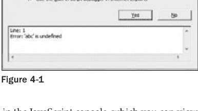

在 Firefox 中，你需要查看 JavaScript 控制台，可以通过选择“工具”➞“错误控制台”来查看。

此外，你必须记住，函数定义也有参数，如果参数声明不正确，也可能导致同类错误。

看以下代码：

```javascript
function foo(parametrOne)
{
    alert(parameterOne);
}
```

如果你调用此函数，你会得到一个类似于图 4-2 所示的错误消息。

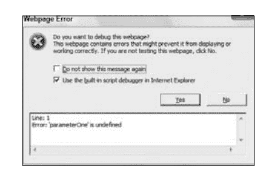

这里的错误实际上是函数定义中的一个简单拼写错误。第一个参数有拼写错误：应该是`parameterOne`，而不是`parametrOne`。这类错误可能令人困惑的地方在于，虽然浏览器告诉我们错误在一行，但错误的根源却在另一行。

### 大小写敏感

这是错误的一个主要来源，尤其因为它有时难以察觉。

例如，找出以下代码中的三个大小写错误：

```javascript
var myName = "Jeremy";
If (myName == "jeremy")
    alert(myName.toUpperCase());
```

第一个错误是`if`关键字；上面的代码用了`If`而不是`if`。然而，JavaScript 不会告诉我们错误是大小写使用错误，而是 IE 会提示`Object expected`，Firefox 会提示`If is not defined`。虽然错误消息能让我们大致了解出了什么问题，但它们常常以间接的方式表达。在这种情况下，IE 认为你试图使用一个名为`If`的对象，而 Firefox 认为你试图使用一个名为`If`的未定义函数。

好的，解决了这个错误，你遇到了下一个错误，这不是 JavaScript 语法错误，而是一个逻辑错误。记住在 JavaScript 中`Jeremy`不等于`jeremy`，所以`myName == "jeremy"`是`false`，即使你很可能并不在意这个词是`Jeremy`还是`jeremy`。这类错误不会产生任何错误消息，只是代码不会按你预期的方式执行。


第三个错误涉及`myName`中包含的`String`对象的`toUpperCase()`方法。前面的代码使用了`toUppercase`，其中的`c`是小写。IE 会给出消息`Object doesn't support this property or method`，而 Firefox 会报告`myName.toUppercase is not a function`。乍看之下，很容易忽略这样微小的错误，然后开始查阅你的 JavaScript 参考手册寻找该方法。你可能会疑惑为什么它存在，但你的代码就是不工作。同样，你需要始终注意大小写问题，即使是专家也时不时会出错。

### 不正确的大括号数量

在以下代码中，你定义了一个函数然后调用它。然而，这里有一个故意的错误。看看你能否找出它在哪里。

```javascript
function myFunction()
{
x = 1;
y = 2;
if (x <= y)
{
if (x == y)
{
alert("x equals y");
}
}
myFunction();
```

这就是为什么格式化你的代码很重要——你会更容易发现这样的错误：

```javascript
function myFunction()
{
    x = 1;
    y = 2;
    if (x <= y)
    {
        if (x == y)
        {
            alert("x equals y");
        }
    }
    myFunction();
```

现在你可以看到函数的结束花括号缺失了。当有很多`if`、`for`或`do while`语句时，很容易出现过多或过少的结束花括号。使用格式化代码更容易发现这类问题。

### 不正确的圆括号数量

看以下代码：

```javascript
if (myVariable + 12) / myOtherVariable < myString.length)
```

发现错误了吗？问题在于条件开头缺少了一个圆括号。你希望`myVariable + 12`在除以`myOtherVariable`之前计算，所以你很清楚需要将其放在圆括号中。

```javascript
(myVariable + 12) / myOtherVariable
```

然而，`if`语句的条件本身也必须放在圆括号中。不仅开头的圆括号缺失，而且结束圆括号比开始圆括号多一个。像花括号一样，每个开始圆括号都必须有对应的结束圆括号。以下代码是正确的：

```javascript
if ((myVariable + 12) / myOtherVariable < myString.length)
```

当有很多开始和结束圆括号时，很容易漏掉一个或多出一个。

### 使用等号（=）而非等于（==）

考虑以下代码：

```javascript
var myNumber = 99;
if (myNumber = 101)
{
    alert("myNumber is 101");
}
else
{
    alert("myNumber is " + myNumber);
}
```

乍看之下，你可能期望`if`语句`else`部分的`alert()`方法会执行，告诉我们`myNumber`中的数字是 99，但它不会。这段代码犯了一个经典错误，使用了赋值运算符（=）而不是相等运算符（==）。因此，这段代码不是将`myNumber`与 101 进行比较，而是将`myNumber`设置为等于 101。如果你使用 Visual Basic 或类似只用一个等号进行比较和赋值的语言编程，你会发现这种错误时不时就会出现。它太容易犯了。

更棘手的是，它不会产生错误消息；只是你的数据和逻辑会受损。在`if`语句中给变量赋值可能是不寻常的，但它是完全合法的，所以 JavaScript 不会报错。当嵌入大段代码中时，这样的错误很容易被忽视。只需记住，下次当你的程序逻辑显得很疯狂时，值得检查一下这个错误。

### 将方法当属性使用，反之亦然

另一个常见错误是，要么在调用无参数方法时忘记在方法名后加括号，要么在使用属性时却加了括号。

调用方法时，方法名后必须始终有括号；否则，JavaScript 会认为它一定是指向该方法或属性的指针。例如，看以下代码：

```javascript
var nowDate = new Date();
alert(nowDate.getMonth);
```

第一行创建了`Date`引用类型的一个实例。第二行试图调用新创建的`Date`对象的`getMonth()`方法，只是少了括号。以下是修正后的代码：

```javascript
var nowDate = new Date();
alert(nowDate.getMonth());
```

# 第四章：常见错误、调试与错误处理

正如方法后面应该始终带有括号一样，属性后面永远不应有括号；否则，JavaScript 会认为你正试图使用该对象的一个方法：

```javascript
var myString = "Hello, World!";
alert(myString.length());
```

第二行代码在`length`属性后添加了括号，使得 JavaScript 认为它是一个方法。这段代码本应该写成如下形式：

```javascript
var myString = new String("Hello");
alert(myString.length);
```

更复杂的是，函数作为参数传递给另一个函数（或者如你将在第六章处理事件时看到的，属性作为参数传递）的情况很常见。在这些情况下，你传递函数时，函数名后面不带开闭括号`()`。请看以下代码：

```javascript
function foo()
{
    alert("I'm in foo()!");
}

function bar(fpToCall)
{
    alert("Calling passed function");
    fpToCall();
}

bar(foo);
```

这段代码定义了两个函数：`foo()`和`bar()`。`foo()`函数只是显示一个消息框，告知用户`foo()`函数正在执行。第二个函数`bar()`接受一个参数，该参数是一个函数。它显示一条消息，说明正在调用传递进来的函数，然后执行该函数。最后一行调用了`bar()`函数，并传递了`foo()`函数的指针。指针是内存中某个位置的引用（我们将在下一章讨论内存引用）。

经验法则是：当你想要执行一个函数时，在函数名末尾使用括号；而当将函数传递给另一个函数或属性时，则省略括号。

## 拼接时缺少加号

在下面的代码中，有一个刻意制造的拼接错误：

```javascript
var myName = "Jeremy";
var myString = "Hello";
var myOtherString = "World";
myString = myName + " said " + myString + " " + myOtherString;
alert(myString);
```

在代码的第四行，`" "`和`myOtherString`之间应该有一个`+`运算符。虽然在只有几行的代码中这很容易发现，但在大段代码中这类错误可能更难发现。此外，这类错误导致的错误信息可能具有误导性。将这段代码加载到浏览器中，IE 会提示`Error : Expected`，而 Firefox 则会提示`Missing ; before statement`。令人惊讶的是，这类错误经常出现。

以上最常见的错误是由程序员造成的。还有其他类型的错误，称为*运行时错误*，它们发生在你的代码在浏览器中执行时，不一定是拼写错误、缺少花括号、括号或其他前面讨论的陷阱造成的。这类错误仍然可以提前规划处理，正如你将在下一节看到的。

## 错误处理

编写程序时，你希望被告知每一个错误。然而，当你最终将代码部署到 Web 服务器供全世界访问时，你最不希望用户看到的就是错误消息。当然，编写无错误的代码是一个好的开始，但请记住以下几点：

- 有时会出现超出你控制范围的情况导致错误。一个很好的例子是，你依赖于某个东西，比如一个 Java 小程序，而用户的计算机上没有这个东西，并且你无法检查其是否存在。
- 墨菲定律指出，任何可能出错的事情都将会出错！

## 防止错误

处理错误的最好方法是从一开始就阻止它们发生。这似乎是老生常谈，但如果你想让页面没有错误，有许多事情你应该做。

- 在尽可能多的浏览器中彻底检查页面。这在某些操作系统上说起来容易做起来难。另一种选择是你决定你的网页想要支持哪些浏览器，然后验证你的代码在这些浏览器中是否有效。使用本书前面介绍的浏览器检查代码，将不支持的用户引导到一个良好、安全且可能功能较少的网页，或者只是向他们提供一条消息，告知其浏览器和/或平台不受支持。
- 验证你的数据。如果用户可以输入会导致你的程序失败的无效数据，那么他们就会这样做。如果你的代码在文本框为空时会失败，那么请确保文本框中输入了数据。如果你需要一个整数，你必须确保用户输入了整数。用户刚刚输入的日期有效吗？用户刚刚输入的电子邮件地址`mind your own business`有可能是有效的吗？不，所以你必须检查它是否符合`something@something.something`的格式。

好吧，假设你仔细检查了页面，看不到任何语法或逻辑错误。你添加了数据验证，确认用户输入的所有内容都是有效格式。事情仍然可能出错，并且可能出现你无能为力的问题。这是一个现实中仍然可能出错的真实例子。

本书的作者之一 Paul 创建了一个在线留言板，它依赖一个小型 Java 小程序来实现与服务器之间的数据传输，而无需重新加载页面。Paul 检查了代码，一切正常，并且在留言板启动后也继续运行良好，但大约有百分之五的情况下，Java 小程序初始化后会因为用户处于某种特定类型的防火墙（防火墙是防止黑客进入本地计算机网络的一种手段）之后而导致错误。无法确定用户是否在某种特定类型的防火墙之后，因此在这种特殊情况下无能为力。或者真的无能为力吗？

事实上，JavaScript 包含一种叫做`try...catch`语句的东西。这使你能够尝试运行你的代码；如果失败，错误将被`catch`子句捕获，并可以按你的意愿进行处理。对于留言板，Paul 使用了一个`try...catch`子句来捕获 Java 小程序的失败，并将用户重定向到一个更基本的页面，该页面仍然显示消息，但不使用该小程序。

## try...catch 语句

`try...catch`语句成对工作；你不能只有其中一个而没有另一个。你使用`try`语句来定义一个你想要尝试执行的代码块，使用`catch`语句来定义一个在`try`语句定义的代码块中发生异常时将执行的代码块。这里的术语*异常*是关键；它指的是非同寻常且不可预测的情况。与*错误*相比，后者是指代码中编写错误的地方。如果没有发生异常，`catch`语句中的代码永远不会执行。`catch`语句还使你能够获取异常消息的内容，如果你没有提前捕获它，这些内容本会显示给用户。

让我们创建一个简单的`try...catch`子句示例。

```html
<!DOCTYPE html PUBLIC "-//W3C//DTD XHTML 1.0 Transitional//EN"
    "http://www.w3.org/TR/xhtml1/DTD/xhtml1-transitional.dtd">
<html xmlns="http://www.w3.org/1999/xhtml">
<head>
    <title>Try/Catch</title>
</head>
<body>
<script type="text/javascript">
try
{
    alert('This is code inside the try clause');
    alert('No Errors so catch code will not execute');
}
catch(exception)
{
    alert("The error is " + exception.message);
}
</script>
</body>
</html>
```

将其另存为`trycatch.htm`。

这段代码首先定义了`try`语句；与所有其他代码块一样，你通过将`try`块括在花括号中来标记它。接下来是`catch`语句。代码在`catch`语句后立即用括号括起了`exception`。这个`exception`只是一个变量名。它将存储一个`Error`类型的对象，包含在`try`代码块内执行期间抛出的任何异常的信息。我们称这个对象为*异常对象*。虽然这里使用了`exception`这个词，但你可以使用任何有效的变量名。例如，`catch(exceptionObject)`是完全可以的，而且当然更具描述性。

异常对象包含几个属性，提供了关于所发生异常的信息。坏消息是，IE 中的异常对象与其他浏览器中的异常对象有些不同（甚至 Firefox、Opera、Safari 和 Chrome 之间的属性也互不相同！）。好消息是它们之间有相似之处，如果你只关心异常的消息和异常类型，你不必担心编写跨浏览器的代码。

所有主要浏览器都支持`name`和`message`属性。`name`属性包含错误类型的名称，`message`属性包含用户通常会看到的错误消息。这些属性是 ECMAScript 3 标准的一部分。

回到手头的代码，在`catch`语句后的花括号内是仅在发生异常时才会执行的代码块。在本例中，`try`代码块内的代码没有问题，因此`catch`块内的`alert()`方法不会执行。

插入一个刻意的错误。

```javascript
try
{
    alert('This is code inside the try clause');
    ab lert ('Exception will be thrown by this code');
}
catch(exception)
{
    alert("The error is " + exception.message);
}
```

重新保存文档并在浏览器中重新加载页面。`try`代码块中的第一个`alert()`方法正常执行，警报框将显示给用户。然而，第二个`ab lert()`语句将导致错误，代码执行将从`catch`块中的第一条语句开始。

如果你使用的是 Internet Explorer，显示的错误描述将是`Object expected`。如果你使用的是另一个浏览器，同样的错误会被不同地解释并报告为`ab lert is not defined`。

如果你再次更改代码，使其产生不同的错误，你会看到一些重要的事情。

```javascript
try
{
    alert('This is code inside the try clause');
    alert('This code won't work');
}
catch(exception)
{
    alert("The error is " + exception.message);
}
```

在浏览器中加载这段修改后的代码会得到一个正常的浏览器错误信息，提示`Expected ')'`，而不会显示`catch`块中的警报框。这是因为这段代码包含语法错误；虽然函数和方法是有效的，但存在一个无效字符。`won't`这个词中的单引号结束了传递给`alert()`方法的字符串参数。此时，JavaScript 的语法规则要求应出现一个右括号，而这段代码中并非如此。在执行任何代码之前，浏览器的 JavaScript 引擎会检查所有代码，查找语法错误或违反 JavaScript 规则的代码。如果引擎发现语法错误，浏览器会像往常一样处理；你的`try`子句将永远不会运行，因此无法处理语法错误。

### 抛出错误

`throw`语句可以在`try`代码块中使用，以创建你自己的运行时错误。为什么不直接写一段有问题的代码，而要专门生成错误的语句呢？

抛出错误对于指示诸如无效用户输入之类的问题非常有用。你可以检查用户输入的有效性，而不是使用大量的`if...else`语句，然后使用`throw`来立即停止代码执行，并让`catch`代码块中的错误捕获代码接管。在`catch`子句中，你可以确定错误是否基于用户输入，如果是这种情况，你可以通知用户哪里出错以及如何更正。或者，如果这是一个意外错误，你可以比处理大量的 JavaScript 错误更优雅地处理它。

要使用`throw`，输入`throw`并在其后包含错误消息。

```
throw "This is my error message";
```

请记住，当你在`catch`语句中捕获异常对象时，你可以获取你抛出的错误消息。虽然这个例子中的`throw`语句使用了一个字符串，但你实际上可以抛出任何类型的数据，包括数字和对象。

### 动手试试：try...catch 和抛出错误

在这个例子中，你将创建一个简单的阶乘计算器。这个例子的重点是`try...catch`子句和`throw`语句。它是一个框架集页面，以便你演示可能出现无法处理的问题。在这种情况下，页面依赖于在框架集页面中定义的函数，因此如果单独加载页面，就会出现问题。

首先，让我们创建定义框架集并包含重要函数的页面。


```html
<!DOCTYPE html PUBLIC "-//W3C//DTD XHTML 1.0 Frameset//EN"
    "http://www.w3.org/TR/xhtml1/DTD/xhtml1-frameset.dtd">
<html xmlns="http://www.w3.org/1999/xhtml">
<head>
<title>Example</title>
<script type="text/javascript">
function calcFactorial(factorialNumber)
{
    var factorialResult = 1;
    for (; factorialNumber > 0; factorialNumber--)
    {
        factorialResult = factorialResult * factorialNumber;
    }
    return factorialResult;
}
</script>
</head>
</html>
```

将此页面保存为`calcfactorialtopframe.htm`。

```html
<!DOCTYPE html PUBLIC "-//W3C//DTD XHTML 1.0 Transitional//EN"
   "http://www.w3.org/TR/xhtml1/DTD/xhtml1-transitional.dtd">

<html xmlns="http://www.w3.org/1999/xhtml">
<head>
<title>Example</title>
<script type="text/javascript">
function butCalculate_onclick()
{
  try
  {
     if (window.top.calcFactorial == null)
        throw "This page is not loaded within the correct frameset";
     if (document.form1.txtNum1.value == "")
        throw "!Please enter a value before you calculate its factorial";
     if (isNaN(document.form1.txtNum1.value))
        throw "!Please enter a valid number";
     if (document.form1.txtNum1.value < 0)
        throw "!Please enter a positive number";

     document.form1.txtResult.value =
        window.parent.calcFactorial(document.form1.txtNum1.value);
  }
  catch (exception)
  {
     if (typeof(exception) == "string")
     {
        if (exception.charAt(0) == "!")
        {
           alert(exception.substr(1));
           document.form1.txtNum1.focus();
           document.form1.txtNum1.select();
        }
        else
        {
           alert(exception);
        }
     }
     else
     {
        alert("The following error occurred " + exception.message);
     }
  }
}
</script>
</head>
<body>
<form action="" name="form1">
    <input type="text" name="txtNum1" size="3" /> factorial is
    <input type="text" name="txtResult" size="25" /><br />
    <input type="button" value="Calculate Factorial"
        name="butCalculate" onclick="butCalculate_onclick()" />
</form>
</body>
</html>
```

将此页面保存为`calcfactorial.htm`。然后在浏览器中加载第一个页面`calcfactorialtopframe.htm`。

页面包含一个简单的表单，有两个文本框和一个按钮。在第一个框中输入数字4，然后单击“计算阶乘”按钮。将计算出4的阶乘，即24，并将其放入第二个文本框中（见图4-3）。

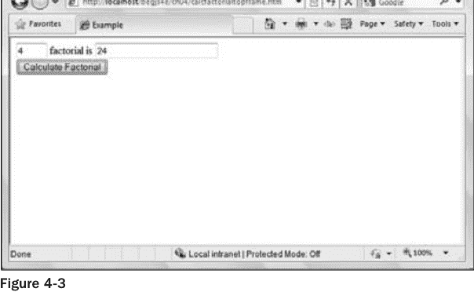

**图4-3**

一个数字的阶乘是所有小于或等于该数字的正整数的乘积。例如，4的阶乘（写作4!）是`1 * 2 * 3 * 4 = 24`。阶乘用于数学的各个分支，包括统计学。在这里，你只想创建一个足够复杂以值得用函数来实现的函数，但又不能复杂到分散你对本例主要目的的注意力：`try...catch`和`throw`语句。

如果你清空第一个文本框并单击“计算阶乘”按钮，系统会提示你需要输入一个值。如果你在第一个文本框中输入无效的非数字值，系统会提示你输入有效的值。如果你输入负值，系统会提示你输入正值。

此外，如果你尝试将页面`calcfactorial.htm`加载到浏览器中，在文本框中输入一个值并单击“计算阶乘”按钮，系统会提示你该页面未加载到正确的框架集中。

正如你将看到的，所有这些错误消息都是使用`try...catch`和`throw`语句创建的。因为这个例子完全是关于`try...catch`和`throw`的，所以你将只关注`calcfactorial.htm`页面，特别是连接到表单唯一按钮的`onclick`事件处理程序的`butCalculate_onclick()`函数。

首先看看`try`子句及其内部的代码。代码由四个`if`语句和另一行将计算出的阶乘放入第二个文本框的代码组成。每个`if`语句都检查一个条件，如果该条件为真，则会导致你的代码出现问题。

第一个`if`语句检查顶层框架集窗口中的`calcFactorial()`函数是否确实存在。如果不存在，它会抛出一个错误，该错误将被`catch`块捕获。如果用户加载的是`calcfactorial.htm`页面而不是框架集页面`calcfactorialtopframe.htm`，那么没有这个`throw`语句，你的代码将会失败。

```javascript
try
{
    if (window.top.calcFactorial == null)
        throw "This page is not loaded within the correct frameset";
```

接下来的三个`if`语句检查用户输入到文本框中的数据的有效性。首先确保用户在文本框中输入了内容；然后确保用户输入了数字，最后检查该值是否为负数。同样，如果任何`if`条件为真，你就会抛出一个错误，该错误将被`catch`块捕获。你定义的每个错误消息都以感叹号开头，目的是将错误标记为用户输入错误，而不是诸如不在框架集中的错误。

```javascript
if (document.form1.txtNum1.value == "")
    throw "!Please enter a value before you calculate its factorial";
if (isNaN(document.form1.txtNum1.value))
    throw "!Please enter a valid number";
if (document.form1.txtNum1.value < 0)
    throw "!Please enter a positive number";
```

如果一切正常，`calcFactorial()`函数将被执行，并将结果文本框填充为用户输入数字的阶乘。

```javascript
document.form1.txtResult.value =
    window.parent.calcFactorial(document.form1.txtNum1.value);
}
```

最后，将注意力转向`try...catch`语句的`catch`部分。首先，`try`代码抛出的任何消息都将被`exception`变量捕获。

```javascript
catch(exception)
{
```

`exception`中包含的数据类型取决于错误是如何抛出的。如果错误是由浏览器抛出而不是由你的代码抛出，`exception`将是一个对象，即异常对象。如果错误是由你的代码抛出的，那么在这个例子中你只抛出了原始字符串。因此你需要做的第一件事是确定`exception`包含什么类型的数据。如果它是字符串，你知道它是被你的代码抛出的，并可以相应地处理它。如果它是一个对象，并且考虑到你知道你的代码没有抛出

## 第四章：常见错误、调试与错误处理

当捕获到对象时，你可能会假设这个异常是由浏览器生成的，并且认为`exception`是一个异常对象。

```javascript
if (typeof(exception) == "string")
{
```

如果异常是由代码使用`throw`生成的（因此`exception`是一个字符串），你现在需要确定错误是用户输入错误（例如文本框不包含要计算的值），还是其他类型的错误（例如页面未在你的框架集中加载）。所有用户输入的异常消息都以感叹号开头，因此你使用`if`语句检查第一个字符。如果是`！`，你通知用户错误，然后将焦点返回到你的控件。如果不是，你只需显示一条错误消息。

```javascript
    if (exception.charAt(0) == "!")
    {
        alert(exception.substr(1));
        document.form1.txtNum1.focus();
        document.form1.txtNum1.select();
    }
    else
    {
        alert(exception);
    }
}
```

如果`exception`不是字符串，你就知道有一个异常对象，需要显示`message`属性：

```javascript
else
{
    alert("发生了以下错误：" + exception.message);
}
}
```

## 嵌套的`try...catch`语句

到目前为止，你只使用了一个`try...catch`语句，但可以在一个`try`语句内部包含另一个`try...catch`语句。实际上，你可以更进一步，在这个内部`try...catch`的`try`语句中再包含一个`try...catch`，甚至在里面再嵌套一个，限制仅在于实际操作的合理性。

那么，为什么使用嵌套的`try...catch`语句呢？你可以在内部的`try...catch`语句中处理某些错误。然而，如果你处理的是更严重的错误，内部的`catch`子句可以通过将错误抛出给外部的`catch`子句来传递该错误。

这里有一个例子：

```javascript
try
{
    try
    {
        ablurt("这段代码有错误");
    }
    catch(exception)
    {
        var eName = exception.name;

        if (eName == "TypeError" || eName == "ReferenceError")
        {
            alert("内部的 try...catch 可以处理这个错误");
        }
        else
        {
            throw exception;
        }
    }
}
catch(exception)
{
    alert("发生了内部 try...catch 无法处理的错误");
}
```

在这段代码中，你有两个`try...catch`对，一个嵌套在另一个内部。

内部的`try`语句包含一行有错误的代码。内部`try...catch`的`catch`语句检查错误名称的值。如果异常的名称是`TypeError`或`ReferenceError`，内部的`try...catch`会通过警告框处理它（有关错误类型及其描述的完整列表，请参见附录B）。不幸的是，浏览器抛出的错误类型取决于浏览器本身，这并不奇怪。在前面的例子中，IE将错误报告为`TypeError`，而其他浏览器则将其报告为`ReferenceError`。

如果内部`catch`语句捕获到的错误是任何其他类型的错误，它会被再次抛出，交给外部`try...catch`的`catch`语句处理。

让我们修改上一个例子`calcfactorial.htm`中的`butCalculate_onclick()`函数，使其同时具有内部和外部`try...catch`。

```javascript
function butCalculate_onclick()
{
    try
    {
        try
        {
            if (window.top.calcFactorial == null)
                throw ("此页面未在正确的框架集中加载");
            if (document.form1.txtNum1.value == "")
                throw("!请在计算阶乘前输入一个值");
            if (isNaN(document.form1.txtNum1.value))
                throw("!请输入一个有效的数字");
            if (document.form1.txtNum1.value < 0)
                throw("!请输入一个正数");
            document.form1.txtResult.value =
                window.parent.calcFactorial(document.form1.txtNum1.value);
        }
        catch(exception)
        {
            if (typeof(exception) == "string" && exception.charAt(0) == "!")
            {
                alert(exception.substr(1));
                document.form1.txtNum1.focus();
                document.form1.txtNum1.select();
            }
            else
            {
                throw exception;
            }
        }
    }
    catch(exception)
    {
        switch (exception)
        {
            case "此页面未在正确的框架集中加载":
            alert(exception);
            break;
            default :
            alert("发生了以下严重错误：\n" + exception);
        }
    }
}
```

内部的`try...catch`处理用户输入错误。然而，如果错误不是我们抛出的用户输入错误，它会被抛出，交给外部的`catch`语句处理。外部的`catch`语句有一个`switch`语句，用于检查抛出的错误消息的值。如果是因为`calcfactorialtopframe.htm`未加载而我们抛出的错误消息，`switch`语句会在第一个`case`语句中处理它。任何其他错误都在`default`语句中处理。然而，很可能有时你会有很多不同的错误需要在`case`语句中处理。

## `finally`子句

`try...catch`语句有一个`finally`子句，它定义了一段代码，无论是否抛出异常都会执行。`finally`子句不能单独出现；它必须在一个`try`块之后，以下代码说明了这一点：

```javascript
try
{
    ablurt("将会发生一个异常");
}
catch(exception)
{
    alert("异常发生");
}
finally
{
    alert("无论发生什么，这行代码都会执行");
}
```

`finally`部分是放置任何清理代码的好地方，这些代码需要在无论之前发生什么错误的情况下都执行。

你已经了解了开发者常犯的主要错误，也看到了如何在代码中处理错误。不幸的是，错误仍会在你的代码中发生，因此让我们来看看一种使用调试器来使修复它们更容易的方法。

## 调试

由于缺乏像样的开发工具，JavaScript传统上被认为是一种难以编写和调试的语言。然而，由于为开发人员提供了许多工具，现在情况已不再是这样。最值得注意的是可用于Internet Explorer、Firefox、Safari和Opera的调试工具。使用这些工具，你可以使用断点暂停脚本的执行，然后逐行单步执行代码，以准确了解发生了什么。


你还可以找出变量中保存的数据，并动态执行语句。没有调试器，你能做的最好的就是在代码中使用`alert()`方法来显示变量在不同点的状态。

调试通常在所有浏览器甚至所有语言中都是通用的。一些调试工具可能比其他工具提供更多功能，但大多数情况下，以下概念可以应用于任何调试器：

- **断点**告知调试器应该在某个点中断或暂停代码执行。你可以在 JavaScript 代码中的任何位置设置断点，调试器会在到达断点时停止代码执行。
- **监视**允许你指定在代码在断点处暂停时要检查的变量。
- **调用堆栈**是到断点为止已执行的函数和方法的记录。
- **控制台**允许你在页面的上下文中和断点的范围内执行 JavaScript 命令。此外，它还会记录页面中发现的所有 JavaScript 错误。
- **单步执行**是调试中最常见的过程。它允许你一次执行一行代码。有三种方式可以单步执行代码。
  - **步入**执行下一行代码。如果该行是函数调用，调试器将执行该函数并在函数的第一行暂停。
  - **单步跳过**与步入类似，执行下一行代码。如果该行是函数，单步跳过会执行整个函数并在函数外的第一行暂停。
  - **单步跳出**在调用函数内部时返回到调用函数。单步跳出会继续执行代码，直到函数返回。然后它在函数的返回点中断。

在深入研究各种调试器之前，让我们创建一个你可以调试的页面。注意第 16 行的故意拼写错误。如果从头开始创建页面，请务必包含此拼写错误。

## 第四章：常见错误、调试与错误处理

```html
<!DOCTYPE html PUBLIC "-//W3C//DTD XHTML 1.0 Transitional//EN"
    "http://www.w3.org/TR/xhtml1/DTD/xhtml1-transitional.dtd">
<html xmlns="http://www.w3.org/1999/xhtml">
<head>
    <title>调试：乘法表</title>
    <script type="text/javascript">
        function writeTimesTable(timesTable)
        {
            var counter;
            var writeString;
            for (counter = 1; counter < 12; counter++)
            {
                writeString = counter + " * " + timesTable + " = ";
                writeString = writeString + (timesTable * counter);
                writeString = writeString + "<br />";
                document.write(writeString);
            }
        }
    </script>
</head>
<body>
    <script type="text/javascript">
        writeTimesTable(2);
    </script>
</body>
</html>
```

将其保存为`debug_timetable.htm`。

下一节将引导你了解 Firefox 的 Firebug 附加组件的功能和用途。由于调试和调试器具有普遍性，关于 Internet Explorer、Safari 和 Opera 的章节将仅让你熟悉各自浏览器调试器的用户界面，并指出任何差异。

## 在 Firefox 中使用 Firebug 进行调试

多年来，Firefox 唯一的 JavaScript 调试器是一个代号为 Venkman 的 Mozilla 项目。其功能集类似于微软的脚本编辑器，但许多开发者认为 Venkman 不够用户友好。其中一位开发者，乔·休伊特，决定利用 Firefox 内置的调试 API（应用程序编程接口）编写自己的调试器。他将其命名为 Firebug，此后的事，正如人们所说，便成了历史。如今，Firebug 已成为事实上的 Firefox JavaScript 调试器（以及更多！），而所有其他浏览器的 JavaScript（及 Web 开发）工具，在原则上都是基于 Firebug 的。

遗憾的是，Firebug 默认并不随 Firefox 一同安装。你需要手动安装 Firebug 附加组件。你可以从`http://www.getfirebug.com`，乔·休伊特的个人网站`http://www.joehewitt.com/software/firebug/`，或者 Mozilla 的附加组件网站`https://addons.mozilla.org/en-US/firefox/addon/1843`下载最新版本的 Firebug。

要安装 Firebug，请打开 Firefox 并访问上述任一网址。点击网页上的安装按钮，并按照说明操作。务必在安装 Firebug 后重新启动 Firefox。

你可以通过几种方式访问 Firebug。你可以点击 Firefox 窗口右下角状态栏中的 Firebug 图标。如果状态栏不可见，你可以通过选择 Firefox 工具菜单中的 Firebug → 打开 Firebug 来启动它。默认情况下，Firebug 会作为 Firefox 内的一个面板打开（参见图 4-4）。

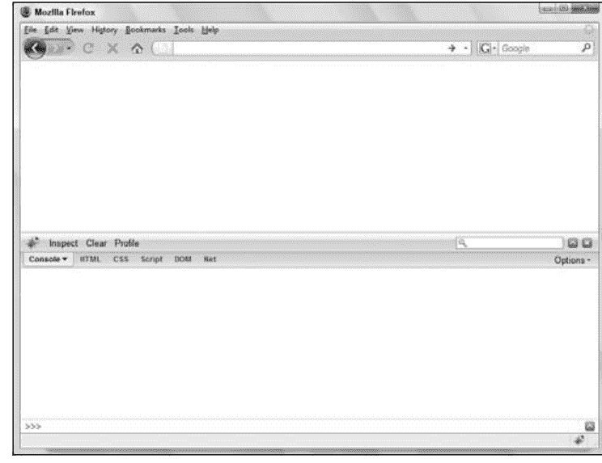

**图 4-4**

你可以通过点击关闭按钮旁边的向上箭头，将其弹出到独立窗口。

在 Firefox 中打开`debug_timetable.htm`。如果状态栏可见，你应该会在 Firefox 窗口右下角看到红色文本显示“1 Error”。点击该消息（或通过工具菜单打开 Firebug），Firebug 将打开控制台。控制台在 Firebug 中有多种用途；它列出 JavaScript 错误，并允许你即时执行 JavaScript 代码。我们稍后会探索控制台。

JavaScript 调试器包含在“脚本”选项卡中，由两个面板组成。左侧面板包含源代码，右侧面板包含三个不同的视图可供选择：断点、监视和调用栈。

- **断点：**列出你为当前页面代码创建的所有断点。
- **监视：**列出在断点处作用域内的变量及其值。你也可以添加其他变量进行监视。
- **调用栈：**显示调用栈。

左侧面板中的源代码是只读的；如果你想修改它，必须在文本编辑器中编辑文件。让我们这样做，将第 16 行有问题的`documents`改为`document`。保存文件，并重新加载网页。

纠正错误并重新加载页面后，你应该能在网页中看到乘法表，如图 4-5 所示。

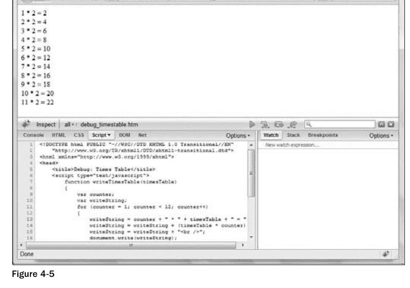

**图 4-5**

同时请注意，Firebug 左侧面板中的源代码已更新以反映你的更改。

## 设置断点

如前所述，断点会指示调试器在代码中的特定点暂停执行。当你想在代码执行过程中检查其状态时，这非常方便。在 Firebug 中创建断点很简单；只需在源代码行号左侧的灰色区域（边栏）单击左键即可。断点由边栏中你点击位置的红色圆圈表示。

你也可以在编写代码时通过使用`debugger`关键字来创建断点（我们稍后会使用它）。

保持修正后的`debug_timetable.htm`在 Firefox 中加载，在第 14 行设置一个断点。

```javascript
writeString = writeString + (timesTable * counter);
```

重新加载页面，并注意 Firebug 已在你刚设置的断点处停止了代码执行。Firebug 将当前行代码高亮为浅黄色，并在边栏中放置一个黄色箭头。此行代码尚未被执行。

点击右侧面板中的“断点”选项卡；它显示断点列表（本例中只有一个）。列表中的每个条目包括一个用于启用/禁用断点的复选框、包含该断点的函数名、源文件的文件名和行号、断点的源文本以及一个删除按钮。

现在点击“监视”选项卡。

## 监视

“监视”选项卡在代码执行暂停时，显示当前行作用域内的变量及其值。图 4-6 显示了此断点处“监视”选项卡的内容。

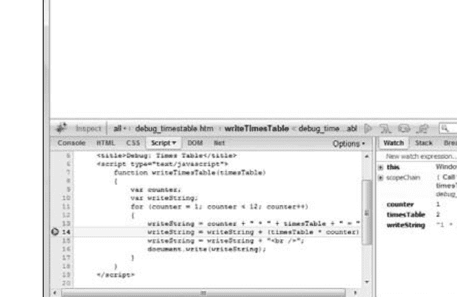

**图 4-6**

请注意，`counter`、`timesTable`和`writeString`变量是可见的（`this`也是）。

你也可以添加自己的变量进行监视，在单步执行代码时检查它们的值。要添加监视，只需点击“新建监视表达式...”，输入你想要监视的变量名，然后按回车键。你添加的监视项具有灰色背景，将鼠标悬停其上会显示一个红色的删除按钮。

你可以监视任何想要的变量。如果变量在作用域内，则会显示其值。如果变量不在作用域内，则会显示`ReferenceError`作为其值。

虽然当你想确切了解代码中正在发生什么时，这些信息很有帮助，但如果你无法控制代码执行，它就不太有用了。为了前进到下一行而多次设置断点并重新加载页面是不切实际的，因此我们使用一个称为单步执行的过程。

## 单步执行代码

代码单步执行由窗口右上角、源代码搜索框旁边的四个按钮控制（参见图 4-7）。

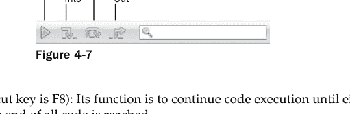

- **继续执行**（快捷键是 F8）：其功能是继续执行代码，直到下一个断点或所有代码执行完毕。
- **步入**（快捷键是 F11）：执行当前行代码并移动到下一条语句。如果当前行是一个函数，则会进入该函数的第一行。
- **步过**（F10）：与“步入”类似，它执行当前行代码并移动到下一条语句。然而，如果该语句是一个函数，它会执行该函数，然后移动到函数调用后的下一行。
- **步出**：返回调用函数。

让我们进行一些单步执行；请遵循以下步骤：

1. 通过点击图标或按 F11 来“步入”代码。调试器执行当前高亮的行代码，并移动到下一行。
2. 查看“监视”选项卡和`writeString`的值；它是 "1 * 2 = 2"。如你所见，“监视”选项卡中显示的值会实时更新。
3. Firebug 的一个很好的特性是，如果需要，在单步执行代码时页面会更新。再点击两次“步入”来实际观察这一特性。图 4-8 显示了在单步执行代码时页面的更新。

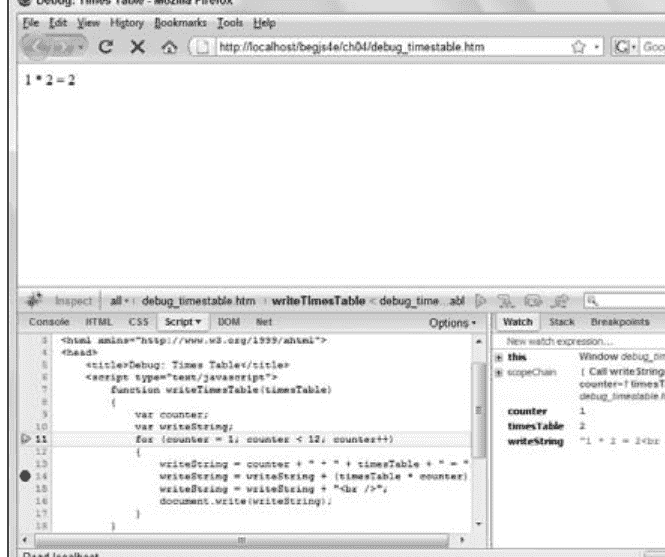

图 4-8

你可能会发现，你单步进入的函数并非错误的根源，这时你希望执行该函数中剩余的代码，然后从函数被调用的位置继续逐行执行。你可以通过点击“Step Out”（步出）图标来跳出当前代码。但如果你正处在一个循环中，且断点设置在循环内部，那么在遍历完整个循环之前，你不会跳出该函数。

有时，你可能会遇到这样的情况：一段有缺陷的代码调用了多个函数。如果你知道其中某些函数是没有错误的，那么你可能希望直接执行它们，而不是逐行单步执行查看。在这种情况下，请使用“Step Over”（步过）来执行函数内的代码，而无需逐行跟踪。

请按照以下方式修改`debug_timetable.htm`中的乘法表代码，以便你可以使用三种单步调试方式：

```html
<!DOCTYPE html PUBLIC "-//W3C//DTD XHTML 1.0 Transitional//EN"
    "http://www.w3.org/TR/xhtml1/DTD/xhtml1-transitional.dtd">
<html xmlns="http://www.w3.org/1999/xhtml">
<head>
    <title>Debug: Times Table 2</title>
    <script type="text/javascript">
function writeTimesTable(timesTable)
{
    var counter;
    var writeString;
    for (counter = 1; counter < 12; counter++)
    {
        writeString = counter + " * " + timesTable + " = ";
        writeString = writeString + (timesTable * counter);
        writeString = writeString + "<br />";
        document.write(writeString);
    }
}
</script>

</head>
<body>
    <script type="text/javascript">
        var timesTable;
        for (timesTable = 1; timesTable <= 12; timesTable++)
        {
            document.write("<p>")
            writeTimesTable(timesTable)
            document.write("</p>")
        }
    </script>
</body>
</html>
```

将此文件保存为`debug_timetable2.htm`。请注意，这个 HTML 文件中没有错误。

以下步骤将引导你完成代码单步执行的过程。

1. 在第 26 行（页面主体中的`for`循环）设置一个断点，然后重新加载页面。
2. 点击“Step Into”（步入）图标，代码执行将移动到下一条语句。现在，`for`循环内的第一条语句`document.write("<p>")`将被执行。
3. 当你再次点击“Step Into”图标时，它将带你进入第一次调用的`writeTimesTable()`函数。
4. 你想看看该函数内部发生了什么，所以再次点击“Step Into”，你将步入该函数。你的屏幕应如图 4-9 所示。
5. 点击“Step Into”图标几次，以了解函数执行流程的要点。实际上，逐行单步执行代码可能会有点乏味。所以，假设你对这个函数很满意，想运行它的剩余部分。
6. 使用“Step Out”来运行剩余的代码。该函数已完全执行，你已返回到调用行，如图 4-10 所示。
7. 点击“Step Into”图标两次以执行`document.write()`（它不会显示，因为它是一个闭合标签）。
8. 再点击“Step Into”四次。执行将继续通过`for`循环的条件判断和递增部分，最终回到调用`writeTimesTable()`函数的那一行。

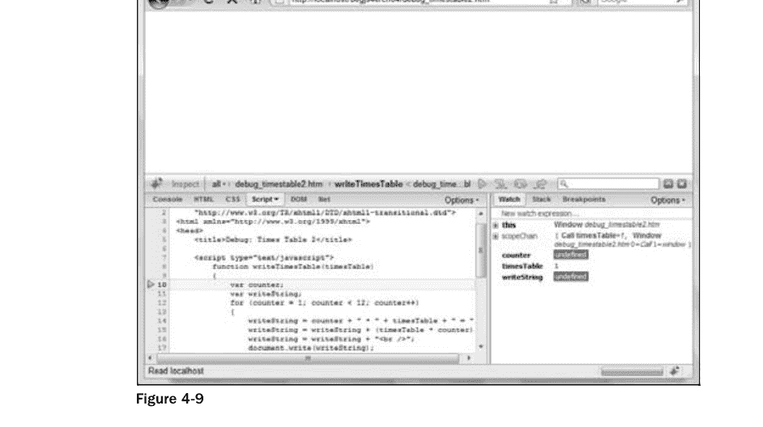

图 4-9

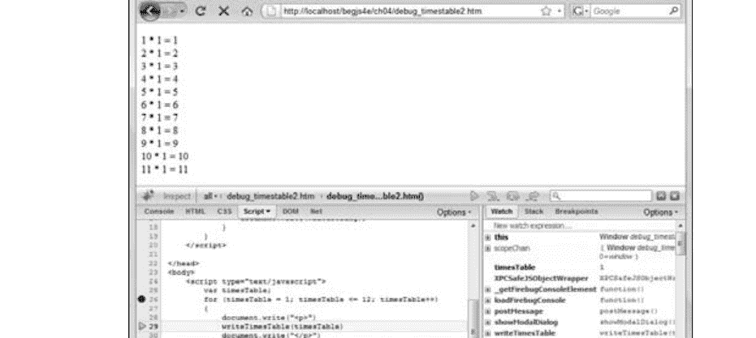

图 4-10

9. 你已经看到过这个函数执行了，所以实际上你想跳过它，直接到下一行。嗯，不用猜也知道你需要使用“Step Over”。点击“Step Over”图标（或按 F10 键），该函数将被执行，但不会逐语句单步跟踪。你应该会发现自己回到了`document.write("</p>")`这一行。

如果你已经完成了调试，可以点击工具栏上的“Continue”（继续）图标（或按 F8）来运行剩余的代码，而无需逐行单步执行。你应该能在浏览器中看到一个从 1*1=1 到 11*12=132 的乘法表页面。

## 控制台

当你在单步执行代码并检查其执行流程时，真正有用的是能够实时评估条件甚至动态修改内容。你可以使用控制台来完成这些操作。

请按照以下步骤操作：

1. 通过点击源代码面板中的红色圆圈移除之前设置的断点，并在第 17 行`document.write(writeString);`设置一个新的断点。
2. 我们来看看如何找出变量`writeString`当前包含的值。重新加载页面。当调试器在断点处停止时，点击“Console”（控制台）标签，点击“>>>”字段，然后输入你想检查的变量名，这里是`writeString`。按回车键。这将导致变量包含的值打印在命令窗口中你的命令下方，如图 4-11 所示。

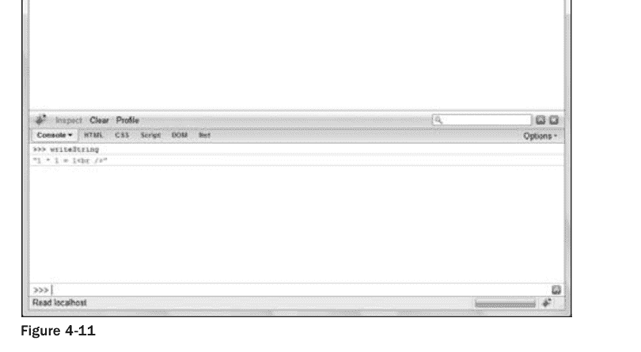

图 4-11

3. 如果你想更改一个变量，可以在命令窗口中输入一行 JavaScript 代码，然后按回车键。尝试使用以下代码：`writeString = "Changed on the Fly<br />"`
4. 点击“Script”（脚本）标签，通过点击红色圆圈移除断点，然后点击“Continue”图标。你会看到你的操作结果：原本应该是 1*1 乘法表结果的地方，被你实时修改的文本替换了。

> 此更改不会影响你实际的 HTML 源文件，只会更改浏览器中当前加载的页面。

控制台还可以评估条件。在第 26 行重新创建断点并重新加载页面。让执行暂停在断点处，然后单步进入`for`循环的条件判断。

在命令窗口中输入以下内容并按回车键：`timesTable <= 12`

由于这是循环第一次运行，如图 4-12 所示，`timesTable`等于 1，因此条件`timesTable <= 12`的计算结果为`true`。

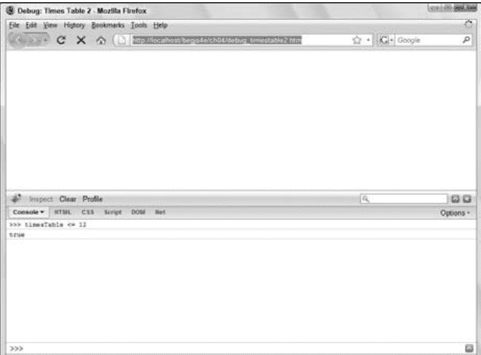

图 4-12

你也可以使用控制台访问浏览器对象模型的属性（我们将在第 6 章介绍）。例如，如果你在命令窗口中输入`window.location.href`并按回车键，它会告诉你当前网页的 URL。

控制台不仅限于单行 JavaScript。点击屏幕右侧的上箭头，你可以输入多个需要执行的语句。

### 调用堆栈窗口


当你在单步执行代码时，调用堆栈窗口会持续记录已调用的函数列表，以到达代码中当前的执行点。

让我们创建一个示例网页，很好地演示调用堆栈。

1. 输入以下代码：

```html
<!DOCTYPE html PUBLIC "-//W3C//DTD XHTML 1.0 Transitional//EN"
    "http://www.w3.org/TR/xhtml1/DTD/xhtml1-transitional.dtd">
<html xmlns="http://www.w3.org/1999/xhtml">
<head>
    <title>Debugging: Callstack</title>
    <script type="text/javascript">
        function firstCall()
        {
            secondCall();
        }

        function secondCall()
        {
            thirdCall();
        }

        function thirdCall()
        {
            //
        }

        function button1_onclick()
        {
            debugger
            firstCall();
        }
    </script>
</head>
<body>
    <input type="button" value="Button" name="button1"
        onclick="return button1_onclick()" />
</body>
</html>
```

2. 将此页面保存为`debug_callstack.htm`，并在 Firefox 中加载它。你看到的将是一个带有按钮的空白网页。

3. 点击按钮，调试器将在`button1_onclick()`函数中的`debugger`语句处打开，该函数与按钮的`onclick`事件处理程序相关联。

4. 点击右侧面板中的“Call Stack”（调用堆栈）标签。你的调试器现在看起来如图 4-13 所示。

## 第四章：常见错误、调试与错误处理

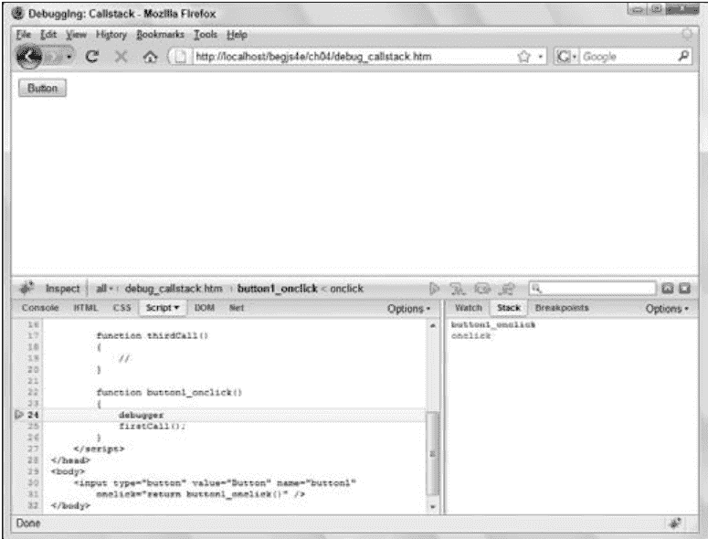

图 4-13

Firebug 会将每次函数调用添加到调用栈的顶部。你已经可以看到，第一个被调用的函数实际上是附加在按钮`onclick`事件处理程序上的代码。接着，被`onclick`事件处理程序调用的函数被添加到调用栈中，即调用栈顶部显示的`button1_onclick()`函数。

5. 如果你想查看每个函数首次进入的位置，只需在调用栈窗口中单击函数名。单击`onclick`，调用代码（即连接到`<input/>`元素`onclick`属性的代码）将会显示。现在单击顶行的`button1_onclick`，这将带你返回当前执行点。

6. 现在单步执行（Step Into）两次。第一步到达调用`firstCall()`函数的行。第二步带你进入该函数内部。该函数立即被添加到调用栈中，如图 4-14 所示。

7. 再次单步执行进入第二个函数`secondCall()`。它同样被添加到调用栈中。再执行一步带你进入第三个函数`thirdCall()`，其名称同样被添加到调用栈顶部。

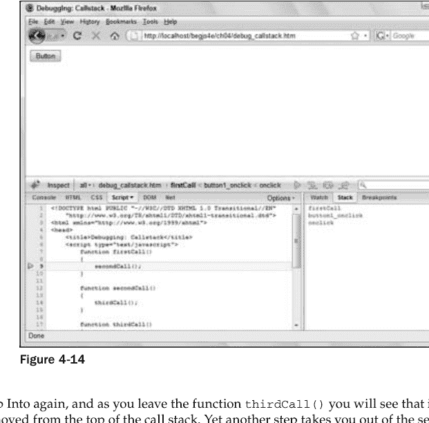

8. 再次单步执行，当你离开函数`thirdCall()`时，你会看到它的名称从调用栈顶部被移除。再执行一步带你退出第二个函数`secondCall()`，其名称也从栈中移除。每次额外的单步执行都会让你退出一个函数，并从调用栈中移除其名称，直到最终所有代码执行完毕，你又回到浏览器中。

这个演示页面很容易跟踪，但对于复杂页面，尤其是多框架页面，调用栈对于追踪你当前的位置、你曾到过哪里以及如何到达那里，会非常有用。

如前所述，大多数其他浏览器的开发者工具都基于 Firebug，你很快就会在 IE8 的内置工具中看到这一点。

## 在 Internet Explorer 中调试

在 8 版本之前，开发者必须下载并安装 Microsoft 脚本调试器才能进行任何类型的脚本调试。值得庆幸的是，微软在 IE8 中内置了一个调试器，但它默认是关闭的。要启用它，请按照以下步骤操作：

1. 单击工具 ⤨ Internet 选项。

2. 单击高级选项卡，在浏览部分下，取消选中“禁用脚本调试 (Internet Explorer)”旁边的复选框（参见图 4-15）。

3. 单击确定保存设置并退出 Internet 选项对话框。

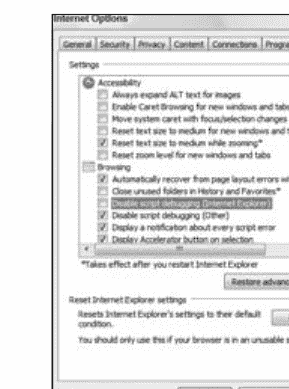

图 4-15

启用后，你可以通过几种方式访问调试器：

- 你可以通过单击工具 ⇨ 开发者工具来打开调试器。开发者工具包含多种你可能觉得有用的工具（就像 Firebug 一样，它不仅仅是 JavaScript 调试器）。为了方便访问，考虑修改命令栏以包含开发者工具按钮。一旦开发者工具窗口出现，如图 4-16 所示，单击脚本选项卡。

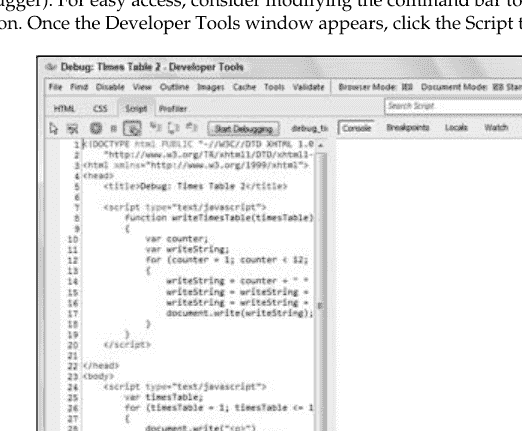

图 4-16

这种方法可能是开始调试最简单的方式。只需导航到所需的页面。如果发生任何错误，会出现一个对话框询问你是否要调试（参见图 4-17）。

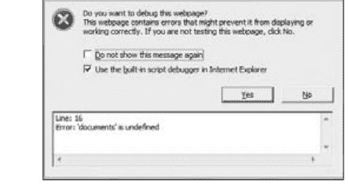

图 4-17

单击是按钮，开发者工具窗口出现，脚本选项卡已被选中。调试器会停止在出错的行上并用黄色高亮显示，尽管从图 4-18 的黑白截图中可能不明显。请在 IE8 中加载`debug_timetable.htm`的原始版本（带有错误的那个）来实际操作一下。单击是开始调试。

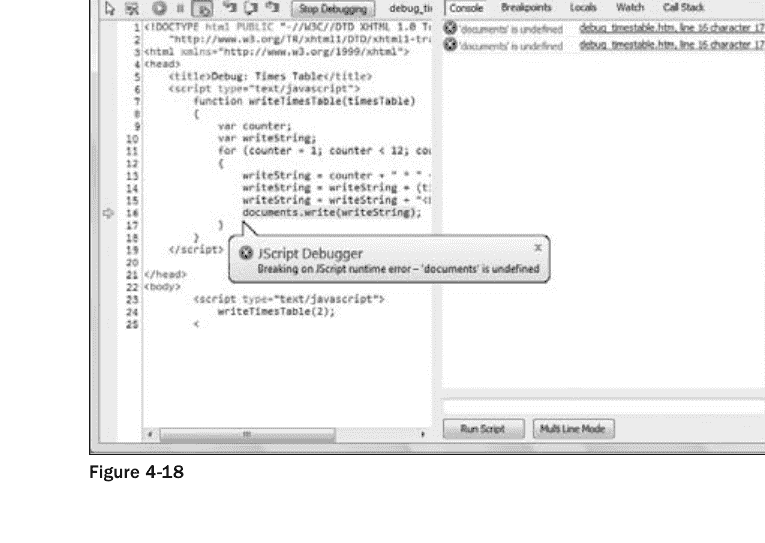

图 4-18

IE8 调试器的一个主要区别是，如果你想调试，它必须处于调试模式。这似乎显而易见，但如果你回想一下，Firebug 没有调试模式。

如图 4-18 所示，调试器由两个面板组成。左侧面板显示包含错误的文件的源代码。如果多个文件包含 JavaScript，你可以使用停止调试按钮旁边的下拉菜单选择这些文件。

右侧面板包含五个选项卡：

- **控制台**：由上部和下部面板组成。下部面板允许你输入和运行 JavaScript 代码。它有单行模式和多行模式，用于较大的代码块。上部面板是你输入的命令及其结果的日志。

- **断点**：列出你为当前页面代码创建的所有断点。

- **局部变量**：列出在断点作用域内的变量及其值。

- **监视**：列出你指定在断点处监视的变量及其值。

- **调用栈**：显示调用栈。

IE8 开发者工具的另一个区别是额外的局部变量选项卡。微软将 Firebug 的监视选项卡拆分成了局部变量和监视两个选项卡。

左侧面板中的源代码是只读的，因此更改它需要在你的文本编辑器中编辑文件。这样做，并将第 16 行有问题的`documents`改为`document`。保存它并尝试重新加载网页。注意你无法这样做。这是因为调试器当前正在运行并停止在错误处。为了重新加载页面，你必须单击停止调试按钮。调试器停止后，你就可以重新加载页面了。

纠正错误并重新加载页面后，你应该能在网页中看到乘法表了。

## 设置断点

在 IE8 中创建断点与在 Firebug 中一样简单直接；只需在你想让调试器中断的行旁边的沟槽中单击。创建断点后，你会注意到行号旁边有一个红圈。

创建断点后，通过单击断点选项卡找到的断点列表中会添加一个条目。每个条目包括一个启用/禁用断点的复选框、源文件的文件名以及断点所在的行号。图 4-19 显示了`debug_timetable2.htm`第 17 行的一个断点。

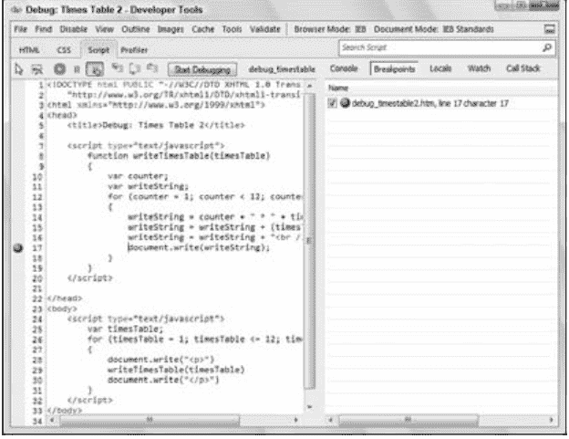

图 4-19

IE8 的 JavaScript 调试器也支持`debugger`关键字。但是，你必须处于调试模式，IE8 的调试器才会在该行暂停。否则，你会看到旧的选择屏幕。如果你在代码中使用`debugger`关键字并看到图 4-20，那么你需要开启调试模式。

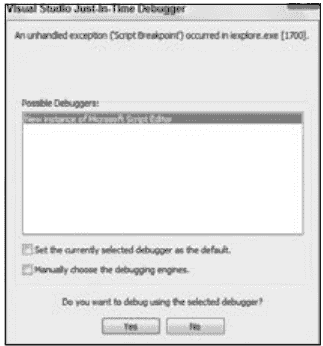

图 4-20

## 添加监视

监视选项卡的唯一目的是列出你想要监视的变量并显示它们的值和类型。在 IE8 中添加监视与 Firebug 略有不同：你必须处于调试模式并在断点处停止才能添加监视。

如果你处于调试模式并在断点处停止，只需单击“单击以添加...”，输入你想要监视的变量，然后按回车键（参见图 4-21）。

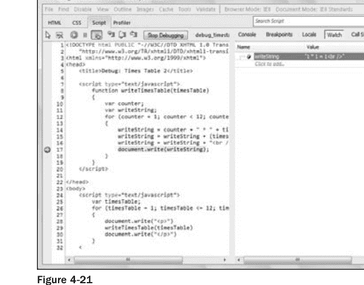

## 单步执行代码

在调试器窗口顶部，调试按钮的左侧，有六个按钮控制代码执行（参见图 4-22）。

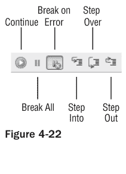

继续选项（快捷键 F5）继续执行代码，直到下一个断点或所有代码执行完毕。第二个选项全部中断确保调试器在下一个语句执行前中断。错误时中断告诉调试器在发生错误时中断。逐语句执行 (F11)、逐过程执行 (F10) 和跳出 (Shift+F11) 的行为与 Firebug 中相同。

IE8 的调试器通过将行高亮显示为黄色并在沟槽中添加黄色箭头来表示当前行。

与 Firefox 和 Firebug 不同，单步执行代码不会更新网页。JavaScript 会执行，但直到所有代码执行完毕你才能看到结果。

## 控制台

与 Firebug 的控制台不同，IE8 的开发者工具控制台与其他 JavaScript 工具放在一起，通过控制台选项卡访问，但主要的区别仅止于此。

控制台记录 JavaScript 错误，并允许你在调试器停止的行上下文内执行代码。图 4-23 显示了 Firebug 部分中的“即时更改”示例在 IE8 中的重现。

默认情况下，控制台只接受单行 JavaScript 代码。你可以通过单击多行模式按钮来更改这一点。

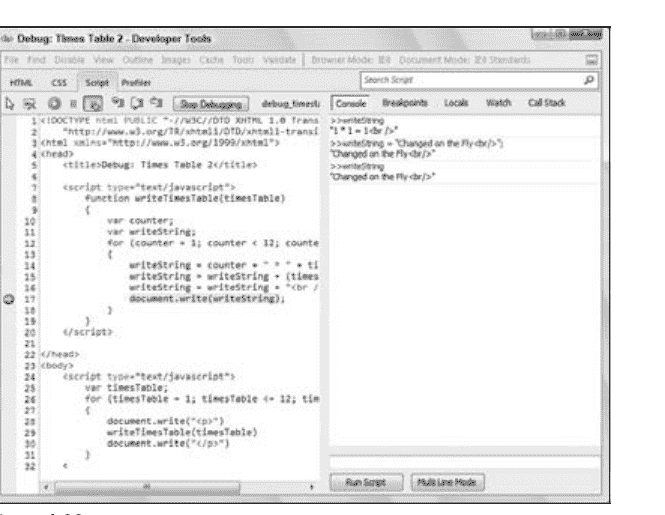

图 4-23

# 第4章：常见错误、调试与错误处理

## 在 Safari 中调试

Safari 调试工具的故事与 IE 的类似。Safari 的渲染引擎被称为 Webkit，编写和维护 Webkit 的人员构建了一个独立的工具，代号为 Drosera，其中包含类似于 Firebug 和 IE8 开发人员工具的功能。它需要单独下载，并需要附加到特定的 Safari/Webkit 窗口。

Safari 3 包含一个名为 Web Inspector 的工具，但它不具备任何 JavaScript 调试功能。从 Safari 4 开始，Web Inspector 内置了 JavaScript 调试器，我们将在本节中介绍。

> Chrome 也使用 Webkit，但在撰写本文时，只有 3 测试版包含脚本调试器。

与 IE8 类似，Web Inspector 默认是禁用的。要启用它，请按照以下步骤操作：

1. 单击“设置”菜单按钮，选择“偏好设置”选项（见图 4-24）。

   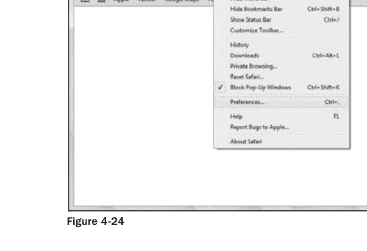

2. 在“偏好设置”窗口中，单击“高级”选项卡，然后选择“在菜单栏中显示开发菜单”选项（见图 4-25）。关闭“偏好设置”窗口。

   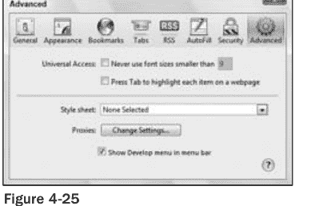

3. 单击“设置”菜单按钮，选择“显示菜单栏”选项。这将显示窗口顶部的传统菜单。

4. 要打开调试器，请从菜单栏中选择“开发”>“开始 JavaScript 调试”。

窗口打开时，你会看到一些绝对不是你的代码。这没关系——你很快就能更改。首先，让我们看看窗口并识别各个部分。图 4-26 显示了首次在`debug_timetable2.htm`文件上打开时的 JavaScript 调试器。你电脑上显示的代码可能有所不同。

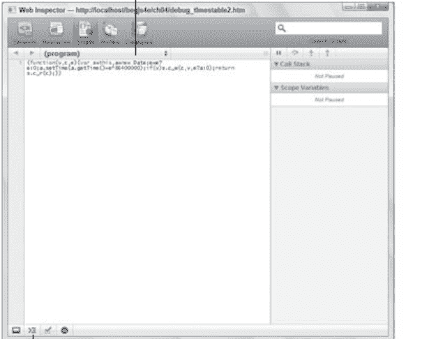

与你之前查看的工具不同，Safari 的 Web Inspector 没有使用选项卡来划分各种功能。相反，它将所有内容组织在窗口内，以便你可以轻松访问所有功能。你可以看到调用堆栈和作用域变量不是选项卡，而是调试时可以同时查看的单独部分。单击“控制台”按钮，你会看到它在窗口底部添加了一个面板（见图 4-27）。

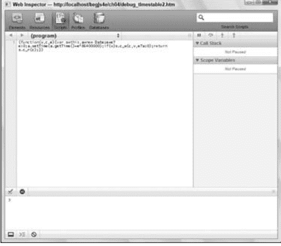

图 4-27

一切都在这里，随时可用且对你可见；因此在 Safari 中加载`debug_timetable2.htm`并返回到 Web Inspector 窗口。单击文件选择下拉菜单，选择 HTML 文件以显示文件的源代码。与之前的工具一样，源代码是只读的，但你可以设置断点。

## 设置断点

在 Web Inspector 中创建断点的过程与其他工具相同：在想要调试器中断的行旁边的空白处单击。Web Inspector 中的断点由蓝色标签表示（见图 4-28）。在第 17 行创建一个。

与 Firebug 和 IE 的开发人员工具不同，Web Inspector 不会在单独的区域列出你设置的断点，因此如果你使用 Safari 和 Web Inspector 作为你的首选浏览器和调试器，请记住你的断点位置。

重新加载页面，以便调试器可以中断，我们可以逐步了解其功能。

> Web Inspector 支持`debugger`关键字。

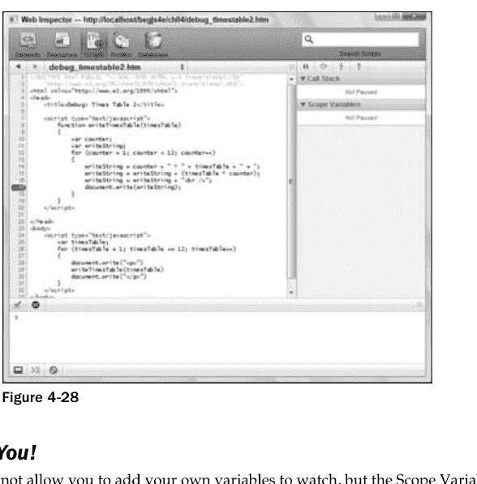

图 4-28

## 不能添加监视！

Web Inspector 不允许你添加要监视的自定义变量，但“作用域变量”部分显示所有作用域内的变量。图 4-29 显示了变量如何分为局部变量和全局变量。

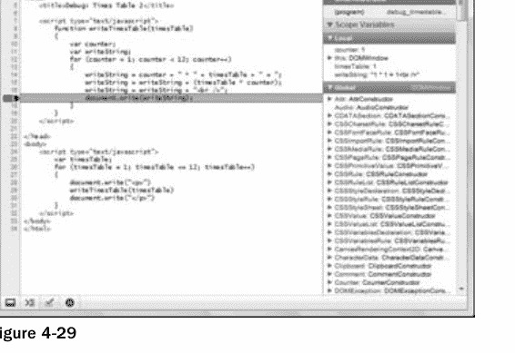

图 4-29

126

## 逐步执行代码

代码单步执行按钮位于右侧面板顶部和搜索框下方（见图 4-30）。

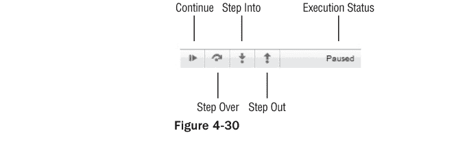

这些按钮的功能与 Firebug 和 IE 中的相同；然而，它们的顺序略有不同。第一个按钮继续执行代码，直到下一个断点或所有代码结束。第二个按钮是“单步跳过”，第三个是“单步进入”，第四个是“单步跳出”。

与 Firefox 和 Firebug 一样，Safari 和 Web Inspector 会在你逐步执行代码时更新页面。因此你可以看到每行代码执行的结果。

## 控制台

控制台的作用与在之前的工具中相同。你可以通过输入变量并按 Enter 键来检查变量的值。你还可以在当前代码行的上下文中执行代码。尝试使用 Firebug 部分中的“动态更改”示例来查看其实际操作。

与之前的工具不同，Web Inspector 控制台不允许输入多行代码。

尽管 Web Inspector 的界面时尚且无选项卡（有些人可能认为它很杂乱），但现在是时候回到选项卡世界，使用 Opera 的 Dragonfly 了。

## 使用 Dragonfly：Opera 的开发工具

Opera 的 Dragonfly 是基于浏览器的开发工具领域中的后来者。在撰写本文时，它目前是预测试版软件，但从 Opera 9.5 版开始，它已包含在 Opera 中。

有两种方式可以打开 Dragonfly：

- 通过“工具”菜单：工具 → 高级 → 开发者工具。

- 通过“调试”菜单，可以通过在 Opera 中打开以下 URL 来安装：`http://dragonfly.opera.com/app/debugmenu/DebugMenu.ini`。

图 4-31 显示了在 Opera 中打开并加载了`debug_timetable2.htm`的 Dragonfly。

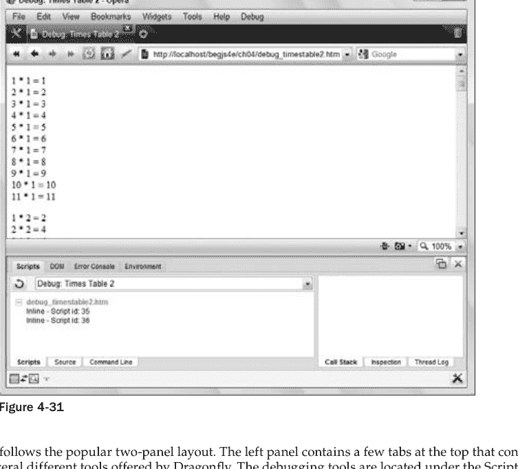

Dragonfly 遵循流行的双面板布局。左侧面板顶部有一些选项卡，控制着 Dragonfly 提供的多种不同工具。调试工具位于“脚本”选项卡下，它是打开 Dragonfly 时的默认选项卡。

左侧面板底部有更多的选项卡：脚本、源代码和命令行。“源代码”和“命令行”选项卡提供了与其他调试器相同的功能：

- **脚本：** 显示当前加载到浏览器中的 HTML 文件及其包含或引用的 JavaScript 代码。图 4-31 显示了两个内联脚本，这意味着它们不包含在外部文件中。

- **源代码：** 显示源代码。与其他工具不同，它只显示你从“脚本”选项卡中选择的代码。

转到“脚本”选项卡，单击第一个内联脚本。这样会打开“源代码”选项卡，并显示 HTML 文件头部`<script />`元素的内容（见图 4-32）。


图 4-32

返回到“脚本”选项卡（在窗口底部），你会看到一对方括号（`[]`）包围着你单击的内联脚本。这表示当前在“源代码”选项卡中显示的脚本。单击第二个内联脚本以查看 HTML 文档主体中`<script />`元素的内容。

- **命令行：** 这是 Dragonfly 的控制台。与 Firebug、IE8 开发人员工具和 Safari 的 Web Inspector 的控制台一样，此控制台允许你检查变量值并在当前暂停行的上下文中执行 JavaScript 命令。


右侧面板包含“调用堆栈”、“检查”和“线程日志”选项卡：

- **调用堆栈：**显示调用堆栈。
- **检查：**显示暂停行作用域内的变量及其值。
- **线程日志：**这是一个高级调试工具，提供有关 JavaScript 代码处理和执行的信息。本节不涉及“线程日志”选项卡。

129

## 设置断点

在 Dragonfly 中设置断点与我们迄今为止讨论的其他工具一样简单。单击“脚本”选项卡中的一个内联脚本，将其加载到“源代码”面板中，然后单击行号左侧。行号上出现一个小黑点，表示该行已设置断点。图 4-33 显示了在第一个内联脚本的第 11 行设置的断点。


## 逐步执行代码

代码单步执行由源代码上方的一行图标控制（见图 4-34）。


# 第4章：常见错误、调试与错误处理

这些图标的功能与 Firebug、IE 开发者工具和 Web Inspector 中的相同。它们依次是：

- 继续（F8）
- 步入（F11）
- 步过（F10）
- 步出（Shift + F11）。

就像 Firefox 和 Firebug，以及 Safari 和 Web Inspector 一样，Opera 和 Dragonfly 在单步执行代码时会更新页面，让你能够看到每行代码执行时的结果。

## 总结

在本章中，你了解了编码中不那么令人兴奋的部分，即 bug。在理想情况下，你每次都会一次就做对，但现实中，任何超过几行的代码都可能存在 bug。

- 你首先看了一些更常见的错误，这些错误不仅 JavaScript 初学者会犯，经验丰富的专家也可能犯。
- 有些错误不一定是代码中的 bug，而是导致代码失败的正常情况的例外。（例如，Java 小程序可能因为用户在防火墙后面而失败。）你看到 `try...catch` 语句非常适合处理这类错误，并且你可以将 `catch` 子句与 `throw` 语句一起使用来处理可能的错误，例如由用户输入引起的错误。最后，你了解到如果你想让一段代码无论是否发生错误都执行，可以使用 `finally` 子句。
- 你了解了 Firefox 的 Firebug、IE8 的开发者工具、Safari 的 Web Inspector 和 Opera 的 Dragonfly。借助这些工具，你可以在代码运行时分析它，从而逐步查看其流程，并检查变量和条件。虽然这些调试器有不同的界面，但它们的原理和功能集基本相同。

## 练习题

这些问题的建议解决方案可以在附录 A 中找到。

**1.** 示例 `debug_timetable2.htm` 有一个故意的 bug。它为每个乘法表只创建了从 1 到 11 的乘数。

使用脚本调试器找出原因，然后纠正这个 bug。

**2.** 以下代码包含一些常见错误。看看你能否找出它们：

```html
<!DOCTYPE html PUBLIC "-//W3C//DTD XHTML 1.0 Transitional//EN"
    "http://www.w3.org/TR/xhtml1/DTD/xhtml1-transitional.dtd">

<html xmlns="http://www.w3.org/1999/xhtml">
<head>
<title>Chapter 4, Question 2</title>
</head>
<body>
<script type="text/javascript">
function checkForm(theForm)
{
    var formValid = true;
    var elementCount  = 0;
    while(elementCount <= theForm.length)
    {
        if (theForm.elements[elementCount].type == "text")
        {
            if (theForm.elements[elementCount].value == "")
                alert("Please complete all form elements")
            theForm.elements[elementCount].focus();
            formValid = false;
            break;
        }
    }
    return formValid;
}
</script>
<form name="form1" onsubmit="return checkForm(document.form1)" action="">
    <input type="text" id="text1" name="text1" />
    <br />
    CheckBox 1<input type="checkbox" id="checkbox2" name="checkbox2" />
    <br />
    CheckBox 1<input type="checkbox" id="checkbox1" name="checkbox1" />
    <br />
    <input type="text" id="text2" name="text2" />
    <p>
        <input type="submit" value="Submit" id="submit1" name="submit1" />
    </p>
</form>
</body>
</html>
```

# 第5章：JavaScript — 基于对象的语言

在本章中，你将了解 JavaScript 的一个核心概念，即对象。但是对象是什么？它们为什么有用？

首先，我们必须告诉你：你在整本书中一直在使用对象（例如，数组就是一个对象）。JavaScript 是一种基于对象的语言，因此你做的大部分事情都涉及操作对象。你会看到，当你充分利用这些对象时，用 JavaScript 能做的事情范围会极大地扩展。

我们将从介绍对象是什么以及为什么它们重要开始。然后介绍 JavaScript 中使用了哪些对象，如何创建和使用它们，以及它们如何为你简化许多编程任务。最后，你将更详细地了解 JavaScript 提供的一些最有用的对象，以及如何在实际场景中使用它们。

JavaScript 语言不仅包含许多称为对象的东西（也称为原生 JavaScript 对象），而且浏览器本身也被建模为一个可供你使用的对象集合。你将在下一章中特别了解这些对象。

## 基于对象的编程

基于对象的编程是“使用对象进行编程”一种稍微吓人点的说法。但是你要用这些对象来编程是什么呢？它们在哪里？你为什么要用它们编程，以及如何使用它们？在本节中，你将了解这些问题的答案，既包括一般编程术语，也包括 JavaScript 中的具体情况。

## 什么是对象？

为了开始介绍对象，让我们思考一下在计算之外的“现实世界”中对象是什么意思。世界由事物或对象组成，例如桌子、椅子和汽车（仅举几例！）。让我们以汽车为例，来探讨对象到底是什么。

你如何定义这辆汽车？你可能会说它是一辆蓝色的四轮驱动汽车。你可能会指定它行驶的速度。当你这样做时，你是在指定对象的属性。例如，汽车有一个颜色属性，在这个例子中，其值为蓝色。

你如何使用这辆汽车？你转动点火钥匙，踩油门，按喇叭，换挡（即，在手动挡汽车上选择 1、2、3、4 和倒挡，或者在自动挡汽车上选择前进和倒挡），等等。当你这样做时，你是在使用对象的方法。

你可以把方法想象成有点像函数。有时，你可能需要使用一些信息与方法一起，或者向其传递一个参数，让它工作。例如，当你使用换挡方法时，你需要说明你想换到哪个档位。其他方法可能会将信息返回给所有者。例如，机油尺方法会告诉所有者汽车里还剩多少机油。

有时使用一个或多个方法可能会改变对象的一个或多个属性。例如，使用油门方法可能会改变汽车的速度属性。其他属性不能改变：例如，汽车的车身形状属性（除非你以每小时 100 英里的速度撞上砖墙！）。

你可以说汽车是由其方法和属性的集合定义的。在基于对象的编程中，其思想是通过对象来建模现实世界的情况，这些对象由它们的方法和属性定义。

## JavaScript 中的对象

你现在应该对对象是什么有了基本的概念——一个带有方法和属性的“东西”。但是你如何在 JavaScript 中使用这个概念？

在前面的章节中，你（大部分情况下）一直在处理原始数据（即，你一直在处理实际数据）。这种类型的数据不太复杂，相当容易处理。然而，并非所有信息都像原始数据那么简单。让我们看一个例子来澄清一下。

假设你编写了一个显示公交车或火车时刻表信息的 Web 应用程序。一旦用户选择了行程，你可能想让他知道这段行程需要多长时间。为此，你需要用到达时间减去出发时间。

然而，这并不像初看起来那么简单。例如，考虑出发时间为 14:53（下午 2:53），到达时间为 15:10（下午 3:10）。如果你让 JavaScript 计算表达式 `15.10–14.53`，你会得到结果 0.57，即 57 分钟。然而，你知道实际的时间差是 17 分钟。对时间使用普通的数学运算符行不通！

你需要做什么来计算这两个时间之间的差值？首先，你需要将每个时间的小时和分钟分开。然后，要得到分钟之间的差值，

## 第五章：JavaScript——基于对象的语言

两次，你需要检查到达时间的分钟数是否大于出发时间的分钟数。如果是，你可以简单地将出发时间的分钟数从到达时间的分钟数中减去。如果不是，你需要将到达时间的分钟数加上60，并从到达时间的小时数中减去1以进行补偿，然后再用到达时间的分钟数减去出发时间的分钟数。然后你需要从到达时间的小时数中减去出发时间的小时数，最后再将计算出的小时数和分钟数组合起来。

只要两个时间在同一天内，这种方法是可行的。例如，对于时间23:45和04:32，它就不适用。

这种计算时间差的方法显然有其问题，而且看起来也很复杂。有没有更简单的方法来处理时间、日期等更复杂的数据？

这就是对象的用武之地。你可以将出发时间和到达时间定义为 `Date` 对象。因为它们是 `Date` 对象，所以它们带有各种属性和方法，可以在需要操作或计算时间时使用。例如，你可以使用 `getTime()` 方法来获取 `Date` 对象中的时间与1970年1月1日00:00:00之间的毫秒数。一旦你获得了到达时间和出发时间的这些毫秒值，你只需将一个值减去另一个值，并将结果存储在另一个 `Date` 对象中。要获取这个时间的小时和分钟，你只需使用 `Date` 对象的 `getHours()` 和 `getMinutes()` 方法。你将在本章后面看到更多这样的例子。

`Date` 对象并非 JavaScript 提供的唯一对象类型。另一种对象类型在第二章中介绍过，但为了简单起见，我们当时没有告诉你它是什么：`Array` 对象。回想一下，数组是一种同时保存多条数据的方式。

`Array` 对象有一个名为 `length` 的属性，它告诉你数组包含多少条数据，或者更准确地说，包含多少个元素。你实际上在第三章的趣味测验中使用了这个属性来计算需要循环遍历数组的次数。

`Array` 对象也有许多方法。一个例子是 `sort()` 方法，它可以用来将数组中的元素按字母顺序排序。

你现在应该对对象在 JavaScript 中的用处有了概念。你已经看到了 `Date` 和 `Array` 对象，但 JavaScript 还提供了许多其他类型的对象，以便你用代码实现更多功能。这些包括 `Math` 和 `String` 对象，我们将在本章后面更详细地讨论它们。

## 使用 JavaScript 对象

既然你已经了解了 JavaScript 对象的“为什么”，现在需要看看“是什么”和“怎么做”。

JavaScript 的每个对象都有一组相关的属性和方法，可用于操作某种特定的数据。例如，`Array` 对象由操作数组的方法和从中获取信息的属性组成。在大多数情况下，要利用这些方法和属性，你需要将数据定义为这些对象之一。换句话说，你需要创建一个对象。

在本节中，你将了解如何创建一个对象，以及在创建之后如何使用其属性和方法。

## 创建对象

你已经见过一个 `Array` 对象被创建的例子。要创建一个 `Array` 对象，你使用了以下 JavaScript 语句：

```javascript
var myArray = new Array();
```

那么这个语句是如何组成的呢？

语句的前半部分对你来说很熟悉。你使用 `var` 关键字定义了一个名为 `myArray` 的变量。这个变量使用等号赋值运算符（`=`）初始化为语句的右侧部分。

语句的右侧部分由两部分组成。首先是运算符 `new`。它告诉 JavaScript 你想创建一个新对象。接下来是 `Array()`。这是 `Array` 对象的构造函数。它告诉 JavaScript 你想创建什么类型的对象。大多数对象都有这样的构造函数。例如，`Date` 对象有 `Date()` 构造函数。你在本书中看到的唯一例外是 `Math` 对象，这将在本章后面解释。

你还在第二章中看到，你可以向构造函数 `Array()` 传递参数来向对象添加数据。例如，以下代码创建了一个 `Array` 对象，其中包含三个元素，数据分别为 "Paul"、"Jeremy" 和 "Nick"：

```javascript
var myArray = new Array("Paul", "Jeremy", "Nick");
```

让我们再看一些例子，这次是创建一个 `Date` 对象。最简单的方法是这样的：

```javascript
var myDate = new Date();
```

这将创建一个包含创建时的日期和时间的 `Date` 对象。然而，下面这行代码创建了一个包含日期2010年1月1日的 `Date` 对象：

```javascript
var myDate = new Date("1 Jan 2010");
```

对象数据在变量中的存储方式与原始数据（如文本和数字）的存储方式不同。（原始数据是 JavaScript 中最基本的数据。）对于原始数据，变量保存着数据的实际值。例如：

```javascript
var myNumber = 23;
```

这段代码意味着变量 `myNumber` 保存着数据 `23`。然而，赋值给对象的变量不保存实际数据，而是保存指向数据所在内存地址的引用。这并不意味着你能获取内存地址——只有 JavaScript 知道这个地址的细节，并在后台将其保密。你需要记住的是，当你说一个变量引用一个对象时，你指的是它引用一个内存地址。以下示例展示了这一点：

```javascript
var myArrayRef = new Array(0, 1, 2);
var mySecondArrayRef = myArrayRef;
myArrayRef[0] = 100;
alert(mySecondArrayRef[0]);
```

首先，你将变量 `myArrayRef` 的引用设置为新的数组对象，然后将 `mySecondArrayRef` 设置为相同的引用——例如，现在 `mySecondArrayRef` 被设置为引用同一个数组对象。所以当你像下面这样将数组的第一个元素设置为100时：

```javascript
myArrayRef[0] = 100;
```

并像下面这样显示 `mySecondArrayRef` 引用的数组的第一个元素的内容：

```javascript
alert(mySecondArrayRef[0]);
```

你会看到它也神奇地变成了100！然而，正如你现在所知，这不是魔法；这是因为两个变量引用的是同一个数组对象，因为当涉及到对象时，存储在变量中的是对象的引用，而不是对象本身。当你进行赋值时，它并没有复制数组对象，它只是复制了引用。将此与以下情况进行对比：

```javascript
var myVariable = "ABC";
var mySecondVariable = myVariable;
myVariable = "DEF";
alert(mySecondVariable);
```

在这种情况下，你处理的是一个字符串，这是一种原始数据类型，数字也是如此。这次存储在变量中的是实际值，所以当你这样做时：

```javascript
var mySecondVariable = myVariable;
```

`mySecondVariable` 获得了 `myVariable` 中数据的独立副本。所以最后的警报仍将显示 `mySecondVariable` 持有"ABC"。

总结本节，你使用以下基本语法创建 JavaScript 对象：

```javascript
var myVariable = new ConstructorName(optional parameters);
```

## 使用对象的属性

访问对象属性中包含的值非常简单。你写出包含（或引用）你的对象的变量名，然后是一个点，接着是对象的属性名。

例如，如果你定义了一个包含在变量 `myArray` 中的 `Array` 对象，你可以像这样访问它的 `length` 属性：

```javascript
myArray.length
```

但有了这个属性，你能用它做什么呢？你可以像使用任何其他数据一样使用它，并将其存储在变量中：

```javascript
var myVariable = myArray.length;
```

或者你可以将其显示给用户：

```javascript
alert(myArray.length);
```

## 更改属性值

在某些情况下，你甚至可以更改属性的值，就像这样：

```javascript
myArray.length = 12;
```

然而，与变量不同，某些属性是只读的——你可以从中获取信息，但不能更改其内部的信息。

## 调用对象的方法

方法与函数非常相似，因为它们可用于执行有用的任务，例如从特定日期获取小时数或生成随机数。同样像函数一样，有些方法会返回一个值，例如 `Date` 对象的 `getHours()` 方法，而其他方法则执行任务但不返回任何数据，例如 `Array` 对象的 `sort()` 方法。

使用对象的方法与使用属性非常相似，都是先写对象的变量名，然后一个点，再然后是方法的名称。例如，要对变量 `myArray` 中的 `Array` 元素进行排序，你可以使用以下代码：

```javascript
myArray.sort();
```


就像函数一样，你可以通过将参数放在方法名后面的圆括号内来向某些方法传递参数。然而，无论方法是否接受参数，你都必须在方法名后放置圆括号，就像使用函数时一样。通常来说，任何可以使用函数的地方，都可以使用对象的方法。

## 原始类型与对象

现在你应该对原始数据（如数字和字符串）与对象数据（如`Dates`和`Arrays`）之间的区别有了很好的了解。然而，正如前面提到的，还有一个`String`对象。它属于哪一类呢？

事实上，有对应于字符串、数字和布尔原始数据类型的`String`、`Number`和`Boolean`对象。例如，要创建一个包含文本 "I'm a String object" 的`String`对象，你可以使用以下代码：

```javascript
var myString = new String("I'm a String object");
```

`String`对象与`Array`对象一样具有`length`属性。这返回`String`对象中的字符数。例如：

```javascript
var lengthOfString = myString.length;
```

会将值 19 存储在变量`lengthOfString`中（请记住，空格也被视为字符）。

但是，如果你声明了一个名为`mySecondString`的原始字符串，其内容为 "I'm a primitive string"，像这样：

```javascript
var mySecondString = "I'm a primitive string";
```

并且想知道这个原始字符串中有多少个字符呢？

这就是 JavaScript 帮助你的地方。回顾前几章，JavaScript 可以自动处理数据类型的转换。例如，如果你尝试将字符串原始类型与数字原始类型相加，像这样：

```javascript
theResult = "23" + 23;
```

JavaScript 会假设你想将数字视为字符串并将两者连接起来，数字会自动转换为文本。变量`theResult`将包含 "2323"——23 和 23 的连接，而不是 23 和 23 的和（46）。

同样的原则也适用于对象。如果你声明了一个原始字符串，然后将其当作对象使用，例如尝试访问其方法或属性，JavaScript 会知道你尝试的操作无法直接生效。该操作仅对对象有效；例如，对`String`对象是有效的。在这种情况下，JavaScript 会将纯文本字符串转换为一个临时的`String`对象，仅用于该操作，并在操作完成后销毁该对象。

因此，对于你的原始字符串`mySecondString`，你可以使用`String`对象的`length`属性来找出它包含的字符数。例如：

```javascript
var lengthOfSecondString = mySecondString.length;
```

这会将数据`22`存储在变量`lengthOfSecondString`中。

这里表达的相同思想也适用于数字和布尔原始类型及其对应的`Number`和`Boolean`对象。然而，这些对象并不常用，因此本书将不再进一步讨论它们。

## JavaScript 的原生对象类型

到目前为止，你已经了解了什么是对象、如何创建它们以及如何使用它们。现在让我们看看 JavaScript 中一些更有用的对象——即 JavaScript 语言内置的对象。

你不会看到所有原生 JavaScript 对象，只会看到一些更常用的对象，即`String`对象、`Math`对象、`Array`对象和`Date`对象。在本书后面，会有一整章专门介绍每个更复杂的对象，例如`String`对象（第9章）和`Date`对象（第10章）。

### String 对象

与大多数对象一样，`String`对象需要先创建才能使用。要创建一个`String`对象，你可以这样写：

```javascript
var string1 = new String("Hello");
var string2 = new String(123);
var string3 = new String(123.456);
```

然而，正如你所见，你也可以声明一个原始字符串并像使用`String`对象一样使用它，让 JavaScript 在后台为你执行对象转换。例如：

```javascript
var string1 = "Hello";
```

只要 JavaScript 清楚你在后台期望创建什么对象，使用这种技术是可取的。如果原始数据类型是字符串，这不会有问题，JavaScript 会处理好。这样做的优点是无需创建`String`对象本身，并且避免了比较字符串对象的麻烦。当你尝试将字符串对象与原始字符串值进行比较时，实际值会被比较，但对于`String`对象，比较的是对象引用。

`String`对象有大量的方法和属性。在本节中，你将只看一些不太复杂且更常用的方法。然而，在第9章中，你将了解与字符串和正则表达式对象（`RegExp`）相关的一些更棘手但功能强大的方法。正则表达式提供了一种非常强大的方式来搜索字符串中的字符模式。例如，如果你想在字符串 "Pauline, Paul, Paula" 中查找作为整个单词存在的 "Paul"，你需要使用正则表达式。然而，它们使用起来可能有点棘手，因此我们本章不会进一步讨论——我们想把一些乐趣留到后面！

对于`String`对象的大多数方法，记住字符串只是一系列单个字符很有帮助，并且像数组一样，每个字符都有一个位置或索引。同样像数组一样，第一个位置或索引标记为 0 而不是 1。因此，例如，字符串"`HelloWorld`"具有下表所示的字符位置：

| 字符索引 | 0 | 1 | 2 | 3 | 4 | 5 | 6 | 7 | 8 | 9 | 10 |
| --- | --- | --- | --- | --- | --- | --- | --- | --- | --- | --- | --- |
| 字符 | H | e | l | l | o |  | W | o | r | l | d |

### `length` 属性

`length`属性简单地返回字符串中的字符数。例如：

```javascript
var myName = new String("Jeremy");
document.write(myName.length);
```

会将字符串 "Jeremy" 的长度（即 6）写入页面。

### 在另一个字符串中查找字符串——`indexOf()` 和 `lastIndexOf()` 方法

`indexOf()`和`lastIndexOf()`方法用于在一个字符串中搜索另一个字符串的出现位置。包含在另一个字符串中的字符串通常称为`substring`。当你有一个字符串信息但只想要其中一小部分时，它们非常有用。例如，在知识问答中，当某人输入文本答案时，你想检查字符串中是否存在某些关键词。

`indexOf()`和`lastIndexOf()`都接受两个参数：

- 你想查找的字符串
- 你想开始搜索的字符位置（可选）

# 第5章：JavaScript——一门基于对象的语言

字符位置从0开始计数。如果未提供第二个参数，搜索将从字符串的开头进行。

`indexOf()`和`lastIndexOf()`的返回值是子字符串在字符串中找到的字符位置。同样，这个位置是基于0的索引，因此如果子字符串在字符串开头被找到，则返回0。如果没有匹配项，则返回值-1。

例如，要在字符串 "Hello jeremy. How are you Jeremy" 中搜索子字符串 "Jeremy"，可以使用以下代码：

```html
<script type="text/javascript">
var myString = "Hello jeremy. How are you Jeremy";
var foundAtPosition;

foundAtPosition = myString.indexOf("Jeremy");
alert(foundAtPosition);
</script>
```

这段代码的结果应该是一个包含数字26的消息框，即 "Jeremy" 的字符位置。你可能想知道为什么是26，这显然指的是字符串中的第二个 "Jeremy"，而不是第一个 "jeremy" 对应的6。嗯，这又是由于大小写敏感性造成的。虽然有点啰嗦，但 JavaScript 非常重视大小写敏感性，无论是语法还是比较操作。如果你输入`IndexOf()`而不是`indexOf()`，JavaScript 会报错。同样，"jeremy" 和 "Jeremy" 也不相同。请记住，大小写错误非常常见且很容易犯，即使专家也不例外，因此在编程时最好对大小写保持高度注意。

你已经看到了`indexOf()`的实际应用，但`lastIndexOf()`有什么不同呢？嗯，`indexOf()`从字符串的开头（或你指定的第二个参数的位置）开始搜索，并向字符串末尾进行；而`lastIndexOf()`则从字符串的末尾（或你指定的位置）开始搜索，并向字符串开头进行。

> 在当前示例中，你首先使用`indexOf()`进行搜索，它找到了第一个 "Jeremy"（将上一个示例中的大小写更正了）。警告框显示了这个结果，即字符位置6。然后你使用`lastIndexOf()`进行搜索。它从字符串末尾开始搜索，因此它遇到的第一个 "Jeremy" 是字符串中最后一个，位于字符位置26。因此，第二个警告框显示的结果是26。

```html
<script type="text/javascript">
var myString = "Hello Jeremy. How are you Jeremy";
var foundAtPosition;

foundAtPosition = myString.indexOf("Jeremy");
alert(foundAtPosition);

foundAtPosition = myString.lastIndexOf("Jeremy");
alert(foundAtPosition);
</script>
```

## 计算子字符串出现次数

在这个示例中，你将学习如何使用`indexOf()`的“起始字符位置”参数。这里你将计算单词 Wrox 在字符串中出现的次数。

```html
<!DOCTYPE html PUBLIC "-//W3C//DTD XHTML 1.0 Transitional//EN"
    "http://www.w3.org/TR/xhtml1/DTD/xhtml1-transitional.dtd">

<html xmlns="http://www.w3.org/1999/xhtml">
<head>
    <title>第5章：示例1</title>
</head>
<body>
<script type="text/javascript">
var myString = "Welcome to Wrox books. ";
myString = myString + "The Wrox website is www.wrox.com. ";
myString = myString + "Visit the Wrox website today. Thanks for buying Wrox";

var foundAtPosition = 0;
var wroxCount = 0;

while (foundAtPosition != -1)
{
    foundAtPosition = myString.indexOf("Wrox",foundAtPosition);
    if (foundAtPosition != -1)
    {
        wroxCount++;
        foundAtPosition++;
    }
}

document.write("There are " + wroxCount + " occurrences of the word Wrox");

</script>
</body>
</html>
```

将此示例保存为`ch5_examp1.htm`。当你将页面加载到浏览器中时，应该会看到以下句子：`There are 4 occurrences of the word Wrox`。

在脚本块的开头，你在变量`myString`中构建了一个字符串，然后你想搜索单词 Wrox 出现的次数。你定义了两个变量：`wroxCount`将包含单词 Wrox 在字符串中被找到的次数，而`foundAtPosition`将包含子字符串 Wrox 当前出现位置的字符串索引。

然后你使用了一个`while`循环，该循环会持续循环，直到你在字符串中找不到单词 Wrox 为止——即当变量`foundAtPosition`不等于-1时。在`while`循环内部，有这样一行代码：

```javascript
foundAtPosition = myString.indexOf("Wrox",foundAtPosition);
```

这里你在字符串`myString`中搜索子字符串 Wrox 的下一次出现。如何确保找到下一次出现呢？你使用变量`foundAtPosition`来提供搜索的起始位置，因为它包含了子字符串 Wrox 上一次出现位置的索引之后的索引。你将变量`foundAtPosition`赋值为搜索结果，即子字符串 Wrox 下一次出现的索引位置。

每次找到 Wrox（即每次`foundAtPosition`不为-1时），你就增加变量`wroxCount`，该变量用于计数你找到子字符串的次数，同时增加`foundAtPosition`，以便你在字符串的下一个位置继续搜索。

```javascript
if (foundAtPosition != -1)
{
    wroxCount++;
    foundAtPosition++;
}
```

最后，你使用`document.write()`将变量`wroxCount`的值写入页面。

第3章讨论了无限循环的危险，你可以看到这里也存在这样的风险。如果移除了`foundAtPosition++`，你将始终从同一点开始搜索，永远不会移动到查找下一个单词 Wrox 的位置。

`indexOf()`和`lastIndexOf()`方法与`substr()`和`substring()`方法结合使用时会更加有用，你将在下一节中学习这些方法。组合使用这些方法可以让你从字符串中截取子字符串。

## 复制字符串的一部分——`substr()` 和 `substring()` 方法

如果你想截取字符串的一部分，并将截取的部分赋值给另一个变量或在表达式中使用，你可以使用`substr()`和`substring()`方法。这两个方法最终提供的结果相同——即字符串的一部分——但它们所需的参数不同。

`substring()`方法接受两个参数：起始字符位置和子字符串中最后一个字符**之后**的字符位置。第二个参数是可选的；如果你不包含它，则会包含从起始位置到字符串末尾的所有字符。

例如，如果你的字符串是 "JavaScript"，而你只想要文本 "Java"，你可以这样调用该方法：

```javascript
var myString = "JavaScript";
var mySubString = myString.substring(0,4);
alert(mySubString);
```

| 字符位置 | 0 | 1 | 2 | 3 | 4 | 5 | 6 | 7 | 8 | 9 |
| --- | :---: | :---: | :---: | :---: | :---: | :---: | :---: | :---: | :---: | :---: |
| 字符 | J | a | v | a | S | c | r | i | p | t |

与`substring()`类似，`substr()`方法也接受两个参数，第一个参数是你要包含在子字符串中的第一个字符的起始位置。然而，这次第二个参数指定了你想要从较长字符串中截取的字符**长度**。例如，你可以像这样重写前面的代码：

```javascript
var myString = "JavaScript";
var mySubString = myString.substr(0,4);
alert(mySubString);
```

与`substring()`方法一样，第二个参数是可选的。如果你不包含它，将包含从起始位置开始到字符串末尾的所有字符。

`substring()`方法在4.0版本之前的浏览器中受到支持，而`substr()`方法在4.0（及更高版本）浏览器中受到支持。在大多数情况下，你将使用`substr()`方法。

让我们看看`substr()`和`lastIndexOf()`方法结合使用的例子。在下一章，你将看到如何获取当前加载网页的文件路径和名称。但是，没有办法仅检索文件名。因此，例如，如果你的文件是`http://mywebsite/temp/myfile.htm`，你可能需要提取`myfile.htm`部分。这就是`substr()`和`lastIndexOf()`发挥作用的地方。

```javascript
var fileName = window.location.href;
fileName = fileName.substr(fileName.lastIndexOf("/") + 1);
document.write("The file name of this page is " + fileName);
```

第一行将变量`fileName`设置为当前文件路径和名称，例如`/mywebsite/temp/myfile.htm`。不用担心理解这一行；你将在下一章学习它。


第二行是执行有趣操作的地方。你可以看到这段代码将`lastIndexOf()`方法的返回值作为另一个方法的参数，这是完全正确且非常有用的。使用`fileName.lastIndexOf("/")`的目标是找到最后一个正斜杠（`/`）的位置，这将是文件名之前的最后一个字符。你将这个值加一，因为你不希望包含那个字符，然后将这个新值传递给`substr()`方法。这里没有第二个参数（长度），因为你不知道它。因此，`substr()`将返回从该位置到字符串末尾的所有字符，这正是你想要的。

此示例检索的是本地机器上页面的名称，因为你并非从 Web 服务器访问该页面。然而，不要让这误导你认为仅通过 JavaScript 就能从网页访问本地硬盘上的文件。为了保护用户免受恶意黑客的侵害，JavaScript 对用户系统的访问（例如文件访问）是非常有限的。你将在本书后续章节中了解更多相关信息。

## 转换大小写——`toLowerCase()`和`toUpperCase()`方法

如果你想更改字符串的大小写（例如，在比较字符串时消除大小写敏感性问题），你需要`toLowerCase()`和`toUpperCase()`方法。这两个方法的功能不难猜测。它们都返回一个字符串，该字符串是`String`对象中字符串的值，但根据调用的方法，其大小写被转换为大写或小写。任何非字母字符在这些函数中保持不变。

在下面的示例中，你可以看到通过更改两个字符串的大小写，你可以进行比较，而大小写敏感性不再是问题。

```javascript
var myString = "I Don't Care About Case"

if (myString.toLowerCase() == "i don't care about case")
{
    alert("Who cares about case?");
}
```

## 第五章：JavaScript——一门基于对象的语言

即使`toLowerCase()`和`toUpperCase()`不接受任何参数，你也必须记住在方法调用的末尾加上那对空括号——也就是`()`。

### 从字符串中选择单个字符——`charAt()`和`charCodeAt()`方法

如果你想获取字符串中某个字符的信息，你需要`charAt()`和`charCodeAt()`方法。这些方法对于检查用户输入的有效性非常有用，这一点你将在第 7 章学习 HTML 表单时看到更多。

`charAt()`方法接受一个参数：你想获取的字符在字符串中的索引位置。然后返回该字符。`charAt()`将字符串字符的位置视为从 0 开始，所以第一个字符在索引 0 处，第二个在索引 1 处，依此类推。

例如，要找到字符串中的最后一个字符，你可以使用这段代码：

```javascript
var myString = prompt("Enter some text", "Hello World!");
var theLastChar = myString.charAt(myString.length - 1);
document.write("The last character is " + theLastChar);
```

第一行，你提示用户输入一个字符串，默认值为 "Hello World!"，并将这个字符串存储在变量`myString`中。

下一行，你使用`charAt()`方法检索字符串中的最后一个字符。你使用索引位置`myString.length - 1`。为什么？让我们以字符串 "Hello World!" 为例。这个字符串的`length`是 12，但最后一个字符的位置是 11，因为索引是从 0 开始的。因此，你需要从字符串长度中减去 1 来获取最后一个字符的位置。

最后一行，你将字符串的最后一个字符写入页面。

`charCodeAt()`方法的使用与`charAt()`方法类似，但它不是返回字符本身，而是返回一个数字，表示该字符在 Unicode 字符集中的十进制字符代码。请记住，计算机只理解数字——对计算机来说，你所有的字符串都只是数字数据。当你请求文本而不是数字时，计算机基于其内部对每个数字的理解进行转换，并提供相应的字符。

例如，要找到字符串中第一个字符的字符代码，你可以这样写：

```javascript
var myString = prompt("Enter some text", "Hello World!");
var theFirstCharCode = myString.charCodeAt(0);
document.write("The first character code is " + theFirstCharCode);
```

这将获取用户给定字符串中索引位置为 0 的字符的字符代码，并将其写入页面。

字符代码按顺序排列，所以，例如，字母 A 的代码是 65，B 是 66，以此类推。小写字母从 97 开始（a 是 97，b 是 98，依此类推）。数字从 48（数字 0）到 57（数字 9）。你可以将这些信息用于各种目的，正如你将在下一个例子中看到的那样。

### 动手试试：检查字符的大小写

以下是一个检测给定字符串开头字符类型的例子——即该字符是大写、小写、数字还是其他类型。

```html
<!DOCTYPE html PUBLIC "-//W3C//DTD XHTML 1.0 Transitional//EN"
    "http://www.w3.org/TR/xhtml1/DTD/xhtml1-transitional.dtd">

<html xmlns="http://www.w3.org/1999/xhtml">
<head>
    <title>Chapter 5: Example 2</title>
    <script type="text/javascript">
    function checkCharType(charToCheck)
    {
        var returnValue = "O";
        var charCode = charToCheck.charCodeAt(0);

        if (charCode >= "A".charCodeAt(0) && charCode <= "Z".charCodeAt(0))
        {
            returnValue = "U";
        }
        else if (charCode >= "a".charCodeAt(0) && charCode <= "z".charCodeAt(0))
        {
            returnValue = "L";
        }
        else if (charCode >= "0".charCodeAt(0) && charCode <= "9".charCodeAt(0))
        {
            returnValue = "N";
        }

        return returnValue;
    }
    </script>
</head>

<body>
<script type="text/javascript">

var myString = prompt("Enter some text","Hello World!");
switch (checkCharType(myString))
{
    case "U":
        document.write("First character was upper case");
        break;
    case "L":
        document.write("First character was lower case");
        break;
    case "N":
        document.write("First character was a number");
        break;
    default:
        document.write("First character was not a character or a number");
}
</script>
</body>
</html>
```

输入代码并将其保存为`ch5_examp2.htm`。

当你在浏览器中加载该页面时，系统会提示你输入一个字符串。然后，页面会写入一条消息，告知你输入的第一个字符的类型——是大写、小写、数字，还是其他字符，如标点符号。

首先，你定义了一个函数`checkCharType()`，它将在页面主体中使用。你开始这个函数时，声明了变量`returnValue`并将其初始化为字符 "O"，表示它是一个既不是小写字母、大写字母，也不是数字字符的其他字符。

```javascript
function checkCharType(charToCheck)
{
    var returnValue = "O";
```

你使用这个变量作为函数最后返回的值，表示字符类型。它将取值为`U`代表大写，`L`代表小写，`N`代表数字，`O`代表其他。

函数中的下一行使用`charCodeAt()`方法获取存储在`charToCheck`（函数的唯一参数）中的字符串第一个字符的字符代码。字符代码存储在变量`charCode`中。

```javascript
var charCode = charToCheck.charCodeAt(0);
```

在接下来的几行中，你有一系列的`if`语句，它们检查字符代码落在哪个值范围内。你知道如果它落在 A 和 Z 的字符代码之间，它就是大写字母，所以你将变量`returnValue`赋值为`U`。如果字符代码落在 a 和 z 的字符代码之间，它就是小写字母，所以你将值`L`赋给变量`returnValue`。如果字符代码落在 0 和 9 的字符代码之间，它就是数字，你将值`N`赋给变量`returnValue`。如果值不属于这些范围中的任何一个，那么该变量保留其初始化值`O`表示其他字符，你无需做任何事。

```javascript
if (charCode >= "A".charCodeAt(0) && charCode <= "Z".charCodeAt(0))
{
    returnValue = "U";
}
else if (charCode >= "a".charCodeAt(0) && charCode <= "z".charCodeAt(0))
{
    returnValue = "L";
}
else if (charCode >= "0".charCodeAt(0) && charCode <= "9".charCodeAt(0))
{
    returnValue = "N";
}
```

在条件`charCode >= "A".charCodeAt(0)`中，JavaScript 首先创建一个包含 "A" 的临时`String`对象。然后，也只有在这时，JavaScript 才在其后台创建的`String`对象上执行`charCodeAt()`方法。完成后，该`String`对象被丢弃。基本上，这是以下写法的简写形式：

```javascript
var myChar = new String("A");
myChar.charCodeAt(0);
```

无论哪种方式，第一个（在这个字符串中是唯一的）字符的代码都会返回给你。例如，`"A".charCodeAt(0)`将返回数字 65。

最后，你到达函数末尾，将`returnValue`变量返回到调用该函数的地方。

```javascript
return returnValue;
}
```

你可能会想，为什么要费心使用变量`returnValue`，而不是直接返回它的值？例如，你可以这样写代码：

```javascript
if (charCode >= "A".charCodeAt(0) && charCode <= "Z".charCodeAt(0))
{
    return "U";
}
else if (charCode >= "a".charCodeAt(0) && charCode <= "z".charCodeAt(0))
{
    return "L";
}
else if (charCode >= "0".charCodeAt(0) && charCode <= "9".charCodeAt(0))
{
    return "N";
}
return "O";
```

这样也能正常工作，那为什么不这样做呢？这种方式的缺点是难以跟踪函数的执行流程，这在像这样的小函数中问题不大，但在更大的函数中可能会变得棘手。使用原始代码，你总是确切地知道函数执行在哪里停止：它在末尾唯一的`return`语句处停止。而刚刚展示的函数版本在到达任何一个`return`语句时就会结束，因此有四个可能的位置函数可能会结束。

在你的页面主体中，你有一些测试代码来检查函数是否正常工作。你首先使用变量`myString`，它被初始化为`"Hello World!"`或用户在提示框中输入的任何内容，作为你的测试字符串。

```javascript
var myString = prompt("Enter some text","Hello World!");
```

接下来，`switch`语句在其比较表达式中使用了你之前定义的`checkCharType()`函数。根据函数的返回值，其中一个`case`语句将执行，并告知用户字符类型是什么。

```javascript
switch (checkCharType(myString))
{
    case "U":
        document.write("First character was upper case");
        break;
    case "L":
        document.write("First character was lower case");
```

## 第 5 章：JavaScript——一种基于对象的语言

```javascript
break;
case "N":
    document.write("第一个字符是数字");
    break;
default:
    document.write("第一个字符既不是字母也不是数字");
}
```

这个例子就完成了，但在继续之前，值得注意的是，这个例子仅仅如此——一个使用`charCodeAt()`的示例。在实践中，直接编写如下代码会容易得多：

```javascript
if (char >= "A" && char <= "Z")
```

而不是使用你在这里用的这种方式：

```javascript
if (charCode >= "A".charCodeAt(0) && charCode <= "Z".charCodeAt(0))
```

## 将字符编码转换为字符串——`fromCharCode()`方法

`fromCharCode()`方法可以被看作是`charCodeAt()`的反向操作，因为你向它传递一系列以逗号分隔的、代表字符编码的数字，它会将它们转换成一个单一的字符串。

然而，`fromCharCode()`方法的不同寻常之处在于，它是一个静态方法——你不需要创建`String`对象来使用它，它总是可用的。

例如，下面几行代码将字符串 "ABC" 赋值给变量`myString`：

```javascript
var myString;
myString = String.fromCharCode(65,66,67);
```

`fromCharCode()`方法与变量一起使用时非常有用。例如，要构建一个包含所有大写字母的字符串，你可以使用以下代码：

```javascript
var myString = "";
var charCode;

for (charCode = 65; charCode <= 90; charCode++)
{
    myString = myString + String.fromCharCode(charCode);
}

document.write(myString);
```

你使用`for`循环依次选择从 A 到 Z 的每个字符，并将其连接到`myString`上。请注意，虽然作为示例这没问题，但直接编写以下代码会更高效且占用内存更少：

## 数组对象

你在第 2 章中看到了如何创建和使用数组，本章前面也提到它们实际上是对象。

除了存储数据之外，数组对象还提供了许多有用的属性和方法，你可以使用它们来操作数组中的数据，并查找诸如数组大小等信息。

同样，这里不是对数组对象的每个属性和方法进行详尽的介绍，而只是介绍一些比较有用的。

> 本书在创建数组时使用构造函数语法：`var myArray = new Array();`。但也可以使用更简短的语法来创建数组：`var myArray = []`。只需使用方括号来代替`new Array();`。本书作者为了清晰起见，将在全书中继续使用构造函数。

## 查找数组中有多少个元素——`length`属性

`length`属性为你提供数组中的元素数量，你在第 3 章的小测验中已经见过。有时你确切知道数组的长度，但在某些情况下，你可能一直在向数组添加新元素，却没有简单的方法来跟踪添加了多少个元素。

`length`属性可用于查找数组中最后一个元素的索引。以下示例对此进行了说明：

```javascript
var names = new Array();

names[0] = "Paul";
names[1] = "Jeremy";
names[11] = "Nick";

document.write("最后一个名字是 " + names[names.length - 1]);
```

> 请注意，你已在索引位置 0、1 和 11 的元素中插入了数据。数组索引从 0 开始，因此最后一个元素位于索引`length - 1`处，即 11，而不是`length`属性的值（即 12）。


`length` 属性证明有用的另一个情况是，当一个 JavaScript 方法返回它自己构建的数组时。例如，在关于高级字符串处理的第 9 章中，你将看到 `String` 对象有 `split()` 方法，该方法将文本分割成片段，并将结果作为 `Array` 对象返回。因为 JavaScript 创建了该数组，所以如果没有 `length` 属性，你无法知道数组中最后一个元素的索引是什么。

## 合并数组——`concat()` 方法

如果你想将两个独立的数组合并成一个大数组，你可以使用数组对象的 `concat()` 方法。`concat()` 方法返回一个新数组，它是两个数组的组合：第一个数组的元素，然后是第二个数组的元素。为此，你在第一个数组上使用该方法，并将第二个数组的名称作为其参数传递。

例如，假设你有两个数组 `names` 和 `ages`，它们分别如下表所示：

**`names` 数组**

| 元素索引 | 0 | 1 | 2 |
| --- | --- | --- | --- |
| 值 | Paul | Jeremy | Nick |

**`ages` 数组**

| 元素索引 | 0 | 1 | 2 |
| --- | --- | --- | --- |
| 值 | 31 | 30 | 31 |

如果你使用 `names.concat(ages)` 将它们合并，你将得到一个如下表所示的数组：

| 元素索引 | 0 | 1 | 2 | 3 | 4 | 5 |
| --- | --- | --- | --- | --- | --- | --- |
| 值 | Paul | Jeremy | Nick | 31 | 30 | 31 |

在下面的代码中，你做的正是这件事：

```javascript
var names = new Array("Paul", "Jeremy", "Nick");
var ages = new Array(31, 30, 31);

var concatArray = names.concat(ages);
```

也可以将两个数组合并成一个，但将新数组赋值给现有第一个数组的名称，使用 `names = names.concat(ages)`。

如果你使用 `ages.concat(names)`，会有什么不同呢？嗯，正如你在下表中看到的，区别在于现在 `ages` 数组的元素在前，而 `names` 数组的元素被连接在后面。

| 元素索引 | 0 | 1 | 2 | 3 | 4 | 5 |
| --- | --- | --- | --- | --- | --- | --- |
| 值 | 31 | 30 | 31 | Paul | Jeremy | Nick |

## 复制数组的一部分——`slice()` 方法

当你只想复制数组的一部分时，你可以使用 `slice()` 方法。使用 `slice()` 方法，你可以切出数组的一部分并将其赋值给一个新的变量名。`slice()` 方法有两个参数：

- 你想要复制的第一个元素的索引
- 标记你正在切出的部分结束的元素索引（可选）

就像使用 `substring()` 复制字符串一样，起点包含在副本中，但终点不包含。同样，如果你不包含第二个参数，则从起始索引开始的所有元素都会被复制。

假设你有如下表所示的数组 `names`：

| 索引 | 0 | 1 | 2 | 3 | 4 |
| --- | --- | --- | --- | --- | --- |
| 值 | Paul | Sarah | Jeremy | Adam | Bob |

如果你想创建一个包含元素 `1, Sarah` 和 `2, Jeremy` 的新数组，你会指定起始索引为 1，结束索引为 3。代码大致如下：

```javascript
var names = new Array("Paul", "Sarah", "Jeremy", "Adam", "Bob");
var slicedArray = names.slice(1, 3);
```

当 JavaScript 复制数组时，它会将新元素复制到一个数组中，在这个数组中它们的索引是 0 和 1，而不是它们原来的索引 1 和 2。

切片后，`slicedArray` 看起来如下表所示：

| 索引 | 0 | 1 |
| --- | --- | --- |
| 值 | Sarah | Jeremy |

第一个数组 `names` 不受切片操作的影响。

## 将数组转换为单个字符串——`join()` 方法

`join()` 方法连接数组中的所有元素并以字符串形式返回它们。它还使你能够指定在元素连接时要插入它们之间的任何字符。该方法只有一个参数，即你想要在元素之间插入的字符串。

一个例子将有助于解释。假设你将每周的购物清单存储在一个数组中，它看起来像这样：

| 索引 | 0 | 1 | 2 | 3 | 4 |
| --- | --- | --- | --- | --- | --- |
| 值 | Eggs | Milk | Potatoes | Cereal | Banana |

现在你想用 `document.write()` 将购物清单写到页面上。你希望每个项目在不同的行上，这意味着你需要在每个元素之间使用 `<br />` 标签。首先，你需要声明你的数组。

```javascript
var myShopping = new Array("Eggs", "Milk", "Potatoes", "Cereal", "Banana");
```

现在，使用 `join()` 方法将数组转换为一个字符串。

```javascript
var myShoppingList = myShopping.join("<br />");
```

## 第五章：JavaScript——一种基于对象的语言

现在，变量 `myShoppingList` 将保存以下文本：

`"Eggs<br />Milk<br />Potatoes<br />Cereal<br />Banana"`

你可以用 `document.write()` 将其写入页面。

`document.write(myShoppingList);`

购物清单将显示在页面上，每个项目占一行，如图 5-1 所示。


## 为数组排序——`sort()` 方法

如果你有一个包含相似数据的数组，例如姓名列表或年龄列表，你可能希望按字母顺序或数字顺序排列它们。`sort()` 方法使这项工作变得非常简单。在下面的代码中，你定义数组，然后使用 `names.sort()` 将其按升序字母顺序排列。最后，你将其输出，以便查看它已排序。

```javascript
var names = new Array("Paul", "Sarah", "Jeremy", "Adam", "Bob");
var elementIndex;

names.sort();
document.write("Now the names again in order" + "<br />");

for (elementIndex = 0; elementIndex < names.length; elementIndex++)
{
    document.write(names[elementIndex] + "<br />");
}
```

不要忘记排序是区分大小写的，因此 `Paul` 会排在 `paul` 之前。记住 JavaScript 存储的字母是编码为其等效的 Unicode 数字，并且排序是基于 Unicode 数字而不是实际字母进行的。只是碰巧 Unicode 数字与字母表中的顺序一致。然而，小写字母被分配了不同的数字序列，这些数字排在大写字母之后。因此，包含元素 Adam、adam、Zoë、zoë 的数组将被排序为顺序 Adam、Zoë、adam、zoë。

请注意，在你的 `for` 语句中，你在条件语句中使用了 `Array` 对象的 `length` 属性，而不是插入数组的长度（5），就像这样：

```javascript
for (elementIndex = 0; elementIndex < 5; elementIndex++)
```

为什么要这样做？毕竟，你事先知道数组中有五个元素。那么，如果你通过添加两个名字来改变数组中的元素数量，会发生什么？

```javascript
var names = new Array("Paul","Sarah","Jeremy","Adam","Bob","Karen","Steve");
```

如果你插入了 5 而不是 `names.length`，你的循环代码将无法按预期工作。它不会显示最后两个元素，除非你将 `for` 循环的条件部分更改为 7。通过使用 `length` 属性，你让事情变得更简单，因为现在如果你添加数组元素，就不需要在其他地方更改代码。

好的，你已经按升序排列了事物，但如果你想按降序排列呢？这就是 `reverse()` 方法的用武之地。

### 将数组反向排列——`reverse()` 方法

你将研究的 `Array` 对象的最后一个方法是 `reverse()` 方法，顾名思义，它反转数组的顺序，使后面的元素移到前面。让我们再次以购物清单为例。

| 索引 | 0 | 1 | 2 | 3 | 4 |
| --- | --- | --- | --- | --- | --- |
| 值 | Eggs | Milk | Potatoes | Cereal | Banana |

如果你使用 `reverse()` 方法：

```javascript
var myShopping = new Array("Eggs","Milk","Potatoes","Cereal","Banana");
myShopping.reverse();
```

你最终会得到数组元素的顺序如下：

| 索引 | 0 | 1 | 2 | 3 | 4 |
| --- | --- | --- | --- | --- | --- |
| 值 | Banana | Cereal | Potatoes | Milk | Eggs |

为了证明这一点，你可以用之前看到的 `join()` 方法将其写入页面。

```javascript
var myShoppingList = myShopping.join("<br />")
document.write(myShoppingList);
```

## 动手试试：数组排序

与 `sort()` 方法结合使用时，`reverse()` 方法可用于对数组进行排序，使其元素按字母或数字顺序的反序显示。以下示例展示了这一点：

```html
<!DOCTYPE html PUBLIC "-//W3C//DTD XHTML 1.0 Transitional//EN"
    "http://www.w3.org/TR/xhtml1/DTD/xhtml1-transitional.dtd">

<html xmlns="http://www.w3.org/1999/xhtml">
<head>
    <title>Chapter 5: Example 3</title>
</head>
<body>
<script type="text/javascript">

var myShopping = new Array("Eggs","Milk","Potatoes","Cereal","Banana");

var ord = prompt("Enter 1 for alphabetical order, and -1 for reverse order", 1);

if (ord == 1)
{
    myShopping.sort();
    document.write(myShopping.join("<br />"));
}
else if (ord == -1)
{
    myShopping.sort();
    myShopping.reverse();
    document.write(myShopping.join("<br />"));
}
else
{
    document.write("That is not a valid input");
}
</script>
</body>
</html>
```

将此示例保存为 `ch5_examp3.htm`。当在浏览器中加载此页面时，你将被要求输入一些内容，取决于你希望数组按正向还是反向顺序排列。如果输入 1，数组将按正向顺序显示。如果输入 -1，数组将按反向顺序显示。如果输入的不是这两个值，你将被告知输入无效。

在脚本块的顶部，你定义了包含购物清单的数组。接下来，你定义变量 `ord` 为用户在提示框中输入的值。

```javascript
var ord = prompt("Enter 1 for alphabetical order, and -1 for reverse order", 1);
```

此值用于后续 `if` 语句的条件中。第一个 `if` 检查 `ord` 的值是否为 1——即用户是否希望数组按字母顺序排列。如果是，则执行以下代码：

```javascript
myShopping.sort();
document.write(myShopping.join("<br>"));
```

数组被排序，然后使用 `join()` 方法在单独的行上显示给用户。接下来，在 `else if` 语句中，你检查 `ord` 的值是否为 `-1`——即用户是否希望数组按字母顺序的反序排列。如果是，则执行以下代码：

```javascript
myShopping.sort();
myShopping.reverse();
document.write(myShopping.join("<br />"));
```

在这里，你先对数组进行排序，然后反转其顺序。数组再次通过 `join()` 方法显示给用户。

最后，如果 `ord` 的值既不是 `1` 也不是 `-1`，你告诉用户其输入无效。

```javascript
document.write("That is not a valid input");
```

## 新的数组方法

2005 年，Mozilla 更新了 Firefox 中的 JavaScript 引擎。在这样做的过程中，他们为 `Array` 对象添加了七个新方法。这七个方法可分为两类：位置方法和迭代方法。

以下七种方法在 Internet Explorer 中不起作用。然而，它们在 Firefox、Safari、Opera 和 Chrome 中有效。

### 查找数组元素——`indexOf()` 和 `lastIndexOf()` 方法

你可能从它们的名字就能猜到，这两个方法类似于 `String` 对象的 `indexOf()` 和 `lastIndexOf()` 方法的功能——它们返回项目在数组中首次和最后一次出现的索引。考虑以下代码：

```javascript
var colors = new Array("red", "blue", "green", "blue");
alert(colors.indexOf("red"));
alert(colors.lastIndexOf("blue"));
```

第一行代码创建了一个名为 `colors` 的数组。它有四个元素（其中两个是 `blue`）。第二行向用户显示 `0`，因为 `red` 是数组的第一个元素。

记住 `String` 对象的 `lastIndexOf()` 方法反向搜索数组并返回第一个匹配字符的索引。`Array` 对象的 `lastIndexOf()` 方法行为类似，因此第三行向用户显示值 `3`。

与 `String` 对象的同名方法类似，如果在数组中找不到元素，这两个方法将返回 `-1`。

### 不用循环遍历数组

剩下的五个方法被称为迭代方法，因为它们会迭代或循环遍历数组。此外，这些方法在遍历数组时会对你定义的函数执行于每个元素。

## 第五章：JavaScript——一种基于对象的语言

这些方法所使用的函数必须遵循一条规则。该函数必须像以下代码那样接受三个参数。

```javascript
function functionName(value, index, array) {
    // 在此处执行操作
}
```

当此函数被执行时，JavaScript 会向你的函数传递三个参数。第一个是元素的值，其次是元素的索引，最后是数组本身。借助这些参数，你应该能够执行所需的任何操作或比较。

### 测试每个元素——`every()`、`some()` 和 `filter()` 方法

我们先来看 `every()` 和 `some()` 方法。这些是测试方法。`every()` 方法测试数组中的所有元素是否都通过了你函数中的测试。考虑以下代码：

```javascript
var numbers = new Array(1, 2, 3, 4, 5);

function isLessThan3(value, index, array)
{
    var returnValue = false;

    if (value < 3)
    {
        returnValue = true;
    }

    return returnValue;
}

alert(numbers.every(isLessThan3));
```

第一行展示了如何创建一个名为 `numbers` 的数组；其元素包含从 1 到 5 的值。下一行定义了 `isLessThan3()` 函数。它接受三个必需的参数，并确定每个元素的值是否小于 3。最后一行会弹出 `every()` 测试的结果。因为并非数组中的每个值都小于 3，所以 `every()` 测试的结果是 `false`。

将此与 `some()` 方法进行对比。与 `every()` 不同，`some()` 测试只关心数组中是否有某些元素通过了你函数中的测试。使用相同的 `numbers` 数组和 `isLessThan3()` 函数，考虑这行代码：

```javascript
alert(numbers.some(isLessThan3));
```

结果是 `true`，因为数组中有些元素小于 3。要区分这两个方法很容易。只需记住：`every()` 方法返回 `true`，当且仅当数组中的所有元素都通过了你函数中的测试；`some()` 方法返回 `true`，当且仅当数组中的某些元素通过了你函数中的测试。

假设你想检索值小于 3 的元素。你已经知道有些元素符合这个标准，但你如何识别并检索这些元素呢？这就是 `filter()` 方法派上用场的地方。


`filter()`方法会在数组的每个元素上执行你的函数，如果对于某个特定元素你的函数返回`true`，那么该元素就会被添加到`filter()`方法返回的另一个数组中。记住这一点，看看下面的代码：

```javascript
var numbers = new Array(1, 2, 3, 4, 5);

function isLessThan3(value, index, array)
{
    var returnValue = false;

    if (value < 3)
    {
        returnValue = true;
    }

    return returnValue;
}

if (numbers.some(isLessThan3))
{
    var result = numbers.filter(isLessThan3);
    alert("These numbers are less than 3: " + result);
}
```

这段代码定义了之前使用的`numbers`数组和`isLessThan3`函数。新代码用于确定`numbers`数组中是否有任何元素的值小于3。如果是，则调用`filter()`方法，并在一个新数组中返回这些元素。这段代码的结果如图5-2所示。


如你所见，`filter()`方法与`some()`方法结合使用会非常有用！

在继续之前，让我们重新审视一下`isLessThan3()`函数。正如你所看到的，这个函数无需任何修改就能正常工作。然而，函数的主体可以被简化并提高效率。以下代码展示了简化后的版本：

```javascript
function isLessThan3(value, index, array)
{
    return (value < 3);
}
```

这样是不是容易多了？JavaScript和大多数其他语言一样，将条件语句的结果返回为`true`或`false`，并且你可以将返回的值赋给一个变量。在这种情况下，条件语句返回的值只是被直接返回给调用代码。

为了清晰起见，本书作者倾向于使用更长但更容易理解的代码方式，而不是它们的简写等效形式。

### 操作元素——`forEach()`和`map()`方法

最后两个方法是`forEach()`和`map()`方法。与之前的迭代方法不同，这两个方法不会用你的函数来测试数组中的每个元素；相反，你编写的函数应该执行某种操作，以某种方式使用元素。看看下面的代码：

```javascript
var numbers = new Array(1, 2, 3, 4, 5);

for (var i = 0; i < numbers.length; i++)
{
    var result = numbers[i] * 2;
    alert(result);
}
```

作为一名程序员，你经常会看到并使用这种类型的代码。它定义了一个数字数组，并循环遍历它以对每个元素执行某种操作。在这个例子中，每个元素的值被加倍，结果通过警告框显示给用户。如果你能在不写循环的情况下完成这件事，那岂不是很好？

有了`forEach()`方法，你就可以做到。你需要做的就是编写一个函数来加倍给定的值，并在警告框中输出结果，像这样：

```javascript
var numbers = new Array(1, 2, 3, 4, 5);

function doubleAndAlert(value, index, array)
{
    var result = value * 2;
    alert(result);
}

numbers.forEach(doubleAndAlert);
```

请注意，`doubleAndAlert()`函数不像测试方法那样返回一个值。它不能返回任何值；它的唯一目的是对数组中的每个元素执行操作。虽然这在某些情况下很有用，但当你想要操作的结果时，它就几乎没用了。这就是`map()`方法的用武之地。

`map()`方法的前提与`forEach()`类似，不同之处在于每次操作的结果都存储在`map()`方法返回的另一个数组中。

让我们修改前面的例子。`doubleAndAlert()`函数仍然需要将数组元素的值加倍，但现在它需要返回该操作的结果，以便存储在`map()`的返回数组中。

```javascript
var numbers = new Array(1, 2, 3, 4, 5);

function doubleAndAlert(value, index, array)
{
    var result = value * 2;
    return result;
}

var doubledNumbers = numbers.map(doubleAndAlert);
alert("The doubled numbers are: " + doubledNumbers);
```

图5-3显示了此代码的结果。你可以看到这段代码与`forEach()`方法的代码之间区别很小。`doubleAndAlert()`函数现在返回元素值与2的乘积（而不是在警告框中输出它），并且你在调用`map()`方法后向用户展示了完整的结果集。


**图5-3**

如你所见，这七个方法在你需要查找数组中的元素，或者想要对所有元素执行相同操作时，会派上用场。

这些方法唯一的缺点是它们在Internet Explorer中不受支持，而且微软尚未表明是否或何时会添加支持。但有一点是肯定的：当微软真正添加支持的那一天，我们作为开发者的工作将会变得轻松许多。

## Math对象

`Math`对象提供了许多有用的数学函数和数字操作方法。你将在此处了解其中一些，但其余的详细描述可以在W3C网站上找到：www.w3schools.com/jsref/default.asp。

`Math`对象有点特殊，因为JavaScript会自动为你创建它。你无需将一个变量声明为`Math`对象，也无需在使用前定义一个新的`Math`对象，这使得它更容易使用。

`Math`对象的属性包括一些有用的数学常数，例如`PI`属性（值约为3.14159等）。你访问这些属性的方式与通常一样，在对象名（`Math`）后加一个点，然后写属性名。例如，要计算圆的面积，你可以使用以下代码：

```javascript
var radius = prompt("Give the radius of the circle", "");
var area = Math.PI * radius * radius;
document.write("The area is " + area);
```

`Math`对象的方法包括一些使用标准数学运算符（`+`、`-`、`*`和`/`）难以执行或无法执行的操作。例如，`cos()`方法返回作为参数传递的值的余弦。你现在将了解其中一些方法。

## 第五章：JavaScript——基于对象的语言

### `abs()`方法

`abs()`方法返回作为其参数传入的数字的绝对值。本质上，这意味着它返回该数字的正值。因此，-1会返回1，-4会返回4，以此类推。然而，1会返回1，因为它已经是正数了。

例如，以下代码会在页面上写入数字101。

```javascript
var myNumber = -101;
document.write(Math.abs(myNumber));
```

### 查找最大值和最小值：`min()`和`max()`方法

假设你有两个数字，并且想要找出其中最大或最小的那个。为了帮助你完成这项任务，`Math`对象提供了`min()`和`max()`方法。这两个方法都至少接受两个参数，并且这些参数显然都必须是数字。看看这段示例代码：

```javascript
var max = Math.max(21,22); // 结果是 22
var min = Math.min(30.1, 30.2); // 结果是 30.1
```

`min()`方法返回值最小的数字，而`max()`方法返回值最大的数字。你传递给这两个方法的数字可以是整数或浮点数。

> `max()`和`min()`方法可以接受多个数字；你并不仅限于两个。

### 数字舍入

`Math`对象提供了一些用于舍入数字的方法，每种方法都有其特定的用途。

#### `ceil()`方法

`ceil()`方法总是将一个数字向上舍入到下一个最大的整数。因此，10.01变成11，而-9.99变成-9（因为-9大于-10）。`ceil()`方法只有一个参数，即你想要向上舍入的数字。

使用`ceil()`与你在第二章看到的`parseInt()`函数不同，因为`parseInt()`只是简单地切掉小数点后的任何数字以保留整数，而`ceil()`是将数字向上舍入。

例如，以下代码会在页面上写入两行，第一行包含数字102，第二行包含数字101：

```javascript
var myNumber = 101.01;
document.write(Math.ceil(myNumber) + "<br />");
document.write(parseInt(myNumber));
```

#### `floor()`方法

与`ceil()`方法类似，`floor()`方法移除小数点后的任何数字，并返回一个整数。区别在于`floor()`总是将数字向下舍入。因此，如果你传入10.01，将返回10；如果你传入-9.99，你将看到返回-10。

#### `round()`方法

`round()`方法与`ceil()`和`floor()`非常相似，只是它不是总是向上舍入或总是向下舍入，而是仅当小数部分为.5或更大时才向上舍入，否则向下舍入。

例如：

```javascript
var myNumber = 44.5;
document.write(Math.round(myNumber) + "<br />");

myNumber = 44.49;
document.write(Math.round(myNumber));
```

这段代码会在页面上写入数字45和44。

#### 舍入方法总结

正如你所看到的，`ceil()`、`floor()`和`round()`方法都会移除小数点后的数字，并只返回一个整数。然而，它们返回哪个整数取决于所使用的方法：`floor()`返回最小的，`ceil()`返回最大的，而`round()`返回最接近的等效整数。这可能会让人有点困惑，因此下面是一个数值表，展示了如果这些值被传递给`parseInt()`函数以及`ceil()`、`floor()`和`round()`方法，会返回哪个整数。

| 参数 | `parseInt()`返回 | `ceil()`返回 | `floor()`返回 | `round()`返回 |
|---|---:|---:|---:|---:|
| 10.25 | 10 | 11 | 10 | 10 |
| 10.75 | 10 | 11 | 10 | 11 |
| 10.5 | 10 | 11 | 10 | 11 |
| -10.25 | -10 | -10 | -11 | -10 |
| -10.75 | -10 | -10 | -11 | -11 |
| -10.5 | -10 | -10 | -11 | -10 |

> 请记住，`parseInt()`是一个原生的JavaScript函数，而不是像本表中介绍的其他方法那样的`Math`对象的方法。

### 动手实践：舍入方法结果计算器

如果你仍然不确定如何舍入数字，以下示例应该会有所帮助。在这里，你将看到一个计算器，它从用户那里获取一个数字，然后写出将该数字传递给`parseInt()`、`ceil()`、`floor()`和`round()`时会得到的结果。

```html
<!DOCTYPE html PUBLIC "-//W3C//DTD XHTML 1.0 Transitional//EN"
    "http://www.w3.org/TR/xhtml1/DTD/xhtml1-transitional.dtd">

<html xmlns="http://www.w3.org/1999/xhtml">
```

然后你写出这个数字和一些描述性文本。

```javascript
document.write("<h3>The number you entered was " + myNumber + "</h3><br />");
document.write("<p>The rounding results for this number are</p>");
```

注意这次包含了一些用于格式化的HTML标签——主标题在`<h3>`标签内，而描述表格含义的文本在一个段落`<p>`标签内。

接下来你创建结果表格。

```javascript
document.write("<table width=150 border=1>");
document.write("<tr><th>Method</th><th>Result</th></tr>");
document.write("<tr><td>parseInt()</td><td>"+ parseInt(myNumber) +"</td></tr>");
document.write("<tr><td>ceil()</td><td>" + Math.ceil(myNumber) + "</td></tr>");
document.write("<tr><td>floor()</td><td>"+ Math.floor(myNumber) +"</td></tr>");
document.write("<tr><td>round()</td><td>" + Math.round(myNumber) +"</td></tr>");
document.write("</table>")
```

你首先创建表格标题，然后实际在单独的行中显示每个舍入函数的结果。你可以看到，在网页中使用JavaScript动态创建HTML是多么容易。原理与页面中的HTML相同：你必须确保标签的语法有效，否则内容会显示异常或根本不显示。

每一行遵循相同的原则，但使用不同的舍入函数。让我们看看显示`parseInt()`结果的第一行。

```javascript
document.write("<tr><td>parseInt()</td><td>"+ parseInt(myNumber) +"</td></tr>");
```

在要写入页面的字符串中，你首先使用`<tr>`标签创建表格行。然后，你使用`<td>`标签创建一个表格单元格，并插入本行所显示结果对应的方法名称。接着，你使用`</td>`关闭单元格，并用`<td>`打开一个新的单元格。在这个新单元格中，你放置`parseInt()`函数的实际结果。虽然`parseInt()`返回的是一个数字，但由于你正在将其连接到一个字符串，JavaScript会在连接之前自动将`parseInt()`返回的数字转换为字符串。所有这些都在后台自动发生，你无需做任何事情。最后，你使用`</td></tr>`关闭单元格和行。

### `random()`方法

`random()`方法返回一个介于0（包含）和1（不包含）之间的随机浮点数。这对于显示随机横幅图像或编写JavaScript游戏非常有用。

让我们看看如何模拟单次掷骰子。在下面的页面中，10个随机数被写入页面。点击浏览器的“刷新”按钮以获得另一组随机数。

```html
<html>
<body>
<script type="text/javascript">
var throwCount;
var diceThrow;
for (throwCount = 0; throwCount < 10; throwCount++)
{
```

```javascript
diceThrow = (Math.floor(Math.random() * 6) + 1);
	document.write(diceThrow + "<br>");
}
</script>
</body>
</html>
```

你希望`diceThrow`在1到6之间。`random()`函数返回一个介于0到略小于1的浮点数。通过将这个数字乘以6，你得到一个介于0到略小于6之间的数字。然后通过加1，你得到一个介于1到略小于7之间的数字。通过使用`floor()`始终将其向下舍入到下一个最低的整数，你可以确保最终得到一个介于1到6之间的数字。

如果你想要一个介于1到100之间的随机数，你只需更改代码，将`Math.random()`乘以100而不是6即可。

### `pow()`方法

`pow()`方法将一个数字提升到指定的幂。它接受两个参数，第一个是你想要进行幂运算的数字，第二个是幂本身。例如，要将2提升到8次幂（即计算2 * 2 * 2 * 2 * 2 * 2 * 2 * 2），你会写`Math.pow(2, 8)`——结果是256。与`sin()`、`cos()`和`acos()`等其他一些数学方法不同（除非你编写的是科学应用，否则它们在Web编程中不常用），`pow()`方法常常被证明非常有用。

### 动手实践：使用`pow()`

在下面的示例中，你将使用`pow()`编写一个函数，该函数可以固定一个数字的小数位数——这是早期版本JavaScript中缺失的一个功能，尽管如你将在本章稍后看到的，它现在已被添加到JScript 5.5和JavaScript 1.5中。这有助于证明，即使JavaScript中缺少某个函数，你通常也可以使用现有函数来创建你想要的功能。


```html
<!DOCTYPE html PUBLIC "-//W3C//DTD XHTML 1.0 Transitional//EN"
    "http://www.w3.org/TR/xhtml1/DTD/xhtml1-transitional.dtd">

<html xmlns="http://www.w3.org/1999/xhtml">
<head>
    <title>第五章：示例 5</title>
</head>
<head>
<script type="text/javascript">

function fix(fixNumber, decimalPlaces)
{
    var div = Math.pow(10,decimalPlaces);
    fixNumber = Math.round(fixNumber * div) / div;
    return fixNumber;
}
</script>
</head>
<body>
```

## 第5章：JavaScript——一种基于对象的语言

```javascript
<script type="text/javascript">
var number1 = prompt("Enter the number with decimal places you want to fix","");
var number2 = prompt("How many decimal places do you want?","");
document.write(number1 + " fixed to " + number2 + " decimal places is: ");
document.write(fix(number1,number2));
</script>
</body>
</html>
```

将页面保存为`ch5_examp5.htm`。当你在浏览器中加载该页面时，会看到两个提示框。在第一个提示框中，输入你想要固定小数位的数字，例如`2.2345`。在第二个提示框中，输入你想要固定的小数位数，例如`2`。然后，将你输入的数字固定到所选小数位数的结果将被写入页面，如图5-5所示。对于示例中的数字，结果将是`2.23`。


**图5-5**

在页面的头部，你定义了函数`fix()`。该函数会将其参数`fixNumber`固定到最多`decimalPlaces`个参数指定的小数位数。例如，将`34.76459`固定到最多三位小数将返回`34.765`。函数中的第一行代码将变量`div`设置为10的“你想要的小数位数”次幂。

```javascript
function fix(fixNumber, decimalPlaces)
{
    var div = Math.pow(10,decimalPlaces);
```

然后，在下一行代码中，你计算新的数字。

```javascript
    fixNumber = Math.round(fixNumber * div) / div;
```

代码`Math.round(fixNumber * div)`的作用是，将要转换的数字的小数点移动到你想要保留的数字的小数点之后。例如，对于`2.2345`，如果你想保留两位小数，就将其转换为`223.45`。`Math.round()`方法将这个数字四舍五入到最接近的整数（在这种情况下是`223`），从而去掉了任何不需要的小数部分。

然后，你将这个数字转换回它应有的分数形式，但当然只保留了你想要的那部分小数。这是通过除以你之前乘以的同一个数字（`div`）来实现的。在这个例子中，你将`223`除以`100`，得到`2.23`。这就是将`2.2345`固定到两位小数的结果。这个值在下面这行代码中返回给调用代码：

```javascript
return fixNumber;
}
```

在页面的主体中，你使用两个提示框从用户那里获取数字。然后，你使用`document.write()`向用户显示这些数字在你的`fix()`函数中使用的结果。

## Number 对象

与`String`对象一样，`Number`对象需要先创建才能使用。要创建一个`Number`对象，你可以编写以下代码：

```javascript
var firstNumber = new Number(123);
var secondNumber = new Number('123');
```

然而，正如你已经看到的，你也可以将一个数字声明为原始类型，并像使用`Number`对象一样使用它，让 JavaScript 在后台为你进行对象转换。例如：

```javascript
var myNumber = 123.765;
```

与`String`对象一样，只要 JavaScript 能清楚地知道你期望在后台创建什么对象，这种技术就是可取的。因此，例如：

```javascript
var myNumber = "123.567";
```

将导致 JavaScript，非常正确地，认为它是一个字符串，并且任何使用`Number`对象方法的尝试都将失败。

你将只研究`Number`对象的`toFixed()`方法，因为这是日常使用中最有用的方法。

## toFixed() 方法

`toFixed()`方法在某个点之后将数字截断。假设你想显示销售税后的价格。如果你的价格是 $9.99，销售税是 7.5%，这意味着税后成本将是 $10.73925。嗯，这对于金钱交易来说是一个相当奇怪的金额——你真正想做的是将数字固定到不超过两位小数。让我们创建一个示例。

```javascript
var itemCost = 9.99;
var itemCostAfterTax = 9.99 * 1.075;
document.write("Item cost is $" + itemCostAfterTax + "<br />");
```

```javascript
itemCostAfterTax = itemCostAfterTax.toFixed(2);
document.write("Item cost fixed to 2 decimal places is $" + itemCostAfterTax);
```

第一个`document.write()`向页面输出以下内容：

```text
Item cost is $10.73925
```

然而，这不是你想要的格式；相反，你想要两位小数，所以在下一行，输入以下代码：

```javascript
itemCostAfterTax = itemCostAfterTax.toFixed(2);
```

你使用`Number`对象的`toFixed()`方法将`itemCostAfterTax`持有的数字变量固定到两位小数。该方法的唯一参数是你想要将数字固定到的小数位数。这行代码意味着下一个`document.write`显示如下内容：

```text
Item cost fixed to 2 decimal places is $10.74
```

你可能首先想知道为什么是`10.74`而不是`10.73`？嗯，`toFixed()`方法不只是截断不需要的数字；它还会进行四舍五入。在这种情况下，数字是`10.739`，它被四舍五入为`10.74`。如果是`10.732`，它会被四舍五入为`10.73`。

请注意，你只能将数字固定到 0 到 20 位小数。

### Date 对象

`Date`对象处理 JavaScript 中与日期和时间相关的所有内容。使用它，你可以找出当前的日期和时间，存储你自己的日期和时间，对这些日期进行计算，以及将日期转换为字符串。

`Date`对象有很多方法，并且使用起来可能有点棘手，这就是为什么第10章专门介绍 JavaScript 中的日期、时间和定时器。你还会在第12章看到如何使用日期来确定自用户上次访问网站以来是否有任何新增内容。然而，在本节中，你将专注于如何创建`Date`对象及其一些更常用的方法。

#### 创建 Date 对象

你可以通过四种方式声明和初始化一个`Date`对象。在第一种方法中，你只需声明一个新的`Date`对象而不初始化其值。在这种情况下，日期和时间值将被设置为运行脚本的 PC 上的当前日期和时间。

```javascript
var theDate1 = new Date();
```

其次，你可以通过传递自 1970年1月1日 00:00:00 GMT 以来的毫秒数来定义一个`Date`对象。在下面的示例中，日期是 2000年1月31日 00:20:00 GMT（即午夜后20分钟）。

```javascript
var theDate2 = new Date(949278000000);
```

你不太可能经常使用这种定义`Date`对象的方式，但这正是 JavaScript 实际存储日期的方式。其他给出日期的格式只是为了方便。

接下来，你可以传递一个表示日期或日期和时间的字符串。在下面的示例中，你有"31 January 2010"。

```javascript
var theDate3 = new Date("31 January 2010");
```

然而，你本可以写成`31 Jan 2010`、`Jan 31 2010`或任何你在正常书写日期时通常期望的有效变体——如果有疑问，可以试一试。请注意，Firefox 不支持字符串"01-31-2010"作为有效的日期格式。

如果你的网页是为美国以外的国际受众编写的，你需要意识到指定日期的不同方式。在英国和许多其他地方，标准是日、月、年，而在美国，标准是月、日、年。如果你只指定数字，这可能会导致问题——当你指的是月份时，JavaScript 可能认为你指的是日期。避免这种麻烦的最简单方法是，在可能的情况下，总是使用月份的名称。这样就不会产生混淆。

定义`Date`对象的第四种也是最后一种方法是通过传递以下逗号分隔的参数来初始化它：年、月、日、时、分、秒和毫秒。例如：

```javascript
var theDate4 = new Date(2010,0,31,15,35,20,20);
```

这个日期实际上是 2010年1月31日 15:35:20 和 20 毫秒。如果你愿意，可以只指定日期部分而忽略时间。

需要注意的是，在这种情况下，一月是月份 0，而不是像你预期的那样是月份 1，而十二月是月份 11。在指定月份时很容易犯错。

### 获取日期值

存储日期固然很好，但如何再次获取信息呢？嗯，你只需使用`get`方法。这些方法在下表中进行了总结。

| 方法 | 返回值 |
| --- | --- |
| `getDate()` | 月份中的某一天 |
| `getDay()` | 星期几，用整数表示，星期日为0，星期一为1，依此类推 |
| `getMonth()` | 月份，用整数表示，一月为0，二月为1，依此类推 |
| `getFullYear()` | 四位数的年份 |
| `toDateString()` | 基于当前时区，以人类可读的字符串形式返回完整的日期。例如，"Wed 31 Dec 2003"。 |

例如，如果你想获取`ourDateObj`中的月份，你可以简单地编写以下代码：

```javascript
theMonth = myDateObject.getMonth();
```

## 第5章：JavaScript——一种基于对象的语言

所有方法的工作方式都非常相似，返回的值都基于本地时间，即代码运行所在机器的本地时间。也可以使用以前称为 GMT 的通用时间，我们将在第9章讨论。

### 动手试试：使用 Date 对象获取当前日期

在这个示例中，你将使用前面介绍的`get`日期类型方法，将当前的日期、月份和年份写入网页。

```html
<!DOCTYPE html PUBLIC "-//W3C//DTD XHTML 1.0 Transitional//EN"
    "http://www.w3.org/TR/xhtml1/DTD/xhtml1-transitional.dtd">

<html xmlns="http://www.w3.org/1999/xhtml">
<head>
    <title>第5章：示例6</title>
</head>
<body>

<script type="text/javascript">

var months = new Array("一月", "二月", "三月", "四月", "五月", "六月", "七月",
                    "八月", "九月", "十月", "十一月", "十二月");

var dateNow = new Date();
var yearNow = dateNow.getFullYear();
var monthNow = months[dateNow.getMonth()];
var dayNow = dateNow.getDate();
var daySuffix;

switch (dayNow)
{
    case 1:
    case 21:
    case 31:
        daySuffix = "日";
        break;
    case 2:
    case 22:
        daySuffix = "日";
        break;
    case 3:
    case 23:
        daySuffix = "日";
        break;
    default:
        daySuffix = "日";
        break;
}

document.write("现在是" + yearNow + "年" + monthNow);
document.write(dayNow + daySuffix);

</script>
</body>
</html>
```

将代码保存为`ch5_examp6.htm`。如果你加载这个页面，应该会看到一个格式正确的句子，告诉你当前的日期。

在代码中，你做的第一件事是声明一个数组并填充一年中的月份。为什么要这样做？因为`Date`对象没有提供按名称（而非数字）获取月份的方法。不过，这不成问题；你只需声明一个月份数组，并使用月份编号作为数组索引来选择正确的月份名称。

```javascript
var months = new Array("一月", "二月", "三月", "四月", "五月", "六月", "七月",
                         "八月", "九月", "十月", "十一月", "十二月");
```

接下来，你创建一个新的`Date`对象，由于没有用你自己的值初始化它，它会自动初始化为当前的日期和时间。

```javascript
var dateNow = new Date();
```

然后，你将`yearNow`变量设置为当前年份，该值由`getFullYear()`方法返回。

```javascript
var yearNow = dateNow.getFullYear();
```

接着，你使用`getMonth()`返回的数字作为索引，从数组元素中获取对应的月份名称，并填充到`monthNow`变量中。记住，`getMonth()`返回的是整数形式的月份，从0开始代表一月——这很方便，因为数组也是从0开始的，所以不需要调整就能找到正确的数组元素。

```javascript
var monthNow = months[dateNow.getMonth()];
```

最后，将当前月份中的日期放入变量`dayNow`。

```javascript
var dayNow = dateNow.getDate();
```

接下来，你使用第3章学过的`switch`语句。这是一种为日期添加正确后缀的实用技巧。毕竟，如果你的应用程序能说“这是第1天”，而不是“这是第1天”，会显得更专业。不过，这有点棘手，因为要添加的后缀取决于它前面的数字。所以，对于月份的第1天、第21天和第31天，代码如下：

```javascript
switch (dayNow)
{
    case 1:
    case 21:
    case 31:
        daySuffix = "日";
        break;
}
```

对于第2天和第22天，代码如下：

```javascript
case 2:
case 22:
    daySuffix = "日";
    break;
```

对于第3天和第23天，代码如下：

```javascript
case 3:
case 23:
    daySuffix = "日";
    break;
```

最后，需要为其他所有情况设置默认分支。你可能已经猜到了，就是“日”。

```javascript
default:
    daySuffix = "日";
    break;
}
```

在最后几行，你只需使用`document.write()`将信息写入 HTML 页面。

## 设置日期值

要更改`Date`对象中的日期部分，你有一组`set`函数，它们的功能与前面描述的`get`函数几乎相同，只是你现在是设置值，而不是获取值。这些函数总结在下表中。

| 方法 | 描述 |
| --- | --- |
| `setDate()` | 传入月份中的日期作为参数来设置日期。 |
| `setMonth()` | 传入月份的整数作为参数，其中0代表一月，1代表二月，以此类推。 |
| `setFullYear()` | 将年份设置为传入的四位整数参数。 |

> 请注意，出于安全原因，基于网页的 JavaScript 无法更改用户计算机上的当前日期和时间。

因此，要将年份更改为2009年，代码如下：

```javascript
myDateObject.setFullYear(2009);
```

将日期和月份设置为2月27日，代码如下：

```javascript
myDateObject.setDate(27);
myDateObject.setMonth(1);
```


这里需要注意一个小细节：`getDay()`方法没有直接的等价函数。在定义了年份、日期和月份后，星期几会自动为你设置。

## 日期计算

看看下面的代码：

```javascript
var myDate = new Date("1 Jan 2010");
myDate.setDate(32);
document.write(myDate);
```

肯定有些错误——一月什么时候有32天了？答案是当然没有，JavaScript也知道。相反，JavaScript会将日期设置为从1月1日开始的32天后——即设置为2月1日。

同样的情况也适用于`setMonth()`方法。如果你设置的值大于11，日期会自动滚动到下一年。所以，如果你使用`setMonth(12)`，会将日期设置为下一年的一月，同样，`setMonth(13)`是下一年的二月。

如何利用`setDate()`和`setMonth()`的这个特性为你服务？假设你想找出从现在起28天后的日期。考虑到不同月份的天数不同，而且你可能会跨到不同的年份，这并不像乍一看那么简单。或者，如果没有`setDate()`，情况确实如此。实现此任务的代码如下：

```javascript
var nowDate = new Date();
var currentDay = nowDate.getDate();
nowDate.setDate(currentDay + 28);
```

首先，通过将`nowDate`变量设置为一个新的、没有初始化值的`Date`对象，来获取当前系统日期。在下一行，你将当前月份中的日期放入名为`currentDay`的变量中。为什么？因为当你使用`setDate()`并传递一个超出该月份最大天数的值时，它会从当月的第一天开始计算，并向前推进那么多天。所以，如果今天的日期是1月15日，而你使用`setDate(28)`，它不是从1月15日起的28天，而是从1月1日起的28天。你想要的是从当前日期起28天，所以你需要将当前日期加上你想要前进的天数。因此你需要`setDate(15 + 28)`。在第三行，你将日期设置为当前日期加上28天。你将当前月份中的日期存储在`currentDay`中，所以现在你只需将其加上28，即可向前移动28天。

如果你想要当前日期之前的28天，只需传递当前日期减去28。请注意，这通常是一个负数。你只需要更改一行代码，即第三行，将其更改为以下内容：

```javascript
nowDate.setDate(currentDay - 28);
```

你可以使用与`setDate()`完全相同的原理来使用`setMonth()`。

## 获取时间值

你用于检索各个时间数据部分的方法，其工作方式与用于日期值的`get`方法非常相似。你这里使用的方法有：

- `getHours()`
- `getMinutes()`

## 第5章：JavaScript——一种基于对象的语言

- `getHours()`
- `getMinutes()`
- `getSeconds()`
- `getMilliseconds()`
- `toTimeString()`

这些方法分别返回指定`Date`对象的小时、分钟、秒、毫秒和完整时间，其中时间基于24小时制：午夜为0，晚上11点为23。最后一个方法与`toDateString()`方法类似，都返回易于阅读的字符串，只不过此处返回的是时间（例如，"13:03:51 UTC"）。

## 将当前时间写入网页

让我们来看一个将当前时间输出到页面的示例。

```html
<!DOCTYPE html PUBLIC "-//W3C//DTD XHTML 1.0 Transitional//EN"
  "http://www.w3.org/TR/xhtml1/DTD/xhtml1-transitional.dtd">

<html xmlns="http://www.w3.org/1999/xhtml">
<head>
  <title>Chapter 5: Example 7</title>
</head>
<body>
<script type="text/javascript">

var greeting;

var nowDate = new Date();
var nowHour = nowDate.getHours();
var nowMinute = nowDate.getMinutes();
var nowSecond = nowDate.getSeconds();

if (nowMinute < 10)
{
  nowMinute = "0" + nowMinute;
}

if (nowSecond < 10)
{
  nowSecond = "0" + nowSecond;
}

if (nowHour < 12)
{
  greeting = "Good Morning";
}
else if (nowHour < 17)
{
  greeting = "Good Afternoon";
}
else
{
  greeting = "Good Evening";
}

document.write("<h4>" + greeting + " and welcome to my website</h4>");
document.write("According to your clock the time is ");
document.write(nowHour + ":" + nowMinute + ":" + nowSecond);

</script>
</body>
</html>
```

将该页面保存为`ch5_examp7.htm`。在浏览器中加载它时，它会根据时间输出相应的问候语以及当前时间，如图5-6所示。


代码的前两行声明了两个变量——`greeting`和`nowDate`。

```javascript
var greeting;
var nowDate = new Date();
```

`greeting`变量稍后将用于存储网站上的欢迎信息，无论是"Good Morning"、"Good Afternoon"还是"Good Evening"。`nowDate`变量被初始化为一个新的`Date`对象。注意`Date`对象的构造函数是空的，因此 JavaScript 会将当前日期和时间存储在其中。

接下来，你从`nowDate`中获取当前时间信息，并将其存储到各个变量中。可以看出，获取时间数据与获取日期数据非常相似，只是使用了不同的方法。

```javascript
var nowHour = nowDate.getHours();
var nowMinute = nowDate.getMinutes();
var nowSecond = nowDate.getSeconds();
```

你可能会好奇为什么示例中包含了以下代码：

```javascript
if (nowMinute < 10)
{
    nowMinute = "0" + nowMinute;
}

if (nowSecond < 10)
{
    nowSecond = "0" + nowSecond;
}
```

这些代码仅仅是为了格式化。如果时间是10点09分，你希望看到的是10:09。如果不添加额外的零，直接使用`getMinutes()`方法，你会得到10:9，这并非你所期望。秒数也是如此。如果你只是将数据用于计算，则无需担心格式问题——但在这里你需要考虑，因为你要将代码执行的时间插入到网页中。

接下来，通过一系列`if`语句，你根据时间来决定向用户显示哪个问候语。

```javascript
if (nowHour < 12)
{
    greeting = "Good Morning";
}
else if (nowHour < 17)
{
    greeting = "Good Afternoon";
}
else
{
    greeting = "Good Evening";
}
```

最后，你将问候语和当前时间输出到页面。

```javascript
document.write("<h4>" + greeting + " and welcome to my website</h4>");
document.write("According to your clock the time is ");
document.write(nowHour + ":" + nowMinute + ":" + nowSecond);
```

在第10章中，你将学习如何将连续更新的时间写入网页，使其看起来像一个时钟。

## 设置时间值

当你想要在`Date`对象中设置时间时，可以使用一系列与获取时间类似的方法：

- `setHours()`
- `setMinutes()`
- `setSeconds()`
- `setMilliseconds()`

这些方法的工作原理与你用来设置日期的方法非常相似，也就是说，如果你将任何时间参数设置为非法值，JavaScript 会假设你指的是下一个或上一个时间边界。如果现在是9:57，而你将分钟设置为64，那么时间将被设置为10:04——即从9:00起64分钟。

以下代码演示了这一点：

```javascript
var nowDate = new Date();
nowDate.setHours(9);
nowDate.setMinutes(57);
alert(nowDate);

nowDate.setMinutes(64);
alert(nowDate);
```

首先，你声明`nowDate`变量并将其赋值为一个新的`Date`对象，该对象将包含当前日期和时间。在接下来的两行中，你将小时设置为9，分钟设置为57。使用`alert`框显示日期和时间，应该显示时间为9:57。然后将分钟设置为64，再次使用`alert`框向用户显示日期和时间。此时分钟已过小时，因此显示的时间应为10:04。

如果小时被设置为23而不是9，那么将分钟设置为64不仅会使时间移动到另一个小时，还会导致日期变为第二天。

## 创建新类型的对象（引用类型）

本节重点介绍一些高级内容。这些内容并非必需，因此你可以先跳过，稍后再回来阅读。

你已经看到 JavaScript 提供了许多内置语言中的对象，可以直接使用。这就像一栋已经建好的房子，你可以直接搬进去。然而，如果你想建造自己的房子，根据自己的特定需求来设计呢？在这种情况下，你需要请建筑师绘制技术图纸和计划，为新房子提供模板——建筑工人根据图纸来了解如何建造房子。

那么这些与 JavaScript 和对象有什么关系呢？JavaScript 让你可以成为建筑师，创建自己对象的模板，按照你自己的规格，满足你的特定需求。比如说，你正在创建一个电影院订票系统。JavaScript 并没有内置的电影院订票对象，因此你必须自己设计。你需要做的是创建以现实世界为模型的对象。因此，对于一个简单的电影院订票系统，你可能有一个对象代表客户的订票详情，还有一个对象代表进行预订的电影院。除了能够存储信息外，你还可以为对象创建自己的方法。因此对于订票系统，你可能想要一个"添加新预订"的方法，或者一个获取当前所有预订详情的方法。

当你不需要存储数据而只需要功能时，比如你之前看到的`fix()`函数，通常创建一个代码库比创建一个特殊的对象要容易得多。

就像房屋建筑工人需要建筑师的图纸来知道建造什么以及如何布局一样，你需要提供蓝图来告诉 JavaScript 你的对象应该是什么样的。例如，你需要定义它的方法并为这些方法提供代码。关键在于 JavaScript 支持引用类型的定义。引用类型本质上是对象的模板，就像建筑师的图纸是建造房屋的模板一样。在你使用新的对象类型之前，你需要定义它以及它的方法和属性。重要的区别是，当你定义引用类型时，不会创建基于该类型的任何对象。只有当你使用`new`关键字创建引用类型的实例时，才会基于你的蓝图或原型创建该类型的对象。

在开始之前，必须做出一个重要的区分。许多开发者将引用类型称为类，并交替使用这两个术语。虽然这对于许多面向对象语言（如 Java、C# 和 C++）来说是正确的，但对于 JavaScript 来说并不正确。JavaScript 没有正式的类构造，尽管逻辑上的等价物——引用类型——得到了该语言的完全支持。

还需要指出的是，本章到目前为止讨论的内置对象也都是引用类型。`String`、`Array`、`Number`、`Date`，甚至`Object`都是引用类型，而你创建的对象都是这些类型的实例。

引用类型由三个部分组成：

- 构造函数
- 方法定义
- 属性

构造函数是每次创建基于该引用类型的对象时都会调用的方法。当你想要以某种方式初始化属性或对象时，它非常有用。即使你不传递任何参数，或者构造函数中不包含任何代码，你也需要创建一个构造函数。（在这种情况下，它只是一个空定义。）与函数一样，构造函数可以有零个或多个参数。

你在使用 JavaScript 的内置引用类型时已经使用过方法；现在你有机会构建自己的类型来定义执行特定任务的方法。你的引用类型将指定你有哪些方法以及它们执行的代码。同样，你之前也使用过内置对象的属性，现在可以定义自己的属性了。你不需要声明类型的属性。你可以直接使用属性，而无需提前告知 JavaScript。

让我们基于现实世界中的电影院订票系统示例，创建一个简单的引用类型。

### 定义引用类型

让我们开始为客户预订创建一个类型。它将被命名为`CustomerBooking`。你需要做的第一件事是创建构造函数，如下所示：

```javascript
function CustomerBooking (bookingId, customerName, film, showDate)
{
    this.customerName = customerName;
    this.bookingId = bookingId;
    this.showDate = showDate;
    this.film = film;
}
```

你的第一反应可能是，这看起来只是一个函数，而你是对的。直到你开始定义属性和方法时，它才成为超越函数的存在。这与某些编程语言形成对比，那些语言有更正式的类型定义方式。

## 第5章：JavaScript——基于对象的语言

> 通常，引用类型使用大写字母定义。这样做可以方便且快速地区分函数和引用类型。

当你查看代码时，需要注意的关键是构造函数的名称必须与你定义的类型名称相匹配——在这个例子中是`CustomerBooking`。这样，当你的类型的新实例作为对象（称为对象实例）被创建时，这个函数将被自动调用。请注意，这个构造函数有四个参数，并且这些参数在定义内部被使用。然而，你使用了`this`关键字。例如：

```javascript
this.customerName = customerName;
```

在构造函数内部或方法内部，`this`关键字指的是引用类型的对象实例。这段代码指的是这个实例对象的`customerName`属性，并将其设置为等于`customerName`参数。如果你使用过其他面向对象编程语言，你可能会想知道这个`customerName`属性是在哪里定义的。答案是：你没有定义它；仅仅通过为属性赋值，JavaScript 就会为你创建它。它不会检查该属性是否存在；JavaScript 会根据需要创建它。如果你使用一个在类型定义中从未提及的属性来使用对象，情况也是如此。所有这些自由的属性创建听起来可能很棒，但它有缺点，主要缺点是 JavaScript 不会告诉你是否不小心拼错了属性名称；它只会用拼写错误的名称创建一个新属性，这可能会使跟踪 bug 变得困难。解决这个问题的一种方法是创建获取属性值和设置属性值的方法。现在这可能听起来很麻烦，但它可以减少 bug 或者至少让它们更容易被发现。让我们为`CustomerBooking`引用类型创建一些属性`get`/`set`方法。

```javascript
CustomerBooking.prototype.getCustomerName = function()
{
    return this.customerName;
}

CustomerBooking.prototype.setCustomerName = function(customerName)
{
    this.customerName = customerName;
}

CustomerBooking.prototype.getShowDate = function()
{
    return this.showDate;
}

CustomerBooking.prototype.setShowDate = function(showDate)
{
    this.showDate = showDate;
}

CustomerBooking.prototype.getFilm = function()
{
    return this.film;
}

CustomerBooking.prototype.setFilm = function(film)
{
    this.film = film;
}

CustomerBooking.prototype.getBookingId = function()
{
    return this.bookingId;
}

CustomerBooking.prototype.setBookingId = function(bookingId)
{
    this.bookingId = bookingId;
}
```

现在，你已经为你的四个属性`bookingId`、`film`、`customerName`和`showDate`分别定义了`set`和`get`方法。让我们看看你是如何创建其中一个方法`getCustomerName()`的。

```javascript
CustomerBooking.prototype.getCustomerName = function()
{
    return this.customerName;
}
```


你首先注意到的是，这是一种非常奇特的函数定义方式。在左边，你将类型的原型属性`getCustomerName`设置为等于一个函数，然后你紧接着定义这个函数。事实上，JavaScript 为大多数引用类型提供了一个`prototype`属性，它允许创建新的属性和方法。所以，每当你想为你的类型创建一个方法时，你只需写下以下内容：

```javascript
typeName.prototype.methodName = function(method parameter list)
{
    // 方法代码
}
```

你已经创建了你的类型，但你现在如何基于它创建新对象呢？

### 创建和使用引用类型实例

你创建引用类型实例的方式与创建 JavaScript 内置类型实例的方式相同：使用`new`关键字。所以，要创建一个`CustomerBooking`的新实例，你会这样写：

```javascript
var firstBooking = new
    CustomerBooking(1234, "Robert Smith", "Raging Bull", "25 July 2004 18:20");

var secondBooking = new
    CustomerBooking(1244, "Arnold Palmer", "Toy Story", "27 July 2004 20:15");
```

在这里，就像`String`对象一样，你创建了两个新对象并将它们存储在变量`firstBooking`和`secondBooking`中，但这次是基于`CustomerBooking`类型的新对象。

> 使用`new`关键字在使用构造函数创建对象时非常重要。如果你不使用`new`关键字，浏览器不会抛出错误，但你的脚本将无法正常工作。你实际上不是创建一个新对象，而是向全局 window 对象添加属性。不使用`new`关键字造成的问题可能很难诊断，所以在使用构造函数创建对象时，请确保指定`new`关键字。

让我们调用这两个对象中的每一个的`getCustomerName()`方法，并将结果写入页面。

```javascript
document.write("1st booking person's name is " +
    firstBooking.getCustomerName() + "<br />");
document.write("2nd booking person's name is " +
    secondBooking.getCustomerName());
```

你将看到以下内容从这些对象包含的信息写入页面：

```text
1st booking person's name is Robert Smith
2nd booking person's name is Arnold Palmer
```

现在让我们将这些内容整合到一个页面中。

```html
<html>
<body>
<script type="text/javascript">
// CustomerBooking 类型
function CustomerBooking(bookingId, customerName, film, showDate)
{
    this.customerName = customerName;
    this.bookingId = bookingId;
    this.showDate = showDate;
    this.film = film;
}
CustomerBooking.prototype.getCustomerName = function()
{
    return this.customerName;
}
CustomerBooking.prototype.setCustomerName = function(customerName)
{
    this.customerName = customerName;
}
CustomerBooking.prototype.getShowDate = function()
{
    return this.showDate;
}
CustomerBooking.prototype.setShowDate = function(showDate)
{
    this.showDate = showDate;
}
CustomerBooking.prototype.getFilm = function()
{
    return this.film;
}
CustomerBooking.prototype.setFilm = function(film)
{
    this.film = film;
}

CustomerBooking.prototype.getBookingId = function()
{
    return this.bookingId;
}

CustomerBooking.prototype.setBookingId = function(bookingId)
{
    this.bookingId = bookingId;
}

var firstBooking = new CustomerBooking(1234,
    "Robert Smith","Raging Bull", "25 July 2004 18:20");
var secondBooking = new CustomerBooking(1244,
    "Arnold Palmer","Toy Story", "27 July 2004 20:15");
document.write("1st booking person's name is " +
    firstBooking.getCustomerName() + "<br />");
document.write("2nd booking person's name is " +
    secondBooking.getCustomerName());

</script>

</body>
</html>
```

页面顶部是`<script />`元素，其内部是定义引用类型的代码。在每个使用该类型创建对象的页面中，你都必须包含类型定义代码。为了方便起见，你可能会决定将定义放在一个单独的文件中，并将该文件导入到每个使用该引用类型的页面中。你可以使用`<script />`元素来完成此操作，但不要将代码放在开始和结束标签内，而是使用脚本元素的`src`属性指向包含 JavaScript 的文件。例如，如果你创建一个名为`MyCinemaBookingTypes.js`的文件并将你的类型代码放在其中，你可以按照如下方式将其导入到页面中：

```html
<script src="MyCinemaBookingTypes.js"></script>
```

`src`属性指向包含类型定义的 JavaScript 文件的 URL，在此例中，假设`.js`文件与你的页面在同一目录中。

### 项目数组

到目前为止，你有一个用于可以放入单个预订的项目的引用类型，但没有代表电影院所有已接受预订的类型。那么，你如何创建一个支持存储零个或多个项目的电影院类型呢？答案是使用数组，我们之前在本章和第3章中讨论过。

让我们从定义这个新类型`Cinema`开始，并将其添加到包含`CustomerBooking`定义的脚本块中。

## 第五章：JavaScript —— 一种基于对象的语言

```javascript
// Cinema 类型

function Cinema()
{
    this.bookings = new Array();
}
```

这段代码定义了构造函数。在构造函数内部，你初始化了`bookings`属性，该属性用于存放所有的`CustomerBooking`实例对象。

接下来，你需要为影院添加一种预订方式；为此，你创建了`addBooking()`方法。

```javascript
Cinema.prototype.addBooking = function(bookingId, customerName, film, showDate)
{
    this.bookings[bookingId] = new CustomerBooking(bookingId,
                                                customerName, film, showDate);
}
```

该方法接受四个参数，即创建新预订所需的详细信息。然后，在方法内部，你创建了一个新的`CustomerBooking`类型的对象。该对象的引用被存储在`bookings`数组中，使用唯一的`bookingId`来关联存储新对象的位置。

让我们看看如何访问数组中的项目。在下面名为`getBookingsTable()`的方法中，你遍历影院中的每个预订，并创建在表格中显示所有预订所需的 HTML。

```javascript
Cinema.prototype.getBookingsTable = function()
{
    var booking;
    var bookingsTableHTML = "<table border=1>";

    for (booking in this.bookings)
    {
        bookingsTableHTML += "<tr><td>";
        bookingsTableHTML += this.bookings[booking].getBookingId();
        bookingsTableHTML += "</td>";

        bookingsTableHTML += "<td>";
        bookingsTableHTML += this.bookings[booking].getCustomerName();
        bookingsTableHTML += "</td>";

        bookingsTableHTML += "<td>";
        bookingsTableHTML += this.bookings[booking].getFilm();
        bookingsTableHTML += "</td>";

        bookingsTableHTML += "<td>";
        bookingsTableHTML += this.bookings[booking].getShowDate();
        bookingsTableHTML += "</td>";
        bookingsTableHTML += "</tr>";
    }

    bookingsTableHTML += "</table>";
    return bookingsTableHTML;
}
```

你可以通过唯一的`bookingId`访问每个预订，但你想要做的只是遍历影院的所有预订，因此你使用了`for ... in`循环，该循环遍历`items`数组中的每个项目。每次循环执行时，JavaScript 会将`booking`设置为下一个预订的`bookingId`；它并不包含项目本身，而是其关联的键。

既然你有了关联的键，你就可以像这样访问数组中的项目对象：

```javascript
this.bookings[booking]
```

请记住，`this`指的是你的引用类型的对象实例。然后，你使用`CustomerBooking`对象的`get`方法来获取每个预订的详细信息。最后，在最后一行，你将包含所有预订摘要的 HTML 返回给调用代码。

让我们将所有这些整合到一个页面中，并将该页面保存为`ch5_examp8.htm`。


```html
<!DOCTYPE html PUBLIC "-//W3C//DTD XHTML 1.0 Transitional//EN"
    "http://www.w3.org/TR/xhtml1/DTD/xhtml1-transitional.dtd">

<html xmlns="http://www.w3.org/1999/xhtml">
<head>
    <title>第五章：示例 8</title>
</head>
<body>

<h2>预订摘要</h2>

<script type="text/javascript">

// CustomerBooking 类型

function CustomerBooking(bookingId, customerName, film, showDate)
{
    this.customerName = customerName;
    this.bookingId = bookingId;
    this.showDate = showDate;
    this.film = film;
}

CustomerBooking.prototype.getCustomerName = function()
{
    return this.customerName;
}

CustomerBooking.prototype.setCustomerName = function(customerName)
{
    this.customerName = customerName;
}

CustomerBooking.prototype.getShowDate = function()
{
    return this.showDate;
}

CustomerBooking.prototype.setShowDate = function(showDate)
{
    this.showDate = showDate;
}

CustomerBooking.prototype.getFilm = function()
{
    return this.film;
}

CustomerBooking.prototype.setFilm = function(film)
{
    this.film = film;
}

CustomerBooking.prototype.getBookingId = function()
{
    return this.bookingId;
}

CustomerBooking.prototype.setBookingId = function(bookingId)
{
    this.bookingId = bookingId;
}

// Cinema 类型

function Cinema()
{
    this.bookings = new Array();
}

Cinema.prototype.addBooking = function(bookingId, customerName, film, showDate)
{
    this.bookings[bookingId] = new CustomerBooking(bookingId,
                                                    customerName, film, showDate);
}

Cinema.prototype.getBookingsTable = function()
{
    var booking;
    var bookingsTableHTML = "<table border=1>";

    for (booking in this.bookings)
    {
        bookingsTableHTML += "<tr><td>";
        bookingsTableHTML += this.bookings[booking].getBookingId();
        bookingsTableHTML += "</td>";

        bookingsTableHTML += "<td>";
        bookingsTableHTML += this.bookings[booking].getCustomerName();
        bookingsTableHTML += "</td>";

        bookingsTableHTML += "<td>";
        bookingsTableHTML += this.bookings[booking].getFilm();
        bookingsTableHTML += "</td>";

        bookingsTableHTML += "<td>";
        bookingsTableHTML += this.bookings[booking].getShowDate();
        bookingsTableHTML += "</td>";
        bookingsTableHTML += "</tr>";
    }

    bookingsTableHTML += "</table>";
    return bookingsTableHTML;
}

var londonOdeon = new Cinema();
londonOdeon.addBooking(342, "Arnold Palmer","Toy Story", "15 July 2009 20:15");
londonOdeon.addBooking(335, "Louise Anderson",
        "The Shawshank Redemption", "27 July 2009 11:25");
londonOdeon.addBooking(566, "Catherine Hughes",
        "Never Say Never", "27 July 2009 17:55");
londonOdeon.addBooking(324, "Beci Smith","Shrek", "29 July 2009 20:15");

document.write(londonOdeon.getBookingsTable());
</script>

</body>
</html>
```

你的新代码是：

```javascript
var londonOdeon = new Cinema();
londonOdeon.addBooking(342, "Arnold Palmer","Toy Story", "15 July 2009 20:15");
londonOdeon.addBooking(335, "Louise Anderson",
        "The Shawshank Redemption", "27 July 2009 11:25");
londonOdeon.addBooking(566, "Catherine Hughes",
        "Never Say Never", "27 July 2009 17:55");
londonOdeon.addBooking(324, "Beci Smith","Shrek", "29 July 2009 20:15");

document.write(londonOdeon.getBookingsTable());
```

这段代码创建了一个新的影院对象，并将其引用存储在变量`londonOdeon`中。然后，你使用`Cinema`类型的`addBooking()`方法创建了四个新预订。在最后一行，你将`getBookingsTable()`方法返回的 HTML 写入页面。

你的页面现在应该看起来像图 5-7 所示的那样。


> 图 5-7

你创建的影院预订系统至少可以说是非常基础的！然而，它让你了解到，创建自己的引用类型如何能够帮助使代码更具可维护性，并可用于对现实世界的问题和情况进行建模。

## 总结

在本章中，你探讨了对象的概念，并看到了它们对于理解 JavaScript 至关重要，JavaScript 几乎用对象表示所有事物。你还了解了 JavaScript 语言提供的一些各种原生引用类型，以增强其功能。

你了解到：

- JavaScript 是基于对象的 —— 它使用对象的概念来表示事物，例如字符串、日期和数组。
- 对象具有属性和方法。例如，数组对象具有`length`属性和`sort()`方法。
- 要创建一个新对象，你只需编写`new ObjectType()`。你可以在创建对象时选择初始化它。
- 要设置对象属性的值或获取该值，你只需编写`ObjectName.ObjectProperty`。
- 调用对象的方法类似于调用函数。可以传递参数，也可以返回返回值。访问对象的方法与访问属性完全相同，只是必须记住在末尾添加括号，即使没有参数。例如，你会写`ObjectName.ObjectMethod()`。
- `String`类型为文本提供了许多便捷的功能，并提供了多种方法来获取文本长度、在字符串中搜索文本以及选择文本的部分内容。
- `Math`类型是自动创建的，提供了许多数学属性和方法。例如，要获取一个0到1之间的随机数，你可以使用`Math.random()`方法。
- `Array`类型提供了操作数组的方法。你可以做的一些事情包括查找数组的长度、对数组元素进行排序以及将两个数组合并在一起。
- `Date`类型提供了一种存储、计算以及后续访问日期和时间的方法。
- JavaScript 允许你使用引用类型来创建自己的对象类型。这些对象可用于建模现实世界的情况，并使代码更易于创建和维护，尽管它们在开始时确实需要额外的努力。

在下一章中，你将把注意力转向 Web 浏览器本身，特别是浏览器为你的 JavaScript 编程提供的各种对象。你将看到，使用浏览器对象是创建功能强大的网页的关键。

# 第5章：JavaScript —— 一种基于对象的语言

## 练习题

这些题目的参考解答可在附录 A 中找到。

1. 使用`Date`类型，计算从现在起12个月后的日期，并将其写入网页。
2. 从用户那里获取一个姓名列表，将输入的每个姓名存储在一个数组中。持续获取另一个姓名，直到用户不输入任何内容为止。按升序对姓名进行排序，然后将其输出到页面上，每个姓名占一行。
3. 在本章中，你学习了如何巧妙地使用`pow()`方法将一个数字固定到指定的小数位数。然而，你创建的函数存在一个缺陷。一个正确的`fix()`函数应该将`2.1`固定到三位小数，如下所示：`2.100`。然而，你的`fix()`函数返回的结果却是：`2.1`。请修改`fix()`函数，以便在需要时添加额外的零。

# 第6章：编程浏览器

在过去的几章中，你已经研究了 JavaScript 的核心语言。你已经了解了如何处理变量和数据、对这些数据执行操作、在代码中做出决策、在相同代码段上重复循环，甚至如何编写自己的函数。在前一章中，你进一步学习了 JavaScript 如何是一种基于对象的语言，并了解了如何使用 JavaScript 的原生对象。然而，你不仅对语言本身感兴趣；你还想了解如何为 Web 浏览器编写脚本。利用这种能力，你可以开始创建更令人印象深刻的网页。

JavaScript 不仅是基于对象的，浏览器也是由对象组成的。当 JavaScript 在浏览器中运行时，你可以像上一章使用 JavaScript 的原生对象一样，以完全相同的方式访问浏览器的对象。但是浏览器提供了哪些类型的对象呢？

浏览器提供了数量惊人的对象。例如，有一个`window`对象对应于浏览器的窗口。你已经使用了该对象的两个方法，即`alert()`和`prompt()`方法。为了简单起见，我们之前将其称为函数，但它们实际上是浏览器`window`对象的方法。

浏览器提供的另一个对象是页面本身，由`document`对象表示。同样，你已经使用了这个对象的方法和属性。回想一下第1章，你使用了`document`对象的`bgColor`属性来更改页面的背景颜色。你一直使用`document`对象的`write()`方法将信息写入页面。

还存在各种其他对象，代表了你编写的页面中的 HTML。例如，对于每个用于将图像插入文档的``元素，都有一个对应的`img`对象。

> 你经常会看到这被称为文档对象模型（DOM）；但这种说法是不准确的。在整本书中，我们将使用术语 DOM 来指代 W3C 的标准文档对象模型，该模型将在第12章中讨论。

JavaScript 所有这些增加的功能都有一个潜在的缺点：没有标准的 BOM 实现。哪些对象集合可供你使用，很大程度上取决于你使用的浏览器的品牌和版本。某些对象在某些浏览器中可用而在其他浏览器中不可用，而其他对象在不同浏览器中具有不同的属性和方法。好消息是，浏览器制造商通常不会大幅更改其浏览器的 BOM，因为这样做会破坏互操作性。这意味着，如果你坚持使用 BOM 的核心功能（所有浏览器中的通用对象），你的代码更有可能在不同浏览器和版本之间工作。本章的重点是 BOM 的核心功能。通过坚持使用核心功能，你可以用 JavaScript 实现很多功能。你可以在以下网址找到更多关于核心对象的信息：

- http://www.w3schools.com/dhtml/dhtml_domreference.asp
- http://msdn.microsoft.com/en-us/library/ms952605.aspx

## 浏览器对象简介

在本节中，我们将介绍所有浏览器共有的 BOM 对象。

在第5章中，你了解到 JavaScript 有许多你可以访问和使用的原生对象。大多数对象是你需要自己创建的，例如`String`和`Date`对象。而其他对象，如`Math`对象，则无需你创建，并且在页面开始加载时即可立即使用。

当 JavaScript 在网页中运行时，它可以访问 Web 浏览器提供的大量其他对象。与`Math`对象非常相似，这些对象是为你创建的，而不是需要你显式创建。如前所述，这些对象、它们的方法、属性和事件都已在 BOM 中定义。

BOM 非常庞大，初看可能令人不知所措。然而，你会发现在开始时，你不会用到 BOM 中超过10%的可用对象、方法和属性。在本章中，你将从查看 BOM 更常用的部分开始，如图6-1所示。这些 BOM 部分在一定程度上是所有浏览器通用的。后续章节将在此基础上构建，以便在本书结束时，你能够真正让 BOM 为你服务。


BOM 有一个层次结构。在这个层次结构的最顶端是`window`对象。你可以将其视为浏览器的框架及其所有相关部分的代表，例如滚动条、导航栏图标等。

包含在窗口框架内的是页面。页面在 BOM 中由`document`对象表示。你可以在图6-2中看到这两个对象的表示。


现在让我们更详细地了解每个对象。

## window 对象

`window`对象代表浏览器的框架或窗口，你的网页就包含在其中。在某种程度上，它也代表浏览器本身，并包含许多属性，这些属性之所以存在，仅仅是因为它们不适合放在其他任何地方。例如，通过`window`对象的属性，你可以查明正在运行的是哪个浏览器、用户访问过的页面、浏览器窗口的大小、用户屏幕的大小等等。你还可以使用`window`对象来访问和更改浏览器状态栏中的文本、更改加载的页面，甚至打开新的窗口。

`window`对象是一个全局对象，这意味着你不需要使用它的名称来访问其属性和方法。实际上，全局函数和变量（可在页面任何地方访问的脚本中的那些）都是作为全局对象的属性创建的。例如，你从本书开始就一直在使用的`alert()`函数，实际上是`window`对象的`alert()`方法。虽然你一直简单地这样使用它：

```javascript
alert("Hello!");
```

你也可以这样写，得到完全相同的结果：

```javascript
window.alert("Hello!");
```

然而，由于`window`对象是全局对象，使用第一种版本是完全正确的。

## 第6章：编程操控浏览器

`window`对象的一些属性本身也是对象。所有浏览器通用的包括`document`、`navigator`、`history`、`screen`和`location`对象。`document`对象代表你的页面，`history`对象包含用户访问过的页面历史，`navigator`对象持有浏览器相关信息，`screen`对象包含客户端显示能力的信息，而`location`对象则包含当前页面位置的详细信息。我们将在本章稍后分别探讨这些重要的对象。

让我们从一个简单易懂的例子开始，这个例子会改变浏览器状态栏中显示的默认文本。状态栏（通常位于浏览器窗口的左下角）通常被浏览器用来显示加载到浏览器中的任何文档的状态。例如，在 IE 和 Firefox 中，文档加载完成后，你通常会在状态栏看到`Done`。我们把它改成显示 "Hello and Welcome"。

要更改窗口状态栏的默认消息，你需要使用`window`对象的`defaultStatus`属性。为此，你可以编写以下代码：

```javascript
window.defaultStatus = "Hello and Welcome";
```

或者，因为`window`是全局对象，你也可以直接这样写：

```javascript
defaultStatus = "Hello and Welcome";
```


两种方式都可行，并且都是有效的；但是，在前面加上`window`可以清楚地表明`defaultStatus`属性的来源。否则，`defaultStatus`可能会被误认为是一个变量名。对于不太常见的属性和方法，例如`defaultStatus`，尤其如此。你会发现自己对于更常见的属性和方法，如`document`和`alert()`，变得非常熟悉，以至于不需要在前面加上`window`来提醒你它们所属的上下文。

让我们将这段代码放入一个页面中。

```
<!DOCTYPE html PUBLIC "-//W3C//DTD XHTML 1.0 Strict//EN"
    "http://www.w3.org/TR/xhtml1/DTD/xhtml1-strict.dtd">

<html xmlns="http://www.w3.org/1999/xhtml">
<head>
    <title>Chapter 6: Example 1</title>
    <script type="text/javascript">
        window.defaultStatus = "Hello and Welcome";
    </script>
</head>
<body>
</body>
</html>
```

将页面保存为`ch6_examp1.htm`并在浏览器中加载它。你应该会在状态栏中看到指定的消息。

此时，值得强调一点：在网页中，你不应该使用与 BOM 对象或其属性和方法同名的名称来命名你的函数或变量。如果你这样做了，可能不会出错，但可能会得到意想不到的结果。例如，以下代码声明了一个名为`defaultStatus`的变量，并试图将`window`对象的`defaultStatus`属性设置为"Welcome to my website"。然而，这不会更改状态栏中的默认消息；相反，`defaultStatus`变量的值会被更改。

```
var defaultStatus;
defaultStatus = "Welcome to my website";
```

在这种情况下，你需要使用一个不同的变量名。之所以会发生这种情况，是因为你在全局作用域中定义的任何函数或变量实际上都会被附加到`window`对象上。请看这段代码作为示例：

```
var myVariable = "Hello, World!";
alert(window.myVariable);
```

如果你在浏览器中执行这段代码，警告窗口将显示消息"Hello, World"。

与所有 BOM 对象一样，你可以查看`window`对象的许多属性和方法。然而，在本章中，你将重点关注`history`、`location`、`navigator`、`screen`和`document`属性。所有这五个属性都包含对象（`history`、`location`、`navigator`、`screen`和`document`对象），每个对象都有自己的属性和方法。在接下来的几页中，你将依次查看这些对象，并了解它们如何帮助你充分利用 BOM。

## `history`对象

`history`对象会跟踪用户访问的每个页面。这个页面列表通常被称为浏览器的`history stack`（历史堆栈）。它使用户能够单击浏览器的“后退”和“前进”按钮来重新访问页面。你可以通过`window`对象的`history`属性访问此对象。

与原生 JavaScript 的`Array`类型一样，`history`对象有一个`length`属性。你可以使用它来了解历史堆栈中有多少个页面。

正如你可能预料的那样，`history`对象有`back()`和`forward()`方法。当调用它们时，浏览器中当前加载页面的位置会更改为用户访问过的上一个或下一个页面。

`history`对象还有`go()`方法。它接受一个参数，指定你想在历史堆栈中前进或后退多少步。例如，如果你想让用户回到上上个页面，你可以这样写：

```
history.go(-2);
```

要前进三个页面，你可以这样写：

```
history.go(3);
```

请注意，`go(-1)`等同于`back()`，`go(1)`等同于`forward()`。

## `location`对象

`location`对象包含大量关于当前页面位置的有用信息。它不仅包含页面的统一资源定位符（URL），还包含托管页面的服务器、服务器连接的端口号以及使用的协议。这些信息通过`location`对象的`href`、`hostname`、`port`和`protocol`属性提供。然而，其中许多值只有在你从服务器加载页面时才真正相关，而不是像当前示例中那样，直接从本地硬盘加载页面。

除了检索当前页面的位置外，你还可以使用`location`对象的方法来更改位置和刷新当前页面。

你可以通过两种方式导航到另一个页面。你可以将`location`对象的`href`属性设置为指向另一个页面，或者使用`location`对象的`replace()`方法。两者的效果相同；页面会更改位置。然而，它们的不同之处在于，`replace()`方法会将当前页面从历史堆栈中移除，并用你要移动到的新页面替换它，而使用`href`属性只是将新页面添加到历史堆栈的顶部。这意味着，如果使用了`replace()`方法，用户单击浏览器中的“后退”按钮时，无法返回到最初加载的原始页面。如果使用了`href`属性，用户可以正常使用“后退”按钮。

例如，要将当前页面替换为一个名为`myPage.htm`的新页面，你应该使用`replace()`方法并编写以下代码：

```
window.location.replace("myPage.htm");
```

这将加载`myPage.htm`，并用`myPage.htm`替换历史堆栈中出现的任何当前页面。

要加载同一个页面并将其添加到已导航页面的历史记录中，你使用`href`属性：

```
window.location.href = "myPage.htm";
```

这样，当前加载的页面将被添加到历史记录中。在前面的两种情况下，`window`都在表达式前面，但由于`window`对象在整个页面中都是全局的，你也可以写成以下形式之一：

```
location.replace("myPage.htm");
location.href = "myPage.htm";
```

## `navigator`对象

`navigator`对象是另一个作为`window`属性并在所有浏览器中都可用的对象。它的名字更多是历史原因而非描述性。也许一个更好的名字是“浏览器对象”，因为`navigator`对象包含大量关于浏览器及其运行操作系统的信息。

`navigator`对象最常见的用途可能是处理浏览器差异。使用其属性，你可以找出用户使用的是哪个浏览器、哪个版本以及哪个操作系统。然后你可以根据这些信息采取行动，并确保用户被引导到与其浏览器兼容的页面。本章最后一节将专门讨论这个重要的主题，因此我们在此不再赘述。

## 第6章：为浏览器编程

## `screen`对象

`window`对象的`screen`对象属性包含大量关于客户端机器显示能力的信息。其属性包括`height`和`width`属性，分别表示屏幕的垂直和水平范围（以像素为单位）。

`screen`对象的另一个属性（你稍后将在示例中使用）是`colorDepth`属性。它告诉你客户端屏幕用于显示颜色的位数。

## `document`对象

与`window`对象一起，`document`对象可能是 BOM（浏览器对象模型）中最重要的、最常用的对象之一。通过这个对象，你可以访问页面内的 HTML 元素、它们的属性和方法。

不幸的是，在`document`对象这里，不同浏览器之间可能存在很大差异。本章将集中介绍所有浏览器通用的属性和方法。更高级的`document`对象操作将在第 12 章介绍。

`document`对象有许多关联的属性，这些属性也是类似于数组的结构，称为集合（collections）。主要的集合有`forms`集合、`images`集合和`links`集合。IE 支持许多其他的集合属性，例如`all`集合属性，它是页面中所有由对象表示的元素的数组。然而，你将专注于使用具有跨浏览器支持的对象，这样就不会将你的网页限制在一种浏览器上。

你很快就会看到`images`集合和`links`集合。第三个集合，`forms`集合，将是下一章探讨网页表单时的主题之一。不过，首先，让我们看一个很好的、简单的例子，了解如何使用`document`对象的方法和属性。

## 使用`document`对象

你已经接触过一些`document`对象的属性和方法，例如`write()`方法和`bgColor`属性。

> **动手试试：根据用户的屏幕颜色深度设置颜色**

在这个例子中，你将根据用户的屏幕支持多少种颜色来设置页面的背景颜色。这被称为屏幕颜色深度。如果用户的显示器只支持两种颜色（黑色和白色），那么你将背景色设置为亮红色就没有意义。你可以通过使用 JavaScript 设置用户实际能看到的颜色来适应不同的颜色深度。

```html
<!DOCTYPE html PUBLIC "-//W3C//DTD XHTML 1.0 Strict//EN"
        "http://www.w3.org/TR/xhtml1/DTD/xhtml1-strict.dtd">

<html xmlns="http://www.w3.org/1999/xhtml">
<head>
<title>Chapter 6: Example 2</title>
</head>
<body>
<script type="text/JavaScript">
switch (window.screen.colorDepth)
{
case 1:
case 4:
	document.bgColor = "white";
	break;
case 8:
case 15:
	case 16:
	document.bgColor = "blue";
	break;
case 24:
case 32:
	document.bgColor = "skyblue";
	break;
default:
	document.bgColor = "white";
}

document.write("Your screen supports " + window.screen.colorDepth + " bit color");
</script>
</body></html>
```

将页面保存为`ch6_examp2.htm`。当你在浏览器中加载它时，页面的背景颜色将由你当前的屏幕颜色深度决定。同时，页面上的一条消息会告诉你当前的颜色深度是多少。

你可以通过更改屏幕支持的颜色来测试代码是否正常工作。在 Windows XP 上，你可以通过右键单击桌面并选择“属性”选项来执行此操作。在“设置”选项卡下，有一个名为“颜色质量”的部分，你可以在其中更改支持的颜色数量。通过刷新浏览器，你可以看到这对页面颜色有何影响。

> 在 Firefox、Safari 和 Chrome 浏览器中，需要关闭并重新启动浏览器才能看到任何效果。

正如你之前看到的，`window`对象有`screen`对象属性。该对象的属性之一是`colorDepth`属性，它返回 1、4、8、15、16、24 或 32 的值。这表示分配给屏幕上每个像素的位数。（像素只是你屏幕组成的众多小点之一。）要计算出你有多少种颜色，只需计算 2 的`colorDepth`次幂的值即可。例如，`colorDepth`为 1 意味着有两种可用颜色，`colorDepth`为 8 意味着有 256 种可用颜色，依此类推。目前，大多数人的屏幕颜色深度至少为 8，但通常是 24 或 32。

脚本块的第一个任务是根据用户实际能看到的颜色数量来设置页面背景的颜色。你在一个大的`switch`语句中完成此操作。`switch`语句中检查的条件是`window.screen.colorDepth`的值。

```javascript
switch (window.screen.colorDepth)
```

你不需要为每个可能的`colorDepth`设置不同的颜色，因为许多在一般网络用途中是相似的。相反，你可以为不同但相似的`colorDepth`值设置相同的背景颜色。对于`colorDepth`为 1 或 4，你将背景设置为白色。你通过声明`case 1:`语句来做到这一点，但不给它任何代码。如果`colorDepth`匹配这个`case`语句，它会落入（fall through）下面的`case 4:`语句，在那里你确实将背景色设置为白色。然后你调用`break`语句，这样匹配的情况就不会继续往下落入`switch`语句的其他分支。

```javascript
{
    case 1:
    case 4:
        document.bgColor = "white";
        break;
}
```

对于`colorDepth`值为 8、15 和 16 的情况，你执行相同的操作，将背景色设置为蓝色，如下所示：

```javascript
case 8:
case 15:
case 16:
    document.bgColor = "blue";
    break;
```

最后，对于`colorDepth`值为 24 和 32 的情况，你做同样的事情，将背景色设置为天蓝色。

```javascript
case 24:
case 32:
    document.bgColor = "skyblue";
    break;
```

你用一个`default` case 来结束`switch`语句，以防其他`case`语句都不匹配。在这个`default` case 中，你再次将背景色设置为白色。

```javascript
default:
    document.bgColor = "white";
}
```

在下一段脚本中，你使用`document`对象的`write()`方法，这是你在这些示例中已经使用了一段时间的东西。你使用它来写入文档——即页面——当前颜色深度设置的位数，如下所示：

```javascript
document.write("Your screen supports " + window.screen.colorDepth +
                   " bit color");
```

你已经在本书到目前为止的示例中使用过`document`对象。你在第 1 章使用过它的`bgColor`属性来更改页面的背景颜色，并且你也在示例中很好地利用了它的`write()`方法将 HTML 和文本写入页面。

现在让我们来看一些`document`对象稍微复杂一点的属性。这些属性的共同点是它们都包含集合。你要看的第一个是包含页面中每个图像对应对象的集合。

## `images`集合

如你所知，你可以使用以下标签将图像插入 HTML 页面：

```html

```

浏览器通过为其创建一个名为`myImage`的`img`对象，使该图像可供你使用 JavaScript 进行操作。事实上，你页面上的每个图像都会创建一个对应的`img`对象。

页面中每个`img`对象都存储在`images`集合中，这是`document`对象的一个属性。你可以像使用数组一样使用它以及其他集合。页面中的第一张图像位于元素`document.images[0]`中，第二张位于`document.images[1]`中，依此类推。

如果你愿意，你可以将一个变量赋值为引用`images`集合中的一个`img`对象。这可以使代码更易于阅读。例如，以下代码将索引位置 1 处的`img`对象的引用赋值给`myImage2`变量：

```javascript
var myImage2 = document.images[1];
```

现在你可以在代码中使用`myImage2`代替`document.images[1]`，效果完全相同。

你也可以按名称访问`images`集合中的`img`对象。例如，由``元素创建的、名为`myImage`的`img`对象，可以像这样在`document`对象的`images`集合属性中访问：

```javascript
document.images["myImage"]
```

因为`document.images`属性是一个集合，它具有类似于原生 JavaScript `Array`类型的属性，例如`length`属性。例如，如果你想知道页面上有多少张图像，代码`document.images.length`会告诉你。

### 动手试试：图像选择

`img`对象本身有许多有用的属性。其中最重要的是它的`src`属性。通过更改此属性，你可以更改加载的图像。下一个例子演示了这一点。


```html
<!DOCTYPE html PUBLIC "-//W3C//DTD XHTML 1.0 Strict//EN"
    "http://www.w3.org/TR/xhtml1/DTD/xhtml1-strict.dtd">

<html xmlns="http://www.w3.org/1999/xhtml">
<head>
    <title>Chapter 6: Example 3</title>
</head>
<body>

<script type="text/javaScript">
    var myImages = new Array("usa.gif","canada.gif","jamaica.gif","mexico.gif");
    var imgIndex = prompt("Enter a number from 0 to 3","");
    document.images["img1"].src = myImages[imgIndex];
</script>
</body>
</html>
```

将此文件保存为`ch6_examp3.htm`。你还需要四个图像文件，分别名为`usa.gif`、`canada.gif`、`jamaica.gif`和`mexico.gif`。你可以自行创建这些图像，或使用本书代码下载中提供的图像。

当页面加载到浏览器时，会弹出一个提示框，要求你输入一个0到3之间的数字。根据输入的数字，将显示不同的图像。

在页面顶部是你的HTML``元素。注意，`src`属性留空，并被赋予了名称值`img1`。

```html

```

接下来是决定要显示哪张图像的脚本块。在第一行，你定义了一个包含图像源列表的数组。在这个示例中，图像与HTML文件在同一目录中，因此没有指定路径。如果你的图像不在同一目录，请确保输入完整路径（例如，`C:\myImages\mexico.gif`）。

然后你请求用户输入一个0到3之间的数字，该数字将用作数组索引，以访问`myImages`数组中的图像源。

```javascript
var imgIndex = prompt("Enter a number from 0 to 3","");
```

最后，你将`img`对象的`src`属性设置为`myImages`数组中由用户提供的索引号所对应的元素内的源文本。

```javascript
document.images["img1"].src = myImages[imgIndex];
```

不要忘记，当你写`document.images["img1"]`时，你是在访问存储在`images`集合中的`img`对象。你使用的是图像的名称，即在``元素的`name`属性中定义的名称，但你也可以使用`document.images[0]`。它的索引位置是0，因为它是此页面上的第一个（也是唯一的）图像。

## `links`集合

对于每个带有`href`属性定义的超链接元素`<a/>`，浏览器都会创建一个`a`对象。`a`对象最重要的属性是`href`属性，对应于标签的`href`属性。通过它，你可以查明链接指向何处，并且你甚至可以在页面加载后更改它。

页面中所有`a`对象的集合包含在`links`集合中，正如你之前看到的`img`对象包含在`images`集合中一样。

## 用事件响应用户操作

毫无疑问，JavaScript是网络编程中的一个有用工具。正如你迄今为止所看到的，它能够进行有限的数据处理。然而，在大多数网络应用程序中，数据处理通常被委托给服务器，因为它更适合这项任务。用户通过浏览器使用网络应用程序，因此，浏览器会响应用户的操作。如果你能为特定的用户操作执行代码，那岂不是很好？好吧，你可以使用事件。

# 第6章：浏览器编程

## 什么是事件？

当特定事情发生时，就会产生事件。例如，用户点击页面、点击超链接或将鼠标指针移动到某些文本上，都会导致事件发生。另一个使用相当频繁的例子是页面的`load`事件：当页面在浏览器中完全加载时，窗口会发出（或触发）通知。

你为什么会对事件感兴趣？

举个例子，假设你希望在用户点击网页中的任何位置时弹出一个菜单。假设你可以编写一个函数使弹出菜单出现，那么你如何知道`何时`让它出现，或者换句话说，`何时`调用该函数？你需要以某种方式拦截用户在文档中点击的事件，并确保当该事件发生时调用你的函数。

为此，你需要使用一种叫做`event handler`（事件处理程序）或监听器的东西。你将它与你想要在事件发生时执行的代码关联起来。这为你提供了一种拦截事件并在事件发生时执行代码的方式。你会发现，向代码中添加事件处理程序通常被称为“将你的代码连接到事件上”。这有点像设置闹钟——你将时钟设置为在特定事件发生时发出响声。对于闹钟，事件就是到达特定时间。

### 将代码连接到事件

第5章介绍了通过其方法和属性定义的对象。然而，对象也有关联的事件。之前没有提到这一点，是因为原生JavaScript对象没有这些事件，但BOM（以及文档对象模型，或DOM，你将在第12章看到）的对象有。

事件处理程序由单词`on`和它们将处理的事件组成。例如，`click`事件有`onclick`事件处理程序，`load`事件有`onload`事件处理程序。

存在多种使用事件处理程序将代码连接到事件的方法。在本章中，你将了解添加事件的两种最简单的方法，这些方法已经存在了很长时间，不仅受到当前浏览器的支持，也受到旧版浏览器的支持。在第12章，你将了解更新且符合标准的添加事件的方法。

### 通过HTML属性处理事件

第一种也是最常见的方法是将事件处理程序的名称和你想要执行的代码添加到HTML元素的属性中。

让我们创建一个简单的HTML页面，其中有一个由`<a/>`元素定义的超链接。与此元素关联的是`a`对象。`a`对象拥有的事件之一是`click`事件。毫不奇怪，当用户点击超链接时，`click`事件会触发。

```html
<!DOCTYPE html PUBLIC "-//W3C//DTD XHTML 1.0 Strict//EN"
"http://www.w3.org/TR/xhtml1-strict.dtd">
<html xmlns="http://www.w3.org/1999/xhtml">
<head>
    <title>通过HTML属性连接事件</title>
</head>
<body>
    <a href="somepage.htm" name="linkSomePage">
        点击我
    </a>
</body>
</html>
```

就目前而言，这个页面的功能与普通超链接无异。你点击它，它会将窗口导航到另一个名为`somepage.htm`的页面，该页面需要被创建。链接上还没有添加事件处理程序——还没有！

如前所述，将事件连接到代码的一种非常常见且简单的方法是直接将其添加到你正在捕获其事件的元素对象的开始标签上。在这个例子中，它是`<a/>`元素定义的`a`对象的`click`事件。当点击链接时，你希望捕获该事件并将其连接到你的代码。你需要添加事件处理程序，在本例中是`onclick`，作为开始`<a>`标签的一个属性。你将属性的值设置为事件发生时要执行的代码。

让我们按如下方式重写开始`<a>`标签以实现此目的：

```html
<a href="somepage.htm" name="linkSomePage" onclick="alert('You Clicked?')">
    点击我
</a>
```

此代码向开始`<a>`标签的定义中添加了`onclick="alert('You Clicked?')"`。现在，当链接被点击时，你会看到一个警告框。此后，超链接执行其通常的操作，并带你到`href`属性中定义的页面。

如果你只有一行代码要连接到事件处理程序，这很好，但如果你想在点击链接时执行多行代码怎么办？

你需要做的就是定义你想执行的函数，并在`onclick`代码中调用它。我们现在就来做这个。

```html
<!DOCTYPE html PUBLIC "-//W3C//DTD XHTML 1.0 Strict//EN"
    "http://www.w3.org/TR/xhtml1-strict.dtd">

<html xmlns="http://www.w3.org/1999/xhtml">
<head>
    <title>使用HTML属性连接事件</title>
</head>
<body>
<script type="text/javascript">
function linkSomePage_onclick()
{
    alert('You Clicked?');
    return true;
}
</script>
<a href="somepage.htm" name="linkSomePage"
    onclick="return linkSomePage_onclick()">
        点击我
    </a>
</body>
</html>
```

在脚本块中，你创建了一个标准函数，并给了它一个描述性的名称，以帮助你在阅读代码时理解。这里我们使用`ObjectName_event()`作为函数名称。这样你就可以立即看到页面上的哪个对象与此相关，以及哪个事件正在被连接。因此，在前面的例子中，函数名为`linkSomePage_onclick()`，因为你指的是名为`linkSomePage`的`a`对象的`onclick`事件处理程序。请注意，这种命名约定只是作者创建的；它不是强制性的，你可以使用任何你喜欢的约定，只要保持一致即可。

`onclick`属性现在连接到一些调用`linkSomePage_onclick()`函数的代码。因此，当用户点击超链接时，该函数将被执行。

你还会看到该函数返回一个值，本例中是`true`。此外，在你定义`onclick`属性的地方，你使用`return`语句在函数名之前返回函数的返回值。为什么要这样做？

`onclick="return linkSomePage_onclick()"`返回的值被JavaScript用来决定是否应发生链接的正常操作——即跳转到新页面。如果你返回`true`，操作继续，你转到`somepage.htm`。如果你返回`false`，正常的事件链（即转到`somepage.htm`）不会发生。你可以说与事件关联的操作被取消了。尝试将函数更改为：

```javascript
function linkSomePage_onclick()
{
    alert("This link is going nowhere");
    return false;
}
```

现在你会发现你只收到一条消息，并且不会尝试转到`somepage.htm`。

并非所有对象及其事件都使用返回值，因此有时它是多余的。同样，返回`false`并不总是取消操作。由于浏览器历史记录而非逻辑的原因，有时是`true`取消了操作。一般来说，最好返回`true`并在发现例外情况时处理它们。

有些事件并不直接与用户操作相关联。例如，`window`对象有`load`事件，当页面加载时触发，以及`unload`事件，当页面卸载时触发（即，当用户关闭浏览器或转到另一个页面时）。

`window`对象的事件处理程序实际上位于开始`<body>`标签内。例如，要添加`load`和`unload`事件的事件处理程序，你可以编写以下内容：

```html
<body onload="myOnLoadFunction()"
      onunload="myOnUnloadFunction()">
```

## 第六章：浏览器编程

## 通过对象属性处理事件

现在让我们来看第二种连接事件的方式。

这种方法下，你首先需要定义当事件发生时要执行的函数。然后，你需要将该对象的事件处理属性设置为你定义的函数。

以下示例对此进行了说明：

```html
<!DOCTYPE html PUBLIC "-//W3C//DTD XHTML 1.0 Strict//EN"
    "http://www.w3.org/TR/xhtml1/DTD/xhtml1-strict.dtd">

<html xmlns="http://www.w3.org/1999/xhtml">
<head>
    <title>Chapter 6: Example 4</title>
</head>
<body>
<script type="text/javascript">
function linkSomePage_onclick()
{
    alert('This link is going nowhere');
    return false;
}
</script>
<a href="somepage.htm" name="linkSomePage">
    Click Me
</a>
<script type="text/javascript">
window.document.links[0].onclick = linkSomePage_onclick;
</script>
</body>
</html>
```

将其保存为`ch6_examp4.htm`。

你像之前一样定义了函数`linkSomePage_onclick()`。和以前一样，你可以返回一个值来表示是否希望该对象的正常操作发生。

接下来是`<a/>`元素，你要连接的是其对象的事件。你会注意到在标签的属性中没有提及事件处理程序或函数。

对象事件与函数之间的连接是在脚本的最后几行中建立的，如下所示的代码：

```html
<script type="text/javascript">
    document.links[0].onclick = linkSomePage_onclick;
</script>
```

正如你之前看到的，`document.links[0]`返回对应于网页中第一个链接的`a`对象，也就是你的`linkSomePage`超链接。你将此对象的`onclick`属性设置为引用你的函数——这就在对象的事件处理程序和你的函数之间建立了连接。注意函数名后没有加括号。现在，每当你点击链接，你的函数就会被执行。

## 动手试试：页面加载时显示随机图像

让我们看另一个例子，其中你连接到一个超链接的点击事件，以随机更改页面中加载的图像。

```html
<!DOCTYPE html PUBLIC "-//W3C//DTD XHTML 1.0 Strict//EN"
"http://www.w3.org/TR/xhtml1-strict.dtd">

<html xmlns="http://www.w3.org/1999/xhtml">
<head>
    <title>Chapter 6: Example 5</title>
    <script type="text/javascript">
    var myImages = new Array("usa.gif","canada.gif","jamaica.gif","mexico.gif");

    function changeImg(that)
    {
        var newImgNumber = Math.round(Math.random() * 3);

        while (that.src.indexOf(myImages[newImgNumber]) != -1)
        {
            newImgNumber = Math.round(Math.random() * 3);
        }

        that.src = myImages[newImgNumber];

        return false;
    }
    </script>
</head>
<body>
    

    
</body>
</html>
```

将页面保存为`ch6_examp5.htm`。同样，你需要为这个示例准备四个图像文件，你可以创建它们或从随本书提供的代码下载中获取。

将页面加载到浏览器中。你应该会看到一个如图6-3所示的页面。

如果你点击一张图片，你会看到它变成另一张随机选择的图片。


页面顶部脚本块中的第一行定义了一个具有页面作用域的变量。这是一个数组，包含你的图像源列表。

```javascript
var myImages = new Array("usa.gif","canada.gif","jamaica.gif","mexico.gif");
```

接下来是`changeImg()`函数，它将连接到页面中定义的``元素的`onclick`事件处理程序。你对两个图像的`onclick`事件处理程序都使用了同一个函数，实际上你可以将一个函数连接到任意多个事件处理程序。这个函数接受一个名为`that`的参数。之所以这样命名，是因为你将`this`关键字传递给该函数，从而可以立即访问你点击的`img`对象。你实际上可以随意命名这个参数，但当它引用`this`时，大多数开发者使用“that”这个词。

在函数的第一行，你将`newImgNumber`变量设置为一个0到3之间的随机整数：


```javascript
function changeImg(that)
{
    var newImgNumber = Math.round(Math.random() * 3);
}
```

`Math.random()`方法提供一个0到1之间的随机数，你将其乘以三得到一个0到3之间的数字。这个数字通过`Math.round()`四舍五入到最接近的整数（0、1、2或3）。这个整数将作为你从`myImages`数组中选择的图像`src`的索引。

接下来的几行是一个`while`循环，其目的是确保你不会选择与当前图像相同的图像。如果`myImages[newImgNumber]`中包含的字符串在当前图像的`src`属性中被找到，你就知道它是同一张图，需要获取另一个随机数。你不断循环，直到获得一张新图像，此时`myImages[newImgNumber]`将不会在现有的`src`中找到，`indexOf()`方法将返回`-1`，从而跳出循环。

```javascript
while (that.src.indexOf(myImages[newImgNumber]) != -1)
{
    newImgNumber = Math.round(Math.random() * 3);
}
```

接下来，你将`img`对象的`src`属性设置为`myImages`数组中的新值。你返回`false`以阻止链接尝试导航到另一个页面；请记住，HTML链接只是为了提供一种捕获`onclick`事件处理程序的方式。

```javascript
that.src = myImages[newImgNumber];

return false;
}
```

现在，你将第一个``元素的`onclick`事件连接到`changeImg()`函数：

```html

```

然后是第二个``元素：

```html

```

在`changeImg()`函数中传递`this`可以让该函数直接访问此``元素对应的对象。当你将`this`传递给HTML元素的属性事件处理程序时，该元素的对应对象就会传递给函数。这是在JavaScript代码中访问元素对象的一种简洁明了的方式。

事件对于Web开发者来说是一件重要的事情——我们敢打赌，你的代码中会有很大一部分是处理事件的。第12章将再次介绍事件，但让我们转换一下话题，讨论另一个主题：用户的浏览器。

## 确定用户的浏览器

互联网上存在着多种多样的浏览器、浏览器版本和操作系统，每一种都有自己版本的BOM和特定的怪癖。因此，确保你的页面能在所有浏览器上正常工作，或者至少能够优雅地降级（例如显示一条建议用户升级浏览器的消息）是很重要的。

虽然使用跨浏览器兼容的代码可以走得很远，但有时你可能想添加只有某个浏览器支持的额外功能。解决方案是编写脚本来确定用户的浏览器，并执行与该浏览器兼容的脚本。

你主要可以通过两种方式检查浏览器的详细信息。第一种是查看你代码中使用的对象和属性是否在用户的浏览器中实际可用。例如，假设你的代码依赖于Internet Explorer (IE)中`document`对象的`all`集合。如果你写：

```javascript
if (window.all)
{
```

## 第6章：编程浏览器

```javascript
// 我们使用 document.all 集合的代码
}
```

`if`语句的条件将在该属性返回有效值时求值为`true`。如果该属性不受支持，其值将是`undefined`，`if`语句将求值为`false`。

要检查是否支持特定方法，可以这样做：

```javascript
if (document.getElementById)
{
    // 使用 document.getElementById() 的代码
}
else
{
    // 不支持该方法的浏览器代码
}
```

你像测试属性一样“测试”了方法的存在性。只需记住不要在方法后包含开头或结尾的圆括号，即使它通常带有参数。例如，`getElementById`方法有一个参数，你将在第12章学习它。

> 函数（和方法）在JavaScript语言中实际上是对象。虽然本书不涵盖这个高级主题，但Nicholas Zakas所著的《*Professional JavaScript for Web Developers*》（由Wrox出版）对该主题进行了深入讨论。

下一个示例展示了如何使用对象检查来确保为正确的浏览器执行正确的代码；这项技术并非万无一失，但可能非常有用。

### 试试看：检查受支持的浏览器属性

```html
<!DOCTYPE html PUBLIC "-//W3C//DTD XHTML 1.0 Strict//EN"
    "http://www.w3.org/TR/xhtml1/DTD/xhtml1-strict.dtd">

<html xmlns="http://www.w3.org/1999/xhtml">
<head>
    <title>Chapter 6: Example 6</title>
</head>
<body>

<script type="text/javascript">
var browser = "Unknown";
var version = "0";

if (window.opera)
{
    browser = "Opera";
    version = "5+";

    if (window.opera.setPreference)
    {
        version = "9";
    }
}
else if (document.all)
{
    browser = "Internet Explorer";
    version = "6-";

    if (window.XMLHttpRequest)
    {
        version = "7+";
    }
}
else if (window.sidebar)
{
    browser = "Firefox";
    version = "1+";
}

document.write(browser + " " + version);
</script>

</body>
</html>
```

将此示例保存为`ch6_examp6.htm`。

该页面查看浏览器支持哪些BOM和JavaScript属性，并据此粗略猜测浏览器类型。因此，第一行检查浏览器的`window`对象是否具有`opera`属性。

```javascript
if (window.opera)
{
    browser = "Opera";
    version = "5+";

    if (window.opera.setPreference)
    {
        version = "9";
    }
}
```

因为只有Opera支持`opera`属性，所以可以安全地假设这至少是Opera 5版本。内部的`if`语句检查`window.opera`对象是否支持`setPreference`方法；此方法仅由Opera 9版本支持。

接下来是对`document`对象的`all`属性的测试，该属性由IE 4+和Opera 7+支持。

```javascript
else if (document.all)
{
    browser = "Internet Explorer";
    version = "6-";

    if (window.XMLHttpRequest)
    {
        version = "7+";
    }
}
```

由于你已经测试了Opera，因此不必担心此脚本会产生错误结果。要查看浏览器是否为IE 7+，请检查`window`对象的`XMLHttpRequest`属性。唯一支持`XMLHttpRequest`属性的Microsoft浏览器是IE 7及以上版本（IE6及以下支持`XMLHttpRequest`的功能，但不支持`window.XMLHttpRequest`属性）。

最后的检查是针对Firefox支持的`sidebar`属性，该属性与侧边栏工具相关。

```javascript
// Firefox
else if (window.sidebar)
{
    browser = "Firefox";
    version = "1+";
}
```

最后一行输出浏览器对象检查的结果。

```javascript
document.write(browser + " " + version);
```

希望这个示例展示了如何使用对象检查来查看浏览器是否支持特定功能。在示例中，你实际上没有使用各种功能；它只是演示如何检查特定浏览器对象的一种方式。编写自己的代码时，请务必仔细检查你使用的特定功能是否被你期望访问网站的所有浏览器支持。如果你期望访问的某些浏览器不支持特定功能，则测试该功能并为不支持的浏览器编写替代代码。

你将在第12章看到更多高级的对象检查。

## 完全没有脚本

有时人们会在浏览器中关闭JavaScript，或使用不支持JavaScript的浏览器，尽管这种情况如今已相当罕见。为了涵盖这种情况，你可以使用`<noscript/>`元素。位于开始和结束标签内的任何HTML将仅显示给不支持JavaScript或已禁用JavaScript的浏览器：

```html
<!DOCTYPE html PUBLIC "-//W3C//DTD XHTML 1.0 Strict//EN"
    "http://www.w3.org/TR/xhtml1/DTD/xhtml1-strict.dtd">

<html xmlns="http://www.w3.org/1999/xhtml">
<head>
    <title>No Script</title>
</head>
<body>
<noscript>
    本网站需要启用 JavaScript。
</noscript>
</body>
<html>
```

## 使用Navigator对象进行浏览器检查

检查浏览器详细信息的第二种方法是使用`window`对象的`navigator`对象属性。具体来说，你使用`navigator`对象的`appName`和`userAgent`属性。这种方法的主要问题是，一个不太常见的浏览器很可能声明自己是某个主要浏览器的特定版本，但实际上并不支持该浏览器的所有JavaScript或BOM对象、属性或方法。因此，这种“浏览器嗅探”方法已不再流行，也不再是检查兼容性的推荐方式。这实际上是在所有其他方法都失败时的最后手段，例如当两个不同的浏览器支持相同的对象和属性，但它们的实现方式不同，导致工作方式也不同。在这种情况下，对象检查将无济于事，因此你必须退而求其次使用`navigator`对象。

`appName`属性返回浏览器的型号，例如IE的"Microsoft Internet Explorer"，Opera的"Opera"，或Firefox、Safari和Chrome的"Netscape"。

`userAgent`属性返回一个包含各种信息的字符串，例如浏览器版本、操作系统和浏览器型号。但是，此属性返回的值因浏览器而异，因此使用时必须非常非常小心。例如，浏览器版本嵌入在字符串的不同位置。

### 试试看：检查并处理不同的浏览器

在此示例中，你创建一个页面，使用上述属性来发现客户端的浏览器和浏览器版本。然后，该页面可以根据客户端的规范采取行动。

```html
<!DOCTYPE html PUBLIC "-//W3C//DTD XHTML 1.0 Strict//EN"
        "http://www.w3.org/TR/xhtml1/DTD/xhtml1-strict.dtd">

<html xmlns="http://www.w3.org/1999/xhtml">
<head>
    <title>Chapter 6: Example 7</title>
    <script type="text/javaScript">

        function getBrowserName()
        {
            var lsBrowser = navigator.userAgent;
            if (lsBrowser.indexOf("MSIE") >= 0)
            {
                lsBrowser = "MSIE";
            }
            else if (lsBrowser.indexOf("Firefox") >= 0)
            {
                lsBrowser = "Firefox";
            }
            else if (lsBrowser.indexOf("Chrome") >= 0)
            {
                lsBrowser = "Chrome";
            }
            else if (lsBrowser.indexOf("Safari") >= 0)
            {
                lsBrowser = "Safari";
            }
            else if (lsBrowser.indexOf("Opera") >= 0)
            {
                lsBrowser = "Opera";
            }
            else
            {
                lsBrowser = "UNKNOWN";
            }
            return lsBrowser;
        }

        function getBrowserVersion()
        {
            var findIndex;
            var browserVersion = 0;
            var browser = getBrowserName();

            browserVersion = navigator.userAgent;
            findIndex = browserVersion.indexOf(browser) + browser.length + 1;
            browserVersion = parseFloat(browserVersion.substring(findIndex,
                                                              findIndex + 3));

            return browserVersion;
        }
    </script>
</head>
<body>
<script type="text/javaScript">

var browserName = getBrowserName();
var browserVersion = getBrowserVersion();

if (browserName == "MSIE")
{
    if (browserVersion < 7)
    {
        document.write("Your version of Internet Explorer is too old");
    }
    else
    {
        document.write("Your version of Internet Explorer is fully supported");
    }
}
else if (browserName == "Firefox")
{
    document.write("Firefox is fully supported");
}
else if (browserName == "Safari")
{
    document.write("Safari is fully supported");
}
else if (browserName == "Chrome")
{
    document.write("Chrome is fully supported");
}
else if (browserName == "Opera")
{
    document.write("Opera is fully supported");
}
</script>
</body>
</html>
```

## 第六章：编程操作浏览器

```javascript
else
{
    document.write("<h2>抱歉，此浏览器版本不受支持</h2>");
}
</script>
<noscript>
    <h2>本网站需要支持脚本的浏览器</h2>
</noscript>
</body>
</html>
```

将此脚本保存为`ch6_examp7.htm`。

如果浏览器是Firefox、IE7+、Safari、Chrome或Opera，会显示一条消息告知用户该浏览器受支持。如果是旧版本的IE，用户会看到一条消息告知该浏览器版本不受支持。

如果用户使用的浏览器不属于以上几种，他们会看到一条消息表明该浏览器不受支持。这不太友好，因此在实践中，你可以提供一个不含脚本的简单版本页面——一个在没有JavaScript的情况下尽可能保留功能的页面。

如果浏览器不支持JavaScript或用户已关闭支持，用户将看到一条消息，提示网站需要JavaScript才能正常工作。


页面头部的脚本块定义了两个重要函数：`getBrowserName()` 函数用于获取浏览器名称，`getBrowserVersion()` 函数用于获取浏览器版本。

浏览器检测代码的关键在于 `navigator.userAgent` 属性返回的值。以下是当前浏览器的几个用户代理字符串示例：

1. `Mozilla/4.0 (compatible; MSIE 8.0; Windows NT 5.1; Trident/4.0; .NET CLR 1.1.4322; .NET CLR 2.0.50727; .NET CLR 1.0.3705; .NET CLR 3.0.04506.648; .NET CLR 3.5.21022; .NET CLR 3.0.4506.2152; .NET CLR 3.5.30729)`

2. `Mozilla/5.0 (Windows; U; Windows NT 5.1; en-US; rv:1.9.0.10) Gecko/2009042316 Firefox/3.0.10 (.NET CLR 3.5.30729)`

3. `Mozilla/5.0 (Windows; U; Windows NT 5.1; en-US) AppleWebKit/530.17 (KHTML, like Gecko) Version/4.0 Safari/530.17`

4. `Mozilla/5.0 (Windows; U; Windows NT 5.1; en-US) AppleWebKit/531.0 (KHTML, like Gecko) Chrome/3.0.183.1 Safari/531.0`

5. `Opera/9.63 (Windows NT 5.1; U; en) Presto/2.1.1`

这里每行 `userAgent` 字符串都已编号。仔细观察每行，不难猜出每个代理字符串对应哪个浏览器。顺序如下：

1. Microsoft IE8
2. Firefox 3.0.10
3. Safari 4.0
4. Chrome 3.0.183.1
5. Opera 9.63

利用这些信息，我们开始编写第一个函数 `getBrowserName()`。首先获取 `navigator.userAgent` 中的浏览器名称，并将其存储在变量 `lsBrowser` 中。该变量也用作存储函数返回值。

```javascript
function getBrowserName()
{
    var lsBrowser = navigator.userAgent;
```

此属性返回的字符串往往很长，有时略有不同。然而，通过检查某些关键词（如 `MSIE` 或 `Firefox`）是否存在，可以确定浏览器名称。从以下几行开始：

```javascript
if (lsBrowser.indexOf("MSIE") >= 0)
{
    lsBrowser = "MSIE";
}
```

这几行代码在 `lsBrowser` 字符串中搜索 `MSIE`。如果此子字符串的 `indexOf` 值大于等于 0，则说明找到了它，于是将返回值设置为 `MSIE`。

以下 `else if` 语句执行相同操作，但针对 `Firefox` 进行了修改。

```javascript
else if (lsBrowser.indexOf("Firefox") >= 0)
{
    lsBrowser = "Firefox";
}
```

此原则继续应用于另外三个 `if` 语句，分别检查 `Chrome`、`Safari` 和 `Opera`。如果你想检查其他浏览器，可以在此处添加其 `if` 语句。只需查看 `navigator.userAgent` 返回的字符串，寻找其名称或唯一标识符。

如果没有任何 `if` 语句匹配，则返回 `UNKNOWN` 作为浏览器名称。

```javascript
else
{
    lsBrowser = "UNKNOWN";
}
```

然后将 `lsBrowser` 的值返回给调用代码。

```javascript
return lsBrowser;
}
```

现在来看最后一个函数 `getBrowserVersion()`。

浏览器版本详细信息通常出现在 `userAgent` 字符串中浏览器名称之后。因此，函数中的首要任务是确定正在处理哪个浏览器。使用刚刚编写的 `getBrowserName()` 函数，声明并初始化 `browser` 变量为浏览器名称。

```javascript
function getBrowserVersion()
{
    var findIndex;
    var browserVersion = 0;
    var browser = getBrowserName();
```

如果浏览器是 `MSIE`（Internet Explorer），则需要再次使用 `userAgent` 属性。在 IE 下，`userAgent` 属性总是包含 `MSIE` 后跟浏览器版本。因此需要搜索 `MSIE`，然后获取其后的数字。

将 `findIndex` 设置为浏览器名称的位置加上名称长度再加一。这样确保获取名称之后的字符，以及名称后跟的空格或 `/` 字符之后的版本号。`browserVersion` 设置为该数字的浮点值，使用 `substring()` 方法获取。这将从 `findIndex`（你的数字）开始选择字符，其结束位置为 `findIndex` 加三之前的位置。这确保只选择三个字符的版本号。

```javascript
browserVersion = navigator.userAgent;
findIndex = browserVersion.indexOf(browser) + browser.length + 1;
browserVersion = parseFloat(browserVersion.substring(findIndex, findIndex + 3));
```

回顾 `userAgent` 字符串，IE8 的字符串类似于：

```
Mozilla/4.0 (compatible; MSIE 8.0; Windows NT 5.1; .NET CLR 2.0.40607)
```

因此 `findIndex` 将设置为浏览器名称后数字 8 的字符索引。`browserVersion` 将设置为从 8 开始的三个字符，给出版本号 8.0。

在函数末尾，将 `browserVersion` 返回给调用代码，如下所示：

```javascript
return browserVersion;
}
```

你已经看到了辅助函数，但如何使用它们呢？在以下代码中，页面加载时执行，获取两部分信息——浏览器名称和版本——并使用它们来过滤用户正在运行的浏览器。

```javascript
var browserName = getBrowserName();
var browserVersion = getBrowserVersion();

if (browserName == "MSIE")
{
    if (browserVersion < 7)
    {
        document.write("您的 Internet Explorer 版本太旧");
    }
    else
    {
        document.write("您的 Internet Explorer 版本完全支持");
    }
}
```

第一个 `if` 语句如上所示，检查用户是否使用 IE。如果为真，则检查版本是否低于 7。如果是，用户会看到消息表明其浏览器太旧。如果是 7+，消息会告知用户其浏览器完全支持。

你对 Firefox、Chrome、Safari 和 Opera 重复此操作。本示例中未检查这些浏览器的版本，但你可以根据需要进行检查：

```javascript
else if (browserName == "Firefox")
{
    document.write("Firefox 完全支持");
}
else if (browserName == "Safari")
{
    document.write("Safari 完全支持");
}
else if (browserName == "Chrome")
{
    document.write("Chrome 完全支持");
}
else if (browserName == "Opera")
{
    document.write("Opera 完全支持");
}
else
{
    document.write("<h2>抱歉，此浏览器版本不受支持</h2>");
}
```

`if` 语句的最后部分是 `else` 语句，涵盖所有其他浏览器，并告知用户该浏览器不受支持。

最后，有一个 `<noscript/>` 元素，用于早期浏览器和选择禁用 JavaScript 的用户。它显示一条消息，告知用户其浏览器未启用 JavaScript。

```html
<noscript>
    <h2>本网站需要支持脚本的浏览器</h2>
</noscript>
```

如前所述，尽管此脚本目前工作正常，但浏览器可能会更改其 `userAgent` 字符串，你需要更新函数以跟踪这些变化。此外，一些浏览器假装是其他浏览器，即使其功能并非完全相同，这可能导致代码出现错误。

因此，请坚持使用本章前面介绍的对象检查方法。

## 总结

本章涵盖了许多内容，但你现在已具备所有基础，可以继续学习更有用的内容，如表单和用户输入，以及更高级的文本和日期操作领域。

- 你的注意力转向了浏览器，即 JavaScript 所在的运行环境。正如 JavaScript 有原生对象一样，Web 浏览器也有自己的对象。Web 浏览器中的对象及其组织层次结构由称为浏览器对象模型（BOM）的东西描述。这本质上是浏览器对象的映射。利用它，你可以浏览浏览器提供的每个对象及其属性、方法和事件。

## 第六章：编程浏览器

- 你研究的第一个主要对象是 `window` 对象。它位于 BOM 层次结构的最顶层。`window` 对象包含许多重要的子对象，包括 `location` 对象、`navigator` 对象、`history` 对象、`screen` 对象和 `document` 对象。

- `location` 对象包含有关当前页面位置的信息，例如文件名、托管页面的服务器以及使用的协议。这些都是 `location` 对象的属性。有些属性是只读的，但其他属性，如 `href` 属性，不仅使我们能够找到页面的位置，还可以被更改，以便我们可以导航页面到新的位置。

- `history` 对象是用户自打开浏览器以来访问过的所有页面的记录。有时页面不会被记录（例如，当使用 `location` 对象的 `replace()` 方法进行导航时）。你可以在历史记录堆栈中前后移动浏览器，并查看用户访问过的页面。

- `navigator` 对象代表浏览器本身，包含了用户使用的浏览器类型、版本和操作系统等有用信息。这些信息使你能够编写处理各种类型浏览器的页面，即使它们可能不兼容。

- `screen` 对象包含有关用户计算机显示能力的信息。

- `document` 对象是最重要的对象之一。它是你页面的对象表示，包含页面内的所有元素，这些元素也由对象表示。不同浏览器之间的差异在这里尤为明显，但浏览器之间的相似性使你能够编写跨浏览器的代码。

- `document` 对象包含三个实际上是集合的属性。这些是 `links`、`images` 和 `forms` 集合。每个集合包含页面上 `<a/>`、`` 和 `<form/>` 元素创建的所有对象，这是一种访问这些元素的方式。

- `images` 集合为页面上的每个 `` 元素包含一个 `img` 对象。你发现即使在页面加载后，你也可以更改图像的属性。例如，你可以使图像在被点击时发生变化。使用 `images` 集合的相同原则也适用于 `links` 集合。

- 你接下来了解到 BOM 对象除了方法和属性外还有事件。你在 JavaScript 中通过使用事件处理程序来处理这些事件，你将事件处理程序连接到你希望在事件发生时执行的代码。可用的事件取决于你正在处理的对象。

- 将你编写的函数连接到事件处理程序只是向与你感兴趣特定对象对应的元素添加一个属性的问题。该属性具有你要捕获的事件处理程序的名称以及要连接到它的函数的值。

- 在某些情况下，例如对于 `document` 对象，需要第二种将事件处理程序连接到代码的方法。将对象的属性设置为事件处理程序的名称并赋值为你的函数，会产生与使用事件处理程序作为属性相同的效果。

- 在某些情况下，从事件函数返回值使你可以取消与该事件关联的操作。例如，要阻止被点击的链接导航到页面，你需要从事件处理程序的代码中返回 `false`。

最后，你研究了如何检查用户使用的浏览器类型，以便确保用户只看到其浏览器兼容的页面或页面部分。`navigator` 对象提供了你需要的详细信息，特别是 `appName` 和 `userAgent` 属性。你也可以在使用特定的 BOM 属性之前检查它们是否受到支持。如果浏览器不支持你的代码工作所需的特定属性，你可以编写替代代码或通知用户升级其浏览器。

本章到此结束。在下一章中，你将进入更令人兴奋的表单脚本，你可以在页面上添加各种控件来帮助你从用户那里收集信息。

## 练习题

这些问题的建议解决方案可以在附录A中找到。

### 练习1 问题

1. 创建一个包含多个链接的页面。然后编写代码，在窗口加载事件上触发，显示页面上每个链接的 `href`。（提示：记住事件处理程序以 `on` 开头。）

2. 创建两个页面，一个名为 `ieonly.htm`，另一个名为 `notieonly.htm`。每个页面应有一个标题，告诉你加载了哪个页面。例如：

`<H2>欢迎访问仅限 Internet Explorer 的页面</H2>`

使用检查浏览器类型的函数，连接到窗口对象的 `onload` 事件处理程序并检测用户使用的浏览器。然后，如果该浏览器的页面不正确，则重定向到另一个页面。

3. 使用 `` 元素在页面中插入一张图像。当鼠标指针移到图像上时，应切换到另一张图像。当鼠标指针移出（离开图像）时，应再次换回。（提示：这些事件是 `mouseover` 和 `mouseout`。）


## HTML表单：与用户交互

如果网页不能与用户交互或从用户那里获取信息，例如文本、数字或日期，那将会非常无聊。幸运的是，使用JavaScript这是可能的。你可以在网页内使用这些信息，也可以将其发布到Web服务器，在那里你可以对其进行操作并根据需要存储在数据库中。本章重点讨论在Web浏览器内使用信息，这被称为 *客户端处理*。

你已经非常习惯各种用户界面元素。例如，Windows操作系统有许多标准元素，例如你可以点击的按钮；你可以选择的列表、下拉列表框和单选按钮；以及你可以选中的复选框。任何图形用户界面（GUI）操作系统也是如此，无论是Mac、Unix还是Linux系统。这些元素是你现在与应用程序交互的手段。好消息是你可以在网页中包含许多此类元素——更好的是，这非常容易做到。当你有这样的元素——比如一个按钮——在你的页面内时，你就可以将代码绑定到它的事件上。例如，当按钮被点击时，你可以触发你创建的JavaScript函数。

此时需要注意的是，本章讨论的元素是HTML提供的常见元素，而不是ActiveX元素、Java Applets或插件。你将在第13章中查看其中一些。

所有用于交互的HTML元素都应放在HTML表单内。让我们首先看看HTML表单以及如何在JavaScript中与它们交互。

## 第七章：HTML表单：与用户交互

### HTML表单

表单提供了一种将具有共同目的的HTML交互元素组合在一起的方式。例如，一个表单可能包含允许输入用户数据以在网站上注册的元素。另一个表单可能包含允许用户请求汽车保险报价的元素。在一个页面中可以有多个独立的表单。在你必须向Web服务器提交信息之前，你不需要担心页面包含多个表单——那时你需要意识到一次只能将页面上其中一个表单的信息提交到服务器。

要创建一个表单，使用 `<form>` 和 `</form>` 标签来声明它的开始和结束位置。`<form/>` 元素有许多属性，例如 `action` 属性，它决定表单提交到哪里；`method` 属性，它决定信息如何提交；以及 `target` 属性，它决定表单响应加载到哪个框架。

一般来说，对于无意将信息提交到服务器的客户端脚本，这些属性不是必需的。当你在后面的章节中研究服务器页面编程时，它们将发挥作用。目前，你需要在 `<form/>` 元素中设置的唯一属性是 `name` 属性，以便你可以引用该表单。

因此，要创建一个空白表单，所需的标签看起来像这样：

```
<form name="myForm">
</form>
```

听到这些标签创建了一个 `Form` 对象，你不会感到惊讶，你可以使用它来访问该表单。你可以通过两种方式访问此对象。

首先，你可以直接使用它的名字访问对象——在这种情况下是 `document.myForm`。或者，你可以通过 `document` 对象的 `forms` 集合属性访问该对象。记住上一章讨论了 `document` 对象的 `images` 集合以及如何像处理任何其他数组一样操作它。`forms` 集合也适用，只是集合中的每个元素现在持有 `Form` 对象，而不是 `IMG` 对象。例如，如果是页面上的第一个 `Form`，你可以使用 `document.forms[0]` 来引用它。

`<form/>` 元素的许多属性可以作为 `Form` 对象的属性访问。特别是，`Form` 对象的 `name` 属性与 `<form/>` 元素的 `name` 属性相对应。

### 试一试 forms 集合

让我们看一个使用 `forms` 集合的例子。这里有一个包含三个表单的页面。使用 `forms` 集合，你依次访问每个 `Form` 对象，并在消息框中显示其 `name` 属性的值。


```html
<!DOCTYPE html PUBLIC "-//W3C//DTD XHTML 1.0 Transitional//EN"
    "http://www.w3.org/TR/xhtml1/DTD/xhtml1-transitional.dtd">
<html xmlns="http://www.w3.org/1999/xhtml">
<head>
    <title>Chapter 7: Example 1</title>
    <script type="text/javascript">
    function window_onload()
    {
        var numberForms = document.forms.length;
        var formIndex;
        for (formIndex = 0; formIndex < numberForms; formIndex++)
        {
            alert(document.forms[formIndex].name);
        }
    }
    </script>
</head>
<body onload="window_onload()">
    <form name="myFirstForm">
    </form>
    <form name="mySecondForm">
    </form>
    <form name="myThirdForm">
    </form>
</body>
</html>
```

# 第7章：HTML表单：与用户交互

```javascript
}</head>
<body onload="window_onload()">
    <form action="" name="form1">
        <p>
            这是在form1内部。
        </p>
    </form>
    <form action="" name="form2">
        <p>
            这是在form2内部。
        </p>
    </form>
    <form action="" name="form3">
        <p>
            这是在form3内部。
        </p>
    </form>
</body>
</html>
```

将此文件保存为`ch7_examp1.htm`。当您在浏览器中加载它时，您应该看到三个警报框，每个警报框显示一个表单的名称。

在页面的body中，您定义了三个表单。每个表单都有一个名称，并包含一个文字段落。

在`<body/>`元素的定义中，`window_onload()`函数被连接到`window`对象的`onload`事件处理器。

```html
<body onload="window_onload()">
```

这意味着当页面加载时，您的`window_onload()`函数将被调用。

`window_onload()`函数在页面头部的脚本块中定义。在这个函数内部，您遍历`forms`集合。就像任何其他JavaScript数组一样，`forms`集合有一个`length`属性，您可以使用它来确定需要循环多少次。实际上，因为您知道有多少个表单，您可以直接写入这个数字。然而，本示例使用了`length`属性，因为这样更容易向集合中添加内容而无需修改函数。像这样使您的代码更通用是一个值得养成的好习惯。

该函数首先获取`forms`数组中`Form`对象的数量，并将该数字存储在变量`numberForms`中。

```javascript
function window_onload()
{
    var numberForms = document.forms.length;
```

接下来，您定义一个变量`formIndex`，用于`for`循环。

```javascript
var formIndex;
for (formIndex = 0; formIndex < numberForms; formIndex++)
{
    alert(document.forms[formIndex].name);
}
}
```

请记住，由于数组的索引从0开始，您的循环需要从索引0到索引`numberForms - 1`。您通过将`formIndex`变量初始化为0，并将`for`循环的条件设置为`formIndex < numberForms`来实现这一点。

在`for`循环的代码中，您将所需表单的索引（即`formIndex`）传递给`document.forms[]`，这将为您提供`forms`集合中该索引处的`Form`对象。要访问`Form`对象的`name`属性，您在属性名`name`后面加上一个点。

## 其他表单对象属性和方法

表单中常见的HTML表单控件（您稍后将更详细地了解）也有相应的对象。访问这些对象的一种方法是通过`Form`对象的`elements`属性，这是另一个集合。`elements`集合包含表单中所有对应于HTML交互元素的对象，除了很少使用的`<input type="image" />`元素。正如您稍后将看到的，这个属性对于遍历表单中的每个元素非常有用。例如，您可以在提交表单之前遍历每个元素以检查其是否包含有效数据。

作为一个集合，`Form`对象的`elements`属性具有`length`属性，它告诉您表单中有多少个元素。`Form`对象也有`length`属性，它同样给出表单中的元素数量。使用哪一个取决于您，因为两者功能相同，尽管`document.myForm.length`比`document.myForm.elements.length`更短，因此输入更快，在代码中看起来也不那么冗长。

当您将表单中的数据提交到服务器时，通常使用提交按钮，您稍后会了解到。然而，`Form`对象也有一个`submit()`方法，它执行几乎相同的操作。

*`submit()`方法提交表单，但它不会触发`Form`对象的`submit`事件；因此，当使用`submit()`提交表单时，`onsubmit`事件处理器不会被调用。*

回想一下，在第6章中，您看到了从事件处理器的代码传回的返回值如何影响正常事件流程是否继续或被取消。例如，您看到从超链接的`onclick`事件处理器返回`false`会导致链接的导航被取消。同样，这个原理也适用于`Form`对象的`onsubmit`事件处理器，该处理器在用户提交表单时触发。如果您向此事件处理器返回`true`，表单提交将进行；如果您返回`false`，提交将被取消。这使得`onsubmit`事件处理器的代码成为进行表单验证的绝佳场所——即检查用户在表单中输入的内容是否有效。例如，如果您要求用户提供年龄，而他们输入了*不关你的事*，您可以发现这是文本而非有效数字，并阻止他们继续。

除了本章稍后讨论的重置按钮外，`Form`对象还有一个`reset()`方法，它可以清除表单，或在存在默认值时恢复这些默认值。

### 表单中的HTML元素

`<form/>`元素中通常包含大约10个元素。最有用的如图7-1、7-2、7-3和7-4所示，按一般类型排序。给出了每种类型名称，并在括号中给出了创建它所需的HTML，但请注意，这不是完整的HTML，只是一部分。


如您所见，大多数表单元素是通过`<input/>`元素创建的。`<input/>`元素的一个属性是`type`属性。正是这个属性决定了该元素将成为哪种表单元素。该属性的值示例包括`button`（用于创建按钮）和`text`（用于创建文本框）。

网页中的每个表单元素都作为——是的，您猜对了——一个对象为您提供。与您见过的所有其他对象一样，每个元素的对象都有自己的一套独特属性、方法和事件。您将依次查看每个表单元素及其特定属性、方法和事件的使用方法，但在此之前，让我们先看看表单元素对象共有的属性和方法。

## 公共属性和方法

因为大多数表单元素是由`<input/>`元素创建的，所以可以正确地推测所有表单元素共享几个共同的属性和方法。

以下是其中一些。

### name属性

所有表单元素对象共有的一个属性是`name`属性。您可以使用此属性的值在脚本中引用该特定元素。此外，如果您正在将表单中的信息发送到服务器，元素的`name`属性会与表单元素的任何值一起发送，以便服务器知道该值与什么相关。

### value属性

大多数表单元素对象还具有`value`属性，该属性返回元素的值。例如，对于文本框，`value`属性返回用户在文本框中输入的文本。此外，设置`value`属性的值使您能够在文本框内放入文本。然而，`value`属性的使用特定于每个元素，因此您将在查看每个特定元素时了解其含义。

### form属性

所有表单元素对象还具有`form`属性，该属性返回包含该元素的`Form`对象。这在您有一个检查数据有效性的通用例程时非常有用。

在一个表单中。例如，当用户点击提交按钮时，你可以将提交按钮的`form`属性引用的`Form`对象传递给你的数据检查器，它可以通过该对象依次遍历表单上的每个元素，检查元素中的数据是否有效。如果你的页面上定义了多个表单，或者你有一个通用的数据检查器需要复制粘贴到不同的页面，这种方法就很方便——因为你不需要预先知道表单的名称。

## `type`属性

有时了解你正在处理的元素类型会很有用，特别是在你使用`elements`集合属性遍历表单中的元素时。这个信息可以通过每个元素对象都有的`type`属性来获取。该属性返回元素的类型（例如，`button`或`text`）。

## `focus()`和`blur()`方法

所有的表单元素对象也都有`focus()`和`blur()`方法。*焦点*是一个你可能还没遇到过的概念。如果一个元素是*焦点*中心，用户按下的任何键都将直接传递给该元素。例如，如果一个文本框获得了焦点，按下按键会将值输入到文本框中。同样，如果一个按钮获得了焦点，按下回车键会导致按钮的`onclick`事件处理程序代码被触发，就像用户用鼠标点击了该按钮一样。

用户可以通过点击元素或使用Tab键选择它来设置哪个元素当前拥有*焦点*。但是，作为程序员，你也可以通过使用表单元素对象的`focus()`方法来决定哪个元素拥有焦点。例如，如果你有一个文本框供用户输入年龄，而他输入了无效的值，比如字母而不是数字，你可以告诉他输入无效，并将焦点送回该文本框以纠正错误。

*模糊*，也许更好的叫法是“失去焦点”，是焦点的对立面。如果你想让一个表单元素不再是用户注意力的焦点，你可以使用`blur()`方法。当用于表单元素时，`blur()`方法通常会导致焦点转移到包含该表单的页面。

除了`focus()`和`blur()`方法之外，所有表单元素对象都有`onfocus`和`onblur`事件处理程序。正如你所料，当元素由于用户操作或`focus()`和`blur()`方法而获得或失去焦点时，这些事件处理程序会被触发。`onblur`事件处理程序是检查刚刚失去焦点的元素中的数据有效性的好地方。如果数据无效，你可以将焦点设置回该元素，并让用户知道他输入的数据为何错误。

> 请注意，`submit()`方法的行为与`focus()`和`blur()`不同，因为它不会触发`submit`事件和`onsubmit`事件处理程序。

需要小心的一点是在`onfocus`或`onblur`事件处理程序代码中使用`focus()`和`blur()`方法。存在发生无限循环的危险。例如，考虑两个元素，每个元素的`onfocus`事件都将焦点传递给另一个元素。那么，如果一个元素获得焦点，它的`onfocus`事件会将焦点传递给第二个元素，第二个元素的`onfocus`事件又会将焦点传回第一个元素，如此循环，直到唯一的出路是关闭浏览器。这不太可能让用户满意！

同样要非常警惕使用`focus()`和`blur()`方法将焦点放回有问题的字段，如果该字段或其他字段依赖于用户的某些输入。例如，假设你有两个文本框：一个希望用户输入他们的城市，另一个希望他们输入他们的州。同样假设对州文本框的输入进行了检查，以确保指定的城市在该州内。如果该州不包含该城市，你会将焦点放回州文本框，以便用户可以更改州的名称。然而，如果用户实际上输入了错误的城市名称和正确的州名称，她可能无法返回城市文框来纠正问题。

# 第7章：HTML表单：与用户交互

## 按钮元素

我们开始研究表单元素时，先从标准的按钮元素开始，因为它可能是最常用的，并且相当简单。创建按钮的HTML元素是`<input/>`。例如，要创建一个名为`myButton`、表面显示“Click Me”字样的按钮，`<input/>`元素需要如下所示：

```html
<input type="button" name="myButton" value="Click Me" />
```

`type`属性设置为`button`，`value`属性设置为希望出现在按钮表面上的文本。你可以省略`value`属性，但最终会得到一个空白按钮，这会让你的用户猜测它的用途。

这个元素创建一个关联的`Button`对象；在本例中，它被称为`myButton`。这个对象具有前面描述的所有通用属性和方法，包括`value`属性。该属性使你能够使用JavaScript更改按钮表面上的文本，尽管这可能不是你需要经常做的事情。按钮真正重要的是`click`事件。

你就像处理其他HTML元素（如`<a/>`）的`onclick`事件一样，连接到按钮的`onclick`事件处理程序。你需要做的就是定义一个你希望在按钮被点击时执行的函数（比如说`button_onclick()`），然后将`onclick`事件处理程序作为`<input/>`元素的属性添加，如下所示：

```html
<input type="button" onclick="button_onclick()" />
```

> **动手试试**
>
> **统计按钮点击次数**
>
> 在下面的示例中，你将使用前面描述的方法来记录按钮被点击的次数。

```html
<!DOCTYPE html PUBLIC "-//W3C//DTD XHTML 1.0 Transitional//EN"
    "http://www.w3.org/TR/xhtml1/DTD/xhtml1-transitional.dtd">
<html xmlns="http://www.w3.org/1999/xhtml">
<head>
    <title>第 7 章：示例 2</title>
    <script type="text/javascript">
    var numberOfClicks = 0;
    function myButton_onclick()
    {
        numberOfClicks++;
        document.form1.myButton.value = "Button clicked " + numberOfClicks + " times";
    }
    </script>
</head>
<body>
<form action="" name="form1">
    <input type="button" name="myButton" value="Button clicked 0 times"
           onclick="myButton_onclick()" />
</form>
</body>
</html>
```

将此页面保存为`ch7_examp2.htm`。如果你在浏览器中加载此页面，你会看到一个显示“Button clicked 0 times”的按钮。如果你重复按下此按钮，你会看到按钮文本上记录的点击次数。

你在页面的头部脚本块中定义了一个全局变量`numberOfClicks`，它在页面的任何地方都可访问。你在这个变量中记录按钮被点击的次数，并使用此信息更新按钮的文本。

脚本块中的另一段代码是函数`myButton_onclick()`的定义。该函数连接到页面主体中`<input/>`元素的`onclick`事件处理程序。该元素是名为`myButton`的`button`元素，并包含在名为`form1`的表单中。

```html
<form action="" name="form1">
    <input type="button" name="myButton" value="Button clicked 0 times"
           onclick="myButton_onclick()" />
</form>
```

让我们更仔细地看看`myButton_onclick()`函数。首先，该函数将变量`numberOfClicks`的值递增一。

```javascript
function myButton_onclick()
{
    numberOfClicks++;
```

接下来，你使用`Button`对象的`value`属性更新按钮表面上的文本。

```javascript
    document.form1.myButton.value = "Button clicked " +
        numberOfClicks + " times";
}
```


此示例中的函数是特定于此表单和按钮的，而不是你将在其他情况下使用的通用函数。因此，此示例中的代码通过`document.form1.myButton`直接引用表单和按钮。请记住，`document`对象保存页面中的所有元素，包括`<form/>`元素，并且按钮嵌入在你的表单中。

## 动手试试`onmouseup`和`onmousedown`

`Button`对象支持的两个较少使用的事件是`mousedown`和`mouseup`事件。你可以在下一个示例中看到这两个事件的实际作用。

```html
<!DOCTYPE html PUBLIC "-//W3C//DTD XHTML 1.0 Transitional//EN"
    "http://www.w3.org/TR/xhtml1/DTD/xhtml1-transitional.dtd">
<html xmlns="http://www.w3.org/1999/xhtml">
<head>
    <title>第 7 章：示例 3</title>
    <script type="text/javascript">
```

## 第7章：HTML表单：与用户交互

```javascript
function myButton_onmouseup()
{
    document.form1.myButton.value = "Mouse Goes Up"
}
function myButton_onmousedown()
{
    document.form1.myButton.value = "Mouse Goes Down"
}
</script>
</head>
<body>
    <form action="" name="form1">
        <input type="button" name="myButton" value="Mouse Goes Up"
            onmouseup="myButton_onmouseup()"
            onmousedown="myButton_onmousedown()" />
    </form>
</body>
</html>
```

将此页面保存为`ch7_examp3.htm`并在浏览器中加载。如果你用鼠标左键点击按钮并保持按住状态，你会看到按钮上的文本变为“Mouse Goes Down”。一旦你释放按钮，文本就会变回“Mouse Goes Up”。

在页面的 body 部分，你在名为`form1`的表单中定义了一个名为`myButton`的按钮；你将`myButton_onmouseup()`函数附加到`onmouseup`事件处理器上，将`myButton_onmousedown()`函数附加到`onmousedown`事件处理器上。

```html
<form action="" name="form1">
    <input type="button" name="myButton" value="Mouse Goes Up"
        onmouseup="myButton_onmouseup()"
        onmousedown="myButton_onmousedown()" />
</form>
```

`myButton_onmouseup()`和`myButton_onmousedown()`函数在页面 head 部分的 script 块中定义。每个函数仅包含一行代码，在该行代码中，你使用 Button 对象的`value`属性来更改按钮表面显示的文本。

需要注意的一个重要点是，像`mouseup`和`mousedown`这样的事件仅在鼠标指针实际位于相关元素上方时才会触发。例如，如果你在按钮上方点击并按住鼠标按钮，然后在释放鼠标按钮之前将鼠标移开按钮，你会发现`mouseup`事件不会触发，按钮表面的文本也不会改变。在此情况下，如果你将任何代码连接到文档对象的`onmouseup`事件处理器，那么触发的将是该代码。

不要忘记，与所有表单元素对象一样，Button 对象也有`onfocus`和`onblur`事件，尽管在按钮上下文中很少使用它们。

另外两种按钮类型是提交（Submit）和重置（Reset）按钮。定义这些按钮的方式与标准按钮相同，只是`<input>`标签的`type`属性设置为`submit`或`reset`，而不是`button`。例如，图7-4中的提交和重置按钮是使用以下代码创建的：

```html
<input type="submit" value="Submit" name="submit1" />
<input type="reset" value="Reset" name="reset1" />
```

228

这些按钮有特殊用途，与脚本无关。

当点击提交按钮时，按钮所在表单中的表单数据会自动发送到服务器，无需任何脚本。

当点击重置按钮时，表单中的所有元素都会被清除并恢复为它们的默认值（即页面首次加载时具有的值）。

提交和重置按钮有相应的对象，称为`Submit`和`Reset`，它们具有与标准`Button`对象完全相同的属性、方法和事件。

## 文本元素

标准文本元素允许用户输入单行文本。然后这些信息可以在 JavaScript 代码中使用，或提交给服务器进行服务器端处理。

### 文本框

文本框通过`<input />`元素创建，与按钮非常相似，但`type`属性设置为`text`。同样，你可以选择不包含`value`属性，但如果你包含它，当页面加载时，此值将出现在文本框内。

在以下示例中，`<input />`元素有两个额外的属性：`size`和`maxlength`。`size`属性决定文本框的字符宽度，`maxlength`决定用户可以在框中输入的最大字符数。这两个属性都是可选的，并使用浏览器确定的默认值。

例如，要创建一个宽10个字符、最大字符长度为15、初始包含`Hello World`文本的文本框，你的`<input />`元素应如下所示：

```html
<input type="text" name="myTextBox" size="10" maxlength="15" value="Hello World" />
```

此元素创建的`Text`对象有一个`value`属性，你可以在脚本中使用它来设置或读取文本框内包含的文本。除了我们之前讨论过的通用属性和方法外，`Text`对象还有一个`select()`方法，该方法选择或突出显示文本框内的所有文本。如果用户输入了无效值，可以使用此方法，你可以将`focus`设置到文本框并选择其中的文本。然后这会将用户的光标放在正确的位置以纠正数据，并非常清楚地向用户指示无效数据的位置。

`Text`对象的`value`属性总是返回字符串数据类型，即使输入的是数字字符。如果你将该值作为数字使用，JavaScript 通常会为你从字符串数据类型转换为数字数据类型，但情况并非总是如此。例如，如果你执行的操作对字符串有效，JavaScript 将不会进行转换。

如果你有一个包含两个文本框的表单，并将这些文本框返回的值相加，JavaScript 会将它们连接起来而不是相加，所以 1 加 1 将是 11 而不是 2。要解决此问题，你需要将所有相关值转换为数字数据类型，例如通过使用`parseInt()`、`parseFloat()`或`Number()`。

但是，如果你减去这两个值，这是仅对数字有效的操作，JavaScript 会说：“啊，这只能用数字完成，所以我将值转换为数字数据类型。”因此，1 减 1 将返回 0，而无需你使用`parseInt()`或`parseFloat()`。这是一个很难发现的棘手 bug，因此最好养成显式转换的习惯，以避免日后出现问题。

除了通用事件处理器（如`onFocus`和`onBlur`）外，`Text`对象还有`onChange`、`onSelect`、`onKeyDown`、`onKeyPress`和`onKeyUp`事件处理器。

当用户在文本框中选择一些文本时，`onselect`事件会触发。

更有用的是`onchange`事件，当元素失去焦点时，如果（且仅如果）文本框内的值与它获得焦点时的值不同，该事件会触发。这使你能够执行诸如仅在内容发生变化时才进行的有效性检查。

你可以使用`<input/>`元素的`readonly`属性或`Text`对象的`readOnly`属性来防止内容被更改。

```html
<input type="text" name="txtReadonly" value="Look but don't change"
 onfocus="document.form1.txtReadonly.blur() "
 readonly="readonly">
```

`onkeypress`、`onkeydown`和`onkeyup`事件正如它们的名称所暗示的那样，在用户按下键时、用户按下键时以及按下的键被释放时分别触发。

### 动手试试：一个带验证的简单表单

让我们将所有关于文本框和按钮的信息组合成一个示例。在这个示例中，你有一个由两个文本框和一个按钮组成的简单表单。顶部的文本框用于用户的姓名，第二个用于他们的年龄。你进行了各种有效性检查。当年龄文本框失去焦点时，你检查其有效性。但是，姓名和年龄文本框仅在点击按钮时检查是否为空。

```html
<!DOCTYPE html PUBLIC "-//W3C//DTD XHTML 1.0 Transitional//EN"
 "http://www.w3.org/TR/xhtml1/DTD/xhtml1-transitional.dtd">
<html xmlns="http://www.w3.org/1999/xhtml">
<head>
 <title>第7章：示例4</title>
 <script type="text/javascript">
 function btnCheckForm_onclick()
 {
   var myForm = document.form1;
 if (myForm.txtAge.value == "" || myForm.txtName.value == "")
 {
     alert("请填写所有表单");
     if (myForm.txtName.value == "")
     {
       myForm.txtName.focus();
     }
 else
 {
   myForm.txtAge.focus();
 }
 }
else
 {
  alert("感谢您填写表单 " + myForm.txtName.value);
}
 }
```

## 第七章：HTML 表单：与用户交互

```javascript
function txtAge_onblur()
{
    var textarea = document.form1.txtAge;
    if (isNaN(textarea.value) == true)
    {
        alert("Please enter a valid age");
        textarea.focus();
        textarea.select();
    }
}

function txtName_onchange()
{
    window.status = "Hi " + document.form1.txtName.value;
}
</script>
</head>
<body>
    <form action="" name="form1">
        Please enter the following details:
        <p>
            Name: <br />
            <input type="text" name="txtName" onchange="txtName_onchange()" />
        </p>
        <p>
            Age: <br />
            <input type="text" name="txtAge" onblur="txtAge_onblur()" size="3" maxlength="3" />
        </p>
        <p>
            <input type="button" value="Check Details" name="btnCheckForm" onclick="btnCheckForm_onclick()">
        </p>
    </form>
</body>
</html>
```

输入文本后，将文件保存为`ch7_examp4.htm`，并加载到你的网页浏览器中。在如图 7-5 所示的框中输入你的名字。当你离开文本框时，你会在窗口底部的状态栏中看到“Hi yourname”出现。

在年龄文本框中输入一个无效的值，例如“aaa”，当你尝试离开该框时，它会告诉你错误并让你返回去修正。最后，点击“Check Details”按钮，两个文本框都会被检查是否已填写。如果有空项，你会收到一条消息，要求你填写整个表单，并让你返回到空的文本框。如果所有内容都填写正确，你会收到一条感谢消息，如图 7-5 所示。

此示例在 Firefox 上无法正常工作；我们稍后会讨论这一点。

在页面的主体部分，你创建定义表单的 HTML 元素。在名为`form1`的表单内部，你创建了三个表单元素，名称分别为`txtName`、`txtAge`和`btnCheckForm`。

```html
<form action="" name="form1">
    Please enter the following details:
    <p>
        Name:
        <br />
        <input type="text" name="txtName" onchange="txtName_onchange()" />
    </p>
    <p>
        Age:
        <br />
        <input type="text" name="txtAge" onblur="txtAge_onblur()"
            size="3" maxlength="3" />
    </p>
    <p>
        <input type="button" value="Check Details"
            name="btnCheckForm" onclick="btnCheckForm_onclick()">
    </p>
</form>
```

你会看到，对于第二个文本框（`txtAge`文本框），你在`<input/>`元素内包含了`size`和`maxlength`属性。将`size`属性设置为 3 可以让用户大致了解你期望输入多少文本，将`maxlength`属性设置为 3 有助于确保年龄值不会输入过大的数字。

第一个文本框的`onchange`事件处理程序连接到函数`txtName_onchange()`，第二个文本框的`onblur`事件处理程序连接到函数`txtAge_onblur()`，按钮的`onclick`事件处理程序连接到函数`btnCheckForm_onclick()`。这些函数在页面头部的脚本块中定义。我们将依次查看每个函数，从`btnCheckForm_onclick()`开始。

首先要做的就是定义一个变量`myForm`，并将其设置为引用页面后面由`<form/>`元素创建的`Form`对象。

```javascript
function btnCheckForm_onclick()
{
    var myForm = document.form1;
```

这样做的好处是，每次你想使用`form1`对象时，都可以减少代码量。你不必输入`document.form1`，只需输入`myForm`即可。这使你的代码更具可读性，因此更容易调试，同时也节省了输入。

当你将一个变量设置为等于一个现有对象时（在这种情况下），你实际上并没有创建一个新的`form1`对象；而是将你的变量指向现有的`form1`对象。因此，当你输入`myForm.name`时，JavaScript 会检查你的变量，发现它实际上存储了对象`form1`在内存中的位置，并使用该对象。这一切都在幕后进行，因此你无需担心，只需像使用`document.form1`一样使用`myForm`即可。

获得`Form`对象的引用后，你在`if`语句中使用它来检查名为`txtAge`或名为`txtName`的文本框中的值是否确实包含任何文本。

```javascript
if (myForm.txtAge.value == "" || myForm.txtName.value == "")
{
    alert("Please complete all the form");

    if (myForm.txtName.value == "")
    {
        myForm.txtName.focus();
    }
    else
    {
        myForm.txtAge.focus();
    }
}
```

如果你确实发现表单不完整，就向用户发出警报。然后在一个内部`if`语句中，你检查哪个文本框未填写。你将焦点设置到有问题的文本框上，这样用户就可以立即开始填写，而无需自己将焦点移动到那里。这也让用户知道你的程序需要她填写哪个文本框。为了避免惹恼用户，请确保页面中的文本告诉他们哪些字段是必需的。

如果最初的外部`if`语句发现表单已完整，它会通过感谢消息通知用户。

```javascript
else
{
    alert("Thanks for completing the form " + myForm.txtName.value);
}
}
```


在这种情况下，更可能的是将表单提交给服务器，而不是通过感谢消息通知用户。你可以使用`Form`对象的`submit()`方法或使用普通的提交按钮来实现这一点。

接下来要介绍的三个函数是`txtAge_onblur()`，它连接到`txtAge`文本框的`onblur`事件。此函数的目的是检查用户输入到年龄框中的字符串值是否确实由数字字符组成。

```javascript
function txtAge_onblur()
{
    var txtAge = document.form1.txtAge;
```

同样，在函数开头，你声明一个变量并将其设置为引用一个对象；这次是页面后面为`txtAge`文本框定义的`Text`对象。现在，你不必每次都输入`document.form1.txtAge`，只需输入`txtAge`，它就能完成同样的事情。这确实有助于节省打字的手指，特别是因为这是一个多次使用`txtAge`对象的函数。

接下来的`if`语句检查输入到`txtAge`文本框中的内容是否可以转换为数字。你使用`isNaN()`函数来完成此操作。如果`txtAge`文本框中的值不是数字，它会通知用户，并通过调用`focus()`方法将焦点设置回文本框。此外，这次你还使用`Text`对象的`select()`方法来高亮显示文本。这使用户更清楚他们需要修正什么。它也允许他们修正问题而无需先删除文本。

```javascript
if (isNaN(txtAge.value) == true)
{
    alert("Please enter a valid age");
    txtAge.focus();
    txtAge.select();
}
```

你可以更进一步，检查文本框中的数字是否实际上是有效的年龄——例如，191不是有效的年龄，255也不太可能是。你只需添加另一个`if`语句来检查这些可能性。

此函数连接到`txtAge`文本框的`onblur`事件处理程序，但为什么你没有使用`onchange`事件处理程序呢？它的优点是仅在值实际更改时才重新检查值。如果文本框在获得焦点之前和失去焦点之后都为空，则不会触发`onchange`事件。然而，最好将表单完成情况的检查推迟到表单提交前，因为有些用户喜欢按不顺序填写信息，稍后再返回到一些表单元素。

最后一个函数是用于`txtName`文本框的`onchange`事件。它在这里的使用有点随意，主要作为`onchange`事件的示例。

```javascript
function txtName_onchange()
{
    window.status = "Hi " + document.form1.txtName.value;
}
```

当`onchange`事件触发时（当焦点从名称文本框移开且其内容已更改时），你获取`txtName`框的值并将其放入窗口底部的状态栏中。它只是显示`Hi yourname`。你可以使用`window`对象的`status`属性访问状态栏，尽管你也可以直接输入以下内容：

```javascript
status = "Hi " + document.form1.txtName.value;
```

## 第7章：HTML表单：与用户交互

这里使用`window`前缀是为了明确你实际访问的是什么。在阅读代码时，很容易将`status`误认为是一个变量。因此在这种情况下，虽然严格来说并非必需，但在前面加上`window`确实能让代码更易于阅读、理解，从而也更易于调试。

## Firefox与blur事件的问题

前一个示例在Firefox中会失败，如果你在姓名文本框中输入姓名，然后在年龄框中输入无效年龄（例如，输入`abc`，然后点击“检查表单”按钮）。在Internet Explorer (IE)中，如果年龄无效，blur事件会触发并显示一个警告框，但按钮的click事件不会触发。然而，在Firefox中，两个事件都会触发，结果导致无效年龄的警告被“表单已成功完成”的警告框遮盖。

此外，如果你在IE和Firefox浏览器中都输入了无效年龄，然后切换到另一个完全不同的程序，“无效年龄”警告框就会出现，这对用户来说很烦人。用户可能正在打开另一个程序来检查详细信息。

虽然这是一个很好的例子，但它在现实世界中并不理想。更好的选择是在表单最终提交时检查它，而不是在用户输入数据时进行检查。或者，你可以选择在数据输入时进行检查，但不使用警告框来显示错误。相反，你可以在错误的输入控件旁边用红色写出警告，告知用户无效数据，然后在表单提交时再让你的代码检查表单。在第12章中，你将看到如何在页面加载后向其写入内容。

## 密码文本框

密码框的唯一真正目的是允许用户在页面上输入密码，并隐藏密码字符，这样就没有人可以偷看用户的肩膀并发现其密码。然而，这种保护只是视觉上的。当发送到服务器时，密码中的文本是以明文形式发送的——没有任何加密或试图隐藏文本（除非页面是通过服务器的安全连接提供的）。

定义密码框与定义文本框完全相同，只是`type`属性是`password`。

```html
<input name="password1" type="password" />
```

此表单元素创建一个关联的`Password`对象，其属性、方法和事件与`Text`对象完全相同。

## 隐藏文本框

隐藏文本框可以像普通文本框一样保存文本和数字，不同之处在于它对用户不可见。一个隐藏元素？它可能听起来像一幅看不见的画一样有用，但事实上它被证明非常有用。

要定义隐藏文本框，请使用以下HTML：

```html
<input type="hidden" name="myHiddenElement" />
```

隐藏文本框创建一个`Hidden`对象。它在`Form`对象的`elements`数组属性中可用，并且可以像任何其他对象一样在JavaScript中操作，尽管你实际上只能通过其HTML定义或通过JavaScript设置其值。与普通文本框一样，当用户提交表单时，其值会被提交到服务器。

那么，为什么隐藏文本框有用呢？想象一下，你需要从用户那里获取大量信息，但为了避免页面塞满元素而看起来像航天飞机的控制面板，你决定将这些信息分多页获取。问题是，如何记录之前页面输入的内容？很简单——使用隐藏文本框，将值放在里面。然后，在最后一页，所有信息都会被提交到服务器——只是其中一部分是隐藏的。

## textarea元素

`<textarea/>`元素允许多行文本输入。除此之外，它的行为与文本框元素非常相似。

然而，与文本框不同，`textarea`元素有自己的标签，即`<textarea>`标签。它还有两个额外的属性：`cols`和`rows`。`cols`属性定义文本区域的字符宽度，`rows`属性定义行数。你通过将文本放在开始和结束标签之间来设置元素内的文本，而不是使用`value`属性。因此，如果你想要一个40字符宽、20行深、第一行初始文本为`Hello World`、第二行为`Line 2`的`<textarea/>`元素，可以如下定义：

```html
<textarea name="myTextArea" cols="40" rows="20">Hello World
Line 2
</textarea>
```

`<textarea/>`元素的另一个属性是`wrap`属性，它决定用户输入到行尾时会发生什么。其默认值是`soft`，因此用户不必在行尾按回车键，尽管这可能因浏览器而异。要开启换行，你可以使用两个值之一：`soft`和`hard`。就客户端处理而言，两者做同样的事情：它们开启换行。然而，在服务器端处理时，它们在表单提交时发送到服务器的信息方面确实存在差异。

如果你通过将`wrap`属性设置为`soft`来开启它，换行将在客户端发生，但回车符不会被发送到服务器，只有文本。如果`wrap`属性设置为`hard`，由换行引起的任何回车符都将被转换为硬回车——就好像用户按下了Enter键一样，这些回车符将被发送到服务器。此外，你需要意识到回车符由浏览器运行的操作系统决定——例如，在Windows中，回车符是`\r\n`，而在Macintosh上，回车符是`\r`，在Unix上，回车符是`\n`。要在客户端关闭换行，请将`wrap`设置为`off`。

## 动手试试

### 事件监听

为了帮助演示keydown、keypress、keyup和change事件的工作方式（特别是它们触发的顺序），你将创建一个示例，告诉你哪些事件正在触发。

```html
<!DOCTYPE html PUBLIC "-//W3C//DTD XHTML 1.0 Transitional//EN"
    "http://www.w3.org/TR/xhtml1/DTD/xhtml1-transitional.dtd">
<html xmlns="http://www.w3.org/1999/xhtml">
<head>
    <title>Chapter 7: Example 5</title>
    <script type="text/javascript">
    function DisplayEvent(eventName)
    {
        var myMessage = window.document.form1.textarea2.value;
        myMessage = myMessage + eventName;
        document.form1.textarea2.value = myMessage;
    }
    </script>
</head>
<body>
    <form action="" name="form1">
        <textarea rows="15" cols="40" name="textarea1"
            onchange="DisplayEvent('onchange\n');"
            onkeydown="DisplayEvent('onkeydown\n');"
            onkeypress="DisplayEvent('onkeypress\n');"
            onkeyup="DisplayEvent('onkeyup\n\n');"></textarea>
        <textarea rows="15" cols="40" name="textarea2"></textarea>
        <br />
        <br />
        <input type="button" value="Clear Event TextArea" name="button1"
            onclick="document.form1.textarea2.value=''" />
    </form>
</body>
</html>
```

将此页面保存为`ch7_examp5.htm`。将页面加载到浏览器中，当你在第一个文本区域框中输入任何字母时，观察会发生什么。你应该看到正在触发的事件被列在第二个文本区域框中（onkeydown、onkeypress和onkeyup），如图7-6所示。当你点击第一个文本区域框外部时，你会看到onchange事件触发。

尝试这个示例，看看哪些事件在什么时候触发。

在页面主体中名为`form1`的表单内，你定义了两个文本区域和一个按钮。第一个文本区域是你将要监控其事件的那个。你将调用`DisplayEvent()`函数的代码附加到`onchange`、`onkeydown`、`onkeypress`和`onkeyup`事件处理程序上。传递给函数的值反映了正在触发的事件名称。

```html
<textarea rows="15" cols="40" name="textarea1"
    onchange="DisplayEvent('onchange\n');"
    onkeydown="DisplayEvent('onkeydown\n');"
    onkeypress="DisplayEvent('onkeypress\n');"
    onkeyup="DisplayEvent('onkeyup\n\n');"></textarea>
```

## 第7章：HTML表单：与用户交互


接下来，你将看到一个与第一个大小相同的空文本区域。

```html
<textarea rows="15" cols="40" name="textarea2"></textarea>
```

最后，是你的按钮元素。

```html
<input type="button" value="Clear Event TextArea" name="button1"
       onclick="document.form1.textarea2.value=''" />
```

请注意，按钮的`onclick`事件处理程序并非调用一个函数，而是直接执行一行JavaScript代码。虽然通常你会调用函数，但这并不是强制的；如果只有一行代码要执行，直接插入会比创建一个函数再去调用它更简单。在这个例子中，`onclick`事件处理程序连接到一些代码，这些代码通过将第二个文本区域的`value`属性设置为空字符串（''）来清除其内容。

现在让我们看看`displayEvent()`函数。它在页面头部的脚本块中定义。它将作为参数传入的事件处理程序名称添加到第二个文本区域中已有的文本后面。

```javascript
function displayEvent(eventName)
{
    var myMessage = document.form1.textarea2.value;
    myMessage = myMessage + eventName;
    document.form1.textarea2.value = myMessage;
}
```

238

# 复选框与单选按钮

复选框和单选按钮的讨论放在一起，因为它们的对象具有相同的属性、方法和事件。复选框允许用户勾选和取消勾选。它类似于你可能遇到的纸质调查问卷，要求你“勾选适用于你的选项”。单选按钮本质上是一组复选框，其中一次只能选中一个。当然，它们的外观也不同，并且它们的成组特性意味着它们的处理方式也不同。

创建复选框和单选按钮需要我们熟悉的`<input/>`元素。其`type`属性被设置为`"checkbox"`或`"radio"`以确定创建哪种框或按钮。要设置复选框或单选按钮在页面加载时处于选中状态，你只需在`<input>`标签中插入`checked`属性并将其值赋为`checked`。如果你想设置一个默认选项，比如网上常见的那些“如果你想接收垃圾邮件，请勾选此框”的表单（通常默认是勾选的，迫使你取消勾选），这会很方便。因此，要创建一个已选中的复选框，你的`<input>`标签应如下所示：

```html
<input type="checkbox" name="chkDVD" checked="checked" value="DVD" />
```

要创建一个已选中的单选按钮，`<input>`标签应如下所示：

```html
<input type="radio" name="radCPUSpeed" checked="checked" value="1 GHz" />
```

如前所述，单选按钮是成组的元素。事实上，在页面上只放一个是没什么意义的，因为用户将无法在任何替代选项之间进行选择。

要创建一组单选按钮，你只需为每个单选按钮赋予相同的`name`。这会导致一个以该名称命名的单选按钮数组，你可以像访问任何数组一样，使用其索引来访问它。

例如，要创建一组三个单选按钮，你的HTML代码应如下所示：

```html
<input type="radio" name="radCPUSpeed" checked="checked" value="800 MHz" />
<input type="radio" name="radCPUSpeed" value="1 GHz" />
<input type="radio" name="radCPUSpeed" value="1.5 GHz" />
```


你可以在一个表单中放入任意多组单选按钮，只需为每组赋予自己唯一的名称即可。注意，你只使用了一个`checked`属性，因为一组中只有一个单选按钮可以被选中。如果你在多个单选按钮上使用了`checked`属性，实际上只有最后一个会被选中。

使用复选框和单选按钮元素的`value`属性与你之前看过的元素不同。它无法告诉你用户与元素的交互情况，因为它是你在HTML或JavaScript中预定义的。无论复选框或单选按钮是否被选中，它都返回相同的值。

每个复选框都有一个关联的`Checkbox`对象，而一组中的每个单选按钮都有一个独立的`Radio`对象。如前所述，对于同名的单选按钮，你可以通过将单选按钮组视为一个数组（数组的名称就是组中单选按钮的名称）来访问组中的每个`Radio`对象。像任何数组一样，你有`length`属性，它会告诉你组中有多少个单选按钮。

要确定用户是否实际勾选或取消勾选了复选框，你需要使用`Checkbox`对象的`checked`属性。如果复选框当前被选中，此属性返回`true`，否则返回`false`。

单选按钮略有不同。因为同名的单选按钮被分组在一起，你需要依次测试组中的每个`Radio`对象是否被选中。一组中只有一个单选按钮可以被选中，所以如果你选中组中的另一个，之前选中的那个就会被取消选中，新的那个将被选中并替代其位置。

`Checkbox`和`Radio`都有事件处理程序`onclick`、`onfocus`和`onblur`，它们的操作方式与你在其他元素中看到的相同，尽管它们也可以用于取消默认操作，例如点击复选框或单选按钮。

# 动手实践：复选框与单选按钮

让我们看一个利用我们刚刚讨论的所有属性、方法和事件的例子。这个例子是一个简单的表单，允许用户构建一个计算机系统。也许它可以在电子商务环境中使用，用于销售由客户确定具体规格的电脑。

```html
<!DOCTYPE html PUBLIC "-//W3C//DTD XHTML 1.0 Transitional//EN"
    "http://www.w3.org/TR/xhtml/DTD/xhtml1-transitional.dtd">

<html xmlns="http://www.w3.org/1999/xhtml">
<head>
    <title>第7章：示例6</title>
    <script type="text/javascript">
        var radCpuSpeedIndex = 0;

        function radCPUSpeed_onclick(radIndex)
        {
            var returnValue = true;

            if (radIndex == 1)
            {
                returnValue = false;
                alert("抱歉，该处理器速度目前不可用");

                // 下一行解决了IE中未能正确取消默认操作的错误
                document.form1.radCPUSpeed[radCpuSpeedIndex].checked = true;
            }
            else
            {
                radCpuSpeedIndex = radIndex;
            }

            return returnValue;
        }

        function btnCheck_onclick()
        {
            var controlIndex;
            var element;
            var numberOfControls = document.form1.length;
            var compSpec = "您选择的处理器速度是 ";

            compSpec = compSpec + document.form1.radCPUSpeed[radCpuSpeedIndex].value;
            compSpec = compSpec + "\n并包含以下额外组件\n";

            for (controlIndex = 0; controlIndex < numberOfControls; controlIndex++)
            {
                element = document.form1[controlIndex];

                if (element.type == "checkbox")
                {
                    if (element.checked == true)
                    {
                        compSpec = compSpec + element.value + "\n";
                    }
                }
            }

            alert(compSpec);
        }
    </script>
</head>

<body>
    <form action="" name="form1">
```

勾选您希望包含在计算机中的所有组件：

| 组件 | 控件 |
|---|---|
| DVD-ROM | `<input type="checkbox" name="chkDVD" value="DVD-ROM" />` |
| CD-ROM | `<input type="checkbox" name="chkCD" value="CD-ROM" />` |
| Zip驱动器 | `<input type="checkbox" name="chkZip" value="ZIP Drive" />` |

选择您需要的处理器速度：

```html
<input type="radio" name="radCPUSpeed" checked="checked" value="3.8 GHz"
    onclick="return radCPUSpeed_onclick(0)" />
```

241

## 第7章：HTML表单：与用户交互

```html
</td>
<td>
    3.8 GHz
</td>
<td>
    <input type="radio" name="radCPUSpeed" value="4.8 GHz"
        onclick="return radCPUSpeed_onclick(1)" />
</td>
<td>
    4.8 GHz
</td>
<td>
    <input type="radio" name="radCPUSpeed" value="6 GHz"
        onclick="return radCPUSpeed_onclick(2)" />
</td>
<td>
    6 GHz
</td>
</tr>
</table>

<input type="button" value="Check Form" name="btnCheck"
    onclick="return btnCheck_onclick()" />

</form>
</body>
</html>
```

将页面保存为`ch7_examp6.htm`并在网页浏览器中打开。你应该会看到一个类似图7-7所示的表单。


图7-7

## 第7章：HTML表单：与用户交互

选中一些复选框，更改处理器速度，然后点击“Check Form”按钮。一个消息框将会出现，并列出你选择的组件和处理器速度。例如，如果你选择了一个DVD-ROM、一个Zip驱动器和一个6 GHz的处理器速度，你会看到类似图7-8所示的内容。


图7-8

请注意，4.8 GHz的处理器缺货，所以如果你选择了它，消息框会告诉你它已缺货，并且4.8 GHz处理器速度的单选按钮将不会被选中。当用户关闭消息框时，之前的设置将会恢复。

让我们首先看看页面的`body`部分，你在其中定义了复选框、单选按钮和一个名为`form1`的表单内的标准按钮。我们从复选框开始。它们被放入一个表格中，这纯粹是为了格式目的。没有调用任何函数，也没有连接任何事件。

```html
<table>
    <tr>
        <td>
            DVD-ROM
        </td>
        <td>
            <input type="checkbox" name="chkDVD" value="DVD-ROM" />
        </td>
    </tr>
    <tr>
        <td>
            CD-ROM
        </td>
        <td>
            <input type="checkbox" name="chkCD" value="CD-ROM" />
        </td>
    </tr>
    <tr>
        <td>
            Zip Drive
        </td>
        <td>
            <input type="checkbox" name="chkZip" value="ZIP Drive" />
        </td>
    </tr>
</table>
```

## 第7章：HTML表单：与用户交互

接下来是用于选择所需CPU速度的单选按钮，它们稍微复杂一些。同样，它们也被放入一个表格中以进行格式化。

```html
<table>
    <tr>
        <td>
            <input type="radio" name="radCPUSpeed" checked="checked" value="3.8 GHz"
                onclick="return radCPUSpeed_onclick(0)" />
        </td>
        <td>
            3.8 GHz
        </td>
        <td>
            <input type="radio" name="radCPUSpeed" value="4.8 GHz"
                onclick="return radCPUSpeed_onclick(1)" />
        </td>
        <td>
            4.8 GHz
        </td>
        <td>
            <input type="radio" name="radCPUSpeed" value="6 GHz"
                onclick="return radCPUSpeed_onclick(2)" />
        </td>
        <td>
            6 GHz
        </td>
    </tr>
</table>
```

单选按钮组的名称是`radCPUSpeed`。这里，通过在`<input/>`元素的定义中包含`checked`这个词，第一个按钮被设置为默认选中状态。确保你有一个单选按钮默认选中是一个好主意，因为如果你没有这样做，并且用户也没有选择任何按钮，表单提交时该单选组将没有值。

你利用了每个`Radio`对象的`onclick`事件，每个按钮都连接到同一个函数`radCPUSpeed_onclick()`。但是对于每个单选按钮，你传递一个值——该特定按钮在`radCPUSpeed`单选按钮组集合中的索引。这使得确定哪个单选按钮被选中变得容易。你稍后会查看这个函数，但首先让我们看看完成表单的标准按钮。

```html
<input type="button" value="Check Form" name="btnCheck"
    onclick="return btnCheck_onclick()" />
```

这个按钮的`onclick`事件处理程序连接到`btnCheck_onclick()`函数，供用户在完成表单后点击。

因此你有两个函数：`radCPUSpeed_onclick()`和`btnCheck_onclick()`。它们都在页面`head`部分的`script`块中定义。让我们现在看看这个`script`块。它首先声明一个变量`radCpuSpeedIndex`。这个变量将用于存储`radCpuSpeed`单选按钮组当前选中的索引。

```javascript
var radCpuSpeedIndex = 0;
```

## 第7章：HTML表单：与用户交互

接下来你有`radCPUSpeed_onclick()`函数，它由每个单选按钮中的`onclick`事件处理程序调用。你的函数有一个参数，即选中的单选对象在`radCPUSpeed`集合中的索引位置。

```javascript
function radCPUSpeed_onclick(radIndex)
{
    var returnValue = true;
}
```

你在函数中做的第一件事是声明`returnValue`变量并将其设置为`true`。你将把这个值作为函数的返回值返回。在这种情况下，返回值很重要，因为它决定了由于用户的点击，单选按钮是否保持选中状态。如果你返回`false`，那将取消用户的操作，单选按钮将保持未选中状态。事实上，没有任何单选按钮会变为选中状态，这就是为什么你要跟踪选中的单选按钮的索引，以便你可以跟踪之前哪个按钮是选中的。为了允许用户的操作继续，你返回`true`。

作为此操作的一个示例，你在下一行有一个`if`语句。如果传递的单选按钮索引值是1（即，如果用户勾选了4.8 GHz处理器的框），你告诉用户它已缺货，并通过将`returnValue`设置为`false`来取消点击操作。

```javascript
if (radIndex == 1)
{
    returnValue = false;
    alert("Sorry that processor speed is currently unavailable");

    // Next line works around a bug in IE that doesn't cancel the
    // Default action properly
    document.form1.radCPUSpeed[radCpuSpeedIndex].checked = true;
}
```

如前所述，取消点击操作会导致没有任何单选按钮被选中。为了纠正这一点，你在下一行重新选中之前选中的框：

```javascript
document.form1.radCPUSpeed[radCpuSpeedIndex].checked = true;
```

你在这里做的是使用`radCpuSpeed`单选组的集合。集合中的每个元素实际上包含一个对象，即你的三个`Radio`对象中的每一个。你使用`radCpuSpeedIndex`变量作为最后被选中的`Radio`对象的索引，因为这正是它所保存的内容。

最后，在`else`语句中，你将`radCpuSpeedIndex`设置为新选中的单选按钮的索引值。

```javascript
else
{
    radCpuSpeedIndex = radIndex;
}
```

在函数的最后一行，`returnValue`的值被返回到调用该函数的地方，并将取消或允许点击操作。

```javascript
return returnValue;
}
```

## 第7章：HTML表单：与用户交互

第二个函数`btnCheck_onclick()`连接到按钮的`onclick`事件。在真实的电子商务场景中，这个按钮将是你检查表单然后提交给服务器进行处理的地方。这里你使用表单来显示一个消息框，确认你选择了哪些框（就好像你还不知道一样）！

在顶部，你声明了四个要在函数中使用的局部变量。变量`numberOfControls`被设置为表单的`length`属性，即表单上的元素数量。变量`compSpec`用于构建你将在消息框中显示的字符串。

```javascript
function btnCheck_onclick()
{
    var controlIndex;
    var element;
    var numberOfControls = document.form1.length;
    var compSpec = "Your chosen processor speed is ";

    compSpec = compSpec + document.form1.radCPUSpeed[radCpuSpeedIndex].value;
    compSpec = compSpec + "\nWith the following additional components\n";
}
```

在下面的行中，你将用户选择的单选按钮的值添加到你的消息字符串中：

```javascript
compSpec = compSpec + document.form1.radCPUSpeed[radCpuSpeedIndex].value;
```

全局变量`radCpuSpeedIndex`（由单选按钮组的`onclick`事件设置）包含所选单选按钮的索引。

另一种找出哪个单选按钮被点击的方法是遍历单选按钮组的集合，并依次测试每个单选按钮是否被选中。代码看起来会像这样：

```javascript
var radIndex;

for (radIndex = 0; radIndex < document.form1.radCPUSpeed.length; radIndex++)
{
    if (document.form1.radCPUSpeed[radIndex].checked == true)
    {
        radCpuSpeedIndex = radIndex;
        break;
    }
}
```


但回到实际代码，你会注意到为了格式化原因，在消息字符串中插入了几个换行符（`\n`）。

接下来，你遍历表单的元素。

```javascript
for (controlIndex = 0; controlIndex < numberOfControls; controlIndex++)
{
    element = document.form1[controlIndex];

    if (element.type == "checkbox")
    {
        if (element.checked == true)
        {
            compSpec = compSpec + element.value + "\n";
        }
    }
}

alert(compSpec);
}
```

## 第七章：HTML表单：与用户交互

正是在这里，你通过`document.form1[controlIndex]`循环遍历表单上的每个元素，该语句返回存储在`controlIndex`索引位置的元素对象的引用。

你会看到，在这个例子中，`element`变量被设置为引用存储在`form1`集合中、位于变量`controlIndex`所存储索引位置的对象。再次强调，这是为了方便简写；现在要使用该特定对象的属性或方法，你只需输入`element`，一个句点，然后是方法或属性名称，这样能使你的代码更易于阅读和调试，同时也节省了输入。

你只想查看哪些复选框已被选中，因此你使用每个HTML表单元素对象都有的`type`属性，来查看你正在处理的是什么类型的元素。如果`type`是`checkbox`，你就进一步查看它是否是一个已选中的复框。如果是，你就将其值追加到`compSpec`中的消息字符串。如果它不是复选框，则可以安全地忽略。

最后，你使用`alert()`方法显示你的消息字符串内容。

## 选择框

尽管看起来很不同，但下拉列表和列表框实际上都是用`<select>`标签创建的元素，严格来说，它们都是选择元素。选择元素在列表中有一个或多个可供选择的选项；每个选项都通过`<select>`开始和结束标签内的一个或多个`<option/>`元素来定义。

`<select/>`元素的`size`属性用于指定向用户显示多少个选项。

例如，要创建一个五行深的列表框并为其填充七个选项，你的HTML代码应该如下所示：

```html
<select name="theDay" size="5">
    <option value="0" selected="selected">Monday</option>
    <option value="1">Tuesday</option>
    <option value="2">Wednesday</option>
    <option value="3">Thursday</option>
    <option value="4">Friday</option>
    <option value="5">Saturday</option>
    <option value="6">Sunday</option>
</select>
```

请注意，Monday的`<option/>`元素还包含`selected`属性；这将使该选项在页面加载时默认选中。选项的值被定义为数字，但文本同样有效。

如果你想让它成为一个下拉列表，你只需将`<select/>`元素中的`size`属性更改为1，瞧，它就成了一个下拉列表。

## 第七章：HTML表单：与用户交互

使用`Select`对象。例如，在前面的例子中，如果`<select/>`元素包含在名为`theForm`的表单中，如下所示：

```javascript
document.theForm.theDay.options[0]
```

你将访问为Monday创建的选项。

你如何知道用户选择了哪个选项？很简单：你使用`Select`对象的`selectedIndex`属性。你可以使用此属性返回的索引值，通过`options`集合访问选中的选项。

`Option`对象还有`index`、`text`和`value`属性。`index`属性返回该选项在`options`集合中的索引位置。`text`属性是列表中显示的内容，`value`属性是为该选项定义的值，如果提交表单，该值将被发送到服务器。

如果你想找出选择元素中有多少个选项，你可以使用`Select`对象本身或其`options`集合属性的`length`属性。

让我们看看如何遍历前面选择框的`options`：

```javascript
var theDayElement = window.document.form1.theDay;

document.write("There are " + theDayElement.length + "options<br />");

var optionCounter;

for (optionCounter = 0; optionCounter < theDayElement.length; optionCounter++)
{
    document.write("Option text is " + theDayElement.options[optionCounter].text);
    document.write(" and its value is ");
    document.write(theDayElement.options[optionCounter].value);
    document.write("<br />");
}
```

首先，你将变量`theDayElement`设置为引用`Select`对象。然后你将选项数量写入页面，本例中为7。

接下来，你使用`for`循环遍历`options`集合，显示每个选项的文本（例如Monday、Tuesday等）及其值（例如0、1等）。如果你基于此代码创建一个页面，它必须放在`<select/>`元素定义之后。

在页面加载完成后，也可以向选择元素添加选项。接下来你将了解这是如何完成的。

## 第七章：HTML表单：与用户交互

然后你只需将这个`Option`对象分配给一个空的数组元素，例如：

```javascript
document.theForm.theSelectObject.options[0] = myNewOption;
```

如果你想删除一个选项，你只需将`options`集合的该部分设置为`null`。例如，要删除刚刚插入的元素，你需要以下代码：

```javascript
document.theForm.theSelectObject.options[0] = null;
```

当你从`options`集合中删除一个`Option`对象时，该集合会重新排序，因此被删除选项上方的每个选项的数组索引值都会减一。

当你在某个索引位置插入一个新选项时，请注意它会覆盖那里已有的任何`Option`对象。

**动手试试**：添加和删除列表选项

使用你之前看到的日期列表示例来演示添加和删除列表选项。

```html
<!DOCTYPE html PUBLIC "-//W3C//DTD XHTML 1.0 Transitional//EN"
    "http://www.w3.org/TR/xhtml1/DTD/xhtml1-transitional.dtd">

<html xmlns="http://www.w3.org/1999/xhtml">
<head>
    <title>Chapter 7: Example 7</title>

    <script type="text/javascript">
    function btnRemoveWed_onclick()
    {
        if (document.form1.theDay.options[2].text == "Wednesday")
        {
            document.form1.theDay.options[2] = null;
        }
        else
        {
            alert('There is no Wednesday here!');
        }
    }

    function btnAddWed_onclick()
    {
        if (document.form1.theDay.options[2].text != "Wednesday")
        {
            var indexCounter;
            var days = document.form1.theDay;
            var lastoption = new Option();

            days.options[days.options.length] = lastoption;

            for (indexCounter = days.options.length - 1;
                 indexCounter > 2; indexCounter--)
            {
                days.options[indexCounter].text =
                    days.options[indexCounter - 1].text;

                days.options[indexCounter].value =
                    days.options[indexCounter - 1].value;
            }

            var option = new Option("Wednesday", 2);
            days.options[2] = option;
```

249

## 第七章：HTML表单：与用户交互

```html
        }
        else
        {
            alert("Do you want to have TWO Wednesdays????");
        }
    }
    </script>
</head>

<body>
    <form action="" name="form1">
        <select name="theDay" size="5">
            <option value="0" selected="selected">Monday</option>
            <option value="1">Tuesday</option>
            <option value="2">Wednesday</option>
            <option value="3">Thursday</option>
            <option value="4">Friday</option>
            <option value="5">Saturday</option>
            <option value="6">Sunday</option>
        </select>

        <br />

        <input type="button" value="Remove Wednesday" name="btnRemoveWed"
            onclick="btnRemoveWed_onclick()" />

        <input type="button" value="Add Wednesday" name="btnAddWed"
            onclick="btnAddWed_onclick()" />

        <br />
    </form>
</body>
</html>
```

将其保存为`ch7_examp7.htm`。如果你输入该页面并在浏览器中加载它，你应该会看到图7-9所示的表单。点击“Remove Wednesday”按钮，你会看到Wednesday从列表中消失。点击“Add Wednesday”按钮将其添加回来。如果你尝试添加第二个Wednesday或删除一个不存在的Wednesday，你会得到一个礼貌的警告，告诉你不能这样做。


## 第7章：HTML表单：与用户交互

在页面主体中，你定义了一个名为`form1`的表单。它包含一个select元素，其中包含了你之前见过的星期几选项。该表单还包含两个按钮，如下所示：

```html
<input type="button" value="Remove Wednesday" name="btnRemoveWed"
    onclick="btnRemoveWed_onclick()" />

<input type="button" value="Add Wednesday" name="btnAddWed"
    onclick="btnAddWed_onclick()" />
```

每个按钮的`onclick`事件处理程序都连接到某些代码，这些代码调用两个函数之一：`btnRemoveWed_onclick()`和`btnAddWed_onclick()`。这些函数在页面头部的`script`块中定义。你将依次查看每个函数。

页面顶部的第一个函数是`btnRemoveWed_onclick()`，它用于移除“星期三”选项。

```javascript
function btnRemoveWed_onclick()
{
    if (document.form1.theDay.options[2].text == "Wednesday")
    {
        document.form1.theDay.options[2] = null;
    }
    else
    {
        alert('There is no Wednesday here!');
    }
}
```

在函数中，你首先进行一个合理性检查：只有当“星期三”选项存在时，才能尝试移除它！你通过检查集合中的第三个选项（因为数组从索引0开始，所以是索引2）的文本是否为`"Wednesday"`来确保这一点。如果是，你可以通过将该特定选项设置为`null`来移除它。如果数组中的第三个选项不是星期三，你就提醒用户没有可移除的星期三。尽管这段代码在`if`语句的条件中使用了`text`属性，但你同样可以使用`value`属性；这没有区别。

接下来是`btnAddWed_onclick()`函数，顾名思义，它添加“星期三”选项。这比移除选项的代码稍微复杂一些。首先，你使用`if`语句检查是否已经存在“星期三”选项。

```javascript
function btnAddWed_onclick()
{
    if (document.form1.theDay.options[2].text != "Wednesday")
    {
        var indexCounter;
        var days = document.form1.theDay;
        var lastoption = new Option();

        days.options[days.options.length] = lastoption;

        for (indexCounter = days.options.length - 1;
             indexCounter > 2; indexCounter--)
        {
            days.options[indexCounter].text =
                days.options[indexCounter - 1].text;

            days.options[indexCounter].value =
                days.options[indexCounter - 1].value;
        }
```

如果没有“星期三”选项，你需要为插入新的“星期三”选项腾出空间。

在此之前，你定义了两个变量：`indexCounter`和`days`（它引用`theDay` select元素，是为了方便起见的简写）。此时有六个选项（最后一个元素是索引5），因此接下来你使用变量名`lastoption`创建一个新选项，并将其赋值给集合末尾的元素。这个新元素被赋值在索引位置6，使用的是`options`集合的`length`属性，该位置之前没有内容。接下来，你将每个从星期四到星期日的`Option`对象的`text`和`value`属性赋值给`options`数组中索引值加一的`Option`，从而在`options`数组的位置2留下一个空位来放置星期三。这就是`if`语句中`for`循环的任务。

接下来，你通过将文本`"Wednesday"`和值2传递给`Option`构造函数来创建一个新的`Option`对象。然后将`Option`对象插入到`options`集合的位置2，瞧，它就出现在你的选择框中了。

```javascript
var option = new Option("Wednesday", 2);
days.options[2] = option;
}
```

如果`if`语句的条件为`false`，你通过提醒用户列表中已经存在“星期三”选项来结束函数。

```javascript
else
{
```


```javascript
alert("Do you want to have TWO Wednesdays?????");

}

}
```

这个示例在所有浏览器中都有效；然而，所有现代浏览器都提供了额外的方法来使添加和删除选项更容易。

## 使用标准方法添加新选项

特别是，你所关心的`Select`对象有额外的`add()`和`remove()`方法，用于添加和删除选项。这使事情变得稍微简单一些。

在添加选项之前，你需要创建它。你和以前一样使用`new`操作符来完成。

`Select`对象的`add()`方法允许你插入一个已创建的`Option`对象，并接受两个参数。第一个参数是你想添加的`Option`对象。不幸的是，第二个参数因浏览器而异。在Firefox、Safari、Chrome、Opera和IE8标准模式下，第二个参数是你想在其前面放置新`Option`对象的`Option`对象。在IE7（或IE8非标准模式）中，第二个参数是你想添加选项的索引位置。在所有浏览器中，你可以传递`null`作为第二个参数，添加的`Option`对象将被添加到`options`集合的末尾。

`add()`方法不会覆盖该位置上已有的任何`Option`对象，而是简单地将`Option`对象在集合中向上移动以腾出空间。这基本上与你在`btnAddWed_onclick()`函数中使用`for`循环编码的内容相同。

```javascript
function btnAddWed_onclick()
{
    var days = document.form1.theDay;

    if (days.options[2].text != "Wednesday")
    {
        var option = new Option("Wednesday", 2);
        var thursdayOption = theDay.options[2];

        try
        {
            days.add(option, thursdayOption);
        }
        catch (error)
        {
            days.add(option, 2);
        }
    }
    else
    {
        alert("Do you want to have TWO Wednesdays????");
    }
}
```

在IE7（或IE8非标准模式）中，如果你传递一个`Option`对象作为第二个参数，浏览器会抛出一个错误。因此，使用`try...catch`语句捕获错误并向第二个参数传递一个数字，如这段代码所示。

`Select`对象的`remove()`方法只接受一个参数，即你想要移除的选项的索引。当一个选项被移除时，索引位置更高的选项会在集合中向下移动以填补空缺。

使用`remove()`方法，你可以将你的`ch7_examp7.htm`示例中的`btnRemoveWed_onclick()`函数重写为如下形式：

```javascript
function btnRemoveWed_onclick()
{
    var days = document.form1.theDay;

    if (days.options[2].text == "Wednesday")
    {
        days.remove(2);
    }
    else
    {
        alert("There is no Wednesday here!");
    }
}
```

修改前面的示例并将其另存为`ch7_examp8.htm`，然后将其加载到浏览器中。你会看到它和之前的版本一样工作。

## Select元素事件

`Select`元素有三个事件处理程序：`onblur`、`onfocus`和`onchange`。你之前已经见过所有这些事件。你看过文本框元素的`change`事件，当焦点移开文本框且文本框中的值发生变化时触发。在这里，当用户更改列表中选中的选项时触发。

### 动手实践：使用Select元素进行日期差计算

让我们看一个使用`change`事件并充分利用`select`元素下拉列表形式的示例。其目的是计算用户通过下拉列表框设置的两个日期之间相差的天数。

```html
<!DOCTYPE html PUBLIC "-//W3C//DTD XHTML 1.0 Transitional//EN"
    "http://www.w3.org/TR/xhtml1/DTD/xhtml1-transitional.dtd">

<html xmlns="http://www.w3.org/1999/xhtml">

<head>
    <title>Chapter 7: Example 8</title>

    <script type="text/javascript">
    function writeOptions(startNumber, endNumber)
    {
        var optionCounter;

        for (optionCounter = startNumber;
            optionCounter <= endNumber; optionCounter++)
        {
            document.write("<option value=" + optionCounter + ">" +
                optionCounter);
        }
    }

    function writeMonthOptions()
    {
        var theMonth;
        var monthCounter;
        var theDate = new Date(1);

        for (monthCounter = 0; monthCounter < 12; monthCounter++)
        {
            theDate.setMonth(monthCounter);
            theMonth = theDate.toString();
            theMonth = theMonth.substr(4, 3);

            document.write("<option value=" + theMonth + ">" + theMonth);
        }
    }

    function recalcDateDiff()
    {
        var myForm = document.form1;

        var firstDay =
            myForm.firstDay.options[myForm.firstDay.selectedIndex].value;

        var secondDay =
            myForm.secondDay.options[myForm.secondDay.selectedIndex].value;

        var firstMonth =
            myForm.firstMonth.options[myForm.firstMonth.selectedIndex].value;

        var secondMonth =
            myForm.secondMonth.options[myForm.secondMonth.selectedIndex].value;
```

## 第7章：HTML表单：与用户交互

```javascript
var firstYear =
    myForm.firstYear.options[myForm.firstYear.selectedIndex].value;

var secondYear =
    myForm.secondYear.options[myForm.secondYear.selectedIndex].value;

var firstDate = new Date(firstDay + " " + firstMonth + " " + firstYear);
var secondDate = new Date(secondDay + " " + secondMonth + " " + secondYear);

daysDiff = Math.floor(Math.abs(((((daysDiff / 1000) / 60) / 60) / 24));
myForm.txtDays.value = daysDiff;
}

function window_onload()
{
    var theForm = document.form1;
    var nowDate = new Date();

    theForm.firstDay.options[nowDate.getDate() - 1].selected = true;
    theForm.secondDay.options[nowDate.getDate() - 1].selected = true;
    theForm.firstMonth.options[nowDate.getMonth()].selected = true;
    theForm.secondMonth.options[nowDate.getMonth()].selected = true;
    theForm.firstYear.options[nowDate.getFullYear() - 1970].selected = true;
    theForm.secondYear.options[nowDate.getFullYear() - 1970].selected = true;
}

</script>

</head>

<body onload="window_onload()">

    <form action="" name="form1">

        <p>
            起始日期<br />

            <select name="firstDay" onchange="recalcDateDiff()">
                <script type="text/javascript">
                writeOptions(1, 31);
                </script>
            </select>

            <select name="firstMonth" onchange="recalcDateDiff()">
                <script type="text/javascript">
                writeMonthOptions();
                </script>
            </select>

            <select name="firstYear" onchange="recalcDateDiff()">
                <script type="text/javascript">
                writeOptions(1970, 2020);
                </script>
            </select>
        </p>

        <p>
            结束日期<br />

            <select name="secondDay" onchange="recalcDateDiff()">
                <script type="text/javascript">
                writeOptions(1, 31);
                </script>
            </select>

            <select name="secondMonth" onchange="recalcDateDiff()">
                <script type="text/javascript">
                writeMonthOptions();
                </script>
            </select>

            <select name="secondYear" onchange="recalcDateDiff()">
                <script type="text/javascript">
                writeOptions(1970, 2020);
                </script>
            </select>
        </p>

        <p>
            相差天数总计：
            <input type="text" name="txtDays" value="0" readonly="readonly" />
        </p>

    </form>

</body>

</html>
```

将此示例命名为`ch7_examp9.htm`并在你的网页浏览器中加载它。你应该会看到如图7-10所示的表单，但两个日期框都设置为当前日期。

如果你更改任何选择框，天数差将重新计算并显示在文本框中。


在页面主体中，表单由六个下拉列表框和一个文本框构成。让我们来看一个这些`<select/>`元素的例子：以第一个`<select/>`元素为例，它允许用户选择第一个日期的“日”部分。

```html
<select name="firstDay" onchange="recalcDateDiff()">
    <script type="text/javascript">
    writeOptions(1, 31);
    </script>
</select>
```

这个选择框在浏览器中呈现为一个下拉列表框；默认情况下，`<select/>`元素的`size`属性被设置为1。`onchange`事件处理程序连接到`recalcDateDiff()`函数，你稍后会看到这个函数。

然而，`<select/>`元素内部没有定义任何`<option/>`元素。下拉列表框需要填充太多选项，无法手动输入。相反，你使用函数来填充选项，这些函数利用了`document.write()`方法。

日期和年份的选项使用页面头部声明的`writeOptions()`函数来填充。该函数接收两个值：你希望填充选择元素的选项的起始数字和结束数字。让我们来看一下`writeOptions()`函数。

```javascript
function writeOptions(startNumber, endNumber)
{
    var optionCounter;

    for (optionCounter = startNumber;
        optionCounter <= endNumber; optionCounter++)
    {
        document.write("<option value=" + optionCounter + ">" +
            optionCounter);
    }
}
```

这个函数实际上非常简单，包含一个`for`循环，该循环使用变量`optionCounter`从第一个数字（`startNumber`）循环到最后一个数字（`endNumber`），并写出每个`<option/>`元素所需的 HTML。选项文本和`<option/>`元素的`value`属性都被指定为变量`optionCounter`的值。这当然比手动输入月份日期所需的31个`<option/>`元素要快得多。

对于年份选择框，可以重用相同的函数。你只需将1970和2020作为参数传递给`writeOptions()`函数，即可填充年份选择框。

```html
<select name="firstYear" onchange="recalcDateDiff()">
    <script type="text/javascript">
    writeOptions(1970, 2020);
    </script>
</select>
```

要用每个月份的名称填充月份选择框，你需要一个不同的函数。然而，填充`<select/>`元素背后的原理是相同的：你使用`document.write()`来完成。这种情况下函数是`writeMonthOptions()`，正如你从下面的月份选择元素中看到的：

```html
<select name="firstMonth" onchange="recalcDateDiff()">
    <script type="text/javascript">
    writeMonthOptions();
    </script>
</select>
```

新函数`writeMonthOptions()`在页面头部定义。我们现在来看一下。函数首先定义三个变量并将变量`theDate`初始化为当前日期。

```javascript


```javascript
function writeMonthOptions()
{
    var theMonth;
    var monthCounter;
    var theDate = new Date();
}
```

你使用`theDate`变量中包含的`Date`对象来获取月份的文本形式（Jan, Feb...Dec）。你通过在`for`循环中使用`setMonth()`方法将`theDate`变量中的月份从0设置到11来获取这些月份。虽然`Date`对象没有提供返回除数字以外格式的日期的方法，但它确实有`toString()`方法，该方法以字符串形式返回变量中存储的日期值。它返回的日期格式为：星期、月份、日期、时间，最后是年份；例如，`Wed Jul 15 2009 16:11:10 GMT-0500`。这个字符串因浏览器而异，但它们都从第五个字符开始月份。利用这些信息，你可以轻松地使用`String`对象的`substr()`方法来提取月份。

```javascript
for (monthCounter = 0; monthCounter < 12; monthCounter++)
{
    theDate.setMonth(monthCounter);
    theMonth = theDate.toString();
    theMonth = theMonth.substr(4, 3);
    document.write("<option value=" + theMonth + ">" + theMonth);
}
```

现在你有了三个字符的月份字符串，就可以创建`<option/>`元素并用月份填充其文本和值了。

为了方便用户，在页面加载时将两个选择元素中的日期都设置为当天的日期会很好。这就是你在`window_onload()`函数中所做的，该函数通过`<body>`开头标签处理`window`的`load`事件。

```html
<body onload="window_onload()">
```

在页面头部定义的`window_onload()`函数首先将`theForm`变量设置为引用你的`Form`对象，因为这缩短了代码中所需的引用。接下来，你创建一个变量来保存一个`Date`对象，以存储当天的日期。

```javascript
function window_onload()
{
    var theForm = document.form1;
    var nowDate = new Date();
```

设置每个`<select/>`框的初始值很容易；`Date`对象`nowDate`返回的值可以被修改，以提供`options`集合所需的索引。对于日，正确的索引就是当月的天数减去一——记住数组从0开始，所以1号实际上在索引0处。将`selected`属性设置为`true`可以使该天成为列表中当前选中的选项。

```javascript
theForm.firstDay.options[nowDate.getDate() - 1].selected = true;
theForm.secondDay.options[nowDate.getDate() - 1].selected = true;
```

月份甚至更容易，因为`getMonth()`函数返回一个0到11的月份值，这与`options`集合所需的索引值完全匹配。

```javascript
theForm.firstMonth.options[nowDate.getMonth()].selected = true;
theForm.secondMonth.options[nowDate.getMonth()].selected = true;
```

## 第七章：HTML表单：与用户交互

因为年份从1970年开始计数，你需要用当前年份减去1970来获得正确的索引值。

```javascript
theForm.firstYear.options[nowDate.getFullYear() - 1970].selected = true;
theForm.secondYear.options[nowDate.getFullYear() - 1970].selected = true;
}
```

代码的最后一部分是连接到每个`select`元素`change`事件的函数，即`recalcDateDiff()`函数。你的第一个任务是使用下拉列表构建用户选择的两个日期。

```javascript
function recalcDateDiff()
{
    var myForm = document.form1;
    var firstDay = myForm.firstDay.options[myForm.firstDay.selectedIndex].value;
    var secondDay =
        myForm.secondDay.options[myForm.secondDay.selectedIndex].value;
    var firstMonth =
        myForm.firstMonth.options[myForm.firstMonth.selectedIndex].value;
    var secondMonth =
        myForm.secondMonth.options[myForm.secondMonth.selectedIndex].value;
    var firstYear =
        myForm.firstYear.options[myForm.firstYear.selectedIndex].value;
    var secondYear =
        myForm.secondYear.options[myForm.secondYear.selectedIndex].value;
```

你遍历每个`select`元素，并检索所选`Option`对象的值。`Select`对象的`selectedIndex`属性提供了引用`options`集合中所选`Option`对象所需的索引。例如，在下面的行中，索引由`myForm.firstDay.selectedIndex`提供：

```javascript
var firstDay = myForm.firstDay.options[myForm.firstDay.selectedIndex].value;
```

然后，你在方括号内使用该值作为`firstDay`选择元素`options`集合的索引值。这提供了对所选`Option`对象的引用，你将其`value`属性存储在变量`firstDay`中。

你对所有剩余的选择元素都使用此技术。

然后，你可以根据从选择元素获得的值创建新的`Date`对象，并将它们存储在变量`firstDate`和`secondDate`中。

```javascript
var firstDate = new Date(firstDay + " " + firstMonth + " " + firstYear);
var secondDate = new Date(secondDay + " " + secondMonth + " " + secondYear);
```

最后，你需要计算两个日期之间的天数差。

```javascript
var daysDiff = (secondDate.valueOf() - firstDate.valueOf());

daysDiff = Math.floor(Math.abs((((daysDiff / 1000) / 60) / 60) / 24));
```

`Date`对象有一个方法`valueOf()`，它返回从1970年1月1日到`Date`对象中存储的日期的毫秒数。你从`secondDate`的`valueOf`属性值中减去`firstDate`的`valueOf`属性值，并将其存储在变量`daysDiff`中。此时，它以毫秒为单位保存两个日期之间的差值，因此你在下一行将此值转换为天数。除以1,000将值转换为秒，再除以60得到分钟，再除以60得到小时，最后除以24转换为最终的天数差。`Math`对象的`abs()`方法将负数转换为正数。用户可能将第一个日期设置为晚于第二个日期，由于你只想找出两者之间的差值，而不管哪个更早，因此你将任何负结果变为正数。`Math.floor()`方法移除任何结果的小数部分，并只返回向下取整到最接近整数的部分。

最后，你将天数差写入页面中的`txtDays`文本框。

```javascript
myForm.txtDays.value = daysDiff;
```


## 总结

在本章中，我们研究了如何在JavaScript上添加用户界面，以便你可以与用户交互并从他们那里获取信息。让我们回顾一下本章讨论的一些内容。

- HTML表单是你在页面中放置构成界面的元素的地方。
- 每个HTML表单将一组HTML元素组合在一起。当表单提交给服务器进行处理时，该表单中的所有数据都会发送到服务器。你可以在一个页面上有多个表单，但只能将一个表单中的信息发送到服务器。
- 表单由开始标签`<form>`创建，并以结束标签`</form>`结尾。所有你希望包含在该表单中的元素都放置在开始和结束的`<form>`标签之间。`<form>`元素有各种属性——对于客户端脚本，`name`属性是重要的一个。你可以通过它们的`name`属性或ID属性访问表单。
- 每个`<form>`元素创建一个`Form`对象，该对象包含在`document`对象中。要访问名为`myForm`的表单，你需要编写`document.myForm`。`document`对象还有一个`forms`属性，这是一个包含文档中每个表单的集合。页面中的第一个表单是`document.forms[0]`，第二个是`document.forms[1]`，依此类推。`forms`属性的`length`属性（`document.forms.length`）告诉你页面上有多少个表单。
- 讨论了表单之后，我们接着研究了可以放置在表单内的不同类型的HTML元素，如何创建它们，以及它们在JavaScript中的使用方法。
- 与表单元素相关的对象具有许多共同的属性、方法和事件。它们都有`name`属性，你可以用它在JavaScript中引用它们。它们也都有`form`属性，该属性提供了包含该元素的`Form`对象的引用。`type`属性返回一个文本字符串，告诉你这是什么类型的元素——类型包括`text`、`button`和`radio`。

你还看到，`focus()`和`blur()`方法，以及`focus`和`blur`事件，对每个表单元素对象都可用。当一个元素成为表单中的活动元素时，该元素被称为接收焦点，这可能是因为用户点击了该元素，或者因为你使用了`focus()`方法。无论元素如何获得焦点，其`focus`事件都会触发。当另一个元素被设置为当前活动元素时，前一个元素被称为失去焦点，即`blur`。同样，失去焦点可能是用户选择另一个元素或使用`blur()`方法的结果，无论哪种方式，当它发生时，`blur`事件都会触发。你看到，如果使用得当，`focus`和`blur`事件的触发可以是检查诸如用户输入到元素中的数据有效性之类事项的好地方。

所有元素都返回一个值，即分配给该元素的字符串数据。值的含义取决于元素；对于文本框，它是文本框内的值；对于按钮，它是显示在其面上的文本。

讨论了元素的共同特征之后，我们接着依次研究了更常用的元素，从`button`元素开始。

`button`元素的用途是让用户点击，该点击会触发你编写的某些脚本。你可以通过连接到按钮的`click`事件来捕获点击。按钮是通过将`type`属性设置为`button`的`<input/>`元素创建的。`value`属性决定了按钮上显示的文本。按钮的两种变体是`submit`和`reset`按钮。除了作为按钮外，它们还提供与代码无关的特殊服务。`submit`按钮会自动将表单提交给服务器；`reset`按钮会将表单清除回页面加载时的默认状态。

`text`元素允许用户输入单行纯文本。文本框是通过将`type`属性设置为`text`的`<input/>`元素创建的。你可以通过`<input/>`元素的`maxlength`和`size`属性分别设置用户可以输入多少个字符以及文本框的宽度。文本框有一个关联的对象`Text`，它有额外的`select`和`change`事件。当用户在框中选择文本时，`select`事件触发；更有用的`change`事件在元素失去焦点且其内容在获得焦点后发生更改时触发。`change`事件的触发是验证用户刚刚输入的内容的好地方。如果他们输入了非法值，例如你想要数字时他们输入了字母，你可以让用户知道并要求她改正错误。文本框的一个变体是密码框，它与文本框几乎相同，只是输入其中的值是隐藏的，并显示为星号。此外，文本框还有`keydown`、`keypress`和`keyup`事件。

接下来你查看的是`textarea`元素，它类似于文本框，但允许多行文本输入。该元素使用开始标签`<textarea>`和结束标签`</textarea>`创建，文本框的宽度和高度（以字符为单位）分别由`cols`和`rows`属性确定。`wrap`属性决定当文本达到行尾时是否换行，以及当内容提交到服务器时是否发送该换行。如果省略此属性或设置为`off`，则不会发生换行；如果设置为`soft`，则在客户端换行，但在表单发送时不发送到服务器；如果设置为`hard`，则在客户端换行并发送到服务器。关联的`Textarea`对象与`Text`对象具有几乎相同的属性、方法和事件。

然后你一起查看了复选框和单选按钮元素。本质上它们是同一种类型的元素，不同之处在于单选按钮是分组元素，意味着一组中一次只能选中一个。选中另一个会导致先前选中的按钮被取消选中。两个元素都是通过`<input/>`元素创建的，`type`属性为`checkbox`或`radio`。如果在`<input>`标签内放置`checked`，则页面加载时该元素将被选中。创建具有相同名称的单选按钮会创建一个单选按钮组。单选按钮的名称实际上指的是一个数组，该数组中的每个元素都是在表单中定义为属于该组的一个单选按钮。这些元素有关联的对象，称为`Checkbox`和`Radio`。使用这些对象的`checked`属性，你可以找出复选框或单选按钮当前是否被选中。除了共同的`focus`和`blur`事件外，这两个对象也都有`click`事件。

## 第七章：HTML表单：与用户交互

接下来要探讨的元素是下拉列表和列表框。事实上，两者本质上是相同的`select`元素，由`size`属性决定它是下拉框还是列表框。`<select>`标签创建这些元素，`size`属性决定了同时可见的列表项数量。如果设置`size`为1，则会创建一个下拉框而不是列表框。`select`元素中的每个项目都由`<option/>`元素定义，或者后续通过`Select`对象的`options`集合属性添加，这是一个类似数组的结构，包含该元素的每个`Option`对象。然而，在页面加载后添加选项的方式在IE7和其他浏览器之间略有不同。`Select`对象的`selectedIndex`属性告诉你哪个选项被选中；然后你可以使用该值访问`options`集合中相应的选项，并使用`Option`对象的`value`属性。`Option`对象还有`text`和`index`属性，`text`是列表中显示的文本，`index`是它在`Select`对象`options`集合属性中的位置。你可以遍历`options`集合，通过`Select`对象的`length`属性获取其长度。`Select`对象有`change`事件，当用户从列表中选择另一个项目时触发。

在下一章中，你将了解如何在页面中创建框架集后，跨框架访问代码和变量。你还将学习如何使用JavaScript打开新窗口，以及在窗口打开后如何操作它们。你将看到那个小测验应用变成一个基于框架的应用程序。

## 练习题

这些问题的建议解答可以在附录A中找到。

1. 使用你在第二章看到的温度转换器示例中的代码，为其创建一个用户界面，并将其连接到现有代码，使用户能够输入华氏温度值并将其转换为摄氏温度。
2. 创建一个用户界面，允许用户选择他们梦想中的计算机系统，其原理类似于通过互联网销售计算机的电子商务网站。例如，他们可以选择处理器类型、速度、内存和硬盘大小，以及添加DVD-ROM驱动器、声卡等额外组件的选项。当用户更改他们的选择时，系统价格应自动更新，并通过警报框或更新文本框的内容来通知他们所选配置的成本。

## 第八章：窗口和框架

到目前为止，你看到的页面都只是单个页面。然而，许多Web应用程序使用框架来分割浏览器窗口，就像窗格玻璃分割真实窗户一样。你很可能想要构建利用这种框架的网站。好消息是JavaScript允许操作框架，并允许你在一个框架中创建的函数和变量在另一个框架中使用。这样做的一个优势是，你可以将通用变量和函数保存在一个地方，但从多个地方使用它们。本章首先探讨如何跨框架编写脚本。

访问另一个框架中的变量和函数还有许多其他充分的理由。两个重要的原因是使你的代码模块化，以及获得在页面之间保持信息的能力。

什么是模块化？在其他编程语言中，如C、C++或Visual Basic，你可以创建一个模块——一个存放通用函数和变量的区域——并在程序的不同位置重用它。使用框架时，你可以将所有通用函数和变量放入一个区域，例如顶部框架，你可以将其视为你的代码模块。然后你可以从不同的页面和不同的框架重复调用这些函数。

如果你将通用函数和变量放在定义其包含框架的页面中（即框架集定义页面），那么如果你需要更改框架内的页面，框架集页面中定义的任何变量都将保留其值。这提供了一种非常有用的保持信息的方法，即使用户正在浏览你的网站。另一个优势是，框架集定义页面中定义的任何函数都可以被后续页面调用，并且只需加载到浏览器中一次，从而加快页面加载速度。

本章的第二个主题是如何打开和操作新的浏览器窗口。新窗口有很多好的用途。例如，你可能希望从你的网站在新窗口中打开一个外部网站，但仍然为用户保留你的网站。这里的外部是指由其他人或公司创建和维护的网站。假设你有一个关于汽车的网站——嗯，你可能希望链接到外部网站，例如汽车制造商网站（例如福特或通用汽车的网站）。也许更有用的是使用小窗口作为对话框，你可以用来从用户那里获取信息。就像你可以在框架之间编写脚本一样，你也可以在某些窗口之间做类似的事情。你将在本章后面了解如何操作，但让我们首先看看如何在框架之间编写脚本。

### 框架与`window`对象

框架是一种将浏览器窗口分割成多个窗格的手段，然后你可以在其中加载不同的HTML文档。框架在框架集定义页面中由`<frameset/>`和`<frame/>`元素定义。`<frameset/>`元素包含`<frame/>`元素，并指定框架在页面上的显示方式。然后使用`<frame/>`元素来指定每个框架，并在页面中包含所需的文档。

你在第六章中看到，`window`对象代表页面或文档中的浏览器框架。如果你有一个没有框架的页面，则只会有一个`window`对象。但是，如果你有多个框架，则每个框架都会有一个`window`对象。除了框架集的最顶层窗口外，每个`window`对象都包含在另一个`window`对象内。

展示这一点最简单的方法是通过一个示例，你创建三个框架：一个包含两个框架的顶部框架。

### 动手试试：多个框架

对于这个多框架示例，你需要创建三个HTML文件。第一个是框架集定义页面。

```html
<!DOCTYPE html PUBLIC "-//W3C//DTD XHTML 1.0 Frameset//EN"
    "http://www.w3.org/TR/xhtml1/DTD/xhtml1-frameset.dtd">
<html xmlns="http://www.w3.org/1999/xhtml">
<head>
    <title>第八章：示例 1</title>
</head>
<frameset row="50%, *" id="topWindow">
    <frame name="upperWindow" src="ch08_examp1_upper.htm" />
    <frame name="lowerWindow" src="ch08_examp1_lower.htm" />
</frameset>
</html>
```

将其保存为`ch08_examp1.htm`。请注意，此页面中两个`<frame />`元素的`src`属性分别是`ch08_examp1_upper.htm`和`ch08_examp1_lower.htm`。你接下来将创建它们。

```html
<!DOCTYPE html PUBLIC "-//W3C//DTD XHTML 1.0 Transitional//EN"
    "http://www.w3.org/TR/xhtml1/DTD/xhtml1-transitional.dtd">
<html xmlns="http://www.w3.org/1999/xhtml">
<head>
    <title>第八章：示例 1 上框架</title>
    <script type="text/javascript">
    function window_onload()
    {
        alert("上框架的window对象名称是 " +
            window.name);
        alert("upperWindow的父级位置是 " +
            window.parent.location.href);
    }
    </script>
</head>
<body onload="window_onload()">
    <p>
        上框架
    </p>
</body>
</html>
```

前面的代码块是名为`upperWindow`的顶部框架的源页面，需要将其保存为`ch08_examp1_upper.htm`。最后一个页面与它非常相似：

```html
<!DOCTYPE html PUBLIC "-//W3C//DTD XHTML 1.0 Transitional//EN"
    "http://www.w3.org/TR/xhtml1/DTD/xhtml1-transitional.dtd">
<html xmlns="http://www.w3.org/1999/xhtml">
<head>
    <title>第八章：示例 1 下框架</title>
    <script type="text/javascript">
    function window_onload()
    {
        alert("下框架的window对象名称是 " +
            window.name);
        alert("lowerWindow的父级位置是 " +
            window.parent.location.href);
    }
    </script>
</head>
<body onload="window_onload()">
    <p>
        下框架
    </p>
</body>
</html>
```

这是下框架的源页面；将其保存为`ch08_examp1_lower.htm`。

这三个页面组合在一起，使得`ch08_examp1_upper.htm`和`ch08_examp1_lower.htm`包含在`ch08_examp1.htm`页面内。

当你将它们加载到浏览器中时，你有三个`window`对象。一个是父级`window`对象，包含文件`ch08_examp1.htm`，另外两个是子级`window`对象，包含文件`ch08_examp1_upper.htm`和`ch08_examp1_lower.htm`。两个子级`window`对象包含在父级`window`中，如图8-1所示。

## 第8章：窗口与框架


图 8-1

如果任何框架内又包含了框架，那么这些框架将拥有`window`对象，它们是该框架`window`对象的子对象。

当您将`ch08_examp1.htm`加载到浏览器中时，您将看到一系列四个消息框，如图8-2至图8-5所示。这些消息框利用了`window`对象的属性来获取信息，并展示了`window`对象在层级结构中的位置。


图 8-2


图 8-3

266


图8-3和图8-5中的路径会根据文件在您计算机上的存储位置而有所不同。

查看定义框架集的页面，从`ch08_examp1.htm`开始，如下方代码片段所示：

```html
<!DOCTYPE html PUBLIC "-//W3C//DTD XHTML 1.0 Frameset//EN"
"http://www.w3.org/TR/xhtml1/DTD/xhtml1-frameset.dtd">

<html xmlns="http://www.w3.org/1999/xhtml">

<head>
<title>Chapter 8: Example 1</title>
</head>

<frameset rows="50%,*" id="topWindow">
<frame name="upperWindow" src="ch08_examp1_upper.htm" />
<frame name="lowerWindow" src="ch08_examp1_lower.htm" />
</frameset>

</html>
```


框架集通过`<frameset />`元素定义。您使用了两个属性：`rows`和`id`。`rows`属性的值为`"50%,*"`，这意味着第一个框架应占据窗口高度的一半，第二个框架占据剩余空间。`id`属性用于指定一个名称，您可以通过该名称引用此页面。

两个子窗口使用`<frame />`元素创建；每个元素包含一个`name`属性（`window`对象将以此名称被知晓）和一个`src`属性，指定将加载到新创建窗口中的页面。

接下来让我们查看`ch08_examp1_upper.htm`文件。在`<body />`元素中，您将`window_onload()`函数附加到`window`对象的`onload`事件处理程序。当浏览器完成加载窗口、窗口内的文档以及文档中的所有对象后，会调用此事件处理程序。这是一个放置初始化代码或需要在页面加载后、控制权交还用户之前更改内容的代码的非常有用的位置。

```html
<body onload="window_onload()">
```

此函数在页面头部的脚本块中定义如下：

```javascript
function window_onload()
{
    alert("The name of the upper frame's window object is " + window.name);

    alert("The location of UpperWindow's parent is " + window.parent.location.href);
}
```

`window_onload()`函数利用了页面所在框架的`window`对象的两个属性：其`name`属性和`parent`属性。`name`属性不言自明——它是在框架集页面中定义的名称。在此例中，该名称为`upperWindow`。

第二个属性，即`parent`属性，非常有用。它使您可以访问该框架父级的`window`对象。这意味着您可以访问父级`window`对象的所有属性和方法。通过它们，您可以访问父级`window`中的`document`以及父级定义的任何其他框架。在此，您通过使用`location`对象（其本身也是`window`对象的一个属性）的`href`属性，显示一个消息框，给出父框架文件名或URL的详细信息。

`ch08_examp1_lower.htm`的代码与`ch08_examp1_upper.htm`的代码完全相同，但结果不同，因为您访问的是不同的`window`对象。这次`window`对象的`name`是`lowerWindow`。然而，它与`upperWindow`共享同一个父级`window`，因此当您访问`window`对象的`parent`属性时，您得到的是与在`upperWindow`中相同的`window`对象的引用。消息框通过显示文件名/URL或`href`属性来演示这一点，这与`upperWindow`框架中显示的页面文件名相符。

> 消息的显示顺序在不同类型的浏览器甚至不同的操作系统之间可能有所不同。这在这里可能不重要，但有时事件触发的顺序很重要，并会影响您代码的工作方式。这是一个值得注意的、在您自己的程序中需要留意的不兼容性问题。

## 框架间的编程

您已经看到，每个框架作为一个不同的窗口存在，并拥有自己的`window`对象。此外，您还看到，您可以从框架集定义的页面指定的任何框架页面中，通过使用`window`对象的`parent`属性来访问该框架集页面的`window`对象。当您持有父窗口的`window`对象的引用时，您可以像访问当前页面的`window`对象一样访问其属性和方法。此外，您还可以访问该页面中定义的所有JavaScript变量和函数。

### 动手实践：将框架集页面用作模块

让我们看一个更复杂的例子，其中您使用顶部框架来跟踪用户在网站中导航时访问过的页面。在此例中，您将创建五个页面，但不必惊慌；其中四个几乎完全相同。需要创建的第一个页面是定义框架集的页面。

```html
<!DOCTYPE html PUBLIC "-//W3C//DTD XHTML 1.0 Frameset//EN"
"http://www.w3.org/TR/xhtml1/DTD/xhtml1-frameset.dtd">

<html xmlns="http://www.w3.org/1999/xhtml">
<head>
    <title>Chapter 8: Example 2</title>

    <script type="text/javascript">
        var pagesVisited = new Array();

        function returnPagesVisited()
        {
            var returnValue = "So far you have visited the following pages\n";
            var pageVisitedIndex;
            var numberOfPagesVisited = pagesVisited.length;

            for (pageVisitedIndex = 0; pageVisitedIndex < numberOfPagesVisited; pageVisitedIndex++)
            {
                returnValue = returnValue + pagesVisited[pageVisitedIndex] + "\n";
            }

            return returnValue;
        }
    </script>
</head>
```

```html
<head>
    <title>Chapter 8: Example 2 Page A</title>

    <script type="text/javascript">
        function btnShowVisited_onclick()
        {
            document.form1.txtaPagesVisited.value =
                window.parent.returnPagesVisited();
        }
    </script>
</head>

<body onload="window.parent.addPage(window.location.href)">
    <h2>This is Page A</h2>

    <p>
        <a href="ch08_examp2_a.htm">Page A</a>
        <a href="ch08_examp2_b.htm">Page B</a>
        <a href="ch08_examp2_c.htm">Page C</a>
        <a href="ch08_examp2_d.htm">Page D</a>
    </p>

    <form name="form1" action="">
        <textarea rows="10" cols="35" name="txtaPagesVisited"></textarea>
        <br />

        <input
            type="button"
            value="List Pages Visited"
            name="btnShowVisited"
            onclick="btnShowVisited_onclick()"
        />
    </form>
</body>
</html>
```

将此页面保存为`ch08_examp2_a.htm`。

其他三个页面与`ch08_examp2_a.htm`相同，除了页面的标题和`<h2/>`元素，因此您可以直接从`ch08_examp2_a.htm`复制粘贴文本。将显示已加载页面名称的HTML更改为以下内容：

```html
<h2>This is Page B</h2>
```

然后将其保存为`ch08_examp2_b.htm`。

再次执行相同操作，创建第三个页面（页面C）：

```html
<h2>This is Page C</h2>
```

将其保存为`ch08_examp2_c.htm`。

最后一个页面同样是`ch08_examp2_a.htm`的副本，除了以下行：

```html
<h2>This is Page D</h2>
```

将其保存为`ch08_examp2_d.htm`。

将`ch08_examp2.htm`加载到浏览器中，并通过点击链接导航到各个页面。然后点击左侧框架中的"List Pages Visited"按钮，您应该会看到一个类似于图8-6所示的屏幕。


图 8-6

点击任一框架中的链接导航到新位置。例如，点击右侧框架中的"Page C"链接，然后点击左侧框架中的"Page D"链接。点击左侧框架的"List Pages Visited"按钮，您将看到`ch08_examp2_c.htm`和`ch08_examp2_d.htm`已被添加到列表中。

通常当加载新页面时，前一个页面中的任何变量及其值都会丢失，但当使用框架集页面作为模块时，将哪个页面加载到每个框架中并不重要——顶部框架保持加载状态，其变量保留其值。在此示例中您看到的是，无论每个框架中加载的是哪个页面，顶部框架中的某个全局变量都在跟踪已查看的页面，并且顶部框架的变量和函数可以被加载到任一框架中的任何页面访问。

> 当您加载到框架中的页面来自外部来源时存在限制——本章稍后将详细介绍。

首先让我们查看`ch08_examp2.htm`（定义框架集的页面）中的JavaScript。页面头部包含一个脚本块。此脚本块中的第一件事是声明`pagesVisited`变量，并将其设置为引用一个新的`Array`对象。您将在该数组中存储用户导航站点时访问的每个页面的文件名。

```javascript
var pagesVisited = new Array();
```

然后您有两个函数。这两个函数中的第一个，`returnPagesVisited()`，正如其名所示——它返回一个包含消息和每个已访问页面列表的字符串。它通过循环遍历`pagesVisited`数组，在`returnValue`变量内构建消息字符串，然后将其返回给调用函数。

## 第8章：窗口与框架

```javascript
function returnPagesVisited()
{
    var returnValue = "So far you have visited the following pages\n";
    var pageVisitedIndex;
    var numberOfPagesVisited = pagesVisited.length;

    for (pageVisitedIndex = 0; pageVisitedIndex < numberOfPagesVisited; pageVisitedIndex++)
    {
        returnValue = returnValue + pagesVisited[pageVisitedIndex]
            + "\n";
    }

    return returnValue;
}
```

第二个函数`addPage()`将页面名称添加到`pagesVisited`数组中。

```javascript
function addPage(fileName)
{
    var fileNameStart = fileName.lastIndexOf("/") + 1;

    fileName = fileName.substr(fileNameStart);

    pagesVisited[pagesVisited.length] = fileName;

    return true;
}
```

传递给此函数的`fileName`参数是已访问页面的完整文件名和路径，因此你需要剥离路径以仅获取文件名。字符串的格式类似于`file:///D:/myDirectory/ch08_examp2_b.htm`，你只需要最后一个`/`字符之后的部分。因此，在第一行代码中，你找到该字符的位置并加一，因为你想从下一个字符开始。

然后，在接下来的行中，使用`String`对象的`substr()`方法，从字符位置`fileNameStart`开始提取直到字符串末尾的所有内容。请记住，`substr()`方法接受两个参数，即你想要的起始字符和要提取的字符串长度，但如果省略第二个参数，则提取从起始位置到末尾的所有字符。

接着，你将文件名添加到数组中，数组的`length`属性提供了下一个空闲索引位置。

现在，你将一起查看框架页面，即`ch08_examp2_a.htm`、`ch08_examp2_b.htm`、`ch08_examp2_c.htm`和`ch08_examp2_d.htm`。在每个页面中，你创建一个名为`form1`的表单。

```html
<form name="form1" action="">
    <textarea rows="10" cols="35" name="txtaPagesVisited"></textarea>
    <br />

    <input
        type="button"
        value="List Pages Visited"
        name="btnShowVisited"
        onclick="btnShowVisited_onclick()"
    />
</form>
```

它包含一个显示已访问页面列表的`textarea`控件，以及一个用户可点击以填充`<textarea />`元素的按钮。

当这些页面中的一个被加载时，其名称会通过`window`对象的`onload`事件处理程序连接到你在`ch08_examp2.htm`中同样创建的`addPage()`函数，从而被放入`ch08_examp2.htm`中定义的`pagesVisited`数组。你像这样在页面的`<body />`元素中将代码连接到事件处理程序：

```html
<body onload="window.parent.addPage(window.location.href)">
```

回顾一下，你在页面中声明的所有函数，就像页面中的其他一切一样，都包含在该页面的`window`对象中；因为`window`对象是全局对象，所以你不需要在变量或函数名前加上`window`前缀。

然而，这次函数不在当前页面中，而是在`ch08_examp2.htm`页面中。包含此页面的`window`是包含当前页面的`window`的父窗口。因此，你需要使用`window`对象的`parent`属性来引用父框架的`window`对象。代码`window.parent`为你提供了对`ch08_examp2.htm`的`window`对象的引用。有了这个引用，你现在可以访问`ch08_examp2.htm`中包含的变量和函数。在指定了你正在引用的`window`对象后，你只需添加要调用的函数名，在此例中是`addPage()`函数。你将`location.href`字符串（包含页面的完整路径和文件名）作为该函数一个参数的值传递。

如你之前所见，页面上的按钮的`onclick`事件处理程序连接到一个名为`btnShowVisited_onclick()`的函数。这在页面的`head`部分定义。

```javascript
function btnShowVisited_onclick()
{
    document.form1.txtaPagesVisited.value =
        window.parent.returnPagesVisited();
}
```


在此函数中，你调用父`window`对象的`returnPagesVisited()`函数。正如你之前看到的，它返回一个包含已访问页面列表的字符串。`textarea`对象的`value`属性被设置为此文本。

这完成了你对框架页面中代码的查看。如你所见，代码并不多，因为你已经将所有通用函数放在了框架集页面中。这种代码重用不仅减少了输入，而且意味着你所有的函数都在一个地方。如果函数中存在错误，修复一个页面的错误也会修复所有使用该函数的其他页面的错误。当然，将通用函数放在一个地方才有意义；特定于一个页面且永不再次在外部使用的函数最好保留在该页面中。

## 框架间的代码访问

你刚刚看到了子窗口如何访问其父窗口的变量和函数，但框架集中的框架如何互相访问呢？

你在本章前面已经看到了一个简单的例子，所以这次让我们看一个更复杂的例子。创建后，你的页面将如图 8-7 所示。


框架布局的示意图如图 8-8 所示。文本标签指示了每个框架在`<frameset/>`和`<frame/>`元素中被赋予的名称，除了顶部框架，它只是框架集层次结构顶部的窗口。


274

理解此类基于框架的网页层次结构最简单的方法是用家庭关系来考虑，这可以用家谱图来展示。如果你这样表示你的框架集，它看起来就像图 8-9 中的图表。


### 图 8-9

从图中可以看出，`frameBottom`（右侧框架的底部框架）有一个名为`frameMain`的父框架，而`frameMain`本身又有一个父级，即顶部窗口。因此，如果你想从`frameBottom`窗口访问顶部窗口中的一个函数，你需要访问`frameBottom`的父级的父级的`window`对象。你知道`window`对象有`parent`属性，它是对该`window`对象父窗口的引用。所以让我们用这个来创建代码，以访问例如顶部窗口中的一个名为`myFunction()`的函数。

```javascript
window.parent.parent.myFunction();
```

让我们分解一下。以下代码为你提供了对代码运行所在窗口的父窗口对象的引用。

```javascript
window.parent
```

代码在`frameBottom`中，所以`window.parent`将是`frameMain`。然而，你想要的是顶部窗口，即`frameMain`的父级，所以你在前面的代码基础上添加，使其变为：

```javascript
window.parent.parent
```

现在你有了对顶部窗口的引用。最后，你通过在表达式末尾添加`myFunction()`来调用它。

```javascript
window.parent.parent.myFunction();
```

如果你想从`frameBottom`中的代码访问`frameMenu`的`window`对象呢？嗯，你已经拥有了大部分需要的代码。你看到`window.parent.parent`为你提供了顶部窗口，所以现在你想要该窗口中名为`frameMenu`的子窗口对象。你可以通过三种方式获取它，结果都相同。

你可以使用它在窗口对象的`frames`集合属性中的索引，如下所示：

```javascript
window.parent.parent.frames[0]
```

或者，你可以使用它在`frames`集合中的名称，像这样：

```javascript
window.parent.parent.frames["frameMenu"]
```

最后，你可以像引用任何`window`对象一样直接使用其名称来引用它：

```javascript
window.parent.parent.frameMenu
```

第三种方法是最简单的，除非你不知道框架的名称，需要通过其在`frames`集合中的索引值来访问它，或者需要依次循环每个子框架。

由于`window.parent.parent.frameMenu`为你提供了与`frameMenu`关联的`window`对象的引用，要访问函数`myFunction()`或变量`myVariable`，你只需输入以下任一行代码：

```javascript
window.parent.parent.frameMenu.myFunction
```

或

```javascript
window.parent.parent.frameMenu.myVariable
```

如果你想访问的不是框架内页面中的函数或变量，而是表单上的控件甚至是页面上的链接呢？嗯，让我们假设你想从`frameBottom`页面访问`frameMenu`页面中一个名为`myForm`的表单上一个名为`myControl`的控件。

你发现`window.parent.parent.frameMenu`从`frameBottom`给你提供了对`frameMenu`的`window`对象的引用，但你如何引用那里的表单呢？

基本上，这与从脚本所在页面的内部访问表单的方式相同，只是你需要引用的不是该页面的`window`对象，而是你感兴趣的页面`frameMenu`的`window`对象。

通常你写`document.myForm.myControl.value`，其中`window`被假定为全局对象。严格来说，它是`window.document.myForm.myControl.value`。

现在你正在访问另一个窗口，你只需引用你想要的窗口，然后使用相同的代码。因此，如果你想从`frameBottom`访问`myControl`的`value`属性，你需要这段代码：

```javascript
window.parent.parent.frameMenu.document.myForm.myControl.value
```

如你所见，对其他框架的引用可能变得很长，在这种情况下，将引用存储在变量中是一个非常好的主意。例如，如果你多次访问`myForm`，你可以这样写：

```javascript
var myFormRef = window.parent.parent.frameMenu.document.myForm;
```

完成此操作后，你现在可以写：

```javascript
myFormRef.myControl.value;
```

而不是：

```javascript
window.parent.parent.frameMenu.document.myForm.myControl.value;
```

## 第 8 章：窗口与框架

### `top`属性

当你想要从框架层级中位置较深的某个框架访问最顶层窗口时，使用`parent`属性会显得有点繁琐。另一种方法是使用`window`对象的`top`属性。它会返回框架层级中最顶层窗口的`window`对象的引用。在本例中，这就是最顶层窗口。

例如，在你刚才看到的例子中，这段代码：

```javascript
window.parent.parent.frameMenu.document.myForm.myControl.value;
```

可以这样写：

```javascript
window.top.frameMenu.document.myForm.myControl.value;
```

不过，由于`window`是全局对象，你可以将其简化为：

```javascript
top.frameMenu.document.myForm.myControl.value;
```

那么，什么时候该用`top`，什么时候该用`parent`呢？反之亦然？

两个属性各有优缺点。`parent`属性使你能够相对于当前窗口指定`window`对象。当前窗口上方的窗口是`window.parent`，它的父窗口是`window.parent.parent`，依此类推。`top`属性则更为通用；无论使用何种框架集布局，`top`始终是最顶层的窗口。`top`总是存在的，但`parent.parent`却不一定始终存在。如果你将所有希望从框架集中任何页面访问的全局函数和变量都放在最顶层窗口中，那么无论其下方的框架如何变化，`window.top`始终有效；而`parent`属性则依赖于其上方的框架集结构。然而，如果别人将你的网页加载到他自己的框架集页面中，那么突然之间`top`窗口就不再是你的而是他的了，`window.top`也不再有效。你似乎无计可施，是吗？

一个技巧是检查`top`窗口是否包含你的页面；如果不是，就重新加载`top`页面，并指定你的`top`页面为要加载的页面。例如，检查`top`页面的文件名是否与你预期的匹配。`window.top.location.href`会给出名称和路径——如果它们不符合你的预期，就使用`window.top.location.replace("myPagename.htm")`来加载正确的`top`页面。但是，正如你后面会看到的，如果别人将你的页面加载到他们自己创建的框架集中，这将导致问题——这就是所谓*同源策略*（same-origin policy）的适用场景。本章稍后会详细讨论。

### 动手实践：脚本操作框架

让我们将所学的关于框架和脚本的知识结合起来，基于你上次在`ch08_examp2.htm`中看到的框架集来做一个示例。本章的这个例子会重用前面示例中的大量页面和代码。

你要创建的第一个页面是顶层窗口页面。以下高亮显示的代码行展示了与`ch08_examp2.htm`相比所做的修改。

```html
<!DOCTYPE html PUBLIC "-//W3C//DTD XHTML 1.0 Frameset//EN"
    "http://www.w3.org/TR/xhtml11/DTD/xhtml1-frameset.dtd">

<html xmlns="http://www.w3.org/1999/xhtml">

<head>

    <title>Chapter 8: Example 3</title>

    <script type="text/javascript">

    var pagesVisited = new Array();

    function returnPagesVisited()

    {

        var returnValue = "So far you have visited the following pages\n";

        var pageVisitedIndex;

        var numberOfPagesVisited = pagesVisited.length;

        for (pageVisitedIndex = 0; pageVisitedIndex < numberOfPagesVisited; pageVisitedIndex++)

        {

            returnValue = returnValue + pagesVisited[pageVisitedIndex] + "\n";

        }

        return returnValue;

    }

    function addPage(fileName)

    {

        var fileNameStart = fileName.lastIndexOf("/") + 1;

        fileName = fileName.substr(fileNameStart);

        pagesVisited[pagesVisited.length] = fileName;

        return true;

    }

    </script>

</head>

<frameset cols="200,*">

    <frame name="frameMenu" src="ch08_examp3_menu.htm">

    <frame name="frameMain" src="ch08_examp3_main.htm">

</frameset>

</html>
```

如你所见，你重用了`ch08_examp2.htm`中的大量代码，所以可以从那里剪切并粘贴脚本块。只有不同的代码行被高亮显示。将此页面保存为`ch08_examp3.htm`。

接下来，创建将要加载到`frameMenu`中的页面，即`ch08_examp3_menu.htm`。

```html
<!DOCTYPE html PUBLIC "-//W3C//DTD XHTML 1.0 Transitional//EN"
    "http://www.w3.org/TR/xhtml1/DTD/xhtml1-transitional.dtd">

<html xmlns="http://www.w3.org/1999/xhtml">

<head>

    <title>Chapter 8: Example 3 Menu</title>

    <script type="text/javascript">

    function choosePage_onchange()

    {

        var choosePage = document.form1.choosePage;

        var windowobject;

        if (document.form1.radFrame[0].checked == true)

        {

            windowobject = window.parent.frameMain.frameTop;

        }

        else

        {

            windowobject = window.parent.frameMain.frameBottom;

        }

    }

    windowobject.location.href =

        choosePage.options[choosePage.selectedIndex].value;

    return true;

    }

    </script>

</head>

<body>

    <form name="form1" action="">

        Select frame

        <br />

        Top

        <input name="radFrame" checked="checked" type="radio" />

        Bottom

        <input name="radFrame" type="radio" />

        <br />

        <br />

        <select name="choosePage" onchange="choosePage_onchange()">

            <option value="ch08_examp3_a.htm">Page A</option>

            <option value="ch08_examp3_b.htm">Page B</option>

            <option value="ch08_examp3_c.htm">Page C</option>

            <option value="ch08_examp3_d.htm">Page D</option>

        </select>

    </form>

</body>

</html>
```

将此页面保存为`ch08_examp3_menu.htm`。

`frameMain`框架包含的页面是一个简单的框架集，用于容纳`frameTop`和`frameBottom`页面。

```html
<!DOCTYPE html PUBLIC "-//W3C//DTD XHTML 1.0 Frameset//EN"
    "http://www.w3.org/TR/xhtml1/DTD/xhtml1-frameset.dtd">

<html xmlns="http://www.w3.org/1999/xhtml">

<head>

    <title>Chapter 8: Example 3 Main</title>

</head>

<frameset rows="50%,*">

    <frame name="frameTop" src="ch08_examp3_a.htm">

    <frame name="frameBottom" src="ch08_examp3_b.htm">

</frameset>

</html>
```

将此页面保存为`ch08_examp3_main.htm`。

接下来的四个页面主要是从示例二中的四个页面——`ch08_examp2_a.htm`、`ch08_examp2_b.htm`、`ch08_examp2_c.htm`和`ch08_examp2_d.htm`——复制而来。你需要做一些修改，如下面的代码中高亮显示的部分所示。（同样，所有页面除了显示的文本外都相同，所以只展示对`ch08_examp2_a.htm`的修改。请以类似方式修改其余页面。）

```html
<!DOCTYPE html PUBLIC "-//W3C//DTD XHTML 1.0 Transitional//EN"
    "http://www.w3.org/TR/xhtml1/DTD/xhtml1-transitional.dtd">

<html xmlns="http://www.w3.org/1999/xhtml">

<head>

    <title>Chapter 8: Example 3 Page A</title>


```html
<script type="text/javascript">
function btnShowVisited_onclick()
{
    document.form1.txtaPagesVisited.value = window.top.returnPagesVisited();
}

function setFrameAndPageControls(linkIndex)
{
    var formobject = window.parent.parent.frameMenu.document.form1;

    formobject.choosePage.selectedIndex = linkIndex;

    if (window.parent.frameTop == window.self)
    {
        formobject.radFrame[0].checked = true;
    }
    else
    {
        formobject.radFrame[1].checked = true;
    }

    return true;
}
</script>
```

```html
</head>

<body onload="window.top.addPage(window.location.href)">
    <h2>This is Page A</h2>

    <p>
        <a href="ch08_examp3_a.htm" name="pageALink" onclick="return setFrameAndPageControls(0)">Page A</a>
        <a href="ch08_examp3_b.htm" name="pageBLink" onclick="return setFrameAndPageControls(1)">Page B</a>
        <a href="ch08_examp3_c.htm" name="pageCLink" onclick="return setFrameAndPageControls(2)">Page C</a>
        <a href="ch08_examp3_d.htm" name="pageDLink" onclick="return setFrameAndPageControls(3)">Page D</a>
    </p>

    <form name="form1" action="">
        <textarea rows="10" cols="35" name="txtaPagesVisited"></textarea><br />
        <input type="button" value="List Pages Visited" name="btnShowVisited" onclick="btnShowVisited_onclick()" />
    </form>
</body>

</html>
```

将这些页面保存为`ch08_examp3_a.htm`、`ch08_examp3_b.htm`、`ch08_examp3_c.htm`和`ch08_examp3_d.htm`。

将`ch08_examp3.htm`加载到你的浏览器中，你会看到类似于图 8-7 所示的屏幕。

## 第8章：窗口与框架

单选按钮允许用户选择要导航到新页面的框架。当用户更改下拉列表中当前选中的页面时，该页面将加载到单选按钮所选的框架中。

如果您使用`frameTop`和`frameBottom`框架内页面的链接进行导航，您会注意到左侧`frameMenu`中的框架选择单选按钮和下拉列表会自动更新为刚刚导航到的页面和框架。请注意，在当前示例中，如果用户将`ch08_examp3_a.htm`加载到一个框架中，选择列表不允许将其加载到另一个框架中。您可以通过添加一个按钮来改进此示例，该按钮将当前选中的页面加载到选定的框架中。

“列出已访问页面”按钮会像之前的示例一样显示已访问页面的列表。

您已经了解了`ch08_examp3.htm`中定义顶级窗口的代码是如何工作的，因为它与之前的示例非常相似。不过，请快速看一下`<frameset/>`元素，如您所见，窗口的名称是在`<frame/>`元素的`name`属性中定义的。

```html
<frameset cols="200,*">
    <frame name="frameMenu" src="ch08_examp3_menu.htm">
    <frame name="frameMain" src="ch08_examp3_main.htm">
</frameset>
```

同时请注意，`<frameset/>`元素的`cols`属性被设置为`"200, *"`。这意味着第一个框架将占据一个宽度为200像素的列，而另一个框架将占据剩余空间的列。

让我们更详细地看看包含`ch08_examp3_menu.htm`的`frameMenu`框架。在页面的顶部，您有一个主脚本块。其中包含函数`choosePage_onchange()`，该函数连接到页面下方选择框的`onchange`事件处理程序。选择框的`options`包含了各种页面 URL。

该函数首先定义两个变量。其中一个`choosePage`是对页面下方`choosePage`选择对象的快捷引用。

```javascript
function choosePage_onchange()
{
    var choosePage = document.form1.choosePage;
    var windowobject;
}
```

然后，`if...else`语句将您的变量`windowobject`设置为引用用户在`radFrame`单选按钮组中选择的框架的`window`对象。

```javascript
if (document.form1.radFrame[0].checked == true)
{
    windowobject = window.parent.frameMain.fraTop;
}
else
{
    windowobject = window.parent.frameMain.fraBottom;
}
```

正如您之前所见，这只是追踪引用的问题，因此`window.parent`为您提供对父级`window`对象的引用。在这种情况下，`window.top`也能达到相同的效果。然后`window.parent.frameMain`为您提供对`frameMain`框架的`window`对象的引用。最后，根据您想在哪个框架中进行导航，您可以使用`window.parent.frameMain.frameTop`或`window.parent.frameMain.frameBottom`来引用`frameMain`中包含的`frameTop`或`frameBottom`窗口对象。

既然您已经获得了要导航的框架的`window`对象的引用，就可以继续将其`location.href`属性更改为下拉列表选中项的值，从而使框架加载该页面。

```javascript
windowobject.location.href = choosePage.options[choosePage.selectedIndex].value;

return true;
}
```

正如您之前所见，`ch08_examp3_main.htm`只是一个为`frameTop`和`frameBottom`定义框架集的页面。现在让我们看看实际加载到`frameTop`和`frameBottom`中的页面。由于它们都相同，我们只查看`ch08_examp3_a.htm`。

让我们从顶部的脚本块开始看起。它包含两个函数：`btnShowVisited_onclick()`和`setFrameAndPageControls()`。您在之前的示例中见过`btnShowVisited_onclick()`函数。

```javascript
function btnShowVisited_onclick()
{
    document.form1.txtaPagesVisited.value = window.top.returnPagesVisited();
}
```

然而，由于框架集布局已经改变，您确实需要更改代码。虽然之前`returnPagesVisited()`函数在父窗口中，但现在它已移至顶层窗口。如您所见，您需要做的就是将引用从`window.parent.returnPagesVisited()`更改为`window.top.returnPagesVisited()`。

实际上，在之前的示例中，`parent`窗口也是`top`窗口，因此如果您一开始就以这种方式编写代码，则无需在此处进行更改。将所有通用函数保留在顶级框架集页面中通常是一个好主意。这样，即使框架集布局后来发生更改，您的所有引用都可以是`window.top`。

此页面中的新函数是`setFrameAndPageControls()`，它连接到页面下方定义的链接的`onclick`事件处理程序。此函数的目的是确保如果用户使用链接而不是`frameMenu`窗口中的控件导航到其他页面，这些控件将被更新以反映用户的操作。

您要做的第一件事是设置`formobject`变量以引用`frameMenu`页面中的`form1`，如下所示：

是的，您是对的。您本可以使用`window.top`，这本是更好的方法。我们这里使用较长的方式只是为了演示层次结构是如何工作的。

现在，您沿着层次结构向下移动，但在树状图的另一侧，以引用`frameMenu`的`window`对象。

```javascript
window.parent.parent.frameMenu
```

最后，您只关心表单及其控件，因此像这样引用该对象：

```javascript
window.parent.parent.frameMenu.document.form1
```

现在您已经获得了对表单的引用，可以像使用`frameMenu`本身中的代码一样使用它。

函数的参数`linkIndex`告诉您点击了四个链接中的哪一个，并且您在函数代码的下一行中使用此值来设置`frameMenu`表单上选择列表中哪个选项被选中。

```javascript
formobject.choosePage.selectedIndex = linkIndex;
```

`if...else`语句是您将`frameMenu`的单选按钮组`radFrame`设置为用户刚刚点击的框架的地方，但如何判断是哪个框架呢？

```javascript
if (window.parent.frameTop == window.self)
{
    formobject.radFrame[0].checked = true;
}
else
{
    formobject.radFrame[1].checked = true;
}
```

您检查当前的`window`对象是否与`frameTop`的`window`对象相同。您使用`window`对象的`self`属性（返回对当前`window`对象的引用）和`window.parent.frameTop`（返回对`frameTop`的`window`对象的引用）来进行检查。如果两者相等，您就知道它们是同一个东西，并且当前窗口就是`frameTop`。如果是这种情况，则`frameMenu`框架中的`radFrame`单选按钮组会选中其第一个单选按钮。否则，您将为`frameBottom`选中另一个单选按钮。

您在函数中要做的最后一件事是返回`true`。请记住，此函数连接到一个 A 对象，因此返回`false`会取消链接的操作，而`true`允许其继续，这正是您想要的。

```javascript
return true;
}
```

## 脚本化 IFrame

内联框架（iframe）由微软在 Internet Explorer（IE）3 中引入，并在 HTML 4 中成为 HTML 标准的一部分。它们是一个独特的元素，因为您无需使用框架集即可向网页添加框架，并且由于这个原因，它们添加到页面要简单得多。例如：

```html
<iframe name="myIFrame" src="child_frame.htm" />
```

此 HTML 会向页面添加一个名为`myIFrame`的框架，该框架加载`child_frame.htm`文件。正如您可能猜测的那样，这种简单性也延续到了您的 JavaScript 中。访问其加载页面的 iframe 文档对象非常直接。例如：

```javascript
window.myIFrame.document.bgColor = "red";
```

如您所见，它与框架集内的传统框架非常相似（您也可以使用`frames`集合，例如`window.frames["myIFrame"]`）。从 iframe 内部访问父窗口也很熟悉；使用`parent`属性。例如：

```javascript
window.parent.document.bgColor = "yellow";
```

## 打开新窗口

到目前为止，在本章中，您已经了解了框架以及它们之间的脚本化。在本节中，您将稍微改变方向，看看如何打开额外的浏览器窗口。

为什么要费心打开新窗口呢？嗯，它们在各种不同的情况下都很有用，例如：

- 您可能想要一个包含网站链接的页面，其中点击链接会打开一个包含该网站的新窗口。
- 附加窗口可用于显示信息。例如，如果您有一个包含产品的页面，用户可以点击产品图像，弹出一个列出该产品详情的新小窗口。这比将现有窗口导航到包含产品详情的新页面，然后要求用户点击“返回”以返回产品列表的侵入性要小。您将在本章稍后创建一个演示此功能的示例。
- 对话框窗口对于从用户获取信息非常有用，尽管过度使用可能会使他们感到恼火。

> 所有现代浏览器的最新版本都包含弹出窗口阻止功能。默认情况下，页面加载时自动创建的新窗口通常会被阻止。但是，只有在用户必须执行操作（例如点击链接或按钮）时才打开的窗口通常默认不被阻止，但用户可以更改浏览器设置以阻止它们。

## 打开新的浏览器窗口

`window`对象有一个`open()`方法，用于打开一个新窗口。它接受三个参数，尽管第三个是可选的，并返回对新浏览器窗口的`window`对象的引用。

`open()`方法的第一个参数是您想要在新窗口中打开的页面的 URL。但是，您可以为此参数传递一个空字符串以获得一个空白页面，然后使用`document.write()`方法将 HTML 动态插入到新窗口中。您将在本章稍后看到一个这样的示例。

第二个参数是你想分配给新窗口的名称。这不是你在脚本中使用的名称，而是用于超链接和表单等元素的`target`属性。例如，如果你将此参数设置为`myWindow`，并将原始页面上超链接的`target`属性设置为相同的值（如下方的代码示例所示），点击该超链接将导致该超链接作用于新打开的窗口。

```html
<a href="test3.htm" target="myWindow">Test3.htm</a>
```

这意味着当用户点击链接时，`test3.htm`会加载到新窗口中，而不是当前窗口。同样适用于`<form />`元素的`target`属性。在这种情况下，如果从原始窗口提交表单，服务器的响应可以设置为在新窗口中显示。

当新窗口打开时，它默认具有一组特定的属性，如`width`和`height`，以及正常的浏览器窗口功能。浏览器窗口功能包括诸如地址输入框和带有导航按钮的菜单栏等。

`open()`方法的第三个参数可用于指定`height`和`width`属性的值。此外，由于大多数浏览器窗口功能默认是关闭的，你可以使用`open()`方法的第三个参数将它们重新打开。你稍后将更详细地了解浏览器功能。

让我们先看一个你需要打开一个基本窗口的代码示例。你将这个窗口命名为`myWindow`，并将其宽度和高度都设置为250像素。你希望新窗口打开时内部显示`test2.htm`页面。

```javascript
var newWindow = window.open("test2.htm", "myWindow", "width=250,height=250");
```

你可以看到`test2.htm`已作为第一个参数传递；那是你要打开的页面的URL。窗口在第二个参数中被命名为`myWindow`。在第三个参数中，你将`width`和`height`属性设置为250。

还需注意，你将变量`newWindow`设置为`open()`方法返回的返回值，该值是对新打开窗口的`window`对象的引用。你现在可以使用`newWindow`来操作新窗口，并通过`newWindow.document`属性访问其中包含的`document`。你可以使用这个引用执行在处理框架及其`window`对象时所做的所有操作。例如，如果你想更改新窗口中包含的`document`的背景颜色，你可以输入：

```javascript
newWindow.document.bgColor = "red";
```

如何关闭你刚刚打开的窗口？很简单，只需像这样使用`window`对象的`close()`方法：

```javascript
newWindow.close();
```

### 实践：打开新窗口

让我们看看前面提到的产品页面示例，其中点击一个产品会弹出一个列出该产品详细信息的窗口。毫不避讳地说，我们将使用几本 Wrox 图书作为示例——尽管你的页面上只有两个产品，但这并不是世界上内容最丰富的在线目录。

```html
<!DOCTYPE html PUBLIC "-//W3C//DTD XHTML 1.0 Transitional//EN"
```


```html
<!DOCTYPE html PUBLIC "-//W3C//DTD XHTML 1.0 Transitional//EN"
    "http://www.w3.org/TR/xhtml1/DTD/xhtml1-transitional.dtd">

<html xmlns="http://www.w3.org/1999/xhtml">

<head>
    <title>第8章：示例 4</title>

    <script type="text/javascript">
        var detailsWindow;

        function showDetails(bookURL)
        {
            detailsWindow = window.open(bookURL, "bookDetails",
                "width=400,height=350");
            detailsWindow.focus();
        }
    </script>
</head>

<body>
    <h2>在线图书购买者</h2>

    <p>点击下方任一图片获取更多详情</p>

    <h4>专业Ajax</h4>

    <p>
        
    </p>

    <h4>Web开发者专业JavaScript</h4>

    <p>
        
    </p>
</body>

</html>
```

将此页面保存为`ch08_examp4.htm`。你还需要创建两张图片，分别命名为`pro_ajax.jpg`和`pro_js.jpg`。或者，你可以从代码下载中找到这些文件。

请注意，如果用户禁用了 JavaScript，窗口将不会打开——这实际上会破坏你的网页。然而，你可以通过用`<a/>`元素包裹``元素，将`href`属性分配给图书详情页，并在启动新窗口后使用`<a/>`元素的`onclick`事件处理程序返回`false`来解决这个问题，如下所示：

```html
<a href="pro_ajax_details.htm"
    onclick="showDetails(this.href); return false;">
    
</a>
```

在支持 JavaScript 的浏览器中，点击链接会打开一个包含`pro_ajax_details.htm`页面的新窗口，并且由于`onclick`处理程序返回`false`，浏览器不会将主窗口导航到链接的`href`属性中定义的页面。然而，在禁用了 JavaScript 的浏览器中，浏览器会忽略并执行链接的`onclick`事件处理程序中的代码，因此会将用户的浏览器导航到图书详情页，因为它是在`href`属性中定义的。

现在你需要创建两个详情页，都是纯 HTML 文件。

```html
<!DOCTYPE html PUBLIC "-//W3C//DTD XHTML 1.0 Transitional//EN"
    "http://www.w3.org/TR/xhtml1/DTD/xhtml1-transitional.dtd">

<html xmlns="http://www.w3.org/1999/xhtml">

<head>
    <title>专业ASP.NET 2.0</title>
</head>

<body>
    <h3>专业Ajax，第2版</h3>

    <strong>主题</strong><br />

    Ajax<br />
    互联网<br />
    JavaScript<br />
    ASP.NET<br />
    PHP<br />
    XML<br />

    <hr color="#cc3333" />

    <h3>图书概述</h3>

    <p>
        全面审视 Ajax 中使用的技术与技巧，
        辅以真实案例与研究。对于任何希望构建
        交互式网站的 Web 专业人士来说，这是必备之书。
    </p>
</body>

</html>
```

将其保存为`pro_ajax_details.htm`。

```html
<!DOCTYPE html PUBLIC "-//W3C//DTD XHTML 1.0 Transitional//EN"
    "http://www.w3.org/TR/xhtml1/DTD/xhtml1-transitional.dtd">

<html xmlns="http://www.w3.org/1999/xhtml">

<head>
    <title>专业JavaScript</title>
</head>

<body>
    <h3>专业JavaScript，第2版</h3>

    <strong>主题</strong><br />

    ECMAScript<br />
    互联网<br />
    JavaScript<br />
    XML与脚本<br />

    <hr color="#cc3333" />

    <p>
        本书全面审视 JavaScript 语言，
        并为读者准备该语言的深入知识。
    </p>

    <p>
        它包含一本语言指南——何时、何地以及如何最充分地利用
        JavaScript——以及展示 JavaScript 实际应用的实践案例研究。
        内容完全是最新的，
        讨论了兼容性问题和版本差异，
        本书最后是一个全面的参考部分。
    </p>
</body>

</html>
```

将最后一页保存为`pro_js_details.htm`。

在浏览器中加载`ch08_examp4.htm`，然后点击两张图片中的任意一张。一个包含该图书详情的新窗口应出现在现有浏览器窗口的上方。点击另一本书的图片，该窗口将被包含该书详情的另一个窗口替换。

文件`pro_ajax_details.htm`和`pro_js_details.htm`都是纯 HTML 文件，所以我们不会查看它们。然而，在`ch08_examp4.htm`中，你会发现一些脚本操作，我们将在这里进行查看。

在页面顶部的脚本块中，你首先定义变量`detailsWindow`。

```javascript
var detailsWindow;
```

然后你有了实际打开新窗口的函数。

```javascript
function showDetails(bookURL)
{
    detailsWindow = window.open(bookURL, "bookDetails", "width=400,height=350");
    detailsWindow.focus();
}
```

此函数连接到页面后面出现的图书图片的`onclick`事件处理程序。参数`bookURL`由`onclick`事件处理程序中的代码传递，将是`pro_ajax_details.htm`或`pro_js_details.htm`。

你使用`window.open()`方法创建新窗口。你传递`bookURL`参数作为要打开的 URL。你传递`bookDetails`作为要应用到新窗口的名称。如果窗口已存在，另一个新窗口不会被打开，现有的窗口将被导航到你传递的 URL。这仅在你为每本书打开窗口时使用相同的名称（`bookDetails`）时才会发生。如果你使用了不同的名称，一个新窗口将被打开。

通过将刚刚创建的窗口对象的引用存储在变量`detailsWindow`中，你可以访问其方法和属性。在下一行中，你将看到你使用由`detailsWindow`引用的`window`对象来将焦点设置到新窗口——否则，如果你在主窗口中多次点击同一张图片，它将出现在现有窗口的后面。

尽管你为每张图片的`onclick`事件处理程序使用相同的函数，但你为每张图片传递不同的参数，即相关图书的详情页的 URL。

```html
<h4>专业Ajax</h4>

<p>
    
</p>
```

## 第8章：窗口和框架

### 向新窗口添加HTML

你之前学过，可以将空字符串作为`window`对象的`open()`方法的第一个参数传递，然后使用 HTML 写入页面。让我们看看具体如何操作。

首先，你需要通过向指定加载文件名的第一个参数传递空值来打开一个空白窗口。

```javascript
var newWindow = window.open("", "myNewWindow", "width=150,height=150");
```

现在你可以打开窗口的文档以接收你的 HTML。

```javascript
newWindow.document.open();
```

当新窗口打开时，这并非必需步骤，因为页面是空白的；但对于已经包含 HTML 的文档，它的作用是清除所有现有 HTML 并清空页面，使其准备好进行写入。

现在，你可以使用`document.write()`方法写出任何有效的 HTML。

```javascript
newWindow.document.write("<h4>Hello</h4>");
newWindow.document.write("<p>Welcome to my new little window</p>");
```

每次使用`write()`方法时，文本都会被添加到已有的内容中，直到你使用`document.close()`方法。

```javascript
newWindow.document.close();
```

如果你随后再次使用`document.write()`方法，传递的文本将替换现有的 HTML，而不是向其添加内容。

### 为你的窗口添加功能

如你所见，`window.open()`方法接受三个参数，本节我们将重点讨论第三个参数。通过使用这个第三个参数，你可以控制诸如创建的新窗口大小、它在屏幕上的起始位置、用户是否可以调整其大小、它是否有工具栏等事物。

诸如菜单栏、状态栏和工具栏之类的功能可以通过`yes`或`1`表示开启，`no`或`0`表示关闭来切换。你也可以通过包含这些功能的名称而不指定值来开启这些功能。

下表中显示的可能选项列表并不完整，并且并非所有选项都能在 IE 和 Firefox 浏览器中正常工作。

| 窗口功能 | 可能的值 | 描述 |
| --- | --- | --- |
| `copyHistory` | `yes`, `no` | 将执行打开操作的窗口的历史记录复制到新窗口 |
| `directories` | `yes`, `no` | 显示目录按钮 |
| `height` | 整数 | 新窗口的高度，单位为像素 |
| `left` | 整数 | 窗口距离屏幕左侧的偏移量 |
| `location` | `yes`, `no` | 显示位置文本框 |
| `menubar` | `yes`, `no` | 显示菜单栏 |
| `resizable` | `yes`, `no` | 允许用户在窗口打开后调整其大小 |
| `scrollbars` | `yes`, `no` | 如果页面太大无法在窗口中显示，则显示滚动条 |
| `status` | `yes`, `no` | 显示状态栏 |
| `toolbar` | `yes`, `no` | 显示工具栏 |
| `top` | 整数 | 窗口距离屏幕顶部的偏移量 |
| `width` | 整数 | 新窗口的宽度，单位为像素 |

如前所述，这第三个参数是可选的。如果你不包含它，那么所有窗口功能都默认为`yes`，除了窗口的大小和位置属性，它们默认为预设值。例如，如果你尝试以下代码，你将看到一个类似于图8-10所示的窗口：

```html
<!DOCTYPE html PUBLIC "-//W3C//DTD XHTML 1.0 Transitional//EN"
    "http://www.w3.org/TR/xhtml1/DTD/xhtml1-transitional.dtd">

<html xmlns="http://www.w3.org/1999/xhtml">

<head>
    <script type="text/javascript">
        var newWindow;
        newWindow = window.open("", "myWindow");
    </script>
</head>

<body>
</body>

</html>
```

图8-10是 IE8 的截图。默认 UI 隐藏了菜单和工具栏；因此，只要默认设置生效，打开的窗口就不会显示菜单和工具栏。

然而，如果你指定了其中任何一个功能，所有其他功能（除了大小和位置属性）都将默认设置为`no`。例如，尽管你定义了它的大小，但以下代码会产生一个没有任何功能的窗口，如图8-11所示：

```javascript
var newWindow = window.open("", "myWindow", "width=200,height=120");
```

较大的窗口是原始页面，上面较小的窗口（如图8-11所示）是弹出窗口。

让我们看另一个例子。以下代码创建一个可调整大小的 250×250 像素的窗口，带有位置字段和菜单栏：

```javascript
var newWindow = window.open(
    "",
    "myWindow",
    "width=250,height=250,location,menubar,resizable"
);
```

然而，需要提醒一点：切勿在功能字符串中包含空格；否则某些浏览器会认为该字符串无效并忽略你的设置。

### 窗口间的脚本编写

你已经简要了解了如何操作新窗口的属性和方法，以及如何使用`window.open()`方法的返回值访问其`document`对象。现在，你将了解新打开的窗口如何访问打开它的窗口，以及如何像使用框架一样使用其中的函数。

访问打开新窗口的窗口的`window`对象的关键是`window`对象的`opener`属性。它返回对打开新窗口的窗口的`window`对象的引用。因此，以下代码会将`opener`窗口的背景颜色更改为红色：

```javascript
window.opener.document.bgColor = "red";
```

你可以使用这个引用，其方式与使用框架时使用`window.parent`和`window.top`属性的方式非常相似。

### 动手试一试

#### 窗口间脚本

让我们看一个例子，你在新窗口中打开一个窗口，并从新窗口访问打开者窗口上的一个表单。

这是你的原始窗口的代码。将其保存为`ch08_examp5.htm`。

```html
<!DOCTYPE html PUBLIC "-//W3C//DTD XHTML 1.0 Transitional//EN"
    "http://www.w3.org/TR/xhtml1/DTD/xhtml1-transitional.dtd">

<html xmlns="http://www.w3.org/1999/xhtml">

<head>
    <title>Chapter 8: Example 5</title>

    <script type="text/javascript">
        var newWindow;

        function btnOpenWin_onclick()
        {
            var winTop = (screen.height / 2) - 125;
            var winLeft = (screen.width / 2) - 125;
            var windowFeatures = "width=250,height=250,";

            windowFeatures = windowFeatures + "left=" + winLeft + ",";
            windowFeatures = windowFeatures + "top=" + winTop;

            newWindow = window.open(
                "ch08_examp5_popup.htm",
                "myWindow",
                windowFeatures
            );
        }

        function btnGetText_onclick()
        {
            if (typeof (newWindow) == "undefined" || newWindow.closed == true)
            {
                alert("No window is open");
            }
            else
            {
                document.form1.text1.value =
                    newWindow.document.form1.text1.value;
            }
        }

        function window_onunload()
        {
            if (typeof (newWindow) != "undefined" &&
                newWindow.closed == false)
            {
                newWindow.close();
            }
        }
    </script>
</head>

<body onload="window_onunload()">
    <form name="form1" action="">
        <input type="button"
               value="Open newWindow"
               name="btnOpenWin"
               onclick="btnOpenWin_onclick()" />
        <p>
```


```html
newWindow's Text:<br />

<input type="text" name="text1" />

<input type="button" value="Get Text" name="btnGetText"
       onclick="btnGetText_onclick()" />

</p>

</form>

</body>

</html>
```

现在，你将查看打开者窗口将加载的页面。

```html
<!DOCTYPE html PUBLIC "-//W3C//DTD XHTML 1.0 Transitional//EN"
    "http://www.w3.org/TR/xhtml1/DTD/xhtml1-transitional.dtd">

<html xmlns="http://www.w3.org/1999/xhtml">

<head>
    <title>Chapter 8: Example 5 Popup</title>

    <script type="text/javascript">
    function btnGetText_onclick()
    {
        document.form1.text1.value = window.opener.document.form1.text1.value;
    }
    </script>
</head>

<body>
    <form name="form1" action="">
        Opener window's text<br />

        <input type="text" name="text1" />
    </form>
</body>

</html>
```

# 第8章：窗口与框架

```html
<input type="button" value="Get Text" name="btnGetText"
       onclick="btnGetText_onclick()" />

</form>

</body>

</html>
```

将此文件保存为`ch08_examp5_popup.htm`。

在浏览器中打开`ch08_examp5.htm`，您将看到一个包含图 8-12 所示简单表单的页面。


图 8-12

点击`Open newWindow`按钮，您将看到图 8-13 所示的窗口在原始页面上方打开。


图 8-13

在新窗口的文本框中输入一些内容。然后返回原始打开者窗口，点击“Get Text”按钮，您将看到刚才输入到`newWindow`中的内容出现在打开者窗口表单的文本框中。

更改打开者窗口文本框中的内容，然后返回`newWindow`并点击“Get Text”按钮。您在打开者窗口文本框中输入的文本将出现在`newWindow`的文本框中。

首先让我们看看打开者窗口。页面的头部有一个脚本块，其中定义了一个变量和三个函数。顶部声明了一个新变量`newWindow`，它将保存稍后将使用的`window.open()`方法返回的`window`对象引用。因为它位于任何函数之外，所以这个变量具有全局作用域，您可以从页面上的任何函数访问它。

```javascript
var newWindow;
```

然后是页面中的三个函数中的第一个，`btnOpenWin_onclick()`，它在页面下方与 Open newWindow 按钮的`onclick`事件处理程序相连。它的目的很简单，就是打开新窗口。

与其让新窗口在页面上的任何位置打开，您使用了内置的`screen`对象（它是`window`对象的一个属性）来获取用户显示器的分辨率，并将窗口放置在屏幕中央。`screen`对象有许多只读属性，但您这里感兴趣的是`width`和`height`属性。您将`winTop`变量初始化为弹出窗口顶边希望出现在屏幕上的垂直位置。`winLeft`变量设置为弹出窗口左边希望出现在屏幕上的水平位置。在这种情况下，您希望窗口在屏幕的水平和垂直方向都居中。

```javascript
function btnOpenWin_onclick()
{
    var winTop = (screen.height / 2) - 125;
    var winLeft = (screen.width / 2) - 125;
```

您构建一个窗口特性的字符串并将其存储在`windowFeatures`变量中。您将宽度和高度设置为 250，然后使用刚刚填充的`winLeft`和`winTop`变量来创建窗口的初始起始位置。

```javascript
var windowFeatures = "width=250,height=250,";
windowFeatures = windowFeatures + "left=" + winLeft + ",";
windowFeatures = windowFeatures + "top=" + winTop;
```

最后，您打开新窗口，确保将`window.open()`的返回值放入全局变量`newWindow`中，以便稍后对其进行操作。

```javascript
newWindow = window.open("newWindow.htm","myWindow",windowFeatures);
}
```

在确认某个时刻已经打开了一个窗口后，您现在需要检查它是否仍然打开，而`window`对象的`closed`属性正好可以做到这一点。如果返回`true`，则窗口已关闭；如果返回`false`，则窗口仍然打开。（请不要将此`closed`属性与之前看到的`close()`方法混淆。）

在`if`语句中，您会看到首先检查`newWindow`是否已定义，这不是偶然的。如果`newWindow`真的是未定义的，`newWindow.closed`将导致错误，因为`newWindow`内部没有数据。但是，您利用了这样一个事实：如果`if`语句的条件在某一点上无论条件的其余部分如何都会计算为`true`或`false`，那么条件的其余部分就不会被检查。

```javascript
function butGetText_onclick()
{
    if (typeof(newWindow) == "undefined" || newWindow.closed == true)
    {
        alert("No window is open");
    }
}
```

如果`newWindow`存在且已打开，则`else`语句中的代码将执行。请记住，`newWindow`将包含对已打开窗口的`window`对象的引用。这意味着您可以访问`newWindow`中的表单，就像访问脚本正在运行的页面上的表单一样，使用`newWindow`窗口对象内的`document`对象。

```javascript
else
{
    document.form1.text1.value = newWindow.document.form1.text1.value;
}
```

三个函数中的最后一个是`window_onunload()`，它连接到此页面的`onunload`事件，当浏览器窗口关闭或用户导航到另一个页面时触发。在`window_onunload()`函数中，您以与刚才非常相似的方式检查`newWindow`是否有效且打开。您必须首先检查`newWindow`变量是否已定义。使用`&&`运算符，JavaScript 仅在第一部分计算结果为`true`时才检查运算的第二部分。如果`newWindow`已定义，因此包含一个`window`对象（即使它可能是一个已关闭的窗口），您可以检查该窗口的`closed`属性。但是，如果`newWindow`是未定义的，则不会检查其`closed`属性，也不会发生错误。如果您先检查`closed`属性而`newWindow`是未定义的，则会发生错误，因为未定义的变量没有`closed`属性。

```javascript
function window_onunload()
{
    if (typeof(newWindow) != "undefined" && newWindow.closed == false)
    {
        newWindow.close();
    }
}
```

如果`newWindow`已定义且打开，则将其关闭。这可以防止当没有打开者窗口可以获取文本时（因为此功能在打开者窗口关闭时触发）单击`newWindow`的“Get Text”按钮。

现在让我们看看将在`newWindow`中加载的页面代码：`ch08_examp5_popup.htm`。此页面包含一个函数`btnGetText_onclick()`，它连接到页面中“Get Text”按钮的`onclick`事件处理程序。它从打开者窗口的文本框中检索文本。

```javascript
function btnGetText_onclick()
{
    document.form1.text1.value = window.opener.document.form1.text1.value;
}
```

在此函数中，您使用`window.opener`属性获取对此窗口打开的窗口的`window`对象的引用，然后使用该引用来获取该窗口表单中文本框中的值。此值被放置在当前页面文本框内。

## 移动和调整窗口大小

除了打开和关闭窗口，还可以移动和调整窗口大小。

打开窗口后，您可以使用`window`对象的`resizeTo()`和`moveTo()`方法更改其屏幕位置和大小，这两个方法都接受以像素为单位的两个参数。

考虑以下打开新窗口的代码：

```javascript
var newWindow = window.open(myURL, "myWindow", "width=125,height=150,resizable");
```

您希望将其宽度设为 350 像素，高度设为 200 像素，并将其移动到距离屏幕左侧 100 像素、顶部 400 像素的位置。您需要什么代码？

```javascript
newWindow.resizeTo(350,200);
newWindow.moveTo(100,400);
```

您可以看到，您可以使用`resizeTo()`将窗口调整为 350 像素宽，200 像素高。然后使用`moveTo()`将其移动到距离屏幕左侧 100 像素、顶部 400 像素的位置。

`window`对象还有`resizeBy()`和`moveBy()`方法。这两个方法都接受以像素为单位的两个参数。例如：

```javascript
newWindow.resizeBy(100,200);
```

此代码将使`newWindow`的宽度增加 100 像素，高度增加 200 像素。同样，以下代码将`newWindow`水平移动 20 像素，垂直移动 50 像素：

```javascript
newWindow.moveBy(20,50);
```

使用这些方法时，您必须记住用户可以根据自己的意愿手动调整这些窗口的大小。此外，客户端屏幕的像素尺寸会因用户而异。

297

# 第八章：窗口与框架

## 安全性

浏览器对脚本可访问的框架和窗口之间的信息施加了某些限制。

如果这些框架和窗口中的所有页面都来自同一台服务器，或者在本地将它们加载到浏览器中时位于同一台计算机上（如本例所示），那么你的脚本可以相当自由地访问和操作。然而，仍然存在一些限制。例如，如果你尝试在用户打开的浏览器窗口中加载的脚本页面中使用`window.close()`方法（而不是由你的脚本打开的窗口），则会显示一个消息框，为用户提供取消你的`close()`方法并保持窗口打开的选项。

当一个位于某个服务器上的窗口或框架中的页面尝试访问包含来自不同服务器页面的窗口或框架的属性时，同源策略就会生效，你会发现你的脚本能做的事情受到了极大的限制。

假设你有一个托管在 URL 为`http://www.myserver.com`的 Web 服务器上的页面。页面内部有如下脚本：

```javascript
var myWindow =
    window.open("http://www.anotherserver.com/anotherpage.htm","myWindow");
```

现在你有两个窗口，一个托管在`www.myserver.com`，另一个托管在不同的服务器`www.anotherserver.com`上。尽管这段代码确实有效，但同源策略阻止了从一个页面访问另一个页面的`document`对象。例如，以下在打开页面中的代码将导致安全问题，并且会被浏览器阻止：

```javascript
var myVariable = myWindow.document.form1.text1.value;
```


虽然你确实可以访问另一个服务器上页面的`window`对象，但你只能访问其有限的属性和方法子集。

同源限制同样适用于框架（常规框架和 iframe）以及窗口。其背后的理念非常合理：它的存在是为了防止黑客将你的页面放入他们自己的页面中，并通过使用他们页面中的代码提取信息。然而，这些限制相当严格，可能过于严格，这意味着如果页面托管在不同的服务器上，你应该避免跨框架或窗口进行脚本编写。

## 总结

出于各种原因，拥有一个基于框架的网站可能非常有用。因此，你需要能够创建可与框架以及这些框架内的文档和代码进行交互的 JavaScript。

- 你了解到框架的一个优点是，通过将所有通用函数放在单个框架中，你可以创建一个所有网站都可以使用的 JavaScript 代码模块。
- 你了解到编写框架代码的关键是获取其他框架`window`对象的引用。你看到了两种访问层次结构中更高层框架的方法：使用`window`对象的`parent`属性和`top`属性。
- `parent`属性返回包含当前`window`对象的`window`对象，即包含创建该窗口的框架集的页面。`top`属性返回包含所有其他框架的窗口的`window`对象。
- 框架集中的每个框架都可以通过三种方法访问。一种是使用框架的名称。第二种是使用`frames`集合并指定框架的索引。第三种方法是在`frames`集合中通过名称访问框架——例如，`parent.frames.frameName`。这是最安全的方法，因为它避免了与全局变量的任何冲突。
- 如果你要访问的框架定义在另一个窗口中，你需要`parent`或`top`属性来获取定义该框架的`window`对象的引用，然后你必须在`frames`集合中指定名称或位置。

然后你研究了如何使用脚本打开新的、额外的浏览器窗口。

- 使用`window`对象的`open()`方法，你可以打开新窗口。要打开的页面的 URL 作为第一个参数传递；新窗口的名称作为第二个参数传递；可选的第三个参数允许你定义新窗口将具有哪些功能。
- `window.open()`方法返回一个值，即新窗口`window`对象的引用。使用此引用，你可以访问该窗口的文档、脚本和方法，就像处理框架一样。如果你想这样做，你需要确保将引用存储在一个变量中。
- 要关闭窗口，只需使用`window.close()`方法。要检查窗口是否已关闭，请使用`window`对象的`closed`属性，如果已关闭则返回`true`，如果仍然打开则返回`false`。
- 要使新打开的`window`对象能够访问打开它的窗口，你需要使用`window.opener`属性。类似于框架的`window.parent`，它提供了打开新窗口的`window`对象的引用，并使你能够访问该窗口的`window`对象及其属性。
- 窗口打开后，你可以使用`resizeTo(x,y)`和`resizeBy(x,y)`调整其大小，并使用`moveTo(x,y)`和`moveBy(x,y)`移动它。

你还简要了解了针对非同源窗口和框架的安全限制。所谓“非同源”，指的是一个框架中的文档托管在一个服务器上，而另一个框架中的文档托管在另一个服务器上的情况。在这种情况下，存在非常严格的限制，限制了框架或窗口之间的脚本编写范围。

在下一章中，我们将探讨高级字符串操作。

## 练习题

这些题目的建议解决方案可在附录 A 中找到。

- 1. 在上一章的练习题中，你创建了一个允许用户选择计算机系统的表单。用户可以通过点击一个按钮来查看其系统的详细信息和总成本，该按钮将详细信息写入一个`textarea`。更改此示例，使其成为基于框架的网页；应用程序应将详细信息写入另一个框架，而不是写入文本区域。提示：使用`about:blank`作为你要写入的框架的 src。提示：使用`document`对象的`close()`和`open()`方法清除详细信息框架中先前写入的数据。
- 2. 第四个示例（`ch08.examp4.htm`）是一个包含书籍图片的页面，其中点击书籍图片会在弹出窗口中显示有关该书籍的信息。修改此页面，使弹出窗口也包含一个按钮或链接，当点击时，将该商品添加到购物车中。此外，在主页上，为用户提供某种方式来打开一个购物车窗口，其中包含他们迄今购买的所有商品的详细信息，并提供从该购物车中删除商品的方法。


## 字符串操作

在第四章中，你了解了`String`对象，这是 JavaScript 为你提供的原生对象之一。你看到了它的许多属性和方法，包括：

- `length` —— 字符串的字符长度
- `charAt()`和`charCodeAt()` —— 用于返回字符串中特定位置的字符或字符代码的方法
- `indexOf()`和`lastIndexOf()` —— 允许你在字符串中搜索另一个字符串是否存在，并在找到时返回该字符串的字符位置的方法
- `substr()`和`substring()` —— 仅返回字符串一部分的方法
- `toUpperCase()`和`toLowerCase()` —— 返回转换为大写或小写的字符串的方法

在本章中，你将了解`String`对象的四个新方法，即`split()`、`match()`、`replace()`和`search()`。特别是后三个，为你提供了非常强大的文本操作功能。但是，要充分利用此功能，你需要学习一个稍微复杂的主题。

`split()`、`match()`、`replace()`和`search()`方法都可以使用*正则表达式*，这是 JavaScript 封装在一个名为`RegExp`对象中的内容。正则表达式使你能够定义一个字符模式，可用于文本搜索或替换。例如，假设你有一个字符串，你想将所有包围文本的单引号替换为双引号。这似乎很简单——只需在字符串中搜索 ' 并将其替换为 " —— 但如果字符串是`Bob O'Hara said "Hello"`呢？你不应该替换 O'Hara 中的单引号字符。你可以不使用正则表达式来执行此文本替换，但如果你确实使用正则表达式，所需的时间将超过两行代码。

尽管`split()`、`match()`、`replace()`和`search()`在配合正则表达式时功能最强大，但它们也可以仅用于纯文本。你将首先查看它们在这个更简单环境中的工作方式，以熟悉这些方法。

## 第9章：字符串操作

## 附加字符串方法

在本节中，你将了解`split()`、`replace()`、`search()`和`match()`方法，并查看它们在不使用正则表达式的情况下如何工作。

## `split()`方法

`String`对象的`split()`方法将单个字符串分割成子字符串数组。字符串的分割位置由你传递给方法的分隔参数决定。该参数可以是一个字符或文本字符串。

例如，要将字符串 "A,B,C" 分割成一个由逗号分隔的字母组成的数组，代码如下：

```javascript
var myString = "A,B,C";

var myTextArray = myString.split(',');
```

JavaScript 会创建一个包含三个元素的数组。第一个元素包含从字符串`myString`开头到第一个逗号之间的所有内容。第二个元素包含从第一个逗号之后到第二个逗号之前的所有内容。最后，第三个元素包含从第二个逗号之后到字符串末尾的所有内容。因此，你的数组`myTextArray`将如下所示：

| A | B | C |
|---|---|---|

然而，如果你的字符串是 "A,B,C, "，JavaScript 将会把它分割成四个元素，最后一个元素包含从最后一个逗号到字符串末尾的所有内容；换句话说，最后一个字符串将是空字符串。

| A | B | C |   |
|---|---|---|---|

如果你没有意识到这一点，可能会感到意外。

## 动手试试：反转文本顺序

让我们创建一个使用`split()`方法的简短示例，反转`<textarea>`元素中书写的行顺序。

```html
<!DOCTYPE html PUBLIC "-//W3C//DTD XHTML 1.0 Transitional//EN"
"http://www.w3.org/TR/xhtml1/DTD/xhtml1-transitional.dtd">

<html xmlns="http://www.w3.org/1999/xhtml">

<head>
<meta http-equiv="Content-Type" content="text/html; charset=utf-8" />

<title>Example 1</title>

<script language="JavaScript" type="text/JavaScript">
function splitAndReverseText(textAreaControl)
{
    var textToSplit = textAreaControl.value;
    var textArray = textToSplit.split('\n');

    var numberOfParts = 0;
    numberOfParts = textArray.length;

    var reversedString = "";
    var indexCount;

    for (indexCount = numberOfParts - 1; indexCount >= 0; indexCount--)
    {
        reversedString = reversedString + textArray[indexCount];

        if (indexCount > 0)
        {
            reversedString = reversedString + "\n";
        }
    }

    textAreaControl.value = reversedString;
}
</script>
</head>

<body>
<form name="form1">
<textarea rows="20" cols="40" name="textarea1" wrap="soft">Line 1
Line 2
Line 3
Line 4</textarea>

<br />

<input type="button" value="Reverse Line Order" name="buttonSplit"
       onclick="splitAndReverseText(document.form1.textarea1)">
</form>
</body>

</html>
```

将其保存为`ch9_examp1.htm`并加载到浏览器中。你应该会看到如图 9-1 所示的屏幕。


点击“反转行顺序”按钮会反转行的顺序，如图 9-2 所示。


尝试更改文本区域中的行以进一步测试它。

> 尽管此示例在 Internet Explorer (IE) 上按原样工作，但会插入一个额外的行。如果这让你困扰，你可以通过将每个`\n`替换为`\r\n`来修复 IE 的问题。

此代码如何工作的关键在于`splitAndReverseText()`函数。该函数定义在页面的 script 块中，并连接到页面下方按钮的`onclick`事件处理程序。

```html
<input type="button" value="Reverse Line Order" name=buttonSplit
    onclick="splitAndReverseText(document.form1.textarea1)">
```

如你所见，你将要反转的文本区域的引用作为参数传递给函数。通过这种方式，而不是仅仅在函数内部使用对元素本身的引用，你使函数更加通用，因此你可以将其与任何`textarea`元素一起使用。

现在，继续看函数。你首先将`textarea`元素内文本的值分配给`textToSplit`变量。然后，使用`String`对象的`split()`方法将该字符串分割成一个文本行数组，并将结果数组放入`textArray`变量中。

```javascript
function splitAndReverseText(textAreaControl)
{
    var textToSplit = textAreaControl.value;
    var textArray = textToSplit.split('\n');
```

那么，你使用什么作为分隔符传递给`split()`方法呢？回顾第2章，换行符`\n`用于新行。另一个令人困惑的地方是，IE 似乎需要`\r\n`而不是`\n`。

接下来，你定义并初始化另外三个变量。

```javascript
var numberOfParts = 0;
numberOfParts = textArray.length;
var reversedString = "";
var indexCount;
```

现在你有了字符串数组，接下来你想要反转它们。你通过构建一个新字符串来实现这一点，从数组中的最后一个字符串开始，逐个添加到第一个字符串。你在`for`循环中执行此操作，这里不是像通常那样从0开始递增，而是从一个大于0的数字开始递减，直到达到0，此时停止循环。

```javascript
for (indexCount = numberOfParts - 1; indexCount >= 0; indexCount--)
{
    reversedString = reversedString + textArray[indexCount];

    if (indexCount > 0)
    {
        reversedString = reversedString + "\n";
    }
}
```

最后，你将`textarea`元素中的文本分配给你构建的新字符串。

```javascript
textAreaControl.value = reversedString;
}
```

在你了解正则表达式之后，你将重新探讨`split()`方法。

## `replace()`方法

`replace()`方法在字符串中搜索子字符串的出现位置。在找到与该子字符串匹配的地方，它将该子字符串替换为你指定的第三个字符串。

让我们看一个例子。假设你有一个包含单词 May 的字符串，如下所示：

```javascript
var myString = "The event will be in May, the 21st of June";
```

现在，假设你想用 June 替换 May。你可以像这样使用`replace()`方法：

```javascript
myCleanedUpString = myString.replace("May", "June");
```

`myString`的值不会改变。相反，`replace()`方法返回`myString`的值，但将 May 替换为 June。你将此返回的字符串赋值给变量`myCleanedUpString`，其中将包含更正后的文本。

```text
"The event will be in June, the 21st of June"
```

## `search()`方法

`search()`方法使你能够在字符串中搜索特定的文本片段。如果找到该文本，则返回其所在的字符位置；否则返回 -1。该方法只接受一个参数，即你要搜索的文本。

当与纯文本一起使用时，`search()`方法与你已经见过的`indexOf()`等方法相比没有真正的优势。然而，你稍后会看到，当使用正则表达式时，此方法的强大之处才会显现。

在以下示例中，你想找出单词 Java 是否包含在名为`myString`的字符串中。

```javascript
var myString = "Beginning JavaScript, Beginning Java, Professional JavaScript";

alert(myString.search("Java"));
```

弹出的警报框将显示值 10，这是第一次出现的 Java 中字母 J 的字符位置，它是单词 JavaScript 的一部分。

## `match()`方法

`match()`方法与`search()`方法非常相似，不同之处在于它返回的是一个数组，而不是匹配项的位置。数组的每个元素包含找到的每个匹配项的文本。

尽管你可以将纯文本与`match()`方法一起使用，但这样做完全没有意义。例如，看以下代码：

```javascript
var myString = "1997, 1998, 1999, 2000, 2000, 2001, 2002";

myMatchArray = myString.match("2000");

alert(myMatchArray.length);
```


此代码导致`myMatchArray`包含一个值为 2000 的元素。鉴于你已经知道搜索字符串是 2000，你可以看到这是一个相当无意义的操作。

然而，当你将`match()`方法与正则表达式一起使用时，它会变得更有意义。那么你可能会搜索所有二十一世纪的年份——即以 2 开头的年份。在这种情况下，你的数组将包含值 2000、2000、2001 和 2002，这是更有用的信息！

## 正则表达式

在再次查看`String`对象的`split()`、`match()`、`search()`和`replace()`方法之前，你需要了解正则表达式和`RegExp`对象。正则表达式提供了一种定义字符模式的方法，然后你可以使用它在字符串中分割、搜索或替换符合定义模式的字符。

JavaScript 的正则表达式语法很大程度上借鉴了另一种脚本语言 Perl 的正则表达式语法。最新版本的语言，如 VBScript，也包含了正则表达式，许多应用程序也是如此，例如 Microsoft Word，其“查找”功能允许使用正则表达式。Dreamweaver 也是如此。你会发现你的正则表达式知识甚至在 JavaScript 之外也会证明是有用的。

JavaScript 中的正则表达式通过`RegExp`对象使用，这是一个原生 JavaScript 对象，就像`String`、`Array`等一样。有两种方法创建新的`RegExp`对象。更简单的方法是使用正则表达式字面量，如下所示：

```javascript
var myRegExp = /\b'|'\b/;
```

## 第9章：字符串操作

正斜杠（`/`）标记了正则表达式的开始和结束。这是一种特殊的语法，它告诉 JavaScript 这是一段正则表达式代码，就像引号定义字符串的开始和结束一样。暂时无需担心实际表达式的语法（即`\b'\b`）——我们很快会详细解释。

或者，你也可以使用`RegExp`对象的构造函数`RegExp()`并输入以下内容：

```javascript
var myRegExp = new RegExp("\\b'\\b");
```

指定正则表达式的两种方式都是可行的，但前者对于 JavaScript 来说更短、更高效，因此通常更受青睐。在本章的剩余部分，我们将主要使用第一种方法。使用第二种方法的主要原因在于，它允许正则表达式在运行时（即代码执行时，而非编写代码时）确定。例如，如果你希望根据用户输入来构建正则表达式，这将非常有用。

一旦你熟悉了正则表达式，你将回头研究使用`RegExp()`构造函数定义的第二种方式。如你所见，正则表达式在第二种方法中的语法略有不同，因此我们稍后再回到这个主题。

尽管我们将主要关注将`RegExp`对象作为`String`对象的`split()`、`replace()`、`match()`和`search()`方法的参数来使用，但`RegExp`对象本身确实拥有自己的方法和属性。例如，`test()`方法允许你测试传递给它的字符串参数是否包含与`RegExp`对象中定义的模式相匹配的内容。我们很快就会在示例中看到`test()`方法的应用。

## 简单的正则表达式

使用正则表达式语法定义字符模式可能会相当复杂。在本节中，你将仅探索正则表达式模式的基础知识。最好的方法是通过示例来学习。

让我们从一个示例开始，假设你想使用`replace()`方法和正则表达式进行简单的文本替换。假设你有以下字符串：

```javascript
var myString = "Paul, Paula, Pauline, paul, Paul";
```

并且你想将所有出现的 "Paul" 替换为 "Ringo"。

那么，你需要查找的文本模式就是简单的`Paul`。将其表示为正则表达式，你只需这样写：

```javascript
var myRegExp = /Paul/;
```

正如你之前所看到的，正斜杠字符标记了正则表达式的开始和结束。现在让我们在`replace()`方法中使用这个表达式。

```javascript
myString = myString.replace(myRegExp, "Ringo");
```

如果你将所有这些组合成一个示例，你会得到以下代码：

```html
<!DOCTYPE html PUBLIC "-//W3C//DTD XHTML 1.0 Transitional//EN"
"http://www.w3.org/TR/xhtml1/DTD/xhtml1-transitional.dtd">

<html xmlns="http://www.w3.org/1999/xhtml">

<body>

<script language="JavaScript" type="text/javascript">

    var myString = "Paul, Paula, Pauline, paul, Paul";

    var myRegExp = /Paul/;

    myString = myString.replace(myRegExp, "Ringo");

    alert(myString);

</script>

</body>

</html>
```

如果你将此代码加载到浏览器中，你将看到如**图9-3**所示的屏幕。


**图9-3**

你可以看到，这替换了字符串中第一次出现的 Paul。但是，如果你希望字符串中所有出现的 Paul 都被替换呢？字符串末尾的两个 Paul 仍然存在，发生了什么？

默认情况下，`RegExp`对象只查找第一个匹配的模式；在这种情况下，是第一个`Paul`，然后就停止了。这是`RegExp`对象常见且重要的行为。正则表达式倾向于从字符串的一端开始，逐个字符查找，直到找到第一个完整的匹配项，然后停止。

你想要的是全局匹配，即搜索所有可能的匹配项并进行替换。为了帮助你，`RegExp`对象有三个你可以定义的属性。你可以在下表中看到这些属性。

| 属性字符 | 描述 |
|:---:|:---|
| `g` | 全局匹配。它查找模式的所有匹配项，而不是在找到第一个匹配项后就停止。 |
| `i` | 模式不区分大小写。例如，Paul 和 paul 被视为相同的字符模式。 |
| `m` | 多行标志。仅在 IE 5.5+ 和 NN6+ 中可用，它指定特殊字符`^`和`$`不仅可以匹配字符串的开始和结束，还可以匹配行的开始和结束。你将在本章稍后学习这些字符。 |

如果你将代码中的`RegExp`对象更改为以下内容，将进行全局不区分大小写的匹配。

```javascript
var myRegExp = /Paul/gi;
```

现在运行代码，将产生如图9-4所示的结果。


**图9-4**

这看起来好像一切都变得糟糕透了。正则表达式匹配了字符串开头和结尾的`Paul`子字符串，以及倒数第二个`paul`，正如你所希望的那样。然而，`Pauline`和`Paula`内部的`Paul`子字符串也被替换了。

`RegExp`对象已经正确地完成了它的任务。你要求替换所有字符模式`Paul`，而这就是你得到的结果。你实际的意思是，只有当`Paul`是一个独立的单词，而不是像`Paula`这样其他单词的一部分时，才替换所有出现的`Paul`。让正则表达式工作的关键是准确定义你想要的字符模式，使得只有该模式能够匹配，而没有其他模式可以匹配。所以我们来这样做。

1. 你希望`paul`或`Paul`被替换。
2. 你希望当它实际上是另一个单词的一部分时（例如在`Pauline`中），不要替换它。

你如何指定这第二个条件？你如何知道一个单词是与其他字符连接在一起的，而不仅仅是与空格、标点符号或字符串的开始或结束连接在一起的？

为了了解如何使用正则表达式达到预期结果，你需要借助正则表达式特殊字符的帮助。你将在下一节中学习这些内容，学完后你应该能够解决这个问题。

### 动手试试：正则表达式测试器

正确编写正则表达式语法需要一些思考和时间，因此在本练习中，你将创建一个简单的正则表达式测试器来让事情变得更容易。

将以下代码输入到你的文本编辑器中，并将其保存为`ch9_examp2.htm`：

```html
<!DOCTYPE html PUBLIC "-//W3C//DTD XHTML 1.0 Transitional//EN"
"http://www.w3.org/TR/xhtml1/DTD/xhtml1-transitional.dtd">

<html xmlns="http://www.w3.org/1999/xhtml">

<head>

<meta http-equiv="Content-Type" content="text/html; charset=utf-8" />

<title>正则表达式测试器</title>

<style type="text/css">

body,td,th {

    font-family: Arial, Helvetica, sans-serif;

}

</style>

<script type="text/javascript">

function getRegExpFlags()

{

    var regExpFlags = '';

    if ( document.form1.chkGlobal.checked )

    {

        regExpFlags = 'g';

    }

    if ( document.form1.chkCaseInsensitive.checked )

    {

        regExpFlags += 'i';

    }

    if ( document.form1.chkMultiLine.checked )

    {

        regExpFlags += 'm';

    }

    return regExpFlags;

}

function doTest()

{

    var testRegExp = new RegExp(document.form1.txtRegularExpression.value,

        getRegExpFlags());

    if ( testRegExp.test(document.form1.txtTestString.value) )

    {

        document.form1.txtTestResult.value = "找到匹配项！";

    }

    else

    {

        document.form1.txtTestResult.value = "未找到匹配项！";

    }

}

function findMatches()

{

    var testRegExp = new RegExp(document.form1.txtRegularExpression.value,

        getRegExpFlags());

    var myTestString = new String(document.form1.txtTestString.value)

    var matchArray = myTestString.match(testRegExp);

    document.form1.txtTestResult.value = matchArray.join('\n');

}

</script>

</head>
```

## 第9章：字符串操作

```html
<body>

<form id="form1" name="form1" method="post" action="">

  <p>

    正则表达式：<br />

    <label>

      <input name="txtRegularExpression" type="text" id="txtRegularExpression" size="100" value=""/>

      <br />

      全局匹配

      <input name="chkGlobal" type="checkbox" id="chkGlobal" value="true" />

    </label>

    忽略大小写

    <label>

      <input name="chkCaseInsensitive" type="checkbox" id="chkCaseInsensitive" value="true" />

    </label>

    多行模式

    <label>

      <input name="chkMultiLine" type="checkbox" id="chkMultiLine" value="true" />

    </label>

  </p>

  <p>

    <label>

      测试文本：<br />

      <textarea name="txtTestString" id="txtTestString" cols="100" rows="8"></textarea>

    </label>

  </p>

  <p>结果：<br />

    <textarea name="txtTestResult" id="txtTestResult" cols="100" rows="8"></textarea>

  </p>

  <p>

    <label>

      <input type="button" name="cmdTest" id="cmdTest" value="TEST" onclick="doTest();"/>

    </label>

    <label>

      <input type="button" name="cmdMatch" id="cmdMatch" value="MATCH" onclick="findMatches();" />

    </label>

    <label>

      <input type="reset" name="cmdClearForm" id="cmdClearForm" value="Reset Form" />

    </label>

  </p>

  <p>&nbsp;</p>

</form>

</body>

</html>
```

将页面加载到浏览器中，你会看到如图9-5所示的界面。


在顶部的文本框中，你可以输入你的正则表达式。你可以通过勾选复选框来设置诸如全局匹配和大小写敏感等属性。用于测试正则表达式的文本输入到“测试文本”框中，结果显示在“结果”框中。

作为测试，输入正则表达式`\d{3}`，你很快就会发现，它将匹配三个数字。同时勾选“全局匹配”复选框，这样就能找到所有匹配项。最后，你的测试文本是`ABC123DEF456GHI789`。

如果你点击“TEST”按钮，代码将测试是否存在任何匹配（即，测试文本中是否包含三个数字）。结果如图9-6所示，可以看到找到了匹配。


现在要找到所有匹配，请点击“MATCH”按钮，这将产生如图9-7所示的屏幕。


**图9-7**

你的正则表达式在“测试文本”框中找到的每个匹配项都显示在“结果”框的单独行中。按钮`cmdTest`和`cmdMatch`的点击事件分别链接到`doTest()`和`findMatches()`函数。让我们首先看看`doTest()`函数中发生了什么。首先，创建正则表达式对象。

```javascript
var testRegExp = new RegExp(document.form1.txtRegularExpression.value,
                              getRegExpFlags());
```

对象构造函数的第一个参数是包含在`txtRegularExpression`文本框中的你的正则表达式。这很容易访问，但第二个参数包含正则表达式标志，这些标志是通过表单中的复选框生成的。为了将复选框转换为正确的标志，创建了`getRegExpFlags()`函数，该函数的返回值为正则表达式构造函数提供标志值。`getRegExpFlags()`函数被`doTest()`和`getMatches()`两个函数使用。`getRegExpFlags()`函数相当简单。它首先声明`regExpFlags`并将其设置为空字符串。

```javascript
var regExpFlags = '';
```

然后对于每个复选框，它检查复选框是否被选中。如果选中，相应的标志将添加到`regExpFlags`中，如下所示的全局标志：

```javascript
if ( document.form1.chkGlobal.checked )

{

    regExpFlags = 'g';

}
```

同样的原理也适用于大小写不敏感和多行标志。

好了，回到`doTest()`函数。正则表达式对象已经创建，标志也已设置，所以现在你测试正则表达式是否与“测试文本”框中的任何内容匹配。

```javascript
if ( testRegExp.test(document.form1.txtTestString.value) )

{

    document.form1.txtTestResult.value = "Match Found!";

}

else

{

    document.form1.txtTestResult.value = "Match NOT Found!";

}
```


如果找到匹配，`"Match Found!"` 会被写入结果框；否则`"Match NOT Found!"`会被写入。

正则表达式对象的`test()`方法用于实际测试正则表达式与作为方法唯一参数提供的测试字符串是否匹配。当找到匹配时返回`true`，否则返回`false`。全局标志对`test()`方法无关紧要，因为它只查找第一个匹配，如果找到则返回`true`。

现在让我们看看`findMatches()`函数，当点击`cmdMatches`按钮时运行。与`doTest()`函数一样，第一行使用表单中“正则表达式”文本框中输入的正则表达式以及通过`getRegExpFlags()`函数设置的标志创建一个新的正则表达式对象。

```javascript
var testRegExp = new RegExp(document.form1.txtRegularExpression.value,
                            getRegExpFlags());
```

接下来，创建一个新的字符串对象，然后使用字符串对象的`match()`方法来查找匹配。

```javascript
var myTestString = new String(document.form1.txtTestString.value);

var matchArray = myTestString.match(testRegExp);
```

`match()`方法返回一个数组，所有找到的匹配项都存储在数组的每个元素中。变量`matchArray`用于存储该数组。

最后，匹配结果显示在表单的结果框中：

```javascript
document.form1.txtTestResult.value = matchArray.join('\n');
```

字符串对象的`join()`方法将数组中的所有元素连接起来，并将它们作为单个字符串返回。每个元素由你传递给`join()`唯一参数的值分隔。这里传递了`\n`或换行符，这意味着当字符串显示在结果框中时，每个匹配项都在其单独的行上。

## 正则表达式：特殊字符

本节你将看到三种类型的特殊字符。

### 文本、数字和标点符号

你将查看的第一组特殊字符包含字符类的特殊字符。字符类是指数字、字母和空白字符。特殊字符如下表所示。

| 字符类 | 匹配的字符 | 示例 |
| :--- | :--- | :--- |
| `\d` | 0到9之间的任何数字 | `\d\d`匹配`72`，但不匹配`aa`或`7a` |
| `\D` | 不是数字的任何字符 | `\D\D\D`匹配`abc`，但不匹配`123`或`8ef` |
| `\w` | 任何单词字符；即，A-Z，a-z，0-9，和下划线字符（`_`） | `\w\w\w\w`匹配`Ab_2`，但不匹配`£$%*`或`Ab_@` |
| `\W` | 任何非单词字符 | `\W`匹配`@`，但不匹配`a` |
| `\s` | 任何空白字符 | `\s`匹配制表符、回车符、换页符和垂直制表符 |
| `\S` | 任何非空白字符 | `\S`匹配`A`，但不匹配制表符 |
| `.` | 除换行符（`\n`）之外的任何单个字符 | `.`匹配`a`或`4`或`@` |
| `[...]` | 方括号`[a-z]`中的任何一个字符，将匹配a到z范围内的任何字符 | `[abc]`将匹配`a`或`b`或`c`，但不匹配其他任何字符 |
| `[^...]` | 除方括号内字符外的任何一个字符 | `[^abc]`将匹配除`a`、`b`、`c`外的任何字符；`[^a-z]`将匹配a到z范围外的任何字符 |

注意大写和小写字符意味着非常不同的东西，因此在使用正则表达式时，你需要格外注意大小写。

让我们看一个例子。要匹配格式为`1-800-888-5474`的电话号码，正则表达式如下所示：

```regex
\d-\d\d\d-\d\d\d-\d\d\d\d
```

你可以看到这里有大量的字符重复，这使得表达式相当笨拙。为了简化，正则表达式有一种定义重复的方式。你将在本章后面看到这一点，但首先让我们看另一个例子。

## 第九章：字符串处理

### 动手试试：检查口令中的字母数字字符

你将运用目前所学的正则表达式知识，在一个完整的示例中检查口令是否只包含字母和数字——即字母数字字符，而不是像`@`、`%`等标点符号或符号。

```html
<!DOCTYPE html PUBLIC "-//W3C//DTD XHTML 1.0 Transitional//EN"
"http://www.w3.org/TR/xhtml1/DTD/xhtml1-transitional.dtd">

<html xmlns="http://www.w3.org/1999/xhtml">

<head>
<meta http-equiv="Content-Type" content="text/html; charset=utf-8" />
<title>示例 3</title>

<script type="text/JavaScript">
function regExpIs_valid(text)
{
   var myRegExp = /[^a-z\d ]/i;
   return !(myRegExp.test(text));
}

function butCheckValid_onclick()
{
   if (regExpIs_valid(document.form1.txtPhrase.value) == true)
   {
      alert("您的口令只包含有效字符");
   }
   else
   {
      alert("您的口令包含一个或多个无效字符");
   }
}
</script>
</head>

<body>
<form name="form1">
输入您的口令：

<br />

<input type="text" name="txtPhrase">

<br />

<input type="button" value="检查字符有效性" name="butCheckValid"
   onclick="butCheckValid_onclick()">
</form>
</body>

</html>
```

将页面保存为`ch9_examp3.htm`，然后在浏览器中加载它。在文本框中仅输入字母、数字和空格，然后单击“检查字符有效性”按钮，你会被告知该口令包含有效字符。尝试在文本框中输入标点符号或特殊字符，如`@`、`^`、`$`等，你会被告知你的口令无效。

让我们从查看脚本块顶部定义的`regExpIs_valid()`函数开始。该函数使用正则表达式进行口令的有效性检查。

```javascript
function regExpIs_valid(text)
{
    var myRegExp = /[^a-z\d ]/i;
    return !(myRegExp.test(text));
}
```

该函数只接受一个参数：你想检查有效性的文本。然后你声明一个变量`myRegExp`，并将其设置为一个新的正则表达式，这隐式地创建了一个新的`RegExp`对象。

正则表达式本身相当简单，但首先想想你要匹配的模式是什么。你想弄清楚你的口令字符串是否包含除A到Z之间或a到z之间的字母、0到9之间的数字或空格之外的任何字符。让我们看看这如何转化为正则表达式：

1. 你使用带有`^`符号的方括号：`[^]`。这意味着你想匹配任何不是方括号内指定字符之一的字符。
2. 你添加`a-z`，它指定a到z范围内的任何字符：`[^a-z]`。到目前为止，你的正则表达式匹配任何不在a到z之间的字符。注意，由于你在表达式定义末尾添加了`i`，你使该模式不区分大小写。因此你的正则表达式实际上匹配任何不在A到Z或a到z之间的字符。
3. 添加`\d`以表示任何数字字符，或0到9之间的任何字符：`[^a-z\d]`。
4. 你的表达式匹配任何不在a到z、A到Z或0到9之间的字符。你决定空格是有效的，所以你将其添加到方括号内：`[^a-z\d ]`。综合起来，你得到了一个正则表达式，它将匹配任何不是字母、数字或空格的字符。
5. 在函数的第二行也是最后一行，你使用`RegExp`对象的`test()`方法返回一个值：`return !(myRegExp.test(text));`。

`RegExp`对象的`test()`方法检查作为其参数传递的字符串，以查看正则表达式语法指定的字符是否与字符串内的任何内容匹配。如果匹配，则返回`true`；如果不匹配，则返回`false`。你的正则表达式将匹配找到的第一个无效字符，所以如果你得到`true`的结果，你的口令就是无效的。然而，对于一个名为`is_valid`的函数来说，当结果是无效时却返回`true`有点不合逻辑，因此你通过添加非运算符（`!`）来反转返回的结果。

之前你看到了使用正则表达式的两行有效性检查函数。只是为了展示没有正则表达式时需要编写多少代码，这里是第二个函数，它的功能与`regExpIs_valid()`相同，但不使用正则表达式。

```javascript
function is_valid(text)
{
    var isValid = true;
    var validChars = "abcdefghijklmnopqrstuvwxyz1234567890 ";
    var charIndex;

    for (charIndex = 0; charIndex < text.length;charIndex++)
    {
        if ( validChars.indexOf(text.charAt(charIndex).toLowerCase()) < 0)
        {
            isValid = false;
            break;
        }
    }

    return isValid;
}
```

这可能是非正则表达式版本能做到的最简短的样子了，但它仍然有15行之长。这是正则表达式版本代码量的六倍。

这个函数的原理与正则表达式版本类似。你有一个变量`validChars`，它包含你认为有效的所有字符。然后你在`for`循环中使用`charAt()`方法获取口令字符串中的每个字符，并检查它是否存在于你的`validChars`字符串中。如果不存在，你就知道这是一个无效字符。

在这个例子中，函数的非正则表达式版本是15行，但如果问题更复杂，你可能会发现它需要20或30行来完成正则表达式只需几行就能完成的事情。

回到你的实际代码：在页面头部定义的另一个函数是`butCheckValid_onclick()`。顾名思义，当单击页面主体中定义的`butCheckValid`按钮时会调用此函数。

这个函数在`if`语句中调用你的`regExpIs_valid()`函数，以检查用户在`txtPhrase`文本框中输入的口令是否有效。如果有效，将使用警告框通知用户。

```javascript
function butCheckValid_onclick()
{
    if (regExpIs_valid(document.form1.txtPhrase.value) == true)
    {
        alert("您的口令只包含有效字符");
    }
    else
    {
        alert("您的口令包含一个或多个无效字符");
    }
}
```

### 重复字符

正则表达式包含一些称为重复字符的东西，这是一种指定你想要匹配上一个项目或字符多少次的方法。这非常有用，例如，如果你想指定一个电话号码中某个字符重复特定次数。下表列出了一些最常见的重复字符及其功能。

| 特殊字符 | 含义 | 示例 |
|---|---|---|
| `{n}` | 匹配上一个项目n次 | `x{2}`匹配`xx` |
| `{n, }` | 匹配上一个项目n次或更多次 | `x{2, }`匹配`xx`、`xxx`、`xxxx`、`xxxxx`等 |
| `{n, m}` | 匹配上一个项目至少n次，最多m次 | `x{2, 4}`匹配`xx`、`xxx`和`xxxx` |
| `?` | 匹配上一个项目零次或一次 | `x?`匹配空或`x` |
| `+` | 匹配上一个项目一次或多次 | `x+`匹配`x`、`xx`、`xxx`、`xxxx`、`xxxxx`等 |
| `*` | 匹配上一个项目零次或多次 | `x*`匹配空、`x`、`xx`、`xxx`、`xxxx`等 |

你之前看到，要匹配格式为`1-800-888-5474`的电话号码，正则表达式将是`\d-\d\d\d-\d\d\d-\d\d\d\d`。让我们看看使用重复字符后如何简化它。

你要匹配的模式以一位数字开头，后跟一个破折号，所以你需要：

```regex
\d-
```

接下来是三位数字，后跟一个破折号。这次你可以使用重复特殊字符——`\d{3}`将精确匹配三个`\d`，即任何数字字符。

```regex
\d-\d{3}-
```

接下来，又是三位数字后跟一个破折号，所以现在你的正则表达式是这样的：

```regex
\d-\d{3}-\d{3}-
```

最后，表达式的最后部分是四位数字，即`\d{4}`。

```regex
\d-\d{3}-\d{3}-\d{4}
```

你会这样声明这个正则表达式：

```javascript
var myRegExp = /\d-\d{3}-\d{3}-\d{4}/;
```

## 第9章：字符串处理

请记住，第一个`/`和最后一个`/`告诉 JavaScript，这两个字符之间的内容是一个正则表达式。JavaScript 会根据这个正则表达式创建一个`RegExp`对象。

再举一个例子，假设你有一个字符串`Paul Paula Pauline`，并且你想把`Paul`和`Paula`都替换成`George`。为此，你需要一个能同时匹配`Paul`和`Paula`的正则表达式。

我们来分解一下。你知道你需要字符`Paul`，所以你的正则表达式以`Paul`开头。

现在你还想匹配`Paula`，但如果你把表达式写成`Paula`，这就会排除对`Paul`的匹配。这时特殊字符`?`就派上用场了。它让你能够指定前一个字符是可选的——它必须出现零次（根本不出现）或一次。所以，解决方案是：

`Paula?`

你会这样声明它：

```javascript
var myRegExp = /Paula?/;
```

## 位置字符

你要看的第三组特殊字符是那些让你能够指定匹配应从哪里开始或结束，或者字符模式两侧应该是什么的字符。例如，你可能希望你的模式存在于字符串或行的开头或结尾，或者你可能希望它位于两个单词之间。下表列出了一些最常见的位置字符及其作用。

| 位置字符 | 描述 |
|---|---|
| `^` | 模式必须位于字符串的开头，或者如果它是多行字符串，则位于行的开头。对于多行文本（包含回车符的字符串），你需要在使用`/myregexp/m`定义正则表达式时设置多行标志。请注意，这仅适用于IE 5.5及更高版本和NN 6及更高版本。 |
| `$` | 模式必须位于字符串的末尾，或者如果它是多行字符串，则位于行的末尾。对于多行文本（包含回车符的字符串），你需要在使用`/myregexp/m`定义正则表达式时设置多行标志。请注意，这仅适用于IE 5.5及更高版本和NN 6及更高版本。 |
| `\b` | 匹配一个单词边界，这本质上是单词字符和非单词字符之间的点。 |
| `\B` | 匹配一个不是单词边界的位置。 |

例如，如果你想确保你的模式位于行的开头，你可以输入以下内容：

```regex
^myPattern
```

这会匹配`myPattern`出现在行开头的情况。

要匹配相同的模式，但位于行的末尾，你可以输入以下内容：

```regex
myPattern$
```

单词边界特殊字符`\b`和`\B`可能会引起混淆，因为它们不匹配字符，而是匹配字符之间的位置。

假设你有如下代码定义的字符串`"Hello world!, let's look at boundaries said 007."`：

```javascript
var myString = "Hello world!, let's look at boundaries said 007.";
```

为了突出显示这个字符串的单词边界（即单词之间的边界），让我们将它们转换为`|`字符。

```javascript
var myRegExp = /\b/g;

myString = myString.replace(myRegExp, "|");

alert(myString);
```

你已经用`|`替换了所有单词边界`\b`，你的消息框看起来就像图9-8中的那样。


你可以看到，任何单词字符（字母、数字或下划线字符）和任何非单词字符之间的位置都是单词边界。你还会注意到，字符串开头或结尾与单词字符之间的边界也被认为是单词边界。这个字符串的结尾是一个句点。因此，句点和字符串结尾之间的边界是非单词边界，因此没有插入`|`。

如果你更改示例中的正则表达式，使其替换非单词边界，如下所示：

```javascript
var myRegExp = /\B/g;
```

你会得到图9-9中所示的结果。


现在，字母、数字或下划线与另一个字母、数字或下划线之间的位置被认为是非单词边界，并在示例中被`|`替换。然而，稍微令人困惑的是，两个非单词字符之间的边界，例如感叹号和逗号，也被认为是非单词边界。如果你仔细想想，这实际上是有道理的，但在创建正则表达式时很容易忘记。

你会记得你开始研究正则表达式时的这个例子：

```html
<!DOCTYPE html PUBLIC "-//W3C//DTD XHTML 1.0 Transitional//EN"


```html
"http://www.w3.org/TR/xhtml1/DTD/xhtml1-transitional.dtd">

<html xmlns="http://www.w3.org/1999/xhtml">

<body>

<script language="JavaScript" type="text/JavaScript">

    var myString = "Paul, Paula, Pauline, paul, Paul";

    var myRegExp = /Paul/gi;

    myString = myString.replace(myRegExp, "Ringo");

    alert(myString);

</script>

</body>

</html>
```

你使用了这段代码将所有的 `Paul` 或 `paul` 实例转换为 `Ringo`。

然而，你发现这段代码实际上将所有的 `Paul` 实例都转换为了 `Ringo`，即使 `Paul` 这个词出现在另一个词内部也是如此。

解决这个问题的一种方法是仅在 `Paul` 后面跟着非单词字符时才替换字符串 `Paul`。非单词字符的特殊字符是 `\W`，因此你需要将正则表达式修改如下：

```javascript
var myRegExp = /Paul\W/gi;
```

这会得到图 9-10 中所示的结果。


情况有所改善，但仍然不是你想要的。注意，第二个和第三个 `Paul` 子字符串后面的逗号也被替换了，因为它们匹配了 `\w` 字符。此外，你仍然没有替换字符串末尾的 `Paul`。这是因为最后一个 `Paul` 中的字母 `l` 后面没有字符。最后一个 `Paul` 中的 `l` 后面是什么？什么都没有，只是单词字符和非单词字符之间的边界，答案就在这里。你想要的正则表达式是 `Paul` 后跟一个单词边界。让我们通过输入以下内容来修改正则表达式以处理这一点：

```javascript
var myRegExp = /Paul\b/gi;
```

现在你得到了你想要的结果，如图 9-11 所示。


终于搞对了，这个例子也结束了。

## 覆盖所有情况

关于正则表达式，也许最棘手的事情是确保它覆盖所有情况。在前面的示例中，你的正则表达式对定义的字符串有效，但它对以下情况也有效吗？

```javascript
var myString = "Paul, Paula, Pauline, paul, Paul, JeanPaul";
```

这里 `JeanPaul` 中的 `Paul` 子字符串将被更改为 `Ringo`。你实际上只想转换子字符串 `Paul`，当它独立存在时，两侧都有单词边界。如果你将你的正则表达式代码更改为：

```javascript
var myRegExp = /\bPaul\b/gi;
```

你就得到了最终答案，并且可以确信只有 `Paul` 或 `paul` 会被匹配。

## 正则表达式分组

在讨论使用 `match()`、`replace()` 和 `search()` 方法的示例之前，关于正则表达式的最后一个主题是你如何对表达式进行分组。事实上，这相当简单。如果你想将多个表达式视为一个组，你只需将它们用括号括起来，例如，`/(\d\d)/`。正则表达式中的括号是将字符模式分组在一起的特殊字符，它们本身不是要匹配的字符的一部分。

为什么要这样做呢？嗯，通过将字符分组到模式中，你可以使用特殊的重复字符来应用于整个字符组，而不仅仅是一个。

让我们以 `myString` 中定义的以下字符串为例：

```javascript
var myString = "JavaScript, VBScript and Perl";
```

如何使用同一个正则表达式同时匹配 `JavaScript` 和 `VBScript`？它们唯一的共同点是它们都是完整的单词，并且都以 `Script` 结尾。嗯，一个简单的方法是使用括号将模式 `Java` 和 `VB` 分组。然后你可以使用特殊字符 `?` 应用于每个字符组，使模式匹配任何具有零个或一个 `Java` 或 `VB` 字符实例，并以 `Script` 结尾的单词。

```javascript
var myRegExp = /\b(VB)?(Java)?Script\b/gi;
```

分解这个表达式，你可以看到它要求的模式如下：

1. 一个单词边界：`\b`
2. 零个或一个 VB 实例：`(VB)?`
3. 零个或一个 Java 实例：`(Java)?`
4. 字符 `Script`：`Script`
5. 一个单词边界：`\b`

将这些组合起来，你得到这个：

```javascript
var myString = "JavaScript, VBScript and Perl";

var myRegExp = /\b(VB)?(Java)?Script\b/gi;

myString = myString.replace(myRegExp, "xxxx");

alert(myString);
```

此代码的输出如图 9-12 所示。


如果你回顾特殊重复字符表，你会看到它们适用于前面的项。这可以是一个字符，或者，在它们通过括号分组的情况下，是前一组字符。

然而，你刚刚定义的正则表达式存在一个潜在问题。除了匹配 `VBScript` 和 `JavaScript` 外，它还匹配 `VBJavaScript`。这显然不完全是你想要的。

为了解决这个问题，你需要同时使用分组和特殊字符 `|`，即交替字符。它具有类似“或”的含义，类似于 `if` 语句中的 `||`，并且会匹配其两侧的字符。

## 第 9 章：字符串操作

让我们重新思考这个问题。你希望模式匹配 `VBScript` 或 `JavaScript`。显然它们有共同的 `Script` 部分。因此，你需要一个以 `Java` 或 `VB` 开头的新词；无论哪种方式，它都必须以 `Script` 结尾。

首先，你知道这个词必须以单词边界开头。

```text
\b
```

接下来，你知道你希望 `VB` 或 `Java` 出现在单词的开头。你刚刚看到在正则表达式中 `|` 提供了你需要的“或”逻辑，所以在正则表达式语法中你需要以下内容：

```text
\b(VB|Java)
```

这匹配 `VB` 或 `Java` 的模式。现在你只需添加 `Script` 部分即可。

```text
\b(VB|Java)Script\b
```

你的最终代码如下所示：

```javascript
var myString = "JavaScript, VBScript and Perl";

var myRegExp = /\b(VB|Java)Script\b/gi;

myString = myString.replace(myRegExp, "xxxx");

alert(myString);
```

## 重用字符组

你可以在正则表达式中稍后重用字符组指定的模式。要引用先前的字符组，只需输入 `\` 和一个表示组顺序的数字。例如，第一个组可以引用为 `\1`，第二个为 `\2`，依此类推。

让我们看一个例子。假设你有一个字符串中的数字列表，每个数字用逗号分隔。无论出于何种原因，不允许连续出现两个相同的数字，所以虽然：

```text
009,007,001,002,004,003
```

是有效的，但以下内容：

```text
007,007,001,002,002,003
```

则无效，因为 `007` 和 `002` 重复出现在自身之后。

如何找到重复的数字并将其替换为 `ERROR` 这个词？你需要使用正则表达式中引用组的能力。

首先，我们定义字符串如下：

```javascript
var myString = "007,007,001,002,002,003,002,004";
```

现在你知道你需要搜索一个或多个数字字符的序列。在正则表达式中，`\d` 指定任何数字字符，`+` 表示前一个字符的一个或多个。到目前为止，这给出了你以下的正则表达式：

```text
\d+
```

你希望匹配一系列数字后跟一个逗号，所以你只需添加逗号即可。

```text
\d+,
```

这将匹配任何后跟逗号的数字序列，但如何搜索任何后跟逗号的数字序列，然后再跟相同的数字序列？由于数字可以是任何数字，你不能像下面这样直接将它们添加到表达式中：

```text
\d+,007
```

这对于 `002` 的重复将不起作用。你需要做的是将第一个数字序列放入一个组中；然后你可以指定你希望再次匹配该数字组。这可以使用 `\1` 来完成，它表示“匹配使用括号定义的第一组中找到的字符”。将所有这些放在一起，你得到以下内容：

```text
(\d+),\1
```

这定义了一个组，其字符模式是一个或多个数字字符。这个组必须后跟一个逗号，然后是与第一组相同的字符模式。将其放入一些 JavaScript 中，你得到以下内容：

```javascript
var myString = "007,007,001,002,002,003,002,004";

var myRegExp = /(\d+),\1/g;

myString = myString.replace(myRegExp, "ERROR");

alert(myString);
```

警报框将显示以下消息：

```text
ERROR,1,ERROR,003,002,004
```

这完成了你对正则表达式语法的简要介绍。因为正则表达式可能变得有点复杂，所以从简单开始并逐步构建它们通常是个好主意，正如前面的示例所示。事实上，大多数正则表达式都很难一步到位——至少对于我们这些头脑没有行星那么大的凡人来说是这样。

如果它看起来仍然有点奇怪和令人困惑，不要惊慌。在接下来的章节中，你将研究 `String` 对象的 `split()`、`replace()`、`search()` 和 `match()` 方法，并附带更多正则表达式语法和用法的示例。

## `String` 对象——`split()`、`replace()`、`search()` 和 `match()` 方法

使用正则表达式的主要函数是 `String` 对象的 `split()`、`replace()`、`search()` 和 `match()` 方法。你已经看到它们的语法，所以你将专注于它们与正则表达式的用法，同时学习更多关于正则表达式语法和用法的知识。

## `split()` 方法

你已经看到 `split()` 方法使我们能够将字符串分割成多个部分，分割点在作为参数指定的字符处。此方法的结果是一个数组，每个元素包含一个分割后的部分。例如，以下字符串：

```javascript
var myListString = "apple, banana, peach, orange";
```

可以分割成一个数组，其中每个元素包含不同的水果，如下所示：

```javascript
var myFruitArray = myListString.split(", ");
```

如果你的字符串是这样的呢？

```javascript
var myListString = "apple, 0.99, banana, 0.50, peach, 0.25, orange, 0.75";
```

这个字符串可能同时包含水果的名称和价格。如何分割字符串但只获取水果名称而不是价格？你可以不用正则表达式来实现，但这需要很多行代码。使用正则表达式，你可以使用相同的代码，只需修改 `split()` 方法的参数。

### 动手尝试：分割水果字符串

让我们创建一个示例来解决刚才描述的问题——它必须分割你的字符串，但只包含水果名称，不包含价格。

```html
<!DOCTYPE html PUBLIC "-//W3C//DTD XHTML 1.0 Transitional//EN"
"http://www.w3.org/TR/xhtml1/DTD/xhtml1-transitional.dtd">

<html xmlns="http://www.w3.org/1999/xhtml">

<body>

<script type="text/JavaScript">

var myListString = "apple, 0.99, banana, 0.50, peach, 0.25, orange, 0.75";

var theRegExp = /[^a-z]+/i;

var myFruitArray = myListString.split(theRegExp);

document.write(myFruitArray.join("<br />"));

</script>

</body>

</html>
```

将文件保存为 `ch9_examp4.htm` 并在浏览器中加载它。你应该看到字符串中的四个水果被写到页面上，每个水果占单独的一行。

在脚本块内，首先你有包含水果名称和价格的字符串。

```javascript
var myListString = "apple, 0.99, banana, 0.50, peach, 0.25, orange, 0.75";
```

如何以只包含水果名称的方式分割它？你的第一个想法可能是使用逗号作为 `split()` 方法的参数，但这当然意味着你最终也会得到价格。你必须问的是，“在我想要的东西之间是什么？”或者换句话说，水果名称之间是什么，你可以用来定义分割？答案是水果名称之间有各种字符，比如逗号、空格、数字、句点、更多数字，最后是另一个逗号。这些东西有什么共同点，使它们与你想要的水果名称不同？它们的共同点是它们都不是从 a 到 z 的字母。如果你说“在有一组不在 a 和 z 之间的字符的点分割字符串”，那么你就得到了你想要的结果。现在你知道你需要创建什么正则表达式了。

你知道你想要的是不是从 a 到 z 的字母，所以你从这个开始：

```text
[^a-z]
```

`^` 表示“匹配任何不匹配方括号内指定字符的字符”。在这种情况下，你指定了一个不需要匹配的字符范围——所有在 a 和 z 之间的字符。如指定的那样，此表达式将只匹配一个字符，而你希望在有一组不在 a 和 z 之间的字符的地方进行分割。为此，你需要添加特殊重复字符 `+`，它表示“匹配指定的前一个字符或组的一个或多个”。

```text
[^a-z]+
```

最终结果是：

```javascript
var theRegExp = /[^a-z]+/i;
```

`/` 和 `/` 字符标记正则表达式的开始和结束，其 `RegExp` 对象作为引用存储在变量 `theRegExp` 中。你添加末尾的 `i` 使匹配不区分大小写。

如果创建正则表达式看起来像一个令人沮丧且不那么直观的过程，请不要惊慌。一开始，需要大量的试错才能正确，但随着你变得更熟练，你会发现创建它们变得容易得多，并且使你能够做到那些没有正则表达式就会非常尴尬或几乎不可能的事情。

在脚本的下一行，你将 `RegExp` 对象传递给 `split()` 方法，该方法使用它来决定在哪里分割字符串。

```javascript
var myFruitArray = myListString.split(theRegExp);
```

分割后，变量 `myFruitArray` 将包含一个数组，每个元素包含水果名称，如下所示：

| 数组元素索引 | 0 | 1 | 2 | 3 |
|---|---|---|---|---|
| 元素值 | apple | banana | peach | orange |

然后你使用你在第 4 章看到的 `Array` 对象的 `join()` 方法将字符串重新连接在一起。

```javascript
document.write(myFruitArray.join("<br />"));
```

## `replace()` 方法

你已经了解了 `replace()` 方法的语法和用法。然而，`replace()` 方法的一个独特之处在于，它能够根据正则表达式中匹配的文本来替换内容。这是通过使用 `$` 符号和分组编号来实现的。正则表达式中的每个分组都会被赋予 1 到 99 的编号；任何大于 99 的分组都无法访问。请注意，在早期的浏览器中，分组编号只能是 1 到 9（例如，IE 5 或更早版本，或 Netscape 4 及更早版本）。要引用一个分组，你需要编写 `$` 后跟分组的位置。例如，如果你有以下内容：

```javascript
var myRegExp = /(\d)(\W)/g;
```

那么 `$1` 指的是分组 `(\d)`，`$2` 指的是分组 `(\W)`。你已经设置了全局标志 `g`，以确保替换所有匹配的模式——而不仅仅是第一个。

在下一个示例中，你可以更清楚地看到这一点。假设你有以下字符串：

```javascript
var myString = "1999, 2000, 2001";
```

如果你想将其更改为 `"the year 1999, the year 2000, the year 2001"`，你该如何用正则表达式来做到这一点？

首先，你需要将模式表示为一个正则表达式，在这个例子中是四位数字。

```javascript
var myRegExp = /\d{4}/g;
```

但鉴于年份每次都是不同的，你如何将年份值替换到替换字符串中呢？

你可以修改你的正则表达式，使其包含在一个分组中，如下所示：

```javascript
var myRegExp = /(\d{4})/g;
```

现在你可以在替换字符串中使用分组号为 1 的分组，如下所示：

```javascript
myString = myString.replace(myRegExp, "the year $1");
```

变量 `myString` 现在包含了所需的字符串 `"the year 1999, the year 2000, the year 2001"`。

让我们看另一个示例，你想要将文本中的单引号转换为双引号。你的测试字符串如下：

```text
'Hello World' said Mr. O'Connerly.

He then said 'My Name is O'Connerly, yes that's right, O'Connerly'.
```

测试字符串清楚地表明了一个问题：你希望只在引号成对出现在对话周围时，才将单引号替换为双引号，而不是在它用作撇号时（如在单词 `that's` 中）或作为人名的一部分时（如在 `O'Connerly` 中）。

## 第 9 章：字符串操作

让我们首先定义正则表达式。首先，你知道它必须包含一个单引号，如下面的代码所示：

```javascript
var myRegExp = /'/;
```


然而，这样会替换所有的单引号，这不是你想要的。

查看文本，你还应该注意到引号总是在单词的开头或结尾——也就是说，在一个边界上。乍一看，很容易假设这是一个单词边界。然而，不要忘记 `'` 是一个非单词字符，因此边界将位于它和另一个非单词字符（如空格）之间。所以边界将是一个非单词边界，或者换句话说，是 `\B`。

因此，你正在寻找的字符模式要么是非单词边界后跟一个单引号，要么是一个单引号后跟一个非单词边界。关键是“或”，在正则表达式中你需要使用 `|`。这样你的正则表达式就变成了：

```javascript
var myRegExp = /\B'|'\B/g;
```

这将匹配 `|` 左边的模式或右边的字符模式。你想将所有的单引号替换为双引号，所以最后添加了 `g`，表示应该进行全局匹配。

### 动手试试：将单引号替换为双引号

让我们看一个使用刚定义的正则表达式的示例。

```html
<!DOCTYPE html PUBLIC "-//W3C//DTD XHTML 1.0 Transitional//EN"
"http://www.w3.org/TR/xhtml1/DTD/xhtml1-transitional.dtd">

<html xmlns="http://www.w3.org/1999/xhtml">

<head>

<title>示例</title>

<script type="text/JavaScript">

function replaceQuote(textAreaControl)

{

    var myText = textAreaControl.value;

    var myRegExp = /\B'|'\B/g;

    myText = myText.replace(myRegExp,'""');

    textAreaControl.value = myText;

}

</script>

</head>

<body>

<form name="form1">

<textarea rows="20" cols="40" name="textarea1">

'Hello World' said Mr O'Connerly.

He then said 'My Name is O'Connerly, yes that's right, O'Connerly'.

</textarea>

<br>

<input type="button" VALUE="替换单引号" name="buttonSplit"
    onclick="replaceQuote(document.form1.textarea1)">

</form>

</body>

</html>
```

将页面保存为 `ch9_examp5.htm`。将页面加载到浏览器中，你应该会看到如图 9-13 所示的内容。


点击“替换单引号”按钮，可以看到文本区域中的单引号被替换，如图 9-14 所示。


尝试在文本区域中输入包含单引号的你自己的文本，并检查结果。

你可以看到，通过使用正则表达式，你用几行简单的代码就完成了一项任务。如果没有正则表达式，可能需要四到五倍的代码量。

让我们首先看看页面头部中包含所有逻辑的 `replaceQuote()` 函数。

```javascript
function replaceQuote(textAreaControl)

{

    var myText = textAreaControl.value;

    var myRegExp = /\B'|'\B/g;

    myText = myText.replace(myRegExp,' ');

    textAreaControl.value = myText;

}
```

该函数的参数是页面下方定义的 `textarea` 对象——这是你想要替换其中单引号的文本区域。你可以看到在按钮的标签定义中是如何传递 `textarea` 对象的。

```html
<input type="button" value="替换单引号" name="buttonSplit"
    onclick="replaceQuote(document.form1.textarea1)">
```

在 `onclick` 事件处理程序中，你调用 `replaceQuote()` 并传递 `document.form1.textarea1` 作为参数——即 `textarea` 对象。

回到函数中，你在第一行获取 `textarea` 的值并将其放入变量 `myText` 中。然后你定义你的正则表达式（如前所述），它匹配任何非单词边界后跟一个单引号，或任何单引号后跟一个非单词边界。例如，`'H` 会匹配，`H'` 也会匹配，但 `O'R` 不会，因为引号位于两个单词边界之间。不要忘记，单词边界是单词的开头或结尾与非单词字符（如空格或标点符号）之间的位置。

在函数的最后两行，你首先使用 `replace()` 方法进行字符模式搜索和替换，最后将 `textarea` 对象的 `value` 设置为更改后的字符串。

## `search()` 方法

`search()` 方法使你可以在字符串中搜索一个字符模式。如果找到该模式，则返回找到它的字符位置，否则返回 `-1`。该方法只接受一个参数，即你创建的 `RegExp` 对象。

尽管对于基本搜索，`indexOf()` 方法已经足够，但如果你想进行更复杂的搜索，例如搜索任何数字的模式，或者搜索一个单词必须位于某个边界之间的模式，那么 `search()` 提供了一种更强大、更灵活，但有时也更复杂的方法。

在下面的示例中，你想找出字符串中是否包含单词 `Java`。然而，你只想将 `Java` 作为一个完整的单词来查找，而不是作为另一个单词（如 `JavaScript`）的一部分。

```javascript
var myString = "Beginning JavaScript, Beginning Java 2, Professional JavaScript";

var myRegExp = /\bJava\b/i;

alert(myString.search(myRegExp));
```

首先，你定义了字符串，然后创建了正则表达式。你想找到位于两个单词边界之间的、独立的字符模式 `Java`。你通过在正则表达式后添加 `i`，使搜索不区分大小写。请注意，对于 `search()` 方法，全局标志 `g` 是无关紧要的，它的使用没有任何效果。

在最后一行，你输出了搜索定位到模式的位置，在这个例子中是 32。

# 第9章：字符串操作

## `match()` 方法

`match()` 方法与 `search()` 方法非常相似，区别在于它不返回匹配发生的位置，而是返回一个数组。数组的每个元素包含一次匹配的文本。

例如，假设你有以下字符串：

```javascript
var myString = "The years were 1999, 2000 and 2001";
```

并且想从这个字符串中提取年份，你可以使用 `match()` 方法来实现。要匹配每个年份，你需要查找位于单词边界之间的四个数字。这个要求转化为以下正则表达式：

```javascript
var myRegExp = /\b\d{4}\b/g;
```

你希望匹配所有年份，因此在末尾添加了 `g` 以进行全局搜索。

要执行匹配并存储结果，你需要使用 `match()` 方法，并将返回的数组对象存储在一个变量中。

```javascript
var resultsArray = myString.match(myRegExp);
```

为了证明它确实有效，让我们使用一些代码来输出数组中的每一项。你添加了一个 `if` 语句来再次检查 `resultsArray` 是否确实包含一个数组。如果没有匹配，`resultsArray` 将包含 `null` —— 对变量执行 `if (resultsArray)` 在变量有值且不为 `null` 时会返回 `true`。

```javascript
if (resultsArray)

{

    var indexCounter;

    for (indexCounter = 0; indexCounter < resultsArray.length; indexCounter++)

    {

        alert(resultsArray[indexCounter]);

    }

}
```

这将产生三个警报框，分别包含数字 1999、2000 和 2001。

## 动手试试：拆分 HTML

在下一个示例中，你想要获取一个 HTML 字符串并将其拆分成各个组成部分。例如，你希望将 HTML `<P>Hello</P>` 变成一个数组，其中的元素内容如下：

| `<P>` | Hello | `</P>` |
| --- | --- | --- |

```html
<!DOCTYPE html PUBLIC "-//W3C//DTD XHTML 1.0 Transitional//EN" "http://www.w3.org/TR/xhtml1/DTD/xhtml1-transitional.dtd">

<html xmlns="http://www.w3.org/1999/xhtml">
```

```html
<head>

<title>example 6</title>

<meta http-equiv="Content-Type" content="text/html; charset=utf-8" />

<script type="text/javascript">

function button1_onclick()

{

    var myString = "<table align=center><tr><td>";

    myString = myString + "Hello World</td></tr></table>";

    myString = myString + "<br><h2>Heading</h2>";

    var myRegExp = /[^\r\n]+|[^<>\r\n]+/g;

    var resultsArray = myString.match(myRegExp);

    document.form1.textarea1.value = "";

    document.form1.textarea1.value = resultsArray.join ("\r\n");

}

</script>

</head>

<body>

<form name="form1">

    <textarea rows="20" cols="40" name="textarea1"></textarea>

    <input type="button" value="Split HTML" name="button1"
           onclick="return button1_onclick();">

</form>

</body>

</html>
```

将此文件保存为 `ch9_examp6.htm`。当你将页面加载到浏览器中并点击 "Split HTML" 按钮时，一串 HTML 将被拆分，并且每个标签都被放置在文本区域中单独的一行，如图 9-15 所示。


页面顶部定义的函数 `button1_onclick()` 在点击 "Split HTML" 按钮时触发。在函数开头，以下几行定义了你要拆分的 HTML 字符串：

```javascript
function button1_onclick()

{

    var myString = "<table align=center><tr><td>";

    myString = myString + "Hello World</td></tr></table>";

    myString = myString + "<br><h2>Heading</h2>";
```

接下来你创建你的 `RegExp` 对象，并将其初始化为你的正则表达式。

```javascript
var myRegExp = /<[^>\r\n]+>|[^<>\r\n]+/g;
```

让我们分解一下，看看你试图匹配什么模式。首先，注意该模式被一个交替符号 `|` 分开。这意味着你想要匹配此符号左边或右边的模式。我们将分别查看这些模式。左边部分如下：

- 模式必须以 `<` 开头。
- 在 `[^>\r\n]+` 中，你指定了想要一个或多个除 `>` 或 `\r`（回车符）或 `\n`（换行符）之外的任意字符。
- `>` 指定了模式必须以 `>` 结尾。

右边部分只有以下内容：

- `[^<>\r\n]+` 指定模式是一个或多个任意字符，只要该字符不是 `<`、`>`、`\r` 或 `\n`。这将匹配纯文本。

在正则表达式定义之后有一个 `g`，指定这是一个全局匹配。

因此，正则表达式 `<[^>\r\n]+>` 将匹配任何开始或关闭标签，例如 `<p>` 或 `</p>`。替代模式是 `[^<>\r\n]+`，它将匹配任何不是开始或关闭标签的字符模式。

在以下行中，你将 `resultsArray` 变量赋值为 `match()` 方法返回的数组对象：

```javascript
var resultsArray = myString.match(myRegExp);
```

代码的其余部分处理将拆分后的 HTML 填充到文本区域。你使用数组对象的 `join()` 方法将数组的所有元素连接成一个字符串，每个元素之间用 `\r\n` 字符分隔，这样每个标签或文本片段都单独占一行，如下所示：

```javascript
document.form1.textarea1.value = "";

document.form1.textarea1.value = resultsArray.join("\r\n");

}
```

## 使用 `RegExp` 对象的构造函数

到目前为止，你一直使用 `/` 和 `/` 字符来定义正则表达式的开始和结束，从而创建 `RegExp` 对象，如以下示例所示：

```javascript
var myRegExp = /[a-z]/;
```

尽管这通常是首选方法，但之前简要提到过，也可以通过 `RegExp()` 构造函数来创建 `RegExp` 对象。你可能会在大多数情况下使用第一种方法。然而，在某些情况下，正如你将在接下来的小测验中看到的那样，创建 `RegExp` 对象的第二种方式是必要的（例如，当要从用户输入构建正则表达式时）。

举个例子，前面的正则表达式同样可以定义为：

```javascript
var myRegExp = new RegExp("[a-z]");
```

在这里，你将正则表达式作为字符串参数传递给 `RegExp()` 构造函数。

使用此方法时一个非常重要的区别在于如何使用特殊的正则表达式字符，例如前面带有反斜杠的 `\b`。问题在于，反斜杠在 JavaScript 字符串中表示转义字符——例如，你可能使用 `\b`，它表示退格符。为了区分字符串中表示退格符的 `\b` 和正则表达式中表示单词边界的特殊字符 `\b`，你必须在正则表达式特殊字符前再加一个反斜杠。因此，当你想表示匹配单词边界的正则表达式 `\b` 而不是退格符时，`\b` 就变成了 `\\b`。

例如，假设你使用以下方式定义了你的 `RegExp` 对象：

```javascript
var myRegExp = /\b/;
```

要使用 `RegExp()` 构造函数声明它，你需要这样写：

```javascript
var myRegExp = new RegExp("\\b");
```

而不是这样：

```javascript
var myRegExp = new RegExp("\b");
```

所有特殊的正则表达式字符，如 `\w`、`\b`、`\d` 等，在使用 `RegExp()` 创建时，前面必须额外加一个 `\`。

当你使用 `/` 和 `/` 方法定义正则表达式时，可以在最后一个 `/` 之后添加特殊标志 `m`、`g` 和 `i`，分别表示模式匹配应该是多行、全局或不区分大小写的。当使用 `RegExp()` 构造函数时，如何实现同样的效果？

很简单。`RegExp()` 构造函数的可选第二个参数接受指定全局或不区分大小写匹配的标志。例如，以下将执行全局、不区分大小写的模式匹配：

```javascript
var myRegExp = new RegExp("hello\\b", "gi");
```

如果你愿意，可以只指定其中一个标志——例如：

```javascript
var myRegExp = new RegExp("hello\\b", "i");
```

或：

```javascript
var myRegExp = new RegExp("hello\\b", "g");
```

## 动手试试：表单验证模块

在这个动手试试中，你将创建一组有用的 JavaScript 函数，使用正则表达式来验证以下内容：

- 电话号码
- 邮政编码
- 电子邮件地址

验证仅检查格式。因此，例如，它无法检查电话号码是否真实存在，只能检查如果存在的话其格式是否有效。

首先是包含输入验证代码的 `.js` 代码文件。请注意，以下代码块中的代码行对于书籍来说太宽了——请确保每个正则表达式都在一行中。

```javascript
function isValidTelephoneNumber( telephoneNumber )

{

    var telRegExp = /^(\+\d{1,3} ?)?(\(\d{1,5}\)|\d{1,5}) ?\d{3}
    ?\d{0,7}( (x|xtm|ext|extn|pax|pbx|extension)\.? ?\d{2-5}))?$/i

    return telRegExp.test( telephoneNumber );

}

function isValidPostalCode( postalCode )

{
```


```javascript
var pcodeRegExp = /^(\d{5}(-\d{4})?|([a-z][a-z]?\d\d?|[a-z]{2}\d[a-z]) ?\d[a-z][a-z])$/i;

return pcodeRegExp.test(postalCode);

}

function isValidEmail(emailAddress)

{

var emailRegExp = /^(([^<>()[\]\\.,;:@"\x00-\x20\x7F]|\\.)+|("([^\x0A\x0D"\\]|\\\\)+""))@(([a-z]|\#\d+?)([a-z0-9-]|\#\d+?)*([a-z0-9]|\#\d+?\.)+([a-z]{2,4}))$/i;

return emailRegExp.test(emailAddress);

}
```

将其保存为`ch9_examp7_module.js`。

要测试代码，你需要一个简单的页面，其中包含一个文本框和三个按钮，用于验证电话号码、邮政编码或电子邮件地址。

```html
<!DOCTYPE html PUBLIC "-//W3C//DTD XHTML 1.0 Transitional//EN"
"http://www.w3.org/TR/xhtml1/DTD/xhtml1-transitional.dtd">

<html xmlns="http://www.w3.org/1999/xhtml">

<head>
<title>example 7</title>
<meta http-equiv="Content-Type" content="text/html; charset=utf-8" />
<script type="text/javascript" src="ch9_examp7_module.js"></script>
</head>

<body>

<form name="form1">
  <p>
    <label>
```

## 第9章：字符串操作

```html
<input type="text" name="txtString" id="txtString" />
      </label>
    </p>

    <p>
      <label>
        <input type="button" name="cmdIsValidTelephoneNumber"
        id="cmdIsValidTelephoneNumber"
        value="Is Valid Telephone Number?"
        onclick="alert('Is valid is ' +
                        isValidTelephoneNumber(document.form1.txtString.value))" />

        <input type="button" name="cmdIsValidPostalCode"
        id="cmdIsValidPostalCode"
        value="Is Valid Postal Code?"
        onclick="alert('Is valid is ' +
        isValidPostalCode(document.form1.txtString.value))" />

        <input type="button" name="cmdIsEmailValid" id="cmdIsEmailValid"
        value="Is Valid Email?"
        onclick="alert('Is valid is ' +
        isValidEmail(document.form1.txtString.value))" />
      </label>
    </p>
</form>

</body>
</html>
```

将此文件保存为`ch9_examp7.htm`并在浏览器中加载，你将看到一个包含文本框和三个按钮的页面。输入一个有效的电话号码（示例使用`+1 (123) 123 4567`），点击“Is Valid Telephone Number”按钮，屏幕上将显示如图9-16所示的界面。


如果输入一个无效的电话号码，结果将是`Is Valid is false`。这虽然非常基础，但足以用于测试你的代码。

## 电话号码验证

实际代码非常简单，但正则表达式很难创建，因此让我们从电话号码验证开始，深入研究它们。

电话号码的验证更具挑战性，问题在于：

- 电话号码因国家/地区而异。
- 输入有效号码的方式多种多样（例如，是否添加国家或国际代码）。

对于这个正则表达式，你需要指定的不仅仅是有效字符；还需要指定数据的格式。例如，以下所有内容都是有效的：

- `+1 (123) 123 4567`
- `+1123123 456`
- `+44 (123) 123 4567`
- `+44 (123) 123 4567 ext 123`
- `+44 20 7893 4567`

我们的正则表达式需要处理的变化（可选用空格分隔）如下表所示：

| 组件 | 描述 |
| :--- | :--- |
| 国际号码 | “+” 后跟一到三位数字（可选） |
| 本地区域代码 | 两位到五位数字，有时带括号（必填） |
| 实际用户号码 | 三到十位数字，有时带空格（必填） |
| 分机号 | 两位到五位数字，前有 x、xtn、extn、pax、pbx 或 extension，有时带括号 |

显然，在某些国家这将不适用，你需要根据你的客户和合作伙伴所在的位置来处理这种情况。以下的正则表达式相当复杂，其长度意味着它必须分成两行；请确保你将其输入在一行中。

```regex
^(\+\d{1,3} ?)?(\(\d{1,5}\)|\d{1,5}) ?\d{3} ?\d{0,7}( (x|xtn|ext|extn|pax|pbx|extension)?\.? ?\d{2,5})?$
```

你需要为此设置不区分大小写的标志以及显式捕获选项。尽管这看起来很复杂，但分解开来就很直观。

让我们从匹配国际拨号代码的模式开始：

```regex
(\+\d{1,3} ?)?
```

到目前为止，你已经匹配了一个加号（`\+`），后跟一到三位数字（`\d{1,3}`）和一个可选的空格（`?`）。请记住，由于`+`字符是特殊字符，你需要在其前面添加`\`字符来指定你是指一个实际的`+`字符。字符被括在括号内以指定一个字符组。你允许一个可选的空格，并通过组闭合括号后的`?`字符表示匹配这个字符组零次或一次。

接下来是匹配区域代码的模式：

```regex
(\(\d{1,5}\)|\d{1,5})
```

此模式包含在括号中，将其指定为一个字符组，并匹配括号内的一到五位数字（`\(\d{1,5}\)`）或仅一到五位数字（`\d{1,5}`）。同样，由于括号字符在正则表达式语法中是特殊字符，并且你想匹配实际的括号，你需要在它们前面加上`\`字符。另请注意管道符号（`|`）的使用，它表示“或”或“匹配这两个模式中的任意一个”。

接下来，让我们匹配用户号码：

```regex
 ?\d{3,4} ?\d{0,7}
```

请注意，第一个`?`符号前有一个空格：这个空格和问号意味着“匹配零个或一个空格”。然后是三或四位数字（`\d{3,4}`）——尽管在美国总是三位数字，但在英国通常是四位。然后又是“零个或一个空格”，最后是零到七位数字（`\d{0,7}`）。

最后，添加处理可选分机号的部分：

```regex
( (x|xtn|ext|extn|extension)?\.? ?\d{2,5})?
```

这个组是可选的，因为其括号后跟一个问号。该组本身检查一个空格，后面可选地跟`x`、`ext`、`xtn`、`extn`或`extension`，然后是零个或一个句点（注意`\`字符，因为`.`在正则表达式语法中是特殊字符），再然后是零个或一个空格，最后是两到五位数字。将这四个模式组合在一起，你可以构建整个正则表达式，除了外围的语法。正则表达式以`^`开头，以`$`结尾。`^`字符指定模式必须在字符串开头匹配，`$`字符指定模式必须在字符串末尾匹配。这意味着字符串必须完全匹配模式；不能在匹配的模式之前或之后包含任何其他字符。

因此，正则表达式解释清楚后，你现在可以将其添加到你的 JavaScript 模块`ch9_examp7_module.js`中，如下所示：

```javascript
function isValidTelephoneNumber(telephoneNumber)

{

    var telRegExp = /^(\+\d{1,3} ?)?(\(\d{1,5}\)|\d{1,5}) ?\d{3,4} ?\d{0,7}( (x|xtn|ext|extn|pax|pbx|extension)?\.? ?\d{2,5})?$/i;

    return telRegExp.test(telephoneNumber);

}
```

请注意，在这种情况下，通过在表达式定义末尾添加`i`来设置不区分大小写的标志非常重要；否则，正则表达式可能无法匹配`ext`部分。另请注意，正则表达式本身在你的代码中必须在一行——由于本书的页面宽度限制，这里将其显示在多行中。

## 验证邮政编码

我们刚刚设法检查了全球电话号码，但对邮政编码做同样的事情将是一个重大挑战。相反，你将创建一个仅检查美国邮政编码和英国邮政编码的函数。如果需要检查其他国家，则需要修改代码。你可能会发现，在一个正则表达式中检查一两个以上的邮政编码开始变得难以管理，对于你需要检查的每个国家的邮政编码，可能更容易使用单独的正则表达式。但为此目的，让我们结合英国和美国的正则表达式：

```regex
^\d{5}(-\d{4})?[a-z]{1,2}\d\d? ?[a-z][a-z]$ // 英国和美国邮政编码的组合正则表达式（简化版）
```

这实际上分为两部分：第一部分检查邮政编码，第二部分检查英国邮政编码。首先看邮政编码部分。

邮政编码可以用两种格式表示：五位数字（12345），或五位数字后跟连字符和四位数字（12345-1234）。匹配这些的邮政编码正则表达式如下：

```regex
\d{5}(-\d{4})? // 匹配美国邮政编码（5位数字，可选后跟连字符和4位数字）
```

这匹配五位数字，后跟一个可选的非捕获组，该组匹配一个连字符，然后是四位数字。

对于涵盖英国邮政编码的正则表达式，让我们考虑它们的各种格式。英国邮政编码格式是一或两个字母，后跟一或两位数字，然后是一个可选的空格，再后是一个数字，最后是两个字母。此外，一些伦敦市中心的邮政编码看起来像这样：SE2V 3ER，第一部分末尾有一个字母。目前，只有部分以 SE、WC 和 W 开头的邮政编码是这样，但这可能会改变。英国邮政编码的有效示例包括：CH3 9DR、PR29 1XX、M27 1AE、WC1V 2ER 和 C27 3AH。

基于此，所需的模式如下：

```regex
([a-z][a-z]?\d\d?|[a-z]{2}\d[a-z]) ?\d[a-z][a-z]
```

这两个模式使用`|`字符组合以“匹配其中一个”，并使用括号分组。然后，你在模式的开头添加`^`字符，在末尾添加`$`字符，以确保字符串中唯一的信息是邮政编码。尽管邮政编码应为大写，但小写仍然是有效的，因此在使用正则表达式时，你还需要设置不区分大小写选项，如下所示：

```regex
^\d{5}(-\d{4})?[a-z]{1,2}\d\d? ?[a-z][a-z]$ // 带有不区分大小写标志的组合正则表达式（简化版）
```

你的验证模块所需的以下函数与前一个示例非常相似：

```javascript
function isValidPostalCode(postalCode)

{

}
```

## 第9章：字符串操作

```javascript
var pcodeRegExp = /^(\d{5}(-\d{4})?|[a-z][a-z]?\d\d?|[a-z]{2}\d[a-z])\s?\d[a-z][a-z])$/i;

return pcodeRegExp.test(postalCode);

}
```

请再次记住，正则表达式在你的代码中必须写在一行内。

## 验证电子邮件地址

在开始编写匹配电子邮件地址的正则表达式之前，你需要了解可能出现的有效电子邮件地址类型。例如：

- `someone@mailserver.com`
- `someone@mailserver.info`
- `someone.something@mailserver.com`
- `someone.something@subdomain.mailserver.com`
- `someone@mailserver.co.uk`
- `someone@subdomain.mailserver.co.uk`
- `someone.something@mailserver.co.uk`
- `someone@mailserver.org.uk`
- `some.one@subdomain.mailserver.org.uk`

此外，如果你查阅 SMTP RFC（`http://www.ietf.org/rfc/rfc0821.txt`），你还可以有以下格式：

- `someone@123.113.209.32`
- `"""Paul Wilton"""@somedomain.com`

这个列表相当长，包含了需要处理的许多变体。最好先将其分解。首先，关于上面紧邻的两个例子，有几点需要注意。后两种版本极为罕见，在你将创建的正则表达式中并未考虑。

你需要将电子邮件地址分解成各个部分，并且首先查看`@`符号之后的部分。

## 验证域名

自从允许使用 Unicode 域名后，一切都变得更加复杂了。然而，电子邮件 RFC 仍然不允许使用这些域名，因此我们仍然坚持使用传统定义，即如何使用 ASCII 来描述域名。域名由用点分隔的单词列表组成，其中最后一个单词的长度为两到四个字符。通常情况下，如果使用两个字母的国家代码，域名中它之前至少要有两个部分：一个组合域名（`.co`、`.ac`等）和一个特定的域名。然而，随着`.tv`域名的出现，情况已不再如此。你可以将其规定得非常具体，只允许特定的顶级域名（TLD），但这会使正则表达式变得非常庞大，而执行 DNS 查询则更为高效。

域名的每个部分都必须遵循特定的规则。它可以包含任何字母或数字或连字符，但必须以字母开头。例外情况是，在域名的任何位置，你都可以使用一个`#`后跟一个数字，这代表该字母的 ASCII 码，或者在 Unicode 中，代表 16 位的 Unicode 值。了解这一点后，我们开始构建正则表达式，首先从域名部分开始，假设后面会在代码中设置不区分大小写的标志。

```regex
([a-z]|#\d+?)([a-z0-9-]|#\d+?)*([a-z0-9]|#\d+?)
```

这将域名分成了三部分。RFC 并未规定这里可以包含多少位数字，因此我们也不作限制。第一部分必须只包含一个 ASCII 字母；第二部分必须包含零个或多个字母、数字或连字符；第三部分必须包含一个字母或数字。顶级域名有更多的限制，如下所示：

```regex
[a-z]{2,4}
```

这限制了你只能使用两个、三个或四个字母的顶级域名。因此，将它们组合在一起，加上点号，最终得到：

```regex
^(([a-z]|#\d+?)([a-z0-9-]|#\d+?)*([a-z0-9]|#\d+?)\.)+([a-z]{2,4})$
```

同样，域名在字符串的开始和结束处进行了锚定。首先，添加一个额外的分组以允许一个或多个`域名 .`部分，然后在结尾处锚定一个两到四个字母的域名在它自己的分组中。我们也让大部分通配符变成了懒惰模式。因为模式的很多部分类似，这样做是有意义的；否则，将需要太多的回溯。然而，你保留了第二组的“贪婪”通配符：它将尽可能多地匹配，直到遇到不匹配的字符。然后它只会回退一个位置来尝试匹配第三组。在这种情况下，这比懒惰匹配更节省资源，因为它可以持续向前尝试匹配。每个名称一次回溯是可以接受的额外处理量。

## 验证用户地址部分

现在你可以尝试验证`@`符号之前的部分了。RFC 规定它可以包含任何 ASCII 码在 33 到 126 范围内的字符。你假设只匹配 ASCII 字符，因此可以假设引擎只会匹配 128 个字符。既然如此，排除掉需要排除的值会更简单，如下所示：

```regex
[^<>()[\],;:@"\x00-\x20\x7F]+
```

使用这个，你是在说允许任意数量的字符，只要它们不是方括号中包含的那些字符。`[`、`,`、`]`和`\`字符必须转义。然而，RFC 允许其他类型的匹配。

## 验证完整地址

既然你已经看过了前面所有的部分，就可以为整个电子邮件地址构建正则表达式了。首先，这是到`@`符号（包括`@`符号）为止的部分：

```regex
^([^<>()[\],;:@"\x00-\x20\x7F]|\\.)*@
```

这很直接。现在来看域名部分。

```regex
^([^<>()[\],;:@"\x00-\x20\x7F]|\\.)*@((([a-z]|\d+?)([a-z0-9-]|\d+?)*([a-z0-9]|\d+?)\.))+([a-z]{2,4}))$
```

为了适应本书的页面宽度，我们不得不将其分成两行，但在你的代码中，这必须写在一行内。

最后，让我们为 JavaScript 模块创建函数。

```javascript
function isValidEmail(emailAddress)

{
```


```javascript
var emailRegExp = /^([^<> ( ) \[ ] , ; : @" \x00-\x20\x7F]|\\.)*@((([a-z]|\d+?)([a-z0-9-]|\d+?)*([a-z0-9]|\d+?)\.))+([a-z]{2,4}))$/i
return emailRegExp.test( emailAddress );
}
```

请注意，正则表达式在你的代码中必须写在一行内。

模块完成后，让我们看看测试模块的代码。

首先，模块通过以下方式链接到测试页面：

```html
<script type="text/javascript" src="ch9_examp7_module.js"></script>
```

然后，三个测试按钮的点击事件分别链接到模块中的验证函数，如下所示：

```html
<input type="button" name="cmdIsValidTelephoneNumber"
    id="cmdIsValidTelephoneNumber"
    value="Is Valid Telephone Number?"
    onclick="alert('Is valid is ' +
    isValidTelephoneNumber( document.form1.txtString.value ))" />

<input type="button" name="cmdIsValidPostalCode" id="cmdIsValidPostalCode"
    value="Is Valid Postal Code?"
    onclick="alert('Is valid is ' +
    isValidPostalCode( document.form1.txtString.value ))" />

<input type="button" name="cmdIsEmailValid" id="cmdIsEmailValid"
    value="Is Valid Email?"
    onclick="alert('Is valid is ' + isValidEmail( document.form1.txtString.value ))" />
```

以电话号码验证测试按钮为例，添加了一个`onclick`事件处理器。

```javascript
onclick="alert('Is valid is ' +
isValidTelephoneNumber( document.form1.txtString.value ))"
```

这会显示一个警告框，返回验证模块中`isValidTelephoneNumber()`函数的 true 或 false 值。在非测试情况下，你会希望显示更友好的消息。另外两个测试按钮的工作方式相同，只是调用了不同的验证函数。

## 总结

在本章中，你了解了`String`对象的一些更高级方法，以及如何使用正则表达式来优化它们的使用。

回顾一下，本章涵盖了以下要点：

- `split()`方法将单个字符串分割成字符串数组。你向该方法传递一个字符串或正则表达式来确定分割发生的位置。
- `replace()`方法使你能够将一个字符模式替换为你在第二个参数中指定的另一个模式。
- `search()`方法返回第一个匹配给定模式的字符位置。
- `match()`方法匹配模式，返回匹配文本的数组。
- 正则表达式使你能够定义要匹配的字符模式。使用这个模式，你可以对字符串执行分割、搜索、文本替换和匹配。
- 在 JavaScript 中，正则表达式以`RegExp`对象的形式存在。你可以使用`myRegExp = /myRegularExpression/`或`myRegExp = new RegExp("myRegularExpression")`来创建`RegExp`对象。第二种形式要求那些通常前面只有一个反斜杠`\`的特定特殊字符现在需要有两个反斜杠`\\`。
- 正则表达式末尾的`g`和`i`字符（例如，`myRegExp = /Pattern/gi;`）确保进行全局匹配和不区分大小写的匹配。
- 除了指定实际字符外，正则表达式还有某些特殊的字符组，可以匹配特定字符组中的任何一个字符，如数字、单词字符或非单词字符。
- 特殊字符也可用于指定模式或字符的重复。此外，你可以指定模式边界必须是什么，例如在字符串的开头或结尾，或紧邻单词边界或非单词边界。
- 最后，你可以定义字符组，这些字符组可以在正则表达式的后面部分使用，或者在使用`replace()`方法的结果中使用。

在下一章中，你将了解如何使用 JavaScript 处理和操作日期和时间，以及在不同时区之间进行时间转换。还将介绍如何创建一个定时器，在页面加载后以固定的时间间隔执行代码。

## 练习题

这些问题的参考答案可以在附录 A 中找到。

1. 以下代码解决了什么问题？

```javascript
var myString = "This sentence has has a fault and and we need to fix it."

var myRegExp = /(\b\w+\b) \1/g;

myString = myString.replace(myRegExp, "$1");
```

## 第9章：字符串操作

现在假设你修改了代码，这样来创建`RegExp`对象：

```javascript
var myRegExp = new RegExp("(\b\w+\b) \1");
```

为什么这行不通，你该如何修正这个问题？

2. 编写一个正则表达式，在下面句子中找出所有单词“a”并将其替换为“the”：

> “a dog walked in off a street and ordered a finest beer”

句子应变为：

> “the dog walked in off the street and ordered the finest beer”

3. 假设你有一个带留言板的网站。编写一个正则表达式来移除被禁用的词语。（你可以自己编造一些词语！）

# 10

# 日期、时间和计时器

第5章讨论的日期和时间概念，在 JavaScript 中是通过`Date`对象体现的。你已经看过了`Date`对象的一些属性和方法，包括以下这些：

- `getDate()`、`getDay()`、`getMonth()`和`getFullYear()`方法使你能够从`Date`对象中检索日期值。
- `setDate()`、`setMonth()`和`setFullYear()`方法使你能够设置现有`Date`对象的日期值。
- `getHours()`、`getMinutes()`、`getSeconds()`和`getMilliseconds()`方法检索`Date`对象中的时间值。
- `setHours()`、`setMinutes()`、`setSeconds()`和`setMilliseconds()`方法使你能够设置现有`Date`对象的时间值。

该章节未涉及的一个概念是，时间取决于你在全球的位置。在本章中，你将通过查看与*世界时间*相关的日期和时间来弥补这一遗漏。

例如，假设你的网站上有一个聊天室，并想为某个日期和时间组织一次聊天。仅仅说明15:30是不够的，如果你的网站吸引国际访客的话。15:30这个时间可能是美国东部标准时间、太平洋标准时间、英国时间，甚至是吉隆坡的时间。当然，你可以说15:30 EST（美国东部标准时间），让你的访客自行弄清楚那是什么意思，但即使这样也不是万无一失的。澳大利亚也有EST。如果你能自动将时间转换为用户的时区，那不是很好吗？在本章中，你将了解如何做到这一点。

除了研究世界时间外，你还将了解如何在网页中创建一个`计时器`。你将看到，通过使用计时器，你可以定期触发代码，或者仅触发一次（例如，在页面加载后五秒钟）。你将了解如何使用计时器为网页添加实时时钟，以及如何在状态栏中创建滚动文本。计时器对于在网络应用程序中创建动画或特殊效果也很有用。最后，你将使用计时器让你的知识竞赛用户为自己设定回答问题的时间限制。

# 第10章：日期、时间和计时器

## 世界时间

`现在`这个概念在世界任何地方都指的是同一个时间点。然而，当这个时间点用数字表示时，这些数字会因你所在的位置而异。需要一个标准数字来表示那个时刻。这通过协调世界时（UTC）来实现，它于1964年实施，是民用和科学时间的国际基础。它以前被称为格林威治标准时间（GMT），实际上，在 UTC 时间 0:00，正是英国伦敦格林威治的午夜。

下表显示了 UTC 时间 0:00 时世界各地的当地时间。

| 旧金山 | 纽约（EST） | 伦敦格林威治 | 德国柏林 | 日本东京 |
| :--- | :--- | :--- | :--- | :--- |
| 下午4:00 | 下午7:00 | 0:00（午夜） | 上午1:00 | 上午9:00 |

> 请注意，这里给出的时间是冬季时间——未考虑夏令时。

JavaScript 对 UTC 的支持来自`Date`对象的若干方法，这些方法与你已经见过的类似。到目前为止你见过的每个设置日期和获取日期类型的方法，都有一个 UTC 等价物。例如，`setHours()`在`Date`对象中设置本地小时，而`setUTCHours()`则对 UTC 时间执行相同的操作。你将在下一节中更详细地了解这些方法。

此外，`Date`对象还有三个涉及世界时间的额外方法。

你有`toUTCString()`和`toLocaleString()`方法，它们分别基于 UTC 或本地时间，将`Date`对象中存储的日期和时间作为字符串返回。大多数现代浏览器还有这些附加方法：`toLocaleTimeString()`、`toTimeString()`、`toLocaleDateString()`和`toDateString()`。

如果你只是想找出当前区域时间与 UTC 之间的分钟差，可以使用`getTimezoneOffset()`方法。如果时区在 UTC 之后，例如美国，它将返回一个正数。如果时区在 UTC 之前，例如澳大利亚或日本，它将返回一个负数。

**动手试试：Date对象的世界时间方法**

在下面的代码中，你使用`toLocaleString()`、`toUTCString()`、`getTimezoneOffset()`、`toLocaleTimeString()`、`toTimeString()`、`toLocaleDateString()`和`toDateString()`方法，并将它们的值输出到页面上。

```html
<!DOCTYPE html PUBLIC "-//W3C//DTD XHTML 1.0 Transitional//EN"
"http://www.w3.org/TR/xhtml1/DTD/xhtml1-transitional.dtd">

<html xmlns="http://www.w3.org/1999/xhtml">

<head>
<title>example 1</title>
</head>

<body>

<div id="DisplayResultsDiv"></div>

<script type="text/javascript">

  var localTime = new Date();

  var resultsHTML = '<p>UTC Time is ' + localTime.toUTCString() + '</p>';

  resultsHTML += 'Local Time is ' + localTime.toLocaleString() + '</p>';

  resultsHTML += '<p>Time Zone Offset is ' + localTime.getTimezoneOffset() +
    '</p>';

  resultsHTML += '<p>Using toLocalTimeString() gives: '
      + localTime.toLocaleTimeString() + '</p>';

  resultsHTML += '<p>Using toTimeString() gives: '
      + localTime.toTimeString() + '</p>';

  resultsHTML += '<p>Using toLocaleDateString() gives: '
      + localTime.toLocaleDateString() + '</p>';

  resultsHTML += '<p>Using toDateString() gives: : '
      + localTime.toDateString() + '</p>';

  document.getElementById('DisplayResultsDiv').innerHTML = resultsHTML;

</script>

</body>

</html>
```

将此文件保存为`timetest.htm`并在浏览器中加载。你看到的内容当然取决于你的计算机设置的时区，但你的浏览器应显示类似于图10-1的内容。

| | |
|---|---|
| UTC Time is Mon, 18 May 2009 09:13:32 UTC | |
| Local Time is 18 May 2009 05:13:32 | |
| Time Zone Offset is 240 | |
| Using toLocalTimeString() gives: 05:13:32 | |
| Using toTimeString() gives: 05:13:32 EDT | |
| Using toLocaleDateString() gives: 18 May 2009 | |
| Using toDateString() gives: : Mon May 18 2009 | |

## 图10-1

这里计算机的时间设置为2009年5月18日上午5:13:32，美国东部标准时间（例如纽约）。

那么这是如何工作的呢？在页面的脚本块顶部，你只需要：

```javascript
var localTime = new Date();
```

这会创建一个新的`Date`对象，并根据客户端计算机的时钟将其初始化为当前日期和时间。（请注意，`Date`对象只是存储你的计算机时钟上的日期时间与 UTC 1970年1月1日午夜之间的毫秒数。）

在脚本块的其余部分中，你从各种时间和日期函数获取结果。结果存储在变量`resultsHTML`中，然后使用最后一行代码和`innerHTML`属性将其显示在页面上。

在下面的行中，你将`toUTCString()`方法返回的字符串存储在`resultsHTML`变量中：

```javascript
var resultsHTML = '<p>UTC Time is ' + localTime.toUTCString() + '</p>';
```

这会将存储在`localTime` `Date`对象中的日期和时间转换为等效的 UTC 日期和时间。

然后下一行存储一个包含本地日期和时间值的字符串：

```javascript
resultsHTML += 'Local Time is ' + localTime.toLocaleString() + '</p>';
```

由于这个时间仅基于用户的计算机时钟，此方法返回的字符串也会调整夏令时（只要时钟本身进行了调整）。

接下来，这段代码存储一个字符串，内容是本地时区时间与 UTC 时间之间的分钟差。

```javascript
resultsHTML += '<p>Time Zone Offset is ' + localTime.getTimezoneOffset() + '</p>';
```

你可能会注意到在图10-1中，纽约时间与 UTC 时间之间的差值写的是240分钟，即4小时。然而，在前面的表格中，你看到纽约时间比 UTC 时间晚5小时。那么这是怎么回事呢？

嗯，在纽约，5月18日使用的是夏令时。在夏季，当 UTC 是 0:00 时，纽约是晚上8:00；而在冬季，当 UTC 是 0:00 时，纽约是晚上7:00。因此，在夏季`getTimezoneOffset()`方法返回240，而在冬季`getTimezoneOffset()`方法返回300。

为了说明这一点，请将图10-1与图10-2进行比较，图10-2中计算机时钟的日期已更改为12月，这是冬季，夏令时未生效。

接下来的两个方法是`toLocalTimeString()`和`toTimeString()`，如下所示：

```javascript
resultsHTML += '<p>Using toLocalTimeString() gives: ' +
                localTime.toLocaleTimeString() + '</p>';

resultsHTML += '<p>Using toTimeString() gives: ' +
                localTime.toTimeString() + '</p>';
```


## 第10章：日期、时间与定时器

这些方法仅显示 `Date` 对象中所保存日期与时间的时间部分。`toLocaleTimeString()` 方法按照用户在其计算机上指定的格式显示时间。第二个方法也显示时间，但同时指示时区（在示例中，EST 表示美国东部标准时间）。

最后两个方法显示日期与时间中的日期部分。`toLocaleDateString()` 按照用户在其计算机上指定的格式显示日期。在 Windows 操作系统中，这是在控制面板的区域设置中设定的。然而，因为它依赖于用户的计算机设置，所以日期的外观因计算机而异。`toDateString()` 方法以标准格式显示包含在 PC 日期中的当前日期。

当然，这个示例依赖于用户计算机时钟设置正确，而这一点你无法百分之百确定——令人惊讶的是，有多少用户的时区设置是完全错误的。

## 设置和获取 `Date` 对象的 UTC 日期与时间

当你创建一个新的 `Date` 对象时，可以用一个值初始化它，或者让 JavaScript 将其设置为当前日期和时间。无论哪种方式，JavaScript 都假定你设置的是*本地*时间值。如果你想指定 UTC 时间，你需要使用 `setUTC` 类型的方法，例如 `setUTCHours()`。

以下是用于设置 UTC 日期与时间的七种方法：

- `setUTCDate()`
- `setUTCFullYear()`
- `setUTCHours()`
- `setUTCMilliseconds()`
- `setUTCMinutes()`
- `setUTCMonth()`
- `setUTCSeconds()`

这些方法的名称几乎已经完全说明了它们的功能，所以让我们直接进入一个设置 UTC 时间的简单示例。

```html
<!DOCTYPE html PUBLIC "-//W3C//DTD XHTML 1.0 Transitional//EN"
"http://www.w3.org/TR/xhtml1/DTD/xhtml1-transitional.dtd">
<html xmlns="http://www.w3.org/1999/xhtml">
<head>
<title>example 2</title>
</head>
<body>
<div id="DisplayResultsDiv"></div>
<script type="text/javascript">
var myDate = new Date();

myDate.setUTCHours(12);
myDate.setUTCMinutes(0);
myDate.setUTCSeconds(0);

var resultsHTML = '<p>' + myDate.toUTCString() + '</p>';
resultsHTML += '<p>' + myDate.toLocaleString() + '</p>';

document.getElementById('DisplayResultsDiv').innerHTML = resultsHTML;
</script>
</body>
</html>
```

将其保存为 `settimtest.htm`。当你在浏览器中加载它时，应该会看到类似图 10-3 所示的内容，尽管实际日期将取决于当前日期和你所在的世界位置。

| Mon, 18 May 2009 12:00:00 UTC |
| --- |
| 18 May 2009 08:00:00 |

图 10-3

你可能想更改计算机的时区和一年中的时间，以查看它在不同地区以及夏令时变化时如何变化。例如，尽管我在英国，但我已将计算机的设置更改为美国东部标准时间以用于此示例。在 Windows 中，你可以通过打开控制面板，然后双击日期/时间图标来进行更改。

那么这个示例如何工作呢？你声明一个变量 `myDate`，并将其设置为一个新的 `Date` 对象。因为你没有将 `Date` 对象初始化为任何值，所以它包含本地的当前日期和时间。

然后，使用 `setUTC` 方法，你设置小时、分钟和秒，使时间为 12:00:00 UTC（中午，而不是午夜）。

现在，当你以 UTC 字符串形式写出 `myDate` 的值时，你会得到 12:00:00 和今天的日期。当你以本地字符串形式写出 `Date` 对象的值时，你会得到今天的日期以及将 UTC 时间 12:00:00 转换为等效本地时间的时间。当然，你将看到的本地值取决于你的时区。例如，纽约人在夏季会看到 08:00:00，在冬季会看到 07:00:00，这是由于夏令时。在英国，冬季你会看到 12:00:00，但在夏季你会看到 13:00:00。

要获取 UTC 日期和时间，你有与设置 UTC 日期和时间相同的功能，只是这次，例如，是 `getUTCHours()`，而不是 `setUTCHours()`。

- `getUTCDate()`
- `getUTCDay()`
- `getUTCFullYear()`
- `getUTCHours()`
- `getUTCMilliseconds()`
- `getUTCMinutes()`
- `getUTCMonth()`
- `getUTCSeconds()`

注意这次有一个额外的方法 `getUTCDay()`。它的工作方式与 `getDay()` 方法相同，以数字形式返回星期几，从 0（星期日）到 6（星期六）。由于星期几是由日期、月份和年份决定的，所以没有 `setUTCDay()` 方法。

在继续研究定时器之前，让我们利用你新获得的关于 `Date` 对象和世界时间的知识来创建一个世界时间转换器。在本章后面，当你学会了如何使用定时器，你将更新该示例以制作一个世界时间时钟。

### 动手试试：世界时间转换器（第一部分）

世界时间转换器让你可以计算不同国家的时间：

```html
<!DOCTYPE html PUBLIC "-//W3C//DTD XHTML 1.0 Transitional//EN"
"http://www.w3.org/TR/xhtml1/DTD/xhtml1-transitional.dtd">
<html xmlns="http://www.w3.org/1999/xhtml">
<head>
<title>example 3</title>
<script type="text/javascript">
var timeDiff;
var selectedCity;
var daylightSavingAdjust = 0;

function updateTimeZone()
{
    var lstCity = document.form1.lstCity;
    timeDiff = lstCity.options[lstCity.selectedIndex].value;
    selectedCity = lstCity.options[lstCity.selectedIndex].text;
    updateTime();
}

function getTimeString(dateObject)
{
    var timeString;
    var hours = dateObject.getHours();

    if (hours < 10)
        hours = "0" + hours;

    var minutes = dateObject.getMinutes();

    if (minutes < 10)
        minutes = "0" + minutes;

    var seconds = dateObject.getSeconds();

    if (seconds < 10)
        seconds = "0" + seconds;

    timeString = hours + ":" + minutes + ":" + seconds;
    return timeString;
}

function updateTime()
{
    var nowTime = new Date();
    var resultsText = '<p>Local Time is ' + getTimeString(nowTime) + '</p>';

    nowTime.setMinutes(
        nowTime.getMinutes() +
        nowTime.getTimezoneOffset() +
        parseInt(timeDiff) +
        daylightSavingAdjust
    );

    resultsText += '<p>' + selectedCity + ' time is ' +
        getTimeString(nowTime) + '</p>';

    document.getElementById('ConversionResultsDIV').innerHTML = resultsText;
}

function chkDaylightSaving_onclick()
{
    if (document.form1.chkDaylightSaving.checked)
    {
        daylightSavingAdjust = 60;
    }
    else
    {
        daylightSavingAdjust = 0;
    }

    updateTime();
}
</script>
</head>
<body onload="updateTimeZone()">
<div id="ConversionResultsDIV"></div>

<form name="form1">
<select size="5" name="lstCity" onchange="updateTimeZone();">
<option value="60" selected>Berlin
<option value="330">Bombay
<option value="0">London
<option value="180">Moscow
<option value="-300">New York (EST)
<option value="60">Paris
<option value="-480">San Francisco (PST)
<option value="600">Sydney
</select>

<p>
It's summertime in the selected city
and its country adjusts for summertime daylight saving
<input type="checkbox" name="chkDaylightSaving"
    onclick="return chkDaylightSaving_onclick()">
</p>
</form>
</body>
</html>
```

将此页面保存为 `WorldTimeConverter.htm`，然后在浏览器中加载该页面。

表单布局看起来类似于图 10-4 所示的那个。每当用户在列表中点击一个城市时，她的本地时间和所选城市的对应时间就会显示出来。在图 10-4 所示的示例中，本地区域被设置为美国东部标准时间（例如纽约这样的城市），所选城市是柏林，并且夏令时复选框被选中。


值得指出的是，这只是一个示例，并且并非完全万无一失，因为夏令时带来了问题。有些国家没有夏令时，有些国家在每年的固定时间实行夏令时，而有些国家实行夏令时但时间各不相同。这使得准确预测一个国家何时实行夏令时变得困难。你试图通过添加一个复选框来解决这个问题，用户如果从列表中选择的城市使用夏令时（你假设这将使该城市的时间提前一小时）就可以点击该复选框。

此外，不要忘记，有些用户可能甚至没有正确设置其区域设置——没有简单的方法可以解决这个问题。

在世界时间转换器页面的主体部分是一个表单，其中你使用 `<select>` 元素定义了一个列表框。

```html
<select size="5" name="lstCity" onchange="updateTimeZone();">
<option value="60" selected>Berlin
<option value="330">Bombay
<option value="0">London
<option value="180">Moscow
<option value="-300">New York (EST)
<option value="60">Paris
<option value="-480">San Francisco (PST)
<option value="600">Sydney
</select>
```

每个选项在列表框中显示城市的名称，并将其值设置为该城市时区（冬季）与 UTC 之间的分钟差。因此，使用 UTC 的伦敦的值为 0。比 UTC 早一小时的巴黎的值为 60（即 60 分钟）。比 UTC 晚五小时的纽约的值为 -300。

你会看到你已经捕获了 `<select>` 元素的 `change` 事件，并将其连接到页面头部脚本块中定义的函数 `updateTimeZone()`。这个函数涉及在脚本块顶部定义的三个全局变量。

```javascript
var timeDiff;
var selectedCity;
var daylightSavingAdjust = 0;
```

## 第10章：日期、时间与定时器

函数 `updateTimeZone()` 更新其中两个变量：将变量 `timeDiff` 设置为列表选中项的值（即所选城市与 UTC 时间的时差），并将变量 `selectedCity` 设置为选中项显示的文本（即所选城市）。

```javascript
function updateTimeZone()
{
  var lstCity = document.form1.lstCity;
  timeDiff = lstCity.options[lstCity.selectedIndex].value;
  selectedCity = lstCity.options[lstCity.selectedIndex].text;
```

在函数 `updateTimeZone()` 的最后部分，会调用函数 `updateTime()`，如下所示：

```javascript
updateTimeZone();
}
```

在继续查看此函数之前，我们回到页面上表单的最后一部分。这是一个复选框，用户如果从选择列表中选择的城市位于实行夏令时的国家，就会勾选它。

```html
<input type="checkbox" name="chkDaylightSaving"
  onclick="return chkDaylightSaving_onclick()">
```

如你所见，此复选框的 `click` 事件连接到另一个函数 `chkDaylightSaving_onclick()`。

```javascript
function chkDaylightSaving_onclick()
{
  if (document.form1.chkDaylightSaving.checked)
  {
    daylightSavingAdjust = 60;
  }
  else
  {
    daylightSavingAdjust = 0;
  }
```

在 `if` 语句内部，代码访问复选框的 `checked` 属性，如果选中则返回 `true`，否则返回 `false`。如果已选中，你将全局变量 `daylightSavingAdjust` 设置为 `60`，表示夏令时调整；否则设置为 0。

```javascript
updateTime();
}
```

在此函数结束时（与你之前看到的 `updateTimeZone()` 函数结束时一样），会调用 `updateTime()` 函数。接下来你将查看它。

在函数 `updateTime()` 中，你将当前本地时间和所选城市的等效时间写入 ID 为 `ConversionResultsDIV` 的结果 DIV 中，该 DIV 在框架集页面中定义。

你首先在函数顶部创建一个新的 `Date` 对象，存储在变量 `nowTime` 中。`Date` 对象将初始化为当前本地时间。

```javascript
function updateTime()
{
  var nowTime = new Date();
```

接下来，为了使代码更紧凑、更易于理解，你定义了一个变量 `resultsText`，用于在将转换结果写入页面中的 `/ConversionResultsDIV` DIV 对象之前存储它们。

你首先在 `resultsText` 变量中存储基于刚创建的新 `Date` 对象的本地时间。但是，你希望时间格式化为`小时:分钟:秒`，因此你编写了另一个函数 `getTimeString()` 来完成此操作。你稍后会看到它。

```javascript
var resultsText = '<p>Local Time is ' + getTimeString(nowTime) + '</p>';
```

在将当前时间存储到 `resultsText` 变量后，你现在需要计算所选城市的时间，然后也将其存储到 `resultsText` 变量中。

你在第5章中了解到，如果你将 `Date` 对象的各个部分（如小时、分钟和秒）设置为超出其正常范围的值，JavaScript 会假定你希望调整日期、小时或分钟以考虑这一点。例如，如果你将小时设置为 36，JavaScript 会简单地将小时更改为 12，并在 `Date` 对象内部存储的日期上加一天。你在下面这行中利用了这一点：

```javascript
nowTime.setMinutes(
    nowTime.getMinutes() +
    nowTime.getTimezoneOffset() +
    parseInt(timeDiff) +
    daylightSavingsAdjust
);
```


让我们分解这一行以了解其工作原理。假设你在纽约，当地夏令时是 5:11，你想知道柏林是几点。你的这行代码如何计算这个？

首先，你获取当前本地时间的分钟数；是 5:11，所以`nowTime.getMinutes()`返回 11。

然后，你使用`nowTime.getTimezoneOffset()`获取用户本地时间与 UTC 之间的分钟差。如果你在纽约，夏季与 UTC 相差 4 小时，那就是 240 分钟。

然后，你获取所选城市标准冬季时间与 UTC 时间之间的时差的整数值，存储在变量`timeDiff`中。你这里使用了`parseInt()`，因为这是少数几个 JavaScript 会混淆并认为你想连接两个字符串而不是将值作为数字相加的情况之一。记住，你是从 HTML 元素的值中获取`timeDiff`的，而 HTML 元素的值是字符串，即使它们包含数字字符。因为你想要柏林的时间，它与 UTC 时间相差 60 分钟，所以这个值将是 60。

最后，你加上`daylightSavingsAdjust`的值。这个变量在之前讨论过的函数`chkdaylightsaving_onclick()`中设置。由于你所在地是夏天，而柏林实行夏令时，这个值是 60。

因此你有以下计算：

```
11 + 240 + 60 + 60 = 371
```

所以`nowTime.setMinutes()`将分钟设置为 371。显然，不存在一小时 371 分钟这种情况，因此 JavaScript 会假定你的意思是 5:00 之后 6 小时 11 分钟，即 11:11 —— 你想要的柏林时间。

最后，`updateTime()`函数更新`resultsText`变量，然后将结果写入`ConversionResultsDIV`。

```javascript
resultsText += '<p>' + selectedCity + ' time is ' +
    getTimeString(nowTime) + '</p>';

document.getElementById('ConversionResultsDIV').innerHTML = resultsText;

}
```

在`updateTime()`函数中，你看到它使用函数`getTimeString()`来格式化时间字符串。我们现在来看看这个函数。该函数接收一个 Date 对象作为参数，并使用它创建一个格式为*小时:分钟:秒*的字符串。

```javascript
function getTimeString(dateObject)
{
    var timeString;

    var hours = dateObject.getHours();

    if (hours < 10)
        hours = "0" + hours;

    var minutes = dateObject.getMinutes();

    if (minutes < 10)
        minutes = "0" + minutes;

    var seconds = dateObject.getSeconds();

    if (seconds < 10)
        seconds = "0" + seconds;

    timeString = hours + ":" + minutes + ":" + seconds;

    return timeString;
}
```

为什么需要这个函数？嗯，你不能只使用这个：

```javascript
getHours() + ":" + getMinutes() + ":" + getSeconds()
```

这样无法处理这三个函数中任何一个结果小于 10 的情况。例如，中午过 1 分看起来会是 12:1:00，而不是 12:01:00。

因此，该函数获取小时、分钟和秒的值，并检查每个值是否小于 10。如果是，则在字符串前面添加一个零。当所有值都检索完毕后，它们在变量`timeString`中连接，然后返回给调用函数。

在下一节中，你将了解如何通过添加定时器，使显示的时间像时钟一样每秒更新一次。

## 网页中的定时器

你可以创建两种类型的定时器：单次触发定时器和连续触发定时器。*单次触发定时器*在一定时间后只触发一次，而第二种类型的定时器以设定的间隔连续触发。你将在接下来的两节中研究每种类型的定时器。

在合理范围内，你可以拥有任意多个定时器，并且可以在代码中的任何点启动它们，例如在窗口`onload`事件或按钮点击时。定时器的常见用途包括定期更改广告横幅图片或在网页中显示变化的时间。此外，使用 DHTML 进行的所有动画都需要`setTimeout()`或`setInterval()`——你将在本书后面看到 DHTML。

## 单次触发计时器

设置一个单次触发的计时器非常简单：你只需使用`window`对象的`setTimeout()`方法即可。

```javascript
window.setTimeout("你的 JavaScript 代码", 毫秒延迟)
```

`setTimeout()`方法接受两个参数。第一个参数是你希望执行的 JavaScript 代码，第二个参数是延迟时间，以毫秒（千分之一秒）为单位，直到代码被执行。

该方法返回一个值（一个整数），即计时器的唯一 ID。如果你之后决定要停止计时器触发，可以使用此 ID 来告诉 JavaScript 你指的是哪个计时器。

例如，要设置一个在页面加载三秒后触发的计时器，你可以使用以下代码：

```html
<!DOCTYPE html PUBLIC "-//W3C//DTD XHTML 1.0 Transitional//EN"
"http://www.w3.org/TR/xhtml1/DTD/xhtml1-transitional.dtd">

<html xmlns="http://www.w3.org/1999/xhtml">
<head>
<script type="text/javascript">
var timerID;

function window_onload()
{
    timerID = setTimeout("alert('Times Up!')",3000);
    alert('Timer Set');
}
</script>
</head>

<body onload="window_onload()">
</body>
</html>
```

将此文件保存为`timertest.htm`，并在浏览器中加载它。在此页面中，一个消息框会在窗口的`onload`事件触发后的 3000 毫秒（即 3 秒）后出现。

`setTimeout()`方法也可以直接引用一个函数，而不是 JavaScript 字符串。例如，如果你有一个名为`myFunction`的函数，那么你可以这样调用`setTimeout()`：

```javascript
window.setTimeout(myFunction, 毫秒延迟)
```

尽管`setTimeout()`是`window`对象的一个方法，但你要记住，由于`window`对象位于层级结构的顶部，引用其属性和方法时无需使用其名称。因此，你可以使用`setTimeout()`来代替`window.setTimeout()`。

需要特别注意的是，设置一个计时器并不会阻止脚本继续执行。计时器在后台运行，并在时间到达时触发。在此期间，页面照常运行，并且在你开始计时器倒计时之后启动的任何脚本都会立即运行。因此，在这个例子中，提示计时器已设置的警报框会在设置计时器的代码执行后立即出现。

如果你决定要在计时器触发之前停止它呢？

## 第 10 章：日期、时间和计时器

要清除一个计时器，你需要使用`window`对象的`clearTimeout()`方法。此方法只接受一个参数，即`setTimeout()`方法返回的唯一计时器 ID。

让我们修改前面的示例，并提供一个你可以点击以停止计时器的按钮。

```html
<!DOCTYPE html PUBLIC "-//W3C//DTD XHTML 1.0 Transitional//EN"
"http://www.w3.org/TR/xhtml1/DTD/xhtml1-transitional.dtd">

<html xmlns="http://www.w3.org/1999/xhtml">
<head>
<script type="text/javascript">
var timerID;

function window_onload()
{
   timerID = setTimeout("alert('Times Up!')",3000);
   alert('Timer Set');
}

function butStopTimer_onclick()
{
   clearTimeout(timerID);
   alert("Timer has been cleared");
}
</script>
</head>

<body onload="window_onload()">
<form name="form1">
<input type="button" value="Stop Timer" name="butStopTimer"
   onclick="return butStopTimer_onclick()" />
</form>
</body>
</html>
```

将其保存为`timertest2.htm`，并在浏览器中加载。现在，如果你在三秒钟结束之前点击“停止计时器”按钮，计时器将被清除。这是因为该按钮连接到了`butStopTimer_onclick()`函数，该函数使用计时器 ID`timerID`与`window`对象的`clearTimeout()`方法。

### 动手实践：更新横幅广告

你现在将看到一个使用`setTimeout()`方法的更大示例。以下示例创建了一个带有图片横幅广告的网页，该广告每几秒钟更换一次。

```html
<!DOCTYPE html PUBLIC "-//W3C//DTD XHTML 1.0 Transitional//EN"
"http://www.w3.org/TR/xhtml1/DTD/xhtml1-transitional.dtd">

<html xmlns="http://www.w3.org/1999/xhtml">
<head>
<script language=JavaScript type="text/javascript">
var currentImgNumber = 1;
var numberOfImages = 3;

function window_onload()
{
    setTimeout("switchImage()",3000);
}

function switchImage()
{
    currentImgNumber++;
    document.imgAdvert.src = 'AdvertImage' + currentImgNumber + '.jpg';

    if (currentImgNumber < numberOfImages)
    {
        setTimeout("switchImage()",3000);
    }
}
</script>
</head>

<body onload="window_onload()">

</body>
</html>
```

输入代码后，将页面保存为`adverts.htm`。你还需要创建三个名为`AdvertImage1.jpg`、`AdvertImage2.jpg`和`AdvertImage3.jpg`的图片（或者，这三张图片包含在本书的可下载代码中）。

当页面加载时，你首先看到的是`AdvertImage1.jpg`，如图 10-5 所示。


### 图 10-5

三秒钟后，这会更改为第二张图片，如图 10-6 所示。


### 图 10-6

最后，再过三秒，第三张也是最后一张图片加载，如图 10-7 所示。


当页面加载时，``标签的`src`属性被设置为第一张图片。

```html

```

在`<body>`标签内，你将`window`对象的`onload`事件处理程序连接到函数`window_onload()`。

```javascript
function window_onload()
{
    setTimeout("switchImage()",3000)
}
```

在此函数中，你使用`setTimeout()`方法启动一个计时器，该计时器将在三秒后调用`switchImage()`函数。由于你不必清除计时器，所以没有保存`setTimeout()`方法返回的计时器 ID。

`switchImage()`函数更改页面中对应于``标签的`img`对象的`src`属性值。

```javascript
function switchImage()
{
    currentImgNumber++;

    document.imgAdvert.src = 'AdvertImage' + currentImgNumber + '.jpg';
```

你的广告图片编号从 1 到 3：AdvertImage1.jpg、AdvertImage2.jpg 和 AdvertImage3.jpg。你使用全局变量`currentImgNumber`（在脚本块顶部定义并初始化为 1）来跟踪当前加载在页面中的广告图片编号。要获取下一张图片，你只需将该变量加一，然后通过设置`img`对象的`src`属性来更新加载的图片，并使用变量`currentImgNumber`构建其完整名称。

```javascript
    if (currentImgNumber < numberOfImages)
    {
        setTimeout('switchImage()',3000);
    }
}
```

你有三张要显示的广告图片。在`if`语句中，你检查当前图片编号`currentImgNumber`是否小于三。如果是，这意味着还有更多图片要显示，因此你设置另一个计时器，与你在`window`对象的`onload`事件处理程序中设置的计时器相同。此计时器将在三秒后再次调用此函数。

在早期的浏览器中，这是创建以固定时间间隔持续触发计时器的唯一方法。然而，在当前的大多数浏览器（如 IE6+ 和 Firefox）中，你将看到有一种更简单的方法。

## 设置以固定时间间隔触发的计时器

现代浏览器在`window`对象上添加了用于设置计时器的新方法，即`setInterval()`和`clearInterval()`方法。这些方法的工作方式与`setTimeout()`和`clearTimeout()`非常相似，不同之处在于计时器会以固定时间间隔持续触发，而不仅仅是触发一次。

`setInterval()`方法接受的参数与`setTimeout()`相同，只是第二个参数现在指定的是每次触发计时器之间的间隔（以毫秒为单位），而不是计时器触发前的长度。

例如，要设置一个每五秒触发一次函数`myFunction()`的计时器，代码如下：

```javascript
var myTimerID = setInterval("myFunction()", 5000);
```

与`setTimeout()`一样，`setInterval()`方法返回一个唯一的计时器 ID，如果你想使用`clearInterval()`清除计时器，就需要这个 ID，`clearInterval()`的工作原理与`clearTimeout()`完全相同。因此，要停止前面代码中启动的计时器，你需要使用以下代码：

```javascript
clearInterval(myTimerID);
```

### 动手实践：世界时间转换器（第 2 部分）

让我们修改之前看到的世界时间示例，使其以持续更新的时钟形式显示本地时间和所选城市的时间。

你将对`WorldTimeConverter.htm`文件进行更改，因此请在文本编辑器中打开它。在已经定义的函数之前添加以下函数：

```javascript
var daylightSavingAdjust = 0;

function window_onload()
{
    updateTimeZone();
    window.setInterval("updateTime()",1000);
}

function updateTimeZone()
{
```

接下来编辑`<body>`标签，使其如下所示：

```html
<body onload="return window_onload()">
```


重新保存文件，然后将`WorldTimeConverter.htm`加载到浏览器中。页面应与先前版本的时间转换器相同，只是时间每秒更新一次。

## 第10章：日期、时间与定时器

你所做的修改简短而简单。在`window_onload()`函数中，你添加了一个定时器，它将每1,000毫秒——即每秒——调用一次`updateTime()`函数。它会持续这样做，直到你离开页面。此前，你的`updateTime()`函数仅在用户点击列表框中的不同城市或夏令时复选框时才会被调用。

`window_onload()`函数在`<body>`标签中连接到`window`对象的`onload`事件，因此页面加载完成后，你的时钟便开始运行。

至此，你对这个示例的探讨以及对定时器的介绍就完成了。

## 总结

本章从探讨协调世界时（UTC）开始，这是一种国际标准时间。然后你学习了如何在网页中创建定时器。

涵盖的具体要点如下：

- `Date`对象使你能够设置和获取UTC时间，其方式类似于使用方法（如`setUTCHours()`和`getUTCHours()`）设置`Date`对象的本地时间来设置和获取UTC小时数，类似的还有用于月份、年份、分钟、秒等的方法。
- 国际时间转换中的一个实用工具是`getTimezoneOffset()`方法，它返回用户本地时间与UTC时间之差（以分钟为单位）。这其中的一个陷阱是你假设用户已在计算机上正确设置了时区。如果没有，`getTimezoneOffset()`将变得无用；如果用户的时钟设置不正确，任何本地日期和时间方法也将失效。
- 使用`setTimeout()`方法，你发现可以启动一个定时器，该定时器在经过一定毫秒数后只会触发一次。`setTimeout()`接受两个参数：第一个是你希望执行的代码，第二个是代码执行前的延迟时间。它返回一个值，即唯一的定时器ID。如果你后续需要引用该定时器（例如在它触发前停止它），可以使用`clearTimeout()`方法。
- 要创建一个定期触发的定时器，你可以使用`setInterval()`方法，其工作方式与`setTimeout()`类似，不同之处在于它会持续触发，除非用户离开页面或你调用`clearInterval()`方法。

在下一章，你将学习一种使用称为cookie的东西在用户计算机上存储信息的方法。虽然它们可能不足以存储用户的生活史，但它们肯定足以让我们跟踪用户的访问以及他们访问时查看的页面。利用这些信息，你可以为用户提供更个性化的体验。

## 练习题

这些问题的建议解答可以在附录A中找到。

1. 创建一个网页，顶部有一张广告图片。当页面加载时，为该广告随机选择一张图片。每四秒，让图片更换为另一张，并确保选择不同的广告，直到所有广告图片都被展示过。
2. 创建一个表单来获取用户的出生日期。然后，利用这些信息，告诉他们出生那天是星期几。

## 第11章：存储信息：Cookie

我们作为网站程序员的目标应该是让网站的体验尽可能简单愉快。显然，设计良好、布局易于导航的页面是核心，但它们并非全部。你可以通过了解你的用户，并利用从他们那里获得的信息来个性化网站，从而更进一步。

例如，想象一个用户，你在她首次访问时询问了她的名字，当她再次访问你的网站时，你可以通过以她的名字问候她来欢迎她回来。另一个很好的例子来自像亚马逊这样的网站，它采用了“一键购买”系统。通过已知用户的购买详情，如信用卡号和送货地址，你可以让用户从浏览一本书到购买它只需点击一次，从而大大增加用户购买的可能性。此外，基于用户之前的购买和浏览模式等信息，还可以提出书籍推荐。

这种个性化要求在用户两次访问网站之间将关于他们的信息存储在某个地方。前面的章节提到，由于浏览器的安全限制，从Web应用程序访问用户的本地文件系统几乎是禁区。然而，作为网站开发者，你可以使用称为`cookie`的东西在用户本地磁盘上的一个特殊位置存储少量信息。它们被命名为cookies可能有其逻辑原因，但这也让作者有机会开很多关于食物的二流玩笑！

## 烘焙你的第一个Cookie

Cookie的关键是`document`对象的`cookie`属性。使用这个属性，你可以在JavaScript代码中创建和检索cookie数据。

你可以通过将`document.cookie`设置为一个`cookie字符串`来设置一个cookie。本章稍后将详细探讨这个cookie字符串是如何组成的，但让我们先创建一个简单的cookie示例，看看信息存储在用户计算机的何处。

## 新鲜出炉的Cookie

以下代码将设置一个cookie，其中`UserName`设置为`Paul`，过期日期为2020年12月28日。

```html
<!DOCTYPE html PUBLIC "-//W3C//DTD XHTML 1.0 Transitional//EN"
"http://www.w3.org/TR/xhtml1/DTD/xhtml1-transitional.dtd">
<html xmlns="http://www.w3.org/1999/xhtml">
<head>
<script language="JavaScript" type="text/javascript">
    document.cookie = 'UserName=Paul;expires=Tue, 28 Dec 2020 00:00:00;';
</script>
</head>
<body>
<p>This page just created a cookie</p>
</body>
</html>
```

将页面保存为`FreshBakedCookie.htm`。随着你学习cookie字符串的各个部分，你会明白代码是如何工作的，但首先让我们看看创建cookie时会发生什么。

不使用代码查看cookie的方法因你使用的浏览器而异。你将首先看到在IE中如何操作，然后是在Firefox（FF）中。

## 在IE中查看Cookie

在本节中，你将了解如何查看IE已经存储在计算机上的cookie。然后，你将加载刚才用上述代码创建的cookie创建页面，看看这会产生什么效果。

1. 首先，你需要打开IE。本章的示例使用IE 8，因此如果你使用的是早期版本的IE，你可能会发现截图和菜单位置略有不同。
2. 在查看cookie之前，你首先需要清除浏览器的临时Internet文件夹，因为这将使查看浏览器存储的cookie变得更容易。在IE中，选择“工具” ➔ “Internet选项”，如图11-1所示。


选择此选项后，将显示“Internet选项”对话框，如图11-2所示。


图11-2

3. 单击“浏览历史记录”下的“删除”按钮。将出现另一个对话框，如图11-3所示。


图11-3

4. 确保仅选中“Internet临时文件”旁边的复选框，然后单击“删除”按钮。现在你有了一个干净整洁的缓存，这使得在你创建cookie时容易查看。
5. 你现在可以关闭对话框并返回到主“Internet选项”对话框。

让我们看看你计算机上当前存在的cookie。

6. 从“Internet选项”对话框中，单击“浏览历史记录”分组中“删除”按钮旁边的“设置”按钮。你应该会看到如图11-4所示的对话框。


7. 现在单击“查看文件”按钮，你的计算机上所有临时页面和cookie文件的列表将显示出来。如果你按照前面的说明删除了所有临时Internet文件，则不应列出任何内容，如图11-5所示。

实际的cookie、它们的名称和值可能因计算机操作系统而略有不同。

你可以通过双击cookie来检查其内容。请注意，你可能会收到关于打开文本文件潜在安全风险的警告，尽管对于cookie你相当安全，因为它们只是文本文件。在图11-6中，你可以看到由搜索引擎Google设置的名为google的cookie文件的内容。

如你所见，cookie只是一个普通的文本文件。每个网站或域名都有自己的文本文件，该网站的所有cookie都存储在其中。在这个例子中，目前只为google.co.uk存储了一个cookie。像amazon.com这样的域名几乎肯定会设置许多cookie。

在图11-6中，你可以看到cookie的详细信息。这里，cookie的名称是`PREF`；它的值是一系列字符，虽然对你来说难以辨认，但对Google网站来说是有意义的。它由域名`google.co.uk`设置，并与根目录`/`相关。内容看起来可能像一堆乱码，但不用担心：当你学习如何编程cookie时，你会看到你无需担心以这种格式设置详细信息。

# 第11章：存储信息：Cookies


图11-5


图11-6

371

完成后，关闭cookie对话框并点击对话框上的确定按钮，返回浏览器。

现在，让我们将`FreshBakedCookie.htm`页面加载到你的IE浏览器中。这将设置一个cookie。让我们看看它改变了什么：

1. 返回Internet选项对话框（通过选择工具 -> Internet选项）。
2. 点击设置按钮。
3. 点击查看文件。你的计算机现在显示的内容类似于图11-7中的信息。


因为你是在本地硬盘驱动器上的网页创建cookie，而不是从服务器创建，所以其域名被设置为网页所在目录的名称。显然，这有点人为。实际上，人们将从互联网上的你的网站加载你的网页，而不是从本地硬盘驱动器加载。互联网地址基于`FreshBakedCookie.htm`文件所在的目录。你还可以看到，它在2020年12月28日过期，正如你创建cookie时指定的那样。双击cookie以查看其内容，其内容类似于图11-8所示。

你可以看到你给cookie的名字`UserName`在左边，其值`Paul`，以及它适用的目录。过期日期也在那里；只是它不是以一种容易识别的形式出现。请注意，有时你可能需要关闭浏览器并重新打开它，才能看到cookie文件。


图11-8

### 在Firefox中查看Cookies

浏览器之间不共享cookies，因此你使用IE浏览器访问网站时存储的cookies在Firefox中不可用，反之亦然。

FF将其cookies存储在与IE完全不同的位置，并且查看内容的方式也不同。要在Firefox中查看cookies：

1. 选择工具 -> Internet选项。
2. 选择隐私选项。
3. 点击显示Cookies按钮，你应该会看到图11-9所示的对话框。


图11-9

373

4. 点击关闭返回浏览器，然后加载`FreshBakedCookie.htm`。
5. 重复你之前访问Cookie管理器的步骤，你应该会发现`UserName` cookie已添加到列表中。因为它是从你PC上的文件加载的，而不是从互联网，所以cookie有一个空白的网页地址。展开的cookie详细信息如图11-10所示。


图11-10

请注意，Cookie管理器底部提供了按钮，用于删除选定的cookie或所有存储的cookies。

既然你已经了解了如何手动查看cookies，让我们看看如何使用代码创建和读取它们。你将首先了解组成cookie字符串的各个部分。

### Cookie字符串

创建cookie时，你可以设置六个部分：name（名称）、value（值）、expires（过期时间）、path（路径）、domain（域名）和secure（安全标志），尽管后四个是可选的。你现在将依次了解每一个。

### name和value

cookie字符串的第一部分由cookie的名称和值组成。名称用于稍后引用cookie，值是cookie的信息部分。

cookie字符串的这个名称/值部分是必需的；如果你不存储名称或值，它就失去了cookie的意义，因为存储信息是cookie的全部意义所在。你应该确保这部分在cookie字符串中位于第一。

cookie的值是一个原始字符串，尽管如果它是你要存储的数值数据，字符串可以包含数字字符。如果你存储的是文本，某些字符（如分号）不能在值内使用，除非你使用特殊编码，你稍后会看到。对于分号，这是因为在cookie字符串中它们用于分隔cookie的不同部分。

在下面的代码行中，你设置了一个名为`UserName`、值为`Paul`的cookie。

```javascript
document.cookie = "UserName=Paul;";
```

这个cookie有一个非常有限的`lifespan`（生命周期），即信息将继续存在的时间长度。如果你不设置过期日期，cookie将在用户关闭浏览器时过期。用户下次打开浏览器时，cookie将会消失。这很好，如果你只想在用户`session`（会话）的生命周期内存储信息，即用户对你的网站的一次访问。但是，如果你想确保你的cookie可用更长时间，你必须设置它的过期日期，你接下来会看到。

### expires

如果你希望cookie存在的时间超过单个用户会话，你需要使用cookie字符串的第二部分`expires`来设置过期日期，如下所示：

```javascript
document.cookie = "UserName=Paul;expires=Tue, 28 Dec 2020 00:00:00 GMT;";
```

上面一行代码设置的cookie将一直可用，直到2020年12月28日。

> 请注意，过期日期的格式非常重要，尤其是对于IE浏览器。它应该与`toGMTString()`方法给cookie的格式相同。这个方法类似于你在第10章看到的`toUTCString()`方法。

在实践中，你可能使用`Date`对象获取当前日期，然后设置一个cookie在该日期之后的三个月或六个月过期。否则，你将需要在2020年12月28日重写你的页面。

例如，你可以这样写：

```javascript
var expireDate = new Date();

expireDate.setMonth(expireDate.getMonth() + 6);

document.cookie = "UserName=Paul;expires=" + expireDate.toGMTString() + ";";
```


这将创建一个名为`UserName`的新cookie，其值为`Paul`，它将从当前日期起六个月后过期。请注意，其他因素可能导致cookie在过期日期之前过期，例如用户删除cookie或达到cookie数量上限。

## path

你会发现，99%的情况下，你只需要设置cookie的`name`、`value`和`expires`部分。然而，有时需要设置其他三个部分，例如你本节正在查看的`path`部分。最后两个部分`domain`和`secure`用于超出入门书籍范围的高级用法，但为了完整性，我们也将简要介绍。

你可能习惯于硬盘驱动器上存在目录的想法。你不是将计算机上的所有东西存储在硬盘驱动器上的一个位置，而是将其划分为这些目录。例如，你可能将文字处理文件保存在`My Documents`中，图像文件保存在`My Images`中，等等。你可能还会细分你的目录，因此在`My Images`下，你可能有名为`My Family`和`My Holiday`的子目录。

Web服务器使用相同的原理。将整个网站放入一个web目录中并不常见，实际上，将其划分为各种不同的目录是明智的。例如，如果你访问`www.wrox.com`的Wrox网站，然后点击其中一个书籍类别，你会发现导航到的页面路径现在是`www.wrox.com/Books/`。

这一切都很有趣，但为什么与cookies相关呢？

问题是，cookies不仅特定于某个特定的web域（如`www.wrox.com`），还特定于该域上的特定路径。例如，如果`www.wrox.com/Books/`中的页面设置了一个cookie，那么只有该目录或其子目录中的页面才能读取和更改该cookie。如果`www.wrox.com/academic/`中的页面尝试读取该cookie，它将失败。为什么cookie会受到这样的限制？

以免费网络空间为例。网络上的许多公司允许你注册免费网络空间。通常，每个注册此网络空间的人都在同一域名下有一个网站。例如，Bob的网站可能在`www.freespace.com/members/bob/`。Belinda的网站可能在`www.freespace.com/members/belinda`。如果不管路径如何都可以检索和更改cookie，那么Bob网站上设置的任何cookie都可以被Belinda查看，反之亦然。这显然是他们双方都不会高兴的事情。不仅存在安全问题，而且如果他们彼此不知道，都拥有一个名为`MyHotCookie`的cookie，那么在设置和检索同一个cookie时会出现问题。考虑到免费网络空间提供商通常拥有多少用户，你可以看到存在混乱的可能性。

好的，现在你知道cookies是特定于某个路径的，但如果你想从服务器上的两个不同路径查看你的cookie呢？例如，假设你在`www.mywebsite.com/mystore/`有一个在线商店，但你将商店细分为子目录，如`/Books`和`/Games`。现在让我们想象你的结账页面在目录`www.mywebsite.com/mystore/Checkout`。在`/Books`和`/Games`目录中设置的任何cookie彼此之间或`/Checkout`目录中的页面都不可见。要解决这个问题，你可以只在`/mystore`目录中设置cookies，因为该目录及其任何子目录都可以读取它们；或者你可以使用cookie字符串的`path`部分来指定cookie的路径是`/mystore`，即使它是在`/Games`或`/Books`或`/Checkout`子目录中设置的。

例如，你可以这样做：

```javascript
document.cookie = "UserName=Paul;expires=Tue, 28 Dec 2020 00:00:00" + ";path=/mystore;";
```

现在，即使cookie是由`/Books`目录中的页面设置的，它仍然可以被`/mystore`目录及其子目录（如`/Checkout`和`/Games`）中的文件访问。

如果你想指定该cookie对其设置所在域的所有子目录都可用，可以使用`/`字符指定根目录的`path`。

```javascript
document.cookie = "UserName=Paul;expires=Tue, 28 Dec 2020 00:00:00;path=/;";
```

现在，该cookie将对设置它的域的所有目录都可用。如果该网站只是该域上的众多网站之一，最好不要这样做，因为其他网站也将能够访问你的cookie信息。

需要注意的是，尽管Windows计算机的目录名称不区分大小写，但许多其他操作系统是区分大小写的。例如，如果你的网站位于基于Unix或Linux的服务器上，`path`属性将是区分大小写的。

## domain

Cookie字符串的第四部分是`domain`。域的一个例子是`wrox.com`或`pawilton.com`。与cookie字符串的`path`部分类似，`domain`部分是可选的，而且你可能很少会用到它。

默认情况下，cookie仅对设置它们的域中的页面可用。例如，如果你的第一个网站运行在域为`MyPersonalWebSite.MyDomain.Com`的服务器上，而你的第二个网站运行在`MyBusinessWebSite.MyDomain.Com`下，那么在一个网站中设置的cookie将无法在另一个域名下访问的页面中使用，反之亦然。大多数情况下，这正是你想要的，但如果不是，你可以使用cookie字符串的`domain`部分来指定一个cookie对指定域的所有子域都可用。例如，以下设置了一个可以被两个子域共享的cookie：

```javascript
document.cookie = "UserName=Paul;expires=Tue, 28 Dec 2020 00:00:00;path=/" +
    ";domain=MyDomain.Com;";
```

请注意，域必须相同：你不能将`www.SomeoneElsesDomain.com`与`www.MyDomain.com`共享。

## secure

Cookie字符串的最后一部分是`secure`部分。这只是一个布尔值；如果设置为`true`，cookie将仅发送到尝试通过安全通道检索它的Web服务器。默认值`false`意味着无论安全性如何，cookie都将被发送。这仅适用于你设置了带有SSL（安全套接层）的服务器的情况。

# 创建Cookie

为了让你的生活更轻松，你将编写一个函数，使你能够更轻松地创建新cookie并设置其某些属性。这是你将创建并添加到单独的`.js`文件中的众多有用函数之一，以便你可以在未来的项目中轻松地重用这些代码。你将首先查看代码，并很快使用它创建一个示例。首先创建一个名为`CookieFunctions.js`的文件，并将以下内容添加到其中：

```javascript
function setCookie(cookieName, cookieValue, cookiePath, cookieExpires)
{
    cookieValue = escape(cookieValue);
    if (cookieExpires == "")
    {
        var nowDate = new Date();
        nowDate.setMonth(nowDate.getMonth() + 6);
        cookieExpires = nowDate.toGMTString();
    }
    if (cookiePath != "")
    {
        cookiePath = ";Path=" + cookiePath;
    }
    document.cookie = cookieName + "=" + cookieValue +
        ";expires=" + cookieExpires + cookiePath;
}
```

## 第11章：存储信息：Cookies

Cookie字符串的`secure`和`domain`部分不太可能需要，因此你允许该函数仅设置cookie的名称、值、expires和path部分。如果你不想设置路径或过期日期，只需为这些参数传递空字符串即可。如果未指定路径，则当前目录及其子目录将作为路径。如果未设置过期日期，则假定为从现在起六个月后的日期。

函数的第一行引入了`escape()`函数，这是你之前没有见过的。

```javascript
cookieValue = escape(cookieValue);
```

当我们讨论设置cookie的值时，我们提到某些字符不能直接使用，例如分号。（这也适用于cookie的名称。）为了解决这个问题，你可以使用内置的`escape()`和`unescape()`函数。`escape()`函数将非文本或数字的字符转换为其在Latin-1字符集中的十六进制等效值，并在前面加上`%`字符。

例如，空格的十六进制值是20，分号的值是3B。因此，以下代码产生如图11-11所示的输出：

```javascript
alert(escape("2001 a space odyssey;"));
```


你可以看到每个空格都被转换为`%20`，其中`%`表示它代表一个转义或特殊字符，而20是实际字符的ASCII值。分号被转换为`%3B`，正如你所预期的那样。

正如你稍后将看到的，在检索cookie值时，你可以使用`unescape()`函数将编码版本转换为纯文本。

回到你的函数；接下来你有一个`if`语句。

```javascript
if (cookieExpires == "")
{
    var nowDate = new Date();
    nowDate.setMonth(nowDate.getMonth() + 6);
    cookieExpires = nowDate.toGMTString();
}
```

这处理了为函数的`cookieExpires`参数传递了空字符串（`""`）的情况。因为大多数时候你希望cookie的持续时间超过其创建时的会话，所以你为`expires`设置了一个默认值，即当前日期六个月后。

接下来，如果为函数的`cookiePath`参数传递了非空字符串（`""`）的值，你需要在创建cookie时添加该值。你只需在`cookiePath`参数中传递的任何值前面加上`path=`。

```javascript
if (cookiePath != "")
{
    cookiePath = ";Path=" + cookiePath;
}
```

最后，在最后一行，你实际创建了cookie，将字符串的`cookieName`、`cookieValue`、`cookieExpires`和`cookiePath`部分组合在一起。

```javascript
document.cookie = cookieName + "=" + cookieValue +
    ";expires=" + cookieExpires + cookiePath;
```

每当你想创建一个新cookie时，你都会使用`setCookie()`函数，因为它比必须记住所有要设置的部分稍微容易一些。更重要的是，它可以用于将过期日期设置为当前日期六个月后的日期。

例如，要使用该函数并设置一个`expires`和`path`采用默认值的cookie，你只需输入以下内容：

```javascript
setCookie("cookieName","cookieValue","","")
```

## 试一试使用`setCookie()`

现在你将在一个简单的示例中将所有这些内容整合在一起，在这个示例中，你使用`setCookie()`函数设置三个名为`Name`、`Age`和`FirstVisit`的cookie。然后你显示`document.cookie`属性中的内容，以查看它如何受到影响。

```html
<!DOCTYPE HTML PUBLIC "-//W3C//DTD HTML 4.01 Transitional//EN"
"http://www.w3.org/TR/html4/loose.dtd">
<html>
<head>
<script language="JavaScript" type="text/JavaScript">
function setCookie (cookieName, cookieValue, cookiePath, cookieExpires)
{
    cookieValue = escape(cookieValue);
    if (cookieExpires == "")
    {
        var nowDate = new Date();
        nowDate.setMonth(nowDate.getMonth() + 6);
        cookieExpires = nowDate.toGMTString();
    }
    if (cookiePath != "")
    {
        cookiePath = ";Path=" + cookiePath;
    }
    document.cookie = cookieName + "=" + cookieValue +
        ";expires=" + cookieExpires + cookiePath;
}

setCookie("Name","Bob","","");
setCookie("Age","101","","");
setCookie("FirstVisit","10 May 2007","","");

alert(document.cookie);
</script>
</head>
<body>
</body>
</html>
```

将示例保存为`CreateCookie.htm`并将其加载到Web浏览器中。

你将看到如图11-12所示的警报框。请注意，所有三个cookie都显示为`name/value`对，彼此之间用分号分隔，并且过期日期未显示。如果你设置了path参数，它也不会显示。来自之前示例的`UserName`cookie也会显示。


**图11-12**

你已经看到了`setCookie()`函数是如何工作的，所以让我们看看使用该函数创建三个新cookie的那三行代码。

```javascript
setCookie("Name","Bob","","");
setCookie("Age","101","","");
setCookie("FirstVisit","10 May 2007","","");
```

这相当简单。第一个参数是你将给cookie的名称。（你很快就会看到如何根据你给出的名称来检索cookie的值。）重要的是你使用的名称只能是字母数字字符，没有空格、标点符号或特殊字符。尽管你可以使用带有这些字符的cookie名称，但这样做会更复杂，最好避免。接下来你有

380

## 第11章：存储信息：Cookies

即要赋予该cookie的值。第三个参数是路径，第四个参数是cookie的过期日期。

例如，看第一行代码，这里使用了`setCookie()`函数。此处你设置了一个名为`Name`、值为`Bob`的cookie。你不想设置`path`或`expires`部分，因此只需传递一个空字符串（`""`）。注意，必须传递空字符串，不能什么都不传。

前面代码片段中的另外两行代码分别设置了名为`Age`和`FirstVisit`的cookie，并将它们的值分别设置为`101`和`2007年5月10日`。

如果你确实想设置路径和过期日期，该如何修改代码呢？

假设你希望路径为`/MyStore`，过期日期为一年后。那么你可以按以下方式使用`setCookie()`函数：

```javascript
var expireDate = new Date();

expireDate.setMonth(expireDate.getMonth() + 12);

setCookie("Name","Bob","/MyStore",expireDate.toGMTString());
```

首先，你创建一个新的`Date`对象，通过不向其构造函数传递参数，让它初始化为当前日期。下一行代码中，你在这个日期上增加了12个月。使用`setCookie()`设置cookie时，你将`"/MyStore"`作为路径传递，将`expireDate.toGMTString()`作为过期参数传递。

那么，如果你已经创建了一个cookie（比如名为`Name`、值为`Bob`），现在想修改它的值，该怎么办呢？为此，你只需使用新值再次设置同一个cookie即可。要将名为`Name`的cookie值从`Bob`改为`Bobby`，你需要以下代码：

```javascript
setCookie("Name", "Bobby", "", "");
```

如果你想删除一个现有的cookie呢？这很简单。只需通过更改其值并将其过期日期设置为过去的某个日期来使其过期，如下例所示：

```javascript
setCookie("Name","","","Mon, 1 Jan 1990 00:00:00");
```


### 获取 Cookie 的值

在前面的示例中，你使用了 `document.cookie` 来检索包含已设置 Cookie 信息的字符串。然而，这个字符串有两个局限性：

- Cookie 以名称/值对的形式检索，每个单独的 Cookie 之间用分号分隔。Cookie 的 `expires`、`path`、`domain` 和 `secure` 部分对你不可用，也无法检索。
- `cookie` 属性使你只能检索为特定路径设置的所有 Cookie，并且当它们托管在 Web 服务器上时，仅限该 Web 服务器上的 Cookie。因此，例如，没有简单的方法可以只获取名为 `Age` 的 Cookie 的值。为此，你将不得不使用前面章节学到的字符串操作技术，从返回的字符串中剪切出你想要的信息。

获取单个 Cookie 值的方法有很多种，但你将使用的方法具有兼容所有支持 Cookie 的浏览器的优点。你需要使用以下函数，并将其添加到你的 `CookieFunctions.js` 文件中：

```javascript
function getCookieValue(cookieName)
{
    var cookieValue = document.cookie;
    var cookieStartsAt = cookieValue.indexOf(" " + cookieName + "=");

    if (cookieStartsAt == -1)
    {
        cookieStartsAt = cookieValue.indexOf(cookieName + "=");
    }

    if (cookieStartsAt == -1)
    {
        cookieValue = null;
    }
    else
    {
        cookieStartsAt = cookieValue.indexOf("=", cookieStartsAt) + 1;
        var cookieEndsAt = cookieValue.indexOf(";", cookieStartsAt);

        if (cookieEndsAt == -1)
        {
            cookieEndsAt = cookieValue.length;
        }

        cookieValue = unescape(cookieValue.substring(
            cookieStartsAt,
            cookieEndsAt
        ));
    }

    return cookieValue;
}
```

该函数的首要任务是获取 `document.cookie` 字符串，并将其存储在变量 `cookieValue` 中。

```javascript
var cookieValue = document.cookie;
```

接下来，你需要找出作为参数传递给函数的名称对应的 Cookie 在 `cookieValue` 字符串中的位置。你使用 `String` 对象的 `indexOf()` 方法来查找此信息，如下行所示：

```javascript
var cookieStartsAt = cookieValue.indexOf(" " + cookieName + "=");
```

该方法将返回找到的单个 Cookie 的字符位置，如果不存在该名称（因此不存在该 Cookie），则返回 `-1`。你搜索 `" " + cookieName + "="` 是为了不意外地找到包含你所需名称的 Cookie 名称或值。例如，如果你有 `xFoo`、`Foo` 和 `yFoo` 作为 Cookie 名称，搜索 `Foo`（前面没有空格）将首先匹配到 `xFoo`，这不是你想要的！

如果 `cookieStartsAt` 是 `-1`，则 Cookie 要么不存在，要么位于 Cookie 字符串的最开头，因此其名称前面没有空格。为了查看哪种情况属实，你进行了另一次搜索，这次没有空格。

```javascript
if (cookieStartsAt == -1)
{
    cookieStartsAt = cookieValue.indexOf(cookieName + "=");
}
```

在下一个 `if` 语句中，你检查 Cookie 是否已被找到。如果没有，你将 `cookieValue` 变量设置为 `null`。

```javascript
if (cookieStartsAt == -1)
{
    cookieValue = null;
}
```

如果找到了 Cookie，你将在 `else` 语句中从 `document.cookie` 字符串中获取所需 Cookie 的值。你通过找到该 Cookie 值部分的开始和结束位置来实现这一点。开始位置紧随名称后面的等号之后。因此在下面的行中，你通过从 Cookie 名称/值对开始的字符位置开始搜索等号，找到字符串中 Cookie 名称后面的等号。

```javascript
else
{
    cookieStartsAt = cookieValue.indexOf("=", cookieStartsAt) + 1;
}
```

然后你将这个值加一，以跳过等号。

Cookie 值的结束位置要么在下一个分号处，要么在字符串末尾，以先到者为准。你在下一行中从 `cookieStartsAt` 索引开始搜索分号。

```javascript
var cookieEndsAt = cookieValue.indexOf(";", cookieStartsAt);
```

如果你要找的 Cookie 是字符串中的最后一个，则不会有分号，`cookieEndsAt` 变量将为 `-1` 表示未匹配。在这种情况下，你知道 Cookie 值的结束位置必然是字符串的结尾，因此你将变量 `cookieEndsAt` 设置为字符串的长度。

```javascript
if (cookieEndsAt == -1)
{
    cookieEndsAt = cookieValue.length;
}
```

然后，你使用 `substring()` 方法从主字符串中剪切出所需的值来获取 Cookie 的值。因为你已经用 `escape()` 函数对字符串进行了编码，所以需要 `unescape()` 函数来解码以获取真实值。

```javascript
cookieValue = unescape(cookieValue.substring(
    cookieStartsAt,
    cookieEndsAt
));
}
```

最后，你将 Cookie 的值返回给调用函数。

```javascript
return cookieValue;
```

### 动手实践：有什么新内容？

现在你知道了如何创建和检索 Cookie。让我们在一个示例中运用这些知识，检查自用户上次访问以来网站是否有任何更改。

你将为这个示例创建两个页面。第一个是网站的主页；第二个是包含网站新增和更改详情的页面。只有当用户以前访问过该页面（即存在 Cookie），但自页面上次更新以来未访问时，才会在第一页上显示指向第二个页面的链接。

让我们创建第一页。

```html
<!DOCTYPE html PUBLIC "-//W3C//DTD XHTML 1.0 Transitional//EN"
"http://www.w3.org/TR/xhtml1/DTD/xhtml1-transitional.dtd">

<html xmlns="http://www.w3.org/1999/xhtml">
<head>
    <title>Cookie Example</title>

    <script language="JavaScript" type="text/JavaScript"
        src="CookieFunctions.js"></script>

    <script language="JavaScript" type="text/javascript">
        var lastUpdated = new Date("Tue, 28 Dec 2020");
    </script>
</head>

<body>
    <h1 align="center">Welcome to my website</h1>
    <div align="center" id="WhatsNewDiv"></div>

    <script>
        var lastVisit = getCookieValue("LastVisit");

        if (lastVisit != null)
        {
            lastVisit = new Date(lastVisit);

            if (lastVisit < lastUpdated)
            {
                document.getElementById('WhatsNewDiv').innerHTML =
                    '<a href="WhatsNew.htm"></a>';
            }
        }

        var nowDate = new Date();
        setCookie("LastVisit", nowDate.toGMTString(), "", "");
    </script>
</body>
</html>
```

此页面需要保存为 `MainPage.htm`。请注意，它包含了你之前创建的两个函数 `setCookie()` 和 `getCookieValue()`。还需注意，此页面引用了图像 `WhatsNew.jpg`；请创建此图像，或从代码下载中获取该图像。

接下来，你将创建一个简单的页面用于链接到“最新消息”详情。

```html
<!DOCTYPE html PUBLIC "-//W3C//DTD XHTML 1.0 Transitional//EN"
"http://www.w3.org/TR/xhtml1/DTD/xhtml1-transitional.dtd">
```

## 第 11 章：存储信息：Cookie

```html
<html xmlns="http://www.w3.org/1999/xhtml">
<head>
    <meta http-equiv="Content-Type" content="text/html; charset=utf-8" />
    <title>Untitled Document</title>
</head>

<body>
    <h2 align="center">Here's what's new on this website</h2>
</body>
</html>
```

将此页面保存为 `WhatsNew.htm`。

在浏览器中加载 `MainPage.htm`。首次访问主页时，除了显示“欢迎访问我的网站”的标题外，将一无所有。显然，如果这是一个真实的网站，内容会比这多得多，但这对于本示例来说已经足够。然而，刷新页面后，突然会看到如图 11-13 所示的页面。


如果点击该图像，您将跳转到 `WhatsNew.htm` 页面，其中详细列出了自您上次访问以来网站添加的所有内容。显然，在您的示例网站中，从您加载页面到刷新页面之间，实际上没有任何变化。为了测试目的，您通过将存储在变量 `lastUpdated` 中的网站最后更改日期设置为未来的一个日期（此处为 2020 年 12 月 28 日）来绕过这一点。

`WhatsNew.htm` 页面只是一个没有脚本的简单 HTML 页面，因此你将把注意力集中在 `MainPage.htm` 上。在页面的头部第一个脚本块中，你声明了变量 `lastUpdated`。

```javascript
var lastUpdated = new Date("Tue, 28 Dec 2020");
```

每当你对网站进行更改时，都需要更改此变量。它当前设置为 2020 年 12 月 28 日星期二，只是为了确保在刷新页面时能看到“新内容”图像。对于实际页面，更好的替代方案是使用 `document.lastModified` 属性，该属性返回页面最后更改的日期。

第一个脚本块的其余部分包含了之前查看过的两个函数 `getCookieValue()` 和 `setCookie()`。这些没有变化，因此这里不详细讨论。

有趣的内容位于页面主体内的第二个脚本块中。首先，使用 `getCookieValue()` 函数从 `LastVisit` Cookie 获取用户上次访问的日期。

```javascript
var lastVisit = getCookieValue("LastVisit");
```

如果为 `null`，则用户要么从未访问过此网站，要么距离上次访问已超过六个月，Cookie 已过期。无论哪种情况，你都不会显示“新内容”图像，因为如果用户是首次访问者，一切都是新的，并且在过去的六个月中可能已经发生了许多变化——远比你的“新内容”页面所详细列出的要多。

如果 `lastVisit` 不为 `null`，则需要检查用户是否在网站上次更新之前访问过，如果是，则将用户定向到显示新内容的页面。你在 `if` 语句中执行此操作。

```javascript
if (lastVisit != null)
{
    lastVisit = new Date(lastVisit);

    if (lastVisit < lastUpdated)
    {
        document.getElementById('WhatsNewDiv').innerHTML =
            '<a href="WhatsNew.htm">' +
            '</a>';
    }
}
```

首先，你根据 `lastVisit` 的值创建一个新的 `Date` 对象，并将其存回 `lastVisit` 变量。然后，在内部 `if` 语句的条件中，你将用户上次访问的日期与最后更新网站的日期进行比较。如果自用户上次访问以来发生了变化，你会将“新内容”图像写入页面，以便用户可以点击它查看新内容。最后，在脚本块的末尾，你使用 `setCookie()` 函数将 `LastVisit` Cookie 重置为当前日期和时间。

```javascript
var nowDate = new Date();

setCookie("LastVisit", nowDate.toGMTString(), "", "");
```

## Cookie 的局限性

在使用 Cookie 时，你应该了解一些局限性。

### 用户可能会禁用 Cookie

第一个局限性是，尽管所有现代浏览器都支持 Cookie，但用户可能已经禁用了它们。在 Firefox 中，你可以通过选择“选项”菜单，然后选择“隐私”选项卡和“Cookie”选项卡来禁用 Cookie。在 IE 中，你在“工具”菜单上选择“Internet 选项”。选择“隐私”选项卡，你可以通过滚动控件更改级别。大多数用户默认启用会话 Cookie。会话 Cookie 的持续时间与用户浏览你的网站的时间相同。在他关闭浏览器后，Cookie 将被清除。更持久的 Cookie 通常也默认启用。但是，第三方 Cookie（来自第三方网站的 Cookie）通常被禁用。这些 Cookie 用于跟踪用户从一个网站到另一个网站，因此也是引起最多隐私问题的 Cookie。

你为创建和获取 Cookie 编写的两个函数在 Cookie 被禁用时不会导致错误，但当然，设置的任何 Cookie 的值都将是 `null`，你需要确保你的代码能够处理这种情况。

你可以为 Cookie 被禁用时设置默认操作。在上一个示例中，如果 Cookie 被禁用，“新内容”图像将永远不会出现。

或者，你可以通过在网页中放置相应消息，让用户知道你的网站需要 Cookie 才能正常运行。

另一种策略是主动检查 Cookie 是否已启用，如果没有，则采取一些措施来应对这种情况，例如将用户定向到不需要 Cookie 且功能较少的页面。你如何检查 Cookie 是否已启用？

在下面的脚本中，你设置一个测试 Cookie，然后读回其值。如果值为 `null`，则知道 Cookie 已被禁用。

```javascript
setCookie("TestCookie", "Yes", "", "");

if (getCookieValue("TestCookie") == null)
{
    alert("This website requires cookies to function");
}
```

### 数量和信息限制

第二个局限性是关于你可以在用户的计算机上为你的网站设置的 Cookie 数量，以及每个 Cookie 可以存储多少信息。在较旧的浏览器中，对于每个域，通常最多只能存储 20 个 Cookie，并且每个 Cookie 对——即 Cookie 的名称和值的组合——大小不得超过 4,096 个字符。同样重要的是要意识到所有浏览器都对存储的 Cookie 数量设定了上限。当达到该上限时，较旧的 Cookie，无论其过期日期如何，通常都会被删除。现代浏览器，例如 IE7+ 和 Firefox 浏览器，有 50 个 Cookie 的限制，尽管这可能因浏览器而异。

为了绕过 Cookie 限制，你可以在每个 Cookie 中存储多条信息。此示例使用多个 Cookie：

```javascript
setCookie("Name", "Karen", "", "");
setCookie("Age", "44", "", "");
setCookie("LastVisit", "10 Jan 2001", "", "");
```

你可以将这些信息合并到一个 Cookie 中，每个细节用分号分隔。

```javascript
setCookie("UserDetails", "Karen;44;10 Jan 2001", "", "");
```

因为 `setCookie()` 函数会转义 Cookie 的值，所以 Cookie 值中分隔数据的分号与分隔 Cookie 各部分的分号之间不会产生混淆。当你使用 `getCookieValue()` 获取 Cookie 值时，只需将其拆分为各个组成部分；但是，你必须记住存储它们的顺序。

```javascript
var cookieValues = getCookieValue("UserDetails");
```


`cookieValues = cookieValues.split(";")`

`alert("Name = " + cookieValues[0]);`

`alert("Age = " + cookieValues[1]);`

`alert("Last Visit = " + cookieValues[2]);`

现在您已经获取了三条信息，并且 cookie 罐中仍然有 19 个 cookie 可用。

## Cookie 安全性和 IE6+

IE6 引入了基于 P3P 的新 cookie 安全策略。P3P 是由万维网联盟（W3C）发起的一项计划，W3C 是一个网络标准组织，不仅处理 cookie，还处理 HTML、XML 和各种其他浏览器标准。（您将在第13章中了解更多关于 W3C 的信息。其网站位于`www.w3.org`和`http://www.w3.org/P3P/`，包含大量信息，尽管阅读起来相当困难。）P3P 的总体目标是安抚那些担心 cookie 被用于获取有关其浏览习惯的个人信息的用户。在 IE 6+ 中，您可以选择“工具” > “Internet 选项”，然后点击“隐私”选项卡，查看可以设置关于 cookie 的隐私级别的位置（见图 11-14）。您需要在设置得过高导致网站无法工作和设置得过低导致您的浏览习惯以及潜在的个人数据可能被记录之间取得平衡。


# 第11章：存储信息：Cookies

通常情况下，默认允许会话Cookie——即仅在用户浏览网站期间有效的Cookie——是被允许的。一旦用户关闭浏览器，会话即告结束。然而，如果你希望Cookie在用户访问网站之后仍然有效，就需要创建一个符合P3P建议的隐私政策。这听起来有些复杂，政策的细节当然也可能很繁琐。不过，IBM已经开发了一款软件，使得创建政策XML变得相当容易。该软件价格不菲，但提供90天免费试用。可从`www.alphaworks.ibm.com/tech/p3peditor`下载。

市面上还有许多其他政策创建软件可用；P3PEdit就是其中之一，价格要低得多，可从`http://policyeditor.com/`获取。

## 总结

本章中，你了解了如何在用户的计算机上存储信息，并利用这些信息来个性化网站。具体来说，你学到了以下内容：

- Cookie的关键在于`document`对象的`cookie`属性。
- 创建Cookie只需设置`document.cookie`属性。Cookie有六个可设置的组成部分，分别是：名称、值、过期时间、可用路径、可用域名，以及是否仅通过安全连接发送。
- 虽然设置新Cookie相当简单，但你发现获取其值时实际上会检索到该域名和路径下的所有Cookie，并且需要使用`String`对象的方法来分割Cookie的名称/值对，以获取特定的Cookie。
- Cookie存在一些限制。首先，用户可以将浏览器设置为禁用Cookie；其次，在IE7+和Firefox中，每个域名限制为50个Cookie，且每个Cookie的名称/值对最大为4,096个字符。

## 练习题

这些问题的建议解答可在附录A中找到。

1. 创建一个页面，用于跟踪用户在过去一个月内访问该页面的次数。
2. 使用Cookie，使用户每次访问网页时加载不同的广告。


# 动态HTML与W3C文档对象模型

JavaScript在Web开发中的主要作用是与用户交互，为网页增添某种行为。你在之前的章节中已经见识过这一点，特别是在第7章和第8章，当时你正在编写表单、框架和窗口的脚本。然而，用户交互并不仅限于此。事实上，JavaScript赋予你一种能力：在网页加载到浏览器后，可以完全改变其所有方面，这种技术被称为*动态HTML (DHTML)*。赋予JavaScript这种掌控网页能力的，是*文档对象模型 (DOM)*，一种网页的树状表示。

DOM是万维网联盟（W3C）制定的、最常被误解的标准之一。W3C是一个由开发者组成的机构，负责为浏览器制造商和Web开发者推荐需要遵循的标准。DOM为开发者提供了一种表示网页上所有内容的方法，使其可以通过JavaScript中一组通用的属性和方法进行访问。我说的“所有内容”，指的是*所有*。你确实可以改变页面上的任何东西：图形、表格、表单，甚至文本本身，只需通过JavaScript修改相关的DOM属性即可。

不要将DOM与第6章介绍的浏览器对象模型（BOM）混淆。你很快就会看到两者之间的详细区别。目前，你可以将BOM视为浏览器所有功能的、依赖于浏览器的表示，从浏览器按钮、URL地址栏、标题栏到浏览器窗口控件，以及网页的某些部分。而DOM则*仅*处理浏览器窗口或网页的内容（即HTML文档）。DOM使文档能够以这样一种方式被访问：任何浏览器都可以使用完全相同的代码来访问和操作文档内容。总结来说，BOM让你能够访问浏览器和部分文档，而DOM则让你能够访问整个文档，但*仅限*于文档。

DOM的最大优点在于它是独立于浏览器和平台的。这意味着开发者终于可以考虑编写一段能动态更新页面的JavaScript代码，并且无需任何调整就能在任何符合DOM标准的浏览器上运行。你无需为不同浏览器编码，或在编码时过分小心。

DOM通过将页面内容表示为通用的树状结构来实现这种独立性。在BOM中，你可能期望通过查找与该浏览器部分相关的属性并调整它来访问某物，而DOM则要求通过其页面的节点和属性进行导航，这些节点和属性并非特定于浏览器。稍后我们将探讨这种结构。

然而，要使用DOM标准，最终需要浏览器完全实现该标准，不幸的是，目前没有任何浏览器能100%高效地做到这一点。更糟的是，没有一个浏览器实现的DOM特性与其他浏览器支持的完全相同。但不必惊慌。所有现代浏览器都支持DOM标准中概述的许多相同特性。

为了真正理解DOM的地位，我需要简要审视它与当前其他一些Web标准的关系。我还应该谈谈为什么DOM标准有不止一个版本，以及为什么标准本身包含不同的部分。（特别是微软为W3C DOM添加了许多扩展。）理解了这些关系之后，你就可以学习如何使用JavaScript来导航DOM，并在多个浏览器中动态更改网页内容，这是过去纯DHTML无法实现的。以下是你将要学习的内容：

- (X)HTML、ECMAScript和XML Web标准
- DOM标准
- 操作DOM
- 编写跨浏览器DHTML

> 请注意，本章中的示例仅针对DOM（极少数例外），并且只会在IE 8+、Firefox 1+、Opera、Safari 3+和Chrome中得到支持。

## Web标准

当蒂姆·伯纳斯-李在1991年创建HTML时，他可能未曾料到，这项用于标记科学论文的技术——源于他为自己的全球超文本项目（即万维网）所开发的一套标签——在短短几年内，就会成为1990年代中期软件业两大巨头之间的战场。HTML是从已在学术机构流行数十年的元语言——标准通用标记语言（SGML）——简单派生而来的。其目的是保留使用它创建的文档的结构。HTML依赖于一种协议——超文本传输协议（HTTP），在资源（例如服务器）和查看器（例如客户端计算机）之间来回传输文档。这两种技术构成了Web的基础。在1990年代初，人们很快意识到，需要对这两种规范进行某种监管，以确保HTML和HTTP的共同实现，从而使得全球范围内的通信得以进行。

1994年，蒂姆创立了万维网联盟（W3C），该机构旨在监督Web的技术演进。它有三个主要目标：

- 提供普遍访问，使任何人都能使用Web
- 开发一个软件环境，使用户能够利用Web
- 在考虑产生的法律、社会和商业问题的同时，指导Web的发展

Web技术规范的每一个新版本都必须经过W3C的仔细审查，才能成为标准。HTML和HTTP规范都需经历此过程，这些规范的每一组更新都会产生一个新版本的标准。每个标准都必须经过工作草案、候选推荐标准和提议推荐标准阶段，才能被视为完全可用的标准。在流程的每个阶段，W3C联盟成员都会投票决定进行哪些修订，甚至投票决定是否完全取消该标准并将其退回起点。

这听起来像是创建标准格式的一种非常痛苦且费力的方法，而且你可能不会认为这是引领技术革命前沿的方式。事实上，1990年代中期的软件公司发现这个过程太慢了，因此他们先自行实施新的创新，然后将其提交给标准机构批准，从而设定了基调。Netscape首先在浏览器中引入了新元素，如`<font />`元素，以向网页添加呈现性内容。这证明很受欢迎，于是Netscape添加了大量允许用户更改网页呈现和样式的元素。事实上，JavaScript本身就是这样一种来自Netscape的创新。

当微软加入竞争时，在其Internet Explorer浏览器的前两个迭代中，它一直处于追赶状态。然而，随着1996年Internet Explorer 3的推出，他们建立了大致与Netscape相当的功能集，从而能够添加自己的浏览器特定元素。很快，Web就在这两种浏览器之间两极分化，在一种浏览器上可查看的页面常常无法在另一种浏览器上显示。问题之一在于，微软利用其更强大的市场地位免费提供其浏览器，而Netscape仍然需要销售其浏览器，因为它无法负担其旗舰产品的免费分发。为了保持竞争优势，Netscape需要提供新功能，让用户愿意购买其浏览器，而不是使用免费的微软浏览器。

这种情况在两家公司的4.0版本浏览器引入动态页面功能时达到了顶点。不幸的是，Netscape通过`<layer />`元素来实现，而微软则选择通过脚本语言属性和方法来实现。W3C需要在此明确立场，因为它的三个主要目标之一受到了损害：普遍访问。如果用户需要特定供应商的浏览器才能查看特定页面集，访问如何能是普遍的？他们决定采用一个使用现有标准HTML元素和层叠样式表的解决方案，这两者都已成为微软解决方案的一部分。结果，微软在浏览器战争中获得了主导地位。它至今未放弃这一地位；Netscape Navigator浏览器从未能应对Internet Explorer的持续更新，而其继任者Firefox在扩大用户群方面进展缓慢。其他浏览器，如Opera、Safari、Chrome以及Firefox，继续蚕食微软在市场上的主导地位。然而，微软的Internet Explorer至今仍是使用最广泛的浏览器。

随着HTML标准4.01版本的相对稳定推出（该版本包含一套任何浏览器制造商都需要很长时间才能完全实现的功能），人们的注意力转向了Web的其他领域。在1990年代末期，引入了一套新的标准来规范HTML的呈现方式（样式表）和HTML文档在脚本中的表示（文档对象模型或DOM）。其他标准也随之出现，例如可扩展标记语言（XML），它提供了一种通用的数据表示格式，能够保留其结构。

W3C网站（`www.w3.org`）上有大量处于不同创建阶段的标准。并非所有这些标准都与我们相关，也并非所有与我们相关的标准都能在该网站上找到。然而，绝大多数与我们相关的标准都可以在那里找到。

## 第12章：动态HTML与W3C文档对象模型

现在你将简要了解影响JavaScript的技术和标准，并了解一些相关背景信息。其中一些技术可能并不熟悉，但你至少需要意识到它们的存在。

## HTML

HTML标准由W3C维护。这个标准看似相当简单，因为每个版本似乎只引入了几个新元素，但实际上，标准制定机构的历程因浏览器大战而变得异常复杂。HTML的1.0和2.0版本是简单、小型的文档，但当W3C着手讨论HTML 3.0版本时，他们发现讨论中的许多新功能已经被新添加的内容所超越，例如3.0版浏览器`appletstyle`中的`<applet />`和`<style />`元素。版本3.0被弃用，新版本3.2成为了标准。

然而，纳入HTML 3.2的许多特性是应浏览器制造商的要求引入的，这违背了HTML仅定义结构的初衷。源自`<font />`元素的新特性混淆了问题，并为HTML添加了不必要的表现性功能。这些功能在样式表引入后实际上变得多余了。因此，在3版本浏览器中，突然有了三种截然不同的方式来定义文本项的样式。哪一种才是正确的方式？如果三种方式都使用了，文本最终会呈现哪种样式？HTML标准的4.0版本负责理清这一混乱局面，并在标准的下一个版本中指定将许多元素弃用（移除）。这是迄今为止最大的标准版本，包含了将它与样式表和文档对象模型相关联的功能，还为视障人士和其他长期被忽视的少数群体需求领域添加了支持功能。当前版本的HTML标准是4.01。

## XML

可扩展标记语言，或XML，是一种用于创建标记语言（如HTML）的标准。XML本身被设计得尽可能像HTML，但这就是相似之处的终点。

HTML实际上是元语言SGML的一个应用，SGML也是生成标记语言的标准。SGML已被用于创建许多标记语言，但HTML是唯一一个广为人知和流行的。另一方面，XML是SGML的直接子集。SGML通常被认为过于复杂，人们无法在计算机上准确表示它，因此XML是SGML的简化子集。XML也比SGML更容易阅读。

XML的主要用途是创建在外观和结构上与HTML非常相似的自定义标记语言。XML的一个主要用途是数据表示。虽然普通数据库可以存储信息，但数据库不允许各个存储项包含关于其结构的信息。XML可以使用标记语言的元素结构来表示任何类型的数据，在这些数据中，结构中包含的信息可能会丢失，从数学和化学符号到莎士比亚的全部作品。例如，一个XML文档可以用来记录马克·安东尼在莎士比亚的戏剧《*尤利乌斯·凯撒*》中直到第一幕第二场才出现，而关系型数据库在没有大量额外字段的情况下很难做到这一点，如下例所示：

```xml
<play>
    <act1>
        <scene1>
            ...
        </scene1>
        <scene2>
            <mark_anthony>
                Caesar, my lord?
            </mark_anthony>
        </scene2>
        <scene3>
            ...
        </scene3>
    </act1>
    <act2>
        ...
    </act2>
    <act3>
        ...
    </act3>
    <act4>
        ...
    </act4>
    <act5>
        ...
    </act5>
</play>
```


XML也完全是跨平台的，因为它只包含文本。这意味着Windows上的一个应用程序可以将数据打包成这种格式，而Unix上一个完全不同的应用程序应该能够解包并读取该数据。

## XHTML

XHTML 1.0是XML和HTML标准的交汇点。XHTML只是HTML 4.01标准作为XML应用的重新规范。这样做的优点是让XHTML能够规避浏览器对HTML的特定解释所导致的一些问题，更重要的是提供了一种规范，允许网络被浏览器以外的客户端使用，例如手持电脑、手机或任何可能连接到互联网的软件设备（也许甚至是你的冰箱！）提供的客户端。

XHTML还提供了一种通用的方法来指定你自己的元素，而不是随意添加它们。你可以通过使用XML文档类型声明和XML命名空间的通用方法来指定新元素。（命名空间是一种将一组元素与任何其他组元素唯一标识的方式。）这对于新的标记语言特别有用，例如无线标记语言（WML），这些语言面向移动技术，需要一套不同的元素才能在简化的界面上显示。

话虽如此，任何熟悉HTML的人都应该能够查看一个XHTML页面并理解其中的内容。存在差异，但并非添加新元素或属性的那种差异。

以下是XHTML和HTML之间的主要区别列表：

- XHTML建议将XML声明以以下形式放在文件顶部：`<?xml version='1.0' ?>`。
- 你还必须在文件顶部提供DTD声明，引用你正在使用的DTD标准的版本。
- 你必须在HTML元素中包含对XML命名空间的引用。
- 你需要将所有XHTML元素名称提供为小写，因为XML区分大小写。
- `<head/>`和`<body/>`元素必须始终包含在XHTML文档中。
- 标签必须始终正确闭合和嵌套。当只需要一个标签时，例如换行，标签用斜杠闭合（例如，`<br />`）。
- 属性值必须始终用引号括起来。

这套规则使得保持元素的严格层次结构成为可能，这反过来又使得文档对象模型能够正确工作。这也使得跨所有设备类型标准化标记语言成为可能，这样移动设备的标记语言WML的下一个版本也将符合XHTML标准。你现在应该根据前面指定的规则创建你的HTML文档。如果你这样做，你会发现编写通过DOM操作页面并按预期方式工作的JavaScript要容易得多。

## ECMAScript

JavaScript本身遵循了一条与HTML类似的发展轨迹。它最初用于Netscape Navigator，然后被添加到Internet Explorer中。Internet Explorer版本的JavaScript被命名为Jscript，与Netscape Navigator中的JavaScript版本并无太大差异。然而，再一次，这两种实现之间存在差异，编写适用于两种浏览器的脚本需要格外小心。

奇怪的是，提出JavaScript标准规范的任务落到了欧洲计算机制造商协会（ECMA）身上。这直到JavaScript的几个版本发布后才出现。与从一开始就由W3C联盟开发的HTML不同，JavaScript是一种专有创造。这就是它由不同标准机构管理的原因。微软和Netscape都同意使用ECMA作为标准的载体/辩论论坛，因为ECMA以快速制定标准而闻名，也可能因为它被认为具有中立性。选择ECMAScript这个名字是为了不偏袒任何一方的创造，也因为JavaScript中的“Java”部分是Sun授权给Netscape的商标。这个标准，名为ECMA-262，规定了一个大致相当于JavaScript 1.1规范的规范。

话虽如此，ECMAScript标准仅涵盖JavaScript的核心特性，例如原始数据类型如数字、字符串和布尔值，本地对象如`Date`、`Array`和`Math`对象，以及过程性语句如`for`和`while`循环，以及`if`和`else`条件语句。它没有涉及客户端对象或集合，例如`window`、`document`、`forms`、`links`和`images`。因此，尽管该标准有助于使核心编程任务在JavaScript和JScript都遵守它时保持兼容，但它对于使客户端对象的脚本编写在主要浏览器之间兼容毫无用处。仍然存在一些不兼容性。

## 第十二章：动态HTML与W3C文档对象模型

预计所有当前的JavaScript实现都将符合当前的ECMAScript标准，即1999年12月发布的ECMAScript第3版。截至2006年11月，ECMAScript第4版正在开发中。

尽管微软和网景的JavaScript方言过去存在相当多的不规则之处，但现在它们已足够相似，可以被视为同一种语言。Opera和Safari浏览器也支持并提供对标准的相同支持。这是一个很好的例子，说明标准如何在浏览器实现中提供统一的语言，尽管一个特性与HTML所发生的情况相似，但关于JavaScript的争论仍在较小程度上持续着。

现在是你考虑文档对象模型本身的时候了。

## 文档对象模型

如前所述，文档对象模型（DOM）是一种独立于浏览器类型来表示文档的方式。它允许开发者通过一组通用的对象、属性、方法和事件来访问文档，并使用脚本动态更改网页内容。

可以使用多种脚本语言，如JavaScript和VBScript。每种语言都需要不同的语法，因此编程时需要采用不同的方法。即使你使用的是所有浏览器通用的语言，如JavaScript，你也应该意识到浏览器供应商通常会对语言进行一些小的修改。因此，为了确保你不会因特定实现而出现问题，W3C以DOM标准的形式提供了一组通用的对象、属性和方法，这些对象、属性和方法应该在所有脚本语言中都可用。

## DOM标准

到目前为止，我们还没有讨论DOM标准，这是有特定原因的：它并不是最容易遵循的标准。支持一组通用的属性和方法已被证明是一项非常复杂的任务，DOM标准已被分解为不同的级别和部分来处理不同的领域。标准的不同级别都处于不同的完成阶段。

### 第0级

第0级有点用词不当，因为实际上并没有一个第0级的标准。这个术语实际上指的是“旧的方式”——浏览器供应商在DOM标准之前实现的方法。提到第0级属性的人指的是访问属性和方法的一种更线性的表示法。例如，通常你会用以下代码引用表单上的项目：

```
document.forms[0].elements[1].value = "button1";
```

我们不会在本章中涵盖这些属性和方法，因为它们已被更新的方法所取代。

### 第1级

第1级是该标准的第一个版本。它分为两部分：一部分定义为核心（可以应用于XML和HTML的对象、属性和方法），另一部分定义为HTML（HTML特定的对象、属性和方法）。第一部分涉及如何导航和操作文档结构。本部分中的对象、属性和方法非常抽象。第二部分仅涉及HTML，并提供了一组与所有HTML元素相对应的对象。本章主要涉及第二部分——标准的第1级。

2000年，第1级进行了修订和更正，尽管它只达到了工作草案阶段，而不是完整的W3C推荐标准。

### 第2级

第2级是完整的，当今的浏览器已经实现了许多属性、方法和事件。它包含一些部分，在核心和HTML特定属性和事件的规范上增加了事件和样式表的规范。（它还提供了关于视图和遍历范围的章节，本书都不会涉及；你可以在`www.w3.org/TR/2000/PR-DOM-Level-2-Views-20000927/`和`www.w3.org/TR/2000/PR-DOM-Level-2-Traversal-Range-20000927/`上找到更多信息。）你将在本章后面使用此DOM级别的事件和样式部分的一些功能，因为它们已在两种浏览器的最新版本中实现。

### 第3级

第3级在2004年达到了推荐标准状态。它旨在解决标准第2级事件模型中仍然存在的许多复杂性，并增加了对XML功能的支持，例如内容模型以及能够将DOM保存为XML文档。只有少数浏览器支持第3级的一些功能。

## 浏览器对标准的符合性

几乎没有浏览器100%符合任何标准，尽管一些浏览器，如Firefox、Opera和Safari/Chrome，在DOM方面非常接近。因此，无法保证DOM标准的所有对象、属性和方法在给定版本的浏览器中都可用，尽管一些第1级和第2级的对象、属性和方法在所有浏览器中都已有一段时间可用。

DOM标准中的许多材料直到最近才得到澄清，并且许多DOM功能和支持仅被添加到最新的浏览器版本中。因此，本章中的示例仅保证在IE、Firefox、Opera、Safari和Chrome的最新版本上有效。尽管跨浏览器脚本编写是一个现实的目标，但向后兼容性支持则完全不是。

尽管标准可能尚未完全实现，但它们确实让你了解某个特定属性或方法应如何实现，并为所有浏览器制造商同意在他们浏览器的后续版本中努力实现提供了一个指导方针。DOM没有引入任何新的HTML元素或样式表属性来实现其目标。DOM的理念是利用现有技术，而且通常利用一个或另一个浏览器的现有属性和方法。

## DOM与BOM之间的差异

如前所述，文档对象模型和浏览器对象模型之间存在两个主要差异。然而，使问题复杂化的是，BOM有时被称为DOM。在任何关于该主题的文献中都要注意这一点。

- 首先，DOM仅涵盖网页的文档，而BOM则提供对浏览器所有区域的脚本访问，从按钮到标题栏，包括页面的某些部分。
- 其次，BOM对于特定浏览器是唯一的。如果你仔细想想，这是有道理的：你不能期望标准化浏览器，因为它们必须提供具有竞争力的功能。因此，你需要一组不同的属性、方法甚至对象，以便能够用JavaScript操作它们。

## 将HTML文档表示为树结构

因为HTML是标准化的，所以网页只能包含语言支持的标准功能，例如表单、表格、图像等，所以需要一种通用的方法来访问这些功能。这就是DOM的用武之地。它提供HTML文档的统一表示，并通过将整个HTML文档/网页表示为树结构来实现这一点。

事实上，可以将任何HTML文档（或任何XML文档）表示为树结构。唯一的先决条件是HTML文档应该是格式良好的。不同的浏览器可能对不规范的标签，或HTML表单控件未包含在`<form/>`元素内等古怪情况有不同程度的容忍；然而，为了准确描述HTML文档的结构，你需要能够始终预测文档的结构。对结构的滥用，如不规范的标签，会阻止你将结构表示为真正的层次结构，因此不被允许。通过DOM访问元素的能力取决于将页面表示为层次结构的能力。

## 什么是树结构？

如果你不熟悉树的概念，别担心。它们只是一种表示层次结构的图解手段。

让我们考虑一本有几章的书。如果被告知，你可以稍加搜索后找到第543页的第三行。如果这本书的更新版本印刷了额外的章节，那么如果你按照同样的指示操作，很可能找不到相同的文本。然而，如果指示改为，比如说，“找到关于静物画的章节，关于使用水彩的部分，以及关于定位光源的段落”，即使在额外增加页面和章节的再版中，你也能找到它，尽管可能比第一个请求需要多一点努力。

书籍不是特别动态的例子，但考虑到像网页这样的东西，信息可能每天甚至每小时都在变化，你能看出为什么提供第二组指示比第一组更有用吗？同样的原理适用于DOM。以层次结构的方式导航DOM，而不是严格线性的方式，更有意义。当你将DOM视为树时，就很容易以这种方式导航页面。想想你如何使用Windows资源管理器在Windows上定位文件，它创建了一个你可以深入浏览的文件夹树视图。你不是按字母顺序查找文件，而是通过进入特定文件夹来定位它。

399

## 第12章：动态HTML与W3C文档对象模型

创建树的规则很简单。你从树的顶部开始，首先是文档，即包含页面中所有其他元素的元素。文档是*根节点*。*节点*只是树上的一个点，代表特定的元素或元素的属性，甚至是元素包含的文本。根节点包含所有其他节点，例如DTD声明、适用的XML声明以及根元素（包含所有其他元素的HTML或XML元素）。在HTML文档中，根元素应始终是`<html/>`元素。根元素下方是它包含的HTML元素。通常，一个HTML页面会在`<html/>`元素内部包含`<head/>`和`<body/>`元素。这些元素被表示为根元素节点下方的节点，而根元素节点本身位于树顶部的根节点之下（参见图12-1）。


表示`<head/>`和`<body/>`元素的两个节点是*子节点*的例子，而它们上方的`<html/>`元素节点是一个*父节点*。由于`<head/>`和`<body/>`元素都是`<html/>`元素的子节点，它们都位于父节点`<html/>`元素的同一层级下。`<head/>`和`<body/>`元素本身又包含其他子节点/HTML元素，这些子节点将出现在它们各自节点的下一层级。因此，子节点也可以成为父节点。每当遇到一个元素内的另一组HTML元素时，它们都在树上的同一层级形成各自独立的节点。解释清楚这一点的最简单方法是举个例子。

## 示例HTML页面

让我们考虑一个基本的HTML页面，如下所示：

```
<!DOCTYPE html PUBLIC "-//W3C//DTD XHTML 1.0 Transitional//EN"
    "http://www.w3.org/TR/xhtml1/DTD/xhtml1-transitional.dtd">

<html xmlns="http://www.w3.org/1999/xhtml">

<head>

</head>

<body>

    <h1>My Heading</h1>

    <p>This is some text in a paragraph.</p>

</body>

</html>
```

`<html/>`元素包含`<head/>`和`<body/>`元素。只有`<body/>`元素实际包含内容。它包含一个`<h1/>`元素和一个`<p/>`元素。`<h1/>`元素包含文本*My Heading*。当你遇到一个不包含其他任何内容的项目，如文本、图像或元素时，树结构将终止于该节点。这样的节点被称为*叶节点*。然后你继续到`<p/>`节点，其中包含一些文本，这也是文档中的一个节点。你可以用图12-2所示的树结构来描绘它。


图12-2

很简单，对吧？这个例子几乎过于直接了，所以我们继续看一个稍微复杂一点的，其中还涉及一个表格。

```
<!DOCTYPE html PUBLIC "-//W3C//DTD XHTML 1.0 Transitional//EN"
    "http://www.w3.org/TR/xhtml1/DTD/xhtml1-transitional.dtd">

<html xmlns="http://www.w3.org/1999/xhtml">

<head>

    <title>This is a test page</title>

</head>

<body>

    <span>Below is a table...</span>

    <table border="1">

        <tr>

            <td>Row 1 Cell 1</td>

            <td>Row 1 Cell 2</td>

        </tr>

        <tr>

            <td>Row 2 Cell 1</td>

            <td>Row 2 Cell 2</td>

        </tr>

    </table>

</body>

</html>
```


这里没有什么特别之处；文档包含一个有两行、每行两个单元格的表格。你可以再次使用树结构来表示页面的层次结构（例如，`<html/>`元素包含`<head/>`和`<body/>`元素，`<head/>`元素包含一个`<title/>`元素，以此类推），如图12-3所示。


树的顶层很简单；`<html/>`元素包含`<head/>`和`<body/>`元素。`<head/>`元素又包含一个`<title/>`元素，而`<title/>`元素包含一些文本。这个文本节点是一个终止该分支的子节点（一个叶节点）。然后你可以回到下一个节点，即`<body/>`元素节点，并沿着该分支向下。这里你在`<body/>`元素内包含两个元素：`<span/>`和`<table/>`元素。虽然`<span/>`元素仅包含文本并在那里终止，但`<table/>`元素包含两行（`<tr/>`），而这两个`<tr/>`元素又包含两个表格单元格（`<td/>`）元素。只有这样，你才到达树的底部，接触到每个表格单元格中包含的文本。你的树现在完整地表示了你的HTML代码。

## 核心DOM对象

到目前为止，你所看到的内容都非常理论化，所以现在让我们更实际一点。

DOM为你提供了一套具体的对象、属性和方法，你可以通过JavaScript访问它们来浏览DOM的树结构。让我们从DOM中用于表示树上节点（元素、属性或文本）的对象集开始。

## 基础DOM对象

三个对象，如下表所示，被称为基础DOM对象。

| 对象 | 描述 |
| :--- | :--- |
| `Node` | 文档中的每个节点都有自己的`Node`对象 |
| `NodeList` | 这是`Node`对象的列表 |
| `NamedNodeMap` | 这提供了按名称而非索引访问所有`Node`对象的方式 |

这就是DOM与BOM差异很大的地方。BOM对象的名称与浏览器的特定部分相关，例如`window`对象，或`forms`和`images`集合。如前所述，为了能够像浏览树一样浏览网页，你必须抽象地进行。你不能预先知道页面的结构；最终一切都只是一个节点。要从HTML元素移动到HTML元素，或从元素移动到属性，你必须从一个节点移动到另一个节点。这也意味着你可以添加、替换或删除网页的部分内容，而不会影响整体结构，因为你只是在更改节点。这就是为什么有三个听起来相当晦涩的对象来表示你的树结构。

我已经提到过，你的树结构的顶部是根节点，根节点包含XML声明、DTD和根元素。因此，你需要的不仅仅是这三个对象来表示你的文档。事实上，有不同类型的对象来表示树上不同类型的节点。

## 高级DOM对象

由于DOM中的所有内容都是节点，节点有各种类型也就不足为奇了。节点是元素、属性还是纯文本？`Node`对象有不同的对象来表示每种可能的节点类型。以下是可以通过DOM访问的所有不同节点类型对象的完整列表。其中许多在本书中不会涉及，因为它们更适合XML文档而非HTML文档，但你应该注意到你的三种主要节点类型，即元素、属性和文本，都已涵盖。

| 对象 | 描述 |
| :--- | :--- |
| `Document` | 文档的根节点 |
| `DocumentType` | XML文档的DTD或模式类型 |
| `DocumentFragment` | 文档部分的临时存储空间 |
| `EntityReference` | 对XML文档中实体的引用 |
| `Element` | 文档中的一个元素 |
| `Attr` | 文档中元素的一个属性 |
| `ProcessingInstruction` | 处理指令 |
| `Comment` | XML文档或HTML文档中的注释 |
| `Text` | 必须作为元素子节点的文本 |
| `CDATASection` | XML文档中的CDATA节 |
| `Entity` | DTD中未解析的实体 |
| `Notation` | 在DTD中声明的表示法 |

在本章中，我们不会详细介绍这些对象中的大部分，但如果你需要浏览XML文档的DOM，你将必须使用它们。

## 第12章：动态HTML与W3C文档对象模型

这些对象中的每一个都继承了`Node`对象的所有属性和方法，同时也拥有自己的一些属性和方法。你将在下一节中看到一些示例。

## DOM对象及其属性和方法

如果你想查看DOM中所有对象的属性和方法，那将占据本书一半的篇幅。相反，我们将主动只考虑其中的三个对象，即`Node`对象、`Element`对象和`Document`对象。这就是你创建、修改和遍历树形结构所需的全部知识。此外，你无需花费大量时间逐一研究这些对象的每个属性和方法，而是只关注一些最有用的属性和方法，并利用它们来实现特定目标。

> 附录C包含了DOM、其对象及其属性的相对完整的参考手册。

## Document对象及其方法

`Document`引用类型公开了各种属性和方法，这些对于编写DOM脚本的开发者非常有用。它的方法允许你查找单个或一组元素，以及创建新的元素、属性和文本节点。任何DOM脚本编写者都应该了解这些方法和属性，因为它们被频繁使用。

`Document`对象的方法可能是你将学到的最重要的方法。虽然你可以使用多种工具，但`Document`对象的方法能让你在页面中查找、创建和删除元素。

## 查找元素或元素集合

假设你有一个HTML网页——如何通过脚本获取页面上的特定元素？`Document`引用类型公开了以下方法来执行此任务：

| Document对象的方法 | 描述 |
| :--- | :--- |
| `getElementById(idValue)` | 当提供元素的`id`属性值时，返回对该元素的一个引用（一个节点） |
| `getElementsByTagName(tagName)` | 返回对一组与参数中提供的标签相同的元素的引用（一个节点列表） |

这两个方法中的第一个，`getElementById()`，要求你确保页面中每个希望快速访问的元素都使用了`id`属性，否则你的方法将返回一个`null`值（一个表示缺失或未知值的词）。让我们回到第一个示例，为元素添加一些`id`属性。

```html
<!DOCTYPE html PUBLIC "-//W3C//DTD XHTML 1.0 Transitional//EN"
  "http://www.w3.org/TR/xhtml1/DTD/xhtml1-transitional.dtd">

<html xmlns="http://www.w3.org/1999/xhtml">
<head>
  <title>example</title>
</head>
<body>
  <h1 id="heading1">My Heading</h1>
  <p id="paragraph1">This is some text in a paragraph</p>
</body>
</html>
```

现在你可以使用`getElementById()`方法来返回页面中任何带有`id`属性的HTML元素的引用。例如，如果你在阴影部分添加以下代码，就可以找到并引用`<h1/>`元素：

```html
<!DOCTYPE html PUBLIC "-//W3C//DTD XHTML 1.0 Transitional//EN"
  "http://www.w3.org/TR/xhtml1/DTD/xhtml1-transitional.dtd">

<html xmlns="http://www.w3.org/1999/xhtml">
<head>
  <title>example</title>
</head>
<body>
  <h1 id="heading1">My Heading</h1>
  <p id="paragraph1">This is some text in a paragraph</p>
  <script type="text/javascript">
    alert(document.getElementById("heading1"));
  </script>
</body>
</html>
```

图12-4显示了此代码在Firefox中的结果。


`HTMLHeadingElement`是HTML DOM的一个对象。所有HTML元素在DOM中都有对应的引用类型。有关HTML DOM的更多对象，请参阅附录C。

你可能期望它返回类似`<h1/>`或`<h1 id="heading1">`的内容，但实际上它返回的是对`<h1/>`元素的一个引用。这个对`<h1/>`元素的引用更有用，因为你可以用它来更改元素的属性，例如改变颜色或大小。你可以通过`style`对象来实现这一点。

```html
<!DOCTYPE html PUBLIC "-//W3C//DTD XHTML 1.0 Transitional//EN"
  "http://www.w3.org/TR/xhtml1/DTD/xhtml1-transitional.dtd">

<html xmlns="http://www.w3.org/1999/xhtml">
<head>
  <title>example</title>
</head>
<body>
  <h1 id="heading1">My Heading</h1>
  <p id="paragraph1">This is some text in a paragraph</p>
  <script type="text/javascript">
    var h1Element = document.getElementById("heading1");
    h1Element.style.color = "red";
  </script>
</body>
</html>
```

如果你在浏览器中显示此内容，你会看到你可以通过脚本直接影响`<h1/>`元素的属性，正如你在此处通过将其文本颜色更改为红色所做的那样。

> `style`对象指向元素的`style`属性；它允许你更改分配给元素的CSS样式。`style`对象将在本章后面介绍。

两个方法中的第二个，`getElementsByTagName()`，工作原理相同，但顾名思义，它可以返回多个元素。如果你回到带有表格的示例HTML文档，并使用此方法在代码中返回表格单元格（`<td/>`），你将得到一个包含总共四个表格单元格的节点列表。你仍然只返回一个对象，但这个对象将是一个元素集合。请记住，集合是类似数组的结构，因此请为集合中所需的特定元素指定索引号。如果你愿意，可以使用方括号；另一种选择是使用`NodeList`对象的`item()`方法，如下所示：

```html
<!DOCTYPE html PUBLIC "-//W3C//DTD XHTML 1.0 Transitional//EN"
  "http://www.w3.org/TR/xhtml1/DTD/xhtml1-transitional.dtd">

<html xmlns="http://www.w3.org/1999/xhtml">
<head>
  <title>This is a test page</title>
</head>
<body>
  <span>Below is a table...   </span>
  <table border="1">
    <tr>
      <td>Row 1 Cell 1</td>
      <td>Row 1 Cell 2</td>
    </tr>
    <tr>
      <td>Row 2 Cell 1</td>
      <td>Row 2 Cell 2</td>
    </tr>
  </table>
  <script type="text/javascript">
    var tdElement = document.getElementsByTagName("td").item(0);
    tdElement.style.color = "red";
  </script>
</body>
</html>
```

如果你运行此示例，再次使用`style`对象，它将更改表格中第一个单元格内容的样式。如果你想以这种方式更改所有单元格的颜色，可以遍历节点列表，如下所示：

```html
<script type="text/javascript">
  var tdElements = document.getElementsByTagName("td");
  var length = tdElements.length;

  for (var i = 0; i < length; i++) {
    tdElements[i].style.color = "red";
  }
</script>
```

关于`getElementsByTagName()`方法需要注意的一点是，它接受用引号括起来的元素名称，并且不包含通常围绕标签的尖括号`<>`。

## 创建元素和文本

`Document`对象还拥有一些用于创建元素和文本的方法，如下表所示。

| Document对象的方法 | 描述 |
| :--- | :--- |
| `createElement(elementName)` | 创建一个具有指定标签名的元素节点。返回创建的元素。 |
| `createTextNode(text)` | 创建并返回一个包含所提供文本的文本节点。 |

以下代码演示了这些方法的使用：

```javascript
var pElement = document.createElement("p");
var text = document.createTextNode("This is some text.");
```

此代码创建一个`<p/>`元素，并将其引用存储在`pElement`变量中。然后创建一个包含文本"This is some text."的文本节点，并将其引用存储在`text`变量中。

然而，仅仅创建节点是不够的；你必须将它们添加到文档中。我们稍后将讨论如何做到这一点。

## Document对象的属性：获取文档的根元素

你现在有了对页面上单个元素的引用，但前面提到的树形结构呢？树形结构包含了页面上的所有元素和节点，并赋予它们层次结构。如果你想引用该结构，你需要`Document`对象的一个特定属性……

## 第12章：动态HTML与W3C文档对象模型

`document`对象返回文档的最外层元素。在HTML中，这应当始终是`<html/>`元素。返回此元素的属性是`documentElement`，如下表所示。

| 文档对象的属性 | 描述 |
| :--- | :--- |
| `documentElement` | 返回对文档最外层元素的引用（根元素，例如`<html/>`） |

你可以按如下方式使用`documentElement`。如果回到那个简单的HTML页面，你可以像这样将整个DOM赋值给一个变量：

```html
<!DOCTYPE html PUBLIC "-//W3C//DTD XHTML 1.0 Transitional//EN"
  "http://www.w3.org/TR/xhtml1/DTD/xhtml1-transitional.dtd">

<html xmlns="http://www.w3.org/1999/xhtml">
<head>
  <title>example</title>
</head>
<body>
  <h1 id="heading1">My Heading</h1>
  <p id="paragraph1">This is some text in a paragraph</p>
  <script type="text/javascript">
    var container = document.documentElement;
  </script>
</body>
</html>
```

现在变量`container`包含了根元素，即`<html/>`。`documentElement`属性以对象（确切地说是`Element`对象）的形式返回了对该元素的引用。`Element`对象有其自己的一套属性和方法。如果你想使用它们，可以通过变量名后跟方法或属性名来引用。

```javascript
container.elementObjectProperty
```

幸运的是，`Element`对象只有一个属性。

## Element对象

`Element`对象非常简单，特别是与你稍后将介绍的`Node`对象相比。它只公开了少数几个成员（属性和方法）。

| 成员名称 | 描述 |
| :--- | :--- |
| `tagName` | 获取元素的标签名称 |
| `getAttribute()` | 获取属性的值 |
| `setAttribute()` | 设置一个具有指定值的属性 |
| `removeAttribute()` | 从元素中移除特定的属性及其值 |

## 获取元素的标签名称：tagName属性

`Element`对象唯一的属性是对元素标签名称的引用：`tagName`属性。

在前面的例子中，变量`container`包含了`<html/>`元素。添加下面高亮显示的行，它利用了`tagName`属性。

```html
<!DOCTYPE html PUBLIC "-//W3C//DTD XHTML 1.0 Transitional//EN"
  "http://www.w3.org/TR/xhtml1/DTD/xhtml1-transitional.dtd">

<html xmlns="http://www.w3.org/1999/xhtml">
<head>
  <title>example</title>
</head>
<body>
  <h1 id="heading1">My Heading</h1>


<p id="paragraph1">This is some text in a paragraph</p>

<script type="text/javascript">
    var container = document.documentElement;
    alert(container.tagName);
</script>

</body>
</html>

这段代码现在将返回证据，证明你的变量`container`包含了最外层元素，并由此推断出其内部的所有其他元素（参见图12-5）。


### Element 对象的方法：获取和设置属性

如果你想设置任何元素属性（`style`属性除外），你应该使用`Element`对象特定于DOM的方法。

你可以用来返回和更改HTML元素属性内容的三个方法是`getAttribute()`、`setAttribute()`和`removeAttribute()`，如下表所示。

| Element 对象的方法 | 描述 |
| --- | --- |
| `getAttribute(attributeName)` | 返回提供的属性的值。如果属性不存在，则返回`null`或空字符串。 |
| `setAttribute(attributeName, value)` | 设置一个属性的值。 |
| `removeAttribute(attributeName)` | 移除属性的值并将其替换为默认值。 |

现在让我们快速了解一下这些方法是如何工作的。

### 动手试试：玩转属性

打开你的文本编辑器并输入以下代码。

```
<!DOCTYPE html PUBLIC "-//W3C//DTD XHTML 1.0 Transitional//EN"
    "http://www.w3.org/TR/xhtml1/DTD/xhtml1-transitional.dtd">
<html xmlns="http://www.w3.org/1999/xhtml">
<head>
    <title>Chapter 12: Example 1</title>
</head>
<body>
    <p id="paragraph1">This is some text.</p>
    <script type="text/javascript">
        var pElement = document.getElementById("paragraph1");
        pElement.setAttribute("align", "center");
        alert(pElement.getAttribute("align"));
        pElement.removeAttribute("align");
    </script>
</body>
</html>
```

将其保存为`ch12_exampl.htm`并在浏览器中打开。你将看到`<p/>`元素的文本显示在屏幕中央，并且一个警告框显示文本`center`（图12-6）。


当你点击“确定”按钮时，你会看到文本变为左对齐（图12-7）。


此HTML页面包含一个`id`值为`paragraph1`的`<p/>`元素。你在JavaScript代码中使用此值来查找元素节点，并使用`getElementById()`方法将其引用存储在`pElement`变量中。

```
var pElement = document.getElementById("paragraph1");
```

现在你有了对元素的引用，你使用`setAttribute()`方法将`align`属性设置为`center`。

```
pElement.setAttribute("align", "center");
```

此代码的结果是将文本移动到浏览器窗口的中心。

然后你使用`getAttribute()`方法获取`align`属性的值，并在警告框中显示它：

```
alert(pElement.getAttribute("align"));
```

此代码在警告框中显示值`center`。

最后，你使用`removeAttribute()`方法移除`align`属性，这实际上使文本左对齐。

> 严格来说，`align`属性在HTML 4.0中已被弃用，但你之所以使用它，是因为它有效，并且它在网页上具有最容易演示的视觉效果之一。

## Node 对象

你现在已经从网页中获取了元素或元素，但如果你想系统地浏览页面，从元素到元素或从属性到属性，该怎么办？这时你需要退回到一个更低的级别。要在元素、属性和文本之间移动，你必须在树结构中的节点之间移动。节点中包含什么内容，或者说它是什么类型的节点，这并不重要。这就是为什么你需要回到核心DOM规范中的对象之一。你的整个树结构都是由这些基础级别的`Node`对象组成的。

### Node 对象：导航 DOM

下表列出了`Node`对象的一些常用属性，这些属性提供了关于节点（无论是元素、属性还是文本）的信息，并使你能够从一个节点移动到另一个节点。

| Node 对象的属性 | 属性描述 |
|---|---|
| `firstChild` | 返回元素的第一个子节点 |
| `lastChild` | 返回元素的最后一个子节点 |
| `previousSibling` | 返回与当前子节点同级的元素的前一个子节点 |
| `nextSibling` | 返回与当前子节点同级的元素的下一个子节点 |
| `ownerDocument` | 返回包含该节点的文档的根节点（注意在IE 5或5.5中不可用） |
| `parentNode` | 返回树结构中包含当前节点的元素 |
| `nodeName` | 返回节点的名称 |
| `nodeType` | 以数字形式返回节点的类型 |
| `nodeValue` | 以纯文本格式获取或设置节点的值 |

让我们快速了解一下其中一些属性的工作方式。考虑这个熟悉的例子：

```
<!DOCTYPE html PUBLIC "-//W3C//DTD XHTML 1.0 Transitional//EN"
    "http://www.w3.org/TR/xhtml1/DTD/xhtml1-transitional.dtd">
<html xmlns="http://www.w3.org/1999/xhtml">
<head>
    <title>example</title>
</head>
<body>
    <h1 id="heading1">My Heading</h1>
    <p id="paragraph1">This is some text in a paragraph</p>
    <script type="text/javascript">
        var h1Element = document.getElementById("heading1");
        h1Element.style.color = "red";
    </script>
</body>
</html>
```

你现在可以使用`h1Element`来导航你的树结构并进行任何你想要的更改。以下代码以`h1Element`为起点，找到`<p/>`元素并更改其文本颜色：

```
<!DOCTYPE html PUBLIC "-//W3C//DTD XHTML 1.0 Transitional//EN"
    "http://www.w3.org/TR/xhtml1/DTD/xhtml1-transitional.dtd">
<html xmlns="http://www.w3.org/1999/xhtml">
<head>
    <title>example</title>
</head>
<body>
    <h1 id="heading1">My Heading</h1>
    <p id="paragraph1">This is some text in a paragraph</p>
    <script type="text/javascript">
        var h1Element = document.getElementById("heading1");
        h1Element.style.color = "red";
        var pElement;
        if (h1Element.nextSibling.nodeType == 1)
        {
```

## 第12章：动态HTML与W3C文档对象模型

```
            pElement = h1Element.nextSibling;
        }
        else
        {
            pElement = h1Element.nextSibling.nextSibling;
        }
        pElement.style.color = "red";
    </script>
</body>
</html>
```

这段代码展示了IE的DOM与其他浏览器中存在的DOM之间的一个根本区别。Firefox、Safari、Chrome和Opera的DOM将DOM树中的所有内容都视为一个节点，包括元素之间的空白。另一方面，IE会去除这些不必要的空白。因此，在前面的例子中，为了定位作为`<h1/>`元素兄弟节点的`<p/>`元素，需要检查下一个兄弟节点的`nodeType`属性。元素的节点类型是1（文本节点是3）。如果`nextSibling`的`nodeType`是1，那么你就将该兄弟节点的引用赋值给`pElement`。如果不是，你就获取`h1Element`的兄弟节点（空白文本节点）的下一个兄弟节点（即`<p/>`元素）。

实际上，你正在如图12-8所示的树形结构中进行导航。


同样的原理也可以反向工作。你可以回溯代码，从`<p/>`元素导航到`<h1/>`元素。

```
<!DOCTYPE html PUBLIC "-//W3C//DTD XHTML 1.0 Transitional//EN"
    "http://www.w3.org/TR/xhtml1/DTD/xhtml1-transitional.dtd">
<html xmlns="http://www.w3.org/1999/xhtml">
<head>
    <title>example</title>
</head>
<body>
    <h1 id="heading1">My Heading</h1>
    <p id="paragraph1">This is some text in a paragraph</p>
    <script type="text/javascript">
        var pElement = document.getElementById("paragraph1");
```

```
        pElement.style.color = "red";
        var h1Element;
        if (pElement.previousSibling.nodeType == 1)
        {
            h1Element = pElement.previousSibling;
        }
        else
        {
            h1Element = pElement.previousSibling.previousSibling;
        }
        h1Element.style.color = "red";
    </script>
</body>
</html>
```

你在这里所做的正好相反：你通过将其`id`属性的值传递给`getElementById()`方法来找到`<p/>`，并将返回的元素引用存储到`pElement`变量中。然后，你找到正确的前一个兄弟节点，以便你的代码能在所有浏览器中正常工作，并将其文本颜色更改为红色。

### 实践：使用DOM导航HTML文档

到目前为止，你一直在“取巧”，因为你并没有真正导航你的HTML文档。你只是使用了`document.getElementById()`来返回一个元素，然后从那里导航到不同的节点。现在，让我们使用文档对象的`documentElement`属性来正确地完成这件事。你将从树的顶部开始，向下遍历子节点以获取那些元素；然后你将遍历子节点，并以与之前相同的方式更改属性。

在你的文本编辑器中输入以下内容：

```
<!DOCTYPE html PUBLIC "-//W3C//DTD XHTML 1.0 Transitional//EN"
     "http://www.w3.org/TR/xhtml1/DTD/xhtml1-transitional.dtd">
<html xmlns="http://www.w3.org/1999/xhtml">
<head>
    <title>Chapter 12: Example 2</title>
</head>
<body>
    <h1 id="heading1">My Heading</h1>
    <p id="paragraph1">This is some text in a paragraph</p>
    <script type="text/javascript">
        var htmlElement; // htmlElement存储对<html>的引用
        var headElement; // headElement存储对<head>的引用
        var bodyElement; // bodyElement存储对<body>的引用
        var h1Element; // h1Element存储对<h1>的引用
        var pElement; // pElement存储对<p>的引用
        htmlElement = document.documentElement;
        headElement = htmlElement.firstChild;
        alert(headElement.tagName);
        if (headElement.nextSibling.nodeType == 3)
```

```
        {
            bodyElement = headElement.nextSibling.nextSibling;
        }
        else
        {
            bodyElement = headElement.nextSibling;
        }
        alert(bodyElement.tagName);
        if (bodyElement.firstChild.nodeType == 3)
        {
            h1Element = bodyElement.firstChild.nextSibling;
        }
        else
        {
            h1Element = bodyElement.firstChild;
        }
        alert(h1Element.tagName);
        h1Element.style.fontFamily = "Arial";
        if (h1Element.nextSibling.nodeType == 3)
        {
            pElement = h1Element.nextSibling.nextSibling;
        }
        else
        {
            pElement = h1Element.nextSibling;
        }
        alert(pElement.tagName);
        pElement.style.fontFamily = "Arial";
        if (pElement.previousSibling.nodeType==3)
        {
            h1Element = pElement.previousSibling.previousSibling
        }
        else
        {
            h1Element = pElement.previousSibling
        }
        h1Element.style.fontFamily = "Courier"
    </script>
</body>
</html>
```

将其保存为`ch12_examp2.htm`。然后在浏览器中打开该页面，在每个消息框中单击确定，直到你看到如图12-9所示的页面（不幸的是，在IE中，直到所有警报框都已打开并关闭后，才会呈现样式更改）。


通过添加多个警报来演示你正处于树的每一部分的哪个位置，你已经使这个例子变得非常清晰。你还根据它们所代表的各个元素为变量命名，以便更清楚地了解每个变量中存储的内容。（你也可以同样轻松地将它们命名为`a`、`b`、`c`、`d`和`e`，所以不要认为你需要被这种命名约定所束缚。）

你从脚本块的顶部开始，使用`documentElement`属性检索整个文档。

```
var htmlElement = document.documentElement;
```

根元素是`<html/>`元素，因此你的第一个变量采用了这个名字。现在，如果你参考你的树形图，你会看到HTML元素必须有两个子节点：一个包含`<head/>`元素，另一个包含`<body/>`元素。你首先移动到`<head/>`元素。你使用`Node`对象的`firstChild`属性到达那里，该对象包含你的`<html/>`元素。你使用第一个警报来证明这是正确的。

```
alert(headElement.tagName);
```


你的`<body/>`元素是与`<head/>`元素相邻的下一个兄弟节点，因此你通过创建一个变量来实现跨节点导航，该变量是`<head/>`元素的下一个兄弟节点。

```javascript
if (headElement.nextSibling.nodeType == 3)
{
    bodyElement = headElement.nextSibling.nextSibling;
}
```

```javascript
else
{
    bodyElement = headElement.nextSibling;
}

alert(bodyElement.tagName);
```

在这里，你检查`headElement`的`nextSibling`的`nodeType`是什么。如果它返回`3`（记住，`nodeType 3`是文本节点），你就将`bodyElement`设置为`headElement`的`nextSibling`的`nextSibling`；否则，你只需将其设置为`headElement`的`nextSibling`。

你使用一个警报来证明你现在位于`<body/>`元素上。

```javascript
alert(bodyElement.tagName);
```

此页面中的`<body/>`元素也有两个子节点，即`<h1/>`和`<p/>`元素。使用`firstChild`属性，你向下移动到`<h1/>`元素。同样，你检查子节点对于非IE浏览器来说是否是空白。你再次使用警报来表明你已到达`<h1/>`。

```javascript
if (bodyElement.firstChild.nodeType == 3)
{
    h1Element = bodyElement.firstChild.nextSibling;
}
else
{
    h1Element = bodyElement.firstChild;
}

alert(h1Element.tagName);
```

在第三次警报之后，第一个元素的样式将被更改，字体变为Arial。

```javascript
h1Element.style.fontFamily = "Arial";
```

然后你使用`nextSibling`属性导航到`<p/>`元素，同样检查空白。

```javascript
if (h1Element.nextSibling.nodeType == 3)
{
    pElement = h1Element.nextSibling.nextSibling;
}
else
{
    pElement = h1Element.nextSibling;
}

alert(pElement.tagName);
```

你也将`<p/>`元素的字体更改为Arial。

```javascript
pElement.style.fontFamily = "Arial";
```

最后，你使用`previousSibling`属性在树中回溯到`<h1/>`元素，这次将字体更改为Courier。

```javascript
if (pElement.previousSibling.nodeType == 3)
{
    h1Element = pElement.previousSibling.previousSibling
}
else
{
    h1Element = pElement.previousSibling
}

h1Element.style.fontFamily = "Courier";
```

这是一个相当容易理解的例子，因为你使用的是用图表创建的同一个树形结构，但它确实展示了DOM如何有效地创建这种层次结构，以及你如何使用脚本在其中移动。

## Node对象的方法

虽然`Node`对象的属性使你能够导航DOM，但其方法提供了完全不同的能力——从DOM中添加和删除节点，从而从根本上改变HTML文档的结构。下表列出了这些方法。

| Node对象的方法 | 描述 |
|---|---|
| `appendChild(newNode)` | 在子节点列表的末尾添加一个新的`node`对象。此方法返回被追加的节点。 |
| `cloneNode(cloneChildren)` | 返回当前节点的副本。它接受一个布尔值。如果值为`true`，则该方法克隆当前节点及其所有子节点。如果值为`false`，则只克隆当前节点，子节点不包含在克隆中。 |
| `hasChildNodes()` | 如果节点有任何子节点，则返回`true`，否则返回`false`。 |
| `insertBefore(newNode, referenceNode)` | 在由`referenceNode`指定的节点之前，将一个新的`node`对象插入到子节点列表中。返回被插入的节点。 |
| `removeChild(childNode)` | 从`node`对象的子节点列表中移除一个子节点。返回被移除的节点。 |

## 第12章：动态HTML与W3C文档对象模型

### 动手实践：使用DOM方法创建HTML元素和文本

你将创建一个仅包含段落`<p/>`和标题`<h1/>`元素的网页，但不是使用HTML，而是使用DOM属性和方法将这些元素放置到网页上。启动你首选的文本编辑器，输入以下内容：

```html
<!DOCTYPE html PUBLIC "-//W3C//DTD XHTML 1.0 Transitional//EN"
    "http://www.w3.org/TR/xhtml1/DTD/xhtml1-transitional.dtd">

<html xmlns="http://www.w3.org/1999/xhtml">
<head>
    <title>Chapter 12: Example 3</title>
</head>
<body>
    <script type="text/javascript">
        var newText = document.createTextNode("My Heading");
        var newElem = document.createElement("h1");

        newElem.appendChild(newText);
        document.body.appendChild(newElem);

        newText = document.createTextNode("This is some text in a paragraph");
        newElem = document.createElement("p");

        newElem.appendChild(newText);
        document.body.appendChild(newElem);
    </script>
</body>
</html>
```

将此页面保存为`ch12_examp3.htm`并在浏览器中打开（图12-10）。

这一切看起来有点单调乏味，对吧？是的，你本可以用HTML更简单地实现这一点。但这并不是重点。关键在于你使用通过JavaScript访问的DOM属性和方法来插入这些功能。脚本块的前两行用于定义脚本中的变量，这些变量被初始化为保存要插入页面的文本和要插入的HTML元素。

```javascript
var newText = document.createTextNode("My Heading");
var newElem = document.createElement("h1");
```

你从树的底部开始，首先使用`createTextNode()`方法创建一个文本节点。然后使用`createElement()`方法创建一个HTML标题。

此时，这两个变量彼此完全独立。你有一个文本节点，还有一个`<h1/>`元素，但它们尚未连接。下一行代码使你能够将文本节点附加到HTML元素上。你通过变量名`newElem`引用已创建的HTML元素，使用节点的`appendChild()`方法，并将之前创建的`newText`变量的内容作为参数提供。

```javascript
newElem.appendChild(newText);
```

让我们回顾一下。你创建了一个文本节点并将其存储在`newText`变量中。你创建了一个`<h1/>`元素并将其存储在`newElem`变量中。然后，你将文本节点作为子节点附加到`<h1/>`元素。这仍然留下一个问题：你创建了一个带有值的元素，但该元素还不是文档的一部分。你需要将到目前为止创建的整个内容附加到文档主体。同样，你可以使用`appendChild()`方法来完成，但这次将其提供给`document.body`对象（它也是一个节点）。

```javascript
document.body.appendChild(newElem);
```

这完成了代码的第一部分。现在你需要为`<p/>`元素重复此过程。

```javascript
newText = document.createTextNode("This is some text in a paragraph");
newElem = document.createElement("p");

newElem.appendChild(newText);
document.body.appendChild(newElem);
```

你先创建文本节点；然后创建元素。你将文本附加到元素，最后将元素和文本附加到文档的主体。

需要注意的是，创建节点的顺序并不重要。本例中你先创建文本节点，再创建元素节点；如果你愿意，也可以先创建元素节点，再创建文本节点。

然而，出于性能原因，附加节点的顺序非常重要。更新DOM可能是一个昂贵的过程，如果你对DOM进行多次更改，性能可能会下降。例如，本例通过将完成的元素附加到文档主体，仅更新了DOM两次。如果你先将元素附加到文档主体，然后再将文本节点附加到该元素，则需要四次更新。作为经验法则，只要可能，只将完成的元素节点（即元素、其属性和任何文本）附加到文档。

既然你可以导航和更改DOM，让我们进一步探讨如何操作DOM节点。

### 操作DOM

如本章开头所述，动态HTML是在HTML页面加载到浏览器后对其进行操作。到目前为止，你已经研究了基本DOM对象的属性和方法，并学习了如何通过JavaScript遍历DOM。

在上一节中，你看到了一些操作DOM的例子；更具体地说，你看到可以更改元素内文本的颜色和字体系列。在本节中，你将扩展这方面的知识。

### 访问元素

如你在上一节所见，DOM提供了查找和访问HTML元素所需的工具；你经常使用`getElementById()`方法，并且通过示例，你看到了在页面中查找特定元素是多么容易。

在编写DOM脚本时，你很可能很清楚要操作哪些元素。找到这些元素最简单的方法是使用`id`属性，从而使用`getElementById()`方法。不要害怕为HTML元素分配`id`属性；这是迄今为止在页面中查找元素最简单、最有效的方法。

### 更改外观

最常见的DOM操作可能是更改元素的外观。这样的更改可以为访问你网站的访客创造互动体验，甚至可以用来提醒他们重要信息或需要他们执行的操作。更改元素的外观几乎完全包括更改HTML元素的CSS属性。你可以通过JavaScript用两种方式做到这一点：

- 使用`style`属性更改每个CSS属性。
- 更改元素`class`属性的值。

### 使用style属性

要更改特定的CSS属性，你必须使用`style`属性。所有现代浏览器都实现了此对象，它直接映射到元素的`style`属性。此对象包含CSS属性，通过使用它，你可以更改浏览器支持的任何CSS属性。你已经看到过`style`属性的实际使用，但这里有一个快速回顾：

```javascript
element.style.cssProperty = value;
```

CSS属性名称通常与CSS样式表中使用的名称一致；因此，更改元素的文本颜色需要使用`color`属性，如下所示：

```javascript
var divAdvert = document.getElementById("divAdvert");  //获取所需元素

divAdvert.style.color = "blue";  //将文本颜色更改为蓝色
```

然而，在某些情况下，属性名称与CSS文件中看到的略有不同。包含连字符（`-`）的CSS属性就是这种例外的完美例子。对于这些属性，你需要移除连字符，并将连字符后第一个单词的首字母大写。以下代码展示了错误和正确的做法：

```javascript
divAdvert.style.background-color = "gray";  //错误

divAdvert.style.backgroundColor = "gray";  //正确
```

你也可以使用`style`对象检索先前声明的样式。但是，如果你尝试检索的`style`属性未通过`style`属性（内联样式）或`style`对象进行设置，则无法检索到该属性的值。考虑以下包含样式表和`<div/>`元素的HTML：

```html
<style type="text/css">
#divAdvert
{
    background-color: gray;
}
</style>

<div id="divAdvert" style="color: green">I am an advertisement.</div>
```

当浏览器渲染此元素时，它将具有灰色背景上的绿色文本。如果你使用`style`对象检索`background-color`和`color`属性的值，你将得到以下混合结果：

```javascript
var divAdvert = document.getElementById("divAdvert");  // 获取所需元素

alert(divAdvert.style.backgroundColor);  // 弹出空字符串

alert(divAdvert.style.color);  // 弹出绿色
```

## 第12章：动态HTML与W3C文档对象模型

你会得到这些结果，是因为`style`对象直接映射到元素的`style`属性。如果样式声明是在`<style/>`块中设置的，你就无法通过`style`对象检索到该属性的值。

### 实践：使用style对象

让我们看一个通过`style`对象来改变某些文本外观的简单示例。

```html
<!DOCTYPE html PUBLIC "-//W3C//DTD XHTML 1.0 Transitional//EN"
    "http://www.w3.org/TR/xhtml1/DTD/xhtml1-transitional.dtd">

<html xmlns="http://www.w3.org/1999/xhtml">
<head>
    <title>Chapter 12: Example 4</title>

    <style type="text/css">
    #divAdvert
    {
        font: 12pt arial;
    }
    </style>

    <script type="text/javascript">
    function divAdvert_onMouseOver()
    {
        var divAdvert = document.getElementById("divAdvert");

        divAdvert.style.fontStyle = "italic";
        divAdvert.style.textDecoration = "underline";
    }

    function divAdvert_onMouseOut()
    {
        var divAdvert = document.getElementById("divAdvert");

        divAdvert.style.fontStyle = "normal";
        divAdvert.style.textDecoration = "none";
    }
    </script>
</head>

<body>
    <div id="divAdvert" onmouseover="divAdvert_onMouseOver()"
        onmouseout="divAdvert_onMouseOut()">
        Here is an advertisement.
    </div>
</body>
</html>
```

将此文件保存为`ch12_examp4.htm`。当你在浏览器中运行它时，你应该会看到一行文本，如图12-11所示。


将鼠标悬停在文本上，你会看到它变成斜体并带有下划线，如图12-12所示。


而当你将鼠标移开时，它会恢复正常。

在页面的`<body>`中，定义了一个`id`为`divAdvert`的`<div/>`元素。`mouseover`和`mouseout`事件分别连接到`divAdvert_onMouseOver()`和`divAdvert_onMouseOut()`函数，这些函数定义在页面头部的`<script/>`块中。

当鼠标指针进入`<div/>`元素时，会调用`divAdvert_onMouseOver()`函数。

```javascript
function divAdvert_onMouseOver()
{


```javascript
var divAdvert = document.getElementById("divAdvert");

divAdvert.style.fontStyle = "italic";

divAdvert.style.textDecoration = "underline";

}
```

在你对`<div/>`元素进行任何操作之前，必须先获取它。你只需使用`getElementById()`方法即可。现在你已经获取到了元素，通过首先使用`fontStyle`属性将文本设置为斜体来操作其样式。接下来，通过使用`textDecoration`属性并将其值设置为`underline`来为文本添加下划线。

当然，你并不想让文本一直保持斜体和下划线；因此，`mouseout`事件允许你将文本恢复到原始状态。当此事件触发时，会调用`divAdvert_onMouseOut()`函数。

```javascript
function divAdvert_onMouseOut()
{
    var divAdvert = document.getElementById("divAdvert");

    divAdvert.style.fontStyle = "normal";

    divAdvert.style.textDecoration = "none";
}
```

此函数的代码与`divAdvert_onMouseOver()`函数的代码类似。首先，获取`divAdvert`元素，然后将`fontStyle`属性设置为`normal`，从而移除斜体。接着，将`textDecoration`设置为`none`，这会移除文本的下划线。

## 更改 `class` 属性

你可以通过使用元素的`class`属性为元素分配一个CSS类。这个属性在DOM中由`className`属性公开，并且可以通过JavaScript进行更改，从而将不同的样式规则与该元素关联起来。

```javascript
element.className = sNewClassName;
```

使用`className`属性来更改元素的样式有两个优点：

- 它减少了你必须编写的JavaScript代码量，这一点大概没人会反对。
- 它将样式信息从JavaScript文件中移出，并放入其所属的CSS文件中。对样式规则进行任何类型的更改都变得更容易，因为你不需要同时打开多个文件来进行修改。

### 实践：使用 `className` 属性

让我们重新审视上一节中`ch12_examp4.htm`的代码，并进行一些修改。

```html
<!DOCTYPE html PUBLIC "-//W3C//DTD XHTML 1.0 Transitional//EN"
    "http://www.w3.org/TR/xhtml1/DTD/xhtml1-transitional.dtd">

<html xmlns="http://www.w3.org/1999/xhtml">
<head>
    <title>Chapter 12: Example 5</title>

    <style type="text/css">
        .defaultStyle
        {
            font: normal 12pt arial;
            text-decoration: none;
        }

        .newStyle
        {
            font: italic 12pt arial;
            text-decoration: underline;
        }
    </style>

    <script type="text/javascript">
        function divAdvert_onMouseOver()
        {
            var divAdvert = document.getElementById("divAdvert");
            divAdvert.className = "newStyle";
        }

        function divAdvert_onMouseOut()
        {
            var divAdvert = document.getElementById("divAdvert");
            divAdvert.className = "defaultStyle";
        }
    </script>
</head>

<body>
    <div id="divAdvert" class="defaultStyle" onmouseover="divAdvert_onMouseOver()"
        onmouseout="divAdvert_onMouseOut()">
        Here is an advertisement.
    </div>
</body>
</html>
```

将此文件保存为`ch12_examp5.htm`。此页面的行为与`ch12_examp4.htm`完全相同。当鼠标指针悬停在文本上时，它会变成斜体并带有下划线；当指针移开时，它会恢复正常。

这个HTML页面与使用`style`对象创建的页面有几个关键区别。首先，`#divAdvert`样式规则被移除，并替换为两个CSS类：

```css
.defaultStyle
{
    font: normal 12pt arial;
    text-decoration: none;
}

.newStyle
{
    font: italic 12pt arial;
    text-decoration: underline;
}
```

第一个类，名为`defaultStyle`，是首先应用于`<div/>`元素的规则。它声明了一个正常的12磅Arial字体，没有下划线。第二个类名为`newStyle`。这个类包含样式声明，指定了带有下划线的12磅斜体Arial字体。有了这些更改，`<div/>`元素的定义被修改为使用`defaultStyle`CSS类：

```html
<div id="divAdvert" class="defaultStyle" onmouseover="divAdvert_onMouseOver()"
    onmouseout="divAdvert_onMouseOut()">
    Here is an advertisement.
</div>
```

注意`id`属性保持不变；你仍然需要访问该元素来更改其`className`属性。`onmouseover`和`onmouseout`事件处理程序保持不变，因为你需要与使用`style`对象示例相同的行为。

最后的更改是在JavaScript本身中。当元素上触发`mouseover`事件时，会调用`divAdvert_onMouseOver()`函数。这个函数由两行代码组成，而不是你使用`style`对象时的三行。

```javascript
function divAdvert_onMouseOver()
{
    var divAdvert = document.getElementById("divAdvert");
    divAdvert.className = "newStyle";
}
```

第一条语句使用`getElementById()`方法获取`<div/>`元素。然后，该函数将`className`属性更改为值`newStyle`。通过这一行，`divAdvert`元素采用了一个新的样式规则，浏览器也随之改变其显示方式。

当鼠标指针移开文本时，`mouseout`事件触发，`divAdvert_onMouseOut()`执行。此函数与`divAdvert_onMouseOver()`几乎相同，只是`className`被设置回其原始值：

```javascript
function divAdvert_onMouseOut()
{
    var divAdvert = document.getElementById("divAdvert");
    divAdvert.className = "defaultStyle";
}
```

通过将`className`设置回`defaultStyle`，浏览器会按照以前的方式显示`<div/>`元素，没有斜体或下划线。

尽管这里没有演示，但HTML的`class`属性，因此`className`属性，可以包含多个CSS类名。你将在第15章看到更多关于多个类名的内容。

## 第12章：动态HTML与W3C文档对象模型

### 定位与移动内容

改变元素外观是DHTML中的重要模式，在许多DHTML脚本中都有应用。然而，DHTML的功能远不止改变页面内容的显示方式；你还可以通过JavaScript来改变元素的位置。

使用JavaScript移动内容与使用`style`对象同样简单。你使用`position`属性来改变所需的定位类型，并通过`left`和`top`属性来定位元素。

```javascript
var divAdvert = document.getElementById("divAdvert");

divAdvert.style.position = "absolute";

divAdvert.style.left = "100px"; //设置左边位置

divAdvert.style.top = "100px";  //设置顶部位置
```

这段代码首先获取`divAdvert`元素。然后将元素的位置设置为绝对定位，并将元素从左边缘和上边缘各移动100像素。请注意在赋值的位置值后添加了`px`。许多浏览器在为位置属性赋值时需要指定单位；否则，浏览器将不会正确定位元素。

请注意，定位元素需要将`position`设置为`absolute`（绝对定位）或`relative`（相对定位）。

### 动手试试：移动元素

如你所见，在页面上移动元素与使用`style`对象更改其他样式非常相似。然而，在页面上移动元素的功能非常常用，你肯定会在本章后面看到它的应用。因此，你将构建一个页面，通过表单字段来指定元素的位置。

```html
<!DOCTYPE html PUBLIC "-//W3C//DTD XHTML 1.0 Transitional//EN"
  "http://www.w3.org/TR/xhtml1/DTD/xhtml1-transitional.dtd">

<html xmlns="http://www.w3.org/1999/xhtml">
<head>
  <title>第12章：示例6</title>

  <style type="text/css">
    #divBox
    {
      position: absolute;
      background-color: silver;
      width: 150px;
      height: 150px;
    }

    input
    {
      width: 100px;
    }
  </style>

  <script type="text/javascript">
    function moveBox() {
      var divBox = document.getElementById("divBox");
      var inputLeft = document.getElementById("inputLeft");
      var inputTop = document.getElementById("inputTop");

      divBox.style.left = parseInt(inputLeft.value) + "px";
      divBox.style.top = parseInt(inputTop.value) + "px";
    }
  </script>
</head>

<body>
    <div id="divBox">
        <form id="formBoxController" onsubmit="moveBox(); return false;"
            action="">
            <p>
                左边：
                <input type="text" id="inputLeft" />
            </p>

            <p>
                顶部：
                <input type="text" id="inputTop" />
            </p>

            <p>
                <input type="submit" value="移动盒子" />
            </p>
        </form>
    </div>
</body>
</html>
```

将此文件保存为`ch12_examp6.htm`。当在浏览器中加载页面时，你应该会在屏幕左上角看到一个银色的盒子。在这个盒子里，你会看到一个包含两个字段和一个按钮的表单，如图12-13所示。


当在文本字段中输入数值并点击按钮时，盒子将移动到你指定的坐标。图12-14显示了盒子移动到100,100的位置。


图12-14

在页面主体中，你定义了一个`id`为`divBox`的`<div/>`标签。

```html
<div id="divBox"></div>
```

这个元素内部是一个表单，包含三个`<input/>`元素。其中两个是文本框，你可以输入`left`和`top`位置来移动`<div/>`，它们的`id`分别为`inputLeft`和`inputTop`。第三个`<input/>`是提交按钮。

```html
<div id="divBox">
  <form id="formBoxController" onsubmit="moveBox(); return false;" action="">
    <p>左边：<input type="text" value="0" id="inputLeft" /></p>
    <p>顶部：<input type="text" value="0" id="inputTop" /></p>
    <p><input type="submit" value="移动盒子" /></p>
  </form>
</div>
```

当你点击提交按钮时，浏览器会为表单触发`submit`事件。当按下提交按钮时，浏览器会尝试向Web服务器发送数据。这种通信尝试会导致浏览器重新加载页面，使你通过DHTML进行的任何更改都被重置。因此，你必须强制浏览器不重新加载页面。这是通过将`submit`事件设置为返回`false`值来实现的。

为了让`<div/>`元素能在页面上移动，它需要被定位。这个示例将元素设置为绝对定位，尽管相对定位也是可行的。

```css
#divBox
{
  position: absolute;
  background-color: silver;
  width: 150px;
  height: 150px;
}
```

除了定位，你还指定盒子的背景色为银色，并将高度和宽度都设置为150像素，使其成为一个正方形。然而，在这个尺寸下，表单中的文本框实际上会超出盒子的边框。为了修复这一点，也需要为`<input/>`元素设置一个规则。

```css
input
{
    width: 100px;
}
```

通过将`<input/>`元素设置为100像素宽，你可以将所有内容很好地放入盒子中。此时，HTML主要已完成并且有了样式。剩下的就是编写JavaScript来从表单字段获取值，并将盒子移动到表单提供的坐标。

负责此功能的函数名为`moveBox()`，它是此页面上唯一的函数。

```javascript
function moveBox() {
    var divBox = document.getElementById("divBox");  //获取盒子
    var inputLeft = document.getElementById("inputLeft");  //获取一个表单字段
    var inputTop = document.getElementById("inputTop");  //获取另一个

    divBox.style.left = parseInt(inputLeft.value) + "px";
    divBox.style.top = parseInt(inputTop.value) + "px";
}
```


函数首先获取移动盒子所需的 HTML 元素。首先获取`<div/>`元素本身，然后是用于左边和顶部位置的文本框，并将它们分别存储在`inputLeft`和`inputTop`变量中。选定了需要的元素后，你就可以移动盒子了。

`moveBox()`中的这两行代码正是做这个。第一行，你使用`value`属性获取左边位置文本框的值。你将该值传递给`parseInt()`函数，因为你要确保该值是整数。然后在该数字后附加`px`，确保所有浏览器都能正确定位盒子。现在对顶部位置做同样的操作：从`inputTop`文本框获取值，传递给`parseInt()`，并附加`px`。

如你所见，在页面上移动元素非常简单，这是实现另一种效果的基础：动画。

### 示例：动画广告

改变元素的外观和位置是 DHTML 中的重要模式，在许多 DHTML 脚本中都有应用。也许 DHTML 最具创造性的用途是在页面上对内容进行动画处理。你可以使用 DHTML 执行各种动画。你可以淡入淡出文本元素或图像，为它们添加滑动动画（使其看起来像是被擦除到页面上），并让它们在页面上移动。

动画可以为重要信息增添必要的特色，使其更容易被读者识别，同时增加“很酷”的感觉。使用 DHTML 执行动画遵循任何其他类型动画的相同原则：你按顺序进行看似微小的更改，直到达到动画结束。本质上，任何动画都有以下要求：

1. 起始状态
2. 向最终目标的移动
3. 结束状态；停止动画

动画化一个绝对定位的元素，正如你将在本节中所做的，并没有不同。首先，使用 CSS 将元素定位在起始位置。然后执行动画，直到到达终点，这标志着动画的结束。

在本节中，你将学习如何让内容在两点之间来回反弹。为此，你需要一条重要信息：内容的当前位置。

### 到达了吗？

现代浏览器中的 DOM 暴露了 HTML 元素对象的`offsetTop`和`offsetLeft`属性。这两个属性返回相对于元素父元素的计算位置：`offsetTop`告诉你`top`位置，`offsetLeft`告诉你`left`位置。这些属性返回的值是数值，因此你可以轻松检查元素在动画中的当前位置。例如：

```javascript
var endPointX = 394;

if (element.offsetLeft < endPointX)
{
    // 继续动画
}
```

前面的代码指定了终点（本例中为 394）并将其赋给`endPointX`变量。然后你可以检查元素的`offsetLeft`值是否当前小于终点值。如果是，你可以继续动画。这个示例引出了内容移动的下一个主题：执行动画。

### 执行动画

为了执行动画，你需要快速地增量修改`style`对象的`top`和`left`属性。在 DHTML 中，你是通过周期性地执行函数来做到这一点，直到该结束动画的时候。为此，使用`window`对象的两种方法之一：`setTimeout()`或`setInterval()`。此示例使用`setInterval()`方法来周期性地移动元素。

### 动手试试：动画化内容

以下 HTML 页面将一个元素从右向左移动：

```html
<!DOCTYPE html PUBLIC "-//W3C//DTD XHTML 1.0 Transitional//EN"
  "http://www.w3.org/TR/xhtml1/DTD/xhtml1-transitional.dtd">

<html xmlns="http://www.w3.org/1999/xhtml">
```

## 第 12 章：动态 HTML 与 W3C 文档对象模型

将此页面保存为`ch12_examp7.htm`并在浏览器中加载。当页面加载到浏览器中时，内容应开始从左向右移动，从视口的左边缘开始。当内容到达`400`像素的左位置时，内容会切换方向并开始向左边缘返回移动。此动画是连续的，因此它应该在两个点（0 和 400）之间永久地来回弹跳。

页面主体内有一个`<div/>`元素。该元素有一个`id`为`divAdvert`，这样你可以使用`getElementById()`方法来检索它，因为这是你想要动画化的元素。

```html
<div id="divAdvert">Here is an advertisement.</div>
```

此元素中没有`style`属性，因为所有样式信息都位于页面头部的样式表中。在样式表中，你为这个`<div/>`定义了一个起点。你希望动画首先从左向右移动，并且从浏览器的左边缘开始。

```css
#divAdvert
{
    position: absolute;
    font: 12pt arial;
    top: 4px;
    left: 0px;
}
```

第一个样式声明将元素绝对定位，第二个指定字体为 12 点 Arial。下一个声明将元素定位在浏览器视口顶部下方四个像素处。将顶部位置设置在最顶端边缘下方，可以使文本稍微容易阅读。最后，最后一行使用`left`属性将`divAdvert`元素定位在视口的左边缘。

脚本块内有一个名为`switchDirection`的全局变量。

```javascript
var switchDirection = false;
```

此变量跟踪内容当前移动的方向。如果`switchDirection`为`false`，则内容正在从左向右移动，这是默认方向。如果`switchDirection`为`true`，则内容正在从右向左移动。

脚本块中接下来是执行动画的`doAnimation()`函数。

```javascript
function doAnimation()
{
    var divAdvert = document.getElementById("divAdvert"); //Get the element
    var currentLeft = divAdvert.offsetLeft; //Get the current left position
    var newLocation; //Will store the new location
}
```

首先，你使用`getElementById()`方法检索`divAdvert`元素；你还检索`offsetLeft`属性并将其值赋给`currentLeft`变量。你使用此变量来检查内容的当前位置。接下来，创建一个名为`newLocation`的变量，它将包含新的`left`位置，但在赋值之前，你需要知道内容移动的方向。

```javascript
if (switchDirection == false)
{
    newLocation = currentLeft + 2;

    if (currentLeft >= 400)
    {
        switchDirection = true;
    }
}
```

首先，通过检查`switchDirection`变量来确定方向。记住，如果它是`false`，动画从左向右移动；所以将`newLocation`赋值为内容当前位置加 2，从而将内容向右移动 2 像素。

然后你需要检查内容是否已到达 400 像素的`left`位置。如果到达了，你需要切换动画方向，方法是将`switchDirection`改为`true`。这样，下一次`doAnimation()`运行时，它将开始将内容从右向左移动。

向新方向移动元素的代码与之前的代码相似，只有几个关键区别。

```javascript
else
{
    newLocation = currentLeft - 2;

    if (currentLeft <= 0)
    {
        switchDirection = false;
    }
}
```

第一个区别是赋给`newLocation`的值；不是当前位置加 2，而是减 2，从而将内容向左移动 2 像素。接下来，检查`currentLeft`是否小于或等于 0。如果是，你就知道已经到达从右向左移动的终点，需要再次切换方向，将`switchDirection`赋值为`false`。

最后，设置内容的新位置：

```javascript
divAdvert.style.left = newLocation + "px";
}
```

函数的最后一行将元素的`left`属性设置为`newLocation`变量中存储的值加上字符串`"px"`。

要运行动画，在`<body/>`元素中使用`onload`事件处理程序，并使用`window.setInterval()`方法持续执行`doAnimation()`。以下代码每 10 毫秒运行一次`doAnimation()`：

```html
<body onload="setInterval(doAnimation, 10)">
```

以这个速度，内容移动的节奏很容易被查看页面的人看到。如果你想加快或减慢动画，只需通过更改第二个参数来改变`setInterval()`函数调用`doAnimation()`的频率。

到目前为止你看到了什么？你已经看到了 DOM 层次结构以及它如何将 HTML 文档表示为树状结构。你通过 DOM 对象（`Node`对象）及其属性导航了它的不同部分，并更改了对象的属性，从而改变了网页的内容。DOM 只剩下一个领域需要涵盖：事件模型。

### DOM 与事件

1990 年代末的两大主要浏览器是 Internet Explorer 4 和 Netscape 4——第一次浏览器战争。不足为奇，两个浏览器供应商实现了截然不同的 DOM 和事件模型，将网络分裂成两组：只针对 Netscape 的网站，以及只针对 IE 的网站。很少有开发者选择从事令人沮丧的跨浏览器开发工作。

显然，这种分裂和挫败感催生了对标准化的需求。因此，W3C 推出了 DOM 标准，该标准发展为 DOM level 2，其中包含一个标准事件模型。

DOM 事件模型是一种处理事件并向脚本提供有关这些事件信息的方式。它提供了一套指南，用于以标准方式确定什么生成了事件、事件类型是什么、以及事件发生的时间和地点。它引入了一组基本的对象、属性和方法，并做了一些重要的区分。

尽管尝试了标准化，开发者仍然需要处理多种事件模型。虽然像 Firefox、Chrome、Safari 和 Opera 这样的浏览器实现了标准事件模型，但 Internet Explorer 没有，构建跨浏览器事件驱动应用程序需要额外的努力。不过，不要担心；尽管实现不同，DOM 和 IE 事件模型共享一些共同属性，许多非共享属性也可以轻松转换为其他属性。

在本节中，你将了解这两个模型。在本章的后面，你将把这些知识用于编写跨浏览器的 DHTML。

### DOM 事件处理

DOM 标准描述了一个`Event`对象，它提供有关生成事件的元素的信息，并允许你在脚本中检索它。如果你想在脚本中使用它，必须将其作为参数传递给连接到事件处理程序的函数。

> Internet Explorer 没有实现 DOM 事件模型。由于这个原因，本节中的代码在 IE 中将无法工作。

### 访问事件对象

你在第 6 章学习了如何使用 HTML 属性处理事件。然而，你没有学习如何访问`Event`对象，这在大多数情况下证明是非常有用的。这样做非常简单，你所需要做的就是查询由触发事件的单个元素创建的事件对象。例如，在以下代码中，`<p/>`元素将触发一个`dblclick`事件：

```html
<p ondblclick="handle(event)">Paragraph</p>

<script type="text/javascript">
function handle(e)
{
    alert(e.type);
}
</script>
```

注意，`event`在`ondblclick`属性中被传递给`handle()`函数。这个`event`变量很特殊，因为它没有在任何地方定义；相反，它是一个仅用于通过 HTML 属性连接的事件处理程序的参数。当事件触发时，它传递当前事件对象的引用。

## 第 12 章：动态 HTML 与 W3C 文档对象模型

如果你运行了前面的示例，它只会告诉你是什么类型的事件触发了你的事件处理函数。在前面的例子中，这看起来是理所当然的，但如果你包含了以下额外代码行，那么三个元素中的任何一个都可能触发该函数：

```html
<p ondblclick="handle(event)">Paragraph</p>
<h1 onclick="handle(event)">Heading 1</h1>
<span onmouseover="handle(event)">Special Text</span>

<script type="text/javascript">
function handle(e)
{
    alert(e.type);
}
</script>
```

这使得代码变得更加有用。通常，你会使用相对较少的事件处理程序来处理任意数量的事件，并且可以使用事件属性作为过滤器来确定发生了什么类型的事件以及是哪个 HTML 元素触发了它，从而可以对每个事件进行不同的处理。

在下面的示例中，你可以看到可以根据返回的事件类型采取不同的行动：

```html
<p ondblclick="handle(event)">Paragraph</p>
<h1 onclick="handle(event)">Heading 1</h1>
<span onmouseover="handle(event)">Special Text</span>

<script type="text/javascript">
function handle(e)
{
    if (e.type == "mouseover")
    {
        alert("You moved over the Special Text");
    }
}
</script>
```

此代码使用`type`属性来确定发生了什么类型的事件。如果用户将鼠标悬停在`<span/>`元素上，则会弹出一个警告框告知他们这一点。

如果你使用 HTML 属性来分配事件处理器，访问事件信息相对简单。值得庆幸的是，当使用 JavaScript 对象的属性来分配事件处理器时，访问事件数据甚至更加直接：当事件触发时，浏览器会自动将事件对象传递给处理函数。考虑以下代码：

```html
<p id="p">Paragraph</p>
<h1 id="h1">Heading 1</h1>
<span id="span">Special Text</span>

<script type="text/javascript">
function handle(e)
{
    if (e.type == "mouseover")
    {
        alert("You moved over the Special Text");
    }
}

document.getElementById("p").ondblclick = handle;
document.getElementById("h1").onclick = handle;
document.getElementById("span").onmouseover = handle;
</script>
```


此代码与上一个使用HTML属性的示例略有不同。元素被赋予了`id`属性，以便通过`getElementById()`方法在DOM中轻松访问其对象。每个元素都被分配了一个事件处理器，当它们各自的事件触发时会调用`handle()`。结果与之前相同；用户会看到一个警告框，告诉他们将鼠标指针移到了特殊文本上。

## 使用事件数据

标准概述了`Event`对象的几个属性，这些属性提供了有关该事件的信息：事件发生在哪个元素上、发生了什么类型的事件以及发生时间？所有这些都是`Event`对象提供的数据。下表列出了规范中概述的属性。

| Event对象的属性 | 描述 |
|---|---|
| `bubbles` | 指示事件是否可以*冒泡* — 从事件目标开始，将控制权从一个元素传递到另一个元素，并沿着层级结构向上冒泡。 |
| `cancelable` | 指示事件是否可以取消其默认操作。 |
| `currentTarget` | 指示当前正在处理其事件处理器的事件目标。 |
| `eventPhase` | 指示事件处于事件流的哪个阶段。 |
| `target` | 指示哪个元素引发了事件；在DOM事件模型中，文本节点是事件的可能目标。 |
| `timestamp` | 指示事件发生的时间。 |
| `type` | 指示事件的名称。 |

其次，DOM事件模型引入了`MouseEvent`对象，它专门处理由鼠标生成的事件。这很有用，因为你可能需要关于事件的更具体信息，例如光标的像素位置或鼠标来自哪个元素。

| MouseEvent对象的属性 | 描述 |
|---|---|
| `altKey` | 指示生成事件时是否按下了Alt键。 |
| `button` | 指示按下了鼠标上的哪个按钮。 |
| `clientX` | 指示生成事件时鼠标指针在浏览器窗口中的水平坐标。 |
| `clientY` | 指示生成事件时鼠标指针在浏览器窗口中的垂直坐标。 |
| `ctrlKey` | 指示生成事件时是否按下了Ctrl键。 |
| `metaKey` | 指示生成事件时是否按下了meta键。 |
| `relatedTarget` | 用于标识次要事件目标。对于`mouseover`事件，此属性引用鼠标指针退出的元素。对于`mouseout`事件，此属性引用鼠标指针进入的元素。 |
| `screenX` | 指示相对于屏幕坐标原点的水平坐标，生成事件时鼠标指针的位置。 |
| `screenY` | 指示相对于屏幕坐标原点的垂直坐标，生成事件时鼠标指针的位置。 |
| `shiftKey` | 指示生成事件时是否按下了Shift键。 |

尽管任何事件都可能创建一个`Event`对象，但只有一组特定的事件才能生成`MouseEvent`对象。在发生`MouseEvent`事件时，你可以访问`Event`对象和`MouseEvent`对象的属性。对于非鼠标事件，上表中的任何`MouseEvent`对象属性都不可用。以下鼠标事件可以创建`MouseEvent`事件对象：

- `click` 发生在鼠标指针悬停在元素或文本上时点击鼠标按钮（按下并释放）。
- `mousedown` 发生在鼠标指针悬停在元素或文本上时按下鼠标按钮。
- `mouseup` 发生在鼠标指针悬停在元素或文本上时释放鼠标按钮。
- `mouseover` 发生在鼠标按钮移动到元素或文本上时。
- `mousemove` 发生在鼠标按钮移动时，并且已经位于元素或文本上方。
- `mouseout` 发生在鼠标按钮移出并离开元素或文本时。

## 尝试使用DOM事件模型

快速查看一个使用`MouseEvent`对象某些属性的示例。打开一个文本编辑器，键入以下内容：

```
<!DOCTYPE html PUBLIC "-//W3C//DTD XHTML 1.0 Transitional//EN"

    "http://www.w3.org/TR/xhtml1/DTD/xhtml1-transitional.dtd">

<html xmlns="http://www.w3.org/1999/xhtml">

<head>

    <title>Chapter 12: Example 8</title>

    <style type="text/css">

    .underline

    {

        color: red;

        text-decoration: underline;

    }

    </style>

    <script type="text/javascript">

    function handleEvent(e)

    {

        if (e.target.tagName == "P")

        {

            if (e.type == "mouseover")

            {

                e.target.className = "underline";

            }

            if (e.type == "mouseout")

            {

                e.target.className = "";

            }

        }

        if (e.type == "click")

        {

            alert("You clicked the mouse button at the X:"

                + e.clientX + " and Y:" + e.clientY + " coordinates");

        }

    }

    document.onmouseover = handleEvent;

    document.onmouseout = handleEvent;

    document.onclick = handleEvent;

    </script>

</head>

<body>

<p>This is paragraph 1.</p>

<p>This is paragraph 2.</p>

<p>This is paragraph 3.</p>

</body>

</html>
```

将其保存为`ch12_examp8.htm`并在浏览器中运行。当你将鼠标移到一个段落上时，你会注意到其文本变为红色并带有下划线。在页面上任意位置点击，你会看到如图12-15所示的警告框。

## 第12章：动态HTML与W3C文档对象模型


## 图12-15

现在点击确定，在浏览器窗口中移动指针，然后再次点击。会出现不同的结果。

这个示例与事件处理行为一致：浏览器等待事件发生，每当该事件发生时，它就触发相应的函数。它将继续等待该事件，直到你退出浏览器或该特定网页。在这个示例中，你为`document`对象上的`mouseover`、`mouseout`和`click`事件分配了事件处理程序。

```
document.onmouseover = handleEvent;

document.onmouseout = handleEvent;

document.onclick = handleEvent;
```

一个函数`handleEvent()`处理所有这三个事件。

每当这些事件中的任何一个触发时，`handleEvent()`函数就会被调用，并生成一个新的`MouseEvent`对象。请记住，`MouseEvent`对象允许你访问`Event`对象的属性以及`MouseEvent`对象的属性，并且你在本示例中使用了其中的一部分。

该函数接受`MouseEvent`事件对象，并将其赋值给引用`e`。

```
function handleEvent(e)

{

    if (e.target.tagName == "P")

    {
```

在函数内部，你首先要做的就是检查事件目标（触发事件的元素）的`tagName`是否为`P`。如果目标是段落元素，那么你需要查找的下一部分信息是发生了哪种类型的事件，使用`type`属性。

```
        if (e.type == "mouseover")

        {

            e.target.className = "underline";

        }

        if (e.type == "mouseout")

        {

            e.target.className = "";

        }

    }
```

如果事件是鼠标移入，则将段落的CSS类指定为页面样式表中定义的下划线类。如果事件类型是鼠标移出，则清除元素的`className`属性，这将使文本恢复其原始样式。只有当触发事件的元素是段落元素时，才会运行这段更改样式的代码。

接下来，函数通过再次检查`type`属性来确定用户是否点击了鼠标。

```
        if (e.type == "click")

        {

            alert("You clicked the mouse button at the X:"

                + e.clientX + " and Y:" + e.clientY + " coordinates");

        }

    }
```

如果用户确实在页面中的某处点击了，那么你使用`alert()`方法在屏幕上显示鼠标事件对象的`clientX`和`clientY`属性的内容。

传递给此函数的`MouseEvent`对象在每次生成事件时都会被覆盖和重新创建，因此下次你点击鼠标或移动指针时，它会创建一个新的`MouseEvent`对象，其中包含x和y位置的坐标以及触发事件的元素的信息。阻碍更深入讨论DOM事件模型的一个问题是，并非所有浏览器都详细支持它。具体来说，最流行的浏览器IE并不完全支持它。尽管缺乏对DOM标准的支持，你仍然可以使用IE的事件模型获取有关给定事件的相同有用信息。

## Internet Explorer中的事件处理

IE的事件模型自1997年IE4推出以来相对保持不变。它使用全局事件对象（它是`window`对象的一个属性），每个打开的浏览器窗口都存在一个这样的对象。每当用户导致事件发生时，浏览器就会更新事件对象，它提供的信息类似于标准DOM的`Event`对象。

## 访问 event 对象

因为`event`对象是`window`的一个属性，所以访问它非常简单。

```
<p ondblclick="handle()">Paragraph</p>

<script type="text/javascript">

function handle()

{

    alert(window.event.type);

}

</script>
```

这段代码将`handle()`函数分配给处理`<p/>`元素的`dblclick`事件。当函数执行时，它会获取导致`handle()`函数执行的事件类型。因为`event`对象是全局的，所以不需要像DOM事件模型那样将对象传递给处理函数。另外请注意，与`window`对象的其他属性一样，不需要在`event`对象前加上`window`。

当你通过JavaScript使用对象属性分配事件处理程序时，同样的情况也适用。

```
<p id="p">Paragraph</p>

<h1 id="h1">Heading 1</h1>

<span id="span">Special Text</span>

<script type="text/javascript">

function handle()

{

    if (event.type == "mouseover")

    {

        alert("You moved over the Special Text");

    }

}

document.getElementById("p").ondblclick = handle;

document.getElementById("h1").onclick = handle;

document.getElementById("span").onmouseover = handle;

</script>
```

## 使用事件数据

正如你所看到的，IE的`event`对象直接且易于使用；然而，它提供的属性与DOM标准的`Event`和`MouseEvent`对象不同，尽管它们通常提供相似的数据。

下表列出了IE的`event`对象的部分属性。

| event 对象的属性 | 描述 |
| --- | --- |
| `altKey` | 指示在事件生成时是否按下了Alt键。 |
| `button` | 指示按下了鼠标上的哪个按钮。 |
| `cancelBubble` | 获取或设置当前事件是否应在事件处理程序层次结构中冒泡。 |
| `clientX` | 指示事件生成时鼠标指针在浏览器窗口中的水平坐标位置。 |
| `clientY` | 指示事件生成时鼠标指针在浏览器窗口中的垂直坐标位置。 |
| `ctrlKey` | 指示在事件生成时是否按下了Ctrl键。 |
| `fromElement` | 获取鼠标指针正在移出的元素对象。 |
| `keyCode` | 获取与触发事件的键关联的Unicode键码。 |
| `screenX` | 指示事件生成时鼠标指针在浏览器窗口中的水平坐标位置（相对于屏幕坐标原点）。 |
| `screenY` | 指示事件生成时鼠标指针在浏览器窗口中的垂直坐标位置（相对于屏幕坐标原点）。 |
| `shiftKey` | 指示在事件生成时是否按下了Shift键。 |
| `srcElement` | 获取触发事件的元素对象。 |
| `toElement` | 获取鼠标指针正在移入的元素对象。 |
| `type` | 检索事件的名称。 |

让我们回顾一下示例八，其中你编写了一个页面来利用DOM事件模型，并将其修改为在IE中工作。

**试一试** **使用 IE 事件模型**

打开你的文本编辑器，输入以下内容。可以随意从示例八中复制并粘贴`body`内的元素和样式表。

```
<!DOCTYPE html PUBLIC "-//W3C//DTD XHTML 1.0 Transitional//EN"

    "http://www.w3.org/TR/xhtml1/DTD/xhtml1-transitional.dtd">

<html xmlns="http://www.w3.org/1999/xhtml">

<head>

    <title>Chapter 12: Example 9</title>

    <style type="text/css">

    .underline

    {

        color: red;

        text-decoration: underline;

    }

    </style>

    <script type="text/javascript">

    function handleEvent()

    {

        if (event.srcElement.tagName == "P")

        {

            if (event.type == "mouseover")

            {

                event.srcElement.className = "underline";

            }

        }

    }

    </script>

</head>
```

```
if (event.type == "mouseout")

{

    event.srcElement.className = "";

}

if (event.type == "click")

{

    alert("You clicked the mouse button at the X:"

        + event.clientX + " and Y:" + event.clientY + " coordinates");

}

document.onmouseover = handleEvent;

document.onmouseout = handleEvent;

document.onclick = handleEvent;

</script>

</head>

<body>

<p>This is paragraph 1.</p>

<p>This is paragraph 2.</p>

<p>This is paragraph 3.</p>

</body>

</html>
```

将其保存为`ch12_examp9.htm`，并在IE中加载。它的外观和行为将与示例八完全相同；当你将鼠标指针移过段落时，段落文本将变为红色并带有下划线。当你的鼠标指针离开段落时，文本会恢复到原始状态。当你点击鼠标时，一个警报框会告诉你点击时鼠标指针所在的坐标。

你将`handleEvent()`函数分配给处理`document`对象上的`mouseover`、`mouseout`和`click`事件。

```
document.onmouseover = handleEvent;

document.onmouseout = handleEvent;

document.onclick = handleEvent;
```

当你导致这些事件中的任何一个触发时，浏览器会更新`event`对象并调用`handleEvent()`函数。

```
function handleEvent()

{

    if (event.srcElement.tagName == "P")

    {
```

首先，检查源元素的`tagName`属性，看它是否为`P`。如果是，那么你使用`type`属性检查发生了什么类型的事件。


```javascript
if (event.type == "mouseover")
{
    event.srcElement.className = "underline";
}

if (event.type == "mouseout")
{
```

## 第12章：动态HTML与W3C文档对象模型

```javascript
event.srcElement.className = "";
}
}
```

对于`mouseover`事件，你需要将段落的CSS类更改为下划线。如果事件类型是`mouseout`，那么元素的`className`属性将被设置为空字符串——使文本恢复到其原始样式。

下一段代码在鼠标按钮被点击时显示鼠标指针的位置。

```javascript
if (event.type == "click")
{
    alert("You clicked the mouse button at the X:"
        + event.clientX + " and Y:" + event.clientY + " coordinates");
}
}
```

如果你将示例八与示例九进行比较，你会注意到两个主要区别在于如何访问事件信息，以及如何获取导致事件发生的元素。标准DOM事件模型和IE的事件模型之间，其他大部分内容都是共享的。

在下一节中，你将学习如何处理两种事件模型之间的根本差异，并编写跨浏览器的DHTML代码。

## 编写跨浏览器DHTML

到目前为止，你已经为同一个DHTML脚本编写了两个版本：一个用于IE，另一个用于支持标准DOM事件模型的浏览器（Firefox、Safari、Chrome和Opera）。在现实世界中，创建网站的独立版本很少被认为是最佳实践，编写网页的跨浏览器版本要容易得多。在本节中，你将利用你获得的关于DOM、标准DOM事件模型和IE事件模型的知识，来编写一个跨浏览器的DHTML脚本。这个脚本将包含一个带有三个标签页的选项卡条。点击任何一个标签页都会动态地向网页添加内容。这是一个非常粗糙且不完整的选项卡条。你将有机会为本章的一个问题添加更多功能。

## 动手试试：一个粗糙的跨浏览器选项卡条

打开你的文本编辑器，输入以下内容：

```html
<!DOCTYPE html PUBLIC "-//W3C//DTD XHTML 1.0 Transitional//EN"
    "http://www.w3.org/TR/xhtml1/DTD/xhtml1-transitional.dtd">
<html xmlns="http://www.w3.org/1999/xhtml">
<head>
    <title>Chapter 12: Example 10</title>
    <style type="text/css">
    .tabStrip
    {
        background-color: #E4E2D5;
        padding: 3px;
        height: 22px;
    }

    .tabStrip div
    {
        float: left;
        font: 14px arial;
        cursor: pointer;
    }

    .tabStrip-tab
    {
        padding: 3px;
    }

    .tabStrip-tab-hover
    {
        border: 1px solid #316AC5;
        background-color: #C1D2EE;
        padding: 2px;
    }

    .tabStrip-tab-click
    {
        border: 1px solid #facc5a;
        background-color: #f9e391;
        padding: 2px;
    }
    </style>

    <script type="text/javascript">
    function handleEvent(e)
    {
        var eSrc;

        if (window.event)
        {
            e = window.event;
            eSrc = e.srcElement;
        }
        else
        {
            eSrc = e.target;
        }

        if (e.type == "mouseover")
        {
            if (eSrc.className == "tabStrip-tab")
            {
                eSrc.className = "tabStrip-tab-hover";
            }
        }

        if (e.type == "mouseout")
        {
            if (eSrc.className == "tabStrip-tab-hover")
            {
                eSrc.className = "tabStrip-tab";
            }
        }

        if (e.type == "click")
        {
            if (eSrc.className == "tabStrip-tab-hover")
            {
                eSrc.className = "tabStrip-tab-click";
                var num = eSrc.id.substr(eSrc.id.lastIndexOf("-") + 1);
                showDescription(num);
            }
        }
    }

    function showDescription(num)
    {
        var descContainer = document.getElementById("descContainer");
        var div = document.createElement("div");
        var text = document.createTextNode("Description for Tab " + num);
        div.appendChild(text);
        descContainer.appendChild(div);
    }

    document.onclick = handleEvent;
    document.onmouseover = handleEvent;
    document.onmouseout = handleEvent;
    </script>
</head>
<body>
    <div class="tabStrip">
        <div id="tabStrip-tab-1" class="tabStrip-tab">Tab 1</div>
        <div id="tabStrip-tab-2" class="tabStrip-tab">Tab 2</div>
        <div id="tabStrip-tab-3" class="tabStrip-tab">Tab 3</div>
    </div>

    <div id="descContainer"></div>
</body>
</html>
```

将此文件保存为`ch12_examp10.htm`。在多个浏览器中打开它，你会看到该页面在所有浏览器中看起来和表现都相同。当你的鼠标指针移到标签页上时，其样式变为蓝色背景和较深的蓝色边框。当你点击一个标签页时，其样式会再次改变，使标签页的背景颜色变为浅橙色，边框颜色变为较深的橙色。此外，当你点击一个标签页时，文本会被添加到页面上。例如，点击标签页3会导致文本“Description for Tab 3”被添加到页面。

让我们先看看`body`中的HTML及其样式。

```html
<div class="tabStrip">
    <div id="tabStrip-tab-1" class="tabStrip-tab">Tab 1</div>
    <div id="tabStrip-tab-2" class="tabStrip-tab">Tab 2</div>
    <div id="tabStrip-tab-3" class="tabStrip-tab">Tab 3</div>
</div>

<div id="descContainer"></div>
```

第一个`<div/>`元素有一个名为`tabStrip`的CSS类。其中包含的三个`<div/>`元素代表三个标签页。每个标签页`<div/>`元素的`id`属性被赋予一个值，并且有一个名为`tabStrip-tab`的CSS类。

选项卡条`<div/>`元素有一个`id`值为`descContainer`的兄弟`<div/>`元素。它不包含任何子元素（目前），并且没有与之关联的CSS类。

在这个例子中，选项卡条通过赋予其灰色背景在视觉上与页面的其余部分区分开来。

```css
.tabStrip
{
    background-color: #E4E2D5;
    padding: 3px;
    height: 22px;
}
```

它被赋予了28像素的实际高度（`height` + `top padding` + `bottom padding`）。这个高度和内边距使标签页`<div/>`元素在选项卡条内垂直居中。

标签页有几条CSS规则来定义它们在浏览器中的渲染方式，因为它们有三种状态：正常、悬停和点击。尽管有这三种状态，它们仍然是标签页，因此共享一些视觉特征。第一条规则规定了这些共享属性。

```css
.tabStrip div
{
    float: left;
    font: 14px arial;
    cursor: pointer;
}
```

选择器告诉浏览器将这些属性应用于选项卡条内的所有`<div/>`元素。元素被设置为左浮动，以赋予它们内联外观（`<div/>`元素是块级元素，默认情况下会出现在新行上）。

下一个规则，`tabStrip-tab`类，定义了正常状态。

```css
.tabStrip-tab
{
    padding: 3px;
}
```

这条规则只是为元素的所有边添加了三像素的内边距。接下来是悬停状态，由`tabStrip-tab-hover`类定义。

```css
.tabStrip-tab-hover
{
    border: 1px solid #316AC5;
    background-color: #C1D2EE;
    padding: 2px;
}
```

这条规则将内边距减少到两像素，添加了一像素宽的边框，并将背景颜色更改为一种蓝色阴影。边框与内边距一样，会增加元素的实际尺寸；减少内边距的同时添加边框，可以使处于悬停状态的元素与正常状态下的高度和宽度保持相同。

最后一条规则声明了`tabStrip-tab-click`类。

```css
.tabStrip-tab-click
{
    border: 1px solid #facc5a;
    background-color: #f9e391;
    padding: 2px;
}
```

这个类与悬停类相似；唯一的区别是深橙色的边框颜色和浅橙色的背景颜色。

现在让我们看看执行这个魔法的JavaScript代码。该代码包含`handleEvent()`函数，该函数被分配给文档对象的`onmouseover`、`onmouseout`和`onclick`事件处理程序。

```javascript
document.onclick = handleEvent;
document.onmouseover = handleEvent;
document.onmouseout = handleEvent;
```

该函数首先声明一个名为`eSrc`（元素来源的缩写；只要你觉得有意义，叫什么变量名并不重要）的变量。该变量应包含IE和实现DOM事件模型的浏览器的`srcElement`和`target`属性。

```javascript
function handleEvent(e)
{
    var eSrc;

    if (window.event)
    {
        e = window.event;
        eSrc = e.srcElement;
    }
    else
    {
        eSrc = e.target;
    }
}
```

在变量声明之后，你检查`window.event`对象以确定浏览器实现了哪种事件模型。如果`window.event`存在，那么该浏览器就是IE，你将`e`变量赋值为持有对`window.event`对象的引用。请记住，`e`被定义为函数的参数，而由于IE不向事件处理程序传递参数，因此它是未定义的。将其赋值为对`window.event`的引用允许你使用IE事件对象和DOM之间共享的属性。

## 第12章：动态HTML与W3C文档对象模型

事件和`MouseEvent`对象很容易处理（你稍后会通过`type`属性看到这一点）。接着，你将`srcElement`对象赋值给`eSrc`变量。如果浏览器不是IE版本，则将DOM事件对象的`target`属性赋值给`eSrc`。无论使用哪种浏览器查看此页面，你现在都通过`eSrc`变量获得了对触发事件发生元素的引用。

现在你需要确定发生了什么类型的事件，并对DOM进行相应的更改。首先，检查`mouseover`事件。

```javascript
if (e.type == "mouseover")
{
    if (eSrc.className == "tabStrip-tab")
    {
        eSrc.className = "tabStrip-tab-hover";
    }
}
```

如果触发事件的元素类名为`tabStrip-tab`（选项卡处于正常状态），则将元素的`className`属性更改为`tabStrip-tab-hover`。这样，选项卡就进入了悬停状态。

如果发生了`mouseout`事件，你也需要对DOM进行更改。

```javascript
if (e.type == "mouseout")
{
    if (eSrc.className == "tabStrip-tab-hover")
    {
        eSrc.className = "tabStrip-tab";
    }
}
```

这段代码仅在鼠标指针移出的选项卡处于悬停状态时，才将其`className`属性改回`tabStrip-tab`（正常状态）。

你需要查找的最后一个事件是`click`事件，因此现在用以下代码进行检查：

```javascript
if (e.type == "click")
{
    if (eSrc.className == "tabStrip-tab-hover")
    {
        eSrc.className = "tabStrip-tab-click";
    }
}
```

这段代码将选项卡元素的`className`更改为`tabStrip-tab-click`，使其进入点击状态。接下来，你需要将选项卡的描述添加到页面，你首先从`<div/>`元素的`id`属性中获取选项卡编号来启动此过程。记住，选项卡元素的`id`值格式为`tabStrip-tab-1`。因此你只需要检索选项卡的编号。通过使用`substr()`方法实现这一点。

```javascript
var num = eSrc.id.substr(eSrc.id.lastIndexOf("-") + 1);
showDescription(num);
```

这段代码获取`id`字符串中最后一个`"-"`字符的索引，加1，然后将该值传递给`substr()`方法。如果你不给`lastIndexOf()`返回的值加1，`substr()`的结果将是`"-1"`。现在你有了选项卡的编号，将其传递给`showDescription()`函数。

```javascript
function showDescription(num)
{
    var descContainer = document.getElementById("descContainer");
}
```

选项卡的描述被添加到`id`为`descContainer`的`<div/>`元素中，因此如这段代码所示，你首先使用`getElementById()`方法检索该元素。

这些描述由此函数动态创建，因此现在你需要创建DOM节点来添加到`descContainer`元素。首先，使用`document`对象的`createElement()`方法创建一个`<div/>`元素。

```javascript
var div = document.createElement("div");
```

现在创建一个包含选项卡描述的文本节点。在这个例子中，描述很简单，包括选项卡的编号。

```javascript
var text = document.createTextNode("Description for Tab " + num);
```


最后，将文本节点添加到新创建的`<div/>`元素，然后将该元素追加到`descContainer`。使用Node对象的`appendChild()`方法执行这两个操作。

```javascript
div.appendChild(text);
descContainer.appendChild(div);
}
```

JavaScript的用途不止于HTML；有时你可能希望或需要打开一个XML文件并用JavaScript读取它。由于（X）HTML和XML之间的相似性（即它们都是结构化文档），你同样使用DOM来加载和读取XML文档也就不足为奇了。

## JavaScript与XML

W3C开发XML是为了描述数据，而不是以任何特定格式实际显示信息，这是HTML的目的。XML本身并没有什么过于特殊之处。它只是纯文本，加上一些用尖括号括起来的XML标签。你可以使用任何能处理纯文本的软件来创建和编辑XML。

XML是一种以数据为中心的语言。它不仅包含数据，还通过使用语义元素名称来描述这些数据。文档的结构也在描述中扮演着角色。与HTML不同，XML不是一种格式化语言；事实上，一个结构正确的XML文档不包含任何格式化元素。这个概念通常被称为内容与样式的分离，这也是XML成功的一部分，因为它使得该语言简单易用。

例如，你可以像使用数据库一样将XML用作数据存储。事实上，XML非常适合大型和复杂的文档，因为数据是结构化的；你设计结构并使用自己的元素来描述包含在元素中的数据。能够定义XML文档中使用的结构和元素使得XML成为一种自描述语言。也就是说，元素描述它们所包含的数据，结构描述数据之间的相互关系。

XML变得有用的另一种方式是从远程服务器检索数据。这种方法最广为人知的应用可能是用于网络联合的RSS和Atom格式。这些XML文档以及类似的其他文档包含任何人都可以轻松获取的信息。网站或程序可以连接到远程服务器，下载XML文档的副本，并根据需要使用信息。

XML的第三个且极其有用的应用是在不兼容系统之间传输数据的能力。XML文档是纯文本文档；因此，所有操作系统都可以读写XML文件。唯一的主要要求是能够理解XML语言和文档结构的应用程序。例如，微软最近发布了Microsoft Office Open XML的详细信息，这是Microsoft Office 2007使用的文件格式。文件本身实际上是Zip文件。但是，任何为读取Zip文件中包含的XML文件而编写的程序都可以毫无问题地显示数据；无论它们是在Windows、Mac OS X、任何版本的Linux还是任何其他操作系统下编写的，都无关紧要。

## 使用JavaScript操作XML

如前所述，你使用DOM来加载、读取和操作XML数据；因此，你在本章前面的部分已经学习了在web浏览器中操作XML所需的大部分知识。

第一个任务是读取XML文档。这是大多数跨浏览器问题所在的地方，因为IE，你猜对了，不遵循DOM标准，而Firefox、Safari、Chrome和Opera则遵循。好消息是，一旦XML文档加载完成，浏览器之间的差异就变小了，尽管微软在其实现中添加了许多有用（但非标准）的扩展。

### 在IE中检索XML文件

Internet Explorer依赖于`ActiveXObject()`对象和MSXML库来获取和打开XML文档。有多种ActiveX对象可用于脚本；要创建ActiveX对象，只需调用`ActiveXObject()`构造函数并传递一个包含你希望创建的ActiveX对象版本的字符串。

```javascript
var xmlDoc = new ActiveXObject("Microsoft.XMLDOM");
xmlDoc.load("myfile.xml");
```

这段代码创建了一个XML DOM对象，通过使用版本字符串`"Microsoft.XMLDOM"`，使你能够加载和操作XML文档。当XML DOM对象创建后，使用`load()`方法加载XML文档。这段代码加载了一个名为`myfile.xml`的虚构文件。

你必须安装特定版本才能使用它们，并且版本选择代码可能变得复杂。值得庆幸的是，微软建议只检查两个版本的MSXML。它们的版本字符串如下：

- `Msxml2.DOMDocument.6.0`
- `Msxml2.DOMDocument.3.0`

在创建XML DOM时，你希望尽可能使用最新版本，以下函数实现了这一点：

```javascript
function createDocument()
{
    var xmlDoc;
    if (window.ActiveXObject)
    {
        var versions =
        [
            "Msxml2.DOMDocument.6.0",
            "Msxml2.DOMDocument.3.0"
        ];
        for (var i = 0; i < versions.length; i++)
        {
            try
            {
                xmlDoc = new ActiveXObject(versions[i]);
                return xmlDoc;
            }
            catch (error)
            {
                //do nothing here
            }
        }
    }
    return null;
}
```

这段代码定义了`createDocument()`函数。它的第一行创建了`xmlDoc`变量。这是一个在创建XML DOM过程中使用的临时变量。下一行代码是一个`if`语句，它通过检查`window.ActiveXObject`是否存在来判断浏览器是否为IE。如果条件为`true`，则创建一个名为`versions`的数组，并将两个MSXML版本作为元素添加到数组中。

```javascript
var versions =
[
    "Msxml2.DOMDocument.6.0",
    "Msxml2.DOMDocument.3.0"
];
```

## 第12章：动态HTML与W3C文档对象模型

添加的顺序至关重要；你需要始终优先检查最新版本，因此版本字符串按索引0为最新版本的方式排列。

接下来是一个`for`循环，用于遍历版本数组的元素。循环内部是一个`try...catch`语句。

```javascript
for (var i = 0; i < versions.length; i++)
{
    try
    {
        xmlDoc = new ActiveXObject(versions[i]);
        return xmlDoc;
    }
    catch (error)
    {
        //do nothing here
    }
}
```

如果在`try`块中`ActiveXObject`对象创建失败，代码执行会跳转到`catch`块。此时不会执行任何操作：循环将迭代到`versions`数组的下一个索引，并尝试使用其他MSXML版本字符串创建另一个`ActiveXObject`对象。如果所有尝试都失败，循环将退出并返回`null`。使用`createDocument()`函数的方法如下：

```javascript
var xmlDoc = createDocument();
```

通过使用此函数，你可以轻松创建最新的MSXML XML DOM对象。

在你实际尝试操作XML文件之前，请确保它已完全加载到客户端的浏览器缓存中。否则，每次查看页面时你都是在碰运气，并且存在JavaScript错误被抛出的风险——只要脚本的执行早于相关XML文件的完全下载。幸运的是，有办法检测XML文件的当前下载状态。

`async`属性指示浏览器是否应等待指定的XML文件完全加载，然后再继续下载页面的其余部分。这个属性（其名称代表“异步”）默认设置为`true`，这意味着浏览器不会等待XML文件就绪，就会渲染后续的所有内容。将此属性设置为`false`则指示浏览器先加载该文件，然后，也只有在此之后，才加载页面的其余部分。

```javascript
var xmlDoc = createDocument();
xmlDoc.async = false; //Download XML file first, then load rest of page.
xmlDoc.load("myfile.xml");
```

`async`属性的简单性并非没有缺陷。当你将此属性设置为`false`时，IE会使页面停滞，直到它连接并完全接收到指定的XML文件。当浏览器在连接和/或下载文件时遇到困难，页面就会像挂在树枝上的猴子一样悬着。这就是`onreadystatechange`事件处理程序和`readyState`属性可以帮忙的地方（前提是`async`属性为`true`）。

IE的`readyState`属性存在于XML对象和许多HTML对象中，返回对象的当前加载状态。下表显示了四种可能的返回值。

| `readyState`属性的返回值 | 描述 |
| :--- | :--- |
| 1 | 对象正在初始化，但尚未读取任何数据（加载中）。 |
| 2 | 数据正在被加载到对象中并进行解析（已加载）。 |
| 3 | 对象的部分数据已被读取和解析，因此对象模型可用。但是，完整的对象数据尚未就绪（交互中）。 |
| 4 | 对象已加载完成，其内容已解析（完成）。 |

你这里感兴趣的值是最后一个，4，它表示对象已完全加载。要使用`readyState`属性，请分配一个函数来处理`readystatechange`事件，该事件在`readyState`每次更改时触发。

```javascript
function xmlDoc_readyStateChange()
{
    //Check for the readyState. If it's 4, it's loaded!
    if (xmlDoc.readyState == 4)
    {
        alert("XML file loaded!");
    }
}
var xmlDoc = createDocument();
xmlDoc.onreadystatechange = xmlDoc_readyStateChange;
xmlDoc.load("myfile.xml");
```

此代码首先创建一个名为`xmlDoc_readyStateChange()`的函数。使用此函数来处理`readystatechange`事件。在函数内部，检查`readyState`属性的值是否等于4。如果是，则XML文件已完全加载，并显示警报文本“XML file loaded!”。接下来，创建XML DOM对象，并将`xmlDoc_readyStateChange()`函数分配给`onreadystatechange`事件处理程序。代码的最后一行启动`myfile.xml`的加载。

## 在Firefox和Opera中检索XML文件

在Firefox和Opera中加载XML文档与在IE中稍有不同，因为这些浏览器采用更以标准为中心的方法。创建XML DOM不需要像IE中那样使用插件；DOM是浏览器和JavaScript实现的一部分。

```javascript
var xmlDoc = document.implementation.createDocument("","",null);
xmlDoc.load("myfile.xml");
```

> Safari和Chrome不支持本节介绍的将XML文件加载到DOM对象的方式。相反，你必须使用`XMLHttpRequest`对象从服务器请求XML文档。该对象将在第14章中介绍。

此代码使用`document.implementation`对象的`createDocument()`方法创建一个空的DOM对象。创建DOM对象后，使用`load()`方法加载XML文档；Firefox和Opera也支持此方法。

> Safari和Chrome支持`createDocument()`方法，但不支持`load()`方法。

与IE非常类似，Firefox和Opera支持`async`属性，允许文件异步或同步加载。同步加载的行为在这些浏览器中与IE中相同。但是，当你想要异步加载文件时，情况就会改变。

毫不奇怪，Firefox和Opera在检查XML文件的加载状态时使用了与IE不同的实现。事实上，这些浏览器不允许你使用类似`readyState`属性的东西来检查状态。相反，它们提供了一个`onload`事件处理程序，当文件加载完成且DOM对象可以使用时执行。

```javascript
function xmlDoc_load()
{
    alert("XML is loaded!");
}
var xmlDoc = document.implementation.createDocument("","",null);
xmlDoc.onload = xmlDoc_load;
xmlDoc.load("myfile.xml");
```

此代码以异步模式加载虚构的文件`myfile.xml`。当加载过程完成时，`load`事件触发并调用`xmlDoc_load()`，然后向用户显示文本“XML is loaded!”。

## 检索XML文件（跨浏览器）

如你所见，创建XML DOM对象的不同方式要求你寻求一个跨浏览器解决方案。你可以很容易地通过对象检测来确定正在使用的浏览器，从而实现这一点。事实上，你可以轻松地编辑`createDocument()`函数以包含对Firefox和Opera的支持。看看下面的代码：

```javascript
function createDocument()
{
    var xmlDoc;
    if (window.ActiveXObject)
    {
        var versions =
        [
            "Msxml2.DOMDocument.6.0",
            "Msxml2.DOMDocument.3.0"
        ];
        for (var i = 0; i < versions.length; i++)
        {
            try
            {
                xmlDoc = new ActiveXObject(versions[i]);
                return xmlDoc;
            }
            catch (error)
            {
                //do nothing here
            }
        }
    }
    else if (document.implementation && document.implementation.createDocument)
    {
        xmlDoc = document.implementation.createDocument("", "", null);
        return xmlDoc;
    }
    return null;
}
```

灰色高亮的代码是添加到函数中的唯一新代码。它首先检查`implementation`对象和`implementation.createDocument`方法是否存在，如果存在，则使用`document.implementation.createDocument()`为支持DOM的浏览器创建XML DOM，并将DOM对象返回给调用者。使用此函数的方式与你之前看到的完全相同，但现在它可以在IE、Firefox和Opera中跨浏览器工作。

```javascript
var xmlDoc = createDocument();
xmlDoc.async = false;
xmlDoc.load("myfile.xml");
```

## 示例：显示每日消息

既然你知道了如何加载XML文档，让我们直接开始构建你的第一个支持XML的JavaScript应用程序：每日消息显示。

首先，使用以下简单的XML文件。你将检索该文件，然后使用DHTML显示每日消息。以下是名为`motd.xml`的XML文件：

```xml
<?xml version="1.0"?>
<messages>
    <daily>Today is Sunday.</daily>
    <daily>Today is Monday.</daily>
    <daily>Today is Tuesday.</daily>
    <daily>Today is Wednesday.</daily>
    <daily>Today is Thursday.</daily>
    <daily>Today is Friday.</daily>
    <daily>Today is Saturday.</daily>
</messages>
```

## 第12章：动态HTML与W3C文档对象模型

正如你所看到的，这个基本的XML文件为一周的每一天填充了不同的消息。

接下来是HTML页面，在脚本块中添加了`createDocument()`函数。

```html
<html>
<head>
    <title>每日消息</title>
    <script type="text/javascript">
    function createDocument()
    {
        var xmlDoc;
        if (window.ActiveXObject)
        {
            var versions =
            [
                "Msxml2.DOMDocument.6.0",
                "Msxml2.DOMDocument.3.0"
            ];
            for (var i = 0; i < versions.length; i++)
            {
                try
                {
```


```javascript
xmlDoc = new ActiveXObject(versions[i]);

return xmlDoc;

}

catch (error)

{

    //此处不执行任何操作

}

}

}

else if (document.implementation

        && document.implementation.createDocument)

{

    xmlDoc = document.implementation.createDocument("","",null);

    return xmlDoc;

}

return null;

}

```

在深入页面主体之前，还需要在页面头部添加一个函数。这个函数名为`getDailyMessage()`，用于检索并返回每日消息。将其添加在`createDocument()`函数定义下方。

```javascript
function getDailyMessage()

{

    var messages = xmlDoc.getElementsByTagName("daily");

    var dateobj = new Date();

    var today = dateobj.getDay();

    return messages[today].firstChild.nodeValue;

}

```

首先，使用`getElementsByTagName()`方法检索`<daily/>`元素。如你所知，这将返回一个包含所有`<daily/>`元素的节点列表。下一个任务是找到一个表示星期几的数字表示。通过首先创建一个`Date`对象并使用其`getDay()`方法来实现。这将给你一个0到6之间的数字，其中0代表星期日，1代表星期一，以此类推；该数字被赋值给`today`变量。最后，使用该变量作为`messages`节点列表的索引来选择正确的`<daily/>`元素并检索其文本。

你可能已经注意到，`getDailyMessage()`中的`xmlDoc`在HTML文档的头部并未在任何地方声明。它在`createDocument()`中使用，但那个变量是在函数上下文中声明的。实际上，你在HTML页面的主体中声明了全局的`xmlDoc`。

```html
<body>

<div id="messageContainer"></div>

<script type="text/javascript">

    var xmlDoc = createDocument();

    xmlDoc.async = false;

    xmlDoc.load("motd.xml");

    document.getElementById("messageContainer").innerHTML = getDailyMessage();

</script>

</body>

</html>

```

在主体中找到的第一个HTML元素是一个`id`为`messageContainer`的`<div/>`元素。使用这个`<div/>`来显示每日消息。

`<div/>`之后是页面中的最后一个`<script/>`元素。在这个代码块中，你创建一个DOM文档并将其赋值给全局变量`xmlDoc`。然后同步加载`motd.xml`文件，并通过调用`getDailyMessage()`将消息容器的`innerHTML`设置为每日消息。

## 动手试试：制作狗狗数据表格

在这个例子中，你将编写一个使用包含关于你的一位作者的狗的数据的XML文档的应用程序。打开你的文本编辑器并输入以下内容：

```html
<html>

<head>

    <title>第12章：示例11</title>

    <script type="text/javascript">

function createDocument()

{

    var xmlDoc;

    if (window.ActiveXObject)

    {

        var versions =

        [

            "Msxml2.DOMDocument.6.0",

            "Msxml2.DOMDocument.3.0"

        ];

        for (var i = 0; i < versions.length; i++)

        {

            try

            {

                xmlDoc = new ActiveXObject(versions[i]);

                return xmlDoc;

            }

            catch (error)

            {

                //此处不执行任何操作

            }

        }

    }

    else if (document.implementation &&

            document.implementation.createDocument)

    {

        xmlDoc = document.implementation.createDocument("","",null);

        return xmlDoc;

    }

    return null;

}

```

```javascript
var xmlDocument = createDocument();

xmlDocument.load("ch12_examp11.xml");

function displayDogs()

{

    var dogNodes = xmlDocument.getElementsByTagName("dog");

    var table = document.createElement("table");

    table.setAttribute("cellPadding",5); //给表格一些单元格内边距。

    table.setAttribute("width", "100%");

    table.setAttribute("border", "1");

    var tableHeader = document.createElement("thead");

    var tableRow = document.createElement("tr");

    for (var i = 0; i < dogNodes[0].childNodes.length; i++)

    {

        var currentNode = dogNodes[0].childNodes[i];

        if (currentNode.nodeType == 1)

        {

            var tableHeaderCell = document.createElement("th");

            var textData = document.createTextNode(currentNode.nodeName);

            tableHeaderCell.appendChild(textData);

            tableRow.appendChild(tableHeaderCell);

        }

    }

    tableHeader.appendChild(tableRow);

    table.appendChild(tableHeader);

    var tableBody = document.createElement("tbody");

    for (var i = 0; i < dogNodes.length; i++)

    {

        var tableRow = document.createElement("tr");

        for (var j = 0; j < dogNodes[i].childNodes.length; j++)

        {

            var currentNode = dogNodes[i].childNodes[j];

            if (currentNode.nodeType == 1)

            {

                var tableDataCell = document.createElement("td");

                var textData = document.createTextNode

                (

                    currentNode.firstChild.nodeValue

                );

                tableDataCell.appendChild(textData);

                tableRow.appendChild(tableDataCell);

            }

        }

        tableBody.appendChild(tableRow);

    }

    table.appendChild(tableBody);

    document.body.appendChild(table);

}

</script>

</head>

<body>

    <a href="javascript: displayDogs();">显示狗狗信息</a>

</body>

</html>

```

将其保存为`ch12_examp11.htm`。现在在另一个文件中输入以下XML并将其保存为`ch12_examp11.xml`。

```xml
<?xml version="1.0" encoding="iso-8859-1"?>

<myDogs>

    <dog>

        <name>Morgan</name>

        <breed>Labrador Retriever</breed>

        <age>4 years</age>

        <fullBlood>yes</fullBlood>

        <color>chocolate</color>

    </dog>

    <dog>

        <name>Molly</name>

        <breed>Labrador Retriever</breed>

        <age>12 years</age>

        <fullBlood>yes</fullBlood>

        <color>yellow</color>

    </dog>

    <dog>

        <name>Madison</name>

        <breed>Labrador Retriever</breed>

        <age>10 years</age>

        <fullBlood>yes</fullBlood>

        <color>chocolate</color>

    </dog>

</myDogs>

```

当你在浏览器中打开HTML页面时，你会看到一个只有链接可见的网页。当你点击链接时，你应该会看到类似图12-16所示的内容。


图12-16

你做的第一件事是创建一个DOM对象并将XML文档加载到其中。

```javascript
var xmlDocument = createDocument();

xmlDocument.load("ch12_examp11.xml");

```

这个页面的核心是接下来的函数`displayDogs()`。它的任务是构建一个表格并用XML文件中的信息填充它。

```javascript
function displayDogs()

{

    var dogNodes = xmlDocument.getElementsByTagName("dog");

    var table = document.createElement("table");

    table.setAttribute("cellPadding", 5); //给表格一些单元格内边距。

    table.setAttribute("width", "100%");

    table.setAttribute("border", "1");

```

这个函数首先做的是使用`getElementsByTagName()`方法检索`<dog/>`元素，并将结果节点列表赋值给`dogNodes`。接下来，使用`document.createElement()`方法创建一个`<table/>`元素，并使用`setAttribute()`设置其`cellPadding`、`width`和`border`属性。

接下来，创建表头和标题单元格。对于列标题，使用`<dog/>`元素的子元素的元素名称（name、breed、age等）。

```javascript
var tableHeader = document.createElement("thead");

var tableRow = document.createElement("tr");

for (var i = 0; i < dogNodes[0].childNodes.length; i++)

{

    var currentNode = dogNodes[0].childNodes[i];

    //此处为循环代码。

}

tableHeader.appendChild(tableRow);

table.appendChild(tableHeader);

```

这段代码的前几行创建了`<thead/>`和`<tr/>`元素。然后代码遍历第一个`<dog/>`元素的子节点（稍后会详细介绍）。循环结束后，将`<tr/>`元素附加到表头，并将表头添加到表格中。现在让我们看看循环。

```javascript
for (var i = 0; i < dogNodes[0].childNodes.length; i++)

{

    var currentNode = dogNodes[0].childNodes[i];

    if (currentNode.nodeType == 1)

    {

        var tableHeaderCell = document.createElement("th");

        var textData = document.createTextNode(currentNode.nodeName);

        tableHeaderCell.appendChild(textData);

        tableRow.appendChild(tableHeaderCell);

    }

}

```

目标是使用元素名称作为列的标题。然而，你正在遍历`<dog/>`元素的每个子节点，因此在支持DOM的浏览器中，元素之间的任何空白实例都被计为子节点。为了解决这个问题，请检查当前节点的类型`nodeType`属性。如果它等于1，那么子节点就是一个元素。接下来，创建一个`<th/>`元素，以及一个包含当前节点`nodeName`的文本节点，将其附加到表头单元格。最后，将`<th/>`元素附加到行中。

## 第12章：动态HTML与W3C文档对象模型

`displayDogs()`函数的第二部分构建表格主体并填充数据。它在外观和功能上与生成表头的代码类似。

```javascript
var tableBody = document.createElement("tbody");

for (var i = 0; i < dogNodes.length; i++)

{

    var tableRow = document.createElement("tr");

    //内部循环代码在这里

    tableBody.appendChild(tableRow);

}

table.appendChild(tableBody);

```

首先，创建`<tbody/>`元素，然后遍历`dogNodes`节点列表，循环处理每个`<dog/>`元素。在此循环内部，创建一个`<tr/>`元素并将其附加到表格主体。当循环退出时，将`<tbody/>`元素附加到表格。现在来看内部循环，它向行中添加数据单元格。

```javascript
for (var j = 0; j < dogNodes[i].childNodes.length; j++)

{

    var currentNode = dogNodes[i].childNodes[j];

    if (currentNode.nodeType == 1)

    {

        var tableDataCell = document.createElement("td");

        var textData = document.createTextNode(

            currentNode.firstChild.nodeValue

        );

        tableDataCell.appendChild(textData);

        tableRow.appendChild(tableDataCell);

    }

    tableBody.appendChild(tableRow);

}
```


这个内部循环遍历`<dog/>`的子元素。首先，将`currentNode`变量赋值为对当前节点的引用。这样你可以更轻松地访问此节点（减少很多输入！）。接下来，检查节点的类型。同样，基于DOM的浏览器将空白符视为子节点，因此你需要确保当前节点是一个元素。确认当前节点是元素后，创建一个`<td/>`元素和一个包含`currentNode`文本的文本节点。将文本节点附加到数据单元格，然后将数据单元格附加到外部`for`循环中创建的表格行。

此时，表格已完成，将其添加到HTML页面。你可以通过以下方式完成：

```javascript
document.body.appendChild(table);
}
```

现在你只需调用`displayDogs()`函数即可。为此，在页面主体中放置一个超链接，以便在点击时调用该函数。

```html
<a href="javascript: displayDogs();">显示狗狗信息</a>
```

## 总结

本章包含了许多离题和延伸内容，但这些对于展示文档对象模型在JavaScript中的地位和重要性是必要的。

本章涵盖了以下要点：

- 你首先概述了四个主要标准——HTML、ECMAScript、XML和XHTML，并研究了它们之间的关系。你看到这些标准的一个共同目标是为编写HTML网页提供指导方针。这些指导方针反过来又使文档对象模型受益，使得如果网页按照这些指导方针编码，就可以使用脚本访问和操作网页上的任何项目。
- 你研究了文档对象模型，看到它提供了一种与浏览器和语言无关的方式来访问网页上的项目，并且它解决了困扰旧版浏览器的一些问题。你了解了DOM如何将HTML文档表示为树结构，以及如何导航到不同的元素并使用其公开的属性和方法来访问网页的不同部分。
- 尽管坚持标准提供了操作网页内容的最佳方法，但主要浏览器尚未完全实现它。你查看了最新的示例，并看到由于它们对DOM的支持，它们为创建动态、可互操作的网页提供了坚实的基础。
- 尽管浏览器制造商取得了飞跃式的进步，但仍存在一些差异。你学习了如何通过分支代码将两个不同的事件对象整合为一个API来处理它们。
- DHTML使你可以在页面加载到浏览器后更改页面，并且可以执行各种用户界面技巧，为页面增添一些特色。
- 你学习了如何使用`style`和`className`属性来更改标签的样式。
- 你还学习了DHTML动画的基础知识，让文本在两个点之间来回反弹。
- 最后，你学习了如何加载XML文件，然后使用JavaScript操作其文档。

# 第12章：动态HTML与W3C文档对象模型

## 练习题

这些问题的建议解决方案可以在附录A中找到。

1. 以下是一些创建表格的HTML代码。仅使用JavaScript和核心DOM对象重新创建此表格以生成HTML。在你可用的所有浏览器中测试你的代码，以确保它在这些浏览器中都能正常工作。提示：在编写时注释每一行，以跟踪你在树结构中的位置，并为页面上的每个元素创建一个新变量（例如，不仅为每个TD单元格创建一个变量，而是创建九个变量）。

```html
<table>
    <thead>
        <tr>
            <td>Car</td>
            <td>Top Speed</td>
            <td>Price</td>
        </tr>
    </thead>
    <tbody>
        <tr>
            <td>Chevrolet</td>
            <td>120mph</td>
            <td>$10,000</td>
        </tr>
        <tr>
            <td>Pontiac</td>
            <td>140mph</td>
            <td>$20,000</td>
        </tr>
    </tbody>
</table>
```

2. 前面提到，示例10是一个不完整的选项卡条DHTML脚本。通过以下更改使其不再不完整：
   - 一次只能有一个选项卡处于活动状态。
   - 只有活动选项卡的描述应该可见。


# 第13章：在JavaScript中使用ActiveX和插件

当今的浏览器提供了许多内置功能；然而，有许多事情它们无法独立完成，例如播放视频或音频。这类功能在互联网上非常常见，插件及其扩展浏览器功能的能力使得享受更丰富的网络体验成为可能。

插件是下载的应用程序，顾名思义，它们“插入”浏览器。今天存在许多不同的插件；更常见的包括Adobe Flash Player、Microsoft的Silverlight和Apple的QuickTime播放器。

本质上，插件是对象，它们以隐藏网站作者复杂性的方式封装了执行其任务所需的所有功能，例如播放音频文件。它们通常用C++和Java等语言编写。

插件通常（但不总是）具有某种用户界面。例如，QuickTime插件具有一个用户界面，其中显示用于播放/暂停音频或视频文件的按钮、一个用于转到播放中精确位置的搜索条和一个音量控制（参见图13-1）。


一些插件提供了具有各种方法和属性的对象供你用JavaScript访问，就像你访问`window`对象或文档对象模型的方法和属性一样。例如，QuickTime播放器插件公开了`Play()`方法，你可以使用它来播放声音或视频剪辑。

插件已经存在了相当长一段时间；事实上，Netscape早在第3版就支持它们。你可能不会惊讶地发现Microsoft的做事方式与其他浏览器制造商不同。Internet Explorer（IE）不支持插件，但在Windows上运行的IE 4.0+确实支持ActiveX控件，它提供了相同的功能。

幸运的是，正如你将看到的，使用ActiveX控件类似于在其他浏览器中使用插件，只需稍加调整就可以用几乎相同的代码完成。主要的区别实际上是在一开始就确保插件或ActiveX控件可用并准备好在用户的浏览器中运行。在讨论使用插件和ActiveX控件之前，本节将更详细地介绍Firefox和IE的这个问题。

## 检查并嵌入插件（非IE浏览器）

为网页体验创建一个使用特定插件的脚本是很好的，但是，除非访问你网页的用户也在他们的计算机上安装了相同的插件，否则他们对网页的体验将充满错误和错误消息。因此，重要的是你不仅要正确添加在页面中使用插件所需的HTML，还要使用JavaScript检查用户的浏览器是否安装了你的页面所使用的插件。本节将讨论这两个主题。

> 尽管本节侧重于Firefox，但同样的原则可以应用于Safari、Opera和Chrome。

## 将插件添加到页面

要利用用户浏览器中安装的插件，你需要使用HTML告诉浏览器在页面中的哪个位置以及何时使用它。这个过程称为*嵌入*插件。

在Firefox中，嵌入插件的关键是非标准的`<embed/>`元素。这会在页面的该点插入插件的可见界面（如果有的话）。`<embed/>`元素支持许多适用于所有插件的通用属性，如`height`、`width`、`pluginspage`、`src`和`type`。你将在此处更详细地查看最后两个属性`src`和`type`。你还可以在下一节中查看`pluginspage`属性。

大多数插件显示存储在Web服务器上的内容。例如，像QuickTime播放器这样的声音插件将播放具有各种扩展名（特别是`.mp3`和`.aac`扩展名）的文件中的音乐，Flash插件将播放Flash电影（扩展名为`.swf`的文件）。`<embed/>`元素的`src`属性使你能够指定插件要加载和播放的初始文件。这将是一个指向该文件的URL，通常与HTML页面托管在同一个Web服务器上。浏览器正是根据此文件来确定需要哪种类型的插件。例如，如果`src`是`http://www.myserver.com/myflashmovie.swf`，那么通过检查文件的类型，浏览器就可以看到需要使用Flash播放器插件。

然而，并非所有插件都需要来自外部源的数据，因此也不需要`src`属性的值。在这种情况下，浏览器如何知道要加载哪个插件？嗯，这就是`<embed/>`元素的`type`属性的用武之地。`type`属性的实际值将特定于该插件。你可以在地址栏中输入`about:plugins`来获取此信息。插件信息会加载到浏览器中，如图13-2所示。

470


图13-2

你将看到浏览器上安装的所有插件列表。`type`属性所需的值列为多用途互联网邮件扩展（MIME）类型，它指定了内容的类型，如网页、图像或Flash文件。例如，Flash的MIME类型是`application/x-shockwave-flash`。

除了所有插件通用的许多属性外，你还可以使用`<embed/>`元素来指定特定于某个插件的属性。例如，Flash插件支持`quality`属性，该属性决定Flash电影的图像质量。要在`<embed/>`元素中设置此属性，只需将其添加到已设置的属性列表中，如以下示例所示：

```html
<embed id="FlashPlugIn1"
       src="topmenu.swf"
       border=0
       height=100
       width=500
       quality=high
       type="application/x-shockwave-flash" />
```

尽管Firefox支持`<embed/>`元素，但它也支持使用HTML标准的`<object/>`元素将插件嵌入页面，其方式与IE类似，你稍后会看到。

## 检查和安装插件

在你决定要将哪种类型的插件嵌入页面后，如果浏览器发现用户计算机上不存在这个特定插件，会发生什么？

为了解决这个问题，你可以将`<embed/>`的`pluginspage`属性设置为指向插件创建者页面上的URL。如果用户计算机上没有该插件，网页中将显示一个指向`pluginspage`属性中指定URL的链接。用户可以点击该链接加载插件，从而让你的网页正常运行。

例如，对于Flash，所需的`pluginspage`属性值是这个：

`http://www.adobe.com/shockwave/download/index.cgi?P1_Prod_Version=ShockwaveFlash`

然而，如果用户没有安装该插件，你可能更愿意将他们引导到不依赖该插件的网站版本。你如何知道是否安装了插件？

第6章介绍的`navigator`对象有一个名为`plugins`的属性，它是一个`Plugin`对象的集合，每个对象对应浏览器上安装的一个插件。你可以通过索引用户浏览器上安装的所有插件的索引值，或者通过插件应用程序的名称，来访问`plugins`数组中的`Plugin`对象。

> Internet Explorer有一个`navigator.plugins`集合，但它始终为空。

每个`Plugin`对象有四个属性：`description`、`filename`、`length`和`name`。你可以通过查看之前看到的插件信息页面来找到这些值。

让我们以Flash为例。在地址栏中输入`about:plugins`并按回车。图13-3显示了Chrome中已安装插件的页面，但此页面在所有非IE浏览器上基本相同。Flash的`name`属性为"Shockwave Flash"。`filename`和`description`属性的含义显而易见。`length`属性给出插件支持的MIME类型数量。

如前所述，`name`属性可用于引用`plugins`数组中的`Plugin`对象。因此，如果安装了Flash，以下代码会将变量`shockWavePlugin`设置为Flash的`Plugin`对象：

```javascript
var shockWavePlugin = navigator.plugins["Shockwave Flash"];
```

如果未安装，`navigator.plugins["Shockwave Flash"]`将返回`undefined`。

你可以使用以下代码将用户重定向到未安装所需插件的浏览器：

```javascript
if (navigator.plugins["Shockwave Flash"]) {
    window.location.replace("my_flash_enabled_page.htm");
} else {
    window.location.replace("my_non_flash_page.htm");
}
```


如果Flash插件未安装，`navigator.plugins["Shockwave Flash"]`将是`undefined`，JavaScript将其视为`false`，从而导致执行`else`语句。如果安装了Flash，`navigator.plugins["Shockwave Flash"]`将返回Flash插件对象，JavaScript将其视为`true`，将执行主要的`if`语句。

这种检测方法的问题在于，插件的名称可能因操作系统而异。例如，Windows XP版本的插件名称可能与Mac版本的名称不同，而Mac版本的名称又可能与Linux版本的名称不同。一些插件，如RealPlayer，使用这种检测方法可能根本无法可靠工作，因为名称不仅仅是"RealPlayer"，而是包含"RealPlayer"一词的其他内容。

确定插件是否安装的另一种方法是遍历`plugins[]`数组并检查每个`name`是否包含某些关键字。如果找到，你可以假设该控件已安装。例如，要检查QuickTime，你可以使用以下代码：

```javascript
var pluginsLength = navigator.plugins.length;

for (var i = 0; i < pluginsLength; i++) {
    var name = navigator.plugins[i].name.toLowerCase();

    if (name.indexOf("quicktime") > -1) {
        alert("QuickTime is installed");
        break;
    }
}
```

`for`循环遍历`navigator.plugins`集合，从索引0开始，直到最后一个元素。检查集合中每个插件的`name`属性，看它是否包含文本`quicktime`。如果包含，你就知道QuickTime已安装并跳出循环；如果不包含，显然未安装QuickTime。

除了使用`navigator`对象的`plugins[]`集合外，另一种方法是使用`navigator`对象的`mimeTypes[]`，它是一个`mimeType`对象的集合，表示浏览器支持的MIME类型。你可以使用此数组检查浏览器是否支持特定类型的媒体。

你之前已经遇到过MIME类型——`<embed/>`元素的`type`属性可用于指定MIME类型，以便浏览器知道要嵌入哪个插件。同样，使用已安装插件的页面可以为你提供特定插件的MIME类型。事实上，一个插件很可能支持多个MIME类型。当你检查特定的MIME类型时，你是在检查浏览器是否支持特定的文件格式，而不一定是特定的插件。

例如，你可以使用`mimeTypes`数组检查Flash插件，如下所示：

```javascript
if (navigator.mimeTypes["application/x-shockwave-flash"] &&
    navigator.mimeTypes["application/x-shockwave-flash"].enabledPlugin) {
    window.location.replace("my_flash_enabled_page.htm");
} else {
    window.location.replace("my_non_flash_page.htm");
}
```


`if`语句的条件由两部分组成，由`&&`运算符分隔。

第一部分通过尝试访问`mimeTypes`集合中的特定`mimeType`对象来检查是否支持指定的MIME类型。如果没有这样的对象，则返回`undefined`，其值为`false`。

条件的第二部分检查是否有处理此MIME类型的插件已启用。虽然不常见，但浏览器可能支持或识别MIME类型，但未安装任何插件。例如，如果用户安装了Microsoft Word，MIME类型`application/msword`将是有效的，但这并不意味着存在可在浏览器中显示它的插件！`mimeType`对象的`enabledPlugin`属性实际上返回一个`Plugin`对象，除非它不存在。

## 在Internet Explorer上检查和嵌入ActiveX控件

尽管IE在一定程度上支持插件，但它对ActiveX控件的支持更为完善。ActiveX控件和插件的主要区别在于它们如何嵌入页面以及如何安装。一旦它们被嵌入和安装，在脚本编写方面的使用将与插件非常相似。

## 第13章：在JavaScript中使用ActiveX和插件

ActiveX控件有点像小程序，通常用C++或Visual Basic等语言创建。与记事本或Microsoft Word之类的普通程序不同，ActiveX控件无法独立运行；它们需要嵌入到容器程序中。并非所有程序都能充当ActiveX控件的容器，只有那些专门为此设计的程序才可以，例如Microsoft Access以及当然的Internet Explorer。ActiveX控件的创建者在编译代码时，还会为其分配一个唯一的标识字符串，使像你这样的程序员能够准确地指定要在IE ActiveX容器中嵌入哪个控件。

### 将ActiveX控件添加到页面中

为IE浏览器在页面中添加ActiveX控件需要使用`<object/>`元素。`<object/>`元素有两个对所有控件都很重要的属性，即`classid`和`codebase`。`classid`属性是控件创建者在编译时赋予它的唯一ID。`codebase`属性提供了一个可以找到ActiveX控件的URL——下一节将更详细地介绍这个属性。

如何找到`classid`呢？一种方法是查阅控件附带的文档或在控件创建者的网站上查找。如果你已经安装了该控件，另一种方法是通过IE本身来获取，IE会告诉你计算机上安装了哪些控件以及哪些对IE可用。此外，IE还会提供`classid`等额外信息，但它不会告知你任何随操作系统安装的控件的信息。例如，Flash 3随Windows 98安装，因此不会显示。

要获取这些信息，打开IE并从工具菜单中选择Internet选项，如图13-4所示。


**图13-4**

这将打开如图13-5所示的窗口。在浏览历史记录区域，点击设置按钮。


**图13-5**

在接下来打开的窗口中，点击查看对象按钮，如图13-6所示。


**图13-6**

这将显示IE从互联网安装的所有ActiveX控件的列表。图13-7所示的列表很可能与你计算机上的不同。


**图13-7**

你可以看到每个控件的许多信息，例如创建时间和版本号。要找出`classid`，右键单击你感兴趣的控件名称，然后在弹出的菜单中选择属性。

将显示如图13-8所示的信息，不过你的系统上可能会略有不同。


**图13-8**

你可以看到`classid`属性（仅列为ID）和`codebase`属性（列为CodeBase）都显示出来了，不过对于`codebase`，你可能需要选择该行然后使用方向键滚动才能看到所有信息。

从这些信息中，你可以看到要在网页中插入Flash ActiveX控件，你需要添加以下`<object/>`元素：

```
<object classid="clsid:D27CDB6E-AE6D-11cf-96B8-444553540000"
    id="flashPlayer1"
    width="500"
    height="100" />
```

你还可以为控件本身设置属性或参数值。例如，使用Flash时，你需要设置`src`属性以指向要加载的.swf文件，并且你可能还想设置`quality`属性，该属性决定Flash影片的显示质量。但是，要设置ActiveX控件的这些参数（而不是`<object/>`元素的属性），你需要在开始标签`<object>`和结束标签`</object>`之间插入`<param/>`元素。

在每个`<param/>`元素中，你需要指定要设置的参数名称以及要设置的值。例如，如果你想将`src`属性设置为`myFlashMovie.swf`，你需要添加一个如下所示的`<param/>`元素：

```
<param name="src" value="myFlashMovie.swf">
```

让我们将其添加到完整的`<object/>`元素定义中，同时定义`quality`属性。

```
<object classid="clsid:D27CDB6E-AE6D-11cf-96B8-444553540000"
    id="flashPlayer1"
    width="500"
    height="100">
        <param name="src" value="myFlashMovie.swf">
        <param name="quality" value="high">
</object>
```

### 安装ActiveX控件

你已经了解了如何将ActiveX控件插入页面，但如果用户的计算机上没有安装该控件怎么办？

这时就需要用到`<object/>`元素的`codebase`属性了。如果浏览器发现用户的计算机上未安装该ActiveX控件，它将尝试从`codebase`属性所指向的URL下载并安装该控件。

ActiveX控件的创建者通常会提供一个URL，你可以将其用作`codebase`属性的值。前面在工具菜单的Internet选项下可以看到计算机上已安装控件的`codebase`，但这不一定是最佳的URL，特别是如果它不是指向控件创建者的链接。

对于Flash，codebase是`http://fpdownload.macromedia.com/get/shockwave/cabs/flash/swflash.cab`，因此你的`<object>`标签如下所示：

```
<object classid="clsid:D27CDB6E-AE6D-11CF-96B8-444553540000"
    codebase="http://fpdownload.macromedia.com/get/shockwave/cabs/flash/swflash.cab"
        id="flashPlayer1"
        width="500"
        height="100">
            <param name="src" value="myFlashMovie.swf">
            <param name="quality" value="high">
</object>
```

根据许可协议，你可能能够将安装控件的.cab文件下载到自己的服务器，并将`codebase`属性指向该文件。

不幸的是，没有简单可靠的方法来检查用户的计算机上安装了哪些ActiveX控件。但是，`<object/>`元素的Object对象具有`readyState`属性。它返回0、1、2、3或4，表示对象的操作状态。可能的值如下：

- 0 — 控件未初始化，尚无法使用
- 1 — 控件仍在加载中
- 2 — 控件已完成数据加载
- 3 — 用户可以与控件交互，即使它尚未完全加载
- 4 — 控件已加载并准备就绪

你需要给控件一些时间来加载，然后再检查其`readyState`属性，因此任何检查最好留到窗口的`onload`事件处理程序甚至文档对象的`onreadystatechange`事件处理程序触发时再进行。

要将用户重定向到不需要该控件的其他页面，你需要编写如下代码：

```
function window_onload() {
    var flashPlayer1;
    // code to retrieve ActiveX plug-in
    if (flashPlayer1.readyState == 0)
    {
        window.location.replace("NoControlPage.htm");
    }
}
onload = window_onload;
```

此代码检查ActiveX控件的`readyState`是否为0。由于此代码在浏览器加载页面后执行，因此可以安全地假设该ActiveX控件未安装在计算机上。

### 使用插件和ActiveX控件

当你将插件或ActiveX控件嵌入页面后，它们的实际使用方式非常统一。为了方便你，大多数插件和ActiveX开发人员使每个插件和ActiveX控件支持的属性、方法和事件都很相似。但是，查看开发人员的文档很重要，因为可能存在一些特殊之处。

在`<embed/>`或`<object/>`元素内，你为插件或控件指定一个唯一的`id`值。然后，你就可以像访问任何其他元素一样访问相应对象的方法、属性和事件。插件或控件实际支持的属性、方法和事件将特定于该控件，但让我们来看一个更常见的控件，Apple的QuickTime播放器，它既有适用于非IE浏览器的插件形式，也有适用于IE的ActiveX控件形式。你可以在以下URL找到有关此控件的更多信息：

```
http://developer.apple.com/documentation/QuickTime/Conceptual/QTScripting_JavaScript/bQTScripting_JavaScri_Document/QuickTimeandJavaScri.html
```

要运行本章中的示例，你需要从`http://www.apple.com/quicktime/`下载免费的QuickTime播放器。

> 注意，你可以购买功能更多的版本，但对于本书来说并非必要。

首先，你需要将控件嵌入到网页中。在文本编辑器中输入以下内容：

```
<!DOCTYPE html PUBLIC "-//W3C//DTD XHTML 1.0 Transitional//EN"
    "http://www.w3.org/TR/xhtml1/DTD/xhtml1-transitional.dtd">
<html xmlns="http://www.w3.org/1999/xhtml">
<head>
    <title>Using JavaScript to Interface with Quicktime</title>
</head>
<body>
    <object classid="clsid:02BF25D5-8C17-4B23-BC80-D3488ABDDC6B"
        codebase="http://www.apple.com/qtactivex/qtplugin.cab"
        id="audioPlayer" width="0" height="0">
            <param name="src" value="sound1.mp3" />
            <embed height="0" width="0" type="audio/mpeg" src="sound1.mp3"
                pluginspage="www.apple.com/quicktime/download"
                enablejavascript="true" name="audioPlayer" />
    </object>
    <form id="form1" name="form1" action="">
        <input type="button" value="Play" id="buttonPlay" name="buttonPlay"
            onclick="buttonPlay_onclick()" />
        <input type="button" value="Stop" id="buttonStop" name="buttonStop"
            onclick="buttonStop_onclick()" />
    </form>
</body>
</html>
```

将此代码保存为`quicktime.htm`。

首先要注意的是，`<embed/>`元素（用于非IE浏览器）位于`<object/>`元素的内部。Firefox、Opera、Safari和Chrome会忽略`<object/>`元素，只显示由`<embed/>`定义的插件。IE会忽略`<object/>`元素内的`<embed/>`元素，即使该浏览器支持`<embed/>`。如果你将`<embed/>`元素放在`<object/>`外部，IE会同时识别`<object/>`和`<embed/>`元素并感到困惑——尤其是在`id`值上，因为两者具有相同的`audioPlayer` `id`。

在`<object/>`元素下方是一个包含两个按钮的表单。第一个按钮的`id`和`name`值均为`buttonPlay`，当用户点击时会执行`buttonPlay_onclick()`函数。第二个按钮名为`buttonStop`，点击时会执行`buttonStop_onclick()`函数。

## 确定插件/ActiveX控件的可用性

你需要确保没有安装QuickTime的用户在尝试使用脚本控制时不会看到错误消息。在这个练习中，让我们禁用用于控制音频播放的按钮。将以下`<script/>`元素添加到HTML页面的head部分；它定义了一个用于禁用按钮的函数，并将其附加到`window`对象的`onload`事件处理器上。

```
<script type="text/javascript">
    function window_onload() {
        var plugInInstalled = false;
        if (!window.ActiveXObject) {
            var pluginsLength = navigator.plugins.length;
            for (var i = 0; i < pluginsLength; i++) {
                var pluginName = navigator.plugins[i].name.toLowerCase();
                if (pluginName.indexOf("quicktime") > -1) {
                    plugInInstalled = true;
                    break;
                }
            }
        } else {
            if (document.audioPlayer.readyState == 4) {
                plugInInstalled = true;
            }
        }
        if (!plugInInstalled) {
            document.forms[0].buttonPlay.disabled = true;
            document.forms[0].buttonStop.disabled = true;
            alert("You need Quicktime to play the audio file!");
        }
    }
    onload = window_onload;
</script>
```


在`window_onload()`函数中，你首先定义了一个变量`plugInInstalled`，并将其初始化为`false`。接下来，由于检查插件或控件的方式取决于浏览器，你需要检查这是否是微软浏览器。简单检查`window`对象的`ActiveXObject`属性就足够了。

如果浏览器是非IE浏览器，则使用`for`循环遍历`navigator`对象的`plugins`集合，检查每个已安装插件的名称是否包含`quicktime`这个词（注意你检查的是小写版本；这是为了提供更准确的搜索）。如果找到该名称，则将变量`plugInInstalled`设置为`true`并跳出`for`循环。

如果这是微软浏览器，则使用`<object/>`元素的`Object`对象的`readyState`属性来查看ActiveX控件是否已加载、初始化成功并已准备好运行。如果其值为4，你就知道所有系统都已准备就绪，因此将变量`plugInInstalled`设置为`true`。

最后，函数中的最后一个`if`语句检查`plugInInstalled`是`true`还是`false`。如果为`false`，则禁用按钮，并显示一个警告框告诉用户他们需要QuickTime才能播放音频文件。

## 完成

创建此音频播放器的最后一步是为按钮添加功能。如前所述，这些按钮用于开始和停止音频文件的播放。将以下函数添加到脚本元素中：

```javascript
function buttonPlay_onclick() {
    document.audioPlayer.Play();
}

function buttonStop_onclick() {
    document.audioPlayer.Stop();
}
```

QuickTime插件控件公开了`Play()`和`Stop()`方法，分别用于播放和暂停播放。因此，播放按钮应调用`Play()`，停止按钮调用`Stop()`。

你通过最后这段代码完成了这个页面。HTML和JavaScript现在应该如下所示：

```html
<!DOCTYPE html PUBLIC "-//W3C//DTD XHTML 1.0 Transitional//EN"
    "http://www.w3.org/TR/xhtml1/DTD/xhtml1-transitional.dtd">
<html xmlns="http://www.w3.org/1999/xhtml">
<head>
    <title>Using JavaScript to Interface with Quicktime</title>
    <script type="text/javascript">
        function buttonPlay_onclick() {
            document.audioPlayer.Play();
        }
        function buttonStop_onclick() {
            document.audioPlayer.Stop();
        }
        function window_onload() {
            var plugInInstalled = false;
            if (!window.ActiveXObject) {
                var pluginsLength = navigator.plugins.length;
                for (var i = 0; i < pluginsLength; i++) {
                    var pluginName = navigator.plugins[i].name.toLowerCase();
                    if (pluginName.indexOf("quicktime") > -1) {
                        plugInInstalled = true;
                        break;
                    }
                }
            } else {
                if (document.audioPlayer.readyState == 4) {
                    plugInInstalled = true;
                }
            }
            if (!plugInInstalled) {
                document.forms[0].buttonPlay.disabled = true;
                document.forms[0].buttonStop.disabled = true;
                alert("You need Quicktime to play the audio file!");
            }
        }
        onload = window_onload;
    </script>
</head>
<body>
    <object classid="clsid:02BF25D5-8C17-4B23-BC80-D3488ABDC6B"
            codebase="http://www.apple.com/qtactivex/qtplugin.cab"
            id="audioPlayer" width="0" height="0">
        <param name="src" value="sound1.mp3" />
        <embed height="0" width="0" type="audio/mpeg" src="sound1.mp3"
               pluginspage="www.apple.com/quicktime/download"
               enablejavascript="true" name="audioPlayer" />
    </object>
    <form id="form1" name="form1" action="">
        <input type="button" value="Play" id="buttonPlay" name="buttonPlay"
               onclick="buttonPlay_onclick()" />
        <input type="button" value="Stop" id="buttonStop" name="buttonStop"
               onclick="buttonStop_onclick()" />
    </form>
</body>
</html>
```

将`quicktime.htm`加载到你的浏览器中。只要你的浏览器支持插件或ActiveX控件，并且QuickTime插件已安装，你应该会看到类似图13-9所示的内容。


当浏览器加载页面时，提供的`.mp3`文件会自动开始播放。使用播放和停止按钮来演示你的音频播放器的功能。

那么这是如何工作的呢？

页面正文中的表单包含两个标准按钮，它们通过`onclick`事件处理器连接到JavaScript函数。在这些函数内部，你通过使用以`document`为前缀的名称来访问嵌入到页面中的QuickTime插件和插件控件。播放函数调用插件和插件控件的`Play()`方法来播放声音，停止函数调用`Stop()`来暂停声音。这个脚本在所有主要浏览器中都能工作，尽管IE访问的是`<object/>`元素中定义的ActiveX控件，而非IE浏览器访问的是`<embed/>`元素中定义的插件。

## 测试表单的禁用功能

如果你计划使用ActiveX控件或插件，很可能会确保它已安装在你的计算机上。问题在于，虽然这对于测试页面在控件安装的情况下是否正常工作很好，但对于没有该控件的用户测试脚本可能会变得困难。你有以下几种可能的选择：

-   获取第二台安装了干净操作系统和浏览器的计算机；然后在那台计算机上加载你的页面。这是检查你页面的唯一可靠方法。
-   卸载插件。根据插件或控件的安装方式，可能有一个卸载程序。Windows用户可以使用控制面板中的“添加/删除程序”选项。
-   对于非IE浏览器，安装不同版本的浏览器。例如，如果你安装了Firefox 3，尝试安装一个旧版本，比如Firefox 2，甚至是一个beta版本（如果你能找到的话）。当前安装的插件通常对以后安装的浏览器不可用，尽管这并非总是如此。
-   对于IE，一次只能安装一个版本的浏览器。然而，IE确实使移除ActiveX控件变得相当容易。在IE 5+中，从工具菜单中选择“Internet选项”。点击“临时Internet文件”（在IE7中是“浏览历史记录”）下的“设置”按钮，然后点击“查看对象”按钮。在这里，你需要右键单击要移除的控件名称，然后从弹出菜单中选择“删除”。

值得庆幸的是，这种情况相当容易测试。回想一下`window_onload()`函数的最后部分；你测试了`pluginInstalled`变量以确定是否应该禁用表单。只需反转该检查，你就可以看到当没有安装QuickTime的用户访问该页面时会发生什么。因此，将`window_onload()`的最后部分代码更改为如下所示：

```javascript
if (pluginInstalled) {
    document.forms[0].buttonPlay.disabled = true;
    document.forms[0].buttonStop.disabled = true;
    alert("You need QuickTime to play the audio file!");
}
```

重新保存HTML文档并在浏览器中刷新页面。图13-10显示了在Chrome中发生的情况。

## 第13章：在JavaScript中使用ActiveX和插件

## 潜在问题

插件和ActiveX控件是扩展浏览器功能的绝佳方式，但它们也带来了代价——兼容性问题。以下章节将讨论您可能面临的一些问题。

## 相似但不相同——浏览器间的差异

尽管非IE浏览器的插件和IE的等效ActiveX控件可能支持许多相似的属性和方法，但您经常会发现显著的、有时是细微的差异。

例如，RealPlayer的插件版本和ActiveX控件版本都支持`SetSource()`方法。以下代码在IE中有效：

```javascript
document.real1.SetSource("D:\\MyDir\\MyFile.ra")
```

然而，这段代码在其他浏览器中会引起问题。为了在Firefox等浏览器中正常工作，需要指定加载文件的协议。如果是URL，请指定`http://`；但对于用户本地硬盘上的文件，请使用`file:///`。

为了使代码在不同平台上都能工作，您必须这样写：

```javascript
document.real1.SetSource("file:///D:\MyDir\MyFile.ra")
```

## 插件脚本处理中的差异

当为非IE浏览器编写QuickTime插件的脚本时，您是这样嵌入它的：

```html
<embed height="0" width="0" type="audio/mpeg" src="sound1.mp3"
    pluginspage="www.apple.com/quicktime/download"
    enablejavascript="true" name="audioPlayer" />
```

然后您只需输入以下代码即可通过脚本访问它：

```javascript
document.audioPlayer.Play()
```

但是，如果您正在为Flash播放器编写脚本，则需要在HTML的`<embed/>`定义中添加以下属性：

```html
swliveconnect="true"
```

否则，任何尝试访问插件的操作都会导致错误。

```html
<embed name="map" swLiveConnect="true" src="topmenu.swf"
width="300" height="200"
pluginspage="http://http://www.macromedia.com/go/getflashplayer">
```

研究插件附带的所有可用文档以确保没有细微问题，这一点非常重要。

### 操作系统之间的差异

不同操作系统对ActiveX控件的支持差异很大。Mac上的IE支持它，但不如在Win32操作系统（如Windows 2000、XP和Vista）下支持得好。您还需要注意，为Win32编写的ActiveX控件在Mac上无法工作；您需要确保下载的是Mac专用的控件。

Mac上的IE同时支持插件和ActiveX控件；因此，例如，Flash在Mac上是插件，而在Win32上是ActiveX控件。显然，如果您想同时支持Mac和Windows用户，就需要编写更复杂的代码。

检查用户正在运行哪个操作系统（例如，使用第6章末尾提供的脚本）并处理可能出现的任何问题，这一点非常重要。

### 同一插件或ActiveX控件不同版本之间的差异

插件和控件的创建者通常会定期发布具有新功能的新版本。如果您使用这些新功能，则需要确保用户不仅加载了正确的插件或ActiveX控件，而且还加载了正确的版本。

#### ActiveX控件

对于ActiveX控件，您可以在`<object/>`元素的`codebase`属性中添加版本信息。

```html
<object classid=clsid:AAA03-8BE4-11CF-B84B-0020AFBBCCFA
     id="myControl"
     codebase="http://myserver/mycontrol.cab#version=3,0,0,0">
</object>
```

现在，浏览器不仅会检查控件是否安装在用户的系统上，还会检查安装的版本是否为3或更高版本。

如果您想检查版本，然后在版本早于您的页面所需版本时重定向到其他页面怎么办？

对于ActiveX控件，使用JavaScript代码检查ActiveX控件版本没有简单的方法。一种方法是找到新控件支持但旧版本不支持的属性，然后将其与`null`进行比较。例如，假设您有一个控件，其最新版本引入了`BgColor`属性。要检查安装的版本是否是您想要的版本，请输入以下内容：

```javascript
if (document.myControl.BgColor == null)
{
    alert("This is an old version");
}
```

ActiveX创建者也可能在其控件对象中添加了某种`version`属性供您检查，但这会因控件而异。

#### 插件

对于插件，您需要使用`navigator`对象的`plugins[]`数组属性中的`Plugin`对象。数组中的每个`Plugin`对象都有一个`name`、`filename`和`description`属性，这些属性可能提供版本信息。然而，这会因插件而异。

例如，对于Win32上的Flash Player 10，以下代码的描述是Shockwave Flash 10.0 r12。

```javascript
navigator.plugins["Shockwave Flash"].description
```

使用第9章介绍的正则表达式，您可以从此字符串中提取版本号：

```javascript
var myRegExp = /\d{1,}\.\d{1,}/;
var flashVersion = navigator.plugins["Shockwave Flash"].description;
flashVersion = parseFloat(flashVersion.match(myRegExp)[0]);
```

第一行代码定义了一个正则表达式，该表达式匹配一个或多个数字，后跟一个点，然后是一个或多个数字。接下来，将Flash插件的描述存储在变量`flashVersion`中。最后，在变量中搜索正则表达式，返回所有匹配项的数组。然后对数组中索引为0的元素的内容（换句话说，数组中的第一个元素）使用`parseFloat()`函数。

## Internet Explorer 6 Service Pack 1b和ActiveX控件的更改

主要是出于法律原因，微软更改了ActiveX控件在IE中的工作方式。每当用户浏览到包含ActiveX控件的页面时，她都会收到关于该控件的警告，默认情况下它会被阻止，除非她选择解除阻止。有两种解决方法：

1. 不访问任何外部数据，也不在定义中包含任何`<param/>`元素，如下例所示：

```html
<object classid="CLSID:6BF52A52-394A-11d3-B153-00C04F79FABA"></object>
```

2. 使用新的`noexternaldata`属性指定不使用外部数据访问。

```html
<object noexternaldata="true" classid="CLSID:6BF52A52-394A-11d3-B153-00C04F79FAA6">
    <param name="URL"
value="http://msdn.microsoft.com/workshop/samples/author/dhtml/media/drums.wav"/>
</object>
```


URL参数将被忽略，并且不会访问来自URL的外部数据，在本例中是`.wav`文件。

## 总结

在本章中，您了解了如何使用插件和ActiveX控件来扩展浏览器的功能。您看到了：

1. Internet Explorer在Windows操作系统上支持ActiveX控件，并在一定程度上支持插件。非IE浏览器对插件有良好的支持，但不支持ActiveX控件。
2. 大多数插件创建者也提供等效的ActiveX控件。在插件和ActiveX控件的安装方面，Internet Explorer和其他浏览器不兼容。
3. 插件通过`<embed/>`元素嵌入网页中。您可以通过指定`<embed/>`元素的`src`和`type`属性（分别用于源文件或MIME类型）来让非IE浏览器知道要嵌入哪个插件。如果您为`<embed/>`元素的`pluginspage`属性定义了一个值，那么没有安装该插件的用户将能够单击链接并安装它。
4. 您可以通过在地址栏中输入`about:plugins`来查找有关非IE浏览器上安装的插件的详细信息，以及它们的描述和类型。
5. 要使用脚本检查用户是否安装了某个插件，可以使用`navigator`对象的`plugins`集合。对于安装的每个插件，此集合中都会定义一个`Plugin`对象。每个`Plugin`对象都有`name`、`description`、`filename`和`length`属性，您可以使用这些属性来确定用户的计算机上是否存在插件。您还可以使用`navigator`对象的`mimeTypes`集合属性来检查是否支持某种类型的文件。
6. Internet Explorer支持ActiveX控件作为插件的替代方案。这些控件使用`<object/>`元素嵌入网页中。使用`classid`属性指定所需的ActiveX控件。如果您希望为尚未安装特定控件的用户自动安装控件，则需要指定`codebase`属性。
7. 控件特有的任何参数都通过`<param/>`元素指定，该元素插入在`<object>`的开始和结束标签之间。
8. 您可以使用`Object`对象的`readyState`属性检查控件是否已成功加载，该属性返回一个数字：0表示控件未安装，1表示仍在加载，2表示已加载，3表示您可以与之交互，4表示已安装并准备就绪。

## 第13章：在JavaScript中使用ActiveX和插件

- 几乎每种不同类型的插件和ActiveX控件都有其自己的接口，控件文档将提供详细信息。你已经简要了解了苹果公司的QuickTime控件。
- 你同时也看到，尽管插件和控件非常适合扩展功能，但它们也可能存在潜在的陷阱。这些包括插件和ActiveX控件编写脚本的方式差异、操作系统差异以及同一插件或控件的版本差异。

在第14章中，你将改变方向，介绍一种重新点燃Web应用开发的“新”JavaScript技术。

## 练习题

本题的参考解答可在附录A中找到。

1. 使用QuickTime插件或ActiveX控件，创建一个包含三个链接的页面，使得点击任意一个链接时都能播放声音。使用警告框提示未安装QuickTime的用户，在点击链接时他们必须安装该软件。该页面应在IE、Firefox、Safari、Chrome和Opera中都能工作。告诉QuickTime要播放哪个文件的方法是`SetURL()`。


## Ajax

自互联网诞生以来，它一直使用一种类似事务的通信模型；浏览器向服务器发送请求，服务器向浏览器发回响应，然后（重新）加载页面。这是典型的HTTP通信，其设计初衷就是如此。但这种模型对开发者来说相当笨重，因为它要求Web应用程序由多个页面组成。由于这些独立的页面加载，导致用户体验变得不连贯且中断。

21世纪初，一场运动开始寻求并开发新技术以增强用户体验；让Web应用程序的行为更像传统应用程序。这些新技术提供了通常与传统桌面应用程序相关的性能和可用性。不久之后，开发者便开始优化这些流程，为用户提供更丰富的功能。

这场运动的核心是一种语言：JavaScript，以及它能够对用户透明地发出HTTP请求的能力。

## 什么是Ajax？

本质上，Ajax允许客户端JavaScript在不刷新网页的情况下向服务器请求和接收数据。这种技术使开发者能够创建一个不间断的应用程序，仅让页面的部分内容使用新数据重新加载。

术语Ajax最初由Jesse James Garrett在2005年提出。他写了一篇题为“Ajax：Web应用程序的新方法”（www.adaptivepath.com/publications/essays/archives/000385.php）的文章。在文中，Garrett指出Web应用程序和桌面应用程序之间的交互差距正在缩小，并引用了Google Maps和Google Suggest等应用程序作为证明。该术语最初代表Asynchronous JavaScript + XML（XML是浏览器和服务器相互通信的格式）。如今，Ajax仅仅指使用JavaScript向Web服务器发送和接收数据而无需重新加载整个页面的模式。

## 第14章：Ajax

尽管术语Ajax源于2005年，但其底层方法论在多年前就已使用。早期的Ajax技术包括使用隐藏框架/内联框架、动态向文档添加`<script/>`元素和/或使用JavaScript向服务器发送HTTP请求；后者在过去几年中已变得相当流行。这些新技术只刷新页面的一部分，既减少了发送到浏览器的数据量，也使网页感觉更像一个传统应用程序。

## 它能做什么？

Ajax为高级Web应用程序打开了大门——这些应用程序在形式和功能上都模仿桌面应用程序。许多商业网站都采用了Ajax。这些网站看起来和运行起来更像桌面应用程序而非网站。最著名的支持Ajax的Web应用程序来自搜索巨头Google：Google Maps和Google Suggest。

## Google Maps

Google Maps (`http://maps.google.com`) 旨在与现有的商业地图网站竞争（并使用其Google Earth的图像），它使用Ajax将地图图像动态添加到网页中。当你输入一个位置时，主页面根本不会重新加载；图像被动态加载到地图区域。Google Maps还允许你将地图拖动到新位置，同样，地图图像被动态添加到地图区域（参见图14-1）。


## Google Suggest

Google Suggest (`http://labs.google.com/suggest/`) 是另一个采用Ajax的Google创新产品。乍一看，它似乎是一个普通的Google搜索页面。然而，当你开始输入时，一个下拉框会显示可能引起你兴趣的搜索词建议。建议的单词或短语右侧是该搜索词返回的结果数量（参见图14-2）。


图14-2

## 浏览器支持

Ajax仅限于运行Web应用程序的浏览器，并且与本书涵盖的所有其他高级JavaScript概念一样，Ajax功能因浏览器而异。值得庆幸的是，最常见的Ajax形式在以下浏览器中均可工作：

- Internet Explorer 5+
- Firefox 1+
- Opera 9+
- Safari 2+
- Chrome 1+

## 第14章：Ajax

在使用隐藏框架（一种流行的Ajax方法）时，你会注意到这些浏览器的代码差异很小，因为每个浏览器对象模型（BOM）处理框架的方式相同（基于框架的Ajax将在本章后面介绍）。然而，当你开始使用其他形式的Ajax，例如`XMLHttpRequest`时，代码差异就变得明显了。

## 使用XMLHttpRequest对象

如前所述，你可以通过多种方式创建支持Ajax的应用程序。然而，可能最受欢迎的Ajax技术结合了JavaScript的`XMLHttpRequest`对象，该对象存在于所有主流浏览器中。

> 尽管名为`XMLHttpRequest`，你也可以使用它检索其他类型的数据，例如纯文本。

`XMLHttpRequest`对象最初是一个名为`XmlHttp`的Microsoft组件，包含在MSXML库中，该库首次随IE 5发布。它为开发者提供了一种简单的方式来打开HTTP连接并检索XML数据。Microsoft在每个新版本的MSXML中都改进了该组件，使其更快、更高效。

随着Microsoft的`XMLHttpRequest`对象日益流行，Mozilla决定在其Firefox中包含自己的版本。Mozilla版本保留了与Microsoft ActiveX组件相同的属性和方法，从而实现了跨浏览器的使用。不久之后，Opera Software和Apple也复制了Mozilla的实现，从而将这个易于使用的对象带到了所有现代浏览器中。

## 跨浏览器问题

`XMLHttpRequest`对象与浏览器支持的其他Web标准并无不同，其差异可分为两个阵营：ActiveX（适用于IE 5和6）和原生支持（适用于所有其他浏览器）。值得庆幸的是，只有在创建`XMLHttpRequest`对象时，这两种浏览器类型才存在差异。对象创建后，其余代码与所有浏览器兼容。

## 使用ActiveX

因为`XMLHttpRequest`对象最初是MSXML库（一个ActiveX XML解析器）的一部分，在这些浏览器下实例化`XMLHttpRequest`需要创建一个ActiveX对象。在第12章中，你创建了ActiveX对象来遍历XML DOM。创建`XmlHttp`对象与之没有太大不同。

```javascript
var oHttp = new ActiveXObject("Microsoft.XMLHttp");
```

这行代码创建了Microsoft `XMLHttpRequest`的第一个版本。Microsoft的`XmlHttp`还有许多其他版本，但Microsoft建议使用以下版本之一：

- `MSXML2.XmlHttp.6.0`
- `MSXML2.XmlHttp.3.0`

## 第14章：Ajax

在创建`XmlHttpRequest`对象时，你需要尽可能使用最新版本，因为它包含了错误修复和性能增强。缺点是，并非每个人的电脑上都安装了相同的版本。不过，你可以编写一个函数来使用用户电脑上安装的最新版本`XmlHttp`。

基于之前的版本信息，编写一个名为`createXmlHttpRequest()`的函数，来创建一个使用用户电脑支持的最新版本的`XMLHttpRequest`对象。

```javascript
function createXmlHttpRequest()
{
    var versions =
    [
        "MSXML2.XmlHttp.6.0",
        "MSXML2.XmlHttp.3.0"
    ];
    //more code here
}
```

这段代码定义了`createXmlHttpRequest()`函数。在函数内部，一个名为`versions`的数组包含了微软推荐的不同版本名称。请注意，版本名称的排列顺序是从最新版本开始的。这样做的原因是你总是想先检查最新版本，然后继续检查下一个较新的版本，直到找到电脑上安装的版本。

要决定使用哪个版本，需要使用`for`循环遍历数组中的元素，然后尝试创建`XMLHttpRequest`对象。

```javascript
function createXmlHttpRequest()
{
    var versions =
    [
        "MSXML2.XmlHttp.6.0",
        "MSXML2.XmlHttp.3.0"
    ];
    for (var i = 0; i < versions.length; i++)
    {
        try
        {
            var oHttp = new ActiveXObject(versions[i]);
            return oHttp;
        }
        catch (error)
        {
            //do nothing here
        }
    }
    //more code here
}
```

如果用户电脑上没有安装特定版本，系统会抛出错误。因此，需要在循环内部使用`try... catch`块来捕获错误；这是确定某个版本是否安装在电脑上的唯一方法。如果某个版本不存在，代码执行会跳转到`catch`块。由于该块内没有执行任何操作，循环会继续迭代到数组中的下一个元素。如果电脑上没有找到任何版本，则函数返回null，如下所示：

```javascript
function createXmlHttpRequest()
{
    var versions =
    [
        "MSXML2.XmlHttp.6.0",
        "MSXML2.XmlHttp.3.0"
    ];
    for (var i = 0; i < versions.length; i++)
    {
        try
        {
            var oHttp = new ActiveXObject(versions[i]);
            return oHttp;
        }
        catch (error)
        {
            //do nothing here
        }
    }
    return null;
}
```

现在你不必再担心ActiveX对象来创建`XMLHttpRequest`对象了。如果调用这个函数，它会为你完成所有工作。

```javascript
var oHttp = createXmlHttpRequest();
```

## 调用原生构造函数：其他浏览器

IE 7+、Firefox、Opera、Safari和Chrome都内置了`XMLHttpRequest`对象的原生实现；它是`window`对象中的一个对象。创建`XMLHttpRequest`对象非常简单，只需调用其构造函数即可。

```javascript
var oHttp = new XMLHttpRequest();
```

这行代码创建了一个`XMLHttpRequest`对象，你可以用它来连接服务器、请求数据并接收数据。与上一节中的ActiveX对象不同，`XMLHttpRequest`没有不同的版本。只需调用构造函数，就能创建一个随时可用的`XMLHttpRequest`对象。

## 兼容之道：一个函数创建所有对象

就像处理所有其他跨浏览器问题一样，我们可以找到一个解决方案来为所有浏览器创建`XMLHttpRequest`对象。你已经编写了`createXmlHttpRequest()`函数，现在可以扩展它以提供跨浏览器功能。

```javascript
function createXmlHttpRequest()
{
    if (window.XMLHttpRequest)
    {
        var oHttp = new XMLHttpRequest();
        return oHttp;
    }
    else if (window.ActiveXObject)
    {
        var versions =
        [
            "MSXML2.XmlHttp.6.0",
            "MSXML2.XmlHttp.3.0"
        ];
        for (var i = 0; i < versions.length; i++)
        {
            try
            {
                var oHttp = new ActiveXObject(versions[i]);
                return oHttp;
            }
            catch (error)
            {
                //do nothing here
            }
        }
    }
    return null;
}
```

这段新代码首先检查`window.XMLHttpRequest`是否存在。如果存在，函数就使用`XMLHttpRequest`构造函数创建一个`XMLHttpRequest`对象。如果不存在，代码会检查针对IE 5和6的`window.ActiveXObject`，并尝试使用最新的`XmlHttp`版本创建对象。如果在任何浏览器中都无法创建`XMLHttpRequest`对象，则函数返回null。

> 测试浏览器的顺序很重要；应首先测试`window.XMLHttpRequest`，因为IE 7+同时支持`window.XMLHttpRequest`和`window.ActiveXObject`。

无论用户的浏览器是什么，只要它支持`XMLHttpRequest`，这个改进后的函数就能创建一个`XMLHttpRequest`对象。

## 使用XMLHttpRequest对象

一旦你创建了`XMLHttpRequest`对象，就可以开始使用它来请求数据了。这个过程的第一步是调用`open()`方法来初始化对象。

```javascript
oHttp.open(requestType, url, async);
```


此方法接受三个参数。第一个参数 `requestType` 是一个字符串值，表示要进行的请求类型。其值可以是 `GET` 或 `POST`。第二个参数是要发送请求到的 URL，第三个参数是一个布尔值（`true` 或 `false`），指示请求应以异步还是同步模式进行。关于同步和异步模式的更多信息，请参阅第 12 章；作为回顾，以同步模式发出的请求会暂停所有 JavaScript 代码的执行，直到从服务器收到响应。

*对于实际应用，推荐使用异步模式。*

下一步是发送请求；使用 `send()` 方法。此方法接受一个参数，即包含要与请求一起发送的请求体的字符串。`GET` 请求不包含任何信息，因此传递 `null` 作为参数。

```javascript
var oHttp = createXmlHttpRequest();

oHttp.open("GET", "http://localhost/myTextFile.txt", false);

oHttp.send(null);
```

这段代码以同步模式发出一个 `GET` 请求，用于检索名为 `myTextFile.txt` 的文件。调用 `send()` 方法将请求发送到服务器。

> **`send()` 方法需要传递一个参数；即使它是 `null`。**

每个 `XMLHttpRequest` 对象都有一个 `status` 属性。此属性包含服务器响应中附带的 HTTP 状态码。对于成功的请求，服务器返回状态码 200；如果找不到请求的文件，则返回状态码 404。考虑到这一点，请看下面的示例：

```javascript
var oHttp = createXmlHttpRequest();

oHttp.open("GET", "http://localhost/myTextFile.txt", false);

oHttp.send(null);

if (oHttp.status == 200)
{
    alert("The text file was found!");
}
else if (oHttp.status == 404)
{
    alert("The text file could not be found!");
}
else
{
    alert("The server returned a status code of " + oHttp.status);
}
```

这段代码检查 `status` 属性以确定向用户显示什么消息。如果成功（状态码 200），一个警告框会告诉用户请求的文件存在。如果文件不存在（状态码 404），用户将看到一条消息，说明服务器找不到该文件。最后，如果状态码不是 200 或 404，一个警告框会告知用户具体的状态码。

有许多不同的 HTTP 状态码，检查每一个状态码是不切实际的。大多数情况下，你只需要关心请求是否成功。因此，你可以将前面的代码简化为：

```javascript
oHttp.send(null);

if (oHttp.status == 200)
{
    alert("The text file was found!");
}
else
{
    alert("The server returned a status code of " + oHttp.status);
}
```

这段代码执行相同的基本功能，但它只检查状态码是否为 200，并为其他状态码向用户显示一条通用消息。

## 异步请求

前面的代码示例展示了同步请求的简单性。另一方面，异步请求为你的代码增加了一些复杂性，因为你必须处理 `readystatechange` 事件。在异步请求中，`XMLHttpRequest` 对象暴露了一个 `readyState` 属性，它持有一个数值；每个值对应请求生命周期中的一个特定状态，如下所示：

- 0 — 对象已创建，但尚未调用 `open()` 方法
- 1 — 已调用 `open()` 方法，但请求尚未发送
- 2 — 请求已发送；已接收并可访问头信息和状态
- 3 — 已从服务器接收到响应
- 4 — 已完全接收到请求的数据

`readystatechange` 事件在 `readyState` 属性每次发生变化时都会触发，并调用 `onreadystatechange` 事件处理程序。第四个也是最后一个状态是最重要的；它让你知道请求已完成。

> 需要注意的是，即使请求成功，你可能也没有得到想要的信息。服务器端的请求可能发生了错误（例如 404、500 或其他错误）。因此，你仍然需要检查请求的状态码。

处理 `readystatechange` 事件的代码可能如下所示：

```javascript
var oHttp = createXmlHttpRequest();

function oHttp_readyStateChange()
{
    if (oHttp.readyState == 4)
    {
        if (oHttp.status == 200)
        {
            alert(oHttp.responseText);
        }
        else
        {
        }
    }
}
```

## 第 14 章：Ajax

```javascript
alert("The server returned a status code of " + oHttp.status);

}
}

}

oHttp.open("GET", "http://localhost/myTextFile.txt", true);

oHttp.onreadystatechange = oHttp_readyStateChange;

oHttp.send(null);
```

这段代码首先定义了 `oHttp_readyStateChange()` 函数，用于处理 `readystatechange` 事件；它通过将 `readyState` 与 4 进行比较来检查请求是否已完成。然后，该函数检查请求的状态，以确保服务器返回了请求的数据。一旦满足这两个条件，代码就会弹出 `responseText` 属性的值（以纯文本格式返回的实际请求数据）。注意 `open()` 方法的调用；传递给该方法的最后一个参数是 `true`。这使得 `XMLHttpRequest` 对象异步请求数据。

使用异步通信的好处值得付出 `readystatechange` 事件带来的额外复杂性，因为当请求对象发送和接收数据时，浏览器可以继续加载页面并执行你的其他 JavaScript 代码。也许一个封装了 `XMLHttpRequest` 对象的用户自定义模块可以使异步请求更易于使用和管理。

> `XMLHttpRequest` 对象还有一个名为 `responseXML` 的属性，它尝试将接收到的数据加载到 XML DOM 中（而 `responseText` 返回纯文本）。这是 Safari 2 将 XML 数据加载到 DOM 中的唯一方法。

## 创建一个简单的 Ajax 模块

代码重用的概念在编程中很重要；这就是为什么定义函数来执行特定的、常见的和重复的任务。第 5 章向你介绍了代码重用的面向对象构造：引用类型。这些构造包含属性（用于存放数据）和/或方法（用于对该数据执行操作）。

在本节中，你将编写自己的名为 `HttpRequest` 的 Ajax 模块，从而使异步请求更易于发起和管理。在开始编写此模块之前，我们先回顾一下 `HttpRequest` 引用类型公开的属性和方法。

## 规划 HttpRequest 模块

你需要跟踪的信息只有一条：底层的 `XMLHttpRequest` 对象。因此，这个模块将只有一个属性：`request`，它包含底层的 `XMLHttpRequest` 对象。

方法同样容易识别：

- `createXmlHttpRequest()` — 为所有支持的浏览器创建 `XMLHttpRequest` 对象。它本质上是本章前面编写的同名函数的副本。
- `send()` — 将请求发送到服务器。

确定了属性和方法后，我们开始编写模块。

## HttpRequest 构造函数

引用类型的构造函数定义了它的属性，并执行正常运行所需的任何逻辑。

```javascript
function HttpRequest(sUrl, fpCallback)
{
    this.request = this.createXmlHttpRequest();

    //more code here
}
```

构造函数接受两个参数。第一个参数 `sUrl` 是 `XMLHttpRequest` 对象将要请求的 URL。第二个参数 `fpCallback` 是一个回调函数；当收到服务器的响应时（当请求的 `readyState` 为 4 且 `status` 为 200 时）将调用此函数。构造函数的第一行初始化 `request` 属性，将一个 `XMLHttpRequest` 对象分配给它。

`request` 属性已创建并准备就绪，现在是时候为发送请求做准备了。

```javascript
function HttpRequest(sUrl, fpCallback)
{
    this.request = this.createXmlHttpRequest();

    this.request.open("GET", sUrl, true);

    function request_readystatechange()
    {
        //more code here
    }

    this.request.onreadystatechange = request_readystatechange;
}
```

新代码的第一行使用 `XMLHttpRequest` 对象的 `open()` 方法来初始化请求对象。将请求类型设置为 `GET`，使用 `sUrl` 参数指定要请求的 URL，并将请求对象设置为使用异步模式。接下来的几行定义了 `request_readystatechange()` 函数。在函数内部定义函数可能看起来很奇怪，但这完全是合法的；这是一种称为 *闭包* 的高级技术。闭包，如 `request_readystatechange()` 函数，在其包含函数（此处为构造函数）之外无法访问，但可以访问包含函数的变量和参数。此函数处理请求对象的 `readystatechange` 事件，你通过将其分配给 `onreadystatechange` 事件处理程序来绑定它。

```javascript
function HttpRequest(sUrl, fpCallback)
{
    this.request = this.createXmlHttpRequest();

    this.request.open("GET", sUrl, true);

    var tempRequest = this.request;

    function request_readystatechange()
    {
```

```javascript
if (tempRequest.readyState == 4)
{
    if (tempRequest.status == 200)
    {
        fpCallback(tempRequest.responseText);
    }
    else
    {
        alert("An error occurred trying to contact the server.");
    }
}

this.request.onreadystatechange = request_readystatechange;
```

新增的代码行可能再次看起来很奇怪。第一行新代码创建了 `tempRequest` 变量。此变量是指向当前对象的 `request` 属性的指针，它在 `request_readystatechange()` 函数内部使用。这是一种解决作用域问题的技术。理想情况下，你会在 `request_readystatechange()` 函数内部使用 `this.request`。但是，`this` 关键字指向 `request_readystatechange()` 函数，而不是指向 `XMLHttpRequest` 对象，这将导致代码无法正常运行。因此，当你看到 `tempRequest` 时，请将其理解为 `this.request`。

在 `request_readystatechange()` 函数内部，你会看到以下代码行：

```javascript
fpCallback(tempRequest.responseText);
```

此行调用构造函数的 `fpCallback` 参数指定的回调函数，并将 `responseText` 属性传递给该函数。这将允许回调函数使用从服务器接收到的信息。

## 创建方法

此引用类型中有两个方法：一个在构造函数内部使用，另一个使你能够将请求发送到服务器。

### 跨浏览器 XMLHttpRequest 创建……再次

第一个方法是 `createXmlHttpRequest()`。跨浏览器对象创建的内部工作原理已在本章前面介绍过，因此我们只需查看方法定义。

```javascript
HttpRequest.prototype.createXmlHttpRequest = function ()
{
    if (window.XMLHttpRequest)
    {
        var oHttp = new XMLHttpRequest();
        return oHttp;
    }
    else if (window.ActiveXObject)
    {
        var versions =
        [
```

```javascript
"MSXML2.XmlHttp.6.0",
"MSXML2.XmlHttp.3.0"
];

for (var i = 0; i < versions.length; i++)
{
    try
    {
        var oHttp = new ActiveXObject(versions[i]);
        return oHttp;
    }
    catch (error)
    {
        //do nothing here
    }
}
}

alert("Your browser doesn't support XMLHttpRequest");
}
```

在第 5 章中，你了解到用户定义的引用类型方法是通过 `prototype` 对象分配的。此代码在编写 `createXmlHttpRequest()` 方法和下一个方法时遵循了该规则。

### 发送请求

将请求发送到服务器涉及 `XMLHttpRequest` 对象的 `send()` 方法。此 `send()` 类似，不同之处在于它不接受参数。

```javascript
HttpRequest.prototype.send = function ()
{
    this.request.send(null);
}
```

这个版本的 `send()` 很简单，你只需要调用 `XMLHttpRequest` 对象的 `send()` 方法并传递 `null` 即可。

### 完整代码

现在代码已介绍完毕，打开你的文本编辑器并输入以下内容：

```javascript
function HttpRequest(sUrl, fpCallback)
{
    this.request = this.createXmlHttpRequest();

    this.request.open("GET", sUrl, true);

    var tempRequest = this.request;

    function request_readystatechange()
    {
        if (tempRequest.readyState == 4)
        {
```

## 第 14 章：Ajax

```javascript
if (tempRequest.status == 200) {
    fpCallback(tempRequest.responseText);
} else {
    alert("An error occurred trying to contact the server.");
}
}

this.request.onreadystatechange = request_readystatechange;
}

HttpRequest.prototype.createXmlHttpRequest = function() {
    if (window.XMLHttpRequest) {
        var oHttp = new XMLHttpRequest();
        return oHttp;
    } else if (window.ActiveXObject) {
        var versions = [
            "MSXML2.XmlHttp.6.0",
            "MSXML2.XmlHttp.3.0"
        ];

        for (var i = 0; i < versions.length; i++) {
            try {
                var oHttp = new ActiveXObject(versions[i]);
                return oHttp;
            } catch (error) {
                //do nothing here
            }
        }
    }

    return null;
}

HttpRequest.prototype.send = function() {
```


`this.request.send(null);`

将此文件保存为`httprequest.js`。你将在本章后续内容中用到它。

本模块的目标是使异步请求更易于使用，因此我们来看一个简短的、仅包含代码的示例，看看这个目标是否已实现。

首先，你需要一个函数来处理从请求中接收到的数据；这个函数将被传递给`HttpRequest`构造函数。

```javascript
function handleData(sResponseText) {
    alert(sResponseText);
}
```

这段代码定义了一个名为`handleData()`的函数，它接受一个名为`sResponseText`的参数。执行时，该函数仅会将传递给它的数据显示出来。现在创建一个`HttpRequest`对象并发送请求。

```javascript
var request = new HttpRequest("http://localhost/myTextFile.txt", handleData);
request.send();
```

将文本文件的位置和`handleData()`函数的指针传递给构造函数，并使用`send()`方法发送请求。在请求成功时，`handleData()`函数会被调用。

本模块很好地封装了与异步`XMLHttpRequest`请求相关的代码。你无需担心创建请求对象、处理`readyStateChange`事件或检查请求的`status`；`HttpRequest`模块会为你处理所有这些事情。

## 使用 Ajax 验证表单字段

你可能已经多次遇到这种情况：在网站论坛注册新用户或注册网络电子邮件，结果发现你想要的用户名已被占用。当然，你是在填写完整个表单、提交它并看到页面加载新数据后才发现这一点的（更不用说你输入的一些数据也丢失了）。正如你所能证明的那样，表单验证可能是一次令人沮丧的体验；值得庆幸的是，Ajax 可以通过在提交表单之前将数据发送到服务器来改善这种体验——允许服务器验证数据，并让用户在不重新加载页面的情况下知道验证结果！

在本节中，你将创建一个使用 Ajax 技术验证表单字段的表单。构建这样的表单有多种方式；其中最容易实现的一种是提供一个链接，该链接向服务器应用程序发起 HTTP 请求，以检查用户想要的信息是否可用。

你将构建的表单将类似于当今常用的形式；它将包含以下字段：

- 用户名（已验证）—— 用户输入其期望用户名的字段
- 电子邮件（已验证）—— 用户输入其电子邮件的字段
- 密码（未验证）—— 用户输入其密码的字段
- 确认密码（未验证）—— 用户确认其密码的字段

请注意，在本示例中，`密码`和`确认密码`字段仅用于演示。验证密码当然是服务器应用程序可以完成的任务；然而，让 JavaScript 执行此验证效率要高得多。这样做会增加本示例的复杂性，而我希望保持其尽可能简单，以帮助你掌握 Ajax 的使用方法。

在`用户名`和`电子邮件`字段旁边，将有一个超链接，该链接调用一个 JavaScript 函数，使用你在本章前面构建的`HttpRequest`模块向服务器查询。

如前所述，Ajax 是浏览器和服务器之间的通信。因此，本示例需要一个简单的服务器应用程序来验证表单字段。PHP 编程超出了本书的范围。然而，我应该讨论如何从 PHP 应用程序请求数据，以及查看应用程序发送回 JavaScript 的响应。

## 请求信息

PHP 应用程序在查询字符串中寻找两个参数之一：`username`和`email`。

要检查用户名的可用性，请使用`username`参数。执行此操作的 URL 如下所示：

```
http://localhost/formvalidator.php?username=[usernameToSearchFor]
```

搜索用户名时，将`[usernameToSearchFor]`替换为实际名称。

搜索电子邮件遵循相同的模式。电子邮件 URL 如下所示：

```
http://localhost/formvalidator.php?email=[emailToSearchFor]
```

## 接收到的数据

成功的请求将产生以下两个值之一：

- `available` —— 表示用户名和/或电子邮件可用。
- `not available` —— 表示用户名和/或电子邮件正在使用中，因此不可用。

这些值以纯文本格式发送到客户端。一个简单的比较就能让你告诉用户他们的姓名或电子邮件是否已被使用。

## 开始之前

这是一个实时编码的 Ajax 示例；因此，如果你希望运行此示例，你的计算机必须满足一些要求。

## Web 服务器

首先，你需要一个 Web 服务器。如果你使用的是 Windows 2000（Server 或 Professional）、Windows XP Professional、Windows Server 2003、Windows Vista Business 或更高版本，或 Windows Server 2008，那么你可以免费使用 Microsoft 的 Web 服务器软件 Internet Information Services。要在 Windows XP 上安装它，请在控制面板中打开“添加或删除程序”，然后单击“添加或删除 Windows 组件”。图 14-3 显示了 Windows XP Professional 中的 Windows 组件向导。


选中 IIS 旁边的复选框，然后单击“下一步”进行安装。在 Windows Vista 中，打开控制面板中的“程序和功能”小程序，然后单击侧边栏中的“打开或关闭 Windows 功能”链接。展开“Internet Information Services”并选中要安装的功能。必须选中“World Wide Web Services”（图 14-4）。你可能需要操作系统安装光盘才能完成安装。


如果你的操作系统不在上述列表中，或者你想使用其他 Web 服务器应用程序，你可以安装 Apache HTTP Server（www.apache.org）。这是一个开源 Web 服务器，可以在多种操作系统上运行，例如 Linux、Unix 和 Windows，这里仅列举几个。

### PHP

PHP 是一种流行的开源服务器端脚本语言，如果你想运行 PHP 脚本，必须在你的计算机上安装它。你可以从 www.php.net 下载多种形式的 PHP（二进制文件、Windows 安装向导和源代码）。本示例中使用的 PHP 代码是用 PHP 5 编写的。

## XMLHttpRequest 智能表单

打开你的文本编辑器并输入以下内容：

```html
<!DOCTYPE HTML PUBLIC "-//W3C//DTD HTML 4.01//EN"
"http://www.w3.org/TR/html4/strict.dtd">
<html>
<head>
<title>Form Field Validation</title>
<style type="text/css">
.fieldname {
    text-align: right;
}
.submit {
    text-align: right;
}
</style>
<script type="text/javascript" src="httprequest.js"></script>
<script type="text/javascript">
function checkUsername() {
    var userValue = document.getElementById("username").value;
    if (userValue == "") {
        alert("Please enter a user name to check!");
        return;
    }
    var url = "formvalidator.php?username=" + userValue;
    var request = new HttpRequest(url, checkUsername_callBack);
    request.send();
}
function checkUsername_callBack(sResponseText) {
    var userValue = document.getElementById("username").value;
    if (sResponseText == "available") {
        alert("The username " + userValue + " is available!");
    } else {
```

## 第14章：Ajax

```javascript
        alert("We're sorry, but " + userValue + " is not available.");
    }
}
function checkEmail()
{
    var emailValue = document.getElementById("email").value;
    if (emailValue == "")
    {
        alert("Please enter an email address to check!");
        return;
    }
    var url = "formvalidator.php?email=" + emailValue;
    var request = new HttpRequest(url, checkEmail_callBack);
    request.send();
}
function checkEmail_callBack(sResponseText)
{
    var emailValue = document.getElementById("email").value;
    if (sResponseText == "available")
    {
        alert("The email " + emailValue + " is currently not in use!");
    }
    else
    {
        alert("I'm sorry, but " + emailValue + " is in use by another user.");
    }
}
</script>
</head>
<body>
    <form>
        <table>
            <tr>
                <td class="fieldname">
                    用户名：
                </td>
                <td>
                    <input type="text" id="username" />
                </td>
                <td>
                    <a href="javascript: checkUsername()">检查可用性</a>
                </td>
            </tr>
            <tr>
                <td class="fieldname">
                    邮箱：
                </td>
                <td>
                    <input type="text" id="email" />
                </td>
                <td>
                    <a href="javascript: checkEmail()">检查可用性</a>
                </td>
            </tr>
            <tr>
                <td class="fieldname">
                    密码：
                </td>
                <td>
                    <input type="text" id="password" />
                </td>
                <td />
            </tr>
            <tr>
                <td class="fieldname">
                    确认密码：
                </td>
                <td>
                    <input type="text" id="password2" />
                </td>
                <td />
            </tr>
            <tr>
                <td colspan="2" class="submit">
                    <input type="submit" value="Submit" />
                </td>
                <td />
            </tr>
        </table>
    </form>
</body>
</html>
```

将此文件保存在您的Web服务器根目录中。如果您使用的是IIS作为Web服务器，请将其保存为`c:\inetpub\wwwroot\validate_form.htm`。如果您使用的是Apache，则需要将其保存在htdocs文件夹内：`pathTohtdocs\htdocs\validate_form.htm`。

您还需要将`httprequest.js`（HttpRequest模块）和`formvalidator.php`文件（来自代码下载包）与`validate_form.htm`放在同一目录下。

现在打开您的浏览器并导航到`http://localhost/formvalidator.php`。如果一切正常，您应该会看到如图14-5所示的文本 "PHP is working correctly. Congratulations!"。

现在将浏览器指向`http://localhost/validate_form.htm`，您应该会看到如图14-6所示的内容。


在`用户名`字段中输入`jmpeak`，然后点击旁边的“检查可用性”链接。您将看到如图14-7所示的警告框。


现在在`邮箱`字段中输入`someone@xyz.com`，并点击旁边的“检查可用性”链接。同样，您会收到一个警告框，提示该电子邮件已被使用。现在在这些字段中输入您自己的用户名和电子邮件，并点击相应的链接。很可能警告框会告诉您，您的用户名和/或电子邮件是可用的（只有用户名`jmpeak`和`pwilton`，以及电子邮件`someone@xyz.com`和`someone@zyx.com`被应用程序使用）。

此HTML页面的主体是一个简单的表单，其字段包含在一个表格中。每个表单字段都位于表格自己的行中。前两行包含您最感兴趣的字段：`用户名`和`邮箱`字段。

```html
<form>
    <table>
        <tr>
            <td class="fieldname">
                用户名：
            </td>
            <td>
                <input type="text" id="username" />
            </td>
            <td>
                <a href="javascript: checkUsername()">检查可用性</a>
            </td>
        </tr>
        <tr>
            <td class="fieldname">
                邮箱：
            </td>
            <td>
                <input type="text" id="email" />
            </td>
            <td>
                <a href="javascript: checkEmail()">检查可用性</a>
            </td>
        </tr>
        <!-- HTML稍后将继续 -->
```


第一列包含字段的文本标识符。第二列包含`<input/>`元素本身。每个标签都有一个`id`属性，`用户名`字段对应`username`，`邮箱`字段对应`email`。这使您可以轻松找到`<input/>`元素并获取输入其中的文本。第三列包含一个`<a/>`元素。超链接使用`javascript:`协议来调用 JavaScript 代码。在这种情况下，当用户点击链接时，会调用`checkUsername()`和`checkEmail()`函数。我们稍后将研究这些函数。

表格中剩余的三行包含两个密码字段和提交按钮（智能表单当前不使用这些字段）。

```html
<!-- 接续之前的HTML -->

<tr>
    <td class="fieldname">
        密码：
    </td>
    <td>
        <input type="text" id="password" />
    </td>
    <td />
</tr>

<tr>
    <td class="fieldname">
        确认密码：
    </td>
    <td>
        <input type="text" id="password2" />
    </td>
    <td />
</tr>

<tr>
    <td colspan="2" class="submit">
        <input type="submit" value="Submit" />
    </td>
    <td />
</tr>

</table>
</form>
```

此 HTML 页面中的 CSS 仅包含几个 CSS 规则。

```css
.fieldname {
    text-align: right;
}

.submit {
    text-align: right;
}
```

这些规则对齐字段，使表单看起来整洁统一。

如前所述，超链接是 Ajax 功能的关键，因为它们在被点击时调用 JavaScript 函数。第一个函数`checkUsername()`检索用户输入到`用户名`字段中的文本，并使用该信息执行 HTTP 请求。

```javascript
function checkUsername() {
    var userValue = document.getElementById("username").value;

    if (userValue == "") {
        alert("Please enter a user name to check!");
        return;
    }

    var url = "formvalidator.php?username=" + userValue;
    var request = new HttpRequest(url, checkUsername_callBack);
    request.send();
}
```

使用`document.getElementById()`方法找到`<input/>`元素，并使用`value`属性检索文本框中键入的文本。然后通过将`userValue`变量与空字符串（`""`）比较来检查用户是否键入了任何文本。如果文本框为空，函数会提醒用户输入用户名，并阻止函数进一步处理。如果不这样做，应用程序会向服务器发出不必要的请求。

接下来，构建 URL 以向 PHP 应用程序发出请求，并将其分配给`url`变量。此函数的最后步骤是创建一个`HttpRequest`对象，将 URL 和回调函数传递给构造函数，并发送请求。

`checkUsername_callBack()`函数在`HttpRequest`对象从服务器接收到完整响应时执行。此函数使用请求的信息告诉用户用户名是否可用。请记住，从服务器发送的值有两种可能：`available`和`not available`；因此，您只需要检查其中一个值即可。

```javascript
function checkUsername_callBack(sResponseText) {
    var userValue = document.getElementById("username").value;

    if (sResponseText == "available") {
        alert("The username " + userValue + " is available!");
    } else {
        alert("We're sorry, but " + userValue + " is not available.");
    }
}
```

如果服务器的响应是`available`，函数会告诉用户他们想要的用户名可以使用。否则，警告框会说他的用户名已被占用。

检查电子邮件的可用性遵循几乎相同的过程。`checkEmail()`函数检索`邮箱`字段中键入的文本，并将该信息传递给服务器应用程序。

```javascript
function checkEmail() {
    var emailValue = document.getElementById("email").value;

    if (emailValue == "") {
        alert("Please enter an email address to check!");
        return;
    }

    var url = "formvalidator.php?email=" + emailValue;
    var request = new HttpRequest(url, checkEmail_callBack);
    request.send();
}
```

`checkEmail_callBack()`函数使用了与`checkUsername_callBack()`相同的逻辑，但它基于`Email`字段的值。

```javascript
function checkEmail_callBack(sResponseText) {
    var emailValue = document.getElementById("email").value;

    if (sResponseText == "available") {
        alert("The email " + emailValue + " is currently not in use!");
    } else {
        alert("I'm sorry, but " + emailValue + " is in use by another user.");
    }
}
```

再次说明，该函数检查服务器的响应是否为`available`，并告知用户该电子邮件地址当前未被使用。如果地址不可用，则会显示不同的消息，告知用户其电子邮件不可用。

## 注意事项

使用 JavaScript 在服务器和客户端之间通信，极大地增强了该语言的能力。然而，这种能力也并非没有其需要注意的地方。两个最重要的问题是安全性和可用性。

## 安全问题

安全是当今互联网的热门话题，作为 Web 开发人员，你必须考虑 Ajax 所施加的安全限制。了解围绕 Ajax 的安全问题可以为你节省开发和调试时间。

### 同源策略

自 Netscape Navigator 2.0 的早期以来，JavaScript 就不能访问来自不同源的脚本或文档。这是浏览器制造商遵守的一项安全措施；否则，恶意程序员可以在任何他们想要的地方执行代码。同源策略规定，只有协议（HTTP）、端口（默认为 80）和主机都相同时，两个页面才属于同一源。

考虑以下两个页面：

- 页面 1 位于`http://www.site.com/folder/mypage1.htm`
- 页面 2 位于`http://www.site.com/folder10/mypage2.htm`

根据同源策略，这两个页面属于同一源。它们共享相同的主机（`www.site.com`），使用相同的协议（HTTP），并且通过相同的端口访问（未指定端口，因此都使用 80）。由于它们属于同一源，一个页面上的 JavaScript 可以访问另一个页面。

现在考虑以下两个页面：

- 页面 1 位于`http://www.site.com/folder/mypage1.htm`
- 页面 2 位于`https://www.site.com/folder/mypage2.htm`

这两个页面不属于同一源。主机相同。但是，它们的协议和端口不同。页面 1 使用 HTTP（端口 80），而页面 2 使用 HTTPS（端口 443）。尽管这种差异很小，但足以使这两个页面成为不同的源。因此，其中一个页面上的 JavaScript 无法访问另一个页面。

那么这与 Ajax 有什么关系呢？关系重大，因为 Ajax 的很大一部分是 JavaScript。例如，由于此策略，`XMLHttpRequest`对象无法从不同的源检索任何文件或文档。你可以轻松克服这个障碍，使用页面源中的服务器作为代理，从不同源的服务器检索数据。此策略也影响隐藏帧/iframe 技术。JavaScript 无法与不同源的两个页面进行交互，即使它们在同一个框架集中。

## 第 14 章：Ajax

### ActiveX

`XMLHttpRequest`的缺点之一是 ActiveX，它仅影响 Windows 上的 Internet Explorer；然而，IE 目前在所有浏览器中拥有最高的市场份额，而且这种情况似乎不会很快改变。过去几年，ActiveX 引发了更多的安全担忧，尤其是许多广告软件和间谍软件公司利用该技术将其软件安装到信任的用户计算机上。

由于安全意识的提高，微软（和用户）正在采取措施，通过限制对 ActiveX 插件和对象的访问，使浏览器更安全地抵御劫持尝试。如果用户完全关闭 ActiveX，或者你的站点被标记为某个安全区域，则无法创建 ActiveX 对象，从而使你基于`XMLHttpRequest`的 Ajax 应用程序无法运行。

### 可用性问题

Ajax 打破了传统 Web 应用程序和页面的模式。它使开发人员能够构建行为更符合常规、非“网络化”的应用程序。然而，这也是一种缺点，因为互联网已经存在了很多很多年，用户已经习惯了传统的网页。

因此，开发人员有责任确保用户能够使用他们的网页，并按照他们期望的方式使用，而不会引起挫败感。

#### 浏览器的后退按钮

`XMLHttpRequest`的优势之一是易于使用。你只需创建对象、发送请求并等待服务器的响应。不幸的是，这个对象确实有一个缺点：大多数浏览器不会记录使用该对象发出的请求历史记录。因此，`XMLHttpRequest`本质上破坏了浏览器的后退按钮。对于某些启用了 Ajax 的应用程序或组件来说，这可能是一个理想的副作用，但它可能会给用户带来严重的可用性问题。

> 在撰写本文时，IE 8 是唯一在历史记录中记录使用`XMLHttpRequest`对象发出的请求的浏览器。你必须记住的一件事是，互联网和浏览器的存在时间比 Ajax 长得多，用户已经期望在点击后退和前进按钮时出现某些行为。打破这种行为会给用户带来挫败感，负责任的开发人员在设计应用程序时必须考虑到这一点。

## 使用 IFrame 创建支持后退/前进功能的表单

可以通过使用一种较旧的 Ajax 技术来避免破坏浏览器的导航按钮：使用隐藏帧/iframe 来促进客户端-服务器通信。你必须使用两个帧才能使此方法正常工作。一个必须是隐藏的，另一个必须是可见的。

> 请注意，当你使用 iframe 时，包含 iframe 的文档是可见帧。

隐藏帧技术包括四个步骤：

1. 用户发起对隐藏帧的 JavaScript 调用。这可以通过用户在可见帧中点击链接或其他形式的用户交互来完成。此调用通常并不比将隐藏帧重定向到不同的网页更复杂。此重定向会自动触发第二步。
2. 请求被发送到服务器，服务器处理数据。
3. 服务器将其响应（一个网页）发送回隐藏帧。
4. 浏览器在隐藏帧中加载该网页，并执行任何 JavaScript 代码以与可见帧联系。

本节中的示例基于本章前面构建的表单验证器，但你将使用隐藏的 iframe 来促进浏览器和服务器之间的通信，而不是`XMLHttpRequest`对象。在进入代码之前，你应该首先了解从服务器接收到的数据。

> 以下示例在 Safari 2 中不起作用，因为它不记录 iframe 的历史记录。

## 服务器响应

在使用`XMLHttpRequest`从服务器获取数据时，你期望服务器只响应几个词。此示例中的响应不同，必须包含两样东西：

- 数据，必须是 HTML 格式
- 一种在 iframe 接收到 HTML 响应时联系父文档的机制

以下代码是响应 HTML 页面的示例：

```html
<!DOCTYPE HTML PUBLIC "-//W3C//DTD HTML 4.01//EN"
    "http://www.w3.org/TR/html4/strict.dtd">

<html>
<head>
    <title>Returned Data</title>
</head>
<body>
    <script type="text/javascript">
        //more code here
    </script>
</body>
</html>
```

这个简单的 HTML 页面在文档正文中包含一个`<script/>`元素。此脚本块中包含的 JavaScript 代码由 PHP 应用程序生成，在可见帧中调用`checkUsername_callBack()`或`checkEmail_callBack()`，并传递“可用”或“不可用”作为参数。因此，以下 HTML 文档是来自 PHP 应用程序的有效响应：

```html
<!DOCTYPE HTML PUBLIC "-//W3C//DTD HTML 4.01//EN"
    "http://www.w3.org/TR/html4/strict.dtd">

<html>
<head>
    <title>Returned Data</title>
</head>
<body>
    <script type="text/javascript">
        top.checkUsername_callBack("available", "some_username");
    </script>
</body>
</html>
```

在此示例响应中，用户名可用。因此，HTML 页面在父窗口中调用`checkUsername_callBack()`函数并传递字符串`available`。同时，搜索的用户名（或电子邮件）也会发送回客户端，因为当按下后退或前进按钮时，客户端应用程序将显示正确的用户名或电子邮件。通过这种格式的响应，你可以保留大部分 JavaScript 代码不变。

## 动手实践：Iframe 智能表单

这个修改后的智能表单的代码与之前用于 XMLHttpRequest 示例的代码非常相似。但是，也有一些变化。打开你的文本编辑器并键入以下内容：

```html
<!DOCTYPE HTML PUBLIC "-//W3C//DTD HTML 4.01//EN"
    "http://www.w3.org/TR/html4/strict.dtd">

<html>
<head>
    <title>Form Field Validation</title>
```

## 第 14 章：Ajax

```html
<style type="text/css">
    .fieldname {
        text-align: right;
    }

    .submit {
        text-align: right;
    }

    #hiddenFrame {
        display: none;
    }
</style>

<script type="text/javascript">
    function checkUsername() {
        var userValue = document.getElementById("username").value;

        if (userValue == "") {
            alert("Please enter a user name to check!");
            return;
        }

        var url = "iframe_formvalidator.php?username=" + userValue;
        frames["hiddenFrame"].location = url;
    }

    function checkUsername_callBack(data, userValue) {
        if (data == "available") {
            alert("The username " + userValue + " is available!");
        } else {
            alert("We're sorry, but " + userValue + " is not available.");
        }
    }

    function checkEmail() {
        var emailValue = document.getElementById("email").value;

        if (emailValue == "") {
            alert("Please enter an email address to check!");
            return;
        }
```


```javascript
alert("Please enter an email address to check!");

return;
}

var url = "iframe_formvalidator.php?email=" + emailValue;

frames["hiddenFrame"].location = url;

}

function checkEmail_callBack(data, emailValue)

{

    if (data == "available")

    {

        alert("The email " + emailValue + " is currently not in use!");

    }

    else

    {

        alert("We're sorry, but " + emailValue

        + " is in use by another user.");

    }

}
```

```html
<head>

<body>

    <form>

        <table>

            <tr>

                <td class="fieldname">

                    Username:

                </td>

                <td>

                    <input type="text" id="username" />

                </td>

                <td>

                    <a href="javascript: checkUsername()">Check Availability</a>

                </td>

            </tr>

            <tr>

                <td class="fieldname">

                    Email:

                </td>

                <td>

                    <input type="text" id="email" />

                </td>

                <td>

                    <a href="javascript: checkEmail()">Check Availability</a>

                </td>

            </tr>

            <tr>

                <td class="fieldname">

                    Password:

                </td>

                <td>

                    <input type="text" id="password" />

                </td>

                <td />

            </tr>

            <tr>

                <td class="fieldname">

                    Verify Password:

                </td>

                <td>

                    <input type="text" id="password2" />

                </td>

                <td />

            </tr>

            <tr>

                <td colspan="2" class="submit">

                    <input type="submit" value="Submit" />

                </td>

                <td />

            </tr>

        </table>

    </form>

    <iframe src="about:blank" id="hiddenFrame" name="hiddenFrame" />

</body>

</html>
```

将此文件保存为`validate_iframe_form.htm`，并放置在你的 Web 服务器根目录下。同时，从代码下载中找到`iframe_formvalidator.php`文件，并将其放在同一目录中。

打开你的 Web 浏览器，导航到`http://localhost/validate_iframe_form.htm`。你应该会看到类似图14-8所示的内容。


**图14-8**

检查三个用户名和电子邮件地址。当你清除最后一个警告框后，多次点击浏览器的“后退”按钮。你会注意到它在循环显示你之前输入的信息。文本框中的文本不会改变；但是，警告框将显示你输入的名称和电子邮件。使用“前进”按钮也可以进行同样的操作。

页面主体中的 HTML 保持不变，只是在`</form>`标签之后添加了`<iframe/>`标签。

```html
<iframe src="about:blank" id="hiddenFrame" name="hiddenFrame" />
```

这个框架被初始化为加载一个空白的 HTML 页面。它的`name`和`id`属性值都是`hiddenFrame`。稍后使用`name`属性的值从 BOM 中的`frames`集合中检索这个框架。接下来，我为这个框架设置 CSS。

```css
#hiddenFrame
{
    display: none;
}
```

此规则包含一个样式声明，用于隐藏 iframe，使其不可见。

> 通过 CSS 隐藏 iframe 可以让你在需要调试服务器端应用时轻松地将其显示出来。

接下来是 JavaScript 部分。

```javascript
function checkUsername()
{
    var userValue = document.getElementById("username").value;

    if (userValue == "")
    {
        alert("Please enter a user name to check!");
        return;
    }

    var url = "iframe_formvalidator.php?username=" + userValue;

    frames["hiddenFrame"].location = url;
}
```

`checkUsername()`函数有一个小改动：它通过 iframe 发出请求，而不是使用`XMLHttpRequest`。它首先获取`Username`文本框的值。然后检查用户是否在框中输入了内容；如果没有，会显示一个警告框，提示用户输入用户名。如果值不是空字符串，则函数继续执行并构建请求 URL。最后一步是使用`frames`集合和`location`属性将 URL 加载到隐藏的 iframe 中。

第二个函数`checkUsername_callBack()`也略有改变。它现在接受两个参数：第一个将包含`available`或`not available`，第二个将包含请求中发送的用户名。

```javascript
function checkUsername_callBack(data, userValue)
{
    if (data == "available")
    {
        alert("The username " + userValue + " is available!");
    }
    else
    {
        alert("We're sorry, but " + userValue + " is not available.");
    }
}
```

该函数首先检查用户名是否可用。如果可用，警告框会告诉用户该用户名可用。如果不可用，用户会看到一个警告框，说明该用户名不可用。

搜索电子邮件地址的函数遵循与搜索用户名相同的模式。

```javascript
function checkEmail()
{
    var emailValue = document.getElementById("email").value;

    if (emailValue == "")
    {
        alert("Please enter an email address to check!");
        return;
    }

    var url = "iframe_formvalidator.php?email=" + emailValue;

    frames["hiddenFrame"].location = url;
}

function checkEmail_callBack(data, emailValue)
{
    if (data == "available")
    {
        alert("The email " + emailValue + " is currently not in use!");
    }
    else
    {
        alert("We're sorry, but " + emailValue + " is in use by another user.");
    }
}
```

`checkEmail()`函数检索文本框的值，检查用户是否输入了数据，构建 URL，并将 URL 加载到 iframe 中。`checkEmail_callBack()`函数包含的更改与对`checkUsername_callBack()`所做的更改类似。该函数现在接受两个参数，检查电子邮件是否可用，并相应地显示消息。

## 处理延迟

Web 浏览器就像任何其他传统应用程序一样，用户界面（UI）提示会告诉用户正在进行某些操作。当用户点击链接时，加载动画会运行，光标旁边会出现沙漏（在 Windows 中），状态栏通常会显示浏览器加载页面的进度。

这是 Ajax 解决方案，特别是`XMLHttpRequest`，未能达到期望的另一个方面。然而，这个问题很容易克服：只需添加 UI 元素来告诉用户正在进行某些操作，并在操作完成后移除它们。考虑以下代码：

```javascript
function requestComplete(sResponseText)
{
    //do something with the data here

    document.getElementById("divLoading").style.display = "none";
}

var myRequest = new HttpRequest("http://localhost/myfile.txt", requestComplete);

document.getElementById("divLoading").style.display = "block";//show that we're loading

myRequest.send();
```

这段代码使用之前构建的`HttpRequest`模块来请求一个文本文件。在发送请求之前，检索文档中一个`id`为`divLoading`的 HTML 元素。这个`<div/>`元素告诉用户数据正在加载；当请求完成时隐藏它，这将让用户知道加载过程已完成。

向用户提供此信息，让他们知道应用程序正在执行他们请求的操作。否则，当他们点击某些内容而没有立即看到任何反应时，他们可能会怀疑应用程序是否正常工作。

## 当 Ajax 失败时优雅降级

在完美的世界中，你编写的代码每次运行都能正常工作。不幸的是，你必须面对这样一个事实：很多时候，支持 Ajax 的网页不会使用 Ajax 带来的优势，因为用户在其浏览器中关闭了 JavaScript。

解决这个问题的唯一真正方法是构建一个传统的网页，包含传统的表单、链接和其他 HTML 元素。然后，使用 JavaScript，你可以禁用这些 HTML 元素的默认行为并添加 Ajax 功能。以这个超链接为例：

```html
<a href="http://www.wrox.com" title="Wrox Publishing">Wrox Publishing</a>
```

这是一个普通的、普通的超链接。当用户点击它时，它会将他们带到`http://www.wrox.com`。通过使用 JavaScript，你可以覆盖这个操作并用你自己的操作替换它。

```html
<a href="http://www.wrox.com" title="Wrox Publishing"
   onclick="return false;">Wrox Publishing</a>
```


此功能的关键是`onclick`事件处理程序（在此代码中突出显示），并返回`false`值。你可以使用事件处理程序执行任何你希望的代码；只需记住在最后`return false`。这告诉浏览器在点击链接时不要执行其默认操作。如果用户的JavaScript已关闭，`onclick`事件处理程序将被忽略，链接将按其正常方式运行。

作为经验法则，首先构建你的网页，然后再添加Ajax。

## 本章小结

本章向你介绍了Ajax，但这仅仅是触及了Ajax及其众多用途的皮毛。

- 你了解了`XMLHttpRequest`对象，以及它在IE 5 & 6与其他浏览器之间的差异。你学会了如何向服务器发出同步和异步请求，以及如何使用`onreadystatechange`事件处理器。
- 你构建了自己的Ajax模块，使异步HTTP请求的编码变得更简单。
- 你在一个更智能的表单中使用了我们新的Ajax模块，该模块会检查用户名和电子邮件是否已被占用。
- 你讨论了`XMLHttpRequest`如何破坏浏览器的“后退”和“前进”按钮，并通过使用隐藏的iframe发起请求来重建相同表单的方式解决了这个问题。
- 你了解了Ajax的一些缺点、安全问题和需要注意的陷阱。

## 练习题

这些问题的建议解答可在附录A中找到。

1. 扩展`HttpRequest`模块，使其除了已能处理的异步请求外，还能处理同步请求。你需要对代码进行一些调整来整合此功能。（提示：为模块创建一个`async`属性。）
2. 本章前面提到，智能表单可以修改为不使用超链接。请修改使用`HttpRequest`模块的表单，使用户名和电子邮件字段在用户提交表单时进行检查。使用表单的`onsubmit`事件处理器，如果用户名或电子邮件已被占用则取消提交。同时使用第1题中更新的`HttpRequest`模块，并使用同步请求。只有当用户名或电子邮件被占用时才需要提醒用户，因此请确保在用户名和电子邮件都通过检查时返回`true`。

# 第15章 JavaScript框架

正如你在本书多个示例（尤其是后面章节）中所看到的，客户端开发的问题在于你必须考虑众多不同的Web浏览器。无论是编写事件驱动代码还是Ajax应用程序，你迟早都会遇到浏览器之间的兼容性问题。

许多专业开发人员发现跨浏览器开发过于耗时且繁琐，日常处理起来非常困难，因此他们着手开发框架或库来辅助跨浏览器开发。一些框架作者将他们的框架公开发布，其中少数获得了相当多的追随者，例如jQuery、Prototype和MooTools。

在本章中，你将了解互联网上众多JavaScript框架中的三个，并学习如何使用它们使你的跨浏览器开发变得轻松得多。

在开始之前，作者需要提醒一句：毫无疑问，JavaScript框架为你的开发时间和流程带来了益处。但它们无法替代对JavaScript语言以及你必须针对的不同浏览器内部机制的扎实理解。框架和库会更迭，但知识永存。

## 选择要使用的框架

多年来，网络上出现了许多JavaScript框架，它们通常可以分为两类：通用框架和专用框架。

通用框架旨在通过创建新的、统一的API来平衡不同浏览器之间的差异，以执行DOM操作和Ajax功能等通用任务。而专用框架则专注于特定能力，例如动画。因此，请明确你想要实现的功能，并据此选择框架。例如，如果你想执行动画，并且仅限于动画，那么`script.aculo.us`框架（`http://script.aculo.us/`）将是一个不错的选择。

本章重点介绍通用框架，即使是通用框架，其目标也各不相同。在决定使用哪个框架时，请查看该框架的浏览器支持情况、文档以及社区参与度。本章涵盖的框架已有几年历史，稳定、流行，并且兼容所有主要的现代浏览器（甚至包括IE6等一些旧版浏览器）。它们如下：

- **jQuery：** 一个主要强调使用CSS选择器来选择和处理DOM对象的框架。它还提供了插件架构以及配套的UI框架。（`http://jquery.com`）
- **Prototype：** 一个提供简单API来执行Web任务的框架。虽然它提供了操作DOM的方法，但Prototype的主要目标是通过提供类定义和继承来增强JavaScript语言。（`http://www.prototypejs.org`）
- **MooTools：** 一个旨在保持紧凑性，同时提供简单API以简化常见任务的框架。与Prototype类似，MooTools也旨在增强JavaScript语言——而不仅仅是使DOM操作和Ajax更容易。它还包括一个最初名为`moo.fx`的轻量级效果组件。（`http://www.mootools.net`）

这三个框架只是可供你在网页中使用的框架中的一部分。本章未涵盖的其他通用框架如下：

- **Yahoo! 用户界面库（YUI）：** 一个涵盖从基本JavaScript工具到完整DHTML小部件的框架。Yahoo!有一个专门的团队致力于开发YUI。（`http://developer.yahoo.com/yui/`）
- **Ext JS：** 此框架最初是作为YUI的扩展而创建的。它提供可定制的UI小部件，用于构建丰富的Internet应用程序。（`http://www.extjs.com`）
- **Dojo：** 一个围绕包系统设计的工具包。其核心功能类似于任何其他框架（DOM操作、事件规范化、DHTML小部件等），但它提供并允许通过添加更多包来增加更多功能的方式。（`http://www.dojotoolkit.org`）
- **MochiKit：** 一个以其经过充分测试（据MochiKit网站称有数百个测试）以及与其他JavaScript框架和库的兼容性为傲的框架。（`http://www.mochikit.com`）

## 开始使用

一旦选择了你想使用的框架，你需要在开始使用该框架进行任何工作之前安装它并验证其安装。

安装框架与在计算机上安装应用程序大不相同；没有安装程序，安装过程也不会更改你系统的任何部分。基本上，你要做的就是下载一个文件，并在网页中引用该文件。以下各节将引导你完成此过程。

## 安装框架

首先，你需要获取框架的JavaScript文件。大多数框架至少提供两个版本：压缩版和未压缩版。

- **压缩版：** 这些版本是精简过的（所有注释和不必要的空白都被移除），以使其文件大小尽可能小；这样做使得访问你网页时的下载速度更快。不幸的是，精简过程使得JavaScript代码在文本编辑器中难以阅读，但在生产环境中这是一个合理的权衡。
- **未压缩版：** 这些版本未经精简；它们只是普通的JavaScript代码文件，保留了空白和注释。使用未压缩的JavaScript文件完全没问题。由于它们比压缩文件更易于阅读，你可以从设计和开发这些框架的大师们那里学到很多东西。然而，如果你计划使用框架发布网页，请务必下载并使用压缩版，因为它们的文件大小更小，下载更快。

## 下载框架

与网络上的其他下载不同，jQuery、Prototype和MooTools不使用压缩算法（如ZIP或RAR）来提供可下载文件；相反，你下载的是JavaScript文件本身。这些文件的扩展名为`.js`。

首先，你需要按如下方式获取jQuery的副本：

1. 打开浏览器，访问`http://jquery.com`。
2. 在网站首页找到“Download”按钮。
3. 在点击“Download”按钮之前，选择你需要的版本——生产版本（压缩版）或开发版本（未压缩版）。无论你选择哪个版本，jQuery的工作方式都是一样的。在撰写本文时，jQuery项目的下载文件实际上托管在Google code上，因此点击下载链接会带你离开jquery.com。
4. 下载JavaScript文件并将其保存到易于找到的位置。

你也可以在`http://code.google.com/p/jqueryjs/downloads/list`查看所有可下载文件的列表。

*jQuery 1.3.2的生产版本包含在Wrox的代码下载中。*

5. 现在，将你的浏览器指向Prototype的下载页面`http://www.prototypejs.org/download`。在这里，你可以选择下载前沿版本（仍在测试中的版本）或最新的稳定版本。如果你愿意，可以下载测试中的版本，但本书中的示例将使用稳定版本。

*Prototype 1.6.0.3的稳定版本包含在Wrox的代码下载中。*

## 第15章：JavaScript框架

现在让我们来下载MooTools。MooTools的下载地址是`http://www.mootools.net/download`。和jQuery一样，MooTools团队也为你提供了框架的压缩版和未压缩版。在压缩版中，你可以选择使用YUI Compressor或JSMin压缩的版本。本文撰写时，当前版本是MooTools 1.2.3，而最小尺寸的下载包是YUI Compressor版本，所以下载它吧。通常来说，文件越小越好，因为下载所需的时间更少。

> 代码下载中包含了MooTools 1.2.3的YUI压缩版本。

### 将框架添加到你的页面中

既然你已经获取了每个框架的JavaScript框架文件，你需要在将它们添加到网页之后才能使用它们。这就像在页面中添加一个HTML `<script/>`元素一样简单。

请记住，你不应该将每个框架都添加到同一个页面中。如果每个框架都能无缝协作，让你同时拥有每个框架的所有功能，那当然是再好不过了。不幸的是，框架之间互不兼容是出了名的，所以请为每个框架创建一个单独的HTML页面。

以下HTML页面，名为`ch15_examp1_jq.htm`，向你展示了将jQuery或任何其他框架添加到网页是多么容易。

```html
<!DOCTYPE html PUBLIC "-//W3C//DTD XHTML 1.0 Transitional//EN"
    "http://www.w3.org/TR/xhtml1/DTD/xhtml1-transitional.dtd">

<html xmlns="http://www.w3.org/1999/xhtml">
<head>
    <title>第15章：示例1 jQuery</title>
    <script type="text/javascript" src="jquery-1.3.2.min.js"></script>
</head>
<body>
</body>
</html>
```

只需使用`<script/>`元素的`src`属性，并将其值设置为JavaScript文件的路径。在此示例中，`jquery-1.3.2.min.js`文件与HTML文档位于同一目录中。`src`属性的值必须绝对正确，这一点至关重要；否则，浏览器将无法找到框架文件、下载它并加载它——这意味着你的代码将无法工作。

现在就输入这个页面并保存它。然后为MooTools和Prototype创建两个类似的页面，并将它们分别命名为`ch15_examp1_mt.htm`和`ch15_examp1_p.htm`。别忘了将`<script/>`元素的`src`属性更改为指向相应的JavaScript文件！

### 测试框架

现在你已经下载了每个库并将它们添加到了各自的页面中，你应该进行一次快速测试，以确保一切工作正常。因为每个库都是不同的，所以你需要对每个库执行类似的测试。从jQuery开始。

### 测试你的jQuery安装

jQuery的核心是`$()`函数（称为jQuery函数），它返回`jQuery`对象。jQuery函数功能非常强大，因为它允许你通过传递CSS选择器来选择元素，通过传递HTML来创建元素，以及通过传递DOM对象来将jQuery功能包装在DOM对象周围。

为了说明jQuery函数及其返回的对象，假设你想在页面加载时运行一些代码。在纯JavaScript中，你知道可以分配一个函数来处理`window`的load事件。jQuery的等效方式则大不相同：

```javascript
function document_ready()
{
    alert("Hello, jQuery World!");
}

// the normal way
onload = document_ready;

// the jquery way
$(document).ready(document_ready);
```

看看这段代码的最后一行，它调用了jQuery函数并将`document` DOM对象传递给它。jQuery函数返回一个`jQuery`对象，`ready()`是它的一个方法。通过将DOM对象传递给jQuery函数，你实际上创建了一个新的对象，该对象包裹了DOM对象。以下代码可能有助于你更好地理解这一点：

```javascript
var jDocument = $(document);

jDocument.ready(document_ready);
```

这段代码实现了与前一段代码相同的结果，不同之处在于你有一个包含在`jDocument`变量中的`jQuery`对象，你可以重用它。

> 需要注意的是，`jQuery`对象不能代替DOM对象使用。在前面的示例中，jQuery函数返回的对象与传递给它的`document`对象完全不同。

这种类型的重用——分配一个变量并在以后重用它——对于jQuery对象来说是完全可以的，但jQuery增加了将方法调用链接在一起的能力。如果方法链的概念对你来说是新的，那么请考虑以下代码：

```javascript
$(document.body).attr("bgColor", "yellow").html("<h1>Hello, jQuery World</h1>");
```

`jQuery`对象有许多方法，并且几乎所有方法都返回当前的`jQuery`对象。因此，你可以连续调用一个方法，从而在编写更少代码的同时提高可读性。这段代码使用了jQuery函数并将`document.body` DOM对象传递给它。在函数调用之后，你立即调用`attr()`方法将`bgColor`属性设置为黄色。由于jQuery函数返回一个封装了`document.body` DOM对象引用的jQuery对象，因此`bgColor`属性被设置在了`document.body` DOM对象上。

在`attr()`方法调用之后，还有另一个方法调用，因为`attr()`返回的是同一个封装了`document.body` DOM对象的jQuery对象。第二个方法是`html()`方法，它接受一个HTML字符串并将其写入页面。`html()`将HTML写入页面的方式与`document.write()`不同。相反，jQuery的`html()`方法使用`innerHTML` DOM属性来设置DOM对象（在此例中是`document.body`）内的HTML。

正如你从这个示例中看到的，链式调用是一种在单个对象上执行多个任务的便捷方式，而jQuery正是围绕这一概念构建的。

使用此代码来测试你的jQuery安装。打开`ch15_examp1_jq.htm`并在其中添加以下代码中显示的第二个`<script/>`元素：

```html
<!DOCTYPE html PUBLIC "-//W3C//DTD XHTML 1.0 Transitional//EN"
"http://www.w3.org/TR/xhtml1/DTD/xhtml1-transitional.dtd">

<html xmlns="http://www.w3.org/1999/xhtml">
<head>
    <title>第15章：示例2 jQuery</title>
    <script type="text/javascript" src="jquery-1.3.2.min.js"></script>
    <script type="text/javascript">
    function document_ready($)
    {
        $(document.body).attr("bgColor", "yellow")
            .html("<h1>Hello, jQuery World!</h1>");
    }

    $(document).ready(document_ready);
    </script>
</head>
<body>
</body>
</html>
```

将其保存为`ch15_examp2_jq.htm`，并在浏览器中打开它。你应该会看到类似图15-1所示的内容。


图15-1

如果页面的背景色不是黄色，并且你没有看到Hello World消息，那么你的安装可能有问题。确保jQuery `.js`文件与HTML文件位于同一目录中。

现在让我们来测试你的Prototype安装。别担心；你很快就会重新接触jQuery。

### 测试你的Prototype安装

Prototype库的大部分内容是其DOM扩展。与jQuery一样，它为你提供了各种有用的实用函数，使DOM编程变得稍微容易一些；它甚至有自己的`$()`函数（与jQuery不同，Prototype没有为这个函数起特殊名称；它就叫做美元函数）。

Prototype的`$()`函数只接受元素id属性值或DOM元素对象，用于选择DOM对象并为其添加额外功能。

> Prototype确实有一个函数允许你使用CSS选择器来选择元素，你将在后面的小节中看到它。

同样与jQuery不同的是，没有`ready()`方法或等效方法来替代`window.onload`。相反，你可以利用Prototype添加到浏览器和DOM的众多扩展之一：`Event.observe()`方法。

```javascript
function window_onload()
{
    alert("Hello, Prototype World!");
}

Event.observe(window, "load", window_onload);
```


`Event.observe()`方法接受三个参数：第一个是你想要添加事件处理程序的 DOM 或 BOM 对象，第二个是你想要处理的事件，第三个是事件触发时要调用的函数。`Event.observe()`可用于将事件处理程序添加到任何允许处理事件的 DOM 或 BOM 对象。你将在本章后面看到这个方法以及在 Prototype 中处理事件的其他方法。

与 jQuery 一样，你可以在使用`$()`函数创建的包装对象上进行方法链式调用，尽管方法名比 jQuery 的更冗长。

```javascript
function window_onload()
{
    $(document.body).writeAttribute("bgColor", "yellow").
        insert("<h1>Hello, Prototype World!</h1>");
}

Event.observe(window, "load", window_onload);
```

`window_onload()`函数的新内容将页面的背景色更改为黄色并向页面添加了 HTML。`writeAttribute()`方法用于设置属性的值，它接受两个参数：属性名和属性值。下一个方法调用，即`insert()`方法，将提供的内容插入到`document.body`元素中，正如传递给初始`$()`函数的 DOM 对象所指定的那样。

## 第15章：JavaScript 框架

使用以下代码测试你的 Prototype 安装。打开`ch15_examp1_p.htm`并按如下代码所示添加第二个`<script/>`元素：

```html
<!DOCTYPE html PUBLIC "-//W3C//DTD XHTML 1.0 Transitional//EN"
    "http://www.w3.org/TR/xhtml1/DTD/xhtml1-transitional.dtd">

<html xmlns="http://www.w3.org/1999/xhtml">
<head>
    <title>Chapter 15: Example 2 Prototype</title>
    <script type="text/javascript" src="prototype-1.6.0.3.js"></script>
    <script type="text/javascript">
    function window_onload()
    {
        $(document.body).writeAttribute("bgColor", "yellow")
            .insert("<h1>Hello, Prototype World!</h1>");
    }

    Event.observe(window, "load", window_onload);
    </script>
</head>
<body>

</body>
</html>
```

将其保存为`ch15_examp2_p.htm`，并在浏览器中打开。你应该会看到类似图 15-2 的结果。如果没有，请确保 Prototype JavaScript 文件与 HTML 文件位于同一目录。


图 15-2

你马上会更深入地探究 Prototype；让我们用 MooTools 进行最后一次测试，以确保你的安装正确。

### 测试 MooTools 安装

测试 MooTools 安装的过程看起来会类似于 jQuery 和 Prototype 的测试。就像那两个框架一样，MooTools 定义了一个美元函数，其功能与 Prototype 的类似。

```javascript
$("myDiv")
```

与 Prototype 类似，MooTools 的美元函数接受一个包含元素 id 的字符串或一个 DOM 元素，并返回该元素或具有扩展方法集的 DOM 对象。其中一个方法是`addEvent()`方法。该方法接受两个参数：第一个是要监听的事件，第二个是事件触发时要调用的函数。MooTools 框架将`addEvent()`方法添加到了`window`和`document`对象上。因此，只需调用`addEvent()`方法来添加一个`domready`事件处理程序，如下所示：

```javascript
function window_domready()
{
    alert("Hello, MooTools World!");
}

window.addEvent("domready", window_domready);
```

`domready`事件也是由 MooTools 框架添加的，它在 DOM 完全加载后触发。

同样，与 jQuery 和 Prototype 类似，你可以链接 MooTools 方法，用比不使用框架更少的代码对元素执行多项操作。看看下面的代码：

```javascript
function window_domready()
{
    $(document.body).setProperty("bgColor", "yellow")
        .set("html", "<h1>Hello, MooTools World!</h1>");
}

window.addEvent("domready", window_domready);
```

`window_domready()`的新函数体将`document.body`对象传递给美元函数。然后，通过使用`setProperty()`方法，将`bgColor`属性设置为黄色。接着调用`set()`方法，并将字符串`"html"`作为第一个参数传递，以将第二个参数的值设置为页面 body 内的 HTML。

使用此代码测试你的 MooTools 安装。打开`ch15_examp1_mt.htm`文件并将其更改为如下代码所示：

```html
<!DOCTYPE html PUBLIC "-//W3C//DTD XHTML 1.0 Transitional//EN"
    "http://www.w3.org/TR/xhtml1/DTD/xhtml1-transitional.dtd">

<html xmlns="http://www.w3.org/1999/xhtml">
<head>
<title>Chapter 15: Example 2 MooTools</title>
<script type="text/javascript" src="mootools-1.2.3-core-yc.js"></script>
<script type="text/javascript">
function window_domready()
{
    $(document.body).setProperty("bgColor", "yellow")
        .set("html", "<h1>Hello, MooTools World!</h1>");
}

window.addEvent("domready", window_domready);
</script>
</head>
<body>
</body>
</html>
```

将其保存为`ch15_examp2_mt.htm`。将其加载到浏览器中，页面应如图 15-3 所示。


图 15-3

如果你得到了如图 15-3 所示的结果，那么你已经正确设置了 MooTools。如果没有，请确保 MooTools JavaScript 文件位于与你的 HTML 页面相同的目录中。

现在你已经安装并正确运行了 jQuery、Prototype 和 MooTools，你可以开始更深入地研究这些框架，以更好地理解使用它们如何使你受益。

来吧，年轻的学徒，参加关于 jQuery、Prototype 和 MooTools 的速成课程。

### 深入探究 jQuery

你编写的用于测试 jQuery 安装的代码只是让你尝到了该框架功能的皮毛。你看到了更改属性值和向页面添加 HTML 是多么容易；嗯，几乎所有操作都差不多同样简单。无论你是创建 HTML 元素并将其附加到页面，还是向服务器发出 Ajax 调用，jQuery 都能让你以简单的方式完成。

jQuery 是一个以 DOM 为中心的框架，要进行任何 DOM 操作，你首先需要定位和检索特定元素。

### 选择元素

W3C DOM 标准为你提供了`getElementById()`和`getElementsByTagName()`方法来查找和检索 DOM 中的元素。这些方法工作得很好，但它们最明显的缺点是限制了你选择元素的方式。你只能通过 id 属性值或标签名来选择元素。有时你可能想根据元素的 CSS 类名或其他元素的关系来选择元素。

这是 jQuery 真正闪光的一个领域；使用 CSS 选择器，你可以根据元素的 CSS 类名、与其他元素的关系、id 属性值或仅仅是标签名来选择元素。让我们从一些简单的东西开始，比如：

```javascript
$("a")
```

此代码选择页面中的所有`<a/>`元素，并以数组形式返回它们。因为它是数组，所以你可以使用`length`属性来了解选择了多少元素，如下所示：

```javascript
alert($("a").length);
```

jQuery 旨在使 DOM 操作变得简单，正是由于这种设计哲学，你可以同时对多个元素进行更改。例如，你构建了一个网页，文档中有超过 100 个链接，有一天你决定希望它们都在新窗口中打开，方法是将`target`属性设置为`_blank`。这是一项艰巨的任务，但使用 jQuery 你可以轻松实现。因为你可以通过调用`$("a")`检索文档中的所有`<a/>`元素，所以你可以调用`attr()`方法来设置`target`属性。以下代码执行此操作：

```javascript
$("a").attr("target", "_blank");
```

调用`$("a")`会生成一个 jQuery 对象，但这个对象同时也充当数组。你对该特定 jQuery 对象调用的任何方法都将对数组中的所有元素执行相同的操作。通过执行这行代码，你将页面中每个`<a/>`元素的`target`属性设置为`_blank`，而你甚至不需要使用循环！

你可以选择元素的下一种方式是使用 CSS id 语法；即，在元素的 id 属性值前加上井号（`#`）。你可以使用 DOM 的`getElementById()`方法执行相同的任务，但使用 jQuery 函数需要更少的按键次数，并且你可以获得返回 jQuery 对象的好处。

```javascript
$("#myDiv")
```

尽管你知道这段代码只能选择一个元素，但你仍然可以使用`length`属性来确保在页面中找到了该元素。如果未找到该元素，`length`将为 0。你可以应用相同的逻辑根据元素的 CSS 类名来选择元素。只需将 CSS 选择器传递给 jQuery 函数，如下所示：

```javascript
$(".myCssClass")
```

因为 jQuery 使用 CSS 选择器来选择元素，所以你可以轻松地根据元素的层级结构来选择元素。考虑以下 HTML：

```html
<p>
    <div>Div 1</div>
    <div>Div 2</div>
    <span>Span 1</span>
</p>
<span>Span 2</span>
```

此 HTML 代码定义了一个`<p/>`元素，其中包含两个`<div/>`元素和一个`<span/>`元素。在`<p/>`元素外部还有另一个`<span/>`元素。如果你使用传统的 DOM 方法和属性，你需要编写几行代码来识别和检索`<p/>`元素内部的`<span/>`元素。使用 jQuery，你只需编写一行：

```javascript
$("p > span")
```

这行代码使用`parent > child`CSS 选择器语法来选择所有作为`<p/>`元素子元素的`<span/>`元素。

> Internet Explorer 6 不原生支持此特定 CSS 选择器；但是，如果你在该浏览器中运行此代码，你会发现它仍然有效。jQuery 和其他框架支持广泛的 CSS 选择器——即使浏览器不支持该选择器。有关支持的 CSS 选择器的完整列表，请参阅框架的网站。

jQuery 函数还允许你在一次函数调用中使用多个选择器。以以下代码为例：

```javascript
$("a, #myDiv, .myCssClass, p > span")
```

只需用逗号分隔每个选择器。此代码检索所有`<a/>`元素、一个 id 为`myDiv`的元素、具有 CSS 类`myCssClass`的元素，以及所有作为`<p/>`元素子元素的`<span/>`元素。如果你想将这些元素的文本颜色设置为红色，你可以简单地使用以下代码：

```javascript
$("a, #myDiv, .myCssClass, p > span").attr("style", "color:red;");
```

这不是更改元素样式的最佳方式。事实上，jQuery 为你提供了许多方法来改变元素的样式。

有关支持的选择器的完整列表，请参阅 [http://docs.jquery.com/Selectors](http://docs.jquery.com/Selectors)。

## 第15章：JavaScript 框架

### 更改样式

与 DOM 操作类似，你可以通过修改单个 CSS 属性或更改元素的 CSS 类来改变元素的样式。为此，你需要使用`css()`方法。该方法可以接受两个参数：属性名和属性值。

```javascript
$("#myDiv").css("color", "red");
```

这段代码将`color`属性设置为红色，从而使文本颜色变为红色。你传递给`css()`方法的属性名可以采用样式表格式或脚本格式。这意味着如果你想更改元素的背景色，你可以向方法传递`background-color`或`backgroundColor`，如下所示：

```javascript
$("#myDiv").css("background-color", "yellow"); // 正确!!!
$("#myDiv").css("backgroundColor", "yellow"); // 同样正确!!!
```

不过，通常来说，如果你想更改元素的样式（非动画相关的），最好更改元素的 CSS 类，而不是单独修改样式属性。这样做可以将样式内容保留在它们所属的样式表中。

### 使用多个 CSS 类

jQuery 对象提供了几个方法来操作元素的`className`属性。在查看这些方法之前，你应该知道一个元素拥有多个 CSS 类是合法的。看下面的 HTML：

```html
<div class="myClass1 myClass2">
    带有两个 CSS 类的 div！
</div>
```

要将两个或多个 CSS 类应用于一个元素，只需用空格分隔类名即可。在这个 HTML 片段中，两个 CSS 类`myClass1`和`myClass2`的样式被应用到了`<div/>`元素上。之所以向你介绍这个概念，是因为 jQuery 操作类名的方法就是围绕这个概念构建的。

第一个方法是`addClass()`，它将指定的 CSS 类添加到元素上。

```javascript
$("#myDiv").addClass("myClass1")
    .addClass("myClass2");
```

这段代码将`myClass1`和`myClass2`CSS 类添加到了元素上。你可以通过一次性将两个类名传递给`addClass()`方法来简化代码：

```javascript
$("#myDiv").addClass("myClass1 myClass2");
```

只需确保用空格分隔类名即可。当你想从元素上移除一个或多个特定的类时，使用`removeClass()`方法。

```javascript
$("#myDiv").removeClass("myClass2");
```

这段代码从元素上移除了`myClass2`CSS 类，使得`myClass1`成为应用于该元素的唯一 CSS 类。传递给`removeClass()`方法的参数是可选的；如果不传递任何参数给该方法，则会移除元素上的所有 CSS 类。以下代码将移除元素上的所有 CSS 类：

```javascript
$("#myDiv").removeClass();
```

### 使用 `toggleClass()` 方法

下一个方法是`toggleClass()`方法。与之前的 CSS 类方法不同，这个方法只接受一个类名。它检查指定的类是否存在，如果存在则移除它。如果该类不存在，则将其添加到元素上。看下面的例子：

```javascript
$("#myDiv").addClass("myClass1 myClass2")
  .toggleClass("myClass2")
  .toggleClass("myClass2");
```

这段代码首先将`myClass1`和`myClass2`CSS 类添加到元素上。第一次调用`toggleClass()`移除了元素上的`myClass2`，第二次调用又将其添加回来。当你需要为元素添加或移除特定的类时，这个方法非常方便。例如，以下代码是使用普通 JavaScript 和 DOM 编码来根据事件类型添加和移除特定的 CSS 类：

```javascript
if (e.type == "mouseover")
{
  eSrc.className = "mouseover";
}
else if (e.type == "mouseout")
{
  eSrc.className = "";
}
```

使用`toggleClass()`方法，你可以将上述代码精简为以下四行：


使用`toggleClass()`方法可以使你的代码更高效，由于体积减小，下载速度更快，这始终是一个值得追求的崇高目标。

### 使用`hasClass`方法

最后一个CSS类方法是`hasClass()`方法，它根据指定的CSS类是否应用于元素返回`true`或`false`值。

```javascript
$("#myDiv").addClass("myClass1 myClass2")
  .hasClass("myClass1");
```

与`toggleClass()`一样，这个方法只接受一个类名。在这段代码中，`hasClass()`返回`true`，因为该元素确实应用了`myClass1` CSS类。这个例子不太实用，因为你确切地知道分配给元素的类是什么；它只是为了演示如何使用。

> 需要注意的是，由于此方法返回`true`或`false`，在调用它之后不能链接任何其他方法。

jQuery使其他类型的DOM操作变得容易，正如你将看到的，通过创建、添加和从DOM中移除对象。

### 创建、追加和移除元素

回想第12章，你是如何将元素创建并追加到页面上的。以下代码会帮你恢复记忆：

```javascript
function window_onload()
{
    var a = document.createElement("a");
    a.id = "myLink";
    a.setAttribute("href", "http://jquery.com");
    a.setAttribute("title", "jQuery's Website");

    var text = document.createTextNode("点击前往jQuery网站");

    a.appendChild(text);
    document.body.appendChild(a);
}

onload = window_onload;
```

这段代码定义了`window_onload()`函数，该函数在浏览器完全加载页面后被调用。当`window_onload()`执行时，它创建一个`<a/>`元素，为其分配一个`id`，并设置`href`和`title`属性。然后，你创建一个文本节点并将该对象赋值给`text`变量。最后，你将文本节点追加到`<a/>`元素上，然后将`<a/>`元素追加到文档的`<body/>`元素上。

### 创建元素

从技术上讲，这段代码没有问题；它是标准的DOM元素创建、填充和插入。然而，它相当冗长。你可以用jQuery以更少的输入完成同样的事情，以下代码展示了如何做：

```javascript
function document_ready()
{
    var a = $(document.createElement("a"));
    $(document.body).append
    (
        a.attr("id", "myLink")
        .attr("href", "http://jquery.com")
        .attr("title", "jQuery's Website")
        .text("点击此处前往jQuery网站。")
    );
}

$(document).ready(document_ready);
```

让我们分解`document_ready()`函数以更好地理解发生了什么。首先，你用`document.createElement()`方法创建`<a/>`元素。

```javascript
var a = $(document.createElement("a"));
```

你不是简单地将元素赋值给一个变量，而是将其传递给jQuery函数，这样你就可以使用jQuery方法来为其填充属性和文本。接下来，你将`document.body`对象传递给jQuery函数并调用`append()`方法。

```javascript
$(document.body).append
(
```

### 追加元素

`append()`方法类似于DOM的`appendChild()`方法，因为它将子节点追加到DOM对象上。`append()`方法接受一个DOM对象、一个jQuery对象或一个包含HTML内容的字符串。无论你向`append()`传递什么作为参数，它都会将内容追加到DOM对象上。在这段代码中，你传递了引用你之前创建的`<a/>`元素的jQuery对象，并为该元素分配属性。

```javascript
a.attr("id", "myLink")
    .attr("href", "http://jquery.com")
    .attr("title", "jQuery's Website")
```

在你分配了`id`、`href`和`title`属性之后，你向链接添加文本，有几种方法可以做到。你可以使用`append()`方法并传递文本，或者使用`text()`方法。两种方法都会得到相同的结果，但这里使用`text()`只是因为你还没用过它。

```javascript
.text("点击此处前往jQuery网站。")
);
```

请记住，jQuery中方法链得以实现的原因是大多数方法都返回调用该方法的jQuery对象。因此，`text()`方法返回引用`<a/>`元素对象的jQuery对象，该对象被传递给了在引用`document.body`对象的jQuery对象上调用的`append()`方法。

你可以用其他几种方式重写这段代码。首先，你可以这样做：

```javascript
function document_ready()
{
    var a = $(document.createElement("a"))
        .attr("id", "myLink")
        .attr("href", "http://jquery.com")
        .attr("title", "jQuery's Website")
        .text("点击此处前往jQuery网站。");

    $(document.body).append(a);
}
```

## 第15章：JavaScript 框架

这段代码产生相同的结果，而且它更容易理解一些。但是，如果你想节省更多行数，可以使用如下代码：

```javascript
function document_ready()
{
    $(document.body).append($(document.createElement("a"))
        .attr("id", "myLink").attr("href", "http://jquery.com")
        .attr("title", "jQuery's Website")
        .text("Click here to go to jQuery's website."));
}
```

这段代码确实更小更紧凑，如果你在网上看到大量基于 jQuery 的代码（这也是你可能会看到本书作者编写的代码类型），你会看到这类代码。不过，你确实牺牲了一些可读性。重要的是以你感到舒适的方式编码。如果多个方法被链接在一起，方法链可能会变得有点混乱。因此，后续的代码示例会将每个方法调用放在单独的行上。

### 移除元素

使用 jQuery 从 DOM 中移除元素也比传统 DOM 方法容易得多。使用后者时，你必须在 DOM 树中找到至少两个元素：要移除的元素及其父元素。而使用 jQuery，你只需要找到要移除的元素并调用`remove()`方法，如下所示：

```javascript
$("#myLink").remove();
```

这段代码找到你在前面的代码示例中创建的`<a/>`元素，并将其从 DOM 中移除。你也可以通过调用`empty()`方法移除父元素的所有子节点。

```javascript
$(document.body).empty();
```

这段代码清空了`<body/>`元素，从而移除了页面上的所有内容。

你将进行的大多数 DOM 变更都是为了响应用户的操作，无论是将鼠标移动到特定元素上还是点击页面的某个位置。所以自然地，你必须在某个时刻处理事件。

## jQuery 事件模型与事件处理

所有 jQuery 对象都暴露一个名为`bind()`的方法，你可以用它为特定事件分配事件处理程序。

```javascript
function myButton_click(event)
{
    alert("You clicked me!");
}

$("#myButton").bind("click", myButton_click);
```

这段代码将`myButton_click()`函数分配为处理`id`值为`myButton`的元素的`click`事件。

jQuery 将一个`jQuery.Event`对象传递给处理事件的函数。由于 IE 和 W3C DOM 事件模型之间存在巨大差异，jQuery 的创建者 John Resig 决定将这两种事件模型合并到他自己的模型中，该模型基于 W3C 事件模型的`Event`和`MouseEvent`对象。这意味着你不必担心检查`window.event`或使用 IE 事件模型的任何属性；`jQuery.Event`对象为你提供了与`window.event`相同的信息，你将使用 W3C 的`Mouse`和`MouseEvent`对象的属性来获取这些信息。

所有这一切意味着你有一个统一的对象，可以在所有支持的浏览器中处理事件。为了演示，你可以编写如下代码，它在所有支持的浏览器中都能工作：

```javascript
function myButton_click(event)
{
    alert(event.target.tagName + " clicked at X:" + event.pageX
        + " and Y:" + event.pageY);
}

$("#myButton").bind("click", myButton_click);
```

图 15-4 显示了此代码在 IE 中的结果，图 15-5 显示了在 Firefox 中的结果。


图 15-5

由于`jQuery.Event`对象的存在，你使用 W3C 模型进行编码，它就能在所有浏览器中正常工作。

> 有关支持事件的完整列表，请参阅 jQuery 网站 http://docs.jquery.com/Events。

## 使用 jQuery 重写 DHTML 工具栏

你已经学习了如何使用 jQuery 检索 DOM 中的元素、通过添加和移除类来改变元素样式、从页面添加和移除元素，以及使用事件。

现在，你将运用这些新学到的知识，重构第12章的 DHTML 工具栏（具体来说是第12章末尾第二个练习题的答案）。

### 动手实践：使用 jQuery 重新审视工具栏

打开你的文本编辑器，输入以下代码：

```html
<!DOCTYPE html PUBLIC "-//W3C//DTD XHTML 1.0 Transitional//EN"
 "http://www.w3.org/TR/xhtml1/DTD/xhtml1-transitional.dtd">

<html xmlns="http://www.w3.org/1999/xhtml">
<head>
<title>Chapter 15: Example 3 with jQuery</title>
<style type="text/css">
.tabStrip
{
    background-color: #E4E2D5;
    padding: 3px;
    height: 22px;
}

.tabStrip-tab
{
    float: left;
    font: 14px arial;
    cursor: pointer;
    padding: 2px;

    border: 1px solid transparent;
}

.tabStrip-tab-hover
{
    border-color: #316AC5;
    background-color: #C1D2EE;
}

.tabStrip-tab-click
{
    border-color: #facc5a;
    background-color: #f9e391;
}
</style>
<script type="text/javascript" src="jquery-1.3.2.min.js"></script>
<script type="text/javascript">
var currentNum = 0;
function handleEvent(e)
{
    var el = $(e.target);

    if (e.type == "mouseover" || e.type == "mouseout")
    {
        if (el.hasClass("tabStrip-tab") && !el.hasClass("tabStrip-tab-click"))
        {
            el.toggleClass("tabStrip-tab-hover");
        }
    }

    if (e.type == "click")
    {
        if (el.hasClass("tabStrip-tab-hover"))
        {
            var id = e.target.id;
            var num = id.substr(id.lastIndexOf("-") + 1);

            if (currentNum != num)
            {
                deactivateTab();

                el.toggleClass("tabStrip-tab-hover")
                   .toggleClass("tabStrip-tab-click");
                showDescription(num);
                currentNum = num;
            }
        }
    }
}

function showDescription(num)
{
    var div = $(document.createElement("div"));

    $("#descContainer").append
    (
        div.attr("id", "tabStrip-desc-" + num)
           .text("Description for tab " + num)
    );
}

function deactivateTab()
{
    var descEl = $("#tabStrip-desc-" + currentNum);

    if (descEl.length > 0)
    {
        descEl.remove();

        $("#tabStrip-tab-"+ currentNum).toggleClass("tabStrip-tab-click");
    }
}

$(document).bind("click mouseover mouseout", handleEvent);
</script>
</head>
<body>
    <div class="tabStrip">
        <div id="tabStrip-tab-1" class="tabStrip-tab">Tab 1</div>
        <div id="tabStrip-tab-2" class="tabStrip-tab">Tab 2</div>
        <div id="tabStrip-tab-3" class="tabStrip-tab">Tab 3</div>
    </div>
    <div id="descContainer"></div>
</body>
</html>
```

将其保存为`ch15_examp3.htm`，并随意与`ch12_q2.htm`进行比较。在任何支持 jQuery 的浏览器中打开`ch15_examp3.htm`，并注意其行为与`ch12_q2.htm`完全相同。

这个新版本的第一个主要变化是 CSS，因为 jQuery 的 CSS 类方法更适用于添加和移除 CSS 类，而不仅仅是更改`className`属性。这种能力允许你将样式层层叠加；因此，你不必用`className`属性完全改变一个元素的样式，只需添加或移除一层样式即可。这减少了你必须编写的 CSS 代码量。

```css
.tabStrip-tab
{
    float: left;
    font: 14px arial;
    cursor: pointer;
    padding: 2px;
    border: 1px solid transparent;
}

.tabStrip-tab-hover
{
    border-color: #316AC5;
    background-color: #C1D2EE;
}

.tabStrip-tab-click
{
    border-color: #facc5a;
    background-color: #f9e391;
}
```


第一个显著的变化是移除了`.tabStrip` div选择器，其样式属性被移动到了`tabStrip-tab`类中。第二个变化是`tabStrip-tab`类将`padding`减少到两像素（从三像素降低），并添加了一个一像素宽的透明边框。最后的CSS更改是针对`tabStrip-tab-hover`和`tabStrip-tab-click`类的。以前，它们添加边框、更改背景颜色并将内边距减少到两像素。由于`tabStrip-tab`现在对其元素应用了自己的边框，悬停和点击类只需要更改边框和背景颜色。

现在，将你的注意力转向JavaScript代码。这个版本的DHTML工具栏仍然使用了`currentNum`全局变量来跟踪活动标签页的编号。

```javascript
var currentNum = 0;
```

接下来是`handleEvent()`函数。请记住，在原始版本中，你必须为IE和W3C DOM事件模型都进行编码。在这里你不需要了！

```javascript
function handleEvent(e)
{
    var el = $(e.target);
```

你所需要做的就是创建一个引用`jQuery.Event.target`属性（即导致事件发生的元素）的`jQuery`对象。接下来，你判断鼠标是移入还是移出了元素。

```javascript
if (e.type == "mouseover" || e.type == "mouseout")
{
    if (el.hasClass("tabStrip-tab") && !el.hasClass("tabStrip-tab-click"))
    {
        el.toggleClass("tabStrip-tab-hover");
    }
}
```

## 第15章：JavaScript框架

此代码也与脚本的原始版本有所不同。在原始版本中，你分别检查了`mouseover`和`mouseout`事件。由于CSS设计变更，你现在使用这个新版本就不必再这样做了。

然而，你仍然需要确定该元素的类列表中是否包含`tabStrip-tab` CSS类，以确保这个特定元素确实是标签栏中的一个标签。由于`handleEvent()`函数处理文档对象的`mouseover`、`mouseout`和`mouseclick`事件，这些事件可能在页面中的任何元素上触发。你需要确保触发事件的元素实际上是一个标签，你可以通过检查该元素是否应用了`tabStrip-tab` CSS类来做到这一点。

你还需要确保该元素没有应用`tabStrip-tab-click` CSS类。否则，当你将鼠标移出一个应用了click类的元素时，jQuery的`toggleClass()`方法实际上会添加`tabStrip-tab-hover` CSS类。因此，通过确保元素没有应用`tabStrip-tab-click`类，你可以确信`tabStrip-tab-hover`类会被正确地切换；当鼠标指针移到元素上时添加，当指针离开元素时移除。

现在，看看当你在一个标签上点击鼠标时会发生什么。

```javascript
if (e.type == "click")
{
    if (el.hasClass("tabStrip-tab-hover"))
    {
        var id = e.target.id;
        var num = id.substr(id.lastIndexOf("-") + 1);

        if (currentNum != num)
        {
            deactivateTab();
```

这里没有太多新内容。声明了一个新变量`id`，并赋予事件目标的`id`。这个改动主要是为了方便，因为`id`比`e.target.id`更容易输入。接下来的几行代码相对相同：

```javascript
        el.toggleClass("tabStrip-tab-hover")
            .toggleClass("tabStrip-tab-click");

        showDescription(num);
        currentNum = num;
    }
}
```

这里唯一不同的是改为两次使用jQuery的`toggleClass()`方法。第一次`toggleClass()`调用移除`tabStrip-tab-hover` CSS类，第二次调用向元素添加`tabStrip-tab-click` CSS类。

`showDescription()`中的代码完全改变了，尽管它执行的操作相同：创建一个`<div/>`元素，为其设置文本，并将其附加到`id`为`descContainer`的`<div/>`元素中。

```javascript
function showDescription(num)
{
    var div = $(document.createElement("div"));

    $("#descContainer").append
    (
        div.attr("id", "tabStrip-desc-" + num)
            .text("Description for tab " + num)
    );
}
```

使用jQuery对象执行这些操作减少了你需要编写的代码量，这一点在接下来的`deactivateTab()`函数中也很明显：

```javascript
function deactivateTab()
{
    var descEl = $("#tabStrip-desc-" + currentNum);

    if (descEl.length > 0)
    {
```

第一行使用jQuery函数选择包含标签描述的`<div/>`元素。然后你使用`length`属性确保jQuery找到了一个元素。这样做可以确保你不会尝试从DOM中移除一个不存在的对象，否则会导致错误。

如果找到了元素，那么你可以使用jQuery的`remove()`方法将其从DOM中移除，如下所示：

```javascript
        descEl.remove();

        $("#tabStrip-tab-" + currentNum).toggleClass("tabStrip-tab-click");
    }
}
```

然后你选择活动标签的`<div/>`元素，并使用`toggleClass()`方法移除`tabStrip-tab-click` CSS类。

最后，你将`handleEvent()`函数赋值以处理文档对象上的`mouseover`、`mouseout`和`click`事件。以下代码完成了此操作：

```javascript
$(document).bind("click mouseover mouseout", handleEvent);
```

正如你在本例中所看到的，jQuery可以使DOM操作变得容易得多，并且需要你输入的内容更少。在这个特定例子中，你写了28行更少的CSS和JavaScript代码。学习一个框架是非常值得的，不是吗？！

DOM操作并不是像jQuery这样的框架能帮助你的唯一领域。事实上，它可以极大地减少创建`XMLHttpRequest`对象和请求所需的工作量。

### 使用jQuery进行Ajax

上一章引导你创建了一个模块，使你能够创建和使用`XMLHttpRequest`对象从Web服务器检索数据。你创建的模块确实让Ajax请求的编码更容易了，但使用jQuery会让Ajax请求变得更加简单。

### 理解jQuery函数

jQuery函数（`$()`）是通往所有jQuery功能的大门，你在本章中已经多次使用了它。然而，这个函数还有其他用途。它在本书中只被提及过一次，而且只是作为旁注提及，但函数也是对象。如果你回顾第5章的末尾，你创建了自己的对象和引用类型。在这样做的时候，你使用了`prototype`对象，它是`Function`对象的一个属性。

就像所有其他对象一样，你可以使用`object.property`或`object.method()`语法来访问`Function`对象的属性和方法。因此，jQuery的Ajax功能是由`$`函数对象的方法提供的。例如，要向服务器发出请求，你可以使用`get()`方法，如下代码所示：

```javascript
$.get("textFile.txt");
```

此代码向服务器发出请求以检索`textFile.txt`文本文件，但它没有用处，因为你无法对检索到的数据执行任何操作。所以，就像你在上一章构建的`HttpRequest`模块一样，`$.get()`方法允许你分配一个回调函数，该函数在请求成功联系服务器并检索到你指定的数据时被调用。

```javascript
function get_callBack(data, status)
{
    alert(data);
}

$.get("textFile.txt", get_callBack);
```

此代码添加了一个名为`get_callBack()`的函数，jQuery会在请求成功时调用它。当jQuery执行Ajax回调函数时，它会向其传递两个参数。第一个参数`data`是从服务器请求的数据。第二个参数`status`是请求的状态。因为jQuery只在请求成功时调用回调函数，所以`status`始终是"success"。

> 许多开发者选择忽略使用第二个`status`参数，因为此时它唯一的可能值是`success`。你也可以忽略它。

### 使用jQuery的Ajax事件处理

jQuery的Ajax事件处理与你可能预期的完全不同。有局部事件（即，特定请求对象的事件）和全局Ajax事件。全局事件更容易使用，你可以用它们添加UI提示以增强用户体验。你可以将全局事件设置为在任何有效的DOM对象上触发。一个特定的全局事件是`ajaxError`事件，你可以通过`jquery`对象的`ajaxError()`方法将其设置为调用一个事件处理程序，或者你可以使用`bind()`方法。以下代码演示了`ajaxError()`方法的使用：

```javascript
function request_ajaxError(event, request, settings)
{
    alert("An Ajax error occurred.");
}

$(document).ajaxError(request_ajaxError);
```

Ajax事件处理程序接收以下三个参数：

- 一个包含事件信息的`event`对象。
- 用于发出请求的`XMLHttpRequest`对象。
- 一个包含用于该请求的设置的`settings`对象。通过`settings`对象，你可以检索请求的URL、其HTTP方法、请求是否以异步模式发送等等。

结合`request`和`settings`参数，你可以构建非常详尽的错误消息。

> 访问`http://docs.jquery.com/Ajax`以获取Ajax事件的完整列表。

还记得上一章的例子吗？你创建了一个使用Ajax检查用户名和电子邮件地址是否可用的表单，并将这些值作为URL中的参数发送到服务器。例如，当你想测试一个用户名时，你使用`username`参数，如下所示：

```text
phpformvalidator.php?username=jmcpeak
```

使用`$.get()`方法，你可以通过向方法传递一个包含键/值对的对象来完成同样的事情。

```javascript
var parms = new Object();
parms.username = "jmckpeak";

function get_callBack(data, status)
{
    alert(data);
}

$.get("phpformvalidator.php", parms, get_callBack);
```

在此代码中，你创建了一个名为`parms`的新对象，并将`username`属性添加到该对象，赋予其值`jmckpeak`。然后你编写`get_callBack()`函数，之后调用`$.get()`并传递URL、`parms`对象和回调函数。

#### 发送多个参数

你可以通过简单地向对象添加更多属性来向URL发送多个参数，如下所示：

```javascript
var parms = new Object();
parms.username = "jwmckpeak";
parms.email = "someone@xyz.com";
```

你可以在单个请求中发送任意数量你想要或需要的参数。

默认情况下，`$.get()`方法以异步模式发送请求，在大多数情况下，这是期望的行为。然而，你可能会遇到一些情况，比如第14章问题2的答案，其中你希望使用同步通信。你不能使用`$.get()`，但jQuery提供了`$.ajaxSetup()`方法。此方法接受一个对象，其中包含许多属性，用于设置影响所有Ajax请求的选项。其中一个选项是`async`选项。

```javascript
var options = new Object();
options.async = false;

$.ajaxSetup(options);
```

这段代码将所有Ajax调用设置为使用同步模式。同样，只有在绝对需要时才将此选项设置为`false`。大多数情况下（约99.9%），您希望使用异步通信。

让我们重新审视上一章中使用`XMLHttpRequest`的表单验证脚本，您将用jQuery的Ajax功能替换`HttpRequest`模块代码。

> `$.get()`方法使用起来非常简单，并提供了基本功能。jQuery提供了更高级、更底层的Ajax功能，您可以在`http://docs.jquery.com/Ajax`了解更多信息。

### 动手实践：重新审视表单验证器

打开您的文本编辑器并输入以下代码：


```html
<!DOCTYPE HTML PUBLIC "-//W3C//DTD HTML 4.01//EN"
    "http://www.w3.org/TR/html4/strict.dtd">
<html>
<head>
    <title>第15章：使用jQuery的示例4</title>
    <style type="text/css">
        .fieldname
        {
            text-align: right;
        }

        .submit
        {
            text-align: right;
        }
    </style>
    <script type="text/javascript" src="jquery-1.3.2.min.js"></script>
    <script type="text/javascript">
    function checkUsername()
    {
        var userValue = $("#username").val();

        if (userValue == "")
        {
            alert("请输入要检查的用户名！");
            return;
        }

        var parms = new Object();
        parms.username = userValue;

        $.get("formvalidator.php", parms, checkUsername_callBack);
    }

    function checkUsername_callBack(data, status)
    {
        var userValue = $("#username").val();

        if (data == "available")
        {
            alert("用户名 " + userValue + " 可用！");
        }
        else
        {
            alert("很抱歉，但 " + userValue + " 不可用。");
        }
    }

    function checkEmail()
    {
        var emailValue = $("#email").val();

        if (emailValue == "")
        {
            alert("请输入要检查的电子邮件地址！");
            return;
        }

        var parms = new Object();
        parms.email = emailValue;

        $.get("formvalidator.php", parms, checkEmail_callBack);
    }

    function checkEmail_callBack(data, status)
    {
        var emailValue = $("#email").val();

        if (data == "available")
        {
            alert("电子邮件 " + emailValue + " 当前未被使用！");
        }
        else
        {
            alert("很抱歉，但 " + emailValue + " 已被其他用户使用。");
        }
    }

    function request_error(event, request, settings)
    {
        alert("发生了一个错误，涉及以下URL：\n"
                + settings.url +".\n状态码：" + request.status);
    }

    $(document).ajaxError(request_error);
    </script>
</head>
<body>
    <form>
        <table>
            <tr>
                <td class="fieldname">
                    用户名：
                </td>
                <td>
                    <input type="text" id="username" />
                </td>
                <td>
                    <a href="javascript: checkUsername()">检查可用性</a>
                </td>
            </tr>
            <tr>
                <td class="fieldname">
                    电子邮件：
                </td>
                <td>
                    <input type="text" id="email" />
                </td>
                <td>
                    <a href="javascript: checkEmail()">检查可用性</a>
                </td>
            </tr>
            <tr>
                <td class="fieldname">
                    密码：
                </td>
                <td>
                    <input type="text" id="password" />
                </td>
                <td />
            </tr>
            <tr>
                <td class="fieldname">
                    确认密码：
                </td>
                <td>
                    <input type="text" id="password2" />
                </td>
                <td />
            </tr>
            <tr>
                <td colspan="2" class="submit">
                    <input type="submit" value="提交" />
                </td>
                <td />
            </tr>
        </table>
    </form>
</body>
</html>
```

将其保存为`ch15_examp4.htm`，放在您的Web服务器根目录中。与上一章中使用`XMLHttpRequest`的示例一样，此文件必须托管在Web服务器上才能正常工作。打开您的Web浏览器，访问`http://yourserver/ch15_examp4.htm`。在`Username`字段中输入`jmcpeak`，然后单击其旁边的“Check Availability”链接。您将看到一个警告框，提示该用户名已被占用。

现在在`Email`字段中输入`someone@xyz.com`，然后单击其旁边的“Check Availability”链接。同样，您将收到一个警告框，提示该电子邮件地址已被使用。现在，在这些字段中输入您自己的用户名和电子邮件地址，然后单击相应的链接。很有可能警告框会告诉您您的用户名和/或电子邮件地址是可用的（只有用户名`jmcpeak`和`pwilton`，以及电子邮件`someone@xyz.com`和`someone@zyx.com`被应用程序使用）。

此页面的功能与第14章中的`validate_form.htm`完全相同，代码在大部分情况下也是一样的。

第一个变化是移除了`httprequest.js`，并引入了jQuery JavaScript文件`jquery-1.3.2.min.js`。

第二个变化位于`checkUsername()`函数中。

```javascript
function checkUsername()
{
    var userValue = $("#username").val();

    if (userValue == "")
    {
        alert("Please enter a user name to check!");
        return;
    }

    var parms = new Object();
    parms.username = userValue;

    $.get("formvalidator.php", parms, checkUsername_callBack);
}
```

第一行通过选择元素并调用`val()`方法来检索`Username`文本框的值。`val()`方法检索`<input/>`元素的`value`属性。然后，您检查以确保用户在文本框中输入了内容，如果没有，则礼貌地要求他们输入用户名。

接下来，您发出以下请求：

```javascript
var parms = new Object();
parms.username = userValue;

$.get("formvalidator.php", parms, checkUsername_callBack);
```

您首先创建一个名为`parms`的对象，并创建一个`username`属性。您将此对象连同URL和要回调的函数名一起传递给`$.get()`方法。

在请求成功时，jQuery调用`checkUsername_callBack()`函数。此函数的参数已更改，以反映jQuery在请求成功时传递给该函数的两个参数。

```javascript
function checkUsername_callBack(data, status)
{
    var userValue = $("#username").val();

    if (data == "available")
    {
        alert("The username " + userValue + " is available!");
    }
    else
    {
        alert("We're sorry, but " + userValue + " is not available.");
    }
}
```

除了参数之外，此函数的唯一更改是使用`val()`方法来检索文本框的值。其他所有内容保持不变；该函数比较从服务器返回的数据，并向用户显示一条消息，告知他们用户名查询的结果。

`checkEmail()`的更改与`checkUsername()`的更改类似。

```javascript
function checkEmail()
{
    var emailValue = $("#email").val();

    if (emailValue == "")
    {
        alert("Please enter an email address to check!");
        return;
    }

    var parms = new Object();
    parms.email = emailValue;

    $.get("formvalidator.php", parms, checkEmail_callBack);
}
```

您使用jQuery函数选择`Email`文本框，并使用`val()`方法检索其值。然后，您确定用户是否输入了数据，如果没有，则要求他们输入。接下来，您创建`parms`对象，创建并为其`email`属性赋值，并使用`$.get()`方法发出请求。

请求成功后，`checkEmail_callBack()`函数执行，此函数的更改与`checkUsername_callBack()`的更改相呼应。

```javascript
function checkEmail_callBack(data, status)
{
    var emailValue = $("#email").val();

    if (data == "available")
    {
        alert("The email " + emailValue + " is currently not in use!");
    }
    else
    {
        alert("I'm sorry, but " + emailValue + " is in use by another user.");
    }
}
```

以防发生Ajax错误，您为`ajaxError`事件注册了一个Ajax事件处理程序。事件处理程序函数名为`ajax_error()`，它向用户显示一条错误消息。其定义如下：

```javascript
function ajax_error(event, request, settings)
{
```

## 第15章：JavaScript框架

```javascript
alert("An error occurred with the following URL:\n"
				+ settings.url + ".\nStatus code: " + request.status);
}

$(document).ajaxError(ajax_error);
```

这条消息会告知用户发生了错误、请求的URL是什么，以及服务器返回的HTTP状态码。有了这些信息，当出现错误时，你就可以开始进行调试。

jQuery是一个功能丰富的框架，想要对其进行深入、全面的介绍，远非本节内容所能及。然而，jQuery的官方文档相当出色，你可以在`http://docs.jquery.com`上查阅。jQuery的网站还列出了各种教程，别忘了去`http://docs.jquery.com/Tutorials`看看。jQuery包含了其特效/动画组件和可选的UI库，这使得它成为一个非常全能的框架。

## 深入了解Prototype

jQuery可能是当今最受欢迎的框架，但这个桂冠曾经属于Prototype。与jQuery不同，Prototype的重点在于通过提供类和继承来增强你使用JavaScript编程的方式。不过，它也提供了一套强大的工具来操作DOM并支持Ajax。

你之前已经对Prototype有了初步了解，现在让我们更深入地探讨这个库，看看它能为跨浏览器脚本编写提供哪些帮助。

## 获取元素

在测试你的Prototype安装时，你接触到了美元函数`$()`。这个函数与jQuery的函数不同，它通过添加许多新方法来简单地扩展你想要获取的元素。如果你传递一个元素的id值，它就会检索该元素并用更多的方法和属性对其进行扩展。

```javascript
$("myDiv")
```

这段代码从DOM中检索id为`myDiv`的元素并对其进行扩展。因此，你可以像使用任何其他Element对象一样使用这个扩展后的对象，如下所示：

```javascript
alert($("myDiv").tagName);
```

你也可以向它传递一个Element对象，这将得到该元素的扩展版本。以下代码将`document.body`对象传递给美元函数：

```javascript
$(document.body)
```

通过这样做，你可以同时使用原生的DOM方法和属性，以及Prototype提供的方法。

> Prototype的美元函数在找不到指定元素时返回`null`。这与jQuery的`$()`函数不同，因为Prototype返回的是一个扩展后的DOM元素对象；尽管它被扩展了，但它仍然是一个DOM元素对象。

## 使用CSS选择器选择元素

Prototype的美元函数和jQuery的`$()`函数的另一个区别在于，它不接受CSS选择器；它只接受元素id值和Element对象。不过，Prototype确实有另一个函数，其行为类似于jQuery的`$()`函数，那就是`$$()`函数。

你可以将多种选择器类型传递给`$$()`函数，以定位并检索匹配该选择器的元素。例如，以下代码检索页面中的所有`<div/>`元素，并将它们作为数组返回，因此你可以使用`length`属性：

```javascript
$$('div')
```

`$$()`函数总是返回一个数组，因此即使你使用id选择器，如果找到元素，你也会得到一个包含一个元素的数组。双重美元函数的一个缺点是它返回的是扩展元素的数组。如果你想对数组中的每个元素执行操作，你必须循环遍历它们，或者使用Prototype提供的`each()`方法进行迭代。

## 对通过`$$()`选择的元素执行操作

`each()`方法类似于你在第5章学到的新的`Array.every()`方法。它接受一个函数作为参数，并在数组中的每个元素上执行该函数。以下代码演示了这一点：

```javascript
function insertText(item)
{
    item.insert("This text inserted using the each() method.");
}

$$('div').each(insertText);
```


> jQuery对象也有一个`each()`方法，执行相同的功能。

你可以使用多种CSS选择器类型通过双重美元函数选择元素，并且可以根据多个选择器选择元素，尽管这与你在jQuery中的做法不同。

```javascript
$$('#myDiv', 'p > span', '.myCssClass');
```

## 操作样式

Prototype提供了几种方法来更改元素的样式，这些方法与jQuery框架中的类似。

`setStyle()`方法允许你设置单个样式属性。要以这种方式设置样式，你必须创建一个对象，并为该对象创建属性，其名称是CSS属性的名称。例如，以下代码将元素的文本颜色设置为红色并添加下划线：

```javascript
var styles = new Object();
styles.color = "red";
styles.textDecoration = "underline";

$("myDiv").setStyle(styles);
```

正如在jQuery部分之前提到的，以这种方式更改元素的样式是不可取的，因为样式应该在页面的样式表中定义。一个更好的替代方法是操作元素的CSS类，而Prototype允许你通过`addClassName()`、`removeClassName()`、`toggleClassName()`和`hasClassName()`方法轻松完成此操作。

第一个方法`addClassName()`向元素添加一个CSS类名。只需将类名传递给该方法，它就会应用于该元素。

```javascript
$("myDiv").addClassName("someClass");
```

第二个方法`removeClassName()`从元素中移除指定的类。以下代码添加一个类名然后移除它：

```javascript
$("myDiv").addClassName("someClass")
    .removeClassName("someClass");
```

这段代码不是很实用，但它演示了如何使用这两个方法。接下来是`toggleClassName()`方法。此方法检查指定的类是否应用于元素，如果是，则移除它。如果未找到类名，则将该类应用于元素。

```javascript
$("myDiv").hasClassName("someClass");
$("myDiv").toggleClassName("someClass");
$("myDiv").hasClassName("someClass");
```

这段代码演示了`toggleClassName()`方法和第四个方法：`hasClassName()`。代码的第一行检查`someClass`CSS类是否应用于该元素。由于没有，此方法返回`false`。第二行调用`toggleClassName()`方法，它将`someClass`CSS类添加到元素中。最后一行再次调用`hasClassName()`，现在返回`true`，因为`someClass`已在上一行中添加。

这些CSS方法与jQuery的非常相似。然而，在诸如创建和插入元素等其他类型的DOM操作方面，Prototype与jQuery有很大不同。不过，正如你即将看到的，移除DOM对象非常相似。

## 创建、插入和移除元素

使用Prototype操作DOM是一个简单的过程。该框架扩展了`Element`对象，允许你使用构造函数创建元素，用数据填充它，并将其从DOM中移除。

### 创建元素

`Element`对象的构造函数接受两个参数：标签名和一个包含属性及其值的对象。以下代码演示了如何创建一个`<a/>`元素并将其添加到文档的body中：

```javascript
var attributes = new Object();
attributes.id = "myLink";
attributes.href = "http://www.prototypejs.org";
attributes.target = "_blank";

var a = new Element("a", attributes);
```

这段代码的前几行创建了一个名为`attributes`的对象。你创建了`id`、`href`和`target`属性并为它们赋值。然后，你使用`Element`对象的构造函数创建一个`<a/>`元素。你将字符串"a"作为第一个参数传递，将`attributes`对象作为第二个参数传递。

### 插入元素

`update()`和`insert()`方法都向`Element`对象添加内容。区别在于，`update()`会替换所有现有内容，而`insert()`只是将内容添加到现有内容之后。这两个方法都可以接受字符串值（包含简单文本或HTML）或`Element`对象。

以下代码创建了上一个代码示例中的`<a/>`元素，为其添加内容，并将其插入页面中：

```javascript
var attributes = new Object();
attributes.id = "myLink";
attributes.href = "http://www.prototypejs.org";
attributes.target = "_blank";

var a = new Element("a", attributes).update("Go to Prototype's Website");
$(document.body).insert(a);
```

这段代码调用了`update()`方法，该方法将其传递的数据指定的新内容替换掉元素的现有内容（在此示例中，没有现有内容）。由于`update()`方法返回你创建的`Element`对象，你将该对象赋值给变量`a`，然后将其传递给`document.body`对象的`insert()`方法。

### 移除元素

从DOM中移除元素甚至更容易，实际上与jQuery中的操作相同。你首先找到要从DOM中移除的元素，然后调用`remove()`方法。

```javascript
$("myLink").remove();
```

## 第15章：JavaScript框架

此代码查找`id`为`myLink`的元素并将其从DOM中移除。无需查找该元素的父元素并调用`removeChild()`方法。

## 使用事件

当你用美元符号函数扩展`Element`对象时，你就可以访问`observe()`方法，该方法用于在DOM元素上注册事件处理程序。此方法接受两个参数：要监听的事件名称，以及事件触发时要调用的函数。

```
function myDiv_click(event)
{
    // do something
}

$("myDiv").observe("click", myDiv_click);
```

这段代码将`myDiv_click()`函数注册为处理`id`为`myDiv`的元素的点击事件。这并非唯一的事件处理赋值方式；你也可以使用`Event.observe()`方法。以下代码使用`Event.observe()`重写了前面的代码：

```
function myDiv_click(event)
{
    // do something
}

Event.observe("myDiv", "click", myDiv_click);
```

`Event.observe()`的第一个参数可以是包含元素`id`的字符串值，也可以是你想为其分配事件处理程序的DOM/DOM对象，例如`window`或`document`。此方法对于`window`等对象特别有用；你无法将`window`传递给美元函数并使用`observe()`方法，因为浏览器会抛出错误。因此，你必须使用`Event.observe()`。

与jQuery不同，Prototype并没有模拟W3C DOM事件模型。实际上，它的目标根本不是创建一个单独的、统一的事件模型。相反，它扩展了两种浏览器的`event`对象，并提供了一组实用方法来获取你想获得的信息。

这些方法属于扩展后的浏览器的`Event`对象。例如，`element()`方法接受一个IE或W3C的`event`对象作为参数，并分别返回IE和W3C DOM浏览器中`srcElement`和`target`属性的值。

例如，以下代码获取触发事件的元素并切换一个名为`someContents`的CSS类：

```
function myDiv_click(event)
{
    var eSrc = event.element();
    eSrc.toggleClassName("someClass");
}

$("myDiv").observe("click", cidiv_click);
```

为使此功能正常工作，你的事件处理函数接受的参数需要命名为`event`。这样，当你调用`element()`方法时，既可以引用IE的`window.event`对象，也可以引用W3C DOM浏览器传递给函数的`event`对象。

## 使用Prototype重写DHTML工具栏

你现在知道如何使用Prototype检索元素、更改元素样式、在DOM中添加和移除元素、连接事件，以及获取触发事件的元素了。让我们应用这些知识来重写DHTML工具栏。

### 动手实践：使用Prototype重访工具栏

打开你的文本编辑器并输入以下内容：

```
<!DOCTYPE html PUBLIC "-//W3C//DTD XHTML 1.0 Transitional//EN"
    "http://www.w3.org/TR/xhtml1/DTD/xhtml1-transitional.dtd">

<html xmlns="http://www.w3.org/1999/xhtml">
<head>
    <title>第15章：使用Prototype的示例5</title>
    <style type="text/css">
    .tabStrip
    {
        background-color: #E4E2D5;
        padding: 3px;
        height: 22px;
    }

    .tabStrip-tab
    {
        float: left;
        font: 14px arial;
        cursor: pointer;
        padding: 2px;
        border: 1px solid transparent;
    }

    .tabStrip-tab-hover
    {
        border-color: #316AC5;
        background-color: #C1D2EE;
    }

    .tabStrip-tab-click
    {
        border-color: #facc5a;
        background-color: #f9e391;
    }
    </style>
    <script type="text/javascript" src="prototype-1.6.0.3.js"></script>
    <script type="text/javascript">
    var currentNum = 0;
```

```
function handleEvent(event)
{
    var el = event.element();

    if (event.type == "mouseover" || event.type == "mouseout")
    {
        if (el.hasClassName("tabStrip-tab") &&
            !el.hasClassName("tabStrip-tab-click"))
        {
            el.toggleClassName("tabStrip-tab-hover");
        }
    }

    if (event.type == "click")
    {
        if (el.hasClassName("tabStrip-tab-hover"))
        {
            var id = el.id;
            var num = id.substr(id.lastIndexOf("-") + 1);

            if (currentNum != num)
            {
                deactivateTab();

                el.toggleClassName("tabStrip-tab-hover")
                    .toggleClassName("tabStrip-tab-click");
                showDescription(num);
                currentNum = num;
            }
        }
    }
}

function showDescription(num)
{
    var attributes = new Object();
    attributes.id = "tabStrip-desc-" + num;

    var div = new Element("div", attributes)
        .update("Tab " + num + " 的描述");

    $("descContainer").update(div);
}

function deactivateTab()
{
    var currentTab = $("tabStrip-tab-"+ currentNum);

    if (currentTab)
    {
        currentTab.toggleClassName("tabStrip-tab-click");
    }
}
```

```
}

    $(document).observe("click", handleEvent);
    $(document).observe("mouseover", handleEvent);
    $(document).observe("mouseout", handleEvent);
</script>
</head>
<body>
    <div class="tabStrip">
        <div id="tabStrip-tab-1" class="tabStrip-tab">Tab 1</div>
        <div id="tabStrip-tab-2" class="tabStrip-tab">Tab 2</div>
        <div id="tabStrip-tab-3" class="tabStrip-tab">Tab 3</div>
    </div>
    <div id="descContainer"></div>
</body>
</html>
```

将此文件保存为`ch15_examp5.htm`并加载到你的浏览器中。你会注意到它的行为与第12章问题2的答案以及使用jQuery重写的版本相同。

由于CSS和标记与`ch15_examp3.htm`（jQuery版本）保持不变，你将专注于JavaScript函数以及它们如何改变，并将从`handleEvent()`函数开始。

```
function handleEvent(event)
{
    var el = event.element();
```

关于此函数首先要注意到的是参数名更改为`event`。你这样做是为了调用`element()`方法。如果你为参数使用了另一个名称，你需要确定用户的浏览器，并在`window.event`对象和W3C事件对象上调用`element()`方法。换句话说，它需要更多代码。

## 第15章：JavaScript框架

然后，你通过使用`Element`对象的构造函数创建新的`<div/>`元素。你指定要创建一个`<div/>`元素，并传入属性对象。构造函数调用之后，你链式调用`update()`方法，为元素添加一些文本。

```javascript
var div = new Element("div", attributes)
    .update("Description for tab " + num);
```

此函数的最后一步是将元素添加到页面中。通过`update()`方法实现。

```javascript
$("descContainer").update(div);
}
```

在这里使用`update()`方法意味着你不必在`deactivateTab()`中移除当前显示的描述，因为`update()`方法会移除所有预先存在的内容，并替换为你传递给该方法的内容。

因为你在`showDescription()`中使用了`update()`方法，所以简化了`deactivateTab()`的函数体。

```javascript
function deactivateTab()
{
    var currentTab = $("tabStrip-tab-"+ currentNum);

    if (currentTab)
    {
        currentTab.toggleClassName("tabStrip-tab-click");
    }
}
```

你首先尝试通过其id获取当前活动的标签页元素。如果能在文档中找到该元素，则执行if块内的代码，并从该元素移除`tabStrip-tab-click`类。如果在文档中找不到该元素，则`currentTab`为null，函数退出且不执行其他任何操作。

和jQuery一样，Prototype也不仅仅是关于DOM操作和语言增强。它也提供了易于学习和使用的Ajax功能。

## 使用Ajax支持


Prototype 中的 Ajax 支持不像 jQuery 中的高级 `$.get()` 方法那样直接。Prototype 的 Ajax 功能以其 `Ajax` 对象为中心，该对象包含多种可用于进行 Ajax 调用的方法。这个对象非常像原生的 `Math` 对象，因为你不会创建 `Ajax` 对象的实例；你只需使用该对象提供的方法。

`Ajax` 对象的核心是 `Ajax.Request()` 构造函数。此构造函数接受两个参数：第一个是发起请求的 URL，第二个是一个包含对象在发起请求时使用的一组选项的对象。`options` 对象可以包含多种选项属性来改变 `Ajax.Request()` 的行为；下表仅描述了其中一部分。

| 选项 | 描述 |
|---|---|
| `asynchronous` | 决定 `XMLHttpRequest` 对象是否以异步模式发起请求。默认值为 `true`。 |
| `method` | 用于请求的 HTTP 方法。默认是 `"post"`。另一个有效值是 `"get"`。 |
| `onSuccess` | 请求成功完成时调用的回调函数。 |
| `onFailure` | 请求完成但结果为错误状态码时调用的回调函数。 |
| `parameters` | 一个包含与请求一起发送的参数的字符串，或者一个包含参数及其值的对象。 |

完整的选项列表请访问 Prototype 文档：`http://www.prototypejs.org/api/ajax/options`。

所有回调函数都会被执行，并传递一个包含用于发起请求的 `XMLHttpRequest` 对象的参数。使用 Prototype 发起请求的代码大致如下：

```javascript
function request_onsuccess(request)
{
    alert(request.responseText);
}

function request_onfailure(request)
{
    alert("An error occurred! HTTP status code is " + request.status);
}

var options = new Object();
options.method = "get";
options.onSuccess = request_onsuccess;
options.onFailure = request_onfailure;

new Ajax.Request("someTextFile.txt", options);
```

前几行代码定义了 `request_onsuccess()` 和 `request_onfailure()` 函数。这些函数都接受一个名为 `request` 的参数。该参数的值将是用于发起请求的 `XMLHttpRequest` 对象。

> Prototype 实际上向所有 Ajax 请求回调传递一个 `Ajax.Response` 对象。它与 `XMLHttpRequest` 对象非常相似，并添加了额外的功能。要直接访问 `XMLHttpRequest` 对象，请使用 `transport` 属性；例如，`request.transport`。函数定义之后，你创建了一个 `options` 对象。你设置的第一个选项是 `method` 选项，将其设置为 `get`。下一个选项是 `onSuccess`，你将 `request_onsuccess()` 函数赋值给此选项。最后一个选项是 `onFailure`，你将 `request_onfailure()` 函数赋值给它。

所有准备工作完成后，你最终发起对 `someTextFile.txt` 文件的请求，并将 `options` 对象传递给 `Ajax.Request()` 构造函数（别忘了 `new` 关键字！！）。

如果你需要在请求中发送参数，你需要在调用 `new Ajax.Request()` 之前做更多的准备工作。和 jQuery 一样，你可以创建一个对象，其属性名称与参数名称匹配。例如，如果你的 URL 需要你传递名为 `name` 和 `state` 的两个参数，你可以像下面代码这样操作：

```javascript
var parms = new Object();
parms.name = "Jeremy";
parms.state = "Texas";

options.parameters = parms;
```

通过添加参数然后调用 `new Ajax.Request()`，这些参数会在请求发送到服务器之前被添加到 URL 中。

现在你已经接受了 Prototype Ajax 功能的速成课程，请修改第 14 章的表单验证脚本，使用 Prototype 替代 HttpRequest 模块。

## 动手试试：使用 Prototype 重温表单验证器

打开你的文本编辑器，输入以下内容：

```html
<!DOCTYPE HTML PUBLIC "-//W3C//DTD HTML 4.01//EN"
    "http://www.w3.org/TR/html4/strict.dtd">
<html>
<head>
    <title>Chapter 15: Example 6 with jQuery</title>
    <style type="text/css">
        .fieldname
        {
            text-align: right;
        }

        .submit
        {
            text-align: right;
        }
    </style>
    <script type="text/javascript" src="prototype-1.6.0.3.js"></script>
    <script type="text/javascript">
    function checkUsername()
    {
        var userValue = $F("username");

        if (userValue == "")
        {
            alert("Please enter a user name to check!");
            return;
        }

        var parms = new Object();
        parms.username = userValue;

        var options = getBasicOptions();
        options.onSuccess = checkUsername_callBack;
        options.parameters = parms;

        new Ajax.Request("formvalidator.php", options);
    }

    function checkUsername_callBack(request)
    {
        var userValue = $("username");

        if (request.responseText == "available")
        {
            alert("The username " + userValue + " is available!");
        }
        else
        {
            alert("We're sorry, but " + userValue + " is not available.");
        }
    }

    function checkEmail()
    {
        var emailValue = $("email");

        if (emailValue == "")
        {
            alert("Please enter an email address to check!");
            return;
        }

        var parms = new Object();
        parms.email = emailValue;

        var options = getBasicOptions();
        options.onSuccess = checkEmail_callBack;
        options.parameters = parms;

        new Ajax.Request("formvalidator.php", options);
    }

    function checkEmail_callBack(request)
    {
        var emailValue = $("email");

        if (request.responseText == "available")
        {
            alert("The email " + emailValue + " is currently not in use!");
        }
        else
        {
            alert("I'm sorry, but " + emailValue + " is in use by another user.");
        }
    }

    function request_onfailure(request)
    {
        alert("An error occurred. HTTP Status Code: " + request.status);
    }

    function getBasicOptions()
    {
        var options = new Object();
        options.method = "get";
        options.onFailure = request_onfailure;

        return options;
    }
    </script>
</head>
<body>
    <form>
        <table>
            <tr>
                <td class="fieldname">
                    Username:
                </td>
                <td>
                    <input type="text" id="username" />
                </td>
                <td>
                    <a href="javascript: checkUsername()">Check Availability</a>
                </td>
            </tr>
            <tr>
                <td class="fieldname">
                    Email:
                </td>
                <td>
                    <input type="text" id="email" />
                </td>
                <td>
                    <a href="javascript: checkEmail()">Check Availability</a>
                </td>
            </tr>
            <tr>
                <td class="fieldname">
                    Password:
                </td>
                <td>
                    <input type="text" id="password" />
                </td>
                <td />
            </tr>
        </table>
    </form>
</body>
</html>
```

## 第 15 章：JavaScript 框架

```html
<td class="fieldname">
    Verify Password:
</td>
<td>
    <input type="text" id="password2" />
</td>
<td />\</tr>
<tr>
    <td colspan="2" class="submit">
        <input type="submit" value="Submit" />
    </td>
    <td />\</tr>
</table>
</form>
</body>
</html>
```

将此文件保存为 `ch15_examp6.htm`，放在你的 Web 服务器根目录下，因为此文件必须托管在 Web 服务器上才能正常工作。将浏览器指向 `http://youserer/ch15_examp6.htm` 并测试该表单。

此页面的工作方式与 `ch15_examp4.htm`（jQuery 版本）和原始的 `validate_form.htm` 完全相同，但此版本做了不少修改。第一个重大改动是新增了两个函数：`getBasicOptions()` 和 `request_onfailure()`。

第一个函数的目的是创建一个包含 `Ajax.Request()` 构造函数所需基本选项的对象，用于检查用户名和用户想要使用的电子邮件。

```javascript
function getBasicOptions()
{
    var options = new Object();
    options.method = "get";
    options.onFailure = request_onfailure;

    return options;
}
```

此函数首先创建一个名为 `options` 的对象。然后，你添加一个 `method` 属性，并将其赋值为包含字符串 `"get"` 的值。

接下来，你添加另一个名为 `onFailure` 的属性，并将一个指向 `request_onfailure()` 函数的指针赋给它。你将 `options` 对象返回给调用者，从而为 `Ajax.Request()` 构造函数创建基本选项。此函数主要是为了方便；你无需在 `checkUsername()` 和 `checkEmail()` 中分别输入这些代码行，只需在这里输入一次并调用此函数即可返回这些选项。

第二个新函数 `request_onfailure()` 同时用于用户名和电子邮件检查请求。如果请求由于某种原因失败，`request_onfailure()` 函数将执行。

```javascript
function request_onfailure(request)
{
    alert("An error occurred. HTTP Status Code: " + request.status);
}
```

这是一个简单的函数；它告知用户发生了错误。

现在请将注意力转向 `checkUsername()` 函数，因为它做了许多修改。

```javascript
function checkUsername()
{
    var userValue = $F("username");
```

函数内的第一行代码发生了变化。它现在使用了 Prototype 的 `$F()` 函数。此函数用于表单元素；你将元素的 id 传递给函数，它会检索元素的值。因此，`$F("username")` 等同于 `document.getElementById("username").value`。前者无疑更容易输入。

现在，你需要确定用户是否在用户名字段中输入了信息。只需将 `userValue` 变量与空字符串进行比较。

```javascript
    if (userValue == "")
    {
        alert("Please enter a user name to check!");
        return;
    }
```

如果用户没有在文本框中输入数据，则通过警报框提示他们输入，并从函数中返回。

现在，收集准备向服务器发出请求所需的信息。创建一个 `parms` 对象，添加一个 `username` 属性，并将其赋值为 `userValue` 中包含的值。

```javascript
    var parms = new Object();
    parms.username = userValue;
```

现在创建你的 `options` 对象，以传递给 `Ajax.Request()` 构造函数。

```javascript
    var options = getBasicOptions();
    options.onSuccess = checkUsername_callBack;
    options.parameters = parms;
```

你首先调用 `getBasicOptions()` 来创建基本选项。然后，你创建 `onSuccess` 和 `parameters` 属性；你将前者的值设置为指向 `checkUsername_callback()` 的指针，将后者设置为你之前创建的 `parms` 对象。

```javascript
    new Ajax.Request("formvalidator.php", options);
}
```

作为此函数的最后一步，你调用 `Ajax.Request()` 构造函数（前面加上 `new` 关键字），并将 URL 和 `options` 对象传递给 `formvalidator.php`。


如果此请求失败，则`request_onfailure()`执行。然而，当请求成功时，`checkUsername_callback()`会执行，此函数也做了一些修改。

第一个变化是参数名称；不再是`data`，现在是`request`，以更好地反映它现在包含的是类似 XMLHttpRequest 的`Ajax.Response`对象。

```javascript
function checkUsername_callBack(request)
{
```

接下来，你通过使用`$F()`函数并向其传递字符串`"username"`来获取用户名字段的值。

```javascript
    var userValue = $F("username");
```

然后，你使用 XMLHttpRequest 对象的`responseText`属性来获取服务器应用程序的响应，并检查用户名是否可用。

```javascript
    if (request.responseText == "available")
    {
        alert("The username " + userValue + " is available!");
    }
    else
    {
        alert("We're sorry, but " + userValue + " is not available.");
    }
}
```

根据`if`语句的结果，你告诉用户他们期望的用户名是否可供使用。

`checkEmail()`函数经历了与`checkUsername()`类似的变化。

```javascript
function checkEmail()
{
    var emailValue = $F("email");

    if (emailValue == "")
    {
        alert("Please enter an email address to check!");
        return;
    }
```

此代码从电子邮件文本框中获取值，并确定用户是否输入了任何信息。如果用户没有输入，警报框会提示他们输入信息，然后函数退出。

接下来，进行使用 Prototype 发送请求的准备步骤。首先创建`parms`对象。

```javascript
    var parms = new Object();
    parms.email = emailValue;
```

你创建一个`email`属性，并将其赋值为`emailValue`变量中包含的值。现在创建`options`对象。

```javascript
    var options = getBasicOptions();
    options.onSuccess = checkEmail_callBack;
    options.parameters = parms;
```

你再次调用`getBasicOptions()`函数为此请求创建基本选项。接下来，你为`onSuccess`和`parameters`选项属性创建并赋值。

在函数退出之前，你通过调用`Ajax.Request()`构造函数来执行请求。

```javascript
    new Ajax.Request("formvalidator.php", options);
}
```

当请求成功时，Prototype Ajax 组件会调用`checkEmail_callBack()`，并将用于向服务器发出请求的`XMLHttpRequest`对象传递给它。

```javascript
function checkEmail_callBack(request)
{
    var emailValue = $F("email");

    if (request.responseText == "available")
    {
        alert("The email " + emailValue + " is currently not in use!");
    }
    else
    {
        alert("I'm sorry, but " + emailValue + " is in use by another user.");
    }
}
```

你首先获取`Email`文本框的值，并将其存储在`emailValue`变量中。接下来，你通过将请求的`responseText`属性与字符串`"available"`进行比较，来确定电子邮件是否可供用户使用。然后，根据`if`语句的结果，你向用户显示一条消息，告诉他们电子邮件是否可用。

Prototype 是一个强大的框架，提供了一套丰富的实用工具，可以改变你编写 JavaScript 的方式。与 jQuery 类似，像这样的简单章节远不足以充分涵盖该框架。有关 Prototype 及其提供的实用工具的更多信息，请参阅`http://www.prototypejs.org/api`的 API 文档和`http://www.prototypejs.org/learn`的教程。

## 深入 MooTools

乍一看，MooTools 与 Prototype 完全相同，这也是有道理的。MooTools 最初是为了与 Prototype 协同工作而开发的，因此看到 MooTools 提供的一些实用工具与 Prototype 几乎相同，也就不足为奇了。

然而，就 DOM 操作而言，MooTools 更像是 jQuery 和 Prototype 的结合体。与 Prototype 类似，MooTools 的目标是增强你编写 JavaScript 的方式，提供编写类和从中继承的工具。同样像 Prototype，MooTools 添加了丰富的扩展集以使 DOM 操作更容易，你会发现 MooTools 中选择 DOM 对象的方式与 Prototype 完全相同。但正如你将在以下部分中看到的，扩展方法名称以及使用方式让人联想到 jQuery。

### 查找元素

在测试 MooTools 安装时，你看到了美元函数的使用，并了解到它与 Prototype 的函数相似。现在，让我们澄清一下；它们是完全相同的。它们找到元素并扩展它，尽管使用了你将在以下部分看到的不同方法。

```javascript
$("myDiv")
```

## 第15章：JavaScript框架

这段代码查找一个 ID 为`myDiv`的元素，用 MooTools 的方法扩展它，并返回扩展后的元素。你可以使用 DOM`Element`对象的方法和属性，以及 MooTools 为你提供的方法。

MooTools 还提供了双美元符号函数`$$()`，你可以用它（你猜对了）通过 CSS 选择器检索元素，并且可以通过将多个选择器作为参数传递给双美元符号函数来使用它们。

```javascript
$$(".myClass");
$$("div", ".myClass", "p > div")
```

MooTools 与 Prototype 的一个巨大区别是，你不需要遍历返回的数组来对它们执行操作。

```javascript
$$("div", "a").setStyle("color", "red");
```

这段代码选择页面中所有`<div/>`和`<a/>`元素，并将它们的文本颜色设置为红色。将其与以下代码示例中的 Prototype 进行对比：

```javascript
function changeColor(item)
{
    var styles = new Object();
    styles.color = "red";

    item.setStyle(styles);
}

$$("div", "a").each(changeColor);
```

所以`$$()`函数有点像是 Prototype 的`$$()`函数和 jQuery 的`$()`函数的结合体。

> MooTools 也有一个`each()`方法，如果你想对数组中的每个元素执行操作的话。

## 修改样式

前面的 MooTools 代码示例向你介绍了`setStyle()`方法。它接受两个参数：第一个是 CSS 属性，第二个是其值。与 jQuery 类似，你可以使用样式表中使用的 CSS 属性，或者脚本中使用的驼峰命名版本：

```javascript
$("myDiv").setStyle("background-color", "red");
$("myDiv").setStyle("backgroundColor", "red");
```

`addClass()`和`removeClass()`方法正如其名所示。它们为元素添加和移除指定的类，如以下代码所示：

```javascript
$("myDiv").addClass("someClass").removeClass("someClass");
```

`toggleClass()`方法按你预期的方式工作；如果元素具有传递参数指定的 CSS 类，则`toggleClass()`从元素中移除该 CSS 类。如果元素没有该 CSS 类，则`toggleClass()`将其添加到元素。

```javascript
$("myDiv").toggleClass("myClass").toggleClass("myClass");
```

这段代码首先将`myClass` CSS 类添加到元素，因为你在前面的示例中移除了它。第二次`toggleClass()`调用再次移除它，因为你刚刚将它添加到了元素。

`hasClass()`方法根据元素是否具有该 CSS 类返回`true`或`false`值。

```javascript
$("myDiv").hasClass("myClass");
```

这段代码返回`false`，因为 CSS 类`myClass`没有应用于该元素。

修改元素的样式只是 DOM 操作方程式的一部分，而 MooTools 通过能够从 DOM 创建、插入和移除元素的能力填补了另一部分。

## 创建、插入和移除元素

使用 MooTools 创建元素与使用 Prototype 创建非常相似。你只需使用`Element`对象的构造函数，并传递你要创建的元素类型以及一个包含你希望元素具有的属性的对象。以下代码创建了一个`<a/>`元素；为其分配了`id`、`href`和`target`属性；并将该元素添加到文档中。

```javascript
var attributes = new Object();
attributes.id = "myLink";
attributes.href = "http://www.prototypejs.org";
attributes.target = "_blank";

var a = new Element("a", attributes).appendText("Go to Prototype's Website");
$(document.body).adopt(a);
```

这段代码的前四行创建了一个`attributes`对象及其`id`、`href`和`target`属性并为其赋值。然后使用`Element`对象构造函数创建了一个新的`<a/>`元素，并使用`appendText()`方法向元素添加了文本。最后，使用`adopt()`方法将元素附加到`document.body`对象。

从 DOM 中移除`Element`对象非常简单直接；只需调用`dispose()`方法。以下代码演示了这一点：

```javascript
$("myLink").dispose();
```

这段代码找到一个 ID 为`myLink`的元素，然后通过调用`dispose()`方法将其从 DOM 中移除。

## 使用和处理事件

当你用`$()`函数扩展一个`Element`对象时，MooTools 会向该元素添加`addEvent()`方法。此方法为元素的指定事件附加一个事件处理程序。以下代码是其使用示例：

```javascript
function myDiv_click(event)
{
    alert("You clicked me!");
}

$("myDiv").addEvent("click", myDiv_click);
```

`addEvent()`方法接受两个参数：第一个是要监听的事件，第二个是事件触发时处理该事件的函数。

> `window`和`document`对象会自动由 MooTools 添加`addEvent()`方法。

你可以使用`addEvents()`方法一次注册多个事件处理程序。此方法接受一个对象，其属性名与事件类型对应，其值是你希望用来处理这些事件的函数。

例如，以下代码为元素上的`mouseover`和`mouseout`事件注册事件处理程序：

```javascript
function eventHandler(e)
{
    // 在这里处理事件
}

var handlers = new Object();
handlers.mouseover = eventHandler;
handlers.mouseout = eventHandler;

$("myDiv").addEvents(handlers);
```

当事件触发时，如果处理程序是通过`addEvent()`或`addEvents()`方法设置的，MooTools 会将其自己的`Event`对象传递给事件处理函数。该对象有自己的一组专有属性，有些类似于 W3C`Event`和`MouseEvent`对象，有些则与 IE 或 W3C 事件模型中的任何属性都不同，尽管它们提供相同的信息。下表列出了 MooTools`Event`对象的一些可用属性。

| 属性 | 描述 |
| :--- | :--- |
| `page.x` | 鼠标相对于浏览器窗口的水平位置。 |
| `page.y` | 鼠标相对于浏览器窗口的垂直位置。 |
| `client.x` | 鼠标相对于客户端区域的水平位置。 |
| `client.y` | 鼠标相对于客户端区域的垂直位置。 |
| `target` | 事件目标。 |
| `relatedTarget` | 与事件目标相关的元素。 |
| `type` | 调用事件处理程序的事件类型。 |

> 访问`http://mootools.net/docs/core/Native/Event`获取 MooTools Event 对象属性的完整列表。

例如，以下代码为 ID 为`myDiv`的元素注册了一个`click`事件的事件处理程序：

```javascript
function myDiv_onclick(e)
{
    var eSrc = $(e.target).addClass("myClass");

    alert("You clicked at X:" + e.client.x + " Y:" + e.client.y);
}

$("myDiv").addEvent("click", myDiv_onclick);
```

当事件触发并执行`myDiv_onclick()`时，一个 MooTools`Event`对象被传递给该函数。函数的第一行扩展了事件目标元素并调用了`addClass()`方法，将`myClass` CSS 类添加到元素。`addClass()`方法返回扩展后的`Element`对象，你将其存储在`eSrc`变量中。然后你使用一个警告框，通过`client.x`和`client.y`属性显示鼠标指针相对于视口的坐标。

## 使用 MooTools 重写 DHTML 工具栏

你已经了解了 MooTools 的 DOM 操作能力，所以让我们好好利用它们来重写第12章的 DHTML 工具栏（再次！）。

**动手试试** 使用 MooTools 重温工具栏

打开你的文本编辑器，输入以下内容：

```html
<!DOCTYPE html PUBLIC "-//W3C//DTD XHTML 1.0 Transitional//EN"
    "http://www.w3.org/TR/xhtml1/DTD/xhtml1-transitional.dtd">

<html xmlns="http://www.w3.org/1999/xhtml">
<head>
    <title>第15章：示例7 使用MooTools</title>
    <style type="text/css">
    .tabStrip
    {
```

## 第15章：JavaScript框架


```html
<style>
    .tabStrip
    {
        background-color: #E4E2D5;
        padding: 3px;
        height: 22px;
    }

    .tabStrip-tab
    {
        float: left;
        font: 14px arial;
        cursor: pointer;
        padding: 2px;
        border: 1px solid transparent;
    }

    .tabStrip-tab-hover
    {
        border-color: #316AC5;
        background-color: #C1D2EE;
    }

    .tabStrip-tab-click
    {
        border-color: #facc5a;
        background-color: #f9e391;
    }
</style>
<script src="mootools-1.2.3-core-yc.js" type="text/javascript">
</script>
<script type="text/javascript">
var currentNum = 0;
function handleEvent(e)
{
    var el = $(e.target);

    if (e.type == "mouseover" || e.type == "mouseout")
    {
        if (el.hasClass("tabStrip-tab") &&
            !el.hasClass("tabStrip-tab-click"))
        {
            el.toggleClass("tabStrip-tab-hover");
        }
    }

    if (e.type == "click")
    {
        if (el.hasClass("tabStrip-tab-hover"))
        {
            var id = el.id;
            var num = id.substr(id.lastIndexOf("-") + 1);

            if (currentNum != num)
            {
                deactivateTab();

                el.toggleClass("tabStrip-tab-hover")
                    .toggleClass("tabStrip-tab-click");

                showDescription(num);
                currentNum = num;
            }
        }
    }
}

function showDescription(num)
{
    var attributes = new Object();
    attributes.id = "tabStrip-desc-" + num;

    var div = new Element("div", attributes)
        .appendText("Description for tab " + num);

    $("descContainer").adopt(div);
}

function deactivateTab()
{
    var descEl = $("tabStrip-desc-" + currentNum);

    if (descEl)
    {
        descEl.dispose();
        $("tabStrip-tab-" + currentNum)
            .toggleClass("tabStrip-tab-click");
    }
}

var handlers = new Object();
handlers.mouseover = handleEvent;
handlers.mouseout = handleEvent;
handlers.click = handleEvent;

document.addEvents(handlers);
</script>
</head>
<body>
    <div class="tabStrip">
        <div id="tabStrip-tab-1" class="tabStrip-tab">Tab 1</div>
        <div id="tabStrip-tab-2" class="tabStrip-tab">Tab 2</div>
        <div id="tabStrip-tab-3" class="tabStrip-tab">Tab 3</div>
    </div>
    <div id="descContainer"></div>
</body>
</html>
```

将此文件保存为`ch15_examp7.htm`，并在任何支持MooTools的浏览器中打开。请注意，此页面的功能与所有其他版本完全相同。

让我们直接深入代码，从`handleEvent()`函数开始。

```javascript
function handleEvent(e)
{
    var el = $(e.target);
```

MooTools将`Event`对象传递给此函数。该对象的一个属性是`target`属性。与W3C事件模型的`Event`对象完全一样，它包含触发事件的元素。你将`target`传递给dollar方法以添加MooTools的扩展，并将返回的扩展后的`Element`对象保存到`el`变量中。

接下来，你检查发生了什么类型的事件。在这种情况下，你主要关注`mouseover`和`mouseout`事件。

```javascript
if (e.type == "mouseover" || e.type == "mouseout")
{
    if (el.hasClass("tabStrip-tab") &&
            !el.hasClass("tabStrip-tab-click"))
    {
        el.toggleClass("tabStrip-tab-hover");
    }
}
```

在这两种情况下，你都通过检查事件目标是否具有`tabStrip-tab` CSS类来确定它是否是一个标签页元素。如果是，并且仅当该标签页没有`tabStrip-tab-click`类时，你切换`tabStrip-tab-hover`类。

接下来，你确定是否是点击事件导致了事件处理程序的执行，并确定事件目标是否是一个应用了`tabStrip-tab-hover` CSS类的标签页。

```javascript
if (e.type == "click")
{
    if (el.hasClass("tabStrip-tab-hover"))
    {
```

如果是，你检索与该标签页相关联的数字并将其分配给`num`变量，如下代码所示：

```javascript
var id = el.id;
var num = id.substr(id.lastIndexOf("-") + 1);
```

下一步是确定该标签页当前是否为活动标签页。如果不是，你将取消当前活动标签页的活动状态。

```javascript
if (currentNum != num)
{
    deactivateTab();
```

然后你从该元素切换掉悬停类，同时开启点击类。

```javascript
el.toggleClass("tabStrip-tab-hover")
    .toggleClass("tabStrip-tab-click");
```

此函数的最后步骤是显示这个新点击标签页的描述，并将`num`变量中包含的值存储到`currentNum`变量中。

```javascript
showDescription(num);
currentNum = num;
}
}
}
}
```

由于Prototype和MooTools之间的相似性，`showDescription()`函数与Prototype版本非常相似。

```javascript
function showDescription(num)
{
    var attributes = new Object();
    attributes.id = "tabStrip-desc-" + num;
}
```

你首先创建`attributes`对象，将`id`属性分配给你希望新`<div/>`元素具有的值。接下来，你通过调用`Element`构造函数并链接`appendText()`方法来创建`<div/>`元素。你将`appendText()`返回的值，即`Element`对象，赋值给`div`变量。

```javascript
var div = new Element("div", attributes)
    .appendText("Description for tab " + num);
```

最后，至少对于此函数而言，你使用`adopt()`方法将新元素附加到id为`descContainer`的`<div/>`元素中。

```javascript
$("descContainer").adopt(div);
```

与`showDescription()`不同，`deactivateTab()`函数更像是jQuery版本，而不是Prototype版本。

```javascript
function deactivateTab()
{
    var descEl = $("tabStrip-desc-" + currentNum);
```

你首先获取包含当前活动标签页描述的`<div/>`元素。此元素可能在DOM中，也可能不在。为了防止错误，你需要检查该元素是否被找到。如果找不到该元素，dollar函数返回`null`，而`null`是一个假值，因此只需使用`descEl`变量作为`if`语句的条件。

```javascript
if (descEl)
{
    descEl.dispose();
    $("tabStrip-tab-" + currentNum)
        .toggleClass("tabStrip-tab-click");
}
}
```

如果找到该元素，则使用`dispose()`方法将其从DOM中移除。然后获取当前活动标签页的`<div/>`元素，并使用`toggleClass()`方法移除`tabStrip-tab-click`类。

最后，注册你的事件处理程序以处理`mouseover`、`mouseout`和`click`事件。

```javascript
var handlers = new Object();
handlers.mouseover = handleEvent;
handlers.mouseout = handleEvent;
handlers.click = handleEvent;

document.addEvents(handlers);
```

你创建一个`handlers`对象，并创建其属性，使其名称与你要处理的事件相同。将这些属性分配一个指向`handleEvent()`函数的指针，然后将`handlers`对象传递给`document`对象的`addEvents()`方法。

## MooTools中的Ajax支持

MooTools的Ajax工具与jQuery有很大不同，与Prototype也有些不同。MooTools的Ajax工具围绕`Request`引用类型展开。与Prototype的`Ajax.Request`类似，你创建一个`Request`实例，并向其传递一个包含一组选项的对象。下表列出了一些这些选项。

| 选项 | 描述 |
|---|---|
| `async` | 确定`XMLHttpRequest`对象是否以异步模式发出请求。默认值为`true`。 |
| `method` | 用于请求的HTTP方法。默认为"`post`"。"`get`"是另一个有效值。 |
| `onSuccess` | 当请求成功完成时调用的回调函数。 |
| `onFailure` | 当请求完成但导致错误状态代码时调用的回调函数。 |
| `url` | 发送请求到的URL。 |

> 请访问`http://mootools.net/docs/core/Request/Request`以获取选项和回调函数的完整列表。

所有回调函数都会被执行，并传递不同的参数。`onSuccess`回调函数接收两个参数，第一个是`XMLHttpRequest`对象的`responseText`，第二个是`responseXML`。`onFailure`回调函数则接收`XMLHttpRequest`对象本身。使用`Request`引用类型发出请求的代码大致如下：

```javascript
function request_onsuccess(text, xml)
{
    alert(text);
}

function request_onfailure(request)
{
    alert("An error occurred! HTTP status code is " + request.status);
}

var options = new Object();
options.method = "get";
options.onSuccess = request_onsuccess;
```

## 第15章：JavaScript框架

```javascript
options.onFailure = request_onfailure;
options.url = "someTextFile.txt";

var request = new Request(options).send();
```

前几行代码定义了`request_onsuccess()`和`request_onfailure()`函数。在函数定义之后，你创建了一个`options`对象。你设置的第一个选项是`method`选项，将其设置为`get`。接下来的两个选项是`onSuccess`和`onFailure`，你将`request_onsuccess()`和`request_onfailure()`函数分别赋值给它们。最后一个选项是`url`，你给它赋值了`someTextFile.txt`。

一旦所有选项都创建好了，你就调用`Request`构造函数并将`options`对象传递给它。然后你链式调用`send()`方法来发送请求。

你可以通过使用`send()`方法来发送参数。只需给它传递一个包含参数的字符串，如下面的代码所示：

```javascript
var request = new Request(options).send("name=Jeremy");
```

让我们用MooTools的Ajax工具，最后一次来修改上一章的表单验证器吧！

### 动手试一试：用MooTools重温表单验证器

打开你的文本编辑器，输入以下内容：


```html
<!DOCTYPE HTML PUBLIC "-//W3C//DTD HTML 4.01//EN"
	"http://www.w3.org/TR/html4/strict.dtd">
<html>
<head>
	<title>Chapter 15: Example 8 with MooTools</title>
	<style type="text/css">
		.fieldname
		{
			text-align: right;
		}

		.submit
		{
			text-align: right;
		}
	</style>
	<script src="mootools-1.2.3-core-yc.js" type="text/javascript"></script>
	<script type="text/javascript">
	function checkUsername()
	{
		var userValue = $("username").value;

		if (userValue == "")
		{
			alert("Please enter a user name to check!");
			return;
		}

		var options = getBasicOptions();
		options.onSuccess = checkUsername_callBack;

		new Request(options).send("username=" + userValue);
	}

	function checkUsername_callBack(text, xml)
	{
		var userValue = $("username").value;

		if (text == "available")
		{
			alert("The username " + userValue + " is available!");
		}
		else
		{
			alert("We're sorry, but " + userValue + " is not available.");
		}
	}

	function checkEmail()
	{
		var emailValue = $("email").value;

		if (emailValue == "")
		{
			alert("Please enter an email address to check!");
			return;
		}

		var options = getBasicOptions();
		options.onSuccess = checkEmail_callBack;

		new Request(options).send("email=" + emailValue);
	}

	function checkEmail_callBack(text, xml)
	{
		var emailValue = $("email").value;

		if (text == "available")
		{
			alert("The email " + emailValue + " is currently not in use!");
		}
		else
		{
			alert("I'm sorry, but " + emailValue + " is in use by another user.");
		}
	}

	function request_onfailure(request)
	{
		alert("An error occurred. HTTP Status Code: " + request.status);
	}

	function getBasicOptions()
	{
		var options = new Object();
		options.method = "get";
		options.onFailure = request_onfailure;
		options.url = "formvalidator.php";

		return options;
	}
	</script>
</head>
<body>
	<form>
		<table>
			<tr>
				<td class="fieldname">
					Username:
				</td>
				<td>
					<input type="text" id="username" />
				</td>
				<td>
					<a href="javascript: checkUsername()">Check Availability</a>
				</td>
			</tr>
			<tr>
				<td class="fieldname">
					Email:
				</td>
				<td>
					<input type="text" id="email" />
				</td>
				<td>
					<a href="javascript: checkEmail()">Check Availability</a>
				</td>
			</tr>
			<tr>
				<td class="fieldname">
					Password:
				</td>
				<td>
					<input type="text" id="password" />
				</td>
				<td />
			</tr>
			<tr>
				<td class="fieldname">
					Verify Password:
				</td>
				<td>
					<input type="text" id="password2" />
				</td>
				<td />
			</tr>
			<tr>
				<td colspan="2" class="submit">
					<input type="submit" value="Submit" />
				</td>
				<td />
			</tr>
		</table>
	</form>
</body>
</html>
```

将文件保存为`ch15_examp8.htm`，并存放在你的 Web 服务器根目录中。打开浏览器并访问`http://yourserver/ch15_examp8.htm`进行测试。你会发现它的行为和之前所有的版本一样。

那些常客——`checkUsername()`、`checkUsername_callback()`、`checkEmail()`和`checkEmail_callback()`——都有改动。你还添加了两个新函数：`request_onfailure()`和`getBasicOptions()`。

我们先来查看新函数，从`getBasicOptions()`开始。和 Prototype 版本的脚本一样，你创建这个函数是为了生成一个`options`对象，其中包含所有请求都会使用的设置。这为你节省了时间和按键次数，因为你只需写一次，然后在需要时调用该函数即可。函数定义如下：

```javascript
function getBasicOptions()
{
    var options = new Object();
    options.method = "get";
    options.onFailure = request_onfailure;
    options.url = "formvalidator.php";

    return options;
}
```

在这个函数中，你创建了`options`对象，并设置了`method`、`onFailure`和`url`属性。你给它们分别赋了以下值：`get`、`request_onfailure`和`formvalidator.php`。`XMLHttpRequest`对象会向`formvalidator.php`发起 GET 请求，而只有当请求对象遇到错误时，`request_onfailure()`函数才会执行。

`request_onfailure()`函数只是简单地告诉用户发生了错误，如下面的代码所示：

```javascript
function request_onfailure(request)
{
    alert("An error occurred. HTTP Status Code: " + request.status);
}
```

你显示状态码，因为如果请求确实发生错误，这对调试脚本可能会有帮助。

`checkUsername()`和`checkUsername_callback()`函数经历了和之前版本相同的变化。所以我们只看看发生变化的行。`checkUsername()`中的第一个变化是获取输入到用户名字段中的信息的方式。

```javascript
var userValue = $("username").value;
```

使用 MooTools 时，你只需使用美元符号函数来获取元素，然后使用`value`属性。

下一个变化是在函数末尾发起请求时。首先，你使用`getBasicOptions()`函数返回一个包含请求预定义选项的`options`对象。然后你添加`onSuccess`选项，并将它赋值为指向`checkUsername_callback()`函数的指针。

```javascript
var options = getBasicOptions();
options.onSuccess = checkUsername_callBack;
```

然后你通过用构造函数创建一个新的`Request`对象，将`options`对象传递给它，并带上`username`参数发送请求。

```javascript
new Request(options).send("username=" + userValue);
```

请求成功时，`checkUsername_callback()`函数被调用。你对这个函数所做的第一个改动是参数。MooTools 会将`XMLHttpRequest`的`responseText`和`responseXML`属性分别传递给`Request`对象的回调函数。

```javascript
function checkUsername_callBack(text, xml)
```

这里它们简单地被称为`text`和`xml`。接下来，你再次使用美元符号函数和`value`属性来检索用户名文本框中的文本。

```javascript
var userValue = $("username").value;
```

这个函数的最后一个改动是`if`语句的条件。

```javascript
if (text == "available")
```

将`text`参数的值与字符串`"available"`进行比较，并向用户显示一条消息，说明用户名是否可用。

`checkEmail()`和`checkEmail_callback()`函数经历了与`checkUsername()`和`checkUsername_callback()`相同的变化。同样，我们只关注这些函数的改动，从`checkEmail()`开始。

这个函数的第一个改动是获取邮箱文本框：

```javascript
var emailValue = $("email").value;
```

使用美元符号函数，向它传递`<input/>`元素的 id，然后使用`value`属性来获取文本。下一个改动是发起请求，但在发起请求之前，你必须创建`options`对象，用基本设置填充它，并添加`onSuccess`选项。

```javascript
var options = getBasicOptions();
options.onSuccess = checkEmail_callBack;
```

现在所有选项都已设置好，只需调用`Request`构造函数，将`options`对象传递给它，并将`email`参数及其值发送到服务器。

```javascript
new Request(options).send("email=" + emailValue);
```

请求成功时，`Request`对象会调用`checkEmail_callback()`并向它传递`XMLHttpRequest`对象的`responseText`和`responseXML`属性。

```javascript
function checkEmail_callBack(text, xml)
```

## 第15章：JavaScript框架

你再次通过选择元素并使用`value`属性来获取电子邮件文本框中的值。

```javascript
var emailValue = $("email").value;
```

然后，你判断服务器返回的响应是否指明该电子邮件可供用户使用。

```javascript
if (text == "available")
```

MooTools 是一个流行的框架，因为它为你提供了类似于 jQuery 的实用工具，同时保持了像 Prototype 这样的传统 DOM 编程的某些方面。MooTools 还包含动画/效果组件，使其成为一个功能全面的框架。本节内容难以完全展现该框架的优势，因此请务必访问其 API 文档：http://www.mootools.net/docs/core。

## 总结

本章将你引入了 JavaScript 框架这个相当广阔的世界。

- 你了解到 JavaScript 框架是解决跨浏览器开发问题的答案。
- 你了解到框架有两种类型：通用型和专用型。同时，你还得到了当今一些流行框架的简短列表。
- 你学会了在哪里获取使用 jQuery、Prototype 和 MooTools 框架所需的文件。
- 你安装了 jQuery、Prototype 和 MooTools，并使用相同的测试页面测试了每个安装。
- 你学习了如何使用 jQuery、Prototype 和 MooTools 框架来选择和获取元素、操作 DOM 以及处理事件；并且你使用所有这三个框架重写了 DHTML 工具栏脚本。
- 最后，你学习了如何使用 jQuery、Prototype 和 MooTools 的 Ajax 组件发起基本的 Ajax 请求；你同样使用这三个框架的 Ajax 功能重写了表单验证器脚本。

590


## 练习题

这些问题的建议解答可在附录 A 中找到。

1. 使用 jQuery 修改第14章问题2的答案。同时为 Ajax 请求发生错误时添加错误报告。
2. 使用 Prototype 修改第14章问题2的答案。为 Ajax 请求发生错误时添加错误报告。
3. 如果你猜到这个问题会是：“使用 MooTools 修改第14章问题2的答案，并为 Ajax 请求发生错误时添加错误报告”，那么你答对了！！你的奖品是...完成练习。

## 练习答案

本附录提供了本书每章末尾问题的答案。

### 第2章

#### 练习1 问题

编写一个 JavaScript 程序，将摄氏度转换为华氏度，并将结果以描述性句子的形式写入页面。华氏度转摄氏度的 JavaScript 公式如下：

```javascript
degFahren = 9 / 5 * degCent + 32
```

#### 练习1 解答

```html
<!DOCTYPE html PUBLIC "-//W3C//DTD XHTML 1.0 Transitional//EN"
"http://www.w3.org/TR/xhtml1/DTD/xhtml1-transitional.dtd">
<html xmlns="http://www.w3.org/1999/xhtml">
<body>

<script type="text/javascript">

var degCent = prompt("Enter the degrees in centigrade",0);
var degFahren = 9 / 5 * degCent + 32;

document.write(degCent + " degrees centigrade is " + degFahren +
" degrees Fahrenheit");

</script>

</body>
</html>
```

将其保存为`ch2_q1.htm`。

## 附录 A：练习答案

#### 练习2 问题

以下代码使用`prompt()`函数从用户那里获取两个数字。然后将这两个数字相加并将结果写入页面：

```html
<!DOCTYPE html PUBLIC "-//W3C//DTD XHTML 1.0 Transitional//EN"
"http://www.w3.org/TR/xhtml1/DTD/xhtml1-transitional.dtd">
<html xmlns="http://www.w3.org/1999/xhtml">
<script language="JavaScript" type="text/javascript">

var firstNumber = prompt("Enter the first number","");
var secondNumber = prompt("Enter the second number","");
var theTotal = firstNumber + secondNumber;
document.write(firstNumber + " added to " + secondNumber + " equals " +
    theTotal);

</script>
</body>
</html>
```

然而，如果你尝试运行此代码，会发现它无法正常工作。为什么？请修改代码使其正常工作。

#### 练习2 解答

`prompt()`函数实际获取的数据是字符串。因此，`firstNumber`和`secondNumber`都包含碰巧是数字字符的文本。当我们使用`+`号将两个变量相加时，JavaScript 认为由于它们是字符串数据，我们必须想要将两者连接起来，而不是求和。


为了让 JavaScript 明确我们想要将数字相加，我们需要使用`parseFloat()`函数将数据转换为数字。

```javascript
var firstNumber = parseFloat(prompt("Enter the first number",""));
var secondNumber = parseFloat(prompt("Enter the second number",""));
var theTotal = firstNumber + secondNumber;
document.write(firstNumber + " added to " + secondNumber + " equals " +
    theTotal);
```

将其保存为`ch2_q2.htm`。

## 第 3 章

### 练习 1：问题

一位初级程序员拿着一些看起来无法工作的代码来找你。你能看出他错在哪里吗？帮帮他，纠正这些错误。

```javascript
var userAge = prompt("Please enter your age");

if (userAge = 0);
{
    alert("So you're a baby!");
}
else if ( userAge < 0 | userAge > 200)
    alert("I think you may be lying about your age");
else
{
    alert("That's a good age");
}
```

### 练习 1：解答

哦天哪，我们的初级程序员今天状态不佳！这一行有两个错误：

```javascript
if (userAge = 0);
```

首先，在`if`的条件中，他只使用了一个等号而不是两个，这意味着`userAge`将被赋值为 0，而不是将`userAge`与 0 进行比较。第二个错误是该行末尾的分号——像`if`这样的语句以及`for`和`while`这样的循环不需要分号。一般规则是，如果语句有相关的代码块（即花括号中的代码），则不需要分号。因此，该行应为：

```javascript
if (userAge == 0)
```

下一个错误在这些行中：

```javascript
else if ( userAge < 0 | userAge > 200)
    alert("I think you may be lying about your age");
else
```

初级程序员的条件是在询问`userAge`是否小于 0 或`userAge`是否大于 200。布尔“或”的正确运算符是`||`，但程序员只使用了一个`|`。

### 练习 2：问题

使用`document.write()`，编写代码显示 12 乘法表的结果。其输出应为计算结果。

```
12 * 1 = 12
12 * 2 = 24
12 * 3 = 36
...
12 * 11 = 132
12 * 12 = 144
```

### 练习 2：解答

```html
<!DOCTYPE html PUBLIC "-//W3C//DTD XHTML 1.0 Transitional//EN"
"http://www.w3.org/TR/xhtml1/DTD/xhtml1-transitional.dtd">
<html xmlns="http://www.w3.org/1999/xhtml">
<body>

<script type="text/javascript">

var timesTable = 12;
var timesBy;

for (timesBy = 1; timesBy < 13; timesBy++)
{
    document.write(timesTable + " * " + timesBy + " = " + timesBy * timesTable +
        "<br />");
}

</script>

</body>
</html>
```

将其保存为`ch3_q2.htm`。

你使用`for`循环来计算从 1 * 12 到 12 * 12 的结果。结果通过`document.write()`写入页面。这里需要注意运算符优先级的影响；连接运算符（`+`）的优先级低于乘法运算符（`*`）。这意味着`timesBy * timesTable`的计算会在连接操作之前完成，这正是你想要的结果。如果不是这样，你就必须将计算放在括号中以提高其优先级。

### 练习 3：问题

修改问题 2 的代码，使其成为一个函数，该函数接受所需的乘法表以及开始和结束的值作为参数。例如，你可以尝试显示从 4 * 4 开始到 4 * 9 结束的四乘法表。

### 练习 3：解答

```html
<!DOCTYPE html PUBLIC "-//W3C//DTD XHTML 1.0 Transitional//EN"
"http://www.w3.org/TR/xhtml1/DTD/xhtml1-transitional.dtd">
<html xmlns="http://www.w3.org/1999/xhtml">
<body>

<script type="text/javascript">

function writeTimesTable(timesTable, timesByStart, timesByEnd)
{
    for (;timesByStart <= timesByEnd; timesByStart++)
    {
        document.write(timesTable + " * " + timesByStart + " = " +
            timesByStart * timesTable + "<br />");
    }
}

writeTimesTable(4,4,9);

</script>

</body>

</html>
```

将其保存为`ch3_q3.htm`。

你声明了一个名为`writeTimesTable()`的函数，并为它提供了三个参数。第一个是你想要书写的乘法表，第二个是起始点，第三个是它应该结束的数字。

你修改了`for`循环。首先，你不需要初始化任何变量，所以初始化部分留空——你仍然需要在那里放一个分号，但分号前没有代码。当`timesByStart`参数小于或等于`timesByEnd`参数时，`for`循环继续执行。你可以看到，就像变量一样，你也可以修改参数——在这个例子中，`timesByStart`在每次循环迭代中都会增加一。

显示乘法表的代码基本相同。要执行函数的代码，你现在实际上需要调用它，你是在下面这一行完成的：

```javascript
writeTimesTable(4,4,9);
```

这将从 4 乘 4 开始，到 9 乘 4 结束，写出 4 的乘法表。

### 练习 4：问题

修改第 3 题的代码，使其从用户那里请求要显示的乘法表；代码应持续请求并显示乘法表，直到用户输入 -1。此外，需要进行检查以确保用户输入的是有效的数字；如果数字无效，则要求用户重新输入。

### 练习 4：解答

```html
<!DOCTYPE html PUBLIC "-//W3C//DTD XHTML 1.0 Transitional//EN"
"http://www.w3.org/TR/xhtml1/DTD/xhtml1-transitional.dtd">
<html xmlns="http://www.w3.org/1999/xhtml">
<body>

<script type="text/javascript">

function writeTimesTable(timesTable, timesByStart, timesByEnd)
{
    for (;timesByStart <= timesByEnd; timesByStart++)
    {
        document.write(timesTable + " * " + timesByStart + " = " +
            timesByStart * timesTable + "<br />");
    }
}

var timesTable;

while ( (timesTable = prompt("Enter the times table",-1)) != -1)
{
    while (isNaN(timesTable) == true)
    {
        timesTable = prompt(timesTable + " is not a valid number, please retry",-1);
    }

    if (timesTable == -1)
    {
        break;
    }

    document.write("<br />The " + timesTable + " times table<br />");
    writeTimesTable(timesTable,1,12);
}

</script>

</body>
</html>
```

将其保存为`ch3_q4.htm`。

函数保持不变，所以我们来看新的代码。与第 3 题相比，第一个变化是你声明了一个变量`timesTable`，然后在第一个`while`循环的条件中对其初始化。这起初看起来可能有些奇怪，但它确实有效。`while`循环条件中括号内的代码：

```javascript
(timesTable = prompt("Enter the times table",-1))
```

由于括号提高了其优先级，所以会先执行。它会返回一个值，而正是这个值与 -1 进行比较。如果不是 -1，那么`while`条件为真，循环体执行。否则就被跳过，页面中不会发生其他任何事情。

在嵌套于第一个`while`循环内的第二个`while`循环中，你使用`isNaN()`函数来检查用户输入的值是否确实是一个数字。如果不是，你就提示用户重试，这会持续到输入有效的数字为止。

## 第 4 章

### 练习 1：问题

示例`debug_timestable2.htm`中有一个故意设置的错误。对于每个乘法表，它只创建从 1 到 11 的乘数。

使用脚本调试器找出原因，然后修正这个错误。

### 练习 1：解答

问题出在代码的逻辑上，而不是语法。逻辑错误更难发现和处理，因为与语法错误不同，浏览器不会告诉你在某某行有某某错误，而只是不能按预期工作。错误出在这一行：

```javascript
for (counter = 1; counter < 12; counter++)
```

你希望循环从 1 到 12（包含 12）。你的`counter < 12`语句在计数器达到 11 之前（包括 11）都为`true`，但当计数器达到 12 时变为`false`；因此 12 就被遗漏了。要修正这个错误，你可以将代码改为以下形式：

```javascript
for (counter = 1; counter <= 12; counter++)
```

### 练习 2：问题

以下代码包含一些常见错误。看看你能否发现它们：

```html
<!DOCTYPE html PUBLIC "-//W3C//DTD XHTML 1.0 Transitional//EN"
    "http://www.w3.org/TR/xhtml1/DTD/xhtml1-transitional.dtd">

<html xmlns="http://www.w3.org/1999/xhtml">
<head>
    <title>Chapter 4, Question 2</title>
</head>
<body>
<script type="text/javascript">
function checkForm(theForm)
{
    var formValid = true;
    var elementCount  = 0;
    while(elementCount <= theForm.length)
    {
        if (theForm.elements[elementcount].type == "text")
        {
            if (theForm.elements[elementCount].value() = "")
                alert("Please complete all form elements")
            theForm.elements[elementCount].focus;
            formValid = false;
            break;
        }
    }
}
return formValid;
}
</script>
<form name="form1" onsubmit="return checkForm(document.form1)" action="">
<input type="text" id="text1" name="text1" />
<br />
CheckBox 1<input type="checkbox" id="checkbox2" name="checkbox2" />
<br />
CheckBox 1<input type="checkbox" id="checkbox1" name="checkbox1" />
<br />
<input type="text" id="text2" name="text2" />
<p>
<input type="submit" value="Submit" id="submit1" name="submit1" />
</p>
</form>
</body>
</html>
```

### 练习 2：解答

无错误的版本如下所示：

```html
<!DOCTYPE html PUBLIC "-//W3C//DTD XHTML 1.0 Transitional//EN"
"http://www.w3.org/TR/xhtml1/DTD/xhtml1-transitional.dtd">

<html xmlns="http://www.w3.org/1999/xhtml">
<head>
<title>Chapter 4, Question 2: Answer</title>
</head>
<body>
<script type="text/javascript">
function checkForm(theForm)
{
var formValid = true;
var elementCount  = 0;

while(elementCount < theForm.length)
{
if (theForm.elements[elementCount].type == "text")
{
if (theForm.elements[elementCount].value == "")
{
alert("Please complete all form elements")
theForm.elements[elementCount].focus();
formValid = false;
break;
}
}

elementCount++;
}

return formValid;
}
</script>
<form name="form1" onsubmit="return checkForm(document.form1)" action="">
    <input type="text" id="text1" name="text1" />
    <br />
    CheckBox 1<input type="checkbox" id="checkbox2" name="checkbox2" />
    <br />
    CheckBox 1<input type="checkbox" id="checkbox1" name="checkbox1" />
    <br />
    <input type="text" id="text2" name="text2" />
    <p>
        <input type="submit" value="Submit" id="submit1" name="submit1" />
    </p>
</form>
</body>
</html>
```

让我们依次来看每个错误。

第一个错误是逻辑错误。

```javascript
while(elementCount <= theForm.length)
```

数组从 0 开始，所以第一个`Form`对象在索引 0，第二个在 1，以此类推。最后一个`Form`对象的索引值是 4。然而，`theForm.length`将返回 5，因为表单中有五个元素。所以`while`循环会持续到`elementCount`小于或等于 5，但最后一个元素的索引是 4，这已经超过限制了一位。你应该写成以下任一形式：

```javascript
while(elementCount < theForm.length)
```

或：

```javascript
while(elementCount <= theForm.length - 1)
```

两种都可以，不过第一种更简洁。

你在下面这行代码中遇到了第二个错误：

```javascript
if (theForm.elements[elementcount].type == "text")
```

乍一看似乎没问题，但 JavaScript 对大小写的严格要求导致了失败。变量名是`elementCount`，而不是小写`c`的`elementcount`。所以这一行应该改为：

```javascript
if (theForm.elements[elementCount].type == "text")
```

## 附录 A：练习答案

这里有两处错误。首先，`value`是一个属性而非方法，因此其后不需要括号。其次，你犯了一个经典错误——使用了一个等号而非两个等号。记住，一个等号表示“使其等于”，两个等号表示“检查是否等于”。修改后的代码行如下：

```javascript
if (theForm.elements[elementCount].value == "")
```


下一个错误是未能将你的`if`代码块用花括号括起来。即使JavaScript不会抛出错误（因为语法是正确的），但逻辑并不正确，你将无法得到预期的结果。加上花括号后，`if`语句应如下所示：

```
if (theForm.elements[elementCount].value == "")
{
    alert("Please complete all form elements")
    theForm.elements[elementCount].focus;
    formValid = false;
    break;
}
```

倒数第二个错误出现在这一行：

```
theForm.elements[elementCount].focus;
```

这次你有了一个方法，但其后没有括号。即使是没有参数的方法，如果你打算执行该方法，其后也必须跟上空括号。因此，更正后的代码行如下：

```
theForm.elements[elementCount].focus();
```

现在你几乎完成了；只剩下一个错误。这次的错误不在于现有代码有什么问题，而在于一个非常重要但缺失的内容。是什么呢？是这一行：

```
elementCount++;
```

这行代码应该放在你的`while`循环内，否则`elementCount`将永远不会大于0，`while`循环的条件将永远为`true`，导致循环无限进行下去：这是一个经典的无限循环。

## 第5章

### 练习1 问题

使用`Date`类型，计算从现在起12个月后的日期，并将其写入网页。

### 练习1 解答

```html
<head>
    <title>Chapter 5: Question 1</title>
</head>
<body>
<script type="text/javascript">

var months = new Array("Jan", "Feb", "Mar", "Apr", "May", "Jun", "Jul", "Aug",
                       "Sep", "Oct", "Nov", "Dec");
var nowDate = new Date();

nowDate.setMonth(nowDate.getMonth() + 12);
document.write("Date 12 months ahead is " + nowDate.getDate());
document.write(" " + months[nowDate.getMonth()]);
document.write(" " + nowDate.getFullYear());

</script>
</body>
</html>
```

将此文件保存为`ch05_q1.htm`。

因为`getMonth()`方法返回的是0到11之间的数字代表月份，而不是月份名称，所以创建了一个名为`months`的数组来存储每个月的名称。你可以使用`getMonth()`来获取正确月份名称的数组索引。

变量`nowDate`被初始化为一个新的`Date`对象。由于没有指定初始值，新的`Date`对象将包含今天的日期。

要向当前日期添加12个月，你只需使用`setMonth()`。你通过`getMonth()`获取当前的月份值，然后将其加上12。

最后，你将结果输出到页面。

### 练习2 问题

从用户处获取一个姓名列表，将每个输入的姓名存储在一个数组中。持续获取另一个姓名，直到用户什么都不输入为止。按升序对姓名进行排序，然后将其输出到页面，每个姓名占一行。

### 练习2 解答

```html
<!DOCTYPE html PUBLIC "-//W3C//DTD XHTML 1.0 Transitional//EN"
    "http://www.w3.org/TR/xhtml1/DTD/xhtml1-transitional.dtd">

<html xmlns="http://www.w3.org/1999/xhtml">
<head>
    <title>Chapter 5: Question 2</title>
</head>
<body>
<script type="text/javascript">
var inputName = "";
var namesArray = new Array();

while ( (inputName = prompt("Enter a name","")) != "" )
{
    namesArray[namesArray.length] = inputName;
}

namesArray.sort();

var namesList = namesArray.join("<br/>")
document.write(namesList);
</script>
</body>
</html>
```

将此文件保存为`ch05_q2.htm`。

首先你声明了两个变量：`inputName`用于保存用户输入的姓名，`namesArray`用于保存一个存储所有输入姓名的`Array`对象。

你使用一个`while`循环，只要用户没有将提示框留空，就持续从用户那里获取另一个姓名。注意`while`条件中使用括号至关重要。通过将以下代码放在括号内，你确保它首先执行，并从用户那里获取一个姓名存储在`inputName`变量中。

```
(inputName = prompt("Enter a name",""))
```

然后你比较括号内返回的值——无论用户输入了什么——与一个空字符串（用`""`表示）。如果它们不相等——也就是说，如果用户确实输入了一个值——你就再次循环。

现在，要对数组进行排序，你使用了`Array`对象的`sort()`方法。

```
namesArray.sort();
```

最后，为了创建一个字符串，包含数组元素中的所有值，每个值占一行，你使用了HTML `<br/>`元素并编写如下代码：

```
var namesList = namesArray.join("<br/>")
document.write(namesList);
```

代码`namesArray.join("<br/>")`创建了一个字符串，其中数组元素之间用`<br/>`分隔。最后，你使用`document.write()`将该字符串写入页面。

### 练习3 问题

在本章中，你学习了如何巧妙地使用`pow()`方法将一个数字固定到特定的小数位数。然而，你创建的函数有一个缺陷。一个合适的`fix()`函数应该将2.1固定到三位小数并返回如下：

```
2.100
```

然而，你的`fix()`函数却返回如下：

`2.1`

修改`fix()`函数，以便在必要时添加额外的零。

### 练习3 解答

```html
<!DOCTYPE html PUBLIC "-//W3C//DTD XHTML 1.0 Transitional//EN"
    "http://www.w3.org/TR/xhtml1/DTD/xhtml1-transitional.dtd">

<html xmlns="http://www.w3.org/1999/xhtml">
<head>
    <title>Chapter 5: Question 3</title>
    <script type="text/javascript">
    function fix(fixNumber, decimalPlaces)
    {
        var div = Math.pow(10,decimalPlaces);
        fixNumber = new String(Math.round(fixNumber * div) / div);
        if (fixNumber.lastIndexOf(".")==-1)
        {
            fixNumber = fixNumber + ".";
        }

        var zerosRequired = decimalPlaces -
            (fixNumber.length - fixNumber.lastIndexOf(".") - 1);

        for (; zerosRequired > 0; zerosRequired--)
        {
            fixNumber = fixNumber + "0";
        }
        return fixNumber;
    }
    </script>
</head>
<body>
    <script type="text/javascript">
    var number1 = prompt("Enter the number with decimal " +
        "places you want to fix","");
    var number2 = prompt("How many decimal places do you " +
        "want?","");

    document.write(number1 + " fixed to " + number2 +
        " decimal places is: ");
    document.write(fix(number1,number2));
    </script>
</body>
</html>
```

将此文件保存为`ch05_q3.htm`。

函数声明和第一行与你在本章前面看到的`fix()`函数相同。然而，后面的内容发生了变化。

你像之前一样创建了固定后的数字，使用`Math.round(fixNumber * div) / div`。新增的内容是你将此结果作为参数传递给`String()`构造函数，该函数创建一个新的`String`对象，并将其存储回`fixNumber`。

现在你得到了一个固定到所需小数位数的数字，但它仍然是2.1的形式，而不是要求的2.100。因此，你的下一个任务是添加所需的额外零。为此，你需要从`decimalPlaces`指定的小数点后所需位数中减去小数点后的实际位数。首先，要找出小数点后有多少位数字，你编写如下代码：

```
(fixNumber.length - fixNumber.lastIndexOf(".") - 1)
```

对于你的数字2.1，`fixNumber.length`是3。`fixNumber.lastIndexOf(".")`将返回1；记住第一个字符是0，第二个是1，依此类推。所以`fixNumber.length - fixNumber.lastIndexOf(".")`将是2。然后你在最后减去1，结果为1，这就是小数点后的位数。

完整的代码行如下：

```
var zerosRequired = decimalPlaces -
                  (fixNumber.length - fixNumber.lastIndexOf(".") - 1);
```

你知道最后一部分（`fixNumber.length - fixNumber.lastIndexOf(".") - 1`）是1，而传递的`decimalPlaces`参数是3。三减一等于二，所以必须添加两个零。

既然你知道需要多少额外的零，我们就来添加它们。

```
for (; zerosRequired > 0; zerosRequired--)
{
    fixNumber = fixNumber + "0";
}
```

现在你只需要将函数的结果返回给调用代码。

```
return fixNumber;
```

## 第6章

### 练习1 问题

创建一个包含多个链接的页面。然后编写代码，在窗口`load`事件触发时，显示页面上每个链接的`href`。（提示：记住事件处理程序以`on`开头。）

### 附录 A：练习题答案

```
<head>
    <title>第 6 章：问题 1</title>
    <script type="text/javascript">
    function displayLinks()
    {
        var linksCounter;

        for (linksCounter = 0; linksCounter < document.links.length; linksCounter++)
        {
            alert(document.links[linksCounter].href);
        }
    }
    </script>
</head>
<body onload="displayLinks()">
<a href="link0.htm" >Link 0</a>
<a href="link1.htm">Link 2</a>
<a href="link2.htm">Link 2</a>
</body>
</html>
```

将其保存为`ch06_q1.htm`。

通过在起始的`<body>`标签中添加一个属性，可以连接到`window`对象的`onload`事件处理程序。

```
<body onload="displayLinks()">
```

当`onload`事件触发时，这将运行引号中的脚本，调用`displayLinks()`函数。

在这个函数中，你使用`for`循环遍历文档对象`links`集合中的每个`a`对象。

```
function displayLinks()
{
    var linksCounter

    for (linksCounter = 0; linksCounter < document.links.length; linksCounter++)
    {
        alert(document.links[linksCounter].href);
    }
}
```

你在条件中使用了`links`集合的`length`属性来确定需要循环多少次。然后，使用警报框，你显示每个`a`对象的`href`属性。在`load`事件中，你不能使用`document.write()`，因为它发生在页面加载完成之后。

### 练习2 问题

创建两个页面，一个名为`ieonly.htm`，另一个名为`notieonly.htm`。每个页面应包含一个标题，告诉你当前加载的是哪个页面。例如：

```
<h2>Welcome to the Internet Explorer only page</h2>
```

使用用于检查浏览器类型的函数，连接到`window`对象的`onload`事件处理程序，并检测用户使用的是什么浏览器。然后，如果该浏览器加载了错误的页面，则重定向到另一个页面。

### 练习2 解答

`notieonly.htm`页面如下：


```html
<!DOCTYPE html PUBLIC "-//W3C//DTD XHTML 1.0 Strict//EN"
    "http://www.w3.org/TR/xhtml1/DTD/xhtml1-strict.dtd">

<html xmlns="http://www.w3.org/1999/xhtml">
<head>
    <title>第 6 章：示例问题 2</title>
    <script type="text/javascript">
    function getBrowserName()
    {
        var lsBrowser = navigator.userAgent;
        if (lsBrowser.indexOf("MSIE") >= 0)
        {
            lsBrowser = "MSIE";
        }
        else if (lsBrowser.indexOf("Firefox") >= 0)
        {
            lsBrowser = "Firefox";
        }
        else if (lsBrowser.indexOf("Chrome") >= 0)
        {
            lsBrowser = "Chrome";
        }
        else if (lsBrowser.indexOf("Safari") >= 0)
        {
            lsBrowser = "Safari";
        }
        else if (lsBrowser.indexOf("Opera") >= 0)
        {
            lsBrowser = "Opera";
        }
        else
        {
            lsBrowser = "UNKNOWN";
        }
        return lsBrowser;
    }

    function getBrowserVersion()
    {
        var findIndex;
        var browserVersion = 0;
        var browser = getBrowserName();

        browserVersion = navigator.userAgent;
        findIndex = browserVersion.indexOf(browser) + browser.length + 1;
        browserVersion = parseFloat(browserVersion.substring(findIndex,
                                                      findIndex + 3));

        return browserVersion;
    }

    function checkBrowser()
    {
        if (getBrowserName() == "MSIE")
        {
            window.location.replace("ieonly.htm");
        }
    }
    </script>
</head>
<body onload="checkBrowser()">
<h2>Welcome to the Not-IE only page</h2>
</body>
</html>
```

`ieonly.htm` 页面非常相似：

```html
<!DOCTYPE html PUBLIC "-//W3C//DTD XHTML 1.0 Strict//EN"
   "http://www.w3.org/TR/xhtml1/DTD/xhtml1-strict.dtd">

<html xmlns="http://www.w3.org/1999/xhtml">
<head>
    <title>第 6 章：示例问题 2</title>
    <script type="text/javaScript">
    function getBrowserName()
    {
        var lsBrowser = navigator.userAgent;
        if (lsBrowser.indexOf("MSIE") >= 0)
        {
            lsBrowser = "MSIE";
        }
        else if (lsBrowser.indexOf("Firefox") >= 0)
        {
            lsBrowser = "Firefox";
        }
        else if (lsBrowser.indexOf("Chrome") >= 0)
        {
            lsBrowser = "Chrome";
        }
        else if (lsBrowser.indexOf("Safari") >= 0)
        {
            lsBrowser = "Safari";
        }
        else if (lsBrowser.indexOf("Opera") >= 0)
        {
            lsBrowser = "Opera";
        }
        else
        {
            lsBrowser = "UNKNOWN";
        }
        return lsBrowser;
    }

    function getBrowserVersion()
    {
        var findIndex;
        var browserVersion = 0;
        var browser = getBrowserName();

        browserVersion = navigator.userAgent;
        findIndex = browserVersion.indexOf(browser) + browser.length + 1;
        browserVersion = parseFloat(browserVersion.substring(findIndex,
                                            findIndex + 3));

        return browserVersion;
    }

    function checkBrowser()
    {
        if (getBrowserName() != "MSIE")
        {
            window.location.replace("notieonly.htm");
        }
    }
    </script>
</head>
<body onload="checkBrowser()">
<h2>Welcome to the Internet Explorer only page</h2>
</body>
</html>
```

从 `ieonly.htm` 页面开始，首先添加一个 `onload` 事件处理程序，连接到 `checkBrowser()` 函数，以便在页面加载时调用该函数。

```html
<body onload="checkBrowser()">
```

然后，在 `checkBrowser()` 中，你使用 `getBrowserName()` 函数来告诉你用户使用的是哪个浏览器。如果不是 IE，你将用 `notieonly.htm` 页面替换已加载的页面。注意，你使用 `replace()` 而不是 `href`，因为你不想让用户能够点击浏览器的“后退”按钮。这样，新页面被加载的事实就不那么容易被发现。

```javascript
function checkBrowser()
{
    if (getBrowserName() != "MSIE")
    {
        window.location.replace("notieonly.htm");
    }
}
```

`notieonly.htm` 页面是相同的，只是在 `if` 语句中，你检查浏览器是否为 MSIE，如果是，则重定向到 `ieonly.htm`。

```javascript
function checkBrowser()
{
    if (getBrowserName() == "MSIE")
    {
        window.location.replace("ieonly.htm");
    }
}
```

## 练习 3 问题

在页面中使用 `` 元素插入一张图片。当鼠标指针悬停在图片上时，它应该切换到另一张图片。当鼠标指针移出（离开图片）时，它应该再次切换回来。（提示：这些事件是 `mouseover` 和 `mouseout`。）

## 练习 3 解答

```html
<!DOCTYPE html PUBLIC "-//W3C//DTD XHTML 1.0 Strict//EN"
        "http://www.w3.org/TR/xhtml1/DTD/xhtml1-strict.dtd">

<html xmlns="http://www.w3.org/1999/xhtml">
<head>
    <title>第 6 章：问题 3</title>
    <script type="text/javascript">
        function mouseOver(that)
        {
            that.src = "Img2.jpg";
        }

        function mouseOut(that)
        {
            that.src = "Img1.jpg";
        }
    </script>
</head>
<body>
    
</body>
</html>
```

将其保存为 `ch06_q3.htm`。

在页面顶部，你定义了两个函数来处理 `mouseover` 和 `mouseout` 事件。

```javascript
function mouseOver(that)
{
    that.src = "Img2.jpg";
}

function mouseOut(that)
{
    that.src = "Img1.jpg";
}
```

函数名告诉你它们将处理什么事件。你通过将 `img` 对象的引用传递给函数来访问 `` 元素的 `img` 对象。在 `mouseover` 事件中，你将图片的 `src` 属性更改为 `Img2.tif`，在 `mouseout` 事件中，你将其改回 `Img1.tif`，这是页面加载时指定的图片。

在页面本身中，你有你的 `` 元素。

```html

```

# 第 7 章

## 练习 1 问题

使用你在第 2 章中看到的温度转换器示例中的代码，为其创建一个用户界面，并将其连接到现有代码，以便用户可以输入华氏度值并将其转换为摄氏度。

## 练习 1 解答

```html
<!DOCTYPE html PUBLIC "-//W3C//DTD XHTML 1.0 Transitional//EN"
    "http://www.w3.org/TR/xhtml1/DTD/xhtml1-transitional.dtd">
<html xmlns="http://www.w3.org/1999/xhtml">
<head>
    <title>第 7 章：问题 1</title>
    <script type="text/javascript">
    function convertToCentigrade(degFahren)
    {
        var degCent = 5 / 9 * (degFahren - 32);
        return degCent;
    }

    function btnToCent_onclick()
    {
```

# 附录 A：练习答案

```html
var calcBox = document.form1.txtCalcBox;

if (isNaN(calcBox.value) == true || calcBox.value == "")
{
    calcBox.value = "Error Invalid Value";
}
else
{
    calcBox.value = convertToCentigrade(calcBox.value);
}
</script>
</head>
<body>
    <form action="" name="form1">
        <p>
            <input type="text" name="txtCalcBox" value="0.0" />
        </p>
        <input type="button" value="Convert to centigrade"
               name="btnToCent" onclick="btnToCent_onclick()" />
    </form>
</body>
</html>
```

将其保存为 `ch07_q1.htm`。

界面部分只是一个包含文本框的表单，用户在其中输入华氏温度值，以及一个按钮，点击按钮可将该值转换为摄氏度。该按钮的 `onclick` 事件处理程序被设置为调用名为 `btnToCent_onclick()` 的函数。

`btnToCent_onclick()` 的第一行声明一个变量，并将其设置为指向代表文本框的对象。

```javascript
var calcBox = document.form1.txtCalcBox;
```

为什么要这样做？因为这样在你的代码中，当你想使用 `document.form1.txtCalcBox` 时，现在可以使用更简短的 `calcBox`；它节省了输入量，并使你的代码更短、更易读。

所以

```javascript
alert(document.form1.txtCalcBox.value);
```

与

```javascript
alert(calcBox.value);
```

是等价的。

在函数的其余部分，你进行一个健全性检查——如果用户输入的是一个数字（即，它不是 `NotANumber`）并且文本框确实包含一个值，你将使用在第 2 章中学到的华氏度到摄氏度的转换函数进行转换，其结果用于设置文本框的值。

## 练习 2 问题

创建一个允许用户选择他们梦想中的计算机系统的用户界面，其原理类似于网上销售计算机的电子商务网站。例如，他们可以被给予处理器类型、速度、内存和硬盘容量的选择，以及添加额外组件（如 DVD-ROM 驱动器、声卡等）的选项。当用户更改他们的选择时，系统价格应自动更新，并通过警报框或更新文本框的内容来通知他们所指定系统的成本。

## 练习 2 答案


```html
<!DOCTYPE html PUBLIC "-//W3C//DTD XHTML 1.0 Transitional//EN"
    "http://www.w3.org/TR/xhtml1/DTD/xhtml1-transitional.dtd">
<html xmlns="http://www.w3.org/1999/xhtml">
<head>
    <title>Chapter 7: Question 1</title>
    <script type="text/javascript">
    var compItems = new Array();
    compItems[100] = 1000;
    compItems[101] = 1250;
    compItems[102] = 1500;

    compItems[200] = 35;
    compItems[201] = 65;
    compItems[202] = 95;

    compItems[300] = 50;
    compItems[301] = 75;
    compItems[302] = 100;

    compItems[400] = 10;
    compItems[401] = 15;
    compItems[402] = 25;
    function updateOrderDetails()
    {
        var total = 0;
        var orderDetails = "";
        var formElement;
        var theForm = document.form1;
        formElement = theForm.cboProcessor[theForm.cboProcessor.selectedIndex];
        total = parseFloat(compItems[formElement.value]);
        orderDetails = "Processor : " + formElement.text;
        orderDetails = orderDetails + " $" + compItems[formElement.value] + "\n";

        formElement = theForm.cboHardDrive[theForm.cboHardDrive.selectedIndex];
        total = total + parseFloat(compItems[formElement.value]);
        orderDetails = orderDetails + "Hard Drive : " + formElement.text;
        orderDetails = orderDetails + " $" + compItems[formElement.value] + "\n";

        formElement = theForm.chkCDROM;
        if (formElement.checked == true)
        {
            orderDetails = orderDetails + "CD-ROM : $" +
            compItems[formElement.value] + "\n";
            total = total + parseFloat(compItems[formElement.value]);
        }

        formElement = theForm.chkDVD;
        if (formElement.checked == true)
        {
            orderDetails = orderDetails + "DVD-ROM : $" + 
                compItems[formElement.value] + "\n";
            total = total + parseFloat(compItems[formElement.value]);
        }

        formElement = theForm.chkScanner;
        if (formElement.checked == true)
        {
            orderDetails = orderDetails + "Scanner : $" + 
                compItems[formElement.value] + "\n";
            total = total + parseFloat(compItems[formElement.value]);
        }

        formElement = theForm.radCase;
        if (formElement[0].checked == true)
        {
            orderDetails = orderDetails + "Desktop Case : $" + 
                compItems[formElement[0].value];
            total = total + parseFloat(compItems[formElement[0].value]);
        }
        else if (formElement[1].checked == true)
        {
            orderDetails = orderDetails + "Mini Tower Case : $" + 
                compItems[formElement[1].value];
            total = total + parseFloat(compItems[formElement[1].value]);
        }
        else
        {
            orderDetails = orderDetails + "Full Tower Case : $" + 
                compItems[formElement[2].value];
            total = total + parseFloat(compItems[formElement[2].value]);
        }

        orderDetails = orderDetails + "\n\nTotal Order Cost is $" + total;

        theForm.txtOrder.value = orderDetails;
    }

    </script>
</head>
<body>
    <form action="" name="form1">
        <table>
            <tr>
                <td width="300">
                    Processor
                    <br />
                    <select name="cboProcessor">
                        <option value="100">MegaPro 10ghz</option>
                        <option value="101">MegaPro 12</option>
                        <option value="102">MegaPro 15ghz</option>
                    </select>
                    <br />
                    <br />
                    Hard drive
                    <br />
                    <select name="cboHardDrive">
                        <option value="200">30tb</option>
                        <option value="201">40tb</option>
                        <option value="202">60tb</option>
                    </select>
                    <br />
                    <br />
                    CD-ROM
                    <input type="checkbox" name="chkCDROM" value="300" />
                    <br />
                    DVD-ROM
                    <input type="checkbox" name="chkDVD" value="301" />
                    <br />
                    Scanner
                    <input type="checkbox" name="chkScanner" value="302" />
                    <br />
                    <br />
                    Desktop Case
                    <input type="radio" name="radCase" checked value="400" />
                    <br />
                    Mini Tower
                    <input type="radio" name="radCase" value="401" />
                    <br />
                    Full Tower
                    <input type="radio" name="radCase" value="402" />
                    <br />
                    <br />
                    <input type="button" value="Update" name="butUpdate"
                           onclick="updateOrderDetails()" />
                </td>
                <td>
                    <textarea rows="20" cols="35" id="txtOrder"
                              name="txtOrder"></textarea>
                </td>
            </tr>
        </table>
    </form>
</body>
</html>
```

将其保存为`ch07_q2.htm`。

这只是解决这个问题的众多方法之一——你很可能想到了一个更好的方法。

在这里，你将用户的选择结果以文本形式显示在`textarea`框中，每个项目及其成本显示在单独的行上，最后是总计。

每个表单元素都有一个值，用于存储库存 ID 号。例如，全塔机箱的库存 ID 是 402。项目的实际成本保存在页面开头定义的数组中。为什么不直接在每个表单元素的`value`属性中存储价格呢？因为这种方式更灵活。目前你的数组只保存每个项目的价格详情，但你可以修改它以保存更多数据——例如价格、描述、库存数量等。此外，如果这个表单被提交到服务器，传递的值将是库存 ID，你可以用它在库存数据库中进行查找。如果值被设置为价格并且表单被提交，你将无法知道客户订购了什么——你只知道总成本是多少。

这个解决方案包含一个“更新”按钮，点击时会更新`textarea`框中的订单详情。然而，你可能希望为每个表单元素添加事件处理程序，并在任何更改发生时更新。

转到实际显示订单摘要的函数`updateOrderDetails()`，你可以看到代码很多，虽然看起来复杂，但实际上相当简单。其中很多代码是重复的，只是略有修改。

为了节省输入并使代码更具可读性，此解决方案声明了两个变量：`theForm`包含`Form`对象，`formElement`将依次设置为表单上的每个元素，并用于提取库存 ID，然后从中提取价格。变量声明后，你接着找出选择了哪个处理器，计算成本，并将详情添加到`textarea`。

```javascript
formElement = theForm.cboProcessor[document.form1.cboProcessor.selectedIndex];
total = parseFloat(compItems[formElement.value]);
orderDetails = "Processor : " + formElement.text;
orderDetails = orderDetails + " $" + compItems[formElement.value] + "\n";
```

`selectedIndex`属性告诉我们用户选择了选择控件中的哪个`Option`对象，然后你将`formElement`变量设置为指向该对象。

同样的原则适用于查找所选的硬盘容量，所以下面我们来处理可选额外项目的复选框，首先看 CD-ROM 复选框。

```javascript
formElement = theForm.chkCDROM
if (formElement.checked == true)
{
    orderDetails = orderDetails + "CD-ROM : $" +
        compItems[formElement.value] + "\n";
    total = total + parseFloat(compItems[formElement.value]);
}
```

同样，将`formElement`变量设置为指向`chkCDROM`复选框对象。然后，如果复选框被选中，你就将 CD-ROM 添加到订单详情中并更新累计总额。DVD 和扫描仪复选框遵循同样的原则。

# 附录 A：练习解答

最后，你遇到了单选按钮组的情况。因为从选项中只能选择一种机箱类型，所以你使用了单选按钮组。遗憾的是，与复选框不同，单选按钮没有`selectedIndex`属性，因此你必须依次遍历每个单选按钮，检查它是否被选中。

```javascript
formElement = theForm.radCase
if (formElement[0].checked == true)
{
    orderDetails = orderDetails + "Desktop Case : $" + compItems[formElement[0].value];
    total = total + parseFloat(compItems[formElement[0].value]);
}
else if (formElement[1].checked == true)
{
    orderDetails = orderDetails + "Mini Tower Case : $" + compItems[formElement[1].value];
    total = total + parseFloat(compItems[formElement[1].value]);
}
else
{
    orderDetails = orderDetails + "Full Tower Case : $" + compItems[formElement[2].value];
    total = total + parseFloat(compItems[formElement[2].value]);
}
```

你需要检查用户选择了哪个单选按钮，并将其详细信息添加到`textarea`，将其价格加到总价中。如果代码块开头定义的库存数组包含更详细的信息，比如除了价格还有描述，你本可以遍历单选按钮数组，并基于`compItems`数组添加这些详细信息。

最后，将用户选择的系统详细信息设置到`textarea`中。

```javascript
orderDetails = orderDetails + "\n\nTotal Order Cost is " + total;
theForm.txtOrder.value = orderDetails;
```

# 第 8 章

## 练习 1 问题

在上一章的练习题中，你创建了一个允许用户选择计算机系统的表单。他们可以通过点击一个按钮，将详细信息写入`textarea`来查看他们的系统及其总成本。修改这个示例，使其成为一个基于框架的网页；应用程序应该将详细信息写入另一个框架，而不是写入文本区域。提示：将`about:blank`用作你写入的框架的`src`。提示：使用`document`对象的`close()`和`open()`方法来清除之前写入详细信息的框架。

## 练习 1 解答

此处展示的解决方案涉及一个框架集，该框架集将页面分为左右两个框架。左框架显示允许用户选择其系统的表单。当用户点击“更新”按钮时，用户选择的摘要会显示在右框架中。

第一个页面是框架集页面，浏览器首先加载它。


```html
<!DOCTYPE html PUBLIC "-//W3C//DTD XHTML 1.0 Frameset//EN"
    "http://www.w3.org/TR/xhtml1/DTD/xhtml1-frameset.dtd">

<html xmlns="http://www.w3.org/1999/xhtml">
<head>
<title>Chapter 8: Question 1 Answer</title>
</head>
<frameset cols="55%,*">
    <frame src="ch8_q1_picksystem.htm" name="pickSystem">
    <frame src="about:blank" name="systemSummary">
</frameset>
</html>
```

将其保存为`ch8_q1_frameset.htm`。

最后，你来到加载到左框架的页面；它允许用户选择他们的计算机系统及其组件。这与上一章第 2 题的解答非常相似，因此本示例仅展示修改之处。所有更改都在`updateOrderDetails()`函数内，并在以下代码中用高亮标出：

```javascript
function updateOrderDetails()
{
    var total = 0;
    var orderDetails = "";
    var formElement;
    var theForm = document.form1;
    formElement = theForm.cboProcessor[theForm.cboProcessor.selectedIndex];
    total = parseFloat(compItems[formElement.value]);
    orderDetails = "Processor : " + formElement.text;
    orderDetails = orderDetails + " $" + compItems[formElement.value] + "<br />";

    formElement = theForm.cboHardDrive[theForm.cboHardDrive.selectedIndex];
    total = total + parseFloat(compItems[formElement.value]);
    orderDetails = orderDetails + "Hard Drive : " + formElement.text;
    orderDetails = orderDetails + " $" + compItems[formElement.value] + "<br />";

    formElement = theForm.chkCDROM;
    if (formElement.checked == true)
    {
        orderDetails = orderDetails + "CD-ROM : $"
            + compItems[formElement.value] + "<br />";
        total = total + parseFloat(compItems[formElement.value]);
    }

    formElement = theForm.chkDVD;
    if (formElement.checked == true)
    {
        orderDetails = orderDetails + "DVD-ROM : $"
            + compItems[formElement.value] + "<br />";
        total = total + parseFloat(compItems[formElement.value]);
    }

    formElement = theForm.chkScanner;
    if (formElement.checked == true)
    {
        orderDetails = orderDetails + "Scanner : $"
            + compItems[formElementPQe] + "<br />";
        total = total + parseFloat(compItems[formElement.value]);
    }

    formElement = theForm.radCase;
    if (formElement[0].checked == true)
    {
        orderDetails = orderDetails + "Desktop Case : $"
            + compItems[formElement[0].value] + "<br />";
        total = total + parseFloat(compItems[formElement[0].value]);
    }
    else if (formElement[1].checked == true)
    {
        orderDetails = orderDetails + "Mini Tower Case : $"
            + compItems[formElement[1].value] + "<br />";
        total = total + parseFloat(compItems[formElement[1].value]);
    }
    else
    {
        orderDetails = orderDetails + "Full Tower Case : $"
            + compItems[formElement[2].value] + "<br />";
        total = total + parseFloat(compItems[formElement[2].value]);
    }

    orderDetails = orderDetails + "<p>Total Order Cost is $" + total + "</p>";

    top.systemSummary.document.close();
    top.systemSummary.document.open();
    top.systemSummary.document.write(orderDetails);
}
```

从页面中移除`<textarea/>`元素，因为你不再需要它。将文件保存为`ch8_q1_picksystem.htm`，并将`ch8_q1_frameset.htm`加载到你的浏览器中以试用这段代码。

此版本与上一章第 2 题版本之间的第一个区别在于，在创建描述系统的文本时，你创建的是 HTML 而非纯文本，因此你使用`<br/>`元素代替`\n`来表示换行。

然而，主要的改变是以下三行代码：

```javascript
top.systemSummary.document.close();
top.systemSummary.document.open();
top.systemSummary.document.write(orderDetails);
```

这次，你没有像上一章第 2 题的解答那样设置`<textarea/>`框的值，而是将订单摘要写入一个 HTML 页面，即位于右框架中的`systemSummary`页面。首先，你用`close()`方法关闭文档。否则，后续的更新将会把 HTML 追加到页面后面，而不是替换当前内容。然后，你用`open()`方法打开文档进行写入，并写出摘要字符串。

## 练习 2 问题

第四个示例`ch08_examp4.htm`是一个包含书籍图片的页面，点击书籍图片会在弹出窗口中显示该书的信息。修改此示例，使弹出窗口中还有一个按钮或链接，点击后可将该项目添加到购物篮中。同时，在主页上，给用户提供某种方式打开一个购物篮窗口，显示他们迄今为止购买的所有商品的详细信息，并让他们能从该篮子中删除商品。

## 练习 2 解答

这是迄今为止最具挑战性的练习，但完成后你将了解如何使用 JavaScript 创建更复杂的应用程序。此练习的解答涉及四个页面：两个显示书籍详细信息（与你在示例中创建的页面非常相似），第三个显示书籍图片并打开新窗口，第四个是一个全新的页面，用于存放购物篮。

让我们先看要加载的主页面，名为`ch8_q2_online_books.htm`。

```html
<!DOCTYPE html PUBLIC "-//W3C//DTD XHTML 1.0 Transitional//EN"
    "http://www.w3.org/TR/xhtml1/DTD/xhtml1-transitional.dtd">

<html xmlns="http://www.w3.org/1999/xhtml">
<head>
    <title>Chapter 8: Question 2</title>
    <script type="text/javascript">
    var detailsWindow;
    var basketWindow;

    var stockItems = new Array();
    stockItems[0] = new StockItem("Professional Ajax, 2nd Edition", "$39.99");
    stockItems[1] = new StockItem("Professional JavaScript, 2nd Edition", "$46.99");

    function removeItem(stockId)
    {
        stockItems[stockId].quantity = 0;
        alert("Item Removed");
        showBasket();
        return false;
    }

    function addBookToBasket(stockId)
    {
        stockItems[stockId].quantity = 1;
        alert("Item added successfully");
        detailsWindow.close();
    }

    function showDetails(bookURL)
    {
        detailsWindow = window.open(bookURL, "bookDetails",
            "width=400,height=500");
        detailsWindow.focus();
        return false;
    }
```

## 附录 A：练习题答案

```javascript
    function showBasket()
    {
        basketWindow = window.open('about:blank', 'shoppingBasket',
            'width=400,height=350');
        basketWindow.document.open();
        var basketItem;
        var containsItems = false;
        basketWindow.document.write("<h4>您的购物篮包含：</h4>");

        for (var i = 0; i < stockItems.length; i++)
        {
            var stockItem = stockItems[i];

            if (stockItem.quantity > 0)
            {
                basketWindow.document.write(stockItem.title + " 价格为 ");
                basketWindow.document.write(stockItem.price);
                basketWindow.document.write("&nbsp;&nbsp;&nbsp;&nbsp");
                basketWindow.document.write("<a href='' onclick='return "
                    + "window.opener.removeItem(" + i + ")'>");
                basketWindow.document.write("移除商品</a><br />");
                containsItems = true;
            }
        }

        if (!containsItems)
        {
            basketWindow.document.write("<h4>暂无商品</h4>");
        }

        basketWindow.document.close();
        basketWindow.focus();
    }

    function StockItem(title, price)
    {
        this.title = title;
        this.price = price;
        this.quantity = 0;
    }
    </script>
</head>
<body>
    <h2 align="center">
        在线图书购买者</h2>
    <form name="form1" action="">
        <input type="button" value="显示购物篮" onclick="showBasket()"
            name="btnShowBasket" />
    </form>
    <p>
        点击下方任意图片以查看更多详情
    </p>

<h4>Professional Ajax</h4>
<p>
    
</p>
<h4>Professional JavaScript for Web Developers</h4>
<p>
    
</p>
</body>
</html>
```

书籍详情存储在`stockItems`数组中，该数组将包含`StockItem`对象，这是一种你使用`StockItem()`构造函数定义的引用类型。

```javascript
function StockItem(title, price)
{
    this.title = title;
    this.price = price;
    this.quantity = 0;
}
```

此函数创建的对象具有`title`、`price`和`quantity`属性。前两个属性从同名的两个参数获取值，第三个属性初始化为 0。

因此，你首先填充`stockItems`数组，每个元素包含一个`StockItem`对象，如以下代码所示：

```javascript
var stockItems = new Array();
stockItems[0] = new StockItem("Professional Ajax, 2nd Edition", "$39.99");
stockItems[1] = new StockItem("Professional JavaScript, 2nd Edition", "$46.99");
```

代码中定义的第一个函数是`removeItem()`。

```javascript
function removeItem(stockId)
{
    stockItems[stockId].quantity = 0;
    alert("商品已移除");
    showBasket();
    return false;
}
```

此函数从购物篮中移除一本书。它接受一个名为`stockId`的参数，即该书的数组元素索引，你使用它将`quantity`属性设置为 0。

接下来，是将书添加到购物篮的函数`addBookToBasket()`。

```javascript
function addBookToBasket(stockId)
{
    stockItems[stockId].quantity = 1;
    alert("商品添加成功");
    detailsWindow.close();
}
```

最后一个函数在新窗口中显示购物篮的内容。


```javascript
function showBasket()
{
    basketWindow = window.open('about:blank', 'shoppingBasket',
        'width=400,height=350');
    basketWindow.document.open();
    var basketItem;
    var containsItems = false;
    basketWindow.document.write("<h4>您的购物篮包含：</h4>");

    for (var i = 0; i < stockItems.length; i++)
    {
        var stockItem = stockItems[i];

        if (stockItem.quantity > 0)
        {
            basketWindow.document.write(stockItem.title + " 价格为 ");
            basketWindow.document.write(stockItem.price);
            basketWindow.document.write("&nbsp;&nbsp;&nbsp;&nbsp");
            basketWindow.document.write("<a href='' onclick='return "
                + "window.removeItem(" + i + ")'>" );
            basketWindow.document.write("移除商品</a><br />");
            containsItems = true;
        }
    }

    if (!containsItems)
    {
        basketWindow.document.write("<h4>暂无商品</h4>");
    }

    basketWindow.document.close();
    basketWindow.focus();
}
```

首先，你打开一个新窗口，并将其窗口对象引用存储在`basketWindow`中。然后，你向新窗口的文档写入一个标题，接着你循环遍历`stockItems`数组中的每个项目，并检查`StockItem`对象的`quantity`属性。如果它大于零，你就将书籍详情写入购物列表窗口。你还写入一个链接到购物篮的链接，当点击时，它会调用你的`removeItem()`函数。

最后，你需要创建书籍描述页面。首先是`pro_ajax_details.htm`。这与你在示例中创建的版本相同，只是内部添加了表单和按钮。当点击按钮时，它会调用打开此窗口的窗口中的`addBookToBasket()`函数——即`ch8_q2_online_books.htm`。以下代码中高亮部分显示了对此文件所做的更改：

```html
<!DOCTYPE html PUBLIC "-//W3C//DTD XHTML 1.0 Transitional//EN"
    "http://www.w3.org/TR/xhtml1/DTD/xhtml1-transitional.dtd">
<html xmlns="http://www.w3.org/1999/xhtml">
<head>
    <title>Professional ASP.NET 2.0</title>
</head>
<body>
    <h3>Professional Ajax, 2nd Edition</h3>
    <form name="form1" action="">
        <input type="button" value="加入购物篮" name="btnAddBook"
            onclick="window.opener.addBookToBasket(0)" />
    </form>
    <strong>主题</strong><br />
    Ajax<br />
    Internet<br />
    JavaScript<br />
    ASP.NET<br />
    PHP<br />
    XML<br />
    <hr color="#cc3333" />
    <h3>书籍概览</h3>
    <p>
        全面介绍 Ajax 中使用的技术和技巧，包含真实世界的示例和案例研究。任何希望构建交互式网站的网络专业人士必备。
    </p>
</body>
</html>
```

最后，你创建了`pro_js_details.htm`页面。同样，它与示例中创建的版本相同，有一个表单和按钮用于将书添加到购物篮，如`pro_ajax_details.htm`页面所示。以下代码中高亮部分显示了对此文件所做的更改：

```html
<!DOCTYPE html PUBLIC "-//W3C//DTD XHTML 1.0 Transitional//EN"
    "http://www.w3.org/TR/xhtml1/DTD/xhtml1-transitional.dtd">
<html xmlns="http://www.w3.org/1999/xhtml">
<head>
    <title>Professional JavaScript</title>
</head>
<body>
    <h3>Professional JavaScript, 2nd Edition</h3>
    <form name="form1">
        <input type="button" value="加入购物篮" name="btnAddBook"
            onclick="window.opener.addBookToBasket(1)" />
    </form>
    <strong>主题</strong>
    ECMAScript<br />
    Internet<br />
    JavaScript<br />
    XML and Scripting<br />
    <hr color="#cc3333" />
    <p>
        本书全面介绍 JavaScript 语言，并为读者提供深入的语言知识。
    </p>
    <p>
        它包括一本语言指南——何时、何地以及如何充分利用 JavaScript——以及展示 JavaScript 实际应用的实用案例研究。内容紧跟最新动态，讨论兼容性和版本差异，书末附有全面的参考部分。
    </p>
</body>
</html>
```

## 第 9 章

### 练习 1 问题

以下代码解决了什么问题？

```javascript
var myString = "This sentence has has a fault and and we need to fix it."
var myRegExp = /(\b\w+\b) \1/g;
myString = myString.replace(myRegExp,"$1");
```

现在想象一下，你修改了代码，这样创建`RegExp`对象：

```javascript
var myRegExp = new RegExp("(\b\w+\b) \1");
```

为什么这不会起作用，你如何修正这个问题？

### 练习 1 答案

问题在于句子中包含 "has has" 和 "and and"，这显然是一个错误。许多文字处理器都有自动更正功能，可以修复此类常见错误，而你的正则表达式正是模拟了这个功能。

因此，错误的`myString`

"This sentence has has a fault and and we need to fix it."

将变为

"This sentence has a fault and we need to fix it."

让我们从正则表达式开始看看代码是如何工作的。

```javascript
/(\b\w+\b) \1/g;
```

通过使用圆括号，你定义了一个分组，因此`(\b\w+\b)`是第一组。此组匹配一个单词边界后跟一个或多个字母数字字符（即 a–z、A–Z、0–9 和 _）的模式，然后是单词边界。在该组之后，你有一个空格和`\1`。`\1`的意思是匹配与第一组捕获的相同字符串。因此，此正则表达式查找一个单词后跟一个空格，然后是同一个单词。末尾的`g`是全局标志，意味着它将搜索整个字符串并进行所有可能的匹配，而不仅仅是在第一个匹配处停止。

# 附录A：练习答案

与模式组1所匹配的字符完全相同。例如，如果组1匹配“has”，那么`\1`也会匹配“has”。重要的是要注意，`\1`会精确匹配组1之前的匹配项。因此，当组1随后匹配“and”时，`\1`现在匹配的是“and”，而不是之前匹配的“has”。

你在`replace()`方法中再次使用该组；这次使用`$`符号指定组，因此`$1`匹配组1。正是这样才使得两个匹配到的“has”和“and”被替换为一个。

现在来看问题的第二部分，你需要如何更改以下代码才能使其工作？

```
var myRegExp = new RegExp("(\b\w+\b) \1");
```

很简单；现在你使用的是传递给`RegExp`对象构造函数的字符串，当你想表示正则表达式语法字符时，需要使用两个反斜杠（\\）而不是一个，像这样：

```
var myRegExp = new RegExp("(\\b\\w+\\b) \\1","g");
```

注意你还向第二个参数传递了`g`以进行全局匹配。

### 练习2 问题

编写一个正则表达式，在以下句子中找到所有单词“a”的出现并将其替换为“the”：

“a dog walked in off a street and ordered a finest beer”

句子应变为：

“the dog walked in off the street and ordered the finest beer”

### 练习2 答案

```
<!DOCTYPE html PUBLIC "-//W3C//DTD XHTML 1.0 Transitional//EN"
"http://www.w3.org/TR/xhtml1/DTD/xhtml1-transitional.dtd">
<html xmlns="http://www.w3.org/1999/xhtml">
<body>
<script language="JavaScript" type="text/javascript">
var myString = "a dog walked in off a street and ordered a finest beer";
var myRegExp = /\ba\b/gi;
myString = myString.replace(myRegExp,"the");
alert(myString);
</script>
</body>
</html>
```

将其保存为`ch09_q2.htm`。

在正则表达式中，问题往往不仅在于你想匹配什么，还在于你不想匹配什么。这里你想匹配字母`a`，那为什么不直接写

```
var myRegExp = /a/gi;
```

嗯，那样会工作，但它也会替换“walked”中的“a”，而这不是你想要的。你想替换字母“a”，但仅限于它作为一个独立的单词，而不是在另一个单词内部。那么，一个字母什么时候成为一个单词呢？答案是当它位于两个单词边界之间时。单词边界由正则表达式特殊字符`\b`表示，因此正则表达式变为

```
var myRegExp = /\ba\b/gi;
```

末尾的`gi`确保进行全局、不区分大小写的搜索。

现在正则表达式已创建，你可以在`replace()`方法的第一个参数中使用它。

```
myString = myString.replace(myRegExp, "the");
```

## 练习3 问题

假设你有一个带留言板的网站。编写一个正则表达式来移除禁止的单词。（你可以自己编造单词！）

## 练习3 答案

```
<!DOCTYPE html PUBLIC "-//W3C//DTD XHTML 1.0 Transitional//EN"
"http://www.w3.org/TR/xhtml1/DTD/xhtml1-transitional.dtd">
<html xmlns="http://www.w3.org/1999/xhtml">
<body>
<script language="JavaScript" type="text/javascript">
    var myRegExp = /(sugar )?candy|choc(olate|oholic)?/gi;
    var myString = "Mmm, I love chocolate, I'm a chocoholic. " +
        "I love candy too, sweet, sugar candy";
    myString = myString.replace(myRegExp,"salad");
    alert(myString)
</script>
</body>
</html>
```

将其保存为`ch09_q3.htm`。

在这个例子中，假设你正在为一个节食网站上的留言板创建脚本，其中与糖果相关的文本被禁止，并将被替换为更健康的选择——沙拉。

被禁止的单词有

- chocolate

- choc

- chocoholic

- sugar candy

- candy

让我们分析一下移除这些不当单词的正则表达式。

1.  从两个基本单词开始，要匹配“choc”或“candy”，你使用

```
candy|choc
```

2.  添加匹配“sugar candy”的部分。由于“sugar”部分是可选的，你通过将其放在括号内并在后面添加`?`来将其分组。这意味着匹配该组零次或一次。

```
(sugar )?candy|choc
```

3.  你需要添加可选的“olate”和“oholic”结尾部分。你将这些作为一组添加在“choc”单词之后，并使该组再次成为可选的。你可以使用`|`字符来匹配组内的任一结尾。

```
(sugar )?candy|choc(olate|oholic)?/gi
```

4.  然后，你将其声明为

```
var myRegExp = /(sugar )?candy|choc(olate|oholic)?/gi
```

末尾的`gi`表示该正则表达式将进行全局、不区分大小写的查找和替换。

所以，总结一下

```
/(sugar )?candy|choc(olate|oholic)?/gi
```

读作：

匹配“sugar”零次或一次出现，后跟“candy”。或者匹配“choc”后跟“olate”零次或一次出现，或者匹配“choc”后跟“oholic”零次或一次出现。

最后，以下代码

```
myString = myString.replace(myRegExp, "salad");
```

将不当单词替换为“salad”，并将`myString`设置为新的干净版本：

```
"Mmm, I love salad, I'm a salad. I love salad too, sweet, salad."
```

## 第10章

### 练习1 问题

创建一个网页，顶部有一个广告图片。当页面加载时，为该广告选择一个随机图片。每四秒，将图片更改为另一张，并确保选择不同的广告，直到所有广告图片都被看到。

### 练习1 答案

下面的解决方案显示三张图片，但通过计时器更改它们：

```
<!DOCTYPE html PUBLIC "-//W3C//DTD XHTML 1.0 Transitional//EN"
"http://www.w3.org/TR/xhtml1/DTD/xhtml1-transitional.dtd">
<html xmlns="http://www.w3.org/1999/xhtml">
<head>
<script type="text/javascript">

var imagesSelected = new Array(false,false,false);
var noOfImages = 3;
var totalImagesSelected = 0;

function window_onload()
{
	setInterval("switchImage()",4000);
}

function switchImage()
{
	var imageIndex;
	if (totalImagesSelected == noOfImages)
	{
		for (imageIndex = 0; imageIndex < noOfImages; imageIndex++)
		{
			imagesSelected[imageIndex] = false;
		}
		totalImagesSelected = 0;
	}

var selectedImage = Math.floor(Math.random() * noOfImages) + 1;
while (imagesSelected[selectedImage - 1] == true)
{
	selectedImage = Math.floor(Math.random() * noOfImages) + 1;
}
totalImagesSelected++;
imagesSelected[selectedImage - 1] = true;

document.imgAdvert.src = "AdvertImage" + selectedImage + ".jpg";

}

</script>
</head>
<body onload="window_onload()">

</body>
</html>
```


将其保存为`ch10_q1.htm`。

此解决方案基于章节中的示例`Adverts.htm`，在该示例中你按固定间隔依次显示三张图片。第一个不同之处在于你每次选择一张随机图片，而不是按顺序显示图片。其次，你通过使用数组`imagesSelected`确保不会在一次序列中重复选择同一张图片，该数组的每个元素根据图片是否之前被选中而为`true`或`false`。一旦显示完每张图片，你就重置数组并重新开始随机选择图片的序列。

此解决方案与章节示例的最后一个区别是你使用`setInterval()`设置计时器持续运行。因此，在用户转到另一个页面之前，你的随机图片显示将继续。

### 练习2：问题

创建一个获取用户出生日期的表单。然后，利用该信息告诉他们出生在星期几。

### 练习2：答案

```html
<!DOCTYPE html PUBLIC "-//W3C//DTD XHTML 1.0 Transitional//EN"
 "http://www.w3.org/TR/xhtml1/DTD/xhtml1-transitional.dtd">
<html xmlns="http://www.w3.org/1999/xhtml">

<head>
<script type="text/javascript">

var days = new Array();
days[0] = "Sunday";
days[1] = "Monday";
days[2] = "Tuesday";
days[3] = "Wednesday";
days[4] = "Thursday";
days[5] = "Friday";
days[6] = "Saturday";

function dayOfWeek()
{
    var form = document.form1;
```

# 附录A：练习答案

```javascript
var date = parseInt(form.txtDate.value)
var year = parseInt(form.txtYear.value)

if (isNaN(date) || isNaN(year))
{
  alert("Please enter a valid whole number");
}
else
{
  if (date < 1 || date > 31)
  {
    alert("Day of the month must be between 1 and 31");
  }
  else
  {
    userDate = date + " ";
    userDate = userDate +
      form.selMonth.options[form.selMonth.selectedIndex].value;
    userDate = userDate + " " + year;
    var dateThen = new Date(userDate);
    alert(days[dateThen.getDay()]);
  }
}
</script>
</head>
<body>
<p>查找你的出生星期</p>
<p>
<form name="form1">
<input type="text" name="txtDate" size="2" maxlength="2">
<select name=selMonth>
  <option selected value="Jan">Jan</option>
  <option selected value="Feb">Feb</option>
  <option selected value="Mar">Mar</option>
  <option selected value="Apr">Apr</option>
  <option selected value="May">May</option>
  <option selected value="Jun">Jun</option>
  <option selected value="Jul">Jul</option>
  <option selected value="Aug">Aug</option>
  <option selected value="Sept">Sept</option>
  <option selected value="Oct">Oct</option>
  <option selected value="Nov">Nov</option>
  <option selected value="Dec">Dec</option>
</select>
<input type="text" name="txtYear" size="4" maxlength="4" />
<br>
<input type="button" value="星期几"
  onclick="dayOfWeek()" name="button1" />
</form>
</p>
</body>
</html>
```

将此文件保存为`ch10_q2.htm`。

解决方案简单得令人惊讶。你基于用户输入的日期创建一个新的`Date`对象。然后使用`Date`对象的`getDay()`方法获取星期几。这返回一个数字，但通过定义一个与之匹配的星期数组，你可以将`getDay()`的值作为`days`数组的索引。

你还需要做一些基本的健全性检查，以确保用户输入的是数字，并且在日期的情况下，它介于 1 到 31 之间。你本可以定义一个`select`元素作为获取日期的方法，并且只包含从 1 到 31 的数字。当然，这两种方法都没有检查是否输入了无效日期（例如，2月31日）。你可能想尝试作为额外的练习。

> 提示：要获取月份的最后一天，可以先获取下个月的第一天，然后减去 1。

## 第11章

### 练习1：问题

创建一个页面，用于跟踪用户在过去一个月内访问该页面的次数。

### 练习1：解答

```html
<!DOCTYPE html PUBLIC "-//W3C//DTD XHTML 1.0 Transitional//EN"
"http://www.w3.org/TR/xhtml1/DTD/xhtml1-transitional.dtd">

<html xmlns="http://www.w3.org/1999/xhtml">

<head>
<script language="JavaScript"
type="text/javascript"
src="CookieFunctions.js"></script>
<script type="text/javascript">
var pageViewCount = getCookieValue("pageViewCount");
var pageFirstVisited = getCookieValue("pageFirstVisited");

if (pageViewCount == null)
{
    pageViewCount = 1;
    pageFirstVisited = new Date();
    pageFirstVisited.setMonth(pageFirstVisited.getMonth());
    pageFirstVisited = pageFirstVisited.toGMTString();
    setCookie("pageFirstVisited",pageFirstVisited,"","")
}
else
{
    pageViewCount = Math.floor(pageViewCount) + 1;

    }

    setCookie("pageViewCount",pageViewCount,"","")

</script>
</head>
<body>
<script>
    var pageHTML = "You've visited this page " + pageViewCount;
    pageHTML = pageHTML + " times since " + pageFirstVisited;
    document.write(pageHTML);
</script>
</body>
</html>
```

将此文件保存为`ch11_q1.htm`。

你已经在第11章中学习了 cookie 函数，所以让我们直接来看新代码。

前两行代码获取两个 cookie 并将它们存储在变量中。第一个 cookie 保存访问次数，第二个保存页面首次访问的日期。

```javascript
var pageViewCount = getCookieValue("pageViewCount");
var pageFirstVisited = getCookieValue("pageFirstVisited");
```

如果`pageViewCount` cookie 不存在，原因可能是 cookie 已过期（记住你是在统计过去一个月的访问量），或者是因为用户以前从未访问过该网站。无论哪种情况，你都需要将`pageViewCount`设置为 1，并将页面首次访问的日期加上一个月存储在`pageFirstVisited`变量中。你稍后需要这个值来为你将创建的`pageViewCount` cookie 设置`expires`值，因为无法使用代码来查找现有 cookie 的过期日期。

```javascript
if (pageViewCount == null)
{
    pageViewCount = 1;
    pageFirstVisited = new Date();
    pageFirstVisited.setMonth(pageFirstVisited.getMonth() + 1);
    pageFirstVisited = pageFirstVisited.toGMTString();
    setCookie("pageFirstVisited",pageFirstVisited,"","")
}
```

在`else`语句中，增加`pageViewCount`的值。

```javascript
else
{
    pageViewCount = Math.floor(pageViewCount) + 1;
}
```

然后你设置 cookie 来跟踪用户的页面访问次数。

```javascript
setCookie("pageViewCount",pageViewCount,"","")
```

最后，在页面稍后部分，输出页面访问次数以及自计数器重置以来的日期。

```javascript
var pageHTML = "You've visited this page " + pageViewCount;
pageHTML = pageHTML + " times since " + pageFirstVisited;
document.write(pageHTML);
```

### 练习2：问题

使用 cookie，在用户每次访问网页时加载不同的广告。

### 练习2：解答

```html
<!DOCTYPE html PUBLIC "-//W3C//DTD XHTML 1.0 Transitional//EN"
"http://www.w3.org/TR/xhtml1/DTD/xhtml1-transitional.dtd">
<html xmlns="http://www.w3.org/1999/xhtml">

<head>
<script language="JavaScript" type="text/JavaScript" src="CookieFunctions.js"></script>
</head>
<body>

<script type="text/javascript">

var imageNumber = getCookieValue("displayedImages");
var totalImages = 3;

if (imageNumber == null)
{
    imageNumber = "1";
}
else
{
    imageNumber = Math.floor(imageNumber) + 1;
}

if (totalImages == imageNumber)
{
    setCookie("displayedImages","","","Mon, 1 Jan 1970 00:00:00");
}
else
{
    setCookie("displayedImages",imageNumber,"","");
}

document.imgAdvert.src = "AdvertImage" + imageNumber + ".jpg";
</script>
</body>
</html>
```

将此文件保存为`ch11_q2.htm`。

这个解决方案基于前几章（如第10章显示随机选择的图像）的类似问题。在这种情况下，只要在我们图像选择允许的范围内，你每次访问页面时都会显示不同的图像。

你已经在本章中见过 cookie 设置和读取函数，所以让我们来看看新代码。

将先前显示的图像编号存储在名为`displayedImages`的 cookie 中。你下一张显示的图像是该图像编号加 1。一旦所有图像都已显示，你就从 1 开始重新循环。如果用户从未访问过该网站，则不会存在 cookie，因此`getCookieValue()`将返回`null`，在这种情况下，你将`imageNumber`设置为 1。

大部分代码都是不言自明的，除了这行代码可能需要解释：

```javascript
if (totalImages == imageNumber)
{
    setCookie("displayedImages","","","Mon, 1 Jan 1970 00:00:00")
}
```

这段代码的作用是通过将 cookie 的过期日期设置为已过去的日期来删除该 cookie。

## 第12章

### 练习1：问题

这里有一些创建表格的 HTML 代码。请仅使用 JavaScript 和核心 DOM 对象重新创建此表格以生成 HTML。在你可用的所有浏览器中测试你的代码，以确保它在这些浏览器中都能工作。提示：在编写时为每行添加注释，以跟踪你在树结构中的位置，并为页面上的每个元素创建一个新的变量（例如，不仅为每个 TD 单元格创建一个变量，而是创建九个变量）。

```html
<table>
    <thead>
        <tr>
            <td>Car</td>
            <td>Top Speed</td>
            <td>Price</td>
        </tr>
    </thead>
    <tbody>
        <tr>
            <td>Chevrolet</td>
            <td>120mph</td>
            <td>$10,000</td>
        </tr>
        <tr>
            <td>Pontiac</td>
```

# 附录A：练习题答案

## 练习2：解答

这看起来是一个相当令人望而生畏的例子，但与其说它难，不如说它是两个领域的结合，一个用于构建树结构，另一个用于导航树结构。你首先导航到`<body/>`元素并创建一个`<table/>`元素。现在你可以导航到新创建的`<table/>`元素，并创建一个`<thead/>`元素，然后继续这个过程。这是一个冗长且重复的过程，因此最好为代码添加注释，以跟踪你的位置。


```html
<!DOCTYPE html PUBLIC "-//W3C//DTD XHTML 1.0 Transitional//EN"
  "http://www.w3.org/TR/xhtml1/DTD/xhtml1-transitional.dtd">

<html xmlns="http://www.w3.org/1999/xhtml">
<head>
  <title>Chapter 12: Question 1 Answer</title>
</head>
<body>
<script type="text/javascript">
var tableElem = document.createElement("table")
var thElem = document.createElement("thead")
var trElem1 = document.createElement("tr")
var trElem2 = document.createElement("tr")
var trElem3 = document.createElement("tr")
var tdElem1 = document.createElement("td")
var tdElem2 = document.createElement("td")
var tdElem3 = document.createElement("td")
var tdElem4 = document.createElement("td")
var tdElem5 = document.createElement("td")
var tdElem6 = document.createElement("td")
var tdElem7 = document.createElement("td")
var tdElem8 = document.createElement("td")
var tdElem9 = document.createElement("td")
var tbodyElem = document.createElement("tbody")
var textNodeA1 = document.createTextNode("Car")
var textNodeA2 = document.createTextNode("Top Speed")
var textNodeA3 = document.createTextNode("Price")
var textNodeB1 = document.createTextNode("Chevrolet")
var textNodeB2 = document.createTextNode("120mph")
var textNodeB3 = document.createTextNode("$10,000")
var textNodeC1 = document.createTextNode("Pontiac")
var textNodeC2 = document.createTextNode("140mph")
var textNodeC3 = document.createTextNode("$14,000")

docNavigate = document.documentElement;  //Starts with HTML document
docNavigate = docNavigate.firstChild.nextSibling; //Moves to the head
                                               // then body element
docNavigate.appendChild(tableElem);      //Adds the table element
docNavigate = docNavigate.lastChild;     //Moves to the table element
docNavigate.appendChild(thElem);         //Adds the thead element
docNavigate = docNavigate.firstChild;        //Moves to the thead element
docNavigate.appendChild(trElem1);           //Adds the TR element
docNavigate = docNavigate.firstChild;        //Moves the TR element
docNavigate.appendChild(tdElem1);           //Adds the first TD element in the
                                           // heading
docNavigate.appendChild(tdElem2);           //Adds the second TD element in the
                                           // heading
docNavigate.appendChild(tdElem3);           //Adds the third TD element in the
                                           // heading
docNavigate = docNavigate.firstChild;        //Moves to the first TD element
docNavigate.appendChild(textNodeA1);        //Adds the second text node
docNavigate = docNavigate.nextSibling;       //Moves to the next TD element
docNavigate.appendChild(textNodeA2);        //Adds the second text node
docNavigate = docNavigate.nextSibling;       //Moves to the next TD element
docNavigate.appendChild(textNodeA3);        //Adds the third text node
docNavigate = docNavigate.parentNode;       //Moves back to the TR element
docNavigate = docNavigate.parentNode;       //Moves back to the thead element
docNavigate = docNavigate.parentNode;       //Moves back to the table element
docNavigate.appendChild(tbodyElem);         //Adds the tbody element
docNavigate = docNavigate.lastChild;         //Moves to the tbody element
docNavigate.appendChild(trElem2);           //Adds the second TR element
docNavigate = docNavigate.lastChild;         //Moves to the second TR element
docNavigate.appendChild(tdElem4);           //Adds the TD element
docNavigate.appendChild(tdElem5);           //Adds the TD element
docNavigate.appendChild(tdElem6);           //Adds the TD element
docNavigate = docNavigate.firstChild;        //Moves to the first TD element
docNavigate.appendChild(textNodeB1);        //Adds the first text node
docNavigate = docNavigate.nextSibling;       //Moves to the next TD element
docNavigate.appendChild(textNodeB2);        //Adds the second text node
docNavigate = docNavigate.nextSibling;       //Moves to the next TD element
docNavigate.appendChild(textNodeB3);        //Adds the third text node
docNavigate = docNavigate.parentNode;       //Moves back to the TR element
docNavigate = docNavigate.parentNode;       //Moves back to the tbody element
docNavigate.appendChild(trElem3);           //Adds the TR element
docNavigate = docNavigate.lastChild;         //Moves to the TR element
docNavigate.appendChild(tdElem7);           //Adds the TD element
docNavigate.appendChild(tdElem8);           //Adds the TD element
docNavigate.appendChild(tdElem9);           //Adds the TD element
docNavigate = docNavigate.firstChild;        //Moves to the TD element
docNavigate.appendChild(textNodeC1);        //Adds the first text node
docNavigate = docNavigate.nextSibling;       //Moves to the next TD element
docNavigate.appendChild(textNodeC2);        //Adds the second text node
docNavigate = docNavigate.nextSibling;       //Moves to the next TD element
docNavigate.appendChild(textNodeC3);        //Adds the third text node
</script>
</body>
</html>
```

| | | |
|---|---|---|
| Chevrolet | 120mph | $10,000 |
| Pontiac | 140mph | $14,000 |

# 附录A：练习题答案

## 练习2问题

之前提到过，示例10是一个不完整的选项卡条 DHTML 脚本。请进行以下修改，使其不再不完整：

- 一次只能有一个选项卡处于活动状态。
- 只显示活动选项卡的描述。

## 练习2解答

示例10之所以不完整，是因为脚本没有跟踪哪个选项卡是活动状态的。为脚本添加状态识别最简单的方法可能是添加一个全局变量，用于跟踪最后被点击的选项卡编号。这个特定的解决方案就使用了这个思路。更改的代码行已高亮显示。

```html
<!DOCTYPE html PUBLIC "-//W3C//DTD XHTML 1.0 Transitional//EN"
"http://www.w3.org/TR/xhtml1/DTD/xhtml1-transitional.dtd">

<html xmlns="http://www.w3.org/1999/xhtml">
<head>
    <title>Chapter 12: Question 2 Answer</title>
    <style type="text/css">
    .tabStrip
    {
        background-color: #E4E2D5;
        padding: 3px;
        height: 22px;
    }

    .tabStrip div
    {
        float: left;
        font: 14px arial;
        cursor: pointer;
    }

    .tabStrip-tab
    {
        padding: 3px;
    }

    .tabStrip-tab-hover
    {
        border: 1px solid #316AC5;
        background-color: #C1D2EE;
        padding: 2px;
    }

    .tabStrip-tab-click
    {
        border: 1px solid #facc5a;
        background-color: #f9e391;
        padding: 2px;
    }
    </style>
    <script type="text/javascript">
    var currentNum = 0;
    function handleEvent(e)
    {
        var eSrc;

        if (window.event)
        {
            e = window.event;
            eSrc = e.srcElement;
        }
        else
        {
            eSrc = e.target;
        }

        if (e.type == "mouseover")
        {
            if (eSrc.className == "tabStrip-tab")
            {
                eSrc.className = "tabStrip-tab-hover";
            }
        }

        if (e.type == "mouseout")
        {
            if (eSrc.className == "tabStrip-tab-hover")
            {
                eSrc.className = "tabStrip-tab";
            }
        }

        if (e.type == "click")
        {
            if (eSrc.className == "tabStrip-tab-hover")
            {
                var num = eSrc.id.substr(eSrc.id.lastIndexOf("-") + 1);

                if (currentNum != num)
                {
                    deactivateTab();

                    eSrc.className = "tabStrip-tab-click";
                    showDescription(num);
                    currentNum = num;
                }
            }
        }
    }

    function showDescription(num)
```

## 附录 A：练习答案

```javascript
{
    var descContainer = document.getElementById("descContainer");
    var div = document.createElement("div");
    div.id = "tabStrip-desc-" + num;
    var text = document.createTextNode("Description for tab " + num);
    div.appendChild(text);
    descContainer.appendChild(div);
}
```

```javascript
function deactivateTab()
{
    var descContainer = document.getElementById("descContainer");
    var descEl = document.getElementById("tabStrip-desc-" + currentNum);
    if (descEl)
    {
        descContainer.removeChild(descEl);
        document.getElementById("tabStrip-tab-" + currentNum).className = "tabStrip-tab";
    }
}
```


```javascript
document.onclick = handleEvent;
document.onmouseover = handleEvent;
document.onmouseout = handleEvent;
</script>
</head>
<body>
<div class="tabStrip">
    <div id="tabStrip-tab-1" class="tabStrip-tab">Tab 1</div>
    <div id="tabStrip-tab-2" class="tabStrip-tab">Tab 2</div>
    <div id="tabStrip-tab-3" class="tabStrip-tab">Tab 3</div>
</div>
<div id="descContainer"></div>
</body>
</html>
```

让我们一行一行地浏览这些新代码。首先看`showDescription()`函数中的新行，代码如下：

```javascript
div.id = "tabStrip-desc-" + num;
```

这行代码只是为包含选项卡描述的`<div/>`元素添加一个`id`。这样做是为了让你能够在点击不同选项卡时轻松找到这个元素，以便更改描述。

接下来要看的是脚本中的第一个新行；它添加了一个名为`currentNum`的全局变量，并赋予其值为 0。

```javascript
var currentNum = 0;
```

当你点击某个选项卡时，处理`click`事件的代码会检查被点击选项卡的编号是否与`currentNum`中存储的值不同。如果是，那么你就知道被点击的选项卡与当前活动的选项卡不同，于是你可以开始执行停用当前选项卡并将新选项卡设为活动状态的过程。

```javascript
var num = eSrc.id.substr(eSrc.id.lastIndexOf("-") + 1);

if (currentNum != num)
{
    deactivateTab();

    eSrc.className = "tabStrip-tab-click";
    showDescription(num);
    currentNum = num;
}
```

`if`语句中的第一行调用`deactivateTab()`函数，该函数停用当前选项卡（稍后你会看到它）。选项卡的`className`属性被更改以反映它被点击了，描述被添加到页面中，并且`currentNum`变量被更改为包含新活动选项卡的编号。

现在将注意力转向`deactivateTab()`函数。它的工作是从页面中移除当前活动选项卡的描述，并将活动选项卡的样式恢复为正常状态。

```javascript
function deactivateTab()
{
    var descContainer = document.getElementById("descContainer");
    var descEl = document.getElementById("tabStrip-desc-" + currentNum);
```

该函数的第一行获取`id`为`descContainer`的`<div/>`元素，第二行尝试通过使用`showDescription()`函数分配给它的`id`值来定位描述元素。

这里的 "attempts"（尝试）一词很关键；记住`currentNum`被初始化为 0，而实际上没有编号为 0 的选项卡。然而当你第一次点击任何选项卡时，`deactivateTab()`仍会被调用，因为 0 不等于被点击选项卡的编号。所以第一次点击选项卡时，你的代码会尝试寻找`id`值为`tabStrip-desc-0`的元素，这显然不存在，而`getElementById()`在找不到指定`id`的元素时会返回`null`。这是一个潜在的问题，因为如果你尝试对`null`的`descEl`变量执行任何操作，浏览器都会抛出错误。

这个问题的解决方案相当简单；检查`descEl`变量是否有值，只有当它有值时才执行操作。

```javascript
if (descEl)
{
    descContainer.removeChild(descEl);

    document.getElementById("tabStrip-tab-"
        + currentNum).className = "tabStrip-tab";
}
}
```

当`descEl`包含值时，你将它从`descContainer`元素中移除，并将活动选项卡的`className`属性更改为`tabStrip-tab`，将其样式恢复为正常状态下的选项卡样式。

## 第 13 章

### 练习 1 问题

使用 QuickTime 插件或 ActiveX 控件，创建一个包含三个链接的页面，当你点击其中任何一个时都会播放声音。使用警告框告诉没有安装 QuickTime 的用户，当他们点击链接时必须安装 QuickTime。

该页面应能在 IE、Firefox、Safari、Chrome 和 Opera 中工作。告诉 QuickTime 播放哪个文件的方法是`SetURL()`。

### 练习 1 解答

```html
<!DOCTYPE html PUBLIC "-//W3C//DTD XHTML 1.0 Transitional//EN"
"http://www.w3.org/TR/xhtml1/DTD/xhtml1-transitional.dtd">
<html xmlns="http://www.w3.org/1999/xhtml">
<head>
    <title>Chapter 13: Question Answer</title>
    <script type="text/javascript">
    var plugInInstalled = false;
    function play(fileName)
    {
        if (plugInInstalled)
        {
            document.audioPlayer.SetURL(fileName);
            document.audioPlayer.Play();
        }
        else
        {
            alert("You must have QuickTime installed to play this file.");
        }

        return false;
    }

    function window_onload()
    {
        if (!window.ActiveXObject)
        {
            var pluginsLength = navigator.plugins.length;
            for (var i = 0; i < pluginsHeight; i++)
            {
                var pluginName = navigator.plugins[i].name.toLowerCase();
                if (pluginName.indexOf("quicktime") > -1)
                {
                    plugInInstalled = true;
                    break;
                }
            }
        }
        else
        {
            if (document.audioPlayer.readyState == 4)
            {
                plugInInstalled = true;
            }
        }

        if (!plugInInstalled)
        {
            alert("You need Quicktime to play the audio files!");
        }
    }

    onload = window_onload;
    </script>
</head>
<body>
    <object id="audioPlayer"
        classid="clsid:02BF25D5-8C17-4B23-BC80-D3488ABDDC6B"
        codebase="http://www.apple.com/qtactivex/qtplugin.cab"
        width="320" height="260">
        <param name="src" value="sound1.mp3" />
        <param name="controller" value="false" />
        <param name="autoplay" value="false" />
        <embed name="audioPlayer"
            height="260"
            width="320"
            src="sound1.mp3"
            type="video/quicktime"
            pluginspage="www.apple.com/quicktime/download"
            controller="false"
            autoplay="false"
        />
    </object>
    <a href="#" onclick="return play('sound1.mp3')">Sound 1</a>
    <a href="#" onclick="return play('sound2.mp3')">Sound 2</a>
    <a href="#" onclick="return play('sound3.mp3')">Sound 3</a>
</body>
</html>
```

将其保存为`ch13_q1.htm`。

这个解答基于本章中的 QuickTime 示例。注意，三个声音文件`sound1.mp3`、`sound2.mp3`和`sound3.mp3`可以在本书的代码下载中找到。

JavaScript 代码的第一行声明了`plugInInstalled`变量；这与原始示例中在`window_onload()`函数内声明的变量相同。在`window`的`onload`事件处理程序中验证用户是否有能力使用 QuickTime 插件，该处理程序调用`window_onload()`函数。

由于 IE 和其他浏览器对插件的支持不同，检查插件的方式也不同。对于 Firefox、Safari、Chrome 和 Opera，遍历`navigator`对象的`plugins`集合，检查每个已安装的插件是否名为`quicktime`；如果找到，你就知道用户已安装 QuickTime 播放器。

对于 IE，只需使用 ActiveX 控件的`readyState`属性来查看它是否已正确安装和初始化。

为了播放声音，定义了一个名为`play()`的函数，其参数是要播放的声音文件的文件名。该函数检查是否已安装 QuickTime 插件或 ActiveX 控件。

```javascript
function play(fileName)
{
    if (plugInInstalled)
    {
        document.audioPlayer.SetURL(fileName);
        document.audioPlayer.Play();
    }
    else
    {
        alert("You must have QuickTime installed to play this file.");
    }

    return false;
}
```

如果已安装，该函数使用 QuickTime 播放器的`SetURL()`方法来设置要播放的声音文件，并使用`Play()`方法开始播放片段。如果未安装，警告框会告诉用户必须安装 QuickTime 才能听到声音文件。

你通过每次为`play()`函数指定不同的文件名作为参数，为每个链接使用了不同的声音。`onclick`事件处理程序在你点击链接时开始播放声音。

```html
<a href="#" onclick="return play('sound1.mp3')">Sound 1</a>
```

## 第 14 章

### 练习 1 问题

扩展`HttpRequest`模块，使其除了已有的异步请求外，还能包含同步请求。你必须对代码进行一些调整以融入此功能。（提示：为模块创建一个`async`属性。）

## 附录 A：练习答案

### 练习 1 解答

```javascript
function HttpRequest(sUrl, fpCallback)
{
    this.url = sUrl;
    this.callBack = fpCallback;
    this.async = true;
    this.request = this.createXmlHttpRequest();
}

HttpRequest.prototype.createXmlHttpRequest = function () {
    if (window.XMLHttpRequest)
    {
        var oHttp = new XMLHttpRequest();
        return oHttp;
    }
    else if (window.ActiveXObject)
    {
        var versions =
        [
            "MSXML2.XmlHttp.6.0",
            "MSXML2.XmlHttp.3.0"
        ];

        for (var i = 0; i < versions.length; i++)
        {
            try
            {
                oHttp = new ActiveXObject(versions[i]);
                return oHttp;
            }
            catch (error)
            {
                //do nothing here
            }
        }
    }
    return null;
}

HttpRequest.prototype.send = function()
{
    this.request.open("GET", this.url, this.async);

    if (this.async)
    {
        var tempRequest = this.request;
        var fpCallback = this.callBack;

        function request_readystatechange()
        {
            if (tempRequest.readyState == 4)
            {
                if (tempRequest.status == 200)
                {
                    fpCallback(tempRequest.responseText);
                }
                else
                {
                    alert("An error occurred while attempting to " +
                        "contact the server.");
                }
            }
        }

        this.request.onreadystatechange = request_readystatechange;
    }

    this.request.send(null);

    if (!this.async)
    {
        this.callBack(this.request.responseText);
    }
}
```

你可以用多种方式为你的`HttpRequest`模块添加同步通信功能。本解答中的方法通过重构代码，引入了一个名为`async`的新属性，该属性包含`true`或`false`。如果它包含`true`，则底层的`XMLHttpRequest`对象将使用异步通信来检索文件。如果包含`false`，则该模块使用同步通信。简而言之，这个属性类似于 XML DOM 的`async`属性，用于确定如何加载 XML 文档。

对该模块所做的第一处更改是在构造函数本身。原始的构造函数初始化并准备好`XMLHttpRequest`对象以发送数据。然而，这不适用于新版本。相反，构造函数仅初始化所有属性。


```javascript
function HttpRequest(sUrl, fpCallback)
{
    this.url = sUrl;
    this.callBack = fpCallback;
    this.async = true;
    this.request = this.createXmlHttpRequest();
}
```

这里有三个新属性。第一个是`url`，包含`XMLHttpRequest`对象应尝试从服务器请求的 URL。`callBack`属性包含对回调函数的引用，而`async`属性决定了`XMLHttpRequest`对象使用的通信类型。在构造函数中将`async`设置为`true`，就为该属性赋予了默认值。因此，你可以在不从外部设置该属性的情况下以异步模式发送请求。

新的构造函数和属性实际上是可取的，因为它们使你能够为多个请求复用同一个`HttpRequest`对象。如果你想请求一个不同的 URL，你所需要做的就是为`url`属性分配一个新值。回调函数也是如此。

`createXmlHttpRequest()`方法保持不变。这是一个辅助方法，与发送请求没有直接关系。

对该模块的大部分更改都在`send()`方法中。正是在这里，模块决定使用异步还是同步通信。在发起请求方面，这两种通信方式几乎没有共同之处；异步通信使用`onreadystatechange`事件处理程序，而同步通信允许在请求完成时访问`XMLHttpRequest`对象的属性。因此，需要进行代码分支。

```javascript
HttpRequest.prototype.send = function()
{
    this.request.open("GET", this.url, this.async);

    if (this.async)
    {
        //more code here
    }

    this.request.send(null);

    if (!this.async)
    {
        //more code here
    }
}
```

此方法的第一行使用了`XMLHttpRequest`对象的`open()`方法。`async`属性用作该方法的最后一个参数。这决定了 XHR 对象是否使用异步通信。接下来，一个`if`语句测试`this.async`是否为`true`；如果是，异步代码将被放置在这个`if`块中。然后，调用`XMLHttpRequest`对象的`send()`方法，将请求发送到服务器。最后的`if`语句检查`this.async`是否为`false`。如果是，则在代码块内放置同步代码以执行。

```javascript
HttpRequest.prototype.send = function()
{
    this.request.open("GET", this.url, this.async);

    if (this.async)
    {
        var tempRequest = this.request;
        var fpCallback = this.callBack;

        function request_readystatechange()
        {
            if (tempRequest.readyState == 4)
            {
                if (tempRequest.status == 200)
                {
                    fpCallback(tempRequest.responseText);
                }
                else
                {
                    alert("An error occurred while attempting to " +
                        "contact the server.");
                }
            }
        }

        this.request.onreadystatechange = request_readystatechange;
    }

    this.request.send(null);

    if (!this.async)
    {
        this.callBack(this.request.responseText);
    }
}
```

这段新代码完成了该方法。从第一个`if`块开始，一个名为`fpCallback`的新变量被赋予了`this.callBack`的值。这样做的原因与`tempRequest`变量相同——作用域问题——因为`this`指向的是`request_readystatechange()`函数，而不是`HttpRequest`对象。除了这个更改，异步代码保持不变。`request_readystatechange()`函数处理`readystatechange`事件，并在请求成功时调用回调函数。

第二个`if`块要简单得多。因为这段代码仅在需要同步通信时执行，你所要做的就是调用回调函数并传递`XMLHttpRequest`对象的`responseText`属性。

使用这个新重构的模块非常简单。以下代码对一个名为`test.txt`的虚拟文本文件发出异步请求。

```javascript
function request_callback(sResponseText)
{
    alert(sResponseText);
}

var oHttp = new HttpRequest("test.txt", request_callback);

oHttp.send();
```

对于异步请求，没有任何实质性的变化。这与本章前面使用的代码完全相同。如果你想使用同步通信，只需将`async`设置为`false`，如下所示：

```javascript
function request_callback(sResponseText)
{
    alert(sResponseText);
}

var oHttp = new HttpRequest("test.txt", request_callback);

oHttp.async = false;

oHttp.send();
```

你现在拥有一个 Ajax 模块，它既能以异步通信也能以同步通信请求信息！

## 练习 2 问题

本章前面提到，智能表单可以修改为不使用超链接。修改使用`HttpRequest`模块的表单，以便在用户提交表单时检查用户名和电子邮件字段。使用表单的`onsubmit`事件处理程序，如果用户名或电子邮件已被占用，则取消提交。同时，使用问题 1 中更新的`HttpRequest`模块并使用同步请求。只有在用户名或电子邮件被占用时才需要提醒用户，因此请确保在用户名和电子邮件都通过验证时返回`true`。

## 练习 2 解答

```html
<!DOCTYPE HTML PUBLIC "-//W3C//DTD HTML 4.01//EN"
    "http://www.w3.org/TR/html4/strict.dtd">

<html>
<head>
    <title>表单字段验证</title>
    <style type="text/css">
        .fieldname
        {
            text-align: right;
        }

        .submit
        {
            text-align: right;
        }
    </style>
    <script type="text/javascript" src="HttpRequest.js"></script>
    <script type="text/javascript">
        var isUsernameTaken;
        var isEmailTaken;

        function checkUsername_callBack(sResponseText)
        {
            if (sResponseText == "available")
            {
                isUsernameTaken = false;
            }
            else
            {
                isUsernameTaken = true;
            }
        }

        function checkEmail_callBack(sResponseText)
        {
```

# 附录 A：练习题答案

```javascript
if (sResponseText == "available")
{
    isEmailTaken = false;
}
else
{
    isEmailTaken = true;
}
}

function form_submit()
{
    var request = new HttpRequest();
    request.async = false;

    //First check the username
    var userValue = document.getElementById("username").value;

    if (userValue == "")
    {
        alert("Please enter a user name to check!");
        return false;
    }

    request.url = "formvalidator.php?username=" + userValue;
    request.callBack = checkUsername_callBack;
    request.send();

    if (isUsernameTaken)
    {
        alert("The username " + userValue + " is not available!");
        return false;
    }

    //Now check the email
    var emailValue = document.getElementById("email").value;

    if (emailValue == "")
    {
        alert("Please enter an email address to check!");
        return false;
    }

    request.url = "formvalidator.php?email=" + emailValue;
    request.callBack = checkEmail_callBack;
    request.send();

    if (isEmailTaken)
    {
        alert("I'm sorry, but " + emailValue + " is in use by " +
              "another user.");
        return false;
    }

    //If the code's made it this far, everything's good
    return true;
}
</script>
</head>
<body>
<form onsubmit="return form_submit()">
<table>
<tr>
<td class="fieldname">
Username:
</td>
<td>
<input type="text" id="username" />
</td>
</tr>
<tr>
<td class="fieldname">
Email:
</td>
<td>
<input type="text" id="email" />
</td>
</tr>
<tr>
<td class="fieldname">
Password:
</td>
<td>
<input type="text" id="password" />
</td>
</tr>
<tr>
<td class="fieldname">
Verify Password:
</td>
<td>
<input type="text" id="password2" />
</td>
</tr>
<tr>
<td colspan="2" class="submit">
<input type="submit" value="Submit" />
</td>
</tr>
</table>
</form>
</body>
</html>
```

从 HTML 开始：链接已被移除，表格的第三列也被移除了。这个新 HTML 的关键区别在于`<form>`标签的`onsubmit`事件处理程序。理想情况下，表单应仅在字段验证通过后提交数据。因此，`onsubmit`事件处理程序被设置为`return form_submit()`。`form_submit()`函数返回`true`或`false`，使得浏览器在一切正常时提交表单数据，否则不提交。

JavaScript 代码包含了最多的更改；在这个新实现中，声明了两个全局变量：`isUsernameTaken`和`isEmailTaken`。这些变量保存`true`或`false`值：如果用户名或电子邮件已被占用，则为`true`；如果未被占用，则为`false`。

```javascript
var isUsernameTaken;
var isEmailTaken;

function checkUsername_callBack(sResponseText)
{
    if (sResponseText == "available")
    {
        isUsernameTaken = false;
    }
    else
    {
        isUsernameTaken = true;
    }
}

function checkEmail_callBack(sResponseText)
{
    if (sResponseText == "available")
    {
        isEmailTaken = false;
    }
    else
    {
        isEmailTaken = true;
    }
}
```

前两个函数`checkUsername_callBack()`和`checkEmail_callBack()`与它们的原始版本有些相似。然而，它们没有向用户提示信息，而只是简单地为`isUsernameTaken`和`isEmailTaken`变量赋值。

执行大部分工作的函数是`form_submit()`。它负责向服务器发送请求，并确定表单字段中的数据是否准备好提交。

```javascript
function form_submit()
{
    var request = new HttpRequest();
    request.async = false;

    //more code here
}
```

这段代码创建了`HttpRequest`对象，并将其设置为同步通信。有时使用同步通信是合适的，表单验证就是其中之一。验证表单中的字段是一个顺序过程，其提交取决于`onsubmit`事件处理程序的结果。使用同步通信强制函数在尝试验证字段之前等待从服务器检索信息。如果使用异步通信，`form_submit()`会在用户名和电子邮件被验证之前执行并返回值。还请注意，`HttpRequest`构造函数没有接收参数。这是因为你可以显式地设置新版本中的`url`和`callBack`属性。

要检查的第一个字段是`Username`字段。

```javascript
function form_submit()
{
    var request = new HttpRequest();
    request.async = false;

    //First check the username
    var userValue = document.getElementById("username").value;

    if (userValue == "")
    {
        alert("Please enter a user name to check!");
        return false;
    }

    request.url = "formvalidator.php?username=" + userValue;
    request.callBack = checkUsername_callBack;
    request.send();

    if (isUsernameTaken)
    {
        alert("The username " + userValue + " is not available!");
        return false;
    }

    //more code here
}
```

这段代码获取`Username`字段的值，并检查是否输入了任何信息。如果未输入，则会向用户提示一条消息，通知他们输入数据。如果用户在`Username`字段中输入了信息，则继续执行代码。为`url`和`callBack`属性分配其值，并将请求发送到服务器。如果结果证明用户想要的用户名已被占用，则会弹出一个警告框告知用户。否则，代码继续执行并检查电子邮件信息。


```javascript
function form_submit()
{
    var request = new HttpRequest();
    request.async = false;

    //First check the username
    var userValue = document.getElementById("username").value;

    if (userValue == "")
    {
        alert("Please enter a user name to check!");
        return false;
    }

    request.url = "formvalidator.php?username=" + userValue;
    request.callBack = checkUsername_callBack;
    request.send();

    if (isUsernameTaken)
    {
        alert("The username " + userValue + " is not available!");
        return false;
    }

    //Now check the email
    var emailValue = document.getElementById("email").value;

    if (emailValue == "")
    {
        alert("Please enter an email address to check!");
        return false;
    }

    request.url = "formvalidator.php?email=" + emailValue;
    request.callBack = checkEmail_callBack;
    request.send();

    if (isEmailTaken)
    {
        alert("I'm sorry, but " + emailValue + " is in use by another user.");
        return false;
    }

    //If the code's made it this far, everything's good
    return true;
}
```

电子邮件检查代码经历了与检查用户名相同的过程。获取`Email`字段的值并检查用户是否在文本框中输入了任何内容。然后，该值用于向服务器发出另一个请求。再次注意`url`和`callBack`属性是显式设置的。如果`isEmailTaken`为`true`，则会显示一个警告框，告知用户另一个用户已占用该电子邮件地址，并且函数返回`false`。如果该地址可用，则函数返回`true`，从而使浏览器提交表单。

## 第15章

### 练习1 问题

使用jQuery修改第14章问题2的答案。同时，为Ajax请求发生错误时添加错误报告。

### 练习1 解答

此解决方案的关键是同步通信。没有它，表单验证就会失败。确保你设置了`async`设置。以下代码中突出显示的行已被更改以配合jQuery使用：

```html
<!DOCTYPE HTML PUBLIC "-//W3C//DTD HTML 4.01//EN"
    "http://www.w3.org/TR/html4/strict.dtd">

<html>
<head>
    <title>Chapter 15: Question 1 Answer with jQuery</title>
    <style type="text/css">
        .fieldname
        {
            text-align: right;
        }

        .submit
        {
            text-align: right;
        }
    </style>
    <script type="text/javascript" src="jquery-1.3.2.min.js"></script>
    <script type="text/javascript">
        var isUsernameTaken;
        var isEmailTaken;

        function checkUsername_callBack(data, status)
        {
            if (data == "available")
            {
                isUsernameTaken = false;
            }
            else
            {
                isUsernameTaken = true;
            }
        }

        function checkEmail_callBack(data, status)
        {
            if (data == "available")
            {
                isEmailTaken = false;
            }
            else
            {
                isEmailTaken = true;
            }
        }

        function form_submit()
        {
            //First check the username
```

## 附录 A：练习答案

```javascript
var userValue = $("#username").val();
```

```javascript
if (userValue == "")
{
    alert("Please enter a user name to check!");
    return false;
}
```

```javascript
var userParms = new Object();
userParms.username = userValue;
```

```javascript
$.get("formvalidator.php", userParms, checkUsername_callBack);
```

```javascript
if (isUsernameTaken)
{
    alert("The username " + userValue + " is not available!");
    return false;
}
```

```javascript
//现在检查电子邮件
var emailValue = $("#email").val();
```

```javascript
if (emailValue == "")
{
    alert("Please enter an email address to check!");
    return false;
}
```

```javascript
var emailParms = new Object();
emailParms.email = emailValue;
```

```javascript
$.get("formvalidator.php", emailParms, checkEmail_callBack);
```

```javascript
if (isEmailTaken)
{
    alert("I'm sorry, but " + emailValue +
          " is in use by another user.");
    return false;
}
```

```javascript
//如果代码执行到这里，说明一切正常
return true;
}
```

```javascript
var ajaxOptions = new Object();
ajaxOptions.async = false;
```

```javascript
$.ajaxSetup(ajaxOptions);
```

```javascript
function request_error(event, request, settings)
{
    alert("An error occurred with the following URL:\n"
          + settings.url + ".\nStatus code: " + request.status);
}
```

```javascript
$(document).ajaxError(request_error);
</script>
</head>
<body>
<form onsubmit="return form_submit()">
<table>
<tr>
<td class="fieldname">
用户名：
</td>
<td>
<input type="text" id="username" />
</td>
</tr>
<tr>
<td class="fieldname">
电子邮件：
</td>
<td>
<input type="text" id="email" />
</td>
</tr>
<tr>
<td class="fieldname">
密码：
</td>
<td>
<input type="text" id="password" />
</td>
</tr>
<tr>
<td class="fieldname">
确认密码：
</td>
<td>
<input type="text" id="password2" />
</td>
</tr>
<tr>
<td colspan="2" class="submit">
<input type="submit" value="提交" />
</td>
</tr>
</table>
</form>
</body>
</html>
```

## 练习 2 问题

使用 Prototype 修改第14章问题 2 的答案。并为 Ajax 请求发生错误时添加错误报告。

## 练习 2 解答

与问题 1 的答案一样，同步通信是脚本正确工作的关键，因此将其添加到请求选项中。高亮显示的行使 Prototype 能与此脚本配合工作。


```html
<!DOCTYPE HTML PUBLIC "-//W3C//DTD HTML 4.01//EN"
    "http://www.w3.org/TR/html4/strict.dtd">

<html>
<head>
    <title>第 15 章：使用 Prototype 的问题 2 答案</title>
    <style type="text/css">
        .fieldname
        {
            text-align: right;
        }

        .submit
        {
            text-align: right;
        }
    </style>
    <script type="text/javascript" src="prototype-1.6.0.3.js"></script>
    <script type="text/javascript">
        var isUsernameTaken;
        var isEmailTaken;

        function checkUsername_callBack(request)
        {
            if (request.responseText == "available")
            {
                isUsernameTaken = false;
            }
            else
            {
                isUsernameTaken = true;
            }
        }

        function checkEmail_callBack(request)
        {
            if (request.responseText == "available")
            {
                isEmailTaken = false;
            }
            else
            {
                isEmailTaken = true;
            }
        }

        function form_submit()
        {
            //首先检查用户名
            var userValue = $F("username");

            if (userValue == "")
            {
                alert("Please enter a user name to check!");
                return false;
            }

            var userParms = new Object();
            userParms.username = userValue;

            var options = getBasicOptions();
            options.onSuccess = checkUsername_callBack;
            options.parameters = userParms;

            new Ajax.Request("formvalidator.php", options);

            if (isUsernameTaken)
            {
                alert("The username " + userValue + " is not available!");
                return false;
            }

            //现在检查电子邮件
            var emailValue = $F("email");

            if (emailValue == "")
            {
                alert("Please enter an email address to check!");
                return false;
            }

            var emailParms = new Object();
            emailParms.email = emailValue;

            options.onSuccess = checkEmail_callBack;
            options.parameters = emailParms;

            new Ajax.Request("formvalidator.php", options);

            if (isEmailTaken)
            {
                alert("I'm sorry, but " + emailValue +
                      " is in use by another user.");
                return false;
            }

            //如果代码执行到这里，说明一切正常
            return true;
        }

        function request_onfailure(request)
        {
            alert("An error occurred. HTTP Status Code: " + request.status);
        }

        function getBasicOptions()
        {
            var options = new Object();
            options.method = "get";
            options.onFailure = request_onfailure;
            options.asynchronous = false;

            return options;
        }
    </script>
</head>
<body>
    <form onsubmit="return form_submit()">
        <table>
            <tr>
                <td class="fieldname">
                    用户名：
                </td>
                <td>
                    <input type="text" id="username" />
                </td>
            </tr>
            <tr>
                <td class="fieldname">
                    电子邮件：
                </td>
                <td>
                    <input type="text" id="email" />
                </td>
            </tr>
            <tr>
                <td class="fieldname">
                    密码：
                </td>
                <td>
                    <input type="text" id="password" />
                </td>
            </tr>
            <tr>
                <td class="fieldname">
                    确认密码：
                </td>
                <td>
                    <input type="text" id="password2" />
                </td>
            </tr>
            <tr>
                <td colspan="2" class="submit">
                    <input type="submit" value="提交" />
                </td>
            </tr>
        </table>
    </form>
</body>
</html>
```

## 练习 3 问题

如果你猜到这个问题会是：“使用 MooTools 修改第 14 章问题 2 的答案，并为 Ajax 请求发生错误时添加错误报告”，那么你答对了！你的奖品是……完成这个练习。

## 练习 3 解答

你猜对了！同步通信！

```html
<!DOCTYPE HTML PUBLIC "-//W3C//DTD HTML 4.01//EN"
    "http://www.w3.org/TR/html4/strict.dtd">

<html>
<head>
    <title>第 15 章：使用 MooTools 的问题 3 答案</title>
    <style type="text/css">
    .fieldname
    {
        text-align: right;
    }

    .submit
    {
        text-align: right;
    }
    </style>
    <script src="mootools-1.2.3-core-yc.js" type="text/javascript"></script>
    <script type="text/javascript">
        var isUsernameTaken;
        var isEmailTaken;

        function checkUsername_callBack(text, xml)
        {
            if (text == "available")
            {
                isUsernameTaken = false;
            }
            else
            {
                isUsernameTaken = true;
            }
        }

        function checkEmail_callBack(text, xml)
        {
            if (text == "available")
            {
                isEmailTaken = false;
            }
            else
            {
                isEmailTaken = true;
            }
        }

        function form_submit()
        {
            //首先检查用户名
            var userValue = $("username").value;

            if (userValue == "")
            {
                alert("Please enter a user name to check!");
                return false;
            }

            var options = getBasicOptions();
            options.onSuccess = checkUsername_callBack;

            new Request(options).send("username=" + userValue);

            if (isUsernameTaken)
            {
                alert("The username " + userValue + " is not available!");
                return false;
            }

            //现在检查电子邮件
            var emailValue = $("email").value;

            if (emailValue == "")
            {
                alert("Please enter an email address to check!");
                return false;
            }

            options.onSuccess = checkEmail_callBack;

            new Request(options).send("email=" + emailValue);

            if (isEmailTaken)
            {
                alert("I'm sorry, but " + emailValue +
                      " is in use by another user.");
                return false;
            }

            //如果代码执行到这里，说明一切正常
            return true;
        }

        function request_onfailure(request)
        {
            alert("An error occurred. HTTP Status Code: " + request.status);
        }

        function getBasicOptions()
        {
            var options = new Object();
            options.method = "get";
            options.onFailure = request_onfailure;
            options.asynchronous = false;

            return options;
        }
    </script>
</head>
<body>
    <form onsubmit="return form_submit()">
        <table>
            <tr>
                <td class="fieldname">
                    用户名：
                </td>
                <td>
                    <input type="text" id="username" />
                </td>
            </tr>
            <tr>
                <td class="fieldname">
                    电子邮件：
                </td>
                <td>
                    <input type="text" id="email" />
                </td>
            </tr>
            <tr>
                <td class="fieldname">
                    密码：
                </td>
                <td>
                    <input type="text" id="password" />
                </td>
            </tr>
            <tr>
                <td class="fieldname">
                    确认密码：
                </td>
                <td>
                    <input type="text" id="password2" />
                </td>
            </tr>
            <tr>
                <td colspan="2" class="submit">
                    <input type="submit" value="提交" />
                </td>
            </tr>
        </table>
    </form>
</body>
</html>
```


## 附录 A：练习答案

```javascript
{
    alert("I'm sorry, but " + emailValue +
          " is in use by another user.");
    return false;
}

//If the code's made it this far, everything's good
return true;
}
```

```javascript
function request_onfailure(request)
{
    alert("An error occurred. HTTP Status Code: " + request.status);
}

function getBasicOptions()
{
    var options = new Object();
    options.method = "get";
    options.onFailure = request_onfailure;
    options.url = "formvalidator.php";
    options.async = false;

    return options;
}
```

```html
<script>
</head>
<body>
    <form onsubmit="return form_submit()">
        <table>
            <tr>
                <td class="fieldname">
                    用户名:
                </td>
                <td>
                    <input type="text" id="username" />
                </td>
            </tr>
            <tr>
                <td class="fieldname">
                    邮箱:
                </td>
                <td>
                    <input type="text" id="email" />
                </td>
            </tr>
            <tr>
                <td class="fieldname">
                    密码:
                </td>
                <td>
                    <input type="text" id="password" />
                </td>
            </tr>
            <tr>
                <td class="fieldname">
                    确认密码:
                </td>
                <td>
                    <input type="text" id="password2" />
                </td>
            </tr>
            <tr>
                <td colspan="2" class="submit">
                    <input type="submit" value="提交" />
                </td>
            </tr>
        </table>
    </form>
</body>
</html>
```

## JavaScript 核心参考

本附录概述了所有 JavaScript 核心语言函数和对象的语法，包括它们的属性和方法。如果不同版本之间发生了变化，已在此注明。

## 浏览器参考

下表概述了正在使用的 JavaScript 版本以及它被使用的浏览器。请注意，Internet Explorer 实现的是 Jscript，这是 Microsoft 版本的 JavaScript。然而，Jscript 的功能与 JavaScript 大致相同。

| JavaScript 版本 | Netscape Navigator | Mozilla Firefox | Internet Explorer | Safari / Chrome | Opera |
| :--- | :--- | :--- | :--- | :--- | :--- |
| 1.0 | 2.x | | 3.0 | | |
| 1.1 | 3.x | | | | |
| 1.2 | 4.0–4.05 | | | | |
| 1.3 | 4.06–4.7x | | 4.0 | | |
| 1.4 | 5.0 | | | | |
| 1.5 | 6.x | 1.0 | 5.5, 6, 7, 8 | 3.0, 3.1 | 6, 7, 8, 9 |
| 1.6 | 6.2 | 1.5 | | 3.2, 4.0 | 1.0 |
| 1.7 | | 2.0 | | | |
| 1.8 | | 3.0 | | | |
| 1.8.1 | | 3.5 | | | |

## 附录 B：JavaScript 核心参考

### 保留字

JavaScript 保留了各种单词和符号。这些单词不能用作变量名，这些符号也不能在变量名中使用。它们在下表中列出。

| abstract | boolean | break |
| :--- | :--- | :--- |
| byte | case | catch |
| char | class | const |
| continue | debugger | default |
| delete | do | double |
| else | enum | export |
| extends | false | final |
| finally | float | for |
| function | goto | if |
| implements | import | in |
| instanceof | int | interface |
| long | native | new |
| null | package | private |
| protected | public | return |
| short | static | super |
| switch | synchronized | this |
| throw | throws | transient |
| true | try | typeof |
| var | void | volatile |
| while | with | |
| - | ! | ~ |
| % | / | * |
| > | < | = |
| & | ^ | \| |
| + | ? | |

### 应避免使用的其他标识符

最好避免将以下标识符用作变量名。

#### JavaScript 1.0

`abs` `acos` `anchor` `asin` `atan` `atan2` `big` `blink` `bold` `ceil` `charAt` `comment` `cos` `Date` `E` `escape` `eval` `exp` `fixed` `floor` `fontcolor` `fontsize` `getDate` `getDay` `getHours` `getMinutes` `getMonth` `getSeconds` `getTime` `getTimezoneOffset` `getYear` `indexOf` `isNaN` `italics` `lastIndexOf` `link` `log` `LOG10E` `LOG2E` `LN10` `LN2` `Math` `max` `min` `Object` `parse` `parseFloat` `parseInt` `PI` `pow` `random` `round` `setDate` `setHours` `setMinutes` `setMonth` `setSeconds` `setTime` `setYear` `sin` `slice` `small` `sqrt` `SQRT1_2` `SQRT2` `strike` `String` `sub` `substr` `substring` `sup` `tan` `toGMTString` `toLocaleString` `toLowerCase` `toUpperCase` `unescape` `UTC`

#### JavaScript 1.1

`caller` `className` `constructor` `java` `JavaArray` `JavaClass` `JavaObject` `JavaPackage` `join` `length` `MAX_VALUE` `MIN_VALUE` `NaN` `NEGATIVE_INFINITY` `netscape` `Number` `POSITIVE_INFINITY` `prototype` `reverse` `sort` `split` `sun` `toString` `valueOf`

#### JavaScript 1.2

`arity` `callee` `charCodeAt` `compile` `concat` `exec` `fromCharCode` `global` `ignoreCase` `index` `input` `label` `lastIndex` `lastMatch` `lastParen` `leftContext` `match` `multiline` `Number` `Packages` `pop` `push` `RegExp` `replace` `rightContext` `search` `shift` `slice` `splice` `source` `String` `test` `unshift` `unwatch` `watch`

#### JavaScript 1.3

`apply` `call` `getFullYear` `getMilliseconds` `getUTCDate` `getUTCDay` `getUTCFullYear` `getUTCHours` `getUTCMilliseconds` `getUTCMinutes` `getUTCMonth` `getUTCSeconds` `Infinity` `isFinite` `NaN` `setFullYear` `setMilliseconds` `setUTCDate` `setUTCFullYear` `setUTCHours` `setUTCMilliseconds` `setUTCMinutes` `setUTCMonth` `setUTCSeconds` `toSource` `toUTCString` `undefined`

## JavaScript 运算符

以下各节列出了 JavaScript 中可用的各种运算符。

### 赋值运算符

赋值运算符允许你将一个值赋给一个变量。下表列出了可以使用的不同赋值运算符。

| 名称 | 引入版本 | 含义 |
| :--- | :--- | :--- |
| 赋值 | JavaScript 1.0 | 将变量 `v1` 设置为变量 `v2` 的值。`var v1 = v2;` |
| 简写加法或简写连接，等同于 `v1 = v1 + v2` | JavaScript 1.0 | `v1 += v2` |
| 简写减法，等同于 `v1 = v1 - v2` | JavaScript 1.0 | `v1 -= v2` |
| 简写乘法，等同于 `v1 = v1 * v2` | JavaScript 1.0 | `v1 *= v2` |
| 简写除法，等同于 `v1 = v1 / v2` | JavaScript 1.0 | `v1 /= v2` |
| 简写取模，等同于 `v1 = v1 % v2` | JavaScript 1.0 | `v1 %= v2` |
| 简写左移，等同于 `v1 = v1 << v2` | JavaScript 1.0 | `v1 <<= v2` |
| 简写右移，等同于 `v1 = v1 >> v2` | JavaScript 1.0 | `v1 >>= v2` |
| 简写零填充右移，等同于 `v1 = v1 >>> v2` | JavaScript 1.0 | `v1 >>>= v2` |
| 简写与运算，等同于 `v1 = v1 & v2` | JavaScript 1.0 | `v1 &= v2` |
| 简写异或运算，等同于 `v1 = v1 ^ v2` | JavaScript 1.0 | `v1 ^= v2` |
| 简写或运算，等同于 `v1 = v1 \| v2` | JavaScript 1.0 | `v1 \|= v2` |

### 比较运算符

比较运算符允许你将一个变量或值与另一个变量或值进行比较。任何比较语句都返回一个布尔值。

| 名称 | 引入版本 | 含义 |
| :--- | :--- | :--- |
| 等于 | JavaScript 1.0 | `v1 == v2`<br>如果两个操作数严格相等或在转换为相同类型后相等，则为真。 |
| 不等于 | JavaScript 1.0 | `v1 != v2`<br>如果两个操作数不严格相等或在转换为相同类型后不相等，则为真。 |
| 大于 | JavaScript 1.0 | `v1 > v2`<br>如果左侧 (LHS) 操作数大于右侧 (RHS) 操作数，则为真。 |
| 大于或等于 | JavaScript 1.0 | `v1 >= v2`<br>如果左侧 (LHS) 操作数大于或等于右侧 (RHS) 操作数，则为真。 |
| 小于 | JavaScript 1.0 | `v1 < v2`<br>如果左侧 (LHS) 操作数小于右侧 (RHS) 操作数，则为真。 |
| 小于或等于 | JavaScript 1.0 | `v1 <= v2`<br>如果左侧 (LHS) 操作数小于或等于右侧 (RHS) 操作数，则为真。 |
| 严格等于 | JavaScript 1.3 | `v1 === v2`<br>如果操作数相等且类型相同，则为真。 |
| 严格不等于 | JavaScript 1.3 | `v1 !== v2`<br>如果操作数不严格相等，则为真。 |

### 算术运算符

算术运算符允许你在变量或值之间执行算术运算。

| 名称 | 引入版本 | 含义 |
| :--- | :--- | :--- |
| 加法 | JavaScript 1.0 | `v1 + v2`<br>`v1` 和 `v2` 的和。<br>（如果任一操作数是字符串，则为 `v1` 和 `v2` 的连接。） |
| 减法 | JavaScript 1.0 | `v1 - v2`<br>`v1` 和 `v2` 的差。 |
| 乘法 | JavaScript 1.0 | `v1 * v2`<br>`v1` 和 `v2` 的积。 |
| 除法 | JavaScript 1.0 | `v1 / v2`<br>`v1` 除以 `v2` 的商。 |
| 取模 | JavaScript 1.0 | `v1 % v2`<br>`v1` 除以 `v2` 的整数余数。 |
| 前缀自增 | JavaScript 1.0 | `++v1`<br>`v1` 先增加 1，然后使用该值。 |
| 后缀自增 | JavaScript 1.0 | `v1++`<br>先使用该值，然后 `v1` 增加 1。 |

## 附录 B：JavaScript 核心参考

| 名称 | 引入版本 | 含义 |
| :--- | :--- | :--- |
| 前缀自减 | JavaScript 1.0 | `- v1 * v2`<br>`(v1 - 1) * v2`。<br>注意：`v1` 的值被修改为 `v1 - 1`。 |
| 后缀自减 | JavaScript 1.0 | `v1- * v2`<br>`(v1 * v2)`；然后 `v1` 减 1。 |

## 位运算符

位运算符的工作原理是将 `v1` 和 `v2` 中的值转换为 32 位二进制数，然后逐位比较这两个二进制数。结果以普通十进制数的形式返回。

| 名称 | 引入版本 | 含义 |
| :--- | :--- | :--- |
| 按位与 | JavaScript 1.0 | `v1 & v2`<br>按位与运算将两个操作数的二进制位对齐，并对相同位置的两个位执行与运算。如果两个位都是 1，则返回结果中该位为 1。如果任意一个位为 0，则返回结果中该位为 0。 |
| 按位或 | JavaScript 1.0 | `v1 \| v2`<br>按位或运算将两个操作数的二进制位对齐，并对相同位置的两个位执行或运算。如果任意一个位为 1，则返回结果中该位为 1。如果两个位都是 0，则返回结果中该位为 0。 |
| 按位异或 | JavaScript 1.0 | `v1 ^ v2`<br>按位异或运算将两个操作数的二进制位对齐，并对相同位置的两个位执行异或运算。仅当两个操作数中有一个位为 1 时，该位的结果才为 1。否则，返回结果中该位为 0。 |
| 按位非 | JavaScript 1.0 | `~v1`<br>反转数字的所有二进制位。 |

## 位移运算符

位移运算符的工作原理是将 `v1` 中的值转换为 32 位二进制数，然后将数字的二进制位向左或向右移动指定的位数。

| 名称 | 引入版本 | 含义 |
| :--- | :--- | :--- |
| 左移 | JavaScript 1.0 | `v1 << v2`<br>将 `v1` 向左移动 `v2` 位，新空出的位用零填充。 |
| 带符号右移 | JavaScript 1.4 | `v1 >> v2`<br>将 `v1` 向右移动 `v2` 位，丢弃移出的位。 |
| 无符号右移 | JavaScript 1.0 | `v1 >>> v2`<br>将 `v1` 向右移动 `v2` 位，丢弃移出的位，并在左侧用 `v2` 个零填充。 |

## 逻辑运算符

逻辑运算符应返回布尔字面量 `true` 或 `false`。但是，如果 `v1` 或 `v2` 既不是布尔值，也不是容易转换为布尔值的值（如 `0`、`1`、`null`、空字符串或 `undefined`），则可能不会返回布尔值。

| 名称 | 引入版本 | 含义 |
| :--- | :--- | :--- |


| 逻辑与 | JavaScript 1.0 | `v1 && v2`<br>如果 `v1` 和 `v2` 都为 `true`，则返回 `true`，否则返回 `false`。如果 `v1` 为 `false`，则不会对 `v2` 求值。 |
| --- | --- | --- |
| 逻辑或 | JavaScript 1.0 | `v1 \|\| v2`<br>如果 `v1` 和 `v2` 都为 `false`，则返回 `false`；如果其中一个操作数为 `true`，则返回 `true`。如果 `v1` 为 `true`，则不会对 `v2` 求值。 |
| 逻辑非 | JavaScript 1.0 | `!v1`<br>如果 `v1` 为 `true`，则返回 `false`，否则返回 `true`。 |

## 对象运算符

JavaScript 提供了许多用于操作对象的运算符。下表列出了这些运算符。

| 名称 | 引入版本 | 含义 |
| --- | --- | --- |
| `delete` | JavaScript 1.2 | `delete obj`<br>删除一个对象、其某个属性，或指定索引处的数组元素。同时删除未使用 `var` 关键字声明的变量。 |
| `in` | JavaScript 1.4 | `for (prop in someObj)`<br>如果 `someObj` 具有指定的属性，则返回 `true`。 |
| `instanceof` | JavaScript 1.4 | `someObj instanceof ObjType`<br>如果 `someObj` 是 `ObjType` 类型，则返回 `true`；否则返回 `false`。 |
| `new` | JavaScript 1.0 | `new ObjType()`<br>创建一个类型为 `ObjType` 的新对象实例。 |
| `this` | JavaScript 1.0 | `this.property`<br>引用当前对象。 |

## 其他运算符

下表列出了其他运算符。

| 名称 | 引入版本 | 含义 |
| --- | --- | --- |
| 条件运算符 | JavaScript 1.0 | `(evalquery) ? v1 : v2;`<br>如果 `evalquery` 为 `true`，则返回 `v1`；否则返回 `v2`。 |
| 逗号运算符 | JavaScript 1.0 | `var v3 = (v1 + 2, v2 * 2)`<br>对两个操作数求值，并将它们视为一个表达式。返回第二个操作数的值。在此示例中，`v3` 的值为 `v2 * 2` 的结果。 |
| `typeof` | JavaScript 1.1 | `typeof v1`<br>返回一个字符串，表示 `v1` 的类型，不会对 `v1` 求值。 |
| `void` | JavaScript 1.1 | `void(eval)`<br>对 `eval` 求值，但不返回任何值。 |

## 运算符优先级

`1 + 2 * 3 = 1 + (2 * 3) = 7` 还是等于 `(1 + 2) * 3 = 9`？

运算符优先级决定了运算符的求值顺序。例如，乘法运算符（`*`）的优先级高于加法运算符（`+`）。因此，上一个问题的正确答案是：

```javascript
1 + (2 * 3)
```

下表列出了 JavaScript 中运算符的优先级，从高到低排列。第三列解释了 `1+2+3+4` 应被理解为 `((1+2)+3)+4`（从左到右）还是 `1+(2+(3+4))`（从右到左）。

| 运算符类型 | 运算符 | 相同元素的求值顺序 |
| --- | --- | --- |
| 成员访问 | `.` 或 `[]` | 从左到右 |
| 创建实例 | `new` | 从右到左 |
| 函数调用 | `()` | 从左到右 |
| 自增 | `++` | 不适用 |
| 自减 | `--` | 不适用 |
| 逻辑非 | `!` | 从右到左 |
| 按位非 | `~` | 从右到左 |
| 一元正号 | `+` | 从右到左 |
| 一元负号 | `-` | 从右到左 |
| 类型判断 | `typeof` | 从右到左 |
| 取值为 undefined | `void` | 从右到左 |
| 删除 | `delete` | 从右到左 |
| 乘法 | `*` | 从左到右 |
| 除法 | `/` | 从左到右 |
| 取模 | `%` | 从左到右 |
| 加法 | `+` | 从左到右 |
| 减法 | `-` | 从左到右 |
| 位移 | `<<, >>, >>>` | 从左到右 |
| 关系运算 | `<, <=, >, >=` | 从左到右 |
| 属于 | `in` | 从左到右 |
| 实例判断 | `instanceof` | 从左到右 |
| 相等 | `==, !=, ===, !==` | 从左到右 |
| 按位与 | `&` | 从左到右 |
| 按位异或 | `^` | 从左到右 |
| 按位或 | `\|` | 从左到右 |
| 逻辑与 | `&&` | 从左到右 |
| 逻辑或 | `\|\|` | 从左到右 |
| 条件 | `?:` | 从右到左 |
| 赋值 | `=, +=, -=, *=, /=, %=, <<=, >>=, >>>=, &=, ^=, \|=` | 从右到左 |
| 逗号 | `,` | 从左到右 |

## JavaScript 语句

下表描述了 JavaScript 的核心语句。

### 块

JavaScript 块以左花括号（`{`）开始，以右花括号（`}`）结束。块语句用于使包含的单条语句一起执行，例如函数体或条件语句。

| 语句 | 引入版本 | 描述 |
| --- | --- | --- |
| `{ }` | JavaScript 1.5 | 用于将花括号内的语句组合在一起。 |

### 条件语句

下表列出了 JavaScript 的条件语句及其引入版本。

| 语句 | 引入版本 | 描述 |
| --- | --- | --- |
| `if` | JavaScript 1.2 | 如果指定的条件为 `true`，则执行一段代码块。 |
| `else` | JavaScript 1.2 | `if` 语句的后半部分。如果 `if` 语句的结果为 `false`，则执行一段代码块。 |
| `switch` | JavaScript 1.2 | 根据作为参数传入的表达式的值，执行不同的代码块。 |

### 声明

这些关键字用于在 JavaScript 代码中声明变量或函数。

| 语句 | 引入版本 | 描述 |
| --- | --- | --- |
| `var` | JavaScript 1.0 | 用于声明变量。声明时可选择是否初始化赋值。 |
| `function` | JavaScript 1.0 | 用于声明一个具有指定参数的函数，参数可以是字符串、数字或对象。要返回值，函数必须使用 `return` 语句。 |

### 循环

循环在指定条件为 `true` 时执行一段代码块。

| 语句 | 引入版本 | 描述 |
| --- | --- | --- |
| `do...while` | JavaScript 1.2 | 执行指定的语句，直到 `while` 后的测试条件为 `false`。由于测试条件在最后才被求值，因此语句至少会执行一次。 |
| `for` | JavaScript 1.0 | 创建一个循环，由 `for` 后括号内用分号分隔的三个可选表达式控制。这三个表达式分别是：初始表达式、测试条件和递增表达式。 |
| `for...in` | JavaScript 1.0 | 使用变量遍历对象的所有属性。对于每个属性，都会执行循环内指定的语句。 |

### 附录 B：JavaScript 核心参考

| 语句 | 引入版本 | 描述 |
| --- | --- | --- |
| `while` | JavaScript 1.0 | 如果测试条件计算结果为 `true`，则执行一段语句块。然后循环重复，每次重复时测试该条件，如果条件计算结果为 `false` 则停止。 |
| `break` | JavaScript 1.0 | 在 `while` 或 `for` 循环内使用，以终止循环并将程序控制权转移到循环之后的语句。也可以与 `label` 一起使用，以 `break` 到循环之外的特定程序位置。 |
| `label` | JavaScript 1.2 | 一个标识符，可与 `break` 或 `continue` 语句一起使用，用于指示在循环执行停止后程序应继续执行的位置。 |

### 执行控制语句

代码执行以多种方式控制。除了条件和循环语句外，以下语句也有助于执行控制。

| 语句 | 引入版本 | 描述 |
| --- | --- | --- |
| `continue` | JavaScript 1.0 | 用于停止当前迭代的 `while` 或 `for` 循环中语句块的执行；循环继续执行下一次迭代。 |
| `return` | JavaScript 1.0 | 用于指定函数要返回的值。 |
| `with` | JavaScript 1.0 | 为一段代码块指定默认对象。 |

### 异常处理语句

错误是编程的自然组成部分，JavaScript 为你提供了捕获错误并优雅处理它们的方法。

| 语句 | 引入版本 | 描述 |
| --- | --- | --- |
| `throw` | JavaScript 1.4 | 抛出用户定义的自定义异常。 |
| `try...catch...finally` | JavaScript 1.4 | 执行 `try` 块中的语句；如果发生任何异常，则在 `catch` 块中处理。`finally` 块允许你指定在 `try` 和 `catch` 语句之后都将执行的语句。 |

### 其他语句

下表列出了其他 JavaScript 语句及其引入时间。

| 语句 | 引入版本 | 描述 |
| --- | --- | --- |
| `comment` | JavaScript 1.0 | 脚本引擎忽略的注释，可用于解释代码。注释有两种类型：单行和多行。<br><br>`// 单行注释`<br>`/* 多行注释 */` |

## 顶级属性和函数

这些是核心属性和函数，不与任何较低级别的对象关联，尽管在 ECMAScript 和 Jscript 使用的术语中，它们被描述为全局对象的属性和方法。

顶级属性在 JavaScript 1.3 中引入，但在之前的版本中，`Infinity` 和 `NaN` 作为 `Number` 对象的属性存在。

### 顶级属性

| 属性 | 引入版本 | 描述 |
| --- | --- | --- |
| `Infinity` | JavaScript 1.3 | 返回无穷大。 |
| `NaN` | JavaScript 1.3 | 返回一个非数字的值。 |
| `undefined` | JavaScript 1.3 | 表示尚未为变量赋值。 |

### 顶级函数

| 函数 | 引入版本 | 描述 |
| --- | --- | --- |
| `decodeURI()` | JavaScript 1.5 | 用于解码用 `encodeURI()` 编码的 URI。 |
| `decodeURIComponent()` | JavaScript 1.5 | 用于解码用 `encodeURIComponent()` 编码的 URI。 |
| `encodeURI()` | JavaScript 1.5 | 用于组合一个完整 URI 的新版本，替换某些字符的每个实例。它基于字符的 UTF-8 编码。 |
| `encodeURIComponent()` | JavaScript 1.5 | 用于通过将指定字符的每个实例替换为转义序列来组合完整 URI 的新版本。表示通过字符的 UTF 编码。 |
| `escape()` | JavaScript 1.0 | 用于将字符串编码为 ISO Latin-1 字符集；例如，添加到 URL。 |
| `eval()` | JavaScript 1.0 | 返回作为字符串参数传递的 JavaScript 代码的结果。 |
| `isFinite()` | JavaScript 1.3 | 指示参数是否为有限数字。 |
| `isNaN()` | JavaScript 1.1 | 指示参数是否不是数字。 |
| `Number()` | JavaScript 1.2 | 将对象转换为数字。 |
| `parseFloat()` | JavaScript 1.0 | 解析字符串并将其作为浮点数返回。 |
| `parseInt()` | JavaScript 1.0 | 解析字符串并将其作为整数返回。可选的第二个参数指定要转换的数字的基数。 |
| `String()` | JavaScript 1.2 | 将对象转换为字符串。 |
| `unescape()` | JavaScript 1.0 | 返回指定十六进制编码值的 ASCII 字符串。 |

## JavaScript 和 Jscript 核心对象

本节描述 JavaScript 和 Jscript 核心语言中可用的对象及其方法和属性。

### ActiveXObject

`ActiveXObject` 对象在从 Microsoft 的 JScript 代码内部访问时表示一个 ActiveX 对象。在 JScript 3.0 中引入，在 ECMAScript 或 JavaScript 中不可用。它使用 `ActiveXObject` 构造函数创建；例如，要创建一个 Microsoft Word 文档，你可以编写：

```javascript
var objActiveX = new ActiveXObject("Word.Document");
```

此对象的属性和方法将是由此创建的 ActiveX 对象的属性和方法。例如，以下代码打开一个 Word 文档并向其以及 HTML 页面写入一些文本：

```javascript
var objActiveX = new ActiveXObject("Word.Document");
strText = "This is being written both to the HTML page and to the Word document.";
objActiveX.application.selection.typeText(strText);
document.write(strText);
```

### Array

`Array` 对象表示一个变量数组。它在 JavaScript 1.1 中引入。可以使用 `Array` 构造函数创建 `Array` 对象。

```javascript
var objArray = new Array(10);              // 一个包含 11 个元素的数组
var objArray = new Array("1", "2", "4");    // 一个包含 3 个元素的数组
```

也可以使用数组字面量语法创建数组。

```javascript
var objArray = [];
```

字面量语法是创建数组的首选方法。

#### 属性

| 属性 | 引入版本 | 描述 |
| --- | --- | --- |
| `constructor` | JavaScript 1.1 | 用于引用对象的构造函数。 |
| `length` | JavaScript 1.1 | 返回数组中的元素数量。 |
| `prototype` | JavaScript 1.1 | 返回对象的原型，可用于扩展对象的接口。 |

#### 方法

> 参数周围的方括号（`[]`）表示该参数是可选的。

| 方法 | 引入版本 | 描述 |
| --- | --- | --- |
| `concat(value1 [, value2,...])` | JavaScript 1.2 | 连接两个数组并返回由此形成的新数组。 |
| `every(testFn(element, index, array))` | JavaScript 1.6 | 遍历数组，对每个元素执行 `testFn()`。如果所有迭代都返回 `true`，则返回 `true`。否则，返回 `false`。 |
| `filter(testFn(element, index, array))` | JavaScript 1.6 | 遍历数组，对每个元素执行 `testFn()`。返回通过 `testFn()` 的元素的新数组。 |
| `forEach(fn(element, index, array))` | JavaScript 1.6 | 遍历数组，对每个元素执行 `fn()`。 |
| `indexOf(element [, startIndex])` | JavaScript 1.6 | 如果找到指定元素，则返回其索引，否则返回 -1。如果指定了 `startIndex`，则从该索引开始。 |
| `join([separator])` | JavaScript 1.1 | 将数组的所有元素连接成一个字符串，如果指定了分隔符，则用分隔符分隔。 |
| `lastIndexOf(element[, startIndex])` | JavaScript 1.6 | 从最后一个元素开始向后搜索数组。如果找到指定元素，则返回其索引，否则返回 -1。如果指定了 `startIndex`，则从该索引开始。 |
| `map(fn(element, index, array))` | JavaScript 1.6 | 遍历数组，对每个元素执行 `fn()`。返回基于 `fn()` 结果的新数组。 |
| `pop()` | JavaScript 1.2 | 从数组末尾弹出最后一个元素并返回该元素。 |
| `push(value1 [, value2, ...])` | JavaScript 1.2 | 将一个或多个元素推送到数组末尾并返回数组的新长度。返回数组的新 `length`。 |
| `reverse()` | JavaScript 1.1 | 反转数组中元素的顺序，使第一个元素成为最后一个，最后一个成为第一个。 |


| `shift()` | JavaScript 1.2 | 从数组开头移除第一个元素并返回该元素。 |
| `slice(startIndex [, endIndex])` | JavaScript 1.2 | 返回从起始索引开始到结束索引之前的元素结束的数组切片。 |
| `some(testFn(element, index, array))` | JavaScript 1.6 | 遍历数组，对每个元素执行`testFn()`。如果`testFn()`的至少一个结果为`true`，则返回`true`。 |
| `sort([sortFn(a,b)])` | JavaScript 1.1 | 对数组的元素进行排序。如果提供了`sortFn()`，则执行它进行排序。 |
| `splice(startIndex [, length, value1, ...])` | JavaScript 1.2 | 从`startIndex`开始移除由`length`指定的元素数量。提供的值替换被删除的元素。返回被删除的元素。 |
| `toString()` | JavaScript 1.1 | 将`Array`对象转换为字符串。 |

## 附录 B：JavaScript 核心参考

方法（续）

| 方法 | 引入版本 | 描述 |
|---|---|---|
| `unshift(value1 [, value2, ...])` | JavaScript 1.2 | 将元素添加到数组的开头，并返回新的长度。 |
| `valueOf()` | JavaScript 1.1 | 返回数组的原始值。 |

# Boolean

`Boolean`对象用作布尔值的包装器。它在 JavaScript 1.1 中引入。使用`Boolean`构造函数创建，该构造函数接受一个参数作为对象的初始值（如果该值不是布尔值，则会被转换为布尔值）。

假值（False-y values）包括`null`、`undefined`、`" "`和`0`。所有其他值都被视为真值（truth-y）。

## 属性

| 属性 | 引入版本 | 描述 |
|---|---|---|
| `constructor` | JavaScript 1.1 | 指定创建对象原型的函数。 |
| `prototype` | JavaScript 1.1 | 返回对象的原型，可用于扩展对象的接口。 |

## 方法

| 方法 | 引入版本 | 描述 |
|---|---|---|
| `toString()` | JavaScript 1.1 | 将`Boolean`对象转换为字符串。 |
| `valueOf()` | JavaScript 1.1 | 返回`Boolean`对象的原始值。 |

# Date

`Date`对象用于表示给定的日期时间。它在 JavaScript 1.0 中引入。

## 属性

| 属性 | 引入版本 | 描述 |
|---|---|---|
| `constructor` | JavaScript 1.1 | 用于引用对象的构造函数。 |
| `prototype` | JavaScript 1.1 | 返回对象的原型，可用于扩展对象的接口。 |

## 方法

| 方法 | 引入版本 | 描述 |
|---|---|---|
| `getDate()` | JavaScript 1.0 | 从`Date`对象中检索月份中的日期。 |
| `getDay()` | JavaScript 1.0 | 从`Date`对象中检索星期几。 |
| `getFullYear()` | JavaScript 1.3 | 从`Date`对象中检索完整年份。 |
| `getHours()` | JavaScript 1.0 | 从`Date`对象中检索小时数。 |
| `getMilliseconds()` | JavaScript 1.3 | 从`Date`对象中检索毫秒数。 |
| `getMinutes()` | JavaScript 1.0 | 从`Date`对象中检索分钟数。 |
| `getMonth()` | JavaScript 1.0 | 从`Date`对象中检索月份。 |
| `getSeconds()` | JavaScript 1.0 | 从`Date`对象中检索秒数。 |
| `getTime()` | JavaScript 1.0 | 从`Date`对象中检索自 1970 年 1 月 1 日 00:00:00 以来的毫秒数。 |
| `getTimezoneOffset()` | JavaScript 1.0 | 检索本地时区与协调世界时 (UTC) 之间的分钟差值。 |
| `getUTCDate()` | JavaScript 1.3 | 从`Date`对象中检索调整为协调世界时的月份日期。 |
| `getUTCDay()` | JavaScript 1.3 | 从`Date`对象中检索调整为协调世界时的星期几。 |
| `getUTCFullYear()` | JavaScript 1.3 | 从`Date`对象中检索调整为协调世界时的年份。 |
| `getUTCHours()` | JavaScript 1.3 | 从`Date`对象中检索调整为协调世界时的小时数。 |
| `getUTCMilliseconds()` | JavaScript 1.3 | 从`Date`对象中检索调整为协调世界时的毫秒数。 |
| `getUTCMinutes()` | JavaScript 1.3 | 从`Date`对象中检索调整为协调世界时的分钟数。 |
| `getUTCMonth()` | JavaScript 1.3 | 从`Date`对象中检索调整为协调世界时的月份。 |
| `getUTCSeconds()` | JavaScript 1.3 | 从`Date`对象中检索调整为协调世界时的秒数。 |
| `getYear()` | JavaScript 1.0 | 从`Date`对象中检索年份。 |
| `parse(dateString)` | JavaScript 1.0 | 检索自 1970 年 1 月 1 日 00:00:00 以来的日期毫秒数（本地时间）。 |
| `setDate(dayOfMonth)` | JavaScript 1.0 | 设置`Date`对象中的月份日期。 |
| `setFullYear(year [, month, day])` | JavaScript 1.3 | 设置`Date`对象的完整年份。 |
| `setHours(hours [, minutes, seconds, milliseconds])` | JavaScript 1.0 | 设置`Date`对象中的小时数。 |
| `setMilliseconds(milliseconds)` | JavaScript 1.3 | 设置`Date`对象中的毫秒数。 |
| `setMinutes(minutes [, seconds, milliseconds])` | JavaScript 1.0 | 设置`Date`对象中的分钟数。 |
| `setMonth(month [, day])` | JavaScript 1.0 | 设置`Date`对象中的月份。 |
| `setSeconds(seconds [, milliseconds])` | JavaScript 1.0 | 设置`Date`对象中的秒数。 |
| `setTime(milliseconds)` | JavaScript 1.0 | 根据自 1970 年 1 月 1 日 00:00:00 以来的毫秒数设置`Date`对象的时间。 |
| `setUTCDate(dayOfMonth)` | JavaScript 1.3 | 根据协调世界时设置`Date`对象中的月份日期。 |
| `setUTCFullYear(year [, month, day])` | JavaScript 1.3 | 根据协调世界时设置`Date`对象的完整年份。 |
| `setUTCHours(hours [, minutes, seconds, milliseconds])` | JavaScript 1.3 | 根据协调世界时设置`Date`对象中的小时数。 |
| `setUTCMilliseconds(milliseconds)` | JavaScript 1.3 | 根据协调世界时设置`Date`对象中的毫秒数。 |
| `setUTCMinutes(minutes [, seconds, milliseconds])` | JavaScript 1.3 | 根据协调世界时设置`Date`对象中的分钟数。 |
| `setUTCMonth(month [, day])` | JavaScript 1.3 | 根据协调世界时设置`Date`对象中的月份。 |
| `setUTCSeconds()` | JavaScript 1.3 | 根据协调世界时设置`Date`对象中的秒数。 |
| `setYear(year)` | JavaScript 1.0 | 设置`Date`对象中的年份。已被`setFullYear()`取代。 |
| `toGMTString()` | JavaScript 1.0 | 根据格林威治标准时间将`Date`对象转换为字符串。已被`toUTCString`取代。 |
| `toLocaleString()` | JavaScript 1.0 | 根据本地时区将`Date`对象转换为字符串。 |
| `toString()` | JavaScript 1.1 | 将`Date`对象转换为字符串。 |
| `toUTCString()` | JavaScript 1.3 | 根据协调世界时将`Date`对象转换为字符串。 |
| `UTC(year, month [, day, hours, minutes, seconds, milliseconds])` | JavaScript 1.0 | 检索自 1970 年 1 月 1 日 00:00:00 以来的日期毫秒数（协调世界时）。 |
| `valueOf()` | JavaScript 1.1 | 返回`Date`对象的原始值。 |

# Function

`Function`对象表示一个按需调用的 JavaScript 代码块。`Function`对象在 JavaScript 1.1 中引入，使用`Function`构造函数创建。

函数可以通过多种方式定义。你可以使用以下标准函数语句创建函数：

```
function functionName() {
    // code here
}
```

你也可以创建一个匿名函数并将其赋值给一个变量。以下代码演示了这种方法：

```
var functionName = function() {
    // code here
};
```

末尾的分号并非笔误，因为此语句是一个赋值操作，所有赋值操作都应以分号结尾。

函数是对象，因此它们有一个构造函数。可以使用`Function`对象的构造函数来创建函数，如以下代码所示：

```
var functionName = new Function("arg1", "arg2", "return arg1 + arg2");
```

传递给构造函数的第一个参数是函数的参数名——你可以根据需要添加任意数量的参数。传递给构造函数的最后一个参数是函数体。前面的代码创建了一个接受两个参数并返回它们之和的函数。

使用`Function`构造函数的情况非常少。更推荐使用标准函数语句或通过创建匿名函数并将其赋值给变量来定义函数。

## 属性

| 属性 | 引入版本 | 描述 |
| :--- | :--- | :--- |
| `arguments` | JavaScript 1.1 | 包含传递给函数的参数的数组。 |
| `arguments.length` | JavaScript 1.1 | 返回传递给函数的参数数量。 |
| `constructor` | JavaScript 1.1 | 用于引用对象的构造函数。 |
| `length` | JavaScript 1.1 | 返回函数预期的参数数量。这与`arguments.length`不同，后者返回实际传递给函数的参数数量。 |
| `prototype` | JavaScript 1.1 | 返回对象的原型，可用于扩展对象的接口。 |

## 附录 B：JavaScript 核心参考

## 方法

| 方法 | 引入版本 | 描述 |
| :--- | :--- | :--- |
| `apply(thisObj, arguments)` | JavaScript 1.3 | 像`thisObj`是其所有者一样调用函数或方法，并将`arguments`传递给该函数或方法。`arguments`必须是一个数组。 |
| `call(thisObj, arg1, ...)` | JavaScript 1.3 | 与`apply()`相同，只是参数是单独传递的，而不是以数组形式传递。 |
| `toString()` | JavaScript 1.1 | 将`Function`对象转换为字符串。 |
| `valueOf()` | JavaScript 1.1 | 返回`Function`对象的原始值。 |

### Math

`Math`对象提供了用于数学计算的方法和属性。`Math`对象在 JavaScript 1.0 中引入，是一个顶级对象，无需通过构造函数即可访问。

## 属性

| 属性 | 引入版本 | 描述 |
| :--- | :--- | :--- |
| `E` | JavaScript 1.0 | 返回欧拉常数（自然对数的底；约等于 2.718）。 |
| `LN10` | JavaScript 1.0 | 返回 10 的自然对数（约等于 2.302）。 |
| `LN2` | JavaScript 1.0 | 返回 2 的自然对数（约等于 0.693）。 |
| `LOG10E` | JavaScript 1.0 | 返回 E 的以 10 为底的对数（约等于 0.434）。 |
| `LOG2E` | JavaScript 1.0 | 返回 E 的以 2 为底的对数（约等于 1.442）。 |
| `PI` | JavaScript 1.0 | 返回圆周率 π，即圆的周长与其直径的比值（约等于 3.142）。 |
| `SQRT1_2` | JavaScript 1.0 | 返回 1/2 的平方根（约等于 0.707）。 |
| `SQRT2` | JavaScript 1.0 | 返回 2 的平方根（约等于 1.414）。 |

## 方法

| 方法 | 引入版本 | 描述 |
| :--- | :--- | :--- |
| `abs(x)` | JavaScript 1.0 | 返回一个数字的绝对值（正数）。 |
| `acos(x)` | JavaScript 1.0 | 返回一个数字的反余弦值（以弧度表示）。 |
| `asin(x)` | JavaScript 1.0 | 返回一个数字的反正弦值（以弧度表示）。 |
| `atan(x)` | JavaScript 1.0 | 返回一个数字的反正切值（以弧度表示）。 |
| `atan2(y, x)` | JavaScript 1.0 | 返回 x 轴与通过参数传递的 y 和 x 坐标所表示的位置之间的角度（以弧度表示）。 |
| `ceil(x)` | JavaScript 1.0 | 返回将数字向上舍入到最接近整数后的值。 |
| `cos(x)` | JavaScript 1.0 | 返回一个数字的余弦值。 |
| `exp(x)` | JavaScript 1.0 | 返回 E（欧拉常数）的参数次幂。 |
| `floor(x)` | JavaScript 1.0 | 返回将数字向下舍入到最接近整数后的值。 |
| `log(x)` | JavaScript 1.0 | 返回一个数字的自然对数（以 E 为底）。 |
| `max(a, b)` | JavaScript 1.0 | 返回作为参数传递的两个数字中较大的一个。 |
| `min(a, b)` | JavaScript 1.0 | 返回作为参数传递的两个数字中较小的一个。 |
| `pow(x, y)` | JavaScript 1.0 | 返回第一个参数的第二个参数次幂。 |
| `random()` | JavaScript 1.1 | 返回一个介于 0 和 1 之间的伪随机数。 |
| `round(x)` | JavaScript 1.0 | 返回将数字四舍五入到最接近整数后的值。 |
| `sin(x)` | JavaScript 1.0 | 返回一个数字的正弦值。 |
| `sqrt(x)` | JavaScript 1.0 | 返回一个数字的平方根。 |
| `tan(x)` | JavaScript 1.0 | 返回一个数字的正切值。 |

### Number

`Number`对象充当原始数值的包装器。`Number`对象在 JavaScript 1.1 中引入，使用`Number`构造函数创建，并将数字的初始值作为参数传入。

## 属性

| 属性 | 引入版本 | 描述 |
| :--- | :--- | :--- |
| `constructor` | JavaScript 1.1 | 用于引用对象的构造函数。 |
| `MAX_VALUE` | JavaScript 1.1 | 返回 JavaScript 中可表示的最大数字（约等于 1.79E+308）。 |
| `MIN_VALUE` | JavaScript 1.1 | 返回 JavaScript 中可表示的最小数字（5E-324）。 |
| `NaN` | JavaScript 1.1 | 返回一个表示“非数字”的值。 |
| `NEGATIVE_INFINITY` | JavaScript 1.1 | 返回一个表示负无穷大的值。 |


| 属性 | 引入版本 | 描述 |
| :--- | :--- | :--- |
| `POSITIVE_INFINITY` | JavaScript 1.1 | 返回一个表示正无穷大的值。 |
| `prototype` | JavaScript 1.1 | 返回对象的原型，可用于扩展对象的接口。 |

## 方法

| 方法 | 引入版本 | 描述 |
| :--- | :--- | :--- |
| `toExponential(fractionDigits)` | JavaScript 1.5 | 返回一个包含数字的指数表示法的字符串。参数应在 0 到 20 之间，并确定小数点后的位数。 |
| `toFixed([digits])` | JavaScript 1.5 | 将数字格式化为指定小数位数。数字被四舍五入，并在小数点后添加 0 以达到所需的小数长度。 |
| `toPrecision([precision])` | JavaScript 1.5 | 返回一个将 Number 对象表示为指定精度的字符串。 |
| `toString()` | JavaScript 1.1 | 将 Number 对象转换为字符串。 |
| `valueOf()` | JavaScript 1.1 | 返回 Number 对象的原始值。 |

### Object

`Object` 是 JavaScript 对象的原始类型，所有其他对象都源自它（即，所有其他对象都继承 Object 对象的方法和属性）。Object 对象在 JavaScript 1.0 中引入，可以使用 `Object` 构造函数创建，如下所示：

```javascript
var obj = new Object();
```

也可以使用对象字面量表示法创建对象，如下所示：

```javascript
var obj = {}
```

字面量表示法是创建对象的首选方法。

## 属性

| 属性 | 引入版本 | 描述 |
| :--- | :--- | :--- |
| `constructor` | JavaScript 1.1 | 用于引用对象的构造函数。 |
| `prototype` | JavaScript 1.1 | 返回对象的原型，可用于扩展对象的接口。 |

## 方法

| 方法 | 引入版本 | 描述 |
| :--- | :--- | :--- |
| `hasOwnProperty(propertyName)` | JavaScript 1.5 | 检查指定的属性是否为继承属性。如果不是继承属性，则返回 `true`；如果是继承属性，则返回 `false`。 |
| `isPrototypeOf(obj)` | JavaScript 1.5 | 判断指定对象是否为另一个对象的原型。 |
| `propertyIsEnumerable(propertyName)` | JavaScript 1.5 | 判断指定的属性是否可被 `for in` 循环看到。 |
| `toString()` | JavaScript 1.0 | 将 `Object` 对象转换为字符串。 |
| `valueOf()` | JavaScript 1.1 | 返回 `Object` 对象的原始值。 |

### RegExp

`RegExp` 对象用于在字符串值中查找模式。`RegExp` 对象可以通过两种方式创建：使用 `RegExp` 构造函数或文本字面量。它在 JavaScript 1.2 中引入。

下表中的一些属性具有长名称和短名称。短名称源自 Perl 编程语言。

## 属性

| 属性 | 引入版本 | 描述 |
| :--- | :--- | :--- |
| `constructor` | JavaScript 1.2 | 用于引用对象的构造函数。 |
| `global` | JavaScript 1.2 | 指示是否匹配字符串中所有可能的匹配项，还是仅匹配第一个。对应于 `g` 标志。 |
| `ignoreCase` | JavaScript 1.2 | 指示匹配是否不区分大小写。对应于 `i` 标志。 |
| `input` | JavaScript 1.2 | 正则表达式要匹配的字符串。 |
| `lastIndex` | JavaScript 1.2 | 下一次匹配应从字符串中的哪个位置开始。 |
| `multiline` | JavaScript 1.2 | 指示是否应跨多行搜索字符串。对应于 `m` 标志。 |
| `prototype` | JavaScript 1.2 | 返回对象的原型，可用于扩展对象的接口。 |
| `source` | JavaScript 1.2 | 正则表达式的模式文本。 |

## 方法

| 方法 | 引入版本 | 描述 |
| :--- | :--- | :--- |
| `exec(stringToSearch)` | JavaScript 1.2 | 在传入的字符串参数中执行搜索以查找匹配项。 |
| `test(stringToMatch)` | JavaScript 1.2 | 测试传入的字符串参数中是否存在匹配项。 |
| `toString()` | JavaScript 1.2 | 将 `RegExp` 对象转换为字符串。 |
| `valueOf()` | JavaScript 1.2 | 返回 `RegExp` 对象的原始值。 |

#### 正则表达式中使用的特殊字符

| 字符 | 示例 | 功能 |
| :--- | :--- | :--- |
| `\` | `/n/` 匹配 `n`；`/\n/` 匹配换行符；`/^/` 匹配行的开始；`/\^/` 匹配 `^` | 对于默认作为普通字符处理的字符，反斜杠表示下一个字符应被解释为具有特殊含义。对于通常作为特殊字符处理的字符，反斜杠表示下一个字符应被解释为普通字符。 |

## 附录 B：JavaScript 核心参考

**正则表达式中的特殊字符**（续）

| 字符 | 示例 | 功能 |
| :--- | :--- | :--- |
| `^` | `/^\A/` 匹配 "A man called Adam" 中第一个 A，但不匹配第二个 A | 匹配行首或 `<code>input</code>` 的开头。 |
| `$` | `/r$/` 只匹配 "horror" 中的最后一个 r | 匹配行尾或 `<code>input</code>` 的结尾。 |
| `*` | `/ro*/` 匹配 "right" 中的 r、"wrong" 中的 ro 以及 "room" 中的 "roo" | 匹配前一个字符零次或多次。 |
| `+` | `/l+/` 匹配 "life" 中的 l、"still" 中的 ll 以及 "stilllife" 中的 lll | 匹配前一个字符一次或多次。例如，`/a+/` 匹配 "candy" 中的 a 以及 "caaaaaaandy" 中的所有 a。 |
| `?` | `/Smythe?/` 匹配 "Smyth" 和 "Smythe" | 匹配前一个字符一次或零次。 |
| `.` | `/.b/` 匹配 "blob" 中的第二个 ob，但不匹配第一个 ob | 匹配除换行符之外的任何字符。 |
| `(x)` | `/(Smythe?)/` 匹配 "John Smyth and Rob Smythe" 中的 "Smyth" 和 "Smythe"，并允许分别将子字符串检索为 `RegExp.$1` 和 `RegExp.$2`。 | 匹配 x 并记住该匹配。匹配的子字符串可以从匹配结果数组中检索，或从 `RegExp` 对象的 `$1`、`$2` ... `$9` 或 `lastParen` 属性中检索。 |
| `x\|y` | `/Smith\|Smythe/` 匹配 "Smith" 和 "Smythe" | 匹配 x 或 y（其中 x 和 y 是字符块）。 |
| `{n}` | `/l{2}/` 匹配 "still" 中的 ll 和 "stilllife" 中的前两个 l | 精确匹配前一个字符 n 次（其中 n 是正整数）。 |
| `{n, }` | `/l{2,}/` 匹配 "still" 中的 ll 和 "stilllife" 中的 lll | 匹配前一个字符 n 次或更多次（其中 n 是正整数）。 |
| `{n,m}` | `/l{1,2}/` 匹配 "life" 中的 l、"still" 中的 ll 以及 "stilllife" 中的前两个 l | 匹配前一个字符 n 到 m 次（其中 n 和 m 是正整数）。 |
| `[xyz]` | `[ab]` 匹配 a 和 b；`[a-c]` 匹配 a、b 和 c | 匹配方括号中的任意一个字符。可以使用连字符匹配字母表中的一个字符范围。 |
| `[^xyz]` | `[^aeiouy]` 匹配 "easy" 中的 s；`[^a-y]` 匹配 "lazy" 中的 z | 匹配除方括号内字符以外的任意字符。可以使用连字符指定字母表中的一个字符范围。 |
| `[\b]` | | 匹配退格符。 |
| `\b` | `/t\b/` 匹配 "about time" 中的第一个 t | 匹配单词边界（例如，空格或行尾）。 |
| `\B` | `/t\Bi/` 匹配 "it is time" 中的 ti | 匹配此位置没有单词边界的情况。 |
| `\cX` | `/\cA/` 匹配 Ctrl-A | 匹配控制字符。 |
| `\d` | `/IE\d/` 匹配 IE4、IE5 等 | 匹配数字字符。这与 `[0-9]` 相同。 |
| `\D` | `/\D/` 匹配 "3.142" 中的小数点 | 匹配任何非数字字符。这与 `[^0-9]` 相同。 |
| `\f` | | 匹配换页符。 |
| `\n` | | 匹配换行符。 |
| `\r` | | 匹配回车符。 |
| `\s` | `/\s/` 匹配 "not now" 中的空格 | 匹配任何空白字符，包括空格、制表符、换行符等。这与 `[ \f\n\r\t\v]` 相同。 |
| `\S` | `/\S/` 匹配 " a" 中的 a | 匹配任何非空白字符。这与 `[^ \f\n\r\t\v]` 相同。 |
| `\t` | | 匹配制表符。 |
| `\v` | | 匹配垂直制表符。 |
| `\w` | `/\w/` 匹配 "o?!" 中的 o 和 "$1" 中的 1 | 匹配任何字母数字字符或下划线。这与 `[A-Za-z0-9_]` 相同。 |
| `\W` | `/\W/` 匹配 "$10million" 中的 $ 和 "j_smith@wrox" 中的 @ | 匹配任何非字母数字字符（不包括下划线）。这与 `[^A-Za-z0-9_]` 相同。 |
| `()\n` | `/(Joh?n) and \1/` 匹配 "John and John's friend" 中的 John 和 John，但不匹配 "John and Jon" | 匹配放置在括号中并记住的第 n 个匹配的最后一个子字符串（其中 n 是正整数）。 |
| `\octal \xhex` | `/\x25/` 匹配 % | 匹配与指定八进制或十六进制转义值对应的字符。 |

## String

`String` 对象用于包含一串字符。它在 JavaScript 1.0 中引入。这必须与字符串字面量区分开来，但字符串字面量也可以访问 `String` 对象的方法和属性，因为调用时会创建一个临时对象。

最后一张表中的 HTML 方法不属于任何 ECMAScript 标准的一部分，但它们自 JavaScript 1.0 版本以来一直是该语言的一部分。它们可能很有用，因为它们能动态生成 HTML。

## 属性

| 属性 | 引入版本 | 描述 |
| :--- | :--- | :--- |
| `constructor` | JavaScript 1.1 | 用于引用对象的构造函数。 |
| `length` | JavaScript 1.0 | 返回字符串中的字符数。 |
| `prototype` | JavaScript 1.1 | 返回对象的原型，可用于扩展对象的接口。 |

## 方法

| 方法 | 引入版本 | 描述 |
| :--- | :--- | :--- |
| `charAt(index)` | JavaScript 1.0 | 返回字符串中指定位置的字符。 |
| `charCodeAt(index)` | JavaScript 1.2 | 返回字符串中指定位置字符的 Unicode 值。 |
| `concat(value1, value2, ...)` | JavaScript 1.2 | 拼接作为参数提供的字符串并返回由此形成的字符串。 |
| `fromCharCode(value1, value2, ...)` | JavaScript 1.2 | 返回由所提供的 Unicode 值对应的字符拼接而成的字符串。 |
| `indexOf(substr [, startIndex])` | JavaScript 1.0 | 返回所提供子字符串在 `String` 对象中第一次匹配的位置。如果未找到子字符串，则返回 -1。如果指定了 `startIndex`，则从此位置开始搜索。 |
| `lastIndexOf(substr [, startIndex])` | JavaScript 1.0 | 返回所提供子字符串在 `String` 对象中最后一次匹配的位置。如果未找到子字符串，则返回 -1。如果指定了 `startIndex`，则从此位置开始搜索。 |
| `match(regexp)` | JavaScript 1.2 | 在字符串中搜索与所提供模式匹配的内容。返回数组或如果未找到则返回 `null`。 |
| `replace(regexp, newValue)` | JavaScript 1.2 | 用于将匹配正则表达式的子字符串替换为新值。 |
| `search(regexp)` | JavaScript 1.2 | 搜索正则表达式与字符串之间的匹配。返回匹配的索引，如果未找到则返回 -1。 |
| `slice(startIndex [, endIndex])` | JavaScript 1.0 | 返回 `String` 对象的子字符串。 |
| `split(delimiter)` | JavaScript 1.1 | 通过将字符串分割为子字符串，将 `String` 对象拆分为字符串数组。 |
| `substr(startIndex [, length])` | JavaScript 1.0 | 返回从给定起始位置开始并包含指定数量字符的子字符串。 |
| `substring(startIndex [, endIndex])` | JavaScript 1.0 | 返回字符串中两个位置之间的子字符串。`endIndex` 处的字符不包含在子字符串中。 |
| `toLowerCase()` | JavaScript 1.0 | 返回转换为小写的字符串。 |
| `toUpperCase()` | JavaScript 1.0 | 返回转换为大写的字符串。 |

### HTML 方法

| 方法 | 引入版本 | 描述 |
| :--- | :--- | :--- |
| `anchor(name)` | JavaScript 1.0 | 返回被 `<a>...</a>` 标签包围的字符串，并将 `name` 属性赋值为传入的参数。 |
| `big()` | JavaScript 1.0 | 将字符串放入 `<big>...</big>` 标签中。 |
| `blink()` | JavaScript 1.0 | 将字符串放入 `<blink>...</blink>` 标签中。 |
| `bold()` | JavaScript 1.0 | 将字符串放入 `<b>...</b>` 标签中。 |
| `fixed()` | JavaScript 1.0 | 将字符串放入 `<tt>...</tt>` 标签中。 |
| `fontcolor(color)` | JavaScript 1.0 | 将字符串放入 `<font>...</font>` 标签中，并将 `color` 属性赋值为参数值。 |
| `fontsize(size)` | JavaScript 1.0 | 将字符串放入 `<font>...</font>` 标签中，并将 `size` 属性赋值为参数值。 |
| `italics()` | JavaScript 1.0 | 将字符串放入 `<i>...</i>` 标签中。 |

## 附录 B：JavaScript 核心参考

HTML 方法（续）

| 方法 | 引入版本 | 描述 |
| :--- | :--- | :--- |
| `link(url)` | JavaScript 1.0 | 将字符串用 `<a>...</a>` 标签包裹，并为 `href` 属性赋值一个参数值。 |
| `small()` | JavaScript 1.0 | 将字符串用 `<small>...</small>` 标签包裹。 |
| `strike()` | JavaScript 1.0 | 将字符串用 `<strike>...</strike>` 标签包裹。 |
| `sub()` | JavaScript 1.0 | 将字符串用 `<sub>...</sub>` 标签包裹。 |
| `sup()` | JavaScript 1.0 | 将字符串用 `<sup>...</sup>` 标签包裹，并使字符串显示为上标。 |

## W3C DOM 参考

由于 JavaScript 主要用于编程浏览器和为网页添加行为，因此包含对 W3C DOM 的参考是理所当然的。

以下页面列出了 W3C DOM 提供的对象。

## DOM 核心对象

本节描述并列出了 DOM 标准定义的对象——从最低级别的 DOM 对象开始。所有对象均按字母顺序排列。

## 低级 DOM 对象

DOM 规范描述了 `Node`、`NodeList` 和 `NamedNodeMap` 对象。这些是 DOM 中最低级别的对象，也是更高级别对象的主要构建块。

### Node

在 DOM Level 1 中定义，`Node` 对象是整个 DOM 的主要数据类型。DOM 中的所有对象都继承自 `Node`。共有 12 种不同类型的 `Node` 对象；每种类型都有一个关联的整数值。下表列出了 `Node` 对象的类型值、属性和方法。

**节点类型**

| 类型名称 | 整数值 | 引入版本 | 关联数据类型 |
| :--- | :--- | :--- | :--- |
| `ELEMENT_NODE` | 1 | Level 1 | `Element` |


| `ATTRIBUTE_NODE` | 2 | Level 1 | `Attr` |
|---|---|---|---|
| `TEXT_NODE` | 3 | Level 1 | `Text` |
| `CDATA_SECTION_NODE` | 4 | Level 1 | `CDATASection` |
| `ENTITY_REFERENCE_NODE` | 5 | Level 1 | `EntityReference` |
| `ENTITY_NODE` | 6 | Level 1 | `Entity` |
| `PROCESSING_INSTRUCTION_NODE` | 7 | Level 1 | `ProcessingInstruction` |
| `COMMENT_NODE` | 8 | Level 1 | `Comment` |
| `DOCUMENT_NODE` | 9 | Level 1 | `Document` |
| `DOCUMENT_TYPE_NODE` | 10 | Level 1 | `DocumentType` |
| `DOCUMENT_FRAGMENT_NODE` | 11 | Level 1 | `DocumentFragment` |
| `NOTATION_NODE` | 12 | Level 1 | `Notation` |

## 属性

| 属性名称 | 描述 | 引入版本 |
|---|---|---|
| `attributes` | 一个 `NamedNodeMap`，如果此节点是 `Element`，则包含其属性，否则为 `null`。 | Level 1 |
| `childNodes` | 一个 `NodeList`，包含此节点的所有子节点。 | Level 1 |
| `firstChild` | 获取此节点的第一个子节点。如果不存在子节点，则返回 `null`。 | Level 1 |
| `lastChild` | 获取此节点的最后一个子节点。如果不存在子节点，则返回 `null`。 | Level 1 |
| `localName` | 返回节点限定名的本地部分（在使用命名空间时，是限定名中冒号之后的部分）。主要用于 XML DOM。 | Level 2 |
| `namespaceURI` | 节点的命名空间 URI，如果未指定则为 `null`。 | Level 2 |
| `nextSibling` | 获取紧跟在此节点之后的节点。如果不存在后续同级节点，则返回 `null`。 | Level 1 |
| `nodeName` | 获取此节点的名称。 | Level 1 |
| `nodeType` | 一个表示此节点类型的整数。请参阅上表。 | Level 1 |
| `nodeValue` | 获取此节点的值，具体取决于节点类型。 | Level 1 |
| `ownerDocument` | 获取包含此节点的 `Document` 对象。如果此节点是 `Document` 节点，则返回 `null`。 | Level 1 |
| `parentNode` | 获取此节点的父节点。对于当前不在 DOM 树中的节点，返回 `null`。 | Level 1 |
| `prefix` | 返回此节点的命名空间前缀，如果未指定则返回 `null`。 | Level 2 |
| `previousSibling` | 获取紧在此节点之前的节点。如果不存在前一个同级节点，则返回 `null`。 | Level 1 |

## 方法

| 方法名称 | 描述 | 引入版本 |
|---|---|---|
| `appendChild(newChild)` | 将 `newChild` 添加到子节点列表的末尾。 | Level 1 |
| `cloneNode(deep)` | 返回该节点的副本。返回的节点没有父节点。如果 `deep` 为 `true`，则会克隆节点内包含的所有节点。 | Level 1 |
| `hasAttributes()` | 返回一个布尔值，指示节点是否具有任何属性（如果节点是元素）。 | Level 2 |
| `hasChildNodes()` | 返回一个布尔值，指示节点是否具有任何子节点。 | Level 1 |
| `insertBefore(newChild, refChild)` | 在现有子节点 `refChild` 之前插入新节点 `newChild`。如果 `refChild` 为 `null`，则 `newChild` 被添加到子节点列表的末尾。 | Level 1 |
| `removeChild(oldChild)` | 移除指定的子节点并返回该节点。 | Level 1 |
| `replaceChild(newChild, oldChild)` | 用 `newChild` 替换 `oldChild` 并返回 `oldChild`。 | Level 1 |

### NodeList

`NodeList` 对象是节点的有序集合。`NodeList` 中包含的项目可以通过从 0 开始的索引进行访问。

`NodeList` 是节点的实时快照。对 DOM 内节点所做的任何更改都会立即反映在 `NodeList` 的每个引用中。

## 属性

| 属性名称 | 描述 | 引入版本 |
|---|---|---|
| `length` | 列表中的节点数量。 | Level 1 |

## 方法

| 方法名称 | 描述 | 引入版本 |
|---|---|---|
| `item(index)` | 返回指定索引处的项目。如果索引大于或等于列表长度，则返回 `null`。 | Level 1 |

### NamedNodeMap

被称为 `NamedNodeMap` 的对象表示可以通过名称访问的节点集合。此对象不继承自 `NodeList`。元素的属性列表就是 `NamedNodeMap` 的一个示例。

## 属性

| 属性名称 | 描述 | 引入版本 |
|---|---|---|
| `length` | 映射中的节点数量。 | Level 1 |

## 方法

| 方法名称 | 描述 | 引入版本 |
|---|---|---|
| `getNamedItem(name)` | 通过指定名称检索节点。 | Level 1 |
| `removeNamedItem(name)` | 通过指定名称移除项目。 | Level 1 |
| `setNamedItem(node)` | 通过将其 `nodeName` 属性用作键，将节点添加到列表中。 | Level 1 |

## 高级 DOM 对象

这些对象继承自 `Node`，并且是 HTML DOM 中指定的更高级别 DOM 对象的基础。这些对象对应不同的节点类型。

以下对象按字母顺序列出。`CDATASection`、`Comment`、`DocumentType`、`Entity`、`EntityReference`、`Notation` 和 `ProcessingInstruction` 对象在本节中被有意省略。

### Attr

`Attr` 对象表示 `Element` 对象的一个属性。尽管 `Attr` 对象继承自 `Node`，但它们不被视为其描述的元素的子节点，因此不是 DOM 树的一部分。对于 `Attr` 对象，`Node` 的 `parentNode`、`previousSibling` 和 `nextSibling` 属性均返回 `null`。

## 属性

| 属性名称 | 描述 | 引入版本 |
|---|---|---|
| `ownerElement` | 返回属性所附加的 `Element` 对象。 | Level 2 |
| `name` | 返回属性的名称。 | Level 1 |
| `value` | 返回属性的值。 | Level 1 |

### Document

`Document` 对象表示整个 HTML 或 XML 文档。它是文档树的根节点。`Document` 是文档中所有节点的容器，每个 `Node` 对象的 `ownerDocument` 属性都指向 `Document`。

## 属性

| 属性名称 | 描述 | 引入版本 |
|---|---|---|
| `docType` | 与本文档关联的 `DocType` 对象。对于没有文档类型声明的 HTML 和 XML 文档，返回 `null`。 | Level 1 |
| `documentElement` | 返回文档的根元素。对于 HTML 文档，`documentElement` 是 `<html/>` 元素。 | Level 1 |
| `implementation` | 与 `Document` 关联的 `DOMImplementation` 对象。 | Level 1 |

## 方法

| 方法名称 | 描述 | 引入版本 |
|---|---|---|
| `createAttribute(name)` | 返回一个具有指定名称的新的 `Attr` 对象。 | Level 1 |
| `createAttributeNS(namespaceURI, qualifiedName)` | 返回一个具有给定限定名和命名空间 URI 的属性。不适用于 HTML DOM。 | Level 2 |

# 附录 C：W3C DOM 参考

## 方法（续）

| 方法名称 | 描述 | 引入版本 |
|---|---|---|
| `createComment(data)` | 返回一个带有指定数据的新 `Comment` 对象。 | Level 1 |
| `createCDATASection(data)` | 返回一个值为指定数据的新 `CDATASection` 对象。 | Level 1 |
| `createDocumentFragment()` | 返回一个空的 `DocumentFragment` 对象。 | Level 1 |
| `createElement(tagName)` | 返回一个带有指定标签名称的新 `Element` 对象。 | Level 1 |
| `createElementNS(namespaceURI, qualifiedName)` | 返回一个具有指定限定名和命名空间 URI 的元素。不适用于 HTML DOM。 | Level 2 |
| `createTextNode(text)` | 返回一个包含指定文本的新 `Text` 对象。 | Level 1 |
| `getElementById(elementId)` | 返回具有指定 ID 值的 `Element`。如果元素不存在，则返回 `null`。 | Level 2 |
| `getElementsByTagName(tagName)` | 返回一个 `NodeList`，包含 DOM 树中所有具有指定标签名称的 `Element` 对象，顺序为它们在 DOM 树中出现的顺序。 | Level 1 |
| `getElementsByTagNameNS(namespaceURI, localName)` | 返回一个 `NodeList`，包含所有具有指定本地名称和命名空间 URI 的元素。返回的元素顺序为它们在 DOM 树中出现的顺序。 | Level 2 |
| `importNode(importedNode, deep)` | 从另一个文档导入一个节点。源节点不会被更改或从其文档中移除。会创建源节点的一个副本。如果 `deep` 为 `true`，则导入节点的所有子节点也会被导入。如果为 `false`，则只导入该节点本身。 | Level 2 |

### DocumentFragment

`DocumentFragment` 对象是一个轻量级的 `Document` 对象。其主要目的是为了提高效率。对 DOM 树进行多次更改，例如单独追加多个节点，是一个开销较大的过程。可以将 `Node` 对象追加到 `DocumentFragment` 对象，这样就可以轻松高效地将 `DocumentFragment` 中包含的所有节点插入到 DOM 树中。

以下代码展示了 `DocumentFragment` 的用法：

```javascript
var documentFragment = document.createDocumentFragment();

for (var i = 0; i < 1000; i++) {
    var element = document.createElement("div");
    var text = document.createTextNode("Here is test for div #" + i);

    element.setAttribute("id", i);

    documentFragment.appendChild(element);
}

document.body.appendChild(documentFragment);
```

如果没有 `DocumentFragment` 对象，这段代码将更新 DOM 树 1000 次，从而导致性能下降。使用 `DocumentFragment` 对象，DOM 树只会被更新一次。

`DocumentFragment` 对象继承自 `Node` 对象，因此拥有 `Node` 的属性和方法。它没有其他属性或方法。

### Element

元素是你在 DOM 中遇到的大多数对象，除了文本之外。

## 属性

| 属性名称 | 描述 | 引入版本 |
|---|---|---|
| `tagName` | 返回元素的名称。对于此节点类型，与 `Node.nodeName` 相同。 | Level 1 |

## 方法

| 方法名称 | 描述 | 引入版本 |
|---|---|---|
| `getAttribute(name)` | 通过指定名称获取属性的值。 | Level 1 |
| `getAttributeNS(namespaceURI, localName)` | 通过本地名称和命名空间 URI 返回 `Attr` 对象。不适用于 HTML DOM。 | Level 2 |
| `getAttributeNode(name)` | 返回与指定名称关联的 `Attr` 对象。如果不存在具有该名称的属性，则返回 `null`。 | Level 1 |
| `getElementsByTagName(tagName)` | 返回一个 `NodeList`，包含所有具有指定 `tagName` 的后代元素，顺序为它们在树中出现的顺序。 | Level 1 |
| `getElementsByTagNameNS(namespaceURI, localName)` | 返回一个 `NodeList`，包含所有具有指定本地名称和命名空间 URI 的后代 `Element` 对象。不适用于 HTML DOM。 | Level 2 |
| `hasAttribute(name)` | 返回一个布尔值，指示元素是否具有具有指定名称的属性。 | Level 2 |
| `hasAttributeNS(namespaceURI, localName)` | 返回一个布尔值，指示 `Element` 是否具有具有给定本地名称和命名空间 URI 的属性。不适用于 HTML DOM。 | Level 2 |
| `removeAttribute(name)` | 移除具有指定名称的属性。 | Level 1 |
| `removeAttributeNS(namespaceURI, localName)` | 移除由本地名称和命名空间 URI 指定的属性。不适用于 HTML DOM。 | Level 2 |
| `removeAttributeNode(oldAttr)` | 移除并返回指定的属性。 | Level 1 |
| `setAttribute(name, value)` | 创建并添加一个新属性，或者更改现有属性的值。值是一个简单的字符串。 | Level 1 |
| `setAttributeNS(namespaceURI, qualifiedName, value)` | 创建并添加一个具有指定命名空间 URI、限定名和值的新属性。 | Level 2 |
| `setAttributeNode(newAttr)` | 将指定的属性添加到元素。如果存在同名属性，则替换现有属性。 | Level 1 |
| `setAttributeNodeNS(newAttr)` | 将指定的属性添加到元素。 | Level 2 |

### Text

`Text` 对象表示 `Element` 或 `Attr` 对象的文本内容。

## 方法

| 方法名称 | 描述 | 引入版本 |
|---|---|---|
| `splitText(indexOffset)` | 在指定偏移量处将 `Text` 节点分割为两个节点。新节点作为兄弟节点保留在 DOM 树中。 | Level 1 |

## HTML DOM 对象

为了充分与 DOM 交互，W3C 扩展了 DOM Level 1 和 2 规范，以描述特定于 HTML 文档的对象、属性和方法。

作为前端开发者，你将与之交互的大多数对象都包含在本节中。

### 杂项对象：HTML 集合

`HTMLCollection` 对象是一个节点列表，非常像 `NodeList`。它并不继承自 `NodeList`，但 `HTMLCollection` 被视为活动的，就像 `NodeList` 一样，当文档发生更改时会自动更新。

## 属性

| 属性名称 | 描述 | 引入版本 |
|---|---|---|
| `length` | 返回集合中的元素数量。 | Level 1 |

## 方法

| 方法名称 | 描述 | 引入版本 |
|---|---|---|
| `item(index)` | 返回指定索引处的元素。如果索引大于集合的长度，则返回 `null`。 | Level 1 |
| `namedItem(name)` | 使用名称返回元素。它首先搜索具有匹配 `id` 属性值的元素。如果未找到，则搜索具有匹配 `name` 属性值的元素。 | Level 1 |

## HTML 文档对象：HTML 文档


`HTMLDocument` 对象是 HTML 文档的根，包含整个内容。

## 属性

| 属性名称 | 描述 | 引入版本 |
|---|---|---|
| `anchors` | 返回一个 `HTMLCollection`，包含文档中所有为其 `name` 属性分配了值的 `<a/>` 元素。 | Level 1 |
| `applets` | 返回一个 `HTMLCollection`，包含文档中所有 `<applet/>` 元素以及包含小程序的 `<object/>` 元素。 | Level 1 |
| `body` | 返回包含文档内容的元素。返回 `<body/>` 元素，或者根据文档返回最外层的 `<frameset/>` 元素。 | Level 1 |
| `cookie` | 返回与文档关联的 cookie。如果没有，则返回空字符串。 | Level 1 |
| `domain` | 返回提供文档的服务器的域名。如果无法识别域名，则返回 `null`。 | Level 1 |
| `forms` | 返回一个 `HTMLCollection`，包含文档中所有 `<form/>` 元素。 | Level 1 |
| `images` | 返回一个 `HTMLCollection` 对象，包含文档中所有 `` 元素。 | Level 1 |
| `links` | 返回一个 `HTMLCollection`，包含文档中所有 `<area/>` 和带有 `href` 值的 `<a/>` 元素。 | Level 1 |
| `referrer` | 返回链接到当前页面的页面的 URL。如果用户直接导航到该页面，则返回空字符串。 | Level 1 |
| `title` | 由文档 `<head/>` 元素中的 `<title/>` 元素指定的文档标题。 | Level 1 |
| `URL` | 文档的完整 URL。 | Level 1 |

## 方法

| 方法名称 | 描述 | 引入版本 |
|---|---|---|
| `close()` | 关闭一个由 `open()` 打开的文档并强制页面渲染。 | Level 1 |
| `getElementById(elementId)` | 返回具有给定 `elementId` 的元素，如果找不到元素则返回 `null`。在 DOM Level 2 中移除，并添加到 `Document` 对象。 | Level 1 |

## 附录 C：W3C DOM 参考

| 方法名称 | 说明 | 引入版本 |
|---|---|---|
| `getElementsByName(name)` | 返回一个具有指定 `name` 属性值的元素的 `HTMLCollection`。 | Level 1 |
| `open()` | 打开一个文档以供写入。 | Level 1 |
| `write()` | 将一个文本字符串写入文档。 | Level 1 |
| `writeln()` | 将一个文本字符串写入文档，后跟一个换行符。 | Level 1 |

## HTML 元素对象

HTML 元素属性作为各种 HTML 元素对象的属性暴露出来。它们的数据类型由 HTML 4.0 规范中的属性类型决定。

除了 `HTMLElement` 之外，所有 HTML 元素对象均按字母顺序在此描述。以下页面并不包含完整的 HTML 元素对象类型列表。相反，仅列出以下元素对象类型：

- `HTMLAnchorElement`
- `HTMLBodyElement`
- `HTMLButtonElement`
- `HTMLDivElement`
- `HTMLFormElement`
- `HTMLFrameElement`
- `HTMLFrameSetElement`
- `HTMLIFrameElement`
- `HTMLImageElement`
- `HTMLInputElement`
- `HTMLOptionElement`
- `HTMLParagraphElement`
- `HTMLSelectElement`
- `HTMLTableCellElement`
- `HTMLTableElement`
- `HTMLTableRowElement`
- `HTMLTableSectionElement`
- `HTMLTextAreaElement`

## HTMLElement

`HTMLElement` 是所有 HTML 元素的基对象，就像 `Node` 是所有 DOM 节点的基对象一样。因此，所有 HTML 元素都具有以下属性。

### 属性

| 属性名称 | 说明 | 引入版本 |
|---|---|---|
| `className` | 获取或设置元素的 `class` 属性的值。 | Level 1 |
| `id` | 获取或设置元素的 `id` 属性的值。 | Level 1 |

## HTMLAnchorElement

表示 HTML `<a/>` 元素。

### 属性

| 属性名称 | 说明 | 引入版本 |
|---|---|---|
| `accessKey` | 获取或设置 `accessKey` 属性的值。 | Level 1 |
| `href` | 获取或设置 `href` 属性的值。 | Level 1 |
| `name` | 获取或设置 `name` 属性的值。 | Level 1 |
| `target` | 获取或设置 `target` 属性的值。 | Level 1 |

### 方法

| 方法名称 | 说明 | 引入版本 |
|---|---|---|
| `blur()` | 从元素上移除键盘焦点。 | Level 1 |
| `focus()` | 将键盘焦点赋予元素。 | Level 1 |

## HTMLBodyElement

表示 `<body/>` 元素。

### 属性

| 属性名称 | 说明 | 引入版本 |
|---|---|---|
| `aLink` | 已弃用。获取或设置 `alink` 属性的值。 | Level 1 |
| `background` | 已弃用。获取或设置 `background` 属性的值。 | Level 1 |
| `bgColor` | 已弃用。获取或设置 `bgColor` 属性的值。 | Level 1 |
| `link` | 已弃用。获取或设置 `link` 属性的值。 | Level 1 |
| `text` | 已弃用。获取或设置 `text` 属性的值。 | Level 1 |
| `vLink` | 已弃用。获取或设置 `vlink` 属性的值。 | Level 1 |

## HTMLButtonElement

表示 `<button/>` 元素。

### 属性

| 属性名称 | 说明 | 引入版本 |
|---|---|---|
| `accessKey` | 获取或设置 `accessKey` 属性的值。 | Level 1 |
| `disabled` | 获取或设置 `disabled` 属性的值。 | Level 1 |
| `form` | 获取包含按钮的 `HTMLFormElement` 对象。如果按钮不在表单内，则返回 `null`。 | Level 1 |
| `name` | 获取或设置 `name` 属性的值。 | Level 1 |
| `type` | 获取 `type` 属性的值。 | Level 1 |
| `value` | 获取或设置 `value` 属性的值。 | Level 1 |

## HTMLDivElement

表示 `<div/>` 元素。

### 属性

| 属性名称 | 说明 | 引入版本 |
|---|---|---|
| `align` | 已弃用。获取或设置 `align` 属性的值。 | Level 1 |

## HTMLFormElement

表示 `<form/>` 元素。

### 属性

| 属性名称 | 说明 | 引入版本 |
|---|---|---|
| `action` | 获取或设置 `action` 属性的值。 | Level 1 |
| `elements` | 返回一个 `HTMLCollection` 对象，包含表单中的所有表单控件元素。 | Level 1 |
| `enctype` | 获取或设置 `enctype` 属性的值。 | Level 1 |
| `length` | 返回表单内表单控件的数量。 | Level 1 |
| `method` | 获取或设置 `method` 属性的值。 | Level 1 |
| `name` | 获取或设置 `name` 属性的值。 | Level 1 |
| `target` | 获取或设置 `target` 属性的值。 | Level 1 |

### 方法

| 方法名称 | 说明 | 引入版本 |
|---|---|---|
| `reset()` | 将表单中包含的所有表单控件元素重置为其默认值。 | Level 1 |
| `submit()` | 提交表单。不会触发 `submit` 事件。 | Level 1 |

## HTMLFrameElement

表示 `<frame/>` 元素。

### 属性

| 属性名称 | 说明 | 引入版本 |
|---|---|---|
| `contentDocument` | 获取框架的 `Document` 对象。如果不可用，则返回 `null`。 | Level 2 |
| `frameBorder` | 获取或设置 `frameBorder` 属性的值。 | Level 1 |
| `marginHeight` | 获取或设置 `marginHeight` 属性的值。 | Level 1 |
| `marginWidth` | 获取或设置 `marginWidth` 属性的值。 | Level 1 |
| `name` | 获取或设置 `name` 属性的值。 | Level 1 |
| `noResize` | 获取或设置 `noResize` 属性的值。 | Level 1 |
| `scrolling` | 获取或设置 `scrolling` 属性的值。 | Level 1 |
| `src` | 获取或设置 `src` 属性的值。 | Level 1 |

## HTMLFrameSetElement

表示 `<frameset/>` 元素。

### 属性

| 属性名称 | 说明 | 引入版本 |
|---|---|---|
| `cols` | 获取或设置 `cols` 属性的值。 | Level 1 |
| `rows` | 获取或设置 `rows` 属性的值。 | Level 1 |

## HTMLIFrameElement

表示 `<iframe/>` 元素。

### 属性

| 属性名称 | 说明 | 引入版本 |
|---|---|---|
| `align` | 已弃用。获取或设置 `align` 属性的值。 | Level 1 |
| `contentDocument` | 获取框架的 `Document` 对象。如果不存在，则返回 `null`。 | Level 2 |
| `frameBorder` | 获取或设置 `frameBorder` 属性的值。 | Level 1 |
| `height` | 获取或设置 `height` 属性的值。 | Level 1 |
| `marginHeight` | 获取或设置 `marginHeight` 属性的值。 | Level 1 |
| `marginWidth` | 获取或设置 `marginWidth` 属性的值。 | Level 1 |
| `name` | 获取或设置 `name` 属性的值。 | Level 1 |
| `noResize` | 获取或设置 `noResize` 属性的值。 | Level 1 |
| `scrolling` | 获取或设置 `scrolling` 属性的值。 | Level 1 |
| `src` | 获取或设置 `src` 属性的值。 | Level 1 |
| `width` | 获取或设置 `width` 属性的值。 | Level 1 |

## HTMLImageElement

表示 `` 元素。

### 属性

| 属性名称 | 说明 | 引入版本 |
|---|---|---|
| `align` | 已弃用。获取或设置 `align` 属性的值。 | Level 1 |
| `alt` | 获取或设置 `alt` 属性的值。 | Level 1 |
| `border` | 已弃用。获取或设置 `border` 属性的值。 | Level 1 |
| `height` | 获取或设置 `height` 属性的值。 | Level 1 |
| `name` | 获取或设置 `name` 属性的值。 | Level 1 |
| `src` | 获取或设置 `src` 属性的值。 | Level 1 |
| `width` | 获取或设置 `width` 属性的值。 | Level 1 |

## HTMLInputElement

表示 `<input/>` 元素。

### 属性

| 属性名称 | 说明 | 引入版本 |
|---|---|---|
| `accessKey` | 获取或设置 `accessKey` 属性的值。 | Level 1 |
| `align` | 已弃用。获取或设置 `align` 属性的值。 | Level 1 |
| `alt` | 获取或设置 `alt` 属性的值。 | Level 1 |
| `checked` | 当 `type` 为 `checkbox` 或 `radio` 时使用。根据复选框或单选按钮是否被选中返回一个布尔值。 | Level 1 |
| `defaultChecked` | 当 `type` 为 `checkbox` 或 `radio` 时使用。获取或设置 `checked` 属性。当其他复选框或单选按钮被选中时，该值不会改变。 | Level 1 |
| `disabled` | 获取或设置 `disabled` 属性的值。 | Level 1 |
| `form` | 获取包含 `<input/>` 元素的 `HTMLFormElement` 对象。如果元素不在表单内，则返回 `null`。 | Level 1 |
| `maxLength` | 获取或设置 `maxLength` 属性的值。 | Level 1 |
| `name` | 获取或设置 `name` 属性的值。 | Level 1 |
| `readOnly` | 仅当 `type` 为 `text` 或 `password` 时可用。获取或设置 `readonly` 属性的值。 | Level 1 |
| `size` | 获取或设置 `size` 属性的值。 | Level 1 |
| `src` | 如果 `type` 是 `image`，此属性获取或设置 `src` 属性的值。 | Level 1 |
| `type` | 获取 `type` 属性的值。 | Level 1 |
| `value` | 获取或设置 `value` 属性的值。 | Level 1 |

### 方法

| 方法名称 | 描述 | 引入版本 |
|---|---|---|
| `blur()` | 从元素上移除键盘焦点。 | Level 1 |
| `click()` | 模拟鼠标点击适用于 `type` 为 `button`、`checkbox`、`radio`、`reset` 和 `submit` 的 `<input/>` 元素。 | Level 1 |
| `focus()` | 将键盘焦点赋予元素。 | Level 1 |
| `select()` | 选择 `type` 为 `text`、`password` 和 `file` 的 `<input/>` 元素的内容。 | Level 1 |

## HTMLOptionElement

表示 `<option/>` 元素。

### 属性

| 属性名称 | 描述 | 引入版本 |
|---|---|---|
| `defaultSelected` | 获取或设置 `selected` 属性。当 `<select/>` 元素中的其他 `<option/>` 元素被选中时，此属性的值不会改变。 | Level 1 |
| `disabled` | 获取或设置 `disabled` 属性的值。 | Level 1 |
| `form` | 获取包含 `<option/>` 元素的 `HTMLFormElement` 对象。如果元素不在表单内，则返回 `null`。 | Level 1 |
| `index` | 获取 `<option/>` 元素在其所属 `<select/>` 元素中的索引位置。索引从 0 开始。 | Level 1 |
| `label` | 获取或设置 `label` 属性的值。 | Level 1 |
| `selected` | 返回一个布尔值，指示 `<option/>` 元素是否当前被选中。 | Level 1 |
| `text` | 获取 `<option/>` 元素内包含的文本。 | Level 1 |
| `value` | 获取或设置 `value` 属性的值。 | Level 1 |

## HTMLOptionCollection

`HTMLOptionCollection` 对象在 DOM Level 2 中引入。它包含一个 `<option/>` 元素列表。

### 属性

| 属性名称 | 描述 | 引入版本 |
|---|---|---|
| `length` | 获取列表中 `<option/>` 元素的数量。 | Level 2 |

### 方法

| 方法名称 | 描述 | 引入版本 |
|---|---|---|
| `item(index)` | 检索指定索引处的 `<option/>` 元素。 | Level 2 |


| `namedItem(name)` | 通过指定的名称检索 `<option/>` 元素。它首先尝试查找具有指定 `id` 的 `<option/>` 元素。如果找不到，则查找具有指定 `name` 属性的 `<option/>` 元素。 | Level 2 |

# HTMLParagraphElement

表示 `<p/>` 元素。

## 属性

| 属性名称 | 描述 | 引入版本 |
|---|---|---|
| `align` | 已弃用。获取或设置 `align` 属性的值。 | Level 1 |

# HTMLSelectElement

表示 `<select/>` 元素。

## 属性

| 属性名称 | 描述 | 引入版本 |
|---|---|---|
| `disabled` | 获取或设置 `disabled` 属性的值。 | Level 1 |
| `form` | 获取包含 `<select/>` 元素的 `HTMLFormElement` 对象。如果元素不在表单内，则返回 `null`。 | Level 1 |
| `length` | 返回 `<option/>` 元素的数量。 | Level 1 |
| `multiple` | 获取或设置 `multiple` 属性的值。 | Level 1 |
| `name` | 获取或设置 `name` 属性的值。 | Level 1 |
| `options` | 返回一个 `HTMLOptionsCollection` 对象，其中包含 `<option/>` 元素列表。 | Level 1 |
| `selectedIndex` | 返回当前选中的 `<option/>` 元素的索引。如果未选中任何项，则返回 -1；如果选中了多个项，则返回第一个选中的 `<option/>` 元素。 | Level 1 |
| `size` | 获取或设置 `size` 属性的值。 | Level 1 |
| `type` | 获取 `type` 属性的值。 | Level 1 |
| `value` | 获取或设置当前表单控件的值。 | Level 1 |

## 方法

| 方法名称 | 描述 | 引入版本 |
|---|---|---|
| `add(element [, before])` | 将一个 `<option/>` 元素添加到 `<select/>` 元素中。如果 `before` 为 null，则将 `element` 添加到列表末尾。 | Level 1 |
| `blur()` | 从元素上移除键盘焦点。 | Level 1 |
| `focus()` | 将键盘焦点赋予元素。 | Level 1 |
| `remove(index)` | 移除给定索引处的 `<option/>` 元素。如果 `index` 超出范围，则不执行任何操作。 | Level 1 |

# HTMLTableCellElement

表示 `<td/>` 元素。

## 属性

| 属性名称 | 描述 | 引入版本 |
|---|---|---|
| `align` | 已弃用。获取或设置 `align` 属性的值。 | Level 1 |
| `bgColor` | 已弃用。获取或设置 `bgcolor` 属性的值。 | Level 1 |
| `cellIndex` | 单元格在 DOM 树顺序中的行中的索引。 | Level 1 |
| `colSpan` | 获取或设置 `colspan` 属性的值。 | Level 1 |
| `height` | 已弃用。获取或设置 `height` 属性的值。 | Level 1 |
| `nowrap` | 已弃用。获取或设置 `nowrap` 属性的值。 | Level 1 |
| `rowSpan` | 获取或设置 `rowSpan` 属性的值。 | Level 1 |
| `vAlign` | 获取或设置 `valign` 属性的值。 | Level 1 |
| `width` | 已弃用。获取或设置 `width` 属性的值。 | Level 1 |

# HTMLTableElement

表示 `<table/>` 元素。

## 属性

| 属性名称 | 描述 | 引入版本 |
|---|---|---|
| `align` | 已弃用。获取或设置 `align` 属性的值。 | Level 1 |
| `bgColor` | 已弃用。获取或设置 `bgcolor` 属性的值。 | Level 1 |
| `border` | 获取或设置 `border` 属性的值。 | Level 1 |
| `cellPadding` | 获取或设置 `cellPadding` 属性的值。 | Level 1 |
| `cellSpacing` | 获取或设置 `cellSpacing` 属性的值。 | Level 1 |
| `rows` | 返回一个 `HTMLCollection`，其中包含表格中的所有行。 | Level 1 |
| `tBodies` | 返回表格中定义的 `<tbody/>` 元素对象的 `HTMLCollection`。 | Level 1 |
| `tFoot` | 返回表格的 `<tfoot/>` 元素对象（`HTMLTableSectionElement`），如果不存在则返回 `null`。 | Level 1 |
| `tHead` | 返回表格的 `<thead/>` 元素对象（`HTMLTableSectionElement`），如果不存在则返回 `null`。 | Level 1 |
| `width` | 获取或设置 `width` 属性的值。 | Level 1 |

## 方法

| 方法名称 | 描述 | 引入版本 |
|---|---|---|
| `createTFoot()` | 如果不存在 `<tfoot/>` 元素，则创建并返回一个。如果已存在，则返回现有的 `<tfoot/>` 元素。 | Level 1 |
| `createTHead()` | 如果不存在 `<thead/>` 元素，则创建并返回一个。如果已存在，则返回现有的 `<thead/>` 元素。 | Level 1 |
| `deleteRow(index)` | 删除指定索引处的行。 | Level 1 |
| `deleteTFoot()` | 如果存在表格页脚，则将其删除。 | Level 1 |
| `deleteTHead()` | 如果存在表格页眉，则将其删除。 | Level 1 |
| `insertRow(index)` | 在指定索引处插入并返回一个新行。如果 `index` 为 -1 或等于行数，则将新行追加到行列表的末尾。 | Level 1 |

# HTMLTableRowElement

表示 `<tr/>` 元素。

## 属性

| 属性名称 | 描述 | 引入版本 |
|---|---|---|
| `align` | 已弃用。获取或设置 `align` 属性的值。 | Level 1 |
| `bgColor` | 已弃用。获取或设置 `bgcolor` 属性的值。 | Level 1 |
| `cells` | 返回一个 `HTMLCollection`，其中包含行中的单元格。 | Level 1 |
| `rowIndex` | 行在表格中的索引。 | Level 1 |
| `sectionRowIndex` | 行相对于其所属部分（`<thead/>`、`<tfoot/>` 或 `<tbody/>`）的索引。 | Level 1 |
| `vAlign` | 获取或设置 `valign` 属性的值。 | Level 1 |

## 方法

| 方法名称 | 描述 | 引入版本 |
|---|---|---|
| `deleteCell(index)` | 删除指定索引处的单元格。 | Level 1 |
| `insertCell(index)` | 插入并返回一个空的 `<td/>` 元素。如果 `index` 为 -1 或等于行中的单元格数，则将新单元格追加到列表的末尾。 | Level 1 |

# 附录 C：W3C DOM 参考

## HTMLTableSectionElement

代表 `<thead/>`、`<tbody/>` 和 `<tfoot/>` 元素。

### 属性

| 属性名 | 描述 | 引入版本 |
|---|---|---|
| `align` | 已弃用。获取或设置 `align` 属性的值。 | Level 1 |
| `rows` | 返回一个 `HTMLCollection`，包含该部分的所有行。 | Level 1 |
| `vAlign` | 获取或设置 `valign` 属性的值。 | Level 1 |

### 方法

| 方法名 | 描述 | 引入版本 |
|---|---|---|
| `deleteRow(index)` | 删除相对于该部分的指定索引处的行。 | Level 1 |
| `insertRow(index)` | 在该部分的指定索引处（相对于该部分）插入并返回一个新行。如果 `index` 为 `-1` 或等于行数，则将该行附加到列表末尾。 | Level 1 |

## HTMLTextAreaElement

代表 `<textarea/>` 元素。

### 属性

| 属性名 | 描述 | 引入版本 |
|---|---|---|
| `accessKey` | 获取或设置 `accessKey` 属性的值。 | Level 1 |
| `cols` | 获取或设置 `cols` 属性的值。 | Level 1 |
| `defaultValue` | 获取或设置元素的内容。当内容更改时，该值不会更改。 | Level 1 |
| `disabled` | 获取或设置 `disabled` 属性的值。 | Level 1 |
| `form` | 获取包含 `<textarea/>` 元素的 `HTMLFormElement` 对象。如果该元素不在表单内，则返回 `null`。 | Level 1 |
| `name` | 获取或设置 `name` 属性的值。 | Level 1 |
| `readOnly` | 仅在 `type` 为 `text` 或 `password` 时使用。获取或设置 `readonly` 属性的值。 | Level 1 |
| `rows` | 获取或设置 `rows` 属性的值。 | Level 1 |
| `type` | 获取 `type` 属性的值。始终设置为 `textarea`。 | Level 1 |
| `value` | 获取或设置元素的当前值。 | Level 1 |

### 方法

| 方法名 | 描述 | 引入版本 |
|---|---|---|
| `blur()` | 从元素移除键盘焦点。 | Level 1 |
| `focus()` | 将键盘焦点赋予元素。 | Level 1 |
| `select()` | 选择元素的内容。 | Level 1 |

## DOM 事件模型与对象

DOM 事件模型在 DOM Level 2 中引入。它描述了一个事件系统，其中每个事件都有一个事件目标。当一个事件到达事件目标时，该事件目标上所有已注册的事件处理程序都会针对该特定事件被触发。DOM 事件模型描述了以下对象。

### EventTarget

`EventTarget` 对象被 DOM 中所有 `HTMLElement` 对象继承。此对象提供了在事件目标上注册和移除事件处理程序的方法。

#### 方法

| 方法名 | 描述 |
|---|---|
| `addEventListener(type, listener, useCapture)` | 在元素上注册一个事件处理程序。`type` 是要监听的事件类型，`listener` 是事件触发时要调用的 JavaScript 函数，`useCapture` 决定事件是被捕获还是冒泡。 |
| `removeEventListener(type, listener, useCapture)` | 从元素上移除一个监听器。 |

### Event

当事件触发时，如果指定了事件处理程序，则会将一个 `Event` 对象传递给该处理程序。此对象包含关于事件的上下文信息。

#### 属性

| 属性名 | 描述 | 引入版本 |
|---|---|---|
| `bubbles` | 指示该事件是否为冒泡事件。 | Level 2 |
| `cancelable` | 指示该事件是否可以阻止其默认操作。 | Level 2 |
| `currentTarget` | 指示其监听器当前正在被处理的 `EventTarget`。 | Level 2 |
| `target` | 指示事件最初被触发到的 `EventTarget` 对象。 | Level 2 |
| `timeStamp` | 指定事件触发的时间（以毫秒为单位）。 | Level 2 |
| `type` | 事件的名称（记住：这是不带 `on` 前缀的名称）。 | Level 2 |

#### 方法

| 方法名 | 描述 | 引入版本 |
|---|---|---|
| `preventDefault()` | 取消该事件，阻止默认操作发生，但前提是该事件是可取消的。 | Level 2 |
| `stopPropagation()` | 阻止事件进一步传播。 | Level 2 |

### MouseEvent

`MouseEvent` 对象提供与鼠标事件相关的特定信息。`MouseEvent` 对象不仅包含以下属性，还包含 `Event` 对象的属性和方法。

有效的鼠标事件如下表所示。

| 事件名 | 描述 |
|---|---|
| `click` | 当鼠标按钮在元素上被单击时发生。`click` 被定义为在相同的屏幕位置上发生 `mousedown` 和 `mouseup`。 |
| `mousedown` | 当鼠标按钮在元素上被按下时发生。 |
| `mouseup` | 当鼠标按钮在元素上被释放时发生。 |
| `mouseover` | 当鼠标指针移动到元素上时发生。 |
| `mousemove` | 当鼠标指针在元素上移动时发生。 |
| `mouseout` | 当鼠标指针移出元素时发生。 |

#### 属性

| 属性名 | 描述 | 引入版本 |
|---|---|---|
| `altKey` | 返回一个布尔值，指示在事件触发期间是否按下了 Alt 键。 | Level 2 |
| `button` | 指示哪个鼠标按钮被按下（如果适用）。数字 0 代表左键，1 表示中键，2 表示右键。左手配置的鼠标会反转按钮（右键为 0，中键为 1，左键为 2）。 | Level 2 |
| `clientX` | 相对于客户区域的水平坐标。 | Level 2 |
| `clientY` | 相对于客户区域的垂直坐标。 | Level 2 |
| `ctrlKey` | 返回一个布尔值，指示在事件触发时是否按下了 Ctrl 键。 | Level 2 |
| `relatedTarget` | 标识一个次要的 `EventTarget`。目前，此属性与 `mouseover` 事件一起使用，以指示鼠标指针离开的 `EventTarget`，并与 `mouseout` 事件一起使用，以指示指针进入的 `EventTarget`。 | Level 2 |
| `screenX` | 相对于屏幕的水平坐标。 | Level 2 |
| `screenY` | 相对于屏幕的垂直坐标。 | Level 2 |
| `shiftKey` | 返回一个布尔值，指示在事件触发时是否按下了 Shift 键。 | Level 2 |

## 其他事件

以下表格描述了客户端 JavaScript 中可用的事件。

### 鼠标事件

| 事件 | 描述 |
|---|---|
| `click` | 当用户单击 HTML 控件时触发。 |
| `dblclick` | 当用户双击 HTML 控件时触发。 |
| `mousedown` | 当用户按下鼠标按钮时触发。 |
| `mousemove` | 当用户移动鼠标指针时触发。 |
| `mouseout` | 当用户将鼠标指针移出 HTML 控件时触发。 |
| `mouseover` | 当用户将鼠标指针移到 HTML 控件上时触发。 |
| `mouseup` | 当用户释放鼠标按钮时触发。 |

### 键盘事件

| 事件 | 描述 |
|---|---|
| `keydown` | 当用户在键盘上按下按键时触发。 |
| `keypress` | 当用户在键盘上按下按键时触发。此事件将持续触发，直到用户释放按键。 |
| `keyup` | 当用户释放已按下的按键时触发。 |

### HTML 控件事件

| 事件 | 描述 |
|---|---|
| `blur` | 当 HTML 控件失去焦点时触发。 |
| `change` | 当 HTML 控件失去焦点且其值已更改时触发。 |
| `focus` | 当焦点设置到 HTML 控件时触发。 |
| `reset` | 当用户重置表单时触发。 |
| `select` | 当用户在 HTML 控件中选择文本时触发。 |
| `submit` | 当用户提交表单时触发。 |

# 附录 C：W3C DOM 参考

## Window 事件

| 事件 | 描述 |
|---|---|
| `load` | 当窗口完成加载时触发。 |
| `resize` | 当用户调整窗口大小时触发。 |
| `unload` | 当用户退出文档时执行 JavaScript 代码。 |

## 其他事件

| 事件 | 描述 |
|---|---|
| `abort` | 当用户中止加载图像时触发。 |
| `error` | 当加载页面发生错误时触发。 |

## Latin-1 字符集


本附录包含 Latin-1 字符集以及十进制和十六进制格式的字符编码。如第 2 章所述，转义序列`\xNN`（其中 NN 是此处所示 Latin-1 字符集的十六进制字符编码）可用于表示无法在 JavaScript 中直接输入的字符。

| 十进制字符编码 | 十六进制字符编码 | 符号 |
| --- | --- | --- |
| 32 | 20 | 空格 |
| 33 | 21 | ! |
| 34 | 22 | " |
| 35 | 23 | # |
| 36 | 24 | $ |
| 37 | 25 | % |
| 38 | 26 | & |
| 39 | 27 | ' |
| 40 | 28 | ( |
| 41 | 29 | ) |
| 42 | 2A | * |
| 43 | 2B | + |
| 44 | 2C | , |
| 45 | 2D | - |
| 46 | 2E | . |
| 47 | 2F | / |
| 48 | 30 | 0 |
| 49 | 31 | 1 |
| 50 | 32 | 2 |
| 51 | 33 | 3 |
| 52 | 34 | 4 |
| 53 | 35 | 5 |
| 54 | 36 | 6 |
| 55 | 37 | 7 |
| 56 | 38 | 8 |
| 57 | 39 | 9 |
| 58 | 3A | : |
| 59 | 3B | ; |
| 60 | 3C | < |
| 61 | 3D | = |
| 62 | 3E | > |
| 63 | 3F | ? |
| 64 | 40 | @ |
| 65 | 41 | A |
| 66 | 42 | B |
| 67 | 43 | C |
| 68 | 44 | D |
| 69 | 45 | E |
| 70 | 46 | F |
| 71 | 47 | G |
| 72 | 48 | H |
| 73 | 49 | I |
| 74 | 4A | J |
| 75 | 4B | K |
| 76 | 4C | L |
| 77 | 4D | M |
| 78 | 4E | N |
| 79 | 4F | O |
| 80 | 50 | P |
| 81 | 51 | Q |
| 82 | 52 | R |
| 83 | 53 | S |
| 84 | 54 | T |
| 85 | 55 | U |
| 86 | 56 | V |
| 87 | 57 | W |
| 88 | 58 | X |
| 89 | 59 | Y |
| 90 | 5A | Z |
| 91 | 5B | [ |
| 92 | 5C | \ |
| 93 | 5D | ] |
| 94 | 5E | ^ |
| 95 | 5F | _ |
| 96 | 60 | ` |
| 97 | 61 | a |
| 98 | 62 | b |
| 99 | 63 | c |
| 100 | 64 | d |
| 101 | 65 | e |
| 102 | 66 | f |
| 103 | 67 | g |
| 104 | 68 | h |
| 105 | 69 | i |
| 106 | 6A | j |
| 107 | 6B | k |
| 108 | 6C | l |
| 109 | 6D | m |
| 110 | 6E | n |
| 111 | 6F | o |
| 112 | 70 | p |
| 113 | 71 | q |
| 114 | 72 | r |
| 115 | 73 | s |
| 116 | 74 | t |
| 117 | 75 | u |
| 118 | 76 | v |
| 119 | 77 | w |
| 120 | 78 | x |
| 121 | 79 | y |
| 122 | 7A | z |
| 123 | 7B | { |
| 124 | 7C | \| |
| 125 | 7D | } |
| 126 | 7E | ~ |
| 160 | A0 | 不间断空格 |
| 161 | A1 | ¡ |
| 162 | A2 | ¢ |
| 163 | A3 | £ |
| 164 | A4 | ¤ |
| 165 | A5 | ¥ |
| 166 | A6 | ¦ |
| 167 | A7 | § |
| 168 | A8 | ¨ |
| 169 | A9 | © |
| 170 | AA | ª |
| 171 | AB | « |
| 172 | AC | ¬ |
| 173 | AD | 软连字符 |
| 174 | AE | ® |
| 175 | AF | ¯ |
| 176 | B0 | ° |
| 177 | B1 | ± |
| 178 | B2 | ² |
| 179 | B3 | ³ |
| 180 | B4 | ´ |
| 181 | B5 | µ |
| 182 | B6 | ¶ |
| 183 | B7 | · |
| 184 | B8 | ¸ |
| 185 | B9 | ¹ |
| 186 | BA | º |
| 187 | BB | » |
| 188 | BC | ¼ |
| 189 | BD | ½ |
| 190 | BE | ¾ |
| 191 | BF | ¿ |
| 192 | C0 | À |
| 193 | C1 | Á |
| 194 | C2 | Â |
| 195 | C3 | Ã |
| 196 | C4 | Ä |
| 197 | C5 | Å |
| 198 | C6 | Æ |
| 199 | C7 | Ç |
| 200 | C8 | È |
| 201 | C9 | É |
| 202 | CA | Ê |
| 203 | CB | Ë |
| 204 | CC | Ì |
| 205 | CD | Í |
| 206 | CE | Î |
| 207 | CF | Ï |
| 208 | D0 | Ð |
| 209 | D1 | Ñ |
| 210 | D2 | Ò |
| 211 | D3 | Ó |
| 212 | D4 | Ô |
| 213 | D5 | Õ |
| 214 | D6 | Ö |
| 215 | D7 | × |
| 216 | D8 | Ø |
| 217 | D9 | Ù |
| 218 | DA | Ú |
| 219 | DB | Û |
| 220 | DC | Ü |
| 221 | DD | Ý |
| 222 | DE | Þ |
| 223 | DF | ß |
| 224 | E0 | à |
| 225 | E1 | á |
| 226 | E2 | â |
| 227 | E3 | ã |
| 228 | E4 | ä |
| 229 | E5 | å |
| 230 | E6 | æ |
| 231 | E7 | ç |
| 232 | E8 | è |
| 233 | E9 | é |
| 234 | EA | ê |
| 235 | EB | ë |
| 236 | EC | ì |
| 237 | ED | í |
| 238 | EE | î |
| 239 | EF | ï |
| 240 | F0 | ð |
| 241 | F1 | ñ |
| 242 | F2 | ò |
| 243 | F3 | ó |
| 244 | F4 | ô |
| 245 | F5 | õ |
| 246 | F6 | ö |
| 247 | F7 | ÷ |
| 248 | F8 | ø |
| 249 | F9 | ù |
| 250 | FA | ú |
| 251 | FB | û |
| 252 | FC | ü |
| 253 | FD | ý |
| 254 | FE | þ |
| 255 | FF | ÿ |

# 索引

## 符号

- - --（递减运算符），28–30
- #（井号），537
- $ ()
    - 在 jQuery 中，531
    - 在 MooTools 中，535，575–576
    - 在 Prototype 中，533
    - 理解 jQuery，550
- $（美元符号），320
- $$ ()
    - 在 MooTools 中，576
    - 在 Prototype 中，559
- `$.get()`，552–553
- &&（与），58
- *（星号）
    - 在数值计算中，26–27
    - 优先级，30–34
    - 重复字符，319
- [...]，在正则表达式中，315
- [^...]，在正则表达式中，315
- ^（脱字符），320
- { }（花括号）
    - 在 if 语句中，54–55
    - 数量不正确，90
- {n, }，319
- {n, m}，319
- {n}，319
- ||（或），58
- +（加号）
    - 在拼接中缺失，92–93
    - 在数值计算中，26–27
    - 优先级，30–34
    - 重复字符，319
    - 在字符串中，34–35
- ++（递增运算符），28–30
- <（小于），53–54
- <=（小于或等于），53–54
- =（等于）
    - 与 ==（等于）相比，91
    - 作为赋值运算符，22
    - 在数值计算中，27
- !=（不等于），53–54
- ==（等于）
    - 与 =（等于）相比，91
    - 定义，53–54
    - 防止无限循环，77
- >（大于），53–54
- >=（大于或等于），53–54
- \（反斜杠）
    - 重用字符组，325–326
    - 在字符串中，19
    - 使用 `RegExp()` 时，336
- "（双引号）在字符串中，18–19
- /（正斜杠）
    - 在数值计算中，26–28
    - 优先级，30–34
    - 在正则表达式中，307
    - 设置 cookie 路径，377
- -（连字符）在 CSS 属性中，423
- -（减号）
    - 在数值计算中，26–27
    - 优先级，30–34
- !（非），58
- .（点）在正则表达式中，315
- ?（问号），319
- ;（分号）在语句中，9
- '（单引号）在字符串中，18–19
- ( )（圆括号）
    - 分组正则表达式，323–325
    - 数量不正确，90–91
    - 将函数作为属性使用，91–92

## A

- `abs()`，161
- 绝对值，161
- action 属性，220
- ActiveX 控件
    - 检查并嵌入，474–479
    - 练习题，489
    - 概述，469–470
    - 安全问题，516
    - 总结，488–489
    - 使用，480–488
- ActiveX 对象
    - 定义，454
    - `XMLHttpRequest`，494–496
- `ActiveXObject`，683
- 添加
    - `addEvent()`，535
    - 为选择框添加新选项，248–252
    - 为选择框添加选项，248–252
    - 选择选项，252–253
- 地址验证，343–344
- 广告
    - 添加计时器，360–363
    - 动画效果，432–436
- Ajax
    - 创建简单模块，500–505
    - 处理延迟，523–524
    - 定义，490–494
    - 优雅降级，524
    - 练习题，525
    - iframe 智能表单，518–523
    - jQuery 支持，550–558
    - MooTools 支持，584–590
    - Prototype 支持，567–575
    - 总结，525
    - 注意事项，515–518
    - 使用 Ajax 验证表单字段，505–508
    - `XMLHttpRequest`，494–500
    - `XMLHttpRequest` 智能表单，508–515
- `ajaxError()`，551–552
- `Ajax.Request()`，567–575
- `alert()`
    - 定义，12–13
    - 在窗口中，191
- 字母顺序比较，66
- altKey 属性
    - Event 对象，439
    - 事件，444
- 与
    - 决策，58–59
    - 在 if 语句中，61–64
- 动画广告，432–436
- 外观
    - 在 DOM 中更改，422–428
    - jQuery，539–541
    - MooTools，576–577
    - Prototype，560
- `appendChild()`，419
- 使用 jQuery 添加元素，541–543
- 应用程序
    - 创建工具，5–7
    - 使用 JavaScript，4
- `appName`，209–210
- 算术运算符，674–675
- Array
    - `concat()`，150–151
    - 创建，136–137
    - JavaScript 参考，684–686
    - `join()`，152–153
    - length 属性，150
    - 新数组方法，156–160
    - 对象，150
    - `reverse()`，154–156
    - `slice()`，151–152
    - `sort()`，153–154

## 断点

**数组**

创建对象，182–187

循环，74–75

匹配，333–335

多维，45–49

搜索，306

操作，40–45

**赋值运算符**

与比较运算符对比，53

定义，22

JavaScript 参考，672–673

**星号 (*)**

在数值计算中，26–27

优先级，30–34

重复字符，319

**async 属性**

`Ajax.Request()` 的，568

定义，455–456

jQuery 的 Ajax，553

在 MooTools 中，584

**异步请求，499–500**

**`attr()`，531**

**Attr**

定义，403

属性，705

**属性**

`<form/>`，220–222

`<frameset/>`，267

ActiveX 控件，475–478

使用 class 改变外观，426–428

使用 Element 获取和设置，408，410–412

使用 HTML 处理事件，200–202

插件，470–471

单选按钮，239–240

RegExp，308

文本框中，230

textarea，236

**插件/ActiveX 控件的可用性，481–482**

**可用值，506**

# B

`\b`，320

`\B`，320

`back()`，193

**返回按钮与 Ajax，516–517**

**反斜杠 (\\)**

重用字符组，325–326

在字符串中，19

使用 `RegExp()` 时，336

**基础 DOM 对象，402–403**

**伯纳斯-李，蒂姆，392**

`bgColor` 属性，195–197

`bind()`，543–545

**位运算符，675**

**位移运算符，676**

**块语句，8–9，679–680**

`blur()`，225–226

blur 事件，235

`<body/>` 元素，400

**BOM (浏览器对象模型)**

定义，189–190

document，195–197

与 DOM 对比，399

history，193

images 集合，198–199

links 集合，199

location，194

navigator，194–195

概述，190–191

screen，195

window，191–193

**Boolean，686**

**Boolean 数据，20**

**边界字符，320–323**

**break 语句**

循环中，78–79

在 switch 中，67–68，70–71

**断点**

定义，103

在 Dragonfly 中设置，130

在 Firebug 中设置，106–107

在 IE 中设置，119–120

使用 Web Inspector 设置，125–126

# 浏览器对象模型

**浏览器对象模型 (BOM)。参见 BOM (浏览器对象模型)**

**浏览器编程**

使用 navigator 进行浏览器检查，209–215

将代码连接到事件，200–206

确定用户的浏览器，206–209

document，195–197

事件，199–200

练习题，217

history，193

images 集合，198–199

links 集合，199

location，194

navigator，194–195

对象，190–191

概述，189–190

screen，195

总结，215–217

window，191–193

**浏览器**

Ajax 支持，493–494

兼容性与，15

cookie 限制，387–388

Firefox 中的 cookie，373–374

IE 中的 cookie，368–373

调试。参见调试

DOM 标准合规性，398

异常对象，95

JavaScript 与，2–3

添加新选项的方法，252–253

创建应用程序所需的，5

在其中打开新窗口，284–292

插件的潜在问题，485

防止其中的错误，93

参考，669

跨浏览器检索 XML 文件，458–459


使用`XMLHttpRequest`，494–496

Web 标准，392–394

编写跨浏览器 DHTML，447–453

`bubbles`属性，439

## 按钮元素

与文本框结合，230–235

定义，224

在 HTML 表单中，226–229

属性和方法，224–226

### `button`属性

`Event`的，439

`event`的，444

## 按钮

单选按钮，239–247

计时器，360

## C

## 调用栈

定义，103

Firebug，114–116

## 调用函数，80–81

`cancelable`属性，439

`cancelBubble`属性，444

## 脱字符（`^`），320

## 层叠样式表（CSS）

参见 CSS（层叠样式表）

## 大小写

检查字符，146–149

转换，144–145

## 大小写敏感

常见错误，89

排序数组时，153–154

`RegExp`中，308

`RegExp()`标志，336

正则表达式中的特殊字符，315

## `case`语句，67–71

`CDATASection`，403

`ceil()`，161–162

## 方法链

jQuery 中，531

MooTools 中，535

Prototype 中，533

`change`事件，254–260

## 字符类，315

## 字符

大小写敏感，89

检查字母数字密码短语，316–318

比较字符串，66

比较运算符，53

转换为字符串，149

转义，378–379

逻辑运算符，58

重复，319–320

重用组，325–326

从字符串中选择，145–149

正则表达式中的特殊字符，315–323

`String`对象，140

字符串中，18–19

变量中，21

## `charAt()`，145–149

`charCodeAt()`，145–149

## HTML 表单中的复选框，239–247

`checked`属性，239–240

## 检查代码，93

## 子节点，400

## 子窗口对象

访问父级变量和函数，268–273

定义，265–266

## Chrome

Ajax 支持，493

使用`navigator`进行浏览器检查，210–215

DOM 标准合规性，398

`class`属性，426–428

## 类

使用 MooTools 修改样式，576–577

使用 Prototype 操作样式，560

与引用类型对比，178

使用 CSS 更改样式，539–540

`classid`属性，475–478

## 子句，102–103

## 清除计时器

持续触发的计时器，363

一次性计时器，360

### `click`事件

计数按钮，226–227

定义，440

DOM 中处理，442

## 客户端，3

## 客户端处理，219

`client.x`属性，579

## `clientX`属性

`Event`的，440

`event`的，444

`client.y`属性，579

## `clientY`属性

`Event`的，440

`event`的，444

`cloneNode()`，419

### `close()`

`windows`，285

`windows`安全，298

## 结束标签，9

## 闭包，501

## 代码访问，273–276

## 代码单步调试

定义，103

Dragonfly 中，130–131

Firebug，108–112

IE，121–122

Web Inspector，127

`codebase`属性，478–479

## 在框架之间编码，268–273

## 集合

定义，195

`elements`，222

`forms`，220–222

`images`，198–199

`links`，199

`options`，247–248

## 颜色

使用`style`属性更改，423

设置`document`，195–197

`cols`属性，236

`Comment`，403

## 注释，12

## 比较运算符

比较字符串，66

定义，52–54

JavaScript 参考，673–674

## 兼容性，跨浏览器

参见跨浏览器兼容性

## 编译代码，2

## 压缩的 JavaScript 框架，529

## 计算机语言，1

# `concat()`

## `concat()`，150–151

## 连接

定义，34–35

缺少`+`，92–93

## 条件语句

决策，51–52

参考，680

## 条件

使用控制台评估，113

`if`语句，54–55

`if`语句中的多个条件，60–64

`for`语句，72

## 控制台

在调试中，103

Dragonfly，129

Firebug，112–114

IE，122

Web Inspector，127

## 构造函数

ActiveX 对象，454

`Ajax.Request()`，567–575

创建，178–179

创建数组，183

在 Prototype 中创建元素，561

`HttpRequest`，501–502

`object`，136

引用类型，178

`RegExp`，335–339

正则表达式，307

## 内容

动画，433–436

定位和移动，429–432

样式与内容分离，453–454

## 持续触发的计时器

定义，358

设置，363–364

`continue`，78–79

## 控件

使用`top`在框架间访问，277–283

ActiveX。参见 ActiveX 控件

框架间的代码访问，276

HTML 事件，726

## 转换，数据类型，37–40

## 大小写转换，144–145

## 时间转换

设置和获取 UTC 日期和时间，353–358

设置定期触发的计时器，363–364

## `cookie`对，387

## cookies

创建，377–381

练习题，389

新鲜烘焙，368–374

获取值，381–386

限制，386–388

概述，367

安全性和 IE6+，388–389

字符串，374–377

总结，389

## 协调世界时（UTC）

定义，348–351

设置和获取日期和时间，351–358

## 复制

数组的一部分，151–152

字符串的一部分，143–144

`createElement()`，541–542

`createXmlHttpRequest()`，500，502–503

## 跨浏览器兼容性

定义，15

确定用户的浏览器，206

使用 DHTML，447–453

检索 XML 文件，458–459

XML 的，395

`XMLHttpRequest`，494–497

## `ctrlKey`属性

`Event`的，440

`event`的，444

## CSS（层叠样式表）

使用 MooTools 修改样式，576–577

使用其更改外观，422–428

使用 jQuery 更改样式，539–541

使用 Prototype 操作样式，560

使用 jQuery 重写 DHTML 工具栏，545–550

使用 jQuery 选择元素，537–538

使用 Prototype 选择元素，559

## 当前日期，170–172

## 当前时间，174–176

## D

## 数据

- 数组，40–45
- 基本字符串操作，34–35
- 转换，37–40
- 练习题，50
- 数字与字符串混合，35–37
- 多维数组，45–49
- 数值计算，26–30
- 运算符优先级，30–34
- 原始类型，134
- 小结，49
- 通过 XML 传输，454
- 验证，93

## 数据类型

- 创建字符串对象，140
- ECMAScript，396
- 对象与，138–139
- 概述，17–20
- 返回节点，413

## 数据库，20

### `Date`

- 计算与，173
- 获取`Date`值，169–172
- 获取时间值，173–176
- JavaScript 参考，686–689
- 对象，168–169
- 设置和获取 UTC 日期和时间，351–358
- 设置`Date`值，172
- 设置时间值，176–177
- 小结，364
- 使用`select`元素计算差异，254–260
- 世界时间，348–351

## 夏令时

- 世界时间与，348，350
- 世界时间转换器，353–358

## 调试器，5

## 调试

- 调用堆栈窗口，114–116
- 练习题，131–132
- Firebug 单步调试，108–112
- Firebug 控制台，112–114
- Firebug 监视，107–108
- 在 Firefox 中使用 Firebug 调试，104–106
- 在 IE 中调试，116–119
- IE 单步调试，121–122
- IE 控制台，122
- IE 监视，121
- 概述，103–104
- 在 Safari 中调试，123–127
- 在 Firebug 中设置断点，106–107
- 在 IE 中设置断点，119–120
- 小结，131
- 使用 Dragonfly 调试，127–131

## 决策

- 与（AND），58–59
- 比较字符串，66
- 比较运算符，52–54
- `else`和`else if`，64–66
- 练习题，86
- `if`语句，54–58
- 逻辑运算符，58
- 在`if`语句中使用多个条件，60–64
- 非（NOT），60
- 或（OR），59
- 概述，51–52
- 小结，84–85
- `switch`语句，67–71

## 声明，680

## 递减循环变量，72

## 递减运算符，28–30

`default`语句，67–68，70

## 默认窗口，290–291

`defaultStatus`，192–193

## 优雅降级，524

## Ajax 中的延迟，523–524

## 开发工具，5

## DHTML（动态 HTML）

- 动画广告，432–436
- 定义，391
- 练习题，468
- 使用 DHTML 移动和定位内容，429–432
- 小结，467
- 使用 DHTML 编写跨浏览器代码，447–453

## DHTML 工具栏

- DHTML（动态 HTML）工具栏
- 使用 jQuery 重写，545–550
- 使用 MooTools 重写，579–584
- 使用 Prototype 重写，563–567

`displayEvent()`，238

## `Document`

- 定义，403
- 属性和方法，404–408，705–706

文档对象模型（DOM）。请参阅 DOM（文档对象模型）

## `document`

- `cookie`属性，367
- 定义，195–197
- 文档中的`表单`，220
- 使用 DOM 导航，415–419
- 作为`window`属性，192–193

## `DocumentFragment`

- 定义，403
- 参考，706–707

## 文档

- 定义，9
- 文档的树状结构表示，399–402

`DocumentType`，403

`Dojo`，528

美元符号（`$`），320

## DOM（文档对象模型）

- 动画广告示例，432–436
- 与 BOM 对比，399
- 更改外观，422–428
- 核心对象，402–404
- 定义，391–392
- `Document`对象属性和方法，404–408
- `Element`对象属性和方法，408–412
- 事件处理，437–443
- 在 IE 中处理事件，443–447
- 事件模型和对象，723–725
- Prototype 中的扩展，533
- 高级核心对象，704–709
- HTML 文档的树状结构，399–402
- HTML 元素，711–723
- `HTMLCollection`，709
- `HTMLDocument`，710–711
- 低级核心对象，701–704
- 杂项事件，726–727
- `Node`对象方法，419–422
- `Node`对象属性，412–419
- 定位和移动内容，429–432
- 标准，397–398
- 小结，467

域名，377

域名服务器，3

## 域名

- Cookie 与，370
- 验证，342–344

`domready`，535

字符串中的双引号（“），18–19

`doubleAndAlert()`，159–160

`do...while`，77–78

下载框架，529–530

`Dragonfly`，127–131

## 下拉列表

- 添加和移除选项，248–252
- 创建，247–248
- 添加新选项的方法，252–253
- `select`元素事件，254–260

`Drosera`，123

`DTD`，403

动态 HTML（DHTML）。请参阅 DHTML（动态 HTML）

动态属性，13

## E

`each()`，559，576

ECMA（欧洲计算机制造商协会），3

## ECMAScript

- 定义，3
- Web 标准，396–397

编辑器，5

## `Element`

- 在 Prototype 中创建、插入和移除，561–562
- 属性和方法，408–412

## `Event.observe()`

## 元素

- 在 DOM 中访问，422
- 使用`for...in`访问，74–75
- 添加动画，433–436
- 按钮，226–229
- 更改外观，422–428
- 使用 jQuery 更改样式，539–541
- 使用`length`计数，150
- 使用 jQuery 创建、追加和移除，541–543
- 在 MooTools 中创建、插入和移除，577–578
- 在 Prototype 中创建、插入和移除，561
- 在 DOM 中创建，407
- 使用 DOM 方法创建，420–422
- 定义，41
- 使用 MooTools 查找，575–576
- 表单属性和方法，224–226
- 框架，264–268
- HTML 表单中的元素，223–224
- HTML 对象，711–723
- 使用 Prototype 操作样式，560
- 多维数组中的元素，45–49
- 使用`forEach()`和`map()`操作，159–160
- 使用`reverse()`排序，154–156
- 使用`sort()`排序，153–154
- 定位和移动，429–432
- 属性和方法，224–226，707–708
- 在 Prototype 中检索，558–559
- `select`事件，254–260
- 使用 jQuery 选择，537–538
- 文本，229–236
- `textarea`，236–238
- 在树状结构中，400

## `elements`集合，222

## `else`，64–66

## `else if`，64–66

## 电子邮件地址验证，342

### `Email field`

- 定义，505–506
- 验证，508–515

## 嵌入

- ActiveX 控件，474–479
- 插件，470–474

## 启用

- IE 调试器，116–119
- Web Inspector，123–125

## `Entity`，403

## `EntityReference`，403

## 等于号（`=`）

- 与`==`（等于）对比，91
- 作为赋值运算符，22
- 在数值计算中，27

## 错误处理

- `finally`子句，102–103
- 嵌套的`try...catch`，100–102
- 预防，93–94
- 抛出错误，96–100
- `try...catch`，94–96

## 错误消息

- 显示示例，459–467
- jQuery 的 Ajax，551–552

## 错误

- 常见错误，87–93
- 与异常对比，94
- 插件潜在问题，485–488

`escape()`，378

## 转义字符，19

## 转义序列，19

## 欧洲计算机制造商协会（ECMA），3

### `Event`

- 访问，437–438
- 属性，439–443
- 属性和方法，724
- MooTools 中的属性，578–579

### `event`

- 访问，443–444
- 属性，444–447

## 事件处理

- 按钮元素鼠标事件，227–228
- 计算按钮点击次数，226–227
- 定义，200
- DOM，437–443
- 使用 HTML 属性，200–202
- 在 IE 中，443–447
- jQuery 的 Ajax，551–552
- 使用对象属性，203–206
- 单选按钮，240，244–245
- `select`元素，254
- 在文本框中，230

## `Event.observe()`，533

## F

## `eventPhase`属性，439

## 事件

- 将代码连接到事件，200–206
- 定义，199–200
- DOM，726–727
- DOM 模型和对象，723–725
- jQuery，543–545
- MooTools，578–579
- Prototype，562–563
- `select`元素，254–260

## `EventTarget`，723

## `every()`，157

## 异常处理语句，681

## 异常对象，95

## 异常，94

## 执行控制语句，681

## 退出循环，78–79

## 过期时间，375

## 表达式，26。另请参阅正则表达式

## `Ext JS`，528

## 外部 JavaScript 文件，7–8

## 外部网站，263–264


**窗口功能**，289–292

**文件，XML**

- 跨浏览器检索，458–459
- 在 Firefox 和 Opera 中检索，457–458
- 在 IE 中检索，454–457

`filter()`，157–158

`finally` 子句，102–103

**Firebug**

- 调用堆栈窗口，114–116
- 单步调试，108–112
- 控制台，112–114
- 使用 Firebug 设置断点，106–107
- 监视，107–108

**Firefox**

- Ajax 支持，493
- 使用`navigator`检查浏览器，210–215
- 检查和嵌入插件，470–474
- 兼容性，15
- 创建 JavaScript 应用程序，5–7
- 使用 Firebug 调试，请参阅 *Firebug*
- DOM 标准兼容性，398
- 新的数组方法，156–160
- 模糊事件问题，235
- 检索 XML 文件，457–458
- 查看 Cookie，373–374

`firstChild` 属性，412

`fix()`，166–167

**RegExp 中的标志**，308

**浮点数**

- 数据类型转换，38–39
- 定义，18

`floor()`，161–162

`focus()`，225–226

`for` 语句，71–74

`forEach()`，159–160

`for...in`，74–75

`form` 属性，224–225

**表单**

- HTML，请参阅 HTML（超文本标记语言）表单
- jQuery 的 Ajax 验证，553–558
- MooTools 的 Ajax 验证，585–590
- Prototype 的 Ajax 验证，569–575
- 使用 Ajax 验证字段，505–508
- `XMLHttpRequest` 智能表单，508–515

`forms` 集合，220–222

`forward()`，193

**正斜杠 (`/`)**。请参阅 `/`（正斜杠）

**小数**

- 数值数据，18
- 在 `for` 语句中，74

`<frame/>`，264–268

**框架**

- 框架间的代码访问，273–276
- 框架间的编码，268–273
- 练习题，299–300
- 概述，262–263
- iframe 脚本，283–284
- 安全性，298
- 小结，298–299
- 对隐藏框架的支持，494
- `top` 属性，277–283
- `window` 和，263–268

`href` 属性

- `<frameset/>`，264–268

**框架集**

- 框架间的代码访问，273–276
- 定义，267
- 作为模块使用，269–273

**JavaScript 框架**。参见 JavaScript 框架

`fromCharCode()`，149

`fromElement` 属性，444

`Function`，689–690

**函数**。另见方法

- 在框架中访问父级，268–273
- 闭包，501
- 框架间的代码访问，273–276
- 创建 cookie，377–381
- 创建，79–83
- 定义，12–13
- 练习题，86
- 获取 cookie 值，382–383
- jQuery，531
- MooTools，535
- Prototype，533
- 窗口间的脚本，292–296
- 小结，85–86
- 顶层，682–683
- 理解 jQuery，550
- 作为属性使用，91–92
- 变量作用域和生命周期，83–84
- XMLHttpRequest，496–497

# G

- **垃圾回收**，23
- **Garrett, Jesse James**，491

`get()` 函数

- Date 对象的 UTC 日期和时间，351–358
- 获取日期值，169–172
- 通过 `idValue` 或 `tagName` 查找元素，404–407
- 使用 `Element` 获取属性，410–412
- 获取时间值，173–176

**全局匹配**

- 在 RegExp 中，308
- `RegExp()` 标志，336

**全局对象**，191

**全局作用域**，83

**GMT（格林尼治标准时间）**，348

`go()`，193

**Google 地图**，492

**Google 建议**，493

**大于 (`>`)**，53–54

**大于等于 (`>=`)**，53–54

**格林尼治标准时间 (GMT)**，348

**分组元素**，239

**分组正则表达式**，323–325

# H

`handleData()`，505

**硬换行文本**，236

`hasChildNodes()`，419

`hasClass()`，540–541

`<head/>` 元素，400

**高度**

- 屏幕，195
- 设置窗口，285

**Hewitt, Joe**，104

**隐藏框架**，494

**隐藏文本框**，235–236

**层次结构**

- BOM，191
- 框架，275
- HTML 文档的树形结构，399–400
- `window` 对象，265–266
- 在 XHTML 中，396

**高级 DOM 对象**

- 定义，403–404
- 参考，704–709

**历史记录**，193

**历史栈**

- Ajax 可用性，516–517
- 定义，193

**主机**，3

`href` 属性，199

# `html()`

`html()`，531–532

# HTML（超文本标记语言）

- 添加到新窗口，289
- 控件事件，726
- 文档的树形结构表示，399–402
- 动态。参见 *DHTML（动态 HTML）*
- 元素，711–723
- 使用属性的事件处理程序，200–202
- 使用 DOM 导航文档，415–419
- 属性与 JavaScript 属性，13
- 使用 `match()` 分割，333–335
- `String` 方法，699
- Web 标准，392–394
- 与 XHTML 的比较，396

## HTML（超文本标记语言）表单

- 向选择框中添加和移除选项，248–252
- 按钮元素，226–229
- 复选框和单选按钮，239–247
- 元素属性和方法，224–226
- 其中的元素，223–224
- 练习，262
- 添加新选项的方法，252–253
- 对象属性和方法，221–222
- 概述，219–221
- `select` 元素事件，254–260
- 选择框，247–248
- 小结，260–262
- 文本元素，229–236
- `textarea` 元素，236–238

`<html/>` 元素，400

`HTMLAnchorElement`，712

`HTMLBodyElement`，712–713

`HTMLButtonElement`，713

`HTMLCollection`，709

`HTMLDivElement`，713

`HTMLDocument`，710–711

`HTMLElement`，712

`HTMLFormElement`，714

`HTMLFrameElement`，714–715

`HTMLFrameSetElement`，715

`HTMLImageElement`，716

`HTMLInputElement`，716–717

`HTMLOptionCollection`，718

`HTMLOptionElement`，717–718

`HTMLParagraphElement`，718

`HTMLSelectElement`，718–719

`HTMLTableCellElement`，719–720

`HTMLTableElement`，720–721

`HTMLTableRowElement`，721

`HTMLTableSectionElement`，722

`HTMLTextAreaElement`，722–723

**HTTP（超文本传输协议）**

- 定义，3
- 标准，392–393

`HttpRequest` 模块，500–505

**匈牙利命名法**，21

**超文本传输协议 (HTTP)**

- 定义，3
- 标准，392–393

**CSS 属性中的连字符 (`-`)**，423

**`id` 属性**

- `<frameset/>` 的，267
- 通过它访问元素，422
- 通过它查找元素，404–407

**应避免的标识符**，671

**IE（Internet Explorer）**

- Ajax 支持，493
- 使用 `navigator` 检查浏览器，210–215
- 检查并嵌入 ActiveX 控件，474–479
- 代码单步调试，121–122
- 兼容性，15
- 控制台，122
- cookie 和安全性，388–389
- 创建 JavaScript 应用程序，5–7
- 调试，116–119
- 确定用户的浏览器，206–209
- 事件处理，443–447
- Node，414
- ActiveX 控件的潜在问题，487–488
- 获取 XML 文件，454–457
- iframe 脚本，283–284
- 安全问题和运算符优先级，32–33
- 设置断点，119–120
- 使用 XMLHttpRequest，494–496
- 查看 cookie，368–373
- 监视，121

# JavaScript 框架

- **if 语句**
  - 决策，54–58
  - `else` 与，64–66
  - 内部的多个条件，60–64
  - 抛出错误，96–100
- **iframe**
  - 创建支持前进/后退的表单，517
  - 脚本，283–284
- **图像**
  - 页面加载时显示，204–206
  - `images` 集合，198–199
  - `img`，198–199
- **不完整的表单**，233
- **递增循环变量**，72
- **自增运算符**，28–30
- `index` 属性，248
- **索引值**，41
- `indexOf()`
  - 查找数组元素，156
  - 搜索子字符串，140–143
- **无限循环**，77
- **使用 cookie 存储信息**。参见 cookie
- **初始化**
  - 定义，25
  - `for` 语句，72，74
- `<input/>` 元素，223–224
- `insertBefore()`，419
- **插入元素**
  - 在 MooTools 中，577–578
  - 在 Prototype 中，561
- **安装**
  - ActiveX 控件，478–479
  - Firebug，104–106
  - 框架，529–530
  - 插件，472–474
  - 测试框架，530–536
- **实例**，180–182
- **整数**
  - 数据类型转换，38–39
  - 数值数据，18

**Internet Explorer (IE)**。参见 IE（Internet Explorer）

**Internet 协议 (IP) 地址**，3

**解释型代码**，2

**解释器**，2

**设置定时器间隔**，363–364

**调用函数**，80–81

**IP（Internet 协议）地址**，3

**等于 (`==`)**

- 与 `=`（赋值）的比较，91
- 定义，53–54
- 防止无限循环，77

`isLessThan3()`，157–158

**迭代**

- `Array` 的，156–160
- `for` 语句，72

# J

**JavaScript**

- 浏览器和兼容性，15
- ECMAScript 与，396–397
- 简介，1–7
- 对象。参见对象
- 其中的对象，134–135
- 简单程序，8–14
- 小结，16
- 网页，7–8
- XML 与，453–454

## JavaScript 框架

- MooTools 中的 Ajax 支持，584–590
- Prototype 中的 Ajax 支持，567–575
- 使用 jQuery 创建、追加和移除元素，541–543
- 在 MooTools 中创建、插入和移除元素，577–578
- 在 Prototype 中创建、插入和移除元素，561
- 练习题，590
- 使用 MooTools 查找元素，575–576
- 入门，528–536
- jQuery 事件模型，543–545
- 用于 Ajax 的 jQuery，550–558
- jQuery 样式，539–541
- MooTools 事件，578–579
- MooTools 样式，576–577
- Prototype 事件，562–563
- Prototype 样式，560
- 在 Prototype 中获取元素，558–559
- 使用 jQuery 重写 DHTML 工具栏，545–550
- 使用 MooTools 重写 DHTML 工具栏，579–584
- 使用 Prototype 重写 DHTML 工具栏，563–567
- 选择，527–528
- 使用 jQuery 选择元素，537–538
- 小结，590

## JavaScript 参考

- `ActiveXObject`，683
- 算术运算符，674–675
- `Array`，684–686
- 赋值运算符，672–673
- 位运算符，675
- 位移运算符，676
- `Boolean`，686
- 浏览器，669
- 比较运算符，673–674
- `Date`，686–689
- `Function`，689–690
- 应避免的标识符，671
- 逻辑运算符，676–677
- `Math`，691–692
- 其他运算符，677
- `Number`，692–693
- `Object`，693–694
- 运算符优先级，678–679
- 属性和函数，682–683
- `RegExp`，694–697
- 保留字，670
- 语句，679–682
- `String`，697–699

## `join()`

- 定义，152–153
- 在简单正则表达式中，314
- 使用 `concat()` 连接数组，150–151

# K

**键盘事件**

- 杂项，726
- 在文本框中，230
- 监听，237–238

`keyCode` 属性，445

# L

`lastChild` 属性，412

## `lastIndexOf()`

- 查找数组元素，156
- 搜索子字符串，140–143
- 与 `substr()` 配合使用，144

**叶节点**，400

**左操作数**，52–53

`left` 属性

- 移动和定位内容，429–432
- 执行动画，433–436

**左侧 (LHS)**

- 比较运算符的，52–53
- 逻辑运算符的，58–60

`length` 属性

- `Array` 的，150
- `elements` 集合，222
- `history` 的，193
- `String` 的，140

**小于 (`<`)**，53–54

**小于等于 (`<=`)**，53–54

**DOM 第 0 级**，397

**DOM 第 1 级**，398

**DOM 第 2 级**，398

**DOM 第 3 级**，398

**LHS（左侧）**

- 比较运算符的，52–53
- 逻辑运算符的，58–60

**cookie 的有效期**，375

**变量的生命周期**，83–84

# jQuery

- Ajax 支持，550–558
- 使用它创建、追加和移除元素，541–543
- 定义，528
- 事件模型，543–545

## 方法

**链接外部 JavaScript 文件**，7–8

`links` 集合，199

**列表框**

- 添加和移除选项，248–252
- 创建，247–248
- 添加新选项的方法，252–253
- `select` 元素事件，254–260

**监听器**，200

**字面量值**，23

**本地时间**

- 与世界时间对比，348–351
- 世界时间转换器，353–358


**位置**

- 定义，194
- 作为`window`属性，192–193

**逻辑运算符**

- 与（AND），58–59
- 决策，58
- JavaScript参考，676–677
- 非（NOT），60
- 或（OR），59

**循环**

- `break`和`continue`，78–79
- 检查插件，473–474
- 定义，680–681
- `do...while`，77–78
- 练习题，86
- `for...in`，74–75
- `Array`的迭代方法，156–160
- `for`语句，71–74
- 小结，85
- `while`，75–77

## M

**机器码**，2

**操作字符串。参见字符串操作**

`map()`，**159–160**

`match()`

- 定义，306
- 正则表达式，333–335
- 在简单正则表达式中，314

**匹配项**

- 重复字符，319–320
- 在简单正则表达式中，308–314

`Math`

- JavaScript参考，691–692
- 概述，160–167

**数学能力**，26–30

`max()`，**161**

`maxlength` **属性**，229

**成员**，`Element`，**408**

**内存**，20–25

`message` **属性**，95

**每日消息显示**，459–467

`metaKey` **属性**，440

**method属性**

- `<form/>`的，220
- `Ajax.Request()`的，568
- 在MooTools中，584

**方法**

- 添加新选项的，252–253
- `Array`，684–686
- `Boolean`，686
- 使用`navigator`检查浏览器，209–215
- 调用对象，138
- `charAt()`和`charCodeAt()`，145–149
- `concat()`，150–151
- 使用jQuery创建、追加和移除元素，541–543
- 创建数组，183–186
- 创建对象，179–180
- `css()`，539
- `Date`，687–689
- `Document`，404–408
- DOM事件模型，723–725
- `Element`，408–412
- `fromCharCode()`，149
- `Function`，690
- `hasClass()`，540–541
- 高级DOM对象，704–709
- HTML元素对象，711–723
- HTML表单元素，224–226
- HTML表单对象，221–222
- `HTMLCollection`，709
- `HTMLDocument`，710–711
- `HttpRequest`模块，502–503
- `indexOf()`和`lastIndexOf()`，140–143
- `join()`，152–153
- jQuery，531–532

**方法（续）**

- `match()`，333–335
- `Math`，691–692
- `Math`对象，160–167
- MooTools，535, 575–579
- 移动和定位内容，429–432
- 移动和调整窗口大小，297
- 新数组方法，156–160
- `Node`，419–422, 703–704
- `Number`，693
- `Number`对象，167
- `Object`，694
- `observe()`，562–563
- `open()`，284–292
- Prototype，533
- 引用类型，178
- `RegExp()`，307
- `RegExp`，695
- `replace()`，329–332
- `reverse()`，154–156
- `search()`，332
- 设置和获取UTC日期时间，351–358
- `slice()`，151–152
- `sort()`，153–154
- `split()`，327–328
- `String`，698–699
- 字符串操作，302–306
- `substr()`和`substring()`，143–144
- `toFixed()`，167–168
- `toggleClass()`，540
- `toLowerCase()`和`toUpperCase()`，144–145
- `XMLHttpRequest`，500

**Microsoft Internet Explorer。参见IE（Internet Explorer）**

**Microsoft MSXML库**

- 推荐版本，454–456
- `XMLHttpRequest`，494

**Microsoft Web标准**，393

**MIME（多用途互联网邮件扩展）**

- 类型
  - 检查插件，474
  - 定义，471

`min()`，161

**压缩框架**，529

**减号（-）**

- 在数值计算中，26–27
- 优先级，30–34

**常见错误**，87–93

**移动技术**，395

**MochiKit**，528

**模态**，13

**模块化代码**

- 创建简单Ajax模块，500–505
- 定义，263
- 使用框架集作为模块，269–273

**MooTools**

- Ajax支持，584–590
- 在其中创建、插入和移除元素，577–578
- 定义，528
- 事件，578–579
- 使用其查找元素，575–576
- 使用其重写DHTML工具栏，579–584
- 样式，576–577
- 测试安装，535–536

**鼠标事件**

- 在DOM中改变外观，425–426
- 在IE中处理，444–447
- 其他，726
- 属性，439–443
- `mousedown`事件，440
- `MouseEvent`，724–725
- `mousemove`事件，440
- `mouseout`事件，440
- `mouseover`事件，440
- `mouseup`事件，440
- `moveBy()`，297
- `moveTo()`，297

**移动**

- 使用DHTML移动内容，429–432
- 窗口，296–297

**Mozilla Firefox。参见Firefox**

**多维数组**，45–49

**多行标志**，308

**多用途互联网邮件扩展（MIME）**

- 类型
  - 检查插件，474
  - 定义，471

748

## 对象

## N

`name` **属性**

- 访问`Form`，220–222
- 异常对象，95
- 在表单元素中，224
- 单选按钮，239
- 设置cookie，374–375
- `window`对象，268

`NamedNodeMap`

- 定义，402
- 属性和方法，704

**名称**

- 使用`className`改变外观，426–428
- cookie，380
- 函数，80–81
- 返回节点，413
- 变量，21

**原生JavaScript对象**，133

**导航**

- Ajax可用性，516–517
- 使用iframe创建支持后退/前进的表单，517–523
- 使用`Node`导航DOM，412–419
- 使用`location`，194
- 树结构，399–400

`navigator`

- 使用其检查浏览器，209–215
- 定义，194–195
- `plugins`属性，472–474
- 作为`window`属性，192–193

**否定**，60

**嵌套`if`语句**，60–64

**嵌套`try...catch`**，100–102

**Netscape**，393

`new` **关键字**，180

`nextSibling` **属性**，412

`Node`

- 定义，402
- 方法，419–422
- 属性，412–419
- 参考，701–704

`NodeList`

- 定义，402
- 属性和方法，703–704

`<noscript/>` **元素**，209

`NOT`

- 决策，60
- 在`if`语句中，61–64

**表示法**，403

`Number`

- 定义，167
- JavaScript参考，692–693
- `toFixed()`，167–168

**数值数据**

- 计算，26–30
- 在文本框中转换，229
- 数据类型转换，37–39
- 定义，18
- 与字符串混合，35–37
- 在正则表达式中，315–318

## O

**Object**，693–694

**对象**

- 数组，150
- 数组长度，150
- 浏览器。参见BOM（浏览器对象模型）
- 计算和`Date`，173
- `charAt()`和`charCodeAt()`，145–149
- `concat()`，150–151
- 创建和使用引用类型实例，180–182
- 创建数组，182–187
- 创建`Date`，168–169
- 创建新类型，177–178
- 定义引用类型，178–180
- `Document`属性和方法，404–408
- DOM，402–404
- `Element`属性和方法，408–412
- 异常，95
- 练习题，188
- `Form`，220–222
- `fromCharCode()`，149
- 获取`Date`值，169–172
- 获取时间值，173–176
- 高级DOM，704–709
- 在HTML表单中，221–222

**对象（续）**

- `indexOf()`和`lastIndexOf()`，140–143
- `join()`，152–153
- jQuery，531–532
- 底层DOM，701–704
- `Math`，160–167
- 新数组方法，156–160
- `Node`方法，419–422
- `Node`属性，412–419
- `Number`，167
- 基于对象的编程，133–139
- `RegExp`，306–307
- `reverse()`，154–156
- 设置`Date`值，172
- 设置时间值，176–177
- `slice()`，151–152
- `sort()`，153–154
- `String`，139–140
- `String`的`length`，140
- `substr()`和`substring()`，143–144
- 小结，187–188
- `toFixed()`，167–168
- `toLowerCase()`和`toUpperCase()`，144–145
- `XMLHttpRequest`，494–500

`observe()`，**562–563**

**出现次数**

- 计数子字符串，142–143
- 搜索，305

**一次性计时器**

- 定义，358
- 在网页中，359–363

`onFailure` **属性**

- `Ajax.Request()`的，568
- 在MooTools中，584

`onSuccess` **属性**

- `Ajax.Request()`的，568
- 在MooTools中，584

`open()`

- 使用`XMLHttpRequest`，497
- 在`window`中，284–292

`opener` **属性**，292–296

**打开**

- Dragonfly，127–129
- 新浏览器窗口，284–292

**Opera**

- Ajax支持，493
- 使用`navigator`检查浏览器，210–215
- 使用Dragonfly调试，127–131
- 确定用户浏览器，207–208
- DOM标准兼容性，398
- 在其中检索XML文件，457–458

**操作系统和插件**，486

**运算符**

- 算术运算符，674–675
- 赋值运算符，22, 672–673
- 位运算符，675
- 位移运算符，676
- 比较运算符，52–54, 673–674
- 逻辑运算符，58, 676–677
- 其他运算符，677
- 数值计算，26–30
- 优先级，30–34, 678–679
- 字符串运算符，34–35

**选项**

- 从选择框中添加和移除，248–252
- 添加新选项的方法，252–253
- `select`元素事件，254–260
- 在选择框中，247–248

**或（OR）**

- 决策，59
- 在`if`语句中，61–64

**数组排序**

- 使用`reverse()`，154–156
- 使用`sort()`，153–154

`ownerDocument` **属性**，413

## P

**页面级作用域**，83

`page.x` **属性**，578

`page.y` **属性**，578

**参数**

- 为新窗口添加功能，289–292
- 向新窗口添加HTML，289
- `Ajax.Request()`的，568
- 创建函数，81–82
- 定义，13
- 函数，79

**属性**

- jQuery的Ajax，552–558
- 方法，138
- `open()`，284–285
- 舍入方法，162
- 用作属性的函数，92

## 运算符优先级

- 比较，53
- 定义，30–34
- 参考，678–679

**父节点**，400

**错误预防**，93–94

`parent` **属性**

- 跨框架的代码访问，273–276
- 跨框架编码，268–273
- 与`top`属性的对比，277
- `window`对象，268

`previousSibling` **属性**，412

**原始数据**

- 定义，134
- 对象与，138–139

**父窗口对象**，265–266

**隐私与cookies**，388–389

**圆括号 ( )**

- 分组正则表达式，323–325
- 不正确的数量，90–91
- 用作属性的函数，91–92

**客户端处理**，219

**处理代码**，1

`parentNode` **属性**，413

`ProcessingInstruction`，403

`parseFloat()`，38–39

**浏览器编程。*参见 浏览器编程***

`parseInt()`

- 数据类型转换，38–39
- 数字舍入，162

**基于对象的编程**，133–139

**解析**，9–13

**密码短语**，316–318

**密码字段**

- 定义，505–506
- 验证，508–515

**密码文本框**，235

**路径**，375–377

**字符模式**，332

**正则表达式中的句点 (.)**，315

**使用Ajax进行PHP表单字段验证**，508–515

**插件**

- 检查与嵌入，470–474
- 练习题，489
- 概述，469–470
- 总结，488–489
- 使用，480–488

**加号 (+)。*参见* + (加号)**

**指针**，92

**位置字符**，320–323

**内容定位**，429–432

**邮政编码验证**，341–342

**井号 (#)**，537

`pow()`，165–167

## 属性

- 将属性作为属性访问，220–222
- `Ajax.Request()`，568
- `Array`，684
- 异步请求，499–500
- `bgColor`，195–197
- `Boolean`，686
- 使用`navigator`进行浏览器检查，209–215
- 使用CSS更改外观，422–428
- 检查浏览器支持，207–209
- `cookie`，367
- 创建数组，183
- 创建对象，179
- `Date`，686
- 定义，134
- 文档，9
- `document`的，195
- `Document`，404–408
- `Element`，408–412
- `Event`，439–443
- `event`，444–447
- 异常对象，95
- `Function`，689–690
- 使用对象处理事件，203–206
- 高级DOM对象，704–709
- `history`的，193
- HTML元素对象，711–723
- HTML表单元素，224–226
- HTML表单对象，221–222

## 属性（续）

- `HTMLCollection`，709
- `HTMLDocument`，710
- `img`，198–199
- 长度。参见长度属性
- `location`的，194
- `Math`，691
- `Node`，412–419，702–704
- `Number`，692
- `Object`，693
- `opener`，292–296
- `window`中的`parent`，268
- 插件，472–474
- 位置，429–432
- 引用类型，178
- `RegExp`，694–695
- `Request`，584
- `screen`的，195
- `String`，698
- `top`，277–283
- 顶级，682–683
- 用作函数，91–92
- 使用对象，137–138
- `window`，192

## Prototype库

- Ajax支持，567–575
- 创建、插入和删除元素，561
- 定义，528
- 事件，562–563
- 检索元素，558–559
- 使用Prototype重写DHTML工具栏，563–567
- 样式，560
- 测试安装，533–535

**正则表达式中的标点符号，315–318**

# Q

**问号 (?)，319**

**QuickTime**

- 确定可用性，481–482
- 完成，482–484
- 插件示例，479–480
- 潜在问题，485–488
- 测试禁用表单，484–485

# R

**单选按钮，239–247**

`random()`，164–165

`readonly` **属性**，230

`readyState` **属性**

- 异步请求，499–500
- 定义，456
- 安装ActiveX控件，479

**引用类型**

- 创建和使用实例，180–182
- 创建新对象类型，177–178
- 创建对象，136–137


- 定义，178–180

`RegExp()`，307

`RegExp`

定义，306–307

域名验证，342–344

电子邮件地址验证，342

JavaScript参考，694–697

邮政编码验证，341–342

电话号码验证，339–341

使用构造函数，335–339

## 正则表达式

- 覆盖所有情况，323
- 定义，301
- 分组，323–325
- 概述，306–307
- 重用字符组，325–326
- 简单正则表达式，307–314
- 特殊字符，315–323
- 使用`match()`，333–335
- 使用`replace()`，329–332
- 使用`search()`，332
- 使用`split()`，327–328

## `relatedTarget`属性

- `Event`的，440
- 在MooTools中，579

## 远程服务器，454

## 删除

- 使用`Element`删除属性，408，410–412
- 子节点，419
- 使用jQuery删除元素，541–543
- 使用MooTools删除元素，577–578
- 使用Prototype删除元素，561
- 节点方法，419
- 选项，253
- 从选择框中删除选项，248–252

## 重复字符，319–320

`replace()`

定义，305

在`location`中，194

正则表达式，329–332

在简单正则表达式中，307–309

`request`属性，500

## 请求

参见`XMLHttpRequest`

## 必填字段，233

## 保留字

定义，21

概述，670–671

`reset()`，222

## 重置按钮，228–229

## 调整窗口大小，296–297

`responseXML`属性，500

## 检索

- cookie值，381–383
- Prototype中的元素，558–559
- 跨浏览器获取XML文件，458–459
- 在Firefox和Opera中获取XML文件，457–458
- 在IE中获取XML文件，454–457

`return`语句，80

## 外部文件的可重用性，8

`reverse()`，154–156

## RHS（右侧）

- 比较运算符的，52–53
- 逻辑运算符的，58–60

## 右操作数，52–53

## 右侧（RHS）

- 比较运算符的，52–53
- 逻辑运算符的，58–60

## 根节点，400

## 数字舍入，161–164

`rows`属性

- `<frameset/>`的，267
- `textarea`的，236

## 运行代码，1

## 运行时错误，93

# S

`\s`，315

`\S`，315

## Safari

- Ajax支持，493
- 使用`navigator`进行浏览器检查，210–215
- 调试，123–127
- DOM标准兼容性，398

## 同源策略

- Ajax安全，515–516
- 定义，277
- 窗口安全，298

## 作用域，83–84

`screen`

- 定义，195
- 设置颜色深度，195–197
- 作为`window`属性，192–193

`screenX`属性

- `Event`的，440
- `event`的，445

`screenY`属性

- `Event`的，440
- `event`的，445

## 脚本块，8–9

`</script>`标签，9

`<script>`标签

定义，8–9

链接到外部文件，7–8

## 脚本编写

- 插件之间的差异，485–486
- iframe，283–284
- 使用`top`属性，277–283
- 窗口之间，292–296
- 窗口安全，298

`search()`

- 定义，305–306
- 正则表达式，332

## 搜索

- 日期值，169–172
- 子字符串，140–143

`secure`，377

# 安全

## 安全

Ajax，515–516

cookies与IE6+，388–389

IE问题与运算符优先级，32–33

窗口与框架，298

`select()`，229

## 选择元素

定义，223

事件，254–260

属性与方法，224–226

在选择框中，247–248

## 选择框

添加和删除选项，248–252

在HTML表单中，247–248

添加新选项的方法，252–253

选择元素事件，254–260

## CSS选择器

- 在jQuery中选择元素，537–538
- 使用Prototype选择元素，559

`self`属性，283

## 语句中的分号（`;`），9

`send()`

- 定义，500，503
- 使用`XMLHttpRequest`，498

## 内容与样式的分离，453–454

## 会话cookies

- 生命周期，375
- 安全，388–389

## `set()`函数

- 持续触发定时器，363–364
- cookie创建，379–381
- Date对象的UTC日期和时间，351–358
- 日期值，172
- 框架和页面控制，282
- 使用`Element`设置属性，410–412
- 设置一次性定时器，359–363
- 样式，560
- 时间值，176–177

## SGML（标准通用标记语言）

- 定义，392
- XML与，394

`shiftKey`属性

- `Event`的，440
- `event`的，445

## 简单正则表达式，307–314

## 字符串中的单引号（`'`），18–19

`size`属性

- 在选择框中，247
- 在文本框中，229

`slice()`，151–152

## 智能表单

- iframe，518–523
- `XMLHttpRequest`，508–515

## 软换行文本，236

`some()`，157

`sort()`，153–154

## 特殊字符

- `RegExp`，695–697
- 在正则表达式中，315–323

## 动画速度，436

`split()`

- 定义，302–305
- 正则表达式，327–328

`src`属性，198–199

`srcElement`属性，445

## 标准通用标记语言（SGML）

- 定义，392
- XML与，394

## 标准

- DOM，397–398
- Web，392–397
- `XMLHttpRequest`，494–500

## 语句

- 定义，9
- JavaScript参考，679–682

## 静态方法，149

## 静态属性，13

`status`属性，498–499

## 代码单步调试

参见代码单步调试

## 使用cookies存储数据

参见cookies

## 使用变量存储数据，20–25

## String

- `charAt()`和`charCodeAt()`，145–149
- `fromCharCode()`，149
- `indexOf()`和`lastIndexOf()`，140–143
- JavaScript参考，697–699
- 的`length`属性，140
- 对象，139–140
- `substr()`和`substring()`，143–144
- `toLowerCase()`和`toUpperCase()`，144–145

## 字符串操作

附加方法，302–306

覆盖所有可能情况，323

域名验证，342–344

电子邮件地址验证，342

练习题，345–346

分组正则表达式，323–325

`match()`，333–335

概述，301

邮政编码验证，341–342

`RegExp`构造函数，335–339

正则表达式，306–307

`replace()`，329–332

复用字符组，325–326

`search()`，332

简单正则表达式，307–314

正则表达式中的特殊字符，315–323

`split()`，327–328

总结，345

电话号码验证，339–341

## 字符串

基本操作，34–35

比较，66

将数组转换为字符串，152–153

Cookie，374–377

数据类型转换，37–39

定义，18–19

混合数字和字符串，35–37

不可转换，40

## 样式

使用样式改变外观，423–426

jQuery，539–541

MooTools，576–577

Prototype，560

内容与样式分离，453–454

`style`对象，406

`submit()`

定义，222

与`focus()`和`blur()`对比，225

## 提交按钮，228–229

`substr()`，143–144

`substring()`，143–144

## 子字符串

使用`split()`创建数组，302–305

搜索子字符串，140–143

搜索出现位置，305

## `switch`语句，67–71

## 同步请求，498–499

# T

## 标签条创建，447–453

## 树形结构的表格，401–402

`tagName`

在`Element`中，408–409

通过标签名查找元素，404–407

## target属性

`<form/>`的，220

`Event`的，439

在MooTools中，579

## 电话号码验证，339–341

## 模板，177–178

## `test()`，314

## 测试条件

参见条件

## 测试表达式，67

## 测试

禁用表单，484–485

框架，530–536

`Array`的方法，157

正则表达式，309–314

## 文本

文本框，229–235

在DOM中改变外观，424–426

定义，18–19

与数字混合，35–37

文本节点，407

正则表达式中的文本，315–318

使用`split()`反转顺序，302–305

搜索文本，305–306

## 文本

定义，403

方法，709

## 文本元素

使用DOM方法创建，420–422

定义，223

在HTML表单中，229–236

属性和方法，224–226

`textarea`，236–238

文本属性，248

`textarea`，236–238

## 抛出错误，96–100

## 复选框元素

定义，223

属性和方法，224–226

## 时间

获取值，173–176

设置和获取UTC日期及时间，351–358

设置值，176–177

总结，364

世界时间，348–351

## 时区，348

## 定时器

定义，347

练习题，365

在网页中，358–365

时间戳属性，439

`toElement`属性，445

`toFixed()`，167–168

`toggleClass()`，540

`toLowerCase()`，144–145

## 工具栏，DHTML

参见DHTML（动态HTML）工具栏

## 工具，调试

参见调试

## 创建应用所需工具，5–7

`top`属性

在框架中，277–283

移动和定位内容，429–432

执行动画，433–436

## 顶层属性和函数，682–683

`toUpperCase()`，144–145

## 使用XML传输数据，454

## HTML文档的树形结构

获取文档的根元素，407–408

使用DOM导航，415–419

概述，399–402

## 真值表，59–60

## `try...catch`

错误处理，94–96

`finally`子句，102–103

嵌套，100–102

抛出错误，96–100

## 二维数组，46–49

`type`属性

`<script>`的，9

定义，7

用于插件，470–471

`type`属性

`Event`的，439

`event`的，445

在表单元素中，225

在MooTools中，579

## 类型，数据

参见数据类型

# U

`unavailable`值，506

## 未压缩的JavaScript框架，529

## 未定义变量，88–89

## 不等于（`!=`），53–54

`unescape()`，378–379

## 更新

DOM，422

使用Cookie查找更改，384–386

在Prototype中，561

世界时间转换器，356–358

`url`属性，584

## `userAgent`，209–215

## 用户名字段

定义，505–506

验证，508–515

## 用户

基础用户，15

浏览器检查，206–209

使用`navigator`检查浏览器，209–215

禁用Cookie，386–387

输入错误，96–100

与HTML表单交互

参见HTML（超文本标记语言）表单

## UTC（协调世界时）

定义，348–351

设置和获取日期及时间，351–358

## 验证

域名，342–344

电子邮件地址，342

使用Ajax验证表单字段，505–508

jQuery的Ajax表单验证，553–558

MooTools的Ajax表单验证，585–590

邮政编码，341–342

Prototype的Ajax表单验证，569–575

`RegExp()`，337–339

电话号码，339–341

`XMLHttpRequest`智能表单验证，508–515

## `value`属性

在表单元素中，224

`Option`的，248

设置Cookie值，374–375

## 值

赋值给其他变量，24–25

赋值给变量，21–23

获取Cookie值，381–386

`readyState`属性，456

返回节点值，413

## `var`关键字，21

## 变量

在框架中访问父级，268–273

数组与变量，40–45

在变量中赋值比较结果，54

框架间代码访问，273–276

创建对象，136–137

IE监视变量，121

多维数组，45–49

概述，20–25

作用域和生命周期，83–84

窗口间脚本编写，292–296

在监视选项卡中设置，107–108

未定义变量，88–89

Web Inspector监视变量，126

## Venkman，104

## 验证密码字段

定义，505–506

验证，508–515

## 版本

使用`navigator`检查浏览器版本，210–215

浏览器与兼容性，15

DOM，397–398

JavaScript框架，529

MSXML，454–456

插件和ActiveX控件的潜在问题，486–487

Web标准，394–397

`XMLHttpRequest`，494–495

## 查看

在Firefox中查看Cookie，373–374

在IE中查看Cookie，368–373

# W

`\W`，315

`\w`，315

## W3C（万维网联盟）

Cookie安全性，388

DOM

参见DOM（文档对象模型）

Web标准，392–394

## 监视

定义，103

Firebug，107–108

IE，121

按键事件，237–238

## Web与JavaScript，2–3

## Web Inspector，123–127

## 网页

添加ActiveX控件，475–478

添加框架到网页，530

添加插件，470–471

在网页中显示结果，14

在网页中放置脚本，7–8

网页中的定时器，358–365

## Web服务器

Ajax可用性与响应，517–523

定义，3

使用Ajax验证表单字段，506–507

## Web标准，392–397

## Webkit，123

## `while`循环，75–77

## 整数，18

## `width`属性

屏幕宽度，195

设置窗口宽度，285

## 窗口

访问`event`属性，443–444

框架间代码访问，273–276

框架间编码，268–273

定义，191–193

框架与窗口，263–268

iframe脚本编写，283–284

在窗口中设置定时器，359–363

`top`属性，277–283

## 窗口

事件，727

练习题，299–300

移动和调整大小，296–297

打开新浏览器窗口，284–292

窗口间脚本编写，292–296

安全性，298

总结，298–299

## 单词边界字符，320–323

## 世界时间，348–351

## 世界时间转换器

设置和获取UTC日期及时间，353–358

设置为定期触发，363–364

## 万维网联盟（W3C）

Cookie安全性，388

DOM

参见DOM（文档对象模型）

Web标准，392–394

`wrap`属性，236

`write()`

向新窗口添加HTML，289

设置屏幕颜色深度，195–197

`writeOptions()`，257

# X

## XHTML，395–396

## XML（可扩展标记语言）

错误消息显示示例，459–467

JavaScript与XML，453–454

跨浏览器检索文件，458–459

在Firefox和Opera中检索文件，457–458


在 IE 中检索文件，454–457

Web 标准，394–395

## `XMLHttpRequest`

使用`XMLHttpRequest`检查浏览器，208–209

浏览器的后退按钮与`XMLHttpRequest`，516–517

创建简单的 Ajax 模块，500–505

处理延迟，523–524

定义，494–500

智能表单验证，508–515

# Y

## Yahoo! 用户界面库（YUI），528

# Z

## Zip 文件，454

# 随时随地携带您的图书馆

现在，无论您身在何处，都可以访问超过 200 本完整的 Wrox 书籍！每个图表、描述、屏幕截图和代码示例，只要您订阅了 **Wrox 参考图书馆**，即可获取。当您需要答案时，请访问`wrox.books24x7.com`并立即订阅！

## 查找关于以下主题的书籍

| | |
|---|---|
| • ASP.NET | • .NET |
| • C#/C++ | • 开源 |
| • 数据库 | • PHP/MySQL |
| • 综合 | • SQL Server |
| • Java | • Visual Basic |
| • Mac | • Web |
| • Microsoft Office | • XML |

`www.wrox.com`

## 相关 Wrox 书籍

### Beginning CSS，第 2 版

ISBN: 978-0-470-17708-2

本书经过全面更新和修订，以实践方式深入探讨了如何设计符合标准、大规模、专业级的 CSS 网站。你将从始至终了解设计师的工作流程，并洞察他们如何克服特定网站的独特挑战与障碍。本书将帮助你从容应对常见问题，学习使用 XHTML 结合 CSS 的最佳实践，为博客策划全新外观，处理浏览器兼容性问题，并开发功能性的导航结构。

### Beginning JavaScript and CSS Development with jQuery

ISBN: 978-0-470-22779-4

本书从现代标准的角度，向 Web 开发者介绍了动态 Web 应用的世界。作者向 JavaScript 新手展示了如何利用标准的 jQuery 库，以更少的代码和更少的错误完成更多工作。

### Concise Guide to Dojo

ISBN: 978-0-470-45202-8

Dojo 已迅速成为最热门的基于 JavaScript 的 Web 开发框架之一。它为你提供了强大的功能和灵活性，能够快速、轻松地创建美观且实用的动态 Web 应用。在这本节奏明快、代码密集的指南中，你将学习如何快速开始利用 Dojo。书中包含大量实用信息和富有洞察力的示例，将为你提供帮助。

### JavaScript Programmer's Reference

ISBN: 978-0-470-34472-9

这是一本面向 Web 开发者的教程兼参考指南。利用这本完整的 JavaScript 参考书，你可以理解 JavaScript 的数据类型、变量、运算符、表达式和语句，掌握 JavaScript 框架和数据操作，并利用 Ajax 提升性能。

### Professional Ajax，第 2 版

ISBN: 978-0-470-10949-6

《Professional Ajax，第 2 版》是为 Web 应用开发者和中级 JavaScript 开发者编写的，旨在帮助前者提升其网站和 Web 应用的可用性，帮助后者进一步理解该语言。本版已更新，涵盖了 Prototype、jQuery、FireBug、Microsoft Fiddler、ASP.NET AJAX 扩展等更多内容。

### Professional JavaScript for Web Developers，第 2 版

ISBN: 978-0-470-22780-0

这本更新后的畅销书深入探讨了 JavaScript 语言，涵盖了诸如 Microsoft Visual Studio、FireBug 和 Drosera 中的调试工具；使用 Cookie、DOM 和 Flash 进行客户端数据存储；使用 JavaScript（包括 SVG、VML 和 Canvas）进行客户端图形处理；以及创建型、结构型和行为型等设计模式。

### Professional JavaScript Frameworks: Prototype, YUI, ExtJS, Dojo and MooTools

ISBN: 978-0-470-38459-6

本书精选了一些最活跃、使用最广泛的 JavaScript 框架，附有丰富的实际示例和关于每个框架最佳适用场景的讲解。你将了解常见的 Web 开发任务，并探索每个框架如何处理这些任务，同时学习如何使用每个框架的特性并避免潜在的陷阱。

## JavaScript 强大 Web 应用开发分步指南

JavaScript 允许你通过提供动态、个性化和交互式的内容来增强你的网页和 Web 应用。作为一本极佳的 JavaScript 入门书，本书提供了你立即开始在网页上使用 JavaScript 所需的一切。它已全面更新，并涵盖了在最新版本的 Internet Explorer®、Firefox® 和 Safari® 浏览器中使用 JavaScript 的方法。

- 带你了解 JavaScript 的基础知识：它是什么、如何工作以及你可以用它做什么
- 涵盖创建 JavaScript Web 应用所需的各种工具
- 指导你完成从字符串中选择单个字符、将字符代码转换为字符串以及复制字符串部分等操作
- 向你展示如何连接数组、复制数组部分、对数组排序以及反转数组顺序
- 解释如何使用 JavaScript 框架（如 jQuery、Prototype 和 MooTools）使 JavaScript 编程更快、更高效
- 深入探讨 Ajax
- 回顾常见错误、调试和错误处理

**Paul Wilton** 拥有自己的公司，为度假房产所有者提供在线预订系统，该系统主要使用 JavaScript 开发。

**Jeremy McPeak** 是一位自学成才的程序员，他于 1998 年通过摆弄网站开始了职业生涯。他是 *Professional Ajax，第 2 版* 以及多篇涵盖 XSLT、ASP.NET Web Forms 和 C# 等主题的在线文章的合著者。他目前就职于一家能源公司，负责开发内部传统和 Web 应用程序。

**Wrox Beginning 系列指南**旨在让你觉得学习编程语言和技术比想象中更容易，提供结构化的教程格式，将引导你掌握所有相关技术。


Web 开发/JavaScript

$39.99 美国

$47.99 加拿大


## `wrox.com`

### 程序员论坛

加入我们的 Programmer to Programmer 论坛，就本书提出和回答编程问题，参与行业热门话题的讨论，并与世界各地的程序员建立联系。

### 代码下载

利用本书的免费代码示例，以及来自其他数百本书的代码示例，所有内容均可直接使用。

### 阅读更多

查找数百本书的文章、电子书、示例章节和目录，以及更多与你相关的编程主题参考资料。


