# JavaScript 入门指南（第五版）


> 本书献给我的妻子 Starla 和我的儿子们 Hayden、Evan 和 Jordan。感谢你们在我撰写本书期间的爱、支持和耐心。献给我的父母：Jerry 和 Judy。感谢你们的爱和支持。
— 杰里米·麦克佩克

> 纪念我的母亲 June Wilton，她于 2006 年勇敢地与癌症抗争后离世。她一直为我和我的书感到非常自豪，并向她遇到的任何人、每个人展示我的书，无论他们是否想看，也无论见面时间多么短暂！
她被深深怀念。
— 保罗·威尔顿

## 致谢名单

**项目编辑**
凯利·塔尔博特

**业务经理**
艾米·尼斯

**技术编辑**
拉斯·马伦

**副出版商**
吉姆·米纳特尔

**制作经理**
凯瑟琳·威泽

**项目协调员，封面**
帕特里克·雷德蒙德

**文字编辑**
金·科弗

**校对员**
南希·卡拉斯科

**内容开发与组装经理**
玛丽·贝丝·韦克菲尔德

**索引员**
约翰娜·范胡斯·丁斯

**市场总监**
大卫·梅休

**封面设计师**
Wiley

**市场经理**
嘉莉·谢里尔

**封面图片**
©iStock.com/hamikus

**专业技术和战略总监**
巴里·普鲁特

www.it-ebooks.info

## 关于作者

**杰里米·麦克佩克**是一位自学成才的程序员，于1998年通过摆弄网站开始其职业生涯。他是《JavaScript 24小时训练》（Wiley 2010）的作者，并与他人合著了《专业Ajax，第二版》（Wiley 2007）。他还为 Tuts+ Code (http://code.tutsplus.com) 撰稿，提供 JavaScript、C# 和 ASP.NET 的文章、视频教程和课程。他目前受雇于一家石油和天然气公司，开发内部传统和 Web 应用程序。杰里米可以通过 p2p 论坛、他的网站 (http://www.wdonline.com) 和 Twitter (@jwmcpeak) 联系。

**保罗·威尔顿**最初在英国国防部担任 Visual Basic 应用程序程序员，然后发现自己被拉入了网络领域。在加入一家互联网开发公司后，他花了三年时间帮助创建互联网解决方案。现在，他经营着自己的成功且快速发展的公司，开发在线度假房产预订系统。

## 致谢

**首先，我衷心地**感谢上帝赐予我的祝福，也感谢您，亲爱的读者，没有您这本书就不可能完成。同时，非常感谢我的妻子和家人，在我利用周末空闲时间更新这本书时，他们一直包容着我。

撰写和制作一本书需要很多人，我知道我无法列出所有参与这个项目的人。但要特别感谢吉姆·米纳特尔和罗伯特·埃利奥特为这个项目开了绿灯。感谢凯利·塔尔博特让我保持正轨并包容我。感谢编辑团队，让我的文字看起来很棒。还要感谢拉斯·马伦，谢谢他让我保持诚实。

— 杰里米·麦克佩克

**首先，衷心感谢**我的伴侣贝基，现在书完成了，她将能见到我超过每周10分钟。

我还要衷心感谢编辑们，他们非常高效地将这本书付印。

也感谢吉姆·米纳特尔让这本书得以出版。

非常感谢多年来支持和鼓励我撰写书籍的所有人。你们的帮助将永远被铭记。

最后，向我的德国牧羊犬凯蒂拍打和喂食，她出色地完成了抵御上门销售人员干扰的工作。

— 保罗·威尔顿

www.it-ebooks.info


- 处理延迟 460
- 当Ajax失败时优雅降级 461
- 小结 462

## 引言

**JAVASCRIPT是一种脚本语言**，它使你能够通过提供动态的、个性化的和交互式的内容来增强静态Web应用程序。这可以提升访问你网站的用户体验，并使他们更有可能再次访问。你一定见过现在网站上广泛使用的华丽的下拉菜单、动态文本和变化的内容——这些都是通过JavaScript实现的。JavaScript得到了所有主流浏览器的支持，是Web上的首选语言。它甚至可以在Web应用程序之外使用——例如用于自动化管理任务。

本书旨在教你开始尝试JavaScript所需知道的一切：它是什么、如何工作以及你能用它做什么。从基本语法开始，你将逐步学习如何创建强大的Web应用程序。不用担心如果你以前从未编程过——本书会一步一步教你所需知道的一切。你会发现JavaScript可以成为编程世界的绝佳入门：凭借你从本书获得的知识和理解，你将能够继续学习计算世界中更新更高级的技术。

## 本书适合谁

要充分利用本书，你需要了解HTML、CSS以及如何创建静态网页。你不需要有任何编程经验。

本书也适合你已经有一定编程经验，想要转向Web编程。你可能对计算概念有相当多的了解，但对Web技术可能了解不多。

或者，你可能有设计背景，对Web和计算概念了解相对较少。对你来说，JavaScript将是编程和Web应用开发领域的廉价且相对容易的入门。

无论你是谁，我希望本书能达到你的期望。

## 本书涵盖的内容

你将首先了解JavaScript到底是什么，并迈出学习底层语法的第一步。你将学习所有基本的编程概念，包括数据和数据类型，以及如何构建代码以便在程序中做出决策，或者多次循环执行同一段代码。

一旦掌握了基础知识，你将转向JavaScript的一个关键概念——对象。你将学习如何利用JavaScript语言原生的对象，如函数、日期和字符串，并了解这些对象如何帮助你管理复杂数据并简化程序。接下来，你将看到如何使用JavaScript来操作和检测浏览器中提供的对象，以及检测浏览器。

由此，你将进入更高级的主题，例如编写代码动态操作网页中的元素，以及当页面中发生某些事情时执行代码。你还将学习如何为表单和其他控件编写脚本。利用这些知识，你可以开始创建真正专业的应用程序，使你能够与用户交互。

然后，你将学习如何在浏览器中存储数据，并直接与服务器通信。你还将学习如何为新的HTML5媒体元素编写代码，并为它们编写自己的自定义用户界面。

你将探索一些节省时间的JavaScript框架，如jQuery、Modernizr、Prototype和MooTools，了解它们的工作原理，以及它们如何帮助你创建复杂的由JavaScript驱动的应用程序。

最后，你将查看常见的语法和逻辑错误，如何发现它们，以及如何使用Chrome、Internet Explorer、Firefox、Safari和Opera的JavaScript调试器来帮助你完成这项任务。此外，你还需要研究如何处理那些漏网的错误，并确保这些错误不会影响应用程序最终用户的体验。

本书中介绍的所有新概念都将通过实用的示例来说明，使你能够实验JavaScript并巩固刚刚学习的理论。

你将在书末找到四个附录。附录A提供了本书大多数章节末尾包含的习题的解答。其余附录包含作者希望你觉得有用且信息丰富的参考资料。附录B包含JavaScript语言的核心参考。附录C包含完整的W3C DOM核心参考——以及HTML DOM和DOM 2级事件模型的信息。附录D包含Latin-1字符集的十进制和十六进制字符编码。

## 使用本书需要什么

由于JavaScript是一种基于文本的技术，创建包含JavaScript的文档所需的全部就是一个文本编辑器。任何文本编辑器都可以。

此外，为了试用本书中的代码，你需要一个支持现代版本JavaScript的Web浏览器。理想情况下，这意味着最新版本的Chrome、Internet Explorer、Firefox、Safari和Opera。本书已使用这些浏览器进行了广泛测试。但是，代码应该可以在任何现代Web浏览器中工作。如有例外，将会明确注明。

## 排版约定

为了帮助你充分利用文本并跟踪正在发生的事情，我们在整本书中使用了一些约定。

xx


## 试一试

*试一试* 是一个你需要跟着书中内容完成的练习。

-   1. 它通常由一系列步骤组成。
    2. 每个步骤都有一个编号。
    3. 请使用你自己的数据库副本跟着步骤操作。

在完成每个 *试一试* 练习时，你输入的代码都会得到详细解释。

> **警告** 像这样的方框包含重要、不可遗忘且与周围文本直接相关的信息。

> **注意** 提示、建议、技巧以及与当前讨论相关的旁注会以斜体形式单独列出。

关于文本中的样式：

-   我们在引入新术语和重要词语时，会用 *斜体高亮* 显示。
-   我们展示键盘按键的方式如下：Ctrl+A。
-   我们在文本中展示文件名、URL和代码的方式如下：`persistence.properties`。
-   我们以两种不同的方式呈现代码：
    代码示例中的重要代码会用 **灰色背景** 高亮显示。
    `灰色高亮` 不会用于当前上下文中不太重要的代码，或者之前已经展示过的代码。

## 源代码

在学习本书中的示例时，你可以选择手动输入所有代码，也可以使用随书附带的源代码文件。本书中使用的所有源代码都可以从 www.wrox.com 下载。访问该网站后，只需找到本书的标题（可以通过搜索框或标题列表查找），然后点击书详情页面上的“下载代码”链接，即可获取本书的所有源代码。

> **注意** 由于许多书的标题相似，你可能会发现按 ISBN 搜索最方便；本书的 ISBN 是 978-1-118-90333-9。

## 简介

下载代码后，只需用你常用的压缩工具解压即可。或者，你也可以访问 Wrox 的主代码下载页面 www.wrox.com/dynamic/books/download.aspx，查看本书以及所有其他 Wrox 书籍的可用代码。

你也可以在 http://beginningjs.com 查看本书中介绍的示例。

## 勘误

我们尽一切努力确保文本和代码中没有错误。然而，人无完人，错误确有可能发生。如果你在我们的某本书中发现错误，比如拼写错误或代码缺陷，我们将非常感谢你的反馈。提交勘误，你可能会为另一位读者节省数小时的困扰，同时你也将帮助我们提供更高质量的内容。

要查找本书的勘误页面，请访问 www.wrox.com，使用搜索框或标题列表找到本书标题。然后，在书籍详情页面，点击“书籍勘误”链接。在此页面，你可以查看为本书提交并由 Wrox 编辑发布的所有勘误。完整的书籍列表，包括每本书的勘误链接，也可在 www.wrox.com/misc-pages/booklist.shtml 获取。

如果你在“书籍勘误”页面没有发现“你的”错误，请访问 www.wrox.com/contact/techsupport.shtml 并填写那里的表格，将你发现的错误发送给我们。我们会核实信息，如果合适，将在书籍勘误页面发布消息，并在后续版本中修正问题。

## P2P.WROX.COM

要进行作者和同行讨论，请加入 P2P 论坛 p2p.wrox.com。论坛是一个基于网络的系统，你可以在上面发布与 Wrox 书籍及相关技术有关的信息，并与其他读者和技术用户交流。论坛提供订阅功能，当有新帖子发布时，会通过电子邮件发送你选择的感兴趣主题给你。Wrox 的作者、编辑、其他行业专家以及你的读者同行都在这些论坛上。

在 http://p2p.wrox.com 你会发现许多不同的论坛，它们不仅在你阅读本书时对你有帮助，而且在你开发自己的应用程序时也会对你有所助益。要加入论坛，只需按照以下步骤操作：

-   1. 访问 p2p.wrox.com 并点击“注册”链接。
    2. 阅读使用条款并点击“同意”。
    3. 填写加入所需的信息以及你希望提供的任何可选信息，然后点击“提交”。
    4. 你将收到一封电子邮件，其中包含有关如何验证你的帐户并完成加入过程的信息。

一旦加入，你就可以发布新消息并回复其他用户发布的信息。你可以随时在网上阅读消息。如果你想将特定论坛的新消息通过电子邮件发送给你，请在论坛列表中点击论坛名称旁边的“订阅此论坛”图标。

有关如何使用 Wrox P2P 的更多信息，请务必阅读 P2P 常见问题解答，其中包含有关论坛软件如何工作以及许多特定于 P2P 和 Wrox 书籍的常见问题的答案。要阅读常见问题解答，请点击任何 P2P 页面上的“常见问题解答”链接。

www.it-ebooks.info

# JavaScript 和 Web 简介

**本章你将学到：**

-   将 JavaScript 添加到你的网页中
-   引用外部 JavaScript 文件
-   更改网页的背景颜色

**WROX.COM 本章代码下载**

你可以在 [http://www.wiley.com/go/BeginningJavaScript5E](http://www.wiley.com/go/BeginningJavaScript5E) 的“下载代码”选项卡找到本章的 wrox.com 代码下载。你也可以在 [http://beginningjs.com](http://beginningjs.com) 查看所有示例和相关文件。

在这个介绍性章节中，我们将了解 JavaScript 是什么，它能为你做什么，以及使用它你需要什么。有了这些基础，你将在本书的其余部分看到 JavaScript 如何帮助你为你的网站创建强大的 Web 应用程序。

学习某样东西最简单的方法就是实际动手去做，所以在整本书中，你将使用 JavaScript 创建许多有用的示例程序。这个过程从本章开始，到本章结束时，你将创建你的第一段 JavaScript 代码。

## JavaScript 简介

在这一节中，我们将简要介绍 JavaScript 是什么，它从哪里来，如何工作，以及你可以用它做哪些有用的事情。

### 什么是 JavaScript？

购买了这本书，你可能已经很清楚 JavaScript 是某种 *计算机语言*，但计算机语言是什么呢？简而言之，计算机语言是一系列告诉计算机执行某项操作的指令。这个操作可以是各种各样的事情中的一种，包括显示文本、移动图像或向用户询问信息。通常，这些指令，或者说 *代码*，是从上到下 *处理* 的。这很简单，就是计算机查看你编写的代码，弄清楚你希望它执行什么操作，然后执行该操作。处理代码的过程称为 *运行* 或 *执行* 它。

用自然的英语描述，你可能会写以下指令或代码来冲一杯速溶咖啡：

-   1. 把咖啡晶体放入杯中。
    2. 往水壶里加水。
    3. 把水壶放在炉子上烧开。
    4. 水壶烧开了吗？如果是，把水倒入杯中；否则，继续等待。
    5. 喝咖啡。

你会从第一行（指令 1）开始运行这段代码，然后继续下一行（指令 2），再下一行，如此继续直到结束。这几乎就是大多数计算机语言的工作方式，JavaScript 也不例外。然而，在某些情况下，你可能会改变执行流程，甚至跳过一些代码，我们将在第 3 章看到更多相关内容。

JavaScript 是一种解释型语言，而不是编译型语言。*解释* 和 *编译* 这两个术语意味着什么？

好吧，告诉你一个秘密，你的计算机其实根本不理解 JavaScript。它需要某种东西来解释 JavaScript 代码并将其转换为它能理解的东西；因此它是一种 *解释型语言*。计算机只理解 *机器代码*，它本质上是一串二进制数字（即一串 0 和 1）。当浏览器处理 JavaScript 时，它会将其传递给一个名为 *解释器* 的特殊程序，解释器会将 JavaScript 转换为你的计算机能理解的机器代码。这有点像让翻译把英语翻译成西班牙语。需要注意的重要一点是，JavaScript 的转换发生在代码运行的时候；每次运行都必须重复进行。JavaScript 不是唯一的解释型语言；还有其他语言，包括 PHP 和 Ruby。

另一种 *编译型语言* 是指程序代码在实际运行之前就被转换为机器代码，而且这种转换只需进行一次。程序员使用编译器将他编写的代码转换为机器代码，然后程序用户运行这个机器代码。编译型语言包括 C#、Java 等许多语言。用一个现实世界的类比来说，这有点像让一个西班牙语翻译用英语口头告诉你一份西班牙语文档说了什么。除非你更改文档，否则你可以多次使用它而无需重新翻译。

也许这是一个破除普遍误解的好地方：JavaScript 不是 Java 语言的脚本版本。事实上，尽管它们共享相同的名称，但这几乎就是它们全部的共同点。特别好的消息是，JavaScript 比 Java 容易学习和使用得多得多。事实上，像 JavaScript 这样的语言是所有语言中最容易学习的，但它们仍然具有惊人的强大功能。


## JavaScript与Web

本书大部分内容将探讨在浏览器加载的网页中运行的JavaScript代码。创建这些网页，你只需要一个文本编辑器（例如Windows记事本）和一个浏览器（如Chrome、Firefox或Internet Explorer (IE)）来查看页面。这些浏览器都内置了JavaScript解释器（更常见的说法是JavaScript引擎）。

> **注意** 在本书中，我们交替使用"IE"和"Internet Explorer"这两个术语来指代微软的Internet Explorer浏览器。

事实上，JavaScript语言最早出现在网景公司的Navigator 2浏览器中。它最初被称为LiveScript，但因为Java是当时的热门技术，网景公司决定"JavaScript"这个名字听起来更吸引人。当JavaScript真正流行起来后，微软决定在其Internet Explorer 3中添加自己的JavaScript变体，称为JScript。

1997年，JavaScript由会员制非营利组织Ecma International标准化，并重命名为ECMAScript。如今的浏览器制造商都参照ECMAScript标准来实现各自浏览器中内置的JavaScript引擎，但这并不意味着所有浏览器都支持相同的功能。如今浏览器对JavaScript的支持确实比以往任何时候都更统一，但正如你在后续章节中将看到的，开发者仍然需要处理旧版的、且在许多情况下是非标准的JavaScript实现。

ECMAScript标准控制着语言的各个方面，并有助于确保不同版本的JavaScript保持兼容。然而，尽管Ecma为实际语言制定了标准，但它并未规定如何在特定宿主环境中使用它。这里所说的*宿主*，是指宿主环境；在本书中，即指网页浏览器。其他宿主环境包括PDF文件、Web服务器等等。在本书中，我们只讨论它在网页浏览器中的使用。制定网页标准的组织是万维网联盟（W3C）。它不仅为HTML和CSS制定标准，也为JavaScript如何与网页浏览器中的网页交互制定标准。你将在本书的后续章节中了解更多相关信息。一开始，你将学习JavaScript的基础知识，然后再深入更高级的内容。在本书的附录中，你会发现关于JavaScript语言及其如何与网页浏览器交互的实用指南。

你在本书中创建的大多数包含JavaScript的网页，可以存储在你的硬盘上，并直接从硬盘加载到浏览器中，就像加载任何普通文件（如文本文件）一样。然而，当你在互联网上浏览网站时，网页并非如此加载。互联网实际上只是一个连接计算机的庞大网络。访问网站是由互联网上特定计算机提供的一项特殊服务；提供这项服务的计算机被称为*Web服务器*。

Web服务器的基本工作是在其硬盘上存储大量网页。当浏览器（通常在另一台计算机上）请求该Web服务器上的某个网页时，Web服务器从自己的硬盘加载该页面，然后通过一种称为*超文本传输协议 (HTTP)* 的特殊通信协议将页面返回给请求方计算机。发出请求、运行Web浏览器的计算机被称为*客户端*。可以把客户端/服务器的关系想象成类似于顾客/店主的关系。顾客走进商店说："给我一个那个。"店主通过拿起所请求的物品并交给顾客来服务顾客。在网络环境中，运行Web浏览器的客户端机器就像顾客，而提供所请求页面的Web服务器就像店主。

当你在网页浏览器中输入一个地址时，它怎么知道从哪个Web服务器获取页面呢？嗯，就像商店有地址一样，比如"某镇中央大道45号"，Web服务器也有地址。Web服务器没有街道名称；它们拥有*互联网协议 (IP) 地址*，这些地址在互联网上唯一地标识它们。这些地址由四组数字组成，用点分隔（例如，127.0.0.1）。

如果你曾经上网冲浪，你可能会想我们到底在说什么。Web服务器肯定有像www.somewebsite.com这样的好记名字，而不是IP地址吧？事实上，www.somewebsite.com名称是实际IP地址的"友好"名称；它对我们人类来说容易记忆得多。在互联网上，这个友好名称会被称为*域名服务器*的计算机转换为实际的IP地址，你的互联网服务提供商会为你设置这些服务器。

## JavaScript能为我做什么？

JavaScript主要用于与用户交互。这是一个相当宽泛的说法，所以我们将"与用户交互"分为两类：用户输入验证和功能增强。

JavaScript最初是为验证表单输入而创建的。例如，如果你有一个表单需要收集用户的信用卡信息以备在线购物，你会希望在发送货物之前确保用户确实填写了这些信息。你可能还想检查输入的数据是否是正确的类型，例如他的年龄应该是数字而不是文本。

得益于现代JavaScript引擎的进步，JavaScript的应用已远远不止于输入相关的任务。事实上，可以创建先进的、由JavaScript驱动的应用程序，其速度和功能可与传统的桌面应用程序相媲美。这类应用程序的例子包括Google地图、Google日历，甚至是像微软Office Web Apps这样的全功能生产力软件。这些应用程序提供真正的服务。在大多数这类应用程序中，JavaScript仅驱动用户界面，实际的数据处理在服务器上完成。但即便如此，JavaScript也可以在服务器端使用，前提是配合基于JavaScript的处理引擎（其中一种环境叫做Node）。

## 创建JavaScript Web应用程序所需的工具

好消息是，学习JavaScript不需要购买昂贵的软件；你可以在任何PC或Mac上免费学习JavaScript。本节讨论有哪些可用的工具以及如何获取它们。

### 开发工具

开始编写Web应用程序JavaScript代码，你只需要一个简单的文本编辑器，比如Windows的Notepad（记事本）或Mac OS X的TextEdit（文本编辑器）。你也可以使用众多提供行号显示、代码高亮、查找替换等高级功能的文本编辑器之一。以下列举一些：

- **Notepad2 (Windows):** www.flos-freeware.ch/notepad2.html
- **WebMatrix (Windows):** www.microsoft.com/web/webmatrix/
- **Brackets (跨平台):** brackets.io
- **Sublime Text (跨平台):** www.sublimetext.com

Sublime Text不是免费软件，但它提供有时限的评估版。如果你试用后喜欢它，请支持该应用程序的开发者。

你可能也更倾向于使用一个专业的HTML编辑器；你需要一个能让你编辑HTML源代码的编辑器，因为你需要在那里添加JavaScript。市面上也有许多专门针对开发Web应用程序而设计的优秀工具，例如Adobe的Dreamweaver。然而，本书侧重于JavaScript，而非任何特定的开发工具。在学习基础知识时，最好手动编写代码，而不是依赖工具代劳。这有助于你在尝试超越工具能力的更高级逻辑之前，先理解语言的基础。当你对基础知识有了很好的理解后，就可以使用工具来节省时间，从而花更多时间在更高级、更有趣的编码上。

随着你变得更加熟练，你可能会发现网页编辑器通过包含代码有效性检查、重要JavaScript词语高亮显示、以及在加载到浏览器前更方便地预览页面等功能，使工作变得更轻松。还有许多其他同样优秀的免费网页编辑器可用。在谷歌上搜索网页编辑软件，会找到一长串你可以使用的软件列表。

随着你编写的Web应用程序越来越复杂，你会发现一些有用的工具能帮助你发现和解决错误。代码中的错误，程序员称之为bug，不过当我们的程序出错时，我们更喜欢称它们为"意外的附加功能"。在解决bug方面非常有用的开发工具叫做调试器。调试器让你在代码运行时监控其内部发生的情况。在第18章，你将深入了解bug和调试器开发工具。

### 网页浏览器

除了能让你编辑网页的软件外，你还需要一个浏览器来查看你的网页。最好在你预期访客会用来访问你网站的浏览器类型上开发你的JavaScript代码。你将在本章后面看到，尽管浏览器更加基于标准，但它们在看待网页和处理JavaScript代码的方式上仍然存在差异。本书中提供的所有示例都已在Chrome、IE9-11、Firefox、Safari和Opera上进行了测试。如果某段代码在这些浏览器中的任何一个上无法运行，正文中会注明这一点。

如果你使用的是Windows，你几乎肯定已经安装了IE。如果没有，访问 windows.microsoft.com/en-us/internet-explorer/download-ie 可以获取适合你Windows版本的最新版本。


## 6 | 第一章 JAVASCRIPT 与 WEB 简介

你可以在 www.google.com/chrome 找到 Chrome，在 www.getfirefox.com 下载 Firefox。

默认情况下，大多数浏览器都启用了 JavaScript 支持，但除了 Firefox，其他浏览器都有可能禁用此功能。因此，在你开始下一节中的第一个 JavaScript 示例之前，你应该检查并确保浏览器中的 JavaScript 已启用。

在 Chrome 中执行此操作，你需要修改“内容设置”中的 JavaScript 设置，如图 1-1 所示。你可以通过访问 `chrome://settings/content` 或按照以下步骤来访问这些设置：

1.  转到菜单中的“设置”选项。
2.  点击“显示高级设置...”链接。
3.  在“隐私”部分，点击“内容设置...”按钮。

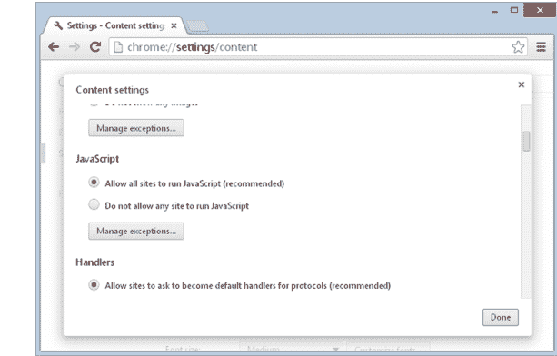

**图 1-1**

在 Internet Explorer 中禁用脚本功能更为困难。从菜单（右上角的齿轮图标）中选择“Internet 选项”，点击“安全”选项卡，并检查“Internet”或“本地 Intranet”选项是否设置了自定义安全级别。如果其中任何一个设置了，请点击“自定义级别”按钮，并向下滚动到“脚本”部分。检查“活动脚本”是否设置为“启用”。

最后需要注意的是如何在浏览器中打开代码示例。对于本书，你只需在硬盘上打开存储示例的文件即可。你可以通过多种方式执行此操作，但最简单的方法是直接双击该文件。

## 我的脚本放在哪里？

将 JavaScript 插入网页与插入任何其他 HTML 内容非常相似；你使用标签来标记脚本代码的开始和结束。你用来执行此操作的元素是 `<script/>`。它告诉浏览器，接下来由结束标签 `</script>` 包围的文本块不是要显示的 HTML，而是要处理的脚本代码。被 `<script>` 和 `</script>` 标签包围的代码块称为*脚本块*。这是一个例子：

```
<script>
    // JavaScript goes here
</script>
```

基本上，当浏览器发现 `<script>` 标签时，它不会尝试向用户显示包含的文本，而是使用浏览器的 JavaScript 引擎来运行代码中的指令。当然，代码可能会给出关于更改页面显示方式或页面中显示内容的指令，但代码本身的文本永远不会显示给用户。

你可以将 `<script/>` 元素放在 HTML 页面的头部（在 `<head>` 和 `</head>` 标签之间）或主体（在 `<body>` 和 `</body>` 标签之间）。然而，尽管你可以将它们放在这些区域之外——例如，在 `<html>` 标签之前或 `</html>` 标签之后——但这不符合 Web 标准，因此被认为是不良实践。今天的 JavaScript 开发人员通常将其 `<script/>` 元素直接添加在 `</body>` 标签之前。

`<script/>` 元素有一个 `type` 属性，告诉浏览器元素中包含的文本类型。对于 JavaScript，最佳实践是省略 `type` 属性（浏览器会自动假定任何没有 `type` 属性的 `<script/>` 元素都是 JavaScript）。我们过去总是将 `type` 属性设置为 `text/javascript`，但随着 HTML5 规范的引入，这不再被认为是良好的做法。仅当 `<script/>` 元素包含 JavaScript 以外的内容时，才包含 `type` 属性。

> **注意：** `<script/>` 元素不仅可以用于 JavaScript。一些基于 JavaScript 的模板引擎使用 `<script/>` 元素来包含 HTML 片段。

### 链接到外部 JavaScript 文件

`<script/>` 元素还有另一个功能：能够指定 JavaScript 代码不在网页内部，而在单独的文件中。你应该为任何外部文件使用文件扩展名 `.js`。虽然这不是强制性的，但它确实可以让你更容易地弄清楚每个文件中包含的内容。

要链接到外部 JavaScript 文件，你需要按照前面描述的方法创建一个 `<script/>` 元素，并使用其 `src` 属性指定外部文件的位置。例如，假设你创建了一个名为 `MyCommonFunctions.js` 的文件，你想链接它，并且该文件与你的网页在同一目录中。`<script/>` 元素应如下所示：

```
<script src="MyCommonFunctions.js"></script>
```

Web 浏览器将读取此代码并将文件内容作为网页的一部分包含进来。链接外部文件时，不得在开始和结束的 `<script>` 标签之间放置任何代码；例如，以下内容是无效的：

```
<script src="MyCommonFunctions.js">
var myVariable;
if ( myVariable == 1 ) {
    // do something
}
</script>
```

需要注意的是，开始的 `<script>` 标签必须伴随结束的 `</script>` 标签。你不能使用 XML 中的自闭合语法。因此，以下内容是无效的：

```
<script src="MyCommonFunctions.js" />
```

通常，你使用 `<script/>` 元素来加载本地文件（与网页本身在同一台计算机上的文件）。但是，你可以通过指定文件的 Web 地址从 Web 服务器加载外部文件。例如，如果你的文件名为 `MyCommonFunctions.js`，并托管在域名 `www.mysite.com` 的 Web 服务器上，`<script/>` 元素应如下所示：

```
<script src="http://www.mysite.com/MyCommonFunctions.js"></script>
```

在将知名的 JavaScript 库整合到网页中时，链接外部文件是常见的做法。托管这些库的服务器被称为*内容分发网络*，或 CDNs。CDN 相对安全，但要小心链接到由他人控制的外部文件。这会赋予那些人控制和更改你网页的能力，因此你需要非常确定你信任他们！

### 使用外部文件的优势

外部文件的最大优势是代码重用。假设你编写了一段复杂的 JavaScript，执行一个通用功能，你可能在许多页面中都需要它。如果你以内联方式包含代码（在网页内部而不是通过外部文件），你需要将代码复制并粘贴到使用它的每个网页中。只要你永远不需要更改代码，这没问题，但现实是你可能在某个时候需要更改或改进代码。如果你已经将代码复制并粘贴到 30 个不同的网页中，你需要在 30 个不同的地方更新它。这相当令人头疼！通过使用一个外部文件并在所有需要它的页面中包含它，你只需要更新一次代码，所有 30 个页面都会立即更新。这样简单多了！

使用外部文件的另一个优势是浏览器会缓存它们，就像缓存页面间共享的图像一样。如果你的文件很大，这可以节省下载时间并减少带宽使用。

## 你的第一个简单 JAVASCRIPT 程序

关于 JavaScript 这个主题已经谈得够多了；让我们来写一些代码！我们将从一个简单的例子开始，它改变网页的背景颜色。

**动手试试** 将页面涂成红色

这是一个使用 JavaScript 改变浏览器背景颜色的简单例子。在你的文本编辑器中，输入以下内容：

```
<!DOCTYPE html>
<html lang="en">
    <head>
        <meta charset="utf-8" />
        <title>Chapter 1, Example 1</title>
    </head>
    <body bgcolor="white">
        <p>Paragraph 1</p>
        <script>
            document.bgColor = "red";
        </script>
    </body>
</html>
```

将页面保存为 `ch1_example1.html` 到硬盘上的一个方便位置，并将其加载到你的 Web 浏览器中。你应该会看到一个红色的网页，左上角显示文本“Paragraph 1”。但是等等——你不是将 `<body>` 标签的 BGCOLOR 属性设置为白色吗？好吧，让我们看看这里发生了什么。

页面包含在 `<html>` 和 `</html>` 标签内。这个块包含一个 `<body>` 元素。当你定义开始的 `<body>` 标签时，你使用 HTML 将页面的背景颜色设置为白色：

```
<body bgcolor="white">
```

然后你通过使用 `<script>` 开始标签让浏览器知道你的下几行代码是 JavaScript 代码：

```
<script>
```

从此处开始直到结束标签 `</script>` 的所有内容都是 JavaScript，浏览器会将其视为 JavaScript 进行处理。在这个脚本块内，你使用 JavaScript 将文档的背景颜色设置为红色：

```
document.bgColor = "red";
```

你可能称之为*页面*的东西，在网页脚本中被称为*文档*。文档有许多属性，包括其背景颜色 `bgColor`。你可以通过书写 `document`，后跟一个点，再后跟属性名来引用文档的属性。目前不要担心 `document` 的用法；本书后面会更深入地探讨它。


请注意，上面的代码行是一个 JavaScript 语句的示例。在 `<script>` 和 `</script>` 标签之间的每一行代码都被称为一个语句，尽管有些语句可能会延续到多行。

你还会看到行尾有一个分号（;）。在 JavaScript 中，你使用分号来表示一个语句的结束。在实践中，JavaScript 对于分号的使用要求非常宽松，当你开始新的一行时，JavaScript 通常能判断你是想开始一行新的代码。然而，为了良好的编码习惯，你应该在代码语句的末尾使用分号，并且一个 JavaScript 语句应该只占一行，而不是延续到两行或更多行。此外，你会发现有些情况下必须包含分号，这将在本书的后面部分介绍。

最后，为了告诉浏览器停止将你的文本解释为 JavaScript，并开始将其解释为 HTML，你需要使用脚本结束标签：

```
</script>
```

你现在已经了解了代码是如何工作的，但还没有了解它的工作顺序。当浏览器加载网页时，它会从上到下逐个标签地渲染页面。这个过程被称为*解析*。网页浏览器从页面顶部开始，一直处理到页面底部。浏览器首先遇到 `<body>` 标签，并将文档的背景设置为白色。然后它继续解析页面。当它遇到 JavaScript 代码时，它被指示将文档的背景更改为红色。

## 编写更多 JavaScript

第一个示例让你初步接触了 JavaScript。我们将编写更多的 JavaScript 程序来演示网页的流程以及在浏览器中显示结果的多种方式之一。

### 动手实践：流程运作方式

让我们扩展前面的示例，以实际演示网页的解析过程。在你的文本编辑器中输入以下内容：

```html
<!DOCTYPE html>
<html lang="en">
    <head>
        <meta charset="utf-8" />
        <title>Chapter 1, Example 2</title>
    </head>
    <body bgcolor="white">
        <p>Paragraph 1</p>
        <script>
            // script block 1
            alert("First Script Block");
        </script>
        <p>Paragraph 2</p>
        <script>
            // script block 2
            alert("Second Script Block");
        </script>
        <p>Paragraph 3</p>
    </body>
</html>
```

将文件保存为 `ch1_example2.html`，然后将其加载到你的浏览器中。当你加载页面时，你应该会看到第一段文字 `Paragraph 1`，紧接着是第一个脚本块显示的一个消息框。浏览器会暂停解析，直到你点击确定按钮。如图 1-2 所示，页面背景是白色的，如 `<body>` 标签中设置的那样，并且只显示了第一段文字。

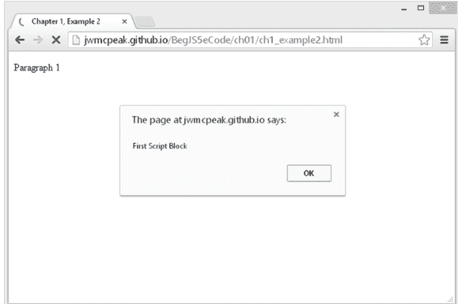

**图 1-2**

点击确定按钮，解析继续。浏览器显示第二段文字，并遇到第二个脚本块，该脚本块将背景颜色更改为红色。第二个脚本块显示另一个消息框，如图 1-3 所示。

点击确定，解析再次继续，显示第三段文字 `Paragraph 3`。网页完成，如图 1-4 所示。

页面的第一部分与我们之前的示例相同。页面的背景颜色在 `<body>` 标签的定义中设置为白色，然后将一段文字写入页面：

```html
<body bgcolor="white">
    <p>Paragraph 1</p>
```

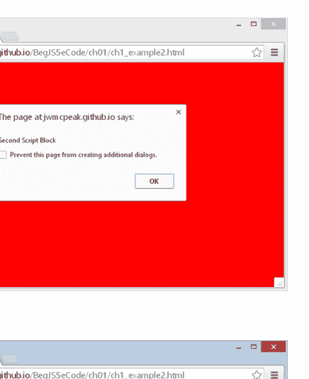

**图 1-3**

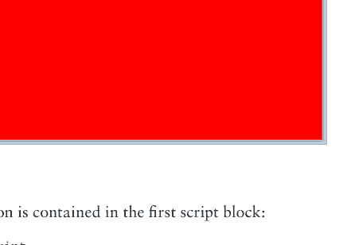

**图 1-4**

第一个新部分包含在第一个脚本块中：

```html
<script>
    // script block 1
    alert("First Script Block");
</script>
```

这个脚本块包含两行，对你来说都是新的。第一行

```
// Script block 1
```

只是一个*注释*，仅仅是为了你的方便。浏览器会识别行中双斜杠（//）之后的任何内容为注释，并且不会对其执行任何操作。它对你作为程序员很有用，因为你可以在代码中添加解释，这样当你以后回顾代码时，更容易记住当时在做什么。

第二行代码中的 `alert()` 函数对你来说也是新的。在学习它做什么之前，你需要了解什么是*函数*。函数将在第 4 章中更全面地定义，但现在你只需要将它们视为你可以用来执行某些任务的 JavaScript 代码片段。如果你有数学背景，你可能对函数是什么已经有了一些概念：它接收一些信息，处理它，然后给你一个结果。函数让你作为程序员的生活更轻松，因为你不必思考函数是如何完成任务的——你只需要集中精力在你想要执行任务的时候。

具体来说，`alert()` 函数使你能够通过显示一个消息框来警告或通知用户某些信息。要在消息框中显示的消息在 `alert()` 函数的括号内指定，这被称为函数的*参数*。

`alert()` 函数显示的消息框是*模态*的。这是一个重要的概念，你会再次遇到它。它只是意味着消息框不会消失，直到用户通过点击确定按钮关闭它。事实上，页面的解析在使用 `alert()` 函数的行处停止，直到用户关闭消息框后才会重新开始。这在本例中非常有用，因为它使你能够演示到目前为止已解析的结果：页面颜色已设置为白色，并且已显示了第一段文字。

当你点击确定时，浏览器继续沿页面向下解析以下代码行：

```html
<p>Paragraph 2</p>
<script>
    // script block 2
    document.bgColor = "red";
    alert("Second Script Block");
</script>
```

第二段文字被显示，第二块 JavaScript 代码被执行。脚本块代码的第一行是另一个注释，因此浏览器忽略了它。你在前面的示例中见过脚本代码的第二行——它将页面的背景颜色更改为红色。第三行代码是 `alert()` 函数，它显示第二个消息框。解析暂停，直到你点击确定关闭消息框。

当你关闭消息框时，浏览器继续处理页面中的下一行代码，显示第三段文字，并最终结束网页：

```html
<p>Paragraph 3</p>
</body>
</html>
```

这个例子提出的另一个重要观点是通过 HTML 设置页面属性（如背景颜色）与使用 JavaScript 做同样事情的区别。使用 HTML 设置属性的方法是*静态的*：一个值只能设置一次，并且永远无法通过 HTML 再次更改。使用 JavaScript 设置属性使你能够动态地更改它们的值。术语*动态*指的是可以更改且其值或外观不是一成不变的东西。

这个示例只是一个示例。在实践中，如果你想要页面的背景是红色的，只需使用 CSS 设置背景颜色即可（实际上不要使用 `bgcolor` 属性）。你想使用 JavaScript 的地方是你想要为页面添加某种智能或逻辑的地方。例如，如果用户的屏幕分辨率特别低，你可能想要更改页面上显示的内容，你可以用 JavaScript 来做到这一点。

### 动手实践：在网页中显示结果

在这个最后一个示例中，你将学习如何使用 JavaScript 将信息直接写入网页。当你编写计算结果或使用 JavaScript 创建的文本时，这会更有用，正如你在下一章中看到的那样。现在，你将只使用 JavaScript 将“Hello World!”写入一个空白页面：

```html
<!DOCTYPE html>
<html lang="en">
    <head>
        <meta charset="utf-8" />
        <title>Chapter 1, Example 3</title>
    </head>
    <body>
        <p id="results"></p>
        <script>
            document.getElementById("results").innerHTML = "Hello World!";
        </script>
    </body>
</html>
```

将页面保存为 `ch1_example3.html` 到你硬盘上的一个方便位置。现在将其加载到你的网页浏览器中，你会在页面中看到 Hello World!。尽管使用 HTML 做同样的事情会更容易，但这种技术在后面的章节中会被证明是有用的。

页面的第一部分与我们前面的示例相同，但当你到达这一行时，事情开始发生变化：

```html
<p id="results"></p>
```

你会注意到 `<p>` 元素通过 `id` 属性被赋予了一个 ID。这个 ID 在网页中必须是唯一的，因为它被 JavaScript 用来识别下一行中的特定 HTML 元素：

```javascript
document.getElementById("results").innerHTML = "Hello World!";
```


如果现在看起来很复杂，请不要担心；你将在后面的章节中了解更多关于其工作原理的内容。基本上，这段代码的意思是，“找到ID为`results`的元素，并将该元素内的HTML内容设置为Hello World！”

这一点很重要，因为访问段落的代码必须位于实际的`<p/>`元素之后。否则，代码将尝试在段落存在于页面之前访问它，从而引发错误。

## 简要了解浏览器与兼容性问题

在前面的例子中，你看到通过使用JavaScript，可以使用`document`的`bgColor`属性来更改网页的`document`背景色。无论你使用什么浏览器，这个例子都能正常工作，因为它们都支持带有`bgColor`属性的`document`。你可以说这个例子是*跨浏览器兼容*的。然而，一种浏览器中可用的属性或语言特性在另一种浏览器中并非总是可用。有时，甚至在同一种浏览器的不同版本之间也会出现这种情况。

创建基于Web的JavaScript所面临的主要难题之一，就是不同Web浏览器之间的差异、它们支持的HTML和CSS级别，以及它们的JavaScript引擎能够处理的功能。任何浏览器的每个新版本都会在其HTML、CSS和JavaScript支持方面添加令人兴奋的新功能。好消息是，浏览器创建者在更大程度上遵守了由Ecma和W3C等组织制定的标准。

你想要支持哪些浏览器，实际上取决于你认为你的网站大多数访客——即你的*用户群*——将会使用哪些浏览器。本书面向符合标准的浏览器，例如Chrome、IE9+、Firefox、Safari和Opera。

如果你想让你的网站显得专业，你就需要以某种方式处理旧版浏览器。你可以确保你的代码向后兼容——即它只使用旧版浏览器中可用的功能。然而，你可能会认为将自己限制在旧版浏览器的功能中根本不值得。在这种情况下，你需要确保你的页面能够优雅降级。换句话说，确保尽管你的页面在旧版浏览器中无法工作，但它们失败的方式不会让用户察觉，或者会提醒用户某些功能与他或她的浏览器不兼容。与优雅降级相反的做法是让你的代码抛出大量错误消息，在页面上显示奇怪的结果，并且总体上让你看起来像个不知道自己在做什么的白痴！

那么，你如何让你的网页优雅降级呢？你可以通过使用JavaScript在页面部分或完全加载后确定正在运行该网页的浏览器来实现这一点。你可以利用这些信息来确定运行哪些脚本，甚至可以将用户重定向到另一个充分利用其特定浏览器编写的页面。在后面的章节中，你将学习如何了解浏览器支持哪些功能并采取适当行动，以便你的页面在尽可能多的浏览器上都能正常工作。

## 总结

至此，你应该对JavaScript是什么以及它能做什么有了一个初步的了解。特别是，这个简要介绍涵盖了以下内容：

- 你了解了浏览器在解释你的网页时所遵循的过程。它逐个元素地（解析）浏览页面，并在遇到你的HTML标签和JavaScript代码时对其采取行动。
- 与许多编程语言不同，JavaScript只需一个文本编辑器就可以开始创建代码。像Windows记事本这样的简单工具对于入门就足够了，尽管更强大的工具在你获得更多信息后会非常有用。
- JavaScript代码与HTML一起嵌入到网页本身中。它的存在是通过使用`<script/>`元素来标记的。与HTML一样，脚本从页面顶部开始执行，然后向下执行，逐条解释和执行代码语句。

## 数据类型与变量

**本章你将学习：**

- 在代码中表示数据
- 在内存中存储数据
- 进行计算
- 转换数据

**WROX.COM 本章代码下载**

你可以在 http://www.wiley.com/go/BeginningJavaScript5E 的“Download Code”标签页上找到本章的wrox.com代码下载。你也可以在 http://beginningjs.com 查看所有示例及相关文件。

计算机的主要用途之一是处理和显示信息。我们所说的处理，是指信息以某种方式被计算机修改、解释或过滤。例如，在一个网上银行网站上，客户可能请求过去一个月从其账户支出的所有款项的详细信息。这里，计算机将检索信息，过滤掉与过去一个月支付无关的信息，然后在网页上显示剩余内容。在某些情况下，信息在不被显示的情况下就被处理，而在其他情况下，信息则直接获取而未经处理。例如，在银行环境中，定期付款可能在没有任何人工交互或显示的情况下通过电子方式处理和转移。

在计算中，信息被称为*数据*。数据有各种形式，例如数字、文本、日期和时间，这里仅举几例。在本章中，你将专门研究JavaScript如何处理数字和文本等数据。理解数据如何被处理是任何编程语言的基础。

在本章中，你将首先了解JavaScript可以处理的各种数据类型。然后，你将学习如何将这些数据存储在计算机的内存中，以便在代码中反复使用。最后，你将了解如何使用JavaScript来操作和处理数据。

## JavaScript中的数据类型

数据可以有多种不同的形式，或*类型*。你从编程之外的世界中会认出JavaScript处理的一些数据类型——例如数字和文本。其他数据类型则更加抽象，用于使编程更容易；其中一个例子是对象数据类型，你将在第5章中详细看到它。

有些编程语言是强类型的。在这些语言中，每当你使用一段数据时，你都需要明确说明你正在处理什么样的数据，并且该数据的使用必须遵循适用于其类型的严格规则。例如，在强类型语言中，你不能将一个数字和一个单词相加。

另一方面，JavaScript是一种弱类型语言，对于如何使用不同类型的数据要宽容得多。当你处理数据时，你通常不需要指定类型；JavaScript会自己弄清楚。此外，当你同时使用不同类型的数据时，JavaScript会在幕后弄清楚你试图做什么。

鉴于JavaScript对数据如此随意，为什么还要谈论数据类型呢？为什么不直接切入主题，开始使用数据而不担心其类型呢？

首先，尽管JavaScript非常擅长弄清楚它正在处理什么数据，但有时它会弄错，或者至少不做你想要它做的事情。在这些情况下，你需要向JavaScript明确你打算使用哪种数据类型以及应该如何使用。为此，你首先需要对数据类型有所了解。

第二个原因是，数据类型使你能够在代码中有效地使用数据。你可以用数据做什么以及你将得到什么结果，取决于所使用的数据类型，即使你没有明确指定它是什么类型。例如，尽管尝试将两个数字相乘是有意义的，但对文本做同样的事情就没有意义了。此外，数字相加的结果与文本相加的结果非常不同。对于数字，你会得到总和，而对于文本，你会得到由其他片段连接而成的一大块文本。

让我们简要地看一下一些更常用的数据类型：数值型、文本型和布尔型。你将在本章后面学习如何使用它们。

### 数值数据

数值数据有两种形式：

- 整数，例如145，也称为*整数*。这些数字可以是正数或负数，并且在JavaScript中可以跨越非常大的范围：$-2^{53}$ 到 $2^{53}$。
- 小数，例如1.234，也称为*浮点数*。与整数一样，它们可以是正数或负数，而且范围也很大。

简单来说，除非你正在编写专业的科学应用程序，否则你不会遇到JavaScript中可用数字大小的问题。另外，尽管在存储整数和浮点数时可以区别对待，但JavaScript实际上将它们都视为浮点数。它很友好地为你隐藏了细节，所以你通常不需要担心这一点。一个例外是当你想要一个整数但你有的是一个浮点数，在这种情况下，你将对数字进行四舍五入以使其成为整数。你将在本章后面学习如何对数字进行四舍五入。


### 文本数据

一个或多个文本字符的另一个术语是*字符串*。你只需将文本用引号（"）括起来，就能告诉 JavaScript 将其视为文本而非代码。例如，`"Hello World"` 和 `"A"` 是 JavaScript 能识别的字符串示例。你也可以使用单引号（'），因此 `'Hello World'` 和 `'A'` 也是 JavaScript 能识别的字符串。但是，字符串必须以与开始时相同的引号结束。因此，`'A"` 不是有效的 JavaScript 字符串，`'Hello World"` 也不是。

如果你想创建一个中间包含单引号的字符串，比如像 Peter O'Toole 这样的字符串，该怎么办？如果用双引号括起来就没问题，所以 `"Peter O'Toole"` 能被 JavaScript 识别。然而，`'Peter O'Toole'` 会产生错误。这是因为 JavaScript 认为你的文本字符串是 `Peter O`（即将中间的单引号视为字符串的结束），然后就无法理解后面的 `Toole'` 是什么了。

另一种解决方法是告诉 JavaScript 中间的 `'` 是文本的一部分，并不表示字符串的结束。你可以通过使用反斜杠字符（\）来实现，它在 JavaScript 中具有特殊含义，被称为*转义字符*。反斜杠告诉浏览器，下一个字符不是字符串的结尾，而是文本的一部分。所以 `'Peter O\'Toole'` 就能按预期工作了。

如果你想在双引号括起来的字符串中使用双引号怎么办？嗯，之前关于单引号的所有说法仍然适用。所以 `'Hello "Paul"'` 可以工作，但 `"Hello "Paul""` 不行。不过，`"Hello \"Paul\""` 可以工作。

JavaScript 还有许多其他特殊字符，它们无法直接输入，但可以使用转义字符与其他字符组合来表示，形成*转义序列*。这些转义序列的工作方式与 HTML 中的类似。例如，在 HTML 中，连续多个空格会被忽略，空格用 `&nbsp;` 表示。同样，在 JavaScript 中，你会发现有时无法直接使用某个字符，而必须使用转义序列。下表详细列出了一些常用的转义序列。

| 转义序列 | 表示的字符 |
|---|---|
| `\b` | 退格符 |
| `\f` | 换页符 |
| `\n` | 换行符 |
| `\r` | 回车符 |
| `\t` | 制表符 |
| `\'` | 单引号 |
| `\"` | 双引号 |
| `\\` | 反斜杠 |
| `\xNN` | *NN* 是一个十六进制数，用于标识 Latin-1 字符集中的一个字符。 |

### 布尔数据

这些转义序列中最不明显的可能是最后一个，它使用字符在 Latin-1 字符集中的编号来表示字符，而不是其通常的外观。我们举个例子：假设你想在字符串中包含版权符号（©）。你的字符串应该是什么样的？答案是 `"\xA9 Paul Wilton"`。

同样，你可以使用 Unicode 转义序列来引用字符。这些序列写作 `\uNNNN`，其中 `NNNN` 指的是该特定字符的 Unicode 编号。例如，要使用此方法引用版权符号，你可以使用字符串 `\u00A9`。

在现实世界中，“是或否”、“正或负”、“真或假”的使用非常普遍。真和假的概念对数字计算机也至关重要；它们不理解“也许”，只理解真和假。事实上，“是或否”这个概念非常有用，以至于在 JavaScript 中它有自己的数据类型：*布尔*数据类型。布尔类型有两个可能的值：`true` 代表是，`false` 代表否。

JavaScript 中布尔数据的用途与编程之外的世界完全相同：它使你能够基于答案回答问题和做出决策。例如，如果有人问你：“这本书是关于 JavaScript 的吗？”你可能会回答：“是的，”或者说：“那是对的。”同样，你可能会说：“如果这本书的主题不是 JavaScript 这个说法是假的，那就把它放下。”这里你就有了一个布尔逻辑语句（以其发明者乔治·布尔命名），它提出一个问题，然后根据答案是真还是假来执行某些操作。在 JavaScript 中，你可以使用同样的布尔逻辑赋予你的程序决策能力。你将在下一章更详细地了解布尔逻辑。

## 变量——在内存中存储数据

数据可以永久或临时存储。

你会希望将重要数据，如个人银行账户的详细信息，进行永久存储。例如，当博客斯女士从账户中取出十美元、英镑或欧元时，你希望从她的账户中扣除这笔钱，并永久记录新的余额。这类信息可能存储在被称为*数据库*的东西中。

然而，在其他情况下，你不想永久存储数据，而只是想临时记录一下。让我们看一个例子。假设博客斯女士向大银行公司贷款，她想查出这笔贷款还剩多少未还。她进入贷款的网上银行页面，点击链接查看欠款数额。这些数据会被永久存储在某处。但是，假设你还提供了一个增加还款额以提前还清贷款的功能。如果博客斯女士在网页的文本框中输入增加后的还款金额，你可能想显示贷款能提前多久还清。这将涉及一些可能复杂的计算，因此为了简化，你希望编写代码分几个阶段计算结果，在计算过程中将每个阶段的结果存储起来，然后再提供最终结果。在完成计算并显示结果后，就没有必要永久存储每个阶段的结果了，所以与其使用数据库，你需要使用一种叫做*变量*的东西。为什么叫变量？嗯，也许是因为变量可以用来存储可以修改或变化的数据。

变量的另一个好处是，与可能保存到磁盘或磁带的永久存储不同，变量存储在计算机的内存中。这意味着存储和检索数据的速度要快得多。

那么，是什么让变量成为临时存储数据的好地方呢？变量的生命周期是有限的。当你的访问者关闭页面或转到新页面时，你的变量就会丢失，除非你采取一些步骤将它们保存在某处。

你为每个变量命名，以便在代码的其他地方引用它们。这些名称必须遵循某些规则。

与大多数 JavaScript 代码一样，变量名是区分大小写的。例如，`myVariable` 和 `myvariable` 不同。你会发现，即使在你成为 JavaScript 专家之后，这仍然是代码中非常容易出现错误的一种方式。

此外，你不能使用某些名称和字符作为变量名。不能使用的名称被称为*保留*字。保留字是 JavaScript 为自己保留使用的单词（例如，`var` 或 `with`）。某些字符在变量名中也是禁止的：例如，和号（`&`）和百分号（`%`）。变量名中允许使用数字，但名称不能以数字开头。所以 `101myVariable` 不可以，但 `myVariable101` 可以。让我们看一些更多例子。

无效的名称包括：

- `with`
- `99variables`
- `my%Variable`
- `theGood&theBad`

有效的名称包括：

- `myVariable99`
- `myPercent_Variable`
- `the_Good_and_the_Bad`

你可能想为你的变量使用一种命名约定（例如，描述你打算在变量中存储何种数据的约定）。但是，只要你使用的名称有意义并且一致地使用，你选择什么约定并不重要。

### 创建变量并赋值

在使用变量之前，你应该使用 `var` 关键字向 JavaScript 引擎声明它的存在。这会警告引擎需要预留一些内存，以便稍后存储你的数据。要声明一个名为 `myFirstVariable` 的新变量，可以这样写：

```
var myFirstVariable;
```

请注意，行末的分号不是变量名的一部分，而是用来向 JavaScript 表示语句的结束。此行是一个 JavaScript 语句的例子。

一旦声明，你就可以使用变量来存储任何类型的数据。如前所述，许多其他编程语言（称为强类型语言）不仅要求你声明变量，还要求声明将存储的数据类型，如数字或文本。然而，JavaScript 是一种弱类型语言；你不需要将变量限制为只能存储特定类型的数据。

你可以通过使用等号（`=`）将数据放入变量中，这个过程称为*给变量赋值*。例如，如果你想让名为 `myFirstVariable` 的变量存储数字 `101`，可以这样写：

```
myFirstVariable = 101;
```

当用于给变量赋值时，等号有一个特殊的名称；它被称为*赋值运算符*。

### 动手试试：声明变量

让我们看一个例子，其中声明了一个变量，在其中存储一些数据，最后访问其内容。你还将看到变量可以存储任何类型的数据，并且所存储的数据类型可以改变。例如，你可以先存储文本，然后改为存储数字，而不会引起 JavaScript 的任何问题。将以下代码键入你的文本编辑器并将其保存为 `ch2_example1.html`：

```html
<!DOCTYPE html>

<html lang="en">
<head>
    <title>Chapter 2, Example 1</title>
</head>
<body>
    <script>
        var myFirstVariable;

        myFirstVariable = "Hello";
        alert(myFirstVariable);

        myFirstVariable = 54321;
        alert(myFirstVariable);
    </script>
</body>
</html>
```


一旦你将其加载到网页浏览器中，它会显示一个包含“Hello”的 `alert` 框，如图 2-1 所示。这是代码中该点处变量 `myFirstVariable` 的内容。

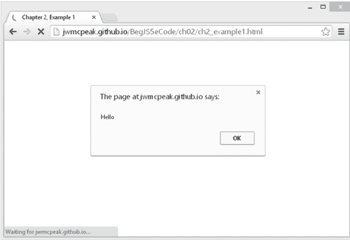

图 2-1

点击 OK，另一个 `alert` 框会出现，显示 54321，如图 2-2 所示。这是你为变量 `myFirstVariable` 赋值的新值。在脚本块中，你首先声明变量：

```
var myFirstVariable;
```

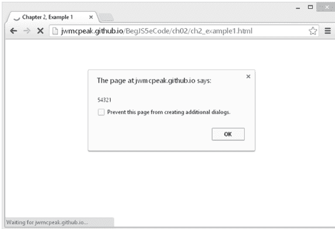

图 2-2

目前，它的值是 `undefined` 值，因为你只向 JavaScript 引擎声明了它的存在，而没有声明任何实际数据。这听起来可能有些奇怪，但 `undefined` 确实是 JavaScript 中的一个实际原始值，它使你可以进行比较。（例如，你可以检查一个变量是否包含实际值，或者是否尚未被赋值，即它是否为 undefined。）然而，在下一行中，你为 `myFirstVariable` 赋了一个字符串值，即 `Hello`：

```
myFirstVariable = "Hello";
```

在这里，你为变量赋了一个字面量值（即，一段实际数据，而不是通过计算或从另一个变量获取的数据）。几乎在任何可以使用字面量字符串或数字的地方，你都可以用一个包含数字或字符串数据的变量来替代。在下一行代码中你会看到一个例子，你在上一章见过的 `alert()` 函数中使用了变量 `myFirstVariable`：

```
alert(myFirstVariable);
```

这会导致第一个 `alert` 框出现。接下来，你在变量中存储一个新值，这次是一个数字：

```
myFirstVariable = 54321;
```

`myFirstVariable` 的先前值将永远丢失。用于存储该值的内存空间被 JavaScript 通过一个称为*垃圾回收*的过程自动释放。每当 JavaScript 检测到变量的内容不再可用时，例如当你分配新值时，它就会执行垃圾回收过程并使内存可用。没有这个自动垃圾回收过程，计算机的内存将越来越多地被消耗，直到最终耗尽，系统陷入停滞。然而，垃圾回收并不总是像它应该的那样高效，可能直到加载另一个页面时才会发生。

为了证明新值已被存储，再次使用 `alert()` 函数显示变量的新内容：

```
alert(myFirstVariable);
```

### 用其他变量的值赋值变量

你已经看到可以给变量赋一个数字或字符串，但能否给变量赋另一个变量中存储的数据呢？答案是可以的，非常容易，而且方式与给变量赋字面量值完全相同。例如，如果你声明了两个变量 `myVariable` 和 `myOtherVariable`，并给变量 `myOtherVariable` 赋值为 22，如下所示：

```
var myVariable;
var myOtherVariable;
myOtherVariable = 22;
```

你可以使用以下代码行将 `myVariable` 赋值为与 `myOtherVariable` 相同的值（即 22）：

```
myVariable = myOtherVariable;
```

让我们来看另一个例子，这次是将其他变量的值赋给变量。

### 试一试 用其他变量的值赋值变量

- 1. 在文本编辑器中输入以下代码，并将其保存为 `ch2_example2.html`：

```
<!DOCTYPE html>
<html lang="en">
<head>
    <title>Chapter 2, Example 2</title>
</head>
<body>
    <script>
        var string1 = "Hello";
        var string2 = "Goodbye";

        alert(string1);
        alert(string2);

        string2 = string1;

        alert(string1);
        alert(string2);

        string1 = "Now for something different";

        alert(string1);
        alert(string2);
    </script>
</body>
</html>
```

- 2. 在浏览器中加载该页面，你会看到一系列六个 `alert` 框出现。
- 3. 同工点击每个 `alert` 框上的 OK 以查看下一个警告。前两个显示 `string1` 和 `string2` 的值——分别是 Hello 和 Goodbye。然后你将 `string2` 赋值为 `string1` 中的值。接下来的两个 `alert` 框显示 `string1` 和 `string2` 的内容；这次两者都是 Hello。
- 4. 最后，你改变 `string1` 的值。请注意，`string2` 的值不受影响。最后两个 `alert` 框显示 `string1` 的新值（Now for something different）和 `string2` 的未改变值（Hello）。

在脚本块中，你首先做的是声明两个变量：`string1` 和 `string2`。然而，请注意，你在声明它们的同时就为它们赋值了。这是一种快捷方式，称为初始化，可以节省你打太多代码：

```
var string1 = "Hello";
var string2 = "Goodbye";
```

请注意，你可以将这种快捷方式用于所有数据类型，而不仅仅是字符串。在接下来的两行中，你使用 `alert()` 函数向用户显示每个变量的当前值：

```
alert(string1);
alert(string2);
```

然后你将 `string2` 赋值为 `string1` 中包含的值。为了证明赋值确实生效了，你再次使用 `alert()` 函数向用户显示每个变量的内容：

```
string2 = string1;

alert(string1);
alert(string2);
```

接下来，你将 `string1` 设置为一个新值：

```
string1 = "Now for something different";
```

这使 `string2` 保持其当前值，表明 `string2` 拥有自己从上一步从 `string1` 赋值而来的数据副本。你在后面的章节中会看到，情况并非总是如此。然而，作为一般规则，基本数据类型（如文本和数字）在赋值时总是被复制，而更复杂的数据类型（如你在第 5 章中遇到的对象）实际上是被共享而不是被复制的。例如，如果你有一个包含字符串 `Hello` 的变量，并将其他五个变量赋值为该变量的值，你现在会有原始数据和五个独立的数据副本。然而，如果它不是一个字符串而是一个对象，并且你做了同样的事情，你会发现你仍然只有一个数据副本，但六个变量共享它。使用六个变量中的任何一个来改变数据，对所有变量都会生效。

最后，你使用 `alert()` 函数显示每个变量的当前值：

```
alert(string1);
alert(string2);
```

## 使用数据——计算和基本字符串操作

你已经了解了如何声明变量以及它们如何存储信息，但到目前为止，你还没有用这些知识做任何真正有用的事情——那么，你究竟为什么要使用变量呢？

变量让你能够做的是临时保存信息，以便在数学计算中、在构建文本消息时，或在处理用户输入的单词时使用。变量有点像普通袖珍计算器上的记忆存储按钮。假设你正在计算你的财务状况。你可能会先把所有需要花的钱加起来，然后将其存储在临时记忆中。在你把所有收入加起来之后，你可以从记忆中扣除存储的金额，算出还会剩下多少。你可以用类似的方式使用变量：你可以先获取所需的用户输入并存储在变量中，然后使用获得的值进行计算。

在本节中，你将了解如何将存储在变量中的值好好利用于数字运算和基于文本的操作中。

### 数值计算

JavaScript 具有基本的数学能力，如加法、减法、乘法和除法。每种基本数学功能都由一个符号表示：分别是加号（+）、减号（–）、星号（*）和斜杠（/）。这些符号被称为*运算符*，因为它们对你给定的值进行操作。换句话说，它们执行某种计算或运算并返回结果。你可以在几乎任何可以使用数字或变量的地方使用这些计算的结果。

假设你正在计算购物清单上物品的总价值。你可以把这个计算写成如下形式：

购物总费用 = 10 + 5 + 5

或者，如果你实际计算总和，它是：

购物总费用 = 20

现在让我们看看在 JavaScript 中如何做到这一点。实际上，它非常相似，只是你需要使用一个变量来存储最终总和：

```
var totalCostOfShopping;
totalCostOfShopping = 10 + 5 + 5;
alert(totalCostOfShopping);
```

首先，你声明一个变量 `totalCostOfShopping` 来保存总费用。

在第二行中，你有代码 `10 + 5 + 5`。这段代码被称为*表达式*。当你将表达式 `totalCostOfShopping` 的值赋给变量时，JavaScript 会自动计算表达式的值（20）并将其存储在变量中。请注意，等号告诉 JavaScript 将计算结果存储在 `totalCostOfShopping` 变量中。这被称为将计算的值*赋值*给变量，这就是为什么单个等号（=）被称为*赋值运算符*。

最后，你在 `alert` 框中显示变量的值。

减法和乘法的运算符工作方式完全相同。除法有些不同。

### 试一试 计算

让我们来看一个使用除法运算符的例子，看看它是如何工作的。

1. 输入以下代码并将其保存为 `ch2_example3.html`：

```
<!DOCTYPE html>
<html lang="en">
<head>
    <title>Chapter 2, Example 3</title>
</head>
<body>
    <script>
        var firstNumber = 15;
        var secondNumber = 10;
        var answer;
        answer = 15 / 10;
```


### 自增和自减运算符

许多使用数学运算符的操作非常常见，以至于它们被赋予了专门的运算符。这里要介绍的两个是自增和自减运算符，分别由两个加号（++）和两个减号（--）表示。基本上，它们的作用就是将变量的值增加或减少一。你可以使用普通的 + 和 – 运算符来实现，例如：

```
myVariable = myVariable + 1;
myVariable = myVariable - 1;
```

> **注意** *你可以为变量赋一个新值，该值是涉及其先前值的表达式的结果。*

然而，使用自增和自减运算符可以将此简化为：

```
myVariable++;
myVariable--;
```

结果是相同的——`myVariable` 的值增加或减少了一——但代码更短。当你熟悉了语法，它就会变得非常清晰易读。

现在，你可能会认为这些运算符听起来就像戳眼睛一样没用。然而，在第 3 章中，当你了解如何多次运行相同的代码时，你会发现这些运算符非常有用且被广泛使用。事实上，++ 运算符被广泛使用，以至于有一门计算机语言以它命名：C++。这里的玩笑是 C++ 比 C 进了一步。（嗯，这就是程序员的幽默！）

除了将 ++ 或 -- 放在变量后面，你也可以将它们放在前面，像这样：

```
++myVariable;
--myVariable;
```

当 ++ 和 -- 单独使用时（通常如此），它们放置的位置没有区别，但也可以将 ++ 和 -- 运算符与其他运算符一起在表达式中使用。例如：

```
myVar = myNumber++ - 20;
```

这段代码从 `myNumber` 中减去 20，然后将变量 `myNumber` 自增一，再将结果赋给变量 `myVar`。相反，如果你将 ++ 放在前面，像这样前缀它：

```
myVar = ++myNumber - 20;
```

`myNumber` 会先自增一，然后减去 20。这是一个细微的差别，但在某些情况下非常重要。看下面的代码：

```
myNumber = 1;
myVar = (myNumber++ * 10 + 1);
```

`myVar` 会包含什么值？嗯，因为 ++ 是后缀的（它在 `myNumber` 变量之后），它会在之后才自增。所以这个等式读作：将 `myNumber` 乘以 10 加 1，然后将 `myNumber` 自增一。

```
myVar = 1 * 10 + 1 = 11
```

然后将 `myNumber` 加 1 得到 12，但这是在值 11 被赋给 `myVar` 之后才做的。现在看看下面的代码：

```
myNumber = 1;
myVar = ++myNumber * 10 + 1;
```

这次 `myNumber` 先自增一，然后乘以 10 加 1：

```
myVar = 2 * 10 + 1 = 21
```

可以想象，这样的细微差别很容易被忽略，从而导致代码中的错误；因此，最好避免使用这种语法。
在继续之前，这里似乎是介绍另一个运算符的好地方：+=。你可以使用这个运算符作为快捷方式，将变量的值增加一个设定的量。例如，

```
myVar += 6;
```

与下面完全相同：

```
myVar = myVar + 6;
```

你也可以对减法和乘法做同样的事情，如这里所示：

```
myVar -= 6;
myVar *= 6;
```

这等价于：

```
myVar = myVar - 6;
myVar = myVar * 6;
```

### 运算符优先级

你已经看到，执行某些功能的符号——比如 +，用于将两个数字相加，以及 -，用于从一个数字中减去另一个——被称为运算符。与人不同，并非所有运算符都是生而平等的；有些具有更高的*优先级*——也就是说，它们会优先被处理。快速看一个简单的例子将有助于说明这一点：

```
var myVariable;

myVariable = 1 + 1 * 2;

alert(myVariable);
```

如果你输入这个，你期望 `alert` 框显示 `myVariable` 的值为多少？你可能期望因为 `1 + 1 = 2` 且 `2 * 2 = 4`，所以答案是 4。实际上，你会发现 `alert` 框显示 3 作为计算结果存储在 `myVariable` 中的值。那么是怎么回事？JavaScript 加法算错了吗？

嗯，你可能已经从对数学的理解中知道原因了。JavaScript 进行计算的方式是先计算 `1 * 2 = 2`，然后将此结果用于加法，因此 JavaScript 最终得到 `1 + 2 = 3`。

为什么？因为 `*` 的优先级高于 `+`。`=` 符号，也是运算符（称为赋值运算符），具有最低的优先级——它总是最后被处理。

`+` 和 `-` 运算符具有相等的优先级，那么哪一个先做呢？嗯，JavaScript 从左到右进行计算，因此如果计算中存在优先级相等的运算符，它们将按照从左到右出现的顺序进行计算。这同样适用于 `*` 和 `/`，它们也具有相等的优先级。

### 动手实践：华氏度转摄氏度

看一个稍微复杂一点的例子——一个华氏度转摄氏度的转换器。（摄氏度是摄氏温度刻度的另一个名称。）输入此代码并将其保存为 `ch2_example4.html`：

```
<!DOCTYPE html>
<html lang="en">
<head>
    <title>Chapter 2, Example 4</title>
</head>
<body>
    <script>
        // Equation is °C = 5/9 (°F - 32).
        var degFahren = prompt("Enter the degrees in Fahrenheit",50);
        var degCent;

        degCent = 5/9 * (degFahren - 32);

        alert(degCent);
    </script>
</body>
</html>
```

如果你将页面加载到浏览器中，你应该会看到一个提示框，如图 2-3 所示，要求你输入要转换的华氏度数。默认值 50 已经填好。

如果你将其保留为 50 并单击确定，会出现一个包含数字 10 的 `alert` 框。这表示 50 华氏度转换为摄氏度。

重新加载页面，并尝试更改提示框中的值，看看你会得到什么结果。例如，将值更改为 32 并重新加载页面。这次你应该会在框中看到 0 出现。


如果遇到这种情况，你需要更改IE的安全设置，以允许来自你计算机的活动内容。操作步骤如下：

1.  打开IE，从“工具”菜单中选择“Internet选项”，如图2-5所示。

    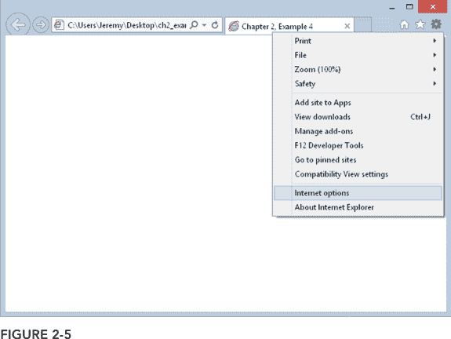

    图 2-5

2.  单击“高级”选项卡，然后向下滚动到“安全”部分。勾选“允许活动内容在我计算机上的文件中运行”选项，如图2-6所示。
3.  单击“Internet选项”对话框上的“确定”按钮，然后关闭Internet Explorer。重新打开“摄氏转华氏”示例，现在这个示例就能正常工作了。

脚本块的第一行是一个注释，因为它以两个正斜杠（//）开头。它包含了将华氏温度转换为摄氏温度的公式，放在示例代码中仅供参考：

```
// 公式为 °C = 5/9 (°F - 32)。
```

你的任务是用JavaScript代码来表示这个公式。你首先声明变量 `degFahren` 和 `degCent`：

```
var degFahren = prompt("Enter the degrees in Fahrenheit",50);
var degCent;
```

你不是将 `degFahren` 变量初始化为一个字面值，而是使用 `prompt()` 函数从用户那里获取一个值。`prompt()` 函数的工作方式与 `alert()` 函数类似，不同之处在于，它除了显示一条消息外，还包含一个文本框，用户可以在其中输入值。这个值将被存储在 `degFahren` 变量中。返回的值是一个文本字符串，但如本章后面“数据类型转换”一节所讨论的，当JavaScript将其作为数字使用时，会将其隐式转换为数字。

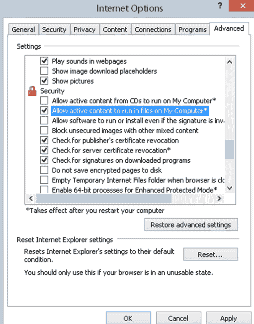

图 2-6

你向 `prompt()` 函数传递两条信息：

-   要显示的文本——通常是提示用户输入的问题。
-   当提示对话框首次出现时，输入框中包含的默认值。

这两条信息必须按指定的顺序用逗号分隔。如果你不希望提示框打开时输入框中有默认值，请为第二条信息使用空字符串（`""`）。

如前面的代码所示，文本是“Enter the degrees in Fahrenheit”（输入华氏度），输入框中的默认值是50。

接下来脚本块中是用JavaScript表示的公式。你将公式的结果存储在 `degCent` 变量中。你可以看到JavaScript代码与注释中的公式非常相似，只是你用 `degFahren` 代替了 °F，用 `degCent` 代替了 °C：

```
degCent = 5/9 * (degFahren - 32);
```

等号右侧表达式的计算涉及几个重要点。首先，就像在数学中一样，JavaScript等式是从左到右读取的，至少对于基本的数学函数（如+、-等）是如此。其次，正如你之前所看到的，就像数学中有优先级一样，JavaScript中也有优先级。

从左边开始，JavaScript首先计算 `5/9 = .5556`（近似值）。然后遇到乘法，但是等等...你公式的最后一部分 `degFahren - 32` 在括号里。这提高了其优先级，导致JavaScript在执行乘法之前先计算 `degFahren - 32` 的结果。例如，当 `degFahren` 设置为50时，`(degFahren - 32) = (50 - 32) = 18`。现在JavaScript执行乘法，`.5556 * 18`，大约等于10。

如果你不使用括号会怎样？那么你的代码将是：

```
degCent = 5/9 * degFahren - 32;
```

`5/9` 的计算保持不变，但接下来JavaScript会计算乘法 `5/9 * degFahren`。这是因为乘法优先于减法。当 `degFahren` 是50时，这等价于 `5/9 * 50 = 27.7778`。最后，JavaScript会减去32，结果得到-4.2221；这不是你想要的答案！

最后，在你的脚本块中，你使用 `alert()` 函数显示答案：

```
alert(degCent);
```

这就完成了对JavaScript基本计算的简要介绍。然而，在第5章中，你将学习 `Math` 对象，它使你能够进行更复杂的计算。

### 基本字符串操作

在前面的部分中，你了解了文本或字符串数据类型以及数字数据。就像数字数据有相关的运算符一样，字符串也有运算符。本节介绍使用这些运算符的一些基本字符串操作技术。字符串在第5章有更深入的介绍，高级字符串处理则在第6章中讨论。

你在JavaScript中会发现自己一做再做的一件事就是将两个字符串连接成一个字符串——这个过程称为连接。例如，你可能想要连接字符串 "Hello " 和 "Paul" 来生成字符串 "Hello Paul"。那么如何连接呢？很简单！使用 + 运算符。回顾一下，当应用于数字时，+ 运算符将它们相加，但当用于两个字符串时，它将它们连接起来：

```
var concatString = "Hello " + "Paul";
```

现在存储在变量 `concatString` 中的字符串是 "Hello Paul"。注意，字符串 "Hello" 的最后一个字符是一个空格——如果你漏掉了这个空格，你的连接字符串将是 "HelloPaul"。

### 动手试一试 | 连接字符串

让我们看一个使用 `+` 运算符进行字符串连接的例子。

1.  输入以下代码并将其保存为 `ch2_example5.html`：

```
<!DOCTYPE html>
<html lang="en">
<head>
    <title>Chapter 2, Example 5</title>
</head>
<body>
    <script>
        var greetingString = "Hello";
        var myName = prompt("Please enter your name", "");
        var concatString;

        document.write(greetingString + " " + myName + "<br/>");

        concatString = greetingString + " " + myName;

        document.write(concatString);
    </script>
</body>
</html>
```

2.  如果你在网络浏览器中加载它，你应该会看到一个提示框，要求你输入姓名。
3.  输入你的名字并单击“确定”。你应该会在网页上看到一个问候语和你的名字显示两次。

你通过声明三个变量来开始脚本块。你将第一个变量 `greetingString` 设置为一个字符串值。第二个变量 `myName` 被赋值为用户在提示框中输入的任何内容。你没有在这里初始化第三个变量 `concatString`。它将用于存储你稍后在代码中进行的连接操作的结果。

```
var greetingString = "Hello";
var myName = prompt("Please enter your name", "");
var concatString;
```

在上一章中，你看到了网页是如何由 `document` 这个概念表示的，以及它具有许多不同的属性，例如 `bgColor`。你也可以使用 `document` 直接向页面本身写入文本和HTML。你可以通过使用 `document` 这个词，后跟一个点，然后是 `write()` 来实现这一点。然后你使用 `document.write()` 的方式与使用 `alert()` 函数类似，即在 `write` 一词后面的括号内放入你想要在网页中显示的文本。不过，这里不用太担心，因为所有这些在后面的章节中都会详细解释。但是，你现在在代码中利用 `document.write()` 将一个表达式的结果写入页面：

```
document.write(greetingString + " " + myName + "<br/>");
```

写入页面的表达式是 `greetingString` 变量的值、一个空格（" "）、`myName` 变量的值以及HTML `<br/>` 元素（导致换行）的连接。例如，如果你在提示框中输入 `Jeremy`，这个表达式的值将是：

```
Hello Jeremy<br/>
```

下一行代码是一个类似的表达式。这次它只是变量 `greetingString` 的值、一个空格和变量 `myName` 的值的连接。你将此表达式的结果存储在变量 `concatString` 中。最后，你使用 `document.write()` 将变量 `concatString` 的内容写入页面：

```
concatString = greetingString + " " + myName;
document.write(concatString);
```

### 混合数字和字符串

如果你想在表达式中混合文本和数字怎么办？一个典型的例子就是你之前看到的温度转换器。在这个例子中，你只是显示数字，而没有告诉用户它实际意味着什么。你真正想做的是在数字周围加上描述性文本，例如“转换为摄氏度的值为10。”

混合数字和文本实际上非常简单。你可以简单地使用 + 运算符将它们连接起来。JavaScript足够智能，当涉及一个字符串和一个数字时，它知道你不是在尝试进行数值计算，而是想将数字视为字符串并将其与文本连接起来。例如，要连接文本 `My age is` 和数字 `101`，你可以简单地这样做：

```
alert("My age is " + 101);
```

这会产生一个包含“ My age is 101”的 `alert` 框。

**动手试一试 | 使温度转换器更友好**

你可以在温度转换器示例中尝试这种连接字符串和数字的技术。你输出一些解释性文本，以及转换计算的结果。你需要做的修改非常小，所以请将 `ch2_example4.html` 加载到文本编辑器中，更改以下行。然后将其另存为 `ch2_example6.html`。

```
<!DOCTYPE html>
<html lang="en">
<head>
    <title>Chapter 2, Example 6</title>
</head>
<body>
    <script>
        // 公式为 °C = 5/9 (°F - 32)。
        var degFahren = prompt("Enter the degrees in Fahrenheit",50);
```


## 数据类型转换

如你所见，当你将一个字符串和一个数字相加时，JavaScript 会做出明智的选择，将数字转换为字符串，然后将两者连接起来。通常，JavaScript 有足够的智慧在需要时自动进行此类数据类型转换，但在某些情况下，你需要自己转换数据的类型。例如，你可能得到一个字符串数据，但你想将其视为数字处理。如果你使用表单从用户那里收集数据，这种情况尤其可能出现。用户输入的任何值都被视为字符串，即使它们可能包含数字数据，例如用户的年龄。

为什么改变数据类型如此重要？考虑这样一种情况：你通过表单从用户那里收集两个数字并想计算它们的和。这两个数字对你来说以字符串形式存在，例如 "22" 和 "15"。当你尝试使用 "22" + "15" 来计算它们的和时，你得到的结果是 "2215"，因为 JavaScript 认为你是在连接两个字符串，而不是在计算两个数字的和。更令人困惑的是，顺序也很重要。所以：

```
1 + 2 + "abc"
```

结果是一个包含 "3abc" 的字符串，而：

```
"abc" + 1 + 2
```

则会得到一个包含 "abc12" 的字符串。

在本节中，我们将介绍两个将字符串转换为数字的函数：`parseInt()` 和 `parseFloat()`。

我们先来看 `parseInt()`。这个函数接受一个字符串并将其转换为一个整数。这个名称起初可能有点令人困惑——为什么叫 `parseInt()` 而不是 `convertToInt()`？名称的主要原因源于函数的工作方式。它实际上会遍历（即解析）你要求它转换的字符串的每个字符，并检查它是否是一个有效的数字。如果有效，`parseInt()` 会使用它来构建数字；如果无效，命令就会停止转换并返回它已转换的数字。

例如，如果你的代码是 `parseInt("123")`，JavaScript 会将字符串 "123" 转换为数字 123。对于代码 `parseInt("123abc")`，JavaScript 也会返回数字 123。当 JavaScript 引擎遇到字母 'a' 时，它会认为数字已经结束，并给出 123 作为字符串 "123abc" 的整数版本。

`parseFloat()` 函数的工作方式与 `parseInt()` 相同，不同之处在于它返回浮点数（即小数），并且字符串中的小数点被视为允许数字的一部分。

### 动手实践：将字符串转换为数字

让我们来看一个使用 `parseInt()` 和 `parseFloat()` 的例子。输入以下代码并将其保存为 ch2_example7.html：

```
<!DOCTYPE html>
<html lang="en">
<head>
    <title>Chapter 2, Example 7</title>
</head>
<body>
    <script>
        var myString = "56.02 degrees centigrade";
        var myInt;
        var myFloat;

        document.write("\"" + myString + "\" is " + parseInt(myString, 10) +
            " as an integer" + "<br/>");

        myInt = parseInt(myString, 10);
        document.write("\"" + myString +
            "\" when converted to an integer equals " + myInt + "<br/>");

        myFloat = parseFloat(myString);
        document.write("\"" + myString +
            "\" when converted to a floating point number equals " + myFloat);
    </script>
</body>
</html>
```

在浏览器中加载它，你将看到网页上写出了三行内容，如图 2-8 所示。

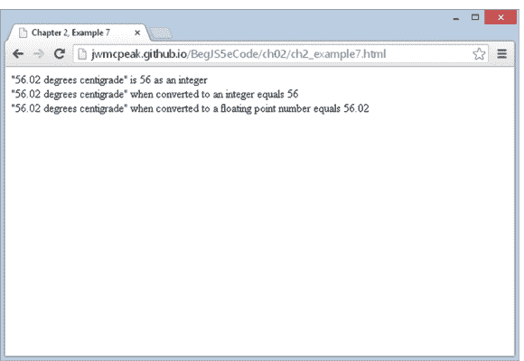

图 2-8

脚本块中的第一个任务是声明一些变量。声明了变量 `myString` 并初始化为要转换的字符串。在这个例子中，你完全可以直接使用字符串而不是将其存储在变量中，但实际上你会发现你使用变量的次数比字面值更多。你还要声明变量 `myInt` 和 `myFloat`，它们将保存转换后的数字：

```
var myString = "56.02 degrees centigrade";
var myInt;
var myFloat;
```

接下来，你将 `myString` 转换后的整数值写入页面，显示在你使用字符串连接构建的友好句子中。注意你使用了转义序列 `\"` 来显示围绕要转换的字符串的引号 (`"`)：

```
document.write("\"" + myString + "\" is " + parseInt(myString, 10) +
    " as an integer" + "<br/>");
```

如你所见，你可以在任何需要使用数字本身或包含数字的变量的地方使用 `parseInt()` 和 `parseFloat()`。实际上，在这行代码中，JavaScript 引擎进行了两次转换。首先，它将 `myString` 转换为整数，因为你通过使用 `parseInt()` 要求了这一点。然后它自动将该整数转换回字符串，以便可以与其他字符串连接起来组成你的句子。还要注意，当你处理整数时，只有 `myString` 变量值中的 56 部分被视为有效数字。6 之后的任何内容都被视为无效并被忽略。

注意传递给 `parseInt()` 的第二个值，即数字 10。这被称为基数，它决定了字符串如何被解析成数字。通过传递数字 10，你告诉 `parseInt()` 函数使用十进制数制来转换数字。十进制是我们常用的数制，但你可以使用 `parseInt()` 将数字转换为二进制（基数为 2）、十六进制（基数为 16）和其他数制。例如，`parseInt(10, 2)` 使用二进制数制转换数字 10，结果是数字 2。务必指定基数！没有它，JavaScript 会猜测使用什么数制，你可能会遇到意外的结果。

接下来，你使用 `parseInt()` 对 `myString` 进行相同的转换，但这次将结果存储在 `myInt` 变量中。在下一行，你将结果用于显示给用户的某些文本中：

```
myInt = parseInt(myString, 10);
document.write("\"" + myString +
    "\" when converted to an integer equals " + myInt + "<br/>");
```

同样，虽然 `myInt` 持有一个数字，但 JavaScript 解释器知道，当涉及字符串和数字时，`+` 表示你希望将 `myInt` 的值转换为字符串并连接到字符串的其余部分以便显示。

最后，你使用 `parseFloat()` 将 `myString` 中的字符串转换为浮点数，并将其存储在变量 `myFloat` 中。这次小数点被视为数字的有效部分，因此只有 2 之后的任何内容才被忽略。你再次使用 `document.write()` 将结果写入网页中的友好字符串：

```
myFloat = parseFloat(myString);
document.write("\"" + myString +
    "\" when converted to a floating point number equals " + myFloat);
```

### 处理无法转换的字符串

有些字符串根本无法转换为数字，例如不包含任何数字数据的字符串。如果你尝试转换这些字符串会发生什么？作为一个小实验，尝试更改


按照前面的示例进行操作，使 `myString` 持有一个无法转换的值。例如，将这行代码

```
var myString = "56.02 degrees centigrade";
```

改为

```
var myString = "I'm a name not a number";
```

现在，在浏览器中重新加载页面，你应该会看到如图 2-9 所示的内容。

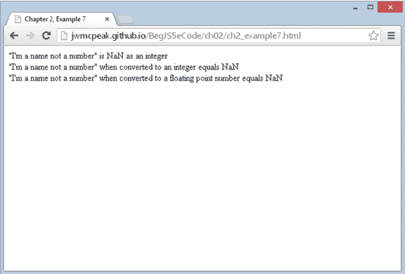

**图 2-9**

你可以看到，之前显示数字的地方现在显示的是 `NaN`。这是个什么数字？实际上，它*根本不是一个数字*！

如果你对任何空字符串，或者不以至少一个有效数字开头的字符串使用 `parseInt()` 或 `parseFloat()`，都会得到 `NaN`，意思是“非数字”。

`NaN` 实际上是 JavaScript 中的一个特殊值。它有一个专门的函数 `isNaN()`，用来检查某个值是否为 `NaN`。例如，

```
myVar1 = isNaN("Hello");
```

会将值 `true` 存入变量 `myVar1`，因为 `"Hello"` 不是一个数字；而

```
myVar2 = isNaN("34");
```

会将值 `false` 存入变量 `myVar2`，因为 `isNaN()` 函数可以成功地将字符串 `"34"` 转换为数字。

在后续章节中，你将了解如何使用 `isNaN()` 函数来验证字符串是否为有效的数字，这在处理用户输入时非常有用。

### 数组

现在我们要介绍一个新概念——称为*数组*的东西。数组类似于普通变量，因为你可以用它来存放任何类型的数据。但是，它有一个重要的不同之处，你将在本节中看到。

正如你已经看到的，普通变量一次只能存放一条数据。例如，你可以将 `myVariable` 设置为等于 25，如下所示：

```
myVariable = 25;
```

然后将其设置为其他值，比如 35：

```
myVariable = 35;
```

然而，当你将变量设置为 35 时，之前的值 25 就丢失了。变量 `myVariable` 现在只包含数字 35。

下表说明了该变量：

| 变量名 | 值 |
| :--- | :--- |
| myVariable | 35 |

这种普通变量与数组的区别在于，数组可以*同时*存放*多条*数据。例如，你可以使用一个名为 `myArray` 的数组来同时存储数字 25 和 35。数组中可以存放每一条数据的位置称为一个*元素*。

你如何区分数组中的这两条数据呢？你可以为每条数据分配一个*索引*值。要引用那条数据，你需要将其索引值放在数组名称后的方括号内。例如，一个名为 `myArray`、包含数据 25 和 35 的数组可以用下表说明：

| 元素名 | 值 |
| :--- | :--- |
| myArray[0] | 25 |
| myArray[1] | 35 |

注意，索引值从 0 开始，而不是 1。为什么是这样？当然 1 更合理——毕竟，我们人类倾向于说第一条数据，接着是第二条，依此类推。而计算机从 0 开始，将第一条数据视为第零条，第二条视为第一条，等等。这很令人困惑，但你很快就会习惯的。

数组非常有用，因为你可以根据需要（在语言的限制内，即最多 2 的 32 次方个元素）在数组中存放任意多或任意少的数据项。而且，你无需提前说明要在数组中存放多少条数据。

那么，如何创建一个数组呢？这与声明普通变量略有不同。要创建一个新数组，你需要声明一个变量名，并使用 `new` 关键字和 `Array()` 函数告诉 JavaScript 你希望它是一个新数组。例如，你可以这样定义数组 `myArray`：

```
var myArray = new Array();
```

请注意，与 JavaScript 中的所有内容一样，代码区分大小写，因此如果你输入 `array()` 而不是 `Array()`，代码将无法工作。`new` 运算符的使用将在第 5 章中解释。

如今的 JavaScript 开发者这样创建数组：

```
var myArray = [];
```

这使用了*数组字面量*来创建数组。它在功能上与使用 `new Array()` 相同，但需要输入的字符更少。创建数组没有绝对的对错方式，但在本书的剩余部分，我们将使用数组字面量来创建数组。

与普通变量一样，你也可以先声明变量，然后告诉 JavaScript 你希望它是一个数组。例如：

```
var myArray;
myArray = [];
```

你已经看到了如何声明一个新数组，但如何将数据项存储到其中呢？你可以在定义数组时，在方括号内包含数据，每条数据用逗号分隔。例如：

```
var myArray = ["Paul", 345, "John", 112, "Bob", 99];
```

这里，第一条数据 `"Paul"` 将以索引 `0` 放入数组。下一条数据 `345` 将以索引 `1` 放入数组，以此类推。这意味着名为 `myArray[0]` 的元素包含值 `"Paul"`，名为 `myArray[1]` 的元素包含值 `345`，依此类推。

你不必在第一次创建数组时就提供数据。例如，你也可以将上面的代码行写成这样：

```
var myArray = [];
myArray[0] = "Paul";
myArray[1] = 345;
myArray[2] = "John";
myArray[3] = 112;
myArray[4] = "Bob";
myArray[5] = 99;
```

你使用每个元素名就像使用变量一样，为其赋值。你将在接下来的“动手试一试”部分学习这种声明数组元素值的方法。

显然，在本例中，第一种定义数据项的方式要简单得多。但是，在某些情况下，你可能需要在数据项声明后更改变特元素中存储的数据。那样的话，你就必须使用后一种方法来定义数组元素的值。

从前面的示例中，你还会发现你可以在同一个数组中存储不同的数据类型。JavaScript 在数组内容和存放位置上非常灵活。

### 动手试一试 数组

在本例中，你将创建一个数组来存放一些名字，并使用上一节描述的第二种方法将这些数据存储到数组中。然后向用户显示这些数据。

输入以下代码并将其保存为 ch2_example8.html：

```
<!DOCTYPE html>
<html lang="en">
<head>
    <title>Chapter 2, Example 8</title>
</head>
<body>
    <script>
        var myArray = [];
        myArray[0] = "Jeremy";
        myArray[1] = "Paul";
        myArray[2] = "John";

        document.write("myArray[0] = " + myArray[0] + "<br/>");
        document.write("myArray[2] = " + myArray[2] + "<br/>");
        document.write("myArray[1] = " + myArray[1] + "<br/>");

        myArray[1] = "Mike";
        document.write("myArray[1] changed to " + myArray[1]);
    </script>
</body>
</html>
```

如果你在网页浏览器中加载此文件，应该会看到一个类似于图 2-10 所示的网页。

脚本块中的第一个任务是声明一个变量并将其初始化为数组：

```
var myArray = [];
```

现在你已经定义了数组，就可以在其中存储一些数据了。每次你用一个新的索引存储一条数据时，JavaScript 都会自动为其创建一个新的存储空间。记住，第一个元素将位于 myArray[0]。

我们逐一查看向数组添加的内容，看看发生了什么。在添加任何内容之前，你的数组是空的。然后你用下面这行代码添加一个数组元素：

```
myArray[0] = "Jeremy";
```

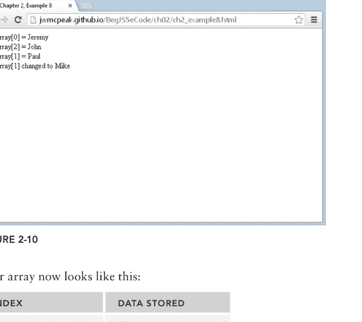

**图 2-10**

你的数组现在如下所示：

| 索引 | 存储的数据 |
|---|---|
| 0 | Jeremy |

然后你向数组添加另一个元素，这次索引为 1：

```
myArray[1] = "Paul";
```

你的数组现在如下所示：

| 索引 | 存储的数据 |
|---|---|
| 0 | Jeremy |
| 1 | Paul |

最后，你添加第三个元素，索引为 2：

```
myArray[2] = "John";
```

你的数组现在如下所示：

| 索引 | 存储的数据 |
|---|---|
| 0 | Jeremy |
| 1 | Paul |
| 2 | John |


接下来，你使用一系列 `document.write()` 函数，将数组每个元素包含的值插入到网页中。这里数组是无序的，只是为了演示你可以那样访问它：

```
document.write("myArray[0] = " + myArray[0] + "<br/>");
document.write("myArray[2] = " + myArray[2] + "<br/>");
document.write("myArray[1] = " + myArray[1] + "<br/>");
```

你可以将数组中的每个特定位置视为一个标准变量，因此可以使用它进行计算、将其值传递给另一个变量或数组等。但是，如果在定义数组位置之前尝试访问其中的数据，将得到 `undefined` 作为值。

最后，你将第二个数组位置的值更改为 `"Mike"`。你本可以将其更改为数字，因为就像普通变量一样，你可以随时在数组的每个单独数据位置存储任何数据类型：

```
myArray[1] = "Mike";
```

现在你的数组内容如下所示：

| 索引 | 存储的数据 |
|-------|-------------|
| 0     | Jeremy      |
| 1     | Mike        |
| 2     | John        |

为了展示你所做的更改已生效，你使用 `document.write()` 显示第二个元素的值：

```
document.write("myArray[1] changed to " + myArray[1]);
```

## 多维数组

假设你想在一个数组中存储公司的人员信息。你可能有姓名、年龄、地址等数据。创建这样一个数组的一种方法是顺序存储信息——第一个姓名放在数组的第一个元素中，然后对应的年龄放在下一个元素中，地址放在第三个元素中，下一个姓名放在第四个元素中，以此类推。你的数组可能如下所示：

| 索引 | 存储的数据 |
|-------|-------------|
| 0     | Name1       |
| 1     | Age1        |
| 2     | Address1    |

这可以工作，但有一个更简洁的解决方案：使用*多维数组*。到目前为止，你一直在使用一维数组。在这些数组中，每个元素仅由一个索引指定——即一个维度。所以，以上述例子为例，你可以看到 `Name1` 在索引 `0` 处，`Age1` 在索引 `1` 处，以此类推。

多维数组是指每个元素有两个或更多索引的数组。例如，你的人员数组作为二维数组可能如下所示：

| 索引 | 0 | 1 | 2 |
|-------|--------|--------|--------|
| 0 | Name1 | Name2 | Name3 |
| 1 | Age1 | Age2 | Age3 |
| 2 | Address1 | Address2 | Address3 |

你将在下面的“动手实践”部分了解如何创建这样的多维数组。

### 动手实践 一个二维数组

此示例说明如何在 JavaScript 代码中创建这样的多维数组，以及如何访问该数组的元素。键入此代码并将其保存为 `ch2_example9.html`：

```
<!DOCTYPE html>

<html lang="en">
<head>
    <title>Chapter 2, Example 9</title>
</head>
<body>
    <script>
        var personnel = [];

        personnel[0] = [];
        personnel[0][0] = "Name0";
        personnel[0][1] = "Age0";
        personnel[0][2] = "Address0";

        personnel[1] = [];
        personnel[1][0] = "Name1";
        personnel[1][1] = "Age1";
        personnel[1][2] = "Address1";

        personnel[2] = [];
        personnel[2][0] = "Name2";
        personnel[2][1] = "Age2";
        personnel[2][2] = "Address2";

        document.write("Name : " + personnel[1][0] + "<br/>");
        document.write("Age : " + personnel[1][1] + "<br/>");
        document.write("Address : " + personnel[1][2]);
    </script>
</body>
</html>
```

如果你在网页浏览器中加载它，你会看到三行文本写入页面，这代表存储在数组 `personnel[1]` 元素中的人员的姓名、年龄和地址，如图 2-11 所示。

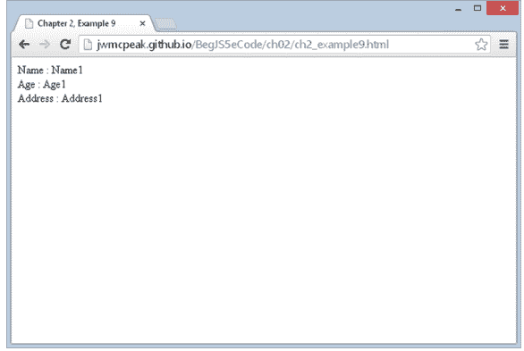

## 图 2-11

在此脚本块中要做的第一件事是声明一个变量 `personnel`，并告诉 JavaScript 你希望它是一个新数组：

```
var personnel = [];
```

然后你做一些新的事情；你告诉 JavaScript 你希望 `personnel` 数组的索引 0（即元素 `personnel[0]`）成为另一个新数组：

```
personnel[0] = [];
```

那么这是怎么回事呢？事实上，JavaScript 实际上不支持多维数组，只支持一维数组。但是，JavaScript 允许你在另一个数组内部创建一个数组来模拟多维数组。因此，前面那行代码做的是在你的 `personnel` 数组的索引 0 元素内部创建一个新数组。

在接下来的三行中，你将值放入新创建的 `personnel[0]` 数组中。JavaScript 使这变得容易：你只需声明数组的名称 `personnel[0]`，后跟方括号中的另一个索引。第一个索引 (0) 属于 `personnel` 数组；第二个索引属于 `personnel[0]` 数组：

```
personnel[0][0] = "Name0";
personnel[0][1] = "Age0";
personnel[0][2] = "Address0";
```

执行这些代码行后，你的数组如下所示：

| 索引 | 0 |
|---|---|
| 0 | Name0 |
| 1 | Age0 |
| 2 | Address0 |

顶部的数字（目前只有 0）指的是 `personnel` 数组。沿着侧面下来的数字 0、1 和 2 实际上是 `personnel` 数组内部新 `personnel[0]` 数组的索引。

对于第二个人的详细信息，你重复这个过程，但这次你使用的是 `personnel` 数组中索引为 1 的元素：

```
personnel[1] = [];
personnel[1][0] = "Name1";
personnel[1][1] = "Age1";
personnel[1][2] = "Address1";
```

现在你的数组如下所示：

| 索引 | 0 | 1 |
|---|---|---|
| 0 | Name0 | Name1 |
| 1 | Age0 | Age1 |
| 2 | Address0 | Address1 |

你在接下来的几行中创建第三个人的详细信息。你正在使用 `personnel` 数组中索引为 2 的元素来创建一个新数组：

```
personnel[2] = [];
personnel[2][0] = "Name2";
personnel[2][1] = "Age2";
personnel[2][2] = "Address2";
```

数组现在如下所示：

| 索引 | 0 | 1 | 2 |
|---|---|---|---|
| 0 | Name0 | Name1 | Name2 |
| 1 | Age0 | Age1 | Age2 |
| 2 | Address0 | Address1 | Address2 |

你现在已经完成了多维数组的创建。你通过访问第二个人的数据（`Name1`、`Age1`、`Address1`）并使用 `document.write()` 在页面上显示它来结束脚本块。如你所见，访问数据与存储数据非常相似；你可以在任何使用普通变量或一维数组的地方使用多维数组。

```
document.write("Name: " + personnel[1][0] + "<br/>");
document.write("Age: " + personnel[1][1] + "<br/>");
document.write("Address: " + personnel[1][2]);
```

尝试更改 `document.write()` 命令，使其显示第一个人的详细信息。代码将如下所示：

```
document.write("Name: " + personnel[0][0] + "<br/>");
document.write("Age: " + personnel[0][1] + "<br/>");
document.write("Address: " + personnel[0][2]);
```

可以创建三维、四维甚至一百维的多维数组，但事情会变得非常混乱，而且你会发现你很少（如果有的话）需要超过两个维度。为了给你一个概念，以下是如何声明和访问一个三维数组：

```
var myArray = [];
myArray[0] = [];
myArray[0][0] = [];
myArray[0][0][0] = "three-dimensional";
```

数组的内容就到这里，但你将在第 5 章中重新审视它们，届时你会发现关于它们的一些令人震惊的事情。你还将学习它们的一些更高级的功能。

## 总结

在本章中，你已经积累了关于 JavaScript 数据类型和变量的基础知识，以及如何在操作中使用它们。具体来说，你看到：

- JavaScript 支持多种数据类型，例如数字、文本和布尔值。
- 文本由字符串表示，并被引号包围。你必须匹配包围字符串的引号。转义字符使你可以在字符串中包含无法键入的字符。
- 变量是 JavaScript 在内存中存储数据（如数字和文本）的方式，以便你可以在代码中反复使用它们。
- 变量名不得包含某些非法字符，如百分号 (%) 和 & 符号，也不得是保留字，如 `with`。
- 在给变量赋值之前，你必须向 JavaScript 解释器声明它的存在。
- JavaScript 有四个基本的数学运算符，分别用加号 (+)、减号 (−)、星号 (*) 和正斜杠 (/) 表示。要将计算结果赋值给变量，你需要使用等号 (=)，称为赋值运算符。
- 运算符有不同的优先级，因此乘法和除法将在加法和减法之前计算。
- 字符串可以通过 + 运算符连接或串联以产生一个大字符串。当数字和字符串与 + 运算符连接时，JavaScript 会自动将数字转换为字符串。
- 尽管 JavaScript 的自动数据转换在大多数情况下都适合我们，但在某些情况下你需要强制转换数据。你看到了如何使用 `parseInt()` 和 `parseFloat()` 将字符串转换为数字。尝试转换无法转换的字符串将导致返回 `NaN`（非数字）。
- 数组是一种特殊类型的变量，可以容纳多个数据。数据通过唯一的索引号进行插入和访问。

## 练习

你可以在附录 A 中找到这些问题的建议解决方案。

1. 编写一个 JavaScript 程序，将摄氏度转换为华氏度，并将结果以描述性句子写入页面。华氏度到摄氏度的 JavaScript 方程如下：

```
degFahren = 9 / 5 * degCent + 32
```


## 决策与循环

## 本章学习目标：

-   比较数字和字符串值
-   使用 if、else 和 switch 语句进行决策
-   只要条件为真，就重复执行代码

## 本章 Wrox.com 代码下载

你可以在 http://www.wiley.com/go/BeginningJavaScript5E 的“下载代码”标签页找到本章的 wrox.com 代码下载。你也可以在 http://beginningjs.com 查看所有示例和相关文件。

到目前为止，你已经了解了如何使用 JavaScript 获取用户输入，利用该输入执行计算和任务，并将结果写入网页。然而，一个袖珍计算器也能做到所有这些，那么，是什么让计算机有所不同呢？也就是说，是什么赋予了计算机看似智能的特性？答案是基于所收集信息进行决策的能力。

决策能力将如何帮助你创建网站？在上一章中，你编写了一些将华氏温度转换为摄氏温度的代码。你使用 `prompt()` 函数从用户那里获取华氏度数。如果用户输入的是一个有效的数字，例如 50，这可以正常工作。但是，如果用户输入的是对华氏温度无效的内容，例如字符串 aaa，你会发现你的代码不再按预期工作。现在，如果你的程序具备一些决策能力，你就可以检查用户输入的内容是否有效。如果有效，你可以进行计算；如果无效，你可以告诉用户原因并要求他输入一个有效的数字。

用户输入的验证可能是 JavaScript 中决策最普遍的应用之一，但这远非其唯一用途。

本章将探讨决策在 JavaScript 中是如何实现的，以及你如何利用它使你的代码更智能。

## 决策——if 和 switch 语句

所有编程语言都允许你做出决策——也就是说，它们允许程序根据某个*条件*是否满足来遵循特定的行动路线。这就是赋予编程语言智能的关键所在。

条件是变量和数据之间的比较，例如：

-   *A* 是否大于 *B*？
-   *X* 是否等于 *Y*？
-   *M* 是否不等于 *N*？

例如，如果变量 `today` 保存着你阅读本章时的星期几，条件将是：

> `today` 是否等于星期五？

你会注意到所有这些问题都有一个是或否的答案——也就是说，它们是基于布尔值的，只能评估为 `true` 或 `false`。你如何利用这一点在代码中创建决策能力？你让浏览器测试条件是否为 `true`。如果（并且仅当）条件为 `true` 时，你才执行特定的代码段。

看另一个例子。回想一下第 1 章中用于演示代码流程的自然英语指令。其中一条冲咖啡的指令是：

> 水壶烧开了吗？如果是，那么将水倒入杯中；否则，继续等待。

这是一个决策的示例。这条指令中的条件是“水壶烧开了吗？”。它有一个 `true` 或 `false` 的答案。如果答案是 `true`，你就把水倒入杯中。如果答案不是 `true`，你就继续等待。

在 JavaScript 中，你可以使用 `if` 语句或 `switch` 语句，根据条件是 `true` 还是 `false` 来改变代码的执行流程。你很快就会看到这些，但首先我们需要介绍一些对定义条件至关重要的新运算符——*比较运算符*。

### 比较运算符

在第 2 章中，你看到了数学函数（如加法和除法）是如何用符号表示的，例如加号 (+) 和斜杠 (/)，称为运算符。你还看到，如果你想给一个变量赋值，你可以使用等号 (=)（称为赋值运算符）为其赋值或计算结果的值。

决策也有自己的运算符，使你能够测试条件。比较运算符，就像你在前一章看到的数学运算符一样，有左侧 (LHS) 和右侧 (RHS)，并在两者之间进行比较。这些的专业术语是*左操作数*和*右操作数*。例如，小于运算符（符号为 <）是一个比较运算符。你可以写 `23 < 45`，这可以理解为“23 是否小于 45？”。这里，答案将是 `true`（参见图 3-1）。

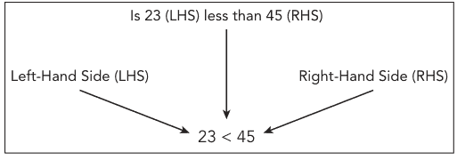

还存在其他比较运算符，其中更有用的总结在下表中：

| 运算符符号 | 用途 |
| --- | --- |
| == | 测试左侧是否等于右侧 |
| < | 测试左侧是否小于右侧 |
| > | 测试左侧是否大于右侧 |
| <= | 测试左侧是否小于或等于右侧 |
| >= | 测试左侧是否大于或等于右侧 |
| != | 测试左侧是否不等于右侧 |

你将在下一节学习 `if` 语句时看到这些比较运算符的实际应用。

### 优先级

回想一下第 2 章，运算符有优先顺序。这也适用于比较运算符。== 和 != 比较运算符的优先级最低，而其余的比较运算符 <, >, <= 和 >= 的优先级相同。

所有这些比较运算符的优先级都低于算术运算符，如 +, -, * 和 /。这意味着，如果你进行如 `3 * 5 > 2 * 5` 的比较，乘法计算会先进行，然后结果再进行比较。然而，在这种情况下，将两侧的计算都用括号括起来会更安全、更清晰；例如，`(3 * 5) > (2 * 5)`。作为一般规则，使用括号来确保优先级清晰是一个好主意，否则你可能会对结果感到惊讶。

### 赋值与比较

一个非常重要的点是，赋值运算符 (=) 和比较运算符 (==) 很容易混淆。请记住，= 运算符是将值赋给变量，而 == 运算符是比较两个变量的值。即使你清楚地知道这一点，也非常容易在一个本该放两个等号的地方只放了一个等号。

### 赋值比较结果

你可以将比较的结果存储在一个变量中，如下例所示：

```
var age = prompt("Enter age:", "");
var isOverSixty = parseInt(age, 10) > 60;
document.write("Older than 60: " + isOverSixty);
```

这里，你使用 `prompt()` 函数获取用户的年龄。它以字符串形式返回用户输入的任何值。然后，你使用上一章学过的 `parseInt()` 函数将其转换为数字，并使用大于运算符检查其是否大于 60。比较的结果（`true` 或 `false`）将存储在变量 `isOverSixty` 中。

如果用户输入 35，最后一行的 `document.write()` 将在页面上写入：

Older than 60: false

如果用户输入 61，将显示：

Older than 60: true

### if 语句

`if` 语句是你在几乎所有超过几行长的程序中都会用到的语句。它的工作方式与英语中非常相似。例如，你可能会用英语说，“如果房间温度超过 80 华氏度，那么我就打开空调。”在 JavaScript 中，这可以翻译成类似这样的代码：

```
if (roomTemperature > 80) {
    roomTemperature = roomTemperature - 10;
}
```

这是如何工作的？参见图 3-2。

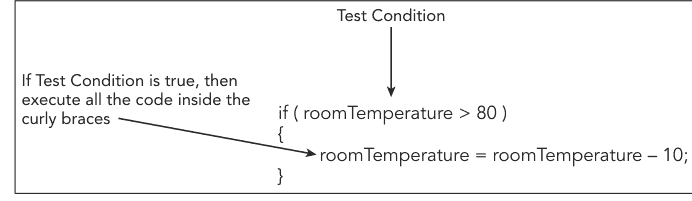

注意，测试条件放在括号内，位于 `if` 关键字之后。同时，请注意这一行末尾没有分号。如果条件为 `true`，要执行的代码放在条件之后一行的花括号中，并且这些代码行都以分号结尾。

2. 以下代码使用 `prompt()` 函数从用户那里获取两个数字。然后，它将这两个数字相加并将结果写入页面：

```
<!DOCTYPE html>

<html lang="en">
<head>
    <title>Chapter 2, Question 2</title>
</head>
<body>

<script>
    var firstNumber = prompt("Enter the first number","");
    var secondNumber = prompt("Enter the second number","");
    var theTotal = firstNumber + secondNumber;

    document.write(firstNumber + " added to " + secondNumber +
            " equals " + theTotal);
</script>
</body>
</html>
```

但是，如果你尝试运行这段代码，你会发现它无法正常工作。为什么呢？请修改代码使其能够正常工作。


在 JavaScript 中，花括号 `{}` 具有特殊用途：它们标示出一段 *代码块*。将多行代码标示为属于单个代码块，意味着 JavaScript 会将它们视为一个整体来执行。如果一个 `if` 语句的条件为 `true`，JavaScript 就会执行紧跟在 `if` 语句之后的下一行或下一段代码。在前面的例子中，代码块只包含一个语句，所以我们同样可以这样写：

```
if (roomTemperature > 80)
    roomTemperature = roomTemperature - 10;
```

但是，如果你想执行多行代码，就需要使用花括号将它们标示为一个单一的代码块。例如，一个包含三条代码语句的修改版示例就必须包含花括号：

```
if (roomTemperature > 80) {
    roomTemperature = roomTemperature - 10;
    alert("It's getting hot in here");
    alert("Air conditioning switched on");
}
```

一个特别容易犯的错误是在标示要执行的代码块时忘记使用花括号。这样做的结果是，当条件为真时，执行的不是代码块中的所有内容，而是发现 *只有* `if` 语句 *之后的第一行* 代码被执行。然而，无论测试条件的结果如何，其他行代码总会被执行。为了避免这类错误，养成一个好习惯总是好的，即 *即使只有一个语句时也使用花括号*。如果你养成了这个习惯，在真正需要的时候就不太可能漏掉它们了。

### 动手试试：if 语句

让我们回到第 2 章的温度转换器示例，并为其添加一些决策功能。

1.  输入以下代码并将其保存为 `ch3_example1.html`：

```
<!DOCTYPE html>

<html lang="en">
<head>
    <title>Chapter 3, Example 1</title>
</head>
<body>
    <script>
        var degFahren = parseInt(prompt("Enter the degrees Fahrenheit", 32), 10);
        var degCent = 5/9 * (degFahren - 32);

        document.write(degFahren + "\xB0 Fahrenheit is " + degCent +
            "\xB0 centigrade<br />");

        if (degCent < 0) {
            document.write("That's below the freezing point of water");
        }

        if (degCent == 100)
            document.write("That's the boiling point of water");
    </script>
</body>
</html>
```

2.  将页面加载到浏览器中，并在提示框中输入 32 作为要转换的华氏温度值。当值为 32 时，两个 `if` 语句的条件都不为真，因此页面上唯一显示的一行将是图 3-3 所示的内容。

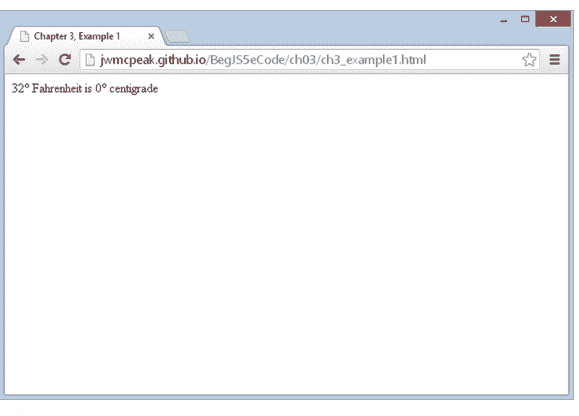

图 3-3

3.  现在重新加载页面，并在提示框中输入 31 作为华氏温度值。这次你会在页面上看到两行，如图 3-4 所示。

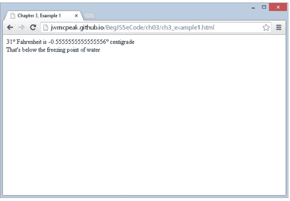

图 3-4

4.  最后，再次重新加载页面，但这次在提示框中输入 212。图 3-5 所示的两行将出现在页面上。

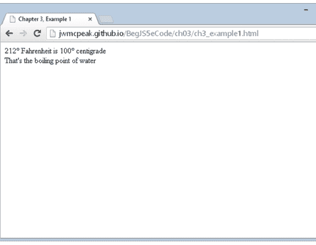

图 3-5

这个页面中的脚本块的第一部分与第 2 章的示例 ch2_example4.html 类似。你声明了两个变量 `degFahren` 和 `degCent`。变量 `degFahren` 通过 `prompt()` 函数从用户处获得一个初始值。请注意，`prompt()` 函数返回的是一个字符串值，然后你需要使用 `parseInt()` 函数将其转换为数值。变量 `degCent` 被初始化为计算 5/9 * (degFahren - 32) 的结果，这是华氏度到摄氏度的转换计算：

```
var degFahren = parseInt(prompt("Enter the degrees Fahrenheit", 32), 10);
var degCent = 5/9 * (degFahren - 32);
```

然后，你将计算结果写入页面：

```
document.write(degFahren + "\xB0 Fahrenheit is " + degCent +
    "\xB0 centigrade<br />");
```

现在是新的代码部分；两个 `if` 语句中的第一个：

```
if (degCent < 0) {
    document.write("That's below the freezing point of water");
}
```

这个 `if` 语句的条件是在问：“变量 `degCent` 的值是否小于零？” 如果答案是“是”（`true`），则花括号内的代码就会执行。在这种情况下，你使用 `document.write()` 向页面写入一句话。如果答案是“否”（`false`），程序处理就会跳过，继续执行右花括号之后的下一行。同样值得注意的是，`if` 语句起始花括号内的代码是缩进的。虽然这并非必须，但这是一个良好的编程习惯，因为它使你的代码更易于阅读。

在尝试这个示例时，你首先输入了 32，因此 `degFahren` 被初始化为 32。在这种情况下，计算 `degCent = 5/9 * (degFahren - 32)` 将会把 `degCent` 设置为 0。所以问题“`degCent` 是否小于零？”的答案是 `false`，因为 `degCent` 等于零，并不是小于零。花括号内的代码将被跳过，永远不会执行。在这种情况下，下一行要执行的将是第二个 `if` 语句的条件，我们稍后会讨论。

当你在提示框中输入 31 时，`degFahren` 被设置为 31，因此变量 `degCent` 将是 -0.555555555556。那么你的 `if` 语句现在是什么样子呢？它被计算为“-0.555555555556 是否小于零？”这次的答案是 `true`，因此花括号内的代码（这里只有一条 `document.write()` 语句）就会执行。

最后，当你输入 212 时，这如何改变了 `if` 语句？变量 `degCent` 通过计算被设置为 100，因此 `if` 语句现在问的是：“100 是否小于零？”答案是 `false`，花括号内的代码将被跳过。

在第二个 `if` 语句中，你评估的条件是“变量 `degCent` 的值是否等于 100？”：

```
if (degCent == 100)
    document.write("That's the boiling point of water");
```

这里没有花括号，因此如果条件为 `true`，唯一要执行的代码就是 `if` 语句下面的第一行。当你想在条件为 `true` 时执行多行代码时，就需要花括号了。

你看到，当 `degFahren` 是 32 时，`degCent` 将是 0。所以你的 `if` 语句是“0 是否等于 100？”答案显然是 `false`，代码不会执行。同样，当你把 `degFahren` 设置为 31 时，`degCent` 将被计算为 -0.555555555556；“-0.555555555556 是否等于 100？”也是 `false`，代码不会执行。

最后，当 `degFahren` 被设置为 212 时，`degCent` 将是 100。这次 `if` 语句是“100 是否等于 100？”答案是 `true`，因此 `document.write()` 语句就会执行。

正如你已经看到的，即使是专家，JavaScript 中最常见的错误之一也是在求值时使用一个等号，而不是必须的两个等号。看看下面的代码片段：

```
if (degCent = 100)
    document.write("That's the boiling point of water");
```

这个条件将 *总是* 求值为 `true`，因此 `if` 语句下面的代码将总是被执行。更糟糕的是，你的变量 `degCent` 将被设置为 100。为什么？因为单个等号是给变量赋值的；只有双等号才是比较值的。赋值总是求值为 `true` 的原因是，赋值表达式的结果是右侧表达式的值，这里是数字 100，然后它被隐式转换为布尔值，而除 0 和 NaN 之外的任何数字都会转换为 `true`。

### 逻辑运算符

现在你应该对如何在 `if` 语句中使用条件有了大致了解，但如何使用像“`degFahren` 是否大于零且小于 100？”这样的条件呢？这里有两个条件需要测试。你需要测试 `degFahren` 是否大于零 *并且* `degFahren` 是否小于 100。

JavaScript 允许你使用这样的多个条件。为此，你需要了解另外三个运算符：逻辑运算符 AND、OR 和 NOT。它们的符号列在下表中：

| 运算符 | 符号 |
| :--- | :--- |
| AND (与) | && |
| OR (或) | \|\| |
| NOT (非) | ! |

注意 AND 和 OR 运算符是 *两个* 符号重复：&& 和 \|。如果你只输入一个符号，& 或 \|，将会发生奇怪的事情，因为这些是用于二进制操作的特殊运算符，称为 *位运算符*——对于逻辑运算，你必须始终使用两个。
在你了解了这三个逻辑运算符之后，我们将看看如何在 `if` 语句中使用它们，并提供大量实际示例。所以如果第一次阅读时感觉有点困惑，不要惊慌。一切都会变得清晰。让我们看看每个运算符是如何工作的，首先从 AND 运算符开始。

### AND（与）

回想一下，我们讨论过运算符的左侧（LHS）和右侧（RHS）。AND 运算符也是如此。不过，现在条件的左侧和右侧都是布尔值（通常是条件的结果）。
AND 运算符的工作原理与英语中的非常相似。例如，你可能会说：“如果我感觉冷 *并且* 我有外套，那么我就会穿上外套。” 这里，“并且”这个词的左侧是“我是否感觉冷？”，这可以被计算为 `true` 或 `false`。右侧是“我是否有外套？”，这也被计算为 `true` 或 `false`。如果左侧为真（我感觉冷） *并且* 右侧也为真（我确实有外套），那么你就会穿上外套。
这与 JavaScript 中 AND 运算符的工作原理非常相似。AND 运算符实际上会产生一个结果，就像两个数字相加会产生一个结果一样。然而，AND 运算符接受两个布尔值（在其左侧和右侧），并产生另一个布尔值。如果左侧和右侧的条件都计算为 `true`，则结果将为 `true`。在任何其他情况下，结果将为 `false`。
以下是当使用 AND 时，左侧和右侧的可能评估及其结果的 *真值表*：

| 左侧 | 右侧 | 结果 |
| :--- | :--- | :--- |
| `true` | `true` | `true` |
| `false` | `true` | `false` |
| `true` | `false` | `false` |
| `false` | `false` | `false` |

尽管严格来说这个表是正确的，但值得注意的是 JavaScript 不喜欢做不必要的工作。嗯，谁会喜欢呢！如果左侧是 `false`，即使右侧


### 或运算

就像 `AND` 一样，`OR` 的工作方式也和英语中的用法非常相似。例如，你可能会说，如果在下雨或者在下雪，那么你会带伞。只要“在下雨”或“在下雪”这两个条件中任意一个为真，你就会带伞。

同样地，就像 `AND` 一样，`OR` 运算符作用于两个布尔值（一个来自其左侧，一个来自其右侧），并返回另一个布尔值。如果左侧为 `true` 或右侧为 `true`，则返回的结果为 `true`。否则，结果为 `false`。下表显示了可能的结果：

| 左侧 | 右侧 | 结果 |
| :--- | :--- | :--- |
| `true` | `true` | `true` |
| `false` | `true` | `true` |
| `true` | `false` | `true` |
| `false` | `false` | `false` |

与 `AND` 运算符一样，JavaScript 喜欢避免做对最终结果没有影响的事情。如果左侧为 `true`，那么无论右侧是 `true` 还是 `false`，都不会影响最终结果——结果仍然是 `true`。所以，为了避免不必要的工作，如果左侧为 `true`，JavaScript 就不会评估右侧，而是直接返回 `true`。最终结果是相同的——唯一的区别在于 JavaScript 得出结论的方式。然而，这确实意味着你不应依赖于 `OR` 运算符右侧的表达式被执行。

### 非运算

在英语中，我们可能会说，“如果我不热，那么我就喝汤。” 被评估的条件是我们是否热。结果为真或假，但在这个例子中，我们根据结果为假（即不热）来采取行动（喝汤）。

然而，JavaScript 习惯于只在条件为 `true` 时执行代码。所以，如果你想让一个为 `false` 的条件触发代码执行，你需要将这个 `false` 值转换为 `true`（并将任何 `true` 值转换为 `false`）。这样你就可以让 JavaScript 在条件为 `false` 后执行代码。

你可以使用 `NOT` 运算符来实现这一点。这个运算符反转结果的逻辑；它接受一个布尔值并将其更改为另一个布尔值。所以它将 `true` 变为 `false`，将 `false` 变为 `true`。这有时被称为 *取反*。

要使用 `NOT` 运算符，你需要将要反转的条件放在括号内，并在括号前放置 `!` 符号。例如：

```
if (!(degCent < 100)) {
  // Some code
}
```

只有当条件 `degCent < 100` 为 false 时，大括号内的任何代码才会执行。
下表详细说明了使用 `NOT` 时的可能结果：

| 右侧 | 结果 |
| --- | --- |
| true | false |
| false | true |

### if 语句中的多个条件

上一节开头提出了如何使用条件“`degFahren` 是否大于零但小于 100？”的一个方法是使用两个 `if` 语句，一个嵌套在另一个内部。嵌套仅仅意味着有一个外部的 `if` 语句，其内部有一个内部的 `if` 语句。如果外部 `if` 语句的条件为 `true`，那么（并且只有那样）内部嵌套的 `if` 语句的条件才会被测试。

使用嵌套的 `if` 语句，你的代码将是：

```
if (degCent < 100) {
    if (degCent > 0) {
        document.write("degCent is between 0 and 100");
    }
}
```

这可以工作，但有点冗长且可能相当令人困惑。JavaScript 提供了一个更好的替代方案——在 `if` 语句的条件部分使用多个条件。多个条件使用你刚刚看到的逻辑运算符串联在一起。所以前面的代码可以这样重写：

```
if (degCent > 0 && degCent < 100) {
    document.write("degCent is between 0 and 100");
}
```

`if` 语句的条件首先评估 `degCent` 是否大于零。如果为 `true`，代码会继续评估 `degCent` 是否小于 100。只有当这两个条件都为 `true` 时，`document.write()` 代码行才会执行。

### 动手试试：多个条件

此示例演示了使用 `AND`、`OR` 和 `NOT` 运算符的多条件 `if` 语句。输入以下代码，并将其保存为 `ch3_example2.html`：

```
<!DOCTYPE html>

<html lang="en">
<head>
    <title>Chapter 3, Example 2</title>
</head>
<body>
    <script>
        var myAge = parseInt( prompt("Enter your age", 30), 10 );

        if (myAge >= 0 && myAge <= 10) {
            document.write("myAge is between 0 and 10<br />");
        }

        if ( !(myAge >= 0 && myAge <= 10) ) {
            document.write("myAge is NOT between 0 and 10<br />");
        }

        if ( myAge >= 80 || myAge <= 10 ) {
            document.write("myAge is 80 or above OR 10 or below<br />");
        }

        if ( (myAge >= 30 && myAge <= 39) || (myAge >= 80 && myAge <= 89) ) {
            document.write("myAge is between 30 and 39 or myAge is " +
                           "between 80 and 89");
        }
    </script>
</body>
</html>
```

当你在浏览器中加载它时，应该会出现一个提示框。输入值 30，然后按回车键，图 3-6 中所示的行将被写入网页。

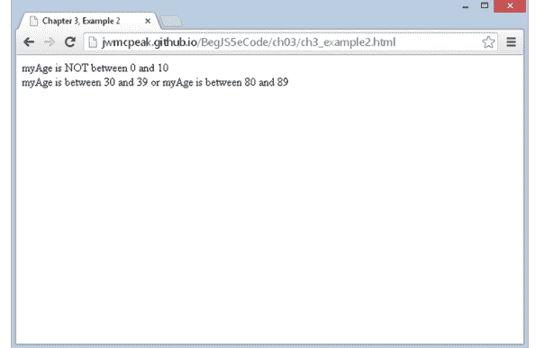

**图 3-6**

脚本块首先定义变量 `myAge` 并将其初始化为用户在提示框中输入并转换为数字的值：

```
var myAge = parseInt( prompt("Enter your age", 30), 10 );
```

之后是四个 `if` 语句，每个都使用多个条件。你将依次详细查看每个条件。

理解多个条件工作原理的最简单方法是将它们分解成更小的部分，然后评估组合结果。在这个例子中，你输入了值 `30`，它已存储在变量 `myAge` 中。你将把这个值代入条件中，看看它们是如何工作的。

这是第一个 `if` 语句：

```
if (myAge >= 0 && myAge <= 10) {
    document.write("myAge is between 0 and 10<br />");
}
```

第一个 `if` 语句提出的问题是：“`myAge` 在 0 到 10 之间吗？” 你将首先取条件的左侧，用你的特定值替换 `myAge`。左侧问：“30 大于或等于 0 吗？” 答案是 `true`。右侧条件提出的问题是“30 小于或等于 10 吗？” 答案是 `false`。条件的这两个部分使用 `&&` 连接，这表示 `AND` 运算符。使用前面显示的 `AND` 结果表，你可以看到如果左侧为 `true` 而右侧为 `false`，你得到的整体结果是 `false`。所以 `if` 语句条件的最终结果是 `false`，大括号内的代码不会执行。

让我们继续看第二个 `if` 语句：

```
if ( !(myAge >= 0 && myAge <= 10) ) {
    document.write("myAge is NOT between 0 and 10<br />");
}
```

第二个 `if` 语句提出的问题是：“`myAge` 不在 0 到 10 之间吗？” 它的条件与第一个 `if` 语句的条件相似，但有一个小区别：你将条件放在括号内，并在括号前放置了 `NOT` 运算符（`!`）。

括号内的条件部分被评估，并且像之前一样，产生相同的结果——`false`。然而，`NOT` 运算符反转结果并将其变为 `true`。因为 `if` 语句的条件为 `true`，所以大括号内的代码这次 *将* 执行，导致 `document.write()` 将响应写入页面。

第三个 `if` 语句呢？

```
if ( myAge >= 80 || myAge <= 10 ) {
    document.write("myAge is 80 or above OR 10 or below<br />");
}
```

第三个 `if` 语句问：“`myAge` 大于或等于 80，还是小于或等于 10？” 先看左侧条件——“30 大于或等于 80 吗？” 答案是 `false`。右侧条件的答案——“30 小于或等于 10 吗？” 同样是 `false`。条件的这两个部分使用 `||` 组合，这表示 `OR` 运算符。查看本节前面的 `OR` 结果表，你看到 `false` OR `false` 产生 `false` 的结果。所以 `if` 语句的条件再次评估为 `false`，大括号内的代码不执行。

最后一个 `if` 语句稍微复杂一些：

```
if ( (myAge >= 30 && myAge <= 39) || (myAge >= 80 && myAge <= 89) ) {
    document.write("myAge is between 30 and 39 or myAge is between 80 and 89");
}
```

它提出的问题是：“我的年龄是在30到39岁之间，还是在80到89岁之间？” 让我们把条件分解成各个组成部分。这里有一个左侧和一个右侧条件，通过一个OR运算符组合在一起。然而，左侧和右侧条件本身各自又包含一个左侧和右侧条件，它们是通过AND运算符组合的。请注意括号是如何使用的，它告诉JavaScript首先计算条件的哪一部分，就像你在数学计算中处理数字一样。

让我们先看条件的左侧，即 `(myAge >= 30 && myAge <= 39)`。通过将条件放入括号中，你可以确保它被视为一个单一条件；无论括号内有多少个条件，它只会产生一个结果，要么是 `true`，要么是 `false`。分解括号内的条件，我们有“30是否大于或等于30？”结果为 `true`，以及“30是否小于或等于39？”结果同样是 `true`。根据AND真值表，你知道 `true AND true` 的结果是 `true`。

现在让我们看看条件的右侧，即 `(myAge >= 80 && myAge <= 89)`。再次分解条件，你会看到左侧问的是：“30是否大于或等于80？”这会得到一个 `false` 的结果，而右侧问的是：“30是否小于或等于89？”这会得到一个 `true` 的结果。你知道 `false AND true` 的结果是 `false`。

现在你可以把你的 `if` 语句的条件想象成 `(true || false)`。查看OR真值表，你可以看到 `true OR false` 的结果是 `true`，因此，紧随 `if` 语句后的花括号中的代码将会执行，并且会向页面写入一行内容。

但是，请记住，JavaScript不会评估那些不会影响最终结果的条件，前面的条件就是这种情况之一。条件的左侧评估结果为 `true`。之后，右侧的条件是 `true` 还是 `false` 都无关紧要了，因为在OR运算中，只需要其中一个条件为 `true`，结果就是 `true`。因此，JavaScript实际上并不会评估条件的右侧。我们这样做仅仅是为了演示目的。

正如你所看到的，理解或创建多个条件的最简单方法是将它们分解成最小的逻辑块。你会发现，随着经验的积累，你会几乎不假思索地这样做，除非你有一个特别棘手的条件需要评估。

尽管使用多个条件通常比使用多个 `if` 语句更好，但有时它会使你的代码更难阅读，从而更难理解和调试。你的 `if` 语句中可能会有10个、20个甚至超过100个条件，但你能想象去读一个有10个条件的 `if` 语句吗？如果你觉得你的多个条件变得太复杂了，就把它们分解成更小的逻辑块。

例如，假设你想在 `myAge` 处于30-39、80-89或100-115范围内时执行一些代码，并且每种情况使用不同的代码。你可以这样写语句：

```
if ( (myAge >= 30 && myAge <= 39) || (myAge >= 80 && myAge <= 89) ||
    (myAge >= 100 && myAge <= 115) ) {
    document.write("myAge is between 30 and 39 " +
                   "or myAge is between 80 " +
                   "and 89 or myAge is between 100 and 115");
}
```

这没什么错，但它开始变得有点长且难以阅读。相反，你可以为100-115范围的代码创建另一个 `if` 语句。

### else 和 else if

想象一个场景，你想在某个条件为真时执行一些代码，而在该条件为假时执行另一些代码。你可以通过使用两个 `if` 语句来实现这一点，如下例所示：

```
if (myAge >= 0 && myAge <= 10) {
    document.write("myAge is between 0 and 10");
}

if ( !(myAge >= 0 && myAge <= 10) ) {
    document.write("myAge is NOT between 0 and 10");
}
```

第一个 `if` 语句测试 `myAge` 是否在0到10之间，第二个处理 `myAge` 不在0到10之间的情况。然而，JavaScript提供了一种更简单的方法来实现这一点：使用 `else` 语句。同样，`else` 这个词的用法与其在英语中的用法相似。你可能会说：“如果下雨，我就带把伞；否则我就戴顶遮阳帽。” 在JavaScript中，你可以说如果条件为 `true`，则执行一个代码块；`else` 执行另一个替代代码块。使用这种技术重写前面的代码，你会得到如下内容：

```
if (myAge >= 0 && myAge <= 10) {
    document.write("myAge is between 0 and 10");
} else {
    document.write("myAge is NOT between 0 and 10");
}
```

这样写代码更简单，因此也更容易阅读。而且，它也避免了JavaScript去测试一个你已经知道答案的条件。
你还可以在 `else` 语句中包含另一个 `if` 语句。例如：

```
if (myAge >= 0 && myAge <= 10) {
    document.write("myAge is between 0 and 10");
} else if ( (myAge >= 30 && myAge <= 39) || (myAge >= 80 && myAge <= 89) ){
    document.write("myAge is between 30 and 39 " +
                   "or myAge is between 80 and 89");
} else {
    document.write("myAge is NOT between 0 and 10, " +
                   "nor is it between 30 and 39, nor " +
                   "is it between 80 and 89");
}
```

第一个 `if` 语句检查 `myAge` 是否在0到10之间，如果是 `true`，则执行一些代码。如果为 `false`，则 `else if` 语句检查 `myAge` 是否在30到39或80到89之间，如果这些条件中任何一个为 `true`，则执行另一些代码。如果这些都不满足，你还有一个最终的 `else` 语句，它处理 `myAge` 的值没有在前面的任何 `if` 条件中触发 `true` 的情况。
当使用 `if` 和 `else if` 时，你需要格外小心花括号，以确保 `if` 和 `else if` 语句在你预期的位置开始和结束，并且你最终不会得到一个不属于正确 `if` 的 `else`。用语言描述这一点相当棘手——通过一个例子更容易理解我们的意思：

```
if (myAge >= 0 && myAge <= 10) {
document.write("myAge is between 0 and 10");
if (myAge == 5){
document.write("You’re 5 years old");
}
}else{
document.write("myAge is NOT between 0 and 10");
}
```

注意我们没有缩进代码。虽然这对JavaScript来说无关紧要，但这确实使代码对人类来说更难阅读，并且隐藏了最终 `else` 语句前应该有的缺失花括号。

正确格式化并插入缺失的括号后，代码如下所示：

```
if (myAge >= 0 && myAge <= 10) {
    document.write("myAge is between 0 and 10<br />");
    if (myAge == 5) {
        document.write("You’re 5 years old");
    }
} else {
    document.write("myAge is NOT between 0 and 10");
}
```

正如你所看到的，代码现在可以工作了；也更容易看出哪段代码属于哪个 `if` 块。

### 比较字符串

到目前为止，你一直在专门研究将比较运算符与数字一起使用。然而，它们与字符串一起使用时效果同样好。前面所说的和对数字所做的所有操作都适用于字符串，但有一个重要的区别。你现在是在按字母顺序而不是数字顺序比较数据，所以有一些陷阱需要注意。

在下面的代码中，你将变量 `myName`（包含字符串 "Paul"）与字符串字面量 "Paul" 进行比较：

```
var myName = "Paul";
if (myName == "Paul") {
    alert("myName is Paul");
}
```

JavaScript是如何处理这个的呢？嗯，它依次查看左侧的每个字母，并与右侧相同位置的字母进行比较，看看它们是否真的相同。如果在任何一点发现差异，它就会停止，结果为 `false`。如果逐个检查每个字母直到最后，确认它们都相同，它就返回 `true`。前面 `if` 语句中的条件将返回 `true`，所以你会看到一个 `alert` 对话框。

然而，JavaScript 中的字符串比较是区分大小写的。因此，`"P"` 与 `"p"` 不相同。以上述例子为例，但将变量 `myName` 改为 `"paul"`，你会发现条件为 `false`，`if` 语句内的代码不会执行：

```
var myName = "paul";
if (myName == "Paul"){
    alert("myName is Paul");
}
```

`>=`、`>`、`<=` 和 `<` 运算符既适用于数字也适用于字符串，但同样是进行字母顺序比较。因此 `"A" < "B"` 为 `true`，因为 A 在字母表中排在 B 之前。然而，JavaScript 的大小写敏感性再次发挥作用。`"A" < "B"` 为 `true`，但 `"a" < "B"` 为 `false`。为什么呢？因为大写字母总是被认为排在小写字母*之前*。这是为什么呢？每个字母在 ASCII 和 Unicode 字符集中都有一个代码编号，而大写字母的代码编号小于小写字母的代码编号。在编写自己的代码时，这一点需要留意。

避免大小写混淆最简单的方法是在比较之前将两个字符串都转换为大写或小写。你可以使用 `toUpperCase()` 或 `toLowerCase()` 函数轻松实现，你将在第 5 章学习这些函数。

### switch 语句

你之前看到了如何使用 `if` 和 `else if` 语句来检查各种条件；如果第一个条件不成立，则检查下一个，再下一个，以此类推。然而，当你想要检查一个特定变量是否等于大量可能的值时，有一个更高效的替代方案，即 `switch` 语句。`switch` 语句的结构如图 3-7 所示。

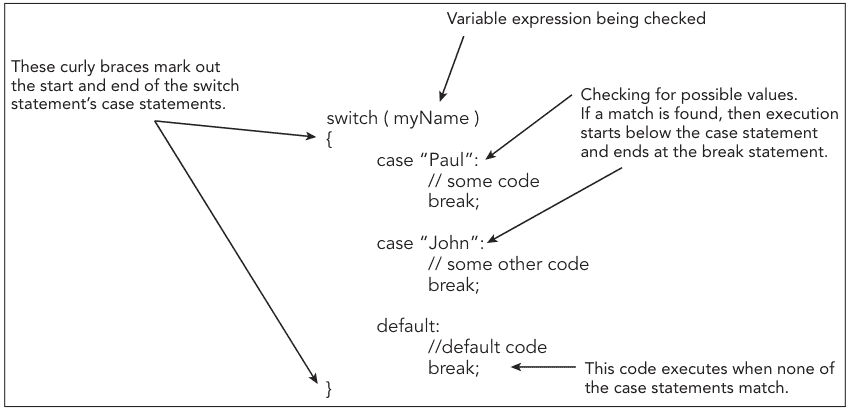

理解 switch 语句的最佳方式是 "切换到与 case 匹配的代码处"。switch 语句有四个重要元素：

- 测试表达式
- case 语句
- break 语句
- default 语句

测试表达式位于 switch 关键字后面的括号中。在前面的例子中，你使用变量 myName 进行测试。然而，在括号内，你可以使用任何有效的表达式。

接下来是 case 语句。case 语句执行条件检查。要指明哪些 case 语句属于你的 switch 语句，必须将它们放在测试表达式后面的花括号内。每个 case 语句指定一个值，例如 "Paul"。case 语句的作用类似于 if (myName == "Paul")。如果变量 myName 确实包含值 "Paul"，执行将从 case "Paul" 语句下方的代码开始，并持续到 switch 语句的末尾。这个例子只有两个 case 语句，但你可以根据需要添加任意多个。

在大多数情况下，你只希望执行相关 case 语句正下方的代码块，而不是相关 case 语句下方的所有代码，包括任何其他 case 语句。为此，你在要执行的代码末尾放置一个 break 语句。这告诉 JavaScript 在该点停止执行并退出 switch 语句。

最后，你有 default case，顾名思义，这是当其他所有 case 语句都不匹配时将执行的代码。default 语句是可选的；如果你没有想要执行的 default 代码，可以省略它，但请记住，在这种情况下，如果没有 case 语句匹配，将不会执行任何代码。包含一个 default 语句是一个好主意，除非你完全确定已涵盖所有选项。

### 动手试一试 使用 switch 语句

让我们看看 switch 语句的实际应用。以下示例说明了一个简单的猜数字游戏。输入代码并将其保存为 ch3_example3.html。

```
<!DOCTYPE html>

<html lang="en">
<head>
    <title>Chapter 3, Example 3</title>
</head>
<body>
    <script>
        var secretNumber = prompt("Pick a number between 1 and 5:", "");
        secretNumber = parseInt(secretNumber, 10);

        switch (secretNumber) {
case 1:
    document.write("Too low!");
    break;

case 2:
    document.write("Too low!");
    break;

case 3:
    document.write("You guessed the secret number!");
    break;

case 4:
    document.write("Too high!");
    break;

case 5:
    document.write("Too high!");
    break;

default:
    document.write("You did not enter a number between 1 and 5.");
    break;
}

document.write("<br />Execution continues here");
</script>
</body>
</html>
```

将其加载到浏览器中，并在提示框中输入值，例如 1。你应该会看到如图 3-8 所示的内容。

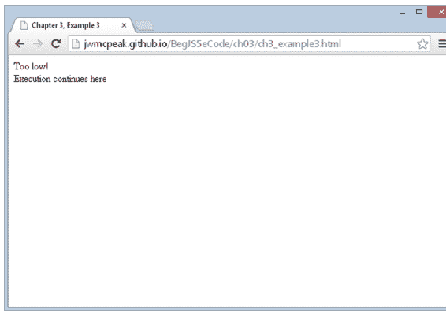

另一方面，如果你输入值 3，你应该会看到一条友好的消息，告知你猜对了秘密数字，如图 3-9 所示。

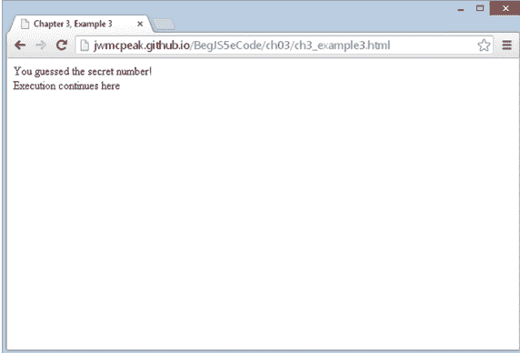

**图 3-9**

首先，你声明变量 `secretNumber`，并将其设置为通过提示框输入的值。注意，你使用 `parseInt()` 函数将 `prompt()` 返回的字符串转换为整数值：

```
var secretNumber = prompt("Pick a number between 1 and 5:", "");
secretNumber = parseInt(secretNumber, 10);
```

接下来，你创建 `switch` 语句的开始部分：

```
switch (secretNumber) {
```

括号中的表达式就是变量 `secretNumber`，`case` 语句将与此数字进行比较。

你使用花括号指定包含 `case` 语句的代码块。每个 `case` 语句检查 1 到 5 之间的数字之一，因为你已向用户指明应输入此范围内的数字。第一个 case 仅输出消息，告知用户输入的数字太小：

```
case 1:
    document.write("Too low!");
    break;
```

第二个 `case` 语句（值为 2）具有相同的消息，因此此处不重复代码。第三个 `case` 语句让用户知道猜对了：

```
case 3:
    document.write("You guessed the secret number!");
    break;
```

最后，第四个和第五个 case 语句输出消息，告知用户输入的数字太大：

```
case 4:
    document.write("Too high!");
    break;
```

在这个例子中，你确实需要添加一个 default case，因为用户很有可能（尽管有说明）输入一个不在 1 到 5 之间的数字，或者甚至可能是一个字母。在这种情况下，你添加一条消息让用户知道存在问题：

```
default:
    document.write("You did not enter a number between 1 and 5.");
    break;
```

default 语句对于发现错误也非常有用——如果你错误地编写了某些 case 语句，当你看到 default 代码在不该运行时运行了，你会很快发现问题。

最后，你添加了结束花括号，表示 switch 语句的结束。之后你输出一行以指示执行从何处继续：

```
}
document.write("<br />Execution continues here");
```

请注意，每个 case 语句都以 break 语句结束。这对于确保代码执行移动到 switch 语句结束后的一行非常重要。如果你忘记包含此语句，最终可能会执行与匹配 case 之后的每个 case 对应的代码。

### 为不同的 case 执行相同的代码

你可能已经发现了这个例子中 switch 语句的一个问题——当用户输入 1 或 2 时，你想要执行相同的代码；对于 4 或 5 也是如此。然而，为了实现这一点，你不得不在每个 case 中重复代码。你想要的是一种更简单的方法，让 JavaScript 为不同的 case 执行相同的代码。嗯，这很简单！只需将代码修改为如下所示：

```
switch (secretNumber) {
    case 1:
    case 2:
        document.write("Too low!");
        break;

    case 3:
        document.write("You guessed the secret number!");
        break;

    case 4:
    case 5:
        document.write("Too high!");
        break;
}
```


break;

```
default:
    document.write("You did not enter a number between 1 and 5.");
    break;
}
```

如果你将其加载到浏览器中，并尝试输入不同的数字，你应该会看到它的行为与之前的代码完全一致。

这里利用了这样一个事实：如果某个 case 语句代码下方没有 break 语句，执行将一直持续到后续的每一个 case 语句，直到遇到 break 语句或 switch 语句的结束。你可以把它想象成在 switch 语句中的一种“自由落体”，直到你遇到 break 语句。

如果匹配到值为 1 的 case 语句，执行将简单地继续，直到 case 2 下方的 break 语句，这样实际上你可以为两个 case 执行相同的代码。对于值为 4 和 5 的 case 语句也使用了相同的技术。

## 循环——FOR 和 WHILE 语句

循环意味着当条件为真时重复一段代码块。在 JavaScript 中，这通过使用两个语句来实现：while 语句和 for 语句。你很快就会看到这些，但为什么要重复代码块呢？

嗯，假设你有一系列结果，比如一年中每个月的平均气温，并且你希望将它们绘制在图表上。绘制每个点所需的代码很可能是相同的。所以，与其编写 12 次代码（每个点一次），不如使用序列中的下一项数据，更容易地执行相同的代码 12 次。这时 for 语句就会派上用场，因为你知道你希望代码执行多少次。

在另一种情况下，你可能希望在某个条件为真时重复相同的代码块，例如，当用户持续点击“重新开始”按钮时。在这种情况下，while 语句会非常有用。

### FOR 循环

for 语句使你能够将一段代码块重复一定次数。其语法在图 3-10 中进行了说明。

让我们看看 for 语句的构成。从图 3-10 中可以看出，就像 if 和 switch 语句一样，for 语句也有其逻辑包含在括号内。然而，这次逻辑被分成三个部分，每个部分用分号分隔。例如，在图 3-10 中，你有以下内容：

```
(var loopCounter = 1; loopCounter <= 3; loopCounter++)
```

for 语句逻辑的第一部分是 for 语句的初始化部分。为了跟踪你循环代码的次数，你需要一个变量来计数。在初始化部分，你初始化变量。在示例中，你声明了 `loopCounter` 并将其设置为 1。这部分在循环执行期间只执行一次，与其它部分不同。如果该变量之前已在代码中声明，则无需再次声明：

```
var loopCounter;
for (loopCounter = 1; loopCounter <= 3; loopCounter++)
```

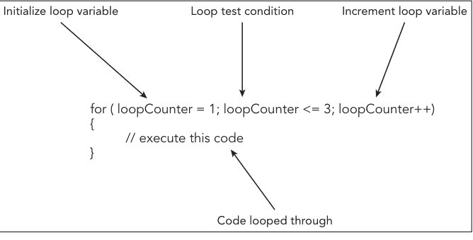

**图 3-10**

在分号之后，是 `for` 语句的*测试条件*部分。`for` 语句内部的代码将一直执行，直到此测试条件求值为 `false`。每次代码循环执行后，都会测试此条件。在图 3-10 中，只要 `loopCounter` 小于或等于 3，就会执行。循环执行的次数通常称为*迭代*次数。

最后，是 `for` 循环的*增量*部分，其中循环测试条件中的变量值会递增。这里你可以看到 `loopCounter` 通过你在第 2 章见过的 `++` 运算符递增 1。同样，for 语句的这部分会在每次代码循环时重复执行。虽然我们称其为增量部分，但它实际上可以用于递减或*减量*值——例如，如果你想从数组的最后一个元素倒数到第一个。

在 `for` 语句之后，是只要测试条件为 `true`，就会重复执行的代码块。此代码块包含在花括号内。如果条件从未为 `true`，即使在循环条件的第一次测试时也是如此，`for` 循环内部的代码将被跳过，永远不会执行。

将所有这些结合起来，`for` 循环是如何工作的？

1.  执行 `for` 语句的初始化部分。
2.  检查测试条件。如果为 `true`，继续；否则，退出 `for` 语句。
3.  执行 `for` 语句之后代码块中的代码。
4.  执行 `for` 语句的增量部分。
5.  重复步骤 2 到 4，直到测试条件为 `false`。

**动手试试** 转换一系列华氏温度值

让我们改变温度转换器，使其转换存储在数组中的一系列值，从华氏度到摄氏度。你将使用 for 语句遍历数组的每个元素。输入以下代码并将其保存为 ch3_example4.html：

```
<!DOCTYPE html>
<html lang="en">
<head>
    <title>Chapter 3, Example 4</title>
</head>
<body>
    <script>
        var degFahren = [212, 32, -459.15];
        var degCent = [];
        var loopCounter;

        for (loopCounter = 0; loopCounter <= 2; loopCounter++) {
            degCent[loopCounter] = 5/9 * (degFahren[loopCounter] - 32);
        }

        for (loopCounter = 2; loopCounter >= 0; loopCounter--) {
            document.write("Value " + loopCounter +
                " was " + degFahren[loopCounter] +
                " degrees Fahrenheit");

            document.write(" which is " + degCent[loopCounter] +
                " degrees centigrade<br />");
        }
    </script>
</body>
</html>
```

将其加载到浏览器后，你会在页面中看到三行内容，包含将你的华氏温度数组转换为摄氏度的结果（如图 3-11 所示）。

第一个任务是声明你将要使用的变量。首先，你声明并初始化 degFahren 以包含三个值的数组：212、32 和 -459.15。接下来，你将 degCent 声明为一个空数组。最后，你声明 loopCounter，并将在循环中使用它来跟踪你正在访问的数组索引：

```
var degFahren = [212, 32, -459.15];
var degCent = [];
var loopCounter;
```

接下来是你的第一个 for 循环：

```
for (loopCounter = 0; loopCounter <= 2; loopCounter++) {
    degCent[loopCounter] = 5/9 * (degFahren[loopCounter] - 32);
}
```

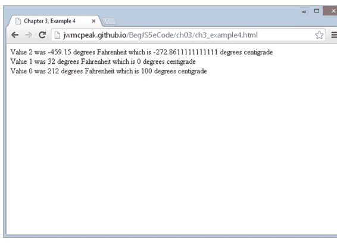

**图 3-11**

在第一行，你首先将 `loopCounter` 初始化为 0。然后检查 `for` 循环的测试条件 `loopCounter <= 2`。如果此条件为 `true`，循环将首次执行。花括号内的代码执行后，`for` 循环的增量部分 `loopCounter++` 将被执行，然后测试条件将被重新求值。如果仍然为 `true`，则会再次执行循环代码。这将持续到 `for` 循环的测试条件求值为 `false`，此时循环结束，将执行右花括号之后的第一条语句。

花括号内的代码是你在前面示例中见过的等式，只是这一次你将其结果放入 `degCent` 数组中，索引是 `loopCounter` 的值。

在第二个 `for` 循环中，你将 `degCent` 数组中的结果显示在屏幕上：

```
for (loopCounter = 2; loopCounter >= 0; loopCounter--) {
    document.write("Value " + loopCounter +
                  " was " + degFahren[loopCounter] +
                  " degrees Fahrenheit");

    document.write(" which is " + degCent[loopCounter] +
                   " degrees centigrade<br />");
}
```

这次你是从 2 *向下* 计数到 0。变量 `loopCounter` 被初始化为 2，循环条件在 `loopCounter` 小于 0 之前保持为 `true`。这次 `loopCounter` 实际上是每次递减而不是递增，通过 `loopCounter--` 实现。同样，`loopCounter` 起着双重作用：它记录你已执行的循环次数，同时也提供数组中的索引位置。

> **注意** 在这些示例中，你在循环中使用了整数。但是，没有理由不能使用小数，尽管这样做要常见得多。


### for...in 循环

这种循环使你能够遍历数组中的每个元素，而无需知道数组实际包含多少个元素。用通俗的话来说，这种循环的意思是“对于数组中的每个元素，执行一些代码”。`for...in` 循环会为你处理每个元素的索引号，并在每次迭代中自动移至下一个索引（进行循环），而无需你自己计算。

其用于数组的语法如下：

```javascript
for (index in arrayName) {
    //some code
}
```

在这段代码片段中，`index` 是你在循环前声明的一个变量，它会自动被填充为数组中的下一个索引值。`arrayName` 是包含你要循环遍历的数组的变量名称。

让我们看一个例子来使事情更清楚。你定义一个数组并用三个值初始化它：

```javascript
var myArray = ["Paul", "Paula", "Pauline"];
```

要使用传统的 `for` 循环访问每个元素，你会这样写：

```javascript
for (var loopCounter = 0; loopCounter < 3; loopCounter++) {
    document.write(myArray[loopCounter]);
}
```

要使用 `for...in` 循环做完全相同的事情，你会这样写：

```javascript
for (var elementIndex in myArray) {
    document.write(myArray[elementIndex]);
}
```

如你所见，第二个例子中的代码更清晰一些，也更短。两种方法都能很好地工作，并且都会迭代三次。但是，如果你增加数组的大小，例如添加元素 `myArray[3] = "Philip"`，第一种方法仍然只会循环遍历数组中的前三个元素，而第二种方法将循环遍历所有四个元素。

### while 循环

与用于循环特定次数的 `for` 循环不同，`while` 循环使你能够测试一个条件，并在条件为真时持续循环。当你知道需要循环多少次时，`for` 循环很有用；例如，当你循环遍历一个你已知包含一定数量元素的数组时。当你不知道需要循环多少次时，`while` 循环更有用。例如，如果你正在循环遍历一个温度值数组，并且希望当数组元素中包含的温度值小于 100 时继续循环，那么你就需要使用 `while` 语句。

让我们看一下 `while` 语句的结构，如图 3-12 所示。

你可以看到 `while` 循环比 `for` 循环的组成部分要少。`while` 循环由一个条件组成，如果该条件求值为真，则会导致花括号内的代码块执行一次；然后条件会被重新求值。如果它仍然是真，则代码再次执行，条件再次被重新求值，依此类推，直到条件求值为假。

需要注意的一件事是，如果条件一开始就是假的，`while` 循环就永远不会执行。例如：

```javascript
var degCent = 100;

while (degCent != 100) {
    // some code
}
```

这里，如果 `degCent` 不等于 100，循环就会运行。但是，因为 `degCent` 是 100，所以条件为假，代码永远不会执行。

在实践中，你通常期望循环至少执行一次；它是否再次执行将取决于循环内部的代码对循环条件中涉及的变量做了什么。例如：

```javascript
var degCent = [];
var degFahren = [34, 123, 212];
var loopCounter = 0;
while (loopCounter < 3) {
    degCent[loopCounter] = 5 / 9 * (degFahren[loopCounter] - 32);
    loopCounter++;
}
```

只要 `loopCounter` 小于 3，循环就会执行。正是循环内部的代码（`loopCounter++;`）递增了 `loopCounter`，并最终会导致 `loopCounter < 3` 变为假，从而使循环停止。然后执行将继续到 `while` 语句闭合花括号之后的第一行。

需要注意的是无限循环——一个永远不会结束的循环。假设你忘记在代码中包含 `loopCounter++;` 这一行。省略这一行意味着 `loopCounter` 将始终保持为 0，因此条件（`loopCounter < 3`）将始终为真，循环将持续进行，直到用户感到无聊和恼火并关闭她的浏览器。然而，这是一个很容易犯的错误，而且 JavaScript 不会对此发出警告。

不仅漏掉行会导致无限循环，循环代码中的错误也会导致。例如：

```javascript
var testVariable = 0;
while (testVariable <= 10) {
    alert("Test Variable is " + testVariable);
    testVariable++;
    if (testVariable = 10) {
        alert("The last loop");
    }
}
```

看看你能否找出导致无限循环的故意错误——是的，是那个 `if` 语句会导致这段代码永远执行下去。在 `if` 语句的条件中，你使用了赋值运算符 `=` 而不是比较运算符 `==`，所以尽管有 `testVariable++;` 这一行，`testVariable` 在每次循环中都被重新设置为 10。这意味着在每次循环开始时，测试条件总是求值为真，因为 10 小于或等于 10。加上额外的 `=` 使其变为 `if (testVariable == 10)`，一切就正常了。

### do...while 循环

通过 `while` 循环，你看到只有当条件为真时，循环内部的代码才会执行；如果为假，则代码永远不会执行，执行会转到 `while` 循环之后的第一行。然而，有时你可能希望 `while` 循环中的代码至少执行一次，无论 `while` 语句中的条件是否求值为真。甚至可能是 `while` 循环中的某些代码需要在你能够测试 `while` 语句的条件之前执行。正是这类情况，`do...while` 循环是理想的选择。

看一个你想通过提示框获取用户年龄的例子。你想显示提示框，但也要确保用户输入的是一个数字：

```javascript
var userAge;
do {
    userAge = prompt("Please enter your age", "")
} while (isNaN(userAge) == true);
```

循环内的代码行：

```javascript
userAge = prompt("Please enter your age", "")
```

无论 `while` 语句的条件如何，它都会执行。这是因为条件在执行完一次循环之前不会被检查。如果条件为真，代码将再次循环执行。如果为假，则停止循环。

请注意，在 `while` 语句的条件中，你使用了第 2 章中看到的 `isNaN()` 函数。它检查 `userAge` 变量的值是否为 `NaN`（非数字）。如果它不是一个数字，条件返回值为真；否则，它返回假。从例子中可以看出，它使你能够测试用户输入，以确保输入了正确的数据。用户可能谎报年龄，但至少你知道他输入了一个数字！

`do...while` 循环相当少见；没有它，你几乎也能完成所有事情，所以除非真的必要，否则最好避免使用它。

### break 和 continue 语句

你之前在查看 `switch` 语句时遇到过 `break` 语句。它在 `switch` 语句中的作用是停止代码执行，并将执行转移到 `switch` 语句闭合花括号之后的下一行代码。但是，你也可以在 `for` 和 `while` 循环中使用 `break` 语句，当你想要提前退出循环时。例如，假设你正在循环遍历一个数组，就像你在温度转换示例中那样，并且你遇到了一个无效值。在这种情况下，你可能希望立即停止代码，通知用户数据无效，并退出循环。这就是 `break` 语句派上用场的一种情况。

让我们看看如何修改你将一系列华氏值转换为摄氏值的例子（`ch3_example4.html`），以便如果你遇到一个非数字的值，你就停止循环并让用户知道数据无效：

```javascript
<script>
var degFahren = [212, "string data", -459.67];
var degCent = [];
var loopCounter;

for (loopCounter = 0; loopCounter <= 2; loopCounter++) {
    if (isNaN(degFahren[loopCounter])) {
        alert("Data '" + degFahren[loopCounter] + "' at array index " +
            loopCounter + " is invalid");
        break;
    }
    degCent[loopCounter] = 5 / 9 * (degFahren[loopCounter] - 32);
}
```

你已经更改了 `degFahren` 数组的初始化，使其现在包含一些无效数据。然后，在 `for` 循环内部，你添加了一个 `if` 语句来检查 `degFahren` 数组中的数据是否不是数字。你通过 `isNaN()` 函数来做到这一点；如果传递给括号的值（这里是 `degFahren[loopCounter]`）不是数字，它就返回真。如果值不是数字，你就告诉用户数组中哪个位置的数据无效。然后，使用 `break` 语句，你完全退出了 `for` 循环，代码执行将继续到 `for` 语句结束后的第一行。

以上是 `break` 语句，但 `continue` 呢？`continue` 语句类似于 `break`，因为它在找到它的点停止循环的执行，但它不是离开循环，而是开始下一次迭代的执行，从重新评估 `for` 或 `while` 语句的条件开始，就好像已经到达了循环代码的最后一行。

在 `break` 例子中，是非此即彼的——即使只有一条数据无效，你也会退出循环。如果你试图转换 `degFahren` 中的所有值，但遇到数组中的一个无效数据项，你通知用户并继续处理下一个数据项，而不是像 `break` 语句示例那样放弃，这样可能会更好：

```javascript
if (isNaN(degFahren[loopCounter])) {
    alert("Data '" + degFahren[loopCounter] + "' at array index " +
        loopCounter + " is invalid");
    continue;
}
```


## 函数与作用域

**本章你将学习：**

- 创建自己的函数
- 识别、创建和使用全局与局部变量
- 将函数作为值使用

**本章Wrox.com代码下载**

你可以在 http://www.wiley.com/go/BeginningJavaScript5E 的“下载代码”标签页找到本章的Wrox.com代码下载。你也可以在 http://beginningjs.com 查看所有示例和相关文件。

函数是执行特定任务的代码单元。以袖珍计算器为例，它执行许多基本计算，如加法和减法。然而，许多计算器还有执行更复杂操作的功能键。例如，有些计算器有计算平方根的按钮，另一些甚至提供统计功能，如计算平均值。这些函数大多可以通过基本的数学运算（加、减、乘、除）来完成，但步骤可能很多——如果用户只需按一个按钮就完成，那就简单多了。她只需提供数据（在此例中是数字），功能键就会完成其余工作。

JavaScript中的函数有点像袖珍计算器上的功能键：它们封装了一段执行特定任务的代码。到本书目前为止，你已经遇到了一些方便的内置函数，它们执行特定任务，例如`parseInt()`和`parseFloat()`函数，用于将字符串转换为数字，以及`isNaN()`函数，用于告诉你某个值是否可以转换为数字。其中一些函数会返回数据，例如`parseInt()`返回一个整数；

随着你继续阅读本书，你会遇到更多有用的内置函数。但是，如果能编写自己的函数，岂不是很好？当你设计、编写并调试完一段代码来执行特定任务后，能够一遍又一遍地调用它，那该多好。JavaScript使我们能够做到这一点，这正是本节你将要重点学习的内容。

函数名紧随`function`关键字之后。为了方便自己，请尝试使用有意义的名称，这样当你在代码中再次看到它们时，就能确切知道它们的功能。例如，一个接受某人生日和今天日期作为参数并返回该人年龄的函数，可以命名为`getAge()`。然而，你能使用的名称是有限的，就像变量名一样。例如，你不能使用JavaScript保留字，所以不能将函数命名为`if()`或`while()`。

然后你编写函数在被调用时将执行的代码。所有函数代码必须放在一对花括号构成的代码块中。

函数还允许你从函数向调用它的代码返回一个值。你使用`return`语句来返回值。在前面给出的示例函数中，你返回了变量`degCent`的值，这是你刚刚计算出来的。如果你不想返回值，也可以不返回，但重要的是要注意，每个函数都会返回一个值，即使你没有使用`return`语句。没有显式返回值的函数——即未使用`return`语句返回值——会返回`undefined`。

### 创建自己的函数

当JavaScript在函数中遇到`return`语句时，它的行为有点像`for`循环中的`break`语句——它会退出函数，并返回`return`关键字后指定的任何值。

你可能会发现，建立一个在JavaScript代码中经常使用的函数“库”很有用，你可以在页面中引用它们。

创建了函数后，如何使用它们？与你目前见过的代码（当JavaScript执行到该行时立即执行）不同，函数只有在你调用它们时才执行，这称为*调用*函数。你通过在需要调用函数的地方写上函数名，并确保传递它需要的参数（用逗号分隔）来调用函数。例如：

```
myTemp = convertToCentigrade(212);
```

这一行调用了你之前见过的`convertToCentigrade()`函数，将`212`作为参数传递，并将函数的`return`值（即`100`）存储在`myTemp`变量中。

现在尝试创建你自己的函数，仔细看看参数是如何传递的。参数传递可能有点令人困惑，所以你首先创建一个简单的函数，它只接受一个参数（用户名），并将其写入页面，显示友好的欢迎字符串。首先，你需要为函数想一个名字。一个简短但有描述性的名字是`writeUserWelcome()`。现在你需要定义函数期望传递的参数。只有一个参数——用户名。定义参数有点像定义变量——你需要遵守相同的命名规则，即不能有空格、特殊字符或保留字。我们将参数命名为`userName`。你需要将它添加在函数名末尾的括号内（注意行末不加分号）：

```
function writeUserWelcome(userName)
```

好的，现在你已经定义了函数名和参数；剩下的就是创建函数体——即当函数被调用时将执行的代码。你通过将这部分代码包裹在花括号中来标记它：

```
function writeUserWelcome(userName){
    document.write("欢迎访问我的网站 " + userName + "<br />");
    document.write("希望你喜欢！");
}
```

代码很简单；你使用`document.write()`在网页上输出消息。你可以看到`userName`的使用方式就像任何普通变量一样；事实上，最好将参数视为普通变量。参数的值将是调用该函数的JavaScript代码中指定的值。

让我们看看你将如何调用这个函数：

```
writeUserWelcome("Paul");
```

很简单——只需写下要调用的函数名，然后在括号中添加要传递给每个参数的数据，这里只有一个数据。当代码在

函数执行时，函数代码体中使用的变量`userName`将包含文本"Paul"。

假设你想向函数传递两个参数——需要修改什么？首先，你需要改变函数定义。想象第二个参数将保存用户的年龄——可以称其为`userAge`，因为这样能清楚地表明参数数据的含义。以下是新代码：

```
function writeUserWelcome(userName, userAge) {
    document.write("Welcome to my website" + userName + "<br />");
    document.write("Hope you enjoy it<br />");
    document.write("Your age is " + userAge);
}
```

你在函数体中添加了一行代码来使用你新增的参数。要调用该函数，需要编写以下代码：

```
writeUserWelcome("Paul", 31);
```

第二个参数是数字，因此不需要加引号。此处`userName`参数为Paul，第二个参数`userAge`则为31。

### 华氏度转摄氏度函数

让我们用函数重写温度转换页面。你可以从ch3_example4.html中剪切粘贴大部分代码——变更部分已高亮显示。完成后，请将其保存为ch4_example1.html。

```
<!DOCTYPE html>
<html lang="en">
<head>
    <title>Chapter 4, Example 1</title>
</head>
<body>
    <script>
        function convertToCentigrade(degFahren) {
            var degCent = 5 / 9 * (degFahren - 32);
            return degCent;
        }

        var degFahren = [212, 32, -459.15];
        var degCent = [];
        var loopCounter;

        for (loopCounter = 0; loopCounter <= 2; loopCounter++) {
            degCent[loopCounter] = convertToCentigrade(degFahren[loopCounter]);
        }

        for (loopCounter = 2; loopCounter >= 0; loopCounter--) {
            document.write("Value " + loopCounter +
                            " was " + degFahren[loopCounter] +
                            " degrees Fahrenheit");

            document.write(" which is " + degCent[loopCounter] +
                            " degrees centigrade<br />");
        }
    </script>
</body>
</html>
```

在浏览器中加载此页面时，你应该会看到与ch3_example4.html完全相同的结果。

在脚本块顶部，你声明了`convertToCentigrade()`函数。我们之前已经见过这个函数：

```
function convertToCentigrade(degFahren) {
    var degCent = 5/9 * (degFahren - 32);
    return degCent;
}
```

如果你在一个页面中使用多个独立的`script`块，那么在任何脚本调用该函数之前定义函数非常重要。如果你有多个函数，可能需要将它们全部放在自己的脚本文件中，并在所有其他脚本之前加载。这样你就知道在哪里可以找到所有函数，并确保它们在使用前已被声明。

你应该对函数中的代码工作原理相当熟悉。你声明一个变量`degCent`，进行计算，然后将`degCent`返回给调用代码。函数的参数是`degFahren`，它提供了计算所需的信息。

函数声明之后是页面加载时执行的代码。首先定义所需的变量，然后是两个循环，分别用于计算和输出结果。这大部分与之前相同，除了第一个`for`循环：

```
for (loopCounter = 0; loopCounter <= 2; loopCounter++) {
    degCent[loopCounter] = convertToCentigrade(degFahren[loopCounter]);
}
```

第一个`for`循环内的代码将函数`convertToCentigrade()`返回的值放入`degCent`数组中。

这个例子的代码中有一个微妙之处。注意你在函数`convertToCentigrade()`内声明了变量`degCent`，同时在函数定义之后又将其声明为一个数组。

这肯定不被允许吧？

这恰好引出了本章的下一个主题——作用域。

### 作用域与生命周期

*作用域*是什么意思？简单来说，它是指变量或函数可用的范围或程度——即代码的哪些部分可以访问一个变量及其包含的数据。作用域对任何编程语言都很重要——在JavaScript中更是如此——因此理解作用域在JavaScript中如何工作至关重要。

### 全局作用域

在函数外部声明的任何变量或函数都可在页面上的所有JavaScript代码中访问，无论该代码是在函数内部还是在其他地方——我们称之为*全局作用域*。看以下示例：

```
var degFahren = 12;

function convertToCentigrade() {
    var degCent = 5/9 * (degFahren - 32);
    return degCent;
}
```

在此代码中，`degFahren`变量是一个全局变量，因为它是在函数外部创建的。由于它是全局的，因此可以在页面的任何位置使用。`convertToCentigrade()`函数访问`degFahren`变量，将其用作将华氏度转换为摄氏度的计算的一部分。

这也意味着你可以更改变量的值，以下代码正是如此：

```
var degFahren = 12;

function convertToCentigrade() {
    degFahren = 20;
    var degCent = 5/9 * (degFahren - 32);
    return degCent;
}
```

这行新代码将`degFahren`的值更改为20；因此原始值12不再用于计算。这种值的变化不仅仅在`convertToCentigrade()`函数内部可见。由于`degFahren`变量是全局变量，因此在任何使用它的地方其值都是20。

此外，`convertToCentigrade()`函数也是一个全局函数，因为它是在另一个函数外部定义的（是的，你可以在函数内部创建函数……函数套娃！），并且它们也可以在页面的任何位置访问。

实际上，你需要避免创建全局变量和函数，因为它们很容易被无意中修改。你可以使用一些技巧来避免全局变量，你将在本书中看到这些技巧，但它们都归结为在函数作用域内创建变量和函数。

### 函数作用域

在函数内部声明的变量和函数仅在该函数内部可见——函数外部的任何代码都无法访问它们。例如，考虑我们的标准`convertToCentigrade()`函数：

```
function convertToCentigrade(degFahren) {
    var degCent = 5/9 * (degFahren - 32);
    return degCent;
}
```

`degCent`变量是在`convertToCentigrade()`函数内部定义的。因此，它只能从`convertToCentigrade()`内部访问。这通常被称为函数作用域或局部作用域，而`degCent`通常被称为局部变量。

函数参数类似于变量；它们具有局部作用域，因此只能在函数内部访问。因此，在前面的`convertToCentigrade()`函数中，`degFahren`和`degCent`都是局部变量。

那么，当函数内部的代码执行结束，执行返回到调用该代码的点时会发生什么？当你下次调用该函数时，函数内部定义的变量会保留其值吗？

答案是否定的：变量不仅具有作用域属性——即它们在哪里可见——它们还具有生命周期。当函数执行完毕时，该函数中的变量就会消亡，其值也会丢失，除非你将其中一个返回给调用代码。JavaScript会不时执行垃圾回收（我们在第2章中讨论过），它会扫描代码并查看是否有任何变量不再使用；如果有，则会释放它们保存的数据以腾出空间给其他变量的数据。

### 标识符查找

如果你对全局变量和局部变量使用相同的变量名会发生什么？JavaScript通过称为标识符查找的过程来处理这种看似灾难性的事件。标识符只是你赋予变量或函数的名称。因此，标识符查找是JavaScript引擎用来查找具有给定名称的变量或函数的过程。考虑以下代码：

```
var degCent = 10;
function convertToCentigrade(degFahren) {
    var degCent = 5/9 * (degFahren - 32);
    return degCent;
}
```

此代码包含两个`degCent`变量：一个是全局的，另一个是`convertToCentigrade()`的局部变量。当你执行该函数时，JavaScript引擎会创建局部变量`degCent`并将华氏度到摄氏度转换的结果赋值给它——全局变量`degCent`不受影响。


`degCent` 变量被保留不变，仍然包含值 10。但 return 语句返回的是哪个值：全局的 `degCent` 还是局部的 `degCent`？

JavaScript 引擎首先从当前作用域层级开始标识符查找过程。因此，它首先在 `convertToCentigrade()` 的函数作用域内查找名为 `degCent` 的变量或函数，找到了局部变量，并在 return 语句中使用了它的值。

但如果 `degCent` 不是在 `convertToCentigrade()` 内创建的，JavaScript 引擎接下来就会在下一个作用域层级——在此例中是全局作用域——查找 `degCent` 标识符。它会找到全局变量并使用其值。

既然你已经理解了作用域的工作原理，现在让我们回顾一下“华氏度转摄氏度函数”实践练习中的示例 1。尽管它有两个 `degCent` 变量——一个全局的，一个局部于 `convertToCentigrade()` 的——但代码执行起来毫无问题。在函数内部，局部 `degCent` 变量优先于全局变量。而在函数外部，局部变量已不在作用域内；因此，使用的是全局 `degCent`。

虽然将全局变量和局部变量使用相同的标识符完全合法，但强烈建议你避免这样做。它会为你的代码增加额外且通常不必要的复杂性和混淆。这也可能使引入难以发现和修复的 bug 变得更容易。想象一下，在函数内部，你本意是修改一个全局变量，却修改了一个局部变量。这就是一个 bug，如果你在许多其他函数中都复制了它，你将花费宝贵的时间来查找和修复这些错误。

### 函数作为值

JavaScript 是一门强大的语言，其很大一部分威力来源于函数。与许多其他语言不同，函数在 JavaScript 中是*一等公民*；换句话说，我们可以将函数像任何其他类型的值一样对待。例如，让我们以 `convertToCentigrade()` 函数为例，将其赋值给一个变量：

```javascript
function convertToCentigrade(degFahren) {
    var degCent = 5/9 * (degFahren - 32);

    return degCent;
}

var myFunction = convertToCentigrade;
```

这段代码将 `convertToCentigrade()` 函数赋值给了 `myFunction` 变量，但仔细看赋值的右侧——`convertToCentigrade` 标识符的末尾缺少了开头和结尾的括号。它看起来很像一个变量！

在这个语句中，我们并没有执行 `convertToCentigrade()`；我们引用的是函数本身。这意味着我们现在有两种方式来执行同一个函数。我们可以像平常一样通过执行 `convertToCentigrade()` 来调用它，或者我们可以执行 `myFunction()`，如下所示：

```javascript
var degCent = myFunction(75); // 23.88888889
var degCent2 = convertToCentigrade(75); // 23.88888889
```

这也意味着我们可以将一个函数作为参数传递给另一个函数。看看下面的代码：

```javascript
function doSomething(fn) {
    fn("Hello, World");
}

doSomething(alert);
```

这段代码定义了一个名为 `doSomething()` 的函数，它有一个名为 `fn` 的参数。在函数内部，`fn` 变量被用作一个函数；它通过 `fn` 标识符后跟一对括号来执行。代码的最后一行执行了 `doSomething()` 函数，并将 `alert` 函数作为参数传递。当这段代码执行时，会弹出一个 `alert` 对话框显示消息 "Hello, World"。

### 实践练习：传递函数

让我们重写温度转换器页面，以使用更多函数。你可以从 `ch4_example1.html` 中剪切粘贴部分代码，但本示例的大部分将是新代码。完成后，请将其保存为 `ch4_example2.html`。

```html
<!DOCTYPE html>
<html lang="en">
<head>
    <title>Chapter 4, Example 2</title>
</head>
<body>
        <script>
        function toCentigrade(degFahren) {
            var degCent = 5 / 9 * (degFahren - 32);

            document.write(degFahren + " Fahrenheit is " +
                           degCent + " Celsius.<br/>");
        }

        function toFahrenheit(degCent) {
            var degFahren = 9 / 5 * degCent + 32;

            document.write(degCent + " Celsius is " +
                           degFahren + " Fahrenheit.<br/>");
        }

        function convert(converter, temperature) {
            converter(temperature);
        }

        convert(toFahrenheit, 23);
        convert(toCentigrade, 75);
        </script>
</body>
</html>
```

96  | 第 4 章 函数与作用域

当您将此页面加载到浏览器中时，您应该会看到如图 4-2 所示的结果。

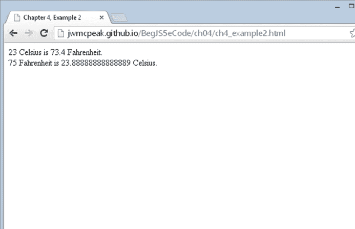

**图 4-2**

脚本块顶部是 `toCentigrade()` 函数。它与 `ch4_example1.html` 中的 `convertToCentigrade()` 函数有些相似，区别在于它没有返回转换后的值，而是简单地将转换信息写入文档：

```javascript
function toCentigrade(degFahren) {
    var degCent = 5 / 9 * (degFahren - 32);
    document.write(degFahren + " Fahrenheit is " +
                   degCent + " Celsius.<br/>");
}
```

下一个函数 `toFahrenheit()` 与 `toCentigrade()` 类似，只是它将提供的值转换为华氏度。然后它将转换信息写入文档：

```javascript
function toFahrenheit(degCent) {
    var degFahren = 9 / 5 * degCent + 32;
    document.write(degCent + " Celsius is " +
                   degFahren + " Fahrenheit.<br/>");
}
```

诚然，你可以直接使用这些函数而不会有任何问题，但这不会产生一个非常有趣的示例。相反，第三个函数 `convert()` 将被用来执行 `toCentigrade()` 和 `toFahrenheit()`：

```javascript
function convert(converter, temperature) {
    return converter(temperature);
}
```

此函数接受第一个参数 `converter`，并将其用作一个函数。然后将第二个参数 `temperature` 传递给 `converter()`，以执行转换并将结果写入文档。

最后两行代码使用了 `convert()`，并传递了相应的转换函数和温度值：

```javascript
convert(toFahrenheit, 23);
convert(toCentigrade, 75);
```

尽管这确实是一个针对相对简单问题的更复杂的解决方案，但它证明了函数在 JavaScript 中是值的事实。我们可以将它们赋值给变量，并将它们传递给其他函数。这是一个极其重要的概念，当你在第 10 章学习事件时，就会明白为什么了。

## 总结

在本章中，你结束了对 JavaScript 语言核心及其语法的探讨。从现在开始的一切都将建立在这些基础之上。掌握了这些不那么有趣的语法知识后，你就可以在本书的剩余部分中转向更有趣的内容。

本章探讨了以下内容：

-   **函数是可重用的代码片段。** JavaScript 有很多内置函数，为程序员提供服务，例如将字符串转换为数字。然而，JavaScript 也允许你使用 `function` 关键字定义和使用自己的函数。函数可以接受零个或多个参数，并且如果你愿意，可以返回一个值。

-   **变量作用域和生命周期：** 在函数外部声明的变量是全局可用的——也就是说，在页面中的任何地方都可以访问。在函数内部定义的任何变量都是该函数私有的，无法在外部访问。变量有生命周期，其长度取决于变量声明的位置。如果是全局变量，其生命周期就是页面的生命周期——只要页面在浏览器中加载，变量就一直存在。对于在函数中定义的变量，其生命周期仅限于该函数的执行时间。当函数执行完毕，变量就会消亡，其值也会丢失。如果代码稍后再次调用该函数，变量将是空的。

-   **标识符查找：** 当你使用一个变量或函数时，JavaScript 引擎会进行标识符查找过程，以找到与该标识符关联的值。

-   **函数在 JavaScript 中是一等公民。** 你可以将函数赋值给变量，并将它们传递给其他函数。


## 练习

你可以在附录A中找到这些问题的参考答案。

-   1. 修改第3章第2题的代码，使其成为一个函数，接受乘法表所需倍数、起始值和结束值作为参数。例如，你可以尝试从`4 * 4`开始，到`4 * 9`结束显示4的乘法表。

-   2. 修改第1题的代码，让用户输入要显示的乘法表倍数；代码应持续请求并显示乘法表，直到用户输入`-1`。此外，进行检查以确保用户输入的是有效数字；如果数字无效，请要求用户重新输入。

## 5 JavaScript——一种基于对象的语言

**你将在本章学习到：**

-   使用JavaScript的内置对象处理复杂数据
-   创建自定义对象来表示复杂概念和数据
-   定义自定义引用类型

**本章的 Wrox.com 代码下载**

你可以在 [http://www.wiley.com/go/BeginningJavaScript5E](http://www.wiley.com/go/BeginningJavaScript5E) 的“Download Code”选项卡上找到本章的 Wrox.com 代码下载。你还可以在 [http://beginningjs.com](http://beginningjs.com) 上查看所有示例和相关文件。

在本章中，我们将探讨一个对JavaScript至关重要的概念——*对象*。但对象是什么？它们为什么有用？

首先，我们必须告诉你：你在这本书中一直在使用对象（例如，数组就是一个对象）。JavaScript是一种基于对象的语言，因此你所做的大部分工作都涉及操作对象。你会看到，当你充分利用这些对象时，用JavaScript能做的事情范围会极大地扩展。

本章将从探讨对象是什么以及为什么重要开始。接着，我们将介绍JavaScript中使用了哪些类型的对象，如何创建和使用它们，以及它们如何为你简化许多编程任务。最后，你将更详细地了解JavaScript提供的一些最有用的对象，以及如何在实际情况中使用它们。

JavaScript语言不仅由许多被称为对象（也称为*原生JavaScript对象*）的东西组成，而且浏览器本身也被建模为一个可供你使用的对象集合。你将在第8章特别学习这些对象。

## 基于对象的编程

基于对象的编程是“使用对象进行编程”这个说法的稍微吓人一点的版本。但你将要编程使用的这些对象到底是什么？它们在哪里，以及你为什么要、如何用它们编程？在本节中，你将从通用编程术语和更具体的JavaScript领域来探讨这些问题的答案。

### 什么是对象？

为了开始对象的介绍，让我们思考一下在计算机之外的“现实世界”中，对象指的是什么。世界是由事物或对象组成的，比如桌子、椅子和汽车（仅举几例！）。让我们以一辆汽车为例，来探讨对象到底是什么。

你会如何定义这辆汽车？你可能会说它是一辆蓝色的四轮驱动汽车。你可能会指定它的行驶速度。当你这样做时，你是在指定对象的*属性*。例如，汽车有一个颜色属性，在这个例子中它的值是蓝色。

你如何使用这辆汽车？你转动点火钥匙，按下油门踏板，按喇叭，换挡（即，在手动挡汽车中选择1、2、3、4档和倒挡，或在自动挡汽车中选择前进和倒挡），等等。当你这样做时，你是在使用对象的*方法*。

你可以把方法想象成有点像函数。有时，你可能需要向方法传递一些信息或参数，让它工作。例如，当你使用换挡方法时，你需要说明你想换到哪个档位。其他方法可能会将信息返回给使用者。例如，机油尺方法会告诉使用者汽车里还剩多少油。

有时使用一个或多个方法可能会改变对象的一个或多个属性。例如，使用加速器方法可能会改变汽车的速度属性。其他属性则不能改变：例如，汽车的车身形状属性（除非你以每小时100英里的速度撞上砖墙！）。

你可以说汽车是由它的方法和属性集合定义的。在基于对象的编程中，其思想是用对象来模拟现实世界的情况，这些对象由它们的方法和属性定义。

### JavaScript中的对象

你现在应该对对象是什么有了一个基本的概念——一个拥有方法和属性的“东西”。但如何在JavaScript中使用这个概念呢？

在前面的章节中，你（在很大程度上）一直在处理*原始*数据（即，你一直在处理实际的数据）。这种类型的数据不太复杂，相当容易处理。然而，并非所有信息都像原始数据那样简单。让我们看一个例子来稍微澄清一下。

假设你编写了一个显示公共汽车或火车时刻表信息的网页应用程序。一旦用户选择了一个行程，你可能想告诉他这个行程需要多长时间。为此，你需要用到达时间减去出发时间。

然而，这并不像初看起来那么简单。例如，考虑出发时间是14:53（下午2:53），到达时间是15:10（下午3:10）。如果你让JavaScript计算表达式15.10–14.53，你会得到结果0.57，也就是57分钟。然而，你知道实际的时间差是17分钟。对时间使用普通的数学运算符是行不通的！

你需要做什么来计算这两个时间之间的差值？你首先需要将每个时间中的小时和分钟分开。然后，为了得到两个时间之间的分钟差，你需要检查到达时间的分钟数是否大于出发时间的分钟数。如果是，你可以简单地用到达时间的分钟数减去出发时间的分钟数。如果不是，你需要在到达时间的分钟数上加上60，并从到达时间的小时数中减去1进行补偿，然后再用到达时间的分钟数减去出发时间的分钟数。然后你需要用到达时间的小时数减去出发时间的小时数，再将你得到的分钟数和小时数重新组合起来。

只要这两个时间在同一天内，这种方法就可行。例如，对于时间23:45和04:32，它就行不通了。

这种计算时间差的方法显然有其问题，而且看起来也非常复杂。有没有更简单的方法来处理像时间和日期这样更复杂的数据？

这就是对象的用武之地。你可以将你的出发和到达时间定义为Date对象。因为它们是Date对象，所以它们带有各种属性和方法，你可以在需要操作或计算时间时使用它们。例如，你可以使用`getTime()`方法获取Date对象中的时间与1970年1月1日00:00:00之间的毫秒数。一旦你有了到达和出发时间的这些毫秒值，你可以简单地用一个减去另一个，并将结果存储在另一个Date对象中。要检索这个时间的小时和分钟，你只需使用Date对象的`getHours()`和`getMinutes()`方法。你将在本章后面看到更多这方面的例子。

Date对象并不是JavaScript提供的唯一对象类型。第2章介绍过另一种对象类型，但为了简单起见，我们当时没有告诉你它是什么：Array对象。回想一下，数组是一种同时保存多条数据的方式。

Array对象有一个名为`length`的属性，它告诉你数组保存了多少条数据，或者说有多少个元素。它们也有许多方法。一个例子是`sort()`方法，你可以用它来将数组内的元素按字母顺序排序。

你现在应该知道对象在JavaScript中为什么有用了。你已经见过了Date和Array对象，但JavaScript还提供了许多其他类型的对象，以便你能够用代码实现更多功能。这些包括Math和String对象，我们将在本章后面更多地讨论它们。

### 使用JavaScript对象

既然你已经了解了JavaScript对象的“为什么”，你需要来看看“是什么”和“怎么做”。

JavaScript的每个对象都有一组相关的属性和方法，你可以用它们来操作某种特定的数据。例如，Array对象包含操作数组的方法和从数组中获取信息的属性。在大多数情况下，要利用这些方法和属性，你需要将你的数据定义为这些对象之一。换句话说，你需要创建一个对象。


在本节中，你将了解如何创建对象，以及在创建对象后如何使用其属性和方法。

### 创建对象

要创建多种类型的对象，你需要使用 `new` 操作符。以下语句创建了一个 `Date` 对象：

```
var myDate = new Date();
```

该语句的前半部分你应该很熟悉。你使用 `var` 关键字定义一个名为 `myDate` 的变量。这个变量通过等号赋值操作符 (`=`) 被初始化为语句右侧的值。

语句的右侧由两部分组成。首先是操作符 `new`。它告诉 JavaScript 你想要创建一个新对象。接下来是 `Date()`。这是 `Date` 对象的*构造函数*。它是一个函数，用于告诉 JavaScript 你想要创建什么类型的对象。大多数对象都有类似的构造函数。例如，`Array` 对象有 `Array()` 构造函数（但请记住，我们通常不使用它，而是倾向于使用字面量 `[]`）。本书中你看到的唯一例外是 `Math` 对象，这将在本章后面的部分进行解释。

因为构造函数是一个函数，所以你可以向构造函数传递参数来为对象添加数据。例如，以下代码创建了一个包含 2014 年 1 月 1 日日期的 `Date` 对象：

```
var myDate = new Date("1 Jan 2014");
```

对象数据在变量中的存储方式与原始数据（如文本和数字）的存储方式不同。（原始数据是 JavaScript 中最基础的数据。）对于原始数据，变量保存的是数据的实际值。例如：

```
var myNumber = 23;
```

这段代码意味着变量 `myNumber` 保存着数据 `23`。然而，赋值给对象的变量并不保存实际数据，而是保存对数据所在内存地址的一个*引用*。这并不意味着你能获取到内存地址——这只是 JavaScript 内部知道并自己管理的细节。你需要记住的是，当你说一个变量引用一个对象时，你的意思是指它引用一个内存地址。这在下面的示例中有所展示：

```
var myArrayRef = [0, 1, 2];
var mySecondArrayRef = myArrayRef;
myArrayRef[0] = 100;
alert(mySecondArrayRef[0]);
```

首先，你将 `myArrayRef` 变量设置为引用新的数组对象，然后将 `mySecondArrayRef` 设置为相同的引用——例如，现在 `mySecondArrayRef` 被设置为引用同一个数组对象。因此，当你如下面所示将数组的第一个元素设置为 `100` 时：

```
myArrayRef[0] = 100;
```

并如下面所示显示 `mySecondArrayRef` 中引用的数组的第一个元素的内容时：

```
alert(mySecondArrayRef[0]);
```

你会看到它也神奇地变成了 100！然而，正如你现在所知道的，这不是魔法；这是因为两个变量引用的是同一个数组对象——对于对象来说，存储在变量中的是对象的引用，而不是对象本身。当你进行赋值时，它并没有复制数组对象，而只是复制了引用。与此形成对比的是：

```
var myVariable = "ABC";
var mySecondVariable = myVariable;
myVariable = "DEF";
alert(mySecondVariable);
```

在这种情况下，你处理的是一个字符串，这是一种原始数据类型，数字也是如此。这一次，实际值存储在变量中，所以当你这样做时：

```
var mySecondVariable = myVariable;
```

`mySecondVariable` 获得了 `myVariable` 中数据的独立副本。因此，最后的警报仍然会显示 `mySecondVariable` 保存着 `"ABC"`。

总结本节内容，你可以使用以下基本语法创建 JavaScript 对象：

```
var myVariable = new ConstructorName(optional parameters);
```

### 使用对象的属性

访问对象属性中包含的值非常简单。你写出包含（或引用）对象的变量名称，后跟一个点，然后是对象属性的名称。

例如，如果你定义了一个包含在变量 `myArray` 中的 `Array` 对象，你可以像这样访问它的 `length` 属性：

```
myArray.length
```

但是，一旦你有了这个属性，你能用它做什么呢？你可以像使用任何其他数据一样使用它，并将其存储在变量中：

```
var myVariable = myArray.length;
```

或者你可以将其显示给用户：

```
alert(myArray.length);
```

在某些情况下，你甚至可以更改属性的值，像这样：

```
myArray.length = 12;
```

然而，与变量不同，某些属性是只读的——你可以从中获取信息，但不能*更改*其中的信息。

### 调用对象的方法

方法与函数非常相似，它们可以用来执行有用的任务，例如从特定日期获取小时数或生成随机数。同样像函数一样，有些方法会返回一个值，例如 Date 对象的 getHours() 方法，而另一些方法执行一个任务但不返回数据，例如 Array 对象的 sort() 方法。

使用对象的方法与使用属性非常相似，你先写出对象的变量名，然后是一个点，最后是方法的名称。例如，要对变量 myArray 中的 Array 元素进行排序，你可以使用以下代码：

```
myArray.sort();
```

就像函数一样，你可以通过将参数放在方法名称后的括号中来将参数传递给某些方法。然而，无论方法是否接受参数，你都必须在方法名称后加上括号，就像处理函数一样。作为一个通用规则，任何你可以使用函数的地方，你都可以使用对象的方法。

## 原始值与对象

你现在应该对原始数据（如数字和字符串）和对象数据（如日期和数组）之间的区别有了很好的理解。然而，正如前面提到的，还有一个 String 对象。它是怎么融入其中的呢？

事实上，有 String、Number 和 Boolean 对象分别对应字符串、数字和布尔原始数据类型。例如，要创建一个包含文本 "I'm a String object" 的 String 对象，你可以使用以下代码：

```
var myString = new String("I'm a String object");
```

String 对象与 Array 对象一样，具有 length 属性。它返回 String 对象中的字符数。例如，

```
var lengthOfString = myString.length;
```

会在变量 lengthOfString 中存储值 19（记住空格也被视为字符）。

但是，如果你声明了一个名为 mySecondString 的原始字符串，它保存着文本 "I'm a primitive string"，像这样：

```
var mySecondString = "I'm a primitive string";
```

并且想知道这个原始字符串中有多少个字符呢？

这就是 JavaScript 帮助你的地方。回顾前面的章节，JavaScript 可以自动处理一种数据类型到另一种数据类型的转换。例如，如果你尝试将一个字符串原始值与一个数字原始值相加，像这样：

```
theResult = "23" + 23;
```

JavaScript 会假设你想将数字视为字符串并将两者连接起来，数字会自动转换为文本。变量 `theResult` 将包含 "2323"——23 和 23 的连接，而不是 23 和 23 的和（即 46）。

同样的情况也适用于对象。如果你声明一个原始字符串然后将其视为对象，例如尝试访问它的方法或属性，JavaScript 会知道你试图执行的操作将不起作用。这个操作只对对象有效；例如，对 `String` 对象是有效的。在这种情况下，JavaScript 会将纯文本字符串转换为一个临时的 `String` 对象，仅用于该操作，并在操作完成后销毁该对象。

因此，对于你的原始字符串 `mySecondString`，你可以使用 `String` 对象的 `length` 属性来找出它包含的字符数。例如：

```
var lengthOfSecondString = mySecondString.length;
```

这将在变量 `lengthOfSecondString` 中存储数据 22。

这里表达的同样概念也适用于数字和布尔原始值及其对应的 `Number` 和 `Boolean` 对象。然而，这些对象并不常用，因此我们将在本书中不再进一步讨论它们。

## JavaScript 的原生对象类型

到目前为止，你只是了解了对象是什么、如何创建它们以及如何使用它们。现在让我们看看一些更有用的 JavaScript 原生对象——即那些内置于 JavaScript 语言中的对象。

你不会看到所有原生的 JavaScript 对象，只是一些更常用的对象，即 `String` 对象、`Math` 对象、`Array` 对象和 `Date` 对象。

### String 对象

与大多数对象一样，`String` 对象需要在使用前创建。要创建一个 `String` 对象，你可以这样写：

```
var string1 = new String("Hello");
var string2 = new String(123);
var string3 = new String(123.456);
```

然而，正如你所看到的，你也可以声明一个原始字符串并像使用 `String` 对象一样使用它，让 JavaScript 在后台为你完成到对象的转换。例如：

```
var string1 = "Hello";
```

使用这种技术是更可取的。这样做的好处是无需创建 `String` 对象本身，并且避免了比较字符串对象时的麻烦。当你尝试比较字符串对象与原始字符串值时，实际值会被比较，但比较 `String` 对象时，比较的是对象引用。


`String` 对象拥有大量的方法和属性。在本节中，你将只关注一些不太复杂且更常用的方法。然而，在第 6 章中，你将了解与字符串和正则表达式对象 (`RegExp`) 相关的一些更复杂但非常强大的方法。正则表达式提供了一种非常强大的方式，用于在字符串中搜索字符模式。例如，如果你想在字符串 "Pauline, Paul, Paula" 中找到作为完整单词存在的 "Paul"，你就需要使用正则表达式。不过，它们的使用可能有点棘手，所以我们不会在本章进一步讨论——我们想为后面留点乐趣！

对于 `String` 对象的大多数方法，记住一点很有帮助：字符串只是一系列独立的字符，并且与数组一样，每个字符都有一个位置或索引。同样与数组一样，第一个位置或索引从 0 开始标记，而不是 1。因此，例如，字符串 "Hello World" 的字符位置如下表所示：

| 字符索引 | 0 | 1 | 2 | 3 | 4 | 5 | 6 | 7 | 8 | 9 | 10 |
| :--- | :--- | :--- | :--- | :--- | :--- | :--- | :--- | :--- | :--- | :--- | :--- |
| 字符 | H | e | l | l | o |  | W | o | r | l | d |

#### length 属性

`length` 属性简单地返回字符串中的字符数。例如，

```javascript
var myName = "Jeremy";
document.write(myName.length);
```

将把字符串 "Jeremy" 的长度（即 6）写入页面。

#### 在另一个字符串中查找字符串——indexOf() 和 lastIndexOf() 方法

`indexOf()` 和 `lastIndexOf()` 方法用于搜索一个字符串在另一个字符串中的出现位置。包含在另一个字符串中的字符串通常被称为 *子字符串*。当你有一个信息字符串但只想获取其中一小部分时，它们非常有用。例如，在问答游戏中，当有人输入文本答案时，你希望检查字符串中是否包含某些关键词。

`indexOf()` 和 `lastIndexOf()` 都接受两个参数：

-   你想要查找的字符串
-   你想开始搜索的字符位置（可选）

字符位置从 0 开始。如果你不包含第二个参数，搜索将从字符串的开头开始。

`indexOf()` 和 `lastIndexOf()` 的返回值是子字符串在字符串中被找到的字符位置。同样，它是从零开始的，所以如果子字符串在字符串的开头被找到，则返回 0。如果没有匹配，则返回值 -1。

例如，要在字符串 "Hello jeremy. How are you Jeremy" 中搜索子字符串 "Jeremy"，你可以使用以下代码：

```javascript
var myString = "Hello jeremy. How are you Jeremy";
var foundAtPosition = myString.indexOf("Jeremy");

alert(foundAtPosition);
```

此代码应该会生成一个包含数字 26 的消息框，这是 "Jeremy" 的字符位置。你可能想知道为什么是 26，这显然指的是字符串中的第二个 "Jeremy"，而不是第一个 "jeremy" 的位置 6。

这是由于大小写敏感性。JavaScript 对大小写非常敏感，无论是在语法中还是在进行比较时。如果你输入 `IndexOf()` 而不是 `indexOf()`，JavaScript 会报错。同样，"jeremy" 与 "Jeremy" 也不相同。请记住，大小写错误非常常见，即使是专家也很容易犯，因此在编程时最好对大小写非常敏感。

你已经看到 `indexOf()` 的实际应用，但 `lastIndexOf()` 有何不同呢？嗯，`indexOf()` 从字符串的开头（或你在第二个参数中指定的位置）开始搜索并向后查找，而 `lastIndexOf()` 从字符串的末尾（或你指定的位置）开始搜索并向字符串的开头查找。让我们将前面的示例修改为以下代码：

```javascript
var myString = "Hello Jeremy. How are you Jeremy";

var foundAtPosition = myString.indexOf("Jeremy");
alert(foundAtPosition);

foundAtPosition = myString.lastIndexOf("Jeremy");
alert(foundAtPosition);
```

首先，注意分配给 `myString` 的字符串值；两个 "Jeremy" 实例现在都以大写字母开头。第一个 `alert` 框显示结果 6，因为那是 "Jeremy" 第一次出现的位置。第二个 `alert` 框显示 26，因为 `lastIndexOf()` 从字符串末尾开始搜索，而从字符串末尾算起 "Jeremy" 第一次出现的位置是 26。

#### 动手试一试：统计子字符串出现次数

在这个示例中，你将了解如何使用 `indexOf()` 的 "起始字符位置" 参数。在这里，你将统计单词 Wrox 在字符串中出现的次数：

```html
<!DOCTYPE html>
<html lang="en">
<head>
    <title>第5章，示例1</title>
</head>
<body>
    <script>
        var myString = "Welcome to Wrox books. " + 
            "The Wrox website is www.wrox.com. " + 
            "Visit the Wrox website today. Thanks for buying Wrox";

        var foundAtPosition = 0;
        var wroxCount = 0;

        while (foundAtPosition != -1) {
            foundAtPosition = myString.indexOf("Wrox", foundAtPosition);

            if (foundAtPosition != -1) {
                wroxCount++;
                foundAtPosition++;
            }
        }

        document.write("There are " + wroxCount + " occurrences of the word Wrox");
    </script>
</body>
</html>
```

将此示例保存为 ch5_example1.html。当你在浏览器中加载该页面时，你应该会看到以下句子：There are 4 occurrences of the word Wrox。

在脚本块的顶部，你在变量 myString 中构建了一个字符串，然后你想在该字符串中搜索单词 Wrox 的出现次数。你还定义了两个变量：wroxCount 将包含在字符串中找到 Wrox 的次数，foundAtPosition 将包含当前子字符串 Wrox 出现在字符串中的位置。

然后你使用了一个 while 循环，只要你在字符串中找到单词 Wrox，循环就会继续——也就是说，只要变量 foundAtPosition 不等于 -1。在 while 循环内部，你有这行代码：

```javascript
foundAtPosition = myString.indexOf("Wrox", foundAtPosition);
```

这里你在字符串 myString 中搜索子字符串 Wrox 的下一次出现。你如何确保找到下一次出现呢？你使用变量 foundAtPosition 作为搜索的起始位置，因为它包含在上次找到的子字符串 Wrox 的索引位置之后。你将搜索结果（即子字符串 Wrox 下一次出现的索引位置）赋值给变量 foundAtPosition。

每次找到 Wrox（即每次 foundAtPosition 不等于 -1）时，你都增加变量 wroxCount，该变量用于统计你找到子字符串的次数，并且你增加 foundAtPosition，以便在字符串中的下一个位置继续搜索：

```javascript
if (foundAtPosition != -1) {
    wroxCount++;
    foundAtPosition++;
}
```

最后，你使用 document.write() 将变量 wroxCount 的值写入页面。

第 3 章讨论了无限循环的危险，你可以看到这里存在这样的危险。如果移除了 `foundAtPosition++`，你将始终从同一个起始点搜索，永远无法移动到查找单词 Wrox 的下一次出现。

`indexOf()` 和 `lastIndexOf()` 方法与 `substr()` 和 `substring()` 方法结合使用时更为有用，这将在下一节中介绍。结合使用这些方法可以从字符串中截取子字符串。

#### 复制部分字符串——substr() 和 substring() 方法

如果你想截取字符串的一部分并将该部分分配给另一个变量或在表达式中使用，你可以使用 `substr()` 和 `substring()` 方法。这两个方法提供相同的结果——即字符串的一部分——但它们所需的参数不同。

`substring()` 方法接受两个参数：字符起始位置和子字符串中最后一个字符之后的位置。第二个参数是可选的；如果你不包含它，将包含从起始位置到字符串末尾的所有字符。

例如，如果你的字符串是 "JavaScript"，而你只想要文本 "Java"，你可以这样调用该方法：

```javascript
var myString = "JavaScript";
var mySubString = myString.substring(0,4);
alert(mySubString);
```

字符串 "JavaScript" 的字符位置如下：

| 字符位置 | 0 | 1 | 2 | 3 | 4 | 5 | 6 | 7 | 8 | 9 |
|---|---|---|---|---|---|---|---|---|---|---|
| 字符 | J | a | v | a | S | c | r | i | p | t |

与 `substring()` 类似，`substr()` 方法也接受两个参数，第一个参数是你想要包含在子字符串中的第一个字符的起始位置。然而，这次第二个参数指定了你想要从较长字符串中截取的字符子串的长度。例如，你可以将前面的代码重写如下：

```javascript
var myString = "JavaScript";
var mySubString = myString.substr(0,4);
alert(mySubString);
```

与 `substring()` 方法一样，第二个参数是可选的。如果你不包含它，将包含从起始位置向后的所有字符。

> **注意** `substring()` 方法是在 `substr()` 之前很久引入的。大多数时候，你会使用 `substr()` 方法。

让我们来看看如何联合使用 `substr()` 和 `lastIndexOf()` 方法。在本书后面的章节中，你将看到如何获取当前加载网页的文件路径和名称。然而，单独获取文件名是无法实现的。因此，例如，如果你的文件路径是 `http://mywebsite/temp/myfile.html`，你可能需要提取 `myfile.html` 这一部分。这就是 `substr()` 和 `lastIndexOf()` 发挥作用的地方：

```javascript
var fileName = window.location.href;
fileName = fileName.substr(fileName.lastIndexOf("/") + 1);
document.write("The file name of this page is " + fileName);
```

第一行将变量 `fileName` 设置为当前文件的路径和名称，例如 `/mywebsite/temp/myfile.html`。现在无需理解这一行；我们稍后会介绍。

第二行是关键操作所在。你可以看到，这段代码将 `lastIndexOf()` 方法的返回值作为另一个方法的参数传递，这是完全正确且非常有用的做法。使用 `fileName.lastIndexOf("/")` 的目的是找到最后一个正斜杠（`/`）的位置，该字符将是文件名之前的最后一个字符。你将这个值加一，因为你不想包含该字符，然后将这个新值传递给 `substr()` 方法。这里没有第二个参数（长度），因为你并不知道它。因此，`substr()` 将返回从该位置到字符串末尾的所有字符，这正是你想要的。

> **注意：** 本例获取的是本地机器上的页面名称，因为你并非通过网络服务器访问该页面。然而，请不要因此误以为从网页中访问本地硬盘文件是仅靠 JavaScript 就能实现的事情。为了保护用户免受恶意黑客的攻击，JavaScript 对用户系统（如文件访问）的访问权限非常有限。你将在本书后续内容中了解更多相关信息。

#### 大小写转换——toLowerCase() 和 toUpperCase() 方法

如果你想改变字符串的大小写（例如，在比较字符串时去除大小写敏感性），你需要 `toLowerCase()` 和 `toUpperCase()` 方法。不难猜出这两个方法的功能。它们都返回一个字符串，其值是 `String` 对象中字符串的值，但根据调用的方法，其大小写会转换为全大写或全小写。任何非字母字符在这些函数处理后保持不变。

在下面的例子中，你可以看到通过同时改变两个字符串的大小写，你可以忽略大小写敏感性进行比较：

```javascript
var myString = "I Don't Care About Case";

if (myString.toLowerCase() == "i don't care about case") {
    alert("Who cares about case?");
}
```

#### 从字符串中选取单个字符——charAt() 和 charCodeAt() 方法

如果你想了解字符串中单个字符的信息，`charAt()` 和 `charCodeAt()` 方法非常有用。这些方法在检查用户输入的有效性时非常有用，你将在第11章学习HTML时更多地看到这方面的应用。

`charAt()` 方法接受一个参数：你在字符串中想要获取的字符的索引位置，然后返回该字符。字符串的位置从0开始计算，因此第一个字符在索引0处，第二个在索引1处，以此类推。

例如，要查找字符串中的最后一个字符，你可以使用如下代码：

```javascript
var myString = prompt("Enter some text", "Hello World!");
var theLastChar = myString.charAt(myString.length - 1);
document.write("The last character is " + theLastChar);
```

#### 动手实践：检查字符的大小写

本例检测给定字符串开头字符的类型——即该字符是大写、小写、数字还是其他类型：

```html
<!DOCTYPE html>
<html lang="en">
<head>
    <title>Chapter 5, Example 2</title>
</head>
<body>
    <script>
        function checkCharType(charToCheck) {
            var returnValue = "O";
            var charCode = charToCheck.charCodeAt(0);

            if (charCode >= "A".charCodeAt(0) && charCode <= "Z".charCodeAt(0)) {
                returnValue = "U";
            } else if (charCode >= "a".charCodeAt(0) &&
                       charCode <= "z".charCodeAt(0)) {
                returnValue = "L";
            } else if (charCode >= "0".charCodeAt(0) &&
                       charCode <= "9".charCodeAt(0)) {
                returnValue = "N";
            }

            return returnValue;
        }

        var myString = prompt("Enter some text", "Hello World!");

        switch (checkCharType(myString)) {
            case "U":
                document.write("First character was upper case");
                break;
            case "L":
                document.write("First character was lower case");
                break;
            case "N":
                document.write("First character was a number");
                break;
            default:
                document.write("First character was not a character or a number");
        }
    </script>
</body>
</html>
```

输入代码并将其保存为 `ch5_example2.html`。当在浏览器中加载该页面时，系统会提示你输入一个字符串。然后页面上会显示一条消息，告知你输入的第一个字符的类型——是大写、小写、数字，还是其他字符（如标点符号）。

首先，你定义了一个函数 `checkCharType()`。该函数首先声明变量 `returnValue` 并将其初始化为字符 "O"，表示它既不是小写字母、大写字母，也不是数字字符：

```javascript
function checkCharType(charToCheck) {
    var returnValue = "O";
}
```

你使用这个变量作为函数最后要返回的值，表示字符的类型。它将取值 U 表示大写，L 表示小写，N 表示数字，O 表示其他。

函数中的下一行使用 `charCodeAt()` 方法获取存储在 `charToCheck`（函数的唯一参数）中的字符串的第一个字符的字符码。字符码存储在变量 `charCode` 中：

```javascript
var charCode = charToCheck.charCodeAt(0);
```

在接下来的几行中，你有一系列 if 语句，用于检查字符码落在哪个值范围内。你知道如果它落在 A 和 Z 的字符码之间，就是大写字母，因此你将变量 `returnValue` 赋值为 U。如果字符码落在 a 和 z 的字符码之间，就是小写字母，因此你将变量 `returnValue` 赋值为 L。如果字符码落在 0 和 9 的字符码之间，就是数字，因此你将变量 `returnValue` 赋值为 N。如果值不属于以上任何一个范围，则变量保持其初始化值 O，表示其他字符，你无需做任何操作。

```javascript
if (charCode >= "A".charCodeAt(0) && charCode <= "Z".charCodeAt(0)) {
    returnValue = "U";
} else if (charCode >= "a".charCodeAt(0) &&
         charCode <= "z".charCodeAt(0)) {
    returnValue = "L";
} else if (charCode >= "0".charCodeAt(0) &&
         charCode <= "9".charCodeAt(0)) {
    returnValue = "N";
}
```

这起初可能看起来有点奇怪，所以让我们看看 JavaScript 在你的代码中做了什么。当你写

```javascript
"A".charCodeAt(0)
```

看起来你是在对一个字符串字面量（它等同于原始字符串，只是字符，不是对象）使用 `String` 对象的方法。然而，JavaScript 理解了你的意图，并将字面量字符 "A" 转换为一个包含 "A" 的临时 `String` 对象。然后，也仅在那时，JavaScript 才在它后台创建的 `String` 对象上执行 `charCodeAt()` 方法。执行完毕后，`String` 对象被处理掉。基本上，这是以下写法的简写：

```javascript
var myChar = new String("A");
myChar.charCodeAt(0);
```

无论哪种方式，第一个（在此字符串中也是唯一的）字符的代码都会被返回给你。例如，`"A".charCodeAt(0)` 将返回数字 65。


最后，你到达函数的末尾，并将 `returnValue` 变量返回到调用函数的位置：

```
return returnValue;
}
```

你可能会疑惑，为什么不直接返回它的值，而要费事使用变量 `returnValue`。例如，你可以这样写代码：

```
if (charCode >= "A".charCodeAt(0) && charCode <= "Z".charCodeAt(0)) {
    return "U";
} else if (charCode >= "a".charCodeAt(0) &&
         charCode <= "z".charCodeAt(0)) {
    return "L";
} else if (charCode >= "0".charCodeAt(0) &&
         charCode <= "9".charCodeAt(0)) {
    return "N";
}

return "O";
```

这样也能正常工作，那为什么不这样做呢？这种方法的缺点是难以跟踪函数的执行流程。虽然在像这样的小函数中问题不大，但在更大的函数中可能会变得棘手。使用原始代码，你总是确切地知道函数执行在哪里停止：它会在末尾唯一的 `return` 语句处停止。而刚刚展示的函数版本，会在任何一个 `return` 语句被执行时结束，因此函数可能在四个不同的地方结束。

接下来的代码块用于检查函数是否正常工作。你首先使用变量 `myString`（初始化为 "Hello World!" 或用户输入到提示框中的任何内容）作为测试字符串。

```
var myString = prompt("Enter some text", "Hello World!");
```

接下来，`switch` 语句在其比较表达式中使用了你之前定义的 `checkCharType()` 函数。根据函数的返回值，某个 `case` 语句将执行，并告知用户字符类型是什么：

```
switch (checkCharType(myString)) {
    case "U":
        document.write("First character was upper case");
        break;
    case "L":
        document.write("First character was lower case");
        break;
    case "N":
        document.write("First character was a number");
        break;
    default:
        document.write("First character was not a character or a number");
}
```

这完成了示例，但值得注意的是，这个示例仅仅是一个使用 `charCodeAt()` 的例子。在实践中，直接写

```
if (char >= "A" && char <= "Z")
```

要比这里使用的

```
if (charCode >= "A".charCodeAt(0) && charCode <= "Z".charCodeAt(0))
```
简单得多。

#### 将字符编码转换为字符串——fromCharCode() 方法

你可以将 `fromCharCode()` 方法视为 `charCodeAt()` 的反向操作：你向它传递一系列以逗号分隔的、代表字符编码的数字，它会将它们转换为一个字符串。

然而，`fromCharCode()` 方法不同寻常之处在于它是一个 *静态* 方法——你不需要创建一个 `String` 对象就可以使用它；它总是可用的。

例如，以下几行代码将字符串 "ABC" 放入变量 `myString`：

```
var myString = String.fromCharCode(65,66,67);
```

当与变量一起使用时，`fromCharCode()` 方法非常有用。例如，要构建一个由所有大写字母组成的字符串，你可以使用以下代码：

```
var myString = "";
var charCode;

for (charCode = 65; charCode <= 90; charCode++) {
    myString = myString + String.fromCharCode(charCode);
}

document.write(myString);
```

你使用 `for` 循环依次选择从 A 到 Z 的每个字符，并将其连接到 `myString`。请注意，虽然作为示例这很好，但更高效且更节省内存的方法是直接写：

```
var myString = "ABCDEFGHIJKLMNOPQRSTUVWXYZ";
```

#### 移除前导和尾随空格——trim() 方法

处理用户提供的数据时，你永远无法保证用户完全按照你希望的方式输入数据。因此，最好始终假设用户输入是不正确的，你的工作就是将其纠正。

数据清洗的过程取决于你应用程序的具体需求，但你通常会想要修剪字符串开头和结尾的空格。为此，`String` 对象提供了 `trim()` 方法。它返回一个移除了所有前导和尾随空格的新字符串。例如：

```
var name = prompt("Please enter your name");
name = name.trim();

alert("Hello, " + name);
```

这段代码提示用户输入他们的姓名。然后你修剪他们输入的空格，并使用结果值在 `alert` 框中显示问候语。因此，如果用户输入了 "\tJim"，他在 `alert` 框中仍然只会看到 "Hello, Jim"，因为你的修剪了其输入。

### 数组对象

你在第 2 章已经学习了如何创建和使用数组，本章前面也提到它们实际上是对象。

除了存储数据之外，`Array` 对象还提供了许多有用的属性和方法，你可以使用它们来操作数组中的数据并获取诸如数组大小等信息。

同样，这里不是对 `Array` 对象的每个属性和方法的详尽介绍，而只是一些比较有用的。

#### 查找数组中有多少个元素——length 属性

`length` 属性告诉你数组内的元素数量。有时你确切知道数组的长度，但在某些情况下，你可能一直在向数组添加新元素，却没有简单的方法来跟踪添加了多少个。

你可以使用 `length` 属性来查找数组中最后一个元素的索引。以下示例对此进行了说明：

```
var names = [];

names[0] = "Paul";
names[1] = "Jeremy";
names[11] = "Nick";

document.write("The last name is " + names[names.length - 1]);
```

> **注意** 注意，你在索引位置 0、1 和 11 插入了数据。数组索引从 0 开始，因此最后一个元素位于索引 `length - 1`（即 11），而不是 `length` 属性的值（12）。

`length` 属性被证明有用的另一种情况是，当一个 JavaScript 方法返回它自己构建的数组时。例如，在下一章中，你将看到 `String` 对象有 `split()` 方法，该方法将文本分割成块，并将结果作为 `Array` 对象返回。因为是 JavaScript 创建的数组，所以如果没有 `length` 属性，你无法知道数组中最后一个元素的索引是多少。

#### 添加元素——push() 方法

你会发现 `Array` 对象有许多有用的方法，但你可能会比使用其他任何方法都更频繁地使用 `push()` 方法。它的目的很简单——向数组添加元素——并且它让你无需指定索引即可添加元素，像这样：

```
var names = [];
names.push("Jeremy");
names.push("Paul");
```

它的用法很简单——只需传递要添加到数组的值，该值就会被推送到数组的末尾。因此在前面的 `names` 数组中，"Jeremy" 和 "Paul" 分别位于索引位置 0 和 1。

#### 连接数组——concat() 方法

如果你想将两个独立的数组连接成一个大数组，可以使用 `Array` 对象的 `concat()` 方法。`concat()` 方法返回一个新数组，该数组是两个数组的组合：第一个数组的元素，然后是第二个数组的元素。为此，你在第一个数组上调用该方法，并将第二个数组的名称作为参数传递。

例如，假设你有两个数组 `names` 和 `ages`，它们分别如下表所示：

| names 数组 | | | |
| :--- | :--- | :--- | :--- |
| **元素索引** | 0 | 1 | 2 |
| **值** | Paul | Jeremy | Nick |

| ages 数组 | | | |
| :--- | :--- | :--- | :--- |
| **元素索引** | 0 | 1 | 2 |
| **值** | 31 | 30 | 31 |

如果你使用 `names.concat(ages)` 将它们组合起来，你将得到一个如下表所示的数组：

| **元素索引** | 0 | 1 | 2 | 3 | 4 | 5 |
| :--- | :--- | :--- | :--- | :--- | :--- | :--- |
| **值** | Paul | Jeremy | Nick | 31 | 30 | 31 |

在下面的代码中，你做的正是这件事：

```
var names = [ "Paul", "Jeremy", "Nick" ];
var ages = [ 31, 30, 31 ];

var concatArray = names.concat(ages);
```


也可以将两个数组合并成一个，但将新数组赋值给第一个现有数组的名称，使用 `names = names.concat(ages)`。

如果你使用 `ages.concat(names)`，会有什么不同呢？嗯，如下表所示，区别在于现在 `ages` 数组的元素排在前面，而 `names` 数组的元素被连接在末尾：

| 元素索引 | 0 | 1 | 2 | 3 | 4 | 5 |
| --- | --- | --- | --- | --- | --- | --- |
| 值 | 31 | 30 | 31 | Paul | Jeremy | Nick |

#### 复制数组的一部分——slice() 方法

当你只想复制数组的一部分时，可以使用 `slice()` 方法。使用 `slice()` 方法，你可以切出数组的一部分并将其赋给一个新的变量名。`slice()` 方法有两个参数：

- 你想复制的第一个元素的索引
- 标记你切出部分末尾的元素的索引（可选）

就像使用 `substring()` 复制字符串一样，起点包含在副本中，但终点不包含。同样，如果你不提供第二个参数，则从起始索引开始的所有元素都会被复制。

假设你有如下表所示的 `names` 数组：

| 索引 | 0 | 1 | 2 | 3 | 4 |
| --- | --- | --- | --- | --- | --- |
| 值 | Paul | Sarah | Jeremy | Adam | Bob |

如果你想创建一个包含元素 1, Sarah 和 2, Jeremy 的新数组，你需要指定起始索引为 1，结束索引为 3。代码大致如下：

```javascript
var names = [ "Paul", "Sarah", "Jeremy", "Adam", "Bob" ];
var slicedArray = names.slice(1,3);
```

当 JavaScript 复制数组时，它会将新元素复制到一个新数组中，在这个新数组里它们的索引是 0 和 1，而不是原来的 1 和 2。

切片后，`slicedArray` 如下表所示：

| 索引 | 0 | 1 |
| --- | --- | --- |
| 值 | Sarah | Jeremy |

第一个数组 `names` 不受切片操作的影响。

#### 将数组转换为单个字符串——join() 方法

`join()` 方法将数组中的所有元素连接起来，并以字符串形式返回。它还允许你指定在元素连接时要插入其*之间*的任何字符。该方法只有一个参数，即你希望在元素之间插入的字符串。

举个例子可以帮助理解。假设你将每周的购物清单存储在一个数组中，看起来像这样：

| 索引 | 0 | 1 | 2 | 3 | 4 |
| --- | --- | --- | --- | --- | --- |
| 值 | Eggs | Milk | Potatoes | Cereal | Banana |

现在你想用 `document.write()` 将购物清单写到页面上。你希望每个项目都在不同的行上，你可以通过在数组的每个元素之间使用 `<br />` 标签来实现。`<br/>` 标签是 HTML 换行符，一个用于将文本分成不同行的视觉回车符。首先，你需要声明你的数组：

```javascript
var myShopping = [ "Eggs", "Milk", "Potatoes", "Cereal", "Banana" ];
```

接下来，使用 `join()` 方法将数组转换为一个字符串：

```javascript
var myShoppingList = myShopping.join("<br />");
```

现在变量 `myShoppingList` 将包含以下文本：

```
"Eggs<br />Milk<br />Potatoes<br />Cereal<br />Banana"
```

你可以用 `document.write()` 将其写到页面上：

```javascript
document.write(myShoppingList);
```

购物清单将出现在页面上，每个项目都在新的一行，如图 5-1 所示。

#### 为数组排序——sort() 方法

如果你有一个包含相似数据的数组，比如姓名列表或年龄列表，你可能想将它们按字母顺序或数字顺序排列。`sort()` 方法让这变得非常容易。在下面的代码中，你定义了数组，然后使用 `names.sort()` 将其按字母升序排列。最后，你输出它以便查看它已排序：

```javascript
var names = [ "Paul", "Sarah", "Jeremy", "Adam", "Bob" ];

names.sort();

document.write("Now the names again in order <br />");

for (var index = 0; index < names.length; index++) {
    document.write(names[index] + "<br />");
}
```

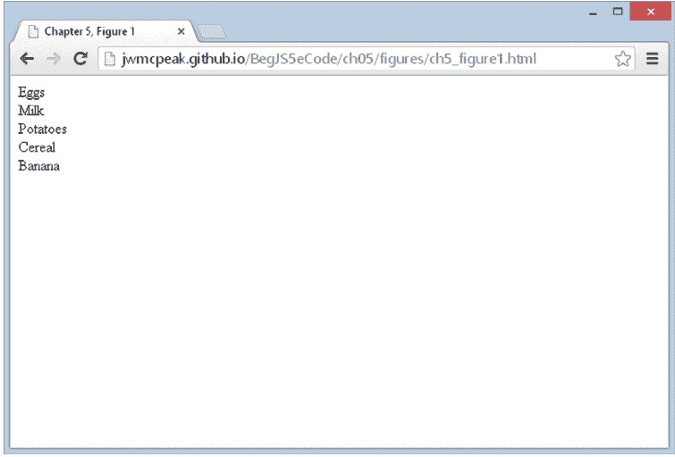

**图 5-1**

别忘了排序是区分大小写的，所以 `Paul` 会排在 `paul` 前面。记住 JavaScript 使用等效的 Unicode 数字存储字母，排序是基于 Unicode 数字而不是实际字母。只是碰巧 Unicode 数字的顺序与字母表中的顺序一致。然而，小写字母被赋予了不同的数字序列，这些数字排在大写字母之后。因此，包含元素 `Adam`、`adam`、`Zoë`、`zoë` 的数组将被排序为 `Adam`、`Zoë`、`adam`、`zoë`。

请注意，在你的 `for` 语句中，你在条件语句中使用了 `Array` 对象的 `length` 属性，而不是插入数组的长度 (`5`)，像这样：

```javascript
for (var index = 0; index < 5; index++)
```

为什么要这样做？毕竟，你事先知道数组有五个元素。那么，如果你通过添加两个更多名字来改变数组中的元素数量会发生什么？

```javascript
var names = [ "Paul", "Sarah", "Jeremy", "Adam", "Bob", "Karen", "Steve" ];
```

如果你插入了 `5` 而不是 `names.length`，你的循环代码将无法按预期工作。它将不会显示最后两个元素，除非你将 `for` 循环的条件部分更改为 `7`。通过使用 `length` 属性，你让事情变得更容易了，因为现在如果你添加数组元素，就无需在其他地方更改代码。

好了，你已经将东西按升序排列了，但如果你想要降序排列呢？这就是 `reverse()` 方法的用武之地。

#### 将数组倒序排列——reverse() 方法

`Array` 对象的下一个方法是 `reverse()` 方法，顾名思义，它反转数组的顺序，使后面的元素移到前面。让我们再次以购物清单为例：

| 索引 | 0 | 1 | 2 | 3 | 4 |
| --- | --- | --- | --- | --- | --- |
| 值 | Eggs | Milk | Potatoes | Cereal | Banana |

如果你使用 `reverse()` 方法

```javascript
var myShopping = [ "Eggs", "Milk", "Potatoes", "Cereal", "Banana" ];
myShopping.reverse();
```

你会得到

| 索引 | 0 | 1 | 2 | 3 | 4 |
| --- | --- | --- | --- | --- | --- |
| 值 | Banana | Cereal | Potatoes | Milk | Eggs |

为了证明这一点，你可以用之前看到的 `join()` 方法将其写入页面。

```javascript
var myShoppingList = myShopping.join("<br />")
document.write(myShoppingList);
```

#### 动手试试：对数组排序

与 `sort()` 方法结合使用时，`reverse()` 方法可用于对数组进行排序，使其元素按字母或数字的反向顺序显示。以下示例展示了这一点：

```html
<!DOCTYPE html>
<html lang="en">
<head>
    <title>Chapter 5, Example 3</title>
</head>
<body>
    <script>
        var myShopping = ["Eggs", "Milk", "Potatoes", "Cereal", "Banana"];

        var ord = prompt("Enter 1 for alphabetical order, " +
                        "and -1 for reverse order", 1);

        if (ord == 1) {
            myShopping.sort();
            document.write(myShopping.join("<br />"));
        } else if (ord == -1) {
            myShopping.sort();
            myShopping.reverse();
            document.write(myShopping.join("<br />"));
        } else {
            document.write("That is not a valid input");
        }
    </script>
</body>
</html>
```

将示例保存为 ch5_example3.html。当你在浏览器中加载它时，你将被要求输入一些内容，具体取决于你是希望数组按正向还是反向排序。如果你输入 1，数组将按正向顺序显示。如果你输入 -1，数组将按反向顺序显示。如果你没有输入这两个值中的任何一个，你会被告知你的输入无效。

在脚本块的顶部，你定义了包含购物清单的数组。接下来，你定义变量 `ord` 为用户在提示框中输入的值：

```javascript
var ord = prompt("Enter 1 for alphabetical order, " +
                    "and -1 for reverse order", 1);
```

此值用于后续 `if` 语句的条件中。第一个 `if` 检查 `ord` 的值是否为 1，即用户是否希望数组按字母顺序排列。如果是，则执行以下代码：

```javascript
myShopping.sort();
document.write(myShopping.join("<br />"));
```

数组被排序，然后使用 `join()` 方法在单独的行上显示给用户。接下来，在 `else if` 语句中，你检查 `ord` 的值是否为 -1，即用户是否希望数组按字母反序排列。如果是，则执行以下代码：

```javascript
myShopping.sort();
myShopping.reverse();
document.write(myShopping.join("<br />"));
```

这里，你在反转顺序之前先对数组进行排序。数组再次通过 `join()` 方法显示给用户。

最后，如果 `ord` 既不是 1 也不是 -1，你告诉用户他的输入无效：

```javascript
document.write("That is not a valid input");
```

#### 查找数组元素——indexOf() 和 lastIndexOf() 方法

你大概可以猜到，`Array` 对象的 `indexOf()` 和 `lastIndexOf()` 方法的行为类似于 `String` 对象的方法——它们返回项目在数组中首次和最后一次出现的索引。考虑以下代码：

```javascript
var colors = ["blue", "green", "blue"];

alert(colors.indexOf("red"));
alert(colors.lastIndexOf("blue"));
```


第一行代码创建了一个名为 `colors` 的数组。它有四个元素（其中两个是 `blue`）。第二行向用户弹出提示框，显示数字 0，因为 `red` 是数组的第一个元素。第三行返回值为 3，因为 `lastIndexOf()` 方法从数组末尾开始搜索。

如果提供的值在数组中找不到，`indexOf()` 和 `lastIndexOf()` 方法都会返回 -1。

#### 无循环遍历数组

剩下的五个方法被称为迭代方法，因为它们会遍历或循环数组。此外，这些方法在遍历数组时，会对你定义的一个函数在每个元素上执行。这些方法使用的函数必须遵循一个规则——它必须接受三个参数，如下所示：

```javascript
function functionName(value, index, array) {
    // 在此处执行一些操作
}
```

执行时，JavaScript 会向你的函数传递三个参数。第一个是元素的值，第二个是元素的索引，第三个是数组本身。这三个参数使你能够执行几乎所有可能需要的与数组及其元素相关的操作或比较。

#### 测试每个元素——every()、some() 和 filter() 方法

让我们先看看 `every()` 和 `some()` 方法。这些是测试方法。`every()` 方法测试数组中的所有元素是否都通过了你函数中的测试。考虑以下代码：

```javascript
var numbers = [ 1, 2, 3, 4, 5 ];

function isLessThan3(value, index, array) {
    var returnValue = false;

    if (value < 3) {
        returnValue = true;
    }

    return returnValue;
}

alert(numbers.every(isLessThan3));
```

第一行创建了一个名为 `numbers` 的数组；它的元素包含了从 1 到 5 的值。下一行定义了 `isLessThan3()` 函数。它接受三个必需的参数，并确定每个元素的值是否小于 3。最后一行弹出 `every()` 测试的结果。由于并非数组中的每个值都小于 3，`every()` 测试的结果为 `false`。

将此与 `some()` 方法进行对比。与 `every()` 不同，`some()` 测试只关心是否有**部分**元素通过了你函数中的测试。使用相同的 `numbers` 数组和 `isLessThan3()` 函数，看看这行代码：

```javascript
alert(numbers.some(isLessThan3));
```

结果是 *true*，因为数组中有些元素小于 3。区分这两个方法很容易。只需记住：`every()` 方法仅在数组中的所有元素都通过你函数的测试时返回 *true*；而 `some()` 方法仅在数组中有些元素通过你函数的测试时返回 *true*。

假设你想检索值小于 3 的元素。你已经知道有些元素满足这个条件，但你如何识别并检索这些元素呢？这就是 `filter()` 方法派上用场的地方。

`filter()` 方法对数组中的每个元素执行你的函数，如果你的函数对某个特定元素返回 *true*，该元素就会被添加到一个新数组中，而这个新数组是 `filter()` 方法返回的结果。记住这一点，看看以下代码：

```javascript
var numbers = [ 1, 2, 3, 4, 5 ];

function isLessThan3(value, index, array) {
    var returnValue = false;

    if (value < 3) {
        returnValue = true;
    }

    return returnValue;
}

if (numbers.some(isLessThan3)) {
    var result = numbers.filter(isLessThan3);
    alert("These numbers are less than 3: " + result);
}
```

这段代码重新定义了之前示例中使用的 `numbers` 数组和 `isLessThan3` 函数。高亮显示的代码确定 `numbers` 数组中是否有任何元素包含小于 3 的值，如果有，则调用 `filter()` 方法将这些元素放入一个新数组。这段代码的结果如图 5-2 所示。

#### 对元素执行操作——forEach() 和 map() 方法

最后两个方法是 `forEach()` 和 `map()` 方法。与之前的迭代方法不同，这两个方法不会用你的函数测试数组中的每个元素；相反，你编写的函数应该执行某种操作，以某种方式使用元素。看看以下代码：

```javascript
var numbers = [ 1, 2, 3, 4, 5 ];

for (var i = 0; i < numbers.length; i++) {
    var result = numbers[i] * 2;
    alert(result);
}
```

作为程序员，你会经常看到并使用这种类型的代码。它定义一个数组并循环遍历它，以便对每个元素执行某种操作。在这个例子中，每个元素的值被翻倍，结果显示在 `alert` 框中给用户。

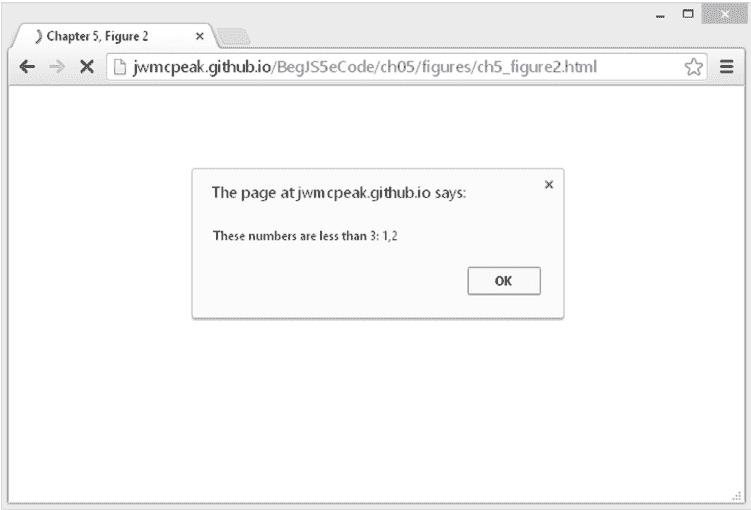

图 5-2

这段代码可以重写以使用 `forEach()` 方法。顾名思义，它对数组中的每个元素都*执行*某些操作。你只需要编写一个函数来将给定值翻倍并将结果输出到 `alert` 框中，如下所示：

```javascript
var numbers = [ 1, 2, 3, 4, 5 ];

function doubleAndAlert(value, index, array) {
    var result = value * 2;
    alert(result);
}

numbers.forEach(doubleAndAlert);
```

请注意，`doubleAndAlert()` 函数不像测试方法那样返回一个值。它不能返回值；它的唯一目的是对数组中的每个元素执行操作。这在很多情况下很有用，但当你需要存储函数的结果时，你会想要使用 `map()` 方法。

`map()` 方法的前提与 `forEach()` 类似。它对数组中的每个元素执行一个给定的函数，但它也返回一个新数组，其中包含函数的结果。

让我们修改前面的例子，编写一个名为 `doubleAndReturn()` 的新函数。它仍然会将数组中的每个元素翻倍，但它会返回翻倍后的值，而不是弹出提示。以下代码将 `doubleAndReturn()` 函数传递给 Array 对象的 `map()` 方法：

```javascript
var numbers = [ 1, 2, 3, 4, 5 ];

function doubleAndReturn(value, index, array) {
    var result = value * 2;
    return result;
}

var doubledNumbers = numbers.map(doubleAndReturn);
alert("The doubled numbers are: " + doubledNumbers);
```

图 5-3 显示了这段代码的结果。需要注意的是，`map()` 方法不会改变原始数组。

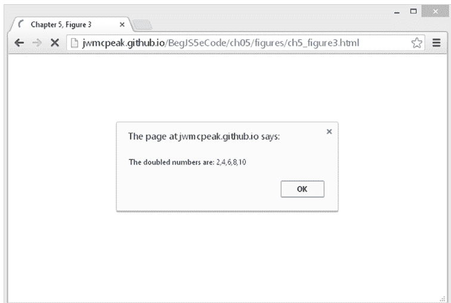

图 5-3

### Math 对象

`Math` 对象提供了许多有用的数学函数和数字操作方法。你在这里会看到其中一些，但其余的详细描述可以在 Mozilla 开发者网络上找到：`https://developer.mozilla.org/en-US/docs/Web/JavaScript/Reference/Global_Objects/Math`。

Math 对象有点特殊，因为 JavaScript 会自动为你创建它。无需声明一个变量为 `Math` 对象或在定义一个新的 `Math` 对象之前才能使用它，这使得它更容易使用。

`Math` 对象的属性包括一些有用的数学常量，例如 `PI` 属性（值约为 `3.14159` 等）。你通常可以通过在对象名（`Math`）后加点号，然后写属性名来访问这些属性。例如，要计算圆的面积，可以使用以下代码：

```javascript
var radius = prompt("Give the radius of the circle", "");
var area = Math.PI * radius * radius;
document.write("The area is " + area);
```

`Math` 对象的方法包括一些使用标准数学运算符（`+`、`-`、`*` 和 `/`）无法执行或执行起来很复杂的操作。例如，`cos()` 方法返回作为参数传递的值的余弦值。你现在来看看其中一些方法。

#### abs() 方法

`abs()` 方法返回作为其参数传递的数字的绝对值。本质上，这意味着它返回该数字的正值。因此，`-1` 返回为 `1`，`-4` 返回为 `4`，以此类推。然而，`1` 将返回为 `1`，因为它本身已经是正数。

例如，以下代码在页面上写入数字 `101`：

```javascript
var myNumber = -101;
document.write(Math.abs(myNumber));
```

#### 查找最大值和最小值——min() 和 max() 方法

假设你有两个数字，你想找到其中较大的一个或较小的一个。为了帮助你完成这项任务，`Math` 对象提供了 `min()` 和 `max()` 方法。这两个方法都接受至少两个参数，所有参数显然都必须是数字。看看这个示例代码：

```javascript
var max = Math.max(21,22); // 结果是 22
var min = Math.min(30.1, 30.2); // 结果是 30.1
```

`min()` 方法返回值最小的数字，而 `max()` 返回值最大的数字。你传递给这两个方法的数字可以是整数或浮点数。

> **注意** `max()` 和 `min()` 方法可以接受很多数字；不仅限于两个。

#### 数字四舍五入

`Math` 对象提供了一些四舍五入的方法，每种方法都有其特定的用途。


#### ceil() 方法

ceil() 方法总是将数字向上舍入到下一个最大的整数。因此，10.01 会变成 11，而 -9.99 会变成 -9（因为 -9 大于 -10）。ceil() 方法只有一个参数，即你想要向上舍入的数字。

使用 ceil() 与你在第 2 章看到的 `parseInt()` 函数不同，因为 `parseInt()` 只是简单地去掉小数点后的数字以得到一个整数，而 ceil() 是将数字向上舍入。

例如，以下代码在页面上写入两行内容，第一行包含数字 102，第二行包含数字 101：

```javascript
var myNumber = 101.01;
document.write(Math.ceil(myNumber) + "<br />");
document.write(parseInt(myNumber, 10));
```

#### floor() 方法

与 ceil() 方法类似，floor() 方法也去掉小数点后的数字，并返回一个整数。不同之处在于，floor() 总是将数字向下舍入。因此，如果你传入 10.01，将返回 10；如果你传入 -9.99，将返回 -10。

#### round() 方法

round() 方法与 ceil() 和 floor() 非常相似，不同之处在于它不是总是向上或总是向下舍入，而是仅在小数部分大于或等于 0.5 时向上舍入，否则向下舍入。

例如：

```javascript
var myNumber = 44.5;
document.write(Math.round(myNumber) + "<br />");

myNumber = 44.49;
document.write(Math.round(myNumber));
```

此代码将在页面上写入数字 45 和 44。

#### 舍入方法总结

如你所见，ceil()、floor() 和 round() 方法都去掉了小数点后的数字，并仅返回一个整数。然而，它们返回哪个整数取决于所使用的方法：floor() 返回最小的，ceil() 返回最大的，round() 返回最接近的等效整数。这可能会有点混乱，因此下表列出了将这些值传递给 `parseInt()` 函数以及 ceil()、floor() 和 round() 方法时会返回的整数值：

| 参数 | parseInt() 返回值 | ceil() 返回值 | floor() 返回值 | round() 返回值 |
|---|---|---|---|---|
| 10.25 | 10 | 11 | 10 | 10 |
| 10.75 | 10 | 11 | 10 | 11 |
| 10.5 | 10 | 11 | 10 | 11 |
| −10.25 | −10 | −10 | −11 | −10 |
| −10.75 | −10 | −10 | −11 | −11 |
| −10.5 | −10 | −10 | −11 | −10 |

> **注意** 请记住，`parseInt()` 是一个原生的 JavaScript 函数，而不是像表中其他方法那样的 Math 对象的方法。

#### 动手试试：舍入方法结果计算器

如果你对数字舍入仍不确定，这个例子应该会有所帮助。这里，你将看到一个计算器，它从用户那里获取一个数字，然后写出当该数字传递给 `parseInt()`、`ceil()`、`floor()` 和 `round()` 时的结果：

```html
<!DOCTYPE html>

<html lang="en">
<head>
    <title>Chapter 5, Example 4</title>
</head>
<body>
    <script>
      var myNumber = prompt("Enter the number to be rounded","");

      document.write("<h3>The number you entered was " + myNumber +
                       "</h3>");

      document.write("<p>The rounding results for this number are</p>");
      document.write("<table width='150' border='1'>");
      document.write("<tr><th>Method</th><th>Result</th></tr>");

      document.write("<tr><td>parseInt()</td><td>" +
                      parseInt(myNumber, 10) + "</td></tr>");

      document.write("<tr><td>ceil()</td><td>" + Math.ceil(myNumber) +
                      "</td></tr>");

      document.write("<tr><td>floor()</td><td>"+ Math.floor(myNumber) +
                      "</td></tr>");

      document.write("<tr><td>round()</td><td>" + Math.round(myNumber) +
                      "</td></tr>");

      document.write("</table>");
    </script>
</body>
</html>
```

将此文件保存为 ch5_example4.html 并加载到 Web 浏览器中。在提示框中，输入一个数字（例如 12.354），然后单击“确定”。此数字传递给 parseInt()、ceil()、floor() 和 round() 的结果将以表格格式显示在页面上，如图 5-4 所示。

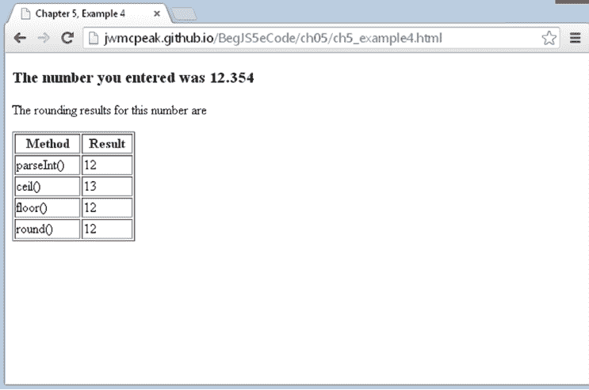

**图 5-4**

第一个任务是从用户那里获取要舍入的数字：

```javascript
var myNumber = prompt("Enter the number to be rounded","");
```

然后你写出该数字和一些描述性文本：

```javascript
document.write("<h3>The number you entered was " + myNumber + "</h3>");
document.write("<p>The rounding results for this number are</p>");
```

注意这次包含了一些用于格式化的 HTML 标签——主标题使用 `<h3>` 标签，表格含义的描述位于段落 `<p>` 标签内。

接下来，你创建结果表格：

```javascript
document.write("<table width='150' border='1'>");
document.write("<tr><th>Method</th><th>Result</th></tr>");

document.write("<tr><td>parseInt()</td><td>" +
        parseInt(myNumber, 10) + "</td></tr>");

document.write("<tr><td>ceil()</td><td>" + Math.ceil(myNumber) +
        "</td></tr>");

document.write("<tr><td>floor()</td><td>"+ Math.floor(myNumber) +
        "</td></tr>");

document.write("<tr><td>round()</td><td>" + Math.round(myNumber) +
        "</td></tr>");

document.write("</table>");
```

你首先创建表头，然后在单独的行上实际显示每个舍入函数的结果。其原理与页面中的 HTML 相同：你必须确保标签语法有效，否则内容可能显示异常或根本不显示。

每一行遵循相同的原理，但使用不同的舍入函数。让我们看一下显示 `parseInt()` 结果的第一行：

```javascript
document.write("<tr><td>parseInt()</td><td>" +
        parseInt(myNumber, 10) + "</td></tr>");
```

在要写入页面的字符串中，你首先使用 `<tr>` 标签创建表格行。然后使用 `<td>` 标签创建一个表格单元格，并插入该行正在显示结果的方法的名称。接着，你用 `</td>` 关闭单元格，并用 `<td>` 打开一个新的单元格。在这个新单元格中，你放置 `parseInt()` 函数的实际结果。虽然 `parseInt()` 返回一个数字，但由于你将其连接到字符串，JavaScript 会在连接之前自动将 `parseInt()` 返回的数字转换为字符串。这一切都在后台发生，你无需做任何事情。最后，你用 `</td></tr>` 关闭单元格和行。

#### random() 方法

`random()` 方法返回一个介于 0 和 1 之间的随机浮点数，其中包含 0 但不包含 1。这对于显示随机横幅图像或编写 JavaScript 游戏非常有用。

让我们看看如何模拟掷一个骰子。在下面的页面中，10 个随机数被写入页面。单击浏览器的“刷新”按钮以获取另一组随机数。

```html
<!DOCTYPE html>

<html lang="en">
<body>
    <script>
var diceThrow;

for (var throwCount = 0; throwCount < 10; throwCount++) {
    diceThrow = (Math.floor(Math.random() * 6) + 1);
    document.write(diceThrow + "<br>");
}
</script>
</body>
</html>
```

你希望 `diceThrow` 在 1 到 6 之间。`random()` 函数返回一个介于 0 到略小于 1 之间的浮点数。通过将此数字乘以 6，你得到一个介于 0 到略小于 6 之间的数字。然后通过加上 1，你得到一个介于 1 到略小于 7 之间的数字。通过使用 `floor()` 总是将其向下舍入到下一个最小的整数，你可以确保最终得到一个介于 1 到 6 之间的数字。

如果你想得到一个介于 1 到 100 之间的随机数，你只需修改代码，将 `Math.random()` 乘以 100 而不是 6。

#### pow() 方法

`pow()` 方法将一个数字提升到指定的幂。它接受两个参数，第一个是你想要提升到幂的数字，第二个是幂本身。例如，要计算 2 的 8 次方（即计算 2 * 2 * 2 * 2 * 2 * 2 * 2 * 2），你会写 `Math.pow(2,8)`——结果是 256。与一些其他数学方法（如 `sin()`、`cos()` 和 `acos()`）不同，这些方法在 Web 编程中不常用，除非你编写的是科学应用程序，而 `pow()` 方法通常被证明非常有用。

#### 动手试试：使用 pow()

在这个例子中，你编写一个使用 `pow()` 的函数，它固定数字的小数位数：

```html
<!DOCTYPE html>
<html lang="en">
<head>
    <title>Chapter 5, Example 5</title>
</head>
<body>
    <script>
        function fix(fixNumber, decimalPlaces) {
            var div = Math.pow(10, decimalPlaces);
            fixNumber = Math.round(fixNumber * div) / div;
            return fixNumber;
        }

        var number1 = prompt("Enter the number with decimal places you " +
                            "want to fix", "");
        var number2 = prompt("How many decimal places do you want?", "");

        document.write(number1 + " fixed to " + number2 + " decimal places is: ");
        document.write(fix(number1, number2));
    </script>
```


### 数字对象

与 `String` 对象类似，`Number` 对象也需要先创建才能使用。要创建 `Number` 对象，可以编写如下代码：

```
var firstNumber = new Number(123);
var secondNumber = new Number('123');
```

然而，正如你所见，你也可以将数字声明为原始类型，并像使用 `Number` 对象一样使用它，让 JavaScript 在后台为你执行到对象的转换。例如：

```
var myNumber = 123.765;
```

与 `String` 对象一样，只要 JavaScript 能明确你期望在后台创建什么对象，这种技术就是可取的。因此，例如，

```
var myNumber = "123.567";
```

将导致 JavaScript 正确地假定它是一个字符串，并且任何尝试使用 `Number` 对象方法的操作都将失败。

你只需要查看 `Number` 对象的 `toFixed()` 方法，因为这是日常使用中最有用的方法。

#### toFixed() 方法

`toFixed()` 方法在某个点后截断一个数字。假设你想要显示含销售税后的价格。如果你的价格是 $9.99，销售税是 7.5%，那么税后成本将是 $10.73925。嗯，这对于金钱交易来说是个相当奇怪的金额——你真正想做的是将数字固定为不超过两位小数。让我们创建一个示例：

你首先定义函数 `fix()`。此函数将将其 `fixNumber` 参数固定到小数点后最多 `decimalPlaces` 参数指定的位数。例如，将 34.76459 固定为最多三位小数将返回 34.765。

函数中的第一行代码将变量 `div` 设置为 10 的指定小数位数次方：

```
function fix(fixNumber, decimalPlaces) {
    var div = Math.pow(10,decimalPlaces);
```

然后，在下一行中，你计算新数字：

```
    fixNumber = Math.round(fixNumber * div) / div;
```

代码 `Math.round(fixNumber * div)` 所做的是将你要转换的数字的小数点移动到你想要保留的点之后。所以对于 2.2345，如果你想要保留两位小数，你将其转换为 223.45。`Math.round()` 方法将此数字四舍五入为最接近的整数（在这种情况下是 223），从而去除了任何不需要的小数部分。

然后你将此数字转换回它应该具有的分数，但当然只保留你想要的小数部分。你通过除以你乘以的相同数字 (`div`) 来实现。在此示例中，你将 223 除以 100，得到 2.23。这就是 2.2345 固定为两位小数的结果。此值通过以下行返回给调用代码：

```
return fixNumber;
}
```

接下来，你使用两个提示框从用户那里获取数字。然后你使用 `document.write()` 向用户显示在 `fix()` 函数中使用这些数字的结果。

这个示例仅仅是一个示例。几分钟后，你将了解 `Number` 对象的 `toFixed()` 方法，它执行与 `fix()` 函数相同的功能。

将页面保存为 `ch5_example5.html`。当你将页面加载到浏览器中时，你将看到两个提示框。在第一个框中，输入你想要固定小数位数的数字（例如，2.2345）。在第二个框中，输入你想要固定的小数位数（例如，2）。然后，将你输入的数字固定到你选择的小数位数的结果将被写入页面，如图 5-5 所示。对于示例数字，结果将是 2.23。

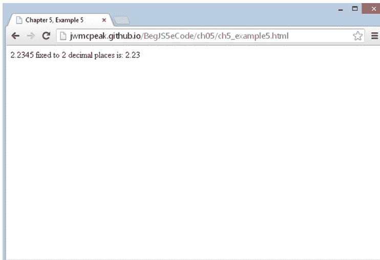

**图 5-5**

现在让我们使用 `toFixed()` 方法。这是一个示例：

```
var itemCost = 9.99;
var itemCostAfterTax = 9.99 * 1.075;
document.write("Item cost is $" + itemCostAfterTax + "<br />");
itemCostAfterTax = itemCostAfterTax.toFixed(2);

document.write("Item cost fixed to 2 decimal places is " + "$" + itemCostAfterTax);
```

第一个 `document.write()` 向页面输出以下内容：

`Item cost is $10.73925`

然而，这不是你想要的格式；你想要两位小数，因此在下一行，输入如下代码：

`itemCostAfterTax = itemCostAfterTax.toFixed(2);`

你使用 `Number` 对象的 `toFixed()` 方法将 `itemCostAfterTax` 所持有的数字变量固定为两位小数。该方法的唯一参数是你想要将数字固定到的小数位数。这行代码意味着下一个 `document.write` 将显示以下内容：

`Item cost fixed to 2 decimal places is $10.74`

你可能首先想知道为什么是 10.74 而不是 10.73？嗯，`toFixed()` 方法不仅仅是截断不需要的数字；它还会进行四舍五入。在这种情况下，数字是 10.739，四舍五入到 10.74。如果是 10.732，则会被四舍五入到 10.73。

请注意，你只能将数字固定为 0 到 20 位小数。

### 日期对象

Date 对象处理 JavaScript 中与日期和时间相关的一切。使用它，你可以获取当前日期和时间，存储自己的日期和时间，对这些日期进行计算，以及将日期转换为字符串。

Date 对象有很多方法，使用起来可能有点棘手，这就是为什么第 7 章专门介绍 JavaScript 中的日期、时间和定时器的原因。然而，在本节中，你将重点介绍如何创建 Date 对象及其一些更常用的方法。

#### 创建日期对象

你可以用四种方式声明和初始化 Date 对象。第一种方法，你只需声明一个新的 Date 对象而不初始化其值。在这种情况下，日期和时间值将设置为运行脚本的 PC 上的当前日期和时间：

```
var theDate1 = new Date();
```

其次，你可以通过传递自 1970 年 1 月 1 日 00:00:00 GMT 以来的毫秒数来定义 Date 对象。在以下示例中，日期是 2000 年 1 月 31 日 00:20:00 GMT（即午夜后 20 分钟）：

```
var theDate2 = new Date(949278000000);
```

你不太可能经常使用这种定义 `Date` 对象的方式，但这正是 JavaScript 实际存储日期的方式。其他指定日期的格式只是为了方便。

声明 `Date` 对象的第三种方式是传递一个表示日期或日期和时间的字符串。在以下示例中，你传递了 "31 January 2014"：

```
var theDate3 = new Date("31 January 2014");
```

然而，你也可以写成 31 Jan 2014、Jan 31 2014，或任何其他你在正常书写日期时常见且有效的变体——如果有疑问，可以尝试一下。

如果你的网页面向国际受众，你需要意识到指定日期的不同方式。在英国和许多其他地方，标准格式是 日、月、年，而在美国，标准格式是 月、日、年。如果你只指定数字，这可能会引起问题——JavaScript 可能会误以为你指的是日期，而实际上你指的是月份。

定义 `Date` 对象的第四种也是最后一种方式，是通过传递以下由逗号分隔的参数来初始化：年、月、日、小时、分钟、秒和毫秒。例如：

```
var theDate4 = new Date(2014,0,31,15,35,20,20);
```

> 提示 *在使用声明 `Date` 对象的第三种或第四种方法指定月份时，很容易出错。避免这种麻烦最简单的方法是尽可能始终使用月份的名称。这样就不会有混淆了。*

这个日期实际上是 2014 年 1 月 31 日 15:35:20 和 20 毫秒。如果你愿意，可以只指定日期部分而忽略时间。需要注意的是，在这种情况下，一月是月份 0，而不是你预期的月份 1，十二月是月份 11。

#### 获取日期值

存储日期很好，但如何再次获取信息呢？嗯，你只需使用 `get` 方法。这些方法总结在下表中：

| 方法 | 返回值 |
| :--- | :--- |
| getDate() | 月份中的某一天 |
| getDay() | 星期几（整数），星期日为 0，星期一为 1，以此类推 |
| getMonth() | 月份（整数），一月为 0，二月为 1，以此类推 |
| getFullYear() | 四位数的年份 |
| toDateString() | 返回基于当前时区的完整日期，格式为人类可读的字符串，例如 "Wed 31 Dec 2003" |

- **指定货币格式**: `toLocaleString('en-US', {style: 'currency', currency: 'USD'});`

- **其他格式选项**: `toLocaleString('en-US', {style: 'percent', minimumFractionDigits: 4});`

JavaScript 的原生对象类型 | 135

例如，如果你想获取 `ourDateObj` 中的月份，只需简单地写：

`theMonth = myDateObject.getMonth();`

所有方法的工作方式都非常相似，返回的值都基于本地时间，即代码运行所在机器的本地时间。也可以使用以前称为 GMT 的通用时间，我们将在第7章中讨论。

#### 动手实践 使用 Date 对象获取当前日期

在这个例子中，你将使用之前学过的 `get 日期类型` 方法，将当前的日、月、年写入网页：

```
<!DOCTYPE html>

<html lang="en">
<head>
    <title>Chapter 5, Example 6</title>
</head>
<body>
    <script>
        var months = ["January", "February", "March", "April", "May",
                      "June", "July", "August", "September",
                      "October", "November", "December"];

        var dateNow = new Date();
        var yearNow = dateNow.getFullYear();
        var monthNow = months[dateNow.getMonth()];
        var dayNow = dateNow.getDate();
        var daySuffix;

        switch (dayNow) {
            case 1:
            case 21:
            case 31:
                daySuffix = "st";
                break;
            case 2:
            case 22:
                daySuffix = "nd";
                break;
            case 3:
            case 23:
                daySuffix = "rd";
                break;
            default:
                daySuffix = "th";
                break;
        }

        document.write("It is the " + dayNow + daySuffix + " day ");
        document.write("in the month of " + monthNow);
        document.write(" in the year " + yearNow);
    </script>
</body>
</html>
```

将代码保存为 `ch5_example6.html`。在浏览器中加载该页面时，你应该会看到一句格式正确的句子，告诉你当前的日期。

代码中的第一步是声明一个数组，并用一年中的月份来填充它。为什么要这样做呢？因为 `Date` 对象没有直接提供按名称（而非数字）获取月份的方法。不过，这不成问题；你只需声明一个月份数组，并使用月份数字作为数组索引来选择正确的月份名称：

```
var months = ["January", "February", "March", "April", "May", "June", "July",
              "August", "September", "October", "November", "December"];
```

接下来，你创建一个新的 `Date` 对象。由于没有用你自己的值对其进行初始化，它会自动初始化为当前的日期和时间：

```
var dateNow = new Date();
```

接着，你将 `yearNow` 变量设置为 `getFullYear()` 方法返回的当前年份：

```
var yearNow = dateNow.getFullYear();
```

然后，你将 `getMonth()` 返回的数字作为索引，从数组中取出对应的月份值，填充到 `monthNow` 变量中。请记住，`getMonth()` 返回的月份是整数值，1月从0开始——这很方便，因为数组也是从0开始索引的，所以无需调整就能找到正确的数组元素：

```
var monthNow = months[dateNow.getMonth()];
```

最后，你将当前的日放入变量 `dayNow` 中：

```
var dayNow = dateNow.getDate();
```

接下来，你使用一个 `switch` 语句（你在第3章中学过）。这是为日期添加正确后缀的一种实用技巧。毕竟，如果你的应用程序能说 "it is the 1st day"，而不是 "it is the 1 day"，会显得更专业。不过这有点技巧，因为要添加的后缀取决于它前面的数字。所以，对于每月的第1天、第21天和第31天，代码如下：

```
switch (dayNow) {
    case 1:
    case 21:
    case 31:
        daySuffix = "st";
        break;
```

对于第2天和第22天，代码如下：

```
case 2:
case 22:
        daySuffix = "nd";
        break;
```

对于第3天和第23天，代码如下：

```
case 3:
case 23:
        daySuffix = "rd";
        break;
```

最后，你需要一个 `default` 情况来处理其他所有日期。你可能已经猜到了，那就是简单的 "th"：

```
default:
        daySuffix = "th";
        break;
}
```

在最后几行，你只需使用 `document.write()` 将信息写入 HTML 页面。

#### 设置日期值

要更改 `Date` 对象中的部分日期，你可以使用一组 `set` 函数，它们与前面描述的 `get` 函数功能相似，只不过你是设置值，而不是获取值。这些函数总结在下表中：

| 方法 | 描述 |
|---|---|
| setDate() | 将月份中的日期作为参数传入以设置日期。 |
| setMonth() | 将月份作为整数参数传入，其中0代表一月，1代表二月，以此类推。 |
| setFullYear() | 将年份设置为作为参数传入的四位整数。 |

> **注意** 注意，出于安全原因，基于网页的 JavaScript 无法更改用户计算机上的当前日期和时间。

因此，要将年份更改为2016年，代码如下：

```
myDateObject.setFullYear(2016);
```

将日期和月份设置为2月27日如下所示：

```
myDateObject.setDate(27);
myDateObject.setMonth(1);
```

这里需要注意的一个小点是，没有与 `getDay()` 方法直接对应的 `set` 方法。在定义了年份、日期和月份之后，星期几会自动为你设置。

#### 计算与日期

看一下下面的代码：

```
var myDate = new Date("1 Jan 2010");
myDate.setDate(32);
document.write(myDate);
```

这里肯定有错——一月什么时候有过32天？答案当然是没有，而 JavaScript 知道这一点。相反，JavaScript 会将日期设置为从1月1日起算的32天后——也就是说，它会将日期设置为2月1日。

`setMonth()` 方法也有同样的情况。如果你设置的值大于11，日期会自动滚动到下一年。所以，如果你使用 `setMonth(12)`，这会将日期设置为下一年的一月，同样地，`setMonth(13)` 就是下一年的二月。

如何利用 `setDate()` 和 `setMonth()` 的这个特性来为你服务呢？假设你想找出从现在起28天后是几号。考虑到不同的月份有不同的天数，而且你可能跨越到不同的年份，这并不像最初看起来那么简单。或者，如果没有 `setDate()`，情况确实如此。实现此任务的代码如下：

```
var nowDate = new Date();
var currentDay = nowDate.getDate();
nowDate.setDate(currentDay + 28);
```

首先，你通过将 `nowDate` 变量设置为一个没有初始化值的新 `Date` 对象来获取当前系统日期。在下一行，你将当前日放入一个名为 `currentDay` 的变量中。为什么？因为当你使用 `setDate()` 并传入一个超过该月最大天数的值时，它会从当月的第一天开始，向前计算那么多天。所以，如果今天是1月15日，你使用 `setDate(28)`，它并不是从1月15日起的28天后，而是从1月1日起的28天后。你想要的是从当前日期起的28天后，所以你需要将当前日期加上你想要向前的天数。因此，你需要 `setDate(15 + 28)`。在第三行，你将日期设置为当前日期加上28天。你将当前日存储在了 `currentDay` 中，所以现在你只需将其加上28，即可向前移动28天。

如果你想得到当前日期前28天的日期，只需传入当前日期减去28。请注意，这通常会是一个负数。你只需更改一行，即第三行，将其改为：

```
nowDate.setDate(currentDay - 28);
```

对于 `setMonth()`，你可以使用与 `setDate()` 完全相同的原理。

#### 获取时间值

你用来检索各个时间数据片段的方法与日期的 `get` 方法工作原理非常相似。这里使用的方法是：

- getHours()
- getMinutes()


#### 动手试试：将当前时间写入网页

让我们看一个将当前时间写入页面的示例：

```html
<!DOCTYPE html>
<html lang="en">
<head>
    <title>Chapter 5, Example 7</title>
</head>
<body>
    <script>
        var greeting;

        var nowDate = new Date();
        var nowHour = nowDate.getHours();
        var nowMinute = nowDate.getMinutes();
        var nowSecond = nowDate.getSeconds();

        if (nowMinute < 10) {
            nowMinute = "0" + nowMinute;
        }

        if (nowSecond < 10) {
            nowSecond = "0" + nowSecond;
        }

        if (nowHour < 12) {
            greeting = "Good Morning";
        } else if (nowHour < 17) {
            greeting = "Good Afternoon";
        } else {
            greeting = "Good Evening";
        }

        document.write("<h4>" + greeting + " and welcome to my website</h4>");
        document.write("According to your clock the time is ");
        document.write(nowHour + ":" + nowMinute + ":" + nowSecond);
    </script>
</body>
</html>
```

将此页面保存为`ch5_example7.html`。当你在浏览器中加载它时，它会根据一天中的时间和当前时间显示问候语，如图5-6所示。

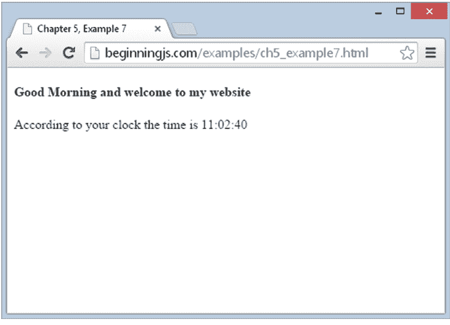

**图 5-6**

代码的前两行声明了两个变量——`greeting`和`nowDate`：

```javascript
var greeting;
var nowDate = new Date();
```

`greeting`变量稍后将用于存储网站上的欢迎信息，无论是“早上好”、“下午好”还是“晚上好”。`nowDate`变量被初始化为一个新的`Date`对象。注意`Date`对象的构造函数是空的，因此JavaScript会将当前的日期和时间存储在其中。

接下来，你从`nowDate`获取当前时间的信息，并将其存储在各种变量中。你可以看到，获取时间数据与获取日期数据非常相似，只是使用了不同的方法：

```javascript
var nowHour = nowDate.getHours();
var nowMinute = nowDate.getMinutes();
var nowSecond = nowDate.getSeconds();
```

你可能想知道为什么示例中包含以下代码行：

```javascript
if (nowMinute < 10) {
    nowMinute = "0" + nowMinute;
}

if (nowSecond < 10) {
    nowSecond = "0" + nowSecond;
}
```

这些行只是为了格式化原因。如果时间是10点09分，你期望看到类似10:09的格式。你不希望看到10:9，这是在没有添加额外零的情况下使用getMinutes()方法的结果。秒数也是同理。如果你只是在计算中使用数据，就不需要担心格式化问题——这里之所以需要，是因为你要将代码执行时的时间插入到网页中。

接下来，在一系列if语句中，你根据一天中的时间决定创建哪个问候语显示给用户：

```javascript
if (nowHour < 12) {
    greeting = "Good Morning";
} else if (nowHour < 17) {
    greeting = "Good Afternoon";
} else {
    greeting = "Good Evening";
}
```

最后，你将问候语和当前时间写入页面：

```javascript
document.write("<h4>" + greeting + " and welcome to my website</h4>");
document.write("According to your clock the time is ");
document.write(nowHour + ":" + nowMinute + ":" + nowSecond);
```

#### 设置时间值

当你想要设置Date对象中的时间时，你有一系列类似于获取时间的方法：

- setHours()
- setMinutes()
- setSeconds()
- setMilliseconds()

这些方法的工作方式与设置日期的方法类似，如果你将任何时间参数设置为非法值，JavaScript会假定你指的是下一个或上一个时间边界。如果是9:57，你将分钟设置为64，时间将被设置为10:04——即从9:00开始算起的64分钟。

以下代码演示了这一点：

```javascript
var nowDate = new Date();
nowDate.setHours(9);
nowDate.setMinutes(57);
alert(nowDate);

nowDate.setMinutes(64);
alert(nowDate);
```

144 | 第5章 JavaScript——一种基于对象的语言

- 首先，你声明了nowDate变量并将其赋值给一个新的Date对象，该对象将包含当前的日期和时间。在下面的两行代码中，你将小时设置为9，分钟设置为57。你使用alert框显示日期和时间，应该显示时间为9:57。然后将分钟设置为64，并再次使用alert框向用户显示日期和时间。现在分钟数已超过一小时，因此显示的时间应为10:04。
- 如果小时被设置为23而不是9，将分钟设置为64不仅会将时间移到另一个小时，还会导致日期变为第二天。

## 创建你自己的自定义对象

我们已经花了很多时间讨论JavaScript内置对象，但JavaScript的真正强大之处在于你可以创建自己的对象来表示复杂数据。例如，想象一下你需要在代码中表示一个个人。你可以简单地使用两个变量来表示一个人的名字和姓氏，像这样：

```javascript
var firstName = "John";
var lastName = "Doe";
```

但如果你需要表示多个人呢？为每个人创建两个变量会很快变得笨拙，即使对世界上最好的程序员来说，跟踪每个人的每个变量也会导致头痛。相反，你可以创建一个对象来表示每个个体。每个这些对象将包含使一个人区别于其他人的必要信息（例如一个人的名字和姓氏）。

要在JavaScript中创建一个对象，只需将`new`运算符与Object构造函数结合使用，像这样：

```javascript
var johnDoe = new Object();
```

但就像数组一样，JavaScript提供了一种字面语法来表示对象：一对花括号`{}`。因此，你可以像这样重写上面的代码：

```javascript
var johnDoe = {};
```

如今的JavaScript开发者更喜欢这种字面语法，而不是调用Object构造函数。

一旦你有了一个对象，你就可以开始用属性填充它。它类似于创建变量，只是你不使用`var`关键字。只需使用对象的名称，后跟一个点，然后是属性的名称，并为其赋值。例如：

```javascript
johnDoe.firstName = "John";
johnDoe.lastName = "Doe";
```

这两行代码在`johnDoe`对象上创建了`firstName`和`lastName`属性，并分别赋值。JavaScript不会在创建这些属性之前检查它们是否存在；它只是创建它们。这种自由的属性创建听起来很棒（确实如此！），但它也有缺点。主要问题是JavaScript不会告诉你是否不小心拼错了属性名；它只会用拼错的名字创建一个新属性，这可能会使跟踪错误变得困难。因此，在创建属性时要始终小心。

你可以用同样的方式分配方法，只是你分配的是一个函数而不是其他类型的值，像这样：

```javascript
johnDoe.greet = function() {
    alert("My name is " + this.firstName + " " + this.lastName);
};
```

这段代码创建了一个名为`greet()`的方法，该方法只是弹出一个问候语。这段代码中有几个重要的事情需要注意。

首先，注意`function`和`()`之间没有名称。没有名称的函数称为*匿名函数*。匿名函数本身就是一个语法错误，除非你将该函数赋值给一个变量。一旦你将匿名函数赋值给一个变量，该函数的名称就变成了变量的名称。因此，你可以像这样执行赋值给`johnDoe.greet`的匿名函数：

```javascript
johnDoe.greet();
```

接下来，注意函数内部`this`的使用：`this.firstName`和`this.lastName`。在JavaScript中，`this`是一个特殊变量，它引用当前对象——在本例中是`johnDoe`对象。它字面意思就是“这个对象”。因此，你可以像下面这样重写`greet()`：

```javascript
johnDoe.greet = function() {
    alert("My name is " + johnDoe.firstName + " " + johnDoe.lastName);
};
```

然而，你并不总是拥有对象的名称来替代`this`使用。因此，更推荐在方法内部使用`this`来引用当前对象，而不是使用对象的实际名称。

创建这个`johnDoe`对象的完整代码如下所示：

```javascript
var johnDoe = {};

johnDoe.firstName = "John";
johnDoe.lastName = "Doe";
johnDoe.greet = function() {
    alert("My name is " + johnDoe.firstName + " " + johnDoe.lastName);
};
```

这是完全有效的JavaScript，但创建完整对象需要四个语句。通过使用字面符号定义整个对象，这四个语句可以缩减为一个语句。诚然，一开始看起来会有点奇怪，但你会很快习惯它：

```javascript
var johnDoe = {
    firstName : "John",
    lastName : "Doe",
    greet : function() {
        alert("My name is " + this.firstName + " " + this.lastName);
    }
};
```

www.it-ebooks.info


### 试试看 使用对象字面量

花点时间研究一下这段代码。首先，注意这段代码使用花括号来括住整个对象。然后注意每个属性和方法都是通过指定属性/方法的名称，后跟冒号，然后是其值来定义的。因此，给 `firstName` 属性赋值如下所示：

```
firstName: "John"
```

这里没有使用等号。在对象字面量表示法中，冒号设置属性的值。这与在数组字面量中分隔各个元素的方式类似。

理解对象字面量对你们来说非常重要——JavaScript 开发者们极其广泛地使用它们。让我们看一个使用函数创建自定义对象的例子：

```javascript
function createPerson(firstName, lastName) {
    return {
        firstName: firstName,
        lastName: lastName,
        getFullName: function() {
            return this.firstName + " " + this.lastName;
        },
        greet: function(person) {
            alert("Hello, " + person.getFullName() +
                  ". I'm " + this.getFullName());
        }
    };
}

var johnDoe = createPerson("John", "Doe");
var janeDoe = createPerson("Jane", "Doe");

johnDoe.greet(janeDoe);
```

将此页面保存为 `ch5_example8.html`。当您将页面加载到网页浏览器中时，它会显示消息：“Hello, Jane Doe. I'm John Doe”。

首先，这段代码创建了一个名为 `createPerson()` 的函数，它接受一个人的名字和姓氏作为参数。这个函数使用对象字面量表示法创建一个具有该人名字和姓氏的对象：

```javascript
function createPerson(firstName, lastName) {
    return {
```

创建的第一个属性是 `firstName` 属性，它被赋予 `firstName` 参数的值：

```javascript
firstName: firstName,
```

接下来是 `lastName` 属性，它从 `createPerson()` 函数的 `lastName` 参数接收其值：

```javascript
lastName: lastName,
```

然后创建了一个名为 `getFullName()` 的方法。它的目的是向调用者返回该人的名字和姓氏：

```javascript
getFullName: function() {
    return this.firstName + " " + this.lastName;
},
```

这个方法使用 `this` 变量来访问此对象的 `firstName` 和 `lastName` 属性。请注意，`this` 变量是检索这些属性的唯一方式——该对象没有名称；它是一个匿名对象，创建后即返回给调用者。

此对象的最后一个方法是 `greet()`。它接受另一个人对象作为参数，并使用其 `getFullName()` 方法向那个人问好：

```javascript
greet: function(person) {
    alert("Hello, " + person.getFullName() + ". I'm " + this.getFullName());
}
```

### 创建新类型的对象（引用类型）

本节的重点是一些进阶内容。这不是必不可少的内容，所以您可能想先跳过，以后再回来看。

您已经看到 JavaScript 提供了许多内置在语言中并可供我们直接使用的对象。您还构建了自定义对象，可用于表示更复杂的数据，但 JavaScript 也使您能够创建自己类型的对象。例如，您创建了一个表示个人的对象，但您也可以创建一个 `Person` 对象。

这有点像一座已经建好的房子，您可以直接搬进去。但是，如果您想创建自己的房子，为您自己的特定需求设计它呢？在这种情况下，您将聘请建筑师创建技术图纸和计划，为新房子提供模板——建筑工人使用这些计划来指导他们如何建造房子。

那么这一切与 JavaScript 和对象有什么关系呢？嗯，JavaScript 使您能够成为建筑师，根据您自己的规格创建对象模板，以满足您的特定需求。回到人的对象示例，JavaScript 并没有内置的人对象，所以您必须设计自己的对象。

正如房子的建造者需要建筑师的图纸才知道建造什么以及应该如何布局，您也需要提供蓝图告诉 JavaScript 您的对象应该是什么样子。您在 `ch5_example8.html` 中使用 `createPerson()` 函数时某种程度上已经这样做了，但您只是创建了具有自定义属性和方法的普通对象——您并没有创建一个实际的 `Person` 对象。

但 JavaScript 支持定义*引用类型*。引用类型本质上是对象的模板，就像建筑师的图纸是用于建造房子的模板一样。在使用您的新对象类型之前，您需要定义它及其方法和属性。重要的区别在于，当您定义引用类型时，并不会创建基于该类型的对象。只有当您使用 `new` 关键字创建引用类型的实例时，才会根据您的蓝图或原型创建该类型的对象。

在开始之前，必须做出一个重要区分。许多开发者将引用类型称为类，并交替使用这两个术语。尽管对于许多面向对象语言（如 Java、C# 和 C++）来说这是正确的，但对于 JavaScript 来说并不正确。JavaScript 目前还不支持类结构，尽管下一版本的 JavaScript 将提供正式的类。然而，JavaScript 完全支持逻辑上的等价物——引用类型。

还需要指出的是，本章到目前为止讨论的内置对象也是引用类型。`String`、`Array`、`Number`、`Date` 甚至 `Object` 都是引用类型，您创建的对象是这些类型的实例。

引用类型由三部分组成：
-   一个构造函数
-   方法定义
-   属性

构造函数是一个函数，每当创建一个基于此引用类型的对象时都会调用它。当您想以某种方式初始化属性或对象时，它非常有用。即使您不向其传递任何参数或其不包含任何代码，您也需要创建一个构造函数。（在这种情况下，它只是一个空定义。）与所有函数一样，构造函数可以有零个或多个参数。

您已经创建了表示个人的对象。接下来您将创建一个简单的引用，称为 `Person`，来完成同样的事情——只是这些对象将是实际的 `Person` 对象。

### 定义引用类型

您需要做的第一件事是创建构造函数，如下所示：

```javascript
function Person(firstName, lastName) {
    this.firstName = firstName;
    this.lastName = lastName;
}
```

您的第一反应可能是，这里只是一个函数，您是对的。直到您开始定义属性和方法，它才会变成不仅仅是函数。这与一些具有更正式类型定义方式的编程语言形成对比。

> **注意** 通常，引用类型以大写字母定义。这样做可以轻松快速地区分函数和引用类型。

在函数内部，注意 `this` 变量的使用。再次强调，它的字面意思是“这个对象”，它是访问正在创建的对象的唯一方式。因此，要创建 `firstName` 和 `lastName` 属性，您编写以下代码：

```javascript
this.firstName = firstName;
this.lastName = lastName;
```

现在您需要定义 `getFullName()` 和 `greet()` 方法。您可以在构造函数内部定义它们，但更有效的方法是在 `Person` 的原型上定义它们，如下所示：

```javascript
Person.prototype.getFullName = function() {
    return this.firstName + " " + this.lastName;
};
```

```javascript
Person.prototype.greet = function(person) {
    alert("Hello, " + person.getFullName() +
          ". I'm " + this.getFullName());
};
```

您首先注意到的是 `Person.prototype`。回顾第四章，函数在 JavaScript 中是对象，在本章中您了解到对象有属性和方法。因此很容易假设函数也有属性和方法。

每个函数对象都有一个 `prototype` 属性，但它仅对构造函数有用。你可以将 `Person.prototype` 属性视为 `Person` 对象的实际原型。你分配给 `Person.prototype` 的任何属性和方法都可在所有 `Person` 对象上使用。事实上，它们不仅仅是可用——它们是共享的！

分配给 `Person.prototype.getFullName` 和 `Person.prototype.greet` 的函数在所有 `Person` 对象（或实例）之间共享。这意味着一个 `Person` 对象的 `getFullName` 的函数对象与另一个 `Person` 对象的 `getFullName` 的函数对象是完全相同的。用代码表示如下：

```
var areSame = person1.getFullName == person2.getFullName; // true
```

但是，为什么 `firstName` 和 `lastName` 是在构造函数中分配而不是在 `Person.prototype` 中？`firstName` 和 `lastName` 属性被称为*实例数据*。实例数据是每个独立对象或实例所独有的。因此，由于 `firstName` 和 `lastName` 是实例数据，我们在构造函数中定义它们——它们不应该在所有 `Person` 对象之间共享。

### 创建和使用引用类型实例

你创建引用类型实例的方式与创建 JavaScript 内置类型实例的方式相同：使用 `new` 关键字。因此，要创建一个新的 `Person` 实例，你可以这样写：

```
var johnDoe = new Person("John", "Doe");
var janeDoe = new Person("Jane", "Due");
```

这里，就像使用 `Date` 对象一样，你创建了两个新对象并将其存储在变量 `johnDoe` 和 `janeDoe` 中，但这次是基于 `Person` 类型的新对象。

> **注意**：在使用构造函数创建对象时，`new` 关键字的使用非常重要。如果你不使用 `new` 关键字，浏览器不会抛出错误，但你的脚本将无法正常工作。你实际上是在向全局 `window` 对象添加属性，而不是创建新对象。不使用 `new` 关键字引起的问题可能很难诊断，因此请确保在使用构造函数创建对象时指定 `new` 关键字。

你像在 `ch5_example8.html` 中一样使用这些对象。在下面的代码中，Jane Doe 向 John Doe 问好：

```
janeDoe.greet(johnDoe);
```

尽管 `getFullName()` 和 `greet()` 是在 `Person.prototype` 上定义的，但你仍然像调用普通方法一样调用它们。JavaScript 足够智能，会去 `Person.prototype` 中查找这些方法。

现在回到这个价值百万美元的问题：为什么定义一个引用类型而不是创建普通但自定义的对象？这是一个合理的问题。`ch5_example8.html` 中创建的对象和通过 `Person` 构造函数创建的对象都服务于同一目的：表示一个个体的人。主要区别在于对象的创建方式。通过构造函数创建的对象通常比字面量对象消耗更少的计算机内存。

坦率地说，这是你现阶段不必担心的问题。知道如何创建对象比使用正确的方法更重要。所以两种方法都练习一下；创建你自己的自定义对象和引用类型吧！

## 总结

在本章中，你了解了对象的概念，并看到它们对于理解 JavaScript 至关重要，因为 JavaScript 几乎用对象表示所有事物。你还了解了 JavaScript 语言提供的一些各种原生引用类型，以增强其功能。

你看到了：

-   JavaScript 是基于对象的——它使用对象的概念来表示事物，例如字符串、日期和数组。
-   对象具有属性和方法。例如，`Array` 对象有 `length` 属性和 `sort()` 方法。
-   要创建一个新对象，你只需写 `new ObjectType()`。你可以在创建对象时选择对其进行初始化。
-   要设置对象的属性值或获取该值，你只需写 `objectName.objectProperty`。
-   调用对象的方法类似于调用函数。可以传递参数，也可以返回返回值。访问对象的方法与访问属性相同，只是你必须记住在末尾添加括号，即使它没有参数。例如，你会写 `objectName.objectMethod()`。
-   `String` 类型为文本提供了许多便捷的功能，并为你提供了了解文本长度、搜索字符串中的文本以及选择文本部分的方法。
-   `Math` 类型是自动创建的，提供了许多数学属性和方法。例如，要获得一个介于 0 和 1 之间的随机数，你可以使用 `Math.random()` 方法。
-   `Array` 类型提供了操作数组的方法。你可以做的一些事情包括查找数组的长度、排序其元素以及将两个数组连接在一起。
-   `Date` 类型提供了一种存储、计算以及稍后访问日期和时间的方法。
-   JavaScript 允许你创建自己的自定义对象，赋予它们你希望它们拥有的属性和方法。
-   JavaScript 使你能够使用引用类型创建自己的对象类型。这些可以用于建模现实世界的情况，并使代码更容易创建和维护，尽管它们确实需要在开始时付出额外的努力。

## 练习

你可以在附录 A 中找到这些问题的建议解决方案。

1.  使用 `Date` 类型，计算从现在起 12 个月后的日期，并将其写入网页。
2.  从用户处获取姓名列表，将输入的每个姓名存储在数组中。不断获取另一个姓名，直到用户输入为空。按升序对姓名进行排序，然后将它们写入页面，每个姓名占一行。
3.  `ch5_example8.html` 使用函数通过字面量表示法创建对象。修改此示例以使用 `Person` 数据类型。

# 6 字符串操作

## 本章你将学到：

-   使用 String 对象的高级方法操作字符串
-   匹配遵循特定模式的子字符串
-   验证有用的信息，如电话号码、电子邮件地址和邮政编码

## 本章 Wrox.COM 代码下载

你可以在 [http://www.wiley.com/go/BeginningJavaScript5E](http://www.wiley.com/go/BeginningJavaScript5E) 的下载代码标签页找到本章的 wrox.com 代码下载。你也可以在 [http://beginningjs.com](http://beginningjs.com) 查看所有示例和相关文件。

在第 5 章中，你了解了 `String` 对象，这是 JavaScript 为你提供的原生对象之一。你看到了它的许多属性和方法，包括以下内容：

-   `length`——字符串的字符长度
-   `charAt()` 和 `charCodeAt()`——返回字符串中某个位置的字符或字符代码的方法
-   `indexOf()` 和 `lastIndexOf()`——允许你在字符串中搜索另一个字符串是否存在，并在找到时返回该字符串的字符位置的方法
-   `substr()` 和 `substring()`——仅返回字符串一部分的方法
-   `toUpperCase()` 和 `toLowerCase()`——返回转换为大写或小写的字符串的方法

在本章中，你将了解 `String` 对象的四个新方法，即 `split()`、`match()`、`replace()` 和 `search()`。特别是后三个方法，为你提供了一些非常强大的文本操作功能。但是，要充分利用此功能，你需要学习一个稍微复杂的主题。

`split()`、`match()`、`replace()` 和 `search()` 方法都可以使用*正则表达式*，这是 JavaScript 在名为 `RegExp` 的对象中封装的东西。正则表达式使你能够定义字符模式，你可以将其用于文本搜索或替换。例如，假设你有一个字符串，你想将所有包围文本的单引号替换为双引号。这看起来似乎很容易——只需在字符串中搜索 ' 并将其替换为 "——但是如果字符串是 Bob O'Hara said "Hello" 呢？你不会想替换 O'Hara 中的单引号字符。你可以不使用正则表达式来执行此文本替换，但如果你使用正则表达式，它将比所需的两行代码花费更多。

尽管 `split()`、`match()`、`replace()` 和 `search()` 与正则表达式结合使用时功能最强大，但它们也可以仅与纯文本一起使用。你将首先查看它们在此更简单上下文中的工作方式，以熟悉这些方法。

## 其他字符串方法

在本节中，你将了解 `split()`、`replace()`、`search()` 和 `match()` 方法，并查看它们在没有正则表达式时的工作方式。

### `split()` 方法

`String` 对象的 `split()` 方法将单个字符串分割成子字符串数组。字符串的分割点由你传递给该方法的分隔参数决定。此参数可以是单个字符或文本字符串。

例如，要分割字符串 "A,B,C"，以便你获得一个填充了逗号之间字母的数组，代码如下：

```
var myString = "A,B,C";
var myTextArray = myString.split(",");
```

JavaScript 创建了一个包含三个元素的数组。在第一个元素中，它放置了从字符串 `myString` 开始到第一个逗号之间的所有内容。在第二个元素中，它放置了从第一个逗号之后到第二个逗号之前的所有内容。最后，在第三个元素中，它放置了从第二个逗号之后到字符串末尾的所有内容。因此，你的数组 `myTextArray` 将如下所示：

```
A B C
```

但是，如果你的字符串是 "A,B,C,"，JavaScript 将其分割成四个元素，最后一个元素包含从最后一个逗号到字符串末尾的所有内容；换句话说，最后一个字符串将是一个空字符串：

```
A B C 
```

如果你没有意识到这一点，这可能会让你措手不及。


### 动手试试：反转文本顺序

让我们使用 `split()` 方法创建一个简短的例子，反转 `<textarea>` 元素中写入的文本行：

```html
<!DOCTYPE html>
<html lang="en">
<head>
    <title>Chapter 6, Example 1</title>
</head>
<body>
    <script>
        var values = prompt("Please enter a set of comma separated values.",
            "Apples,Oranges,Bananas");

        function splitAndReverseText(csv) {
            var parts = csv.split(",");
            parts.reverse();

            var reversedString = parts.join(",");

            alert(reversedString);
        }

        splitAndReverseText(values);
    </script>
</body>
</html>
```

将其保存为 `ch6_example1.html` 并加载到浏览器中。使用提示框中的默认值，点击确定，你应该会看到图 6-1 所示的屏幕。

尝试其他逗号分隔的值进行进一步测试。

这段代码工作原理的关键是 `splitAndReverseText()` 函数。它接受一个应包含一个或多个逗号的字符串值。你首先使用 `split()` 方法分割 `csv` 中包含的值，并将结果数组放入 `parts` 变量中：

```javascript
function splitAndReverseText(csv) {
    var parts = csv.split(",");
}
```

这里使用逗号作为分隔符。然后，你使用 `Array` 对象的 `reverse()` 方法反转字符串数组：

```javascript
parts.reverse();
```

数组反转后，只需创建新字符串即可。你可以使用 `Array` 对象的 `join()` 方法轻松完成此操作：

```javascript
var reversedString = parts.join(",");
```

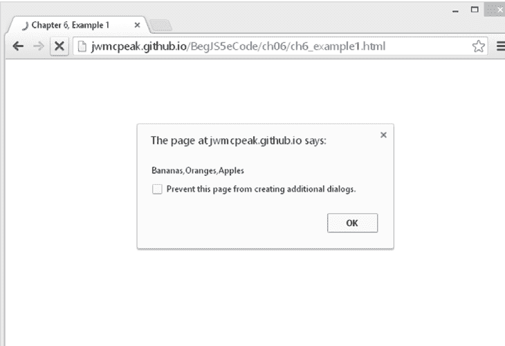

图 6-1

回想一下第 5 章，`join()` 方法将数组转换为字符串，每个元素之间用指定的分隔符分隔。

最后，你在 `alert` 框中显示新字符串：

```javascript
alert(reversedString);
}
```

在你了解正则表达式之后，我们将重新讨论 `replace()` 方法。

### replace() 方法

`replace()` 方法在字符串中搜索子字符串的出现位置。当它找到匹配的子字符串时，会将其替换为你指定的第三个字符串。

让我们看一个例子。假设你有一个包含单词 `May` 的字符串，如下所示：

```javascript
var myString = "The event will be in May, the 21st of June";
```

现在，假设你想将 May 替换为 June。你可以这样使用 `replace()` 方法：

```javascript
var myCleanedUpString = myString.replace("May", "June");
```

`myString` 的值不会改变。相反，`replace()` 方法返回 `myString` 的值，但其中的 `May` 被替换为 `June`。你将这个返回的字符串赋值给变量 `myCleanedUpString`，它将包含更正后的文本：

```
"The event will be in June, the 21st of June"
```

### search() 方法

`search()` 方法允许你在字符串中搜索特定的文本。如果找到该文本，则返回其字符位置；否则返回 `-1`。该方法仅接受一个参数，即你要搜索的文本。

当与纯文本一起使用时，`search()` 方法与你已经见过的 `indexOf()` 等方法相比没有真正的优势。然而，你稍后会看到，当使用正则表达式时，这个方法的强大之处就显现出来了。

在下面的例子中，你想找出单词 Java 是否包含在名为 `myString` 的字符串中：

```javascript
var myString = "Beginning JavaScript, Beginning Java, " +
               "Professional JavaScript";

alert(myString.search("Java"));
```

出现的 `alert` 框将显示值 `10`，这是 `Java` 第一次出现时的字符位置，即作为单词 `JavaScript` 的一部分。

### match() 方法

`match()` 方法与 `search()` 方法非常相似，不同的是它不返回匹配项的位置，而是返回一个数组。数组的每个元素包含找到的每个匹配项的文本。

虽然你可以将纯文本与 `match()` 方法一起使用，但这样做完全没有意义。例如，看下面的例子：

```javascript
var myString = "1997, 1998, 1999, 2000, 2000, 2001, 2002";
myMatchArray = myString.match("2000");
alert(myMatchArray.length);
```

这段代码使 `myMatchArray` 包含一个值为 `2000` 的元素。鉴于你已经知道搜索字符串是 `2000`，你可以看到这确实是个相当没意义的操作。

然而，当你将 `match()` 方法与正则表达式一起使用时，它就更有意义了。那么你可能会搜索二十一世纪的所有年份——即那些以 2 开头的年份。在这种情况下，你的数组将包含值 2000、2000、2001 和 2002，这就有用得多了！

## 正则表达式

在你重新审视 `String` 对象的 `split()`、`match()`、`search()` 和 `replace()` 方法之前，你需要先了解正则表达式和 `RegExp` 对象。正则表达式提供了一种定义字符模式的方法，然后你可以在字符串中分割、搜索或替换符合该模式的字符。

JavaScript 的正则表达式语法很大程度上借鉴了另一种脚本语言 Perl 的正则表达式语法。大多数现代编程语言都支持正则表达式，许多应用程序也是如此，例如 WebMatrix、Sublime Text 和 Dreamweaver，其中的查找功能允许使用正则表达式。你会发现，你的正则表达式知识即使在 JavaScript 之外也会证明很有用。

JavaScript 中的正则表达式通过 `RegExp` 对象使用，这是一个原生的 JavaScript 对象，就像 `String`、`Array` 等一样。你有两种方式创建新的 `RegExp` 对象。更简单的方式是使用正则表达式字面量，如下所示：

```javascript
var myRegExp = /\b'|\b/;
```

正斜杠（`/`）标记正则表达式的开始和结束。这是一种特殊的语法，告诉 JavaScript 这段代码是正则表达式，就像引号定义字符串的开始和结束一样。暂时不要担心实际表达式的语法（`\b'|\b`）——这很快就会详细解释。

或者，你可以使用 `RegExp` 对象的构造函数 `RegExp()` 并输入以下内容：

```javascript
var myRegExp = new RegExp("\\b'|\\b");
```

两种指定正则表达式的方式都可以，不过第一种方法对 JavaScript 来说更简短、更高效，因此通常更受欢迎。在本章的大部分剩余内容中，你将使用第一种方法。使用第二种方法的主要原因是它允许正则表达式在运行时确定（在代码执行时确定，而不是在编写代码时确定）。例如，如果你想根据用户输入来设置正则表达式，这将很有用。

一旦你熟悉了正则表达式，你将回到使用 `RegExp()` 构造函数定义它们的第二种方式。如你所见，第二种方法的语法略有不同，所以我们稍后会回到这个话题。

虽然你将专注于将 `RegExp` 对象作为 `String` 对象的 `split()`、`replace()`、`match()` 和 `search()` 方法的参数使用，但 `RegExp` 对象确实有其自己的方法和属性。例如，`test()` 方法使你能够测试传递给它的字符串是否包含与 `RegExp` 对象中定义的模式匹配的内容。你稍后将在示例中看到 `test()` 方法的使用。

### 简单的正则表达式

使用正则表达式语法定义字符模式可能会变得相当复杂。在本节中，你将只探讨正则表达式模式的基础。最好的方法是通过示例。

让我们从一个使用 `replace()` 方法和正则表达式进行简单文本替换的例子开始。想象你有以下字符串：

```javascript
var myString = "Paul, Paula, Pauline, paul, Paul";
```

你想将任何出现的 "Paul" 替换为 "Ringo"。

你需要查找的文本模式很简单，就是 `Paul`。将其表示为正则表达式，你只需要：

```javascript
var myRegExp = /Paul/;
```

如你之前所见，正斜杠字符标记正则表达式的开始和结束。现在让我们在 `replace()` 方法中使用这个表达式：

```javascript
myString = myString.replace(myRegExp, "Ringo");
```

你可以看到 `replace()` 方法接受两个参数：定义要搜索和替换的模式的 `RegExp` 对象，以及替换文本。

如果你将所有这些放在一个例子中，如下所示：

```html
<!DOCTYPE html>
<html lang="en">
<head>
    <title>Chapter 6, Figure 2</title>
</head>
<body>
    <script>
        var myString = "Paul, Paula, Pauline, paul, Paul";
        var myRegExp = /Paul/;

        myString = myString.replace(myRegExp, "Ringo");
        alert(myString);
    </script>
</body>
</html>
```

你可以保存并运行这段代码。你将看到图 6-2 所示的屏幕。

你可以看到，这已经替换了字符串中第一次出现的 `Paul`。但是如果你想替换字符串中所有出现的 `Paul` 呢？字符串末尾的两个还在那里，那么发生了什么？

默认情况下，`RegExp` 对象只查找第一个匹配的模式，在本例中是第一个 `Paul`，然后停止。这是 `RegExp` 对象的一个常见且重要的行为。正则表达式倾向于从字符串的一端开始，遍历字符直到找到第一个完整匹配项，然后停止。


## 图 6-2

你需要的是全局匹配，即查找所有可能的匹配项并进行替换。为帮助你实现此目的，`RegExp` 对象有三个你可以定义的属性，如下表所示：

| 属性 | 字符 | 描述 |
| --- | --- | --- |
| G | 全局匹配。 | 查找模式的所有匹配项，而不是在找到第一个匹配项后停止。 |
| I | 模式不区分大小写。 | 例如，`Paul` 和 `paul` 被视为相同的字符模式。 |
| M | 多行标志。 | 指定特殊字符 `^` 和 `$` 不仅可以匹配字符串的开始和结束，还可以匹配行的开始和结束。 |

你将在本章后面更详细地了解这些属性字符。

如果将代码中的 `RegExp` 对象更改为以下形式，将执行全局、不区分大小写的匹配：

```
var myRegExp = /Paul/gi;
```

现在运行代码会产生如图 6-3 所示的结果。

## 图 6-3

这看起来像是完全搞砸了。正如你所愿，正则表达式匹配了字符串开头和结尾的 `Paul` 子字符串，以及倒数第二个 `paul`。然而，`Pauline` 和 `Paula` 内部的 `Paul` 子字符串也被替换了。

`RegExp` 对象已正确完成其工作。你要求替换所有 `Paul` 模式的出现，而这正是你得到的。你实际的意思是替换所有作为独立单词（而不是像 `Paula` 这样的另一个单词的一部分）出现的 `Paul`。让正则表达式工作的关键在于精确地定义你想要的字符模式，使得只有该模式才能匹配，没有其他。那么，我们来做这个。

1.  你想要 `paul` 或 `Paul` 被替换。
2.  当它实际上是另一个单词的一部分时（如 `Pauline`），你不希望它被替换。

如何指定第二个条件？如何知道这个词是与其他字符连接在一起，而不仅仅是与空格、标点符号或字符串的开头或结尾连接？

要了解如何使用正则表达式实现所需结果，你需要借助正则表达式特殊字符的帮助。你将在下一节中查看这些特殊字符，在本节结束时你应该能够解决这个问题。

### 正则表达式：特殊字符

你将在本节查看三种类型的特殊字符。

#### 文本、数字和标点符号

第一组特殊字符包含字符类的特殊字符。字符类指的是数字、字母和空白字符。这些特殊字符在下表中展示：

| 字符类 | 匹配的字符 | 示例 |
|---|---|---|
| \d | 0 到 9 之间的任意数字 | \d\d 匹配 72，但不匹配 aa 或 7a。 |
| \D | 任意非数字字符 | \D\D\D 匹配 abc，但不匹配 123 或 8ef。 |
| \w | 任意单词字符；即 A-Z、a-z、0-9 和下划线字符 (_) | \w\w\w\w 匹配 Ab_2，但不匹配 £$%* 或 Ab_@。 |
| \W | 任意非单词字符 | \W 匹配 @，但不匹配 a。 |
| \s | 任意空白字符 | \s 匹配制表符、回车符、换页符和垂直制表符。 |
| \S | 任意非空白字符 | \S 匹配 A，但不匹配制表符字符。 |
| . | 除换行符 (\n) 外的任意单个字符 | . 匹配 a 或 4 或 @。 |
| [... ] | 方括号内的任意一个字符。[a-z] 匹配 a 到 z 范围内的任意字符。 | [abc] 匹配 a 或 b 或 c，但不匹配其他字符。 |
| [^ ... ] | 除方括号内字符外的任意一个字符。 | [^abc] 匹配除 a、b 或 c 之外的任意字符。[^a-z] 匹配不在 a 到 z 范围内的任意字符。 |

请注意，大写和小写字符的含义非常不同，因此在使用正则表达式时需要格外注意大小写。

让我们看一个例子。要匹配格式为 1-800-888-5474 的电话号码，正则表达式如下：

```
\d-\d\d\d-\d\d\d-\d\d\d\d
```

你可以看到这里有很多字符重复，这使得表达式相当笨重。为了简化，正则表达式有一种定义重复的方式。你将在本章后面看到这一点，但首先让我们看另一个例子。

#### 动手试：检查密码短语是否仅包含字母数字字符

你在下面的完整示例中运用目前为止学到的关于正则表达式的知识，检查一个密码短语是否只包含字母和数字——即字母数字字符，而不是像 @、% 等标点符号或符号：

```html
<!DOCTYPE html>
<html lang="en">
<head>
    <title>Chapter 6, Example 2</title>
</head>
<body>
    <script>
        var input = prompt("Please enter a pass phrase.", "");

        function isValid (text) {
            var myRegExp = /[^a-z\d ]/i;
            return !(myRegExp.test(text));
        }

        if (isValid(input)) {
            alert("Your passphrase contains only valid characters");
        } else {
            alert("Your passphrase contains one or more invalid characters");
        }
    </script>
</body>
</html>
```

将页面保存为 `ch6_example2.html`，然后加载到你的浏览器中。在提示框中只输入字母、数字和空格，单击确定，你会被告知该短语包含有效字符。尝试在文本框中输入标点符号或特殊字符（如 @、^、$ 等），你会被告知你的密码短语无效。

让我们从查看 `isValid()` 函数开始。顾名思义，它检查密码短语的有效性：

```javascript
function isValid(text) {
    var myRegExp = /[^a-z\d ]/i;
    return !(myRegExp.test(text));
}
```

该函数只接受一个参数：你要验证的文本。然后你声明一个变量 `myRegExp`，并将其设置为一个新的正则表达式，这隐式地创建了一个新的 `RegExp` 对象。

正则表达式本身相当简单，但首先思考一下你要查找的模式是什么。你想查明你的密码短语字符串是否包含任何不属于 A 到 Z 或 a 到 z 之间的字母、0 到 9 之间的数字或空格的字符。让我们看看这如何转换成正则表达式：

1.  你使用带有 `^` 符号的方括号：`[^]`
    这意味着你想匹配任何不是方括号内指定字符之一的字符。

2.  你添加 `a-z`，指定 a 到 z 范围内的任意字符：`[^a-z]`
    到目前为止，你的正则表达式匹配任何不在 a 到 z 之间的字符。注意，因为你在表达式定义末尾添加了 `i`，所以你使模式不区分大小写。因此，你的正则表达式实际上匹配任何不在 A 到 Z 或 a 到 z 之间的字符。

3.  你添加 `\d` 以表示任意数字字符，或 0 到 9 之间的任意字符：`[^a-z\d]`

4.  你的表达式匹配任何不在 a 到 z、A 到 Z 或 0 到 9 之间的字符。你决定空格是有效的，因此将其添加到方括号内：`[^a-z\d ]`
    将所有这些放在一起，你得到一个匹配任何不是字母、数字或空格的字符的正则表达式。

5.  在函数的第二行也是最后一行，你使用 `RegExp` 对象的 `test()` 方法返回一个值：`return !(myRegExp.test(text));`
    `RegExp` 对象的 `test()` 方法检查作为其参数传递的字符串，查看正则表达式语法指定的字符是否与字符串内的任何内容匹配。如果匹配，则返回 `true`；如果不匹配，则返回 `false`。你的正则表达式匹配找到的第一个无效字符，因此如果你得到 `true` 的结果，你的密码短语就无效。然而，一个 `isValid` 函数在无效时返回 `true` 有点不合逻辑，因此你通过添加非运算符 (!) 来反转返回的结果。

之前你看到了使用正则表达式的两行有效性检查函数。只是为了展示没有正则表达式做同样的事情需要多少额外的编码，这里是第二个与 `isValid()` 功能相同但不使用正则表达式的函数：

```javascript
function isValid2(text) {
    var returnValue = true;
    var validChars = "abcdefghijklmnopqrstuvwxyz1234567890 ";

    for (var charIndex = 0; charIndex < text.length;charIndex++) {
        if (validChars.indexOf(text.charAt(charIndex).toLowerCase()) < 0) {
            returnValue = false;
            break;
        }
    }
    return returnValue;
}
```


这可能已经是非正则表达式版本能做到的最简形式了，但仍然比`isValid()`长了好几行。
这个函数的原理与正则表达式版本类似。你有一个变量`validChars`，其中包含了所有你认为有效的字符。然后，你在`for`循环中使用`charAt()`方法获取密码字符串中的每个字符，并检查它是否存在于你的`validChars`字符串中。如果不存在，你就知道这是一个无效字符。
在这个例子中，非正则表达式版本的函数有10行，但面对更复杂的问题时，你可能会发现需要20或30行才能完成正则表达式仅用几行就能做到的事情。
回到你实际的代码：你使用`if...else`语句向用户显示相应的消息。如果密码有效，一个`alert`框会告诉用户一切正常：

```
if (isValid(input)) {
    alert("Your passphrase contains only valid characters");
}
```

如果无效，另一个`alert`框会告诉用户他们的文本无效：

```
else {
    alert("Your passphrase contains one or more invalid characters");
}
```

#### 重复字符

正则表达式包含一种称为重复字符的东西，这是一种指定你希望匹配最后一个项目或字符多少次的方法。这非常有用，例如，如果你想指定一个电话号码，其中某个字符重复特定次数。下表列出了一些最常见的重复字符及其作用：

| 特殊字符 | 含义 | 示例 |
| :--- | :--- | :--- |
| `{n}` | 匹配前一个项目 n 次。 | `x{2}` 匹配 xx。 |
| `{n,}` | 匹配前一个项目 n 次或更多次。 | `x{2,}` 匹配 xx, xxx, xxxx, xxxxx，依此类推。 |
| `{n,m}` | 匹配前一个项目至少 n 次且最多 m 次。 | `x{2,4}` 匹配 xx, xxx 和 xxxx。 |
| `?` | 匹配前一个项目零次或一次。 | `x?` 匹配空内容或 x。 |
| `+` | 匹配前一个项目一次或多次。 | `x+` 匹配 x, xx, xxx, xxxx, xxxxx，依此类推。 |
| `*` | 匹配前一个项目零次或多次。 | `x*` 匹配空内容，或 x, xx, xxx, xxxx，依此类推。 |

你之前看到过，要匹配格式为 1-800-888-5474 的电话号码，正则表达式是 \d-\d\d\d-\d\d\d-\d\d\d\d。让我们看看使用重复字符如何简化它。

你要查找的模式以一个数字后跟一个破折号开始，因此你需要：

```
\d-
```

接下来是三个数字后跟一个破折号。这次你可以使用重复特殊字符——\d{3} 将精确匹配三个 \d，即任意数字字符：

```
\d-\d{3}-
```

接下来，又是三个数字后跟一个破折号，所以现在你的正则表达式看起来像这样：

```
\d-\d{3}-\d{3}-
```

最后，表达式的最后一部分是四个数字，即 \d{4}：

```
\d-\d{3}-\d{3}-\d{4}
```

你会这样声明这个正则表达式：

```
var myRegExp = /\d-\d{3}-\d{3}-\d{4}/;
```

记住，第一个 / 和最后一个 / 告诉 JavaScript，这两个字符之间的内容是一个正则表达式。JavaScript 会基于这个正则表达式创建一个 `RegExp` 对象。

再举一个例子，如果你有字符串 `Paul`、`Paula`、`Pauline`，并且你想把 `Paul` 和 `Paula` 替换成 `George`？为此，你需要一个能同时匹配 `Paul` 和 `Paula` 的正则表达式。

让我们分解一下。你知道你想要字符 `Paul`，所以你的正则表达式开始是：

```
Paul
```

现在你还想匹配 `Paula`，但如果你把表达式写成 `Paula`，这将排除对 `Paul` 的匹配。这就是特殊字符 `?` 派上用场的地方。它允许你指定前一个字符是可选的——它必须出现零次（根本不出现）或一次。所以，解决方案是：

```
Paula?
```

你会这样声明它：

```
var myRegExp = /Paula?/;
```

#### 位置字符

第三类特殊字符使你能够指定匹配应该开始或结束的位置，或者字符模式两侧将是什么。例如，你可能希望你的模式存在于字符串或行的开头或结尾，或者你可能希望它在两个单词之间。下表列出了一些最常见的位置字符及其作用：

| 位置字符 | 描述 |
| :--- | :--- |
| ^ | 模式必须在字符串的开头，或者如果是多行字符串，则在行的开头。对于多行文本（包含回车符的字符串），你需要在使用 /myRegExp/m 定义正则表达式时设置多行标志。请注意，这仅适用于 IE 5.5 及更高版本和 NN 6 及更高版本。 |
| $ | 模式必须在字符串的末尾，或者如果是多行字符串，则在行的末尾。对于多行文本（包含回车符的字符串），你需要在使用 /myRegExp/m 定义正则表达式时设置多行标志。请注意，这仅适用于 IE 5.5 及更高版本和 NN 6 及更高版本。 |
| \b | 匹配单词边界，这基本上是单词字符和非单词字符之间的点。 |
| \B | 匹配一个不是单词边界的位置。 |

例如，如果你想确保你的模式在行的开头，你会输入：

```
^myPattern
```

这将匹配出现在行开头的 myPattern。
要匹配相同的模式，但在行的末尾，你会输入：

```
myPattern$
```

单词边界特殊字符 \b 和 \B 可能会引起混淆，因为它们不匹配字符，而是匹配字符之间的位置。
假设你在代码中定义了字符串 "Hello world!, let's look at boundaries said 007."，如下所示：

```
var myString = "Hello world!, let's look at boundaries said 007.";
```

为了突出显示这个字符串的单词边界（即单词之间的边界），让我们将它们转换为 | 字符：

```
var myRegExp = /\b/g;
myString = myString.replace(myRegExp, "|");
alert(myString);
```

你已经将所有的单词边界 \b 替换为 |，你的消息框看起来就像图 6-4 中的那样。

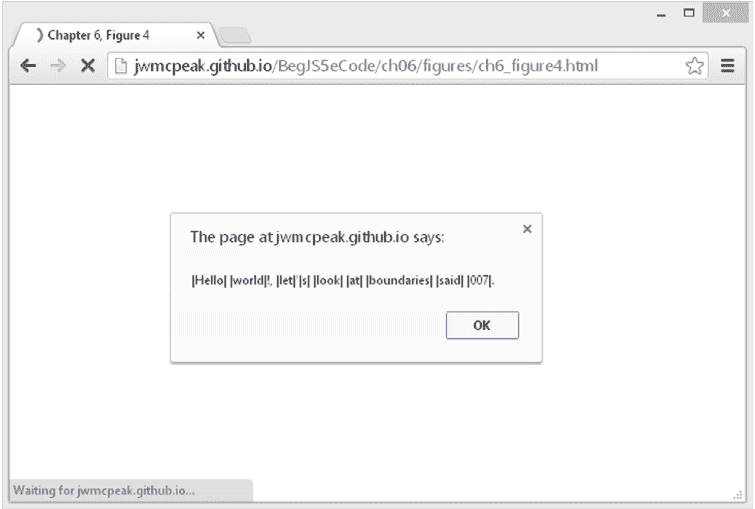

你可以看到，任何单词字符（字母、数字或下划线字符）和任何非单词字符之间的位置都是单词边界。你还会注意到，字符串开头或结尾与单词字符之间的边界也被视为单词边界。这个字符串的结尾是一个句点。所以句点和字符串结尾之间的边界是非单词边界，因此没有插入 |。

如果你更改示例中的正则表达式，使其替换非单词边界，如下所示：

```
var myRegExp = /\B/g;
```

你会得到图 6-5 所示的结果。

现在，字母、数字或下划线与另一个字母、数字或下划线之间的位置被视为非单词边界，并在示例中被替换为 |。然而，稍微令人困惑的是，两个非单词字符（如感叹号和逗号）之间的边界也被视为非单词边界。如果你仔细想想，这实际上是合理的，但在创建正则表达式时很容易忘记。

你会记得这个例子，当你开始研究正则表达式时：

```
<!DOCTYPE html>
<html lang="en">
<head>
<title>Chapter 6, Figure 2</title>
</head>
<body>
    <script>
        var myString = "Paul, Paula, Pauline, paul, Paul";
        var myRegExp = /Paul/gi;

        myString = myString.replace(myRegExp, "Ringo");
        alert(myString);
    </script>
</body>
</html>
```

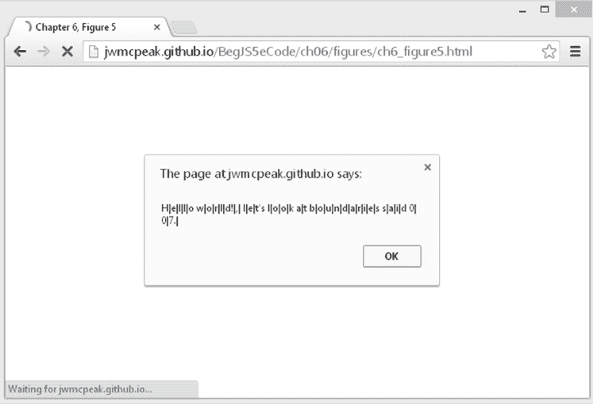

你使用这段代码将所有的 Paul 或 paul 实例转换为 Ringo。
然而，你发现这段代码实际上将所有的 Paul 实例都转换成了 Ringo，即使 Paul 这个词是在另一个单词内部。
解决这个问题的一种方法是仅在 Paul 后跟非单词字符时才替换字符串 Paul。非单词字符的特殊字符是 \W，因此你需要将正则表达式更改为：

```
var myRegExp = /Paul\W/gi;
```

这会得到图 6-6 所示的结果。


情况有所改善，但仍不是你想要的效果。请注意，第二个和第三个Paul子串后面的逗号也被替换了，因为它们匹配了`\w`字符。另外，你仍然没有替换字符串末尾的`Paul`。这是因为最后一个Paul的字母`l`后面没有字符。最后一个Paul的`l`后面是什么？什么都没有，只是单词字符和非单词字符之间的边界，答案就在这里。你想要的正则表达式应该是Paul后跟一个单词边界。让我们通过输入以下内容来修改正则表达式以应对这种情况：

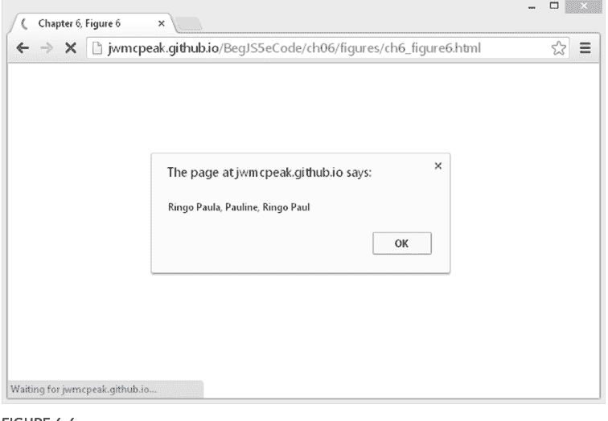

图 6-6

```
var myRegExp = /Paul\b/gi;
```

现在你得到了想要的结果，如图6-7所示。
终于搞对了，这个示例结束了。

#### 覆盖所有可能性

正则表达式最棘手的事情之一也许是确保它覆盖所有可能性。在前面的示例中，你的正则表达式适用于定义的字符串，但它适用于以下内容吗？

```
var myString = "Paul, Paula, Pauline, paul, Paul, JeanPaul";
```

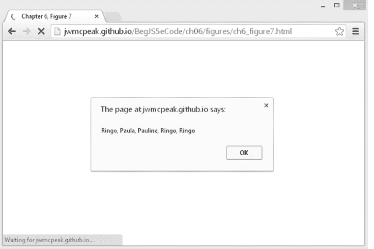

图 6-7

这里`JeanPaul`中的`Paul`子串将被更改为`Ringo`。你真正只想转换独立出现的`Paul`子串，即其两侧都有单词边界。如果你将正则表达式代码更改为：

```
var myRegExp = /\bPaul\b/gi;
```

你就得到了最终答案，并且可以确定只会匹配`Paul`或`paul`。

### 正则表达式分组

在查看使用`match()`、`replace()`和`search()`方法的示例之前，正则表达式下的最后一个主题是如何对表达式进行分组。事实上，这相当容易。如果你想将多个表达式作为一个组来处理，只需将它们括在括号中即可，例如，`/\(\d\d\)/`。正则表达式中的括号是特殊字符，用于组合字符模式，它们本身不是要匹配的字符的一部分。

为什么你想这样做？嗯，通过将字符组合成模式，你可以使用特殊的重复字符应用于整个字符组，而不仅仅是单个字符。

让我们以`myString`中定义的以下字符串为例：

```
var myString = "JavaScript, VBScript and PHP";
```

如何使用同一个正则表达式同时匹配`JavaScript`和`VBScript`？它们唯一的共同点是它们都是完整的单词，并且都以`Script`结尾。嗯，一个简单的方法是使用括号对`Java`和`VB`模式进行分组。然后你可以使用`?`特殊字符应用于每个字符组，以使模式匹配任何具有零个或一个`Java`或`VB`字符实例并以`Script`结尾的单词：

```
var myRegExp = /\b(VB)?(Java)?Script\b/gi;
```

分解这个表达式，你可以看到它要求的模式如下：

+   1. 一个单词边界：`\b`
2. 零个或一个VB实例：`(VB) ?`
3. 零个或一个Java实例：`(Java) ?`
4. 字符`Script`：`Script`
5. 一个单词边界：`\b`

将这些组合在一起，你得到：

```
var myString = "JavaScript, VBScript and PHP";
var myRegExp = /\b(VB)?(Java)?Script\b/gi;
myString = myString.replace(myRegExp, "xxxx");
alert(myString);
```

此代码的输出如图6-8所示。

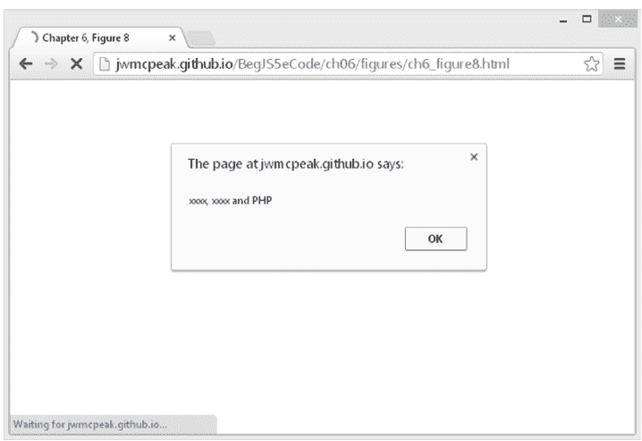

图：6-8

如果你回顾特殊重复字符表，你会看到它们适用于它们前面的项目。这可以是一个字符，或者，当它们通过括号分组时，是前面的字符组。

然而，你刚刚定义的正则表达式存在一个潜在问题。除了匹配`VBScript`和`JavaScript`之外，它还匹配`VBJavaScript`。这显然不是你想要的确切结果。

为了解决这个问题，你需要同时使用分组和特殊字符`|`，即交替字符。它具有“或”的含义，类似于`if`语句中的`||`，并会匹配其两侧的字符。

让我们重新思考这个问题。你希望模式匹配`VBScript`或`JavaScript`。显然它们有共同的`Script`部分。所以你想要的是一个以`Java`开头或以`VB`开头的新单词；无论哪种方式，它都必须以`Script`结尾。

首先，你知道单词必须以单词边界开头：

```
\b
```

接下来，你知道你希望`VB`或`Java`出现在单词的开头。你刚刚看到正则表达式中的`|`提供了你需要的“或”，所以在正则表达式语法中，你需要以下内容：

```
\b(VB|Java)
```

这匹配`VB`或`Java`模式。现在你只需添加`Script`部分：

```
\b(VB|Java)Script\b
```

你的最终代码如下所示：

```
var myString = "JavaScript, VBScript and Perl";
var myRegExp = /\b(VB|Java)Script\b/gi;
myString = myString.replace(myRegExp, "xxxx");
alert(myString);
```

### 重用字符组

你可以在正则表达式的后面重用字符组指定的模式。要引用前面的字符组，你只需输入`\`和一个数字，表示组的顺序。例如，你可以将第一组引用为`\1`，第二组引用为`\2`，依此类推。

让我们看一个例子。假设你有一个字符串中的数字列表，每个数字用逗号分隔。由于某种原因，不允许连续出现两个相同的数字，因此尽管

```
009,007,001,002,004,003
```

是可以的，但以下

```
007,007,001,002,002,003
```

将无效，因为`007`和`002`在自身之后重复。

如何找到重复数字的实例并将其替换为`ERROR`一词？你需要使用正则表达式中引用组的能力。

首先，让我们定义字符串如下：

```
var myString = "007,007,001,002,002,003,002,004";
```

现在你知道你需要搜索一个或多个数字字符的序列。在正则表达式中，`\d`指定任何数字字符，`+`表示一个或多个前面的字符。到目前为止，这给出了这个正则表达式：

```
\d+
```

你想匹配一个数字序列后跟一个逗号，所以你只需添加逗号：

```
\d+,
```

这将匹配任何数字序列后跟一个逗号，但如何搜索任何数字序列后跟一个逗号，然后再次跟相同的数字序列？因为数字可以是任何数字，你不能直接将它们添加到表达式中，如下所示：

```
\d+,007
```

这对于`002`的重复将不起作用。你需要做的是将第一个数字序列放在一个组中；然后你可以指定你想要再次匹配该数字组。你可以使用`\1`来做到这一点，它表示“匹配使用括号定义的第一组中找到的字符”。将所有这些放在一起，你得到以下内容：

```
(\d+),\1
```

这定义了一个组，其字符模式是一个或多个数字字符。此组后面必须跟一个逗号，然后是与第一组相同的字符模式。将其放入一些JavaScript中，你得到以下内容：

```
var myString = "007,007,001,002,002,003,002,004";
var myRegExp = /(\d+),\1/g;
myString = myString.replace(myRegExp, "ERROR");
alert(myString);
```

`alert`框将显示此消息：

```
ERROR,1,ERROR,003,002,004
```

这完成了你对正则表达式语法的简要介绍。因为正则表达式可能变得有点复杂，所以从简单开始并慢慢构建它们通常是个好主意，如前面的示例所示。事实上，大多数正则表达式都太难一步到位——至少对于我们这些大脑不是星球大小的凡人来说。

如果它看起来仍然有点奇怪和混乱，不要惊慌。在接下来的几节中，你将看到`String`对象的`split()`、`replace()`、`search()`和`match()`方法，并提供大量正则表达式语法的示例。


## 字符串对象

使用正则表达式的主要函数是 `String` 对象的 `split()`、`replace()`、`search()` 和 `match()` 方法。你已经见过它们的语法，所以在本节中，你将专注于它们与正则表达式一起使用的用法，同时进一步了解正则表达式的语法和使用方法。

### split() 方法

你已经知道 `split()` 方法可以将字符串分割成多个部分，分割发生在指定为参数的字符或字符序列处。此方法的结果是一个数组，其中每个元素包含分割后的一个片段。例如，以下字符串：

```
var myListString = "apple, banana, peach, orange"
```

可以分割成一个数组，其中每个元素包含一种不同的水果，如下所示：

```
var myFruitArray = myListString.split(", ");
```

如果字符串是这样的呢？

```
var myListString = "apple, 0.99, banana, 0.50, peach, 0.25, orange, 0.75";
```

该字符串可能同时包含水果的名称和价格。如何分割字符串，但只获取水果的名称而不获取价格呢？你可以不使用正则表达式来实现，但这需要很多行代码。使用正则表达式，你可以使用相同的代码，只需修改 `split()` 方法的参数。

**动手试试** 分割水果字符串

让我们创建一个例子来解决刚才描述的问题——它必须分割你的字符串，但只包含水果名称，不包含价格：

```
<!DOCTYPE html>
<html lang="en">
<head>
    <title>Chapter 6, Example 3</title>
</head>
<body>
    <script>
        var myListString = "apple, 0.99, banana, 0.50, peach, 0.25, orange, 0.75";
        var theRegExp = /[^a-z]+/i;
        var myFruitArray = myListString.split(theRegExp);

        document.write(myFruitArray.join("<br />"));
    </script>
</body>
</html>
```

将文件保存为 ch6_example3.html 并在浏览器中加载它。你应该会在页面上看到字符串中的四种水果被写出，每种水果占一行。

在脚本块内，首先你有包含水果名称和价格的字符串：

```
var myListString = "apple, 0.99, banana, 0.50, peach, 0.25, orange, 0.75";
```

如何以只包含水果名称的方式分割它？你第一个想法可能是使用逗号作为 split() 方法的参数，但这当然意味着你最终会得到价格。你必须问的是：“我想要的项目之间是什么？”或者换句话说，水果名称之间是什么，你可以用来定义分割点？答案是，水果名称之间有各种字符，例如逗号、空格、数字、句点、更多数字，最后又是另一个逗号。这些东西有什么共同点，使它们与你想要的水果名称不同？它们的共同点是，它们都不是从 a 到 z 的字母。如果你说“在出现一组不在 a 和 z 之间的字符的地方分割字符串”，那么你就会得到你想要的结果。现在你知道需要创建什么正则表达式了。

你知道你想要的是不是从 a 到 z 的字母，所以你从这里开始：

```
[^a-z]
```

`^` 表示“匹配任何不匹配方括号内指定内容的字符”。在这里，你指定了一个不匹配的字符范围——所有在 a 和 z 之间的字符。如指定，此表达式将只匹配一个字符，而你希望在任何出现一个或多个不在 a 和 z 之间的字符组的地方进行分割。为此，你需要添加特殊的重复字符 `+`，它表示“匹配前面指定的字符或组的一个或多个”：

```
[^a-z]+
```

最终结果是：

```
var theRegExp = /[^a-z]+/i
```

`/` 和 `/` 字符标记正则表达式的开始和结束，其 RegExp 对象存储在变量 theRegExp 中作为引用。你在末尾添加 `i` 以使匹配不区分大小写。

如果创建正则表达式看起来是一个令人沮丧且不那么直观的过程，不要惊慌。一开始，需要大量的试错才能做对，但随着你更有经验，你会发现创建它们变得容易得多，并且能够完成没有正则表达式会非常麻烦或几乎不可能的事情。

在脚本的下一行中，你将 RegExp 对象传递给 split() 方法，该方法使用它来决定在哪里分割字符串：

```
var myFruitArray = myListString.split(theRegExp);
```

分割后，变量 myFruitArray 将包含一个数组，其中每个元素包含一个水果名称，如下所示：

| 数组元素索引 | 0 | 1 | 2 | 3 |
| --- | --- | --- | --- | --- |
| 元素值 | apple | banana | peach | orange |

然后，你使用 `Array` 对象的 `join()` 方法再次将字符串连接在一起，你在第4章中已经见过：

```
document.write(myFruitArray.join("<br />"))
```

### replace() 方法

你已经了解了 `replace()` 方法的语法和用法。然而，`replace()` 方法的一个独特之处在于它能够基于正则表达式中匹配的组来替换文本。你通过使用 `$` 符号和组的编号来完成此操作。正则表达式中的每个组都有一个从 1 到 99 的编号；任何超过 99 的组都无法访问。要引用一个组，你写 `$` 后跟组的位置。例如，如果你有以下内容：

```
var myRegExp = /(\d) (\w)/g;
```

那么 `$1` 引用组 `(\d)`，`$2` 引用组 `(\w)`。你还设置了全局标志 `g` 以确保替换所有匹配的模式——而不仅仅是第一个。在下一个例子中你可以更清楚地看到这一点。假设你有以下字符串：

```
var myString = "2012, 2013, 2014";
```

如果你想将其更改为“the year 2012, the year 2013, the year 2014”，如何用正则表达式来实现？首先，你需要将模式制定为正则表达式，在本例中是四个数字：

```
var myRegExp = /\d{4}/g;
```

但鉴于年份每次都不同，如何将年份值替换到替换字符串中？嗯，你更改你的正则表达式，使其位于一个组内，如下所示：

```
var myRegExp = /(\d{4})/g;
```

现在你可以使用该组（组号为1）在替换字符串中，如下所示：

```
myString = myString.replace(myRegExp, "the year $1");
```

变量 `myString` 现在包含所需的字符串 "the year 2012, the year 2013, the year 2014"。让我们看另一个例子，你想将文本中的单引号转换为双引号。你的测试字符串是：

```
He then said 'My Name is O'Connerly, yes that's right, O'Connerly'.
```

测试字符串清楚地表明一个问题：你只想在单引号成对用于引语时将其替换为双引号，而不是在它用作撇号时（例如在单词 that's 中），或者当它是某人名字的一部分时（例如在 O'Connerly 中）。

让我们从定义正则表达式开始。首先，你知道它必须包含一个单引号，如以下代码所示：

```
var myRegExp = /'/;
```

然而，像这样它会替换每一个单引号，这不是你想要的。

观察文本，你还应该注意到引号总是在单词的开头或结尾——也就是说，在边界上。乍一看，很容易假设它会是一个单词边界。但是，不要忘记 ' 是一个非单词字符，所以边界将位于它和另一个非单词字符（例如空格）之间。因此，边界将是一个非单词边界，换句话说，是 `\B`。

因此，你寻找的字符模式要么是非单词边界后跟一个单引号，要么是一个单引号后跟一个非单词边界。关键是“或”，在正则表达式中你使用 `|`。这使你的正则表达式变为：

```
var myRegExp = /\B'|'\B/g;
```

这将匹配 `|` 左侧或右侧的字符模式。你想用双引号替换所有单引号，因此在末尾添加了 `g`，表示应进行全局匹配。

### 动手试试 用双引号替换单引号

让我们看一个使用刚刚定义的正则表达式的例子：

```
<!DOCTYPE html>

<html lang="en">
<head>
    <title>Chapter 6, Example 4</title>
</head>
<body>
    <script>
        var text = "He then said 'My Name is O'Connerly, yes " +
                   "that's right, O'Connerly'";

        document.write("Original: " + text + "<br/>");

        var myRegExp = /\B'|'\B/g;
        text = text.replace(myRegExp, '"');

        document.write("Corrected: " + text);
    </script>
</body>
</html>
```


### search() 方法

`search()` 方法允许你在一个字符串中搜索一个字符模式。如果找到该模式，则返回找到该模式时的字符位置；否则返回 `-1`。该方法只接受一个参数，即你已创建的 `RegExp` 对象。

虽然对于基本搜索，`indexOf()` 方法就足够了，但如果你需要进行更复杂的搜索，例如搜索任意数字的模式或要求一个单词必须在某个边界之内，`search()` 提供了更强大、更灵活，但有时也更复杂的方法。

在下面的示例中，你想找出字符串中是否包含单词 "Java"。然而，你只想查找作为完整单词的 "Java"，而不是像 "JavaScript" 这样另一个单词的一部分：

```javascript
var myString = "Beginning JavaScript, Beginning Java 2, " +
              "Professional JavaScript";
var myRegExp = /\bJava\b/i;
alert(myString.search(myRegExp));
```

首先，你定义了字符串，然后创建了正则表达式。你想要查找位于两个单词边界之间的字符模式 "Java"。通过在正则表达式后添加 `i`，你使搜索不区分大小写。请注意，对于 `search()` 方法，全局匹配标志 `g` 是无关的，使用它没有任何效果。

在最后一行，你输出搜索找到该模式的位置，在本例中是 32。

### match() 方法

`match()` 方法与 `search()` 方法非常相似，不同之处在于它不返回匹配发生的位置，而是返回一个数组。数组的每个元素包含一次匹配的文本。

例如，如果你有字符串：

```javascript
var myString = "The years were 2012, 2013 and 2014";
```

并且想从该字符串中提取年份，你可以使用 `match()` 方法来完成。要匹配每个年份，你需要在单词边界之间查找四个数字。这个要求可以转化为以下正则表达式：

```javascript
var myRegExp = /\b\d{4}\b/g;
```

你想匹配所有年份，因此在末尾添加了 `g` 以进行全局搜索。
要进行匹配并存储结果，你使用 `match()` 方法，并将其返回的 Array 对象存储在一个变量中：

```javascript
var resultsArray = myString.match(myRegExp);
```

为了证明它有效，让我们使用一些代码来输出数组中的每个项目。你添加了一个 `if` 语句来再次确认结果数组确实包含一个数组。如果没有进行匹配，结果数组将包含 `null`——如果变量有值而不是 `null`，那么 `if (resultsArray)` 将返回 `true`：

```javascript
if (resultsArray) {
  for (var index = 0; index < resultsArray.length; index++) {
    alert(resultsArray[index]);
  }
}
```

这将导致三个警报框，分别包含数字 2012、2013 和 2014。

### 动手试试：分割 HTML

在这个例子中，你想获取一个 HTML 字符串并将其分割成其组成部分。例如，你希望 HTML `<p>Hello</p>` 变成一个数组，其元素具有以下内容：

| `<p>` | `Hello` | `</p>` |

```html
<!DOCTYPE html>
<html lang="en">
<head>
    <title>Chapter 6, Example 5</title>
</head>
<body>
    <div id="output"></div>
    <script>
        var html = "<h2>Hello World!</h2>" +
                   "<p>We love JavaScript!</p>";

        var regex = /<[^>\r\n]+>|[^<>\r\n]+/g;
        var results = html.match(regex);

        document.getElementById("output").innerText = results.join("\r\n");
    </script>
</body>
</html>
```

将此文件保存为 `ch6_example5.html`。当你将页面加载到浏览器中时，你会看到 HTML 字符串被分割，每个元素的标签和内容显示在单独的行上。

再次强调，实现所有这些功能的代码只由几行组成。你首先创建一个 `RegExp` 对象并用你的正则表达式初始化它：

```javascript
var regex = /<[^>\r\n]+>|[^<>\r\n]+/g;
```

让我们分解它，看看你试图匹配的模式。首先，注意该模式被一个交替符号 `|` 分开。这意味着你想要这个符号左边或右边的模式。分开查看这些模式。

在左边，你有以下内容：

- 该模式必须以 `<` 开头。
- 在 `[^>\r\n]+` 中，你指定想要一个或多个除 `>` 或 `\r`（回车）或 `\n`（换行符）之外的任何字符。
- `>` 指定该模式必须以 `>` 结尾。

在右边，你只有以下内容：

- `[^<>\r\n]+` 指定该模式是一个或多个任何字符，只要该字符不是 `<`、`>`、`\r` 或 `\n`。这将匹配纯文本。

在正则表达式定义之后有一个 `g`，它指定这是一个全局匹配。

因此，正则表达式 `<[^>\r\n]+>` 将匹配任何开始或结束标签，例如 `<p>` 或 `</p>`。替代模式是 `[^<>\r\n]+`，它将匹配任何不是开始或结束标签的字符模式。

在下面一行中，你将 `results` 变量赋值为 `match()` 方法返回的 `Array` 对象：

```javascript
var results = html.match(regex);
```

代码的其余部分用分割后的 HTML 填充一个 `<div/>` 元素：

```javascript
document.getElementById("output").innerText = results.join("\r\n");
```

这段代码使用了你尚未见过的功能。它本质上是检索 `id` 值为 `output` 的元素；这是主体顶部的 `<div/>` 元素。`innerText` 属性允许你设置 `<div/>` 元素内部的文本。你将在后面的章节中了解更多。

然后，你使用 `Array` 对象的 `join()` 方法将数组的所有元素连接成一个字符串，每个元素之间用 `\r\n` 字符分隔，这样每个标签或文本片段都单独占一行。

## 使用 REGEXP 对象的构造函数

到目前为止，你一直使用 `/` 和 `/` 字符来创建 `RegExp` 对象，以定义正则表达式的开始和结束，如下面的示例所示：

```javascript
var myRegExp = /[a-z]/;
```

虽然这通常是首选方法，但之前也简要提到过，也可以通过 `RegExp()` 构造函数来创建 `RegExp` 对象。大多数时候你可能会使用第一种方式。然而，在某些情况下，创建 `RegExp` 对象的第二种方式是必要的（例如，当需要从用户输入构建正则表达式时）。

例如，前面的正则表达式同样可以定义为：

```javascript
var myRegExp = new RegExp("[a-z]");
```

这里你将正则表达式作为字符串参数传递给 `RegExp()` 构造函数。

使用此方法时一个非常重要的区别在于如何处理特殊正则表达式字符，例如前面有反斜杠的 `\b`。问题在于反斜杠在 JavaScript 字符串中表示转义字符——例如，你可能使用 `\b`，它表示退格符。为了区分字符串中表示退格符的 `\b` 和正则表达式中的 `\b` 特殊字符，你必须在正则表达式特殊字符前再放一个反斜杠。因此，当你指的是匹配单词边界的正则表达式 `\b` 而不是退格字符时，`\b` 就变成了 `\\b`。

例如，假设你使用以下方式定义了你的 `RegExp` 对象：

```javascript
var myRegExp = /\b/;
```

要使用 `RegExp()` 构造函数声明它，你需要这样写：

```javascript
var myRegExp = new RegExp("\\b");
```

而不是这样：

```javascript
var myRegExp = new RegExp("\b");
```

所有特殊正则表达式字符，如 `\w`、`\b`、`\d` 等，当你使用 `RegExp()` 创建它们时，前面都必须有一个额外的 `\`。

当你使用 `/` 和 `/` 方法定义正则表达式时，在最后的 `/` 之后，你可以添加特殊标志 `m`、`g` 和 `i` 来分别指示模式匹配应该是多行、全局或不区分大小写的。当使用 `RegExp()` 构造函数时，你如何做同样的事情？

很简单。`RegExp()` 构造函数的可选第二个参数接受指定全局或不区分大小写匹配的标志。例如，这将进行全局不区分大小写的模式匹配：

```javascript
var myRegExp = new RegExp("hello\\b", "gi");
```


你可以只指定其中一个标志，比如下面这样：

```
var myRegExp = new RegExp("hello\\b","i");
```

或者

```
var myRegExp = new RegExp("hello\\b","g");
```

### 动手实践：表单验证模块

在这个动手实践环节，你将创建一组实用的 JavaScript 函数，它们使用正则表达式来验证以下内容：

-   电话号码
-   邮政编码
-   电子邮件地址

这种验证只检查格式。例如，它无法检查电话号码是否真实存在，只能判断如果该号码存在，其格式是否有效。

首先是包含输入验证代码的 .js 文件。请注意，下面代码块中的代码行对于书籍版面来说太长了——请确保每个正则表达式都包含在一行中：

```
function isValidTelephoneNumber(telephoneNumber) {
    var telRegExp = /^(\+\d{1,3} ?)?(\(\d{1,5}\)|\d{1,5})?\d{3}?\d{0,7}?( x|xtn|ext|extn|pax|pbx|extension)?\.? ?\d{2-5})?$/i;
    return telRegExp.test(telephoneNumber);
}

function isValidPostalCode(postalCode) {
    var pcodeRegExp = /^(\d{5}(-\d{4}))?|([a-z][a-z]?\d\d?|[a-z]{2}\d[a-z])?\d[a-z][a-z]$/i;
    return pcodeRegExp.test(postalCode);
}

function isValidEmail(emailAddress) {
    var emailRegExp = /^(([^<>()[\]\\.,;:@"\x00-\x20\x7F]|\.)+|(\"([^"\x0A\x0D\\]|\\\\)+\"))@(([a-z]|#\d+?)([a-z0-9-]|#\d+?)*([a-z0-9]|#\d+?\.))+([a-z]{2,4})$/i;
    return emailRegExp.test(emailAddress);
}
```

将其保存为 ch6_example6.js。

要测试代码，你需要一个简单的页面：

```
<!DOCTYPE html>
<html lang="en">
<head>
    <title>Chapter 6, Example 6</title>
</head>
<body>
    <script src="ch6_example6.js"></script>
    <script>
        var phoneNumber = prompt("Please enter a phone number.", "");

        if (isValidTelephoneNumber(phoneNumber)) {
            alert("Valid Phone Number");
        } else {
            alert("Invalid Phone Number");
        }

        var postalCode = prompt("Please enter a postal code.", "");

        if (isValidPostalCode(postalCode)) {
            alert("Valid Postal Code");
        } else {
            alert("Invalid Postal Code");
        }

        var email = prompt("Please enter an email address.", "");

        if (isValidEmail(email)) {
            alert("Valid Email Address");
        } else {
            alert("Invalid Email Address");
        }
    </script>
</body>
</html>
```

将其保存为 **ch6_example6.html** 并在浏览器中打开，系统会提示你输入一个电话号码。输入一个有效的电话号码（例如，+1 (123) 123 4567），你会看到一条消息，说明该号码是否有效。

然后，系统会提示你输入邮政编码和电子邮件。输入这些值来测试相应的函数。这非常基础，但足以测试你的代码。

实际的代码非常简单，但创建正则表达式却很有技巧性，所以让我们从电话号码验证开始，深入探讨它们。

### 电话号码验证

电话号码的验证更具挑战性。问题在于：

-   不同国家的电话号码格式不同。
-   一个有效的号码可以用不同的方式输入（例如，带或不带国家或国际区号）。

对于这个正则表达式，你需要指定的不仅仅是有效字符；你还需要指定数据的格式。例如，以下所有格式都是有效的：

+1 (123) 123 4567
+1123123 456
+44 (123) 123 4567
+44 (123) 123 4567 ext 123
+44 20 7893 4567

你的正则表达式需要处理的变体（可选地由空格分隔）如下表所示：

| 国际号码 | "+" 后跟一到三位数字（可选） |
| --- | --- |
| 本地区域代码 | 两到五位数字，有时在括号内（必需） |
| 实际用户号码 | 三到十位数字，有时带空格（必需） |
| 分机号 | 两到五位数字，前面是 x、xtn、extn、pax、pbx 或 extension，有时在括号内 |

显然，这在某些国家行不通，你需要根据你的客户和合作伙伴所在地来处理。下面的正则表达式相当复杂（它的长度意味着它必须分成两行；请确保你在一行内输入它）：

```
^(\+\d{1,3} ?)?(\(\d{1,5}\)|\d{1,5}) ?\d{3} ?\d{0,7}( (x|xtn|ext|extn|pax|pbx|extension)?\.? ?\d{2-5})?$
```

你需要为此设置不区分大小写的标志以及显式捕获选项。尽管这看起来很复杂，但如果分解来看，它相当直接。

让我们从匹配国际拨号代码的模式开始：

```
(\+\d{1,3} ?)?
```

目前，你匹配的是一个加号（\+）后跟一到三位数字（\d{1,3}）和一个可选的空格（?）。请记住，因为 + 字符是一个特殊字符，所以你需要在它前面添加一个 \ 字符来指定你指的是实际的 + 字符。这些字符被括在括号内，以指定一个字符组。你允许一个可选的空格，并匹配这个字符组零次或一次，如组的闭括号后的 ? 字符所示。

接下来是匹配区域代码的模式：

```
(\(\d{1,5}\)|\d{1,5})
```

这个模式包含在括号内，指定它是一个字符组，并匹配括号内的一到五位数字（(\d{1,5})）或仅一到五位数字（\d{1,5}）。同样，因为括号字符在正则表达式语法中是特殊字符，而你想要匹配实际的括号，所以你需要在它们前面加上 \ 字符。还要注意管道符号（|）的使用，它的意思是“或”或“匹配这两个模式中的任何一个”。

接下来，让我们匹配用户号码：

```
 ?\d{3,4} ?\d{0,7}
```

> **注意** 初始的空格和 ? 表示“匹配零个或一个空格”。然后是三或四位数字（\d{3,4}）——尽管美国号码总是三位，但英国号码经常是四位。然后是另一个“零个或一个空格”，最后是零到七位数字（\d{0,7}）。

最后，添加处理可选分机号的部分：

```
( (x|xtn|ext|extn|extension)?\.? ?\d{2-5})?
```

这个组是可选的，因为它的括号后面有一个问号。这个组本身检查一个空格，后面可选地跟 x、ext、xtn、extn 或 extension，然后是零个或一个句点（注意 \ 字符，因为 . 在正则表达式语法中是一个特殊字符），然后是零个或一个空格，最后是两到五位数字。将这四个模式组合在一起，你可以构建整个正则表达式，除了周围的语法。正则表达式以 ^ 开头，以 $ 结尾。^ 字符指定该模式必须在字符串的开头匹配，而 $ 字符指定该模式必须在字符串的结尾匹配。这意味着字符串必须完全匹配该模式；它不能在匹配的模式之前或之后包含任何其他字符。

因此，正则表达式解释完毕，让我们再次查看 ch6_example6.js 中的 isValidTelephoneNumber() 函数：

```
function isValidTelephoneNumber(telephoneNumber) {
    var telRegExp = /^(\+\d{1,3} ?)?(\(\d{1,5}\)|\d{1,5}) ?\d{3}
        ?\d{0,7}( (x|xtn|ext|extn|pax|pbx|extension)?\.? ?\d{2-5})?$/i;
    return telRegExp.test(telephoneNumber);
}
```

请注意，在这种情况下，通过在表达式定义的末尾添加 i 来设置不区分大小写的标志非常重要；否则，正则表达式可能无法匹配 ext 部分。另请注意，正则表达式本身在你的代码中必须在一行内——由于本书的页面宽度限制，这里将其显示为多行。

### 验证邮政编码

我们刚刚设法检查了全球的电话号码，但对邮政编码做同样的事情将是一个重大的挑战。相反，你将创建一个只检查


### 验证邮政编码

美国的邮政编码和英国的邮政编码。如果你需要检查其他国家的代码，则需要进行修改。你可能会发现，在一个正则表达式中检查一两个以上的邮政编码会变得难以管理，而且更简单的方法可能是为需要检查的每个国家的邮政编码设置一个单独的正则表达式。但为此目的，让我们将英国和美国的正则表达式结合起来：

```
^(\d{5}(-\d{4})?)|([a-z][a-z]?\d\d?\s?\d[a-z][a-z])$
```

这实际上分为两部分。第一部分检查邮政编码，第二部分检查英国邮政编码。首先来看看美国邮政编码部分。

美国邮政编码可以表示为两种格式之一：五位数字（如 12345），或五位数字后跟一个短横线和四位数字（如 12345-1234）。匹配这些格式的邮政编码正则表达式如下：

```
\d{5}(-\d{4})?
```

它匹配五位数字，后跟一个可选的非捕获组，该组匹配一个短横线，然后是四位数字。

对于覆盖英国邮政编码的正则表达式，让我们考虑它们的各种格式。英国邮政编码的格式为一两个字母后跟一两个数字，然后是一个可选的空格，再跟一个数字，最后是两个字母。此外，一些伦敦市中心的邮政编码看起来像 SE2V 3ER，在第一部分末尾有一个字母。目前，只有部分这样的邮政编码以 SE、WC 和 W 开头，但这可能会改变。英国邮政编码的有效示例包括：CH3 9DR、PR29 1XX、M27 1AE、WC1V 2ER 和 C27 3AH。

基于此，所需的模式如下：

```
([a-z][a-z]?\d\d?|[a-z]{2}\d[a-z])\s?\d[a-z][a-z]
```

这两个模式使用 `|` 字符进行“匹配其一”的组合，并使用圆括号进行分组。然后，你可以在模式开头添加 `^` 字符，在末尾添加 `$` 字符，以确保字符串中唯一的信息是邮政编码。虽然邮政编码应该是大写的，但它们用小写也是有效的，因此在使用正则表达式时，你也需要设置不区分大小写的选项，如下所示：

```
^(\d{5}(-\d{4})?)|([a-z][a-z]?\d\d?|[a-z]{2}\d[a-z])\s?\d[a-z][a-z])$
```

仅供参考，让我们再看一下 `isValidPostalCode()` 函数：

```
function isValidPostalCode(postalCode) {
    var pcodeRegExp = /^(\d{5}(-\d{4})?)|([a-z][a-z]?\d\d?|[a-z]{2}\d[a-z])
            ?\d[a-z][a-z])$/i;
    return pcodeRegExp.test( postalCode );
}
```

再次记住，正则表达式在你的代码中必须在一行上。

### 验证电子邮件地址

在编写匹配电子邮件地址的正则表达式之前，你需要了解可以拥有的有效电子邮件地址类型。例如：

-   - someone@mailserver.com
- someone@mailserver.info
- someone.something@mailserver.com
- someone.something@subdomain.mailserver.com
- someone@mailserver.co.uk
- someone@subdomain.mailserver.co.uk
- someone.something@mailserver.co.uk
- someone@mailserver.org.uk
- some.one@subdomain.mailserver.org.uk

此外，如果你查阅 SMTP RFC（http://www.ietf.org/rfc/rfc0821.txt），你可以有以下格式：

-   - someone@123.113.209.32
- """Paul Wilton"""@somedomain.com

这是一个相当长的列表，包含许多需要处理的变体。最好先将其分解。首先，请注意后两种版本极为罕见，在你将创建的正则表达式中不予考虑。

其次，你需要将电子邮件地址分解为单独的部分。首先让我们看看 @ 符号之后的部分。

### 验证域名

自从允许 Unicode 域名以来，一切都变得更加复杂了。然而，电子邮件 RFC 仍然不允许这些，所以让我们坚持使用 ASCII 描述域名的传统定义。域名由点分隔的单词列表组成，最后一个单词长度为两到四个字符。通常，如果使用一个两个字母的国家代码，在它之前至少有两个部分的域名：一个组合域名（如 .co、.ac 等）和一个特定的域名。然而，随着 .tv 域名的出现，情况已不再如此。你可以非常具体地指定允许的顶级域名（TLD），但这会使正则表达式非常庞大，而执行 DNS 查询会更有效率。

域名的每个部分都必须遵循某些规则。它可以包含任何字母、数字或连字符，但必须以字母开头。例外情况是，在域名中的任何位置，你可以使用一个 #，后跟一个数字，这代表该字母的 ASCII 代码，在 Unicode 中则是 16 位 Unicode 值。了解这一点后，让我们开始构建正则表达式，首先从名称部分开始，假设不区分大小写的标志稍后在代码中设置：

```
([a-z]|\d+)([a-z0-9-]|\d+)*([a-z0-9]|\d+)
```

这将域名分为三部分。RFC 未指定这里可以包含多少位数字，所以我们也不指定。第一部分必须只包含一个 ASCII 字母；第二部分必须包含零个或多个字母、数字或连字符；第三部分必须包含一个字母或数字。顶级域名有更多限制，如下所示：

```
[a-z]{2,4}
```

这将你限制在两、三或四个字母的顶级域名。因此，将它们全部组合起来，加上点，你最终得到这个：

```
^(([a-z]|\d+)([a-z0-9-]|\d+?)*([a-z0-9]|\d+?)\.)+([a-z]{2,4})$
```

同样，域名锚定在字符串的开头和结尾。首先添加一个额外的组以允许一个或多个名称部分，然后将两到四个字母的域名锚定在末尾，形成自己的组。我们还将大多数通配符设为懒惰的。因为模式的大部分是相似的，这样做是有意义的；否则，它将需要太多的回溯。然而，我们将第二个组保留为“贪婪”通配符：它将匹配尽可能多的内容，直到遇到不匹配的字符。然后它只会回溯一个位置以尝试第三组匹配。在这种情况下，这比懒惰匹配更节省资源，因为它可能会不断向前尝试匹配。每个名称一次回溯是可接受的额外处理量。

### 验证个人地址

现在你可以尝试验证 @ 符号之前的部分。RFC 规定它可以包含任何 ASCII 码在 33 到 126 范围内的字符。你假设只匹配 ASCII，因此可以假设引擎只匹配 128 个字符。在这种情况下，更简单的方法是排除所需的值，如下所示：

```
[^<>()[\] ,;:@"\x00-\x20\x7F]+
```

使用这个，你是在说你允许任意数量的字符，只要它们不包含在方括号中即可。方括号和反斜杠字符（`[`、`]` 和 `\`）必须转义。然而，RFC 允许其他类型的匹配。

### 验证完整地址

既然你已经看过了前面的所有部分，你就可以为整个电子邮件地址构建一个正则表达式。首先，这是到 @ 符号及包括它的所有内容：

```
^([^<>()[\] ,;:@"\x00-\x20\x7F]|\\.)+@
```

这很简单。现在来看域名部分：

```
^[^<>()\[\] ,;:@"\x00-\x20\x7F]|\.))+@(([a-z]|\#\d+?)([a-z0-9-]|\#\d+?)\.)+([a-z]{2,4})$
\#\d+?)*([a-z0-9]|\#\d+?)\.)+([a-z]{2,4})$
```

我们不得不将其放在两行以适应本书的页面宽度，但在你的代码中，这必须全部在一行上。

最后，这里是 `isValidEmail()` 函数供参考：

```
function isValidEmail(emailAddress) {
    var emailRegExp =
        /^((["'<>\(\)\[\]\\,\\,;:@"\x00-\x20\x7F]|\\\.)+|("""(["\x0A\x0D"\\] |\\\\)+"""))
        @(([a-z]|\#\d+?)([a-z0-9-]|\#\d+?)\.)
        +([a-z]{2,4})$/i;
    return emailRegExp.test( emailAddress );
}
```

再次注意，正则表达式在你的代码中必须全部在一行上。

## 总结

在本章中，你了解了 `string` 对象的一些更高级方法，以及如何使用正则表达式来优化它们的使用。
回顾一下，本章涵盖了以下要点：

-   - `split()` 方法将单个字符串分割成字符串数组。你传递一个字符串或正则表达式给该方法，以确定分割发生的位置。
- `replace()` 方法使你能够用指定为第二参数的另一个模式替换字符模式。
- `search()` 方法返回与给定参数匹配的第一个模式的字符位置。
- `match()` 方法匹配模式，以数组形式返回匹配的文本。
- 正则表达式使你能够定义想要匹配的字符模式。使用此模式，你可以对字符串执行分割、搜索、文本替换和匹配。
- 在 JavaScript 中，正则表达式以 `RegExp` 对象的形式存在。你可以使用 `myRegExp = /myRegularExpression/` 或 `myRegExp = new RegExp("myRegularExpression")` 来创建 `RegExp` 对象。第二种形式要求通常前面只有一个 \ 的某些特殊字符现在有两个。
- 正则表达式末尾的 g 和 i 字符（例如，`myRegExp = /Pattern/gi;`）确保进行全局和不区分大小写的匹配。
- 除了指定实际字符外，正则表达式还具有某些特殊字符组，允许匹配字符组中的任何一个，例如数字、单词或非单词字符。

## 正则表达式

你还可以使用特殊字符来指定模式或字符的重复。此外，你可以指定模式边界必须是什么——例如，在字符串的开头或结尾，或者在单词或非单词边界旁边。

最后，你可以定义字符组，这些字符组可以在正则表达式中的后面使用，或者在使用表达式与`replace()`方法结合时使用。

在下一章中，你将学习如何使用JavaScript来操作日期和时间，以及不同时区之间的时间转换。还将介绍如何创建一个在页面加载后定期执行代码的计时器。

## 练习

你可以在附录A中找到这些问题的参考答案。

1.  以下代码解决了什么问题？

```
var myString = "This sentence has has a fault and and we need to fix it."
var myRegExp = /(\b\w+\b) \1/g;
myString = myString.replace(myRegExp,"$1");
```

现在想象你修改了代码，像这样创建`RegExp`对象：

```
var myRegExp = new RegExp("(\b\w+\b) \1");
```

为什么这行不通，你该如何解决这个问题？

2.  编写一个正则表达式，用于查找以下句子中所有出现的单词"a"并将其替换为"the"：

    > “a dog walked in off a street and ordered a finest beer”

    句子应该变成：

    > “the dog walked in off the street and ordered the finest beer”

3.  假设你有一个带有留言板的网站。编写一个正则表达式来删除违禁词。（你可以自己编一些词！）


## 日期、时间和计时器

## 本章你将学到：

- 从Date对象检索特定的日期和时间信息
- 修改Date对象的日期和时间
- 延迟函数的执行
- 按设定的时间间隔执行函数

第5章讨论了日期和时间的概念在JavaScript中通过`Date`对象来体现。你了解了`Date`对象的一些属性和方法，包括：

- `getDate()`、`getDay()`、`getMonth()`和`getFullYear()`方法使你能够从`Date`对象中检索日期值。
- `setDate()`、`setMonth()`和`setFullYear()`方法使你能够设置现有`Date`对象的日期值。
- `getHours()`、`getMinutes()`、`getSeconds()`和`getMilliseconds()`方法检索`Date`对象中的时间值。
- `setHours()`、`setMinutes()`、`setSeconds()`和`setMilliseconds()`方法使你能够设置现有`Date`对象的时间值。

该章节未涉及的一个观点是，时间取决于你在世界各地的位置。在本章中，你将通过探讨与*世界时间*相关的日期和时间来弥补这一遗漏。

例如，想象一下你的网站上有一个聊天室，并想为特定的日期和时间组织一次聊天。如果你的网站吸引国际访客，仅仅说明15:30是不够的。15:30可能是东部标准时间、太平洋标准时间、英国时间，甚至是吉隆坡时间。当然，你可以说15:30 EST，让你的访客去理解那意味着什么，但即使这样也不是万无一失。澳大利亚和美国都有EST。如果你能自动将时间转换为用户所在的时区，岂不是很好？在本章中，你将看到如何实现这一点。

除了探讨世界时间，你还将学习如何在网页中创建一个*计时器*。你会发现，通过使用计时器，你可以触发代码，无论是按定时间隔还是仅一次（例如，在页面加载五秒后）。你将了解如何使用计时器为网页添加实时时钟。计时器还可以用于在网络应用程序中创建动画或特殊效果，这将在后面的章节中探讨。

## 世界时间

*现在*的概念在全世界各地都指同一个时间点。然而，当这个时间点用数字表示时，这些数字因你所在的位置而异。需要的是一个标准数字来表示那个特定的时刻。这通过协调世界时来实现，协调世界时是民用和科学时间的国际基础，并于1964年实施。它以前被称为GMT（格林威治标准时间），实际上，在协调世界时0:00时，伦敦格林威治是午夜。

下表显示了协调世界时0:00时世界各地的当地时间：

| 旧金山 | 纽约 (EST) | 格林威治，伦敦 | 柏林，德国 | 东京，日本 |
|---|---|---|---|---|
| 下午4:00 | 晚上7:00 | 0:00 (午夜) | 上午1:00 | 上午9:00 |

> **注意** 注意给出的时间是冬季时间——未考虑夏令时。

JavaScript对协调世界时的支持来自于Date对象的许多方法，这些方法与你已经见过的方法类似。对于你目前见过的每个设置日期和获取日期类型的方法，都有一个协调世界时的等效方法。例如，`setHours()`设置Date对象中的本地小时，而`setUTCHours()`对协调世界时做同样的事情。你将在下一节中更详细地了解这些方法。

此外，Date对象的另外三个方法涉及世界时间。

你有`toUTCString()`和`toLocaleString()`方法，它们将Date对象中存储的日期和时间作为基于协调世界时或本地时间的字符串返回。大多数现代浏览器还有这些额外的方法：`toLocaleTimeString()`、`toTimeString()`、`toLocaleDateString()`和`toDateString()`。

如果你只想找出当前语言环境的时间与协调世界时之间的分钟差，你可以使用`getTimezoneOffset()`方法。如果时区落后于协调世界时，例如在美国，它将返回一个正数。如果时区超前，例如在澳大利亚或日本，它将返回一个负数。

### 动手实践：Date对象的世界时间方法

在下面的代码中，你使用`toLocaleString()`、`toUTCString()`、`getTimezoneOffset()`、`toLocaleTimeString()`、`toTimeString()`、`toLocaleDateString()`和`toDateString()`方法，并将它们的值输出到页面：

```
<!DOCTYPE html>

<html lang="en">
<head>
    <title>Chapter 7, Example 1</title>
</head>
<body>
    <script>
        var localTime = new Date();

        var html = "<p>UTC Time is " + localTime.toUTCString() + "</p>";
        html += "<p>Local Time is " + localTime.toLocaleString() + "</p>";

        html += "<p>Time Zone Offset is " +
                    localTime.getTimezoneOffset() + "</p>";

        html += "<p>Using toLocaleTimeString() gives: " +
                    localTime.toLocaleTimeString() + "</p>";

        html += "<p>Using toTimeString() gives: " +
                    localTime.toTimeString() + "</p>";

        html += "<p>Using toLocaleDateString() gives: " +
                    localTime.toLocaleDateString() + "</p>";

        html += "<p>Using toDateString() gives: " +
                    localTime.toDateString() + "</p>";

        document.write(html);
    </script>
</body>
</html>
```

将其保存为`ch7_example1.html`并加载到浏览器中。当然，你看到的内容取决于你计算机设置的时区，但你的浏览器应该显示与图7-1类似的内容。

这里计算机的时间被设置为2014年3月30日，美国东部夏令时间（例如纽约）晚上09:28:318。

那么这是如何工作的呢？在页面的脚本块顶部，你只有：

```
var localTime = new Date();
```

这创建了一个新的`Date`对象，并根据客户端计算机的时钟将其初始化为当前日期和时间。（注意，`Date`对象只是存储你的计算机时钟上的日期和时间与协调世界时1970年1月1日午夜之间的毫秒数。）

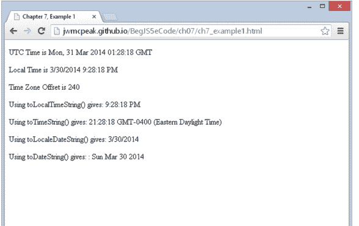

图7-1

在脚本块的其余部分，你从各种时间和日期函数中获取结果。结果存储在变量`html`中，然后显示在页面中。

在下面这一行中，你将`toUTCString()`方法返回的字符串存储在`html`变量中：

```
var html = "<p>UTC Time is " + localTime.toUTCString() + "</p>";
```

这将`localTime` `Date`对象中存储的日期和时间转换为等效的协调世界时日期和时间。

然后下面这一行存储一个包含本地日期和时间值的字符串：

```
html += "<p>Local Time is " + localTime.toLocaleString() + "</p>";
```

因为这个时间只是基于用户的时钟，所以此方法返回的字符串也会根据夏令时进行调整（只要时钟进行了调整）。

接下来，这段代码存储一个包含本地时区时间与协调世界时之间分钟差的字符串：

```
html += "<p>Time Zone Offset is " + localTime.getTimezoneOffset() + "</p>";
```

你可能在图7-1中注意到，纽约时间与协调世界时之间的差被写为240分钟，或4小时。然而，在前面的表格中，你看到纽约时间落后协调世界时5小时。那么这是怎么回事呢？

嗯，3月30日在纽约，使用的是夏令时。而在夏季，当协调世界时是0:00时，纽约时间是晚上8:00；而在冬季，当协调世界时是0:00时，纽约时间是晚上7:00。因此，在夏季，`getTimezoneOffset()`方法返回240，而在冬季，`getTimezoneOffset()`方法返回300。


为了说明这一点，请将图7-1与图7-2进行比较，其中计算机时钟的日期已调整到十二月，这是未实行夏令时的冬季。

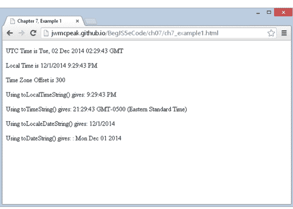

**图7-2**

接下来的两个方法是 `toLocalTimeString()` 和 `toTimeString()`，如下所示：

```
html += "<p>Using toLocalTimeString() gives: " +
    localTime.toLocaleTimeString() + "</p>";

html += "<p>Using toTimeString() gives: " +
    localTime.toTimeString() + "</p>";
```

这些方法仅显示 `Date` 对象中保存的日期和时间的时间部分。`toLocaleTimeString()` 方法按照用户计算机上的指定显示时间。第二个方法显示时间，但也提供时区信息（在本例中，EST代表美国东部标准时间）。

最后两个方法显示日期和时间的日期部分。`toLocaleDateString()` 按照用户在其计算机上指定的格式显示日期。在Windows操作系统上，这是在控制面板的区域设置中设置的。然而，因为它依赖于用户的PC设置，日期的外观因计算机而异。`toDateString()` 方法以标准格式显示PC日期中包含的当前日期。

当然，这个例子依赖于用户时钟设置正确这一事实，这不是你能百分之百确定的事情——令人惊讶的是，有多少用户的本地时区设置是完全错误的。

## 设置和获取Date对象的UTC日期和时间

当你创建一个新的 `Date` 对象时，你可以用一个值初始化它，或者让JavaScript将其设置为当前日期和时间。无论哪种方式，JavaScript都假定你正在设置 *本地* 时间值。如果你想指定UTC时间，你需要使用 `setUTC` 类型的方法，例如 `setUTCHours()`。

以下是用于设置UTC日期和时间的七个方法：

- `setUTCDate()`
- `setUTCFullYear()`
- `setUTCHours()`
- `setUTCMilliseconds()`
- `setUTCMinutes()`
- `setUTCMonth()`
- `setUTCSeconds()`

这些方法的名称基本上准确地说明了每个方法的作用，所以我们直接进入一个简单的例子，设置UTC时间。

### 动手实践：使用UTC日期和时间

让我们看一个快速的例子。打开你的文本编辑器，输入以下内容：

```
<!DOCTYPE html>
<html lang="en">
<head>
    <title>Chapter 7, Example 2</title>
</head>
<body>
    <script>
        var myDate = new Date();
        myDate.setUTCHours(12);
        myDate.setUTCMinutes(0);
        myDate.setUTCSeconds(0);

        var html = "<p>" +  myDate.toUTCString() + "</p>";
        html += "<p>" +  myDate.toLocaleString() + "</p>";

        document.write(html);
    </script>
</body>
</html>
```

将其保存为 `ch7_example2.html`。当你在浏览器中加载它时，你应该会在网页中看到类似图7-3所示的内容，尽管实际日期将取决于当前日期和你所在的地理位置。

你可能想更改计算机的时区和一年中的时间，以查看它在不同地区和夏令时变化下的差异。在Windows中，你可以通过打开控制面板，然后双击日期/时间图标来进行更改。

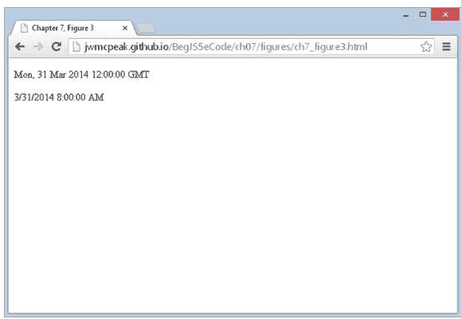

**图7-3**

那么这个例子是如何工作的呢？你声明一个变量 `myDate`，并将其设置为一个新的 `Date` 对象。由于你没有用任何值初始化 `Date` 对象，它包含本地的当前日期和时间。

然后，使用 `setUTC` 方法，你设置小时、分钟和秒，使时间成为UTC时间 12:00:00（中午，而非午夜）。

现在，当你将 `myDate` 的值写为UTC字符串时，你会得到 12:00:00 和今天的日期。当你将 `Date` 对象的值写为本地字符串时，你会得到今天的日期和UTC时间 12:00:00 转换为等效本地时间的时间。你看到的本地值当然取决于你的时区。例如，纽约人在夏季会看到08:00:00，在冬季会看到07:00:00，这是由于夏令时的原因。在英国，冬季你会看到12:00:00，但夏季你会看到13:00:00。

对于获取UTC日期和时间，你拥有与设置UTC日期和时间相同的功能，只是这次，例如，它是 `getUTCHours()`，而不是 `setUTCHours()`：

- `getUTCDate()`
- `getUTCDay()`
- `getUTCFullYear()`
- `getUTCHours()`
- `getUTCMilliseconds()`
- `getUTCMinutes()`
- `getUTCMonth()`
- `getUTCSeconds()`
- `toISOString()`

注意这次你有两个额外的方法：`getUTCDay()` 和 `toISOString()`。`getUTCDay()` 方法的工作方式与 `getDay()` 方法相同，以数字形式返回星期几，从星期日（0）到星期六（6）。因为星期几是由日期、月份和年份决定的，所以没有 `setUTCDay()` 方法。

`toISOString()` 方法在JavaScript中相对较新，它以ISO格式的字符串返回日期和时间。格式如下：

```
YYYY-MM-DDTHH:mm:ss.sssZ
```

ISO格式用字面字符 `T` 将日期与时间分开。因此 `YYYY-MM-DD` 是日期，`HH:mm:ss.sss` 是时间。末尾的 `Z` 表示UTC时区。2014年3月30日下午3:10 UTC的ISO格式字符串是：

```
2014-03-30T15:10:00Z
```

当你在第11章学习表单时，你将重新研究日期和时间以构建时间转换器。

## 网页中的计时器

你可以创建两种类型的计时器：一次性计时器和持续触发的计时器。一次性计时器在一段时间后仅触发一次，而第二种类型的计时器以设定的间隔持续触发。你将在接下来的两节中研究这两种类型的计时器。

在合理范围内，你可以拥有任意数量的计时器，并且可以在代码中的任何点启动它们，例如当用户点击按钮时。计时器的常见用途包括动画元素、创建定期变化的广告横幅图片以及在网页中显示变化的时间。

### 一次性计时器

设置一次性计时器非常简单；你只需使用 `setTimeout()` 函数：

```
var timerId = setTimeout(yourFunction, millisecondsDelay)
```

`setTimeout()` 方法接受两个参数。第一个是你想要执行的函数，第二个是延迟时间，以毫秒（秒的千分之一）为单位，直到代码执行。

该方法返回一个值（一个整数），即计时器的唯一ID。如果你后来决定要停止计时器触发，你可以使用此ID告诉JavaScript你指的是哪个计时器。

### 动手实践：延迟消息

在这个例子中，你设置了一个计时器，该计时器在页面加载三秒后触发：

```
<!DOCTYPE html>
<html lang="en">
<head>
    <title>Chapter 7, Example 3</title>
</head>
<body>
<script>
    function doThisLater() {
        alert("Time's up!");
    }

    setTimeout(doThisLater, 3000);
</script>
</body>
</html>
```

将此文件保存为 `ch7_example3.html`，并在浏览器中加载它。

此页面在浏览器执行页面主体中的JavaScript代码三秒后显示一个消息框。让我们从 `doThisLater()` 函数开始查看该代码：

```
function doThisLater() {
    alert("Time's up!");
}
```

此函数被调用时，简单地在警报框中显示一条消息。你通过使用 `setTimeout()` 延迟调用此函数：

```
setTimeout(doThisLater, 3000);
```

注意 `doThisLater` 是如何传递给 `setTimeout()` 的——省略了括号。你不想在这里调用 `doThisLater()`；你只是想引用函数对象。

第二个参数告诉JavaScript在3,000毫秒或3秒后执行 `doThisLater()`。

> 需要注意的是，设置计时器不会阻止脚本继续执行。计时器在后台运行，并在时间到时触发。与此同时，页面照常运行，在你启动计时器倒计时之后的任何脚本都会立即运行。因此，在这个例子中，告诉你计时器已设置的警报框在设置计时器的代码执行后立即出现。

如果你决定要在计时器触发之前停止它怎么办？

要清除计时器，你使用 `clearTimeout()` 函数。它只接受一个参数：`setTimeout()` 函数返回的唯一计时器ID。

### 动手实践：停止计时器

在这个例子中，你将修改前面的例子，并提供一个你可以点击以停止计时器的按钮：

```
<!DOCTYPE html>
<html lang="en">
```


## 第7章，示例4

```html
<head>
    <title>Chapter 7, Example 4</title>
</head>
<body>
    <script>
        function doThisLater() {
            alert("Time's up!");
        }

        var timerId = setTimeout(doThisLater, 3000);

        clearTimeout(timerId);
    </script>
</body>
</html>
```

将以上代码保存为 `ch7_example4.html` 并在浏览器中加载。你不会看到显示 `Time's up!` 消息的 `alert` 框，因为你在超时之前调用了 `clearTimeout()` 并传递了计时器ID。

### 设置定期触发的计时器

`setInterval()` 和 `clearInterval()` 函数的工作方式与 `setTimeout()` 和 `clearTimeout()` 类似，不同之处在于计时器是定期连续触发，而不是只触发一次。

`setInterval()` 函数接受与 `setTimeout()` 相同的参数，不同的是第二个参数现在指定了每次触发之间的时间间隔（以毫秒为单位），而不仅仅是计时器触发前的延迟时间。

例如，要设置一个每五秒触发函数 `myFunction()` 的计时器，代码如下：

```javascript
var myTimerID = setInterval(myFunction, 5000);
```

与 `setTimeout()` 一样，`setInterval()` 方法会返回一个唯一的计时器ID，如果你需要用 `clearInterval()` 清除计时器，就需要使用这个ID。`clearInterval()` 的工作方式与 `clearTimeout()` 完全相同。因此，要停止前面代码启动的计时器，你应该使用以下代码：

```javascript
clearInterval(myTimerID);
```

### 动手实践：一个计数时钟

在这个示例中，你将编写一个简单的页面来显示当前日期和时间。这没什么特别的，所以你还将让它每秒更新一次：

```html
<!DOCTYPE html>
<html lang="en">
<head>
    <title>Chapter 7, Example 5</title>
</head>
<body>
    <div id="output"></div>
    <script>
        function updateTime() {
            document.getElementById("output").innerHTML = new Date();
        }

        setInterval(updateTime, 1000);
    </script>
</body>
</html>
```

将此文件保存为 `ch7_example5.html`，并在浏览器中加载。

这个页面的主体中有一个 `<div />` 元素，其 `id` 属性值为 `output`：

```html
<div id="output"></div>
```

更新后的日期和时间将显示在此元素内，此元素的内容由 `updateTime()` 函数更新：

```javascript
function updateTime() {
    document.getElementById("output").innerText = new Date();
}
```

此函数使用 `document.getElementById()` 方法检索上述 `<div/>` 元素，并使用 `innerText` 属性将元素的文本设置为新的 `Date` 对象。在浏览器中显示时，JavaScript 会将 `Date` 对象转换为包含日期和时间的人类可读字符串。

要更改日期和时间，你需要使用 `setInterval()` 函数，传递对 `updateTime()` 函数的引用，并设置为每秒（1,000毫秒）执行一次。这反过来会更改 `<div/>` 元素内的文本，从而每秒显示当前日期和时间。

这个示例的讲解到此结束，同时也完成了对计时器的介绍。你将在后面的章节中使用 `setInterval()` 和 `clearInterval()` 函数。

## 总结

本章开始时，我们了解了协调世界时（UTC），这是一个国际标准时间。然后我们学习了如何在网页中创建计时器。

具体涵盖的要点如下：

- `Date` 对象使你能够以类似于设置 `Date` 对象本地时间的方式设置和获取UTC时间，使用诸如 `setUTCHours()` 和 `getUTCHours()` 之类的方法来设置和获取UTC小时，类似的方法也适用于月份、年份、分钟、秒等。

- 在国际时间转换中，一个有用的工具是 `getTimezoneOffset()` 方法，它返回用户本地时间与UTC之间的分钟差值。这里的一个陷阱是，你假设用户在计算机上正确设置了其时区。如果没有，`getTimezoneOffset()` 将变得无用，如果用户的时钟设置不正确，任何本地日期和时间方法也将无效。

- 使用 `setTimeout()` 方法，你发现你可以启动一个在特定毫秒数后只触发一次的计时器。`setTimeout()` 接受两个参数：第一个是你想要执行的函数，第二个是执行该代码之前的延迟时间。它返回一个值，即唯一的计时器ID，如果你以后想引用该计时器，例如在它触发之前停止它，可以使用 `clearTimeout()` 方法。

- 要创建一个定期触发的计时器，你使用了 `setInterval()` 方法，它的工作方式与 `setTimeout()` 相同，不同之处在于它会持续触发，除非用户离开页面或你调用 `clearInterval()` 方法。

在下一章中，你将把注意力转向Web浏览器本身，特别是它为你的JavaScript编程提供的各种对象。你将看到，使用浏览器对象是创建强大网页的关键。

## 练习

你可以在附录A中找到这些问题的参考答案。

1.  创建一个页面获取用户的出生日期。然后，利用这些信息告诉她她出生是星期几。
2.  创建一个类似于“动手实践：一个计数时钟”中示例5的网页，但让它只显示小时、分钟和秒。

---

# 第8章

## 编程浏览器

**本章你将学到什么：**

- 使用浏览器的原生 `window` 对象
- 将浏览器导航到一个URL
- 页面加载后操作图像
- 检索浏览器的当前位置
- 检测用户的浏览器

## Wrox.com 本章代码下载

你可以在 `http://www.wiley.com/go/BeginningJavaScript5E` 的“下载代码”选项卡上找到本章的wrox.com代码下载。你也可以在 `http://beginningjs.com` 查看所有示例和相关文件。

在过去的几章中，你已经研究了核心JavaScript语言。你已经学会了如何处理变量和数据，对这些数据执行操作，在代码中做出决策，重复循环代码的同一部分，甚至如何编写自己的函数。你继续学习JavaScript是一种基于对象的语言，并且你已经学会了如何使用原生的JavaScript对象。然而，你不仅仅对语言本身感兴趣；你还想了解如何为Web浏览器编写脚本。利用这种能力，你可以开始创建更令人印象深刻的网页。

JavaScript不仅是基于对象的，浏览器也是由对象组成的。当JavaScript在浏览器中运行时，你可以以与使用JavaScript原生对象完全相同的方式访问浏览器的对象。但浏览器提供了哪些类型的对象呢？

浏览器提供了大量的对象。例如，有一个与浏览器窗口对应的 `window` 对象。你已经使用了这个对象的两个方法，即 `alert()` 和 `prompt()` 方法。为了简单起见，我们之前称它们为函数，但它们实际上是浏览器 `window` 对象的方法。

浏览器提供的另一个对象是页面本身，由 `document` 对象表示。同样，你已经使用过这个对象的方法和属性。回顾前面的章节，你使用了 `document` 对象的 `write()` 方法将信息写入页面。

还存在各种其他对象，代表你在页面中编写的HTML。例如，对于每个用于将图像插入文档的 `` 元素，都有一个 `img` 对象。

浏览器提供给你与JavaScript一起使用的对象集合通常被称为*浏览器对象模型*（BOM）。

> **注意** *你经常会看到它被称为文档对象模型（DOM）；这样做是不正确的。在本书中，我们将使用术语DOM来指代W3C的标准文档对象模型，这将在下一章中讨论。*

JavaScript所有这些附加功能都有一个潜在的缺点：没有标准的BOM实现（尽管HTML5规范正在尝试一些）。哪些对象集合可供你使用高度依赖于你正在使用的浏览器的品牌和版本。某些对象在某些浏览器中可用而在其他浏览器中不可用，而其他对象在不同的浏览器中具有不同的属性和方法。好消息是，浏览器制造商通常不会改变其浏览器的BOM，因为这样做会破坏互操作性。这意味着如果你坚持使用BOM的核心功能（所有浏览器中的通用对象），你的代码更有可能在不同的浏览器和版本之间工作。本章的重点是BOM的核心功能。通过坚持使用核心功能，你可以用JavaScript实现很多功能。

## 浏览器对象简介

本节介绍所有浏览器通用的BOM对象。

在第5章中，你看到JavaScript有许多你可以访问和使用的原生对象。大多数对象是你需要自己创建的对象，例如 `String` 和 `Date` 对象。其他对象，如 `Math` 对象，无需你创建就存在，并且在页面开始加载时即可立即使用。

当JavaScript在网页中运行时，它可以访问Web浏览器提供的大量其他对象。与 `Math` 对象一样，这些对象是为你创建的，而不需要你显式创建。如前所述，这些对象、它们的方法、属性和事件都在BOM中详细说明。

BOM非常庞大，一开始可能让人不知所措。然而，你将发现最初你不会使用BOM中超过10%的可用对象、方法和属性。


### 第八章 浏览器对象模型（BOM）

本章将从更常用的BOM部分开始，如图8-1所示。这些BOM部分在所有浏览器中在一定程度上是通用的。后续章节将在此基础上进一步讲解，以便在本书结束时，你能够真正让BOM为你所用。

BOM具有一个层次结构。这个层次结构的最顶层是 `window` 对象。你可以将其视为浏览器的框架及其所有关联内容，例如滚动条、导航栏图标等。

在 `window` 框架内部是页面。页面在BOM中由 `document` 对象表示。你可以在图8-2中看到这两个对象的表示。

现在让我们更详细地查看这些对象中的每一个。

#### window 对象

`window` 对象代表浏览器的框架或窗口，你的网页就包含在其中。在某种程度上，它也代表浏览器本身，并包含许多属性，仅仅因为它们不适合放在其他任何地方。例如，通过 `window` 对象的属性，你可以找出正在运行的浏览器、用户访问过的页面、浏览器窗口的大小、用户屏幕的大小等等。你还可以使用 `window` 对象来访问和更改浏览器状态栏中的文本、更改加载的页面，甚至打开新窗口。

`window` 对象是一个全局对象，这意味着你不需要使用它的名称来访问其属性和方法。事实上，全局函数和变量（那些你可以在页面任何地方编写的脚本中访问的）都是作为全局对象的属性创建的。例如，从本书开始你一直在使用的 `alert()` 函数，实际上就是 `window` 对象的 `alert()` 方法。虽然你一直简单地这样使用它：

```javascript
alert("Hello!");
```

你也可以这样写，结果完全相同：

```javascript
window.alert("Hello!");
```

然而，因为 `window` 对象是全局对象，所以使用第一种版本是完全正确的。`window` 对象的一些属性本身也是对象。那些在所有浏览器中通用的包括 `document`、`navigator`、`history`、`screen` 和 `location` 对象。`document` 对象代表你的页面，`history` 对象包含用户访问过的页面历史，`navigator` 对象保存有关浏览器的信息，`screen` 对象包含有关客户端显示能力的信息，`location` 对象包含有关当前页面位置的详细信息。你将在本章后面单独查看这些重要的对象。

此时值得强调的是，在网页中，你不应该为你的函数或变量使用与BOM对象或其属性和方法的名称冲突的名称。如果你这样做了，可能不会得到错误，而是得到意外的结果。例如，以下代码声明了一个名为 `history` 的变量，并尝试使用 `window` 对象的 `history` 属性返回上一页。然而，这将无法工作，因为 `history` 已被更改为保存不同的值：

```javascript
var history = "Hello, BOM!";
window.history.back(); // 错误；字符串对象没有 back() 方法
```

在这种情况下，你需要使用不同的变量名。这之所以会发生，是因为你在全局作用域内定义的任何函数或变量实际上都会附加到 `window` 对象上。请看以下代码作为示例：

```javascript
var myVariable = "Hello, World!";
alert(window.myVariable);
```

如果你在浏览器中执行此代码，警报窗口将显示消息“Hello, World.”

与所有BOM对象一样，你可以查看 `window` 对象的许多属性和方法。然而，在本章中，你将专注于 `history`、`location`、`navigator`、`screen` 和 `document` 属性。所有这五个属性都包含对象（`history`、`location`、`navigator`、`screen` 和 `document` 对象），每个对象都有自己的属性和方法。在接下来的几页中，你将依次查看这些对象，并了解它们如何帮助你充分利用BOM。

#### history 对象

`history` 对象跟踪用户访问的每个页面。这个页面列表通常被称为浏览器的 `history stack`。它允许用户点击浏览器的“后退”和“前进”按钮来重新访问页面。你可以通过 `window` 对象的 `history` 属性访问此对象。与原生的 JavaScript `Array` 类型类似，`history` 对象有一个 `length` 属性。你可以用它来找出历史堆栈中有多少页面。正如你可能预期的那样，`history` 对象有 `back()` 和 `forward()` 方法。当它们被调用时，浏览器中当前加载的页面位置会更改为用户访问过的上一页或下一页。

`history` 对象还有 `go()` 方法。它接受一个参数，指定你想在历史堆栈中向前或向后移动多少步。例如，如果你想让用户返回到上一页之前的页面，你可以这样写：

```javascript
history.go(-2);
```

要前进三页，你可以这样写：

```javascript
history.go(3);
```

请注意，`go(-1)` 和 `back()` 是等效的，`go(1)` 和 `forward()` 也是等效的。

#### location 对象

`location` 对象包含许多关于当前页面位置的有用信息。它不仅包含页面的统一资源定位符（URL），还包含托管页面的服务器、服务器连接的端口号以及使用的协议。这些信息通过 `location` 对象的 `href`、`hostname`、`port` 和 `protocol` 属性提供。然而，许多这些值仅在从服务器加载页面时才真正相关，而不是像当前示例中那样，直接从本地硬盘加载页面。

除了检索当前页面的位置之外，你还可以使用 `location` 对象的方法来更改位置和刷新当前页面。

你可以通过两种方式导航到另一个页面。你可以将 `location` 对象的 `href` 属性设置为指向另一个页面，或者你可以使用 `location` 对象的 `replace()` 方法。两者的效果相同；页面都会更改位置。然而，它们的不同之处在于，`replace()` 方法会将当前页面从历史堆栈中移除，并用你要移动到的新页面替换它，而使用 `href` 属性则只是将新页面添加到历史堆栈的顶部。这意味着如果使用了 `replace()` 方法，并且用户点击浏览器中的“后退”按钮，用户将无法返回到原始加载的页面。如果使用了 `href` 属性，用户可以像往常一样使用“后退”按钮。

例如，要将当前页面替换为一个名为 `myPage.html` 的新页面，你应该使用 `replace()` 方法并编写以下代码：

```javascript
location.replace("myPage.html");
```

这会加载 `myPage.html`，并将历史堆栈中当前页面的任何出现替换为 `myPage.html`。

要加载相同的页面并将其添加到已导航页面的历史记录中，请使用 `href` 属性：

```javascript
location.href = "myPage.html";
```

这会将当前加载的页面添加到历史记录中。在前面的两种情况中，表达式前都有 `window`，但由于 `window` 对象在整个页面中是全局的，你也可以这样写：

```javascript
location.replace("myPage.html");
location.href = "myPage.html";
```

#### navigator 对象

`navigator` 对象是 `window` 的另一个属性，在所有浏览器中都可用。它的名字更具历史性而非描述性。也许一个更好的名字是“浏览器对象”，因为 `navigator` 对象包含大量关于浏览器及其运行操作系统的信息。

从历史上看，`navigator` 对象最常见的用途是处理浏览器差异。使用其属性，你可以找出用户使用的是哪个浏览器、版本和操作系统。然后你可以根据这些信息采取行动，并确保你的代码仅在支持它的浏览器中工作。这被称为 *浏览器嗅探（browser sniffing）*，尽管它有其用途，但也有局限性。

一个更好的替代浏览器嗅探的方法是 *功能检测（feature detection）*，即确定浏览器是否支持特定功能的行为。我们在此不深入讨论这些主题；本章后面的章节将专门讲解浏览器嗅探和功能检测。

#### geolocation 对象

HTML5规范为 `navigator` 添加了 `geolocation` 属性。其目的很简单：使开发者能够获取和使用设备或计算机的位置。这听起来可能有点吓人，但用户必须允许检索和使用该信息。

`geolocation` 对象的核心是其 `getCurrentPosition()` 方法。当你调用此方法时，必须传递一个 *回调函数（callback function）*，这是一个在 `getCurrentPosition()` 成功完成其工作后执行的函数。在第四章中，你了解到函数是值。你可以将它们赋值给变量，并将它们传递给其他函数，后者正是你使用 `getCurrentPosition()` 方法的方式。例如：

```javascript
function success(position) {
    alert("I have you now!");
}

navigator.geolocation.getCurrentPosition(success);
```

在此代码中，`success()` 是在 `navigator.geolocation.getCurrentPosition()` 确定计算机或设备位置时执行的回调函数。参数 `position` 是一个包含计算机或设备的地球位置和海拔高度的对象，你可以通过其 `coords` 属性检索这些信息，如下所示：

```javascript
function success(position) {
    var latitude = position.coords.latitude;
    var longitude = position.coords.longitude;
    var altitude = position.coords.altitude;
    var speed = position.coords.speed;
}
```

`latitude`、`longitude` 和 `altitude` 属性不言自明；它们只是分别代表设备或计算机的纬度、经度和海拔高度的数值。`speed` 属性检索设备/计算机的速度，或者更准确地说是速率，单位是米/秒。


如果你需要获取多个这样的值，将 `position.coords` 赋值给一个变量，然后使用该变量来获取位置值，这样会更合理。例如：

```
function success(position) {
    var crds = position.coords;

    var latitude = crds.latitude;
    var longitude = crds.longitude;
    var altitude = crds.altitude;
    var speed = crds.speed;
}
```

这减少了你需要编写的代码量。它的另一个优点是减小了代码的体积，从而略微加快了下载时间。

`getCurrentPosition()` 方法接受第二个参数，这是另一个在发生错误时执行的回调函数：

```
function geoError(errorObj) {
    alert("Uh oh, something went wrong");
}

navigator.geolocation.getCurrentPosition(success, geoError);
```

这个错误回调函数有一个参数，它表示 `getCurrentPosition()` 失败的原因。它是一个包含两个属性的对象。第一个属性 `code` 是一个数值，表示失败的原因。下表列出了可能的值及其含义：

| 值 | 描述 |
|---|---|
| 1 | 失败是因为页面没有权限获取设备/计算机的位置。 |
| 2 | 发生了内部错误。 |
| 3 | 在获取设备/计算机的位置之前，已达到允许检索位置的时间限制。 |

第二个属性是 `message`；这是一个可读的消息，用于描述错误。

#### 动手试试 使用地理定位

在这个示例中，你将使用 `geolocation` 对象来检索设备/计算机的纬度和经度：

```
<!DOCTYPE html>

<html lang="en">
<head>
    <title>Chapter 8, Example 1</title>
</head>
    <body>
        <script>
            function geoSuccess(position) {
                var coords = position.coords;
                var latitude = coords.latitude;
                var longitude = coords.longitude;

                var message = "You're at " + latitude + ", " + longitude

                alert(message);
            }

            function geoError(errorObj) {
                alert(errorObj.message);
            }

            navigator.geolocation.getCurrentPosition(geoSuccess, geoError);
        </script>
    </body>
</html>
```

将该页面保存为 ch8_example1.html，并在你的浏览器中加载它。

该页面需要用户的同意才能获取其地理位置。因此，你首先会看到一个提示，要求你允许或拒绝该页面检索该信息。每个浏览器显示此请求的方式都不同；图 8-3 是 Chrome 的请求。

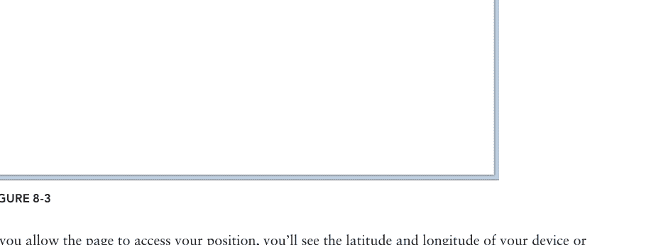

> 图 8-3

如果你允许该页面访问你的位置，你将看到一个警报框，显示你的设备或计算机的纬度和经度。如果你选择拒绝访问，你将看到类似图 8-4 所示的消息。

此页面中的两个函数负责上述行为。第一个函数 `geoSuccess()` 是当浏览器成功检索到你的设备/计算机位置时执行的回调函数：

```
function geoSuccess(position) {
    var coords = position.coords;
    var latitude = coords.latitude;
    var longitude = coords.longitude;
```

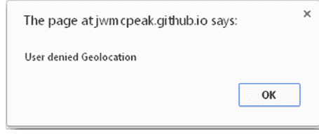

此函数中的第一条语句将 `position.coords` 存储在 `coords` 变量中，以便用更少的击键次数访问位置信息。第二条和第三条语句分别检索纬度和经度。

既然你有了纬度和经度，你可以组装一条包含此信息的消息并将其显示给用户：

```
var message = "You're at " + latitude + ", " + longitude
alert(message);
}
```

如果你拒绝该页面访问你的位置，或者浏览器无法获取你的位置，则 `geoError()` 回调函数将执行：

```
function geoError(errorObj) {
    alert(errorObj.message);
}
```

这个简单的函数只是使用错误对象的 `message` 属性来告诉用户为什么 `getCurrentPosition()` 失败了。

#### screen 对象

`window` 对象的 `screen` 对象属性包含有关客户端机器显示能力的很多信息。其属性包括 `height` 和 `width` 属性，它们分别以像素为单位指示屏幕的垂直和水平范围。

`screen` 对象的另一个属性，你稍后会在示例中用到的是 `colorDepth` 属性。它告诉你客户端屏幕上用于颜色的位数。

#### document 对象

与 `window` 对象一起，`document` 对象可能是 BOM 中最重要和最常用的对象之一。通过这个对象，你可以访问页面内的 HTML 元素、它们的属性和方法。

本章集中介绍所有浏览器通用的基本属性和方法。对 `document` 对象更高级的操作将在第 9 章中介绍。

document 对象有许多与之关联的属性，这些属性也是类似数组的结构，称为集合。主要的集合有 forms、images 和 links 集合。Internet Explorer 支持许多其他集合属性，例如 all 集合属性，它是页面中所有由对象表示的元素的数组。然而，你将专注于使用具有标准跨浏览器支持的对象，这样你就不会将你的网页限制在仅一种浏览器上。

你稍后会查看 images 和 links 集合。第三个集合，forms 集合，是你在第 11 章查看 web 浏览器中的表单时的主题之一。不过，首先，我们来看一个使用 document 对象方法和属性的简单示例。

#### 使用 document 对象

你已经遇到过一些 document 对象的属性和方法——例如，write() 方法和 bgColor 属性。

> 动手试试 根据用户的屏幕色深设置颜色

在此示例中，你将根据用户屏幕支持的颜色数量来设置页面的背景颜色。这被称为屏幕色深。如果用户的显示器只支持两种颜色（黑白），那么你将背景设置为亮红色是没有意义的。你通过使用 JavaScript 设置用户实际能看到的颜色来适应不同的色深。

```
<!DOCTYPE html>
<html lang="en">
<head>
    <title>Chapter 8, Example 2</title>
</head>
    <body>
        <script>
            var colorDepth = window.screen.colorDepth;

            switch (colorDepth) {
                case 1:
                case 4:
                    document.bgColor = "white";
                    break;
                case 8:
                case 15:
                case 16:
                    document.bgColor = "blue";
                    break;
                case 24:
                case 32:
                    document.bgColor = "skyblue";
                    break;
                default:
                    document.bgColor = "white";
            }
        
            document.write("Your screen supports " + colorDepth +
                               "bit color");
        </script>
    </body>
</html>
```

将该页面保存为 ch8_example2.html。当你在浏览器中加载它时，页面的背景颜色将由你当前的屏幕色深决定。同时，页面上的一条消息会告诉你当前的色深是多少。

你可以通过更改屏幕支持的颜色数量来测试代码是否正常工作。通过刷新浏览器，你可以看到这对页面颜色有什么影响。

> 注意 在 Firefox、Safari 和 Chrome 浏览器中，需要关闭并重新启动浏览器才能观察到任何效果。

正如你之前所看到的，window 对象有 screen 对象属性。该对象的属性之一是 colorDepth 属性，它返回 1、4、8、15、16、24 或 32 的值。这代表分配给屏幕上每个像素的位数。（像素只是构成屏幕的许多点中的一个。）要计算你有多少种颜色，你只需计算 2 的 colorDepth 属性次幂的值。例如，colorDepth 为 1 意味着有两种颜色可用，colorDepth 为 8 意味着有 256 种颜色可用，以此类推。目前，大多数人的屏幕色深至少为 8，但通常是 24 或 32。

脚本块的第一个任务是根据用户实际能看到的颜色数量来设置页面的背景颜色。你在一个大的 switch 语句中完成此操作。在 switch 语句中检查的条件是 colorDepth 变量的值，该值被设置为 window.screen.colorDepth：

```
var colorDepth = window.screen.colorDepth;

switch (colorDepth) {
```

你不需要为每种可能的 colorDepth 设置不同的颜色，因为对于一般的 web 用途来说，其中许多是相似的。相反，你为不同的但相似的 colorDepth 值设置相同的背景颜色。对于 colorDepth 为 1 或 4，你将背景设置为白色。你通过声明 case 1: 语句来实现这一点，但不给它任何代码。如果 colorDepth 匹配这个 case 语句，它将落入（fall through）下面的 case 4: 语句，在那里你确实将背景颜色设置为白色。然后你调用 break 语句，这样 case 匹配就不会进一步落入 switch 语句：

```
case 1:
case 4:
    document.bgColor = "white";
    break;
```


对于`colorDepth`值为8、15和16的情况，你也进行同样的操作，将背景颜色设置为蓝色，如下所示：

```javascript
case 8:
case 15:
case 16:
    document.bgColor = "blue";
    break;
```

最后，对于`colorDepth`值为24和32的情况，你也进行同样的操作，将背景颜色设置为天蓝色：

```javascript
case 24:
case 32:
    document.bgColor = "skyblue";
    break;
```

你用一个`default`情况结束`switch`语句，以防其他`case`语句都不匹配。在这个默认情况下，你再次将背景颜色设置为白色：

```javascript
default:
    document.bgColor = "white";
}
```

在接下来的脚本中，你使用了`document`对象的`write()`方法，这是你在这些示例中已经使用了一段时间的方法。你用它来向文档——即页面——写入当前颜色深度设置的位数，如下所示：

```javascript
document.write("Your screen supports " + colorDepth + "bit color")
```

你已经在本书的示例中使用过`document`对象。你在第1章中使用了它的`bgColor`属性来更改页面的背景颜色，并且在示例中你也充分利用了它的`write()`方法将HTML和文本输出到页面。

现在让我们来看一下`document`对象的一些稍微复杂一些的属性。这些属性的共同点是它们都包含集合。你要看的第一个集合是包含页面中每个图像对象的集合。

#### images 集合

如你所知，你可以使用以下标签将图像插入HTML页面：

```html

```

浏览器会为此图像创建一个名为`myImage`的`img`对象，以便你可以用JavaScript对其进行操作。事实上，你页面上的每个图像都有一个为其创建的`img`对象。

页面中的每个`img`对象都存储在`images`集合中，这是`document`对象的一个属性。你像使用数组一样使用它和其他集合。页面上的第一个图像位于`document.images[0]`，第二个位于`document.images[1]`，依此类推。

如果愿意，你可以将一个变量赋值为引用`images`集合中的一个`img`对象。这可以使代码更易于输入和阅读。例如，以下代码将索引位置1处的`img`对象的引用赋值给`myImage2`变量：

```javascript
var myImage2 = document.images[1];
```

现在你可以在代码中使用`myImage2`来代替`document.images[1]`，效果完全相同。

因为`document.images`属性是一个集合，所以它具有与原生JavaScript数组类型类似的属性，例如`length`属性。例如，如果你想知道页面上有多少张图像，代码`document.images.length`会告诉你。

##### 动手试试：图像选择

`img`对象本身有许多有用的属性。其中最重要的是它的`src`属性。通过更改此属性，你可以更改加载的图像。此示例演示了这一点：

```html
<!DOCTYPE html>
<html lang="en">
<head>
    <title>Chapter 8, Example 3</title>
</head>
<body>

<script>
var myImages = [
    "usa.gif",
    "canada.gif",
    "jamaica.gif",
    "mexico.gif"
];

var imgIndex = prompt("Enter a number from 0 to 3", "");

document.images[0].src = myImages[imgIndex];
</script>
</body>
</html>
```

将其保存为`ch8_example3.html`。你还需要四个名为`usa.gif`、`canada.gif`、`jamaica.gif`和`mexico.gif`的图像文件。你可以自己创建这些图像，或者使用本书代码下载中提供的图像。

当此页面加载到浏览器中时，一个提示框会要求你输入一个0到3之间的数字。根据你输入的数字，将显示不同的图像。

页面顶部是你的HTML ``元素。注意`src`属性是空的：

```html

```

接下来，你进入脚本块，在这里决定要显示的图像。在第一行，你定义了一个包含图像源列表的数组。在此示例中，图像与HTML文件位于同一目录中，因此未指定路径。如果你的图像不在同一目录，请确保输入完整路径（例如，`C:\myImages\mexico.gif`）。

然后，你要求用户输入一个0到3之间的数字，该数字将用作数组索引，以访问`myImages`数组中的图像源：

```javascript
var imgIndex = prompt("Enter a number from 0 to 3","");
```

最后，你将`img`对象的`src`属性设置为`myImages`数组中索引号由用户提供的元素内的源文本：

```javascript
document.images[0].src = myImages[imgIndex];
```

别忘了，当你写`document.images[0]`时，你正在访问存储在`images`集合中的`img`对象。它的索引位置是0，因为它是此页面上的第一个（也是唯一的）图像。

#### links 集合

对于用`href`属性定义的每个超链接元素`<a/>`，浏览器会创建一个`a`对象。`a`对象最重要的属性是`href`属性，对应于标签的`href`属性。使用它，你可以找出链接指向何处，甚至可以在页面加载后更改此链接。

页面中所有`a`对象的集合包含在`links`集合中，就像`img`对象包含在`images`集合中一样，正如你之前看到的。

## 确定用户的浏览器

互联网上存在许多浏览器、这些浏览器的版本以及操作系统，每个都有自己的BOM版本、自己的功能集和自己的特定怪癖。因此，确保你的页面在所有浏览器上都能正常工作，或者至少*优雅降级*（例如通过显示一条建议用户升级其浏览器的消息）非常重要。

你有两种方法来测试浏览器是否可以执行你的代码：*功能检测*和*浏览器嗅探*。它们有一个相似的最终目标（为给定的浏览器执行代码），但它们用于不同的目的。

### 功能检测

并非所有浏览器都支持相同的功能（尽管当今的现代浏览器做得非常好）。当我们说“功能”时，我们指的不是标签页浏览、下载管理器等。我们指的是我们作为JavaScript开发人员可以在代码中访问和使用的功能。

功能检测是确定浏览器是否支持给定功能的过程，它是浏览器检测的首选方法。它需要很少的维护，并用于在所有实现（或不实现）特定功能的浏览器上执行代码。

例如，所有现代浏览器都支持`navigator.geolocation`。你可以在页面中使用它，使用这些浏览器的访问者不会遇到任何问题。然而，使用Internet Explorer 8的访问者会遇到脚本错误，因为IE8不支持地理位置定位。

这是一个常见问题，因为即使是最新版本的浏览器也不总是支持相同的功能，但你可以通过功能检测来避免这类问题。模式很简单：检查功能是否存在，只有在存在时才使用它。因此，你只需要一个`if`语句，就像这样：

```javascript
if (navigator.geolocation) {
    // 使用地理位置定位
}
```

哇！等一下！这段代码使用`navigator.geolocation`作为`if`语句的条件！`if`语句不是应该对`true`或`false`值进行操作吗？是的，但JavaScript可以将任何值视为`true`或`false`。我们称这些为*真值*和*假值*。它们不是真正的布尔值，但当在条件语句中使用时，它们会评估为`true`和`false`。

以下是其工作原理；以下值是假值：

- 0
- ""（空字符串）
- null
- undefined
- []（空数组）
- false

几乎所有其他值都是真值。

在不支持地理位置定位的浏览器中，`navigator.geolocation`是`undefined`，因此是假值。

我们知道这可能会令人困惑，并且可能会给你的代码增加一些模糊性。因此，许多JavaScript开发人员喜欢避免使用真值/假值语句，并选择使用`typeof`运算符进行更清晰的比较，就像这样：

```javascript
if (typeof navigator.geolocation != "undefined") {
    // 使用地理位置定位
}
```

`typeof`运算符返回一个字符串，告诉你值或对象的类型。在此代码中，`typeof`运算符用于`navigator.geolocation`。在支持地理位置定位的浏览器中，类型是"object"；在不支持的浏览器中，它是"undefined"。

你可以在任何对象或值上使用`typeof`运算符。请参考下表了解`typeof`可能返回的值：

| 值 | typeof 结果 |
| :--- | :--- |
| 数组 (Array) | "object" |
| 布尔值 (Boolean) | "boolean" |
| 日期 (Date) | "object" |
| 函数 (Function) | "function" |
| 空值 (Null) | "object" |
| 数字 (Number) | "number" |
| 对象 (通用 Object) | "object" |
| 字符串 (String) | "string" |
| undefined | "undefined" |


| 语句 | 结果 |
| --- | --- |
| typeof 1 | number |
| typeof "hello" | string |
| typeof true | boolean |
| typeof [] (或任意数组) | object |
| typeof {} (或任意对象) | object |
| typeof undefined | undefined |
| typeof null | object |

### 动手实践 使用特性检测

在这个示例中，你将修改 `ch8_example1.html`，并确保该页面能在不支持地理定位的浏览器中正常工作。

```
<!DOCTYPE html>
<html lang="en">
<head>
    <title>Chapter 8, Example 4</title>
</head>
<body>
    <script>
        function geoSuccess(position) {
            var coords = position.coords;
            var latitude = coords.latitude;
            var longitude = coords.longitude;

            var message = "You're at " + latitude + ", " + longitude

            alert(message);
        }

        function geoError(errorObj) {
            alert(errorObj.message);
        }

        if (typeof navigator.geolocation != "undefined") {
            navigator.geolocation.getCurrentPosition(geoSuccess, geoError);
        } else {
            alert("This page uses geolocation, and your " +
                  "browser doesn't support it.");
        }
    </script>
</body>
</html>
```

将此示例保存为 `ch8_example4.html`。

这个示例的关键区别在于 JavaScript 代码底部的 `if ... else` 语句：

```
if (typeof navigator.geolocation != "undefined") {
    navigator.geolocation.getCurrentPosition(geoSuccess, geoError);
} else {
    alert("This page uses geolocation, and your " +
          "browser doesn't support it.");
}
```

在这里，你对 `navigator.geolocation` 使用 `typeof` 操作符来确定浏览器是否支持该特性。如果支持，则调用 `getCurrentPosition()` 方法。

如果浏览器不支持地理定位，代码会向用户显示一条消息，说明其浏览器不支持该必要特性。如果你在没有确保浏览器支持的情况下尝试使用地理定位，浏览器将会抛出错误。

特性检测非常有用，它使你能够根据浏览器支持或不支持的特性来区分浏览器。但浏览器制造商并非完美，他们有时会发布具有独特且怪异行为的浏览器版本。在这些情况下，你需要隔离单个浏览器，而特性检测很少能提供如此精细的控制。

### 浏览器嗅探

首先，让我们重申这一点：大多数情况下，你应该使用特性检测。浏览器嗅探有许多缺点，其中之一是一些不太常见的浏览器可能会将自己错误地标识为更常见的浏览器。另一个问题是，浏览器嗅探依赖于浏览器的 *user-agent 字符串*，这是一个标识浏览器的字符串，浏览器制造商可以在不同版本之间大幅更改 user-agent 字符串（你稍后会看到一个例子）。只有当你需要针对单个浏览器的特殊行为进行定位时，才应使用本节中的技术。

`navigator` 对象公开了两个对识别浏览器有用的属性：`appName` 和 `userAgent`。`appName` 属性返回浏览器的型号，例如 IE 的 "Microsoft Internet Explorer" 或 Firefox、Chrome 和 Safari 的 "Netscape"。

`userAgent` 属性返回一个包含各种信息的字符串，例如浏览器版本、操作系统和浏览器型号。但是，此属性返回的值因浏览器而异，因此在使用时必须非常非常小心。例如，浏览器的版本嵌入在字符串的不同位置。

### 动手实践 检查并处理不同的浏览器

在这个示例中，你将创建一个页面，使用上述属性来发现客户端的浏览器和浏览器版本。然后，页面可以根据客户端的规范采取相应的操作。

```
<!DOCTYPE html>
<html lang="en">
<head>
    <title>Chapter 8, Example 5</title>
</head>
<body>
<script>
function getBrowserName() {
    var lsBrowser = navigator.userAgent;

    if (lsBrowser.indexOf("MSIE") >= 0) {
        return "MSIE";
    } else if (lsBrowser.indexOf("Firefox") >= 0) {
        return "Firefox";
    } else if (lsBrowser.indexOf("Chrome") >= 0) {
        return "Chrome";
    } else if (lsBrowser.indexOf("Safari") >= 0) {
        return "Safari";
    } else if (lsBrowser.indexOf("Opera") >= 0) {
        return "Opera";
    } else {
        return "UNKNOWN";
    }
}

function getBrowserVersion() {
    var ua = navigator.userAgent;
    var browser = getBrowserName();
    var findIndex = ua.indexOf(browser) + browser.length + 1;
    var browserVersion = parseFloat(
        ua.substring(findIndex, findIndex + 3));

    return browserVersion;
}

var browserName = getBrowserName();
var browserVersion = getBrowserVersion();

if (browserName == "MSIE") {
    if (browserVersion < 9) {
        document.write("Your version of IE is too old");
    } else {
        document.write("Your version of IE is fully supported");
    }
} else if (browserName == "Firefox") {
    document.write("Firefox is fully supported");
} else if (browserName == "Safari") {
    document.write("Safari is fully supported");
} else if (browserName == "Chrome") {
    document.write("Chrome is fully supported");
} else if (browserName == "Opera") {
    document.write("Opera is fully supported");
} else {
    document.write("Sorry this browser version is not supported");
}
</script>
</body>
</html>
```

将此文件保存为 `ch8_example5.html`。

如果浏览器是 Firefox、IE9 或 10、Safari、Chrome 或 Opera，则会显示一条消息，告诉用户该浏览器受支持。如果是更早版本的 IE，用户会看到一条消息，告诉他或她该浏览器版本不受支持。

如果它不是上述浏览器之一（包括 IE11+），用户会看到一条消息，说该浏览器不受支持。

在脚本块的顶部有两个重要的函数。`getBrowserName()` 函数用于找出浏览器的名称，而 `getBrowserVersion()` 函数用于找出浏览器版本。

浏览器检查代码的关键在于 `navigator.userAgent` 属性返回的值。以下是来自当前浏览器的一些 user-agent 字符串示例：

1.  Mozilla/5.0 (Windows NT 6.3; WOW64; Trident/7.0; .NET4.0E; .NET4.0C; .NET CLR 3.5.30729; .NET CLR 2.0.50727; .NET CLR 3.0.30729; rv:11.0) like Gecko
2.  Mozilla/5.0 (compatible; MSIE 10.0; Windows NT 6.3; WOW64; Trident/7.0; .NET4.0E; .NET4.0C; .NET CLR 3.5.30729; .NET CLR 2.0.50727; .NET CLR 3.0.30729)
3.  Mozilla/5.0 (Windows NT 6.3; WOW64) AppleWebKit/537.36 (KHTML, like Gecko) Chrome/34.0.1847.131 Safari/537.36
4.  Mozilla/5.0 (Windows NT 6.3; WOW64; rv:32.0) Gecko/20100101 Firefox/32.0

这里每行 `userAgent` 字符串都已编号。仔细观察每一行，不难猜出每个代理字符串与哪个浏览器相关。依次是：

1.  Microsoft IE11
2.  Microsoft IE10
3.  Chrome 34.0.1847.131
4.  Firefox 32

利用这些信息，我们来开始第一个函数 `getBrowserName()`。首先，你获取 `navigator.userAgent` 中找到的浏览器名称，并将其存储在变量 `lsBrowser` 中：

```
function getBrowserName() {
    var lsBrowser = navigator.userAgent;
```

此属性返回的字符串往往相当长且确实会变化。但是，通过检查某些关键字（如 `MSIE` 或 `Firefox`）的存在，你通常可以确定浏览器名称。从以下几行开始：

```
if (lsBrowser.indexOf("MSIE") >= 0) {
    return "MSIE";
}
```

这些行在 `lsBrowser` 字符串中搜索 `MSIE`。如果此子串的 `indexOf` 值为 0 或更大，你就知道找到了它，因此将返回值设置为 `MSIE`。

下面的 `else if` 语句做同样的事情，只是针对 `Firefox` 进行了修改：

```
else if (lsBrowser.indexOf("Firefox") >= 0) {
    return "Firefox";
}
```


这一原则还适用于另外三个 if 语句，在这些语句中你还会检查 Chrome、Safari 和 Opera。如果你有想要检测的浏览器，这里就是添加其 if 语句的地方。只需查看它在 `navigator.userAgent` 中返回的字符串，并查找其名称或能唯一标识它的内容。

如果所有 if 语句都不匹配，则返回 UNKNOWN 作为浏览器名称：

```
else {
    return "UNKNOWN";
}
```

现在转向最后一个函数 `getBrowserVersion()`。
浏览器版本详情通常出现在 `userAgent` 字符串中浏览器名称之后。因此，该函数的首要任务是确定正在处理的是哪个浏览器。你声明并初始化 `browser` 变量为浏览器名称，使用刚才编写的 `getBrowserName()` 函数：

```
function getBrowserVersion() {
    var ua = navigator.userAgent;
    var browser = getBrowserName();
}
```

如果浏览器是 MSIE（Internet Explorer），你需要再次使用 `userAgent` 属性。在 IE 下，`userAgent` 属性总是包含 MSIE 后跟浏览器版本。因此你需要做的是搜索 MSIE，然后获取其后的版本号。
你将 `findIndex` 设置为浏览器名称的字符位置加上名称的长度，再加一。这样做可以确保你获取到名称之后、版本号之前的那个字符。`browserVersion` 被设置为该数字的浮点值，通过 `substring()` 方法获得。这会选从 `findIndex` 开始到 `findIndex` 加 3 之前的字符。这确保你只选取版本号的三个字符：

```
var findIndex = ua.indexOf(browser) + browser.length + 1;
var browserVersion = parseFloat(ua.substring(findIndex, findIndex + 3));
```

回顾一下 `userAgent` 字符串，你会发现 IE10 的字符串类似这样：
Mozilla/5.0 (compatible; MSIE 10.0; Windows NT 6.3; WOW64; Trident/7.0)
因此 `findIndex` 将被设置为浏览器名称后数字 10 的字符索引。`browserVersion` 将从 10 开始（包括 10）取三个字符，得到版本号 10.0。
在函数末尾，你将 `browserVersion` 返回给调用代码，如下所示：

```
return browserVersion;
}
```

你已经看到了辅助函数，但如何利用它们呢？在以下代码中，你获取两部分信息——浏览器名称和版本——并用它们来筛选用户正在运行的浏览器：

```
var browserName = getBrowserName();
var browserVersion = getBrowserVersion();

if (browserName == "MSIE") {
    if (browserVersion < 9) {
        document.write("Your version of Internet Explorer is too old");
    } else {
        document.write("Your version of Internet Explorer is fully supported");
    }
}
```

第一个 if 语句检查用户是否使用 IE。如果是，则进一步检查版本是否低于 9。如果是，用户会看到提示其浏览器太旧的消息。如果是 9 或 10，消息会告诉用户其浏览器已完全支持。这段代码在 IE11 上出了问题，你很快就会知道原因。

接下来对 Firefox、Chrome、Safari 和 Opera 做同样的处理。本例中没有检查这些浏览器的版本，但如果你愿意也可以这样做：

```
else if (browserName == "Firefox") {
    document.write("Firefox is fully supported");
} else if (browserName == "Safari") {
    document.write("Safari is fully supported");
} else if (browserName == "Chrome") {
    document.write("Chrome is fully supported");
} else if (browserName == "Opera") {
    document.write("Opera is fully supported");
} else {
    document.write("Sorry this browser version is not supported.");
}
}
```

if 语句的最后部分是 else 语句，涵盖所有其他浏览器，并告知用户该浏览器不受支持。

如果在 IE11 中运行此页面，你会看到消息 "Sorry this browser version is not supported." 乍一看，这似乎是个错误，但看看 IE11 的用户代理字符串：

```
Mozilla/5.0 (Windows NT 6.3; WOW64; Trident/7.0; rv:11.0) like Gecko
```

其中任何地方都没有提到 MSIE，但对于熟悉浏览器厂商暗语的人来说，我们知道 Trident 是微软的渲染引擎，版本是 11.0。微软更改 IE11 用户代理字符串有非常充分的理由，但这恰恰说明了：**你无法依赖浏览器嗅探，除非只针对单一浏览器**。

## 小结

你在本章涵盖了很多内容，但现在你已经具备了继续前进所需的所有基础，例如与页面和表单交互以及处理用户输入。

- 你将注意力转向了浏览器，即 JavaScript 所处的环境。正如 JavaScript 有原生对象一样，Web 浏览器也有。Web 浏览器中的对象以及它们之间的层次结构，由一种称为**浏览器对象模型（BOM）**的东西来描述。这本质上是一张浏览器对象的地图。借助它，你可以在每个浏览器提供的对象中导航，以及它们的属性、方法和事件。

- 你看到的第一个主要对象是 `window` 对象。它位于 BOM 层次结构的最顶端。`window` 对象包含若干重要的子对象，包括 `location` 对象、`navigator` 对象、`history` 对象、`screen` 对象和 `document` 对象。

- `location` 对象包含有关当前页面位置的信息，例如文件名、托管页面的服务器以及使用的协议。每个都是 `location` 对象的属性。有些属性是只读的，但其他属性如 `href` 属性，不仅能让你查找页面位置，还可以更改它以便将页面导航到新位置。

- `history` 对象是用户自打开浏览器以来访问过的所有页面的记录。有时页面不会被记录（例如，当使用 `location` 对象的 `replace()` 方法进行导航时）。你可以在历史堆栈中前后移动浏览器，并发现用户访问过哪些页面。

- `navigator` 对象代表浏览器本身，包含有关用户使用的浏览器类型、版本和操作系统的有用详细信息。这些细节让你能够编写处理各种浏览器的页面，即使它们可能不兼容。

- `screen` 对象包含有关用户计算机显示能力的信息。

- `document` 对象是最重要的对象之一。它是页面的对象表示，包含页面中的所有元素，这些元素也由对象表示。各种浏览器之间的差异在这里尤为明显，但浏览器之间也存在相似之处，让你能够编写跨浏览器代码。

- `document` 对象包含三个实际上为集合的属性。这些是 `links`、`images` 和 `forms` 集合。每个集合都包含页面上由 `<a/>`、`` 和 `<form/>` 元素创建的所有对象量能，这是访问这些元素的一种方式。

- `images` 集合为页面上的每个 `` 元素包含一个 `img` 对象。你发现即使页面加载后，也可以更改图像的属性。例如，可以让图像在点击时切换。使用 `images` 集合的原则同样适用于 `links` 集合。

- 最后，你了解了如何检查用户使用的浏览器类型，从而让你有能力使用新功能而不在旧浏览器中导致错误。你还学习了如何使用 `navigator` 对象的 `appName` 和 `userAgent` 属性嗅探浏览器，以及这些信息是多么不可靠。

本章到此结束。在下一章中，你将进入更令人兴奋的文档对象模型，在那里你可以访问和操纵页面中的元素。


## 练习

您可以在附录 A 中找到这些问题的建议解答。

- 1. 创建两个页面，一个名为 *legacy.html*，另一个名为 *modern.html*。每个页面应有一个标题，告诉您加载的是哪个页面。例如：

```html
<h2>欢迎来到旧版页面。您需要升级！</h2>
```

使用功能检测和 *location* 对象，将不支持地理定位的浏览器重定向到 *legacy.html*；将支持地理定位的浏览器重定向到 *modern.html*。

- 2. 修改“图像选择”动手实践中的示例 3，使其随机显示四张图像之一。提示：参考第 5 章和 **Math.random()** 方法。

# 9. DOM 脚本编程

## 本章您将学到：

- ► 在页面中查找元素
- ► 动态创建和插入元素到页面
- ► 浏览网页，从一个元素导航到另一个
- ► 在元素加载到页面后更改其样式
- ► 通过操作元素定位来制作动画

## 本章的 WROX.COM 代码下载

您可以在 http://www.wiley.com/go/BeginningJavaScript5E 的“下载代码”标签页上找到本章的 wrox.com 代码下载。您也可以在 http://beginningjs.com 上查看所有示例及相关文件。

JavaScript 在 Web 开发中的主要作用是与用户交互，为您的网页添加某种行为。JavaScript 使您能够在网页加载到浏览器后完全更改其各个方面。赋予 JavaScript 对网页这种控制能力的是文档对象模型（DOM），它是网页的一种树状表示。

DOM 是万维网联盟（W3C）制定的最常被误解的标准之一，W3C 是一个向浏览器制造商和 Web 开发者推荐标准的开发者团体。DOM 为开发者提供了一种表示网页上所有内容的方式，以便可以通过 JavaScript 中的一组通用属性和方法来访问它们。所谓所有内容，确实是指所有内容。您实际上可以更改页面上的任何内容：图形、表格、表单、样式，甚至文本本身，只需通过 JavaScript 修改相关的 DOM 属性即可。

DOM 不应与第 8 章介绍的浏览器对象模型（BOM）混淆。您稍后会详细看到两者之间的区别。不过，目前您可以将 BOM 视为浏览器依赖的表示，涵盖了浏览器的每个功能，从浏览器按钮、URL 地址栏和标题栏到浏览器窗口控件，以及网页的某些部分。然而，DOM 仅处理浏览器窗口或网页（即 HTML 文档）的内容。它使文档以这样一种方式可用：任何浏览器都可以使用完全相同的代码来访问和操作文档的内容。总结一下，BOM 使您能够访问浏览器和部分文档，而 DOM 使您能够访问所有文档，但*仅限*于文档。

DOM 的优点在于它独立于浏览器和平台。这意味着开发者可以编写动态更新页面的 JavaScript 代码，并且无需任何调整即可在任何符合 DOM 标准的浏览器上运行。您应该无需为不同的浏览器编写代码，或在编码时过度谨慎。

DOM 通过将页面内容表示为通用树结构来实现这种独立性。在 BOM 中，您可能需要查找与浏览器特定部分相关的属性并调整它来访问某些内容，而 DOM 则要求通过不特定于浏览器的节点和属性来导航其页面表示。您稍后将探索这种结构。

然而，要使用 DOM 标准，最终需要浏览器完全实现该标准，不幸的是，没有一个浏览器能 100% 高效地做到这一点。更糟糕的是，没有一个浏览器实现的 DOM 功能与其他浏览器完全相同，但不要因此而退缩。所有现代浏览器都支持 DOM 标准中概述的许多相同功能。

为了真实了解 DOM 如何融入其中，我们需要简要看看它与当前其他一些 Web 标准的关系。我们还应该谈谈为什么存在多个版本的 DOM 标准，以及标准本身内部的不同部分。了解了这些关系之后，您可以研究如何使用 JavaScript 来导航 DOM 并在多个浏览器中动态更改网页内容。议程上的项目包括：

- HTML 和 ECMAScript 标准
- DOM 标准
- 操作 DOM
- 编写跨浏览器的 JavaScript

> **注意** 请记住，本章中的示例仅针对 DOM（极少数例外），并且将被现代浏览器（IE 9+、Chrome、Firefox、Opera 和 Safari）支持。旧版浏览器（IE8 及更低版本、早期版本的 Chrome 以及类似的早期浏览器）可能支持也可能不支持它们。

## WEB 标准

当 Tim Berners-Lee 在 1991 年创建 HTML 时，他可能没怎么想到，这项用于通过一组标签标记科学论文以服务于他自己的全球超文本项目（即万维网）的技术，会在短短几年内成为 1990 年代中期软件业两大巨头之间的战场。HTML 源自已经在学术界流传了几十年的元语言标准通用标记语言（SGML），是一个简单的衍生物。其目的是保留用它创建的文档的结构。HTML 依赖于超文本传输协议（HTTP）在资源（例如服务器）和查看器（例如客户端计算机）之间来回传输文档。这两种技术构成了 Web 的基础，在 1990 年代初期就很明显，需要对这两个规范进行某种监管，以确保 HTML 和 HTTP 的共同实现，以便可以在全球范围内进行通信。

1994 年，Tim 创立了万维网联盟（W3C），一个旨在监督 Web 技术演进的机构。它有三个主要目标：

- 提供普遍访问，以便任何人都可以使用 Web
- 开发软件环境，允许用户利用 Web
- 引导 Web 的发展，同时考虑产生的法律、社会和商业问题

Web 技术的每个新规范版本都必须经过 W3C 的仔细审查才能成为标准。HTML 和 HTTP 规范受此过程约束，这些规范的每组新更新都会产生一个新版本的标准。每个标准必须经过工作草案、候选建议和建议阶段，才能被视为完全运行的标准。在过程的每个阶段，W3C 联盟成员都会对要进行的修正进行投票，甚至对是否完全取消标准并将其送回起点进行投票。

这听起来像是一种创建标准格式的非常痛苦和费力的方法，而且您不会认为这是引领技术革命前沿的方法。确实，1990 年代中期的软件公司发现所涉及的过程太慢了，因此他们通过自己实施新创新来定调，然后将这些创新提交给标准机构批准。Netscape 首先在其浏览器中引入新元素，例如 `<font />` 元素，以向网页添加呈现内容。这被证明很受欢迎，因此 Netscape 添加了一整套允许用户更改网页呈现和样式方面的元素。实际上，JavaScript 本身就是这样一种来自 Netscape 的创新。

当微软加入竞争时，在其 Internet Explorer 浏览器的前两个迭代版本中，它一直在追赶。然而，随着 1996 年 Internet Explorer 3 的推出，微软建立了一套大致相当的功能来与 Netscape 竞争，因此能够添加其自己的浏览器特定元素。很快，网络在这两个浏览器之间两极分化，在一个浏览器上可查看的页面在另一个浏览器上经常无法工作。一个问题是微软利用其在市场上的强大得多的地位免费提供其浏览器，而 Netscape 仍然需要销售其自己的浏览器，因为它负担不起免费分发其旗舰产品的成本。为了维持

为了在竞争中占据有利位置，Netscape 需要提供新功能，让用户愿意购买其浏览器，而不是使用免费的微软浏览器。

两家公司的第 4 版浏览器引入了动态页面功能，这使矛盾激化。不幸的是，Netscape 通过 `<layer />` 元素来实现，而微软则选择通过脚本语言属性和方法来实现。W3C 需要在此明确立场，因为其三大主要目标之一受到了损害：即普遍访问。如果用户需要特定供应商的浏览器才能查看特定网页集合，访问如何能实现普遍？他们决定采用一个解决方案，该方案使用现有的标准 HTML 元素和级联样式表，这两者都已被作为微软解决方案的一部分采纳。结果，微软在浏览器战争中获得了主导地位，并长期保持了这一地位。今天，微软的 Internet Explorer 仍是主导浏览器，但它已将大量市场份额输给了 Chrome 和 Firefox。

随着 HTML 标准版本 4.01 的相对稳定（该版本拥有一系列功能，任何浏览器制造商都需要很长时间才能完全实现），人们的注意力转向了网络的其他领域。20 世纪 90 年代末，引入了一套新标准来规范 HTML 的呈现方式（样式表）和 HTML 文档在脚本中的表示（DOM）。其他标准也相继出现，例如可扩展标记语言（XML），它提供了一种通用格式来以保留其结构的方式表示数据。

W3C 网站（`www.w3.org`）有大量处于不同创建阶段的标准。并非所有这些标准都与我们相关，也不是所有与我们相关的标准都能在此网站找到。然而，绝大多数与我们相关的标准都可以在那里找到。

现在，我们将简要了解对 JavaScript 有影响的技术和标准，并了解一些相关背景信息。其中一些技术可能不熟悉，但你至少需要了解它们的存在。

### HTML

HTML 标准由 W3C 维护。鉴于每个版本只需引入少数新元素，这个标准看似相当简单明了，但实际上，标准制定机构的历史被浏览器战争极大地复杂化了。HTML 的 1.0 和 2.0 版本是简单的小文档，但当 W3C 讨论 HTML 版本 3.0 时，他们发现许多讨论中的新功能已经被 3.0 版本浏览器的 `appletstyle` 中的新添加内容（如 `<applet />` 和 `<style />` 元素）所取代。版本 3.0 被舍弃，新版本 3.2 成为了标准。

然而，纳入 HTML 3.2 的许多功能是应浏览器制造商的要求引入的，这与 HTML 旨在仅定义结构的初衷背道而驰。源自 `<font />` 元素的新功能只是混淆了问题，并为 HTML 添加了不必要的呈现特性。随着样式表的引入，这些功能实际上变得多余了。因此，在 3.x 版本的浏览器中，突然出现了三种定义文本项目样式的截然不同的方式。哪一种是正确的？如果三种方式都使用了，文本最终会采用哪种样式？HTML 标准的 4.0 版本承担了理清这种混乱局面的任务，并将许多元素指定在下一版本标准中弃用（移除）。这是迄今为止最大的标准版本，包含了将其与样式表和 DOM 联系起来的特性，同时也增加了对视障人士和其他被不公平忽视的少数群体兴趣领域的支持设施。

2004 年，W3C 专注于 XHTML 2.0，这是许多（或许是大多数）网络开发界人士认为对网络发展方向错误的规范。因此，另一个组织——网页超文本应用技术工作组（WHATWG）开始着手开发 HTML5。2009 年，W3C 正式放弃了 XHTML 2.0，如今 W3C 和 WHATWG 共同合作开发 HTML5。

HTML5 引入了许多新功能。首先是使用 `<nav />`、`<header />` 和 `<footer />` 元素来标识页面导航、页眉和页脚的新元素。它还添加了 `<audio />` 和 `<video />` 元素来替代 `<object />`。HTML5 还移除了像 `<font />` 和 `<center />` 这样纯粹用于呈现目的的元素。HTML5 还定义了对拖放、地理定位、存储等的原生支持。

> **注意** HTML5 规范尚未最终定稿，但据说其许多单独功能已经完成。因此，你会在当今的现代浏览器中发现许多功能已经实现。如果你想阅读实际规范，可以访问 W3C 网站 http://www.w3.org/TR/html5/ 或 WHATWG 的活标准 http://html.spec.whatwg.org/multipage/。

### ECMAScript

JavaScript 本身遵循了与 HTML 类似的轨迹。它最初在 Netscape Navigator 中使用，然后被添加到 Internet Explorer 中。Internet Explorer 版本的 JavaScript 被命名为 JScript，与 Netscape Navigator 中的 JavaScript 版本差异不大。然而，两者实现之间再次出现差异，在为两个浏览器编写脚本时必须格外小心。

奇怪的是，为 JavaScript 提出标准规范的任务留给了欧洲计算机制造商协会（ECMA）。该标准在 JavaScript 已经发布几个版本后才出现。与从一开始就在 W3C 联盟下开发的 HTML 不同，JavaScript 是一项专有创造。这就是为什么它由不同的标准机构管理的原因。微软和 Netscape 都同意使用 ECMA 作为标准制定的载体/辩论论坛，因为其以快速推进标准而闻名，或许也因为其被视为中立。选择 ECMAScript 这个名称是为了不偏向任何一家供应商的创造，同时也因为 JavaScript 中的 “Java” 部分是 Sun 授权给 Netscape 的商标。这个名为 ECMA-262 的标准制定的大致相当于 JavaScript 1.1 规范。

也就是说，ECMAScript 标准仅涵盖核心 JavaScript 功能，例如数字、字符串和布尔值等原始数据类型，像 Date、Array 和 Math 对象这样的原生对象，以及 for 和 while 循环、if 和 else 条件语句等过程语句。它没有提及客户端对象或集合，例如 window、document、表单、链接和图像。

因此，尽管该标准有助于在 JavaScript 和 JScript 都遵守它的情况下使核心编程任务兼容，但在使主要浏览器之间客户端对象的脚本兼容方面毫无用处。一些不兼容性仍然存在。

所有当前的 JavaScript 实现都应符合当前的 ECMAScript 标准，即 2009 年 12 月发布的 ECMAScript 第 5 版。

尽管过去在 JavaScript 的不同方言之间存在相当多的不一致性，但现在它们已经足够相似，可以被视为同一种语言。这是标准如何提供跨浏览器实现的统一语言的一个很好的例子，尽管与 HTML 上发生过的辩论类似的争论仍在较小程度上围绕 JavaScript 进行。

现在是你考虑文档对象模型本身的时候了。

### 文档对象模型

文档对象模型（DOM），如前所述，是一种独立于浏览器类型表示文档的方式。它允许开发者通过一组通用的对象、属性、方法和事件来访问文档，并使用脚本动态更改网页内容。

你应该意识到，浏览器供应商通常会向 DOM 添加一些小的变化。因此，为了保证你不会因特定实现而陷入困境，W3C 以 DOM 标准的形式提供了一组通用的对象、属性和方法，这些应该在所有浏览器中都可用。

#### DOM 标准

到目前为止，我们还没有讨论过 DOM 标准，这是有特定原因的：它并不是最容易遵循的标准。支持一组通用的属性和方法被证明是一项非常复杂的任务，DOM 标准已被分解为单独的级别和部分来处理不同的领域。标准的不同级别都处于不同的完成阶段。

#### 0 级

0 级有点用词不当，因为实际上并没有标准的 0 级。这个术语实际上是指执行事情的“旧方式”——浏览器供应商在 DOM 标准之前实现的方法。提到 0 级属性的人指的是访问属性和方法的一种更线性的表示法。例如，通常你会用以下代码引用表单上的项目：

```
document.forms[0].elements[1].value = "button1";
```

本章我们不会涵盖这些属性和方法，因为它们已经被更新的方法所取代。

#### 1 级

1 级是该标准的第一个版本。它分为两部分：一部分定义为核心（可同时应用于 XML 和 HTML 的对象、属性和方法），另一部分定义为 HTML。


HTML特定的对象、属性和方法。第一部分讨论如何导航和操作文档的结构。本节中的对象、属性和方法非常抽象。第二部分仅涉及HTML，并提供了一组与所有HTML元素对应的对象。本章主要讨论第二部分——标准的第1级。

2000年，第1级进行了修订和更正，尽管它只达到了工作草案阶段，并未成为完整的W3C推荐标准。

#### 第2级

第2级是完整的，当今浏览器已经实现了许多属性、方法和事件。它包含在核心和HTML特定属性及事件规范基础上，增加了事件和样式表规范的部分。（它还包含了关于视图和遍历范围的部分，本书均未涉及；您可以在 www.w3.org/TR/2000/PR-DOM-Level-2-Views-20000927/ 和 www.w3.org/TR/2000/PR-DOM-Level-2-Traversal-Range-20000927/ 找到更多信息。）

#### 第3级

第3级于2004年达到推荐标准状态。它旨在解决标准第2级事件模型中仍然存在的许多复杂问题，并增加了对XML功能的支持，例如内容模型以及能够将DOM保存为XML文档。

#### 第4级

2014年5月，DOM第4级达到了候选推荐标准状态。它将DOM第3级与多个独立组件合并。在撰写本文时，尚无现代浏览器支持DOM第4级，尽管这在未来将会改变。

### 浏览器对标准的遵守情况

几乎没有任何浏览器能100%遵守任何标准。因此，无法保证DOM标准的所有对象、属性和方法在给定版本的浏览器中都可用。然而，所有现代浏览器在支持标准DOM方面都做得非常好。您真正需要注意的浏览器只有IE8及更低版本。

DOM标准中的许多内容直到最近才得到明确，许多DOM功能和支撑仅添加到了最新的浏览器版本中。因此，本章中的示例将仅保证在最新版本的IE、Chrome、Firefox、Opera和Safari上运行。尽管跨浏览器脚本编写是一个现实的目标，但向后兼容性支持则完全不是。

尽管标准可能仍未完全实现，但它们确实让您了解特定属性或方法应如何实现，并为所有浏览器制造商提供了一个准则，以在其后续版本的浏览器中努力实现。DOM并未引入任何新的HTML元素或样式表属性来实现其目标。DOM的理念是利用现有技术，并且通常利用其中一个或另一个浏览器的现有属性和方法。

### DOM与BOM之间的差异

如前所述，文档对象模型和浏览器对象模型之间存在两个主要差异。然而，使问题复杂化的是，BOM有时也被称为DOM。
- 首先，DOM仅覆盖网页的文档，而BOM提供对浏览器所有区域的脚本访问权限，从按钮到标题栏，包括网页的某些部分。
- 两者之间的第二个区别是，浏览器对象模型（有时也称为DOM）是特定于特定浏览器的。例如：Firefox访问输入元素值的方式与Internet Explorer和Safari访问此类元素的方式不同，这在跨浏览器标准化方面可能非常困难，因为它们必须提供有竞争力的功能。

因此，您需要一组不同的属性、方法甚至对象，才能使用JavaScript操作它们。

## 将HTML文档表示为树结构

由于HTML是标准化的，网页只能包含语言支持的标准功能，例如表单、表格、图像等，因此需要一种通用的方法来访问这些功能。这就是DOM的用武之地。它提供了HTML文档的统一表示，并通过将整个HTML文档/网页表示为树结构来实现这一点。

事实上，任何HTML都可以表示为树结构，因此为了获得最佳结果，HTML文档应该是格式良好的。浏览器容忍，或者说在较小程度上，存在诸如未闭合标签或表单控件未包含在 `<form></form>` 元素内的怪癖；然而，为了准确描绘HTML文档的结构，您需要能够始终预测文档的结构。通过DOM访问元素的能力取决于将页面表示为层次结构的能力。

### 什么是树结构？

如果您不熟悉树的概念，请不要担心。它们只是表示层次结构的图示方法。

让我们考虑一本有多个章节的书的例子。如果被指示，您可以稍微搜索一下就能找到第543页的第三行。如果书的新版印刷出来，增加了额外的章节，那么如果您遵循那些说明，很可能就找不到相同的文本了。然而，如果说明改为说“找到关于静物画的章节，关于使用水彩的部分，以及关于定位光源的段落。”即使是在有新页码和章节的重印版中，您也能找到，尽管可能比第一次请求需要多一点努力。

书籍并不是特别动态的例子，但考虑到像网页这样的信息可能每天甚至每小时都会改变的东西，您就能明白为什么第二组方向比第一组更有用了吗？同样的原则适用于DOM。以层次结构的方式而非严格的线性方式导航DOM更有意义。当您将DOM视为树时，这种导航方式就变得容易了。想想您如何在计算机上定位文件。文件夹管理器（Windows中的Windows Explorer，Mac OS中的Finder等）创建了一个文件夹树视图，您可以逐层深入。您不是按字母顺序查找文件，而是通过进入特定文件夹来定位它。

创建树的规则很简单。您从树的顶部开始，即文档，也就是包含页面中所有其他元素的元素。文档是*根节点*。*节点*只是树上代表特定元素或元素的属性，甚至元素包含的文本的一个点。根节点包含所有其他节点，例如DTD声明和根元素（包含所有其他元素的HTML或XML元素）。在HTML文档中，根元素应始终是 `<html>` 元素。在根元素下面是它包含的HTML元素。通常，HTML页面在 `<html>` 元素内会有 `<head>` 和 `<body>` 元素。这些元素被表示为根元素节点下的节点，而根元素节点本身位于树顶部的根节点下。

代表 `<head>` 和 `<body>` 元素的两个节点是*子节点*的例子，而它们上方的 `<html>` 元素节点是*父节点*。由于 `<head>` 和 `<body>` 元素都是 `<html>` 元素的子节点，因此它们都位于父节点 `<html>` 元素下的同一级别。 `<head>` 和 `<body>` 元素又包含其他子节点/HTML元素，这些子节点/HTML元素将出现在它们节点下的一个级别。因此，子节点也可以是父节点。每次您遇到一个元素内的HTML元素集合时，它们各自在树上的同一级别形成一个单独的节点。清晰解释这一点的最简单方法是用一个例子。

### 一个HTML页面示例

让我们考虑一个像这样的基本HTML页面：

```html
<!DOCTYPE html>
<html lang="en">
<head>
</head>
<body>
    <h1>My Heading</h1>
    <p>This is some text in a paragraph.</p>
</body>
</html>
```

`<html>` 元素包含 `<head>` 和 `<body>` 元素。 `<body>` 元素包含一个 `<h1>` 元素和一个 `<p>` 元素。 `<h1>` 元素包含文本 `My Heading`。当您到达一个不包含其他任何内容的项目时，例如文本、图像或元素，树结构将终止于该节点。这样的节点被称为*叶节点*。然后您继续到 `<p>` 节点，它包含一些文本，这些文本也是文档中的一个节点。您可以使用树结构来描绘这一点。

很简单，对吧？这个例子几乎太直接了，所以让我们继续看一个稍微复杂一点的、涉及表格的例子：

```html
<!DOCTYPE html>
<html lang="en">
<head>
```

## 核心DOM对象

到目前为止，你所看到的内容都非常理论化，所以现在让我们来点更实际的。

DOM为你提供了一套具体的对象、属性和方法，你可以通过JavaScript来访问它们，从而在DOM的树形结构中导航。让我们从DOM中用于表示树上节点（元素、属性或文本）的对象集合开始讲起。

### 基础DOM对象

如下面的表格所示，有三个对象被称为基础DOM对象。

| 对象 | 描述 |
|---|---|
| Node | 文档中的每个节点都有其自己的`Node`对象。 |
| NodeList | 这是一个`Node`对象的列表。 |
| NamedNodeMap | 这提供通过名称（而非索引）来访问所有`Node`对象的方式。 |

这正是DOM与BOM差异巨大的地方。BOM对象的名称与浏览器的特定部分相关，例如`window`对象，或`forms`和`images`集合。如前所述，为了能够像处理树一样在网页中导航，你必须抽象地进行。你无法预先知道页面的结构；一切最终都只是一个节点。要从一个HTML元素移动到另一个HTML元素，或从元素移动到属性，你必须从节点移动到节点。这也意味着你可以添加、替换或删除网页的部分内容，而不影响整体结构，因为你只是在更改节点。这就是为什么你有三个听起来有些晦涩的对象来表示你的树形结构。

我已经提到过，你的树形结构的顶部是根节点，而根节点包含DTD和根元素。因此，你需要的不仅仅是这三个对象来表示你的文档。实际上，有用于表示树上不同类型节点的不同对象。

### 高级DOM对象

由于DOM中的所有东西都是一个节点，因此节点有多种类型也就不足为奇了。这个节点是元素、属性还是纯文本？`Node`对象有不同的对象来表示每种可能的节点类型。以下是可以通过DOM访问的所有不同节点类型对象的完整列表。其中很多在本书中不会涉及，因为它们更适合XML文档而非HTML文档，但你应该注意到，你的三种主要节点类型，即元素、属性和文本，都已涵盖在内。

| 对象 | 描述 |
| --- | --- |
| `Document` | 文档的根节点 |
| `DocumentType` | XML文档的DTD或架构类型 |
| `DocumentFragment` | 文档部分的临时存储空间 |
| `EntityReference` | 对XML文档中实体的引用 |
| `Element` | 文档中的一个元素 |
| `Attr` | 文档中元素的属性 |
| `ProcessingInstruction` | 处理指令 |
| `Comment` | XML文档或HTML文档中的注释 |
| `Text` | 必须作为元素子节点的文本 |
| `CDATASection` | XML文档中的CDATA节 |
| `Entity` | DTD中未解析的实体 |
| `Notation` | 在DTD中声明的表示法 |

本章我们将不详细讨论这些对象中的大多数。这些对象中的每一个都继承了`Node`对象的所有属性和方法，但也拥有自己的一些属性和方法。你将在下一节中看到一些示例。

## DOM对象及其属性和方法

如果你想查看DOM中所有对象的属性和方法，这会占据本书一半的篇幅。因此，我们将只积极地考虑其中的三个对象，即`Node`对象、`Element`对象和`Document`对象。要创建、修改和导航你的树形结构，这些就足够了。此外，你不会花大量时间仔细研究这些对象的每个属性和方法，而只会看一些最有用的属性和方法，并利用它们来实现特定的目标。

> **注意** 附录C包含了关于DOM、其对象及其属性的相对完整的参考。

## Document对象及其方法

`Document`引用类型公开了各种属性和方法，对于编写DOM脚本的人来说非常有帮助。它的方法使你能够查找单个或一组元素，并创建新的元素、属性和文本节点。任何DOM脚本编写者都应该知道这些方法和属性，因为它们使用频率很高。

`Document`对象的方法可能是你将学到的最重要的方法。尽管有许多工具可供你使用，但`Document`对象的方法可以让你在页面中查找、创建和删除元素。

### 查找元素或单个元素

假设你有一个HTML网页——你如何在脚本中获取页面上的特定元素？`Document`引用类型公开了以下方法来执行此任务。

| DOCUMENT对象的方法 | 描述 |
|---|---|
| `getElementById(idValue)` | 当提供某个元素的id属性值时，返回对该元素的引用（一个节点） |
| `getElementsByTagName(tagName)` | 返回对一组具有与参数中提供的标签相同的元素的引用（一个节点列表） |
| `querySelector(cssSelector)` | 返回对第一个匹配给定CSS选择器的元素的引用（一个节点） |
| `querySelectorAll(cssSelector)` | 返回对一组匹配给定CSS选择器的元素的引用（一个节点列表） |

这些方法中的第一个`getElementById()`要求你确保想要快速访问的页面中每个元素都使用`id`属性，否则你的方法将返回一个`null`值（一个表示缺失或未知值的词）。让我们回到第一个示例，并为元素添加一些id属性。

```html
<!DOCTYPE html>
<html lang="en">
<head>
</head>
<body>
    <h1 id="heading1">My Heading</h1>
    <p id="paragraph1">This is some text in a paragraph.</p>
</body>
</html>
```

现在，你可以使用`getElementById()`方法返回对页面上任何带有id属性的HTML元素的引用。例如，如果你在突出显示的部分添加以下代码，你可以找到并引用`<h1/>`元素：

```html
<!DOCTYPE html>
<html lang="en">
<head>
</head>
<body>
    <h1 id="heading1">My Heading</h1>
    <p id="paragraph1">This is some text in a paragraph.</p>
    <script>
        alert(document.getElementById("heading1"));
    </script>
</body>
</html>
```

> **注意** HTMLHeadingElement是HTML DOM的一个对象。所有HTML元素在DOM中都有相应的引用类型。有关HTML DOM的更多对象，请参见附录C。

你可能期望它返回类似`<h1/>`或`<h1 id="heading1">`的内容，但它实际返回的只是对`<h1/>`元素的引用。然而，这个对`<h1/>`元素的引用更有用，因为你可以用它来更改元素的属性，例如通过style对象更改颜色或大小。


### 创建元素和文本

`Document` 对象还提供了一些用于创建元素和文本的方法，如下表所示。

| Document对象的方法 | 描述 |
|---|---|
| createElement(elementName) | 使用指定的标签名创建一个元素节点。返回创建的元素 |
| createTextNode(text) | 创建一个包含提供文本的文本节点并返回它 |

以下代码演示了这些方法的用法：

```
var pElement = document.createElement("p");
var text = document.createTextNode("This is some text.");
```

这段代码创建了一个 `<p/>` 元素，并将其引用存储在 `pElement` 变量中。然后，它创建了一个包含文本 "This is some text." 的文本节点，并将其引用存储在 `text` 变量中。

然而，仅仅创建节点是不够的；你必须将它们添加到文档中。我们将在稍后讨论如何做到这一点。

### Document对象的属性：获取文档的根元素

现在你已经有了对页面上单个元素的引用，那么之前提到的树结构呢？树结构包含了页面上的所有元素和节点，并为它们提供了层次结构。如果你想引用该结构，需要使用 `Document` 对象的一个特定属性，该属性返回文档的最外层元素。在 HTML 中，这应该是 `<html/>` 元素。返回该元素的属性是 `documentElement`，如下表所示。

| Document对象的属性 | 描述 |
|---|---|
| documentElement | 返回对文档最外层元素（根元素；例如 `<html/>`）的引用 |

你可以按如下方式使用 `documentElement`。如果回到那个简单的 HTML 页面，你可以像这样将整个 DOM 传递到一个变量中：

```
<!DOCTYPE html>
<html lang="en">
<head>
    <title></title>
</head>
<body>
    <h1 id="heading1">My Heading</h1>
    <p id="paragraph1">This is some text in a paragraph</p>
    <script>
        var container = document.documentElement;
    </script>
</body>
</html>
```

变量 `container` 现在包含了根元素，即 `<html/>`。`documentElement` 属性以对象的形式返回了对该元素的引用，确切地说，是一个 `Element` 对象。`Element` 对象有其自己的一套属性和方法。如果你想使用它们，可以使用变量名后跟方法或属性名来引用：

```
container.elementObjectProperty
```

幸运的是，`Element` 对象只有一个属性。

## Element对象

`Element` 对象非常简单，特别是与你稍后将要了解的 `Node` 对象相比。它仅暴露了少数几个*成员*（属性和方法）。

| 成员名 | 描述 |
|---|---|
| `tagName` | 获取元素的标签名 |
| `getAttribute()` | 获取属性的值 |
| `setAttribute()` | 使用指定值设置一个属性 |
| `removeAttribute()` | 从元素中移除特定属性及其值 |

### 获取元素的标签名：tagName属性

`Element` 对象唯一的属性是对元素标签名的引用：`tagName` 属性。

在前面的例子中，变量 `container` 包含了 `<html/>` 元素。添加下面突出显示的行，该行使用了 `tagName` 属性：

```
<!DOCTYPE html>
<html lang="en">
<head>
    <title></title>
</head>
<body>
    <h1 id="heading1">My Heading</h1>
    <p id="paragraph1">This is some text in a paragraph</p>
    <script>
        var container = document.documentElement;
        alert(container.tagName);
    </script>
</body>
</html>
```

这段代码现在将返回证明，表明你的变量 `container` 持有最外层元素，并隐含地包含其中的所有其他元素（参见图9-5）。


### Element 对象的方法：获取和设置属性

如果您想设置任何元素属性（`style` 属性除外），应使用 `Element` 对象特定于 DOM 的方法。

您可以使用三种方法来返回和更改 HTML 元素属性的内容：`getAttribute()`、`setAttribute()` 和 `removeAttribute()`，如下表所示。

| ELEMENT 对象的方法 | 描述 |
| :--- | :--- |
| `getAttribute(attributeName)` | 返回所提供的属性的值。如果属性不存在，则返回 `null` 或空字符串。 |
| `setAttribute(attributeName, value)` | 设置属性的值。 |
| `removeAttribute(attributeName)` | 移除属性的值并将其替换为默认值。 |

现在让我们快速了解一下这些方法的工作原理。

**动手试试** 体验属性操作

打开您的文本编辑器并输入以下代码：

```html
<!DOCTYPE html>

<html lang="en">
<head>
    <title>Chapter 9, Example 1</title>
</head>
<body>
    <p id="paragraph1">This is some text.</p>
    <script>
        var pElement = document.getElementById("paragraph1");
        pElement.setAttribute("align", "center");

        alert(pElement.getAttribute("align"));

        pElement.removeAttribute("align");
    </script>
</body>
</html>
```

将其保存为 ch9_example1.html 并在浏览器中打开。您将看到 `<p>` 元素的文本位于屏幕中央，并且一个警报框显示文本 center（图 9-6）。

**图 9-6**

当您点击确定按钮时，您将看到文本变为左对齐（图 9-7）。

**图 9-7**

此 HTML 页面包含一个 `id` 值为 `paragraph1` 的 `<p>` 元素。您在 JavaScript 代码中使用此值通过 `getElementById()` 方法查找元素节点，并将其引用存储在 `pElement` 变量中：

```javascript
var pElement = document.getElementById("paragraph1");
```

现在您已经拥有了对该元素的引用，您可以使用 `setAttribute()` 方法将 `align` 属性设置为 `center`：

```javascript
pElement.setAttribute("align", "center");
```

此代码的执行结果是将文本移动到浏览器窗口的中央。
然后，您使用 `getAttribute()` 方法获取 `align` 属性的值并在 `alert` 框中显示它：

```javascript
alert(pElement.getAttribute("align"));
```

此代码在 `alert` 框中显示值 `"center"`。
最后，您使用 `removeAttribute()` 方法移除 `align` 属性，这实际上使文本左对齐。

> **注意** *严格来说，`align` 属性已被弃用，但您之所以使用它是因为它有效，并且在网页上具有最容易演示的视觉效果之一。*

## Node 对象

您现在已经从网页中获取了元素，但是如果您想系统地遍历您的页面，从一个元素到另一个元素，或者从一个属性到另一个属性，会发生什么？这时您需要退回到一个更底层。要在元素、属性和文本之间移动，您必须在树结构中的节点之间移动。无论节点包含什么内容，或者更确切地说，无论它是什么类型的节点，这都无关紧要。这就是为什么您需要回到核心 DOM 规范的对象之一。您整个树结构都由这些基础级别的 `Node` 对象组成。

### Node 对象：导航 DOM

下表列出了一些常见的 `Node` 对象属性，这些属性提供关于节点的信息，无论它是元素、属性还是文本，并使您能够从一个节点移动到另一个节点。

| NODE 对象的属性 | 属性描述 |
| :--- | :--- |
| `firstChild` | 返回元素的第一个子节点。 |
| `lastChild` | 返回元素的最后一个子节点。 |
| `previousSibling` | 返回与当前子节点处于同一级别的元素的前一个子节点。 |
| `nextSibling` | 返回与当前子节点处于同一级别的元素的下一个子节点。 |
| `ownerDocument` | 返回包含该节点的文档的根节点（注意，这在 IE 5 或 5.5 中不可用）。 |
| `parentNode` | 返回树结构中包含当前节点的元素。 |
| `nodeName` | 返回节点的名称。 |
| `nodeType` | 以数字形式返回节点的类型。 |
| `nodeValue` | 获取或设置纯文本格式的节点值。 |

让我们快速了解一下其中一些属性的工作原理。考虑这个熟悉的例子：

```html
<!DOCTYPE html>
<html lang="en">
<head>
    <title></title>
</head>
<body>
    <h1 id="heading1">My Heading</h1>
    <p id="paragraph1">This is some text in a paragraph</p>

    <script>
        var h1Element = document.getElementById("heading1");
        h1Element.style.color = "red";
    </script>
</body>
</html>
```

现在您可以使用 `h1Element` 来遍历您的树结构并进行任何所需的更改。以下代码以 `h1Element` 为起点，查找 `<p>` 元素并更改其文本颜色：

```html
<!DOCTYPE html>

<html lang="en">
<head>
    <title></title>
</head>
<body>
    <h1 id="heading1">My Heading</h1>
    <p id="paragraph1">This is some text in a paragraph</p>
    <script>
        var h1Element = document.getElementById("heading1");
        h1Element.style.color = "red";

        var pElement;

        if (h1Element.nextSibling.nodeType == 1) {
            pElement = h1Element.nextSibling;
        } else {
            pElement = h1Element.nextSibling.nextSibling;
        }
        pElement.style.color = "red";
    </script>
</body>
</html>
```

这段代码演示了现代浏览器中存在的 DOM 与旧版 IE 中的 DOM 之间的一个基本区别。现代浏览器中的 DOM 将所有内容都视为 DOM 树中的节点，包括元素之间的空白。另一方面，旧版 IE 会去除这些空白。因此，要在前面的示例中定位 `<p>` 元素（`<h1>` 元素的同级节点），您必须检查下一个兄弟节点的 `nodeType` 属性。元素的节点类型为 1（文本节点为 3）。如果 `nextSibling` 的 `nodeType` 是 1，您就将该兄弟节点的引用赋给 `pElement`。如果不是，您就获取 `h1Element` 的兄弟节点（空白文本节点）的下一个兄弟节点（即 `<p>` 元素）。

实际上，您正在如图 9-8 所示那样遍历树结构。

同样的原理也可以反向工作。您可以返回并修改代码，从 `<p>` 元素导航到 `<h1>` 元素：

```html
<!DOCTYPE html>

<html lang="en">
<head>
    <title></title>
</head>
<body>
    <h1 id="heading1">My Heading</h1>
    <p id="paragraph1">This is some text in a paragraph</p>
    <script>
        var pElement = document.getElementById("paragraph1");
        pElement.style.color = "red";

        var h1Element;

        if (pElement.previousSibling.nodeType == 1) {
            h1Element = pElement.previousSibling;
        } else {
            h1Element = pElement.previousSibling.previousSibling;
        }
        h1Element.style.color = "red";
    </script>
</body>
</html>
```

您在这里所做的正是相反的操作；您通过将 `id` 属性的值传递给 `getElementById()` 方法找到 `<p>`，并将返回的元素引用存储到 `pElement` 变量中。然后您找到正确的前一个兄弟节点，以确保您的代码在所有浏览器中都能工作，并将其文本颜色更改为红色。

### 动手试试 使用 DOM 导航您的 HTML 文档

到目前为止，您一直在走捷径，因为您并没有真正遍历您的 HTML 文档。您只是使用 `document.getElementById()` 返回一个元素，然后从那里导航到不同的节点。现在让我们使用 `document` 对象的 `documentElement` 属性来正确地完成这个操作。您将从树的顶部开始，通过子节点向下移动以获取这些元素；然后您将像之前一样遍历子节点并更改属性。

在您的文本编辑器中输入以下内容：

```html
<!DOCTYPE html>

<html lang="en">
<head>
    <title>Chapter 9, Example 2</title>
</head>
<body>
    <h1 id="heading1">My Heading</h1>
```


### Node 对象的方法

Node 对象的属性使你能够遍历 DOM，而其方法则提供了完全不同的能力——从 DOM 中添加和删除节点，从而从根本上改变 HTML 文档的结构。下表列出了这些方法。

#### NODE 对象的方法

| 方法 | 说明 |
| :--- | :--- |
| appendChild (newNode) | 将新的 Node 对象添加到子节点列表的末尾。此方法返回被追加的节点。 |
| cloneNode (cloneChildren) | 返回当前节点的副本。它接受一个布尔值。如果值为 true，则该方法克隆当前节点及其所有子节点。如果值为 false，则仅克隆当前节点，子节点不包含在克隆中。 |
| hasChildNodes () | 如果节点有任何子节点则返回 true，否则返回 false。 |
| insertBefore (newNode, referenceNode) | 在由 referenceNode 指定的节点之前将新的 Node 对象插入到子节点列表中。返回被插入的节点。 |
| removeChild (childNode) | 从 Node 对象的子节点列表中移除一个子节点。返回被移除的节点。 |

### 试一试 使用 DOM 方法创建 HTML 元素和文本

在本"试一试"中，你将创建一个仅包含段落 `<p/>` 和标题 `<h1/>` 元素的网页，但这里不使用 HTML，而是使用 DOM 属性和方法将这些元素放置到网页上。启动你喜欢的文本编辑器并输入以下内容：

```html
<!DOCTYPE html>
<html lang="en">
<head>
<title>Chapter 9, Example 3</title>
</head>
<body>
<script>
var newText = document.createTextNode("My Heading");
var newElem = document.createElement("h1");
newElem.appendChild(newText);
document.body.appendChild(newElem);
...

newText = document.createTextNode("This is some text in a paragraph");
newElem = document.createElement("p");
...

</script>
</body>
</html>
```

将此页面保存为 ch9_example3.html，并在浏览器中打开它（图 9-10）。

这一切看起来有点枯燥乏味，不是吗？是的，你本可以用 HTML 更简单地完成这件事。但问题的关键不在这里。*重点*在于你使用 JavaScript 访问 DOM 属性和方法来插入这些元素。脚本块的前两行用于定义脚本中的变量，这些变量被初始化为包含你要插入到页面中的文本以及你想插入的 HTML 元素：

```javascript
var newText = document.createTextNode("My Heading");
var newElem = document.createElement("h1");
```

你首先在树的底部开始，使用 `createTextNode()` 方法创建一个文本节点。然后使用 `createElement()` 方法创建一个 HTML 标题。

此时，这两个变量彼此之间完全独立。你有一个文本节点，你有一个 `<h1/>` 元素，但它们并未连接在一起。下一行代码使你能够将文本节点附加到你的 HTML 元素上。你用变量名 `newElem` 引用已创建的 HTML 元素，使用节点的 `appendChild()` 方法，并将之前创建的 `newText` 变量的内容作为参数传入：

```javascript
newElem.appendChild(newText);
```

让我们回顾一下。你创建了一个文本节点并将其存储在 `newText` 变量中。你创建了一个 `<h1/>` 元素并将其存储在 `newElem` 变量中。然后你将文本节点作为子节点追加到 `<h1/>` 元素。这仍然留给你一个问题：你已经创建了一个带有值的元素，但这个元素还不是你文档的一部分。你需要将到目前为止创建的全部内容附加到文档主体上。同样，你可以使用 `appendChild()` 方法来完成，但这次是在 `document.body` 对象上调用它（它也是一个 Node）：

```javascript
document.body.appendChild(newElem);
```

这完成了你代码的第一部分。现在你只需要为 `<p/>` 元素重复这个过程：

```javascript
newText = document.createTextNode("This is some text in a paragraph");
newElem = document.createElement("p");

newElem.appendChild(newText);
document.body.appendChild(newElem);
```

你首先创建一个文本节点；然后创建一个元素。将文本附加到元素上，最后将元素和文本附加到文档主体上。

需要注意的是，你创建节点的**顺序并不重要**。本示例让你先创建文本节点再创建元素节点；如果你愿意，也可以先创建元素再创建文本节点。

然而，由于性能原因，你追加节点的**顺序非常重要**。更新 DOM 可能是一个昂贵的操作，如果你对 DOM 进行大量更改，性能可能会下降。例如，本示例通过将完成的元素追加到文档主体上仅更新了两次 DOM。如果先将元素追加到文档主体上，然后再将文本节点追加到元素上，则需要四次更新。作为经验法则，尽可能只将完成的元素节点（即元素、其属性以及任何文本）追加到文档上。

现在你已经能够遍历和更改 DOM 了，让我们进一步深入了解如何操作 DOM 节点。


# 操纵DOM

DOM脚本是在HTML页面加载到浏览器之后对其进行的操作。至此，你已经了解了基本DOM对象的属性和方法，并学会了如何通过JavaScript遍历DOM。

在之前的章节中，你看到了一些操纵DOM的例子；更具体地说，你看到了如何改变元素内文本的颜色和字体。在这一节中，你将扩展这方面的知识。

## 访问元素

正如你在前面章节所见，DOM提供了查找和访问HTML元素所需的工具；你已经频繁地使用了`getElementById()`方法，并通过示例看到了在页面中查找特定元素是多么简单。

在编写DOM脚本时，你通常很明确想要操纵哪些元素。查找这些元素最简单的方法是使用`getElementById()`、`querySelector()`和`querySelectorAll()`方法。如果元素有`id`属性，请使用`getElementById()`，因为这是在页面中查找元素最快的方法。否则，你需要使用`querySelector()`和`querySelectorAll()`方法。

## 改变外观

最常见的DOM操作可能是改变元素的外观。这种改变可以为网站访问者创造交互体验，甚至可以用来提醒他们注意重要信息或需要他们执行操作。改变元素的外观几乎完全意味着更改HTML元素的CSS属性。你可以通过JavaScript以两种方式实现：

- 使用`style`属性更改每个CSS属性。
- 更改元素`class`属性的值。

### 使用style属性

要更改特定的CSS属性，你必须使用`style`属性。所有浏览器都实现了这个对象，它直接映射到元素的`style`属性。这个对象包含CSS属性，通过使用它可以更改浏览器支持的任何CSS属性。你已经见过`style`属性的使用，这里快速回顾一下：

```
element.style.cssProperty = value;
```

CSS属性名称通常与CSS样式表中使用的名称一致；因此，要更改元素的文本颜色，需要使用`color`属性，如下所示：

```
var divAdvert = document.getElementById("divAdvert");
divAdvert.style.color = "blue";
```

然而，在某些情况下，属性名称与CSS文件中的略有不同。包含连字符（-）的CSS属性就是这种例外的典型例子。对于这些属性，你需要移除连字符，并将连字符后单词的首字母大写。以下代码展示了错误和正确的方法：

```
divAdvert.style.background-color = "gray"; // 错误
divAdvert.style.backgroundColor = "gray"; // 正确
```

你也可以使用`style`对象来检索之前声明的样式。但是，如果你尝试检索的`style`属性未通过`style`属性（内联样式）或`style`对象设置，你将无法检索到该属性的值。考虑以下包含样式表和`<div/>`元素的HTML：

```
<style>
#divAdvert {
    background-color: gray;
}
</style>
<div id="divAdvert" style="color: green">I am an advertisement.</div>
```

当浏览器渲染此元素时，它将是灰色背景上的绿色文本。如果你使用`style`对象来检索`background-color`和`color`属性的值，你将得到以下混合结果：

```
var divAdvert = document.getElementById("divAdvert");
alert(divAdvert.style.backgroundColor); // 提示一个空字符串
alert(divAdvert.style.color); // 提示 green
```

你得到这些结果是因为`style`对象直接映射到元素的`style`属性。如果样式是在`<style/>`元素或外部样式表中设置的，你无法使用`style`对象检索该属性的值。

**试一试 | 使用style对象**

让我们看一个使用`style`对象更改一些文本外观的简单示例。输入以下代码：

```
<!DOCTYPE html>
<html lang="en">
<head>
    <title>Chapter 9, Example 4</title>
    <style>
        #divAdvert {
            font: 12pt arial;
        }
    </style>
</head>
<body>
    <div id="divAdvert">
        Here is an advertisement.
    </div>

    <script>
        var divAdvert = document.getElementById("divAdvert");
        divAdvert.style.fontStyle = "italic";
        divAdvert.style.textDecoration = "underline";
    </script>
</body>
</html>
```

将其保存为ch9_example4.html。当你在浏览器中运行它时，你应该看到一行斜体且带下划线的文本，如图9-11所示。

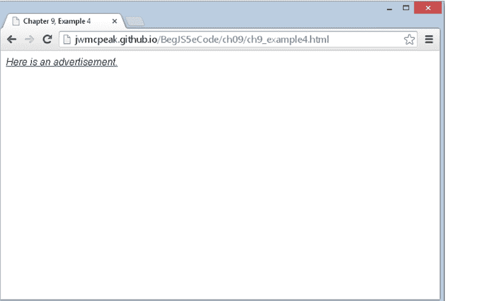

**图 9-11**

在页面的body中，定义了一个id为divAdvert的`<div/>`元素。`<script/>`元素出现在`<div/>`之后，它包含以下JavaScript代码：

```
var divAdvert = document.getElementById("divAdvert");
divAdvert.style.fontStyle = "italic";
divAdvert.style.textDecoration = "underline";
```

在对`<div id="divAdvert">`元素执行任何操作之前，你必须先检索它。你只需使用`getElementById()`方法即可完成此操作。现在你已经获取了该元素，你可以通过`fontStyle`属性首先将文本设置为斜体来操纵其样式。接下来，你使用`textDecoration`属性并将其值设置为`underline`来为文本添加下划线。

非常重要的一点是，`<div id="divAdvert">`元素必须在你使用`getElementById()`检索它之前加载到浏览器中。这就是为什么`<script/>`元素出现在`<div id="divAdvert"/>`之后。等到浏览器加载并执行JavaScript代码时，`<div/>`元素已经加载到DOM中。

### 更改class属性

你可以通过使用元素的`class`属性为元素分配一个CSS类。此属性在DOM中通过`className`属性公开，并且可以通过JavaScript进行更改，从而将不同的样式规则与元素关联起来：

```
element.className = sNewClassName;
```

使用`className`属性更改元素样式有两个优点：

- 它减少了你需要编写的JavaScript代码量，这一点无人会反对。
- 它将样式信息从JavaScript文件中移出，并放入其所属的CSS文件中。进行任何类型的样式规则更改都更容易，因为你不必打开多个文件来进行修改。

让我们重新审视前面章节中ch9_example4.html的代码，并进行一些修改。输入以下代码：

```
<!DOCTYPE html>
<html lang="en">
<head>
    <title>Chapter 9, Example 5</title>
    <style>
        #divAdvert {
            font: 12pt arial;
        }
        .new-style {
            font-style: italic;
            text-decoration: underline;
        }
    </style>
</head>
<body>
    <div id="divAdvert">
        Here is an advertisement.
    </div>

    <script>
        var divAdvert = document.getElementById("divAdvert");
        divAdvert.className = "new-style";
    </script>
</body>
</html>
```

将其保存为`ch9_example5.html`。

`ch9_example4.html`和`ch9_example5.html`之间存在两个关键区别。第一个是添加了一个名为`new-style`的CSS类：

```
.new-style {
    font-style: italic;
    text-decoration: underline;
}
```

此类包含指定斜体和带下划线文本的样式声明。

第二个变化在JavaScript本身：

```
var divAdvert = document.getElementById("divAdvert");
divAdvert.className = "new-style";
```

第一条语句使用`getElementById()`方法检索`<div/>`元素。第二条语句将`className`属性的值更改为`new-style`。有了这一行代码，`divAdvert`元素就应用了一个新的样式规则，浏览器也随之改变了它的外观。

> **注意** 尽管此处没有演示，但HTML的`class`属性（因此`className`属性）可以包含多个CSS类名。你将在第16章看到更多关于多个类名的内容。

## 定位和移动内容

改变元素的外观是DOM脚本中的一个重要模式，它在许多脚本中都有一席之地。然而，DOM脚本不仅仅是改变内容在页面上的外观；你也可以使用JavaScript改变元素的位置。

使用JavaScript移动内容与使用`style`对象一样简单。你可以使用`position`属性来更改所需的定位类型，并通过使用`left`和`top`属性来定位元素：

```
var divAdvert = document.getElementById("divAdvert");

divAdvert.style.position = "absolute";
```


### 示例：动画广告

DOM脚本最具创意的应用或许就是让页面内容动起来。你可以实现多种动画效果：淡入淡出文本元素或图片，为它们添加滑动动画（使其看起来像是被擦除到页面上），以及让它们在页面上移动。

动画能为重要信息增添必要的吸引力，使其更容易被读者识别，同时还能增加"这很酷"的视觉效果。使用JavaScript执行动画遵循与其他类型动画相同的原理：你按顺序依次进行看似微小的更改，直到达到动画结束。本质上，任何动画都需要以下要素：

-   1. 初始状态
    2. 向最终目标移动
    3. 结束状态；停止动画

本节将对绝对定位元素进行动画处理，其过程并无不同。首先，使用CSS将元素定位到起始位置。然后执行动画，直到达到终点，标志着动画结束。

在本节中，你将学习如何让内容在两点之间来回反弹。为此，你需要一个关键信息：内容的当前位置。

### 我们到了吗？

现代浏览器中的DOM暴露了HTML元素对象的`offsetTop`和`offsetLeft`属性。这两个属性返回相对于元素父元素的计算位置：`offsetTop`告诉你顶部位置，`offsetLeft`告诉你左侧位置。这些属性返回的值是数值，因此你可以轻松检查元素在动画中的当前位置。例如：

```
var endPointX = 394;

if (element.offsetLeft < endPointX) {
    //  继续动画
}
```

前面的代码指定了终点（在本例中为394），并将其赋值给`endPointX`变量。然后你可以检查元素的`offsetLeft`值是否小于终点值。如果是，则可以继续动画。这个例子引出了内容移动的下一个主题：执行动画。

### 执行动画

要执行动画，你需要快速递增地修改`style`对象的`top`和`left`属性。你通过定期执行函数来实现这一点，直到动画结束。为此，可以使用`window`对象的两种方法之一：`setTimeout()`或`setInterval()`。本示例使用`setInterval()`方法来周期性地移动元素。

**试一试** 内容动画
此页面将元素从右向左在页面上移动。打开你的文本编辑器并输入以下内容：

```
<!DOCTYPE html>
<html lang="en">
<head>
    <title>Chapter 9, Example 6</title>
    <style>
        #divAdvert {
            position: absolute;
            font: 12px Arial;
            top: 4px;
            left: 0px;
        }
    </style>
</head>
<body>
    <div id="divAdvert">
        Here is an advertisement.
    </div>

    <script>
        var switchDirection = false;

        function doAnimation() {
            var divAdvert = document.getElementById("divAdvert");
            var currentLeft = divAdvert.offsetLeft;
            var newLocation;

            if (!switchDirection) {
                newLocation = currentLeft + 2;

                if (currentLeft >= 400) {
                    switchDirection = true;
                }
            } else {
                newLocation = currentLeft - 2;

                if (currentLeft <= 0) {
                    switchDirection = false;
                }
            }

            divAdvert.style.left = newLocation + "px";
        }

        setInterval(doAnimation, 10);
    </script>
</body>
</html>
```

将此页面保存为`ch9_example6.html`并加载到浏览器中。当你将页面加载到浏览器时，内容应从左边缘开始向右移动。当内容到达左侧400像素位置时，内容会改变方向，开始向左边缘移动回。此动画是连续的，因此它应该在两点（0和400）之间无限期地反弹。

页面主体内是一个`<div/>`元素。该元素的id为`divAdvert`，因此你可以通过`getElementById()`方法获取它，因为这是你要动画处理的元素：

```
<div id="divAdvert">
    Here is an advertisement.
</div>
```

此元素没有样式属性，因为所有样式信息都位于页面头部内的样式表中。在样式表中，你为这个`<div/>`定义了一个起始点。你希望动画首先从左向右进行，并希望它从浏览器的左边缘开始：

```
#divAdvert {
    position: absolute;
    font: 12pt arial;
    top: 4px;
    left: 0px;
}
```

第一个样式声明将元素绝对定位，第二个指定字体为12点Arial。下一个声明将元素定位在距浏览器视口顶部四像素处。将顶部位置设置在远离最顶部边缘使文本更易于阅读。最后，最后一行使用`left`属性将`divAdvert`元素定位在视口的左边缘。

脚本块内是一个名为`switchDirection`的全局变量：

```
var switchDirection = false;
```

此变量跟踪内容当前移动的方向。如果`switchDirection`为`false`，则内容从左向右移动（这是默认设置）。如果`switchDirection`为`true`，则内容从右向左移动。

脚本块中的下一个是执行动画的`doAnimation()`函数：

```
function doAnimation() {
    var divAdvert = document.getElementById("divAdvert");
    var currentLeft = divAdvert.offsetLeft;
    var newLocation;
```

首先，你通过`getElementById()`方法获取`divAdvert`元素；你还获取`offsetLeft`属性并将其值赋给`currentLeft`变量。你使用此变量检查内容的当前位置。接下来，创建一个名为`newLocation`的变量，它将包含新的`left`位置，但在赋值之前，你需要知道内容移动的方向：

```
if (!switchDirection) {
    newLocation = currentLeft + 2;

    if (currentLeft >= 400) {
        switchDirection = true;
    }
}
```

首先，通过检查`switchDirection`变量来确定方向。记住，如果它为`false`，动画正在从左向右移动；因此将`newLocation`设置为内容当前位置加2，从而将内容向右移动两个像素。

然后你需要检查内容是否到达了左侧400像素的位置。如果到达了，你需要改变动画方向，通过将`switchDirection`更改为`true`来实现。这样，下一次运行`doAnimation()`时，它将开始将内容从右向左移动。

将元素向新方向移动的代码与之前的代码类似，但有一些关键区别：

```
else {
    newLocation = currentLeft - 2;

    if (currentLeft <= 0) {
        switchDirection = false;
    }
}
```

第一个区别是赋给`newLocation`的值；不是当前位置加2，而是减2，从而将内容向左移动两个像素。接下来，检查`currentLeft`是否小于或等于0。如果是，你就知道已经到达了从右向左移动的终点，需要再次改变方向，将`switchDirection`赋值为`false`。

最后，设置内容的新位置：

```
divAdvert.style.left = newLocation + "px";
}
```

函数的最后一行将元素的`left`属性设置为存储在`newLocation`变量中的值加上字符串"px"。


要运行动画，使用 `setInterval()` 来持续执行 `doAnimation()`。以下代码每 10 毫秒运行一次 `doAnimation()`：

```javascript
setInterval(doAnimation, 10);
```

在这种速度下，内容移动的速度足以被查看页面的人轻松看到。如果你想加快或减慢动画速度，只需通过更改 `setInterval()` 函数的第二个参数来改变它调用 `doAnimation()` 的频率即可。

到目前为止你看到了什么？嗯，你看到了 DOM 层次结构，以及它如何将 HTML 文档表示为树状结构。你通过 DOM 对象（即 Node 对象）及其属性在 DOM 的不同部分之间导航，并且你更改了对象的属性，从而改变了网页的内容。这只剩下 DOM 的一个领域需要介绍：事件模型。你将在下一章中学习事件。

## 总结

本章包含了不少题外话和离题内容，但这些对于展示文档对象模型在 JavaScript 中的地位和重要性是必要的。

本章涵盖了以下要点：

- 首先概述了两个主要标准——HTML 和 ECMAScript——并考察了它们之间的关系。你看到从这些标准中产生的一个共同目标是为编码 HTML 网页提供指导方针。这些指导方针反过来又使文档对象模型受益，使得如果网页按照这些指导方针编码，就有可能使用脚本访问和操作网页上的任何项目。
- 你研究了文档对象模型，看到它提供了一种与浏览器无关的方式来访问网页上的项目，并且它解决了一些困扰旧版浏览器的问题。你了解了 DOM 如何将 HTML 文档表示为树状结构，以及你如何遍历树来访问不同的元素，并使用它暴露的属性和方法来访问网页的不同部分。
- DOM 允许你在页面加载到浏览器后更改页面，并且你可以执行各种用户界面技巧来为页面增添一些风采。
- 你学习了如何使用 `style` 和 `className` 属性来更改标签的样式。
- 你还学习了动画的基础知识，并让文本在两个点之间来回反弹。

## 练习

你可以在附录 A 中找到这些问题的参考答案。

1.  这是一些创建表格的 HTML 代码。仅使用 JavaScript 和核心 DOM 对象重新创建此表格。在你可用的所有浏览器中测试你的代码以确保它在这些浏览器中正常工作。提示：在编写代码时为每一行添加注释，以跟踪你在树状结构中的位置，并为页面上的每个元素创建一个新变量（例如，不仅仅是为每个 TD 单元格创建一个变量，而是创建九个变量）。

```html
<table>
    <tr>
        <td>Car</td>
        <td>Top Speed</td>
        <td>Price</td>
    </tr>
    <tr>
        <td>Chevrolet</td>
        <td>120mph</td>
        <td>$10,000</td>
    </tr>
    <tr>
        <td>Pontiac</td>
        <td>140mph</td>
        <td>$20,000</td>
    </tr>
</table>
```

2.  修改“动画内容”动手实践部分中的 `ch9_example6.html`，使得在任一方向上移动的像素量由一个全局变量控制。将其命名为 `direction`。移除 `switchDirection` 变量，并更改代码以使用新的 `direction` 变量来确定动画何时应该改变方向。

www.it-ebooks.info

### 事件

## 本章你将学到：

- 将你的代码连接到事件以响应用户操作
- 编写符合标准的、事件驱动的代码
- 为旧版本的 Internet Explorer 编写事件代码
- 处理符合标准的事件模型与旧版 IE 事件模型之间的差异
- 使用 HTML5 的原生拖放功能拖放内容
- 通过操作元素的定位来制作动画

## 本章的 Wrox.com 代码下载

你可以在 http://www.wiley.com/go/BeginningJavaScript5E 的 Download Code 标签页找到本章的 wrox.com 代码下载。你也可以在 http://beginningjs.com 查看所有示例和相关文件。

毫无疑问，JavaScript 是 Web 编程中的一个有用工具。你已经看到了如何在页面中动态创建、删除和操作 HTML，在接下来的章节中，你将学习如何处理用户输入并将数据发送到服务器。

尽管这些能力在当今的 Web 编程中非常重要，但你将学习和使用的最重要的概念可能是*事件*。在现实世界中，事件，简单来说，就是发生的事情。例如，电话铃响就是一个事件。如果你正在期待朋友或同事的来电，你通常会想做些什么：接听电话。

在编程中，事件与电话呼叫非常相似。页面中的某些事情会发生，如果是你所期望的事情，你可以对其做出响应。例如，用户点击页面、按下键盘上的某个键，或移动鼠标指针到某些文本上，都会导致事件发生。另一个经常使用的例子是页面的 `load` 事件：当页面在浏览器中完全加载时，窗口会触发（或引发）一个通知。

为什么你应该对事件感兴趣？

以这样的情况为例：你希望当用户在你的网页中的任何位置点击时，一个菜单能够弹出。假设你可以编写一个函数使弹出菜单出现，你如何知道*何时*让它出现，或者换句话说，*何时*调用该函数？你必须以某种方式拦截用户在文档中点击的事件，并确保当该事件发生时调用你的函数。

为此，你需要使用称为*事件处理程序*或*监听器*的东西。你将其与希望在事件发生时执行的代码关联起来。这为你提供了一种拦截事件并在事件发生时执行代码的方法。你会发现向代码中添加事件处理程序通常被称为“将你的代码连接到事件”。这有点像设置闹钟——你将时钟设置为在特定事件发生时发出铃声。对于闹钟来说，事件就是达到某个时间点。

## 事件类型

Web 开发，尤其是 JavaScript 方面，主要是*事件驱动*的，这意味着程序的流程由事件控制。换句话说，你的大部分 JavaScript 代码通常只在事件发生时执行，并且你可以监听许多事件。

花点时间思考一下你如何与网页互动。在计算机或笔记本电脑上，你在页面上移动鼠标，也许会选择你想要复制并粘贴到笔记程序中的文本，并且你肯定会点击事物（如链接）。在触摸设备上，你会轻点页面中的项目。在所有支持 Web 的设备上，你通过在键盘上按键来填写表单。几乎你所做的每一件事都会触发一个事件，而且很多时候，你想编写代码来对其中一些事件做出反应。

以下是你能够监听和响应的许多事件类型的列表：

-   **鼠标事件：** 当用户使用鼠标进行操作时发生，例如移动光标、单击、双击、拖动等。
-   **键盘事件：** 当键盘上的键被按下或释放时发生。虽然通常与表单结合使用，但每次用户按下或释放一个键时都会发生键盘事件。
-   **进程事件：** 这些是在对象不同阶段发生的更通用的事件。例如，当文档加载时。
-   **表单事件：** 当表单中的某些内容发生变化时发生。
-   **突变事件：** 当 DOM 节点被修改时发生。
-   **触摸事件：** 当用户触摸传感器时发生。
-   **错误事件：** 当发生错误时发生。


最常见的基于用户的事件是鼠标事件，这理所当然。用户与计算机交互的主要方式是使用鼠标，但随着越来越多的人拥有触控设备，这种情况正在开始改变。

本章的主要焦点是教你如何监听事件，而这主要围绕鼠标事件展开。在下一章，你将使用一些键盘事件来与表单交互。

## 将代码与事件关联

浏览器已经存在相当长一段时间了，正如你可能猜到的那样，我们监听事件的方式多年来也在不断演变。但即使JavaScript社区多年来经历了许多变化，旧式的事件监听方法在某些情况下仍然被支持且有用。

第5章介绍了通过方法和属性定义的对象。然而，对象也有关联的事件。这一点之前没有提到，因为原生JavaScript对象没有这些事件，但浏览器对象模型（BOM）和文档对象模型（DOM）的对象有。

你可以通过三种方式将你的代码与事件关联：

-   分配HTML属性
-   分配对象的特殊属性
-   调用对象的特殊方法

### 通过HTML属性处理事件

在本节中，你将创建一个简单的HTML页面，包含一个由`<a/>`元素表示的超链接。与此元素关联的是`a`对象，`a`对象拥有的事件之一是`click`事件。毫不奇怪，当用户点击超链接时，`click`事件会触发。请随意跟随操作；打开你的文本编辑器并输入以下内容：

```
<!DOCTYPE html>

<html lang="en">
<head>
    <title>Connecting Events Using HTML Attributes</title>
</head>
<body>
    <a href="somepage.html">Click Me</a>
</body>
</html>
```

目前，这个页面没有任何普通超链接不具备的功能。你点击它，它会将窗口导航到另一个名为`somepage.html`的页面，这需要你提前创建。目前还没有为链接添加任何事件处理程序——还没呢！

如前所述，将事件与代码关联的一种方式是将其直接添加到你正在捕获其事件的元素对象的开标签上。在这种情况下，它是`<a/>`元素定义的`a`对象的`click`事件。当点击链接时，你想要捕获该事件并将其与你的代码关联。你需要将事件处理程序（本例中是`onclick`）作为属性添加到开`<a>`标签。你将属性的值设置为你希望事件发生时执行的代码。重写开`<a>`标签如下：

```
<a href="somepage.html" onclick="alert('You clicked?')">Click Me</a>
```

这段代码在开`<a>`标签的定义中添加了`onclick="alert('You Clicked?')"`。现在，当链接被点击时，你会看到一个警告框。之后，超链接会执行其常规操作，将你带到`href`属性中定义的页面。

如果你只有一行代码要连接到事件处理程序，这没问题，但如果你希望在链接被点击时执行多行代码怎么办？

嗯，你只需要定义你想要执行的函数，并在`onclick`代码中调用它。现在就这样做：

```
<!DOCTYPE html>
<html lang="en">
<head>
    <title>Connecting Events Using HTML Attributes</title>
</head>
<body>
    <a href="somepage.html" onclick="return linkClick()">Click Me</a>
    <script>
        function linkClick() {
            alert("You Clicked?");
            return true;
        }
    </script>
</body>
</html>
```

在脚本块内，你创建了一个标准函数。`onclick`属性现在连接到了一些调用`linkClick()`函数的代码。因此，当用户点击超链接时，这个函数将被执行。

你还会看到函数返回了一个值，在本例中是`true`。同样，在你定义`onclick`属性的地方，你通过在函数名前使用`return`语句来返回函数的返回值。为什么要这样做？

`onclick="return linkClick()"`返回的值被JavaScript用来决定链接的正常动作（即，跳转到新页面）是否应该发生。如果你返回`true`，动作继续，你会前往`somepage.html`。如果你返回`false`，正常的事件链（即，前往`somepage.html`）就不会发生。你会说与该事件关联的动作被取消了。尝试将函数更改为这个：

```
function linkClick() {
    alert("This link is going nowhere");
    return false;
}
```

现在你会发现你只得到一个消息，没有尝试前往somepage.html。

> **注意** *并非所有对象及其事件都使用返回值，因此有时它是多余的。*

有些事件并非直接与用户的此类操作相关联。例如，`window`对象有`load`事件，在页面加载时触发；`unload`事件在页面卸载时触发（即，当用户关闭浏览器或跳转到另一页面时）。

`window`对象的事件处理程序实际上放在开`<body>`标签内。例如，要为`load`和`unload`事件添加事件处理程序，你可以这样写：

```
<body onload="myOnLoadFunction()" onunload="myOnUnloadFunction()">
```

### 动手实践：使用HTML属性事件处理程序显示随机图片

在这个动手实践中，你将连接图像的`click`事件，以随机更改页面中加载的图像。打开你的编辑器并输入以下代码：

```
<!DOCTYPE html>
<html lang="en">
<head>
    <title>Chapter 10: Example 1</title>
</head>
<body>
    
    
    <script>
        var myImages = [
            "usa.gif",
            "canada.gif",
            "jamaica.gif",
            "mexico.gif"
        ];
        function changeImg(that) {
            var newImgNumber = Math.round(Math.random() * 3);
            while (that.src.indexOf(myImages[newImgNumber]) != -1) {
                newImgNumber = Math.round(Math.random() * 3);
            }
            that.src = myImages[newImgNumber];
        }
    </script>
</body>
</html>
```

将页面保存为`ch10_example1.html`。此示例需要四个图像文件，你可以创建或从本书附带的代码下载中获取。

将页面加载到浏览器中。你应该会看到如图10-1所示的页面。

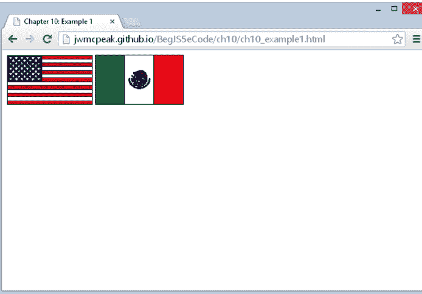

**图10-1**

如果你点击一个图像，你会看到它变成另一个随机选择的图像。

页面顶部脚本块中的第一行定义了一个具有页面作用域的变量。这是一个包含图像源列表的数组：

```
var myImages = [
    "usa.gif",
    "canada.gif",
    "jamaica.gif",
    "mexico.gif"
];
```

接下来是`changeImg()`函数，它将连接到页面中定义的``元素的`onclick`事件处理程序。你对两个图像的`onclick`事件处理程序使用了同一个函数，实际上，你可以将一个函数连接到任意多的事件处理程序。此函数接受一个名为`that`的参数。它被称为`that`，因为你将`this`关键字传递给函数，这使你能够立即访问你点击的`img`对象。你实际上可以给参数起任何名字，但大多数开发者在引用`this`时使用“that”这个词。

在函数的第一行，你将`newImgNumber`变量设置为一个介于0和3之间的随机整数：

```
function changeImg(that) {
    var newImgNumber = Math.round(Math.random() * 3);
```

`Math.random()`方法提供一个介于0和1之间的随机数，你将其乘以三得到一个介于0和3之间的数字。这个数字通过`Math.round()`四舍五入到最接近的整数（0, 1, 2, 或 3）。这个整数提供了你将从`myImages`数组中选择的图像`src`的索引。

接下来的几行是一个`while`循环，其目的是确保你不会选择与当前图像相同的图像。如果`myImages[newImgNumber]`中包含的字符串在当前图像的`src`属性中被找到，你就知道它是同一个图像，需要获得另一个随机数。你继续循环直到得到一个新的图像，此时`myImages[newImgNumber]`将不会在现有的`src`中找到，`indexOf()`方法将返回-1，从而退出循环：

```
while (that.src.indexOf(myImages[newImgNumber]) != -1) {
    newImgNumber = Math.round(Math.random() * 3);
}
```

接下来，你将`img`对象的`src`属性设置为`myImages`数组中的新值：

```
that.src = myImages[newImgNumber];
}
```

你将第一个``元素的`onclick`事件连接到`changeImg()`函数：

```

```

现在是第二个``元素：

```

```

在`changeImg()`函数中传递`this`，使函数能够直接访问这个``元素的相应对象。当你将`this`传递给HTML元素的属性事件处理程序时，该元素的相应对象将被传递给函数。这是在JavaScript代码中访问元素对象的一种简洁而干净的方式。

本示例让你将`this`作为参数传递给处理元素`click`事件的函数。这是一种简单且容易的方式来访问接收到事件的元素，但有一个更有用的对象你可以传递：一个包含有关事件所有信息的`Event`对象。

传递`Event`对象非常简单；只需传递`event`而不是`this`。例如，在下面的代码中，`<p/>`元素将引发`dblclick`事件：

```
<p ondblclick="handle(event)">Paragraph</p>

<script>
```


function handle(e) {
    alert(e.type);
}
</script>

注意，`event`被传递给了`ondblclick`属性中的`handle()`函数。这个`event`变量是特殊的，因为它在任何地方都没有定义；相反，它是一个仅用于通过HTML属性连接的事件处理程序的参数。当事件触发时，它传递对当前事件对象的引用。

如果你运行前面的示例，它只会告诉你是什么类型的事件触发了你的事件处理函数。这一点在前面的例子中似乎不言自明，但如果你包含以下额外的代码行，三个元素中的任何一个都可能触发该函数：

```
<p ondblclick="handle(event)">Paragraph</p>
<h1 onclick="handle(event)">Heading 1</h1>
<span onmouseover="handle(event)">Special Text</span>

<script>
function handle(e) {
    alert(e.type);
}
</script>
```

这使得代码更加实用。通常，你会使用相对较少的事件处理程序来处理任意数量的事件，并且可以使用事件属性作为过滤器来确定发生了什么类型的事件以及哪个HTML元素触发了它，从而可以对每个事件进行不同的处理。

在下面的示例中，你可以看到可以根据返回的事件类型采取不同的行动：

```
<p ondblclick="handle(event)">Paragraph</p>
<h1 onclick="handle(event)">Heading 1</h1>
<span onmouseover="handle(event)">Special Text</span>

<script>
function handle(e) {
    if (e.type == "mouseover") {
        alert("You moved over the Special Text");
    }
}
</script>
```

这段代码使用`type`属性来确定发生了什么类型的事件。如果用户将鼠标光标移到`<span/>`元素上，一个`alert`框会告诉他们。

你将在本章后面了解更多关于`Event`对象的内容，但现在只需知道它公开了一个名为`target`的属性。这是事件的目标，即接收事件的元素对象。有了这些信息，你可以重写`ch10_example1.html`，以使用更通用的`Event`对象。

### 试一试 使用对象属性事件处理程序和Event对象显示随机图像

在这个“试一试”中，你重写`ch10_example1.html`，使用`Event`对象代替`this`。输入以下代码：

```
<!DOCTYPE html>

<html lang="en">
<head>
    <title>Chapter 10: Example 2</title>
</head>
<body>
    
    

    <script>
        var myImages = [
            "usa.gif",
            "canada.gif",
            "jamaica.gif",
            "mexico.gif"
        ];

        function changeImg(e) {
            var el = e.target;
            var newImgNumber = Math.round(Math.random() * 3);

            while (el.src.indexOf(myImages[newImgNumber]) != -1) {
                newImgNumber = Math.round(Math.random() * 3);
            }

            el.src = myImages[newImgNumber];
        }
    </script>
</body>
</html>
```

将页面保存为`ch10_example2.html`。在浏览器中加载该页面，你会看到一个与`ch10_example1.html`相似的页面。单击图像，你会看到它变为一张随机图片。

此页面的代码几乎与`ch10_example1.html`相同。这个新版本只有几处改动。

前两个改动在``元素的`onclick`事件处理程序中。不是传递`this`给`changeImg()`，而是传递`event`。

下一个改动在`changeImg()`声明中：

```
function changeImg(e) {
```

参数名现在是`e`，代表event。请记住，这个参数叫什么并不重要，但一般惯例是使用`e`。

当浏览器调用此函数时，它会将一个Event对象作为`e`参数传递，你可以使用`e.target`来获取接收事件的`img`元素对象：

```
var el = e.target;
```

你将此对象赋值给一个名为`el`（element的缩写）的变量，并在`while`循环中使用它：

```
while (el.src.indexOf(myImages[newImgNumber]) != -1) {
    newImgNumber = Math.round(Math.random() * 3);
}
```

你还在函数的最后一行使用它来赋值其`src`属性：

```
el.src = myImages[newImgNumber];
```

对`changeImg()`的改动是最小的，尽管它需要稍微多一点代码，但它更加通用，正如你在本章后面会学到的。

使用HTML属性事件处理程序是将JavaScript代码连接到元素事件的简单方法，但它们有一些缺点：

- 你的HTML和JavaScript混合在一起。这使得维护和查找修复错误变得更加困难。
- 你无法在不更改HTML的情况下移除事件处理程序。
- 你只能为出现在HTML代码中的元素设置事件处理程序，而不是为你动态创建的元素设置（例如，当你使用`document.createElement()`创建元素时）。

然而，这些问题可以通过对象的event handler属性来解决。

### 通过对象属性处理事件

使用这种方法，你首先需要定义事件发生时 NI时将执行的函数。然后你需要将该对象的event handler属性设置为你定义的函数。

这在下面的示例中进行了说明。打开你的编辑器并输入以下代码：

```
<!DOCTYPE html>

<html lang="en">
<head>
    <title>Chapter 10, Example 3</title>
</head>
<body>
    <a id="someLink" href="somepage.html">
        Click Me
    </a>
    <script>
        function linkClick() {
            alert("This link is going nowhere");
            return false;
        }

        document.getElementById("someLink").onclick = linkClick;
    </script>
</body>
</html>
```

将其保存为`ch10_example3.html`。

首先，你有`<a/>`元素，你正在连接其对象的事件。你会注意到在标签的属性中没有提到事件处理程序或函数，但请注意它现在有一个`id`属性。这是为了让你能够使用`getElementById()`方法轻松地在文档中找到该元素。

接下来，你定义函数`linkClick()`，与之前类似。与之前一样，你可以返回一个值来指示是否希望该对象的正常动作发生。

对象的事件与函数之间的连接在脚本的最后几行中完成，如以下代码所示：

```
    document.getElementById("someLink").onclick = linkClick;
```

正如你在上一章中学到的，`getElementById()`方法查找具有给定`id`的元素并返回`a`对象。你将此对象的`onclick`属性设置为引用你的函数——这建立了对象的事件处理程序与你的函数之间的连接。注意，函数名后没有添加括号。你是将`linkClick`函数对象赋值给元素的`onclick`属性，而不是执行`linkClick()`并将其返回值赋值给`onclick`。

花点时间回顾一下`ch10_example2.html`。当你使用`onclick`属性监听`click`事件时，你完全控制了`changeImg()`的调用方式；你只需调用该函数并传递`event`对象。

但现在这是一个问题。再看一下`onclick`属性赋值：

```
    document.getElementById("someLink").onclick = linkClick;
```

你不再控制事件处理程序函数的执行方式；浏览器为你执行该函数。那么如何获得对`Event`的引用呢？当事件触发且事件处理程序执行时，浏览器会自动将一个`Event`对象传递给处理程序函数。

**试一试** 使用对象属性事件处理程序显示随机图像

在这个“试一试”中，你重写`ch10_example2.html`，使用`img`对象的`onclick`属性。输入以下代码：

```
    <!DOCTYPE html>
    <html lang="en">
```


<html>
<head>
    <title>第10章：示例4</title>
</head>
<body>
    
    

    <script>
        var myImages = [
            "usa.gif",
            "canada.gif",
            "jamaica.gif",
            "mexico.gif"
        ];

        function changeImg(e) {
            var el = e.target;
            var newImgNumber = Math.round(Math.random() * 3);

            while (el.src.indexOf(myImages[newImgNumber]) != -1) {
                newImgNumber = Math.round(Math.random() * 3);
            }

            el.src = myImages[newImgNumber];
        }

        document.getElementById("img0").onclick = changeImg;
        document.getElementById("img1").onclick = changeImg;
    </script>
</body>
</html>

将此页面保存为 `ch10_example4.html`。在浏览器中加载该页面，你将看到一个类似于 `ch10_example2.html` 的页面。点击一张图片，你会看到它变成一张随机图片。

此页面的代码与 `ch10_example2.html` 几乎完全相同。第一处变化在 `` 标签中。它们不再具有 `onclick` 属性，而是现在拥有了 `id` 属性。第一张图片的 `id` 为 `img0`，第二张为 `img1`。这些元素拥有一个 `id`，以便你可以在 JavaScript 代码中引用它们。

唯一其他的变化是 JavaScript 代码的最后两行：

```
document.getElementById("img0").onclick = changeImg;
document.getElementById("img1").onclick = changeImg;
```

你使用 `document.getElementById()` 从 DOM 中检索两个 `img` 对象，并为它们分配 `onclick` 属性，从而设置 `changeImg()` 函数来处理两个 `img` 对象上的点击事件。

移除一个事件处理程序相当简单。只需将 `null` 分配给事件处理程序属性即可，如下所示：

```
img1.onclick = null;
```

通过分配 `null`，你覆盖了该属性先前包含的值，这引入了此类事件处理程序的主要问题：你只能分配一个函数来处理给定的事件。例如：

```
img2.onclick = functionOne;
img2.onclick = functionTwo;
```

这段代码的第一行将一个名为 `functionOne()` 的函数分配给元素的 `onclick` 属性。然而，第二行通过分配一个新值覆盖了 `img2.onclick` 的值。因此，当用户点击 `img2` 时，只有 `functionTwo()` 会执行。如果这正是你想要的行为，那没问题，但更多时候，你希望在点击 `img2` 时，`functionOne()` 和 `functionTwo()` 都执行。这要感谢标准的 DOM 事件模型。

## 标准事件模型

-   到目前为止，你一直在使用非标准技术来监听事件。是的，它们在所有浏览器中都能工作，但这种支持主要是为了向后兼容。不能保证它们在未来的浏览器版本中也能工作。

-   首先，一些历史背景：1990年代末的两个主要浏览器是Internet Explorer和Netscape——第一场浏览器大战。毫不奇怪，这两个浏览器厂商实现了截然不同的DOM和事件模型，将网络分裂为两组：仅针对Netscape的网站，和仅针对IE的网站。很少有开发者选择令人沮丧的跨浏览器开发任务。

-   显然，这种分裂和挫败感催生了对标准的需求。因此W3C引入了DOM标准，它发展成了DOM Level 2，其中包括一个标准的事件模型。

-   DOM标准定义了一个名为 `EventTarget` 的对象。其目的是定义添加和移除事件监听器的标准方法。从更大的范围来看，DOM中的每个元素节点都是一个 `EventTarget`，因此你可以为给定的元素动态添加和移除事件监听器。

-   该标准还描述了一个 `Event` 对象，它提供了关于生成事件的元素的信息，并使你能够在脚本中检索它。它提供了一套指导方针，用于确定什么生成了事件、事件的类型以及事件发生的时间和地点的标准方法。如果你需要在脚本中获取它，它必须作为参数传递给连接到事件处理程序的函数。

> 注意：较旧版本的Internet Explorer（8及以下）未实现DOM事件模型。本节中的代码仅适用于现代浏览器：IE9+、Chrome、Firefox、Opera和Safari。

### 将代码连接到事件 - 标准方式

-   `EventTarget` 对象定义了两个用于添加和移除事件监听器的方法（记住 `EventTarget` 就是一个元素）。第一个方法 `addEventListener()`，在调用它的目标上注册一个事件监听器。你在一个目标/元素对象上调用它，正如你在下面的例子中看到的那样。输入以下代码：

```
<!DOCTYPE html>
<html lang="en">
<head>
    <title>第10章，示例5</title>
</head>
<body>
    <a id="someLink" href="somepage.html">
        Click Me
    </a>
    <script>
        var link = document.getElementById("someLink");

        link.addEventListener("click", function (e) {
            alert("This link is going nowhere");

            e.preventDefault();
        });
    </script>
</body>
</html>
```

将此文件保存为 `ch10_example5.html`。这是 `ch10_example3.html` 的重写版本，但它使用标准的事件模型应用程序编程接口（API），这是一组对象、属性和方法，来注册事件监听器并防止链接的默认操作发生。

JavaScript的第一行检索 `id` 为 `someLink` 的元素，并将其存储在 `link` 变量中。然后你调用 `addEventListener()` 方法并传递两个参数。第一个是事件名称，没有 "on" 前缀。在此示例中，为 `click` 事件注册了一个事件监听器。

第二个参数是当事件发生时执行的函数。前面的代码使用了一个匿名函数，这是一个你经常会看到的常见模式，但传递一个声明的函数更有用，像这样：

```
function linkClick() {
    alert("This link is going nowhere");
    e.preventDefault();
}

link.addEventListener("click", linkClick);
```

使用声明的函数允许你为多个事件监听器重用它，正如你在下一个练习中看到的那样。但首先，注意 `linkClick()` 不再返回 `false`；而是调用 `Event` 对象上的 `preventDefault()` 方法。这是阻止默认操作发生的标准方式。

### 使用标准事件处理器显示随机图片

在这个“动手试一试”中，你将重写 `ch10_example4.html` 以使用标准的DOM事件模型。输入以下代码：

```
<!DOCTYPE html>
<html lang="en">
<head>
    <title>第10章：示例6</title>
</head>
<body>
    
    

    <script>
        var myImages = [
            "usa.gif",
            "canada.gif",
            "jamaica.gif",
            "mexico.gif"
        ];

        function changeImg(e) {
            var el = e.target;
            var newImgNumber = Math.round(Math.random() * 3);

            while (el.src.indexOf(myImages[newImgNumber]) != -1) {
                newImgNumber = Math.round(Math.random() * 3);
            }

            el.src = myImages[newImgNumber];
        }

        document.getElementById("img0").addEventListener("click", changeImg);
        document.getElementById("img1").addEventListener("click", changeImg);
    </script>
</body>
</html>
```

将此页面保存为 `ch10_example6.html`。在浏览器中加载该页面，你将看到前面示例中熟悉的页面。点击一张图片，你会看到它变成一张随机图片。

与 `ch10_example4.html` 相比，唯一的变化是JavaScript的最后两行：

```
document.getElementById("img0").addEventListener("click", changeImg);
document.getElementById("img1").addEventListener("click", changeImg);
```

不再使用每个元素对象的 `onclick` 属性，而是使用 `addEventListener()` 注册点击事件处理器。

使用声明的函数也很有用，因为它使你能够使用 `removeEventListener()` 方法注销事件监听器：

```
elementObj.removeEventListener("click", elementObjClick);
```

当你移除一个事件监听器时，你必须提供与调用 `addEventListener()` 时*完全相同*的信息；这不仅包括相同的事件名称，还包括传递给 `addEventListener()` 的相同函数对象。

标准DOM事件模型的美妙之处在于，你可以为单个元素上的单个事件注册多个事件监听器。当你需要在元素上用不同且不相关的函数监听同一个事件时，这非常有用。要执行此操作，只需根据需要多次调用 `addEventListener()`，如下所示：

```
elementObj.addEventListener("click", handlerOne);
elementObj.addEventListener("click", handlerTwo);
elementObj.addEventListener("click", handlerThree);
```

这段代码为 `elementObj` 引用的元素上的 `click` 事件注册了三个监听器。正如你可能猜测的那样，这些监听器按照注册的顺序执行。因此，当你点击 `elementObj` 时，首先执行 `handlerOne()`，然后执行 `handlerTwo()`，最后执行 `handlerThree()`。

**动手试一试：添加和移除多个事件监听器**

在这个“动手试一试”中，你将练习为单个元素注册多个事件监听器，并在满足条件时移除这些监听器。输入以下代码：

```
<!DOCTYPE html>
<html lang="en">
<head>
    <title>第10章：示例7</title>
</head>
<body>
    
    <div id="status"></div>

    <script>
        var myImages = [
            "usa.gif",
            "canada.gif",
            "jamaica.gif",
            "mexico.gif"
        ];

        function changeImg(e) {
            var el = e.target;
            var newImgNumber = Math.round(Math.random() * 3);

            while (el.src.indexOf(myImages[newImgNumber]) != -1) {
                newImgNumber = Math.round(Math.random() * 3);
            }

            el.src = myImages[newImgNumber];
        }

        function statusUpdate() {
            document.getElementById("status").innerHTML = "Event listener removed.";
        }

        var img0 = document.getElementById("img0");
        img0.addEventListener("click", changeImg);
        img0.addEventListener("click", statusUpdate);

        setTimeout(function () {
            img0.removeEventListener("click", statusUpdate);
        }, 5000);
    </script>
</body>
</html>
```


```html
<!DOCTYPE html>
<html lang="en">
<head>
    <title>第10章：示例8</title>
    <style>
        .underline {
            color: red;
            text-decoration: underline;
        }
    </style>
</head>
<body>
    <p>这是段落1。</p>
    <p>这是段落2。</p>
</body>
</html>
```


### 动手试试 一个简陋的选项卡条

在本次“动手试试”中，你将使用 `mouseover`、`mouseout` 和 `click` 事件编写一个功能虽有缺陷但能运行的选项卡条。打开你的文本编辑器，输入以下代码：

```html
<!DOCTYPE html>

<html lang="en">
<head>
<title>Chapter 10: Example 9</title>
<style>
    .tabStrip {
        background-color: #E4E2D5;
        padding: 3px;
        height: 22px;
    }

    .tabStrip div {
        float: left;
        font: 14px arial;
        cursor: pointer;
    }

    .tabStrip-tab {
        padding: 3px;
    }

    .tabStrip-tab-hover {
        border: 1px solid #316AC5;
        background-color: #C1D2EE;
        padding: 2px;
    }

    .tabStrip-tab-click {
        border: 1px solid #facc5a;
        background-color: #f9e391;
        padding: 2px;
    }
</style>
</head>
<body>
    <div class="tabStrip">
        <div data-tab-number="1" class="tabStrip-tab">Tab 1</div>
        <div data-tab-number="2" class="tabStrip-tab">Tab 2</div>
        <div data-tab-number="3" class="tabStrip-tab">Tab 3</div>
    </div>
    <div id="descContainer"></div>

    <script>
        function handleEvent(e) {
            var target = e.target;

            switch (e.type) {
                case "mouseover":
                    if (target.className == "tabStrip-tab") {
                        target.className = "tabStrip-tab-hover";
                    }
                    break;
                case "mouseout":
                    if (target.className == "tabStrip-tab-hover") {
                        target.className = "tabStrip-tab";
                    }
                    break;
                case "click":
                    if (target.className == "tabStrip-tab-hover") {
                        target.className = "tabStrip-tab-click";
                        var num = target.getAttribute("data-tab-number");
                        showDescription(num);
                    }
                    break;
            }
        }

        function showDescription(num) {
            var text = "Description for Tab " + num;
            descContainer.innerHTML = text;
        }

        document.addEventListener("mouseover", handleEvent);
        document.addEventListener("mouseout", handleEvent);
        document.addEventListener("click", handleEvent);
    </script>
</body>
</html>
```

将此文件保存为 ch10_example9.html。在浏览器中打开它，当你将鼠标指针移到某个选项卡上时，其样式会变为蓝色背景和较深的蓝色边框。当你点击一个选项卡时，其样式会再次改变，使选项卡的背景色变为浅橙色，边框色变为较深的橙色。同时，当你点击一个选项卡时，页面上会添加文本。例如，点击选项卡 3 会导致文本“Description for Tab 3”被添加到页面中。

首先看看 body 中的 HTML 及其样式：

```html
<div class="tabStrip">
    <div data-tab-number="1" class="tabStrip-tab">Tab 1</div>
    <div data-tab-number="2" class="tabStrip-tab">Tab 2</div>
    <div data-tab-number="3" class="tabStrip-tab">Tab 3</div>
</div>
<div id="descContainer"></div>
```

第一个 `<div/>` 元素具有 CSS 类 `tabStrip`。包含在其中的三个 `<div/>` 元素代表三个选项卡。每个选项卡 `<div/>` 元素的 `data-tab-number` 属性被赋予一个数字值，并具有 CSS 类 `tabStrip-tab`。

选项卡条 `<div/>` 元素有一个同级 `<div/>` 元素，其 id 值为 `descContainer`。它不包含任何子元素，也没有与之关联的 CSS 类。

在此示例中，通过赋予其灰色背景，使选项卡条在视觉上与页面其余部分区分开来：

```css
.tabStrip {
    background-color: #E4E2D5;
    padding: 3px;
    height: 22px;
}
```

其实际高度为 28 像素（高度 + 上内边距 + 下内边距）。此高度和内边距使选项卡 `<div/>` 元素在选项卡条内垂直居中。

选项卡有几个 CSS 规则来定义它们在浏览器中的呈现方式，因为它们有三种状态：正常、悬停和点击。尽管有这三种状态，它们仍然是选项卡，因此共享一些视觉特征。第一条规则规定了这些共享属性：

```css
.tabStrip div {
    float: left;
    font: 14px arial;
    cursor: pointer;
}
```

选择器告诉浏览器将这些属性应用于选项卡条内的所有 `<div/>` 元素。这些元素被设置为左浮动以赋予它们内联外观（`<div/>` 元素是块级元素，默认情况下会出现在新行上）。

下一条规则，`tabStrip-tab` 类，定义了正常状态：

```css
.tabStrip-tab {
    padding: 3px;
}
```

这条规则所做的只是为元素四周添加三像素的内边距。接下来是悬停状态，由 `tabStrip-tab-hover` 类定义：

```css
.tabStrip-tab-hover {
    border: 1px solid #316AC5;
    background-color: #C1D2EE;
    padding: 2px;
}
```

此规则将内边距减少到两像素，添加一像素宽的边框，并将背景色更改为一种蓝色色调。边框和内边距一样，会增加元素的实际尺寸；在添加边框的同时减少内边距，使得处于悬停状态的元素保持与正常状态相同的高度和宽度。

最后一条规则声明了 `tabStrip-tab-click` 类：

```css
.tabStrip-tab-click {
    border: 1px solid #facc5a;
    background-color: #f9e391;
    padding: 2px;
}
```

这个类类似于悬停类；唯一的区别是较深的橙色边框颜色和浅橙色的背景色。

现在让我们看看执行这些魔法的 JavaScript 代码。代码包含 `handleEvent()` 函数，该函数被注册为文档对象的 `mouseover`、`mouseout` 和 `click` 事件监听器：

```javascript
document.addEventListener("mouseover", handleEvent);
document.addEventListener("mouseout", handleEvent);
document.addEventListener("click", handleEvent);
```

一个函数 `handleEvent()` 处理所有这三个事件。每当这些事件中的任何一个触发时，`handleEvent()` 函数就会被调用，并生成一个新的 `MouseEvent` 对象。请记住，`MouseEvent` 对象使您可以访问 `Event` 对象属性以及 `MouseEvent` 对象属性，并且在这个示例中您使用了其中一些属性。

该函数接受 `MouseEvent` 对象并将其引用赋值给 `e`：

```javascript
function handleEvent(e) {
    var target = e.target;
    var type = e.type;

    if (target.tagName == "P") {
```

在函数内部，您首先使用事件属性 `target` 和 `type` 分别初始化 `target` 和 `type` 变量。这些是方便变量，使访问该信息更容易。然后检查事件目标（触发事件的元素）的 `tagName` 是否为 `P`。如果目标是段落元素，您需要找到的下一条信息是发生了哪种类型的事件，使用 `type` 变量：

```javascript
        if (type == "mouseover") {
            target.className = "underline";
        } else if (type == "mouseout") {
            target.className = "";
        }
    }
```

如果事件是 `mouseover`，则段落的 CSS 类被赋予样式表中定义的 `underline` 类。如果事件类型是 `mouseout`，则元素的 `className` 属性被清除，从而将文本恢复到其原始样式。此样式更改代码仅在触发事件的元素是段落元素时才会运行。

接下来，函数通过再次检查 `type` 变量来确定用户是否点击了鼠标：

```javascript
        if (type == "click") {
            alert("You clicked the mouse button at the X:" +
                  e.clientX + " and Y:" + e.clientY + " coordinates");
        }
```

如果用户确实在页面某处点击了鼠标，您可以使用 `alert()` 方法在屏幕上显示 `MouseEvent` 对象的 `clientX` 和 `clientY` 属性的内容。

提供给此函数的 `MouseEvent` 对象在每次生成事件时都会被覆盖和重新创建，因此下次您点击鼠标或移动指针时，它会创建一个新的 `MouseEvent` 对象，其中包含 x 和 y 位置的坐标以及触发事件的元素的信息。

让我们看另一个例子。

```html
<p>This is paragraph 3.</p>

<script>
    function handleEvent(e) {
        var target = e.target;
        var type = e.type;

        if (target.tagName == "P") {
            if (type == "mouseover") {
                target.className = "underline";
            } else if (type == "mouseout") {
                target.className = "";
            }
        }

        if (type == "click") {
            alert("You clicked the mouse button at the X:"
                + e.clientX + " and Y:" + e.clientY + " coordinates");
        }
    }

    document.addEventListener("mouseover", handleEvent);
    document.addEventListener("mouseout", handleEvent);
    document.addEventListener("click", handleEvent);
</script>

</body>
</html>
```

将其保存为 ch10_example8.html 并在浏览器中运行。当您将鼠标移到其中一个段落上时，您会注意到其文本颜色变为红色并带有下划线。在页面任意位置单击，您将看到一个如图 10-3 所示的警告框。

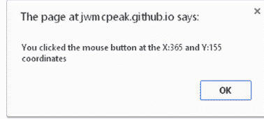

现在单击“确定”，在浏览器窗口中移动指针，然后再次单击。会出现不同的结果。

此示例与事件处理行为一致：浏览器等待事件发生，并且每当该事件发生时，它就会调用相应的函数。它将继续等待事件，直到您退出浏览器或该特定网页。在此示例中，您为文档对象的 `mouseover`、`mouseout` 和 `click` 事件分配了事件处理程序：

```javascript
document.addEventListener("mouseover", handleEvent);
document.addEventListener("mouseout", handleEvent);
document.addEventListener("click", handleEvent);
```

一个函数 `handleEvent()` 处理所有这三个事件。每当这些事件中的任何一个触发时，`handleEvent()` 函数就会被调用，并生成一个新的 `MouseEvent` 对象。请记住，`MouseEvent` 对象使您可以访问 `Event` 对象属性以及 `MouseEvent` 对象属性，并且在这个示例中您使用了其中一些属性。

该函数接受 `MouseEvent` 对象并将其引用赋值给 `e`：

```javascript
function handleEvent(e) {
    var target = e.target;
    var type = e.type;

    if (target.tagName == "P") {
```

在函数内部，您首先使用事件属性 `target` 和 `type` 分别初始化 `target` 和 `type` 变量。这些是方便变量，使访问该信息更容易。然后检查事件目标（触发事件的元素）的 `tagName` 是否为 `P`。如果目标是段落元素，您需要找到的下一条信息是发生了哪种类型的事件，使用 `type` 变量：

```javascript
        if (type == "mouseover") {
            target.className = "underline";
        } else if (type == "mouseout") {
            target.className = "";
        }
    }
```

如果事件是 `mouseover`，则段落的 CSS 类被赋予样式表中定义的 `underline` 类。如果事件类型是 `mouseout`，则元素的 `className` 属性被清除，从而将文本恢复到其原始样式。此样式更改代码仅在触发事件的元素是段落元素时才会运行。

接下来，函数通过再次检查 `type` 变量来确定用户是否点击了鼠标：

```javascript
        if (type == "click") {
            alert("You clicked the mouse button at the X:" +
                  e.clientX + " and Y:" + e.clientY + " coordinates");
        }
```

如果用户确实在页面某处点击了鼠标，您可以使用 `alert()` 方法在屏幕上显示 `MouseEvent` 对象的 `clientX` 和 `clientY` 属性的内容。

提供给此函数的 `MouseEvent` 对象在每次生成事件时都会被覆盖和重新创建，因此下次您点击鼠标或移动指针时，它会创建一个新的 `MouseEvent` 对象，其中包含 x 和 y 位置的坐标以及触发事件的元素的信息。


```markdown
document.addEventListener("mouseover", handleEvent);
document.addEventListener("mouseout", handleEvent);
document.addEventListener("click", handleEvent);
```

该函数首先声明一个名为 `target` 的变量，并用事件对象的 `target` 属性初始化它：

```javascript
function handleEvent(e) {
    var target = e.target;
```

现在，你需要确定发生了何种类型的事件，并对DOM做出相应的更改。`switch` 语句非常适合此处，你将使用事件对象的 `type` 属性作为 switch 表达式：

```javascript
switch (e.type) {
    case "mouseover":
        if (target.className == "tabStrip-tab") {
            target.className = "tabStrip-tab-hover";
        }
        break;
```

首先，检查 `mouseover` 事件。如果触发事件的元素的类名为 `tabStrip-tab`（即标签页的正常状态），则将该元素的 `className` 属性更改为 `tabStrip-tab-hover`。这样，标签页就进入了悬停状态。

如果发生的是 `mouseout` 事件，你也需要对DOM进行更改：

```javascript
case "mouseout":
    if (target.className == "tabStrip-tab-hover") {
        target.className = "tabStrip-tab";
    }
    break;
```

此代码仅当鼠标指针移出的标签页处于悬停状态时，才会将其 `className` 属性更改回 `tabStrip-tab`（正常状态）。

你需要处理的最后一个事件是 `click` 事件，因此现在使用以下代码进行检查：

```javascript
case "click":
    if (target.className == "tabStrip-tab-hover") {
        target.className = "tabStrip-tab-click";
```

此代码将标签页元素的 `className` 更改为 `tabStrip-tab-click`，从而使其进入点击状态。

接下来，你需要将标签页的描述添加到页面中。为此，你首先从 `<div/>` 元素的 `data-tab-number` 属性中获取标签页的编号。你使用 `getAttribute()` 方法来检索此值：

```javascript
var num = target.getAttribute("data-tab-number");

showDescription(num);
}
break;
}
}
```

获取标签页编号后，将其传递给 `showDescription()` 函数：

```javascript
function showDescription(num) {
    var descContainer = document.getElementById("descContainer");
```

标签页的描述被添加到 `id` 为 `descContainer` 的 `<div/>` 元素中。如代码所示，你首先使用 `getElementById()` 方法检索该元素。

描述文本是由该函数动态创建的，因此现在你需要构建描述文本并将其显示在 `descContainer` 元素中。首先，创建一个包含该标签页描述的字符串。在本例中，描述很简单，只包含标签页编号：

```javascript
var text = "Description for Tab " + num;
```

然后使用描述元素的 `innerHTML` 属性将文本添加到其中：

```javascript
descContainer.innerHTML = text;
}
```

一个长期困扰 Web 的问题是主要浏览器之间缺乏兼容性。当今的现代浏览器在实现标准 DOM 方面做得非常好，但较旧的浏览器，特别是 IE8 及以下版本，仅部分支持 DOM 标准。尽管这些旧浏览器不支持 DOM 标准，你仍然可以使用旧版 IE 的事件模型获取关于给定事件/手动事件的相同有用信息。

## 旧版 INTERNET EXPLORER 中的事件处理

旧版 IE 的事件模型使用了一个全局 `event` 对象（它是 `window` 对象的属性），每个打开的浏览器窗口都存在这样一个对象。每当用户引发事件时，浏览器都会更新该事件对象，它提供的信息与标准 DOM `Event` 对象的信息类似。

> **注意** 需要明确的是，本节中的信息适用于 IE8 及以下版本。我们将这些旧浏览器称为 "old-IE"。IE9 及更高版本实现了标准的 DOM 事件模型。值得庆幸的是，old-IE 的使用率正在逐年下降。

### 访问 event 对象

由于 `event` 对象是 `window` 的属性，因此访问它非常简单：

```html
<p ondblclick="handle()">Paragraph</p>

<script>
function handle() {
    alert(event.type);
}
</script>
```

此代码将 `handle()` 函数分配给处理 `<p/>` 元素的 `dblclick` 事件。当函数执行时，它会获取导致 `handle()` 函数执行的事件类型。由于 `event` 对象是全局的，因此不需要像 DOM 事件模型那样将该对象传递给处理函数。另请注意，与 `window` 对象的其他属性一样，在 `event` 对象前加上 `window.` 并不是必需的。

> **注意** 尽管你不必将 `event` 传递给事件处理程序，但为了同时支持 old-IE 和现代浏览器，你仍然希望这样做。

当你通过 JavaScript 使用对象属性分配事件处理程序时，情况同样如此：

```html
<p id="p">Paragraph</p>
<h1 id="h1">Heading 1</h1>
<span id="span">Special Text</span>

<script>
function handle() {
    if (event.type == "mouseover") {
        alert("You moved over the Special Text");
    }
}

document.getElementById("p").ondblclick = handle;
document.getElementById("h1").onclick = handle;
document.getElementById("span").onmouseover = handle;
</script>
```

Old-IE 不支持 `addEventListener()` 和 `removeEventListener()`，但它确实实现了两个类似的方法：`attachEvent()` 和 `detachEvent()`。使用 old-IE 的事件 API 重写示例 5：

```html
<!DOCTYPE html>

<html lang="en">
<head>
    <title>Chapter 10, Example 10</title>
</head>
<body>
    <a id="someLink" href="somepage.html">
        Click Me
    </a>
    <script>
        var link = document.getElementById("someLink");

        function linkClick(e) {
            alert("This link is going nowhere");

            e.returnValue = false;
        }

        link.attachEvent("onclick", linkClick);
    </script>
</body>
</html>
```

将其保存为 `ch10_example10.html`。

我们先来看对 `attachEvent()` 的调用。其总体模式与 `addEventListener()`（以及 `removeEventListener()`）相同；你传递要监听的事件和事件发生时要执行的函数。但你会从这段代码中注意到，事件名称以 "on" 为前缀。

第二个参数是事件发生时执行的函数。不过请注意，`linkClick()` 函数定义了一个名为 `e` 的参数。当你使用 `attachEvent()` 注册事件处理程序时，old-IE 会将 `event` 对象传递给处理函数。

另请注意，`linkClick()` 没有返回 `false` 也没有调用 `preventDefault()`。相反，old-IE 的 `event` 对象有一个名为 `returnValue` 的属性，将其设置为 `false` 可以达到相同的效果。

### 使用事件数据

毫不奇怪，IE 的 `event` 对象提供了与 DOM 标准的 `Event` 和 `MouseEvent` 对象不同的一些属性，尽管它们通常提供类似的数据。

下表列出了 IE `event` 对象的部分属性。

| 属性 | 描述 |
| --- | --- |
| `altKey` | 指示事件发生时是否按下了 Alt 键 |
| `button` | 指示按下了鼠标的哪个按钮 |
| `cancelBubble` | 获取或设置当前事件是否应该沿事件处理程序层次结构向上冒泡 |
| `clientX` | 指示事件发生时鼠标指针在浏览器窗口中的水平坐标位置 |
| `clientY` | 指示事件发生时鼠标指针在浏览器窗口中的垂直坐标位置 |
| `ctrlKey` | 指示事件发生时是否按下了 Ctrl 键 |
| `fromElement` | 获取鼠标指针正在移出的元素对象 |
| `keyCode` | 获取与触发事件的按键关联的 Unicode 键码 |
| `returnValue` | 获取或设置事件的返回值 |
| `screenX` | 指示事件发生时鼠标指针在浏览器窗口中的水平坐标位置（相对于屏幕坐标原点） |
| `screenY` | 指示事件发生时鼠标指针在浏览器窗口中的垂直坐标位置（相对于屏幕坐标原点） |
| `shiftKey` | 指示事件发生时是否按下了 Shift 键 |
| `srcElement` | 获取触发事件的元素对象 |
| `toElement` | 获取鼠标指针正在移入的元素对象 |
| `type` | 检索事件的名称 |

让我们重新审视一些之前的示例，使它们仅在 old-IE 中工作。

### 在 OLD-IE 中添加和移除多个事件处理程序

在本动手实践中，你将重写 ch10_example7.html，以使用 old-IE 的 attachEvent() 和 detachEvent() 方法。输入以下代码：

```html
<!DOCTYPE html>

<html lang="en">
<head>
    <title>Chapter 10: Example 11</title>
</head>
<body>
    
    <div id="status"></div>

    <script>
        var myImages = [
            "usa.gif",
            "canada.gif",
            "jamaica.gif",
            "mexico.gif"
        ];

        function changeImg(e) {
            var el = e.srcElement;
```
```


var newImgNumber = Math.round(Math.random() * 3);

while (el.src.indexOf(myImages[newImgNumber]) != -1) {
    newImgNumber = Math.round(Math.random() * 3);
}

el.src = myImages[newImgNumber];
}

function updateStatus(e) {
    var el = e.srcElement;
    var status = document.getElementById("status");

    status.innerHTML = "图片已更改为 " + el.src;

    if (el.src.indexOf("mexico") > -1) {
        el.detachEvent("onclick", changeImg);
        el.detachEvent("onclick", updateStatus);
    }
}

var imgObj = document.getElementById("img0");

imgObj.attachEvent("onclick", updateStatus);
imgObj.attachEvent("onclick", changeImg);
</script>
</body>
</html>
```

将页面保存为 `ch10_example11.html`。在浏览器中加载此页面，你会看到它的行为与 `ch10_example11.html` 类似。点击图片会导致它更改为一张随机图片，并且 `<div/>` 元素的文本会变为包含新图片的 URL。

让我们直接查看代码，它大部分与 `ch10_example11.html` 相同。第一个主要区别是你如何为图片对象注册事件处理程序。你没有使用 `addEventListener()`，而是使用了旧版 IE 的 `attachEvent()` 方法：

```
imgObj.attachEvent("onclick", updateStatus);
imgObj.attachEvent("onclick", changeImg);
```

但这里还有另一个主要区别。与标准的 `addEventListener()` 不同，使用 `attachEvent()` 注册的处理程序会按相反的顺序执行。因此，你在使用 `changeImg()` 注册之前，先使用 `updateStatus()` 函数注册了处理程序。

下一个更改是在 `changeImg()` 函数的第一条语句中。你想检索接收到事件的元素，而旧版 IE 的事件对象通过 `srcElement` 属性向你提供该信息：

```
function changeImg(e) {
    var el = e.srcElement;
```

函数的其余部分保持不变。

你想在 `updateStatus()` 函数中执行相同的操作，因此你也将第一条语句更改为使用旧版 IE 的 `srcElement` 属性：

```
function updateStatus(e) {
    var el = e.srcElement;
}
```

在你检索状态元素并设置其 `innerHTML` 后，如果显示墨西哥国旗，你希望移除事件处理程序。你通过 `detachEvent()` 方法执行此操作：

```
if (el.src.indexOf("mexico") > -1) {
    el.detachEvent("onclick", changeImg);
    el.detachEvent("onclick", updateStatus);
}
```

在这里，你调用 `detachEvent()` 的顺序并不重要。它只会从元素上移除事件处理程序。

接下来，你重写示例 8 以使用旧版 IE 的事件模型。

### 动手实践：使用 IE 事件模型

在这个动手实践中，你将使用旧版 IE 的事件模型。打开你的文本编辑器并输入以下内容。你可以自由地从 `ch10_example8.html` 复制粘贴 body 内的元素和样式表。

```
<!DOCTYPE html>
<html lang="en">
<head>
    <title>第10章：示例12</title>
    <style>
        .underline {
            color: red;
            text-decoration: underline;
        }
    </style>
</head>
<body>
    <p>这是第1段。</p>
    <p>这是第2段。</p>
    <p>这是第3段。</p>

    <script>
        function handleEvent(e) {
            var target = e.srcElement;
            var type = e.type;

            if (target.tagName == "P") {
                if (type == "mouseover") {
                    target.className = "underline";
                } else if (type == "mouseout") {
                    target.className = "";
                }
            }
        }

        if (type == "click") {
            alert("你点击了鼠标按钮，坐标为 X:"
                + e.clientX + " 和 Y:" + e.clientY);
        }

        document.attachEvent("onmouseover", handleEvent);
        document.attachEvent("onmouseout", handleEvent);
        document.attachEvent("onclick", handleEvent);
    </script>
</body>
</html>
```

将此文件保存为 `ch10_example12.html`，并在旧版 IE 中加载它。它的外观和行为将与示例 8 完全相同；当你将鼠标指针移过段落时，段落文本将变为红色并带有下划线。当鼠标指针离开段落时，文本会恢复到原始状态。当你点击鼠标时，一个 `alert` 框会告诉你点击时鼠标指针所在的坐标。

你将 `handleEvent()` 函数分配为处理 `document` 对象上的 `mouseover`、`mouseout` 和 `click` 事件：

```
document.attachEvent("onmouseover", handleEvent);
document.attachEvent("onmouseout", handleEvent);
document.attachEvent("onclick", handleEvent);
```

当你触发这些事件中的任何一个时，浏览器会更新 `event` 对象并调用 `handleEvent()` 函数：

```
function handleEvent(e) {
    var target = e.srcElement;
    var type = e.type;
```

首先，你想获取事件的目标（或者用旧版 IE 的术语来说，是源元素），所以用 `event` 对象的 `srcElement` 属性初始化 `target` 变量，并用 `event` 对象的 `type` 属性初始化 `type` 变量。

接下来，你检查事件目标的 `tagName` 是否为 `P`。如果是，你通过 `type` 变量确定发生了哪种类型的事件：

```
if (target.tagName == "P") {
    if (type == "mouseover") {
        target.className = "underline";
    } else if (type == "mouseout") {
        target.className = "";
    }
}
```

对于 `mouseover` 事件，你将段落的 CSS 类更改为 `underline`。如果事件类型是 `mouseout`，则元素的 `className` 属性被设置为空字符串——将文本恢复到其原始样式。

在继续之前，请注意这些事件的名称：mouseover 和 mouseout。与标准 DOM 一样，旧版 IE 的 `type` 属性返回不带 "on" 前缀的事件名称。因此，即使你使用 onmouseover、onmouseout 和 onclick 注册事件处理程序，`type` 属性将分别返回 mouseover、mouseout 和 click。

下一段代码在点击鼠标按钮时显示鼠标指针的位置：

```
if (type == "click") {
    alert("你点击了鼠标按钮，坐标为 X:"
        + e.clientX + " 和 Y:" + e.clientY);
}
}
```

如果你比较示例 8 和示例 12，你会注意到两个主要区别是事件处理程序的注册方式，以及如何检索导致事件发生的元素。标准 DOM 事件模型和 IE 事件模型之间，其他大部分内容都是共享的。

现在让我们通过旧版 IE 的棱镜来看示例 9。

### 动手实践：为旧版 IE 制作一个简陋的标签条

在这个动手中，你将重写 `ch10_example9.html` 以使用旧版 IE 的事件模型。打开你的文本编辑器并输入以下内容，或者你可以复制 `ch10_example9.html` 并更改高亮的代码行：

```
<!DOCTYPE html>

<html lang="en">
<head>
    <title>第10章：示例13</title>
    <style>
        .tabStrip {
            background-color: #E4E2D5;
            padding: 3px;
            height: 22px;
        }

        .tabStrip div {
            float: left;
            font: 14px arial;
            cursor: pointer;
        }

        .tabStrip-tab {
            padding: 3px;
        }

        .tabStrip-tab-hover {
            border: 1px solid #316AC5;
            background-color: #C1D2EE;
            padding: 2px;
        }

        .tabStrip-tab-click {
            border: 1px solid #facc5a;
            background-color: #f9e391;
            padding: 2px;
        }
    </style>
</head>
<body>
    <div class="tabStrip">
        <div data-tab-number="1" class="tabStrip-tab">标签1</div>
        <div data-tab-number="2" class="tabStrip-tab">标签2</div>
        <div data-tab-number="3" class="tabStrip-tab">标签3</div>
    </div>
    <div id="descContainer"></div>

    <script>
        function handleEvent(e) {
            var target = e.srcElement;

            switch (e.type) {
                case "mouseover":
                    if (target.className == "tabStrip-tab") {
                        target.className = "tabStrip-tab-hover";
                    }
                    break;
                case "mouseout":
                    if (target.className == "tabStrip-tab-hover") {
                        target.className = "tabStrip-tab";
                    }
                    break;
                case "click":
                    if (target.className == "tabStrip-tab-hover") {
                        target.className = "tabStrip-tab-click";
                        var num = target.getAttribute("data-tab-number");

                        showDescription(num);
                    }
                    break;
            }
        }

        function showDescription(num) {
            var text = "标签 " + num + " 的描述";

            descContainer.innerHTML = text;
        }

        document.attachEvent("onmouseover", handleEvent);
        document.attachEvent("onmouseout", handleEvent);
        document.attachEvent("onclick", handleEvent);
    </script>
</body>
</html>
```


将此文件保存为 `ch10_example13.html`。在浏览器中打开它，你会看到其功能与 `ch10_example9.html` 完全一致。当你将鼠标指针悬停在标签页上时，其样式会变为蓝色背景和深蓝色边框。当你点击一个标签页时，其样式会再次改变，并将标签页的描述添加到页面中。

此版本的标签页脚本有四处不同。前三处是注册事件处理程序的方式：

```
document.attachEvent("onmouseover", handleEvent);
document.attachEvent("onmouseout", handleEvent);
document.attachEvent("onclick", handleEvent);
```

这里没有使用 `addEventListener()`，而是使用了旧版IE的 `attachEvent()` 方法来注册事件处理程序。

下一个也是最后一个修改是 `handleEvent()` 函数的第一条语句：

```
function handleEvent(e) {
    var target = e.srcElement;
```

与之前的示例一样，你使用 `event` 对象的 `srcElement` 属性来获取事件目标。函数的其余部分保持不变。

在下一节中，你将学习如何处理两种事件模型之间的根本区别，并编写跨浏览器的 DHTML 代码。

## 编写跨浏览器代码

至此，你已经为多个示例编写了两个版本：一个适用于符合标准的浏览器，另一个适用于旧版IE。在现实世界中，为网站创建单独的版本很少被认为是最佳实践，编写跨浏览器版本的网页要容易得多，也方便得多。在本节中，你将运用所学的关于 DOM、标准 DOM 事件模型以及旧版IE事件模型的知识来编写跨浏览器代码。

跨浏览器 JavaScript 的诀窍在于创建一个统一的 API，以隐藏处理不同浏览器实现复杂性。例如，要注册一个新的事件监听器，你需要做三件事：

- 检查浏览器是否支持标准的 DOM 事件模型。
- 如果是，则使用 `addEventListener()`。
- 如果不是，则使用 `attachEvent()`。

利用你在第8章学到的**特性检测**技术，你可以轻松地确定浏览器是否支持 `addEventListener()`。只需检查它是否存在，像这样：

```
if (typeof addEventListener != "undefined") {
    // 使用 addEventListener()
} else {
    // 使用 attachEvent()
}
```

在编写跨浏览器 JavaScript 时，你总是希望首先检查标准兼容性，因为某些浏览器可能同时支持这两种选项。例如，IE9 和 IE10 同时支持 `addEventListener()` 和 `attachEvent()`。如果你像这样检查 `attachEvent()` 而不是 `addEventListener()`：

```
// 错误！不要这样做！
if (typeof attachEvent != "undefined") {
    // 使用 attachEvent
} else {
    // 使用 addEventListener
}
```

IE9 和 IE10 将使用 `attachEvent()` 而不是 `addEventListener()`。我们知道 `attachEvent()` 的行为与 `addEventListener()` 不同，因此，我们希望尽可能避免这种行为。此外，我们总是希望使用符合标准的代码，因为它保证能在每个符合标准的浏览器中工作。

前一个示例使用 `typeof` 运算符来确定 `addEventListener()` 方法是否未定义，但你可以通过将 `addEventListener` 用作真值或假值来简化代码，像这样：

```
if (addEventListener) {
    // 使用 addEventListener()
} else {
    // 使用 attachEvent()
}
```

无论你使用 `typeof` 运算符还是真值/假值，两种方法都会得到相同的结果。只要记住，在编写代码时要保持一致。如果你使用 `typeof`，就在所有特性检测代码中使用它。

考虑到这一点，你可以编写一个像这样的函数：

```
function addListener(obj, type, fn) {
    if (obj.addEventListener) {
        obj.addEventListener(type, fn)
    } else {
        obj.attachEvent("on" + type, fn);
    }
}
```

让我们来分解这段代码。这里，你定义了一个名为 `addListener()` 的函数。它有三个参数——要注册事件监听器的对象、事件类型以及事件触发时要执行的函数：

```
function addListener(obj, type, fn) {
```

在这个函数内部，你要做的第一件事是检查给定对象是否具有 `addEventListener()` 方法：

```
if (obj.addEventListener) {
    obj.addEventListener(type, fn)
}
```

如果 `addEventListener()` 存在，你就调用它并将 `type` 和 `fn` 参数传递给它。但如果 `addEventListener()` 不存在，你就需要调用 `attachEvent()`：

```
else {
    obj.attachEvent("on" + type, fn);
}
}
```

这里，你将 `on` 附加到 `type` 变量包含的值上。这样，你就可以将事件的标准名称（如 `click`）传递给 `addListener()` 函数，它将在符合标准的浏览器和旧版IE中都能工作。

要使用此函数，你可以像这样调用它：

```
addListener(elementObj, "click", eventHandler);
```

假设 `elementObj` 是一个元素对象，`eventHandler()` 是一个函数，你将成功地为符合标准的浏览器和旧版IE注册一个事件监听器/处理程序。

遵循 `addListener()` 函数中使用的模式，你可以编写一个事件实用程序对象，使编写跨浏览器的事件驱动代码更容易。事件实用程序对象应提供添加和移除监听器以及获取事件目标的能力。

### 动手实践：一个跨浏览器的事件实用程序

在这个动手实践环节，你将编写一个实用程序，使编写跨浏览器代码更容易。打开你的文本编辑器并输入以下内容：

```
var evt = {
    addListener: function(obj, type, fn) {
        if (obj.addEventListener) {
            obj.addEventListener(type, fn);
        } else {
            obj.attachEvent("on" + type, fn);
        }
    },
    removeListener: function(obj, type, fn) {
        if (obj.removeEventListener) {
            obj.removeEventListener(type, fn);
        } else {
            obj.detachEvent("on" + type, fn);
        }
    },
    getTarget: function(e) {
        if (e.target) {
            return e.target;
        }
        
        return e.srcElement;
    },
    preventDefault: function(e) {
        if (e.preventDefault) {
            e.preventDefault();
        } else {
            e.returnValue = false;
        }
    }
};
```

将其保存为 event-utility.js。

使用对象字面量表示法，你创建了一个名为 `evt` 的对象。它的目的是使编写跨浏览器代码更容易：

```
var evt = {
```

你编写的第一个方法是 `addListener()` 方法，它与你之前编写的 `addListener()` 函数完全相同：

```
addListener: function(obj, type, fn) {
    if (obj.addEventListener) {
        obj.addEventListener(type, fn);
    } else {
        obj.attachEvent("on" + type, fn);
    }
},
```

如果浏览器支持 `addEventListener()`，它就使用该方法来注册事件监听器。否则，浏览器将调用 `attachEvent()`。

下一个方法是 `removeListener()`。顾名思义，它会移除之前添加到对象上的监听器：

```
removeListener: function(obj, type, fn) {
    if (obj.removeEventListener) {
        obj.removeEventListener(type, fn);
    } else {
        obj.detachEvent("on" + type, fn);
    }
},
```

这段代码与 `addListener()` 几乎相同，只有几个关键的变化。首先，它检查给定对象是否具有 `removeEventListener()` 方法，如果有，就调用 `removeEventListener()`。如果没有，它就假定浏览器是旧版IE并调用 `detachEvent()`。

第三个方法 `getTarget()` 负责从事件对象中获取事件目标：

```
getTarget: function(e) {
    if (e.target) {
        return e.target;
    }
    return e.srcElement;
}
};
```

它遵循与 `addListener()` 和 `removeListener()` 相同的模式；它使用 `target` 属性作为真值/假值来确定浏览器是否支持标准 API。如果支持 `target`，则返回它。否则，函数返回包含在 `srcElement` 中的元素对象。

第四个也是最后一个方法是 `preventDefault()`。此方法的目的是阻止发生的事件的默认操作（如果存在此操作）。它首先通过确定提供的事件对象是否具有 `preventDefault()` 方法来检查标准兼容性。如果是，则调用该方法；否则，将事件对象的 `returnValue` 设置为 false。

> 在继续之前，重要的是要认识到这个事件实用程序对象是基于一个假设的：如果浏览器不支持标准事件模型，那它一定是旧版IE。虽然这是一个安全的假设，但并非总是100%正确。一些旧的移动浏览器既不支持标准事件模型，也不支持旧版IE的事件模型。然而，随着 Windows、Android 和 iOS 移动设备继续获得市场份额，这些旧的、不合规的移动浏览器正从市场上消失。在大多数情况下，可以安全地忽略它们。

现在你有了一个工具，可以更轻松地编写跨浏览器的事件驱动代码，让我们重新审视前面的示例并应用它。

首先修改示例10。以下是修订后的代码：

```
<!DOCTYPE html>
<html lang="en">
<head>
    <title>第10章，示例14</title>
</head>
<body>
    <a id="someLink" href="somepage.html">
        点击我
    </a>

    <script src="event-utility.js"></script>
    <script>
        var link = document.getElementById("someLink");

        function linkClick(e) {
            alert("此链接无处可去");

            evt.preventDefault(e);
        }

        evt.addListener(link, "click", linkClick);
    </script>
</body>
</html>
```

将其保存为 `ch10_example14.html`。


高亮的代码行是唯一的更改之处。首先，你引入了 `event-utility.js`。此示例中的代码假定该文件与 `ch10_example14.html` 位于同一目录下：

```html
<script src="event-utility.js"></script>
```

然后，你使用 `evt.addListener()` 注册事件监听器：

```javascript
evt.addListener(link, "click", linkClick);
```

你需要传入要为其注册监听器的元素对象、要监听的事件名称，以及事件发生时要执行的函数。
最后的更改在 `linkClick()` 函数内部。你希望阻止浏览器导航到 `somepage.html`，因此你需要调用事件工具对象的 `preventDefault()` 方法，并将事件对象传递给它。现在，当你点击链接时，浏览器将停留在当前页面。

### 动手实践：添加和移除多个事件处理程序

在本实践中，你将重写 `ch10_example11.html`，并使用你的事件工具对象来添加和移除事件监听器/处理程序。你可以从头开始编写，也可以从 `ch10_example11.html` 复制粘贴。高亮的代码行表明了此示例中的更改。

```html
<!DOCTYPE html>
<html lang="en">
<head>
    <title>Chapter 10: Example 15</title>
</head>
<body>
    
    <div id="status"></div>

    <script src="event-utility.js"></script>
    <script>
        var myImages = [
            "usa.gif",
            "canada.gif",
            "jamaica.gif",
            "mexico.gif"
        ];

        function changeImg(e) {
            var el = evt.getTarget(e);
            var newImgNumber = Math.round(Math.random() * 3);

            while (el.src.indexOf(myImages[newImgNumber]) != -1) {
                newImgNumber = Math.round(Math.random() * 3);
            }

            el.src = myImages[newImgNumber];
        }

        function updateStatus(e) {
            var el = evt.getTarget(e);
            var status = document.getElementById("status");

            status.innerHTML = "The image changed to " + el.src;

            if (el.src.indexOf("mexico") > -1) {
                evt.removeListener(el, "click", changeImg);
                evt.removeListener(el, "click", updateStatus);
            }
        }

        var imgObj = document.getElementById("img0");

        evt.addListener(imgObj, "click", changeImg);
        evt.addListener(imgObj, "click", updateStatus);
    </script>
</body>
</html>
```

将此页面保存为 `ch10_example15.html`。在浏览器中加载该页面，你会看到它的行为与 `ch10_example11.html` 类似。点击图片会导致它切换为随机图片，并且 `<div/>` 元素的文本会更改为新图片的 URL。

你已经多次看到这段代码，因此相关更改已突出显示。首先，你想引入你的 `event-utility.js` 文件。

下一个更改是你如何为图片对象注册事件监听器。使用你的事件工具对象的 `addListener()` 方法，你传入图片对象、事件名称和函数：

```javascript
evt.addListener(imgObj, "click", changeImg);
evt.addListener(imgObj, "click", updateStatus);
```

在 `changeImg()` 和 `updateStatus()` 函数中，你将它们的第一行更改为使用你的新 `getTarget()` 方法来获取事件目标：

```javascript
var el = evt.getTarget(e);
```

然后在 `updateStatus()` 内部，你修改 `if` 语句内的代码以使用你的新 `removeListener()` 方法：

```javascript
if (el.src.indexOf("mexico") > -1) {
    evt.removeListener(el, "click", changeImg);
    evt.removeListener(el, "click", updateStatus);
}
```

然而，这个新版本有一个问题：在旧版 IE 中，事件监听器会以相反的顺序执行。这是一个问题，但你会在本章的最后解决它。

接下来，你将重写示例 12，以使用你的新 `evt` 对象。

### 动手实践：使用不同浏览器的事件模型

在本实践中，你将使用你的事件工具对象重写 `ch10_example12.html`。打开你的文本编辑器并输入以下内容。你可以从 `ch10_example12.html` 复制粘贴 `body` 内的元素和样式表。

```html
<!DOCTYPE html>
<html lang="en">
<head>
    <title>Chapter 10: Example Parking</title>
    <style>
        .underline {
            color: red;
            text-decoration: underline;
        }
    </style>
</head>
<body>
    <p>This is paragraph 1.</p>
    <p>This is paragraph 2.</p>
    <p>This is paragraph 3.</p>

    <script src="event-utility.js"></script>
    <script>
        function handleEvent(e) {
            var target = evt.getTarget(e);
            var type = e.type;

            if (target.tagName == "P") {
                if (type == "mouseover") {
                    target.className = "underline";
                } else if (type == "mouseout") {
                    target.className = "";
                }
            }

            if (type == "click") {
                alert("You clicked the mouse button at the X:"
                    + e.clientX + " and Y:" + e.clientY + " coordinates");
            }
        }

        evt.addListener(document, "mouseover", handleEvent);
        evt.addListener(document, "mouseout", handleEvent);
        evt.addListener(document, "click", handleEvent);
    </script>
</body>
</html>
```

将此保存为 `ch10_example16.html`，并在不同的浏览器中加载它（如果你有权限，请使用符合标准的浏览器和旧版 IE）。它的外观和行为将与 `ch10_example12.html` 完全相同：当你将鼠标指针移到段落上时，段落文本将变为红色并带有下划线。当鼠标指针离开段落时，文本恢复到原始状态。当你点击鼠标时，一个 `alert` 对话框会告诉你点击时鼠标指针所在的坐标。

同样，大部分代码保持不变，只有五行代码有更改。首先，你想使用 `<script/>` 元素引入 `event-utility.js` 文件：

```html
<script src="event-utility.js"></script>
```

接下来，你使用 `evt.addListener()` 方法注册 `mouseover`、`mouseout` 和 `click` 事件监听器：

```javascript
evt.addListener(document, "mouseover", handleEvent);
evt.addListener(document, "mouseout", handleEvent);
evt.addListener(document, "click", handleEvent);
```

最后，你更改 `handleEvent()` 函数的第一行：

```javascript
function handleEvent(e) {
    var target = evt.getTarget(e);
}
```

你不再使用任何特定于浏览器的代码，而是使用 `evt.getTarget()` 来获取接收事件的元素对象。

现在让我们看看 `ch10_example13.html` 并使用 `evt` 对象。

### 动手实践：适用于所有浏览器的简陋标签条

在本实践中，你将使用你的跨浏览器事件工具对象重写 `ch10_example13.html`。打开你的文本编辑器并输入以下内容，或者你可以复制 `ch10_example13.html` 并更改高亮的代码行：

```html
<!DOCTYPE html>
<html lang="en">
<head>
    <title>Chapter 10: Example 17</title>
    <style>
        .tabStrip {
            background-color: #E4E2D5;
            padding: 3px;
            height: 22px;
        }

        .tabStrip div {
            float: left;
            font: 14px arial;
            cursor: pointer;
        }

        .tabStrip-tab {
            padding: 3px;
        }

        .tabStrip-tab-hover {
            border: 1px solid #316AC5;
            background-color: #C1D2EE;
            padding: 2px;
        }

        .tabStrip-tab-click {
            border: 1px solid #facc5a;
            background-color: #f9e391;
            padding: 2px;
        }
    </style>
</head>
<body>
<div class="tabStrip">
    <div data-tab-number="1" class="tabStrip-tab">Tab 1</div>
    <div data-tab-number="2" class="tabStrip-tab">Tab 2</div>
    <div data-tab-number="3" class="tabStrip-tab">Tab 3</div>
</div>
<div id="descContainer"></div>
<script src="event-utility.js"></script>
<script>
    function handleEvent(e) {
        var target = evt.getTarget(e);

        switch (e.type) {
            case "mouseover":
                if (target.className == "tabStrip-tab") {
                    target.className = "tabStrip-tab-hover";
                }
                break;
            case "mouseout":
                if (target.className == "tabStrip-tab-hover") {
                    target.className = "tabStrip-tab";
                }
                break;
            case "click":
                if (target.className == "tabStrip-tab-hover") {
                    target.className = "tabStrip-tab-click";
                    var num = target.getAttribute("data-tab-number");

                    showDescription(num);
                }
                break;
        }
    }

    function showDescription(num) {
        var descContainer = document.getElementById("descContainer");

        var text = "Description for Tab " + num;

        descContainer.innerHTML = text;
    }
</script>
```


evt.addListener(document, "mouseover", handleEvent);
evt.addListener(document, "mouseout", handleEvent);
evt.addListener(document, "click", handleEvent);

将此文件保存为 `ch10_example17.html`。在多个浏览器中打开它，你会看到它的工作方式与示例13完全相同。

代码基本没有变化；这个新版本只修改了五行代码。与前两个示例一样，你需要包含包含 `evt` 对象的文件：

```
<script src="event-utility.js"></script>
```

接下来，你使用 `evt` 对象的 `addListener()` 方法，在文档对象上为 `click`、`mouseover` 和 `mouseout` 事件注册事件监听器：

```
evt.addListener(document, "mouseover", handleEvent);
evt.addListener(document, "mouseout", handleEvent);
evt.addListener(document, "click", handleEvent);
```

最后，你修改 `handleEvent()` 函数的第一行：

```
function handleEvent(e) {
    var target = evt.getTarget(e);
```

你不再直接使用标准或旧版IE的 `target` 和 `srcElement` 属性，而是使用 `evt.getTarget()` 来获取接收到事件的元素对象。

值得庆幸的是，随着旧版IE市场份额的持续萎缩，跨浏览器JavaScript的重要性逐年降低。IE8目前是旧版IE中最流行的版本，使用该浏览器的人数正在减少。是否需要支持旧版IE取决于你的目标受众，也只有你才能决定是否需要投入精力去支持它。

前面的几个部分有些重复，但理解事件及其工作原理对于JavaScript开发至关重要。你编写的大部分代码都将是对页面内事件的响应。

此外，你会发现随着浏览器实现新功能，更多事件被添加到浏览器中——例如新的HTML5拖放API。

## 原生拖放

在网页内拖放对象一直是JavaScript开发的“圣杯”，这是理所当然的——我们大部分时间使用的系统，即我们电脑/设备的操作系统，一直提供此功能。

遗憾的是，在网页开发中，真正的拖放支持一直难以实现，尽管一些JavaScript库接近实现了。虽然它们使我们能够在网页内拖放元素，但受限于浏览器暴露的能力（或缺乏能力）；与操作系统中被拖放的对象进行交互是不可能的。

但HTML5改变了这一点。对于支持它的浏览器，你现在可以借助HTML5的拖放API，在网页中融入真正的拖放功能。你不仅可以拖放移动页面中的元素，该API还允许你从操作系统（如文件）拖动对象并将其放到页面中。

> **注意** 原生拖放仅在IE10+、Chrome、Firefox、Opera和Safari中受支持。

### 使内容可拖动

HTML5使创建可拖动内容变得简单。只需向元素添加 `draggable` 属性并将其设置为 `true`，你就告诉浏览器该元素可用于拖放：

```
<div draggable="true">可拖动内容</div>
```

在大多数浏览器中，图像、链接和选定的文本默认就是可拖动的。图10-4显示了在Chrome中拖动一些选定文本的情景。

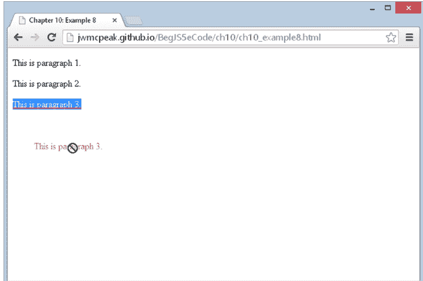

三个事件与拖动的源（即被拖动的元素）相关。下表列出了它们。

| 拖动源事件 | 描述 |
| --- | --- |
| `dragstart` | 当拖动开始时在元素上触发。从文件系统拖动对象时不会触发此事件 |
| `drag` | 当对象被拖动时持续触发 |
| `dragend` | 当拖动操作完成时触发，无论对象是否被放下。从文件系统拖动对象时不会触发此事件 |

要执行拖放操作，你唯一需要监听的事件是 `dragstart`，但这并不意味着 `drag` 和 `dragend` 事件没有用处。你可以使用它们来添加额外的功能和/或视觉提示，以增强用户体验。

### 创建拖放目标

如果你正在拖动对象，很可能你需要一个地方来放置它们——一个拖放目标。没有特殊的属性或HTML来表示一个元素是拖放目标。相反，你需要在作为拖放目标的元素上监听一个或多个事件。

其中之一是 `dragenter` 事件。当拖动对象时鼠标光标进入目标时触发此事件。例如：

```
<!DOCTYPE html>
<html lang="en">
<head>
    <title>第10章：示例18</title>
    <style>
        .drop-zone {
            width: 300px;
            padding: 20px;
            border: 2px dashed #000;
        }
    </style>
</head>
<body>
    <div id="dropZone" class="drop-zone">拖放区！</div>
    <div id="dropStatus"></div>

    <script>
        function handleDragEnter(e) {
            dropStatus.innerHTML = "你正在拖动某物！";
        }

        var dropZone = document.getElementById("dropZone");
        var dropStatus = document.getElementById("dropStatus");

        dropZone.addEventListener("dragenter", handleDragEnter);
    </script>
</body>
</html>
```

将此文件保存为 `ch10_example18.html`。打开它，你会看到类似图10-5的内容。

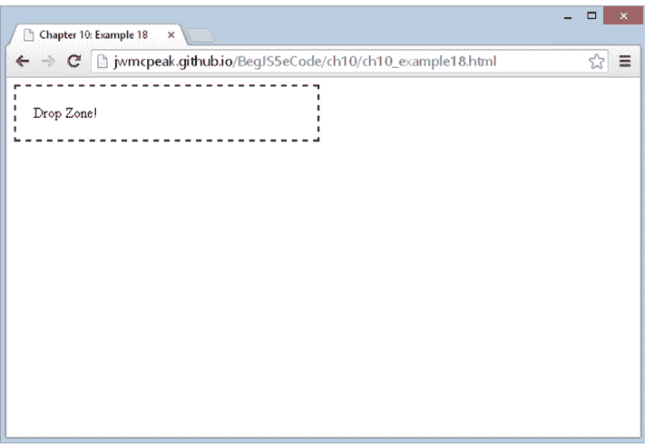

**图10-5**

将任何东西拖动到目标。可以是选定的文本、计算机上的文件等。当你的鼠标指针进入目标时，你会看到文本 `你正在拖动某物！` 出现在页面上。图10-6显示了在Chrome中将文本拖动到拖放区上的情景。

在此页面中，一个 `<div/>` 元素被用作拖放区：

```
<div id="dropZone" class="drop-zone">拖放区！</div>
```

它有一个 `id` 为 `dropZone` 和一个CSS类为 `drop-zone`。从功能角度来看，CSS并不重要，但它确实增加了视觉清晰度，因为它定义了你可以拖放东西的区域。

重要的内容在JavaScript中。首先，你使用 `document.getElementById()` 方法获取拖放目标元素，并监听其 `dragenter` 事件。你还获取了一个 `id` 为 `dropStatus` 的 `<div/>` 元素。你将在拖放操作期间使用它来显示状态消息：

```
var dropZone = document.getElementById("dropZone");
var dropStatus = document.getElementById("dropStatus");

dropZone.addEventListener("dragenter", handleDragEnter);
```

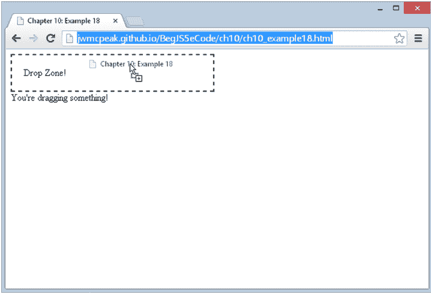

**图10-6**

此事件仅在你拖动某物且鼠标光标进入目标时触发。当这种情况发生时，`handleDragEnter()` 函数执行：

```
function handleDragEnter(e) {
    dropStatus.innerHTML = "你正在拖动某物！";
}
```

这个简单的函数将状态元素的内容更改为声明 `你正在拖动某物！`

`dragenter` 事件是你可以在目标元素上监听的四个事件之一。下表列出了它们。

| 拖放目标事件 | 描述 |
| --- | --- |
| `dragenter` | 当拖动时鼠标首次移动到目标元素上时触发 |
| `dragover` | 当拖动时鼠标在元素上移动时在目标上触发 |
| `dragleave` | 当拖动时鼠标离开目标时在目标上触发 |
| `drop` | 当放下（用户释放鼠标按钮）发生时在目标上触发 |

`dragenter` 事件看起来很重要；毕竟，它让你知道当拖动对象时鼠标光标何时进入拖放区。但实际上，它是可选的。你无法仅通过 `dragenter` 事件完成拖放操作。相反，你必须监听拖放区的 `dragover` 事件。

事情开始变得奇怪的地方就在这里。为了让 `drop` 事件触发，你必须阻止 `dragover` 事件的默认行为。因此，基本上你每次监听 `dragover` 事件时，都必须在事件对象上调用 `preventDefault()`。

### 动手实践 将对象放到目标上

在这个动手实践中，你将编写一个简单的例子，让你可以将元素拖放到目标上。打开你的文本编辑器并输入以下内容：

```
<!DOCTYPE html>
<html lang="en">
<head>
    <title>第10章：示例19</title>
    <style>
        .box {
            width: 100px;
            height: 100px;
        }

        .red {
            background-color: red;
        }

        .drop-zone {
            width: 300px;
            padding: 20px;
            border: 2px dashed #000;
        }
    </style>
</head>
<body>
    <div draggable="true" class="box red"></div>
    <div id="dropZone" class="drop-zone">拖放区！</div>
    <div id="dropStatus"></div>

    <script>
        function dragDropHandler(e) {
            e.preventDefault();

            if (e.type == "dragover") {
                dropStatus.innerHTML = "你正在拖动经过拖放区！";
            } else {
                dropStatus.innerHTML = "你放下了一些东西！";
            }
        }

        var dropZone = document.getElementById("dropZone");
```


```javascript
var dropStatus = document.getElementById("dropStatus");

dropZone.addEventListener("dragover", dragDropHandler);
dropZone.addEventListener("drop", dragDropHandler);
</script>
</body>
</html>
```

将此文件保存为 `ch10_example19.html`，然后打开它。你的网页将如图 10-7 所示。

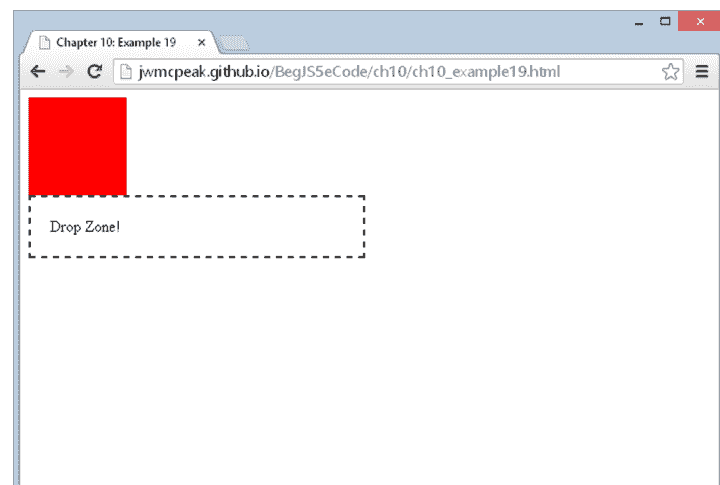

**图 10-7**

将红色方框拖动到目标元素上方，你会看到状态元素的文本变为 `You're dragging over the drop zone!`。将元素放入放置区域，状态文本将变为 `You dropped something!`

然而有一个例外：Firefox 不会让你拖动红色方框，但它允许你从其他来源（如文本、文件系统上的文件等）拖放对象。我们稍后将解释原因。

本示例的 CSS 定义了三个类。你已经见过 `drop-zone` 类，而 `box` 和 `red` 类极其简单：

```css
.box {
    width: 100px;
    height: 100px;
}
.red {
    background-color: red;
}
```

`box` 类将元素的 `width` 和 `height` 属性设置为 100 像素，`red` 则为元素提供红色背景色。这些是任意值，仅为使可拖动元素更具可见性。

接下来是 HTML。此 HTML 文档中唯一的新元素是一个可拖动的 `<div/>` 元素：

```html
<div draggable="true" class="box red"></div>
```

要使其可拖动，你需要将 `draggable` 属性设置为 `true`，并应用 `box` 和 `red` CSS 类，使其更易于拖放。

但与示例 18 一样，核心内容在于 JavaScript。首先，你为 `dropZone` 的 `dragover` 和 `drop` 事件注册监听器：

```javascript
dropZone.addEventListener("dragover", dragDropHandler);
dropZone.addEventListener("drop", dragDropHandler);
```

让我们看看 `dragDropHandler()` 函数。第一行调用了 `Event` 对象的 `preventDefault()` 方法：

```javascript
function dragDropHandler(e) {
    e.preventDefault();
}
```

这一点至关重要，原因有二。首先，必须阻止 `dragover` 的默认行为，`drop` 事件才能触发（这一点很重要）。

其次，当你放置对象时，浏览器会执行某些操作。换句话说，`drop` 事件有其默认行为，但具体行为取决于浏览器和你放置的对象。一些例子包括：

+   - 对于文件或图像，大多数浏览器会尝试打开它。
- 放置 URL 可能会导致浏览器导航至该 URL。
- 在 Firefox 中，放置元素将导致浏览器导航至该元素的 `id` 属性值。

因此，在大多数情况下，你需要阻止 `drop` 事件的默认行为。

在阻止默认行为之后，`dragDropHandler()` 函数会根据事件类型更改 `dropStatus` 元素的内容：

```javascript
if (e.type == "dragover") {
    dropStatus.innerHTML = "You're dragging over the drop zone!";
} else {
    dropStatus.innerHTML = "You dropped something!";
}
```

对于 `dragover` 事件，它只是说明你正在目标元素上拖动；否则，函数知道你放置了某个对象并会告知你。

> 令人沮丧的是，原生拖放功能在所有现代浏览器中的工作方式并不完全相同。前述的浏览器对 `drop` 事件的默认行为的部分列表，只是 JavaScript 开发者需要应对的问题之一。

但请记住，示例 19 在 Firefox 中无法完全正常工作。尽管 JavaScript 开发者不得不处理不一致的实现令人沮丧，但 Firefox 的拖放实现，无论对错，在这方面确实有其道理。当我们尝试拖动红色方框时，我们并未告诉浏览器我们正在传输什么。

### 传输数据

仔细想想，拖放操作就是数据的传输。例如，当你将文件系统上的文件从一个文件夹拖到另一个文件夹时，你就是在两个文件夹位置之间传输数据（该文件）。当从一个应用程序拖动文本到另一个应用程序时，你就是在两个应用程序之间传输文本数据。

浏览器中的拖放遵循类似的概念。开始拖动时，你需要告诉浏览器你计划传输什么，而当你放置对象时，你需要指定数据如何从源传输到目标。

拖放规范定义了一个 `DataTransfer` 对象，用于在拖放操作期间保存被拖动的数据。你可以通过 `Event` 对象的 `dataTransfer` 属性访问此对象。你在 `dragstart` 事件处理程序中使用 `DataTransfer` 对象的 `setData()` 方法设置数据，并在 `drop` 事件处理程序中使用 `getData()` 方法读取该数据。

要使示例 19 在 Firefox 中工作，你需要处理 `dragstart` 事件并使用 `DataTransfer` 对象的 `setData()` 方法。以下添加了必要的代码：

```html
<!DOCTYPE html>
<html lang="en">
<head>
    <title>Chapter 10: Example 20</title>
    <style>
        .box {
            width: 100px;
            height: 100px;
        }

        .red {
            background-color: red;
        }

        .drop-zone {
            width: 300px;
            padding: 20px;
            border: 2px dashed #000;
        }
    </style>
</head>
<body>
    <div draggable="true" class="box red"></div>
    <div id="dropZone" class="drop-zone">Drop Zone!</div>
    <div id="dropStatus"></div>

    <script>
```

```javascript
function dragStartHandler(e) {
    e.dataTransfer.setData("text", "Drag and Drop!");
}

function dragDropHandler(e) {
    e.preventDefault();

    if (e.type == "dragover") {
        dropStatus.innerHTML = "You're dragging over the " +
                               "drop zone!";
    } else {
        dropStatus.innerHTML = e.dataTransfer.getData("text");
    }
}

var dragBox = document.querySelector("[draggable]");
var dropZone = document.getElementById("dropZone");
var dropStatus = document.getElementById("dropStatus");

dragBox.addEventListener("dragstart", dragStartHandler);
dropZone.addEventListener("dragover", dragDropHandler);
dropZone.addEventListener("drop", dragDropHandler);
```

```
</script>
</body>
</html>
```

将此文件保存为 `ch10_example20.html`，然后在 Firefox 中打开它。现在将红色方框拖动到目标，你会看到它在所有浏览器（包括 Firefox）中的行为与 `ch10_example19.html` 类似。

让我们只关注新的代码行。首先，你通过使用 `document.querySelector()` 并传递属性选择器 `[draggable]`，将可拖动方框存储在 `dragBox` 变量中：

```javascript
var dragBox = document.querySelector("[draggable]");
```

接下来，你在 `dragBox` 对象上为 `dragstart` 事件注册一个事件监听器：

```javascript
dragBox.addEventListener("dragstart", dragStartHandler);
```

当你在 `dragBox` 对象上开始拖动操作时，`dragStartHandler()` 函数执行。此函数利用 `DataTransfer` 对象的 `setData()` 方法来保存拖放操作的数据：

```javascript
function dragStartHandler(e) {
    e.dataTransfer.setData("text", "Drag and Drop!");
}
```

`setData()` 函数接受两个参数：要存储的数据类型和实际数据。所有浏览器唯一支持的数据类型是 `"text"` 和 `"url"`；因此，此函数存储文本数据 `Drag and Drop!`。

> **注意** 大多数浏览器支持其他数据类型，例如 MIME 类型（例如 `text/plain`、`text/html` 等）。然而，IE10 和 IE11 仅支持 `text` 和 `url`。

最后一行新增/更改的代码位于 `dragDropHandler()` 函数中。当 `drop` 事件触发时，不再在状态元素中显示任意字符串值，而是通过使用 `getData()` 方法从 `dataTransfer` 对象中检索数据：

```javascript
dropStatus.innerHTML = e.dataTransfer.getData("text");
```

`getData()` 方法仅接受一个参数：你在调用 `setData()` 时使用的数据类型。因此，此代码检索 `Drag and Drop!` 的值，并将其用作状态元素的 `innerHTML`。

### 动手实践 完整的拖放

在此动手实践中，你将运用所学的所有关于原生拖放的知识，并编写一个页面，让你可以在两个拖放目标之间拖放元素。

打开你的文本编辑器并输入以下内容：

```html
<!DOCTYPE html>

<html lang="en">
<head>
    <title>Chapter 10: Example 21</title>
    <style>
        [data-drop-target] {
            height: 400px;
            width: 200px;
            margin: 2px;
            background-color: gainsboro;
            float: left;
        }

        .drag-enter {
            border: 2px dashed #000;
        }

        .box {
            width: 200px;
            height: 200px;
        }

        .navy {
            background-color: navy;
        }

        .red {
            background-color: red;
        }
    </style>
</head>
<body>
    <div data-drop-target="true">
        <div id="box1" draggable="true" class="box navy"></div>
        <div id="box2" draggable="true" class="box red"></div>
    </div>
</body>
```


## 第10章 示例21

将此文件保存为 `ch10_example21.html`，并在你选择的现代浏览器中打开它。你会看到一个页面，由两列组成。左侧，一个蓝色方块位于一个红色方块之上，右侧是一个实心的灰度矩形，如图10-8所示。

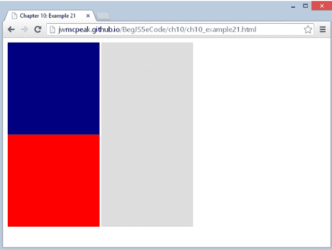

**图10-8**

灰度区域是放置目标（drop targets），蓝色和红色方块是可拖动对象。将蓝色方块拖动到空的放置目标上，你会看到目标周围出现虚线边框（图10-9）。

将蓝色方块放置在该目标上，你会看到它从左侧目标移动到右侧。现在，在两个放置目标之间拖动方块，以查看完整效果。

让我们从HTML开始。在此示例中，放置目标是一个通过 `data-drop-target` 属性设置为 `true` 来标识的元素。此示例包含两个放置目标，尽管你可以轻松添加更多：

```html
<div data-drop-target="true">
    <div id="box1" draggable="true" class="box navy"></div>
    <div id="box2" draggable="true" class="box red"></div>
</div>
<div data-drop-target="true"></div>
```

第一个放置目标包含两个可拖动的 `<div/>` 元素，它们各自都有一个 `id` 属性。除了 `id` 值之外，它们唯一的区别是CSS。两者都使用 `box` CSS类，但一个还使用了 `navy` CSS类，而另一个使用了 `red` 类。

说到CSS，让我们看看样式表中定义的样式。第一条规则匹配所有具有 `data-drop-target` 属性的元素：

```css
[data-drop-target] {
    height: 400px;
    width: 200px;
    margin: 2px;
    background-color: gainsboro;
    float: left;
}
```

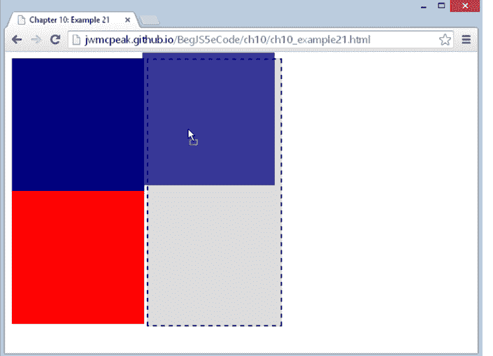

高度和宽度被设置为一次容纳两个可拖动方块。2像素的边距刚好在放置目标元素之间提供了足够的视觉分隔空间。背景色使它们易于与页面背景区分开来，并且它们各自向左浮动。

下一条规则也适用于放置目标：

```css
.drag-enter {
    border: 2px dashed #000;
}
```

`drag-enter` 类被用作视觉提示。当你将对象拖动到放置目标元素上时，此 `drag-enter` 类会被应用到该元素上。这对于完成拖放操作并非必需，但它确实增强了用户体验。

最后的CSS规则集用于可拖动元素：

```css
.box {
    width: 200px;
    height: 200px;
}

.navy {
    background-color: navy;
}

.red {
    background-color: red;
}
```

每个可拖动元素使用 `box` 类来设置其高度和宽度。`navy` 和 `red` 类与 `box` 类结合使用，分别为元素赋予海军蓝或红色的背景色。

至于JavaScript，你首先检索两组元素——那些可拖动的和那些作为放置目标的：

```javascript
var draggable = document.querySelectorAll("[draggable]");
var targets = document.querySelectorAll("[data-drop-target]");
```

因此，使用 `document.querySelectorAll()` 方法，你通过各自的 `[draggable]` 和 `[data-drop-target]` CSS选择器检索两组元素，并将它们分别赋给 `draggable` 和 `targets` 变量。

接下来，你希望在可拖动元素上注册 `dragstart` 事件监听器：

```javascript
for (var i = 0; i < draggable.length; i++) {
    draggable[i].addEventListener("dragstart", handleDragStart);
}
```

使用 `for` 循环，你遍历 `draggable` 集合，并在每个可拖动对象上调用 `addEventListener()` 方法，传递 `dragstart` 作为事件，`handleDragStart()` 函数对象作为处理程序。

然后，你想对目标元素使用类似的过程：

```javascript
for (i = 0; i < targets.length; i++) {
    targets[i].addEventListener("dragover", handleOverDrop);
    targets[i].addEventListener("drop", handleOverDrop);
    targets[i].addEventListener("dragenter", handleDragEnterLeave);
    targets[i].addEventListener("dragleave", handleDragEnterLeave);
}
```

通过使用另一个 `for` 循环，你遍历 `targets` 集合，并为 `dragover`、`drop`、`dragenter` 和 `dragleave` 事件注册事件处理程序。两个函数用于处理这四个事件：`handleOverDrop()` 函数处理 `dragover` 和 `drop` 事件，`handleDragEnterLeave()` 处理 `dragenter` 和 `dragleave` 事件。

第一个函数 `handleDragStart()` 只包含一行代码：

```javascript
function handleDragStart(e) {
    e.dataTransfer.setData("text", this.id);
}
```

其目的很简单：存储可拖动元素的ID。注意在 `this.id` 中使用了 `this`。当你注册事件监听器时，处理函数在触发事件的元素对象上下文中执行。在本例中，`dragstart` 事件在其中一个可拖动元素上触发；因此，`this` 指的就是那个元素。换句话说，`this` 与 `e.target` 相同。

下一个函数是 `handleDragEnterLeave()`，如前所述，它在放置目标上触发 `dragenter` 和 `dragleave` 事件时执行：

```javascript
function handleDragEnterLeave(e) {
    if (e.type == "dragenter") {
        this.className = "drag-enter";
    } else {
        this.className = "";
    }
}
```

此函数的第一行检查发生的事件类型。如果是 `dragenter` 事件，则将放置目标元素的CSS类设置为 `drag-enter`（再次注意，使用了 `this` 而不是 `e.target`——这样输入起来容易得多）。如果事件不是 `dragenter`，则将元素的CSS类设置为空字符串，从而移除 `drag-enter` 类。

最后一个函数 `handleOverDrop()` 执行拖放操作的真正魔术。此函数同时处理 `dragover` 和 `drop` 事件，因此应阻止默认操作发生。因此，函数的第一行调用 `e.preventDefault()`：

```javascript
function handleOverDrop(e) {
    e.preventDefault();
}
```

这对于 `dragover` 事件来说就是全部所需。因此，如果事件不是 `drop` 事件，函数将直接退出：

```javascript
if (e.type != "drop") {
    return;
}
```

如果是 `drop` 事件，函数将继续执行，并从 `DataTransfer` 对象中获取可拖动元素的 `id`：

```javascript
var draggedId = e.dataTransfer.getData("text");
var draggedEl = document.getElementById(draggedId);
```

有了这个 `id`，你就可以使用 `document.getElementById()` 检索可拖动元素的对象，并将其存储在 `draggedEl` 变量中。

对于放置可拖动方块，你有两个选择：可以将其放入当前所在的放置目标，也可以放入另一个放置目标。如果将其放回原位，除了重置目标的CSS类外，没有其他事情可做。这很容易检查；只需使用元素的 `parentNode` 属性：

```javascript
if (draggedEl.parentNode == this) {
    this.className = "";
    return;
}
```


## 11

## HTML 表单：与用户交互

**本章学习目标：**

- 编写针对文本、密码、文本区域和隐藏表单控件的脚本
- 为选择框、复选框和单选按钮表单控件编写代码
- 使用 JavaScript 与新的 HTML5 表单控件进行交互

**Wrox.com 本章代码下载**

您可以在 <http://www.wiley.com/go/BeginningJavaScript5E> 的“下载代码”选项卡上找到本章的 wrox.com 代码下载。您也可以在 <http://beginningjs.com> 查看所有示例和相关文件。

如果无法与用户交互或从用户那里获取信息（如文本、数字或日期），网页将会非常乏味。幸运的是，使用 JavaScript 可以实现这一点。您可以在网页内使用这些信息，也可以将其发送到 Web 服务器，在那里您可以对其进行处理，并根据需要将其存储在数据库中。本章的重点是在 Web 浏览器内使用这些信息，这被称为*客户端处理*。

您已经非常熟悉各种用户界面元素。例如，每个操作系统都有许多标准元素，例如可以点击的按钮；可以选择的列表、下拉列表框和单选按钮；以及可以勾选的框。这些元素是您现在与应用程序交互的方式。好消息是，您可以在网页中包含许多此类元素——更妙的是，这样做非常容易。当您在页面中拥有这样一个元素——比如一个按钮——然后就可以将代码绑定到其事件上。例如，当按钮被点击时，您可以触发您创建的一个 JavaScript 函数。

所有用于交互的 HTML 元素都应放置在 HTML 表单内部。让我们首先看看 HTML 表单以及如何在 JavaScript 中与它们交互。

## HTML 表单

表单为您提供了一种将具有共同目的的 HTML 交互元素分组的方式。例如，一个表单可能包含允许用户输入数据以在网站上注册的元素。另一个表单可能包含允许用户请求汽车保险报价的元素。一个页面中可以有多个独立的表单。在需要将信息提交到 Web 服务器之前，您无需担心包含多个表单的页面——那时您需要意识到，一个页面中只有一个表单的信息可以一次提交到服务器。

要创建一个表单，请使用 `<form>` 和 `</form>` 标签来声明其起始和结束位置。`<form>` 元素具有多个属性，例如 `action` 属性（决定表单提交到何处）、`method` 属性（决定信息如何提交）以及 `target` 属性（决定表单响应加载到哪个框架）。

一般来说，对于不打算向服务器提交信息的客户端脚本，这些属性不是必需的。目前，您在 `<form>` 元素中唯一需要设置的属性是 `name` 属性，以便您可以引用该表单。

因此，要创建一个空白表单，所需的标签大致如下：

```html
<form name="myForm">
</form>
```

听到这些标签创建了一个 `HtmlFormElement` 对象，您应该不会感到惊讶，您可以使用该对象来访问表单。您可以通过两种方式访问此对象。

首先，您可以直接使用其名称访问该对象——在本例中为 `document.myForm`。或者，您可以通过 `document` 对象的 `forms` 集合属性来访问该对象。请记住，第 8 章讨论了 `document` 对象的 `images` 集合以及如何像操作任何其他数组一样操作它。`forms` 集合也适用同样的原则，只是集合中的每个元素现在持有 `HtmlFormElement`（此后简称为 `Form`）对象，而不是 `HtmlImageElement` 对象。例如，如果它是页面中的第一个表单，您可以使用 `document.forms[0]` 来引用它。

> **注意** 当然，您也可以使用 `document.getElementById()` 和 `document.querySelector()` 方法来访问表单。

`<form>` 元素的许多属性都可以作为 `HtmlFormElement` 对象的属性来访问。特别是，`name` 属性对应于 `<form>` 元素的 `name` 属性。

如果被拖动元素的父节点是目标拖放区域，您将 `className` 属性设置为空字符串，并使用 `return` 语句退出函数。否则，您希望将被拖动的元素节点从其旧父节点/拖放目标移动到其新父节点/拖放目标：

```javascript
draggedEl.parentNode.removeChild(draggedEl);
this.appendChild(draggedEl);
```

如您所见，这是一个简单的过程。要从其当前父节点移除可拖动元素，您需要检索其 `parentNode` 并调用 `removeChild()` 方法。`removeChild()` 方法不会删除节点；它只是将其移除，以便您可以将其附加到 DOM 中的另一个节点。

被拖动的元素从一个拖放目标移动到另一个后，拖放操作完成，您将拖放目标元素的 CSS 类设置为空字符串：

```javascript
this.className = "";
```

这在视觉上重置了拖放目标，为用户提供视觉提示，表明拖放操作已完成。

> 网页是一个交互式环境。用户忙于点击、键入、拖动和进行其他操作。因此，事件对于 Web 开发人员来说极其重要。事件不仅是我们的响应和与用户交互的方式，它们还使我们能够在页面中发生特定事情时执行代码。在后面的章节中，您将看到此类示例，并使用事件来响应对象的操作，而不是用户的操作。

## 总结

本章涵盖了大量内容，但现在您已经掌握了在当前网络上使用的浏览器中如何处理和操作事件的坚实基础。您甚至知道标准 DOM 事件模型和旧版 IE 事件模型之间的区别，并且编写了一个使编写跨浏览器 JavaScript 相对简单的事件工具。

本章涵盖以下要点：

- 您看到了 HTML 元素除了方法和属性外，还有事件。您在 JavaScript 中通过使用事件处理程序来处理这些事件，并将它们连接到您希望在事件发生时执行的代码。可用的事件取决于您处理的对象。
- 您可以使用元素的 `on` 属性将函数连接到元素的事件处理程序。但您也了解到这样做混合了您的 HTML 和 JavaScript，在大多数情况下应避免这种方法。
- 事件可以通过使用对象的 `on` 属性来处理，这是比 HTML 属性更好的解决方案，但仍有其自身的问题。
- 标准 DOM 事件模型被所有现代浏览器支持，它提供了将代码连接到事件的最佳方式。
- 您了解了标准事件对象，以及它如何提供有关发生事件的大量信息，包括事件类型和接收事件的元素。
- 您了解了旧版 IE 的专有事件模型，如何使用 `attachEvent()` 连接事件，以及如何访问旧版 IE 的事件对象。
- 标准 DOM 事件模型和旧版 IE 事件模型之间存在一些差异。您了解了关键差异并编写了一个简单的跨浏览器事件工具。
- 某些事件在触发时有默认操作，您可以使用标准事件对象的 `preventDefault()` 方法和旧版 IE 的 `returnValue` 属性来阻止该操作。
- 现代浏览器支持原生拖放功能，您可以编写利用此新功能的代码。
- 在某些情况下，例如对于文档对象，需要第二种将事件处理程序连接到代码的方法。将对象的属性设置为事件处理程序的名称并赋值为您的函数，会产生与将事件处理程序作为属性使用相同的效果。
- 在某些情况下，从事件函数返回值使您可以取消与事件关联的操作。例如，要阻止被点击的链接导航到页面，您可以从事件处理程序的代码返回 `false`。

本章内容到此结束。在下一章中，您将继续学习表单脚本，您可以在页面中添加各种控件以帮助从用户那里收集信息。

## 练习

您可以在附录 A 中找到这些问题的建议解决方案。

1. 在事件工具对象中添加一个名为 `isOldIE()` 的方法，该方法返回一个布尔值，指示浏览器是否是旧版 IE。
2. 示例 15 展示了符合标准的浏览器和旧版 IE 之间的一些行为不一致。请记住，在旧版 IE 中，事件处理程序以相反的顺序执行。修改此示例以使用新的 `isOldIE()` 方法，以便您可以为旧版 IE 和符合标准的浏览器编写特定代码（提示：您将调用 `addListener()` 方法四次）。
3. 示例 17 让您编写了一个跨浏览器的标签页脚本，但您可能已经注意到，它的行为有些异常。基本思路是存在的，但当您点击另一个标签页时，标签页仍保持活动状态。修改脚本，使同一时间只有一个标签页处于活动状态。


## 动手实践：forms 集合

在本次动手实践中，你将使用 `forms` 集合来访问三个 `Form` 对象中的每一个，并在消息框中显示其 `name` 属性的值。打开你的文本编辑器，输入以下内容：

```html
<!DOCTYPE html>
<html lang="en">
<head>
    <title>Chapter 11: Example 1</title>
</head>
<body>
    <form action="" name="form1">
        <p>
            This is inside form1.
        </p>
    </form>
    <form action="" name="form2">
        <p>
            This is inside form2
        </p>
    </form>
    <form action="" name="form3">
        <p>
            This is inside form3
        </p>
    </form>
    <script>
        var numberForms = document.forms.length;
        for (var index = 0; index < numberForms; index++) {
            alert(document.forms[index].name);
        }
    </script>
</body>
</html>
```

将其保存为 `ch11_example1.html`。当你在浏览器中加载它时，应该会看到一个 `alert` 框显示第一个表单的名称。点击“确定”按钮以显示下一个表单的名称，然后再次点击“确定”以显示第三个也是最后一个表单的名称。

在页面的 `body` 中，你定义了三个表单。你为每个表单赋予一个名称和一个段落文本。

在 JavaScript 代码中，你遍历了 `forms` 集合。就像任何其他 JavaScript 数组一样，`forms` 集合有一个 `length` 属性，你可以用它来确定需要循环多少次。实际上，由于你知道有多少个表单，你也可以直接写上数字。然而，这个示例使用了 `length` 属性，因为这使得在不修改代码的情况下向集合中添加内容变得更容易。像这样将你的代码通用化是一个值得养成的好习惯。

代码首先获取 `forms` 集合中 `Form` 对象的数量，并将该数字存储在变量 `numberForms` 中：

```javascript
var numberForms = document.forms.length;
```

接下来，你定义了 `for` 循环：

```javascript
for (var formIndex = 0; formIndex < numberForms; formIndex++) {
    alert(document.forms[formIndex].name);
}
```

请记住，由于数组的索引从 0 开始，你的循环需要从索引 0 到索引 `numberForms - 1`。你通过将 `index` 变量初始化为 0，并将 `for` 循环的条件设置为 `index < numberForms` 来实现这一点。

在 `for` 循环的代码中，你将所需表单的索引（即 `index`）传递给 `document.forms[]`，这将返回 `forms` 集合中该索引处的 `Form` 对象。要访问 `Form` 对象的 `name` 属性，你需要在属性名 `name` 后面加上一个点。

## 传统表单对象的属性与方法

表单中常见的 HTML 表单控件（你稍后会更详细地了解）也有相应的对象。访问这些对象的一种方式是通过 `Form` 对象的 `elements` 属性，这是另一个集合。`elements` 集合包含了表单内所有对应于 HTML 交互元素的对象，除了很少使用的 `<input type="image"/>` 元素。正如你稍后将看到的，这个属性对于遍历表单中的每个元素非常有用。例如，你可以在提交表单之前遍历每个元素以检查其是否包含有效数据。

作为一个集合，`Form` 对象的 `elements` 属性具有 `length` 属性，它告诉你表单中有多少个元素。`Form` 对象本身也有一个 `length` 属性，它同样告诉你表单中的元素数量。使用哪一个取决于你，因为两者做的是同样的工作，尽管编写 `myForm.length` 比 `myForm.elements.length` 更短，因此输入更快，代码看起来也不那么冗长。

当你将表单中的数据提交到服务器时，通常使用提交按钮（你稍后会了解）。然而，`Form` 对象也有一个 `submit()` 方法，它所做的工作几乎相同。

> **注意** `submit()` *方法会提交表单，但它不会触发 Form 对象的提交事件；因此，当使用 submit() 提交表单时，不会调用提交事件监听器*。

回想一下，在第 10 章中，你学习了如何影响正常事件流程是继续还是取消。例如，你看到在超链接的 `click` 事件处理程序中调用 `preventDefault()` 会导致链接的导航被取消。同样，这个原理也适用于 `Form` 对象的 `submit` 事件，该事件在用户提交表单时触发。通过调用 `preventDefault()`，提交将被取消。这使得 `submit` 事件处理程序的代码成为进行表单验证——即检查用户输入的内容是否有效——的理想场所。例如，如果你询问用户的年龄而他们输入了“少管闲事”，你可以识别出这是文本而非有效数字，并阻止他们继续。

除了重置按钮（本章稍后讨论）之外，`Form` 对象还有一个 `reset()` 方法，它可以清除表单，或者在存在默认值的情况下恢复它们。

创建空白表单并不那么令人兴奋或实用，所以现在让我们把注意力转向在表单内提供交互功能的 HTML 元素。

### 表单中的 HTML 元素

大约有十种元素常见于 `<form/>` 元素中。最有用的元素如图 11-1、11-2、11-3 和 11-4 所示，它们被归类为通用类型。每种类型都给出了名称，括号内是创建它所需的 HTML，但请注意这不是完整的 HTML，而只是一部分。新的 HTML5 表单控件未在此列出；你将在本章后面研究它们。

如你所见，大多数表单元素是通过 `<input/>` 元素创建的。`<input/>` 元素的属性之一是 `type` 属性。正是这个属性决定了这个元素将是哪种表单元素。该属性的值示例包括 `button`（用于创建按钮）和 `text`（用于创建文本框）。


网页中的每个表单元素都被作为——是的，你猜对了——一个对象提供给你使用。与你见过的所有其他对象一样，每个元素的对象都有自己独特的一套属性、方法和事件。你将依次查看每个表单元素及其特定属性、方法和事件的使用方法，但在那之前，让我们先看看表单元素对象共有的属性和方法。

#### 共有属性与方法

由于大多数表单元素是由 `<input/>` 元素创建的，你可以正确地猜测到所有表单元素共享若干共同的属性和方法。

以下是一些示例。

##### name 属性

所有表单元素对象共有的一个属性是 `name` 属性。你可以使用这个属性的值在脚本中引用该特定元素。此外，如果你正在将表单中的信息发送到服务器，该元素的 `name` 属性会与表单元素的任何值一起发送，以便服务器知道该值与什么相关联。

##### value 属性

大多数表单元素对象也有 `value` 属性，它返回元素的值。例如，对于文本框，`value` 属性返回用户在文本框中输入的文本。此外，设置 `value` 属性的值使你能够将文本放入文本框中。然而，`value` 属性的使用因元素而异，因此你将在研究每个单独元素时了解其含义。

##### form 属性

所有表单元素对象也有 `form` 属性，它返回包含该元素的 `Form` 对象。在你有一个用于检查表单中数据有效性的通用例程的情况下，这会很有用。例如，当用户点击提交按钮时，你可以将提交按钮的 `form` 属性所引用的 `Form` 对象传递给你的数据检查器，检查器可以使用它来依次遍历表单上的每个元素，检查元素中的数据是否有效。如果你页面上定义了多个表单，或者你有一个可以剪切粘贴到不同页面的通用数据检查器，这非常方便——这样你就不需要预先知道表单的名称。

##### type 属性

有时，了解你正在处理的是哪种类型的元素会很有用，特别是在使用 `elements` 集合属性遍历表单中的元素时。此信息可以通过每个元素对象都具有的 `type` 属性来获取。此属性返回元素的类型（例如 `button` 或 `text`）。

##### focus() 和 blur() 方法

所有表单元素对象也有 `focus()` 和 `blur()` 方法。*焦点*是你可能还没有遇到过的一个概念。如果一个元素是焦点的中心，用户按下的任何键

它们会直接传递给该元素。例如，如果一个文本框获得焦点，按下按键就会将值输入到该文本框中。同样，如果一个按钮获得焦点，按下回车键就会触发该按钮的 onclick 事件处理程序代码，就像用户用鼠标点击该按钮一样。

用户可以通过单击元素或使用 Tab 键选择它来设置当前具有焦点的元素。然而，作为程序员，你也可以通过使用表单元素对象的 focus() 方法来决定哪个元素获得焦点。例如，如果你有一个供用户输入年龄的文本框，而他输入了一个无效值，比如一个字母而不是数字，你可以告诉他输入无效，并让他返回该文本框以纠正错误。

*Blur*，或许更好的叫法是“失去焦点”，是 focus 的反义操作。如果你想让一个表单元素不再是用户注意力的焦点，可以使用 blur() 方法。当用于表单元素时，blur() 方法通常会导致焦点转移到包含该表单的页面上。

除了 focus() 和 blur() 方法之外，所有表单元素对象都有 onfocus 和 onblur 事件处理程序。正如你所预料的那样，当元素由于用户操作或 focus() 和 blur() 方法而获得或失去焦点时，它们会分别被触发。onblur 事件处理程序可以是检查刚刚失去焦点的元素中数据有效性的绝佳位置。如果数据无效，你可以将焦点重新设置回该元素，并让用户知道他输入的数据为何错误。

> 注意：请记住，submit() 方法的行为与 focus() 和 blur() 不同，因为它不会触发 submit 事件。

需要注意的一点是，在 focus 或 blur 事件监听器代码中使用 focus() 和 blur() 方法时要小心。存在发生无限循环的危险。例如，考虑两个元素，每个元素的 focus 事件都将焦点传递给另一个元素。那么，如果一个元素获得焦点，它的 focus 事件会将焦点传递给第二个元素，第二个元素的 focus 事件会将焦点传递回第一个元素，如此往复，直到唯一的出路是关闭浏览器。这很可能不会让用户满意！

如果某个字段或其他字段依赖于用户的某些输入，那么在使用 focus() 和 blur() 方法将焦点放回有问题的字段时也要非常谨慎。例如，假设你有两个文本框：一个用于用户输入他们的城市，另一个用于输入他们的州。还假设对州文本框的输入进行检查，以确保指定的城市位于该州内。如果该州不包含该城市，你会将焦点重新放回州文本框，以便用户可以更改州的名称。然而，如果用户实际上输入了错误的城市名但正确的州名，她可能无法返回城市文本框来纠正问题。

### 按钮元素

我们开始探讨表单元素，从标准按钮元素开始，因为它可能是最常用的且相当简单。创建按钮的 HTML 元素是 `<input/>`。例如，要创建一个名为 myButton、上面显示文字“Click Me”的按钮，`<input/>` 元素需要如下所示：

```html
<input type="button" name="myButton" value="Click Me" />
```

### 试一试：统计按钮点击次数

type 属性设置为 button，value 属性设置为希望出现在按钮面上的文本。你可以省略 value 属性，但这样会得到一个空白按钮，让用户猜测其用途。

此元素创建一个关联的 HTMLInputElement 对象（实际上，所有 `<input/>` 元素都会创建 HTMLInputElement 对象）；在本例中它被称为 myButton。此对象拥有前面描述的所有通用属性和方法，包括 value 属性。此属性使你能够使用 JavaScript 更改按钮面上的文本，尽管这可能不是你需要经常做的事情。按钮真正的核心是 click 事件。

你连接按钮的 click 事件的方式与连接任何其他元素相同。你需要做的就是定义一个在按钮被点击时要执行的函数（比如 buttonClick()），然后使用 addEventListener() 方法注册一个 click 事件监听器。

在下面的示例中，你使用前面描述的方法来记录一个按钮被点击的次数。

```html
<!DOCTYPE html>

<html lang="en">
<head>
    <title>Chapter 11: Example 2</title>
</head>
<body>
    <form action="" name="form1">
        <input type="button" name="myButton" value="Button clicked 0 times" />
    </form>

    <script>
        var myButton = document.form1.myButton;
        var numberOfClicks = 0;

        function myButtonClick() {
            numberOfClicks++;
            myButton.value = "Button clicked " + numberOfClicks + " times";
        }

        myButton.addEventListener("click", myButtonClick);
    </script>
</body>
</html>
```

将此页面保存为 ch11_example2.html。如果你在浏览器中加载此页面，你会看到一个上面写着“Button clicked 0 times”的按钮。如果你反复点击此按钮，你会看到按钮文本上记录的按钮点击次数。

你通过定义两个名为 myButton 和 numberOfClicks 的变量来开始脚本块。前者保存对 `<input/>` 元素对象的引用。你在后者中记录按钮被点击的次数，并使用此信息来更新按钮的文本。

脚本块中的另一段代码是函数 `myButtonClick()` 的定义。此函数处理 `<input/>` 元素的 click 事件：

```javascript
myButton.addEventListener("click", myButtonClick);
```

此元素是一个名为 `myButton` 的 `Button` 元素，包含在一个名为 `form1` 的表单中：

```html
<form action="" name="form1">
    <input type="button" name="myButton" value="Button clicked 0 times" />
</form>
```

让我们更仔细地看看 `myButtonClick()` 函数。首先，该函数将变量 `numberOfClicks` 的值增加一：

```javascript
function myButtonClick() {
    numberOfClicks++;
}
```

接下来，你使用 `Button` 对象的 `value` 属性更新按钮面上的文本：

```javascript
myButton.value = "Button clicked " + numberOfClicks + " times";
}
```

本例中的函数特定于此表单和按钮，而不是一个你将在其他情况下使用的通用函数。因此，本例中的代码直接使用 `myButton` 变量引用按钮。

### 试一试：mouseup 和 mousedown 事件

`Button` 对象支持的两个不太常用的事件是 `mousedown` 和 `mouseup` 事件。你可以在下一个示例中看到这两个事件的实际应用。

```html
<!DOCTYPE html>
<html lang="en">
<head>
    <title>Chapter 11: Example 3</title>
</head>
<body>
    <form action="" name="form1">
        <input type="button" name="myButton" value="Mouse goes up" />
    </form>

    <script>
        var myButton = document.form1.myButton;

        function myButtonMouseup() {
            myButton.value = "Mouse Goes Up";
        }

        function myButtonMousedown() {
            myButton.value = "Mouse Goes Down";
        }

        myButton.addEventListener("mousedown", myButtonMousedown);
        myButton.addEventListener("mouseup", myButtonMouseup);
    </script>
</body>
</html>
```

将此页面保存为 ch11_example3.html 并在浏览器中加载。如果你用鼠标左键点击按钮并按住不放，你会看到按钮上的文本变为“Mouse Goes Down”。一旦你释放鼠标按钮，文本就会变为“Mouse Goes Up”。

在页面的 body 中，你在名为 `form1` 的表单内定义了一个名为 `myButton` 的按钮：

```html
<form action="" name="form1">
    <input type="button" name="myButton" value="Mouse goes up" />
</form>
```

你的 JavaScript 代码从文档中检索此 `Button` 对象并将其存储在 `myButton` 变量中，并为 `mouseup` 和 `mousedown` 事件注册事件监听器。

`myButtonMouseup()` 和 `myButtonMousedown()` 函数分别处理这些事件。每个函数只包含一行代码，其中你使用 `Button` 对象的 `value` 属性来更改按钮面上显示的文本。

需要注意的一个重要点是，像 `mouseup` 和 `mousedown` 这样的事件只有当鼠标指针实际位于相关元素上方时才会被触发。例如，如果你在按钮上点击并按住鼠标按钮，然后在释放鼠标按钮之前将鼠标移开按钮，你会发现 `mouseup` 事件不会触发，按钮面上的文本也不会更改。在这种情况下，如果你已将任何代码连接到它，触发的将是 `document` 对象的 `mouseup` 事件。

不要忘记，像所有表单元素对象一样，`Button` 对象也有 `focus` 和 `blur` 事件，尽管在按钮上下文中它们很少使用。

另外两种按钮类型是提交（Submit）和重置（Reset）按钮。你定义这些按钮的方式与定义标准按钮相同，只是 `<input>` 标签的 `type` 属性设置为 `submit` 或 `reset`，而不是 `button`。例如，图 11-4 中的提交和重置按钮是使用以下代码创建的：

```html
<input type="submit" value="Submit" name="submit1" />
<input type="reset" value="Reset" name="reset1" />
```

这些按钮具有特殊用途，与脚本无关。

当点击提交按钮时，按钮所在表单的表单数据会自动发送到服务器，无需任何脚本。

当点击重置按钮时，表单中的所有元素都会被清除并恢复为其默认值（即页面首次加载时的值）。


“提交”和“重置”按钮有对应的对象，分别称为 Submit 和 Reset，它们具有与标准 Button 对象完全相同的属性、方法和事件。

### 文本元素

标准文本元素允许用户输入单行文本。这些信息随后可用于 JavaScript 代码，或提交到服务器进行服务器端处理。

### 文本框

文本框通过 `<input/>` 元素创建，与按钮类似，但 `type` 属性需设置为 `text`。同样，你可以选择不包含 `value` 属性，但如果包含，该值将在页面加载时显示在文本框内。

在以下示例中，`<input/>` 元素有两个额外的属性：`size` 和 `maxlength`。`size` 属性决定了文本框的宽度（以字符数为单位），而 `maxlength` 属性决定了用户可以在框中输入的最大字符数。这两个属性都是可选的，并使用浏览器确定的默认值。

例如，要创建一个宽度为 10 个字符、最大字符长度为 15，且初始包含“Hello World”字样的文本框，你的 `<input/>` 元素应如下所示：

```html
<input type="text" name="myTextBox" size="10" maxlength="15" value="Hello World" />
```

该元素创建的对象有一个 `value` 属性，你可以在脚本中使用它来设置或读取文本框中包含的文本。除了前面讨论过的通用属性和方法外，代表文本框的对象还有一个 `select()` 方法，该方法会选中或高亮显示文本框内的所有文本。如果用户输入了无效值，你可以将 `focus` 设置到文本框并选中其中的文本。这样可以将用户的光标放在正确的位置以纠正数据，并使用户非常清楚无效数据所在的位置。`value` 属性总是返回字符串数据类型，即使输入的是数字字符。如果你将值用作数字，JavaScript 通常会为你执行从字符串数据类型到数字数据类型的转换，但并非总是如此。例如，如果你执行的操作对字符串是有效的，JavaScript 就不会进行转换。如果你有一个包含两个文本框的表单，并且你将这些返回的值相加，JavaScript 会将它们拼接而不是相加，因此 1 加 1 的结果将是 11 而不是 2。为了解决这个问题，你需要将所有涉及的值转换为数值数据类型，例如使用 `parseInt()`、`parseFloat()` 或 `Number()`。然而，如果你对两个值进行减法运算，这是一种仅对数字有效的操作，JavaScript 会说：“啊哈，这只能用数字完成，所以我会将值转换为数字数据类型。”因此，1 减 1 的结果将是 0，而你无需使用 `parseInt()` 或 `parseFloat()`。这是一个难以发现的棘手错误，因此最好养成显式转换的习惯，以避免日后出现问题。

除了通用事件（如 `focus` 和 `blur`）外，文本框还有 `change`、`select`、`keydown`、`keypress` 和 `keyup` 事件。

当用户在文本框中选择一些文本时，会触发 `select` 事件。

更有用的是 `change` 事件，当元素失去焦点时（并且仅当文本框中的值与获得焦点时的值不同时）会触发该事件。这使你能够执行诸如仅在内容发生变化时才进行的有效性检查。

你可以使用 `<input/>` 元素的 `readonly` 属性或对应的 `readOnly` 属性来防止内容被更改：

```html
<input type="text" name="txtReadOnly" value="Look but don't change"
    readonly="readonly">
```

`keypress`、`keydown` 和 `keyup` 事件正如其名称所示，分别在用户按键、用户按下键和按下的键被释放时触发。

### 动手实践：一个带验证的简单表单

让我们将关于文本框和按钮的所有信息整合到一个示例中。在这个示例中，你有一个简单的表单，包含两个文本框和一个按钮。第一个文本框用于用户的姓名，第二个用于他们的年龄。你会执行各种有效性检查。当年龄文本框失去焦点时，你会检查其有效性。然而，只有当按钮被点击时，才会检查姓名和年龄文本框是否为空。此示例在 Firefox 上无法正常工作；我们稍后将讨论这一点。

```html
<!DOCTYPE html>

<html lang="en">
<head>
    <title>Chapter 11: Example 4</title>
</head>
<body>
    <form action="" name="form1">
        Please enter the following details:
        <p>
            Name:
            <input type="text" name="txtName" />
        </p>
        <p>
            Age:
            <input type="text" name="txtAge" size="3" maxlength="3" />
        </p>
        <p>
            <input type="button" value="Check details" name="btnCheckForm">
        </p>
    </form>

    <script>
        var myForm = document.form1;

        function btnCheckFormClick(e) {
            var txtName = myForm.txtName;
            var txtAge = myForm.txtAge;

            if (txtAge.value == "" || txtName.value == "") {
                alert("Please complete all of the form");

                if (txtName.value == "") {
                    txtName.focus();
                } else {
                    txtAge.focus();
                }
            } else {
                alert("Thanks for completing the form " + txtName.value);
            }
        }

        function txtAgeBlur(e) {
            var target = e.target;

            if (isNaN(target.value)) {
                alert("Please enter a valid age");
                target.focus();
                target.select();
            }
        }

        function txtNameChange(e) {
            alert("Hi " + e.target.value);
        }

        myForm.txtName.addEventListener("change", txtNameChange);
        myForm.txtAge.addEventListener("blur", txtAgeBlur);
        myForm.btnCheckForm.addEventListener("click", btnCheckFormClick);
    </script>
</body>
</html>
```

输入文本后，将文件保存为 `ch11_example4.html` 并加载到你的网页浏览器中。在图 11-5 所示的文本框中，输入你的姓名。当你离开文本框时，你会在警告框中看到“Hi 你的名字”出现。


**图 11-5**

在年龄文本框中输入一个无效值，例如“aaaa”，当你试图离开该框时，它会告知你错误并让你返回去更正。

最后，点击“检查详情”按钮，两个文本框都将被检查是否已填写。如果任一为空，你会收到一条消息，要求你填写整个表单，并会将你送回到空的文本框中。

如果所有内容都已正确填写，你会收到一条感谢消息，如图 11-5 所示。

在页面的 `<body>` 中，你创建了定义表单的 HTML 元素。在你的名为 `form1` 的表单内，你创建了三个表单元素，名称分别为 `txtName`、`txtAge` 和 `btnCheckForm`：

```html
<form action="" name="form1">
    Please enter the following details:
    <p>
        Name:
        <input type="text" name="txtName" />
    </p>
    <p>
        Age:
        <input type="text" name="txtAge" size="3" maxlength="3" />
    </p>
    <p>
        <input type="button" value="Check details"
               name="btnCheckForm">
    </p>
</form>
```

你会看到，对于第二个文本框（`txtAge` 文本框），你在 `<input/>` 元素内包含了 `size` 和 `maxlength` 属性。将 `size` 属性设置为 3 可以让用户大致了解你期望的文本量，而将 `maxlength` 属性设置为 3 有助于确保不会输入过大的年龄值。

你为这些元素的各种事件注册了监听器：

```javascript
var myForm = document.form1;

myForm.txtName.addEventListener("change", txtNameChange);
myForm.txtAge.addEventListener("blur", txtAgeBlur);
myForm.btnCheckForm.addEventListener("click", btnCheckFormClick);
```

第一个文本框的 `change` 事件由 `txtNameChange()` 处理，第二个文本框的 `blur` 事件由 `txtAgeBlur()` 处理，按钮的 `click` 事件将导致 `btnCheckFormClick()` 执行。让我们依次查看这些函数，从 `btnCheckFormClick()` 开始。

你做的第一件事是定义两个变量 `txtName` 和 `txtAge`，并将它们设置为引用同名的 `<input/>` 元素：

```javascript
function btnCheckFormClick(e) {
    var txtName = myForm.txtName;
    var txtAge = myForm.txtAge;
```


这些是便捷变量，因此能减小代码体积（你不必每次都输入 `myForm.txtName` 来引用 `txtName` 对象）。这使你的代码更具可读性，从而更易于调试，同时也节省了输入时间。

获取到 `<input/>` 元素对象的引用后，你接着在 `if` 语句中使用它，来检查名为 `txtAge` 的文本框或名为 `txtName` 的文本框中是否实际包含任何文本：

```
if (txtAge.value == "" || txtName.value == "") {
    alert("Please complete all of the form");

    if (txtName.value == "") {
        txtName.focus();
    } else {
        txtAge.focus();
    }
}
```

如果你确实发现表单不完整，就向用户发出警报。然后在一个内部 `if` 语句中，你检查哪个文本框未填写。你将焦点设置到该有问题的文本框上，这样用户就可以立即开始填写，而无需自己移动焦点到那里。这还能让用户知道你的程序要求她填写哪个文本框。为避免惹恼用户，请确保页面上的文本告知他们哪些字段是必填的。

如果最初的 `if` 语句发现表单已完整，它会用一条感谢消息通知用户：

```
else {
    alert("Thanks for completing the form " + txtName.value);
}
```

在这种情况下，你更可能会将表单提交到服务器，而不是用感谢消息通知用户。你可以使用 `Form` 对象的 `submit()` 方法或使用一个普通的提交按钮来做到这一点。

三个函数中的下一个是 `txtAgeBlur()`，它处理 `txtAge` 文本框的 `blur` 事件。此函数的目的是检查用户在年龄框中输入的字符串值是否确实由数字字符组成：

```
function txtAgeBlur(e) {
    var target = e.target;
```

在函数开始时，你检索事件的目标（`txtAge` 文本框）并将其存储在 `target` 变量中。你可以使用 `myForm.txtAge` 来引用同一个 `txtAge` 文本框，但使用 `Event` 对象的 target 属性是更好的解决方案。`txtAgeBlur()` 函数仅处理接收到 `blur` 事件的元素。因此，使用 `Event` 对象的 target 属性为你提供了一个通用的函数，不依赖于任何外部变量，例如 `myForm`。此外，它输入起来也更少。

接下来的 `if` 语句检查在 `txtAge` 文本框中输入的内容是否可以转换为数字。你使用 `isNaN()` 函数来为你完成这项检查。如果 `txtAge` 文本框中的值不是数字，它会通知用户，并通过调用 `focus()` 方法将焦点重新设置回文本框。此外，这次你还使用 `select()` 方法高亮显示文本。这使用户更清楚需要修复什么。它还允许他们无需先删除文本即可纠正问题。

```
if (isNaN(target.value)) {
    alert("Please enter a valid age");
    target.focus();
    target.select();
}
```

你可以更进一步，检查文本框中的数字是否确实是有效年龄——例如，191 不是有效年龄，255 可能也不是。你只需添加另一个 if 语句来检查这些可能性。

此函数处理 txtAge 文本框的 blur 事件，但为什么你没有使用 change 事件呢？change 事件的优点是它只在值实际被更改时才重新检查值。如果文本框在焦点传入之前和焦点传出之后都是空的，change 事件就不会触发。然而，将表单完成度的检查延迟到表单提交之前可能最好，因为一些用户喜欢不按顺序填写信息，稍后再回到某些表单元素。

最后一个函数用于处理 txtName 文本框的 change 事件。在这里使用它有点随意，主要目的是作为 change 事件的一个示例：

```
function txtNameChange(e) {
    alert("Hi " + e.target.value);
}
```

当 change 事件触发时（当焦点从名称文本框移出且其内容已更改时），你获取事件目标的值（再次利用 target 属性）并将其放入一个警告框中。它简单地显示“Hi 你的名字”。

### Firefox 与 blur 事件的问题

如果在名称文本框中输入姓名，然后在年龄框中输入无效年龄（例如，先输入 abc 然后点击“检查表单”按钮），前面的示例在 Firefox 中会失败。在其他浏览器中，如果年龄无效，blur 事件会触发并显示警告框，而按钮的 click 事件不会触发。然而，在 Firefox 中，这两个事件都会触发，结果是“无效年龄”警告被“表单提交成功”警告框隐藏了。

此外，如果你输入了无效年龄，然后完全切换到另一个程序，“无效年龄”警告框会出现，这对用户来说很烦人。可能是用户正在打开另一个程序来检查详细信息。

虽然这是一个很好的例子，但它在现实世界中并不理想。更好的选择是在表单最终提交时进行检查，而不是在用户输入数据时检查。或者，你也可以在输入数据时进行检查，但不使用警告框来显示错误。相反，你可以在错误的输入控件旁边用红色写出警告，告知用户数据无效，然后让你的代码在表单提交时也进行检查。

### 密码文本框

密码框唯一真正的目的是允许用户在页面上输入密码，并隐藏密码字符，这样就没人能从用户肩膀后偷看到他或她的密码。然而，这种保护仅限于视觉上。当发送到服务器时，密码中的文本以明文形式发送——没有加密或任何隐藏文本的尝试（除非页面是通过服务器的安全连接提供的）。

定义密码框与定义文本框完全相同，只是 `type` 属性是 `password`：

```
<input name="password1" type="password" />
```

此表单元素创建一个 `<input/>` 元素对象，并且具有与普通文本框相同的属性、方法和事件。

### 隐藏文本框

隐藏文本框可以像普通文本框一样容纳文本和数字，不同之处在于它对用户不可见。一个隐藏元素？这听起来可能像一幅看不见的画一样没用，但事实上它证明非常有用。

要定义隐藏文本框，你使用以下 HTML：

```
<input type="hidden" name="myHiddenElement" />
```

隐藏文本框创建另一个 `<input/>` 元素对象，并且可以在 JavaScript 中像任何其他对象一样进行操作——尽管实际上你只能通过其 HTML 定义或 JavaScript 来设置其值。与普通文本框一样，当用户提交表单时，其值会提交到服务器。

那么为什么隐藏文本框有用呢？想象一下，你需要从用户那里获取大量信息，但为了避免页面充斥着元素而看起来像航天飞机的控制面板，你决定在多个页面上获取信息。问题是，你如何保留之前页面输入的记录呢？很简单——你使用隐藏文本框并将值放在那里。然后，在最后一页，所有信息都提交到服务器——只是其中一部分是隐藏的。

### textarea 元素

`<textarea/>` 元素允许多行文本输入。除此之外，它的行为与文本框元素非常相似。

然而，与文本框不同，`<textarea/>` 元素有自己的标签，即 `<textarea>` 标签，它创建一个 `HTMLTextAreaElement` 对象。它还有两个额外的属性：`cols` 和 `rows`。`cols` 属性定义文本区域将有多少字符宽，`rows` 属性定义将有多少行字符。你通过将

在开始标签和结束标签之间输入内容，而不是使用 `value` 属性。因此，如果你想要一个宽度为40个字符、深度为20行的 `<textarea/>` 元素，并且初始文本的第一行是 `Hello World`，第二行是 `Line 2`，你可以这样定义：

```
<textarea name="myTextArea" cols="40" rows="20">Hello World
Line 2
</textarea>
```

`<textarea/>` 元素的另一个属性是 `wrap` 属性，它决定了当用户输入到一行末尾时会发生什么。其默认值是 `soft`，因此用户不必在行尾按回车键，不过这可能因浏览器而异。要开启换行，你可以使用以下两个值之一：`soft` 和 `hard`。就客户端处理而言，两者的作用相同：它们都会开启换行。然而，当涉及到服务器端处理时，它们在表单提交时发送给服务器的信息方面确实有所不同。

如果你将 `wrap` 属性设置为 `soft` 来开启换行，换行将在客户端发生，但换行符不会被发送到服务器，只有文本内容会被发送。如果将 `wrap` 属性设置为 `hard`，由换行引起的任何换行符都将被转换为硬回车——就好像用户按下了回车键一样，这些回车符将被发送到服务器。此外，你需要注意，换行符是由浏览器运行的操作系统决定的——例如，在Windows中，换行符是 `\r\n`，在UNIX、类UNIX系统和Mac OS X上，换行符是 `\n`。要关闭客户端换行，请将 `wrap` 设置为 `off`。

> 注意  `\n` 字符是通用的换行符。如果你正在格式化原始文本输出并需要换行，`\n` 在每个操作系统的每个浏览器中都有效。

`<textarea/>` 元素创建的对象具有与你之前见过的文本框对象相同的属性、方法和事件，只是文本区域没有 `maxlength` 属性。请注意，即使 `<textarea/>` 元素没有 `value` 属性，它也有一个 `value` 属性。`value` 属性只是返回 `<textarea>` 和 `</textarea>` 标签之间的文本。`<textarea/>` 元素对象支持的事件包括 `keydown`、`keypress`、`keyup` 和 `change` 事件处理程序。

### 动手试试 事件监视

为了帮助演示 `keydown`、`keypress`、`keyup` 和 `change` 事件的工作原理（特别是它们触发的顺序），你将创建一个示例来告诉你正在触发哪些事件：

```
<!DOCTYPE html>
<html lang="en">
<head>
    <title>Chapter 11: Example 5</title>
</head>
<body>
    <form action="" name="form1">
```

```
<textarea rows="15" cols="40" name="textarea1"></textarea>

<textarea rows="15" cols="40" name="textarea2"></textarea>
<br />
<input type="button" value="Clear event textarea" name="button1" />
</form>
```

```
<script>
    var myForm = document.form1;
    var textArea1 = myForm.textarea1;
    var textArea2 = myForm.textarea2;
    var btnClear = myForm.button1;

    function displayEvent(e) {
        var message = textArea2.value;
        message = message + e.type + "\n";
        textArea2.value = message;
    }

    function clearEventLog(e) {
        textArea2.value = "";
    }

    textArea1.addEventListener("change", displayEvent);
    textArea1.addEventListener("keydown", displayEvent);
    textArea1.addEventListener("keypress", displayEvent);
    textArea1.addEventListener("keyup", displayEvent);
    btnClear.addEventListener("click", clearEventLog);
</script>
</body>
</html>
```

将此页面保存为 ch11_example5.html。将页面加载到你的浏览器中，看看当你在第一个文本区域框中输入任何字母时会发生什么。你应该会看到触发的事件被列在第二个文本区域框中（keydown、keypress 和 keyup），如图 11-6 所示。当你在第一个文本区域框外点击时，你会看到 change 事件触发。

尝试此示例，看看哪些事件在何时触发。

在页面主体中一个名为 form1 的表单内，你定义了两个文本区域和一个按钮。第一个文本区域是你将监视其事件的那个：

```
<form action="" name="form1">
    <textarea rows="15" cols="40" name="textarea1"></textarea>
```

接下来，你有一个与第一个大小相同的空文本区域：

```
<textarea rows="15" cols="40" name="textarea2"></textarea>
```

最后，你有你的按钮：

```
<input type="button" value="Clear event textarea" name="button1" />
</form>
```

你将在你的 JavaScript 代码中为 textarea1 和 button1 元素注册事件监听器。但首先，你需要从文档中检索这些元素对象。你可以通过使用表单层次结构非常简单地做到这一点：

```
var myForm = document.form1;
var textarea1 = myForm.textarea1;
var textarea2 = myForm.textarea2;
var btnClear = myForm.button1;
```

你首先创建 myForm 变量来包含 `<form/>` 元素对象，然后你使用该变量来检索其他表单元素。现在你有了元素对象，注册事件监听器就像调用 addEventListener() 方法一样简单：

```
textarea1.addEventListener("change", displayEvent);
textarea1.addEventListener("keydown", displayEvent);
textarea1.addEventListener("keypress", displayEvent);
textarea1.addEventListener("keyup", displayEvent);
btnClear.addEventListener("click", clearEventLog);
```

对于第一个 `<textarea>` 元素（textarea1），你监听 change、keydown、keypress 和 keyup 事件，使用 displayEvent() 函数作为处理函数。对于按钮，你使用 clearEventLog() 函数监听 click 事件。

后者函数是最简单的，所以我们先来看看它：

```
function clearEventLog(e) {
    textarea2.value = "";
}
```

clearEventLog() 的目的是清空第二个 `<textarea/>` 元素的内容，它通过将 `<textarea/>` 元素的 value 属性设置为空字符串（""）来实现这一点。

现在让我们看看 displayEvent() 函数。它将发生的事件名称添加到第二个文本区域中已包含的文本中：

```
function displayEvent(e) {
    var message = textArea2.value;
    message = message + e.type + "\n";
```

你首先检索 `<textarea/>` 元素的值并将其存储在 message 变量中。然后你将事件名称以及一个新行追加到消息中。将每个事件名称放在单独的一行使其更容易阅读和跟踪。

最后，你将新消息分配给文本区域的 value 属性：

```
    textArea2.value = message;
}
```

### 复选框和单选按钮

复选框和单选按钮的讨论放在一起，因为它们的对象具有相同的属性、方法和事件。复选框允许用户选中和取消选中。它类似于你可能收到的纸质调查问卷，上面要求你“勾选适用于你的选项”。单选按钮基本上是一组复选框，一次只能选中一个。当然，它们的外观也不同，它们的组特性意味着它们被区别对待。

创建复选框和单选按钮需要我们的老朋友 `<input/>` 元素。将其 type 属性设置为 "checkbox" 或 "radio" 以确定创建哪种框或按钮。要设置页面加载时复选框或单选按钮为选中状态，你只需在 `<input>` 标签中插入 checked 属性并将其值赋为 checked。如果你想设置默认选项，这很方便，例如，你在网上经常看到的那些“如果你想收到我们的垃圾邮件，请勾选此框”的表单，它们通常默认是选中的，迫使你取消勾选。因此，要创建一个已经选中的复选框，你的 `<input>` 标签将如下所示：

```
<input type="checkbox" name="chkDVD" checked="checked" value="DVD" />
```

要创建一个选中的单选按钮，`<input>` 标签将如下所示：

```
<input type="radio" name="radCPUSpeed" checked="checked" value="1 GHz" />
```

如前所述，单选按钮是组元素。事实上，在页面上只放一个没有太大意义，因为用户将无法在任何替代框之间进行选择。

要创建一组单选按钮，你只需为每个单选按钮赋予相同的 name。这将创建一个以该 name 命名的单选按钮数组，你可以像访问任何数组一样通过其索引来访问它。


例如，要创建一组三个单选按钮，你的 HTML 代码应如下所示：

```html
<input type="radio" name="radCPUSpeed" checked="checked" value="800 mhz" />
<input type="radio" name="radCPUSpeed" value="1 ghz" />
<input type="radio" name="radCPUSpeed" value="1.5 ghz" />
```

你可以在一个表单中放入任意多组单选按钮，只需为每组赋予其唯一的名称。请注意，你只使用了一个 `checked` 属性，因为一组中只能有一个单选按钮处于选中状态。如果你在多个单选按钮中使用了 `checked` 属性，那么实际上只有最后一个会被选中。

使用复选框和单选按钮元素的 `value` 属性与你之前研究过的其他元素不同。它不会告诉你用户与元素的交互情况，因为其值是在你的 HTML 或 JavaScript 中预定义的。无论复选框或单选按钮是否被选中，它返回的值都是相同的。

每个复选框都有一个关联的 `Checkbox` 对象，而一组中的每个单选按钮都有一个独立的 `Radio` 对象。如前所述，对于同名的单选按钮，你可以将这组单选按钮视为一个数组，数组的名称就是该组单选按钮的名称，通过此方式访问组中的每个 `Radio` 对象。与任何数组一样，你拥有 `length` 属性，它会告诉你这组中有多少个单选按钮。

> **注意** *实际上并不存在名为* `Checkbox` *和* `Radio` *的对象。所有* `<input />` *元素创建的都是* `HtmlInputElement` *类型的对象。但为了清晰起见，本文使用* `Checkbox` *和* `Radio` *来使解释更易于理解和遵循。*

要确定用户是否实际选中或取消选中一个复选框，你需要使用 `Checkbox` 对象的 `checked` 属性。如果复选框当前被选中，此属性返回 `true`，否则返回 `false`。

单选按钮略有不同。由于同名的单选按钮被分组在一起，你需要依次测试组中的每个 `Radio` 对象，以查看其是否被选中。一组中只能有一个单选按钮被选中，因此如果你选中了组中的另一个，之前选中的那个将变为未选中，新的那个将被选中。

`Checkbox` 和 `Radio` 都具有 `click`、`focus` 和 `blur` 事件，这些事件与其他元素的操作方式相同，尽管它们也可用于取消默认操作，例如点击复选框或单选按钮。

编写复选框和单选按钮的脚本通常会自动在你的代码中添加额外的内容——即循环，因为你正在处理多个近乎相同的元素。下一个例子将演示这一点。

### 动手试试 复选框和单选按钮

让我们看一个使用了我们刚才讨论的所有属性、方法和事件的例子。这个例子是一个简单的表单，允许用户构建一个计算机系统。也许它可以用于电子商务场景，销售由客户决定确切规格的计算机。

```html
<!DOCTYPE html>
<html lang="en">
<head>
    <title>Chapter 11: Example 6</title>
</head>
<body>
    <form action="" name="form1">
        <p>
            勾选你希望包含在计算机中的所有组件
        </p>
        <p>
            <label for="chkDVD">DVD-ROM</label>
            <input type="checkbox" id="chkDVD" name="chkDVD" value="DVD-ROM" />
        </p>
        <p>
            <label for="chkBluRay">Blu-ray</label>
            <input type="checkbox" id="chkBluRay" name="chkBluRay"
                value="Blu-ray" />
        </p>

        <p>
            选择你需要的处理器速度
        </p>
        <p>
            <input type="radio" name="radCpuSpeed" checked="checked"
                value="3.2 ghz" />
            <label>3.2 GHz</label>

            <input type="radio" name="radCpuSpeed" value="3.7 ghz" />
            <label>3.7 GHz</label>

            <input type="radio" name="radCpuSpeed" value="4.0 ghz" />
            <label>4.0 GHz</label>
        </p>

        <input type="button" value="Check form" name="btnCheck" />
    </form>

    <script>
        var myForm = document.form1;

        function getSelectedSpeedValue() {
            var radios = myForm.radCpuSpeed;

            for (var index = 0; index < radios.length; index++) {
                if (radios[index].checked) {
                    return radios[index].value;
                }
            }

            return "";
        }

        function findIndexOfSpeed(radio) {
            var radios = myForm.radCpuSpeed;

            for (var index = 0; index < radios.length; index++) {
                if (radios[index] == radio) {
                    return index;
                }
            }

            return -1;
        }

        function radCpuSpeedClick(e) {
            var radIndex = findIndexOfSpeed(e.target);

            if (radIndex == 1) {
                e.preventDefault();
                alert("Sorry that processor speed is currently unavailable");

                // to fix an issue with IE
                myForm.radCpuSpeed[0].checked = true;
            }
        }

        function btnCheckClick() {
            var numberOfControls = myForm.length;
            var compSpec = "Your chosen processor speed is ";
            compSpec = compSpec + getSelectedSpeedValue();
            compSpec = compSpec + "\nWith the following additional components:\n";

            for (var index = 0; index < numberOfControls; index++) {
                var element = myForm[index];
                if (element.type == "checkbox") {
                    if (element.checked) {
                        compSpec = compSpec + element.value + "\n";
                    }
                }
            }

            alert(compSpec);
        }

        for (var index = 0; index < myForm.radCpuSpeed.length; index++) {
            myForm.radCpuSpeed[index].addEventListener("click", radCpuSpeedClick);
        }

        myForm.btnCheck.addEventListener("click", btnCheckClick);
    </script>
</body>
</html>
```

将页面保存为 `ch11_example6.html` 并加载到你的网页浏览器中。你应该会看到一个如图 11-7 所示的表单。

## 图 11-7


勾选一些复选框，更改处理器速度，然后点击 "Check Form" 按钮。将出现一个消息框，列出你选择的组件和处理器速度。例如，如果你选择了一个 DVD-ROM 和 4.0 GHz 的处理器速度，你将看到类似图 11-8 所示的内容。

## 图 11-8


请注意，3.7 GHz 的处理器缺货，因此如果你选择它，消息框会告诉你它已售罄，并且 3.2 GHz 的处理器速度单选按钮将不会被选中。当用户关闭消息框时，将恢复先前的设置。

让我们首先看一下页面的主体部分，你在其中定义了复选框和单选按钮，以及一个位于名为 `form1` 的表单内的标准按钮。你从复选框开始：

```html
<p>
    勾选你希望包含在计算机中的所有组件
</p>
<p>
    <label for="chkDVD">DVD-ROM</label>
    <input type="checkbox" id="chkDVD" name="chkDVD" value="DVD-ROM" />
</p>
<p>
    <label for="chkBluRay">Blu-ray</label>
    <input type="checkbox" id="chkBluRay" name="chkBluRay" value="Blu-ray" />
</p>
```

每个复选框都有一个标签，并且出于格式化目的，包含在 `<p/>` 元素中。

接下来是用于选择所需 CPU 速度的单选按钮。同样，每个都有一个标签，但与复选框不同，这些单选按钮包含在单个 `<p/>` 元素中：

```html
<p>
    选择你需要的处理器速度
</p>
<p>
    <input type="radio" name="radCpuSpeed" checked="checked"
           value="3.2 ghz" />
    <label>3.2 GHz</label>

    <input type="radio" name="radCpuSpeed" value="3.7 ghz" />
    <label>3.7 GHz</label>

    <input type="radio" name="radCpuSpeed" value="4.0 ghz" />
    <label>4.0 GHz</label>
</p>
```

单选按钮组的名称是 `radCpuSpeed`。这里，通过在 `<input/>` 元素的定义中包含 `checked` 属性，将第一个设置为默认选中。确保默认选中一个单选按钮是一个好主意，因为如果你不这样做，而用户没有选择任何按钮，那么表单提交时该单选按钮组将没有任何值。

接下来是完成表单的标准按钮：

```html
<input type="button" value="Check form" name="btnCheck" />
```

在继续之前，注意：为了使 JavaScript 代码更简单，你可以在每个单选按钮以及标准按钮上使用 `onclick` 属性。但正如第 10 章所提到的，你应该尽可能避免使用这些属性，因为它将你的 HTML 和 JavaScript 耦合在一起。

两个函数用于处理标准按钮和单选按钮的 `click` 事件：分别是 `btnCheckClick()` 和 `radCpuSpeedClick()`。在我们查看这些函数之前，你


首先需要在相应的元素上注册点击事件监听器。如前所述，先创建一个名为 `myForm` 的变量来引用文档中的表单：

```
var myForm = document.form1;
```

现在，为单选按钮注册点击事件监听器。不幸的是，没有神奇的命令可以“用这个函数处理所有单选按钮的点击事件”。因此，你必须为每个 `Radio` 对象调用 `addEventListener()`。这并不像听起来那么难；一个 `for` 循环会有所帮助：

```
for (var index = 0; index < myForm.radCpuSpeed.length; index++) {
    myForm.radCpuSpeed[index].addEventListener("click", radCpuSpeedClick);
}
```

这个 `for` 循环相当直观，除了一点：`myForm.radCpuSpeed`。你在这里使用的是 `radCpuSpeed` 单选按钮组的集合。该集合中的每个元素实际上包含一个对象，即你的三个 `Radio` 对象中的每一个。因此，你正在遍历 `radCpuSpeed` 单选按钮组中的 `Radio` 对象，检索给定索引处的 `Radio` 对象，并调用其 `addEventListener()` 方法。

接下来，为表单的标准按钮注册事件监听器：

```
myForm.btnCheck.addEventListener("click", btnCheckClick);
```

现在让我们看看 `radCpuSpeedClick()` 函数，即当单选按钮被点击时执行的函数。此函数需要做的第一件事是在 `radCpuSpeed` 单选按钮组中找到事件目标的索引：

```
function radCpuSpeedClick(e) {
    var radIndex = findIndexOfSpeed(e.target);
```

你通过调用 `findIndexOfSpeed()` 辅助函数来完成此操作。我们稍后将查看此函数，但现在只需知道它会在 `myForm.radCpuSpeed` 集合中找到给定 `Radio` 对象的索引。

点击单选按钮的默认操作是选中该单选按钮。如果你阻止默认操作发生，单选按钮将不会被选中。作为一个实际的例子，下一行有一个 `if` 语句。如果单选按钮的索引值为 1（即，如果用户选中了 3.7 GHz 处理器的框），你告诉用户它缺货，并通过调用 `Event` 对象的 `preventDefault()` 方法取消点击操作：

```
if (radIndex == 1) {
    e.preventDefault();
    alert("Sorry that processor speed is currently unavailable");
```

如前所述，取消点击操作会导致单选按钮不被选中。在这种情况下，所有浏览器（IE 除外）都会重新选中之前选中的单选按钮。然而，IE 会移除单选按钮组中的所有选中状态。为了纠正这一点，你重置单选按钮组：

```
// 修复 IE 的一个兼容性问题
myForm.radCpuSpeed[0].checked = true;
    }
}
```

你再次使用 `myForm.radCpuSpeed` 集合，检索索引为 0 的 `Radio` 对象，并将其 `checked` 属性设置为 `true`。让我们花点时间看看 `findIndexOfSpeed()` 辅助方法。它接受一个 `Radio` 对象作为参数，并在 `myForm.radCpuSpeed` 集合中搜索给定的 `Radio` 对象。

函数的第一行创建了一个名为 `radios` 的变量，它包含对 `myForm.radCpuSpeed` 集合的引用。这是为了使输入和阅读稍微容易一些：

```
function findIndexOfSpeed(radio) {
    var radios = myForm.radCpuSpeed;

    接下来，你想遍历 `radios` 集合并确定集合中的每个 `Radio` 对象是否与 `radio` 变量中的同一个 `Radio` 对象相同：

    for (var index = 0; index < radios.length; index++) {
        if (radios[index] == radio) {
            return index;
        }
    }

    return -1;
}
```

如果找到匹配项，则返回 `index` 变量的值。如果循环退出而没有找到匹配项，则返回 -1。此行为与 `String` 对象的 `indexOf()` 方法一致。一致性是非常好的！

下一个函数 `btnCheckClick()` 在标准按钮的 `click` 事件触发时执行。在真实的电子商务场景中，此按钮将是你检查表单然后将其提交到服务器进行处理的地方。在这里，你使用表单来显示一个消息框，确认你选择了哪些复选框（好像你还不知道一样）！

在顶部，你声明了两个局部变量供函数使用。变量 `numberOfControls` 设置为表单的 `length` 属性，即表单上的元素数量。变量 `compSpec` 用于构建将在消息框中显示的字符串：

```
function btnCheckClick() {
    var numberOfControls = myForm.length;
    var compSpec = "Your chosen processor speed is ";
}
```

在下一行，你将用户选择的单选按钮的值添加到消息字符串中：

```
compSpec = compSpec + findSelectedSpeedValue();
compSpec = compSpec + "\nWith the following additional components:\n";
```

你使用了另一个名为 `getSelectedSpeedValue()` 的辅助函数。顾名思义，它获取选中的 `Radio` 对象的值。我们稍后会查看其代码。

接下来，你遍历表单的元素：

```
for (var index = 0; index < numberOfControls; index++) {
    var element = myForm[index];
```

```
if (element.type == "checkbox") {
    if (element.checked) {
        compSpec = compSpec + element.value + "\n";
    }
}

alert(compSpec);
```

在这里，你使用 `myForm[controlIndex]` 遍历表单上的每个元素，该表达式返回存储在 `controlIndex` 索引位置的对象的引用。

你会看到，在这个例子中，`element` 变量被设置为引用存储在 `myForm` 集合中索引位置（由变量 `controlIndex` 指定）的对象。同样，这是为了方便的简写目的；现在要使用该特定对象的属性或方法，你只需输入 `element`，一个句点，然后是方法或属性名称，使你的代码更易于阅读和调试，同时也节省了输入。

你只想查看哪些复选框被选中，因此使用每个 HTML 表单元素对象都有的 `type` 属性来查看你处理的是什么元素类型。如果 `type` 是 `checkbox`，你就检查它是否是被选中的复选框。如果是，你就将其值附加到 `compSpec` 中的消息字符串。如果它不是复选框，则可以安全地忽略。

最后，你使用 `alert()` 方法显示消息字符串的内容。

最后一个函数是 `getSelectedSpeedValue()`。它不接受任何参数，尽管你可以将此函数泛化以接受一个 `Radio` 对象的集合。这样做将允许你在多个项目中重用该函数。

但回到实际代码，函数的第一条语句创建了一个 `radios` 变量，该变量包含对 `myForm.radCpuSpeed` 集合的引用：

```
function getSelectedSpeedValue() {
    var radios = myForm.radCpuSpeed;
```

接下来，你想找到选中的 `Radio` 对象并检索其值。你可以使用另一个 `for` 循环来完成此操作：

```
for (var index = 0; index < radios.length; index++) {
    if (radios[index].checked) {
        return radios[index].value;
    }
}

return "";
```

逻辑很简单：遍历 `radios` 集合并检查每个 `Radio` 对象的 `checked` 属性。如果它是 `true`，则返回该 `Radio` 对象的值；但如果循环退出而没有找到选中的 `Radio` 对象，则返回一个空字符串。

### 选择框

尽管它们看起来大不相同，但下拉列表和列表框实际上都是用 `<select>` 标签创建的元素，严格来说它们都是 select 元素。select 元素有一个或多个可供选择的选项；每个选项由 `<select>` 开始和结束标签内的一个或多个 `<option/>` 元素定义。

`<select/>` 元素的 `size` 属性用于指定向用户显示多少个选项。

例如，要创建一个五行深的列表框并用七个选项填充它，你的 HTML 代码如下所示：

```
<select name="theDay" size="5">
 <option value="0" selected="selected">Monday</option>
 <option value="1">Tuesday</option>
 <option value="2">Wednesday</option>
 <option value="3">Thursday</option>
 <option value="4">Friday</option>
 <option value="5">Saturday</option>
 <option value="6">Sunday</option>
</select>
```

**注意，周一的 `<option/>` 元素还包含 `selected` 属性；这将使该选项在页面加载时默认被选中。** 选项的值被定义为数字，但文本也是同样有效的。

如果你想让这是一个下拉列表，你只需将 `<select/>` 元素中的 `size` 属性更改为 1，瞧，它就变成一个下拉列表了。

如果你想让用户一次从列表中选择多个项目，你只需在 `<select/>` 定义中添加 `multiple` 属性。

`<select/>` 元素创建一个 `HTMLSelectElement` 对象（以下简称 `Select`）。此对象有一个 `options` 集合属性，该属性由 `HtmlOptionElement`（以下简称 `Option`）对象组成，每个对象对应与 `Select` 对象关联的 `<select/>` 元素内的一个 `<option/>` 元素。例如，在前面的例子中，如果 `<select/>` 元素包含在名为 `theForm` 的表单中，则使用以下代码：

```
document.theForm.theDay.options[0]
```

你将访问为周一创建的选项。

如何判断用户选择了哪个选项？很简单：你使用 `Select` 对象的 `selectedIndex` 属性。你可以使用此属性返回的索引值，通过 `options` 集合来访问选中的选项。

**`Option` 对象也有 `index`、`text` 和 `value` 属性。** `index` 属性返回该选项在 `options` 集合中的索引位置。`text` 属性是列表中显示的内容，而 `value` 属性是为该选项定义的值，如果提交表单，该值将被发送到服务器。

如果你想找出一个`select`元素中有多少个选项，你可以使用`Select`对象本身或其`options`集合属性的`length`属性。

让我们看看如何为前面的选择框遍历`options`：

```javascript
var theDayElement = document.theForm.theDay;
document.write("There are " + theDayElement.length + " options<br />");

for (var index = 0; index < theDayElement.length; index++) {
    document.write("Option text is " +
        theDayElement.options[index].text);
    document.write(" and its value is ");
    document.write(theDayElement.options[index].value);
    document.write("<br />");
}
```

首先，你将变量`theDayElement`设置为引用`Select`对象。然后你将选项的数量写入页面，本例中是7。

接下来，你使用`for`循环遍历`options`集合，显示每个选项的文本（如星期一、星期二等）及其值（如0、1等）。如果你基于此代码创建一个页面，它必须放置在`<select>`元素定义之后。

也可以在页面加载完成后向`select`元素添加选项。接下来你将了解如何做到这一点。

### 添加和移除选项

要向`select`元素添加新选项，你只需使用`new`运算符创建一个新的`Option`对象，然后将其插入到`Select`对象的`options`集合中的一个空索引位置。

创建新的`Option`对象时，你需要传递两个参数。第一个是列表中要显示的文本，第二个是分配给该选项的值：

```javascript
var myNewOption = new Option("TheText", "TheValue");
```

然后你只需将这个`Option`对象赋值给一个空的数组元素。例如：

```javascript
theDayElement.options[0] = myNewOption;
```

如果你想移除一个选项，你只需将`options`集合的该部分设置为`null`。例如，要移除你刚刚插入的元素，你需要以下代码：

```javascript
theDayElement.options[0] = null;
```

当你从`options`集合中移除一个`Option`对象时，该集合会重新排序，使得被移除选项上方的所有选项的数组索引值递减1。

当你在一个特定的索引位置插入一个新选项时，请注意它会覆盖那里已有的任何`Option`对象。

### 动手实践：添加和移除列表选项

在这个动手实践中，你将使用之前看到的星期列表示例来演示如何添加和移除列表选项。

```html
<!DOCTYPE html>
<html lang="en">
<head>
    <title>Chapter 11: Example 7</title>
</head>
<body>
    <form action="" name="theForm">
        <select name="theDay" size="5">
            <option value="0" selected="selected">Monday</option>
            <option value="1">Tuesday</option>
            <option value="2">Wednesday</option>
            <option value="3">Thursday</option>
            <option value="4">Friday</option>
            <option value="5">Saturday</option>
            <option value="6">Sunday</option>
        </select>
        <br />
        <input type="button" value="Remove Wednesday" name="btnRemoveWed" />
        <input type="button" value="Add Wednesday" name="btnAddWed" />
        <br />
    </form>

    <script>
        var theForm = document.theForm;

        function btnRemoveWedClick() {
            var options = theForm.theDay.options;

            if (options[2].text == "Wednesday") {
                options[2] = null;
            } else {
                alert("There is no Wednesday here!");
            }
        }

        function btnAddWedClick() {
            var options = theForm.theDay.options;

            if (options[2].text != "Wednesday") {
                var lastOption = new Option();
                options[options.length] = lastOption;

                for (var index = options.length - 1; index > 2; index--) {
                    var currentOption = options[index];
                    var previousOption = options[index - 1];

                    currentOption.text = previousOption.text;
                    currentOption.value = previousOption.value;
                }

                var option = new Option("Wednesday", 2);
                options[2] = option;
            } else {
                alert("Do you want to have TWO Wednesdays?");
            }
        }

        theForm.btnRemoveWed.addEventListener("click", btnRemoveWedClick);
        theForm.btnAddWed.addEventListener("click", btnAddWedClick);
    </script>
</body>
</html>
```

将此文件保存为**ch11_example7.html**。如果你输入该页面并将其加载到浏览器中，你应该会看到如图11-9所示的表单。单击“Remove Wednesday”按钮，你会看到星期三从列表中消失。通过单击“Add Wednesday”按钮将其添加回来。如果你尝试添加第二个星期三或移除一个不存在的星期三，你会收到一个礼貌的警告，告诉你不能这样做。


**图11-9**

在页面的正文中，你定义了一个名为`theForm`的表单。它包含你之前见过的带有星期几选项的`<select>`元素。该表单还包含两个按钮，如下所示：

```html
<input type="button" value="Remove Wednesday" name="btnRemoveWed" />
<input type="button" value="Add Wednesday" name="btnAddWed" />
```

你希望在单击这些按钮时执行JavaScript代码；因此，你想为每个按钮注册`click`事件监听器。为了使操作更简单，你首先创建了一个名为`theForm`的变量，它包含`<form>`元素对象：

```javascript
var theForm = document.theForm;
```

你使用这个变量来访问各个按钮并注册它们的`click`事件监听器：

```javascript
theForm.btnRemoveWed.addEventListener("click", btnRemoveWedClick);
theForm.btnAddWed.addEventListener("click", btnAddWedClick);
```

“移除”按钮执行`btnRemoveWedClick()`函数，“添加”按钮执行`btnAddWedClick()`函数。你接下来依次查看这些函数中的每一个。

第一个函数`btnRemoveWedClick()`用于移除星期三选项：

```javascript
function btnRemoveWedClick() {
    var options = theForm.theDay.options;

    if (options[2].text == "Wednesday") {
        options[2] = null;
    } else {
        alert("There is no Wednesday here!");
    }
}
```

在函数中，你做的第一件事是创建一个包含`Option`元素集合的变量。这让你可以重复引用选项集合，而无需输入`document.theForm.theDay.options`或其任何变体。

接下来是健全性检查：你必须确保星期三选项确实存在，然后才能尝试移除它！你通过检查集合中的第三个选项（因为数组从索引0开始，所以是索引2）的文本是否为“Wednesday”来确保这一点。如果是，你可以通过将该特定选项设置为`null`来移除星期三选项。如果数组中的第三个选项不是星期三，你将提醒用户没有星期三可以移除。尽管此代码在`if`语句的条件中使用了`text`属性，但你同样可以轻松使用`value`属性；这没有区别。

接下来，你来到`btnAddWedClick()`函数，顾名思义，该函数用于添加星期三选项。这比移除选项所需的代码稍微复杂一些。首先，你创建另一个名为`options`的变量，用于包含`Option`对象的集合。然后，你使用`if`语句检查是否已存在星期三选项：

```javascript
function btnAddWedClick() {
    var options = theForm.theDay.options;

    if (options[2].text != "Wednesday") {
        var lastOption = new Option();
        options[options.length] = lastOption;

        for (var index = options.length - 1; index > 2; index--) {
            var currentOption = options[index];
            var previousOption = options[index - 1];

            currentOption.text = previousOption.text;
            currentOption.value = previousOption.value;
        }

        var option = new Option("Wednesday", 2);
        options[2] = option;
    } else {
        alert("Do you want to have TWO Wednesdays?");
    }
}
```

如果没有星期三选项，那么你需要为插入新的星期三选项腾出空间。


### 选择元素事件

选择元素有三个事件：blur、focus 和 change。这些事件你之前都见过。你在文本框元素中见过 change 事件，当时事件在焦点离开文本框*且*文本框内的值已改变时触发。而在这里，它在用户更改列表中所选选项时触发。

```
**试一试 世界时间转换器**

让我们看一个使用 change 事件的例子。世界时间转换器让你可以计算不同国家的时间：
```


```
<!DOCTYPE html>

<html lang="en">
<head>
    <title>Chapter 11: Example 9</title>
</head>
<body>
    <div>Local Time is <span id="spanLocalTime"></span></div>
    <div id="divCityTime"></div>

    <form name="form1">
        <select size="5" name="lstCity">
            <option value="60" selected>Berlin
            <option value="330">Bombay
            <option value="0">London
            <option value="180">Moscow
            <option value="-300">New York
            <option value="60">Paris
            <option value="-480">San Francisco
            <option value="600">Sydney
        </select>
        <p>
            <input type="checkbox" id="chkDst" name="chkDst" />
            
            <label for="chkDst">Adjust city time for Daylight Savings</label>
        </p>
    </form>

    <script>
        var myForm = document.form1;

        function updateTimeZone() {
            var lstCity = myForm.lstCity;
            var selectedOption = lstCity.options[lstCity.selectedIndex];
            var offset = selectedOption.value;
            var selectedCity = selectedOption.text;

            var dstAdjust = 0;

            if (myForm.chkDst.checked) {
                dstAdjust = 60;
            }

            updateOutput(selectedCity, offset, dstAdjust);
        }

        function updateOutput(selectedCity, offset, dstAdjust) {
            var now = new Date();

            document.getElementById("spanLocalTime")
                .innerHTML = now.toLocaleString();

            now.setMinutes(now.getMinutes() + now.getTimezoneOffset() +
            parseInt(offset, 10) + dstAdjust);

            var resultsText = selectedCity + " time is " +
                now.toLocaleString();

            document.getElementById("divCityTime").innerHTML = resultsText;
        }

        myForm.lstCity.addEventListener("change", updateTimeZone);
        myForm.chkDst.addEventListener("click", updateTimeZone);

        updateTimeZone();
    </script>
</body>
</html>
```

将其保存为 ch11_example9.html。在浏览器中打开该页面。
表单布局看起来类似于图 11-10 所示。每当用户点击列表中的一个城市时，就会显示她的本地时间和所选城市的对应时间。在图 11-10 所示的示例中，本地区域设置为美国中部标准时间，所选城市是柏林，并且勾选了夏令时复选框。


**图 11-10**

值得指出的是，这只是一个示例，并非完全万无一失，因为夏令时带来了问题。有些地方没有夏令时，有些地方在一年中的固定时间有，还有一些地方有但时间各不相同。这使得准确预测一个国家何时实行夏令时变得困难。你尝试通过添加一个复选框来解决这个问题，用户可以点击该复选框，以表明她从列表中选择的城市正在使用夏令时（你假设这会将该城市的时间提前一小时）。

此外，不要忘记，有些用户甚至可能没有正确设置他们的区域设置——这个问题没有简单的解决方法。

该页面主体中有一对 `<div/>` 元素用于输出：

```
<div>Local Time is <span id="spanLocalTime"></span></div>
<div id="divCityTime"></div>
```

还有一个表单，其中使用 `<select>` 元素定义了一个列表框：

```
<select size="5" name="lstCity">
    <option value="60" selected>Berlin
    <option value="330">Bombay
    <option value="0">London
    <option value="180">Moscow
    <option value="-300">New York
    <option value="60">Paris
    <option value="-480">San Francisco
    <option value="600">Sydney
</select>
```

每个选项在列表框中显示城市名称，并且其 value 设置为该城市时区（冬季）与 UTC 的分钟差值。因此，使用 UTC 的伦敦的 value 为 0。比 UTC 早一小时的巴黎的 value 为 60（即 60 分钟）。比 UTC 晚五小时的纽约的 value 为 -300。

还有一个复选框及其关联的标签：

```
<p>
    <input type="checkbox" id="chkDst" name="chkDst" />
    <label for="chkDst">Adjust city time for Daylight Savings</label>
</p>
```

勾选此复选框将在城市计算时间的基础上增加一小时。

你将注册 `<select/>` 元素的 change 事件监听器和复选框的 click 事件监听器来调用 updateTimeZone() 函数。与之前的版本一样，你创建一个全局变量以更方便地访问 `<form/>` 元素对象：

```
var myForm = document.form1;
```

然后注册事件监听器：

```
myForm.lstCity.addEventListener("change", updateTimeZone);
myForm.chkDst.addEventListener("click", updateTimeZone);
```

函数 updateTimeZone() 实际上并不更新任何内容，但它确实收集信息并启动更新过程：

```
function updateTimeZone() {
    var lstCity = myForm.lstCity;
```

此函数的前四条语句创建了四个变量。第一个变量 `lstCity` 包含对 `<select/>` 元素对象的引用。创建这个变量是为了方便——主要是为了创建第二个变量：`selectedOption`：

```
var selectedOption = lstCity.options[lstCity.selectedIndex];
```

这个 `selectedOption` 变量是通过使用 `lstCity` 对象的 `options` 属性及其 `selectedIndex` 属性检索到的，既然你有了 `selectedOption`，就可以轻松获取附加在选项上的信息：

```
var offset = selectedOption.value;
var selectedCity = selectedOption.text;
```

接下来，你想确定用户是否勾选了夏令时复选框：

```
var dstAdjust = 0;

if (myForm.chkDst.checked) {
    dstAdjust = 60;
}
```

你将 `dstAdjust` 变量初始化为 0。如果复选框被选中，你就将 `dstAdjust` 修改为包含值 60。值 60 代表 60 分钟。你可能已经猜到，你的时间转换计算将使用分钟值。

在 `updateTimeZone()` 的最后部分，你调用 `updateTime()` 函数，并传递 `selectedCity`、`offset` 和 `dstAdjust` 变量中包含的值：

```
updateTime(selectedCity, offset, dstAdjust);
}
```

在函数 `updateTime()` 中，你将当前本地时间和所选城市的对应时间写入输出元素。

你从函数顶部开始，创建一个新的 `Date` 对象，存储在变量 `now` 中。`Date` 对象将初始化为当前本地时间：

```
function updateOutput(selectedCity, offset, dstAdjust) {
    var now = new Date();
```

接下来，你将本地时间输出到 id 为 `spanLocalTime` 的 `<span/>` 元素：

```
document.getElementById("spanLocalTime").innerHTML = now.toLocaleString();
```

你使用 `Date` 对象的 `toLocaleString()` 方法按照你所在区域的格式格式化日期和时间。

你在第 7 章中看到过，如果你将 `Date` 对象各个部分（如小时、分钟和秒）的值设置为超出其正常范围，JavaScript 会假设你想调整日期、小时或分钟以考虑这一点。例如，如果你将小时设置为 36，JavaScript

仅仅将小时数更改为12，并在`Date`对象存储的日期上加一天。你在下面这行代码中利用了这一点：

```javascript
now.setMinutes(now.getMinutes() + now.getTimezoneOffset() +
    parseInt(offset, 10) + dstAdjust);
```

让我们分解这行代码来看看它是如何工作的。假设你在纽约，当地夏令时是5:11，而你想知道柏林是什么时间。你的这行代码是如何计算的？

首先，你获取当前本地时间的分钟数；时间是5:11，所以`now.getMinutes()`返回11。

然后，你使用`now.getTimezoneOffset()`获取用户本地时间与UTC之间的差值（以分钟为单位）。如果你在纽约，夏季与UTC相差4小时，那么这就是240分钟。

接着，你获取所选城市标准冬令时与UTC时间之间的时间差的整数值，该值存储在`offset`中。这里你使用了`parseInt()`，因为这是少数几个JavaScript会感到困惑并假设你想将两个字符串连接起来，而不是将这些值视为数字并相加的情况之一。记住，你从HTML元素的值中获取了`offset`，而HTML元素的值是字符串，即使它们包含的是数字字符。因为你想知道柏林的时间，它与UTC时间相差60分钟，所以这个值是60。

最后，你加上`dstAdjust`的值。因为你所在地是夏天，且柏林实行夏令时，所以这个值是60。

因此，你得到以下计算：

```
11 + 240 + 60 + 60 = 371
```

所以，`now.setMinutes()`正在将分钟数设置为371。显然，一小时不可能有371分钟，因此JavaScript会认为你的意思是5:00之后6小时11分钟，即11:11——这正是你想要的柏林时间。

最后，`updateTime()`函数创建`resultsText`变量，然后将结果写入`divCityTime`：

```javascript
var resultsText = selectedCity + " time is " +
    now.toLocaleString();

document.getElementById("divCityTime").innerHTML = resultsText;
}
```

## HTML5 表单对象属性和方法

HTML4于1997年最终定稿，直到2012年，网络社区才开始推动HTML5的发展。不用说，在HTML5出现之前，HTML已经很久没有进行过重大更新了。因此，在长达十五年的时间里，网络开发者一直使用着严重不能满足开发者和用户需求的表单控件。值得庆幸的是，HTML5改变了这一切。

你在本章中始终在做的事情是响应各种表单控件的`change`、`click`、`focus`、`blur`和`keypress`等事件。所有这些事件可以相互结合使用，以便你可以响应任何用户输入，但这需要大量的额外代码。

一个更好的解决方案是使用HTML5引入的`input`事件。这个新事件在元素的值发生变化时触发。这意味着你可以在`<form/>`对象上监听`input`事件，并在任何字段更新时处理其数据。

`input`事件的目标是发生变化的元素。你将在本章稍后部分使用`input`事件。

### 新输入类型

HTML5为`<input/>`元素引入了一系列新的类型，下表列出了它们、它们的描述以及它们输出的描述（如果已知，则为控件的`value`）。在所有情况下，`value`都是一个字符串对象。

| 类型 | 描述 | 值 |
| :--- | :--- | :--- |
| `color` | 用于指定颜色的控件。`value`是十六进制格式的颜色。 | 十六进制颜色值（#ff00ff）。 |
| `date` | 用于输入日期（年、月、日）。 | `yyyy-mm-dd`格式的日期（2014-07-14）。 |
| `datetime` | 允许输入基于UTC的日期和时间。 | 尚未支持。 |
| `email` | 用于编辑电子邮件地址的字段。值会自动验证。 | 输入到字段的文本（即使是无效的电子邮件）。 |
| `month` | 用于输入月份和年份的控件；无时区。 | `yyyy-mm`格式的日期（2014-07）。 |
| `number` | 创建用于数字输入的控件，但不禁止字母字符输入。 | 输入到字段的数字数据，如果不是数字则为空字符串。 |
| `range` | 创建一个用于不精确数字输入的原生滑块。 | 滑块的值。 |
| `search` | 单行文本输入控件。 | 输入到字段的文本。换行符会被移除。 |
| `tel` | 创建用于电话号码输入的控件。 | 输入到字段的文本。换行符会被移除。 |
| `time` | 允许输入无时区的时间。 | 24小时格式的时间（03:37PM 对应 15:37）。 |
| `url` | 用于编辑绝对URL的控件。 | 输入到字段的文本。换行符和前导/尾随空格会被移除。 |
| `week` | 创建用于输入由周历年和周数组成的日期（无时区）的控件。 | 年份和周数（2014-W29）。 |

遗憾的是，一些新的输入类型不被任何浏览器支持，有些则仅被少数浏览器支持。许多受支持的输入类型在不同浏览器之间表现出不一致的行为。简而言之，如果你计划使用这些新的输入类型中的任何一种，务必在所有现代浏览器中测试你的页面。

HTML5还为`<input/>`元素带来了几个新的属性，所有这些都可以作为元素对象的属性进行访问。下表仅列出了其中一些属性。

| 类型 | 描述 |
| :--- | :--- |
| `autocomplete` | 指定控件的值可以由浏览器自动完成。 |
| `autofocus` | 确定控件在页面加载时是否应获得焦点。 |
| `form` | 关联表单的ID。如果指定，控件可以放置在文档中的任何位置。如果未指定，控件只能位于表单内。 |
| `maxLength` | 指定用户可以为`text`、`email`、`search`、`password`、`tel`和`url`类型输入的最大字符数。 |
| `pattern` | 一个正则表达式，用于检查控件的值。 |
| `placeholder` | 向用户显示关于可以在字段中输入什么的提示。 |
| `required` | 指定用户在提交表单前必须为该字段填写一个值。 |

除了这些属性，HTML5还为`range`类型指定了三个独特的属性/属性：

- min：滑块的最小值
- max：滑块的最大值
- step：值之间的增量

### 动手试试 新输入类型

让我们看一个`number`和`range`输入类型以及`input`事件的例子。打开你的文本编辑器并输入以下内容：

```html
<!DOCTYPE html>
<html lang="en">
<head>
    <title>Chapter 11: Example 10</title>
</head>
<body>
	<form name="form1">
		<p>
			<label for="minValue">Min: </label>
			<input type="number" id="minValue" name="minValue" />
		</p>
		<p>
			<label for="maxValue">Max: </label>
			<input type="number" id="maxValue" name="maxValue" />
		</p>
		<p>
			<label for="stepValue">Step: </label>
			<input type="number" id="stepValue" name="stepValue" />
		</p>
		<p>
			<input type="range" id="slider" name="slider" />
		</p>
	</form>
	<div id="output"></div>

	<script>
		var myForm = document.form1;
		var output = document.getElementById("output");

		function formInputChange() {
			var slider = myForm.slider;

			slider.min = parseFloat(myForm.minValue.value);
			slider.max = parseFloat(myForm.maxValue.value);
			slider.step = parseFloat(myForm.stepValue.value);

			output.innerHTML = slider.value;
		}

		myForm.addEventListener("input", formInputChange);
	</script>
</body>
</html>
```

将其保存为 ch11_example10.html。

当你在现代浏览器中打开这个页面时，你会看到三个文本框和一个滑块。这三个文本框允许你编辑滑块的最小值、最大值和步长。向任何表单字段提供任何输入，都会更新滑块的min、max和step属性，并在`<div/>`元素中显示滑块的值。

有一个例外：在IE中，改变滑块的值不会触发input事件。

让我们首先看一下表单的HTML：

```html
<form name="form1">
	<p>
		<label for="minValue">Min: </label>
		<input type="number" id="minValue" name="minValue" />
	</p>
```

你首先有三个`number`类型的`<input/>`元素。它们的用途是让你指定第四个`<input/>`元素的最小值、最大值和步进值：

```html
<p>
    <input type="range" id="slider" name="slider" />
</p>
</form>
```

这是一个`range`类型的`<input/>`元素，除了`type`、`id`和`name`属性外，没有其他属性。

在表单外部，有一个`id`为`output`的`<div/>`元素：

```html
<div id="output"></div>
```

当你在表单中输入数据时，这个`<div/>`元素的内容会随着`range` `<input/>`元素的值而变化。

现在来看JavaScript。JavaScript代码的前两行进入DOM，获取两个元素的引用：

```javascript
var myForm = document.form1;
var output = document.getElementById("output");
```

第一个是对`<form/>`元素的引用，第二个是对`<div id="output"/>`元素的引用。

为了让这个示例工作，你需要监听`myForm`对象的`input`事件。因此，接下来你调用`myForm.addEventListener()`来注册监听器：

```javascript
myForm.addEventListener("input", formInputChange);
```

当`input`事件触发时，`formInputChange()`函数会执行，在它的第一行代码中，你创建一个名为`slider`的变量来包含`range` `<input/>`元素：

```javascript
function formInputChange() {
    var slider = myForm.slider;
```

这样做是为了方便，因为这个函数中的每个语句都会以某种方式引用`slider`元素。

接下来，你想用输入到表单中的数据修改滑块的`min`、`max`和`step`属性：

```javascript
slider.min = parseFloat(myForm.minValue.value);
slider.max = parseFloat(myForm.maxValue.value);
slider.step = parseFloat(myForm.stepValue.value);
```

记住，一个`<input/>`元素的值是字符串数据——即使该字符串包含一个数字。因此，你需要将字符串转换为数值。这里应该使用`parseFloat()`函数，因为浮点数对于范围的`min`、`max`和`step`属性是有效的值。
最后，你显示`slider`的值。

```javascript
output.innerHTML = slider.value;
}
```

### 新元素

HTML5还引入了三种新的表单控件：
> `<output/>` 用于显示计算结果。
> `<meter/>` 是一个值的图形化显示。
> `<progress/>` 表示任务的完成进度。
`<output/>`元素更像一个传统的表单控件，因为它必须与一个表单关联；它可以位于表单内部，或者你也可以将一个表单的`id`作为其`form`属性的值。
然而，`<meter/>`和`<progress/>`元素没有这样的要求。它们可以出现在文档中的任何位置，而无需与任何表单关联。

### `<output/>` 元素

`<output/>`元素表示特定计算或用户操作的结果。该元素没有与之关联的图形或样式；它只是显示文本（尽管你可以使用CSS来应用样式）。
`<output/>`元素的核心是它的`value`属性。与典型的表单控件一样，`value`属性允许你获取和设置控件的值，设置`value`会视觉上更新控件以显示你分配给该属性的任何值。但与典型的表单控件不同，`<output/>`元素没有`value`属性。该元素的值由`<output>`开始和结束标签之间的文本节点表示。例如：

```html
<output name="result" id="result" for="field1 field2">10</output>
```

IE11及更低版本不正式支持`<output/>`元素，设置`value`属性将导致错误。你可以通过仍然使用`<output/>`元素并使用`innerHTML`设置其“值”来规避此问题。然而，这种变通方法不是标准的，不推荐使用。
最后，`<output/>`元素应与`<output/>`显示的计算结果所涉及的字段相关联。你可以使用熟悉的`for`属性来完成此操作。在前面的HTML中，`<output/>`元素与`field1`和`field2`相关联。

### 动手试试：使用 `<output/>` 元素

在这个练习中，你修改示例10，并使用`<output/>`元素来显示`range`的值。请随意复制并粘贴示例10，然后修改突出显示的代码行：

```html
<!DOCTYPE html>
<html lang="en">
<head>
    <title>Chapter 11: Example 11</title>
</head>
<body>
    <form id="form1" name="form1">
        <p>
            <label for="minValue">Min: </label>
            <input type="number" id="minValue" name="minValue" />
        </p>
        <p>
            <label for="maxValue">Max: </label>
            <input type="number" id="maxValue" name="maxValue" />
        </p>
        <p>
            <label for="stepValue">Step: </label>
            <input type="number" id="stepValue" name="stepValue" />
        </p>
        <p>
            <input type="range" id="slider" name="slider" />
        </p>
    </form>
    <output id="result" name="result" form="form1" for="slider"></output>

    <script>
        var myForm = document.form1;
        var output = myForm.result;

        function formInputChange() {
            var slider = myForm.slider;

            slider.min = parseFloat(myForm.minValue.value);
            slider.max = parseFloat(myForm.maxValue.value);
            slider.step = parseFloat(myForm.stepValue.value);

            result.value = slider.value;
        }

        myForm.addEventListener("input", formInputChange);
    </script>
</body>
</html>
```

将其保存为`ch11_example11.html`。
因为你使用的是标准的`<output/>`代码，所以需要在Chrome、Firefox或Opera中打开此页面。

让我们只关注更改的行。首先，你为`<form/>`元素添加一个`id`属性：

```html
<form id="form1" name="form1">
```

这个添加是必要的，因为你在表单外部定义了`<output/>`元素：

```html
<output id="result" name="result" form="form1" for="slider"></output>
```

你通过将`id`和`name`属性设置为`result`，`form`属性设置为`form1`，`for`属性设置为`slider`来定义`<output/>`元素。后者对于此示例的正常工作并非绝对必要，但`for`属性的存在是为了让你可以编写语义化的标记。通过将`for`设置为`slider`，你（以及代码的读者）知道`<output/>`元素显示与range字段相关的值。

下一个更改是JavaScript代码的第二行。你不再获取`<div/>`元素的引用，而是获取新的`<output/>`元素的引用：

```javascript
var output = myForm.result;
```

注意代码：`myForm.result`。即使`<output/>`元素不在表单内部，但由于`for`属性，它仍然与表单关联。因此，你可以遍历`Form`对象层次结构来引用`<output/>`元素。

最后一个更改是`formInputChange()`函数的最后一条语句：

```javascript
result.value = slider.value;
```

你将`<output/>`元素的`value`属性设置为`slider`的值；从而更新页面中显示的信息。

### `<meter/>` 和 `<progress/>` 元素

如前所述，`<meter/>`和`<progress/>`表单控件相当独特，因为它们可以在页面中的任何位置使用。称它们为“表单控件”可能看起来很奇怪，因为它们不必在表单内使用——它们甚至不接受用户输入！尽管如此，它们被归为此类。

乍一看，这些元素看起来相似，但它们实际上服务于两种不同的目的，并且具有不同的属性和属性集。

`<meter/>`元素用于以图形方式显示特定范围内的单个值。例如，车辆发动机的转速、CPU的温度或磁盘使用率指标就是`<meter/>`元素用途的完美示例。

`<meter/>`元素由开始和结束标签组成，你可以指定仪表的`low`、`optimum`和`high`部分。这些是范围，主要用于语义目的，会影响仪表的颜色。你还可以设置可能值的`min`和`max`，以及仪表的`value`：

```html
<meter min="0" max="150" low="40" optimum="75"
       high="100" value="80">80 Units of Something</meter>
```


这六个属性映射到同名属性。如果浏览器不支持 `<meter/>` 元素，则会显示开始标签和结束标签之间的文本。

**注意** *IE9、IE10 和 IE11 不支持 `<meter/>` 元素。*

`<progress/>` 元素表示任务的完成进度，与前面的新元素一样，它由开始标签和结束标签组成：

`<progress max="100" value="40">40% done with what you're doing</progress>`

它还有一个 `max` 属性，映射到元素对象的 `max` 属性，而控件的值包含在 `value` 属性/属性中。与 `<meter/>` 类似，如果浏览器不支持 `<progress/>` 元素，则会显示开始标签和结束标签之间的文本。

### 试一试 `<meter/>` 和 `<progress/>` 元息

让我们在一个示例中使用 `<meter/>` 和 `<progress/>` 元素。打开你的文本编辑器并输入以下内容：

```
<!DOCTYPE html>

<html lang="en">
<head>
    <title>Chapter 11: Example 12</title>
</head>
<body>
    <h2>Highway Speed Tracker</h2>
    <form id="form1" name="form1">
        <p>
            <label for="driverName">Driver Name: </label>
            <input type="text" id="driverName" name="driverName" />
        </p>
        <p>
            <label for="speed">Speed (Miles/Hour): </label>
            <input type="number" id="speed" name="speed" />
            <meter id="speedMeter" value="0" low="55" optimum="75"
                high="90" max="120"></meter>
        </p>
        <p>
            <label for="vehicle">Vehicle Type: </label>
            <input type="text" id="vehicle" name="vehicle" />
        </p>
    </form>
    <p>
        Form Completion Progress:
        <progress id="completionProgress" max="3" value="0"></progress>
    </p>

    <script>
        var myForm = document.form1;
        var completionProgress = document.getElementById("completionProgress");
        var speedMeter = document.getElementById("speedMeter");

        function countFieldData() {
            var count = 0;

            for (var index = 0; index < myForm.length; index++) {
                var element = myForm[index];

                if (element.value) {
                    count++;
                }
            }

            return count;
        }

        function formInputChange() {
            completionProgress.value = countFieldData();

            speedMeter.value = myForm.speed.value;
        }

        myForm.addEventListener("input", formInputChange);
    </script>
</body>
</html>
```

将其保存为 ch11_example12.html。在浏览器中打开该页面（包括 IE——此示例在 IE9、IE10 和 IE11 中基本可以工作），你将看到一个包含三个字段的表单：司机姓名、司机速度和司机驾驶的车辆类型。当你填写表单时，你会注意到一些变化。

首先，表单下方的进度条的值会发生变化。这表示你填写表单的进度。当所有字段都有值时，你就完成了！其次，你会注意到“速度”字段旁边的计量器会更新，以直观地表示该字段的数据。

现在我们来看一下 HTML。在页面的主体中，你定义了一个包含三个 `<input/>` 元素的表单。第一个是用于司机姓名的普通文本框：

```
<form id="form1" name="form1">
    <p>
        <label for="driverName">Driver Name: </label>
        <input type="text" id="driverName" name="driverName" />
    </p>
```

下一个字段是用于输入司机速度的数字字段：

```
    <p>
        <label for="speed">Speed (Miles/Hour): </label>
        <input type="number" id="speed" name="speed" />
        <meter id="speedMeter" value="0" low="55" optimum="75"
                high="90" max="120"></meter>
    </p>
```

在这里，你还定义了一个 `id` 为 `speedMeter` 的 `<meter/>` 元素。这个计量器旨在直观地表示以英里每小时为单位的公路速度。在这种情况下，55MPH 是慢速，75MPH 是最佳/标准速度，90MPH 是高速。该计量器可以显示的最大值是 120。

最后一个字段是另一个用于司机车辆的文本框：

```
<p>
    <label for="vehicle">Vehicle Type: </label>
    <input type="text" id="vehicle" name="vehicle" />
</p>
```

然后，在表单之后，你定义了一个 `<progress/>` 元素：

```
<p>
    Form Completion Progress:
    <progress id="completionProgress" max="3" value="0"></progress>
</p>
```

这是用来跟踪用户填写表单的进度。它的 `id` 是 `completionProgress`，最大值为 3，因为它包含三个字段。

当然，单靠 HTML 并不是非常有趣；所以，让我们看看 JavaScript。你首先从文档中检索三个元素：`<form/>`、`<progress/>` 和 `<meter/>` 元素。

```
var myForm = document.form1;
var completionProgress = document.getElementById("completionProgress");
var speedMeter = document.getElementById("speedMeter");
```

为了检索 `<progress/>` 和 `<meter/>` 元素，你使用 `document.getElementById()`，因为尽管这两个元素被视为表单控件，但你无法通过表单层次结构访问它们（这确实可能有点令人困惑）。

再次，表单的 `input` 事件为此示例提供了魔力；所以，你注册它的监听器：

```
myForm.addEventListener("input", formInputChange);
```

`formInputChange()` 函数相当简单；它更新 `<progress/>` 和 `<meter/>` 元素的值：

```
function formInputChange() {
    completionProgress.value = countFieldData();

    speedMeter.value = myForm.speed.value;
}
```

`speedMeter` 的值来自表单中的 `speed` 字段，但为 `completionProgress` 设置值需要更多的工作。

你创建了一个名为 `countFieldData()` 的辅助函数。它的任务很直接：检查表单中的元素并确定它们是否有值。这不是一个判断用户是否完成表单的万无一失的解决方案，但它在此示例中有效。

首先，你定义一个计数器变量来统计有多少个字段有值。你将这个变量命名为 `count`：

```
function countFieldData() {
    var count = 0;
```

现在你需要检查表单中每个元素的 `value` 属性。你可以为这个表单编写明确的代码，或者你可以采取更通用的方法，遍历表单的元素。让我们采用后者：

```
for (var index = 0; index < myForm.length; index++) {
    var element = myForm[index];

    if (element.value) {
        count++;
    }
}
```

使用 `for` 循环，你迭代 `myForm` 对象/集合以检索每个表单控件并检查它是否有值。如果元素有值，你就递增 `count` 变量。

循环退出后，你返回 `count` 变量的值：

```
    return count;
}
```

## 总结

在本章中，你了解了如何为你的 JavaScript 添加用户界面，以便你可以与用户交互并从他们那里获取信息。本章涵盖以下内容：

- HTML 表单是你在页面中放置构成界面的元素的地方。

每个 HTML 表单将一组 HTML 元素组合在一起。当表单提交给服务器进行处理时，该表单中的所有数据都会被发送到服务器。你可以在一个页面上有多个表单，但只能将一个表单中的信息发送到服务器。

表单是用开始标签 `<form>` 创建的，并以结束标签 `</form>` 结束。你希望包含在该表单中的所有元素都放置在开始和结束 `<form>` 标签之间。`<form/>` 元素有各种属性——对于客户端脚本，`name` 属性是重要的。你可以通过它们的 `name` 属性或 ID 属性来访问表单。

每个 `<form>` 元素创建一个 `Form` 对象，该对象包含在 `document` 对象中。要访问名为 `myForm` 的表单，你编写 `document.myForm`。`document` 对象还有一个 `forms` 属性，它是一个包含文档中每个表单的集合。页面中的第一个表单是 `document.forms[0]`，第二个是 `document.forms[1]`，依此类推。`forms` 属性的 `length` 属性（`document.forms.length`）告诉你页面上有多少个表单。


> 在讨论了表单之后，我们接着查看了可以放置在表单内的不同类型的 HTML 元素，如何创建它们，以及它们在 JavaScript 中的使用方式。

> 与表单元素关联的对象具有许多共同的属性、方法和事件。它们都有 `name` 属性，你可以使用该属性在 JavaScript 中引用它们。它们还都有 `form` 属性，该属性提供了对该元素所在 `Form` 对象的引用。`type` 属性返回一个文本字符串，告诉你这是什么类型的元素；类型包括 `text`、`button` 和 `radio`。

> 你还看到，每个表单元素对象都可以使用 `focus()` 和 `blur()` 方法，以及 `focus` 和 `blur` 事件。当一个元素成为表单中的活动元素时，无论用户选择了该元素还是你使用了 `focus()` 方法，该元素就被称为接收了焦点。无论元素如何获得焦点，其 `focus` 事件都会触发。当另一个元素被设置为当前活动元素时，前一个元素就失去了焦点，或者称为模糊（blur）。同样，失去焦点可能是用户选择另一个元素或使用 `blur()` 方法的结果；无论哪种方式，发生时都会触发 `blur` 事件。你看到，如果仔细使用，`focus` 和 `blur` 的触发可以成为检查诸如用户输入元素中的数据有效性等问题的良好时机。

> 所有元素都返回一个值，即分配给该元素的字符串数据。该值的含义取决于元素；对于文本框，它是文本框内的值，对于按钮，它是按钮面上显示的文本。

> 在讨论了元素的共同特征之后，我们接着依次查看了每个更常用的元素，从按钮元素开始。

> 按钮元素在生活中的目的是被用户点击，该点击会触发你编写的某些脚本。你可以通过连接按钮的 `click` 事件来捕获点击。按钮是通过将 `type` 属性设置为 `button` 的 `<input/>` 元素创建的。`value` 属性决定了按钮面上显示的文本。按钮的两个变体是 `submit` 和 `reset` 按钮。除了充当按钮外，它们还提供了一种与代码无关的特殊服务。`submit` 按钮会自动将表单提交到服务器；`reset` 按钮在页面加载时将表单清除回其默认状态。

> text 元素允许用户输入单行纯文本。文本框是通过将 `type` 属性设置为 `text` 的 `<input/>` 元素创建的。你可以使用 `<input/>` 元素的 `maxlength` 和 `size` 属性分别设置用户可以输入的字符数以及文本框的宽度。文本框有一个关联的对象 `Text`，它具有额外的 `select` 和 `change` 事件。当用户在框中选择文本时，`select` 事件触发；更有用的 `change` 事件在元素失去焦点且其内容自获得焦点以来已更改时触发。`change` 事件的触发是验证用户刚刚输入内容的良好时机。如果她输入了非法值，例如当你要求数字时她输入了字母，你可以通知她并将她送回去纠正错误。文本框的一个变体是 `password` 框，它与文本框几乎相同，只是输入其中的值是隐藏的并显示为星号。此外，文本框还有 `keydown`、`keypress` 和 `keyup` 事件。

> 你接下来查看的元素是文本区域，它与文本框类似，但允许多行文本输入。此元素由开始标记 `<textarea>` 和结束标记 `</textarea>` 创建，文本框的宽度和高度（以字符为单位）分别由 `cols` 和 `rows` 属性确定。`wrap` 属性决定了文本区域是否换行到达行尾的文本，以及当内容发送到服务器时是否发送该换行。如果省略此属性或设置为 `off`，则不换行；如果设置为 `soft`，它会在客户端换行，但在发送表单时不会发送到服务器；如果设置为 `hard`，它会在客户端换行并发送到服务器。关联的 `Textarea` 对象几乎具有与 `Text` 对象相同的属性、方法和事件。

> 然后，你一起查看了复选框和单选按钮元素。本质上，它们是相同类型的元素，只是单选按钮是分组元素，这意味着一组中一次只能选中一个。选中另一个会导致先前选中的按钮被取消选中。两个元素都是使用 `<input/>` 元素创建的，`type` 属性为 `checkbox` 或 `radio`。如果在 `<input>` 标签内放入 `checked`，则页面加载时该元素将被选中。创建具有相同名称的单选按钮会创建一个单选按钮组。单选按钮的名称实际上是指一个数组，该数组中的每个元素都是在该组中定义的表单上的单选按钮。这些元素具有关联的对象，称为 `Checkbox` 和 `Radio`。使用这些对象的 `checked` 属性，你可以找出复选框或单选按钮当前是否被选中。除了常见的 `focus` 和 `blur` 事件外，这两个对象还有 `click` 事件。

> 接下来，你查看的元素是下拉列表和列表框。实际上，两者都是相同的 select 元素，`size` 属性决定了它是下拉框还是列表框。`<select>` 标签创建这些元素，`size` 属性决定了同时可见的列表项数。如果 `size` 为 1，则创建下拉框而不是列表框。select 元素中的每个项目由 `<option/>` 元素定义，或者稍后通过 `Select` 对象的 `options` 集合属性添加到其中，该属性是一个类似于数组的结构，包含该元素的每个 `Option` 对象。但是，在页面加载后添加选项在符合标准的浏览器和旧版 IE 之间略有不同。`Select` 对象的 `selectedIndex` 属性告诉你哪个选项被选中；然后你可以使用该值访问 `options` 集合中的相应选项，并使用 `Option` 对象的 `value` 属性。`Option` 对象还具有 `text` 和 `index` 属性，`text` 是列表中显示的文本，`index` 是其在 `Select` 对象的 `options` 集合属性中的位置。你可以遍历 `options` 集合，从 `Select` 对象的 `length` 属性中获取其长度。`Select` 对象具有 `change` 事件，当用户从列表中选择另一个项目时触发。

> 接下来，你查看了 HTML5 的新元素和输入类型，以及 `input` 事件。你学习了如何编写 JavaScript 代码来操作 `<output/>`、`<meter/>` 和 `<progress/>` 元素，并在用户在表单中输入数据时修改它们的输出。

在下一章中，你将查看 JavaScript 对象表示法（JSON），这是一种允许你将 JavaScript 对象和数组存储为字符串数据的数据格式。

## 练习

你可以在附录 A 中找到这些问题的建议解决方案。

- 1. 使用你在第 2 章中看到的温度转换器示例中的代码，为其创建一个用户界面，并将其连接到现有代码，以便用户可以输入华氏度值并将其转换为摄氏度。

- 2. 创建一个用户界面，允许用户选择他们梦想的计算机系统，原则上类似于通过互联网销售计算机的电子商务网站。例如，可以让他们选择处理器类型、速度、内存和硬盘驱动器大小，以及添加额外组件（如 DVD-ROM 驱动器、声卡等）的选项。当用户更改其选择时，系统的价格应自动更新，并通过使用警报框或更新文本框的内容来通知他们指定系统的成本。


12 JSON

**本章学习目标：**

-   了解在 JavaScript 中使用 XML 的局限性
-   掌握 JavaScript 与 JSON 之间的差异
-   使用内置的 JSON 对象进行对象序列化
-   将 JSON 解析回可供页面使用的实际对象和值

**Wrox.com 本章代码下载**

您可以在 `http://www.wiley.com/go/BeginningJavaScript5E` 的 Download Code 标签页找到本章的 Wrox.com 代码下载。您也可以在 `http://beginningjs.com` 查看所有示例和相关文件。

如果您尚未开始，请将网页视为一个程序。毕竟，它具备传统程序的所有特征：拥有用户界面，并能使用 JavaScript 处理数据。但正如您所知，传统程序功能更强大——它们既能存储数据，也能将数据传输到其他计算机和系统。在接下来的章节中，您将了解到网页也能实现相同功能——这一切都归功于 JavaScript。

但您很快会明白，不能直接存储对象和数组的原始状态；相反，需要对其进行*序列化*。序列化是将对象转换为其字符串表示形式的过程。对象序列化后，其字符串表示形式便可存储在更持久的存储介质中，或传输到其他计算机。

序列化仅转换对象的结构和相关信息——即序列化后的对象只包含属性。当您需要在 JavaScript 中操作该对象时，可以对其进行*反序列化*，将其转换回原生的 JavaScript 对象。

Web 开发者普遍采用的序列化格式称为 JavaScript 对象表示法，即 JSON（发音与人名 Jason 相同）。它是 JavaScript 语言的子集；因此易于阅读、简洁明了，最重要的是，序列化和反序列化都非常便捷。

但在 Web 发展历程中，并非始终使用 JSON 来序列化 JavaScript 对象。因此，在深入 JSON 格式之前，我们先回顾 Web 开发者过去使用的方法。

## XML

曾经有一段时间，Web 开发社区几乎将 XML 应用于所有场景。Web 服务通过它与其他计算机通信，JavaScript 开发者也通过它与 Web 应用程序的服务器交互。

XML 凭借其声明式语法成为人类可读的语言。虽然人类不必直接阅读 XML 数据，但能够解读 XML 内容往往很有价值。请看以下 XML 文档示例：

```
<person>
    <firstName>John</firstName>
    <lastName>Doe</lastName>
    <age>30</age>
</person>
```

尽管这是一个简单文档，但您能看出这份 XML 代表一个名叫 John Doe 的 30 岁个体。当应用程序生成此类 XML 格式数据时，您可以捕获并修复可能出现的错误。

XML 同时也是机器可读的，并且在开发者开始使用时已是成熟的技术。每种现代编程语言都具备读取、解析和创建 XML 格式数据的工具和能力，因此使用 XML 在计算机系统和应用程序间通信似乎是明智之选。

但 XML 存在缺陷。首先，其声明式语法为数据添加了大量冗余内容。再次观察描述 John Doe 的 XML：

```
<person>
    <firstName>John</firstName>
    <lastName>Doe</lastName>
    <age>30</age>
</person>
```

这段简单 XML 占用 101 字节。按当今标准这不算大，但请记住这仅是个示例。这是计算机通过互联网发送给另一台计算机的信息。

首先，开始和结束的 `<person>` 标签包裹着实际数据。虽然外层 `<person/>` 元素出于组织目的而存在，但它占用 17 字节——占整体数据的 16%。其他格式虽仍需要组织文档的实际信息（姓和名），但数据量会更小。

其次，开始和结束标签分别包裹着名字和姓氏。虽然数据组织需要某种方式，但这段 XML 使用了 55 字节来标记名字、姓氏和年龄。

XML 的另一个问题在于读取、解析和生成 XML 数据所需的代码量。是的，大多数现代编程语言都能处理 XML，但这需要大量代码——这些代码通常需要为特定 XML 格式重新编写。例如，以下代码演示了如何读取上述 XML 并将其解析为名为 `person` 的对象：

```
var personElement = document.querySelector("person");
var firstName = personElement.querySelector("firstName").innerHTML;
var lastName = personElement.querySelector("lastName").innerHTML;
var age = personElement.querySelector("age").innerHTML;

var person = {
    firstName : firstName,
    lastName: lastName,
    age: age
};
```

这段代码展示了解析 John Doe XML 的直接方法。首先使用 `document.querySelector()` 获取 `<person/>` 元素，然后提取 `<firstName/>`、`<lastName/>` 和 `<age/>` 元素的内容，并将其分别存储在 `firstName`、`lastName` 和 `age` 变量中。最后创建 `person` 对象并将相应数据赋值给其属性。这段代码并不复杂，但正如您可能预料的，它无法处理具有不同元素名称和结构的 XML 格式数据。自然地，结构更复杂的文档需要更多代码。

但将 XML 解析为 JavaScript 对象只是工作的一半。在将 JavaScript 数据发送到服务器前，必须先序列化 JavaScript 对象。将 JavaScript 对象序列化为 XML 格式数据绝非易事。与解析类似，相同代码通常无法处理不同数据结构。此外，开发者必须确保生成的 XML 数据格式规范。

值得庆幸的是，2007 至 2008 年间，Web 社区采用了一种新的数据格式来存储和传输 JavaScript 数据。

### JSON

2006 年，Douglas Crockford 制定了 JavaScript 对象表示法规范。JSON 是 JavaScript 语言的子集，它采用 JavaScript 的多种语法模式来组织和构建数据。因此，它能出色地表示对象及其数据（表现如此出色，以至于其他语言也开始使用 JSON）。将 JSON 解析为 JavaScript 对象以及将对象序列化为 JSON 都极其简便。在现代浏览器中，仅需一行代码！

您很快会发现，JSON 与 JavaScript 的对象和数组字面量语法极为相似。容易将 JSON 与 JavaScript 混为一谈，但理解二者区别至关重要：JavaScript 是编程语言，而 JSON 是数据格式。

JSON 支持三种数据类型：简单值、对象和数组。

### 简单值

可以表示字符串、数字、布尔值和 null 等简单值。例如，以下内容是有效的 JSON：

```
"JavaScript"
```

此 JSON 表示字符串值 "JavaScript"，其形式与普通 JavaScript 字符串完全相同。但 JavaScript 字符串与 JSON 字符串存在重要区别：JSON 字符串必须使用双引号。因此，以下内容是无效 JSON：

```
'JavaScript'
```

数字数据的表示看似数字字面量，如下所示：

```
10
```

这是表示数字 10 的有效 JSON。同样，布尔值和 null 也类似于 JavaScript 字面量：

```
true

null
```

### 对象

JSON 中的对象采用类似 JavaScript 对象字面量的表示法。例如，以下是表示前述人物的 JavaScript 对象：

```
var person = {
    firstName: "John",
    lastName: "Doe",
    age: 30
};
```

该对象的 JSON 表示形式与之相似。以下是用 JSON 表示的同一对象：

```
{
    "firstName": "John",
    "lastName": "Doe",
    "age": 30
}
```

此对象的 JavaScript 表示与 JSON 表示存在若干显著差异。首先，JSON 没有 person 变量名。请记住 JSON 是数据格式而非编程语言，它不包含变量、函数或方法，仅定义对象的结构和数据。

第二个区别在于对象的属性名。注意属性名被双引号包围。在 JSON 中，对象的属性名是字符串，而属性值需遵循前文所述规则。字符串值 "John" 和 "Doe" 被双引号包围，数字 30 则以字面量形式呈现。


最后一个区别是右花括号后缺少尾随分号。这不是一条 JavaScript 语句，因此不需要分号。

这个 JSON 数据结构的大小是 69 字节。这相当于等效 XML 的 101 字节的 68%。

与 JavaScript 对象类似，JSON 对象可以是简单的或复杂的。表示 John Doe 的数据结构相当简单，但你可以通过添加他的地址来轻松增加复杂性：

```
{
    "firstName": "John",
    "lastName": "Doe",
    "age": 30,
    "address": {
        "numberAndStreet": "123 Someplace",
        "city": "Somewhere",
        "state": "Elsewhere"
    }
}
```

这向主对象添加了一个地址属性，其值是另一个包含 John 邮寄地址的对象。

### 数组

与对象类似，JSON 中的数组与 JavaScript 的数组字面量表示法相似。以下代码行是 JavaScript 中的数组字面量：

```
var values = ["John", 30, false, null];
```

同样的数组在 JSON 中看起来像这样：

```
["John", 30, false, null]
```

同样，注意 JSON 数组没有 `values` 变量，也没有尾随分号。并且与对象一样，数组不限于简单值；它们也可以包含复杂的对象：

```
[
    {
        "firstName": "John",
        "lastName": "Doe",
        "age": 30,
        "address": {
            "numberAndStreet": "123 Someplace",
            "city": "Somewhere",
            "state": "Elsewhere"
        }
    },
    {
        "firstName": "Jane",
        "lastName": "Doe",
        "age": 28,
        "address": {
            "numberAndStreet": "246 Someplace",
            "city": "Somewhere",
            "state": "Elsewhere"
        }
    }
]
```

这个 JSON 数组包含多个代表人物及其地址的对象。第一个是我们熟悉的 John Doe，第二个是他的妹妹 Jane，她住在同一条街上。JSON 数据结构可以根据需要变得简单或复杂。

### 序列化为 JSON

将 JavaScript 对象序列化为 JSON 非常容易。JavaScript 有一个名称恰当的 `JSON` 对象，你用它来解析 JSON 数据和序列化 JavaScript 对象。所有主要浏览器都支持这个 `JSON` 对象。较旧的浏览器，例如 IE7 及更低版本，可以使用 Crockford 的 JSON 实现 (https://github.com/douglascrockford/JSON-js) 来达到相同的效果。

要将 JavaScript 对象序列化为 JSON，你需要使用 `JSON` 对象的 `stringify()` 方法。它接受任何值、对象或数组，并将其序列化为 JSON。例如：

```
var person = {
    firstName: "John",
    lastName: "Doe",
    age: 30
};

var json = JSON.stringify(person);
```

此代码使用 `JSON.stringify()` 序列化 `person` 对象，并将其存储在 `json` 变量中。生成的 JSON 格式数据如下所示：

```
{"firstName":"John","lastName":"Doe","age":30}
```

所有不必要的空白都被删除，为你提供了一个优化的负载，然后你可以将其发送到 Web 服务器或存储在其他地方。

### 解析 JSON

将 JSON 解析为 JavaScript 对象同样简单。`JSON` 对象有一个 `parse()` 方法，用于解析 JSON 并返回结果对象。使用上一段代码中的 `json` 变量：

```
var johnDoe = JSON.parse(json);
```

此代码解析 `json` 中包含的 JSON 文本，并将结果对象存储在 `johnDoe` 变量中。这里有一个美妙之处——你可以立即使用 `johnDoe` 并访问其属性，例如：

```
var fullName = johnDoe.firstName + " " + johnDoe.lastName;
```

开发者们如此青睐 JSON 是完全有道理的。它使用起来非常方便！

当你需要存储一个对象，而你使用的 API 只允许存储文本时，JSON 就非常有用。在第 10 章中，你了解到原生拖放 API 有一个 `dataTransfer` 对象，你可以在拖放操作期间使用它来处理数据。但正如你所了解到的，它不允许你存储对象，但你可以存储文本。JSON 就是文本，所以你可以在拖放操作开始时序列化一个 JavaScript 对象，并在触发 drop 事件时解析该 JSON。

### 动手试试：在拖放中使用 JSON

此示例以 ch10_example21.html 为基础。你可以自由复制并粘贴该示例中的代码，并进行高亮显示的修改。或者，打开你的文本编辑器并输入以下内容：

```html
<!DOCTYPE html>
<html lang="en">
<head>
    <title>Chapter 12: Example 1</title>
    <style>
        [data-drop-target] {
            height: 400px;
            width: 200px;
            margin: 2px;
            background-color: gainsboro;
            float: left;
        }

        .drag-enter {
            border: 2px dashed #000;
        }

        .box {
            width: 200px;
            height: 200px;
        }

        .navy {
            background-color: navy;
        }

        .red {
            background-color: red;
        }
    </style>
</head>
<body>
    <div data-drop-target="true">
        <div id="box1" draggable="true" class="box navy"></div>
        <div id="box2" draggable="true" class="box red"></div>
    </div>
    <div data-drop-target="true"></div>

    <script>
        function handleDragStart(e) {
            var data = {
                elementId: this.id,
                message: "You moved an element!"
            };

            e.dataTransfer.setData("text", JSON.stringify(data));
        }

        function handleDragEnterLeave(e) {
            if (e.type == "dragenter") {
                this.className = "drag-enter";
            } else {
                this.className = "";
            }
        }

        function handleOverDrop(e) {
            e.preventDefault();

            if (e.type != "drop") {
                return;
            }

            var json = e.dataTransfer.getData("text");
            var data = JSON.parse(json);

            var draggedEl = document.getElementById(data.elementId);

            if (draggedEl.parentNode == this) {
                this.className = "";
                return;
            }

            draggedEl.parentNode.removeChild(draggedEl);

            this.appendChild(draggedEl);
            this.className = "";

            alert(data.message);
        }

        var draggable = document.querySelectorAll("[draggable]");
        var targets = document.querySelectorAll("[data-drop-target]");

        for (var i = 0; i < draggable.length; i++) {
            draggable[i].addEventListener("dragstart", handleDragStart);
        }

        for (i = 0; i < targets.length; i++) {
            targets[i].addEventListener("dragover", handleOverDrop);
            targets[i].addEventListener("drop", handleOverDrop);
            targets[i].addEventListener("dragenter", handleDragEnterLeave);
            targets[i].addEventListener("dragleave", handleDragEnterLeave);
        }
    </script>
</body>
</html>
```

将此文件保存为 ch12_example1.html。

你只需要进行少量更改即可使此示例与 ch10_example21.html 不同。第一个更改在 `handleDragStart()` 函数中：

```
function handleDragStart(e) {
    var data = {
        elementId: this.id,
        message: "You moved an element!"
    };

    e.dataTransfer.setData("text", JSON.stringify(data));
}
```

新代码创建了一个名为 `data` 的对象。它有一个 `elementId` 属性来包含元素的 `id` 值，以及一个 `message` 属性来包含任意文本。你想将此对象用作拖放的传输数据；因此，你必须将其序列化。

剩余的更改出现在 `handleOverDrop()` 函数中。它的前几行与之前相同：

```
function handleOverDrop(e) {
    e.preventDefault();

    if (e.type != "drop") {
        return;
    }
}
```

但接下来的两行是新的：

```
var json = e.dataTransfer.getData("text");
var data = JSON.parse(json);
```

你使用 `getData()` 方法检索传输的数据，并将其存储在 `json` 变量中。然后，你将该 JSON 解析为一个 JavaScript 对象，并将其存储在 `data` 变量中。你需要从文档中检索被拖动的元素对象。所以，你使用 `data.elementId` 并将其传递给 `document.getElementById()`：

```
var draggedEl = document.getElementById(data.elementId);

if (draggedEl.parentNode == this) {
    this.className = "";
    return;
}
```


## 13 数据存储

**本章你将学到：**

- 通过 Cookie 和 Web Storage，可以在用户计算机上存储数据
- 创建 Cookie 相对简单，但读取它们则比较复杂
- 使用 Web Storage 很容易

**本章 Wrox.com 代码下载**

你可以在 http://www.wiley.com/go/BeginningJavaScript5E 的“Download Code”标签页找到本章的 Wrox.com 代码下载。你也可以在 http://beginningjs.com 查看所有示例和相关文件。

作为网站程序员，我们的目标应该是让网站体验对用户来说尽可能简单和愉快。显然，设计精良、布局易于导航的页面是核心，但这并不是全部。你可以更进一步，了解你的用户，并利用获得的信息来个性化网站。

例如，想象一个用户，在第一次访问时你询问了她的名字，她再次回到你的网站。你可以通过用她的名字问候她来欢迎她回来。另一个很好的例子是像亚马逊这样的网站，它集成了“一键购买”系统。通过预先知道用户的购买详情，如信用卡号码和送货地址，你可以让用户从查看一本书到购买它只需点击一次，从而大大增加用户购买的可能性。此外，基于用户的先前购买和浏览模式等信息，还可以进行图书推荐。

这种个性化要求用户的信息在他们两次访问网站之间存储在某处。由于浏览器内置的安全限制，从 Web 应用程序访问用户的本地文件系统几乎是不可能的。然而，作为网站开发者，你可以在用户本地磁盘的一个特殊位置存储少量信息，使用所谓的 *cookie*，以及在浏览器中使用 HTML5 的 Web Storage。

## 制作你的第一个 Cookie

Cookie 的关键在于 `document` 对象的 `cookie` 属性。使用此属性，你可以在 JavaScript 代码中创建和检索 cookie 数据。

你可以通过将 `document.cookie` 设置为一个 *cookie 字符串* 来设置一个 cookie。稍后在本章中，你将详细了解这个 cookie 字符串是如何构成的，但让我们先创建一个简单的 cookie 示例，并查看信息存储在用户计算机上的哪个位置。

### 新鲜出炉的 Cookie

以下代码设置了一个 cookie，其中 `UserName` 设置为 `Paul`，过期日期为 2020 年 12 月 28 日：

```html
<!DOCTYPE html>
<html lang="en">
<head>
    <title>Fresh-Baked Cookie</title>
    <script>
        document.cookie =
            "UserName=Paul;expires=Tue, 28 Dec 2020 00:00:00;";
    </script>
</head>
<body>
    <p>This page just created a cookie</p>
</body>
</html>
```

将页面保存为 `freshbakedcookie.html`。当你学习 cookie 字符串的各个部分时，你会看到代码是如何工作的，但首先让我们看看创建 cookie 时会发生什么。

不使用代码查看 cookie 的方法因你使用的浏览器而异。

### 在 Internet Explorer 中查看 Cookie

在本节中，你将了解如何查看 Internet Explorer (IE) 已经存储在你计算机上的 cookie。然后，你加载刚才用前面代码创建的 cookie 创建页面，看看有什么效果。请按照以下步骤操作：

1.  首先，你需要打开 IE。本章中的示例使用的是 IE 11，因此如果你使用的是较早版本的 IE，你可能会发现截图和菜单位置略有不同。
2.  在查看 cookie 之前，首先清除浏览器的临时 Internet 文件文件夹，因为这将使查看浏览器已存储的 cookie 更容易。单击齿轮图标并选择“Internet 选项”菜单项，如图 13-1 所示。

    你将看到如图 13-2 所示的“Internet 选项”对话框。

    

    

    图 13-1

    图 13-2

3.  单击“浏览历史记录”下的“删除”按钮。另一个对话框出现，如图 13-3 所示。
4.  确保选中“Internet 临时文件和网站文件”以及 Cookie 和网站数据旁边的复选框，然后单击“删除”按钮。现在你有了一个干净的缓存，这样在创建 cookie 时就很容易观察到。
5.  你现在可以关闭对话框并返回到主“Internet 选项”对话框。让我们看看当前驻留在你计算机上的 cookie。
6.  在“Internet 选项”对话框中，单击“浏览历史记录”分组中“删除”按钮旁边的“设置”按钮。你应该会看到如图 13-4 所示的对话框。
7.  现在单击“查看文件”按钮，将显示你计算机上所有临时页面和 cookie 文件的列表。如果你按照前面的说明操作并删除了所有临时 Internet 文件，则不应列出任何内容，如图 13-5 所示。

    www.it-ebooks.info

    

    图 13-3

    

    图 13-4

    www.it-ebooks.info

    # 制作你的第一个 Cookie | 407

    

    图 13-5

实际的 cookie、它们的名称和值可能因你计算机的操作系统而略有不同。

你可以通过双击它们来检查 cookie 的内容。请注意，你可能会收到关于打开文本文件潜在安全风险的警告，尽管对于 cookie 来说你相当安全，因为它们只是文本文件。在图 13-6 中，你可以看到由搜索引擎 Google 设置的名为 `google` 的 cookie 文件的内容。


图 13-6

在你将拖动的元素从其父元素中移除并将其附加到放置目标之后，你访问你的 `data` 对象并向用户提示其 `message`：

```javascript
    alert(data.message);
}
```

这种使用 JSON 存储对象数据的技术在各种场景中都很有用。在下一章中，你将使用相同的技术将对象数据直接存储在浏览器中。

## 总结

在本章中，你了解了 JSON，这是一种用于存储和传输对象、数组和简单值的文本格式。让我们看看本章讨论的一些内容：

- 序列化是将对象和值转换为这些对象和值的字符串表示形式的过程。
- Web 过去使用 XML 存储和传输 JavaScript 数据，但现在 JSON 是首选格式。
- JSON 不是 JavaScript，而是 JavaScript 的子集。它的语法看起来相似，但两者之间存在关键差异。例如，JSON 没有变量或函数。它只是一种数据格式。
- JSON 字符串必须用双引号括起来。单引号会导致错误。
- 数字、布尔值和 `null` 在 JSON 中作为字面值出现。
- JSON 对象看起来非常像 JavaScript 对象字面量，只是它们的属性是字符串，并且没有末尾分号。
- JSON 数组与 JavaScript 数组字面量几乎相同，但它们没有末尾分号。
- 你使用 `JSON` 对象的 `stringify()` 方法序列化 JavaScript 对象、数组和值。
- 你使用 `JSON.parse()` 将 JSON 文本解析为 JavaScript 对象或值。

在下一章中，你将了解如何使用本地存储和 Cookie 为浏览器存储数据。

## 练习

你可以在附录 A 中找到本题的建议解决方案。

1.  示例 1 中警报单条消息的代码不是很令人兴奋。修改代码，使其从三个可能的消息中随机显示一条消息。


正如你所见，cookie 只是一个普通的文本文件。每个网站或*域名*都有其自己的文本文件，用于存储该网站的所有 cookie。在本例中，google.com 目前只存储了一个 cookie。像 amazon.com 这样的域名则几乎肯定会设置多个 cookie。

在图 13-6 中，你可以看到 cookie 的详细信息。此处，cookie 的名称是 PREF；其值是一系列字符，虽然对你来说难以理解，但对 Google 网站而言是有意义的。它是由域名 google.com 设置的，并关联到根目录 /。其内容可能看起来像一堆乱码，但不用担心。当你学习如何编写 cookie 代码时，你会发现无需担心以这种格式设置详细信息。

完成后，关闭 cookie 并点击对话框中的“确定”以返回浏览器。

现在，让我们将 freshbakedcookie.html 页面加载到你的 IE 浏览器中。这将设置一个 cookie。让我们看看它如何改变了情况：

-   返回“Internet 选项”对话框（通过选择“工具” ↔ “Internet 选项”）。
-   点击“设置”按钮。
-   点击“查看文件”。你的计算机现在显示的内容类似于图 13-7 中的信息。


## **图 13-7**

如果你是从你的计算机加载的 HTML 文件，那么你创建的 cookie 是来自本地硬盘驱动器上的网页，而非服务器。因此，其域名已被设置为该网页所在目录的名称。显然，这有点人为。在现实中，人们将从你的互联网网站加载你的网页，而不是从你的本地硬盘驱动器。该互联网地址是基于 freshbakedcookie.html 文件所在的目录。你还可以看到它的过期时间是 2020 年 12 月 31 日，正如你在创建 cookie 时指定的那样。双击该 cookie 以查看其内容，其内容类似于图 13-8。


**图 13-8**

你可以在左侧看到你赋予 cookie 的名称 `UserName`、其值 `Paul`，以及它适用的目录。过期日期也在那里；只是它不是一种易于识别的形式。请注意，有时你可能需要关闭浏览器并重新打开它，才能看到 cookie 文件。

### 在 Firefox 中查看 Cookie

浏览器之间不共享 cookie，因此当你使用 IE 访问网站时存储的 cookie 对 Firefox 不可用，反之亦然。本节中的示例使用 Firefox 31。

Firefox 将其 cookie 保存在与 IE 完全不同的位置，并且通过不同的方式查看其内容。要在 Firefox 中查看 cookie：

1.  点击“汉堡”图标并选择“选项”，如图 13-9 所示。
2.  选择“隐私”选项。
3.  点击“删除个人 Cookie”链接，你应该会看到图 13-10 所示的对话框。
4.  点击“关闭”返回浏览器，并加载 `freshbakedcookie.html`。


**图 13-9**

410 | 第 13 章 数据存储


图 13-10

5.  重复你之前执行的操作以进入 Cookie 管理器，你会发现 UserName cookie 已被添加到框中。如果它是从你的 PC 而非互联网加载的，该 cookie 将有一个空白的网址。展开的 cookie 详细信息如图 13-11 所示。


图 13-11

www.it-ebooks.info

请注意，Cookie 管理器底部提供了按钮，用于删除选定的 cookie 或所有存储的 cookie。

### 在 Chrome 中查看 Cookie

就 cookie 而言，Chrome 与 Firefox 有些相似，因为你通过浏览器来查看和管理它们：

1.  点击“汉堡”图标并选择“设置”，如图 13-12 所示。
2.  在“搜索设置”框中，输入 **cookies**。你会看到 Chrome 将设置页面更改为类似于图 13-13 的样子。点击“内容设置”按钮。
3.  在“内容设置”窗口中，点击“所有 cookie 和网站数据...”按钮。会弹出一个新窗口，让你管理你的 cookie（图 13-14）。
4.  在新的标签页或窗口中加载 `freshbakedcookie.html`。
5.  返回设置页面并点击刷新图标。你现在将看到一个新 cookie 的条目，如图 13-15 所示。


图 13-12


图 13-13

412 | 第 13 章 数据存储


图 13-14


图 13-15

既然你已经了解了如何手动查看 cookie，让我们来看看如何使用代码创建和读取它们。你首先将了解构成 cookie 字符串的各个部分。

## Cookie 字符串

创建 cookie 时，你可以设置六个部分：`name`（名称）、`value`（值）、`expires`（过期时间）、`path`（路径）、`domain`（域）和 `secure`（安全），尽管后四者是可选的。你现在将依次查看其中的每一个部分。

### name 和 value

cookie 字符串的第一部分由 cookie 的名称和值组成。名称用于后续引用 cookie，而值是 cookie 的信息部分。

cookie 字符串的这个名称/值部分是必需的；如果你不存储名称或值，就有点违背 cookie 的初衷了，因为存储信息正是 cookie 的意义所在。你应该确保此部分位于 cookie 字符串的开头。

cookie 的值是一个原始字符串，尽管如果存储的是数字数据，字符串可以包含数字字符。如果存储文本，某些字符（如分号）不能在值中使用，除非你使用特殊的编码，这将在后面介绍。对于分号，这是因为它们用于在 cookie 字符串中分隔 cookie 的不同部分。

在下面的代码行中，你设置了一个名为 `UserName`、值为 `Paul` 的 cookie：

```
document.cookie = "UserName=Paul;";
```

这个 cookie 有一个非常有限的*生命周期*，即信息将继续存在的时间长度。如果你不设置过期日期，cookie 将在用户关闭浏览器时过期。下次用户打开浏览器时，该 cookie 将消失。如果你只想在用户*会话*（即用户对你的网站的一次访问）期间存储信息，这是可以的。但是，如果你想确保你的 cookie 可用更长时间，必须设置其过期日期，你接下来将了解这一点。

### expires

如果你希望一个 cookie 存在的时间超过单个用户会话，你需要使用 cookie 字符串的第二部分 `expires` 来设置过期日期，如下所示：

```
document.cookie = "UserName=Paul;expires=Tue, 28 Dec 2020 00:00:00 GMT; ";
```

前一行代码设置的 cookie 将一直可供将来使用，直到 2020 年 12 月 28 日。

> **注意** 过期日期的格式非常重要。它应该与 `toUTCString()` 方法给 cookie 的格式相同。

在实践中，你可能会使用 Date 对象获取当前日期，然后设置一个在此日期后三个月或六个月后过期的 cookie。否则，你将需要在 2020 年 12 月 28 日重写你的页面。

例如，你可以编写以下代码：

```
var expire = new Date();
expire.setMonth(expire.getMonth() + 6);
document.cookie = "UserName=Paul;expires=" + expire.toUTCString() + ";";
```

这将创建一个名为 UserName、值为 Paul 的新 cookie，该 cookie 将从当前日期起六个月后过期。请注意，其他因素可能导致 cookie 在其过期日期之前过期，例如用户删除 cookie 或达到 cookie 数量上限。

### path

你会发现 99% 的情况下你只需要设置 cookie 的 name、value 和 expires 部分。然而，有时需要设置其他三个部分，例如本节中你正在查看的 path 部分。最后两个部分 domain 和 secure 是超出初级书籍范围的高级用法，但为了完整性，你将简要了解它们。

你可能习惯于硬盘驱动器上存在目录的概念。你不会将计算机上的所有内容都存储在硬盘驱动器的一个位置，而是将其划分为这些目录。例如，你可能将文字处理文件保存在“我的文档”中，将图像文件保存在“我的图像”中，等等。你可能还会细分你的目录，因此在“我的图像”下，你可能有名为“我的家庭”和“我的假期”的子目录。

Web 服务器使用相同的原理。将整个网站放入一个 Web 目录中并不常见，实际上将其划分为各种不同的目录是明智的。例如，如果你访问 www.wrox.com 上的 Wrox 网站，然后点击其中一个书籍类别，你会发现导航到的页面路径现在是 www.wrox.com/Books/。

这一切都很有趣，但它为什么与 cookie 相关？

问题在于 cookie 不仅特定于特定的 Web 域（例如 www.wrox.com），还特定于该域上的特定路径。例如，如果 www.wrox.com/Books/ 中的页面设置了 cookie，那么只有该目录或其子目录中的页面才能读取和更改该 cookie。如果 www.wrox.com/academic/ 中的页面试图读取该 cookie，它将会失败。为什么 cookie 会受到这样的限制？

以常见的免费网络空间为例。网络上的许多公司允许你注册免费网络空间。通常，每个注册此网络空间的人都在同一个域上拥有一个站点。例如，Bob 的网站可能在 www.freespace.com/members/bob/。Belinda 的网站可能在 www.freespace.com/members/belinda。如果无论路径如何都可以检索和更改 cookie，那么 Bob 网站上设置的任何 cookie 都可以被 Belinda 查看，反之亦然。这显然是他们双方都不乐意看到的事情。这不仅存在安全问题，而且如果他们彼此不知情，都拥有一个名为 MyHotCookie 的 cookie，那么他们在设置和检索同一个 cookie 时就会出现问题。当你想到免费网络空间提供商通常有多少用户时，你就会明白其中可能存在的混乱。

好的，现在你知道了 cookie 是特定于某个路径的，但如果你想从服务器上的两个不同路径查看你的 cookie 呢？比如说，假设你在 www.mywebsite.com/mystore/ 上有一个在线商店，但你将商店细分为子目录，如 /Books 和 /Games。现在让我们想象一下，你的结账页面在 www.mywebsite.com/mystore/Checkout 目录中。在 /Books 和 /Games 目录中设置的任何 cookie 对彼此或 /Checkout 目录中的页面都是不可见的。为了解决这个问题，你可以只在 /mystore 目录中设置 cookie（因为该目录及其任何子目录都可以读取这些 cookie），或者你可以使用 cookie 字符串的 `path` 部分来指定 cookie 的路径是 `/mystore`，即使它是在 /Games 或 /Books 或 /Checkout 子目录中设置的。

例如，你可以这样做：

```
document.cookie = "UserName=Paul;expires=Tue, 28 Dec 2020 00:00:00" +
";path=/mystore;";
```

现在，即使 cookie 是由 /Books 目录中的页面设置的，它仍然可以被 /mystore 目录及其子目录（如 /Checkout 和 /Games）中的文件访问。

如果你想指定该 cookie 可用于设置它的域名的所有子目录，你可以使用 `/` 字符指定根目录路径：

```
document.cookie = "UserName=Paul;expires=Tue, 28 Dec 2020 00:00:00;path=/;";
```

现在，该 cookie 将可用于设置它的域名的所有目录。如果该网站只是该域名下的众多网站之一，最好不要这样做，因为其他人也会访问你的 cookie 信息。

需要注意的是，尽管 Windows 计算机的目录名称不区分大小写，但许多其他操作系统是区分的。例如，如果你的网站位于基于 Unix 或 Linux 的服务器上，`path` 属性将区分大小写。

### domain

cookie 字符串的第四部分是 `domain`（域）。域的例子是 wrox.com 或 beginningjs.com。像 cookie 字符串的 `path` 部分一样，`domain` 部分是可选的，你不太可能经常使用它。

默认情况下，cookie 只能在设置它们的域内的页面中可用。例如，如果你的第一个网站运行在域为 mypersonalwebsite.mydomain.com 的服务器上，第二个网站运行在 mybusinesswebsite.mydomain.com 下，那么在一个网站中设置的 cookie 在另一个域名下访问的页面将不可用，反之亦然。大多数情况下，这正是你想要的，但如果不是，你可以使用 cookie 字符串的 `domain` 部分来指定一个 cookie 可用于指定域的所有子域。例如，以下设置了一个可以在两个子域之间共享的 cookie：

```
document.cookie = "UserName=Paul;expires=Tue, 28 Dec 2020 00:00:00;path=/" +
";domain=mydomain.com;";
```

请注意，域必须相同。你不能将 www.someoneelsedomain.com 与 www.mydomain.com 共享。

### secure

cookie 字符串的最后一部分是 `secure` 部分。这只是一个布尔值；如果设置为 `true`，则仅当 Web 服务器尝试通过安全通道检索该 cookie 时才会将其发送。默认值 `false` 意味着无论安全性如何，cookie 始终会被发送。这仅适用于你已设置支持 SSL（安全套接字层）的服务器的情况。

## 创建 COOKIE

为了让你的生活更轻松，你将编写一个函数，使你能够更轻松地创建新 cookie 并设置其某些属性。这是你将创建并添加到单独的 `.js` 文件中的众多有用函数中的第一个，以便你可以在未来的项目中轻松重用代码。你将先查看代码，然后很快创建一个使用它的示例。首先，创建一个名为 `cookiefunctions.js` 的文件，并向其中添加以下内容：

```
function setCookie(name, value, path, expires) {
    value = escape(value);

    if (!expires) {
        var now = new Date();
        now.setMonth(now.getMonth() + 6);
        expires = now.toUTCString();
    }

    if (path) {
        path = ";Path=" + path;
    }

    document.cookie = name + "=" + value + ";expires=" + expires + path;
}
```

cookie 字符串的 `secure` 和 `domain` 部分不太可能需要，因此你允许函数只设置 cookie 的 `name`、`value`、`expires` 和 `path` 部分。如果你不想设置路径或过期日期，可以省略它们或为空字符串传递这些参数。如果未指定路径，则当前目录及其子目录将作为路径。如果未设置过期日期，则假定为从现在起六个月后的日期。

该函数的第一行引入了你以前未见过的 `escape()` 函数：

```
value = escape(value);
```

当我们谈论设置 cookie 的值时，我们提到某些字符不能直接使用，例如分号。（这也适用于 cookie 的名称。）为了解决这个问题，你可以使用内置的 `escape()` 和 `unescape()` 函数。`escape()` 函数将非文本或数字的字符转换为其在 Latin-1 字符集中的十六进制等效值，并在前面加上 `%` 字符。

例如，空格的十六进制值为 20，分号为 3B。因此，以下代码产生如图 13-16 所示的输出：

```
alert(escape("2001 a space odyssey;"));
```


你可以看到每个空格都被转换为 %20，% 表示它代表一个转义或特殊字符而不是实际字符，而 20 是实际字符的 ASCII 值。分号已转换为 %3B，正如你所料。

**图 13-16**

正如你稍后将看到的，在检索 cookie 值时，你可以使用 `unescape()` 函数将编码版本转换为明文。

回到你的函数；接下来你有一个 `if` 语句：

```
if (!expires) {
    var now = new Date();
    now.setMonth(now.getMonth() + 6);
    expires = now.toUTCString();
}
```

这处理了 `expires` 参数不包含可用值的情况（通过省略它或传递空字符串 ""）。因为大多数时候你希望 cookie 的持续时间超过其创建所在的会话，所以你将 `expires` 的默认值设置为当前日期后的六个月。

接下来，如果为函数的 `path` 参数传递了值，则在创建 cookie 时需要添加该值。你只需在传递给 `path` 参数的任何值前加上 "path="：

```
if (path) {
    path = ";Path=" + path;
}
```

最后，在最后一行，你实际创建了 cookie，将字符串的 `name`、`value`、`expires` 和 `path` 部分组合在一起：

```
document.cookie = name + "=" + value + ";expires=" + expires + path;
```

每当你想创建新的 cookie 时，都会使用 `setCookie()` 函数，因为它使设置 cookie 比必须记住要设置的所有部分更容易。更重要的是，它可以用来将过期日期设置为当前日期六个月后的日期。

例如，要使用该函数并设置 `expires` 和 `path` 默认值的 cookie，只需输入以下内容：

```
setCookie("cookieName","cookieValue");
```

**动手试试** | 使用 setCookie()

你现在在一个简单的示例中将所有这些内容整合在一起，你使用 `setCookie()` 函数设置三个名为 Name、Age 和 FirstVisit 的 cookie。然后你显示 `document.cookie` 属性中的内容，以查看它是如何受到影响的。

打开你的文本编辑器，输入以下内容：

```
<!DOCTYPE html>
<html lang="en">
<head>
    <title>Chapter 13: Example 1</title>
</head>
<body>
    <script src="cookiefunctions.js"></script>
    <script>
        setCookie("Name", "Bob");
        setCookie("Age", "101");
        setCookie("FirstVisit", "10 May 2007");

        alert(document.cookie);
    </script>
</body>
</html>
```

将示例另存为 ch13_example1.html 并将其加载到 Web 浏览器中。

你将看到如图 13-17 所示的警报框。请注意，所有三个 cookie 都显示为 name/value 对，彼此之间用分号分隔，并且过期日期未显示。如果你设置了 `path` 参数，这也未显示。来自前面示例的 UserName cookie 也会显示。


**图 13-17**

你已经知道 `setCookie()` 函数是如何工作的，所以让我们看看使用该函数创建三个新 cookie 的这三行：

```
setCookie("Name", "Bob");
setCookie("Age", "101");
setCookie("FirstVisit", "10 May 2007");
```

这一切都相当简单。第一个参数是你将给 cookie 的名称。（你稍后将看到如何根据你赋予的名称检索 cookie 的值。）重要的是，你使用的名称只能是字母数字字符，不能有空格、标点符号或特殊字符。尽管你可以使用带有这些字符的 cookie 名称，但这样做更复杂，最好避免。接下来是你想要给 cookie 的值。第三个参数是 `path`，第四个参数是你希望 cookie 过期的日期。

例如，以你使用`setCookie()`函数的第一行为例。这里你正在设置一个名为`Name`且值为`Bob`的cookie。你不想设置`path`（路径）或`expires`（过期时间）部分，因此你省略了这些参数。

前面代码片段中的其余两行设置了名为`Age`和`FirstVisit`的cookie，并分别将它们的值设置为`101`和`10 May 2007`。

如果你确实想设置路径和过期日期，你会如何修改代码？

嗯，假设你希望路径为`/MyStore`，过期日期为一年后。那么你可以按以下方式使用`setCookie()`函数：

```
var expires = new Date();
expires.setMonth(expires.getMonth() + 12);
setCookie("Name", "Bob", "/MyStore", expires.toUTCString());
```

首先，你创建一个新的`Date`对象，并且通过不向其构造函数传递任何参数，你让它自行初始化为当前日期。在下一行，你将该日期增加12个月。使用`setCookie()`设置cookie时，你传递`/MyStore`作为路径，传递`expires.toUTCString()`作为过期参数。

那么，如果你已经创建了cookie，比如一个名为`Name`且值为`Bob`的cookie，而你想要更改它的值，该怎么办？要做到这一点，你只需再次设置同名的cookie，但赋予新的值。要将名为`Name`的cookie从值`Bob`更改为值`Bobby`，你需要以下代码：

```
setCookie("Name", "Bobby");
```

如果你想要删除一个现有的cookie呢？嗯，那很简单。只需通过更改其值并将其过期日期设置为过去的某个日期使其过期即可，如下例所示：

```
setCookie("Name", "", "", "Mon, 1 Jan 1990 00:00:00");
```

## 获取cookie的值

在前面的示例中，你使用了`document.cookie`来检索包含已设置cookie信息的字符串。然而，这个字符串有两个限制：

-   cookie是以名称/值对的形式检索的，每个单独的cookie用分号分隔。cookie的`expires`（过期时间）、`path`（路径）、`domain`（域）和`secure`（安全）部分对你不可用，也无法被检索。
-   `cookie`属性使你只能检索为特定路径设置的*所有*cookie，并且当它们托管在Web服务器上时，是那个Web服务器上的所有cookie。因此，例如，没有简单的方法只获取名为`Age`的cookie的值。要做到这一点，你将不得不使用前面章节中学到的字符串处理技术，从返回的字符串中剪切出你想要的信息。

获取单个cookie的值有很多不同的方法，但你将使用的方法具有在所有启用cookie的浏览器中都能工作的优点。你使用以下函数，你需要将其添加到你的cookiefunctions.js文件中：

```
function getCookieValue(name) {
    var value = document.cookie;
    var cookieStartsAt = value.indexOf(" " + name + "=");

    if (cookieStartsAt == -1) {
        cookieStartsAt = value.indexOf(name + "=");
    }

    if (cookieStartsAt == -1) {
        value = null;
    } else {
        cookieStartsAt = value.indexOf("=", cookieStartsAt) + 1;

        var cookieEndsAt = value.indexOf(";", cookieStartsAt);

        if (cookieEndsAt == -1) {
            cookieEndsAt = value.length;
        }

        value = unescape(value.substring(cookieStartsAt,
            cookieEndsAt));
    }

    return value;
}
```

该函数的第一个任务是获取`document.cookie`字符串并将其存储在`value`变量中：

```
var value = document.cookie;
```

接下来，你需要找出作为参数传递给函数的名称的cookie在`value`字符串中的位置。你使用`String`对象的`indexOf()`方法来查找此信息，如以下行所示：

```
var cookieStartsAt = value.indexOf(" " + name + "=");
```

该方法将返回找到单个cookie的字符位置，或者如果不存在该名称（因此也不存在该cookie）则返回-1。你搜索`" " + name + "="`是为了避免无意中找到包含你所需名称的cookie名称或值。例如，如果你有`xFoo`、`Foo`和`yFoo`作为cookie名称，而不带前导空格搜索`Foo`会首先匹配`xFoo`，这不是你想要的！

如果`cookieStartsAt`是-1，则cookie要么不存在，要么它位于cookie字符串的最开头，因此其名称前面没有空格。为了查看哪种情况属实，你再次进行搜索，这次不带空格：

```
if (cookieStartsAt == -1) {
    cookieStartsAt = value.indexOf(name + "=");
}
```

在下一个if语句中，你检查cookie是否已被找到。如果未找到，你将value变量设置为null：

```
if (cookieStartsAt == -1) {
    value = null;
}
```

如果找到了cookie，你将在一个else语句中从document.cookie字符串中获取所需cookie的值。你通过找到该cookie值部分的开始和结束来实现这一点。开始位置紧接在名称后面的等号之后。因此在以下行中，你从cookie名称/值对开始的字符处开始搜索等号，在字符串中找到cookie名称后面的等号：

```
else {
    cookieStartsAt = value.indexOf("=", cookieStartsAt) + 1;
}
```

然后你将此值加一以越过等号。
cookie值的结束位置要么在下一个分号处，要么在字符串的末尾，以先到者为准。在下一行中，你从cookieStartsAt索引开始搜索分号：

```
var cookieEndsAt = value.indexOf(";", cookieStartsAt);
```

如果你要找的cookie是字符串中的最后一个，将没有分号，cookieEndsAt变量将为-1表示未匹配。在这种情况下，你知道cookie值的结束必须是字符串的结束，因此你将变量cookieEndsAt设置为字符串的长度：

```
if (cookieEndsAt == -1) {
    cookieEndsAt = value.length;
}
```

然后你使用substring()方法获取cookie的值，从主字符串中剪切出你想要的值。因为你已经用escape()函数对字符串进行了编码，你需要用unescape()函数对其进行解码以获取真实值，因此使用了unescape()函数：

```
value = unescape(value.substring(cookieStartsAt,
                          cookieEndsAt));
```

最后，你将cookie的值返回给调用函数：

```
return value;
```

### 动手试试：有什么新鲜事？

现在你知道如何创建和检索cookie了。让我们在一个示例中运用这些知识，检查自用户上次访问以来网站是否发生了任何更改。
你将为此示例创建两个页面。第一个是网站的主页；第二个是包含网站新增和更改详情的页面。只有当用户以前访问过该页面（即存在cookie）且自该页面上次更新以来未访问过时，第二个页面的链接才会出现在第一个页面上。
让我们创建第一个页面：

```
<!DOCTYPE html>
<html lang="en">
<head>
    <title>第13章：示例2a</title>
</head>
<body>
    <h1>欢迎来到示例2a</h1>

    <div id="whatsNew"></div>

    <script src="cookiefunctions.js"></script>
    <script>
        var lastUpdated = new Date("Tue, 28 Dec 2020");
        var lastVisit = getCookieValue("LastVisit");

        if (lastVisit) {
            lastVisit = new Date(lastVisit);

            if (lastVisit < lastUpdated) {
                document.getElementById("whatsNew").innerHTML =
                    "<a href='ch13_example2b.html'>有什么新鲜事？</a>";
            }
        }

        var now = new Date();
        setCookie("LastVisit", now.toUTCString());
    </script>
</body>
</html>
```

将此页面保存为ch13_example2a.html。请注意它使用了你之前创建的两个函数`setCookie()`和`getCookieValue()`。
接下来，你只需创建一个简单的页面，链接到“What's New?”详情：

```
<!DOCTYPE html>
<html lang="en">
<head>
    <title>第13章：示例2b</title>
</head>
<body>
    <h1>欢迎来到示例2b</h1>

    <h3>以下是新鲜事！</h3>
</body>
</html>
```

将此页面保存为ch13_example2b.html。


将 `ch13_example2a.html` 加载到浏览器中。当你首次访问主页时，除了一个写着“欢迎来到示例2a”的标题外，什么也没有。显然，如果这是一个真正的网站，内容会不止这些，但对于本示例而言已经足够了。不过，刷新页面后，你突然会看到如图13-18所示的页面。


图13-18

如果你点击该链接，就会跳转到 `ch13_example2b.html` 页面，该页面详细列出了自你上次访问以来网站添加的所有内容。显然，在你加载页面和刷新页面之间，示例网站实际上并未发生任何变化。为了测试目的，你通过将网站上次更改的日期（存储在变量 `lastUpdated` 中）设置为未来的一个日期（这里是2020年12月28日）来绕过这一点。

`ch13_example2b.html` 页面只是一个没有脚本的简单HTML页面，因此你的注意力将集中在 `ch13_example2a.html` 上。在脚本块中，你声明了变量 `lastUpdated`：

```
var lastUpdated = new Date("Tue, 28 Dec 2020");
```

每当你对网站进行更改时，都需要修改此变量。它当前被设置为2020年12月28日星期二，只是为了确保刷新页面时能看到“What's New?”链接。对于实际页面，更好的选择是使用 `document.lastModified` 属性，该属性返回页面最后更改的日期。

接下来，你使用 `getCookieValue()` 函数从 `LastVisit` cookie 获取用户上次访问的日期：

```
var lastVisit = getCookieValue("LastVisit");
```

如果该值为假值（falsy），则表明用户以前从未访问过，或者距离上次访问已有六个月或更久，cookie已过期。无论哪种情况，你都不会显示“What's New?”链接，因为如果用户是首次访问者，一切都是新的；而且在过去的六个月里可能已经发生了很多变化——比你的“What's New?”页面所能详细说明的要多得多。

如果 `lastVisit` 有值，你需要检查用户是否在网站上次更新之前访问过，如果是，则将用户引导到显示更新内容的页面。你在 `if` 语句中完成此操作：

```
if (lastVisit) {
    lastVisit = new Date(lastVisit);

    if (lastVisit < lastUpdated) {
        document.getElementById("whatsNew").innerHTML =
            "<a href='ch13_example2b.html'>What's New?</a>";
    }
}
```

你首先基于 `lastVisit` 的值创建一个新的 `Date` 对象，并将其存储回 `lastVisit` 变量。然后，在内部 `if` 语句的条件中，你比较用户上次访问的日期与你上次更新网站的日期。如果自用户上次访问以来情况发生了变化，你就将“What's New?”链接写入页面，这样用户就可以点击查看更新内容。最后，在脚本末尾，你使用 `setCookie()` 函数将 `LastVisit` cookie 重置为当前日期和时间：

```
var now = new Date();
setCookie("LastVisit", now.toUTCString());
```

## COOKIE 的局限性

使用 cookie 时，你应注意一些局限性。

### 用户可能会禁用 Cookie

第一个局限性是，尽管所有现代浏览器都支持 cookie，但用户可能已将其禁用。在 Firefox 中，你可以通过选择“选项”菜单，然后选择“隐私”标签和“Cookie”标签来执行此操作。在 IE 中，你选择齿轮菜单上的“Internet 选项”。选择“隐私”标签，你可以通过滚动控件更改级别。在 Chrome 中，从齿轮菜单中选择“设置”选项，搜索“cookie”，然后单击“内容设置”。大多数用户默认启用了会话 cookie（Session cookie）。会话 cookie 是在用户浏览你的网站期间持续存在的 cookie。当他关闭浏览器后，cookie 将被清除。更持久的 cookie 通常也是默认启用的。但是，第三方 cookie（来自第三方网站的 cookie）通常被禁用。这些 cookie 用于跟踪用户的跨站浏览，因此是最引发隐私问题的 cookie。

你为创建和获取 cookie 所编写的函数在 cookie 被禁用时不会引发错误，但当然，任何设置的 cookie 的值都将是 `null`，你需要确保你的代码能够处理这种情况。

你可以为 cookie 被禁用时设置一个默认操作。在上一个示例中，如果 cookie 被禁用，“What's New?”链接将永远不会出现。

或者，你可以通过在网页中放置相关消息，让用户知道你的网站需要 cookie 才能运行。

另一种策略是主动检查 cookie 是否被启用，如果没有，则采取一些措施来应对，例如将用户引导到一个不需要 cookie、功能较少的页面。如何检查 cookie 是否启用？

在以下脚本中，你设置一个测试 cookie，然后读取其值。如果值为 `null`，你就知道 cookie 已被禁用：

```
setCookie("TestCookie", "Yes");
if (!getCookieValue("TestCookie")) {
    alert("This website requires cookies to function");
}
```

### 数量和信息限制

第二个限制是关于你可以为网站在用户计算机上设置的 cookie 数量以及每个 cookie 可以存储多少信息。在旧版浏览器中，对于每个域名，通常只能存储最多 20 个 cookie，而且每个 cookie 对（即 cookie 的名称和值组合）的大小不得超过 4,096 个字符（4KB）。同样重要的是要意识到，所有浏览器确实都对存储的 cookie 数量设置了一些上限。当达到该上限时，较旧的 cookie（无论其过期日期如何）通常会被删除。一些现代浏览器有 50 个 cookie 的限制，但这可能有所不同。

为了绕过 cookie 限制，你可以在每个 cookie 中存储多条信息。此示例使用多个 cookie：

```
setCookie("Name", "Karen")
setCookie("Age", "44");
setCookie("LastVisit", "10 Jan 2001");
```

你可以将这些信息合并到一个 cookie 中，每个细节用分号分隔：

```
setCookie("UserDetails", "Karen;44;10 Jan 2001");
```

因为 `setCookie()` 函数会对 cookie 的值进行转义，所以值中用于分隔数据的分号与分隔 cookie 各部分的分号不会混淆。当你使用 `getCookieValue()` 获取 cookie 值时，只需将其拆分为其组成部分；但是，你必须记住存储的顺序：

```
var cookieValues = getCookieValue("UserDetails");
cookieValues = cookieValues.split(";");
alert("Name = " + cookieValues[0]);
alert("Age = " + cookieValues[1]);
alert("Last Visit = " + cookieValues[2]);
```

现在你已经获取了三条信息，并且“罐子”里仍然剩下 19 个 cookie。然而，这种方法并不理想，你将在本章后面学习如何使用更新的技术来存储数据。

### COOKIE 安全性和 IE

IE6 引入了一个基于 P3P 的新 cookie 安全策略，P3P 是由万维网联盟（W3C）设立的一项倡议。P3P 的总体目标是让担心 cookie 被用来获取关于其浏览习惯的个人信息的用户放心。在 IE 中，你可以选择齿轮菜单 > “Internet 选项”，然后单击“隐私”标签，查看可以在哪里设置关于 cookie 的隐私级别（见图13-19）。你需要在设置得过高导致网站无法工作与设置得过低可能记录你的浏览习惯和潜在个人数据之间取得平衡。


图13-19

通常，默认情况下允许会话 cookie（即仅在用户浏览你的网站期间持续存在的 cookie）。用户关闭浏览器后，会话即结束。但是，如果你希望 cookie 在用户访问你的网站之后仍然有效，你需要创建一个符合 P3P 建议的隐私策略。这听起来有点复杂，而且策略的细节当然也可能很复杂。正因为这种复杂性，P3P 的实际实现很少。但许多团队正在努力让人们更容易使用它。

## WEB STORAGE

Cookie 是 Web 开发者可以利用来在用户计算机上存储数据的有用工具。但 cookie 是为不同时代、不同网络而设计的工具。尽管它们服务于特定目的（并且做得相当好），但其局限性对于现代 JavaScript 开发并不理想：

-   首要问题是应用程序编程接口（API）。要写入和读取 cookie，你使用 `document.cookie` 属性。写入 cookie 相对简单，但读取特定 cookie 需要大量代码。你编写了两个辅助函数来简化 cookie 的写入和读取，但理想情况下，你不应该需要这样做。
-   Cookie 不是浏览器特性，而是 HTTP 的特性。因此，浏览器会在每次请求时将它们发送到服务器。这对于运行在服务器上的应用程序很有用，但对于在浏览器中运行的 JavaScript 来说是不必要的。
-   浏览器限制了其存储的 cookie 数量和大小。如前所述，每个域名通常可以存储 20 到 50 个 cookie，每个 cookie 不能超过 4KB。
-   Cookie 在浏览器和服务器之间共享。如果你的服务器应用程序需要 30 个 cookie（120KB）才能运行，这最多给你留下 20 个 cookie（80KB）。如果你需要更多，那就没办法了。
-   它们可能会过期。虽然你可以通过设置和维护过期日期来控制这一点，但不设置过期日期更简单。

HTML5 引入了一个名为 Web Storage 的新特性，它解决了上述 cookie 的每一个问题。自引入以来，Web Storage 已从 HTML5 规范中移出，并成为其自己的规范（命名为 Web Storage）。它由两个组件组成：会话存储（Session Storage）和本地存储（Local Storage）。正如你可能猜到的，会话存储是临时存储，在用户


### 设置数据

`localStorage` 对象暴露了一个名为 `setItem()` 的方法，其用途是设置与给定键相关联的值。它使用起来非常简单，如下所示：

```javascript
localStorage.setItem("userName", "Paul");
```

传递给 `setItem()` 的第一个参数是键；第二个是与该键相关联的值。在上述代码中，值 `Paul` 被存储在本地存储中，并与键 `userName` 相关联。

你也可以使用更传统的 `object.propertyName` 语法来设置数据，像这样：

```javascript
localStorage.userName = "Paul";
```

这段代码的结果与前面的 `setItem()` 示例相同；值 `Paul` 被设置给了键 `userName`。

如果结果相同，为什么还要使用 `setItem()` 呢？答案是，除非你的键是无效的 JavaScript 标识符，否则你不必使用它。例如，假设你想使用键 `user name`。这无法用作属性名：

```javascript
localStorage.user name = "Paul"; // 无效！
```

但你可以使用 `setItem()` 方法，将 `"user name"` 作为键：

```javascript
localStorage.setItem("user name", "Paul");
```

在大多数情况下，你不会使用 `setItem()`，但在需要时它就在那里供你使用。

### 获取数据

从本地存储中检索数据就像设置数据一样简单。使用 `getItem()` 方法，你需要提供要获取其值的键：

```javascript
var name = localStorage.getItem("userName");
```

这段代码使用 `getItem()` 方法检索与键 `"userName"` 相关联的值，并将该值分配给 `name` 变量。在前一节的示例中，`name` 将包含 `"Paul"`。

如果键是有效的标识符，你也可以将键用作 `localStorage` 的属性：

```javascript
var name = localStorage.userName;
```

这段代码同样获取值 `Paul` 并将其分配给 `name` 变量。

需要注意的是：键是区分大小写的。如果你使用 `object.propertyName` 语法，这似乎显而易见，但该规则也适用于 `setItem()` 和 `getItem()`。例如：

```javascript
localStorage.setItem("userName", "Paul");

var name = localStorage.getItem("UserName"); // null
```

这段代码设置了一个键 `userName`，值为 `Paul`。然后它尝试检索键为 `UserName` 的值。由于大写的 `U`，`UserName` 和 `userName` 是两个不同的键。我们还没有为 `UserName` 设置值，因此 `getItem()` 返回 `null`。

### 删除数据

最终，你会想要删除存储在本地存储中的某些数据，你可以使用 `removeItem()` 方法来完成。只需提供要删除的键，该键/值对就会从本地存储中删除。例如：

```javascript
localStorage.removeItem("userName");
```

这段代码从本地存储中删除了 `userName/Paul` 这个键/值对。如果键是有效的 JavaScript 标识符，你也可以使用 `object.propertyName` 语法来实现相同的功能，像这样：

```javascript
localStorage.userName = null;
```

在这里，你将值 `null` 赋给了键/属性 `userName`，从而从本地存储中移除了该键/值对。

如果你的目标是移除本地存储中的所有键和值，可以使用 `clear()` 方法，如下所示：

```javascript
localStorage.clear(); // 不再有键/值对
```

### 以字符串形式存储数据

需要注意的是，Web 存储是一个仅限字符串的数据存储。这意味着键及其值只能是字符串。如果你尝试存储其他类型的值（如数字）或对象，它会被转换为字符串并以字符串形式存储。例如，假设你想将用户的年龄存储在本地存储中。你可以轻松地这样做：

```javascript
localStorage.age = 35;
```

正如你正确推测的那样，这创建了一个 `age/35` 的键/值对。但 `35` 在存储到本地存储之前已被转换为字符串。因此，当你检索与键 `age` 相关联的值时，你得到的是字符串 `"35"`：

```javascript
var age = localStorage.age;
alert(typeof age); // string
```

这意味着要在任何数学计算中使用 `age`，你需要将其转换为数字。这很容易修复：

```javascript
var age = parseInt(localStorage.age, 10);
```

但更复杂的对象呢？考虑以下对象作为示例：

```javascript
var johnDoe = {
  firstName: "John",
  lastName: "Doe",
  age: 35
};
```

这个 `johnDoe` 对象代表一个名叫 John Doe 的个人，他 35 岁。我们想将这个对象保存在本地存储中，因此我们将其作为值赋给 `person` 键，像这样：

```javascript
localStorage.person = johnDoe;
```

但这里有个问题：`person` 对象无法合理地转换为字符串。当你将值或对象赋给一个键时，会自动调用其 `toString()` 方法将其转换为字符串。对于 `Number` 和 `Boolean` 等原始类型，我们得到该值的字符串表示。但默认情况下，对象的 `toString()` 方法返回 `"[object Object]"`。因此，在前面的示例中，字符串 `"[object Object]"` 被存储在 `localStorage.person` 中：

```javascript
var savedPerson = localStorage.person;
alert(typeof savedPerson); // string
alert(savedPerson); // "[object Object]"
```

这听起来像是一个巨大的限制（确实如此！），但我们可以将对象序列化为 JSON，然后再将其解析回实际的对象。因此，我们可以这样写：

```javascript
localStorage.person = JSON.stringify(johnDoe);
var savedPerson = JSON.parse(localStorage.person);
```

这段代码将 `johnDoe` 对象序列化，并将生成的 JSON 与 `person` 键一起存储。然后，当你需要检索和使用该信息时，使用 `JSON.parse()` 反序列化 JSON，并将生成的对象赋给 `savedPerson` 变量。现在我们几乎可以将任何需要的东西存储在本地存储中，而且我们有大量的空间来存储它！

### 有什么新功能？现在有了本地存储

让我们使用本地存储重写示例 2。你可以自由地复制和粘贴 `ch13_example2a.html` 和 `ch13_example2b.html` 的内容作为新文件的基础。

让我们创建第一个页面：

```html
<!DOCTYPE html>

<html lang="en">
<head>
    <title>Chapter 13: Example 3a</title>
</head>
<body>
    <h1>Welcome to Example 3a</h1>

    <div id="whatsNew"></div>

    <script>
        var lastUpdated = new Date("Tue, 28 Dec 2020");
        var lastVisit = localStorage.lastVisit;

        if (lastVisit) {
            lastVisit = new Date(lastVisit);

            if (lastVisit < lastUpdated) {
                document.getElementById("whatsNew").innerHTML =
                    "<a href='ch13_example3b.html'>What's New?</a>";
            }
        }

        localStorage.lastVisit = new Date();
    </script>
</body>
</html>
```

将此页面保存为 `ch13_example3a.html`。接下来，创建一个简单的页面，用于链接到“有什么新功能？”的详细信息：

```html
<!DOCTYPE html>

<html lang="en">
<head>
    <title>Chapter 13: Example 3b</title>
</head>
<body>
    <h1>Welcome to Example 3b</h1>

    <h3>Here's what's new!</h3>
</body>
</html>
```

将此页面保存为 `ch13_example3b.html`。


### 查看 Web 存储内容

与 Cookie 类似，你也可以查看存储在 Web 存储中的数据，但这样做需要你使用各浏览器开发工具中的功能。你将在第 18 章了解 Internet Explorer、Chrome 和 Firefox 中的开发工具，但在 Chrome 中查看 Web 存储内容非常简单。只需按 F12 调出开发工具，然后点击“资源”标签页。图 13-20 显示了 beginningjs.com 域的本地存储。


**图 13-20**

你只能查看给定标签页中当前加载页面所属域的 Web 存储；无法从一个域查看另一个域的 Web 存储。

## 总结

在本章中，你了解了如何将信息存储在用户的计算机上，并利用这些信息来个性化网站。具体来说，你发现了以下内容：

-   Cookie 的关键在于 `document` 对象的 `cookie` 属性。
-   创建一个 Cookie 仅需设置 `document.cookie` 属性。Cookie 有六个不同的部分可供设置。它们分别是名称、值、过期时间、可用路径、可用域，以及最后一点——是否应仅通过安全连接发送。
-   虽然设置新 Cookie 相当简单，但你发现检索其值实际上会获取该域和路径的所有 Cookie，并且你需要使用 `String` 对象的方法来拆分 Cookie 的名称/值对以获取特定的 Cookie。
-   Cookie 存在许多限制。首先，用户可以设置浏览器以禁用 Cookie；其次，在 IE7+ 和 Firefox 中，每个域被限制为 50 个 Cookie，且每个 Cookie 名称/值对的最大长度为 4,096 个字符。
-   Web 存储是一个新的键/值对数据存储，它取代了 JavaScript 开发者对 Cookie 的需求。虽然它最初随 HTML5 引入，但现在它已成为独立的规范。
-   从 Web 存储中设置、获取和删除数据很简单。你可以使用 `localStorage` 的 `getItem()`、`setItem()` 和 `removeItem()` 方法，或者直接在 `localStorage` 本身上赋值和使用属性。
-   存储在 Web 存储中的数据会被转换为字符串。因此，你必须将数据转换回其适当的数据类型才能有效地使用它。这可以通过 `parseInt()`、`Date` 的构造函数和 `JSON.parse()` 等各种函数轻松完成。

## 练习

你可以在附录 A 中找到这些问题的参考答案。

1.  使用本地存储，创建一个页面来跟踪用户在过去一个月内访问该页面的次数。
2.  使用本地存储，在用户每次访问网页时加载不同的广告。

---

# 14 Ajax

**本章你将学到：**

-   使用 XMLHttpRequest 对象发起 HTTP 请求
-   编写自定义的 Ajax 模块
-   使用旧版 Ajax 技术以保持可用性

**本章的 WROX.COM 代码下载**
你可以在 http://www.wiley.com/go/BeginningJavaScript5E 的下载代码标签页找到本章的 wrox.com 代码下载。你也可以在 http://beginningjs.com 查看所有示例和相关文件。

自诞生以来，互联网一直使用类似事务的通信模型：浏览器向服务器发送请求，服务器向浏览器发回响应，然后浏览器（重新）加载页面。这是典型的 HTTP 通信，其设计本意就是如此。但这种模型对开发者来说相当笨拙，因为它要求 Web 应用程序由多个页面组成。由于这些独立的页面加载，最终的用户体验变得割裂和中断。

在 21 世纪初，一场寻找并开发新技术以增强用户体验、使 Web 应用程序行为更像传统应用程序的运动开始了。这些新技术提供了通常与传统桌面应用程序相关的性能和可用性。不久之后，开发者开始优化这些流程，以向用户提供更丰富的功能。

这场运动的核心是一种语言：JavaScript，以及它能够对用户透明地发出 HTTP 请求的能力。

## 什么是 AJAX？

本质上，*Ajax* 允许客户端 JavaScript 在不刷新网页的情况下从服务器请求和接收数据。这种技术使开发者能够创建一个不中断的应用程序，仅重新加载页面的部分内容以获取新数据。

术语 Ajax 最初由 Jesse James Garrett 在 2005 年提出。他写了一篇题为“Ajax：Web 应用程序的新方法”（www.adaptivepath.com/publications/essays/archives/000385.php）的文章。在文中，Garrett 指出 Web 应用程序和桌面应用程序之间的交互性差距正在缩小，并以 Google Maps 和 Google Suggest 等应用程序作为证明。该术语最初代表 Asynchronous JavaScript + XML（XML 是浏览器和服务器相互通信的格式）。如今，Ajax 仅指使用 JavaScript 从 Web 服务器发送和接收数据而不重新加载整个页面的模式。

尽管术语 Ajax 衍生于 2005 年，但其底层方法论在多年前就已被使用。早期的 Ajax 技术包括使用隐藏帧/iframe、动态向文档添加 `<script/>` 元素和/或使用 JavaScript 向服务器发送 HTTP 请求；后者在过去的几年里变得相当流行。这些新技术仅刷新页面的一部分，既减少了发送到浏览器的数据量，又使网页感觉更像传统应用程序。

### 它能做什么？

Ajax 为高级 Web 应用程序打开了大门——这些应用程序在形式和功能上都模仿桌面应用程序。各种商业网站都采用了 Ajax。这些网站看起来和表现得更像桌面应用程序而非网站。最著名的支持 Ajax 的 Web 应用程序来自搜索巨头 Google：Google Maps 和 Google Suggest。

#### Google Maps

Google Maps（http://maps.google.com）旨在与现有的商业地图网站竞争（并使用其 Google Earth 的图像），它利用 Ajax 动态地将地图图像添加到网页中。当你输入一个地点时，主页面根本不会重新加载；图像会动态加载到地图区域。Google Maps 还允许你将地图拖动到新位置，此时地图图像再次被动态添加到地图区域（参见图 14-1）。

#### Google Suggest

如今已司空见惯的 Google Suggest 是另一个采用 Ajax 的 Google 创新。乍一看，它像是一个普通的 Google 搜索页面。然而，当你开始输入时，一个下拉框会显示可能引起你兴趣的搜索词建议。在建议的单词或短语下方，是该搜索词返回的结果数量（参见图 14-2）。

### 浏览器支持

在 Ajax 的早期，浏览器的支持参差不齐。每个浏览器都以某种方式支持基本功能，但不同浏览器的支持有所不同。如今，Ajax 只是 JavaScript 开发的另一个正常部分，现代浏览器都毫无疑问地支持 Ajax。


## 使用 XMLHTTPREQUEST 对象

如前所述，你可以通过多种方式创建支持 Ajax 的应用程序。然而，最流行的 Ajax 技术可能涉及 JavaScript 的 `XMLHttpRequest` 对象，该对象在所有主流浏览器中都存在。

> 注意：尽管其名称如此，你可以使用 `XMLHttpRequest` 检索其他类型的数据，例如纯文本。

`XMLHttpRequest` 对象最初是作为微软的一个组件出现的，称为 `XmlHttp`，它包含在随 IE 5 首次发布的 MSXML 库中。它为开发者提供了一种简便的方式来打开 HTTP 连接并检索 XML 数据。微软在每个新版本的 MSXML 中都改进了该组件，使其变得更快、更高效。

随着微软 `XMLHttpRequest` 对象的普及，Mozilla 决定在 Firefox 中包含其自己的该对象版本。Mozilla 版本保持了与微软 ActiveX 组件中使用的相同属性和方法，从而使得跨浏览器使用成为可能。此后不久，Opera Software 和 Apple 复制了 Mozilla 的实现，而 Google 自然也在 Chrome 的初始版本中实现了它。至于 Internet Explorer，`XMLHttpRequest` 不再是一个 ActiveX 组件，而是浏览器中的一个原生对象。

### 创建 XMLHttpRequest 对象

`XMLHttpRequest` 对象位于 `window` 对象中。创建 `XMLHttpRequest` 对象就像调用其构造函数一样简单：

```
var request = new XMLHttpRequest();
```

此行创建了一个 `XMLHttpRequest` 对象，你可以用它来连接服务器、请求数据和接收数据。

### 使用 XMLHttpRequest 对象

一旦创建了 `XMLHttpRequest` 对象，你就可以开始用它请求数据了。此过程的第一步是调用 `open()` 方法来初始化对象：

```
request.open(requestType, url, async);
```

此方法接受三个参数。第一个参数 `requestType` 是一个字符串值，包含要发出的请求类型。该值可以是 `GET` 或 `POST`。第二个参数是要发送请求到的 URL，第三个参数是一个可选的 `true` 或 `false` 值，指示请求应以异步还是同步模式进行。

在同步模式下发出的请求会暂停所有 JavaScript 代码的执行，直到从服务器收到响应。这可能会减慢应用程序的执行时间。在大多数情况下，你会希望使用异步模式，它允许浏览器在 XMLHttpRequest 对象等待服务器响应的同时继续执行应用程序的代码。异步模式是 XMLHttpRequest 的默认行为，因此你通常可以省略 `open()` 的第三个参数。

> **注意** 过去，传递 `true` 作为第三个参数被认为是最佳实践。

下一步是发送请求；使用 `send()` 方法完成此操作。此方法接受一个参数，该参数是一个字符串，包含随请求一起发送的请求体。GET 请求不包含任何信息，因此传递 `null` 作为参数：

```
var request = new XMLHttpRequest();
request.open("GET", "http://localhost/myTextFile.txt", false);
request.send(null);
```

此代码以同步模式发出 GET 请求，以检索名为 myTextFile.txt 的文件。调用 `send()` 方法将请求发送到服务器。

> **警告** `send()` 方法需要传递一个参数，即使它是 `null`。

每个 XMLHttpRequest 对象都有一个 `status` 属性。此属性包含随服务器响应一起发送的 HTTP 状态码。服务器对成功请求返回状态码 204，如果找不到请求的文件，则返回 404。考虑到这一点，请看以下示例：

```
var request = new XMLHttpRequest();
request.open("GET", "http://localhost/myTextFile.txt", false);
request.send(null);

var status = request.status;

if (status == 200) {
    alert("找到了该文本文件！");
} else if (status == 404) {
    alert("找不到该文本文件！");
} else {
    alert("服务器返回的状态码是 " + status);
}
```

此代码检查 `status` 属性以确定向用户显示什么消息。如果成功（状态为 200），一个警告框会告知用户请求的文件存在。如果文件不存在（状态 404），用户会看到一条消息，说明服务器找不到该文件。最后，如果状态码等于 200 或 404 以外的值，一个警告框会告知用户该状态码。

存在许多不同的 HTTP 状态码，检查每一个代码是不切实际的。大多数时候，你只需关心你的请求是否成功。因此，你可以将前面的代码简化为：

```
var request = new XMLHttpRequest();
request.open("GET", "http://localhost/myTextFile.txt", false);
request.send(null);
var status = request.status;
if (status == 200) {
    alert("找到了该文本文件！");
} else {
    alert("服务器返回的状态码是 " + status);
}
```

此代码执行相同的基本功能，但它只检查状态码是否为 200，并在其他状态码时发送一条通用消息来提醒用户。

### 异步请求

前面的代码示例展示了同步请求的简便性。另一方面，异步请求为你的代码增加了一些复杂性，因为你必须处理 `readystatechange` 事件。在异步请求中，`XMLHttpRequest` 对象暴露了一个 `readyState` 属性，该属性包含一个数值；每个值都指向请求生命周期中的一个特定状态，如下所示：

- 0：对象已创建，但 `open()` 方法尚未被调用。
- 1：`open()` 方法已被调用，但请求尚未发送。
- 2：请求已发送；已接收并可用的头部和状态。
- 3：已从服务器收到响应。
- 4：已完全接收请求的数据。

每当 `readyState` 属性发生变化时，`readystatechange` 事件就会触发，调用 `onreadystatechange` 事件处理程序。第四个也是最后一个状态是最重要的；它让你知道请求已完成。

> **注意** *需要注意的是，即使请求成功，你可能也没有得到想要的信息。可能在请求的服务器端发生了错误（一个 404、500 或其他错误）。因此，你仍然需要检查请求的状态码。*

处理 `readystatechange` 事件的代码可能如下所示：

```
var request = new XMLHttpRequest();

function reqReadyStateChange() {
    if (request.readyState == 4) {
        var status = request.status;
        if (status == 200) {
            alert(request.responseText);
        } else {
            alert("服务器返回的状态码是 " + status);
        }
    }
}

request.open("GET", "http://localhost/myTextFile.txt");
request.onreadystatechange = reqReadyStateChange;

request.send(null);
```

此代码首先定义了 `reqReadyStateChange()` 函数，该函数处理 `readystatechange` 事件。它首先通过将 `readyState` 与 4 进行比较来检查请求是否完成。然后，该函数检查请求的状态，以确保服务器返回了请求的数据。一旦满足这两个条件，代码就会提示 `responseText` 属性的值（纯文本格式的实际请求数据）。注意 `open()` 方法的调用；省略了第三个参数。这使得 `XMLHttpRequest` 对象异步请求数据。

使用异步通信的好处值得 `readystatechange` 事件带来的额外复杂性，因为当请求对象发送和接收数据时，浏览器可以继续加载页面并执行你的其他 JavaScript 代码。也许一个封装了 `XMLHttpRequest` 对象的用户定义模块可以使异步请求更易于使用和管理。

> **注意** *`XMLHttpRequest` 对象还有一个名为 `responseXML` 的属性，它尝试将接收到的数据加载到 HTML DOM 中（而 `responseText` 返回纯文本）。*

### 创建一个简单的 AJAX 模块

代码重用的概念在编程中很重要；这就是为什么定义函数来执行特定、常见和重复任务的原因。第 5 章向你介绍了代码重用的面向对象结构：引用类型。这些结构包含用于存储数据的属性和/或使用该数据执行操作的方法。

在本节中，你将编写自己的名为 `HttpRequest` 的 Ajax 模块，从而使异步请求更易于发出和管理。在深入编写此模块之前，让我们先回顾一下 `HttpRequest` 引用类型暴露的属性和方法。

### 规划 HttpRequest 模块

你需要跟踪的信息只有一条：底层的 `XMLHttpRequest` 对象。因此，此模块将只有一个属性 `request`，它包含底层的 `XMLHttpRequest` 对象。

`HttpRequest` 暴露了一个名为 `send()` 的方法。其目的是向服务器发送请求。

现在让我们开始编写该模块。


### HttpRequest 构造函数

引用类型的构造函数定义了其属性，并执行正常运行所需的任何逻辑：

```
function HttpRequest(url, callback) {
    this.request = new XMLHttpRequest();

    //更多代码在此
}
```

构造函数接受两个参数。第一个参数 `url` 是 `XMLHttpRequest` 对象将请求的 URL。第二个参数 `callback` 是一个回调函数；当服务器响应被接收时（即当请求的 `readyState` 为 4 且 `status` 为 200 时），它将被调用。构造函数的第一行初始化了 `request` 属性，将一个 `XMLHttpRequest` 对象赋值给它。

`request` 属性创建并准备就绪后，你可以准备发送请求：

```
function HttpRequest(url, callback) {
    this.request = new XMLHttpRequest();
    this.request.open("GET", url);

    function reqReadyStateChange() {
        //更多代码在此
    }

    this.request.onreadystatechange = reqReadyStateChange;
}
```

新代码的第一行使用 `XMLHttpRequest` 对象的 `open()` 方法初始化请求对象。将请求类型设置为 `GET`，并使用 `url` 参数指定你想要请求的 URL。因为你省略了 `open()` 的第三个参数，所以将请求对象设置为使用异步模式。

接下来的几行定义了 `reqReadyStateChange()` 函数。在函数内部定义函数可能看起来很奇怪，但这是完全合法的。这个内部函数无法从包含它的函数（本例中是构造函数）外部访问，但它可以访问包含它的构造函数的变量和参数。顾名思义，`reqReadyStateChange()` 函数处理请求对象的 `readystatechange` 事件，你通过将其赋值给 `onreadystatechange` 事件处理器来绑定它以处理该事件：

```
function HttpRequest(url, callback) {
    this.request = new XMLHttpRequest();
    this.request.open("GET", url);

    var tempRequest = this.request;

    function reqReadyStateChange() {
        if (tempRequest.readyState == 4) {
            if (tempRequest.status == 200) {
                callback(tempRequest.responseText);
            } else {
                alert("An error occurred trying to contact the server.");
            }
        }
    }

    this.request.onreadystatechange = reqReadyStateChange;
}
```

新的代码行可能再次看起来有点奇怪，但这实际上是你在查看他人代码时经常会看到的一种模式。第一行新代码创建了 `tempRequest` 变量。这个变量是指向当前对象 `request` 属性的指针，并且它在 `reqReadyStateChange()` 函数内部被使用。这是一种解决作用域问题的技术。理想情况下，你会在 `reqReadyStateChange()` 函数内部使用 `this.request`。然而，`this` 关键字指向的是 `reqReadyStateChange()` 函数，而不是 `XMLHttpRequest` 对象，这会导致代码无法正常工作。所以当你看到 `tempRequest` 时，请理解它就是 `this.request`。

在 `reqReadyStateChange()` 函数内部，你会看到以下一行：

```
    callback(tempRequest.responseText);
```

这一行调用了构造函数 `callback` 参数指定的回调函数，并将 `responseText` 属性传递给这个函数。这允许回调函数使用从服务器接收到的信息。

### 创建 send() 方法

这个引用类型有一个方法，它使你能够向服务器发送请求。向服务器发送请求涉及 `XMLHttpRequest` 对象的 `send()` 方法。这个 `send()` 方法类似，区别在于它不接受参数：

```
HttpRequest.prototype.send = function () {
    this.request.send(null);
};
```

这个版本的 `send()` 很简单，你只需调用 `XMLHttpRequest` 对象的 `send()` 方法并传递 `null` 即可。

### 完整代码

既然代码已经讲解完毕，打开你的文本编辑器并输入以下内容：

```
function HttpRequest(url, callback) {
    this.request = new XMLHttpRequest();
    this.request.open("GET", url);

    var tempRequest = this.request;

    function reqReadyStateChange() {
        if (tempRequest.readyState == 4) {
            if (tempRequest.status == 200) {
                callback(tempRequest.responseText);
            } else {
                alert("An error occurred trying to contact the server.");
            }
        }
    }

    this.request.onreadystatechange = reqReadyStateChange;
}

HttpRequest.prototype.send = function () {
    this.request.send(null);
};
```

将此文件保存为 `httprequest.js`。你将在本章后面使用它。

本模块的目标是让异步请求更易于使用，所以让我们看一个简短的纯代码示例，看看这个目标是否实现。

你需要的第一件事是一个处理从请求接收到的数据的函数；这个函数被传递给 `HttpRequest` 构造函数：

```
function handleData(text) {
    alert(text);
}
```

这段代码定义了一个名为 `handleData()` 的函数，它接受一个名为 `text` 的参数。执行时，该函数只是弹出传递给它的数据。现在创建一个 `HttpRequest` 对象并发送请求：

```
var request = new HttpRequest(
    "http://localhost/myTextFile.txt", handleData);
request.send();
```

将文本文件的位置和 `handleData()` 函数的指针传递给构造函数，并使用 `send()` 方法发送请求。在请求成功的情况下，`handleData()` 函数会被调用。

这个模块很好地封装了与异步 `XMLHttpRequest` 请求相关的代码。你不必担心创建请求对象、处理 `readystatechange` 事件或检查请求的 `status`；`HttpRequest` 模块为你完成了所有这些工作。

## 使用 AJAX 验证表单字段

你可能已经见过很多次了：在网站论坛注册为新用户或注册基于网络的电子邮件，结果发现你想要的用户名已被占用。当然，你只有在填写完整个表单、提交它并看到页面重新加载新数据（更不用说你输入的一些数据丢失了）之后才发现这一点。正如你可以证明的那样，表单验证可能是一种令人沮丧的体验。值得庆幸的是，Ajax 可以通过在提交表单之前将数据发送到服务器来软化这种体验——允许服务器验证数据，并让用户知道验证结果，而无需重新加载页面！

在本节中，你将创建一个使用 Ajax 技术验证表单字段的表单。构建这样的表单有多种方法；最容易实现的方法是提供一个链接，该链接启动一个 HTTP 请求到服务器应用程序，以检查用户想要的信息是否可用。

你构建的表单类似于当今使用的典型表单；它将包含以下字段：

- **用户名（已验证）：** 用户输入其所需用户名的字段
- **电子邮件（已验证）：** 用户输入其电子邮件的字段
- **密码（未验证）：** 用户输入其密码的字段
- **验证密码（未验证）：** 用户验证其密码的字段

请注意，在此示例中，密码和验证密码字段仅为展示目的。验证密码当然是服务器应用程序可以做的事情；然而，让 JavaScript 执行该验证要高效得多。这样做会增加此示例的复杂性，而我们希望保持尽可能简单，以帮助你掌握 Ajax 的使用。

在用户名和电子邮件字段旁边，将有一个超链接，该链接调用一个 JavaScript 函数，使用你上一节中的 `HttpRequest` 模块向服务器查询。

如前所述，Ajax 是浏览器和服务器之间的通信。因此，此示例需要一个简单的服务器应用程序来验证表单字段。PHP 编程超出了本书的范围。然而，我们应该讨论如何从 PHP 应用程序请求数据，以及查看该应用程序发送回 JavaScript 的响应。

### 请求信息

PHP 应用程序在查询字符串中寻找两个参数之一：`username` 和 `email`。

要检查用户名的可用性，请使用 `username` 参数。执行此操作的 URL 如下所示：

```
http://localhost/formvalidator.php?username=[usernameToSearchFor]
```

搜索用户名时，将 `[usernameToSearchFor]` 替换为实际名称。

搜索电子邮件遵循相同的模式。电子邮件 URL 如下所示，其中将 `[emailToSearchFor]` 替换为实际名称：

```
http://localhost/formvalidator.php?email=[emailToSearchFor]
```

### 接收到的数据

成功的请求会生成一个简单的 JSON 结构，该结构定义了两个名为 `searchTerm` 和 `available` 的成员，如下所示：

```
{
    "searchTerm": "jmpeak",
    "available": true
}
```

顾名思义，`searchTerm` 项包含用于用户名或电子邮件搜索的字符串。`available` 项是一个布尔值。如果为 `true`，则请求的用户名和/或电子邮件可用。如果为 `false`，则用户名和/或电子邮件正在使用中，因此不可用。


### 开始之前

这是一个实时代码的 Ajax 示例；因此，如果你想在自己的计算机上运行此示例，你的系统必须满足一些要求。

### Web 服务器

首先，你需要一个 Web 服务器。如果你使用 Windows，你可以免费使用微软的 Web 服务器软件 Internet Information Services (IIS)。要在 Windows 上安装它，请在控制面板中打开“程序和功能”，然后点击“启用或关闭 Windows 功能”。图 14-3 显示了 Windows 8 中的 Windows 功能对话框。

展开 Internet Information Services 并勾选你想要安装的功能。你必须勾选 World Wide Web Services（图 14-4）。你可能需要操作系统的安装光盘来完成安装。


如果你使用其他操作系统，或者你想使用其他 Web 服务器应用程序，你可以安装 Apache HTTP Server (www.apache.org)。这是一个开源的 Web 服务器，可以在多种操作系统上运行，例如 Linux、Unix 和 Windows 等。大多数网站都在 Apache 上运行，所以不必担心在你的计算机上安装它。它非常稳定。

如果你确实选择使用 Apache，现在先不要下载和安装；Apache 有多个版本。相反，请先下载 PHP，因为 PHP 的网站会提供关于你应该下载和安装哪个 Apache 版本的准确信息。

### PHP

PHP 是一种流行的开源服务器端脚本语言，如果你想运行 PHP 脚本，必须将其安装在你的计算机上。你可以在 www.php.net 上以多种形式（二进制文件、Windows 安装向导和源代码）下载 PHP。本示例中使用的 PHP 代码是用 PHP 5 编写的。

### 动手实践 XMLHttpRequest 智能表单

在这个动手实践中，你将使用 Ajax 来验证表单字段。打开你的文本编辑器并输入以下内容：

```html
<!DOCTYPE html>
<html lang="en">
<head>
    <title>Chapter 14: Example 1</title>
    <style>
        .fieldname {
            text-align: right;
        }

        .submit {
            text-align: right;
        }
    </style>
</head>
<body>
    <form>
        <table>
            <tr>
                <td class="fieldname">
                    Username:
                </td>
                <td>
                    <input type="text" id="username" />
                </td>
                <td>
                    <a id="usernameAvailability" href="#">Check Availability</a>
                </td>
            </tr>
            <tr>
                <td class="fieldname">
                    Email:
                </td>
                <td>
                    <input type="text" id="email" />
                </td>
                <td>
                    <a id="emailAvailability" href="#">Check Availability</a>
                </td>
            </tr>
            <tr>
                <td class="fieldname">
                    Password:
                </td>
                <td>
                    <input type="text" id="password" />
                </td>
                <td />
            </tr>
            <tr>
                <td class="fieldname">
                    Verify Password:
                </td>
                <td>
                    <input type="text" id="password2" />
                </td>
                <td />
            </tr>
            <tr>
                <td colspan="2" class="submit">
                    <input type="submit" value="Submit" />
                </td>
                <td />
            </tr>
        </table>
    </form>
    <script src="httprequest.js"></script>
    <script>
        function checkUsername(e) {
            e.preventDefault();

            var userValue = document.getElementById("username").value;

            if (!userValue) {
                alert("Please enter a user name to check!");
                return;
            }

            var url = "ch14_formvalidator.php?username=" + userValue;

            var request = new HttpRequest(url, handleResponse);
            request.send();
        }

        function checkEmail(e) {
            e.preventDefault();

            var emailValue = document.getElementById("email").value;

            if (!emailValue) {
                alert("Please enter an email address to check!");
                return;
            }

            var url = "ch14_formvalidator.php?email=" + emailValue;

            var request = new HttpRequest(url, handleResponse);
            request.send();
        }

        function handleResponse(responseText) {
            var response = JSON.parse(responseText);

            if (response.available) {
                alert(response.searchTerm + " is available!");
            } else {
                alert("We're sorry, but " + response.searchTerm +
                      " is not available.");
            }
        }

        document.getElementById("usernameAvailability")
                   .addEventListener("click", checkUsername);

        document.getElementById("emailAvailability")
                   .addEventListener("click", checkEmail);
    </script>
</body>

</html>
```

将此文件保存到你的 Web 服务器的根目录。如果你使用 IIS 作为 Web 服务器，请将其保存为 c:\inetpub\wwwroot\ch14_example1.html。如果你使用 Apache，你需要将其保存在 htdocs 文件夹内：path_to_htdocs\htdocs\ch14_example1.html。

你还需要将 httprequest.js（HttpRequest 模块）和 ch14_formvalidator.php 文件（来自代码下载）与 ch14_example1.html 放在同一个目录中。

现在打开你的浏览器并导航到 http://localhost/ch14_formvalidator.php。如果一切正常，你应该会看到文本 “PHP is working correctly. Congratulations!”，如图 14-5 所示。


图 14-5

现在将你的浏览器指向 http://localhost/ch14_example1.html，你应该会看到类似图 14-6 的内容。

在 Username 字段中输入 jmcpeak，然后点击其旁边的 Check Availability 链接。你将看到一个类似图 14-7 所示的警告框。


现在在电子邮件字段中输入 someone@xyz.com，然后点击其旁边的 Check Availability 链接。同样，你会收到一个警告框，提示该电子邮件地址已在使用中。现在在这些字段中输入你自己的用户名和电子邮件，然后点击相应的链接。很可能一个警告框会告诉你你的用户名和/或电子邮件地址是可用的（应用程序只使用了用户名 jmcpeak 和 pwilton，以及电子邮件地址 someone@xyz.com 和 someone@zyx.com）。

此 HTML 页面的主体包含一个简单的表单，其字段包含在一个表格中。每个表单字段都在自己的行中。前两行包含你最感兴趣的字段：用户名和电子邮件字段：

```html
<form>
    <table>
        <tr>
            <td class="fieldname">
                Username:
            </td>
            <td>
                <input type="text" id="username" />
            </td>
            <td>
                <a id="usernameAvailability" href="#">Check Availability</a>
            </td>
        </tr>
        <tr>
            <td class="fieldname">
                Email:
            </td>
            <td>
                <input type="text" id="email" />
            </td>
            <td>
                <a id="emailAvailability" href="#">Check Availability</a>
            </td>
        </tr>
        <!-- HTML to be continued later -->
```

第一列包含字段的文本标识符。第二列包含 `<input/>` 元素本身。这些标签中的每一个都有一个 `id` 属性：用户名字段为 `username`，电子邮件字段为 `email`。这使你可以轻松地找到 `<input/>` 元素并获取输入到其中的文本。

第三列包含一个 `<a/>` 元素。这些超链接存在的唯一目的是启动 Ajax 请求。因此，它们的 `href` 属性中有一个哈希（`#`），从而防止浏览器导航到其他页面（要成为有效的、可点击的超链接，`<a/>` 元素必须有一个 `href` 值）。这些链接中的每一个都有一个 `id` 属性，你稍后将在 JavaScript 代码中使用它。

表格中剩余的三行包含两个密码字段和提交按钮（智能表单当前不使用这些字段）：

```html
<!-- HTML continued from earlier -->
<tr>
    <td class="fieldname">
        Password:
    </td>
    <td>
        <input type="text" id="password" />
    </td>
    <td />
</tr>
<tr>
    <td class="fieldname">
        Verify Password:
    </td>
    <td>
        <input type="text" id="password2" />
    </td>
    <td />
</tr>
<tr>
    <td colspan="2" class="submit">
        <input type="submit" value="Submit" />
    </td>
    <td />
</tr>
</table>
</form>
```

此 HTML 页面中的 CSS 仅包含几条 CSS 规则：

```css
.fieldname {
    text-align: right;
```


## 安全性问题

安全性是当今互联网的热点话题，作为 Web 开发者，你必须考虑 Ajax 所受到的安全限制。了解围绕 Ajax 的安全性问题可以节省你的开发和调试时间。

### 同源策略

自 Netscape Navigator 2.0 的早期开始，JavaScript 就无法访问来自不同源的脚本或文档。这是浏览器制造商都遵守的一项安全措施；否则，恶意编码者就可以在他们想要的任何地方执行代码。同源策略规定，只有当协议（HTTP）、端口（默认为 80）和主机都相同时，两个页面才属于同一来源。

考虑以下两个页面：

-   页面 1 位于 http://www.site.com/folder/mypage1.htm。
-   页面 2 位于 http://www.site.com/folder10/mypage2.htm。

根据同源策略，这两个页面属于同一来源。它们共享相同的主机（www.site.com），使用相同的协议（HTTP），并且在相同的端口上被访问（未指定端口；因此，它们都使用 80）。因为它们属于同一来源，所以一个页面上的 JavaScript 可以访问另一个页面。

现在考虑下面两个页面：

-   页面 1 位于 http://www.site.com/folder/mypage1.htm。
-   页面 2 位于 https://www.site.com/folder/mypage2.htm。

这两个页面不属于同一来源。主机相同，但它们的协议和端口不同。页面 1 使用 HTTP（端口 80），而页面 2 使用 HTTPS（端口 443）。这个差异虽然很小，但足以让这两个页面具有不同的来源。因此，其中一个页面上的 JavaScript 无法访问另一个页面。

那么这与 Ajax 有什么关系呢？关系重大，因为 Ajax 的很大一部分是 JavaScript。例如，由于此策略，默认情况下 `XMLHttpRequest` 对象无法从不同的来源检索任何文件或文档。然而，跨域请求确实有合理的需求，W3C 通过跨域资源共享（CORS）规范对此做出了回应。

### CORS

CORS 规范定义了浏览器和服务器在跨来源发送请求时如何相互通信。为了使 CORS 工作，浏览器必须发送一个名为 `Origin` 的自定义 HTTP 头，该头部包含发出请求的页面的协议、域名和端口。例如，如果页面 http://www.abc.com/xyz.html 上的 JavaScript 使用 `XMLHttpRequest` 向 http://beginningjs.com 发出请求，`Origin` 头部将如下所示：

```
Origin: http://www.abc.com
```

当服务器响应 CORS 请求时，它也必须发送一个名为 `Access-Control-Allow-Origin` 的自定义头部，并且该头部必须包含与请求 `Origin` 头部中指定的相同来源。继续前面的例子，要使 CORS 工作，服务器的响应必须包含以下 `Access-Control-Allow-Origin` 头部：

```
Access-Control-Allow-Origin: http://www.abc.com
```

如果此头部缺失，或者来源不匹配，浏览器将不会处理该请求。

或者，服务器可以包含 `Access-Control-Allow-Origin` 头部，其值为 `*`，表示接受所有来源。这主要用于公开可用的 Web 服务。

> **注意** 这些自定义头部由浏览器自动处理。你无需设置自己的 `Origin` 头部，也不必手动检查 `Access-Control-Allow-Origin`。

## 易用性问题

Ajax 打破了传统 Web 应用和页面的模式。它使开发人员能够构建行为更接近传统、非“Web 风格”的应用程序。然而，这也可能是一个缺点，因为互联网已经存在了很多很多年，用户已经习惯了传统的网页。

因此，开发人员有责任确保用户可以使用他们的网页，并按照期望的方式使用，而不会感到沮丧。

### 浏览器的后退按钮

`XMLHttpRequest` 的优势之一是易于使用。你只需创建对象、发送请求并等待服务器的响应。不幸的是，这个对象确实有一个缺点：大多数浏览器不会记录使用该对象发出的请求历史。因此，`XMLHttpRequest` 本质上破坏了浏览器的后退按钮功能。对于某些支持 Ajax 的应用程序或组件来说，这可能是期望的副作用，但它可能会给用户带来严重的可用性问题。

### 使用 IFrame 创建支持后退/前进的表单

通过使用一种较旧但可靠的 Ajax 技术，可以避免破坏浏览器的导航按钮：使用隐藏的框架/iframe 来促进客户端-服务器通信。为了使此方法正常工作，你必须使用两个框架。一个必须是隐藏的，一个必须是可见的。

> **注意** 请注意，当你使用 iframe 时，包含 iframe 的文档就是可见的框架。

隐藏框架技术包含四个步骤：

1.  用户通过点击可见框架中的链接或执行某些其他类型的用户交互来发起对隐藏框架的 JavaScript 调用。这个调用通常无非是...

这些规则对齐字段，使表单具有整洁统一的外观。

如前所述，超链接是 Ajax 功能的关键，因为它们在被点击时会调用 JavaScript 函数。第一个函数 `checkUsername()` 检索用户在 `Username` 字段中输入的文本，并向服务器发出 HTTP 请求。

此函数之所以执行，是因为用户点击了一个链接。因此，你需要防止浏览器导航到其 `href` 属性中指定的 URL。即使该 URL 是哈希值（#），你仍然需要调用 `preventDefault()`：

```
function checkUsername(e) {
    e.preventDefault();

    var userValue = document.getElementById("username").value;
```

使用 `document.getElementById()` 方法查找 `<input id="FileName_username"/>` 元素，并使用其 `value` 属性检索在文本框中输入的文本。然后你检查用户是否输入了任何文本：

```
    if (!userValue) {
        alert("Please enter a user name to check!");
        return;
    }
```

如果文本框为空，函数会提醒用户输入用户名并停止进一步处理。如果代码不这样做，应用程序会向服务器发出不必要的请求。
接下来构造 URL 以向 PHP 应用程序发出请求，并将其分配给 `url` 变量。然后通过将 URL 和 `handleResponse()` 回调函数传递给构造函数来创建 `HttpRequest` 对象，并通过调用 `send()` 发送请求：

```
    var url = "chl4_formvalidator.php?username=" + userValue;

    var request = new HttpRequest(url, handleResponse);
    request.send();
}
```

你稍后会查看 `handleResponse()` 函数。现在，让我们来检查 `checkEmail()` 函数。
检查电子邮件地址的可用性与用户名过程几乎相同。`checkEmail()` 函数检索在 `Email` 字段中输入的文本，并将该信息发送到服务器应用程序：

```
function checkEmail(e) {
    e.preventDefault();

    var emailValue = document.getElementById("email").value;

    if (!emailValue) {
```
alert("Please enter an email address to check!");
return;
}

var url = "ch14_formvalidator.php?email=" + emailValue;

var request = new HttpRequest(url, handleResponse);
request.send();
}
```

此函数也使用 `handleResponse()` 来处理服务器的响应。当 `HttpRequest` 对象从服务器收到完整的响应时，`handleResponse()` 函数将执行。此函数使用请求的信息来告诉用户用户名或电子邮件地址是否可用。请记住，服务器的响应是 JSON 格式的数据。因此，你需要先将数据解析为 JavaScript 对象：

```
function handleResponse(responseText) {
    var response = JSON.parse(responseText);
```

服务器的响应被解析为一个对象，并存储在 `response` 变量中。然后你使用此对象的 `available` 属性向用户显示适当的消息：

```
if (response.available) {
    alert(response.searchTerm + " is available!");
} else {
    alert("We're sorry, but " + response.searchTerm + " is not available.");
}
}
```

如果 `available` 为 `true`，函数会告诉用户他想要的用户名或电子邮件地址可以使用。如果不是，`alert` 框会说用户想要的用户名或电子邮件地址已被占用。
最后，你需要为你的两个链接设置事件监听器：

```
document.getElementById("usernameAvailability")
    .addEventListener("click", checkUsername);

document.getElementById("emailAvailability")
    .addEventListener("click", checkEmail);
```

你只需通过各自的 `id` 值检索 `<a/>` 元素并监听 `click` 事件来完成此操作。


## 服务器响应

当你使用 `XMLHttpRequest` 从服务器获取数据时，你期望服务器返回一个 JSON 数据结构。本例中的响应有所不同，必须包含两个部分：

*   数据，必须是 HTML 格式
*   一种机制，用于在 iframe 接收到 HTML 响应时与父文档通信

以下是响应 HTML 页面的代码示例：

```html
<!DOCTYPE html>
<html lang="en">
<head>
    <title>Returned Data</title>
</head>
<body>
    <script>
        //more code here
    </script>
</body>
</html>
```

这个简单的 HTML 页面在文档主体中包含一个单独的 `<script/>` 元素。此脚本块中包含的 JavaScript 代码由 PHP 应用程序生成，它调用可见框架中的 `handleResponse()` 函数并传入预期的 JSON。

这个 JSON 数据结构有一个新成员：`value` 字段。它包含请求中发送的用户名或电子邮件地址。因此，下面的 HTML 文档是 PHP 应用程序的一个有效响应：

```html
<!DOCTYPE html>
<html lang="en">
<head>
    <title>Returned Data</title>
</head>
<body>
    <script>
        top.handleResponse('{"available":false, "value":"jmcpeak"}');
    </script>
</body>
</html>
```

这个 HTML 页面调用父窗口中的 `handleResponse()` 函数，并传入表示用户名或电子邮件地址可用的 JSON 结构。通过这种格式的响应，你可以保持大部分 JavaScript 代码与示例 1 相同。

### 动手试试 Iframe 智能表单

这个修订后的智能表单的代码与之前 `XMLHttpRequest` 示例中使用的代码非常相似。不过，有一些改动。打开你的文本编辑器并输入以下内容：

```html
<!DOCTYPE html>
<html lang="en">
<head>
    <title>Chapter 14: Example 2</title>
    <style>
        .fieldname {
            text-align: right;
        }

        .submit {
            text-align: right;
        }

        #hiddenFrame {
            display: none;
        }
    </style>
</head>
<body>
    <form>
        <table>
            <tr>
                <td class="fieldname">
                    Username:
                </td>
                <td>
                    <input type="text" id="username" />
                </td>
                <td>
                    <a id="usernameAvailability" href="#">Check Availability</a>
                </td>
            </tr>
            <tr>
                <td class="fieldname">
                    Email:
                </td>
                <td>
                    <input type="text" id="email" />
                </td>
                <td>
                    <a id="emailAvailability" href="#">Check Availability</a>
                </td>
            </tr>
            <tr>
                <td class="fieldname">
                    Password:
                </td>
                <td>
                    <input type="text" id="password" />
                </td>
                <td></td>
            </tr>
            <tr>
                <td class="fieldname">
                    Verify Password:
                </td>
                <td>
                    <input type="text" id="password2" />
                </td>
                <td></td>
            </tr>
            <tr>
                <td colspan="2" class="submit">
                    <input type="submit" value="Submit" />
                </td>
                <td></td>
            </tr>
        </table>
    </form>
    <iframe src="about:blank" id="hiddenFrame" name="hiddenFrame"></iframe>
    <script>
        function checkUsername(e) {
            e.preventDefault();

            var userValue = document.getElementById("username").value;

            if (!userValue) {
                alert("Please enter a user name to check!");
                return;
            }

            var url = "ch14_iframevalidator.php?username=" + userValue;

            frames["hiddenFrame"].location = url;
        }

        function checkEmail(e) {
            e.preventDefault();

            var emailValue = document.getElementById("email").value;

            if (!emailValue) {
                alert("Please enter an email address to check!");
                return;
            }

            var url = "ch14_iframevalidator.php?email=" + emailValue;

            frames["hiddenFrame"].location = url;
        }

        function handleResponse(responseText) {
            var response = JSON.parse(responseText);

            if (response.available) {
                alert(response.searchTerm + " is available!");
            } else {
                alert("We're sorry, but " + response.searchTerm +
                      " is not available.");
            }
        }

        document.getElementById("usernameAvailability")
                .addEventListener("click", checkUsername);

        document.getElementById("emailAvailability")
                .addEventListener("click", checkEmail);
    </script>
</body>
</html>
```

将此文件保存为 `ch14_example2.html`，并将其放在你的 Web 服务器根目录中。同时，从代码下载中找到 `ch14_iframevalidator.php` 文件并将其放在同一目录中。

打开你的 Web 浏览器并导航到 `http://localhost/ch14_example2.html`。你应该会看到一个类似于示例 1 的页面。检查三个用户名和电子邮件地址。在你清除最后一个 `alert` 框后，点击浏览器的“后退”按钮几次。你会注意到它正在循环显示你之前输入的信息。文本框中的文本不会改变；但是，`alert` 框会显示你输入的姓名和电子邮件。你也可以用“前进”按钮做同样的事情。

页面主体中的 HTML 除了在 `</form>` 标签后添加了 `<iframe/>` 标签外，其余保持不变：

```html
<iframe src="about:blank" id="hiddenFrame" name="hiddenFrame" />
```

该框架初始化时加载了一个空白的 HTML 页面。其 `name` 和 `id` 属性包含 `hiddenFrame` 值。你稍后将使用 `name` 属性的值从 BOM 的 `frames` 集合中检索此框架。接下来，你为该框架设置 CSS：

```css
#hiddenFrame {
    display: none;
}
```

此规则包含一个样式声明，用于将 iframe 从视图中隐藏。

> 注意 通过 CSS 隐藏 iframe 可以让你在需要调试服务器端应用程序时轻松显示它。

接下来是 JavaScript：

```javascript
function checkUsername(e) {
    e.preventDefault();

    var userValue = document.getElementById("username").value;

    if (!userValue) {
        alert("Please enter a user name to check!");
        return;
    }

    var url = "ch14_iframevalidator.php?username=" + userValue;

    frames["hiddenFrame"].location = url;
}
```

这个 `checkUsername()` 函数与示例 1 几乎完全相同。`url` 变量的值被更改为新的 `ch14_iframevalidator.php` 文件。实际的请求是通过使用 `frames` 集合访问 `<iframe/>` 元素并将其 `location` 属性设置为新 URL 来发出的。

`checkEmail()` 函数做了相同的修改：

```javascript
function checkEmail(e) {
    e.preventDefault();

    var emailValue = document.getElementById("email").value;

    if (!emailValue) {
        alert("Please enter an email address to check!");
        return;
    }

    var url = "ch14_iframevalidator.php?email=" + emailValue;

    frames["hiddenFrame"].location = url;
}
```

和之前一样，`checkEmail()` 函数获取文本框的值并检查用户是否输入了数据。然后，它使用 `ch14_iframevalidator.php` 构造 URL 并将 URL 加载到 `<iframe/>` 中。

## 处理延迟

Web 浏览器与任何其他传统应用程序一样，通过用户界面（UI）提示告知用户正在进行某些操作。例如，当用户点击一个链接时，旋转动画可能会运行，或者光标可能会变为显示“忙碌”动画。


这是Ajax解决方案，特别是XMLHttpRequest，未能达到要求的另一个领域。不过，这个问题很容易解决：只需添加UI元素来告知用户有事情正在进行，并在操作完成后移除它们。考虑以下代码：

```javascript
function requestComplete(responseText) {
    //do something with the data here
    document.getElementById("divLoading").style.display = "none";
}

var myRequest = new HttpRequest("http://localhost/myfile.txt",
                                requestComplete);

//show that we're loading
document.getElementById("divLoading").style.display = "block";

myRequest.send();
```

这段代码使用HttpRequest模块来请求一个文本文件。在发送请求之前，它获取文档中一个id为divLoading的HTML元素。这个`<div/>`元素告知用户数据正在加载。然后，代码在请求完成时隐藏该元素，从而让用户知道流程已完成。

向用户提供此信息，可以让他们知道应用程序正在执行某些操作。没有这样的视觉提示，用户就会想知道应用程序是否正在处理他们所请求的内容。

## Ajax失败时优雅降级

在理想情况下，你编写的代码每次运行都能正常工作。不幸的是，你必须面对这样一个事实：很多时候，支持Ajax的网页将无法使用Ajax带来的好处，因为用户在浏览器中关闭了JavaScript。

解决这个问题的唯一真正方法是构建一个老式的网页，包含传统的表单、链接和其他HTML元素。然后，使用JavaScript，你可以禁用这些HTML元素的默认行为，并添加Ajax功能。以这个超链接为例：

```html
<a href="http://www.wrox.com" title="Wrox Publishing">Wrox Publishing</a>
```

这是一个普通的、普通的超链接。当用户点击它时，浏览器会将他带到http://www.wrox.com。通过使用JavaScript，你当然可以使用事件对象的preventDefault()方法来防止这种行为。只需为`<a/>`元素注册一个点击事件处理程序并调用preventDefault()。示例1和示例2都演示了这项技术。

根据经验法则，首先构建你的网页，然后再添加Ajax。

## 总结

本章向你介绍了Ajax，但它仅仅触及了Ajax及其众多用途的皮毛：

- 你研究了`XMLHttpRequest`对象，并学习了如何向服务器发出同步和异步请求，以及如何使用`onreadystatechange`事件处理程序。
- 你构建了自己的Ajax模块，使异步HTTP请求更易于编码。
- 你在一个更智能的表单中使用了你的新Ajax模块，该表单会检查用户名和电子邮件是否已被使用。
- 你看到了`XMLHttpRequest`如何破坏浏览器的后退和前进按钮，并通过使用隐藏的iframe发起请求来重建相同表单解决了这个问题。
- 你研究了Ajax的一些缺点，包括安全问题和注意事项。

## 练习

你可以在附录A中找到这些问题的建议解决方案。

1. 扩展`HttpRequest`模块，除了该模块已有的异步请求外，还包括同步请求。你必须对代码进行一些调整以整合此功能。（提示：为模块创建一个`async`属性。）
2. 本章前面提到，你可以修改智能表单以不使用超链接。更改使用`HttpRequest`模块的表单，以便在用户提交表单时检查用户名和电子邮件字段。监听表单的`submit`事件，并在用户名或电子邮件被占用时取消提交。


# 15 HTML5媒体

**你将在本章学到：**

- 在现代Web浏览器中原生播放音频和视频
- 为媒体播放编写自定义控件UI
- 将你的UI与浏览器的原生控件同步
- 将JSON解析回你可以在页面中使用的实际对象和值

**WROX.COM 本章代码下载**

你可以在http://www.wiley.com/go/BeginningJavaScript5E的下载代码标签页找到本章的wrox.com代码下载。你也可以在http://beginningjs.com查看所有示例和相关文件。

互联网诞生之初，是一个文本传输系统。虽然第一个HTML规范描述了用于在文档中嵌入图像的``标签，但HTTP和HTML主要是为传输和显示文本而设计的（因此得名超文本）。

在20世纪90年代末，个人电脑进入更多家庭，普通人能够访问网络。自然，人们希望网络提供更多功能，浏览器制造商通过设计其浏览器使用插件来满足这一需求，插件是第三方应用程序，旨在完成浏览器通常无法完成的任务，例如播放视频和音频。

插件解决了一个特定的问题，但它们并非没有缺陷——最大的问题是需要如此多种类的插件。存在各种各样的音乐和视频格式，某些插件只能播放某些格式。稳定性也是一个问题，因为一个故障插件可能会导致浏览器崩溃。

然后在2005年，一些有进取心的人创建了YouTube，一个视频分享网站。YouTube的视频不是依赖QuickTime或Windows Media Player，而是作为Macromedia/Adobe Flash文件提供给用户。这很有利，因为Flash无处不在；Macromedia/Adobe为每个主要浏览器和操作系统都提供了Flash插件。此后不久，网站开始使用Flash向用户传输其视频和音频内容，一切似乎都步入正轨。但果真如此吗？

许多人认为浏览器应该内置播放视频和音频的能力。因此，开发HTML5规范的人们专门为此目的包含了两个新标签：`<video>`和`<audio>`。虽然经过多年发展，浏览器最终拥有了播放媒体的内置能力，这很美妙，但仍然存在一些我们开发者必须处理的问题。但首先，让我们简要看看这些新标签以及它们在浏览器中如何工作。

## 入门

在我们开始之前，本章中使用的视频名为《Big Buck Bunny》，它根据知识共享许可协议作为开放电影发布。由于其体积较大，你不会在代码下载中找到该视频。但是，你可以在http://www.bigbuckbunny.org下载多种格式的《Big Buck Bunny》。

同样值得注意的是，视频和音频非常相似；事实上，这两个元素之间的主要区别在于`<audio/>`元素没有用于可视内容的播放区域。尽管本讨论主要关注视频，但相同的概念也适用于音频。

在HTML5之前，在网页中嵌入视频很繁琐，因为它要求你使用不少于三个元素才能让视频在所有浏览器中工作。然而，使用HTML5，你只需要`<video/>`元素：

```html
<video src="bbb.mp4"></video>
```

`<video/>`元素的`src`属性包含视频文件的位置。在这种情况下，浏览器将尝试加载与页面在同一目录中的`bbb.mp4`文件。

当然，较旧的浏览器不支持`<video/>`元素，因此它们将简单地忽略`<video/>`元素。但是，你可以像这样在`<video/>`元素内部添加一些内容：

```html
<video src="bbb.mp4">
    <a href="bbb.mp4">Download this video.</a>
</video>
```

支持原生视频的浏览器将不会显示链接，但不支持原生视频的浏览器会显示链接，如图15-1所示。

在大多数情况下，你不会在HTML中使用`src`属性。相反，你会在`<video/>`内部定义一个`<source/>`元素，像这样：

```html
<video>
    <source src="bbb.mp4" />
    <a href="bbb.mp4">Download this video.</a>
</video>
```

原因相当简单：不同的浏览器支持不同的格式。这是我们使用原生视频支持时面临的主要问题。例如，图 15-2 显示了 IE11 包含上述代码的页面。

视频采用 H.264 格式，该格式被 IE11 和 Chrome 支持。截至本文撰写时，Firefox 仅提供部分支持，查看同一页面时你会看到图 15-3 的效果。

## 图 15-3

毫无显示。但你可以通过提供不同格式的同一视频来规避这个问题。Firefox 完全支持 WebM，你可以通过添加另一个 `<source/>` 元素来适配其他支持 WebM 的浏览器，如下所示：

```html
<video>
    <source src="bbb.mp4" />
    <source src="bbb.webm" />
    <a href="bbb.mp4">Download this video.</a>
</video>
```

浏览器会按照 HTML 中出现的顺序读取每个源。它们会下载视频的元数据以确定加载哪个视频，并加载第一个被支持的视频。Chrome 同时支持 H.264 和 WebM；因此，如果 Chrome 加载包含此代码的页面，它将加载 `.mp4` 文件。

你可以通过为每个 `<source/>` 元素提供 MIME 类型来阻止浏览器下载视频的元数据。你可以使用 `type` 属性实现这一点，如下所示：

```html
<video>
    <source src="bbb.mp4" type="video/mp4" />
    <source src="bbb.webm" type="video/webm" />
    <a href="bbb.mp4">Download this video.</a>
</video>
```

你还可以在 `type` 属性中提供编解码器信息，以使浏览器能够做出更明智的决策，如下所示：

```html
<video>
    <source src="bbb.mp4"
            type='video/mp4; codecs="avc1.4D401E, mp4a.40.2"' />
    <source src="bbb.webm" type='video/webm; codecs="vp8.0, vorbis"' />
    <a href="bbb.mp4">Download this video.</a>
</video>
```

> **注意** 深入讨论所使用的各种编解码器及其支持的浏览器超出了本书的范围。因此，为了简单起见，本章完全省略了 `type` 属性——连同基于文本的备选方案。

默认情况下，视频不显示控件，但你可以通过在 `<video/>` 元素中添加 `controls` 属性来轻松添加默认控件：

```html
<video controls>
```

你不必为 `controls` 设置任何值；它的存在足以开启浏览器的默认视频控件。

你还可以通过 `preload` 属性告诉浏览器预加载视频：

```html
<video controls preload>
```

这会告诉浏览器立即开始加载视频。与 `controls` 属性一样，你不需要为 `preload` 设置值。

默认情况下，浏览器使用视频的第一帧作为视频的 `poster`，即视频的初始视觉表现。你可以使用 `poster` 属性为视频海报显示自定义图像：

```html
<video controls preload poster="bbb.jpg">
```

`poster` 属性，正如你可能想象的那样，专门用于 `<video/>` 元素，但你可以向 `<video/>` 和 `<audio/>` 元素添加其他一些属性。从 JavaScript 的角度来看，最重要的可能是 `id` 属性。毕竟，这是你在页面中查找特定媒体以便对其进行脚本化的方法。

## 脚本化媒体

在 DOM 中，`<video/>` 和 `<audio/>` 元素是 `HTMLMediaElement` 对象，HTML5 规范定义了一个用于操作这些对象的 API。但自然地，在你使用媒体对象的任何方法、属性或事件之前，你需要先获取一个媒体对象。你可以使用各种查找元素的方法来检索页面中现有的 `<video/>` 或 `<audio/>` 元素。为简单起见，假设页面中有一个 `<video id="bbbVideo">` 标签。你可以用以下代码获取它：

```javascript
var video = document.getElementById("bbbVideo");
```

或者，你可以使用 `document.createElement()` 动态创建一个，如下所示：

```javascript
var video = document.createElement("video");
```

一旦你获得了 `HTMLMediaElement` 对象，你就可以开始使用其丰富的 API 进行编程。

##### 方法

媒体对象只有少数几个方法，它们主要用于控制媒体播放，如下表所示。

| 方法名 | 描述 |
| :--- | :--- |
| `canPlayType(mimeType)` | 确定浏览器播放提供的 MIME 类型和/或编解码器的媒体的可能性 |
| `load()` | 开始从服务器加载媒体 |
| `pause()` | 暂停媒体播放 |
| `play()` | 开始或继续播放媒体 |

这些是 HTML5 规范定义的方法，但请注意，各种浏览器除了这四个方法之外，也可能实现自己的方法。例如，Firefox 为 `HTMLMediaElement` 对象添加了许多其他方法。然而，本书不涵盖这些方法。

`pause()` 和 `play()` 方法很直接；你分别使用它们来暂停和播放媒体：

```javascript
video.play();
video.pause();
```

当你想要动态加载媒体时，会用到其他两个方法。`load()` 方法显然告诉浏览器加载指定的媒体。而 `canPlayType()` 方法稍微复杂一些，因为它不返回 `true` 或 `false`。相反，它返回各种值，表示浏览器支持给定类型的 *可能性*。`canPlayType()` 可能返回的值有：

- "probably"：表示该类型似乎是可播放的。
- "maybe"：如果不实际播放，就无法判断该类型是否可播放。
- ""：该媒体绝对无法播放。

只有当你计划动态加载视频时，才需要 `canPlayType()` 和 `load()` 方法。以下是代码示例：

```javascript
if (video.canPlayType("video/webm") == "probably") {
    video.src = "bbb.webm";
} else {
    video.src = "bbb.mp4";
}
video.load();
video.play();
```

此代码使用 `canPlayType()` 方法来确定浏览器是否支持 WebM 格式。如果支持，则将视频的 `src` 属性（你将在下一节中了解更多）设置为 WebM 版本的视频。如果不支持 WebM，则浏览器的 `src` 设置为 MP4 版本。然后，在使用 `load()` 方法加载视频后，`play()` 方法播放视频。

### 动手试试：控制媒体播放

让我们用一个简单的例子来应用这些新知识。你编写一个网页来播放和暂停视频。请注意，此示例假设有两个视频：`bbb.mp4` 和 `bbb.webm`。打开文本编辑器并输入以下内容：

```html
<!DOCTYPE html>
<html lang="en">
<head>
    <title>Chapter 15: Example 1</title>
</head>
<body>
    <div>
        <button id="playbackController">Play</button>
    </div>
    <video id="bbbVideo">
        <source src="bbb.mp4" />
        <source src="bbb.webm" />
    </video>

    <script>
        function playbackClick(e) {
            var target = e.target;
            var video = document.getElementById("bbbVideo");

            if (target.innerHTML == "Play") {
                video.play();
                target.innerHTML = "Pause";
            } else {
                video.pause();
                target.innerHTML = "Play";
            }
        }

        document.getElementById("playbackController")
                .addEventListener("click", playbackClick);
    </script>
</body>
</html>
```

将此文件保存为 `ch15_example1.html` 并在浏览器中打开它。你应该看到一个带有文本 "Play" 的按钮和一个直接位于其下方的视频，如图 15-4 所示。

## 图 15-4

点击按钮会将其文本更改为 "Pause" 并开始播放视频。再次点击按钮会将文本改回 "Play" 并暂停视频。

在页面主体中，你有一个 `<button/>` 元素，其 `id` 为 `playbackController`。正如其 ID 所暗示的，它用于控制媒体（通过 `<video/>` 元素嵌入的视频）的播放：

```html
<video id="bbbVideo">
    <source src="bbb.mp4" />
    <source src="bbb.webm" />
</video>
```

JavaScript 代码的主要部分是一个名为 `playbackClick()` 的函数，它是 `<button/>` 的 `click` 事件的事件处理程序。此函数的前两条语句创建了两个名为 `target` 和 `video` 的变量：

```javascript
function playbackClick(e) {
    var target = e.target;
    var video = document.getElementById("bbbVideo");
}
```

`target` 变量是事件目标（按钮），`video` 包含对 `<video/>` 元素对象的引用。

接下来，你需要确定是需要播放还是暂停视频，这通过检查 `<button/>` 元素的文本来实现：

```javascript
if (target.innerHTML == "Play") {
    video.play();
}
```


target.innerHTML = "暂停";
}
```

如果是播放状态，你想要播放视频。你可以通过使用 `HTMLMediaElement` 对象的 `play()` 方法来实现，并将按钮的文本更改为“暂停”。
如果此 `if` 语句的结果为 `false`，你可以假定你需要暂停视频：

```
else {
  video.pause();
  target.innerHTML = "播放";
}
}
```

因此，在 `else` 语句中，你使用媒体对象的 `pause()` 方法，并将按钮的文本改回“播放”。
当然，这个函数不会自己执行，因此你需要在 `<button/>` 对象上注册一个 `click` 事件监听器：

```
document.getElementById("playbackController")
    .addEventListener("click", playbackClick);
```

这个例子可以工作，但它不是控制媒体的理想方案。具体来说，你不应该依赖元素的文本来确定应该播放还是暂停。通过结合 HTML5 规范定义的众多属性，你可以更好地控制媒体。

##### 属性

虽然 HTML5 规范只定义了几个媒体对象的方法，但它定义了*大量*的属性。你不会在本节中找到属性的完整列表，但附录 C 列出了所有属性。
大多数 `HTMLMediaElement` 的属性用于查询和/或修改媒体的状态；其他属性，如 `controls` 和 `poster`（后者用于视频）则属于外观属性。
下表列出了其中一些属性及其描述。

| 属性名称 | 描述 |
| :--- | :--- |
| `autoplay` | 获取或设置 `autoplay` HTML 属性，指示当有足够媒体可用时是否应自动开始播放 |
| `controls` | 反映 `controls` HTML 属性 |
| `currentTime` | 获取当前播放时间。设置此属性会将媒体定位到新的时间点。 |
| `duration` | 获取媒体的长度（以秒为单位）；如果没有可用媒体，则为零。如果无法确定时长，则返回 `NaN` |
| `ended` | 指示媒体元素是否已结束播放 |
| `loop` | 反映 `loop` HTML 属性。指示当播放到达末尾时媒体元素是否应重新开始 |
| `muted` | 获取或设置音频是否被静音 |
| `paused` | 指示媒体是否已暂停 |
| `playbackRate` | 获取或设置播放速率。1.0 是正常速度。 |
| `poster` | 获取或设置 `poster` HTML 属性 |
| `preload` | 反映 `preload` HTML 元素属性 |
| `src` | 获取或设置 `src` HTML 属性 |
| `volume` | 音频音量。有效值范围从 0.0（静音）到 1.0（最大声）。 |

与上一节中的方法类似，这些属性也是由 HTML5 规范定义的，但一些浏览器制造商也实现了自己的专有属性。同样与上述方法类似，这些属性中的大多数都很直观；它们的名称很好地描述了它们的用途。

例如，恰如其名的 `paused` 属性可以告诉你媒体是否已暂停，如下所示：

```
if (video.paused) {
    video.play();
} else {
    video.pause();
}
```

重要的是要知道任何媒体的默认状态都是暂停的。浏览器只有在被告知时才会播放媒体——要么通过 `play()` 方法明确调用，要么通过内置控件，要么通过 `autoplay` 属性/HTML 属性隐式设置。

你可以使用 `muted` 属性不仅可以告诉你音频是否静音，还可以使音频静音。例如：

```
if (video.muted) {
    video.muted = false;
} else {
    video.muted = true;
}
```

或者用更简化的方式编写：

```
video.muted = !video.muted;
```

这段代码实现了与前一个示例相同的结果；它将 `video.muted` 设置为其当前值的相反值。

然而，`src` 属性有点不同。很明显，它设置 `<video/>` 或 `<audio/>` 元素的媒体，但当你设置媒体对象的 `src` 时，你必须使用 `load()` 方法显式加载它。否则，当你调用 `play()` 方法时，浏览器当前加载的任何媒体都会播放。因此，以下代码没有正确地更改和播放媒体对象的媒体：

```
// 错误
video.src = "new_media.mp4";
video.play();
```

这段代码设置了 `src` 属性，但没有用 `load()` 方法加载新媒体。因此，当视频再次播放时，它仍然播放浏览器当前加载的媒体。要解决这个问题，你必须在调用 `play()` 之前调用 `load()`，如下所示：

```
video.src = "new_media.mp4";
video.load();
video.play();
```

### 动手试试 控制媒体播放 II

让我们重新审视示例 1，并利用 `HTMLMediaElement` 对象的一些属性来改进它。打开你的文本编辑器并输入以下内容：

```
<!DOCTYPE html>
<html lang="en">
<head>
    <title>第 15 章：示例 2</title>
</head>
<body>
    <div>
        <button id="playbackController">播放</button>
        <button id="muteController">静音</button>
    </div>
    <video id="bbbVideo">
        <source src="bbb.mp4" />
        <source src="bbb.webm" />
    </video>

    <script>
        function playbackClick(e) {
            var target = e.target;
            var video = document.getElementById("bbbVideo");

            if (video.paused) {
                video.play();
                target.innerHTML = "暂停";
            } else {
                video.pause();
                target.innerHTML = "继续";
            }
        }

        function muteClick(e) {
            var target = e.target;
            var video = document.getElementById("bbbVideo");

            if (video.muted) {
                video.muted = false;
                target.innerHTML = "静音";
            } else {
                video.muted = true;
                target.innerHTML = "取消静音";
            }
        }

        document.getElementById("playbackController")
            .addEventListener("click", playbackClick);

        document.getElementById("muteController")
            .addEventListener("click", muteClick);
    </script>
</body>
</html>
```

将其保存为 `ch15_example2.html` 并在浏览器中打开。你现在应该看到两个按钮：“播放”和“静音”。这些按钮的正下方是视频，如图 15-5 所示。


图 15-5

开始播放视频并点击“静音”按钮。你会注意到音频现在被静音了，并且按钮的文本显示为“取消静音”。再次点击该按钮以取消音频静音。

现在点击“暂停”按钮。你会注意到视频暂停了，并且按钮的文本变为“继续”。再次点击按钮会恢复视频播放。

这个示例与示例 1 有很大不同。从 HTML 开始，你添加了一个新的 `<button/>` 元素：

```
<div>
    <button id="playbackController">播放</button>
    <button id="muteController">静音</button>
</div>
```

它有一个 `id` 为 `muteController`，文本为“静音”。正如你已经知道的，它用于静音和取消音频静音。你在代码底部注册了 `click` 事件监听器：

```
document.getElementById("muteController")
    .addEventListener("click", muteClick);
```

用于处理此事件的函数名为 `muteClick()`。它的前两行创建了 `target` 和 `video` 变量——前者包含对 `<button/>` 元素对象的引用，后者引用 `HTMLMediaElement` 对象：

```
function muteClick(e) {
    var target = e.target;
    var video = document.getElementById("bbbVideo");
```

此函数切换媒体对象的 `muted` 属性，因此你首先需要用 `if` 语句检查其当前值：

```
if (video.muted) {
    video.muted = false;
    target.innerHTML = "静音";
}
```

如果为 `true`，则音频当前已静音。因此，你将 `video.muted` 设置为 `false`，并将按钮的文本更改为“静音”，从而取消视频静音。
但如果 `muted` 为 `false`，则执行 `else` 语句，使视频静音：

```
else {
    video.muted = true;
    target.innerHTML = "取消静音";
}
```

你将视频的 `muted` 属性设置为 `true` 使其静音，然后将按钮的文本更改为“取消静音”。


`playbackClick()` 函数在逻辑上与 `muteClick()` 相同。设置好目标元素和视频元素后，你需要判断是需要播放还是暂停视频。这可以通过媒体对象的 `paused` 属性轻松实现：

```
function playbackClick(e) {
    var target = e.target;
    var video = document.getElementById("bbbVideo");

    if (video.paused) {
        video.play();
        target.innerHTML = "Pause";
    }
}
```

如果 `paused` 为 `true`，你调用 `play()` 方法来开始或恢复播放。如果 `paused` 为 `false`，你需要暂停播放：

```
    else {
        video.pause();
        target.innerHTML = "Resume";
    }
}
```

你使用 `pause()` 方法来实现，并将按钮的文本更改为“Resume”（继续）。选择“resume”（继续）这个词是为了增强用户体验；人们期望从暂停状态继续播放。你本可以在示例 1 中实现类似功能，但由于视频状态是由按钮文本决定的，那将需要额外的代码才能使其正常工作。

现在，这个示例相比示例 1 有显著改进，但它仍然存在一个问题：用户可以通过上下文菜单（图 15-6）控制视频。


这本身并不完全是个问题；毕竟，最好的用户界面都具有冗余性。但当你的自定义界面未能准确反映媒体实际状态时，问题就出现了。回顾图 15-6，上下文菜单显示的是“Play”（播放），而自定义的播放/暂停按钮却显示“Pause”（暂停）。理想情况下，上下文菜单和自定义界面应保持同步，你可以通过监听某些事件来实现这一点。

### 事件

事件是图形应用程序的生命线，基于媒体的事件也不例外。HTML5 规范的制定者非常彻底地定义了 Web 开发者编写健壮的媒体驱动页面和应用所需的事件。

如你所料，事件很多，完整列表可查看附录 C。然而，下表仅列出其中一部分。

| 事件名称 | 描述 |
|---|---|
| abort | 当播放被中止时触发 |
| canplay | 当有足够数据可以播放媒体时发送 |
| canplaythrough | 表明整个媒体可以不间断播放 |
| durationchange | 媒体元数据已更改，表示媒体时长发生变化。 |
| ended | 当播放完成时触发 |
| error | 当发生错误时发送 |
| loadstart | 下载开始。 |
| pause | 当播放暂停时触发 |
| playing | 当媒体开始或恢复播放时发送 |
| progress | 下载正在进行中。 |
| ratechange | 当播放速度改变时触发 |
| seeked | 搜索（快进/快退）结束。 |
| seeking | 当播放移动到新位置时触发 |
| timeupdate | `currentTime` 属性已更改。 |
| volumechange | `volume` 属性或 `muted` 属性已更改。 |

你注册这些事件的监听器的方式与注册任何其他标准事件完全相同：使用 `addEventListener()`。例如，你可以通过监听 `pause` 事件在媒体暂停时执行代码，如下所示：

```
function mediaPaused(e) {
    alert("You paused the video!");
}

video.addEventListener("pause", mediaPaused);
```

就像任何其他类型的事件一样，你可以使用同一个处理函数注册不同的事件监听器：

```
function mediaPausedPlaying(e) {
    if (e.type == "pause") {
        alert("You paused the video!");
    } else {
        alert("You're playing the video!");
    }
}

video.addEventListener("pause", mediaPausedPlaying);
video.addEventListener("playing", mediaPausedPlaying);
```

如果你需要为两个事件执行相同或相似的代码，这很有优势。然而，在许多（或许大多数）情况下，你更可能希望为不同的事件定义和使用不同的函数。

在编写自己的自定义控制界面时，监听这些“状态改变”事件是理想的选择。你希望你的界面能准确反映媒体的状态，而“状态改变”事件只在媒体状态改变时触发。这当然使它们成为保持自定义界面与浏览器内置界面同步的理想选择，正如你将在下一个示例中看到的。

### 动手试试 控制媒体播放 III

让我们使用上表中的一些事件来重写示例 2。以下代码有重大更改，因此你可以将示例 2 作为起点，或者从头开始全部输入：

```
<!DOCTYPE html>

<html lang="en">
<head>
    <title>Chapter 15: Example 3</title>
</head>
<body>
    <div>
        <button id="playbackController">Play</button>
        <button id="muteController">Mute</button>
    </div>
    <video id="bbbVideo">
        <source src="bbb.mp4" />
        <source src="bbb.webm" />
    </video>

    <script>
        function pauseHandler(e) {
            playButton.innerHTML = "Resume";
        }

        function playingHandler(e) {
            playButton.innerHTML = "Pause";
        }

        function volumechangeHandler(e) {
            muteButton.innerHTML = video.muted ? "Unmute" : "Mute";
        }

        function playbackClick(e) {
            video.paused ? video.play() : video.pause();
        }

        function muteClick(e) {
            video.muted = !video.muted;
        }

        var video = document.getElementById("bbbVideo");
        var playButton = document.getElementById("playbackController");
        var muteButton = document.getElementById("muteController");

        video.addEventListener("pause", pauseHandler);
        video.addEventListener("playing", playingHandler);
        video.addEventListener("volumechange", volumechangeHandler);

        playButton.addEventListener("click", playbackClick);

        muteButton.addEventListener("click", muteClick);
    </script>
</body>
</html>
```

将此保存为 ch15_example3.html 并在浏览器中打开。它看起来将与示例 2 完全相同。每次播放、暂停、静音或取消静音视频时，务必打开媒体的上下文菜单。自定义界面和上下文菜单中的控制选项将保持同步，如图 15-7 所示。


图 15-7

此示例中的 HTML 与示例 2 未作改动，因此我们直接看代码。在所有函数之外，你定义了三个变量来引用 `<video/>` 和两个 `<button/>` 元素：

```
var video = document.getElementById("bbbVideo");
var playButton = document.getElementById("playbackController");
var muteButton = document.getElementById("muteController");
```

你将在各个函数中使用这些变量，但首先，你需要注册事件监听器。对于 `<video/>` 元素，你注册了 pause、playing 和 volumechange 事件监听器：

```
video.addEventListener("pause", pauseHandler);
video.addEventListener("playing", playingHandler);
video.addEventListener("volumechange", volumechangeHandler);
```

每个事件监听器使用一个独立的函数——`pauseHandler()` 函数处理 pause 事件，`playingHandler()` 处理 playing 事件，`volumechangeHandler()` 处理 volumechange 事件。你可能会认为 playing 和 pause 事件的代码足够相似，可以使用单个函数，但还是保持简单吧！简单的函数才是好函数。同样，两个 `<button/>` 元素使用 `playbackClick()` 和 `muteClick()` 函数注册点击事件：

```
playButton.addEventListener("click", playbackClick);
muteButton.addEventListener("click", muteClick);
```

此示例中的五个函数每个都简化为单一职责。这是一件好事，因为它使你的代码更易于管理和维护（也便于在出错时查找和修复）。第一个函数是 `pauseHandler()` 函数，如你所知，它处理媒体的 pause 事件：

```
function pauseHandler(e) {
    playButton.innerHTML = "Resume";
}
```

它的任务很简单；当 pause 事件触发时，将播放/暂停按钮的文本更改为“Resume”（继续）。这样，按钮的文本会随着视频状态的变化而改变。下一个函数是 `playingHandler()`，它是 `pauseHandler()` 函数的对应函数：

```
function playingHandler(e) {
    playButton.innerHTML = "Pause";
}
```

当媒体播放时，此函数将播放/暂停按钮的文本更改为“Pause”（暂停）。`volumechangeHandler()` 函数稍微复杂一些，因为它为两种类型的事件触发——当音量改变和当媒体被静音时：

```
function volumechangeHandler(e) {
    muteButton.innerHTML = video.muted ? "Unmute" : "Mute";
}
```


与其他媒体事件处理程序一样，`volumechangeHandler()` 负责更改 UI 中按钮的文本。但要使用哪个文本值，你必须检查 `video.muted` 的值。你可以在这里使用三元运算符将代码简化为单行。如果你愿意，也可以使用 `if...else`：

```javascript
if (video.muted) {
    muteButton.innerHTML = "Unmute";
} else {
    muteButton.innerHTML = "Mute";
}
```

如果你需要在 `if...else` 语句中执行更多代码，这种方法是理想的，但在这种情况下，三元运算符的方法可能更好。

接下来是 `playbackClick()` 函数，它发生了重大变化。因为 `pause` 和 `playing` 事件处理程序负责更新 UI，所以 `playbackClick()` 函数只负责播放和暂停媒体：

```javascript
function playbackClick(e) {
    video.paused ? video.play() : video.pause();
}
```

再次，你使用三元运算符来确定执行哪个方法。如果 `video.paused` 为 `true`，则调用 `play()` 方法。否则，调用 `pause()`。

`muteClick()` 函数也得到了简化，因为它不再负责更新 UI。它只负责静音和取消静音媒体：

```javascript
function muteClick(e) {
    video.muted = !video.muted;
}
```

你将 `muted` 属性设置为相反的值。因此，如果 `muted` 为 `true`，则设置为 `false`，反之亦然。

> 原生媒体是许多网络开发者多年来一直呼吁的功能，第一次实现（如 HTML5 所规定）非常强大且功能丰富。然而，不幸的是，我们仍然需要应对不同的浏览器及其支持的编解码器。希望网络开发社区能看到一个所有浏览器都支持的统一编解码器集合。

当然，我们只是触及了原生媒体 API 及其功能的皮毛。与所有事物一样，去尝试吧！如此强大且功能齐全的 API，其潜力是无限的。

## 本章总结

本章向你介绍了 HTML5 视频和音频 API。

- 你了解到 HTML5 引入了两个新的媒体元素：`<video/>` 和 `<audio/>`。它还定义了 `<source/>` 元素来描述媒体源。
- 毫不奇怪，不同的浏览器支持不同的视频和音频格式和编解码器，但你可以通过提供多个源来解决这个问题。浏览器足够智能，可以知道要加载哪一个。
- 视频和音频在编程上是相同的——除了视频有一个 `poster` 属性。这两种媒体在 DOM 中都表示为 `HTMLMediaElement` 对象。
- 你学习了如何播放和暂停媒体。
- 你学习了如何静音媒体并使用 `paused` 属性查询播放状态。
- 你学习了如何为众多基于媒体的事件注册事件监听器，这使你能够简化自定义 UI 的代码。

## 练习

你可以在附录 A 中找到这些问题的建议解决方案。

1.  能够控制播放很酷，但你的自定义 UI 也需要控制音量。向示例 3 添加一个 `<input type="range" />` 元素以控制音量。记住，媒体元素支持的音量范围是 0.0 到 1.0。如果需要复习范围输入类型，请回顾第 11 章。遗憾的是，这在 IE 中将不起作用。
2.  向第 1 题的答案中添加另一个范围表单控件，并将其编程为定位媒体。它还应在媒体播放时更新。使用 `durationchange` 事件设置滑块的最大值，使用 `timeupdate` 事件更新滑块的值。

# 16 jQuery

## 你将在本章学到：

- 使用 jQuery 可以简化常见任务
- 使用 jQuery 创建、修改和删除元素比使用传统 DOM 方法更容易
- jQuery 使得样式修改，无论是单独的 CSS 属性还是 CSS 类，都变得轻而易举
- 处理 HTTP 请求和响应比编写纯 XMLHttpRequest 代码容易得多
- Deferred 对象很有用，尤其是在与 Ajax 请求一起使用时

## 本章 WROX.COM 代码下载

你可以在 [http://www.wiley.com/go/BeginningJavaScript5E](http://www.wiley.com/go/BeginningJavaScript5E) 的“下载代码”选项卡上找到本章的 wrox.com 代码下载。你也可以在 [http://beginningjs.com](http://beginningjs.com) 查看所有示例和相关文件。

JavaScript 对于网络开发至关重要。尽管 JavaScript 开发在今天相对直接，但在 2011 年初微软发布 Internet Explorer 第九版之前，它极具挑战性。

让我们把时钟拨回 2001 年。第一次浏览器大战即将结束，微软凭借 IE6 的发布巩固了其压倒性的胜利。几个月后，这家软件巨头发布了 Windows XP，这是微软历史上支持时间最长的操作系统，其默认浏览器是 IE6。

起初，微软享受着 85% 的市场份额，但随着岁月的流逝，来自 Mozilla Firefox 的日益增长的压力促使微软重新开始开发 IE。2006 年，微软发布了 IE7。这个新版本包含许多错误修复，以及新（且通常是非标准的）功能的实现。

这是 JavaScript 开发者面临非常具有挑战性时期的开始。客户端开发的问题在于开发者需要支持众多不同的网络浏览器。开发者不仅要支持 IE 和 Firefox，还要支持 IE 的三个主要版本（6、7 和 8）。无论是编写事件驱动代码还是 Ajax 应用程序，开发者最终都会遇到不同浏览器和版本之间的许多不兼容性。

许多专业开发人员发现跨浏览器开发过于耗时且繁琐，难以日常处理，因此他们着手开发框架或库来辅助其跨浏览器开发。一些开发人员将其框架公开发布，并且其中一些获得了相当的追随者。就像旧时的浏览器大战一样，最终产生了一个胜利者。MooTools 和 Prototype 等框架相当流行，但 jQuery 成为了事实上的标准。

与大多数其他框架一样，jQuery 最初是一个用于简化客户端/服务器通信的 Ajax 库。然而，今天 jQuery 简化了 JavaScript 开发的几乎每一个常见方面；使用 jQuery，DOM 操作、Ajax、动画和组件开发都变得更加容易。在本章中，你将了解 jQuery 并学习如何使用它来简化你的 JavaScript 开发。

在开始之前，请注意：毫无疑问，jQuery 为你的开发时间和流程增添了好处。但它不能替代对 JavaScript 语言的扎实理解，以及对所需开发的不同浏览器的复杂性的理解。框架和库会来来去去，但知识（和纯 JavaScript）是永恒的。

## 获取 jQuery

安装 jQuery（或任何框架）与在计算机上安装应用程序非常不同；没有安装程序，安装不会更改系统的任何部分。基本上，你所做的就是在网页中引用 jQuery JavaScript 文件。

打开浏览器，访问 http://jquery.com/download/。在这个页面上，你会找到几个指向不同 jQuery 相关文件的链接。首先，你会看到两个版本的 jQuery：1.x 和 2.x。这两个版本几乎相同，只是 v1.x 支持 IE 6、7 和 8，而 v2.x 不支持。

其次，你需要选择压缩版或非压缩版：

- **压缩版：** 这是 *minified* 的（从代码文件中删除所有注释和不必要的空格），以使它们的大小尽可能小；这样做使得当有人访问你的网页时下载速度更快。不幸的是，压缩过程使得 JavaScript 代码在文本编辑器中难以阅读，但在生产环境中这是一个合理的权衡。
- **非压缩版：** 这不是最小化的；它只是普通的 JavaScript 代码文件，保留了空格和注释。使用非压缩的 JavaScript 文件完全没有问题。因为它们比压缩文件更容易阅读，你可以从设计和开发这些框架的大师那里学到很多东西。但是，如果你计划推出一个使用

一个框架时，请务必下载并使用压缩版本，因为它的文件体积更小，下载速度更快。

> **注意** jQuery 2.1.1 的生产版本包含在 Wrox 提供的代码下载包中。

你可以通过两种方式获取 jQuery。第一种方式是，只需右键单击（在 Mac 上是 control-click）你偏好的版本链接，并将其保存在你能轻松访问的位置即可。

或者，你可以使用 jQuery 的内容分发网络（CDN）将 jQuery 添加到你的网页中。这样你就无需下载自己的 jQuery 副本，同时也能略微提升你网页的性能。

无论你如何获取 jQuery，你都可以像添加任何其他外部 JavaScript 文件一样，使用 `<script>` 元素将其添加到你的页面中：

```
<script src="jquery-2.1.1.min.js"></script>
<script src="//code.jquery.com/jquery-2.1.1.min.js"></script>
```

唯一的区别在于 `src` 属性的值。此示例中的第一个 `<script>` 元素使用了本地的 jQuery 2.1.1 副本，而第二个则使用了 jQuery 的 CDN。本章中的示例使用的是本地副本。

## jQuery 的 API

jQuery 是 JavaScript，但它改变了你与浏览器和文档交互的方式。无论你是创建 HTML 元素并将其附加到页面，还是向服务器发起 Ajax 调用，jQuery 都能让您以简单的方式完成。

jQuery 的核心是 `jQuery()` 函数，但在大多数情况下，你不会使用 `jQuery()` 来编写代码。相反，你会使用一个别名：美元符号函数 `$()`。起初这可能看起来很奇怪，但随着你使用得越多，它就会变得完全自然。

你将使用 `$()` 函数来完成几乎所有事情，包括：

-   查找和选择元素
-   创建、附加和移除元素
-   用 `jQuery` 对象包装普通的 DOM 对象

### 选择元素

jQuery 革新了开发者在 DOM 中查找元素的方式：使用 CSS 选择器。事实上，第 9 章讨论的 `querySelector()` 和 `querySelectorAll()` 方法正是源于 jQuery。要使用 jQuery 检索元素，你需要使用 `$()` 并传入 CSS 选择器，像这样：

```
var elements = $("a");
```

此代码将一个代表页面中所有 `<a>` 元素数组的特殊对象（称为 jQuery 对象）赋值给 elements 变量。

jQuery 的设计初衷是让 DOM 操作变得简单，基于这种设计理念，你可以同时对多个元素进行更改。例如，假设你构建了一个网页，其中有超过 100 个链接，某天你决定通过设置 target 属性为 `_blank` 让它们都在新窗口中打开。这是一项艰巨的任务，但使用 jQuery 你可以轻松实现。由于你可以通过调用 `$("a")` 来检索文档中所有的 `<a>` 元素，然后调用 `attr()` 方法（用于获取或设置属性值）来设置 target 属性。以下代码实现了这一点：

```
elements.attr("target", "_blank");
```

调用 `$("a")` 会得到一个 jQuery 对象，但这个对象同时也是一个数组。你对此特定 jQuery 对象调用的任何方法都会对数组中的所有元素执行相同的操作。通过执行这行代码，你将页面上每个 `<a>` 元素的 target 属性都设置为 `_blank`，而且你甚至不需要使用循环！

因为 jQuery 对象是一个数组，所以你可以使用 `length` 属性来了解通过 CSS 查询选择了多少个元素：

```
var length = elements.length;
```

这些信息可能有用，但你通常不需要知道 jQuery 对象的长度。数组 length 属性最常见的用途是循环，而 jQuery 本身就是设计为同时处理多个元素。你在 jQuery 对象上执行的方法具有内置的循环；因此，`length` 属性很少被使用。

jQuery 内置了 CSS 选择器引擎，你可以使用几乎任何有效的 CSS 选择器来检索所需的元素——即使浏览器本身不支持它。例如，IE6 不支持 parent > child（父 > 子）CSS 选择器。如果你不幸需要支持该浏览器，jQuery 仍然可以使用该选择器选择相应的元素。以以下 HTML 为例：

```
<p>
    <div>Div 1</div>
    <div>Div 2</div>
    <span>Span 1</span>
</p>

<span>Span 2</span>
```

这段 HTML 代码定义了一个 `<p>` 元素，其中包含两个 `<div>` 元素和一个 `<span>` 元素。在 `<p>` 元素之外还有另一个 `<span>` 元素。假设你需要段落内部的 `<span>` 元素。你可以轻松地使用以下代码选择该元素：

```
var innerSpan = $("p > span");
```

这行代码使用了 parent > child CSS 选择器语法，并且由于 jQuery 有自己的 CSS 选择器引擎，此代码将在所有浏览器中运行。

jQuery 还允许你在一次函数调用中使用多个选择器。只需用逗号分隔每个选择器即可，如下所示：

```
$("a, #myDiv, .myCssClass, p > span")
```

此代码检索所有 `<a>` 元素、一个 `id` 为 `myDiv` 的元素、具有 CSS 类 `myCssClass` 的元素，以及所有 `<p>` 元素的 `<span>` 子元素。如果你想将这些元素的文本颜色更改为红色，只需使用以下代码：

```
$("a, #myDiv, .myCssClass, p > span").attr("style", "color:red;");
```

这并不是更改元素样式的最佳方式。事实上，jQuery 为你提供了许多方法来更改元素的样式。

> **注意** *有关支持的选择器的完整列表，请参阅 http://docs.jquery.com/Selectors。*

### 更改样式

更改元素的样式需要你修改单个 CSS 属性或操作其 CSS 类。jQuery 使得这两者都变得容易。要更改单个 CSS 属性，jQuery 对象有一个名为 `css()` 的方法，你可以以两种方式使用此方法。

首先，你可以向 `css()` 方法传递两个参数：CSS 属性的名称和值。例如：

```
$("#myDiv").css("color", "red");
```

此代码将 `color` 属性设置为红色，从而将元素的文本颜色更改为红色。你传递给 `css()` 方法的属性名可以是样式表格式或脚本格式。这意味着如果你想更改元素的背景色，可以传递 `background-color` 或 `backgroundColor` 给该方法，像这样：

```
var allParagraphs = $("p");
allParagraphs.css("background-color", "yellow"); // 正确！
allParagraphs.css("backgroundColor", "blue"); // 也正确！
```

此代码将页面中每个 `<p>` 元素的背景色从黄色更改为蓝色。

> **注意** *重要的是要记住，jQuery 的方法适用于一个或多个元素。无论 jQuery 对象引用了多少个元素，像 `css()` 这样的方法都会更改对象中每个元素的样式。*

然而，很多时候你需要更改多个 CSS 属性。虽然你可以像这样多次调用 `css()` 轻松完成此操作：

```
// 不要这样做
allParagraphs.css("color", "blue");
allParagraphs.css("background-color", "yellow");
```

但更好的解决方案是将一个包含 CSS 属性及其值的对象传递给 `css()` 方法。以下代码调用 `css()` 一次并实现了相同的效果：

```
allParagraphs.css({
    color: "blue",
    backgroundColor: "yellow"
});
```

在这里，你将一个具有 `color` 和 `backgroundColor` 属性的对象传递给 `css()` 方法，jQuery 将元素或元素的文本颜色更改为蓝色，背景色更改为黄色。

不过，通常来说，如果你想更改元素的样式，最好更改元素的 CSS 类，而不是单个的样式属性。

### 添加和移除 CSS 类

`jQuery` 对象暴露了多种方法来操作元素的 `className` 属性；你可以添加、移除，甚至切换应用于元素的类。

> **注意** 你知道你可以为元素分配多个 CSS 类吗？
只需用空格分隔每个类名即可！

假设以下 HTML 存在于你的某个网页中：

```
<div id="content" class="class-one class-two">
    带有两个 CSS 类的 div！
</div>
```

此 HTML 定义了一个具有两个 CSS 类 `class-one` 和 `class-two` 的 `<div>` 元素。你需要再应用两个类（`class-three` 和 `class-four`）到该元素，而 jQuery 使用 `addClass()` 方法使得这一操作变得非常容易。例如：

```
var content = $("#content");

content.addClass("class-three");
content.addClass("class-four");
```

此代码首先检索 `<div>` 元素，然后调用 `addClass()` 方法添加所需的类。但你可以使用一种称为*方法链*的技术来简化此代码。大多数 jQuery 方法都返回一个 `jQuery` 对象，因此可以在调用一个方法后立即调用另一个方法——本质上是链接了方法调用，如以下代码所示：

```
content.addClass("class-three").addClass("class-four");
```


这段代码实现了与之前相同的结果，但按键次数更少。

> 注意 大多数 jQuery 方法会返回一个 jQuery 对象，允许你立即链式调用其他方法。

但你可以进一步简化这段代码，因为你可以将两个 CSS 类名都传递给 `addClass()`，如下所示：

```
content.addClass("class-three class-four");
```

只需用空格分隔类名即可。

`removeClass()` 方法用于移除一个或多个类：

```
content.removeClass("class-one");
```

这段代码使用 `removeClass()` 方法从元素上移除 `class-one` 类。如果需要移除多个类，只需用空格分隔它们，像这样：

```
content.removeClass("class-two class-four");
```

如你所见，用于向元素添加类的相同概念也适用于移除类。但有一个非常重要的区别：传递给 `removeClass()` 的参数是可选的。如果未向 `removeClass()` 传递任何参数，它将移除元素上的所有类：

```
content.removeClass();
```

因此，这段代码会移除由 `content` 对象表示的元素上的所有 CSS 类。

### 切换类

虽然 `addClass()` 和 `removeClass()` 方法非常有用，但有时你只需要切换一个类。换句话说，如果类存在就移除它，如果不存在就添加它。jQuery 通过巧妙命名的 `toggleClass()` 方法使这变得简单：

```
content.toggleClass("class-one");
```

这段代码首先切换 `class-one` 类。如果它已应用于该元素，jQuery 会移除 `class-one`。否则，它会将 `class-one` 添加到元素的类列表中。

当你需要向元素添加或移除特定类时，这种行为非常有用。例如，以下代码是使用原生 JavaScript 和 DOM 编码，根据事件类型添加和移除特定 CSS 类：

```
var target = e.target;

if (e.type == "mouseover") {
    target.className = "class-one";
} else if (e.type == "mouseout") {
    eSrc.className = "";
}
```

你可以通过使用 `toggleClass()` 方法极大地简化这段代码，如下所示：

```
var target = $(e.target);

if (e.type == "mouseover" || e.type == "mouseout") {
    target.toggleClass("class-one");
}
```

注意这段代码中 `$()` 函数的用法：它将一个 DOM 对象 `e.target` 传递给 `$()`。这起初可能看起来很奇怪，但请记住我们之前说的：`$()` 有多种用途。其中之一就是用 *jQuery* 对象来 *包装* 一个普通的 DOM 对象。

从技术上讲，我们将生成的 *jQuery* 对象称为 *包装对象*。包装对象通常用于增强另一个对象的功能。在 jQuery 中，你将一个 *jQuery* 对象包装在一个元素对象周围，使你能够使用 jQuery 的 API 来操作该元素。对于这段代码，你将一个 *jQuery* 对象包装在一个元素对象周围，以便你可以使用 `toggleClass()` 来切换 `class-one` 类。

### 检查类是否存在

最后一个 CSS 类方法是 `hasClass()` 方法，它根据元素是否具有指定的 CSS 类返回 `true` 或 `false`。例如：

```
var hasClassOne = content.hasClass("class-one");
```

这段代码使用 `hasClass()` 来确定 `class-one` 是否应用于 `content`。如果是，`hasClassOne` 为 `true`。否则，它为 `false`。

### 创建、追加和移除元素

回想一下第 9 章以及如何创建元素并将其追加到页面。以下代码会刷新你的记忆：

```
var a = document.createElement("a");

a.id = "myLink";
a.setAttribute("href", "http://jquery.com");
a.setAttribute("title", "jQuery's Website");

var text = document.createTextNode("Click to go to jQuery's website");

a.appendChild(text);
document.body.appendChild(a);
```

这段代码创建了一个 `<a/>` 元素，为其分配了一个 `id`，并设置了 `href` 和 `title` 属性。然后它创建了一个文本节点并将该对象赋值给 `text` 变量。最后，它将文本节点追加到 `<a/>` 元素，并将 `<a/>` 元素追加到文档的 `<body/>` 元素。不言而喻，使用 DOM 方法创建元素需要大量的代码。

### 创建元素

jQuery 简化了使用 JavaScript 创建元素的方式。以下代码展示了一种方法：

```
var a = $("<a/>").attr({
    id: "myLink",
    href: "http://jquery.com",
    title: "jQuery's Website"
}).text("Click here to go to jQuery's website");

$(document.body).append(a);
```

让我们分解这段代码，以便更好地理解发生了什么。首先，这段代码调用 `$()` 并传递要创建的 HTML。在这种情况下，它是一个 `<a/>` 元素：

```
var a = $("<a/>")
```

接下来，它链式调用 `attr()` 方法来设置 `<a/>` 元素的属性：

```
.attr({
    id: "myLink",
    href: "http://jquery.com",
    title: "jQuery's Website"
})
```

`attr()` 方法与 `css()` 方法非常相似，你可以通过传递属性名和值来设置单个属性，或者通过传递一个包含属性和值的对象来设置多个属性。
代码然后链式调用 `text()` 方法，设置元素的文本：

```
.text("Click here to go to jQuery's website");
```

你也可以通过将整个 HTML 传递给 `$()` 来创建相同的元素，像这样：

```
var a = $('<a href="http://jquery.com" title="jQuery\'s Website">' +
        'Click here to go to jQuery\'s website</a>');
```

然而，这种方法可能弊大于利。你不仅需要跟踪在何处使用了哪种类型的引号，还可能需要转义引号。

### 追加元素

`append()` 方法类似于 DOM 的 `appendChild()` 方法，因为它将子节点追加到父对象。相似之处仅此而已，因为 jQuery 的 `append()` 方法比其 DOM 对应的方法灵活得多。`append()` 方法可以接受一个 DOM 对象、一个 jQuery 对象，或一个包含 HTML 或文本内容的字符串。无论你传递什么作为 `append()` 的参数，它都会将内容追加到 DOM 对象。
前面的代码将 jQuery 创建的 `<a/>` 元素追加到文档的 body，像这样：

```
$(document.body).append(a);
```

再次强调，`$()` 函数将一个 jQuery 对象包装在原生 `document.body` 对象周围，以利用 jQuery 简单的 API。

### 移除元素

使用 jQuery 从 DOM 中移除元素也比使用传统 DOM 方法容易得多。使用 DOM 方法，你至少需要两个元素对象：要移除的元素及其父元素。

与之前的所有内容一样，jQuery 简化了这个过程。你只需要要移除的元素。只需调用 jQuery 的 `remove()` 方法，它就会移除该元素。例如：

```
$(".class-one").remove();
```

这段代码查找所有具有 `class-one` CSS 类的元素，并将它们从文档中移除。你也可以使用巧妙命名的 `empty()` 方法完全清空或移除一个元素的所有子元素。如果你想移除 `<body/>` 内的每个元素，可以使用以下代码：

```
$(document.body).empty();
```

你将进行的大多数 DOM 更改都是对用户操作的响应，无论是将鼠标移动到特定元素上还是单击页面上的某个位置。因此，你自然会在某个时候需要处理事件。

## 处理事件

在 jQuery 被创建时，JavaScript 开发人员必须同时应对 W3C 标准和旧版 IE 事件模型。尽管许多开发人员编写并使用了他们自己的事件工具程序，但绝大多数人依赖第三方工具来使跨浏览器代码更易于编写和维护。jQuery 就是这样一个工具，虽然所有浏览器的标准支持都得到了显著改善，但 jQuery 的事件 API，特别是用于注册事件监听器的方法，仍然更易于使用。

所有 jQuery 对象都暴露一个名为 `on()` 的方法，你使用它来为选定元素上的一个或多个事件注册事件监听器。它最基本的用法非常简单，如下所示：

```
function elementClick(e) {
    alert("You clicked me!");
}

$(".class-one").on("click", elementClick);
```

这段代码在所有具有 `class-one` CSS 类的元素上注册了一个点击事件监听器。因此，当用户单击这些元素中的任何一个时，`elementClick()` 函数就会执行。

你也可以通过将多个事件名称传递给第一个参数，使用同一个事件处理函数注册多个事件监听器。只需用空格分隔每个事件名称，像这样：

```
function eventHandler(e) {
    if (e.type == "click") {
        alert("You clicked me!");
    }
}
```


} else {
    alert("You double-clicked me!");
}
}

$(".class-two").on("click dblclick", eventHandler);
```

这段代码为所有具有 `class-two` CSS 类的元素注册了 `click` 和 `dblclick` 事件的监听器。`eventHandler()` 函数内部的代码会判断是哪个事件触发了该函数的执行，并做出相应的响应。

虽然使用单个函数处理多个事件可能很有用，但 jQuery 也允许你使用不同的函数来定义多个事件监听器。与其像前面示例那样向 `on()` 传递两个参数，不如传递一个普通的 JavaScript 对象，其属性是事件名称，对应的值是处理该事件的函数。例如：

```
function clickHandler(e) {
    alert("You clicked me!");
}

function dblclickHandler(e) {
    alert("You double-clicked me!");
}

$(".class-three").on({
    click: clickHandler,
    dblclick: dblclickHandler
});
```

这段代码为所有具有 `class-three` CSS 类的元素注册了 `click` 和 `dblclick` 事件监听器；不同的函数分别处理 `click` 和 `dblclick` 事件。

使用 `off()` 方法移除事件监听器同样简单。只需提供与传递给 `on()` 相同的信息即可。以下代码移除了前面示例中注册的事件监听器：

```
$(".class-one").off("click", elementClick);
$(".class-two").off("click dblclick", eventHandler);
$(".class-three").off({
    click: clickHandler,
    dblclick: dblclickHandler
});
```

你也可以使用 `off()` 方法通过不传递任何参数来移除选定元素的所有事件监听器：

```
$(".class-four").off();
```

### jQuery 事件对象

正如你在第10章学到的，标准事件模型和旧版 IE 事件模型之间存在很大差异。请记住，jQuery 的诞生就是为了简化跨浏览器 JavaScript 的编写和维护。因此，在处理事件时，jQuery 的创建者约翰·雷西格决定创建自己的事件对象，并将其基于标准的 DOM 事件对象。这意味着你无需担心支持多种事件模型；jQuery 已经为你处理好了。你所要做的就是在事件处理程序中编写标准代码。

为了演示，你可以编写类似下面的代码，它将在所有浏览器中工作：

```
function clickHandler(e) {
    e.preventDefault();

    alert(e.target.tagName + " clicked was clicked.");
}

$(".class-two").on("click", clickHandler);
```

> **注意** 有关支持的事件完整列表，请参阅 jQuery 官方网站：http://docs.jquery.com/Events。

## 使用 jQuery 重写选项卡条

你已经学习了如何在 DOM 中检索元素、通过添加和移除类来更改元素样式、在页面上添加和移除元素，以及如何在 jQuery 中使用事件。
现在，你将把这些新学到的知识付诸实践，重构第10章中的工具栏。

**动手试试** 使用 jQuery 重访选项卡条
打开你的文本编辑器，输入以下代码：

```
<!DOCTYPE html>

<html lang="en">
<head>
    <title>Chapter 16: Example 1</title>
    <style>
        .tabStrip {
            background-color: #E4E2D5;
            padding: 3px;
            height: 22px;
        }

        .tabStrip div {
            float: left;
            font: 14px arial;
            cursor: pointer;
        }

        .tabStrip-tab {
            padding: 3px;
        }

        .tabStrip-tab-hover {
            border: 1px solid #316AC5;
            background-color: #C1D2EE;
            padding: 2px;
        }

        .tabStrip-tab-click {
            border: 1px solid #facc5a;
            background-color: #f9e391;
            padding: 2px;
        }
    </style>
</head>
<body>
    <div class="tabStrip">
        <div data-tab-number="1" class="tabStrip-tab">Tab 1</div>
        <div data-tab-number="2" class="tabStrip-tab">Tab 2</div>
        <div data-tab-number="3" class="tabStrip-tab">Tab 3</div>
    </div>
    <div id="descContainer"></div>

    <script src="jquery-2.1.1.min.js"></script>
    <script>
        function handleEvent(e) {
            var target = $(e.target);
            var type = e.type;

            if (type == "mouseover" || type == "mouseout") {
                target.toggleClass("tabStrip-tab-hover");
            } else if (type == "click") {
                target.addClass("tabStrip-tab-click");

                var num = target.attr("data-tab-number");
                showDescription(num);
            }
        }

        function showDescription(num) {
            var text = "Description for Tab " + num;

            $("#descContainer").text(text);
        }

        $(".tabStrip > div").on("mouseover mouseout click", handleEvent);
    </script>
</body>
</html>
```

将其保存为 ch16_example1.html 并在浏览器中打开，你会发现其行为与 ch10_example17.html 完全相同。

如果你将这个例子与 ch10_example17.html 进行比较，会注意到代码结构上有许多不同之处。让我们从注册事件监听器的最后一行代码开始。你的选项卡条需要响应选项卡条内部 `<div/>` 元素上的 `mouseover`、`mouseout` 和 `click` 事件。jQuery 使得在这些 `<div/>` 元素上为目标事件注册事件监听器变得极其简单：

```
$(".tabStrip > div").on("mouseover mouseout click", handleEvent);
```

这段代码使用 jQuery 的 `$()` 函数选中了文档中所有的“选项卡元素”，并使用 `on()` 方法在这些元素上注册了 `mouseover`、`mouseout` 和 `click` 事件监听器。

抛开 jQuery 代码不谈，这种方法与原始方法不同。这里，事件监听器直接绑定在 `<div/>` 元素本身，而不是 `document` 上。这将简化 `handleEvent()` 函数。现在让我们来看看。

`handleEvent()` 的前两行做了两件事。第一行用 *jQuery* 对象包装了事件目标，第二行获取了发生的事件类型：

```
function handleEvent(e) {
    var target = $(e.target);
    var type = e.type;
}
```

在这个代码的原始版本中，你需要使用事件类型和目标元素的 CSS 类来决定将哪个新的 CSS 类分配给元素的 `className` 属性。在这个新版本中，你只需要知道事件类型。对于 `mouseover` 和 `mouseout` 事件，你只需切换 `tabStrip-tab-hover` 类：

```
if (type == "mouseover" || type == "mouseout") {
    target.toggleClass("tabStrip-tab-hover");
}
```

但对于 `click` 事件，你的新代码与原始代码非常相似。首先，你使用 jQuery 的 `addClass()` 方法为元素添加 `tabStrip-tab-click` 类：

```
else if (type == "click") {
    target.addClass("tabStrip-tab-click");

    var num = target.attr("data-tab-number");
    showDescription(num);
}
```

然后你获取 `data-tab-number` 属性的值。你也可以选择使用 jQuery 的 `data()` 方法来完成同样的事情，只需传递不带 `data-` 前缀的属性名，例如：`data("tab-number")`。

一旦你获得了选项卡的编号，就将其传递给 `showDescription()`。这个函数变化不大；它只是使用 jQuery 的 API 来完成任务：

```
function showDescription(num) {
    var text = "Description for Tab " + num;

    $("#descContainer").text(text);
}
```

在构建描述文本后，你选中作为描述容器的元素，并使用 jQuery 的 text() 方法设置其文本内容。

正如你从这个例子中看到的，jQuery 简化了 DOM 操作和事件处理。在这个特定的例子中，你编写了更少的 JavaScript 代码就达到了相同的效果。这完全值得花时间学习 jQuery，不是吗？

但这还不是全部；jQuery 可以对你的 Ajax 代码做同样的事情。

## 使用 jQuery 进行 Ajax

在第14章中，你学习了 Ajax 以及异步请求需要你编写大量额外代码的知识。你编写了一个简单的工具来帮助缓解 Ajax 代码的复杂性，但 jQuery 可以进一步简化 Ajax。

### 理解 jQuery 函数

jQuery 函数 ($()) 是进入所有 jQuery 世界的入口，你在本章中已经多次使用了它。然而，这个函数还有其他用途。

函数是对象，它们有一个名为 `prototype` 的属性。像所有其他对象一样，你使用 `object.property` 或 `object.method()` 语法来访问 Function 对象的属性和方法。嗯，jQuery 的 $ 函数有许多方法，其中一些是用于发出 Ajax 请求的。其中一个是 `get()` 方法，用于发送 GET 请求。以下代码显示了一个示例：

```
$.get("textFile.txt");
```

这段代码向服务器发送一个 GET 请求以获取 textFile.txt 文件。但这段代码用处不大，因为它没有对服务器的响应做任何处理。所以，就像你在第14章构建的 HttpRequest 模块一样，`$.get()` 方法允许你定义一个回调函数来处理来自服务器的响应：

```
function handleResponse(data) {
    alert(data);
}

$.get("textFile.txt", handleResponse);
```

这段代码定义了一个名为 `handleResponse` 的函数，并将其传递给 `$.get()`。jQuery 会在请求成功时调用此函数，并将请求到的数据（由 `data` 参数表示）传递给它。

还记得第14章的例子吗？你创建了一个表单，使用 Ajax 检查用户名和电子邮件地址是否可用，并将这些值作为 URL 中的参数发送到服务器。例如，当你想要测试一个用户名时，你使用 `username` 参数，如下所示：

```
phpformvalidator.php?username=jmcpeak
```


通过 `$.get()` 方法，你可以传递一个包含键值对的对象来实现相同的功能。例如：

```javascript
var parms = {
    username: "jmcpeak"
};

function handleResponse(json) {
    var obj = JSON.parse(json);
    // 对 obj 进行处理
}

$.get("phpformvalidator.php", parms, handleResponse);
```

这段代码创建了一个名为 `parms` 的新对象，它有一个值为 `jmcpeak` 的 `username` 属性。该对象作为第二个参数传递给 `$.get()` 方法，而 `handleResponse()` 回调函数则作为第三个参数传递。

你可以根据需要发送任意数量的参数；只需将它们作为属性添加到参数对象中即可。

### 自动解析 JSON 数据

在第 14 章中，表单验证器 PHP 文件以 JSON 格式返回请求的数据，并且请注意前面的示例代码期望 JSON 数据并使用 `JSON.parse()` 方法解析它。jQuery 可以省去这一步，自动为你解析响应。只需使用 `$.getJSON()` 方法代替 `$.get()` 即可。例如：

```javascript
var parms = {
    username: "jmcpeak"
};

function handleResponse(obj) {
    // obj 已经是一个对象了
}

$.getJSON("phpformvalidator.php", parms, handleResponse);
```

这段代码与前面的示例几乎相同，只有两点不同。首先，这段代码使用 `$.getJSON()` 向 PHP 文件发出请求。通过这样做，你期望响应中包含 JSON 格式的数据，jQuery 会自动将其解析为 JavaScript 对象。

第二个区别在 `handleResponse()` 函数内部。由于响应是自动解析的，你不需要在 `handleResponse()` 中调用 `JSON.parse()`。

### jqXHR 对象

正如你在前面几节中看到的，jQuery 的 `get()` 和 `getJSON()` 方法实际上并不返回你请求的数据；它们依赖于你提供的一个回调函数，并将请求到的数据传递给该函数。但这些方法实际上确实返回了一些有用的东西：一个特殊的 jqXHR 对象。

jqXHR 对象被称为延迟对象；它表示一个尚未完成的任务。仔细想想，一个异步 Ajax 请求就是一个延迟的任务，因为它不会立即完成。在你发出初始请求后，你就在等待来自服务器的响应。

jQuery 的 jqXHR 对象有许多代表延迟任务不同阶段的方法，但为了本次讨论，我们只看其中三个。它们是：

| 方法名 | 描述 |
| :--- | :--- |
| done() | 当延迟任务成功完成时执行 |
| fail() | 当任务失败时执行 |
| always() | 始终执行，无论任务是完成还是失败 |

这些方法允许你向所谓的回调队列添加函数——回调队列是服务于特定目的的函数集合。例如，`done()` 方法允许你向“done”回调队列添加函数，当延迟操作成功完成时，“done”队列中的所有函数都会执行。

考虑到这一点，你可以像这样重写前面的代码：

```javascript
var parms = {
    username: "jmcpeak"
};

function handleResponse(obj) {
    // obj 已经是一个对象了
}

var xhr = $.getJSON("phpformvalidator.php", parms);
xhr.done(handleResponse);
```

请注意，在这段代码中，`handleResponse()` 函数并没有传递给 `getJSON()` 方法；而是通过传递给 jqXHR 对象的 `done()` 方法添加到“done”队列中。在大多数情况下，你会看到这段代码这样写：

```javascript
$.getJSON("phpformvalidator.php", parms).done(handleResponse);
```

你也可以链式调用这些方法，轻松地将多个函数添加到回调队列中：

```javascript
$.getJSON("phpformvalidator.php", parms)
    .done(handleResponse)
    .done(displaySuccessMessage)
    .fail(displayErrorMessage);
```

在这个例子中，`handleResponse()` 和 `displaySuccessMessage()` 这两个函数被添加到了“done”队列中；当 Ajax 调用成功完成时，这两个函数都会执行。此外，这段代码还将 `displayErrorMessage()` 函数添加到了“fail”队列中，它在 Ajax 请求失败时执行。

使用这些回调队列方法确实需要你编写稍微多一点的代码，但它们使你代码的意图变得绝对清晰。此外，使用它们被普遍认为是最佳实践，你会发现大多数现代基于 jQuery 的代码中都使用了它们。

### 动手试试 | 重新审视表单验证器

运用你所学的知识，修改 `ch14_example1.html` 中的表单验证器。打开你的文本编辑器并输入以下代码：

```html
<!DOCTYPE html>
<html lang="en">
<head>
    <title>Chapter 16: Example 2</title>
    <style>
        .fieldname {
            text-align: right;
        }
        .submit {
            text-align: right;
        }
    </style>
</head>
<body>
    <form>
        <table>
            <tr>
                <td class="fieldname">
                    Username:
                </td>
                <td>
                    <input type="text" id="username" />
                </td>
                <td>
                    <a id="usernameAvailability" href="#">Check Availability</a>
                </td>
            </tr>
            <tr>
                <td class="fieldname">
                    Email:
                </td>
                <td>
                    <input type="text" id="email" />
                </td>
                <td>
                    <a id="emailAvailability" href="#">Check Availability</a>
                </td>
            </tr>
            <tr>
                <td class="fieldname">
                    Password:
                </td>
                <td>
                    <input type="text" id="password" />
                </td>
                <td />
            </tr>
            <tr>
                <td class="fieldname">
                    Verify Password:
                </td>
                <td>
                    <input type="text" id="password2" />
                </td>
            </tr>
        </table>
    </form>
    <script src="jquery-2.1.1.min.js"></script>
    <script>
        function checkUsername(e) {
            e.preventDefault();
            var userValue = $("#username").val();
            if (!userValue) {
                alert("Please enter a user name to check!");
                return;
            }
            var parms = { username: userValue };
            $.getJSON("ch4_formvalidator.php", parms).done(handleResponse);
        }

        function checkEmail(e) {
            e.preventDefault();
            var emailValue = $("#email").val();
            if (!emailValue) {
                alert("Please enter an email address to check!");
                return;
            }
            var parms = { email: emailValue };
            $.getJSON("ch4_formvalidator.php", parms).done(handleResponse);
        }

        function handleResponse(response) {
            if (response.available) {
                alert(response.searchTerm + " is available!");
            } else {
                alert("We're sorry, but " + response.searchTerm +
                      " is not available.");
            }
        }

        $("#usernameAvailability").on("click", checkUsername);
        $("#emailAvailability").on("click", checkEmail);
    </script>
</body>
</html>
```

将此文件保存为 `ch16_example2.html` 到你的 Web 服务器根目录。与第 14 章的示例一样，此文件必须托管在 Web 服务器上才能正确运行。打开你的 Web 浏览器并访问 `http://yourserver/ch16_example2.html`。在“Username”字段中输入 `jmcpeak`，然后单击其旁边的“Check Availability”链接。你会看到一个 `alert` 对话框，告诉你该用户名已被占用。

现在在“Email”字段中输入 `someone@xyz.com`，然后单击其旁边的“Check Availability”链接。同样，你会看到一个 `alert` 对话框，说明该电子邮件地址已在使用中。现在在这些字段中输入你自己的用户名和电子邮件地址，然后单击相应的链接。很有可能一个 `alert` 对话框会告诉你你的用户名和/或电子邮件地址是可用的（应用程序只使用了用户名 `jmcpeak` 和 `pwilton` 以及电子邮件地址 `someone@xyz.com` 和 `someone@zyx.com`）。

本示例中的 HTML 和 CSS 与 `ch14_example1.html` 完全相同。那么，让我们深入探讨 JavaScript，从最后两行设置“Check Availability”链接上 `click` 事件监听器的代码开始。你可以轻松重用原始代码中的代码，但 jQuery 使设置事件变得稍微容易一些：

```javascript
$("#usernameAvailability").on("click", checkUsername);
$("#emailAvailability").on("click", checkEmail);
```

你通过 ID 选择元素，并使用 jQuery 的 `on()` 方法在这些元素上注册 `click` 事件。再次强调，检查用户名值是 `checkUsername()` 的职责，而 `checkEmail()` 则负责检查电子邮件值。

新的 `checkUsername()` 函数与原始函数有些相似。你首先通过调用 `e.preventDefault()` 来阻止事件的默认行为：

```javascript
function checkUsername(e) {
    e.preventDefault();
```

接下来，你需要获取相应 `<input/>` 元素的值。你还没有学习如何使用 jQuery 检索表单控件的值，但不用担心——这非常简单：

```javascript
var userValue = $("#username").val();

if (!userValue) {
```


你使用 `$()` 选择适当的 `<input/>` 元素并调用 `val()` 方法。这会检索表单控件的值并将其赋值给 `userValue` 变量。

在验证了用户的输入之后，你就可以开始向服务器发出 GET 请求了。首先，你需要创建一个对象来包含你想要发送给服务器的信息：

```javascript
var parms = {
    username: userValue
};
```

你将这个对象命名为 `parms`，并用 `username` 属性来填充它。正如你在本章前面所学的，jQuery 会将这个属性及其值添加到查询字符串中。

现在，你可以使用 jQuery 的 `getJSON()` 方法来发送请求：

```javascript
$.getJSON("ch14_formvalidator.php", parms).done(handleResponse);
```

你将 `handleResponse()` 函数添加到 "done" 队列中，这样当请求成功完成时，一个警告框将显示搜索结果。

新的 `checkEmail()` 函数与 `checkUsername()` 非常相似。当然，两个主要的区别在于你从表单中检索的数据以及你发送给服务器的数据：

```javascript
function checkEmail(e) {
    e.preventDefault();

    var emailValue = $("#email").val();

    if (!emailValue) {
        alert("请输入要检查的电子邮件地址！");
        return;
    }

    var parms = {
        email: emailValue
    };

    $.getJSON("ch14_formvalidator.php", parms).done(handleResponse);
}
```

最后一个函数 `handleResponse()` 与原始版本相比几乎没有变化。因为 jQuery 的 `getJSON()` 方法会自动将响应解析为一个 JavaScript 对象，所以新的 `handleResponse()` 函数只需直接使用传递的数据即可：

```javascript
function handleResponse(response) {
    if (response.available) {
        alert(response.searchTerm + " is available!");
    } else {
        alert("We're sorry, but " + response.searchTerm + " is not available.");
    }
}
```

jQuery 是一个功能广泛的框架，要深入且充分地覆盖这个主题，远不止本章所能提供的内容。有整本的书都致力于讲解 jQuery！不过，jQuery 的文档相当不错，你可以在 http://docs.jquery.com 查看。jQuery 的网站还列出了各种教程，别忘了在 http://docs.jquery.com/Tutorials 查看它们。

## 总结

本章向你介绍了最受欢迎的 JavaScript 库——jQuery。

- 你学习了在哪里以及如何获取 jQuery 并在你的页面中引用它。
- 你还了解了 jQuery 的 `$()` 函数，以及它如何成为 jQuery 功能的核心。
- jQuery 普及了使用 CSS 选择器在 DOM 中查找元素的方法，你学习了如何使用 `$()` 函数查找元素。
- 你可以使用 `css()` 方法，或者通过 `addClass()`、`removeClass()` 和 `toggleClass()` 方法修改 CSS 类来更改元素样式。
- 跨浏览器事件在处理旧版浏览器时可能很麻烦，但 jQuery 使注册事件监听器和处理事件数据变得简单（并且基本符合标准）。
- jQuery 也通过其 `get()` 和 `getJSON()` 方法简化了 Ajax，你了解到 `getJSON()` 会自动将响应解析为一个 JavaScript 对象。
- 你学习了延迟对象。你还了解了 "done"、"fail" 和 "always" 队列，以及如何将它们链接起来以将多个处理程序分配给不同的队列。

## 练习

你可以在附录 A 中找到这些问题的参考答案。

1. 示例 1 基于第 10 章的示例 17，正如你可能记得的那样，你已经根据第 10 章的一道练习题修改了该示例。修改本章的示例 1，使得同一时间只有一个选项卡处于活动状态。
2. 示例 2 中有一些重复的代码。重构代码以减少重复。此外，添加一个函数来处理请求过程中可能发生的任何错误。

# 17 其他 JavaScript 库

**你将在本章学到：**

- 使用 Modernizr 编写特定功能的代码
- 为不支持某些功能的浏览器加载外部资源
- 使用 Prototype 和 MooTools 执行常见任务，例如 DOM 操作和 Ajax 请求

**本章的 WROX.COM 代码下载**

你可以在 http://www.wiley.com/go/BeginningJavaScript5E 的下载代码标签页上找到本章的 wrox.com 代码下载。你也可以在 http://beginningjs.com 查看所有示例和相关文件。

jQuery 是当今最流行的 JavaScript 库。它被数十万个网站使用，但它并不是 JavaScript 开发人员使用的唯一库。事实上，有成千上万的 JavaScript 库和实用程序可供选择，每个库通常可以分为两类：通用库和专用库。

通用框架的目标是通过创建一个新的、统一的 API 来平衡不同浏览器之间的差异，以执行通用任务，如 DOM 操作和 Ajax 功能（jQuery 就是一个通用框架）。另一方面，专用框架则专注于特定的能力，例如功能检测。因此，请明确你想要实现什么，然后根据此选择框架。例如，如果你想执行动画并且仅限动画，script.aculo.us 框架 (http://script.aculo.us/) 可能是一个不错的选择。

本章将介绍通用和专用框架。在决定使用哪个框架时，请查看框架的浏览器支持、文档以及社区参与度。

本章涵盖的框架都是成熟、稳定、流行且与所有主要现代浏览器（甚至是旧版本的 IE）兼容的。你将了解：

- **Modernizr：** 一个旨在检测浏览器是否支持 HTML5 和 CSS 功能的库。(http://modernizr.com/)
- **Prototype：** 一个提供简单 API 来执行 Web 任务的框架。虽然它提供了操作 DOM 的方法，但 Prototype 的主要目标是通过提供类定义和继承来增强 JavaScript 语言。(http://www.prototypejs.org)
- **MooTools：** 一个旨在保持紧凑性同时提供简单 API 以简化常见任务的框架。与 Prototype 类似，MooTools 也旨在增强 JavaScript 语言——而不仅仅是使 DOM 操作和 Ajax 更容易。它还包括一个最初称为 moo.fx 的轻量级特效组件。(http://www.mootools.net)

这些只是你可以在网页中使用的众多可用方案中的一小部分。本章未涵盖的其他解决方案包括：

- **Yahoo! 用户界面库 (YUI)：** 一个从基本的 JavaScript 实用程序到完整的 DHTML 小部件的框架。Yahoo! 有一个专门的团队来开发 YUI。(http://developer.yahoo.com/yui/)
- **Ext JS：** 这个框架最初是作为 YUI 的扩展而开始的。它为构建富 Internet 应用程序提供了可定制的 UI 小部件。(http://www.extjs.com)
- **Dojo：** 一个围绕包系统设计的工具包。其核心功能类似于任何其他框架（DOM 操作、事件标准化、DHTML 小部件等），但它提供并允许通过添加更多包来增加更多功能。(http://www.dojotoolkit.org)
- **MochiKit：** 一个以其经过充分测试（根据 MochiKit 网站，有数百个测试）以及与其他 JavaScript 框架和库兼容而自豪的框架。(http://www.mochikit.com)

## 深入了解 MODERNIZR

正如你在前面的章节中肯定了解到的，JavaScript 开发并非乌托邦。它从未是，而且实际上，由于多个浏览器存在（这是一件好事——别误会我们），并且这些浏览器实现的功能之间存在某些差异，所以它永远不会是。随着新功能的开发并引入到浏览器中，这一点尤其正确。例如，HTML5 和 CSS3 引入了许多一些浏览器尚未实现的新功能。如果你想在页面或应用程序中使用这些新功能中的任何一项，你必须确保访问者使用的浏览器能够正确支持它们。否则，你的页面会崩溃。

在第 8 章中，你学习了如何通过称为功能检测的过程编写针对特定功能的代码，尽管功能检测是一种经过时间检验的策略，但存在两个问题：

- 一些功能可能很难检测。
- 不同的浏览器可能支持本质上相同的功能，但实现方式可能不同。


Modernizr 通过提供一个统一的 API 来检测浏览器中 HTML5 和 CSS 的特性，从而解决了这些问题。

> **注意** *尽管 Modernizr 提供了许多基于 CSS 的特性，但本章主要关注 Modernizr 的 JavaScript 功能。如果您对其 CSS 功能感兴趣，请参阅 http://modernizr.com/docs/ 获取更多信息。*

### 获取 Modernizr

与其他所有 JavaScript 库和框架一样，Modernizr 不过是一个需要包含在页面中的 JavaScript 文件。它有两种不同的版本：开发版（未压缩）和生产版（已压缩）。在大多数情况下，生产版是您希望在页面或应用中使用的版本，因为它体积更小，但在某些需要同时调试代码和 Modernizr 的情况下，开发版可能更有用（您将在第 18 章学习调试）。

Modernizr 还允许您挑选并选择需要在页面或应用中执行的测试（图 17-1）。例如，如果您只在页面中使用 `localStorage` 或原生拖放功能，您可以构建一个仅包含测试浏览器对这些功能支持所需代码的自定义版本的 Modernizr。


图 17-1

Modernizr 默认包含的一个功能是名为 HTML5 Shiv 的实用程序。此实用程序仅用于 IE 的旧版本，它使您能够为 IE9 之前版本中不支持的 HTML5 元素设置样式。如果您不打算针对旧版 IE，可以在自定义构建中省略 HTML5 Shiv。

Modernizr 的下载体验取决于您要下载的版本。开发版默认包含大多数测试（如果您喜欢，仍然可以自定义构建），但下载页面还有一个易于使用的“下载”按钮（如图 17-1 所示）。只需单击按钮即可将 Modernizr 下载到您的计算机上，您可以将其保存在任何需要的地方。

生产版的下载同样简单。大多数功能默认被排除，迫使您选择页面或应用所需的功能。这实际上是 Modernizr 团队采取的一个好举措，因为您需要一个为您的特定需求定制（因此也是优化）的构建。在您选择所需功能并单击“生成”按钮后，“下载”按钮就会出现。

> 注意：为简单起见，您可以在本章的代码下载中找到完整的生产版（v2.8.3）。您也可以在 http://beginningjs.com/modernizr.js 下载它。

Modernizr 的开发者建议，为了获得最佳性能，您应在 `<head/>` 内部、样式表引用之后引用 Modernizr 的 `<script/>` 元素。

### Modernizr 的 API

Modernizr 有一个直接明了的 API，围绕一个名为 `Modernizr` 的单一对象展开。它有一组属性和方法，您可以用它们来确定浏览器是否支持特定功能。例如，您可以这样确定浏览器是否支持第 8 章的地理位置 API：

```
if (Modernizr.geolocation) {
    // 使用地理位置
}
```

乍一看，使用 Modernizr 似乎没有获得太多好处，因为在第 8 章中，您了解到可以使用 `navigator` 对象做同样的事情，就像这样：

```
if (navigator.geolocation) {
    // 使用地理位置
}
```

但请记住，Modernizr 是一个用于检测许多功能的库，甚至包括那些需要稍微复杂检测的功能。例如，确定对原生拖放支持的代码更为复杂。支持原生拖放的浏览器中的元素具有 `draggable` 属性，或者它们支持像 `dragstart` 和 `drop` 这样的事件。这意味着检查拖放支持所需的代码可能如下所示：

```
var el = document.createElement("span");

if (typeof el.draggable != "undefined" ||
    (typeof el.ondragstart != "undefined" &&
     typeof el.ondrop != "undefined")) {

    // 使用原生拖放
}
```

此代码创建一个任意的 `<span/>` 元素，并检查它是否具有 `draggable` 属性或 `ondragstart` 和 `ondrop` 属性。如果这些条件中任何一个为真，则浏览器支持拖放。

> **注意** 上述测试是为兼容 IE8 而编写的，因为 IE8 支持原生拖放，但不支持 `draggable` 属性/属性。

然而，这段代码编写和阅读起来都很繁琐。Modernizr 将其简化为：

```
if (Modernizr.draganddrop) {
    // 使用拖放
}
```

在这里，您使用 Modernizr 的 `draganddrop` 属性检查浏览器对拖放的支持，并获得与之前测试相同的结果。

Modernizr 检查各种各样的 HTML5（和 CSS3）功能。下表仅列出其中一部分：

| HTML5 功能 | MODERNIZR 属性 |
| :--- | :--- |
| HTML5 音频 | `audio` |
| M4A 音频 | `audio.m4a` |
| MP3 音频 | `audio.mp3` |
| OGG 音频 | `audio.ogg` |
| WAV 音频 | `audio.wav` |
| HTML5 视频 | `video` |
| H.264 视频 | `video.h264` |
| OGG 视频 | `video.ogg` |
| WebM 视频 | `video.webm` |
| 拖放 | `draganddrop` |
| 本地存储 | `localstorage` |
| 地理位置 | `geolocation` |

除了内置测试外，您还可以使用自己的测试扩展 Modernizr。

### 自定义测试

您可以使用 Modernizr 的 `addTest()` 方法向其添加自己的测试。过程很简单：只需调用 `Modernizr.addTest()`，传递测试名称，以及执行测试的函数即可。

例如，前面提到过，虽然 IE8 支持原生拖放，但它不支持 `draggable` 属性/属性。您可以像这样扩展 Modernizr 来测试这个特定功能：

```
Modernizr.addTest("draggable", function(){
    var span = document.createElement("span");
    return typeof span.draggable != "undefined"
});
```

这段代码添加了一个名为 "draggable" 的新测试。它的函数创建一个任意的 `<span/>` 元素，并检查它是否具有 `draggable` 属性。在现代浏览器中，`draggable` 属性默认为 `false`，但在 IE8 中它是 `undefined`。因此，当您像这样使用测试时：

```
if (!Modernizr.draggable) {
    // 用于 IE8 的代码
}
```

您可以为不支持 `draggable` 属性/属性的浏览器运行代码。

但是，有时您不想使用 `if` 语句来为特定浏览器（或一组浏览器）运行代码。相反，如果您能为通过或未通过某个测试的浏览器加载外部 JavaScript 文件，岂不是很好？Modernizr 可以做到！

### 加载资源

Modernizr 有一个可选方法叫 `load()`（您可以将其从自定义构建中省略），它用于根据测试结果加载外部 JavaScript 和 CSS 文件。
`load()` 方法的基本用法很简单；您传递一个对象，该对象描述了您要加载的测试和资源。例如：

```
Modernizr.load({
    test: Modernizr.geolocation,
    nope: "geo-polyfill.js",
    yep: "geo.js"
});
```

这段代码调用 `Modernizr.load()` 并传递一个具有 `test`、`nope` 和 `yep` 属性的对象（我们称之为 yepnope 对象）。`test` 属性包含测试结果。如果通过，Modernizr 加载分配给 `yep` 属性的文件（本例中为 `geo.js`）。但如果失败，则加载分配给 `nope` 属性的文件（`geo-polyfill.js`）。

> 注意：Polyfill 是一个第三方 JavaScript 组件，它为旧版浏览器复制标准 API。

`yep` 和 `nope` 属性是可选的，因此如果您需要，可以只加载一个资源。例如，以下代码仅为不支持 `draggable` 属性/属性的浏览器加载一个 JavaScript 文件：

```
Modernizr.load({
    test: Modernizr.draggable,
    nope: "draggable-polyfill.js"
});
```

这种行为在这些情况下是理想的。您不希望或不需要为现代浏览器加载 `draggable` 属性/属性的 polyfill，但您确实需要为像 IE8 这样不支持它的旧浏览器加载。

Modernizr 的 `load()` 方法还允许您运行多个测试。您可以传递一个 yepnope 对象数组，而不是单个 yepnope 对象，就像这样：

```
Modernizr.load([{
    test: Modernizr.draggable,
    nope: "draggable-polyfill.js"
},
{
    test: document.addEventListener,
    nope: "event-polyfill.js"
}]);
```

这段代码将一个包含两个 yepnope 对象的数组传递给 `load()` 方法。第一个对象是上一个示例中的自定义 `draggable` 测试。第二个对象检查浏览器是否支持 `document.addEventListener()` 方法；如果不支持，Modernizr 会加载一个事件 polyfill。

Modernizr 异步加载外部资源。这意味着浏览器将继续加载页面的其余部分，同时 Modernizr 下载并执行外部资源。如果您页面的某些部分依赖于这些资源，这可能会导致问题；您必须确保在尝试使用它们之前它们已完全加载。

您可以通过向 yepnope 对象添加一个 `complete` 属性来避免此类问题。此属性应包含一个函数，它会在所有（甚至没有）资源完成加载时执行，无论发生什么。例如：

```
function init() {
    alert("页面初始化代码放这里！");
}

Modernizr.load([{
    test: Modernizr.draggable,
    nope: "draggable-polyfill.js"
},
{
    test: document.addEventListener,
    nope: "event-polyfill.js",
    complete: init
}]);
```

这段新代码对前一个示例做了两个更改。首先，它定义了一个名为 `init()` 的函数。此函数通常包含初始化页面上使用的 JavaScript 的代码（例如设置事件监听器）。


第二个更改是在其中一个 yepnope 对象中添加了 `complete` 属性。它被设置为前面提到的 `init()` 函数，并且总是会执行——无论资源是完全加载完成，还是对于不需要这些资源的浏览器立即执行。

### 动手试试：重新审视原生拖放功能

正如本节前面提到的，IE8 支持原生拖放功能，但它不支持 `draggable` 属性/属性。在这个例子中，你将重新审视 `ch10_example21.html`，并使用 Modernizr 来加载两个 polyfill：一个支持 `draggable`，另一个支持标准的 DOM 事件模型。

这些 polyfill 是由 Jeremy 编写的，并在代码下载中提供。它们是 `event-polyfill.js` 和 `draggable-polyfill.js`，均为开源。加载这些 polyfill 将使这个示例在现有代码仅需最少修改的情况下即可工作。

打开你的文本编辑器，输入以下内容：

```html
<!DOCTYPE html>
<html lang="en">
<head>
    <title>Chapter 17: Example 1</title>
    <style>
        [data-drop-target] {
            height: 400px;
            width: 200px;
            margin: 2px;
            background-color: gainsboro;
            float: left;
        }

        .drag-enter {
            border: 2px dashed #000;
        }

        .box {
            width: 200px;
            height: 200px;
        }

        .navy {
            background-color: navy;
        }

        .red {
            background-color: red;
        }
    </style>
    <script src="modernizr.min.js"></script>
</head>
<body>
    <div data-drop-target="true">
        <div id="box1" draggable="true" class="box navy"></div>
        <div id="box2" draggable="true" class="box red"></div>
    </div>
    <div data-drop-target="true"></div>
    <script>

        function handleDragStart(e) {
            e.dataTransfer.setData("text", this.id);
        }

        function handleDragEnterLeave(e) {
            if (e.type == "dragenter") {
                this.className = "drag-enter";
            } else {
                this.className = "";
            }
        }

        function handleOverDrop(e) {
            e.preventDefault();

            if (e.type != "drop") {
                return;
            }

            var draggedId = e.dataTransfer.getData("text");
            var draggedEl = document.getElementById(draggedId);

            if (draggedEl.parentNode == this) {
                this.className = "";
                return;
            }

            draggedEl.parentNode.removeChild(draggedEl);

            this.appendChild(draggedEl);
            this.className = "";
        }

        function init() {
            var draggable = document.querySelectorAll("[draggable]");
            var targets = document.querySelectorAll("[data-drop-target]");

            for (var i = 0; i < draggable.length; i++) {
                draggable[i].addEventListener("dragstart", handleDragStart);
            }

            for (i = 0; i < targets.length; i++) {
                targets[i].addEventListener("dragover", handleOverDrop);
                targets[i].addEventListener("drop", handleOverDrop);
                targets[i].addEventListener("dragenter", handleDragEnterLeave);
                targets[i].addEventListener("dragleave", handleDragEnterLeave);
            }
        }

        Modernizr.addTest('draggable', function () {
            var span = document.createElement("span");
            return typeof span.draggable != "undefined";
        });

        Modernizr.load([{
            test: Modernizr.draggable,
            nope: "draggable-polyfill.js"
        },
        {
            test: document.addEventListener,
            nope: "event-polyfill.js",
            complete: init
        }]);

    </script>
</body>
</html>
```

将此文件保存为 ch17_example1.html，并在任何浏览器中加载它（你也可以在 http://beginningjs.com/examples/ch17_example1.html 查看）。你会看到它的行为与 ch10_example21.html 完全相同，并且如果你能在 IE8 中查看它，你会看到它也能在 IE8 中工作。

这段代码与 ch10_example21.html 几乎完全相同，所以我们只讨论新增/更改的代码。首先，你添加了对 Modernizr 的引用：

```html
<script src="modernizr.min.js"></script>
```

如 Modernizr 团队所推荐的，`<script/>` 元素位于文档的 `<head/>` 中。

下一个更改是添加了 init() 函数。函数本身是新的，但它执行的代码与 ch10_example21.html 中的初始化代码相同：

```javascript
function init() {
    var draggable = document.querySelectorAll("[draggable]");
    var targets = document.querySelectorAll("[data-drop-target]");

    for (var i = 0; i < draggable.length; i++) {
        draggable[i].addEventListener("dragstart", handleDragStart);
    }

    for (i = 0; i < targets.length; i++) {
        targets[i].addEventListener("dragover", handleOverDrop);
        targets[i].addEventListener("drop", handleOverDrop);
        targets[i].addEventListener("dragenter", handleDragEnterLeave);
        targets[i].addEventListener("dragleave", handleDragEnterLeave);
    }
}
```

这段代码被包装在 init() 函数中，这样 Modernizr 可以将其用作 complete 回调函数，从而在 event-polyfill.js 文件完全加载后设置事件监听器。这一点至关重要，因为如果事件 polyfill 未就绪，该页面在 IE8 中将无法工作。

最后的两个新增内容是你熟悉的；第一个创建了一个名为 draggable 的自定义 Modernizr 测试：

```javascript
Modernizr.addTest('draggable', function () {
    var span = document.createElement("span");
    return typeof span.draggable != "undefined";
});
```

第二个调用了 Modernizr 的 `load()` 方法，在需要时加载必要的 polyfill：

```javascript
Modernizr.load([{
    test: Modernizr.draggable,
    nope: "draggable-polyfill.js"
},
{
    test: document.addEventListener,
    nope: "event-polyfill.js",
    complete: init
}]);
```

我们应该承认，在这个例子中，创建自定义的 `draggable` 测试有点过分。你只使用了一次这个测试，因此省略自定义测试并像这样编写第一个 yepnope 对象会稍微高效一些：

```javascript
{
    test: typeof document.createElement("span").draggable != "undefined",
    nope: "draggable-polyfill.js"
}
```

同时，这个稍微高效一点的版本有点丑。最终，选择权在你手中。然而，在像这样的情况下，许多人在一个工具文件中创建自定义测试，因为它可能在其他项目中被重用。

## 深入 Prototype

jQuery 是当今最受欢迎的框架，但这个桂冠曾经戴在 Prototype 的头上。与 jQuery 不同，Prototype 的重点是通过提供类和继承来增强你用 JavaScript 编程的方式。然而，它也提供了一套强大的工具，用于处理 DOM 和 Ajax 支持。

### 获取 Prototype

将你的浏览器指向 Prototype 的下载页面 http://prototypejs.org/download。在这里，你可以选择下载最新的稳定版本或一个较旧的版本。本书中的示例使用了撰写本文时的最新稳定版本：v1.7.2。

> 注意：Prototype 1.7.2 的稳定版本已在代码下载中提供。

Prototype 没有压缩版本。

### 测试你的 Prototype 安装

Prototype 库最大的部分是其 DOM 扩展。与 jQuery 一样，它提供了各种实用的工具函数，使 DOM 编程更容易一些；它甚至有自己的 $() 函数（与 jQuery 不同，Prototype 没有给这个函数一个特殊的名字；它就叫做美元函数）：

```javascript
var buttonObj = $("theButton");
```

Prototype 的 $() 函数只接受元素 id 属性值或 DOM 元素对象来选择和添加额外的功能到 DOM 对象。Prototype 确实有一个允许你使用 CSS 选择器来选择元素的函数；你稍后会了解这个。

与 jQuery 类似，Prototype 提供了自己注册事件监听器的 API。它扩展了 Event 对象，添加了一个名为 observe() 的方法，这与你在第 10 章编写的 evt.addListener() 方法没有什么不同。例如：

```javascript
function buttonClick() {
    alert("Hello, Prototype World!");
}

Event.observe(buttonObj, "click", buttonClick);
```

Event.observe() 方法接受三个参数：第一个是你想为其注册事件监听器的 DOM 或 BOM 对象，第二个是事件名称，第三个是事件触发时要调用的函数。你可以使用 Event.observe() 为任何 DOM 或 BOM 对象注册事件监听器。你将在本章后面了解这个方法以及监听事件的其他方式。

与 jQuery 一样，你可以在用 $() 函数创建的包装对象上链接方法调用。然而，Prototype 的方法名称有点冗长：

```javascript
function buttonClick () {
    $(document.body).writeAttribute("bgColor", "yellow")
                   .insert("<h1>Hello, Prototype!</h1>");
}

Event.observe(buttonObj, "click", buttonClick);
```

buttonClick() 函数现在修改了 `<body/>` 元素，将背景颜色更改为黄色并添加内容到页面。让我们分解这个语句。

首先，你将 document.body 传递给 $() 函数：

```javascript
$(document.body)
```


这扩展了标准的`<body/>`元素，加入了Prototype的扩展方法——其中之一就是`writeAttribute()`方法。顾名思义，它用于"写入"或设置元素的属性：

```
writeAttribute("bgColor", "yellow")
```

这会将body元素的`bgColor`属性设置为黄色。`writeAttribute()`方法返回其被调用的DOM对象，即本例中扩展后的`document.body`对象。因此，你可以调用另一个名为`insert()`的扩展方法来设置其内容：

```
insert("<h1>Hello, Prototype!</h1>")
```

让我们以此为基础创建一个文件来测试你的Prototype安装。打开你的文本编辑器并输入以下内容：

```html
<!DOCTYPE html>
<html lang="en">
<head>
  <title>Chapter 17: Example 2</title>
</head>
<body>
  <button id="theButton">Click Me!</button>
  <script src="prototype.1.7.2.js"></script>
  <script>
    var buttonObj = $("theButton");

    function buttonClick() {
      $(document.body).writeAttribute("bgColor", "yellow")
                      .insert("<h1>Hello, Prototype!</h1>");
    }

    Event.observe(buttonObj, "click", buttonClick);
  </script>
</body>
</html>
```

将此文件保存为`ch17_example2.html`，并在你的浏览器中打开（`http://beginningjs.com/examples/ch17_example2.html`）。你应该会看到类似图17-2所示的内容。如果没有，请确保Prototype JavaScript文件与HTML文件位于同一目录下。

### 检索元素

Prototype的`$()`函数与jQuery的非常不同。如果你还记得上一章的内容，jQuery的`$()`函数会创建一个jQuery对象，该对象将自身包装在一个或多个DOM元素对象周围。相比之下，Prototype的`$()`函数返回实际的DOM对象（非常类似于`document.getElementById()`），但它还会用许多新的属性和方法扩展该元素对象：

```javascript
var el = $("myDiv");
```

这段代码检索id为myDiv的元素，你可以像使用任何其他元素对象一样使用这个对象。例如，以下代码使用tagName属性提示元素的标签名：

```javascript
alert(el.tagName);
```

你也可以通过将元素对象传递给dollar函数来扩展元素。以下代码将document.body对象传递给dollar函数以对其进行扩展：

```javascript
var body = $(document.body);
```

这样做之后，你既可以使用原生的DOM方法和属性，也可以使用Prototype的方法。

> **注意** Prototype的dollar函数在找不到指定元素时返回null。这与jQuery的`$()`函数不同，因为Prototype返回的是扩展后的DOM元素对象；尽管它是扩展的，但它仍然是一个DOM元素对象。

### 使用CSS选择器选择元素

如前所述，Prototype的dollar函数不基于CSS选择器选择元素；它只接受元素id值和元素对象。然而，Prototype确实有另一个行为类似于jQuery函数的函数：`$$()`函数。

你可以使用`$$()`函数来定位和检索匹配提供的CSS选择器的元素。例如，以下代码检索页面中的所有`<div/>`元素，并将它们作为数组返回：

```javascript
var divEls = $$("div");
```

`$$()`函数总是返回一个数组——即使你使用id选择器。`$$()`的一个缺点是它返回的是扩展元素的数组；因此，如果你想对数组中的每个元素执行操作，你必须使用循环或迭代数组方法（来自第5章）来遍历该数组。

### 对使用$$()选择的元素执行操作

因为`$$()`返回一个数组，你可以使用数组方法执行迭代操作。例如，以下代码使用forEach()方法向数组中的每个元素插入内容：

```javascript
function insertText(element) {
    element.insert("This text inserted using the forEach() method.");
}

$$("div").forEach(insertText);
```

你还可以使用多个CSS选择器通过`$$()`函数选择元素。不是传递一个包含多个选择器的单个字符串，而是将每个选择器作为参数传递给该方法，如下所示：

```javascript
var elements = $$("#myDiv", "p > span, .class-one");
```

这段代码基于两个选择器选择元素：#myDiv和p > span, .class-one，并返回一个数组，其中包含匹配这些选择器的所有扩展元素对象。

> **注意** 有关Prototype支持的CSS选择器的更多信息，请参见 http://prototypejs.org/doc/latest/dom/dollar-dollar/。

### 操作样式

Prototype为你提供了几种可以用来更改元素样式的方法。最基本的是`setStyle()`方法，用于设置单个样式属性。要使用`setStyle()`，你需要创建一个包含要设置的CSS属性和值的对象。例如，以下代码设置元素的前景色和背景色：

```javascript
var styles = {
    color: "red",
    backgroundColor: "blue"
};

$("myDiv").setStyle(styles);
```

正如你在前面章节中所知，以这种方式更改元素样式通常是不可取的。更好的解决方案是操作应用于元素的CSS类，Prototype为你提供了四种易于使用的方法来做到这一点。

第一个方法`addClassName()`向元素添加一个CSS类。以下代码向元素添加class-one CSS类：

```javascript
$("myDiv").addClassName("class-one");
```

第二个方法`removeClassName()`从元素移除指定的类。以下代码从元素移除`class-two` CSS类：

```javascript
$("myDiv").removeClassName("class-two");
```

接下来是`toggleClassName()`方法，它切换指定的类。以下代码切换`class-three` CSS类。如果它已经应用于元素，则该类被移除。否则，它被应用于元素：

```javascript
$("myDiv").toggleClassName("class-three");
```

最后一个方法`hasClassName()`检查指定的类是否应用于元素：

```javascript
$("myDiv").hasClassName("class-three");
```

自然地，如果该类存在，`hasClassName()`方法返回`true`。否则，它返回`false`。

这些CSS方法与jQuery的CSS类操作方法非常相似，但Prototype用于创建和插入元素的方法与jQuery的方法大不相同。然而，移除元素与jQuery非常相似。

### 创建、插入和移除元素

Prototype使操作DOM变得容易，因为它扩展了`Element`对象。让我们从创建元素开始。

### 创建元素

Prototype为`Element`对象添加了一个构造函数，它接受两个参数：元素的标签名和一个包含属性及其值的对象。以下代码创建一个`<a/>`元素并填充其`id`和`href`属性：

```javascript
var attributes = {
    id: "myLink",
    href: "http://prototypejs.org"
};

var a = new Element("a", attributes);
```

这段代码的前几行创建了一个名为`attributes`的对象并定义了其`id`和`href`属性。然后使用`Element`对象的构造函数创建一个`<a/>`元素，将"a"作为第一个参数，`attributes`对象作为第二个参数传递。

### 添加内容

Prototype通过两个方法扩展了元素对象以添加内容：`insert()`和`update()`。顾名思义，`insert()`方法在元素末尾插入新内容。以下代码将前一个示例中的`a`对象插入到文档的body中：

```javascript
$(document.body).insert(a);
```

`update()`方法*替换*元素内的所有现有内容。以下代码使用a对象更新文档的body，从而用`<a/>`元素替换现有内容：

```javascript
$(document.body).update(a);
```

记住这两个方法之间的区别很重要；否则，你可能会在网页中遇到意外的结果。

### 移除元素

Prototype使从DOM中移除元素变得容易；只需在你想要移除的元素对象上调用`remove()`方法，如下所示：

```javascript
a.remove();
```

### 使用事件

当你使用`$()`函数扩展`Element`对象时，你可以访问其`observe()`方法。类似于原生的`addEventListener()`方法，它为DOM元素注册一个事件监听器，并接受两个参数：事件名称和事件触发时调用的函数。例如，以下代码注册了一个`click`事件监听器，当点击时执行`divClick()`函数：

```javascript
function divClick(event) {
    // do something
}

$("myDiv").observe("click", divClick);
```

正如你之前所见，你也可以使用`Event.observe()`方法。以下代码使用`Event.observe()`实现相同的结果：

```javascript
function divClick(event) {
    // do something
}

Event.observe("myDiv", "click", divClick);
```

这段代码与你第一次看到`Event.observe()`时略有不同，因为在这种情况下，第一个参数是一个字符串。你可以将元素的`id`或DOM/BOM对象作为第一个参数传递给`Event.observe()`。此方法对于像`window`这样的对象特别有用。你不能调用`$(window).observe()`，因为浏览器会抛出错误。相反，你必须使用`Event.observe()`。

Prototype没有模拟W3C DOM事件模型。相反，它扩展了传统IE和符合标准的浏览器的`event`对象，为你提供了一组处理事件数据的实用方法。

例如，`element()`方法返回事件目标（传统IE的`srcElement`属性，以及W3C DOM浏览器的`target`属性）。以下代码使用


`element()` 方法用于获取 `click` 事件的目标元素，并切换其 `class-one` CSS 类：

```
function divClick(e) {
    var target = e.element();
    target.toggleClassName("class-one");
}

$("myDiv").observe("click", divClick);
```

`element()` 方法返回的元素已经扩展了 Prototype 的方法；因此，无需将其传递给 `$()` 即可获得额外功能。

## 使用 Prototype 重写 Tab 条

现在你已经了解了如何使用 Prototype 检索和操作元素、添加和删除元素，以及注册事件监听器。让我们来改编 `ch16_example2.html` 中的 jQuery 版本的 Tab 条。

**动手试试** 使用 Prototype 重新实现工具栏

打开你的文本编辑器并输入以下代码：

```
<!DOCTYPE html>
<html lang="en">
<head>
    <title>Chapter 17: Example 3</title>
    <style>
        .tabStrip {
            background-color: #E4E2D5;
            padding: 3px;
            height: 22px;
        }

        .tabStrip div {
            float: left;
            font: 14px arial;
            cursor: pointer;
        }

        .tabStrip-tab {
            padding: 3px;
        }

        .tabStrip-tab-hover {
            border: 1px solid #316AC5;
            background-color: #C1D2EE;
            padding: 2px;
        }

        .tabStrip-tab-click {
            border: 1px solid #facc5a;
            background-color: #f9e391;
            padding: 2px;
        }
    </style>
</head>
<body>
<div class="tabStrip">
    <div data-tab-number="1" class="tabStrip-tab">Tab 1</div>
    <div data-tab-number="2" class="tabStrip-tab">Tab 2</div>
    <div data-tab-number="3" class="tabStrip-tab">Tab 3</div>
</div>
<div id="descContainer"></div>

<script src="prototype.1.7.2.js"></script>
<script>
function handleEvent(e) {
    var target = e.element();
    var type = e.type;

    if (type == "mouseover" || type == "mouseout") {
        target.toggleClassName("tabStrip-tab-hover");
    } else if (type == "click") {
        target.addClassName("tabStrip-tab-click");

        var num = target.getAttribute("data-tab-number");
        showDescription(num);
    }
}

function showDescription(num) {
    var text = "Description for Tab " + num;

    $("descContainer").update(text);
}

$$(".tabStrip > div").forEach(function(element) {
    element.observe("mouseover", handleEvent);
    element.observe("mouseout", handleEvent);
    element.observe("click", handleEvent);
});
</script>
</body>
</html>
```

将此文件保存为 ch17_example3.html，并在你的浏览器中打开（http://beginningjs.com/examples/ch17_example3.html）。你会注意到它的行为与其他 Tab 条脚本相同。

由于 CSS 和标记在 jQuery 版本中保持不变，让我们重点关注发生变化的 JavaScript——从 `handleEvent()` 函数开始：

```
function handleEvent(e) {
    var target = e.element();
```

在这里，你使用扩展方法 `element()` 获取事件目标，并将其赋值给 `target` 变量。

接下来，你确定发生的事件类型。你首先检查 `mouseover` 和 `mouseout` 事件：

```
if (type == "mouseover" || type == "mouseout") {
    target.toggleClassName("tabStrip-tab-hover");
```

如果发生这两种事件之一，你需要切换 `tabStrip-tab-hover` CSS 类。对于 `mouseover` 事件，此 CSS 类被应用于目标元素；对于 `mouseout`，则移除该类。

现在你需要确定是否触发了 `click` 事件：

```
} else if (type == "click") {
    target.addClassName("tabStrip-tab-click");
```

如果是，则向目标元素添加 `tabStrip-tab-click` CSS 类，以将其样式更改为被点击的选项卡。然后，你需要从元素的 `data-tab-number` 属性获取选项卡编号：

```
    var num = target.getAttribute("data-tab-number");
    showDescription(num);
}
```

你使用原生的 `getAttribute()` 方法检索该属性的值，并将其传递给 `showDescription()`。

如你所知，`showDescription()` 函数将选项卡的描述添加到页面。

```
function showDescription(num) {
    var text = "Description for Tab " + num;

    $("descContainer").update(text);
}
```

在这里，你选择表示描述容器的元素，并使用 `update()` 方法替换其内容。

最后一点代码为选项卡元素设置事件监听器。使用 `$$()` 函数，你通过 `.tabStrip > div` 选择器检索它们：

```
$$(".tabStrip > div").forEach(function (element) {
    element.observe("mouseover", handleEvent);
    element.observe("mouseout", handleEvent);
    element.observe("click", handleEvent);
});
```

你使用 `Array` 对象的 `forEach()` 方法遍历 `$$()` 返回的数组。传递给 `forEach()` 的函数负责在每个元素上注册 `mouseover`、`mouseout` 和 `click` 事件监听器，并且你使用扩展方法 `observe()` 来注册这些事件。

Prototype 不仅仅是关于 DOM 操作和语言增强。它也提供了易于学习和使用的 Ajax 功能。

## 使用 Ajax 支持

遗憾的是，Prototype 的 Ajax 支持不像 jQuery 那样直接。Prototype 的 Ajax 功能以其 `Ajax` 对象为中心，该对象包含多种可用于进行 Ajax 调用的方法。这个对象非常像 `jQuery` 对象，因为你不会创建 `Ajax` 的实例；你使用对象本身提供的方法。

`Ajax` 对象的核心是 `Ajax.Request()` 构造函数。它接受两个参数：URL 和一个包含一组选项的对象，`Ajax` 对象在发出请求时会使用这些选项。`options` 对象可以包含多种选项属性以改变 `Ajax.Request()` 的行为。下表仅描述了其中一些。

| 选项 | 描述 |
|---|---|
| asynchronous | 确定 `XMLHttpRequest` 对象是否以异步模式发出请求。默认为 `true`。 |
| method | 用于请求的 HTTP 方法。默认为 "post"。"get" 是另一个有效值。 |
| onSuccess | 请求成功完成时调用的回调函数 |
| onFailure | 请求完成但返回错误状态码时调用的回调函数 |
| parameters | 一个包含随请求发送的参数的字符串，或一个包含参数及其值的对象 |

> 注意 要获取完整的选项列表，请访问 Prototype 文档：http://prototypejs.org/doc/latest/ajax/。

使用 Prototype 发出请求的代码如下所示：

```
function requestSuccess(transport) {
    alert(transport.responseText);
}

function requestFailed(transport) {
    alert("An error occurred! HTTP status code is " + transport.status);
}

var options = {
    method: "get",
    onSuccess: requestSuccess,
    onFailure: requestFailed
};

new Ajax.Request("someTextFile.txt", options);
```

代码的前几行定义了 `requestSuccess()` 和 `requestFailed()` 函数。这些函数接受一个名为 `transport` 的参数——一个包含服务器响应的特殊对象（稍后会详细说明）。

函数定义之后，你创建一个 `options` 对象，其中包含用于 HTTP `method` 选项、`onSuccess` 选项和 `onFailure` 选项的属性。然后，你最终发出对 `someTextFile.txt` 文件的请求，将 `options` 对象传递给 `Ajax.Request()` 构造函数（不要忘记 `new` 关键字！）。

如果你需要在请求中发送参数，那么在调用 `new Ajax.Request()` 之前，你需要做更多准备工作。与 jQuery 类似，你可以创建一个对象来包含参数名和值。例如，如果你需要在请求中发送一个名为 `username` 的参数，你可以这样做：

```
var parms = {
    username: "jmpeak"
};

options.parameters = parms;
```

当你通过创建新的 `Ajax.Request` 对象发送请求时，这些参数会在请求发送到服务器之前被添加到 URL 中。

所有回调函数都会收到一个参数，其中包含一个 `Ajax.Response` 对象，这是一个包装了原生 `XMLHttpRequest` 对象的对象。它包含多种用于处理服务器响应的有用属性。它模拟了 `XMLHttpRequest` 的基本属性，如 `readyState`、`responseText`、`responseXML` 和 `status`。但它还提供了一些便捷属性，如下表所述。

| 属性名 | 用途 |
| :--- | :--- |
| `request` | 用于发出请求的 `Ajax.Request` 对象 |
| `responseJSON` | 如果响应的 `Content-Type` 头是 `application/json`，则返回解析后的 JSON 结构 |
| `statusText` | 服务器发送的 HTTP 状态文本 |
| `transport` | 用于发出请求的原生 `XMLHttpRequest` 对象 |

现在你已经了解了 Prototype Ajax 功能的速成课程，让我们来修改 Ajax 表单验证器。

### 动手试试 使用 Prototype 重新实现表单验证器

打开你的文本编辑器并输入以下代码：

```
<!DOCTYPE html>
<html lang="en">
<head>
    <title>Chapter 17: Example 4</title>
```


```html
<style>
    .fieldname {
        text-align: right;
    }
    
    .submit {
        text-align: right;
    }
</style>
</head>
<body>
<form>
<table>
<tr>
<td class="fieldname">
   用户名：
</td>
<td>
    <input type="text" id="username" />
</td>
<td>
    <a id="usernameAvailability" href="#">检查可用性</a>
</td>
</tr>
<tr>
<td class="fieldname">
   电子邮件：
</td>
<td>
    <input type="text" id="email" />
</td>
<td>
    <a id="emailAvailability" href="#">检查可用性</a>
</td>
</tr>
<tr>
<td class="fieldname">
   密码：
</td>
<td>
    <input type="text" id="password" />
</td>
<td />
</tr>
<tr>
<td class="fieldname">
   验证密码：
</td>
<td>
    <input type="text" id="password2" />
</td>
<td />
</tr>
<tr>
<td colspan="2" class="submit">
<input type="submit" value="提交" />
</td>
<td />
</tr>
</table>
</form>
<script src="prototype.1.7.2.js"></script>
<script>
    function checkUsername(e) {
        e.preventDefault();

        var userValue = $("username").value;

        if (!userValue) {
            alert("请输入要检查的用户名！");
            return;
        }

        var options = {
            method: "get",
            onSuccess: handleResponse,
            parameters: {
                username: userValue
            }
        };

        new Ajax.Request("ch14_formvalidator.php", options);
    }

    function checkEmail(e) {
        e.preventDefault();

        var emailValue = $("email").value;

        if (!emailValue) {
            alert("请输入要检查的电子邮件地址！");
            return;
        }

        var options = {
            method: "get",
            onSuccess: handleResponse,
            parameters: {
                email: emailValue
            }
        };

        new Ajax.Request("ch14_formvalidator.php", options);
    }

    function handleResponse(transport) {
        var response = transport.responseJSON;

        if (response.available) {
            alert(response.searchTerm + " 可用！");
        } else {
            alert("抱歉，" + response.searchTerm + " 不可用。");
        }
    }

    $("usernameAvailability").observe("click", checkUsername);
    $("emailAvailability").observe("click", checkEmail);
</script>
</body>
</html>
```

将此文件保存为 `ch17_example4.html` 到你的 Web 服务器根目录，因为此文件必须托管在 Web 服务器上才能正常工作。在你的浏览器中访问 `http://yourserver/ch17_example4.html` 并测试该表单。

此页面的工作方式与之前的版本完全相同。让我们从 `checkUsername()` 函数开始检查这个版本。如你所知，此函数负责收集用户输入并将其发送到服务器。

要获取用户输入，你需要检索相应的 `<input/>` 元素并获取其值：

```javascript
function checkUsername(e) {
    e.preventDefault();

    var userValue = $("username").value;
```

你可以使用原生的 `document.getElementById()` 方法来检索 `<input/>` 元素，但 Prototype 的 `$()` 函数更容易编写。它返回一个扩展的 `Element` 对象，但你使用标准的 `value` 属性来检索元素的值。

接下来，你需要检查用户输入，以确保获得可处理的数据：

```javascript
if (!userValue) {
    alert("请输入要检查的用户名！");
    return;
}
```

如果函数通过了这个 `if` 语句，你就需要组装传递给 `Ajax.Request()` 构造函数的 `options` 对象：

```javascript
var options = {
    method: "get",
    onSuccess: handleResponse,
    parameters: {
        username: userValue
    }
};
```

这个 `options` 对象包含必需的 `method` 和 `onSuccess` 属性，你还包含了参数——将 `username` 设置为从表单获取的值。

现在你准备好发送请求了。因此，你调用 Ajax.Request() 构造函数，并传递 URL 和 options 对象。

作为此函数的最后一步，你调用 Ajax.Request() 构造函数，前面加上 `new` 关键字，并传递 formvalidator.php 的 URL 和 options 对象：

```javascript
new Ajax.Request("ch14_formvalidator.php", options);
}
```

`checkEmail()` 函数与 `checkUsername()` 几乎相同。首先，你从表单中检索电子邮件地址并进行验证：

```javascript
function checkEmail(e) {
    e.preventDefault();

    var emailValue = $("email").value;

    if (!emailValue) {
        alert("请输入要检查的电子邮件地址！");
        return;
    }
```

接下来，构建 options 对象：

```javascript
var options = {
    method: "get",
    onSuccess: handleResponse,
    parameters: {
        email: emailValue
    }
};
```

同样，你提供了必需的 `method` 和 `onSuccess` 属性，以及参数对象。你将 `email` 参数属性设置为表单中的电子邮件地址。

然后，通过调用 `Ajax.Request()` 构造函数发出请求：

```javascript
new Ajax.Request("ch14_formvalidator.php", options);
}
```

`handleResponse()` 函数也并非一成不变，但变化很细微：

```javascript
function handleResponse(transport) {
    var response = transport.responseJSON;

    if (response.available) {
        alert(response.searchTerm + " 可用！");
    } else {
        alert("抱歉，" + response.searchTerm + " 不可用。");
    }
}
```

这个新版本使用 Prototype 的 `responseJSON` 属性来获取解析后的 JSON。你可以使用此属性，因为 `ch14_formvalidator.php` 的 `Content-Type` 头被设置为 `application/json`。如果它是其他值，比如 `text/plain`，那么 `responseJSON` 将是 `null`，你就必须使用 `responseText` 结合 `JSON.parse()`，像这样：

```javascript
var response = JSON.parse(transport.responseText);
```

此示例中的最后两行代码在两个 `<a/>` 元素上注册了点击事件监听器：

```javascript
$("usernameAvailability").observe("click", checkUsername);
$("emailAvailability").observe("click", checkEmail);
```

你使用 Prototype 的 `$()` 函数检索元素，然后使用 `observe()` 注册事件监听器。

> Prototype 是一个强大的框架，提供了一套丰富的实用工具来改变你编写 JavaScript 的方式。但像这样的一个小节太小了，无法充分涵盖该框架。有关 Prototype 及其提供的实用工具的更多信息，请参阅 <http://api.prototypejs.org/> 的 API 文档和 <http://prototypejs.org/learn/> 上的教程。

## 深入 MooTools

乍一看，MooTools 与 Prototype 完全相同，这也理所当然。MooTools 最初是为配合 Prototype 而开发的，因此你看到两者之间有一些惊人的相似之处并不奇怪。

然而，就 DOM 操作而言，MooTools 更像是 jQuery 和 Prototype 的结合体。与 Prototype 类似，MooTools 的目标是增强你编写 JavaScript 的方式，提供编写类和继承的工具。同样像 Prototype，MooTools 添加了丰富的扩展集来使 DOM 操作更容易，你会发现 MooTools 中选择 DOM 对象的方式与 Prototype 完全相同。但正如你将在以下部分看到的，扩展方法的名称和使用方式让人联想到 jQuery。

### 获取 MooTools

你可以通过两种方式下载 MooTools：你可以下载核心，或者你可以自定义构建自己的版本。MooTools 的核心包含了执行常见 DOM 和 Ajax 操作所需的一切，但如果你不需要核心的全部功能，你可以为你的页面或应用程序挑选你需要的部分。

无论你需要哪个版本，都可以在 <http://mootools.net/core/builder> 下载。此外，你可以选择下载压缩版或未压缩版的 JavaScript 文件。代码下载包含版本 1.5.1 的压缩核心。

### 测试你的 MooTools 安装

如前所述，MooTools 和 Prototype 之间存在许多相似之处；因此，测试你的 MooTools 安装看起来会与 Prototype 测试非常相似。


### 查找元素

MooTools 有一个 `$()` 函数，和 Prototype 的类似：

```
var buttonObj = $("theButton");
```

它接受一个包含元素 id 的字符串或一个 DOM 元素，并返回一个扩展了方法和属性集的 DOM 对象。其中一种方法是 `addEvent()` 方法，正如你可能推断的那样，它用于注册事件监听器。

`addEvent()` 方法接受两个参数：事件名称和函数。因此，你可以像这样注册事件监听器：

```
function buttonClick() {
    alert("You clicked the button!");
}

buttonObj.addEvent("click", buttonClick);
```

MooTools 的扩展方法提供了多种用于操作页面元素的方法和属性。大多数方法都是可链式调用的，因此允许你用更少的代码执行多个操作。例如：

```
function buttonClick() {
    $(document.body).setProperty("bgColor", "yellow")
                .appendHTML("<h1>Hello, MooTools!</h1>");
}

buttonObj.addEvent("click", buttonClick);
```

你可以使用 `setProperty()` 方法设置元素的属性，如这段代码所示。该方法返回元素对象，因此你可以随后通过调用 `appendHTML()` 方法立即向元素追加内容。

使用此代码测试你的 MooTools 安装。打开你的文本编辑器并输入以下内容：

```
<!DOCTYPE html>

<html lang="en">
<head>
    <title>Chapter 17: Example 5</title>
</head>
<body>
    <button id="theButton">Click Me!</button>
    <script src="mootools-core-1.5.1-compressed.js"></script>
    <script>
        var buttonObj = $("theButton");

        function buttonClick() {
            $(document.body).setProperty("bgColor", "yellow")
                .appendHTML("<h1>Hello, MooTools!</h1>");
        }

        buttonObj.addEvent("click", buttonClick);
    </script>
</body>
</html>
```

将其保存为 `ch17_example5.html` 并在浏览器中加载。当你点击按钮时，背景颜色应变为黄色，并且页面上应显示 "Hello, MooTools!"。如果没有，请确保 MooTools 的 JavaScript 文件与你的 HTML 页面位于同一目录中。

早些时候，我们提到 MooTools 的 `$()` 函数与 Prototype 的类似。好吧，现在让我们澄清一下；它们是完全相同的。它们在 DOM 中查找元素对象并扩展它，尽管使用的是你在后续部分将看到的不同方法。例如，以下代码查找一个 `id` 为 `myDiv` 的元素，使用 MooTools 的方法和属性扩展它，并返回它：

```
var element = $("myDiv");
```

有了这个对象，你可以使用 MooTools 的扩展方法以及原生的 DOM 方法和属性：

```
var tagName = element.tagName; // standard DOM
element.appendHTML("New Content"); // extension
```

如果给定 `id` 的元素不存在，`$()` 返回 `null`。

你也可以将一个 DOM 对象传递给 `$()` 函数以同样地扩展它：

```
var body = $(document.body);
```

### 使用 CSS 选择器选择元素

MooTools 有 `$$()` 函数来使用 CSS 选择器选择元素，你可以传递多个 CSS 选择器来检索各种元素。与 Prototype 一样，你将每个选择器作为参数传递给函数：

```
var classOne = $$(".class-one");
var multiple = $$("div", ".class-one", "p > div")
```

`$$()` 函数返回一个扩展的 DOM 元素对象数组。这就是 MooTools 和 Prototype 开始出现分歧的地方，因为尽管两个框架都扩展了 `$$()` 返回的 `Array` 对象，但 MooTools 添加了操作数组中元素的扩展方法。

### 对元素执行操作

MooTools 的 `$$()` 是 jQuery 的 `$()` 和 Prototype 的 `$$()` 的交叉点，因为它返回一个扩展的元素对象数组（像 Prototype），但你可以使用各种方法来处理这些元素，而无需手动遍历数组。例如，你可以通过调用 `setStyle()` 方法更改数组中所有元素的样式，如下所示：

```
$$("div", ".class-one").setStyle("color", "red");
```

这段代码选择多种类型的元素并将其文本颜色设置为红色。与 Prototype 对比：

```
// Prototype
function changeColor(item) {
    var styles = {
        color: "red"
    };

    item.setStyle(styles);
}

$$("div", ".class-one").forEach(changeColor);
```

请注意，你也可以在 MooTools 中使用这种技术。事实上，当你对同一组元素执行多个操作时，你希望这样做。记住，像 MooTools 的 `setStyle()` 和 jQuery 的 `css()` 这样的方法是迭代的；它们会循环遍历数组。将迭代方法链接在一起意味着你正在执行多个循环，这是低效的。

### 更改样式

前面的 MooTools 代码示例向你介绍了 `setStyle()` 方法。它接受两个参数：第一个是 CSS 属性，第二个是它的值。像 jQuery 一样，你可以使用样式表中使用的 CSS 属性或脚本中使用的驼峰式版本：

```
$("myDiv").setStyle("background-color", "red"); // valid
$("myDiv").setStyle("backgroundColor", "red"); // valid, too
```

这段代码的两行都将元素的背景颜色设置为红色；因此你可以使用任一属性名称来设置单个样式属性。

MooTools 还有一个 `setStyles()` 方法，用于更改多个 CSS 属性。要使用此方法，传递一个包含 CSS 属性和值的对象，如下所示：

```
$("myDiv").setStyles({
    backgroundColor: "red",
    color: "blue"
});
```

当然，这不是更改元素样式的理想方式。因此，MooTools 向 DOM 元素对象添加了 `addClass()`、`removeClass()`、`toggleClass()` 和 `hasClass()` 扩展方法。

`addClass()` 和 `removeClass()` 方法正如其名所暗示的那样。它们向元素添加或从中移除指定的类：

```
var div = $("myDiv");

div.addClass("class-one");
div.removeClass("class-two");
```

`toggleClass()` 方法自然地切换一个类。

```
div.toggleClass("class-three");
```

这段代码切换 `class-three` CSS 类。如果元素已经有该类，则将其从元素中移除。否则，则将其添加。

`hasClass()` 方法根据元素是否具有该 CSS 类返回 `true` 或 `false`：

```
div.hasClass("class-four");
```

这段代码返回 `false`，因为 `class-four` CSS 类没有应用于该元素。

当然，更改元素的样式并不是 MooTools 能做的唯一与 DOM 相关的事情；你还可以创建、插入和从 DOM 中移除元素。

### 创建、插入和移除元素

与 Prototype 类似，MooTools 允许你使用 `Element` 构造函数创建元素：

```
var attributes = {
    id: "myLink",
    href: "mootools.net"
};

var a = new Element("a", attributes);
```

当你调用构造函数时，传递标签名称和一个包含所需属性的对象。前面的代码创建了一个新的 `<a/>` 元素并填充其 `id` 和 `href` 属性。然后你可以使用 `appendText()` 或 `appendHTML()` 方法设置其内容：

```
a.appendText("Go to MooTools' Website");
```

MooTools 还添加了一个 `set()` 扩展方法，允许你设置专有“属性”的值。这些不是使用 `object.propertyName` 语法的 JavaScript 属性意义上的属性；相反，它们更像是虚拟属性。例如，有一个 `html` 属性用于设置元素的 HTML，你可以使用 `set()` 方法设置此属性，如下所示：

```
a.set("html", "Go to MooTools' Website");
```

这本质上与使用原生的 `innerHTML` 属性相同，在大多数情况下，你会想使用 `innerHTML`。

当你准备好将元素添加到页面时，使用 `adopt()` 方法：

```
$(document.body).adopt(a);
```

这段代码使用 `adopt()` 方法将新创建的 `<a/>` 元素附加到页面的 `<body/>` 元素。请注意，这不会替换现有内容；它只是向页面添加新内容。如果你需要清空一个元素的所有子元素，调用 `empty()` 方法：

```
$(document.body).empty();
```


你也可以使用 `dispose()` 方法移除单个元素：

```
a.dispose();
```

### 使用事件

正如你所知，`$()` 函数返回一个扩展元素对象。扩展方法之一是 `addEvent()` 方法，它用于注册事件监听器：

```
function divClick(e) {
    alert("You clicked me!");
}

$("myDiv").addEvent("click", divClick);
```

`addEvent()` 方法接受两个参数：事件名称和事件触发时要执行的函数。

你也可以使用 `addEvents()` 方法注册多个事件监听器。你不是传递单个事件名称和函数，而是传递一个对象，该对象的属性是事件名称，值是函数。例如，以下代码为一个元素的 `mouseover` 和 `mouseout` 事件注册事件处理程序：

```
function eventHandler(e) {
    // do something with the event here
}

var handlers = {
    mouseover: eventHandler,
    mouseout:  eventHandler
};

$("myDiv").addEvents(handlers);
```

当事件触发时，MooTools 会将其自身的事件对象（`DOMEvent` 类型）传递给事件处理函数。这个对象有一组混合的属性和方法：一些是专有的，但大多数符合标准。下表列出了 MooTools Event 对象可用的一些属性。

| 属性 | 描述 |
| :--- | :--- |
| `page.x` | 鼠标相对于浏览器窗口的水平位置 |
| `page.y` | 鼠标相对于浏览器窗口的垂直位置 |
| `client.x` | 鼠标相对于客户端区域的水平位置 |
| `client.y` | 鼠标相对于客户端区域的垂直位置 |
| `target` | 扩展的事件目标 |
| `relatedTarget` | 与事件目标相关的扩展元素 |
| `type` | 调用事件处理程序的事件类型 |

> 注意 请访问 http://mootools.net/core/docs/1.5.1/Types/DOMEvent 获取 MooTools DOMEvent 对象属性的完整列表。

例如，以下代码在 `id` 为 `myDiv` 的元素上注册了一个 `click` 事件监听器：

```
function divClick(e) {
    var target = e.target.addClass("class-one");

    alert("You clicked at X:" + e.client.x + " Y:" + e.client.y);
}

$("myDiv").addEvent("click", divClick);
```

当 `click` 事件触发时，MooTools 会将自身的事件对象传递给 `divClick()`。函数的第一行调用 `addClass()` 方法，将 `class-one` CSS 类添加到元素。

`addClass()` 方法返回一个扩展元素对象，让你既能添加 CSS 类，又能将 `target` 变量赋值为扩展的事件目标。然后，你使用 `alert` 框，通过 `client.x` 和 `client.y` 属性显示鼠标指针的坐标。

## 使用 MooTools 重写 Tab 条

既然你已经快速学习了 MooTools，让我们来重写 Tab 条吧！

### 动手试试 使用 MooTools 重访工具栏

打开你的文本编辑器，输入以下内容：

```
<!DOCTYPE html>

<html lang="en">
<head>
    <title>Chapter 17: Example 6</title>
    <style>
        .tabStrip {
            background-color: #E4E2D5;
            padding: 3px;
            height: 22px;
        }

        .tabStrip div {
            float: left;
            font: 14px arial;
            cursor: pointer;
        }

        .tabStrip-tab {
            padding: 3px;
        }

        .tabStrip-tab-hover {
            border: 1px solid #316AC5;
            background-color: #C1D2EE;
            padding: 2px;
        }

        .tabStrip-tab-click {
            border: 1px solid #facc5a;
            background-color: #f9e391;
            padding: 2px;
        }
    </style>
</head>
<body>
<div class="tabStrip">
    <div data-tab-number="1" class="tabStrip-tab">Tab 1</div>
    <div data-tab-number="2" class="tabStrip-tab">Tab 2</div>
    <div data-tab-number="3" class="tabStrip-tab">Tab 3</div>
</div>
<div id="descContainer"></div>

<script src="mootools-core-1.5.1-compressed.js"></script>
<script>
    function handleEvent(e) {
        var target = e.target;
        var type = e.type;

        if (type == "mouseover" || type == "mouseout") {
            target.toggleClass("tabStrip-tab-hover");
        } else if (type == "click") {
            target.addClass("tabStrip-tab-click");

            var num = target.getAttribute("data-tab-number");
            showDescription(num);
        }
    }

    function showDescription(num) {
        var text = "Description for Tab " + num;

        $("descContainer").set("html", text);
    }

    $$(".tabStrip > div").addEvents({
        mouseover: handleEvent,
        mouseout: handleEvent,
        click: handleEvent
    });
</script>
</body>
</html>
```

将此文件保存为 ch17_example6.html，然后在你的浏览器中打开（http://beginningjs.com/examples/ch17_example6.html 也可用）。注意，此页面的工作方式与所有其他版本完全相同。

让我们直接深入代码，从 `handleEvent()` 函数开始：

```
function handleEvent(e) {
    var target = e.target;
    var type = e.type;
```

一切都是符合标准的代码，直到你遇到 `if` 语句；这时，在处理 `mouseover` 和 `mouseout` 事件的情况下，你使用了 MooTools 的 `toggleClass()` 方法：

```
if (type == "mouseover" || type == "mouseout") {
    target.toggleClass("tabStrip-tab-hover");
```

如果这是其中一个事件，你就将 `tabStrip-tab-hover` CSS 类添加到事件目标。但如果事件是 `click` 事件，你需要做几件事。首先，你将 `tabStrip-tab-click` CSS 类添加到元素。然后，你获取 `data-tab-number` 属性的值，因为你需要将其传递给 `showDescription()` 函数：

```
} else if (type == "click") {
    target.addClass("tabStrip-tab-click");

    var num = target.getAttribute("data-tab-number");
    showDescription(num);
}
}
```

`showDescription()` 函数只发生了非常微小的变化；实际上，只有一条语句需要注意：

```
function showDescription(num) {
    var text = "Description for Tab " + num;

    $("descContainer").set("html", text);
}
```

你需要更改描述容器元素的内容。现在，你可以用多种方式做到这一点，正如我们前面提到的，原生的 `innerHTML` 属性将是理想的。然而，为了本例的目的，你使用 MooTools 的 `set()` 方法来设置虚拟的 `html` 属性。

最后，你为 `mouseover`、`mouseout` 和 `click` 事件注册监听器：

```
$$(".tabStrip > div").addEvents({
    mouseover: handleEvent,
    mouseout: handleEvent,
    click: handleEvent
});
```

在这里，你使用 MooTools 的 `$$()` 方法选择 Tab 条内的 `<div/>` 元素。然后使用 `addEvents()` 方法注册三个事件监听器。作为替代方案，你可以使用 Prototype 示例中演示的技术：

```
$$(".tabStrip > div").forEach(function(item) {
    item.addEvents({
        mouseover: handleEvent,
        mouseout: handleEvent,
        click: handleEvent
    });
});
```

然而，在这个例子中没有必要这样做。但如果你需要对每个元素执行其他处理，这将是最佳方式。这样，你只需迭代元素一次，而不是多次。

## MooTools 中的 Ajax 支持

MooTools 有三个用于发出 HTTP 请求的对象，每个对象针对特定目的：

- Request：用于一般请求
- Request.HTML：专门用于接收 HTML
- Request.JSON：专门用于接收 JSON

这些对象中的每一个都类似于 Prototype 的 Ajax.Request，因为你可以通过使用 new 运算符调用它们的构造函数并传递一个包含各种选项的对象来直接创建它们：

```
var request = new Request({
    method: "get",
    url: "someFile.txt",
    onSuccess: requestSuccess
});
```

此代码创建了一个 Request 对象，该对象对 someFile.txt 发出 GET 请求，并在请求成功时调用 requestSuccess() 函数。

你可以向构造函数传递更多选项；下表列出了一些。

| 选项 | 描述 |
| :--- | :--- |
| async | 确定 XMLHttpRequest 对象是否在异步模式下发出请求。默认为 true。 |
| data | 包含要随请求发送的键/值对的对象 |
| method | 用于请求的 HTTP 方法。默认为 "post"。 |
| onSuccess | 当请求成功完成时调用的回调函数 |
| onFailure | 当请求完成但导致错误状态代码时调用的回调函数 |
| url | 将请求发送到的 URL |


### MooTools Ajax 实用程序

**注意** 请访问 http://mootools.net/core/docs/1.5.1/Request/Request *以获取完整的选项和回调函数列表。*

不幸的是，创建一个 `Request` 对象并不会自动发送请求；你必须使用 `send()` 方法显式地发送它：

```javascript
request.send();
```

但为了节省一些输入，你可以将 `send()` 方法链式调用到 `Request` 构造函数中，像这样：

```javascript
var request = new Request({
    method: "get",
    url: "someFile.txt",
    onSuccess: requestSuccess
}).send();
```

你也可以使用 `send()` 的众多别名之一。它们的名称与不同的 HTTP 方法相对应，并使用指定的方法发送请求。例如，`get()` 方法发送 GET 请求，`post()` 发送 POST，`put()` 发送 PUT 请求，以此类推。使用别名可以省去指定 `method` 选项的需要。例如：

```javascript
var request = new Request({
    url: "someFile.txt",
    onSuccess: requestSuccess
});

request.get(); // 以 GET 方法发送请求
request.post(); // 以 POST 方法发送
```

你可以通过两种不同的方式在请求中发送数据。首先，你可以将其作为 `Request` 对象的一部分。如果你需要使用单个 `Request` 对象发送的每个请求都携带相同的数据，这会很有用。为此，你需要向传递给构造函数的 `options` 对象添加一个 `data` 属性。一个例子是：

```javascript
var request = new Request({
    url: "ch14_formvalidator.php",
    data: {
        username: userValue // 假设 userValue 已被赋值
    },
    onSuccess: requestSuccess
});
```

第二种方法将数据与 `Request` 对象解耦，这样你可以重用同一个 `Request` 对象来发送不同的数据。要使用这种方法，你需要将数据传递给 `send()` 或其他别名方法，像这样：

```javascript
var request = new Request({
    url: "ch14_formvalidator.php",
    onSuccess: requestSuccess
}).get({
    data: {
        username: userValue
    }
});
```

`onSuccess` 回调函数在不同类型的请求之间有所不同。对于普通的 `Request` 对象，`onSuccess` 回调函数接收两个参数——`responseText` 和 `responseXML`：

```javascript
function requestSuccess(responseText, responseXML) {
    // 使用提供的任一值做一些事情
}
```

`responseText` 是服务器响应的纯文本表示。如果响应是有效的 XML 文档，`responseXML` 参数则是一个包含已解析 XML 的 DOM 树。

对于 `Request.HTML` 对象，`onSuccess` 回调稍微复杂一些：

```javascript
function requestHTMLSuccess(responseTree, responseElements,
                          responseHTML, responseJavaScript) {
    // 使用数据做一些事情
}
```

这四个参数是：
- `responseTree`: 响应的节点列表
- `responseElements`: 包含响应元素的数组
- `responseHTML`: 响应的字符串内容
- `responseJavaScript`: 响应的 JavaScript 代码

`Request.JSON` 对象的 `onSuccess` 回调比 `Request.HTML` 的简单得多：

```javascript
function requestJSONSuccess(responseJSON, responseText) {
    // 使用提供的数据做一些事情
}
```

`responseJSON` 参数是一个对象——已解析的 JSON 结构。因此你不需要调用 `JSON.parse()`。`responseText` 参数是纯文本的 JSON 结构。老实说，你的作者们不知道为什么在 `Request.JSON` 中需要 `responseText`，但它就在那里以防你需要（我们认为你不需要）。

让我们使用 MooTools 的 Ajax 实用程序最后一次修改上一章的表单验证器！

### 试一试：使用 MooTools 重新审视表单验证器

打开你的文本编辑器并输入以下内容：

```html
<!DOCTYPE html>
<html lang="en">
<head>
    <title>Chapter 17: Example 7</title>
    <style>
        .fieldname {
            text-align: right;
        }
        .submit {
            text-align: right;
        }
    </style>
</head>
<body>
    <form>
        <table>
            <tr>
                <td class="fieldname">
                    Username:
                </td>
                <td>
                    <input type="text" id="username" />
                </td>
                <td>
                    <a id="usernameAvailability" href="#">Check Availability</a>
                </td>
            </tr>
            <tr>
                <td class="fieldname">
                    Email:
                </td>
                <td>
                    <input type="text" id="email" />
                </td>
                <td>
                    <a id="emailAvailability" href="#">Check Availability</a>
                </td>
            </tr>
            <tr>
                <td class="fieldname">
                    Password:
                </td>
                <td>
                    <input type="text" id="password" />
                </td>
                <td />
            </tr>
            <tr>
                <td class="fieldname">
                    Verify Password:
                </td>
                <td>
                    <input type="text" id="password2" />
                </td>
                <td />
            </tr>
            <tr>
                <td colspan="2" class="submit">
                    <input type="submit" value="Submit" />
                </td>
                <td />
            </tr>
        </table>
    </form>
    <script src="mootools-core-1.5.1-compressed.js"></script>
    <script>
        function checkUsername(e) {
            e.preventDefault();

            var userValue = $("username").value;

            if (!userValue) {
                alert("Please enter a user name to check!");
                return;
            }

            var options = {
                url: "ch14_formvalidator.php",
                data: {
                    username: userValue
                },
                onSuccess: handleResponse
            };

            new Request.JSON(options).get();
        }

        function checkEmail(e) {
            e.preventDefault();

            var emailValue = $("email").value;

            if (!emailValue) {
                alert("Please enter an email address to check!");
                return;
            }

            var options = {
                url: "ch14_formvalidator.php",
                data: {
                    email: emailValue
                },
                onSuccess: handleResponse
            };

            new Request.JSON(options).get();
        }

        function handleResponse(data, json) {
            if (data.available) {
                alert(data.searchTerm + " is available!");
            } else {
                alert("We're sorry, but " + data.searchTerm + " is not available.");
            }
        }

        $("usernameAvailability").addEvent("click", checkUsername);
        $("emailAvailability").addEvent("click", checkEmail);
    </script>
</body>
</html>
```

将此文件保存为 `ch17_example7.html`，并保存在你的 Web 服务器根目录中。打开浏览器并访问 http://yourserver/ch17_example7.html 进行测试。你会发现它的行为与之前所有版本都一样。

这个版本与示例4（Prototype版本）非常相似。事实上，`checkUsername()` 和 `checkEmail()` 与示例4完全相同，除了请求代码。所以我们只看这部分，从 `checkUsername()` 开始。

在获取并验证用户名的用户输入后，你构建了 `options` 对象：

```javascript
var options = {
    url: "ch14_formvalidator.php",
    data: {
        username: userValue
    },
    onSuccess: handleResponse
};
```

你设置了 `url`、`data` 和 `onSuccess` 属性，并将对象传递给 `Request.JSON()` 构造函数：

```javascript
new Request.JSON(options).get();
```

为了节省输入，你将 `get()` 调用链式连接到 `Request.JSON` 构造函数。

`checkEmail()` 中的代码无疑也是类似的（到这里，这个示例还有什么新的？）。首先，你构建 `options` 对象：

```javascript
var options = {
    url: "ch14_formvalidator.php",
    data: {
        email: emailValue
    },
    onSuccess: handleResponse
};
```

然后你发送请求：

```javascript
new Request.JSON(options).get();
```


`handleResponse()` 函数也发生了一些变化。得益于 MooTools 对 JSON 的内置支持，该函数得以简化：

```javascript
function handleResponse(data, json) {
    if (data.available) {
        alert(data.searchTerm + " is available!");
    } else {
        alert("We're sorry, but " + data.searchTerm + " is not available.");
    }
}
```

传递给第一个参数 `data` 的数据已经被解析为一个 JavaScript 对象。因此，你只需用它来检查用户名或电子邮件是否可用，并向用户显示正确的信息。

最后，你将事件连接起来：

```javascript
$("usernameAvailability").addEvent("click", checkUsername);
$("emailAvailability").addEvent("click", checkEmail);
```

你在文档中找到 `<a/>` 元素，并使用 MooTools 的 `addEvent()` 方法为它们的 `click` 事件注册监听器。

> MooTools 是一个流行的框架，因为它为你提供了类似于 jQuery 的实用功能，同时保持了传统 DOM 编程的某些方面。MooTools 还具有动画/特效组件，使其成为一个功能全面的框架。这一小节难以完全展现该框架的全部能力，因此请务必访问其 API 文档：http://mootools.net/core/docs/。

## 总结

本章向你介绍了相当庞大的 JavaScript 框架和库的世界。

- 你了解了存在两种类型的库和框架：通用和专用。你也被提供了一份当今流行的解决方案的简短列表。
- 你了解了在哪里获取使用 Modernizr、Prototype 和 MooTools 所需的文件。
- 你了解了 Modernizr 如何帮助你编写特定于功能的代码，以及如何为不支持某些特性的浏览器加载外部资源，如 polyfills。
- 你了解了 Prototype 框架的基础——如何检索、创建和操作元素。你还了解了如何注册事件监听器和发送 Ajax 请求。
- 你了解了如何使用 MooTools 来创建、选择和修改元素，以及连接事件监听器和发起 Ajax 请求。

## 练习题

你可以在附录 A 中找到这些问题的建议解决方案。

1. 使用 Prototype 修改第 14 章问题 2 的答案。同时，为 Ajax 请求发生错误时添加错误报告。
2. 如果你猜到这道题会是：“使用 MooTools 修改第 14 章问题 2 的答案，并为 Ajax 请求发生错误时添加错误报告”，那么你答对了！！你的奖品是……完成这个练习。

# 18 常见错误、调试与错误处理

**本章你将学到：**

- 发现每个人（甚至是专业开发者）都会犯的常见错误！
- 使用 try…catch 语句处理运行时错误（或异常）
- 使用各种浏览器的开发工具调试 JavaScript

**WROX.COM 代码下载**
你可以在 `http://www.wiley.com/go/BeginningJavaScript5E` 的下载代码标签页找到本章的 wrox.com 代码下载。你也可以在 `http://beginningjs.com` 查看所有示例及相关文件。

即使是 JavaScript 大师也会犯错误，哪怕只是恼人的拼写错误。特别是当代码扩展到数百或数千行时，出错的可能性会大大增加。相应地，找到这些错误（或缺陷）的难度也会增加。在本章中，你将了解各种技巧，以帮助你最大程度地减少这种情况带来的问题。

你将首先了解排名前七位的 JavaScript 编码错误。了解它们之后，你就能在编写代码时留意，希望这样你就不会那么频繁地犯错了！

然后，你将了解当错误确实发生时如何应对，以防止用户看到你的编码错误。

最后，你将了解 Microsoft Internet Explorer (IE11)、Firebug (Firefox 的一个插件)、Chrome 的 Web Inspector 和 Opera 的 Dragonfly 中的调试工具。你将看到如何使用这些工具单步调试你的代码，并在代码运行时检查变量的内容，这个过程能帮助你追踪难以发现的缺陷。你还会更简要地了解 Firefox 中可用的调试工具。

## 天哪！真不敢相信我刚刚做了那个：一些常见错误

程序员会犯一些常见错误。其中一些你会随着经验的增加而学会避免，但另一些可能会永远困扰你！

### 未定义的变量

JavaScript 在变量赋值前定义它们方面实际上非常宽松。例如，以下代码将隐式创建一个新的全局变量 `abc` 并赋值 `23`：

```javascript
abc = 23;
```

尽管严格来说，你应该使用 `var` 关键字显式定义变量，像这样：

```javascript
var abc = 23;
```

你是否选择使用 `var` 关键字来声明变量，会对变量的作用域产生影响；因此最好始终使用 `var` 关键字。如果变量在定义之前就被使用，就会产生错误。例如，如果变量 `abc` 之前没有被定义（显式或隐式），以下代码将在 IE11 中导致如图 18-1 所示的错误：

```javascript
alert(abc);
```

**图 18-1**

在其他浏览器中，你需要查看 JavaScript 控制台，可以通过按键盘上的 Ctrl+Shift+J 来打开。你也可以通过浏览器的菜单导航来查看控制台。你稍后会了解到如何操作。

此外，你必须记住函数定义也有参数，如果参数没有正确声明，也会导致相同类型的错误。

看一下以下代码：

```javascript
function foo(parametrOne) {
    alert(parameterOne);
}
```

如果你调用这个函数，你会得到一个类似于图 18-2 所示的错误消息。

**图 18-2**

这里的错误实际上是函数定义中的一个简单拼写错误。函数的参数应该是 `parameterOne`，而不是 `parametrOne`。这种错误可能令人困惑的地方在于，尽管浏览器告诉我们错误发生在某一行，但错误的根源却在另一行。

### 大小写敏感

这是一个主要的错误来源，特别是因为它有时很难被发现。

例如，找出以下代码中的三个大小写错误：

```javascript
var myName = "Jeremy";

If (myName == "jeremy") {
    alert(myName.toUppercase());
}
```

第一个错误是 `if` 关键字；上面的代码使用了 `If` 而不是 `if`。然而，JavaScript 不会告诉我们错误是大小写使用错误，相反浏览器会告诉我们 `Object expected` 或者 `If is not defined`。尽管错误消息提供了一些关于错误原因的线索，但它们通常以间接的方式给出。在这种情况下，浏览器认为你要么是试图使用一个名为 `If` 的对象，要么是使用一个未定义的名为 `If` 的函数。

> **注意** *不同的浏览器在显示错误时使用不同的措辞。然而，整体含义是相同的，因此你可以识别问题所在。*

好的，解决了这个错误，你遇到了下一个错误，这不是 JavaScript 语法错误，而是逻辑错误。记住在 JavaScript 中 `Jeremy` 不等于 `jeremy`，所以 `myName == "jeremy"` 是 `false`，即使你很可能并不在乎这个词是 `Jeremy` 还是 `jeremy`。这种错误不会产生任何错误消息，因为它是有效的 JavaScript；你唯一的线索是你的代码没有按计划执行。

第三个错误是 `String` 对象的 `toUpperCase()` 方法。之前的代码使用了 `toUppercase`，其中的 `c` 是小写的。IE 给出的消息是 `Object doesn't support this property or method`，Firefox 则报告 `myName.touppercase is not a function`。乍一看，很容易错过这样一个小错误，并开始在你的 JavaScript 参考指南中查找该方法。你可能会疑惑为什么它存在，但你的代码却不起作用。同样，你始终需要注意大小写，即使是专家有时也会搞错。

### 不正确的闭合花括号数量

在以下代码中，你定义了一个函数并调用了它。但是，这里有一个故意的错误。看看你能否找出它在哪里：

```javascript
function myFunction()
{
var x = 1;
var y = 2;
if (x <= y)
{
if (x == y)
{
alert("x equals y");
}
}
myFunction();
```

这就是为什么格式化你的代码很重要——你会更容易发现这样的错误：

```javascript
function myFunction() {
    var x = 1;
    var y = 2;
    if (x <= y) {
        if (x == y) {
            alert("x equals y");
        }
    }
}

myFunction();
```


### 括号数量不正确

同样，括号数量不正确也会带来问题。请看以下代码：

```
if (myVariable + 12) / myOtherVariable < myString.length)
```

发现错误了吗？问题在于条件开头缺少一个括号。你希望先计算 `myVariable + 12` 的值，然后再除以 `myOtherVariable`，所以正确地知道需要将其放在括号中：

```
(myVariable + 12) / myOtherVariable
```

然而，`if` 语句的条件本身也必须放在括号内。这里不仅开头缺少一个左括号，而且右括号比左括号多了一个。和花括号一样，每个左括号都必须有对应的右括号。以下是正确的代码：

```
if ((myVariable + 12) / myOtherVariable < myString.length)
```

当你面对许多左右括号时，很容易漏掉一个或者多出一个。

### 使用等号（=）而非相等运算符（==）

相等运算符是一个常见的混淆点。请看以下代码：

```
var myNumber = 99;

if (myNumber = 101) {
    alert("myNumber is 101");
} else {
    alert("myNumber is " + myNumber);
}
```

乍一看，你可能期望 `else` 语句块内的代码会执行，告诉我们 `myNumber` 中的数字是 99。但实际上不会。这段代码犯了一个经典错误：使用了赋值运算符（`=`）而不是相等运算符（`==`）。因此，这段代码没有比较 `myNumber` 和 101，而是将 `myNumber` 设置为等于 101。

更麻烦的是，JavaScript 不会将此报告为错误；这是有效的 JavaScript 代码！唯一能表明出错的是你的代码没有按预期工作。在 `if` 语句中给变量赋值可能看起来像个错误，但这是完全合法的。

当嵌入大段代码中时，这样的错误很容易被忽略。请记住，下次当你的程序没有按预期工作时，值得检查一下这类错误。调试代码可以帮助你轻松发现这类错误。本章稍后将学习如何调试代码。

### 将方法当作属性使用，反之亦然

另一个常见错误是：要么忘记在无参方法后加括号，要么在属性后加了括号。调用方法时，其名称后必须始终有括号；否则，JavaScript 会认为它是指向该方法或属性的指针。例如，检查以下代码：

```
var nowDate = new Date();
alert(nowDate.getMonth);
```

第一行创建一个 `Date` 对象，第二行使用其 `getMonth` 属性。但你知道 `Date` 对象没有 `getMonth` 属性；它应该是一个方法。这段代码是有效的 JavaScript，因为你可以将一个函数指针（`nowDate.getMonth` 就是这样一个指针）传递给另一个函数，因此浏览器执行这段代码不会有任何问题。在很多情况下，你确实想这样做（比如注册事件监听器）。但很可能我们的本意是调用 `getMonth()`。因此，以下是修正后的代码：

```
var nowDate = new Date();
alert(nowDate.getMonth());
```

> **注意** 也许会让问题更复杂：严格来说，JavaScript 没有方法。我们通常认为的方法，实际上是分配给对象属性的函数。但用“方法”一词来描述这类属性已被普遍接受。

类似地，另一个常见错误是在属性后输入括号，让 JavaScript 认为你想使用该对象的一个方法：

```
var myString = "Hello, World!";
alert(myString.length());
```

第二行将 `length` 属性当作方法使用，JavaScript 会尝试将其作为方法处理。执行这段代码时，你会看到一个错误，因为 `length` 不能作为方法调用。这段代码应该这样写：

```
var myString = new String("Hello");
alert(myString.length);
```

### 拼接时遗漏加号

通常，字符串拼接是一个简单的过程，但当处理多个变量和值时，它可能会变得混乱。例如，以下代码中有一个故意的拼接错误。请找出它：

```
var myName = "Jeremy";
var myString = "Hello";
var myOtherString = "World";

myString = myName + " said " + myString + " myOtherString;

alert(myString);
```

在代码的最后一行，`" "` 和 `myOtherString` 之间应该有一个 `+` 运算符。

虽然在只有几行代码时很容易发现，但在大段代码中，这类错误更难发现。此外，这类错误导致的错误信息可能具有误导性。在浏览器中加载此代码，IE 会提示 `Error: Expected ','`，Firefox 提示 `Missing ; before statement`，Chrome 则提示 `SyntaxError: Unexpected identifier`。这类错误出现的频率高得令人惊讶。

以上最常见的错误是由程序员造成的。其他类型的错误，称为 *运行时错误*，发生在浏览器执行代码时，它们不一定是由拼写错误或缺失的花括号或括号引起的。正如你将在下一节看到的，运行时错误仍然是可以提前规划的。

## 错误处理

编写程序时，你希望得到关于每个错误的通知。然而，当你最终将代码部署到网络服务器供全世界访问时，最不希望用户看到的就是错误消息。当然，编写无缺陷的代码是一个好的开始，但请记住以下几点：

-   你无法控制的情况可能导致错误。一个典型的例子是，当你依赖 Ajax 与 Web 服务器通信时，用户的网络连接出了问题。
-   墨菲定律指出：任何可能出错的事终究会出错！

### 防止错误

处理错误的最佳方法是首先阻止它们发生。这听起来像是废话，但如果你想让页面不出错，你应该做以下几件事：

-   尽可能在多种浏览器中彻底检查页面。这在一些操作系统上说起来容易做起来难。另一种方法是决定你的网页需要支持哪些浏览器，然后验证你的代码在这些浏览器中是否有效。
-   验证你的数据。如果用户可以输入会导致程序失败的无效数据，那么他们就会这么做。如果文本框为空时你的代码会失败，请确保文本框中有数据输入。如果需要整数，请确保用户输入了整数。用户输入的日期有效吗？用户输入的电子邮件地址 `mind your own business` 可能有效吗？不可能，所以你必须检查它是否符合 `something@something.something` 的格式。

好的，假设你仔细检查了页面，没有发现语法或逻辑错误。你添加了数据验证，确认用户输入的所有内容都是有效格式。事情仍然可能出错，问题可能会出现，而你对此无能为力。这里有一个真实世界中仍然可能出错的例子。

一位专业人士创建了一个在线留言板，它依赖一个小型 Java 小程序（Java applet）来在不重新加载页面的情况下实现与服务器的数据传输（这是在 Ajax 之前）。他检查了代码，一切正常，留言板启动后也一直运行良好，只是在大约百分之五的情况下，Java 小程序初始化成功后，由于用户位于某种特定类型的防火墙后面而引发错误（防火墙是一种阻止入侵者进入本地计算机网络的手段，由于 Java 的安全问题，许多防火墙会阻止 Java 小程序）。无法确定用户是否在某种特定类型的防火墙后面，所以在这种特殊情况下，似乎无能为力。真的吗？

事实上，JavaScript 包含一个称为 `try...catch` 语句的结构。它使你可以尝试运行代码；如果失败，错误会被 `catch` 子句捕获，并按你的意愿处理。对于这个留言板，这位专业人士使用了一个 `try...catch` 子句来捕获 Java 小程序的失败，并将用户重定向到一个更基本的页面，该页面仍然显示消息，但不使用小程序。

### try...catch 语句

`try...catch` 语句成对工作；你不能只有其中一个而没有另一个。你使用 `try` 语句定义一段你想要尝试执行的代码块，并使用 `catch` 语句定义一段当 `try` 语句中发生异常时执行的代码块。术语 *异常* 是这里的关键；它指的是非同寻常且不可预测的情况。与之对比的是 *错误*，指的是代码中编写不正确的部分。如果没有异常发生，`catch` 语句内的代码永远不会执行。`catch` 语句还允许你获取异常消息的内容，如果你没有先捕获它，这些消息本会显示给用户。

让我们创建一个简单的 `try...catch` 子句示例：

```
<!DOCTYPE html>

<html lang="en">
<head>
    <title>Chapter 18: Example 1</title>
</head>
<body>
    <script>
        try {
            alert("This is code inside the try clause");
            alert("No Errors so catch code will not execute");
        } catch (exception) {
            alert("The error is " + exception.message);
        }
    </script>
</body>
</html>
```

将此代码保存为 `ch18_example1a.html` 并在浏览器中打开。

这段代码定义了 `try` 语句，与所有其他代码块一样，你通过将其括在花括号中来标记 `try` 块。

紧跟在 `try` 块之后的是 `catch` 语句，注意它在一组圆括号内包含 `exception`。这个 `exception` 只是一个变量名，它存储了一个对象，这个对象包含了...


### 抛出错误

包含有关 `try` 代码块中可能发生的任何异常的信息。我们将此对象称为异常对象。虽然这里使用了“异常”一词，但你可以使用任何有效的变量名。例如，`catch(ex)` 就可以。

异常对象包含几个属性，这些属性提供了有关所发生异常的信息，但最常用的属性是 `name` 和 `message`。顾名思义，`name` 属性包含错误类型的名称，而 `message` 属性包含用户通常会看到的错误消息。

回到手头的代码，在 `catch` 块中是当异常发生时执行的代码。在本例中，`try` 块中的代码不会抛出异常，因此 `catch` 块内的代码将永远不会执行。

但是让我们插入一个故意的错误。更改以下代码中的高亮行：

```javascript
try {
    alert("This is code inside the try clause");
    abert("No Errors so catch code will not execute");
} catch (exception) {
    alert("The error is " + exception.message);
}
```

将文档保存为 `ch18_example1b.html`，并在浏览器中打开它。

浏览器将开始正常执行此代码。它将执行 `try` 块内的第一次 `alert()` 调用，并向用户显示消息。然而，对 `abert()` 的调用将导致异常。浏览器将停止执行 `try` 块，转而开始执行 `catch` 块。你将看到类似于 “The error is abert is not defined.” 的消息。

让我们再次更改此代码以引入不同的错误。像之前一样，修改以下代码中的高亮行：

```javascript
try {
    alert("This is code inside the try clause");
    alert('This code won't work');
} catch (exception) {
    alert("The error is " + exception.message);
}
```

将其保存为 `ch18_example1c.html`，并在浏览器中打开它。你将看不到任何警报框，因为此代码包含语法错误；函数和方法是有效的，但你有一个无效字符。单词 `won't` 中的单引号结束了传递给 `alert()` 的字符串值。

在执行任何代码之前，JavaScript 引擎会遍历所有代码并检查语法错误或违反 JavaScript 规则的代码。如果引擎发现语法错误，浏览器将像往常一样处理它；你的 `try` 子句从未运行，因此无法处理语法错误。

### 抛出错误

你可以使用 `throw` 语句来创建自己的运行时异常。为什么要创建一个生成异常的语句，而一点点糟糕的编码就能达到同样的效果？

抛出错误对于指示无效用户输入等问题非常有用。你可以使用大量的 `if...else` 语句来检查用户输入的有效性，然后使用 `throw` 立即停止代码执行，并让 `catch` 代码块中的错误捕获代码接管。在 `catch` 子句中，你可以确定错误是否基于用户输入，如果是这种情况，你可以通知用户出了什么问题以及如何纠正它。或者，如果这是一个意外错误，你可以比处理大量 JavaScript 错误更优雅地处理它。

你可以抛出任何东西；从简单的字符串或数字到对象。然而，在大多数情况下，你将抛出一个对象。要使用 `throw`，请输入 `throw` 并在其后包含该对象。例如，如果你正在验证一组表单字段，你的异常对象可以不仅包含消息，还包含具有无效数据的元素的 `id`。一个示例可能如下所示：

```javascript
throw {
    message : "Please type a valid email address",
    elementId : "txtEmail"
};
```

你抛出的对象应至少包含一个 `message` 属性；大多数错误处理代码都会寻找它。

### 动手实践：try...catch 和抛出错误

在这个示例中，你将修改 `ch16_example2.html` 以使用 `try...catch` 和 `throw` 语句来验证电子邮件和用户名字段。可以随意使用 `ch16_example2.html` 作为此新文件的基础。为方便起见，以下代码清单突出了关键更改：

```html
<!DOCTYPE html>
<html lang="en">
<head>
    <title>Chapter 18: Example 2</title>
    <style>
        .fieldname {
            text-align: right;
        }
        .submit {
            text-align: right;
        }
    </style>
</head>
<body>
    <form>
        <table>
            <tr>
                <td class="fieldname">
                    Username:
                </td>
                <td>
                    <input type="text" id="username" />
                </td>
                <td>
                    <a id="usernameAvailability" href="#">Check Availability</a>
                </td>
            </tr>
            <tr>
                <td class="fieldname">
                    Email:
                </td>
                <td>
                    <input type="text" id="email" />
                </td>
                <td>
                    <a id="emailAvailability" href="#">Check Availability</a>
                </td>
            </tr>
            <tr>
                <td class="fieldname">
                    Password:
                </td>
                <td>
                    <input type="text" id="password" />
                </td>
                <td />
            </tr>
            <tr>
                <td class="fieldname">
                    Verify Password:
                </td>
                <td>
                    <input type="text" id="password2" />
                </td>
                <td />
            </tr>
            <tr>
                <td colspan="2" class="submit">
                    <input type="submit" value="Submit" />
                </td>
                <td />
            </tr>
        </table>
    </form>
    <script src="jquery-2.1.1.min.js"></script>
    <script>
    function checkUsername(e) {
        e.preventDefault();
        var userValue = $("#username").val();
        try {
            if (!userValue) {
                throw {
                    message: "Please enter a user name to check!"
                };
            }
            var parms = {
                username: userValue
            };
            $.getJSON("ch14_formvalidator.php", parms).done(handleResponse);
        } catch (ex) {
            alert(ex.message);
        }
    }

    function checkEmail(e) {
        e.preventDefault();
        var emailValue = $("#email").val();
        try {
            if (!emailValue) {
                throw {
                    message: "Please enter an email address to check!"
                };
            }
            var parms = {
                email: emailValue
            };
            $.getJSON("ch14_formvalidator.php", parms).done(handleResponse);
        } catch (ex) {
            alert(ex.message);
        }
    }

    function handleResponse(response) {
        if (response.available) {
            alert(response.searchTerm + " is available!");
        } else {
            alert("We're sorry, but " + response.searchTerm + " is not available.");
        }
    }

    $("#usernameAvailability").on("click", checkUsername);
    $("#emailAvailability").on("click", checkEmail);
    </script>
</body>
</html>
```

请记住，此示例依赖于 Ajax 才能工作；因此，请务必将此页面另存为 `ch18_example2.html`，放在你的 Web 服务器根目录下。如果你尚未设置 Web 服务器，请参阅第 14 章获取更多信息。

你知道此示例的工作原理，因此我们将只关注高亮显示的代码。

让我们首先查看 `checkUsername()` 函数。它已被重写，以使用 `try...catch` 和 `throw` 语句来验证用户名 `<input/>` 元素，并且此函数的大部分代码都位于 `try` 块内：

```javascript
try {
    if (!userValue) {
        throw {
            message: "Please enter a user name to check!"
        };
    }
    var parms = {
        username: userValue
    };
    $.getJSON("ch14_formvalidator.php", parms).done(handleResponse);
}
```

在发出 Ajax 请求之前，你首先要确保用户为用户名字段提供了一个值。如果 `userValue` 为空，你就 `throw` 一个新对象，通过其 `message` 属性详细说明异常的原因。这会导致 JavaScript 引擎停止执行此 `try` 块中的代码，并开始执行 `catch` 块：

```javascript
catch (ex) {
    alert(ex.message);
}
```

在这里，你只需警报异常的 `message` 属性，向用户显示 “Please enter a user name to check!” 消息。

自然，对 `checkEmail()` 函数所做的更改与 `checkUsername()` 几乎相同：

```javascript
try {
    if (!emailValue) {
        throw {
            message: "Please enter an email address to check!"
        };
    }
    var parms = {
        email: emailValue
    };
    $.getJSON("ch14_formvalidator.php", parms).done(handleResponse);
} catch (ex) {
    alert(ex.message);
}
```

同样，大部分函数代码位于 `try` 代码块内。如果电子邮件字段验证失败，你就 `throw` 一个包含异常消息的对象，并在 `alert` 框中显示该消息——这是执行 `catch` 块中代码的结果。


### 嵌套的 `try...catch` 语句

到目前为止，你一直只使用一个 `try...catch` 语句，但也可以在一个 `try` 语句内部包含另一个 `try...catch` 语句。事实上，你可以更进一步，在内部 `try...catch` 的 `try` 语句中再嵌套一个 `try...catch`，甚至在其中再嵌套，其限制仅在于实际操作的合理性。

那么，为什么要使用嵌套的 `try...catch` 语句呢？嗯，你可以在内部的 `try...catch` 语句中处理某些错误。然而，如果你处理的是更严重的错误，内部的 `catch` 子句可以通过将错误抛出给外部的 `catch` 子句来传递该错误。

这里有一个示例：

```
try {
    try {
        ablurt("This code has an error");
    } catch(exception) {
        var name = exception.name;

        if (name == "TypeError" || name == "ReferenceError") {
            alert("Inner try...catch can deal with this error");
        } else {
            throw exception;
        }
    }
} catch(exception) {
    alert("The inner try...catch could not handle the exception.");
}
```

在这段代码中，你有两个 `try...catch` 对，一个嵌套在另一个内部。

内部的 `try` 语句包含一行有错误的代码。内部 `try...catch` 的 `catch` 语句会检查错误的 `name` 属性值。如果异常的名称是 `TypeError` 或 `ReferenceError`，内部的 `try...catch` 就会通过一个 `alert` 弹窗来处理它（关于错误类型及其描述的完整列表，请参见附录 B）。不幸的是，也是意料之中的，浏览器抛出的错误类型取决于浏览器本身。在前面的示例中，IE 将错误报告为 `TypeError`，而其他浏览器则将其报告为 `ReferenceError`。

如果内部 `catch` 语句捕获到的是任何其他类型的错误，它会被再次抛出，交由外部 `try...catch` 的 `catch` 语句处理。

### `finally` 子句

`try...catch` 语句有一个 `finally` 子句，它定义了一个**总是会执行**的代码块——即使没有抛出异常。`finally` 子句不能单独出现；它必须位于 `try` 块之后，以下代码演示了这一点：

```
try {
    ablurt("An exception will occur");
} catch(exception) {
    alert("Exception occurred");
} finally {
    alert("This line always executes");
}
```

`finally` 部分是放置任何**清理代码**的好地方，无论之前是否发生过异常，这些代码都需要执行。

你已经了解了开发者常犯的错误，也看到了如何在代码中处理错误。不幸的是，你的代码中仍然会发生错误，所以让我们看看通过使用调试器使修复错误更容易的一种方法。

## 调试

JavaScript 传统上被认为是一种编写和调试都比较困难的语言，这主要是因为缺乏优秀的开发工具。然而，由于浏览器提供的工具，情况已不再如此：Internet Explorer、Firefox、Chrome 和 Opera 都提供了调试工具。借助这些工具，你可以使用断点来暂停脚本的执行，然后逐行单步执行代码，以准确查看发生了什么。

你还可以了解变量中保存了哪些数据，并即时执行语句。如果没有调试器，你能做的最好的事情就是在代码中使用 `alert()` 方法来显示变量在不同时间点的状态。

调试在所有浏览器乃至所有语言中通常是通用的。一些调试工具可能比其他工具提供更多功能，但大多数情况下，以下概念适用于任何调试器：

- **断点**告诉调试器应在某个特定点中断或暂停代码执行。你可以在 JavaScript 代码的任何地方设置断点，当执行到断点时，调试器会暂停代码执行。
- **监视**使你能够指定在代码暂停于断点时想要检查的变量。
- **调用堆栈**是执行到断点所调用的函数和方法的记录。
- **控制台**使你能够在页面上下文和断点作用域内执行 JavaScript 命令。此外，它还列出了页面中发现的所有 JavaScript 错误。
- **单步调试**是调试中最常见的过程。它使你能够一次执行一行代码。你可以通过三种方式进行单步调试：
    - **逐语句**执行下一行代码。如果该行是函数调用，调试器会执行该函数并暂停在函数的第一行。
    - **逐过程**与逐语句类似，执行下一行代码。如果该行是函数，逐过程会执行整个函数并暂停在函数外部的第一行。
    - **跳出**在你处于被调用函数内部时返回到调用函数。跳出会恢复代码执行直到函数返回。然后在函数的返回点中断。

在深入研究各种调试器之前，让我们创建一个你可以调试的页面：

```
<!DOCTYPE html>
<html lang="en">
<head>
    <title>Chapter 18: Example 3</title>
</head>
<body>
    <script>
        function writeTimesTable(timesTable) {
            var writeString;
            for (var counter = 1; counter < 12; counter++) {
                writeString = counter + " * " + timesTable + " = ";
                writeString = writeString + (timesTable * counter);
                writeString = writeString + "<br />";
                document.write(writeString);
            }
        }

        writeTimesTable(2);
    </script>
</body>
</html>
```

将此文件保存为 `ch18_example3.html`。你需要在每种浏览器中打开此文件以进行调试。

下一节将引导你了解 Chrome JavaScript 调试器的功能和用法。由于调试和调试器的通用性，关于 Internet Explorer、Firefox 和 Safari 的部分将仅使你熟悉每种浏览器调试器的用户界面，并指出任何差异。

### 在 Chrome (和 Opera) 中调试

Chrome 和 Opera 使用相同的渲染引擎和 JavaScript 引擎，因此它们也共享相同的开发工具。为简单起见，本节重点介绍 Chrome，但请记住 Opera 的情况完全相同。

你可以通过几种方式访问 Chrome 的开发者工具。你可以点击窗口右上角的“汉堡菜单”（三道杠图标），然后选择 **更多工具 > 开发者工具**。你也可以通过按 `F12` 键来打开它们。

> **注意** *你会发现，在几乎每个浏览器中，`F12` 都会打开开发者工具。*

默认情况下，开发者工具会以面板形式在 Chrome 中打开（参见图 18-3）。

你可以通过点击“关闭”按钮旁边的图标将其弹出到独立窗口中。

在 Chrome 中打开 `ch18_example3.html`（从你的计算机或网络），并打开 Chrome 的开发者工具。

JavaScript 调试器包含在 **Sources** 面板中，它由三个面板组成（图 18-4）。左侧面板包含可供选择的源文件列表。在本章中，你只会看到一个可用的源文件，因为浏览器只加载了一个文件。但如果你加载的页面包含多个外部 JavaScript 文件，你会发现它们都列在左侧面板中。

中间面板包含所选文件的源代码，你将在这里设置断点和单步调试代码。此面板中显示的代码是只读的；如果你想更改它，必须在文本编辑器中编辑文件并重新加载页面。

右侧面板包含几个不同的子面板。在本章中，我们重点关注 **Breakpoints**、**Scope Variables**、**Watch Expressions** 和 **Call Stack**：

- **Breakpoints（断点）：** 列出你为当前页面代码创建的所有断点。
- **Scope Variables（作用域变量）：** 列出在断点作用域内的变量及其值。
- **Watch Expressions（监视表达式）：** 列出你指定的“监视”。这些通常是你想在断点处检查的变量和/或表达式。
- **Call Stack（调用堆栈）：** 显示调用堆栈。


#### 设置断点

如前所述，断点会指示调试器在代码的特定位置暂停执行。当你想在代码执行过程中检查代码时，这非常有用。

创建断点很简单。只需左键点击行号，Chrome 会用蓝色标签图标高亮显示该行号。此高亮表示 Chrome 中的一个断点。

你也可以通过直接在代码中使用 `debugger` 关键字来硬编码断点（我们稍后会用到这个）。

在第 13 行设置一个断点：

```
writeString = writeString + (timesTable * counter);
```

重新加载页面，注意 Chrome 在新创建的断点处暂停了代码执行。Chrome 用蓝色高亮显示当前代码行。这行代码尚未执行。

查看右侧面板中的“断点”；它显示了断点列表（本例中只有一个）。列表中的每个条目都包含一个启用/禁用断点的复选框、源文件的文件名和行号，以及断点的源文本。

现在查看“作用域变量”。

#### 作用域变量和监视

“作用域变量”窗格显示当前行中处于作用域内的变量及其值。图 18-5 显示了此断点处“作用域变量”窗格的内容。

注意 `counter`、`timesTable` 和 `writeString` 变量是可见的（`this` 也是）。

现在查看“监视表达式”窗格。目前没有监视表达式，但你可以通过点击添加图标（加号）来添加它们。输入你想要监视的变量名或表达式，然后按 Enter 键。

请继续创建一个 `counter == 1` 的监视表达式。你将看到你的表达式，后跟冒号和表达式的值。此时，你应该会看到如图 18-6 所示的以下内容：

```
counter == 1: true
```

如果监视的变量在作用域内，就会显示表达式的值。如果变量不在作用域内，你会看到“不可用”。

虽然这些信息在你想确切了解代码中发生了什么时很有帮助，但如果你无法控制代码执行，它就不是非常有用了。多次设置断点并重新加载页面以仅前进到下一行是不切实际的，因此我们使用一个称为**单步调试**的过程。

#### 单步调试代码

单步调试由开发人员工具右上角的四个按钮控制（图 18-7）。

- **继续（快捷键为 F8）**：其功能是继续执行代码，直到遇到下一个断点或所有代码执行完毕。

- **单步跳过（F10）**：执行当前代码行并移动到下一条语句。但是，如果该语句是一个函数，它会执行该函数，然后跳到函数调用之后的下一行。

- **单步进入（快捷键为 F11）**：执行当前代码行并移动到下一条语句。如果当前行是一个函数，则进入该函数的第一行。

- **单步跳出（Shift-F11）**：返回到调用函数。

让我们进行一些单步调试；请按照以下步骤操作：

1.  通过点击图标或按 F11 **进入代码**。调试器执行当前高亮的代码行，并移动到下一行。
2.  在“作用域变量”窗格中查看 `writeString` 的值；它是“1 * 2 = 2”。如你所见，监视选项卡中显示的值会实时更新。
3.  Chrome 开发人员工具的一个很棒的功能是，在单步调试代码时，页面会（如果需要）更新。再点击两次“进入代码”以查看实际效果。图 18-8 显示了在单步调试代码时页面更新的情况。

你可能会发现你进入的函数不是错误的来源，在这种情况下，你想执行函数中剩余的代码行，以便在函数之后继续单步调试。通过点击“跳出代码”图标来跳出代码。但是，如果你在一个循环内，并且断点设置在循环内部，那么在循环迭代完毕之前，你不会跳出函数。

有时你可能会有一些有错误的代码，其中调用了多个函数。如果你知道其中一些函数没有错误，你可能只想执行这些函数，而不是逐行进入它们。在这些情况下，使用“单步跳过”来执行函数内的代码，而不逐行跟踪它。

按照以下方式修改你在 `ch18_example3.html` 中的乘法表代码，以便你可以使用它进行三种单步调试：

```html
<!DOCTYPE html>

<html lang="en">
<head>
    <title>Chapter 18: Example 4</title>
</head>
<body>
    <script>
        function writeTimesTable(timesTable) {
            var writeString;
            for (var counter = 1; counter < 12; counter++) {
                writeString = counter + " * " + timesTable + " = ";
                writeString = writeString + (timesTable * counter);
                writeString = writeString + "<br />";
                document.write(writeString);
            }
        }

        for (var timesTable = 1; timesTable <= 12; timesTable++) {
            document.write("<p>");
            writeTimesTable(timesTable);
            document.write("</p>");
        }
    </script>
</body>

</html>
```

将此文件另存为 `ch18_example4.html` 并在浏览器中打开。以下说明将引导你完成单步调试代码的过程：

1.  在第 19 行（页面主体中的 `for` 循环）设置一个断点，然后重新加载页面。
2.  点击“进入代码”图标，代码执行移动到下一条语句。现在，`for` 循环内的第一条语句 `document.write("<p>")` 即将执行。
3.  当你再次点击“进入代码”图标时，它会带你到下一行（第一次调用 `writeTimesTable()` 函数）。
4.  你想看看该函数内部发生了什么，因此再次点击“进入代码”进入函数。你的屏幕应与图 18-9 类似。
5.  点击“进入代码”图标几次，以了解函数执行流程的要点。事实上，逐行单步调试代码可能会有点乏味。所以让我们假设你对这个函数感到满意，并想运行它的其余部分。
6.  使用“跳出代码”来运行函数的其余代码。你回到了原始的 `for` 循环，调试器暂停在第 22 行，如图 18-10 所示。
7.  点击“进入代码”图标以执行 `document.write()`（因为它是一个结束标签，所以不会可见）。
8.  再点击四次“进入代码”。执行继续通过 `for` 循环的条件和递增部分，最终回到调用 `writeTimesTable()` 的行。
9.  你已经看过这段代码的执行过程，所以你想单步跳过这个函数。好吧，不用猜就知道你需要做的是“单步跳过”。点击“单步跳过”图标（或按 F10 键），函数就会执行，而不会逐条语句跟踪。你应该会发现自己回到了 `document.write("</p>")` 这一行。

如果你已经完成了调试，可以通过点击工具栏上的“继续”图标（或按 F8）来运行代码的剩余部分，而无需逐行单步调试。你应该会在浏览器中看到一个从 1*1=1 到 11*12=132 的乘法表页面。

#### 控制台

当你正在单步调试代码并检查其执行流程时，评估条件甚至动态更改内容会非常有用。你可以使用控制台来完成这些操作。

请按照以下步骤操作：

1.  通过点击来移除之前设置的断点，并在第 15 行设置一个新的断点：

`document.write(writeString);`

2.  让我们看看如何找出变量 `writeString` 中当前包含的值。重新加载页面。当调试器在断点处停止时，点击“控制台”选项卡，然后输入你想要检查的变量名，本例中为 `writeString`。按 Enter 键。这会使变量中包含的值打印在命令窗口中你的命令下方，如图 18-11 所示。
3.  如果你想更改变量，可以在命令窗口中写入一行 JavaScript 代码并按 Enter。尝试使用以下代码：

```javascript
writeString = "Changed on the Fly<br />";
```

4. 点击“Sources”标签页，移除断点，然后点击“Continue”图标。你将看到操作的结果：本应显示`1*1`乘法表结果的地方，已被你实时更改的文本所替代。

> **注意** *此更改不会修改你实际的HTML源文件。*

控制台还可以求解条件。在第20行设置断点并重新加载页面。让执行暂停在断点处，然后“Step Into”`for`循环的条件。

转到控制台，输入以下内容并按回车键：

```
timesTable <= 12
```

由于这是该循环首次运行，如图18-12所示，`timesTable`等于1，因此条件`timesTable <= 12`的求值结果为`true`。


**图18-12**

你还可以使用控制台访问BOM和DOM的属性。例如，如果你在控制台中输入`location.href`并按回车键，它会告诉你当前网页的URL。

> **注意** *你可以在控制台中求解任何JavaScript代码，它将在当前页面和/或断点的作用域内执行。这使得控制台成为一个极其强大的工具。*

#### 调用栈窗口

当你在单步调试代码时，调用栈窗口会动态维护一个已调用函数的列表，这些函数的调用链导致了当前代码执行点。

让我们创建一个示例网页来演示调用栈。打开你的文本编辑器，输入以下代码：

```
<!DOCTYPE html>
<html lang="en">
<head>
    <title>Chapter 18: Example 5</title>
</head>
<body>
    <input type="button" value="Button" name="button1" id="button1" />

    <script>
        function firstCall() {
            secondCall();
        }

        function secondCall() {
            thirdCall();
        }

        function thirdCall() {
            //
        }

        function buttonClick() {
            debugger;
            firstCall();
        }

        document.getElementById("button1")
            .addEventListener("click", buttonClick);
    </script>
</body>

</html>
```

将此文件保存为ch18_example5.html，并在Chrome中打开它。你会看到一个带简单按钮的页面。打开开发者工具后，点击按钮并查看“Call Stack”面板。你应该能看到类似图18-13的内容。

对于每次函数调用，Chrome都会将其添加到调用栈的顶部。它会显示函数的名称、函数所在的文件以及函数内当前执行语句的行号。你已经可以看到第一个被调用的函数是`buttonClick()`，它位于`ch18_example5.html`中，执行点在第24行。


**图18-13**

现在“Step Into”两次，你将进入`firstCall()`函数内部。再次查看“Call Stack”面板，你会看到类似图18-14的内容。


你可以点击“Call Stack”面板中的每个条目，以查看JavaScript引擎当前在每个函数中的执行位置。如果你点击`buttonClick`条目，开发者工具会高亮显示第25行，即`buttonClick()`函数内部当前正在执行的行。

现在“Step Into”`secondCall()`，调用栈中会添加另一个条目。再一步会带你进入`thirdCall()`，其名称同样被添加到调用栈顶部。

再次“Step Into”，当你离开`thirdCall()`时，你会看到其对应的条目从调用栈顶部被移除。再进一步带你离开`secondCall()`。每多一步，你都会退出一个函数并将其名称从调用栈中移除，直到所有代码执行完毕。

这个演示页面非常简单易懂，但对于复杂的页面，调用栈对于追踪你当前的位置、去过的地方以及如何到达那里会非常有用。

如前所述，大多数其他浏览器的开发者工具在功能上与Chrome的开发者工具类似，但正如你即将在IE11中看到的，这些工具看起来可能有些不同。

### 在Internet Explorer中调试

在版本8之前，开发者必须下载并安装Microsoft脚本调试器才能进行任何类型的脚本调试。值得庆幸的是，微软在IE8中内置了调试器，并且之后的每个版本都包含了一套工具来简化我们的工作。

你可以通过几种方式访问调试器，最简单的方法是按F12键。不过，你也可以通过点击“齿轮”菜单并选择“F12开发人员工具”选项来调出开发工具。

默认情况下，F12开发工具在浏览器窗口内以面板形式打开（图18-15），但与Chrome的工具一样，你可以通过点击关闭按钮旁边的图标将其弹出。

从图18-15可以看出，IE的工具布局与Chrome大不相同。在左侧，你看到一列图标。我们关心的两个是第二个和第三个图标：分别是控制台（图18-16）和调试器（图18-17）。

如图18-17所示，调试器由两个面板组成。左侧显示文件的源代码，并使用标签页界面显示多个文件的源代码。如果多个文件包含JavaScript，你可以使用文件选择按钮在新标签页中打开它们。

右侧面板包含两个子面板标签页：

- **监视：** 列出你指定的在断点处要监视的变量/表达式及其值。这也显示作用域内的变量。
- **断点/调用栈：** 列出你为当前页面代码创建的所有断点。你可以点击“Call Stack”来显示调用栈。

现在加载`ch18_example4.html`，你将在网页中看到乘法表。

1 * 1 = 1
2 * 1 = 2
3 * 1 = 3
4 * 1 = 4
5 * 1 = 5
6 * 1 = 6
7 * 1 = 7
8 * 1 = 8
9 * 1 = 9
10 * 1 = 10
11 * 1 = 11

1 * 2 = 2
2 * 2 = 4
3 * 2 = 6
4 * 2 = 8
5 * 2 = 10
6 * 2 = 12


1 * 1 = 1
2 * 1 = 2
3 * 1 = 3
4 * 1 = 4
5 * 1 = 5
6 * 1 = 6
7 * 1 = 7
8 * 1 = 8
9 * 1 = 9
10 * 1 = 10
11 * 1 = 11

1 * 2 = 2
2 * 2 = 4
3 * 2 = 6
4 * 2 = 8
5 * 2 = 10
6 * 2 = 12


**图18-17**

#### 设置断点

在F12开发工具中创建断点与在Chrome中一样简单直接，不同之处在于你需要点击行号左侧的灰色区域（即边沟），而不是行号本身。

在第12行设置一个断点。断点在边沟中用红色圆圈表示，并注意断点子面板的列表中添加了一个条目（图18-18）。每个条目包含一个用于启用/禁用断点的复选框、源文件的文件名以及断点所在的行号（它还显示该行的列号）。

#### 添加监视

“监视”面板列出了你想要监视的变量和表达式，以及作用域内的变量。添加监视与Chrome非常相似；只需点击新建监视图标并输入你想要监视的变量或表达式。图18-19显示了在调试器暂停于第12行时，对表达式`counter == 1`的监视。

#### 单步调试代码

在调试器窗口顶部是一组控制代码执行的按钮（见图18-20）。

“Continue”选项（快捷键F5或F8）继续执行代码，直到遇到下一个断点或所有代码执行完毕。第二个选项“Break”可以让你暂停执行。如果你发现自己陷入了无限循环，这将非常有用。接下来是“Step Into”（F11）、“Step Over”（F10）和“Step Out”（Shift+F11）按钮。


**图18-18**


**图18-19**


**图18-20**

F12开发工具调试器通过将当前行高亮为黄色并在边沟中添加黄色箭头来标识当前行。但与Chrome不同，单步调试代码不会更新网页。JavaScript代码会执行，但在所有代码执行完毕之前，你将看不到结果。

#### 控制台

控制台会记录JavaScript错误，并允许你在调试器停止所在行的上下文中执行代码。图18-21展示了“实时更改”的示例。


### 在 Firefox 中使用 Firebug 进行调试

Firefox 的发展历程很有趣，因为其工具集对浏览器来说相对较新。多年来，Firefox 没有原生的开发者工具。相反，开发者们依赖一个名为 Firebug 的 Firefox 扩展，它是第一个基于浏览器的开发者工具套件。我们今天在每个浏览器中使用的工具都直接受到了 Firebug 的启发。

尽管 Firefox 有自己的一套内置工具，但它们仍然缺少许多在 Firebug（以及其他浏览器工具）中可以找到的功能。因此，对于本节内容，你需要下载并安装 Firebug 扩展。

要安装 Firebug，请打开 Firefox 并访问 http://www.getfirebug.com。点击网页上的安装按钮并按照说明操作。在大多数情况下，你无需重启 Firefox。

你可以通过点击工具栏中的 Firebug 图标来访问 Firebug（图 18-22）。你也可以点击 Firebug 图标旁边的下拉箭头，显示一个下拉菜单以访问其他设置。许多面板默认是禁用的，因此点击“启用所有面板”选项会非常有用。

JavaScript 调试器包含在 Script（脚本）标签页中，它由两个面板组成。左侧面板包含源代码，右侧面板包含三种不同的视图可供选择：Watch（监视）、Stack（堆栈）和 Breakpoints（断点）。

#### 设置断点

在 Firebug 中创建断点很容易；只需左键点击行号或侧边栏即可。断点在侧边栏中用红色圆圈表示。


右侧面板中的 Breakpoints（断点）标签页显示了你创建的断点列表，并显示了你期望的所有信息：文件名、该断点处的代码和行号。图 18-23 显示了第 12 行的一个断点。


现在点击 Watch（监视）标签页。

#### 监视

Watch（监视）标签页显示当前行作用域内的变量及其值，你可以通过点击“新建监视表达式...”，输入你想要监视的变量或表达式，然后按回车键来添加自己的监视。你添加的监视项有灰色背景，将鼠标悬停其上会显示一个红色的删除按钮（图 18-24）。


#### 单步调试代码

调试器窗口顶部是用于单步调试代码的图标（见图 18-25）。

首先是“继续”按钮（F8），接着是“步入”（F11）。然后是“步过”（F10）和“步出”（Shift+F11）按钮。

图 18-24


图 18-25

当你单步调试代码时，可以通过黄色高亮显示来识别当前语句。Firebug 还在侧边栏中使用一个黄色箭头来指示当前行。与 Chrome 一样，单步调试代码会更新网页。

#### 控制台

Firebug 通过 Console（控制台）标签页提供了一个控制台窗口（图 18-26），它的工作方式与 Chrome 和 IE 中的控制台类似。你可以在作用域或页面的上下文中检查任何变量或表达式，并可以使用它来执行 JavaScript。

### 在 Safari 中调试

Safari 的情况与 IE 类似。Safari 的渲染引擎被称为 Webkit，编写和维护 Webkit 的人员构建了一个单独的工具，代号为 Drosera，其中包含了与其他浏览器类似的工具。它是一个单独的下载项，需要你将其附加到特定的 Safari/Webkit 窗口。如今，Safari 包含一个名为 Web Inspector（网页检查器）的工具，它提供了你期望从基于浏览器的工具套件中获得的功能。

Safari 的 Web Inspector 默认是禁用的。要启用它，请按照以下步骤操作：

1. 点击“设置”菜单按钮并选择“偏好设置”选项（见图 18-27）。


图 18-26


图 18-27

2. 在“偏好设置”窗口中，点击“高级”标签页并选中“在菜单栏中显示开发菜单”选项（见图 18-28）。关闭“偏好设置”窗口。


图 18-28

3. 点击“设置”菜单按钮并选择“显示菜单栏”选项。这将在窗口顶部显示传统的菜单。

4. 要打开调试器，从菜单栏中选择“开发” ▸ “开始 JavaScript 调试”。让我们看看这个窗口并识别各个部分。图 18-29 显示了在 `ch18_example4.html` 文件上首次打开时的 JavaScript 调试器。


图 18-29

Safari 的 Web Inspector 看起来很像 Chrome 的，对吧？这是因为 Chrome 是使用一个经过大量修改的 WebKit 版本构建的。Scripts（脚本）标签页非常类似于 Chrome 的 Sources（源代码）标签页；你可以同时查看代码、监视表达式、调用堆栈、作用域变量和断点。

#### 设置断点

在 Web Inspector 中创建断点的过程与 Chrome 相同：点击你希望调试器中断的行号。Web Inspector 中的断点使用与 Chrome 相同的蓝色标记表示。在第 12 行创建一个断点。断点子部分列出了你创建的断点，并显示了你期望看到的相同信息。

#### 添加监视

在早期版本中，Web Inspector 不允许你添加监视。但在 Safari 5 中，你可以创建监视来检查变量和表达式。只需点击“添加”按钮即可创建你的监视。图 18-30 显示了当调试器暂停在第 12 行时，监视 `counter == 1` 的情况。

要移除监视，点击其旁边的红色 X。


图 18-30

#### 单步调试代码

代码单步调试按钮位于右侧面板顶部，搜索框下方（见图 18-31）。

这些按钮与其他浏览器工具执行相同的功能。你有“继续”按钮，接着是“步过”，然后是“步入”，最后是“步出”。

与 Chrome 和 Firebug 一样，Web Inspector 在单步调试代码时会更新页面。因此你可以看到每一行代码执行的结果。


图 18-31

#### 控制台

控制台的作用与之前工具中的控制台相同。你可以通过输入变量并按回车键来检查变量的值。你也可以在当前代码行的上下文中执行代码。尝试“动态更改”示例以查看其实际效果。

## 总结

在本章中，你了解了编码中不那么令人兴奋的部分，即错误。在理想世界中，你会每次第一次就做对，但在现实中，任何超过几行的代码都可能存在问题。

- 你首先了解了一些更常见的错误，这些错误不仅由 JavaScript 初学者犯，也由经验丰富的专家犯。

一些错误不一定是代码中的错误，而实际上是导致代码失败的正常情况下的异常情况。你了解到 `try...catch` 语句非常适合处理这类错误，并且你可以将 `catch` 子句与 `throw` 语句一起使用来处理可能的错误，例如由用户输入引起的错误。最后，你了解到如果你想让一段代码无论如何都执行，可以使用 `finally` 子句。

你了解了在 Chrome（以及 Opera）、Internet Explorer、Firefox 的 Firebug 和 Safari 中找到的调试工具。使用这些工具，你可以分析代码执行时的情况，从而逐步查看其流程，并检查变量和条件。尽管这些调试器具有不同的界面，但它们的原理是相同的。

## 练习

你可以在附录 A 中找到这些问题的建议解决方案。

1. 示例 `ch18_example4.html` 有一个故意设置的错误。对于每个乘法表，它只创建了从 1 到 11 的乘数。使用脚本调试器找出原因，然后修正错误。

2. 以下代码包含一些常见错误。看看你能否找出它们：

```
<!DOCTYPE html>
<html lang="en">
<head>
    <title>Chapter 18: Question 2</title>
</head>
<body>
    <form name="form1" action="">
        <input type="text" id="text1" name="text1" />
        <br />
        CheckBox 1<input type="checkbox" id="checkbox2" name="checkbox2" />
        <br />
        CheckBox 1<input type="checkbox" id="checkbox1" name="checkbox1" />
        <br />
        <input type="text" id="text2" name="text2" />
        <p>
            <input type="submit" value="Submit" id="submit1" name="submit1" />
        </p>
    </form>

    <script>
        function checkForm(e) {
            var elementCount = 0;
            var theForm = document.form1;

            while(elementCount <= theForm.length) {
```


if (theForm.elements[elementcount].type == "text") {
    if (theForm.elements[elementCount].value() = "")
        alert("请填写所有表单元素");
    theForm.elements[elementCount].focus;
    e.preventDefault();
    break;
}
}
}

document.form1.addEventListener("submit", checkForm);
</script>
</body>
</html>

www.it-ebooks.info

## 练习题答案

本附录提供了本书每章末尾问题的答案。

## 第 2 章

### 练习 1 问题

编写一个 JavaScript 程序，将摄氏度转换为华氏度，并将结果以描述性句子的形式写入页面。华氏度转换为摄氏度的 JavaScript 方程如下：

```
degFahren = 9 / 5 * degCent + 32
```

### 练习 1 解答

```
<!DOCTYPE html>
<html lang="en">
<head>
    <title>第 2 章：问题 1</title>
</head>
<body>
    <script>
        var degCent = prompt("输入摄氏温度", 0);
        var degFahren = 9 / 5 * degCent + 32;

        document.write(degCent + " 摄氏度等于 " + degFahren +
            " 华氏度");
    </script>
</body>
</html>
```

将此文件保存为 ch2_question1.html。

### 练习 2 问题

以下代码使用 `prompt()` 函数从用户那里获取两个数字。然后将这两个数字相加，并将结果写入页面：

```
<!DOCTYPE html>
<html lang="en">
<head>
    <title>第 2 章，问题 2</title>
</head>
<body>

<script>
    var firstNumber = prompt("输入第一个数字","");
    var secondNumber = prompt("输入第二个数字","");
    var theTotal = firstNumber + secondNumber;

    document.write(firstNumber + " 加上 " + secondNumber +
        " 等于 " + theTotal);
</script>
</body>
</html>
```

然而，如果你尝试运行这段代码，你会发现它不起作用。为什么？请修改代码使其正常工作。

### 练习 2 解答

`prompt()` 实际获取的数据是一个字符串。因此，`firstNumber` 和 `secondNumber` 都包含恰好是数字字符的文本。当你使用 + 符号将两个变量相加时，JavaScript 会假定因为它是字符串数据，你一定想要连接两者而不是求和。

为了让 JavaScript 明确知道你想加这些数字，你需要使用 `parseFloat()` 函数将数据转换为数字：

```
var firstNumber = parseFloat(prompt("输入第一个数字",""));
var secondNumber = parseFloat(prompt("输入第二个数字",""));
var theTotal = firstNumber + secondNumber;

document.write(firstNumber + " 加上 " + secondNumber + " 等于 " +
    theTotal);
```

将此文件保存为 `ch2_question2.html`。

现在，`prompt()` 函数返回的数据在存储到 `firstNumber` 和 `secondNumber` 变量之前被转换为浮点数。然后，当你执行存储在 `theTotal` 中的加法时，JavaScript 会做出正确的假设：因为两个变量都是数字，你一定是想将它们相加，而不是连接它们。

一般规则是，在只有数值数据的表达式中，`+` 运算符表示“执行加法”。如果存在任何字符串数据，`+` 表示连接。

## 第 3 章

### 练习 1 问题

一位初级程序员拿着一些看似无法工作的代码来找你。你能发现他哪里出错了吗？帮帮他，纠正这些错误。

```
var userAge = prompt("请输入您的年龄");

if (userAge = 0) {;
    alert("那你还是个宝宝！");
} else if ( userAge < 0 | userAge > 200)
    alert("我认为您可能在虚报年龄");
else {
    alert("真是个好年龄");
}
```

### 练习 1 解答

哎呀，我们这位初级程序员今天状态不佳！这一行有两个错误：

```
if (userAge = 0) {;
```

首先，在 `if` 的条件中，他只用了一个等号而不是两个，这意味着 `userAge` 会被赋值为 0，而不是将 `userAge` 与 0 进行比较。第二个错误是行末的分号——像 `if` 这样的语句以及像 `for` 和 `while` 这样的循环不需要分号。一般规则是，如果语句有关联的代码块（即花括号中的代码），则不需要分号。因此，这一行应该是：

```
if (userAge == 0) {
```

下一个错误在以下几行：

```
else if ( userAge < 0 | userAge > 200)
    alert("我认为您可能在虚报年龄");
else {
```

初级程序员的条件是在问 `userAge` 是否小于 0 **或** `userAge` 是否大于 200。布尔 OR 的正确运算符是 `||`，但程序员只用了一个 `|`。

### 练习 2 问题

使用 `document.write()`，编写代码显示 12 的乘法表。其输出应为计算结果。

```
12 * 1 = 12
12 * 2 = 24
12 * 3 = 36
...
12 * 11 = 132
12 * 12 = 144
```

### 练习 2 解答

```
<!DOCTYPE html>

<html lang="en">
<head>
    <title>第 3 章：问题 2</title>
</head>
<body>
    <script>
        var timesTable = 12;

        for (var timesBy = 1; timesBy < 13; timesBy++) {
            document.write(timesTable + " * " +
                           timesBy + " = " +
                           timesBy * timesTable + "<br />");
        }
    </script>
</body>
</html>
```

将此文件保存为 `ch3_question2.html`。

你使用 `for` 循环来计算从 `1 * 12` 到 `12 * 12` 的结果。结果通过 `document.write()` 写入页面。这里需要注意的重要一点是运算符优先级的影响；连接运算符（`+`）的优先级低于乘法运算符 `*`。这意味着 `timesBy * timesTable` 会在连接之前执行，这正是你想要的结果。如果不是这样，你就必须将计算放在括号中以提高其优先级。

## 第 4 章

### 练习 1 问题

修改第 3 章问题 2 的代码，使其成为一个函数，该函数接收所需的乘法表以及它应该开始和结束的值作为参数。例如，你可以尝试显示从 `4 * 4` 开始到 `4 * 9` 结束的四的乘法表。

### 练习 1 解答

```
<!DOCTYPE html>

<html lang="en">
<head>
    <title>第 4 章：问题 1</title>
</head>
<body>
    <script>
        function writeTimesTable(timesTable, timesByStart, timesByEnd) {
            for (; timesByStart <= timesByEnd; timesByStart++) {
                document.write(timesTable + " * " + timesByStart + " = " +
                    timesByStart * timesTable + "<br />");
            }
        }

        writeTimesTable(4, 4, 9);
    </script>
</body>
</html>
```

将此文件保存为 ch4_question1.html。

你声明了函数，将其命名为 `writeTimesTable()`，并给了它三个参数。第一个是你要写的乘法表，第二个是起点，第三个是它应该到达的数字。

你修改了 `for` 循环。首先，你不需要初始化任何变量，所以初始化部分留空——你仍然需要放一个分号，但分号前没有代码。`for` 循环在 `timesByStart` 参数小于或等于 `timesByEnd` 参数时继续执行。你可以看到，就像变量一样，你也可以修改参数——在这个例子中，`timesByStart` 在每次循环迭代中递增 1。

显示乘法表的代码基本相同。为了执行函数的代码，你现在实际上需要调用它，你可以这样做：

```
writeTimesTable(4, 4, 9);
```

这将从 4 乘 4 开始，到 9 乘 4 结束，写出四的乘法表。

### 练习 2 问题

修改问题 1 的代码，向用户请求要显示的乘法表；代码应继续请求并显示乘法表，直到用户输入 -1。此外，执行检查以确保用户输入的是有效数字；如果数字无效，请要求用户重新输入。

### 练习 2 解答

```
<!DOCTYPE html>
<html lang="en">
<head>
    <title>第 4 章：问题 2</title>
</head>
<body>
    <script>
        function writeTimesTable(timesTable, timesByStart, timesByEnd) {
            for (; timesByStart <= timesByEnd; timesByStart++) {
                document.write(timesTable + " * " + timesByStart + " = " +
                    timesByStart * timesTable + "<br />");
            }
        }
```


## 第 5 章

### 练习 1 问题

使用 `Date` 类型，计算从现在起 12 个月后的日期，并将其写入网页。

### 练习 1 解答

```html
<!DOCTYPE html>
<html lang="en">
<head>
    <title>Chapter 5: Question 1</title>
</head>
<body>
    <script>
        var months = ["Jan", "Feb", "Mar", "Apr", "May", "Jun",
                      "Jul", "Aug", "Sep", "Oct", "Nov", "Dec"];
        var nowDate = new Date();
        nowDate.setMonth(nowDate.getMonth() + 12);
        document.write("Date 12 months ahead is " + nowDate.getDate());
        document.write(" " + months[nowDate.getMonth()]);
        document.write(" " + nowDate.getFullYear());
    </script>
</body>
</html>
```

将其保存为 `ch5_question1.html`。

由于 `getMonth()` 方法返回的是 0 到 11 之间的数字，而不是月份的名称，因此创建了一个名为 `months` 的数组来存储每个月的名称。你可以使用 `getMonth()` 来获取正确月份名称的数组索引。

变量 `nowDate` 被初始化为一个新的 `Date` 对象。由于未指定初始值，新的 `Date` 对象将包含今天的日期。

要为当前日期增加 12 个月，只需使用 `setMonth()` 即可。你通过 `getMonth()` 获取当前月份的值，然后将其加上 12。

最后，你将结果输出到页面。

### 练习 2 问题

从用户处获取一个姓名列表，将输入的每个姓名存储在一个数组中。持续获取另一个姓名，直到用户不输入任何内容。将姓名按升序排序，然后将其输出到页面，每个姓名占一行。

### 练习 2 解答

```html
<!DOCTYPE html>
<html lang="en">
<head>
    <title>Chapter 5: Question 2</title>
</head>
<body>
    <script>
        var inputName = "";
        var namesArray = [];

        while ((inputName = prompt("Enter a name", "")) != "") {
            namesArray[namesArray.length] = inputName;
        }

        namesArray.sort();

        var namesList = namesArray.join("<br/>");
        document.write(namesList);
    </script>
</body>
</html>
```

将其保存为 `ch5_question2.html`。

首先声明两个变量：`inputName` 用于保存用户输入的姓名，`namesArray` 用于保存一个 `Array` 对象，该对象存储了输入的每个姓名。

你使用 `while` 循环来持续从用户处获取另一个姓名，只要用户没有将提示框留空。请注意，在 `while` 条件中使用括号是至关重要的。通过将以下代码放在括号内，你可以确保首先执行它，从而从用户处获取一个姓名并将其存储在 `inputName` 变量中：

```
(inputName = prompt("Enter a name",""))
```

然后，你将括号内返回的值（无论用户输入了什么）与一个空字符串（用 `""` 表示）进行比较。如果它们不相等——即如果用户确实输入了一个值——你就再次循环。

现在，为了将数组排序，你需要使用 `Array` 对象的 `sort()` 方法：

```
namesArray.sort();
```

最后，为了创建一个包含数组所有元素值且每个值各占一行的字符串，你使用了 HTML `<br/>` 元素，并编写了以下代码：

```
var namesList = namesArray.join("<br/>")
document.write(namesList);
```

代码 `namesArray.join("<br/>")` 创建了一个字符串，其中数组中的每个元素之间都插入了一个 `<br/>`。最后，你使用 `document.write()` 将该字符串写入页面。

### 练习 3 问题

示例 8 使用了一个函数通过字面量表示法来创建对象。修改此示例以使用 `Person` 数据类型。

### 练习 3 解答

```html
<!DOCTYPE html>
<html lang="en">
<head>
    <title>Chapter 5, Question 3</title>
</head>
<body>
    <script>
        function Person(firstName, lastName) {
            this.firstName = firstName;
            this.lastName = lastName;
        }

        Person.prototype.getFullName = function () {
            return this.firstName + " " + this.lastName;
        };

        Person.prototype.greet = function (person) {
            alert("Hello, " + person.getFullName() +
                  ". I'm " + this.getFullName());
        };

        var johnDoe = new Person("John", "Doe");
        var janeDoe = new Person("Jane", "Doe");

        johnDoe.greet(janeDoe);
    </script>
</body>
</html>
```

将其保存为 `ch5_question3.html`。

这只是将 `createPerson()` 函数替换为你在第 5 章末尾定义的 `Person` 引用类型。

要创建你的 `Person` 对象，你可以在调用 `Person` 构造函数时使用 `new` 操作符，并传入你想要表示的人的名字和姓氏。

## 第 6 章

### 练习 1 问题

以下代码解决了什么问题？

```javascript
var myString = "This sentence has has a fault and and we need to fix it."
var myRegExp = /(\b\w+\b) \1/g;
myString = myString.replace(myRegExp,"$1");
```

现在假设你修改了代码，这样创建 `RegExp` 对象：

```javascript
var myRegExp = new RegExp("(\b\w+\b) \1");
```

为什么这会行不通，你该如何修正这个问题？

### 练习 1 解答

问题是句子中包含了“has has”和“and and”，这显然是一个错误。许多文字处理器都有自动更正功能来修复这类常见错误，而你的正则表达式正是模仿了这个功能。

因此，错误的 `myString`：
"This sentence has has a fault and and we need to fix it."
将变为：
"This sentence has a fault and we need to fix it."

让我们从正则表达式开始，看看代码是如何工作的：

```
/(\b\w+\b) \1/g;
```

通过使用括号，你定义了一个分组，因此 `(\b\w+\b)` 是第 1 组。此分组匹配的模式是：一个单词边界，后跟一个或多个字母数字字符（即 a–z、A–Z、0–9 和 _），然后是另一个单词边界。在该分组之后，你有一个空格和 `\1`。`\1` 的意思是匹配与模式组 1 中匹配的完全相同的字符。因此，例如，如果组 1 匹配了“has”，那么 `\1` 也会匹配“has”。需要注意的是，`\1` 会匹配组 1 之前匹配的完全相同的内容。所以当组 1 接着匹配“and”时，`\1` 现在匹配“and”，而不是之前匹配的“has”。

你在 `replace()` 方法中再次使用了该分组；这次使用 `$` 符号来指定分组，因此 `$1` 匹配组 1。正是这导致了匹配到的两个“has”和“and”被替换为只有一个。

现在来看问题的第二部分，你需要如何修改以下代码才能使其正常工作？

```javascript
var myRegExp = new RegExp("(\b\w+\b) \1");
```

很简单；现在你传递的是一个字符串给 `RegExp` 对象的构造函数，当需要表示正则表达式语法字符时，你需要使用两个斜杠（\\）而不是一个，像这样：

```javascript
var myRegExp = new RegExp("(\\b\\w+\\b) \\1", "g");
```

注意，你还向第二个参数传递了一个 `g`，使其成为全局匹配。

### 练习 2 问题

编写一个正则表达式，在以下句子中找到所有单词“a”的出现，并将其替换为“the”：
“a dog walked in off a street and ordered a finest beer”


### 练习 2 解答

```html
<!DOCTYPE html>

<html lang="en">
<head>
    <title>Chapter 6: Question 2</title>
</head>
<body>
    <script>
        var myString = "a dog walked in off a street and " +
                        "ordered a finest beer";
        var myRegExp = /\ba\b/gi;

        myString = myString.replace(myRegExp, "the");
        alert(myString);
    </script>
</body>
</html>
```

将其保存为 `ch6_question2.html`。

使用正则表达式时，问题往往不仅在于你想匹配什么，还在于你不想匹配什么。这里你想匹配字母 a，那么为什么不直接这样写呢：

```javascript
var myRegExp = /a/gi;
```

嗯，这样确实可以，但它也会替换掉 “walked” 中的 “a”，而这不是你想要的。你想替换字母 “a”，但仅限于它作为一个独立的单词，而不是另一个单词的一部分。那么，一个字母何时成为一个单词呢？答案是当它位于两个单词边界之间时。单词边界由正则表达式的特殊字符 `\b` 表示，因此正则表达式变为：

```javascript
var myRegExp = /\ba\b/gi;
```

末尾的 `gi` 确保进行全局、不区分大小写的搜索。

现在，你的正则表达式已创建完毕，可以将其用作 `replace()` 方法的第一个参数：

```javascript
myString = myString.replace(myRegExp, "the");
```

### 练习 3 问题

想象你有一个带留言板的网站。编写一个正则表达式来移除违禁词。（你可以自己编造一些词！）

### 练习 3 解答

```html
<!DOCTYPE html>

<html lang="en">
<head>
    <title>Chapter 6: Question 3</title>
</head>
<body>
    <script>
        var myRegExp = /(sugar )?candy|choc(olate|oholic)?/gi;
        var myString = "Mmm, I love chocolate, I'm a chocoholic. " +
            "I love candy too, sweet, sugar candy";

        myString = myString.replace(myRegExp,"salad");
        alert(myString);
    </script>
</body>
</html>
```

将其保存为 `ch6_question3.html`。

在这个例子中，假设你正在为一个节食网站的留言板编写脚本，其中与糖果相关的文本是违禁的，并将被替换为更健康的选项——沙拉。

违禁词包括：
- chocolate
- choc
- chocoholic
- sugar candy
- candy

让我们分析一下移除这些违禁词的正则表达式：

1.  从两个基本单词开始，要匹配 “choc” 或 “candy”，你使用：
    `candy|choc`
2.  添加对 “sugar candy” 的匹配。因为 “sugar” 部分是可选的，你将它放在括号内进行分组，并在其后添加 “?”。这意味着匹配该组零次或一次：
    `(sugar )?candy|choc`
3.  你需要添加可选的结尾部分 “olate” 和 “oholic”。你将这些作为 “choc” 单词之后的一个组添加，并再次使该组可选。你可以使用 `|` 字符来匹配组中的任意一个结尾：
    `(sugar )?candy|choc(olate|oholic)?`
4.  然后你将其声明为：
    `var myRegExp = /(sugar )?candy|choc(olate|oholic)?/gi`

末尾的 `gi` 意味着该正则表达式将以全局、不区分大小写的方式查找并替换单词。

所以，总结如下：

```javascript
/(sugar )?candy|choc(olate|oholic)?/gi
```

可以读作：

匹配零次或一次出现的 “sugar” 后跟 “candy”。或者，匹配 “choc” 后跟零次或一次出现的 “olate”，或者匹配 “choc” 后跟零次或一次出现的 “oholic”。

最后，以下代码：

```javascript
myString = myString.replace(myRegExp, "salad");
```

将违禁词替换为 “salad”，并将 `myString` 设置为新的干净版本：

```javascript
"Mmm, I love salad, I'm a salad. I love salad too, sweet, salad."
```

## 第 7 章

### 练习 1 问题

创建一个页面来获取用户的出生日期。然后，利用该信息告诉她是在星期几出生的。

### 练习 1 解答

```html
<!DOCTYPE html>

<html lang="en">
<head>
    <title>Chapter 7: Question 1</title>
</head>
<body>
    <script>
        var days = ["Sunday", "Monday", "Tuesday", "Wednesday",
                   "Thursday", "Friday", "Saturday"];

        var year = prompt("Enter the four digit year you were born.");
        var month = prompt("Enter your birth month (1 - 12).");
        var date = prompt("Enter the day you were born.");

        var birthDate = new Date(year, month - 1, date);

        alert(days[birthDate.getDay()]);
    </script>
</body>
</html>
```

将其保存为 `ch7_question1.html`。

解答相当简单。你根据用户输入的年、月、日创建一个新的 Date 对象。然后，使用 Date 对象的 `getDay()` 方法获取星期几。这会返回一个数字，但通过定义一个与该数字对应的星期几数组，你可以使用 `getDay()` 的值作为 `days` 数组的索引。

### 练习 2 问题

创建一个类似于示例 4 的网页，但使其仅显示小时、分钟和秒。

### 练习 2 解答

```html
<!DOCTYPE html>
<html lang="en">
<head>
    <title>Chapter 7, Question 2</title>
</head>
<body>
    <div id="output"></div>
    <script>
        function updateTime() {
            var date = new Date();

            var value = date.getHours() + ":" +
                       date.getMinutes() + ":" +
                       date.getSeconds();

            document.getElementById("output").innerHTML = value;
        }

        setInterval(updateTime, 1000);
    </script>
</body>
</html>
```

将其保存为 `ch7_question2.html`。

仅显示小时、分钟和秒是一项简单的任务；只需要一点额外的代码。你修改 `updateTime()` 函数，首先创建一个 Date 对象来获取时间信息。

```javascript
var date = new Date();
```

然后你构建一个 hh:mm:ss 格式的字符串：

```javascript
var value = date.getHours() + ":" +
           date.getMinutes() + ":" +
           date.getSeconds();
```

最后，你将该字符串输出到页面：

```javascript
document.getElementById("output").innerHTML = value;
```

## 第 8 章

### 练习 1 问题

创建两个页面，一个叫做 `legacy.html`，另一个叫做 `modern.html`。每个页面都应有一个标题，告诉你加载的是哪个页面。例如：

```html
<h2>Welcome to the Legacy page. You need to upgrade!</h2>
```

使用特性检测和 `location` 对象，将不支持地理定位的浏览器发送到 `legacy.html`；将支持地理定位的浏览器发送到 `modern.html`。

### 练习 1 解答

`modern.html` 页面如下：

```html
<!DOCTYPE html>

<html lang="en">
<head>
    <title>Chapter 2: Question 1</title>
</head>
<body>
    <h2>Welcome to the Modern page!</h2>
    <script>
        if (!navigator.geolocation) {
            location.replace("legacy.html");
        }
    </script>
</body>
</html>
```

`legacy.html` 页面非常相似：

```html
<!DOCTYPE html>

<html lang="en">
<head>
    <title>Chapter 2: Question 1</title>
</head>
<body>
    <h2>Welcome to the Legacy page. You need to upgrade!</h2>
    <script>
        if (navigator.geolocation) {
            location.replace("modern.html");
        }
    </script>
</body>
</html>
```

这两个页面极其简单。从 legacy.html 页面开始，你检查 `navigator.geolocation` 是否是一个真值：

```javascript
if (navigator.geolocation) {
    location.replace("modern.html");
}
```

如果是，你就将用户重定向到 modern.html 页面。注意，你使用的是 `replace()` 而不是 `href`，因为你不想让用户能够点击浏览器的“后退”按钮。这样就不容易发现加载了新页面。

modern.html 页面几乎相同，只是在你的 if 语句中检查 `navigator.geolocation` 是否是假值：

```javascript
if (!navigator.geolocation) {
    location.replace("legacy.html");
}
```

如果是，你就重定向到 legacy.html。

### 练习 2 问题

修改示例 3，以随机显示四张图片中的一张。提示：参考第 5 章和 `Math.random()` 方法。

### 练习 2 解答

```html
<!DOCTYPE html>
<html lang="en">
<head>
    <title>Chapter 8, Question 2</title>
</head>
<body>
    
    <script>
        function getRandomNumber(min, max) {
            return Math.floor(Math.random() * max) + min;
        }

        var myImages = [
            "usa.gif",
            "canada.gif",
            "jamaica.gif",
            "mexico.gif"
        ];

        var random = getRandomNumber(0, myImages.length);

        document.images[0].src = myImages[random];
    </script>
</body>
</html>
```


## 第9章

### 练习1 问题

以下是一些用于创建表格的HTML代码。请仅使用JavaScript和核心DOM对象重新创建此表格以生成HTML。在所有可用的浏览器中测试你的代码以确保其正常运行。提示：在编写每一行代码时添加注释，以跟踪你在树结构中的位置，并为页面上的每个元素创建一个新变量（例如，不要仅为每个TD单元格创建一个变量，而是创建九个变量）。

```html
<table>
    <tr>
        <td>Car</td>
        <td>Top Speed</td>
        <td>Price</td>
    </tr>
    <tr>
        <td>Chevrolet</td>
        <td>120mph</td>
        <td>$10,000</td>
    </tr>
    <tr>
        <td>Pontiac</td>
        <td>140mph</td>
        <td>$20,000</td>
    </tr>
</table>
```

### 练习1 解答

这看起来是一个相当令人生畏的例子，但它并不困难，它只是两个领域的结合，一个是构建树结构，另一个是导航树结构。你从 `<body/>` 元素开始，创建一个 `<table/>` 元素。现在你可以导航到新创建的 `<table/>` 元素，并创建一个新 `<tr/>` 元素，然后继续此过程。这是一个冗长、重复且乏味的过程，因此最好为你的代码添加注释以跟踪你所在的位置。

```html
<!DOCTYPE html>

<html lang="en">
<head>
    <title>Chapter 9: Question 1</title>
</head>
<body>
<script>
var tableElem = document.createElement("table");
var trElem1 = document.createElement("tr");
var trElem2 = document.createElement("tr");
var trElem3 = document.createElement("tr");
var tdElem1 = document.createElement("td");
var tdElem2 = document.createElement("td");
var tdElem3 = document.createElement("td");
var tdElem4 = document.createElement("td");
var tdElem5 = document.createElement("td");
var tdElem6 = document.createElement("td");
var tdElem7 = document.createElement("td");
var tdElem8 = document.createElement("td");
var tdElem9 = document.createElement("td");
var textNodeA1 = document.createTextNode("Car");
var textNodeA2 = document.createTextNode("Top Speed");
var textNodeA3 = document.createTextNode("Price");
var textNodeB1 = document.createTextNode("Chevrolet");
var textNodeB2 = document.createTextNode("120mph");
var textNodeB3 = document.createTextNode("$10,000");
var textNodeC1 = document.createTextNode("Pontiac");
var textNodeC2 = document.createTextNode("140mph");
var textNodeC3 = document.createTextNode("$14,000");

var docNavigate = document.body;  //Starts with body element

docNavigate.appendChild(tableElem);       //Adds the table element
docNavigate = docNavigate.lastChild;      //Moves to the table element
docNavigate.appendChild(trElem1);         //Adds the TR element
docNavigate = docNavigate.firstChild;     //Moves the TR element
docNavigate.appendChild(tdElem1);         //Adds the first TD element in the
                                          // heading
docNavigate.appendChild(tdElem2);         //Adds the second TD element in the
                                          // heading
docNavigate.appendChild(tdElem3);         //Adds the third TD element in the
                                          // heading
docNavigate = docNavigate.firstChild;     //Moves to the first TD element
docNavigate.appendChild(textNodeA1); //Adds the first text node
docNavigate = docNavigate.nextSibling; //Moves to the next TD element
docNavigate.appendChild(textNodeA2); //Adds the second text node
docNavigate = docNavigate.nextSibling; //Moves to the next TD element
docNavigate.appendChild(textNodeA3); //Adds the third text node
docNavigate = docNavigate.parentNode; //Moves back to the TR element
docNavigate = docNavigate.parentNode; //Moves back to the table element

docNavigate.appendChild(trElem2); //Adds the second TR element
docNavigate = docNavigate.lastChild; //Moves to the second TR element
docNavigate.appendChild(tdElem4); //Adds the TD element
docNavigate.appendChild(tdElem5); //Adds the TD element
docNavigate.appendChild(tdElem6); //Adds the TD element
docNavigate = docNavigate.firstChild; //Moves to the first TD element
docNavigate.appendChild(textNodeB1); //Adds the first text node
docNavigate = docNavigate.nextSibling; //Moves to the next TD element
docNavigate.appendChild(textNodeB2); //Adds the second text node
docNavigate = docNavigate.nextSibling; //Moves to the next TD element
docNavigate.appendChild(textNodeB3); //Adds the third text node
docNavigate = docNavigate.parentNode; //Moves back to the TR element
docNavigate = docNavigate.parentNode; //Moves back to the table element

docNavigate.appendChild(trElem3); //Adds the TR element
docNavigate = docNavigate.lastChild; //Moves to the TR element
docNavigate.appendChild(tdElem7); //Adds the TD element
docNavigate.appendChild(tdElem8); //Adds the TD element
docNavigate.appendChild(tdElem9); //Adds the TD element
docNavigate = docNavigate.firstChild; //Moves to the first TD element
docNavigate.appendChild(textNodeC1); //Adds the first text node
docNavigate = docNavigate.nextSibling; //Moves to the next TD element
docNavigate.appendChild(textNodeC2); //Adds the second text node
docNavigate = docNavigate.nextSibling; //Moves to the next TD element
docNavigate.appendChild(textNodeC3); //Adds the third text node
</script>
</body>
</html>
```

将其保存为 ch9_question1.html。

### 练习2 问题

修改示例6，使得在任一方向上移动的像素量由一个全局变量控制。将其命名为 `direction`。移除 `switchDirection` 变量，并修改代码以使用新的 `direction` 变量来确定动画何时应改变方向。

### 练习2 解答

```html
<!DOCTYPE html>

<html lang="en">
<head>
    <title>Chapter 9, Question 2</title>
<style>
    #divAdvert {
        position: absolute;
        font: 12px Arial;
        top: 4px;
        left: 0px;
    }
</style>
</head>
<body>
    <div id="divAdvert">
        Here is an advertisement.
    </div>

    <script>
        var direction = 2;

        function doAnimation() {
            var divAdvert = document.getElementById("divAdvert");
            var currentLeft = divAdvert.offsetLeft;

            if (currentLeft > 400 || currentLeft < 0) {
                direction = -direction;
            }

            var newLocation = currentLeft + direction;

            divAdvert.style.left = newLocation + "px";
        }

        setInterval(doAnimation, 10);
    </script>
</body>
</html>
```

将其保存为 `ch9_question2.html`。

这个修改初听起来很复杂，但它实际上简化了 `doAnimation()` 函数，因为一个变量负责：

- 移动的像素量
- 元素移动的方向

首先，你移除 `switchDirection` 变量，并创建一个名为 `direction` 的新变量，将其初始化为值 2：

```javascript
var direction = 2;
```

然后在 `doAnimation()` 函数内部，当 `<div/>` 元素到达其边界之一（0像素或400像素）时，你更改变量 `direction` 的值：

```javascript
if (currentLeft > 400 || currentLeft < 0) {
    direction = -direction;
}
```

新的 `direction` 值很简单；你只需使 `direction` 变为负数。因此，如果 `direction` 是正数，它会变为负数。如果 `direction` 是负数，它会变为正数（记住：负数乘以负数等于正数）。

然后你计算新的左侧位置并更改元素的样式：

```javascript
var newLocation = currentLeft + direction;
divAdvert.style.left = newLocation + "px";
```

## 第10章

### 练习1 问题

在事件工具对象上添加一个名为 `isOldIE()` 的方法，该方法返回一个布尔值，指示浏览器是否是旧版IE。

### 练习1 解答

```javascript
var evt = {
    addListener: function(obj, type, fn) {
        if (typeof obj.addEventListener != "undefined") {
            obj.addEventListener(type, fn);
        } else {
            obj.attachEvent("on" + type, fn);
        }
    },
    removeListener: function(obj, type, fn) {
        if (typeof obj.removeEventListener != "undefined") {
            obj.removeEventListener(type, fn);
        } else {
            obj.detachEvent("on" + type, fn);
        }
    },
    getTarget: function(e) {
        if (e.target) {
            return e.target;
        }

        return e.srcElement;
    },
    preventDefault: function(e) {
        if (e.preventDefault) {
            e.preventDefault();
        } else {
            e.returnValue = false;
        }
    },
    isOldIE: function() {
        return typeof document.addEventListener == "undefined";
    }
};
```


# 附录 A 练习题答案

### 练习 2 题目

示例 15 在符合标准的浏览器和旧版 IE 之间展现了一些行为不一致。请记住，在旧版 IE 中，事件处理程序是按相反顺序执行的。请修改此示例，使用新的 `isOldIE()` 方法，以便你可以为旧版 IE 和符合标准的浏览器编写特定代码（提示：你将需要四次调用 `addListener()` 方法）。

### 练习 2 解答

```html
<!DOCTYPE html>
<html lang="en">
<head>
    <title>Chapter 10: Question 2</title>
</head>
<body>
    
    <div id="status"></div>

    <script src="ch10_question1.js"></script>
    <script>
        var myImages = [
            "usa.gif",
            "canada.gif",
            "jamaica.gif",
            "mexico.gif"
        ];

        function changeImg(e) {
            var el = evt.getTarget(e);
            var newImgNumber = Math.round(Math.random() * 3);

            while (el.src.indexOf(myImages[newImgNumber]) != -1) {
                newImgNumber = Math.round(Math.random() * 3);
            }

            el.src = myImages[newImgNumber];
        }

        function updateStatus(e) {
            var el = evt.getTarget(e);
            var status = document.getElementById("status");

            status.innerHTML = "The image changed to " + el.src;

            if (el.src.indexOf("mexico") > -1) {
                evt.removeListener(el, "click", changeImg);
                evt.removeListener(el, "click", updateStatus);
            }
        }

        var imgObj = document.getElementById("img0");

        if (evt.isOldIE()) {
            evt.addListener(imgObj, "click", updateStatus);
            evt.addListener(imgObj, "click", changeImg);
        } else {
            evt.addListener(imgObj, "click", changeImg);
            evt.addListener(imgObj, "click", updateStatus);
        }
    </script>
</body>
</html>
```

将此文件保存为 `ch10_question2.html`。
大部分代码与示例 15 相同。唯一的区别在于你注册事件监听器的方式。使用你新的 `isOldIE()` 方法，你可以（为旧版 IE）以正确的顺序注册点击事件监听器。对于符合标准的浏览器，你可以按照与示例 15 相同的顺序注册事件监听器。

### 练习 3 题目

示例 17 要求你编写一个跨浏览器的标签页脚本，但你可能已经注意到，它的行为有些奇特。基本思路是正确的，但当你点击另一个标签页时，之前的标签页仍然保持活动状态。请修改脚本，使得一次只有一个标签页处于活动状态。

### 练习 3 解答

示例 17 是不完整的，因为该脚本没有跟踪哪个标签页是活动的。为脚本添加状态识别功能最简单的方法可能是添加一个全局变量，用于跟踪最后被点击的标签页。这个特定的解决方案使用了这种思路。修改的代码行已高亮显示。

```html
<!DOCTYPE html>
<html lang="en">
<head>
    <title>Chapter 10: Question 3</title>
    <style>
        .tabStrip {
            background-color: #E4E2D5;
            padding: 3px;
            height: 22px;
        }

        .tabStrip div {
            float: left;
            font: 14px arial;
            cursor: pointer;
        }

        .tabStrip-tab {
            padding: 3px;
        }

        .tabStrip-tab-hover {
            border: 1px solid #316AC5;
            background-color: #C1D2EE;
            padding: 2px;
        }

        .tabStrip-tab-click {
            border: 1px solid #facc5a;
            background-color: #f9e391;
            padding: 2px;
        }
    </style>
</head>
<body>
    <div class="tabStrip">
        <div data-tab-number="1" class="tabStrip-tab">Tab 1</div>
        <div data-tab-number="2" class="tabStrip-tab">Tab 2</div>
        <div data-tab-number="3" class="tabStrip-tab">Tab 3</div>
    </div>
    <div id="descContainer"></div>

    <script src="ch10_question1.js"></script>
    <script>
        var activeTab = null;

        function handleEvent(e) {
            var target = evt.getTarget(e);

            switch (e.type) {
            case "mouseover":
                if (target.className == "tabStrip-tab") {
                    target.className = "tabStrip-tab-hover";
                }
                break;
            case "mouseout":
                if (target.className == "tabStrip-tab-hover") {
                    target.className = "tabStrip-tab";
                }
                break;
            case "click":
                if (target.className == "tabStrip-tab-hover") {
                    if (activeTab) {
                        activeTab.className = "tabStrip-tab";
                    }

                    var num = target.getAttribute("data-tab-number");

                    target.className = "tabStrip-tab-click";
                    showDescription(num);
                    activeTab = target;
                }
                break;
            }
        }

        function showDescription(num) {
            var descContainer = document.getElementById("descContainer");
            var text = "Description for Tab " + num;
            descContainer.innerHTML = text;
        }

        evt.addListener(document, "mouseover", handleEvent);
        evt.addListener(document, "mouseout", handleEvent);
        evt.addListener(document, "click", handleEvent);
    </script>
</body>
</html>
```

将此文件保存为 `ch10_question3.html`。

这个解决方案引入了一个新的全局变量，名为 `activeTab`。它的用途是包含对最后被点击的标签页元素的引用，你将其初始化为 `null`。

当你点击一个标签页元素时，首先需要停用当前活动的标签页：

```javascript
if (activeTab) {
    activeTab.className = "tabStrip-tab";
}
```

为此，你首先检查是否有一个活动的标签页，如果有，则将其 `className` 属性设置回原始的 `tabStrip-tab`。然后，在你激活新的标签页后，将其赋值给 `activeTab` 变量：

```javascript
activeTab = target;
```

简单，但有效。

## 第 11 章

### 练习 1 题目

使用你在第 2 章看到的温度转换器示例中的代码，为其创建一个用户界面，并将其连接到现有代码，以便用户可以输入华氏温度值并将其转换为摄氏温度。

### 练习 1 解答

```html
<!DOCTYPE html>
<html lang="en">
<head>
    <title>Chapter 11: Question 1</title>
</head>
<body>
    <form action="" name="form1">
        <p>
            <input type="text" name="txtCalcBox" value="0.0" />
        </p>
        <input type="button" value="Convert to centigrade"
               id="btnToCent" name="btnToCent" />
    </form>
    <script>
        function convertToCentigrade(degFahren) {
            var degCent = 5 / 9 * (degFahren - 32);
            return degCent;
        }

        function btnToCentClick() {
            var calcBox = document.form1.txtCalcBox;

            if (isNaN(calcBox.value) == true || calcBox.value == "") {
                calcBox.value = "Error Invalid Value";
            } else {
                calcBox.value = convertToCentigrade(calcBox.value);
            }
        }

        document.getElementById("btnToCent")
                .addEventListener("click", btnToCentClick);
    </script>
</body>
</html>
```

将此文件保存为 `ch11_question1.html`。

界面部分只是一个表单，包含一个文本框供用户输入华氏温度值，以及一个按钮供用户点击以转换该值。该按钮有一个点击事件监听器，当事件触发时执行 `btnToCentClick()`。

`btnToCentClick()` 的第一行声明了一个变量，并将其设置为引用代表文本框的对象：

```javascript
var calcBox = document.form1.txtCalcBox;
```

为什么要这样做？因为在你的代码中，当你想使用 `document.form1.txtCalcBox` 时，你现在可以使用简短得多的 `calcBox`；这节省了输入，并使你的代码更短、更易于阅读。

所以：

```javascript
alert(document.form1.txtCalcBox.value);
```

等同于：

```javascript
alert(calcBox.value);
```

在函数的剩余部分，你进行了一项合理性检查——如果用户输入的是一个数字（即，不是 `NaN`）并且文本框确实包含一个值，你将使用你在第 2 章看到的华氏度到摄氏度的转换函数来进行转换，转换的结果用于设置文本框的值。

### 练习 2 题目

创建一个用户界面，允许用户选择他们梦想中的计算机系统，其原理类似于在互联网上销售计算机的电子商务网站。例如，可以提供处理器类型、速度、内存和硬盘大小的选择，以及添加额外组件（如 DVD-ROM 驱动器、声卡等）的选项。随着用户更改他们的选择，系统的价格应自动更新，并通过警报框或更新文本框的内容来通知他们所指定系统的成本。

### 练习 2 解答

```html
<!DOCTYPE html>
<html lang="en">
<head>
    <title>Chapter 11: Question 2</title>
</head>
<body>
    <form action="" name="form1">
        <p>
            Choose the components you want included on your computer
        </p>
        <p>
            <label for="cboProcessor">Processor</label>
            <select name="cboProcessor" id="cboProcessor">
                <option value="100">Dual-core 2GHz</option>
                <option value="101">Quad-core 2.4GHz</option>
                <option value="102">Eight-core 3GHz</option>
            </select>
        </p>
        <p>
            <label for="cboSsd">Solid-state Drive</label>
            <select name="cboSsd" id="cboSsd">
                <option value="200">250GB</option>
                <option value="201">512GB</option>
                <option value="202">1TB</option>
            </select>
        </p>
    </form>
</body>
</html>
```


# 附录 A 练习答案

```
<p>
    <label for="chkDVD">DVD-ROM</label>
    <input type="checkbox" id="chkDVD" name="chkDVD" value="300" />
</p>
<p>
    <label for="chkBluRay">Blu-ray</label>
    <input type="checkbox" id="chkBluRay" name="chkBluRay" value="301" />
</p>
<fieldset>
    <legend>机箱</legend>
    <p>
        <label for="desktop">台式机</label>
        <input type="radio" id="desktop" name="radCase" checked value="400" />
    </p>
    <p>
        <label for="minitower">迷你塔式</label>
        <input type="radio" id="minitower" name="radCase" value="401" />
    </p>
    <p>
        <label for="fulltower">全塔式</label>
        <input type="radio" id="fulltower" name="radCase" value="402" />
    </p>
</fieldset>

<p>
    <input type="button" value="更新" id="btnUpdate" name="btnUpdate" />
</p>
<p>
    <label for="txtOrder">订单摘要：</label>
</p>
<p>
    <textarea rows="20" cols="35" id="txtOrder" name="txtOrder"></textarea>
</p>
</form>
<script>
    var productDb = [];
    productDb[100] = 150;
    productDb[101] = 350;
    productDb[102] = 700;

    productDb[200] = 100;
    productDb[201] = 200;
    productDb[202] = 500;

    productDb[300] = 50;
    productDb[301] = 75;

    productDb[400] = 75;
    productDb[401] = 50;
    productDb[402] = 100;

    function getDropDownInfo(element) {
        var selected = element[element.selectedIndex];
        return {
            text: selected.text,
            price: productDb[selected.value]
        };
    }

    function getCheckboxInfo(element) {
        return {
            checked: element.checked,
            price: productDb[element.value]
        };
    }

    function getRadioInfo(elements) {
        for (var i = 0; i < elements.length; i++) {
            if (!elements[i].checked) {
                continue;
            }

            var selected = elements[i];
            var label = document.querySelector("[for=" + selected.id + "]");

            return {
                text: label.innerHTML,
                price: productDb[selected.value]
            };
        }
    }

    function btnUpdateClick() {
        var total = 0;
        var orderDetails = "";
        var theForm = document.form1;

        var selectedProcessor = getDropDownInfo(theForm.cboProcessor);
        total = selectedProcessor.price;
        orderDetails = "处理器 : " + selectedProcessor.text;
        orderDetails = orderDetails + " $" + selectedProcessor.price + "\n";

        var selectedSsd = getDropDownInfo(theForm.cboSsd);
        total = total + selectedSsd.price;
        orderDetails = orderDetails + "固态硬盘 : " + selectedSsd.text;
        orderDetails = orderDetails + " $" + selectedSsd.price + "\n";

        var dvdInfo = getCheckboxInfo(theForm.chkDVD);
        if (dvdInfo.checked) {
            total = total + dvdInfo.price;
            orderDetails = orderDetails + "DVD-ROM : $" + dvdInfo.price + "\n";
        }

        var bluRayInfo = getCheckboxInfo(theForm.chkBluRay);
        if (bluRayInfo.checked) {
            total = total + bluRayInfo.price;
            orderDetails = orderDetails + "Blu-ray : $" + bluRayInfo.price + "\n";
        }

        var caseInfo = getRadioInfo(theForm.radCase);
        total = total + caseInfo.price;
        orderDetails = orderDetails + caseInfo.text + " : $" + caseInfo.price;

        orderDetails = orderDetails + "\n\n订单总费用为 $" + total;

        theForm.txtOrder.value = orderDetails;
    }

    document.getElementById("btnUpdate").addEventListener("click", btnUpdateClick);

</script>
</body>
</html>
```

将此文件保存为 `ch11_question2.html`。

这只是解决这个问题的众多方法之一——你很可能想出了更好的方法。

这里你将用户的选择结果以文本形式显示在 `textarea` 框中，每项及其成本单独显示一行，并在末尾显示总成本。

每个表单元素都有一个值来保存库存ID号。例如，一个全塔式机箱的库存ID是402。项目的实际成本保存在一个名为 `productDb` 的数组中。为什么不将价格直接存储在每个表单元素的 `value` 属性中呢？嗯，这种方式更灵活。目前你的数组只保存了每件商品的价格详情，但你可以修改它以保存更多数据——例如价格、描述、库存数量等。此外，如果此表单被提交到服务器，传递的值将是库存ID，你可以然后使用这些ID在库存数据库中进行查询。如果值被设置为价格并且表单被提交，你将无法知道顾客订购了什么——你只知道所有东西的总成本。

此解决方案包含一个“更新”按钮，点击时会更新 `textarea` 框中的订单详情。但是，你可能希望为每个表单元素添加事件处理程序，并在任何更改时更新。

现在转向实际显示订单摘要的函数 `btnUpdateClick()`，你可以看到有很多代码，虽然看起来很复杂，但实际上相当简单。其中很多代码只是稍作修改后的重复。它还依赖于几个辅助函数来从选定的表单元素中提取各种信息。

为了节省输入并使代码更具可读性，此解决方案声明了 `theForm` 变量来包含 `Form` 对象。在声明变量之后，你使用 `getDropDownInfo()` 函数找出选择了哪个处理器及其成本和文本：

```
function getDropDownInfo(element) {
    var selected = element[element.selectedIndex];

    return {
        text: selected.text,
        price: productDb[selected.value]
    };
}
```

`selectedIndex` 属性告诉你用户在选择控件中选择了哪个 `Option` 对象。你返回一个新对象，其中包含所选选项的文本和来自产品数据库的价格。

因此，要获取处理器信息，你将 `theForm.cboProcessor` 传递给 `getDropDownInfo()` 并将结果对象赋值给 `selectedProcessor`。然后你计算总价并更新订单详情：

```
var selectedProcessor = getDropDownInfo(theForm.cboProcessor);
total = selectedProcessor.price;
orderDetails = "处理器 : " + selectedProcessor.text;
orderDetails = orderDetails + " $" + selectedProcessor.price + "\n";
```

同样的原理适用于查找选定的固态驱动器，因此接下来我们看看可选附加项目的复选框，首先看DVD-ROM复选框：

```
var dvdInfo = getCheckboxInfo(theForm.chkDVD);
if (dvdInfo.checked) {
    total = total + dvdInfo.price;

    orderDetails = orderDetails + "DVD-ROM : $" + dvdInfo.price + "\n";
}
```

同样，你使用一个辅助函数——这里称为 `getCheckboxInfo()`——来检索有关给定复选框的信息：

```
function getCheckboxInfo(element) {
    return {
        checked: element.checked,
        price: productDb[element.value]
    };
}
```

这返回一个新对象，该对象告诉你组件的价格以及复选框是否被选中。

如果复选框被选中，你将DVD-ROM添加到订单详情中并更新运行总额。同样的原理适用于Blu-ray复选框。

最后，你有计算机的机箱。因为只能从选项中选择一种机箱类型，所以你使用了单选按钮组。不幸的是，单选按钮没有像复选框那样的 `selectedIndex`，因此你必须逐个遍历每个单选按钮并找出它是否被选中。`getRadioInfo()` 辅助函数正是这样做的：

```
function getRadioInfo(elements) {
    for (var i = 0; i < elements.length; i++) {
        if (!elements[i].checked) {
            continue;
        }

        var selected = elements[i];

        var label = document.querySelector("[for=" + selected.id + "]");

        return {
            text: label.innerHTML,
            price: productDb[selected.value]
        };
    }
}
```

它遍历单选按钮组并检查每个单选按钮的 `checked` 属性。如果为 `false`，则循环使用 `continue` 操作符迭代。但是，如果单选按钮被选中，你需要获取与所选单选按钮关联的标签文本和来自 `productDb` 数组的组件价格。

因此，在 `btnUpdateClick()` 函数中，你可以使用此辅助函数获取所需的所有信息，将选定的计算机机箱添加到总价和描述中：

```
var caseInfo = getRadioInfo(theForm.radCase);
total = total + caseInfo.price;
orderDetails = orderDetails + caseInfo.text + " : $" + caseInfo.price;
```

最后，将 `textarea` 设置为用户选择的系统详情：

```
orderDetails = orderDetails + "\n\n订单总费用为 $" + total;
theForm.txtOrder.value = orderDetails;
```


## 第12章

### 练习1 问题

示例1中用于弹出单条消息的代码并不十分有趣。请修改代码，使其能从三个可能的消息中随机显示一个。

### 练习1 解答

```html
<!DOCTYPE html>
<html lang="en">
<head>
    <title>第12章：问题1</title>
    <style>
        [data-drop-target] {
            height: 400px;
            width: 200px;
            margin: 2px;
            background-color: gainsboro;
            float: left;
        }

        .drag-enter {
            border: 2px dashed #000;
        }

        .box {
            width: 200px;
            height: 200px;
        }

        .navy {
            background-color: navy;
        }

        .red {
            background-color: red;
        }
    </style>
</head>
<body>
    <div data-drop-target="true">
        <div id="box1" draggable="true" class="box navy"></div>
        <div id="box2" draggable="true" class="box red"></div>
    </div>
    <div data-drop-target="true"></div>

    <script>
        function getRandomMessage() {
            var messages = [
                "You moved an element!",
                "Moved and element, you have! Mmmmmmm?",
                "Element overboard!"
            ];

            return messages[Math.floor((Math.random() * 3) + 0)];
        }

        function handleDragStart(e) {
            var data = {
                elementId: this.id,
                message: getRandomMessage()
            };

            e.dataTransfer.setData("text", JSON.stringify(data));
        }

        function handleDragEnterLeave(e) {
            if (e.type == "dragenter") {
                this.className = "drag-enter";
            } else {
                this.className = "";
            }
        }

        function handleOverDrop(e) {
            e.preventDefault();

            if (e.type != "drop") {
                return;
            }

            var json = e.dataTransfer.getData("text");
            var data = JSON.parse(json);

            var draggedEl = document.getElementById(data.elementId);

            if (draggedEl.parentNode == this) {
                this.className = "";
                return;
            }

            draggedEl.parentNode.removeChild(draggedEl);

            this.appendChild(draggedEl);
            this.className = "";

            alert(data.message);
        }

        var draggable = document.querySelectorAll("[draggable]");
        var targets = document.querySelectorAll("[data-drop-target]");

        for (var i = 0; i < draggable.length; i++) {
            draggable[i].addEventListener("dragstart", handleDragStart);
        }

        for (i = 0; i < targets.length; i++) {
            targets[i].addEventListener("dragover", handleOverDrop);
            targets[i].addEventListener("drop", handleOverDrop);
            targets[i].addEventListener("dragenter", handleDragEnterLeave);
            targets[i].addEventListener("dragleave", handleDragEnterLeave);
        }
    </script>
</body>
</html>
```

将此文件保存为`ch12_question1.html`。

这个解决方案相当简单。它引入了一个名为`getRandomMessage()`的新函数，该函数从三个消息中返回一个：

```javascript
function getRandomMessage() {
    var messages = [
        "You moved an element!",
        "Moved and element, you have! Mmmmmmm?",
        "Element overboard!"
    ];

    return messages[Math.floor((Math.random() * 3) + 0)];
}
```

你在`handleDragStart()`函数中为数据对象赋值`message`属性时使用了这个函数：

```javascript
var data = {
    elementId: this.id,
    message: getRandomMessage()
};
```

遗憾的是，这个解决方案并未给示例增加太多趣味。但聊胜于无，对吧？

## 第13章

### 练习1 问题

使用本地存储，创建一个页面，用于跟踪用户在过去一个月内访问该页面的次数。

### 练习1 解答

```html
<!DOCTYPE html>
<html lang="en">
<head>
    <title>第13章：问题1</title>
</head>
<body>
    <script>
        var pageViewCount = localStorage.getItem("pageViewCount");
        var pageFirstVisited = localStorage.getItem("pageFirstVisited");
        var now = new Date();

        if (pageViewCount == null) {
            pageViewCount = 0;
            pageFirstVisited = now.toUTCString();
        }

        var oneMonth = new Date(pageFirstVisited);
        oneMonth.setMonth(oneMonth.getMonth() + 1);

        if (now > oneMonth) {
            pageViewCount = 0;
            pageFirstVisited = now.toUTCString();
        }

        pageViewCount = parseInt(pageViewCount, 10) + 1;

        localStorage.setItem("pageViewCount", pageViewCount);
        localStorage.setItem("pageFirstVisited", pageFirstVisited);

        var output = "You've visited this page " + pageViewCount +
            " times since " + pageFirstVisited;

        document.write(output);
    </script>
</body>
</html>
```

将此文件保存为`ch13_question1.html`。

前两行从`localStorage`获取两个值并将其存储在变量中。第一个变量保存访问次数，第二个保存页面首次访问的日期。你还需要创建一个变量来包含当前日期：

```javascript
var pageViewCount = localStorage.getItem("pageViewCount");
var pageFirstVisited = localStorage.getItem("pageFirstVisited");
var now = new Date();
```

如果`pageViewCount`键在`localStorage`中不存在，同名变量将为`null`，你需要分别用`0`和当前日期初始化`pageViewCount`和`pageFirstVisited`变量。请记住，`localStorage`只包含字符串数据，因此你需要使用`Date`对象的`toUTCString()`方法将日期转换为字符串：

```javascript
if (pageViewCount == null) {
    pageViewCount = 0;
    pageFirstVisited = now.toUTCString();
}
```

你只跟踪一个月时间跨度内的访问次数。因此，接下来你需要一个变量来包含从首次访问算起一个月后的`Date`对象：

```javascript
var oneMonth = new Date(pageFirstVisited);
oneMonth.setMonth(oneMonth.getMonth() + 1);
```

如果当前日期和时间晚于`oneMonth`，那么是时候重置计数器和访问日期变量了：

```javascript
if (now > oneMonth) {
    pageViewCount = 0;
    pageFirstVisited = now.toUTCString();
}
```

然后，你递增计数器，并将其和首次访问值存储在`localStorage`中：

```javascript
pageViewCount = parseInt(pageViewCount, 10) + 1;

localStorage.setItem("pageViewCount", pageViewCount);
localStorage.setItem("pageFirstVisited", pageFirstVisited);
```

最后，将信息写入页面：

```javascript
var output = "You've visited this page " + pageViewCount +
    " times since " + pageFirstVisited;

document.write(output);
```

### 练习2 问题

使用Cookie，使得每次用户访问网页时都加载不同的广告。

### 练习2 解答

```html
<!DOCTYPE html>
<html lang="en">
<head>
    <title>第13章：问题2</title>
</head>
<body>
    <script>
        var ads = [
            "Buy Product A! You won't be sorry!",
            "You need Product B! Buy buy buy!",
            "Don't buy Product A or B! Product C is the only option for you!"
        ];

        function getRandomNumber(min, max) {
            return Math.floor((Math.random() * max) + min);
        }

        var lastAdNumber = localStorage.getItem("lastAdNumber");
        var nextNumber = getRandomNumber(0, ads.length);

        if (lastAdNumber == null) {
            lastAdNumber = nextNumber;
        } else {
            lastAdNumber = parseInt(lastAdNumber, 10);
            while (lastAdNumber == nextNumber) {
                nextNumber = getRandomNumber(0, ads.length);
            }
        }

        localStorage.setItem("lastAdNumber", nextNumber);

        document.write(ads[nextNumber]);
    </script>
</body>
</html>
```

将此文件保存为`ch13_question2.html`。

这个解决方案大致基于前面章节中显示随机图片或消息的类似问题。在这种情况下，每次用户访问页面时，你都会显示一条不同的消息；在同一个浏览器中，你永远不会连续看到相同的消息显示两次。

你使用键`lastAdNumber`将先前显示的广告编号存储在`localStorage`中。因此，你检索该值，并使用`getRandomNumber()`辅助函数生成下一个数字（你知道这个算法）：

```javascript
var lastAdNumber = localStorage.getItem("lastAdNumber");
var nextNumber = getRandomNumber(0, ads.length);
```

如果`lastAdNumber`为`null`，你可以直接使用`nextNumber`中的值：

```javascript
if (lastAdNumber == null) {
    lastAdNumber = nextNumber;
}
```

但如果`lastAdNumber`不为`null`，你需要生成一个与`lastAdNumber`不同的随机数。因此，首先使用`parseInt()`函数将`lastAdNumber`转换为数字：

```javascript
else {
    lastAdNumber = parseInt(lastAdNumber, 10);
    while (lastAdNumber == nextNumber) {
        nextNumber = getRandomNumber(0, ads.length);
    }
}
```

然后使用`while`循环生成一个唯一的随机数。如果`lastAdNumber`等于`nextNumber`，循环将继续迭代，直到下一个数字与`lastAdNumber`不同为止。

一旦你获得了唯一的下一个数字，就将其存储在`localStorage`中，并在页面上显示广告。


### 练习1 问题

扩展 `HttpRequest` 模块，使其除了已有的异步请求外，还能支持同步请求。你需要对代码进行一些调整来整合此功能。（提示：为模块创建一个 `async` 属性。）

### 练习1 解答

```
function HttpRequest(url, callback) {
    this.url = url;
    this.callBack = callback;
    this.async = true;
    this.request = new XMLHttpRequest();
};

HttpRequest.prototype.send = function() {
    this.request.open("GET", this.url, this.async);

    if (this.async) {
        var tempRequest = this.request;
        var callback = this.callBack;

        function requestReadystatechange() {
            if (tempRequest.readyState == 4) {
                if (tempRequest.status == 200) {
                    callback(tempRequest.responseText);
                } else {
                    alert("An error occurred while attempting to " +
                        "contact the server.");
                }
            }
        }

        this.request.onreadystatechange = requestReadystatechange;
    }

    this.request.send(null);

    if (!this.async) {
        this.callBack(this.request.responseText);
    }
};
```

你可以通过多种方式为你的 `HttpRequest` 模块添加同步通信功能。本解答中的方法重构了代码，以容纳一个名为 `async` 的新属性，该属性的值为 `true` 或 `false`。如果为 `true`，底层的 `XMLHttpRequest` 对象使用异步通信来获取文件。如果为 `false`，模块则使用同步通信。

对该模块所做的第一处更改在于构造函数本身。原始构造函数初始化并准备 `XMLHttpRequest` 对象以发送数据。然而，这对于新版本来说行不通。相反，构造函数仅初始化所有属性：

```
function HttpRequest(url, callback) {
    this.url = url;
    this.callBack = callback;
    this.async = true;
    this.request = new XMLHttpRequest();
};
```

这里有三个新属性。第一个是 `url`，它包含 `XMLHttpRequest` 对象应向服务器请求的 URL。`callBack` 属性包含对回调函数的引用，而 `async` 属性则决定 `XMLHttpRequest` 对象使用的通信类型。在构造函数中将 `async` 设置为 `true` 为该属性提供了一个默认值。因此，你无需在外部设置该属性即可使用异步模式发送请求。

新的构造函数和属性实际上是可取的，因为它们使你能够为多个请求重用同一个 `HttpRequest` 对象。如果你想向不同的 URL 发起请求，你只需为 `url` 属性分配一个新值即可。回调函数也是如此。

该模块的大部分更改都在 `send()` 方法中。正是在这里，模块决定使用异步还是同步通信。在发起请求方面，这两种通信方式几乎没有什么共同之处；异步通信使用 `onreadystatechange` 事件处理器，而同步通信则允许在请求完成后访问 `XMLHttpRequest` 对象的属性。因此，需要代码分支：

```
HttpRequest.prototype.send = function() {
    this.request.open("GET", this.url, this.async);
    
    if (this.async) {
        //more code here
    }
    this.request.send(null);
    
    if (!this.async) {
        //more code here
    }
}
```

此方法的第一行使用了 `XMLHttpRequest` 对象的 `open()` 方法。`async` 属性被用作该方法的最后一个参数。这决定了 XHR 对象是否使用异步通信。接下来，一个 `if` 语句测试 `this.async` 是否为 `true`；如果是，异步代码将被放置在这个 `if` 块中。然后，调用 `XMLHttpRequest` 对象的 `send()` 方法，将请求发送到服务器。最后的 `if` 语句检查 `this.async` 是否为 `false`。如果是，同步代码将被放置在代码块中执行。

```
HttpRequest.prototype.send = function() {
    this.request.open("GET", this.url, this.async);

    if (this.async) {
        var tempRequest = this.request;
        var callback = this.callBack;

        function requestReadystatechange() {
            if (tempRequest.readyState == 4) {
                if (tempRequest.status == 200) {
                    callback(tempRequest.responseText);
                } else {
                    alert("An error occurred while attempting to " +
                        "contact the server.");
                }
            }
        }

        this.request.onreadystatechange = requestReadystatechange;
    }

    this.request.send(null);

    if (!this.async) {
        this.callBack(this.request.responseText);
    }
};
```

这段新代码完成了该方法。从第一个 `if` 块开始，一个名为 `callback` 的新变量被赋予了 `this.callBack` 的值。这样做的原因与 `tempRequest` 变量相同——作用域问题——因为 `this` 指向 `requestReadystatechange()` 函数而不是 `HttpRequest` 对象。除了这个更改，异步代码保持不变。`requestReadystatechange()` 函数处理 `readystatechange` 事件，并在请求成功时调用回调函数。

第二个 `if` 块则简单得多。因为这段代码仅在需要同步通信时执行，你所要做的就是调用回调函数并传入 `XMLHttpRequest` 对象的 `responseText` 属性。

使用这个新重构的模块非常简单。以下代码对一个名为 `test.txt` 的虚拟文本文件发起异步请求：

```
function requestCallback(responseText) {
    alert(responseText);
}

var http = new HttpRequest("test.txt", requestCallback);

http.send();
```

对于异步请求，实际上没有任何变化。这与本章前面使用的代码完全相同。如果你想使用同步通信，只需将 `async` 设置为 `false`，如下所示：

```
function requestCallback(responseText) {
    alert(responseText);
}

var http = new HttpRequest("test.txt", requestCallback);

http.async = false;

http.send();
```

你现在拥有一个既能异步又能同步通信方式请求信息的 Ajax 模块！

### 练习2 问题

本章前面提到，你可以修改智能表单以不使用超链接。修改使用 `HttpRequest` 模块的表单，使用户名和电子邮件字段在用户提交表单时进行检查。监听表单的 `submit` 事件，如果用户名或电子邮件已被占用，则取消提交。

### 练习2 解答

首先，需要声明一点：理想情况下，`ch14_formvalidator.php` 提供的服务应该允许你通过一次请求同时检查用户名和电子邮件地址。这将极大地简化此解决方案。然而，有时你需要发起多个请求，并且每个请求有时依赖于前一个请求的结果。此问题和解答正是为了模拟这种情况。

此外，发出多个（且相互关联的）异步操作是一个相当复杂的难题——这种情况被称为“回调地狱”。你将在本解答中体验到这种感觉。

```
<!DOCTYPE html>
<html lang="en">
<head>
    <title>Chapter 14: Question 2</title>
    <style>
        .fieldname {
            text-align: right;
        }

        .submit {
            text-align: right;
        }
    </style>
</head>
<body>
    <form name="theForm">
<table>
    <tr>
        <td class="fieldname">
            Username:
        </td>
        <td>
            <input type="text" id="username" />
        </td>
        <td>
        </td>
    </tr>
    <tr>
        <td class="fieldname">
            Email:
        </td>
        <td>
            <input type="text" id="email" />
        </td>
        <td>
        </td>
    </tr>
    <tr>
        <td class="fieldname">
            Password:
        </td>
        <td>
            <input type="text" id="password" />
        </td>
        <td />
    </tr>
    <tr>
        <td class="fieldname">
            Verify Password:
        </td>
        <td>
            <input type="text" id="password2" />
        </td>
        <td />
    </tr>
    <tr>
        <td colspan="2" class="submit">
            <input id="btnSubmit" type="submit" value="Submit" />
        </td>
        <td />
    </tr>
</table>
</form>
<script src="ch14_question1.js"></script>
<script>
    function btnSubmitClick(e) {
        e.preventDefault();

        checkUsername();
```


function checkUsername() {
    var userValue = document.getElementById("username").value;

    if (!userValue) {
        alert("请输入要检查的用户名！");
        return;
    }

    var url = "ch14_formvalidator.php?username=" + userValue;

    var request = new HttpRequest(url, handleUsernameResponse);
    request.send();
}

function checkEmail() {
    var emailValue = document.getElementById("email").value;

    if (!emailValue) {
        alert("请输入要检查的电子邮件地址！");
        return;
    }

    var url = "ch14_formvalidator.php?email=" + emailValue;

    var request = new HttpRequest(url, handleEmailResponse);
    request.send();
}

function handleUsernameResponse(responseText) {
    var response = JSON.parse(responseText);

    if (!response.available) {
        alert("用户名 " + response.searchTerm +
              " 不可用。请尝试另一个。");
        return;
    }

    checkEmail();
}

function handleEmailResponse(responseText) {
    var response = JSON.parse(responseText);

    if (!response.available) {
        alert("电子邮件地址 " + response.searchTerm +
              " 不可用。请尝试另一个。");
        return;
    }

    document.theForm.submit();
}

document.getElementById("btnSubmit")
       .addEventListener("click", btnSubmitClick);
</script>
</body>
</html>

将此文件保存为 `ch14_question2.html`。

在HTML中，请注意检查用户名和电子邮件地址的链接已经移除。因为这些值在用户点击“提交”按钮时就会进行检查，所以不再需要它们。JavaScript代码的最后一行语句注册了该事件监听器：

```
document.getElementById("btnSubmit")
    .addEventListener("click", btnSubmitClick);
```

处理按钮点击事件的函数名为 `btnSubmitClick()`。它是一个简单的函数，用于启动整个流程：

```
function btnSubmitClick(e) {
    e.preventDefault();

    checkUsername();
}
```

它的第一条语句阻止了表单的提交。这一点很重要，因为由于异步过程的特性，`btnSubmitClick()` 不能负责提交表单。因此，如果用户名和电子邮件地址都验证通过并且可用，就需要另一个函数来提交表单。

第二条语句调用了 `checkUsername()`，该函数基本保持不变：

```
function checkUsername() {
    var userValue = document.getElementById("username").value;

    if (!userValue) {
        alert("请输入要检查的用户名！");
        return;
    }

    var url = "ch14_formvalidator.php?username=" + userValue;

    var request = new HttpRequest(url, handleUsernameResponse);
    request.send();
}
```

事实上，对该函数的唯一修改是传递给 `HttpRequest` 构造函数的回调函数。这是一个名为 `handleUsernameResponse()` 的新回调函数，它与原始的 `handleResponse()` 函数有些相似：

```
function handleUsernameResponse(responseText) {
    var response = JSON.parse(responseText);

    if (!response.available) {
        alert("用户名 " + response.searchTerm +
              " 不可用。请尝试另一个。");
        return;
    }

    checkEmail();
}
```

该函数接收响应并将其解析为JavaScript对象。如果用户名不可用，它会向用户显示错误消息并返回。当用户名不可用时，不会处理其他任何事情；但如果可用，它会调用 `checkEmail()`：

```
function checkEmail() {
    var emailValue = document.getElementById("email").value;

    if (!emailValue) {
        alert("请输入要检查的电子邮件地址！");
        return;
    }

    var url = "ch14_formvalidator.php?email=" + emailValue;

    var request = new HttpRequest(url, handleEmailResponse);
    request.send();
}
```

这个函数也基本相同。唯一的区别是传递给 HttpRequest 构造函数的回调函数；它被称为 `handleEmailResponse()`。它解析请求，并且是整个流程的最后一步：

```
function handleEmailResponse(responseText) {
    var response = JSON.parse(responseText);

    if (!response.available) {
        alert("电子邮件地址 " + response.searchTerm +
              " 不可用。请尝试另一个。");
        return;
    }

    document.theForm.submit();
}
```

同样地，如果电子邮件地址不可用，该函数会向用户显示错误消息并返回。但如果电子邮件地址可用，则表单最终会被提交。

# 第15章

### 练习1 问题

能够控制播放很酷，但你的自定义UI还需要控制音量。在示例3中添加一个 `<input type="range" />` 元素来控制音量。请记住，媒体元素支持的音量范围是0.0到1.0。如果需要复习范围输入类型，请回顾第11章。遗憾的是，这在IE中无法工作。

### 练习1 解答

```
<!DOCTYPE html>
<html lang="en">
<head>
    <title>第15章：问题1</title>
</head>
<body>
    <div>
        <button id="playbackController">播放</button>
        <button id="muteController">静音</button>
        <input type="range" id="volumeController"
               min="0" max="1" step=".1" value="1"/>
    </div>
    <video id="bbbVideo">
        <source src="bbb.mp4" />
        <source src="bbb.webm" />
    </video>

    <script>
        function pauseHandler(e) {
            playButton.innerHTML = "继续";
        }

        function playingHandler(e) {
            playButton.innerHTML = "暂停";
        }

        function volumechangeHandler(e) {
            muteButton.innerHTML = video.muted ? "取消静音" : "静音";
        }

        function playbackClick(e) {
            video.paused ? video.play() : video.pause();
        }

        function muteClick(e) {
            video.muted = !video.muted;
        }

        function volumeInput(e) {
            video.volume = volumeSlider.value;
        }

        var video = document.getElementById("bbbVideo");
        var playButton = document.getElementById("playbackController");
        var muteButton = document.getElementById("muteController");
        var volumeSlider = document.getElementById("volumeController");

        video.addEventListener("pause", pauseHandler);
        video.addEventListener("playing", playingHandler);
        video.addEventListener("volumechange", volumechangeHandler);

        playButton.addEventListener("click", playbackClick);
        muteButton.addEventListener("click", muteClick);
        volumeSlider.addEventListener("input", volumeInput);
    </script>
</body>
</html>
```

将此文件保存为 `ch15_question1.html`。

此解答基于示例3构建。为方便起见，新增部分已突出显示。

音量将由一个 `<input/>` 元素控制：

```
<input type="range" id="volumeController"
       min="0" max="1" step=".1" value="1"/>
```

它是一个范围控件，最小值为0，最大值为1，步长为0.1。其初始值设为1，表示最大音量。

在JavaScript代码中，你获取此元素并将其存储在 `volumeSlider` 变量中：

```
var volumeSlider = document.getElementById("volumeController");
```

并且你注册了一个 `input` 事件监听器：

```
volumeSlider.addEventListener("input", volumeInput);
```

`volumeInput()` 函数处理此事件，它负责将媒体的音量设置为滑块对应的值：

```
function volumeInput(e) {
    video.volume = volumeSlider.value;
}
```

### 练习2 问题

在练习1的答案中添加另一个范围表单控件，并编写程序让它控制媒体的进度定位。它还应随媒体播放而更新。使用 `durationchange` 事件设置滑块的最大值，并使用 `timeupdate` 事件更新滑块的值。

### 练习2 解答

```
<!DOCTYPE html>

<html lang="en">
<head>
    <title>第15章：问题2</title>
</head>
<body>
    <div>
```


<button id="playbackController">播放</button>
<button id="muteController">静音</button>
<input type="range" id="volumeController"
    min="0" max="1" step=".1" value="1"/>
</div>
<video id="bbbVideo">
    <source src="bbb.mp4" />
    <source src="bbb.webm" />
</video>
<div>
    <input type="range" id="seekController"
        min="0" step="1" value="0" />
</div>
<script>
    function pauseHandler(e) {
        playButton.innerHTML = "继续";
    }

    function playingHandler(e) {
        playButton.innerHTML = "暂停";
    }

    function volumechangeHandler(e) {
        muteButton.innerHTML = video.muted ? "取消静音" : "静音";
    }

    function durationchangeHandler(e) {
        seekSlider.max = video.duration;
    }

    function timeupdateHandler(e) {
        seekSlider.value = video.currentTime;
    }

    function playbackClick(e) {
        video.paused ? video.play() : video.pause();
    }

    function muteClick(e) {
        video.muted = !video.muted;
    }

    function volumeInput(e) {
        video.volume = volumeSlider.value;
    }

    function seekInput(e) {
        video.currentTime = seekSlider.value;
    }

    var video = document.getElementById("bbbVideo");
    var playButton = document.getElementById("playbackController");
    var muteButton = document.getElementById("muteController");
    var volumeSlider = document.getElementById("volumeController");
    var seekSlider = document.getElementById("seekController");

    video.addEventListener("pause", pauseHandler);
    video.addEventListener("playing", playingHandler);
    video.addEventListener("volumechange", volumechangeHandler);
    video.addEventListener("durationchange", durationchangeHandler);
    video.addEventListener("timeupdate", timeupdateHandler);

    playButton.addEventListener("click", playbackClick);
    muteButton.addEventListener("click", muteClick);
    volumeSlider.addEventListener("input", volumeInput);
    seekSlider.addEventListener("input", seekInput);
</script>

</body>
</html>

将此文件保存为 ch15_question2.html。

同样，更改的部分已高亮显示。你为页面添加了另一个范围控件：

<div>
    <input type="range" id="seekController"
        min="0" step="1" value="0" />
</div>

这个控件名为 seekController。它被设置为最小值为 0，步长为 1，初始值为 0。最大值尚未设置，因为你还不知道视频的时长。不过，当媒体的 durationchange 事件触发时，你就会知道它了。你为此事件注册了一个监听器；它会在事件触发时调用 durationchangeHandler() 函数。

function durationchangeHandler(e) {
    seekSlider.max = video.duration;
}

它只是将滑块的 max 属性设置为媒体的时长。

你还为媒体的 timeupdate 事件注册了一个监听器，使用 timeupdateHandler() 函数。当媒体的当前时间发生变化时，你使用这个函数来更新滑块的值：

function timeupdateHandler(e) {
    seekSlider.value = video.currentTime;
}

但你也想用滑块控制媒体的跳转，因此你监听范围控件的 input 事件：

function seekInput(e) {
    video.currentTime = seekSlider.value;
}

并将媒体的 currentTime 属性设置为滑块的值。

www.it-ebooks.info

## 第 16 章

### 练习 1 问题

示例 1 基于第 10 章的示例 17，你可能还记得，你曾针对第 10 章的一个练习题修改过那个示例。请修改本章的示例 1，使得同一时间只有一个选项卡处于活动状态。

### 练习 1 解答

<!DOCTYPE html>
<html lang="en">
<head>
    <title>第 16 章：问题 1</title>
    <style>
        .tabStrip {
            background-color: #E4E2D5;
            padding: 3px;
            height: 22px;
        }
        .tabStrip div {
            float: left;
            font: 14px arial;
            cursor: pointer;
        }
        .tabStrip-tab {
            padding: 3px;
        }
        .tabStrip-tab-hover {
            border: 1px solid #316AC5;
            background-color: #C1D2EE;
            padding: 2px;
        }
        .tabStrip-tab-click {
            border: 1px solid #facc5a;
            background-color: #f9e391;
            padding: 2px;
        }
    </style>
</head>
<body>
    <div class="tabStrip">
        <div data-tab-number="1" class="tabStrip-tab">选项卡 1</div>
        <div data-tab-number="2" class="tabStrip-tab">选项卡 2</div>
        <div data-tab-number="3" class="tabStrip-tab">选项卡 3</div>
    </div>
    <div id="descContainer"></div>

    <script src="jquery-2.1.1.min.js"></script>
    <script>
        var activeTab = null;

        function handleEvent(e) {
            var target = $(e.target);
            var type = e.type;

            if (type == "mouseover" || type == "mouseout") {
                target.toggleClass("tabStrip-tab-hover");
            } else if (type == "click") {

                if (activeTab) {
                    activeTab.removeClass("tabStrip-tab-click");
                }

                target.addClass("tabStrip-tab-click");

                var num = target.attr("data-tab-number");
                showDescription(num);

                activeTab = target;
            }
        }

        function showDescription(num) {
            var text = "选项卡 " + num + " 的描述";

            $("#descContainer").text(text);
        }

        $(".tabStrip > div").on("mouseover mouseout click", handleEvent);
    </script>

</body>
</html>

将此文件保存为 ch16_question1.html。

这个解决方案的总体逻辑与第 10 章的解答 3 相同。你定义一个变量来跟踪活动选项卡：

var activeTab = null;

然后，当用户单击其中一个选项卡时，你从活动选项卡（如果存在）移除 tabStrip-tab-click CSS 类：

if (activeTab) {
    activeTab.removeClass("tabStrip-tab-click");
}

接着将当前选项卡设置为活动选项卡：

activeTab = target;

### 练习 2 问题

示例 2 中有一些重复的代码。请重构代码以减少重复。此外，添加一个函数来处理请求中可能发生的任何错误。

### 练习 2 解答

<!DOCTYPE html>
<html lang="en">
<head>
    <title>第 16 章：问题 2</title>
    <style>
        .fieldname {
            text-align: right;
        }
        .submit {
            text-align: right;
        }
    </style>
</head>
<body>
    <form>
        <table>
            <tr>
                <td class="fieldname">
                    用户名：
                </td>
                <td>
                    <input type="text" id="username" />
                </td>
                <td>
                    <a id="usernameAvailability" href="#">检查可用性</a>
                </td>
            </tr>
            <tr>
                <td class="fieldname">
                    电子邮件：
                </td>
                <td>
                    <input type="text" id="email" />
                </td>
                <td>
                    <a id="emailAvailability" href="#">检查可用性</a>
                </td>
            </tr>
            <tr>
                <td class="fieldname">
                    密码：
                </td>
                <td>
                    <input type="text" id="password" />
                </td>
                <td />
            </tr>
            <tr>
                <td class="fieldname">
                    验证密码：
                </td>
                <td>
                    <input type="text" id="password2" />
                </td>
                <td />
            </tr>
            <tr>
                <td colspan="2" class="submit">
                    <input type="submit" value="提交" />
                </td>
                <td />
            </tr>
        </table>
    </form>
    <script src="jquery-2.1.1.min.js"></script>
    <script>
        function checkUsername(e) {
            e.preventDefault();

            var userValue = $("#username").val();

            if (!userValue) {
                alert("请输入要检查的用户名！");
                return;
            }

            makeRequest({
                username: userValue
            });
        }

        function checkEmail(e) {
            e.preventDefault();

            var emailValue = $("#email").val();

            if (!emailValue) {
                alert("请输入要检查的电子邮件地址！");
                return;
            }

            makeRequest({
                email: emailValue
            });
        }

        function makeRequest(parameters) {
            $.getJSON("ch14_formvalidator.php", parameters)
                .done(handleResponse)
                .fail(handleError);
        }
    </script>
</body>
</html>

    }

    function handleError() {
        alert("发生网络错误。请稍后重试。");
    }

    function handleResponse(response) {
        if (response.available) {
            alert(response.searchTerm + " 是可用的！");
        } else {
            alert("抱歉，但 " + response.searchTerm + " 不可用。");
        }
    }

    $("#usernameAvailability").on("click", checkUsername);
    $("#emailAvailability").on("click", checkEmail);
</script>
</body>

</html>
```

将其保存为 *ch16_question2.html*。

主要的重复代码是实际发出请求的部分：

```
$.getJSON("ch14_formvalidator.php", parms).done(handleResponse);
```

虽然这只是一行代码，但可以将其移至一个单独的函数中以便于维护。此外，当你添加一个处理 Ajax 错误的函数时，你只需要修改一个函数，而不是两个。

首先编写一个函数，在 Ajax 请求失败时向用户显示消息。将其命名为 `handleError()`：

```
function handleError() {
    alert("发生网络错误。请稍后重试。");
}
```

现在编写一个执行 Ajax 请求的函数，并在 `done()` 之后链式调用 `fail()`：

```
function makeRequest(parameters) {
    $.getJSON("ch14_formvalidator.php", parameters)
        .done(handleResponse)
        .fail(handleError);
}
```

现在你可以在 `checkUsername()` 函数中使用这个 `makeRequest()` 函数：

```
function checkUsername(e) {
    e.preventDefault();

    var userValue = $("#username").val();

    if (!userValue) {
        alert("请输入要检查的用户名！");
        return;
    }

    makeRequest({
        username: userValue
    });
}
```

以及 `checkEmail()` 函数：

```
function checkEmail(e) {
    e.preventDefault();

    var emailValue = $("#email").val();

    if (!emailValue) {
        alert("请输入要检查的电子邮件地址！");
        return;
    }

    makeRequest({
        email: emailValue
    });
}
```

你还可以像这个解决方案中展示的那样，消除这两个函数中的 `parms` 变量。只需将对象字面量直接传递给 `makeRequest()`，使你的代码更简洁。

## 第 17 章

### 练习 1 问题

使用 Prototype 修改第 14 章问题 2 的答案。同时，为 Ajax 请求发生错误时添加错误报告。

### 练习 1 解答

```
<!DOCTYPE html>
<html lang="en">
<head>
    <title>第 17 章：问题 1</title>
    <style>
        .fieldname {
            text-align: right;
        }
        .submit {
            text-align: right;
        }
    </style>
</head>
<body>
    <form name="theForm">
        <table>
            <tr>
                <td class="fieldname">
                    用户名：
                </td>
                <td>
                    <input type="text" id="username" />
                </td>
                <td></td>
            </tr>
            <tr>
                <td class="fieldname">
                    电子邮件：
                </td>
                <td>
                    <input type="text" id="email" />
                </td>
            </tr>
            <tr>
                <td class="fieldname">
                    密码：
                </td>
                <td>
                    <input type="text" id="password" />
                </td>
                <td />
            </tr>
            <tr>
                <td class="fieldname">
                    验证密码：
                </td>
                <td>
                    <input type="text" id="password2" />
                </td>
                <td />
            </tr>
            <tr>
                <td colspan="2" class="submit">
                    <input id="btnSubmit" type="submit" value="提交" />
                </td>
                <td />
            </tr>
        </table>
    </form>
    <script src="prototype.1.7.2.js"></script>
    <script>
        function btnSubmitClick(e) {
            e.preventDefault();

            checkUsername();
        }

        function checkUsername() {
            var userValue = $("username").value;

            if (!userValue) {
                alert("请输入要检查的用户名！");
                return;
            }

            var options = {
                method: "get",
                onSuccess: handleUsernameResponse,
                onFailure: handleError,
                parameters: {
                    username: userValue
                }
            };

            new Ajax.Request("ch14_formvalidator.php", options);
        }

        function checkEmail() {
            var emailValue = $("email").value;

            if (!emailValue) {
                alert("请输入要检查的电子邮件地址！");
                return;
            }

            var options = {
                method: "get",
                onSuccess: handleEmailResponse,
                onFailure: handleError,
                parameters: {
                    email: emailValue
                }
            };

            new Ajax.Request("ch14_formvalidator.php", options);
        }

        function handleUsernameResponse(transport) {
            var response = transport.responseJSON;

            if (!response.available) {
                alert("用户名 " + response.searchTerm + " 不可用。请尝试另一个。");
                return;
            }

            checkEmail();
        }

        function handleEmailResponse(transport) {
            var response = transport.responseJSON;

            if (!response.available) {
                alert("电子邮件地址 " + response.searchTerm + " 不可用。请尝试另一个。");
                return;
            }

            document.theForm.submit();
        }

        function handleError() {
            alert("发生网络错误。请稍后重试。");
        }

        $("btnSubmit").observe("click", btnSubmitClick);
    </script>
</body>
</html>
```

将其保存为 ch17_question1.html。

这个解答基于第 14 章的解答 2，但代码已更改以使用 Prototype 的 API。还有一个新的函数 `handleError()` 用于处理错误：

```
function handleError() {
    alert("发生网络错误。请稍后重试。");
}
```

这个函数名为 `handleError()`，它只是向用户显示一条消息。在发出 Ajax 请求时，你会将这个函数赋值给 `onFailure` 选项。

由于 Prototype 的 Ajax API，发出请求的代码行数更多：

```
var options = {
    method: "get",
    onSuccess: handleEmailResponse,
    onFailure: handleError,
    parameters: {
        email: emailValue
    }
};

new Ajax.Request("ch14_formvalidator.php", options);
```

这段摘录来自 `checkUsername()`。你创建包含 `method`、`onSuccess`、`onFailure` 和 `parameters` 属性的 `options` 对象，然后发出请求。

在请求成功时，`handleUsernameResponse()` 和 `handleEmailResponse()` 函数会执行。它们不再手动将 JSON 数据解析为 JavaScript 对象；相反，它们使用 `responseJSON` 属性：

```
var response = transport.responseJSON;
```

最后，你使用 `observe()` 方法注册按钮的 `click` 事件监听器：

```
$("btnSubmit").observe("click", btnSubmitClick);
```

### 练习 2 问题

如果你猜到这个问题会是：“使用 MooTools 修改第 14 章问题 2 的答案，并为 Ajax 请求发生错误时添加错误报告”，那么你就答对了！！你的奖品是……完成这个练习。

### 练习 2 解答

```
<!DOCTYPE html>
<html lang="en">
<head>
    <title>第 17 章：问题 2</title>
    <style>
        .fieldname {
            text-align: right;
        }
        .submit {
            text-align: right;
        }
    </style>
</head>
<body>
    <form name="theForm">
        <table>
            <tr>
                <td class="fieldname">
                    用户名：
                </td>
                <td>
                    <input type="text" id="username" />
                </td>
                <td></td>
            </tr>
            <tr>
                <td class="fieldname">
                    电子邮件：
                </td>
                <td>
                    <input type="text" id="email" />
                </td>
            </tr>
            <tr>
                <td class="fieldname">
                    密码：
                </td>
                <td>
                    <input type="text" id="password" />
                </td>
                <td />
            </tr>
            <tr>
                <td class="fieldname">
                    验证密码：
                </td>
                <td>
                    <input type="text" id="password2" />
                </td>
                <td />
            </tr>
            <tr>
                <td colspan="2" class="submit">
                    <input id="btnSubmit" type="submit" value="提交" />
                </td>
                <td />
            </tr>
        </table>
    </form>
    <script src="mootools-core-1.4.5-full-compat.js"></script>
    <script>
        function btnSubmitClick(e) {
            e.preventDefault();

            checkUsername();
        }

        function checkUsername() {
            var userValue = $("username").get("value");

            if (!userValue) {
                alert("请输入要检查的用户名！");
                return;
            }

            new Request.JSON({
                url: "ch14_formvalidator.php",
                method: "get",
                data: {
                    username: userValue
                },
                onSuccess: handleUsernameResponse,
                onFailure: handleError
            }).send();
        }

        function checkEmail() {
            var emailValue = $("email").get("value");

            if (!emailValue) {
                alert("请输入要检查的电子邮件地址！");
                return;
            }

            new Request.JSON({
                url: "ch14_formvalidator.php",
                method: "get",
                data: {
                    email: emailValue
                },
                onSuccess: handleEmailResponse,
                onFailure: handleError
            }).send();
        }

        function handleUsernameResponse(response) {
            if (!response.available) {
                alert("用户名 " + response.searchTerm + " 不可用。请尝试另一个。");
                return;
            }

            checkEmail();
        }

        function handleEmailResponse(response) {
            if (!response.available) {
                alert("电子邮件地址 " + response.searchTerm + " 不可用。请尝试另一个。");
                return;
            }

            document.theForm.submit();
        }

        function handleError() {
            alert("发生网络错误。请稍后重试。");
        }

        $("btnSubmit").addEvent("click", btnSubmitClick);
    </script>
</body>
</html>
```

将其保存为 ch17_question2.html。

这个解答基于第 14 章的解答 2，但代码已更改以使用 MooTools 的 API。还有一个新的函数 `handleError()` 用于处理错误：

```
function handleError() {
    alert("发生网络错误。请稍后重试。");
}
```

这个函数名为 `handleError()`，它只是向用户显示一条消息。在发出 Ajax 请求时，你会将这个函数赋值给 `onFailure` 选项。

由于 MooTools 的 Ajax API，发出请求的代码行数更多：

```
new Request.JSON({
    url: "ch14_formvalidator.php",
    method: "get",
    data: {
        email: emailValue
    },
    onSuccess: handleEmailResponse,
    onFailure: handleError
}).send();
```

这段摘录来自 `checkUsername()`。你创建包含 `url`、`method`、`data`、`onSuccess` 和 `onFailure` 属性的 `Request.JSON` 对象，然后通过调用 `.send()` 发出请求。

在请求成功时，`handleUsernameResponse()` 和 `handleEmailResponse()` 函数会执行。它们不再手动将 JSON 数据解析为 JavaScript 对象；相反，它们直接接收到解析后的对象作为 `response` 参数。

最后，你使用 `addEvent()` 方法注册按钮的 `click` 事件监听器：

```
$("btnSubmit").addEvent("click", btnSubmitClick);
```


## 第18章

### 练习1 题目

示例 `ch18_example4.html` 中存在一个**刻意设置的**错误。在生成每个乘法表时，它只创建了值为1到11的乘数。

请使用脚本调试器找出错误原因，然后修正该错误。

### 练习1 解答

问题在于代码的**逻辑**，而非语法。逻辑错误更难发现和处理，因为与语法错误不同，浏览器不会告诉你“第几行有什么错误”，而只是无法按预期工作。错误出在这一行：

```
for (var counter = 1; counter < 12; counter++)
```

你希望循环从1**到12（包含12）**。你的 `counter < 12` 语句在计数器为11及之前均为 `true`，但当计数器达到12时变为 `false`；因此12被排除了。要修正这个问题，你可以将代码改为：

```
for (var counter = 1; counter <= 12; counter++)
```

### 练习2 题目

以下代码包含若干常见错误。看看你能否找出它们：

```
<!DOCTYPE html>
<html lang="en">
<head>
    <title>Chapter 18: Question 2</title>
</head>
<body>
    <form name="form1" action="">
        <input type="text" id="text1" name="text1" />
        <br />
        CheckBox 1<input type="checkbox" id="checkbox2" name="checkbox2" />
        <br />
        CheckBox 1<input type="checkbox" id="checkbox1" name="checkbox1" />
        <br />
        <input type="text" id="text2" name="text2" />
        <p>
            <input type="submit" value="Submit" id="submit1"
                   name="submit1" />
        </p>
    </form>

    <script>
        function checkForm(e) {
            var elementCount = 0;
            var theForm = document.form1;

            while(elementCount <= theForm.length) {
                if (theForm.elements[elementcount].type == "text") {
                    if (theForm.elements[elementCount].value() == "")
                        alert("Please complete all form elements");
                        theForm.elements[elementCount].focus;
                        e.preventDefault();
                        break;
                    }
                }
            }

            document.form1.addEventListener("submit", checkForm);
        </script>
    </body>

</html>
```

### 练习2 解答

修正后的版本如下：

```
<!DOCTYPE html>
<html lang="en">
<head>
    <title>Chapter 18: Question 2</title>
</head>
<body>
    <form name="form1" action="">
        <input type="text" id="text1" name="text1" />
        <br />
        CheckBox 1<input type="checkbox" id="checkbox2" name="checkbox2" />
        <br />
        CheckBox 1<input type="checkbox" id="checkbox1" name="checkbox1" />
        <br />
        <input type="text" id="text2" name="text2" />
        <p>
            <input type="submit" value="Submit" id="submit1"
                   name="submit1" />
        </p>
    </form>

    <script>
        function checkForm(e) {
            var elementCount = 0;
            var theForm = document.form1;

            while(elementCount < theForm.length) {
                if (theForm.elements[elementCount].type == "text") {
                    if (theForm.elements[elementCount].value == "") {
                        alert("Please complete all form elements");
                        theForm.elements[elementCount].focus();
                    }
                }
                elementCount++;
            }
        }

        document.form1.addEventListener("submit", checkForm);
    </script>
</body>
</html>
```

我们来逐一查看每个错误。第一个错误是**逻辑错误**：

```
while(elementCount <= theForm.length)
```

数组从0开始，因此第一个元素对象的索引是0，第二个是1，依此类推。最后一个对象的索引值是4。然而，`theForm.length` 会返回5，因为表单中有五个元素。所以 `while` 循环会持续到 `elementCount` 小于或等于5，但由于最后一个元素的索引是4，这已经超出限制了一位。你应该写成：

```
while(elementCount < theForm.length)
```

或者：

```
while(elementCount <= theForm.length - 1)
```

两种都可以，不过第一种更简洁。

第二个错误出现在这一行：

```
if (theForm.elements[elementcount].type == "text")
```

乍一看似乎没问题，但JavaScript对大小写的严格性导致了问题。变量名是 `elementCount`，而不是小写c的 `elementcount`。因此这一行应该写成：

```
if (theForm.elements[elementCount].type == "text")
```

接下来有错误的一行是：

```
if (theForm.elements[elementCount].value() = "")
```

这行有两个错误。首先，`value` 是一个属性，不是方法，所以它后面不需要括号。其次，你犯了一个经典的错误：用了一个等号而不是两个。记住，一个等号表示“赋值”，两个等号表示“检查是否相等”。修正后的这一行是：

```
if (theForm.elements[elementCount].value == "")
```

下一个错误是**没有将 `if` 代码块放在花括号中**。即使JavaScript不会报错（因为语法是正确的），但逻辑有问题，你将无法得到预期的结果。加上花括号后，`if` 语句应如下所示：

```
if (theForm.elements[elementCount].value == "") {
    alert("Please complete all form elements")
    theForm.elements[elementCount].focus;
    formValid = false;
    break;
}
```

倒数第二个错误在这一行：

```
theForm.elements[elementCount].focus;
```

这次你有一个方法，但它后面没有括号。即使是无参数的方法，如果你打算执行它，也必须在它后面加上空括号。因此，修正后这一行是：

```
theForm.elements[elementCount].focus();
```

现在你几乎完成了；还有一个错误。这次不是已存在内容的问题，而是**缺少了一个非常重要的东西**。它是什么？是这个：

```
elementCount++;
```

这一行应该在你的 `while` 循环中，否则 `elementCount` 永远不会超过0，`while` 循环的条件将永远为 `true`，导致循环**无限持续**：这是一个经典的**无限循环**。


## JavaScript 核心参考

本附录概述了所有 JavaScript 核心语言函数及其属性和方法的语法。如果不同版本之间存在变化，已予以注明。

## 浏览器参考

下表概述了 JavaScript 各版本的使用情况及其对应的浏览器。请注意，早期版本的 Internet Explorer 实现了 Jscript，这是微软版本的 JavaScript。不过，Jscript 的功能与 JavaScript 基本相同。

| JavaScript 版本 | Mozilla Firefox | Internet Explorer | Chrome | Safari | Opera |
|---|---|---|---|---|---|
| 1.0 | | 3.0 | | | |
| 1.1 | | | | | |
| 1.2 | | | | | |
| 1.3 | | 4.0 | | | |
| 1.4 | | | | | |
| 1.5 | 1.0 | 5.5, 6, 7, 8 | 1–10 | 3-5 | 6, 7, 8, 9 |
| 1.6 | 1.5 | | | | |
| 1.7 | 2.0 | | 28 | | |
| 1.8 | 3.0 | | | | 11.5 |
| 1.8.1 | 3.5 | | | | |
| 1.8.2 | 3.6 | | | | |
| 1.8.5 | 4 | 9 | 32 | 6 | 11.6 |

## 保留字

JavaScript 保留了各种关键字和符号。这些单词不能用作变量名，这些符号也不能在变量名中使用。它们在以下表格中列出。

| | | |
|---|---|---|
| abstract | boolean | break |
| byte | case | catch |
| char | class | const |
| continue | debugger | default |
| delete | do | double |
| else | enum | export |
| extends | false | final |
| finally | float | for |
| function | goto | if |
| implements | import | in |
| instanceof | int | interface |
| let | long | native |
| new | null | package |
| private | protected | public |
| return | short | static |
| super | switch | synchronized |
| this | throw | throws |
| transient | true | try |
| typeof | var | void |
| volatile | while | with |
| - | ! | ~ |
| % | / | * |
| > | < | = |
| & | ^ | | |
| + | ? | |

## 应避免使用的其他标识符

最好避免使用以下标识符作为变量名。

### JavaScript 1.0

```
abs acos anchor asin atan atan2 big blink bold ceil charAt comment cos Date E
escape eval exp fixed floor fontcolor fontsize getDate getDay getHours getMinutes
getMonth getSeconds getTime getTimezoneOffset getYear indexOf isNaN italics
lastIndexOf link log LOG10E LOG2E LN10 LN2 Math max min Object parse parseFloat
parseInt PI pow random round, setDate setHours setMinutes setMonth setSeconds
setTime setYear sin slice small sqrt SQRT1_2 SQRT2 strike String sub substr
substring sup tan toGMTString toLocaleString toLowerCase toUpperCase unescape UTC
```

### JavaScript 1.1

```
caller className constructor java JavaArray JavaClass JavaObject JavaPackage
join length MAX_VALUE MIN_VALUE NaN NEGATIVE_INFINITY netscape Number POSITIVE_
INFINITY prototype reverse sort split sun toString valueOf
```

### JavaScript 1.2

```
arity callee charCodeAt compile exec fromCharCode global ignoreCase index
input label lastIndex lastMatch lastParen leftContext match multiline Number
Packages pop push RegExp replace rightContext search shift slice splice source
String test unshift unwatch watch
```

### JavaScript 1.3

```
apply call getFullYear getMilliseconds getUTCDate getUTCDay getUTCFullYear
getUTCHours getUTCMilliseconds getUTCMinutes getUTCMonth getUTCSeconds Infinity
isFinite NaN setFullYear setMilliseconds setUTCDate setUTCFullYear setUTCHours
setUTCMilliseconds setUTCMinutes setUTCMonth setUTCSeconds toSource toUTCString
undefined
```

## JavaScript 运算符

以下章节列出了 JavaScript 中可用的各种运算符。

### 赋值运算符

赋值运算符允许你为变量赋值。下表列出了可以使用的所有赋值运算符。

| 名称 | 引入版本 | 含义 |
| :--- | :--- | :--- |
| 赋值 | JavaScript 1.0 | 将变量 v1 设置为变量 v2 的值。<br>`var v1 = v2;` |
| 简写加法或简写连接，等同于 v1 = v1 + v2 | JavaScript 1.0 | `v1 += v2` |
| 简写减法，等同于 v1 = v1 - v2 | JavaScript 1.0 | `v1 -= v2` |
| 简写乘法，等同于 v1 = v1 * v2 | JavaScript 1.0 | `v1 *= v2` |
| 简写除法，等同于 v1 = v1 / v2 | JavaScript 1.0 | `v1 /= v2` |
| 简写取模，等同于 v1 = v1 % v2 | JavaScript 1.0 | `v1 %= v2` |
| 简写左移，等同于 v1 = v1 << v2 | JavaScript 1.0 | `v1 <<= v2` |
| 简写右移，等同于 v1 = v1 >> v2 | JavaScript 1.0 | `v1 >>= v2` |
| 简写零填充右移，等同于 v1 = v1 >>> v2 | JavaScript 1.0 | `v1 >>>= v2` |
| 简写按位与，等同于 v1 = v1 & v2 | JavaScript 1.0 | `v1 &= v2` |
| 简写按位异或，等同于 v1 = v1 ^ v2 | JavaScript 1.0 | `v1 ^= v2` |
| 简写按位或，等同于 v1 = v1 \| v2 | JavaScript 1.0 | `v1 \|= v2` |

### 比较运算符

比较运算符允许你比较一个变量或值与另一个变量或值。任何比较语句都会返回一个布尔值。

| 名称 | 引入版本 | 含义 |
| :--- | :--- | :--- |
| 相等 | JavaScript 1.0 | `v1 == v2`<br>如果两个操作数严格相等或转换为相同类型后相等，则为真。 |
| 不相等 | JavaScript 1.0 | `v1 != v2`<br>如果两个操作数不严格相等或转换为相同类型后不相等，则为真。 |
| 大于 | JavaScript 1.0 | `v1 > v2`<br>如果左侧操作数大于右侧操作数，则为真。 |
| 大于或等于 | JavaScript 1.0 | `v1 >= v2`<br>如果左侧操作数大于或等于右侧操作数，则为真。 |
| 小于 | JavaScript 1.0 | `v1 < v2`<br>如果左侧操作数小于右侧操作数，则为真。 |
| 小于或等于 | JavaScript 1.0 | `v1 <= v2`<br>如果左侧操作数小于或等于右侧操作数，则为真。 |
| 严格相等 | JavaScript 1.3 | `v1 === v2`<br>如果操作数相等且类型相同，则为真。 |
| 严格不相等 | JavaScript 1.3 | `v1 !== v2`<br>如果操作数不严格相等，则为真。 |

### 算术运算符

算术运算符允许你在变量或值之间执行算术运算。

| 名称 | 引入版本 | 含义 |
|---|---|---|
| 加法 | JavaScript 1.0 | `v1 + v2`<br>v1 与 v2 的和。（如果任一操作数是字符串，则为 v1 与 v2 的连接。） |
| 减法 | JavaScript 1.0 | `v1 - v2`<br>v1 与 v2 的差。 |
| 乘法 | JavaScript 1.0 | `v1 * v2`<br>v1 与 v2 的积。 |
| 除法 | JavaScript 1.0 | `v1 / v2`<br>v1 除以 v2 的商。 |
| 取模 | JavaScript 1.0 | `v1 % v2`<br>v1 除以 v2 的整数余数。 |
| 前缀自增 | JavaScript 1.0 | `++v1` * v2 (v1 + 1) * v2<br>注意：v1 将被设置为 v1 + 1。 |
| 后缀自增 | JavaScript 1.0 | `v1++` * v2 (v1 * v2)<br>v1 随后递增 1。 |
| 前缀自减 | JavaScript 1.0 | `-- v1` * v2 (v1 - 1) * v2<br>注意：v1 将被设置为 v1 - 1。 |
| 后缀自减 | JavaScript 1.0 | `v1 --` * v2 (v1 * v2)<br>v1 随后递减 1。 |

### 位运算符

位运算符通过将 v1 和 v2 中的值转换为 32 位二进制数，然后比较这两个二进制数的各个位来工作。结果作为普通十进制数返回。

| 名称 | 引入版本 | 含义 |
| :--- | :--- | :--- |
| 按位与 | JavaScript 1.0 | `v1 & v2`<br>按位与将每个操作数的位对齐，并在相同位置的两个位之间执行与运算。如果两个位都是 1，则返回数字的该位置结果为 1。如果任一位为 0，则返回数字的该位置结果为 0。 |
| 按位或 | JavaScript 1.0 | `v1 \| v2`<br>按位或将每个操作数的位对齐，并在相同位置的两个位之间执行或运算。如果任一位为 1，则返回数字的该位置结果为 1。如果两个位都是 0，则返回数字的该位置结果为 0。 |
| 按位异或 | JavaScript 1.0 | `v1 ^ v2`<br>按位异或将每个操作数的位对齐，并在相同位置的两个位之间执行异或运算。仅当来自两个操作数的其中一位为 1 时，该位置的结果位才为 1。否则，返回数字的该位置结果为 0。 |
| 按位非 | JavaScript 1.0 | `v1 ~ v2`<br>翻转数字中的所有位。 |


### 按位移位运算符

这些运算符通过将 `v1` 中的值转换为 32 位二进制数，然后将该数字中的比特位向左或向右移动指定的位数来工作。

| 名称 | 引入版本 | 含义 |
| :--- | :--- | :--- |
| 左移 | JavaScript 1.0 | `v1 << v2`<br>将 `v1` 向左移动 `v2` 位，并用零填充新产生的空位。 |
| 有符号右移 | JavaScript 1.4 | `v1 >> v2`<br>将 `v1` 向右移动 `v2` 位，忽略移出数字的位。 |
| 无符号右移 | JavaScript 1.0 | `v1 >>> v2`<br>将 `v1` 向右移动 `v2` 位，忽略移出数字的位，并在数字左侧添加 `v2` 个零。 |

### 逻辑运算符

这些运算符应返回布尔字面值 `true` 或 `false` 之一。但是，如果 `v1` 或 `v2` 既不是布尔值，也不是易于转换为布尔值的值（例如 0、1、`null`、空字符串或 `undefined`），则可能不会发生这种情况。

| 名称 | 引入版本 | 含义 |
| :--- | :--- | :--- |
| 逻辑与 | JavaScript 1.0 | `v1 && v2`<br>如果 `v1` 和 `v2` 都为 `true`，则返回 `true`；否则返回 `false`。如果 `v1` 为 `false`，则不会计算 `v2`。 |
| 逻辑或 | JavaScript 1.0 | `v1 \|\| v2`<br>如果 `v1` 和 `v2` 都为 `false`，则返回 `false`；如果其中一个操作数为 `true`，则返回 `true`。如果 `v1` 为 `true`，则不会计算 `v2`。 |
| 逻辑非 | JavaScript 1.0 | `!v1`<br>如果 `v1` 为 `true`，则返回 `false`；否则返回 `true`。 |

### 对象运算符

JavaScript 提供了许多用于处理对象的运算符。下表列出了它们。

| 名称 | 引入版本 | 含义 |
| :--- | :--- | :--- |
| `delete` | JavaScript 1.2 | `delete obj`<br>删除一个对象、其属性之一或数组在指定索引处的元素。也会删除未使用 `var` 关键字声明的变量。 |
| `in` | JavaScript 1.4 | `for (prop in somObj)`<br>如果 `someObj` 具有指定的属性，则返回 `true`。 |
| `instanceof` | JavaScript 1.4 | `someObj instanceof ObjType`<br>如果 `someObj` 是 `ObjType` 类型，则返回 `true`；否则，返回 `false`。 |
| `new` | JavaScript 1.0 | `new ObjType()`<br>创建一个类型为 `ObjType` 的新对象实例。 |
| `this` | JavaScript 1.0 | `this.property`<br>引用当前对象。 |

### 其他运算符

下表列出了其他运算符。

| 名称 | 引入版本 | 含义 |
| :--- | :--- | :--- |
| 条件运算符 | JavaScript 1.0 | `(evalquery) ? v1 : v2`<br>如果 `evalquery` 为 `true`，则运算符返回 `v1`；否则返回 `v2`。 |
| 逗号运算符 | JavaScript 1.0 | `var v3 = (v1 + 2, v2 * 2)`<br>在将两个操作数视为一个表达式的同时计算这两个操作数。返回第二个操作数的值。在此示例中，`v3` 保存 `v2 * 2` 的结果值。 |
| `typeof` | JavaScript 1.1 | `typeof v1`<br>返回一个包含 `v1` 类型的字符串，该值不会被计算。 |
| `void` | JavaScript 1.1 | `void(eval)`<br>计算 `eval` 但不返回值。 |

### 运算符优先级

`1 + 2 * 3 = 1 + (2 * 3) = 7` 还是等于 `(1 + 2) * 3 = 9`？

运算符优先级决定了运算符的计算顺序。例如，乘法运算符 (`*`) 的优先级高于加法运算符 (`+`)。因此，上一个问题的正确答案是：

`1 + (2 * 3)`

下表按从高到低的顺序列出了 JavaScript 中的运算符优先级。第三列解释了 `1+2+3+4` 是从左到右读作 `((1+2)+3)+4`，还是从右到左读作 `1+(2+(3+(4)))`。

| 运算符类型 | 运算符 | 相同元素的计算顺序 |
| :--- | :--- | :--- |
| 成员 | `.` 或 `[]` | 从左到右 |
| 创建实例 | `new` | 从右到左 |
| 函数调用 | `()` | 从左到右 |
| 后缀自增 | `++` | 不适用 |
| 后缀自减 | `--` | 不适用 |
| 逻辑非 | `!` | 从右到左 |
| 按位非 | `~` | 从右到左 |
| 一元加 | `+` | 从右到左 |
| 一元减 | `–` | 从右到左 |
| 类型检测 | `typeof` | 从右到左 |
| 无返回值 | `void` | 从右到左 |
| 删除 | `delete` | 从右到左 |
| 乘法 | `*` | 从左到右 |
| 除法 | `/` | 从左到右 |
| 取模 | `%` | 从左到右 |
| 加法 | `+` | 从左到右 |
| 减法 | `–` | 从左到右 |
| 按位移位 | `<<, >>, >>>` | 从左到右 |
| 关系 | `<, <=, >, >=` | 从左到右 |
| 检查属性是否存在 | `in` | 从左到右 |
| 检查类型 | `instanceof` | 从左到右 |
| 相等性 | `==, !=, ===, !==` | 从左到右 |
| 按位与 | `&` | 从左到右 |
| 按位异或 | `^` | 从左到右 |
| 按位或 | `\|` | 从左到右 |
| 逻辑与 | `&&` | 从左到右 |
| 逻辑或 | `\|\|` | 从左到右 |
| 条件 | `? :` | 从右到左 |
| 赋值 | `=, +=, -=, *=, /=, %=, <<=, >>=, >>>=, &=, ^=, \|=` | 从右到左 |
| 逗号 | `,` | 从左到右 |

## JAVASCRIPT 语句

以下表格描述了核心 JavaScript 语句。

### 代码块

JavaScript 代码块以左花括号 ({) 开始，以右花括号 (}) 结束。块语句旨在使其中包含的单条语句一起执行，例如函数体或条件。

| 语句 | 引入版本 | 描述 |
| :--- | :--- | :--- |
| `{ }` | JavaScript 1.5 | 用于将语句分组，由花括号分隔。 |

### 条件语句

下表列出了 JavaScript 的条件语句及其引入版本。

| 语句 | 引入版本 | 描述 |
| :--- | :--- | :--- |
| `if` | JavaScript 1.2 | 如果指定条件为真，则执行一块代码。 |
| `else` | JavaScript 1.2 | `if` 语句的后半部分。如果 `if` 语句的结果为假，则执行一块代码。 |
| `switch` | JavaScript 1.2 | 根据作为参数传入的表达式的值，指定要执行的多个语句块。 |

### 声明语句

这些关键字用于在 JavaScript 代码中声明变量或函数。

| 语句 | 引入版本 | 描述 |
| :--- | :--- | :--- |
| `var` | JavaScript 1.0 | 用于声明变量。在声明时初始化值是可选的。 |
| `function` | JavaScript 1.0 | 用于声明一个具有指定参数的函数，参数可以是字符串、数字或对象。要返回一个值，函数必须使用 `return` 语句。 |

### 循环语句

循环在指定条件为 `true` 时执行一段代码块。

| 语句 | 引入版本 | 描述 |
| :--- | :--- | :--- |
| `do...while` | JavaScript 1.2 | 执行指定的语句，直到 `while` 之后的测试条件计算结果为 `false`。这些语句至少执行一次，因为测试条件最后才计算。 |
| `for` | JavaScript 1.0 | 创建一个循环，根据括号内用分号分隔的三个可选表达式进行控制。这三个表达式中的第一个是初始表达式，第二个是测试条件，第三个是递增表达式。 |
| `for...in` | JavaScript 1.0 | 用于使用变量遍历对象的所有属性。对于每个属性，执行循环内指定的语句。 |
| `while` | JavaScript 1.0 | 如果测试条件计算结果为 `true`，则执行一块语句。然后循环重复，在每次重复时测试条件，如果条件计算结果为 `false` 则停止。 |
| `break` | JavaScript 1.0 | 在 `while` 或 `for` 循环中使用，用于终止循环并将程序控制转移到循环之后的语句。也可以与 `label` 一起使用，以 `break` 到循环外的特定程序位置。 |
| `label` | JavaScript 1.2 | 一个标识符，可与 `break` 或 `continue` 语句一起使用，用于指示在循环执行停止后程序应继续执行的位置。 |

### 执行控制语句

代码执行以多种方式控制。除了条件和循环语句外，以下语句也有助于执行控制。

| 语句 | 引入版本 | 描述 |
| :--- | :--- | :--- |
| `continue` | JavaScript 1.0 | 用于停止执行 `while` 或 `for` 循环当前迭代中的语句块；循环的执行继续到下一次迭代。 |
| `return` | JavaScript 1.0 | 用于指定函数要返回的值。 |
| `with` | JavaScript 1.0 | 为一段代码块指定默认对象。 |

### 异常处理语句

错误是编程的自然组成部分，JavaScript 为你提供了捕获错误并优雅处理它们的方法。

| 语句 | 引入版本 | 描述 |
| :--- | :--- | :--- |
| `throw` | JavaScript 1.4 | 抛出用户定义的自定义异常。 |
| `try...catch...finally` | JavaScript 1.4 | 执行 `try` 块中的语句；如果发生任何异常，这些异常将在 `catch` 块中处理。`finally` 块允许你指定在 `try` 和 `catch` 语句之后都将执行的语句。 |

### 其他语句

下表列出了其他 JavaScript 语句及其引入版本。

| 语句 | 引入版本 | 描述 |
| :--- | :--- | :--- |
| `// 单行注释` | JavaScript 1.0 | 被脚本引擎忽略的单行注释，可用于解释代码。 |
| `/* 多行注释 */` | JavaScript 1.0 | 被脚本引擎忽略的多行注释，可用于解释代码。 |

## 顶级属性和函数

这些是核心属性和函数，它们不与任何低级对象关联，尽管在 ECMAScript 和 Jscript 使用的术语中，它们被描述为全局对象的属性和方法。


### 顶层属性

| 属性 | 引入版本 | 描述 |
|---|---|---|
| `Infinity` | JavaScript 1.3 | 返回无穷大。 |
| `NaN` | JavaScript 1.3 | 返回一个非数值。 |
| `undefined` | JavaScript 1.3 | 表示一个值尚未分配给变量。 |

### 顶层函数

| 函数 | 引入版本 | 描述 |
|---|---|---|
| `decodeURI()` | JavaScript 1.5 | 用于解码使用 `encodeURI()` 编码的 URI。 |
| `decodeURIComponent()` | JavaScript 1.5 | 用于解码使用 `encodeURIComponent()` 编码的 URI。 |
| `encodeURI()` | JavaScript 5 | 用于通过替换某些字符的每个实例来生成完整 URI 的新版本。它基于字符的 UTF-8 编码。 |
| `encodeURIComponent()` | JavaScript 1.5 | 用于通过将每个指定字符替换为转义序列来生成完整 URI 的新版本。表示方式通过字符的 UTF 编码。 |
| `escape()` | JavaScript 1.0 | 用于对 ISO Latin-1 字符集中的字符串进行编码；例如，用于添加到 URL。 |
| `eval()` | JavaScript 1.0 | 返回作为字符串参数传入的 JavaScript 代码的执行结果。 |
| `isFinite()` | JavaScript 1.3 | 指示参数是否是一个有限的数字。 |
| `isNaN()` | JavaScript 1.1 | 指示参数是否不是一个数字。 |
| `Number()` | JavaScript 1.2 | 将对象转换为一个数字。 |
| `parseFloat()` | JavaScript 1.0 | 解析一个字符串并将其作为浮点数返回。 |
| `parseInt()` | JavaScript 1.0 | 解析一个字符串并将其作为整数返回。可选的第二个参数指定要转换的数字的基数。 |
| `String()` | JavaScript 1.2 | 将对象转换为一个字符串。 |
| `unescape()` | JavaScript 1.0 | 返回指定十六进制编码值对应的 ASCII 字符串。 |

## JavaScript 核心对象

本节描述了 JavaScript 核心语言中可用的对象及其方法和属性。

### Array

`Array` 对象表示一个变量的数组。它在 JavaScript 1.1 中引入。一个 `Array` 对象可以使用 `Array` 构造函数创建：

```
var objArray = new Array(10);            // 一个包含 11 个元素的数组
var objArray = new Array("1", "2", "4");  // 一个包含 3 个元素的数组
```

也可以使用数组字面量语法创建数组：

```
var objArray = [];
```

字面量语法是创建数组的首选方法。

##### 属性

| 属性 | 引入版本 | 描述 |
|---|---|---|
| constructor | JavaScript 1.1 | 用于引用对象的构造函数。 |
| length | JavaScript 1.1 | 返回数组中元素的数量。 |
| prototype | JavaScript 1.1 | 返回对象的原型，可用于扩展对象的接口。 |

> 注意：围绕参数的方括号 `[]` 表示该参数是可选的。

##### 方法

| 方法 | 引入版本 | 描述 |
| :--- | :--- | :--- |
| `concat(value1 [, value2, ...])` | JavaScript 1.2 | 连接两个数组并返回由此形成的新数组。 |
| `every(testFn(element, index, array))` | JavaScript 1.6 | 遍历数组，对每个元素执行 `testFn()`。如果所有迭代都返回 `true`，则返回 `true`。否则，返回 `false`。 |
| `filter(testFn(element, index, array))` | JavaScript 1.6 | 遍历数组，对每个元素执行 `testFn()`。返回一个通过 `testFn()` 的元素组成的新数组。 |
| `forEach(fn(element, index, array))` | JavaScript 1.6 | 遍历数组，对每个元素执行 `fn()`。 |
| `indexOf(element [, startIndex])` | JavaScript 1.6 | 如果找到指定元素，则返回其索引，否则返回 -1。如果指定了 `startIndex`，则从该位置开始查找。 |
| `join([separator])` | JavaScript 1.1 | 将数组的所有元素连接成一个字符串，如果指定了分隔符，则使用该分隔符分隔。 |
| `lastIndexOf(element [, startIndex])` | JavaScript 1.6 | 从数组的最后一个元素开始向前搜索。如果找到指定元素，则返回其索引，否则返回 -1。如果指定了 `startIndex`，则从该位置开始查找。 |
| `map(fn(element, index, array))` | JavaScript 1.6 | 遍历数组，对每个元素执行 `fn()`。基于 `fn()` 的结果返回一个新数组。 |
| `pop()` | JavaScript 1.2 | 从数组末尾弹出最后一个元素并返回该元素。 |
| `push(value1 [, value2, ...])` | JavaScript 1.2 | 将一个或多个元素推入数组末尾并返回数组的新长度。 |
| `reverse()` | JavaScript 1.1 | 反转数组中元素的顺序，使第一个元素成为最后一个，最后一个元素成为第一个。 |
| `shift()` | JavaScript 1.2 | 从数组开头移除第一个元素并返回该元素。 |
| `slice(startIndex [, endIndex])` | JavaScript 1.2 | 返回数组的一个切片，从起始索引开始，到结束索引前的元素结束。 |
| `some(testFn(element, index, array))` | JavaScript 1.6 | 遍历数组，对每个元素执行 `testFn()`。如果 `testFn()` 的至少一个结果为真，则返回 `true`。 |
| `sort([sortFn(a,b)])` | JavaScript 1.1 | 对数组的元素进行排序。如果提供了 `sortFn()`，则使用它进行排序。 |
| `splice(startIndex [, length, value1, ...])` | JavaScript 1.2 | 从 `startIndex` 开始移除 `length` 个元素。提供的值将替换已删除的元素。返回已删除的元素。 |
| `toString()` | JavaScript 1.1 | 将 `Array` 对象转换为一个字符串。 |
| `unshift(value1 [, value2, ...])` | JavaScript 1.2 | 将元素添加到数组开头并返回新长度。 |
| `valueOf()` | JavaScript 1.1 | 返回数组的原始值。 |

### Boolean

`Boolean` 对象用作布尔值的包装器。它在 JavaScript 1.1 中引入。它通过 `Boolean` 构造函数创建，该构造函数接受对象的初始值作为参数（如果这不是布尔值，它将被转换为布尔值）。

假值包括 `null`、`undefined`、`""` 和 `0`。所有其他值都被视为真值。

##### 属性

| 属性 | 引入版本 | 描述 |
| :--- | :--- | :--- |
| `constructor` | JavaScript 1.1 | 指定创建对象原型的函数。 |
| `prototype` | JavaScript 1.1 | 返回对象的原型，可用于扩展对象的接口。 |

##### 方法

| 方法 | 引入版本 | 描述 |
| :--- | :--- | :--- |
| `toString()` | JavaScript 1.1 | 将 `Boolean` 对象转换为一个字符串。 |
| `valueOf()` | JavaScript 1.1 | 返回 `Boolean` 对象的原始值。 |

### Date

`Date` 对象用于表示给定的日期时间。它在 JavaScript 1.0 中引入。

##### 属性

| 属性 | 引入版本 | 描述 |
| --- | --- | --- |
| `constructor` | JavaScript 1.1 | 用于引用对象的构造函数。 |
| `prototype` | JavaScript 1.1 | 返回对象的原型，可用于扩展对象的接口。 |

##### 方法

| 方法 | 引入版本 | 描述 |
| --- | --- | --- |
| `getDate()` | JavaScript 1.0 | 从 `Date` 对象中获取月份中的日期。 |
| `getDay()` | JavaScript 1.0 | 从 `Date` 对象中获取星期几。 |
| `getFullYear()` | JavaScript 1.3 | 从 `Date` 对象中获取完整年份。 |
| `getHours()` | JavaScript 1.0 | 从 `Date` 对象中获取小时。 |
| `getMilliseconds()` | JavaScript 1.3 | 从 `Date` 对象中获取毫秒数。 |
| `getMinutes()` | JavaScript 1.0 | 从 `Date` 对象中获取分钟数。 |
| `getMonth()` | JavaScript 1.0 | 从 `Date` 对象中获取月份。 |
| `getSeconds()` | JavaScript 1.0 | 从 `Date` 对象中获取秒数。 |
| `getTime()` | JavaScript 1.0 | 从 `Date` 对象中获取自 1970 年 1 月 1 日 00:00:00 以来的毫秒数。 |
| `getTimezoneOffset()` | JavaScript 1.0 | 获取本地时区与协调世界时 (UTC) 之间的分钟差。 |
| `getUTCDate()` | JavaScript 1.3 | 从调整为协调世界时的 `Date` 对象中获取月份中的日期。 |
| `getUTCDay()` | JavaScript 1.3 | 从调整为协调世界时的 `Date` 对象中获取星期几。 |
| `getUTCFullYear()` | JavaScript 1.3 | 从调整为协调世界时的 `Date` 对象中获取年份。 |


| 方法 | 引入版本 | 说明 |
|---|---|---|
| getUTCHours() | JavaScript 1.3 | 从 Date 对象中获取调整为世界时的小时数。 |
| getUTCMilliseconds() | JavaScript 1.3 | 从 Date 对象中获取调整为世界时的毫秒数。 |
| getUTCMinutes() | JavaScript 1.3 | 从 Date 对象中获取调整为世界时的分钟数。 |
| getUTCMonth() | JavaScript 1.3 | 从 Date 对象中获取调整为世界时的月份。 |
| getUTCSeconds() | JavaScript 1.3 | 从 Date 对象中获取调整为世界时的秒数。 |
| getYear() | JavaScript 1.0 | 从 Date 对象中获取年份。 |
| parse(dateString) | JavaScript 1.0 | 获取自 1970 年 1 月 1 日 00:00:00（本地时间）以来指定日期的毫秒数。 |
| setDate(dayOfMonth) | JavaScript 1.0 | 设置 Date 对象在月份中的日期。 |
| setFullYear(year [, month, day]) | JavaScript 1.3 | 设置 Date 对象的完整年份。 |
| setHours(hours [, minutes, seconds, milliseconds]) | JavaScript 1.0 | 设置 Date 对象在一天中的小时数。 |
| setMilliseconds(milliseconds) | JavaScript 1.3 | 设置 Date 对象的毫秒数。 |
| setMinutes(minutes [, seconds, milliseconds]) | JavaScript 1.0 | 设置 Date 对象的分钟数。 |
| setMonth(month [, day]) | JavaScript 1.0 | 设置 Date 对象的月份。 |
| setSeconds(seconds [, milliseconds]) | JavaScript 1.0 | 设置 Date 对象的秒数。 |
| setTime(milliseconds) | JavaScript 1.0 | 根据自 1970 年 1 月 1 日 00:00:00 以来的毫秒数设置 Date 对象的时间。 |
| setUTCDate(dayOfMonth) | JavaScript 1.3 | 根据世界时设置 Date 对象在月份中的日期。 |
| setUTCFullYear(year [, month, day]) | JavaScript 1.3 | 根据世界时设置 Date 对象的完整年份。 |
| setUTCHours(hours [, minutes, seconds, milliseconds]) | JavaScript 1.3 | 根据世界时设置 `Date` 对象在一天中的小时数。 |
| setUTCMilliseconds(milliseconds) | JavaScript 1.3 | 根据世界时设置 `Date` 对象的毫秒数。 |
| setUTCMinutes(minutes [, seconds, milliseconds]) | JavaScript 1.3 | 根据世界时设置 `Date` 对象的分钟数。 |
| setUTCMonth(month [, day]) | JavaScript 1.3 | 根据世界时设置 `Date` 对象的月份。 |
| setUTCSeconds(seconds [, milliseconds]) | JavaScript 1.3 | 根据世界时设置 `Date` 对象的秒数。 |
| setYear(year) | JavaScript 1.0 | 设置 `Date` 对象的年份。已弃用，建议使用 `setFullYear()`。 |
| toGMTString() | JavaScript 1.0 | 根据格林尼治标准时间将 `Date` 对象转换为字符串。已被 `toUTCString` 替代。 |
| toLocaleString() | JavaScript 1.0 | 根据本地时区将 `Date` 对象转换为字符串。 |
| toString() | JavaScript 1.1 | 将 `Date` 对象转换为字符串。 |
| toUTCString() | JavaScript 1.3 | 根据世界时将 `Date` 对象转换为字符串。 |
| UTC(year, month [, day, hours, minutes, seconds, milliseconds]) | JavaScript 1.0 | 获取自 1970 年 1 月 1 日 00:00:00（世界时）以来指定日期的毫秒数。 |
| valueOf() | JavaScript 1.1 | 返回 `Date` 对象的原始值。 |

### Function

JavaScript 1.1 引入了 `Function` 对象，它通过 `Function` 构造函数创建。

函数可以通过多种方式定义。你可以使用以下标准函数语句创建函数：

```
function functionName() {
    // code here
}
```

你也可以创建匿名函数并将其赋值给变量。以下代码演示了这种方法：

```
var functionName = function() {
    // code here
};
```

末尾的分号不是笔误，因为这个语句是一个赋值操作，而所有赋值操作都应该以分号结尾。

函数是对象，因此它们具有构造函数。可以使用 Function 对象的构造函数来创建函数，如下所示：

```
var functionName = new Function("arg1", "arg2", "return arg1 + arg2");
```

构造函数的第一个参数是函数的参数名称——你可以根据需要添加任意数量的参数。传递给构造函数的最后一个参数是函数体。上述代码创建了一个接受两个参数并返回它们之和的函数。

使用 Function 构造函数的情况非常少见。建议通过标准函数语句或创建匿名函数并赋值给变量的方式来定义函数。

##### 属性

| 属性 | 引入版本 | 说明 |
| :--- | :--- | :--- |
| arguments | JavaScript 1.1 | 一个包含传入函数参数的数组。 |
| arguments.length | JavaScript 1.1 | 返回传入函数的参数数量。 |
| constructor | JavaScript 1.1 | 用于引用对象的构造函数。 |
| length | JavaScript 1.1 | 返回函数期望的参数数量。这与 `arguments.length` 不同，后者返回实际传入函数的参数数量。 |
| prototype | JavaScript 1.1 | 返回对象的 prototype，可用于扩展对象的接口。 |

##### 方法

| 方法 | 引入版本 | 说明 |
| :--- | :--- | :--- |
| apply(thisObj, arguments) | JavaScript 1.3 | 将函数或方法作为属于 `thisObj` 的对象来调用，并将 `arguments` 传递给该函数或方法。`arguments` 必须是一个数组。 |
| call(thisObj, arg1, ...) | JavaScript 1.3 | 与 `apply()` 相同，只是参数是逐个传递而不是放在数组中。 |
| toString() | JavaScript 1.1 | 将 `Function` 对象转换为字符串。 |
| valueOf() | JavaScript 1.1 | 返回 `Function` 对象的原始值。 |

### JSON

`JSON` 对象包含用于将 JavaScript 对象表示法（JSON）解析为对象以及将 JavaScript 对象序列化为 JSON 的方法。JavaScript 1.8.5 引入了 `JSON` 对象，它是一个顶级对象，无需构造函数即可访问。

##### 方法

| 方法 | 引入版本 | 说明 |
| :--- | :--- | :--- |
| parse(json) | JavaScript 1.8.5 | 将 JSON 转换为 JavaScript 对象或值。 |
| stringify(obj) | JavaScript 1.8.5 | 将 JavaScript 对象或值转换为 JSON。 |

### Math

`Math` 对象提供用于数学计算的方法和属性。JavaScript 1.0 引入了 `Math` 对象，它是一个顶级对象，无需构造函数即可访问。

##### 属性

| 属性 | 引入版本 | 说明 |
| :--- | :--- | :--- |
| E | JavaScript 1.0 | 返回欧拉常数（自然对数的底数；约 2.718）。 |
| LN10 | JavaScript 1.0 | 返回 10 的自然对数（约 2.302）。 |
| LN2 | JavaScript 1.0 | 返回 2 的自然对数（约 0.693）。 |
| LOG10E | JavaScript 1.0 | 返回 E 的以 10 为底的对数（约 0.434）。 |
| LOG2E | JavaScript 1.0 | 返回 E 的以 2 为底的对数（约 1.442）。 |
| PI | JavaScript 1.0 | 返回圆周率 π，即圆的周长与直径之比（约 3.142）。 |
| SQRT1_2 | JavaScript 1.0 | 返回 1/2 的平方根（约 0.707）。 |
| SQRT2 | JavaScript 1.0 | 返回 2 的平方根（约 1.414）。 |

##### 方法

| 方法 | 引入版本 | 说明 |
| --- | --- | --- |
| abs(x) | JavaScript 1.0 | 返回一个数的绝对（正值）值。 |
| acos(x) | JavaScript 1.0 | 返回一个数的反余弦值（以弧度为单位）。 |
| asin(x) | JavaScript 1.0 | 返回一个数的反正弦值（以弧度为单位）。 |
| atan(x) | JavaScript 1.0 | 返回一个数的反正切值（以弧度为单位）。 |
| atan2(y, x) | JavaScript 1.0 | 返回由参数 y 和 x 表示的位置与 x 轴之间的角度（以弧度为单位）。 |
| ceil(x) | JavaScript 1.0 | 返回一个数向上取整到最接近整数的值。 |
| cos(x) | JavaScript 1.0 | 返回一个数的余弦值。 |
| exp(x) | JavaScript 1.0 | 返回 E 的传入参数次幂。 |
| floor(x) | JavaScript 1.0 | 返回一个数向下取整到最接近整数的值。 |
| log(x) | JavaScript 1.0 | 返回一个数的自然对数（以 E 为底）。 |
| max(a, b) | JavaScript 1.0 | 返回传入的两个数中较大的一个。 |
| min(a, b) | JavaScript 1.0 | 返回传入的两个数中较小的一个。 |
| pow(x, y) | JavaScript 1.0 | 返回第一个参数的第二个参数次幂。 |
| random() | JavaScript 1.1 | 返回一个 0 到 1 之间的伪随机数。 |
| round(x) | JavaScript 1.0 | 返回一个数四舍五入到最接近整数的值。 |
| sin(x) | JavaScript 1.0 | 返回一个数的正弦值。 |
| sqrt(x) | JavaScript 1.0 | 返回一个数的平方根。 |
| tan(x) | JavaScript 1.0 | 返回一个数的正切值。 |

### Number

Number 对象用作原始数值类型的包装器。JavaScript 1.1 引入了 Number 对象，它使用 Number 构造函数创建，并将数字的初始值作为参数传入。


##### 属性

| 属性 | 引入版本 | 描述 |
| :--- | :--- | :--- |
| constructor | JavaScript 1.1 | 用于引用对象的构造函数。 |
| MAX_VALUE | JavaScript 1.1 | 返回 JavaScript 中可表示的最大数字（约 1.79E+308）。 |
| MIN_VALUE | JavaScript 1.1 | 返回 JavaScript 中可表示的最小数字（5E-324）。 |
| NaN | JavaScript 1.1 | 返回一个表示“非数字”的值。 |
| NEGATIVE_INFINITY | JavaScript 1.1 | 返回一个表示负无穷大的值。 |
| POSITIVE_INFINITY | JavaScript 1.1 | 返回一个表示（正）无穷大的值。 |
| prototype | JavaScript 1.1 | 返回对象的原型，可用于扩展对象的接口。 |

##### 方法

| 方法 | 引入版本 | 描述 |
| :--- | :--- | :--- |
| toExponential(fractionDigits) | JavaScript 1.5 | 返回一个包含数字指数表示法的字符串。参数应在 0 到 20 之间，并确定小数点后的位数。 |
| toFixed([digits]) | JavaScript 1.5 | 将数字格式化为指定小数位数。数字会被四舍五入，并在小数点后添加 `0` 以达到所需的小数长度。 |
| toPrecision([precision]) | JavaScript 1.5 | 返回一个表示 `Number` 对象到指定精度的字符串。 |
| toString() | JavaScript 1.1 | 将 `Number` 对象转换为字符串。 |
| valueOf() | JavaScript 1.1 | 返回 `Number` 对象的原始值。 |

### Object

`Object` 是 JavaScript 对象的原始类型，所有其他对象都由此派生（即所有其他对象都继承 `Object` 对象的方法和属性）。它于 JavaScript 1.0 引入，你可以使用 `Object` 构造函数创建一个 `Object` 对象，如下所示：

```
var obj = new Object();
```

你也可以使用对象字面量表示法来创建对象，像这样：

```
var obj = {};
```

字面量表示法是创建对象的首选方法。

##### 属性

| 属性 | 引入版本 | 描述 |
| :--- | :--- | :--- |
| `constructor` | JavaScript 1.1 | 用于引用对象的构造函数。 |
| `prototype` | JavaScript 1.1 | 返回对象的原型，可用于扩展对象的接口。 |

##### 方法

| 方法 | 引入版本 | 描述 |
| :--- | :--- | :--- |
| `hasOwnProperty(propertyName)` | JavaScript 1.5 | 检查指定的属性是否为继承属性。如果未继承则返回 `true`；如果已继承则返回 `false`。 |
| `isPrototypeOf(obj)` | JavaScript 1.5 | 判断指定对象是否为另一个对象的原型。 |
| `propertyIsEnumerable(propertyName)` | JavaScript 1.5 | 判断指定属性是否可被 `for in` 循环看到。 |
| `toString()` | JavaScript 1.0 | 将 `Object` 对象转换为字符串。 |
| `valueOf()` | JavaScript 1.1 | 返回 `Object` 对象的原始值。 |

### RegExp

`RegExp` 对象用于在字符串值中查找模式。`RegExp` 对象可以通过两种方式创建：使用 `RegExp` 构造函数或文本字面量。它于 JavaScript 1.2 引入。

下表中的一些属性既有长名称也有短名称。短名称源于 Perl 编程语言。

##### 属性

| 属性 | 引入版本 | 描述 |
| :--- | :--- | :--- |
| `constructor` | JavaScript 1.2 | 用于引用对象的构造函数。 |
| `global` | JavaScript 1.2 | 指示是否在字符串中进行所有可能的匹配，还是仅匹配第一个。对应于 `g` 标志。 |
| `ignoreCase` | JavaScript 1.2 | 指示匹配是否不区分大小写。对应于 `i` 标志。 |
| `input` | JavaScript 1.2 | 进行正则表达式匹配的字符串。 |
| `lastIndex` | JavaScript 1.2 | 字符串中开始下一次匹配的位置。 |
| `multiline` | JavaScript 1.2 | 指示是否跨多行搜索字符串。对应于 `m` 标志。 |
| `prototype` | JavaScript 1.2 | 返回对象的原型，可用于扩展对象的接口。 |
| `source` | JavaScript 1.2 | 正则表达式模式的文本。 |

##### 方法

| 方法 | 引入版本 | 描述 |
| :--- | :--- | :--- |
| `exec(stringToSearch)` | JavaScript 1.2 | 在传入的字符串参数中执行搜索匹配。 |
| `test(stringToMatch)` | JavaScript 1.2 | 测试传入的字符串参数中是否存在匹配。 |
| `toString()` | JavaScript 1.2 | 将 `RegExp` 对象转换为字符串。 |
| `valueOf()` | JavaScript 1.2 | 返回 `RegExp` 对象的原始值。 |

#### 正则表达式中使用的特殊字符

| 字符 | 示例 | 功能 |
| :--- | :--- | :--- |
| \ | `/n/` 匹配 n；`/\n/` 匹配换行符；`/^/` 匹配行的开头；`/\^/` 匹配 ^。 | 对于默认被视为普通字符的字符，反斜杠表示下一个字符应被解释为具有特殊值。对于通常被视为特殊字符的字符，反斜杠表示下一个字符应被解释为普通字符。 |
| ^ | `/^A/` 匹配 "A man called Adam." 中的第一个 A，但不匹配第二个 A。 | 匹配行的开头或输入的开头。 |
| $ | `/r$/` 仅匹配 "horror." 中最后一个 r。 | 匹配行的结尾或输入的结尾。 |
| * | `/ro*/` 匹配 "right" 中的 r，"wrong" 中的 ro，以及 "room" 中的 "roo"。 | 匹配前面的字符零次或多次。 |
| + | `/l+/` 匹配 "life" 中的 l，"still" 中的 ll，以及 "stilllife" 中的 lll。 | 匹配前面的字符一次或多次。例如，`/a+/` 匹配 "candy" 中的 a 和 "caaaaaandy" 中的所有 a。 |
| ? | `/Smythe?/` 匹配 "Smyth" 和 "Smythe."。 | 匹配前面的字符一次或零次。 |
| . | `/.b/` 匹配 "blob." 中第二个 ob，但不匹配第一个 ob。 | 匹配除换行符之外的任何字符。 |
| (x) | `/(Smythe?)/` 在 "John Smyth and Rob Smythe" 中匹配 "Smyth" 和 "Smythe"，并允许分别通过 RegExp.$1 和 RegExp.$2 检索子字符串。 | 匹配 x 并记住该匹配。匹配的子字符串可以从匹配结果的数组元素中检索，或从 RegExp 对象的属性 $1、$2 ... $9 或 lastParen 中检索。 |
| x\|y | `/Smith\|Smythe/` 匹配 "Smith" 和 "Smythe."。 | 匹配 x 或 y（其中 x 和 y 是字符块）。 |
| {n} | `/l{2}/` 匹配 "still" 中的 ll 和 "stilllife" 中的前两个 l。 | 匹配前面的字符恰好 n 次（其中 n 是正整数）。 |
| {n,} | /l{2,}/ 匹配 "still" 中的 ll 和 "stilllife" 中的 lll。 | 匹配前面的字符 n 次或更多次（其中 n 是正整数）。 |
| {n,m} | /l{1,2}/ 匹配 "life" 中的 l，"still" 中的 ll，以及 "stilllife" 中的前两个 l。 | 匹配前面的字符 n 到 m 次（其中 n 和 m 是正整数）。 |
| [xyz] | [ab] 匹配 a 和 b；[a-c] 匹配 a、b 和 c。 | 匹配方括号中的任何单个字符。可以使用连字符匹配字母表中的字符范围。 |
| [^xyz] | [^aeiouy] 匹配 "easy" 中的 s；[^a-y] 匹配 "lazy" 中的 z。 | 匹配除方括号中字符之外的任何字符。可以使用连字符指定字母表中的字符范围。 |
| [\b] | | 匹配退格符。 |
| \b | /t\b/ 匹配 "about time." 中的第一个 t。 | 匹配一个单词边界（例如，空格或行尾）。 |
| \B | /t\Bi/ 匹配 "it is time." 中的 ti。 | 当此位置没有单词边界时匹配。 |
| \cX | /\cA/ 匹配 Ctrl+A。 | 匹配一个控制字符。 |
| \d | /IE\d/ 匹配 IE4、IE5 等。 | 匹配一个数字字符。这等同于 [0-9]。 |
| \D | /\D/ 匹配 "3.142." 中的小数点。 | 匹配任何非数字字符。这等同于 [^0-9]。 |
| \f | | 匹配换页符。 |
| \n | | 匹配换行符。 |
| \r | | 匹配回车符。 |
| \s | /\s/ 匹配 "not now." 中的空格。 | 匹配任何空白字符，包括空格、制表符、换行符等。这等同于 [ \f\n\r\t\v]。 |
| \S | /\S/ 匹配 "a." 中的 a。 | 匹配任何非空白字符。这等同于 [^ \f\n\r\t\v]。 |


### String

`string` 对象用于包含一串字符。它在 JavaScript 1.0 中被引入。这必须与字符串字面量区分开来，但字符串字面量也可以访问 `string` 对象的方法和属性，因为在调用它们时会创建一个临时对象。

最后一表格中的 HTML 方法不属于任何 ECMAScript 标准，但它们自 JavaScript 1.0 版本起就一直是该语言的一部分。它们很有用，因为它们可以动态生成 HTML。

##### 属性

| 属性 | 引入版本 | 描述 |
|---|---|---|
| `constructor` | JavaScript 1.1 | 用于引用对象的构造函数。 |
| `length` | JavaScript 1.0 | 返回字符串中的字符数。 |
| `prototype` | JavaScript 1.1 | 返回对象的 prototype，可用于扩展对象的接口。 |

##### 方法

| 方法 | 引入版本 | 描述 |
|---|---|---|
| `charAt(index)` | JavaScript 1.0 | 返回字符串中指定位置的字符。 |
| `charCodeAt(index)` | JavaScript 1.2 | 返回字符串中指定位置字符的 Unicode 值。 |
| `concat(value1, value2, ...)` | JavaScript 1.2 | 拼接作为参数提供的字符串，并返回由此形成的字符串。 |
| `fromCharCode(value1, value2, ...)` | JavaScript 1.2 | 返回由提供的 Unicode 值所代表的字符拼接而成的字符串。 |
| `indexOf(substr [, startIndex])` | JavaScript 1.0 | 返回所提供子字符串在 `String` 对象中首次匹配的位置。如果未找到子字符串，则返回 `-1`。如果指定了 `startIndex`，则从该位置开始搜索。 |
| `lastIndexOf(substr [, startIndex])` | JavaScript 1.0 | 返回所提供子字符串在 `String` 对象中最后一次匹配的位置。如果未找到子字符串，则返回 `-1`。如果指定了 `startIndex`，则从该位置开始搜索。 |
| `match(regexp)` | JavaScript 1.2 | 在字符串中搜索与所提供模式匹配的内容。返回一个数组，如果未找到则返回 `null`。 |
| `replace(regexp, newValue)` | JavaScript 1.2 | 用于将匹配正则表达式的子字符串替换为新值。 |
| `search(regexp)` | JavaScript 1.2 | 搜索正则表达式与字符串之间的匹配。返回匹配的索引，如果未找到则返回 -1。 |
| `slice(startIndex [, endIndex])` | JavaScript 1.0 | 返回 `String` 对象的子字符串。 |
| `split(delimiter)` | JavaScript 1.1 | 通过将字符串分割为子字符串，将 `String` 对象拆分为字符串数组。 |
| `substr(startIndex [, length])` | JavaScript 1.0 | 返回从给定起始位置开始、包含指定数量字符的子字符串。 |
| `substring(startIndex [, endIndex])` | JavaScript 1.0 | 返回字符串中两个位置之间的字符子字符串。`endIndex` 处的字符不包括在子字符串中。 |
| `toLowerCase()` | JavaScript 1.0 | 返回转换为小写的字符串。 |
| `toUpperCase()` | JavaScript 1.0 | 返回转换为大写的字符串。 |

#### HTML 方法

| **方法** | **引入版本** | **描述** |
| :--- | :--- | :--- |
| anchor(name) | JavaScript 1.0 | 返回被 `<a>...</a>` 标签包围的字符串，`name` 属性被赋值为传入的参数。 |
| big() | JavaScript 1.0 | 将字符串包裹在 `<big>...</big>` 标签中。 |
| blink() | JavaScript 1.0 | 将字符串包裹在 `<blink>...</blink>` 标签中。 |
| bold() | JavaScript 1.0 | 将字符串包裹在 `<b>...</b>` 标签中。 |
| fixed() | JavaScript 1.0 | 将字符串包裹在 `<tt>...</tt>` 标签中。 |
| fontcolor(color) | JavaScript 1.0 | 将字符串包裹在 `<font>...</font>` 标签中，`color` 属性被赋值为参数值。 |
| fontsize(size) | JavaScript 1.0 | 将字符串包裹在 `<font>...</font>` 标签中，`size` 属性被赋值为参数值。 |
| italics() | JavaScript 1.0 | 将字符串包裹在 `<i>...</i>` 标签中。 |
| link(url) | JavaScript 1.0 | 将字符串包裹在 `<a>...</a>` 标签中，`href` 属性被赋值为参数值。 |
| small() | JavaScript 1.0 | 将字符串包裹在 `<small>...</small>` 标签中。 |
| strike() | JavaScript 1.0 | 将字符串包裹在 `<strike>...</strike>` 标签中。 |
| sub() | JavaScript 1.0 | 将字符串包裹在 `<sub>...</sub>` 标签中。 |
| sup() | JavaScript 1.0 | 将字符串包裹在 `<sup>...</sup>` 标签中，并使字符串显示为上标。 |

## W3C DOM 参考

由于 JavaScript 主要用于为浏览器编程并为网页添加交互行为，因此包含 W3C DOM 的参考是很自然的。以下页面列出了 W3C DOM 提供的对象。

## DOM 核心对象

本节描述并列出 DOM 标准定义的对象——从最低级别的 DOM 对象开始。所有对象均按字母顺序排列。

### 低级 DOM 对象

DOM 规范描述了 `Node`、`NodeList` 和 `NamedNodeMap` 对象。这些是 DOM 中最低级别的对象，也是高级对象的主要构建块。

#### Node

`Node` 对象在 DOM Level 1 中定义，是整个 DOM 的主要数据类型。DOM 中的所有对象都继承自 `Node`。共有 12 种不同类型的 `Node` 对象；每种类型都有一个关联的整数值。以下表格列出了 `Node` 对象的类型值、属性和方法。

##### 节点类型

| 类型名称 | 整数值 | 引入版本 | 关联数据类型 |
|---|---|---|---|
| ELEMENT_NODE | 1 | Level 1 | Element |
| ATTRIBUTE_NODE | 2 | Level 1 | Attr |
| TEXT_NODE | 3 | Level 1 | Text |
| CDATA_SECTION_NODE | 4 | Level 1 | CDATASection |
| ENTITY_REFERENCE_NODE | 5 | Level 1 | EntityReference |
| ENTITY_NODE | 6 | Level 1 | Entity |
| PROCESSING_INSTRUCTION_NODE | 7 | Level 1 | ProcessingInstruction |
| COMMENT_NODE | 8 | Level 1 | Comment |
| DOCUMENT_NODE | 9 | Level 1 | Document |
| DOCUMENT_TYPE_NODE | 10 | Level 1 | DocumentType |
| DOCUMENT_FRAGMENT_NODE | 11 | Level 1 | DocumentFragment |
| NOTATION_NODE | 12 | Level 1 | Notation |

##### 属性

| 属性名称 | 描述 | 引入版本 |
|---|---|---|
| attributes | 如果该节点是 Element，则包含该节点属性的 NamedNodeMap，否则为 null。 | Level 1 |
| childNodes | 包含该节点所有子节点的 NodeList。 | Level 1 |
| firstChild | 获取该节点的第一个子节点。如果没有子节点则返回 null。 | Level 1 |
| lastChild | 获取该节点的最后一个子节点。如果没有子节点则返回 null。 | Level 1 |
| localName | 返回节点限定名的本地部分（使用命名空间时，冒号后面的部分）。主要用于 XML DOM。 | Level 2 |
| namespaceURI | 节点的命名空间 URI，如果未指定则为 null。 | Level 2 |
| `nextSibling` | 获取紧随该节点之后的节点。如果没有后续兄弟节点则返回 `null`。 | Level 1 |
| `nodeName` | 获取该节点的名称。 | Level 1 |
| `nodeType` | 表示该节点类型的整数。参见上表。 | Level 1 |
| `nodeValue` | 获取该节点的值，具体取决于类型。 | Level 1 |
| `ownerDocument` | 获取包含该节点的 `Document` 对象。如果该节点是 `Document` 节点，则返回 `null`。 | Level 1 |
| `parentNode` | 获取该节点的父节点。对于当前不在 DOM 树中的节点返回 `null`。 | Level 1 |
| `prefix` | 返回该节点的命名空间前缀，如果未指定则返回 `null`。 | Level 2 |
| `previousSibling` | 获取该节点之前的节点。如果没有前一个兄弟节点则返回 `null`。 | Level 1 |

##### 方法

| 方法名称 | 描述 | 引入版本 |
| :--- | :--- | :--- |
| `appendChild(newChild)` | 将 `newChild` 添加到子节点列表的末尾。 | Level 1 |
| `cloneNode(deep)` | 返回该节点的副本。返回的节点没有父节点。如果 `deep` 为 `true`，则克隆该节点内包含的所有节点。 | Level 1 |
| `hasAttributes()` | 根据节点是否有任何属性（如果该节点是元素）返回布尔值。 | Level 2 |
| `hasChildNodes()` | 根据节点是否有任何子节点返回布尔值。 | Level 1 |
| `insertBefore(newChild, refChild)` | 在 `refChild` 引用的现有子节点之前插入 `newChild` 节点。如果 `refChild` 为 `null`，则 `newChild` 添加到子节点列表的末尾。 | Level 1 |
| `removeChild(oldChild)` | 移除指定的子节点并返回它。 | Level 1 |
| `replaceChild(newChild, oldChild)` | 用 `newChild` 替换 `oldChild` 并返回 `oldChild`。 | Level 1 |


#### NodeList

`NodeList`对象是一个节点的有序集合。其中的节点可以通过从0开始的索引进行访问。

`NodeList`是节点的一个实时快照。对DOM中节点所做的任何更改都会立即反映在每个`NodeList`引用中。

##### 属性

| 属性名称 | 描述 | 引入版本 |
| :--- | :--- | :--- |
| `length` | 列表中节点的数量。 | Level 1 |

##### 方法

| 方法名称 | 描述 | 引入版本 |
| :--- | :--- | :--- |
| `item(index)` | 返回指定索引处的项。如果索引大于或等于列表长度，则返回`null`。 | Level 1 |

#### NamedNodeMap

被称为`NamedNodeMaps`的对象代表可以通过名称访问的节点集合。此对象不继承自`NodeList`。元素的属性列表就是`NamedNodeMap`的一个例子。

##### 属性

| 属性名称 | 描述 | 引入版本 |
| :--- | :--- | :--- |
| `length` | 映射中节点的数量。 | Level 1 |

##### 方法

| 方法名称 | 描述 | 引入版本 |
| :--- | :--- | :--- |
| `getNamedItem(name)` | 根据指定的名称检索节点。 | Level 1 |
| `removeNamedItem(name)` | 根据指定的名称移除一个项。 | Level 1 |
| `setNamedItem(node)` | 使用节点的`nodeName`属性作为其键，将节点添加到列表中。 | Level 1 |

### 高级DOM对象

这些对象继承自`Node`，并且是HTML DOM所指定的更高级DOM对象的基础。这些对象对应于不同的节点类型。以下对象按字母顺序列出。本节有意省略了CDATASection、Comment、DocumentType、Entity、EntityReference、Notation和ProcessingInstruction对象。

## Attr

Attr对象表示Element对象的一个属性。尽管Attr对象继承自Node，但它们不被视为其所描述元素的子节点，因此不是DOM树的一部分。对于Attr对象，parentNode、previousSibling和nextSibling这些Node属性返回null。

##### 属性

| 属性名称 | 描述 | 引入版本 |
| :--- | :--- | :--- |
| ownerElement | 返回属性所附加到的Element对象。 | Level 2 |
| name | 返回属性的名称。 | Level 1 |
| value | 返回属性的值。 | Level 1 |

## Document

Document对象代表整个HTML或XML文档。它是文档树的根。Document是文档中所有节点的容器，每个Node对象的ownerDocument属性都指向该Document。

##### 属性

| 属性名称 | 描述 | 引入版本 |
| :--- | :--- | :--- |
| docType | 与此文档关联的DocType对象。对于没有文档类型声明的HTML和XML文档，返回null。 | Level 1 |
| documentElement | 返回文档的根元素。对于HTML文档，documentElement是`<html/>`元素。 | Level 1 |
| implementation | 与该Document关联的DOMImplementation对象。 | Level 1 |

##### 方法

| 方法名称 | 描述 | 引入版本 |
| :--- | :--- | :--- |
| createAttribute(name) | 返回一个具有指定名称的新Attr对象。 | Level 1 |
| createAttributeNS(namespaceURI, qualifiedName) | 返回一个具有给定限定名和命名空间URI的属性。不适用于HTML DOM。 | Level 2 |
| createComment(data) | 返回一个具有指定数据的新Comment对象。 | Level 1 |
| createCDATASection(data) | 返回一个新的CDATASection对象，其值为指定的数据。 | Level 1 |
| createDocumentFragment() | 返回一个空的DocumentFragment对象。 | Level 1 |
| createElement(tagName) | 返回一个具有指定标签名的新Element对象。 | Level 1 |
| createElementNS(namespaceURI, qualifiedName) | 返回一个具有指定限定名和命名空间URI的元素。不适用于HTML DOM。 | Level 2 |
| createTextNode(text) | 返回一个包含指定文本的新Text对象。 | Level 1 |
| getElementById(elementId) | 返回具有指定ID值的Element。如果元素不存在，则返回null。 | Level 2 |
| getElementsByTagName(tagName) | 返回一个NodeList，包含DOM树中按出现顺序排列的、具有指定标签名的所有Element对象。 | Level 1 |
| getElementsByTagNameNS(namespaceURI, localName) | 返回一个NodeList，包含所有具有指定本地名称和命名空间URI的元素。返回的元素按它们在DOM中出现的顺序排列。 | Level 2 |
| importNode(importedNode, deep) | 从另一个文档导入一个节点。源节点不会被更改或从其文档中移除。会创建源节点的副本。如果deep为true，则导入被导入节点的所有子节点。如果为false，则只导入该节点本身。 | Level 2 |

## DocumentFragment

`DocumentFragment`对象是一个轻量级的`Document`对象。其主要目的是为了提高效率。对DOM树进行多次更改，例如单独附加多个节点，是一个开销很大的过程。可以将`Node`对象附加到`DocumentFragment`对象上，这使你能够轻松高效地将`DocumentFragment`中包含的所有节点插入到DOM树中。

以下代码展示了`DocumentFragment`的用法：

```
var documentFragment = document.createDocumentFragment();

for (var i = 0; i < 1000; i++) {
    var element = document.createElement("div");
    var text = document.createTextNode("Here is test for div #" + i);

    element.setAttribute("id", i);

    documentFragment.appendChild(element);
}

document.body.appendChild(documentFragment);
```

如果不使用`DocumentFragment`对象，此代码将更新DOM树1,000次，从而降低性能。使用`DocumentFragment`对象，DOM树只更新一次。

`DocumentFragment`对象继承自`Node`对象，因此具有`Node`的属性和方法。它没有其他任何属性或方法。

## Element

元素是你在DOM中遇到的除文本以外的大多数对象。

##### 属性

| 属性名称 | 描述 | 引入版本 |
| :--- | :--- | :--- |
| `tagName` | 返回元素的名称。对于此节点类型，与`Node.nodeName`相同。 | Level 1 |

##### 方法

| 方法名称 | 描述 | 引入版本 |
| :--- | :--- | :--- |
| `getAttribute(name)` | 根据指定的名称检索属性的值。 | Level 1 |
| `getAttributeNS(namespaceURI, localName)` | 根据本地名称和命名空间URI返回`Attr`对象。不适用于HTML DOM。 | Level 2 |
| getAttributeNode(name) | 返回与指定名称关联的Attr对象。如果不存在该名称的属性，则返回null。 | Level 1 |
| getElementsByTagName(tagName) | 返回一个NodeList，包含所有具有指定tagName的后代元素，并按它们在树中出现的顺序排列。 | Level 1 |
| getElementsByTagNameNS(namespaceURI, localName) | 返回一个NodeList，包含所有具有指定本地名称和命名空间URI的后代Element对象。不适用于HTML DOM。 | Level 2 |
| hasAttribute(name) | 返回一个布尔值，指示该元素是否具有指定名称的属性。 | Level 2 |
| hasAttributeNS(namespaceURI, localName) | 返回一个布尔值，指示该Element是否具有给定本地名称和命名空间URI的属性。不适用于HTML DOM。 | Level 2 |
| querySelector(selector) | 检索与指定选择器匹配的第一个子元素。 | Level 3 |
| querySelectorAll(selector) | 检索与指定选择器匹配的所有子元素。 | Level 3 |
| removeAttribute(name) | 移除指定名称的属性。 | Level 1 |
| removeAttributeNS(namespaceURI, localName) | 移除由本地名称和命名空间URI指定的属性。不适用于HTML DOM。 | Level 2 |
| removeAttributeNode(oldAttr) | 移除并返回指定的属性。 | Level 1 |
| setAttribute(name, value) | 创建并添加一个新属性，或更改现有属性的值。值是一个简单的字符串。 | Level 1 |


## 文本（Text）

`Text` 对象表示 `Element` 或 `Attr` 对象的文本内容。

##### 方法

| 方法名称 | 描述 | 引入版本 |
| :--- | :--- | :--- |
| splitText(indexOffset) | 在指定偏移量处将文本节点分割为两个节点。新节点作为兄弟节点保留在 DOM 树中。 | Level 1 |

## HTML DOM 对象

为了与 DOM 进行充分交互，W3C 扩展了 DOM Level 1 和 Level 2 规范，以描述特定于 HTML 文档的对象、属性和方法。

作为前端开发者，你将与之交互的大部分对象都包含在本节中。

## 杂项对象：HTML 集合（HTML Collection）

`HTMLCollection` 对象是一个节点列表，与 `NodeList` 非常相似。它不继承自 `NodeList`，但 `HTMLCollection` 被视为活动的，就像 `NodeList` 一样，并且当文档发生更改时会自动更新。

##### 属性

| 属性名称 | 描述 | 引入版本 |
| :--- | :--- | :--- |
| length | 返回集合中的元素数量。 | Level 1 |

##### 方法

| 方法名称 | 描述 | 引入版本 |
|---|---|---|
| `item(index)` | 返回指定索引处的元素。如果 `index` 大于集合的长度，则返回 `null`。 | Level 1 |
| `namedItem(name)` | 使用名称返回元素。它首先搜索具有匹配的 `id` 属性值的元素。如果未找到，则搜索具有匹配的 `name` 属性值的元素。 | Level 1 |

## HTML 文档对象：HTML 文档（HTML Document）

`HTMLDocument` 对象是 HTML 文档的根，包含整个内容。

##### 属性

| 属性名称 | 描述 | 引入版本 |
|---|---|---|
| `anchors` | 返回文档中所有其 `name` 属性已赋值的 `<a/>` 元素的 `HTMLCollection`。 | Level 1 |
| `applets` | 返回文档中所有包含小程序的 `<applet/>` 元素和 `<object/>` 元素的 `HTMLCollection`。 | Level 1 |
| `body` | 返回包含文档内容的元素。根据文档的不同，返回 `<body/>` 元素或最外层的 `<frameset/>` 元素。 | Level 1 |
| `cookie` | 返回与文档关联的 cookie。如果没有，则返回空字符串。 | Level 1 |
| `domain` | 返回提供文档的服务器的域名。如果无法识别域名，则返回 `null`。 | Level 1 |
| `forms` | 返回文档中所有 `<form/>` 元素的 `HTMLCollection`。 | Level 1 |
| `images` | 返回包含文档中所有 `` 元素的 `HTMLCollection` 对象。 | Level 1 |
| `links` | 返回文档中所有带有 `href` 值的 `<area/>` 和 `<a/>` 元素的 `HTMLCollection`。 | Level 1 |
| `referrer` | 返回链接到当前页面的页面的 URL。如果用户直接导航到该页面，则返回空字符串。 | Level 1 |
| `title` | 由文档的 `<head/>` 元素中的 `<title/>` 元素指定的文档标题。 | Level 1 |
| `URL` | 文档的完整 URL。 | Level 1 |

##### 方法

| 方法名称 | 描述 | 引入版本 |
| :--- | :--- | :--- |
| `close()` | 关闭一个文档。 | Level 1 |
| `getElementById(elementId)` | 返回具有给定 elementId 的元素，如果找不到任何元素则返回 null。在 DOM Level 2 中被移除并添加到 Document 对象。 | Level 1 |
| `getElementsByName(name)` | 返回具有指定 name 属性值的元素的 HTMLCollection。 | Level 1 |
| `open()` | 打开一个文档以进行写入。 | Level 1 |
| `write()` | 将一串文本写入文档。 | Level 1 |
| `writeln()` | 将一串文本写入文档，后跟一个换行符。 | Level 1 |

## HTML 元素对象

HTML 元素属性作为各种 HTML 元素对象的属性被公开。它们的数据类型由 HTML 4.0 规范中属性的类型决定。

除了 HTMLElement，所有 HTML 元素对象均按字母顺序在此处描述。以下页面不包含完整的 HTML 元素对象类型列表。相反，仅列出以下元素对象类型：

- HTMLAnchorElement
- HTMLBodyElement
- HTMLButtonElement
- HTMLDivElement
- HTMLFormElement
- HTMLFrameElement
- HTMLFrameSetElement
- HTMLIFrameElement
- HTMLImageElement
- HTMLInputElement
- HTMLOptionElement
- HTMLParagraphElement
- HTMLSelectElement
- HTMLTableCellElement
- HTMLTableElement
- HTMLTableRowElement
- HTMLTableSectionElement
- HTMLTextAreaElement

## HTMLElement

HTMLElement 是所有 HTML 元素的基础对象，就像 Node 是所有 DOM 节点的基础对象一样。因此，所有 HTML 元素都具有以下属性。

| 属性名称 | 描述 | 引入版本 |
|---|---|---|
| className | 获取或设置元素的 class 属性的值。 | Level 1 |
| id | 获取或设置元素的 id 属性的值。 | Level 1 |

## HTMLAnchorElement

表示 HTML `<a/>` 元素。

##### 属性

| 属性名称 | 描述 | 引入版本 |
|---|---|---|
| accessKey | 获取或设置 accessKey 属性的值。 | Level 1 |
| href | 获取或设置 href 属性的值。 | Level 1 |
| name | 获取或设置 name 属性的值。 | Level 1 |
| target | 获取或设置 target 属性的值。 | Level 1 |

##### 方法

| 方法名称 | 描述 | 引入版本 |
| :--- | :--- | :--- |
| `blur()` | 从元素上移除键盘焦点。 | Level 1 |
| `focus()` | 将键盘焦点赋予元素。 | Level 1 |

## HTMLBodyElement

表示 `<body/>` 元素。

##### 属性

| 属性名称 | 描述 | 引入版本 |
| :--- | :--- | :--- |
| aLink | 已弃用。获取或设置 alink 属性的值。 | Level 1 |
| background | 已弃用。获取或设置 background 属性的值。 | Level 1 |
| bgColor | 已弃用。获取或设置 bgColor 属性的值。 | Level 1 |
| link | 已弃用。获取或设置 link 属性的值。 | Level 1 |
| text | 已弃用。获取或设置 text 属性的值。 | Level 1 |
| vLink | 已弃用。获取或设置 vlink 属性的值。 | Level 1 |

## HTMLButtonElement

表示 `<button/>` 元素。

##### 属性

| 属性名称 | 描述 | 引入版本 |
| :--- | :--- | :--- |
| accessKey | 获取或设置 accessKey 属性的值。 | Level 1 |
| disabled | 获取或设置 disabled 属性的值。 | Level 1 |
| form | 获取包含该按钮的 HTMLFormElement 对象。如果按钮不在表单内，则返回 null。 | Level 1 |
| name | 获取或设置 name 属性的值。 | Level 1 |
| type | 获取 type 属性的值。 | Level 1 |
| value | 获取或设置 value 属性的值。 | Level 1 |

## HTMLDivElement

表示 `<div/>` 元素。

##### 属性

| 属性名称 | 描述 | 引入版本 |
| :--- | :--- | :--- |
| `align` | 已弃用。获取或设置 `align` 属性的值。 | Level 1 |

## HTMLFormElement

表示 `<form/>` 元素。

##### 属性

| 属性名称 | 描述 | 引入版本 |
| :--- | :--- | :--- |
| `action` | 获取或设置 `action` 属性的值。 | Level 1 |
| `elements` | 返回包含表单中所有表单控件元素的 HTMLCollection 对象。 | Level 1 |
| `enctype` | 获取或设置 `enctype` 属性的值。 | Level 1 |
| `length` | 返回表单内表单控件的数量。 | Level 1 |
| `method` | 获取或设置 `method` 属性的值。 | Level 1 |
| `name` | 获取或设置 `name` 属性的值。 | Level 1 |
| `target` | 获取或设置 `target` 属性的值。 | Level 1 |

##### 方法

| 方法名称 | 描述 | 引入版本 |
| :--- | :--- | :--- |
| `reset()` | 将表单内包含的所有表单控件元素重置为其默认值。 | Level 1 |
| `submit()` | 提交表单。不会触发 `submit` 事件。 | Level 1 |

## HTMLFrameElement

表示 `<frame/>` 元素。


## HTMLFrameElement

代表 `<frame/>` 元素。

属性

| 属性名称 | 描述 | 引入版本 |
| :--- | :--- | :--- |
| `contentDocument` | 获取框架的 `Document` 对象。如果不可用，则返回 `null`。 | Level 2 |
| `frameBorder` | 获取或设置 `frameBorder` 属性的值。 | Level 1 |
| `marginHeight` | 获取或设置 `marginHeight` 属性的值。 | Level 1 |
| `marginWidth` | 获取或设置 `marginWidth` 属性的值。 | Level 1 |
| `name` | 获取或设置 `name` 属性的值。 | Level 1 |
| `noResize` | 获取或设置 `noResize` 属性的值。 | Level 1 |
| `scrolling` | 获取或设置 `scrolling` 属性的值。 | Level 1 |
| `src` | 获取或设置 `src` 属性的值。 | Level 1 |

## HTMLFrameSetElement

代表 `<frameset/>` 元素。

属性

| 属性名称 | 描述 | 引入版本 |
| :--- | :--- | :--- |
| `cols` | 获取或设置 `cols` 属性的值。 | Level 1 |
| `rows` | 获取或设置 `rows` 属性的值。 | Level 1 |

## HTMLIFrameElement

代表 `<iframe/>` 元素。

属性

| 属性名称 | 描述 | 引入版本 |
| :--- | :--- | :--- |
| `align` | 已弃用。获取或设置 `align` 属性的值。 | Level 1 |
| `contentDocument` | 获取框架的 `Document` 对象。如果不存在，则返回 `null`。 | Level 2 |
| `frameBorder` | 获取或设置 `frameBorder` 属性的值。 | Level 1 |
| `height` | 获取或设置 `height` 属性的值。 | Level 1 |
| `marginHeight` | 获取或设置 `marginHeight` 属性的值。 | Level 1 |
| `marginWidth` | 获取或设置 `marginWidth` 属性的值。 | Level 1 |
| `name` | 获取或设置 `name` 属性的值。 | Level 1 |
| `noResize` | 获取或设置 `noResize` 属性的值。 | Level 1 |
| `scrolling` | 获取或设置 `scrolling` 属性的值。 | Level 1 |
| `src` | 获取或设置 `src` 属性的值。 | Level 1 |
| `width` | 获取或设置 `width` 属性的值。 | Level 1 |

## HTMLImageElement

代表 `` 元素。

属性

| 属性名称 | 描述 | 引入版本 |
|---|---|---|
| `align` | 已弃用。获取或设置 `align` 属性的值。 | Level 1 |
| `alt` | 获取或设置 `alt` 属性的值。 | Level 1 |
| `border` | 已弃用。获取或设置 `border` 属性的值。 | Level 1 |
| `height` | 获取或设置 `height` 属性的值。 | Level 1 |
| `name` | 获取或设置 `name` 属性的值。 | Level 1 |
| `src` | 获取或设置 `src` 属性的值。 | Level 1 |
| `width` | 获取或设置 `width` 属性的值。 | Level 1 |

## HTMLInputElement

代表 `<input/>` 元素。

属性

| 属性名称 | 描述 | 引入版本 |
| --- | --- | --- |
| `accessKey` | 获取或设置 `accessKey` 属性的值。 | Level 1 |
| `align` | 已弃用。获取或设置 `align` 属性的值。 | Level 1 |
| `alt` | 获取或设置 `alt` 属性的值。 | Level 1 |
| `checked` | 当 `type` 为 `checkbox` 或 `radio` 时使用。返回一个布尔值，取决于复选框或单选按钮是否被选中。 | Level 1 |
| `defaultChecked` | 当 `type` 为 `checkbox` 或 `radio` 时使用。获取或设置 `checked` 属性。当其他复选框或单选按钮被选中时，此属性的值不会改变。 | Level 1 |
| `disabled` | 获取或设置 `disabled` 属性的值。 | Level 1 |
| `form` | 获取包含 `<input/>` 元素的 `HTMLFormElement` 对象。如果元素不在表单内，则返回 `null`。 | Level 1 |
| `maxLength` | 获取或设置 `maxLength` 属性的值。 | Level 1 |
| `name` | 获取或设置 `name` 属性的值。 | Level 1 |
| `readOnly` | 仅当 `type` 为 `text` 或 `password` 时使用。获取或设置 `readonly` 属性的值。 | Level 1 |
| `size` | 获取或设置 `size` 属性的值。 | Level 1 |
| `src` | 如果 `type` 为 `image`，则获取或设置 `src` 属性的值。 | Level 1 |
| `type` | 获取 `type` 属性的值。 | Level 1 |
| `value` | 获取或设置 `value` 属性的值。 | Level 1 |

##### 方法

| 方法名称 | 描述 | 引入版本 |
|---|---|---|
| `blur()` | 移除元素的键盘焦点。 | Level 1 |
| `click()` | 模拟鼠标点击，适用于 `type` 为 `button`、`checkbox`、`radio`、`reset` 和 `submit` 的 `<input/>` 元素。 | Level 1 |
| `focus()` | 将键盘焦点赋予元素。 | Level 1 |
| `select()` | 选择 `type` 为 `text`、`password` 和 `file` 的 `<input/>` 元素的内容。 | Level 1 |

## HTMLOptionElement

代表 `<option/>` 元素。

属性

| 属性名称 | 描述 | 引入版本 |
|---|---|---|
| `defaultSelected` | 获取或设置 `selected` 属性。当 `<select/>` 元素中的其他 `<option/>` 元素被选中时，此属性的值不会改变。 | Level 1 |
| `disabled` | 获取或设置 `disabled` 属性的值。 | Level 1 |
| `form` | 获取包含 `<option/>` 元素的 `HTMLFormElement` 对象。如果元素不在表单内，则返回 `null`。 | Level 1 |
| `index` | 获取 `<option/>` 元素在其所属 `<select/>` 元素中的索引位置。从 0 开始。 | Level 1 |
| `label` | 获取或设置 `label` 属性的值。 | Level 1 |
| `selected` | 返回一个布尔值，取决于 `<option/>` 元素当前是否被选中。 | Level 1 |
| `text` | 获取 `<option/>` 元素内包含的文本。 | Level 1 |
| `value` | 获取或设置 `value` 属性的值。 | Level 1 |

## HTMLOptionCollection

`HTMLOptionCollection` 对象在 DOM Level 2 中引入。它包含一个 `<option/>` 元素的列表。

属性

| 属性名称 | 描述 | 引入版本 |
|---|---|---|
| `length` | 获取列表中 `<option/>` 元素的数量。 | Level 2 |

##### 方法

| 方法名称 | 描述 | 引入版本 |
|---|---|---|
| `item(index)` | 获取指定索引处的 `<option/>` 元素。 | Level 2 |
| `namedItem(name)` | 通过指定名称获取 `<option/>` 元素。它首先尝试查找具有指定 `id` 的 `<option/>` 元素。如果找不到，则查找具有指定 `name` 属性的 `<option/>` 元素。 | Level 2 |

## HTMLParagraphElement

代表 `<p/>` 元素。

属性

| 属性名称 | 描述 | 引入版本 |
|---|---|---|
| `align` | 已弃用。获取或设置 `align` 属性的值。 | Level 1 |

## HTMLSelectElement

代表 `<select/>` 元素。

属性

| 属性名称 | 描述 | 引入版本 |
|---|---|---|
| `disabled` | 获取或设置 `disabled` 属性的值。 | Level 1 |
| `form` | 获取包含 `<select/>` 元素的 `HTMLFormElement` 对象。如果元素不在表单内，则返回 `null`。 | Level 1 |
| `length` | 返回 `<option/>` 元素的数量。 | Level 1 |
| `multiple` | 获取或设置 `multiple` 属性的值。 | Level 1 |
| `name` | 获取或设置 `name` 属性的值。 | Level 1 |
| `options` | 返回一个包含 `<option/>` 元素列表的 `HTMLOptionsCollection` 对象。 | Level 1 |
| `selectedIndex` | 返回当前选中的 `<option/>` 元素的索引。如果未选中任何项，则返回 -1；如果选中了多个项，则返回第一个选中的 `<option/>` 元素的索引。 | Level 1 |
| `size` | 获取或设置 `size` 属性的值。 | Level 1 |
| `type` | 获取 `type` 属性的值。 | Level 1 |
| `value` | 获取或设置当前表单控件的值。 | Level 1 |

##### 方法

| 方法名称 | 描述 | 引入版本 |
|---|---|---|
| `add(element [, before])` | 向 `<select/>` 元素添加一个 `<option/>` 元素。如果 `before` 为 `null`，则 `element` 被添加到列表末尾。 | Level 1 |
| `blur()` | 移除元素的键盘焦点。 | Level 1 |
| `focus()` | 将键盘焦点赋予元素。 | Level 1 |
| `remove(index)` | 移除给定索引处的 `<option/>` 元素。如果 `index` 超出范围，则不执行任何操作。 | Level 1 |

## HTMLTableCellElement

代表 `<td/>` 元素。

属性

| 属性名称 | 描述 | 引入版本 |
|---|---|---|
| `align` | 已弃用。获取或设置 `align` 属性的值。 | Level 1 |
| `bgColor` | 已弃用。获取或设置 `bgcolor` 属性的值。 | Level 1 |


# HTMLTableCellElement

| cellIndex | 单元格在DOM树顺序中的行内索引。 | Level 1 |
|---|---|---|
| colSpan | 获取或设置 `colspan` 属性的值。 | Level 1 |
| height | 已弃用。获取或设置 `height` 属性的值。 | Level 1 |
| noWrap | 已弃用。获取或设置 `nowrap` 属性的值。 | Level 1 |
| rowSpan | 获取或设置 `rowSpan` 属性的值。 | Level 1 |
| vAlign | 获取或设置 `valign` 属性的值。 | Level 1 |
| width | 已弃用。获取或设置 `width` 属性的值。 | Level 1 |

## HTMLTableElement

表示 `<table/>` 元素。

##### 属性

| 属性名 | 描述 | 引入版本 |
|---|---|---|
| align | 已弃用。获取或设置 `align` 属性的值。 | Level 1 |
| bgColor | 已弃用。获取或设置 `bgcolor` 属性的值。 | Level 1 |
| border | 获取或设置 `border` 属性的值。 | Level 1 |
| cellPadding | 获取或设置 `cellPadding` 属性的值。 | Level 1 |
| cellSpacing | 获取或设置 `cellSpacing` 属性的值。 | Level 1 |
| rows | 返回一个 `HTMLCollection`，包含表格中的所有行。 | Level 1 |
| tBodies | 返回表格中定义的 `<tbody/>` 元素对象的 `HTMLCollection`。 | Level 1 |
| tFoot | 返回表格的 `<tfoot/>` 元素对象（`HTMLTableSectionElement`），如果不存在则返回 `null`。 | Level 1 |
| tHead | 返回表格的 `<thead/>` 元素对象（`HTMLTableSectionElement`），如果不存在则返回 `null`。 | Level 1 |
| width | 获取或设置 `width` 属性的值。 | Level 1 |

##### 方法

| 方法名 | 描述 | 引入版本 |
|---|---|---|
| `createTFoot()` | 如果不存在，则创建并返回一个 `<tfoot/>` 元素。如果已存在，则返回现有的 `<tfoot/>` 元素。 | Level 1 |
| `createTHead()` | 如果不存在，则创建并返回一个 `<thead/>` 元素。如果已存在，则返回现有的 `<thead/>` 元素。 | Level 1 |
| `deleteRow(index)` | 删除指定索引处的行。 | Level 1 |
| `deleteTFoot()` | 如果存在，则删除表格的页脚。 | Level 1 |
| `deleteTHead()` | 如果存在，则删除表格的页眉。 | Level 1 |
| `insertRow(index)` | 在指定索引处插入并返回一个新行。如果 `index` 为 `-1` 或等于行数，则新行将追加到行列表的末尾。 | Level 1 |

## HTMLTableRowElement

表示 `<tr/>` 元素。

##### 属性

| 属性名 | 描述 | 引入版本 |
|---|---|---|
| `align` | 已弃用。获取或设置 `align` 属性的值。 | Level 1 |
| `bgColor` | 已弃用。获取或设置 `bgcolor` 属性的值。 | Level 1 |
| `cells` | 返回一个 `HTMLCollection`，包含行中的单元格。 | Level 1 |
| rowIndex | 行在表格中的索引。 | Level 1 |
| sectionRowIndex | 行相对于其所属部分（`<thead/>`、`<tfoot/>` 或 `<tbody/>`）的索引。 | Level 1 |
| vAlign | 获取或设置 `valign` 属性的值。 | Level 1 |

##### 方法

| 方法名 | 描述 | 引入版本 |
|---|---|---|
| `deleteCell(index)` | 删除指定索引处的单元格。 | Level 1 |
| `insertCell(index)` | 插入并返回一个空的 `<td/>` 元素。如果 `index` 为 -1 或等于行中的单元格数，则新单元格将追加到列表末尾。 | Level 1 |

## HTMLTableSectionElement

表示 `<thead/>`、`<tbody/>` 和 `<tfoot/>` 元素。

##### 属性

| 属性名 | 描述 | 引入版本 |
|---|---|---|
| `align` | 已弃用。获取或设置 `align` 属性的值。 | Level 1 |
| `rows` | 返回一个 `HTMLCollection`，包含该部分的所有行。 | Level 1 |
| `vAlign` | 获取或设置 `valign` 属性的值。 | Level 1 |

##### 方法

| 方法名 | 描述 | 引入版本 |
|---|---|---|
| `deleteRow(index)` | 删除相对于该部分指定索引处的行。 | Level 1 |
| `insertRow(index)` | 在该部分的指定索引处（相对于该部分）插入并返回一个新行。如果 `index` 为 -1 或等于行数，则行将追加到列表末尾。 | Level 1 |

## HTMLTextAreaElement

表示 `<textarea/>` 元素。

##### 属性

| 属性名 | 描述 | 引入版本 |
|---|---|---|
| accessKey | 获取或设置 `accessKey` 属性的值。 | Level 1 |
| cols | 获取或设置 `cols` 属性的值。 | Level 1 |
| defaultValue | 获取或设置元素的内容。当内容更改时，该值不会改变。 | Level 1 |
| disabled | 获取或设置 `disabled` 属性的值。 | Level 1 |
| form | 获取包含 `<textarea/>` 元素的 `HTMLFormElement` 对象。如果元素不在表单内，则返回 `null`。 | Level 1 |
| name | 获取或设置 `name` 属性的值。 | Level 1 |
| readOnly | 仅当 `type` 为 `text` 或 `password` 时使用。获取或设置 `readonly` 属性的值。 | Level 1 |
| rows | 获取或设置 `rows` 属性的值。 | Level 1 |
| type | 获取 `type` 属性的值。始终设置为 `textarea`。 | Level 1 |
| value | 获取或设置元素的当前值。 | Level 1 |

##### 方法

| 方法名 | 描述 | 引入版本 |
|---|---|---|
| `blur()` | 从元素移除键盘焦点。 | Level 1 |
| `focus()` | 将键盘焦点给予元素。 | Level 1 |
| `select()` | 选择元素的内容。 | Level 1 |

# HTML 媒体对象

`HTMLMediaElement` 对象是 `<video/>` 和 `<audio/>` 元素的基类型。

## HTMLMediaElement

##### 属性

| 属性名 | 描述 | 引入版本 |
|---|---|---|
| `autoplay` | 反映 `autoplay` 属性，并决定一旦有足够媒体可用就应自动开始播放。 | HTML5 |
| `buffered` | 获取浏览器已缓冲的媒体源范围。 | HTML5 |
| `controller` | 获取或设置与元素关联的媒体控制器；如果未链接则返回 `null`。 | HTML5 |
| `controls` | 获取或设置 `controls` 属性，决定是否显示浏览器的默认控件。 | HTML5 |
| `currentSrc` | 获取媒体的绝对 URL。 | HTML5 |
| `currentTime` | 当前播放时间（以秒为单位）。设置该值会将媒体定位到指定时间。 | HTML5 |
| `defaultMuted` | 获取或设置 `muted` 属性。这不会影响播放开始后的音频。为此请使用 `muted` 属性。 | HTML5 |
| `defaultPlaybackRate` | `playback` 的速度。`1.0` 是正常速度。 | HTML5 |
| `duration` | 获取媒体的长度（以秒为单位）。 | HTML5 |
| `ended` | 指示媒体元素是否已结束播放。 | HTML5 |
| `error` | 最近的错误；如果没有发生错误则为 `null`。 | HTML5 |
| `loop` | 获取或设置 `loop` 属性；指示媒体到达结尾时是否应重新开始。 | HTML5 |
| `mediaGroup` | 获取或设置 `mediagroup` 属性。 | HTML5 |
| `muted` | 静音或取消静音音频。 | HTML5 |
| `networkState` | 通过网络获取媒体的当前状态。 | HTML5 |
| `paused` | 指示媒体元素是否已暂停。 | HTML5 |
| `playbackRate` | 获取或设置当前播放速率。 | HTML5 |
| `played` | 获取媒体源已播放的范围（如果有）。 | HTML5 |
| `preload` | 获取或设置 `preload` 属性。 | HTML5 |
| `readyState` | 获取媒体的就绪状态。 | HTML5 |
| `seekable` | 获取用户可以定位的时间范围。 | HTML5 |
| `seeking` | 指示媒体是否正在定位到新位置。 | HTML5 |
| `src` | 获取或设置 `src` 属性。 | HTML5 |
| `volume` | 获取或设置音频的音量。0.0（静音）到 1.0（最大声） | HTML5 |

##### 方法

| 方法名 | 描述 | 引入版本 |
|---|---|---|
| `canPlayType()` | 确定浏览器播放给定媒体类型的可能性。 | HTML5 |
| `load()` | 开始从服务器加载媒体内容。 | HTML5 |
| `pause()` | 暂停媒体播放。 | HTML5 |
| `play()` | 开始或恢复媒体播放。 | HTML5 |

## HTMLAudioElement

`<audio/>` 元素没有比 `HTMLMediaElement` 独有的任何属性或方法。

## HTMLVideoElement

`<video/>` 元素有一些独特的属性。

##### 属性

| 属性名 | 描述 | 引入版本 |
|---|---|---|
| `height` | 获取或设置 `height` 属性，确定显示区域的大小。 | HTML5 |


| poster | 获取或设置 poster 属性，指定没有可用视频数据时要显示的图像。 | HTML5 |
| videoHeight | 获取资源在 CSS 像素中的固有高度。 | HTML5 |
| videoWidth | 获取资源在 CSS 像素中的固有宽度。 | HTML5 |
| width | 获取或设置 width 属性，确定显示区域的大小。 | HTML5 |

## DOM 事件模型与对象

DOM 事件模型在 DOM Level 2 中引入。它描述了一个事件系统，其中每个事件都有一个事件目标。当事件到达事件目标时，该事件目标上所有注册的事件处理程序都会被该特定事件触发。DOM 事件模型描述了以下对象。

## EventTarget

`EventTarget` 对象被 DOM 中所有的 `HTMLElement` 对象继承。此对象提供了在事件目标上注册和移除事件处理程序的方法。

方法

| 方法名 | 描述 |
| --- | --- |
| `addEventListener(type, listener, useCapture)` | 在元素上注册一个事件处理程序。`type` 是要监听的事件类型，`listener` 是事件触发时要调用的 JavaScript 函数，`useCapture` 决定事件是被捕获还是冒泡。 |
| `removeEventListener(type, listener, useCapture)` | 从元素上移除一个监听器。 |

## Event

当事件触发时，如果指定了事件处理程序，会向其传递一个 `Event` 对象。此对象包含有关事件的上下文信息。

属性

| 属性名 | 描述 | 引入版本 |
|---|---|---|
| bubbles | 指示该事件是否为冒泡事件。 | Level 2 |
| cancelable | 指示该事件是否可以阻止其默认操作。 | Level 2 |
| currentTarget | 指示其监听器当前正在被处理的 EventTarget。 | Level 2 |
| target | 指示事件最初触发到的 EventTarget 对象。 | Level 2 |
| timeStamp | 指定事件触发的时间（以毫秒为单位）。 | Level 2 |
| type | 事件的名称（记住：这是不带 `on` 前缀的名称）。 | Level 2 |

方法

| 方法名 | 描述 | 引入版本 |
|---|---|---|
| preventDefault() | 取消事件，阻止默认操作的发生，仅当事件可取消时有效。 | Level 2 |
| stopPropagation() | 阻止事件进一步传播。 | Level 2 |

## MouseEvent

MouseEvent 对象提供与鼠标事件相关的特定信息。MouseEvent 对象不仅包含以下属性，还包含 Event 对象的属性和方法。
有效的鼠标事件如下表所示。

| 事件名 | 描述 |
|---|---|
| click | 在元素上点击鼠标按钮时发生。点击定义为在相同屏幕位置上的 mousedown 和 mouseup。 |
| mousedown | 在元素上按下鼠标按钮时发生。 |
| mouseup | 在元素上释放鼠标按钮时发生。 |
| mouseover | 当鼠标指针移动到元素上时发生。 |
| mousemove | 当鼠标指针在元素上移动时发生。 |
| mouseout | 当鼠标指针移出元素时发生。 |

属性

| 属性名 | 描述 | 引入版本 |
|---|---|---|
| `altKey` | 返回一个布尔值，指示事件触发时是否按下了 Alt 键。 | Level 2 |
| `button` | 指示按下了哪个鼠标按钮（如果适用）。数字 0 代表左键，1 代表中键，2 代表右键。对于左手配置的鼠标，按钮顺序会反转（右键为 0，中键为 1，左键为 2）。 | Level 2 |
| `clientX` | 相对于客户端区域的水平坐标。 | Level 2 |
| `clientY` | 相对于客户端区域的垂直坐标。 | Level 2 |
| `ctrlKey` | 返回一个布尔值，指示事件触发时是否按下了 Ctrl 键。 | Level 2 |
| `relatedTarget` | 标识一个次要的 `EventTarget`。目前，此属性与 `mouseover` 事件一起使用时，指示鼠标指针离开的 `EventTarget`；与 `mouseout` 事件一起使用时，指示指针进入的 `EventTarget`。 | Level 2 |
| `screenX` | 相对于屏幕的水平坐标。 | Level 2 |
| `screenY` | 相对于屏幕的垂直坐标。 | Level 2 |
| `shiftKey` | 返回一个布尔值，指示事件触发时是否按下了 Shift 键。 | Level 2 |

## 其他事件

以下表格描述了客户端 JavaScript 中可用的事件。

### 鼠标事件

| 事件 | 描述 |
|---|---|
| `click` | 当用户点击一个 HTML 控件时触发。 |
| `dblclick` | 当用户双击一个 HTML 控件时触发。 |
| `mousedown` | 当用户按下鼠标按钮时触发。 |
| mousemove | 当用户移动鼠标指针时触发。 |
| mouseout | 当用户将鼠标指针移出 HTML 控件时触发。 |
| mouseover | 当用户将鼠标指针移过 HTML 控件时触发。 |
| mouseup | 当用户释放鼠标按钮时触发。 |

### 键盘事件

| 事件 | 描述 |
|---|---|
| keydown | 当用户按下键盘上的一个键时触发。 |
| keypress | 当用户按下键盘上的一个键时触发。此事件将持续触发，直到用户释放该键。 |
| keyup | 当用户释放一个之前按下的键时触发。 |

### HTML 控件事件

| 事件 | 描述 |
|---|---|
| blur | 当 HTML 控件失去焦点时触发。 |
| change | 当 HTML 控件失去焦点且其值已更改时触发。 |
| focus | 当焦点设置到 HTML 控件时触发。 |
| reset | 当用户重置表单时触发。 |
| select | 当用户在 HTML 控件中选择文本时触发。 |
| submit | 当用户提交表单时触发。 |

### 窗口事件

| 事件 | 描述 |
|---|---|
| load | 当窗口完成加载时触发。 |
| resize | 当用户调整窗口大小时触发。 |
| unload | 当用户退出文档时执行 JavaScript 代码。 |

### 媒体事件

| 事件 | 描述 |
|---|---|
| `abort` | 当播放中止时触发。 |
| `canplay` | 当有足够的数据可用，媒体可以播放时发送。 |
| `canplaythrough` | 当整个媒体可以不间断播放时触发。 |
| `durationchange` | 当元数据已更改时触发。 |
| `emptied` | 当媒体变为空时触发。 |
| `ended` | 当播放完成时发送。 |
| `error` | 当发生错误时发送。 |
| `loadeddata` | 媒体的第一帧已加载。 |
| `loadedmetadata` | 当媒体的元数据加载完成时触发。 |
| `loadstart` | 当开始下载时发送。 |
| `pause` | 播放已暂停。 |
| `play` | 暂停后播放开始。 |
| `playing` | 当媒体开始播放时触发。 |
| `progress` | 指示媒体下载的进度。 |
| `ratechange` | 当播放速率改变时触发。 |
| `seeked` | 查找已结束。 |
| `seeking` | 播放位置正在移动到新位置。 |
| `stalled` | 当浏览器尝试下载媒体但未接收到数据时触发。 |
| `suspend` | 当媒体加载暂停时发送。 |
| `timeupdate` | 媒体的 `currentTime` 已更改。 |
| `volumechange` | 当音频音量改变时触发（包括设置音量和静音时）。 |
| `waiting` | 当播放暂停以下载更多数据时触发。 |

### 其他事件

| 事件 | 描述 |
|---|---|
| abort | 当用户中止加载图像时触发。 |
| error | 当加载页面时发生错误时触发。 |

## Latin-1 字符集

本附录包含 Latin-1 字符集以及十进制和十六进制格式的字符代码。如第 2 章所述，转义序列 \xNN（其中 NN 是此处所示的 Latin-1 字符集的十六进制字符代码）可用于表示在 JavaScript 中无法直接输入的字符。

| 十进制字符码 | 十六进制字符码 | 符号 |
|:---|:---|:---|
| 32 | 20 | 空格 |
| 33 | 21 | ! |
| 34 | 22 | " |
| 35 | 23 | # |
| 36 | 24 | $ |
| 37 | 25 | % |
| 38 | 26 | & |
| 39 | 27 | ' |
| 40 | 28 | ( |
| 41 | 29 | ) |
| 42 | 2A | * |
| 43 | 2B | + |
| 44 | 2C | , |
| 45 | 2D | - |


## 718 | 附录 D 拉丁-1 字符集

| 十进制字符代码 | 十六进制字符代码 | 符号 |
| :--- | :--- | :--- |
| 46 | 2E | . |
| 47 | 2F | / |
| 48 | 30 | 0 |
| 49 | 31 | 1 |
| 50 | 32 | 2 |
| 51 | 33 | 3 |
| 52 | 34 | 4 |
| 53 | 35 | 5 |
| 54 | 36 | 6 |
| 55 | 37 | 7 |
| 56 | 38 | 8 |
| 57 | 39 | 9 |
| 58 | 3A | : |
| 59 | 3B | ; |
| 60 | 3C | < |
| 61 | 3D | = |
| 62 | 3E | > |
| 63 | 3F | ? |
| 64 | 40 | @ |
| 65 | 41 | A |
| 66 | 42 | B |
| 67 | 43 | C |
| 68 | 44 | D |
| 69 | 45 | E |
| 70 | 46 | F |
| 71 | 47 | G |
| 72 | 48 | H |
| 73 | 49 | I |
| 74 | 4A | J |
| 75 | 4B | K |
| 76 | 4C | L |
| 77 | 4D | M |
| 78 | 4E | N |
| 79 | 4F | O |
| 80 | 50 | P |
| 81 | 51 | Q |
| 82 | 52 | R |
| 83 | 53 | S |
| 84 | 54 | T |
| 85 | 55 | U |
| 86 | 56 | V |
| 87 | 57 | W |
| 88 | 58 | X |
| 89 | 59 | Y |
| 90 | 5A | Z |
| 91 | 5B | [ |
| 92 | 5C | \ |
| 93 | 5D | ] |
| 94 | 5E | ^ |
| 95 | 5F | _ |
| 96 | 60 | ` |
| 97 | 61 | a |
| 98 | 62 | b |
| 99 | 63 | c |
| 100 | 64 | d |
| 101 | 65 | e |
| 102 | 66 | f |
| 103 | 67 | g |
| 104 | 68 | h |
| 105 | 69 | i |
| 106 | 6A | j |
| 107 | 6B | k |
| 108 | 6C | l |
| 109 | 6D | m |
| 110 | 6E | n |
| 111 | 6F | o |
| 112 | 70 | p |
| 113 | 71 | q |
| 114 | 72 | r |
| 115 | 73 | s |
| 116 | 74 | t |
| 117 | 75 | u |
| 118 | 76 | v |
| 119 | 77 | w |
| 120 | 78 | x |
| 121 | 79 | y |
| 122 | 7A | z |
| 123 | 7B | { |
| 124 | 7C | \| |
| 125 | 7D | } |
| 126 | 7E | ~ |
| 160 | A0 | 不间断空格 |
| 161 | A1 | ¡ |
| 162 | A2 | ¢ |
| 163 | A3 | £ |
| 164 | A4 | ¤ |
| 165 | A5 | ¥ |
| 166 | A6 | ¦ |
| 167 | A7 | § |
| 168 | A8 | ¨ |
| 169 | A9 | © |
| 170 | AA | ª |
| 171 | AB | « |
| 172 | AC | ¬ |
| 173 | AD | 软连字符 |
| 174 | AE | ® |
| 175 | AF | ¯ |
| 176 | B0 | ° |
| 177 | B1 | ± |
| 178 | B2 | ² |
| 179 | B3 | ³ |
| 180 | B4 | ´ |
| 181 | B5 | µ |
| 182 | B6 | ¶ |
| 183 | B7 | · |
| 184 | B8 | ¸ |
| 185 | B9 | ¹ |
| 186 | BA | º |
| 187 | BB | » |
| 188 | BC | ¼ |
| 189 | BD | ½ |
| 190 | BE | ¾ |
| 191 | BF | ¿ |
| 192 | C0 | À |
| 193 | C1 | Á |
| 194 | C2 | Â |
| 195 | C3 | Ã |
| 196 | C4 | Ä |
| 197 | C5 | Å |
| 198 | C6 | Æ |
| 199 | C7 | Ç |
| 200 | C8 | È |
| 201 | C9 | É |
| 202 | CA | Ê |
| 203 | CB | Ë |
| 204 | CC | Ì |
| 205 | CD | Í |
| 206 | CE | Î |
| 207 | CF | Ï |
| 208 | D0 | Ð |
| 209 | D1 | Ñ |
| 210 | D2 | Ò |
| 211 | D3 | Ó |
| 212 | D4 | Ô |
| 213 | D5 | Õ |
| 214 | D6 | Ö |
| 215 | D7 | × |
| 216 | D8 | Ø |
| 217 | D9 | Ù |
| 218 | DA | Ú |
| 219 | DB | Û |
| 220 | DC | Ü |
| 221 | DD | Ŷ |
| 222 | DE | þ |
| 223 | DF | ß |
| 224 | E0 | à |
| 225 | E1 | á |
| 226 | E2 | â |
| 227 | E3 | ã |
| 228 | E4 | ä |
| 229 | E5 | å |
| 230 | E6 | æ |
| 231 | E7 | ç |
| 232 | E8 | è |
| 233 | E9 | é |
| 234 | EA | ê |
| 235 | EB | ë |
| 236 | EC | ì |
| 237 | ED | í |
| 238 | EE | î |
| 239 | EF | ï |
| 240 | F0 | ð |
| 241 | F1 | ñ |
| 242 | F2 | ò |
| 243 | F3 | ó |
| 244 | F4 | ô |
| 245 | F5 | õ |
| 246 | F6 | ö |
| 247 | F7 | ÷ |
| 248 | F8 | ø |
| 249 | F9 | ù |
| 250 | FA | ú |
| 251 | FB | û |
| 252 | FC | ü |
| 253 | FD | ý |
| 254 | FE | þ |
| 255 | FF | ÿ |

## 索引

### 符号

- +   = (赋值运算符), 27, 102
- *与* == (比较运算符), 553 对比
- \ (反斜杠/转义字符), 19
- // (双斜杠), 13
- / (正斜杠), 158
- " (引号), 19
- ; (分号), 10
- ' (单引号), 19
- { } (花括号), 59
- $ ( ) 函数, 497–498
- != 比较运算符, 57
- < 比较运算符, 57
- <= 比较运算符, 57
- == 比较运算符, 57
- *与* = (赋值运算符), 553 对比
- > 比较运算符, 57
- >= 比较运算符, 57
- && (与) 逻辑运算符, 63–64
- ! (非) 逻辑运算符, 64–65
- || (或) 逻辑运算符, 63
- + (加法) 运算符, 26–27
- -- (自减) 运算符, 29–30
- / (除法) 运算符, 27
- ++ (自增) 运算符, 29–30
- * (乘法) 运算符, 27
- – (减法) 运算符, 27

### A

- <a> 元素, 281
- abs ( ) 方法, 127
- add ( ) 方法, 369–370
- addEventListener( ) 方法, 283–284, 299, 307–308
- 地址验证, 190–191
- Ajax, 436
- 支持前进/后退的表单, 455–456
- 浏览器后退按钮, 455
- 浏览器支持, 436–437
- 渐进增强, 461
- 延迟, 460–461
- 表单
  - 字段验证, 444–453
  - 验证, 500–504
- Google 地图, 436–437
- Google 建议, 436–437
- jQuery
  - $ ( ) 函数, 497–498
  - jqXHR 对象, 498–504
- 模块, HttpRequest, 441–444
- MooTools 框架, 540–546
- Prototype 框架, 525–531
- 安全
  - CORS, 454–455
  - 同源策略, 454
- 服务器响应, 456–460
- 可用性问题, 455–461
- XMLHttpRequest 对象, 438
- Ajax.Request 对象, 526–527
- alert( ) 函数, 13, 206
- 与 (&&) 逻辑运算符, 63–64
- 动画, DOM 与, 264–268
- 匿名函数, 145
- API (应用程序编程接口), 284
- Array( ) 函数, 44
- 数组对象 – 计算
  - 数组对象, 101
  - 复制, 118
  - 元素
    - 添加, 117
    - 查找, 122–123
    - 数量, 116–117
    - 测试, 123–124
  - 连接, 117–118
  - 长度, 116–117
- 数组
  - 复制, 118
  - 元素, 43
    - 添加, 117
    - 查找, 122–123
    - 数量, 116–117
    - 测试, 123–124
  - 示例程序, 45–47
  - 索引值, 43
  - 迭代, 123–126
  - 连接, 117–118
  - JSON, 395–396
  - 长度, 116–117
  - 字面量, 44
  - 多维数组, 47–51
  - 排序, 119–120
  - 逆转顺序, 121
  - 排序, 121–122
  - 转换为字符串, 119
- 赋值运算符, 22–23
  - = (等于), 27
  - 与比较运算符对比, 57
- Asynchronous JavaScript + XML. 参见 Ajax
- 异步请求, 440–441
- attachEvent( ) 方法, 308
- Attr 对象, 239
- 属性, 248–250
  - `<body>` 元素, 7, 9–10, 237
- BOM (浏览器对象模型), 206
  - 浏览器嗅探, 218, 221–225
  - 与 DOM 对比, 236
  - 对象, 206–207
    - document, 213–216
    - geolocation, 210–213
    - 全局, 207
    - history, 208–209
    - location, 209
    - navigator, 210
    - screen, 213
    - window, 207–208
- BOM (浏览器对象模型)
  - 浏览器嗅探, 210
  - 特性检测, 210
- 布尔类型, 20
- 花括号, 552–553
- 方括号, 5
- break 语句, 75, 83–84
- 断点, 调试与, 563
  - Chrome, 566
- 浏览器嗅探, 210, 218
  - 用户代理嗅探, 221
- 浏览器, 5–6
  - 后退按钮, 455
  - 支持前进/后退的表单, 455–456
  - 背景色程序, 9–10
  - 兼容性, 15
  - DOM 标准, 235
  - 特性检测, 218–221
- btnAddWedClick( ) 函数, 368, 369
- btnCheckClick( ) 函数, 360–362
- btnCheckFormClick( ) 函数, 348
- btnRemoveWedClick( ) 函数, 368, 370
- 按钮元素 (HTML 表单), 341–345

### B

- back( ) 方法, 208
- Berners-Lee, Tim, 231
- 二进制数, 2
- 代码块, (花括号) 与, 59
- blur 事件, Firefox 与, 350–351

### C

- 计算
  - 表达式, 27
  - 数值计算, 26
    - + (加法), 26–27
    - / (除法), 27
    - * (乘法), 27
    - - (减法), 27
    - -- (自减) 运算符, 29–30
    - ++ (自增) 运算符, 29–30
    - 运算符优先级, 30–35
- 回调函数, 210
- 调用函数, 89
- 大小写转换, 字符串, 110–111
- 大小写敏感, 551–552
- case 语句, 74–75
- *CDATASection* 对象, 239
- ceil( ) 方法, 128
- change 事件, 352–355, 370–375
- changeImg( ) 函数, 279–280
- 字符类, 162–170
- 字符
  - 转换为字符串, 115
  - 正则表达式
    - 位置字符, 166–170
    - 重复字符, 165–166
    - 复用分组, 173–174
  - 空白字符, 162–165
- charAt( ) 方法, 111, 153
- charCodeAt( ) 方法, 111, 153
- 复选框, 355–356
- checkCharType( ) 函数, 113
- 子节点, 237
- Chrome, 6
  - cookies, 查看, 410–411
  - 调试与, 564–574
- class 属性, 262–263
- className 属性, 262–263
- clearEventLog( ) 函数, 355
- clearInterval( ) 函数, 202
- click 事件, 273
- click 事件监听器, 360–361
- 客户端, 3–4
- 客户端处理, 335
- 右花括号, 552–553
- 右圆括号, 553
- 代码, 2
  - 块, 59
  - 执行, 2
  - 运行, 2
- 集合
  - *document* 对象, 214
    - 图像, 216–218
    - 链接, 218
  - 元素, 338–339
  - 表单, 336–338
- 颜色, 屏幕色深, 214–216
- *Comment* 对象, 239
- 注释, 13
- 比较运算符, 56–58
  - 与赋值运算符对比, 57
  - 左操作数, 57
  - 优先级, 57
  - 结果, 58
  - 右操作数, 57
  - 字符串, 70–71
- 编译型语言, 2
- 计算机语言. *参见* languages
- concat( ) 方法, 117–118
- 连接字符串, 35–37
  - 缺少加号, 554–555
- 条件, 56
  - 比较运算符, 56–58
  - else if 语句, 69–70
  - else 语句, 69–70
  - if 语句, 58–62
    - 多个条件, 65–68
  - 逻辑运算符, 62–63
    - 与 (&&), 63–64
    - 非 (!), 64–65
    - 或 (||), 63
  - 多个条件, 65–68
  - switch 语句, 71–76
- 构造函数, 102
  - RegExp, 183–185
    - 地址验证, 190–191
    - 电子邮件地址验证, 189–191
    - 邮政编码验证, 187–188
    - 电话号码验证, 185–187
- continue 语句, 83–84
- 转换
  - 字符代码为字符串, 115
  - 数据类型, 38–39
    - 字符串转数字, 39–42


## convertToCentigrade – 调试

- `convertToCentigrade()` 函数，92
- `cookie` 属性，404
- cookies，404
  - 变更，422–424
  - 创建，416–419
  - 信息限制，425
  - 数量限制，425
  - 安全性，IE 与，425–426
  - 字符串，404
    - 域名，415–416
    - 过期时间，413–414
    - 生命周期，413
    - 名称，411–413
    - 路径，414–415
    - 安全性，416
    - 值，411–413
  - 用户禁用，424–425
  - 值，419–421
  - 查看
    - Chrome，410–411
    - Firefox，409–410
    - IE，404–409
- Web 存储，426–427
  - 数据作为字符串，429–432
  - 获取数据，428
  - 移除数据，428–429
  - 设置数据，427–428
- CORS（跨域资源共享），454–455
- 计数时钟，202–203
- `createElement()` 方法，245，258
- `createTextNode()` 方法，245，258
- 跨浏览器代码，307–309
  - `addEventListener()` 方法，307–308
  - `attachEvent()` 方法，308
  - 事件处理程序，添加/移除多个，312–313
  - 事件工具，309–311
- CSS（层叠样式表），14
  - jQuery
    - 添加/移除类，488–489
    - 更改，487–490
    - 类存在性，490
    - 切换样式，489–490
  - MooTools 框架，534–535
  - 属性，style，259–263
  - Prototype 框架，519–520
- 花括号 ({ })，59

## D

- 数据，17
  - 原始类型，100
    - 对象与，104–105
- 数据类型
  - 布尔值，20
  - 转换，38–39
    - 字符串转数字，39–42
  - 数值型，18
    - 浮点数，18
    - 整数，18
  - 文本，19–20
- 数据库，20
- `DataTransfer` 对象，325–333
- Date 对象
  - 计算，140
  - 创建，135–136
  - 方法
    - `getDate()`，136
    - `getDay()`，136
    - `getFullYear()`，136
    - `getMonth()`，136
    - `setDate()`，139
    - `setFullYear()`，139
    - `setMonth()`，139
    - `toDateString()`，136
  - 时间值，140–141
    - 设置，143–144
  - UTC 日期/时间，197–200
  - 值，136–137
    - 设置，139
  - 世界时间，195–197
- 调试，563–564
  - 断点，563
  - Chrome 与，564–574
  - Firefox，578–580
  - IE（Internet Explorer），574–578
  - Safari，580–583

## 决策制定 – 拖放

- 决策制定，条件，56
  - 比较运算符，56–58
  - if 语句，58–62
- 递减，循环，77
- 默认语句，75
- 反序列化，391
- 开发工具，4–5
- 数字，162
- `displayEvent()` 函数，355
- `<div>` 元素，295–296
- Document 对象，239
  - 创建元素，244–245
  - 方法
    - `createElement()`，245
    - `createTextNode()`，245
    - `getElementById`，240–244
    - `getElementsByTagName`，240–244
    - `querySelector`，240–244
    - `querySelectorAll`，240–244
  - 属性，documentElement，245–246
  - 创建文本，244–245
- 文档对象，213–216
  - 集合，214
    - 表单，336–338
    - 图像，216–218
    - 链接，218
  - cookie 属性，404
  - 屏幕颜色深度，214–216
  - `write()` 方法，206
- documentElement 属性，245–246
- DocumentFragment 对象，239
- 文档
  - HTML
    - 示例页面，237–238
    - 作为树形结构，236–238
  - 属性，9
- DocumentType 对象，239
- `document.write()` 函数，36
- Dojo 框架，506
- DOM（文档对象模型），206，229–230
  - 动画，264–268
  - 外观，259–263
  - 基础对象，238–239
  - 与 BOM 对比，236
  - 浏览器兼容性，235
  - 类属性，262–263
  - 事件模型，291–293
  - HTML，234–235
    - 元素创建，256–258
    - 文本创建，256–258
  - HTML 元素访问，259
  - Level 0，234
  - Level 1，234–235
  - Level 2，235
  - Level 3，235
  - Level 4，235
  - 移动内容，263–264
  - NamedNodeMap 对象，238
  - Node 对象，238
  - NodeList 对象，238
  - 对象
    - Attr，239
    - CDATASection，239
    - Comment，239
    - Document，239，240–246
    - DocumentFragment，239
    - DocumentType，239
    - Element，239，246–250
    - Entity，239
    - EntityReference，239
    - Node，250–258
    - Notation，239
    - ProcessingInstruction，239
    - Text，239
  - 定位内容，263–264
  - 标准，234–235
  - style 属性，259–263
- 域名服务器，4
- 域名，验证，189–190
- `doThisLater()` 函数，201
- `doubleAndAlert()` 函数，125
- `doubleAndReturn()` 函数，126
- do...while 循环，82
- 拖放，317–318
  - JSON，397–400
  - Modernizr，512–515
  - 目标，319–325
  - 传输数据，325–333
- `dragDropHandler()` 函数，327
- dragenter 事件，319–322
- dragover 事件，322–324

## E

- Ecma International，3
- ECMAScript，3，233–234
- Element 对象，239
  - 成员，246–250
  - 方法
    - `getAttribute()`，247
    - `removeAttribute()`，247
    - `setAttribute()`，247
  - tagName 属性，246–247
- `elementClick()` 函数，492–493
- 元素
  - Array 对象，116–117
  - 数组，43
  - `<body>`，7，9–10
  - `<head>`，7
  - `<html>`，7，9–10
  - `<script>`，7–10
- elements 集合，338–339
- else if 语句，69–70
- else 语句，69–70
- 电子邮件地址，验证，189–191
- Entity 对象，239
- EntityReference 对象，239
- 错误事件，272
- 错误处理
  - 预防，555–556
  - 抛出错误，557–561
  - try...catch 语句，556–557
    - finally 子句，562–563
    - 嵌套，562
    - 抛出错误，557–561
- `escape()` 函数，416–417
- 转义字符，19
- 转义序列，19
- 事件处理程序，272
  - 点击，273
  - 跨浏览器代码，添加/移除多个，312–313
  - IE 旧版本，298–307
- jQuery，492–494
- Event 对象，283，493–494
  - KeyboardEvent 对象，291
  - MouseEvent 对象，289–290
  - 属性，289
- event 对象 (IE)，298–300
  - 属性，300–301
- 事件监听，352–355
- `eventHandler()` 函数，493
- 事件，271
  - blur，Firefox 与，350–351
  - change，370–375
  - 连接代码，273–283
  - DOM 事件模型，283–298
  - DOM 事件模型，291–293
  - dragenter，322
  - dragover，322–324
  - 选择元素，370–375
  - HTML 属性，273–274
  - HTMLMediaElement 对象，477–481
  - 添加/移除监听器，286–289
  - load，275
  - mousedown，343–344
  - mouseup，343–344
  - 对象属性与，280–283
  - 随机图像显示
    - HTML 属性，275–277
    - 对象属性事件处理程序，279–282
    - 标准事件处理程序，285
  - 标准事件模型，283
  - 目标，278–279
  - 类型，272–273
- EventTarget 对象，283–284
- `every()` 方法，123–124

## 异常对象 – 外部文件

- 复选框，356–363
- `className` 属性，262–263
- 条件，多个，65–68
- cookies，变更，422–424
- 跨浏览器事件工具，309–311
- 当前日期获取，137–139
- 网页中的当前时间，141–143
- DOM 事件模型，291–293
-ACES 327–333
  - JSON，397–400
  - Modernizr，512–515
- 拖放目标，322–324
- 不同浏览器的事件模型，314–315
- 事件监听，352–355
- 事件
  - 添加/移除监听器，286–289
  - `mousedown`，343–344
  - `mouseup`，343–344
  - 随机图像显示，275–277，279–282，285
- 华氏度转摄氏度转换，31–32
  - 函数与，90–91
  - 系列，78–79
  - 用户友好版本，37–38
- 特性检测，220–221
- 第一个程序，9–10
- 表单验证，184–185，500–504
  - MooTools 框架，542–546
  - Prototype 框架，526–531
- 带验证的表单，346–350
- `forms` 集合，337–338
- `geolocation` 对象，211–213
- HTML，拆分，181–182
- HTML 文档导航，252–256
- IE 事件模型，303–305
- 图像选择，217–218
- 输入类型 (HTML5)，377–380
- `keydown` 事件，352–355
- `keypress` 事件，352–355
- `keyup` 事件，352–355
- 列表选项，添加/移除，366–369
- 媒体播放，469–471，473–476，478–481
- 消息延迟，200–201
- `<meter>` 元素，383–386
- 多维数组，48–51
- 对象字面量，146–147
- `<output>` 元素，381–382
- 解析示例，10–14
- 传递函数，95–97
- `<progress>` 元素，383–386
- 单选按钮，356–363
- 结果显示，14–15
- 四舍五入数字，129–131
- 屏幕颜色深度，214–216
- `setCookie()` 函数，418–419
- 数组排序，121–122
- 字符串
  - 替换，178–179
  - 拆分，175–177
- `style` 对象，260–262
- 子字符串，107–109
- `switch` 语句，72–76
- 育儿。155-156
- `try...catch` 语句，错误与，557–561
- 世界时间，195–197
- 世界时间转换器，370–375
- 异常对象，557
- 异常，556
- 执行代码，2
- 表达式，27
- 正则表达式，154，158–161
  - 分组，171–173
  - 位置字符，166–170
  - 重复字符，165–166
  - 重用字符组，173–174
  - 特殊字符，162–170
- Ext JS 框架，506
- 外部文件
  - 优点，8
  - 链接到，7–8


# 特性检测 - 函数

**特性检测**，210，218–221

- **文件，外部**
  - 优点，8
  - 链接至，7–8

filter( ) 方法，123–124

- **Firefox**，6
  - cookies，查看，409–410
  - 调试与，578–580
  - XMLHttpRequest 对象，438

fix( ) 方法，133

浮点数，18

floor( ) 方法，128

for 循环，76–79

forEach( ) 方法，124–125

for...in 循环，80

<form> 元素，336，339–340

表单事件，272

- **Form 对象**
  - elements 集合，338–339
  - HTML5
    - 方法，375
    - 属性，375
  - 方法，338–339
    - reset( )，339
  - 属性，338–339
    - blur( )，340–341
    - focus( )，340–341
    - form，340
    - name，340
    - type，340
    - value，340

- **表单**
  - Ajax，字段验证，444–453
  - HTML，339–340
    - 按钮元素，341–345
    - 复选框，355–363
    - 客户端处理，335
    - <form> 元素，336
    - 单选按钮，355–363
    - 选择框，364–375
    - 文本元素，345–351
    - <textarea> 元素，351–355
    - 验证与，346–350
  - 验证，184–185
    - Ajax，500–504
    - Prototype 框架，526–531
  - forms 集合，337–338

forward( ) 方法，208

正斜杠 (/)，158

freshbakedcookie.html，404

fromCharCode( ) 方法，115

function 关键字，88

函数作用域，93

- **函数**，13，87
  - $( )，497–498
  - alert( )，13，206
  - 匿名，145
  - Array( )，44
  - btnAddWedClick( )，368，369
  - btnCheckClick( )，360–362
  - btnCheckFormClick( )，348
  - btnRemoveWedClick( )，368，370
  - 回调函数，210
  - 调用，89
  - changeImg( )，279–280
  - checkCharType( )，113
  - clearEventLog( )，355
  - clearInterval( )，202
  - 结束花括号，552–553
  - convertToCentigrade( )，92
  - 创建，88–91
  - displayEvent( )，355
  - document.write( )，36
  - doThisLater( )，201
  - doubleAndAlert( )，125
  - doubleAndReturn( )，126
  - dragDropHandler( )，327
  - elementClick( )，492–493
  - escape( )，416–417
  - eventHandler( )，493
  - 华氏到摄氏度转换程序，90–91
  - getData( )，325–333
  - getSelectedSpeedValue( )，362–363
  - handle( )，278，299
  - handleDragEnter( )，321
  - handleEvent( )，292
  - handleResponse( )，456–457
  - if( )，88
  - 调用，89
  - isNaN( )，42，349–350
  - jQuery( )，485
  - linkClick( )，274，281
  - 模态，13
  - muteClick( )，475
  - myButtonClick( )，343
  - myButtonMousedown( )，344
  - myButtonMouseup( )，344
  - 参数，13，88
  - parseFloat( )，39–41
  - parseInt( )，39–41，74
  - 传递，95–97
  - playbackClick( )，470
  - prompt( )，33，206
  - querySelector( )，485–486
  - radCpuSpeedClick( )，360–362
  - reqReadyStateChange( )，441
  - setCookie( )，417–419
  - setData( )，325–333
  - setHours( )，194
  - setInterval( )，202
  - setTimeout( )，200
  - setUTCHours( )，194
  - txtAgeBlur( )，349
  - txtNameChange( )，348
  - unescape( )，417
  - updateStatus( )，313
  - updateTime( )，203，374
  - updateTimeZone( )，373
  - 作为值，94–97
  - while( )，88
  - getDate( ) 方法，136
  - getDay( ) 方法，136
  - getElementByID( ) 方法，259
  - getElementById( ) 方法，281
  - getFullYear( ) 方法，136
  - getHours( ) 方法，140
  - getItem( ) 方法，428
  - getMilliseconds( ) 方法，141
  - getMinutes( ) 方法，140
  - getMonth( ) 方法，136
  - getSeconds( ) 方法，141
  - getSelectedSpeedValue( ) 函数，362–363
  - getTimeZoneOffset( ) 方法，194
  - getUTCDate( ) 方法，199
  - getUTCDay( ) 方法，199
  - getUTCFullYear( ) 方法，199
  - getUTCHours( ) 方法，199
  - getUTCMilliseconds( ) 方法，199
  - getUTCMinutes( ) 方法，199
  - getUTCMonth( ) 方法，199
  - getUTCSeconds( ) 方法，199
  - 全局对象，207
  - 全局作用域，92
  - GMT (格林尼治标准时间)，194
  - go( ) 方法，209
  - Google Maps，436–437
  - Google Suggest，436–437
  - 分组，正则表达式，171–173

## G

- 垃圾回收，24
- 地理定位对象，210–213
  - getCurrentPosition( ) 方法，210
- getAttribute( ) 方法，247
- getCurrentPosition( ) 方法，210
- getData( ) 函数，325–333

## H

- handle( ) 函数，278，299
- handleDragEnter( ) 函数，321
- handleEvent( ) 函数，292
- handleResponse( ) 函数，456–457
- <head> 元素，7，237
- 隐藏文本框，351
- history 对象，208–209
  - back( ) 方法，208
  - forward( ) 方法，208
  - go( ) 方法，209
  - length 属性，208
- 历史堆栈，208

## HTML – Internet Explorer

- HTML (超文本标记语言)，232–233。
  另请参阅特定元素
- Berners-Lee, Tim，231
- <body> 元素，237
- 文档
  - 元素创建，256–258
  - 示例页面，237–238
  - 导航，252–256
  - 文本创建，256–258
  - 作为树结构，236–238
- 动态，14
- 元素
  - 通过 DOM 访问，259
  - 表单，339–340
- 事件与，273–274
- 表单
  - 按钮元素，341–345
  - 复选框，355–363
  - 客户端处理，335
  - <form> 元素，336
  - 单选按钮，355–363
  - 选择框，364–375
  - 文本元素，345–351
  - <textarea> 元素，351–355
  - 验证与，346–350
- <head> 元素，237
- 分割字符串，181–182
- 静态，13
- <html> 标签，7，9–10
- HTML5
  - 拖放，318–319
    - 目标，319–325
  - Form 对象
    - 方法，375
    - 属性，375
  - 输入类型，376–380
  - 媒体，463
    - 播放，469–471，478–481
    - 脚本，467–481
  - <meter> 元素，382–386
  - <output> 元素，380–382
  - <progress> 元素，382–386
  - <video> 元素，464
- HTMLInputElement 对象，342–345
- HTMLMediaElement 对象，468
  - 事件，477–481
  - 方法，468–471
  - 属性，471–477
- HTTP (超文本传输协议)，3–4，231
- HttpRequest 模块 (Ajax)
  - 代码，443–444
  - 构造函数，442–443
  - 规划，441
  - send() 方法，443
- 标识符查找，93–94
- IE (Internet Explorer)，3，5
  - cookies
    - 安全性，425–426
    - 查看，404–409
  - 调试与，574–578
  - 事件处理程序，添加/移除，301–303
  - 事件对象，298–300
    - 属性，300–301
  - 安全问题，32–35
- if() 函数，88
- if 语句，58–62
  - 嵌套，65–68
- IFrame，支持后退/前进的表单，455–460
- 图像，随机显示
  - HTML 属性事件处理程序，275–277
  - 对象属性事件处理程序，279–282
  - 标准事件处理程序，285
- images 集合，216–218
-  元素
  - img 对象，216–218
- 递增，循环，77
- indexOf() 方法，106–107，122–123，153
- 初始化，for 语句，76–77
- 初始化变量，25
- <input> 元素，339–340，379
- 输入类型，HTML5，376–380
- 实例数据，150
- 实例，引用类型，150–151
- 整数，18
- Internet Explorer。请参阅 IE (Internet Explorer)
- 解释型语言，2
- 解释器，2
- 调用函数，89
- IP 地址，4
- isNaN( ) 函数，42，349–350
- 迭代，77
  - 数组，123–126

## J

- JavaScript
  - 优点，4
  - 开发工具，4–5
  - 概述，2
  - Web 与，3–4
- join( ) 方法，119
- jQuery，483–484
  - Ajax
    - $( ) 函数，497–498
    - jqXHR 对象，498–504
  - CDN (内容分发网络)，485
  - 压缩*与*非压缩，484
  - CSS 样式
    - 添加/移除类，488–489
    - 更改，487–490
    - 类存在性，490
    - 切换，489–490
  - 元素
    - 追加，491–492
    - 创建，491
    - 移除，492
    - 选择，485–487
  - 事件处理，492–494
  - Event 对象，493–494
  - 安装，484–485
  - jQuery( ) 函数，485
  - 解析 JSON 数据，498
  - querySelector( ) 函数，485–486
  - 选项卡条程序，494–497
- jqXHR 对象，498–504
- JSON (JavaScript 对象表示法)，392，393
  - 数组，395–396
  - 拖放，397–400
  - 对象，394–395
  - 解析，396–400
    - jQuery 与，498
  - 序列化，396
  - 值，394

## K

- 键盘事件，272
- KeyboardEvent 对象，291
- keydown 事件，352–355
- keypress 事件，352–355
- 键，Web 存储，427
- keyup 事件，352–355
- 关键字
  - function，88
  - var，102，550–551

## L

- 语言，2
  - 编译型，2
  - 解释型，2
  - 机器码，2
  - 强类型，18
- lastIndexOf( ) 方法，106–107，122–123，153
- 叶节点，237
- 左操作数 (比较运算符)，57
- length 属性，106，116–117，153
- 字母，162
- 库，505–506
- 变量生命周期，93
- linkClick( ) 函数，274，281
- 链接，至外部文件，7–8
- links 集合，218
- 监听器，272
  - 添加/移除，286–289
- 字面值，24
  - 数组字面量，44
  - 对象字面量，146–147
- LiveScript，3
- load( ) 方法，468
- load 事件，275


## 局部变量 – 方法

-   局部变量，93
-   `localStorage` 对象，427–428
-   `location` 对象，209
    -   `replace()` 方法，209
-   逻辑运算符，62–63
    -   与 (`&&`)，63–64
    -   非 (`!`)，64–65
    -   或 (`||`)，63
-   循环
    -   递减，77
    -   `do...while`，82
    -   `for...in`，80
    -   递增，77
    -   迭代，77
    -   `for` 循环，76–79
    -   `while`，80–82，108

## M

-   机器码，2
-   `map()` 方法，124–125
-   `match()` 方法，154，157–158，180–182
-   `Math` 对象，126–127
    -   方法
        -   `abs()`，127
        -   `ceil()`，128
        -   `floor()`，128
        -   `max()`，127
        -   `min()`，127
        -   `pow()`，132
        -   `random()`，131–132
        -   `round()`，128
    -   数字舍入，127–131
-   `max()` 方法，127
-   媒体
    -   播放，469–471，478–481
    -   脚本，467–468
-   内存，变量，20–26
-   消息，计时器，200–201
-   `<meter>` 元素，382–386
-   方法
    -   `abs()`，127
    -   `add()`，369–370
    -   `addEventListener()`，283–284，299，307–308
    -   `attachEvent()`，308
    -   `back()`，208
    -   `ceil()`，128
    -   `charAt()`，111，153
    -   `charCodeAt()`，111，153
    -   `concat()`，117–118
    -   `createElement()`，258
    -   `createTextNode()`，258
    -   `Document` 对象
        -   `createElement()`，245
        -   `createTextNode()`，245
        -   `getElementById`，240–244
        -   `getElementsByTagName`，240–244
        -   `querySelector`，240–244
        -   `querySelectorAll`，240–244
    -   `Element` 对象
        -   `getAttribute()`，247
        -   `removeAttribute()`，247
        -   `setAttribute()`，247
    -   `every()`，123–124
    -   `filter()`，123–124
    -   `fix()`，133
    -   `floor()`，128
    -   `forEach()`，124–125
    -   `Form` 对象，338–339
    -   `Form` 对象 (HTML5)，375
    -   `forward()`，208
    -   `fromCharCode()`，115
    -   `getCurrentPosition()`，210
    -   `getDate()`，136
    -   `getDay()`，136
    -   `getElementByID()`，259
    -   `getElementById()`，281
    -   `getFullYear()`，136
    -   `getHours()`，140
    -   `getItem()`，428
    -   `getMilliseconds()`，141
    -   `getMinutes()`，140
    -   `getMonth()`，136
    -   `getSeconds()`，141
    -   `getTimeZoneOffset()`，194
    -   `getUTCDate()`，199
    -   `getUTCDay()`，199
    -   `getUTCFullYear()`，199
    -   `getUTCHours()`，199
    -   `getUTCMilliseconds()`，199
    -   `getUTCMinutes()`，199
    -   `getUTCMonth()`，199
    -   `getUTCSeconds()`，199
    -   `go()`，209
    -   `HTMLMediaElement` 对象，468–471
    -   `indexOf()`，106–107，122–123，153
    -   `join()`，119
    -   `lastIndexOf()`，106–107，122–123，153
    -   `load()`，468
    -   `map()`，124–125
    -   `match()`，154，157–158，180–182
    -   `max()`，127
    -   `min()`，127
    -   `Node` 对象，256
    -   对象，104
    -   `open()`，438–439
    -   `parse()`，396
    -   `pause()`，468
    -   `play()`，468
    -   `pow()`，132
    -   `querySelector()`，259
    -   `querySelectorAll()`，259
    -   `random()`，132
    -   `remove()`，369–370
    -   `removeEventListener()`，286，299
    -   `removeItem()`，428–429
    -   `replace()`，154，156–157，159，177–179，209
    -   `reset()`，339
    -   `reverse()`，121
    -   `round()`，128
    -   `search()`，154，157，179–180
    -   `send()`，439
    -   `setDate()`，139
    -   `setFullYear()`，139
    -   `setItem()`，427–428
    -   `setMonth()`，139
    -   `setUTCDate()`，198
    -   `setUTCFullYear()`，198
    -   `setUTCHours()`，198
    -   `setUTCMilliseconds()`，198
    -   `setUTCMinutes()`，198
    -   `setUTCMonth()`，198
    -   `setUTCSeconds()`，198
    -   `slice()`，118
    -   `some()`，123–124
    -   `sort()`，119–120
    -   `split()`，116–117，154–156，175–177
    -   静态，115
    -   `submit()`，338
    -   `substr()`，109–110，153
    -   `substring()`，109–110，153
    -   `toDateString()`，136
    -   `toFixed()`，134–135
    -   `toISOString()`，199
    -   `toLocaleString()`，194，374
    -   `toLowerCase()`，110–111，153
    -   `toTimeString()`，141
    -   `toUpperCase()`，110–111，153
    -   `toUTCString()`，194
    -   `trim()`，115–116
    -   用作属性，554
    -   `send()`，443
-   `min()` 方法，127
-   MochiKit 框架，506
-   模态函数，13
-   Modernizr 框架，506–507
    -   API，508–509
    -   自定义测试，509–510
    -   拖放，512–515
    -   安装，507–508
    -   加载资源，510–515
-   MooTools 框架，506
    -   Ajax 支持，540–546
    -   创建元素，535–536
    -   事件，536–537
    -   查找元素，533–534
    -   插入元素，535–536
    -   安装，531
    -   移除元素，535–536
    -   样式，534–535
    -   标签栏，537–540
    -   测试，531–533
-   鼠标事件，272

## mousedown 事件 – 对象

-   `mousedown` 事件，343–344
-   `MouseEvent` 对象，289
    -   属性，290
-   `mouseup` 事件，343–344
-   MSXML 库，438
-   多维数组，47–51
-   变异事件，272
-   `muteClick()` 函数，475
-   `myArrayRef` 变量，102–103
-   `myButtonClick()` 函数，343
-   `myButtonMousedown()` 函数，344
-   `myButtonMouseup()` 函数，344
-   `mySecondArrayRef` 变量，102–103

## N

-   `NamedNodeMap` 对象，238
-   名称
    -   保留字，21
    -   变量，21
-   命名约定，21
-   `navigator` 对象，210
-   嵌套语句
    -   `if`，65–68
    -   `try…catch`，562
-   Netscape Navigator，3
-   `Node` 对象，238，250
    -   方法，256
    -   属性，250–252
-   `NodeList` 对象，238
-   Notepad2，5
-   节点，树形结构，237
-   非 (`!`) 逻辑运算符，64–65
-   `Notation` 对象，239
-   Notepad，4–5
-   `Number` 对象，134
    -   方法，`toFixed()`，134–135
-   数字
    -   与字符串混合，37–38
    -   正则表达式，162–165
-   数值计算，26
    -   `+`（加法），26–27
    -   `/`（除法），27
    -   `*`（乘法），27
    -   `-`（减法），27
    -   `--`（递减）运算符，29–30
    -   `++`（递增）运算符，29–30
    -   运算符优先级，30–35
-   数值数据，18
    -   浮点数，18
    -   整数，18

## O

-   对象字面量，146–147
-   基于对象的编程，100–105
-   对象，99
    -   数组，101
    -   BOM，206–207
        -   `document`，213–216
        -   地理定位，210–213
        -   `history`，208–209
        -   `location`，209
        -   `navigator`，210
        -   `screen`，213
        -   `window`，207–208
    -   构造函数，102
    -   创建，102–103
    -   自定义，144–146
    -   `DataTransfer`，325–333
    -   `Date` 对象，135–144
    -   DOM，238–239
        -   `Attr`，239
        -   `CDATASection`，239
        -   `Comment`，239
        -   `Document`，239
        -   `DocumentFragment`，239
        -   `DocumentType`，239
        -   `Element`，239
        -   `Entity`，239
        -   `EntityReference`，239
        -   `Node`，250–258
        -   `Notation`，239
        -   `ProcessingInstruction`，239
        -   `Text`，239
    -   `Event`，283，289–298
    -   `EventTarget`，283–284
    -   异常对象，557
    -   全局，207
    -   `HTMLInputElement`，342–345
    -   `HTMLMediaElement`，468–471
    -   `jqXHR`，498–504
    -   JSON，394–395
    -   `KeyboardEvent`，291
    -   `Math`，126–127
    -   方法，104
    -   `MouseEvent` 对象，289–290
    -   `NamedNodeMap` 对象，238
    -   `Node` 对象，238
    -   `NodeList` 对象，238
    -   `Number`，134
    -   `Option`，364–365
    -   基本数据类型和，104–105
    -   属性，100，103
        -   事件和，280–283
    -   引用类型，148–149
    -   `RegExp`，160–161
    -   `String` 对象，175–182
    -   字符串对象，105–106
        -   大小写转换，110–111
        -   字符大小写，112–115
        -   字符选择，111
        -   `indexOf()` 方法，106–107
        -   `lastIndexOf()` 方法，106–107
        -   `length` 属性，106
        -   子字符串，107–109
        -   移除空白，115–116
    -   `XMLHttpRequest`，438
-   一次性计时器，202–203
-   `open()` 方法，438–439
-   Opera，调试与，564–574
-   运算符
    -   `+`（加法），26–27
    -   `/`（除法），27
    -   `*`（乘法），27
    -   `-`（减法），27
    -   赋值
    -   `=`（等于），27，102
        -   与比较的区别，57，553
    -   比较
        -   与赋值的区别，57
        -   左操作数，57
        -   优先级，57
        -   结果，58
        -   右操作数，57
        -   字符串，70–71
    -   逻辑，62–63
        -   与 (`&&`)，63–64
        -   非 (`!`)，64–65
        -   或 (`||`)，63
    -   优先级，30–35
        -   比较运算符，57
    -   `typeof`，219–220
-   `<option>` 元素，364
-   `Option` 对象，364–365
    -   添加/移除选项，365–369
    -   `options` 集合，365–366
-   或 (`||`) 逻辑运算符，63
-   数组排序，119–120
-   `<output>` 元素，380–382

## P

-   `<p>` 元素，360
-   P3P，425–426
-   页面。*另请参阅* 文档
-   参数，13，88
-   父节点，237
-   括号，553
-   `parse()` 方法，396
-   `parseFloat()` 函数，39–41
-   `parseInt()` 函数，39–41，74
-   解析，10
    -   示例程序，10–14
    -   JSON，396–400
    -   jQuery 与，498
-   传递函数，95–97
-   密码文本框，351
-   `pause()` 方法，468
-   PHP，447
-   `play()` 方法，468
-   `playbackClick()` 函数，470
-   定位字符，正则表达式，166–170

## 邮政编码验证 – 重复字符

-   邮政编码验证，187–188
-   `pow()` 方法，132
-   运算符优先级，30–35
    -   比较运算符，57
-   基本数据，100
    -   对象和，104–105
-   `ProcessingInstruction` 对象，239
-   程序示例。*另请参阅* 示例程序
-   `<progress>` 元素，382–386
-   进度事件，272
-   `prompt()` 函数，33，206
-   属性
    -   `className`，262–263
    -   `documentElement`，245–246
    -   事件对象，300–301
    -   `Form` 对象，338–339
        -   `blur()`，340–341
        -   `focus()`，340–341
        -   `form`，340
        -   `name`，340
        -   `type`，340
        -   `value`，340
    -   `Form` 对象 (HTML5)，375
    -   `HTMLMediaElement` 对象，471–477
    -   `KeyboardEvent` 对象，291
    -   `length`，106，116–117，153
    -   用作属性的方法，554
    -   `MouseEvent` 对象，290
    -   `Node` 对象，250–252
    -   对象，100，103
        -   事件和，280–283
    -   `style`，259–263
    -   `tagName`，246–247
-   Prototype 框架，506
    -   添加内容，520–521
    -   Ajax 与，525–531
    -   创建元素，520
    -   检索元素，517–519
    -   事件，521–522
    -   安装，515–516
    -   样式，519–520
    -   标签栏，522–524
    -   测试，516–517
-   标点符号，正则表达式，162–165

## Q

-   `querySelector()` 函数，485–486
-   `querySelector()` 方法，259
-   `querySelectorAll()` 方法，259
-   引号
    -   `"`（双引号），19
    -   `'`（单引号），19

## R

-   `radCpuSpeedClick()` 函数，360–362
-   单选按钮，355–356
-   `random()` 方法，132
-   随机图像显示
    -   HTML 属性事件处理程序，275–277
    -   对象属性事件处理程序，279–282
    -   标准事件处理程序，285
-   引用类型，148–149
    -   定义，149–150
    -   实例，150–151
-   `RegExp` 构造函数，183–185
    -   地址验证，190–191
    -   域名验证，189–190
    -   电子邮件地址验证，189–191
    -   邮政编码验证，187–188
    -   电话号码验证，185–187
-   `RegExp` 对象，160–161
-   正则表达式，154，158–161
    -   字符组，重用，173–174
    -   分组，171–173
    -   数字，162–165
    -   定位字符，166–170
    -   标点符号，162–165
    -   重复字符，165–166
    -   特殊字符，162–170
    -   文本，162–165
-   `remove()` 方法，369–370
-   `removeAttribute()` 方法，247
-   `removeEventListener()` 方法，286，299
-   `removeItem()` 方法，428–429
-   重复字符，正则表达式，165–166


## W3C（万维网）

网页浏览器，5–6

网页，定时器
- 计数时钟，202–203
- 消息延迟，200–201
- 单次定时器，200–202
- 定时触发，202–203
- 停止，201–202

网页服务器，3
- Ajax 表单验证，446

网页标准，231–232

网页存储
- cookies，426–427
  - 字符串格式的数据，429–432
  - 获取数据，428
  - 移除数据，428–429
  - 设置数据，427–428
- 键，427
- 查看内容，432

WebMatrix，5

`while()` 函数，88

while 循环，80–82，108

空白字符，移除，115–116

window 对象，207–208

`XMLHttpRequest`，438

世界时间，193–194
- 转换程序，370–375
- `Date` 对象，195–197
  - UTC 日期/时间，197–200

万维网（W3C），3

## X-Y-Z

XML（可扩展标记语言），392–393

`XmlHttp`，438

`XMLHttpRequest` 对象
- Ajax，438
- 异步请求，440–441
- 创建，438
- Firefox，438
- 表单验证，447–453
- `open()` 方法，438–439
- `reqReadyStateChange()` 函数，441
- `send()` 方法，439

YUI（雅虎用户界面框架），506

# 尝试 Safari Books Online 免费服务

15天免费试用，最高可享6个月85折优惠*

无限订阅访问成千上万的书籍和视频。

通过 Safari Books Online，您可以从数百家领先出版社获取技术、数字媒体和专业发展领域的数千本书籍和视频，进行无限制学习。选择按月或按年无限访问订阅，您将获得：

- 随时随地通过 Safari To Go 应用在 iPad、iPhone 和 Android 上访问
- 数百个由专家指导的视频，涵盖当下热门主题
- 示例代码，助力加速各类软件项目开发
- 强大的整理功能，包括收藏夹、高亮标记、标签、笔记、混搭等
- Rough Cuts 预出版手稿

**立即开始免费试用！**

访问：www.safaribooksonline.com/wrox

*折扣仅适用于新的 Safari Library 订阅用户，在前6个连续月度计费周期内有效。Safari Library 并非在所有国家/地区都可用。

`replace()` 方法，154，156–157，159，177–179，209

替换字符串，178–179

`reqReadyStateChange()` 函数，441

保留字，21

`reset()` 方法，339

结果，比较运算符，58

`return` 语句，88–89

`reverse()` 方法，121

反转文本顺序，155–156

右操作数（比较运算符），57

根节点，237

`round()` 方法，128

数字舍入，127–131

运行代码，2

运行时错误，555

选项
- 使用标准方法添加，369–370
- 添加/移除，365–369

`send()` 方法，439，443

序列化，391
- JSON，396

服务器，4
- Ajax，456–460

`setAttribute()` 方法，247

`setCookie()` 函数，417–419

`setData()` 函数，325–333

`setDate()` 方法，139

`setFullYear()` 方法，139

`setHours()` 函数，194

`setInterval()` 函数，202

`setItem()` 方法，427–428

`setMonth()` 方法，139

`setTimeout()` 函数，200

`setUTCDate()` 方法，198

`setUTCFullYear()` 方法，198

`setUTCHours()` 函数，194

`setUTCHours()` 方法，198

`setUTCMilliseconds()` 方法，198

`setUTCMinutes()` 方法，198

`setUTCMonth()` 方法，198

`setUTCSeconds()` 方法，198

SGML（标准通用标记语言），231

`slice()` 方法，118

`some()` 方法，123–124

`sort()` 方法，119–120

排序，数组，121–122

`<source>` 元素，466

`<span>` 元素，374

特殊字符，19
- 正则表达式，162–170

`split()` 方法，116–117，154–156，175–177

拆分字符串，175–177

标准事件模型，283

语句，10
- break，75，83–84
- case，74–75
- continue，83–84
- default，75
- else，69–70
- else if，69–70
- if，58–62
  - 嵌套，65–68
- return，88–89
- switch，71–76

静态方法，115

存储。另请参阅 cookies
- 变量，20–26
- 网页存储，cookies，426–432

`String` 对象，105–106
- 大小写转换，110–111
- 字符选择，111
- 方法
  - `indexOf()`，106–107
  - `lastIndexOf()`，106–107
  - `match()`，180–182
  - `replace()`，177–179
  - `search()`，179–180
  - `split()`，175–177
  - `substr()`，109–110
  - `substring()`，109–110
- 属性，length，106
- 移除空白字符，115–116

字符串，19–20
- 大小写转换，110–111
- 字符
  - 大小写，112–115
  - 代码到字符串的转换，115
  - 选择，111
- 比较，70–71
- 连接，35–37
- 转换，从数组，119
- cookies，404
  - 域名，415–416
  - 过期时间，413–414
  - 生命周期，413
  - 名称，411–413
  - 路径，414–415
  - 安全性，416
  - 值，411–413
- 复制部分内容，109–110
- 方法
  - `match()`，157–158
  - `replace()`，156–157
  - `search()`，157
  - `split()`，154–156
- 与数字混合，37–38
- 替换，178–179
- 拆分，175–177
- 子字符串，107–109
- 空白字符，移除，115–116

style 属性，259–263

Sublime Text，5

`submit()` 方法，338

`substr()` 方法，109–110，153

`substring()` 方法，109–110，153

子字符串，107–109

switch 语句，71–76

tagName 属性，246–247

标签。另请参阅 elements

电话号码验证，185–187

测试条件，for 循环，77

测试，数组元素，123–124

文本
- `Document` 对象，244–245
- HTML 文档，256–258
- 正则表达式，162–165
- 反转顺序，155–156

文本框，345–350
- 隐藏，351
- 密码文本框，351

文本数据，19–20。另请参阅 strings

文本编辑器，4–5

文本元素，HTML 表单，345–351

`Text` 对象，239

`<textarea>` 元素，351–355

TextEdit，4–5

抛出错误，557–561

时间
- `Date` 对象与，140–141
- GMT（格林威治标准时间），194
- UTC（协调世界时），194
- 值，设置，134-144
- 世界时间，193-194
  - `Date` 对象，195-197
  - UTC 日期/时间，197-200
- 时区，194

定时器
- 计数时钟，202-203
- 消息延迟，200-201
- 单次定时器，200-202
- 定时触发，202-203
- 停止，201-202

TLD（顶级域名），189

`toDateString()` 方法，136

`toFixed()` 方法，134-135

`toISOString()` 方法，199

`toLocaleString()` 方法，194，374

`toLowerCase()` 方法，110-111，153

`toTimeString()` 方法，141

触摸事件，272

`toUpperCase()` 方法，110-111，153

`toUTCString()` 方法，194

传输数据，拖放，325-333

树形结构
- HTML 文档作为，236-238
- 节点，237

`trim()` 方法，115-116

真值表，逻辑运算符，63

try...catch 语句，556-557
- finally 子句，562-563
- 嵌套，562
- 抛出错误，557-561

`txtAgeBlur()` 函数，349

`txtNameChange()` 函数，348

类型化语言，18。另请参阅 data types

typeof 运算符，219-220

## U

未定义变量，550-551

`unescape()` 函数，417

`updateStatus()` 函数，313

`updateTime()` 函数，203，374

`updateTimeZone()` 函数，373

用户代理字符串，221

UTC（协调世界时），194
- `Date` 对象，197-200

## V

验证
- 地址，190-191
- 域名，189-190
- 电子邮件地址，189-191
- 表单字段（Ajax），444-453，500-504
  - Prototype 框架，526-531
- 表单，184-185
- HTML 表单，346-350
- 邮政编码，187-188
- 电话号码，185-187

值
- cookies，419-421
- 函数作为，94-97
- 垃圾回收，24
- JSON，394
- 变量，22-24
  - 赋值其他变量，24-26
  - 字面量，24

var 关键字，102，550-551

变量
- 赋值运算符，22-23
- 比较运算符结果，58
- 创建，22-24
- 数据库，20
- 声明，22-24
- 标识符查找，93-94
- 初始化，25
- 生命周期，93
- 局部，93
- myArrayRef，102-103
- mySecondArrayRef，102-103
- 名称，21
- 未定义，550-551
- 值，22-24
  - 赋值其他变量和，24-26
  - 字面量，24

视频，HTML5，464-467

`<video>` 元素，464

Safari，调试和，580–583

同源策略，454

作用域，87，92
- 函数，93
- 全局，92

屏幕颜色深度，214–216

screen 对象，213

脚本块，7

`<script>` 元素，456–457

`<script>` 标签，7–10

脚本化，文档，9

`search()` 方法，154，157，179–180

安全性
- Ajax
  - CORS，454–455
  - 同源策略，454
- cookies，IE 和，425–426
- IE（Internet Explorer），32–35

`<select>` 元素，364–367

`Select` 对象
- `add()` 方法，369–370
- `remove()` 方法，369–370

选择框
- 元素事件，选择，370–375
- `<option>` 元素，364–367


## 联系 Wrox.

### 参与其中
积极参与我们的 P2P 论坛 @ **p2p.wrox.com**，在线上发挥作用。

### 用户组计划
成为会员，享受所有福利。

### Wrox Blox
下载简短的信息资料和代码，助您保持更新、避免麻烦。

### Wrox 在 Twitter 上
在 Twitter 上关注 @wrox，掌握 Wrox 世界最新的资讯。

### 加入社区
在 **newsletter.wrox.com** 注册我们的免费月度通讯。

### Wrox 在 Facebook 上
在 **facebook.com/wroxpress** 加入 Wrox Facebook 页面，获取新书、出版物以及即将举行的程序员会议和用户组活动的更新。

### Wrox.com
浏览海量的 Wrox 图书、电子书和博客，找到您所需的一切。

## 联系我们。

我们期待您的反馈！有书籍想法？需要社区支持？请通过电子邮件 **wrox-partnerwithus@wrox.com** 告知我们。

## WILEY 最终用户许可协议

访问 www.wiley.com/go/eula 以获取 Wiley 的电子书最终用户许可协议。
