# jQuery JavaScript 与 CSS 开发入门指南

## 程序员对程序员™

## 从 WROX.com 获取更多资源

### 互动

通过参与我们的 P2P 论坛，在线上积极互动。

### 按需购买章节

以 PDF 格式购买单本书章节。

### Wrox 在线图书馆

通过 `Books24x7.com` 在线获取我们的数百本书籍。

### 加入社区

在 `newsletter.wrox.com` 注册我们的免费月度通讯。

### Wrox Blox

下载简短的信息文章和代码，让您保持更新，避免麻烦！

### 浏览

想要更多 Wrox 资源吗？我们提供关于 .NET、SQL Server、Java、XML、Visual Basic、C#/C++ 等主题的书籍和电子书！

### 联系我们

我们总是乐于收到读者的反馈。有书籍创意？需要社区支持？请通过电子邮件 `wrox-partnerwithus@wrox.com` 告知我们。

> 纪念我的母亲，June Wilton，她在 2006 年结束了与癌症的勇敢斗争。
>
> 她一直为我及其著作感到非常自豪，并向任何她碰巧遇到的人展示我的书，无论多么短暂，也无论他们是否想看！我们非常怀念她。
>
> ——Paul Wilton

> 献给我的家人：Starla、Hayden 和 Evan（我们尚未亲自见面）。
>
> 献给我的父母：Jerry 和 Judy。
>
> 感谢你们所有的爱与支持。
>
> ——Jeremy McPeak

## 关于作者

`Paul Wilton` 最初在英国国防部担任 Visual Basic 应用程序程序员，随后发现自己被引入了网络领域。加入一家互联网开发公司后，他花了三年时间帮助创建互联网解决方案。目前他经营着自己成功的、快速发展的公司，开发在线度假物业预订系统。

`Jeremy McPeak` 是一位自学成才的程序员，于 1998 年通过摆弄网站开始他的职业生涯。他是《Professional Ajax, 2nd Edition》(Wiley 2007) 一书的合著者，并撰写了多篇涵盖 XSLT、ASP.NET WebForms 和 C# 等主题的在线文章。他目前受雇于一家能源公司，负责构建内部常规和 Web 应用程序。

可通过他的网站 `www.wdonline.com` 联系 Jeremy。

## 致谢人员

| 角色 | 姓名 |
| :--- | :--- |
| 组稿编辑 | Scott Meyers |
| 项目编辑 | Maureen Spears |
| 技术编辑 | David M. Karr |
| 制作编辑 | Rebecca Anderson |
| 文字编辑 | C.M. Jones |
| 编辑总监 | Robyn B. Siesky |
| 编辑经理 | Mary Beth Wakefield |
| 营销经理 | David Mayhew |
| 制作经理 | Tim Tate |
| 副总裁兼执行集团出版人 | Richard Swadley |
| 副总裁兼执行出版人 | Barry Pruett |
| 副出版人 | Jim Minatel |
| 项目协调，封面 | Lindsay Stanford |
| 排版 | Craig Johnson, Happenstance Type-O-Rama |
| 校对 | Kathryn Duggan |
| 索引 | J & J Indexing |
| 封面图片 | © Photographer’s Choice/Punchstock |

## 致谢

首先，非常感谢我的搭档贝琪，如今书已写成，我每周终于能和她共度超过十分钟的时光了。

同样要深深感谢莫琳·斯皮尔斯，她为本书的付印工作投入了极高的效率。

感谢吉姆·米纳特，是他促成了这本书的诞生。

衷心感谢多年来所有支持和鼓励我写作的人们。你们的帮助我将永远铭记。

最后，要表扬并奖励我的德国牧羊犬凯蒂，它出色地完成了驱逐上门推销员的干扰工作。

——保罗·威尔顿

首先要万分感谢我的妻子，感谢她容忍我工作到深夜。

同样万分感谢威立出版社的各位同仁：感谢吉姆·米纳特和斯科特·迈尔斯促成了此事；感谢莫琳·斯皮尔斯，她在将本书最终付印的过程中表现出色，合作极其愉快；也感谢大卫·M·卡尔，他确保我始终保持诚实。

最后，感谢《Professional JavaScript, 2nd Edition》(Wiley 2009) 的作者以及《Professional Ajax, 2nd Edition》(Wiley 2007) 的合著者——尼古拉斯·C·扎卡斯，是他引领我进入了这个行业。

——杰里米·麦克皮克

## 简介

JavaScript 是一种脚本语言，它能够通过提供动态、个性化和交互式内容来增强静态 Web 应用程序。这改善了网站访问者的体验，并增加了他们再次访问的可能性。您一定见过现在网站上广泛存在的炫酷下拉菜单、移动文本和变化的内容——它们都是通过 JavaScript 实现的。

JavaScript 受到所有主要浏览器的支持，是 Web 上的首选语言。它甚至可以在 Web 应用程序之外使用——例如，用于自动化管理任务。

本书旨在教授您开始使用 JavaScript 所需了解的所有知识：它是什么、如何工作以及您可以利用它做什么。从基本语法开始，您将学习如何创建强大的 Web 应用程序。如果您以前从未编程过，请不要担心——本书将一步一步地教您所有需要了解的内容。您会发现 JavaScript 可以很好地介绍编程世界：凭借您从本书中获得的知识和理解，您将能够进一步学习计算领域中更新和更先进的技术。

### 本书适合谁阅读

要从本书中获得最大收益，您需要了解 HTML 以及如何创建静态网页。您不需要任何编程经验。

如果您已经有了一些编程经验，并且想尝试 Web 编程，本书也适合您。您可能对计算概念有相当多的了解，但对 Web 技术的了解可能不够深入。

或者，您可能有设计背景，对 Web 和计算概念知之甚少。对您来说，JavaScript 将是一个廉价且相对容易的编程和 Web 应用程序开发入门途径。

无论您是谁，我们都希望本书能满足您的期望。

### 本书涵盖的内容

您将首先了解 JavaScript 到底是什么，并开始使用基础语言和语法。您将学习所有基本的编程概念，包括数据和数据类型，以及构建代码以在程序中做出决策或多次循环执行同一段代码。

一旦您熟悉了基础知识，您将转向 JavaScript 的一个关键概念——对象。

您将学习如何利用 JavaScript 语言原生的对象，例如日期和字符串，并了解这些对象如何使您能够管理复杂数据并简化你的程序。

## 引言

接下来，你将了解如何使用 JavaScript 操作浏览器中为你提供的对象，例如表单、窗口和其他控件。运用这些知识，你可以开始创建真正专业的应用程序，从而与用户进行交互。

长段代码很难每次都正确无误——即使对于经验丰富的程序员来说也是如此，JavaScript 代码也不例外。你将了解常见的语法和逻辑错误、如何发现它们，以及如何使用 Firefox、Internet Explorer、Safari/Chrome 和 Opera 的 JavaScript 调试器来辅助你完成这项任务。此外，你需要研究如何处理那些漏网的错误，并确保这些错误不会影响应用程序最终用户的体验。

接下来，你将转向更高级的主题，例如使用 Cookie 以及通过动态 HTML 和 XML 来美化你的网页。最后，你将了解一种相对新颖且令人兴奋的技术：Ajax。它允许你 HTML 页面中的 JavaScript 直接与服务器通信，这对于例如查询你服务器上数据库的信息非常有用。如果你有 Google 工具栏，你可能已经看到过类似功能的实际应用。当你在 Google 工具栏中输入搜索词时，它会显示建议，这些建议就是通过 Google 搜索数据库获取的。

最后，你将探索一些节省时间的 JavaScript 框架，例如 `jQuery`、`Prototype` 和 `MooTools`，了解它们如何工作以及如何帮助你创建复杂的、由 JavaScript 驱动的应用程序。

本书中介绍的所有新概念都将通过实际示例来说明，这些示例使你能够实践 JavaScript 并巩固你刚刚学到的理论知识。

书末包含四个附录。附录 A 提供了本书大多数章节末尾所含练习的解答。其余附录包含作者们希望对你有用且具信息量的参考资料。附录 B 包含 JavaScript 语言的核心参考。附录 C 包含完整的 W3C DOM Core 参考——以及关于 HTML DOM 和 DOM Level 2 事件模型的信息。附录 D 包含 Latin-1 字符集的十进制和十六进制字符代码。

### 使用本书所需条件

因为 JavaScript 是一种基于文本的技术，所以创建包含 JavaScript 的文档你真正需要的只是记事本（或你等效的文本编辑器）。

另外，为了试用本书中的代码，你需要一个支持现代版本 JavaScript 的 Web 浏览器。理想情况下，这意味着 Internet Explorer 8 或更高版本以及 Firefox 3 或更高版本。本书已经过这两个浏览器的广泛测试。然而，代码应该在大多数现代 Web 浏览器中都能工作，尽管后面章节中一些考察动态 HTML 和 DOM 脚本的代码是特定于某些浏览器的；但呈现的大多数代码是跨浏览器的。如有例外情况，将会明确注明。

### 约定

为了帮助你从文本中获得最大收益并跟踪进度，我们在整本书中使用了一些约定。

xxvi

#### 动手试一试

*动手试一试* 是一个你应该按照书中文字操作的练习。

1. 它通常由一系列步骤组成。
2. 每个步骤都有一个编号。
3. 请按照步骤操作你手中的数据库。

在你完成每个 *动手试一试* 的过程中，你输入的代码将会被详细解释。

> 这样的方框包含重要的、不可忘记的信息，这些信息与周围文本直接相关。

*对当前讨论的提示、建议、技巧和旁注会单独排列，并以斜体显示，如此处所示。*

关于文本中的样式：

- 当我们引入新术语和重要词语时，我们用斜体高亮显示。
- 我们这样显示键盘按键：`Ctrl+A`。
- 我们在文本中这样显示文件名、URL 和代码：`persistence.properties`。
- 我们以两种不同的方式呈现代码：

> 代码示例中的重要代码会用灰色背景高亮显示。

> 灰色高亮不用于当前上下文中不太重要的代码，或之前已显示过的代码。

### 源代码

在你操作本书中的示例时，你可以选择手动输入所有代码，或使用随书附带的源代码文件。本书中使用的所有源代码均可从 `www.wrox.com` 下载。到达该网站后，只需找到本书书名（可以使用搜索框或通过标题列表），然后点击书详细页面上的“Download Code”链接，即可获取本书的所有源代码。

*因为许多书名相似，你可能发现按 ISBN 搜索最为便捷；本书的 ISBN 是 `978-0-470-52593-7`。*

下载代码后，只需用你喜欢的压缩工具解压即可。或者，你可以访问 `www.wrox.com/dynamic/books/download.aspx` 上的 Wrox 主要代码下载页面，查看本书以及所有其他 Wrox 书籍可用的代码。

### 勘误

我们已尽力确保文本或代码中没有错误。然而，人无完人，错误确实会发生。如果你在我们的某本书中发现错误，比如拼写错误或有缺陷的代码，我们将非常感激你的反馈。通过提交勘误，你可能为其他读者节省数小时的挫折时间，同时你也在帮助我们提供更高质量的信息。

要查找本书的勘误页面，请访问 `www.wrox.com`，并使用搜索框或标题列表找到书名。然后，在书籍详细信息页面上，点击“Book Errata”链接。在此页面上，你可以查看所有已提交并由 Wrox 编辑发布的本书勘误。完整的书籍列表，包括每本书的勘误链接，也可以在 `www.wrox.com/misc-pages/booklist.shtml` 找到。

如果你在“Book Errata”页面上没有发现“你的”错误，请访问 `www.wrox.com/contact/techsupport.shtml` 并完成那里的表格，将你发现的错误发送给我们。我们会检查信息，如果合适，会在本书的勘误页面上发布消息，并在后续版本中修正问题。

### p2p.wrox.com

要参与作者和同行讨论，请加入 `p2p.wrox.com` 上的 P2P 论坛。论坛是一个基于 Web 的系统，你可以在其中发布与 Wrox 书籍及相关技术相关的消息，并与其他读者和技术用户互动。论坛提供订阅功能，当有新消息发布到论坛时，会通过电子邮件将你选择的感兴趣主题发送给你。Wrox 作者、编辑、其他行业专家以及你的读者同伴都活跃在这些论坛上。

在 `http://p2p.wrox.com`，你会发现许多不同的论坛，它们不仅在你阅读本书时，而且在你开发自己的应用程序时都能提供帮助。要加入论坛，只需按照以下步骤操作：

1. 前往 `p2p.wrox.com` 并点击“Register”链接。
2. 阅读使用条款并点击“Agree”。
3. 填写加入所需的信息以及任何你希望提供的可选信息，然后点击“Submit”。
4. 你将收到一封电子邮件，其中包含如何验证你的账户并完成加入过程的信息。

> 你可以无需加入 P2P 即可在论坛中阅读消息，但要发布你自己的消息，你必须加入。

加入后，你可以发布新消息并回复其他用户发布的消息。你随时可以在网上阅读消息。如果你希望将特定论坛的新消息通过电子邮件发送给你，请在论坛列表中的论坛名称旁边点击“Subscribe to this Forum”图标。

有关如何使用 Wrox P2P 的更多信息，请务必阅读 P2P 常见问题解答（FAQ），了解有关论坛软件工作原理的问题以及许多与 P2P 和 Wrox 书籍相关的常见问题的答案。要阅读常见问题解答，请在任何 P2P 页面上点击“FAQ”链接。

## 开启 JavaScript 之旅

### 第四版

## 1：JavaScript 与 Web 简介

在这一入门章节中，你将了解 JavaScript 是什么，它能为你做什么，以及使用它所需的条件。有了这些基础，你将在本书后续内容中看到，JavaScript 如何帮助你为你的网站创建强大的 Web 应用程序。

学习某件事情最简单的方法就是实际动手去做，因此在整本书中，你将使用 JavaScript 创建许多有用的示例程序。这个过程将从本章开始，到本章结束时，你将创建出你的第一段 JavaScript 代码。

### JavaScript 简介

在本节中，你将简要了解 JavaScript 是什么，它源自何处，如何工作，以及你可以用它来做哪些有用的事情。

#### JavaScript 是什么？

购买了本书，你大概已经清楚 JavaScript 是某种 *计算机语言*，但计算机语言究竟是什么呢？简单来说，计算机语言是一系列指示计算机执行操作的指令。这些操作可以是多种多样的，包括显示文本、移动图像或向用户请求信息。通常，指令，或称为 *代码*，是从上到下逐行 *处理* 的。这简单意味着计算机会查看你编写的代码，弄清楚你希望执行的操作，然后执行该操作。处理代码的过程称为 *运行* 或 *执行* 代码。

用自然的英语来说，以下是你可能为冲一杯速溶咖啡而编写的指令或代码：

1. 将咖啡晶体放入杯中。
2. 给水壶装满水。
3. 将水壶放在炉子上烧开。
4. 水壶烧开了吗？如果是，则将水倒入杯中；否则，继续等待。
5. 喝咖啡。

你会从第一行（指令 1）开始运行这段代码，然后继续到下一行（指令 2），再下一行，以此类推，直到结束。这在很大程度上就是大多数计算机语言的工作方式，JavaScript 也不例外。不过，有时你可能需要改变执行流程，甚至跳过某些代码，这一点我们将在第 3 章中详细介绍。

JavaScript 是一种解释型语言，而非编译型语言。解释型和编译型这些术语是什么意思呢？

好吧，告诉你一个秘密：你的计算机其实根本不懂 JavaScript。它需要某种东西来解释 JavaScript 代码并将其转换成它能理解的东西；因此它是一种解释型语言。计算机只懂机器码，而机器码本质上是一串二进制数（即一串 0 和 1）。当浏览器处理 JavaScript 时，它会将其传递给一个名为 *解释器* 的特殊程序，该程序将 JavaScript 转换为你的计算机能理解的机器码。这有点像让翻译将英语翻译成西班牙语。需要注意的关键点是，JavaScript 的转换发生在代码运行时；每次运行都必须重复这一过程。JavaScript 并不是唯一的解释型语言；还有其他语言，包括 VBScript。

与之相对的编译型语言，则是在程序实际运行之前将其代码转换为机器码，而且这种转换只需完成一次。程序员使用 *编译器* 将他编写的代码转换为机器码，然后由程序的用户运行这个机器码。编译型语言包括 Visual Basic 和 C++。用一个现实世界的类比来说，这有点像让一位西班牙语翻译口头告诉你一份西班牙语文档的内容。除非你更改文档，否则你可以无限次地使用它而无需重新翻译。

或许现在是消除一个普遍误解的好时机：JavaScript 并不是 Java 语言的脚本版本。事实上，尽管它们共享相同的名称，但这几乎是它们唯一的共同点。特别好的消息是，JavaScript 比 Java 容易学习和使用得多。事实上，像 JavaScript 这样的语言是所有语言中最容易学习的，但它们仍然具有惊人的强大功能。

#### JavaScript 与 Web

在本书的大部分内容中，你将学习运行在浏览器加载的网页中的 JavaScript 代码。创建这些网页，你只需要一个文本编辑器——例如 Windows 记事本——以及一个 Web 浏览器，如 Firefox 或 Internet Explorer，用于查看你的页面。这些浏览器都配备了 JavaScript 解释器。

最初，你将创建的代码可以在大多数浏览器中工作，无论是 Firefox、Internet Explorer 还是 Safari。后面的章节将探讨仅在 Firefox 3 或更高版本以及 Internet Explorer 7 和 8 等现代浏览器中可用的功能。你将在本章稍后部分研究不同浏览器和 JavaScript 版本的问题，并了解如何处理它们。


你有时会听到 JavaScript 被称为 ECMAScript。ECMA（欧洲计算机制造商协会）是一个私人组织，负责制定信息和通信系统的标准。他们控制的标准之一就是 JavaScript，他们称之为 ECMAScript。他们的标准控制着该语言的各个方面，有助于确保不同版本的 JavaScript 的兼容性。

然而，虽然 ECMA 制定了实际语言的标准，但他们并未指定如何在特定宿主中使用它。所谓“宿主”，我们指的是托管环境；在本书中，这将是 Web 浏览器。其他托管环境包括 PDF 文件、Web 服务器、Macromedia Flash 应用程序以及许多许多其他地方。在本书中，我们只讨论其在 Web 浏览器中的使用。

制定网页标准的组织是万维网联盟（W3C）。他们不仅为 HTML、XHTML 和 XML 制定标准，还为 JavaScript 在 Web 浏览器内与网页的交互方式制定标准。你将在本书后面的章节中了解更多相关信息。

最初，你将先学习 JavaScript 的基础知识，然后再深入高级内容。在本书的附录中，你会找到关于 JavaScript 语言及其如何与 Web 浏览器交互的实用指南。

你在本书中创建的大多数包含 JavaScript 的网页，都可以存储在你的硬盘上，并直接从硬盘本身加载到浏览器中，就像加载任何普通文件（例如文本文件）一样。然而，当你在互联网上浏览网站时，网页并不是这样加载的。

互联网实际上只是一个连接计算机的庞大网络。访问网站是由互联网上特定计算机提供的一项特殊服务；提供这种服务的计算机被称为“Web 服务器”。

Web 服务器的工作基本上就是将其硬盘上的大量网页存储起来。当一个浏览器（通常在另一台计算机上）请求该 Web 服务器上包含的网页时，Web 服务器会从其自身的硬盘加载该页面，然后通过一个名为“超文本传输协议（HTTP）”的特殊通信协议将该页面传回请求的计算机。

运行 Web 浏览器并发出请求的计算机被称为“客户端”。可以将客户端/服务器关系想象成有点像顾客/店主的关系。顾客走进商店说：“给我一个那个。”店主通过伸手去拿顾客要求的物品并将其递给顾客来服务顾客。在网络情境中，运行 Web 浏览器的客户端机器就像顾客，而提供所请求页面的 Web 服务器就像店主。

当你在 Web 浏览器中输入一个地址时，它如何知道从哪个 Web 服务器获取页面呢？嗯，就像商店有地址一样，比如 Sometownville 中央大道 45 号，Web 服务器也有地址。Web 服务器没有街道名称；相反，它们有“互联网协议（IP）”地址，这些地址在互联网上唯一标识它们。这些地址由四组数字组成，用点分隔（例如，`127.0.0.1`）。

如果你曾经上网冲浪，你可能想知道我到底在说什么。Web 服务器肯定有好记的 `www.somewebsite.com` 名称，而不是 IP 地址？事实上，`www.somewebsite.com` 名称是实际 IP 地址的“友好”名称；对我们人类来说，它更容易记住。

在互联网上，友好名称会通过名为“域名服务器”的计算机转换为实际的 IP 地址，你的互联网服务提供商会为你设置这些服务器。

最后一点：在整本书中，我们将 Internet Explorer 浏览器简称为 IE。

# 第 1 章：JavaScript 与 Web 简介

## 为什么选择 JavaScript？

JavaScript 并非唯一的脚本语言；还有其他语言，例如 VBScript 和 Perl。那么为什么要选择 JavaScript 而不是其他的呢？

选择 JavaScript 的主要原因是其广泛的使用和普及性。两种最常用的浏览器 IE 和 Firefox 都支持 JavaScript，几乎所有不太常用的浏览器也支持它。因此，你可以假设大多数浏览你网站的人都安装了某个版本的 JavaScript，尽管有可能通过浏览器选项将其禁用。

在已提到的其他脚本语言中，VBScript 可以用于与 JavaScript 相同的目的，但仅支持运行在 Windows 操作系统上的 Internet Explorer，而 Perl 则完全不在 Web 浏览器中使用。

JavaScript 也非常多才多艺，不仅仅局限于在网页内使用。例如，它可以用于 Windows 中来自动化电脑管理任务，也可以在 Adobe Acrobat PDF 文件中控制页面显示，就像在网页中一样，尽管 Acrobat 使用的是功能更有限的 JavaScript 版本。

然而，关于哪种脚本语言更强大和更有用，并没有真正的答案。几乎 JavaScript 能做的所有事情，VBScript 也能做，反之亦然。

## JavaScript 能为我做什么？

JavaScript 最常见的用途是与用户交互、从他们那里获取信息以及验证他们的操作。例如，假设你想在页面上放置一个下拉菜单，让用户选择他们想要访问你网站的哪个地方。这个下拉菜单可能是普通的 HTML，但它需要 JavaScript 在背后实际处理用户的输入。

使用 JavaScript 进行交互的其他例子还有表单，用于从用户那里获取信息。同样，这些可能是普通的 HTML，但你可能想要检查用户输入信息的有效性。例如，如果你有一个表单用于收集用户的信用卡信息以准备在线购买商品，你会希望在发货前确保他确实已经填写了这些信息。你可能还想检查输入的数据类型是否正确，比如他的年龄是数字而不是文本。

JavaScript 还可以用于各种技巧。一个例子是当用户将鼠标悬停在页面中的图像上时，将其切换为不同的图像，这在网页菜单中很常见。

此外，如果你曾经在浏览器的状态栏（通常在浏览器窗口底部）或页面内部看到过滚动消息，并想知道那是怎么实现的，这是另一种 JavaScript 技巧，你将在本书后面学到。你还将看到如何创建扩展菜单，当用户将鼠标悬停在上面时显示选项列表，这是另一种常见的由 JavaScript 驱动的技巧。

浏览器技术的进步和 JavaScript 的发展意味着现代 JavaScript 的用途远不止几个巧妙的技巧。事实上，可以创建相当高级的应用程序。这类应用程序的例子包括 Google 地图、Google 日历，甚至是一个功能齐全的文字处理器 Google 文档。

这些应用程序提供了真正的服务。只要有一点创造力，你会惊讶于能够实现什么。当然，虽然 JavaScript 驱动着用户界面，但实际的数据处理是在后台的强大服务器上完成的。JavaScript 功能强大，但仍有其局限性。

## 创建 JavaScript Web 应用程序所需的工具

好消息是，开始学习 JavaScript 不需要购买昂贵的软件；你可以在任何 PC 或 Mac 上免费学习 JavaScript。在本节中，你将了解有哪些工具可用以及如何获取它们。

### 开发工具

要开始使用 JavaScript 创建 Web 应用程序，你只需要一个简单的文本编辑器，例如 Windows 记事本，或者许多稍微高级一点的文本编辑器之一，它们提供行号显示、查找和替换等功能。

另一种选择是专业的 HTML 编辑器；你需要一个能够编辑 HTML 源代码的编辑器，因为你需要在其中添加 JavaScript。还有许多专门针对开发基于 Web 的应用程序的优秀工具，例如 Adobe 出品的出色产品 Dreamweaver。

然而，本书专注于 JavaScript 而不是任何特定的开发工具。在学习基础知识时，最好手工编写代码，而不是依赖工具为你完成。这有助于你在尝试更超出工具能力范围的高级逻辑之前，理解语言的基础知识。当你对基础知识有了很好的理解后，你可以使用工具来节省时间，从而将更多时间花在更高级、更有趣的编码上。

一旦你的技术更加熟练，你可能会发现网页编辑器通过包含诸如检查代码有效性、对重要的 JavaScript 关键词进行颜色编码以及让你在将页面加载到 Web 浏览器之前更容易预览页面等功能，让生活变得更轻松。

一个免费的 Web 开发软件例子是 Microsoft 的 Visual Web Developer 2008 Express Edition，你可以在 `http://www.microsoft.com/express/vwd/` 下载。

还有许多其他同样优秀的免费网页编辑器。在 Google 上搜索网页编辑软件会返回一长列你可以使用的软件。也许最著名的付费软件是 Adobe Dreamweaver。

当你编写越来越复杂的 Web 应用程序时，你会发现一些有用的工具帮助你发现和解决错误。代码中的错误是程序员所说的 bug，尽管当我们的程序出错时，我们更倾向于称它们为“意想不到的新增功能”。

在解决 bug 时非常实用的开发工具叫做调试器。调试器让你在代码运行时监控正在发生的事情。在第 4 章中，你将深入了解 bug 和调试器开发工具。

### Web 浏览器

除了让你编辑网页的软件外，你还需要一个浏览器来查看你的网页。最好在预期访问者将用来访问你网站的浏览器类型上开发你的 JavaScript 代码。

你将在本章后面看到，尽管浏览器现在更加基于标准，但它们在查看网页和处理 JavaScript 代码的方式上存在差异。本书中提供的所有示例都已在 Firefox 3+ 版本以及 IE 7 和 8 版本上进行了测试。每当某段代码在其中任何浏览器上无法正常工作时，文中都会对此进行说明。

如果你运行的是 Windows，你几乎肯定会安装有 IE。如果没有，访问 `http://www.microsoft.com/windows/internet-explorer/default.aspx` 即可获取最新版本。

Firefox 可以在 `www.mozilla.com/firefox/all.html` 找到。

默认情况下，大多数浏览器都启用了 JavaScript 支持。然而，可以在浏览器中禁用这一功能。因此，在开始下一部分的第一个 JavaScript 示例之前，你应该检查确保浏览器中已启用 JavaScript。

在 Firefox 中要执行此操作，请在浏览器中选择 工具 -> 选项。在出现的窗口中，点击 内容 选项卡。在该选项卡中，确保选中“启用 JavaScript”复选框，如图 1-1 所示。

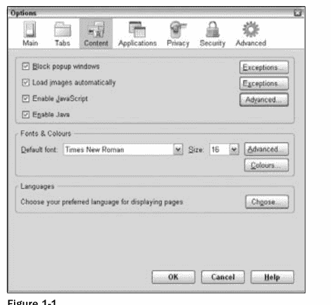

在 Internet Explorer 中关闭脚本更加困难。在浏览器中选择 工具 -> Internet 选项，点击 安全 选项卡，并检查 Internet 或 Intranet 选项是否具有自定义安全设置。如果其中任何一个有，点击 自定义级别 按钮并向下滚动到 脚本 部分。检查 Active Scripting 是否设置为 启用。

最后一点需要注意的是如何在浏览器中打开代码示例。对于本书，你只需在硬盘上打开存储示例的文件即可。有多种方法可以实现。

在 IE6 中，一种方法是选择 文件 -> 打开，然后点击 浏览 按钮来浏览你存储代码的位置。同样，在 Firefox 中，选择 文件 -> 打开文件，浏览到你想要的文件，然后点击 选择文件 按钮。

然而，IE7 和 IE8 有了新的菜单结构，其中不包含 打开文件 选项。你可以通过在地址栏中输入硬盘驱动器盘符后跟冒号来解决这个问题（例如，C 盘的 `c:`）。

在 Microsoft Windows 中，你可以按 `Ctrl+O` 使打开文件菜单出现。或者，你可以切换回早期版本 IE 的经典菜单。为此，你可以点击 工具 -> 工具栏，并确保选中 菜单栏 选项（见图 1-2）。

# 第 1 章：JavaScript 与 Web 简介

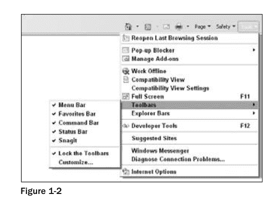

## 我的脚本放在哪里？

关于 JavaScript 主题的讨论已经足够了；现在来看看如何将其放入你的网页中。在本节中，你将了解如何将 JavaScript 代码添加到你的网页中。

包含 `type` 属性是良好的实践，但在网页内部可以省略。像 IE 和 Firefox 这样的浏览器使用 JavaScript 作为其默认脚本语言。这意味着如果浏览器遇到一个没有设置 `type` 属性的 `<script>` 标签，它会假定该脚本块是用 JavaScript 编写的。

然而，W3C（万维网联盟）——负责制定 HTML 标准的组织——规定使用 `type` 属性是强制性的。

### 链接到外部 JavaScript 文件

`<script>` 标签还有另一项功能：能够指定 JavaScript 代码不在网页内部，而在一个单独的文件中。任何外部文件都应使用 `.js` 文件扩展名。虽然这不是强制性的，但它确实能让你更容易地弄清楚每个文件中包含的内容。

要链接到一个外部 JavaScript 文件，你需要按照前面描述的方式创建一个 `<script>` 标签，并使用其 `src` 属性来指定外部文件的位置。例如，假设你创建了一个名为 `MyCommonFunctions.js` 的文件，你希望链接它，并且该文件与你的网页在同一目录中。`<script>` 标签将如下所示：

```html
<script type="text/javascript" src="MyCommonFunctions.js"></script>
```

Web 浏览器将读取此代码，并将文件内容作为你网页的一部分包含进来。在链接到外部文件时，你绝对不能在 `<script>` 标签内放置任何代码；例如，以下做法是无效的：

```html
<script type="text/javascript" src="MyCommonFunctions.js">
var myVariable;
if ( myVariable == 1 )
{
    // do something
}
</script>
```

如果你的网页是 XHTML 文档，你可以省略结束的 `</script>` 标签，改为这样写：

```html
<script type="text/javascript" src="MyCommonFunctions.js" />
```

通常，你使用 `<script>` 标签来加载本地文件（与网页本身在同一台计算机上的文件）。但是，你可以通过指定文件的网页地址来从 Web 服务器加载外部文件。

例如，如果你的文件名为 `MyCommonFunctions.js`，并加载在域名为 `www.mysite.com` 的 Web 服务器上，`<script>` 标签将如下所示：

```html
<script type="text/javascript" src="http://www.mysite.com/MyCommonFunctions.js">
</script>
```

然而，如果链接到由其他人控制的外部文件，需格外小心。这会使那些人能够控制和更改你的网页，所以你需要非常确定你信任他们！

### 使用外部文件的优势

外部文件的最大优势是代码重用。假设你编写了一段复杂的 JavaScript，执行一个通用功能，你可能在很多页面中都需要它。如果你以内联方式（在网页内部，而不是通过外部文件）包含代码，你需要将代码剪切并粘贴到每个使用它的网页中。

只要你永远不需要更改代码，这没问题，但现实是，你很可能需要在某个时候更改或改进代码。如果你将代码剪切粘贴到了 30 个不同的网页中，你就需要在 30 个不同的地方更新它。这真是令人头疼！

通过使用一个外部文件并将其包含在所有需要它的页面中，你只需要更新一次代码，所有 30 个页面会立即更新。这容易多了！

使用外部文件的另一个优势是浏览器会缓存它们，就像它处理页面间共享的图像一样。如果你的文件很大，这可以节省下载时间并减少带宽使用。

## 你的第一个简单 JavaScript 程序

关于 JavaScript 主题的讨论已经足够了；现在来看看如何将其放入你的网页中。在本节中，你将编写你的第一段 JavaScript 代码。

将 JavaScript 插入网页就像插入任何其他 HTML 内容一样；你使用标签来标记脚本代码的开始和结束。用于此目的的标签是 `<script>`。这告诉浏览器，后面的文本块，由结束的 `</script>` 标签界定，不是要显示的 HTML，而是要处理的脚本代码。被 `<script>` 和 `</script>` 标签包围的代码块称为“脚本块”。

基本上，当浏览器发现 `<script>` 标签时，它不会尝试向用户显示包含的文本，而是使用浏览器内置的 JavaScript 解释器来运行代码的指令。当然，代码可能会给出关于页面显示方式更改或页面中显示内容的指令，但代码本身的文本永远不会显示给用户。

你可以将 `<script>` 标签放在 HTML 页眉内部（在 `<head>` 和 `</head>` 标签之间）或页脚内部（在 `<body>` 和 `</body>` 标签之间）。

然而，虽然你可以将它们放在这些区域之外——例如，在 `<html>` 标签之前或 `</html>` 标签之后——但这在 Web 标准中是不允许的，因此被认为是不良实践。

`<script>` 标签有许多属性，但最重要的是 `type`。如前所述，JavaScript 并非唯一可用的脚本语言，不同的脚本语言需要以不同的方式处理。你需要告诉浏览器期望使用哪种脚本语言，以便它知道如何处理该语言。你的开始脚本标签将如下所示：

```html
<script type="text/javascript">
```

包含 `type` 属性是良好的实践，但在网页内部可以省略。像 IE 和 Firefox 这样的浏览器使用 JavaScript 作为其默认脚本语言。这意味着如果浏览器遇到一个没有设置 `type` 属性的 `<script>` 标签，它会假定该脚本块是用 JavaScript 编写的。

然而，W3C 规定使用 `type` 属性是强制性的。

好的，让我们来看一看第一个包含 JavaScript 代码的页面。

### 试试看：将页面涂成红色

这是一个使用 JavaScript 更改浏览器背景颜色的简单示例。在你的文本编辑器中（我们使用 Windows 记事本），输入以下内容：

```html
<html>
<body bgcolor="WHITE">
<p>Paragraph 1</p>
<script type="text/javascript">
    document.bgColor = "RED";
</script>
</body>
</html>
```

将页面保存为 `ch1_examp1.htm`，存放在硬盘上方便的位置。现在将其加载到你的 Web 浏览器中。你应该会看到一个红色的网页，左上角有文本“Paragraph 1”。

但等等——你不是将 `<body>` 标签的 `BGCOLOR` 属性设置为白色了吗？好的，让我们看看这里发生了什么。

页面包含在 `<html>` 和 `</html>` 标签中。这个块包含一个 `<body>` 元素。当你定义开始的 `<body>` 标签时，你使用 HTML 将页面的背景颜色设置为白色。


```html
<body bgcolor="WHITE">
```

然后，通过使用`<script>`开始标签，你让浏览器知道你接下来的几行代码是 JavaScript 代码。

```html
<script type="text/javascript">
```

从这里开始直到结束标签`</script>`的所有内容都是 JavaScript，浏览器会将其视为 JavaScript 处理。在这个脚本块内，你使用 JavaScript 将文档的背景颜色设置为红色。

```javascript
document.bgColor = "RED";
```

在网页脚本的目的中，你所称的页面被称为文档（document）。文档有许多属性，包括其背景颜色`bgColor`。你可以通过编写`document`，后跟一个点，再后跟属性名来引用文档的属性。目前不要担心`document`的使用；本书后面会更深入地探讨它。

请注意，上面的代码行是 JavaScript 语句的一个例子。在`<script>`和`</script>`标签之间的每一行代码都称为一条语句，尽管有些语句可能会跨越多行。

你还会看到行末有一个分号（`;`）。在 JavaScript 中，你使用分号来表示语句的结束。实际上，JavaScript 对分号的要求非常宽松，当你开始新的一行时，JavaScript 通常能够判断你是否打算开始新的代码行。然而，为了良好的编码实践，你应该在代码语句末尾使用分号，并且单个 JavaScript 语句应该放在一行中，而不是延续到两行或多行。此外，你会发现有时必须包含分号，这将在本书后面介绍。

最后，为了告诉浏览器停止将你的文本解释为 JavaScript 并开始将其解释为 HTML，你使用脚本结束标签：

```html
</script>
```

你现在查看了代码是如何工作的，但还没有查看它工作的顺序。当浏览器加载网页时，它会从上到下逐个标签地遍历页面。这个过程称为*解析*。Web 浏览器从页面顶部开始，一路向下处理到页面底部。浏览器首先遇到`<body>`标签，并将文档背景设置为白色。然后继续解析页面。当遇到 JavaScript 代码时，它被指示将文档背景更改为红色。

### 试试看：事物流动的顺序

让我们扩展上一个例子，以演示网页解析的实际操作。在你的文本编辑器中输入以下内容：

```html
<html>
<body bgcolor="WHITE">
<p>Paragraph 1</p>
<script type="text/javascript">
// Script block 1
alert("First Script Block");
</script>
<p>Paragraph 2</p>
<script type="text/javascript">
// Script block 2
document.bgColor = "RED";
alert("Second Script Block");
</script>
```

# 第 1 章：JavaScript 与 Web 简介

```html
</script>
<p>Paragraph 3</p>
</body>
</html>
```

将文件保存到硬盘，命名为`ch1_examp2.htm`，然后在浏览器中加载它。加载页面时，你应该会看到第一个段落 Paragraph 1，接着是第一个脚本块显示的消息框。浏览器会暂停解析，直到你点击 OK 按钮。如图 1-3 所示，页面背景是白色的，这是通过`<body>`标签设置的，并且只显示了第一个段落。

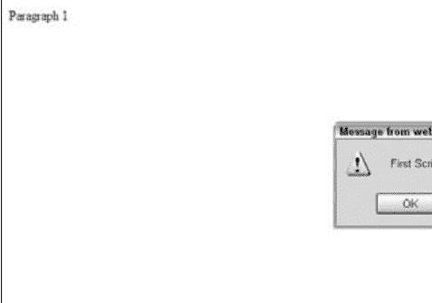

点击 OK 按钮，解析继续进行。浏览器显示第二个段落，并到达第二个脚本块，它将背景颜色改为红色。第二个脚本块显示了另一个消息框，如图 1-4 所示。

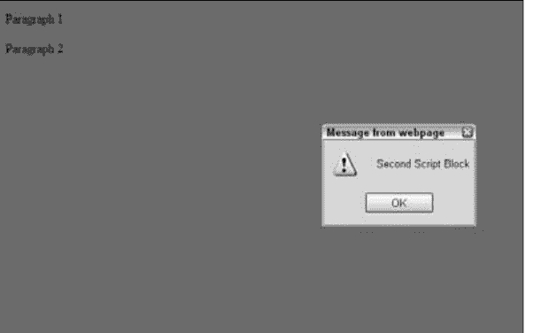

点击 OK，解析再次继续，显示第三个段落`Paragraph 3`。此时网页完成，如图 1-5 所示。

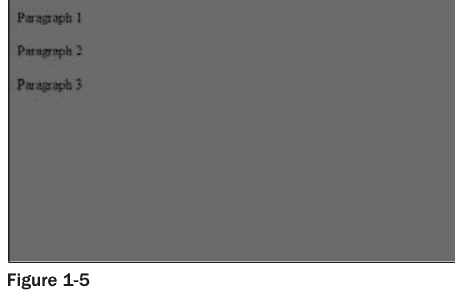

页面的第一部分与我们之前的示例相同。页面的背景色在`<body>`标签的定义中被设置为白色，随后一个段落被写入页面。

```html
<html>
<body bgcolor="WHITE">
<p>Paragraph 1</p>
```

第一个新节包含在第一个脚本块中。

```javascript
<script type="text/javascript">
    // Script block 1
    alert("First Script Block");
</script>
```

这个脚本块包含两行代码，对你来说都是新的。第一行——

```javascript
// Script block 1
```

只是一个*注释*，完全是为了你的便利。浏览器将双斜杠（`//`）之后的任何内容识别为注释，不会对其执行任何操作。作为程序员，这对你很有帮助，因为你可以向代码中添加说明，使你在以后回到代码时更容易记住自己在做什么。

代码第二行的`alert()`函数对你来说是新的。在了解它的作用之前，你需要知道什么是*函数*。

函数在第 3 章中有更完整的定义，但此刻你只需要将它们视为某些 JavaScript 代码片段，你可以用它们来完成特定的任务。如果你有数学背景，可能已经对函数有一些概念：*函数*接收一些信息，对其进行处理，然后给你一个结果。函数使作为程序员的你生活更轻松，因为你无需思考函数如何完成任务——你可以只专注于何时想要完成该任务。

- 特别地，`alert()`函数使你能够通过显示消息框来警示或告知用户某些信息。要在消息框中显示的消息在`alert()`函数的括号内指定，被称为函数的参数。
- `alert()`函数显示的消息框是模态的。这是一个重要的概念，你会再次遇到。它仅仅意味着消息框不会消失，直到用户通过点击 OK 按钮将其关闭。事实上，页面在`alert()`函数使用的那一行停止解析，直到用户关闭消息框才会重新开始。对于这个示例来说，这非常有用，因为它使你能够演示到目前为止已经解析的结果：页面颜色已设置为白色，第一个段落已经显示。
- 当你点击 OK 后，浏览器继续向下解析页面，经过以下行：

```html
<p>Paragraph 2</p>
<script type="text/javascript">
// Script block 2
document.bgColor = "RED";
alert("Second Script Block");
</script>
```

- 第二个段落显示，第二个 JavaScript 块开始运行。脚本块代码的第一行是另一个注释，所以浏览器忽略它。你在前面的示例中见过脚本代码的第二行——它将页面的背景颜色改为红色。代码的第三行是`alert()`函数，它显示第二个消息框。解析被暂停，直到你点击 OK 关闭消息框。
- 当你关闭消息框时，浏览器继续执行页面中的下一行代码，显示第三个段落，最终完成网页。

```html
<p>Paragraph 3</p>
</body></html>
```

- 这个示例提出的另一个重要要点是通过 HTML 设置页面属性（如背景颜色）与使用 JavaScript 执行相同操作之间的区别。使用 HTML 设置属性的方法是静态的：只能设置一次值，无法通过 HTML 再次更改。使用 JavaScript 设置属性使你能够动态地更改它们的值。*动态*一词指的是可以更改的东西，其值或外观不是固定不变的。
- 这个示例仅仅是一个示例。在实践中，如果你希望页面的背景为红色，你可以将`<body>`标签的 BGCOLOR 属性设置为 "RED"，而完全不需要使用 JavaScript。你想要使用 JavaScript 的地方是——当你想要向页面添加某种智能或逻辑时。例如，如果用户的屏幕分辨率特别低，你可能想要更改页面上显示的内容；使用 JavaScript，你可以做到这一点。使用 JavaScript 更改属性的另一个原因可能是为了特殊效果——例如，让页面从白色逐渐淡入到其最终颜色。

# 在网页中显示结果

在这个最终示例中，你将发现如何使用 JavaScript 直接向网页写入信息。当你编写计算结果或使用 JavaScript 创建的文本时，这更有用，正如你在下一章中将看到的。现在，你将仅使用 JavaScript 向一个空白页面写入 "Hello World!"：

```html
<!DOCTYPE html PUBLIC "-//W3C//DTD XHTML 1.0 Transitional//EN"
"http://www.w3.org/TR/xhtml1/DTD/xhtml1-transitional.dtd">
<html xmlns="http://www.w3.org/1999/xhtml">
<body>

<p id="ResultsP"></p>

<script type="text/javascript">
	// Script block 1
	document.getElementById('ResultsP').innerHTML = 'Hello World!';
</script>

</body>
</html>
```

将页面保存为`ch1_examp3.htm`，放在硬盘上方便的位置。现在在网页浏览器中加载它，你会看到页面中显示 Hello World! 虽然使用 HTML 来做同样的事情会更简单，但这个技巧在后面的章节中将被证明是有用的。

页面的第一部分与我们之前的示例相同，除了添加了以下行：

```html
<!DOCTYPE html PUBLIC "-//W3C//DTD XHTML 1.0 Transitional//EN"
"http://www.w3.org/TR/xhtml1/DTD/xhtml1-transitional.dtd">
<html xmlns="http://www.w3.org/1999/xhtml">
```

这使得网页浏览器知道你在使用 XHTML，这是本书通篇使用的标准。它实际上对代码没有任何影响；即使没有这些额外的行，代码也能正常工作。

考虑这一行：

```html
<p id="ResultsP"></p>
```

你会注意到`<p>`标签已使用 id 属性赋予了 id。这个 id 在网页中必须是唯一的，因为 JavaScript 使用它来识别特定的 HTML 元素，在以下行中：

```javascript
document.getElementById('ResultsP').innerHTML = 'Hello World!';
```

如果这看起来目前很复杂，不要担心；你将在后面的章节中，特别是第 6 章和第 12 章，了解更多关于它的工作原理。基本上，这段代码是在说："给我获取 id 为 ResultsP 的文档元素，并将该元素内部的 HTML 设置为 Hello World!"

在示例中，访问段落的代码位于段落之后，这一点很重要。否则，代码将尝试在页面中的段落存在之前访问它，从而抛出错误。

# 浏览器与兼容性问题简述

你在前面的示例中看到，通过使用 JavaScript，你可以使用`document`的`bgColor`属性更改网页文档的背景颜色。无论你使用 Netscape 还是 Microsoft 浏览器，这个示例都能工作，因为两种浏览器都支持具有`bgColor`属性的`document`。你可以说这个示例是跨浏览器兼容的。然而，一个浏览器中可用的属性或语言特性在另一个浏览器中可用的情況并不总是如此。有时甚至同一浏览器的不同版本之间也是如此。

> Internet Explorer 和 Firefox 浏览器的版本号通常以小数形式书写；例如，Firefox 有版本 1.5。本书使用以下术语来指代这些版本：版本 1.x 指的是所有以数字 1 开头的版本；版本 1.0+ 指的是所有大于或等于 1 的版本。

创建基于 Web 的 JavaScript 所涉及的主要问题之一，是不同 Web 浏览器之间的差异、它们支持的 HTML 级别以及其 JavaScript 解释器能够处理的功能。你会发现，在一个浏览器中，你可以仅用几行代码移动图像，但在另一个浏览器中，却需要一整页代码，甚至根本无法实现。一个版本的 JavaScript 包含将文本更改为大写的方法，而另一个版本则没有。IE 或 Firefox 浏览器的每个新版本都会为其 HTML 和 JavaScript 支持添加新的令人兴奋的功能。好消息是，与以往任何时候相比，浏览器制造商在很大程度上更加遵守 W3C 等组织制定的标准。此外，只要有一点 ingenuity，你就可以编写同时适用于 IE 和 Firefox 浏览器的 JavaScript。

你想要支持哪些浏览器，实际上取决于你认为网站的大多数访问者，也就是你的用户群体，将使用哪些浏览器。本书面向 IE7 及更高版本以及 Firefox 2 及更高版本。

如果你想让你的网站专业化，你需要以某种方式处理较旧的浏览器。你可以确保你的代码向后兼容——也就是说，它只使用旧版浏览器中可用的功能。然而，你可能会决定，仅仅为了兼容旧版浏览器的功能而限制自己是不值得的。在这种情况下，你需要确保你的页面能够优雅地降级。换句话说，要确保虽然你的页面在旧版浏览器中无法工作，但它们会以用户要么永远不会注意到失败，要么会被提醒网站上某些功能与其浏览器不兼容的方式失败。与优雅降级相对的是，你的代码弹出大量错误消息，导致页面上显示奇怪的结果，通常让你看起来像个不知道自己正在做什么的傻瓜！

那么如何使您的网页优雅地降级呢？您可以通过使用 JavaScript 在网页部分或完全加载后确定网页正在哪个浏览器中运行。您可以使用这些信息来决定运行哪些脚本，甚至可以将用户重定向到另一个页面，该页面针对其特定浏览器进行了最佳编写。在后面的章节中，您将看到如何了解浏览器支持哪些功能，并采取适当的措施，使您的页面在尽可能多的浏览器上正常作。

# 第 1 章：JavaScript 与 Web 简介

## 概要

此时，你应该对 JavaScript 是什么以及它能做什么有了大致了解。特别是，这个简短的介绍涵盖了以下内容：

- 你查看了浏览器在解释你的网页时所遵循的过程。它会逐元素地遍历页面（解析），并在遇到 HTML 标签和 JavaScript 代码时对其进行处理。
- 与许多编程语言不同，JavaScript 只需要一个文本编辑器即可开始创建代码。类似 Windows 记事本的工具足以用于入门，不过一旦你积累更多经验，更全面的工具将证明非常有用。
- JavaScript 代码与 HTML 一起嵌入到网页本身中。它的存在通过`<script>`标签来标记。与 HTML 一样，脚本从页面顶部开始执行，一直向下到页面底部，逐条语句地解释和执行代码。

# 第 2 章：数据类型和变量

计算机的主要用途之一是处理和显示信息。所谓“处理”，是指计算机以某种方式修改、解释或过滤信息。例如，在在线银行网站中，客户可能要求获取其账户上个月所有支出的详细信息。在这里，计算机将检索信息，过滤掉与上个月付款无关的任何信息，然后将剩余部分显示在网页中。在某些情况下，信息会被处理但不显示，而在其他情况下，信息会被直接获取而不经过处理。例如，在银行环境中，定期付款可能通过电子方式处理和转账，无需任何人工交互或显示。

在计算机领域，信息被称为*数据*。数据以各种形式出现，如数字、文本、日期和时间等，仅举几例。在本章中，你将具体了解 JavaScript 如何处理数字和文本等数据。理解数据是如何被处理的，对于任何编程语言来说都是基础。

本章首先介绍 JavaScript 可以处理的各类数据类型。然后，你将了解如何在计算机内存中存储这些数据，以便在代码中反复使用。最后，你将了解如何使用 JavaScript 来操作和处理这些数据。

## JavaScript 中的数据类型

数据可以有多种不同的形式，即*类型*。你会认出 JavaScript 处理的一些数据类型来自编程世界之外——例如，数字和文本。其他数据类型则稍微抽象一些，用于使编程更加容易；其中一个例子是对象数据类型，你将在第 4 章中详细看到它。

有些编程语言是强类型的。在这些语言中，每当你使用一段数据时，你需要明确声明你正在处理的数据类型，并且对这些数据的使用必须遵循适用于其类型的严格规则。例如，你不能将数字和单词相加。

另一方面，JavaScript 是一种弱类型语言，对你如何使用不同类型的数据更加宽容。在处理数据时，你通常不需要指定类型；JavaScript 会自己确定。此外，当你同时使用不同类型的数据时，JavaScript 会在幕后自行计算你试图做什么。

鉴于 JavaScript 对数据如此随和，为什么还要谈论数据类型呢？为什么不直接切入正题，开始使用数据而不必担心它们的类型呢？

首先，虽然 JavaScript 非常擅长弄清楚它处理的是什么数据，但有时它会出错，或者至少不会按你想要的那样做。在这些情况下，你需要向 JavaScript 明确说明你打算的数据类型以及应该如何处理它。要做到这一点，你需要首先对数据类型有一点了解。

第二个原因是，数据类型使你能够在代码中有效地使用数据。可以对数据执行的操作以及你将得到的结果取决于所使用的数据类型，即使你没有明确指定其类型。例如，虽然尝试将两个数字相乘是有意义的，但对文本做同样的事情则没有意义。此外，数字相加的结果与文本相加的结果截然不同。对于数字，你得到的是总和，而对于文本，你得到的是一个由其他片段连接而成的大文本块。

让我们简要看一下一些更常用的数据类型：数值、文本和布尔值。你将在本章后面看到如何使用它们。

### 数值数据

数值数据有两种形式：

- 整数，如 145，也称为整数。这些数字可以是正数或负数，在 JavaScript 中跨度非常大：-2^53 到 2^53。
- 浮点数，如 1.234，也称为浮点数。像整数一样，它们可以是正数或负数，并且也具有巨大的范围。

简单来说，除非你正在编写专业的科学应用程序，否则你不会遇到 JavaScript 中可用数字大小的问题。此外，虽然在存储整数和浮点数时可以分别对待它们，但 JavaScript 实际上将它们都视为浮点数。它慷慨地隐藏了细节，因此你通常不需要担心这一点。唯一的例外是你想要一个整数，但你有一个浮点数，在这种情况下，你会将数字四舍五入以使其成为整数。你将在本章后面查看数字舍入。

### 文本数据


一个或多个文本字符的另一个术语是字符串。你只需将文本用引号（`"`）括起来，告诉 JavaScript 将其作为文本而不是代码来处理。例如，`"Hello World"` 和 `"A"` 是 JavaScript 会识别的字符串示例。你也可以使用单引号（`'`），所以`'Hello World'`和`'A'`也是 JavaScript 会识别的字符串示例。但是，你必须以你开始字符串时使用的相同引号结束字符串。因此，`"A'` 不是有效的 JavaScript 字符串，`'Hello World"` 也不是。

如果你想在一个字符串中间包含一个单引号，比如类似 Peter O' Toole 的字符串怎么办？如果你用双引号括起来，那就没问题，所以`"Peter O' Toole"`会被 JavaScript 识别。但是，`'Peter O' Toole'` 会产生错误。这是因为 JavaScript 认为你的文本字符串是 Peter O（也就是说，它将中间的单引号视为字符串的结尾），然后不知所措地想知道`'Toole'`是什么。

另一种解决办法是告诉 JavaScript 中间的 `'` 是文本的一部分，并不表示字符串的结束。你通过使用反斜杠字符（`\`）来实现这一点，这在 JavaScript 中具有特殊含义，称为*转义字符*。反斜杠告诉浏览器下一个字符不是字符串的结尾，而是文本的一部分。所以`'Peter O\'Toole'`会按预期工作。

如果你想在一个用双引号括起来的字符串中使用双引号呢？好吧，上面关于单引号的所有内容仍然适用。所以`'Hello "Paul" '`有效，但`"Hello "Paul""`不行。然而，`"Hello \\"Paul\\" "`也可以工作。

JavaScript 有许多其他特殊字符，无法直接输入，但可以使用转义字符与其他字符结合使用来创建*转义序列*。这些在 HTML 中工作方式类似。例如，HTML 中连续的多个空格会被忽略，因此空格由术语`&nbsp;`表示。同样，在 JavaScript 中，有些情况下你不能直接使用某个字符，但必须使用转义序列。下表详细说明了一些更有用的转义序列。

| 转义序列 | 代表的字符 |
|---|---|
| `\b` | 退格 |
| `\f` | 换页 |
| `\n` | 新行 |
| `\r` | 回车 |
| `\t` | 制表符 |
| `\'` | 单引号 |
| `\"` | 双引号 |
| `\\` | 反斜杠 |
| `\xNN` | NN 是一个十六进制数，用于标识 Latin-1 字符集中的字符。 |

其中最不明显的是最后一个，它通过字符在 Latin-1 字符集中的字符号而不是其正常外观来表示单个字符。让我们选一个例子：假设你想在字符串中包含版权符号（©）。你的字符串需要是什么样的？答案是`"\xA9 Paul Wilton"`。

类似地，你可以使用 Unicode 转义序列来引用字符。它们写作`\uNNNN`，其中`NNNN`指的是该特定字符的 Unicode 编号。例如，要使用这种方法引用版权符号，请使用字符串`\u00A9`。

## 第 2 章：数据类型与变量

### 布尔数据

在物理世界中，肯定与否定、正面与负面、真实与虚假的表达方式随处可见。真实与虚假的概念也是数字计算机的基础；它们不理解“可能”，只明白“真”与“假”。事实上，“是或否”的概念非常实用，以至于在 JavaScript 中它拥有自己的数据类型：布尔数据类型。布尔类型有两种可能的值：`true` 表示是，`false` 表示否。

JavaScript 中布尔数据的用途与编程之外的世界完全相同：它们使你能够回答问题并根据答案做出决策。例如，如果有人问你：“这本书是关于 JavaScript 的吗？”，你可能会回答：“是的，”或者说：“没错。”同样，你可能会说：“如果这本书的主题不是 JavaScript，那就把它放下。”这里你就运用了一个布尔逻辑语句（以发明者乔治·布尔命名），它提出一个问题，然后根据答案的真假执行相应操作。在 JavaScript 中，你可以使用类似的布尔逻辑赋予程序决策能力。我们将在下一章更详细地探讨布尔逻辑。

### 变量——在内存中存储数据

数据可以永久存储或临时存储。

你需要将重要数据（例如个人银行账户的详细信息）进行永久存储。例如，当布洛格斯女士从她的账户中取出十美元、英镑或欧元时，你需要从她的账户中扣除这笔钱，并永久记录新的余额。这类信息可能会存储在所谓的数据库中。

然而，在其他情况下，你可能不想永久存储数据，而只是想临时记录一下。让我们来看一个例子。假设布洛格斯女士在“大坏银行公司”有一笔贷款，她想了解这笔贷款还有多少未偿还。她进入贷款的网上银行页面，点击链接查询她欠款的金额。这个数据会被永久存储在某个地方。但是，假设你还提供了一个增加贷款还款额以提前还清贷款的功能。如果布洛格斯女士在网页的文本框中输入增加的还款额，你可能希望显示贷款会提前多久还清。这将涉及一些可能复杂的计算，因此为了简化，你想编写代码分几个阶段计算结果，在每一步存储结果，然后再提供最终结果。在你完成计算并显示结果后，没有必要永久存储每个阶段的结果，因此，你需要使用一种称为变量的东西，而不是使用数据库。为什么叫它变量？嗯，也许是因为变量可以用来存储可以改变或变化（varied）的临时数据。

变量的另一个好处是，与可能保存到磁盘或磁带的永久存储不同，变量存储在计算机的内存中。这意味着存储和检索数据的速度要快得多，快得多。

那么，什么使变量成为临时存储数据的好地方？嗯，变量的生命周期有限。当你的访客关闭页面或转到新页面时，除非你采取一些措施将它们保存到某处，否则你的变量就会丢失。

每个变量都被赋予一个名称，以便你在代码的其他地方引用它。这些名称必须遵循特定规则。

与许多 JavaScript 代码一样，你会发现变量名是区分大小写的。例如，`myVariable` 与 `myvariable` 不同。你会发现，即使你成为 JavaScript 专家，这仍然是一个非常容易让错误潜入代码的方式。

此外，某些名称和字符不能用作变量名。不能使用的名称称为*保留字*。保留字是 JavaScript 保留供自身使用的词语（例如，`var` 或 `with`）。某些字符也禁止用于变量名：例如，和号（`&`）和百分号（`%`）。你可以在变量名中使用数字，但名称不能以数字开头。因此，`101myVariable` 是无效的，但 `myVariable101` 是有效的。让我们再看一些例子。

无效的名称包括：

- `with`
- `99variables`
- `my%Variable`
- `theGood&theBad`

有效的名称包括：

- `myVariable99`
- `myPercent_Variable`
- `the_Good_and_the_Bad`

你可能希望为你的变量使用一种命名约定（例如，一个描述你计划在变量中保存哪种数据的约定）。你可以用许多不同的方式来标注你的变量——没有对错之分，但最好坚持使用其中一种。一种常见的方法是*匈牙利命名法*，其中每个变量名的开头是一个三个字母的标识符，表示数据类型。例如，你可以用`int`开头表示整数变量名，`flt`表示浮点变量名，`str`表示字符串变量名，依此类推。然而，只要你使用的名称有意义并且一致使用，你选择哪种约定真的无关紧要。

### 创建变量并赋值

在使用变量之前，你应该使用`var`关键字向计算机声明它的存在。这会警告计算机需要为以后存储的数据保留一些内存。要声明一个名为`myFirstVariable`的新变量，请编写以下代码：

```javascript
var myFirstVariable;
```

请注意，行尾的分号不是变量名的一部分，而是用来向 JavaScript 指示语句的结束。这行代码是一个 JavaScript 语句的示例。

一旦声明，变量就可以用来存储任何类型的数据。正如我们之前提到的，许多其他编程语言（称为强类型语言）要求你不仅声明变量，还要声明将要存储的数据类型，例如数字或文本。然而，JavaScript 是一种弱类型语言；你不需要将自己限制在变量可以保存的数据类型上。

你可以通过使用等号（`=`）将数据放入变量中，这个过程称为为变量*赋值*。例如，如果你想让你的名为`myFirstVariable`的变量保存数字 101，你可以这样写：

```javascript
myFirstVariable = 101;
```

当用于为变量赋值时，等号有一个特殊的名字；它被称为*赋值运算符*。

#### 动手试试：声明变量

让我们看一个例子，其中声明了一个变量，在其中存储一些数据，最后访问其内容。你还将看到变量可以保存任何类型的数据，并且保存的数据类型可以更改。例如，你可以先存储文本，然后更改为存储数字，而 JavaScript 不会有任何问题。将以下代码输入你的文本编辑器，并将其保存为`ch2_examp1.htm`：

```html
<!DOCTYPE html PUBLIC "-//W3C//DTD XHTML 1.0 Transitional//EN"
"http://www.w3.org/TR/xhtml1/DTD/xhtml1-transitional.dtd">
<html xmlns="http://www.w3.org/1999/xhtml">

<head>
</head>
<body>

<script type="text/javascript">

var myFirstVariable;

myFirstVariable = "Hello";
alert(myFirstVariable);

myFirstVariable = 54321;
alert(myFirstVariable);

</script>

</body>
</html>
```

一旦你将此页面加载到你的网页浏览器中，它应该会显示一个包含“Hello”的`alert`框，如图 2-1 所示。这是代码中该点处变量`myFirstVariable`的内容。


点击确定，另一个包含 54321 的警报框会出现，如图 2-2 所示。这是你分配给变量`myFirstVariable`的新值。

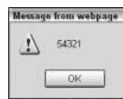

图 2-2

在脚本块内，你首先声明你的变量。

```javascript
var myFirstVariable;
```

目前，它的值是`undefined`值，因为你只向计算机声明了它的存在，而不是任何实际数据。这听起来可能很奇怪，但`undefined`是 JavaScript 中一个实际的原始值，它使你能够进行比较。（例如，你可以检查变量是否包含实际值，或者是否尚未被赋予值，即它是否是`undefined`。）然而，在下一行中，你为`myFirstVariable`分配了一个字符串值，即 Hello 值。

```javascript
myFirstVariable = "Hello";
```

在这里，你为变量分配了一个字面值（即，一段实际数据，而不是通过计算或从另一个变量获得的数据）。几乎在任何可以使用字面字符串或数字的地方，你都可以将其替换为包含数字或字符串数据的变量。你在下一行代码中看到了一个这样的例子，其中你在上一章看到的`alert()`函数中使用了你的变量`myFirstVariable`。

```javascript
alert(myFirstVariable);
```

这会导致第一个警报框出现。接下来，你将一个新值存储到你的变量中，这次是一个数字。

```javascript
myFirstVariable = 54321;
```

`myFirstVariable`的先前值将永远丢失。用于存储该值的内存空间会由 JavaScript 自动释放，这个过程称为垃圾回收。每当 JavaScript 检测到变量的内容不再可用时，例如当你分配一个新值时，它就会执行垃圾回收过程并释放内存。如果没有这个自动垃圾回收过程，计算机的内存将被越来越多地消耗，直到最终耗尽，系统会停止运行。然而，垃圾回收并不总是像它应该的那样高效，有时直到加载另一个页面才会发生。

为了证明新值已被存储，再次使用`alert()`函数显示变量的新内容。

```javascript
alert(myFirstVariable);
```

## 第二章：数据类型与变量

### 将其他变量的值赋给变量

你已经了解了如何将数字或字符串赋值给变量，但你能将另一个变量中存储的数据赋给一个变量吗？答案是肯定的，而且非常简单，其方式与给变量赋予字面值完全相同。例如，如果你已经声明了两个变量`myVariable`和`myOtherVariable`，并将变量`myOtherVariable`赋值为`22`，如下所示：

```javascript
var myVariable;
var myOtherVariable;
myOtherVariable = 22;
```

那么，你可以使用下面这行代码，将`myVariable`赋予与`myOtherVariable`相同的值（即 22）。

```javascript
myVariable = myOtherVariable;
```

### 动手试试：将其他变量的值赋给变量

让我们看另一个例子，这次是将其他变量的值赋给变量。

1. 在文本编辑器中输入以下代码，并将其保存为`ch2_examp2.htm`：

   ```html
   <!DOCTYPE html PUBLIC "-//W3C//DTD XHTML 1.0 Transitional//EN"
    "http://www.w3.org/TR/xhtml1/DTD/xhtml1-transitional.dtd">
   <html xmlns="http://www.w3.org/1999/xhtml">
   <body>

   <script language="JavaScript" type="text/javascript">

   var string1 = "Hello";
   var string2 = "Goodbye";

   alert(string1);
   alert(string2);

   string2 = string1;

   alert(string1);
   alert(string2);

   string1 = "Now for something different";

   alert(string1);
   alert(string2);

   </script>

   </body>
   </html>
   ```

2. 在浏览器中加载此页面，你会看到一系列六个`alert`框出现。

3. 点击每个`alert`框上的“确定”以查看下一个提示。前两个提示框分别显示了`string1`和`string2`的值——`Hello`和`Goodbye`。然后，你将`string1`的值赋给`string2`。接下来的两个`alert`框显示了`string1`和`string2`的内容；这次两者都是`Hello`。

4. 最后，你更改了`string1`的值。请注意，`string2`的值保持不变。最后两个`alert`框分别显示了`string1`的新值（Now for something different）和`string2`未改变的值（`Hello`）。

你在脚本块中做的第一件事是声明你的两个变量：`string1`和`string2`。然而，请注意你在声明它们的同时就为它们赋了值。这是一种称为*初始化*的快捷方式，可以为你节省输入大量代码的时间。

```javascript
var string1 = "Hello";
var string2 = "Goodbye";
```

请注意，这种快捷方式可用于所有数据类型，而不仅仅是字符串。接下来的两行使用`alert()`函数向用户显示每个变量的当前值。

```javascript
alert(string1);
alert(string2);
```

然后，你将`string1`中包含的值赋给`string2`。为了证明赋值确实生效了，你再次使用`alert()`函数向用户显示每个变量的内容。

```javascript
string2 = string1;

alert(string1);
alert(string2);
```

接下来，你将`string1`设置为一个新值。

```javascript
string1 = "Now for something different";
```

这使得`string2`保持其当前值，这证明`string2`拥有在前一步中从`string1`赋值给它的数据的独立副本。你将在后面的章节中看到，情况并非总是如此。然而，作为一般规则，基本数据类型（如文本和数字）在赋值时总是会被复制，而更复杂的数据类型，如你在第四章中将遇到的对象，实际上是共享而非复制的。例如，如果你有一个包含字符串`Hello`的变量，并将另外五个变量赋值为这个变量的值，那么你现在就拥有了原始数据和五个独立的数据副本。然而，如果它是一个对象而不是字符串，你做了同样的事情，你会发现你仍然只有一个数据副本，但六个变量共享它。使用任何一个变量名来更改数据都会为所有变量进行更改。

最后，使用`alert()`函数来显示每个变量的当前值。

```javascript
alert(string1);
alert(string2);
```

### 使用数据——计算与基本字符串操作

既然你已经了解了如何处理错误，你就可以回到本章的主要主题：数据及其使用方法。你已经了解了如何声明变量以及它们如何存储信息，但到目前为止，你还没有利用这些知识做任何真正有用的事情——那么，你到底为什么要使用变量呢？

变量能够让你做的，是临时存储信息，这些信息可以用于数学计算、构建文本消息，或处理用户输入的单词。变量有点像普通袖珍计算器上的“存储”按钮。假设你在计算你的财务状况。你可能会先计算出所有需要支出的金额，并将其存储在临时内存中。在计算出所有收入后，你可以从存储的金额中扣除，以计算出剩余的金额。变量可以用类似的方式使用：你可以先获取必要的用户输入并将其存储在变量中，然后你可以使用获得的值进行计算。

在本节中，你将了解如何将存储在变量中的值有效地用于数字计算和基于文本的操作。

#### 数值计算


JavaScript 具有一系列基本的数学运算能力，如加法、减法、乘法和除法。每个基本数学函数都由一个符号表示：加号（`+`）、减号（`–`）、星号（`*`）和斜杠（`/`）。这些符号被称为运算符，因为它们对你提供的值进行运算。换句话说，它们执行某种计算或操作，并向我们返回一个结果。你可以在任何使用数字或变量的地方使用这些计算的结果。

想象一下，你正在计算购物清单上物品的总价值。你可以这样写这个计算式：

`购物总成本 = 10 + 5 + 5`

或者，如果你实际计算总和，结果是：

`购物总成本 = 20`

现在让我们看看如何在 JavaScript 中完成这个操作。实际上，它非常相似，只是你需要使用一个变量来存储最终的总额。

```javascript
var TotalCostOfShopping;
TotalCostOfShopping = 10 + 5 + 5;
alert(TotalCostOfShopping);
```

首先，你声明一个变量`TotalCostOfShopping`来存储总成本。

在第二行，你有代码`10 + 5 + 5`。这段代码被称为一个表达式。当你将变量`TotalCostOfShopping`赋值为这个表达式的值时，JavaScript 会自动计算表达式的值（`20`）并将其存储在变量中。注意等号告诉 JavaScript 将计算结果存储在`TotalCostOfShopping`变量中。这称为将计算的值赋值给变量，这就是为什么单个等号（`=`）被称为赋值运算符的原因。

最后，你在`alert`框中显示变量的值。

减法和乘法的运算符工作方式完全相同。除法则有些不同。

#### 动手试试：计算

让我们看一个使用除法运算符的例子，看看它是如何工作的。

1. 输入以下代码并将其保存为`ch2_examp3.htm`：

```html
<!DOCTYPE html PUBLIC "-//W3C//DTD XHTML 1.0 Transitional//EN"
"http://www.w3.org/TR/xhtml1/DTD/xhtml1-transitional.dtd">
<html xmlns="http://www.w3.org/1999/xhtml">
<body>

<script language="JavaScript" type="text/javascript">
var firstNumber = 15;
var secondNumber = 10;
var answer;
answer = 15 / 10;
alert(answer);

alert(15 / 10);

answer = firstNumber / secondNumber;
alert(answer);

</script>

</body>
</html>
```

2. 在网页浏览器中加载此文件。你应该会看到连续出现的三个`alert`框，每个都包含值`1.5`。这些值是三次计算的结果。

3. 你在脚本块中做的第一件事是声明你的三个变量，并将前两个变量的值设置为你稍后将使用的值。

```javascript
var firstNumber = 15;
var secondNumber = 10;
var answer;
```

4. 接下来，你将`answer`变量设置为表达式`15 / 10`的计算结果。你在一个`alert`框中显示此变量的值。

```javascript
answer = 15 / 10;
alert(answer);
```

为了演示你可以在使用数字或变量的位置使用表达式，你通过将`15 / 10`的计算结果直接包含在`alert()`函数中来展示它。

```javascript
alert(15 / 10);
```

最后，你进行相同的计算，但这次使用两个变量：`firstNumber`（被设置为`15`）和`secondNumber`（被设置为`10`）。你有表达式`firstNumber / secondNumber`，其结果被存储在`answer`变量中。然后，为了证明一切正常，你通过使用你的好帮手`alert()`函数来显示`answer`中包含的值。

```javascript
answer = firstNumber / secondNumber;
alert(answer);
```

大多数计算将以第三种方式进行（即使用变量，或数字和变量，并将结果存储在另一个变量中）。这样做的原因是，如果计算使用的是字面值（实际值，如`15 / 10`），那么你还不如直接将计算结果编入程序，而不是强迫 JavaScript 为你计算它。例如，与其写`15 / 10`，你还不如写`1.5`。毕竟，你强迫 JavaScript 做的计算越多，它就越慢，尽管诚然，仅仅一个计算不会让它负担过重。

使用结果而非计算的另一个原因是它使代码更具可读性。在代码中，你更愿意读到：`1.5 * 45 - 56 / 67 + 2.567`还是`69.231`？更好的是，一个名为例如`PricePerKG`的变量，使代码对不熟悉它的人来说更容易理解。

### 递增和递减运算符

许多使用数学运算符的操作如此常见，以至于它们被赋予了自己专用的运算符。这里你将要研究的两个是递增和递减运算符，分别由两个加号（`++`）和两个减号（`--`）表示。基本上，它们所做的只是将变量的值增加或减少一。你可以使用普通的`+`和`-`运算符来做到这一点，例如：

```javascript
myVariable = myVariable + 1;
myVariable = myVariable - 1;
```

你可以为变量分配一个新值，该值是涉及其先前值的表达式的结果。

然而，使用递增和递减运算符可以将其简化为：

```javascript
myVariable++;
myVariable--;
```

结果是相同的——`myVariable`的值增加或减少了一——但代码更短。当你熟悉语法时，这变得非常清晰易读。

现在，你很可能认为这些运算戳眼睛一样有用。然而，在第 3 章中，当你研究如何多次运行相同的代码时，你会看到这些运算符非常有用且被广泛使用。事实上，`++`运算符被广泛使用，以至于有一门计算机语言以其命名：C++。这里的笑话是 C++ 比 C 高一级。（好吧，这就是程序员的幽默！）

除了将`++`或`--`放在变量之后，你也可以将其放在之前，像这样：

```javascript
++myVariable;
--myVariable;
```

当`++`和`--`单独使用时（它们通常如此），它们放在哪里没有区别，但可以在表达式中与其他运算符一起使用`++`和`--`运算符。例如：

```javascript
myVar = myNumber++ - 20;
```

这段代码从`myNumber`中减去 20，然后将变量`myNumber`递增一，再将结果赋值给变量`myVar`。相反，如果你将`++`放在前面并像这样前缀它：

```javascript
myVar = ++myNumber - 20;
```

首先，`myNumber`递增一，然后从`myNumber`中减去 20。这是一个微妙的差异，但在某些情况下非常重要。看以下代码：

```javascript
myNumber = 1;
myVar = (myNumber++ * 10 + 1);
```

`myVar`将包含什么值？嗯，因为`++`是后置的（它在`myNumber`变量之后），它将在之后递增。所以等式读作：将`myNumber`乘以 10 加 1，然后将`myNumber`递增一。

```text
myVar = 1 * 10 + 1 = 11
```

然后将 1 加到`myNumber`上得到 2，但这是在值 11 被赋值给`myVar`之后完成的。现在看以下代码：

```javascript
myNumber = 1;
myVar = (++myNumber * 10 + 1);
```

这次`myNumber`首先递增一，然后乘以 10 加 1。

```text
myVar = 2 * 10 + 1 = 21
```

正如你可以想象的那样，这种微妙之处很容易被忽视，导致代码中的错误；因此，最好避免使用这种语法。

在继续之前，这似乎是介绍另一个运算符的好时机：`+=`。这个运算符可以用作增加变量所持值的快捷方式，增加一个固定量。例如：

```javascript
myVar += 6;
```

与以下内容完全相同：

```javascript
myVar = myVar + 6;
```

你也可以对减法和乘法做同样的事情，如下所示：

```javascript
myVar -= 6;
myVar *= 6;
```

这相当于：

```javascript
myVar = myVar - 6;
myVar = myVar * 6;
```

## 运算符优先级

你已经看到执行某些功能的符号——如将两个数字相加的`+`，以及将一个数字从另一个数字中减去的`-`——被称为运算符。与人不同，并非所有运算符生来平等；有些具有更高的优先级——也就是说，它们会先被处理。快速查看一个简单的例子将有助于说明这一点。

```javascript
var myVariable;

myVariable = 1 + 1 * 2;

alert(myVariable);
```

如果你输入这个，你期望警报框显示`myVariable`的值是多少？你可能期望因为`1 + 1 = 2`，`2 * 2 = 4`，所以答案是 4。实际上，你会发现警报框显示 3 作为计算存储在`myVariable`中的值。那么怎么回事？难道 JavaScript 加不对吗？

嗯，你可能已经从你的数学知识中知道了原因。JavaScript 进行计算的方式是首先计算`1 * 2 = 2`，然后在加法中使用这个结果，所以 JavaScript 最终得到`1 + 2 = 3`。

为什么？因为`*`比`+`具有更高的优先级。`=`符号，也是一个运算符（称为赋值运算符），具有最低的优先级——它总是留到最后处理。

`+`和`–`运算符具有相同的优先级，那么哪个先执行？嗯，JavaScript 从左到右工作，所以如果在计算中存在具有相同优先级的运算符，它们在从左到右进行时按出现的顺序计算。`*`和`/`也是如此，它们也具有相同的优先级。

### 动手实践：华氏度转摄氏度

看一个稍微复杂一点的例子——一个华氏度到摄氏度的转换器。（摄氏度是摄氏温度刻度的另一个名称。）输入这段代码并将其保存为`ch2_examp4.htm`：

```html
<!DOCTYPE html PUBLIC "-//W3C//DTD XHTML 1.0 Transitional//EN"
"http://www.w3.org/TR/xhtml1/DTD/xhtml1-transitional.dtd">
<html xmlns="http://www.w3.org/1999/xhtml">
<body>
<script type="text/javascript">
// 公式是 °C = 5/9 (°F - 32)。
var degFahren = prompt("Enter the degrees in Fahrenheit",50);
var degCent;

degCent = 5/9 * (degFahren - 32);

alert(degCent);

</script>
</body>
</html>
```

如果你将页面加载到浏览器中，你应该会看到一个提示框，如图 2-3 所示，它要求你输入要转换的华氏度数。默认值 50 已经填好。

如果你保留 50 并单击“确定”，会出现一个包含数字 10 的警报框。这表示 50 华氏度转换为摄氏度。

重新加载页面，并尝试更改提示框中的值，看看你会得到什么结果。例如，将值更改为 32 并重新加载页面。这次你应该在框中看到 0。

由于它仍然是一个相当简单的例子，没有对数据输入进行检查，所以它会允许你输入`abc`作为华氏度。稍后，在本章的“数据类型转换”部分，你将看到如何识别伪装成数字数据的无效字符。

### 动手实践：Internet Explorer 8 的安全性问题

当将页面加载到 Internet Explorer 8（IE8）时，你可能会看到图 2-4 所示的安全警告问题，并且提示窗口不会出现。

如果遇到这种情况，你需要修改 IE8 的安全设置，并将`file://*.host`添加为受信任的站点。操作步骤如下：

1. 打开 IE8，从工具菜单栏选择 Internet 选项，如图 2-5 所示。

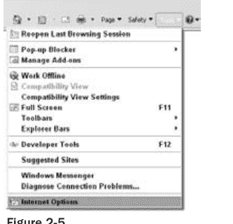

图 2-5

2. 点击安全选项卡，然后点击绿色的受信任站点按钮，如图 2-6 所示。

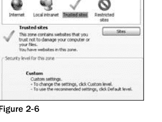

图 2-6

3. 点击站点按钮，在“将此网站添加到区域”文本框中输入`file://*.host`，如图 2-7 所示。

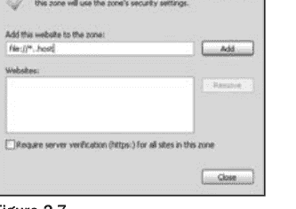

图 2-7

4. 确保未选中“要求服务器验证（https:）”复选框，点击添加按钮，然后点击关闭按钮。

5. 在 Internet 选项对话框中点击确定按钮返回网页，按 F5 键刷新页面，此时示例代码就能正常工作了。

脚本块的第一行是一个注释，因为它以双斜杠（`//`）开头。其中包含将华氏温度转换为摄氏温度的公式，仅作为示例代码中的参考。

```javascript
// Equation is °C = 5/9 (°F - 32).
```

你的任务是用 JavaScript 代码来表示这个公式。首先声明变量`degFahren`和`degCent`。

```javascript
var degFahren = prompt("Enter the degrees in Fahrenheit",50);
var degCent;
```

这里没有将`degFahren`变量初始化为一个字面值，而是使用`prompt()`函数从用户获取值。`prompt()`函数的工作方式与`alert()`函数类似，不同之处在于它除了显示一条消息外，还包含一个文本框供用户输入值。这个输入的值将存储在`degFahren`变量中。虽然返回的值是文本字符串，但正如本章后面关于数据类型转换的部分所讨论的，当你将其作为数字使用时，JavaScript 会隐式地将其转换为数字。

你需要向`prompt()`函数传递两条信息：

- 要显示的文本——通常是一个提示用户输入的问题。
- 提示对话框首次出现时输入框中包含的默认值。

这两条信息必须按指定顺序用逗号分隔。如果你不希望提示框打开时输入框中有默认值，请使用空字符串（`""`）作为第二条信息。

如前面的代码所示，文本是“Enter the degrees in Fahrenheit”（请输入华氏温度），输入框中的默认值是 50。

脚本块中的下一行是用 JavaScript 表示的公式。你将公式的结果存储在`degCent`变量中。你可以看到，JavaScript 代码与注释中的公式非常相似，只是使用`degFahren`代替了 °F，使用`degCent`代替了 °C。

```javascript
degCent = 5/9 * (degFahren - 32);
```

计算等号右侧表达式时有几个重要点需要注意。首先，就像在数学中一样，JavaScript 等式是从左向右读取的，至少对于`+`和`-`等基本数学函数是如此。其次，正如你之前所见，数学中有运算顺序优先级，JavaScript 中也一样。

从左开始，JavaScript 首先计算`5/9 = .5556`（近似值）。然后遇到乘法，但是等等……我们公式的最后一部分`degFahren - 32`在括号中。这提高了其优先级，导致 JavaScript 在执行乘法之前先计算`degFahren - 32`的结果。例如，当`degFahren`为 50 时，`(degFahren - 32) = (50 - 32) = 18`。现在 JavaScript 执行乘法，`.5556 * 18`，结果大约是 10。

如果你没有使用括号呢？那么你的代码将是：

```javascript
degCent = 5/9 * degFahrenheit - 32;
```

`5/9`的计算保持不变，但随后 JavaScript 会计算乘法`5/9*degFahrenheit`。这是因为乘法优先于减法。当`degFahrenheit`为 50 时，这等于`5/9*50=27.7778`。最后，JavaScript 会减去 32，结果为`-4.2221`——这不是你想要的答案！

最后，在脚本块中，你使用`alert()`函数显示答案。

```javascript
alert(degCent);
```

以上简要介绍了 JavaScript 的基本计算。然而，在第 4 章中，你将学习 Math 对象，它使你能够进行更复杂的计算。

在前面的部分中，你了解了文本或字符串数据类型，以及数值数据。正如数值数据有相关的运算符，字符串也有运算符。本节将介绍使用这些运算符的一些基本字符串操作技术。第 4 章将更深入地介绍字符串，第 8 章将介绍高级字符串处理。

你在 JavaScript 中会反复做的一件事是将两个字符串连接在一起形成一个字符串——这个过程称为连接。例如，你可能希望连接字符串“Hello”和“Paul”来形成字符串“Hello Paul”。那么如何连接呢？很简单！使用`+`运算符。回想一下，当应用于数字时，`+`运算符将它们相加，但当用于两个字符串时，它会将它们连接在一起。

```javascript
var concatString = "Hello " + "Paul";
```

现在存储在变量`concatString`中的字符串是“Hello Paul”。注意字符串“Hello”的最后一个字符是一个空格——如果你漏掉了这个空格，连接后的字符串将是“HelloPaul”。

### 连接字符串

让我们看一个使用`+`运算符进行字符串连接的示例。

1. 输入以下代码并将其保存为`ch2_examp5.htm`：


```html
<!DOCTYPE html PUBLIC "-//W3C//DTD XHTML 1.0 Transitional//EN"
"http://www.w3.org/TR/xhtml1/DTD/xhtml1-transitional.dtd">
<html xmlns="http://www.w3.org/1999/xhtml">
<body>

<script type="text/javascript">

var greetingString = "Hello";
var myName = prompt("Please enter your name", "");
var concatString;

document.write(greetingString + " " + myName + "<br>");
```

```javascript
concatString = greetingString + " " + myName;

document.write(concatString);


</script>

</body>
</html>
```

- 2. 如果将其加载到 Web 浏览器中，你应该会看到一个提示框要求你输入姓名。
- 3. 输入你的姓名并点击确定。你应该会在网页上看到一条问候语和你的姓名显示两次。

脚本块以声明三个变量开始。你将第一个变量`greetingString`设置为一个字符串值。第二个变量`myName`被赋值为用户在提示框中输入的任何内容。你没有在这里初始化第三个变量`concatString`。它将用于存储稍后在代码中执行的连接操作的结果。

```javascript
var greetingString = "Hello";
var myName = prompt("Please enter your name", "");
var concatString;
```

在上一章中，你了解了网页如何通过`document`概念来表示，以及它具有许多不同的属性，如`bgColor`。你也可以使用`document`直接将文本和 HTML 写入页面本身。这是通过使用单词`document`，后跟一个点，然后是`write()`来实现的。然后你像使用`alert()`函数一样使用`document.write()`，即在单词`write`后的括号内放入你希望在网页上显示的文本。不过，这里不必太担心，因为第 4 章将详细解释所有内容。但是，你现在在代码中使用了`document.write()`将表达式的结果写入页面。

```javascript
document.write(greetingString + " " + myName + "<br>");
```

写入页面的表达式是`greetingString`变量的值、一个空格（`" "`）、`myName`变量的值以及 HTML `<br>`标签的连接，该标签用于换行。例如，如果你在提示框中输入 Paul，这个表达式的值将是：

```html
Hello Paul<br>
```

下一行代码中有一个类似的表达式。这次只是连接`greetingString`变量中的值、一个空格和`myName`变量中的值。你将这个表达式的结果存储在变量`concatString`中。最后，你使用`document.write()`将变量`concatString`的内容写入页面。

```javascript
concatString = greetingString + " " + myName;
document.write(concatString);
```

### 混合使用数字和字符串

如果你想在表达式中混合使用文本和数字呢？一个典型的例子就是你之前看到的温度转换器。在该示例中，你只是显示数字而没有告诉用户它的实际含义。你真正想做的是在数字周围加上描述性文本一起显示，例如“The value converted to degrees centigrade is 10.”（转换为摄氏度的值是10。）

## 第 2 章：数据类型与变量

混合数字和文本实际上非常简单。你可以简单地使用`+`运算符将它们连接在一起。JavaScript 足够智能，知道当字符串和数字同时涉及时，你并非试图进行数值计算，而是希望将数字作为字符串对待并将其连接到文本上。例如，要连接文本`My age is`和数字`101`，你可以简单地执行以下操作：

```javascript
alert("My age is " + 101);
```

这将弹出一个包含"My age is 101"的`alert`框。

### 动手试一试：让温度转换器更用户友好

你可以在我们的温度转换示例中尝试这种连接字符串和数字的技巧。你将输出一些说明文本，连同转换计算的结果一起显示。你需要做的修改非常小，所以将`ch2_examp4.htm`加载到你的文本编辑器中并更改以下行。然后将其保存为`ch2_examp6.htm`。

```html
<!DOCTYPE html PUBLIC "-//W3C//DTD XHTML 1.0 Transitional//EN"
"http://www.w3.org/TR/xhtml1/DTD/xhtml1-transitional.dtd">
<html xmlns="http://www.w3.org/1999/xhtml">
<body>

<script type="text/javascript">

var degFahren = prompt("Enter the degrees in Fahrenheit", 50);
var degCent;

degCent = 5/9 * (degFahren - 32);

alert(degFahren + "\xB0 Fahrenheit is " + degCent + "\xB0 centigrade");

</script>

</body>
</html>
```

将页面加载到你的网络浏览器中。在提示框中点击 OK（确定）提交数值 50，此时你应该能看到图 2-8 所示的框。

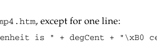

**图 2-8**

本示例与`ch2_examp4.htm`完全相同，只有一行不同：

```javascript
alert(degFahren + "\xB0 Fahrenheit is " + degCent + "\xB0 centigrade");
```

所以我们将仅在此查看该行。你可以看到`alert()`函数包含一个表达式。让我们更仔细地观察该表达式。

首先是变量`degFahren`，其中包含数值数据。你将它与字符串`"\xB0 Fahrenheit is "`连接起来。JavaScript 意识到因为你正在将数字和字符串相加，你想要将它们拼接成一个字符串而不是尝试计算它们的和，因此自动将`degFahren`中的数字转换为字符串。接着，你将该字符串与变量`degCent`（包含数值数据）连接起来。再次，JavaScript 将该变量的值转换为字符串。最后，你将其连接到字符串`"\xB0 centigrade"`。

注意还注意到用于在字符串中插入度字符的转义序列。你会从本章前面记得`\xNN`可用于插入无法直接键入的特殊字符。（NN 是代表拉丁-1 字符表中字符的十六进制数字）。因此，当 JavaScript 在字符串中发现`\xB0`时，它不进行显示这些字符的操作，而是查找由 B0 代表的字符并显示该字符。

使用特殊字符时要注意的一点是它们不一定具有跨平台兼容性。虽然你可以在 Windows 计算机上使用`\xNN`表示某个字符，但你可能发现在 Mac 或 Unix 机上需要使用不同的字符。

在下一章第 4 章中你会看到更多的字符串操作技术——你将了解如何在字符串中搜索字符串并在其中插入字符，在第 8 章你会看到一些非常高级的字符串技术。

## 数据类型转换

正如你所见，如果你将字符串和数字相加，JavaScript 会做出明智的选择并将数字转换为字符串，然后拼接这两个。通常情况下，只要有需要时，JavaScript 就有足够的判断力来进行此类数据类型转换，但有些情况你需要自己转换数据类型的类型。例如，你可能收到一些希望被视为数字的字符串数据。尤其是当你使用表单收集来自用户的数据时。任何由用户输入的值都被视为字符串，即使它们可能包含数值数据，如用户的年龄。

为什么更改数据的类型如此重要？考虑一下这样一个场景：你通过表单从用户那里收集两个数字并希望计算它们的总和。这两个数字以字符串形式提供给你，例如`"22"`和`"15"`。当你尝试使用`"22" + "15"`计算这些值的总和时，结果得到`"2215"`，因为 JavaScript 认为你正在尝试拼接两个字符串而不是寻找两个数字的总和。为了进一步增加混淆的是，顺序也很重要。所以：

```javascript
1 + 2 + 'abc'
```

结果是包含`"3abc"`的字符串，而：

```javascript
'abc' + 1 + 2
```

则会得到包含`"abc12"`的字符串。

在本节中你将查看两个将字符串转换为数字的转换函数：`parseInt()`和`parseFloat()`。

让我们先看看`parseInt()`。此函数接收一个字符串并将其转换为整数。名字起初有点令人困惑——为什么是`parseInt()`而不是`convertToInt()`？名字的主要原因来自于函数的运作方式。它实际上会遍历（即解析）你要求它转换的字符串中的每个字符，并查看它是否是一个有效数字。如果有效，`parseInt()`将其用于构建该数字；如果无效，命令就简单地停止转换并返回迄今为止已转换的数字。

例如，如果你的代码是`parseInt("123")`，JavaScript 会将字符串"123"转换为数字 123。对于代码`parseInt("123abc")`，JavaScript 也会返回数字 123。当 JavaScript 解释器到达字母 a 时，它假设数字已经结束并给出 123 作为字符串"123abc"的整数版本。

`parseFloat()`函数的运作方式与`parseInt()`相同，只是它返回浮点数——小数——并且字符串中的小数点（正在转换的数字）被视为有效数字的一部分。

### 动手试一试：将字符串转换为数字

让我们看一下使用`parseInt()`和`parseFloat()`的示例。输入以下代码并将其保存为`ch2_examp7.html`：

```html
<!DOCTYPE html PUBLIC "-//W3C//DTD XHTML 1.0 Transitional//EN"
"http://www.w3.org/TR/xhtml1/DTD/xhtml1-transitional.dtd">
<html xmlns="http://www.w3.org/1999/xhtml">
<body>

<script type="text/javascript">

var myString = "56.02 degrees centigrade";
var myInt;
var myFloat;

document.write("\"" + myString + "\" is " + parseInt(myString) +
    " as an integer" + "<BR>");

myInt = parseInt(myString);
document.write("\"" + myString + "\" when converted to an integer equals " +
    myInt + "<BR>");

myFloat = parseFloat(myString);
document.write("\"" + myString +
    "\" when converted to a floating point number equals " + myFloat);

</script>

</body>
</html>
```

将其加载到浏览器中，你会在网页上看到三行内容，如图 2-9 所示。

> "56.02 degrees centigrade" is 56 as an integer

> "56.02 degrees centigrade" when converted to an integer equals 56

> "56.02 degrees centigrade" when converted to a floating point number equals 56.02

**图 2-9**

脚本块中的第一个任务是声明一些变量。变量`myString`被声明并初始化为要转换的字符串。你可以同样简单地在此示例中直接使用该字符串而不是将其存储在变量中，但在实践中你会发现你使用变量比使用字面量值更频繁。你也声明了变量`myInt`和`myFloat`，它们将存储转换后的数字。

```javascript
var myString = "56.02 degrees centigrade";
var myInt;
var myFloat;
```

接下来，你将`myString`的转换整数值的写入页面显示在你构建的用户友好句子中（使用字符串连接）。请注意，你使用转义序列`\"`来显示用于转换字符串周围的引号`(")`。

```javascript
document.write("\"" + myString + "\" is " + parseInt(myString) +
  " as an integer" + "<BR>");
```

正如你所见，你可以像使用数字本身或包含数字的变量一样的地方使用`parseInt()`和`parseFloat()`。实际上，在这行代码中 JavaScript 解释器执行了两次转换。首先，它通过`parseInt()`将`myString`转换为整数。然后它将此整数值自动转换回字符串，以便它可以与其他字符串拼接组成你的句子。还要注意，当你处理整数时，只有`myString`变量值的 56 部分被视为有效数字。6 之后的任何内容都被视为无效并被忽略。

接下来，你使用`parseInt()`对`myString`执行相同的转换，但这次将结果存储在变量`myInt`中。在下一行中，你将结果用于显示给用户的文本中：

```javascript
myInt = parseInt(myString);
document.write("\"" + myString + "\" when converted to an integer equals " +
  myInt + "<BR>");
```

同样，虽然`myInt`存储的是数字，但 JavaScript 解释器知道当字符串和数字涉及时，`+`意味着你希望将`myInt`值转换为字符串并与其余字符串拼接以便显示。

最后，你使用`parseFloat()`将变量`myString`中的字符串转换为浮点数，并将其存储在变量`myFloat`中。这次小数点被视为数字的有效部分，因此忽略 2 之后的任何内容。再次使用`document.write()`将结果写入网页的用户友好字符串中。

```javascript
myFloat = parseFloat(myString);
document.write("\"" + myString +
  "\" when converted to a floating point number equals " + myFloat);
```

## 第二章：数据类型与变量

### 处理无法转换的字符串

有些字符串根本无法转换为数字，例如不包含任何数字数据的字符串。如果你尝试转换这些字符串会发生什么呢？作为小实验，试着修改前面的例子，让`myString`保存一些不可转换的内容。例如，将这一行：

```javascript
var myString = "56.02 degrees centigrade";
```

改为：

```javascript
var myString = "I'm a name not a number";
```

现在，重新加载浏览器中的页面，你应该会看到图 2-10 所示的内容。

"I'm a name not a number" 作为整数是 NaN

"I'm a name not a number" 转换为整数等于 NaN

"I'm a name not a number" 转换为浮点数等于 NaN

**图 2-10**

你可以看到，在之前是数字的地方，现在得到的是 NaN。那是什么数字？嗯，它根本不是数字！

如果你对任何空字符串或不是以至少一个有效数字开头的字符串使用`parseInt()`或`parseFloat()`，你都会得到 NaN，意思是“不是数字”。

NaN 实际上是 JavaScript 中的一个特殊值。它有自己的函数`isNaN()`，用于检查某个值是否为 NaN。例如：

```javascript
myVar1 = isNaN("Hello");
```

会将值`true`存储在变量`myVar1`中，因为"Hello"不是数字，而：

```javascript
myVar2 = isNaN("34");
```

会将值`false`存储在变量`myVar2`中，因为 34 可以通过`isNaN()`函数成功地从字符串转换为数字。

在第三章中，你将看到如何使用`isNaN()`函数来检查字符串是否为有效数字，这在处理用户输入时（如第七章所述）被证明是极其有用的。

### 数组

现在我们要看一个新概念——叫做数组的东西。数组类似于普通变量，因为你可以用它来保存任何类型的数据。然而，它有一个重要的区别，你将在本节中看到。

正如你已经看到的，普通变量一次只能保存一条数据。例如，你可以将`myVariable`设置为等于 25，像这样：

```javascript
myVariable = 25;
```

然后将其设置为其他值，比如 35：

```javascript
myVariable = 35;
```

然而，当你将变量设置为 35 时，第一个值 25 就丢失了。变量`myVariable`现在只保存数字 35。

下表说明了该变量：

| 变量名 | 值 |
| --- | --- |
| `myVariable` | 35 |


普通变量和数组之间的区别在于，数组可以同时保存多个数据项。例如，你可以使用一个名为`myArray`的数组来同时存储数字 25 和 35。数组中可以存储数据的每个位置称为一个元素。

你如何区分数组中的这两条数据呢？你给每条数据一个索引值。要引用那条数据，你需要在数组名称后跟一个方括号，并将索引值放在其中。例如，一个名为`myArray`的数组包含数据 25 和 35，可以使用下表来表示：

| 元素名 | 值 |
| --- | --- |
| `myArray[0]` | 25 |
| `myArray[1]` | 35 |

注意，索引值从 0 开始而不是 1。为什么呢？当然，从 1 开始更有意义——毕竟，我们人类倾向于说第一个数据项，然后是第二个，依此类推。不幸的是，计算机从 0 开始计数，将第一个项视为第零项，第二个视为第一项，等等。这很令人困惑，但你很快就会习惯。

数组非常有用，因为你可以在数组中存储任意多（在语言限制范围内，该限制规定最多为 2 的 32 次方个元素）或任意少的数据项。此外，你不必事先说明你想在数组中存储多少条数据，当然你也可以选择提前说明。

那么，如何创建一个数组呢？这与声明普通变量略有不同。要创建一个新数组，你需要声明一个变量名，并使用`new`关键字和`Array()`函数告诉 JavaScript 你想让它成为一个新数组。例如，数组`myArray`可以这样定义：

```javascript
var myArray = new Array();
```

请注意，就像 JavaScript 中的其他所有内容一样，代码是区分大小写的，所以如果你输入`array()`而不是`Array()`，代码将无法工作。这种定义数组的方式将在第五章中进一步解释。

与普通变量一样，你也可以先声明变量，然后告诉 JavaScript 你想让它成为一个数组。例如：

```javascript
var myArray;
myArray = new Array();
```

之前你学过，如果你想的话，你可以提前说明数组将容纳多少个元素，尽管这不是必需的。你可以通过将要指定的元素数量放在`Array`之后的括号中来完成此操作。例如，要创建一个将容纳六个元素的数组，你可以这样写：

```javascript
var myArray = new Array(6);
```

你已经看到了如何声明一个新数组，但是如何将你的数据项存储到其中呢？你可以在定义数组时通过将数据包含在括号内来完成此操作，每个数据项用逗号分隔。例如：

```javascript
var myArray = new Array("Paul",345,"John",112,"Bob",99);
```

这里第一个数据项`"Paul"`将以索引 0 放入数组中。下一个数据项 345 将以索引 1 放入数组中，以此类推。这意味着名为`myArray[0]`的元素包含值`"Paul"`，名为`myArray[1]`的元素包含值 345，依此类推。

请注意，你不能使用此方法来声明一个仅包含一个数值数据（例如 345）的数组，因为 JavaScript 会假设你正在声明一个将容纳 345 个元素的数组。

这引出了另一种在数组中声明数据的方式。你可以像这样写上一行：

```javascript
var myArray = new Array();
myArray[0] = "Paul";
myArray[1] = 345;
myArray[2] = "John";
myArray[3] = 112;
myArray[4] = "Bob";
myArray[5] = 99;
```

你将每个元素名当作变量一样使用，并为它们赋值。你将在接下来的“动手试试”部分学习这种声明数组元素值的方法。

显然，在这个例子中，第一种定义数据项的方式要容易得多。然而，在某些情况下，你可能想在声明之后更改存储在数组特定元素中的数据。在这种情况下，你将不得不使用后一种方法来定义数组元素的值。

从前面的例子中，你还会发现可以在同一个数组中存储不同的数据类型。JavaScript 对于可以在数组中放入什么以及可以放在哪里非常灵活。

在继续看例子之前，请注意，例如，如果你已经将名为`myArray`的数组定义为包含三个元素，像这样：

```javascript
var myArray = new Array(3);
```

然后在索引为 130 的元素中定义一个值，如下所示：

```javascript
myArray[130] = "Paul";
```

JavaScript 不会抱怨，并且会很乐意地假设你改变了主意，想要一个包含（至少）131 个元素的数组。

### 动手试试：一个数组

在下面的例子中，你将创建一个数组来保存一些名字。你将使用上一节描述的第二种方法将这些数据存储到数组中。然后，你将向用户显示这些数据。输入代码并将其保存为`ch2_examp8.htm`。

```html
<!DOCTYPE html PUBLIC "-//W3C//DTD XHTML 1.0 Transitional//EN"
"http://www.w3.org/TR/xhtml1/DTD/xhtml1-transitional.dtd">
<html xmlns="http://www.w3.org/1999/xhtml">
<body>

<script type="text/javascript">

var myArray = new Array();
myArray[0] = "Bob";
myArray[1] = "Pete";
myArray[2] = "Paul";

document.write("myArray[0] = " + myArray[0] + "<BR>");
document.write("myArray[2] = " + myArray[2] + "<BR>");
document.write("myArray[1] = " + myArray[1] + "<BR>");

myArray[1] = "Mike";
document.write("myArray[1] changed to " + myArray[1]);

</script>

</body>
</html>
```

如果你在 Web 浏览器中加载此文件，你应该会看到一个看起来类似于图 2-11 所示的网页。

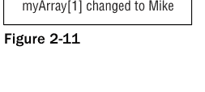

**图 2-11**

## 第2章：数据类型与变量

脚本块中的第一个任务是声明一个变量，并告诉 JavaScript 解释器你希望它是一个新数组。

```javascript
var myArray = new Array();
```

现在你已经定义了数组，就可以在其中存储一些数据了。每次你使用一个新索引存储一条数据时，JavaScript 会自动为其创建一个新的存储空间。请记住，第一个元素将位于`myArray[0]`。

我们依次查看数组的每次添加操作。在添加任何内容之前，你的数组是空的。然后你通过以下代码添加一个数组元素：

```javascript
myArray[0] = "Bob";
```

你的数组现在看起来像这样：

| 索引 | 存储的数据 |
| --- | --- |
| 0 | Bob |

接着，你向数组添加另一个元素，这次索引为 1。

```javascript
myArray[1] = "Pete";
```

| 索引 | 存储的数据 |
| --- | --- |
| 0 | Bob |
| 1 | Pete |

最后，你使用索引 2 添加另一个元素。

```javascript
myArray[2] = "Paul";
```

你的数组现在看起来像这样：

| 索引 | 存储的数据 |
| --- | --- |
| 0 | Bob |
| 1 | Pete |
| 2 | Paul |

接下来，你使用一系列`document.write()`函数将数组每个元素包含的值插入到网页中。这里的数组顺序被打乱只是为了演示你可以以这种方式访问它。

```javascript
document.write("myArray[0] = " + myArray[0] + "<BR>");
document.write("myArray[2] = " + myArray[2] + "<BR>");
document.write("myArray[1] = " + myArray[1] + "<BR>");
```

你可以将数组中的每个特定位置当作一个标准变量来处理。因此，你可以用它进行计算，将其值转移到另一个变量或数组，等等。但是，如果你尝试在定义数组中的某个位置之前访问其中的数据，你将得到`undefined`作为值。

最后，你将第二个数组位置的值改为`"Mike"`。你本可以将其改为数字，因为就像普通变量一样，你可以在数组的每个独立数据位置中随时存储任何数据类型。

```javascript
myArray[1] = "Mike";
```

现在你的数组内容看起来像这样：

| 索引 | 存储的数据 |
| --- | --- |
| 0 | Bob |
| 1 | Mike |
| 2 | Paul |

为了展示你所做的更改已经生效，你使用`document.write()`来显示第二个元素的值。

```javascript
document.write("myArray[1] changed to " + myArray[1]);
```

### 多维数组

假设你想将一个公司的人员信息存储在数组中。你可能有姓名、年龄、地址等数据。创建这样一个数组的一种方法是按顺序存储信息——第一个姓名放在数组的第一个元素中，然后对应的年龄放在下一个元素中，地址放在第三个，下一个姓名放在第四个元素中，依此类推。你的数组可能看起来像这样：

| 索引 | 存储的数据 |
| --- | --- |
| 0 | Name1 |
| 1 | Age1 |
| 2 | Address1 |
| 3 | Name2 |
| 4 | Age2 |
| 5 | Address2 |
| 6 | Name3 |
| 7 | Age3 |
| 8 | Address3 |

这可以工作，但有一个更简洁的解决方案：使用多维数组。到目前为止，你一直在使用一维数组。在这些数组中，每个元素仅由一个索引指定——即一个维度。所以，以上述例子为例，你可以看到 Name1 在索引 0，Age1 在索引 1，依此类推。

多维数组是每个元素有两个或更多索引的数组。例如，你的人员数组作为二维数组可能看起来像这样：

| 索引 | 0 | 1 | 2 |
| --- | --- | --- | --- |
| 0 | Name1 | Name2 | Name3 |
| 1 | Age1 | Age2 | Age3 |
| 2 | Address1 | Address2 | Address3 |

你将在下面的“动手试一试”部分看到如何创建这样的多维数组。

#### 动手试一试

##### 一个二维数组

下面的示例说明了如何在 JavaScript 代码中创建这样的多维数组，以及如何访问此数组的元素。输入代码并将其保存为`ch2_exam9.htm`。

```html
<!DOCTYPE html PUBLIC "-//W3C//DTD XHTML 1.0 Transitional//EN" 
"http://www.w3.org/TR/xhtml1/DTD/xhtml1-transitional.dtd">
<html xmlns="http://www.w3.org/1999/xhtml">
<body>

<script type="text/javascript">

    var personnel = new Array();

    personnel[0] = new Array();
    personnel[0][0] = "Name0";
    personnel[0][1] = "Age0";
    personnel[0][2] = "Address0";

    personnel[1] = new Array();
    personnel[1][0] = "Name1";
    personnel[1][1] = "Age1";
    personnel[1][2] = "Address1";

    personnel[2] = new Array();
    personnel[2][0] = "Name2";
    personnel[2][1] = "Age2";
    personnel[2][2] = "Address2";

    document.write("Name : " + personnel[1][0] + "<BR>");
    document.write("Age : " + personnel[1][1] + "<BR>");
    document.write("Address : " + personnel[1][2]);

</script>
</body>
```

```html
</html>
```

如果你将其加载到 Web 浏览器中，你会在页面上看到三行文字，它们代表存储在数组`personnel[1]`元素中的人员的姓名、年龄和地址，如图 2-12 所示。

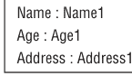

#### 图 2-12

在这个脚本块中要做的第一件事是声明一个变量`personnel`，并告诉 JavaScript 你希望它是一个新数组。

```javascript
var personnel = new Array();
```

然后你做了一件新的事情；你告诉 JavaScript 你希望`personnel`数组的索引 0，即元素`personnel[0]`，是另一个新数组。

```javascript
personnel[0] = new Array();
```

那么发生了什么？嗯，事实是 JavaScript 实际上并不支持多维数组，只支持一维数组。然而，JavaScript 通过在另一个数组内创建数组来让我们模拟多维数组。因此，上面那行代码的作用是在`personnel`数组索引为 0 的元素内创建一个新数组。

在接下来的三行中，你将值放入新创建的`personnel[0]`数组中。JavaScript 使这变得简单：你只需指定数组名称`personnel[0]`，后跟方括号中的另一个索引。第一个索引 (0) 属于`personnel`数组；第二个索引属于`personnel[0]`数组。

```javascript
personnel[0][0] = "Name0";
personnel[0][1] = "Age0";
personnel[0][2] = "Address0";
```

在这些代码行之后，你的数组看起来像这样：

| 索引 | 0 |
| --- | --- |
| 0 | Name0 |
| 1 | Age0 |
| 2 | Address0 |

顶部的数字（目前只有 0）指的是`personnel`数组。侧边向下的数字 0、1 和 2 实际上是`personnel`数组内部新数组`personnel[0]`的索引。

对于第二个人的详细信息，你重复这个过程，但这次你使用`personnel`数组中索引为 1 的元素。

```javascript
personnel[1] = new Array();
personnel[1][0] = "Name1";
personnel[1][1] = "Age1";
personnel[1][2] = "Address1";
```

现在你的数组看起来像这样：

| 索引 | 0 | 1 |
| --- | --- | --- |
| 0 | Name0 | Name1 |
| 1 | Age0 | Age1 |
| 2 | Address0 | Address1 |

你在接下来的几行中创建了第三个人的详细信息。你现在使用`personnel`数组中索引为 2 的元素来创建一个新数组。

```javascript
personnel[2] = new Array();
personnel[2][0] = "Name2";
personnel[2][1] = "Age2";
personnel[2][2] = "Address2";
```

数组现在看起来像这样：

| 索引 | 0 | 1 | 2 |
| --- | --- | --- | --- |
| 0 | Name0 | Name1 | Name2 |
| 1 | Age0 | Age1 | Age2 |
| 2 | Address0 | Address1 | Address2 |

你现在已经完成了多维数组的创建。你通过访问第二个人（`Name1`、`Age1`、`Address1`）的数据并在页面上使用`document.write()`显示它来结束脚本块。正如你所看到的，访问数据与存储数据非常相似。你可以在任何可以使用普通变量或一维数组的地方使用多维数组。

```javascript
document.write("Name : " + personnel[1][0] + "<BR>");
document.write("Age : " + personnel[1][1] + "<BR>");
document.write("Address : " + personnel[1][2]);
```


尝试更改`document.write()`命令，以便显示第一个人的详细信息。代码将如下所示：

```javascript
document.write("Name : " + personnel[0][0] + "<BR>");
document.write("Age : " + personnel[0][1] + "<BR>");
document.write("Address : " + personnel[0][2]);
```

## 第二章：数据类型与变量

可以创建三维、四维甚至一百维的多维数组，但事情会变得非常混乱，你会发现你很少——如果有的话——需要超过两个维度的数组。为了让你有个概念，这里是如何声明和访问一个五维数组：

```javascript
var myArray = new Array();
myArray[0] = new Array();
myArray[0][0] = new Array();
myArray[0][0][0] = new Array();
myArray[0][0][0][0] = new Array();

myArray[0][0][0][0][0] = "This is getting out of hand"

document.write(myArray[0][0][0][0][0]);
```

关于数组就先讲到这里，但你将在第四章再次遇到它们，届时你会了解一些关于数组的惊人事实。你还将学习它们的一些更高级的特性。

### 本章小结

在本章中，你已经建立了对 JavaScript 数据类型和变量的基础知识，以及如何在操作中使用它们。特别是，你了解到：

- JavaScript 支持多种数据类型，例如数字、文本和布尔值。
- 文本由字符字符串表示，并用引号括起来。你必须匹配字符串周围的引号。转义字符使你能够在字符串中包含无法直接输入的字符。
- 变量是 JavaScript 在内存中存储数据（如数字和文本）的手段，以便在代码中重复使用。
- 变量名不得包含某些非法字符，如百分号（`%`）和与号（`&`），也不得是保留字，例如`with`。
- 在给变量赋值之前，你必须向 JavaScript 解释器声明其存在。
- JavaScript 有四个基本数学运算符，分别用加号（`+`）、减号（`-`）、星号（`*`）和正斜杠（`/`）表示。要将计算结果赋值给一个变量，你需要使用等号（`=`），即赋值运算符。
- 运算符具有不同的优先级，因此乘法和除法会在加法和减法之前计算。
- 字符串可以通过`+`运算符连接（或拼接）起来，生成一个大字符串。当数字和字符串用`+`运算符连接时，JavaScript 会自动将数字转换为字符串。
- 虽然 JavaScript 的自动数据转换在大多数情况下都适用，但有时你需要强制转换数据。你看到了如何使用`parseInt()`和`parseFloat()`将字符串转换为数字。尝试转换无法转换的字符串将返回`NaN`（非数字）。
- 数组是一种特殊的变量，可以保存多条数据。数据通过唯一的索引号插入和访问。

### 练习题

这些题目的建议解答可以在附录 A 中找到。

1. 编写一个 JavaScript 程序，将摄氏温度转换为华氏温度，并将结果以描述性句子的形式写入页面。华氏温度转摄氏温度的 JavaScript 公式如下：

   ```javascript
   degFahren = 9 / 5 * degCent + 32
   ```

2. 以下代码使用`prompt()`函数从用户那里获取两个数字。然后将这两个数字相加，并将结果写入页面：

   ```html
   <!DOCTYPE html PUBLIC "-//W3C//DTD XHTML 1.0 Transitional//EN"
   "http://www.w3.org/TR/xhtml1/DTD/xhtml1-transitional.dtd">
   <html xmlns="http://www.w3.org/1999/xhtml">
   <script language="JavaScript" type="text/javascript">

   var firstNumber = prompt("Enter the first number","");
   var secondNumber = prompt("Enter the second number","");
   var theTotal = firstNumber + secondNumber;
   document.write(firstNumber + " added to " + secondNumber + " equals " + theTotal);

   </script>
   </body>
   </html>
   ```

   然而，如果你试运行这段代码，你会发现它不工作。为什么？请修改代码使其能够正常工作。

## 第三章：判断、循环与函数

到目前为止，你已经学习了如何使用 JavaScript 获取用户输入，使用这些输入执行计算和任务，并将结果写入网页。然而，一个简单的计算器也能做到这一切，那么是什么让计算机与众不同呢？也就是说，是什么赋予了计算机看似智能的特性？答案是基于收集的信息做出判断的能力。

判断能力将如何帮助你创建网站？在上一章中，你编写了一些将华氏温度转换为摄氏温度的代码。你使用`prompt()`函数从用户那里获取华氏温度。如果用户输入了有效的数字（例如 50），这工作得很好。然而，如果用户输入了无效的华氏温度值，例如字符串 aaa，你会发现你的代码不再按预期工作。现在，如果你的程序具有一些判断能力，你就可以检查用户输入的内容是否有效。如果有效，你可以进行计算；如果无效，你可以告诉用户原因，并要求他输入一个有效的数字。

用户输入验证可能是 JavaScript 中判断能力最常见的用途之一，但它远非唯一的用途。

在本章中，你将了解判断能力如何在 JavaScript 中实现，以及如何利用它让你的代码更智能。

### 判断能力——`if`和`switch`语句

所有编程语言都允许你做出判断——也就是说，它们允许程序根据某个特定的条件是否满足来遵循特定的行动路线。这正是编程语言显得智能的原因。

例如，在你使用仅兼容版本 4 或更高浏览器的 JavaScript 代码的情况下，条件可能是用户正在使用版本 4 或更高版本的浏览器。如果你发现该条件不满足，你可以将他引导到一组兼容早期浏览器的页面。

条件是变量和数据之间的比较，例如以下几种：

- *A*是否大于*B*？
- *X*是否等于*Y*？
- *M*是否不等于*N*？

例如，如果变量`browserVersion`保存了用户使用的浏览器版本，那么条件就是：

> `browserVersion`是否大于或等于 4？

你会注意到所有这些问题都有一个“是”或“否”的答案——也就是说，它们是基于布尔值的，只能评估为`true`或`false`。你如何利用这一点在代码中创建判断能力呢？你需要让浏览器测试条件是否为`true`。如果（并且仅当）条件为`true`，你就执行特定的代码部分。

再看一个例子。回顾第一章中用于演示代码流程的自然英语指令。其中一条制作咖啡的指令是：

> 水壶烧开了吗？如果是，将水倒入杯中；否则，继续等待。

这就是一个做出判断的例子。这条指令中的条件是“水壶烧开了吗？”。它有一个`true`或`false`的答案。如果答案是`true`，你就把水倒进杯子。如果不是`true`，你就继续等待。

在 JavaScript 中，你可以使用`if`语句或`switch`语句，根据条件为`true`还是`false`来改变代码的执行流程。你稍后将了解这些，但首先我们需要介绍一些对定义条件至关重要的新运算符——比较运算符。

## 比较运算符

在第二章中，你看到了数学函数（如加法和除法）如何用符号（如加号`+`和正斜杠`/`）表示，这些符号称为运算符。你还看到，如果你想给变量一个值，可以使用等号（`=`）将一个值或计算结果赋值给它，即赋值运算符。

判断能力也有自己的运算符，允许你测试条件。比较运算符，就像你在上一章看到的数学运算符一样，有一个左手边（LHS）和一个右手边（RHS），比较在两者之间进行。这些的技术术语是左操作数和右操作数。例如，小于运算符，符号为`<`，是一个比较运算符。你可以写`23 < 45`，翻译过来就是“23 是否小于 45？”。这里，答案将是`true`。

## 第3章：决策、循环和函数

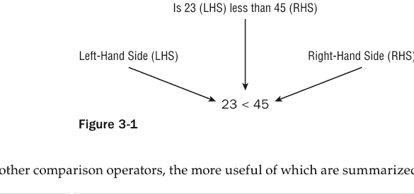

## 存储比较结果

你可以将比较的结果存储在变量中，如下例所示：

```javascript
var age = prompt("Enter age:", "");
var isOverSixty = parseInt(age) > 60;
document.write("Older than 60: " + isOverSixty);
```

这里你使用`prompt()`函数获取用户的年龄。该函数以字符串形式返回用户输入的任何值。然后你使用上一章见过的`parseInt()`函数将其转换为数字，并使用大于运算符判断它是否大于 60。比较的结果（`true`或`false`）将存储在变量`isOverSixty`中。

如果用户输入 35，最后一行的`document.write()`将向页面写入以下内容：

```text
Older than 60: false
```

如果用户输入 61，则会显示：

```text
Older than 60: true
```

## `if`语句

`if`语句是你在几乎每个超过几行的程序中都会用到的语句。它的工作方式与英语中的用法非常相似。例如，你可能会用英语说：“如果室温超过 80 华氏度，那我就打开空调。”用 JavaScript，这可以翻译成类似这样的代码：

```javascript
if (roomTemperature > 80)
{
    roomTemperature = roomTemperature - 10;
}
```

这是如何工作的呢？参见图 3-2。

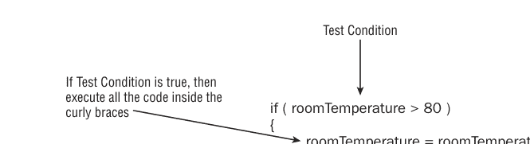

注意测试条件放在括号中，并紧跟在`if`关键字之后。另外，注意这一行末尾没有分号。条件为`true`时要执行的代码放在条件下一行的大括号中，而这些代码行的每一行都以分号结尾。

大括号`{}`在 JavaScript 中有特殊用途：它们标识出一个代码块。将代码行标记为属于单个代码块意味着 JavaScript 会将它们全部当作一段代码来处理。如果`if`语句的条件为`true`，JavaScript 将执行`if`语句之后的下一行或代码块。在前面的例子中，代码块只有一条语句，所以我们同样可以这样写：

```javascript
if (roomTemperature > 80)
    roomTemperature = roomTemperature - 10;
```

然而，如果你有多行代码想要执行，就需要用大括号将它们标记为单个代码块。例如，修改后的示例包含三条语句，就必须包含大括号。

```javascript
if (roomTemperature > 80)
{
    roomTemperature = roomTemperature - 10;
    alert("It's getting hot in here");
    alert("Air conditioning switched on");
}
```

一个特别容易犯的错误是在标记要执行的代码块时忘记大括号。如果不这样做，你会发现只有`if`语句之后的第一行会在条件为`true`时执行。然而，其他行将始终执行，无论测试条件的结果如何。为了避免这类错误，即使只有一条语句也最好始终使用大括号。如果你养成这个习惯，在真正需要它们的时候就不太可能遗漏。

## 试一试`if`语句

让我们回到第 2 章的温度转换器示例，并添加一些决策功能。

1. 输入以下代码并将其保存为`ch3_examp1.htm`：

   ```html
   <!DOCTYPE html PUBLIC "-//W3C//DTD XHTML 1.0 Transitional//EN"
   "http://www.w3.org/TR/xhtml1/DTD/xhtml1-transitional.dtd">
   <html xmlns="http://www.w3.org/1999/xhtml">
   <body>

   <script type="text/javascript">

   var degFahren = Number(prompt("Enter the degrees Fahrenheit",32));
   var degCent;

   degCent = 5/9 * (degFahren - 32);

   document.write(degFahren + "\xB0 Fahrenheit is " + degCent +
       "\xB0 centigrade<br />");

   if (degCent < 0)
   {
       document.write("That's below the freezing point of water");
   }

   if (degCent == 100)
       document.write("That's the boiling point of water");
   </script>
   </body>
   </html>
   ```

2. 在浏览器中加载该页面，并在提示框中输入 32 作为要转换的华氏度值。当值为 32 时，两个`if`语句的条件都不为`true`，所以页面中只会写入一行内容，如图 3-3 所示。

   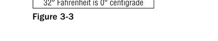

3. 现在重新加载页面，并输入 31 作为华氏度值。这次你会在页面中看到两行内容，如图 3-4 所示。

   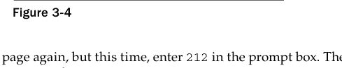

4. 最后，再次重新加载页面，但这次在提示框中输入 212。页面中将会出现图 3-5 所示的两行内容。

   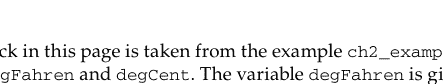

此页面中脚本块的第一部分取自第 2 章的示例`ch2_examp4.htm`。你声明了两个变量`degFahren`和`degCent`。变量`degFahren`的初始值通过`prompt()`函数从用户处获取。注意`prompt()`函数返回一个字符串值，然后你使用`Number()`函数将其显式转换为数值。然后将变量`degCent`设置为计算`5/9 * (degFahren - 32)`的结果，这就是华氏度到摄氏度的转换计算。

```javascript
var degFahren = Number(prompt("Enter the degrees Fahrenheit", 32));
var degCent;
degCent = 5/9 * (degFahren - 32);
```

然后你将计算结果写入页面。

```javascript
document.write(degFahren + "\xB0 Fahrenheit is " + degCent +
    "\xB0 centigrade<br />");
```

56

现在是新代码；两个`if`语句中的第一个。

```javascript
if (degCent < 0)
{
    document.write("That's below the freezing point of water");
}
```

这个`if`语句的条件是询问“变量`degCent`的值是否小于零？”如果答案是 yes（`true`），则执行大括号内的代码。在这种情况下，你使用`document.write()`向页面写入一个句子。如果答案是 no（`false`），处理将移至关闭大括号后的下一行。还值得注意的是，`if`语句起始大括号内的代码是缩进的。这不是必需的，但这是一个值得养成的好习惯，因为它使你的代码更易读。

在尝试示例时，你首先输入了 32，因此`degFahren`将被初始化为 32。在这种情况下，计算`degCent = 5/9 * (degFahren - 32)`将设置`degCent`为 0。所以问题“`degCent`是否小于零？”的答案是`false`，因为`degCent`等于零，而不是小于零。大括号内的代码将被跳过，永远不会执行。在这种情况下，接下来要执行的行将是第二个`if`语句的条件，我们稍后会讨论。

当你在提示框中输入 31 时，`degFahren`被设置为 31，因此变量`degCent`将是 -0.55555555556。那么你的`if`语句现在看起来如何？它评估为“-0.55555555556 是否小于零？”这次答案是`true`，大括号内的代码，这里只是一个`document.write()`语句，被执行。

最后，当你输入 212 时，这如何改变`if`语句？变量`degCent`通过计算被设置为 100，因此`if`语句现在提出的问题是“100 是否小于零？”答案是`false`，大括号内的代码将被跳过。

在第二个`if`语句中，你评估条件“变量`degCent`的值是否等于 100？”

```javascript
if (degCent == 100)
    document.write("That's the boiling point of water");
```

这里没有大括号，所以如果条件为`true`，唯一要执行的代码是`if`语句下方的第一行。当想要在条件为`true`时执行多行代码时，就需要大括号。

你看到当`degFahren`为 32 时，`degCent`将是 0。所以你的`if`语句将是“0 是否等于 100？”答案显然是`false`，代码不会执行。同样，当你将`degFahren`设置为 31 时，`degCent`将被计算为 -0.55555555556；“-0.55555555556 是否等于 100？”也是`false`，代码不会执行。

最后，当`degFahren`设置为 212 时，`degCent`将是 100。这次`if`语句是“100 是否等于 100？”答案是`true`，`document.write()`语句被执行。


如你所见，JavaScript 中最常见的错误之一，即使对于专家也是如此，就是在进行判断时只使用一个等号，而不是必需的两个。看看下面的代码片段：

```javascript
if (degCent = 100)
    document.write("That's the boiling point of water");
```

这个条件将始终评估为`true`，`if`语句下方的代码将始终执行。更糟的是，你的变量`degCent`将被设置为100。为什么呢？因为单个等号给变量赋值；只有双等号才比较值。赋值始终评估为`true`，因为赋值表达式的结果是右侧表达式的值，也就是数字100，随后被隐式转换为布尔值，而除了0和NaN之外的任何数字都会转换为`true`。

# 第三章：决策、循环与函数

## 逻辑运算符

现在，你应该对如何在`if`语句中使用条件有了一个基本的了解，但是如何使用像“`degFahren`是否大于零且小于100？”这样的条件呢？这里需要测试两个条件。你需要测试`degFahren`是否大于零*并且*是否小于100。

JavaScript 允许你使用这样的多重条件。为此，你需要再学习三个运算符：逻辑运算符与（AND）、或（OR）、非（NOT）。这些运算符的符号列在下面的表格中。

| 运算符 | 符号 |
|---|---|
| 与 | `&&` |
| 或 | `||` |
| 非 | `!` |

请注意，与和或运算符都是*两个*符号重复：`&&`和`||`。如果你只输入一个符号，`&`或`|`，会发生奇怪的事情，因为这些是用于二进制运算的特殊运算符，称为*位运算符*——对于逻辑运算，你必须始终使用两个。

在你学习了这三个逻辑运算符之后，你将了解如何在`if`语句中使用它们，并附有大量实际示例。所以，如果第一遍读起来有点困惑，不要惊慌。一切都会变得清晰。让我们从与运算符开始，看看它们各自是如何工作的。

### 与（AND）

回想一下，我们谈论了运算符的左侧（LHS）和右侧（RHS）。与运算符也是如此。然而，现在条件的左右两侧都是布尔值（通常是条件的结果）。

与运算符的工作方式与英语中的“并且”非常相似。例如，你可能会说：“如果我感到冷*并且*我有外套，那么我就会穿上外套。”在这里，“并且”这个词的左侧是“我感到冷吗？”，这可以被评估为`true`或`false`。右侧是“我有外套吗？”，这同样被评估为`true`或`false`。如果左侧为真（我感到冷）*并且*右侧为真（我确实有外套），那么你就会穿上外套。

这与 JavaScript 中与运算符的工作方式非常相似。与运算符实际上会产生一个结果，就像将两个数字相加会产生一个结果一样。然而，与运算符接受两个布尔值（在其左侧和右侧）并返回另一个布尔值。如果左侧和右侧条件都评估为`true`，则结果为`true`。在其他任何情况下，结果都是`false`。

| 左侧 | 右侧 | 结果 |
|---|---|---|
| `true` | `true` | `true` |
| `false` | `true` | `false` |
| `true` | `false` | `false` |
| `false` | `false` | `false` |

虽然严格来说这个表格是正确的，但值得注意的是，JavaScript 不喜欢做不必要的工作。嗯，谁喜欢呢！如果左侧是`false`，即使右侧评估为`true`，也不会改变最终结果——它仍然是`false`。因此，为了避免浪费时间，如果左侧是`false`，JavaScript 甚至不会费心去检查右侧，而直接返回`false`的结果。

### 或（OR）

就像与运算符一样，或运算符的工作方式也与英语中的“或者”非常相似。例如，你可能会说，如果下雨*或者*下雪，那么我会带伞。如果“下雨”或“下雪”这两个条件中的任何一个为真，你就会带伞。

同样，就像与运算符一样，或运算符作用于两个布尔值（一个来自其左侧，一个来自其右侧）并返回另一个布尔值。如果左侧评估为`true`或者右侧评估为`true`，则返回的结果为`true`。否则，结果为`false`。下表显示了可能的结果。

| 左侧 | 右侧 | 结果 |
|---|---|---|
| `true` | `true` | `true` |
| `false` | `true` | `true` |
| `true` | `false` | `true` |
| `false` | `false` | `false` |

与与运算符一样，JavaScript 喜欢避免做对最终结果没有影响的事情。如果左侧为`true`，那么右侧是`true`还是`false`对最终结果没有影响——它仍然是`true`。因此，为了避免工作，如果左侧为`true`，则不会评估右侧，JavaScript 直接返回`true`。最终结果是相同的——唯一的区别在于 JavaScript 得出结论的方式。然而，这确实意味着你不应依赖于或运算符右侧被执行。

### 非（NOT）

在英语中，我们可能会说：“如果我*不*热，那么我会喝汤。”被评估的条件是我们是否感到热。结果是真或假，但在这个例子中，我们是在结果为假时采取行动（喝汤）。

然而，JavaScript 习惯于仅在条件为`true`时执行代码。因此，如果你希望`false`条件导致代码执行，你需要将该`false`值转换为`true`（并将任何`true`值转换为`false`）。这样你就可以“欺骗”JavaScript 在`false`条件之后执行代码。

你可以使用`NOT`运算符来做到这一点。这个运算符反转结果的逻辑；它接受一个布尔值并将其更改为另一个布尔值。所以它将`true`变为`false`，将`false`变为`true`。这有时被称为*取反*。

要使用`NOT`运算符，你将需要反转的条件放在括号内，并在括号前放上`!`符号。例如：

```javascript
if (!(degCent < 100))
{
    // Some code
}
```

只有当条件`degCent < 100`为`false`时，花括号内的代码才会执行。

下表详细说明了使用`NOT`时可能的结果。

| 右侧 | 结果 |
|---|---|
| `true` | `false` |
| `false` | `true` |

## 在 if 语句中使用多重条件

上一节开始时提出了如何使用条件“`degFahren`是否大于零但小于100？”的问题。一种方法是使用两个`if`语句，一个嵌套在另一个内部。*嵌套*仅仅意味着有一个外部的`if`语句，而在这个外部语句内部有一个内部的`if`语句。如果外部`if`语句的条件为`true`，那么（并且仅在那时）才会测试嵌套的内部`if`语句的条件。

使用嵌套的`if`语句，你的代码会是：

```javascript
if (degCent < 100)
{
    if (degCent > 0)
    {
        document.write("degCent is between 0 and 100");
    }
}
```

这可以工作，但有点冗长，而且可能相当混乱。JavaScript 提供了一个更好的替代方案——在`if`语句的条件部分中使用多重条件。多重条件用你刚刚学习的逻辑运算符连接在一起。所以，前面的代码可以重写为：

```javascript
if (degCent > 0 && degCent < 100)
{
    document.write("degCent is between 0 and 100");
}
```

`if`语句的条件首先评估`degCent`是否大于零。如果为真，代码继续评估`degCent`是否小于100。只有当这两个条件都为真时，`document.write()`代码行才会执行。

### 动手试试：多重条件

此示例演示了使用与（AND）、或（OR）和非（NOT）运算符的多重条件`if`语句。输入以下代码，并将其保存为`ch3_examp2.htm`：

```html
<!DOCTYPE html PUBLIC "-//W3C//DTD XHTML 1.0 Transitional//EN"
"http://www.w3.org/TR/xhtml1/DTD/xhtml1-transitional.dtd">
<html xmlns="http://www.w3.org/1999/xhtml">
<body>

<script type="text/javascript">

var myAge = Number(prompt("Enter your age",30));

if (myAge >= 0 && myAge <= 10)
{
    document.write("myAge is between 0 and 10<br />");
}

if ( !(myAge >= 0 && myAge <= 10) )
{
    document.write("myAge is NOT between 0 and 10<br />");
}

if ( myAge >= 80 || myAge <= 10 )
{
    document.write("myAge is 80 or above OR 10 or below<br />");
}

if ( (myAge >= 30 && myAge <= 39) || (myAge >= 80 && myAge <= 89) )
{
    document.write("myAge is between 30 and 39 or myAge is between 80 and 89");
}

</script>

</body>
</html>
```

# 第 3 章：决策、循环和函数

当你将其加载到浏览器中时，应出现一个提示框。输入数值30，然后按回车键，如图3-6所示的行将写入网页。

`myAge`不在0到10之间`<br>`

`myAge`在30到39之间或`myAge`在80到89之间`<br>`

图3-6

脚本块首先定义变量`myAge`，并将其初始化为提示框中输入的用户输入值并转换为数字。

```javascript
var myAge = Number(prompt("Enter your age",30));
```

此后是四个`if`语句，每个语句都使用了多个条件。你将逐一详细查看它们。理解多个条件如何工作的最简单方法是将它们拆分为更小的部分，然后评估组合结果。在此示例中，你输入了值30，该值已存储在变量`myAge`中。你将此值代入条件以查看它们是如何工作的。

以下是第一个`if`语句：

```javascript
if (myAge >= 0 && myAge <= 10)
{
    document.write("myAge is between 0 and 10<br />");
}
```

第一个`if`语句询问的问题是“`myAge`是否在0到10之间？”你首先取条件的一部分（LHS），用你的特定值替换`myAge`。LHS 询问的是“30是否大于或等于0？”答案是`true`。RHS 条件提出的问题“30是否小于或等于10？”答案是`false`。这两个条件部分使用`&&`连接，表示 AND 运算符。使用前面所示的 AND 结果表，你可以看到如果 LHS 是`true`而 RHS 是`false`，则整体结果为`false`。因此，`if`语句条件的最终结果为`false`，大括号内的代码不会执行。

让我们继续看第二个`if`语句。

```javascript
if ( !(myAge >= 0 && myAge <= 10) )
{
    document.write("myAge is NOT between 0 and 10<br />");
}
```

第二个`if`语句提出的问题是“`myAge`是否在0到10之间之外？”其条件与第一个`if`语句相似，但有一个小差别：你将条件括在括号内，并在前面加上 NOT 运算符（`!`）。

括号内的条件部分被求值，并且和之前一样，产生相同的结果——`false`。然而，NOT 运算符反转结果，使其变为`true`。由于`if`语句的条件为`true`，大括号内的代码这次将执行，从而导致`document.write()`向页面写入响应。

那么第三个`if`语句呢？

```javascript
if ( myAge >= 80 || myAge <= 10 )
{
    document.write("myAge is either 80 and above OR 10 or below<br />");
}
```

62

第三个`if`语句询问的是：“`myAge`是否大于或等于80，或者小于或等于10？”先看 LHS 条件——“30是否大于或等于80？”——答案是`false`。RHS 条件的答案——“30是否小于或等于10？”——同样是`false`。这两个条件部分使用`||`组合，表示 OR 运算符。查看本节前面的 OR 结果表，你会发现`false` OR `false`产生结果为`false`。因此，`if`语句的条件再次评估为`false`，大括号内的代码不会执行。

最后一个`if`语句稍微复杂一些。

```javascript
if ( (myAge >= 30 && myAge <= 39) || (myAge >= 80 && myAge <= 89) )
{
    document.write("myAge is between 30 and 39 " +
                  "or myAge is between 80 and 89<br />");
}
```

它提出的问题：“`myAge`是否在30到39之间或80到89之间之间？”让我们将条件分解为其组成部分。有一个左端（LHS）和一个右端（RHS）条件，通过 OR 运算符组合。然而，LHS 和 RHS 本身也各有 LHS 和 RHS，它们使用 AND 运算符组合。注意括号如何用于告诉 JavaScript 首先评估条件的哪些部分，就像在数学计算中对数字进行操作一样。

让我们先看看条件的 LHS，即`(myAge >= 30 && myAge <= 39)`。通过将条件放在括号内，你确保它被视为单个条件；无论括号内有多少条件，它只产生单个结果，要么是`true`，要么是`false`。分解括号内的条件，你有“30是否大于或等于30？”结果为`true`，以及“30是否小于或等于39？”结果也为`true`。根据 AND 表，你知道`true` AND `true`产生结果为`true`。

现在让我们看看条件的 RHS，即`(myAge >= 80 && myAge <= 89)`。再次分解条件，你看到 LHS 询问：“30是否大于或等于80？”给出`false`结果，而 RHS 询问：“30是否小于或等于89？”给出`true`结果。你知道`false` AND `true`给出`false`结果。

现在你可以将你的`if`语句条件视为看起来像（`true` || `false`）。查看 OR 结果表，你可以看到`true` OR `false`给出结果为`true`，因此`if`语句后大括号内的代码将执行，并将一行写入页面。

然而，请记住 JavaScript 不会对不会影响最终结果的条件进行求值，前面的条件就是这种情况。条件的 LHS 评估结果为`true`。此后，无论条件的 RHS 是`true`还是`false`都不重要，因为在 OR 运算中，只要有一个条件为`true`，结果即为`true`。因此，JavaScript 实际上并没有对条件的 RHS 进行求值。我们这样做只是为了演示目的。

正如你所看到的，理解和创建多个条件的最简单方法是将它们分解为最小的逻辑块。你会发现，随着经验的积累，除非你有特别棘手的条件需要评估，否则你会几乎不加思索地完成这一操作。

虽然使用多个条件通常比使用多个`if`语句更好，但有时它会使你的代码更难阅读，从而更难理解和调试。你可以在`if`语句中包含10、20或超过100个条件，但你能想象尝试阅读一个即使只有10个条件的`if`语句吗？如果你觉得你的多个条件变得过于复杂，将它们分解为较小的逻辑块。

例如，假设如果`myAge`在30–39、80–89或100–115范围内，你想要执行某些代码，并在每种情况下使用不同的代码。你可以像这样编写语句：

```javascript
if ( (myAge >= 30 && myAge <= 39) || (myAge >= 80 && myAge <= 89) ||
     (myAge >= 100 && myAge <= 115) )
{
    document.write("myAge is between 30 and 39 " +
                   "or myAge is between 80 " +
                   "and 89 or myAge is between 100 and 115");
}
```

这没什么错，但它开始变得有点长且难以阅读。相反，你可以为100–115范围执行的代码创建另一个`if`语句。

## else 和 else if

想象这样一种情况：你想要某些代码在某个条件为真时执行，而在其为假时执行其他代码。你可以通过拥有两个`if`语句来实现这一点，如下所示：

```javascript
if (myAge >= 0 && myAge <= 10)
{
    document.write("myAge is between 0 and 10");
}

if ( !(myAge >= 0 && myAge <= 10) )
{
    document.write("myAge is NOT between 0 and 10");
}
```


第一个`if`语句测试`myAge`是否在0到10之间，第二个测试`myAge`不在0到10之间的情况。然而，JavaScript提供了一种更简单的方法来实现这一点：使用`else`语句。再次，`else`一词的使用类似于它在英语中的使用。你可能会说：“如果下雨，我会带雨伞；否则我会戴太阳帽。”在JavaScript中，你可以说如果条件为`true`，则执行一段代码块；`else`执行替代代码块。使用此技术重写前面的代码，你会有以下内容：

```javascript
if (myAge >= 0 && myAge <= 10)
{
    document.write("myAge is between 0 and 10");
}
else
{
    document.write("myAge is NOT between 0 and 10");
}
```

这样编写代码更简单，因此也更容易阅读。此外，它还节省了JavaScript去测试一个你已经知道答案的条件。

## 第3章：决策、循环和函数

你也可以添加一个带有`else`的另一个`if`语句。例如：

```javascript
if (myAge >= 0 && myAge <= 10)
{
    document.write("myAge is between 0 and 10");
}
else if ( (myAge >= 30 && myAge <= 39) || (myAge >= 80 && myAge <= 89) )
{
    document.write("myAge is between 30 and 39 " +
                  "or myAge is between 80 and 89");
}
else
{
    document.write("myAge is NOT between 0 and 10, " +
                   "nor is it between 30 and 39, nor is it between 80 and 89");
}
```

第一个`if`语句检查`myAge`是否在0到10之间，如果为`true`则执行一些代码。如果为`false`，一个`else if`语句会检查`myAge`是否在30到39之间或80到89之间，如果其中任一条件为`true`则执行其他代码。如果不符合上述情况，你将拥有一个最终的`else`语句，用于捕获`myAge`的值在任何之前的`if`条件中均未触发`true`的情况。

使用`if`和`else if`时，需格外小心你的大括号，以确保`if`和`else if`语句的开始和结束位置符合预期，且不会出现不属于正确`if`的`else`语句。仅用文字来描述这一点相当困难——举个例子会更容易理解我们的意思。

```javascript
if (myAge >= 0 && myAge <= 10)
{
document.write("myAge is between 0 and 10");
if (myAge == 5)
{
document.write("You're 5 years old");
}
else
{
document.write("myAge is NOT between 0 and 10");
}
```

注意我们没有缩进代码。虽然这不影响JavaScript，但会使代码对人类更难阅读，并隐藏了最终`else`语句前应该存在的大括号缺失问题。

正确格式化并插入缺失的括号后，代码如下：

```javascript
if (myAge >= 0 && myAge <= 10)
{
    document.write("myAge is between 0 and 10<br />");
    if (myAge == 5)
    {
        document.write("You're 5 years old");
    }
}
}
else
{
    document.write("myAge is NOT between 0 and 10");
}
```

正如你所见，代码现在已正常工作了；也更容易看出哪些代码属于哪个`if`块。

### 字符串比较

到目前为止，你一直在查看仅使用比较运算符处理数字的情况。然而，它们对字符串同样有效。前面提到的数字内容均适用于字符串，但有一点重要的不同：你现在是进行字母顺序比较而非数值比较，因此需要留意几个陷阱。

在以下代码中，你将包含变量`myName`（其内容为字符串"Paul"）与字符串字面量"Paul"进行比较。

```javascript
var myName = "Paul";
if (myName == "Paul")
{
    alert("myName is Paul");
}
```

JavaScript如何处理这个问题？它依次遍历左侧表达式（LHS）中的每个字母，并与右侧表达式（RHS）中相同位置的字母进行比较，以查看它们是否真的相同。如果在任何一点发现差异，它就会停止，结果为`false`。如果依次检查了所有字母直到结束，并确认它们全部相同，则返回`true`。前一个`if`语句中的条件将返回`true`，因此你会看到一个`alert`框。

然而，JavaScript中的字符串比较是区分大小写的。所以"P"不等于"p"。沿用前面的例子，但将变量`myName`改为"paul"，你会发现条件为`false`，且`if`语句内部的代码不会执行。

```javascript
var myName = "paul";
if (myName == "Paul")
{
    alert("myName is Paul");
}
```

`>=`、`>`、`<=`和`<`运算符也适用于字符串，但同样属于字母顺序比较。所以"A" < "B"为`true`，因为A在字母表中排在B之前。然而，JavaScript的大小写敏感性再次起作用。"A" < "B"为`true`，但"a" < "B"为`false`。为什么？因为大写字母始终被视为在小写*之前*。为什么会这样？每个字母在ASCII和Unicode字符集中都有一个代码数字，大写英文字母的代码数字低于小写字母的代码数字。这是编写自己的代码时需要留意的。

避免不同大小写混淆的最简单方法是，在比较前将两个字符串都转换为大写或小写。你可以使用`toUpperCase()`或`toLowerCase()`函数轻松完成此操作，这将在第四章中学习。

### switch语句

之前我们看到了如何使用`if`和`else if`语句检查各种条件；如果第一个条件无效，则检查另一个条件，再检查另一个，以此类推。然而，当你需要检查某个变量的值以匹配大量可能的值时，有一种更高效的替代方案，即`switch`语句。`switch`语句的结构如图3-7所示。

最好将`switch`语句理解为“切换到匹配的case的代码”。`switch`语句有四个重要元素：

- 测试表达式
- `case`语句
- `break`语句
- `default`语句

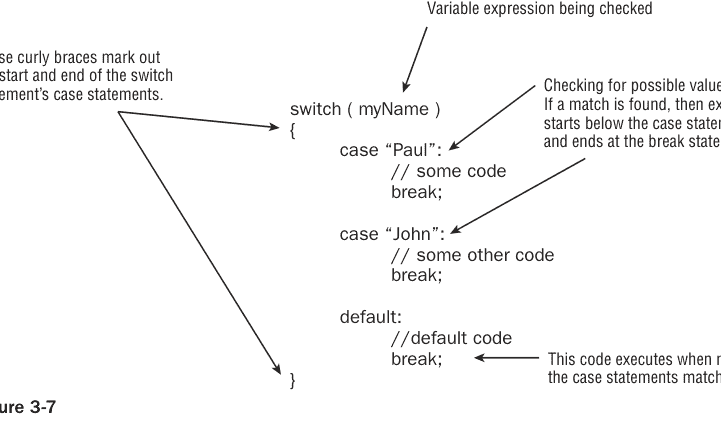

测试表达式位于`switch`关键字后面的括号中。在之前的示例中，你正在使用变量`myName`进行测试。然而，括号内可以是任何有效表达式。

接下来是`case`语句。`case`语句执行条件检查。为了指明哪些`case`语句属于你的`switch`语句，你必须将它们放在测试表达式后面的大括号内。每个`case`语句指定一个值，例如"Paul"。然后`case`语句的作用类似于`if (myName == "Paul")`。如果变量`myName`确实包含值"Paul"，执行将从`case`"Paul"语句下方的代码开始，并一直持续到`switch`语句的结束。本示例只有两个`case`语句，但你可以根据需要设置任意数量。

在大多数情况下，你只想执行相关`case`语句正下方的代码块，而不是相关`case`语句下方所有的代码（包括任何其他`case`语句）。

为了实现这一点，你将在要执行的代码末尾放入一个`break`语句。这告诉JavaScript在该点停止执行并离开`switch`语句。

最后是`default` case，顾名思义，这是当没有其他`case`语句匹配时将执行的代码。`default`语句是可选的；如果你没有想要执行的默认代码，可以将其省略，但要记住在这种情况下，如果没有`case`语句匹配，将不执行任何代码。除非你确定所有选项都已涵盖，否则包含一个`default` case是个好主意。

#### 试一试——使用switch语句

让我们来看看实际运行的`switch`语句。以下示例说明了一个简单的猜数游戏。输入代码并将其保存为`ch3_examp3.htm`。

```html
<!DOCTYPE html PUBLIC "-//W3C//DTD XHTML 1.0 Transitional//EN"
"http://www.w3.org/TR/xhtml1/DTD/xhtml1-transitional.dtd">
<html xmlns="http://www.w3.org/1999/xhtml">
<body>

<script type="text/javascript">

var secretNumber = prompt("Pick a number between 1 and 5:", "");
secretNumber = parseInt(secretNumber);

switch (secretNumber)
{
case 1:
    document.write("Too low!");
    break;

case 2:
    document.write("Too low!");
    break;

case 3:
    document.write("You guessed the secret number!");
    break;

case 4:
    document.write("Too high!");
    break;

case 5:
    document.write("Too high!");
    break;

default:
    document.write("You did not enter a number between 1 and 5.");
    break;
}
</script>
```

## 第三章：决策、循环与函数

```javascript
document.write("<br />Execution continues here");
</script>
</body>
</html>
```

将此代码加载到浏览器中，并在提示框中输入例如数值1。你应该会看到类似图3-8所示的内容。

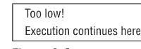

另一方面，如果你输入数值3，你应该会看到一条友好信息，告诉你猜对了秘密数字，如图3-9所示。

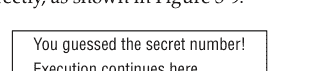

首先，你声明变量`secretNumber`并将其设置为用户通过提示框输入的值。注意，你使用了`parseInt()`函数将`prompt()`返回的字符串转换为整数值。

```javascript
var secretNumber = prompt("Pick a number between 1 and 5:", "");
secretNumber = parseInt(secretNumber);
```

接下来，你开始创建`switch`语句。

```javascript
switch (secretNumber)
{
```

括号内的表达式就是变量`secretNumber`，`case`语句将与此数值进行比较。

你使用花括号来指定包含`case`语句的代码块。每个`case`语句检查1到5中的一个数字，因为这是你向用户指定的应输入的内容。第一个`case`只是输出一条消息，说明她输入的数字太低。

```javascript
case 1:
    document.write("Too low!");
    break;
```

第二个`case`语句，用于数值2，具有相同的消息，因此此处不重复代码。第三个`case`语句让用户知道她猜对了。

```javascript
case 3:
    document.write("You guessed the secret number!");
    break;
```

最后，第四个和第五个`case`语句输出一条消息，说明用户输入的数字太高。

```javascript
case 4:
    document.write("Too high!");
    break;
```

在此示例中，你确实需要添加一个`default`情况，因为用户很可能（尽管有说明）输入一个不在1到5之间的数字，甚至可能是一个字母。在这种情况下，你添加一条消息让用户知道存在问题。

```javascript
default:
    document.write("You did not enter a number between 1 and 5.");
    break;
```

`default`语句对于捕获错误也非常有用——如果你错误地编写了某些`case`语句，当你看到不应该运行的`default`代码被运行时，你会很快发现这个问题。

你最后添加了表示`switch`语句结束的右花括号。在此之后，你输出一行以指示执行继续的位置。

```javascript
}
document.write("<br />Execution continues here");
```

请注意，每个`case`语句都以`break`语句结束。这对于确保代码执行跳转到`switch`语句之后的行非常重要。如果你忘记包含这个，最终可能会执行匹配到的`case`之后每个`case`的代码。

### 为不同情况执行相同代码

你可能已经发现了本例中`switch`语句的一个问题——当用户输入1或2时，你希望执行相同的代码，对于4或5也是如此。然而，为了实现这一点，你不得不重复每个情况的代码。你想要的是一种更简单的方法，让JavaScript为不同情况执行相同的代码。嗯，这很简单！只需将代码修改成如下所示：

```javascript
switch (secretNumber)
{
case 1:
case 2:
    document.write("Too low!");
    break;

case 3:
    document.write("You guessed the secret number!");
    break;

case 4:
case 5:
    document.write("Too high!");
    break;

default:
    document.write("You did not enter a number between 1 and 5.");
    break;
}
```

如果你将此代码加载到浏览器中并尝试输入一些不同的数字，你应该会看到它的行为与之前的代码完全相同。

这里，你利用了一个事实：如果某个`case`语句的代码下方没有`break`语句，执行将继续通过每个后续的`case`语句，直到遇到`break`语句或到达`switch`语句的末尾。可以将其想象为一种在`switch`语句中“自由落体”的过程，直到你遇到`break`语句。

如果匹配到数值1的`case`语句，执行将继续直到`case`2下方的`break`语句，因此实际上你可以为这两种情况执行相同的代码。数值4和5的`case`语句也使用了相同的技术。

### 循环——for和while语句

*循环*是指当条件为`true`时重复一段代码。在JavaScript中，这通过使用两个语句来实现：`while`语句和`for`语句。你很快就会学习这些，但你为什么需要重复代码块呢？

好吧，假设你有一系列结果，比如一年中每个月的平均温度，并且你想将这些绘制在图表上。绘制每个点所需的代码很可能都是相同的。因此，与其将代码编写12次（每个点一次），不如使用系列中的下一个数据项来执行相同的代码12次，这要容易得多。这就是`for`语句派上用场的地方，因为你知道希望代码执行多少次。

在另一种情况下，你可能希望在某个条件为`true`时重复相同的代码段，例如，当用户不断点击“重新开始”按钮时。在这种情况下，`while`语句将非常有用。

### for循环

`for`语句使你能够将一段代码重复执行特定次数。其语法如图3-10所示。

让我们看看`for`语句的构成。从图3-10可以看出，就像`if`和`switch`语句一样，`for`语句的逻辑也位于括号内。然而，这次逻辑被分成三个部分，每个部分用分号分隔。例如，在图3-10中，你有以下内容：

```javascript
(var loopCounter = 1; loopCounter <= 3; loopCounter++)
```

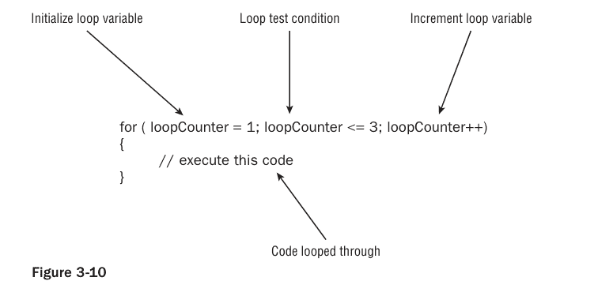

`for`语句逻辑的第一部分是*初始化*部分。为了跟踪你循环执行代码的次数，你需要一个变量来计数。正是在初始化部分，你初始化变量。在示例中，你声明了`loopCounter`并将其设置为值1。与`for`语句的其他部分不同，此部分在循环执行期间只执行一次。如果变量在代码前面已经声明过，则不需要再次声明。


```javascript
var loopCounter;
for (loopCounter = 1; loopCounter <= 3; loopCounter++)
```

分号之后，是`for`语句的*测试条件*部分。只要此测试条件求值为`true`，`for`语句内的代码就会继续执行。每次代码循环执行后，都会测试此条件。在图3-10中，只要`loopCounter`小于或等于3，就继续执行。循环执行的次数通常称为*迭代次数*。

最后，是`for`循环的*递增*部分，其中我们循环测试条件中的变量值将递增。这里你可以看到，`loopCounter`通过你在第2章见过的`++`运算符递增1。同样，`for`语句的这部分在每次代码循环时都会重复。虽然我们称之为递增部分，但它实际上可以用于减少或*递减*值——例如，如果你想从数组的最后一个元素倒数到第一个。

`for`语句之后是将被重复执行的代码块，只要测试条件为*true*。此代码块包含在花括号内。如果条件永远不为*true*，甚至在第一次测试循环条件时就不成立，那么`for`循环内的代码将被跳过，永远不会执行。

将所有这些结合起来，`for`循环是如何工作的？

1. 执行`for`语句的初始化部分。
2. 检查测试条件。如果为*true*，则继续；否则，退出`for`语句。
3. 执行`for`语句后的代码块。
4. 执行`for`语句的递增部分。
5. 重复步骤2到4，直到测试条件为`false`。

## 第3章：决策、循环与函数

### 试一试：转换一系列华氏温度值

让我们修改温度转换器，使其将存储在数组中的一系列华氏温度值转换为中心温度（摄氏度）。您将使用`for`语句遍历数组的每个元素。输入代码并将其保存为`ch3_examp4.htm`。

```html
<!DOCTYPE html PUBLIC "-//W3C//DTD XHTML 1.0 Transitional//EN"
"http://www.w3.org/TR/xhtml1/DTD/xhtml1-transitional.dtd">
<html xmlns="http://www.w3.org/1999/xhtml">
<body>

<script type="text/javascript">

var degFahren = new Array(212, 32, -459.15);
var degCent = new Array();
var loopCounter;

for (loopCounter = 0; loopCounter <= 2; loopCounter++)
{
    degCent[loopCounter] = 5/9 * (degFahren[loopCounter] - 32);
}

for (loopCounter = 2; loopCounter >= 0; loopCounter--)
{
    document.write("Value " + loopCounter + " was " + degFahren[loopCounter] +
                   " degrees Fahrenheit");
    document.write(" which is " + degCent[loopCounter] +
                   " degrees centigrade<br />");
}

</script>

</body>
</html>
```

将此代码加载到您的浏览器中，您将在页面中看到一系列三行内容，显示我们将华氏温度值数组转换为摄氏温度（如图3-11所示）的结果。

> Value 2 为 -459.15 华氏度，即 -272.861111111111 摄氏度
>
> Value 1 为 32 华氏度，即 0 摄氏度
>
> Value 0 为 212 华氏度，即 100 摄氏度

图3-11

第一项任务是声明您将要使用的变量。首先，您声明并初始化`degFahren`，使其包含三个值的数组：`212`、`32`和`-459.15`。接下来，将`degCent`声明为一个空数组。最后，声明`loopCounter`，并在循环过程中用于跟踪正在访问哪个数组索引。

```javascript
var degFahren = new Array(212, 32, -459.15);
var degCent = new Array();
var loopCounter;
```

接下来是我们的第一个`for`循环。

```javascript
for (loopCounter = 0; loopCounter <= 2; loopCounter++)
{
    degCent[loopCounter] = 5/9 * (degFahren[loopCounter] - 32);
}
```

在第一行中，您首先将`loopCounter`初始化为0。然后检查`for`循环的测试条件`loopCounter <= 2`。如果该条件为`true`，则循环首次执行。在花括号内的代码执行后，将执行`for`循环的递增部分`loopCounter++`，然后重新评估测试条件。如果它仍然为`true`，则再次执行循环代码。此过程持续进行，直到`for`循环的测试条件评估结果为`false`，此时循环结束，并将执行右花括号后的第一条语句。

花括号内的代码是您之前示例中看到的方程，只不过这次您将结果放入`degCent`数组中，索引为`loopCounter`的值。

在第二个`for`循环中，您将`degCent`数组中存储的结果写入屏幕。

```javascript
for (loopCounter = 2; loopCounter >= 0; loopCounter--)
{
    document.write("Value " + loopCounter + " was " + degFahren[loopCounter] +
                   " degrees Fahrenheit");
    document.write(" which is " + degCent[loopCounter] +
                   " degrees centigrade<br />");
}
```

这次您从2倒数到0。变量`loopCounter`被初始化为2，循环条件保持为`true`，直到`loopCounter`小于0。这次`loopCounter`实际是每次递减而不是递增，通过`loopCounter--`实现。同样，`loopCounter`起到双重作用：它记录您已经完成的循环次数，同时也提供数组中的索引位置。

> 请注意，在这些示例中，您在循环中使用了整数。然而，没有理由不能使用分数，尽管这样做要少得多。

### `for...in`循环

此循环主要用于数组，正如您在下一章将要看到的，它也适用于称为对象的实体。它使您可以在不知道数组实际包含多少元素的情况下遍历数组中的每个元素。用通俗易懂的英语来说，这个循环的意思是“对于数组中的每个元素，执行一些代码”。与其不得不计算每个元素的索引号，`for...in`循环会为您完成此项工作，并在每次迭代（循环通过）时自动移动到下一个索引。

它用于数组的语法如下：

```javascript
for (index in arrayName)
{
    //some code
}
```

在此代码片段中，`index`是您声明在循环之前的变量，它会自动填充数组中的下一个索引值。`arrayName`是持有您要遍历时使用的数组的变量名。

让我们看一个例子来使事情更清晰。您将定义一个数组并用三个值初始化它。

```javascript
var myArray = new Array("Paul","Paula","Pauline");
```

若要使用传统的`for`循环访问每个元素，您将这样写：

```javascript
var loopCounter;
for (loopCounter = 0; loopCounter < 3; loopCounter++)
{
    document.write(myArray[loopCounter]);
}
```

若要使用`for...in`循环做完全相同的事情，您这样写：

```javascript
var elementIndex;
for (elementIndex in myArray)
{
    document.write(myArray[elementIndex]);
}
```

如您所见，第二个示例中的代码既更清晰，也更简短。两种方法效果一样好，都会迭代三次。但是，如果您增加数组的大小，例如通过添加元素`myArray[3] = "Philip"`，第一种方法将只遍历数组中的前三个元素，而第二种方法将遍历所有四个元素。

### `while`循环

虽然`for`循环用于循环固定次数，但`while`循环使您可以测试条件，并在条件为真时持续循环。当您需要知道循环次数时可以很有用，例如在您知道数组具有特定数量元素并遍历该数组时。`while`循环在不知道需要循环多少次时更为有用。例如，如果您正在遍历一组温度值的数组，并希望当数组元素中包含的温度值小于100时继续循环，您将需要使用`while`语句。

让我们看一下`while`语句的结构，如图3-12所示。

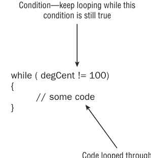

图3-12

您可以看到，`while`循环的组成部分比`for`循环少。`while`循环由一个条件组成，如果该条件评估为`true`，则导致花括号内的代码块执行一次；然后重新评估条件。如果它仍然为`true`，则再次执行代码，重新评估条件，依此类推，直到条件评估为`false`。

需要注意的是，如果条件一开始就是`false`，`while`循环将永远不会执行。例如：

```javascript
degCent = 100;

while (degCent != 100)
{
    // some code
}
```

在这里，如果`degCent`不等于`100`，循环将运行。然而，由于`degCent`等于`100`，条件为`false`，因此代码永远不会执行。

在实践中，您通常预期循环会执行一次；它是否会再次执行将取决于循环内的代码对涉及循环条件的变量做了什么。例如：

```javascript
degCent = new Array();
degFahren = new Array(34, 123, 212);
var loopCounter = 0;
while (loopCounter < 3)
{
    degCent[loopCounter] = 5/9 * (degFahren[loopCounter] - 32);
    loopCounter++;
}
```

只要`loopCounter`小于3，循环就会执行。是循环内的代码（`loopCounter++;`）递增了`loopCounter`，并最终使`loopCounter < 3`变为`false`，从而使循环停止。然后执行将继续进行到`while`语句的结束花括号后的第一行。

需要特别注意的是*无限循环*——一种永远不会结束的循环。假设你在代码中忘记了`loopCounter++;`这一行。缺少这一行意味着`loopCounter`将保持在`0`，因此条件`(loopCounter < 3)`将始终为`true`，循环会一直持续，直到用户感到厌烦并关闭浏览器。然而，这是一个容易犯的错误，而且JavaScript不会对此发出警告。

导致无限循环的不仅仅是遗漏代码行，循环内部的代码错误也可能引发此问题。例如：

```javascript
var testVariable = 0;
while (testVariable <= 10)
{
    alert("Test Variable is " + testVariable);
    testVariable++;
    if (testVariable = 10)
    {
        alert("The last loop");
    }
}
```

看看你能否发现导致无限循环的刻意错误——是的，正是这个`if`语句会导致代码无限执行。问题在于你没有在`if`语句的条件中使用比较运算符`==`，而是用了`=`（赋值运算符）。因此，在每次循环中，`testVariable`都被重新设置为`10`，尽管有`testVariable++`这一行。这意味着在每次循环开始时，测试条件总是求值为`true`，因为`10`小于或等于`10`。只需将多余的`=`改为`==`，使语句变成`if (testVariable == 10)`，一切就正常了。

### `do...while`循环

在`while`循环中，我们看到循环体内的代码只有在条件为`true`时才会执行；如果为`false`，代码将永远不会执行，执行流程会直接跳转到`while`循环之后的第一行。然而，有时候你可能希望`while`循环中的代码至少执行一次，无论`while`语句中的条件是否为`true`。甚至可能需要在测试`while`语句的条件之前，先执行循环内部的某些代码。对于这类情况，`do...while`循环是理想的选择。

看一个通过提示框获取用户年龄的例子。你想显示提示框，同时确保用户输入的是一个数字。

```javascript
var userAge;
do
{
    userAge = prompt("Please enter your age","")
}
while (isNaN(userAge) == true);
```

循环内的这行代码：

```javascript
userAge = prompt("Please enter your age","")
```

无论`while`语句的条件如何，都会被执行。这是因为条件检查是在*一次循环执行之后*才进行的。如果条件为`true`，代码将再次循环执行。如果为`false`，循环停止。

注意，在`while`语句的条件中，你使用了第二章介绍过的`isNaN()`函数。它检查`userAge`变量的值是否为`NaN`（非数字）。如果不是数字，条件返回`true`；否则返回`false`。正如示例所示，这使你能够测试用户输入，以确保输入了正确的数据。用户可能谎报年龄，但至少你确定他输入的是一个数字！

`do...while`循环相当少见；没有它，绝大多数事情也能完成，因此除非确实必要，最好避免使用。

### `break`和`continue`语句

你之前在学习`switch`语句时已经遇到过`break`语句。它在`switch`语句中的作用是停止代码执行，并将执行流程移动到`switch`语句右花括号后的下一行代码。然而，`break`语句也可以用作`for`和`while`循环的一部分，当你想提前退出循环时使用。例如，假设你正在遍历一个数组（就像在温度转换示例中那样），并遇到了一个无效值。在这种情况下，你可能希望立即停止代码执行，通知用户数据无效，并退出循环。这是`break`语句派上用场的一个场景。

让我们看看如何修改示例（`ch3_examp4.htm`），使其在遍历一系列华氏温度值时，如果遇到非数字值就停止循环并告知用户数据无效。

```javascript
<script language="JavaScript" type="text/javascript">
var degFahren = new Array(212, "string data", -459.67);
var degCent = new Array();
var loopCounter;

for (loopCounter = 0; loopCounter <= 2; loopCounter++)
{
    if (isNaN(degFahren[loopCounter]))
    {
        alert("Data '" + degFahren[loopCounter] + "' at array index " +
              loopCounter + " is invalid");
        break;
    }
    
    degCent[loopCounter] = 5/9 * (degFahren[loopCounter] - 32);
}
</script>
```

你修改了`degFahren`数组的初始化，使其包含一些无效数据。然后，在`for`循环内部，添加了一个`if`语句来检查`degFahren`数组中的数据是否为非数字。这是通过`isNaN()`函数实现的；如果传递给它括号中的值（这里是`degFahren[loopCounter]`）不是数字，它就返回`true`。如果值不是数字，你就告诉用户数组中哪个位置的数据无效。然后，使用`break`语句彻底跳出`for`循环，代码执行继续到`for`语句结束后的第一行。

这就是`break`语句，那么`continue`呢？`continue`语句与`break`类似，它在遇到该语句时停止当前循环的执行，但它不是退出循环，而是开始下一次迭代，重新评估`for`或`while`语句的条件，就像循环体代码的最后一行被执行了一样。

在`break`的例子中，是“全有或全无”——即使只有一条数据无效，你也会跳出循环。更好的做法是尝试转换`degFahren`中的所有值，但如果在数组中遇到无效数据项，就通知用户并继续处理下一个数据项，而不是像`break`示例那样直接放弃。


```
if (isNaN(degFahren[loopCounter]))
{
    alert("Data '" + degFahren[loopCounter] + "' at array index " +
              loopCounter + " is invalid");
    continue;
}
```

只需将`break`语句改为`continue`。你仍然会收到关于无效数据的消息，但第三个值也会被转换。

## 函数

函数是执行特定任务的代码块。以袖珍计算器为例。它可以执行许多基本计算，如加法和减法。然而，许多计算器还有功能键，可以执行更复杂的操作。例如，有些计算器有计算数字平方根的按钮，有些甚至提供统计功能，比如计算平均值。

这些功能大多可以通过基本的加减乘除运算来实现，但那可能需要很多步骤——如果用户只需要按一个按钮，对她来说就简单得多。她需要做的就是提供数据——在这里是数字——而功能键会完成其余的工作。

JavaScript 中的函数工作原理有点像袖珍计算器上的功能键：它们封装了一段执行特定任务的代码。在本书之前的学习中，你已经遇到了许多方便的内置函数，用于执行特定任务，例如将字符串转换为数字的`parseInt()`和`parseFloat()`函数，以及告诉你特定值是否可以转换为数字的`isNaN()`函数。其中一些函数会返回数据，比如返回一个整数的`parseInt()`；另一些则只执行操作而不返回数据。你还会注意到，有些函数可以接收数据作为输入，而有些则不能。例如，`isNaN()`函数需要传入一些数据来检查它是否是`NaN`。函数需要传入的数据被称为其*参数*。

随着你继续学习本书，你会遇到更多有用的内置函数。但是，如果能编写自己的函数岂不是更好？在你设计、编写并调试好一段执行特定任务的代码后，能够根据需要反复调用它是非常方便的。JavaScript 使我们具备了这种能力，这正是你在本节将要重点学习的内容。

### 创建自己的函数

## 第三章：决策、循环与函数

你可能已经意识到这个函数的作用以及代码是如何工作的。没错，它又是那个声名狼藉的华氏度转摄氏度转换代码。

你在JavaScript中定义的每个函数都必须在特定页面内拥有一个唯一的名称。名称紧跟在`function`关键字之后。为了让自己的生活更轻松，请尝试使用有意义的名称，这样当你稍后在代码中看到它的使用时，你就能确切知道它的功能。例如，一个接受某人生日和今天的日期作为参数并返回该人年龄的函数可以命名为`getAge()`。然而，你可以使用的名称是有限的，就像变量名一样。例如，你不能使用JavaScript保留的单词，所以不能将你的函数命名为`with()`或`while()`。

函数的参数在函数名后的括号中给出。参数只是函数为了完成其工作而需要被给予的一条数据。通常，不传递所需的参数会导致错误。一个函数可以有零个或多个参数，即使它没有参数，你也必须在其名称后加上开括号和闭括号。例如，你的函数定义的顶部必须如下所示：

```
function myNoParamFunction()
```

然后你编写代码，当函数被调用时，它将执行这些代码。所有的函数代码必须放在一对花括号组成的块中。

函数还让你能够将一个值从函数返回给调用它的代码。你使用`return`语句来返回一个值。在前面给出的示例函数中，你返回了刚刚计算出的变量`degCent`的值。如果你不想，你可以不返回一个值，但你应该始终在函数的末尾包含一个`return`语句，尽管JavaScript是一种非常宽容的语言，即使你根本不使用`return`语句也不会有问题。

当JavaScript在函数中遇到`return`语句时，它会将其视为`for`循环中的`break`语句——它会退出函数，并返回在`return`关键字之后指定的任何值。

你可能会发现，在JavaScript代码中构建一个经常使用的函数“库”很有用，你可以随时将其剪切并粘贴到你的页面中。

*调用*函数。你通过在需要调用函数的位置写出其名称并确保传递它所需的任何参数（用逗号分隔）来调用函数。例如：

```
myTemp = convertToCentigrade(212);
```

这一行调用了你之前看到的`convertToCentigrade()`函数，将`212`作为参数传递，并将函数的返回值（即`100`）存储在`myTemp`变量中。

现在尝试创建你自己的函数，仔细看看参数是如何传递的。参数传递可能有点令人困惑，所以你首先要创建一个只接受一个参数（用户的姓名）的简单函数，并将其写入页面中一个友好的欢迎字符串。首先，你需要为你的函数想一个名字。一个简短但描述性的名字是`writeUserWelcome()`。现在你需要定义函数期望传递的参数。只有一个参数——用户名。定义参数有点像定义变量——你需要遵守相同的命名规则，这意味着不能有空格、特殊字符或保留字。让我们把你的参数命名为`userName`。你需要将它添加到函数名末尾的括号内（注意不要在行尾加分号）。

```
function writeUserWelcome(userName)
```

好的，现在你已经定义了函数名和它的参数；剩下的就是创建函数体——即当函数被调用时将执行的代码。你通过将这部分函数包裹在花括号中来标记它。

```
function writeUserWelcome(userName)
{
    document.write("Welcome to my website " + userName + "<br />");
    document.write("Hope you enjoy it!");
}
```

这段代码很简单；你使用`document.write()`向网页写出一条消息。你可以看到`userName`的使用方式就像任何普通变量一样；实际上，最好将参数视为普通变量。参数具有的值将是调用函数的JavaScript代码所指定的值。

让我们看看你将如何调用这个函数。

```
writeUserWelcome("Paul");
```

真的很简单——只需写出你想调用的函数名，然后在括号中添加要传递给每个参数的数据，这里只有一个。当函数中的代码执行时，函数代码主体中使用的变量`userName`将包含文本`"Paul"`。

假设你想向函数传递两个参数——你需要改变什么？首先，你必须修改函数定义。想象一下第二个参数将保存用户的年龄——你可以将其命名为`userAge`，因为这非常清楚地表明了参数数据所代表的含义。这是新的代码：

```
function writeUserWelcome(userName, userAge)
{
    document.write("Welcome to my website" + userName + "<br />");
    document.write("Hope you enjoy it<br />");
    document.write("Your age is " + userAge);
}
```

你在函数体中添加了一行，使用了你添加的参数。要调用该函数，你需要编写以下内容：

```
writeUserWelcome("Paul", 31);
```

第二个参数是一个数字，所以不需要引号。这里的`userName`参数将是 Paul，第二个参数`userAge`将是 31。

### 试试看：华氏度转摄氏度函数

让我们用函数重写温度转换器页面。你可以从`ch3_examp4.htm`剪切并粘贴大部分代码——已更改的部分已突出显示。完成后，将其另存为`ch3_examp5.htm`。

```html
<html>
<body>

<script language="JavaScript" type="text/javascript">

function convertToCentigrade(degFahren)
{
    var degCent;
    degCent = 5/9 * (degFahren - 32);

    return degCent;
}

var degFahren = new Array(212, 32, -459.15);
var degCent = new Array();
var loopCounter;

for (loopCounter = 0; loopCounter <= 2; loopCounter++)
{
    degCent[loopCounter] = convertToCentigrade(degFahren[loopCounter]);
}

for (loopCounter = 2; loopCounter >= 0; loopCounter--)
{
    document.write("Value " + loopCounter + " was " + degFahren[loopCounter] +
                   " degrees Fahrenheit");
    document.write(" which is " + degCent[loopCounter] +
                   " degrees centigrade<br />");
}

</script>

</body>
</html>
```

当你将此页面加载到浏览器中时，你应该会看到与`ch3_examp4.htm`完全相同的结果。

在脚本块的顶部，你声明了你的`convertToCentigrade()`函数。你之前见过这个函数：

```
function convertToCentigrade(degFahren)
{
    var degCent;
    degCent = 5/9 * (degFahren - 32);
    
    return degCent;
}
```

如果你在页面中使用多个独立的`script`块，那么在任何脚本调用函数之前定义该函数非常重要。如果你有多个函数，你可能想将它们全部放在页面顶部自己的脚本块中——在`<head>`和`</head>`标签之间很好。这样你就知道在哪里可以找到所有函数，并且可以确保它们在使用之前已经被声明。

你应该非常熟悉函数中的代码是如何工作的。你声明一个变量`degCent`，进行计算，将结果存储在`degCent`中，然后将`degCent`返回给调用代码。函数的参数是`degFahren`，它提供了计算所需的信息。

函数声明之后是页面加载时执行的代码。首先你定义需要的变量，然后你有两个循环，先计算然后输出结果。这大部分与之前相同，除了第一个`for`循环。

```
for (loopCounter = 0; loopCounter <= 2; loopCounter++)
{
    degCent[loopCounter] = convertToCentigrade(degFahren[loopCounter]);
}
```

第一个`for`循环内的代码将函数`convertToCentigrade()`返回的值放入`degCent`数组中。

这个例子中的代码有一个微妙之处。注意你在函数`convertToCentigrade()`内部声明了变量`degCent`，同时在函数定义之后也将其声明为一个数组。

这难道是不允许的吗？

嗯，这很自然地引出了本章的下一个主题——变量作用域。

### 变量作用域与生命周期

*作用域*是什么意思？嗯，简单地说，它是变量的可用范围——你的代码的哪些部分可以访问一个变量及其包含的数据。在网页中函数外部声明的任何变量将对该页面上的所有脚本可用，无论该脚本是在函数内部还是在其他地方——我们称之为*全局*或*页面级作用域*。然而，在函数内部声明的变量是

## 第 3 章：决策、循环和函数

`degCent`在函数内部*仅*可见——函数外部的代码无法访问它们。因此，例如，你可以在每个函数中以及页面上的任何函数之外各声明一次变量`degCent`。但是，你不能在任何一个函数内部声明该变量*超过*一次，也不能在页面上函数外部声明*超过*一次。请注意，以这种方式在整个页面中重复使用的变量名称，虽然不违法，但不符合标准良好实践——它会使代码读起来非常混乱。

函数参数与变量类似：它们在函数外部不可见，虽然你可以在函数中声明一个与其某个参数同名的变量，但这会引起很多困惑，很容易导致细微的 bug 被忽略。因此，这是不良的编码实践，最好避免，哪怕只是为了你在调试时保持理智！

那么，当函数内部的代码结束，执行返回到调用该代码的位置时会发生什么呢？下次调用该函数时，在函数内部定义的变量会保留其值吗？

答案是否定的：变量不仅具有作用域属性——即它们在哪里可见——而且还具有*生命周期*。当函数执行完毕时，该函数中的变量就会消亡，其值也会丢失，除非你将其中一个返回给调用代码。JavaScript 会不时进行垃圾回收（我们在第 2 章中讨论过），即扫描代码，查看是否有变量不再使用；如果有，则将其持有的数据从内存中释放，以便为其他变量的数据腾出空间。

既然全局变量可以在任何地方使用，为什么不把它们全部设为全局变量呢？当你需要在全球范围内跟踪数据时，全局变量非常有用。但是，由于它们可以在代码中的任何地方被修改，这意味着如果由于 bug 导致它们被错误更改，该 bug 可能出现在代码中的任何地方，从而使调试变得困难。因此，最好尽量减少全局变量的使用，尽管有时它们是必要的恶——例如，当你需要在不同函数之间共享数据时。

### 本章小结

在本章中，你已经完成了对 JavaScript 语言核心及其语法的了解。从现在开始的一切都将建立在这些基础之上，既然你已经掌握了不太有趣的语法，就可以在本书的其余部分转向更有趣的内容了。

本章涵盖以下内容：

1. **使用`if`和`switch`语句进行决策。** 决策能力本质上是赋予代码"智能"的关键。根据条件是`true`还是`false`，你可以决定采取的行动方案。

2. **比较运算符。** 比较运算符将运算符左侧的值（左侧，LHS）与运算符右侧的值（右侧，RHS）进行比较，并返回一个布尔值。以下是主要比较运算符的列表：

    - `==` LHS 等于 RHS 吗？

    - `!=` LHS 不等于 RHS 吗？

    - `<=` LHS 小于或等于 RHS 吗？

    - `>=` LHS 大于或等于 RHS 吗？

    - `<` LHS 小于 RHS 吗？

    - `>` LHS 大于 RHS 吗？

3. **`if`语句。** 使用`if`语句，你可以选择在条件为 true 时执行一段代码（由花括号定义）。if 语句有一个在括号中指定的测试条件。如果该条件求值为 true，则 if 语句之后的代码将执行。

4. **`else`语句。** 如果你希望在 if 语句为 false 时执行代码，可以使用出现在 if 语句之后的 else 语句。

5. **逻辑运算符。** 要组合条件，可以使用三个逻辑运算符：AND、OR 和 NOT，分别由`&&`、`||`和`!`表示。

    - **AND 运算符**仅当表达式两边都为 true 时才返回 true。

    - **OR 运算符**当表达式的一边或两边都为 true 时返回 true。

    - **NOT 运算符**反转表达式的逻辑。

6. **`switch`语句。** 这将表达式的结果与一系列可能的 case 进行比较，其效果类似于多个 if 语句。

7. **使用 for、for...in、while 和 do...while 进行循环。** 通常需要多次重复执行一段代码，JavaScript 通过循环实现这一点。

    - **`for`循环。** 对于循环执行代码一定次数很有用，for 循环由三部分组成：初始化部分、测试条件和增量部分。当测试条件为 true 时，循环继续。每次循环执行代码块，然后执行 for 循环的增量部分，再重新评估测试条件，查看递增是否改变了它。

    - **`for...in`循环。** 当你想在不知道数组元素数量的情况下遍历数组时，这很有用。JavaScript 会为你计算这个值，因此不会遗漏任何元素。

    - **`while`循环。** 这对只要测试条件保持 true 就循环执行某些代码很有用。它由一个测试条件和仅在条件为 true 时执行的代码块组成。如果条件永远不会为 true，则代码永远不会执行。

    - **`do...while`循环。** 这与 while 循环类似，不同之处在于它先执行一次代码，然后在测试条件保持 true 时继续执行代码。

    - **`break`和`continue`语句。** 有时你有充分的理由提前退出循环，这时需要使用 break 语句。遇到 break 语句时，代码执行停止在由花括号标记的代码块处，并立即在闭括号之后开始。continue 语句与 break 类似，不同之处在于当代码执行停止在循环中的该点时，不会跳出循环，而是继续执行，就好像该次迭代的结束已经达到一样。

8. **函数是可重用的代码片段。** JavaScript 有许多内置函数，为程序员提供服务，例如将字符串转换为数字。但是，JavaScript 也使你能够使用 function 关键字定义和使用自己的函数。函数可以有零个或多个参数传递给它们，并且可以根据需要返回一个值。

9. **变量作用域和生命周期。** 在函数外部声明的变量是全局可用的——即在页面的任何地方都可用。在函数内部定义的任何变量对该函数都是私有的，不能在外部访问。变量有生命周期，其长度取决于变量声明的位置。如果它是一个全局变量，其生命周期就是页面的生命周期——只要页面加载在浏览器中，该变量就保持存活。对于在函数中定义的变量，生命周期仅限于该函数的执行。当函数执行完毕后，变量消亡，其值丢失。如果稍后在代码中再次调用该函数，变量将为空。

### 练习题

这些问题的建议解决方案可在附录 A 中找到。

1. 一名初级程序员带着一些似乎无法正常工作的代码来找你。你能看出他哪里出错了吗？帮他一把，纠正错误。


```javascript
var userAge = prompt("Please enter your age");

if (userAge == 0)
{
    alert("So you're a baby!");
}
else if (userAge < 0 || userAge > 200)
{
    alert("I think you may be lying about your age");
}
else
{
    alert("That's a good age");
}
```

2. 使用`document.write()`编写代码，显示 12 乘法表的结果。其输出应为计算结果。

```javascript
12 * 1 = 12
12 * 2 = 24
12 * 3 = 36
...
12 * 11 = 132
12 * 12 = 144
```

3. 修改第 2 题的代码，使其成为一个函数，该函数接受所需的乘法表以及开始和结束值作为参数。例如，你可以尝试显示 4 乘法表，从 4 * 4 开始，到 4 * 9 结束。

4. 修改第 3 题的代码，从用户处请求要显示的乘法表；代码应继续请求并显示乘法表，直到用户输入 -1。此外，执行检查以确保用户输入的是有效数字；如果数字无效，要求用户重新输入。

# 第 4 章：常见错误、调试与错误处理

## 常见错误、调试与错误处理

即便是一位 JavaScript 高手也会犯错，哪怕只是些烦人的拼写错误。特别是当代码扩展到数百行时，出错的概率会大大增加。相应地，查找这些错误或 bug 的难度也随之上升。在本章中，你将了解各种技术，帮助你最大限度地减少这种情况带来的问题。

首先，你将了解 JavaScript 中七个最常见的编码错误。知道了这些错误之后，你在编写代码时就能加以留意，hopefully 这样就不会那么频繁地犯这些错误了！

然后，你将了解如何在错误确实发生时进行处理，从而避免用户看到你的编码错误。

最后，你将了解 Microsoft Internet Explorer (IE8)、Firebug（Firefox 的插件）、Safari 和 Chrome 的 Web Inspector 以及 Opera 的 Dragonfly 中的调试工具。你将看到如何使用这些工具逐步执行代码，并在代码运行时检查变量的内容，这个过程让我们能够追踪难以发现的 bug。你还将简要了解 Firefox 可用的调试工具。

> 如果你在浏览器中设置了显示错误，那么在本章会非常有用。你在第 2 章的“设置浏览器以显示错误”部分已经完成了这一设置。所以如果还没有设置错误显示，现在正是时候。

### 哎呀！真不敢相信我会犯这种错：一些常见错误

程序员常犯的有七种错误。其中一些会随着经验的积累而学会避免，但另一些可能会永远困扰着你！

### 未定义变量

JavaScript 在定义变量再赋值这方面实际上非常宽松。例如，以下代码会隐式创建新的全局变量`abc`并赋值为 23：

```javascript
abc = 23;
```

虽然严格来说，你应该使用`var`关键字显式定义变量，像这样：

```javascript
var abc = 23;
```

是否使用`var`关键字声明变量会影响变量的作用域；因此最好始终使用`var`关键字。如果在定义之前使用变量，就会产生错误。例如，如果变量`abc`之前未被定义（显式或隐式），以下代码将在 IE8 中导致图 4-1 所示的错误：

```javascript
alert(abc);
```

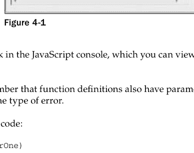

在 Firefox 中，你需要查看 JavaScript 控制台，可以通过选择“工具 ⤒ 错误控制台”来查看。

此外，你必须记住函数定义也有参数，如果声明不正确，同样会导致这类错误。

看看以下代码：

如果你调用这个函数，会得到一个与图 4-2 类似的错误信息。

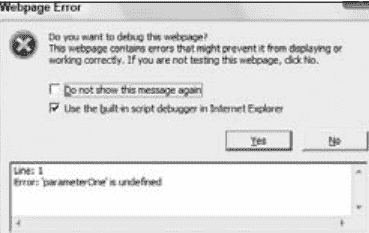

图 4-2

这里的错误实际上是函数定义中的一个简单拼写错误。第一个参数有拼写错误：它应该是`parameterOne`，而不是`paramtrone`。这种错误令人困惑的地方在于，虽然浏览器告诉你错误在某一行，但错误的根源却在另一行。

### 大小写敏感

这是错误的主要来源，尤其是因为有时难以察觉。

例如，找出以下代码中的三处大小写错误：

```javascript
var myName = "Jeremy";
If(myName == "jereHy")
  alert(myName.toUppercase());
```

第一个错误是`if`关键字；上面的代码用了`If`而不是`if`。然而，JavaScript 不会告诉我们这是大小写使用错误，相反，IE 会提示“Object expected”，Firefox 则会告诉我们`If is not defined`。尽管错误信息给了我们一些关于问题所在的线索，但通常是以一种间接的方式。在这个例子中，IE 认为你试图使用一个叫做`If`的对象，而 Firefox 认为你试图使用一个未定义的函数`If`。

好吧，纠正了这个错误之后，你遇到了下一个错误，这不是 JavaScript 语法错误，而是逻辑错误。记住在 JavaScript 中 Jeremy 不等于 jeremy，所以`myName == "jeremy"`是 false，尽管很可能你并不在乎单词是 Jeremy 还是 jeremy。这种错误不会产生任何错误信息，只是代码不会按你计划的那样执行。

第三个错误是`myName`中 String 对象的`toUppercase()`方法。前面的代码使用了`toUppercase`，其中的 C 是小写的。IE 会给出“Object doesn't support this property or method”的提示，Firefox 则会报告`myName.toUppercase is not a function`。乍一看很容易忽略如此微小的错误，然后开始查阅 JavaScript 参考指南寻找该方法。你可能会疑惑为什么它在那里，但你的代码却无法运行。再次强调，你始终需要注意大小写，这是连专家有时都会犯错的。

### 错误的闭括号数量

在以下代码中，你定义了一个函数然后调用它。然而，这里有一个故意的错误。看看你能不能发现它在哪里。

```javascript
function myFunction()
{
x = 1;
y = 2;
if (x <= y)
{
if (x == y)
{
alert("x equals y");
}
}
myFunction();
```

这就是代码格式化的重要性所在——你将更容易发现这样的错误：

```javascript
function myFunction()
{
    x = 1;
    y = 2;
    if (x <= y)
    {
        if (x == y)
        {
            alert("x equals y");
        }
    }
    myFunction();
```

现在你可以看到函数的结束花括号缺失了。当有很多`if`、`for`或`do while`语句时，很容易有多余或缺少的闭括号。这类问题在格式化的代码中更容易发现。

### 错误的闭圆括号数量

看看以下代码：

```javascript
if (myVariable + 12) / myOtherVariable < myString.length)
```

发现错误了吗？问题是在条件开头缺少一个圆括号。你希望`myVariable + 12`在除以`myOtherVariable`之前先被计算，所以你知道需要把它放在圆括号中，这是正确的。

```javascript
(myVariable + 12) / myOtherVariable
```

- 然而，`if`语句的条件也必须用圆括号括起来。
- 不仅开头的圆括号缺失，而且闭圆括号比开圆括号多了一个。就像每个开圆括号都必须有一个闭圆括号。

```javascript
if ((myVariable + 12) / myOtherVariable < myString.length)
```

当有很多开圆括号和闭圆括号时，很容易漏掉一个或多出一个。

### 使用等于（=）而非等于（==）

考虑以下代码：

```javascript
var myNumber = 99;
if (myNumber = 101)
{
 alert("myNumber is 101");
}
else
{
    alert("myNumber is " + myNumber);
}
```

- 乍看之下，你会以为`if`语句 else 部分的`alert()`方法会执行，告诉我们`myNumber`中的数字是 99，但事实并非如此。
- 这段代码犯了经典的错误：使用了赋值运算符（`=`）而非相等运算符（`==`）。因此，这段代码不是将`myNumber`与 101 进行比较，而是将`myNumber`设置为等于 101。如果你使用 Visual Basic 或类似语言编程，这类语言对比较和赋值都使用一个等号，你会发现这个错误时不时就会出现。它就是那么容易犯。
- 更棘手的是，不会抛出任何错误信息；受影响的只是你的数据和逻辑。
- 在`if`语句中给变量赋值可能很奇怪，但它是完全合法的，所以 JavaScript 不会抱怨。

### 将方法当作属性使用，反之亦然

- 另一个常见错误是，要么忘记在无需参数的方法后加圆括号，要么在使用属性时却加了圆括号。
- 调用方法时，必须始终在方法名后加上圆括号；否则 JavaScript 会认为它必须是指向方法的指针或属性。例如，检查以下代码：
- 第一行创建了一个 Date 引用类型的实例。第二行试图调用新创建的 Date 对象的`getMonth()`方法，只是圆括号缺失了。

以下是修正后的代码：

```javascript
var nowDate = new Date();
alert(nowDate.getMonth());
```

就像你应该始终在方法后面加上括号一样，你也绝不应该在属性后面加括号；否则，JavaScript 会认为你试图使用该对象的方法：

```javascript
var myString = "Hello, World!";
alert(myString.length());
```

第二行在`length`属性后添加了括号，导致 JavaScript 误以为它是一个方法。这行代码应写成如下形式：

```javascript
var myString = new String("Hello");
alert(myString.length);
```

为了加剧这一问题，函数作为参数传递给另一个函数（或在下一章处理事件时看到的那样传递一个属性）是非常常见的情况。在这种情况下，你只需在函数名末尾不加开括号和闭括号`()`即可将函数传递出去。请查看以下代码：

```javascript
function foo() {
    alert("I'm in foo!");
}

function bar(fpToCall) {
    alert("Calling passed function");
    fpToCall();
}

bar(foo);
```

此代码定义了两个函数：`foo()`和`bar()`。`foo()`仅通过弹出一个消息框来告知用户该`foo()`函数当前正在执行。第二个函数`bar()`接受一个类型为函数的参数，它会显示一条消息指出“正调用传入的函数”，随后便触发该函数。最后一行调用了`bar()`函数并传入了`foo()`函数的指针。所谓指针对的是内存位置的引用（我们在下一章会讨论内存引用的相关内容）。

一般来说的做法是：当你希望执行某个函数时，应在函数名末尾加上括号；而当把函数传递给其他函数或属性时则去掉结尾的括弧。

## 缺省 + 运算符的连接问题

在下面的代码中，有一个故意的连接错误：

```javascript
var myName = "Jeremy";
var myString = "Hello";
var myOtherString = "World";
myString = myName + " said " + myString + " " + myOtherString;
alert(myString);
```

在第四行代码中，`"+"`与`myOtherString`之间本应存在一个加号运算符。

虽然这种错误仅几行就可以轻易发现，但在大段代码块中却较难察觉。此外，此类误写所导致的报错信息往往具有误导性。将这段代码加载到浏览器后，你会被告知 IE：`Error: Expected`，而 Firefox 则提示`Missing ; before statement`。这类型的错误出现频率令人惊讶得高。

这些最常见的错误确实是由程序员引发的失误造成的。还存在另一类错误被称为运行时错误（run-time errors）——它们出现在你的代码在浏览器中执行时，并不一定源于拼写错误、缺少花括号、漏掉括弧或者其他上述讨论过的陷阱。这类错误同样可以做出应对准备，正如你将在下一节中看到的那样！

## 处理程序中的异常发生情形（Error Handling）

编写自己的编程项目之初便希望了解每一个出现的误差。然而你最不想看到的是，当你最终将代码部署到 Web 服务器供全球访问时用户眼前出现各种报错消息信息。当然写出无错乱之代码是个不错的开端但请牢记以下要点：

- 某些时候你会遭遇超出你的控制范围而导致系统异常的情况。例如：你依赖某样并不存在于用户使用者的计算机上的东西，比如 Java applet（小应用程序），但你没有任何手段可对此进行检测。
- 墨菲定律（Murphy's Law）指出凡可能出错的事情终将出错！

## 预防程序错误的发生

处理错误最好的办法是尽量防止它从一开始就发生。这听起来像是老生常谈，但如果你希望能够创建毫无错误的页面确实有很多事值得去做：

- 彻底地在尽可能多的浏览器中测试你的网页。这在某些操作系统上可以说容易做起来难。另一种替代方案是由你自己决定支持哪些浏览用于自己的 Web 页然后再验证其代码是否能在它们之中正常运行。使用本书前部查找到的用于检查浏览器的代码将不支持的用户引导至一个功能受限的、安全但可能枯燥乏味的基本页面；或者直接向他们提供声明信息提示称“他们的浏览器和/或平台不受支持”。
- 验证你的数据。如果用户能够输入虚假信息导致程序失效那就肯定会出问题。确保文本框中输入了有效内容，如果你的代码会因该文本框为空而失败的话。如果你需要一个整数就必须保证用户上传了一个合法数字；你刚刚输入日期是有效的吗？e-mail 地址`mind your own business`是你刚输入的可能会被认为是合法的？不！你需要检查它是否符合格式要求如：something@something.something。

好吧假使我们已经仔细审查了你所有页面未发现语法或逻辑错误并添加数据验证以确认用户所填内容均合法有效——事情仍可能出错并且会出现你无能为力也无法干预的问题！下面是一个现实世界中仍然可能发生问题的真实案例：

某位作者保罗（Paul）曾创建了一个在线留言板，依赖于一个小 Java applet 以便在不重新加载页面的前提下实现与服务器之间的数据传输。他在检查代码时一切都正常启动后一直运行良好，然而约有百分之五的情况下该小应用程序会初始化成功，随后却引发用户处于某种特殊类型防火墙背后而导致的错误现象。所谓“防火墙”是指阻止黑客入侵本地计算机网络的机制之一，由于无法判断某位用户是否位于特定类型防火墙之后，因此在如此特殊的例外情形下便无可作为！

但实际上 JavaScript 包含了一种名为`try...catch`的语句结构！它允许你尝试运行代码，如果失败则`catch`子句捕获异常并依你所愿进行处理。对于留言板，Paul 采用`try...catch`结构来捕捉 Java applet 失败的异常情况，并将用户重定向到展示基础信息页面，但仍能显示消息内容，只不过不再使用 applet 插件罢了。

## The try...catch Statements（try...catch 语句详解）

`try...catch`陈述形式是一对组合关系，两者缺一不可。你利用`try`声明定义一块需要尝试执行的代码块，并配合`catch`子句设定另一段当代码内部出现违反正常流程情况时将被触发的执行逻辑模块。其中关键词为“exception”，异常指的就是那些极端且不可预测的状况，与之相对的是那种由于编写不正确而存在于自身内部的错误信息。如果并未发生任何异常情况，那么`catch`语句块中的代码永远不会被执行。`catch`子句还使得你可以获取本该向用户展示给他们的异常消息内容，只要你没有被提前捕获住它们即可！

让我们创建一个简单的`try...catch`结构示例：

```html
<!DOCTYPE html PUBLIC "-//W3C//DTD XHTML 1.0 Transitional//EN" "http://www.w3.org/TR/xhtml1/DTD/xhtml1-transitional.dtd">
<html xmlns="http://www.w3.org/1999/xhtml">
<head>
<title>Try/Catch</title>
</head>
<body>
<script type="text/javascript">
try {
    alert('This is code inside the try clause');
    alert('No Errors so catch code will not execute');
} catch (exception) {
    alert("The error is " + exception.message);
}
<\/script><\/body><\/html>
```

将此文件保存为`trycatch.htm`。


这段代码首先定义了 `try` 声明；与其他所有代码块一样，通过花括号将其包围以界定范围。接着便是 `catch` 子句出现，在其括号之后紧跟着包含了一个名为 `exception` 的变量标识符，此即简单的变量名称，它将存储一个类型为 `Error` 的对象。该对象承载了在 `try` 代码块内部执行过程中抛出的任何异常情况的相关信息。我们将这个对象命名为“exception object”（异常对象），尽管此处使用的是单词“exception”，实际你可以使用任意有效合法的名字，如示例中提到的 `catch(exceptionObject)`，不仅更贴切，而且同样完美符合规范！

异常对象含有若干种属性，用于提供关于已发生异常的详细信息。令人遗憾的是，在 Internet Explorer 浏览器中的 Exception Object 与其他浏览器有所不同，甚至连 Firefox、Opera、Safari、Chrome 各自的实现都各有差异！好消息在于它们之间存在共性：如果你仅关注于获取 exception 消息内容及类型本身，则无需担心编写跨平台兼容性问题了。

主流浏览器均支持 `name` 与 `message` 属性。其中 `name` 字段存储错误类型的名称，而 `message` 包含通常用户能看到的差错提示文本，这些特性属于 ECMAScript-3 标准组成部分！回到手头的源码来看，紧跟 `catch` 子句的花括号之中存放的代码块，只有在且唯于发生异常时才会运行；而在本例中，`try` 代码段本身无故障，因此 `catch` 模块内部的 `alert()` 函数根本不会执行。

#### 人为插入故意错误

```javascript
try { alert('This is code inside the try clause'); ablert ('Exception will be thrown by this code'); } catch (exception) { alert("The error is " + exception.message); }
```

重新保存文档并重载浏览器页面。此时第一条位于 `try` 代码块内的 `alert()` 方法成功运行并在屏幕上弹框供用户观看；然而第二条存在拼写错误的 `ablert()` 语句则会抛出异常，从而启动 `catch` 子句中的第一个陈述部分！

若你使用的是 Internet Explorer，则显示的错误描述内容为“Object expected”；而选择其他浏览器时，同种错误会被解释不同，并报告成“`ablert is not defined`”。

#### 再次修改代码模拟不同类型的错误情形

```javascript
try { alert('This is code inside the try clause'); alert('This code won\'t work'); } catch (exception) { alert("The error is " + exception.message); }
```

## 第四章：常见错误、调试与错误处理

在浏览器中加载这段修改后的代码，会得到一个常规的浏览器错误信息，提示 `Expected ')'`，而不是显示 `catch` 代码块中的警报框。这是因为此代码包含语法错误；函数和方法本身是有效的，但存在一个无效字符。`won't` 这个词中的单引号终止了传递给 `alert()` 方法的字符串参数。此时，JavaScript 的语法规则规定应出现一个右括号，但此代码中没有。在执行任何代码之前，浏览器的 JavaScript 引擎会检查所有代码，查找语法错误或违反 JavaScript 规则的代码。如果引擎发现语法错误，浏览器会像往常一样处理它；你的 `try` 子句永远不会运行，因此无法处理语法错误。

### 抛出错误

`throw` 语句可以在 `try` 代码块内使用，以创建你自己的运行时错误。为什么要创建一个语句来生成错误，而不是用一段糟糕的编码来达到同样的效果呢？

抛出错误对于指示无效用户输入等问题非常有用。你可以检查用户输入的有效性，然后使用 `throw` 立即停止代码执行，并让 `catch` 代码块中的错误捕获代码接管。在 `catch` 子句中，你可以确定错误是否基于用户输入。如果是这种情况，你可以通知用户出了什么问题以及如何纠正。或者，如果这是一个意外错误，你可以比处理大量 JavaScript 错误更优雅地处理它。

要使用 `throw`，请键入 `throw` 并在其后包含错误消息。

```javascript
throw "This is my error message";
```

请记住，当你在 `catch` 语句中捕获异常对象时，你可以获取抛出的错误消息。尽管此示例的 `throw` 语句中使用的是字符串，但你实际上可以抛出任何类型的数据，包括数字和对象。

#### 动手试试 `try...catch` 和抛出错误

在这个例子中，你将创建一个简单的阶乘计算器。这个例子的重要部分是 `try...catch` 子句和 `throw` 语句。这是一个框架集页面，用于演示可能发生的、你无法控制的错误情况。在这种情况下，该页面依赖于框架集页面中定义的函数，因此如果单独加载该页面，就会出现问题。

首先，让我们创建定义框架集并包含一个重要函数的页面。

```html
<!DOCTYPE html PUBLIC "-//W3C//DTD XHTML 1.0 Frameset//EN"
    "http://www.w3.org/TR/xhtml1/DTD/xhtml1-frameset.dtd">

<html xmlns="http://www.w3.org/1999/xhtml">
<head>
<title>Example</title>
<script type="text/javascript">
function calcFactorial(factorialNumber)
{
    var factorialResult = 1;
    for ( ; factorialNumber > 0; factorialNumber--)
    {
        factorialResult = factorialResult * factorialNumber;
    }
    return factorialResult;
}
</script>
</head>
<frameset cols="100%,*">
<frame name="fraCalcFactorial" src="calcfactorial.htm" />
</frameset>
</html>
```

将此页面保存为 `calcfactorialtopframe.htm`。

```html
<!DOCTYPE html PUBLIC "-//W3C//DTD XHTML 1.0 Transitional//EN"
"http://www.w3.org/TR/xhtml1/DTD/xhtml1-transitional.dtd">

<html xmlns="http://www.w3.org/1999/xhtml">
<head>
<title>Example</title>
<script type="text/javascript">
function butCalculate_onclick()
{
try
{
if (window.top.calcFactorial == null)
throw "This page is not loaded within the correct frameset";
if (document.form1.txtNum1.value == "")
throw "!Please enter a value before you calculate its factorial";
if (isNaN(document.form1.txtNum1.value))
throw "!Please enter a valid number";
if (document.form1.txtNum1.value < 0)
throw "!Please enter a positive number";

document.form1.txtResult.value =
window.parent.calcFactorial(document.form1.txtNum1.value);
}
catch(exception)
{
if (typeof(exception) == "string")
{
if (exception.charAt(0) == "!")
{
alert(exception.substr(1));
document.form1.txtNum1.focus();
document.form1.txtNum1.select();
}
else
{
alert(exception);
}
}
else
{
alert("The following error occurred " + exception.message);
}
}
}
</script>
</head>
<body>
<form action="" name="form1">
<input type="text" name="txtNum1" size="3" /> factorial is
<input type="text" name="txtResult" size="25" /><br />
<input type="button" value="Calculate Factorial"
name="butCalculate" onclick="butCalculate_onclick()" />
</form>
</body>
</html>
```

将此页面保存为 `calcfactorial.htm`。然后将第一个页面 `calcfactorialtopframe.htm` 加载到你的浏览器中。

该页面包含一个简单的表单，有两个文本框和一个按钮。在第一个框中输入数字 4，然后单击“计算阶乘”按钮。4 的阶乘是 24，将被计算并放入第二个文本框（参见图 4-3）。

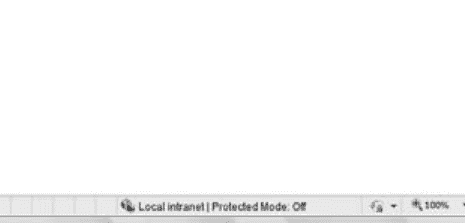

一个数字的阶乘是所有小于或等于该数字的正整数的乘积。

例如，4 的阶乘（写作 4!）是 `1 * 2 * 3 * 4 = 24`。阶乘用于数学的各个分支，包括统计学。在这里，你只想创建一个函数，它做一些足够复杂以至于值得成为一个函数的事情，但又不能复杂到分散你对本例主要目的的注意力：`try...catch` 和 `throw` 语句。

如果你清空第一个文本框并单击“计算阶乘”按钮，系统会提示你需要输入一个值。如果你在第一个文本框中输入无效的非数字值，系统会提示你输入有效的值。如果你输入负值，系统会提示你输入正值。

此外，如果你尝试将页面 `calcfactorial.htm` 加载到浏览器中，并在文本框中输入一个值并单击“计算阶乘”按钮，系统会提示你该页面未加载到正确的框架集中。

你会看到，所有这些错误消息都是使用 `try...catch` 和 `throw` 语句创建的。因为这个例子都是关于 `try...catch` 和 `throw` 的，所以你将只关注 `calcfactorial.htm` 页面，特别是 `butCalculate_onclick()` 函数，它连接到表单唯一按钮的 `onclick` 事件处理程序。

首先查看 `try` 子句及其内部的代码。代码由四个 `if` 语句和另一行将计算出的阶乘放入第二个文本框的代码组成。每个 `if` 语句都检查一个条件，如果该条件为真，将导致代码出现问题。

第一个 `if` 语句检查顶层框架集窗口中的 `calcFactorial()` 函数是否实际存在。如果不存在，它将抛出一个错误，该错误将被 `catch` 代码块捕获。如果用户加载的是 `calcfactorial.htm` 页面而不是框架集页面 `calcfactorialtopframe.htm`，那么如果没有这个 `throw` 语句，你的代码将失败。

```javascript
try
{
    if (window.top.calcFactorial == null)
        throw "This page is not loaded within the correct frameset";
```

接下来的三个 `if` 语句检查用户输入到文本框中的数据的有效性。首先确保用户在文本框中输入了内容；然后确保用户输入的是一个数字，最后检查该值不是负数。同样，如果任何 `if` 条件为真，你将抛出一个错误，该错误将被 `catch` 代码块捕获。你定义的每条错误消息都以感叹号开头，其目的是将错误标记为用户输入错误，而不是像不在框架集这样的错误。

```javascript
    if (document.form1.txtNum1.value == "")
        throw "!Please enter a value before you calculate its factorial";
    if (isNaN(document.form1.txtNum1.value))
        throw "!Please enter a valid number";
    if (document.form1.txtNum1.value < 0)
        throw "!Please enter a positive number";
```

如果一切正常，将执行 `calcFactorial()` 函数，结果文本框将填入用户输入数字的阶乘。

```javascript
    document.form1.txtResult.value =
        window.parent.calcFactorial(document.form1.txtNum1.value);
}
```

最后，将注意力转向 `try...catch` 语句的 `catch` 部分。首先，`try` 代码抛出的任何消息都将被 `exception` 变量捕获。

```javascript
catch(exception)
{
```

`exception` 中包含的数据类型将取决于错误是如何抛出的。如果错误是由浏览器抛出的而不是你的代码抛出的，`exception` 将是一个对象，即异常对象。如果是由你的代码抛出的，那么在这个例子中你只抛出了原始字符串。因此，你需要做的第一件事是确定 `exception` 包含什么类型的数据。如果它是一个字符串，你知道它是你的代码抛出的，并可以相应地处理它。如果它是一个对象，并且考虑到你知道你的代码都没有抛出对象，你通常认为产生该异常的必定是浏览器，且 `exception` 是一个 `Exception` 对象。

```javascript
if (typeof(exception) == "string")
{
```

如果异常是由代码通过 `throw` 抛出的（此时 `exception` 为字符串），你需要确定错误是否源于用户输入，例如文本框中缺少用于计算的数值；或者是其他类型的错误，例如页面未在你的框架集中加载。所有由用户输入引发的异常消息都以感叹号开头，因此你使用一个 `if` 语句检查第一个字符：如果是 `!`，则通知用户出错信息，随后将焦点返回到你的控件。如果不是，则直接显示错误消息。

```javascript
if (exception.charAt(0) == "!")
{
    alert(exception.substr(1));
    document.form1.txtNum1.focus();
    document.form1.txtNum1.select();
}
else
{
    alert(exception);
}
```

如果 `exception` 不是字符串，则说明你拥有一个异常对象，需要显示其 `message` 属性：

```javascript
else
{
    alert("The following error occurred " + exception.message);
}
}
```

### 嵌套 `try...catch` 语句

截至目前为止，你一直只使用单个 `try...catch` 语句，但完全可以在另一个 `try` 语句内部包含一个 `try...catch` 语句。事实上你还可以进一步操作：在内部这个 `try` 语句中再次放入 `try...catch`，甚至在其后再添置更多层结构——其极限仅取决于实际是否需要这样做。

那么为何要使用嵌套的 `try...catch` 呢？简单来说，你可以在内部的 `try...catch` 陈述部分处理某些错误；但若你面对的是一种更严重的错误，内部 `catch` 子句便可通过向外部抛出该异常的方式将其传递给外层的 `catch` 条款来处理（即将其“抛”给外层 catcher）。

以下是示例代码：

```javascript
try
{
    try
    {
        ablurt("This code has an error");
    }
    catch(exception)
    {
        var eName = exception.name;
        
        if (eName == "TypeError" || eName == "ReferenceError")
        {
            alert("Internal try...catch can deal with this error");
        }
        else 
        {
            throw exception;
        }
    }
}
catch(exception)
{
    alert("An error that the inner try...catch could not handle occurred.");
}
```

在这段代码中，存在两个 `try...catch` 配对结构：其中一个嵌套在另一个之内。


内部的 `try` 语句包含一段含有错误的代码行；内部 `try...catch` 结构中的 `catch` 子句检查错误名称的值（即异常名值）。如果该异常的名为 `TypeError` 或 `ReferenceError`，则内部 `try...catch` 将通过警报框来处理它（详见附录 B，其中列出了所有可用的错误类型及其描述）。很不幸的是，也不奇怪，浏览器本身产生的错误种类依赖于所使用的具体 browser。在该示例中，IE 将此类报错标识为 `TypeError`，而其他非 IE 系浏览器会报告其为 `ReferenceError`。

倘若内部 `catch` 语句所捕获到的并非我们定义的输入校验类异常，而是其他类型的错误，则被重新抛出，以供外部 `try...catch` 结构中的 `catch` 子句接管处理。

让我们修改前述示例文件 `calcfactorial.htm` 中提到的 `butCalculate_onclick()` 函数，使其同时拥有内部的与外部的两个 `try...catch` 层级：

```javascript
function butCalculate_onClick(event)
{
    try
    {
        try
        {
            if (window.top.calcFactorial == null)
                throw ("This page is not loaded within the correct frameset");

            if (document.form1.txtNum1.value == "")
                throw ("!Please enter a value before you calculate its factorial.");

            if (isNaN(document.form1.txtNum1.value))
                throw ("!Enter Please valid number.");

            if (document.form1.txtNum1.value < 0)
                throw ("！Enter positive numbers only");

            document.form1.txtResult.setValue =
                window.parent.CalcFactorial(document.form1.txtNum1.value);
        }
        catch (exception)
        {
            if (typeof(exception) == "string" && exception.charAt(0) == "!")
            {
                alert(exception.substr(1));
                document.form1.txtNum1.focus();
                document.form1.txtNum1.select();
            }
            else
            {
                throw exception;
            }
        }
    }
    catch (exception)
    {
        switch (exception)
        {
            case "This page is not loaded with correct frames":
                alert(exception);
                break;

            default:
                alert("The following critical error has occurred\n" + exception);
        }
    }
}
```

注释：原文中多处拼写错误（如 `"ablurt"`、`"If"`、`"Throwing"` 等）已在翻译时校正为合理函数名称，同时保持原意不变。

内部的 `try...catch` 负责处理用户输入类错误；但如果异常并非由我们抛出的“非”用户输入型错误，则直接再抛出，交由外部 `catch` 结构进一步处置。

外层的 `catch` 语句嵌入了一个 `switch` 判断逻辑：它根据被捕获（throw out）的错误信息的具体内容来决定处理方式——假如这是 `calcfactorialtopframe.htm` 未正常加载导致的提示性警告，则由 `switch` 的第一条 `case` 分支处理；其余任何形式的异常将落入 `default` 分支进行统一报告。

当然，在实际项目中也可能出现大量不同类型的异常，需要我们通过多个 `case` 子句逐一应对的情况：此时嵌套 `try...catch` 依然适用且有效！

### `finally` 条款

`try...catch` 语句还可附加一个 `finally` 子句，用于定义无论是否发生异常都会被执行的代码区块；该子句无法独立存在，必须紧接在某个 `try` 块之后出现。下图为相关示例：

```javascript
try
{
    alert("An exception will occur");
}
catch (exception)
{
    alert("Exception occurred.");
}
finally
{
    alert("Whatever happens, this line will execute.");
}
```

`finally` 部分正是放置那些“无论先前是否出错都必须清除现场或释放资源”的清理代码的理想位置。

你已了解了开发人员常用的几类典型失误，同时也掌握了如何在自己的代码中合理处理各种错误——遗憾的是，程序运行过程中仍可能遭遇此类问题；接下来我们将借助调试工具来尝试简化这些问题的排查流程！

## Debugging

JavaScript 传统上被认为是一门编写与排错难度极高的语言（原因之一在于曾经缺乏成熟的开发环境支持），但现在情况已大有改观，这要归功于如今众多面向开发者开放的强大工具箱。

尤其值得一提的是适用于 Internet Explorer、Firefox、Safari 和 Opera 四大主流浏览器平台的内置调试功能；凭借这些工具，你可以设置断点以暂停脚本执行并逐行步进，查看当前每一步的真实行为表现；甚至能在运行时直接 inspect 变量实时数据，并在界面上即时执行任意语句，而不必将整个页面刷新重来。

如果没有此类调试器，你唯一能做的就是在关键逻辑节点插入 `alert()` 函数来快照式地打印出各阶段变量的状态而已，这种方式显然效率低下且可读性差强人意。

此外还需注意：虽然不同品牌、版本的浏览器所提供的调试功能特性略有差异（比如某些扩展插件增强了控制台功能或支持断点可视化），但对于大多数通用场景而言，下列概念适用于几乎所有主流调试器并构成统一认知基础：

- **Breakpoints** 指示当引擎运行至指定位置时应中断代码执行流程；你可以在 JavaScript 源码中任意处设置此类标记，一旦解释器抵达该点，即刻停止继续向下演绎，直至手动或条件触发后恢复。
- **Watches** 允许你明确列出希望在暂停时刻进行检查的核心变量集合（例如当前循环计数器、临时计算结果等），以便随时监控其变化轨迹，而无需人工反复查看对象面板内容。
- **Call Stack** 记录了从入口函数到目标断点期间依次调用了哪些函数与方法的信息；这对于分析递归问题或深层调用链至关重要，尤其是在跨页面通信场景下，需要追踪异步事件触发顺序是否合规。
- **Console** 模块则提供了交互式命令执行环境，让用户可在当前作用域范围内自由试验表达式、调用 API，甚至修改 DOM 属性，而无需重新加载整个网页；同时它会自动捕获并列出本页面上发生的所有 JavaScript 错误信息，包括堆栈跟踪细节，便于快速定位出错行号及相关上下文线索。
- 最后一点也是最重要的一条：**Stepping**（步进调试）是日常最常用也是最基础的操作步骤之一。它可以指导你一次只执行一行代码，观察中间状态变化，从而深入理解复杂算法逻辑；具体实现方式有三种变体，各自适用于不同类型的问题诊断需求，下面详细介绍它们的区别与应用场合。

### Step Into（进入调用）

该模式会立即深入下一行可执行的语句当中。如果该行代表函数调用，则直接进入被调用函数的第一条逻辑，之后暂停，等待用户决定是否继续深入查看内部细节，还是选择跳过当前步骤返回上级视角——这特别适合用于剖析某一层级内复杂的子过程，如异步回调链式操作中的中间变量传递路径是否通畅等场景。

### Step Over（覆盖执行）

其行为类似于 Step Into，同样会推进至下一行代码，但如果该行为属于函数调用，则整体会完整执行整个被调函数内容，并在其结束时停下，于外部环境中恢复控制权——适用于快速浏览那些无需逐字解析内部实现的工具辅助类方法或纯 getter/setter 属性访问等简单操作，而不必陷入不必要的细节泥潭。

### Step Out（跳出当前）

当你正处于某个已被调用函数的嵌套层级之中，并希望退出该函数，让其自动运行至结尾并返回父级上下文时，使用此命令极为便利；程序会自动执行完剩余所有语句，并在函数最终返回值前后停下，供你确认结果是否正确以及是否有未预期的副作用产生——尤其适合用于测试那些带有默认行为或边界条件判定的高阶函数逻辑是否按照预期工作。

在进入各类主流调试器之前，让我们构建一个可用于演示调试功能的示例页面。特别留意第 16 行处故意留存的拼写错误（如 `"ablurt"` 应写作 `alert`）。如果你在从零开始创建该文件，请务必包含这一人为设置的错别字，以便后续验证断点命中机制能否精准定位并提示用户修复对应代码段！

## 第四章：常见错误、调试与错误处理

```html
<!DOCTYPE html PUBLIC "-//W3C//DTD XHTML 1.0 Transitional//EN"
    "http://www.w3.org/TR/xhtml1/DTD/xhtml1-transitional.dtd">
<html xmlns="http://www.w3.org/1999/xhtml">
<head>
    <title>Debug: Times Table</title>
    <script type="text/javascript">
        function writeTimesTable(timesTable)
        {
            var counter;
            var writeString;
            for (counter = 1; counter < 12; counter++)
            {
                writeString = counter + " * " + timesTable + " = ";
                writeString = writeString + (timesTable * counter);
                writeString = writeString + "<br />";
                documents.write(writeString);
            }
        }
    </script>
</head>
<body>
    <script type="text/javascript">
        writeTimesTable(2);
    </script>
</body>
</html>
```

将其保存为 `debug_timetable.htm`。

下一节将引导你了解 Firefox 的 Firebug 附加组件的功能和特性。由于调试和调试器具有普遍性，关于 Internet Explorer、Safari 和 Opera 的部分仅会让你熟悉各浏览器调试器的用户界面，并指出任何差异。

### 在 Firefox 中使用 Firebug 进行调试

多年来，Firefox 唯一的 JavaScript 调试器是一个代号为 Venkman 的 Mozilla 项目。其功能集与 Microsoft 的 Script Editor 类似，但许多开发者认为 Venkman 不够用户友好。其中一位开发者 Joe Hewitt 决定使用 Firefox 内置的调试 API（应用程序编程接口）编写自己的调试器。他将其命名为 Firebug，而剩下的，正如他们所说，就是历史了。

如今，Firebug 是 Firefox 事实上的 JavaScript 调试器（及其更多功能！），所有其他浏览器的其他 JavaScript（和 Web 开发）工具在原理上都是基于 Firebug 的。

不幸的是，Firebug 并非默认随 Firefox 一起提供。相反，你必须安装 Firebug 附加组件。你可以从以下地址下载最新版本的 Firebug：

- http://www.getfirebug.com
- http://www.joehewitt.com/software/firebug/
- https://addons.mozilla.org/en-US/firefox/addon/1843

要安装 Firebug，请打开 Firefox 并访问提供的任一网址。点击网页上的“安装”按钮，并按照说明操作。请务必在 Firebug 安装完成后重新启动 Firefox。

你可以通过几种方式访问 Firebug。你可以点击 Firefox 窗口右下角状态栏中的 Firebug 图标。如果你的 Firefox 状态栏不可见，可以通过在 Firefox 的“工具”菜单中选择 `Firebug > Open Firebug` 来打开 Firebug。默认情况下，Firebug 会在 Firefox 中以面板形式打开（参见图 4-4）。

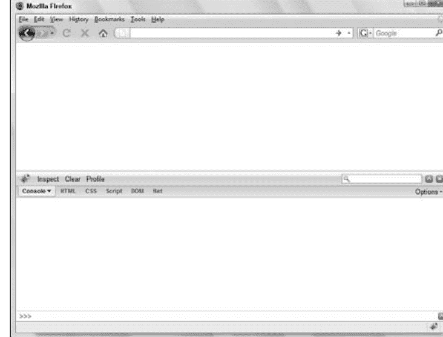

你可以通过点击“关闭”按钮旁边的向上箭头将其弹出到独立窗口。

在 Firefox 中打开 `debug_timetable.htm`。如果状态栏可见，你应该在 Firefox 窗口右下角看到红色的文本“1 Error”。点击该消息（或通过“工具”菜单打开 Firebug），Firebug 将打开控制台。

控制台在 Firebug 中有多重用途；它列出 JavaScript 错误，并允许你即时执行 JavaScript 代码。我们稍后会尝试使用控制台。

JavaScript 调试器包含在 `Script` 选项卡中，它由两个面板组成。左侧面板包含源代码，右侧面板包含三个不同的视图供选择：`Breakpoints`（断点）、`Watch`（监视）和 `Stack`（堆栈）。

- **Breakpoints**：列出你为当前页面中的代码创建的所有断点。
- **Watch**：列出当前作用域中的变量及其在断点处的值。你也可以添加其他变量进行监视。
- **Stack**：显示调用堆栈。

左侧面板中的源代码是只读的；如果你想更改它，必须在文本编辑器中编辑该文件。让我们这样做，将第 16 行中错误的 `documents` 更改为 `document`。保存它，然后重新加载网页。

更正错误并重新加载页面后，你应该能在网页中看到乘法表，如图 4-5 所示。

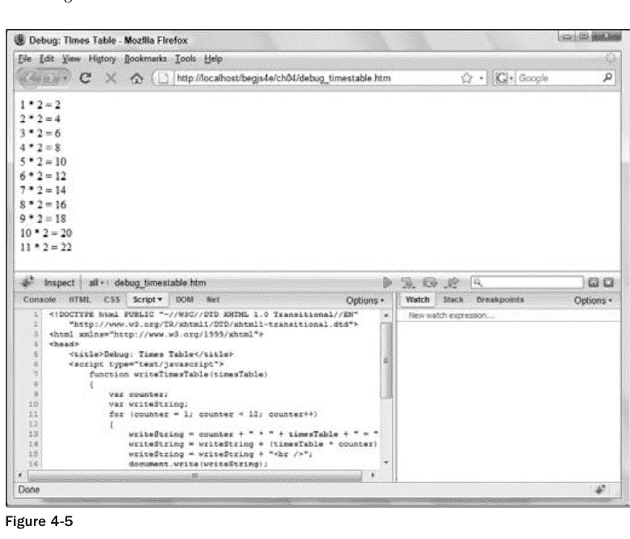

图 4-5

同时请注意，Firebug 左侧面板中的源代码已更新以反映你的更改。

### 设置断点

如前所述，断点告诉调试器在代码中的特定点暂停代码执行。当你想在代码执行时检查代码时，这非常方便。

在 Firebug 中创建断点很简单；只需在源代码行号左侧的灰色区域（装订线）点击鼠标左键。断点由你点击位置装订线上的红色圆圈表示。

你也可以在编写代码时使用 `debugger` 关键字创建断点（我们稍后会使用它）。

保持已更正的 `debug_timetable.htm` 在 Firefox 中加载，在第 14 行创建一个断点。

```javascript
writeString = writeString + (timesTable * counter);
```

重新加载页面，注意 Firebug 在你刚创建的断点处停止了代码执行。Firebug 将当前行代码高亮为浅黄色，并在装订线中放置一个黄色箭头。此行尚未执行。

点击右侧面板中的 `Breakpoints` 选项卡；它会显示断点列表（本例中只有一个）。列表中的每个条目包括一个用于启用或禁用断点的复选框、包含函数的名称、源文件的文件名和行号、断点的源文本以及一个“Delete”按钮。

现在点击 `Watch` 选项卡。

#### 监视

`Watch` 选项卡显示在代码执行暂停时，当前行中处于作用域内的变量及其值。图 4-6 显示了此断点处 `Watch` 选项卡的内容。

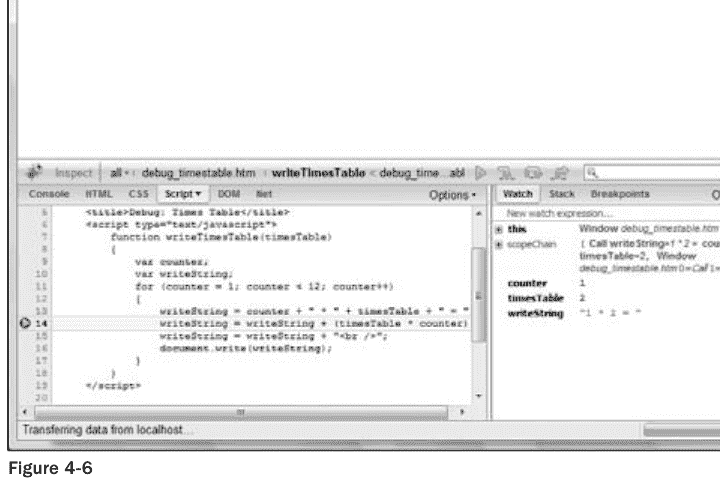

请注意，`counter`、`timesTable` 和 `writeString` 变量是可见的（`this` 也是）。

你也可以添加自己的变量进行监视，在单步调试代码时检查它们的值。要添加监视，只需点击“New watch expression...”，输入你要监视的变量名，然后按回车键。你添加的监视具有灰色背景，将鼠标悬停其上会显示一个红色的“Delete”按钮。


你可以监视任何你想要的变量。如果变量在作用域内，则显示变量的值。如果变量不在作用域内，则会显示 `ReferenceError` 作为其值。

虽然这些信息在你想查看代码中到底发生了什么时很有帮助，但如果你无法控制代码执行，它就不是很有帮助。设置断点并多次重新加载页面仅为了前进到下一行是不切实际的，因此我们使用一个称为“单步调试”的过程。

### 单步调试代码

代码单步调试由窗口右上角源代码搜索框旁边的四个按钮控制（参见图 4-7）。

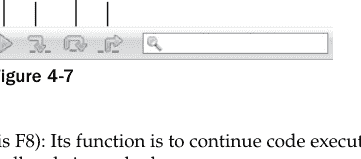

- **Continue**（快捷键是 F8）：其功能是继续执行代码，直到遇到下一个断点或到达所有代码的末尾。
- **Step Into**（快捷键是 F11）：执行当前行代码并移动到下一个语句。如果当前行是一个函数，则会单步调试到该函数的第一行。
- **Step Over**（F10）：与 `Step Into` 类似，它执行当前行代码并移动到下一个语句。但是，如果该语句是一个函数，它会执行该函数并单步调试到函数调用之后的下一行。
- **Step Out**：返回到调用函数。

让我们进行一些单步调试；按照以下步骤操作：

1. 通过点击图标或按 F11 进入 `Step Into` 代码。调试器执行当前高亮的代码行并移动到下一行。
2. 查看 `Watch` 选项卡以及 `writeString` 的值；它是 `"1 * 2 = 2"`。如你所见，`Watch` 选项卡中显示的值会实时更新。
3. Firebug 的一个很好的特性是，在单步调试代码时，页面会根据需要更新。再点击两次 `Step Into` 来查看实际效果。图 4-8 显示了在单步调试代码时页面更新的情况。

## 第四章：常见错误、调试与错误处理

### 图 4-8

你可能会发现，步入的那个函数并非 bug 的来源，此时你希望执行该函数中剩余的代码行，然后从函数被调用的位置继续逐步执行。要实现这一点，可以点击“步出”图标以跳出代码。然而，如果你正处于循环之中，且断点设置在循环内部，那么在你遍历完整个循环之前，是不会跳出该函数的。

有时，你可能遇到了一些包含 bug 的代码，这些代码调用了多个函数。如果你确定其中某些函数没有 bug，那么你可能只想执行这些函数，而不是步入其中逐行查看它们的执行过程。在这种情况下，请使用“步过”功能，它会执行函数内部的代码，但不会逐行遍历。

请按如下方式修改 `debug_timetable.htm` 中的乘法表代码，以便你能使用三种单步执行方式：

```html
<!DOCTYPE html PUBLIC "-//W3C//DTD XHTML 1.0 Transitional//EN"
    "http://www.w3.org/TR/xhtml1/DTD/xhtml1-transitional.dtd">
<html xmlns="http://www.w3.org/1999/xhtml">
<head>Av
    <title>Debug: Times Table 2</title>
    <script type="text/javascript">
```

109

```javascript
function writeTimesTable(timesTable)
{
    var counter;
    var writeString;
    for (counter = 1; counter < 12; counter++)
    {
        writeString = counter + " * " + timesTable + " = ";
        writeString = writeString + (timesTable * counter);
        writeString = writeString + "<br />";
        document.write(writeString);
    }
}
</script>

</head>
<body>
    <script type="text/javascript">
    var timesTable;
    for (timesTable = 1; timesTable <= 12; timesTable++)
    {
        document.write("<p>")
        writeTimesTable(timesTable)
        document.write("</p>")
    }
    </script>
</body>
</html>
```

将其保存为 `debug_timetable2.htm`。请注意，此 HTML 文件中没有任何错误。

以下步骤将引导你完成代码的单步执行过程。

1. 在第 26 行的 `for` 循环处设置断点，即页面主体中的循环部分，然后重新加载页面。
2. 点击“步入”图标，代码执行将移至下一条语句。现在，`for` 循环内的第一条语句 `document.write("<p>")` 即将被执行。
3. 当你再次点击“步入”图标时，它会带你进入 `writeTimesTable()` 函数的第一次调用。
4. 你想看看该函数内部发生了什么，因此再次点击“步入”，你就会进入该函数。你的屏幕应该如图 4-9 所示。
5. 多次点击“步入”图标，以了解函数执行流程的大致情况。实际上，逐行单步执行代码可能会有点乏味。因此，假设你对这个函数感到满意，想要运行其余部分。
6. 使用“步出”来运行剩余的代码。该函数已完全执行完毕，你回到了调用行，如图 4-10 所示。
7. 点击“步入”图标两次以执行 `document.write()`（它不会显示，因为它是一个闭合标签）。
8. 再点击“步入”四次。执行将继续经过 `for` 循环的条件判断和增量部分，最终返回到调用 `writeTimesTable()` 函数的那一行。

110

## 第四章：常见错误、调试与错误处理

### 图 4-13（图片引自上一页）

111

## 第四章：常见错误、调试与错误处理

9. 你已经看到过它的实际运行了，所以你实际上想要**步过**它并转到下一行。那么，猜到“步过”就是你需要的功能应该不难吧。点击“步过”图标（或按 F10 键），该函数将被执行，但不会逐条语句地遍历时，你会发现自己又回到了 `document.write("</p>")` 这一行。

如果调试已经完成，你可以点击工具栏上的“继续”图标（或按 F8 键）来运行剩余的代码，而无需逐行单步执行。你应该能在浏览器中看到从 1*1=1 到 11*12=132 的乘法表页面。

### 控制台

当你在代码中单步执行并检查其执行流程时，能够实时评估条件甚至动态修改内容将会非常有用。你可以使用控制台来完成这些操作。

请按以下步骤操作：

1. 通过点击源代码面板中的红色圆圈来移除之前设置的断点，然后在第 17 行设置一个新的断点：

   `document.write(writeString);`

2. 让我们看看如何找到变量 `writeString` 当前包含的值。重新加载页面。当调试器在断点处停止时，点击“控制台”标签页，在 `>>>` 字段中点击，然后输入你要检查的变量名称，此处为 `writeString`。按 Enter 键。这将导致变量中包含的值被打印在命令窗口中你输入的命令下方，如图 4-11 所示。
3. 如果你想更改变量，可以在命令窗口中写入一行 JavaScript 代码并按 Enter 键。请用以下代码尝试一下：

```javascript
writeString = "Changed on the Fly<br />"
```

4. 点击“脚本”标签页，通过点击红色圆圈移除断点，然后点击“继续”图标。你将看到你操作的结果：在应该显示 1*1 乘法表结果的位置，插入了你即时修改的文本。

> 此修改不会更改你的实际 HTML 源文件，仅会修改当前加载在浏览器中的页面。

控制台还可以评估条件。在第 26 行重新创建断点并重新加载页面。让执行在断点处停止，并**步入** `for` 循环的条件判断。

在命令窗口中输入以下内容并按 Enter 键：

```javascript
timesTable <= 12
```

由于这是循环第一次运行，如图 4-12 所示，`timesTable` 等于 1，因此条件 `timesTable <= 12` 的评估结果为 `true`。

### 图 4-12（图片引用）

你还可以使用控制台来访问浏览器对象模型（Browser Object Model）的属性（我们将在第六章中介绍相关内容）。例如，如果你在命令窗口中输入 `window.location.href` 并按 Enter 键，它会告诉你网页的 URL。

## 调用堆栈窗口

控制台并不限于单行 JavaScript。点击屏幕右侧的上箭头，你就可以输入多条要执行的语句。

当你在代码中单步执行时，调用堆栈窗口会实时维护一个列表，记录哪些函数已被调用以到达代码中的当前执行点。

让我们创建一个示例网页来很好地展示调用堆栈。

1. 输入以下代码：

```html
<!DOCTYPE html PUBLIC "-//W3C//DTD XHTML 1.0 Transitional//EN"
    "http://www.w3.org/TR/xhtml1/DTD/xhtml1-transitional.dtd">
<html xmlns="http://www.w3.org/1999/xhtml">
<head>
    <title>Debugging: Callstack</title>
    <script type="text/javascript">
        function firstCall()
        {
            secondCall();
        }

        function secondCall()
        {
            thirdCall();
        }

        function thirdCall()
        {
            //
        }

        function button1_onclick()
        {
            debugger
            firstCall();
        }
    </script>
</head>
<body>
    <input type="button" value="Button" name="button1"
        onclick="return button1_onclick()" />
</body>
</html>
```

2. 将此页面保存为 `debug_callstack.htm`，并将其加载到 Firefox 中。你只会看到一个带有按钮的空白网页。
3. 点击按钮，调试器将在 `button1_onclick()` 函数中的 `debugger` 语句处打开，该函数与按钮的 `onclick` 事件处理器相连。
4. 点击右侧面板中的“调用堆栈”标签页。你的调试器现在看起来如图 4-13 所示。

## 第四章：常见错误、调试与错误处理

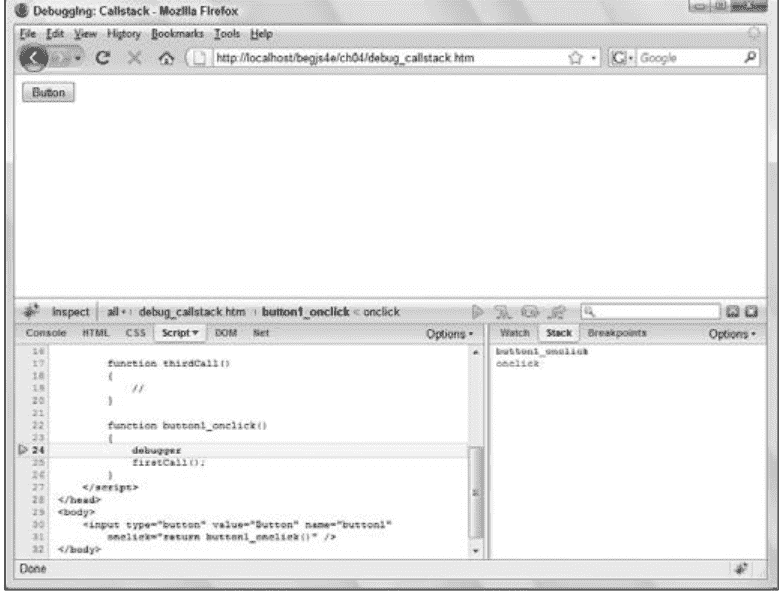

### 图 4-13

Firebug 会在每次函数调用时将该函数添加到调用栈的顶部。你已经可以看到，第一个被调用的函数实际上是附加在按钮 `onclick` 事件处理程序上的代码。接下来，被添加到调用栈中的是由 `onclick` 事件处理程序调用的函数，即调用栈顶部显示的 `button1_onclick()` 函数。

5. 如果你想查看每个函数最初是在哪里被进入的，只需在调用栈窗口中点击函数名。点击 `onclick`，调用它的代码（即连接到 `<input/>` 元素 `onclick` 属性的代码）将会显示出来。现在点击最上面一行 `button1_onclick`，这将带你回到当前的执行点。
6. 现在，执行两次“逐语句进入”。第一步进入调用 `firstCall()` 函数的那一行。第二步将带你进入该函数本身。该函数会立即被添加到调用栈中，如图 4-14 所示。
7. 再次“逐语句进入”以进入第二个函数 `secondCall()`。它同样会被添加到调用栈中。再走一步会带你进入第三个函数 `thirdCall()`，其名称同样被添加到调用栈的顶部。

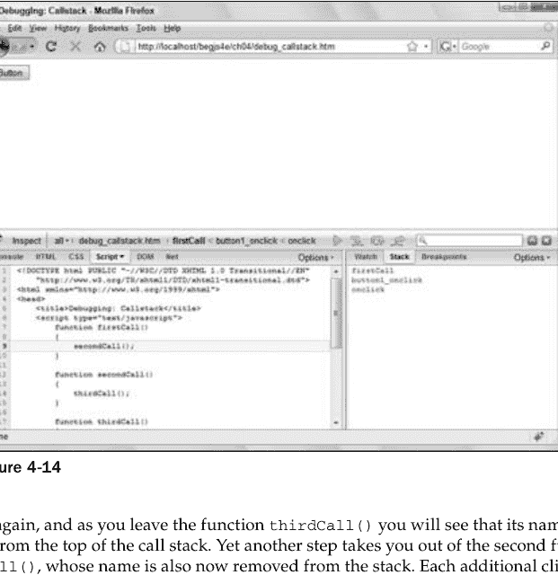

8. 再次“逐语句进入”，当你离开 `thirdCall()` 函数时，你会看到它的名称从调用栈顶部被移除。再走一步，你会离开第二个函数 `secondCall()`，其名称也从栈中被移除。每多点击一次，你就会退出一个函数，并从调用栈中移除其名称，直到所有代码都执行完毕，你将再次回到浏览器。

这个演示页面跟踪起来非常简单，但对于复杂的页面，尤其是多框架页面，调用栈对于跟踪你所在的位置、你曾经去过的地方以及你是如何到达那里的，会显得非常有用。

如前所述，大多数其他浏览器的开发者工具都基于 Firebug，你很快会在 IE8 的内置工具中看到这一点。

### 在 Internet Explorer 中调试

在第 8 版之前，开发者必须为任何类型的脚本调试下载并安装 Microsoft Script Debugger。值得庆幸的是，微软在 IE8 中内置了一个调试器，但它默认是关闭的。要启用它，请按照以下步骤操作：

1. 单击工具 ❡ Internet 选项。
2. 单击高级选项卡，然后在“浏览”部分下取消选中“禁用脚本调试 (Internet Explorer)”旁边的复选框（参见图 4-15）。
3. 单击“确定”保存设置并退出 Internet 选项对话框。

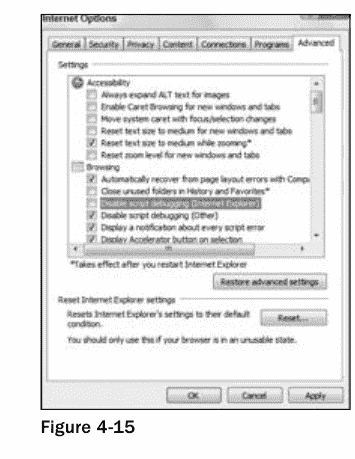

### 图 4-15

启用调试器后，你可以通过几种方式访问它：

- 你可以通过单击工具 → 开发人员工具来调出调试器。开发人员工具包含各种你可能会觉得有用的工具（就像 Firebug 一样，它不仅仅是一个 JavaScript 调试器）。为了方便访问，可以考虑修改命令栏以包含“开发人员工具”按钮。“开发人员工具”窗口出现后，单击脚本选项卡，如图 4-16 所示。

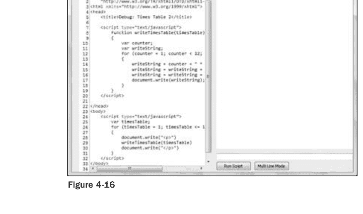

### 图 4-16

这种方法可能是开始调试最简单的方式。只需导航到所需的页面。如果发生任何错误，将出现一个对话框，询问你是否要进行调试（参见图 4-17）。

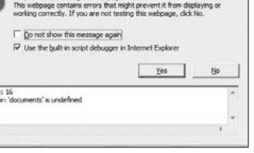

### 图 4-17

单击“是”按钮，开发人员工具窗口将出现，并且脚本选项卡已被选中。调试器会在出错的行停止并将其高亮显示为黄色，尽管在图 4-18 的黑白截图中这可能不明显。请在 IE8 中加载 `debug_timetable.htm` 的原始版本（包含错误的那个）以查看实际效果。单击“是”开始调试。

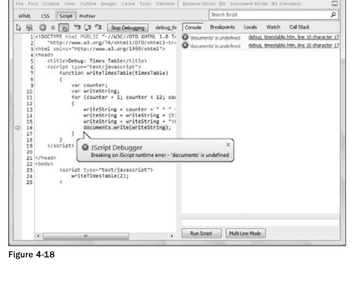

### 图 4-18

IE8 调试器的一个主要区别是，如果你想进行调试，它必须处于调试模式。这看起来很明显，但如果你回想一下，Firebug 没有调试模式。

如图 4-18 所示，调试器由两个面板组成。左侧面板显示包含错误的文件的源代码。如果多个文件包含 JavaScript，你可以使用“停止调试”按钮旁边的下拉菜单选择这些文件。

右侧面板包含五个选项卡：

1. **控制台**：由上、下两个面板组成。下方面板允许你输入和运行 JavaScript 代码。它具有单行模式和适用于较大代码块的多行模式。上方面板是你输入的命令及其结果的日志。
2. **断点**：列出你为当前页面中的代码创建的所有断点。
3. **局部变量**：列出断点作用域内的变量及其值。
4. **监视**：列出你指定要在断点处监视的变量及其值。
5. **调用栈**：显示调用栈。

IE8 开发人员工具的另一个区别是增加了“局部变量”选项卡。微软将 Firebug 的“监视”选项卡拆分成了“局部变量”和“监视”选项卡。

左侧面板中的源代码是只读的，因此更改它需要在文本编辑器中编辑文件。执行此操作，将第 16 行有问题的 `documents` 更改为 `document`。保存并尝试重新加载网页。注意你无法做到这一点。这是因为调试器当前正在运行并在错误处停止。为了重新加载页面，你必须单击“停止调试”按钮。调试器停止后，你就可以重新加载页面了。

纠正错误并重新加载页面后，你应该能在网页中看到乘法表。

#### 设置断点

在 IE8 中创建断点与在 Firebug 中一样简单直接；只需在你希望调试器中断的行旁边的空白处单击即可。创建断点后，你会注意到行号旁边出现一个红色圆圈。

创建断点后，在通过单击“断点”选项卡找到的断点列表中会添加一个条目。每个条目包含一个用于启用/禁用断点的复选框、源文件的文件名以及断点所在的行号。图 4-19 显示了 `debug_timetable2.htm` 第 17 行的一个断点。

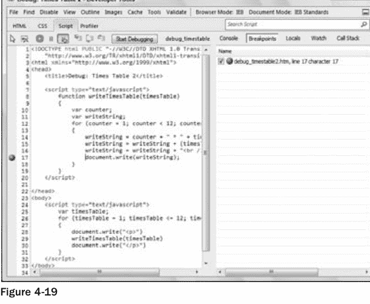

IE8 的 JavaScript 调试器还支持 `debugger` 关键字。但是，你必须处于调试模式，IE8 的调试器才会在那一行暂停。否则，你将看到旧的选择屏幕。如果你在代码中使用 `debugger` 关键字并看到图 4-20，则需要打开调试模式。

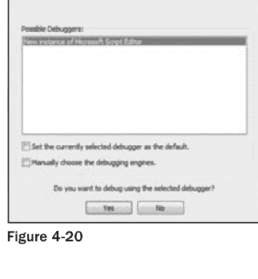

120

#### 添加监视

“监视”选项卡的唯一目的是列出你想要监视的变量并显示它们的值和类型。在 IE8 中添加监视与在 Firebug 中略有不同：你必须处于调试模式并在断点处停止才能添加监视。


如果你处于调试模式并在断点处停止，只需单击“单击以添加…”，键入你要监视的变量，然后按 Enter 键（参见图 4-21）。

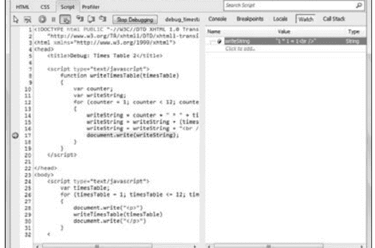

### 单步执行代码

在调试器窗口的顶部，调试按钮的左侧，有六个控制代码执行的按钮（参见图 4-22）。

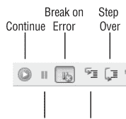

“继续”选项（快捷键 F5）会继续执行代码，直到下一个断点或所有代码结束。第二个选项“全部中断”确保调试器在执行下一条语句之前中断。“中断时中断”告诉调试器在发生错误时中断。“逐语句进入”（F11）、“逐过程”（F10）和“逐过程执行”（Shift+11）的行为与在 Firebug 中相同。

IE8 的调试器通过将当前行高亮显示为黄色并在空白处添加黄色箭头来指示当前行。

与 Firefox 和 Firebug 不同，单步执行代码不会更新网页。JavaScript 会执行，但你直到所有代码执行完毕才会看到结果。

### 控制台

与 Firebug 的控制台不同，IE8 的开发人员工具控制台与其他 JavaScript 工具位于一起，并通过控制台选项卡访问，但这就是主要区别所在。

控制台记录 JavaScript 错误，并允许你在调试器停止的行的上下文中执行代码。图 4-23 显示了在 IE8 中重新创建的 Firebug 部分的“动态更改”示例。

默认情况下，控制台只接受单行 JavaScript 代码。你可以通过单击“多行模式”按钮来更改此设置。

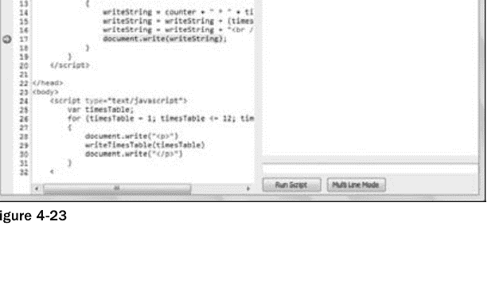

**图 4-23**

## 第四章：常见错误、调试与错误处理

### 在 Safari 中调试

Safari 调试工具的故事与 IE 类似。Safari 的渲染引擎名为 Webkit，而编写和维护 Webkit 的团队构建了一个单独的工具，代号为 Drosera，它包含的工具类似于 Firebug 和 IE8 开发者工具。它需要单独下载，并且需要你将其附加到特定的 Safari/Webkit 窗口。

Safari 3 包含一个名为 Web Inspector 的工具，但它没有任何 JavaScript 调试功能。从 Safari 4 开始，Web Inspector 内置了 JavaScript 调试器，我们将在本节中介绍它。

> Chrome 也使用 Webkit，但在撰写本文时，只有 3 测试版包含脚本调试器。

与 IE8 类似，Web Inspector 默认是禁用的。要启用它，请按照以下步骤操作：

1. 点击“设置”菜单按钮并选择“偏好设置”选项（参见图 4-24）。

   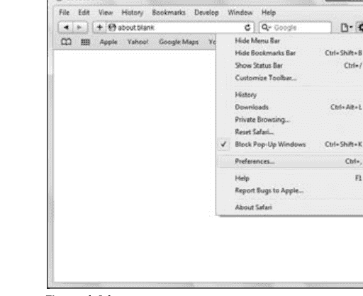

2. 在“偏好设置”窗口中，点击“高级”选项卡并选中“在菜单栏中显示开发菜单”选项（参见图 4-25）。关闭“偏好设置”窗口。

   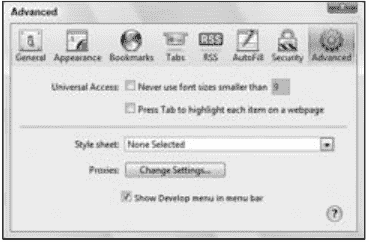

   图 4-25

3. 点击“设置”菜单按钮并选择“显示菜单栏”选项。这将在窗口顶部显示传统菜单。

4. 要打开调试器，请从菜单栏中选择“开发” ➩ “开始 JavaScript 调试”。

当窗口打开时，你会看到一些肯定不是你的代码。没关系——你稍后可以更改它。首先，让我们看看这个窗口并识别各个部分。图 4-26 显示了首次在`debug_timetable2.htm`文件上打开时的 JavaScript 调试器。你计算机上显示的代码可能有所不同。

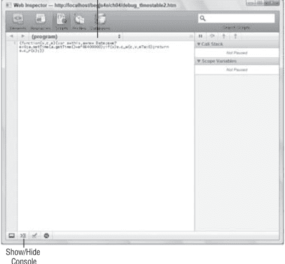

文件选择器

显示/隐藏控制台

图 4-26

与之前查看的工具不同，Safari 的 Web Inspector 不使用选项卡来分区各种功能。相反，它在窗口内组织所有内容，使你可以轻松访问所有功能。你可以看到调用栈和作用域变量不是选项卡，而是你可以在调试时同时查看的独立部分。点击控制台按钮，你会看到它在窗口底部添加了一个面板（参见图 4-27）。

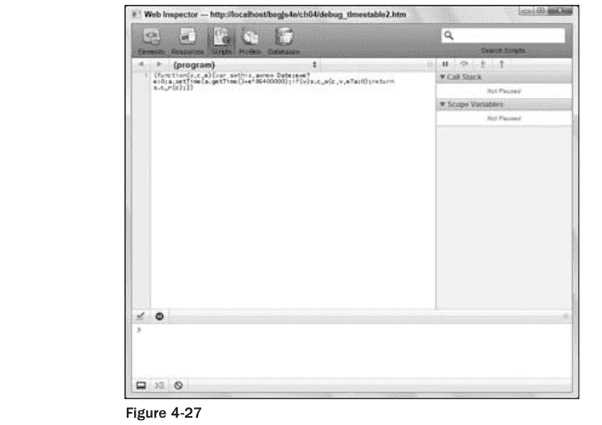

一切都触手可及，对你可见；因此，在 Safari 中加载`debug_timetable2.htm`并返回到 Web Inspector 窗口。点击文件选择下拉菜单并选择 HTML 文件以显示该文件的源代码。与之前的工具一样，源代码是只读的，但你可以设置断点。

### 设置断点

在 Web Inspector 中创建断点的过程与其他工具相同：点击你希望调试器中断的行所在的侧边栏。Web Inspector 中的断点由蓝色标签表示（参见图 4-28）。在第 17 行创建一个。

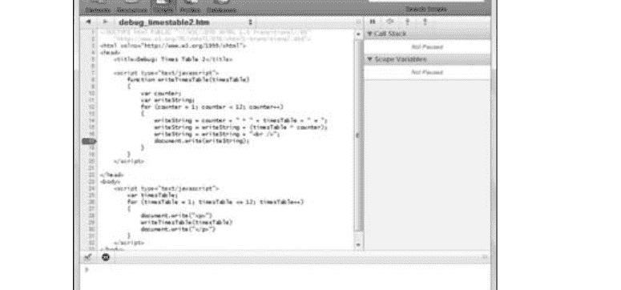

图 4-28

与 Firebug 和 IE 开发者工具不同，Web Inspector 不会将你设置的断点列在单独的区域，因此如果你使用 Safari 和 Web Inspector 作为你的首选浏览器和调试器，请记住断点的位置。重新加载页面，以便调试器可以中断，我们可以逐步讲解这些功能。

> Web Inspector 支持`debugger`关键字。

125

Web Inspector 不允许你添加自己的变量进行监视，但“作用域变量”部分显示了作用域内的所有变量。图 4-29 显示了变量如何分为局部变量和全局变量。

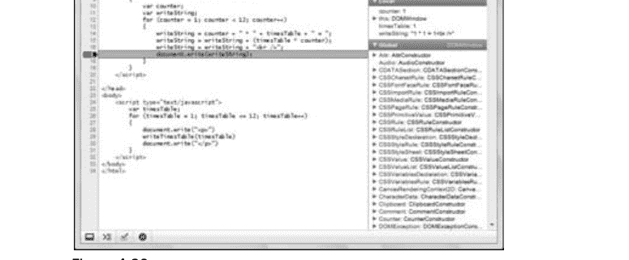

图 4-29

126

### 单步执行代码

代码单步执行按钮位于右侧面板的顶部和搜索框下方（参见图 4-30）。

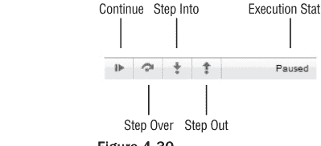

这些按钮的功能与 Firebug 和 IE 中的相同；但是，它们的顺序略有不同。第一个按钮继续执行代码，直到遇到下一个断点或所有代码执行完毕。第二个按钮是“单步跳过”，第三个是“单步进入”，第四个是“单步跳出”。

与 Firefox 和 Firebug 一样，Safari 和 Web Inspector 在你单步执行代码时会更新页面。因此，你可以看到每一行执行的结果。

### 控制台

控制台的目的与之前工具中的相同。你可以通过键入变量并按 Enter 键来检查变量的值。你也可以在当前代码行的上下文中执行代码。尝试 Firebug 部分中的“动态更改”示例来实际操作一下。

与之前的工具不同，Web Inspector 控制台不允许多行输入。虽然 Web Inspector 的界面时尚且没有选项卡（有些人会说杂乱），但现在是时候冒险回到 Opera 的 Dragonfly 的选项卡世界了。

### 使用 Dragonfly：Opera 的开发工具

Opera 的 Dragonfly 是基于浏览器的开发工具领域的新手。在撰写本文时，它目前还是测试前的软件，但从 9.5 版本开始，它就随 Opera 一起提供。

有两种方式可以打开 Dragonfly：

- 通过“工具”菜单：工具 ➔ 高级 ➔ 开发者工具。
- 通过“调试”菜单，可以通过在 Opera 中打开以下 URL 来安装：http://dragonfly.opera.com/app/debugmenu/DebugMenu.ini。

图 4-31 显示了在 Opera 中加载了`debug_timetable2.htm`的 Dragonfly。

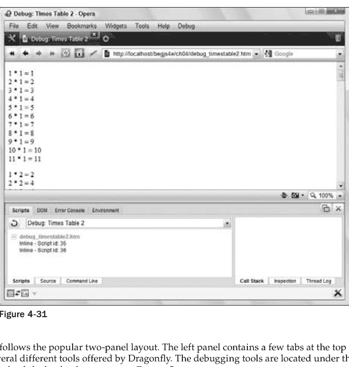

Dragonfly 遵循流行的双面板布局。左侧面板顶部有几个选项卡，控制着 Dragonfly 提供的几种不同工具。调试工具位于“脚本”选项卡下，这是打开 Dragonfly 时的默认选项卡。

左侧面板底部有更多选项卡：“脚本”、“源代码”和“命令行”。“源代码”和“命令行”选项卡提供了与其他调试器相同的功能：

- **脚本**：显示当前加载到浏览器中的 HTML 文件及其包含或引用的 JavaScript 代码。图 4-31 显示了两个内联脚本，这意味着它们不包含在外部文件中。
- **源代码**：显示源代码。与其他工具不同，它仅显示你从“脚本”选项卡中选择的代码。

转到“脚本”选项卡并点击第一个内联脚本。这样做会打开“源代码”选项卡并显示 HTML 文件头中`<script />`元素的内容（参见图 4-32）。

128

返回到“脚本”选项卡（在窗口底部），你会看到一对方括号（[ ]）包围着你点击的内联脚本。这表示当前显示在“源代码”选项卡中的脚本。点击第二个内联脚本以查看 HTML 文档正文中的`<script />`元素的内容。

- **命令行**：这是 Dragonfly 的控制台。与 Firebug、IE8 开发者工具和 Safari 的 Web Inspector 的控制台类似，此控制台允许你检查变量的值并在当前暂停行的上下文中执行 JavaScript 命令。

右侧面板包含“调用栈”、“检查”和“线程日志”选项卡：

- **调用栈**：显示调用栈。
- **检查**：显示暂停行处作用域内的变量及其值。
- **线程日志**：这是一个高级调试工具，提供有关 JavaScript 代码处理和执行的信息。本节将不涵盖“线程日志”选项卡。

## 第四章：常见错误、调试与错误处理

### 设置断点

在 Dragonfly 中设置断点与我们目前讨论的其他工具一样直接。点击“脚本”标签页中的某个内联脚本将其加载到源代码面板，然后点击行号左侧。行号上会出现一个小黑点，表示该行已设置断点。图 4-33 展示了在第一个内联脚本的第 11 行设置的断点。

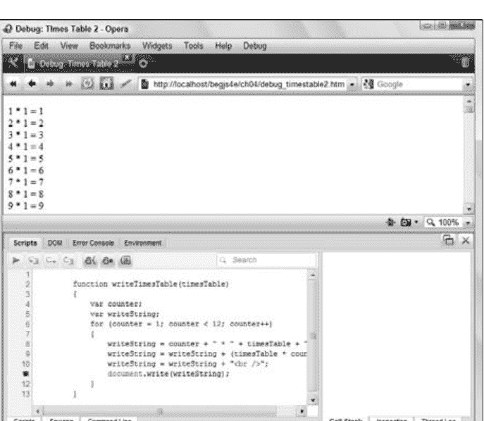

图 4-33

### 逐步执行代码

代码的逐步执行由源代码上方的一排图标控制（见图 4-34）。

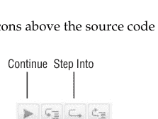

这些图标的功能与 Firebug、IE 开发者工具和 Web Inspector 中的相同。按顺序分别是：

- 继续（F8）
- 步入（F11）
- 步过（F10）
- 步出（Shift + F11）

与 Firefox 和 Firebug 以及 Safari 和 Web Inspector 一样，Opera 的 Dragonfly 也会在你逐步执行代码时更新页面，使你能够看到每行代码执行时的结果。

### 总结

本章你了解了编码中不那么令人兴奋的部分——即错误。在理想世界中，你每次都会一次性做对，但现实是任何超过几行的代码都可能包含错误。

- 你首先看了一些比较常见的错误，这些错误不仅 JavaScript 初学者会犯，经验丰富的专家也会犯。
- 有些错误不一定是你代码中的错误，而是导致代码失败的正常情况的例外。（例如，Java 小应用程序可能因为用户在防火墙后面而失败。）你看到了`try...catch`语句非常适合处理这类错误，并且你可以将`catch`子句与`throw`语句一起使用来处理可能发生的错误，例如由用户输入引起的错误。最后，你看到如果你想让一段代码无论是否有错误都执行，可以使用`finally`子句。
- 你了解了 Firefox 的 Firebug、IE8 的开发者工具、Safari 的 Web Inspector 和 Opera 的 Dragonfly。使用这些工具，你可以在代码运行时对其进行分析，从而能够一步一步地查看其流程，并检查变量和条件。尽管这些调试器的界面不同，但它们的原理和功能集大致相同。

### 练习题

这些问题的建议解答可以在附录 A 中找到。

1. 示例`debug_timestable2.htm`有一个故意的错误。对于每个乘法表，它只创建从 1 到 11 的乘数。

   使用脚本调试器找出原因，然后修正这个错误。

2. 以下代码包含一些常见错误。看看你能否找出它们：

```html
<!DOCTYPE html PUBLIC "-//W3C//DTD XHTML 1.0 Transitional//EN"
    "http://www.w3.org/TR/xhtml1/DTD/xhtml1-transitional.dtd">

<html xmlns="http://www.w1999/xhtml">
<head>
```

```html
<title>Chapter 4, Question 2</title>
</head>
<body>
<script type="text/javascript">
function checkForm(theForm)
{
    var formValid = true;
    var elementCount  = 0;
    while(elementCount <= theForm.length)
    {
        if (theForm.elements[elementcount].type == "text")
        {
            if (theForm.elements[elementCount].value() = "")
                alert("Please complete all form elements")
            theForm.elements[elementCount].focus;
            formValid = false;
            break;
        }
    }
    return formValid;
}
</script>
<form name="form1" onsubmit="return checkForm(document.form1)" action="">
    <input type="text" id="text1" name="text1" />
    <br />
    CheckBox 1<input type="checkbox" id="checkbox2" name="checkbox2" />
    <br />
    CheckBox 1<input type="checkbox" id="checkbox1" name="checkbox1" />
    <br />
    <input type="text" id="text2" name="text2" />
    <p>
        <input type="submit" value="Submit" id="submit1" name="submit1" />
    </p>
</form>
</body>
</html>
```

## 第五章：JavaScript——基于对象的语言

在本章中，你将学习 JavaScript 的核心概念——对象。但对象是什么，为什么它们有用？

首先，我们得告诉你：你一直在使用对象（例如，数组就是一种对象）。JavaScript 是一种基于对象的语言，因此你所做的大部分事情都涉及操作对象。你会看到，当你充分利用这些对象时，你能用 JavaScript 做的事情范围会极大地扩展。

本章我们将首先探讨对象的概念及其重要性。然后，我们将介绍 JavaScript 中使用了哪些对象，如何创建和使用它们，以及它们如何为你简化许多编程任务。最后，你将更详细地了解 JavaScript 提供的一些最有用的对象，以及如何在实际情况中使用它们。

JavaScript 语言不仅包含许多称为对象的东西（也称为*原生 JavaScript 对象*），而且浏览器本身也建模为一个可供你使用的对象集合。你将在下一章中特别了解这些对象。

### 基于对象的编程

“基于对象的编程”是一种听起来有点吓人的说法，意思是“使用对象进行编程”。但你将要用这些对象来编程的是什么呢？它们在哪里？你如何以及为什么想要用它们编程？在本节中，你将从一般编程术语以及 JavaScript 特定的角度来看这些问题的答案。

## 什么是对象？

在开始介绍对象之前，让我们思考一下在计算机之外的“现实世界”中，对象一词意味着什么。世界是由事物或对象组成的，比如桌子、椅子和汽车（仅举几例！）。让我们以一辆汽车为例，来探讨对象到底是什么。

你会如何定义这辆汽车？你可能会说它是一辆蓝色的四轮驱动汽车。你可能会指定它的行驶速度。当你这样做时，你是在指定对象的*属性*。例如，汽车有一个颜色属性，在这个例子中其值为蓝色。

你如何使用这辆汽车？你转动点火钥匙，按下油门踏板，按响喇叭，换档（即，在手动挡汽车上选择 1、2、3、4 档和倒档，或在自动挡汽车上选择前进挡和倒档），等等。当你这样做时，你是在使用对象的*方法*。

你可以把方法想象成有点像函数。有时，你可能需要向方法传递一些信息或参数，使其工作。例如，当你使用换档方法时，你需要说明你想换到哪个档位。其他方法可能会将信息返回给使用者。例如，机油尺方法会告诉使用者汽车里还剩多少机油。

有时使用一个或多个方法可能会改变对象的一个或多个属性。例如，使用油门加速方法可能会改变汽车的速度属性。其他属性则不能改变：例如，汽车的车身形状属性（除非你以每小时 100 英里的速度撞上一堵砖墙！）。

你可以说汽车是由其方法和属性的集合定义的。在基于对象编程中，其思想是通过对象来对现实世界的情景进行建模，这些对象由它们的方法和属性定义。

## JavaScript 中的对象

你现在应该对对象的基本概念有了了解——一个具有方法和属性的“东西”。但你如何在 JavaScript 中使用这个概念？

在前面的章节中，你（大部分）处理的是*原始*数据（也就是说，你一直在处理实际数据）。这种类型的数据不太复杂，相当容易处理。然而，并非所有信息都像原始数据那样简单。让我们看一个例子来稍微澄清一下。

假设你编写了一个显示公交车或火车时刻表信息的网络应用程序。一旦用户选择了旅程，你可能想让他知道这段旅程需要多长时间。为此，你需要用到达时间减去出发时间。


然而，这并不像初看起来那么简单。例如，考虑出发时间为14:53（下午2:53）和到达时间为15:10（下午3:10）。如果你让 JavaScript 计算表达式`15.10–14.53`，你会得到结果0.57，即57分钟。然而，你知道实际的时间差是17分钟。对时间使用普通的数学运算符是行不通的！

你需要做什么来计算这两个时间之间的差值？你首先需要将每个时间的小时和分钟分开。然后，为了得到两个时间之间的分钟差，你需要检查到达时间的分钟数是否大于出发时间的分钟数。如果是，你可以简单地用到达时间的分钟数减去出发时间的分钟数。如果不是，你需要将到达时间的分钟数加上60，并将到达时间的小时数减去1以作补偿，然后再用到达时间的分钟数减去出发时间的分钟数。然后，你需要用到达时间的小时数减去出发时间的小时数，最后将计算出的小时数和分钟数重新组合起来。

只要两个时间都在同一天内，这种方法是可行的。例如，对于时间23:45和04:32，它就行不通了。

这种计算时间差的方法显然存在问题，而且看起来也非常复杂。有没有更简单的方法来处理时间、日期等更复杂的数据呢？

这就是对象的用武之地了。你可以将出发时间和到达时间定义为`Date`对象。因为它们是`Date`对象，所以它们自带多种属性和方法，你可以在需要操作或计算时间时使用。例如，你可以使用`getTime()`方法获取`Date`对象中的时间与1970年1月1日00:00:00之间的毫秒数。一旦你有了到达时间和出发时间的这些毫秒值，你就可以简单地用一个值减去另一个值，并将结果存储在另一个`Date`对象中。要获取这个时间的小时和分钟，你只需使用`Date`对象的`getHours()`和`getMinutes()`方法。本章稍后你会看到更多这方面的例子。

`Date`对象并不是 JavaScript 提供的唯一对象类型。另一种对象类型在第二章已经介绍过，但为了简化问题，当时我们没有告诉你它是什么：那就是`Array`对象。回想一下，数组是一种同时保存多条数据的方式。

`Array`对象有一个名为`length`的属性，它告诉你数组保存了多少条数据，或者更确切地说，保存了多少个元素。实际上，你在第三章的小测验中就使用了这个属性来计算需要循环遍历数组的次数。

`Array`对象还有许多方法。其中一个例子是`sort()`方法，它可以用来将数组中的元素按字母顺序排序。

现在你应该明白对象在 JavaScript 中为何有用了。你已经看到了`Date`和`Array`对象，但 JavaScript 还提供了许多其他类型的对象，以便你可以用代码实现更多功能。其中包括`Math`和`String`对象，我们将在本章稍后更详细地讨论它们。

## 使用 JavaScript 对象

现在你已经了解了 JavaScript 对象的为什么（用途），接下来需要看看是什么（本质）和怎么做（使用方法）。

JavaScript 的每个对象都有一组相关的属性和方法，可用于操作某种特定类型的数据。例如，`Array`对象由操作数组的方法和获取数组信息的属性组成。在大多数情况下，要使用这些方法和属性，你需要将数据定义为这些对象之一。换句话说，你需要创建一个对象。

在本节中，你将学习如何创建对象，以及在创建对象后如何使用其属性和方法。

### 创建对象

你已经见过创建`Array`对象的例子。要创建一个`Array`对象，你需要使用以下 JavaScript 语句：

```javascript
var myArray = new Array();
```

那么这个语句是如何构成的呢？

语句的前半部分你很熟悉。你使用`var`关键字定义了一个名为`myArray`的变量。这个变量通过等号赋值运算符（`=`）被初始化为语句右侧的值。

语句的右侧由两部分组成。首先是`new`运算符。它告诉 JavaScript 你想要创建一个新对象。接下来是`Array()`。这是`Array`对象的构造函数。它告诉 JavaScript 你想要创建什么类型的对象。大多数对象都有这样的构造函数。例如，`Date`对象有`Date()`构造函数。你在本书中看到的唯一例外是`Math`对象，这将在本章后面部分解释。

你还在第二章中看到，你可以向构造函数`Array()`传递参数来向对象添加数据。例如，以下代码创建了一个包含三个元素的`Array`对象，其中的数据分别是`"Paul"`、`"Jeremy"`和`"Nick"`：

```javascript
var myArray = new Array("Paul", "Jeremy", "Nick");
```

让我们再看一些例子，这次是创建一个`Date`对象。最简单的方法如下：

```javascript
var myDate = new Date();
```

这将创建一个包含创建时日期和时间的`Date`对象。然而，以下代码行创建了一个包含日期2010年1月1日的`Date`对象：

```javascript
var myDate = new Date("1 Jan 2010");
```

对象数据在变量中的存储方式与原始数据（如文本和数字）不同。（原始数据是 JavaScript 中最基本的数据。）对于原始数据，变量保存的是数据的实际值。例如：

```javascript
var myNumber = 23;
```

这段代码意味着变量`myNumber`保存了数据`23`。然而，赋值给对象的变量并不保存实际数据，而是保存一个指向数据所在内存地址的引用。这并不意味着你能获取到这个内存地址——只有 JavaScript 知道这些细节，并在后台自行管理。你需要记住的是，当你说一个变量引用一个对象时，你的意思是它引用一个内存地址。下面的例子说明了这一点：

```javascript
var myArrayRef = new Array(0, 1, 2);
var mySecondArrayRef = myArrayRef;
myArrayRef[0] = 100;
alert(mySecondArrayRef[0]);
```

首先，你将变量`myArrayRef`引用设置为新的数组对象，然后将`mySecondArrayRef`设置为同一个引用——例如，现在`mySecondArrayRef`被设置为引用同一个数组对象。所以，当你将数组的第一个元素设置为`100`时，如下所示：

```javascript
myArrayRef[0] = 100;
```

并像这样显示`mySecondArrayRef`引用的数组的第一个元素的内容：

```javascript
alert(mySecondArrayRef[0]);
```

你会看到它也神奇地变成了`100`！然而，正如你现在所知，这不是魔法；这是因为两个变量都引用同一个数组对象，因为当涉及对象时，存储在变量中的是对象的引用，而不是对象本身。当你进行赋值时，它没有复制数组对象，只是复制了引用。与以下情况对比一下：

```javascript
var myVariable = "ABC";
var mySecondVariable = myVariable;
myVariable = "DEF";
alert(mySecondVariable);
```

在这种情况下，你处理的是一个字符串，它和数字一样是原始数据类型。这次，实际值存储在变量中，所以当你执行以下操作时：

```javascript
var mySecondVariable = myVariable;
```

`mySecondVariable`获得了`myVariable`中数据的自己独立的副本。因此，最后的弹出提示框仍然会显示`mySecondVariable`为`"ABC"`。

总结一下本节内容，你可以使用以下基本语法创建 JavaScript 对象：

```javascript
var myVariable = new ConstructorName(可选参数);
```

### 使用对象的属性

访问对象属性中包含的值非常简单。你写下包含（或引用）你的对象的变量名，然后是一个点，接着是对象属性的名称。

例如，如果你定义了一个包含在变量`myArray`中的`Array`对象，你可以这样访问它的`length`属性：

```javascript
myArray.length
```

但是，现在你获取了这个属性，能用它做什么呢？你可以像使用任何其他数据一样使用它，并将其存储在一个变量中：

```javascript
var myVariable = myArray.length;
```

或者你可以将其显示给用户：

```javascript
alert(myArray.length);
```

在某些情况下，你甚至可以更改属性的值，如下所示：

```javascript
myArray.length = 12;
```

然而，与变量不同，有些属性是只读的——你可以从中获取信息，但不能修改其中的内容。

### 调用对象的方法

方法与函数非常相似，因为它们可用于执行有用的任务，例如从特定日期获取小时数或生成随机数。同样像函数一样，一些方法会返回值（如`Date`对象的`getHours()`方法），而另一些方法则执行任务但不返回数据（如`Array`对象的`sort()`方法）。

使用对象的方法与使用属性非常相似：先写对象的变量名，接着是一个点，最后是方法的名称。例如，要对变量`myArray`中的数组元素进行排序，你可以使用以下代码：

```javascript
myArray.sort();
```

就像函数一样，你也可以通过将参数放在方法名后面的括号之间来向某些方法传递参数。然而，无论方法是否接受参数，你都必须在方法名后面加上圆括号（这与函数的用法一致）。作为一般规则，任何可以使用函数的地方，也可以使用对象的方法。

## 基本类型与对象

你现在应该对原始数据（如数字和字符串）与对象数据（如`Date`和`Array`）之间的差异有了很好的了解。然而，正如前面提到的那样，也存在`String`对象。它属于哪一类呢？

实际上存在`String`、`Number`和`Boolean`对象，它们分别对应于 string（字符串）、number（数字）和 Boolean（布尔型）这几种原始数据类型。例如，要创建一个包含文字"I'm a String object"的`String`对象，你可以使用以下代码：

```javascript
var myString = new String("I'm a String object");
```

`String`对象拥有`length`属性，就像`Array`对象一样。该属性返回字符串中的字符数量。例如：

```javascript
var lengthOfString = myString.length;
```

会将值19（请记得空格也算作字符）存储在变量`lengthOfString`中）。

但如果你定义了一个名为`mySecondString`的原始字符串并包含文字"I'm a primitive string"，如下所示：

```javascript
var mySecondString = "I'm a primitive string";
```

并且想知道该原始字符串中包含多少个字符呢？

## JavaScript 的原生对象类型

到目前为止，你只是了解了什么是对象、如何创建它们以及如何使用方法。现在看看一些对 JavaScript 原生的更实用的对象——也就是说那些内置于 JavaScript 语言中的对象。

你不会查看所有原生 JavaScript 对象，而只介绍其中较常用的一些，即`String`对象、`Math`对象、`Array`对象和`Date`对象。本书稍后章节将分别整章探讨更复杂的对象：例如`String`对象（第9章）以及`Date`对象（第10章）。

### String 对象

像大多数对象一样，在使用之前必须先创建`String`对象。要创建一个`String`对象，你可以这样写：

```javascript
var string1 = new String("Hello");
var string2 = new String(123);
var string3 = new String(123.456);
```

然而如你所见，你声明一个字符串原始类型并将其用作`String`对象也是可以的，让 JavaScript 在幕后自动进行转换。例如：

```javascript
var string1 = "Hello";
```

只要明确告诉 JavaScript 你在背景中期望创建什么类型的对象，使用这种技术就是更可取的：如果数据类型是 string，这不会成为问题，JavaScript 会自行处理。这样做的好处是不必显式创建`String`对象本身，从而避免了比较字符串对象时可能遇到的麻烦；当你尝试将字符串原始类型值与`String`对象进行比较时，实际上会比较的是它们的具体值（value），而对于`String`对象，则是比较其对象引用（reference）。

`String`对象拥有丰富的方法和属性。在本节中，你只涉及一些较不复杂且最常用的方法。然而在第9章你将研究一些更棘手但非常强大的字符串相关方法及正则表达式对象（`RegExp`）的方法。正则表达式提供了搜索匹配字符模式的强大手段；例如，如果你想在一个名为"Pauline, Paul, Paula"的字符串中找到作为完整单词出现的"Paul"，就需要使用正则表达式。不过它们使用起来有点复杂，因此本章不再深入讨论——我们要把乐趣留到后面！

对于`String`对象的绝大多数方法而言，请记住：字符串只是一系列独立的字符；与数组一样，每个字符都有一个位置或索引。同样如数组一样，第一个位置（即索引）标记为0而非1。举例来说，字符串"Hello World"的字符位置如下表所示：

| Character Index | 0 | 1 | 2 | 3 | 4 | 5 | 6 | 7 | 8 | 9 | 10 |
|---|---|---|---|---|---|---|---|---|---|---|---|
| Character | H | e | l | l | o |   | W | o | r | l | d |

### `length` 属性

`length`属性直接返回字符串中字符的数量。例如：

```javascript
var myName = new String("Jeremy");
document.write(myName.length);
```

会将字符串"Jeremy"的长度（即6）写入页面）。

### 在另一个字符串中寻找子串——`indexOf()`和`lastIndexOf()`方法

`indexOf()`和`lastIndexOf()`方法用于搜索目标字符串在另一字符串中的出现位置。被包含在内的字符串通常称为 substring（子串）。它们在处理信息字符串时非常有用，尤其是当你只想要其中一小部分时使用；例如在一个知识问答测验中，当某人输入文本答案后，你需要检查某些关键词是否存在于该字符串之中。

`indexOf()`和`lastIndexOf()`都接受两个参数：

- 你要查找的字符串
- 希望开始搜索的位置（可选）

字符位置从0开始计数。如果你不指定第二个参数，则搜索将从字符串开头起始进行。

`indexOf()`和`lastIndexOf()`方法的返回值是子串在字符串中出现的那个字符位置的索引；同样它是基于0计数的：如果子串出现在字符串的最前面，就会返回0。如果没有匹配，则返回-1。

例如，要在"The Hello jeremy, How are you Jeremy"中的"Hello jeremy."查找 substring "Jeremy"，你可以使用以下代码：

```html
<script type="text/javascript">
    var myString = "Hello jeremy";
    var foundAtPosition;

    foundAtPosition = myString.indexOf("Jeremy");
    alert(foundAtPosition);
</script>
```

这段代码结果应弹出一个消息框，其中显示数字26（这是第二个"jeremy"的位置），而非第一个"jeremv"所在的位置。这又是因为区分大小写的原因。JavaScript 对其语法和比较操作都严格遵循大小写规范：如果你键入`IndexOf()`而不是`indexOf()`，JavaScript 将报错。同样地，"jeremy"并不等同于"Jeremy"。请记住，拼写上因大小写引起的错误非常常见且极易发生，即便是专家也不例外；因此在编程时务必格外注意大小写的正确性。

你已经看到过`indexOf()`在起作用的样子了，但`lastIndexOf()`又是如何不同的呢？简单来说：`indexOf()`从字符串开头（或你指定的第二个参数中的位置）开始向前搜索直至末尾；相反，`lastIndexOf()`则从字符串结尾处（或你指定该位置）起始，然后向后追溯至字符串的开头。

> 在当前示例中，首先使用`indexOf()`进行搜索并找到首个"Jeremy"（已将大小写调整为上一例的正确形式），消息框显示结果为字符索引6；随后使用`lastIndexOf()`进行检索，此时从字符串末尾启动搜索所遇到的第一个"Jeremy"实际上就是位于索引28处的那个实例，因此第二个提示框输出结果26。

```html
<script type="text/javascript">
    var myString = "Hello Jeremy";
    var foundAtPosition;

    foundAtPosition = myString.indexOf("Jeremy");
    alert(foundAtPosition);

    foundAtPostion = myString.lastIndexOf("");
    alert(foundAtPosition);
</script>
```


## 动手试试：统计子字符串出现次数

在本例中，你将学习如何使用`indexOf()`的“起始字符位置”参数。这里你将统计单词 Wrox 在字符串中出现的次数。

```html
<!DOCTYPE html PUBLIC "-//W3C//DTD XHTML 1.0 Transitional//EN"
    "http://www.w3.org/TR/xhtml1/DTD/xhtml1-transitional.dtd">

<html xmlns="http://www.w3.org/1999/xhtml">
<head>
    <title>第5章：示例1</title>
</head>
<body>
<script type="text/javascript">
var myString = "Welcome to Wrox books. ";
myString = myString + "The Wrox website is www.wrox.com. ";
myString = myString + "Visit the Wrox website today. Thanks for buying Wrox";

var foundAtPosition = 0;
var wroxCount = 0;

while (foundAtPosition != -1)
{
    foundAtPosition = myString.indexOf("Wrox",foundAtPosition);
    if (foundAtPosition != -1)
    {
        wroxCount++;
        foundAtPosition++;
    }
}

document.write("There are " + wroxCount + " occurrences of the word Wrox");

</script>
</body>
</html>
```

将此示例保存为`ch5_examp1.htm`。当你在浏览器中加载该页面时，你应该会看到以下句子：There are 4 occurrences of the word Wrox.

在脚本块的开头，你在变量`myString`中构建了一个字符串，然后你想搜索该字符串中单词 Wrox 的出现情况。你还需要定义两个变量：`wroxCount`将包含在字符串中找到 Wrox 的次数，而`foundAtPosition`将包含子字符串 Wrox 当前出现位置在字符串中的索引。

然后你使用了一个`while`循环，只要在字符串中找到单词 Wrox，循环就会持续进行——也就是说，只要变量`foundAtPosition`不等于-1。在`while`循环内部，你有这行代码：

```javascript
foundAtPosition = myString.indexOf("Wrox",foundAtPosition);
```

在这里，你搜索字符串`myString`中子字符串 Wrox 的下一次出现。你如何确保找到下一次出现呢？你使用变量`foundAtPosition`来指定搜索的起始位置，因为它包含了子字符串 Wrox 上一次出现位置的索引之后的索引。你将变量`foundAtPosition`赋值为搜索结果，即子字符串 Wrox 下一次出现位置的索引。

每次找到 Wrox（即每次`foundAtPosition`不是-1），你都会增加变量`wroxCount`，该变量用于统计找到子字符串的次数，并且你会增加`foundAtPosition`，以便从字符串中的下一个位置继续搜索。

```javascript
if (foundAtPosition != -1)
{
    wroxCount++;
    foundAtPosition++;
}
```

最后，你使用`document.write()`将变量`wroxCount`的值输出到页面上。

第3章谈到了无限循环的危险，你可以看到这里也存在这种危险。如果移除了`foundAtPosition++`，你将始终从同一个起始点进行搜索，永远无法移动到查找单词`Wrox`的下一次出现。

`indexOf()`和`lastIndexOf()`方法与`substr()`和`substring()`方法结合使用时会更有用，你将在下一节中看到这些方法。结合使用这些方法，使你能够从字符串中截取子字符串。

### 复制字符串的一部分——`substr()`和`substring()`方法

如果你想截取字符串的一部分，并将截取的部分赋值给另一个变量或在表达式中使用，你可以使用`substr()`和`substring()`方法。这两种方法提供的结果是相同的——即字符串的一部分——但它们所需的参数不同。

`substring()`方法接受两个参数：起始字符位置和子字符串中最后一个期望字符之后的字符位置。第二个参数是可选的；如果你不包含它，则会包含从起始位置到字符串末尾的所有字符。

例如，如果你的字符串是"JavaScript"，你只想获取文本"Java"，你可以这样调用该方法：

```javascript
var myString = "JavaScript";
var mySubString = myString.substring(0,4);
alert(mySubString);
```

| 字符位置 | 0 | 1 | 2 | 3 | 4 | 5 | 6 | 7 | 8 | 9 |
|---|---|---|---|---|---|---|---|---|---|---|
| 字符 | J | a | v | a | S | c | r | i | p | t |

与`substring()`类似，`substr()`方法也接受两个参数，第一个参数是你想包含在子字符串中的第一个字符的起始位置。然而，这次第二个参数指定的是你想从更长字符串中截取的字符子串的长度。例如，你可以这样重写前面的代码：

```javascript
var myString = "JavaScript";
var mySubString = myString.substr(0,4);
alert(mySubString);
```

与`substring()`方法一样，第二个参数是可选的。如果你不包含它，则会包含从起始位置开始的所有字符。

> `substring()`方法在4版本之前的浏览器中受到支持，而`substr()`方法在4版本（及更高版本）的浏览器中受到支持。大多数时候，你将使用`substr()`方法。

让我们看看如何结合使用`substr()`和`lastIndexOf()`方法。在下一章中，你将看到如何获取当前加载网页的文件路径和名称。然而，没有单独获取文件名的方法。因此，例如，如果你的文件是`http://mywebsite/temp/myfile.htm`，你可能需要提取`myfile.htm`部分。这就是`substr()`和`lastIndexOf()`发挥作用的地方。

```javascript
var fileName = window.location.href;
fileName = fileName.substr(fileName.lastIndexOf("/") + 1);
document.write("The file name of this page is " + fileName);
```

第一行将变量`fileName`设置为当前文件路径和名称，例如`/mywebsite/temp/myfile.htm`。不用担心理解这一行；你将在下一章中看到它。

第二行是关键操作所在。你可以看到这段代码将`lastIndexOf()`方法的返回值作为另一个方法的参数，这是完全正确且非常有用的。使用`fileName.lastIndexOf("/")`的目标是找到最后一个正斜杠（`/`）的位置，它将是文件名之前的最后一个字符。你将这个值加一，因为你不想包含该字符，然后将这个新值传递给`substr()`方法。这里没有第二个参数（长度），因为你不知道它。结果，`substr()`将返回从指定位置到字符串末尾的所有字符，这正是你想要的。

> 此示例检索的是本地机器上的页面名称，因为你不是从 Web 服务器访问该页面。然而，不要让这误导你认为仅用 JavaScript 就能从网页访问本地硬盘上的文件。为了保护用户免受恶意黑客的攻击，JavaScript 对用户系统的访问（例如对文件的访问）是受到严格限制的。你将在本书后面了解更多相关信息。

### 大小写转换——`toLowerCase()`和`toUpperCase()`方法

如果你想更改字符串的大小写（例如，在比较字符串时消除大小写敏感性），你需要使用`toLowerCase()`和`toUpperCase()`方法。不难猜出这两个方法的功能。它们都返回一个字符串，该字符串是 String 对象中字符串的值，但根据所调用的方法，其大小写已转换为大写或小写。任何非字母字符在这些函数中保持不变。

在下面的示例中，你可以看到通过更改两个字符串的大小写，你可以进行不区分大小写的比较。

```javascript
var myString = "I Don't Care About Case"

if (myString.toLowerCase() == "i don't care about case") {
    alert("Who cares about case?");
}
```

## 第5章：JavaScript——基于对象的语言

即使`toLowerCase()`和`toUpperCase()`不接受任何参数，你也必须记住在方法调用的末尾加上两个空括号，即`()`。

### 从字符串中选择单个字符——`charAt()`和`charCodeAt()`方法

如果你想要获取字符串中某个单个字符的信息，就需要使用`charAt()`和`charCodeAt()`方法。这些方法在检查用户输入的有效性时非常有用，这在你后面学习第7章的HTML表单时会看到更多应用。

`charAt()`方法接受一个参数：你想要的字符在字符串中的索引位置。然后它返回该字符。`charAt()`将字符串中字符的位置视为从0开始，因此第一个字符在索引0处，第二个在索引1处，依此类推。

例如，要找到字符串中的最后一个字符，你可以使用这段代码：

```javascript
var myString = prompt("Enter some text","Hello World!");
var theLastChar = myString.charAt(myString.length - 1);
document.write("The last character is " + theLastChar);
```

第一行代码，你提示用户输入一个字符串，默认值为"Hello World!"，并将这个字符串存储在变量`myString`中。

下一行，你使用`charAt()`方法来获取字符串中的最后一个字符。你使用索引位置`myString.length - 1`。为什么呢？我们以字符串"Hello World!"为例。这个字符串的长度是12，但最后一个字符的位置是11，因为索引是从0开始的。因此，你需要从字符串长度中减去一才能得到最后一个字符的位置。

最后一行，你将字符串的最后一个字符写入页面。

`charCodeAt()`方法的用法与`charAt()`方法类似，但它返回的不是字符本身，而是一个数字，该数字代表该字符在Unicode字符集中的十进制字符码。请记住，计算机只理解数字——对计算机来说，你所有的字符串都只是数字数据。当你请求文本而不是数字时，计算机会根据其对每个数字的内部理解进行转换，并提供相应的字符。

例如，要找到字符串中第一个字符的字符码，你可以这样写：

```javascript
var myString = prompt("Enter some text","Hello World!");
var theFirstCharCode = myString.charCodeAt(0);
document.write("The first character code is " + theFirstCharCode);
```

这将获取用户给定字符串中索引位置0处的字符的字符码，并将其写入页面。

字符码是按顺序排列的，所以，例如，字母A的字符码是65，B是66，依此类推。小写字母从97开始（a是97，b是98，依此类推）。数字从48（对应数字0）到57（对应数字9）。你可以将此信息用于各种目的，正如你将在下一个示例中看到的。

### 动手实践：检查字符的大小写

以下是一个示例，它检测给定字符串开头字符的类型——即该字符是大写、小写、数字还是其他类型。

```html
<!DOCTYPE html PUBLIC "-//W3C//DTD XHTML 1.0 Transitional//EN"
    "http://www.w3.org/TR/xhtml1/DTD/xhtml1-transitional.dtd">

<html xmlns="http://www.w3.org/1999/xhtml">
<head>
    <title>Chapter 5: Example 2</title>
    <script type="text/javascript">
    function checkCharType(charToCheck)
    {
        var returnValue = "O";
        var charCode = charToCheck.charCodeAt(0);

        if (charCode >= "A".charCodeAt(0) && charCode <= "Z".charCodeAt(0))
        {
            returnValue = "U";
        }
        else if (charCode >= "a".charCodeAt(0) && charCode <= "z".charCodeAt(0))
        {
            returnValue = "L";
        }
        else if (charCode >= "0".charCodeAt(0) && charCode <= "9".charCodeAt(0))
        {
            returnValue = "N";
        }

        return returnValue;
    }
    </script>
</head>

<body>
<script type="text/javascript">

var myString = prompt("Enter some text","Hello World!");
switch (checkCharType(myString))
{
    case "U":
        document.write("First character was upper case");
        break;
    case "L":
        document.write("First character was lower case");
        break;
    case "N":
        document.write("First character was a number");
        break;
    default:
        document.write("First character was not a character or a number");
}
</script>
</body>

</html>
```

输入这段代码并将其保存为`ch5_examp2.htm`。

当你将此页面加载到浏览器中时，系统会提示你输入一个字符串。然后，页面上会显示一条消息，告知你输入的第一个字符的类型——是大写、小写、数字还是其他字符（如标点符号）。

首先，你定义了一个函数`checkCharType()`，该函数将在页面主体中使用。你开始此函数时声明了变量`returnValue`，并将其初始化为字符"O"，以表示它是除小写字母、大写字母或数字字符之外的其他字符。

```javascript
function checkCharType(charToCheck)
{
    var returnValue = "O";
}
```

你将此变量用作函数末尾返回的值，表示字符的类型。它将取值U表示大写，L表示小写，N表示数字，O表示其他。

函数的下一行使用`charCodeAt()`方法获取存储在参数`charToCheck`中的字符串第一个字符的字符码。字符码存储在变量`charCode`中。

```javascript
var charCode = charToCheck.charCodeAt(0);
```

在接下来的几行中，你有一系列的`if`语句，用于检查字符码落在哪个值范围内。你知道，如果它落在A和Z的字符码之间，就是大写字母，因此你将变量`returnValue`赋值为U。如果字符码落在a和z的字符码之间，就是小写字母，因此你将变量`returnValue`赋值为L。如果字符码落在0和9的字符码之间，就是一个数字，你将变量`returnValue`赋值为N。如果值不属于这些范围中的任何一个，则变量保留其初始化值O表示其他，你不需要做任何操作。

```javascript
if (charCode >= "A".charCodeAt(0) && charCode <= "Z".charCodeAt(0))
{
    returnValue = "U";
}
else if (charCode >= "a".charCodeAt(0) && charCode <= "z".charCodeAt(0))
{
    returnValue = "L";
}
else if (charCode >= "0".charCodeAt(0) && charCode <= "9".charCodeAt(0))
{
    returnValue = "N";
}
```

这起初可能看起来有点奇怪，所以让我们看看JavaScript对你的代码做了什么。当你写下

```javascript
"A".charCodeAt(0)
```


看起来你似乎在尝试对一个字符串字面量使用`String`对象的方法。字符串字面量与原始字符串相同，它只是字符而不是一个对象。然而，JavaScript理解了你的意图，并进行了必要的转换，将字面量字符`"A"`转换为一个包含`"A"`的临时`String`对象。然后，也只有在此时，JavaScript才会对它在后台创建的`String`对象执行`charAt()`方法。当它完成后，`String`对象就被销毁了。基本上，这是以下写法的简写：

```javascript
var myChar = new String("A");
myChar.charCodeAt(0);
```

无论哪种方式，第一个（在此字符串中也是唯一的）字符的字符码都会返回给你。例如，`"A".charCodeAt(0)`将返回数字65。

最后，你到达函数的末尾，并将`returnValue`变量返回给调用该函数的地方。

```javascript
return returnValue;
}
```

你可能会想知道为什么还要费心使用`returnValue`这个变量，而不是直接返回其值。例如，你可以将代码写成如下形式：

```javascript
if (charCode >= "A".charCodeAt(0) && charCode <= "Z".charCodeAt(0))
{
    return "U";
}
else if (charCode >= "a".charCodeAt(0) && charCode <= "z".charCodeAt(0))
{
    return "L";
}
else if (charCode >= "0".charCodeAt(0) && charCode <= "9".charCodeAt(0))
{
    return "N";
}
return "O";
```

这也能正常工作，那为什么不这样做呢？这种方法的缺点是难以跟踪函数的执行流程，在像这样的小函数中可能还好，但在较大的函数中会变得很棘手。使用原始代码，你总是确切地知道函数执行在哪里停止：它在最后的唯一一个`return`语句处停止。而刚刚展示的函数版本在到达任何一个`return`语句时就会结束，因此函数有四个可能的结束点。

在页面主体中，你有一些测试代码来检查函数是否工作。你首先使用变量`myString`，它被初始化为`"Hello World!"`或者用户在提示框中输入的内容，作为你的测试字符串。

```javascript
var myString = prompt("Enter some text","Hello World!");
```

接下来，`switch`语句在其比较表达式中使用了你之前定义的`checkCharType()`函数。根据函数返回的结果，其中一个`case`语句将执行，并告知用户字符的类型。

```javascript
switch (checkCharType(myString))
{
    case "U":
        document.write("First character was upper case");
        break;
    case "L":
        document.write("First character was lower case");
```

# 第五章：JavaScript——一种基于对象的语言

```javascript
break;
case "N":
    document.write("第一个字符是数字");
    break;
default:
    document.write("第一个字符既不是字母也不是数字");
}
```

这个例子就讲完了，但在继续之前，值得注意的是，这个例子仅仅是一个使用`charCodeAt()`的例子。在实践中，直接写

```javascript
if (char >= "A" && char <= "Z")
```

要比你在这里使用的

```javascript
if (charCode >= "A".charCodeAt(0) && charCode <= "Z".charCodeAt(0))
```

容易得多。

## 将字符代码转换为字符串——`fromCharCode()`方法

`fromCharCode()`方法可以看作是`charCodeAt()`的逆操作，因为你向它传递一系列代表字符代码的、用逗号分隔的数字，它会将它们转换为一个字符串。

然而，`fromCharCode()`方法不同寻常，因为它是一个静态方法——你不需要创建一个`String`对象来使用它，它始终可用。

例如，以下代码行将字符串`"ABC"`放入变量`myString`：

```javascript
var myString;
myString = String.fromCharCode(65,66,67);
```

`fromCharCode()`方法与变量一起使用时非常有用。例如，要构建一个包含所有大写字母的字符串，你可以使用以下代码：

```javascript
var myString = "";
var charCode;

for (charCode = 65; charCode <= 90; charCode++)
{
    myString = myString + String.fromCharCode(charCode);
}

document.write(myString);
```

你使用`for`循环依次选择从A到Z的每个字符，并将其连接到`myString`。请注意，虽然作为示例这很好，但更高效且更节省内存的做法是直接写：

```javascript
var myString = "ABCDEFGHIJKLMNOPQRSTUVWXYZ";
```

## 数组对象

你在第二章已经了解了如何创建和使用数组，本章前面也提到它们实际上是对象。

除了存储数据，数组对象还提供了许多有用的属性和方法，你可以使用它们来操作数组中的数据并获取诸如数组大小之类的信息。

再次强调，这不是对数组对象每个属性和方法的详尽介绍，而只是一些比较有用的属性和方法。

> 本书在创建数组时使用构造函数语法：`var myArray = new Array()`。但也可以使用更简短的语法创建数组：`var myArray = []`。只需使用方括号而不是`new Array()`。为了清晰起见，本书的作者们将继续使用构造函数。

### 查找数组中有多少个元素——`length`属性

`length`属性为你提供数组中的元素数量，你已经在第三章的小测验中见过了。有时你确切地知道数组的长度，但有时你可能一直在向数组添加新元素，却无法轻松跟踪添加了多少个元素。

`length`属性可用于查找数组中最后一个元素的索引。以下示例说明了这一点：

```javascript
var names = new Array();

names[0] = "Paul";
names[1] = "Jeremy";
names[11] = "Nick";

document.write("最后一个名字是 " + names[names.length - 1]);
```

> 注意，你已在索引位置0、1和11的元素中插入了数据。数组索引从0开始，因此最后一个元素位于索引`length - 1`（即11），而不是`length`属性的值（即12）。

`length`属性证明有用的另一种情况是，当一个JavaScript方法返回一个它自己构建的数组时。例如，在关于高级字符串处理的第九章中，你将看到`String`对象有`split()`方法，该方法将文本分割成片段并将结果作为数组对象传回。因为数组是由JavaScript创建的，所以如果没有`length`属性，你将无法知道数组中最后一个元素的索引。

### 连接数组——`concat()`方法

如果你想将两个独立的数组连接成一个大数组，可以使用数组对象的`concat()`方法。`concat()`方法返回一个新数组，它是两个数组的组合：第一个数组的元素，然后是第二个数组的元素。为此，你在第一个数组上使用该方法，并将第二个数组的名称作为其参数传递。

例如，假设你有两个数组`names`和`ages`，它们分别如下表所示：

**`names`数组**

| 元素索引 | 0 | 1 | 2 |
|---|---|---|---|
| 值 | Paul | Jeremy | Nick |

**`ages`数组**

| 元素索引 | 0 | 1 | 2 |
|---|---|---|---|
| 值 | 31 | 30 | 31 |

如果你使用`names.concat(ages)`将它们组合，你将得到如下表所示的数组：

| 元素索引 | 0 | 1 | 2 | 3 | 4 | 5 |
|---|---|---|---|---|---|---|
| 值 | Paul | Jeremy | Nick | 31 | 30 | 31 |

在以下代码中，这正是你所做的：

```javascript
var names = new Array("Paul", "Jeremy", "Nick");
var ages = new Array(31, 30, 31);
var concatArray = names.concat(ages);
```

也可以将两个数组组合成一个，但将新数组赋值给现有第一个数组的名称，使用`names = names.concat(ages)`。

如果你使用`ages.concat(names)`，会有什么不同呢？嗯，如下表所示，不同之处在于现在`ages`数组的元素排在前面，而`names`数组的元素被连接在末尾。

| 元素索引 | 0 | 1 | 2 | 3 | 4 | 5 |
|---|---|---|---|---|---|---|
| 值 | 31 | 30 | 31 | Paul | Jeremy | Nick |

### 复制数组的一部分——`slice()`方法

当你只想复制数组的一部分时，可以使用`slice()`方法。使用`slice()`方法，你可以切出数组的一部分并将其赋值给一个新的变量名。`slice()`方法有两个参数：

- 你想复制的第一个元素的索引
- 标记你切出部分结束的元素的索引（可选）

正如使用`substring()`复制字符串一样，起点包含在副本中，但终点不包含。同样，如果你不包含第二个参数，则从起始索引开始的所有元素都会被复制。

假设你有如下表所示的数组`names`：

| 索引 | 0 | 1 | 2 | 3 | 4 |
|---|---|---|---|---|---|
| 值 | Paul | Sarah | Jeremy | Adam | Bob |

如果你想创建一个包含元素1（`Sarah`）和2（`Jeremy`）的新数组，你需要指定起始索引为1，结束索引为3。代码大致如下：

```javascript
var names = new Array("Paul","Sarah","Jeremy","Adam","Bob");
var slicedArray = names.slice(1,3);
```

当JavaScript复制数组时，它将新元素复制到一个数组中，它们在新数组中的索引为0和1，而不是它们原来的索引1和2。

切片后，`slicedArray`如下表所示：

| 索引 | 0 | 1 |
|---|---|---|
| 值 | Sarah | Jeremy |

第一个数组`names`不受切片影响。

### 将数组转换为单个字符串——`join()`方法

`join()`方法连接数组中的所有元素并以字符串形式返回它们。它还允许你指定在元素连接时要插入其之间的任何字符。该方法只有一个参数，就是你希望放在元素之间的字符串。

一个例子将有助于说明问题。想象一下，你的每周购物清单存储在一个数组中，看起来像这样：

| 索引 | 0 | 1 | 2 | 3 | 4 |
|---|---|---|---|---|---|
| 值 | 鸡蛋 | 牛奶 | 土豆 | 麦片 | 香蕉 |

现在你想使用`document.write()`将你的购物清单写到页面上。你希望每个项目占一行，这意味着你需要在每个元素之间使用`<br />`标签。首先，你需要声明你的数组。

```javascript
var myShopping = new Array("鸡蛋","牛奶","土豆","麦片","香蕉");
```

现在，使用`join()`方法将数组转换为一个字符串。

```javascript
var myShoppingList = myShopping.join("<br />");
```

## 第5章：JavaScript——一种基于对象的语言

现在变量`myShoppingList`将包含以下文本：

```text
"Eggs<br />Milk<br />Potatoes<br />Cereal<br />Banana"
```

你可以使用`document.write()`将其输出到页面。

```javascript
document.write(myShoppingList);
```

购物清单将出现在页面上，每个项目占新一行，如图5-1所示。


### 对数组进行排序——`sort()`方法

如果你的数组包含类似的数据，例如姓名列表或年龄列表，你可能希望将它们按字母顺序或数字顺序排列。`sort()`方法让这件事变得非常简单。在以下代码中，你定义数组然后使用`names.sort()`将其按升序字母顺序排列。最后，输出它以显示它是有序的。

```javascript
var names = new Array("Paul", "Sarah", "Jeremy", "Adam", "Bob");
var elementIndex;

names.sort();
document.write("Now the names again in order" + "<br />");

for (elementIndex = 0; elementIndex < names.length; elementIndex++)
{
    document.write(names[elementIndex] + "<br />");
}
```

别忘了排序是区分大小写的，因此`Paul`将排在`paul`之前。记住JavaScript存储字母编码为其等效的Unicode数字，并且排序是基于Unicode数字而不是实际字母进行的。碰巧的是，Unicode数字与字母表的顺序一致。但是，小写字母被分配了不同的数字序列，这些数字位于大写字母之后。因此，元素为Adam, adam, Zoë, zoë的数组将被排序为Adam, Zoë, adam, zoë。

注意在你的`for`语句中，你在条件语句中使用了`Array`对象的`length`属性，而不是像这样插入数组的长度（5）：

```javascript
for (elementIndex = 0; elementIndex < 5; elementIndex++)
```

为什么要这样做？毕竟，你知道数组中有五个元素。那么，如果你通过添加两个更多姓名的方式改变数组中的元素数量会发生什么？

```javascript
var names = new Array("Paul", "Sarah", "Jeremy", "Adam", "Bob", "Karen", "Steve");
```

如果你插入的是`5`而不是`names.length`，你的循环代码将无法按预期工作。除非你将`for`循环的条件部分改为7，否则它不会显示最后两个元素。通过使用`length`属性，你让生活变得更容易，因为现在如果添加数组元素，就不需要修改其他地方的代码了。

好的，你已经将事物按升序排列，但如果想要降序呢？这就是`reverse()`方法发挥作用的地方。

### 将数组逆序排列——`reverse()`方法

你对`Array`对象将要查看的最后一个方法是`reverse()`方法，不出所料，该方法会反转数组的顺序，以便将后面的元素移到前面。让我们再次使用购物清单作为示例。

| 索引 | 0 | 1 | 2 | 3 | 4 |
|---|---|---|---|---|---|
| **值** | 鸡蛋 | 牛奶 | 土豆 | 麦片 | 香蕉 |

如果你使用`reverse()`方法：

```javascript
var myShopping = new Array("Eggs", "Milk", "Potatoes", "Cereal", "Banana");
myShopping.reverse();
```

你最终得到的数组元素顺序如下：

| 索引 | 0 | 1 | 2 | 3 | 4 |
|---|---|---|---|---|---|
| **值** | 香蕉 | 麦片 | 土豆 | 牛奶 | 鸡蛋 |

为了证明这一点，你可以使用之前见过的`join()`方法将其写入页面。

```javascript
var myShoppingList = myShopping.join("<br />")
document.write(myShoppingList);
```

### 排序数组

当与`sort()`方法结合使用时，`reverse()`方法可用于对数组进行排序，使其元素按字母顺序或数字顺序的逆序出现。以下示例展示了这一点：


```html
<!DOCTYPE html PUBLIC "-//W3C//DTD XHTML 1.0 Transitional//EN"
    "http://www.w3.org/TR/xhtml1/DTD/xhtml1-transitional.dtd">

<html xmlns="http://www.w3.org/1999/xhtml">
<head>
    <title>Chapter 5: Example 3</title>
</head>
<body>
<script type="text/javascript">

var myShopping = new Array("Eggs","Milk","Potatoes","Cereal","Banana");

var ord = prompt("Enter 1 for alphabetical order, and -1 for reverse order", 1);

if (ord == 1)
{
    myShopping.sort();
    document.write(myShopping.join("<br />"));
}
else if (ord == -1)
{
    myShopping.sort();
    myShopping.reverse();
    document.write(myShopping.join("<br />"));
}
else
{
    document.write("That is not a valid input");
}
</script>
</body>
</html>
```

将示例保存为`ch5_examp3.htm`。当您将其加载到浏览器中时，您将根据是否希望数组按正向或反向顺序排列而被要求输入一些内容。如果您输入`1`，则将以正向顺序显示数组。如果您输入`-1`，则以反向顺序显示数组。如果您输入这两个值以外的任何值，您将被告知输入无效。

在脚本块顶部，您定义包含购物清单的数组。接下来，您将变量`ord`定义为用户在提示框中输入的值。

```javascript
var ord = prompt("Enter 1 for alphabetical order, and -1 for reverse order", 1);
```

此值用于后续`if`语句的条件中。第一个`if`检查`ord`的值是否为`1`——即用户是否希望数组按字母顺序排列。如果是，则执行以下代码：

```javascript
myShopping.sort();
document.write(myShopping.join("<br>"));
```

对数组排序并使用`join()`方法在单独行上显示给用户。接下来，在`else if`语句中，您检查`ord`的值是否为`-1`——即用户是否希望按反向字母顺序排列的数组。如果是，则执行以下代码：

```javascript
myShopping.sort();
myShopping.reverse();
document.write(myShopping.join("<br />"));
```

此处，在反转其顺序之前先对数组进行排序。再次通过`join()`方法将数组显示给用户。

最后，如果`ord`既没有值`1`也没有值`-1`，您告诉用户输入无效。

```javascript
document.write("That is not a valid input");
```

### 新数组方法

2005 年，Mozilla 更新了 Firefox 中的 JavaScript 引擎。在此过程中，他们为`Array`对象添加了七种新方法。这七种方法可以分为两类：位置方法和迭代方法。

以下七种方法在 Internet Explorer 中不起作用。它们确实在 Firefox、Safari、Opera 和 Chrome 中起作用。

#### 查找数组元素——`indexOf()`和`lastIndexOf()`方法

从它们的名称您可能大概可以猜到，这两个方法与`String`对象的`indexOf()`和`lastIndexOf()`方法的功能相似——它们返回数组中项目首次和最后出现的索引。考虑以下代码：

```javascript
var colors = new Array("red", "blue", "green", "blue");
alert(colors.indexOf("red"));
alert(colors.lastIndexOf("blue"));
```

第一行代码创建一个名为`colors`的数组。它有四个元素（其中两个是`blue`）。第二行向用户显示`0`，因为`red`是数组的第一个元素。

记住`String`对象的`lastIndexOf()`方法向后搜索数组并返回第一个匹配字符的索引。`Array`对象的`lastIndexOf()`方法行为类似，因此第三行向用户显示值`3`。

类似于同名的`String`对象的方法，如果未在数组中找到元素，这两个方法将返回值`-1`。

#### 不使用循环遍历数组

其余五种方法被称为迭代方法，因为它们会遍历或循环数组。此外，这些方法在遍历时对每个元素执行您定义的函数。

# 第5章：JavaScript — 一门基于对象的语言

这些方法所使用的函数必须遵循一条规则。该函数必须接受三个参数，如下方代码所示。

```javascript
function functionName(value, index, array) {
    // 在这里执行某些操作
}
```

当此函数执行时，JavaScript 会向你的函数传递三个参数。第一个是元素的值，其次是元素的索引，最后是数组本身。有了这些参数，你应该能够执行任何所需的操作或比较。

#### 测试每个元素——`every()`、`some()`和`filter()`方法

我们先来看`every()`和`some()`方法。这些是测试方法。`every()`方法测试数组中的所有元素是否都通过了你函数中的测试。考虑以下代码：

```javascript
var numbers = new Array(1, 2, 3, 4, 5);

function isLessThan3(value, index, array)
{
    var returnValue = false;

    if (value < 3)
    {
        returnValue = true;
    }

    return returnValue;
}

alert(numbers.every(isLessThan3));
```

第一行显示了创建一个名为`numbers`的数组；其元素包含从1到5的值。下一行定义了`isLessThan3()`函数。它接受三个必需的参数，并确定每个元素的值是否小于3。最后一行弹出`every()`测试的结果。因为并非数组中的每个值都小于3，所以`every()`测试的结果为`false`。

与此形成对比的是`some()`方法。与`every()`不同，`some()`测试只关心是否有部分元素通过了你函数中的测试。使用相同的`numbers`数组和`isLessThan3()`函数，考虑这行代码：

```javascript
alert(numbers.some(isLessThan3));
```

`filter()`方法在数组的每个元素上执行你的函数，如果你的函数对特定元素返回`true`，则该元素将被添加到`filter()`方法返回的另一个数组中。记住这一点，请看以下代码：

```javascript
var numbers = new Array(1, 2, 3, 4, 5);

function isLessThan3(value, index, array)
{
    var returnValue = false;

    if (value < 3)
    {
        returnValue = true;
    }

    return returnValue;
}

if (numbers.some(isLessThan3))
{
    var result = numbers.filter(isLessThan3);
    alert("These numbers are less than 3: " + result);
}
```

此代码定义了之前使用的`numbers`数组和`isLessThan3`函数。新代码确定`numbers`数组中是否有任何元素包含小于3的值。如果是，则调用`filter()`方法并在新数组中返回这些元素。此代码的结果如图5-2所示。


图 5-2

如你所见，`filter()`方法与`some()`方法结合使用会非常有用！

在继续之前，让我们重新审视一下`isLessThan3()`函数。如你所见，该函数无需任何修改即可按原样工作。但是，函数体可以简化并提高效率。以下代码向你展示了这个简化版本：

```javascript
function isLessThan3(value, index, array)
{
    return (value < 3);
}
```

这不就容易多了吗？与大多数其他语言一样，JavaScript 将条件语句作为`true`或`false`返回，并且你可以将返回的值分配给一个变量。在这种情况下，从条件语句返回的值只是返回给了调用代码。

为了清晰起见，本书作者选择使用较长但更易于理解的方法来编写代码，而不是使用其简写等效形式。

#### 操作元素——`forEach()`和`map()`方法

最后两个方法是`forEach()`和`map()`方法。与之前的迭代方法不同，这两个方法不会用你的函数测试数组中的每个元素；相反，你编写的函数应该执行某种以某种方式使用元素的操作。请看以下代码：

```javascript
var numbers = new Array(1, 2, 3, 4, 5);

for (var i = 0; i < numbers.length; i++ )
{
    var result = numbers[i] * 2;
    alert(result);
}
```

作为程序员，你会经常看到并使用这种类型的代码。它定义了一个数字数组，并循环遍历它，对每个元素执行某种操作。在这种情况下，每个元素的值被加倍，结果显示在警报框中供用户查看。如果能不用编写循环就做到这一点，不是很好吗？

使用`forEach()`方法，你可以做到这一点。你需要做的就是编写一个函数来加倍给定的值并将结果输出在警报框中，如下所示：

```javascript
var numbers = new Array(1, 2, 3, 4, 5);

function doubleAndAlert(value, index, array)
{
    var result = value * 2;
    alert(result);
}

numbers.forEach(doubleAndAlert);
```

请注意，`doubleAndAlert()`函数不像测试方法那样返回值。它不能返回任何值；它的唯一目的是在数组的每个元素上执行一个操作。虽然这在某些情况下很有用，但当你想要操作结果时，它几乎毫无用处。这就是`map()`方法的用武之地。

`map()`方法的前提与`forEach()`类似，不同之处在于每次操作的结果都存储在`map()`方法返回的另一个数组中。

让我们修改前面的例子。`doubleAndAlert()`函数仍然需要将数组元素的值加倍，但它现在需要返回该操作的结果，以便存储在`map()`返回的数组中。

```javascript
var numbers = new Array(1, 2, 3, 4, 5);

function doubleAndAlert(value, index, array)
{
    var result = value * 2;
    return result;
}

var doubledNumbers = numbers.map(doubleAndAlert);
alert("The doubled numbers are: " + doubledNumbers);
```

图5-3显示了此代码的结果。你可以看到此代码与`forEach()`方法的代码之间差别很小。`doubleAndAlert()`函数现在返回元素值乘以2的结果（而不是在警报框中输出它），并且你在调用`map()`方法后向用户展示完整的结果集。


如你所见，当你需要在数组中查找元素，或者想要对所有元素执行相同操作时，这七个方法会非常方便。

这些方法的唯一缺点是它们在 Internet Explorer 中不受支持，微软尚未表示是否或何时会添加支持。不过，有一件事是肯定的：一旦微软添加了对它们的支持，我们作为开发人员的工作将会变得容易得多。

#### `Math`对象

`Math`对象提供了许多有用的数学函数和数字操作方法。你将在这里查看其中的一些方法，但你会发现其余方法在 W3C 站点上有详细描述：www.w3schools.com/jsref/default.asp。

`Math`对象有点不寻常，因为 JavaScript 会自动为你创建它。无需将变量声明为`Math`对象或在使用前定义新的`Math`对象，这使得它稍微容易使用一些。

`Math`对象的属性包括一些有用的数学常数，例如`PI`属性（给出值3.14159等等）。你通常可以通过在对象名称（`Math`）后放置一个点，然后编写属性名称来访问这些属性。例如，要计算圆的面积，你可能会使用以下代码：

```javascript
var radius = prompt("Give the radius of the circle", "");
var area = Math.PI * radius * radius;
document.write("The area is " + area);
```

`Math`对象的方法包括一些使用标准数学运算符（`+`、`-`、`*`和`/`）无法执行或难以执行的操作。例如，`cos()`方法返回作为参数传递的值的余弦值。你现在将查看其中一些方法。

# 第5章：JavaScript — 基于对象的语言

### `abs()`方法

`abs()`方法返回其参数所传入数字的绝对值。本质上，这意味着它返回该数字的正值。因此，`-1`返回为`1`，`-4`返回为`4`，以此类推。然而，`1`会返回为`1`，因为它已经是正数了。

例如，以下代码会在页面上写出数字101。

```javascript
var myNumber = -101;
document.write(Math.abs(myNumber));
```

### 查找最大值和最小值：`min()`和`max()`方法

假设你有两个数字，想要找出两者中较大或较小的那个。为了帮助你完成这项任务，`Math`对象提供了`min()`和`max()`方法。这两个方法都至少接受两个参数，而且这些参数显然都必须是数字。看看这段示例代码：

```javascript
var max = Math.max(21,22); // 结果是 22
var min = Math.min(30.1, 30.2); // 结果是 30.1
```

`min()`方法返回值最小的数字，而`max()`返回值最大的数字。你传递给这两个方法的数字可以是整数或浮点数。

> `max()`和`min()`方法可以接受多个数字；你不仅限于两个。

### 数字舍入

`Math`对象提供了几种对数字进行舍入的方法，每种方法都有其特定的用途。

#### `ceil()`方法

`ceil()`方法总是将一个数字向上舍入为下一个最大的整数或整数。所以10.01变成11，-9.99变成-9（因为-9大于-10）。`ceil()`方法只有一个参数，即你想要向上舍入的数字。

使用`ceil()`与使用你在第2章中看到的`parseInt()`函数不同，因为`parseInt()`只是简单地截断小数点后的所有数字以留下一个整数，而`ceil()`是将数字向上舍入。

例如，以下代码会在页面上写出两行，第一行包含数字102，第二行包含数字101：

```javascript
var myNumber = 101.01;
document.write(Math.ceil(myNumber) + "<br />");
document.write(parseInt(myNumber));
```

#### `floor()`方法

与`ceil()`方法类似，`floor()`方法移除小数点后的任何数字，并返回一个整数或整数。不同之处在于`floor()`总是将数字向下舍入。所以如果你传入10.01，你会得到10；如果你传入-9.99，你会看到返回-10。

#### `round()`方法

`round()`方法与`ceil()`和`floor()`非常相似，不同之处在于它不总是向上或向下舍入，而只是在小数部分为`.5`或更大时才向上舍入，否则向下舍入。

例如：

```javascript
var myNumber = 44.5;
document.write(Math.round(myNumber) + "<br />");

myNumber = 44.49;
document.write(Math.round(myNumber));
```

这段代码会在页面上写出数字45和44。

#### 舍入方法总结

如你所见，`ceil()`、`floor()`和`round()`方法都移除小数点后的数字，只返回一个整数。然而，它们返回哪个整数取决于所使用的方法：`floor()`返回最小的，`ceil()`返回最大的，而`round()`返回最接近的等效整数。这可能有点令人困惑，因此下面是一个值表，显示了如果这些值被传递给`parseInt()`函数以及`ceil()`、`floor()`和`round()`方法，会返回哪个整数。

| 参数 | `parseInt()`返回值 | `ceil()`返回值 | `floor()`返回值 | `round()`返回值 |
| :--- | :--- | :--- | :--- | :--- |


| 10.25 | 10 | 11 | 10 | 10 |
|---|---:|---:|---:|---:|
| 10.75 | 10 | 11 | 10 | 11 |
| 10.5 | 10 | 11 | 10 | 11 |
| -10.25 | -10 | -10 | -11 | -10 |
| -10.75 | -10 | -10 | -11 | -11 |
| -10.5 | -10 | -10 | -11 | -10 |

> 请记住，`parseInt()` 是一个原生的 JavaScript 函数，而不是 `Math` 对象的方法，与本表中介绍的其他方法不同。

#### 动手试试：舍入方法结果计算器

如果你仍然不确定数字舍入，以下示例应该会有所帮助。在这里，你将看到一个计算器，它从用户那里获取一个数字，然后写出将该数字传递给 `parseInt()`、`ceil()`、`floor()` 和 `round()` 时的结果。

```html
<!DOCTYPE html PUBLIC "-//W3C//DTD XHTML 1.0 Transitional//EN"
    "http://www.w3.org/TR/xhtml1/DTD/xhtml1-transitional.dtd">

<html xmlns="http://www.w3.org/1999/xhtml">
<head>
    <title>Chapter 5: Example 4</title>
</head>
<body>
<script type="text/javascript">

var myNumber = prompt("Enter the number to be rounded","");

document.write("<h3>The number you entered was " + myNumber + "</h3><br />");
document.write("<p>The rounding results for this number are</p>");
document.write("<table width='150' border='1'>");
document.write("<tr><th>Method</th><th>Result</th></tr>");
document.write("<tr><td>parseInt()</td><td>"+ parseInt(myNumber) +"</td></tr>");
document.write("<tr><td>ceil()</td><td>" + Math.ceil(myNumber) + "</td></tr>");
document.write("<tr><td>floor()</td><td>"+ Math.floor(myNumber) + "</td></tr>");
document.write("<tr><td>round()</td><td>" + Math.round(myNumber) +"</td></tr>");
document.write("</table>")

</script>
</body>
</html>
```

将其保存为`ch5_examp4.htm`并在 Web 浏览器中加载。在提示框中输入一个数字，例如 12.354，然后单击确定。该数字传递给`parseInt()`、`ceil()`、`floor()`和`round()`的结果将以表格形式显示在页面中，如图 5-4 所示。


第一个任务是从用户那里获取要舍入的数字。

```javascript
var myNumber = prompt("Enter the number to be rounded","");
```

然后你写出该数字和一些描述性文本。

```javascript
document.write("<h3>The number you entered was " + myNumber + "</h3><br />");
document.write("<p>The rounding results for this number are</p>");
```

注意这次包含了一些用于格式化的 HTML 标签——主标题使用了`<h3>`标签，而表格含义的描述放在了段落`<p>`标签内。

接下来你创建结果表格。

```javascript
document.write("<table width=150 border=1>");
document.write("<tr><th>Method</th><th>Result</th></tr>");
document.write("<tr><td>parseInt()</td><td>"+ parseInt(myNumber) +"</td></tr>");
document.write("<tr><td>ceil()</td><td>"+ Math.ceil(myNumber) + "</td></tr>");
document.write("<tr><td>floor()</td><td>"+ Math.floor(myNumber) + "</td></tr>");
document.write("<tr><td>round()</td><td>" + Math.round(myNumber) +"</td></tr>");
document.write("</table>")
```

你在实际显示每个舍入函数的结果之前，先创建表格标题。你可以看到使用 JavaScript 在网页中动态创建 HTML 是多么容易。原理与页面中的 HTML 相同：你必须确保标签的语法有效，否则内容可能会显示异常或根本不显示。

每一行遵循相同的原理，但使用不同的舍入函数。让我们看看第一行，它显示`parseInt()`的结果。

```javascript
document.write("<tr><td>parseInt()</td><td>"+ parseInt(myNumber) +"</td></tr>");
```

在要写入页面的字符串中，你首先用`<tr>`标签创建表格行。然后用`<td>`标签创建一个表格单元格，并插入该行要显示结果的方法名称。然后用`</td>`关闭单元格，并用`<td>`打开一个新单元格。在这个新单元格中，你放置了`parseInt()`函数的实际结果。虽然`parseInt()`返回一个数字，但由于你将其连接到字符串，JavaScript 会在连接之前自动将`parseInt()`返回的数字转换为字符串。所有这些都是在后台自动发生的，你无需做任何事情。最后，你用`</td></tr>`关闭单元格和行。

### `random()` 方法

`random()`方法返回一个介于 0 和 1 之间的随机浮点数，其中包含 0 但不包含 1。这对于显示随机横幅图像或编写 JavaScript 游戏非常有用。

让我们看看如何模拟掷一个骰子。在以下页面中，有10个随机数字被写入页面。单击浏览器的刷新按钮以获取另一组随机数字。

```html
<html>
<body>
<script type="text/javascript">
var throwCount;
var diceThrow;
for (throwCount = 0; throwCount < 10; throwCount++)
{

</script>
</body>
</html>
```

## 第 5 章：JavaScript —— 一种基于对象的语言

```javascript
diceThrow = (Math.floor(Math.random() * 6) + 1);
document.write(diceThrow + "<br>");
}
</script>
</body>
</html>
```

你希望`diceThrow`的值在 1 到 6 之间。`random()`函数返回一个介于 0 和略小于 1 之间的浮点数。将此数乘以 6，你得到一个介于 0 和略小于 6 之间的数。然后加 1，你得到一个介于 1 和略小于 7 之间的数。通过使用`floor()`函数始终将其向下舍入到最接近的整数，你可以确保最终得到一个介于 1 到 6 之间的数。

如果你想要一个介于 1 到 100 之间的随机数，你只需将代码改为让`Math.random()`乘以 100 而不是 6。

### `pow()` 方法

`pow()`方法将一个数提升到指定的幂。它接受两个参数，第一个是你想要提升幂的数，第二个是幂本身。例如，要将 2 提高到 8 次幂（即计算 2 * 2 * 2 * 2 * 2 * 2 * 2 * 2），你会编写`Math.pow(2, 8)`——结果为 256。与其他一些数学方法（如`sin()`、`cos()`和`acos()`）不同，后者通常仅在编写科学应用程序时才使用，`pow()`方法往往非常有用。

#### 试一试：使用 `pow()`

在以下示例中，你使用`pow()`编写一个函数，用于固定数字中的小数位数——这一功能在 JavaScript 的早期版本中缺失，但后来已添加到 JScript 5.5 和 JavaScript 1.5 中，你将在本章稍后部分看到这一点。这有助于演示即使 JavaScript 中缺少某个函数，你通常也可以利用现有函数来创建你所需的功能。

```html
<!DOCTYPE html PUBLIC "-//W3C//DTD XHTML 1.0 Transitional//EN"
    "http://www.w3.org/TR/xhtml1/DTD/xhtml1-transitional.dtd">

<html xmlns="http://www.w3.org/1999/xhtml">
<head>
    <title>第 5 章：示例 5</title>
</head>
<head>
<script type="text/javascript">

function fix(fixNumber, decimalPlaces)
{
    var div = Math.pow(10,decimalPlaces);
    fixNumber = Math.round(fixNumber * div) / div;
    return fixNumber;
}
</script>
</head>
<body>
<script type="text/javascript">
var number1 = prompt("输入你要保留小数位数的数字","");
var number2 = prompt("你想保留几位小数？","");

document.write(number1 + " 固定为 " + number2 + " 位小数的结果是: ");
document.write(fix(number1,number2));

</script>
</body>
</html>
```

将页面保存为`ch5_examp5.htm`。当你在浏览器中加载该页面时，将会弹出两个提示框。在第一个提示框中，输入你想要固定小数位数的数字，例如 2.2345。在第二个提示框中，输入你想要保留的小数位数，例如 2。然后，将你输入的数字按照你选择的小数位数进行固定后的结果将显示在页面上，如图 5-5 所示。对于示例数字，结果将是 2.23。


在页面的头部，你定义了`fix()`函数。该函数将`fixNumber`参数固定为最多等于`decimalPlaces`参数所指定的小数位数。例如，将 34.76459 最多固定为三位小数将返回 34.765。

函数中的第一行代码将变量`div`设置为 10 的`decimalPlaces`次幂。

```javascript
function fix(fixNumber, decimalPlaces)
{
    var div = Math.pow(10,decimalPlaces);
```

然后在下一行中，你计算新数字。

```javascript
    fixNumber = Math.round(fixNumber * div) / div;
```

代码`Math.round(fixNumber * div)`的作用是将你要转换的数字的小数点移动到你想保留数字的小数点之后。例如，对于 2.2345，如果你想保留两位小数，你将其转换为 223.45。`Math.round()`方法将此数字舍入到最接近的整数（在本例中为 223），从而消除了不必要的小数部分。

然后，你将这个数字转换回应有的分数，但当然只剩下你想要的小数部分。你是通过在同一个数（`div`）上除以该数来实现的。在本例中，你将 223 除以 100，得到 2.23。这是将 2.2345 固定为两位小数的结果。该值在以下行中返回给调用代码：

```javascript
return fixNumber;
}
```

在页面主体中，你使用两个提示框从用户获取数字。然后，你使用`document.write()`将`fix()`函数使用这些数字的结果显示给用户。

### 数字对象（Number Object）

与字符串对象一样，数字对象在使用前需要创建。要创建数字对象，你可以编写以下代码：

```javascript
var firstNumber = new Number(123);
var secondNumber = new Number('123');
```

但是，正如你所见，你也可以将数字声明为原始类型（primitive），并像使用数字对象一样使用它，让 JavaScript 在后台自动将其转换为对象。例如：

```javascript
var myNumber = 123.765;
```

与字符串对象一样，只要明确 JavaScript 预期在后台创建什么对象，这种技术就是更可取的。因此，例如，

```javascript
var myNumber = "123.567";
```

会让 JavaScript 合理地将它假定为字符串，任何尝试使用数字对象的方法都会失败。

你只关注`Number`对象的`toFixed()`方法，因为它是日常使用中最有用的方法。

#### `toFixed()` 方法

`toFixed()`方法在特定点截断数字。假设你想要显示税后价格。如果你的价格是 $9.99，销售税率为 7.5%，那么税后成本将是 $10.73925。这显然是货币交易中不太合理的金额——你真正想做的是将数字固定为不超过两位小数。让我们创建一个示例。

```javascript
var itemCost = 9.99;
var itemCostAfterTax = 9.99 * 1.075;
document.write("商品价格是 $" + itemCostAfterTax + "<br />");
```

```javascript
itemCostAfterTax = itemCostAfterTax.toFixed(2);
document.write("固定为 2 位小数的商品价格是 $" + itemCostAfterTax);
```

第一个`document.write()`在页面上输出以下内容：

```text
商品价格是 $10.73925
```

但这不是你想要的格式；相反，你想要两位小数，所以在下一行中输入以下内容：

```javascript
itemCostAfterTax = itemCostAfterTax.toFixed(2);
```

你使用`Number`对象的`toFixed()`方法将`itemCostAfterTax`持有的数字变量固定为两位小数。该方法唯一的参数是你希望将数字固定到的位数。这一行意味着下一个`document.write`将显示：

```text
固定为 2 位小数的商品价格是 $10.74
```

你可能首先会好奇为什么是 10.74 而不是 10.73？好吧，`toFixed()`方法不仅仅是切断不需要的数字；它也会向上或向下舍入。在这种情况下，数字是 10.739，它向上舍入为 10.74。如果它是 10.732，它会被向下舍入为 10.73。

请注意，你只能将数字固定为 0 到 20 位小数。

### 日期对象（Date Objects）

`Date`对象处理 JavaScript 中与日期和时间相关的所有内容。使用它，你可以获取当前日期和时间，存储你自己的日期和时间，使用这些日期进行计算，并将日期转换为字符串。

`Date`对象有很多方法，使用起来可能有点棘手，这也是第 10 章专门介绍 JavaScript 中的日期、时间和定时器的原因。你还将在第 12 章看到如何使用日期来确定自用户上次访问以来网站是否有任何新添加的内容。然而，在这一节中，你将专注于如何创建`Date`对象以及其中一些更常用的方法。

#### 创建 `Date` 对象

你可以通过四种方式声明和初始化`Date`对象。第一种方法是你只是声明一个新的`Date`对象而不初始化其值。在这种情况下，日期和时间值将设置为运行脚本的 PC 上的当前日期和时间。

```javascript
var theDate1 = new Date();
```

其次，你可以通过传递自 1970 年 1 月 1 日 00:00:00 GMT 以来的毫秒数来定义`Date`对象。在以下示例中，日期是 2000 年 1 月 31 日 00:20:00 GMT（即午夜过 20 分钟）。

```javascript
var theDate2 = new Date(949278000000);
```

## 第 5 章：JavaScript —— 一种基于对象的编程语言

不太可能经常使用这种定义`Date`对象的方式，但这是 JavaScript 实际存储日期的方法。其他日期格式仅仅是为了便利。

接下来，你可以传递一个表示日期的字符串，或者日期和时间。在下面的示例中，你看到的是 "31 January 2010"。

```javascript
var theDate3 = new Date("31 January 2010");
```


然而，你也可以写成`31 Jan 2010`、`Jan 31 2010`，或者任何当你按正常方式书写日期时常见的其他有效变体——如果不确定，就试一试。注意 Firefox 不支持字符串`"01-31-2010"`作为有效的日期格式。

如果你为美国以外的国际受众编写网页，你需要意识到指定日期方式的差异。在英国以及许多其他地方，标准是日、月、年，而美国的标准是月、日、年。如果只指定数字会导致问题——JavaScript 可能会认为你在指代一天，而实际你指的是月份。避免此类麻烦的最简单方法是，在可能的情况下，始终使用月份的名称。这样就不会产生任何混淆。

定义`Date`对象的第四种也是最后一种方式，是通过传递以下参数来初始化它，这些参数由逗号分隔：年、月、日、时、分、秒和毫秒。例如：

```javascript
var theDate4 = new Date(2010,0,31,15,35,20,20);
```

这个日期实际上是 2010 年 1 月 31 日 15:35:20 和 20 毫秒。如果你愿意，可以只指定日期部分而忽略时间。

需要注意的是，在此实例中 1 月是月份索引`0`，而不是你预期的`1`，而 12 月是月份索引`11`。在指定月份时很容易出错。

### 获取日期值

将日期存储起来虽然很好，但如何再次获取信息呢？只需使用`get`方法即可。这些方法总结在以下表格中。

| 方法 | 返回值 |
|---|---|
| `getDate()` | 月份中的天数 |
| `getDay()` | 星期作为整数，其中周日为 0，周一为 1，依此类推 |
| `getMonth()` | 月份作为整数，其中 1 月为 0，2 月为 1，依此类推 |
| `getFullYear()` | 四位数字的年分 |
| `toDateString()` | 返回基于当前时区的完整日期作为人类可读的字符串。例如："Wed 31 Dec 2003"。 |

例如，如果你想获取`myDateObject`中的月份，可以简单地编写以下代码：

```javascript
theMonth = myDateObject.getMonth();
```

所有方法的工作方式都非常相似，且所有返回值都基于本地时间，这意味着代码运行机器上的本地时间。也有可能使用协调世界时（以前称为 GMT），我们将在第 9 章中讨论。

**试一试：** 使用`Date`对象获取当前日期

在这个示例中，你使用一直观察的`get`方法将当前的星期几、月份和年份写入网页。

```html
<!DOCTYPE html PUBLIC "-//W3C//DTD XHTML 1.0 Transitional//EN"
   "http://www.w3.org/TR/xhtml1/DTD/xhtml1-transitional.dtd">

<html xmlns="http://www.w3.org/1999/xhtml">
<head>
    <title>Chapter 5: Example 6</title>
</head>
<body>

<script type="text/javascript">

var months = new Array("January", "February", "March", "April", "May", "June", "July",
                        "August", "September", "October", "November", "December");

var dateNow = new Date();
var yearNow = dateNow.getFullYear();
var monthNow = months[dateNow.getMonth()];
var dayNow = dateNow.getDate();
var daySuffix;

switch (dayNow)
{
    case 1:
    case 21:
    case 31:
        daySuffix = "st";
        break;
    case 2:
    case 22:
        daySuffix = "nd";
        break;
    case 3:
    case 23:
        daySuffix = "rd";
        break;
    default:
        daySuffix = "th";
        break;
}

document.write("It is the " + dayNow + daySuffix + " day ");
document.write("in the month of " + monthNow);
document.write(" in the year " + yearNow);

</script>
```

将代码保存为`ch5_examp6.htm`。如果你加载页面，应该看到一个格式正确的句子告诉你当前的日期是什么。

在代码中做的第一件事是声明一个数组并用一年的月份填充它。为什么要这样做？`Date`对象没有提供直接以名称而不是数字形式返回月份的方法。然而，这没有问题；你只需声明一个包含月份的数组，并使用月份数字作为数组索引来选择合适的月份名称。

```javascript
var months = new Array("January", "February", "March", "April", "May", "June", "July",
                  "August", "September", "October", "November", "December");
```

接下来创建一个新`Date`对象，并且不通过自己的值初始化它，允许它自身初始化为当前日期和时间。

```javascript
var dateNow = new Date();
```

接着你将`yearNow`变量设置为`getFullYear()`方法返回的当前年份。

```javascript
var yearNow = dateNow.getFullYear();
```

然后你将`monthNow`变量填充为数组中具有由`getMonth()`返回的数字作为索引的元素值中包含的值。记住`getMonth()`返回的是整数形式的月份，1 月从 0 开始——这是一个优势，因为数组也从 0 开始，所以不需要调整来查找正确的数组元素。

```javascript
var monthNow = months[dateNow.getMonth()];
```

最后，当前的月份日数放入变量`dayNow`。

```javascript
var dayNow = dateNow.getDate();
```

接下来你使用`switch`语句，这你可以在第 3 章中学习过。这是一个有用的技术，用于为你已有的日期添加正确的后缀。毕竟，如果你的应用程序可以说“它是 1st 日”，而不是“它是 1 日”，看起来会更专业。但是有点棘手，因为你想要添加的后缀取决于紧随其前的数字。因此，对于月份的第一个、二十一日和三十一日，这是：

```javascript
switch (dayNow)
{
    case 1:
    case 21:
    case 31:
        daySuffix = "st";
        break;
    case 2:
    case 22:
        daySuffix = "nd";
        break;
    case 3:
    case 23:
        daySuffix = "rd";
        break;
    default:
        daySuffix = "th";
        break;
}
```

对于第三天和二十三日，是这样的。

最后，你需要`default`情况用于其他所有内容。如你现在的猜测，这仅仅是“th”。

```javascript
default:
    daySuffix = "th";
    break;
}
```

在最后几行中，你只需使用`document.write()`将信息写入 HTML 页面。

### 设置日期值

要更改`Date`对象中的日期部分，你有一组`set`函数，它们大致复现了前面描述的`get`函数，只是你在设置而不是获取值。这些函数总结在以下表格中。

| 方法 | 描述 |
|---|---|
| `setDate()` | 传入的月份日期参数用于设置日期 |
| `setMonth()` | 传入年份的月份作为整数参数，其中 0 是 1 月，1 是 2 月，依此类推 |
| `setFullYear()` | 这将年份设置为传入的参数作为四位数的整数 |

> 注意，出于安全原因，Web 基于的 JavaScript 无法更改用户计算机上的当前日期和时间。

因此，要将年份更改为 2009，代码如下所示：

```javascript
myDateObject.setFullYear(2009);
```

将日期和月份设置为 2 月 27 日看起来像这样：

```javascript
myDateObject.setDate(27);
myDateObject.setMonth(1);
```

这里要注意的一点是，没有`getDay()`方法的直接等效方法。在定义年份、日期和月份之后，日期会自动为你设置。

## 第 5 章：JavaScript —— 一种基于对象的语言

### 计算与日期

看一下下面的代码：

```javascript
var myDate = new Date("1 Jan 2010");
myDate.setDate(32);
document.write(myDate);
```

这肯定有错误——一月份什么时候有过 32 天？答案当然是它没有，JavaScript 也知道这一点。实际上，JavaScript 将日期设置为从一月一日开始往后推 32 天——也就是说，它设置的是二月一日。

同样的规则也适用于`setMonth()`方法。如果你将月份设置为大于 11 的值，日期会自动滚动到下一年。所以，如果你使用`setMonth(12)`，这会将日期设置为下一年的一月，类似地，`setMonth(13)`就是下一年的二月。

你如何利用`setDate()`和`setMonth()`的这个特性呢？假设你想知道从现在起 28 天后是哪一天。考虑到不同月份的天数不同，而且你可能会跨年，这不像一开始看起来那么简单。但如果没有`setDate()`，情况就会是这样。实现此任务的代码如下：

```javascript
var nowDate = new Date();
var currentDay = nowDate.getDate();
nowDate.setDate(currentDay + 28);
```

首先，通过将`nowDate`变量设置为一个没有初始化值的新`Date`对象来获取当前系统日期。在下一行，你将当前月份中的日期放入一个名为`currentDay`的变量中。为什么？因为当你使用`setDate()`并传递一个超出当月最大天数的值时，它会从该月的第一天开始向前计算那么多天。因此，如果今天的日期是 1 月 15 日，而你使用`setDate(28)`，这不是从 1 月 15 日算起 28 天，而是从 1 月 1 日算起 28 天。你想要的是从当前日期算起 28 天，所以你需要将当前日期加上你想要提前的天数。因此你需要`setDate(15 + 28)`。在第三行，你将日期设置为当前日期加上 28 天。你已经将当前月份中的日期存储在`currentDay`中，所以现在你只需加上 28 就能向前移动 28 天。

如果你想要当前日期之前 28 天的日期，只需将当前日期减去 28 即可。请注意，这通常会得到一个负数。你只需要更改一行代码，即第三行，将其更改为以下内容：

```javascript
nowDate.setDate(currentDay - 28);
```

对于`setMonth()`，你可以使用与`setDate()`完全相同的原理。

### 获取时间值

你用于检索单独时间数据的方法与获取日期值的`get`方法非常相似。你在这里使用的方法有：

- `getHours()`
- `getMinutes()`
- `getSeconds()`
- `getMilliseconds()`
- `toTimeString()`

这些方法分别返回指定`Date`对象的小时、分钟、秒、毫秒和完整时间，其中时间基于 24 小时制：午夜为 0 点，晚上 11 点为 23 点。最后一个方法类似于`toDateString()`方法，它返回一个易于阅读的字符串，只不过在这种情况下它包含时间（例如，`"13:03:51 UTC"`）。

### 动手实践：将当前时间写入网页

让我们看一个将当前时间写入页面的示例。

```html
<!DOCTYPE html PUBLIC "-//W3C//DTD XHTML 1.0 Transitional//EN" "http://www.w3.org/TR/xhtml1/DTD/xhtml1-transitional.dtd">

<html xmlns="http://www.w3.org/1999/xhtml">
<head>
<title>Chapter 5: Example 7</title>
</head>
<body>
<script type="text/javascript">

var greeting;

var nowDate = new Date();
var nowHour = nowDate.getHours();
var nowMinute = nowDate.getMinutes();
var nowSecond = nowDate.getSeconds();

if (nowMinute < 10)
{
  nowMinute = "0" + nowMinute;
}

if (nowSecond < 10)
{
  nowSecond = "0" + nowSecond;
}

if (nowHour < 12)
{
  greeting = "Good Morning";
}
else if (nowHour < 17)
{
  greeting = "Good Afternoon";
}
else
{
  greeting = "Good Evening";
}

</script>
</body>
</html>
```

**图 5-6**

将此页面保存为`ch5_examp7.htm`。当在网页浏览器中加载时，它会根据一天中的时间以及当前时间写出问候语。

代码的前两行声明了两个变量——`greeting`和`nowDate`。

```javascript
var greeting;
var nowDate = new Date();
```

`greeting`变量将很快用于存储网站上的欢迎消息，无论是“早上好”、“下午好”还是“晚上好”。`nowDate`变量被初始化为一个新的`Date`对象。请注意，`Date`对象的构造函数是空的，因此 JavaScript 将在其中存储当前日期和时间。

接下来，你从`nowDate`获取当前时间信息并将其存储在各个变量中。你可以看到获取时间数据与获取日期数据非常相似，只是使用了不同的方法。

```javascript
var nowHour = nowDate.getHours();
var nowMinute = nowDate.getMinutes();
var nowSecond = nowDate.getSeconds();
```

你可能想知道为什么示例中包含以下几行：

```javascript
if (nowMinute < 10)
{
    nowMinute = "0" + nowMinute;
}
```

```javascript
if (nowSecond < 10)
{
    nowSecond = "0" + nowSecond;
}
```

这些行只是为了格式化。如果时间是 10 点零 9 分，你期望看到的是类似 10:09 这样的显示。你不会期望看到 10:9，而如果你使用`getMinutes()`方法而不添加额外的零，就会得到这个。秒数也是一样的道理。如果你只是在计算中使用数据，则无需担心格式问题——这里需要，因为你正在将时间插入到网页中。

接下来，在一系列`if`语句中，你（根据一天中的时间）决定创建哪个问候语以显示给用户。

```javascript
if (nowHour < 12)
{
    greeting = "Good Morning";
}
else if (nowHour < 17)
{
    greeting = "Good Afternoon";
}
else
{
    greeting = "Good Evening";
}
```

最后，你将问候语和当前时间写入页面。

```javascript
document.write("<h4>" + greeting + " and welcome to my website</h4>");
document.write("According to your clock the time is ");
document.write(nowHour + ":" + nowMinute + ":" + nowSecond);
```

在第 10 章，你将看到如何编写一个持续更新的时间到网页，使其看起来像一个时钟。

### 设置时间值

当你想要在`Date`对象中设置时间时，你有一系列与获取时间类似的方法：

- `setHours()`
- `setMinutes()`
- `setSeconds()`
- `setMilliseconds()`

这些方法的工作原理与你用于设置日期的方法非常相似，即如果你将任何时间参数设置为非法值，JavaScript 会假定你指的是下一个或上一个时间边界。如果时间是 9:57，而你将分钟设置为 64，时间将被设置为 10:04——也就是说，从 9:00 开始计算 64 分钟。

以下代码演示了这一点：


```javascript
var nowDate = new Date();
nowDate.setHours(9);
nowDate.setMinutes(57);
alert(nowDate);

nowDate.setMinutes(64);
alert(nowDate);
```

首先，你声明`nowDate`变量并将其赋值给一个新的`Date`对象，该对象将包含当前日期和时间。在接下来的两行中，你将小时设置为9，分钟设置为57。你使用`alert`框显示日期和时间，它应该显示9:57的时间。然后将分钟设置为64，并再次使用警报框向用户显示日期和时间。现在分钟已经超过了小时，因此显示的时间应该是10:04。

如果将小时设置为23而不是9，将分钟设置为64不仅会将时间移到另一个小时，还会导致日期变为第二天。

### 创建新类型的对象（引用类型）

本节的重点是一些高级内容。这不是必备知识，因此你可能想跳过，稍后再回来看。

你已经看到 JavaScript 提供了许多内置在语言中供我们使用的对象。这有点像一栋已经建好的房子，你可以直接搬进去。但是，如果你想创建自己的房子，为自己的特定需求设计它呢？在这种情况下，你将使用建筑师来创建提供新房子模板的技术图纸和计划——建造者使用这些计划来知道如何建造房子。

那么，这一切与 JavaScript 和对象有什么关系呢？JavaScript 使你能够成为一名建筑师，根据你自己的规格创建你自己的对象模板，以适应你的特定需求。假设，例如，你正在创建一个电影院预订系统。JavaScript 没有内置任何电影院预订对象，因此你必须设计自己的对象。你需要做的是创建模拟现实世界的对象。因此，对于一个简单的电影院预订系统，你可能有一个代表客户预订详情的对象和一个代表预订所在电影院的对象。除了能够存储信息外，你还可以为对象创建自己的方法。因此对于预订系统，你可能想要一个“添加新预订”的方法，或者一个获取当前所有预订详情的方法。

在不需要存储数据而只需要功能的情况下，比如你之前看到的`fix()`函数，通常更容易使用一个代码库，而不是创建一个特殊的对象。

就像房屋建造者需要建筑师的图纸来知道建造什么以及如何布局一样，你需要提供蓝图来告诉 JavaScript 你的对象应该是什么样子。例如，你需要定义它的方法并提供这些方法的代码。这里的关键是 JavaScript 对引用类型定义的支持。引用类型本质上是对象的模板。

## 第5章：JavaScript——一种基于对象的语言

建筑师的图纸是用于建造房屋的模板。在使用新的对象类型之前，你需要先定义它，以及它的方法和属性。需要注意的是，当你定义引用类型时，并不会创建基于该类型的对象。只有在使用`new`关键字创建引用类型的实例时，才会基于你的蓝图或原型创建该类型的对象。

在开始之前，必须指出一个重要的区别。许多开发人员将引用类型称为类，并交替使用这两个术语。这对于许多面向对象的语言（如 Java、C# 和 C++）来说是正确的，但对 JavaScript 来说并不正确。JavaScript 没有正式的类结构，尽管其逻辑等价物——引用类型——得到了该语言的完全支持。

还需要指出的是，本章到目前为止讨论的内置对象也是引用类型。`String`、`Array`、`Number`、`Date`，甚至`Object`都是引用类型，而你创建的对象就是这些类型的实例。

引用类型由三部分组成：

- 构造函数
- 方法定义
- 属性

构造函数是一种方法，每当你创建基于该引用类型的对象时，它都会被调用。当你想要以某种方式初始化属性或对象时，它会很有用。即使你不向构造函数传递任何参数，或者它不包含任何代码，你也需要创建构造函数。（在这种情况下，它只是一个空定义。）与函数一样，构造函数可以有零个或多个参数。

你之前在使用 JavaScript 的内置引用类型时已经使用过方法；现在你有机会构建自己的类型来定义执行特定任务的方法。你的引用类型将指定你有哪些方法以及它们执行的代码。同样，你之前已经使用过内置对象的属性，现在可以定义自己的属性了。你不需要声明类型的属性。你可以直接开始使用属性，而无需提前告知 JavaScript。

让我们基于电影院订票系统这个真实世界的例子来创建一个简单的引用类型。

### 定义

## 第 5 章：JavaScript——基于对象的语言

```html
CustomerBooking.prototype.setFilm = function(film)
{
    this.film = film;
}

CustomerBooking.prototype.getBookingId = function()
{
    return this.bookingId;
}

CustomerBooking.prototype.setBookingId = function(bookingId)
{
    this.bookingId = bookingId;
}
```

```javascript
var firstBooking = new CustomerBooking(1234,
                             "Robert Smith","Raging Bull", "25 July 2004 18:20");
var secondBooking = new CustomerBooking(1244,
                             "Arnold Palmer","Toy Story", "27 July 2004 20:15");
document.write("1st booking persons name is " +
                firstBooking.getCustomerName() + "<br />");
document.write("2nd booking persons name is " +
                secondBooking.getCustomerName());

</script>

</body>
</html>
```

页面顶部有一个`<script>`元素，其内部定义了您的引用类型的代码。您必须在每个使用您的类型来创建对象的页面中包含类型定义代码。为了方便起见，您可以决定将定义放在单独的文件中，并将该文件导入到使用引用类型的每个页面中。您可以使用`<script>`元素来执行此操作，但与其将代码放在开始和结束标签内，不如使用 script 元素的`src`属性指向包含 JavaScript 的文件。例如，如果您创建一个名为`MyCinemaBookingTypes.js`的文件并将其类型代码放入其中，则可以像此处所示将其导入页面：

```html
<script src="MyCinemaBookingTypes.js"></script>
```

`src`属性指向包含您的类型定义的 JavaScript 文件的 URL，在本例中假设 .js 文件位于与您页面相同的目录中。

### 项目数组

到目前为止，您拥有用于存放单个预订的项目的引用类型，但没有代表影院所有预订的类型。那么如何创建一个支持存储零个或多个项目的影院类型呢？答案是使用数组，我们在本章之前和第 3 章中讨论过。

让我们从定义这个新类型开始，名为`Cinema`，并将其添加到带有`CustomerBooking`定义的代码块中。

## 第 5 章：JavaScript——基于对象的语言

```javascript
// Cinema type

function Cinema()
{
    this.bookings = new Array();
}
```

此代码定义了构造函数。在构造函数中，您初始化名为`bookings`的属性，该属性包含所有的`CustomerBooking`实例对象。

接下来，您需要添加一种为影院预订的方法；为此，您创建了`addBooking()`方法。

```javascript
Cinema.prototype.addBooking = function(bookingId, customerName, film, showDate)
{
    this.bookings[bookingId] = new CustomerBooking(bookingId,
                                                    customerName, film, showDate);
}
```

该方法接受四个参数，即创建新预订所需的详细信息。然后，在方法内部，您创建一个类型为`CustomerBooking`的新对象。对该对象的引用被存储在`bookings`数组中，使用唯一的`bookingId`来关联新对象存储的位置。

让我们看看如何访问数组中的项。在以下名为`getBookingsTable()`的方法中，您遍历影院中的每个预订并创建必要的 HTML 以在表格中显示所有预订。

```javascript
Cinema.prototype.getBookingsTable = function()
{
    var booking;
    var bookingsTableHTML = "<table border=1>";

    for (booking in this.bookings)
    {
        bookingsTableHTML += "<tr><td>";
        bookingsTableHTML += this.bookings[booking].getBookingId();
        bookingsTableHTML += "</td>";

        bookingsTableHTML += "<td>";
        bookingsTableHTML += this.bookings[booking].getCustomerName();
        bookingsTableHTML += "</td>";

        bookingsTableHTML += "<td>";
        bookingsTableHTML += this.bookings[booking].getFilm();
        bookingsTableHTML += "</td>";

        bookingsTableHTML += "<td>";
        bookingsTableHTML += this.bookings[booking].getShowDate();
        bookingsTableHTML += "</td>";
        bookingsTableHTML += "</tr>";
    }

      bookingsTableHTML += "</table>";
      return bookingsTableHTML;
   }
```

您可以通过唯一的`bookingId`访问每个预订，但您想做的只是循环遍历影院的所有预订，因此您使用`for...in`循环，它遍历`bookings`数组中的每个项。每次循环执行时，`booking`将由 JavaScript 设置为包含下一个预订的`bookingId`；它不包含项本身，而是其关联的关键字。

由于您有关联的关键字，您可以这样访问数组中的对象：

```javascript
this.bookings[booking]
```

请记住，`this`指的是您的引用类型的对象实例。然后，您使用`CustomerBooking`对象的`get`方法获取每个预订的详细信息。最后，在最后一行，您将带有所有预订摘要的 HTML 返回给调用代码。

让我们将所有这些内容放入一个页面中，并将该页面保存为`ch5_examp8.htm`。

```html
<!DOCTYPE html PUBLIC "-//W3C//DTD XHTML 1.0 Transitional//EN"
   "http://www.w3.org/TR/xhtml1/DTD/xhtml1-transitional.dtd">

<html xmlns="http://www.w3.org/1999/xhtml">
<head>
   <title>Chapter 5: Example 8</title>
</head>
<body>

<h2>Summary of bookings</h2>

<script type="text/javascript">

// CustomerBooking type

function CustomerBooking(bookingId, customerName, film, showDate)
{
   this.customerName = customerName;
   this.bookingId = bookingId;
   this.showDate = showDate;
   this.film = film;
}

CustomerBooking.prototype.getCustomerName = function()
{
   return this.customerName;
}

CustomerBooking.prototype.setCustomerName = function(customerName)
{
   this.customerName = customerName;
}

CustomerBooking.prototype.getShowDate = function(
```

## 第 5 章：JavaScript——基于对象的语言

```javascript
{
    return this.showDate;
}

CustomerBooking.prototype.setShowDate = function(showDate)
{
    this.showDate = showDate;
}

CustomerBooking.prototype.getFilm = function()
{
    return this.film;
}

CustomerBooking.prototype.setFilm = function(film)
{
    this.film = film;
}

CustomerBooking.prototype.getBookingId = function()
{
    return this.bookingId;
}

CustomerBooking.prototype.setBookingId = function(bookingId)
{
    this.bookingId = bookingId;
}

// Cinema type

function Cinema()
{
    this.bookings = new Array();
}

Cinema.prototype.addBooking = function(bookingId, customerName, film, showDate)
{
    this.bookings[bookingId] = new CustomerBooking(bookingId,
                                                   customerName, film, showDate);
}

Cinema.prototype.getBookingsTable = function()
{
    var booking;
    var bookingsTableHTML = "<table border=1>";

    for (booking in this.bookings)
    {
        bookingsTableHTML += "<tr><td>";
        bookingsTableHTML += this.bookings[booking].getBookingId();
        bookingsTableHTML += "</td>";

        bookingsTableHTML += "<td>";
```

## 第 5 章：JavaScript——基于对象的语言


```javascript
bookingsTableHTML += this.bookings[booking].getCustomerName();
bookingsTableHTML += "</td>";

bookingsTableHTML += "<td>";
bookingsTableHTML += this.bookings[booking].getFilm();
bookingsTableHTML += "</td>";

bookingsTableHTML += "<td>";
bookingsTableHTML += this.bookings[booking].getShowDate();
bookingsTableHTML += "</td>";
bookingsTableHTML += "<tr>";
}

bookingsTableHTML += "</table>";
return bookingsTableHTML;
}

var londonOdeon = new Cinema();
londonOdeon.addBooking(342, "Arnold Palmer", "Toy Story", "15 July 2009 20:15");
londonOdeon.addBooking(335, "Louise Anderson",
                       "The Shawshank Redemption", "27 July 2009 11:25");
londonOdeon.addBooking(566, "Catherine Hughes",
                       "Never Say Never", "27 July 2009 17:55");
londonOdeon.addBooking(324, "Beci Smith", "Shrek", "29 July 2009 20:15");

document.write(londonOdeon.getBookingsTable());
</script>

</body>
</html>
```

您的新代码是：

```javascript
var londonOdeon = new Cinema();
londonOdeon.addBooking(342, "Arnold Palmer", "Toy Story", "15 July 2009 20:15");
londonOdeon.addBooking(335, "Louise Anderson",
                       "The Shawshank Redemption", "27 July 2009 11:25");
londonOdeon.addBooking(566, "Catherine Hughes",
                       "Never Say Never", "27 July 2009 17:55");
londonOdeon.addBooking(324, "Beci Smith", "Shrek", "29 July 2009 20:15");

document.write(londonOdeon.getBookingsTable());
```

这些创建了一个新的影院对象，并将引用存储到变量 `londonOdeon` 中。然后，您使用 `Cinema` 类型的 `addBooking()` 方法创建了四个新预订。在最后一行，您将 `getBookingsTable()` 方法返回的 HTML 写入页面。

您的页面现在应显示为图 5-7 所示。

## 第 5 章：JavaScript——一种基于对象的编程语言

你创建的影院预订系统司空见惯！不过，它让你对如何利用自定义引用类型来使代码更易于维护，以及如何利用它们对现实世界的问题和情境进行建模有了初步认识。

### 概要

在本章中，你了解了对象的概念，并看到了它们对于理解 JavaScript 至关重要，因为 JavaScript 几乎将所有事物都用对象表示。你还查看了 JavaScript 语言提供的一些各种原生引用类型，以增加其功能。

你看到：

- JavaScript 是基于对象的——它使用对象的概念来表示诸如字符串、日期和数组等事物。对象具有属性和方法。例如，`Array` 对象具有 `length` 属性和 `sort()` 方法。要创建新对象，只需编写 `new ObjectType()`。你可以选择在创建时初始化对象。要设置对象的属性值或获取该值，只需编写 `ObjectName.ObjectProperty`。调用对象的方法类似于调用函数。可以传递参数，也可以返回结果。访问对象的方法与访问属性相同，不同之处在于你必须在末尾添加括号，即使没有参数。例如，你会这样写 `ObjectName.ObjectMethod()`。

- `String` 类型提供了大量用于文本的实用功能，并让你能够了解文本的长度，在字符串中搜索文本，以及选择文本的某一部分。

- `Math` 类型会自动创建，并提供多个数学属性和方法。例如，要获取 0 到 1 之间的随机数，你使用 `Math.random()` 方法。

- `Array` 类型提供了操作数组的方法。你可以做的一些事情包括：查找数组的长度、对其元素进行排序，以及连接两个数组。

- `Date` 类型提供了一种存储、计算日期和时间以及稍后访问日期和时空的方法。

- JavaScript 使你能使用引用类型创建自己的对象类型。这些类型可用于对现实情境进行建模，并使代码更易编写且更易于维护，尽管它们在初期确实需要额外的心力。

在下一章中，你将把注意力转向 Web 浏览器本身，特别是它为你提供的各种 JavaScript 编程对象。你将看到，使用浏览器对象对于创建功能强大的 Web 页面至关重要。

### 练习题

这些问题的建议解决方案可在附录 A 中找到。

1. 使用 `Date` 类型，计算从现在起 12 个月后的日期，并将其写入 Web 页面。
2. 从用户处获取姓名列表，将每次输入的姓名存储在一个数组中。持续接收新姓名，直到用户不输入任何内容为止。将姓名按升序排序，然后将它们逐一写入页面，每个姓名占一行。
3. 在本章中，你学习了如何富有创意地使用 `pow()` 方法将数字固定到特定位数的小数。然而，你创建的函数存在缺陷。一个正确的 `fix()` 函数应像这样将 `2.1` 固定到三位小数：

```text
2.100
```

然而，你的 `fix()` 函数却返回如下结果：

```text
2.1
```

修改 `fix()` 函数，以便在需要时添加额外的零。

## 第 6 章：编程浏览器

在过去的几章中，你考察了核心 JavaScript 语言。你学习了如何处理变量和数据，对数据执行操作，在代码中做出决策，循环重复执行代码的同一部分，甚至如何编写自己的函数。在上一章中，你继续学习 JavaScript 是一种基于对象的编程语言，并学习了如何处理原生 JavaScript 对象。然而，你不仅对语言本身感兴趣，还想了解如何编写适用于 Web 浏览器的脚本。利用这种能力，你可以开始创建更令人印象深刻的 Web 页面。

JavaScript 不仅是基于对象的，浏览器本身也是由对象组成的。当 JavaScript 在浏览器中运行时，你可以像上一章中使用 JavaScript 的原生对象一样，以完全相同的方式访问浏览器的对象。但是，浏览器提供了哪些对象？

浏览器提供了众多可用的对象。例如，存在一个 `window` 对象对应于浏览器的窗口。你已经在之前使用了该对象的两种方法，即 `alert()` 和 `prompt()` 方法。为了简便起见，我们之前将这些称为函数，但实际上它们是浏览器 `window` 对象的方法。

浏览器提供的另一个对象是页面本身，由 `document` 对象表示。同样，你已经使用了该对象的方法和属性。回顾第 1 章，你使用了 `document` 对象的 `bgColor` 属性来更改页面的背景颜色。你还一直在使用 `document` 对象的 `write()` 方法将信息写入页面。

还存在多种其他对象，代表你在页面中编写的 HTML。例如，对于每个用于在文档中插入图像的 `` 元素，都有一个 `img` 对象。

浏览器提供给 JavaScript 使用的对象集合通常被称为*浏览器对象模型（BOM）*。

> 你经常会看到将其称为文档对象模型（DOM）；这样做是错误的。在本书中，我们将使用 DOM 一词来指代 W3C 的标准文档对象模型，该模型将在第 12 章讨论。

JavaScript 所有这些新增的功能都有一个潜在的缺点：没有标准的 BOM 实现。可供你使用的对象集合高度依赖于你所使用浏览器的品牌和版本。某些对象在某些浏览器中可用，而在其他浏览器中不可用；而其他对象在不同浏览器中具有不同的属性和方法。好消息是，浏览器制造商通常不会对其浏览器的 BOM 做太多更改，因为这会造成互操作性方面的割裂。这意味着，只要你坚持 BOM 的核心功能（即所有浏览器中共有的对象），你的代码就更有可能在不同浏览器和版本之间正常工作。本章的重点是 BOM 的核心功能。仅坚持核心功能，你就可以在 JavaScript 中取得很多进展。你可以根据 <http://www.w3schools.com/dhtml/dhtml_domreference.asp> 和 <http://msdn.microsoft.com/en-us/library/ms952605.aspx> 在线找到有关核心对象的更多信息。

### 浏览器对象简介

在本节中，我们介绍所有浏览器共有的 BOM 对象。

在第 5 章中，你看到 JavaScript 拥有一些可供你访问并使用的原生对象。大多数对象是你需要自己创建的，例如 `String` 和 `Date` 对象。其他对象，如 `Math` 对象，在你无需创建它们的情况下就已存在，并在页面开始加载时立即可用。

当 JavaScript 在网页中运行时，它可以访问 Web 浏览器提供的许多其他对象。与 `Math` 对象类似，这些对象是为你创建的，而不是需要显式创建它们。如前所述，这些对象、其方法、属性和事件都在 BOM 中进行了映射。

BOM 非常庞大，初次面对时可能会令人望而生畏。然而，你会发现你最初不会使用 BOM 中更多于 10% 的可用对象、方法和属性。本章开始时，你将查看 BOM 中更常用的部分，如图 6-1 所示。BOM 的这些部分在某种程度上在所有浏览器中都是通用的。后续章节将在此基础上进行扩充，以便在本书结束时，你能够真正让 BOM 为你服务。

图 6-1

## 第 6 章：编程操控浏览器

BOM（浏览器对象模型）具有层级结构。其最顶层是 `window` 对象。你可以将其理解为代表浏览器的框架及其所有关联元素，例如滚动条、导航栏图标等。

框架内部包含的是页面。页面在 BOM 中由 `document` 对象表示。你可以在图 6-2 中看到这两个对象的示意图。


接下来，我们将更详细地探讨每个对象。

### window 对象

`window` 对象代表浏览器的框架或窗口，你的网页就包含在其中。在某种程度上，它也代表了浏览器本身，并包含一些因无处归类而置于此的属性。例如，通过 `window` 对象的属性，你可以查明正在运行的浏览器类型、用户访问过的页面、浏览器窗口的尺寸、用户屏幕的尺寸等信息。你还可以使用 `window` 对象来访问和修改浏览器状态栏中的文本、更改加载的页面，甚至打开新窗口。

`window` 对象是一个*全局对象*，这意味着你无需使用其名称即可访问它的属性和方法。事实上，所有全局函数和变量（即页面脚本中任何位置都可访问的那些）都是作为全局对象的属性创建的。例如，你从本书开头就一直在使用的 `alert()` 函数，实际上就是 `window` 对象的 `alert()` 方法。虽然你一直这样简单地使用它：

```javascript
alert("Hello!");
```

但你可以这样编写，效果完全相同：

```javascript
window.alert("Hello!");
```

然而，由于 `window` 对象就是全局对象，所以使用第一种形式是完全正确的。

`window` 对象的某些属性本身就是对象。所有浏览器共有的属性包括 `document`、`navigator`、`history`、`screen` 和 `location` 对象。`document` 对象代表你的页面，`history` 对象包含用户访问过的页面历史记录，`navigator` 对象保存关于浏览器的信息，`screen` 对象包含有关客户端显示能力的信息，而 `location` 对象则包含当前页面位置的详细信息。我们将在本章后续内容中逐一探讨这些重要对象。

让我们从一个简单明了的例子开始：更改浏览器状态栏中显示的默认文本。状态栏（通常位于浏览器窗口左下角）通常用于显示浏览器加载文档的状态。例如，在 IE 和 Firefox 中，文档加载完成后，状态栏通常会显示“完成”。现在我们来将其更改为显示“Hello and Welcome”。

要更改窗口状态栏中的默认消息，你需要使用 `window` 对象的 `defaultStatus` 属性。为此，你可以编写以下代码：

```javascript
window.defaultStatus = "Hello and Welcome";
```

或者，因为 `window` 是全局对象，你也可以直接这样写：

```javascript
defaultStatus = "Hello and Welcome";
```

两种方式都有效且正确；但是，在前面加上 `window` 可以清楚地表明 `defaultStatus` 属性的来源。否则，`defaultStatus` 可能会被误认为是一个变量名。对于不太常见的属性和方法，这一点尤其明显。而对于更常见的名称，如 `document` 和 `alert()`，你会变得非常熟悉，以至于不需要在前面加上 `window` 来提醒它们的上下文。

让我们将这段代码放入一个页面中。

```html
<!DOCTYPE html PUBLIC "-//W3C//DTD XHTML 1.0 Strict//EN"
    "http://www.w3.org/TR/xhtml1/DTD/xhtml1-strict.dtd">

<html xmlns="http://www.w3.org/1999/xhtml">
<head>
    <title>第6章：示例1</title>
    <script type="text/javascript">
        window.defaultStatus = "Hello and Welcome";
    </script>
</head>
<body>
</body>
</html>
```

将页面保存为 `ch6_examp1.htm` 并在浏览器中加载。你应该会在状态栏中看到指定的消息。

此时，值得强调的一点是：在网页中，你不应使用与 BOM 对象或其属性、方法的名称冲突的函数或变量名。如果你这样做了，可能不会收到错误信息，而是会得到意想不到的结果。例如，以下代码声明了一个名为 `defaultStatus` 的变量，并试图将 `window` 对象的 `defaultStatus` 属性设置为“Welcome to my website”。然而，这并不会更改状态栏中的默认消息；相反，会改变 `defaultStatus` 变量的值。

```javascript
var defaultStatus;
defaultStatus = "Welcome to my website";
```

在这种情况下，你需要使用不同的变量名。之所以会发生这种情况，是因为你在全局作用域中定义的任何函数或变量实际上都会被附加到 `window` 对象上。看下面这段代码作为例子：

```javascript
var myVariable = "Hello, World!";
alert(window.myVariable);
```

如果你在浏览器中执行这段代码，警告窗口将显示消息“Hello, World”。

与所有 BOM 对象一样，`window` 对象也有许多属性和方法可供查看。然而，在本章中，我们将重点关注 `history`、`location`、`navigator`、`screen` 和 `document` 这五个属性。这五个属性都包含对象（即 `history`、`location`、`navigator`、`screen` 和 `document` 对象），每个对象都有自己独立的属性和方法。在接下来的几页中，你将依次了解这些对象，并发现它们如何帮助你充分利用 BOM。

### history 对象

`history` 对象负责跟踪用户访问的每个页面。这个页面列表通常被称为浏览器的 `history stack`（历史栈）。它使用户能够点击浏览器的“后退”和“前进”按钮来重新访问页面。你可以通过 `window` 对象的 `history` 属性来访问这个对象。

类似于 JavaScript 原生的 `Array` 类型，`history` 对象有一个 `length` 属性。你可以使用它来了解历史栈中有多少页面。

正如你可能预期的那样，`history` 对象具有 `back()` 和 `forward()` 方法。当调用它们时，浏览器中当前加载页面的位置会更改为用户访问过的上一页或下一页。

`history` 对象还有一个 `go()` 方法。它接受一个参数，指定你想在历史栈中前进或后退多少步。例如，如果你想让用户返回到前一页的前一页，你会这样写：

```javascript
history.go(-2);
```

要前进三页，你会这样写：

```javascript
history.go(3);
```

请注意，`go(-1)` 与 `back()` 等效，`go(1)` 与 `forward()` 等效。

### location 对象


`location` 对象包含许多关于当前页面位置的潜在有用信息。它不仅包含页面的统一资源定位符（URL），还包含托管页面的服务器、服务器连接的端口号以及使用的协议。这些信息通过 `location` 对象的 `href`、`hostname`、`port` 和 `protocol` 属性提供。然而，这些值中的许多只有在从服务器加载页面时才真正相关，而不是像当前示例中那样从本地硬盘直接加载页面。

除了获取当前位置信息外，你还可以使用 `location` 对象的方法来更改位置并刷新当前页面。

你可以通过两种方式导航到另一个页面。你可以将 `location` 对象的 `href` 属性设置为指向另一个页面，或者你可以使用 `location` 对象的 `replace()` 方法。两者的效果相同；页面位置都会改变。然而，它们的区别在于，`replace()` 方法会从历史栈中移除当前页面，并用你正在移向的新页面替换它；而使用 `href` 属性只是将新页面添加到历史栈的顶部。这意味着，如果使用了 `replace()` 方法，用户点击浏览器中的“后退”按钮时，将无法返回到最初加载的页面。如果使用了 `href` 属性，用户可以像往常一样使用“后退”按钮。

```javascript
window.location.replace("myPage.htm");
```

要加载同一个页面并将其添加到导航页面历史中，你可以使用 `href` 属性：

```javascript
window.location.href = "myPage.htm";
location.replace("myPage.htm");
location.href = "myPage.htm";
```

### `navigator` 对象

`navigator` 对象是另一个作为 `window` 属性并在所有浏览器中都可用的对象。它的名称更多是历史沿袭而非描述性。也许“浏览器对象”会是更好的名称，因为 `navigator` 对象包含大量关于浏览器及其运行操作系统的相关信息。

`navigator` 对象最常见的用途可能是处理浏览器差异。通过使用其属性，你可以查明用户使用的是哪种浏览器、版本和操作系统。你然后针对该信息采取行动，并确保用户被引导至与其浏览器兼容的页面。本章最后一节将专门讨论这个重要主题，因此这里不再展开。

### `Screen` 对象

`window` 对象的 `screen` 属性包含大量关于客户端机器显示能力的信息。其属性包括 `height` 和 `width` 属性，它们分别以像素为单位指示屏幕的垂直和水平范围。

`screen` 对象的另一个属性，你将在稍后的示例中用到，是 `colorDepth` 属性。它告诉你客户端屏幕用于显示颜色的位数。

### `Document` 对象

与 `window` 对象一样，`document` 对象可能是 BOM（浏览器对象模型）中最重要且最常用的对象之一。通过这个对象，你可以访问页面中的 HTML 元素、它们的属性和方法。

遗憾的是，正是在这里，在 `document` 对象层面，不同浏览器可能存在巨大差异。本章专注于所有浏览器共有的属性和方法。对 `document` 对象更高级的操作将在第 12 章介绍。

`document` 对象具有许多关联属性，这些属性也是类似数组的结构，称为集合（collections）。主要的集合有 `forms`、`images` 和 `links` 集合。IE 浏览器支持一些其他的集合属性，例如 `all` 集合属性，它是页面中所有元素所表示对象的数组。然而，你将专注于使用具有跨浏览器支持的对象，这样你的网页就不会被限制在仅某一种浏览器上。

你很快就会接触到 `images` 和 `links` 集合。第三个集合 `forms` 集合，将是下一章讨论浏览器中表单时的主题之一。不过，首先，你会看到一个简单明了的示例，了解如何使用 `document` 对象的方法和属性。

### 使用 `Document` 对象

你已经遇到过一些 `document` 对象的属性和方法，例如 `write()` 方法和 `bgColor` 属性。

#### 动手实践：根据用户屏幕色深设置颜色

在此示例中，你将根据用户屏幕支持的颜色数量设置页面的背景色。这称为屏幕色深（screen color depth）。如果用户的显示器只支持两种颜色（黑色和白色），那么将背景色设置为亮红色就毫无意义。你通过使用 JavaScript 设置用户实际能看到的颜色来适应不同的色深。

```html
<!DOCTYPE html PUBLIC "-//W3C//DTD XHTML 1.0 Strict//EN"
    "http://www.w3.org/TR/xhtml1/DTD/xhtml1-strict.dtd">

<html xmlns="http://www.w3.org/1999/xhtml">
<head>
    <title>Chapter 6: Example 2</title>
</head>
<body>
<script type="text/javascript">
switch (window.screen.colorDepth)
{
    case 1:
    case 4:
        document.bgColor = "white";
        break;
    case 8:
    case 15:
    case 16:
        document.bgColor = "blue";
        break;
    case 24:
    case 32:
        document.bgColor = "skyblue";
        break;
    default:
        document.bgColor = "white";
}

document.write("Your screen supports " + window.screen.colorDepth +
                " bit color");
</script>
</body>
</html>
```

将页面保存为 `ch6_examp2.htm`。当你在浏览器中加载它时，页面的背景色将由你当前的屏幕色深决定。同时，页面上的一条消息会告诉你当前的色深是多少。

你可以通过更改屏幕支持的颜色来测试代码是否正常工作。在 Windows XP 上，你可以通过右键单击桌面并选择“属性”选项来执行此操作。在“设置”选项卡下，有一个名为“颜色质量”的部分，你可以在其中更改支持的颜色数量。通过刷新浏览器，你可以看到这对页面颜色有何影响。

> 在 Firefox、Safari 和 Chrome 浏览器中，需要关闭并重新启动浏览器才能观察到任何效果。

正如你之前所见，`window` 对象具有 `screen` 对象属性。该对象的属性之一是 `colorDepth` 属性，它返回 1、4、8、15、16、24 或 32 这些值之一。这代表了分配给你屏幕上每个像素的位数。（像素只是你屏幕由许多点组成的其中一个。）要计算出你有多少种颜色，只需计算 2 的 `colorDepth` 属性值次方。例如，`colorDepth` 为 1 表示有两种可用颜色，`colorDepth` 为 8 表示有 256 种可用颜色，以此类推。目前，大多数人的屏幕色深至少为 8，但通常是 24 或 32。

你不需要为每个可能的 `colorDepth` 值设置不同的颜色，因为对于一般的网络使用，其中许多值是相似的。相反，你为不同但相似的 `colorDepth` 值设置相同的背景色。对于 `colorDepth` 为 1 或 4，你将背景设置为白色。你通过声明 `case 1:` 语句来实现这一点，但不给它任何代码。如果 `colorDepth` 匹配此 `case` 语句，它将落入下面的 `case 4:` 语句，你在该语句中将背景色设置为白色。然后你调用 `break` 语句，这样 case 匹配就不会进一步落入 `switch` 语句中。

```javascript
{
    case 1:
    case 4:
        document.bgColor = "white";
        break;
```

对于 `colorDepth` 值为 8、15 和 16 的情况，你做同样的处理，将背景色设置为蓝色，如下所示：

```javascript
case 8:
case 15:
case 16:
    document.bgColor = "blue";
    break;
```

最后，对于 `colorDepth` 值为 24 和 32 的情况，你做同样的处理，将背景色设置为天蓝色。

```javascript
case 24:
case 32:
    document.bgColor = "skyblue";
    break;
```

你用一个 `default` 情况结束 `switch` 语句，以防其他 `case` 语句都不匹配。在这个 `default` 情况中，你再次将背景色设置为白色。

```javascript
default:
    document.bgColor = "white";
}
```

在下一部分脚本中，你使用 `document` 对象的 `write()` 方法，这是你在这些示例中使用了一段时间的东西。你用它来写入文档——即页面——当前色深设置的位数，如下所示：

```javascript
document.write("Your screen supports " + window.screen.colorDepth + 
            " bit color")
```

你一直在本书迄今为止的示例中使用 `document` 对象。你在第 1 章中使用了它的 `bgColor` 属性来更改页面的背景色，并且在示例中也充分利用了它的 `write()` 方法将 HTML 和文本写入页面。

现在让我们看看 `document` 对象的一些稍微复杂的属性。这些属性的共同点在于它们都包含集合。你首先看的是一个集合，它包含页面中每个图像对应的一个对象。

### `Images` 集合

如你所知，你可以使用以下标签将图像插入到 HTML 页面中：

```html

```

浏览器通过为图像创建一个名为 `myImage` 的 `img` 对象，使其可供你使用 JavaScript 进行操作。事实上，你页面上的每个图像都有一个为其创建的 `img` 对象。

页面中的每个 `img` 对象都存储在 `images` 集合中，这是 `document` 对象的一个属性。你像使用数组一样使用它和其他集合。页面中的第一个图像位于元素 `document.images[0]` 中，第二个位于 `document.images[1]` 中，以此类推。

如果愿意，你可以将一个变量分配给 `images` 集合中的一个 `img` 对象引用。这可以使代码更易于阅读。例如，以下代码将索引位置 1 的 `img` 对象的引用分配给 `myImage2` 变量：

```javascript
var myImage2 = document.images[1];
```

现在你可以在代码中用 `myImage2` 代替 `document.images[1]`，效果完全相同。

你也可以按名称访问 `images` 集合中的 `img` 对象。例如，由 `` 元素创建的、名为 `myImage` 的 `img` 对象，可以像这样在 `document` 对象的 `images` 集合属性中被访问：

```javascript
document.images["myImage"]
```

因为 `document.images` 属性是一个集合，所以它具有与 JavaScript 原生 `Array` 类型类似的属性，例如 `length` 属性。例如，如果你想知道页面中有多少个图像，代码 `document.images.length` 会告诉你。

#### 动手实践：图像选择

`img` 对象本身具有许多有用的属性。其中最重要的是它的 `src` 属性。通过更改它，你可以更改加载的图像。下一个示例演示了这一点。

```html
<!DOCTYPE html PUBLIC "-//W3C//DTD XHTML 1.0 Strict//EN"
    "http://www.w3.org/TR/xhtml1/DTD/xhtml1-strict.dtd">
<html xmlns="http://www.w3.org/1999/xhtml">
<head>
    <title>Chapter 6: Example 3</title>
</head>
<body>

<script type="text/javascript">
    var myImages = new Array("usa.gif","canada.gif","jamaica.gif","mexico.gif");
    var imgIndex = prompt("Enter a number from 0 to 3","");
    document.images["img1"].src = myImages[imgIndex];
</script>
</body>
</html>
```

将此文件保存为 `ch6_examp3.htm`。你还需要四个图像文件，分别名为 `usa.gif`、`canada.gif`、`jamaica.gif` 和 `mexico.gif`。你可以自己创建这些图像，或者从本书的代码下载中获取。

当此页面加载到浏览器中时，会弹出一个提示框，要求你输入一个 0 到 3 之间的数字。根据你输入的数字，将显示不同的图像。

在页面顶部，你有一个 HTML `` 元素。注意，`src` 属性留空，并且被赋予了 `name` 值 `img1`。

```html

```

接下来，你进入脚本块，这里决定了要显示哪张图片。第一行，你定义了一个数组，其中包含图像源列表。在此示例中，图像与 HTML 文件在同一目录下，因此未指定路径。如果你的文件不在同一目录，请确保输入完整路径（例如 `C:\myImages\mexico.gif`）。

然后，你要求用户输入一个 0 到 3 之间的数字，该数字将用作数组索引，以访问 `myImages` 数组中的图像源。

```javascript
var imgIndex = prompt("Enter a number from 0 to 3","");
```

最后，你将 `img` 对象的 `src` 属性设置为 `myImages` 数组中由用户提供的索引号所对应元素内的源文本。

```javascript
document.images["img1"].src = myImages[imgIndex];
```

不要忘记，当你编写 `document.images["img1"]` 时，你正在访问存储在 `images` 集合中的 `img` 对象。你使用了图像的名称，该名称在 `` 元素的 `name` 属性中定义，但你本可以使用 `document.images[0]`。这是一个索引位置为 0 的元素，因为它是页面上的第一个（也是唯一的）图像。

### `links` 集合

对于每个定义了 `href` 属性的超链接元素 `<a/>`，浏览器会创建一个 `a` 对象。`a` 对象最重要的属性是 `href` 属性，它对应于标签的 `href` 属性。使用它，你可以找出链接指向何处，甚至可以在页面加载后更改此属性。

页面中所有 `a` 对象的集合包含在 `links` 集合中，正如你之前所见，`img` 对象包含在 `images` 集合中一样。

### 使用事件响应用户的操作

毫无疑问，JavaScript 是 Web 编程中一个有用的工具。正如你目前所见，它能够进行有限的数据处理。然而，在大多数 Web 应用程序中，数据处理通常委托给服务器，因为服务器更适合这项任务。用户通过浏览器使用 Web 应用程序，因此，浏览器需要对用户的操作做出响应。如果你能针对特定的用户操作执行代码，那岂不是很好？嗯，使用事件就可以做到。

### 什么是事件？

事件发生在特定的事情发生时。例如，用户单击页面、单击超链接或将鼠标指针移动到某些文本上都会导致事件发生。另一个经常使用的例子是页面的 `load` 事件：当页面在浏览器中完全加载时，窗口会触发（或引发）一个通知。

为什么你应该对事件感兴趣？

举个例子，假设你希望用户在网页上任何地方单击时都能弹出一个菜单。假设你可以编写一个函数来使弹出菜单出现，那么你如何知道何时让它出现，或者换句话说，何时调用该函数？你需要以某种方式拦截用户在文档中单击的事件，并确保当该事件发生时你的函数被调用。

为此，你需要使用称为事件处理程序或监听器的东西。你将它与你希望事件发生时执行的代码关联起来。这为你提供了一种拦截事件并在事件发生时执行代码的方法。你会发现，向代码中添加事件处理程序通常被称为“将代码连接到事件”。这有点像设置闹钟——你设置闹钟在特定事件发生时发出响声。对于闹钟，事件就是达到某个特定时间。

### 将代码连接到事件

第 5 章介绍了通过方法和属性定义的对象。然而，对象也有关联的事件。之前没有提到这一点，因为原生 JavaScript 对象没有这些事件，但 BOM（以及你将在第 12 章看到的文档对象模型或 DOM）的对象有。

事件处理程序由单词 `on` 和它们将处理的事件组成。例如，`click` 事件有 `onclick` 事件处理程序，`load` 事件有 `onload` 事件处理程序。

有多种方法可以使用事件处理程序将代码连接到事件。在本章中，你将了解两种最简单的添加事件的方法，这些方法已经存在很长时间，并且甚至旧版浏览器以及当前浏览器都支持。在第 12 章中，你将了解更新且符合标准的添加事件的方法。

### 通过 HTML 属性处理事件

第一种也是最常见的方法是将事件处理程序的名称和你要执行的代码添加到 HTML 元素的属性中。

让我们创建一个包含单个超链接的简单 HTML 页面，由 `<a/>` 元素给出。与此元素关联的是 `a` 对象。`a` 对象拥有的一个事件是 `click` 事件。毫不奇怪，当用户单击超链接时，`click` 事件会被触发。


```html
<!DOCTYPE html PUBLIC "-//W3C//DTD XHTML 1.0 Strict//EN">
"http://www.w3.org/TR/xhtml1/DTD/xhtml1-strict.dtd">

<html xmlns="http://www.w3.org/1999/xhtml">
```

```html
<head>
    <title>Connecting Events Using HTML Attributes</title>
</head>
<body>
<a href="somepage.htm" name="linkSomePage">
    Click Me
</a>
</body>
</html>
```

就目前而言，这个页面没有做任何普通超链接做不到的事情。你单击它，它会将窗口导航到另一个页面，称为`somepage.htm`，该页面需要被创建。链接尚未添加任何事件处理程序——但还没完！

如前所述，将事件连接到代码的一种非常常见且简单的方法是将其直接添加到你正在捕获其事件的元素对象的开始标签上。在本例中，它是`<a/>`元素定义的`a`对象的`click`事件。单击链接时，你希望捕获该事件并将其连接到你的代码。你需要将事件处理程序（在本例中是`onclick`）作为属性添加到开始`<a>`标签中。你将该属性的值设置为事件发生时你希望执行的代码。

让我们重写开始的`<a>`标签来实现这一点，如下所示：

```html
<a href="somepage.htm" name="linkSomePage" onclick="alert('You Clicked?')">
    Click Me
</a>
```

此代码在开始`<a>`标签的定义中添加了`onclick="alert('You Clicked?')"`。现在，当链接被单击时，你会看到一个警报框。此后，超链接执行其通常的功能，并将你带到`href`属性中定义的页面。

如果你只有一行代码要连接到事件处理程序，这很好，但如果你希望链接被单击时执行多行代码怎么办？

嗯，你需要做的就是定义你想要执行的函数，并在`onclick`代码中调用它。现在让我们这样做。

```html
<!DOCTYPE html PUBLIC "-//W3C//DTD XHTML 1.0 Strict//EN"
    "http://www.w3.org/TR/xhtml1/DTD/xhtml1-strict.dtd">

<html xmlns="http://www.w3.org/1999/xhtml">
<head>
    <title>Connecting Events using HTML Attributes</title>
</head>
<body>
<script type="text/javascript">
function linkSomePage_onclick()
{
    alert('You Clicked?');
    return true;
}
</script>
```

```html
<a href="somepage.htm" name="linkSomePage"
    onclick="return linkSomePage_onclick()">
    Click Me
</a>
</body>
</html>
```

在脚本块内，你创建了一个标准函数，并给了它一个描述性的名称，以便在阅读代码时帮助你。这里我们使用`ObjectName_event()`作为函数名。这样你可以立即看到这与页面上的哪个对象相关以及连接的是哪个事件。因此，在前面的例子中，函数名为`linkSomePage_onclick()`，因为你是引用名为`linkSomePage`的`a`对象的`onclick`事件处理程序。请注意，这种命名约定只是作者创建的；这不是强制性的，你可以使用任何你喜欢的约定，只要保持一致即可。

`onclick`属性现在连接到一些调用`linkSomePage_onclick()`函数的代码。因此，当用户单击超链接时，该函数将被执行。

你还会看到函数返回一个值，在本例中为`true`。同样，在定义`onclick`属性的地方，你在函数名之前使用`return`语句来返回函数的返回值。为什么要这样做？

`onclick="return linkSomePage_onclick()"`返回的值由 JavaScript 用来决定链接的正常操作——即转到新页面——是否应该发生。如果你返回`true`，操作继续，你转到`somepage.htm`。如果你返回`false`，正常的事件链（即转到`somepage.htm`）就不会发生。你可以说与该事件关联的操作被取消了。尝试将函数更改为如下内容：

```javascript
function linkSomePage_onclick()
{
    alert("This link is going nowhere");
    return false;
}
```

现在你会发现你只得到一条消息，没有尝试转到`somepage.htm`。

并非所有对象及其事件都使用返回值，因此有时它是多余的。此外，返回`false`并不总是取消操作。由于浏览器历史记录的原因（而非逻辑），有时返回`true`才会取消操作。一般来说，最好返回`true`，并在发现例外情况时处理它们。

有些事件并非直接与用户的操作相关联。例如，`window`对象有`load`事件，当页面加载时触发；`unload`事件，当页面卸载时触发（即用户关闭浏览器或转到另一个页面时）。

`window`对象的事件处理程序实际上放在开始`<body>`标签内。例如，要为`load`和`unload`事件添加事件处理程序，你可以编写以下代码：

```html
<body onload="myOnLoadFunction()"
    onunload="myOnUnloadFunction()">
```

## 通过对象属性处理事件

现在让我们来看连接事件的第二种方法。

使用这种方法时，你首先需要定义一个当事件发生时将执行的函数。然后需要将对象的事件处理程序属性设置为你定义的函数。

下面的示例说明了这一点：

```html
<!DOCTYPE html PUBLIC "-//W3C//DTD XHTML 1.0 Strict//EN"
    "http://www.w3.org/TR/xhtml1/DTD/xhtml1-strict.dtd">

<html xmlns="http://www.w3.org/1999/xhtml">
<head>
    <title>Chapter 6: Example 4</title>
</head>
<body>
<script type="text/javascript">
function linkSomePage_onclick()
{
    alert('This link is going nowhere');
    return false;
}
</script>
<a href="somepage.htm" name="linkSomePage">
    Click Me
</a>
<script type="text/javascript">
  window.document.links[0].onclick = linkSomePage_onclick;
</script>
</body>
</html>
```

将其保存为`ch6_examp4.htm`。

你定义了函数`linkSomePage_onclick()`，与之前的方式大致相同。和之前一样，你可以返回一个值来指示是否希望该对象的正常动作发生。

接下来是`<a/>`元素，你正在为它的对象的事件建立连接。你会注意到在标签的属性中没有提到事件处理程序或函数。

对象的事件与函数的连接是在脚本的最后几行中建立的，如下面的代码所示：

```html
<script type="text/javascript">
   document.links[0].onclick = linkSomePage_onclick;
</script>
```

正如你之前所见，`document.links[0]`返回与你的网页中第一个链接对应的`a`对象，也就是你的`linkSomePage`超链接。你将该对象的`onclick`属性设置为引用你的函数——这样就建立了对象的事件处理程序与你的函数之间的连接。注意，函数名后面没有添加括号。现在每当你点击该链接时，你的函数就会被执行。

## 第 6 章：浏览器编程

连接代码到事件的第一种方法更简单，那么为什么你还会想要使用第二种呢？

你可能想要这样做的最常见情况是：你想要捕获一个事件，但没有 HTML 元素来将事件处理程序作为其属性编写。如果你希望动态更改附加到事件处理程序的代码，这也会很有用。

**试一试：页面加载时显示随机图像**

让我们再看另一个示例，在这个示例中，你将连接到超链接的点击事件，以随机更改页面中加载的图像。

```html
<!DOCTYPE html PUBLIC "-//W3C//DTD XHTML 1.0 Strict//EN"
"http://www.w3.org/TR/xhtml1/DTD/xhtml1-strict.dtd">

<html xmlns="http://www.w3.org/1999/xhtml">
<head>
    <title>Chapter 6: Example 5</title>
    <script type="text/javascript">
    var myImages = new Array("usa.gif","canada.gif","jamaica.gif","mexico.gif");

    function changeImg(that)
    {
        var newImgNumber = Math.round(Math.random() * 3);

        while (that.src.indexOf(myImages[newImgNumber]) != -1)
        {
            newImgNumber = Math.round(Math.random() * 3);
        }

        that.src = myImages[newImgNumber];

        return false;
    }
    </script>
</head>
<body>
    

    
</body>
</html>
```

将页面保存为`ch6_examp5.htm`。同样，你需要四个图像文件用于此示例，你可以创建它们或从本书随附的代码下载中获取。

在浏览器中加载该页面。你应该会看到一个如图 6-3 所示的页面。

如果点击图像，会看到它变为随机选择的不同图像。


页面顶部脚本块中的第一行定义了一个具有页面级作用域的变量。这是一个数组，包含你的图像源列表。

```javascript
var myImages = new Array("usa.gif","canada.gif","jamaica.gif","mexico.gif");
```

接下来是`changeImg()`函数，它将被连接到页面中定义的``元素的`onclick`事件处理程序。你对两个图像的`onclick`事件处理程序使用相同的函数，而且确实可以将一个函数连接到任意多个事件处理程序。此函数接受一个名为`that`的参数。它被称为`that`是因为你将`this`关键字传递给该函数，从而让你直接访问点击的`img`对象。实际上你可以将参数命名为任何你想要的名称，但大多数开发人员在它引用`this`时使用“that”这个词。

在函数的第一行中，你将`newImgNumber`变量设置为 0 到 3 之间的随机整数：

```javascript
function changeImg(that)
{
    var newImgNumber = Math.round(Math.random() * 3);
}
```

`Math.random()`方法提供 0 到 1 之间的随机数，你将它乘以三得到 0 到 3 之间的数字。这个数字通过`Math.round()`四舍五入到最接近的整数（0、1、2 或 3）。这个整数将作为从`myImages`数组中选择的图像`src`的索引。

接下来的几行是一个`while`循环，其目的是确保你不会选择与当前相同的图像。如果在`myImages[newImgNumber]`中的字符串在当前图像的`src`属性中找到，你就知道它们是相同的，需要获取另一个随机数。你一直循环直到获得一个新图像为止，此时`myImages[newImgNumber]`将不会在现有`src`中找到，由`indexOf()`方法返回`-1`，从而跳出循环。

```javascript
while (that.src.indexOf(myImages[newImgNumber]) != -1)
{
    newImgNumber = Math.round(Math.random() * 3);
}
```

接下来，你将`img`对象的`src`属性设置为`myImages`数组中包含的新值。你返回`false`以阻止链接尝试导航到另一个页面；记住 HTML 链接只是为了提供一种捕获`onclick`事件处理程序的方式。

```javascript
that.src = myImages[newImgNumber];

return false;
}
```

现在你将第一个``元素的`onclick`事件连接到`changeImg()`函数：

```html

```

现在轮到第二个``元素：

```html

```

将`this`传递给`changeImg()`函数可以让该函数直接访问此``元素的对应对象。当你将`this`传递给 HTML 元素的属性事件处理程序时，该元素的对应对象会被传递给函数。这是在 JavaScript 代码中访问元素对象的一种简洁清晰的方式。

事件对 Web 开发人员来说是一个重要问题——你的作者们打赌你的大部分代码都将处理事件。第 12 章会再次讨论事件，但让我们切换到另一个话题：用户的浏览器。

### 确定用户的浏览器

互联网上有许多浏览器、这些浏览器的版本以及操作系统，每一款都有自己的 BOM 版本和各自的特性。因此，确保你的页面在所有浏览器上都能正确工作，或者至少*优雅地降级*是很重要的，例如显示一条建议用户升级浏览器的消息。

尽管你可以用跨浏览器兼容的代码走得很远，但有时你可能会想要添加只有某个浏览器支持的额外功能。解决方案是编写脚本确定用户的浏览器，并执行与该浏览器兼容的脚本。

你可以用两种主要方式检查浏览器详情。第一种是查看你代码中使用的对象和属性在实际用户的浏览器中是否可用。例如，假设你的代码依赖于 Internet Explorer（IE）中`document`对象的`all`集合。如果你写：

```javascript
if (window.all)
{
```

### Try it Out：检查支持的浏览器属性

```javascript
// 使用 document.all 集合的代码

if
}
```

如果该属性返回一个有效值，`if`语句的条件将评估为`true`。如果该属性不受支持，其值将为`undefined`，此时`if`语句将评估为`false`。

要检查某个特定方法是否被支持，你可以执行以下操作：

```javascript
// 检查对 document.getElementById 的支持
var elem = null;
if (document.getElementById) {
    // 使用 document.getElementById() 的代码
} else {
    // 没有该方法的浏览器的代码
}
```

你已经像对待属性一样“测试”了方法的存在。记住，即使该方法通常具有多个参数，也不要包含其后的括号或闭合括号。`getElementById`方法（注：此处应译为`getElementById`）例如有一个参数，我们将在第 12 章讨论它。

> （函数）（和方法）实际上是*JavaScript*语言中的对象。虽然本书未涵盖这一高级主题，但 Nicholas Zakas（由 Wrox 出版）的《Professional JavaScript for Web Developers》对这一问题提供了深入的讨论。

接下来的示例展示了如何使用对象检查来确保你针对正确的浏览器执行相应的代码；该技术并非万无一失，但非常有用。

### 第 6 章：编程浏览器——示例代码分析

将此示例保存为`ch6_examp6.htm`。


```html
<!DOCTYPE html PUBLIC "-//W3C//DTD XHTML 1.0 Strict//EN" "http://www.w3.org/TR/xhtml1/DTD/xhtml1-strict.dtd">

<html xmlns="http://www.w3.org/1999/xhtml">
<head>
    <title>Chapter 6: Example 6</title>
</head>
<body>

<script type="text/javascript">
var browser = "Unknown";
var version = "0";

if (window.opera) {
    /** Opera Support */
    browser = "Opera";
    version = "5+";

    if (window.opera.setPreference) {
        version = "9"; // setPreference 属性是在版本 8.2 中引入的，为简化起见我们将之通称为 '9'。
    }
} else if (document.all) {
   browser = "Internet Explorer";
    /** Internet Explorer Support */
    version = "6-+";

    if (window.XMLHttpRequest) 
    {
        version = "7+"; // IE 5/IE 4不受 Microsoft 支持。
    }
} else if (navigator.userAgent.indexOf("Mozilla") >=0 && navigator.product == 'Gecko' || window.sidebar 
{  
     browser="Safari"  
   /** Safari Support */    
    version = "29+";   
   // 以下是为了检测某些浏览器中的 sidebar（侧边栏）工具，特别是处理该工具的浏览器。
} else {
  browser = null;
}

document.write(browser + " " + version);
</script>

</body>
</html>
```

此页面查看了浏览器支持的 BOM 和 JavaScript 属性，并据此对浏览器类型做出粗略猜测。因此，前面的几行代码检查浏览器的`window`对象是否具有`opera`属性：

```javascript
// Opera 检查

if (window.opera) { // window.opera是在 IE 7/IE8?中引入的吗？否

    /** Opera Support */

    browser = "Opera";

    version = "5+";

    if (window.opera.setPreference) {

        version = "9"; 

         /* Opera 仅从版本 8.2 开始支持 setPreference属性，但为简化起见我们将之通称为这里 '9' */  

   }
```

因为只有`Opera`支持`opera`属性，所以可以安全地假设这是至少是`5`版本的 Opera。内部的`if`语句查找对象以查看它是否支持对象的`setPreference`方法；仅 9版本 的 Opera 支持该方法。

接下来是对文档对象的`all`属性的测试（该属性由 IE4+和Opera7+支持）。

```javascript
// Internet Explorer 检查 (document.all于IE4中引入)

else if(document.all && window.XMLHttpRequest) {

   browser = "Internet Explorer"; //或其他

     /** Firefox Support */    

    version="1+"/; 

} else { 

  /** Safari Support */      

      version ="29+"; 

 }  
```

既然您已经针对 Opera进行了测试，就不必担心该脚本会产生错误的结果。要查看浏览器是否属于 IE7及以上的浏览器，请检查`window`对象的`XMLHttpRequest`属性。支持`XMLHttpRequest`属性的唯一 Microsoft 浏览器是 [IE versions 5 and above (IE6 and below support the functionality of XMLHtt, but not the window.XMLHttpRequest property)](https://www.quirksmode.org/js/xmlhttp.html)。

最后的检查是针对 Firefox支持的`sidebar`属性：

```javascript
else if(window.sidebar){  

       /** This deals with the sidebar tool */   

      browser = "Firefox" ;
```

### 完全没有脚本

有时人们会在浏览器中关闭 JavaScript，或者使用不支持 JavaScript的浏览器（尽管这在现在相当少见）。为应对这种情况，您可以使用`<noscript/>`元素。任何在起始和结束标签内的 HTML 将仅显示给不允许支持 JavaScript或已禁用 JavaScript的浏览器：

```html
<!DOCTYPE html PUBLIC "-//W3C//DTD XHTML 1.0 Strict//EN" "http://www.w3.org/TR/xhtml1/DTD/xhtml1-strict.dtd">

<html xmlns="http://www.w3.org/29+;">
<head>   
   <title>No Script</title> 
</head>
<body>  
<noscript/>  
      This website requires JavaScript to be enabled.    
 <|noscript|> 
```

### 使用 Navigator对象检查浏览器

检查浏览器详情的第二种方法是使用窗口对象的`navigator`对象属性。特别是，您使用导航器的`appName`和`userAgent`属性（原文为 navigator' object）。

这种方法的主要问题在于，较不常见的浏览器可能将自己宣布为主要浏览器的特定版本，但实际并不支持该浏览器的所有 JavaScript、BOM 对象、属性或方法；因此，“这种嗅探浏览器的方法”已不再流行，也不推荐用于检查兼容性。

当所有其他方法都失败时（例如两个不同的浏览器支持相同的对象但以两种不同方式实现它），这才是你最后的救命稻草！此时对象检查也无济于事，所以你最好先检查一下是否有其他东西先支持该属性（我们现在就是这样做的）。

> `appName` 属性返回浏览器型号的名称；例如 IE为"Microsoft Internet Explorer”，Opera 为 "Opera"。

> `userAgent` 属性：返回一个字符串包含各种信息位、操作系统版本等但是要注意！正如下面所示，返回的值因浏览器而异，所以在使用时要非常小心（尤其是当您的代码依赖于 useragent 字符串时），因为这些字符串容易改变）。

### Try It Out：检查和应对不同的浏览器

在此示例中，我们创建一个页面以使用前述属性（`navigator.userAgent`或`appName`）来发现客户的 Browser和`browser version`。然后该页面可以根据客户的具体规范采取相应的行动。

```html
<!DOCTYPE html PUBLIC "-//W3C//DTD XHTML 1.0 Strict//EN" "http://www.w3.org/TR/xhtml1/DTD/xhtml1-strict.dtd">

<html xmlns="http://www.w3.org/29+;">
<head>   
   <title>No Script</title> 
<script type='text/javascript'> 

    function getBrowserName() {  
        var lsBrowser=navigator.userAgent;  
            
            //Check for MSIE (Internet Explorer) first and set the browser name accordingly     
               if(lsBrowser.indexOf("MSIE")>=0){    
                   lsBrowser="MSIE";   
                }else if(isNaN(parseFloat(version)) && isNaN(parseInt(browserVersion))) {         
                     version=parseFloat(version);       
                 };  
        return "UNKNOWN" ;      
    }  

function getBrowserVersion() {
     var findIndex; 
      // Determine browser name first to then search for its corresponding index in the user agent string.   
       lsbrowser =navigator.userAgent.toLowerCase();  
     
}  
</script> </head>  
<body>  
<script type='text/javascript'>   

  var browserName=getBrowserName();         
    if(browsername="MSIE"){       
      //If IE7+ then fully supported else too old    
   }
      
     /** Firefox check. */ 
          version = "29+":   
            document.write("Firefox is fully supported");  
          
         /* Safari Check */     
        browserName == "Safari"   
    
</script> </body>
```

## 第六章：浏览器编程

```javascript
else
{
    document.write("<h2>抱歉，不支持此浏览器版本</h2>");
}
</script>
<noscript>
    <h2>本网站需要支持脚本的浏览器</h2>
</noscript>
</body>
</html>
```

将此脚本保存为`ch6_examp7.htm`。

如果浏览器是 Firefox、IE7+、Safari、Chrome 或 Opera，则会显示一条消息，告知用户该浏览器受支持。如果是早期版本的 IE，用户将看到一条消息，告知他们该浏览器版本不受支持。

如果浏览器不是上述之一，用户将看到一条消息，说明该浏览器不受支持。这不太友好，因此在实践中，你可以提供一个没有脚本的简单版本页面——在没有 JavaScript 的情况下，尽可能实现大部分功能。

如果浏览器不支持 JavaScript 或用户关闭了支持，用户将看到一条消息，说明该网站需要 JavaScript 才能运行。

页面`head`中的脚本块定义了两个重要函数。`getBrowserName()`函数用于获取浏览器名称，`getBrowserVersion()`函数用于获取浏览器版本。

浏览器检查代码的关键是`navigator.userAgent`属性返回的值。以下是当前浏览器中几个用户代理字符串的示例：

1. `Mozilla/4.0 (compatible; MSIE 8.0; Windows NT 5.1; Trident/4.0; .NET CLR 1.1.4322; .NET CLR 2.0.50727; .NET CLR 1.0.3705; .NET CLR 3.0.04506.648; .NET CLR 3.5.21022; .NET CLR 3.0.4506.2152; .NET CLR 3.5.30729)`

2. `Mozilla/5.0 (Windows; U; Windows NT 5.1; en-US; rv:1.9.0.10) Gecko/2009042316 Firefox/3.0.10 (.NET CLR 3.5.30729)`

3. `Mozilla/5.0 (Windows; U; Windows NT 5.1; en-US) AppleWebKit/530.17 (KHTML, like Gecko) Version/4.0 Safari/530.17`

4. `Mozilla/5.0 (Windows; U; Windows NT 5.1; en-US) AppleWebKit/531.0 (KHTML, like Gecko) Chrome/3.0.183.1 Safari/531.0`

5. `Opera/9.63 (Windows NT 5.1; U; en) Presto/2.1.1`

这里每行`userAgent`字符串都已编号。仔细观察每一行，不难猜测每个代理字符串对应哪个浏览器。顺序如下：

1. Microsoft IE8

2. Firefox 3.0.10

3. Safari 4.0

4. Chrome 3.0.183.1

5. Opera 9.63

利用这些信息，我们开始编写第一个函数`getBrowserName()`。首先获取`navigator.userAgent`中的浏览器名称，并存储在变量`lsBrowser`中。该变量也将用于存储函数的返回值。

```javascript
function getBrowserName()
{
    var lsBrowser = navigator.userAgent;
}
```

此属性返回的字符串通常相当长，有时略有不同。但是，通过检查某些关键字（如`MSIE`或`Firefox`）的存在，可以确定浏览器名称。从以下几行开始：

```javascript
if (lsBrowser.indexOf("MSIE") >= 0)
{
    lsBrowser = "MSIE";
}
```

这几行代码在`lsBrowser`字符串中搜索`MSIE`。如果此子字符串的`indexOf`值大于或等于 0，说明已找到，因此将返回值设置为`MSIE`。

以下`else if`语句执行相同操作，但针对 Firefox 进行了修改。

```javascript
else if (lsBrowser.indexOf("Firefox") >= 0)
{
    lsBrowser = "Firefox";
}
```

此原则延续到另外三个`if`语句，其中也检查 Chrome、Safari 和 Opera。如果你想检查其他浏览器，可以在此处添加其`if`语句。只需查看它在`navigator.userAgent`中返回的字符串，并查找其名称或唯一标识符。

如果没有任何`if`语句匹配，则返回`UNKNOWN`作为浏览器名称。

```javascript
else
{
    lsBrowser = "UNKNOWN";
}
```

然后将`lsBrowser`的值返回给调用代码。

```javascript
return lsBrowser;
}
```

现在转向最后一个函数`getBrowserVersion()`。

浏览器版本详细信息通常紧跟在`userAgent`字符串中的浏览器名称之后。因此，函数的首要任务是确定正在处理哪个浏览器。你声明并初始化`browser`变量为浏览器名称，使用刚编写的`getBrowserName()`函数。

```javascript
function getBrowserVersion()
{
    var findIndex;
    var browserVersion = 0;
    var browser = getBrowserName();
```

如果浏览器是 MSIE（Internet Explorer），则需要再次使用`userAgent`属性。在 IE 下，`userAgent`属性始终包含`MSIE`后跟浏览器版本。因此，你需要搜索`MSIE`，然后获取其后的数字。

将`findIndex`设置为浏览器名称的字符位置加上名称长度，再加 1。这样做可以确保获取名称之后、紧跟版本号之前的空格或`/`字符之后的字符。`browserVersion`设置为该数字的浮点值，使用`substring()`方法获取。这从`findIndex`（你的数字）开始选择字符，结束位置为`findIndex + 3`（即加 3 之前）。这确保只选择三个字符作为版本号。


```javascript
browserVersion = navigator.userAgent;
findIndex = browserVersion.indexOf(browser) + browser.length + 1;
browserVersion = parseFloat(browserVersion.substring(findIndex, findIndex + 3));
```

回顾`userAgent`字符串，IE8 的类似于此：

> Mozilla/4.0 (compatible; MSIE 8.0; Windows NT 5.1; .NET CLR 2.0.40607)

因此`findIndex`将设置为浏览器名称后数字 8 的字符索引。`browserVersion`将设置为从 8 开始的三个字符，因此版本号为 8.0。

在函数末尾，将`browserVersion`返回给调用代码，如下所示：

```javascript
return browserVersion;
}
```

你已经看到了支持函数，但如何使用它们呢？在以下代码中（页面加载时执行），你获取两条信息——浏览器名称和版本——并使用这些信息来过滤用户正在运行的浏览器。

```javascript
var browserName = getBrowserName();
var browserVersion = getBrowserVersion();

if (browserName == "MSIE")
{
    if (browserVersion < 7)
    {
        document.write("你的 Internet Explorer 版本太旧");
    }
    else
    {
        document.write("你的 Internet Explorer 版本完全支持");
    }
}
```

第一个`if`语句如上所示，检查用户是否使用 IE。如果为真，则进一步检查版本是否低于 7。如果是，用户将看到消息说明浏览器版本太旧。如果是 7+，消息将告知用户浏览器完全支持。

对 Firefox、Chrome、Safari 和 Opera 重复此操作。此示例中未检查这些浏览器的版本，但你可以根据需要进行：

```javascript
else if (browserName == "Firefox")
{
    document.write("Firefox 完全支持");
}
else if (browserName == "Safari")
{
    document.write("Safari 完全支持");
}
else if (browserName == "Chrome")
{
    document.write("Chrome 完全支持");
}
else if (browserName == "Opera")
{
    document.write("Opera 完全支持");
}
else
{
    document.write("<h2>抱歉，不支持此浏览器版本</h2>");
}
```

在`if`语句的最后部分是`else`语句，涵盖所有其他浏览器，并告知用户浏览器不受支持。

最后，有一个`<noscript/>`元素用于早期浏览器和选择禁用 JavaScript 的用户。它显示一条消息，告知用户浏览器未启用 JavaScript。

```html
<noscript>
    <h2>本网站需要支持脚本的浏览器</h2>
</noscript>
```

如前所述，虽然此脚本目前运行正常，但浏览器可能会更改其`userAgent`字符串，你需要更新函数以跟踪此变化。此外，一些浏览器可能伪装成其他浏览器，即使其功能并非 100% 相同，这可能导致你的代码显示错误。

因此，请坚持使用本章前面介绍的对象检查方法。

### 总结

本章涵盖了很多内容，但现在你已经具备了所有基础，可以继续学习更有用的东西，例如表单和用户输入，以及后续更高级的文本和日期操作领域。

- 你将注意力转向了浏览器，即 JavaScript 存在的环境。正如 JavaScript 有原生对象一样，Web 浏览器也有。Web 浏览器中的对象及其组织层次结构由称为浏览器对象模型（BOM）的东西描述。这本质上是浏览器对象的地图。使用它，你可以浏览浏览器提供的每个对象，以及它们的属性、方法和事件。

## 第六章：编程浏览器

- 你研究的首要对象是`window`对象。它位于 BOM 层次结构的最顶层。`window`对象包含多个重要的子对象，包括`location`对象、`navigator`对象、`history`对象、`screen`对象和`document`对象。
- `location`对象包含关于当前页面位置的信息，例如文件名、托管页面的服务器以及使用的协议。这些信息中的每一项都是`location`对象的一个属性。有些属性是只读的，但其他属性，例如`href`属性，不仅可以让我们找到页面的位置，还可以被修改，从而让我们导航页面到新位置。
- `history`对象是用户自打开浏览器以来访问过的所有页面的记录。有时页面不会被记录（例如，当使用`location`对象的`replace()`方法进行导航时）。你可以在历史记录堆栈中向前或向后移动浏览器，并发现用户访问过哪些页面。
- `navigator`对象代表浏览器本身，并包含有关用户使用的浏览器类型、版本和操作系统的有用详细信息。这些信息使你能够编写处理各种类型浏览器的页面，即使在它们可能不兼容的情况下也是如此。
- `screen`对象包含有关用户计算机显示能力的信息。
- `document`对象是最重要的对象之一。它是你页面的对象表示，包含页面内的所有元素，这些元素也由对象表示。不同浏览器之间的差异在此处尤为突出，但浏览器之间的相似性使你能够编写跨浏览器的代码。
- `document`对象包含三个实际上是集合的属性。它们是`links`、`images`和`forms`集合。每个集合都包含页面上由`<a/>`、``和`<form/>`元素创建的所有对象，这是访问这些元素的一种方式。
- `images`集合包含页面上每个``元素的一个`img`对象。你发现即使在页面加载后，也可以更改图像的属性。例如，你可以使图像在点击时发生变化。使用`images`集合的相同原则也适用于`links`集合。
- 你接下来了解到 BOM 对象不仅有方法和属性，还有事件。你通过使用事件处理程序在 JavaScript 中处理这些事件，你将它们连接到你希望在事件发生时执行的代码。可用的事件取决于你正在处理的对象。
- 将你编写的函数连接到事件处理程序，只需向你感兴趣特定对象对应的元素添加一个属性即可。该属性的名称是你想要捕获的事件处理程序的名称，值是你想要连接到它的函数。
- 在某些情况下，例如对于`document`对象，需要第二种将事件处理程序连接到代码的方法。将对象的属性设置为事件处理程序的名称并赋予你的函数，与使用事件处理程序作为属性产生相同的效果。
- 在某些情况下，从事件函数返回值使你可以取消与事件关联的操作。例如，要阻止被点击的链接导航到某个页面，你可以从事件处理程序的代码中返回`false`。

最后，你了解了如何检查用户使用的浏览器类型，以便确保用户只看到与其浏览器兼容的页面或页面部分。`navigator`对象为你提供了所需的信息，特别是`appName`和`userAgent`属性。你也可以在使用之前检查特定的 BOM 属性是否被支持。如果浏览器不支持你的代码运行所需的特定属性，你可以编写替代代码，或者让用户知道要升级他们的浏览器。

本章到此结束。在下一章中，你将继续学习更令人兴奋的表单脚本，你可以在页面上添加各种控件来帮助你从用户那里收集信息。

### 练习题

这些题目的建议解答可以在附录 A 中找到。

1. 创建一个包含多个链接的页面。然后编写代码，该代码在窗口加载事件触发时，在页面上显示每个链接的 `href`。（提示：记住事件处理程序以 `on` 开头。）
2. 创建两个页面，一个名为`ieonly.htm`，另一个名为`notieonly.htm`。每个页面应有一个标题，告诉你加载的是哪个页面。例如：

   ```html
   <H2>欢迎访问仅限 Internet Explorer 的页面</H2>
   ```

   使用检查浏览器类型的函数，连接到`window`对象的`onload`事件处理程序，并检测用户使用的是什么浏览器。然后，如果该浏览器加载了错误的页面，则重定向到另一个页面。
3. 使用``元素在页面中插入一个图像。当鼠标指针悬停在图像上时，它应切换到另一张图像。当鼠标指针移出（离开图像）时，它应再次切换回来。（提示：这些事件是`mouseover`和`mouseout`。）

## 第七章：HTML 表单：与用户交互

如果不能与用户交互或从用户那里获取信息，例如文本、数字或日期，网页将会非常乏味。幸运的是，使用 JavaScript 这是可能的。你可以在网页内使用这些信息，也可以将其发布到 Web 服务器，在那里你可以对其进行处理，并根据需要将其存储在数据库中。本章重点介绍如何在 Web 浏览器内使用信息，这被称为*客户端处理*。

你已经非常习惯各种用户界面元素。例如，Windows 操作系统有许多标准元素，例如可以点击的按钮；可以选择的列表、下拉列表框和单选按钮；以及可以勾选的框。同样的情况适用于任何图形用户界面（GUI）操作系统，无论是 Mac、Unix 还是 Linux 系统。这些元素是你现在与应用程序交互的方式。好消息是，你可以在网页中包含许多这种类型的元素——而且更妙的是，这样做非常容易。当你在页面中拥有这样一个元素——比如一个按钮——你就可以将代码绑定到它的事件上。例如，当按钮被点击时，你可以触发你创建的一个 JavaScript 函数。

需要注意的是，本章讨论的元素是 HTML 提供的常见元素，而不是 ActiveX 元素、Java 小程序或插件。你将在第 13 章中了解其中一些。

所有用于交互的 HTML 元素都应放在 HTML 表单内。让我们首先看看 HTML 表单以及如何在 JavaScript 中与它们交互。

### HTML 表单

表单为你提供了一种将具有共同目的的 HTML 交互元素分组在一起的方式。例如，一个表单可能包含允许用户输入数据以在网站上注册的元素。另一个表单可能包含允许用户请求汽车保险报价的元素。一个页面中可以包含多个独立的表单。在必须将信息提交到 Web 服务器之前，你无需担心包含多个表单的页面——然后你需要知道，一次只能将页面中一个表单的信息提交到服务器。

要创建一个表单，请使用`<form>`和`</form>`标签来声明它的起始和结束位置。`<form/>`元素具有多个属性，例如`action`属性，它决定表单提交到哪里；`method`属性，它决定如何提交信息；以及`target`属性，它决定将表单的响应加载到哪个框架中。

一般来说，对于不打算将信息提交到服务器的客户端脚本，这些属性不是必需的。当你在后面的章节中研究服务器页面编程时，它们将发挥作用。目前，你唯一需要在`<form/>`元素中设置的属性是`name`属性，以便你可以引用该表单。

因此，要创建一个空白表单，所需的标签如下所示：

```html
<form name="myForm">
</form>
```

你不会惊讶地听到这些标签创建了一个`Form`对象，你可以使用它来访问该表单。你可以通过两种方式访问这个对象。

首先，你可以直接使用它的名称访问对象——在本例中为`document.myForm`。或者，你可以通过`document`对象的`forms`集合属性访问该对象。请记住，上一章讨论了`document`对象的`images`集合以及如何像处理任何其他数组一样操作它。`forms`集合也适用同样的原则，只是现在集合中的每个元素不再保存一个`IMG`对象，而是保存一个`Form`对象。例如，如果它是页面中的第一个`Form`，你可以使用`document.forms[0]`来引用它。

`<form/>`元素的许多属性可以作为`Form`对象的属性来访问。特别是，`Form`对象的`name`属性反映了`<form/>`元素的`name`属性。

让我们看一个使用`forms`集合的例子。这里有一个页面，上面有三个表单。使用`forms`集合，你依次访问每个`Form`对象，并在消息框中显示其`name`属性的值。

```html
<!DOCTYPE html PUBLIC "-//W3C//DTD XHTML 1.0 Transitional//EN"
 "http://www.w3.org/TR/xhtml1/DTD/xhtml1-transitional.dtd">
<html xmlns="http://www.w3.org/1999/xhtml">
<head>
    <title>第7章：示例1</title>
    <script type="text/javascript">
    function window_onload()
    {
        var numberForms = document.forms.length;
        var formIndex;
        for (formIndex = 0; formIndex < numberForms; formIndex++)
        {
            alert(document.forms[formIndex].name);
        }
    }
    </script>
</head>
```

## 第七章：HTML 表单：与用户交互

```html
        }
        </script>
    </head>
    <body onload="window_onload()">
        <form action="" name="form1">
            <p>
                This is inside form1.
            </p>
        </form>
        <form action="" name="form2">
            <p>
                This is inside form2
            </p>
        </form>
        <form action="" name="form3">
            <p>
                This is inside form3
            </p>
        </form>
    </body>
</html>
```

将其保存为`ch7_examp1.htm`。当你在浏览器中加载它时，你应该会看到三个警告框，每个框都显示一个表单的名称。

在页面的主体内，你定义了三个表单。每个表单都被赋予一个名称，并包含一段文本。

在`<body/>`元素的定义中，`window_onload()`函数被连接到`window`对象的`onload`事件处理器。

```html
    <body onload="window_onload()">
```

这意味着当页面加载时，你的`window_onload()`函数将被调用。

`window_onload()`函数在页面头部的一个脚本块中定义。在这个函数中，你遍历`forms`集合。就像任何其他 JavaScript 数组一样，`forms`集合有一个`length`属性，你可以用它来确定需要循环多少次。实际上，因为你知道有多少个表单，你可以直接写入这个数字。然而，这个示例使用了`length`属性，因为这样更容易在不修改函数的情况下向集合中添加内容。将你的代码像这样通用化，是一个值得养成的好习惯。

该函数首先获取`forms`数组中`Form`对象的数量，并将该数量存储在变量`numberForms`中。

```javascript
    function window_onload()
    {
        var numberForms = document.forms.length;
```

接下来，你定义一个变量`formIndex`，用于`for`循环。

```javascript
        var formIndex;
        for (formIndex = 0; formIndex < numberForms; formIndex++)
        {
            alert(document.forms[formIndex].name);
        }
    }
```

请记住，因为数组的索引从 0 开始，你的循环需要从索引 0 到索引`numberForms – 1`。你通过将`formIndex`变量初始化为 0，并将`for`循环的条件设置为`formIndex < numberForms`来实现这一点。

在`for`循环的代码中，你将所需表单的索引（即`formIndex`）传递给`document.forms[]`，它会给你`forms`集合中该索引处的`Form`对象。要访问`Form`对象的`name`属性，你在属性名`name`后面加上一个点。

#### 其他表单对象属性和方法

在表单中常见的 HTML 表单控件（你稍后将更详细地了解）也有相应的对象。访问这些对象的一种方式是通过`Form`对象的`elements`属性，这是另一个集合。`elements`集合包含表单内所有与 HTML 交互元素对应的对象，但很少使用的`<input type="image" />`元素除外。正如你稍后将看到的，这个属性对于遍历表单中的每个元素非常有用。例如，你可以在提交表单之前，遍历每个元素以检查其是否包含有效数据。


作为一个集合，`Form`对象的`elements`属性具有`length`属性，它告诉你表单中有多少个元素。`Form`对象也有`length`属性，它同样给你表单中元素的数量。使用哪一个取决于你，因为两者功能相同，尽管写`document.myForm.length`比`document.myForm.elements.length`更简短，因此输入更快，在代码中看起来也更不冗长。

当你将表单中的数据提交到服务器时，通常使用“提交”按钮，你很快会看到它。然而，`Form`对象也有一个`submit()`方法，它的功能几乎相同。

> `submit()`方法提交表单，但它不会触发`Form`对象的`submit`事件；因此，当使用`submit()`提交表单时，`onsubmit`事件处理器不会被调用。

回想一下，在第六章中，你看到了从事件处理器代码传回的返回值如何影响正常事件流程是继续还是被取消。例如，你看到从超链接的`onclick`事件处理器返回`false`会导致链接的导航被取消。同样，这个原则也适用于`Form`对象的`onsubmit`事件处理器，它在用户提交表单时触发。如果你向这个事件处理器返回`true`，表单提交将继续；如果你返回`false`，提交将被取消。这使得`onsubmit`事件处理器的代码成为执行表单验证——即检查用户在表单中输入的内容是否有效——的绝佳位置。例如，如果你要求用户提供年龄，而他们输入了*不关你的事*，你可以发现这是文本而不是有效的数字，并阻止他们继续提交。

除了本章稍后讨论的“重置”按钮外，`Form`对象还有`reset()`方法，它可以清除表单，或者在存在默认值时恢复它们。

创建空白表单并不令人兴奋或有用，所以现在让我们将注意力转向在表单内提供交互功能的 HTML 元素。

### 表单中的 HTML 元素

大约有 10 个元素常见于`<form/>`元素内。最有用的如图 7-1、7-2、7-3 和 7-4 所示，按一般类型排序。给出了每种类型名称，并在括号中注明了创建它所需的 HTML，但请注意这不是完整的 HTML，只是一部分。


如你所见，大多数表单元素是通过`<input/>`元素创建的。`<input/>`元素的一个属性是`type`属性。正是这个属性决定了这个元素将是哪种表单元素。此属性的值示例包括`button`（创建一个按钮）和`text`（创建一个文本框）。

网页中的每个表单元素都以——是的，你猜对了——一个对象的形式提供给你。与你见过的所有其他对象一样，每个元素的对象都有其自己的一组独特属性、方法和事件。你将依次查看每个表单元素以及如何使用其特定的属性、方法和事件，但在此之前，让我们先看看表单元素对象共有的属性和方法。

### 共有属性和方法

由于大多数表单元素是由`<input/>`元素创建的，那么所有表单元素共享几个属性和方法是正确的推测。

以下是一些。

#### name 属性

所有表单元素对象共有的一个属性是`name`属性。你可以使用此属性的值在脚本中引用该特定元素。另外，如果你将表单中的信息发送到服务器，元素的`name`属性会随表单元素的任何值一起发送，以便服务器知道该值对应什么。

#### value 属性

大多数表单元素对象还有`value`属性，它返回元素的值。例如，对于文本框，`value`属性返回用户在文本框中输入的文本。另外，设置`value`属性的值使你能够将文本放入文本框中。然而，`value`属性的用法对于每个元素都是特定的，因此你将在查看每个单独元素时了解它的含义。

#### form 属性

所有表单元素对象还有`form`属性，它返回包含该元素的`Form`对象。当你有一个通用程序来检查数据有效性时，这可能会很有用。

## 第七章：HTML 表单：与用户交互

在表单中。例如，当用户点击提交按钮时，你可以将提交按钮的`form`属性所引用的`form`对象传递给你的数据检查器，该检查器可以使用它依次循环遍历表单中的每个元素，检查元素中的数据是否有效。如果你在页面上定义了多个表单，或者有一个通用的数据检查器需要复制粘贴到不同页面，这就很方便了——这样你就不需要提前知道表单的名称。

#### type 属性

有时了解你正在处理的元素类型会很有用，特别是当你使用`elements`集合属性循环遍历表单中的元素时。可以通过每个元素对象都有的`type`属性来获取此信息。此属性返回元素的类型（例如，`button`或`text`）。

#### focus() 和 blur() 方法

所有表单元素对象还具有`focus()`和`blur()`方法。*焦点*是一个你可能还没遇到过的概念。如果一个元素是焦点的中心，用户按下的任何键都会直接传递给该元素。例如，如果一个文本框获得焦点，按键将在文本框中输入值。此外，如果一个按钮获得焦点，按回车键将触发按钮的`onclick`事件处理程序代码，就像用户用鼠标点击了该按钮一样。

用户可以通过单击元素或使用 Tab 键选择元素来设置当前哪个元素具有`焦点`。但是，你作为程序员也可以通过使用表单元素对象的`focus()`方法来决定哪个元素获得焦点。例如，如果你有一个供用户输入年龄的文本框，而他输入了无效值（例如字母而不是数字），你可以告诉他输入无效，并将焦点返回给该文本框以纠正错误。

*模糊*，也许可以更好地称为“失去焦点”，是焦点的反义词。如果你想让一个表单元素不再是用户注意力的焦点，可以使用`blur()`方法。当用于表单元素时，`blur()`方法通常会导致焦点转移到包含该表单的页面上。

除了`focus()`和`blur()`方法之外，所有表单元素的对象还具有`onfocus`和`onblur`事件处理程序。正如你所期望的，它们分别在元素由于用户操作或`focus()`和`blur()`方法而获得或失去焦点时触发。`onblur`事件处理程序可以是检查刚刚失去焦点的元素中数据有效性的好地方。如果数据无效，你可以将焦点设置回该元素，并让用户知道他输入的数据为何错误。

> 请记住，`submit()`方法的行为与`focus()`和`blur()`不同，因为它不会触发提交事件和`onsubmit`事件处理程序。

需要注意的一点是在`onfocus`或`onblur`事件处理程序代码中使用`focus()`和`blur()`方法。存在发生无限循环的危险。例如，考虑两个元素，它们的`onfocus`事件都将焦点传递给另一个元素。那么，如果一个元素获得焦点，其`onfocus`事件会将焦点传递给第二个元素，第二个元素的`onfocus`事件又会将焦点传回第一个元素，如此循环，直到唯一的出路是关闭浏览器。这不太可能让你的用户满意！

同样要非常谨慎地使用`focus()`和`blur()`方法将焦点返回到有问题的字段，如果该字段或其他字段依赖于用户的某些输入。例如，假设有两个文本框：一个用于用户输入他们的城市，另一个用于输入他们的州。同时假设州文本框中的输入会被检查，以确保指定的城市位于该州。如果州不包含该城市，你可以将焦点放回州文本框，以便用户可以更改州的名称。然而，如果用户实际上输入了错误的城市名称和正确的州名称，她可能无法返回到城市文本来纠正问题。

### 按钮元素

我们从标准的按钮元素开始介绍表单元素，因为它可能是最常用的，而且相当简单。创建按钮的 HTML 元素是`<input/>`。例如，要创建一个名为`myButton`、表面显示“Click Me”字样的按钮，`<input/>`元素需要如下所示：

```html
<input type="button" name="myButton" value="Click Me" />
```

`type`属性设置为`button`，`value`属性设置为希望出现在按钮表面的文本。你可以省略`value`属性，但最终会得到一个空白按钮，这会让你的用户猜测其用途。

此元素创建一个关联的`Button`对象；在此示例中它名为`myButton`。此对象具有前面描述的所有通用属性和方法，包括`value`属性。此属性使你能够使用 JavaScript 更改按钮表面的文本，尽管这可能不是你经常需要做的事情。按钮真正的核心是`click`事件。

你将按钮的`onclick`事件处理程序连接到其他 HTML 元素（如`<a/>`）的`onclick`事件一样。你只需要定义一个希望在按钮被单击时执行的函数（例如，`button_onclick()`），然后将`onclick`事件处理程序作为`<input/>`元素的属性添加，如下所示：

```html
<input type="button" onclick="button_onclick()" />
```

#### 动手试试：计算按钮点击次数

在下面的示例中，你将使用前面描述的方法来记录按钮被点击的次数。

```html
<!DOCTYPE html PUBLIC "-//W3C//DTD XHTML 1.0 Transitional//EN"
    "http://www.w3.org/TR/xhtml1/DTD/xhtml1-transitional.dtd">
<html xmlns="http://www.w3.org/1999/xhtml">
<head>
    <title>Chapter 7: Example 2</title>
    <script type="text/javascript">
    var numberOfClicks = 0;
    function myButton_onclick()
    {
        numberOfClicks++;
        document.form1.myButton.value = "Button clicked " +
            numberOfClicks + " times";
    }
    </script>
</head>
<body>
<form action="" name="form1">
    <input type="button" name="myButton" value="Button clicked 0 times"
           onclick="myButton_onclick()" />
</form>
</body>
</html>
```

将此页面保存为`ch7_examp2.htm`。如果你将此页面加载到浏览器中，你会看到一个按钮，上面写着“Button clicked 0 times”。如果你反复按下此按钮，你会看到按钮点击次数显示在按钮的文本上。

你在页面的 head 部分开始脚本块，通过定义一个全局变量`numberOfClicks`，该变量在页面中的任何位置都可访问。你在此变量中记录按钮被点击的次数，并使用此信息更新按钮的文本。

脚本块中的另一段代码是`myButton_onclick()`函数的定义。此函数连接到页面 body 中`<input/>`元素的`onclick`事件处理程序。此元素对应一个名为`myButton`的`button`元素，并包含在名为`form1`的表单中。

```html
<form action="" name="form1">
    <input type="button" name="myButton" value="Button clicked 0 times"
           onclick="myButton_onclick()" />
</form>
```

让我们更仔细地看看`myButton_onclick()`函数。首先，该函数将变量`numberOfClicks`的值递增一。

```javascript
function myButton_onclick()
{
    numberOfClicks++;
```

接下来，你使用`Button`对象的`value`属性更新按钮表面的文本。

```javascript
        document.form1.myButton.value = "Button clicked " +
            numberOfClicks + " times";
}
```

在此示例中的函数特定于此表单和按钮，而不是你将在其他情况下使用的通用函数。因此，此示例中的代码使用`document.form1.myButton`直接引用表单和按钮。请记住，`document`对象包含页面中的所有元素，包括`<form/>`元素，并且按钮嵌入在你的表单内。

#### 动手试试：onmouseup 和 onmousedown

`Button`对象支持的两个较少使用的事件是`mousedown`和`mouseup`事件。你可以在下一个示例中看到这两个事件的实际应用。

```html
<!DOCTYPE html PUBLIC "-//W3C//DTD XHTML 1.0 Transitional//EN"
    "http://www.w3.org/TR/xhtml1/DTD/xhtml1-transitional.dtd">
<html xmlns="http://www.w3.org/1999/xhtml">
<head>
    <title>Chapter 7: Example 3</title>
    <script type="text/javascript">
```

## 第7章：HTML 表单：与用户交互

```javascript
function myButton_onmouseup()
{
    document.form1.myButton.value = "Mouse Goes Up"
}
function myButton_onmousedown()
{
    document.form1.myButton.value = "Mouse Goes Down"
}
```

将此页面保存为`ch7_examp3.htm`并在浏览器中加载。如果你用鼠标左键点击按钮并保持按住不放，你会看到按钮上的文字变为"Mouse Goes Down"。一旦你松开按钮，文字就会变为"Mouse Goes Up"。

在页面主体中，你在名为`form1`的表单内定义了一个名为`myButton`的按钮；你将函数`myButton_onmouseup()`附加到`onmouseup`事件处理程序，将函数`myButton_onmousedown()`附加到`onmousedown`事件处理程序。

```html
<form action="" name="form1">
    <input type="button" name="myButton" value="Mouse Goes Up"
        onmouseup="myButton_onmouseup()"
        onmousedown="myButton_onmousedown()" />
</form>
```

`myButton_onmouseup()`和`myButton_onmousedown()`函数在页面头部的脚本块中定义。每个函数只包含一行代码，其中你使用`Button`对象的`value`属性来更改显示在按钮表面的文字。

需要注意的一点是，像`mouseup`和`mousedown`这样的事件只有在鼠标指针实际位于相关元素上方时才会触发。例如，如果你在按钮上点击并按住鼠标按钮，然后在释放鼠标按钮之前将鼠标移离按钮，你会发现`mouseup`事件不会触发，按钮表面的文字也不会改变。在这种情况下，如果你连接了任何代码，那么触发的是`document`对象的`onmouseup`事件处理程序代码。

不要忘记，像所有表单元素对象一样，`Button`对象也有`onfocus`和`onblur`事件，尽管它们在按钮的上下文中很少使用。

另外两种按钮类型是`Submit`和`Reset`按钮。你定义这些按钮的方式与标准按钮相同，只是`<input>`标签的`type`属性设置为`submit`或`reset`，而不是`button`。例如，图 7-4 中的`Submit`和`Reset`按钮是使用以下代码创建的：

```html
<input type="submit" value="Submit" name="submit1" />
<input type="reset" value="Reset" name="reset1" />
```

这些按钮具有特殊用途，与脚本无关。

当点击`Submit`按钮时，按钮所在表单中的表单数据会自动发送到服务器，无需任何脚本。

当点击`Reset`按钮时，表单中的所有元素都会被清空并恢复为默认值（页面首次加载时的值）。

`Submit`和`Reset`按钮有相应的对象，称为`Submit`和`Reset`，它们与标准`Button`对象具有完全相同的属性、方法和事件。

### 文本元素

标准文本元素使用户能够输入单行文本。这些信息随后可以在 JavaScript 代码中使用，或提交到服务器进行服务端处理。

### 文本框

文本框通过`<input />`元素创建，与按钮类似，但`type`属性设置为`text`。同样，你可以选择不包含`value`属性，但如果包含它，该值将在页面加载时显示在文本框内。

在以下示例中，`<input />`元素有两个附加属性，`size`和`maxlength`。`size`属性决定文本框的字符宽度，`maxlength`决定用户可以在框中输入的最大字符数。两个属性都是可选的，使用浏览器确定的默认值。


例如，要创建一个宽度为 10 个字符、最大字符长度为 15、初始包含文字 `Hello World` 的文本框，你的 `<input />` 元素如下：

```html
<input type="text" name="myTextBox" size="10" maxlength="15" value="Hello World" />
```

此元素创建的 `Text` 对象具有 `value` 属性，你可以在脚本中使用它来设置或读取文本框内的文字。除了前面讨论过的通用属性和方法外，`Text` 对象还具有 `select()` 方法，该方法会选择或高亮显示文本框内的所有文本。这可以在用户输入无效值时使用，你可以将焦点设置到文本框并选择其中的文本。这样可以将用户的光标放在正确的位置以更正数据，并让用户非常清楚地知道无效数据在哪里。

`Text` 对象的 `value` 属性始终返回字符串数据类型，即使输入的是数字字符也是如此。如果将值用作数字，JavaScript 通常会为你执行从字符串数据类型到数字数据类型的转换，但情况并非总是如此。例如，如果你执行的操作对字符串有效，JavaScript 就不会进行转换。

如果你有一个包含两个文本框的表单，并将从这些文本框返回的值相加，JavaScript 会连接而不是相加这两个值，因此 1 加 1 将是 11 而不是 2。要解决这个问题，你需要将涉及的所有值转换为数值数据类型，例如使用 `parseInt()`、`parseFloat()` 或 `Number()`。

然而，如果你减去两个值，这是一个仅对数字有效的操作，JavaScript 会说“啊，这只能用数字完成，所以我要将值转换为数字数据类型”。因此，1 减 1 将返回为 0，无需使用 `parseInt()` 或 `parseFloat()`。这是一个难以发现的棘手错误，所以最好养成显式转换的习惯，以避免后续出现问题。

除了常见的事件处理程序（如 `onfocus` 和 `onblur`）外，`Text` 对象还有 `onchange`、`onselect`、`onkeydown`、`onkeypress` 和 `onkeyup` 事件处理程序。

当用户在文本框中选择某些文本时，`onselect` 事件会触发。

更有用的是 `onchange` 事件，当元素失去焦点时（且仅当）文本框内的值与其获得焦点时的值不同时，该事件会触发。这使你能够执行仅在发生变化时才进行的有效性检查。

你可以使用 `<input/>` 元素的 `readonly` 属性或 `Text` 对象的 `readOnly` 属性来防止内容被更改。

```html
<input type="text" name="txtReadonly" value="Look but don't change"
    onfocus="document.form1.txtReadonly.blur()"
    readonly="readonly">
```

正如其名称所示，`onkeypress`、`onkeydown` 和 `onkeyup` 事件分别在用户按下键时、用户按下键时以及按下的键被松开时触发。

### 动手实践：带验证的简单表单

让我们将所有关于文本框和按钮的信息整合到一个示例中。在这个示例中，你有一个包含两个文本框和一个按钮的简单表单。顶部文本框用于用户的姓名，第二个用于他们的年龄。你进行各种有效性检查。当年龄文本框失去焦点时检查其有效性。然而，姓名和年龄文本框仅在点击按钮时检查是否为空。

```html
<!DOCTYPE html PUBLIC "-//W3C//DTD XHTML 1.0 Transitional//EN"
    "http://www.w3.org/TR/xhtml1/DTD/xhtml1-transitional.dtd">
<html xmlns="http://www.w3.org/1999/xhtml">
<head>
    <title>Chapter 7: Example 4</title>
    <script type="text/javascript">
    function btnCheckForm_onclick()
    {
        var myForm = document.form1;
        if (myForm.txtAge.value == "" || myForm.txtName.value == "")
        {
            alert("Please complete all the form");
            if (myForm.txtName.value == "")
            {
                myForm.txtName.focus();
            }
            else
            {
                myForm.txtAge.focus();
            }
        }
        else
        {
            alert("Thanks for completing the form " + myForm.txtName.value);
        }
    }
```

## 第 7 章：HTML 表单：与用户交互

```javascript
function txtAge_onblur()
{
    var txtAge = document.form1.txtAge;
    if (isNaN(txtAge.value) == true)
    {
        alert("Please enter a valid age");
        txtAge.focus();
        txtAge.select();
    }
}
```

```javascript
function txtName_onchange()
{
    window.status = "Hi " + document.form1.txtName.value;
}
```

```html
</script>
</head>
<body>
<form action="" name="form1">
    Please enter the following details:
    <p>
        Name:
        <br />
        <input type="text" name="txtName" onchange="txtName_onchange()" />
    </p>
    <p>
        Age:
        <br />
        <input type="text" name="txtAge" onblur="txtAge_onblur()"
                size="3" maxlength="3" />
    </p>
    <p>
        <input type="button" value="Check Details"
                name="btnCheckForm" onclick="btnCheckForm_onclick()">
    </p>
</form>
</body>
</html>
```

输入文本后，将文件保存为 `ch7_examp4.htm` 并在你的网络浏览器中加载。

在图 7-5 所示的文本框中，输入你的名字。当你离开文本框时，你会看到 *Hi yourname* 出现在窗口底部的状态栏中。

在年龄文本框中输入一个无效的值，例如 `aaaa`，当你试图离开该框时，它会告诉你错误并让你返回去修正。

最后，点击“检查详情”按钮，两个文本框都会被检查以查看你是否已填写完整。如果任一框为空，你会收到一条消息提示你完成整个表单，并会将你送回到空的文本框。

如果所有内容都填写正确，你会收到一条感谢你的消息，如图 7-5 所示。


图 7-5

> 此示例在 Firefox 上无法正常工作；我们稍后将讨论这一点。

在页面的主体内，你创建定义表单的 HTML 元素。在名为 `form1` 的表单内，你创建了三个表单元素，名称分别为 `txtName`、`txtAge` 和 `btnCheckForm`。

```html
<form action="" name="form1">
    Please enter the following details:
    <p>
        Name:
        <br />
        <input type="text" name="txtName" onchange="txtName_onchange()" />
    </p>
    <p>
        Age:
        <br />
        <input type="text" name="txtAge" onblur="txtAge_onblur()"
               size="3" maxlength="3" />
    </p>
    <p>
        <input type="button" value="Check Details"
               name="btnCheckForm" onclick="btnCheckForm_onclick()">
    </p>
</form>
```

你会看到，对于第二个文本框（`txtAge` 文本框），你在 `<input/>` 元素内包含了 `size` 和 `maxlength` 属性。将 `size` 属性设置为 3，可以让用户大致了解你期望输入的文本量，而将 `maxlength` 属性设置为 3 则有助于确保年龄值不会输入过大的数字。

第一个文本框的 `onchange` 事件处理程序连接到函数 `txtName_onchange()`，第二个文本框的 `onblur` 事件处理程序连接到函数 `txtAge_onblur()`，按钮的 `onclick` 事件处理程序连接到函数 `btnCheckForm_onclick()`。这些函数在页面头部的脚本块中定义。你将依次查看每一个，从 `btnCheckForm_onclick()` 开始。

你首先要做的就是定义一个变量 `myForm`，并将其设置为引用页面后面由 `<form/>` 元素创建的 `Form` 对象。

```javascript
function btnCheckForm_onclick()
{
    var myForm = document.form1;
```

这样做可以在每次使用 `form1` 对象时减小代码体积。你不必输入 `document.form1`，只需输入 `myForm` 即可。它使你的代码更具可读性，因此更容易调试，并且节省输入。

当你将一个变量设置为等于一个现有对象时，你（在这种情况下）实际上并没有创建一个新的 `form1` 对象；而是仅仅将你的变量指向现有的 `form1` 对象。因此，当你输入 `myForm.name` 时，JavaScript 会检查你的变量，发现它实际上存储了对象 `form1` 在内存中的位置，并使用该对象。

所有这些都在幕后进行，因此你无需担心，只需像使用 `document.form1` 一样使用 `myForm` 即可。

获得 `Form` 对象的引用后，你可以在 `if` 语句中使用它，检查名为 `txtAge` 的文本框或名为 `txtName` 的文本框的值是否确实包含任何文本。

```javascript
if (myForm.txtAge.value == "" || myForm.txtName.value == "")
{
    alert("Please complete all the form");
    if (myForm.txtName.value == "")
    {
        myForm.txtName.focus();
    }
    else
    {
        myForm.txtAge.focus();
    }
}
```

如果你确实发现表单不完整，你会提醒用户。然后在内部 `if` 语句中，你检查哪个文本框未被填写。你将焦点设置到有问题的文本框，以便用户可以立即开始填写，而无需自己将焦点移动到那里。

这也能让用户知道你的程序要求她填写哪个文本框。为了避免惹恼用户，请确保页面中的文本告诉他们哪些字段是必填的。

如果最初的外层 `if` 语句发现表单已完成，它会用一条感谢消息通知用户。

```javascript
else
{
    alert("Thanks for completing the form " + myForm.txtName.value);
}
}
```

在这种情况下，更可能的是将表单提交到服务器，而不是用感谢消息通知用户。你可以使用 `Form` 对象的 `submit()` 方法或使用普通的提交按钮来完成此操作。

三个函数中的下一个是 `txtAge_onblur()`，它连接到 `txtAge` 文本框的 `onblur` 事件。此函数的目的是检查用户在年龄框中输入的字符串值是否确实由数字字符组成。

```javascript
function txtAge_onblur()
{
    var txtAge = document.form1.txtAge;
```

同样，在函数开头，你声明一个变量并将其设置为引用一个对象；这次是为页面下方定义的 `txtAge` 文本框创建的 `Text` 对象。

现在，你不必每次都输入 `document.form1.txtAge`，只需输入 `txtAge`，它就会完成同样的事情。这当然有助于节省输入，特别是因为这是一个多次使用 `txtAge` 对象的函数。

下面的 `if` 语句检查输入到 `txtAge` 文本框中的内容是否可以转换为数字。你使用 `isNaN()` 函数来完成此操作。如果 `txtAge` 文本框中的值不是数字，它会通知用户，并通过调用 `focus()` 方法将焦点设置回文本框。

此外，这次你还使用 `Text` 对象的 `select()` 方法突出显示文本。这使用户更清楚地知道他们需要修复什么。它也允许他们无需先删除文本即可纠正问题。

```javascript
if (isNaN(txtAge.value) == true)
{
    alert("Please enter a valid age");
    txtAge.focus();
    txtAge.select();
}
}
```

你可以更进一步，检查文本框中的数字是否确实是有效的年龄——例如，191 不是有效年龄，255 可能也不是。你只需要添加另一个 `if` 语句来检查这些可能性。

此函数连接到 `txtAge` 文本框的 `onblur` 事件处理程序，但为什么你不使用 `onchange` 事件处理程序呢？它的优点是仅在值实际发生更改时才重新检查值。

如果框在焦点移出和移回之前和之后都为空，则 `onchange` 事件不会触发。然而，将表单完成情况的检查留到表单提交前一刻可能是最好的，因为有些用户喜欢不按顺序填写信息，并在稍后返回到某些表单元素。

最后一个函数用于 `txtName` 文本框的 `onchange` 事件。它在这里的使用有点随意，主要作为 `onchange` 事件的一个示例。

```javascript
function txtName_onchange()
{
    window.status = "Hi " + document.form1.txtName.value;
}
```

当 `onchange` 事件触发时（当焦点从姓名文本框移出并且其内容已更改时），你将 `txtName` 框的值放入窗口底部的状态栏中。它简单地说 *Hi yourname*。

你可以使用 `window` 对象的 `status` 属性访问状态栏，尽管你也可以直接输入以下内容：

```javascript
status = "Hi " + document.form1.txtName.value;
```

这里使用 `window` 放在前面只是为了明确你实际访问的是什么。阅读代码时很容易误将 `status` 当作变量，因此在这种情况下，虽然并不严格需要，但在 `window` 前加上这个单词确实能让代码更易读、易理解，也便于调试。

### Firefox 与失焦事件的问题

之前的示例在 Firefox 中会失败，如果你在名称文本框中输入一个名字（例如 `abc`），然后在年龄输入框中输入无效数据（比如点击 `Check Form` 按钮）。

在 Internet Explorer（IE）中，如果年龄无效，失焦事件会触发并显示警告框，但按钮的点击事件不会触发。然而，在 Firefox 中，两个事件都会触发，结果是无效的年龄警告被“表单提交成功”的警告框隐藏了。

此外，如果你在 IE 和 Firefox 浏览器中都输入了无效的年龄数据，然后切换到完全不同的其他程序，“无效年龄”的警告框会出现，这令用户感到困扰。也许用户是想打开另一个程序来检查详细信息。

虽然这是一个很好的示例，但并不是现实世界中的最佳选择。更好的方法是在表单最终提交时进行检查，而不是当用户正在输入数据时检查。

或者，你也可以在输入时检查数据，但不要使用警告框来显示错误。相反，你可以在出错的输入控件旁边用红色文字写出一条警告，通知用户数据无效，然后在表单提交时也让代码检查表单。在第 12 章你将看到如何在页面加载后写入页面的方法。

### 密码文本框

密码输入框的唯一真正用途是让用户在页面上输入密码，并隐藏密码字符，这样没人能偷看用户的肩膀来发现他的密码。然而，这种保护仅仅是视觉上的。

当发送到服务器时，密码框中的文本是以纯文本形式发送的——没有加密或任何试图隐藏文本的操作（除非页面是通过来自服务器的安全连接提供的）。

定义密码框与定义文本框完全相同，只是 `type` 属性为 `password`。

```html
<input name="password1" type="password" />
```


此表单元素会创建一个关联的`Password`对象，它与`Text`对象在属性、方法和事件方面是相同的。

#### 隐藏文本框

隐藏文本框可以像普通文本框一样包含文本和数字，不同之处在于它不可见。一个隐藏的元素？听起来像是一个无形的画作一样有用，但实际上它证明非常有实用价值。

要定义一个隐藏文本框，请使用以下 HTML：

```html
<input type="hidden" name="myHiddenElement" />
```

隐藏文本框创建一个`Hidden`对象。该对象可用于`Form`对象的`elements`数组属性，并且像任何其他对象一样在 JavaScript 中可操作，虽然你实际上只能通过其 HTML 定义或通过 JavaScript 设置其值。与正常文本框一样，当用户提交表单时，其值会提交给服务器。

为什么要使用隐藏文本框呢？想象一下，你需要获取大量来自用户的信息，但为了避免页面塞满了元素而看起来像航天飞机控制面板，你决定分多个页面获取信息。问题是，如何保留先前页面中输入的记录？很简单——你使用隐藏文本框并将值放入其中。然后，在最终页面中，所有信息都会提交给服务器——其中一些是隐藏的。

#### 文本域元素

`<textarea/>`元素允许进行多行文本输入。除此之外，它表现得与文本框元素非常相似。

然而，与文本框不同，`textarea`元素拥有自己的标签，即`<textarea>`标签。它还有两个额外的属性：`cols`和`rows`。`cols`属性定义了文本区域的宽度（字符数），而`rows`属性定义了多少个字符行。你通过在起始标签和结束标签之间放入文本来设置元素内的文本，而不是使用`value`属性。因此，如果你想要一个宽 40 字符、深 20 行的`<textarea/>`元素，第一行初始文本为`Hello World`，第二行为`Line 2`，你可以按以下方式定义它：

```html
<textarea name="myTextArea" cols="40" rows="20">Hello World
Line 2
</textarea>
```

`<textarea/>`元素的另一个属性是`wrap`属性，它决定了用户在一行结束时键入会发生什么。此属性的默认值为`soft`，因此用户不必在行尾按回车键，尽管这因浏览器而异。要启用自动换行，您可以使用以下两个值之一：`soft`和`hard`。就客户端处理而言，两者做同样的事情：都开启自动换行。然而，当你进行服务器端处理时，它们在提交表单时发送给服务器的信息方面确实会产生差异。

如果你将`wrap`属性设置为`soft`，则会在客户端发生换行，但不会向服务器发送回车符，只发送文本。如果将`wrap`属性设置为`hard`，任何由换行引起的回车符都会转换为硬回车——就好像用户按下了 Enter 键一样，这些回车符会被发送到服务器。另外，你需要注意回车字符是由运行浏览器的操作系统决定的——例如，在 Windows 上是`\r\n`，而在 Macintosh 上是`\r`，在 Unix 上是`\n`。要关闭客户端的换行，请将`wrap`设置为`off`。

由`<textarea/>`元素创建的`Textarea`对象具有与之前看到的`Text`对象相同的属性、方法和事件，除了文本域没有`maxlength`属性。注意存在一个`value`属性，即使`<textarea/>`元素没有`value`属性。`value`属性简单地返回`<textarea>`和`</textarea>`标签之间的文本。由`Textarea`对象支持的事件包括`onkeydown`、`onkeypress`、`onkeyup`和`onchange`事件处理程序。

#### 试一试：事件监听

为了演示`keydown`、`keypress`、`keyup`和`change`事件的工作原理（特别是它们的触发顺序），你将创建一个示例来告诉你哪些事件正在触发。

```html
<!DOCTYPE html PUBLIC "-//W3C//DTD XHTML 1.0 Transitional//EN"
	"http://www.w3.org/TR/xhtml1/DTD/xhtml1-transitional.dtd">
<html xmlns="http://www.w3.org/1999/xhtml">
<head>
	<title>Chapter 7: Example 5</title>
	<script type="text/javascript">

	function DisplayEvent(eventName)
	{
		var myMessage = window.document.form1.textarea2.value;
		myMessage = myMessage + eventName;
		document.form1.textarea2.value = myMessage;
	}
	</script>
</head>
<body>
	<form action="" name="form1">
		<textarea rows="15" cols="40" name="textarea1"
			onchange="DisplayEvent('onchange\n');"
			onkeydown="DisplayEvent('onkeydown\n');"
			onkeypress="DisplayEvent('onkeypress\n');"
			onkeyup="DisplayEvent('onkeyup\n\n');"></textarea>

		<textarea rows="15" cols="40" name="textarea2"></textarea>
		<br />
		<br />
		<input type="button" value="Clear Event TextArea" name="button1"
			onclick="document.form1.textarea2.value=''" />
	</form>
</body>
</html>
```

将此页面保存为`ch7_examp5.htm`。将页面加载到浏览器中，观察你在第一个文本框中输入字母时发生的情况。你应该会在第二个文本框中看到触发的事件列表（`onkeydown`、`onkeypress`和`onkeyup`），如图 7-6 所示。当你点击第一个文本框外部时，你会看到`onchange`事件被触发。

尝试这个示例，看看哪些事件会触发以及何时触发。

在页面的主体部分的一个名为`form1`的表单中，你定义了两个文本域和一个按钮。第一个文本域是你要监控其事件的区域。你将调用`DisplayEvent()`函数的代码附加到每个`onchange`、`onkeydown`、`onkeypress`和`onkeyup`事件处理程序上。传递给该函数的值反映了触发事件的名称。

```html
<textarea rows="15" cols="40" name="textarea1"
	onchange="DisplayEvent('onchange\n');"
	onkeydown="DisplayEvent('onkeydown\n');"
	onkeypress="DisplayEvent('onkeypress\n');"
	onkeyup="DisplayEvent('onkeyup\n\n');"></textarea>
```

## 第七章：HTML 表单：与用户交互

接下来，你有一个与第一个文本区域同样大小的空文本区域。

```html
<textarea rows="15" cols="40" name="textarea2"></textarea>
```

最后，你有一个按钮元素。

```html
<input type="button" value="Clear Event TextArea" name="button1" onclick="document.form1.textarea2.value=''" />
```

请注意，按钮的`onclick`事件处理程序并没有调用一个函数，而只是执行了一行 JavaScript 代码。虽然通常你会调用函数，但这并不是强制性的；如果你只有一行代码要执行，直接插入它比创建一个函数再调用它更容易。在这个例子中，`onclick`事件处理程序连接到一些代码，这些代码通过将其`value`属性设置为空字符串（`''`）来清除第二个文本区域的内容。

现在让我们看看`displayEvent()`函数。它是在页面`<head>`部分的一个`<script>`块中定义的。它将作为参数传递的事件处理程序名称添加到第二个文本区域中已包含的文本后面。

```javascript
function displayEvent(eventName)
{
    var myMessage = document.form1.textarea2.value;
    myMessage = myMessage + eventName;
    document.form1.textarea2.value = myMessage;
}
```

### 复选框和单选按钮

复选框和单选按钮放在一起讨论，因为它们的对象具有相同的属性、方法和事件。复选框允许用户勾选和取消勾选。它类似于你可能收到的纸质调查问卷，要求你“勾选适用于你的选项”。单选按钮本质上是一组复选框，其中一次只能选中一个。当然，它们的外观也不同，并且由于它们的分组特性，处理方式也有所不同。

创建复选框和单选按钮需要我们熟悉的老朋友——`<input/>`元素。将其`type`属性设置为`"checkbox"`或`"radio"`以确定创建哪种类型的框或按钮。要在页面加载时设置复选框或单选按钮为选中状态，你只需在`<input>`标签中插入`checked`属性，并将其值赋为`checked`。如果你要设置默认选项，比如网上常见的“如果你想接收垃圾邮件，请勾选此框”的表单（通常默认选中，迫使用户取消勾选），这会很方便。因此，要创建一个已选中的复选框，你的`<input>`标签应如下所示：

```html
<input type="checkbox" name="chkDVD" checked="checked" value="DVD" />
```

要创建一个已选中的单选按钮，`<input>`标签应如下所示：

```html
<input type="radio" name="radCPUSpeed" checked="checked" value="1 GHz" />
```

如前所述，单选按钮是分组元素。事实上，在页面上只放一个单选按钮没有太大意义，因为用户无法在多个选项之间进行选择。

要创建一组单选按钮，你只需为每个单选按钮赋予相同的`name`。这将创建一个以该名称命名的单选按钮数组，你可以像访问任何其他数组一样，通过其索引进行访问。

例如，要创建一组三个单选按钮，你的 HTML 应如下所示：

```html
<input type="radio" name="radCPUSpeed" checked="checked" value="800 MHz" />
<input type="radio" name="radCPUSpeed" value="1 GHz" />
<input type="radio" name="radCPUSpeed" value="1.5 GHz" />
```

你可以在一个表单中放入任意多组单选按钮，只需为每组赋予唯一的名称。请注意，你只使用了一个`checked`属性，因为一组中只有一个单选按钮可以被选中。如果你在多个单选按钮中使用了`checked`属性，那么实际上只有最后一个会被选中。

复选框和单选按钮元素的`value`属性的使用方式与之前你了解的其他元素不同。它并不告诉你用户与元素的交互情况，因为它是预定义在你的 HTML 或 JavaScript 中的。无论复选框或单选按钮是否被选中，它返回的值都是相同的。

每个复选框都有一个关联的`Checkbox`对象，而单选按钮组中的每个单选按钮都有一个单独的`Radio`对象。如前所述，对于同名的单选按钮，你可以将单选按钮组视为一个数组，通过数组名（即组中单选按钮的名称）来访问组中的每个`Radio`对象。与任何数组一样，它有一个`length`属性，会告诉你该组中有多少个单选按钮。

要确定用户是否实际勾选或取消勾选了一个复选框，你需要使用`Checkbox`对象的`checked`属性。如果复选框当前被选中，该属性返回`true`；否则返回`false`。

单选按钮略有不同。因为同名的单选按钮被分组在一起，你需要依次测试组中的每个`Radio`对象，看它是否被选中。一组中只能有一个单选按钮被选中，所以如果你选中组中的另一个，之前选中的那个将变为未选中，而新的这个将被选中。

`Checkbox`和`Radio`都有事件处理程序`onclick`、`onfocus`和`onblur`，这些事件的运行方式与你之前看到的其他元素相同，尽管它们也可用于取消默认操作，例如点击复选框或单选按钮。

### 复选框和单选按钮

让我们看一个利用我们刚刚讨论的所有属性、方法和事件的示例。这个示例是一个简单的表单，允许用户组装一个计算机系统。也许它可以用于电子商务场景，销售由客户确定确切规格的计算机。

```html
<!DOCTYPE html PUBLIC "-//W3C//DTD XHTML 1.0 Transitional//EN"
    "http://www.w3.org/TR/xhtml1/DTD/xhtml1-transitional.dtd">
<html xmlns="http://www.w3.org/1999/xhtml">
<head>
    <title>第七章：示例 6</title>
    <script type="text/javascript">

    var radCpuSpeedIndex = 0;

    function radCPUSpeed_onclick(radIndex)
    {
        var returnValue = true;
        if (radIndex == 1)
        {
            returnValue = false;
            alert("抱歉，该处理器速度目前不可用");
            // 下一行代码用于解决 IE 中的一个 bug，
            // 该 bug 无法正确取消默认操作
            document.form1.radCPUSpeed[radCpuSpeedIndex].checked = true;
        }
        else
        {
            radCpuSpeedIndex = radIndex;
        }
        return returnValue;
    }

    function btnCheck_onclick()
    {
        var controlIndex;
        var element;
        var numberOfControls = document.form1.length;
        var compSpec = "你选择的处理器速度是 ";
```

```javascript
compSpec = compSpec + document.form1.radCPUSpeed[radCpuSpeedIndex].value;
compSpec = compSpec + "\n包含以下附加组件\n";
for (controlIndex = 0; controlIndex < numberOfControls; controlIndex++)
{
    element = document.form1[controlIndex];
    if (element.type == "checkbox")
    {
        if (element.checked == true)
        {
            compSpec = compSpec + element.value + "\n";
        }
    }
}
alert(compSpec);
</script>
</head>
<body>
<form action="" name="form1">
<p>勾选你希望包含在计算机中的所有组件
</p>
<table>
<tr>
    <td>DVD-ROM
</td>
    <td>
        <input type="checkbox" name="chkDVD" value="DVD-ROM" />
    </td>
</tr>
<tr>
    <td>CD-ROM
</td>
    <td>
        <input type="checkbox" name="chkCD" value="CD-ROM" />
    </td>
</tr>
<tr>
    <td>Zip 驱动器
</td>
    <td>
        <input type="checkbox" name="chkZip" value="ZIP Drive" />
    </td>
</tr>
</table>
<p>选择你需要的处理器速度
</p>
<table>
<tr>
    <td>
        <input type="radio" name="radCPUSpeed" checked="checked" value="3.8 GHz" onclick="return radCPUSpeed_onclick(0)" />
    </td>
</tr>
</table>
```

## 第7章：HTML表单：与用户交互


```html
</td>
<td>
    3.8 GHz
</td>
<td>
    <input type="radio" name="radCPUSpeed" value="4.8 GHz"
        onclick="return radCPUSpeed_onclick(1)" />
</td>
<td>
    4.8 GHz
</td>
<td>
    <input type="radio" name="radCPUSpeed" value="6 GHz"
        onclick="return radCPUSpeed_onclick(2)" />
</td>
<td>
    6 GHz
</td>
</tr>
</table>
<input type="button" value="Check Form" name="btnCheck"
    onclick="return btnCheck_onclick()" />
</form>
</body>
</html>
```

将页面保存为 `ch7_examp6.htm` 并在你的网页浏览器中加载它。你应该会看到一个类似于图7-7所示的表单。


图7-7

勾选一些复选框，更改处理器速度，然后点击“Check Form”按钮。会出现一个消息框，列出你选择的组件和处理器速度。例如，如果你选择了一个DVD-ROM驱动器、一个Zip驱动器和一个6 GHz的处理器速度，你会看到类似图7-8所示的内容。


图7-8

请注意，4.8 GHz的处理器缺货，所以如果你选择了它，消息框会告诉你它缺货，并且4.8 GHz处理器速度的单选按钮不会被选中。当用户关闭消息框时，之前的设置将被恢复。

## 页面主体部分

让我们首先看看页面的主体部分，在这里你定义了一个名为 `form1` 的表单内的复选框、单选按钮和一个标准按钮。我们从复选框开始。它们被放入一个表格中，这仅仅是为了格式化目的。没有调用任何函数，也没有连接任何事件。

```html
<table>
    <tr>
        <td>
            DVD-ROM
        </td>
        <td>
            <input type="checkbox" name="chkDVD" value="DVD-ROM" />
        </td>
    </tr>
    <tr>
        <td>
            CD-ROM
        </td>
        <td>
            <input type="checkbox" name="chkCD" value="CD-ROM" />
        </td>
    </tr>
    <tr>
        <td>
            Zip Drive
        </td>
        <td>
            <input type="checkbox" name="chkZip" value="ZIP Drive" />
        </td>
    </tr>
</table>
```

接下来是用于选择所需CPU速度的单选按钮，它们稍微复杂一些。同样，它们被放入一个表格中以进行格式化。

```html
<table>
    <tr>
        <td>
            <input type="radio" name="radCPUSpeed" checked="checked"
                value="3.8 GHz" onclick="return radCPUSpeed_onclick(0)" />
        </td>
        <td>
            3.8 GHz
        </td>
        <td>
            <input type="radio" name="radCPUSpeed" value="4.8 GHz"
                onclick="return radCPUSpeed_onclick(1)" />
        </td>
        <td>
            4.8 GHz
        </td>
        <td>
            <input type="radio" name="radCPUSpeed" value="6 GHz"
                onclick="return radCPUSpeed_onclick(2)" />
        </td>
        <td>
            6 GHz
        </td>
    </tr>
</table>
```

单选按钮组的名称是 `radCPUSpeed`。这里，通过在 `<input/>` 元素定义中包含 `checked` 一词，第一个按钮被设置为默认选中。确保你有一个默认选中的单选按钮是一个好主意，因为如果你没有这样做且用户没有选择按钮，表单将在提交时没有该单选按钮组的值。

你利用了每个 `Radio` 对象的 `onclick` 事件，并且每个按钮都连接到同一个函数 `radCPUSpeed_onclick()`。但对于每个单选按钮，你传递一个值——该特定按钮在 `radCPUSpeed` 单选按钮组集合中的索引。这使得确定哪个单选按钮被选中变得容易。我们稍后会看看这个函数，但首先让我们看看完成表单的标准按钮。

```html
<input type="button" value="Check Form" name="btnCheck"
    onclick="return btnCheck_onclick()" />
```

这个按钮的 `onclick` 事件处理程序连接到 `btnCheck_onclick()` 函数，供用户在填写完表单时点击。

因此，你有两个函数：`radCPUSpeed_onclick()` 和 `btnCheck_onclick()`。它们都在页面头部的脚本块中定义。让我们现在看看这个脚本块。它首先声明一个变量 `radCpuSpeedIndex`。这个变量将用于存储 `radCPUSpeed` 单选按钮组当前选中的索引。

```javascript
var radCpuSpeedIndex = 0;
```

接下来是 `radCPUSpeed_onclick()` 函数，它由每个单选按钮中的 `onclick` 事件处理程序调用。你的函数有一个参数，即所选单选对象在 `radCPUSpeed` 集合中的索引位置。

```javascript
function radCPUSpeed_onclick(radIndex)
{
    var returnValue = true;
```

你在函数中做的第一件事是声明 `returnValue` 变量并将其设置为 `true`。你将把这个值作为函数的返回值返回。在这种情况下，返回值很重要，因为它决定了由于用户点击，单选按钮是否保持选中状态。如果你返回 `false`，这会取消用户的操作，单选按钮将保持未选中状态。实际上，没有任何单选按钮会被选中，这就是为什么你需要跟踪被选中的单选按钮的索引，以便知道之前哪个按钮是选中的。为了让用户的操作继续进行，你返回 `true`。

作为实际运作的一个例子，你在下一行有一个 `if` 语句。如果传递的单选按钮索引值是1（即，如果用户勾选了4.8 GHz处理器的框），你告诉用户它缺货，并通过将 `returnValue` 设置为 `false` 来取消点击操作。

```javascript
if (radIndex == 1)
{
    returnValue = false;
    alert("Sorry that processor speed is currently unavailable");
    // Next line works around a bug in IE that doesn't cancel the
    // Default action properly
    document.form1.radCPUSpeed[radCpuSpeedIndex].checked = true;
}
```

如前所述，取消点击操作会导致没有任何单选按钮被选中。为了纠正这一点，你在以下行中将之前选中的框再次设置为选中：

```javascript
document.form1.radCPUSpeed[radCpuSpeedIndex].checked = true;
```

你在这里做的是使用 `radCpuSpeed` 单选按钮组的集合。集合中的每个元素实际上包含一个对象，即你的三个 `Radio` 对象中的每一个。你使用 `radCpuSpeedIndex` 变量作为上次选中的 `Radio` 对象的索引，因为这就是它所存储的内容。

最后，在 `else` 语句中，你将 `radCpuSpeedIndex` 设置为新选中的单选按钮的索引值。

```javascript
else
{
    radCpuSpeedIndex = radIndex;
}
```

在函数的最后一行，`returnValue` 的值被返回到函数被调用的地方，并将取消或允许点击操作。

```javascript
return returnValue;
}
```

第二个函数 `btnCheck_onclick()` 连接到按钮的 `onclick` 事件。在真正的电子商务场景中，这个按钮将是你检查表单并将其提交到服务器进行处理的地方。在这里，你使用表单来显示一个消息框，确认你勾选了哪些框（好像你还不知道似的）！

在顶部，你声明了四个局部变量供函数使用。变量 `numberOfControls` 被设置为表单的 `length` 属性，即表单上的元素数量。变量 `compSpec` 用于构建你将在消息框中显示的字符串。

```javascript
function btnCheck_onclick()
{
    var controlIndex;
    var element;
    var numberOfControls = document.form1.length;
    var compSpec = "Your chosen processor speed is ";
    compSpec = compSpec + document.form1.radCPUSpeed[radCpuSpeedIndex].value;
    compSpec = compSpec + "\nWith the following additional components\n";
}
```

在接下来的行中，你将用户选择的单选按钮的值添加到消息字符串中：

```javascript
compSpec = compSpec + document.form1.radCPUSpeed[radCpuSpeedIndex].value;
```

由单选按钮组的 `onclick` 事件设置的全局变量 `radCpuSpeedIndex` 包含所选单选按钮的索引。

另一种找出哪个单选按钮被点击的方法是遍历单选按钮组的集合，并依次测试每个单选按钮是否被选中。代码看起来会像这样：

```javascript
var radIndex;
for (radIndex = 0; radIndex < document.form1.radCPUSpeed.length; radIndex++)
{
    if (document.form1.radCPUSpeed[radIndex].checked == true)
    {
        radCpuSpeedIndex = radIndex;
        break;
    }
}
```

但是回到实际的代码，你会注意到为了格式化原因，在消息字符串中插入了一些换行符（`\n`）。

接下来，你遍历表单的元素。

```javascript
for (controlIndex = 0; controlIndex < numberOfControls; controlIndex++)
{
    element = document.form1[controlIndex];
    if (element.type == "checkbox")
    {
        if (element.checked == true)
        {
            compSpec = compSpec + element.value + "\n";
        }
    }

    alert(compSpec);
}
```

## 第7章：HTML表单：与用户交互

在这里，你通过 `document.form1[controlIndex]` 循环遍历表单上的每个元素，它会返回存储在 `controlIndex` 索引位置上的元素对象的引用。

你会在这个示例中看到，`element` 变量被设置为引用存储在 `form1` 集合中、由变量 `controlIndex` 存储的索引位置上的对象。同样，这是为了方便简写；现在使用该特定对象的属性或方法时，你只需键入 `element`、一个句点以及方法或属性名，使代码更易于阅读和调试，同时也减少了输入量。

你只想查看哪些复选框已被选中，因此使用每个HTML表单元素对象都有的 `type` 属性，来确认你正在处理的元素类型。如果 `type` 是 `checkbox`，你就继续查看它是否是选中的复选框。如果是，就将其值追加到 `compSpec` 中的消息字符串。如果不是复选框，则可以安全地忽略它。

最后，你使用 `alert()` 方法显示消息字符串的内容。

### 选择框

尽管它们看起来很不同，但下拉列表和列表框实际上都是用 `<select>` 标签创建的，严格来说它们都是选择元素。选择元素包含一个或多个你可以从中选择的选项列表；每个选项都通过在 `<select>` 标签的开头和结尾之间放置一个或多个 `<option/>` 元素来定义。

`<select/>` 元素的 `size` 属性用于指定对用户可见的选项数量。

例如，要创建一个五行的列表框并填充七个选项，你的HTML代码如下所示：

```html
<select name="theDay" size="5">
  <option value="0" selected="selected">Monday</option>
  <option value="1">Tuesday</option>
  <option value="2">Wednesday</option>
  <option value="3">Thursday</option>
  <option value="4">Friday</option>
  <option value="5">Saturday</option>
  <option value="6">Sunday</option>
</select>
```

注意Monday的 `<option/>` 元素还包含 `selected` 属性；这会使该选项在页面加载时默认被选中。选项的值被定义为数字，但文本同样有效。

如果你想让它成为下拉列表，只需将 `<select/>` 元素中的 `size` 属性改为1，然后，它就成了下拉列表。

如果你想让用户一次性从列表中选择多个项目，只需在 `<select/>` 的定义中添加 `multiple` 属性即可。

`<select/>` 元素创建一个 `Select` 对象。这个对象有一个 `options` 集合属性，由 `Option` 对象组成，每个 `Option` 对象对应与 `Select` 对象关联的 `<select/>` 元素内部的每个 `<option/>` 元素。例如，在前面的示例中，如果 `<select/>` 元素包含在一个名为 `theForm` 的表单中，你可以通过以下方式：

```javascript
document.theForm.theDay.options[0]
```

来访问为Monday创建的选项。

如何知道用户选择了哪个选项？很简单：使用 `Select` 对象的 `selectedIndex` 属性。你可以使用该属性返回的索引值，通过 `options` 集合来访问选中的选项。

`Option` 对象还有 `index`、`text` 和 `value` 属性。`index` 属性返回该选项在 `options` 集合中的索引位置。`text` 属性是列表中显示的内容，而 `value` 属性是为选项定义的值，如果表单被提交，该值将被发送到服务器。

如果你想了解选择元素中有多少个选项，可以使用 `Select` 对象本身的 `length` 属性或其 `options` 集合属性的 `length` 属性。

让我们看看如何循环遍历前面选择框的 `options`：

```javascript
var theDayElement = window.document.form1.theDay;
document.write("There are " + theDayElement.length + " options<br />");
var optionCounter;
for (optionCounter = 0; optionCounter < theDayElement.length; optionCounter++)
{
    document.write("Option text is " +
        theDayElement.options[optionCounter].text);
    document.write(" and its value is ");
    document.write(theDayElement.options[optionCounter].value);
    document.write("<br />");
}
```

首先，你将变量 `theDayElement` 设置为引用 `Select` 对象。然后你将选项的数量写入页面，本例中是7。


接下来，你使用`for`循环遍历`options`集合，显示每个选项的文本，如Monday、Tuesday等，以及它的值，如0、1等。如果你基于这段代码创建页面，它必须放在`<select/>`元素定义之后。

在页面加载完成后，也可以向选择元素添加选项。接下来你将了解这是如何实现的。

#### 添加和删除选项

要向选择元素添加新选项，你只需使用`new`运算符创建一个新的`Option`对象，然后将其插入到`Select`对象的`options`集合中的空索引位置。

创建新的`Option`对象时，有两个参数需要传递：第一个是你要在列表中显示的文本，第二个是要分配给选项的值。

```javascript
var myNewOption = new Option("TheText", "TheValue");
```

然后你只需将这个`Option`对象赋值给一个空的数组元素，例如：

```javascript
document.theForm.theSelectObject.options[0] = myNewOption;
```

如果你想删除某个选项，只需将`options`集合中对应的部分设置为`null`。例如，要删除你刚刚插入的选项，需要以下代码：

```javascript
document.theForm.theSelectObject.options[0] = null;
```

当你从`options`集合中删除`Option`对象时，集合会被重新排序，使得被删除选项上方的每个选项的数组索引值都会减少一。

当你在特定索引位置插入新选项时，要注意它会覆盖已经存在的任何`Option`对象。

#### 动手试一试：添加和删除列表选项

使用你之前看到的星期列表示例来演示添加和删除列表选项。

```html
<!DOCTYPE html PUBLIC "-//W3C//DTD XHTML 1.0 Transitional//EN"
    "http://www.w3.org/TR/xhtml/DTD/xhtml1-transitional.dtd">
<html xmlns="http://www.w3.org/1999/xhtml">
<head>
    <title>Chapter 7: Example 7</title>
    <script type="text/javascript">
    function btnRemoveWed_onclick()
    {
        if (document.form1.theDay.options[2].text == "Wednesday")
        {
            document.form1.theDay.options[2] = null;
        }
        else
        {
            alert('There is no Wednesday here!');
        }
    }

    function btnAddWed_onclick()
    {
        if (document.form1.theDay.options[2].text != "Wednesday")
        {
            var indexCounter;
            var days = document.form1.theDay;
            var lastoption = new Option();
            days.options[days.options.length] = lastoption;
            for (indexCounter = days.options.length - 1;
                 indexCounter > 2; indexCounter--)
            {
                days.options[indexCounter].text =
                    days.options[indexCounter - 1].text;
                days.options[indexCounter].value =
                    days.options[indexCounter - 1].value;
            }
            var option = new Option("Wednesday", 2);
            days.options[2] = option;
        }
        else
        {
            alert("Do you want to have TWO Wednesdays?????");
        }
    }
    </script>
</head>
<body>
    <form action="" name="form1">
        <select name="theDay" size="5">
            <option value="0" selected="selected">Monday</option>
            <option value="1">Tuesday</option>
            <option value="2">Wednesday</option>
            <option value="3">Thursday</option>
            <option value="4">Friday</option>
            <option value="5">Saturday</option>
            <option value="6">Sunday</option>
        </select>
        <br />
        <input type="button" value="Remove Wednesday" name="btnRemoveWed"
            onclick="btnRemoveWed_onclick()" />
        <input type="button" value="Add Wednesday" name="btnAddWed"
            onclick="btnAddWed_onclick()" />
        <br />
    </form>
</body>
</html>
```

将其保存为`ch7_examp7.htm`。如果你输入该页面并将其加载到浏览器中，你应该会看到图7-9中所示的表单。点击Remove Wednesday按钮，你会看到Wednesday从列表中消失。通过点击Add Wednesday按钮将其添加回来。如果你尝试添加第二个Wednesday或删除不存在的Wednesday，你会收到一个礼貌的警告，告诉你无法这样做。


## 第7章：HTML表单：与用户交互

在页面主体内，你定义了一个名为`form1`的表单。该表单包含之前见过的`select`元素，其中包括星期几的选项。此外，表单还包含两个按钮，如下所示：

```html
<input type="button" value="Remove Wednesday" name="btnRemoveWed" onclick="btnRemoveWed_onclick()" />
<input type="button" value="Add Wednesday" name="btnAddWed" onclick="btnAddWed_onclick()" />
```

每个按钮的`onclick`事件处理程序都连接到调用两个函数之一的代码：`btnRemoveWed_onclick()`和`btnAddWed_onclick()`。这些函数在页面的`head`部分的脚本块中定义。我们将依次查看每个函数。

页面顶部的第一个函数是`btnRemoveWed_onclick()`，它用于移除星期三选项。

```javascript
function btnRemoveWed_onclick() {
    if (document.form1.theDay.options[2].text == "Wednesday") {
        document.form1.theDay.options[2] = null;
    } else {
        alert('There is no Wednesday here!');
    }
}
```

你在该函数中做的第一件事是进行健全性检查：你必须仅在星期三选项确实存在时才尝试移除它！你通过检查集合中的第三个选项（索引为2，因为数组从索引0开始）的文本是否为"Wednesday"来确保这一点。如果是，你可以通过将该特定选项设置为`null`来移除星期三选项。如果数组中的第三个选项不是星期三，则会提醒用户没有星期三可以移除。虽然此代码在`if`语句的条件中使用了`text`属性，但你也可以同样轻松地使用`value`属性；这没有区别。

接下来是`btnAddWed_onclick()`函数，顾名思义，它用于添加星期三选项。这比移除选项所需的代码稍微复杂一些。首先，你需要检查是否已经存在星期三选项。

```javascript
function btnAddWed_onclick() {
    if (document.form1.theDay.options[2].text != "Wednesday") {
        var indexCounter;
        var days = document.form1.theDay;
        var lastoption = new Option();
        days.options[days.options.length] = lastoption;
        
        for (indexCounter = days.options.length - 1; indexCounter > 2; indexCounter--) {
            days.options[indexCounter].text = days.options[indexCounter - 1].text;
            days.options[indexCounter].value = days.options[indexCounter - 1].value;
            
            // 注意：原文在此处中断，并有一个未闭合的'if'代码块花括号。
            // 根据上下文，此循环是在现代方法引入之前为腾出空间而设计的逻辑的一部分。
        }
        
        var option = new Option("Wednesday", 2);
        days.options[2] = option;
    } else {
        alert("Do you want to have TWO Wednesdays?????");
    }
}
```

如果没有星期三选项，则需要为插入新的星期三选项腾出空间。在此操作之前，你定义了两个变量：`indexCounter`和`days`（它引用`theDay`选择元素，是为了方便而使用的简写引用）。此时有六个选项（最后一个元素的索引为5），因此接下来你使用变量名`lastoption`创建一个新选项，并将其赋值给集合末尾的元素。这个新元素通过使用`options`集合的`length`属性被赋值在索引位置6，该位置之前没有内容（在此特定的手动移位场景中）。接下来，你将每个从星期四到星期日的`Option`对象的`text`和`value`属性赋值给`options`数组中索引值加一的位置，从而在`options`数组的位置2留出空间来放入星期三。这就是`if`语句内`for`循环的任务。

接下来，你通过向`Option`构造函数传递文本"Wednesday"和值2来创建一个新的`Option`对象。然后将该`Option`对象插入到`options`集合的位置2，瞧，它就出现在你的选择框中了。

```javascript
var option = new Option("Wednesday", 2);
days.options[2] = option;
}
```

如果`if`语句中的条件为假，则函数结束时会提醒用户列表中已经有一个星期三选项（尽管这部分在提供的OCR文本的第一个代码块完成部分中缺失了）。`else`块的结束大括号将显示为：

```javascript
else {
    alert("Do you want to have TWO Wednesdays?????");
}
}
```

这个示例在每个浏览器中都有效；然而，所有现代浏览器都提供了额外的方法来简化添加和删除选项的操作。

### 使用标准方法添加新选项

特别是，你所关注的`Select`对象有额外的`add()`和`remove()`方法，用于添加和删除选项。这些方法让工作变得简单一些。在添加选项之前，你需要创建它。你像以前一样使用`new`操作符来完成此操作。`Select`对象的`add()`方法允许你插入一个已创建的`Option`对象，并接受两个参数。第一个参数是你想要添加的`Option`对象。遗憾的是，第二个参数因浏览器而异。在Firefox、Safari、Chrome、Opera和IE8标准模式下，第二个参数是你希望在其前面放置新`Option`对象的`Option`对象。在IE7（或IE8非标准模式）下，第二个参数是你希望添加选项的索引位置。在所有浏览器中，你都可以传递`null`作为第二个参数，这样添加的`Option`对象将被添加到`options`集合的末尾。`add()`方法不会覆盖该位置已有的任何`Option`对象，而是会简单地将`Option`对象在集合中向上移动以腾出空间。这基本上与你之前在`btnAddWed_onclick()`函数中使用`for`循环手动编码的操作相同。

使用`add()`方法，你可以将示例`ch7_examp7.htm`中的`btnAddWed_onclick()`函数重写为如下形式：

```javascript
function btnAddWed_onclick() {
    var days = document.form1.theDay;
    
    if (days.options[2].text != "Wednesday") {
        var option = new Option("Wednesday", 2);
        
         // 注意：原始代码中使用的'thursdayOption'变量需要与集合状态匹配。
         // 在动态循环场景中，这将是当前的最后一个或特定目标。
         
        try {
            days.add(option, thursdayOption || null); 
        } catch (error) {
            days.add(option, 2);
        }
    } else {
        alert("Do you want to have TWO Wednesdays?????");
    }
}
```

在IE7（或IE8非标准模式）中，如果你传递一个`Option`对象作为第二个参数，浏览器将抛出错误。因此，使用`try...catch`语句来捕获错误，并向第二个参数传递一个数字，如本代码所示。`Select`对象的`remove()`方法只接受一个参数，即要移除的选项的索引。当移除一个选项时，较高索引位置的选项将在集合中向下移动以填补空缺。

使用`remove()`方法，你可以将示例`ch7_examp7.htm`中的`btnRemoveWed_onclick()`函数重写为如下形式：

```javascript
function btnRemoveWed_onclick() {
    var days = document.form1.theDay;
    
    if (days.options[2].text == "Wednesday") {
        days.remove(2);
    } else {
        alert("There is no Wednesday here!");
    }
}
```

修改上面的示例，并将其保存为`ch7_examp8.htm`，然后加载到浏览器中。你会看到它的功能与前一版本完全相同。

### Select元素事件

Select元素有三个事件处理程序：`onblur`、`onfocus`和`onchange`。你以前已经见过所有这些事件。你已经在文本框元素中看到过`change`事件，当焦点移出文本框且文本框中的值已更改时，该事件会触发。在这里，当用户更改列表中选中的选项时，该事件会触发。

> **试一试 | 使用Select元素进行日期差计算**
>
> 让我们看一个使用`change`事件并充分利用`select`元素下拉列表形式的示例。其目的是计算用户通过下拉列表框设置的两个日期之间的天数差。


```html
<!DOCTYPE html PUBLIC "-//W3C//DTD XHTML 1.0 Transitional//EN" "http://www.w3.org/TR/xhtml1/DTD/xhtml1-transitional.dtd">
<html xmlns="http://www.w3.org/1999/xhtml">
<head>
    <title>Chapter 7: Example 8</title>
    <script type="text/javascript">
        function writeOptions(startNumber, endNumber) {
            var optionCounter;

            for (optionCounter = startNumber;
                optionCounter <= endNumber;
                optionCounter++) {
                document.write("<option value=" + optionCounter + ">" +
                    optionCounter);
            }
        }

        function writeMonthOptions() {
            var theMonth, monthCounter;
            var theDate = new Date(1);

            for (monthCounter = 0; monthCounter < 12; monthCounter++) {
                theDate.setMonth(monthCounter);
                theMonth = theDate.toString();
                theMonth = theMonth.substr(4, 3);
                document.write("<option value=" + theMonth + ">" + theMonth);
            }
        }

        function recalcDateDiff() {
            myForm = document.form1;
            var firstDay =
                myForm.firstDay.options[myForm.firstDay.selectedIndex].value;
            var secondDay =
                myForm.secondDay.options[myForm.secondDay.selectedIndex].value;
            var firstMonth =
                myForm.firstMonth.options[myForm.firstMonth.selectedIndex].value;
            var secondMonth =
                myForm.secondMonth.options[myForm.secondMonth.selectedIndex].value;

            // 注意：此处已修正原始OCR中的换行和空格以符合逻辑流程，但变量与之前的上下文一致。
        }
    </script>
</head>
<body>
    <!-- 如果包含，示例表单将放在这里 -->
```

# 第 7 章：HTML 表单：与用户交互

```javascript
var firstYear =
    myForm.firstYear.options[myForm.firstYear.selectedIndex].value;
var secondYear =
    myForm.secondYear.options[myForm.secondYear.selectedIndex].value;
var firstDate = new Date(firstDay + " " + firstMonth + " " + firstYear);
var secondDate = new Date(secondDay + " " + secondMonth + " " +
    secondYear);
var daysDiff = (secondDate.valueOf() - firstDate.valueOf());

daysDiff = Math.floor(Math.abs(((daysDiff / 1000) / 60) / 60) / 24));
myForm.txtDays.value = daysDiff;
}

function window_onload() {
    var theForm = document.form1;
    var nowDate = new Date();

    theForm.firstDay.options[nowDate.getDate() - 1].selected = true;
    theForm.secondDay.options[nowDate.getDate() - 1].selected = true;
    theForm.firstMonth.options[nowDate.getMonth()].selected = true;
    theForm.secondMonth.options[nowDate.getMonth()].selected = true;
    theForm.firstYear.options[nowDate.getFullYear() - 1970].selected = true;
    theForm.secondYear.options[nowDate.getFullYear() - 1970].selected = true;
}
```

```html
</script>
</head>
<body onload="window_onload()">
<form action="" name="form1">
    <p>
        起始日期<br />
        <select name="firstDay" onchange="recalcDateDiff()">
            <script type="text/javascript">
                writeOptions(1, 31);
            </script>
        </select>
        <select name="firstMonth" onchange="recalcDateDiff()">
            <script type="text/javascript">
                writeMonthOptions();
            </script>
        </select>
        <select name="firstYear" onchange="recalcDateDiff()">
            <script type="text/javascript">
                writeOptions(1970, 2020);
            </script>
        </select>
    </p>

    <p>
        结束日期<br />
        <select name="secondDay" onchange="recalcDateDiff()">
            <script type="text/javascript">
                writeOptions(1, 31);
            </script>
        </select>
        <select name="secondMonth" onchange="recalcDateDiff()">
            <script type="text/javascript">
                writeMonthOptions();
            </script>
        </select>
        <select name="secondYear" onchange="recalcDateDiff()">
            <script type="text/javascript">
                writeOptions(1970, 2020);
            </script>
        </select>
    </p>

    <p>
        总天数差：
        <input type="text" name="txtDays" value="0" readonly="readonly" />
    </p>
</form>
</body>
</html>
```

将此示例命名为`ch7_examp9.htm`并加载到你的Web浏览器中。你应该会看到如图7-10所示的表单，不过两个日期框都设置为当前日期。

如果你更改任何选择框，日期之间的差值将被重新计算并显示在文本框中。


在页面的主体部分，表单由六个下拉列表框和一个文本框构建而成。让我们来看一个这样的`<select/>`元素的示例：以第一个`<select/>`元素为例，它允许用户选择起始日期的日部分。

```html
<select name="firstDay" onchange="recalcDateDiff()">
    <script type="text/javascript">
        writeOptions(1, 31);
    </script>
</select>
```

这个选择框在浏览器中渲染为一个下拉列表框；默认情况下，`<select/>`元素的`size`属性设置为1。`onchange`事件处理器连接到你稍后会看到的`recalcDateDiff()`函数。

然而，`<select/>`元素内部没有定义任何`<option/>`元素。下拉列表框需要填充的选项太多，无法手动输入。因此，你使用函数来填充选项，这些函数利用了`document.write()`方法。

日期和年份选项使用在页面头部声明的`writeOptions()`函数填充。该函数被传递两个值：你希望选择元素填充的选项的起始编号和结束编号。让我们来看一下`writeOptions()`函数。

```javascript
function writeOptions(startNumber, endNumber) {
    var optionCounter;

    for (optionCounter = startNumber;
        optionCounter <= endNumber;
        optionCounter++) {
        document.write("<option value=" + optionCounter + ">" +
            optionCounter);
    }
}
```

这个函数实际上相当简单，由一个`for`循环组成，该循环使用变量`optionCounter`从第一个数字（`startNumber`）循环到最后一个（`endNumber`），并输出每个`<option/>`元素所需的HTML。选项的文本和`<option/>`元素的`value`属性都指定为变量`optionCounter`的值。这当然比手动输入为月份中的日期所需的31个`<option/>`元素要快得多。

对于年份选择框，可以重用相同的函数。你只需将1970和2020作为参数传递给`writeOptions()`函数，即可填充年份选择框。

```html
<select name="firstYear" onchange="recalcDateDiff()">
    <script type="text/javascript">
        writeOptions(1970, 2020);
    </script>
</select>
```

要用每个月的名称填充月份选择框，你需要一个不同的函数。然而，填充`<select/>`元素的原理是相同的：你使用`document.write()`来完成。在这种情况下，该函数是`writeMonthOptions()`，你可以从以下月份选择元素中看到：

```html
<select name="firstMonth" onchange="recalcDateDiff()">
    <script type="text/javascript">
        writeMonthOptions();
    </script>
</select>
```

新函数`writeMonthOptions()`在页面头部定义。我们现在来看一下。你通过定义三个变量并将变量`theDate`初始化为当前日期来开始该函数。

```javascript
function writeMonthOptions() {
    var theMonth;
    var monthCounter;
    var theDate = new Date();
}
```

你使用`theDate`变量中包含的`Date`对象来以文本形式获取月份（`Jan`、`Feb`……`Dec`）。你通过在一个`for`循环中使用`setMonth()`方法将`theDate`变量中的月份从0设置到11来获取这些月份。尽管`Date`对象没有提供将日期作为数字以外其他格式返回的方法，但它确实有`toString()`方法，该方法以字符串形式返回变量中存储的日期值。它返回的日期格式是星期几、月份、月份中的日期、时间，最后是年份；例如，`Wed Jul 15 2009 16:11:10 GMT-0500`。这个字符串因浏览器而异，但它们的月份都从第五个字符开始。有了这个信息，你可以很容易地使用`String`对象的`substr()`方法来提取月份。

```javascript
for (monthCounter = 0; monthCounter < 12; monthCounter++) {
    theDate.setMonth(monthCounter);
    theMonth = theDate.toString();
    theMonth = theMonth.substr(4, 3);
    document.write("<option value=" + theMonth + ">" + theMonth);
}
}
```

现在你已经得到了三个字符的月份字符串，你可以创建`<option/>`元素并用月份填充其文本和值。

为了方便用户，在页面加载期间将两个选择元素中的日期都设置为今天的日期会很好。这就是你在`window_onload()`函数中所做的，该函数通过开头的`<body>`标签处理窗口的`load`事件。

```html
<body onload="window_onload()">
```

在页面头部定义的`window_onload()`函数首先将`theForm`变量设置为引用你的`Form`对象，因为它缩短了代码中所需的引用。接下来，你创建一个变量来保存`Date`对象以存储今天的日期。

```javascript
function window_onload() {
    var theForm = document.form1;
    var nowDate = new Date();
}
```

设置每个`<select/>`框的初始值很容易；`Date`对象`nowDate`返回的值可以被修改以提供`options`集合所需的索引。对于日期，正确的索引只是月份中的日期减去一——记住数组从0开始，所以第1天实际上在索引0处。`selected`属性被设置为`true`以使该天成为列表中当前选定的选项。

```javascript
theForm.firstDay.options[nowDate.getDate() - 1].selected = true;
theForm.secondDay.options[nowDate.getDate() - 1].selected = true;
```

月份甚至更容易，因为`getMonth()`函数返回一个从0到11的值，这与`options`集合所需的索引值完全匹配。

```javascript
theForm.firstMonth.options[nowDate.getMonth()].selected = true;
theForm.secondMonth.options[nowDate.getMonth()].selected = true;
```

由于您从1970年作为第一年开始处理年份，因此您需要将当前年份减去1970，以获取正确的索引值。


```javascript
theForm.firstYear.options[nowDate.getFullYear() - 1970].selected = true;
theForm.secondYear.options[nowDate.getFullYear() - 1970].selected = true;
}
```

您需要查看的代码最后一部分是与每个选择元素（`select` element）的更改事件相连的函数，即`recalcDateDiff()`函数。该函数的首要任务是使用下拉列表构建用户选定的两个日期。

```javascript
function recalcDateDiff()
{
    var myForm = document.form1;
    var firstDay = myForm.firstDay.options[myForm.firstDay.selectedIndex].value;
    var secondDay =
        myForm.secondDay.options[myForm.secondDay.selectedIndex].value;
    var firstMonth =
        myForm.firstMonth.options[myForm.firstMonth.selectedIndex].value;
    var secondMonth =
        myForm.secondMonth.options[myForm.secondMonth.selectedIndex].value;
    var firstYear =
        myForm.firstYear.options[myForm.firstYear.selectedIndex].value;
    var secondYear =
        myForm.secondYear.options[myForm.secondYearselectedIndex].value;
```

您需遍历每个选择元素（`select` element），并获取所选的`Option`对象的值。`Select`对象的`selectedIndex`属性提供了在选项中查找所选的`Option`对象所需的索引。例如，在下行中，索引由`myForm.firstDay.selectedIndex`提供：

```javascript
var firstDay = myForm.firstDay.options[myForm.firstDay.selectedIndex].value;
```

然后在方括号内使用该值作为索引值，以访问`firstDay`选择元素的选项集（`options` collection）。这提供了对所选`Option`对象的引用，您将其的`value`属性存储在变量`firstDay`中。

您可以对其他所有剩余的选择元素使用此技术。

然后，您可以基于从选择元素获得的值创建新的`Date`对象，并将它们存储在变量`firstDate`和`secondDate`中。

```javascript
var firstDate = new Date(firstDay + " " + firstMonth + " " + firstYear);
var secondDate = new Date(secondDay + " " + secondMonth + " " + secondYear);
```

最后，您需要计算两个日期之间的天数差。

```javascript
var daysDiff = (secondDate.valueOf() - firstDate.valueOf());
daysDiff = Math.floor(Math.abs((((daysDiff / 1000) / 60) / 60) / 24));
```

`Date`对象有一个方法`valueOf()`，它返回从 1970 年 1 月 1 日到存储在`Date`对象中的日期的毫秒数。您计算`secondDate`的`valueOf`属性的值减去`firstDate`的`valueOf`属性的值得到的结果，并将其存储于变量`daysDiff`中。此时，该数值表示两个日期之间的毫秒差，因此在下行中将此值转换为天数：除以 1,000 将数值变为秒；然后将得到的数字除以 60 得到分钟；再次除以 60 得到小时；最后除以 24 以得出最终的每日差异。`Math`对象的`abs()`方法使负数变为正数。用户可能设定的第一个日期晚于第二个日期，既然您只想找到两个日期之间的差值而不关心哪个更早，则应将任何负结果转换为正数。`Math.floor()`方法去除结果的分数部分，向下舍入返回最近的整数值。

最后，您将天数差异写入页面上的`txtDays`文本框中。

```javascript
myForm.txtDays.value = daysDiff;
```

### 小结

在本章中，您了解了如何为您的 JavaScript 添加用户界面（user interface），以便与您的用户提供交互并获取他们的信息。让我们回顾一下本章讨论的一些内容。

- **HTML 表单**是您在一页中将组成界面的元素放置的位置。
- 每个 HTML 表单元一组相关的 HTML 元素。**当表单被提交给服务器处理时，该表单中的所有数据都会被发送到服务器。**您可以在一页面中拥有多个表单，但只有其中一个表单中的信息可以发送给服务器。
- **`<form>`**元素的开始标签用于创建表单并以结束标签`</form>`结尾。所有您希望包含在该表单内的元素都放在开放式和封闭式`<form>`标签之间。`<form>`元素具有各种属性——对于客户端脚本，`name`属性是最重要的。您可以通过`name`属性或`ID`属性的值访问表单。
- 每个`<form>`元素创建一个`Form`对象，该对象被包含在`document`对象中。要 accessing 一个名为`myForm`的表单，您写的是`document.myForm`。`Document`对象也拥有一个`forms`属性，它是一个集合（collection），包含了文档内的所有表单。**页面上的第一个表单是`document.forms[0]`**，第二个是`document.forms[1]`，以此类推。`forms`属性的`length`属性（`document.forms.length`）告知您在页面中有多少个表单。
- 在讨论了表单元格后，我们转而研究可以在形式内部放置的不同类型的 HTML 元素，如何创建它们以及如何在 JavaScript 中使用它们。
- **与表单项关联的**对象拥有一些共同的属性和方法、事件和属性。**它们都有`name`属性（property）**，您可以在您的 JavaScript 中利用该属性引用表单的元素。它们也都有一个`form`属性的值（property），它提供了包含该元素的`Form`对象的参考。`Type`返回字符串告知您这元素是何种类型的；类型包括`text`、`button`和`radio`。
- 此外，您也可以了解到方法`focus()`与`blur()`、以及事件`focus`与`blur`对每一个表单项对象都是可用的。这样的元素称为接收焦点（receive the focus），当它成为表单中的活动单元时就会发生这种情况：**即或因为用户选择了该元素**，亦或您使用了`focus()`方法。**不管何种方式使元素获得焦点，其`focus`事件都会触发**。当另一个元素被设定为当前活动时先前的元素被称为失去焦点（lose its focus），也就是所谓的`blur`。同样的情况发生于通过用户使用其他选择或使用`blur()`方法；无论何者发生，只要它发生则**`blur`事件会触发**。您看到了如果小心地使用的话对`focus`和`blur`事件的发生进行检查是验证用户输入至元素中的数据的可靠性的良好所在。**所有元素都返回一个值（value）**——即分配给该元素的字符串数据；值的含义取决于元素：**对于文本框，它代表的是文本盒子内的数值**；而对于按钮而言则是显示在其表面的文字部分。
- 在讨论了元素共同的特点后我们接着依次探讨了每一类常用的元素：**首先着手的是 button element**。`Button element`的生命目的即是让用户点击其中（click by the user）——在该处会触发一些您编写的脚本。**通过连接至按钮的`click`事件可捕获其被点击的过程**。一个按钮是通过`<input/>`元素的`value`属性设置为`button`创建。attribute value determines what text appears on the button's face.**Two variations on a button are the submit and reset buttons**。除了作为按钮以外，它们还提供了一种特殊的非代码链接的服务。`submit`按钮自动将表单提交给服务器；而`reset`按钮则清空页面中加载后的表单元格的默认状态。
- **text element**允许用户输入单行纯文本（plain text）。通过`<input/>`元素的`type`属性设置为`text`创建了一个文本框。您可以在`<input/>`元素分别的`maxlength`和`size`属性设置用户可以输入的字符数以及文本框的宽度。**该文本框关联的对象名为`Text`**——它拥有额外的`select`与`change`。当用户在该盒子内选择文时，`select`事件会触发；而当元素失焦且自获得焦点以来其内容已改变时，更为有用的`change`事件便会触发。对`change`事件的触发是验证用户刚刚输入内容的理想位置。**如果他们输入了非法的值（例如在您希望输入的字母中的数字），您可以通知他们并将她送回修正错误**。文本框的一个变体是 password Box——它几乎与 text box 相同的不同之处在于在此键入的数值被隐藏并显示为星号。此外，text box 还包含了`keydown`、`keypress`和`keyup` events（events）。
- **您接下来查看了的是`textarea`**（文字区域），这与文本框类似不同之处在于允许进入多行文本。**它由`<textarea>`开头标签打开并以`</textarea>`关闭**——其宽度与高度均以 characters 为单位分别通过`cols`和`rows`属性决定。`wrap` attribute determines whether the text area wraps text that reaches the end of a line and whether that wrapping is sent when the contents are posted to the server.如果此属性被省略或设为`off`，则不会发生换行；**如设置为`soft`，则在客户端进行换行但表单提交给服务器时不会被发送；若设置为`hard`则在客户端执行换行并且会连同一起发送给服务器的**。关联的`Textarea`对象拥有几乎与`Text` object 同样的所有 properties、methods and events。
- **然后您查看了 checkbox 和 radio button elements together**——本质上它们是同一种类的元素，区别在于按钮（button）是一种分组元件（grouped element），这意味着在组内的任何一次只能检查其中的一个。**选中另一个将导致先前被选中的按钮变为未勾选的状态**。两者均由`<input/>`创建——其`type` attribute 为`checkbox` or `radio`。如`checked`被置于`<input>`标签内，则在页面加载时即会将其打勾（checked）。用相同的名称创建单选按钮（radio buttons）便创建了单选按钮组。**单点按钮的名称实际上指的是一个数组**——该数组中的每个元素都是表单上定义的属于该组的单选按钮。这些对象关联的对象名为`Checkbox`和`Radio`。通过使用这些物体的`checked`属性——您就可以确认 checkbox or radio button 是否当前被选中。两个物体除了共同的事件`focus`和`blur`外也拥有`click` event。

## 第7章：HTML 表单：与用户交互

接下来我们要了解的元素是下拉列表和列表框。实际上，它们都是同一个`select`元素，只是通过`size`属性来决定是下拉列表还是列表框。`<select>`标签创建这些元素，`size`属性决定了同时可见的列表项数量。如果`size`值为 1，则会创建一个下拉框，而不是列表框。`select`元素中的每个条目都由`<option/>`元素定义，或者后续通过`Select`对象的`options`集合属性（一个包含该元素每个`Option`对象的类数组结构）来添加。不过，在页面加载后添加选项，在 IE7 和其他浏览器之间略有差异。`Select`对象的`selectedIndex`属性会告诉你哪个选项被选中；然后你可以使用该值来访问`options`集合中相应的选项，并使用`Option`对象的`value`属性。`Option`对象还有`text`和`index`属性，`text`是列表中显示的文本，`index`是它在`Select`对象`options`集合属性中的位置。你可以遍历`options`集合，通过`Select`对象的`length`属性获取其长度。`Select`对象有`change`事件，当用户从列表中选择另一项时触发。

在下一章中，你将了解一旦在页面中创建了框架集，如何在框架之间访问代码和变量。你还将学习如何使用 JavaScript 打开新窗口，以及在窗口打开后如何操作它们。你将看到那个琐事测验应用变成一个基于框架的应用程序。

### 练习题

这些问题的参考解答可以在附录 A 中找到。

1. 使用你在第 2 章看到的温度转换器示例中的代码，为其创建一个用户界面，并将其连接到现有代码，以便用户可以输入华氏温度值并将其转换为摄氏温度。
2. 创建一个用户界面，允许用户选择他们梦想中的电脑系统，其原理类似于在网上销售电脑的电子商务网站。例如，可以让他们选择处理器类型、速度、内存和硬盘大小，并提供添加 DVD-ROM 驱动器、声卡等额外组件的选项。当用户更改他们的选择时，系统的价格应自动更新，并通过警报框或更新文本框的内容来通知他们所选系统的成本。


# 第 8 章：窗口和框架

到目前为止，你所看到的页面都只是单个页面。然而，许多 Web 应用程序使用框架来分割浏览器的窗口，就像玻璃窗格分割一个真实的窗户一样。你很有可能会想要构建利用这种框架的网站。好消息是，JavaScript 能够操作框架，并允许在一个框架中创建的函数和变量被另一个框架使用。这样做的一个好处是，你可以将通用的变量和函数保存在一个地方，但在多个地方使用它们。本章首先探讨如何跨框架编写脚本。

还有许多其他重要原因需要访问另一个框架中的变量和函数。两个重要的原因是使你的代码*模块化*，并获得在页面之间保持信息的能力。

*模块化*是什么意思？在其他编程语言中，如 C、C++ 或 Visual Basic，你可以创建一个模块——一个存放通用函数和变量的区域——并从程序中的不同位置重用它。使用框架时，你可以将所有的通用函数和变量放入一个区域，例如顶部框架，你可以将其视为你的代码模块。然后，你可以从不同的页面和不同的框架反复调用这些函数。

如果你将通用函数和变量放在一个定义了其包含的框架的页面中（即定义框架集的页面），那么当你需要更改框架内的页面时，定义在框架集页面中的任何变量都将保留其值。这提供了一种非常有用的方法，即使在用户浏览你的网站时也能保持信息。另一个优势是，定义在框架集页面中的任何函数都可以被后续页面调用，并且只需要加载到浏览器一次，从而加快页面的加载速度。

本章的第二个主题是如何打开和操作新的浏览器窗口。新窗口有很多好的用途。例如，你可能希望从你的网站在一个新窗口中打开一个*外部*网站，但仍然让你的网站对用户保持打开状态。这里的*外部*是指由其他人或公司创建和维护的网站。假设你有一个关于汽车的网站——那么，你可能希望有一个链接指向外部网站，例如制造网站（例如福特或通用汽车的网站）。也许更有用的是将小窗口用作对话框，你可以用它来从用户那里获取信息。正如你可以在框架之间编写脚本一样，你也可以在某些窗口之间做类似的事情。你将在本章后面了解如何做到这一点，但让我们先从框架之间的脚本开始。

### 框架与`window`对象

框架是一种将浏览器窗口分割成各个窗格的手段，然后你可以在这些窗格中加载不同的 HTML 文档。框架在定义框架集的页面中通过`<frameset/>`和`<frame/>`元素来定义。`<frameset/>`元素包含`<frame/>`元素，并指定框架在页面上的外观。然后使用`<frame/>`元素来指定每个框架，并在页面中包含所需的文档。

你在第 6 章中看到，`window`对象代表页面或文档上的浏览器框架。如果你有一个没有框架的页面，那么只会有一个`window`对象。但是，如果你有多个框架，那么每个框架都会有一个`window`对象。除了框架集的最顶层窗口外，每个`window`对象都包含在另一个`window`对象内部。

最简单的证明方法是通过一个创建三个框架的示例：一个顶部框架，里面包含两个框架。

### 动手实践：多框架示例

对于这个多框架示例，你需要创建三个 HTML 文件。第一个是定义框架集的页面。


```html
<!DOCTYPE html PUBLIC "-//W3C//DTD XHTML 1.0 Frameset//EN"
    "http://www.w3.org/TR/xhtml1/DTD/xhtml1-frameset.dtd">
<html xmlns="http://www.w3.org/1999/xhtml">
<head>
    <title>Chapter 8: Example 1</title>
</head>
<frameset row="50%, *" id="topWindow">
    <frame name="upperWindow" src="ch08_examp1_upper.htm" />
    <frame name="lowerWindow" src="ch08_examp1_lower.htm" />
</frameset>
</html>
```

将其保存为`ch08_examp1.htm`。注意，此页面中两个`<frame />`元素的`src`属性分别是`ch08_examp1_upper.htm`和`ch08_examp1_lower.htm`。你接下来将创建这些文件。

```html
<!DOCTYPE html PUBLIC "-//W3C//DTD XHTML 1.0 Transitional//EN"
    "http://www.w3.org/TR/xhtml1/DTD/xhtml1-transitional.dtd">
<html xmlns="http://www.w3.org/1999/xhtml">
<head>
    <title>Chapter 8: Example 1 Upper Frame</title>
    <script type="text/javascript">
    function window_onload()
    {
        alert("The name of the upper frame's window object is " + window.name);

        alert("The location of upperWindow's parent is " + window.parent.location.href);
    }
    </script>
</head>
<body onload="window_onload()">
    <p>
        Upper Frame
    </p>
</body>
</html>
```

上面的代码块是顶部框架的源页面，名称为`upperWindow`，需要保存为`ch08_examp1_upper.htm`。最后一个页面与之非常相似：

```html
<!DOCTYPE html PUBLIC "-//W3C//DTD XHTML 1.0 Transitional//EN"
    "http://www.w3.org/TR/xhtml1/DTD/xhtml1-transitional.dtd">
<html xmlns="http://www.w3.org/1999/xhtml">
<head>
    <title>Chapter 8: Example 1 Lower Frame</title>
    <script type="text/javascript">
    function window_onload()
    {
        alert("The name of the lower frame's window object is " + window.name);

        alert("The location of lowerWindow's parent is " + window.parent.location.href);
    }
    </script>
</head>
<body onload="window_onload()">
    <p>
        Lower Frame
    </p>
</body>
</html>
```

这是底部框架的源页面；将其保存为`ch08_examp1_lower.htm`。

这三个页面组合在一起，使得`ch08_examp1_upper.htm`和`ch08_examp1_lower.htm`包含在`ch08_examp1.htm`页面内。

当将它们加载到浏览器中时，你将有三个`window`对象。一个是`parent window`（父窗口）对象，包含文件`ch08_examp1.htm`，另外两个是`child window`（子窗口）对象，包含文件`ch08_examp1_upper.htm`和`ch08_examp1_lower.htm`。这两个子`window`对象包含在父`window`内，如图8-1所示。

## 第 8 章：窗口与框架


如果任何框架中包含内部框架，这些将具有`window`对象，它们是该框架的`window`对象的子项。

当你将`ch08_examp1.htm`加载到浏览器时，你会看到一系列四个消息框，如图8-2至8-5所示。它们利用`window`对象的属性获取信息，并展示`window`对象在层级结构中的位置。


图8-4


图8-5

图8-3和8-5中的路径将随文件在计算机上的存储位置而异。

查看定义帧集的页面，从`ch08_examp1.htm`开始，如下所示的代码片段：

```html
<!DOCTYPE html PUBLIC "-//W3C//DTD XHTML 1.0 Frameset//EN"
"http://www.w3.org/TR/xhtml1/DTD/xhtml1-frameset.dtd">

<html xmlns="http://www.w3.org/1999/xhtml">
<head>
<title>Chapter 8: Example 1</title>
</head>
<frameset rows="50%, *" id="topWindow">
<frame name="upperWindow" src="ch08_examp1_upper.htm" />
<frame name="lowerWindow" src="ch08_examp1_lower.htm" />
</frameset>
</html>
```

框架集是使用`<frameset />`元素定义的。你使用两个属性：`rows`和`id`。`rows`属性的值为`"50%, *"`，意味着第一个框架应占据窗口高度的一半，第二个框架应占据剩余空间。`id`属性用于赋予一个名称，以便引用该页面。

两个子窗口是使用`<frame />`元素创建的；每个包含一个`name`属性（通过它识别窗口对象）和一个`src`属性（指定加载到新建窗口的页面）。

让我们接着查看`ch08_examp1_upper.htm`文件。在`<body />`元素中，你为`window`对象的`onload`事件处理器添加了`window_onload()`函数。当浏览器完成加载窗口、窗口内的文档以及文档中的所有对象后，该事件处理器会被调用。这是一个放置初始化代码或需要在页面加载后但在将控制权交回用户之前更改某些内容的非常有用之处。

```html
<body onload="window_onload()">
```

该函数定义在页面上部的脚本块中，如下所示：

```javascript
function window_onload()
{

    alert("The name of the upper frame's window object is " + window.name);
    alert("The location of UpperWindow's parent is " +

        window.parent.location.href);
}
```

`window_onload()`函数使用了页面加载的框架的`window`对象的两个属性：其`name`属性和`parent`属性。`name`属性不言自明——它是你在帧集页面中定义的名称。在本例中，名称是`upperWindow`。第二个属性是`parent`属性，非常有用。它允许你访问框架的父`window`对象。这意味着你可以访问父`window`对象的所有属性和方法。通过这些，你还可以访问父`window`内部的文档以及父级定义的任何其他框架。在这里，你通过`location`对象的`href`属性（它本身是`window`对象的一个属性）显示一个消息框，提供父帧的文件名或URL详细信息。

`ch08_examp1_lower.htm`的代码与`ch08_examp1_upper.htm`的代码完全相同，但由于访问的是不同的`window`对象，结果不同。这次`window`对象的名称是`lowerWindow`。但是，它与`upperWindow`共享同一个父`window`对象，因此当你访问`window`对象的`parent`属性时，你会得到与`upperWindow`中相同的`window`对象的引用。消息框通过显示文件名/URL或`href`属性来演示这一点，这与在`upperWindow`框架中显示的页面的文件名匹配。

> 消息的显示顺序可能会因不同类型的浏览器甚至不同的操作系统而异。此处可能不重要，但事件的触发顺序会影响代码的运行方式。这是一个值得注意和在自己程序中留意的不兼容问题。

### 跨帧编程

你看到每个框架都以不同的窗口存在并获得自己的`window`对象。此外，你还看到可以使用`window`对象的`parent`属性从任何它指定的帧页面中访问定义帧集页面的`window`对象。当你有对父`window`的`window`对象的引用时，你可以像访问当前页面的`window`对象那样访问其属性和方法。此外，你还可以访问该页面中定义的所有 JavaScript 变量和函数。

#### 试一试：将帧集页面用作模块

让我们来看一个更复杂的示例，其中你使用顶部框架来跟踪用户在导航网站时的页面。在这个示例中你创建了五个页面，但不要惊慌；其中四个几乎是相同的。第一个需要创建的页面是定义帧集的页面。

```html
<!DOCTYPE html PUBLIC "-//W3C//DTD XHTML 1.0 Frameset//EN"
    "http://www.w3.org/TR/xhtml1/DTD/xhtml1-frameset.dtd">

<html xmlns="http://www.w3.org/1999/xhtml">
<head>
    <title>Chapter 8: Example 2</title>
    <script type="text/javascript">
    var pagesVisited = new Array();
    function returnPagesVisited()
    {
        var returnValue = "So far you have visited the following pages\n";
        var pageVisitedIndex;
        var numberOfPagesVisited = pagesVisited.length;
        for (pageVisitedIndex = 0; pageVisitedIndex < numberOfPagesVisited; pageVisitedIndex++)
        {
            returnValue = returnValue + pagesVisited[pageVisitedIndex] + "\n";
        }
        return returnValue;
    }

    function addPage(fileName)
    {
        var fileNameStart = fileName.lastIndexOf("/") + 1;
        fileName = fileName.substr(fileNameStart);
        pagesVisited[pagesVisited.length] = fileName;

        return true;
    }
    </script>
</head>
<frameset cols="50%,*">
    <frame name="fraLeft" src="ch08_examp2_a.htm">
    <frame name="fraRight" src="ch08_examp2_b.htm">
</frameset>
</html>
```

将此页面保存为`ch08_examp2.htm`。

注意到两个框架的`src`属性被初始化为`ch08_examp2_a.htm`和`ch08_examp2_b.htm`。但是，你还需要创建`ch08_examp2_c.htm`和`ch08_examp2_d.htm`，因为你将允许用户从这四个页面中选择加载到每个框架的页面。你首先创建`page_a.htm`页面，如下所示：

```html
<!DOCTYPE html PUBLIC "-//W3C//DTD XHTML 1.0 Transitional//EN"
    "http://www.w3.org/TR/xhtml1/DTD/xhtml1-transitional.dtd">
<html xmlns="http://www.w3.org/1999/xhtml">
<head>
  <title>Chapter 8: Example 2 Page A</title>
  <script type="text/javascript">
    function btnShowVisited_onclick()
    {
        document.form1.txtaPagesVisited.value =
            window.parent.returnPagesVisited();
    }
  </script>
</head>
<body onload="window.parent.addPage(window.location.href)">
  <h2>This is Page A</h2>
  <p>
    <a href="ch08_examp2_a.htm">Page A</a>
    <a href="ch08_examp2_b.htm">Page B</a>
    <a href="ch08_examp2_c.htm">Page C</a>
    <a href="ch08_examp2_d.htm">Page D</a>
  </p>
  <form name="form1" action="">
    <textarea rows="10" cols="35" name="txtaPagesVisited"></textarea>
    <br />
    <input type="button" value="List Pages Visited" name="btnShowVisited"
           onclick="btnShowVisited_onclick()" />
  </form>
</body>
</html>
```

将此页面保存为`ch08_examp2_a.htm`。

另外三个页面与`ch08_examp2_a.htm`相同，除了页面的标题和`<h2/>`元素之外，所以你只需剪切并粘贴来自`ch08_examp2_a.htm`的文本。将显示加载页面名称的 HTML 更改为以下内容：

```html
<h2>This is Page B</h2>
```

然后将其保存为`ch08_examp2_b.htm`。

再进行一次相同的操作，创建第三个页面（Page C）：

```html
<h2>This is Page C</h2>
```

将此保存为`ch08_examp2_c.htm`。

最后一页再次是`ch08_examp2_a.htm`的副本，除了以下几行：

```html
<h2>This is Page D</h2>
```

将此保存为`ch08_examp2_d.htm`。

将`ch08_examp2.htm`加载到浏览器中，通过单击链接导航到各个页面。然后单击左侧框架中的`List Pages Visited`按钮，你应该会看到一个与图8-6所示类似的屏幕。

# 第8章：窗口和框架


点击任一框架中的链接可导航到新位置。例如，点击右侧框架中的`Page C`链接，然后点击左侧框架中的`Page D`链接。点击左侧框架的`List Pages Visited`按钮，你会看到`ch08_examp2_c.htm`和`ch08_examp2_d.htm`已被添加到列表中。

通常，当加载新页面时，前一个页面中的任何变量及其值都会丢失。但是，当使用框架集页面作为模块时，将哪个页面加载到每个框架中并不重要——顶部框架始终保持加载状态，其变量也保留其值。在这个示例中，无论哪个页面被加载到每个框架中，顶部框架中的某个全局变量都在跟踪已查看的页面，并且顶部框架的变量和函数可以被加载到任一框架中的任何页面访问。

> 当你加载到框架中的页面来自外部源时，存在一些限制——本章稍后将对此进行更多介绍。


首先让我们查看 `ch08_examp2.htm` 中的 JavaScript，这是定义框架集的页面。页面的头部包含一个脚本块。这个脚本块中的第一件事是 `pagesVisited` 变量的声明，并将其设置为引用一个新的 `Array` 对象。在这个数组中，你将存储用户在浏览网站时访问的每个页面的文件名。

```javascript
var pagesVisited = new Array();
```

然后你有两个函数。这两个函数中的第一个是 `returnPagesVisited()`，正如它的名字所示——它返回一个包含消息和已访问页面列表的字符串。它是通过遍历 `pagesVisited` 数组，在 `returnValue` 变量中构建消息字符串来实现的，然后将其返回给调用函数。

```javascript
function returnPagesVisited()
{
    var returnValue = "So far you have visited the following pages\n";
    var pageVisitedIndex;
    var numberOfPagesVisited = pagesVisited.length;
    for (pageVisitedIndex = 0; pageVisitedIndex < numberOfPagesVisited; pageVisitedIndex++)
    {
        returnValue = returnValue + pagesVisited[pageVisitedIndex] + "\n";
    }
    return returnValue;
}
```

第二个函数 `addPage()` 将页面的名称添加到 `pagesVisited` 数组中。

```javascript
function addPage(fileName)
{
    var fileNameStart = fileName.lastIndexOf("/") + 1;
    fileName = fileName.substr(fileNameStart);
    pagesVisited[pagesVisited.length] = fileName;

    return true;
}
```

传递给此函数的 `fileName` 参数是已访问页面的完整文件名和路径，因此你需要去掉路径以获取仅文件名。字符串的格式类似于 `file:///D:/myDirectory/ch08_examp2_b.htm`，而你只需要最后一个 `/` 字符之后的部分。所以在代码的第一行，你找到该字符的位置并将其加一，因为你想从下一个字符开始。

然后，使用下一行中的 `String` 的 `substr()` 方法，你从字符位置 `fileNameStart` 开始提取所有内容，直到字符串末尾。请记住，`substr()` 方法接受两个参数，即你想要的起始字符和要提取的字符串长度，但如果缺少第二个参数，则提取从起始位置到末尾的所有字符。

然后你将文件名添加到数组中，数组的 `length` 属性提供了下一个空闲索引位置。

现在你将一起查看框架页面，即 `ch08_examp2_a.htm`、`ch08_examp2_b.htm`、`ch08_examp2_c.htm` 和 `ch08_examp2_d.htm`。在每个页面中，你都创建了一个名为 `form1` 的表单。

```html
<form name="form1" action="">
    <textarea rows="10" cols="35" name="txtaPagesVisited"></textarea>
    <br />
    <input type="button" value="List Pages Visited"
           name="btnShowVisited" onclick="btnShowVisited_onclick()" />
</form>
```

这包含用于显示已访问页面列表的 `textarea` 控件，以及一个用户可以点击以填充 `<textarea />` 元素的按钮。

当其中一个页面被加载时，其名称通过页面 `<body />` 元素中的 `window` 对象的 `onload` 事件处理程序连接到你同样在 `ch08_examp2.htm` 中创建的 `addPage()` 函数，被放入在 `ch08_examp2.htm` 中定义的 `pagesVisited` 数组中。你按照以下方式将代码连接到事件处理程序：

```html
<body onload="window.parent.addPage(window.location.href)">
```

回想一下，你在页面中声明的所有函数都包含在该页面的 `window` 对象中，就像页面中的所有其他内容一样；因为 `window` 对象是全局对象，所以你不需要在变量或函数的名称前加上 `window` 前缀。

然而，这次函数不在当前页面中，而是在 `ch08_examp2.htm` 页面中。包含此页面的 `window` 是包含当前页面的 `window` 的父窗口。因此，你需要使用 `window` 对象的 `parent` 属性来引用父框架的 `window` 对象。代码 `window.parent` 为你提供对 `ch08_examp2.htm` 的 `window` 对象的引用。通过此引用，你现在可以访问 `ch08_examp2.htm` 中包含的变量和函数。在声明了你要引用的 `window` 对象之后，你只需添加你要调用的函数的名称，在此实例中是 `addPage()` 函数。你将此函数的唯一参数值设置为 `location.href` 字符串，该字符串包含页面的完整路径和文件名。

正如你之前所看到的，页面上的按钮的 `onclick` 事件处理程序连接到一个名为 `btnShowVisited_onclick()` 的函数。这在页面的头部中定义。

```javascript
function btnShowVisited_onclick()
{
    document.form1.txtaPagesVisited.value =
        window.parent.returnPagesVisited();
}
```

在此函数中，你调用父 `window` 对象的 `returnPagesVisited()` 函数，正如你之前所看到的，它返回一个包含已访问页面列表的字符串。`textarea` 对象的 `value` 属性被设置为此文本。

这就完成了你对框架页面中代码的查看，正如你所看到的，代码并不多，因为你已将所有通用函数放在了框架集页面中。这种代码重用不仅减少了输入量，而且意味着你所有的函数都在一个地方。如果一个函数中存在错误，为一个页面修复该错误也同时修复了所有使用该函数的其他页面的错误。当然，只将通用函数放在一个地方才有意义；特定于一个页面并且在其外部永远不会再次使用的函数最好保留在该页面中。

### 框架之间的代码访问

你刚刚看到子窗口如何访问其父窗口的变量和函数，但框架集中的框架如何相互访问呢？

你之前在本章中看到了一个简单的例子，所以这次让我们看一个更复杂的例子。创建时，你的页面将如图 8-7 所示。


**图 8-7**

框架布局的示意图如图 8-8 所示。文本标签表示每个框架在 `<frameset />` 和 `<frame />` 元素中被赋予的名称，顶部框架除外，它只是框架集层次结构顶部的窗口。


**图 8-8**

思考这种基于框架的网页层次结构最简单的方法是使用家族关系，这可以用家族树来表示。如果你这样表示你的框架集，它看起来类似于图 8-9 中的示意图。


从图中你可以看到，`frameBottom`，右侧框架的底部框架，有一个名为 `frameMain` 的父框架，而 `frameMain` 本身也有一个父级，即顶部窗口。因此，如果你想从 `frameBottom` 窗口访问顶部窗口中的函数，你需要访问 `frameBottom` 的父级的父级的 `window` 对象。你知道 `window` 对象有 `parent` 属性，该属性是对该 `window` 对象父窗口的引用。所以让我们使用它并创建代码来访问一个函数，例如，名为 `myFunction()` 的函数。

```javascript
window.parent.parent.myFunction();
```

让我们分解一下。以下代码为你提供一个对运行代码所在窗口的父 `window` 对象的引用。

```javascript
window.parent
```

代码在 `frameBottom` 中，所以 `window.parent` 将是 `frameMain`。但是，你想要顶部窗口，即 `frameMain` 的父级，因此你在前面的代码中添加内容使其变为：

```javascript
window.parent.parent
```

现在你有了对顶部窗口的引用。最后，你在表达式末尾添加 `myFunction()` 来调用它。

```javascript
window.parent.parent.myFunction();
```

如果你想从 `frameBottom` 中的代码访问 `frameMenu` 的 `window` 对象呢？嗯，你已经拥有了大部分所需代码。你看到 `window.parent.parent` 给你顶部窗口，所以现在你想要该窗口的子 `window` 对象，名为 `frameMenu`。你可以通过三种方式获得它，结果都相同。

你可以使用它在 `window` 对象的 `frames` 集合属性中的索引，如下所示：

```javascript
window.parent.parent.frames[0]
```

或者，你可以在 `frames` 集合中使用它的名称，像这样：

```javascript
window.parent.parent.frames["frameMenu"]
```

# 第 8 章：窗口和框架

最后，你可以像使用任何 `window` 对象一样，直接使用它的名称来引用它：

```javascript
window.parent.parent.frameMenu
```

第三种方法最为简便，除非你不知道某个框架的名称，需要通过其在 `frames` 集合中的索引值来访问，或者需要依次遍历每个子框架。

由于 `window.parent.parent.frameMenu` 为你提供了与 `frameMenu` 关联的 `window` 对象的引用，因此要访问函数 `myFunction()` 或变量 `myVariable`，你只需输入以下任一行代码：

```javascript
window.parent.parent.frameMenu.myFunction
```

或

```javascript
window.parent.parent.frameMenu.myVariable
```

如果你想访问的不是框架内页面中的函数或变量，而是表单上的控件，甚至是该页面上的链接呢？那么，假设你想从 `frameBottom` 页面访问 `frameMenu` 页面中一个名为 `myForm` 的表单上名为 `myControl` 的控件。

你已经发现 `window.parent.parent.frameMenu` 可以从 `frameBottom` 获取对 `frameMenu` 的 `window` 对象的引用，但如何引用那里的表单呢？

基本上，这与你在脚本所在的同一页面内部访问表单的方式相同，只是你需要引用的不是该页面的 `window` 对象，而是你感兴趣的 `frameMenu` 页面的 `window` 对象。

通常你写 `document.myForm.myControl.value`，其中 `window` 是隐含的，因为它是全局对象。严格来说，它是 `window.document.myForm.myControl.value`。

现在你正在访问另一个窗口，只需引用你想要的窗口，然后使用相同的代码。因此，如果你想从 `frameBottom` 访问 `myControl` 的 `value` 属性，你需要以下代码：

```javascript
window.parent.parent.frameMenu.document.myForm.myControl.value
```

如你所见，对其他框架的引用可能会变得相当长，在这种情况下，将引用存储在变量中是一个很好的主意。例如，如果你多次访问 `myForm`，你可以这样写：

```javascript
var myFormRef = window.parent.parent.frameMenu.document.myForm;
```

这样做之后，你现在可以写：

```javascript
myFormRef.myControl.value;
```

而不是：

```javascript
window.parent.parent.frameMenu.document.myForm.myControl.value;
```

# `top` 属性

当你想要从框架层次结构中位置较低的框架访问最顶层窗口时，使用 `parent` 属性可能会有些繁琐。另一种替代方案是使用 `window` 对象的 `top` 属性。它返回框架层次结构中最高层窗口的 `window` 对象的引用。在当前示例中，这就是 `top` 窗口。

例如，在你刚刚看到的示例中，这段代码：

```javascript
window.parent.parent.frameMenu.document.myForm.myControl.value;
```

可以写成这样：

```javascript
window.top.frameMenu.document.myForm.myControl.value;
```

不过，由于 `window` 是全局对象，你可以将其缩短为：

```javascript
top.frameMenu.document.myForm.myControl.value;
```

那么，什么时候应该使用 `top` 而不是 `parent`，或者反过来呢？

这两种属性各有优缺点。`parent` 属性使你能够相对于当前窗口指定 `window` 对象。当前窗口上方的窗口是 `window.parent`，它的父窗口是 `window.parent.parent`，依此类推。`top` 属性则更加通用；无论使用的框架集布局如何，`top` 始终是最顶层的窗口。总会有一个 `top`，但不一定总会有 `parent.parent`。如果你将所有希望从框架集中任何页面访问的全局函数和变量都放在最顶层窗口中，那么无论其下层的框架如何变化，`window.top` 始终有效，而 `parent` 属性则依赖于其上方的框架集结构。然而，如果其他人将你的网站加载到他自己的框架集页面中，那么突然之间 `top` 窗口就不再是你的了，而是他的，`window.top` 就不再有效了。你无法获胜，或者说，你能吗？

一个技巧是检查 `top` 窗口是否包含你的页面；如果没有，重新加载 `top` 页面，并指定你的 `top` 页面为要加载的页面。例如，检查 `top` 页面的文件名是否与你期望的名称匹配。`window.top.location.href` 会给你名称和路径——如果它们与你想要的不匹配，使用 `window.top.location.replace("myPagename.htm")` 来加载正确的 `top` 页面。然而，正如稍后你将看到的，如果其他人将你的页面加载到他们创建的框架集中，这会导致问题——这就是所谓*同源策略*的适用场景。本章稍后会详细介绍。

# 试一试：脚本化框架

让我们将关于框架和脚本的所有知识应用到一个基于你在 `ch08_examp2.htm` 中最后看到的框架集的示例中。你将在本章前一个示例中复用大量页面和代码。

你要创建的第一个页面是顶层窗口页面。高亮显示的代码行显示了对 `ch08_examp2.htm` 所做的更改。


```html
<!DOCTYPE html PUBLIC "-//W3C//DTD XHTML 1.0 Frameset//EN"
    "http://www.w3.org/TR/xhtml11/DTD/xhtml1-frameset.dtd">

<html xmlns="http://www.w3.org/1999/xhtml">
<head>
	<title>Chapter 8: Example 3</title>
	<script type="text/javascript">
	var pagesVisited = new Array();
	function returnPagesVisited()
	{
		var returnValue = "So far you have visited the following pages\n";
		var pageVisitedIndex;
		var numberOfPagesVisited = pagesVisited.length;
		for (pageVisitedIndex = 0; pageVisitedIndex < numberOfPagesVisited; pageVisitedIndex++)
		{
			returnValue = returnValue + pagesVisited[pageVisitedIndex] + "\n";
		}
		return returnValue;
	}

	function addPage(fileName)
	{
		var fileNameStart = fileName.lastIndexOf("/") + 1;
		fileName = fileName.substr(fileNameStart);
		pagesVisited[pagesVisited.length] = fileName;

		return true;
	}
	</script>
</head>
<frameset cols="200,*">
	<frame name="frameMenu" src="ch08_examp3_menu.htm">
	<frame name="frameMain" src="ch08_examp3_main.htm">
</frameset>
</html>
```

如你所见，你从`ch08_examp2.htm`复用了大量代码，可以从中剪切并粘贴脚本块。只有不同的代码行被高亮显示。将此页面保存为`ch08_examp3.htm`。

接下来，创建将加载到`frameMenu`中的页面，即`ch08_examp3_menu.htm`。

```html
<!DOCTYPE html PUBLIC "-//W3C//DTD XHTML 1.0 Transitional//EN"
	"http://www.w3.org/TR/xhtml1/DTD/xhtml1-transitional.dtd">
<html xmlns="http://www.w3.org/1999/xhtml">
<head>
	<title>Chapter 8: Example 3 Menu</title>
	<script type="text/javascript">
	function choosePage_onchange()
	{
		var choosePage = document.form1.choosePage;
		var windowobject;
		if (document.form1.radFrame[0].checked == true)
		{
			windowobject = window.parent.frameMain.frameTop;
		}
		else
		{
			windowobject = window.parent.frameMain.frameBottom;
		}
		windowobject.location.href =
			choosePage.options[choosePage.selectedIndex].value;
		return true;
	}
	</script>
</head>
<body>
	<form name="form1" action="">
		Select frame
		<br />
		Top
		<input name="radFrame" checked="checked" type="radio" />
		Bottom
		<input name="radFrame" type="radio" />
		<br />
		<br />
		<select name="choosePage" onchange="choosePage_onchange()">
			<option value="ch08_examp3_a.htm">Page A</option>
			<option value="ch08_examp3 chartered_b.htm">Page B</option>
			<option value="ch08_examp3_c.htm">Page C</option>
			<option value="ch08_examp3_d.htm">Page D</option>
		</select>
	</form>
</body>
</html>
```

将其保存为`ch08_examp3_menu.htm`。

`frameMain`框架包含的页面只是一个用于`frameTop`和`frameBottom`页面的框架集。

```html
<!DOCTYPE html PUBLIC "-//W3C//DTD XHTML 1.0 Frameset//EN"
	"http://www.w3.org/DTD/xhtml1-frameset.dtd">

<html xmlns="http://www.w3.org/1999/xhtml">
<head>
	<title>Chapter 8: Example 3 Main</title>
</head>
<frameset rows="50%,*">
	<frame name="frameTop" src="ch08_examp3_a.htm">
	<frame name="frameBottom" src="ch08_examp3_b.htm">
</frameset>
</html>
```

将其保存为`ch08_examp3_main.htm`。

接下来的四个页面主要是示例二中四个页面——`ch08_examp2_a.htm`、`ch08_examp2_b.htm`、`ch08_examp2_c.htm`和`ch08_examp2_d.htm`——的副本。你需要进行一些更改，如下面的代码中高亮显示的部分所示。（同样，所有页面除了页面中显示的文本外都是相同的，因此只展示对`ch08_examp2_a.htm`的修改。请以类似方式修改其余页面。）

```html
<!DOCTYPE html PUBLIC "-//W3C//DTD XHTML 1.0 Transitional//EN"
	"http://www.w3.org/TR/xhtml1/DTD/xhtml1-transitional.dtd">

<html xmlns="http://www.w3.org/1999/xhtml">
```

## 第8章：窗口和框架

```html
<head>
	<title>Chapter 8: Example 3 Page A</title>
	<script type="text/javascript">
	function btnShowVisited_onclick()
	{
		document.form1.txtaPagesVisited.value =
			window.top.returnPagesVisited();
	}

	function setFrameAndPageControls(linkIndex)
	{
		var formobject = window.parent.parent.frameMenu.document.form1;
		formobject.choosePage.selectedIndex = linkIndex;

		if (window.parent.frameTop == window.self)
		{
			formobject.radFrame[0].checked = true;
		}
		else
		{
			formobject.radFrame[1].checked = true;
		}

		return true;
	}
	</script>
</head>
<body onload="window.top.addPage(window.location.href)">
	<h2>This is Page A</h2>
	<p>
		<a href="ch08_examp3_a.htm" name="pageALink"
			onclick="return setFrameAndPageControls(0)">Page A</a>
		<a href="ch08_examp3_b.htm" name="pageBLink"
			onclick="return setFrameAndPageControls(1)">Page B</a>
		<a href="ch08_examp3_c.htm" name="pageCLink"
			onclick="return setFrameAndPageControls(2)">Page C</a>
		<a href="ch08_examp3_d.htm" name="pageDLink"
			onclick="return setFrameAndPageControls(3)">Page D</a>
	</p>
	<form name="form1" action="">
		<textarea rows="10" cols="35" name="txtaPagesVisited"></textarea>
		<br />
		<input type="button" value="List Pages Visited" name="btnShowVisited"
			onclick="btnShowVisited_onclick()" />
	</form>
</body>
</html>
```

将这些页面保存为`ch08_examp3_a.htm`、`ch08_examp3_b.htm`、`ch08_examp3_c.htm`和`ch08_examp3_d.htm`。

在浏览器中加载`ch08_examp3.htm`，你会看到类似图8-7所示的屏幕。

单选按钮允许用户决定他希望导航到哪个框架。当他在下拉列表中更改当前选中的页面时，该页面会加载到由单选按钮选中的框架中。

如果你使用`frameTop`和`frameBottom`框架内页面中的链接进行导航，你会注意到`frameMenu`左侧框架中的选中框架单选按钮和下拉列表会自动更新到刚刚导航到的页面和框架。请注意，就目前这个示例而言，如果用户在某个框架中加载`ch08_examp3_a.htm`，选择列表不允许它在另一个框架中加载相同的页面。你可以通过添加一个按钮来将当前选中的页面加载到所选框架中，从而改进这个示例。

**访问页面列表**按钮会显示已访问页面的列表，如前面的示例所示。

你已经了解了`ch08_examp3.htm`中定义顶层窗口的代码是如何工作的，因为它与前面的示例非常相似。不过，请快速查看一下`<frameset/>`元素，正如你所见，窗口的名称是在`<frame/>`元素的名称属性中定义的。

```html
<frameset cols="200,*">
	<frame name="frameMenu" src="ch08_examp3_menu.htm">
	<frame name="frameMain" src="ch08_examp3_main.htm">
</frameset>
```

还要注意`<frameset/>`元素的`cols`属性设置为`"200,*"`。这意味着第一个框架将占据一个200像素宽的列，另一个框架将占据剩余空间的列。

让我们更详细地看看包含`ch08_examp3_menu.htm`的`frameMenu`框架。在页面顶部，你有主脚本块。其中包含`choosePage_onchange()`函数，它与页面下方选择框的`onchange`事件处理程序相连。该选择框的`options`中包含各种页面URL。

该函数首先定义两个变量。其中之一`choosePage`是页面下方`choosePage`选择对象的快捷引用。

```javascript
function choosePage_onchange()
{
	var choosePage = document.form1.choosePage;
	var windowobject;
}
```

随后的`if...else`语句将`windowobject`变量设置为引用用户在`radFrame`单选按钮组中选择的框架的`window`对象。

```javascript
if (document.form1.radFrame[0].checked == true)
{
	windowobject = window.parent.frameMain.frameTop;
}
else
{
	windowobject = window.parent.frameMain.frameBottom;
}
```

正如你之前看到的，这只是跟随引用路径的问题，所以`window.parent`让你获得对父级`window`对象的引用。在本例中，`window.top`也能达到同样的效果。然后`window.parent.frameMain`让你获得对`frameMain`框架的`window`对象的引用。最后，根据你想在哪个框架中导航，使用`window.parent.frameMain.frameTop`或`window.parent.frameMain.frameBottom`来引用`frameMain`中包含的`frameTop`或`frameBottom`的`window`对象。

现在你已经获得了要在其中导航的框架的`window`对象的引用，你可以继续更改其`location.href`属性为选中的下拉列表项的值，使该框架加载该页面。

```javascript
windowobject.location.href =
	choosePage.options[choosePage.selectedIndex].value;
	return true;
}
```

正如你之前看到的，`ch08_examp3_main.htm`只是一个为`frameTop`和`frameBottom`定义框架集的页面。现在让我们看看实际加载到`frameTop`和`frameBottom`中的页面。因为它们都是相同的，我们只看`ch08_examp3_a.htm`。

让我们先看看顶部的脚本块。其中包含两个函数：`btnShowVisited_onclick()`和`setFrameAndPageControls()`。你在前面的示例中已经见过`btnShowVisited_onclick()`函数。

```javascript
function btnShowVisited_onclick()
{
	document.form1.txtaPagesVisited.value = window.top.returnPagesVisited();
}
```

不过，由于框架集布局已经改变，你确实需要修改代码。虽然之前`returnPagesVisited()`函数位于父窗口中，但现在它已经移到了顶层窗口。正如你所见，你只需要将引用从`window.parent.returnPagesVisited();`改为`window.top.returnPagesVisited();`。

事实上，在前面的示例中，父窗口也是顶层窗口，所以如果一开始你就用这种方式编写代码，这里就不需要更改了。通常，将所有通用函数保留在顶层框架集页面中是一个不错的主意。这样，即使框架集布局后来被更改，你的所有引用仍然可以使用`window.top`。

本页中的新函数是`setFrameAndPageControls()`，它与页面下方定义的链接的`onclick`事件处理程序相连。该函数的目的是确保如果用户通过链接而不是`frameMenu`窗口中的控件导航到不同页面，这些控件将被更新以反映用户的操作。

你首先做的是将`formobject`变量设置为引用`frameMenu`页面中的`form1`，如下所示：

```javascript
function setFrameAndPageControls(linkIndex)
{
	var formobject = window.parent.parent.frameMenu.document.form1;
```

让我们来分解一下。

```javascript
window.parent
```

获得对`frameMain`窗口对象的引用。向上继续层级，使用以下代码获得对顶层窗口的`window`对象的引用：

```javascript
window.parent.parent
```

是的，你说得对。你也可以使用`window.top`，而且这是更好的方式。我们这里用冗长的方式只是为了演示层级是如何工作的。

现在你向下遍历层级，但在树状图的另一侧，引用`frameMenu`的`window`对象。

```javascript
window.parent.parent.frameMenu
```

最后，你只关心表单及其控件，所以像这样引用该对象：

```javascript
window.parent.parent.frameMenu.document.form1
```

现在你获得了表单的引用，你可以像这是`frameMenu`本身的代码一样使用它。


函数的参数`linkIndex`告诉你四个链接中哪个被点击了，你在函数的下一行代码中使用这个值来设置`frameMenu`表单上下拉列表框中哪个选项被选中。

```
formobject.choosePage.selectedIndex = linkIndex;
```

`if...else`语句是设置`frameMenu`的单选按钮组`radFrame`到用户刚刚点击的框架的地方，但是你如何知道是哪个框架呢？

```
if (window.parent.frameTop == window.self)
{
    formobject.radFrame[0].checked = true;
}
else
{
    formobject.radFrame[1].checked = true;
}
```

你检查当前的`window`对象是否与`frameTop`的`window`对象相同。你使用`window`对象的`self`属性来完成此操作，该属性返回对当前`window`对象的引用，而`window.parent.frameTop`返回对`frameTop`的`window`对象的引用。如果两者相等，你就知道它们是同一个东西，即当前窗口是`frameTop`。如果是这种情况，`frameMenu`框架中的`radFrame`单选组将其第一个单选按钮选中。否则，你为`frameBottom`选中另一个单选按钮。

你在函数中最后做的是返回`true`。请记住，此函数与`A`对象相连，所以返回`false`会取消链接的操作，而`true`允许其继续，这正是你想要的。

```
return true;
}
```

### iframe脚本编程

内联框架（iframe）由微软在 Internet Explorer（IE）3 中引入，在 HTML 4 中成为 HTML 标准的一部分。它们是一个独特的元素，因为你可以不使用框架集就能向网页添加框架，而且正因如此它们更容易添加到页面中。例如：

```
<iframe name="myIFrame" src="child_frame.htm" />
```

# 第8章：窗口与框架

这段HTML代码为页面添加了一个名为`myIFrame`的框架，它会加载`child_frame.htm`文件。正如你可能猜测的那样，这种简洁性也延续到了你的JavaScript代码中。访问iframe中加载页面的`document`对象非常直接。例如：

```
window.myIFrame.document.bgColor = "red";
```

如你所见，这与框架集中传统框架的访问方式非常相似（你也可以使用`frames`集合，如`window.frames["myIFrame"]`）。从iframe内部访问父级`window`也很熟悉；使用`parent`属性即可。例如：

```
window.parent.document.bgColor = "yellow";
```

### 打开新窗口

到目前为止，本章一直在探讨框架及其之间的脚本交互。在本节中，你将稍微改变方向，看看如何打开额外的浏览器窗口。

为什么要费心打开新窗口呢？嗯，它们在各种不同情况下都很有用，例如：

- 你可能想要一个包含网站链接的页面，点击链接会在新窗口中打开相应的网站。
- 额外的窗口对于显示信息很有用。例如，如果你有一个包含产品的页面，用户可以点击产品图片，在一个小新窗口中显示该产品的详细信息。这比将现有窗口导航到产品详情新页面，然后要求用户点击“返回”回到产品列表要干扰更少。你将在本章后面创建一个演示此功能的例子。
- 对话窗口对于从用户那里获取信息非常有用，尽管过度使用可能会让他们感到烦恼。
- *所有现代浏览器的最新版本都包含弹出窗口阻止功能。默认情况下，页面加载时自动创建的新窗口通常会被阻止。但是，仅在用户必须执行操作（例如点击链接或按钮）时才打开的窗口通常默认不会被阻止，但用户可能会更改浏览器设置来阻止它们。*

### 打开新的浏览器窗口

`window`对象有一个`open()`方法，用于打开一个新窗口。它接受三个参数（第三个是可选的），并返回对新浏览器窗口`window`对象的引用。

`open()`方法的第一个参数是你想要在新窗口中打开的页面的URL。然而，你可以为此参数传递一个空字符串以获得一个空白页面，然后使用`document.write()`方法动态地将HTML插入到新窗口中。你将在本章后面看到一个这样的例子。

第二个参数是你想要分配给新窗口的名称。这不是你用于脚本编写的名称，而是用于超链接和表单等元素的`target`属性。例如，如果你将此参数设置为`myWindow`，并将原始页面上超链接的`target`属性设置为相同的值（如下面的代码示例所示），点击该超链接将导致其作用于新打开的窗口。

```
<a href="test3.htm" target="myWindow">Test3.htm</a>
```

这意味着当用户点击链接时，`test3.htm`会加载到新窗口中，而不是当前窗口。`<form />`元素的`target`属性也适用。在这种情况下，如果从原始窗口提交表单，服务器的响应可以显示在新窗口中。

当新窗口打开时，它默认具有一组特定属性，如`width`和`height`，以及正常的浏览器窗口功能。浏览器窗口功能包括地址输入框和带有导航按钮的菜单栏等。

`open()`方法的第三个参数可用于指定`height`和`width`属性的值。此外，由于默认情况下大多数浏览器窗口功能都是关闭的，你可以使用`open()`方法的第三个参数将它们重新打开。你稍后将更详细地了解浏览器功能。

让我们首先看看打开一个基本窗口所需代码的例子。你将这个窗口命名为`myWindow`，并将其`width`和`height`设置为250像素。你希望新窗口打开时内部加载`test2.htm`页面。

```
var newWindow = window.open("test2.htm", "myWindow", "width=250,height=250");
```

你可以看到`test2.htm`作为第一个参数被传递；那是你要打开的页面的URL。窗口在第二个参数中被命名为`myWindow`。在第三个参数中，你将`width`和`height`属性都设置为250。

还要注意，你将变量`newWindow`设置为`open()`方法返回的返回值，这是对新打开窗口的`window`对象的引用。你现在可以使用`newWindow`来操作新窗口，并通过`newWindow.document`属性访问其中包含的`document`。你可以像处理框架及其`window`对象一样使用这个引用进行任何操作。例如，如果你想更改新窗口中包含的`document`的背景颜色，你可以输入：

```
newWindow.document.bgColor = "red";
```

你如何关闭刚刚打开的窗口？很简单，只需使用`window`对象的`close()`方法，如下所示：

```
newWindow.close();
```

### 动手实践：打开新窗口

让我们看看前面提到的产品页面的例子，其中点击产品会弹出一个列出该产品详细信息的窗口。这里不避讳地做个广告，你将使用几本Wrox图书作为例子——尽管你的页面上只有两个产品，这算不上是世界上最广泛的在线目录。

```
<!DOCTYPE html PUBLIC "-//W3C//DTD XHTML 1.0 Transitional//EN"
    "http://www.w3.org/TR/xhtml1/DTD/xhtml1-transitional.dtd">

<html xmlns="http://www.w3.org/1999/xhtml">
<head>
    <title>第8章：示例4</title>
    <script type="text/javascript">
    var detailsWindow;
    function showDetails(bookURL)
    {
        detailsWindow = window.open(bookURL, "bookDetails",
            "width=400,height=350");
        detailsWindow.focus();
    }
    </script>
</head>
<body>
    <h2>在线图书购买</h2>
    <p>
        点击下方任意图片查看更多详情
    </p>
    <h4>Professional Ajax</h4>
    <p>
        
    </p>
    <h4>Professional JavaScript for Web Developers</h4>
    <p>
        
    </p>
</body>
</html>
```

将此页面保存为`ch08_examp4.htm`。你还需要创建两个图片文件，分别命名为`pro_ajax.jpg`和`pro_js.jpg`。或者，你可以在代码下载中找到这些文件。

请注意，如果用户禁用了JavaScript，窗口将无法打开——这实际上破坏了你的网页。然而，你可以通过将``元素包裹在`<a/>`元素中来解决这个问题，将`href`属性分配给图书详情页，并使用`<a/>`元素的`onclick`事件处理程序在启动新窗口后返回`false`，如下所示：

```
<a href="pro_ajax_details.htm"
    onclick="showDetails(this.href); return false;">
    
</a>
```

在启用了JavaScript的浏览器中，点击链接会导致一个包含`pro_ajax_details.htm`页面的新窗口打开，并且由于`onclick`处理程序返回`false`，浏览器不会将主窗口导航到链接`href`属性中定义的页面。然而，在禁用JavaScript的浏览器中，浏览器会忽略链接`onclick`事件处理程序中的代码且不执行它，因此会将用户的浏览器导航到图书详情页，因为它是在`href`属性中定义的。

你现在需要创建两个详情页面，都是纯HTML。

```
<!DOCTYPE html PUBLIC "-//W3C//DTD XHTML 1.0 Transitional//EN"
    "http://www.w3.org/TR/xhtml1/DTD/xhtml1-transitional.dtd">
<html xmlns="http://www.w3.org/1999/xhtml">
<head>
    <title>Professional ASP.NET 2.0</title>
</head>
<body>
    <h3>Professional Ajax, 第2版</h3>
    <strong>主题</strong><br />
    Ajax<br />
    Internet<br />
    JavaScript<br />
    ASP.NET<br />
    PHP<br />
    XML<br />
    <hr color="#cc3333" />
    <h3>书籍概览</h3>
    <p>
        全面介绍了Ajax中使用的技术和技巧，包含真实世界示例和案例研究。对于任何想要构建交互式网站的Web专业人士来说都是必备的。
    </p>
</body>
</html>
```

将此保存为`pro_ajax_details.htm`。

```
<!DOCTYPE html PUBLIC "-//W3C//DTD XHTML 1.0 Transitional//EN"
    "http://www.w3.org/TR/xhtml1/DTD/xhtml1-transitional.dtd">
<html xmlns="http://www.w3.org/1999/xhtml">
<head>
    <title>Professional JavaScript</title>
</head>
<body>
    <h3>Professional JavaScript, 第2版</h3>
    <strong>主题</strong><br />
    ECMAScript<br />
    Internet<br />
    JavaScript<br />
    XML与脚本<br />
    <hr color="#cc3333" />
    <p>
        本书全面介绍了JavaScript语言，帮助读者深入理解该语言。
    </p>
</body>
</html>
```

# 第8章：窗口与框架

本书包含一份语言指南——介绍何时、何地以及如何充分利用 JavaScript——并辅以展示 JavaScript 实际应用的实用案例研究。内容完全与时俱进，涵盖了兼容性问题和版本差异的讨论，最后以全面的参考部分作结。

将最终页面保存为`pro_js_details.htm`。

将`ch08_examp4.htm`加载到你的浏览器中，并点击任意一张图片。一个包含书籍详情的新窗口应该会出现在现有浏览器窗口的上方。点击另一本书的图片，该窗口将被包含该书详情的新窗口替换。

`pro_ajax_details.htm`和`pro_js_details.htm`都是普通的HTML文件，因此我们不会详细查看它们。然而，在`ch08_examp4.htm`中，你会发现一些脚本操作，我们将在接下来的内容中探讨。

在页面顶部的脚本块中，你首先定义了变量`detailsWindow`。

```
var detailsWindow;
```

然后是实际打开新窗口的函数。

```
function showDetails(bookURL)
{
    detailsWindow = window.open(bookURL, "bookDetails", "width=400,height=350");
    detailsWindow.focus();
}
```

此函数连接到页面后面出现的书籍图片的`onclick`事件处理器。参数`bookURL`由`onclick`事件处理器中的代码传递，其值将是`pro_ajax_details.htm`或`pro_js_details.htm`。

你使用`window.open()`方法创建新窗口。你将`bookURL`参数作为要打开的URL传递。你将`bookDetails`作为你希望应用于新窗口的名称传递。如果该窗口已经存在，另一个新窗口不会打开，而是会导航到你传递的URL。这之所以发生，是因为你在打开每本书的窗口时使用了相同的名称（`bookDetails`）。如果你使用了不同的名称，则会打开一个新窗口。

通过将刚刚创建的窗口对象的引用存储在变量`detailsWindow`中，你可以访问其方法和属性。在下一行中，你将看到你使用由`detailsWindow`引用的`window`对象，将焦点设置到新窗口——否则，如果你在主窗口中多次点击同一张图片，它将出现在现有窗口的后面。

尽管你为每个图片的`onclick`事件处理器使用了相同的函数，但你为每个图片传递了不同的参数，即相应书籍的详情页面 URL。

```
<h4>Professional Ajax</h4>
<p style="text-indent: 2em;">
    
</p>
```

### Professional JavaScript for Web Developers

```
<h4>Professional JavaScript for Web Developers</h4>

<p style="text-indent: 2em;">

    

</p>
```

## 向新窗口添加 HTML

你之前学到，你可以向`window`对象的`open()`方法的第一个参数传递一个空字符串，然后使用 HTML 写入页面。让我们看看如何实现这一点。

首先，你需要通过向指定要加载文件名的第一个参数传递一个空值来打开一个空白窗口。

```
var newWindow = window.open("", "myNewWindow", "width=150, height=150");
```

现在你可以打开窗口的`document`来接收你的 HTML。

```
newWindow.document.open();
```

这在打开新窗口时并非必需，因为页面是空白的；但对于已经包含 HTML 的文档，它的作用是清除所有现有 HTML 并清空页面，使其准备好进行写入。

现在你可以使用`document.write()`方法写出任何有效的 HTML。


```javascript
newWindow.document.write("<h4>Hello</h4>");
newWindow.document.write("<p>Welcome to my new little window</p>");
```

每次使用`write()`方法时，文本都会被添加到现有内容中，直到你使用`document.close()`方法。

```javascript
newWindow.document.close();
```

如果你之后再次使用`document.write()`方法，传递的文本将替换现有的 HTML，而不是添加到其中。

# 为你的窗口添加功能

## 第 8 章：窗口与框架

菜单栏、状态栏和工具栏等功能可以通过设置`yes`或`1`来开启，设置`no`或`0`来关闭。你也可以通过包含这些功能的名称而不指定值来开启它们。下表中显示的可能选项列表并不完整，并且并非所有选项都同时适用于 IE 和 Firefox 浏览器。

| 窗口功能 | 可能的值 | 描述 |
| :--- | :--- | :--- |
| `copyHistory` | `yes`、`no` | 将执行打开操作的窗口的历史记录复制到新窗口 |
| `directories` | `yes`、`no` | 显示目录按钮 |
| `height` | 整数 | 新窗口的高度（以像素为单位） |
| `left` | 整数 | 窗口距离屏幕左侧的偏移量。 |
| `location` | `yes`、`no` | 显示地址文本字段 |
| `menubar` | `yes`、`no` | 显示菜单栏 |
| `resizable` | `yes`、`no` | 允许用户在窗口打开后调整其大小 |
| `scrollbars` | `yes`、`no` | 如果页面过大无法放入窗口，则显示滚动条 |
| `status` | `yes`、`no` | 显示状态栏 |
| `toolbar` | `yes`、`no` | 显示工具栏 |
| `top` | 整数 | 窗口距离屏幕顶部的偏移量。 |
| `width` | 整数 | 新窗口的宽度（以像素为单位） |

如前所述，这第三个参数是可选的。如果你不包含它，那么除了窗口的大小和位置属性（它们默认为预设值）之外，所有窗口功能都默认为`yes`。例如，如果你尝试以下代码，你将看到一个类似图 8-10 所示的窗口：

```html
<!DOCTYPE html PUBLIC "-//W3C//DTD XHTML 1.0 Transitional//EN"
"http://www.w3.org/TR/xhtml1/DTD/xhtml1-transitional.dtd">

<html xmlns="http://www.w3.org/1999/xhtml">
<head>
    <script type="text/javascript">
        var newWindow;
        newWindow = window.open("", "myWindow");
    </script>
</head>
<body>
</body>
</html>
```

 *图 8-10* 是 IE8。默认的 UI 隐藏了菜单和工具栏；因此，只要默认设置生效，打开的窗口就不会显示菜单和工具栏。然而，如果你指定了任何一个功能，所有其他功能（大小和位置属性除外）都将默认设置为`no`。例如，尽管你已经定义了它的大小，但以下代码产生的窗口没有任何功能，如图 8-11 所示：

```javascript
var newWindow = window.open("","myWindow","width=200,height=120")
```

较大的窗口是原始页面，上方较小的窗口（如*图 8-11*所示）是弹出窗口。

 图 8-11

## 第 8 章：窗口与框架

让我们再看一个例子。以下代码创建了一个可调整大小的 250x250 像素的窗口，带有一个地址字段和菜单栏：

```javascript
var newWindow = window.open("", "myWindow", "width=250,height=250," +
      "location,menubar,resizable");
```

但是，需要注意一点：切勿在功能字符串中包含空格；否则某些浏览器会认为该字符串无效并忽略你的设置。

### 脚本在窗口间通信

你已经简要了解了如何使用`window.open()`方法的返回值来操作新窗口的属性和方法，并访问其文档对象。现在你将了解新打开的窗口如何访问打开它的窗口，以及（与框架一样）如何使用其中的函数。

访问打开新窗口的窗口对象的关键是`window`对象的`opener`属性。它返回对打开新窗口的窗口对象的引用。因此，以下代码会将打开窗口的背景色更改为红色：

```javascript
window.opener.document.bgColor = "red";
```

你可以像使用`window.parent`和`window.top`属性操作框架一样，使用这个引用。动手试试：跨窗口脚本

让我们看一个例子，你在其中打开一个新窗口，并从新窗口访问打开者窗口上的一个表单。

```html
<!DOCTYPE html PUBLIC "-//W3C//DTD XHTML 1.0 Transitional//EN" "http://www.w3.org/TR/xhtml1/DTD/xhtml1-transitional.dtd">

<html xmlns="http://www.w3.org/1999/xhtml">
<head>
    <title>Chapter 8: Example 5</title>
    <script type="text/javascript">
        var newWindow;
        function btnOpenWin_onclick() {
            var winTop = (screen.height / 2) - 125;
            var winLeft = (screen.width / 2) - 125;
            var windowFeatures = "width=250,height=250," +
                            "left=" + winLeft + "," +
                            "top=" + winTop;;
            newWindow = window.open("ch08_examp5_popup.htm", "myWindow", windowFeatures);
        }

    function btnGetText_onclick() {
        
}
</script>
</head>
```

## 第八章：窗口与框架

```javascript
if (typeof (newWindow) == "undefined" || newWindow.closed == true)
{
    alert("No window is open");
}
else
{
    document.form1.text1.value = newWindow.document.form1.text1.value;
}
}

function window_onunload()
{
    if (typeof (newWindow) != "undefined" && newWindow.closed == false)
    {
        newWindow.close();
    }
}
</script>
</head>
<body onunload="window_onunload()">
    <form name="form1" action="">
        <input type="button" value="Open newWindow" name="btnOpenWin"
            onclick="btnOpenWin_onclick()" />
        <p>
            newWindow's Text:<br />
            <input type="text" name="text1" />
            <input type="button" value="Get Text" name="btnGetText"
                onclick="btnGetText_onclick()" />
        </p>
    </form>
</body>
</html>
```

这是你原始窗口的代码。将其保存为`ch08_examp5.htm`。现在，你将查看将由打开者窗口加载的页面。

```html
<!DOCTYPE html PUBLIC "-//W3C//DTD XHTML 1.0 Transitional//EN"
    "http://www.w3.org/TR/xhtml1/DTD/xhtml1-transitional.dtd">
<html xmlns="http://www.w3.org/1999/xhtml">
<head>
    <title>Chapter 8: Example 5 Popup</title>
    <script type="text/javascript">
    function btnGetText_onclick()
    {
        document.form1.text1.value = window.opener.document.form1.text1.value;
    }
    </script>
</head>
<body>
    <form name="form1" action="">
        Opener window's text<br />
        <input type="text" name="text1" />
        <input type="button" value="Get Text" name="btnGetText"
               onclick="btnGetText_onclick()" />
    </form>
</body>
</html>
```

将其保存为`ch08_examp5_popup.htm`。

在你的浏览器中打开`ch08_examp5.htm`，你将看到一个带有简单表单的页面，如图 8-12 所示。


点击`Open newWindow`按钮，你将看到一个窗口在原始页面上方打开，如图 8-13 所示。


在新窗口的文本框中输入一些内容。然后返回到原始打开者窗口，点击获取文本按钮，你将看到刚刚输入到`newWindow`的内容出现在打开者窗口表单的文本框中。

更改打开者窗口文本框中的文本，然后返回到`newWindow`并点击获取文本按钮。你输入到打开者窗口文本框中的文本将出现在`newWindow`的文本框中。

让我们先看看打开者窗口。在页面的`<head>`部分，有一个脚本块，其中定义了一个变量和三个函数。在顶部，你声明了一个新变量`newWindow`，它将保存你稍后将使用的`window.open()`方法返回的`window`对象引用。由于它位于任何函数之外，这赋予了该变量全局作用域，因此你可以从页面上的任何函数访问它。

```javascript
var newWindow;
```

然后是你在页面上的第一个函数`btnOpenWin_onclick()`，它在页面下方与打开新窗口按钮的`onclick`事件处理程序相关联。它的目的很简单，就是打开一个新窗口。

与其让新窗口在页面的任何位置打开，你可以使用内置的`screen`对象（它是`window`对象的一个属性）来查找用户显示器的分辨率，并将窗口放置在屏幕中央。`screen`对象有许多只读属性，但你在这里对`width`和`height`属性感兴趣。你初始化`winTop`变量为弹出窗口上边缘在屏幕上出现的垂直位置。`winLeft`变量设置为弹出窗口左边缘在屏幕上出现的水平位置。在本例中，你希望位置在屏幕的水平和垂直中心。

```javascript
function btnOpenWin_onclick()
{
    var winTop = (screen.height / 2) - 125;
    var winLeft = (screen.width / 2) - 125;
```

你为窗口特性构建一个字符串并将其存储在`windowFeatures`变量中。你将宽度和高度设置为 250，然后使用你刚刚填充的`winLeft`和`winTop`变量来创建窗口的初始起始位置。

```javascript
var windowFeatures = "width=250,height=250,";
windowFeatures = windowFeatures + "left=" + winLeft + ",";
windowFeatures = windowFeatures + "top=" + winTop;
```

最后，你打开新窗口，确保将`window.open()`的返回值放入全局变量`newWindow`中，以便稍后可以操作它。

```javascript
newWindow = window.open("newWindow.htm","myWindow",windowFeatures);
}
```

下一个函数用于获取`newWindow`中表单的文本框中的文本。

在这个函数中，你使用了一个`if`语句来检查两件事。首先，你检查`newWindow`是否已定义；其次，检查窗口是否实际打开。你这样做是因为你不想尝试访问一个不存在的窗口，例如，如果还没有打开任何窗口，或者窗口已被用户关闭。`typeof`运算符返回变量中保存的信息类型，例如`number`、`string`、`Boolean`、`object`和`undefined`。如果变量从未被赋值，它返回`undefined`，就像如果没有打开新窗口，`newWindow`将不会被赋值一样。

确认某个时间点已经打开了一个窗口后，你现在需要检查它是否仍然打开，而`window`对象的`closed`属性正是执行此操作的。如果返回`true`，则窗口已关闭；如果返回`false`，则窗口仍然打开。（不要将此`closed`属性与之前看到的`close()`方法混淆。）

在`if`语句中，你会看到检查`newWindow`是否已定义放在了第一位，这并非偶然。如果`newWindow`真的是未定义的，`newWindow.closed`将会导致错误，因为`newWindow`内部没有任何数据。然而，你利用了这样一个事实：如果`if`语句的条件在某个点上无论剩余部分如何，其结果都将是`true`或`false`，那么剩余部分的条件将不会被检查。

```javascript
function butGetText_onclick()
{
    if (typeof(newWindow) == "undefined" || newWindow.closed == true)
    {
        alert("No window is open");
    }
}
```

如果`newWindow`存在且打开，`else`语句中的代码将执行。请记住，`newWindow`将包含对已打开窗口的`window`对象的引用。这意味着你可以访问`newWindow`中的表单，就像你通过`newWindow`窗口对象内部的`document`对象访问脚本运行所在页面上的表单一样。

```javascript
else
{
    document.form1.text1.value = newWindow.document.form1.text1.value;
}
```

三个函数中的最后一个`window_onunload()`与页面的`onunload`事件相关联，当浏览器窗口关闭或用户导航到另一个页面时触发。在`window_onunload()`函数中，你以与刚才非常相似的方式检查`newWindow`是否有效且打开。你必须首先检查`newWindow`变量是否已定义。使用`&&`运算符，JavaScript 仅在第一部分计算结果为`true`时才检查操作的第二部分。如果`newWindow`已定义，因此持有一个`window`对象（即使它可能是一个已关闭的窗口），你可以检查窗口的`closed`属性。然而，如果`newWindow`未定义，对它的`closed`属性的检查将不会发生，并且不会发生错误。如果你首先检查`closed`属性而`newWindow`未定义，将会发生错误，因为未定义的变量没有`closed`属性。

```javascript
function window_onunload()
{
    if (typeof (newWindow) != "undefined" && newWindow.closed == false)
    {
        newWindow.close();
    }
}
```

如果`newWindow`已定义且打开，你就关闭它。这可以防止在打开者窗口已关闭（因为此函数在打开者窗口关闭时触发），从而没有可以从中获取文本的打开者窗口时，点击`newWindow`的获取文本按钮。

### 窗口与帧

现在让我们看看将在新窗口中加载的页面`newWindow`（`ch08_examp5_popup.htm`）的代码。该页面包含一个函数`btnGetText_onclick()`，它连接到“获取文本”按钮在该页面上的`onclick`事件处理程序。它会从打开器窗口的文本框中检索文本。


```javascript
function btnGetText_onclick()
{
    document.form1.text1.value = window.opener.document.form1.text1.value;
}
```

在此函数中，您使用`window.opener`属性获取一个引用对象，该对象指向打开当前窗口的窗口对象，然后使用该引用来从该窗口表格中的文本框获取值。此值被放置在当前页面的文本框内。

### 移动和调整大小窗口

除了打开和关闭窗口之外，还可以对窗口进行移动和调整大小的操作。

打开窗口后，您可以使用`window`对象的`resizeTo()`和`moveTo()`方法更改其在屏幕上的位置和尺寸，这两种方法都以像素为单位接受两个参数。

请考虑以下用于打开新窗口的代码：

```javascript
var newWindow = window.open(myURL, "myWindow", "width=125,height=150,resizable");
```

您希望将其宽度设为 350 像素，高度为 200 像素，并将其移至距离屏幕左侧 100 像素、顶部 400 像素的位置。您需要什么样的代码呢？

```javascript
newWindow.resizeTo(350,200);
newWindow.moveTo(100,管理处400);
```

您可以看到，使用`resizeTo()`可以将窗口调整为宽 350 像素、高 200 像素。然后，您使用`moveTo()`将其移动至距屏幕左侧 100 像素、顶部 400 像素的位置。

`window`对象还拥有`resizeBy()`和`moveBy()`方法。这两种方法都接受两个以像素为单位的参数。例如：

```javascript
newWindow.resizeBy(100,200);
```

### 安全性

浏览器会对脚本在不同帧和窗口之间可访问的信息施加某些限制。

如果这些帧和窗口中的所有页面都是从同一服务器提供的，或者在您将其加载到浏览器的本地计算机上是相同的一台 computers（就像本示例中一样），那么您对您的脚本可以访问和执行的内容拥有相当大的自由度。然而，确实存在一些限制。例如，如果您尝试在用户打开的浏览器窗口中加载的脚本页面中使用`window.close()`方法，而不是由您的脚本打开的窗口，则会出现一个消息框，供用户选择取消您的`close()`方法并保留窗口打开状态。

当一个托管在某服务器上的某窗口的某个页面尝试访问包含来自不同服务器的页面的窗口或帧的属性时，“同源策略”就会发挥作用，您会发现您的脚本所能做的事情受到了非常严格的限制。

想象一下，您有一个托管在 URL 为`http://www.myserver.com`的 Web 服务器上的页面。该页面内包含以下脚本：

```javascript
var myWindow = window.open("http://www.anotherserver.com/anotherpage.htm","myWindow");
```

现在您有两个窗口，一个托管于`www.myserver.com`，另一个则托管在不同的服务器上（`www.anotherserver.com`）。虽然这段代码确实有效，但同源策略会阻止从一个页面访问另一页的`document`对象。例如，打开器页面中的以下代码会导致安全问题并会被浏览器阻止：

```javascript
var myVariable = myWindow.document.form1.text1.value;
```

尽管您确实可以访问其他服务器上页面的`window`对象，但只能访问其属性和方法的一个有限子集。

同源限制同样适用于帧（常规帧和 iframes）和窗口。这一理念非常有道理：它是为了防止黑客将其页面放入您的页面中，并通过在其页面内部使用代码来提取信息。然而，这些限制相当严厉，也许过于严厉，意味着如果页面托管在不同的服务器上，您应避免在不同服务器的页面上进行跨越帧或窗口的脚本编写操作。

### 总结

由于各种原因，建立基于框架的网站非常有用。因此，您需要能够创建 JavaScript 以与帧以及那些帧内的文档和代码进行交互。

- 您看到框架的一个优势是：通过将所有通用函数放在单个帧中，您可以创建一个您的整个网站都可以使用的 JavaScript 代码模块。
- 您了解到使用框架编程的窍门在于获取其他帧的`window`对象的引用。您已经看到了两种访问层级更高的方法，即利用`window`对象的`parent`属性和其`top`属性。
  - 该对象返回包含当前`window`对象的`window`对象（它将是创建窗口的框架集所在的页面）。
  - 更正：此处原文有笔误，应为“The **parent** property returns the **window** object that contains the current ...”的说明已保留原意但去除明显错别字。实际上原文是：“The`top`property returns the`window`对象 of the window containing all the other frames.”之前的句子是关于`parent`的。这里重新梳理：
    - `parent`属性返回包含当前窗口对象的窗口对象，这将是创建该窗口的框架集所在的页面。
    - The`top`property returns the`window`object of the window containing all the other frames.
- 可以通过三种方法访问帧集中的每个帧：
  - 第一种是使用帧的名称。
  - 更正：重新组织语言以保持流畅且准确。让我们严格对照原文逻辑翻译并修正可能的笔误（如“3 ways”和后面的冒号结构）。
- 每种说法都经过仔细校对，以反映原文的意图。例如：“通过三种方法访问帧集中的每个帧……”
- 如果您要访问定义在另一个窗口中的帧，则需要使用`parent`或`top`属性来获取定义该帧的`window`对象的引用，然后在`frames`集合中指定其名称或位置。

您还了解了如何使用脚本打开新的附加浏览器窗口的操作。

- 通过使用`window`对象的`open()`方法，您可以创建新窗口。要打开页面的 URL 作为第一个参数；新窗口的名字是第二个参数；第三个可选参数定义新窗口具有什么特征。你只需要使用`window.open()`方法的返回值，这就是一个新窗口对象的引用。您能像使用帧一样访问那个窗口的文档和脚本方法。如果你想要这样做的话,你需要确保这个引用存储在变量里面。
- 关闭窗，只需用`close()`方法即可。要检查窗口是否已经关闭，您需要用`window`对象的`closed`属性；如果关了它就返回`true`，还开着则返回`false`。
  - `newWindow.resizeTo()`和`resizeBy(x,y)`，以及移动它使用`moveTo(x,y)`和`moveBy(x,y)`。

此外，您也简短地了解了非同源窗口和框架的安全限制。“非同源性”是指一种情况：一个帧中的文档托管在一个服务器上，而另一个文档则托管在不同的服务器上。在这种情况下，适用的限制非常严厉，限制了帧或窗口之间的脚本程度。

在下一章中，您将了解先进的字符串处理技术。

# 练习问题

这些问题的建议解决方案可以在附录 A 中找到。

1. **在上章的习题**中，您创建了一种允许用户选择计算机系统的表单。他们可以通过点击一个按钮查看其系统及其总成本的详细信息，该按钮将详情写入`textarea`区域。**请修改此示例**，使其成为一个基于帧的网站；应用程序应将详细信息写入另一个帧而不是文本区域。
   - **提示**：使用`about:blank`作为您写内容的帧的源地址（src）。
   - **提示**：使用文档对象的`close()`和`open()`方法清除先前写入的数据中的详细说明部分。**更正**：原文意思是“用 document 对象的方法来清空”。让我仔细翻译那个句子的结构。
2. 第四个示例（`ch08.examp4.htm`）是一个带有图书图像的页面，点击某本书的图像会在弹出窗口中显示有关该书的详细信息。请修改此例，使弹出窗口也包含一个按钮或链接；单击它会添入购物篮。**此外**，在主页上赋予用户某种方式打开具有所有已购买商品详细信息的“购物车”窗口的功能；并让用户能够从此篮子**删除物品**。

# 字符串操作

在第 4 章中，你了解了`String`对象，这是 JavaScript 提供给你的内置对象之一。你看到了它的许多属性和方法，包括：

- `length`—以字符为单位的字符串长度
- `charAt()`和`charCodeAt()`—用于返回字符串中某个位置的字符或字符编码的方法
- `indexOf()`和`lastIndexOf()`—允许你在字符串中搜索另一个字符串是否存在的方法，并在找到时返回该字符串的字符位置
- `substr()`和`substring()`—仅返回字符串一部分的方法
- `toUpperCase()`和`toLowerCase()`—返回转换为大写或小写的字符串的方法

在本章中，你将了解`String`对象的四个新方法，即`split()`、`match()`、`replace()`和`search()`。尤其是后三个方法，为你提供了非常强大的文本操作功能。然而，要充分利用此功能，你需要学习一个稍微复杂的主题。

`split()`、`match()`、`replace()`和`search()`这些方法都可以使用*正则表达式*，JavaScript 将其封装在一个名为`RegExp`的对象中。正则表达式使你能够定义字符模式，用于文本搜索或替换。例如，假设你有一个字符串，你希望将所有包围文本的单引号替换为双引号。这看起来似乎很简单——只需搜索字符串中的 `'`并将其替换为`"`——但如果字符串是`Bob O'Hara said "Hello"`呢？你不会想要替换 O'Hara 中的单引号字符。你可以不使用正则表达式来执行此文本替换，但如果使用正则表达式，代码行数会少于两行。

虽然`split()`、`match()`、`replace()`和`search()`在与正则表达式结合使用时功能最强大，但它们也可以仅与纯文本一起使用。你将首先了解它们在这种更简单场景下的工作方式，以熟悉这些方法。

## 其他字符串方法

在本节中，你将了解`split()`、`replace()`、`search()`和`match()`方法，并查看它们在不使用正则表达式时的工作原理。

### `split()`方法

`String`对象的`split()`方法将单个字符串拆分为子字符串数组。字符串在何处拆分取决于你传递给该方法的分隔参数。该参数可以是一个字符或文本字符串。

例如，要将字符串`"A,B,C"`拆分成一个包含逗号之间字母的数组，代码如下：

```javascript
var myString = "A,B,C";
var myTextArray = myString.split(',');
```

JavaScript 创建一个包含三个元素的数组。第一个元素包含从字符串`myString`开头到第一个逗号之间的所有内容。第二个元素包含从第一个逗号之后到第二个逗号之前的所有内容。最后，第三个元素包含从第二个逗号之后到字符串末尾的所有内容。因此，你的数组`myTextArray`将如下所示：

| A | B | C |
|---|---|---|

但是，如果你的字符串是`"A,B,C,"`，JavaScript 将其拆分为四个元素，最后一个元素包含从最后一个逗号到字符串末尾的所有内容；换句话说，最后一个字符串将是一个空字符串。

| A | B | C |   |
|---|---|---|---|

如果你没有意识到这一点，可能会措手不及。

#### 动手试试：反转文本顺序

让我们创建一个使用`split()`方法的简短示例，其中你将反转`<textarea>`元素中编写的行。

```html
var textToSplit = textAreaControl.value;
var textArray = textToSplit.split('\n');
var numberOfParts = 0;
numberOfParts = textArray.length;
var reversedString = "";
var indexCount;
for (indexCount = numberOfParts - 1; indexCount >= 0; indexCount--)
{
    reversedString = reversedString + textArray[indexCount];
    if (indexCount > 0)
    {
        reversedString = reversedString + "\n";
    }
}

textAreaControl.value = reversedString;
}
</script>
</head>
<body>
<form name="form1">
<textarea rows="20" cols="40" name="textarea1" wrap="soft">Line 1
Line 2
Line 3
Line 4</textarea>
<br />
<input type="button" value="Reverse Line Order" name="buttonSplit"
    onclick="splitAndReverseText(document.form1.textarea1)">
</form>
</body>
</html>
```

将其保存为`ch9_examp1.htm`并在浏览器中加载。你应该会看到如图 9-1 所示的屏幕。

单击“Reverse Line Order”按钮会反转行的顺序，如图 9-2 所示。

尝试在文本区域中更改行以进一步测试。

> 虽然此示例在 Internet Explorer（IE）上按原样可以工作，但会插入一个额外的行。如果这对你造成困扰，你可以通过将每个`\n`替换为`\r\n`来为 IE 修复它。

此代码如何工作的关键在于`splitAndReverseText()`函数。该函数在页面头部的脚本块中定义，并连接到页面下方按钮的`onclick`事件处理程序。

```html
<input type="button" value="Reverse Line Order" name=buttonSplit
       onclick="splitAndReverseText(document.form1.textarea1)">
```

如你所见，你将要反转的文本区域的引用作为参数传递给函数。通过这种方式，而不是仅在函数内使用对元素本身的引用，你使函数更通用，因此可以将其用于任何`textarea`元素。

现在，继续看函数。你首先将`textarea`元素内的文本值分配给`textToSplit`变量。然后，你使用`String`对象的`split()`方法将该字符串拆分成文本行数组，并将结果数组放入`textArray`变量中。

```javascript
function splitAndReverseText(textAreaControl)
{
    var textToSplit = textAreaControl.value;
    var textArray = textToSplit.split('\n');
```

那么，你使用什么作为分隔符传递给`split()`方法的参数呢？回顾第 2 章，转义字符`\n`用于换行。另一点会增加困惑的是，IE 似乎需要`\r\n`而不是`\n`。

接下来，你定义并初始化另外三个变量。

```javascript
var numberOfParts = 0;
numberOfParts = textArray.length;
var reversedString = "";
var indexCount;
```

你在`for`循环中执行此操作，在循环中，你不是像通常那样从 0 开始递增，而是从一个大于 0 的数字开始递减，直到达到 0，此时停止循环。

```javascript
for (indexCount = numberOfParts - 1; indexCount >= 0; indexCount--)
{
    reversedString = reversedString + textArray[indexCount];
    if (indexCount > 0)
    {
        reversedString = reversedString + "\n";
    }
}
```

最后，你将`textarea`元素中的文本分配给你构建的新字符串。

```javascript
textAreaControl.value = reversedString;
}
```

在你了解了正则表达式之后，你将重新审视`split()`方法。

### `replace()`方法

`replace()`方法在字符串中搜索子字符串的出现。当找到该子字符串的匹配项时，它会用你指定的第三个字符串替换该子字符串。

让我们看一个例子。假设你有一个包含单词`May`的字符串，如下所示：

```javascript
var myString = "The event will be in May, the 21st of June";
```

现在，假设你想用`June`替换`May`。你可以像这样使用`replace()`方法：

```javascript
myCleanedUpString = myString.replace("May", "June");
```


`myString` 的值不会被更改。相反，`replace()` 方法返回 `myString` 的值，但将 `May` 替换为 `June`。你将这个返回的字符串分配给变量 `myCleanedUpString`，它将包含更正后的文本。

> "The event will be in June, the 21st of June"

### `search()` 方法

`search()` 方法使你能够在字符串中搜索特定文本。如果找到文本，则返回其所在的字符位置；否则返回 -1。该方法只接受一个参数，即你要搜索的文本。

与纯文本一起使用时，`search()` 方法相比于像 `indexOf()` 这样的方法没有真正的优势，你已经见过 `indexOf()`。但是，你将在后面看到，当使用正则表达式时，该方法的功能才会显现出来。

## 第9章：字符串操作

在下面的示例中，你要找出单词 Java 是否包含在名为 `myString` 的字符串中。

```javascript
var myString = "Beginning JavaScript, Beginning Java, Professional JavaScript";
alert(myString.search("Java"));
```

弹出的警告框将显示值 10，这是 Java 首次出现的位置中 J 的字符位置，作为单词 JavaScript 的一部分。

### `match()` 方法

`match()` 方法与 `search()` 方法非常相似，不同之处在于它不是返回找到匹配的位置，而是返回一个数组。数组的每个元素包含找到的每个匹配的文本。

虽然你可以对 `match()` 方法使用纯文本，但这样做完全没有意义。例如，看看以下代码：

```javascript
var myString = "1997, 1998, 1999, 2000, 2000, 2001, 2002";
myMatchArray = myString.match("2000");
alert(myMatchArray.length);
```

这段代码的结果是 `myMatchArray` 包含一个值为 2000 的元素。既然你已经知道搜索字符串是 2000，你可以看出这是一个毫无意义的练习。

然而，当你将 `match()` 方法与正则表达式一起使用时，它就更有意义了。例如，你可能想要搜索 21 世纪的所有年份——也就是那些以 2 开头的年份。在这种情况下，你的数组将包含 2000、2000、2001 和 2002，这是更有用的信息！

### 正则表达式

在你再次查看 `String` 对象的 `split()`、`match()`、`search()` 和 `replace()` 方法之前，你需要了解正则表达式和 `RegExp` 对象。正则表达式提供了一种定义字符模式的方法，然后你可以使用它来拆分、搜索或替换字符串中符合所定义模式的字符。

JavaScript 的正则表达式语法大量借鉴了另一种脚本语言 Perl 的正则表达式语法。最新版本的语言（如 VBScript）也 incorporates 了正则表达式，许多应用程序也是如此，比如 Microsoft Word，它的查找功能允许使用正则表达式。Dreamweaver 也是如此。你会发现你的正则表达式知识甚至在 JavaScript 之外也很有用。

JavaScript 中的正则表达式通过 `RegExp` 对象来使用，它是一个原生 JavaScript 对象，就像 `String`、`Array` 等一样。有两种创建新 `RegExp` 对象的方法。更简单的是使用正则表达式字面量，如下所示：

```javascript
var myRegExp = /\b' | '\b/;
```

正斜杠（`/`）标记正则表达式的开始和结束。这是一种特殊语法，告诉 JavaScript 这段代码是一个正则表达式，就像引号定义字符串的开始和结束一样。先不用担心实际表达式的语法（`\b' | '\b`）——稍后会详细解释。

或者，你可以使用 `RegExp` 对象的构造函数 `RegExp()` 并输入以下内容：

```javascript
var myRegExp = new RegExp("\\b'|'\\b");
```

这两种指定正则表达式的方式都可以，但前者是一种更短、对 JavaScript 来说更高效的方法，因此通常更受青睐。在本章剩余的大部分内容中，你将使用第一种方法。使用第二种方法的主要原因是它允许在运行时确定正则表达式（即在代码执行时，而不是编写代码时）。这很有用，例如，如果你想根据用户输入来构建正则表达式。

一旦你熟悉了正则表达式，你将会回到使用 `RegExp()` 构造函数来定义它们的第二种方式。如你所见，第二种方法的正则表达式语法略有不同，所以我们稍后会回到这个话题。

虽然你将主要关注使用 `RegExp` 对象作为 `String` 对象的 `split()`、`replace()`、`match()` 和 `search()` 方法的参数，但 `RegExp` 对象确实有自己的方法和属性。例如，`test()` 方法使你能够测试传递给它的字符串是否包含与 `RegExp` 对象中定义的模式相匹配的内容。你很快就会在一个示例中看到 `test()` 方法的使用。

#### 简单正则表达式

使用正则表达式语法定义字符模式可能相当复杂。在本节中，你将仅探索正则表达式模式的基础知识。最好的方式是通过示例。

让我们从一个简单的示例开始，在这个示例中，你想使用 `replace()` 方法和正则表达式进行简单的文本替换。假设你有以下字符串：

```javascript
var myString = "Paul, Paula, Pauline, paul, Paul";
```

并且你想将任何出现的 "Paul" 替换为 "Ringo"。

那么，你需要查找的文本模式很简单就是 `Paul`。将其表示为正则表达式，你只需要这样：

```javascript
var myRegExp = /Paul/;
```

正如你之前看到的，正斜杠字符标记正则表达式的开始和结束。现在让我们将这个表达式与 `replace()` 方法一起使用。

如果你将所有这些组合到一个示例中，你有以下代码：

```html
<!DOCTYPE html PUBLIC "-//W3C//DTD XHTML 1.0 Transitional//EN"
"http://www.w3.org/TR/xhtml1/DTD/xhtml1-transitional.dtd">
<html xmlns="http://www.w3.org/1999/xhtml">
<body>
<script language="JavaScript" type="text/JavaScript">
  var myString = "Paul, Paula, Pauline, paul, Paul";
  var myRegExp = /Paul/;
  myString = myString.replace(myRegExp, "Ringo");
  alert(myString);
</script>
</body>
</html>
```

如果你将这段代码加载到浏览器中，你将看到如图 9-3 所示的界面。

你可以看到这已经替换了字符串中第一个 Paul 的出现。但如果你想替换字符串中所有出现的 Paul 呢？最末尾的两个还在那里，发生了什么？

默认情况下，`RegExp` 对象只查找第一个匹配的模式，在本例中是第一个 Paul，然后停止。这是 `RegExp` 对象常见且重要的行为。正则表达式倾向于从字符串的一端开始，查看字符直到找到第一个完整的匹配，然后停止。

你想要的是全局匹配，即搜索并替换所有可能的匹配。为了帮助你，`RegExp` 对象有三个你可以定义的属性。你可以在以下表格中看到它们。

| 属性字符 | 说明 |
| --- | --- |
| G | 全局匹配。查找模式的所有匹配项，而不是在找到第一个匹配项后停止。 |
| I | 模式不区分大小写。例如，Paul 和 paul 被认为是相同的字符模式。 |
| M | 多行标志。仅在 IE 5.5+ 和 NN 6+ 中可用，它指定特殊字符 ^ 和 $ 可以匹配行的开头和结尾，以及字符串的开头者和结尾。你将在本章后面了解这些字符。 |

如果你将代码中的 `RegExp` 对象改为以下内容，将会进行全局不区分大小写的匹配。

```javascript
var myRegExp = /Paul/gi;
```

现在运行代码会产生如图 9-4 所示的结果。

**图 9-4**

这看起来好像完全搞砸了。正则表达式匹配了字符串开头和结尾的 `Paul` 子字符串，以及倒数第二个 `paul`，正如你所希望的。然而，`Pauline` 和 `Paula` 内部的 `Paul` 子字符串也被替换了。

`RegExp` 对象正确地完成了它的工作。你要求替换所有 `Paul` 字符模式，而这正是你得到的结果。你实际的意思是希望替换所有作为独立单词出现的 `Paul`，而不是作为另一个单词的一部分（如 `Paula`）时。使正则表达式奏效的关键在于精确定义你所说的字符模式，以便只有该模式能够匹配，而其他的不能。所以让我们这样做。

1. 你希望替换 `paul` 或 `Paul`。
2. 当它是另一个单词的一部分时，你不希望它被替换，比如在 `Pauline` 中。

你如何指定这第二个条件？你如何知道单词是连接到其他字符，而不是仅仅连接到空格或标点符号或字符串的开头或结尾？

为了了解如何使用正则表达式实现期望的结果，你需要借助正则表达式特殊字符的帮助。在下一节中，你将了解这些，到该节结束时，你应该能够解决这个问题。

#### 动手实践：正则表达式测试器

使正则表达式语法正确可能需要一些思考和时间，所以在这个练习中，你将创建一个简单的正则表达式测试器，让生活更轻松。

在你的文本编辑器中输入以下代码，并将其保存为 `ch9_examp2.htm`：

```html
<!DOCTYPE html PUBLIC "-//W3C//DTD XHTML 1.0 Transitional//EN"
"http://www.w3.org/TR/xhtml1/DTD/xhtml1-transitional.dtd">
<html xmlns="http://www.w3.org/1999/xhtml">
<head>
<meta http-equiv="Content-Type" content="text/html; charset=utf-8" />
<title>Regular Expression Tester</title>
<style type="text/css">

body,td,th {
    font-family: Arial, Helvetica, sans-serif;
```

## 第9章：字符串操作

```html
<style>
</style>
<script type="text/javascript">
function getRegExpFlags()
{
    var regexpFlags = '';
    if ( document.form1.chkGlobal.checked )
    {
        regexpFlags = 'g';
    }

    if ( document.form1.chkCaseInsensitive.checked )
    {
        regexpFlags += 'i';
    }

    if ( document.form1.chkMultiLine.checked )
    {
        regexpFlags += 'm';
    }

    return regexpFlags;
}

function doTest()
{
    var testRegExp = new RegExp(document.form1.txtRegularExpression.value,getRegExpFlags());
    if ( testRegExp.test(document.form1.txtTestString.value) )
    {
        document.form1.txtTestResult.value = "Match Found!";
    }
    else
    {
        document.form1.txtTestResult.value = "Match NOT Found!";
    }
}

function findMatches()
{
    var testRegExp = new RegExp(document.form1.txtRegularExpression.value,getRegExpFlags());
    var myTestString = new String(document.form1.txtTestString.value)
    var matchArray = myTestString.match(testRegExp);

    document.form1.txtTestResult.value = matchArray.join('\n');
}
</script>
</head>
```

```html
<body>

<form id="form1" name="form1" method="post" action="">

  <p>

    正则表达式:<br />

    <label>

      <input name="txtRegularExpression" type="text" id="txtRegularExpression"

             size="100" value=""/>

      <br />

      全局匹配

      <input name="chkGlobal" type="checkbox" id="chkGlobal" value="true" />

    </label>

    不区分大小写

    <label>

      <input name="chkCaseInsensitive" type="checkbox" id="chkCaseInsensitive"

             value="true" />

    </label>

    多行匹配

    <label>

      <input name="chkMultiLine" type="checkbox" id="chkMultiLine" value="true" />

    </label>

  </p>

  <p>

    <label>

      测试文本:<br />

      <textarea name="txtTestString" id="txtTestString" cols="100"

                rows="8"></textarea>

    </label>

  </p>

  <p>结果:<br />

    <textarea name="txtTestResult" id="txtTestResult" cols="100"

              rows="8"></textarea>

  </p>

  <p>

    <label>

      <input type="button" name="cmdTest" id="cmdTest" value="测试"

             onclick="doTest();"/>

    </label>

    <label>

      <input type="button" name="cmdMatch" id="cmdMatch" value="匹配"

             onclick="findMatches();" />

    </label>

    <label>

      <input type="reset" name="cmdClearForm" id="cmdClearForm" value="重置表单"

             />

    </label>

  </p>

  <p>&nbsp;</p>

</form>

</body>

</html>
```

将页面加载到浏览器中，你将看到如图9-5所示的屏幕。


图9-5

在顶部的文本框中，你可以输入你的正则表达式。你可以通过勾选复选框来设置全局匹配和大小写敏感等属性。用于测试正则表达式的文本输入到“测试文本”框中，结果显示在“结果”框中。

作为测试，输入正则表达式 `\d{3}`，正如你稍后将发现的，它将匹配三个数字。同时勾选“全局匹配”框，这样所有匹配项都会被找到。最后，你的测试文本是 ABC123DEF456GHI789。

如果你点击“测试”按钮，代码将测试是否存在任何匹配项（即测试文本是否包含三个数字）。如图9-6所示，结果是找到了匹配项。


图9-6

现在，要找到所有匹配项，请点击“匹配”按钮，这将导致显示如图9-7所示的屏幕。


图9-7

在“测试文本”框中找到的每个正则表达式匹配项都被放在“结果”框中的单独一行上。

按钮 `cmdTest` 和 `cmdMatch` 的点击事件分别链接到 `doTest()` 和 `findMatches()` 函数。让我们从查看 `doTest()` 函数中发生的事情开始。

首先，创建正则表达式对象。

```javascript
var testRegExp = new RegExp(document.form1.txtRegularExpression.value,
                            getRegExpFlags());
```


对象构造函数的第一个参数是你在`txtRegularExpression`文本框中输入的正则表达式。这很容易访问，但第二个参数包含正则表达式标志，这些标志是通过表单中的复选框生成的。为了将复选框转换为正确的标志，创建了`getRegExpFlags()`函数，该函数的返回值为正则表达式构造函数提供标志值。`getRegExpFlags()`函数被`doTest()`和`findMatches()`两个函数使用。`getRegExpFlags()`函数相当简单。它首先声明`regExpFlags`并将其设置为空字符串。

```javascript
var regExpFlags = '';
```

然后，对于每个复选框，它检查复选框是否被勾选。如果是，则将相应的标志添加到`regExpFlags`中，如下所示的全局标志：

```javascript
if (document.form1.chkGlobal.checked)
{
    regExpFlags = 'g';
}
```

对于不区分大小写和多行标志，使用相同的原则。

好的，回到`doTest()`函数。正则表达式对象已经创建，并且其标志已经设置，所以现在你来测试正则表达式是否与“测试文本”框中的任何内容匹配。

```javascript
if (testRegExp.test(document.form1.txtTestString.value))
{
    document.form1.txtTestResult.value = "匹配成功！";
}
else
{
    document.form1.txtTestResult.value = "未找到匹配！";
}
```

如果找到匹配项，则将“匹配成功！”写入“结果”框；否则写入“未找到匹配！”。

正则表达式对象的`test()`方法用于实际测试正则表达式与作为方法唯一参数提供的测试字符串的匹配。找到匹配时返回`true`，未找到时返回`false`。全局标志对于`test()`方法无关紧要，因为它只查找第一个匹配项并在找到时返回`true`。

现在让我们看看`findMatches()`函数，当点击`cmdMatches`按钮时运行该函数。与`doTest()`函数一样，第一行使用表单中“正则表达式”文本框中输入的正则表达式和通过`getRegExpFlags()`函数设置的标志创建一个新的正则表达式对象。

```javascript
var testRegExp = new RegExp(document.form1.txtRegularExpression.value,
                            getRegExpFlags());
```

接下来，创建一个新的`String`对象，然后使用`String`对象的`match()`方法来查找匹配项。

```javascript
var myTestString = new String(document.form1.txtTestString.value);
var matchArray = myTestString.match(testRegExp);
```

`match()`方法返回一个数组，所有找到的匹配项都放在数组的每个元素中。变量`matchArray`用于存储该数组。

最后，匹配结果显示在表单的“结果”框中：

```javascript
document.form1.txtTestResult.value = matchArray.join('\n');
```

`String`对象的`join()`方法连接数组中的所有元素并作为单个字符串返回。每个元素由你作为`join()`方法唯一参数传递的值分隔。这里传递了`\n`或换行符，这意味着当字符串显示在“结果”框中时，每个匹配项都在其单独的行上。

### 正则表达式：特殊字符

在本节中，你将了解三种类型的特殊字符。

### 文本、数字和标点符号

你将要查看的第一组特殊字符包含字符类的特殊字符。字符类指的是数字、字母和空白字符。特殊字符显示在下表中。

| 字符类 | 匹配的字符 | 示例 |
| :--- | :--- | :--- |
| `\d` | 0 到 9 的任何数字 | `\d\d`匹配 72，但不匹配 aa 或 7a |
| `\D` | 任何不是数字的字符 | `\D\D\D`匹配 abc，但不匹配 123 或 8ef |
| `\w` | 任何单词字符；即 A–Z、a–z、0–9 和下划线字符 (`_`) | `\w\w\w\w`匹配 Ab_2，但不匹配 £$%* 或 Ab_@ |
| `\W` | 任何非单词字符 | `\W`匹配 @，但不匹配 a |
| `\s` | 任何空白字符 | `\s`匹配制表符、回车符、换页符和垂直制表符 |
| `\S` | 任何非空白字符 | `\S`匹配 A，但不匹配制表符 |
| `.` | 除换行符 (`\n`) 外的任何单个字符 | `.`匹配 a 或 4 或 @ |
| `[...]` | 括号内的任何单个字符。`[a–z]`将匹配 a 到 z 范围内的任何字符 | `[abc]`将匹配 a 或 b 或 c，但不匹配其他 |
| `[^...]` | 任何单个字符，但不是括号内的字符之一 | `[^abc]`将匹配除 a、b 或 c 以外的任何字符。`[^a–z]`将匹配不在 a 到 z 范围内的任何字符 |

请注意，大写和小写字符意味着非常不同的事情，因此在使用正则表达式时需要格外注意大小写。

让我们看一个例子。要匹配格式为 1-800-888-5474 的电话号码，正则表达式如下：

```regex
\d-\d\d\d-\d\d\d-\d\d\d\d
```

你可以看到这里有很多字符重复，这使得表达式相当笨重。为了简化这一点，正则表达式有一种定义重复的方法。你将在本章稍后看到这一点，但首先让我们看另一个例子。

## 第九章：字符串操作

### 实践：检查密码短语中的字母数字字符

你将运用目前所学的正则表达式知识，通过一个完整示例来检查密码短语是否仅包含字母和数字——即字母数字字符，而非 @、% 等标点符号或符号。

```html
<!DOCTYPE html PUBLIC "-//W3C//DTD XHTML 1.0 Transitional//EN"
"http://www.w3.org/TR/xhtml1/DTD/xhtml1-transitional.dtd">
<html xmlns="http://www.w3.org/1999/xhtml">
<head>
<meta http-equiv="Content-Type" content="text/html; charset=utf-8" />
<title>示例 3</title>
<script type="text/JavaScript">
function regExpIs_valid(text)
{
    var myRegExp = /[^a-z\d ]/i;
    return !(myRegExp.test(text));
}

function butCheckValid_onclick()
{
    if (regExpIs_valid(document.form1.txtPhrase.value) == true)
    {
        alert("你的密码短语仅包含有效字符");
    }
    else
    {
        alert("你的密码短语包含一个或多个无效字符");
    }
}
</script>
</head>
<body>
<form name="form1">
输入你的密码短语：
<br />
<input type="text" name="txtPhrase">
<br />
<input type="button" value="检查字符有效性" name="butCheckValid"
    onclick="butCheckValid_onclick()">
</form>
</body>
</html>
```

将页面保存为`ch9_examp3.htm`，然后在浏览器中加载它。在文本框中只输入字母、数字和空格；点击“检查字符有效性”按钮，系统会告诉你该短语包含有效字符。尝试在文本框中输入标点符号或特殊字符（如 @、^、$ 等），系统会提示你的密码短语无效。

让我们从分析脚本块顶部定义的`regExpIs_valid()`函数开始。该函数使用正则表达式来验证密码短语的有效性。

```javascript
function regExpIs_valid(text)
{
    var myRegExp = /[^a-z\d ]/i;
    return !(myRegExp.test(text));
}
```

该函数仅接受一个参数：你想要检查有效性的文本。然后，你声明一个变量`myRegExp`，并将其设置为一个新的正则表达式，这隐式地创建了一个新的`RegExp`对象。

正则表达式本身相当简单，但首先思考一下你要匹配的模式。你想查明的是，你的密码短语字符串中是否包含任何不属于 A 到 Z 或 a 到 z 之间的字母、0 到 9 之间的数字，或空格的字符。让我们看看这如何转化为正则表达式：

1. 你使用方括号和`^`符号。

   ```text
   [^]
   ```

   这意味着你要匹配任何不属于方括号内指定字符的字符。

2. 你添加`a-z`，指定 a 到 z 范围内的任何字符。

   ```text
   [^a-z]
   ```

   到目前为止，你的正则表达式匹配任何不在 a 到 z 之间的字符。注意，由于你在表达式定义末尾添加了`i`，你已使模式不区分大小写。因此，你的正则表达式实际上匹配任何不在 A 到 Z 或 a 到 z 之间的字符。

3. 添加`\d`表示任何数字字符，即 0 到 9 之间的任何字符。

   ```text
   [^a-z\d]
   ```

4. 你的表达式匹配任何不在 a 到 z、A 到 Z 或 0 到 9 之间的字符。你决定空格是有效的，因此将其添加到方括号内。

   ```text
   [^a-z\d ]
   ```

   综合起来，你有了一个正则表达式，它将匹配任何不是字母、数字或空格的字符。

5. 在函数的第二行也是最后一行，你使用`RegExp`对象的`test()`方法返回一个值。

   ```javascript
   return !(myRegExp.test(text));
   ```

`RegExp`对象的`test()`方法检查传递给它的字符串，看正则表达式语法指定的字符是否与字符串中的任何内容匹配。如果匹配，则返回`true`；如果不匹配，则返回`false`。你的正则表达式将匹配找到的第一个无效字符，因此如果你得到`true`的结果，说明你有一个无效的密码短语。然而，一个`is_valid`函数在无效时返回`true`似乎有点不合逻辑，因此你通过添加 NOT 运算符 (`!`) 来反转返回的结果。

之前你看到了使用正则表达式的两行验证函数。只是为了展示如果不使用正则表达式需要编写多少额外代码，这里有一个第二个函数，它的功能与`regExpIs_valid()`相同，但不使用正则表达式。

```javascript
function is_valid(text)
{
    var isValid = true;
    var validChars = "abcdefghijklmnopqrstuvwxyz1234567890 ";
    var charIndex;
    for (charIndex = 0; charIndex < text.length; charIndex++)
    {
        if (validChars.indexOf(text.charAt(charIndex).toLowerCase()) < 0)
        {
            isValid = false;
            break;
        }
    }
    return isValid;
}
```

这可能已经是最精简的非正则表达式版本了，但它仍然有 15 行长。这是正则表达式版本代码量的六倍。

这个函数的原理与正则表达式版本类似。你有一个变量`validChars`，其中包含所有你认为是有效的字符。然后，你在一个`for`循环中使用`charAt()`方法获取密码短语字符串中的每个字符，并检查它是否存在于你的`validChars`字符串中。如果不存在，你就知道遇到了一个无效字符。

在这个例子中，非正则表达式版本的函数有 15 行，但对于更复杂的问题，你可能会发现需要 20 或 30 行才能完成正则表达式只需几行就能完成的事情。

回到你的实际代码：页面头部定义的另一个函数是`butCheckValid_onclick()`。顾名思义，当页面主体中定义的`butCheckValid`按钮被点击时，会调用此函数。

这个函数在`if`语句中调用你的`regExpIs_valid()`函数，以检查用户在`txtPhrase`文本框中输入的密码短语是否有效。如果有效，将使用警报框通知用户。

```javascript
function butCheckValid_onclick()
{
    if (regExpIs_valid(document.form1.txtPhrase.value) == true)
    {
        alert("你的密码短语包含有效字符");
    }
```

如果无效，则使用另一个警报框让用户知道他们的文本无效。

```javascript
else
{
    alert("你的密码短语包含一个或多个无效字符");
}
```

### 重复字符

正则表达式包含一种称为重复字符的东西，它是一种指定你想要匹配最后一个项或字符多少次的方法。这被证明非常有用，例如，当你想指定一个电话号码中某个字符重复特定次数时。下表列出了一些最常见的重复字符及其作用。

| 特殊字符 | 含义 | 示例 |
|---|---|---|
| `{n}` | 匹配前一项 n 次 | `x{2}`匹配 xx |
| `{n,}` | 匹配前一项至少 n 次 | `x{2,}`匹配 xx, xxx, xxxx, xxxxx 等 |
| `{n,m}` | 匹配前一项至少 n 次，至多 m 次 | `x{2,4}`匹配 xx, xxx 和 xxxx |
| `?` | 匹配前一项零次或一次 | `x?`匹配无或 x |
| `+` | 匹配前一项一次或多次 | `x+`匹配 x, xx, xxx, xxxx, xxxxx 等 |
| `*` | 匹配前一项零次或多次 | `x*`匹配无，或 x, xx, xxx, xxxx 等 |

你之前看到，要匹配格式为 1-800-888-5474 的电话号码，正则表达式将是`\d-\d\d\d-\d\d\d-\d\d\d\d`。让我们看看使用重复字符如何简化它。

你要匹配的模式以一个数字开头，后跟一个破折号，因此你需要以下内容：

```text
\d-
```

接下来是三个数字后跟一个破折号。这次你可以使用重复特殊字符——`\d{3}`将精确匹配三个`\d`，即任意数字字符。

```text
\d-\d{3}-
```

接下来，又是三个数字后跟一个破折号，所以现在你的正则表达式如下：

```text
\d-\d{3}-\d{3}-
```

最后，表达式的最后一部分是四个数字，即`\d{4}`。

```text
\d-\d{3}-\d{3}-\d{4}
```

你可以这样声明这个正则表达式：

```javascript
var myRegExp = /\d-\d{3}-\d{3}-\d{4}/;
```

## 第9章：字符串操作

请记住，开头的`/`和结尾的`/`是在告诉 JavaScript，这两个字符之间的内容是一个正则表达式。JavaScript 会基于这个正则表达式创建一个`RegExp`对象。

再举一个例子，假设你有一个字符串`Paul Paula Pauline`，并且想把`Paul`和`Paula`都替换为`George`。为此，你需要一个能同时匹配`Paul`和`Paula`的正则表达式。

我们来分解一下。你知道需要匹配字符`Paul`，所以你的正则表达式可以写成：

```text
Paul
```

现在你还需要匹配`Paula`，但如果你把表达式写成`Paula`，它将无法匹配`Paul`。这时特殊字符`?`就派上用场了。它允许你指定前面的字符是可选的——它必须出现零次（根本不出现）或一次。所以，解决方案是：

```text
Paula?
```

你可以这样声明它：

```javascript
var myRegExp = /Paula?/;
```

### 位置字符

我们将要看的第三组特殊字符，是允许你指定匹配应该从哪里开始或结束，或者字符模式两侧会是什么。例如，你可能希望你的模式出现在字符串或行的开头或结尾，或者你可能希望它位于两个单词之间。下表列出了一些最常见的位置字符及其功能。

| 位置字符 | 描述 |
|---|---|
| `^` | 模式必须出现在字符串的开头，或者如果它是多行字符串，则出现在行的开头。对于多行文本（包含回车符的字符串），在使用`/myregexp/m`定义正则表达式时，需要设置多行标志。请注意，这仅适用于 IE 5.5 及更高版本以及 NN 6 及更高版本。 |
| `$` | 模式必须出现在字符串的结尾，或者如果它是多行字符串，则出现在行的结尾。对于多行文本（包含回车符的字符串），在使用`/myregexp/m`定义正则表达式时，需要设置多行标志。请注意，这仅适用于 IE 5.5 及更高版本以及 NN 6 及更高版本。 |
| `\b` | 匹配一个单词边界，这本质上是单词字符和非单词字符之间的点。 |
| `\B` | 匹配一个不是单词边界的位置。 |

例如，如果你想确保你的模式位于行的开头，你应该输入以下内容：

```text
^myPattern
```

如果`myPattern`出现在行的开头，这将匹配它。

要匹配相同的模式，但位于行的结尾，你应该输入以下内容：

```text
myPattern$
```


单词边界特殊字符 `\b` 和 `\B` 可能会引起混淆，因为它们匹配的不是字符，而是字符之间的位置。

假设你在代码中定义了字符串 `"Hello world!, let's look at boundaries said 007."`：

```javascript
var myString = "Hello world!, let's look at boundaries said 007.";
```

为了突出显示这个字符串的单词边界（即单词之间的边界），让我们将它们转换为 `|` 字符。

```javascript
var myRegExp = /\b/g;

myString = myString.replace(myRegExp, "|");

alert(myString);
```

你已经将所有的单词边界 `\b` 替换成了 `|`，你的消息框看起来会像图 9-8 中的那样。


图 9-8

你可以看到，任何单词字符（字母、数字或下划线字符）和任何非单词字符之间的位置都是单词边界。你还会注意到，字符串的开头或结尾与单词之间的边界也被视为单词边界。这个字符串的结尾是一个句点。所以句点和字符串结尾之间的边界是一个非单词边界，因此没有插入 `|`。

如果你更改示例中的正则表达式，使其替换非单词边界，如下所示：

```javascript
var myRegExp = /\B/g;
```

你会得到图 9-9 中所示的结果。


现在，字母、数字或下划线与另一个字母、数字或下划线之间的位置被视为非单词边界，并在示例中被 `|` 替换。然而，稍显令人困惑的是，两个非单词字符之间的边界，例如感叹号和逗号之间，也被视为非单词边界。如果你仔细想想，这确实有道理，但在创建正则表达式时很容易忘记这一点。

你会记得我们在开始学习正则表达式时看到的这个例子：

```html
<!DOCTYPE html PUBLIC "-//W3C//DTD XHTML 1.0 Transitional//EN"
"http://www.w3.org/TR/xhtml1/DTD/xhtml1-transitional.dtd">

<html xmlns="http://www.w3.org/1999/xhtml">

<body>

<script language="JavaScript" type="text/JavaScript">

    var myString = "Paul, Paula, Pauline, paul, Paul";

    var myRegExp = /Paul/gi;

    myString = myString.replace(myRegExp, "Ringo");

    alert(myString);

</script>

</body>

</html>
```

你用这段代码将所有的 `Paul` 或 `paul` 实例转换为 `Ringo`。

然而，你发现这段代码实际上将所有的 `Paul` 实例都转换为了 `Ringo`，即使 `Paul` 这个词出现在另一个单词内部也是如此。

解决这个问题的一种方法是只在 `Paul` 后面跟着非单词字符的地方进行替换。非单词字符的特殊字符是 `\W`，所以你需要将正则表达式修改为：

```javascript
var myRegExp = /Paul\W/gi;
```

这会得到图 9-10 中所示的结果。


情况有所改善，但仍然不是你想要的结果。注意，第二和第三个 `Paul` 子串后面的逗号也被替换了，因为它们匹配了 `\w` 字符（注：原文此处可能有笔误，`\W` 匹配非单词字符，逗号属于非单词字符）。此外，你仍然没有替换字符串最末尾的 `Paul`。这是因为最后一个 `Paul` 的字母 `l` 后面没有字符。最后一个 `Paul` 的 `l` 后面是什么？什么都没有，只是一个单词字符和非单词字符之间的边界，答案就在这里。你想要的正则表达式是 `Paul` 后面跟着一个单词边界。让我们输入以下内容来修改正则表达式以处理这个问题：

```javascript
var myRegExp = /Paul\b/gi;
```

现在你得到了想要的结果，如图 9-11 所示。


终于搞对了，这个例子也完成了。

### 覆盖所有情况

正则表达式中最棘手的或许是确保它能覆盖所有情况。在前面的例子中，你的正则表达式对定义的字符串有效，但它对以下字符串也有效吗？

```javascript
var myString = "Paul, Paula, Pauline, paul, Paul, JeanPaul";
```

这里 `JeanPaul` 中的 `Paul` 子串也会被改成 `Ringo`。你实际上只想在 `Paul` 作为一个独立的词（两边都有单词边界）时进行转换。如果你将正则表达式代码更改为：

```javascript
var myRegExp = /\bPaul\b/gi;
```

你就得到了最终的答案，并且可以确保只有独立的 `Paul` 或 `paul` 会被匹配。

### 正则表达式分组

在研究使用 `match()`、`replace()` 和 `search()` 方法的例子之前，正则表达式的最后一个主题是如何对表达式进行分组。事实上，这相当简单。如果你想将多个表达式作为一个整体来处理，只需将它们括在圆括号中，例如 `/(\d\d)/`。正则表达式中的圆括号是特殊字符，用于对字符模式进行分组，它们本身不属于要匹配的字符。

为什么要这样做呢？通过将字符组合成模式，你可以使用特殊的重复字符来应用于整个字符组，而不仅仅是单个字符。

让我们以 `myString` 中定义的以下字符串为例：

```javascript
var myString = "JavaScript, VBScript and Perl";
```

如何使用相同的正则表达式同时匹配 `JavaScript` 和 `VBScript`？它们唯一的共同点是它们都是完整的单词，并且都以 `Script` 结尾。一个简单的方法是使用圆括号对模式 `Java` 和 `VB` 进行分组。然后，你可以使用 `?` 特殊字符应用于这些字符组，使模式匹配任何具有零个或一个 `Java` 或 `VB` 实例并以 `Script` 结尾的单词。

```javascript
var myRegExp = /\b(VB)?(Java)?Script\b/gi;
```

分解这个表达式，你可以看到它要求的模式如下：

1. 一个单词边界：`\b`
2. 零个或一个 `VB` 实例：`(VB)?`
3. 零个或一个 `Java` 实例：`(Java)?`
4. 字符 `Script`：`Script`
5. 一个单词边界：`\b`

将这些组合起来，你得到：

```javascript
var myString = "JavaScript, VBScript and Perl";

var myRegExp = /\b(VB)?(Java)?Script\b/gi;

myString = myString.replace(myRegExp, "xxxx");

alert(myString);
```

这段代码的输出如图 9-12 所示。


如果你回顾特殊重复字符表，你会看到它们应用于前面的项。这可以是一个字符，或者，如果它们通过圆括号进行了分组，则应用于前一个字符组。

然而，你刚才定义的正则表达式存在一个潜在问题。它除了匹配 `VBScript` 和 `JavaScript` 外，也会匹配 `VBJavaScript`。这显然不是你的本意。

为了解决这个问题，你需要同时利用分组和特殊字符 `|`，即交替字符。它具有“或”的含义，类似于 `if` 语句中的 `||`，它会匹配其两侧的字符。

让我们再次思考这个问题。你希望模式匹配 `VBScript` 或 `JavaScript`。显然，它们共同的部分是 `Script`。因此，你需要的是一个以 `Java` 开头或以 `VB` 开头的新词；无论哪种方式，它都必须以 `Script` 结尾。

首先，你知道这个词必须以一个单词边界开始。

```text
\b
```

接下来，你知道你希望 `VB` 或 `Java` 出现在单词的开头。你刚刚看到，在正则表达式中 `|` 提供了所需的“或”运算，所以在正则表达式语法中，你需要如下表达式：

```text
\b(VB|Java)
```

这匹配了模式 `VB` 或 `Java`。现在你只需添加 `Script` 部分。

```text
\b(VB|Java)Script\b
```

你最终的代码如下所示：

```javascript
var myString = "JavaScript, VBScript and Perl";

var myRegExp = /\b(VB|Java)Script\b/gi;

myString = myString.replace(myRegExp, "xxxx");

alert(myString);
```

### 重用字符组

你可以在正则表达式的后续部分重用由字符组指定的模式。要引用前面的字符组，只需输入 `\` 加上一个数字，表示该组的顺序。例如，第一个组可以引用为 `\1`，第二个为 `\2`，以此类推。

让我们看一个例子。假设你有一个数字列表字符串，每个数字之间用逗号分隔。无论出于何种原因，你被禁止连续出现两个相同的数字，因此虽然

```text
009,007,001,002,004,003
```

是可以的，但下面这个

```text
007,007,001,002,002,003
```

将是无效的，因为 `007` 和 `002` 在自身之后重复了。

如何找到重复的数字实例并将其替换为单词 `ERROR`？你需要使用正则表达式中引用组的能力。

首先，我们将字符串定义如下：

```javascript
var myString = "007,007,001,002,002,003,002,004";
```

## 第9章：字符串操作

现在你知道你需要搜索一系列一个或多个数字字符。在正则表达式中，`\d` 指定任何数字字符，`+` 表示一个或多个前面的字符。到目前为止，你得到的正则表达式是：

```text
\d+
```

你想匹配一系列数字后跟一个逗号，所以你只需添加逗号。

```text
\d+,
```

这将匹配任何一系列数字后跟一个逗号，但如何搜索任何一系列数字后跟一个逗号，然后再次跟同一系列数字呢？由于数字可以是任何数字，你不能像下面这样直接将它们添加到表达式中：

```text
\d+,007
```

这对于 002 的重复是行不通的。你需要做的是将第一系列数字放入一个组中；然后你可以指定你希望再次匹配该数字组。这可以通过 `\1` 来完成，它表示“匹配使用括号定义的第一个组中找到的字符”。将所有这些组合起来，你得到以下内容：

```text
(\d+),\1
```

这定义了一个组，其字符模式是一个或多个数字字符。此组后必须跟一个逗号，然后是与第一个组中相同的字符模式。将这些放入一些 JavaScript 中，你得到以下内容：

```javascript
var myString = "007,007,001,002,002,003,002,004";

var myRegExp = /(\d+),\1/g;

myString = myString.replace(myRegExp, "ERROR");

alert(myString);
```

警告框将显示以下消息：

```text
ERROR,1,ERROR,003,002,004
```

这完成了你对正则表达式语法的简要介绍。因为正则表达式可能会变得有点复杂，通常最好从简单开始，慢慢构建它们，就像在前面的示例中所做的那样。事实上，大多数正则表达式都很难一步到位——至少对于我们这些没有行星那么大脑袋的普通人来说是这样。

如果它看起来仍然有点奇怪和混乱，不要惊慌。在接下来的部分中，你将学习 `String` 对象的 `split()`、`replace()`、`search()` 和 `match()` 方法，并有更多正则表达式语法的示例。

### `String` 对象 — `split()`、`replace()`、`search()` 和 `match()` 方法

使用正则表达式的主要函数是 `String` 对象的 `split()`、`replace()`、`search()` 和 `match()` 方法。你已经看过它们的语法，所以你将专注于它们与正则表达式的用法，同时学习更多关于正则表达式语法和使用方法的知识。

#### `split()` 方法

你已经看到 `split()` 方法使我们能够将一个字符串分割成多个部分，分割点是指定为参数的字符或字符。此方法的结果是一个数组，每个元素包含一个分割后的部分。例如，以下字符串：

```javascript
var myListString = "apple, banana, peach, orange";
```

可以分割成一个数组，其中每个元素包含一种不同的水果，如下所示：

```javascript
var myFruitArray = myListString.split(", ");
```

如果你的字符串是这样呢？

```javascript
var myListString = "apple, 0.99, banana, 0.50, peach, 0.25, orange, 0.75";
```

例如，字符串可能同时包含水果的名称和价格。你如何分割字符串，但只获取水果名称而不是价格呢？你可以不用正则表达式来做到这一点，但这需要很多行代码。使用正则表达式，你可以使用相同的代码，只需修改 `split()` 方法的参数。

#### 动手试试：分割水果字符串

让我们创建一个示例来解决刚才描述的问题——它必须分割你的字符串，但只包含水果名称，不包括价格。

```html
<!DOCTYPE html PUBLIC "-//W3C//DTD XHTML 1.0 Transitional//EN"
"http://www.w3.org/TR/xhtml1/DTD/xhtml1-transitional.dtd">

<html xmlns="http://www.w3.org/1999/xhtml">

<body>

<script type="text/JavaScript">

var myListString = "apple, 0.99, banana, 0.50, peach, 0.25, orange, 0.75";

var theRegExp = /[^a-z]+/i;

var myFruitArray = myListString.split(theRegExp);

document.write(myFruitArray.join("<br />"));

</script>

</body>

</html>
```

将文件保存为 `ch9_examp4.htm` 并在浏览器中加载它。你应该看到字符串中的四种水果被写在页面上，每种水果单独一行。

327

在脚本块内，首先是你包含水果名称和价格的字符串。

```javascript
var myListString = "apple, 0.99, banana, 0.50, peach, 0.25, orange, 0.75";
```

你如何分割它，以便只包含水果名称？你的第一个想法可能是使用逗号作为 `split()` 方法的参数，但这当然意味着你会得到价格。你必须问的是：“我想要的东西之间是什么？”换句话说，水果名称之间是什么，你可以用来定义你的分割？答案是水果名称之间有各种字符，例如逗号、空格、数字、句点、更多数字，最后是另一个逗号。这些东西有什么共同点，又与你想要的水果名称有何不同？它们的共同点是它们都不是 a 到 z 之间的字母。

如果你说“在字符组不是 a 到 z 之间的地方分割字符串”，那么你会得到你想要的结果。现在你知道你需要创建你的正则表达式了。

你知道你想要的不是 a 到 z 之间的字母，所以你从这个开始：

```text
[^a-z]
```

`^` 表示“匹配任何不匹配方括号内指定内容的字符”。在这种情况下，你指定了一个不匹配的字符范围——所有在 a 到 z 之间的字符。如指定的那样，此表达式将只匹配一个字符，而你希望在任何地方有一个由一个或多个不是 a 到 z 之间的字符组成的组就进行分割。为此，你需要添加特殊重复字符 `+`，它表示“匹配一个或多个前面指定的字符或组”。

```text
[^a-z]+
```

最终结果是这个：

```javascript
var theRegExp = /[^a-z]+/i
```

## 第9章：字符串操作

#### `replace()` 方法

你已经了解了 `replace()` 方法的语法和用法。然而，`replace()` 方法的一个独特之处在于，它能够根据正则表达式中匹配的组来替换文本。这是通过使用 `$` 符号和组的编号来实现的。正则表达式中的每个组都被赋予一个从 1 到 99 的编号；大于 99 的组无法访问。请注意，在早期的浏览器中，组的编号只能从 1 到 9（例如，IE 5 或更早版本，或 Netscape 4 及更早版本）。要引用一个组，你需要写 `$` 后跟组的位置编号。例如，如果你有以下内容：

```javascript
var myRegExp = /(\d)(\W)/g;
```

那么 `$1` 指的是组 `(\d)`，`$2` 指的是组 `(\W)`。你还设置了全局标志 `g`，以确保替换所有匹配的模式——而不仅仅是第一个。

你可以在下一个例子中更清楚地看到这一点。假设你有以下字符串：

```javascript
var myString = "1999, 2000, 2001";
```

如果你想将其改为 `"the year 1999, the year 2000, the year 2001"`，如何使用正则表达式来实现呢？

首先，你需要将模式表示为正则表达式，在这种情况下是四位数字。

```javascript
var myRegExp = /\d{4}/g;
```


但是，考虑到年份每次都不同，如何将年份值替换到替换字符串中呢？

你需要修改正则表达式，将其放入一个组中，如下所示：

```javascript
var myRegExp = /(\d{4})/g;
```

现在，你可以在替换字符串中使用这个编号为 1 的组，如下所示：

```javascript
myString = myString.replace(myRegExp, "the year $1");
```

变量`myString`现在包含了所需的字符串 `"the year 1999, the year 2000, the year 2001"`。

让我们看另一个例子，你想将文本中的单引号转换为双引号。你的测试字符串如下：

```javascript
'Hello World' said Mr O'Connerly.

He then said 'My Name is O'Connerly, yes that's right, O'Connerly'.
```

测试字符串明确指出了一个问题：你只想在单引号成对用于引号时才将其替换为双引号，而不是当它用作撇号（例如在单词 `that's` 中）或作为某人名字的一部分（例如在 `O'Connerly` 中）时。

让我们首先定义正则表达式。首先你知道它必须包含一个单引号，如下所示：

```javascript
var myRegExp = '/';
```

然而，这样会替换每一个单引号，这不是你想要的。

观察文本，你还应该注意到引号总是在单词的开头或结尾——也就是说，在一个边界处。乍一看，很容易假设这是一个词边界。然而，不要忘记 `'` 是一个非单词字符，因此边界将位于它和另一个非单词字符（例如空格）之间。所以这个边界将是一个非单词边界，换句话说，就是`\B`。

因此，你要寻找的字符模式要么是一个非单词边界后跟一个单引号，要么是一个单引号后跟一个非单词边界。关键是“或者”，在正则表达式中你使用`|`来表示。这使得你的正则表达式如下：

```javascript
var myRegExp = /\B'|\B/g;
```

这将匹配`|`左侧的模式或右侧的字符模式。你想用双引号替换所有的单引号，所以最后添加了`g`，表示应该进行全局匹配。

### 动手实践：将单引号替换为双引号

让我们看一个使用刚定义的正则表达式的例子。

```html
<!DOCTYPE html PUBLIC "-//W3C//DTD XHTML 1.0 Transitional//EN"
"http://www.w3.org/TR/xhtml1/DTD/xhtml1-transitional.dtd">

<html xmlns="http://www.w3.org/1999/xhtml">

<head>

<title>example</title>

<script type="text/JavaScript">

function replaceQuote(textAreaControl)

{

    var myText = textAreaControl.value;

    var myRegExp = /\B'|\B/g;

    myText = myText.replace(myRegExp,'"');

    textAreaControl.value = myText;

}

</script>

</head>

<body>

<form name="form1">

<textarea rows="20" cols="40" name="textarea1">

'Hello World' said Mr O'Connerly.

He then said 'My Name is O'Connerly, yes that's right, O'Connerly'.

</textarea>

<br>

<input type="button" VALUE="Replace Single Quotes" name="buttonSplit"

    onclick="replaceQuote(document.form1.textarea1)">

</form>

</body>

</html>
```

将页面保存为`ch9_examp5.htm`。在浏览器中加载该页面，你应该会看到如图 9-13 所示的内容。


图 9-13

点击“替换单引号”按钮，你会看到文本区域中的单引号被替换，如图 9-14 所示。


图 9-14

尝试在文本区域中输入你自己的包含单引号的文本，并检查结果。你可以看到，通过使用正则表达式，你只需几行简单的代码就完成了一项任务。如果没有正则表达式，可能需要花费四到五倍的时间。首先，让我们看看页面头部中所有操作发生的`replaceQuote()`函数。

```javascript
function replaceQuote(textAreaControl)

{

    var myText = textAreaControl.value;

    var myRegExp = /\B'|\B/g;

    myText = myText.replace(myRegExp,'""');

    textAreaControl.value = myText;

}
```

函数的参数是在页面下方定义的`textarea`对象——这是你想要替换单引号的文本区域。你可以看到在按钮的标签定义中是如何传递`textarea`对象的。

```html
<input type="button" value="Replace Single Quotes" name="buttonSplit"

onclick="replaceQuote(document.form1.textarea1)">
```

在`onclick`事件处理程序中，你调用`replaceQuote()`并传递`document.form1.textarea1`作为参数——那就是`textarea`对象。

回到函数内部，你在第一行获取`textarea`的值并将其放入变量`myText`中。然后你定义你的正则表达式（如前所述），它匹配任何非单词边界后跟一个单引号，或者任何单引号后跟一个非单词边界。例如，`'H`会匹配，`H'`也会匹配，但`O'R`不会匹配，因为引号位于两个单词边界之间。不要忘记，单词边界是单词的开头或结尾与非单词字符（例如空格或标点符号）之间的位置。

在函数的最后两行，你首先使用`replace()`方法进行字符模式搜索和替换，最后将`textarea`对象的值设置为更改后的字符串。

#### `search()`方法

`search()`方法允许你在字符串中搜索字符模式。如果找到该模式，则返回找到它的字符位置，否则返回`-1`。该方法只接受一个参数，即你创建的`RegExp`对象。

虽然对于基本搜索，`indexOf()`方法就足够了，但如果你需要更复杂的搜索，例如搜索任意数字的模式或一个单词必须位于特定边界之间的模式，那么`search()`提供了一种更强大、更灵活但有时更复杂的方法。

在以下示例中，你想找出字符串中是否包含单词 Java。但是，你只想查找作为完整单词的 Java，而不是另一个单词的一部分，比如 JavaScript。

```javascript
var myString = "Beginning JavaScript, Beginning Java 2, Professional JavaScript";

var myRegExp = /\bJava\b/i;

alert(myString.search(myRegExp));
```

首先，你定义了字符串，然后创建了你的正则表达式。你想找到在两个单词边界之间作为独立单词出现的字符模式 Java。你在正则表达式后添加`i`，使搜索不区分大小写。请注意，对于`search()`方法，全局标志`g`是无关的，使用它没有任何效果。

在最后一行，你输出搜索找到该模式的位置，在本例中是 32。

## 第 9 章：字符串操作

#### `match()`方法

`match()`方法与`search()`方法非常相似，区别在于它返回的是一个数组，而不是匹配成功的位置。数组中的每个元素都包含一次匹配到的文本。

例如，如果你有一个字符串：

```javascript
var myString = "The years were 1999, 2000 and 2001";
```

想要从中提取年份，可以使用`match()`方法。要匹配每个年份，你需要查找四个数字，并且它们位于单词边界之间。这个需求可以转换成以下的正则表达式：

```javascript
var myRegExp = /\b\d{4}\b/g;
```

你想匹配所有的年份，所以在末尾添加了`g`进行全局搜索。

要执行匹配并存储结果，你需要使用`match()`方法，并将其返回的数组对象存储在一个变量中。

```javascript
var resultsArray = myString.match(myRegExp);
```

为了证明它有效，我们使用一些代码来输出数组中的每个项目。我们添加了一个`if`语句来双重确认结果数组确实包含一个数组。如果没有匹配成功，结果数组将包含`null`——如果变量有值而不是`null`，`if (resultsArray)`将返回`true`。

```javascript
if (resultsArray)

{

    var indexCounter;

    for (indexCounter = 0; indexCounter < resultsArray.length; indexCounter++)

    {

        alert(resultsArray[indexCounter]);

    }

}
```

这将产生三个提示框，分别包含数字 1999、2000 和 2001。

##### 动手尝试：拆分 HTML

在下一个例子中，你想要获取一个 HTML 字符串并将其拆分成各个组成部分。例如，你希望将 HTML`<P>Hello</P>`变成一个数组，其中的元素内容如下：

| `<P>` | Hello | `</P>` |
|---|---|---|

```html
<!DOCTYPE html PUBLIC "-//W3C//DTD XHTML 1.0 Transitional//EN" "http://www.w3.org/TR/xhtml1/DTD/xhtml1-transitional.dtd">

<html xmlns="http://www.w3.org/1999/xhtml">

<head>

<title>example 6</title>

<meta http-equiv="Content-Type" content="text/html; charset=utf-8" />

<script type="text/JavaScript">

function button1_onclick()

{

    var myString = "<table align=center><tr><td>";

    myString = myString + "Hello World</td></tr></table>";

    myString = myString + "<br><h2>Heading</h2>";

    var myRegExp = /<[^>\r\n]+>|[<>\r\n]+/g;

    var resultsArray = myString.match(myRegExp);

    document.form1.textarea1.value = "";

    document.form1.textarea1.value = resultsArray.join ("\r\n");

}

</script>

</head>

<body>

<form name="form1">

<textarea rows="20" cols="40" name="textarea1"></textarea>

<input type="button" value="Split HTML" name="button1"

onclick="return button1_onclick();">

</form>

</body>

</html>
```

将此文件保存为`ch9_examp6.htm`。当你将页面加载到浏览器中并点击“Split HTML”按钮时，一个 HTML 字符串被拆分，每个标签都放置在文本区域的不同行上，如图 9-15 所示。


页面顶部定义的函数`button1_onclick()`在点击“Split HTML”按钮时触发。在顶部，以下几行定义了你想要拆分的 HTML 字符串：

```javascript
myString = myString + "Hello World</td></tr></table>";

myString = myString +"<br><h2>Heading</h2>";
```

接下来，你创建了`RegExp`对象并用你的正则表达式对其进行初始化。

```javascript
var myRegExp = /[^\r\n>]+|[^<>\r\n]+/g;
```

让我们分解一下，看看你试图匹配的模式。首先，注意模式被一个交替符号`|`分开。这意味着你想要这个符号左边或右边的模式。我们将分别查看这些模式。在左边，你有以下内容：

- 模式必须以`<`开头。
- 在`[^\r\n>]+`中，你指定需要一个或多个除`>`或`\r`（回车符）或`\n`（换行符）之外的任何字符。
- `>`指定模式必须以`>`结尾。

在右边，你只有以下内容：

- `[^<>\r\n]+`指定模式是一个或多个任何字符，只要该字符不是`<`、`>`、`\r`或`\n`。这将匹配纯文本。

在正则表达式定义之后有一个`g`，指定这是一个全局匹配。因此，`<[^\r\n>]+>`正则表达式将匹配任何开始或关闭标签，例如`<p>`或`</p>`。另一种模式是`[^<>\r\n]+`，它将匹配任何不是开始或关闭标签的字符模式。

在下面的行中，你将`resultsArray`变量赋值给`match()`方法返回的数组对象：

```javascript
var resultsArray = myString.match(myRegExp);
```

代码的剩余部分处理将拆分后的 HTML 填充到文本区域。你使用数组对象的`join()`方法将数组的所有元素连接成一个字符串，每个元素之间用`\r\n`字符分隔，这样每个标签或文本片段都会放在单独的一行，如下所示：

```javascript
document.form1.textarea1.value = "";

document.form1.textarea1.value = resultsArray.join("\r\n");

}
```

#### 使用 `RegExp` 对象的构造函数

到目前为止，你一直使用`/`和`/`字符来定义正则表达式的开始和结束，从而创建`RegExp`对象，如以下示例所示：

```javascript
var myRegExp = /[a-z]/;
```

虽然这通常是首选方法，但之前简要提到过，`RegExp`对象也可以通过`RegExp()`构造函数创建。你大多数时候可能会使用第一种方式。然而，有些时候，正如你稍后在趣味测验中看到的，第二种创建`RegExp`对象的方式是必要的（例如，当正则表达式需要从用户输入构建时）。

例如，前面的正则表达式同样可以定义为：

```javascript
var myRegExp = new RegExp("[a-z]");
```

这里你将正则表达式作为字符串参数传递给`RegExp()`构造函数。

使用此方法时，一个非常重要的区别在于你如何使用特殊的正则表达式字符，例如`\b`，它们前面有一个反斜杠。问题在于，反斜杠在 JavaScript 字符串中表示转义字符——例如，你可能使用`\b`，它表示退格符。为了区分字符串中表示退格符的`\b`和正则表达式中匹配单词边界的特殊字符`\b`，你需要在正则表达式特殊字符前再添加一个反斜杠。所以，当你想要匹配单词边界的正则表达式`\b`时，`\b`就变成了`\\b`，而不是退格符。

例如，假设你使用以下代码定义了`RegExp`对象：

```javascript
var myRegExp = /\b/;
```

要使用`RegExp()`构造函数声明它，你需要这样写：

```javascript
var myRegExp = new RegExp("\\b");
```

而不是这样：

```javascript
var myRegExp = new RegExp("\b");
```

所有特殊的正则表达式字符，如`\w`、`\b`、`\d`等，当你使用`RegExp()`创建它们时，都必须在前面多加一个`\`。

当你使用`/`和`/`方法定义正则表达式时，你可以在最后一个`/`之后添加特殊标志`m`、`g`和`i`，分别表示模式匹配应该是多行、全局或不区分大小写的。使用`RegExp()`构造函数时，如何做同样的事情？

很简单。`RegExp()`构造函数的可选第二个参数接受指定全局或不区分大小写匹配的标志。例如，这将执行全局不区分大小写的模式匹配：

```javascript
var myRegExp = new RegExp("hello\\b","gi");
```

如果你愿意，你可以只指定其中一个标志——例如以下：


`var myRegExp = new RegExp("hello\\b","i");`

## 动手尝试：表单验证模块

在这个动手尝试中，你将创建一组有用的 JavaScript 函数，这些函数使用正则表达式来验证以下内容：

- 电话号码
- 邮政编码
- 电子邮件地址

验证只检查格式。所以，例如，它不能检查电话号码是否真实存在，只能检查如果存在是否有效。

首先是包含输入验证代码的 `.js` 代码文件。请注意，以下代码块中的行对于本书来说太宽了——请确保每个正则表达式包含在一行中。

```javascript
function isValidTelephoneNumber( telephoneNumber )
{
    var telRegExp = /^(\+\d{1,3} ?)?(\(\d{5}\)|\d{5}) ?\d{3}?\d{0,7} ( x|xtx|ext|ex|extn|pax|pbx|extension)?\.? ?\d{2-5})?$/i;
    return telRegExp.test( telephoneNumber );
}

function isValidPostalCode( postalCode )
{
    var pcodeRegExp = /^(\d{5}(-\d{4})?|([a-z][a-z]?\d\d?|[a-z{2}\d[a-z])?\d[a-z][a-z])$/i;
    return pcodeRegExp.test( postalCode );
}

function isValidEmail( emailAddress )
{
    var emailRegExp = /^(([^<>()[\]\.,;:@"\x00-\x20\x7F]|\.)+|( ""([^"\]|\)+""))@(([a-z]|\d+)([a-z0-9-]|\d+)*\.([a-z0-9]|\d+\?))+([a-z]{2,4})$/i;
    return emailRegExp.test( emailAddress );
}
```

将此文件保存为 `ch9_examp7_module.js`。

要测试代码，你需要一个简单的页面，包含一个文本框和三个按钮，用于验证电话号码、邮政编码或电子邮件地址。

```html
<!DOCTYPE html PUBLIC "-//W3C//DTD XHTML 1.0 Transitional//EN"
"http://www.w3.org/TR/xhtml1/DTD/xhtml1-transitional.dtd">

<html xmlns="http://www.w3.org/1999/xhtml">
<head>
<title>example 7</title>
<meta http-equiv="Content-Type" content="text/html; charset=utf-8" />
<script type="text/javascript" src="ch9_examp7_module.js"></script>
</head>

<body>
<form name="form1">
<p>
<label>
<input type="text" name="txtString" id="txtString" />
</label>
</p>

<p>
<label>
<input type="button" name="cmdIsValidPhoneNumber"
id="cmdIsValidPhoneNumber"
value="Is Valid Telephone Number?"
onclick="alert('Is valid is ' +
                        isValidPhoneNumber( document.form1.txtString.value ))"
/>

<input type="button" name="cmdIsValidPostalCode"
id="cmdIsValidPostalCode"
value="Is Valid Postal Code?"
onclick="alert('Is valid is ' +
                        isValidPostalCode( document.form1.txtString.value ))" />

<input type="button" name="cmdIsEmailValid" id="cmdIsEmailValid"
value="Is Valid Email?"
onclick="alert('Is valid is ' +
                        isValidEmail( document.form1.txtString.value ))" />
</label>
</p>
</form>
</body>
</html>
```

将其保存为 `ch9_examp7.htm` 并在浏览器中加载，你将看到一个包含文本框和三个按钮的页面。输入一个有效的电话号码（示例中使用 `+1 (123) 123 4567`），点击“Is Valid Telephone Number”按钮，将显示如图9-16所示的屏幕。


如果输入无效的电话号码，结果将是 `Is Valid is false`。这虽然很基础，但对于测试你的代码来说已经足够了。

实际的代码非常简单，但正则表达式的创建却颇具技巧。因此，让我们从电话号码验证开始，深入探讨正则表达式。

## 电话号码验证

电话号码的验证更具挑战性。问题在于：

- 电话号码因国家而异。
- 输入有效号码的方式各不相同（例如，是否添加国家或国际代码）。

对于这个正则表达式，你需要指定的不仅仅是有效字符；还需要指定数据的格式。例如，以下所有形式都是有效的：

```text
+1 (123) 123 4567
+1123123 456
+44 (123) 123 4567
+44 (123) 123 4567 ext 123
+44 20 7893 4567
```

我们的正则表达式需要处理的各种变体（可选择用空格分隔）如下表所示：

| 组件 | 格式 |
| :--- | :--- |
| 国际号码 | “+”后跟一到三个数字（可选） |
| 本地区域代码 | 两到五位数字，有时带括号（必填） |
| 实际用户号码 | 三到十位数字，有时带空格（必填） |
| 分机号 | 两到五位数字，前面可以是 x、xtn、extn、pax、pbx 或 extension，有时带括号 |

显然，有些国家的情况会有所不同，这需要根据你的客户和合作伙伴所在地区来处理。以下的正则表达式相当复杂，其长度意味着它必须拆分为两行；请确保你将其输入在一行中。

```regex
^(\+\d{1,3} ?)?(\(\d{1,5}\)|\d{1,5}) ?\d{3} ?\d{0,7}( (x|xtn|ext|extn|pax|pbx|extension)?\.? ?\d{2,5})?$
```

你需要为此正则表达式设置不区分大小写的标志以及显式捕获选项。虽然这看起来很复杂，但如果拆解开来，它就相当直观了。

让我们从匹配国际拨号代码的模式开始：

```regex
(\+\d{1,3} ?)?
```

到目前为止，你匹配了一个加号（`\+`），后跟一到三个数字（`\d{1,3}`）和一个可选空格（` ?`）。请记住，由于 `+` 字符是特殊字符，你需要在它前面添加一个 `\` 字符来表示你指的是实际的 `+` 字符。字符被包裹在括号中，表示一个字符组。你允许一个可选空格，并且该字符组可以匹配零次或一次，如闭合括号后的 `?` 字符所示。

接下来是匹配区域代码的模式：

```regex
(\(\d{1,5}\)|\d{1,5})
```

这个模式包含在括号内，表示它是一个字符组，匹配带括号的一到五位数字（`(\d{1,5})`）或者只是一到五位数字（`\d{1,5}`）。同样，由于括号字符在正则表达式语法中是特殊字符，而你想匹配实际的括号，所以需要在它们前面加上 `\` 字符。还要注意管道符号（`|`）的使用，它表示“或者”或“匹配这两个模式中的任何一个”。

接下来，让我们匹配用户号码：

```regex
 ?\d{3,4} ?\d{0,7}
```

> 请注意，第一个 `?` 符号前有一个空格：这个空格和问号表示“匹配零个或一个空格”。后面是三或四位数字（`\d{3,4}`）——虽然在美国总是三位数字，但在英国通常是四位。然后又是“零个或一个空格”，最后是零到七位数字（`\d{0,7}`）。

最后，添加处理可选分机号的部分：

```regex
( (x|xtn|ext|extn|extension)?\.? ?\d{2,5})?
```

这个组是可选的，因为其括号后面跟着一个问号。该组本身检查一个空格，后面可选地跟着 `x`、`ext`、`xtn`、`extn` 或 `extension`，然后是零或一个句点（注意 `\` 字符，因为 `.` 在正则表达式语法中是特殊字符），再然后是零或一个空格，最后是两到五位数字。将这四个模式组合起来，除了外围语法之外，你就可以构建出整个正则表达式。正则表达式以 `^` 开头，以 `$` 结尾。`^` 字符指定该模式必须在字符串开头匹配，`$` 字符指定该模式必须在字符串末尾匹配。这意味着字符串必须完全匹配该模式；不能在匹配的模式前后包含任何其他字符。

因此，解释完正则表达式后，你现在可以将其添加到你的 JavaScript 模块 `ch9_examp7_module.js` 中，如下所示：

```javascript
function isValidTelephoneNumber( telephoneNumber )
{
    var telRegExp = /^(\+\d{1,3} ?)?(\(\d{1,5}\)|\d{1,5}) ?\d{3} ?\d{0,7}( (x|xtn|ext|extn|pax|pbx|extension)?\.? ?\d{2,5})?$/i
    return telRegExp.test( telephoneNumber );
}
```

请注意，在这种情况下，通过在表达式定义的末尾添加 `i` 来设置不区分大小写的标志非常重要；否则，正则表达式可能无法匹配 `ext` 部分。另请注意，正则表达式本身在代码中必须位于一行——这里由于本书页面宽度的限制，它被显示为四行。

## 验证邮政编码

我们刚刚设法检查了全球电话号码，但对邮政编码做同样的事情将是一个重大的挑战。取而代之的是，你将创建一个仅检查美国邮政编码和英国邮政编码的函数。如果需要检查其他国家的代码，则需要修改代码。你可能会发现，在一个正则表达式中检查超过一两个邮政编码开始变得难以管理，而且为每个需要检查的国家的邮政编码使用单独的正则表达式可能更容易。为此，让我们将英国和美国的正则表达式结合起来：

```regex
^(\d{5}(-\d{4}))?|([a-z][a-z]?\d\d?[a-z]{2}\d[a-z])  ?\d[a-z][a-z])$
```

这实际上分为两部分：第一部分检查邮政编码，第二部分检查英国邮政编码。首先看看邮政编码部分。

邮政编码可以用两种格式表示：五位数字（`12345`），或者五位数字后跟一个破折号和四位数字（`12345-1234`）。匹配这些的邮政编码正则表达式如下：

```regex
\d{5}(-\d{4})?
```

这匹配五位数字，后跟一个可选的非捕获组，该组匹配一个破折号，后跟四位数字。

对于一个覆盖英国邮政编码的正则表达式，让我们考虑它们的各种格式。英国邮政编码格式是一或两个字母，后跟一或两个数字，然后是一个可选空格，接着是一个数字，最后是两个字母。此外，一些伦敦市中心的邮政编码如下：`SE2V 3ER`，第一部分末尾有一个字母。目前，只有部分以 SE、WC 和 W 开头的邮政编码是这样，但这可能会改变。有效的英国邮政编码示例包括：`CH3 9DR`、`PR29 1XX`、`M27 1AE`、`WC1V 2ER` 和 `C27 3AH`。

基于此，所需的模式如下：

```regex
([a-z][a-z]?\d\d?[a-z]{2}\d[a-z])  ?\d[a-z][a-z]
```

这两个模式使用 `|` 字符“匹配其中一个”，并使用括号进行分组。然后你在模式的开头添加 `^` 字符，在末尾添加 `$` 字符，以确保字符串中唯一的信息是邮政编码。尽管邮政编码应该是大写的，但小写仍然是有效的，因此在使用正则表达式时，你还需要设置不区分大小写选项，如下所示：

```regex
^(\d{5}(-\d{4}))?|([a-z][a-z]?\d\d?[a-z]{2}\d[a-z])  ?\d[a-z][a-z])$
```

你的验证模块所需的以下函数与之前的示例非常相似：

```javascript
function isValidPostalCode( postalCode )
{
    var pcodeRegExp = /^(\d{5}(-\d{4})?)?|[a-z][a-z]?\d\d?[a-z(2]\d[a-z]) ?\d[a-z][a-z]$/i;
    return pcodeRegExp.test(postalCode);
}
```

再次请记住，正则表达式在代码中必须写在一行。

## 验证电子邮件地址

在编写匹配电子邮件地址的正则表达式之前，你需要了解有效电子邮件地址的类型。例如：

- `someonemailserver.com`
- `someonemailserver.info`
- `someone.somethingmailserver.com`
- `someone.somethingsubdomain.mailserver.com`
- `someonemailserver.co.uk`
- `someonsubdomain.mailserver.co.uk`
- `someone.somethingmailserver.co.uk`
- `someonemailserver.org.uk`
- `some.onesubdomain.mailserver.org.uk`

此外，如果你查阅 SMTP RFC（`http://www.ietf.org/rfc/rfc0821.txt`），你会发现以下形式也是允许的：

- `someone@123.113.209.32`
- `""Paul Wilton""@somedomain.com`

这是一个相当长的列表，包含了许多需要处理的变体。最好从分解它开始。首先，关于紧接着上面列出的两种形式，有几点需要注意。后两种形式极其罕见，在你将要创建的正则表达式中不予考虑。

你需要将电子邮件地址分解成单独的部分，首先来看 `@` 符号后面的部分。

### 验证域名

自从允许 Unicode 域名后，一切都变得更加复杂。然而，电子邮件 RFC 仍然不允许这些，所以让我们坚持使用传统的 ASCII 定义来描述域名。域名由一个用点分隔的单词列表组成，最后一个单词长度在两到四个字符之间。通常，如果使用两个字母的国家代码，域名前面至少会有两部分：一个分组域名（`.co`、`.ac` 等）和一个特定的域名。然而，随着 `.tv` 域名的出现，情况不再如此。你可以非常具体地指定允许的顶级域名（TLD），但这会使正则表达式变得非常庞大，而执行 DNS 查找会更有效率。

342

域名的每个部分都必须遵循某些规则。它可以包含任何字母或数字或连字符，但必须以字母开头。例外情况是，在域名中的任何位置，你可以使用一个 `#` 后跟一个数字，这代表该字母的 ASCII 码，在 Unicode 中则是 16 位 Unicode 值。了解了这些，让我们开始构建正则表达式，首先从名称部分开始，假设代码稍后会设置不区分大小写的标志。

```regex
([a-z]|#\d+)([a-z0-9-]|#\d+)*([a-z0-9]|#\d+)
```

这将域名分成三个部分。RFC 没有规定这里可以包含多少位数字，所以我们也不规定。第一部分必须只包含一个 ASCII 字母；第二部分必须包含零个或多个字母、数字或连字符；第三部分必须包含字母或数字。顶级域名有更多限制，如下所示：

```regex
[a-z]{2,4}
```

这将你限制在两、三或四个字母的顶级域名。所以，将它们全部组合起来，并加上句点，你最终得到：

```regex
^((([a-z]|#\d+)?([a-z0-9-]|#\d+)?)*([a-z0-9]|#\d+?)\.)+([a-z]{2,4})$
```

同样，域名被锚定在字符串的开始和结束处。首先，添加一个额外的分组以允许多个名称部分，然后在末尾锚定一个两到四个字母的域名在其自己的分组中。我们还将大部分通配符设为懒惰匹配。因为模式的大部分是相似的，所以这样做是合理的；否则，它需要太多的回溯。然而，你保留了第二个分组的“贪婪”通配符：它会尽可能多地匹配，直到遇到不匹配的字符。然后它只会回溯一个位置以尝试第三组匹配。在这种情况下，这比懒惰匹配更节省资源，因为它可以不断向前尝试匹配。每个名称回溯一次是可接受的额外处理量。

### 验证个人地址

现在你可以尝试验证 `@` 符号之前的部分。RFC 规定它可以包含任何 ASCII 码在 33 到 126 之间的 ASCII 字符。你假设只匹配 ASCII，所以你可以假设引擎只匹配 128 个字符。既然如此，更简单的方法是直接排除所需的值，如下所示：

```regex
[^<>()[]\\]::@"\x00-\x20\x7f`+
```

使用此表达式，你是在说你允许任意数量的字符，只要它们不是方括号内包含的字符。字符 `[`、`]` 和 `\` 必须被转义。然而，RFC 允许其他类型的匹配。

### 验证完整地址

既然你已经看了前面的所有部分，你可以为整个电子邮件地址构建一个正则表达式。首先，这是直到并包含 `@` 符号的所有内容：

```regex
^([^<>()[]\\]::@"\x00-\x20\x7f`|\\.)+@
```

这很简单。现在是域名部分。

```regex
^([\u003c\u003e()\[\]\]\da-zA-Z]+\.)+[a-zA-Z0-9](?:[a-zA-Z0-9-]*[a-zA-Z0-9])$
```

我们不得不将其分成两行以适应本书的页面宽度，但在你的代码中，它必须全部写在一行。

最后，让我们为 JavaScript 模块创建函数。

```javascript
function isValidEmail(emailAddress) {
```


```javascript
var emailRegExp = /^[\u003c\u003e()\[\]\/]+;:@\"\x00-\x20\x7f`|\\.]+@([a-z]|#\d+?)([a-z0-9-]|#d+?)*([a-z0-9]|#d+?))\.+([a-z]{2,4})$/i;

return emailRegExp.test(emailAddress);
```

请注意，正则表达式在你的代码中必须全部写在一行。

模块完成后，让我们看看测试模块的代码。

首先，模块通过以下方式链接到测试页面：

```html
<script type="text/javascript" src="ch9_examp7_module.js"></script>
```

然后每个测试按钮的点击事件按如下方式链接到模块中的验证函数：

```html
<input type="button" name="cmdIsValidTelephoneNumber"
       id="cmdIsValidTelephoneNumber"
       value="Is Valid Telephone Number?"
       onclick="alert('Is valid is ' + isValidPhoneNumber(document.form1.txtString.value))" />

<input type="button" name="cmdIsValidPostalCode"
       id="cmdIsValidPostalCode"
       value="Is Valid Postal Code?"
       onclick="alert('Is valid is ' + toUpperCase(document.form1.txtString.value))" />

<input type="button" name="cmdIsValidUsername"
       id="cmdIsValidUsername"
       value="Is Valid Email?"
       onclick="alert('Is valid is ' + isValidEmail(document.form1.txtString.value))" />
```

以电话验证测试按钮为例，添加了一个`onclick`事件处理器。

```html
onclick="alert('Is valid is ' + isValidPhoneNumber(document.form1.txtString.value))"
```

这会显示一个警报框，返回验证模块中`isValidTelephone()`函数的`true`或`false`值。在非测试情况下，你会希望使用更友好的消息。其他两个测试按钮的工作方式相同，只是调用了不同的验证函数。

`Number()`

### 总结

在本章中，你了解了`String`对象的一些更高级的方法，以及如何使用正则表达式来优化它们的使用。

回顾一下，本章涵盖了以下要点：

- `split()`方法将单个字符串分割成一个字符串数组。你向该方法传递一个字符串或正则表达式，以确定分割发生的位置。
- `replace()`方法使你能够用一个模式（作为第二个参数指定）替换另一个字符模式。
- `search()`方法返回第一个匹配作为参数给定的模式的字符位置。
- `match()`方法匹配模式，返回匹配项的文本数组。
- 正则表达式使你能够定义要匹配的字符模式。使用此模式，你可以对字符串执行分割、搜索、文本替换和匹配。
- 在JavaScript中，正则表达式以`RegExp`对象的形式存在。你可以使用`myRegExp = /myRegularExpression/`或`myRegExp = new RegExp("myRegularExpression")`来创建`RegExp`对象。第二种形式要求某些通常前面只有一个`\`的特殊字符现在要有两个。
- 正则表达式末尾的`g`和`i`字符（例如`myRegExp = /Pattern/gi;`）确保进行全局和不区分大小写的匹配。
- 除了指定实际字符外，正则表达式还有某些特殊字符组，允许匹配数字组、单词或非单词字符等。
- 特殊字符也可用于指定模式或字符重复。此外，你可以指定模式边界必须是什么，例如在字符串的开始或结尾，或在单词或非单词边界旁边。
- 最后，你可以定义字符组，这些字符组可以在正则表达式中稍后使用，或在使用`replace()`方法时的结果中使用。

在下一章中，你将了解如何使用JavaScript来使用和操作日期和时间，以及不同世界时区之间的时间转换。此外，还将介绍如何创建一个定时器，在页面加载后定期执行代码。

### 练习题

这些问题的建议解决方案可以在附录A中找到。

1. 以下代码解决了什么问题？

```javascript
var myString = "This sentence has has a fault and and we need to fix it.";

var myRegExp = /(\b\w+\b) \1/g;

myString = myString.replace(myRegExp, "$1");
```

## 第9章：字符串操作

现在，假设你修改了代码，像这样创建`RegExp`对象：

```javascript
var myRegExp = new RegExp("(\b\w+\b) \1");
```

为什么这行不通，以及你该如何解决这个问题？

2. 编写一个正则表达式，在以下句子中找到所有单词“a”的出现并将其替换为“the”：

   “a dog walked in off a street and ordered a finest beer”

   句子应变为：

   “the dog walked in off the street and ordered the finest beer”

3. 假设你有一个带有留言板的网站。编写一个正则表达式，移除被禁止的词语。（你可以自己编造词语！）


# 日期、时间和定时器

第5章讨论了日期和时间的概念如何在JavaScript中通过`Date`对象来体现。你查看了`Date`对象的一些属性和方法，包括以下内容：

- 方法`getDate()`、`getDay()`、`getMonth()`和`getFullYear()`使你能够从`Date`对象中检索日期值。
- `setDate()`、`setMonth()`和`setFullYear()`方法使你能够设置现有`Date`对象的日期值。
- `getHours()`、`getMinutes()`、`getSeconds()`和`getMilliseconds()`方法检索`Date`对象中的时间值。
- `setHours()`、`setMinutes()`、`setSeconds()`和`setMilliseconds()`方法使你能够设置现有`Date`对象的时间值。

那一章没有涉及的一个概念是，时间取决于你在世界上的位置。在本章中，你将通过查看与世界时间相关的日期和时间来纠正这一遗漏。

例如，假设你的网站上有一个聊天室，并希望在特定日期和时间组织一次聊天。仅仅说“15:30”是不够的，如果你的网站吸引国际访客的话。“15:30”可能是美国东部标准时间、太平洋标准时间、英国时间，甚至是吉隆坡的时间。当然，你可以说“15:30 EST”，让你的访客弄清楚那意味着什么，但即使这样也不是万无一失的。澳大利亚和美国都有EST。如果你能自动将时间转换为用户所在的时区，那岂不是很好？在本章中，你将看到如何实现这一点。

除了查看世界时间，你还将了解如何在网页中创建定时器。你将看到，通过使用定时器，你可以触发代码，要么在固定间隔执行，要么只执行一次（例如，在页面加载五秒后）。你将看到如何使用定时器为网页添加实时时钟，以及如何在状态栏中创建滚动文本。定时器也可用于在你的Web应用程序中创建动画或特殊效果。最后，你将使用定时器，让你的趣味问答游戏用户为自己设定回答问题的时间限制。

## 第10章：日期、时间和定时器

### 世界时间

“现在”这个概念在世界各地都意味着同一个时间点。然而，当这个时间点用数字表示时，这些数字会因你所在的位置而异。需要的是一个标准数字来表示那个时间点。这通过协调世界时（UTC）实现，它是民用和科学时间的国际基准，于1964年实施。它以前被称为格林尼治标准时间（GMT），实际上，在UTC时间0:00时，伦敦格林尼治正是午夜。

下表显示了UTC时间0:00时世界各地的当地时间。

| 旧金山 | 纽约（EST） | 伦敦格林尼治 | 德国柏林 | 日本东京 |
| :--- | :--- | :--- | :--- | :--- |
| 下午 4:00 | 晚上 7:00 | 0:00（午夜） | 上午 1:00 | 上午 9:00 |

> 请注意，所给时间是冬季时间——未考虑夏令时。

JavaScript对UTC的支持来自`Date`对象的多个方法，这些方法与你已经见过的类似。对于你迄今为止见过的每个设置日期和获取日期类型的方法，都有一个UTC对应项。例如，`setHours()`在`Date`对象中设置本地小时，而`setUTCHours()`则对UTC时间执行相同操作。你将在下一节更详细地了解这些方法。

此外，`Date`对象还有三个涉及世界时间的方法。

你有方法`toUTCString()`和`toLocaleString()`，它们将`Date`对象中存储的日期和时间作为基于UTC或本地时间的字符串返回。大多数现代浏览器还有这些附加方法：`toLocaleTimeString()`、`toTimeString()`、`toLocaleDateString()`和`toDateString()`。

如果你只想找出当前区域时间与UTC之间的分钟差，可以使用`getTimezoneOffset()`方法。如果时区在UTC之后（如美国），它将返回一个正数。如果时区在UTC之前（如澳大利亚或日本），它将返回一个负数。

#### 动手实践：Date对象的世界时间方法

在下面的代码中，你将使用`toLocaleString()`、`toUTCString()`、`getTimezoneOffset()`、`toLocaleTimeString()`、`toTimeString()`、`toLocaleDateString()`和`toDateString()`方法，并将它们的值输出到页面上。

```html
<!DOCTYPE html PUBLIC "-//W3C//DTD XHTML 1.0 Transitional//EN"
"http://www.w3.org/TR/xhtml1/DTD/xhtml1-transitional.dtd">

<html xmlns="http://www.w3.org/1999/xhtml">
<head>
<title>示例 1</title>
</head>
<body>
<div id="DisplayResultsDiv"></div>

<script type="text/javascript">
    var localTime = new Date();
    var resultsHTML = '<p>UTC Time is ' + localTime.toUTCString() + '</p>';
    resultsHTML += '<p>Local Time is ' + localTime.toLocaleString() + '</p>';
    resultsHTML += '<p>Time Zone Offset is ' + localTime.getTimezoneOffset() + '</p>';
    resultsHTML += '<p>Using toLocaleTimeString() gives: ' + localTime.toLocaleTimeString() + '</p>';
    resultsHTML += '<p>Using toTimeString() gives: ' + localTime.toTimeString() + '</p>';
    resultsHTML += '<p>Using toLocaleDateString() gives: ' + localTime.toLocaleDateString() + '</p>';
    resultsHTML += '<p>Using toDateString() gives: ' + localTime.toDateString() + '</p>';
    document.getElementById('DisplayResultsDiv').innerHTML = resultsHTML;
</script>
</body>
</html>
```

将其保存为`timetest.htm`并在浏览器中加载。你所看到的内容当然取决于你的计算机设置的时区，但你的浏览器应该显示与图10-1类似的内容。


**图 10-1**

这里计算机的时间设置为2009年5月18日上午05:13:32，美国东部标准时间（例如纽约）。

那么这是如何工作的呢？在页面脚本块的顶部，你有：

```javascript
var localTime = new Date();
```

这会创建一个新的`Date`对象，并根据客户端计算机的时钟将其初始化为当前日期和时间。（注意，`Date`对象只是存储了你的计算机时钟上的日期和时间与1970年1月1日UTC午夜之间的毫秒数。）

在脚本块的其余部分，你从各种时间和日期函数中获取结果。结果存储在变量`resultsHTML`中，然后使用最后一行和`innerHTML`属性将其显示在页面上。

在以下行中，你将`toUTCString()`方法返回的字符串存储在`resultsHTML`变量中：

```javascript
var resultsHTML = '<p>UTC Time is ' + localTime.toUTCString() + '</p>';
```

这将`localTime` Date对象内部存储的日期和时间转换为等效的UTC日期和时间。

然后，以下行存储包含本地日期和时间值的字符串：

```javascript
resultsHTML += '<p>Local Time is ' + localTime.toLocaleString() + '</p>';
```

由于此时间仅基于用户的计算机时钟，此方法返回的字符串也会根据夏令时进行调整（只要时钟进行了调整）。

接下来，此代码存储一个包含本地时区时间与UTC时间之间分钟差的字符串：

```javascript
resultsHTML += '<p>Time Zone Offset is ' + localTime.getTimezoneOffset() + '</p>';
```

你可能在图10-1中注意到，纽约时间与UTC时间之间的差值被写为240分钟，即4小时。然而，在前面的表格中，你看到纽约时间比UTC时间晚5小时。那么发生了什么？

嗯，在5月18日的纽约，夏令时正在使用。虽然在夏季，当UTC时间是0:00时，纽约是晚上8:00，但在冬季，当UTC时间是0:00时，纽约是晚上7:00。因此，在夏季，`getTimezoneOffset()`方法返回240，而在冬季，`getTimezoneOffset()`方法返回300。

为了说明这一点，请将图10-1与图10-2进行比较，在图10-2中，计算机时钟上的日期已提前到12月，此时是冬季，夏令时未生效：

| UTC Time is Fri, 18 Dec 2009 10:23:08 UTC |
|---|
| Local Time is 18 December 2009 05:23:08 |
| Time Zone Offset is 300 |
| Using toLocalTimeString() gives: 05:23:08 |
| Using toTimeString() gives: 05:23:08 EST |
| Using toLocaleDateString() gives: 18 December 2009 |
| Using toDateString() gives: : Fri Dec 18 2009 |

**图 10-2**

接下来的两个方法是`toLocaleTimeString()`和`toTimeString()`，如下所示：

```javascript
resultsHTML += '<p>Using toLocaleTimeString() gives: ' + localTime.toLocaleTimeString() + '</p>';

resultsHTML += '<p>Using toTimeString() gives: ' + localTime.toTimeString() + '</p>';
```


## 第十章：日期、时间和定时器

这些方法仅显示`Date`对象中保存的日期和时间的时间部分。`toLocaleTimeString()`方法按照用户计算机上的设置显示时间。第二种方法显示时间，但同时给出时区指示（在示例中，EST代表美国东部标准时间）。

最后两个方法显示日期和时间的日期部分。`toLocaleDateString()`按照用户在其计算机上指定的格式显示日期。在Windows操作系统上，这是在PC控制面板的区域设置中设定的。但是，因为它依赖于用户的PC设置，所以日期的外观会因计算机而异。`toDateString()`方法以标准格式显示包含在PC日期中的当前日期。

当然，这个例子依赖于用户的计算机时钟设置正确，这不是你百分之百能确定的事情——令人惊讶的是，有多少用户的本地时区设置完全错误。

### 设置和获取日期对象的UTC日期和时间

当你创建一个新的`Date`对象时，你可以用值初始化它，或者让JavaScript将其设置为当前日期和时间。无论哪种方式，JavaScript都假定你正在设置的是*本地*时间值。如果你想指定UTC时间，你需要使用`setUTC`类型的方法，例如`setUTCHours()`。

以下是设置UTC日期和时间的七种方法：

- `setUTCDate()`
- `setUTCFullYear()`
- `setUTCHours()`
- `setUTCMilliseconds()`
- `setUTCMinutes()`
- `setUTCMonth()`
- `setUTCSeconds()`

这些方法的名称几乎直接说明了它们各自的功能，所以我们直接进入一个简单的示例，该示例设置UTC时间。

```html
<!DOCTYPE html PUBLIC "-//W3C//DTD XHTML 1.0 Transitional//EN"
"http://www.w3.org/TR/xhtml1/DTD/xhtml1-transitional.dtd">
<html xmlns="http://www.w3.org/1999/xhtml">
<head>
<title>example 2</title>
</head>
<body>
<div id="DisplayResultsDiv"></div>
<script type="text/javascript">
var myDate = new Date();

myDate.setUTCHours(12);
myDate.setUTCMinutes(0);
myDate.setUTCSeconds(0);

var resultsHTML = '<p>' + myDate.toUTCString() + '</p>';
resultsHTML += '<p>' + myDate.toLocaleString() + '</p>';

document.getElementById('DisplayResultsDiv').innerHTML = resultsHTML;
</script>
</body>
</html>
```

将此文件保存为`settimtest.htm`。当在浏览器中加载它时，你应该在网页上看到类似图10-3所示的内容，尽管实际日期将取决于当前日期和你在世界上的位置。

| 2009年5月18日 星期一 12:00:00 UTC |
| --- |
| 2009年5月18日 08:00:00 |

**图 10-3**

你可能想更改计算机的时区和一年中的时间，以查看它在不同地区以及夏令时变化下的不同表现。例如，尽管我在英国，但我已将计算机上的设置更改为美国东部标准时间。在Windows中，你可以通过打开控制面板，然后双击日期/时间图标来进行更改。

那么这个例子是如何工作的呢？你声明一个变量`myDate`，并将其设置为一个新的`Date`对象。因为你没有用任何值初始化`Date`对象，所以它包含本地的当前日期和时间。

然后，使用`setUTC`方法，你将小时、分钟和秒设置为12:00:00 UTC（中午，而不是午夜）。

现在，当你以UTC字符串形式写出`myDate`的值时，你得到的是12:00:00和今天的日期。当你以本地字符串形式写出`Date`对象的值时，你得到的是今天的日期和UTC时间12:00:00转换为等效本地时间后的时间。当然，你看到的本地值取决于你的时区。例如，纽约人会在夏季看到08:00:00，在冬季看到07:00:00，这是由于夏令时的原因。在英国，冬季你会看到12:00:00，但在夏季你会看到13:00:00。

对于获取UTC日期和时间，你拥有与设置UTC日期和时间相同的函数，只不过这次，例如，是`getUTCHours()`，而不是`setUTCHours()`。

- `getUTCDate()`
- `getUTCDay()`
- `getUTCFullYear()`
- `getUTCHours()`
- `getUTCMilliseconds()`
- `getUTCMinutes()`
- `getUTCMonth()`
- `getUTCSeconds()`

注意这次有一个额外的方法`getUTCDay()`。它的工作方式与`getDay()`方法相同，返回一个表示星期几的数字，从0（星期日）到6（星期六）。因为星期几是由月份中的日期、月份和年份决定的，所以没有`setUTCDay()`方法。

在继续查看定时器之前，让我们利用你新获得的关于Date对象和世界时间的知识来创建一个世界时间转换器。在本章后面，当你学会如何使用定时器后，你将更新这个示例以制作一个世界时间钟。

### 动手实践：世界时间转换器（第一部分）

世界时间转换器让你可以计算不同国家的时间：

```html
<!DOCTYPE html PUBLIC "-//W3C//DTD XHTML 1.0 Transitional//EN"
"http://www.w3.org/TR/xhtml1/DTD/xhtml1-transitional.dtd">
<html xmlns="http://www.w3.org/1999/xhtml">
<head>
<title>example 3</title>
<script type="text/javascript">
var timeDiff;
var selectedCity;
var daylightSavingAdjust = 0;

function updateTimeZone()
{
    var lstCity = document.form1.lstCity;
    timeDiff = lstCity.options[lstCity.selectedIndex].value;
    selectedCity = lstCity.options[lstCity.selectedIndex].text;
    updateTime();
}

function getTimeString(dateObject)
{
    var timeString;
    var hours = dateObject.getHours();

    if (hours < 10)
        hours = "0" + hours;

    var minutes = dateObject.getMinutes();

    if (minutes < 10)
        minutes = "0" + minutes;

    var seconds = dateObject.getSeconds();

    if (seconds < 10)
        seconds = "0" + seconds;

    timeString = hours + ":" + minutes + ":" + seconds;
    return timeString;
}

function updateTime()
{
    var nowTime = new Date();
    var resultsText = '<p>Local Time is ' + getTimeString(nowTime) + '</p>';

    nowTime.setMinutes(
        nowTime.getMinutes() +
        nowTime.getTimezoneOffset() +
        parseInt(timeDiff) +
        daylightSavingAdjust
    );

    resultsText += '<p>' + selectedCity + ' time is ' +
                   getTimeString(nowTime) + '</p>';

    document.getElementById('ConversionResultsDIV').innerHTML = resultsText;
}

function chkDaylightSaving_onclick()
{
    if (document.form1.chkDaylightSaving.checked)
    {
        daylightSavingAdjust = 60;
    }
    else
    {
        daylightSavingAdjust = 0;
    }

    updateTime();
}
</script>
</head>
<body onload="updateTimeZone()">
<div id="ConversionResultsDIV"></div>

<form name="form1">
<select size="5" name="lstCity" onchange="updateTimeZone();">
<option value="60" selected>Berlin
<option value="330">Bombay
<option value="0">London
<option value="180">Moscow
<option value="-300">New York (EST)
<option value="60">Paris
<option value="-480">San Francisco (PST)
<option value="600">Sydney
</select>

<p>
It's summertime in the selected city
and its country adjusts for summertime daylight saving
<input type="checkbox" name="chkDaylightSaving"
    onclick="return chkDaylightSaving_onclick()">
</p>
</form>
</body>
</html>
```

将此页面保存为`WorldTimeConverter.htm`，然后将页面加载到浏览器中。表单布局看起来类似于图10-4所示的那个。每当用户点击列表中的一个城市，她的本地时间以及所选城市的对应时间就会显示出来。在图10-4所示的示例中，本地区域设置为美国东部标准时间（例如纽约这样的城市），并且选中的城市是柏林，同时勾选了夏令时复选框。

**图 10-4**

值得指出的是，这只是个示例，并非完全万无一失，因为夏令时带来了问题。有些国家没有夏令时，有些国家在每年的固定时间实行，还有一些国家实行但时间不固定。这使得准确预测一个国家何时进入夏令时段变得困难。你尝试通过添加一个复选框来解决这个问题，如果用户从列表中选择的城市正在使用夏令时（你假设这会使该城市的时间提前一小时），用户可以点击它。

此外，别忘了有些用户可能连他们的区域设置都没有正确设置——这个问题没有简单的解决方法。

在世界时间转换器页面的主体中，有一个表单，你在其中使用`<select>`元素定义了一个列表框。

```html
<select size="5" name="lstCity" onchange="updateTimeZone();">
<option value="60" selected>Berlin
<option value="330">Bombay
<option value="0">London
<option value="180">Moscow
<option value="-300">New York (EST)
<option value="60">Paris
<option value="-480">San Francisco (PST)
<option value="600">Sydney
</select>
```

每个选项在列表框中显示城市名称，其值被设置为该城市时区（在冬季）与UTC之间的分钟差值。因此，使用UTC的伦敦的值为0。比UTC早一小时的巴黎的值为60（即60分钟）。比UTC晚五小时的纽约的值为-300。

你会看到，你已经捕获了`<select>`元素的change事件，并将其连接到在页面head中的脚本块中定义的函数`updateTimeZone()`。这个函数涉及在脚本块顶部定义的三个全局变量。

```javascript
var timeDiff;
var selectedCity;
var daylightSavingAdjust = 0;
```

## 第10章：日期、时间与计时器

函数`updateTimeZone()`更新其中两项，将变量`timeDiff`设为列表选中项的值（即所选城市与UTC时间的时差），并将变量`selectedCity`设为选中项显示的文本（即所选城市）。

```javascript
function updateTimeZone()
{
  var lstCity = document.form1.lstCity;
  timeDiff = lstCity.options[lstCity.selectedIndex].value;
  selectedCity = lstCity.options[lstCity.selectedIndex].text;
}
```

在`updateTimeZone()`函数的最后部分，调用了`updateTime()`函数，如下所示：

```javascript
updateTimeZone();
```

在继续研究此函数之前，我们回到页面表单的最后一部分。这是一个复选框，如果用户从下拉列表中选择的城市所在国家实行夏令时，她可以点击此复选框。

```html
<input type="checkbox" name="chkDaylightSaving"
  onclick="return chkDaylightSaving_onclick()">
```

如你所见，此复选框的点击事件连接到另一个函数`chkDaylightSaving_onclick()`。

```javascript
function chkDaylightSaving_onclick()
{
  if (document.form1.chkDaylightSaving.checked)
  {
    daylightSavingAdjust = 60;
  }
  else
  {
    daylightSavingAdjust = 0;
  }

  updateTime();
}
```

在`if`语句内部，代码访问复选框的`checked`属性，如果选中则返回`true`，否则返回`false`。如果已被选中，你将全局变量`daylightSavingAdjust`设置为60，代表夏令时调整；否则将其设置为0。

接下来，为了使你的代码更紧凑、更易于理解，你定义了一个变量`resultsText`，它将在转换结果写入页面包含的`ConversionResultsDIV` DIV对象之前存储这些结果。

你首先在变量`resultsText`中存储的是基于你刚刚创建的新`Date`对象的本地时间。然而，你希望时间能很好地格式化为*时:分:秒*，因此你编写了另一个函数`getTimeString()`来完成这个任务。我们稍后会看到这个函数。

```javascript
var resultsText = '<p>Local Time is ' + getTimeString(nowTime) + '</p>';
```

将当前时间存储到`resultsText`变量后，你现在需要计算所选城市的时区时间，并将其也存储到`resultsText`变量中。

你在第5章看到，如果你将`Date`对象的各个部分（如小时、分钟和秒）的值设置超出其正常范围，JavaScript会假设你希望调整日期、小时或分钟来适应这种情况。例如，如果你将小时设置为36，JavaScript会简单地将小时更改为12，并在`Date`对象存储的日期上增加一天。你在下面这行代码中利用了这一点：

```javascript
nowTime.setMinutes(
    nowTime.getMinutes() +
    nowTime.getTimezoneOffset() +
    parseInt(timeDiff) +
    daylightSavingAdjust
);
```


让我们分解这一行来看看它是如何工作的。假设你在纽约，当地夏令时是5:11，你想知道柏林的时间。你的这行代码是如何计算出来的？

首先，获取当前本地时间的分钟数；现在是5:11，所以`nowTime.getMinutes()`返回11。

然后使用`nowTime.getTimezoneOffset()`获取用户本地时间与UTC之间以分钟为单位的时差。如果你在纽约，夏季与UTC相差4小时，这就是240分钟。

然后获取所选城市标准冬令时与UTC时间的时差整数值，该值存储在变量`timeDiff`中。这里你使用了`parseInt()`，因为这是JavaScript少数几个会混淆的情况之一，它会假设你想将两个字符串连接起来，而不是将值视为数字并相加。记住，`timeDiff`来自HTML元素的值，而HTML元素的值是字符串，即使它们包含数字字符。因为你想要柏林的时间，柏林与UTC时间相差60分钟，所以这个值是60。

最后，你加上`daylightSavingAdjust`的值。这个变量是在前面讨论的函数`chkDaylightSaving_onclick()`中设置的。由于你所在地是夏天，并且柏林实行夏令时，这个值是60。

所以你得到：

```text
11 + 240 + 60 + 60 = 371
```

因此，`nowTime.setMinutes()`将分钟设置为371。显然，没有“371分”这样的说法，所以JavaScript会假设你的意思是5:00之后6小时11分钟，即11:11——你想要的柏林时间。

在`updateTime()`函数中，你看到它使用`getTimeString()`函数来格式化时间字符串。现在让我们看看这个函数。该函数接收一个`Date`对象作为参数，并使用它创建一个格式为`时:分:秒`的字符串。

```javascript
function getTimeString(dateObject)
{
    var timeString;

    var hours = dateObject.getHours();

    if (hours < 10)
        hours = "0" + hours;

    var minutes = dateObject.getMinutes();

    if (minutes < 10)
        minutes = "0" + minutes;

    var seconds = dateObject.getSeconds();

    if (seconds < 10)
        seconds = "0" + seconds;

    timeString = hours + ":" + minutes + ":" + seconds;

    return timeString;
}
```

为什么需要这个函数？嗯，你不能只用这个：

`getHours() + ":" + getMinutes() + ":" + getSeconds()`

这无法处理这三个函数结果中任何一个小于10的情况。例如，中午过1分会显示为12:1:00而不是12:01:00。

因此，该函数获取小时、分钟和秒的值，并检查每个值是否小于10。如果是，则在字符串前面添加一个零。当所有值都检索到后，它们被连接到变量`timeString`中，然后返回给调用函数。

在下一节中，你将了解如何通过添加计时器，使显示的时间像时钟一样每秒更新。

### 网页中的计时器

你可以创建两种类型的计时器：一次性计时器和持续触发计时器。一次性计时器在经过一定时间后仅触发一次，而第二种计时器则按设定的间隔持续触发。你将在接下来的两节中研究这两种计时器。

在合理范围内，你可以拥有任意多个计时器，并且可以在代码中的任何位置启动它们，例如在窗口`onload`事件或按钮点击时。计时器的常见用途包括定期更换广告横幅图片或在网页中显示变化的时间。此外，所有用DHTML完成的动画都需要`setTimeout()`或`setInterval()`——你将在本书后面看到DHTML。

#### 一次性计时器

设置一次性计时器非常简单：你只需使用`window`对象的`setTimeout()`方法。

```javascript
window.setTimeout("your JavaScript code", milliseconds_delay)
```

`setTimeout()`方法接受两个参数。第一个是你想要执行的JavaScript代码，第二个是执行代码之前的延迟时间，以毫秒（千分之一秒）为单位。

该方法返回一个值（一个整数），即计时器的唯一ID。如果你后来决定要停止计时器触发，可以使用此ID告诉JavaScript你指的是哪个计时器。

例如，要设置一个在页面加载后三秒触发的计时器，你可以使用以下代码：

```html
<!DOCTYPE html PUBLIC "-//W3C//DTD XHTML 1.0 Transitional//EN"
"http://www.w3.org/TR/xhtml1/DTD/xhtml1-transitional.dtd">

<html xmlns="http://www.w3.org/1999/xhtml">

<head>
<script type="text/javascript">
var timerID;

function window_onload()
{
    timerID = setTimeout("alert('Times Up!')", 3000);
    alert('Timer Set');
}
</script>
</head>

<body onload="window_onload()">
</body>

</html>
```

将此文件保存为`timertest.htm`，并在浏览器中加载。在此页面中，窗口的`onload`事件触发后3000毫秒（即3秒）会出现一个消息框。

`setTimeout()`方法也可以接受对函数的直接引用，而不是JavaScript字符串。例如，如果你有一个名为`myFunction`的函数，那么你可以这样调用`setTimeout()`：

```javascript
window.setTimeout(myFunction, milliseconds_delay)
```

虽然`setTimeout()`是`window`对象的方法，但请记住，由于`window`对象位于层次结构的顶部，在引用其属性和方法时不需要使用其名称。因此，你可以使用`setTimeout()`而不是`window.setTimeout()`。

需要注意的是，设置计时器不会阻止脚本继续执行。计时器在后台运行，并在时间到时触发。与此同时，页面照常运行，并且在你启动计时器倒计时之后的任何脚本都会立即运行。所以，在这个例子中，告诉你计时器已设置的警报框会在设置计时器的代码执行后立即出现。

如果你决定在计时器触发前停止它呢？

## 第10章：日期、时间和计时器

要清除一个计时器，你需要使用`window`对象的`clearTimeout()`方法。这个方法只需要一个参数，即`setTimeout()`方法返回的唯一计时器ID。

我们来修改前面的示例，添加一个按钮，点击它即可停止计时器。

```html
<!DOCTYPE html PUBLIC "-//W3C//DTD XHTML 1.0 Transitional//EN"
"http://www.w3.org/TR/xhtml1/DTD/xhtml1-transitional.dtd">

<html xmlns="http://www.w3.org/1999/xhtml">

<head>
<script type="text/javascript">
var timerID;

function window_onload()
{
    timerID = setTimeout("alert('Times Up!')", 3000);
    alert('Timer Set');
}

function butStopTimer_onclick()
{
    clearTimeout(timerID);
    alert("Timer has been cleared");
}
</script>
</head>

<body onload="window_onload()">

<form name="form1">
    <input type="button" value="Stop Timer" name="butStopTimer"
        onclick="return butStopTimer_onclick()" />
</form>

</body>

</html>
```

将这个文件保存为`timertest2.htm`并在浏览器中打开。现在如果在三秒之内点击“Stop Timer”按钮，计时器就会被清除。这是因为该按钮关联到了`butStopTimer_onclick()`函数，该函数使用计时器的ID`timerID`配合`window`对象的`clearTimeout()`方法来清除计时器。

### 动手实践：更新横幅广告

现在来看一个更大的使用`setTimeout()`方法的示例。下面的示例创建了一个网页，其中有一个图片横幅广告，每隔几秒会自动切换。

```html
<!DOCTYPE html PUBLIC "-//W3C//DTD XHTML 1.0 Transitional//EN"
"http://www.w3.org/TR/xhtml1/DTD/xhtml1-transitional.dtd">

<html xmlns="http://www.w3.org/1999/xhtml">

<head>
<script language="JavaScript" type="text/javascript">
var currentImgNumber = 1;
var numberOfImages = 3;

function window_onload()
{
    setTimeout("switchImage()", 3000);
}

function switchImage()
{
    currentImgNumber++;

    document.imgAdvert.src = 'AdvertImage' + currentImgNumber + '.jpg';

    if (currentImgNumber < numberOfImages)
    {
        setTimeout("switchImage()", 3000);
    }
}
</script>
</head>

<body onload="window_onload()">


</body>

</html>
```

输入代码后，将页面保存为`adverts.htm`。你还需要创建三幅图片，分别为`AdvertImage1.jpg`、`AdvertImage2.jpg`和`AdvertImage3.jpg`（或者，也可以从本书配套的可下载代码中获取这三幅图片）。

页面加载时，首先显示的是`AdvertImage1.jpg`，如图10-5所示。


图10-5

三秒后，图片切换为第二幅，如图10-6所示。


图10-6

最后，再过三秒，第三幅也是最后一幅图片加载显示，如图10-7所示。


图10-7

页面加载时，``标签的`src`属性被设置为第一幅图片。

```html

```

在`<body>`标签中，你将`window`对象的`onload`事件处理器与`window_onload()`函数关联起来。

```javascript
function window_onload()
{
    setTimeout("switchImage()", 3000);
}
```

在这个函数中，你使用`setTimeout()`方法启动了一个计时器，它将在三秒后调用`switchImage()`函数。由于不需要清除这个计时器，所以没有保存`setTimeout()`方法返回的计时器ID。

`switchImage()`函数会改变页面中对应``标签的`img`对象的`src`属性的值。

```javascript
function switchImage()
{
    currentImgNumber++;

    document.imgAdvert.src = 'AdvertImage' + currentImgNumber + '.jpg';
```

你的广告图片从一到三编号：`AdvertImage1.jpg`、`AdvertImage2.jpg`和`AdvertImage3.jpg`。你在页面顶部的脚本块中定义了全局变量`currentImgNumber`，并用它跟踪当前加载的广告图片编号，初始值为1。要获取下一幅图片，只需将该变量加一，然后更新`img`对象的`src`属性，使用变量`currentImgNumber`来构建完整的文件名。

```javascript
if (currentImgNumber < numberOfImages)
{
    setTimeout('switchImage()', 3000);
}
```

你一共有三幅广告图片要展示。在`if`语句中，检查`currentImgNumber`（即当前图片的编号）是否小于3。如果是，说明还有更多的图片需要展示，于是设置另一个计时器，与在`window`对象的`onload`事件处理器中设置的计时器相同。这个计时器将在三秒后再次调用该函数。

在早期的浏览器中，这是创建以固定间隔持续触发的计时器的唯一方法。然而，在大多数现代浏览器（如IE6+和Firefox）中，你将会看到一种更简单的方法。

#### 设置固定间隔触发的计时器

现代浏览器为`window`对象新增了设置计时器的方法，即`setInterval()`和`clearInterval()`方法。它们的工作方式与`setTimeout()`和`clearTimeout()`非常相似，区别在于计时器会持续地、以固定间隔触发，而不是只触发一次。

`setInterval()`方法接受与`setTimeout()`相同的参数，只是第二个参数现在指定的是计时器每次触发之间的间隔（以毫秒为单位），而非计时器触发前的延迟时间。

例如，要设置一个每五秒触发一次`myFunction()`函数的计时器，代码如下：

```javascript
var myTimerID = setInterval("myFunction()", 5000);
```

与`setTimeout()`一样，`setInterval()`方法也返回一个唯一的计时器ID，如果你之后想要清除该计时器，就需要用到这个ID。因此，要停止前面代码中启动的计时器，可以使用以下代码：

```javascript
clearInterval(myTimerID);
```

#### 动手实践：世界时间转换器（第2部分）

我们来修改之前看到的世界时间示例，使其将本地时间和选中的城市时间显示为持续更新的时钟。

你需要修改`WorldTimeConverter.htm`文件，请在文本编辑器中打开它。在已有函数之前添加以下函数：

```javascript
var daylightSavingAdjust = 0;

function window_onload()
{
    updateTimeZone();
    window.setInterval("updateTime()", 1000);
}

function updateTimeZone()
{
```

接下来，将`<body>`标签编辑为如下所示：

```html
<body onload="return window_onload()">
```


重新保存文件，然后将 `WorldTimeConverter.htm` 加载到浏览器中。页面看起来应该与之前版本的时间转换器相同，只是时间每秒都会更新。

所做的修改简短而简单。在 `window_onload()` 函数中，添加了一个计时器，它将每隔 1000 毫秒（即每秒）调用一次 `updateTime()` 函数。它会持续运行，直到你离开该页面。在此之前，你的 `updateTime()` 函数只在用户点击列表框中的不同城市或夏令时复选框时才会被调用。

`window_onload()` 函数在 `<body>` 标签中与 `window` 对象的 `onload` 事件关联，因此页面加载完成后，时钟就开始运行了。

至此，你已经完成了对这个示例的探讨，也完成了对计时器的入门介绍。

### 小结

本章首先介绍了**协调世界时**（Coordinated Universal Time，简称 UTC），这是一种国际标准时间。然后介绍了如何在网页中创建计时器。

涵盖的要点如下：

- `Date` 对象允许你以类似于设置本地时间的方式来设置和获取 UTC 时间，可以使用 `setUTCHours()` 和 `getUTCHours()` 等方法设置和获取 UTC 小时数，月份、年份、分钟、秒等也有类似的方法。
- 国际时区转换中一个实用的工具是 `getTimezoneOffset()` 方法，它返回用户本地时间与 UTC 之间的分钟差。需要注意的是，这里假设用户已正确设置了计算机上的时区。如果没有，`getTimezoneOffset()` 将毫无用处，而如果用户的时钟设置不正确，任何本地日期和时间方法也都会失效。
- 使用 `setTimeout()` 方法，你可以启动一个计时器，在指定的毫秒数后只触发一次。`setTimeout()` 接受两个参数：第一个是要执行的代码，第二个是执行该代码前的延迟时间。它返回一个值，即唯一的计时器 ID，如果你之后需要引用该计时器，可以使用这个 ID；例如，要在计时器触发前停止它，可以使用 `clearTimeout()` 方法。
- 要创建一个以固定间隔触发的计时器，可以使用 `setInterval()` 方法，它的工作方式与 `setTimeout()` 相同，只是会持续触发，除非用户离开页面或你调用 `clearInterval()` 方法。

在下一章中，你将了解如何使用一种称为 `cookie` 的方式在用户的计算机上存储信息。虽然它们可能不足以保存用户的完整历史记录，但 certainly 足以让我们跟踪用户访问网站的记录以及他们访问时浏览的页面。有了这些信息，你可以为用户提供更加个性化的体验。

# 第 10 章：日期、时间和定时器

## 练习问题

这些问题的建议解决方案可以在附录 A 中找到。

1. 创建一个网页，顶部有一张广告图片。当页面加载时，为该广告随机选择一张图片。每隔四秒钟，使图片更换为另一张不同的图片，并确保在选择完所有广告图片之前不会重复选择相同的广告。
2. 创建一个表单以获取用户的出生日期。然后，利用该信息告诉用户在星期几出生。

# 第 11 章：存储信息：Cookie

## 存储信息：Cookie

作为网站程序员，我们的目标应该是让用户对网站的体验尽可能轻松愉快。显然，设计良好的页面和易于导航的布局是其中的核心，但这并非全部。您可以通过了解用户并运用所获得的信息来个性化网站，从而更进一步。

例如，想象一下，某用户在被询问姓名后首次访问了您的网站，随后又返回。您可以通过称呼其姓名来欢迎该用户的再次光临。另一个很好的例子来自亚马逊等网站，它们融入了“一键购买”系统。通过预先了解用户的购买详情（如信用卡号码和配送地址），您可以使用户从浏览书籍到完成购买只需点击一次，从而极大地提高了用户购买的可能性。此外，基于诸如用户之前的购买记录和网络浏览模式等信息，还可以进行书籍推荐。

这种个性化要求在网站用户的每次访问之间存储有关用户的信息。之前的章节曾提到，由于浏览器中包含的安全限制，从 web 应用程序访问用户的本地文件系统几乎是不可能的。然而，作为网站开发者，您可以利用称为 Cookie 的特殊技术，将少量信息存储在用户的本地磁盘上的一个特殊位置。也许它们被命名为 Cookie 有其内在的逻辑原因，这也为作者们提供了编造大量与食物有关的搞笑笑话的机会！

### 制作您自己的第一个 Cookie

Cookie 的关键在于文档对象的 `cookie` 属性。通过使用此属性，您可以在 JavaScript 代码内部创建和检索 Cookie 数据。

您可以通过将 `document.cookie` 设置为 Cookie 字符串来设置 Cookie。您将在本章后续部分详细探讨该 Cookie 字符串的构成，但首先让我们创建一个简单的 Cookie 示例，并查看信息在用户计算机上的存储位置。

## 刚出炉的 Cookie

以下代码将创建一个 Cookie，其中 `UserName` 设置为 Paul，过期日期为 2020 年 12 月 28 日。

```html
<!DOCTYPE html PUBLIC "-//W3C//DTD XHTML 1.0 Transitional//EN"
"http://www.w3.org/TR/xhtml1/DTD/xhtml1-transitional.dtd">

<html xmlns="http://www.w3.org/1999/xhtml">
<head>
<script language="JavaScript" type="text/javascript">
    document.cookie = 'UserName=Paul;expires=Tue, 28 Dec 2020 00:00:00;';
</script>
</head>
<body>
<p>This page just created a cookie</p>
</body>
</html>
```

将此页面保存为 `FreshBakedCookie.htm`。当您学习 Cookie 字符串的各个组成部分后，将看到代码的工作原理，但首先让我们看看创建 Cookie 时会发生什么。

不使用代码查看 Cookie 的方法根据您的所使用的浏览器而有所不同。您首先将在 Internet Explorer (IE) 中看到如何操作，随后是在 Firefox (FF) 中。

### 在 IE 中查看 Cookie

在本节中，您将了解如何查看 IE 已存储在您计算机上的 Cookie。然后，您将加载刚才使用上述代码创建的创建 Cookie 的页面，以观察其产生的效果。

1. 首先，您需要打开 IE。本章示例使用的是 IE 8，因此如果您使用的是更早版本的 IE，可能会发现截图和菜单的位置略有不同。
2. 在查看 Cookie 之前，您首先应清除浏览器的临时互联网文件文件夹，因为这将使查看浏览器已存储的 Cookie 变得更加容易。在 IE 中，选择“工具 (Tools) → 互联网选项 (Internet Options)"，如图 11-1 所示。

   

   选择此选项后，将弹出如图 11-2 所示的“互联网选项”对话框。

   

   图 11-2

3. 点击“浏览历史 (Browsing history)"下方的“删除 (Delete)"按钮。会出现另一个对话框，如图 11-3 所示。

   

   图 11-3

4. 确保仅勾选“临时互联网文件 (Temporary Internet Files)"旁边的复选框，然后点击“删除 (Delete)"按钮。现在您拥有一个干净的缓存，这使得在创建 Cookie 时能够轻松看到它。
5. 现在您可以关闭对话框并返回到主“互联网选项”对话框。让我们看看您当前保存在机器上的 Cookie。
6. 从“互联网选项”对话框中，点击“浏览历史”下方与“删除”按钮分组的“设置 (Settings)"按钮。您应看到如图 11-4 所示的对话框。

   

   图 11-4

7. 现在点击“查看文件 (View files)"按钮，将显示您计算机上所有临时网页和 Cookie 文件的列表。如果您遵循了之前的指示并删除了所有临时互联网文件，则不应有任何列出的项目，如图 11-5 所示。

实际的 Cookie、其名称和值可能因您的计算机操作系统而异而略有不同。

您可以通过双击它们来检查 Cookie 的内容。请注意，您可能会收到关于打开文本文档可能存在的潜在安全风险警告，但由于 Cookie 仅仅是文本文档，所以您是相对安全的。在图 11-6 中，您可以看到搜索引擎 Google 设置的名为 google 的 Cookie 文件的内容。

如您所见，Cookie 只是一个普通的旧式文本文档。每个网站（或域名）都有自己的文本文档，其中存储了该网站的所有 Cookie。在这种情况下，仅有一个 Cookie 当前存储在 `google.co.uk`。像 `amazon.com` 这样的域名几乎肯定会设置许多 Cookie。

在图 11-6 中，您可以看到 Cookie 的详情。在此，Cookie 的名称是 PREF；其值是一系列字符，虽然对您可能难以理解，但对 Google 网站而言是有意义的。它是由 `google.co.uk` 域设置的，并关联于根目录 `/`。内容看起来可能像一堆混乱的字符，但请不要担心：当您学习如何编程 Cookie 时，您会看到这无需在此格式中设置详细信息。


图 11-5


图 11-6

完成后，关闭 Cookie 并点击对话框上的“确定 (OK)"返回浏览器。

现在让我们将 `FreshBakedCookie.htm` 页面加载到您的 IE 浏览器中。这将设置一个 Cookie。让我们看看它如何改变了情况：

1. 返回到“互联网选项”对话框（通过选择“工具 (Tools) → 互联网选项 (Internet Options)"）。
2. 点击“设置 (Settings)"按钮。
3. 点击“查看文件 (View Files)"。您的计算机现在显示类似图 11-7 中的信息。

   

由于您是创建来自存储在本地硬盘上的网页的 Cookie，而不是来自服务器，因此其域名已被设置为存储该网页的目录名称。显然，这有点人为。实际上，人们将从互联网上的网站加载您的网页，而不是从本地硬盘加载。Internet 地址基于存放 `FreshBakedCookie.htm` 文件的目录。您还可以看到它的过期日期是您创建 Cookie 时指定的 2020 年 12 月 28 日。双击 Cookie 以查看其内容，其外观如图 11-8 所示。

您可以看到左侧您为 Cookie 指定的名称 `UserName`，其值 `Paul`，以及它适用的目录。过期日期也存在，只是不以易于识别的形式出现。请注意，有时您可能需要关闭浏览器并重新打开，才能看到 Cookie 文件。

### 在 Firefox 中查看 Cookies

不同浏览器之间不共享 Cookies，因此，使用 IE 浏览器访问网站时存储的 Cookies 对 Firefox 不可用，反之亦然。

FF 将 Cookies 存储在与 IE 完全不同的位置，并且查看内容的方式也不同。要在 Firefox 中查看 Cookies：

1. 选择“工具” > “Internet 选项”。
2. 选择“隐私”选项。
3. 点击“显示 Cookies”按钮，你应该会看到如图 11-9 所示的对话框。

   

   373

4. 点击“关闭”返回浏览器，并加载 `FreshBakedCookie.htm`。
5. 重复之前访问 Cookie 管理器的步骤，你会发现 `UserName` Cookie 已被添加到框中。由于它是从你 PC 上的文件加载而非来自互联网，因此该 Cookie 的网址为空。展开的 Cookie 详细信息如图 11-10 所示。

   

   图 11-10

请注意，Cookie 管理器底部提供了按钮，用于移除选中的 Cookie 或所有已存储的 Cookies。

既然你已经了解了如何手动查看 Cookies，接下来我们看看如何使用代码创建和读取它们。我们将从查看构成 Cookie 字符串的各个部分开始。

### Cookie 字符串

创建 Cookie 时，你可以设置六个部分：`name`（名称）、`value`（值）、`expires`（过期时间）、`path`（路径）、`domain`（域）和 `secure`（安全），尽管后四者是可选的。现在你将逐一了解这些部分。

#### name 和 value

Cookie 字符串的第一部分由 Cookie 的名称和值组成。名称用于后续引用 Cookie，而值是 Cookie 的信息部分。

Cookie 字符串的这个名称/值部分是必需的；如果不存储名称或值，就有点违背了 Cookie 的初衷，因为存储信息正是 Cookies 的意义所在。你应该确保这部分在 Cookie 字符串中位于首位。

374

Cookie 的值是原始字符串，尽管如果存储的是数字数据，字符串可以包含数字字符。如果你存储的是文本，某些字符，如分号，不能在值中使用，除非使用特殊编码，这一点稍后会看到。分号的情况是因为它们在 Cookie 字符串中用于分隔不同的部分。

在以下代码行中，你设置了一个名为 `UserName`、值为 `Paul` 的 Cookie。

```javascript
document.cookie = "UserName=Paul";
```

这个 Cookie 的*生命周期*非常有限，即信息将持续存在的时间长度。如果不设置过期日期，Cookie 将在用户关闭浏览器时过期。下次用户打开浏览器时，该 Cookie 就会消失。如果你只想在用户*会话*（即用户对网站的单次访问）期间存储信息，这是可以的。但是，如果你想确保 Cookie 能使用更长时间，就必须设置其过期日期，接下来你将看到如何操作。

#### expires

如果你希望 Cookie 的存在时间超过单个用户会话，你需要使用 Cookie 字符串的第二部分 `expires` 来设置过期日期，如下所示：

```javascript
document.cookie = "UserName=Paul;expires=Tue, 28 Dec 2020 00:00:00 GMT; ";
```

由上一行代码设置的 Cookie 将一直可供将来使用，直到 2020 年 12 月 28 日。

请注意，过期日期的格式非常重要，特别是对于 IE 浏览器。它应该与 `toGMTString()` 方法给 Cookie 的格式相同。这个方法类似于你在第 10 章看到的 `toUTCString()` 方法。

实际上，你可能会使用 `Date` 对象获取当前日期，然后设置一个在该日期三或六个月后过期的 Cookie。否则，你将需要在 2020 年 12 月 28 日重写你的页面。

例如，你可以这样写：

```javascript
var expireDate = new Date();

expireDate.setMonth(expireDate.getMonth() + 6);

document.cookie = "UserName=Paul;expires=" + expireDate.toGMTString() + ";";
```


这将创建一个名为`UserName`、值为`Paul`的新 Cookie，它将在当前日期六个月后过期。请注意，其他因素可能导致 Cookie 在过期日期之前过期，例如用户删除 Cookie 或达到 Cookie 数量上限。

### path

你会发现，99%的情况下，你只需要设置 Cookie 的`name`、`value`和`expires`部分。然而，有时其他三个部分，如本节讨论的`path`部分，需要设置。最后两个部分`domain`和`secure`用于超出初学者书籍范围的高级用法，但为了完整性，我们将简要介绍它们。

你可能习惯于硬盘驱动器上有目录的概念。你不会将计算机上的所有内容都存储在硬盘的一个地方，而是将其划分为这些目录。例如，你可能会将文字处理文件保存在“My Documents”中，图像文件保存在“My Images”中，依此类推。你可能还会细分目录，因此在“My Images”下可能有名为“My Family”和“My Holiday”的子目录。

嗯，Web 服务器使用相同的原则。与其将整个网站放入一个 Web 目录，更常见且确实明智的做法是将其划分为各种不同的目录。例如，如果你访问`www.wrox.com`网站，然后点击其中一个书籍类别，你会发现导航到的页面的路径现在是`www.wrox.com/Books/`。

这一切都很有趣，但它与 Cookies 有什么关系呢？

问题在于 Cookies 不仅特定于特定的 Web 域（如`www.wrox.com`），而且特定于该域上的特定路径。例如，如果`www.wrox.com/Books/`中的一个页面设置了 Cookie，那么只有该目录或其子目录中的页面才能读取和更改该 Cookie。如果`www.wrox.com/academic/`中的一个页面尝试读取该 Cookie，它将失败。为什么 Cookies 会受到这样的限制？

以常见的免费网络空间为例。网络上的许多公司让你注册免费网络空间。通常，注册此网络空间的每个人都拥有同一域上的站点。例如，Bob 的网站可能在`www.freespace.com/members/bob/`。Belinda 的可能在`www.freespace.com/members/belinda`。如果无论路径如何都可以检索和更改 Cookies，那么 Bob 网站上设置的任何 Cookies 都可以被 Belinda 查看，反之亦然。显然，他们双方都不会对此感到满意。这不仅存在安全问题，而且如果他们彼此不知情，都拥有一个名为`MyHotCookie`的 Cookie，那么在设置和检索相同的 Cookie 时会出现问题。考虑到免费网络空间提供商通常拥有多少用户，你可以看出这存在潜在的混乱。

好的，现在你知道 Cookies 特定于某个路径，但如果你想从服务器上的两个不同路径查看你的 Cookies 呢？例如，假设你在`www.mywebsite.com/mystore/`上有一个在线商店，但你将商店细分为子目录，如`/Books`和`/Games`。现在让我们想象一下，你的结账流程在目录`www.mywebsite.com/mystore/Checkout`中。`/Books`和`/Games`目录中设置的任何 Cookies 彼此之间或`/Checkout`目录中的页面都不可见。为了解决这个问题，你可以只在`/mystore`目录中设置 Cookies，因为该目录及其任何子目录都可以读取这些 Cookies；或者，你可以使用 Cookie 字符串的`path`部分指定 Cookie 的路径为`/mystore`，即使它是在`/Games`或`/Books`或`/Checkout`子目录中设置的。

例如，你可以这样做：

```javascript
document.cookie = "UserName=Paul;expires=Tue, 28 Dec 2020 00:00:00" + ";path=/mystore;";
```

现在，即使 Cookie 是由`/Books`目录中的页面设置的，它仍然可以被`/mystore`目录及其子目录（如`/Checkout`和`/Games`）中的文件访问。

## 第 11 章：存储信息：Cookies

如果你想指定该 Cookie 对其设置所在的域的所有子目录可用，可以使用`/`字符指定根目录的`path`属性。

```javascript
document.cookie = "UserName=Paul;expires=Tue, 28 Dec 2020 00:00:00;path=/;";
```

现在，该 Cookie 将对其设置所在的域的所有目录可用。如果该网站只是该域上的众多网站之一，最好不要这样做，因为其他网站也将能访问你的 Cookie 信息。

需要注意的是，虽然 Windows 计算机不区分大小写的目录名，但许多其他操作系统是区分的。例如，如果你的网站位于基于 Unix 或 Linux 的服务器上，`path`属性将区分大小写。

### domain

Cookie 字符串的第四部分是`domain`（域）。域的例子有`wrox.com`或`pawilton.com`。与 Cookie 字符串的`path`部分类似，`domain`部分是可选的，而且你不太可能经常用到它。

默认情况下，Cookie 仅对其设置所在的域中的页面可用。例如，如果你的第一个网站运行在域为`MyPersonalWebSite.MyDomain.Com`的服务器上，第二个网站运行在`MyBusinessWebSite.MyDomain.Com`下，那么在一个网站中设置的 Cookie 将无法在另一个域名下访问的页面中使用，反之亦然。大多数情况下，这正是你想要的效果；但如果不是，你可以使用 Cookie 字符串的`domain`部分来指定一个 Cookie 对指定域的所有子域都可用。例如，以下设置了一个可以在两个子域间共享的 Cookie：

```javascript
document.cookie = "UserName=Paul;expires=Tue, 28 Dec 2020 00:00:00;path=/" +
    ";domain=MyDomain.Com;";
```

请注意，域必须相同：你不能将`www.SomeoneElsesDomain.com`与`www.MyDomain.com`共享。

### secure

Cookie 字符串的最后一部分是`secure`（安全）部分。这只是一个布尔值；如果设置为`true`，Cookie 将仅通过安全通道发送到尝试检索它的 Web 服务器。默认值是`false`，这意味着无论安全性如何，Cookie 都将始终被发送。这仅适用于你设置了支持 SSL（安全套接层）的服务器的情况。

### 创建 Cookie

为了让你的生活更轻松，你将编写一个函数，使你能够更轻松地创建新 Cookie 并设置其某些属性。这是你将创建并添加到单独的`.js`文件中的众多实用函数中的第一个，以便你可以在未来的项目中轻松重用该代码。你将首先查看代码，并稍后使用它创建一个示例。首先创建一个名为`CookieFunctions.js`的文件，并将以下内容添加到其中：

```javascript
function setCookie(cookieName, cookieValue, cookiePath, cookieExpires)
{
    cookieValue = escape(cookieValue);

    if (cookieExpires == "")
    {
        var nowDate = new Date();
        nowDate.setMonth(nowDate.getMonth() + 6);
        cookieExpires = nowDate.toGMTString();
    }

    if (cookiePath != "")
    {
        cookiePath = ";Path=" + cookiePath;
    }

    document.cookie = cookieName + "=" + cookieValue +
        ";expires=" + cookieExpires + cookiePath;
}
```

Cookie 字符串的`secure`和`domain`部分不太可能需要，因此你只允许函数设置 Cookie 的`name`（名称）、`value`（值）、`expires`（过期时间）和`path`（路径）部分。如果你不想设置路径或过期日期，只需为这些参数传递空字符串即可。如果未指定路径，当前目录及其子目录将成为路径。如果未设置过期日期，你只需假定为当前日期六个月后的日期。

函数的第一行引入了`escape()`函数，这是你之前没有见过的。

```javascript
cookieValue = escape(cookieValue);
```

当我们讨论设置 Cookie 的值时，我们提到某些字符不能直接使用，例如分号。（这也适用于 Cookie 的名称。）为了解决这个问题，你可以使用内置的`escape()`和`unescape()`函数。`escape()`函数将非文本或数字的字符转换为其在 Latin-1 字符集中的十六进制等效值，并在前面加上`%`字符。

例如，空格的十六进制值是 20，分号的值是 3B。因此，以下代码产生如图 11-11 所示的输出：

```javascript
alert(escape("2001 a space odyssey;"));
```


**图 11-11**

你可以看到每个空格都已转换为`%20`，`%`表示它代表一个转义或特殊字符，而 20 是该实际字符的 ASCII 值。正如你所料，分号已转换为`%3B`。

正如你稍后将看到的，在检索 Cookie 值时，你可以使用`unescape()`函数将编码版本转换回纯文本。

回到你的函数；接下来你有一个`if`语句。

```javascript
if (cookieExpires == "")
{
    var nowDate = new Date();
    nowDate.setMonth(nowDate.getMonth() + 6);
    cookieExpires = nowDate.toGMTString();
}
```

这处理了为函数的`cookieExpires`参数传递空字符串（`""`）的情况。因为大多数时候你希望 Cookie 的持续时间比创建它的会话更长，所以你为过期时间设置了一个默认值，即当前日期六个月后。

接下来，如果为函数的`cookiePath`参数传递了非空字符串（`""`）的值，你需要在创建 Cookie 时添加该值。你只需在`cookiePath`参数传递的任何值前面加上`path=`。

```javascript
if (cookiePath != "")
{
    cookiePath = ";Path=" + cookiePath;
}
```

最后，在最后一行，你实际创建了 Cookie，将字符串的`cookieName`、`cookieValue`、`cookieExpires`和`cookiePath`部分组合在一起。

```javascript
document.cookie = cookieName + "=" + cookieValue +
    ";expires=" + cookieExpires + cookiePath;
```

每当你想要创建一个新的 Cookie 时，你将使用`setCookie()`函数，因为它使设置 Cookie 比必须记住所有要设置的部分稍微容易一些。更重要的是，它可以用于将过期日期设置为当前日期六个月后的日期。

例如，要使用该函数并设置具有默认过期时间和路径值的 Cookie，你只需输入以下内容：

```javascript
setCookie("cookieName", "cookieValue", "", "");
```

### 使用 setCookie() 试一试

你现在将把所有这些都放在一个简单的例子中，在这个例子中，你使用你的`setCookie()`函数设置三个名为`Name`、`Age`和`FirstVisit`的 Cookie。然后你显示`document.cookie`属性中的内容，以查看它受到的影响。

```html
<!DOCTYPE HTML PUBLIC "-//W3C//DTD HTML 4.01 Transitional//EN"
"http://www.w3.org/TR/html4/loose.dtd">
<html>
<head>
<script language="JavaScript" type="text/JavaScript">
function setCookie(cookieName, cookieValue, cookiePath, cookieExpires)
{
    cookieValue = escape(cookieValue);

    if (cookieExpires == "")
    {
        var nowDate = new Date();
        nowDate.setMonth(nowDate.getMonth() + 6);
        cookieExpires = nowDate.toGMTString();
    }

    if (cookiePath != "")
    {
        cookiePath = ";Path=" + cookiePath;
    }

    document.cookie = cookieName + "=" + cookieValue +
        ";expires=" + cookieExpires + cookiePath;
}

setCookie("Name", "Bob", "", "");
setCookie("Age", "101", "", "");
setCookie("FirstVisit", "10 May 2007", "", "");

alert(document.cookie);
</script>
</head>
<body>
</body>
</html>
```

将示例保存为`CreateCookie.htm`并将其加载到 Web 浏览器中。

你将看到如图 11-12 所示的警报框。请注意，所有三个 Cookie 都显示为`name/value`对，彼此之间用分号分隔，并且过期日期未显示。如果你设置了`path`参数，它也不会显示。来自前面示例的`UserName`Cookie 也被显示。


**图 11-12**

你已经看到了`setCookie()`函数是如何工作的，所以让我们看看使用该函数创建三个新 Cookie 的三行代码。

```javascript
setCookie("Name", "Bob", "", "");
setCookie("Age", "101", "", "");
setCookie("FirstVisit", "10 May 2007", "", "");
```

这一切都相当简单。第一个参数是你给 Cookie 的名称。（你稍后会看到如何根据你给定的名称检索 Cookie 的值。）重要的是，你使用的名称只能是字母数字字符，不能有空格、标点符号或特殊字符。虽然你可以使用带有这些字符的 Cookie 名称，但这样做会更复杂，最好避免。接下来你有

## 第 11 章：存储信息：Cookie

你想给 Cookie 赋的值。第三个参数是路径，第四个参数是你想让 Cookie 过期的日期。

例如，看第一行使用`setCookie()`函数的地方。这里你设置了一个名为`Name`、值为`Bob`的 Cookie。你不想设置`path`或`expires`部分，所以只需传递一个空字符串（`""`）。请注意，你必须传递空字符串，不能完全什么都不传。

前面代码片段中剩下的两行设置了名为`Age`和`FirstVisit`的 Cookie，并将它们的值分别设置为 101 和 2007 年 5 月 10 日。

如果你想设置路径和过期日期，应该如何修改代码呢？

好吧，假设你想让路径为`/MyStore`，过期日期为一年后。那么你可以用以下方式使用`setCookie()`函数：

```javascript
var expireDate = new Date();

expireDate.setMonth(expireDate.getMonth() + 12);

setCookie("Name", "Bob", "/MyStore", expireDate.toGMTString());
```

首先，你创建一个新的`Date`对象，并通过不向构造函数传递参数，让它初始化为当前日期。在下一行，你给该日期加上 12 个月。使用`setCookie()`设置 Cookie 时，你将`"/MyStore"`作为路径，`expireDate.toGMTString()`作为`expires`参数传递。

假设你已经创建了一个 Cookie，比如一个名为`Name`、值为`Bob`的 Cookie，你想更改它的值怎么办？要做到这一点，只需再次设置同一个 Cookie，但使用新值。要将名为`Name`的 Cookie 从值`Bob`改为`Bobby`，你需要以下代码：

```javascript
setCookie("Name", "Bobby", "", "");
```

如果你想删除一个现有的 Cookie 怎么办？这很简单。只需让它过期，通过更改它的值并将其过期日期设置为过去的某个日期，如下例所示：

```javascript
setCookie("Name", "", "", "Mon, 1 Jan 1990 00:00:00");
```


### 获取 Cookie 的值

在前面的示例中，你使用了`document.cookie`来检索包含已设置 cookie 信息的字符串。然而，这个字符串有两个限制：

- cookie 以名称/值对的形式检索，每个单独的 cookie 用分号分隔。cookie 的`expires`、`path`、`domain`和`secure`部分对你不可用，也无法检索。
- `cookie`属性使你只能检索为特定路径设置的所有 cookie，当它们托管在 Web 服务器上时，也只能检索该 Web 服务器。因此，例如，没有简单的方法只获取名为`Age`的 cookie 的值。要做到这一点，你必须使用前几章学到的字符串操作技术，从返回的字符串中截取你想要的信息。

有很多不同的方法可以获取单个 cookie 的值，但你将使用的方法有一个优点，即适用于所有支持 cookie 的浏览器。你使用以下函数，需要将其添加到你的`CookieFunctions.js`文件中：

```javascript
function getCookieValue(cookieName)
{
    var cookieValue = document.cookie;
    var cookieStartsAt = cookieValue.indexOf(" " + cookieName + "=");

    if (cookieStartsAt == -1)
    {
        cookieStartsAt = cookieValue.indexOf(cookieName + "=");
    }

    if (cookieStartsAt == -1)
    {
        cookieValue = null;
    }
    else
    {
        cookieStartsAt = cookieValue.indexOf("=", cookieStartsAt) + 1;
        var cookieEndsAt = cookieValue.indexOf(";", cookieStartsAt);

        if (cookieEndsAt == -1)
        {
            cookieEndsAt = cookieValue.length;
        }

        cookieValue = unescape(cookieValue.substring(
            cookieStartsAt,
            cookieEndsAt
        ));
    }

    return cookieValue;
}
```

该函数的首要任务是获取`document.cookie`字符串并将其存储在变量`cookieValue`中。

```javascript
var cookieValue = document.cookie;
```

接下来，你需要找出作为参数传递给函数的 cookie 名称在`cookieValue`字符串中的位置。你使用`String`对象的`indexOf()`方法来找到这些信息，如下一行所示：

```javascript
var cookieStartsAt = cookieValue.indexOf(" " + cookieName + "=");
```

该方法将返回单个 cookie 被找到的字符位置，或者如果没有该名称、因此没有该 cookie，则返回`-1`。你搜索`" " + cookieName + "="`，这样就不会意外找到包含你所需名称的 cookie 名称或值。例如，如果你有`xFoo`、`Foo`和`yFoo`作为 cookie 名称，搜索不带空格的`Foo`会首先匹配`xFoo`，这不是你想要的结果！

如果`cookieStartsAt`是`-1`，则该 cookie 要么不存在，要么它在 cookie 字符串的最开头，因此其名称前面没有空格。要确定是哪种情况，你进行另一次搜索，这次不带空格。

```javascript
if (cookieStartsAt == -1)
{
    cookieStartsAt = cookieValue.indexOf(cookieName + "=");
}
```

在下一个`if`语句中，你检查是否已找到该 cookie。如果没有，你将`cookieValue`变量设置为`null`。

```javascript
if (cookieStartsAt == -1)
{
    cookieValue = null;
}
```

如果已找到该 cookie，你在`else`语句中从`document.cookie`字符串中获取你想要的 cookie 值。为此，你需要找到该 cookie 值部分的开头和结尾。开头将在名称后面的等号之后。因此在下一行中，你通过从 cookie 名称/值对开始的字符处开始`indexOf()`搜索等号，来找到字符串中该 cookie 名称后面的等号：

```javascript
else
{
    cookieStartsAt = cookieValue.indexOf("=", cookieStartsAt) + 1;
}
```

然后你给该值加一，以跳过等号。

cookie 值的结尾将在下一个分号处或字符串的末尾，以先出现的为准。你在下一行从`cookieStartsAt`索引开始搜索分号：

```javascript
var cookieEndsAt = cookieValue.indexOf(";", cookieStartsAt);
```

如果我们要找的 cookie 是字符串中的最后一个，则不会有分号，`cookieEndsAt`变量将为`-1`表示无匹配。在这种情况下，你知道 cookie 值的结尾一定是字符串的结尾，因此我们将变量`cookieEndsAt`设置为字符串的长度。

```javascript
if (cookieEndsAt == -1)
{
    cookieEndsAt = cookieValue.length;
}
```

然后你使用`substring()`方法从主字符串中截取你想要的值，以获取该 cookie 的值。由于你已使用`escape()`函数对字符串进行编码，因此需要对其进行`unescape`以获取真实值，因此使用了`unescape()`函数。

```javascript
cookieValue = unescape(cookieValue.substring(
    cookieStartsAt,
    cookieEndsAt
));
```

最后，你将 cookie 的值返回给调用函数：

```javascript
return cookieValue;
```

### 新功能？

现在你知道如何创建和检索 cookie 了。让我们在一个示例中运用这些知识，检查自用户上次访问以来网站是否有任何更改。

你将为此示例创建两个页面。第一个是网站的主页面；第二个是包含网站新增内容和更改详细信息的页面。仅当用户以前访问过该页面（即存在 cookie）但自上次更新以来未访问过时，第二个页面的链接才会出现在第一个页面上。

让我们创建第一个页面。

```html
<!DOCTYPE html PUBLIC "-//W3C//DTD XHTML 1.0 Transitional//EN"
"http://www.w3.org/TR/xhtml1/DTD/xhtml1-transitional.dtd">

<html xmlns="http://www.w3.org/1999/xhtml">
<head>
<title>Cookie Example</title>

<script language="JavaScript" type="text/JavaScript"
src="CookieFunctions.js"></script>

<script language="JavaScript" type="text/javascript">
var lastUpdated = new Date("Tue, 28 Dec 2020");
</script>
</head>

<body>
<h1 align=center>Welcome to my website</h1>

<div align="center" id="WhatsNewDiv"></div>

<script>
var lastVisit = getCookieValue("LastVisit");

if (lastVisit != null)
{
    lastVisit = new Date(lastVisit);

    if (lastVisit < lastUpdated)
    {
        document.getElementById('WhatsNewDiv').innerHTML =
            '<a href="WhatsNew.htm"></a>';
    }
}

var nowDate = new Date();
setCookie("LastVisit", nowDate.toGMTString(),"","");
</script>

<body>
</body>
</html>
```

此页面需要保存为`MainPage.htm`。请注意，它包含你之前创建的两个函数，`setCookie()`和`getCookieValue()`。另请注意，此页面引用了`WhatsNew.jpg`图片；你可以创建这样的图片，或从代码下载中获取该图片。

接下来，你将创建一个简单的页面，用于链接到“新功能”详情。

```html
<!DOCTYPE html PUBLIC "-//W3C//DTD XHTML 1.0 Transitional//EN"
"http://www.w3.org/TR/xhtml1/DTD/xhtml1-transitional.dtd">

<html xmlns="http://www.w3.org/1999/xhtml">
<head>
<meta http-equiv="Content-Type" content="text/html; charset=utf-8" />
<title>Untitled Document</title>
</head>

<body>
<h2 align=center>Here's what's new on this website</h2>
</body>
</html>
```

# 第 11 章：存储信息：Cookie

将此页面保存为`WhatsNew.htm`。

将`MainPage.htm`加载到浏览器中。首次访问主页时，除了一个写着“欢迎来到我的网站”的标题外，什么也没有。显然，如果这是一个真实的网站，内容会比这丰富得多，但这对于当前示例已经足够。然而，刷新页面后，你突然会看到图 11-13 所示的页面。


图 11-13

如果点击图片，你将被带到`WhatsNew.htm`页面，该页面详细列出自你上次访问以来网站的所有更新内容。显然，在你的示例网站中，从加载页面到刷新页面之间，实际上并没有任何变化。为了测试目的，你通过将网站上次更改的日期（存储在变量`lastUpdated`中）设置为一个未来的日期（这里是 2020 年 12 月 28 日）来模拟这种情况。

`WhatsNew.htm`页面只是一个简单的 HTML 页面，没有脚本，因此我们将把注意力集中在`MainPage.htm`上。在页面头部的第一个脚本块中，你声明了变量`lastUpdated`。

```javascript
var lastUpdated = new Date("Tue, 28 Dec 2020");
```

每当对网站进行更改时，都需要更新此变量。它当前被设置为`Tue, 28 Dec 2020`，只是为了确保你在刷新页面时能看到“What's New”图片。对于实际页面，更好的选择是使用`document.lastModified`属性，该属性返回页面最后修改的日期。

第一个脚本块的其余部分包含你之前看过的两个函数`getCookieValue()`和`setCookie()`。这些函数没有改变，因此这里不详细讨论。

有趣的内容位于页面主体中的第二个脚本块。首先，你使用`getCookieValue()`函数从`LastVisit`cookie中获取用户上次访问的日期。

```javascript
var lastVisit = getCookieValue("LastVisit");
```

如果它为`null`，则用户要么从未访问过此处，要么自上次访问以来已过去六个月或更长时间，且 cookie 已过期。无论哪种情况，你都不会显示“What's New”图片，因为如果用户是首次访问者，一切都是新的；而且在过去的六个月里可能已经发生了很大变化——这些变化可能超出了你的“What's New”页面所能详细描述的范围。

如果`lastVisit`不为`null`，你需要检查用户是否在网站上次更新之前访问过，如果是，则引导用户到一个显示新增内容的页面。你在`if`语句中完成此操作。

```javascript
if (lastVisit != null)
{
    lastVisit = new Date(lastVisit);

    if (lastVisit < lastUpdated)
    {
        document.getElementById('WhatsNewDiv').innerHTML =
            '<a href="WhatsNew.htm">' +
            '</a>';
    }
}
```

你首先基于`lastVisit`的值创建一个新的`Date`对象，并将其存储回`lastVisit`变量中。然后，在内部`if`语句的条件中，你比较用户上次访问的日期与你上次更新网站的日期。如果自用户上次访问以来网站内容已更改，你就将“What's New”图片写入页面，这样用户就可以点击它来查看有哪些新内容。最后，在脚本块的末尾，你使用`setCookie()`函数将`LastVisit`cookie重置为当前日期和时间。

```javascript
var nowDate = new Date();
setCookie("LastVisit", nowDate.toGMTString(),"","");
```

### Cookie 的局限性

在使用 cookie 时，你应该注意到一些局限性。

#### 用户可能会禁用 Cookie

第一个局限性是，虽然所有现代浏览器都支持 cookie，但用户可能已经禁用了它们。在 Firefox 中，你可以通过选择“选项”菜单，然后选择“隐私”标签页和“cookie”标签页来禁用。在 IE 中，你从“工具”菜单中选择“Internet 选项”。选择“隐私”标签页，你可以使用滚动控件更改隐私级别。大多数用户默认启用了会话 cookie。会话 cookie 是持续时间为用户浏览你网站期间的 cookie。用户关闭浏览器后，该 cookie 将被清除。更持久的 cookie 通常也默认启用。然而，第三方 cookie（来自第三方网站的 cookie）通常被禁用。这些 cookie 用于跟踪用户在不同网站间的活动，因此也是引起最多隐私问题的 cookie。

你为创建和获取 cookie 所创建的这两个函数在 cookie 被禁用时不会导致错误，但当然，任何设置的 cookie 的值都将是`null`，你需要确保你的代码能够处理这种情况。

你可以为 cookie 被禁用的情况设置默认操作。在前面的示例中，如果 cookie 被禁用，“What's New”图片将永远不会出现。

或者，你可以通过在网页上放置一条相关消息，让用户知道你的网站需要 cookie 才能正常运行。

另一种策略是主动检查 cookie 是否启用，如果没有，则采取一些措施来应对，例如引导用户到一个不需要 cookie、功能较少的页面。如何检查 cookie 是否启用？

在下面的脚本中，你设置一个测试 cookie，然后读回其值。如果值为`null`，你就知道 cookie 已被禁用。

```javascript
setCookie("TestCookie","Yes","","");

if (getCookieValue("TestCookie") == null)
{
    alert("This website requires cookies to function");
}
```

#### 数量和信息的限制

第二个局限性是关于你可以为你的网站在用户计算机上设置的 cookie 数量，以及每个 cookie 可以存储多少信息。在较旧的浏览器中，对于每个域名，通常最多只能存储 20 个 cookie，且每个 cookie 对（即 cookie 的名称和值的组合）的大小不得超过 4,096 个字符。还需要注意的是，所有浏览器都确实为存储的 cookie 数量设置了一些上限。当达到该上限时，较旧的 cookie，无论其过期日期如何，通常会被删除。现代浏览器，例如 IE7+ 和 Firefox 浏览器，有 50 个 cookie 的限制，尽管这可能因浏览器而异。

为了克服 cookie 的限制，你可以每个 cookie 存储多条信息。这个示例使用了多个 cookie：

```javascript
setCookie("Name","Karen","","");
setCookie("Age","44","","");
setCookie("LastVisit","10 Jan 2001","","");
```

你可以将这些信息组合成一个 cookie，每个细节用分号分隔。

```javascript
setCookie("UserDetails","Karen;44;10 Jan 2001","","");
```

因为`setCookie()`函数会对 cookie 的值进行转义，所以 cookie 值中用于分隔数据片段的分号与分隔 cookie 各部分的分号之间不会产生混淆。当你使用`getCookieValue()`获取 cookie 值时，你只需将其拆分为其组成部分；但是，你必须记住存储时的顺序。

```javascript
var cookieValues = getCookieValue("UserDetails");
```


```javascript
cookieValues = cookieValues.split(";")

alert("Name = " + cookieValues[0]);

alert("Age = " + cookieValues[1]);

alert("Last Visit = " + cookieValues[2]);
```

现在你已经获取了三条信息，并且 cookie 缓存中还剩下 19 个 cookie。

## Cookie 安全性和 IE6+

IE6 引入了一种新的基于 P3P 的 cookie 安全策略，P3P 是万维网联盟（W3C）发起的一项倡议。W3C 是一个网络标准组织，不仅处理 cookie，还处理 HTML、XML 和各种其他浏览器标准。（你将在第13章了解更多关于 W3C 的信息。其网站是 `www.w3.org` 和 `http://www.w3.org/P3P/`，包含大量信息，尽管读起来并不轻松。）P3P 的总体目标是让担心 cookie 被用于获取有关其浏览习惯的个人信息的用户放心。在 IE6+ 中，你可以选择"工具" > "Internet 选项"，然后单击"隐私"标签页，在那里你可以设置关于 cookie 的隐私级别（见图11-14）。你需要在设置过高（导致任何网站都无法工作）和设置过低（导致你的浏览习惯和可能的个人数据被记录）之间取得平衡。


图11-14

# 第十一章：存储信息：Cookies

通常情况下，默认允许使用会话 Cookie——即仅在用户浏览网站期间有效的 Cookie。用户一旦关闭浏览器，会话就会结束。然而，如果您希望 Cookie 在用户访问网站之后仍然有效，则需要根据 P3P 建议创建隐私策略。这听起来有点复杂，策略的具体细节当然也可能很复杂。不过，IBM 已开发出相关软件，使得创建该策略所需的 XML 变得相当容易。该软件并非免费，但提供 90 天的免费试用。您可以从 `www.alphaworks.ibm.com/tech/p3peditor` 下载。

还有许多其他策略创建软件可用；这只是恰好比较易于使用。P3PEdit 可从 `http://policyeditor.com/` 以更低的成本获得。

## 总结

本章中，我们探讨了如何在用户计算机上存储信息，并利用这些信息来个性化网站。具体来说，我们了解了以下内容：

- Cookie 的关键在于 `document` 对象的 `cookie` 属性。
- 创建 Cookie 仅需设置 `document.cookie` 属性。Cookie 有六个不同的可设置部分，分别是：名称、值、过期时间、可用路径、可用域名，以及是否应仅通过安全连接发送。
- 尽管设置新 Cookie 相当简单，但您会发现，获取其值实际上会获取该域名和路径下的所有 Cookie，并且需要使用 `String` 对象方法将 Cookie 的名/值对拆分，才能获取特定的 Cookie。
- Cookie 存在一些限制。首先，用户可以设置浏览器禁用 Cookie；其次，在 IE7+ 和 Firefox 中，每个域名最多允许 50 个 Cookie，且每个 Cookie 的名/值对最大长度为 4,096 个字符。

## 练习题

这些问题的参考解答可在附录 A 中找到。

1. 创建一个页面，记录该页面在过去一个月内被用户访问的次数。
2. 使用 Cookie，使用户每次访问网页时加载不同的广告。

# 第十二章：动态 HTML 与 W3C 文档对象模型

JavaScript 在 Web 开发中的主要作用是与用户交互，为您的网页添加某种行为。您在前面的章节中已经见过，特别是在第 7 章和第 8 章编写表单、框架和窗口的脚本时。然而，用户交互并不仅限于此。事实上，JavaScript 使您能够在网页加载到浏览器后完全改变其各个方面，这种技术称为*动态 HTML（DHTML）*。赋予 JavaScript 这种控制网页能力的是*文档对象模型（DOM）*，即网页的树状表示。

DOM 是万维网联盟（W3C）——一个为浏览器制造商和 Web 开发者推荐标准的开发者组织——提出的最常被误解的标准之一。DOM 为开发者提供了一种表示网页上所有内容的方法，使其可以通过 JavaScript 中一组通用的属性和方法进行访问。这里所说的“所有内容”，我是指*所有内容*。您实际上可以通过 JavaScript 修改相关 DOM 属性来更改页面上的任何东西：图形、表格、表单，甚至是文本本身。

不应将 DOM 与第 6 章介绍的浏览器对象模型（BOM）混淆。您很快会详细了解两者之间的区别。目前，可以将 BOM 视为浏览器各项功能的浏览器相关表示，涵盖从浏览器按钮、URL 地址栏、标题栏到浏览器窗口控件，以及网页的部分内容。而 DOM 仅处理浏览器窗口或网页的内容（即 HTML 文档）。它使文档能够以这样的方式被访问：任何浏览器都可以使用完全相同的代码来访问和操作文档的内容。总结来说，BOM 使您可以访问浏览器和部分文档，而 DOM 使您可以访问所有文档，但*仅限于*文档。

DOM 的妙处在于其与浏览器和平台无关。这意味着开发者终于可以考虑编写一段能够动态更新页面的 JavaScript 代码，并且无需任何调整就能在任何符合 DOM 标准的浏览器上运行。您应该无需为不同浏览器编写代码，或者在编码时过度小心。

DOM 通过将页面内容表示为通用树结构来实现这种独立性。在 BOM 中，您可能通过查找与浏览器该部分相关的属性并调整它来访问某些内容，而 DOM 则要求通过其非特定于浏览器的节点和属性表示来导航页面。我们稍后将探讨此结构。

然而，要使用 DOM 标准，最终开发者需要完全实现该标准的浏览器，遗憾的是，目前没有任何浏览器能 100% 高效地做到这一点。更糟的是，没有一个浏览器实现的 DOM 功能与其他浏览器所支持的完全相同，但不要因此而退缩。所有现代浏览器都支持 DOM 标准中概述的许多相同功能。

为了提供关于 DOM 如何契合 Web 生态的真实视角，我需要简要探讨它与当前其他一些 Web 标准的关系。我还应该谈谈为什么 DOM 标准有不止一个版本，以及为什么标准本身内部有不同部分。（特别是微软，在 W3C DOM 基础上添加了许多扩展。）了解这些关系后，您可以看看如何使用 JavaScript 在多个浏览器中导航 DOM 并动态更改网页内容，这种方式在过去使用纯 DHTML 是不可能实现的。以下内容将包含在议程中：

- （X）HTML、ECMAScript 和 XML Web 标准
- DOM 标准
- 操作 DOM
- 编写跨浏览器 DHTML

> 请记住，本章中的示例仅针对 DOM（极少例外），并且仅在 IE 8+、Firefox 1+、Opera、Safari 3+ 和 Chrome 中受支持。

## Web 标准

1991 年，蒂姆·伯纳斯-李创建 HTML 时，可能没料到这项通过一组标签标记科学论文、用于其名为万维网的全球超文本项目的技术，会在几年内成为 20 世纪 90 年代中期软件业两大巨头之间的战场。HTML 是源自元语言标准通用标记语言（SGML）的一个简单衍生物，SGML 在学术界已存在数十年。其目的是保留用其创建的文档结构。HTML 依赖于超文本传输协议（HTTP）在资源与查看者（例如服务器和客户端计算机）之间来回传输文档。这两项技术构成了 Web 的基础，并且在 20 世纪 90 年代初，人们迅速意识到需要对这两种规范进行某种监管，以确保 HTML 和 HTTP 的通用实现，从而能够进行全球范围的通信。

1994 年，蒂姆创立了万维网联盟（W3C），这是一个旨在监督 Web 技术发展的组织。它有三个主要目标：

- 提供通用访问，使任何人都能使用 Web
- 开发软件环境，允许用户利用 Web
- 引导 Web 的发展，同时考虑由此产生的法律、社会和商业问题

Web 技术规范的每个新版本在成为标准之前，都必须经过 W3C 的仔细审查。HTML 和 HTTP 规范都受此过程约束，这些规范的每次更新都会产生一个新版本的标准。每个标准在成为完全可用的标准之前，都必须经过工作草案、候选推荐和提议推荐阶段。在过程的每个阶段，W3C 联盟成员都会投票决定进行哪些修改，甚至是否完全取消该标准并将其退回原点。

这听起来像是创建标准格式的一种非常痛苦且费力的方法，而不是您所认为的引领技术革命前沿的方式。事实上，20 世纪 90 年代中期的软件公司发现涉及的流程过于缓慢，因此他们设定了基调，自己先实现新创新，然后将其提交给标准机构批准。Netscape 首先在浏览器中引入新元素，例如 `<font />` 元素，用于向网页添加呈现内容。这被证明很受欢迎，于是 Netscape 添加了大量元素，使用户能够更改网页的呈现和样式方面。事实上，JavaScript 本身也是 Netscape 的一项创新。

当微软加入竞争时，其 Internet Explorer 浏览器的前两个版本是在追赶。然而，随着 1996 年 Internet Explorer 3 的推出，他们建立了一套大致相当的功能集来与 Netscape 竞争，因此能够添加自己的浏览器特定元素。很快，Web 在这两种浏览器之间两极分化，在一种浏览器上可见的页面在另一种浏览器上经常无法显示。一个问题在于，微软利用其更强大的市场地位免费提供其浏览器，而 Netscape 仍需销售其浏览器，因为它无力免费分发其旗舰产品。为了保持竞争力，Netscape 需要提供新功能，使用户愿意购买其浏览器，而不是使用免费的微软浏览器。

两家公司的第 4 版浏览器引入了动态页面功能，这使事情达到白热化。不幸的是，Netscape 是通过 `<layer />` 元素实现的，而微软则选择通过脚本语言属性和方法来实现。W3C 需要在此明确立场，因为其三大主要目标之一受到了损害：即通用访问。如果用户需要特定供应商的浏览器才能查看特定的一组页面，那么访问如何能是通用的呢？他们决定采用一种使用现有标准 HTML 元素和层叠样式表的解决方案，这两者都已成为微软解决方案的一部分。结果，微软在浏览器战争中获得了主导地位。它从未放弃这一地位；Netscape Navigator 浏览器从未能应对 Internet Explorer 的持续更新，而其替代品 Firefox 在扩大用户群方面进展缓慢。其他浏览器，如 Opera、Safari 和 Chrome，连同 Firefox，继续蚕食微软在市场上的主导地位。然而，微软的 Internet Explorer 在今天仍然是使用最广泛的浏览器。

随着 HTML 标准 4.01 版本的相对稳定，该版本具有一套功能，任何浏览器制造商都需要很长时间才能完全实现，人们的注意力转向了 Web 的其他领域。20 世纪 90 年代末推出了一套新的标准，用于规范 HTML 的呈现方式（样式表）以及 HTML 文档在脚本中的表示（文档对象模型或 DOM）。其他标准也相继出现，例如可扩展标记语言（XML），它提供了一种通用格式来表示数据，同时保留其结构。

W3C 网站（`www.w3.org`）拥有大量处于不同创建阶段的标准。并非所有这些标准都与我们相关，也并非所有相关的标准都能在此网站上找到。然而，绝大多数与我们相关的标准都可以在那里找到。

# 第12章：动态HTML与W3C文档对象模型

现在，我们将简要探讨影响JavaScript的技术与标准，并了解每项技术的背景信息。其中一些技术可能并不常见，但你至少需要知道它们的存在。

## HTML

HTML标准由W3C维护。鉴于每个版本本应只引入少数新元素，这一标准看似相当简单明了，但现实是，标准制定机构的历程因浏览器大战而变得异常复杂。HTML 1.0和2.0版本是简单的小型文档，但当W3C讨论HTML 3.0版本时，他们发现所讨论的许多新功能已被浏览器制造商添加的新元素（如`<applet />`和`<style />`元素）所超越，这些元素被整合到3.0版本浏览器的`appletstyle`中。于是，3.0版本被弃用，新版本3.2成为了标准。

然而，HTML 3.2中纳入的许多功能是应浏览器制造商的要求引入的，这与HTML旨在纯粹定义结构的初衷背道而驰。源于`<font />`元素的新特性只是混淆了问题，并向HTML添加了不必要的呈现性功能。随着样式表的引入，这些功能确实变得多余了。因此，在3.0版本的浏览器中，突然出现了三种截然不同的方式来定义文本样式。哪种才是正确的方法？如果三种方法都使用，文本最终会采用哪种样式？HTML 4.0标准的职责就是理清这一混乱局面，并将许多元素标记为在下一版本标准中弃用（移除）。这是迄今为止最大的标准版本，它包含了将HTML与样式表和文档对象模型相关联的特性，同时也为视障人士及其他被忽视的少数群体利益领域提供了支持。HTML标准的当前版本是4.01。

## XML

可扩展标记语言（XML）是用于创建标记语言（如HTML）的标准。XML本身被设计成尽可能看起来像HTML，但仅此而已。

HTML实际上是元语言SGML的一个应用，SGML也是生成标记语言的标准。SGML已被用于创建许多标记语言，但HTML是唯一享有普遍认知度和流行度的那一个。另一方面，XML是SGML的一个直接子集。SGML通常被认为过于复杂，人们难以在计算机上准确表示它，因此XML是SGML的一个简化子集。XML也比SGML更容易阅读。

XML的主要用途是创建自定义标记语言，这些语言在外观和结构上与HTML非常相似。XML的一个主要应用是数据表示。虽然普通数据库可以存储信息，但数据库不允许单个存储项包含关于其结构的信息。XML可以利用标记语言的元素结构来表示任何类型的数据，在这类数据中，结构中包含的信息可能会丢失——从数学和化学符号到莎士比亚的全部作品。例如，XML文档可以用来记录马克·安东尼直到莎士比亚戏剧《尤利乌斯·凯撒》的第一幕第二场才出场，而关系型数据库在没有大量额外字段的情况下很难做到这一点，如下例所示：

```xml
<play>
    <act1>
        <scene1>
            ...
        </scene1>
        <scene2>
            <mark_anthony>
                Caesar, my lord?
            </mark_anthony>
        </scene2>
        <scene3>
            ...
        </scene3>
    </act1>
    <act2>
        ...
    </act2>
    <act3>
        ...
    </act3>
    <act4>
        ...
    </act4>
    <act5>
        ...
    </act5>
</play>
```


XML也完全跨平台，因为它只包含文本。这意味着Windows上的应用程序可以将数据打包成这种格式，而完全不同的Unix应用程序应该能够解包并读取这些数据。

### XHTML

XHTML 1.0是XML和HTML标准的交汇点。XHTML只是将HTML 4.01标准作为XML应用重新规范化的产物。其优势在于使XHTML能够规避因浏览器对HTML的特定解释而引起的一些问题，更重要的是，它提供了一种规范，允许网络被浏览器以外的客户端使用，例如手持电脑、手机或任何可能连接到互联网的软件设备（甚至可能是你的冰箱！）所提供的客户端。

XHTML还提供了一种通用的方法来定义你自己的元素，而不是随意添加。你可以通过XML文档类型声明和XML命名空间，使用通用方法指定新元素。（命名空间是一种将一组元素与其他任何元素组唯一区分开的方法。）这对于面向移动技术的新标记语言（如无线标记语言WML）特别有用，因为这些语言需要一套不同的元素才能在缩小的界面上显示。

也就是说，任何熟悉HTML的人都应该能够查看XHTML页面并理解其内容。两者存在差异，但这些差异并非添加了新元素或属性。

以下是XHTML与HTML之间的主要区别列表：

- XHTML建议在文件顶部放置一个XML声明，格式如下：`<?xml version='1.0' ?>`。
- 你还必须在文件顶部提供DTD声明，引用你正在使用的DTD标准版本。
- 你必须在HTML元素内包含对XML命名空间的引用。
- 你需要提供所有XHTML元素名称的小写形式，因为XML区分大小写。
- `<head/>`和`<body/>`元素必须始终包含在XHTML文档中。
- 标签必须始终正确闭合和嵌套。当只需要一个标签时（例如换行符），标签用斜杠闭合（例如，`<br />`）。
- 属性值必须始终用引号括起来。

这套规则使得保持元素的严格层次结构成为可能，这反过来又使得文档对象模型能够正确工作。这也使得在所有设备类型上标准化标记语言成为可能，因此WML（移动设备的标记语言）的下一版本也将符合XHTML标准。你现在应该按照前面指定的规则创建HTML文档。如果你这样做，你会发现编写通过DOM操作页面并按预期方式工作的JavaScript要容易得多。

### ECMAScript

JavaScript本身的发展轨迹与HTML类似。它最初在网景导航者浏览器中使用，后来被添加到Internet Explorer中。Internet Explorer版本的JavaScript被命名为JScript，与网景导航者中的JavaScript版本相差不远。然而，两者实现之间再次出现差异，在为两种浏览器编写脚本时必须非常小心。

奇怪的是，为JavaScript制定标准规范的任务落到了欧洲计算机制造商协会（ECMA）身上。这发生在JavaScript已经发布了几个版本之后。与从一开始就由W3C联盟开发的HTML不同，JavaScript是一种专有创造。这就是它由不同标准机构管理的原因。微软和网景都同意使用ECMA作为标准制定平台/辩论论坛，因为该组织以快速推进标准而闻名，或许也因为其公认的中立性。选择ECMAScript这个名称是为了不偏向任何一方的创造，也因为JavaScript中的“Java”部分是Sun公司授权给网景的商标。名为ECMA-262的标准制定了一个大致相当于JavaScript 1.1规范的规格说明。

也就是说，ECMAScript标准仅涵盖核心JavaScript特性，例如数字、字符串和布尔值等原始数据类型，`Date`、`Array`和`Math`等原生对象，以及`for`和`while`循环、`if`和`else`条件语句等过程式语句。它没有涉及客户端对象或集合，如`window`、`document`、`forms`、`links`和`images`。因此，尽管该标准有助于使核心编程任务在JavaScript和JScript都遵守该标准时兼容，但它对于使客户端对象在主要浏览器之间的脚本编写兼容性毫无帮助。一些不兼容问题依然存在。

# 第12章：动态HTML与W3C文档对象模型

所有当前的JavaScript实现都应符合当前的ECMAScript标准，即1999年12月发布的ECMAScript第3版。截至2006年11月，ECMAScript第4版仍在开发中。

尽管微软和网景的JavaScript方言之间曾经存在许多不规范之处，但它们现在已足够相似，可以被视为同一种语言。Opera和Safari浏览器也支持并提供对标准的相同支持。这是一个很好的例子，说明了标准如何为浏览器实现提供统一的语言，尽管某个特性与HTML上演示的类似争议，在JavaScript上仍然在较小程度上激烈进行。

现在是你考虑文档对象模型本身的时候了。

### 文档对象模型

文档对象模型（DOM）如前所述，是一种独立于浏览器类型表示文档的方式。它允许开发者通过一组通用的对象、属性、方法和事件来访问文档，并使用脚本动态更改网页的内容。

可以使用几种类型的脚本语言，如JavaScript和VBScript。每种语言都需要不同的语法，因此在编程时需要采取不同的方法。即使你使用的是所有浏览器通用的语言，如JavaScript，你也应该意识到浏览器供应商通常会对该语言添加一些细微的差异。因此，为了确保你不会因特定实现而陷入困境，W3C以DOM标准的形式提供了一组通用的对象、属性和方法，这些应该在所有脚本语言中可用。

### DOM标准

我们到目前为止还没有讨论DOM标准，有一个特别的原因：它不是一个最容易遵循的标准。支持一组通用的属性和方法已被证明是一项非常复杂的任务，DOM标准已被分解为单独的级别和部分，以处理不同的领域。标准的不同级别都处于不同的完成阶段。

## 第0级

第0级有点用词不当，因为实际上并没有第0级标准。这个术语实际上指的是“旧的”做事方式——即DOM标准之前浏览器供应商实现的方法。提到第0级属性的人指的是更线性的访问属性和方法的表示法。例如，通常你会用以下代码引用表单上的项目：

```javascript
document.forms[0].elements[1].value = "button1";
```

我们不会在本章中介绍这些属性和方法，因为它们已被更新的方法所取代。

### 第1级

第1级是标准的第一个版本。它分为两部分：一部分定义为核心（可同时适用于XML和HTML的对象、属性和方法），另一部分定义为HTML（HTML特定的对象、属性和方法）。第一部分涉及如何导航和操作文档的结构。这一部分中的对象、属性和方法非常抽象。第二部分仅涉及HTML，并提供了一组对应于所有HTML元素的对象。本章主要涉及第二部分——标准的第1级。

2000年，第1级进行了修订和更正，尽管它只达到了工作草案的阶段，而非完整的W3C推荐标准。

### 第2级

第2级是完整的，许多属性、方法和事件已被当今的浏览器实现。它包含一些部分，为核心和HTML特定的属性和事件的规范添加了事件和样式表的规范。（它还提供了关于视图和遍历范围的部分，本书都不会涉及；你可以在`www.w3.org/TR/2000/PR-DOM-Level-2-Views-20000927/`和`www.w3.org/TR/2000/PR-DOM-Level-2-Traversal-Range-20000927/`找到更多信息。）你将在本章后面使用DOM这一级别的事件和样式部分的一些功能，因为它们已在最新版本的两种浏览器中实现。

### 第3级

第3级在2004年达到了推荐标准状态。它旨在解决标准第2级中事件模型仍然存在的许多复杂性，并添加了对XML特性的支持，例如内容模型和能够将DOM保存为XML文档。只有少数浏览器支持第3级的一些特性。

### 浏览器对标准的遵守情况

几乎没有浏览器能100%遵守任何标准，尽管有些浏览器，如Firefox、Opera和Safari/Chrome，在DOM方面已经非常接近。因此，不能保证DOM标准的所有对象、属性和方法在给定版本的浏览器中都可用，尽管一些第1级和第2级的对象、属性和方法在所有浏览器中已经可用了一段时间。

DOM标准中的许多材料只是最近才被澄清，许多DOM功能和支持仅添加到最新版本的浏览器中。因此，本章中的示例将保证只能在IE、Firefox、Opera、Safari和Chrome的最新版本上工作。虽然跨浏览器脚本编写是一个现实的目标，但向后兼容的支持则完全不是。

尽管标准可能尚未完全实现，但它们确实让你了解特定属性或方法应如何实现，并为所有浏览器制造商提供了一个指南，同意在他们的浏览器后期版本中朝着这个方向努力。DOM并未引入任何新的HTML元素或样式表属性来实现其目标。DOM的理念是利用现有技术，并且经常使用一个或另一个浏览器的现有属性和方法。

### DOM与BOM之间的区别

如前所述，文档对象模型和浏览器对象模型之间有两个主要区别。然而，使问题复杂化的是，BOM有时也被称为DOM。在任何关于该主题的文献中都要注意这一点。

- 首先，DOM仅涵盖网页的文档，而BOM提供对浏览器所有区域的脚本访问，从按钮到标题栏，包括页面的某些部分。
- 其次，BOM对于特定浏览器是独一无二的。如果你想想，这是有道理的：你不能指望标准化浏览器，因为它们必须提供具有竞争力的功能。因此，你需要一组不同的属性、方法甚至对象，以便能够用JavaScript操作它们。

### 将HTML文档表示为树结构

因为HTML是标准化的，所以网页只能包含语言支持的标准化特性，如表单、表格、图像等，所以需要一种通用的方法来访问这些特性。这就是DOM的用武之地。它提供了HTML文档的统一表示，并通过将整个HTML文档/网页表示为*树结构*来实现这一点。

事实上，可以将任何HTML文档（或任何XML文档）表示为树结构。唯一的前提条件是HTML文档应该是格式良好的。不同的浏览器对诸如未关闭的标签或HTML表单控件未包含在`<form/>`元素内之类的怪癖可能有不同程度的容忍；但是，为了准确地描绘HTML文档的结构，你需要能够始终预测文档的结构。对结构的滥用，如未关闭的标签，会阻止你将结构描绘为真正的层次结构，因此不被允许。通过DOM访问元素的能力取决于将页面表示为层次结构的能力。

### 什么是树结构？

如果你不熟悉树的概念，别担心。它们只是一种表示层次结构的图示手段。

让我们考虑一本有多个章节的书的例子。如果被指示，你稍加搜索就能找到第543页的第三行。如果这本书的更新版本印刷时增加了额外的章节，如果你遵循相同的指示，很可能你无法找到相同的文本。然而，如果指示改为：“找到关于静物画的章节，关于使用水彩画的部分，以及关于定位光源的段落，”你即使在增加页数和章节的再版中也能找到它，尽管可能比第一个请求需要更多的努力。

书不是特别动态的例子，但考虑到像网页这样的东西，其中的信息可能每天甚至每小时都在变化，你能看出为什么给出第二组方向比第一组更有用吗？同样的原则也适用于DOM。以层次结构的方式导航DOM，而不是以严格线性的方式，更有意义。当你将DOM视为一棵树时，以这种方式导航页面就变得容易了。想想你如何在Windows上使用Windows资源管理器定位文件，它创建了一个文件夹的树视图，你可以逐层深入。你不是按字母顺序查找文件，而是通过进入特定文件夹来定位它。

# 第12章：动态HTML与W3C文档对象模型

创建树的规则很简单。你从树的顶部开始，即文档和包含页面中所有其他元素的元素。文档是根节点。节点只是树上的一个点，代表某个元素或元素的属性，甚至是元素包含的文本。根节点包含所有其他节点，例如DTD声明、如果适用的话还有XML声明，以及根元素（包含所有其他元素的HTML或XML元素）。在HTML文档中，根元素应始终是`<html/>`元素。在根元素下方是根元素所包含的HTML元素。通常，HTML页面会在`<html/>`元素内包含`<head/>`和`<body/>`元素。这些元素被表示为根元素节点下的节点，而根元素节点本身又位于树顶部的根节点之下（见图12-1）。


图12-1

代表`<head/>`和`<body/>`元素的两个节点是子节点的示例，而它们上方的`<html/>`元素节点是一个父节点。由于`<head/>`和`<body/>`元素都是`<html/>`元素的子节点，它们都位于父节点`<html/>`元素下的同一级别。`<head/>`和`<body/>`元素反过来又包含其他子节点/HTML元素，这些元素将出现在其节点下方的级别。因此，子节点也可以是父节点。每当你在另一个元素内遇到一组HTML元素时，它们各自在树上的同一级别形成一个单独的节点。最清晰解释这一点的方法是举例说明。

### 示例HTML页面

让我们考虑一个基本的HTML页面，例如：

```html
<!DOCTYPE html PUBLIC "-//W3C//DTD XHTML 1.0 Transitional//EN"
  "http://www.w3.org/TR/xhtml1/DTD/xhtml1-transitional.dtd">

<html xmlns="http://www.w3.org/1999/xhtml">

<head>
</head>

<body>
  <h1>My Heading</h1>
  <p>This is some text in a paragraph.</p>
</body>

</html>
```


`<html/>` 元素包含 `<head/>` 和 `<body/>` 元素。只有 `<body/>` 元素实际上包含内容。它包含一个 `<h1/>` 元素和一个 `<p/>` 元素。`<h1/>` 元素包含文本 My Heading。当你遇到一个不包含其他元素的项目，例如文本、图像或元素时，树结构将在该节点终止。这样的节点被称为叶节点。然后你继续到 `<p/>` 节点，它包含一些文本，这也是文档中的一个节点。你可以用图12-2所示的树结构来描绘这一点。


树的顶层很简单；`<html>` 元素包含 `<head/>` 和 `<body/>` 元素。`<head/>` 元素反过来包含一个 `<title/>` 元素，而 `<title/>` 元素包含一些文本。这个文本节点是一个终止分支的子节点（一个叶节点）。然后你可以回到下一个节点，即 `<body/>` 元素节点，并沿着那个分支向下。这里你在 `<body/>` 元素内包含两个元素，即 `<span/>` 和 `<table/>` 元素。虽然 `<span/>` 元素只包含文本并在此终止，但 `<table/>` 元素包含两行（`<tr>`），而两个 `<tr/>` 元素包含两个表格单元格（`<td/>`）元素。只有这样，你才能到达树的底部，看到每个表格单元格中包含的文本。你的树现在是你HTML代码的完整表示。


### 核心DOM对象

到目前为止你所看到的内容高度理论化，所以现在让我们更实际一些。

DOM为你提供了一套具体的对象、属性和方法，你可以通过JavaScript来访问它们，从而导航DOM的树结构。让我们从DOM中用于表示树上节点（元素、属性或文本）的对象集开始。

#### 基础DOM对象

下表所示的三个对象被称为基础DOM对象。

| 对象 | 描述 |
| --- | --- |
| `Node` | 文档中的每个节点都有自己的 `Node` 对象 |
| `NodeList` | 这是 `Node` 对象的列表 |
| `NamedNodeMap` | 这允许通过名称而非索引来访问所有 `Node` 对象 |

**这**就是DOM与BOM大相径庭的地方。

BOM对象的名称与浏览器的特定部分相关，例如 `window` 对象，或 `forms` 和 `images` 集合。如前所述，为了能够像导航树一样在网页中导航，你必须抽象地进行。你不能预先了解页面的结构；一切都最终只是一个节点。要从一个HTML元素移动到另一个HTML元素，或从元素移动到属性，你必须从节点到节点移动。这也意味着你可以在不影响整体结构的情况下添加、替换或删除网页的部分，因为你只是在更改节点。这就是为什么你有三个听起来相当晦涩的对象来表示你的树结构。

**我**已经提到过，你的树结构的顶部是根节点，根节点包含XML声明、DTD和根元素。因此，你需要的不仅仅是这三个对象来表示你的文档。实际上，存在不同的类型来表示不同的节点。

#### 高级DOM对象

**由于**DOM中的所有内容都是一个节点，**节点有各种类型也就不足为奇了。Node对象有不同的对象来表示每种可能的节点类型。**

以下是你可以通过文档对象模型（DOM）访问的所有不同节点类型的完整列表。其中许多不会涉及本书，因为它们仅用于XML文档。但我应该注意到，XML文档中的三个主要节点对象——即元素、属性和文本——都已涵盖。

| 对象 | 描述 |
| --- | --- |
| `Document` | 文档的根节点 |
| `DOMType` | XML文档的DTD或模式类型 |
| `DocumentFragment` | 文档部分的临时存储空间 |
| `Entity Reference` | 实体引用 |
| `Element` | 文档中的一个元素 |
| `Attr` | 文档上DOM节点的属性 |
| `ProcessingInstruction` | 处理指令 |
| `Comment` | 注释 |
| `Text` | 文本节点 |

这些对象中的每一个都继承了 `Node` 对象的所有属性和方法，但也具有一些自己的属性和方法。你将在下一节中看到一些示例。

### DOM对象及其属性和方法

如果你试图查看DOM中所有对象的属性和方法，这将占去本书一半的篇幅。相反，你将只积极考虑其中三个对象，即 `Node` 对象、`Element` 对象和 `Document` 对象。这足以让你能够创建、修改和导航你的树结构。此外，你不会花费大量时间逐一研究这些对象的每个属性和方法，而只会看一些最有用的属性和方法，并使用它们来实现特定目标。

> 附录C包含了对DOM、其对象及其属性的相对完整的参考。

### Document对象及其方法

`Document` 引用类型公开了各种对编写DOM脚本非常有帮助的属性和方法。它的方法允许你查找单个或一组元素，并创建新的元素、属性和文本节点。任何DOM脚本编写者都应该知道这些方法和属性，因为它们使用非常频繁。

`Document` 对象的方法可能是你将学到的最重要的方法。虽然有许多工具可供你使用，但 `Document` 对象的方法让你可以在页面中查找、创建和删除元素。

### 查找元素或一个元素

假设你有一个HTML网页——你如何通过脚本获取页面上的特定元素？`Document` 引用类型公开了以下方法来执行此任务：

| `Document`对象的方法 | 描述 |
| --- | --- |
| `getElementById(idValue)` | 当提供元素的 `id` 属性值时，返回对该元素的引用（一个节点） |
| `getElementsByTagName(tagName)` | 返回对一组具有与参数中提供的相同标签的元素的引用（一个节点列表） |

这两种方法中的第一种，`getElementById()`，需要你确保页面中每个你想要快速访问的元素都使用 `id` 属性，否则你的方法将返回一个 `null` 值（一个表示缺失或未知值的词）。让我们回到第一个示例，并为元素添加一些 `id` 属性。

```html
<!DOCTYPE html PUBLIC "-//W3C//DTD XHTML 1.0 Transitional//EN"
  "http://www.w3.org/TR/xhtml1/DTD/xhtml1-transitional.dtd">

<html xmlns="http://www.w3.org/1999/xhtml">
<head>
<title>example</title>
</head>
```

# 第12章：动态HTML与W3C文档对象模型

```html
<body>
    <h1 id="heading1">My Heading</h1>
    <p id="paragraph1">This is some text in a paragraph</p>
</body>
</html>
```

现在你可以使用 `getElementById()` 方法来返回页面中任何带有 `id` 属性的 HTML 元素的引用。例如，如果你在阴影部分添加以下代码，你就可以找到并引用 `<h1/>` 元素：

```html
<!DOCTYPE html PUBLIC "-//W3C//DTD XHTML 1.0 Transitional//EN"
    "http://www.w3.org/TR/xhtml1/DTD/xhtml1-transitional.dtd">

<html xmlns="http://www.w3.org/1999/xhtml">
    <head>
        <title>example</title>
    </head>
    <body>
        <h1 id="heading1">My Heading</h1>
        <p id="paragraph1">This is some text in a paragraph</p>
        <script type="text/javascript">
            alert(document.getElementById("heading1"));
        </script>
    </body>
</html>
```

图12-4展示了此代码在Firefox中的运行结果。


`HTMLHeadingElement` 是 HTML DOM 的一个对象。所有 HTML 元素在 DOM 中都有一个对应的引用类型。关于更多 HTML DOM 对象，请参阅附录C。

你可能期望它返回类似 `<h1/>` 或 `<h1 id="heading1">` 的内容，但实际上它返回的只是对 `<h1/>` 元素的一个引用。不过，对 `<h1/>` 元素的这个引用更有用，因为你可以使用它来更改元素的属性，比如改变颜色或大小。你可以通过 `style` 对象来做到这一点。

```html
<!DOCTYPE html PUBLIC "-//W3C//DTD XHTML 1.0 Transitional//EN"
    "http://www.w3.org/TR/xhtml1/DTD/xhtml1-transitional.dtd">

<html xmlns="http://www.w3.org/1999/xhtml">
<head>
    <title>example</title>
</head>
<body>
    <h1 id="heading1">My Heading</h1>
    <p id="paragraph1">This is some text in a paragraph</p>
    <script type="text/javascript">
        var h1Element = document.getElementById("heading1");

        h1Element.style.color = "red";
    </script>
</body>
</html>
```

如果你在浏览器中显示这个页面，你会看到你可以直接在脚本中影响 `<h1/>` 元素的属性，就像这里你通过将文本颜色更改为红色所做的那样。

> `style` 对象指向元素的 `style` 属性；它允许你更改分配给元素的 CSS 样式。`style` 对象将在本章后面介绍。

这两种方法中的第二种，`getElementsByTagName()`，工作方式相同，但正如其名所示，它可以返回多个元素。如果你回到带有表格的示例 HTML 文档，并使用此方法在代码中返回表格单元格（`<td/`），你将获得一个包含总共四个表格单元格的节点列表。你仍然只返回一个对象，但这个对象将是一个元素集合。请记住，集合是类似数组的结构，所以需要为你想要从集合中获取的特定元素指定索引号。如果你愿意，可以使用方括号；另一种选择是使用 `NodeList` 对象的 `item()` 方法，像这样：

```html
<!DOCTYPE html PUBLIC "-//W3C//DTD XHTML 1.0 Transitional//EN"
    "http://www.w3.org/TR/xhtml1/DTD/xhtml1-transitional.dtd">

<html xmlns="http://www.w3.org/1999/xhtml">
<head>
    <title>This is a test page</title>
</head>
<body>
    <span>Below is a table...     </span>
    <table border="1">
        <tr>
            <td>Row 1 Cell 1</td>
            <td>Row 1 Cell 2</td>
        </tr>
        <tr>
            <td>Row 2 Cell 1</td>
            <td>Row 2 Cell 2</td>
        </tr>
    </table>
    <script type="text/javascript">
        var tdElement = document.getElementsByTagName("td").item(0);

        tdElement.style.color = "red";
    </script>
</body>
</html>
```

如果你运行这个示例，再次使用 `style` 对象，它将更改表格中第一个单元格内容的样式。如果你想以这种方式更改所有单元格的颜色，可以循环遍历节点列表，像这样：

```javascript
var tdElements = document.getElementsByTagName("td");

var length = tdElements.length;

for (var i = 0; i < length; i++)
{
    tdElements[i].style.color = "red";
}
```

关于 `getElementsByTagName()` 方法的一点需要注意的是，它接受带引号的元素名称，并且不包含通常围绕标签的尖括号 `<>`。

### 创建元素和文本

`Document` 对象还拥有一些用于创建元素和文本的方法，如下表所示。

| 文档对象的方法 | 描述 |
| :--- | :--- |
| `createElement(elementName)` | 创建一个具有指定标签名的元素节点。返回创建的元素。 |
| `createTextNode(text)` | 创建并返回一个包含所提供文本的文本节点。 |

以下代码演示了这些方法的使用：

```javascript
var pElement = document.createElement("p");

var text = document.createTextNode("This is some text.");
```

这段代码创建了一个 `<p/>` 元素，并将其引用存储在 `pElement` 变量中。然后创建一个包含文本 `This is some text.` 的文本节点，并将其引用存储在 `text` 变量中。

然而，仅仅创建节点是不够的；你必须将它们添加到文档中。我们将在稍后讨论如何做到这一点。

### 文档对象的属性：获取文档的根元素

`document` 对象有一个属性可以返回文档的最外层元素。在 HTML 中，这应该始终是 `<html/>` 元素。返回此元素的属性是 `documentElement`，如下表所示。

| 文档对象的属性 | 描述 |
| :--- | :--- |
| `documentElement` | 返回对文档最外层元素的引用（根元素，例如 `<html/>`） |

你可以如下使用 `documentElement`。如果回到简单的 HTML 页面，你可以像这样将整个 DOM 转移到一个变量中：

```html
<!DOCTYPE html PUBLIC "-//W3C//DTD XHTML 1.0 Transitional//EN"
    "http://www.w3.org/TR/xhtml1/DTD/xhtml1-transitional.dtd">

<html xmlns="http://www.w3.org/1999/xhtml">
<head>
    <title>example</title>
</head>
<body>
    <h1 id="heading1">My Heading</h1>
    <p id="paragraph1">This is some text in a paragraph</p>
    <script type="text/javascript">
        var container = document.documentElement;
    </script>
</body>
</html>
```

变量 `container` 现在包含了根元素，即 `<html/>`。`documentElement` 属性以对象的形式返回了对该元素的引用，确切地说，是一个 `Element` 对象。`Element` 对象有其自己的一组属性和方法。如果你想使用它们，你可以通过变量名后跟方法或属性名来引用它们。

`container.elementObjectProperty`

幸运的是，`Element` 对象只有一个属性。

### Element对象

`Element` 对象相当简单，特别是与 `Node` 对象（你将在后面介绍）相比。它只暴露了少数几个成员（属性和方法）。

| 成员名称 | 描述 |
| :--- | :--- |
| `tagName` | 获取元素的标签名 |
| `getAttribute()` | 获取属性的值 |
| `setAttribute()` | 设置具有指定值的属性 |
| `removeAttribute()` | 从元素中移除特定属性及其值 |

#### 获取元素的标签名：tagName属性

`Element` 对象的唯一属性是对元素标签名的引用：`tagName` 属性。

在前面的示例中，变量 `container` 包含 `<html/>` 元素。添加下面高亮显示的一行，它利用了 `tagName` 属性。

```html
<!DOCTYPE html PUBLIC "-//W3C//DTD XHTML 1.0 Transitional//EN"
    "http://www.w3.org/TR/xhtml1/DTD/xhtml1-transitional.dtd">

<html xmlns="http://www.w3.org/1999/xhtml">
<head>
    <title>example</title>
</head>
<body>
    <h1 id="heading1">My Heading</h1>
```


```html
<p id="paragraph1">This is some text in a paragraph</p>

<script type="text/javascript">
    var container = document.documentElement;

    alert(container.tagName);
</script>

</body>

</html>
```

这段代码现在将返回证明，你的变量`container`包含了最外层元素，并由此暗示包含了其内部的所有其他元素（见图 12-5）。


图 12-5

## 动态 HTML 与 W3C 文档对象模型

### Element 对象的方法：获取和设置属性

如果你想设置任何元素属性，除了`style`属性之外，都应该使用`Element`对象的 DOM 专用方法。

你可以用来返回和修改 HTML 元素属性内容的三个方法是`getAttribute()`、`setAttribute()`和`removeAttribute()`，如下表所示。

| Element 对象的方法 | 说明 |
|---|---|
| `getAttribute(attributeName)` | 返回指定属性的值。如果属性不存在，则返回`null`或空字符串。 |
| `setAttribute(attributeName, value)` | 设置属性的值。 |
| `removeAttribute(attributeName)` | 移除属性的值，并将其替换为默认值。 |

让我们快速了解一下这些方法是如何工作的。

### 动手试一试：操作属性

打开你的文本编辑器，输入以下代码。

```html
<!DOCTYPE html PUBLIC "-//W3C//DTD XHTML 1.0 Transitional//EN"
    "http://www.w3.org/TR/xhtml1/DTD/xhtml1-transitional.dtd">

<html xmlns="http://www.w3.org/1999/xhtml">

<head>
    <title>Chapter 12: Example 1</title>
</head>

<body>
    <p id="paragraph1">This is some text.</p>

    <script type="text/javascript">
        var pElement = document.getElementById("paragraph1");

        pElement.setAttribute("align", "center");

        alert(pElement.getAttribute("align"));

        pElement.removeAttribute("align");
    </script>
</body>

</html>
```

将其保存为`ch12_examp1.htm`，然后在浏览器中打开。你会看到`<p/>`元素的文本显示在屏幕中央，同时弹出一个警告框，显示文本`center`（图 12-6）。


图 12-6

单击 OK 按钮后，你会看到文本变为左对齐（图 12-7）。


图 12-7

这个 HTML 页面包含一个`<p/>`元素，其`id`值为`paragraph1`。你在 JavaScript 代码中使用这个值来查找元素节点，并通过`getElementById()`方法将其引用存储在`pElement`变量中。

```javascript
var pElement = document.getElementById("paragraph1");
```

现在你已经获取了该元素的引用，接下来使用`setAttribute()`方法将`align`属性设置为`center`。

```javascript
pElement.setAttribute("align", "center");
```

这段代码的结果是将文本移到浏览器窗口的中央。

然后，你使用`getAttribute()`方法获取`align`属性的值，并将其显示在警告框中：

```javascript
alert(pElement.getAttribute("align"));
```

这段代码在警告框中显示值`center`。

最后，你使用`removeAttribute()`方法移除`align`属性，使文本有效地变为左对齐。

> 严格来说，`align`属性在 HTML 4.0 中已被弃用，但这里使用它是因为它能工作，而且它对网页有着最容易展示的视觉效果之一。

### Node 对象

现在你已经从网页中获取了元素或多个元素，但是如果你想系统地在页面中移动，从一个元素到另一个元素，或从一个属性到另一个属性，该怎么办呢？这时你需要退回到更低的层面。要在元素、属性和文本之间移动，你必须在树结构的节点之间移动。节点中包含什么内容并不重要，或者更确切地说，它是什么类型的节点并不重要。这就是为什么你需要回到核心 DOM 规范的对象之一。你的整个树结构都是由这些基础层面的`Node`对象组成的。

#### Node 对象：导航 DOM

下表列出了`Node`对象的一些常见属性，这些属性提供关于节点的信息，无论它是元素、属性还是文本，并使你能够从一个节点移动到另一个节点。

| Node 对象的属性 | 属性说明 |
|---|---|
| `firstChild` | 返回元素的第一个子节点 |
| `lastChild` | 返回元素的最后一个子节点 |
| `previousSibling` | 返回与当前子节点同级的上一个子节点 |
| `nextSibling` | 返回与当前子节点同级的下一个子节点 |
| `ownerDocument` | 返回包含该节点的文档的根节点（注意这在 IE 5 或 5.5 中不可用） |
| `parentNode` | 返回树结构中包含当前节点的元素 |
| `nodeName` | 返回节点的名称 |
| `nodeType` | 以数字形式返回节点的类型 |
| `nodeValue` | 以纯文本格式获取或设置节点的值 |

让我们快速了解一下其中一些属性是如何工作的。考虑这个熟悉的例子：

```html
<!DOCTYPE html PUBLIC "-//W3C//DTD XHTML 1.0 Transitional//EN"
    "http://www.w3.org/TR/xhtml1/DTD/xhtml1-transitional.dtd">

<html xmlns="http://www.w3.org/1999/xhtml">

<head>
    <title>example</title>
</head>

<body>
    <h1 id="heading1">My Heading</h1>

    <p id="paragraph1">This is some text in a paragraph</p>

    <script type="text/javascript">
        var h1Element = document.getElementById("heading1");

        h1Element.style.color = "red";
    </script>
</body>

</html>
```

你现在可以使用`h1Element`来导航你的树结构，并进行你期望的任何更改。以下代码使用`h1Element`作为起点来找到`<p/>`元素并更改其文本颜色：

```html
<!DOCTYPE html PUBLIC "-//W3C//DTD XHTML 1.0 Transitional//EN"
    "http://www.w3.org/TR/xhtml1/DTD/xhtml1-transitional.dtd">

<html xmlns="http://www.w3.org/1999/xhtml">

<head>
    <title>example</title>
</head>

<body>
    <h1 id="heading1">My Heading</h1>

    <p id="paragraph1">This is some text in a paragraph</p>

    <script type="text/javascript">
        var h1Element = document.getElementById("heading1");

        h1Element.style.color = "red";

        var pElement;

        if (h1Element.nextSibling.nodeType == 1)
        {
            pElement = h1Element.nextSibling;
        }
        else
        {
            pElement = h1Element.nextSibling.nextSibling;
        }

        pElement.style.color = "red";
    </script>
</body>

</html>
```

这段代码展示了 IE 的 DOM 与其他浏览器的 DOM 之间的一个根本区别。Firefox、Safari、Chrome 和 Opera 的 DOM 将所有内容都视为 DOM 树中的节点，包括元素之间的空白字符。而另一方面，IE 会去除这些不必要的空白。因此，在前面的例子中要定位到`<h1/>`元素的同级节点`<p/>`元素，需要检查下一个同级节点的`nodeType`属性。元素的节点类型是 1（文本节点是 3）。如果`nextSibling`的`nodeType`是 1，那么就将该同级节点的引用赋给`pElement`。如果不是，就获取`h1Element`的同级节点（空白文本节点）的下一个同级节点（即`<p/>`元素）。

实际上，你是在图 12-8 所示的树结构中进行导航。


同样的原理也可以反过来使用。你可以返回去修改代码，从`<p/>`元素导航到`<h1/>`元素。

```html
<!DOCTYPE html PUBLIC "-//W3C//DTD XHTML 1.0 Transitional//EN"
    "http://www.w3.org/TR/xhtml1/DTD/xhtml1-transitional.dtd">

<html xmlns="http://www.w3.org/1999/xhtml">

<head>
    <title>example</title>
</head>

<body>
    <h1 id="heading1">My Heading</h1>

    <p id="paragraph1">This is some text in a paragraph</p>

    <script type="text/javascript">
        var pElement = document.getElementById("paragraph1");

        pElement.style.color = "red";

        var h1Element;

        if (pElement.previousSibling.nodeType == 1)
        {
            h1Element = pElement.previousSibling;
        }
        else
        {
            h1Element = pElement.previousSibling.previousSibling;
        }

        h1Element.style.color = "red";
    </script>
</body>

</html>
```

这里你所做的是完全相反的操作；你通过将`id`属性的值传递给`getElementById()`方法来找到`<p/>`元素，并将返回的元素引用存储到`pElement`变量中。然后你找到正确的上一个同级节点，使你的代码在所有浏览器中都能工作，并将其文本颜色更改为红色。

#### 动手试一试：使用 DOM 导航你的 HTML 文档

到目前为止，你一直都在取巧，因为你并没有真正导航你的 HTML 文档。你只是使用`document.getElementById()`返回一个元素，然后从那里导航到不同的节点。现在让我们使用`document`对象的`documentElement`属性，来正确地完成这件事。你将从树的顶部开始，向下遍历子节点以获取这些元素；然后你将遍历子节点并以与之前相同的方式更改属性。

在你的文本编辑器中输入以下内容：

```html
<!DOCTYPE html PUBLIC "-//W3C//DTD XHTML 1.0 Transitional//EN"
    "http://www.w3.org/TR/xhtml1/DTD/xhtml1-transitional.dtd">

<html xmlns="http://www.w3.org/1999/xhtml">

<head>
    <title>Chapter 12: Example 2</title>
</head>

<body>
    <h1 id="heading1">My Heading</h1>

    <p id="paragraph1">This is some text in a paragraph</p>

    <script type="text/javascript">
        var htmlElement; // htmlElement stores reference to <html>
        var headElement; // headingElement stores reference to <head>
        var bodyElement; // bodyElement stores reference to <body>
        var h1Element; // h1Element stores reference to <h1>
        var pElement; // pElement stores reference to <p>

        htmlElement = document.documentElement;

        headElement = htmlElement.firstChild;

        alert(headElement.tagName);

        if (headElement.nextSibling.nodeType == 3)
        {
            bodyElement = headElement.nextSibling.nextSibling;
        }
        else
        {
            bodyElement = headElement.nextSibling;
        }

        alert(bodyElement.tagName);

        if (bodyElement.firstChild.nodeType == 3)
        {
            h1Element = bodyElement.firstChild.nextSibling;
        }
        else
        {
            h1Element = bodyElement.firstChild;
        }

        alert(h1Element.tagName);

        h1Element.style.fontFamily = "Arial";

        if (h1Element.nextSibling.nodeType == 3)
        {
            pElement = h1Element.nextSibling.nextSibling;
        }
        else
        {
            pElement = h1Element.nextSibling;
        }

        alert(pElement.tagName);

        pElement.style.fontFamily = "Arial";

        if (pElement.previousSibling.nodeType == 3)
        {
            h1Element = pElement.previousSibling.previousSibling;
        }
        else
        {
            h1Element = pElement.previousSibling;
        }

        h1Element.style.fontFamily = "Courier";
    </script>
</body>

</html>
```

# 第 12 章：动态 HTML 与 W3C 文档对象模型

将此文件保存为`ch12_examp2.htm`。然后在浏览器中打开该页面，在每个消息框中点击“确定”，直到看到图 12-9 所示的页面（不幸的是，IE 直到所有警告框都打开并关闭后才会渲染样式更改）。

希望这个示例非常清晰明了，因为你添加了多个警报来演示你在树的每个部分所处的位置。你还用各自的元素命名了变量，以便更清楚地了解每个变量中存储的内容。（你也可以同样将其命名为`a`、`b`、`c`、`d`和`e`，所以不要认为你需要受这种命名约定的约束。）

你从脚本块的顶部开始，使用`documentElement`属性获取整个文档。

```javascript


```javascript
var htmlElement = document.documentElement;
```

根元素是`<html/>`元素，因此你的第一个变量名由此而来。现在如果你参考你的树，你会看到HTML元素必须有两个子节点：一个包含`<head/>`元素，另一个包含`<body/>`元素。你首先移动到`<head/>`元素。你通过`Node`对象的`firstChild`属性到达那里，它包含你的`<html/>`元素。你使用第一个警报来证明这是正确的。

```javascript
alert(headingElement.tagName);
```

你的`<body/>`元素是从`<head/>`元素出发的下一个兄弟节点，所以你可以通过创建一个变量来表示从`<head/>`元素出发的下一个兄弟节点，从而导航过去。

```javascript
if (headingElement.nextSibling.nodeType == 3)
{
    bodyElement = headingElement.nextSibling.nextSibling;
}
else
{
    bodyElement = headingElement.nextSibling;
}

alert(bodyElement.tagName);
```

这里你检查`headingElement`的`nextSibling`的`nodeType`是什么。如果它返回3（记住`nodeType` 3是文本节点），你将`bodyElement`设置为`headingElement`的`nextSibling`的`nextSibling`；否则你只需将其设置为`headingElement`的`nextSibling`。

你使用一个警报来证明你现在位于`<body/>`元素。

```javascript
alert(bodyElement.tagName);
```

此页面中的`<body/>`元素也有两个子元素，即`<h1/>`和`<p/>`元素。使用`firstChild`属性，你向下移动到`<h1/>`元素。同样，你检查子节点是否为非IE浏览器中的空白字符。你再次使用警报来表明你已经到达`<h1/>`。

```javascript
if (bodyElement.firstChild.nodeType == 3)
{
    h1Element = bodyElement.firstChild.nextSibling;
}
else
{
    h1Element = bodyElement.firstChild;
}

alert(h1Element.tagName);
```

在第三个警报之后，你的第一个元素的样式将被更改，将字体改为Arial。

```javascript
h1Element.style.fontFamily = "Arial";
```

然后你使用`nextSibling`属性导航到`<p/>`元素，同样检查空白字符。

```javascript
if (h1Element.nextSibling.nodeType == 3)
{
    pElement = h1Element.nextSibling.nextSibling;
}
else
{
    pElement = h1Element.nextSibling;
}

alert(pElement.tagName);
```

你将`<p/>`元素的字体也改为Arial。

```javascript
pElement.style.fontFamily = "Arial";
```

最后，你使用`previousSibling`属性在树中向后移动到`<h1/>`元素，这次将字体改为Courier。

```javascript
if (pElement.previousSibling.nodeType == 3)
{
    h1Element = pElement.previousSibling.previousSibling
}
else
{
    h1Element = pElement.previousSibling
}

h1Element.style.fontFamily = "Courier";
```

这是一个相当容易理解的示例，因为你使用的是你用图表创建的相同树结构，但它确实展示了DOM如何有效地创建这种层次结构，以及你可以使用脚本在其中移动。

#### Node对象的方法

虽然`Node`对象的属性使你能够导航DOM，但它的方法提供了完全不同的功能：向DOM添加和移除节点，从而从根本上改变HTML文档的结构。下表列出了这些方法。

| Node对象的方法 | 描述 |
| :--- | :--- |
| `appendChild(newNode)` | 将一个新的`node`对象添加到子节点列表的末尾。此方法返回被追加的节点。 |
| `cloneNode(cloneChildren)` | 返回当前节点的副本。它接受一个布尔值。如果该值为`true`，则该方法克隆当前节点及其所有子节点。如果该值为`false`，则仅克隆当前节点，子节点不包含在克隆中。 |
| `hasChildNodes()` | 如果节点有任何子节点，则返回`true`；如果没有，则返回`false`。 |
| `insertBefore(newNode, referenceNode)` | 在由`referenceNode`指定的节点之前，将一个新的`node`对象插入到子节点列表中。返回被插入的节点。 |
| `removeChild(childNode)` | 从`node`对象的子节点列表中移除一个子节点。返回被移除的节点。 |

### 使用DOM方法创建HTML元素和文本

你将创建一个只包含段落`<p/>`和标题`<h1/>`元素的网页页面，但不是使用HTML，而是使用DOM属性和方法将这些元素放置到网页上。启动你常用的文本编辑器并输入以下内容：

```html
<!DOCTYPE html PUBLIC "-//W3C//DTD XHTML 1.0 Transitional//EN"
    "http://www.w3.org/TR/xhtml1/DTD/xhtml1-transitional.dtd">

<html xmlns="http://www.w3.org/1999/xhtml">
<head>
    <title>Chapter 12: Example 3</title>
</head>
<body>
    <script type="text/javascript">
        var newText = document.createTextNode("My Heading");

        var newElem = document.createElement("h1");

        newElem.appendChild(newText);

        document.body.appendChild(newElem);

        newText = document.createTextNode("This is some text in a paragraph");

        newElem = document.createElement("p");

        newElem.appendChild(newText);

        document.body.appendChild(newElem);
    </script>
</body>
</html>
```

将此页面保存为`ch12_examp3.htm`并在浏览器中打开（图12-10）。

这一切看起来有点枯燥乏味，不是吗？是的，你本可以用HTML更简单得多地完成这个操作。但这不是重点。重点是你要使用通过JavaScript访问的DOM属性和方法来插入这些功能。脚本块的前两行用于定义脚本中的变量，这些变量被初始化为保存你想要插入到页面中的文本和你希望插入的HTML元素。

```javascript
var newText = document.createTextNode("My Heading");

var newElem = document.createElement("h1");
```

你从树的底部开始，首先使用`createTextNode()`方法创建一个文本节点。然后使用`createElement()`方法创建一个HTML标题。

此时，这两个变量是完全独立的。你有一个文本节点，你有一个`<h1/>`元素，但它们没有连接在一起。下一行使你能够将文本节点附加到你的HTML元素。你使用变量名`newElem`引用你创建的HTML元素，使用节点的`appendChild()`方法，并将你之前创建的`newText`变量的内容作为参数提供。

```javascript
newElem.appendChild(newText);
```

# 第12章：动态HTML与W3C文档对象模型

**图12-10**

我们来回顾一下。你创建了一个文本节点，并将其存储在`newText`变量中。你创建了一个`<h1/>`元素，并将其存储在`newElem`变量中。然后，你将文本节点作为子节点追加到`<h1/>`元素中。这仍然留下一个问题：你创建了一个带值的元素，但该元素并不属于你的文档。你需要将目前创建的所有内容附加到文档体（document body）。同样，你可以使用`appendChild()`方法来完成，但这次要将其应用于`document.body`对象（它本身也是一个节点）。

```javascript
document.body.appendChild(newElem);
```

这完成了代码的第一部分。现在，你只需为`<p/>`元素重复这个过程。

```javascript
newText = document.createTextNode("This is some text in a paragraph");

newElem = createElement("p");
```

```javascript
newElem.appendChild(newText);
document.body.appendChild(newElem);
```

你首先创建文本节点；然后创建元素。你将文本附加到元素上，最后将元素和文本附加到文档体。

需要注意的是，节点的创建顺序并不重要。这个示例让你在元素节点之前创建文本节点；如果你愿意，完全可以先创建元素，再创建文本节点。

然而，出于性能原因，追加节点的顺序非常重要。更新DOM可能是一个代价高昂的过程，如果你对DOM进行大量修改，性能可能会下降。例如，这个示例通过将完成的元素追加到文档体，只更新了DOM两次。如果你先将元素追加到文档体，然后再将文本节点追加到元素中，则需要四次更新。作为经验法则，尽可能只追加完整的元素节点（即元素本身、其属性和任何文本）到文档。

既然你已经掌握了如何导航和修改DOM，让我们进一步探讨如何操作DOM节点。

### 操作DOM

正如本章开头所述，动态HTML是在HTML页面加载到浏览器之后对其进行的操作。到目前为止，你已经研究了基本DOM对象的属性和方法，并学会了如何通过JavaScript遍历DOM。

在前面的部分中，你看到了一些操作DOM的示例；更具体地说，你看到了如何更改元素内文本的颜色和字体族。在本节中，你将扩展这方面的知识。

#### 访问元素

正如你在上一节中所看到的，DOM提供了查找和访问HTML元素所需的工具；你经常使用`getElementById()`方法，通过示例你也看到了在页面中查找特定元素是多么容易。

在编写DOM脚本时，你很可能已经清楚自己想要操作哪些元素。查找这些元素最简单的方法是使用`id`属性，从而使用`getElementById()`方法。不要害怕为你的HTML元素分配`id`属性；这是迄今为止在页面中查找元素最简单、最有效的方法。

#### 更改外观

最常见的DOM操作可能是更改元素的外观。这样的更改可以为网站访问者创造互动体验，甚至可以用来提醒他们重要信息或需要他们执行的操作。更改元素的外观几乎完全意味着更改HTML元素的CSS属性。你可以通过JavaScript两种方式实现：

- 使用`style`属性更改每个CSS属性。
- 更改元素`class`属性的值。

### 使用style属性

要更改特定的CSS属性，你必须使用`style`属性。所有现代浏览器都实现了这个对象，它直接映射到元素的`style`属性。这个对象包含CSS属性，使用它可以更改浏览器支持的任何CSS属性。你已经见过`style`属性的使用，但这里快速回顾一下：

```javascript
element.style.cssProperty = value;
```

CSS属性名通常与CSS样式表中使用的一致；因此，更改元素的文本颜色需要使用`color`属性，如下所示：

```javascript
var divAdvert = document.getElementById("divAdvert");  //Get the desired element

divAdvert.style.color = "blue";  //Change the text color to blue
```

然而，在某些情况下，属性名与CSS文件中的略有不同。包含连字符（-）的CSS属性就是这类例外的完美例子。对于这些属性，你需要删除连字符，并将连字符后第一个单词的首字母大写。以下代码展示了错误和正确的做法：

```javascript
divAdvert.style.background-color = "gray";  //Wrong

divAdvert.style.backgroundColor = "gray";  //Correct
```

你也可以使用`style`对象来检索之前声明的样式。但是，如果你尝试检索的`style`属性未通过`style`属性（内联样式）或`style`对象进行设置，你将无法检索到该属性的值。请看以下包含样式表和`<div/>`元素的HTML：

```html
<style type="text/css">
#divAdvert
{
    background-color: gray;
}
</style>

<div id="divAdvert" style="color: green">I am an advertisement.</div>
```

当浏览器渲染此元素时，它将显示灰色背景上的绿色文本。如果你使用`style`对象来检索`background-color`和`color`属性的值，你会得到以下混合结果：

```javascript
var divAdvert = document.getElementById("divAdvert");  // Get the desired element

alert(divAdvert.style.backgroundColor);  // Alerts an empty string

alert(divAdvert.style.color);  // Alerts green
```

你会得到这些结果，因为`style`对象直接映射到元素的`style`属性。如果样式声明是在`<style/>`块中设置的，你就无法使用`style`对象检索该属性的值。

#### 动手试试：使用style对象

让我们看一个使用`style`对象更改一些文本外观的简单示例。

```html
<!DOCTYPE html PUBLIC "-//W3C//DTD XHTML 1.0 Transitional//EN"
    "http://www.w3.org/TR/xhtml1/DTD/xhtml1-transitional.dtd">

<html xmlns="http://www.w3.org/1999/xhtml">
<head>
    <title>Chapter 12: Example 4</title>

    <style type="text/css">
    #divAdvert
    {
        font: 12pt arial;
    }
    </style>

    <script type="text/javascript">
    function divAdvert_onMouseOver()
    {
        var divAdvert = document.getElementById("divAdvert");

        divAdvert.style.fontStyle = "italic";

        divAdvert.style.textDecoration = "underline";
    }

    function divAdvert_onMouseOut()
    {
        var divAdvert = document.getElementById("divAdvert");

        divAdvert.style.fontStyle = "normal";

        divAdvert.style.textDecoration = "none";
    }
    </script>
</head>

<body>
    <div id="divAdvert" onmouseover="divAdvert_onMouseOver()"
        onmouseout="divAdvert_onMouseOut()">
        Here is an advertisement.
    </div>
</body>
</html>
```


将其保存为`ch12_examp4.htm`。当你在浏览器中运行它时，应该会看到一行文本，如图12-11所示。

**图12-11**

将鼠标悬停在文本上，你会看到它变成斜体并带有下划线，如图12-12所示。

**图12-12**

# 第12章：动态HTML与W3C文档对象模型

当你将鼠标移开文本时，它会恢复正常。

在页面的`<body>`部分，定义了一个`id`为`divAdvert`的`<div/>`元素。`mouseover`和`mouseout`事件分别被绑定到`divAdvert_onMouseOver()`和`divAdvert_onMouseOut()`函数，这些函数定义在页面头部的`<script/>`块中。

当鼠标指针进入`<div/>`元素时，会调用`divAdvert_onMouseOver()`函数。

```javascript
function divAdvert_onMouseOver()
{
    var divAdvert = document.getElementById("divAdvert");

    divAdvert.style.fontStyle = "italic";

    divAdvert.style.textDecoration = "underline";
}
```

在对`<div/>`元素进行任何操作之前，必须先获取它。你只需使用`getElementById()`方法即可完成此操作。获取元素后，你通过`fontStyle`属性将其文本设置为斜体来操作其样式。接着，使用`textDecoration`属性并将其值设置为`underline`来为文本添加下划线。

当然，你不希望文本一直保持斜体和下划线；因此，`mouseout`事件允许你将文本恢复到原始状态。当此事件触发时，会调用`divAdvert_onMouseOut()`函数。

```javascript
function divAdvert_onMouseOut()
{
    var divAdvert = document.getElementById("divAdvert");

    divAdvert.style.fontStyle = "normal";

    divAdvert.style.textDecoration = "none";
}
```

此函数的代码与`divAdvert_onMouseOver()`函数的代码类似。首先，获取`divAdvert`元素，然后将`fontStyle`属性设置为`normal`，从而移除斜体。接着，将`textDecoration`设置为`none`，从而移除文本的下划线。

## 更改class属性

你可以通过使用元素的`class`属性为元素分配一个CSS类。该属性在DOM中通过`className`属性暴露，可以通过JavaScript进行更改，以便为元素关联不同的样式规则。

```javascript
element.className = sNewClassName;
```

使用`className`属性更改元素样式有两个优点：

- 它减少了你需要编写的JavaScript代码量，这大概是没人会抱怨的。
- 它将样式信息从JavaScript文件中移出，并放入它所属的CSS文件中。对样式规则进行任何类型的更改都更容易，因为你不必同时打开多个文件来进行修改。

### 动手实践：使用className属性

让我们回顾上一节中来自`ch12_examp4.htm`的代码，并进行一些修改。

```html
<!DOCTYPE html PUBLIC "-//W3C//DTD XHTML 1.0 Transitional//EN"
    "http://www.w3.org/TR/xhtml1/DTD/xhtml1-transitional.dtd">

<html xmlns="http://www.w3.org/1999/xhtml">
<head>
    <title>Chapter 12: Example 5</title>

    <style type="text/css">
        .defaultStyle
        {
            font: normal 12pt arial;
            text-decoration: none;
        }

        .newStyle
        {
            font: italic 12pt arial;
            text-decoration: underline;
        }
    </style>

    <script type="text/javascript">
        function divAdvert_onMouseOver()
        {
            var divAdvert = document.getElementById("divAdvert");
            divAdvert.className = "newStyle";
        }

        function divAdvert_onMouseOut()
        {
            var divAdvert = document.getElementById("divAdvert");
            divAdvert.className = "defaultStyle";
        }
    </script>
</head>

<body>
    <div id="divAdvert" class="defaultStyle"
        onmouseover="divAdvert_onMouseOver()"
        onmouseout="divAdvert_onMouseOut()">
        Here is an advertisement.
    </div>
</body>
</html>
```

将此文件保存为`ch12_examp5.htm`。此页面的行为与`ch12_examp4.htm`完全相同。当你将鼠标指针放在文本上时，它会变成斜体并带有下划线；当你将指针移开文本时，它会恢复为正常。

此HTML页面与使用`style`对象创建的页面有几个关键区别。首先，`#divAdvert`样式规则被移除，并替换为两个CSS类：

```css
.defaultStyle
{
    font: normal 12pt arial;
    text-decoration: none;
}
```

```css
.newStyle
{
    font: italic 12pt arial;
    text-decoration: underline;
}
```

第一个类称为`defaultStyle`，是首先应用于`<div/>`元素的规则。它声明了一个普通的12磅Arial字体，没有下划线。第二个类称为`newStyle`。此类包含样式声明，指定12磅斜体Arial字体并带有下划线。通过这些更改，`<div/>`元素定义被更改为使用`defaultStyle` CSS类：

```html
<div id="divAdvert" class="defaultStyle"
    onmouseover="divAdvert_onMouseOver()"
    onmouseout="divAdvert_onMouseOut()">
    Here is an advertisement.
</div>
```

请注意，`id`属性保持不变；你仍然需要访问该元素才能更改其`className`属性。`onmouseover`和`onmouseout`事件处理程序保持不变，因为你需要与`style`对象示例中相同的行为。

最后的更改在JavaScript本身中。当元素上的`mouseover`事件触发时，会调用`divAdvert_onMouseOver()`函数。此函数由两行代码组成，而使用`style`对象时则需要三行代码。

```javascript
function divAdvert_onMouseOver()
{
    var divAdvert = document.getElementById("divAdvert");
    divAdvert.className = "newStyle";
}
```

第一条语句使用`getElementById()`方法获取`<div/>`元素。然后，该函数将`className`属性更改为值`newStyle`。通过这一行代码，`divAdvert`元素获得了新的样式规则，浏览器会改变其显示方式。

当你将鼠标指针移开文本时，`mouseout`事件触发，`divAdvert_onMouseOut()`执行。此函数与`divAdvert_onMouseOver()`几乎相同，只是将`className`设置回其原始值：

```javascript
function divAdvert_onMouseOut()
{
    var divAdvert = document.getElementById("divAdvert");
    divAdvert.className = "defaultStyle";
}
```

通过将`className`设置回`defaultStyle`，浏览器会像以前一样显示`<div/>`元素，没有斜体或下划线。

> 虽然这里没有演示，但HTML的class属性，因此也是className属性，可以包含多个CSS类名。你将在第15章中看到更多关于多个类名的内容。

## 定位和移动内容

更改元素的外观是DHTML中的一个重要模式，它在许多DHTML脚本中都有一席之地。然而，DHTML不仅仅是更改内容在页面上的显示方式；你还可以使用JavaScript更改元素的位置。

使用JavaScript移动内容就像使用`style`对象一样简单。你使用`position`属性来更改所需的定位类型，并通过使用`left`和`top`属性来定位元素。

```javascript
var divAdvert = document.getElementById("divAdvert");

divAdvert.style.position = "absolute";

divAdvert.style.left = "100px"; //Set the left position

divAdvert.style.top = "100px";  //Set the right position
```

此代码首先获取`divAdvert`元素。然后，它将元素的位置设置为绝对定位，并将元素从左边和顶部边缘移动100像素。注意，在赋值给位置的值后添加了`px`。许多浏览器要求你在分配位置值时指定单位；否则，浏览器不会正确定位元素。

*请注意，定位元素需要将`position`设置为`absolute`或`relative`。*

### 动手实践：移动元素

正如你所看到的，在页面上移动元素与使用`style`对象更改其他样式非常相似。但是，在页面上移动元素的能力经常被使用，你肯定会在本章后面看到它。因此，你将创建一个页面，允许你通过表单字段指定元素的位置。

```html
<!DOCTYPE html PUBLIC "-//W3C//DTD XHTML 1.0 Transitional//EN"
    "http://www.w3.org/TR/xhtml1/DTD/xhtml1-transitional.dtd">

<html xmlns="http://www.w3.org/1999/xhtml">
<head>
    <title>Chapter 12: Example 6</title>

    <style type="text/css">
        #divBox
        {
            position: absolute;
            background-color: silver;
            width: 150px;
            height: 150px;
        }

        input
        {
            width: 100px;
        }
    </style>

    <script type="text/javascript">
        function moveBox()
        {
            var divBox = document.getElementById("divBox");
            var inputLeft = document.getElementById("inputLeft");
            var inputTop = document.getElementById("inputTop");

            divBox.style.left = parseInt(inputLeft.value) + "px";
            divBox.style.top = parseInt(inputTop.value) + "px";
        }
    </script>
</head>

<body>
    <div id="divBox">
        <form id="formBoxController"
            onsubmit="moveBox(); return false;"
            action="">
            <p>
                Left:
                <input type="text" id="inputLeft" />
            </p>

            <p>
                Top:
                <input type="text" id="inputTop" />
            </p>

            <p>
                <input type="submit" value="Move The Box" />
            </p>
        </form>
    </div>
</body>
</html>
```

将此文件保存为`ch12_examp6.htm`。当你在浏览器中加载此页面时，应该会看到屏幕左上角有一个银色方框。在这个方框内，你会看到一个包含两个字段和一个按钮的表单，如图12-13所示。


当你在文本字段中输入数值并点击按钮时，方框将移动到你指定的坐标。图12-14显示了方框移动到`(100,100)`的情况。


在页面的主体部分，你定义了一个`id`为`divBox`的`<div/>`标签。

```html
<div id="divBox"></div>
```

在这个元素内部是一个由三个`<input/>`元素组成的表单。其中两个是文本框，用于输入将`<div/>`移动到的`left`和`top`位置，它们的`id`分别为`inputLeft`和`inputTop`。第三个`<input/>`是提交按钮。

```html
<div id="divBox">
    <form id="formBoxController"
        onsubmit="moveBox(); return false;"
        action="">
        <p>Left: <input type="text" value="0" id="inputLeft" /></p>
        <p>Top: <input type="text" value="0" id="inputTop" /></p>
        <p><input type="submit" value="Move The Box" /></p>
    </form>
</div>
```

当你点击提交按钮时，浏览器会为该表单触发`submit`事件。当提交按钮被按下时，浏览器会尝试将数据发送到Web服务器。这种通信尝试会导致浏览器重新加载页面，从而重置你通过DHTML所做的任何更改。因此，你必须强制浏览器不重新加载页面。为此，你需要将`submit`事件设置为返回`false`值。

为了使`<div/>`元素能够在页面上移动，它需要被定位。本例中该元素采用绝对定位，尽管也可以使用相对定位。

```css
#divBox
{
    position: absolute;
    background-color: silver;
    width: 150px;
    height: 150px;
}
```

除了定位，你还指定了方框的背景颜色为银色，并将高度和宽度都设置为150像素，使其成为一个正方形。然而，在这个尺寸下，表单中的文本框实际上会超出方框的边界。为了解决这个问题，需要为`<input/>`元素也设置一条规则。

```css
input
{
    width: 100px;
}
```

通过将`<input/>`元素设置为100像素宽，你可以让所有内容都整齐地放入方框内。因此，到此为止，HTML部分已基本完成并完成了样式化。剩下的就是编写JavaScript代码，从表单字段中获取值，并将方框移动到表单提供的坐标。

负责此功能的函数名为`moveBox()`，它是本页上唯一的函数。

```javascript
function moveBox()
{
    var divBox = document.getElementById("divBox");  //Get the box
    var inputLeft = document.getElementById("inputLeft");  //Get one form field
}
```


```javascript
var inputTop = document.getElementById("inputTop");  //Get the other one

}
```

函数首先获取移动方框所需的 HTML 元素。首先获取 `<div/>` 元素本身，然后是用于左右和上下位置的文本框，并将它们分别存储在 `inputLeft` 和 `inputTop` 变量中。选中所需元素后，现在就可以移动方框了。

```javascript
divBox.style.left = parseInt(inputLeft.value) + "px";

divBox.style.top = parseInt(inputTop.value) + "px";

}
```

`moveBox()` 中的这两行新代码正是完成了这个任务。在第一行中，你使用 `value` 属性获取用于左位置的文本框的值。你将该值传递给 `parseInt()` 函数，因为你要确保该值是一个整数。然后在数字后追加 `px`，确保所有浏览器都能正确地定位方框。现在对顶部定位做同样的处理：从 `inputTop` 文本框获取值，将其传递给 `parseInt()`，并追加 `px`。

如你所见，移动页面上的元素相当简单，这也是实现另一种效果——动画——的基础。

### 示例：动画广告

更改元素的外观和位置是 DHTML 中的重要模式，它们在许多 DHTML 脚本中都有用武之地。DHTML 最具创造性的应用可能是在页面上对内容进行动画处理。你可以使用 DHTML 执行各种动画。你可以让文本元素或图像淡入淡出，给予它们滑动动画（使其看起来像是被擦拭到页面上），并让它们在页面上移动。

动画可以为重要信息增添其所需的特色，使其更容易被读者识别，同时也增加了“酷”的因素。使用 DHTML 执行动画遵循与任何其他类型动画相同的原则：你按顺序一次进行看似微不足道的更改，直到达到动画的结束。本质上，任何动画都有以下必备要素：

1. 起始状态
2. 向最终目标的移动
3. 结束状态；停止动画

正如你将在本节中所做的那样，为绝对定位的元素添加动画并无不同。首先，使用 CSS 将元素定位在起始位置。然后执行动画，直到达到终点，这标志着动画的结束。

在本节中，你将学习如何让内容在两点之间来回反弹。为此，你需要一个重要信息：内容的当前位置。

### 我们到了吗？

现代浏览器中的 DOM 公开了 HTML 元素对象的 `offsetTop` 和 `offsetLeft` 属性。这两个属性返回相对于元素父元素的计算位置：`offsetTop` 告诉你顶部位置，`offsetLeft` 告诉你左侧位置。这些属性返回的值是数值，因此你可以轻松检查元素在动画中当前的位置。例如：

```javascript
var endPointX = 394;

if (element.offsetLeft < endPointX)
{
    // Continue animation
}
```

前面的代码指定了终点（本例中为 394）并将其赋值给 `endPointX` 变量。然后你可以检查元素的 `offsetLeft` 值当前是否小于终点的值。如果是，你可以继续动画。这个例子将我们带入内容移动的下一个主题：执行动画。

### 执行动画

为了执行动画，你需要快速地、增量地修改 `style` 对象的 `top` 和 `left` 属性。在 DHTML 中，你通过周期性地执行函数来实现这一点，直到该结束动画为止。为此，请使用 `window` 对象的两种方法之一：`setTimeout()` 或 `setInterval()`。本示例使用 `setInterval()` 方法来定期移动元素。

> **试一试 | 内容动画**

以下 HTML 页面将一个元素从右向左移动：

```html
<!DOCTYPE html PUBLIC "-//W3C//DTD XHTML 1.0 Transitional//EN"
"http://www.w3.org/TR/xhtml1/DTD/xhtml1-transitional.dtd">

<html xmlns="http://www.w3.org/1999/xhtml">
```

# 第 12 章：动态 HTML 与 W3C 文档对象模型

```html
<head>
    <title>Moving Content</title>

    <style type="text/css">
        #divAdvert
        {
            position: absolute;
            font: 12px Arial;
            top: 4px;
            left: 0px;
        }
    </style>

    <script type="text/javascript">
        var switchDirection = false;

        function doAnimation() {
            var divAdvert = document.getElementById("divAdvert");
            var currentLeft = divAdvert.offsetLeft;
            var newLocation;

            if (switchDirection == false)
            {
                newLocation = currentLeft + 2;

                if (currentLeft >= 400)
                {
                    switchDirection = true;
                }
            }
            else
            {
                newLocation = currentLeft - 2;

                if (currentLeft <= 0)
                {
                    switchDirection = false;
                }
            }

            divAdvert.style.left = newLocation + "px";
        }
    </script>
</head>

<body onload="setInterval(doAnimation, 10)">
    <div id="divAdvert">Here is an advertisement.</div>
</body>

</html>
```

将此页面保存为 `ch12_examp7.htm`，并在浏览器中加载。当你将页面加载到浏览器时，内容应该从视口左边缘开始，从左向右移动。当内容到达左侧 400 像素的位置时，内容会改变方向，开始向左边缘回移。这个动画是连续的，因此它应该在两点（0 和 400）之间永远地来回反弹。

页面的 `<body>` 内部有一个 `<div/>` 元素。这个元素的 `id` 为 `divAdvert`，这样你就可以通过 `getElementById()` 方法检索它，因为这是你想要动画化的元素。

```html
<div id="divAdvert">Here is an advertisement.</div>
```

这个元素没有样式属性，因为所有的样式信息都在页面头部的样式表中。在样式表中，你为这个 `<div/>` 定义了一个起始点。你希望动画首先从左向右移动，并且希望它从浏览器的左边缘开始。

```css
#divAdvert
{
    position: absolute;
    font: 12pt arial;
    top: 4px;
    left: 0px;
}
```

第一个样式声明将元素绝对定位，第二个指定字体为 12 磅的 Arial。下一个声明将元素定位在距离浏览器视口顶部 4 像素处。将顶部位置设置在最上边缘之外可以让文本更容易阅读。最后，最后一行通过 `left` 属性将 `divAdvert` 元素沿视口左边缘定位。

脚本块内有一个名为 `switchDirection` 的全局变量。

```javascript
var switchDirection = false;
```

这个变量跟踪内容当前移动的方向。如果 `switchDirection` 为假，则内容从左向右移动，这是默认方向。如果 `switchDirection` 为真，则内容从右向左移动。

脚本块中的下一个部分是 `doAnimation()` 函数，它执行动画。

```javascript
function doAnimation()
{
    var divAdvert = document.getElementById("divAdvert"); //获取元素
    var currentLeft = divAdvert.offsetLeft; //获取当前的左边距
    var newLocation; //将存储新的位置
}
```

首先，你使用 `getElementById()` 方法检索 `divAdvert` 元素；你还检索 `offsetLeft` 属性并将其值分配给 `currentLeft` 变量。你使用这个变量来检查内容的当前位置。接下来，创建一个名为 `newLocation` 的变量，它将包含新的左边距，但在你分配其值之前，你需要知道内容移动的方向。

首先，通过检查 `switchDirection` 变量来判断方向。记住，如果它为假，动画正从左向右移动；所以将 `newLocation` 分配为内容当前位置加 2，从而将内容向右移动 2 像素。

然后你需要检查内容是否到达了 400 像素的 `left` 位置。如果到达了，那么你需要切换动画的方向，方法是将 `switchDirection` 改为 `true`。这样，下次 `doAnimation()` 运行时，它将开始将内容从右向左移动。

以这个新方向移动元素的代码与之前的代码相似，除了一些关键区别。

```javascript
else
{
    newLocation = currentLeft - 2;

    if (currentLeft <= 0)
    {
        switchDirection = false;
    }
}
```

第一个区别是分配给 `newLocation` 的值；你不是在当前位置加 2，而是减 2，从而将内容向左移动 2 像素。接下来，检查 `currentLeft` 是否小于或等于 0。如果是，你知道你已经到达了从右向左移动的结束点，需要通过将 `switchDirection` 赋值为 `false` 来再次切换方向。

最后，设置内容的新位置：

```javascript
divAdvert.style.left = newLocation + "px";
}
```

函数的这最后一行将元素的 `left` 属性设置为存储在 `newLocation` 变量中的值加上字符串 `"px"`。

要运行动画，请使用 `<body/>` 元素中的 `onload` 事件处理程序，并使用 `window.setInterval()` 方法连续执行 `doAnimation()`。以下代码每 10 毫秒运行一次 `doAnimation()`：

```html
<body onload="setInterval(doAnimation, 10)">
```

以这个速度，内容以页面查看者容易看清的速度移动。如果你想加快或减慢动画，只需通过更改第二个参数来改变 `setInterval()` 函数调用 `doAnimation()` 的频率。

到目前为止你看到了什么？嗯，你看到了 DOM 层次结构以及它如何将 HTML 文档表示为树状结构。你通过 DOM 对象（`Node` 对象）及其属性浏览了它的不同部分，并且你更改了对象的属性，从而改变了网页的内容。这只剩下 DOM 的一个领域需要涵盖：事件模型。

### DOM 与事件

20 世纪 90 年代末的两大主流浏览器是 Internet Explorer 4 和 Netscape 4——第一次浏览器战争。不足为奇，两家浏览器厂商都实现了截然不同的 DOM 和事件模型，将网络分裂成两个群体：只为 Netscape 设计的网站，和只为 IE 设计的网站。很少有开发者选择跨浏览器开发这个令人沮丧的任务。

显然，这种分裂和挫折催生了对标准的需求。因此，W3C 引入了 DOM 标准，该标准发展为 DOM Level 2，其中包含了一个标准事件模型。

DOM 事件模型是一种处理事件并向脚本提供有关这些事件信息的方法。它提供了一套准则，用于以标准方式确定什么触发了事件、事件类型是什么、以及事件发生的时间和地点。它引入了一套基本的对象、属性和方法，并做出了一些重要的区分。

尽管有了标准化的尝试，开发者仍然需要处理多种事件模型。虽然像 Firefox、Chrome、Safari 和 Opera 这样的浏览器实现了标准事件模型，但 Internet Explorer 没有，构建跨浏览器的事件驱动应用程序需要额外的努力。不过，不要担心；尽管实现方式不同，DOM 和 IE 事件模型共享一些共同属性，许多不共享的属性也很容易转换为其他属性。

在本节中，你将了解这两种模型。在本章的后面部分，你将运用这些信息来编写跨浏览器的 DHTML。

#### DOM 事件处理

DOM 标准描述了一个 `Event` 对象，它提供了有关触发事件的元素的信息，并使你能够在脚本中检索它。如果你想让它在脚本中可用，它必须作为参数传递给连接到事件处理程序的函数。

> Internet Explorer 不实现 DOM 事件模型。由于这一点，本节中的代码在 IE 中将无法工作。

#### 访问事件对象

你在第 6 章学习了如何使用 HTML 属性处理事件。然而，你没有学习如何访问 `Event` 对象，这在大多数情况下非常有用。这样做非常简单，你只需查询触发事件的单个元素创建的事件对象即可。例如，在以下代码中，`<p/>` 元素将触发一个 `dblclick` 事件：

```html
<p ondblclick="handle(event)">Paragraph</p>

<script type="text/javascript">
function handle(e)
{
    alert(e.type);
}
</script>
```

如果你运行前面的示例，它只会告诉你哪个事件触发了你的事件处理函数。在前面的例子中这似乎不言自明，但如果你添加了以下额外的代码行，那么三个元素中的任何一个都可能触发该函数：

```html
<p ondblclick="handle(event)">Paragraph</p>
<h1 onclick="handle(event)">Heading 1</h1>
<span onmouseover="handle(event)">Special Text</span>

<script type="text/javascript">
function handle(e)
{
    alert(e.type);
}
</script>
```

这使得代码变得更加实用。通常，你会使用相对较少的事件处理程序来处理任意数量的事件，并且可以使用事件属性作为过滤器来确定发生了什么类型的事件以及是哪个 HTML 元素触发了它，以便你可以对每个事件进行不同的处理。

在下面的示例中，你可以看到可以根据返回的事件类型采取不同的操作：

```html
<p ondblclick="handle(event)">Paragraph</p>
<h1 onclick="handle(event)">Heading 1</h1>
<span onmouseover="handle(event)">Special Text</span>

<script type="text/javascript">
function handle(e)
{
    if (e.type == "mouseover")
    {
        alert("You moved over the Special Text");
    }
}
</script>
```

这段代码使用 `type` 属性来确定发生了什么类型的事件。如果用户的鼠标移过 `<span/>` 元素，则会弹出一个警告框告知用户。

如果你使用 HTML 属性来分配事件处理程序，访问事件信息是相对简单的。值得庆幸的是，当使用 JavaScript 对象的属性分配事件处理程序时，访问事件数据甚至更加直接：当事件触发时，浏览器会自动将事件对象传递给处理函数。考虑以下代码：

```html
<p id="p">Paragraph</p>
<h1 id="h1">Heading 1</h1>
<span id="span">Special Text</span>

<script type="text/javascript">
function handle(e)
{
    if (e.type == "mouseover")
    {
        alert("You moved over the Special Text");
    }
}

document.getElementById("p").ondblclick = handle;
document.getElementById("h1").onclick = handle;
document.getElementById("span").onmouseover = handle;
</script>
```


这段代码与上一个使用HTML属性的示例略有不同。元素被赋予了`id`属性，以便使用`getElementById()`方法在DOM中轻松访问它们的对象。每个元素都被分配了一个事件处理程序，当它们各自触发事件时会调用`handle()`。结果与之前相同；用户会看到一个警告框，告诉他们将鼠标指针移到了“Special Text”上。

### 使用事件数据

该标准概述了`Event`对象的几个属性，这些属性提供了有关该事件的信息：它发生在哪个元素上、发生了什么类型的事件以及发生的时间？这些都是`Event`对象提供的数据。下表列出了规范中概述的属性。

| 事件对象的属性 | 描述 |
| --- | --- |
| `bubbles` | 指示事件是否可以*冒泡*——从事件目标开始，将控制权从一个元素传递到另一个元素，并沿层次结构向上冒泡。 |
| `cancelable` | 指示事件是否可以取消其默认操作。 |
| `currentTarget` | 指示当前正在处理其事件处理程序的事件目标。 |
| `eventPhase` | 指示事件处于事件流的哪个阶段。 |
| `target` | 指示哪个元素导致了该事件；在DOM事件模型中，文本节点是事件的可能目标。 |
| `timestamp` | 指示事件发生的时间。 |
| `type` | 指示事件的名称。 |

其次，DOM事件模型引入了一个`MouseEvent`对象，它专门处理由鼠标生成的事件。这很有用，因为你可能需要更具体的事件信息，例如光标的像素位置或鼠标来自的元素。

| MouseEvent对象的属性 | 描述 |
| --- | --- |
| `altKey` | 指示生成事件时是否按下了Alt键。 |
| `button` | 指示按下了鼠标上的哪个按钮。 |
| `clientX` | 指示在生成事件时，鼠标指针在浏览器窗口中的水平坐标位置。 |
| `clientY` | 指示在生成事件时，鼠标指针在浏览器窗口中的垂直坐标位置。 |
| `ctrlKey` | 指示生成事件时是否按下了Ctrl键。 |
| `metaKey` | 指示生成事件时是否按下了meta键。 |
| `relatedTarget` | 用于标识次要事件目标。对于mouseover事件，此属性引用鼠标指针退出的元素。对于mouseout事件，此属性引用鼠标指针进入的元素。 |
| `screenX` | 指示在生成事件时，鼠标指针在屏幕坐标中相对于原点的水平坐标。 |
| `screenY` | 指示在生成事件时，鼠标指针在屏幕坐标中相对于原点的垂直坐标。 |
| `shiftKey` | 指示生成事件时是否按下了Shift键。 |

虽然任何事件都可能创建一个Event对象，但只有一部分特定的事件可以生成MouseEvent对象。在发生MouseEvent事件时，你可以访问Event对象和MouseEvent对象的属性。对于非鼠标事件，上表中MouseEvent对象的属性将不可用。以下鼠标事件可以创建MouseEvent事件对象：

- `click` 当鼠标按钮被点击（按下并释放）且指针位于元素或文本上时发生。
- `mousedown` 当鼠标按钮被按下且指针位于元素或文本上时发生。
- `mouseup` 当鼠标按钮被释放且指针位于元素或文本上时发生。
- `mouseover` 当鼠标按钮被移动到元素或文本上时发生。
- `mousemove` 当鼠标按钮被移动且它已经位于元素或文本上方时发生。
- `mouseout` 当鼠标按钮被移出并离开元素或文本时发生。

### 尝试使用DOM事件模型

快速查看一个使用MouseEvent对象某些属性的示例。

打开一个文本编辑器，输入以下内容：

```html
<!DOCTYPE html PUBLIC "-//W3C//DTD XHTML 1.0 Transitional//EN"
    "http://www.w3.org/TR/xhtml1/DTD/xhtml1-transitional.dtd">

<html xmlns="http://www.w3.org/1999/xhtml">

<head>
    <title>Chapter 12: Example 8</title>

    <style type="text/css">
        .underline {
            color: red;
            text-decoration: underline;
        }
    </style>

    <script type="text/javascript">
        function handleEvent(e) {
            if (e.target.tagName == "P") {
                if (e.type == "mouseover") {
                    e.target.className = "underline";
                }

                if (e.type == "mouseout") {
                    e.target.className = "";
                }
            }

            if (e.type == "click") {
                alert("You clicked the mouse button at the X:"
                    + e.clientX + " and Y:" + e.clientY + " coordinates");
            }
        }

        document.onmouseover = handleEvent;
        document.onmouseout = handleEvent;
        document.onclick = handleEvent;
    </script>
</head>

<body>
    <p>This is paragraph 1.</p>
    <p>This is paragraph 2.</p>
    <p>This is paragraph 3.</p>
</body>

</html>
```

将其保存为`ch12_examp8.htm`并在浏览器中运行。当你将鼠标移动到其中一个段落上时，你会注意到其文本颜色变为红色并带有下划线。点击页面上的任何位置，你会看到一个类似图12-15的警告框。

# 第12章：动态HTML与W3C文档对象模型

现在点击确定，在浏览器窗口中移动指针，然后再次点击。会出现不同的结果。

这个示例符合事件处理行为：浏览器等待事件发生，每次事件发生时都会触发相应的函数。它会持续等待事件，直到你退出浏览器或该特定网页。在这个示例中，你为`document`对象的`mouseover`、`mouseout`和`click`事件分配了事件处理程序。

```javascript
document.onmouseover = handleEvent;
document.onmouseout = handleEvent;
document.onclick = handleEvent;
```

一个函数`handleEvent()`处理这三个事件。

每当这些事件中的任何一个触发时，`handleEvent()`函数就会被调用，并生成一个新的`MouseEvent`对象。请记住，`MouseEvent`对象让你能够访问`Event`对象属性以及`MouseEvent`对象属性，你在这个示例中会用到其中一些。

该函数接收`MouseEvent`事件对象，并将其引用赋给`e`。

```javascript
function handleEvent(e) {
    if (e.target.tagName == "P") {
```

在函数内部，你首先检查的是事件目标（引发事件的元素）的`tagName`是否为`P`。如果目标是段落元素，那么你需要查找的下一条信息就是通过`type`属性确定发生了哪种类型的事件。

```javascript
if (e.type == "mouseover") {
    e.target.className = "underline";
}
```

如果事件是mouseover，那么段落的CSS类就被赋值为页面样式表中定义的underline类。如果事件类型是mouseout，那么元素的className属性就被清空，文本将恢复为原始样式。只有当引发事件的元素是段落元素时，这段改变样式的代码才会运行。

```javascript
if (e.type == "mouseout") {
    e.target.className = "";
}
```

接下来，函数通过再次检查type属性来确定用户是否点击了鼠标。

```javascript
if (e.type == "click") {
    alert("You clicked the mouse button at the X:"
        + e.clientX + " and Y:" + e.clientY + " coordinates");
}
```

如果用户确实在页面某处点击了，那么你就使用`alert()`方法在屏幕上显示鼠标事件对象的`clientX`和`clientY`属性的内容。

提供给此函数的`MouseEvent`对象在你每次生成事件时都会被覆盖和重新创建，所以下次你点击鼠标或移动指针时，它会创建一个新的`MouseEvent`对象，包含x和y位置的坐标以及关于引发事件的元素的信息。有一个问题阻碍了对DOM事件模型进行更深入的讨论，那就是并非所有浏览器都详细支持它。具体来说，IE这个最流行的浏览器并不完全支持它。尽管缺乏对DOM标准的支持，你仍然可以通过IE的事件模型获取给定事件的有用信息。

### Internet Explorer中的事件处理

自1997年IE4推出以来，IE的事件模型基本保持不变。它采用全局事件对象（它是window对象的一个属性），每个打开的浏览器窗口都有一个这样的对象。浏览器在每次用户引发事件时都会更新该事件对象，它提供的信息与标准DOM Event对象类似。

### 访问event对象

由于event对象是window的属性，因此访问起来非常简单。

```html
<p ondblclick="handle()">Paragraph</p>

<script type="text/javascript">
function handle() {
    alert(window.event.type);
}
</script>
```

这段代码将`handle()`函数分配来处理`<p>`元素的`dblclick`事件。当函数执行时，它会获取导致`handle()`函数执行的事件类型。由于event对象是全局的，因此不需要像DOM事件模型那样将该对象传递给处理函数。还要注意，与window对象的其他属性一样，你不需要在event对象前面加上`window`。

当你通过JavaScript使用对象属性来分配事件处理程序时，同样如此。

```html
<p id="p">Paragraph</p>
<h1 id="h1">Heading 1</h1>
<span id="span">Special Text</span>

<script type="text/javascript">
function handle() {
    if (event.type == "mouseover") {
        alert("You moved over the Special Text");
    }
}

document.getElementById("p").ondblclick = handle;
document.getElementById("h1").onclick = handle;
document.getElementById("span").onmouseover = handle;
</script>
```

### 使用事件数据

如你所见，IE的event对象非常直观且易于使用；然而，它提供的属性与DOM标准的`Event`和`MouseEvent`对象不同，尽管它们通常提供类似的数据。

下表列出了IE的event对象的一些属性。

| event对象的属性 | 描述 |
| --- | --- |
| `altKey` | 指示事件生成时是否按下了Alt键。 |
| `button` | 指示按下了鼠标的哪个按钮。 |
| `cancelBubble` | 获取或设置当前事件是否应向上冒泡到事件处理程序层次结构。 |
| `clientX` | 指示事件生成时，鼠标指针在浏览器窗口中的水平坐标位置。 |
| `clientY` | 指示事件生成时，鼠标指针在浏览器窗口中的垂直坐标位置。 |
| `ctrlKey` | 指示事件生成时是否按下了Ctrl键。 |
| `fromElement` | 获取鼠标指针正在退出的元素对象。 |
| `keyCode` | 获取与引发事件的键相关联的Unicode键码。 |
| `screenX` | 指示事件生成时，鼠标指针相对于屏幕坐标原点在浏览器窗口中的水平坐标位置。 |
| `screenY` | 指示事件生成时，鼠标指针相对于屏幕坐标原点在浏览器窗口中的垂直坐标位置。 |
| `shiftKey` | 指示事件生成时是否按下了Shift键。 |
| `srcElement` | 获取引发事件的元素对象。 |
| `toElement` | 获取鼠标指针正在进入的元素对象。 |
| `type` | 检索事件的名称。 |

让我们回顾一下示例八，你编写了一个页面来利用DOM事件模型，现在将其修改为在IE中工作。

### 试一试：使用IE事件模型

打开你的文本编辑器并输入以下内容。你可以随意从示例八中复制和粘贴body中的元素和样式表。

```html
<!DOCTYPE html PUBLIC "-//W3C//DTD XHTML 1.0 Transitional//EN"
    "http://www.w3.org/TR/xhtml1/DTD/xhtml1-transitional.dtd">

<html xmlns="http://www.w3.org/1999/xhtml">

<head>
    <title>Chapter 12: Example 9</title>

    <style type="text/css">
        .underline {
            color: red;
            text-decoration: underline;
        }
    </style>

    <script type="text/javascript">
        function handleEvent() {
            if (event.srcElement.tagName == "P") {
                if (event.type == "mouseover") {
                    event.srcElement.className = "underline";
                }

                if (event.type == "mouseout") {
                    event.srcElement.className = "";
                }

                if (event.type == "click") {
                    alert("You clicked the mouse button at the X:" + event.clientX + " and Y:" + event.clientY + " coordinates");
                }
            }
        }

        document.onmouseover = handleEvent;
        document.onmouseout = handleEvent;
        document.onclick = handleEvent;
    </script>
</head>

<body>
    <p>This is paragraph 1.</p>
    <p>This is paragraph 2.</p>
    <p>This is paragraph 3.</p>
</body>

</html>
```

将其保存为`ch12_examp9.htm`，并在IE中加载。它的外观和行为与示例八完全相同；当你将鼠标指针移到段落上时，段落文本会变为红色并带有下划线。当鼠标指针离开段落时，文本恢复到原始状态。当你点击鼠标时，一个警告框会告诉你点击时鼠标指针的坐标。

你将`handleEvent()`函数分配来处理`document`对象的`mouseover`、`mouseout`和`click`事件。

```javascript
document.onmouseover = handleEvent;
document.onmouseout = handleEvent;
document.onclick = handleEvent;
```


`locale` s当你引发这些事件中的任何一个时，浏览器会更新`event`对象并调用`handleEvent()`函数。

```javascript
function handleEvent()
{
    if (event.srcElement.tagName == "P")
    {
```

首先，检查源元素的`tagName`属性，看它是否是`P`。如果是，那么通过使用`type`属性来检查发生了哪种类型的事件。

```javascript
        if (event.type == "mouseover")
        {
            event.srcElement.className = "underline";
        }

        if (event.type == "mouseout")
        {
            event.srcElement.className = "";
        }
    }
}
```

# 第12章：动态HTML与W3C文档对象模型

对于鼠标悬停（`mouseover`）事件，你将段落的CSS类更改为下划线。如果事件类型是鼠标移出（`mouseout`），则元素的`className`属性会被设置为空字符串——使文本恢复原始样式。

接下来的这段代码在鼠标按钮被点击时，显示鼠标指针的位置。

如果你将示例八与示例九进行比较，你会发现两个主要区别在于如何访问事件信息，以及如何获取触发事件发生的元素。在其他方面，标准DOM事件模型和IE事件模型之间有大量共享内容。

在下一节中，你将学习如何处理这两种事件模型之间的根本差异，并编写跨浏览器的DHTML代码。

## 编写跨浏览器的DHTML

至此，你已经为同一个DHTML脚本编写了两个版本：一个用于IE，一个用于支持标准DOM事件模型的浏览器（Firefox、Safari、Chrome和Opera）。在现实世界中，为网站创建独立版本很少被认为是最佳实践，编写一个跨浏览器版本的网页要容易得多，容易得多。在本节中，你将运用所掌握的DOM、标准DOM事件模型和IE事件模型的知识，编写一个跨浏览器的DHTML脚本。该脚本将包含一个带有三个选项卡的选项卡条。点击任何选项卡都会动态地向网页添加内容。这是一个非常简陋且不完整的选项卡条。你将有机会在本章的某个问题中为其添加更多功能。

**动手试试：一个简陋的跨浏览器选项卡条**

打开你的文本编辑器并输入以下内容：

```html
<!DOCTYPE html PUBLIC "-//W3C//DTD XHTML 1.0 Transitional//EN" "http://www.w3.org/TR/xhtml1/DTD/xhtml1-transitional.dtd">

<html xmlns="http://www.w3.org/1999/xhtml">
<head>
    <title>第12章：示例10</title>

    <style type="text/css">
        .tabStrip
        {
            background-color: #E4E2D5;
            padding: 3px;
            height: 22px;
        }

        .tabStrip div
        {
            float: left;
            font: 14px arial;
            cursor: pointer;
        }

        .tabStrip-tab
        {
            padding: 3px;
        }

        .tabStrip-tab-hover
        {
            border: 1px solid #316AC5;
            background-color: #C1D2EE;
            padding: 2px;
        }

        .tabStrip-tab-click
        {
            border: 1px solid #facc5a;
            background-color: #f9e391;
            padding: 2px;
        }
    </style>

    <script type="text/javascript">
        function handleEvent(e)
        {
            var eSrc;

            if (window.event)
            {
                e = window.event;
                eSrc = e.srcElement;
            }
            else
            {
                eSrc = e.target;
            }

            if (e.type == "mouseover")
            {
                if (eSrc.className == "tabStrip-tab")
                {
                    eSrc.className = "tabStrip-tab-hover";
                }
            }

            if (e.type == "mouseout")
            {
                if (eSrc.className == "tabStrip-tab-hover")
                {
                    eSrc.className = "tabStrip-tab";
                }
            }

            if (e.type == "click")
            {
                if (eSrc.className == "tabStrip-tab-hover")
                {
                    eSrc.className = "tabStrip-tab-click";
                    var num = eSrc.id.substr(eSrc.id.lastIndexOf("-") + 1);
                    showDescription(num);
                }
            }
        }

        function showDescription(num)
        {
            var descContainer = document.getElementById("descContainer");
            var div = document.createElement("div");
            var text = document.createTextNode("Description for Tab " + num);

            div.appendChild(text);
            descContainer.appendChild(div);
        }

        document.onclick = handleEvent;
        document.onmouseover = handleEvent;
        document.onmouseout = handleEvent;
    </script>
</head>

<body>
    <div class="tabStrip">
        <div id="tabStrip-tab-1" class="tabStrip-tab">选项卡 1</div>
        <div id="tabStrip-tab-2" class="tabStrip-tab">选项卡 2</div>
        <div id="tabStrip-tab-3" class="tabStrip-tab">选项卡 3</div>
    </div>

    <div id="descContainer"></div>
</body>
</html>
```

将此文件保存为`ch12_examp10.htm`。在多个浏览器中打开它，你会看到该页面在所有浏览器中的外观和行为都是相同的。当你将鼠标指针移到选项卡上时，其样式变为蓝色背景和深蓝色边框。当你点击一个选项卡时，其样式会再次改变，使选项卡的背景色变为浅橙色，边框颜色变为深橙色。此外，当你点击一个选项卡时，文本会添加到页面上。例如，点击选项卡3会导致文本“选项卡 3 的描述”被添加到页面。

首先，让我们看一下`<body>`中的HTML及其样式。

```html
<div class="tabStrip">
    <div id="tabStrip-tab-1" class="tabStrip-tab">选项卡 1</div>
    <div id="tabStrip-tab-2" class="tabStrip-tab">选项卡 2</div>
    <div id="tabStrip-tab-3" class="tabStrip-tab">选项卡 3</div>
</div>

<div id="descContainer"></div>
```

第一个`<div/>`元素的CSS类为`tabStrip`。包含在其中的三个`<div/>`元素代表三个选项卡。每个选项卡`<div/>`元素都为其`id`属性分配了一个值，并且CSS类为`tabStrip-tab`。

选项卡条`<div/>`元素有一个`id`值为`descContainer`的同级`<div/>`元素。它（目前）不包含任何子元素，并且没有与之关联的CSS类。

在这个例子中，选项卡条通过赋予灰色背景在视觉上与页面的其余部分区分开来。

```css
.tabStrip
{
    background-color: #E4E2D5;
    padding: 3px;
    height: 22px;
}
```

它被赋予28像素的实际高度（高度 + 上内边距 + 下内边距）。这个高度和内边距使选项卡`<div/>`元素在选项卡条内垂直居中。

选项卡有几条CSS规则来定义它们在浏览器中的渲染方式，因为它们有三种状态：正常状态、悬停状态和点击状态。尽管有这三种状态，它们仍然是选项卡，因此共享一些视觉特征。第一条规则规定了这些共享属性。

```css
.tabStrip div
{
    float: left;
    font: 14px arial;
    cursor: pointer;
}
```

选择器告诉浏览器将这些属性应用于选项卡条内的所有`<div/>`元素。这些元素被设置为向左浮动，以赋予它们内联外观（`<div/>`元素是块级元素，默认情况下会出现在新行上）。

下一条规则，`tabStrip-tab`类，定义了正常状态。

```css
.tabStrip-tab
{
    padding: 3px;
}
```

这条规则所做的只是在元素的所有边添加三像素的内边距。接下来是悬停状态，由`tabStrip-tab-hover`类定义。

```css
.tabStrip-tab-hover
{
    border: 1px solid #316AC5;
    background-color: #C1D2EE;
    padding: 2px;
}
```

这条规则将内边距减少到两像素，添加了一像素宽的边框，并将背景色更改为一种蓝色。边框，像内边距一样，会增加元素的实际尺寸；在添加边框的同时减少内边距，可以使元素在悬停状态下的高度和宽度与正常状态保持一致。

最后一条规则声明了`tabStrip-tab-click`类。

```css
.tabStrip-tab-click
{
    border: 1px solid #facc5a;
    background-color: #f9e391;
    padding: 2px;
}
```

这个类与悬停类相似；唯一的区别是深橙色的边框颜色和浅橙色的背景颜色。

现在让我们看看执行这些神奇操作的JavaScript代码。代码由`handleEvent()`函数组成，该函数被分配给文档对象的`onmouseover`、`onmouseout`和`onclick`事件处理程序。

```javascript
document.onclick = handleEvent;
document.onmouseover = handleEvent;
document.onmouseout = handleEvent;
```

函数开始时声明了一个名为`eSrc`的变量（代表元素源；只要你觉得有意义，这个变量叫什么名字并不重要）。这个变量应该分别包含IE和实现DOM事件模型的浏览器的`srcElement`和`target`属性。

```javascript
function handleEvent(e)
{
    var eSrc;

    if (window.event)
    {
        e = window.event;
        eSrc = e.srcElement;
    }
    else
    {
        eSrc = e.target;
    }
}
```

在变量声明之后，你检查`window.event`对象以确定浏览器实现了哪种事件模型。如果`window.event`存在，则浏览器是IE，你将`e`变量赋值为对`window.event`对象的引用。请记住，`e`被定义为函数的参数，由于IE不会向事件处理程序传递参数，所以它是未定义的。将其赋值为对`window.event`的引用允许你使用IE事件对象和DOM之间共享的属性。

# 第12章：动态HTML与W3C文档对象模型

事件和`MouseEvent`对象可以轻松区分（正如你稍后将看到的`type`属性）。接下来，你将`srcElement`对象赋值给`eSrc`变量。如果浏览器不是IE版本，则将DOM `Event`对象的`target`属性赋值给`eSrc`。无论使用哪种浏览器查看此页面，你现在都通过`eSrc`变量获得了一个指向触发事件的元素的引用。

现在你需要确定发生了哪种事件类型，并对DOM进行相应的更改。首先，检查`mouseover`事件。

```javascript
if (e.type == "mouseover")
{
    if (eSrc.className == "tabStrip-tab")
    {
        eSrc.className = "tabStrip-tab-hover";
    }
}
```

如果触发事件的元素的类名为`tabStrip-tab`（处于正常状态的选项卡），则将其`className`属性更改为`tabStrip-tab-hover`。这样做之后，选项卡现在处于悬停状态。

如果发生了`mouseout`事件，你也需要对DOM进行更改。

```javascript
if (e.type == "mouseout")
{
    if (eSrc.className == "tabStrip-tab-hover")
    {
        eSrc.className = "tabStrip-tab";
    }
}
```

此代码仅当鼠标指针移出的选项卡处于悬停状态时，才会将其`className`属性更改为`tabStrip-tab`（正常状态）。

你最后需要查找的是`click`事件，因此现在使用以下代码进行检查：

```javascript
if (e.type == "click")
{
    if (eSrc.className == "tabStrip-tab-hover")
    {
        eSrc.className = "tabStrip-tab-click";
    }

    var num = eSrc.id.substr(eSrc.id.lastIndexOf("-") + 1);
    showDescription(num);
}
```

此代码将选项卡元素的`className`更改为`tabStrip-tab-click`，从而将其置于点击状态。接下来，你需要将选项卡的描述添加到页面中，并且你通过从`<div/>`元素的`id`属性中获取选项卡的编号来启动此过程。请记住，选项卡元素的`id`值格式为`tabStrip-tab-1`。因此，你需要检索的只是选项卡的编号。通过使用`substr()`方法来实现。

此代码获取`id`字符串中最后一个`"-"`字符的索引，将其加1，并将该值传递给`substr()`方法。如果你不将`lastIndexOf()`返回的值加1，`substr()`的结果将是`"-1"`。现在你已经获得了选项卡的编号，将其传递给`showDescription()`函数。

```javascript
function showDescription(num)
{
    var descContainer = document.getElementById("descContainer");
```


选项卡的描述被添加到 id 为 `descContainer` 的 `<div/>` 元素中，因此如这段代码所示，你首先使用 `getElementById()` 方法检索该元素。

描述由此函数动态创建，因此现在你需要创建 DOM 节点以添加到 `descContainer` 元素中。首先，使用 `document` 对象的 `createElement()` 方法创建一个 `<div/>` 元素。

```javascript
var div = document.createElement("div");
```

现在创建一个包含选项卡描述的文本节点。在此示例中，描述很简单，包含选项卡的编号。

```javascript
var text = document.createTextNode("Description for Tab " + num);
```

最后，将文本节点添加到新创建的 `<div/>` 元素中，然后将该元素附加到 `descContainer`。使用 `Node` 对象的 `appendChild()` 方法执行这两个操作。

```javascript
div.appendChild(text);

descContainer.appendChild(div);
}
```

JavaScript 的用途不止于 HTML；有时你可能想要或需要打开一个 XML 文件并用 JavaScript 读取它。由于（X）HTML 和 XML 之间的相似性（即它们都是结构化文档），你同样使用 DOM 来加载和读取 XML 文档也就不足为奇了。

### JavaScript 与 XML

W3C 开发 XML 的目的是描述数据，而不是以任何特定格式实际显示信息（这是 HTML 的目的）。XML 本身并没有什么特别之处。它只是纯文本，添加了一些包含在尖括号中的 XML 标签。你可以使用任何能处理纯文本的软件来创建和编辑 XML。

XML 是一种以数据为中心的语言。它不仅包含数据，还通过使用语义元素名称来描述这些数据。文档的结构在描述中也起着作用。与 HTML 不同，XML 不是格式化语言；事实上，结构正确的 XML 文档没有任何格式化元素。这个概念通常被称为*内容与样式的分离*，它是 XML 成功的一部分，因为它使该语言简单易用。

你可以使用自己的元素来描述元素中包含的数据。在 XML 文档中定义结构和使用元素的能力使得 XML 成为一种自描述语言。也就是说，元素描述它们包含的数据，结构描述数据彼此之间的关系。

XML 变得有用的另一种方法是从远程服务器检索数据。该方法最广为人知的应用可能是用于网络联合的 RSS 和 Atom 格式。这些 XML 文档以及类似的其他文档，包含了任何人都可以轻松获取的信息。网站或程序可以连接到远程服务器，下载 XML 文档的副本，并根据需要使用信息。

XML 的第三个且极其有用的应用是在不兼容的系统之间传输数据的能力。XML 文档是纯文本文档；因此，所有操作系统都可以读取和写入 XML 文件。唯一的主要要求是有一个理解 XML 语言和文档结构的应用程序。例如，Microsoft 最近发布了 Microsoft Office Open XML 的详细信息，这是 Microsoft Office 2007 中使用的文件格式。文件本身实际上是 Zip 文件。然而，任何为读取 Zip 文件中包含的 XML 文件而编写的程序都可以毫无问题地显示数据；无论它们是在 Windows、Mac OS X、任何版本的 Linux 还是任何其他操作系统下编写的，都没有关系。

### 使用 JavaScript 操作 XML

如前所述，你使用 DOM 来加载、读取和操作 XML 数据；因此，你已经在本章前面的章节中学习了在 Web 浏览器中操作 XML 所需的大部分知识。

第一个任务是读取 XML 文档。这是大多数跨浏览器问题所在的地方，因为 IE（你猜对了）不遵循 DOM 标准，而 Firefox、Safari、Chrome 和 Opera 则遵循。好消息是，一旦 XML 文档被加载，浏览器之间的差异就变小了，尽管 Microsoft 为其实现添加了许多有用（但非标准）的扩展。

### 在 IE 中检索 XML 文件

Internet Explorer 依赖于 `ActiveXObject()` 对象和 MSXML 库来获取和打开 XML 文档。有多种 ActiveX 对象可用于脚本编写；要创建 ActiveX 对象，只需调用 `ActiveXObject()` 构造函数并传递一个包含你希望创建的 ActiveX 对象版本的字符串。

```javascript
var xmlDoc = new ActiveXObject("Microsoft.XMLDOM");

xmlDoc.load("myfile.xml");
```

此代码通过使用版本字符串 `"Microsoft.XMLDOM"` 创建一个 XML DOM 对象，使你能够加载和操作 XML 文档。当 XML DOM 对象被创建后，使用 `load()` 方法加载 XML 文档。此代码加载一个名为 `myfile.xml` 的虚构文件。

Microsoft MSXML 库有多个版本，每个较新的版本都比前一个提供更多的功能和更好的性能。但是，在使用它们之前，用户的计算机必须安装这些版本，并且版本选择代码可能会变得复杂。值得庆幸的是，Microsoft 建议仅检查两个版本的 MSXML。它们的版本字符串如下：

- `Msxml2.DOMDocument.6.0`
- `Msxml2.DOMDocument.3.0`

当你创建 XML DOM 时，你希望使用尽可能最新的版本，以下函数实现了这一点：

```javascript
function createDocument()
{
    var xmlDoc;

    if (window.ActiveXObject)
    {
        var versions =
        [
            "Msxml2.DOMDocument.6.0",
            "Msxml2.DOMDocument.3.0"
        ];

        for (var i = 0; i < versions.length; i++)
        {
            try
            {
                xmlDoc = new ActiveXObject(versions[i]);
                return xmlDoc;
            }
            catch (error)
            {
                //do nothing here
            }
        }
    }

    return null;
}
```

此代码定义了 `createDocument()` 函数。它的第一行创建了 `xmlDoc` 变量。这是一个在创建 XML DOM 过程中使用的临时变量。接下来的代码是一条 `if` 语句，它通过查看 `window.ActiveXObject` 是否存在来检查浏览器是否为 IE。如果条件为 `true`，则创建一个名为 `versions` 的数组，并将两个 MSXML 版本作为元素添加到数组中。

```javascript
var versions =
[
    "Msxml2.DOMDocument.6.0",
    "Msxml2.DOMDocument.3.0"
];
```

# 第 12 章：动态 HTML 与 W3C 文档对象模型

它们被添加的顺序很重要；你需要始终首先检查最新版本，因此版本字符串以最新版本位于索引 0 的方式添加。

接下来是一个 `for` 循环，用于遍历 `versions` 数组的元素。循环内部是一个 `try...catch` 语句。

```javascript
for (var i = 0; i < versions.length; i++)
{
    try
    {
        xmlDoc = new ActiveXObject(versions[i]);
        return xmlDoc;
    }
    catch (error)
    {
        //此处不执行任何操作
    }
}
```

如果在 `try` 块中创建 `ActiveXObject` 对象失败，则代码执行会跳转到 `catch` 块。此时什么也不会发生：循环会迭代到 `versions` 中的下一个索引，并尝试使用其他 MSXML 版本字符串创建另一个 `ActiveXObject` 对象。如果每次尝试都失败，则循环退出并返回 `null`。像这样使用 `createDocument()` 函数：

```javascript
var xmlDoc = createDocument();
```

通过使用此函数，你可以轻松创建最新的 MSXML XML DOM 对象。

在实际尝试操作 XML 文件之前，请确保它已完全加载到客户端的浏览器缓存中。否则，每次查看页面时都是在碰运气，并且存在只要你的脚本执行先于相关 XML 文件的完全下载完成，就可能抛出 JavaScript 错误的风险。幸运的是，有办法检测 XML 文件的当前下载状态。

`async` 属性表示浏览器是否应在继续下载页面其余部分之前等待指定的 XML 文件完全加载。此属性（其名称代表*异步*）默认设置为 `true`，这意味着浏览器在渲染后续所有内容时不会等待 XML 文件。将此属性设置为 `false` 会指示浏览器先加载该文件，然后，且仅在此之后，再加载页面的其余部分。

```javascript
var xmlDoc = createDocument();

xmlDoc.async = false; //先下载XML文件，然后加载页面其余部分。

xmlDoc.load("myfile.xml");
```

`async` 属性的简单性并非没有缺陷。当你将此属性设置为 `false` 时，IE 会阻塞页面，直到它与指定的 XML 文件建立连接并完全接收该文件。当浏览器在连接和/或下载文件时遇到困难时，页面会像树枝上的猴子一样挂起。这就是 `onreadystatechange` 事件处理器和 `readyState` 属性可以提供帮助的地方（只要 `async` 属性为 `true`）。

IE 的 `readyState` 属性存在于 XML 对象和许多 HTML 对象中，并返回对象的当前加载状态。下表显示了四种可能的返回值。

| `readyState` 属性的返回值 | 描述 |
| --- | --- |
| 1 | 对象正在初始化，但没有数据被读取（加载中）。 |
| 2 | 数据正被加载到对象中并进行解析（已加载）。 |
| 3 | 对象的部分数据已被读取和解析，因此对象模型可用。但是，完整的对象数据尚未就绪（交互中）。 |
| 4 | 对象已加载，其内容已解析（完成）。 |

你在此处感兴趣的是最后一个值 4，它表示对象已完全加载。要使用 `readyState` 属性，请分配一个函数来处理 `readystatechange` 事件，该事件在每次 `readyState` 更改时触发。

```javascript
function xmlDoc_readyStateChange()
{
    //检查readyState。如果为4，则已加载！

    if (xmlDoc.readyState == 4)
    {
        alert("XML文件已加载！");
    }
}

var xmlDoc = createDocument();

xmlDoc.onreadystatechange = xmlDoc_readyStateChange;

xmlDoc.load("myfile.xml");
```

此代码首先创建一个名为 `xmlDoc_readyStateChange()` 的函数。使用此函数来处理 `readystatechange` 事件。在函数内部，检查 `readyState` 属性以查看其值是否等于 4。如果是，则 XML 文件已完全加载，并显示警告文本“XML 文件已加载！”。接下来，创建 XML DOM 对象并将 `xmlDoc_readyStateChange()` 函数分配给 `onreadystatechange` 事件处理器。代码的最后一行启动 `myfile.xml` 的加载。

### 在 Firefox 和 Opera 中检索 XML 文件

在 Firefox 和 Opera 中加载 XML 文档与在 IE 中进行相同操作略有不同，因为这些浏览器使用更以标准为中心的方法。创建 XML DOM 不需要像 IE 中那样使用插件；DOM 是浏览器和 JavaScript 实现的一部分。

```javascript
var xmlDoc = document.implementation.createDocument("", "", null);

xmlDoc.load("myfile.xml");
```

Safari 和 Chrome 不支持本节介绍的方式将 XML 文件加载到 DOM 对象中。相反，你必须使用 `XMLHttpRequest` 对象从服务器请求 XML 文档。此对象在第 14 章中介绍。

此代码使用 `document.implementation` 对象的 `createDocument()` 方法创建一个空的 DOM 对象。创建 DOM 对象后，使用 `load()` 方法加载 XML 文档；Firefox 和 Opera 也支持它。

Safari 和 Chrome 支持 `createDocument()` 方法，但它们不支持 `load()` 方法。

与 IE 非常相似，Firefox 和 Opera 支持 `async` 属性，该属性允许文件异步或同步加载。在这些浏览器中同步加载的行为与在 IE 中相同。但是，当你想异步加载文件时，情况就不同了。

不足为奇，Firefox 和 Opera 在检查 XML 文件的加载状态方面使用了与 IE 不同的实现。事实上，这些浏览器不允许你使用像 `readyState` 属性这样的东西来检查状态。相反，它们暴露了一个 `onload` 事件处理器，当文件加载完成且 DOM 对象可供使用时执行。

```javascript
function xmlDoc_load()
{
    alert("XML已加载！");
}

var xmlDoc = document.implementation.createDocument("", "", null);

xmlDoc.onload = xmlDoc_load;

xmlDoc.load("myfile.xml");
```

此代码以异步模式加载虚构的文件 `myfile.xml`。当加载过程完成时，`load` 事件触发并调用 `xmlDoc_load()`，然后向用户显示文本“XML 已加载！”。

#### 检索 XML 文件（跨浏览器）

如你所见，创建 XML DOM 对象的不同方式要求你寻求一个跨浏览器的解决方案。你可以通过对象检测来轻松确定正在使用的浏览器，从而实现这一点。事实上，你可以轻松编辑 `createDocument()` 函数以包含 Firefox 和 Opera 支持。看看以下代码：

```javascript
for (var i = 0; i < versions.length; i++)
{
    try
    {
        xmlDoc = new ActiveXObject(versions[i]);
        return xmlDoc;
    }
    catch (error)
    {
        //此处不执行任何操作
    }
}

else if (document.implementation && document.implementation.createDocument)
{
    xmlDoc = document.implementation.createDocument("", "", null);
    return xmlDoc;
}

return null;
}
```

灰色高亮显示的代码是添加到函数中的唯一新代码。它首先检查 `implementation` 对象和 `implementation.createDocument` 方法是否存在，如果存在，则使用 `document.implementation.createDocument()` 为支持 DOM 的浏览器创建一个 XML DOM，并将 DOM 对象返回给调用者。使用该函数的方式与你之前看到的完全相同，但现在它可以在 IE、Firefox 和 Opera 中工作。

```javascript
var xmlDoc = createDocument();

xmlDoc.async = false;

xmlDoc.load("myfile.xml");
```

### 示例：显示每日消息

既然你知道了如何加载 XML 文档，让我们立即开始构建你的第一个支持 XML 的 JavaScript 应用程序——每日消息显示。

首先，使用以下简单的 XML 文件。你将检索该文件，然后使用 DHTML 显示每日消息。以下是名为 `motd.xml` 的 XML 文件：

```xml
<?xml version="1.0"?>

<messages>
    <daily>Today is Sunday.</daily>
    <daily>Today is Monday.</daily>
    <daily>Today is Tuesday.</daily>
    <daily>Today is Wednesday.</daily>
    <daily>Today is Thursday.</daily>
    <daily>Today is Friday.</daily>
    <daily>Today is Saturday.</daily>
</messages>
```

## 第 12 章：动态 HTML 与 W3C 文档对象模型

如你所见，这个基本的 XML 文件为一周中的每一天填充了不同的消息。

接下来是 HTML 页面，在脚本块中添加了 `createDocument()` 函数。

```html
<html>
<head>
    <title>Message of the Day</title>
    <script type="text/javascript">
    function createDocument()
    {
        var xmlDoc;

        if (window.ActiveXObject)
        {
            var versions =
            [
                "Msxml2.DOMDocument.6.0",
                "Msxml2.DOMDocument.3.0"
            ];

            for (var i = 0; i < versions.length; i++)
            {
                try
                {
                    ...
```


```html
xmlDoc = new ActiveXObject(versions[i]);

return xmlDoc;

}

catch (error)

{

    //do nothing here

}

}

}

else if (document.implementation

         && document.implementation.createDocument)

{

    xmlDoc = document.implementation.createDocument("","",null);

    return xmlDoc;

}

return null;

}

//More code to come

</script>

</head>
```

在深入页面主体之前，还需要在页面头部添加一个函数。这个函数名为`getDailyMessage()`，其作用是获取并返回当日消息。请将其添加在`createDocument()`函数定义的下方。

```javascript
function getDailyMessage()

{

    var messages = xmlDoc.getElementsByTagName("daily");

    var dateobj = new Date();

    var today = dateobj.getDay();

    return messages[today].firstChild.nodeValue;

}
```

首先，使用`getElementsByTagName()`方法检索`<daily/>`元素。如你所知，这将返回所有`<daily/>`元素的节点列表。接下来的任务是找到一周中某一天的数字表示形式。为此，首先创建一个`Date`对象并使用其`getDay()`方法。这会得到一个介于 0 到 6 之间的数字，其中 0 代表星期日，1 代表星期一，以此类推；该数字被赋值给`today`变量。最后，使用该变量作为`messages`节点列表的索引，选择正确的`<daily/>`元素并获取其文本。

你可能已经注意到，`getDailyMessage()`中的`xmlDoc`在 HTML 文档头部任何地方都没有声明。它在`createDocument()`中被使用，但该变量是在函数上下文中声明的。实际上，你是在 HTML 页面主体中声明全局`xmlDoc`的。

```html
<body>

<div id="messageContainer"></div>

<script type="text/javascript">

    var xmlDoc = createDocument();

    xmlDoc.async = false;

    xmlDoc.load("motd.xml");

    document.getElementById("messageContainer").innerHTML = getDailyMessage();

</script>

</body>

</html>
```

主体中找到的第一个 HTML 元素是一个`id`为`messageContainer`的`<div/>`元素。使用这个`<div/>`来显示当日消息。

在`<div/>`之后是页面中最后一个`<script/>`元素。在此代码块中，创建一个 DOM 文档并将其赋值给全局`xmlDoc`变量。然后同步加载`motd.xml`文件，并通过调用`getDailyMessage()`将消息容器的`innerHTML`设置为当日消息。

## 动手实践：制表狗狗数据

在本示例中，你将编写一个应用程序，使用包含某位作者狗狗数据的 XML 文档。打开你的文本编辑器并输入以下内容：

```html
<html>

<head>

    <title>Chapter 12: Example 11</title>

    <script type="text/javascript">

    function createDocument()

    {

        var xmlDoc;

        if (window.ActiveXObject)

        {

            var versions =

            [

                "Msxml2.DOMDocument.6.0",

                "Msxml2.DOMDocument.3.0"

            ];

            for (var i = 0; i < versions.length; i++)

            {

                try

                {

                    xmlDoc = new ActiveXObject(versions[i]);

                    return xmlDoc;

                }

                catch (error)

                {

                    //do nothing here

                }

            }

        }

        else if (document.implementation &&

                 document.implementation.createDocument)

        {

            xmlDoc = document.implementation.createDocument("","",null);

            return xmlDoc;

        }

        return null;

    }

    var xmlDocument = createDocument();

    xmlDocument.load("ch12_examp11.xml");

    function displayDogs()

    {

        var dogNodes = xmlDocument.getElementsByTagName("dog");

        var table = document.createElement("table");

        table.setAttribute("cellPadding",5); //Give the table some cell padding.

        table.setAttribute("width", "100%");

        table.setAttribute("border", "1");

        var tableHeader = document.createElement("thead");

        var tableRow = document.createElement("tr");

        for (var i = 0; i < dogNodes[0].childNodes.length; i++)

        {

            var currentNode = dogNodes[0].childNodes[i];

            if (currentNode.nodeType == 1)

            {

                var tableHeaderCell = document.createElement("th");

                var textData = document.createTextNode(currentNode.nodeName);

                tableHeaderCell.appendChild(textData);

                tableRow.appendChild(tableHeaderCell);

            }

        }

        tableHeader.appendChild(tableRow);

        table.appendChild(tableHeader);

        var tableBody = document.createElement("tbody");

        for (var i = 0; i < dogNodes.length; i++)

        {

            var tableRow = document.createElement("tr");

            for (var j = 0; j < dogNodes[i].childNodes.length; j++)

            {

                var currentNode = dogNodes[i].childNodes[j];

                if (currentNode.nodeType == 1)

                {

                    var tableDataCell = document.createElement("td");

                    var textData = document.createTextNode

                    (

                        currentNode.firstChild.nodeValue

                    );

                    tableDataCell.appendChild(textData);

                    tableRow.appendChild(tableDataCell);

                }

            }

            tableBody.appendChild(tableRow);

        }

        table.appendChild(tableBody);

        document.body.appendChild(table);

    }

    </script>

</head>

<body>

    <a href="javascript: displayDogs()">Display Dogs</a>

</body>

</html>
```

将其保存为`ch12_example1.htm`。现在在另一个文件中输入以下 XML 并将其保存为`ch12_example1.xml`。

```xml
<?xml version="1.0" encoding="iso-8859-1"?>

<myDogs>

    <dog>

        <name>Morgan</name>

        <breed>Labrador Retriever</breed>

        <age>4 years</age>

        <fullBlood>yes</fullBlood>

        <color>chocolate</color>

    </dog>

    <dog>

        <name>Molly</name>

        <breed>Labrador Retriever</breed>

        <age>12 years</age>

        <fullBlood>yes</fullBlood>

        <color>yellow</color>

    </dog>

    <dog>

        <name>Madison</name>

        <breed>Labrador Retriever</breed>

        <age>10 years</age>

        <fullBlood>yes</fullBlood>

        <color>chocolate</color>

    </dog>

</myDogs>
```

在浏览器中打开该 HTML 页面时，你会看到一个只显示链接的网页。点击该链接后，你应该会看到如图 12-16 所示的内容。


图 12-16

你首先要做的是创建一个 DOM 对象，并将一个 XML 文档加载到其中。

```javascript
var xmlDocument = createDocument();

xmlDocument.load("ch12_examp11.xml");
```

本页的核心函数是接下来的`displayDogs()`。它的工作是构建一个表格，并用 XML 文件中的信息填充它。

```javascript
function displayDogs()

{

    var dogNodes = xmlDocument.getElementsByTagName("dog");

    var table = document.createElement("table");

    table.setAttribute("cellPadding",5); //Give the table some cell padding.

    table.setAttribute("width", "100%");

    table.setAttribute("border", "1");
```

该函数首先使用`getElementsByTagName()`方法检索`<dog/>`元素，并将得到的节点列表赋值给`dogNodes`。接下来，使用`document.createElement()`方法创建一个`<table/>`元素，并使用`setAttribute()`设置其`cellPadding`、`width`和`border`属性。

接下来，创建表格表头和标题单元格。对于列标题，使用`<dog/>`元素的子元素名称（`name`、`breed`、`age`等）。

```javascript
var tableHeader = document.createElement("thead");

var tableRow = document.createElement("tr");

for (var i = 0; i < dogNodes[0].childNodes.length; i++)

{

    var currentNode = dogNodes[0].childNodes[i];

    //Loop code here.

}

tableHeader.appendChild(tableRow);

table.appendChild(tableHeader);
```

该代码的前几行创建`<thead/>`和`<tr/>`元素。然后代码遍历第一个`<dog/>`元素的子节点（稍后会详细介绍）。循环结束后，将`<tr/>`元素追加到表格表头，并将表头添加到表格中。现在让我们看看这个循环。

```javascript
for (var i = 0; i < dogNodes[0].childNodes.length; i++)

{

    var currentNode = dogNodes[0].childNodes[i];

    if (currentNode.nodeType == 1)

    {

        var tableHeaderCell = document.createElement("th");

        var textData = document.createTextNode(currentNode.nodeName);

        tableHeaderCell.appendChild(textData);

        tableRow.appendChild(tableHeaderCell);

    }

}
```

目标是使用元素名称作为列标题。然而，你正在遍历`<dog/>`元素的每个子节点，因此在支持 DOM 的浏览器中，元素之间的任何空白实例都会被计为子节点。为了解决这个问题，需要检查当前节点的类型`nodeType`属性。如果它等于 1，那么子节点就是一个元素。接下来，创建一个`<th/>`元素，以及一个包含当前节点`nodeName`的文本节点，您将其附加到表头单元格。最后，将`<th/>`元素附加到行中。

`displayDogs()`的第二部分构建表格的主体并填充数据。它在外观和功能上与生成表头的代码类似。

```javascript
var tableBody = document.createElement("tbody");

for (var i = 0; i < dogNodes.length; i++)

{

    var tableRow = document.createElement("tr");

    //内部循环代码在此处

    tableBody.appendChild(tableRow);

}

table.appendChild(tableBody);
```


首先，创建`<tbody/>`元素，然后循环遍历`dogNodes`节点列表，遍历`<dog/>`元素。在此循环内部，创建一个`<tr/>`元素并将其附加到表格的主体。当循环退出时，将`<tbody/>`元素附加到表格。现在来看内部循环，它向行添加数据单元格。

```javascript
for (var j = 0; j < dogNodes[i].childNodes.length; j++)
{
    var currentNode = dogNodes[i].childNodes[j];

    if (currentNode.nodeType == 1)
    {
        var tableDataCell = document.createElement("td");

        var textData = document.createTextNode(
            currentNode.firstChild.nodeValue
        );

        tableDataCell.appendChild(textData);
        tableRow.appendChild(tableDataCell);
    }
}

tableBody.appendChild(tableRow);
```

此内部循环遍历`<dog/>`的子元素。首先，将`currentNode`变量分配为引用当前节点。这使您能够更轻松地访问此节点（输入更少！）。接下来，检查节点的类型。同样，基于DOM的浏览器将空白计为子节点，因此您需要确保当前节点是一个元素。当确认当前节点是元素时，创建一个`<td/>`元素和一个包含`currentNode`文本的文本节点。将文本节点附加到数据单元格，然后将数据单元格附加到外部`for`循环中创建的表格行。

此时，表格已完成，因此将其添加到HTML页面。您可以通过以下方式完成此操作：

```javascript
document.body.appendChild(table);
}
```

现在您所要做的就是调用`displayDogs()`函数。为此，在页面的主体中放置一个超链接，以便在单击时调用该函数。

```html
<a href="javascript: displayDogs();">Display Dogs</a>
```

### 总结

本章包含了不少离题和题外话，但这些对于演示文档对象模型在JavaScript中的地位和重要性是必要的。

本章涵盖以下要点：

- 您首先概述了四种主要标准——HTML、ECMAScript、XML和XHTML——并研究了它们之间的关系。您看到这些标准的一个共同目标是为编码HTML网页提供指导方针。这些指导方针反过来使文档对象模型受益，如果网页按照这些编码准则编写，就可以使用脚本访问和操作网页上的任何项目。
- 您研究了文档对象模型，看到它提供了一种与浏览器和语言无关的方式来访问网页上的项目，并且它解决了一些困扰旧浏览器的问题。您了解了DOM如何将HTML文档表示为树形结构，以及您如何遍历树到不同的元素，并使用它公开的属性和方法来访问网页的不同部分。
- 尽管遵循标准提供了操作网页内容的最佳方法，但主要浏览器尚未完全实现它。您研究了最新的示例，看到由于它们对DOM的支持，为创建动态、可互操作的网页提供了坚实的基础。
- 尽管浏览器制造商取得了长足的进步，但仍然存在一些差异。您学习了如何通过分支代码将两个不同的API合并为一个来处理两个不同的事件对象。
- DHTML使您能够在页面加载到浏览器后更改页面，并且您可以执行各种用户界面技巧为页面增添一些色彩。
- 您学习了如何使用`style`和`className`属性来更改标签的样式。
- 您还学习了DHTML动画的基础知识，并使文本在两点之间来回反弹。
- 最后，您学习了如何加载XML文件，然后使用JavaScript操作其文档。

### 练习题

这些问题的建议解决方案可以在附录A中找到。

1. 这是一些创建表格的HTML代码。仅使用JavaScript和核心DOM对象重新创建此表格以生成HTML。在您可用的所有浏览器中测试您的代码以确保它能正常工作。提示：在编写时为每行添加注释，以跟踪您在树结构中的位置，并为页面上的每个元素创建一个新变量（例如，不仅为每个TD单元格创建一个，而是创建九个变量）。

```html
<table>
    <thead>
        <tr><td>Car</td></tr>
        <tr><td>Top Speed</td></tr>
        <tr><td>Price</td></tr>
    </thead>
</table>
```

2. 前面提到示例10是一个不完整的选项卡条DHTML脚本。通过进行以下更改使其不那么不完整：

   - 一次只能有一个选项卡处于活动状态。
   - 只有活动选项卡的描述应该是可见的。

## 第13章：在JavaScript中使用ActiveX和插件

当今的浏览器提供了许多内置功能；然而，有许多事情它们无法独立完成，例如播放视频或声音。此类功能在互联网上非常普遍，插件及其扩展浏览器功能的能力使得享受更丰富的网络体验成为可能。

插件是下载的应用程序，顾名思义，“插入”浏览器中。今天存在许多不同的插件；更常见的包括Adobe Flash Player、Microsoft的Silverlight和Apple的QuickTime播放器。

本质上，插件是封装了执行其任务所需所有功能的对象，例如以某种方式播放音频文件，这种方式向网站作者隐藏了复杂性。它们通常用C++和Java等语言编写。

插件通常（但并非总是）具有某种用户界面。例如，QuickTime插件有一个用户界面，显示播放/暂停音频或视频文件的按钮、一个可定位到播放中精确点的定位栏和一个音量控制（见图13-1）。


一些插件为您提供具有各种方法和属性的对象，以便您使用JavaScript访问，就像您访问`window`对象或文档对象模型的方法和属性一样。例如，QuickTime播放器插件公开了您可以用来播放声音或视频剪辑的`Play()`方法。

插件已经存在了相当长的时间；事实上，网景早在第3版就支持它们。您可能不会惊讶地发现微软做事情的方式与其他浏览器制造商不同。Internet Explorer（IE）不支持插件，但在Windows上运行的IE 4.0+确实支持ActiveX控件，它提供相同的功能。

### 检查并嵌入插件（非IE浏览器）

创建一个脚本以使用特定插件来获得终生难忘的网络体验固然很好，但是，除非访问您网页的访问者也在其计算机上安装了相同的插件，否则他们对该网页的体验将会充满错误和错误消息。因此，不仅在您的页面中正确添加使用插件所需的HTML，而且使用JavaScript检查用户的浏览器是否安装了您的页面所使用的插件，这一点非常重要。本节将研究这两个主题。

> *尽管本节重点介绍Firefox，但相同的原则也可以应用于Safari、Opera和Chrome。*

#### 将插件添加到页面

要使用用户浏览器中安装的插件，您需要使用HTML告诉浏览器在页面中的何处以及何时使用它。此过程称为嵌入插件。

在Firefox中，嵌入插件的关键是非标准的`<embed/>`元素。这会在此时插入插件的可见界面（如果有）。`<embed/>`元素支持许多适用于所有插件的通用属性，例如`height`、`width`、`pluginspace`、`src`和`type`。您将在此处更详细地了解最后两个属性`src`和`type`。您还将在下一节中了解`pluginspace`属性。

大多数插件显示存储在Web服务器上的内容。例如，声音插件（如QuickTime播放器）将播放具有多种扩展名的文件中的音乐，特别是`.mp3`和`.aac`扩展名，而Flash插件将播放Flash电影（具有`.swf`扩展名的文件）。`<embed/>`元素的`src`属性使您能够指定插件要加载和播放的初始文件。这将是一个指向该文件的URL，通常与HTML页面托管在同一Web服务器上。浏览器从该文件确定需要哪种类型的插件。例如，如果`src`是`http://www.myserver.com/myflashmovie.swf`，那么通过检查文件的类型，浏览器可以看到需要使用Flash播放器插件。

然而，并非所有插件都需要来自外部源的数据，因此不需要`src`属性的值。在这种情况下，浏览器如何知道加载哪个插件？嗯，这就是`<embed/>`元素的`type`属性的用武之地。`type`属性的实际值将特定于该插件。您可以通过在地址栏中输入`about:plugins`来获取此信息。插件信息加载到浏览器中，如图13-2所示。

## 第13章：在JavaScript中使用ActiveX和插件


图13-2

你将看到浏览器上安装的所有插件的列表。`type`属性所需的值被列为多用途互联网邮件扩展（MIME）类型，它指定了一种内容类型，例如网页、图像或Flash文件。例如，Flash的MIME类型是`application/x-shockwave-flash`。

除了所有插件共有的许多属性外，你还可以使用`<embed/>`元素来指定特定插件的属性。例如，Flash插件支持`quality`属性，它决定了Flash影片的图像质量。要在`<embed/>`元素中设置此属性，只需将其添加到已设置的属性列表中，如以下示例所示：

```html
<embed id="FlashPlugIn1"
    src="topmenu.swf"
    border="0"
    height="100"
    width="500"
    quality="high"
    type="application/x-shockwave-flash" />
```

虽然Firefox支持`<embed/>`元素，但它也支持使用HTML标准的`<object/>`元素将插件嵌入到页面中，方式与IE类似，你稍后将会看到。

#### 检查和安装插件

当你决定要将哪种类型的插件嵌入页面后，如果浏览器发现用户的计算机上没有这个特定的插件，会发生什么呢？

要解决这个问题，你可以将`<embed/>`的`pluginspage`属性设置为指向插件创建者页面上的一个URL。如果用户计算机上没有该插件，一个指向`pluginspage`属性中指定URL的链接将显示在网页中。用户可以点击该链接并加载插件，以便你的网页能正常运行。

例如，对于Flash，所需的`pluginspage`属性值是这个：

```text
http://www.adobe.com/shockwave/download/index.cgi?P1_Prod_Version=ShockwaveFlash
```

然而，如果用户没有安装该插件，你可能更愿意将他们引导到一个不依赖该插件的网站版本。你如何知道插件是否已安装呢？

第6章介绍的`navigator`对象有一个名为`plugins`的属性，它是一个`Plugin`对象的集合，每个对象对应于该浏览器上安装的一个插件。你可以通过使用索引值（索引用户浏览器上安装的所有插件）或通过插件应用程序的名称来访问`plugins`数组中的`Plugin`对象。

> Internet Explorer有一个`navigator.plugins`集合，但它始终为空。

每个`Plugin`对象都有四个属性：`description`、`filename`、`length`和`name`。你可以通过查看之前看到的插件信息页面来找到这些值。

让我们以Flash为例。在地址栏中输入`about:plugins`并按回车键。图13-3显示了Chrome中已安装的插件页面，但此页面在所有非IE浏览器中基本相同。Flash的`name`属性是“Shockwave Flash”。`filename`和`description`属性的含义很明显。`length`属性给出了插件支持的MIME类型的数量。

如前所述，`name`属性可用于引用`plugins`数组中的`Plugin`对象。因此，如果Flash已安装，以下代码将把变量`shockWavePlugin`设置为Flash的`Plugin`对象：

```javascript
var shockWavePlugIn = navigator.plugins["Shockwave Flash"];
```

如果未安装，`navigator.plugins["Shockwave Flash"]`将返回`undefined`。

你可以使用以下代码将用户重定向到没有安装所需插件的浏览器上：

```javascript
if (navigator.plugins["Shockwave Flash"])
{
    window.location.replace("my_flash_enabled_page.htm");
}
else
{
    window.location.replace("my_non_flash_page.htm");
}
```


图13-3

如果Flash插件未安装，`navigator.plugins["Shockwave Flash"]`将是`undefined`，JavaScript将其视为`false`，从而导致执行`else`语句。如果Flash已安装，`navigator.plugins["Shockwave Flash"]`将返回Flash Plugin对象，JavaScript将其视为`true`，将执行主`if`语句。

这种检测方法的问题在于，插件的名称可能因操作系统而异。例如，Windows XP版本的插件名称可能与Mac版本不同，而Mac版本又可能与Linux版本不同。一些插件，例如RealPlayer，使用此检测方法可能根本不工作，因为名称不是简单的“RealPlayer”，而是包含“RealPlayer”一词的其他内容。

另一种确定插件是否安装的方法是循环遍历`plugins[]`数组并检查每个`name`是否包含特定关键词。如果找到，你可以假设该控件已安装。例如，要检查QuickTime，你可以使用以下代码：

```javascript
var pluginsLength = navigator.plugins.length;

for (var i = 0; i < pluginsLength; i++)
{
    var name = navigator.plugins[i].name.toLowerCase();

    if (name.indexOf("quicktime") > -1)
    {
        alert("QuickTime is installed");
        break;
    }
}
```

`for`循环遍历`navigator.plugins`集合，从索引0开始，一直到最后一个元素。检查集合中每个插件的`name`属性，看它是否包含文本“quicktime”。如果包含，你就知道QuickTime已安装，并`break`跳出循环；如果不包含，显然QuickTime未安装。

使用`navigator`对象的`plugins[]`集合的替代方法是使用`navigator`对象的`mimeTypes[]`，它是一个`mimeType`对象的集合，代表浏览器支持的MIME类型。你可以使用此数组检查浏览器是否支持特定类型的媒体。

你之前已经遇到过MIME类型——`<embed/>`元素的`type`属性可用于指定MIME类型，以便浏览器知道要嵌入哪个插件。同样，使用“已安装的插件”页面可以获取特定插件的MIME类型。事实上，一个插件很可能支持多种MIME类型。当你检查特定的MIME类型时，你是在检查浏览器是否支持特定的文件格式，而不一定是特定的插件。

例如，你可以使用`mimeTypes`数组检查Flash插件，如下所示：

```javascript
if (navigator.mimeTypes["application/x-shockwave-flash"] &&
    navigator.mimeTypes["application/x-shockwave-flash"].enabledPlugin)
{
    window.location.replace("my_flash_enabled_page.htm");
}
else
{
    window.location.replace("my_non_flash_page.htm");
}
```


`if`语句的条件由两部分组成，由AND运算符`&&`分隔。

第一部分通过尝试访问`mimeTypes`集合中的特定`mimeType`对象来检查是否支持指定的MIME类型。如果不存在这样的对象，则返回`undefined`，其计算结果为`false`。

条件的第二部分检查用于处理此MIME类型的插件是否已启用。虽然不常见，但浏览器支持或识别MIME类型，但没有安装任何插件是可能的。例如，如果用户安装了Microsoft Word，MIME类型`application/msword`将是有效的，但这并不意味着存在可以在浏览器中显示它的插件！`mimeType`对象的`enabledPlugin`属性实际上返回一个`Plugin`对象，除非它不存在。

## 在Internet Explorer上检查和嵌入ActiveX控件

ActiveX控件有点像小程序，通常用C++或Visual Basic等语言创建。与Notepad或Microsoft Word等普通程序不同，ActiveX控件不能独立运行；它们需要放置在容器程序中。并非所有程序都可以作为ActiveX控件的容器，只有那些专门设计为此目的的程序，例如Microsoft Access以及当然的Internet Explorer。当ActiveX控件的创建者编译他们的代码时，他们还会为其分配一个唯一的标识字符串，该字符串使像你这样的程序员可以精确指定要将哪个控件嵌入到你的IE ActiveX容器中。

### 将ActiveX控件添加到页面

将ActiveX控件添加到页面以用于IE浏览器需要使用`<object/>`元素。`<object/>`元素的两个非常重要的属性对所有控件都是通用的，即`classid`和`codebase`。`classid`属性是控件创建者在编译时赋予它的唯一ID。`codebase`属性给出一个URL，从中可以找到ActiveX控件——你将在下一节中更详细地查看此属性。

如何找到`classid`呢？一种方法是检查随控件附带的文档或在控件创建者网站上可用的文档。如果你已经安装了该控件，另一种方法是通过IE本身，它会告诉你计算机上安装了哪些控件并可供IE使用。此外，IE会提供其他信息，例如`classid`，但它不会通知你随操作系统安装的任何控件。例如，Flash 3随Windows 98安装，因此不会出现。

要获取此信息，打开IE并从“工具”菜单中选择“Internet选项”，如图13-4所示。


这将打开如图13-5所示的窗口。在“浏览历史记录”区域，单击“设置”按钮。


在打开的下一个窗口中，单击“查看对象”按钮，如图13-6所示。


这将显示IE从互联网安装的所有ActiveX控件列表。图13-7所示的列表很可能与你自己计算机上的不同。


图13-7

你可以看到每个控件的大量信息，例如其创建时间和版本号。要查找`classid`，请右键单击你感兴趣的控件名称，然后从弹出菜单中选择“属性”。

图13-8中显示的信息将会出现，尽管在你的系统上可能略有不同。


图13-8

你可以看到，标记为`ID`的`classid`属性和标记为`CodeBase`的`codebase`属性都已显示，尽管对于`codebase`，你可能需要选中该行，然后使用箭头键滚动才能查看所有信息。

从这些信息中，你了解到要在网页中插入Flash ActiveX控件，需要添加以下`<object/>`元素：

```
<object classid="clsid:D27CDB6E-AE6D-11cf-96B8-444553540000"
    id="flashPlayer1"
    width="500"
    height="100" />
```

你还可以为控件本身设置属性或参数值。例如，对于Flash，你需要将`src`属性设置为指向你想要加载的`.swf`文件，并且你可能还想设置`quality`属性，该属性决定Flash影片的显示质量。但是，要设置ActiveX控件的参数（而不是`<object/>`元素的属性），你需要在起始`<object>`标签和结束`</object>`标签之间插入`<param/>`元素。

在每个`<param/>`元素中，你需要指定要设置的参数名称和你希望设置的值。例如，如果你想将`src`属性设置为`myFlashMovie.swf`，你需要添加一个如下所示的`<param/>`元素：

```
<param name="src" value="myFlashMovie.swf">
```

让我们将这个添加到完整的`<object/>`元素定义中，并同时定义`quality`属性。

```
<object classid="clsid:D27CDB6E-AE6D-11cf-96B8-444553540000"
    id="flashPlayer1"
    width="500"
    height="100">
       <param name="src" value="myFlashMovie.swf">
       <param name="quality" value="high">
</object>
```

### 安装ActiveX控件

你已经了解了如何将ActiveX控件插入页面，但如果用户计算机上没有安装该控件，会发生什么？

这就是`<object/>`元素的`codebase`属性的用武之地。如果浏览器发现用户计算机上未安装ActiveX控件，它将尝试从`codebase`属性指向的URL下载并安装该控件。

ActiveX控件的创建者通常会提供一个URL，你可以用作`codebase`属性的值。你之前看到的“工具”菜单下“Internet选项”中的信息提供了安装在计算机上的控件的`codebase`，尽管这不一定是最佳URL，特别是如果它不是指向控件创建者的链接。

对于Flash，`codebase`是`http://fpdownload.macromedia.com/get/shockwave/cabs/flash/swflash.cab`，因此你的`<object>`标签将如下所示：

```
<object classid="clsid:D27CDB6E-AE6D-11CF-96B8-444553540000"
codebase="http://fpdownload.macromedia.com/get/shockwave/cabs/flash/swflash.cab"
id="flashPlayer1"
width="500"
height="100">
    <param name="src" value="myFlashMovie.swf">
    <param name="quality" value="high">
</object>
```

根据许可协议，你或许可以将安装控件的`.cab`文件下载到你自己的服务器，并将`codebase`属性指向该文件。

遗憾的是，没有简单万无一失的方法来检查用户计算机上安装了哪些ActiveX控件。但是，`<object/>`元素的`Object`对象确实具有`readyState`属性。它返回0、1、2、3或4，表示对象的操作状态。可能的值如下：

- 0 — 控件未初始化，尚未准备好使用
- 1 — 控件仍在加载
- 2 — 控件已完成加载其数据
- 3 — 用户可以与控件交互，即使它尚未完全加载
- 4 — 控件已加载并准备好使用

你需要给控件加载的时间，然后再检查其`readyState`属性，因此任何检查最好留到窗口的`onload`事件处理程序或甚至`document`对象的`onreadystatechange`事件处理程序触发时进行。

要将用户重定向到不需要该控件的另一个页面，你需要编写以下代码：

```
function window_onload() {
    var flashPlayer1;
    // 用于检索ActiveX插件的代码
    if (flashPlayer1.readyState == 0)
    {
        window.location.replace("NoControlPage.htm");
    }
}
onload = window_onload;
```

此代码检查ActiveX控件的`readyState`是否为0。由于此代码在浏览器加载页面后执行，因此可以安全地假设该ActiveX控件未安装在计算机上。

### 使用插件和ActiveX控件

当你将插件或ActiveX控件嵌入页面时，它们的实际使用是非常统一的。为了让你的生活更轻松，大多数插件和ActiveX开发人员使每个插件和ActiveX控件支持的属性、方法和事件相似。然而，检查开发人员的文档很重要，因为可能会有一些独特之处。

在`<embed/>`或`<object/>`元素内部，你为插件或控件指定一个唯一的id值。然后，你可以像访问任何其他元素一样访问相应对象的方法、属性和事件。插件或控件实际支持的属性、方法和事件将特定于该控件，但让我们看看一个更常见的控件，即Apple的QuickTime播放器，它有适用于非IE浏览器的插件形式和适用于IE的ActiveX控件形式。你可以在以下URL找到有关此控件的更多信息：

```
http://developer.apple.com/documentation/QuickTime/Conceptual/QTScripting_JavaScript/bQTScripting_JavaScri_Document/QuickTimeandJavaScri.html
```

要运行本章中的示例，你需要从`http://www.apple.com/quicktime/`获取免费的QuickTime播放器。

> 请注意，你可以购买具有更多功能的版本，但本书并非必须。

首先，你需要将控件嵌入网页。在文本编辑器中输入以下内容：

```
<!DOCTYPE html PUBLIC "-//W3C//DTD XHTML 1.0 Transitional//EN"
    "http://www.w3.org/TR/xhtml1/DTD/xhtml1-transitional.dtd">
<html xmlns="http://www.w3.org/1999/xhtml">
<head>
    <title>使用JavaScript与Quicktime交互</title>
</head>
<body>
    <object classid="clsid:02BF25D5-8C17-4B23-BC80-D3488ABDDC6B"
        codebase="http://www.apple.com/qtactivex/qtplugin.cab"
        id="audioPlayer" width="0" height="0">
        <param name="src" value="sound1.mp3" />
        <embed height="0" width="0" type="audio/mpeg" src="sound1.mp3"
            pluginspeed="www.apple.com/quicktime/download"
            enablejavascript="true" name="audioPlayer" />
    </object>
    <form id="form1" name="form1" action="">
        <input type="button" value="播放" id="buttonPlay" name="buttonPlay"
            onclick="buttonPlay_onclick()" />
        <input type="button" value="停止" id="buttonStop" name="buttonStop"
            onclick="buttonStop_onclick()" />
    </form>
</body>
</html>
```

将此代码保存为`quicktime.htm`。

首先要注意的是，`<embed/>`元素（用于非IE浏览器）是`<object/>`元素的子元素。Firefox、Opera、Safari和Chrome会忽略`<object/>`元素，仅显示由`<embed/>`定义的插件。IE忽略`<object/>`元素内的`<embed/>`元素，即使浏览器支持`<embed/>`。如果你将`<embed/>`元素放在`<object/>`之外，IE会浏览器可能同时识别`<object/>`和`<embed/>`元素，从而产生混淆——特别是在`id`值上，因为两者都使用了相同的`id`值`audioPlayer`。

在`<object/>`元素下方是一个包含两个按钮的表单。第一个按钮的`id`和`name`值为`buttonPlay`，当用户点击时执行`buttonPlay_onclick()`函数。第二个按钮名为`buttonStop`，点击时执行`buttonStop_onclick()`函数。

### 确定插件/ActiveX控件的可用性

你希望确保没有安装QuickTime的用户在尝试使用脚本控件时不会看到错误信息。在这个练习中，让我们禁用用于控制音频播放的按钮。将以下`<script/>`元素添加到HTML页面的`<head>`中；它定义了一个函数来禁用按钮，并将其附加到`window`对象的`onload`事件处理程序上。

```
<script type="text/javascript">
    function window_onload() {
        var plugInInstalled = false;
        if (!window.ActiveXObject) {
            var pluginsLength = navigator.plugins.length;
            for (var i = 0; i < pluginsLength; i++) {
                var pluginName = navigator.plugins[i].name.toLowerCase();
                if (pluginName.indexOf("quicktime") > -1) {
                    plugInInstalled = true;
                    break;
                }
            }
        } else {
            if (document.audioPlayer.readyState == 4) {
                plugInInstalled = true;
            }
        }
        if (!plugInInstalled) {
            document.forms[0].buttonPlay.disabled = true;
            document.forms[0].buttonStop.disabled = true;
            alert("You need Quicktime to play the audio file!");
        }
    }
    onload = window_onload;
</script>
```

在`window_onload()`函数中，你首先定义了一个变量`plugInInstalled`，并将其初始化为`false`。接下来，由于检查插件或控件是依赖于浏览器的，你需要检查当前是否是Microsoft浏览器。简单检查`window`对象的`ActiveXObject`属性就足够了。

如果浏览器不是IE浏览器，则使用`for`循环遍历`navigator`对象的`plugins`集合，检查每个已安装插件的名称是否包含“quicktime”一词（注意你检查的是小写版本；这是为了提供更准确的搜索）。如果找到该名称，则将变量`plugInInstalled`设置为`true`并跳出`for`循环。

如果这是Microsoft浏览器，则使用`<object/>`元素的`Object`对象的`readyState`属性来查看ActiveX控件是否已加载、成功初始化并准备好执行操作。如果其值为4，你就知道所有系统都已准备就绪，因此将变量`plugInInstalled`设置为`true`。

最后，函数中的最后一个`if`语句检查`plugInInstalled`是`true`还是`false`。如果是`false`，则按钮被禁用，并且一个警报框会告诉用户他们需要QuickTime才能播放音频文件。

### 完成

创建此音频播放器的最后一步是为按钮添加功能。如前所述，这些按钮用于开始和停止音频文件的播放。将以下函数添加到脚本元素中：

```
function buttonPlay_onclick() {
    document.audioPlayer.Play();
}
```


```javascript
function buttonStop_onclick() {
    document.audioPlayer.Stop();
}
```

QuickTime插件控件公开了`Play()`和`Stop()`方法，分别用于播放和暂停播放。因此，播放按钮应调用`Play()`，停止按钮应调用`Stop()`。

你通过这最后一部分代码完成了该页面。HTML和JavaScript现在应该如下所示：

```html
<!DOCTYPE html PUBLIC "-//W3C//DTD XHTML 1.0 Transitional//EN"
  "http://www.w3.org/TR/xhtml1/DTD/xhtml1-transitional.dtd">

<html xmlns="http://www.w3.org/1999/xhtml">
<head>
    <title>Using JavaScript to Interface with Quicktime</title>

    <script type="text/javascript">
        function buttonPlay_onclick() {
            document.audioPlayer.Play();
        }

        function buttonStop_onclick() {
            document.audioPlayer.Stop();
        }

        function window_onload() {
            var plugInInstalled = false;

            if (!window.ActiveXObject) {
                var pluginsLength = navigator.plugins.length;

                for (var i = 0; i < pluginsLength; i++) {
                    var pluginName = navigator.plugins[i].name.toLowerCase();

                    if (pluginName.indexOf("quicktime") > -1) {
                        plugInInstalled = true;
                        break;
                    }
                }
            } else {
                if (document.audioPlayer.readyState == 4) {
                    plugInInstalled = true;
                }
            }

            if (!plugInInstalled) {
                document.forms[0].buttonPlay.disabled = true;
                document.forms[0].buttonStop.disabled = true;
                alert("You need Quicktime to play the audio file!");
            }
        }

        onload = window_onload;
    </script>
</head>

<body>
    <object
        classid="clsid:02BF25D5-8C17-4B23-BC80-D3488ABDDC6B"
        codebase="http://www.apple.com/qtactivex/qtplugin.cab"
        id="audioPlayer"
        width="0"
        height="0">
        <param name="src" value="sound1.mp3" />

        <embed
            height="0"
            width="0"
            type="audio/mpeg"
            src="sound1.mp3"
            pluginspage="www.apple.com/quicktime/download"
            enablejavascript="true"
            name="audioPlayer" />
    </object>

    <form id="form1" name="form1" action="">
        <input
            type="button"
            value="Play"
            id="buttonPlay"
            name="buttonPlay"
            onclick="buttonPlay_onclick()" />

        <input
            type="button"
            value="Stop"
            id="buttonStop"
            name="buttonStop"
            onclick="buttonStop_onclick()" />
    </form>
</body>
</html>
```

将`quicktime.htm`加载到浏览器中。只要你的浏览器支持插件或ActiveX控件，并且QuickTime插件已安装，你应该会看到类似图13-9所示的内容。


当浏览器加载页面时，提供的`.mp3`文件会自动开始播放。使用播放和停止按钮来演示你的音频播放器的功能。

## 那么这是如何工作的呢？

页面主体中的表单包含两个标准按钮，这些按钮通过`onclick`事件处理程序连接到JavaScript函数。在这些函数内部，你通过使用其名称并加上`document`前缀来访问嵌入到页面中的QuickTime插件和插件控件。播放函数调用插件及其控件的`Play()`方法来播放声音，停止函数调用`Stop()`来暂停声音。这个脚本在所有主要浏览器中都有效，尽管IE访问的是`<object />`元素中定义的ActiveX控件，而非IE浏览器访问的是`<embed />`元素中定义的插件。

### 测试禁用表单功能

如果你计划使用ActiveX控件或插件，你很可能会确保它已安装在你的计算机上。问题在于，虽然这对于测试在安装了控件的情况下页面是否有效工作很棒，但对于没有该控件的用户测试脚本可能会变得困难。你有以下几种可能的选择：

- ✓ 获取另一台计算机，全新安装操作系统和浏览器；然后在该计算机上加载你的页面。这是检查页面的唯一可靠方法。
- ✓ 卸载插件。根据插件或控件的安装方式，可能有一个卸载程序。Windows用户可以在控制面板中使用“添加/删除程序”选项。
- ✓ 对于非IE浏览器，安装不同版本的浏览器。例如，如果你安装了Firefox 3，尝试安装一个旧版本，比如Firefox 2，或者如果你能找到的话，安装一个测试版。通常，当前安装的插件不适用于后来安装的浏览器，尽管这并非总是如此。
- ✓ 对于IE，你一次只能安装一个版本的浏览器。然而，IE确实使得移除ActiveX控件变得相当容易。在IE 5+中，从“工具”菜单中选择“Internet选项”。单击“临时Internet文件”（在IE7中是“浏览历史记录”）下的“设置”按钮，然后单击“查看对象”按钮。在这里，你需要右键单击要移除的控件名称，然后从弹出菜单中选择“删除”。

谢天谢地，这种情况相当容易测试。回想一下`window_onload()`函数的结尾；你测试了`pluginInstalled`变量以确定是否应禁用表单。只需反转该检查，你就可以看到当没有安装QuickTime的用户访问页面时会发生什么。因此，将`window_onload()`的最后一部分代码更改为如下所示：

```javascript
if (pluginInstalled) {
    document.forms[0].buttonPlay.disabled = true;
    document.forms[0].buttonStop.disabled = true;
    alert("You need Quicktime to play the audio file!");
}
```

重新保存HTML文档并在浏览器中刷新页面。图13-10显示了在Chrome中发生的情况。

## 第13章：在JavaScript中使用ActiveX和插件


图13-10

### 潜在问题

插件和ActiveX控件为扩展浏览器功能提供了一种很好的方式，但这是有代价的——兼容性问题。下面讨论一些你可能面临的问题。

#### 相似但不相同——浏览器之间的差异

虽然用于非IE浏览器的插件和用于IE的等效ActiveX控件可能支持许多相似的属性和方法，但你经常会发现显著的、有时是微妙的差异。

例如，RealPlayer的插件和ActiveX控件版本都支持`SetSource()`方法。以下代码在IE中有效：

```javascript
document.realPlayer.SetSource("D:\\MyDir\\MyFile.ra")
```

然而，这段代码在其他浏览器中会导致问题。为了在Firefox等浏览器中工作，需要指定加载文件所用的协议。如果是URL，指定`http://`；但如果文件位于用户本地硬盘上，则使用`file:///`。

为了使代码跨平台工作，你必须输入：

```javascript
document.realPlayer.SetSource("file:///D:\MyDir\MyFile.ra")
```

#### 插件脚本的差异

在为非IE浏览器编写QuickTime插件的脚本时，你像这样嵌入它：

```html
<embed
    height="0"
    width="0"
    type="audio/mpeg"
    src="sound1.mp3"
    pluginspage="www.apple.com/quicktime/download"
    enablejavascript="true"
    name="audioPlayer" />
```

然后只需输入以下内容即可通过脚本访问它：

```javascript
document.audioPlayer.Play()
```

然而，如果你正在为Flash播放器编写脚本，则需要在HTML的`<embed/>`定义中添加以下属性：

```html
swliveconnect="true"
```

否则，任何访问插件的尝试都将导致错误。

```html
<embed
    name="map"
    swLiveConnect="true"
    src="topmenu.swf"
    width="300"
    height="200"
    pluginspage="http://www.macromedia.com/go/getflashplayer">
```

研究插件附带的任何可用文档以检查是否存在微妙问题非常重要。

#### 操作系统之间的差异

不同操作系统对ActiveX控件的支持差异很大。Mac上的IE支持它，但不如Win32操作系统（如Windows 2000、XP和Vista）支持得好。你还需要注意，为Win32编写的ActiveX控件在Mac上无法工作；你需要确保下载了特定于Mac的控件。

Mac上的IE同时支持插件和ActiveX控件；因此，例如，Flash在Mac上是插件，在Win32上是ActiveX控件。显然，如果你想同时支持Mac和Windows用户，你需要编写更复杂的代码。

检查用户正在运行哪个操作系统（例如，使用第6章末尾提供的脚本）并处理可能出现的任何问题非常重要。

#### 同一插件或ActiveX控件的不同版本之间的差异

插件和控件的创建者通常会定期发布具有新功能的新版本。如果你使用了这些新功能，你需要确保用户不仅加载了正确的插件或ActiveX控件，而且是正确的版本。

#### ActiveX控件

对于ActiveX控件，你可以在`<object/>`元素的`codebase`属性中添加版本信息。

```html
<object
    classid="clsid:AAA03-8BE4-11CF-B84B-0020AFBBCFA"
    id="myControl"
    codebase="http://myserver/mycontrol.cab#version=3,0,0,0">
</object>
```

现在，浏览器不仅会检查控件是否安装在用户的系统上，还会检查安装的版本是否为3或更高版本。

如果你想检查版本，然后在版本早于页面要求时重定向到另一个页面，该怎么办？

对于ActiveX控件，没有简单的方法使用JavaScript代码来检查ActiveX控件版本。一种方法是找到新控件支持但旧版本不支持的属性，然后将其与`null`进行比较。例如，假设你有一个控件，其最新版本引入了`BgColor`属性。要检查安装的版本是否是你想要的，请输入以下内容：

```javascript
if (document.myControl.BgColor == null) {
    alert("This is an old version");
}
```

ActiveX创建者也有可能在其控件的对象中添加了某种版本属性，你可以进行检查，但这因控件而异。

#### 插件

对于插件，你需要利用`navigator`对象的`plugins[]`数组属性中的Plugin对象。数组中的每个Plugin对象都有`name`、`filename`和`description`属性，这些属性可能提供版本信息。然而，这会因插件而异。

例如，对于Win32上的Flash Player 10，以下代码的描述为Shockwave Flash 10.0 r12。

```javascript
navigator.plugins["Shockwave Flash"].description
```

使用第9章介绍的正则表达式，你可以从此字符串中提取版本号：

```javascript
var myRegExp = /\d{1,}\.\d{1,}/;

var flashVersion = navigator.plugins["Shockwave Flash"].description;

flashVersion = parseFloat(flashVersion.match(myRegExp)[0]);
```

代码的第一行定义了一个正则表达式，匹配一个或多个数字，后跟一个点，然后是一个或多个数字。接下来，你将Flash插件的描述存储在变量`flashVersion`中。最后，你搜索变量以匹配正则表达式，返回所有匹配项的数组。然后对数组中索引为0的元素的内容（换句话说，数组中的第一个元素）使用`parseFloat()`函数。

#### Internet Explorer 6 Service Pack 1b和ActiveX控件的更改

出于法律原因，微软更改了IE中ActiveX控件的工作方式。每当用户浏览到包含ActiveX控件的页面时，她会收到有关该控件的警告，并且默认情况下该控件会被阻止，除非她选择取消阻止。有两种解决方法：

1. 不要访问任何外部数据，也不要在定义中包含任何`<param/>`元素，如下例所示：

   ```html
   <object classid="CLSID:6BF52A52-394A-11d3-B153-00C04F79FAA6"></object>
   ```

2. 使用新的`noexternaldata`属性来指定不使用外部数据访问。

   ```html
   <object
       noexternaldata="true"
       classid="CLSID:6BF52A52-394A-11d3-B153-00C04F79FAA6">
       <param
           name="URL"
           value="http://msdn.microsoft.com/workshop/samples/author/dhtml/media/drums.wav" />
   </object>
   ```


URL参数将被忽略，并且不会访问来自该URL的外部数据，在本例中是`.wav`文件。

### 总结

在本章中，你了解了如何使用插件和ActiveX控件来扩展浏览器的功能。你看到了：

1. Internet Explorer在Windows操作系统上支持ActiveX控件，并在一定程度上支持插件。非IE浏览器对插件有良好的支持，但不支持ActiveX控件。
2. 大多数插件创建者也提供等效的ActiveX控件。在插件和ActiveX控件的安装方面，Internet Explorer和其他浏览器不兼容。
3. 插件通过`<embed/>`元素嵌入到网页中。你通过使用`<embed/>`元素的`src`和`type`属性指定源文件或MIME类型，来让非IE浏览器知道要嵌入哪个插件。如果你为`<embed/>`元素的`pluginspage`属性定义了值，那么没有安装该插件的用户将能够单击链接并安装它。
4. 你可以在地址栏中输入`about:plugins`来查找有关非IE浏览器上安装了哪些插件的详细信息，以及它们的描述和类型。
5. 要使用脚本检查用户是否安装了某个插件，你可以使用`navigator`对象的`plugins`集合。对于安装的每个插件，此集合中都会定义一个`Plugin`对象。每个`Plugin`对象都有`name`、`description`、`filename`和`length`属性，你可以使用这些属性来确定用户的计算机上是否存在某个插件。你还可以使用`navigator`对象的`mimeTypes`集合属性来检查是否支持某种类型的文件。
6. Internet Explorer支持ActiveX控件作为插件的替代方案。这些控件使用`<object/>`元素嵌入到网页中。使用`classid`属性指定要使用的ActiveX控件。如果你想让控件自动为尚未安装特定控件的用户安装，则需要指定`codebase`属性。
7. 控件的任何特定参数都通过`<param/>`元素指定，该元素插入在`<object>`标签的开始和结束标签之间。
8. 你可以使用`object`对象的`readyState`属性来检查控件是否已成功加载，该属性返回一个数字：0表示控件未安装，1表示仍在加载，2表示已加载，3表示可以与之交互，4表示已安装并准备就绪。

## 第13章：在JavaScript中使用ActiveX和插件

- 实际上，几乎每一种不同类型的插件和ActiveX控件都有其自己的接口，控件文档会提供相应细节。你之前已经简要了解了苹果公司的QuickTime控件。
- 你还看到，虽然插件和控件在扩展功能方面非常出色，但它们也存在潜在的陷阱。这些陷阱包括插件和ActiveX控件脚本编写方式的差异、操作系统的差异以及同一插件或控件不同版本之间的差异。

在第14章中，你将转向一个“新的”JavaScript技术，该技术重新点燃了Web应用程序开发的热情。

### 练习题

该题的建议解答可以在附录A中找到。

1. 使用QuickTime插件或ActiveX控件，创建一个包含三个链接的页面，以便点击任何一个链接时都能播放声音。使用警告框告知那些没有安装QuickTime的用户，当他们点击链接时必须安装它。该页面应能在IE、Firefox、Safari、Chrome和Opera中正常工作。告诉QuickTime播放哪个文件的方法是`SetURL()`。

### 语法分析：总结

前情回顾

核心问题：如何从token串得到语法树。

#### 一、上下文无关法和FOLLOW集

经过上次讨论，对于自顶向下解析我们有了如下基础：递归下降分析方法存在多个产生式可选的问题：$\alpha_1\alpha_2\ldots\alpha_k$，我们该如何选择？为此我们定义了First集合来计算$First(\alpha_i)$是否存在交集：如果存在一些能区分$\alpha_i$和$\alpha_j$的字符串；如果token序列包含有$first(\alpha_i)$则需要再去解析。对于更一般的情形，如$First(\alpha_i)\ni\epsilon$，我们类似定义了Follow集合，此时的token属于选择$A→\alpha_i$的充要条件是

- $t∈First(\alpha_i)$,
- $t∉First(\alpha_i)$ 且 $t∈Follow(A)$ 且 $\epsilon∈First(\alpha_i)$

如果A存在产生式$A→\alpha_1\mid...$，该如何选择？在LL(1)情况下是可以的。有以下定义：
**定义 1.** 一个文法G是LL(1)的，如果对于A的每个不同产生式$A→\alpha_1\mid...\mid\alpha_n$，那么$First(\alpha_1),...First(\alpha_n)$两两不相交。此时对于$A→\alpha_1$一般是可行的。

#### 对于LL(1)文法，$first(lpha_i)$的计算方法

- $First(\alpha_1...)=(First(\alpha_1)-\{\epsilon\})$
- 如果$\epsilon∈First(\alpha_1)$，令$First(\alpha_1...)=(First(\alpha_1)-\{\epsilon\})∪First(\alpha_2...)$。

对于First和Follow的计算可以使用不动点法。有趣的是，对于$a→...$（不动点）是一样的。这里我们记$\epsilon\notin First(v)$，$v$的作用类似0，不动点：如果$A→X_1...X_k$那么$First(X_1)∪First(X_2)...First(X_k)$等...

#### 二、自底向上语法分析

核心思想是每次找一个短语，进行归约；关键点是（（正确））确定句柄，即：每一步找到当前句型的最左直接短语。右边这个枝节似乎是学姐分享时一个例子。以简单表达式文法为例，$S'→S,\,S→CC,\,C→cC\,|\,d$时有哪些句子，如cc....的移位。核心思想是边移入边**归约**，归约方法是把匹配产生式的右部找到并替换为左部$G'$。所以要清楚「人是聪明的，但懒惰的」，要把难的事交给算法做。困难在于不要轻易“以为”确定了句柄（找最左直接短语），更需要算法解决。右侧的定理非常重要：
**定理 2.** 如果$G$是无二义文法，那么最左直接短语是存在的。即，直接关系串。


## Ajax

自互联网诞生以来，它一直使用类似事务的通信模型；浏览器向服务器发送请求，服务器向浏览器发回响应，浏览器（重新）加载页面。这是典型的HTTP通信，其设计初衷便是如此。但对开发者来说，这种模型相当笨重，因为它要求Web应用程序由多个页面组成。由此产生的用户体验会因为这些独立的页面加载而变得断断续续。

在21世纪初，一场旨在寻找和开发新技术以增强用户体验的运动开始了；目的是让Web应用程序表现得更像传统应用程序。这些新技术提供了通常与传统桌面应用程序相关的性能和可用性。不久之后，开发者们开始完善这些流程，为用户提供更丰富的功能。

这场运动的核心是一种语言：JavaScript，以及它使HTTP请求对用户透明的能力。

### 什么是Ajax？

本质上，Ajax允许客户端JavaScript在不刷新网页的情况下向服务器请求和接收数据。这种技术使开发者能够创建一个不间断的应用程序，只让页面的某些部分用新数据重新加载。

术语Ajax最初由Jesse James Garrett在2005年提出。他写了一篇题为“Ajax: A New Approach to Web Applications”（www.adaptivepath.com/publications/essays/archives/000385.php）的文章。在文中，Garrett指出Web应用和桌面应用之间的交互性差距正在缩小，并以Google Maps和Google Suggest等应用为例证明了这一点。该术语最初代表Asynchronous JavaScript + XML（XML是浏览器和服务器之间通信的格式）。如今，Ajax仅仅指代使用JavaScript与Web服务器发送和接收数据而无需重新加载整个页面的模式。

## 第14章：Ajax

尽管术语Ajax是2005年才出现的，但其底层方法论早在多年前就已使用。早期的Ajax技术包括使用隐藏框架/内联框架、动态向文档添加`<script/>`元素和/或使用JavaScript向服务器发送HTTP请求；后者在过去几年中变得相当流行。这些新技术只刷新页面的一部分，既减少了发送到浏览器的数据量，又使网页感觉更像传统应用程序。

### 它能做什么？

Ajax为高级Web应用程序打开了大门——那些在形式和功能上都模仿桌面应用程序的应用程序。许多商业网站都采用了Ajax。这些网站看起来和表现得更像桌面应用程序而非网站。最著名的启用Ajax的Web应用程序来自搜索巨头Google：Google Maps和Google Suggest。

#### Google Maps

为与现有的商业地图网站竞争（并使用其Google Earth的图像），Google Maps（http://maps.google.com）使用Ajax动态向网页添加地图图像。当你输入一个位置时，主页面根本不会重新加载；图像是在地图区域中动态加载的。Google Maps还允许你将地图拖动到新位置，同样，地图图像会动态添加到地图区域（见图14-1）。


#### Google Suggest

Google Suggest（http://labs.google.com/suggest/）是另一项采用Ajax的Google创新。乍一看，它似乎是一个普通的Google搜索页面。然而，当你开始输入时，一个下拉框会显示你可能感兴趣的搜索词建议。在建议词或短语的右侧是该搜索词返回的结果数量（见图14-2）。


### 浏览器支持

Ajax受限于运行Web应用程序的浏览器，并且像本书涵盖的所有其他高级JavaScript概念一样，Ajax功能因浏览器而异。值得庆幸的是，最常见的Ajax形式在以下浏览器中有效：

- Internet Explorer 5+
- Firefox 1+
- Opera 9+
- Safari 2+
- Chrome 1+

当使用隐藏框架（一种流行的Ajax方法）时，在这些浏览器中，你会注意到代码差异很小，因为每个浏览器对象模型（BOM）处理框架的方式相同（基于框架的Ajax将在本章后面介绍）。然而，当你开始使用其他形式的Ajax，例如`XMLHttpRequest`时，代码差异就变得明显了。

### 使用XMLHttpRequest对象

如前所述，有多种方法可以创建启用Ajax的应用程序。然而，可能最流行的Ajax技术使用了JavaScript的`XMLHttpRequest`对象，该对象存在于所有主要浏览器中。

> 尽管名称如此，你可以使用`XMLHttpRequest`检索其他类型的数据，如纯文本。

`XMLHttpRequest`对象最初是作为微软的一个组件出现的，称为`XmlHttp`，首次随IE 5一起发布在MSXML库中。它为开发者提供了一种简单的方式来打开HTTP连接并检索XML数据。微软在每个新版本的MSXML中都改进了该组件，使其更快、更高效。

随着微软`XMLHttpRequest`对象的普及，Mozilla决定在Firefox中包含自己版本的该对象。Mozilla版本保持了与微软ActiveX组件中使用的相同属性和方法，使得跨浏览器使用成为可能。此后不久，Opera Software和Apple也复制了Mozilla的实现，从而将这个易于使用的对象带到了所有现代浏览器。

### 跨浏览器问题

`XMLHttpRequest`对象与浏览器支持的其他Web标准并无不同，其差异可分为两大阵营：ActiveX（适用于IE 5和6）和原生支持（适用于所有其他浏览器）。值得庆幸的是，只有在你需要创建`XMLHttpRequest`对象时，这两种浏览器类型才有所不同。对象创建后，其余代码在每个浏览器中都是兼容的。

### 使用ActiveX

因为`XMLHttpRequest`对象最初是MSXML库（一个ActiveX XML解析器）的一部分，所以在这些浏览器下实例化`XMLHttpRequest`需要创建一个ActiveX对象。在第12章中，你创建了ActiveX对象来遍历XML DOM。创建`XmlHttp`对象并无太大不同。

```javascript
var oHttp = new ActiveXObject("Microsoft.XMLHttp");
```

这一行创建了微软`XMLHttpRequest`的第一个版本。微软的`XmlHttp`还有许多其他版本，但微软建议使用以下版本之一：

- `MSXML2.XmlHttp.6.0`
- `MSXML2.XmlHttp.3.0`

## 第14章：Ajax

在创建`XmlHttpRequest`对象时，应尽可能使用最新版本，因为它包含错误修复和性能增强。缺点是并非所有人的电脑上都安装了相同版本。但是，你可以编写一个函数来使用用户电脑上安装的最新版本的`XmlHttp`。

根据之前版本信息，编写一个名为`createHttpRequest()`的函数，以创建用户电脑支持的最新版本的`XMLHttpRequest`对象。

```javascript
function createHttpRequest()
{
    var versions =
    [
        "MSXML2.XmlHttp.6.0",
        "MSXML2.XmlHttp.3.0"
    ];
    //更多代码在这里
}
```

此代码定义了`createHttpRequest()`函数。在其中，一个名为`versions`的数组包含Microsoft推荐的不同版本名称。注意，版本名称是从最新的开始列出的。这样做的原因是，你总是希望先检查最新版本，然后继续检查下一个最新版本，直到找到电脑上安装的版本。

要决定使用哪个版本，请使用`for`循环遍历数组中的元素，然后尝试创建一个`XMLHttpRequest`对象。

```javascript
function createHttpRequest()
{
    var versions =
    [
        "MSXML2.XmlHttp.6.0",
        "MSXML2.XmlHttp.3.0"
    ];
    for (var i = 0; i < versions.length; i++)
    {
        try
        {
            var oHttp = new ActiveXObject(versions[i]);
            return oHttp;
        }
        catch (error)
        {
            //此处不做任何操作
        }
    }
    //更多代码在这里
}
```

如果特定版本未安装在用户的电脑上，会抛出错误。因此，在循环内使用`try...catch`块来捕获错误；这是确定电脑上是否安装了某个版本的唯一方法。如果某个版本不存在，代码执行将跳转到`catch`块。由于此块中不发生任何操作，循环将继续遍历数组中的下一个元素。如果在电脑上找不到任何版本，则函数返回`null`，如下所示：

```javascript
function createXmlHttpRequest()
{
    var versions =
    [
        "MSXML2.XmlHttp.6.0",
        "MSXML2.XmlHttp.3.0"
    ];
    for (var i = 0; i < versions.length; i++)
    {
        try
        {
            var oHttp = new ActiveXObject(versions[i]);
            return oHttp;
        }
        catch (error)
        {
            //此处不做任何操作
        }
    }
    return null;
}
```

现在你不必担心需要通过ActiveX对象来创建`XMLHttp`对象。如果你调用此函数，它会为你完成所有工作。

```javascript
var oHttp = createXmlHttpRequest();
```

### 调用原生构造函数：其他浏览器

IE 7+、Firefox、Opera、Safari和Chrome都提供了`XMLHttpRequest`对象的原生实现；它是位于`window`对象中的一个对象。创建`XMLHttpRequest`对象就像调用其构造函数一样简单。

```javascript
var oHttp = new XMLHttpRequest();
```

此行代码创建一个`XMLHttpRequest`对象，你可以使用它来连接服务器，并从中请求和接收数据。与上一节中的ActiveX对象不同，`XMLHttpRequest`没有不同的版本。只需调用构造函数即可创建一个可用的`XMLHttpRequest`对象。

### 协同工作：一个函数创建所有对象

就像所有其他跨浏览器问题一样，可以找到一种解决方案来为所有浏览器创建`XMLHttpRequest`对象。你已经编写了`createXmlHttpRequest()`函数，因此扩展它以提供跨浏览器功能。

```javascript
function createXmlHttpRequest()
{
    if (window.XMLHttpRequest)
    {
        var oHttp = new XMLHttpRequest();
        return oHttp;
    }
```


```javascript
else if (window.ActiveXObject)
{
    var versions =
    [
        "MSXML2.XmlHttp.6.0",
        "MSXML2.XmlHttp.3.0"
    ];

    for (var i = 0; i < versions.length; i++)
    {
        try
        {
            var oHttp = new ActiveXObject(versions[i]);
            return oHttp;
        }
        catch (error)
        {
            //此处不做任何操作
        }
    }
}

return null;
```

这段新代码首先检查`window.XMLHttpRequest`是否存在。如果存在，则函数使用`XMLHttpRequest`构造函数创建一个`XMLHttpRequest`对象。如果不存在，则代码检查用于 IE 5 和 6 的`window.ActiveXObject`，并尝试使用最新的 XMLHttp 版本创建对象。如果任何浏览器中都无法创建`XMLHttpRequest`对象，则函数返回`null`。

> 测试浏览器的顺序很重要；首先测试`window.XMLHttpRequest`，因为 IE 7+ 同时支持`window.XMLHttpRequest`和`window.ActiveXObject`。

无论用户使用何种浏览器，只要它支持`XMLHttpRequest`，这个改进后的函数就会创建一个`XMLHttpRequest`对象。

### 使用 XMLHttpRequest 对象

一旦创建了`XMLHttpRequest`对象，你就可以开始使用它来请求数据。此过程的第一步是调用`open()`方法来初始化对象。

```javascript
oHttp.open(requestType, url, async);
```

此方法接受三个参数。第一个是`requestType`，是一个字符串值，表示要发出的请求类型。其值可以是`GET`或`POST`。第二个参数是要发送请求到的 URL，第三个是一个`true`或`false`值，指示请求应以异步还是同步模式发出。关于同步和异步模式的更多信息，请参见第12章；作为复习，在同步模式下发出的请求会暂停所有 JavaScript 代码的执行，直到从服务器收到响应。

对于实际应用程序，首选异步模式。

下一步是发送请求；通过`send()`方法完成。此方法接受一个参数，即一个包含随请求一起发送的请求体的字符串。GET 请求不包含任何信息，因此传递`null`作为参数。

```javascript
var oHttp = createXmlHttpRequest();

oHttp.open("GET", "http://localhost/myTextFile.txt", false);

oHttp.send(null);
```

此代码以同步模式发出 GET 请求以获取名为`myTextFile.txt`的文件。调用`send()`方法将请求发送到服务器。

> `send()`方法需要传递一个参数；即使是`null`也需要。

每个`XMLHttpRequest`对象都有一个`status`属性。此属性包含服务器响应中附带的 HTTP 状态码。服务器在成功请求时返回状态 200，如果找不到请求的文件则返回 404。考虑到这一点，请看以下示例：

```javascript
var oHttp = createXmlHttpRequest();

oHttp.open("GET", "http://localhost/myTextFile.txt", false);

oHttp.send(null);

if (oHttp.status == 200)
{
    alert("找到了文本文件！");
}
else if (oHttp.status == 404)
{
    alert("找不到文本文件！");
}
else
{
    alert("服务器返回的状态码为 " + oHttp.status);
}
```

此代码检查`status`属性以确定向用户显示什么消息。如果成功（状态为 200），一个提示框会告诉用户请求的文件存在。如果文件不存在（状态为 404），则用户会看到一条消息，说明服务器找不到该文件。最后，如果状态码不等于 200 或 404，一个提示框会告诉用户该状态码。

HTTP 状态码有很多种，检查每种代码是不可行的。大多数时候，你只应关心请求是否成功。因此，你可以将前面的代码简化为：

```javascript
var oHttp = createXmlHttpRequest();

oHttp.open("GET", "http://localhost/myTextFile.txt", false);

oHttp.send(null);

if (oHttp.status == 200)
{
    alert("找到了文本文件！");
}
else
{
    alert("服务器返回的状态码为 " + oHttp.status);
}
```

此代码执行相同的基本功能，但它只检查状态码是否为 200，并为其他状态码向用户显示一条通用消息。

### 异步请求

前面的代码示例演示了同步请求的简单性。另一方面，异步请求为你的代码增加了一些复杂性，因为你必须处理`readystatechange`事件。在异步请求中，`XMLHttpRequest`对象公开了一个`readyState`属性，该属性包含一个数值；每个值对应请求生命周期中的一个特定状态，如下所示：

- 0 — 对象已创建，但尚未调用`open()`方法
- 1 — 已调用`open()`方法，但请求尚未发送
- 2 — 请求已发送；已接收并可访问标头和状态
- 3 — 已从服务器收到响应
- 4 — 请求的数据已完全接收

每当`readyState`属性更改时，`readystatechange`事件就会触发，并调用`onreadystatechange`事件处理程序。第四个也是最后一个状态是最重要的；它让你知道请求已完成。

> 需要注意的是，即使请求成功，你也可能没有获得所需的信息。服务器端的请求可能发生错误（404、500 或其他错误）。因此，你仍然需要检查请求的状态码。

处理`readystatechange`事件的代码可能如下所示：

```javascript
var oHttp = createXmlHttpRequest();

function oHttp_readyStateChange()
{
    if (oHttp.readyState == 4)
    {
        if (oHttp.status == 200)
        {
            alert(oHttp.responseText);
        }
        else
        {
        }
    }
}
```

## 第14章：Ajax

```javascript
alert("The server returned a status code of " + oHttp.status);
```

```javascript
}
}
}

oHttp.open("GET", "http://localhost/myTextFile.txt", true);

oHttp.onreadystatechange = oHttp_readyStateChange;

oHttp.send(null);
```

此代码首先定义了`oHttp_readyStateChange()`函数，该函数用于处理`readystatechange`事件；它通过比较`readyState`是否为`4`来首先检查请求是否已完成。接着，该函数检查请求的状态，以确保服务器返回了请求的数据。一旦满足这两个条件，代码便会弹出`responseText`属性的值（以纯文本格式返回的实际请求数据）。请注意`open()`方法的调用；传递给该方法的最后一个参数是`true`。这使得`XMLHttpRequest`对象能够异步地请求数据。

使用异步通信的好处足以抵消`readystatechange`事件带来的额外复杂性，因为当请求对象发送和接收数据时，浏览器可以继续加载页面并执行您的其他 JavaScript 代码。也许，一个封装了`XMLHttpRequest`对象的自定义模块可以使异步请求更易于使用和管理。

> `XMLHttpRequest`对象还有一个名为`responseXML`的属性，它尝试将接收到的数据加载到 XML DOM 中（而`responseText`返回纯文本）。这是 Safari 2 将 XML 数据加载到 DOM 中的唯一方式。

### 创建一个简单的 Ajax 模块

代码重用的概念在编程中很重要；这正是定义函数来执行特定、常见且重复任务的原因。第5章向您介绍了面向对象的代码重用构造：引用类型。这些构造包含存储数据的属性，以及/或使用该数据执行操作的本方法。

在本节中，您将编写自己的名为`HttpRequest`的 Ajax 模块。

## 第14章：Ajax

```javascript
if (tempRequest.status == 200)
{
    fpCallback(tempRequest.responseText);
}
else
{
    alert("An error occurred trying to contact the server.");
}
```

```javascript
}
}
}

this.request.onreadystatechange = request_readystatechange;

HttpRequest.prototype.createXmlHttpRequest = function ()
{
    if (window.XMLHttpRequest)
    {
        var oHttp = new XMLHttpRequest();
        return oHttp;
    }
    else if (window.ActiveXObject)
    {
        var versions =
        [
            "MSXML2.XmlHttp.6.0",
            "MSXML2.XmlHttp.3.0"
        ];

        for (var i = 0; i < versions.length; i++)
        {
            try
            {
                var oHttp = new ActiveXObject(versions[i]);
                return oHttp;
            }
            catch (error)
            {
                //do nothing here
            }
        }
    }

    return null;
}

HttpRequest.prototype.send = function ()
{
    this.request.send(null);
}
```

将此文件保存为`httprequest.js`。你将在本章后面用到它。

本模块的目标是让异步请求更易于使用，因此让我们看一个简短的纯代码示例，看看这个目标是否已经实现。

首先你需要一个函数来处理从请求中接收到的数据；这个函数将被传递给`HttpRequest`构造函数。

```javascript
function handleData(sResponseText)
{
    alert(sResponseText);
}
```

这段代码定义了一个名为`handleData()`的函数，它接受一个名为`sResponseText`的参数。当执行时，该函数仅仅是提醒传递给它的数据。现在创建一个`HttpRequest`对象并发送请求。

```javascript
var request = new HttpRequest("http://localhost/myTextFile.txt", handleData);

request.send();
```

将文本文件的位置和`handleData()`函数的指针传递给构造函数，并使用`send()`方法发送请求。当请求成功时，`handleData()`函数将被调用。

本模块很好地封装了与异步`XMLHttpRequest`请求相关的代码。你不必担心创建请求对象、处理`readyStateChange`事件或检查请求的`status`；`HttpRequest`模块会为你完成所有这些工作。

### 使用 Ajax 验证表单字段

你可能已经见过很多次了：在网站论坛注册新用户或注册基于网络的电子邮件时，才发现你想要的用户名已被占用。当然，直到你填写完整个表单、提交它，并看着页面重新加载新数据后，你才明白这一点（更不用说你输入的一些数据已经丢失了）。正如你所能证明的，表单验证可能是一次令人沮丧的经历；值得庆幸的是，Ajax 可以通过在提交表单之前将数据发送到服务器来缓解这种体验——允许服务器验证数据，并在不重新加载页面的情况下让用户知道验证的结果！

在本节中，你将创建一个使用 Ajax 技术验证表单字段的表单。构建这样的表单有多种方式；其中最容易实现的方式是提供一个链接，该链接向服务器应用程序发起 HTTP 请求，以检查用户想要的信息是否可用。

你将构建的表单将类似于当今使用的典型表单；它将包含以下字段：

- `用户名`（已验证）——用户输入其所需用户名的字段
- `电子邮件`（已验证）——用户输入其电子邮件的字段
- `密码`（未验证）——用户输入其密码的字段
- `确认密码`（未验证）——用户确认其密码的字段

请注意，`密码`和`确认密码`字段在此示例中仅为展示。验证密码当然是服务器应用程序可以完成的任务；然而，让 JavaScript 执行该验证要高效得多。这样做会增加此示例的复杂性，而我希望将其保持得尽可能简单，以帮助你掌握 Ajax 的使用。

在`用户名`和`电子邮件`字段旁边将有一个超链接，该链接调用一个 JavaScript 函数，使用你本章前面构建的`HttpRequest`模块向服务器查询。

如前所述，Ajax 是浏览器和服务器之间的通信。因此，此示例需要一个简单的服务器应用程序来验证表单字段。PHP 编程超出了本书的范围。然而，我应该讨论如何从 PHP 应用程序请求数据，以及查看应用程序发送回 JavaScript 的响应。

### 请求信息

PHP 应用程序在查询字符串中寻找两个参数之一：`username`和`email`。

要检查用户名的可用性，请使用`username`参数。执行此操作的 URL 如下所示：

```text
http://localhost/formvalidator.php?username=[usernameToSearchFor]
```

搜索用户名时，将`[usernameToSearchFor]`替换为实际名称。

搜索电子邮件遵循相同的模式。电子邮件 URL 如下所示：

```text
http://localhost/formvalidator.php?email=[emailToSearchFor]
```


### 接收到的数据

成功的请求将产生以下两个值之一：

- `available`——表示用户名和/或电子邮件可供使用。
- `not available`——表示用户名和/或电子邮件正在使用中，因此不可用。

这些值以纯文本格式发送到客户端。通过简单的比较，你就可以告诉用户他们的名称或电子邮件是否已被使用。

### 开始之前

这是一个实时代码的 Ajax 示例；因此，如果你想运行此示例，你的计算机必须满足一些要求。

### Web 服务器

首先，你需要一个 Web 服务器。如果你使用的是 Windows 2000（Server 或 Professional）、Windows XP Professional、Windows Server 2003、Windows Vista Business 或更高版本，或 Windows Server 2008，你可以免费获得 Microsoft 的 Web 服务器软件 Internet Information Services。

要在 Windows XP 上安装它，请在控制面板中打开“添加/删除程序”，然后单击“添加/删除 Windows 组件”。图 14-3 显示了 Windows XP Professional 中的 Windows 组件向导。


图 14-3

勾选 IIS 旁边的框，然后单击“下一步”进行安装。在 Windows Vista 中，在控制面板中打开“程序和功能”小程序，然后单击侧边栏中的“打开或关闭 Windows 功能”链接。展开 Internet Information Services，然后勾选要安装的功能。必须勾选 World Wide Web Services（图 14-4）。你可能需要操作系统的安装 CD 才能完成安装。


图 14-4

如果你的操作系统不在上述列表中，或者你希望使用其他 Web 服务器应用程序，可以安装 Apache HTTP Server（`www.apache.org`）。这是一个开源的 Web 服务器，可以在多种操作系统上运行，例如 Linux、Unix 和 Windows，仅举几例。

### PHP

PHP 是一种流行的开源服务器端脚本语言，如果你想运行 PHP 脚本，必须将其安装在你的计算机上。你可以在 `www.php.net` 下载各种形式的 PHP（二进制文件、Windows 安装向导和源代码）。此示例中使用的 PHP 代码是用 PHP 5 编写的。

### 尝试：XMLHttpRequest 智能表单

打开你的文本编辑器并输入以下内容：

```html
<!DOCTYPE HTML PUBLIC "-//W3C//DTD HTML 4.01//EN"
    "http://www.w3.org/TR/html4/strict.dtd">

<html>

<head>

    <title>表单字段验证</title>

    <style type="text/css">

        .fieldname
        {
            text-align: right;
        }

        .submit
        {
            text-align: right;
        }

    </style>

    <script type="text/javascript" src="httprequest.js"></script>

    <script type="text/javascript">

        function checkUsername()
        {
            var userValue = document.getElementById("username").value;

            if (userValue == "")
            {
                alert("请输入要检查的用户名！");
                return;
            }

            var url = "formvalidator.php?username=" + userValue;
            var request = new HttpRequest(url, checkUsername_callBack);

            request.send();
        }

        function checkUsername_callBack(sResponseText)
        {
            var userValue = document.getElementById("username").value;

            if (sResponseText == "available")
            {
                alert("用户名 " + userValue + " 可用！");
            }
            else
            {
                alert("We're sorry, but " + userValue + " is not available.");
            }
        }

        function checkEmail()
        {
            var emailValue = document.getElementById("email").value;

            if (emailValue == "")
            {
                alert("Please enter an email address to check!");
                return;
            }

            var url = "formvalidator.php?email=" + emailValue;
            var request = new HttpRequest(url, checkEmail_callBack);

            request.send();
        }

        function checkEmail_callBack(sResponseText)
        {
            var emailValue = document.getElementById("email").value;

            if (sResponseText == "available")
            {
                alert("The email " + emailValue + " is currently not in use!");
            }
            else
            {
                alert("I'm sorry, but " + emailValue + " is in use by another user.");
            }
        }

    </script>

</head>

<body>

    <form>

        <table>

            <tr>

                <td class="fieldname">
                    Username:
                </td>

                <td>
                    <input type="text" id="username" />
                </td>

                <td>
                    <a href="javascript: checkUsername()">Check Availability</a>
                </td>

            </tr>

            <tr>

                <td class="fieldname">
                    Email:
                </td>

                <td>
                    <input type="text" id="email" />
                </td>

                <td>
                    <a href="javascript: checkEmail()">Check Availability</a>
                </td>

            </tr>

            <tr>

                <td class="fieldname">
                    Password:
                </td>

                <td>
                    <input type="text" id="password" />
                </td>

                <td />

            </tr>

            <tr>

                <td class="fieldname">
                    Verify Password:
                </td>

                <td>
                    <input type="text" id="password2" />
                </td>

                <td />

            </tr>

            <tr>

                <td colspan="2" class="submit">
                    <input type="submit" value="Submit" />
                </td>

                <td />

            </tr>

        </table>

    </form>

</body>

</html>
```

将此文件保存在你的 Web 服务器根目录下。如果你使用的是 IIS 作为 Web 服务器，请将其保存为 `c:\inetpub\wwwroot\validate_form.htm`。如果你使用的是 Apache，则需要将其保存在 `htdocs` 文件夹内：`pathTohtdocs\htdocs\validate_form.htm`。

你还需要将 `httrequest.js`（HttpRequest 模块）和 `formvalidator.php` 文件（来自代码下载包）与 `validate_form.htm` 放置在同一目录中。

现在打开你的浏览器并导航到 `http://localhost/formvalidator.php`。如果一切正常，你应该会看到如图 14-5 所示的文本 “PHP is working correctly. Congratulations!”。

现在将你的浏览器指向 `http://localhost/validate_form.htm`，你应该会看到类似图 14-6 的内容。


在 `Username` 字段中输入 `jmcpeak`，然后点击其旁边的“Check Availability”链接。你会看到一个如图 14-7 所示的警告框。


现在在 Email 字段中输入 `someone@xyz.com` 并点击其旁边的“Check Availability”链接。同样，你会看到一个警告框，提示该电子邮件地址已被使用。现在，在这些字段中输入你自己的用户名和电子邮件，并点击相应的链接。很可能警告框会告诉你，你的用户名和/或电子邮件是可用的（该应用程序仅使用了用户名 `jmcpeak` 和 `pwilton`，以及电子邮件地址 `someone@xyz.com` 和 `someone@zly.com`）。

这个 HTML 页面的主体是一个简单的表单，其字段包含在一个表格中。每个表单字段位于表格的独立行中。前两行包含了你最感兴趣的字段：用户名和电子邮件字段。

```html
<form>

<table>

<tr>

<td class="fieldname">

Username:

</td>

<td>

<input type="text" id="username" />

</td>

<td/>

<a href="javascript: checkUserName()">Check Availability</a>

</td>

</tr>
```

第一列包含字段的文本标识符。第二列包含 `<input/>` 元素和电子邮件输入框本身。这些标签中每一个都有一个 `id` 属性，分别为 `username`（用于 Username 字段）和 `email`（用于 Email 字段）。这使你能够轻松地找到 `<input>` 元素并获取用户输入到其中的内容。第三列包含一个链接元素。在这种情况下，它调用 JavaScript 代码。具体来说，当用户点击链接时，会调用 `checkEmail()` 函数。我们稍后会研究这些函数。

表格中剩余的三行包含两个密码字段和“Submit”按钮（这个智能表单目前不使用这些字段）。

```html
<!-- HTML continued from earlier -->

<tr>

    <td class="fieldname">
        Password:
    </td>

    <td>
        <input type="text" id="password" />
    </td>

    <td />

</tr>

<tr>

    <td class="fieldname">
        Verify Password:
    </td>

    <td>
        <input type="text" id="password2" />
    </td>

    <td />

</tr>

<tr>

    <td colspan="2" class="submit">
        <input type="submit" value="Submit" />
    </td>

    <td />

</tr>

</table>

</form>
```

此 HTML 页面中的 CSS 仅包含几条 CSS 规则。

```css
.fieldname
{
    text-align: right;
}

.submit
{
    text-align: right;
}
```

这些规则对齐字段，使表单具有清晰统一的外观。

如前所述，超链接是 Ajax 功能的关键，因为它们在被点击时会调用 JavaScript 函数。第一个函数 `checkUsername()` 检索用户输入到用户名字段中的文本，并使用该信息执行 HTTP 请求。

```javascript
function checkUsername()
{
    var userValue = document.getElementById("username").value;

    if (userValue == "")
    {
        alert("Please enter a user name to check!");
        return;
    }

    var url = "formvalidator.php?username=" + userValue;
    var request = new HttpRequest(url, checkUsername_callBack);

    request.send();
}
```

使用 `document.getElementById()` 方法查找 `<input/>` 元素，并使用 `value` 属性检索输入到文本框中的文本。然后通过将 `userValue` 变量与空字符串（`""`）进行比较来检查用户是否输入了任何文本。如果文本框为空，函数会提醒用户输入用户名，并停止函数的进一步处理。如果代码不这样做，应用程序将向服务器发出不必要的请求。

接下来，构造请求 PHP 应用程序的 URL，并将其赋值给 `url` 变量。此函数的最后步骤是创建一个 `HttpRequest` 对象，将 URL 和回调函数传递给构造函数，并发送请求。

`checkUsername_callBack()` 函数在 `HttpRequest` 对象从服务器收到完整响应时执行。此函数使用请求的信息来告诉用户该用户名是否可用。请记住，从服务器发送的可能值有两种：`available` 和 `not available`；因此，你只需要检查其中一种值。

```javascript
function checkUsername_callBack(sResponseText)
{
    var userValue = document.getElementById("username").value;
}
```


```javascript
if (sResponseText == "available")
{
    alert("The username " + userValue + " is available!");
}
else
{
    alert("We're sorry, but " + userValue + " is not available.");
}
```

如果服务器的响应是`available`，函数会告诉用户他们想要的用户名可以使用。否则，警告框会说该用户名已被占用。

检查电子邮件地址的可用性遵循几乎相同的过程。`checkEmail()`函数检索输入在电子邮件字段中的文本，并将该信息传递给服务器应用程序。

```javascript
function checkEmail()
{
    var emailValue = document.getElementById("email").value;

    if (emailValue == "")
    {
        alert("Please enter an email address to check!");
        return;
    }

    var url = "formvalidator.php?email=" + emailValue;
```

## 第14章：Ajax

```javascript
var request = new HttpRequest(url, checkEmail_callBack);
request.send();
}
```

`checkEmail_callBack()`函数使用与`checkUsername_callBack()`相同的逻辑，但它是基于电子邮件字段的值。

```javascript
function checkEmail_callBack(sResponseText)
{
    var emailValue = document.getElementById("email").value;

    if (sResponseText == "available")
    {
        alert("The email " + emailValue + " is currently not in use!");
    }
    else
    {
        alert("I'm sorry, but " + emailValue + " is in use by another user.");
    }
}
```

该函数再次检查服务器的响应是否为`"available"`，并告知用户该电子邮件地址当前未被使用。如果该地址不可用，则会显示另一条消息，告知用户其电子邮件不可用。

### 注意事项

使用 JavaScript 在服务器和客户端之间通信极大地增强了该语言的能力。然而，这种能力并非没有其应注意的问题。两个最重要的问题是安全性和易用性。

#### 安全性问题

安全是当今互联网的热门话题，作为 Web 开发人员，您必须考虑施加在 Ajax 上的安全限制。了解围绕 Ajax 的安全问题可以节省您的开发和调试时间。

##### 同源策略

自 Netscape Navigator 2.0 的早期以来，JavaScript 就不能访问来自不同源的脚本或文档。这是浏览器制造商坚持的安全措施；否则，恶意代码编写者可以在他们想要的任何地方执行代码。同源策略规定，只有当协议（HTTP）、端口（默认为 80）和主机相同时，两个页面才属于同一源。

考虑以下两个页面：

- 页面1位于`http://www.site.com/folder/mypage1.htm`
- 页面2位于`http://www.site.com/folder10/mypage2.htm`

根据同源策略，这两个页面属于同一源。它们共享相同的主机（`www.site.com`），使用相同的协议（HTTP），并且通过相同的端口访问（未指定端口；因此，它们都使用 80）。由于它们属于同一源，一个页面上的 JavaScript 可以访问另一个页面。

现在考虑接下来的两个页面：

- 页面1位于`http://www.site.com/folder/mypage1.htm`
- 页面2位于`https://www.site.com/folder/mypage2.htm`

这两个页面不属于同一源。主机是相同的。然而，它们的协议和端口不同。页面1使用 HTTP（端口 80），而页面2使用 HTTPS（端口 443）。这种差异虽然微小，但足以使这两个页面具有不同的源。因此，其中一个页面上的 JavaScript 不能访问另一个页面。

那么这与 Ajax 有什么关系呢？关系重大，因为 Ajax 的很大一部分是 JavaScript。例如，由于此策略，`XMLHttpRequest`对象无法从不同的源检索任何文件或文档。您可以使用页面源中的服务器作为代理，从不同源的服务器检索数据，从而轻松克服这一障碍。此策略也会影响隐藏框架/iframe 技术。JavaScript 不能与不同源的两个页面交互，即使它们在同一个框架集中。

##### ActiveX

`XMLHttpRequest` 的一个缺点在于 ActiveX，并且只影响 Windows 上的 Internet Explorer；然而，IE 目前在所有浏览器中拥有最高的市场份额，而且这种情况似乎短期内不会改变。过去几年，ActiveX 引起了更多的安全担忧，特别是因为许多广告软件和间谍软件公司利用该技术将其软件安装到信任的用户计算机上。

由于安全问题意识的增强，Microsoft（和用户）正在采取措施，通过限制对 ActiveX 插件和对象的访问，使浏览器更安全，防止劫持尝试。如果用户完全关闭 ActiveX，或者您的网站被标记为某个安全区域，则无法创建 ActiveX 对象，这将使您基于`XMLHttpRequest`的 Ajax 应用程序完全失效。

#### 易用性问题

Ajax 打破了传统 Web 应用程序和页面的模式。它使开发人员能够构建行为更符合传统、更非"webbish"方式的应用程序。然而，这也是一个缺点，因为互联网已经存在了很多年，用户已经习惯了传统的网页。

因此，开发人员必须确保用户可以使用他们的网页，并按照他们期望的方式使用，而不会引起挫败感。

##### 浏览器的后退按钮

`XMLHttpRequest` 的一个优点是其易用性。您只需创建对象、发送请求并等待服务器的响应即可。不幸的是，这个对象确实有一个缺点：大多数浏览器不会记录使用该对象发出的请求历史记录。因此，`XMLHttpRequest`本质上破坏了浏览器的后退按钮。对于某些启用了 Ajax 的应用程序或组件来说，这可能是一个期望的副作用，但它可能会给用户带来严重的易用性问题。

> 在撰写本文时，IE 8 是唯一一个在历史记录中记录使用`XMLHttpRequest`对象发出请求的浏览器。您必须记住的一点是，互联网和浏览器的存在时间比 Ajax 长得多，用户已经期望在点击后退和前进按钮时看到某些行为。破坏这种行为会给用户带来挫败感，负责任的开发人员在设计应用程序时必须考虑到这一点。

##### 使用 IFrame 创建支持前进/后退的表单

通过使用一种较早的 Ajax 技术：使用隐藏框架/iframe 促进客户端-服务器通信，可以避免破坏浏览器的导航按钮。要使此方法正常工作，您必须使用两个框架。一个必须是隐藏的，一个必须是可见的。

> 请注意，当您使用 iframe 时，包含 iframe 的文档是可见框架。

隐藏框架技术包括四个步骤。

1. 用户发起对隐藏框架的 JavaScript 调用。这可以通过用户在可见框架中单击链接或其他形式的用户交互来完成。此调用通常只是将隐藏框架重定向到不同的网页。此重定向会自动触发第二步。
2. 请求被发送到服务器，服务器处理数据。
3. 服务器将其响应（网页）发送回隐藏框架。
4. 浏览器在隐藏框架中加载网页并执行任何 JavaScript 代码以联系可见框架。

本节中的示例基于本章前面构建的表单验证器，但您将使用隐藏的 iframe 而不是`XMLHttpRequest`对象来促进浏览器和服务器之间的通信。在深入代码之前，您应该首先了解从服务器接收的数据。

> 以下示例在 Safari 2 中不起作用，因为它不记录 iframe 的历史记录。

#### 服务器响应

当您使用`XMLHttpRequest`从服务器获取数据时，您期望服务器的响应只是几个单词。本例中的响应不同，必须包含两件事：

- 数据，必须是 HTML 格式
- 当 iframe 收到 HTML 响应时，用于联系父文档的机制

以下代码是响应 HTML 页面的示例：

```html
<!DOCTYPE HTML PUBLIC "-//W3C//DTD HTML 4.01//EN"
"http://www.w3.org/TR/html4/strict.dtd">
<html>
<head>
    <title>Returned Data</title>
</head>
<body>
    <script type="text/javascript">
        //more code here
    </script>
</body>
</html>
```

这个简单的 HTML 页面在文档正文中包含一个`<script/>`元素。此脚本块中包含的 JavaScript 代码由 PHP 应用程序生成，在可见框架中调用`checkUsername_callBack()`或`checkEmail_callBack()`，并将`available`或非`available`作为参数传递。因此，以下 HTML 文档是来自 PHP 应用程序的有效响应：

```html
<!DOCTYPE HTML PUBLIC "-//W3C//DTD HTML 4.01//EN"
"http://www.w3.org/TR/html4/strict.dtd">
<html>
<head>
    <title>Returned Data</title>
</head>
<body>
    <script type="text/javascript">
        top.checkUsername_callBack("available", "some_username");
    </script>
</body>
</html>
```

在此示例响应中，用户名可用。因此，HTML 页面在父窗口中调用`checkUsername_callBack()`函数，并传递字符串`available`。此外，搜索的用户名（或电子邮件）也会发回客户端，因为当按下后退或前进按钮时，客户端应用程序将显示正确的用户名或电子邮件。通过这种格式的响应，您可以保持大部分 JavaScript 代码不变。

##### 试试看 Iframe 智能表单

这个修改后的智能表单的代码与之前使用`XMLHttpRequest`示例时使用的代码非常相似。然而，有一些变化。打开您的文本编辑器并输入以下内容：

```html
<!DOCTYPE HTML PUBLIC "-//W3C//DTD HTML 4.01//EN"
"http://www.w3.org/TR/html4/strict.dtd">
<html>
<head>
    <title>Form Field Validation</title>
```

## 第14章：Ajax

```html
<style type="text/css">
.fieldname
{
    text-align: right;
}

.submit
{
    text-align: right;
}

#hiddenFrame
{
    display: none;
}
</style>

<script type="text/javascript">
    function checkUsername()
    {
        var userValue = document.getElementById("username").value;

        if (userValue == "")
        {
            alert("Please enter a user name to check!");
            return;
        }

        var url = "iframe_formvalidator.php?username=" + userValue;
        frames["hiddenFrame"].location = url;
    }

    function checkUsername_callBack(data, userValue)
    {
        if (data == "available")
        {
            alert("The username " + userValue + " is available!");
        }
        else
        {
            alert("We're sorry, but " + userValue + " is not available.");
        }
    }

    function checkEmail()
    {
        var emailValue = document.getElementById("email").value;

        if (emailValue == "")
        {
            alert("Please enter an email address to check!");
            return;
        }

        var url = "iframe_formvalidator.php?email=" + emailValue;
        frames["hiddenFrame"].location = url;
    }

    function checkEmail_callBack(data, emailValue)
    {
        if (data == "available")
        {
            alert("The email " + emailValue + " is currently not in use!");
        }
        else
        {
            alert("We're sorry, but " + emailValue
                + " is in use by another user.");
        }
    }
</script>
</head>

<body>
    <form>
        <table>
            <tr>
                <td class="fieldname">
                    用户名：
                </td>
                <td>
                    <input type="text" id="username" />
                </td>
                <td>
                    <a href="javascript: checkUsername()">检查可用性</a>
                </td>
            </tr>
            <tr>
                <td class="fieldname">
                    电子邮件：
                </td>
                <td>
                    <input type="text" id="email" />
                </td>
                <td>
                    <a href="javascript: checkEmail()">检查可用性</a>
                </td>
            </tr>
            <tr>
                <td class="fieldname">
                    密码：
                </td>
                <td>
                    <input type="text" id="password" />
                </td>
                <td />
            </tr>
            <tr>
                <td class="fieldname">
                    确认密码：
                </td>
                <td>
                    <input type="text" id="password2" />
                </td>
                <td />
            </tr>
            <tr>
                <td colspan="2" class="submit">
                    <input type="submit" value="提交" />
                </td>
                <td />


```html
</tr>

</table>

</form>

<iframe src="about:blank" id="hiddenFrame" name="hiddenFrame" />

</body>

</html>
```

将此文件保存为`validate_iframe_form.htm`，并将其放置在你的 Web 服务器根目录下。同时，从代码下载中找到`iframe_formvalidator.php`文件，并将其放置在同一目录下。

打开你的 Web 浏览器，导航至`http://localhost/validate_iframe_form.htm`。你应该会看到类似图 14-8 所示的内容。


检查三个用户名和电子邮件地址。在清除最后一个警告框后，多次点击浏览器的“后退”按钮。你会注意到它在循环显示你之前输入的信息。文本框中的文本不会改变；然而，警告框会显示你输入的名字和电子邮件。使用“前进”按钮也可以进行同样的操作。

页面主体中的 HTML 保持不变，除了在`</form>`标签之后添加了`<iframe/>`标签。

```html
<iframe src="about:blank" id="hiddenFrame" name="hiddenFrame" />
```

这个框架被初始化为加载一个空白的 HTML 页面。它的`name`和`id`属性都包含`hiddenFrame`这个值。稍后，我们将使用`name`属性的值从 BOM 的`frames`集合中检索这个框架。接下来，我为这个框架设置了 CSS。

```css
#hiddenFrame
{
    display: none;
}
```

这条规则包含一个样式声明，用于隐藏 iframe，使其不可见。

> 通过 CSS 隐藏 iframe 可以让你在需要调试服务器端应用程序时轻松地显示它。

接下来是 JavaScript 部分。

```javascript
function checkUsername()
{
    var userValue = document.getElementById("username").value;

    if (userValue == "")
    {
        alert("Please enter a user name to check!");
        return;
    }

    var url = "iframe_formvalidator.php?username=" + userValue;
    frames["hiddenFrame"].location = url;
}
```

`checkUsername()`函数发生了一个小变化：它通过 iframe 发送请求，而不是使用`XMLHttpRequest`。它首先获取“用户名”文本框的值。然后检查用户是否在框中输入了任何内容；如果没有，会显示一个警告框，告诉用户输入一个用户名。如果值不是空字符串，则函数继续执行并构建请求 URL。最后一步是通过使用`frames`集合和`location`属性将 URL 加载到隐藏的 iframe 中。

第二个函数`checkUsername_callBack()`也稍有变化。它现在接受两个参数：第一个将包含`available`或`not available`，第二个将包含在请求中发送的用户名。

```javascript
function checkUsername_callBack(data, userValue)
{
    if (data == "available")
    {
        alert("The username " + userValue + " is available!");
    }
    else
    {
        alert("We're sorry, but " + userValue + " is not available.");
    }
}
```

该函数首先检查用户名是否可用。如果可用，警告框会告知用户该用户名可用。如果不可用，用户会看到一个警告框，说明该用户名不可用。

搜索电子邮件地址的函数遵循与搜索用户名相同的模式。

```javascript
function checkEmail()
{
    var emailValue = document.getElementById("email").value;

    if (emailValue == "")
    {
        alert("Please enter an email address to check!");
        return;
    }

    var url = "iframe_formvalidator.php?email=" + emailValue;
    frames["hiddenFrame"].location = url;
}

function checkEmail_callBack(data, emailValue)
{
    if (data == "available")
    {
        alert("The email " + emailValue + " is currently not in use!");
    }
    else
    {
        alert("We're sorry, but " + emailValue + " is in use by another user.");
    }
}
```

`checkEmail()`函数获取文本框的值，检查用户是否输入了数据，构建 URL，并将 URL 加载到 iframe 中。

`checkEmail_callBack()`函数包含了与`checkUsername_callBack()`类似的更改。该函数现在接受两个参数，检查电子邮件是否可用，并相应地显示消息。

### 处理延迟

Web 浏览器就像任何其他传统应用程序一样，用户界面（UI）提示会告知用户正在进行某项操作。当用户点击链接时，加载动画会运行，光标旁会出现沙漏（在 Windows 中），状态栏通常会显示浏览器加载页面的进度。

这是 Ajax 解决方案，特别是`XMLHttpRequest`，有所欠缺的另一个领域。然而，这个问题很容易克服：只需添加 UI 元素来告知用户某事正在进行，并在操作完成后移除它们。考虑以下代码：

```javascript
function requestComplete(sResponseText)
{
    //在此处处理数据
    document.getElementById("divLoading").style.display = "none";
}

var myRequest = new HttpRequest("http://localhost/myfile.txt", requestComplete);

document.getElementById("divLoading").style.display = "block";//显示正在加载

myRequest.send();
```

这段代码使用之前构建的`HttpRequest`模块来请求一个文本文件。在发送请求之前，获取文档中`id`为`divLoading`的 HTML 元素。这个`<div/>`元素告诉用户数据正在加载；当请求完成时隐藏它，让用户知道加载过程已完成。

向用户提供这些信息可以让他们知道应用程序正在执行他们请求的某些操作。否则，当他们点击某个东西而没有立即看到任何反应时，可能会怀疑应用程序是否正常工作。

### 当 Ajax 失败时优雅降级

在理想世界中，你编写的代码每次运行时都能正常工作。不幸的是，你必须面对这样一个事实：很多时候，支持 Ajax 的网页不会使用其 Ajax 功能，因为用户在浏览器中关闭了 JavaScript。

解决这个问题的唯一真正办法是构建一个包含传统表单、链接和其他 HTML 元素的“老式”网页。然后，使用 JavaScript，你可以禁用这些 HTML 元素的默认行为，并添加 Ajax 功能。以这个超链接为例：

```html
<a href="http://www.wrox.com" title="Wrox Publishing">Wrox Publishing</a>
```

这是一个普通的、普普通通的超链接。当用户点击它时，会带他们到`http://www.wrox.com`。通过使用 JavaScript，你可以覆盖这个操作，并用你自己的操作替换它。

```html
<a href="http://www.wrox.com" title="Wrox Publishing"
   onclick="return false;">Wrox Publishing</a>
```

此功能的关键在于`onclick`事件处理程序（在此代码中突出显示），并返回`false`值。你可以在事件处理程序中执行任何你想要的代码；只需记住在最后`return false`。这会告诉浏览器在链接被点击时不要执行其默认操作。如果用户的 JavaScript 被关闭，`onclick`事件处理程序将被忽略，链接将按其正常方式运行。

作为经验法则，首先构建你的网页，然后再添加 Ajax。

## 第 14 章：Ajax

### 总结

本章向你介绍了 Ajax，但这仅仅是 Ajax 及其众多用途的冰山一角。

### 练习题

这些问题的参考答案可在附录 A 中找到。

1. 扩展`HttpRequest`模块，使其除了已有的异步请求外，还能支持同步请求。你需要对代码进行一些调整以融入此功能。（提示：为模块创建一个`async`属性。）
2. 本章前面提到，智能表单可以修改为不使用超链接。请修改使用`HttpRequest`模块的表单，使其在用户提交表单时检查用户名和电子邮件字段。使用表单的`onsubmit`事件处理程序，并在用户名或电子邮件被占用时取消提交。同时，使用第 1 题中更新后的`HttpRequest`模块，并使用同步请求。只有在用户名或电子邮件被占用时才需要向用户发出警报，因此如果用户名和电子邮件都通过验证，请确保返回`true`。


# JavaScript 框架

正如你在本书多个示例（尤其是后面几章）中看到的，客户端开发的问题在于需要兼顾众多不同的网页浏览器。无论是编写事件驱动代码还是 Ajax 应用程序，迟早都会遇到浏览器之间的不兼容问题。

许多专业开发者发现跨浏览器开发过于耗时且操作繁琐，日常处理起来不堪重负，因此他们着手开发框架或库来辅助跨浏览器开发。一些框架作者将其框架公开发布，其中几个获得了相当广泛的追随者，例如 jQuery、Prototype 和 MooTools。

本章中，你将了解互联网上众多 JavaScript 框架中的三个，并学习如何使用它们让你的跨浏览器开发变得轻松得多。

在开始之前，作者需要说明一点：毫无疑问，JavaScript 框架能为你的开发时间和流程带来益处。但它们无法替代对 JavaScript 语言以及针对不同浏览器开发时所需理解的复杂性的扎实掌握。框架和库会兴衰更迭，但知识永存。

# 选择要使用的框架

多年以来，网络上出现了许多 JavaScript 框架，它们通常可以分为两类：通用框架和专用框架。

通用框架旨在通过创建一个新的、统一的 API 来执行通用任务（如 DOM 操作和 Ajax 功能），以平衡浏览器之间的差异。而专用框架则专注于特定能力，例如动画。因此，请明确你想要实现的目标，并据此选择框架。例如，如果你只想执行动画且仅限于动画，那么`script.aculo.us`框架（`http://script.aculo.us/`）将是一个不错的选择。

## 第 15 章：JavaScript 框架

本章重点介绍通用框架，即使通用框架在目标上也存在差异。在决定使用哪个框架时，请考察该框架的浏览器支持、文档和社区参与度。本章介绍的几个框架已有数年历史，稳定且受欢迎，并兼容所有主流现代浏览器（甚至像 IE6 这样的一些旧浏览器）。它们如下：

- **jQuery**：一个主要强调使用 CSS 选择器来选择和操作 DOM 对象的框架。它还提供了插件架构以及配套的 UI 框架（`http://jquery.com`）。
- **Prototype**：一个提供简单 API 来执行 Web 任务的框架。虽然它提供了操作 DOM 的方法，但 Prototype 的主要目标是通过提供类定义和继承来增强 JavaScript 语言（`http://www.prototypejs.org`）。
- **MooTools**：一个旨在保持精简同时提供简单 API 以使常见任务更容易的框架。与 Prototype 类似，MooTools 也旨在增强 JavaScript 语言——而不仅仅是让 DOM 操作和 Ajax 更容易。它还包含一个最初名为`moo.fx`的轻量级效果组件（`http://www.mootools.net`）。

这三个框架只是你可以在网页中使用的框架中的一部分示例。本章未涵盖的其他通用框架如下：

- **Yahoo! 用户界面库（YUI）**：一个涵盖从基本 JavaScript 实用程序到完整 DHTML 小部件的框架。Yahoo! 有一个专门团队负责开发 YUI（`http://developer.yahoo.com/yui/`）。
- **Ext JS**：此框架最初是作为 YUI 的一个扩展。它提供可定制的 UI 小部件，用于构建富 Internet 应用程序（`http://www.extjs.com`）。
- **Dojo**：一个围绕包系统设计的工具包。其核心功能类似于任何其他框架（DOM 操作、事件规范化、DHTML 小部件等），但它提供并允许通过添加更多包来增加更多功能（`http://www.dojotoolkit.org`）。
- **MochiKit**：一个以其经过充分测试（根据 MochiKit 网站，有数百个测试）和与其他 JavaScript 框架及库的兼容性而自豪的框架（`http://www.mochikit.com`）。

## 入门

一旦你选择了要使用的框架，你需要安装该框架并验证其安装，然后才能开始任何实际操作。

安装框架与在计算机上安装应用程序非常不同；没有安装程序，安装过程也不会更改系统的任何部分。基本上，你只需下载一个文件并在网页中引用该文件即可。以下部分将引导你完成此过程。

### 安装框架

首先，你需要获取框架的 JavaScript 文件。大多数框架至少提供两个版本：压缩版和未压缩版。

- **压缩版**：这些版本经过压缩（移除了所有注释和不必要的空格），以使其文件大小尽可能小；这样做可以加快用户访问你网页时的下载速度。不幸的是，压缩过程使得 JavaScript 代码在文本编辑器中难以阅读，但在生产环境中，这是一个合理的权衡。
- **未压缩版**：这些版本未经过压缩；它们只是普通的 JavaScript 代码文件，保留了空格和注释。使用未压缩的 JavaScript 文件是完全没问题的。由于它们比压缩文件更易读，你可以从设计和开发这些框架的大师们那里学到很多。然而，如果你计划发布一个使用框架的网页，请务必下载并使用压缩版，因为它们的文件更小，下载更快。

#### 下载框架

与网络上的其他下载不同，jQuery、Prototype 和 MooTools 不对其可下载文件使用压缩算法（如 ZIP 或 RAR）；你直接下载 JavaScript 文件本身。这些文件的扩展名为`.js`。

首先你需要按如下方式获取一份 jQuery 副本：

1. 打开浏览器并访问`http://jquery.com`。
2. 在网站首页找到下载按钮。
3. 在单击下载按钮之前，选择你需要的版本——生产版（压缩版）或开发版（未压缩版）。无论你选择哪个版本，jQuery 都将正常工作。在撰写本文时，jQuery 项目的下载实际上托管在 Google 代码上，因此单击下载链接将带你离开`jquery.com`。
4. 下载 JavaScript 文件并将其保存在一个方便访问的位置。

你也可以在`http://code.google.com/p/jqueryjs/downloads/list`查看所有可下载文件的列表。

Wrox 代码下载中提供了 jQuery`1.3.2`的生产版。

5. 现在将你的浏览器指向 Prototype 的下载页面`http://www.prototypejs.org/download`。在这里，你可以选择下载前沿版本（仍在测试中的版本）或最新的稳定版。如果你愿意，可以下载测试版，但本书中的示例将使用稳定版。

Wrox 代码下载中提供了 Prototype`1.6.0.3`的稳定版。

## 第 15 章：JavaScript 框架

现在我们来下载 MooTools。MooTools 的下载地址是`http://www.mootools.net/download`。与 jQuery 类似，MooTools 团队也提供了框架的压缩版和未压缩版。在压缩版中，你可以选择使用 YUI Compressor 或 JSMin 压缩的版本。截至本文撰写时，当前版本是 MooTools`1.2.3`，最小的下载文件是 YUI Compressor 版本，所以请下载它。文件越小通常越好，因为下载所需的时间更少。

> MooTools`1.2.3`的 YUI 压缩版已包含在代码下载中。

### 将框架添加到你的页面

既然你已经获取了每个框架的 JavaScript 框架文件，你需要在将它们添加到网页中才能使用它们。这就像向你的页面添加一个 HTML`<script/>`元素一样简单。

请记住，你不应该将每个框架添加到同一个页面中。当然，如果每个框架都能无缝协作，同时为你提供所有框架的所有功能，那将是极好的。不幸的是，框架之间互相冲突是出了名的，所以请为每个框架创建一个单独的 HTML 页面。

以下 HTML 页面名为`ch15_examp1_jq.htm`，向你展示了将 jQuery 或任何其他框架添加到网页是多么容易。

```html
<!DOCTYPE html PUBLIC "-//W3C//DTD XHTML 1.0 Transitional//EN"
```


```html
<!DOCTYPE html PUBLIC "-//W3C//DTD XHTML 1.0 Transitional//EN"
    "http://www.w3.org/TR/xhtml1/DTD/xhtml1-transitional.dtd">

<html xmlns="http://www.w3.org/1999/xhtml">
<head>
    <title>Chapter 15: Example 1 jQuery</title>
    <script type="text/javascript" src="jquery-1.3.2.min.js"></script>
</head>
<body>
</body>
</html>
```

只需使用`<script/>`元素的`src`属性，并将其值设置为 JavaScript 文件的路径。在这个例子中，`jquery-1.3.2.min.js`文件与 HTML 文档位于同一目录中。`src`属性的值必须正确，这一点至关重要；否则，浏览器将无法找到框架文件、下载并加载它——这意味着你的代码将无法运行。

请继续输入这个页面并保存它。然后为 MooTools 和 Prototype 创建两个类似的页面，分别命名为`ch15_examp1_mt.htm`和`ch15_examp1_p.htm`。不要忘记更改`<script/>`元素的`src`属性，使其指向相应的 JavaScript 文件！

## 测试框架

既然你已经下载了每个库并将其添加到各自的页面中，你应该进行一次快速测试，以确保一切正常。因为每个库都不同，所以你必须为每个库执行类似的测试。从 jQuery 开始。

### 测试你的 jQuery 安装

jQuery 的核心是`$()`函数（称为 jQuery 函数），它返回 jQuery 对象。jQuery 函数非常强大，因为它允许你通过传递 CSS 选择器来选择元素，通过传递 HTML 来创建元素，以及通过传递你想要添加功能的 DOM 对象来包装 jQuery 功能。

为了说明 jQuery 函数及其返回的对象，假设你想在页面加载时运行一些代码。在普通的 JavaScript 中，你知道你可以分配一个函数来处理窗口的`load`事件。jQuery 的等效方式则大不相同：

```javascript
function document_ready()
{
    alert("Hello, jQuery World!");
}

// the normal way
onload = document_ready;

// the jquery way
$(document).ready(document_ready);
```

看看这段代码的最后一行，它调用了 jQuery 函数并传递了`document` DOM 对象给它。jQuery 函数返回一个 jQuery 对象，`ready()`是它的一个方法。通过将 DOM 对象传递给 jQuery 函数，你实际上创建了一个包装了该 DOM 对象的新对象。以下代码可能更容易理解：

```javascript
var jDocument = $(document);

jDocument.ready(document_ready);
```

这段代码与之前的代码实现了相同的结果，只是你在`jDocument`变量中包含了一个 jQuery 对象，你可以重用它。

> 需要注意的是，jQuery 对象不能替代 DOM 对象使用。在前面的例子中，jQuery 函数返回的对象与传递给它的`document`对象完全不同。

这种类型的重用——分配一个变量并在稍后重用它——对于 jQuery 对象来说是完全没问题的，但 jQuery 还增加了将方法调用链接在一起的能力。如果方法链的概念对你来说是新的，那么请考虑以下代码：

```javascript
$(document.body).attr("bgColor", "yellow").html("<h1>Hello, jQuery World</h1>");
```

jQuery 对象有很多方法，几乎所有方法都返回当前的 jQuery 对象。正因为如此，你可以一个接一个地调用方法，从而在编写更少代码的同时增强可读性。这段代码使用了 jQuery 函数并传递了`document.body` DOM 对象给它。在函数调用之后，立即调用`attr()`方法将`bgColor`属性设置为黄色。由于 jQuery 函数返回一个封装了对`document.body` DOM 对象引用的 jQuery 对象，`bgColor`属性被设置在`document.body` DOM 对象上。

在`attr()`方法调用之后是另一个方法调用，因为`attr()`返回相同的封装`document.body` DOM 对象的 jQuery 对象。第二个方法是`html()`方法，它接受一个 HTML 字符串并将其写入页面。`html()`将 HTML 写入页面的方式与`document.write()`不同。相反，jQuery 的`html()`方法使用`innerHTML` DOM 属性来设置 DOM 对象内部的 HTML（在这个例子中是`document.body`）。

正如你从这个例子中看到的，链式调用是在单个对象上执行多个任务的一种便捷方式，而 jQuery 就是围绕这个概念构建的。

使用这段代码来测试你的 jQuery 安装。打开`ch15_examp1_jq.htm`，并在以下代码中添加第二个`<script/>`元素：

```html
<!DOCTYPE html PUBLIC "-//W3C//DTD XHTML 1.0 Transitional//EN"
    "http://www.w3.org/TR/xhtml1/DTD/xhtml1-transitional.dtd">

<html xmlns="http://www.w3.org/1999/xhtml">
<head>
    <title>Chapter 15: Example 2 jQuery</title>
    <script type="text/javascript" src="jquery-1.3.2.min.js"></script>
    <script type="text/javascript">
        function document_ready($)
        {
            $(document.body).attr("bgColor", "yellow")
                .html("<h1>Hello, jQuery World!</h1>");

            $(document).ready(document_ready);
        }
    </script>
</head>
<body>
</body>
</html>
```

将其保存为`ch15_examp2_jq.htm`，并在浏览器中打开它。你应该会看到类似图 15-1 所示的内容。


图 15-1

如果页面的背景色不是黄色，并且你没有看到 Hello World 消息，那么你的安装有问题。请确保 jQuery `.js`文件与你的 HTML 文件位于同一目录中。

现在让我们来测试你的 Prototype 安装。别担心；你很快会再次用到 jQuery。

### 测试你的 Prototype 安装

Prototype 库的大部分内容是其 DOM 扩展。像 jQuery 一样，它为你提供了各种实用的辅助函数，使 DOM 编程变得更容易一些；它甚至有自己的`$()`函数（与 jQuery 不同，Prototype 没有给这个函数起特殊的名字；它只是被称为美元函数）。

Prototype 的`$()`函数只接受元素`id`属性值或 DOM 元素对象来选择 DOM 对象并为其添加额外功能。

> Prototype 确实有一个函数允许你使用 CSS 选择器来选择元素，你将在后面的章节中看到。

与 jQuery 不同，没有`ready()`方法或等效方法来代替`window.onload`。相反，你可以利用 Prototype 添加到浏览器和 DOM 的众多扩展之一：`Event.observe()`方法。

```javascript
function window_onload()
{
    alert("Hello, Prototype World!");
}

Event.observe(window, "load", window_onload);
```

`Event.observe()`方法接受三个参数；第一个是你想要添加事件处理程序的 DOM 或 BOM 对象，第二个是你想要处理的事件，第三个是当事件触发时要调用的函数。`Event.observe()`可用于向任何允许你处理事件的 DOM 或 BOM 对象添加事件处理程序。你将在本章后面研究这个方法以及 Prototype 中处理事件的其他方式。

像 jQuery 一样，你可以在用`$()`函数创建的包装对象上链式调用方法，尽管方法名比 jQuery 的更冗长。

```javascript
function window_onload()
{
    $(document.body).writeAttribute("bgColor", "yellow")
        .insert("<h1>Hello, Prototype World!</h1>");
}

Event.observe(window, "load", window_onload);
```

`window_onload()`函数的新主体将页面的背景色更改为黄色，并向页面添加 HTML。`writeAttribute()`方法设置属性的值，并接受两个参数：属性名称和属性值。下一个方法调用，即`insert()`方法，将提供的内容插入到`document.body`元素中，如传递给初始`$()`函数的 DOM 对象所指定的那样。

## 第 15 章：JavaScript 框架

使用以下代码测试您的 Prototype 安装。打开`ch15_examp1_p.htm`文件，并按如下代码所示添加第二个`<script/>`元素：

```html
<!DOCTYPE html PUBLIC "-//W3C//DTD XHTML 1.0 Transitional//EN"
    "http://www.w3.org/TR/xhtml1/DTD/xhtml1-transitional.dtd">

<html xmlns="http://www.w3.org/1999/xhtml">
<head>
    <title>Chapter 15: Example 2 Prototype</title>
    <script type="text/javascript" src="prototype-1.6.0.3.js"></script>
    <script type="text/javascript">
        function window_onload()
        {
            $(document.body).writeAttribute("bgColor", "yellow")
                .insert("<h1>Hello, Prototype World!</h1>");
        }

        Event.observe(window, "load", window_onload);
    </script>
</head>
<body>
</body>
</html>
```

将此文件保存为`ch15_examp2_p.htm`，并在浏览器中打开。您应该会看到类似图 15-2 的内容。如果没有看到，请确保 Prototype JavaScript 文件与 HTML 文件位于同一目录中。


**图 15-2**

稍后我们将深入探讨 Prototype；让我们先用 MooTools 进行最后的测试，以确保您的安装正确无误。

### 测试您的 MooTools 安装

测试 MooTools 的安装过程将与 jQuery 和 Prototype 的测试类似。和那两个框架一样，MooTools 也定义了一个美元函数，其功能与 Prototype 的类似。

```javascript
$("myDiv");
```

与 Prototype 一样，MooTools 的美元函数接受一个包含元素`id`的字符串或一个 DOM 元素，并返回带有扩展方法集的元素或 DOM 对象。其中一个方法是`addEvent()`方法。该方法接受两个参数：第一个是要监听的事件，第二个是事件触发时要调用的函数。MooTools 框架将`addEvent()`方法添加到了`window`和`document`对象上。因此，只需调用`addEvent()`方法即可添加一个`domready`事件处理器，如下所示：

```javascript
function window_domready()
{
    alert("Hello, MooTools World!");
}

window.addEvent("domready", window_domready);
```

`domready`事件也是由 MooTools 框架添加的，它在 DOM 完全加载后触发。

同样，与 jQuery 和 Prototype 类似，您可以链接 MooTools 方法，以比不使用框架时更少的代码对元素执行多个操作。查看以下代码：

```javascript
function window_domready()
{
    $(document.body).setProperty("bgColor", "yellow")
        .set("html", "<h1>Hello, MooTools World!</h1>");
}

window.addEvent("domready", window_domready);
```

`window_domready()`的新函数体将`document.body`对象传递给美元函数。然后，通过使用`setProperty()`方法，它将`bgColor`属性设置为黄色。接着，它调用`set()`方法，并将字符串`"html"`作为第一个参数传递，将第二个参数的值设置为页面主体内的 HTML。

使用此代码测试您的 MooTools 安装。打开`ch15_examp1_mt.htm`文件，并将其修改为如下代码所示：

```html
<!DOCTYPE html PUBLIC "-//W3C//DTD XHTML 1.0 Transitional//EN"
    "http://www.w3.org/TR/xhtml1/DTD/xhtml1-transitional.dtd">

<html xmlns="http://www.w3.org/1999/xhtml">
<head>
    <title>Chapter 15: Example 2 MooTools</title>
    <script type="text/javascript" src="mootools-1.2.3-core-yc.js"></script>
    <script type="text/javascript">
        function window_domready()
        {
            $(document.body).setProperty("bgColor", "yellow")
                .set("html", "<h1>Hello, MooTools World!</h1>");
        }

        window.addEvent("domready", window_domready);
    </script>
</head>
<body>
</body>
</html>
```

将此文件保存为`ch15_examp2_mt.htm`。将其加载到浏览器中，页面应如图 15-3 所示。


**图 15-3**

如果您看到了图 15-3 所示的结果，那么您已经正确设置了 MooTools。如果没有看到，请确保 MooTools JavaScript 文件位于与您的 HTML 页面相同的目录中。

既然您已经安装并正确运行了 jQuery、Prototype 和 MooTools，您就可以开始深入研究这些框架，更好地理解如何利用它们获益。

来吧，年轻的学徒，开始学习 jQuery、Prototype 和 MooTools 的速成课程吧。

## 深入了解 jQuery

您为测试 jQuery 安装而编写的代码，只是让您浅尝了这个框架的能力。您已经看到了更改属性值和向页面添加 HTML 是多么容易；事实上，几乎所有的操作都同样简单。无论您是创建 HTML 元素并将其附加到页面，还是向服务器发出 Ajax 调用，jQuery 都让您能够轻松完成。

jQuery 是一个以 DOM 为中心的框架，要进行任何 DOM 操作，首先需要定位和检索特定元素。

### 选择元素

W3C DOM 标准为您提供了`getElementById()`和`getElementsByTagName()`方法，用于在 DOM 中查找和检索元素。这些方法完全有效，但它们最明显的缺点是限制了您选择元素的方式。您只能按`id`属性值或按标签名称选择元素。有时您可能需要基于元素的 CSS 类名或它们与其他元素的关系来选择元素。

这是 jQuery 真正大放异彩的一个领域；使用 CSS 选择器，您可以基于元素的 CSS 类名、与其他元素的关系、`id`属性值或简单的标签名称来选择元素。让我们从一些简单的东西开始，比如这个：

```javascript
$("a");
```

此代码选择页面内的所有`<a>`元素，并将它们作为数组返回。因为它是一个数组，您可以使用`length`属性来找出有多少元素被选中，就像这样：

```javascript
alert($("a").length);
```


jQuery 的设计宗旨是让 DOM 操作变得简单。正是由于这种设计哲学，您可以同时对多个元素进行更改。例如，您构建了一个包含超过 100 个链接的网页，某天您决定希望它们都在新窗口中打开，只需将 `target` 属性设置为 `_blank`。这是一项艰巨的任务，但使用 jQuery 可以轻松实现。

因为您可以通过调用 `$("a")` 来检索文档中的所有 `<a>` 元素，所以您可以调用 `attr()` 方法来设置 `target` 属性。以下代码完成了这个操作：

```javascript
$("a").attr("target", "_blank");
```

调用 `$("a")` 会得到一个 jQuery 对象，但这个对象同时也充当数组。您在这个特定的 jQuery 对象上调用的任何方法，都将对数组中的所有元素执行相同的操作。通过执行这行代码，您将页面中每个 `<a>` 元素的 `target` 属性设置为 `_blank`，而且您甚至不需要使用循环！

尽管您知道这段代码只能选择一个元素，但您仍然可以使用 `length` 属性来确保该元素在页面中被找到。如果元素未找到，`length` 将为 0。您可以应用相同的逻辑来按 CSS 类名选择元素。只需将 CSS 选择器传递给 jQuery 函数，如下所示：

```javascript
$(".myCssClass")
```

因为 jQuery 使用 CSS 选择器来选择元素，所以您可以轻松地基于元素的层次结构选择元素。考虑以下 HTML：

```html
<p>
    <div>Div 1</div>
    <div>Div 2</div>
    <span>Span 1</span>
</p>

<span>Span 2</span>
```

此 HTML 代码定义了一个 `<p/>` 元素，其中包含两个 `<div/>` 元素和一个 `<span/>` 元素。在 `<p/>` 元素外部是另一个 `<span/>` 元素。如果使用传统的 DOM 方法和属性，您必须编写多行代码才能识别和检索 `<p/>` 元素内的 `<span/>` 元素。使用 jQuery，您只需要编写一行：

```javascript
$("p > span")
```

这行代码使用 `parent > child` CSS 选择器语法来选择所有作为 `<p/>` 元素子元素的 `<span/>` 元素。

> Internet Explorer 6 不原生支持此特定 CSS 选择器；但是，如果您在该浏览器中运行此代码，您会发现它仍然有效。jQuery 和其他框架支持多种 CSS 选择器——即使该选择器不被浏览器支持。有关支持的 CSS 选择器的完整列表，请参阅框架的网站。

jQuery 函数还允许您在一次函数调用中使用多个选择器。以以下代码为例：

```javascript
$("a, #myDiv, .myCssClass, p > span")
```

只需用逗号分隔每个选择器。此代码检索所有 `<a/>` 元素、一个 id 为 `myDiv` 的元素、具有 CSS 类 `myCssClass` 的元素，以及所有 `<p/>` 元素的 `<span/>` 子元素。如果您想将这些元素的文本颜色设置为红色，只需使用以下代码：

```javascript
$("a, #myDiv, .myCssClass, p > span").attr("style", "color:red;");
```

这不是更改元素样式的最佳方式。事实上，jQuery 提供了许多方法来修改元素的样式。

有关支持的完整选择器列表，请参见 <http://docs.jquery.com/Selectors>。

## 第 15 章：JavaScript 框架

### 更改样式

与 DOM 一样，你可以通过更改单个 CSS 属性或更改元素的 CSS 类来修改元素的样式。为此，你需要使用 `css()` 方法。此方法可以接受两个参数：属性名称及其值。

```javascript
$("#myDiv").css("color", "red");
```

这段代码将 `color` 属性设置为红色，从而使文本颜色变为红色。传递给 `css()` 方法的属性名可以是样式表格式，也可以是脚本格式。这意味着如果你想更改元素的背景颜色，可以传递 `background-color` 或 `backgroundColor` 给该方法，例如：

```javascript
$("#myDiv").css("background-color", "yellow"); // 正确！！！

$("#myDiv").css("backgroundColor", "yellow"); // 同样正确！！！
```

不过，通常情况下，如果你想更改元素的样式（非动画相关的），最好更改元素的 CSS 类，而不是单个样式属性。这样可以让样式内容留在样式表中，符合其应有的位置。

### 使用多个 CSS 类

jQuery 对象提供了几种方法来操作元素的 `className` 属性。在了解这些方法之前，你应该知道一个元素可以拥有多个 CSS 类是合法的。看下面的 HTML：

```html
<div class="myClass1 myClass2">
    My div with two CSS classes!
</div>
```

要将两个或多个 CSS 类应用于元素，只需用空格分隔类名即可。在这个 HTML 片段中，两个 CSS 类 `myClass1` 和 `myClass2` 的样式被应用到了 `<div/>` 元素上。引入这个概念是因为 jQuery 用于操作类名的方法正是基于此构建的。

第一个方法是 `addClass()`，它向元素添加指定的 CSS 类。

```javascript
$("#myDiv").addClass("myClass1")
          .addClass("myClass2");
```

这段代码向元素添加了 `myClass1` 和 `myClass2` CSS 类。你可以通过在一次调用中同时传递两个类名给 `addClass()` 方法来简化代码：

```javascript
$("#myDiv").addClass("myClass1 myClass2");
```

只需确保用空格分隔类名。当你要从元素中移除特定的类时，请使用 `removeClass()` 方法。

```javascript
$("#myDiv").removeClass("myClass2");
```

这段代码从元素中移除了 `myClass2` CSS 类，只剩下 `myClass1` 应用于该元素。传递给 `removeClass()` 方法的参数是可选的；如果调用时不传递参数，将移除元素的所有 CSS 类。以下代码移除了元素的所有 CSS 类：

```javascript
$("#myDiv").removeClass();
```

### 使用 `toggleClass()` 方法

下一个方法是 `toggleClass()` 方法。与之前的 CSS 类方法不同，此方法只接受一个类名。它会检查指定的类是否存在，如果存在则移除它。如果类不存在，则将其添加到元素。看下面的例子：

```javascript
$("#myDiv").addClass("myClass1 myClass2")
    .toggleClass("myClass2")
    .toggleClass("myClass2");
```

这段代码首先向元素添加了 `myClass1` 和 `myClass2` CSS 类。第一次 `toggleClass()` 调用从元素中移除了 `myClass2`，第二次调用又将其添加回来。当你需要向元素添加或移除特定类时，此方法非常方便。例如，以下代码是传统的纯 JavaScript 和 DOM 编码，根据事件类型添加和移除特定 CSS 类：

```javascript
if (e.type == "mouseover")
{
    eSrc.className = "mouseover";
}
else if (e.type == "mouseout")
{
    eSrc.className = "";
}
```

使用 `toggleClass()` 方法，你可以将这段代码缩减为以下四行：

```javascript
if (e.type == "mouseover" || e.type == "mouseout")
{
    $(eSrc).toggleClass("mouseover");
}
```

使用 `toggleClass()` 方法可以使你的代码更高效，并且由于尺寸减小，下载速度更快，这始终是一个值得追求的目标。

### 使用 `hasClass()` 方法

最后一个 CSS 类方法是 `hasClass()` 方法，它返回 `true` 或 `false` 值，取决于指定的 CSS 类是否应用于该元素。

```javascript
$("#myDiv").addClass("myClass1 myClass2")
    .hasClass("myClass1");
```

与 `toggleClass()` 类似，此方法也只接受一个类名。在这段代码中，`hasClass()` 返回 `true`，因为该元素确实应用了 `myClass1` CSS 类。这个例子不太实用，因为你知道确切分配给元素的类是什么；它只是为了演示如何使用它。

需要注意的是，由于此方法返回 `true` 或 `false`，因此在调用它之后不能再链式调用任何其他方法。

jQuery 使其他类型的 DOM 操作变得简单，正如你将看到的，通过从 DOM 中创建、添加和移除对象。

### 创建、追加和移除元素

回想一下第 12 章，以及你如何创建元素并将其追加到页面。以下代码将帮你重温：

```javascript
function window_onload()
{
    var a = document.createElement("a");

    a.id = "myLink";

    a.setAttribute("href", "http://jquery.com");

    a.setAttribute("title", "jQuery's Website");

    var text = document.createTextNode("Click to go to jQuery's website");

    a.appendChild(text);

    document.body.appendChild(a);
}

onload = window_onload;
```

这段代码定义了 `window_onload()` 函数，当浏览器完全加载页面时调用它。当 `window_onload()` 执行时，它创建一个 `<a/>` 元素，为其分配一个 id，并设置 href 和 title 属性。然后你创建一个文本节点，并将该对象赋值给 `text` 变量。最后，你将文本节点追加到 `<a/>` 元素，然后将 `<a/>` 元素追加到文档的 `<body/>` 元素。

#### 创建元素

从技术上讲，这段代码没有错误；它是标准的 DOM 元素创建、填充和插入。然而，它相当冗长。你可以使用 jQuery 用更少的输入做同样的事情，以下代码向你展示如何操作：

```javascript
function document_ready()
{
    var a = $(document.createElement("a"));

    $(document.body).append
    (
        a.attr("id", "myLink")
         .attr("href", "http://jquery.com")
         .attr("title", "jQuery's Website")
         .text("Click here to go to jQuery's website.")
    );
}

$(document).ready(document_ready);
```

让我们分解 `document_ready()` 函数以更好地理解发生的事情。首先，你用 `document.createElement()` 方法创建 `<a/>` 元素。

```javascript
var a = $(document.createElement("a"));
```

你没有简单地将元素赋值给变量，而是将其传递给 jQuery 函数，以便你可以使用 jQuery 方法为其填充属性和文本。接下来，你将 `document.body` 对象传递给 jQuery 函数，并调用 `append()` 方法。

```javascript
$(document.body).append
(
```

#### 追加元素

`append()` 方法类似于 DOM 的 `appendChild()` 方法，因为它将子节点追加到 DOM 对象。`append()` 方法接受一个 DOM 对象、一个 jQuery 对象或包含 HTML 内容的字符串。无论你传递什么作为 `append()` 的参数，它都会将内容追加到 DOM 对象。在这段代码中，你传递了引用之前创建的 `<a/>` 元素的 jQuery 对象，并为该元素分配属性。

```javascript
a.attr("id", "myLink")
 .attr("href", "http://jquery.com")
 .attr("title", "jQuery's Website")
```

分配了 `id`、`href` 和 `title` 属性后，然后你向链接添加文本，有几种方法可以做到这一点。你可以使用 `append()` 方法并传递文本，或者使用 `text()` 方法。两种方法结果相同，但这里使用 `text()` 只是因为你还没有用过它。

```javascript
.text("Click here to go to jQuery's website.")
);
```

记住，在 jQuery 中实现方法链的关键是大多数方法都返回调用该方法的 jQuery 对象。因此 `text()` 方法返回引用 `<a/>` 元素对象的 jQuery 对象，传递给在引用 `document.body` 对象的 jQuery 对象上调用的 `append()` 方法。

你可以用其他几种方式重写这段代码。首先，你可以这样做：

```javascript
function document_ready()
{
    var a = $(document.createElement("a"))
        .attr("id", "myLink")
        .attr("href", "http://jquery.com")
        .attr("title", "jQuery's Website")
        .text("Click here to go to jQuery's website.");

    $(document.body).append(a);
}
```

## 第 15 章：JavaScript 框架

这段代码实现了相同的结果，并且更容易理解一些。然而，如果你想节省更多行代码，可以这样做：

```javascript
function document_ready()
{
    $(document.body).append($(document.createElement("a"))
        .attr("id", "myLink").attr("href", "http://jquery.com")
        .attr("title", "jQuery's Website")
        .text("Click here to go to jQuery's website."));
}
```

这段代码无疑更小、更紧凑，这也是你在互联网上查看大量基于 jQuery 的代码时会看到的代码类型（也是你本书作者会写的代码类型）。不过，你确实损失了一些可读性。重要的是要用你觉得舒适的方式编码。如果多个方法被链接在一起，方法链可能会变得有点令人困惑。为此，接下来的代码示例会将每个方法调用放在单独的一行。

#### 移除元素

使用 jQuery 从 DOM 中移除元素也比使用传统的 DOM 方法容易得多。使用后者，你必须在 DOM 树中找到至少两个元素：要移除的元素及其父元素。使用 jQuery，你只需要找到要移除的元素，然后调用 `remove()` 方法，如下所示：

```javascript
$("#myLink").remove();
```

这段代码找到了你在前面代码示例中创建的 `<a/>` 元素，并将其从 DOM 中移除。你也可以通过调用 `empty()` 方法来移除父元素的所有子节点。

```javascript
$(document.body).empty();
```

这段代码清空了 `<body/>` 元素，从而移除了页面上的所有内容。

你所进行的大多数 DOM 更改都是对用户操作的响应，无论是将鼠标移动到特定元素上，还是点击页面上的某个位置。因此，你自然需要在某个时刻处理事件。

### jQuery 事件模型与事件处理

所有 jQuery 对象都公开了一个名为 `bind()` 的方法，你使用它来为特定事件分配事件处理程序。

```javascript
function myButton_click(event)
{
    alert("You clicked me!");
}

$("#myButton").bind("click", myButton_click);
```


这段代码将 `myButton_click()` 函数分配给处理 `id` 值为 `myButton` 的元素的 `click` 事件。

jQuery 将一个 `jQuery.Event` 对象传递给处理事件的函数。由于 IE 和 W3C DOM 事件模型之间存在巨大差异，jQuery 的创建者 John Resig 决定将这两种事件模型合并到他自己的模型中，该模型基于 W3C 事件模型的 `Event` 和 `MouseEvent` 对象。这意味着你不必担心检查 `window.event` 或使用 IE 事件模型的任何属性；`jQuery.Event` 对象为你提供了与 `window.event` 相同的信息，并且你将使用 W3C `Mouse` 和 `MouseEvent` 对象的属性来获取该信息。

这一切意味着你拥有一个统一的对象，它适用于所有受支持的浏览器，用于处理事件。为了演示，你可以编写如下代码，它将在所有受支持的浏览器中工作：

```javascript
function myButton_click(event)
{
    alert(event.target.tagName + " clicked at X:" + event.pageX
        + " and Y:" + event.pageY);
}

$("#myButton").bind("click", myButton_click);
```

图 15-4 显示了此代码在 IE 中的结果，图 15-5 显示了在 Firefox 中的结果。


图 15-5

由于 `jQuery.Event` 对象，你使用 W3C 模型编码，它就能在所有浏览器中正常工作。

> 有关受支持事件的完整列表，请参阅 jQuery 网站：http://docs.jquery.com/Events。

### 使用 jQuery 重写 DHTML 工具栏

你已经学习了如何检索 DOM 中的元素、通过添加和移除类来更改元素样式、从页面中添加和移除元素，以及使用 jQuery 处理事件。

现在，你将运用这些新知识来重构第 12 章的 DHTML 工具栏（确切地说，是本章末尾第 12 章第二个练习题的答案）。

#### 动手实践：使用 jQuery 重新审视工具栏

打开你的文本编辑器，输入以下代码：

```html
<!DOCTYPE html PUBLIC "-//W3C//DTD XHTML 1.0 Transitional//EN"
    "http://www.w3.org/TR/xhtml1/DTD/xhtml1-transitional.dtd">

<html xmlns="http://www.w3.org/1999/xhtml">

<head>
    <title>Chapter 15: Example 3 with jQuery</title>

    <style type="text/css">
.tabStrip
{
    background-color: #E4E2D5;
    padding: 3px;
    height: 22px;
}

.tabStrip-tab
{
    float: left;
    font: 14px arial;
    cursor: pointer;
    padding: 2px;
    border: 1px solid transparent;
}

.tabStrip-tab-hover
{
    border-color: #316AC5;
    background-color: #C1D2EE;
}

.tabStrip-tab-click
{
    border-color: #facc5a;
    background-color: #f9e391;
}
    </style>

    <script type="text/javascript" src="jquery-1.3.2.min.js"></script>

    <script type="text/javascript">
var currentNum = 0;

function handleEvent(e)
{
    var el = $(e.target);

    if (e.type == "mouseover" || e.type == "mouseout")
    {
        if (el.hasClass("tabStrip-tab") && !el.hasClass("tabStrip-tab-click"))
        {
            el.toggleClass("tabStrip-tab-hover");
        }
    }

    if (e.type == "click")
    {
        if (el.hasClass("tabStrip-tab-hover"))
        {
            var id = e.target.id;
            var num = id.substr(id.lastIndexOf("-") + 1);

            if (currentNum != num)
            {
                deactivateTab();

                el.toggleClass("tabStrip-tab-hover")
                    .toggleClass("tabStrip-tab-click");

                showDescription(num);
                currentNum = num;
            }
        }
    }
}

function showDescription(num)
{
    var div = $(document.createElement("div"));

    $("#descContainer").append(
        div.attr("id", "tabStrip-desc-" + num)
            .text("Description for tab " + num)
    );
}

function deactivateTab()
{
    var descEl = $("#tabStrip-desc-" + currentNum);

    if (descEl.length > 0)
    {
        descEl.remove();
        $("#tabStrip-tab-" + currentNum).toggleClass("tabStrip-tab-click");
    }
}

$(document).bind("click mouseover mouseout", handleEvent);
    </script>
</head>

<body>
    <div class="tabStrip">
        <div id="tabStrip-tab-1" class="tabStrip-tab">Tab 1</div>
        <div id="tabStrip-tab-2" class="tabStrip-tab">Tab 2</div>
        <div id="tabStrip-tab-3" class="tabStrip-tab">Tab 3</div>
    </div>

    <div id="descContainer"></div>
</body>

</html>
```

将其保存为 `ch15_examp3.htm`，并随意将其与 `ch12_q2.htm` 进行比较。在任何 jQuery 支持的浏览器中打开 `ch15_examp3.htm`，并注意其行为与 `ch12_q2.htm` 完全相同。

这个新版本的第一个主要变化是 CSS，因为 jQuery 的 CSS 类方法更倾向于添加和移除 CSS 类，而不是简单地更改 `className` 属性。这种能力允许你将样式层叠在一起；因此，你不再使用 `className` 属性完全更改元素的样式，而是简单地添加或移除一层样式。这减少了你需要编写的 CSS 量。

```css
.tabStrip-tab
{
    float: left;
    font: 14px arial;
    cursor: pointer;
    padding: 2px;
    border: 1px solid transparent;
}

.tabStrip-tab-hover
{
    border-color: #316AC5;
    background-color: #C1D2EE;
}

.tabStrip-tab-click
{
    border-color: #facc5a;
    background-color: #f9e391;
}
```

第一个显著的变化是移除了 `.tabStrip` div 选择器，其样式属性已移动到 `tabStrip-tab` 类中。第二个变化是 `tabStrip-tab` 类将 `padding` 减少到两个像素（从三个像素减少），并添加了一个透明的一像素宽边框。最后的 CSS 更改是针对 `tabStrip-tab-hover` 和 `tabStrip-tab-click` 类。以前，它们添加边框、更改背景颜色并将填充减少到两个像素。因为 `tabStrip-tab` 现在应用了自己的边框，所以悬停和点击类只需要更改边框和背景颜色。

现在将注意力转向 JavaScript 代码。这个版本的 DHTML 工具栏仍然使用全局变量 `currentNum` 来跟踪活动选项卡的编号。

```javascript
var currentNum = 0;
```

接下来是 `handleEvent()` 函数。记住，在原始版本中，你必须为 IE 和 W3C DOM 事件模型都编写代码。这里你不需要了！

```javascript
function handleEvent(e)
{
    var el = $(e.target);
```

你所需要做的就是创建一个引用 `jQuery.Event.target` 属性（导致事件发生的元素）的 jQuery 对象。接下来，你确定鼠标是移入还是移出了某个元素。

```javascript
    if (e.type == "mouseover" || e.type == "mouseout")
    {
        if (el.hasClass("tabStrip-tab") && !el.hasClass("tabStrip-tab-click"))
        {
            el.toggleClass("tabStrip-tab-hover");
        }
    }
```

## 第15章：JavaScript框架

这段代码也与脚本的原始版本不同。在原始版本中，你分别检查了 `mouseover` 和 `mouseout` 事件。由于 CSS 设计的改变，在这个新版本中你不必这样做。

然而，你仍然需要确定该元素是否将 `tabStrip-tab` CSS 类作为其类之一，以确保这个特定元素是选项卡条中的一个选项卡。由于 `handleEvent()` 函数处理文档对象的 `mouseover`、`mouseout` 和 `mouseclick` 事件，这些事件可能会在页面中的任何元素上触发。你需要确保触发事件的元素确实是一个选项卡，你可以通过检查该元素是否被应用了 `tabStrip-tab` CSS 类来做到这一点。

你还想确保该元素没有被应用 `tabStrip-tab-click` CSS 类。否则，当你将鼠标移出一个应用了 click 类的元素时，jQuery 的 `toggleClass()` 方法实际上会添加 `tabStrip-tab-hover` CSS 类。因此，通过确保 `tabStrip-tab-click` 类没有应用于该元素，你可以确定 `tabStrip-tab-hover` 类将被正确切换；它会在你将鼠标指针移到元素上时被添加，在指针离开元素时被移除。

现在看看当你在选项卡上点击鼠标时会发生什么。

```javascript
if (e.type == "click")
{
    if (el.hasClass("tabStrip-tab-hover"))
    {
        var id = e.target.id;
        var num = id.substr(id.lastIndexOf("-") + 1);

        if (currentNum != num)
        {
            deactivateTab();
```

这里没有太多新内容。声明了一个新变量 `id`，并将其赋值为事件目标的 id。这个改动主要是为了方便，因为 `id` 比 `e.target.id` 更容易输入。接下来的几行基本上是相同的：

```javascript
el.toggleClass("tabStrip-tab-hover")
    .toggleClass("tabStrip-tab-click");

showDescription(num);
currentNum = num;
            }
        }
    }
}
```

这里唯一不同的地方是改为使用 jQuery 的 `toggleClass()` 方法两次。第一次 `toggleClass()` 调用移除 `tabStrip-tab-hover` CSS 类，第二次调用添加 `tabStrip-tab-click` CSS 类到该元素。

`showDescription()` 中的代码完全改变了，尽管它执行相同的操作：创建一个 `<div/>` 元素，为其添加文本，并将其附加到 id 为 `descContainer` 的 `<div/>` 元素中。

```javascript
function showDescription(num)
{
    var div = $(document.createElement("div"));

    $("#descContainer").append
    (
```

```javascript
div.attr("id", "tabStrip-desc-" + num)
    .text("Description for tab " + num)
);
}
```

使用 jQuery 对象执行这些操作减少了你需要编写的代码量，这在下面的 `deactivateTab()` 函数中也很明显：

```javascript
function deactivateTab()
{
    var descEl = $("#tabStrip-desc-" + currentNum);

    if (descEl.length > 0)
    {
```

第一行使用 jQuery 函数选择包含选项卡描述的 `<div/>` 元素。然后使用 `length` 属性确保 jQuery 找到了一个元素。这样做可以确保你不会试图从 DOM 中移除一个不存在的对象，否则会导致错误。

如果找到了一个元素，那么你使用 jQuery 的 `remove()` 方法从 DOM 中移除该元素，如下所示：

```javascript
descEl.remove();

$("#tabStrip-tab-" + currentNum).toggleClass("tabStrip-tab-click");
}
```

然后你选择活动选项卡的 `<div/>` 元素，并使用 `toggleClass()` 方法移除 `tabStrip-tab-click` CSS 类。

最后，你将 `handleEvent()` 函数分配来处理文档对象上的 `mouseover`、`mouseout` 和 `click` 事件。以下代码完成了这个任务：

```javascript
$(document).bind("click mouseover mouseout", handleEvent);
```

从这个例子中可以看出，jQuery 可以让 DOM 操作变得更加容易，并且需要你输入更少的代码。在这个特定的例子中，你少写了 28 行 CSS 和 JavaScript 代码。这很值得花时间学习一个框架，不是吗？！

DOM 操作并不是 jQuery 这类框架能帮助你的唯一领域。事实上，它可以大大减少你创建 `XMLHttpRequest` 对象和请求所需的工作量。

### 理解 jQuery 函数

jQuery 函数（`$()`）是进入 jQuery 所有功能的大门，你在本章中已经多次使用了它。然而，这个函数还有其他用途。本书中只提到过一次，而且是在一个旁注中，但函数也是对象。如果你回顾第 5 章末尾，你创建了自己的对象和引用类型。当你这样做时，你使用了原型对象，它是函数对象的一个属性。

就像所有其他对象一样，你使用 `object.property` 或 `object.method()` 语法来访问函数对象的属性和方法。因此，jQuery 的 Ajax 功能是由 `$` 函数对象的方法提供的。例如，要向服务器发出请求，你可以使用 `get()` 方法，如以下代码所示：

```javascript
$.get("textFile.txt");
```

这段代码向服务器请求以检索 `textFile.txt` 文本文件，但它没有用处，因为你无法处理检索到的数据。所以就像你在上一章构建的 `HttpRequest` 模块一样，`$.get()` 方法允许你指定一个回调函数，该函数在请求成功联系服务器并检索到你指定的数据时被调用。

```javascript
function get_callBack(data, status)
{
    alert(data);
}

$.get("textFile.txt", get_callBack);
```


这段代码添加了一个名为`get_callBack()`的函数，jQuery会在请求成功时调用它。当jQuery执行一个Ajax回调函数时，它会传递两个参数给它。第一个参数`data`是从服务器请求的数据。第二个参数`status`是请求的状态。因为jQuery只在请求成功时调用回调函数，所以`status`始终是`"success"`。

> 许多开发者忽略了第二个`status`参数，因为它目前唯一可能的值是`"success"`。你也可以忽略它。

### 使用jQuery的Ajax事件处理

jQuery的Ajax事件处理与你可能预期的相当不同。有本地事件（即特定请求对象的事件）和全局Ajax事件。全局事件更容易使用，你可以用它们来添加UI提示以增强用户体验。你可以将全局事件设置为在任何有效的DOM对象上触发。一个特定的全局事件是`ajaxError`事件，你可以通过jQuery对象的`ajaxError()`方法来设置它调用事件处理程序，或者你可以使用`bind()`方法。以下代码演示了`ajaxError()`方法的使用：

```javascript
function request_ajaxError(event, request, settings)
{
    alert("An Ajax error occurred.");
}

$(document).ajaxError(request_ajaxError);
```

Ajax事件处理程序接收以下三个参数：

- 一个包含事件信息的事件对象。
- 用于发出请求的`XMLHttpRequest`对象。
- 一个包含用于请求的设置的对象。通过设置对象，你可以检索请求的URL、其HTTP方法、请求是否以异步模式发送等等。

你可以使用`request`和`settings`参数来构建一些相当详尽的错误消息。

> 访问`http://docs.jquery.com/Ajax`获取完整的Ajax事件列表。

还记得上一章的例子吗？你创建了一个表单，使用Ajax检查用户名和电子邮件地址是否可用，并将这些值作为URL中的参数发送到服务器。例如，当你想要测试一个用户名时，你使用`username`参数，像这样：

```text
phpformvalidator.php?username=jmcpeak
```

使用`$.get()`方法，你可以通过向方法传递一个包含键/值对的对象来完成同样的事情。

```javascript
var parms = new Object();

parms.username = "jmcpeak";

function get_callBack(data, status)
{
    alert(data);
}

$.get("phpformvalidator.php", parms, get_callBack);
```

在这段代码中，你创建了一个名为`parms`的新对象，并向该对象添加了`username`属性，将其赋值为`jmcpeak`。然后你编写了`get_callBack()`函数，之后调用`$.get()`并传递URL、`parms`对象和回调函数。

#### 发送多个参数

你可以通过简单地向对象添加更多属性来向URL发送多个参数，像这样：

```javascript
var parms = new Object();

parms.username = "jwmcpeak";

parms.email = "someone@xyz.com";
```

## 第 15 章：JavaScript 框架

`$.get()`，但 jQuery 提供了`$.ajaxSetup()`方法。此方法接受一个包含多个属性的对象，用于设置影响所有Ajax请求的选项。其中一个选项是`async`选项。

```javascript
var options = new Object();

options.async = false;

$.ajaxSetup(options);
```

此代码将所有Ajax调用设置为同步模式。同样，只在绝对必要时才将此选项设置为`false`。大多数情况下（约99.9%），您都希望使用异步通信。

让我们使用前一章的`XMLHttpRequest`重新审视表单验证脚本，您将用jQuery的Ajax功能替换`HttpRequest`模块代码。

> `$.get()`方法使用起来相当简单，并提供基本功能。jQuery提供了更高级的底层Ajax功能，您可以在`http://docs.jquery.com/Ajax`查找更多信息。

#### 动手试试：重新审视表单验证器

打开您的文本编辑器，输入以下代码：

```html
<!DOCTYPE HTML PUBLIC "-//W3C//DTD HTML 4.01//EN"
    "http://www.w3.org/TR/html4/strict.dtd">

<html>
<head>
    <title>第 15 章：使用 jQuery 的示例 4</title>

    <style type="text/css">
        .fieldname
        {
            text-align: right;
        }

        .submit
        {
            text-align: right;
        }
    </style>

    <script type="text/javascript" src="jquery-1.3.2.min.js"></script>

    <script type="text/javascript">
    function checkUsername()
    {
        var userValue = $("#username").val();

        if (userValue == "")
        {
            alert("Please enter a user name to check!");
            return;
        }

        var parms = new Object();
        parms.username = userValue;

        $.get("formvalidator.php", parms, checkUsername_callBack);
    }

    function checkUsername_callBack(data, status)
    {
        var userValue = $("#username").val();

        if (data == "available")
        {
            alert("The username " + userValue + " is available!");
        }
        else
        {
            alert("We're sorry, but " + userValue + " is not available.");
        }
    }

    function checkEmail()
    {
        var emailValue = $("#email").val();

        if (emailValue == "")
        {
            alert("Please enter an email address to check!");
            return;
        }

        var parms = new Object();
        parms.email = emailValue;

        $.get("formvalidator.php", parms, checkEmail_callBack);
    }

    function checkEmail_callBack(data, status)
    {
        var emailValue = $("#email").val();

        if (data == "available")
        {
            alert("The email " + emailValue + " is currently not in use!");
        }
        else
        {
            alert("I'm sorry, but " + emailValue + " is in use by another user.");
        }
    }

    function request_error(event, request, settings)
    {
        alert("An error occurred with the following URL:\n" + settings.url + "\nStatus code: " + request.status);
    }

    $(document).ajaxError(request_error);
    </script>
</head>

<body>
    <form>
        <table>
            <tr>
                <td class="fieldname">
                    Username:
                </td>

                <td>
                    <input type="text" id="username" />
                </td>

                <td>
                    <a href="javascript: checkUsername()">Check Availability</a>
                </td>
            </tr>

            <tr>
                <td class="fieldname">
                    Email:
                </td>

                <td>
                    <input type="text" id="email" />
                </td>

                <td>
                    <a href="javascript: checkEmail()">Check Availability</a>
                </td>
            </tr>

            <tr>
                <td class="fieldname">
                    Password:
                </td>

                <td>
                    <input type="text" id="password" />
                </td>

                <td />
            </tr>

            <tr>
                <td class="fieldname">
                    Verify Password:
                </td>

                <td>
                    <input type="text" id="password2" />
                </td>

                <td />
            </tr>

            <tr>
                <td colspan="2" class="submit">
                    <input type="submit" value="Submit" />
                </td>

                <td />
            </tr>
        </table>
    </form>
</body>
</html>
```

将此文件保存为`ch15_examp4.htm`，放在您的Web服务器根目录中。与上一章使用`XMLHttpRequest`的示例一样，此文件必须托管在Web服务器上才能正确工作。打开您的Web浏览器，访问`http://yourserver/ch15_examp4.htm`。在Username字段中输入`jmcpeak`，然后单击其旁边的Check Availability链接。您将看到一个提示框，告知您用户名已被占用。

现在，在Email字段中输入`someone@xyz.com`，然后单击其旁边的Check Availability链接。同样，您会看到一个提示框，指出该电子邮件地址已被使用。现在，在这些字段中输入您自己的用户名和电子邮件地址，并单击相应的链接。很可能提示框会告诉您您的用户名和/或电子邮件地址是可用的（用户名`jmcpeak`和`pwilton`，以及电子邮件地址`someone@xyz.com`和`someone@zyx.com`是该应用程序仅使用的）。

此页面的工作原理与第14章的`validate_form.htm`完全相同，并且代码在大多数情况下是相同的。

第一个更改是移除了`httprequest.js`并包含了jQuery JavaScript文件`jquery-1.3.2.min.js`。

第二个更改位于`checkUsername()`函数中。

```javascript
function checkUsername()
{
    var userValue = $("#username").val();

    if (userValue == "")
    {
        alert("Please enter a user name to check!");
        return;
    }
}
```

第一行通过选择元素并调用`val()`方法来检索Username文本框的值。`val()`方法检索`<input/>`元素的`value`属性。然后您检查用户是否在文本框中输入了内容，如果他们没有输入，则礼貌地要求他们输入用户名。

接下来，您发出以下请求：

```javascript
var parms = new Object();

parms.username = userValue;

$.get("formvalidator.php", parms, checkUsername_callBack);
}
```

您首先创建一个名为`parms`的对象，并创建一个`username`属性。您将此对象、URL以及要回调的函数名称一起传递给`$.get()`方法。

请求成功后，jQuery调用`checkUsername_callBack()`函数。此函数的参数已更改，以反映jQuery在请求成功时传递给该函数的两个参数。

```javascript
function checkUsername_callBack(data, status)
{
    var userValue = $("#username").val();

    if (data == "available")
    {
        alert("The username " + userValue + " is available!");
    }
    else
    {
        alert("We're sorry, but " + userValue + " is not available.");
    }
}
```

除了参数之外，此函数的唯一更改是使用`val()`方法来检索文本框的值。其他一切都保持不变；该函数比较从服务器返回的数据，并向用户显示一条消息，告诉他们用户名查询的结果。

`checkEmail()`的更改类似于对`checkUsername()`所做的更改。

```javascript
function checkEmail()
{
    var emailValue = $("#email").val();

    if (emailValue == "")
    {
        alert("Please enter an email address to check!");
        return;
    }

    var parms = new Object();
    parms.email = emailValue;

    $.get("formvalidator.php", parms, checkEmail_callBack);
}
```

您使用jQuery函数选择`Email`文本框，并使用`val()`方法检索其值。然后您确定用户是否输入了数据，如果没有，则要求他们这样做。接下来，您创建`parms`对象，创建并为`email`属性赋值，并使用`$.get()`方法发出请求。

在成功请求时，`checkEmail_callBack()`函数执行，对此函数的更改与`checkUsername_callBack()`的更改相呼应。

```javascript
function checkEmail_callBack(data, status)
{
```


```javascript
var emailValue = $("#email").val();

if (data == "available") {
    alert("The email " + emailValue + " is currently not in use!");
} else {
    alert("I'm sorry, but " + emailValue + " is in use by another user.");
}
}
```

以防发生 Ajax 错误，您为`ajaxError`事件注册了一个 Ajax 事件处理程序。事件处理程序函数称为`ajax_error()`，它向用户显示错误消息。其定义如下：

```javascript
function ajax_error(event, request, settings) {
```

## 第15章：JavaScript框架

```javascript
alert("An error occurred with the following URL: \n"
    + settings.url + ". \nStatus code: " + request.status);
}

$(document).ajaxError(ajax_error);
```

该消息告知用户发生了错误、请求的 URL 是什么，以及服务器返回的 HTTP 状态码。有了这些信息，一旦发生错误，你就可以开始调试。

jQuery 是一个功能丰富的框架，要对其进行全面深入的讲解超出了本节的范围。不过，jQuery 的文档相当完善，你可以在 http://docs.jquery.com 查看。jQuery 的网站还列出了各种教程，别忘了在 http://docs.jquery.com/Tutorials 查看。其包含的效果/动画组件以及可选的 UI 库，使得 jQuery 成为一个非常通用的框架。

### 深入探讨 Prototype

jQuery 可能是当今最流行的框架，但这个桂冠曾经属于 Prototype。与 jQuery 不同，Prototype 的重点是通过提供类和继承来增强你使用 JavaScript 编程的方式。然而，它也提供了一套强大的工具，用于处理 DOM 和 Ajax 支持。

你已经简要了解了 Prototype，现在让我们更深入地探讨这个库，看看它能在跨浏览器脚本方面为你提供什么。

#### 检索元素

在测试你的 Prototype 安装时，你接触到了美元函数`$()`。这个函数与 jQuery 函数不同，它通过为元素添加许多新方法来扩展你想要检索的元素。如果你传递一个元素的 id 值，它会检索该元素并使用更多方法和属性对其进行扩展。

```javascript
$("myDiv")
```

此代码从 DOM 中检索 id 为`myDiv`的元素并对其进行扩展。因此，你可以像使用任何其他`Element`对象一样使用这个扩展后的对象，如下所示：

```javascript
alert($("myDiv").tagName);
```

你也可以传递一个`Element`对象给它，这会返回该元素的扩展版本。以下代码将`document.body`对象传递给美元函数：

```javascript
$(document.body)
```

通过这样做，你可以同时使用原生 DOM 方法和属性，以及 Prototype 提供的方法。

> Prototype 的美元函数在找不到指定元素时返回`null`。这与 jQuery 的`$()`函数不同，因为 Prototype 返回的是一个扩展的 DOM 元素对象；即使它是扩展的，它仍然是一个 DOM 元素对象。

#### 使用 CSS 选择器选择元素

Prototype 的美元函数与 jQuery 的`$()`函数的另一个区别在于，它不接受 CSS 选择器；它只接受元素 id 值和`Element`对象。然而，Prototype 确实有一个行为类似于 jQuery 的`$()`函数的函数，那就是`$$()`函数。

你可以向`$$()`函数传递几种选择器类型来定位和检索匹配选择器的元素。例如，以下代码检索页面中所有`<div/>`元素，并将它们作为数组返回，因此你可以使用`length`属性：

```javascript
$$('div')
```

`$$()`函数总是返回一个数组，因此即使你使用 id 选择器，如果找到元素，你也会得到一个包含一个元素的数组。双美元函数的一个缺点是它返回的是一个扩展元素的数组。如果你想对数组中的每个元素执行操作，你必须循环遍历它们或使用 Prototype 提供的`each()`方法进行迭代。

#### 对使用`$$()`选择的元素执行操作

`each()`方法类似于你在第 5 章学到的新的`Array.every()`方法。它接受一个函数作为参数，并在数组中的每个元素上执行该函数。以下代码演示了这一点：

```javascript
function insertText(item) {
    item.insert("This text inserted using the each() method.");
}

$$("div").each(insertText);
```

> jQuery 对象也有一个执行相同功能的`each()`方法。

你可以使用几种 CSS 选择器类型与双美元函数选择元素，并且你可以基于多个选择器选择元素，尽管这与你使用 jQuery 的方式不同。

```javascript
$$('#myDiv', "p > span, .myCssClass");
```

你不是传递一个用逗号分隔每个选择器的字符串，而是传递多个字符串，每个字符串包含一个选择器。一旦你检索到元素（或多个元素），你就可以开始操作它们，例如更改它们的样式。

> 有关 Prototype 支持的 CSS 选择器的更多信息，请参阅 http://www.prototypejs.org/api/utility/dollar-dollar。

#### 操作样式

Prototype 为你提供了几种更改元素样式的方法，它们与 jQuery 框架中的方法并无不同。

`setStyle()`方法允许你设置单独的样式属性。要以这种方式设置样式，你必须创建一个对象，并为该对象创建属性，其名称是 CSS 属性的名称。例如，以下代码将元素的文本颜色设置为红色并添加下划线：

```javascript
var styles = new Object();

styles.color = "red";
styles.textDecoration = "underline";

$("myDiv").setStyle(styles);
```

如前面 jQuery 部分所述，以这种方式更改元素的样式是不可取的，因为样式应在页面的样式表中定义。一个更好的替代方案是操作元素的 CSS 类，Prototype 允许你使用`addClassName()`、`removeClassName()`、`toggleClassName()`和`hasClassName()`方法轻松做到这一点。

第一个方法`addClassName()`向元素添加一个 CSS 类名。只需将类名传递给该方法，它就会应用到元素上。

```javascript
$("myDiv").addClassName("someClass");
```

第二个方法`removeClassName()`从元素中移除指定的类。以下代码添加一个类名然后移除它：

```javascript
$("myDiv").addClassName("someClass")
    .removeClassName("someClass");
```

这段代码不太实用，但它演示了这两个方法的用法。接下来是`toggleClassName()`方法。此方法检查指定的类是否应用于元素，如果是则移除它。如果未找到类名，则将该类应用于元素。

```javascript
$("myDiv").hasClassName("someClass");
$("myDiv").toggleClassName("someClass");
$("myDiv").hasClassName("someClass");
```

这段代码演示了`toggleClassName()`方法和第四个方法：`hasClassName()`。第一行代码检查`someClass` CSS 类是否应用于该元素。由于没有，此方法返回`false`。第二行调用`toggleClassName()`方法，它将`someClass` CSS 类添加到元素。最后一行再次调用`hasClassName()`，由于`someClass`已在前一行添加，现在返回`true`。

这些 CSS 方法与 jQuery 的非常相似。然而，其他类型的 DOM 操作，如创建和插入元素，是 Prototype 与 jQuery 差异很大的领域。不过，正如你将很快看到的，移除 DOM 对象非常相似。

### 创建、插入和移除元素

使用 Prototype 操作 DOM 是一个简单的过程。该框架扩展了`Element`对象，并允许你使用构造函数创建元素、用数据填充它，并将其从 DOM 中移除。

#### 创建元素

`Element`对象的构造函数接受两个参数：标签名和一个包含属性及其值的对象。以下代码演示了创建一个`<a/>`元素并将其添加到文档的 body 中：

```javascript
var attributes = new Object();

attributes.id = "myLink";
attributes.href = "http://www.prototypejs.org";
attributes.target = "_blank";

var a = new Element("a", attributes);
```

这段代码的前几行创建了一个名为`attributes`的对象。你创建了`id`、`href`和`target`属性并为它们赋值。然后你使用`Element`对象的构造函数创建一个`<a/>`元素。你将字符串`"a"`作为第一个参数，将`attributes`对象作为第二个参数传递。

#### 插入元素

`update()`和`insert()`方法都向`Element`对象添加内容。区别在于`update()`替换所有现有内容，而`insert()`只是将内容添加到现有内容中。这两个方法都可以接受一个字符串值（包含简单文本或 HTML）或一个`Element`对象。

以下代码创建了前面代码示例中的`<a/>`元素，向其添加内容，并将其插入到页面中：

```javascript
var attributes = new Object();

attributes.id = "myLink";
attributes.href = "http://www.prototypejs.org";
attributes.target = "_blank";

var a = new Element("a", attributes).update("Go to Prototype's Website");

$(document.body).insert(a);
```

此代码调用`update()`方法，它用传递给它的数据指定的新内容替换元素的现有内容（在此示例中，没有现有内容）。由于`update()`方法返回你创建的`Element`对象，你将该对象赋值给变量`a`，然后将其传递给`document.body`对象的`insert()`方法。

#### 移除元素

从 DOM 中移除元素甚至更容易，事实上与 jQuery 相同。你首先找到要从 DOM 中移除的元素，然后调用`remove()`方法。

```javascript
$("myLink").remove();
```

## 第15章：JavaScript框架

此代码查找 ID 为`myLink`的元素并将其从 DOM 中移除。无需查找该元素的父元素并调用`removeChild()`方法。

#### 使用事件

当使用美元符号函数扩展`Element`对象时，你将获得`observe()`方法，该方法用于在 DOM 元素上注册事件处理器。此方法接受两个参数：要监听的事件名称和事件触发时调用的函数。

```javascript
function myDiv_click(event) {
    // do something
}

$("myDiv").observe("click", myDiv_click);
```

这段代码将`myDiv_click()`函数注册为处理 ID 为`myDiv`的元素的点击事件。这并非唯一分配事件处理器的方式；你也可以使用`Event.observe()`方法。以下代码使用`Event.observe()`重写了前述代码：

```javascript
function myDiv_click(event) {
    // do something
}

Event.observe("myDiv", "click", myDiv_click);
```

`Event.observe()`的第一个参数可以是包含元素 ID 的字符串值，也可以是你要分配事件处理器的 BOM/DOM 对象，例如`window`或`document`。此方法对于`window`等对象特别有用；你不能将`window`传递给美元函数并使用`observe()`方法，因为浏览器会抛出错误。相反，你必须使用`Event.observe()`。

与 jQuery 不同，Prototype 并未模拟 W3C DOM 事件模型。实际上，它根本不旨在创建一个独立的、统一的事件模型。相反，它扩展了两种浏览器的事件对象，并为你提供了一组实用方法来获取所需信息。

这些方法属于扩展后的浏览器`Event`对象。例如，`element()`方法接受 IE 或 W3C 事件对象作为参数，并分别返回 IE 和 W3C DOM 浏览器的`srcElement`和`target`属性值。

例如，以下代码获取触发事件的元素并切换一个名为`someClass`的 CSS 类：

```javascript
function myDiv_click(event) {
    var eSrc = event.element();
    eSrc.toggleClassName("someClass");
}

$("myDiv").observe("click", myDiv_click);
```

为使此功能正常工作，你的事件处理函数接受的参数需要命名为`event`。这样，在调用`element()`方法时，既可以引用 IE 的`window.event`对象，也可以引用 W3C DOM 浏览器传递给函数的`event`对象。

#### 使用 Prototype 重写 DHTML 工具栏

你现在知道如何使用 Prototype 检索元素、更改元素样式、从 DOM 添加和移除元素、连接事件，以及获取触发事件的元素。让我们应用这些知识来重写 DHTML 工具栏。

##### 使用 Prototype 重新审视工具栏

打开你的文本编辑器并输入以下内容：

```html
<!DOCTYPE html PUBLIC "-//W3C//DTD XHTML 1.0 Transitional//EN"
    "http://www.w3.org/TR/xhtml1/DTD/xhtml1-transitional.dtd">

<html xmlns="http://www.w3.org/1999/xhtml">
<head>
    <title>Chapter 15: Example 5 with Prototype</title>

    <style type="text/css">
    .tabStrip {
        background-color: #E4E2D5;
        padding: 3px;
        height: 22px;
    }

    .tabStrip-tab {
        float: left;
        font: 14px arial;
        cursor: pointer;
        padding: 2px;
        border: 1px solid transparent;
    }

    .tabStrip-tab-hover {
        border-color: #316AC5;
        background-color: #C1D2EE;
    }

    .tabStrip-tab-click {
        border-color: #facc5a;
        background-color: #f9e391;
    }
    </style>

    <script type="text/javascript" src="prototype-1.6.0.3.js"></script>

    <script type="text/javascript">
    var currentNum = 0;

    function handleEvent(event) {
        var el = event.element();

        if (event.type == "mouseover" || event.type == "mouseout") {
            if (el.hasClassName("tabStrip-tab") &&
                !el.hasClassName("tabStrip-tab-click")) {
                el.toggleClassName("tabStrip-tab-hover");
            }
        }

        if (event.type == "click") {
            if (el.hasClassName("tabStrip-tab-hover")) {
                var id = el.id;
                var num = id.substr(id.lastIndexOf("-") + 1);

                if (currentNum != num) {
```


```javascript
deactivateTab();

el.toggleClassName("tabStrip-tab-hover")
    .toggleClassName("tabStrip-tab-click");

showDescription(num);

currentNum = num;
}
}
}

function showDescription(num)
{
    var attributes = new Object();

    attributes.id = "tabStrip-desc-" + num;

    var div = new Element("div", attributes)
        .update("Description for tab " + num);

    $("descContainer").update(div);
}

function deactivateTab()
{
    var currentTab = $("tabStrip-tab-" + currentNum);

    if (currentTab)
    {
        currentTab.toggleClassName("tabStrip-tab-click");
    }
}

$(document).observe("click", handleEvent);
$(document).observe("mouseover", handleEvent);
$(document).observe("mouseout", handleEvent);
```

```html
</script>

</head>

<body>

    <div class="tabStrip">

        <div id="tabStrip-tab-1" class="tabStrip-tab">Tab 1</div>

        <div id="tabStrip-tab-2" class="tabStrip-tab">Tab 2</div>

        <div id="tabStrip-tab-3" class="tabStrip-tab">Tab 3</div>

    </div>

    <div id="descContainer"></div>

</body>

</html>
```

将此文件保存为`ch15_examp5.htm`并在浏览器中加载它。你会注意到它的行为与第12章问题2的答案以及使用jQuery重写的版本相同。

由于CSS和标记与`ch15_examp3.htm`（jQuery版本）相比保持不变，你将专注于JavaScript函数以及它们是如何变化的，并从`handleEvent()`函数开始。

```javascript
function handleEvent(event)
{
    var el = event.element();
```

关于此函数首先要注意的是参数名称更改为`event`。你这样做是为了调用`element()`方法。如果你为参数使用了另一个名称，你将需要确定用户的浏览器并在`window.event`对象和W3C事件对象上调用`element()`方法。换句话说，这将需要你做更多的工作，并且看起来像第12章中的跨浏览器版本。

接下来，你确定发生的事件类型。你首先检查`mouseover`和`mouseout`事件。

```javascript
if (event.type == "mouseover" || event.type == "mouseout")
{
    if (el.hasClassName("tabStrip-tab") &&
        !el.hasClassName("tabStrip-tab-click"))
    {
```

如果发生这些事件中的任何一个，你必须检查触发事件的元素是否是选项卡条中的选项卡。为此，你使用`hasClassName()`方法确定元素是否具有`tabStrip-tab`类名。你还需要确保该元素没有`tabStrip-tab-click`类名。未能做到这一点将导致样式更改不当。

如果元素满足你的所有要求，则切换`tabStrip-tab-hover`类名。

```javascript
el.toggleClassName("tabStrip-tab-hover");
    }
}
```

使用`toggleClassName()`方法执行此任务。现在，当你将鼠标指针移动到选项卡元素上时，`tabStrip-tab-hover`类将应用于该元素。当你将鼠标指针移开时，你的代码会移除hover类并将元素恢复到其原始状态。

接下来，确定点击事件是否触发，如果触发，确定该元素是否具有`tabStrip-tab-hover`类。

```javascript
if (event.type == "click")
{
    if (el.hasClassName("tabStrip-tab-hover"))
    {
```

如果是，那么你知道此元素应将其样式更改为被点击的选项卡的样式。要开始此过程，请获取与此特定选项卡元素关联的数字。

```javascript
var id = el.id;
var num = id.substr(id.lastIndexOf("-") + 1);
```

为此，你获取元素的`id`值，并使用`substr()`方法检索最后一个连字符之后的所有文本，并将`substr()`的结果分配给`num`变量。

接下来，你通过将`num`与`currentNum`进行比较来确定点击的元素是否是选项卡条中的另一个元素。

```javascript
if (currentNum != num)
{
    deactivateTab();
}
```

如果是另一个选项卡元素，那么你调用`deactivateTab()`函数。然后，你使用`toggleClassName()`方法从该元素中移除`tabStrip-tab-hover`类并添加`tabStrip-tab-click`类。

```javascript
el.toggleClassName("tabStrip-tab-hover")
    .toggleClassName("tabStrip-tab-click");
```

## 第15章：JavaScript框架

接着，你使用`Element`对象的构造函数创建新的`<div/>`元素。你指定要创建一个`<div/>`元素，并传入`attributes`对象。构造函数调用完成后，你链式调用了`update()`方法，为元素添加一些文本。

```javascript
var div = new Element("div", attributes)
    .update("Description for tab " + num);
```

该函数的最后一步是将元素添加到页面中。通过`update()`方法来实现。

```javascript
$("descContainer").update(div);
}
```

在此处使用`update()`方法意味着你不必在`deactivateTab()`中移除当前显示的描述，因为`update()`方法会移除所有现有内容，并用你传递给该方法的内容进行替换。

由于你在`showDescription()`中使用了`update()`方法，因此简化了`deactivateTab()`的函数体。

```javascript
function deactivateTab()
{
    var currentTab = $("tabStrip-tab-" + currentNum);

    if (currentTab)
    {
        currentTab.toggleClassName("tabStrip-tab-click");
    }
}
```

你首先尝试通过其`id`获取当前活动的选项卡元素。如果能在文档中找到该元素，则执行`if`块内的代码，并从该元素上移除`tabStrip-tab-click`类。如果在文档中找不到该元素，则`currentTab`为`null`，函数将退出，不再执行其他任何操作。

与jQuery类似，Prototype不仅仅涉及DOM操作和语言增强。它也为你提供了易于学习和使用的Ajax功能。

### 使用Ajax支持

Prototype中的Ajax支持不像jQuery中的高级`$.get()`方法那样直接。Prototype的Ajax功能以其`Ajax`对象为核心，该对象包含多种可用于发起Ajax调用的方法。这个对象类似于原生的`Math`对象，因为你无需创建`Ajax`对象的实例；只需使用该对象提供的方法即可。

`Ajax`对象的核心是`Ajax.Request()`构造函数。该构造函数接受两个参数：第一个是发起请求的URL，第二个是一个对象，包含该对象在发起请求时使用的一组选项。`options`对象可以包含多种选项属性，以改变`Ajax.Request()`的行为；下表仅描述了其中一部分。

| 选项 | 描述 |
| --- | --- |
| `asynchronous` | 决定`XMLHttpRequest`对象是否以异步模式发起请求。默认值为`true`。 |
| `method` | 用于请求的HTTP方法。默认是"post"。"get"是另一个有效值。 |
| `onSuccess` | 请求成功完成时调用的回调函数。 |
| `onFailure` | 请求完成但产生错误状态码时调用的回调函数。 |
| `parameters` | 一个字符串，包含随请求发送的参数，或一个对象，包含参数及其值。 |

> 要获取完整的选项列表，请访问Prototype文档网站`http://www.prototypejs.org/api/ajax/options`。

所有回调函数都会被执行，并传递一个包含用于发起请求的`XMLHttpRequest`对象的参数。使用Prototype发起请求的代码大致如下：

```javascript
function request_onsuccess(request)
{
    alert(request.responseText);
}

function request_onfailure(request)
{
    alert("An error occurred! HTTP status code is " + request.status);
}

var options = new Object();

options.method = "get";
options.onSuccess = request_onsuccess;
options.onFailure = request_onfailure;

new Ajax.Request("someTextFile.txt", options);
```

代码的前几行定义了`request_onsuccess()`和`request_onfailure()`函数。这些函数都接受一个名为`request`的参数。该参数的值将是用于发起请求的`XMLHttpRequest`对象。

> Prototype实际上会传递一个`Ajax.Response`对象给所有Ajax请求回调。它与`XMLHttpRequest`对象非常相似，并增加了额外功能。要直接访问`XMLHttpRequest`对象，请使用`transport`属性；例如，`request.transport`。

函数定义之后，你创建了一个`options`对象。你设置的第一个选项是`method`选项，将其设置为`get`。下一个选项是`onSuccess`选项，你将`request_onsuccess()`函数赋给此选项。最后一个选项是`onFailure`，你将`request_onfailure()`函数赋给它。

所有准备工作完成后，你最终发起了对`someTextFile.txt`文件的请求，并将`options`对象传递给`Ajax.Request()`构造函数（别忘了`new`关键字！！）。

如果你需要随请求发送参数，那么在调用`new Ajax.Request()`之前需要做更多准备。与jQuery类似，你可以创建一个对象，其属性名与参数名匹配。例如，如果你的URL要求你传递两个名为`name`和`state`的参数，你可以这样做：

```javascript
var parns = new Object();

parns.name = "Jeremy";
parns.state = "Texas";

options.parameters = parns;
```

通过添加参数然后调用`new Ajax.Request()`，这些参数会在请求发送到服务器之前被添加到URL中。

既然你已经接受了Prototype Ajax功能的速成课程，请修改第14章的表单验证脚本，使用Prototype代替HttpRequest模块。

#### 使用Prototype重新审视表单验证器

打开你的文本编辑器，输入以下内容：

```html
<!DOCTYPE HTML PUBLIC "-//W3C//DTD HTML 4.01//EN"
"http://www.w3.org/TR/html4/strict.dtd">

<html>

<head>

<title>Chapter 15: Example 6 with jQuery</title>

<style type="text/css">

.fieldname
{
    text-align: right;
}

.submit
{
    text-align: right;
}

</style>

<script type="text/javascript" src="prototype-1.6.0.3.js"></script>

<script type="text/javascript">

function checkUsername()
{
    var userValue = $F("username");

    if (userValue == "")
    {
        alert("Please enter a user name to check!");
        return;
    }

    var parns = new Object();

    parns.username = userValue;

    var options = getBasicOptions();

    options.onSuccess = checkUsername_callBack;
    options.parameters = parns;

    new Ajax.Request("formvalidator.php", options);
}

function checkUsername_callBack(request)
{
    var userValue = $F("username");

    if (request.responseText == "available")
    {
        alert("The username " + userValue + " is available!");
    }
    else
    {
        alert("We're sorry, but " + userValue + " is not available.");
    }
}

function checkEmail()
{
    var emailValue = $F("email");

    if (emailValue == "")
    {
        alert("Please enter an email address to check!");
        return;
    }

    var parms = new Object();

    parms.email = emailValue;

    var options = getBasicOptions();

    options.onSuccess = checkEmail_callBack;
    options.parameters = parms;

    new Ajax.Request("formvalidator.php", options);
}

function checkEmail_callBack(request)
{
    var emailValue = $F("email");

    if (request.responseText == "available")
    {
        alert("The email " + emailValue + " is currently not in use!");
    }
    else
    {
        alert("I'm sorry, but " + emailValue + " is in use by another user.");
    }
}

function request_onfailure(request)
{
    alert("An error occurred. HTTP Status Code: " + request.status);
}

function getBasicOptions()
{
    var options = new Object();

    options.method = "get";
```


```html
options.onFailure = request_onfailure;

return options;

}

</script>

</head>

<body>

<form>

<table>

<tr>

<td class="fieldname">

Username:

</td>

<td>

<input type="text" id="username" />

</td>

<td>

<a href="javascript: checkUsername()">Check Availability</a>

</td>

</tr>

<tr>

<td class="fieldname">

Email:

</td>

<td>

<input type="text" id="email" />

</td>

<td>

<a href="javascript: checkEmail()">Check Availability</a>

</td>

</tr>

<tr>

<td class="fieldname">

Password:

</td>

<td>

<input type="text" id="password" />

</td>

</tr>

<tr>
```

## 第15章：JavaScript框架

```html
<td class="fieldname">

    验证密码：

</td>

<td>

  <input type="text" id="password2" />

</td>

</tr>

<td colspan="2" class="submit">

  <input type="submit" value="提交" />

</td>

</tr>

</table>

</form>

</body>

</html>
```

将此文件保存为`ch15_examp6.htm`，置于你的Web服务器根目录下，因为该文件必须托管在Web服务器上才能正常工作。在浏览器中访问`http://youserver/ch15_examp6.htm`并测试表单。

此页面的工作方式与`ch15_examp4.htm`（jQuery版本）和原始的`validate_form.htm`完全相同，但此版本做了不少修改。第一个主要变化是新增了两个函数：`getBasicOptions()`和`request_onfailure()`。

第一个函数的目的是创建一个包含`Ajax.Request()`构造函数所需基本选项的对象，用于检查用户想要使用的用户名和电子邮件。

```javascript
function getBasicOptions()

{

    var options = new Object();

    options.method = "get";

    options.onFailure = request_onfailure;

    return options;

}
```

该函数首先创建一个名为`options`的对象。然后你添加一个`method`属性并将其值赋为字符串`"get"`。

接下来，你添加另一个名为`onFailure`的属性，并将一个指向`request_onfailure()`函数的指针赋值给它。然后你将`options`对象返回给调用者，从而为`Ajax.Request()`构造函数创建了基本选项。这个函数主要是为了方便；你无需在`checkUsername()`和`checkEmail()`中重复输入这些代码行，只需在这里输入一次并调用此函数即可返回这些选项。

第二个新函数`request_onfailure()`用于用户名和电子邮件检查请求。如果请求因某种原因失败，`request_onfailure()`函数将执行。

```javascript
function request_onfailure(request)

{

    alert("发生错误。HTTP状态码：" + request.status);

}
```

这是一个简单的函数；它告知用户发生了错误。

现在请将注意力转向`checkUsername()`函数，因为它做了许多修改。

```javascript
function checkUsername()

{

    var userValue = $F("username");

}
```

函数内的第一行代码已更改。现在它使用了Prototype的`$F()`函数。该函数用于表单元素；你将元素的`id`传递给函数，它将检索元素的值。因此`$F("username")`等同于`document.getElementById("username").value`。前者输入起来绝对更容易。

现在你确定用户是否在“用户名”字段中输入了信息。只需将`userValue`变量与空字符串进行比较。

```javascript
if (userValue == "")

{

    alert("请输入要检查的用户名！");

    return;

}
```

如果用户未在文本框中输入数据，则在警告框中要求其输入，并从函数返回。

现在收集向服务器发出请求所需的信息。创建一个`parms`对象，添加一个`username`属性，并将`userValue`中包含的值赋给它。

```javascript
var parms = new Object();

parms.username = userValue;
```

现在创建你的`options`对象以传递给`Ajax.Request()`构造函数。

```javascript
var options = getBasicOptions();

options.onSuccess = checkUsername_callback;

options.parameters = parms;
```

你首先调用`getBasicOptions()`来创建基本选项。然后创建`onSuccess`和`parameters`属性；将前者设置为指向`checkUsername_callback()`的指针，将后者设置为你之前创建的`parms`对象。

```javascript
new Ajax.Request("formvalidator.php", options);

}
```

作为此函数的最后一步，你调用`Ajax.Request()`构造函数（前加`new`关键字），并传递`formvalidator.php`的URL和`options`对象。

如果此请求失败，则执行`request_onfailure()`。然而，如果请求成功，则执行`checkUsername_callback()`，该函数也做了一些更改。

第一个更改是参数名称；从`data`改为了`request`，以更好地反映它现在包含类似XMLHttpRequest的`Ajax.Response`对象。

```javascript
function checkUsername_callback(request)

{
```

接下来，你通过使用`$F()`函数并传递字符串`username`来获取“用户名”字段的值。

```javascript
var userValue = $F("username");
```

接下来，你使用XMLHttpRequest对象的`responseText`属性来获取服务器应用程序的响应，并检查用户名是否可用。

```javascript
if (request.responseText == "available")

{

    alert("用户名 " + userValue + " 可用！");

}

else

{

    alert("抱歉，" + userValue + " 不可用。");

}
```

根据`if`语句的结果，你告诉用户其想要的用户名是否可供使用。

`checkEmail()`函数的更改与`checkUsername()`类似。

```javascript
function checkEmail()

{

    var emailValue = $F("email");

    if (emailValue == "")

    {

        alert("请输入要检查的电子邮件地址！");

        return;

    }
```

此代码从“电子邮件”文本框中检索值，并确定用户是否在其中输入了任何信息。如果没有，警告框会要求其输入信息，然后函数退出。

接下来，按照使用Prototype发送请求的准备步骤操作。首先创建`parms`对象。

```javascript
var parms = new Object();

parms.email = emailValue;
```

你创建一个`email`属性，并将`emailValue`变量中包含的值赋给它。现在创建`options`对象。

```javascript
var options = getBasicOptions();

options.onSuccess = checkEmail_callBack;

options.parameters = parms;
```

你再次调用`getBasicOptions()`函数来为此请求创建基本选项。接下来，你创建并为`onSuccess`和`parameters`选项属性赋值。

在函数退出前，你通过调用`Ajax.Request()`构造函数来执行请求。

```javascript
new Ajax.Request("formvalidator.php", options);

}
```

请求成功时，Prototype Ajax组件会调用`checkEmail_callBack()`并将用于向服务器发出请求的`XMLHttpRequest`对象传递给它。

```javascript
function checkEmail_callBack(request)

{

    var emailValue = $F("email");

    if (request.responseText == "available")

    {

        alert("电子邮件 " + emailValue + " 当前未被使用！");

    }

    else

    {

        alert("抱歉，" + emailValue + " 已被其他用户使用。");

    }

}
```

你首先获取“电子邮件”文本框的值并将其存储在`emailValue`变量中。接下来，你通过比较请求的`responseText`属性与字符串`"available"`来确定该电子邮件是否可供用户使用。然后根据`if`语句的结果向用户显示消息，告知其电子邮件是否可用。

Prototype是一个强大的框架，提供了一套丰富的工具，可以改变你编写JavaScript的方式。与jQuery一样，这样一个简单的章节远不足以充分涵盖该框架。有关Prototype及其提供的工具的更多信息，请参阅API文档`http://www.prototypejs.org/api`和教程`http://www.prototypejs.org/learn`。

### 深入MooTools

乍一看，MooTools与Prototype完全相同，这很合理。MooTools最初是为与Prototype一起工作而开发的，因此看到MooTools提供的一些工具与Prototype几乎相同也就不足为奇了。

然而，在DOM操作方面，MooTools更像是jQuery和Prototype的混合体。与Prototype一样，MooTools的目标是增强你编写JavaScript的方式，提供编写类并从中继承的工具。同样与Prototype类似，MooTools添加了丰富的扩展集以使DOM操作更容易，你会发现MooTools中选择DOM对象的方式与Prototype完全相同。但正如你将在以下各节中看到的，扩展方法名称及其使用方式让人联想到jQuery。

#### 查找元素

在测试MooTools安装时，你看到了美元函数（`$`）的使用，并了解到它与Prototype的类似。好吧，现在我们来澄清一下；它们是完全相同的。它们都查找元素并对其进行扩展，尽管使用了不同的方法，你将在以下各节中看到这些方法。

```javascript
$("myDiv")
```

这段代码查找一个`id`为`myDiv`的元素，使用MooTools的方法扩展它，并返回扩展后的元素。你可以使用DOM `Element`对象的方法和属性，以及MooTools为你提供的方法。

MooTools还提供了双美元符号函数`$$()`，正如你所猜到的，你用它通过CSS选择器来检索元素，并且可以通过将多个选择器作为参数传递给双美元符号函数来使用多个选择器。

```javascript
$$(".myClass");

$$("div", ".myClass", "p > div")
```

MooTools和Prototype之间的一个巨大区别是，你不需要遍历返回的数组来对它们执行操作。

```javascript
$$("div", "a").setStyle("color", "red");
```

这段代码选择页面中所有的`<div/>`和`<a/>`元素，并将它们的文本颜色设置为红色。与之对比的是下面代码示例中的Prototype：

```javascript
function changeColor(item)

{

    var styles = new Object();

    styles.color = "red";

    item.setStyle(styles);

}

$$("div", "a").each(changeColor);
```

所以`$$()`函数有点类似于Prototype的`$$()`函数和jQuery的`$()`函数的结合体。

> MooTools也有一个`each()`方法，如果你想对数组中的每个元素执行操作的话。

### 修改样式

前面的MooTools代码示例向你介绍了`setStyle()`方法。它接受两个参数：第一个是CSS属性，第二个是它的值。和jQuery一样，你可以使用样式表中使用的CSS属性名称，或者脚本中使用的驼峰式命名版本：

```javascript
$("myDiv").setStyle("background-color", "red");

$("myDiv").setStyle("backgroundColor", "red");
```

这两行代码都将元素的背景色设置为红色；所以你可以使用任意一种属性名称来设置单个样式属性。

当然，这不是修改元素样式的理想方式。MooTools为`Element`对象添加了`addClass()`、`removeClass()`、`toggleClass()`和`hasClass()`方法。

`addClass()`和`removeClass()`方法正如它们名称所示。它们为元素添加和移除指定的类，如以下代码所示：

```javascript
$("myDiv").addClass("someClass").removeClass("someClass");
```

`toggleClass()`方法的工作方式正如你所期望的；如果元素拥有传入参数指定的CSS类，那么`toggleClass()`会从元素中移除该CSS类。如果元素没有该CSS类，那么`toggleClass()`会将其添加到元素中。

```javascript
$("myDiv").toggleClass("myClass").toggleClass("myClass");
```

这段代码首先向元素添加`myClass` CSS类，因为你在前面的示例中移除了它。第二次调用`toggleClass()`再次移除它，因为你刚刚才将它添加到元素中。

`hasClass()`方法返回一个`true`或`false`值，取决于元素是否拥有该CSS类。

```javascript
$("myDiv").hasClass("myClass");
```

这段代码返回`false`，因为CSS类`myClass`并未应用于该元素。

修改元素的样式只是DOM操作方程式的一部分，MooTools通过能够从DOM中创建、插入和移除元素的能力，填补了另一部分。

### 创建、插入和移除元素

使用MooTools创建元素与使用Prototype非常相似。你只需使用`Element`对象的构造函数，并传递你想要创建的元素类型以及一个包含你希望该元素具有的属性的对象。以下代码创建了一个`<a/>`元素；为其分配了`id`、`href`和`target`属性；并将该元素添加到文档中。

```javascript
var attributes = new Object();

attributes.id = "myLink";

attributes.href = "http://www.prototypejs.org";

attributes.target = "_blank";

var a = new Element("a", attributes).appendText("Go to Prototype's Website");

$(document.body).adopt(a);
```

这段代码的前四行创建了一个`attributes`对象及其`id`、`href`和`target`属性，并为它们赋值。然后，使用`Element`对象构造函数创建一个新的`<a/>`元素，并使用`appendText()`方法向元素添加文本。最后，使用`adopt()`方法将该元素追加到`document.body`对象。

从DOM中移除`Element`对象非常简单直接；只需调用`dispose()`方法。以下代码演示了这一点：

```javascript
$("myLink").dispose();
```


这段代码查找`id`为`myLink`的元素，然后通过调用`dispose()`方法将其从 DOM 中移除。

### 使用和处理事件

当你使用`$()`函数扩展一个`Element`对象时，MooTools 会向该元素添加`addEvent()`方法。此方法为指定事件将事件处理程序附加到该元素。以下代码是其使用示例：

```javascript
function myDiv_click(event)
{
    alert("You clicked me!");
}

$("myDiv").addEvent("click", myDiv_click);
```

`addEvent()`方法接受两个参数：第一个是要监听的事件，第二个是在事件触发时处理该事件的函数。

> MooTools 会自动为`window`和`document`对象添加`addEvent()`方法。

你可以使用`addEvents()`方法一次注册多个事件处理程序。此方法接受一个对象，其属性名与事件类型相对应，其值是你希望用来处理这些事件的函数。

例如，以下代码为元素的`mouseover`和`mouseout`事件注册了事件处理程序：

```javascript
function eventHandler(e)
{
    // 在此处理事件
}

var handlers = new Object();

handlers.mouseover = eventHandler;
handlers.mouseout = eventHandler;

$("myDiv").addEvents(handlers);
```

当事件触发时，如果处理程序是通过`addEvent()`或`addEvents()`方法设置的，MooTools 会将自己的`Event`对象传递给事件处理函数。这个对象拥有自己的一套专有属性，有些类似于 W3C 的`Event`和`MouseEvent`对象，有些则与 IE 或 W3C 事件模型中的任何属性都不同，尽管它们提供相同的信息。下表列出了 MooTools `Event`对象的一些可用属性。

| 属性 | 描述 |
| :--- | :--- |
| `page.x` | 鼠标相对于浏览器窗口的水平位置。 |
| `page.y` | 鼠标相对于浏览器窗口的垂直位置。 |
| `client.x` | 鼠标相对于客户区域的水平位置。 |
| `client.y` | 鼠标相对于客户区域的垂直位置。 |
| `target` | 事件目标。 |
| `relatedTarget` | 与事件目标相关的元素。 |
| `type` | 调用事件处理程序的事件类型。 |

请访问 [http://mootools.net/docs/core/Native/Event](http://mootools.net/docs/core/Native/Event) 以获取 MooTools `Event`对象属性的完整列表。

例如，以下代码为`id`为`myDiv`的元素的`click`事件注册了一个事件处理程序：

```javascript
function myDiv_onclick(e)
{
    var eSrc = $(e.target).addClass("myClass");
    alert("You clicked at X:" + e.client.x + " Y:" + e.client.y);
}

$("myDiv").addEvent("click", myDiv_onclick);
```

当事件触发并执行`myDiv_onclick()`时，一个 MooTools `Event`对象被传递给该函数。函数的第一行扩展了事件目标元素并调用`addClass()`方法，向元素添加了`myClass` CSS 类。`addClass()`方法返回扩展后的`Element`对象，你将其存储在`eSrc`变量中。然后，你使用一个提示框，通过`client.x`和`client.y`属性显示鼠标指针相对于视口的坐标。

### 使用 MooTools 重写 DHTML 工具栏

你已经了解了 MooTools 的 DOM 操作能力，所以让我们好好利用这些能力，再次重写第 12 章中的 DHTML 工具栏！

**动手试试：**使用 MooTools 重访工具栏

打开你的文本编辑器并输入以下内容：

```html
<!DOCTYPE html PUBLIC "-//W3C//DTD XHTML 1.0 Transitional//EN"
    "http://www.w3.org/TR/xhtml1/DTD/xhtml1-transitional.dtd">

<html xmlns="http://www.w3.org/1999/xhtml">
<head>
    <title>Chapter 15: Example 7 with MooTools</title>

    <style type="text/css">
    .tabStrip
    {
        background-color: #E4E2D5;
        padding: 3px;
        height: 22px;
    }

    .tabStrip-tab
    {
        float: left;
        font: 14px arial;
        cursor: pointer;
        padding: 2px;
        border: 1px solid transparent;
    }

    .tabStrip-tab-hover
    {
        border-color: #316AC5;
        background-color: #C1D2EE;
    }

    .tabStrip-tab-click
    {
        border-color: #facc5a;
        background-color: #f9e391;
    }
    </style>

    <script src="mootools-1.2.3-core-yc.js" type="text/javascript">
    </script>

    <script type="text/javascript">
    var currentNum = 0;

    function handleEvent(e)
    {
        var el = $(e.target);

        if (e.type == "mouseover" || e.type == "mouseout")
        {
            if (el.hasClass("tabStrip-tab") &&
                !el.hasClass("tabStrip-tab-click"))
            {
                el.toggleClass("tabStrip-tab-hover");
            }
        }

        if (e.type == "click")
        {
            if (el.hasClass("tabStrip-tab-hover"))
            {
                var id = el.id;
                var num = id.substr(id.lastIndexOf("-") + 1);

                if (currentNum != num)
                {
                    deactivateTab();

                    el.toggleClass("tabStrip-tab-hover")
                        .toggleClass("tabStrip-tab-click");
                }

                showDescription(num);
                currentNum = num;
            }
        }
    }

    function showDescription(num)
    {
        var attributes = new Object();
        attributes.id = "tabStrip-desc-" + num;

        var div = new Element("div", attributes)
            .appendText("Description for tab " + num);

        $("descContainer").adopt(div);
    }

    function deactivateTab()
    {
        var descEl = $("tabStrip-desc-" + currentNum);

        if (descEl)
        {
            descEl.dispose();

            $("tabStrip-tab-" + currentNum)
                .toggleClass("tabStrip-tab-click");
        }
    }

    var handlers = new Object();

    handlers.mouseover = handleEvent;
    handlers.mouseout = handleEvent;
    handlers.click = handleEvent;

    document.addEvents(handlers);
    </script>
</head>

<body>
    <div class="tabStrip">
        <div id="tabStrip-tab-1" class="tabStrip-tab">Tab 1</div>
        <div id="tabStrip-tab-2" class="tabStrip-tab">Tab 2</div>
        <div id="tabStrip-tab-3" class="tabStrip-tab">Tab 3</div>
    </div>

    <div id="descContainer"></div>
</body>
</html>
```

将此文件保存为`ch15_examp7.htm`，并在任何支持 MooTools 的浏览器中打开。请注意，此页面的工作方式与所有其他版本完全相同。

现在，我们直接深入代码，从`handleEvent()`函数开始。

```javascript
function handleEvent(e)
{
    var el = $(e.target);
```

MooTools 将其`Event`对象传递给此函数。该对象的一个属性是`target`属性。与 W3C 事件模型的`Event`对象完全一样，它包含触发事件的元素。你将目标传递给美元符号方法以添加 MooTools 的扩展，并将生成的扩展`Element`对象保存到`el`变量中。

接下来，你检查发生了什么类型的事件。在本例中，你主要关注`mouseover`和`mouseout`事件。

```javascript
if (e.type == "mouseover" || e.type == "mouseout")
{
    if (el.hasClass("tabStrip-tab") &&
        !el.hasClass("tabStrip-tab-click"))
    {
        el.toggleClass("tabStrip-tab-hover");
    }
}
```

在这两种情况下，你都通过检查它是否具有`tabStrip-tab` CSS 类来确定事件目标是否是一个标签元素。如果是，并且仅当该标签没有`tabStrip-tab-click`类时，你才切换`tab-Strip-tab-hover`类。

接下来，你确定是否是点击事件导致了事件处理程序的执行，并确定事件目标是否是一个应用了`tabStrip-tab-hover` CSS 类的标签。

```javascript
if (e.type == "click")
{
    if (el.hasClass("tabStrip-tab-hover"))
    {
```

如果是，你将检索与该标签相关的数字并将其赋给`num`变量，如下所示：

```javascript
var id = el.id;
var num = id.substr(id.lastIndexOf("-") + 1);
```

下一步是确定该标签是否是当前活动的标签。如果不是，你停用当前活动的标签。

```javascript
if (currentNum != num)
{
    deactivateTab();
```

然后，你切换该元素的 hover 类，同时打开 click 类。

```javascript
el.toggleClass("tabStrip-tab-hover")
    .toggleClass("tabStrip-tab-click");
```

此函数的最后步骤是显示这个新点击标签的描述，并将`num`中包含的值存储到`currentNum`变量中。

```javascript
showDescription(num);
currentNum = num;
}
}
}
}
```

由于 Prototype 和 MooTools 之间的相似性，`showDescription()`函数与 Prototype 版本的非常相似。

```javascript
function showDescription(num)
{
    var attributes = new Object();
    attributes.id = "tabStrip-desc-" + num;
```

你首先创建`attributes`对象，将你希望新`<div/>`元素具有的值赋给`id`属性。接下来，你通过调用`Element`构造函数并链接`appendText()`方法来创建`<div/>`元素。你将`appendText()`的返回值，即`Element`对象，赋给`div`变量。

```javascript
var div = new Element("div", attributes)
    .appendText("Description for tab " + num);
```

最后，至少对于此函数，你使用`adopt()`方法将新元素追加到`id`为`descContainer`的`<div/>`元素中。

```javascript
$("descContainer").adopt(div);
}
```

与`showDescription()`不同，`deactivateTab()`函数更类似于 jQuery 版本而不是 Prototype 版本。

```javascript
function deactivateTab()
{
    var descEl = $("tabStrip-desc-" + currentNum);
```

你首先获取包含当前活动标签描述的`<div/>`元素。此元素可能在 DOM 中，也可能不在。为了防止错误，你需要检查是否找到了该元素。美元函数在找不到元素时返回`null`，而`null`是一个假值，因此只需将`descEl`变量作为`if`语句的条件即可。

```javascript
if (descEl)
{
    descEl.dispose();

    $("tabStrip-tab-" + currentNum)
        .toggleClass("tabStrip-tab-click");
}
}
```

如果找到该元素，使用`dispose()`方法将其从 DOM 中移除。然后检索当前活动的标签`<div/>`元素，并使用`toggleClass()`方法移除`tabStrip-tab-click`类。

最后，注册你的事件处理程序以处理`mouseover`、`mouseout`和`click`事件。

```javascript
var handlers = new Object();

handlers.mouseover = handleEvent;
handlers.mouseout = handleEvent;
handlers.click = handleEvent;

document.addEvents(handlers);
```

你创建一个`handlers`对象，并创建其属性，使其名称与你想要处理的事件相同。将这些属性赋值为指向`handleEvent()`函数的指针，然后将`handlers`对象传递给`document`对象的`addEvents()`方法。

### MooTools 中的 Ajax 支持

MooTools 的 Ajax 工具与 jQuery 截然不同，与 Prototype 也有些不同。MooTools 的 Ajax 工具围绕`Request`引用类型展开。与 Prototype 的`Ajax.Request`类类似，你创建一个`Request`实例，并传递一个包含一组选项的对象。下表列出了其中一些选项。

| 选项 | 描述 |
|---|---|
| `async` | 确定`XMLHttpRequest`对象是否在异步模式下发出请求。默认为`true`。 |
| `method` | 用于请求的 HTTP 方法。默认为`"post"`。`"get"`是另一个有效值。 |
| `onSuccess` | 请求成功完成时调用的回调函数。 |
| `onFailure` | 请求完成但导致错误状态代码时调用的回调函数。 |
| `url` | 发送请求到的 URL。 |

> 访问 http://mootools.net/docs/core/Request/Request 获取选项和回调函数的完整列表。

所有回调函数都会被执行并传递不同的参数。`onSuccess`回调函数接收两个参数，第一个是`XMLHttpRequest`对象的`responseText`，第二个是`responseXML`。`onFailure`回调函数仅接收`XMLHttpRequest`对象。使用`Request`引用类型发出请求的代码大致如下所示：

```javascript
function request_onsuccess(text, xml)
{
    alert(text);
}

function request_onfailure(request)
{
```


`alert("An error occurred! HTTP status code is " + request.status);`

```
var options = new Object();
options.method = "get";
options.onSuccess = request_onsuccess;
```

## 第15章：JavaScript 框架

`options.onFailure = request_onfailure;`
`options.url = "someTextFile.txt";`

`var request = new Request(options).send();`

前几行代码定义了 `request_onsuccess()` 和 `request_onfailure()` 函数。定义完函数后，你创建了一个 `options` 对象。你设置的第一个选项是 `method`，将其设置为 `get`。接下来的两个选项是 `onSuccess` 和 `onFailure`，你分别将它们赋值为 `request_onsuccess()` 和 `request_onfailure()` 函数。最后一个选项是 `url`，你将其赋值为 `someTextFile.txt`。

一旦创建了所有选项，你就调用 `Request` 构造函数并将 `options` 对象传递给它。然后你链接调用 `send()` 方法，该方法会发送请求。

你可以通过使用 `send()` 方法来发送参数。只需传递一个包含参数的字符串即可，如下所示：

`var request = new Request(options).send("name=Jeremy");`

让我们最后一次使用 MooTools 的 Ajax 工具来修改上一章的表单验证器！

### 动手试试

#### 使用 MooTools 重新审视表单验证器

打开你的文本编辑器，输入以下内容：

```
<!DOCTYPE HTML PUBLIC "-//W3C//DTD HTML 4.01//EN"
    "http://www.w3.org/TR/html4/strict.dtd">
<html>
<head>
    <title>第15章：使用 MooTools 的示例 8</title>
    <style type="text/css">
        .fieldname
        {
            text-align: right;
        }
        
        .submit
        {
            text-align: right;
        }
    </style>
    <script src="mootools-1.2.3-core-yc.js" type="text/javascript"></script>
    <script type="text/javascript">
    function checkUsername()
    {
        var userValue = $("username").value;
        
        if (userValue == "")
        {
            alert("请输入要检查的用户名！");
            return;
        }

        var options = getBasicOptions();
        options.onSuccess = checkUsername_callBack;

        new Request(options).send("username=" + userValue);
    }

    function checkUsername_callBack(text, xml)
    {
        var userValue = $("username").value;

        if (text == "available")
        {
            alert("用户名 " + userValue + " 可用！");
        }
        else
        {
            alert("抱歉，用户名 " + userValue + " 不可用。");
        }
    }

    function checkEmail()
    {
        var emailValue = $("email").value;

        if (emailValue == "")
        {
            alert("请输入要检查的电子邮件地址！");
            return;
        }

        var options = getBasicOptions();
        options.onSuccess = checkEmail_callBack;

        new Request(options).send("email=" + emailValue);
    }

    function checkEmail_callBack(text, xml)
    {
        var emailValue = $("email").value;

        if (text == "available")
        {
            alert("电子邮件 " + emailValue + " 目前未被使用！");
        }
        else
        {
            alert("抱歉，电子邮件 " + emailValue + " 已被其他用户使用。");
        }
    }

    function request_onfailure(request)
    {
        alert("发生错误。HTTP 状态码：" + request.status);
    }

    function getBasicOptions()
    {
        var options = new Object();
        options.method = "get";
        options.onFailure = request_onfailure;
        options.url = "formvalidator.php";

        return options;
    }
    </script>
</head>
<body>
    <form>
        <table>
            <tr>
                <td class="fieldname">
                    用户名：
                </td>
                <td>
                    <input type="text" id="username" />
                </td>
                <td>
                    <a href="javascript: checkUsername()">检查可用性</a>
                </td>
            </tr>
            <tr>
                <td class="fieldname">
                    电子邮件：
                </td>
                <td>
                    <input type="text" id="email" />
                </td>
                <td>
                    <a href="javascript: checkEmail()">检查可用性</a>
                </td>
            </tr>
            <tr>
                <td class="fieldname">
                    密码：
                </td>
                <td>
                    <input type="text" id="password" />
                </td>
                <td />
            </tr>
            <tr>
                <td class="fieldname">
                    确认密码：
                </td>
                <td>
                    <input type="text" id="password2" />
                </td>
                <td />
            </tr>
            <tr>
                <td colspan="2" class="submit">
                    <input type="submit" value="提交" />
                </td>
                <td />
            </tr>
        </table>
    </form>
</body>
</html>
```

将此文件保存为 `ch15_examp8.htm`，并将其保存在你的 Web 服务器的根目录中。打开并将你的浏览器指向 `http://yourserver/ch15_examp8.htm` 进行测试。你会发现它的行为与之前所有版本完全一致。

常见的那些函数，`checkUsername()`、`checkUsername_callback()`、`checkEmail()` 和 `checkEmail_callback()`，都进行了修改。你还添加了两个新函数：`request_onfailure()` 和 `getBasicOptions()`。

让我们先检查新函数，从 `getBasicOptions()` 开始。与 Prototype 版本的脚本一样，你创建此函数是为了生成一个包含所有请求将使用设置的选项对象。这节省了你的时间和按键次数，因为你只需编写一次，并在需要时调用该函数。函数定义如下：

```
function getBasicOptions()
{
    var options = new Object();
    options.method = "get";
    options.onFailure = request_onfailure;
    options.url = "formvalidator.php";

    return options;
}
```

在这个函数中，你创建了 `options` 对象，并创建了 `method`、`onFailure` 和 `url` 属性。你将它们分别赋值为：`get`、`request_onfailure` 和 `formvalidator.php`。`XMLHttpRequest` 对象将对 `formvalidator.php` 发起 GET 请求，而 `request_onfailure()` 函数仅在请求对象遇到错误时执行。

`request_onfailure()` 函数只是告诉用户发生了错误，如下所示：

```
function request_onfailure(request)
{
    alert("发生错误。HTTP 状态码：" + request.status);
}
```

使用 MooTools，你只需使用美元函数来获取元素，并使用 `value` 属性。下一个更改是在函数末尾发出请求时。首先，你使用 `getBasicOptions()` 函数返回一个带有预定义选项的 `options` 对象，用于你的请求。然后你添加 `onSuccess` 选项，并将其赋值为指向 `checkUsername_callback()` 函数的指针。

```
var options = getBasicOptions();
options.onSuccess = checkUsername_callBack;
```

然后，你通过使用构造函数创建一个新的 `Request` 对象，传递 `options` 对象，并使用 `username` 参数发送请求来发出请求。

```
new Request(options).send("username=" + userValue);
```

在请求成功时，会调用 `checkUsername_callback()` 函数。你对此函数的第一个更改是参数。MooTools 分别将 `XMLHttpRequest` 的 `responseText` 和 `responseXML` 属性传递给 `Request` 对象的回调函数。

```
function checkUsername_callBack(text, xml)
```

在这里，它们简单地被称为 `text` 和 `xml`。接下来，你再次使用美元函数和 `value` 属性检索用户名文本框中的文本。

```
var userValue = $("username").value;
```

此函数的最终更改是 `if` 语句的条件。

```
if (text == "available")
```

将 `text` 参数的值与字符串 `"available"` 进行比较，并向用户显示一条消息，说明用户名是否可用。

`checkEmail()` 和 `checkEmail_callback()` 函数经历了与 `checkUsername()` 和 `checkUsername_callback()` 相同的更改。同样，你将只关注从 `checkEmail()` 开始对这些函数所做的更改。

对此函数的第一个更改是获取电子邮件文本框：

```
var emailValue = $("email").value;
```

使用美元函数，传递 `<input/>` 元素的 id，并使用 `value` 属性来检索文本。下一个更改是发出请求，但在发出请求之前，你必须创建 `options` 对象，用基本设置填充它，并添加 `onSuccess` 选项。

```
var options = getBasicOptions();
options.onSuccess = checkEmail_callBack;
```

现在所有选项都已设置好，只需调用 `Request` 构造函数，传递 `options` 对象，并将 `email` 参数及其值发送到服务器。

```
new Request(options).send("email=" + emailValue);
```

## 第15章：JavaScript框架

你再次通过选择元素并使用 `value` 属性来获取 `Email` 文本框中的值。

```
var emailValue = $("email").value;
```

接着，你判断服务器返回的响应是否表明该电子邮件地址可供用户使用。

```
if (text == "available")
```

MooTools 是一个流行的框架，因为它提供了类似于 jQuery 的工具，同时保留了像 Prototype 这样的传统 DOM 编程的某些方面。MooTools 还拥有动画/效果组件，使其成为一个功能全面的框架。本节内容难以充分展现该框架的全部优点，请务必访问 API 文档 `http://www.mootools.net/docs/core`。

### 总结

本章向你介绍了 JavaScript 框架这个相当庞大的世界。

- ☐ 你了解到 JavaScript 框架是解决跨浏览器开发问题的答案。
- ☐ 你了解到有两种类型的框架：通用型和专用型。同时，你获得了一份当今流行框架的简要列表。
- ☐ 你学习了从哪里获取使用 jQuery、Prototype 和 MooTools 框架所需的文件。
- ☐ 你安装了 jQuery、Prototype 和 MooTools，并使用相同的测试页面测试了每个安装。
- ☐ 你学习了如何使用 jQuery、Prototype 和 MooTools 框架来选择和获取元素、操作 DOM 以及处理事件；并且你使用所有三种框架重写了 DHTML 工具栏脚本。
- ☐ 最后，你学习了如何使用 jQuery、Prototype 和 MooTools 的 Ajax 组件发起基本的 Ajax 请求；你同样使用这三个框架的 Ajax 功能重写了表单验证脚本。

### 练习题

这些问题的建议解答可在附录 A 中找到。

- 1. 使用 jQuery 修改第 14 章第 2 题的答案。同时，为 Ajax 请求发生错误的情况添加错误报告。
- 2. 使用 Prototype 修改第 14 章第 2 题的答案。为 Ajax 请求发生错误的情况添加错误报告。
- 3. 如果你猜到这道题是：“使用 MooTools 修改第 14 章第 2 题的答案，并为 Ajax 请求发生错误的情况添加错误报告”，那么你就答对了！！你的奖品是……完成练习。

---

## 练习解答

本附录提供了本书每章末尾问题的答案。

### 第2章

#### 练习1题目

编写一个 JavaScript 程序，将摄氏度转换为华氏度，并将结果以描述性句子写入页面。华氏度到摄氏度的 JavaScript 方程如下：

```
degFahren = 9 / 5 * degCent + 32
```

#### 练习1解答

```
<!DOCTYPE html PUBLIC "-//W3C//DTD XHTML 1.0 Transitional//EN"
"http://www.w3.org/TR/xhtml1/DTD/xhtml1-transitional.dtd">
<html xmlns="http://www.w3.org/1999/xhtml">
<body>
<script type="text/javascript">
```


```javascript
var degCent = prompt("Enter the degrees in centigrade", 0);

var degFahren = 9 / 5 * degCent + 32;

document.write(degCent + " degrees centigrade is " + degFahren +
    " degrees Fahrenheit");
```

将其保存为`ch2_q1.htm`。

### 练习 2 题目

以下代码使用`prompt()`函数从用户获取两个数字。然后将这两个数字相加，并将结果写入页面：

```html
<!DOCTYPE html PUBLIC "-//W3C//DTD XHTML 1.0 Transitional//EN"
"http://www.w3.org/TR/xhtml1/DTD/xhtml1-transitional.dtd">

<html xmlns="http://www.w3.org/1999/xhtml">

<script language="JavaScript" type="text/javascript">

var firstNumber = prompt("Enter the first number", "");

var secondNumber = prompt("Enter the second number", "");

var theTotal = firstNumber + secondNumber;

document.write(firstNumber + " added to " + secondNumber + " equals " + theTotal);

</script>

</body>

</html>
```

然而，如果你尝试运行这段代码，会发现它不起作用。为什么？修改代码使其能够正常工作。

### 练习 2 解答

`prompt()`实际获取的数据是一个字符串。因此，`firstNumber`和`secondNumber`都包含恰好是数字字符的文本。当我们使用`+`符号将两个变量相加时，JavaScript会假定由于是字符串数据，我们必然希望将它们连接起来而不是求和。

为了明确告诉JavaScript我们想要将数字相加，我们需要使用`parseFloat()`函数将数据转换为数字。

```javascript
var firstNumber = parseFloat(prompt("Enter the first number", ""));

var secondNumber = parseFloat(prompt("Enter the second number", ""));

var theTotal = firstNumber + secondNumber;

document.write(firstNumber + " added to " + secondNumber + " equals " + theTotal);
```

将其保存为`ch2_q2.htm`。

现在，`prompt()`函数返回的数据在存储到`firstNumber`和`secondNumber`变量之前被转换为浮点数。然后，当我们进行存储在`theTotal`中的加法运算时，JavaScript正确地推断出，由于两个变量都是数字，我们必然是想将它们相加而不是连接。

一般规则是，在只有数值数据的表达式中，`+`运算符表示“进行加法”。如果存在任何字符串数据，`+`则表示连接。

# 第 3 章

## 练习 1 题目

一位初级程序员拿着一些看起来不工作的代码来找你。你能找出他错在哪里吗？帮帮他，纠正错误。

```javascript
var userAge = prompt("Please enter your age");

if (userAge = 0);
{
    alert("So you're a baby!");
}
else if (userAge < 0 | userAge > 200)
    alert("I think you may be lying about your age");
else
{
    alert("That's a good age");
}
```

## 练习 1 解答

哦，天哪，我们的初级程序员今天不在状态！在以下这行代码中有两个错误：

```javascript
if (userAge = 0);
```

首先，在`if`条件中，他只用了一个等号而不是两个，这意味着`userAge`会被赋值为0，而不是与0进行比较。第二个错误是行末的分号——像`if`这样的语句以及像`for`和`while`这样的循环不需要分号。一般规则是，如果语句有相关的代码块（即花括号中的代码），则不需要分号。所以这行应该是：

```javascript
if (userAge == 0)
```

下一个错误出现在这几行：

```javascript
else if (userAge < 0 | userAge > 200)
    alert("I think you may be lying about your age");
else
```

这位初级程序员的条件是在询问`userAge`是否小于0或`userAge`是否大于200。布尔“或”的正确运算符是`||`，但程序员只用了一个`|`。

## 练习 2 题目

使用`document.write()`，编写代码显示12的乘法表。其输出应为计算结果。

```text
12 * 1 = 12
12 * 2 = 24
12 * 3 = 36
...
12 * 11 = 132
12 * 12 = 144
```

## 练习 2 解答

```html
<!DOCTYPE html PUBLIC "-//W3C//DTD XHTML 1.0 Transitional//EN"
"http://www.w3.org/TR/xhtml1/DTD/xhtml1-transitional.dtd">

<html xmlns="http://www.w3.org/1999/xhtml">

<body>

<script type="text/javascript">

var timesTable = 12;

var timesBy;

for (timesBy = 1; timesBy < 13; timesBy++)
{
    document.write(timesTable + " * " + timesBy + " = " + timesBy * timesTable +
        "<br />");
}

</script>

</body>

</html>
```

将其保存为`ch3_q2.htm`。

你使用`for`循环从`1 * 12`计算到`12 * 12`。结果通过`document.write()`写入页面。这里需要注意的是运算符优先级的影响；连接运算符（`+`）的优先级低于乘法运算符（`*`）。这意味着`timesBy * timesTable`会在连接之前完成，这正是你想要的结果。如果不是这样，你就必须将计算放在括号中以提高其优先级。

## 练习 3 题目

修改第2题的代码，使其成为一个函数，该函数接受所需乘法表的参数、开始值和结束值。例如，你可以尝试从`4 * 4`开始到`4 * 9`结束显示的四的乘法表。

## 练习 3 解答

```html
<!DOCTYPE html PUBLIC "-//W3C//DTD XHTML 1.0 Transitional//EN"
"http://www.w3.org/TR/xhtml1/DTD/xhtml1-transitional.dtd">

<html xmlns="http://www.w3.org/1999/xhtml">

<body>

<script type="text/javascript">

function writeTimesTable(timesTable, timesByStart, timesByEnd)
```

# 附录 A：练习题答案

```javascript
function writeTimesTable(timesTable, timesByStart, timesByEnd)
{
    for (; timesByStart <= timesByEnd; timesByStart++)
    {
        document.write(timesTable + " * " + timesByStart + " = " +
            timesByStart * timesTable + "<br />");
    }
}

writeTimesTable(4, 4, 9);
```

将其保存为`ch3_q3.htm`。

你已声明了函数，将其命名为`writeTimesTable()`，并给它三个参数。第一个是你想要编写的乘法表，第二个是起始点，第三个是它应该计算到的数字。

你修改了`for`循环。首先，你不需要初始化任何变量，所以初始化部分留空——你仍然需要在分号前留出位置，但之前没有代码。只要`timesByStart`参数小于或等于`timesByEnd`参数，`for`循环就会继续。你可以看到，与变量一样，你也可以修改参数——在这种情况下，`timesByStart`在每次循环迭代时递增一。

显示乘法表的代码基本相同。要让函数的代码被执行，你现在实际上需要调用它，你在下面这行代码中完成了这一点：

```javascript
writeTimesTable(4, 4, 9);
```

这将从`4`乘`4`开始，到`9`乘`4`结束，写出4的乘法表。

## 练习 4 问题

修改问题3的代码，以从用户那里请求要显示的乘法表；代码应继续请求并显示乘法表，直到用户输入`-1`。此外，进行检查以确保用户输入的是有效的数字；如果数字无效，请要求用户重新输入。

## 练习 4 答案

```html
<!DOCTYPE html PUBLIC "-//W3C//DTD XHTML 1.0 Transitional//EN" "http://www.w3.org/TR/xhtml1/DTD/xhtml1-transitional.dtd">

<html xmlns="http://www.w3.org/1999/xhtml">

<body>

<script type="text/javascript">

function writeTimesTable(timesTable, timesByStart, timesByEnd)
{
    for (; timesByStart <= timesByEnd; timesByStart++)
    {
        document.write(timesTable + " * " + timesByStart + " = " +
            timesByStart * timesTable + "<br />");
    }
}

var timesTable;

while ((timesTable = prompt("Enter the times table", -1)) != -1)
{
    while (isNaN(timesTable) == true)
    {
        timesTable = prompt(timesTable + " is not a valid number, please retry", -1);
    }

    if (timesTable == -1)
    {
        break;
    }

    document.write("<br />The " + timesTable + " times table<br />");

    writeTimesTable(timesTable, 1, 12);
}

</script>

</body>

</html>
```

将其保存为`ch3_q4.htm`。

函数保持不变，所以我们来看新代码。与问题3相比，第一个变化是你声明了一个变量`timesTable`，然后在第一个`while`循环的条件中对其进行初始化。这初看起来可能有点奇怪，但它确实有效。`while`循环条件内括号中的代码

```javascript
(timesTable = prompt("Enter the times table", -1))
```

会首先执行，因为括号提高了其优先级。这将返回一个值，正是这个值与`-1`进行比较。如果不是`-1`，那么`while`条件为真，循环体执行。否则，它会被跳过，页面中不会发生其他任何事情。

在嵌套于第一个循环内的第二个`while`循环中，你使用`isNaN()`函数来检查用户输入的值是否确实是一个数字。如果不是，那么你会提示用户重试，这将持续进行，直到输入一个有效的数字。

如果用户最初输入了一个无效的值，那么在第二个`while`循环中，该用户可能已经输入了`-1`，因此在`while`语句之后有一个`if`语句来检查是否输入了`-1`。如果输入了`-1`，你就`break`出`while`循环；否则，调用`writeTimesTable()`函数。

# 第 4 章

## 练习 1 问题

示例`debug_timestable2.htm`中有一个故意设计的错误。对于每个乘法表，它只创建乘数为1到11的值。

使用脚本调试器来找出发生这种情况的原因，然后更正该错误。

## 练习 1 答案

问题出在代码的逻辑上，而不是语法。逻辑错误更难发现和处理，因为与语法错误不同，浏览器不会通知你“在第X行有Y错误”，而只是无法按预期工作。错误在这行代码中：

```javascript
for (counter = 1; counter < 12; counter++)
```

你希望循环从1到12（包含12）。你的`counter < 12`语句在计数器达到11之前（包括11）都是`true`，但当计数器达到12时，它将为`false`；因此12被遗漏了。要更正此问题，你可以将代码更改为以下形式：

```javascript
for (counter = 1; counter <= 12; counter++)
```

## 练习 2 问题

以下代码包含一些常见错误。看看你是否能发现它们：

```html
<!DOCTYPE html PUBLIC "-//W3C//DTD XHTML 1.0 Transitional//EN"
   "http://www.w3.org/TR/xhtml1/DTD/xhtml1-transitional.dtd">

<html xmlns="http://www.w3.org/1999/xhtml">

<head>
    <title>Chapter 4, Question 2</title>
</head>

<body>

<script type="text/javascript">

function checkForm(theForm)
{
    var formValid = true;
    var elementCount = 0;

    while (elementCount <= theForm.length)
    {
        if (theForm.elements[elementCount].type == "text")
        {
            if (theForm.elements[elementCount].value() = "")
                alert("Please complete all form elements");

            theForm.elements[elementCount].focus;
            formValid = false;
            break;
        }
    }

    return formValid;
}

</script>

<form name="form1" onsubmit="return checkForm(document.form1)" action="">
    <input type="text" id="text1" name="text1" />
    <br />

    CheckBox 1<input type="checkbox" id="checkbox2" name="checkbox2" />
    <br />

    CheckBox 1<input type="checkbox" id="checkbox1" name="checkbox1" />
    <br />

    <input type="text" id="text2" name="text2" />

    <p>
        <input type="submit" value="Submit" id="submit1" name="submit1" />
    </p>
</form>

</body>

</html>
```

## 练习 2 答案

无错误的版本如下所示：

```html
<!DOCTYPE html PUBLIC "-//W3C//DTD XHTML 1.0 Transitional//EN"
    "http://www.w3.org/TR/xhtml1/DTD/xhtml1-transitional.dtd">

<html xmlns="http://www.w3.org/1999/xhtml">

<head>
    <title>Chapter 4, Question 2: Answer</title>
</head>

<body>

<script type="text/javascript">
```


```javascript
function checkForm(theForm)
{
    var formValid = true;
    var elementCount = 0;

    while (elementCount < theForm.length)
    {
        if (theForm.elements[elementCount].type == "text")
        {
            if (theForm.elements[elementCount].value == "")
            {
                alert("Please complete all form elements");
                theForm.elements[elementCount].focus();
                formValid = false;
                break;
            }
        }

        elementCount++;
    }

    return formValid;
}
```

```html
</script>

<form name="form1" onsubmit="return checkForm(document.form1)" action="">
    <input type="text" id="text1" name="text1" />

    <br />

    CheckBox 1<input type="checkbox" id="checkbox2" name="checkbox2" />

    <br />

    CheckBox 1<input type="checkbox" id="checkbox1" name="checkbox1" />

    <br />

    <input type="text" id="text2" name="text2" />

    <p>
        <input type="submit" value="Submit" id="submit1" name="submit1" />
    </p>
</form>

</body>

</html>
```

让我们依次来看每个错误。

第一个错误是逻辑错误。

```javascript
while (elementCount <= theForm.length)
```

数组从 0 开始，因此第一个 Form 对象位于数组索引 0，第二个位于 1，依此类推。最后一个 Form 对象的索引值为 4。然而，`theForm.length` 将返回 5，因为表单中有五个元素。因此，`while` 循环将持续进行，直到 `elementCount` 小于或等于 5，但因为最后一个元素的索引是 4，这超出了限制。你应该写成以下形式之一：

```javascript
while (elementCount < theForm.length)
```

或者这样：

```javascript
while (elementCount <= theForm.length - 1)
```

两种写法都可以，不过第一种更简洁。

你在以下这行代码中遇到了第二个错误：

```javascript
if (theForm.elements[elementCount].type == "text")
```

乍一看似乎没问题，但正是 JavaScript 对大小写的严格性导致了错误。变量名是 `elementCount`，而不是小写 `c` 的 `elementcount`。因此，这行代码应该如下所示：

```javascript
if (theForm.elements[elementCount].type == "text")
```

下一个有错误的行是：

```javascript
if (theForm.elements[elementCount].value() = "")
```

## 附录 A：练习答案

这里有两个错误。首先，`value` 是一个属性而非方法，因此其后不需要括号。其次，你犯了一个经典的错误——使用了一个等号而非两个等号。请记住，一个等号表示“赋值”，两个等号表示“比较是否相等”。因此，修正后这一行应为：

```javascript
if (theForm.elements[elementCount].value == "")
```

下一个错误是未能将 `if` 代码块放在花括号内。尽管 JavaScript 不会因此报错（因为语法是正确的），但逻辑存在问题，你将无法得到预期的结果。加上花括号后，`if` 语句应如下所示：

```javascript
if (theForm.elements[elementCount].value == "")
{
    alert("Please complete all form elements");
    theForm.elements[elementCount].focus;
    formValid = false;
    break;
}
```

倒数第二个错误出现在这一行：

```javascript
theForm.elements[elementCount].focus;
```

这次你有一个方法，但其后没有括号。即使是无参数的方法，如果你打算执行它，也必须在方法名后加上空括号。因此，修正后这一行应为：

```javascript
theForm.elements[elementCount].focus();
```

现在几乎完成了，只剩一个错误。这次不是内容本身有问题，而是缺少了一个非常重要的部分。是什么呢？是这行代码：

```javascript
elementCount++;
```

这行代码应该放在你的 `while` 循环内部，否则 `elementCount` 的值永远不会大于 0，`while` 循环的条件将始终为 `true`，导致循环无限进行下去：一个经典的死循环。

## 第 5 章

### 练习 1 问题

使用 `Date` 类型，计算出从现在起 12 个月后的日期，并将其写入网页。

### 练习 1 解答

```html
<!DOCTYPE html PUBLIC "-//W3C//DTD XHTML 1.0 Transitional//EN"
    "http://www.w3.org/TR/xhtml1/DTD/xhtml1-transitional.dtd">

<html xmlns="http://www.w3.org/1999/xhtml">
<head>
    <title>Chapter 5: Question 1</title>
</head>

<body>
<script type="text/javascript">
var months = new Array("Jan", "Feb", "Mar", "Apr", "May", "Jun", "Jul", "Aug",
    "Sep", "Oct", "Nov", "Dec");

var nowDate = new Date();

nowDate.setMonth(nowDate.getMonth() + 12);

document.write("Date 12 months ahead is " + nowDate.getDate());
document.write(" " + months[nowDate.getMonth()]);
document.write(" " + nowDate.getFullYear());
</script>
</body>
</html>
```

将此文件保存为 `ch05_q1.htm`。

因为 `getMonth()` 方法返回的是 0 到 11 之间的数字（代表月份），而非月份名称，所以创建了一个名为 `months` 的数组来存储每个月的名称。你可以使用 `getMonth()` 来获取正确月份名称的数组索引。

变量 `nowDate` 被初始化为一个新的 `Date` 对象。由于未指定初始值，新的 `Date` 对象将包含今天的日期。

要在当前日期上加上 12 个月，只需使用 `setMonth()` 方法。你先用 `getMonth()` 获取当前月份的值，然后加上 12。

最后，你将结果写入页面。

### 练习 2 问题

从用户处获取一个姓名列表，将每个输入的姓名存储在一个数组中。持续获取姓名，直到用户输入空值为止。将姓名按升序排序，然后将其写入页面，每个姓名占一行。

### 练习 2 解答

```html
<!DOCTYPE html PUBLIC "-//W3C//DTD XHTML 1.0 Transitional//EN"
    "http://www.w3.org/TR/xhtml1/DTD/xhtml1-transitional.dtd">

<html xmlns="http://www.w3.org/1999/xhtml">
<head>
    <title>Chapter 5: Question 2</title>
</head>

<body>
<script type="text/javascript">
var inputName = "";
var namesArray = new Array();

while ((inputName = prompt("Enter a name", "")) != "")
{
    namesArray[namesArray.length] = inputName;
}

namesArray.sort();

var namesList = namesArray.join("<br/>");

document.write(namesList);
</script>
</body>
</html>
```

将此文件保存为 `ch05_q2.htm`。

首先，你声明了两个变量：`inputName` 用于存储用户输入的姓名，`namesArray` 用于存储一个数组对象，该数组对象保存每个输入的姓名。

你使用一个 `while` 循环，只要用户没有将提示框留空，就持续从用户那里获取另一个姓名。请注意，在 `while` 条件中使用括号是至关重要的。通过将以下代码放在括号内，你可以确保它首先被执行，从而从用户处获取一个姓名并存储在 `inputName` 变量中。

```javascript
(inputName = prompt("Enter a name", ""))
```

然后，你将括号内返回的值（即用户输入的任何内容）与一个空字符串（用 `""` 表示）进行比较。如果它们不相等——即用户确实输入了一个值——你就会再次循环。

现在，为了将数组排序，你使用了数组对象的 `sort()` 方法。

```javascript
namesArray.sort();
```

最后，为了创建一个字符串，其中包含数组元素中的所有值，每个值占一行，你使用了 HTML 的 `<br/>` 元素，并写下：

```javascript
var namesList = namesArray.join("<br/>");

document.write(namesList);
```

代码 `namesArray.join("<br/>")` 创建了一个字符串，其中包含数组元素，并在每个元素之间插入了一个 `<br/>`。最后，你用 `document.write()` 将字符串写入页面。

### 练习 3 问题

在本章中，你学习了如何巧妙地使用 `pow()` 方法将一个数字固定为特定的小数位数。然而，你创建的函数存在一个缺陷。一个正确的 `fix()` 函数应该将 2.1 固定为三位小数，如下所示：

```text
2.100
```

然而，你的 `fix()` 函数返回的结果却是这样：

```text
2.1
```

请修改 `fix()` 函数，以便在必要时添加额外的零。

### 练习 3 解答

```html
<!DOCTYPE html PUBLIC "-//W3C//DTD XHTML 1.0 Transitional//EN"
    "http://www.w3.org/TR/xhtml1/DTD/xhtml1-transitional.dtd">

<html xmlns="http://www.w3.org/1999/xhtml">
<head>
    <title>Chapter 5: Question 3</title>

    <script type="text/javascript">
    function fix(fixNumber, decimalPlaces)
    {
        var div = Math.pow(10, decimalPlaces);

        fixNumber = new String(Math.round(fixNumber * div) / div);

        if (fixNumber.lastIndexOf(".") == -1)
        {
            fixNumber = fixNumber + ".";
        }

        var zerosRequired = decimalPlaces -
            (fixNumber.length - fixNumber.lastIndexOf(".") - 1);

        for (; zerosRequired > 0; zerosRequired--)
        {
            fixNumber = fixNumber + "0";
        }

        return fixNumber;
    }
    </script>
</head>

<body>
<script type="text/javascript">
var number1 = prompt("Enter the number with decimal " +
    "places you want to fix", "");

var number2 = prompt("How many decimal places do you " +
    "want?", "");

document.write(number1 + " fixed to " + number2 +
    " decimal places is: ");

document.write(fix(number1, number2));
</script>
</body>
</html>
```

将此文件保存为 `ch05_q3.htm`。

函数声明和第一行与你在本章前面看到的 `fix()` 函数相同。但之后的情况有所变化。

你像以前一样创建了固定后的数字，使用 `Math.round(fixNumber * div) / div`。新的部分是，你将这个结果作为参数传递给 `String()` 构造函数，该构造函数创建了一个新的 `String` 对象，并将其存回 `fixNumber`。

现在你已经得到了固定到所需小数位数的数字，但它仍然是 `2.1` 的形式，而非要求的 `2.100`。因此，你的下一个任务是添加所需额外的零。为此，你需要用 `decimalPlaces` 参数指定的、小数点后所需的位数，减去小数点后的实际位数。首先，为了找出小数点后有多少位数字，你写下：

```javascript
(fixNumber.length - fixNumber.lastIndexOf(".") - 1)
```

对于你的数字 `2.1`，`fixNumber.length` 是 `3`。`fixNumber.lastIndexOf(".")` 将返回 `1`；请记住，第一个字符的索引是 `0`，第二个是 `1`，以此类推。因此 `fixNumber.length - fixNumber.lastIndexOf(".")` 将是 `2`。然后你在末尾减去 `1`，结果为 `1`，这就是小数点后的位数。

完整的一行代码如下：

```javascript
var zerosRequired = decimalPlaces -
    (fixNumber.length - fixNumber.lastIndexOf(".") - 1);
```

你知道后半部分（`fixNumber.length - fixNumber.lastIndexOf(".") - 1`）是 `1`，并且传入的 `decimalPlaces` 参数是 `3`。三减一等于二，这意味着需要添加两个零。

现在你知道需要多少额外的零了，让我们来添加它们。

```javascript
for (; zerosRequired > 0; zerosRequired--)
{
    fixNumber = fixNumber + "0";
}
```

现在你只需要将函数的结果返回给调用代码。

```javascript
return fixNumber;
```

## 第 6 章

### 练习 1 问题

创建一个包含多个链接的页面。然后编写代码，在窗口加载事件触发时，在页面上显示每个链接的 `href` 属性。（提示：请记住事件处理程序以 `on` 开头。）

## 附录 A：练习答案

### 练习 1 问题

```html
<head>
    <title>Chapter 6: Question 1</title>

    <script type="text/javascript">
    function displayLinks()
    {
        var linksCounter;

        for (linksCounter = 0;
             linksCounter < document.links.length;
             linksCounter++)
        {
            alert(document.links[linksCounter].href);
        }
    }
    </script>
</head>

<body onload="displayLinks()">

<a href="link0.htm">Link 0</a>

<a href="link1.htm">Link 2</a>
```


<a href="link2.htm">Link 2</a>

</body>

</html>

```
将此保存为`ch06_q1.htm`。

## 练习 1 解答

你通过在`<body>`开始标签中添加一个属性来连接到`window`对象的`onload`事件处理器。

```html
<body onload="displayLinks() ">
```

当`onload`事件触发时，这将运行引号中的脚本，调用`displayLinks()`函数。

在这个函数中，你使用`for`循环来遍历文档对象`links`集合中的每个`a`对象。

```javascript
function displayLinks()
{
    var linksCounter
    for (linksCounter = 0; linksCounter < document.links.length; linksCounter++)
    {
        alert(document.links[linksCounter].href);
    }
}
```

你在条件中使用了`links`集合的`length`属性，以确定需要循环多少次。然后，使用`alert`框，你显示每个`a`对象的`href`属性。你不能在加载事件中使用`document.write()`，因为它在页面完成加载后发生。

### 练习 2 问题

创建两个页面，一个叫`ieonly.htm`，另一个叫`notieonly.htm`。每个页面应该有一个标题，告诉你加载的是哪个页面。例如：

`<H2>Welcome to the Internet Explorer only page</H2>`

使用检查浏览器类型的函数，连接到`window`对象的`onload`事件处理器，并检测用户使用的是什么浏览器。然后，如果该浏览器访问的页面不对，则重定向到另一个页面。

## 练习 2 解答

`notieonly.htm`页面如下所示：

```html
<!DOCTYPE html PUBLIC "-//W3C//DTD XHTML 1.0 Strict//EN"
"http://www.w3.org/TR/xhtml1/DTD/xhtml1-strict.dtd">
<html xmlns="http://www.w3.org/1999/xhtml">
<head>
    <title>Chapter 6: Example Question 2</title>
    <script type="text/javascript">
    function getBrowserName()
    {
        var lsBrowser = navigator.userAgent;
        if (lsBrowser.indexOf("MSIE") >= 0)
        {
            lsBrowser = "MSIE";
        }
        else if (lsBrowser.indexOf("Firefox") >= 0)
        {
            lsBrowser = "Firefox";
        }
        else if (lsBrowser.indexOf("Chrome") >= 0)
        {
            lsBrowser = "Chrome";
        }
        else if (lsBrowser.indexOf("Safari") >= 0)
        {
            lsBrowser = "Safari";
        }
        else if (lsBrowser.indexOf("Opera") >= 0)
        {
            lsBrowser = "Opera";
        }
        else
        {
            lsBrowser = "UNKNOWN";
        }
        return lsBrowser;
    }
    function getBrowserVersion()
    {
        var lsBrowser = navigator.userAgent;
        var lsVersion = "";
        var liIndex;
        if (lsBrowser.indexOf("MSIE") >= 0)
        {
            liIndex = lsBrowser.indexOf("MSIE");
            lsVersion = lsBrowser.substring(liIndex + 5, liIndex + 8);
        }
        else if (lsBrowser.indexOf("Firefox") >= 0)
        {
            liIndex = lsBrowser.indexOf("Firefox");
            lsVersion = lsBrowser.substring(liIndex + 8, liIndex + 11);
        }
        else if (lsBrowser.indexOf("Chrome") >= 0)
        {
            liIndex = lsBrowser.indexOf("Chrome");
            lsVersion = lsBrowser.substring(liIndex + 7, liIndex + 10);
        }
        else if (lsBrowser.indexOf("Safari") >= 0)
        {
            liIndex = lsBrowser.indexOf("Version");
            if (liIndex >= 0)
            {
                lsVersion = lsBrowser.substring(liIndex + 8, liIndex + 11);
            }
            else
            {
                lsVersion = "Unknown";
            }
        }
        else if (lsBrowser.indexOf("Opera") >= 0)
        {
            liIndex = lsBrowser.indexOf("Version");
            if (liIndex >= 0)
            {
                lsVersion = lsBrowser.substring(liIndex + 8, liIndex + 11);
            }
            else
            {
                lsVersion = lsBrowser.substring(liIndex + 7, liIndex + 10);
            }
        }
        else
        {
            lsVersion = "Unknown";
        }
        return lsVersion;
    }
    function checkBrowser()
    {
        var lsBrowser = getBrowserName();
        var lsVersion = getBrowserVersion();
        alert("Browser: " + lsBrowser + "\nVersion: " + lsVersion);
    }
    </script>
</head>
<body onload="checkBrowser()">
    <h1>Welcome to the Not Internet Explorer only page</h1>
    <p>This page is designed for non-IE browsers.</p>
</body>
</html>
```

`ieonly.htm`页面非常相似：

```html
<!DOCTYPE html PUBLIC "-//W3C//DTD XHTML 1.0 Strict//EN" "http://www.w3.org/TR/xhtml1/DTD/xhtml1-strict.dtd">
<html xmlns="http://www.w3.org/1999/xhtml">
<head>
    <title>Chapter 6: Example Question 2</title>
    <script type="text/javascript">
        function getBrowserName()
        {
            var lsBrowser = navigator.userAgent;
            if (lsBrowser.indexOf("MSIE") >= 0)
            {
                lsBrowser = "MSIE";
            }
            else if (lsBrowser.indexOf("Firefox") >= 0)
            {
                lsBrowser = "Firefox";
            }
            else if (lsBrowser.indexOf("Chrome") >= 0)
            {
                lsBrowser = "Chrome";
            }
            else if (lsBrowser.indexOf("Safari") >= 0)
            {
                lsBrowser = "Safari";
            }
            else if (lsBrowser.indexOf("Opera") >= 0)
            {
                lsBrowser = "Opera";
            }
            else
            {
                lsBrowser = "UNKNOWN";
            }
            return lsBrowser;
        }
        function getBrowserVersion()
        {
            var findIndex;
            var browserVersion = 0;
            var browser = getBrowserName();
            browserVersion = navigator.userAgent;
            findIndex = browserVersion.indexOf(browser) + browser.length + 1;
            browserVersion = parseFloat(browserVersion.substring(findIndex,
            findIndex + 3));
            return browserVersion;
        }
        function checkBrowser()
        {
            if (getBrowserName() == "MSIE")
            {
                window.location.replace("ienly.htm");
            }
        }
    </script>
</head>
<body onload="checkBrowser()">
<h2>Welcome to the Not-IE only page</h2>
</body>
</html>
```

从`ieonly.htm`页面开始，首先你添加一个`onload`事件处理器，连接到`checkBrowser()`函数，这样当页面加载时就会调用该函数。

```html
<body onload="checkBrowser()">
```

然后，在`checkBrowser()`中，你使用你的`getBrowserName()`函数来告诉你用户使用的是哪个浏览器。如果不是 IE，你将加载的页面替换为`notieonly.htm`页面。注意你使用`replace()`而不是`href`，因为你不想让用户能够点击浏览器的“后退”按钮。这样就不太容易发现正在加载一个新页面。

```javascript
function checkBrowser()
{
    if (getBrowserName() != "MSIE")
    {
        window.location.replace("notieonly.htm");
    }
}
```

`notieonly.htm`页面是相同的，只是在你的`if`语句中你检查浏览器是否为`MSIE`，如果是则重定向到`ieonly.htm`。

```javascript
function checkBrowser()
{
    if (getBrowserName() == "MSIE")
    {
        window.location.replace("ieonly.htm");
    }
}
```

## 练习 3 问题

在页面中使用``元素插入一个图像。当鼠标指针悬停在图像上时，它应该切换到不同的图像。当鼠标指针移出（离开图像）时，它应该再次切换回来。（提示：这些事件是`mouseover`和`mouseout`。）

## 练习 3 解答

```html
<!DOCTYPE html PUBLIC "-//W3C//DTD XHTML 1.0 Strict//EN"
    "http://www.w3.org/TR/xhtml1/DTD/xhtml1-strict.dtd">
<html xmlns="http://www.w3.org/1999/xhtml">
<head>
    <title>Chapter 6: Question 3</title>
    <script type="text/javascript">
    function mouseOver(that)
    {
        that.src = "Img2.jpg";
    }
    function mouseOut(that)
    {
        that.src = "Img1.jpg";
    }
    </script>
</head>
<body>

</body>
</html>
```

将此保存为`ch06_q3.htm`。

## 附录 A：练习答案

在页面顶部，你定义了两个函数来处理`mouseover`和`mouseout`事件。

```javascript
function mouseOver(that)
{
    that.src = "Img2.jpg";
}
function mouseOut(that)
{
    that.src = "Img1.jpg";
}
```

函数名告诉你它们将处理什么事件。你通过传递一个对`img`对象的引用给函数，来访问你的``元素的`img`对象。在`mouseover`事件中，你将图像的`src`属性更改为`Img2.jpg`，而在`mouseout`事件中，你将其改回`Img1.jpg`，即页面加载时指定的图像。

在页面本身中，你有你的``元素。

```html

```

## 第 7 章

## 练习 1 问题

使用你在第 2 章看到的温度转换器示例中的代码，为其创建一个用户界面，并将其连接到现有代码，以便用户可以输入华氏度值并将其转换为摄氏度。

## 练习 1 解答

```html
<!DOCTYPE html PUBLIC "-//W3C//DTD XHTML 1.0 Transitional//EN"
    "http://www.w3.org/TR/xhtml1/DTD/xhtml1-transitional.dtd">
<html xmlns="http://www.w3.org/1999/xhtml">
<head>
    <title>Chapter 7: Question 1</title>


```html
<script type="text/javascript">
    function convertToCentigrade(degFahren) {
        var degCent = 5 / 9 * (degFahren - 32);
        return degCent;
    }

    function btnToCent_onclick() {
        var calcBox = document.form1.txtCalcBox;

        if (isNaN(calcBox.value) === true || calcBox.value == "") {
            calcBox.value = "Error Invalid Value";
        } else {
            calcBox.value = convertToCentigrade(calcBox.value);
        }
    }
</script>
</head>

<body>
    <form action="" name="form1">
        <p>
            <input type="text" name="txtCalcBox" value="0.0" />
        </p>

        <input
            type="button"
            value="Convert to centigrade"
            name="btnToCent"
            onclick="btnToCent_onclick()"
        />
    </form>
</body>

</html>
```

将其保存为`ch07_q1.htm`。

界面部分仅仅是一个表单，包含一个供用户输入华氏度值的文本框，以及一个用于将该值转换为摄氏度的按钮。该按钮的`onclick`事件处理程序设置为调用名为`btnToCent_onclick()`的函数。

`btnToCent_onclick()`的第一行声明了一个变量，并将其设置为引用代表文本框的对象。

```javascript
var calcBox = document.form1.txtCalcBox;
```

为什么要这样做？嗯，在代码中，当你想要使用`document.form1.txtCalcBox`时，你现在只需使用更简短的`calcBox`；这样可以减少打字量，使代码更短且更易读。

因此：

```javascript
alert(document.form1.txtCalcBox.value);
```

等同于：

```javascript
alert(calcBox.value);
```

在函数的其余部分，你进行了一个合理性检查——如果用户输入的内容是一个数字（即，它不是`NaN`）且文本框确实包含一个值，你就使用第 2 章中看到的华氏度到摄氏度的转换函数来进行转换，其结果用于设置文本框的值。

### 练习 2 问题

创建一个用户界面，允许用户挑选他们梦想中的计算机系统，类似于通过互联网销售电脑的电子商务网站的原理。例如，他们可以选择处理器类型、速度、内存和硬盘大小，以及添加诸如 DVD-ROM 驱动器、声卡等附加组件。随着用户更改他们的选择，系统价格应自动更新，并通过警告框或更新文本框内容的方式通知他们所指定系统的成本。

## 练习 2 解答

```html
<!DOCTYPE html PUBLIC "-//W3C//DTD XHTML 1.0 Transitional//EN"
    "http://www.w3.org/TR/xhtml1/DTD/xhtml1-transitional.dtd">

<html xmlns="http://www.w3.org/1999/xhtml">

<head>
    <title>Chapter 7: Question 2</title>

    <script type="text/javascript">
        var compItems = new Array();

        compItems[100] = 1000;
        compItems[101] = 1250;
        compItems[102] = 1500;

        compItems[200] = 35;
        compItems[201] = 65;
        compItems[202] = 95;

        compItems[300] = 50;
        compItems[301] = 75;
        compItems[302] = 100;

        compItems[400] = 10;
        compItems[401] = 15;
        compItems[402] = 25;

        function updateOrderDetails() {
            var total = 0;
            var orderDetails = "";
            var formElement;
            var theForm = document.form1;

            formElement = theForm.cboProcessor[
                theForm.cboProcessor.selectedIndex
            ];

            total = parseFloat(compItems[formElement.value]);
            orderDetails = "Processor : " + formElement.text;
            orderDetails =
                orderDetails + " $" + compItems[formElement.value] + "\n";

            formElement = theForm.cboHardDrive[
                theForm.cboHardDrive.selectedIndex
            ];

            total = total + parseFloat(compItems[formElement.value]);
            orderDetails = orderDetails + "Hard Drive : " + formElement.text;
            orderDetails =
                orderDetails + " $" + compItems[formElement.value] + "\n";

            formElement = theForm.chkCDROM;

            if (formElement.checked == true) {
                orderDetails =
                    orderDetails +
                    "CD-ROM : $" +
                    compItems[formElement.value] +
                    "\n";

                total = total + parseFloat(compItems[formElement.value]);
            }

            formElement = theForm.chkDVD;

            if (formElement.checked == true) {
                orderDetails =
                    orderDetails +
                    "DVD-ROM : $" +
                    compItems[formElement.value] +
                    "\n";

                total = total + parseFloat(compItems[formElement.value]);
            }

            formElement = theForm.chkScanner;

            if (formElement.checked == true) {
                orderDetails =
                    orderDetails +
                    "Scanner : $" +
                    compItems[formElement.value] +
                    "\n";

                total = total + parseFloat(compItems[formElement.value]);
            }

            formElement = theForm.radCase;

            if (formElement[0].checked == true) {
                orderDetails =
                    orderDetails +
                    "Desktop Case : $" +
                    compItems[formElement[0].value];

                total = total + parseFloat(compItems[formElement[0].value]);
            } else if (formElement[1].checked == true) {
                orderDetails =
                    orderDetails +
                    "Mini Tower Case : $" +
                    compItems[formElement[1].value];

                total = total + parseFloat(compItems[formElement[1].value]);
            } else {
                orderDetails =
                    orderDetails +
                    "Full Tower Case : $" +
                    compItems[formElement[2].value];

                total = total + parseFloat(compItems[formElement[2].value]);
            }

            orderDetails =
                orderDetails + "\n\nTotal Order Cost is $" + total;

            theForm.txtOrder.value = orderDetails;
        }
    </script>
</head>

<body>
    <form action="" name="form1">
        <table>
            <tr>
                <td width="300">
                    Processor<br />

                    <select name="cboProcessor">
                        <option value="100">MegaPro 10ghz</option>
                        <option value="101">MegaPro 12ghz</option>
                        <option value="102">MegaPro 15ghz</option>
                    </select>

                    <br /><br />

                    Hard drive<br />

                    <select name="cboHardDrive">
                        <option value="200">30gb</option>
                        <option value="201">40gb</option>
                        <option value="202">60gb</option>
                    </select>

                    <br /><br />

                    CD-ROM
                    <input type="checkbox" name="chkCDROM" value="300" />

                    <br />

                    DVD-ROM
                    <input type="checkbox" name="chkDVD" value="301" />

                    <br />

                    Scanner
                    <input type="checkbox" name="chkScanner" value="302" />

                    <br /><br />

                    Desktop Case
                    <input
                        type="radio"
                        name="radCase"
                        checked
                        value="400"
                    />

                    <br />

                    Mini Tower
                    <input type="radio" name="radCase" value="401" />

                    <br />

                    Full Tower
                    <input type="radio" name="radCase" value="402" />

                    <br /><br />

                    <input
                        type="button"
                        value="Update"
                        name="butUpdate"
                        onclick="updateOrderDetails()"
                    />
                </td>

                <td>
                    <textarea
                        rows="20"
                        cols="35"
                        id="txtOrder"
                        name="txtOrder"
                    ></textarea>
                </td>
            </tr>
        </table>
    </form>
</body>

</html>
```

将其保存为`ch07_q2.htm`。

这只是处理此问题的众多方法之一——你可能已经想到了更好的方法。

在这里，你将用户选择的结果以文本形式显示在`textarea`框中，每个项目及其成本显示在单独的行上，最后显示总计。

每个表单元素都设置了一个值来保存库存 ID 编号。例如，全塔式机箱的库存 ID 是 402。物品的实际成本在页面开头定义的数组中维护。为什么不直接将价格存储在每个表单元素的`value`属性中呢？嗯，这样更灵活。目前你的数组只保存每个物品的价格详情，但你可以修改它以保存更多数据——例如价格、描述、库存数量等等。此外，如果此表单被提交到服务器，传递的值将是库存 ID，然后你可以用它们在库存数据库中进行查找。如果值被设置为价格并且表单被提交，你将无法知道客户订购了什么——你只知道所有东西的总成本。

此解决方案包含一个更新按钮，点击时会更新`textarea`框中的订单详情。然而，你可能希望为每个表单元素添加事件处理程序，并在任何内容更改时进行更新。

转向实际显示订单摘要的函数`updateOrderDetails()`，你可以看到有很多代码，虽然看起来复杂，但实际上相当简单。其中很多代码只是略有修改的重复。

为了减少打字量并使代码更易读，此解决方案声明了两个变量：`theForm`用于包含`Form`对象，以及`formElement`，它将依次设置为表单上的每个元素，并用于提取库存 ID，进而获取价格。在变量声明之后，你接着找出已选择的处理器，计算成本，并将详情添加到`textarea`。

```javascript
formElement = theForm.cboProcessor[theForm.cboProcessor.selectedIndex];

total = parseFloat(compItems[formElement.value]);

orderDetails = "Processor : " + formElement.text;
```


`orderDetails = orderDetails + " $" + compItems[formElement.value] + "\n";`

`selectedIndex`属性告诉我们用户在下拉选择控件中选择了哪个`Option`体，你将`formElement`变量设置为引用该对象。

在查找所选硬盘大小时应用相同的原理，因此接下来让我们转向用于可选额外物品的复选框，首先看 CD-ROM 复选框。

```javascript
formElement = theForm.chkCDROM;

if (formElement.checked == true)

{

    orderDetails = orderDetails + "CD-ROM : $" +

        compItems[formElement.value] + "\n";

    total = total + parseFloat(compItems[formElement.value]);

}
```

同样，将`formElement`变量设置为现在引用`chkCDROM`复选框对象。然后，如果复选框被选中，你就将 CD-ROM 添加到订单详情中并更新累计总额。DVD 和扫描仪复选框应用相同的原理。

# 附录 A：练习题答案

最后，你得到了机箱类型。由于只能从选项中选择一种机箱类型，你使用了单选按钮组。遗憾的是，单选按钮没有像复选框那样的`selectedIndex`属性，因此你必须依次检查每个单选按钮，找出哪个被选中。

```javascript
formElement = theForm.radCase

if (formElement[0].checked == true)

{

    orderDetails = orderDetails + "Desktop Case : $" +

        compItems[formElement[0].value];

    total = total + parseFloat(compItems[formElement[0].value]);

}

else if (formElement[1].checked == true)

{

    orderDetails = orderDetails + "Mini Tower Case : $" +

        compItems[formElement[1].value];

    total = total + parseFloat(compItems[formElement[1].value]);

}

else

{

    orderDetails = orderDetails + "Full Tower Case : $" +

        compItems[formElement[2].value]

    total = total + parseFloat(compItems[formElement[2].value]);

}
```

你需要检查用户选择了哪个单选按钮，并将其详细信息添加到`textarea`中，同时将其价格计入总价。如果代码块开头定义的库存数组包含更多细节，例如描述和价格，你可以遍历单选按钮数组，并根据`compItems`数组添加详细信息。

最后，将`textarea`设置为用户所选系统的详细信息。

```javascript
orderDetails = orderDetails + "\n\nTotal Order Cost is " + total;

theForm.txtOrder.value = orderDetails;
```

## 第 8 章

## 练习 1 问题

在前一章的练习题中，你创建了一个表单，允许用户选择一个计算机系统。他们可以通过点击一个按钮来查看系统的详细信息和总成本，该按钮将详细信息写入一个`textarea`。修改这个示例，使其成为基于框架的网页；应用程序应将详细信息写入另一个框架，而不是写入文本区域。提示：使用`about:blank`作为你写入的框架的`src`。提示：使用`document`对象的`close()`和`open()`方法来清除详情框架中之前写入的数据。

## 练习 1 解答

此处展示的解决方案涉及一个将页面分为左右两个框架的框架集。左框架显示允许用户选择其系统的表单。当用户点击更新按钮时，用户选择的摘要显示在右框架中。

第一个页面是框架集页面，浏览器首先加载它。

```html
<!DOCTYPE html PUBLIC "-//W3C//DTD XHTML 1.0 Frameset//EN"

    "http://www.w3.org/TR/xhtml1/DTD/xhtml1-frameset.dtd">

<html xmlns="http://www.w3.org/1999/xhtml">

<head>

<title>Chapter 8: Question 1 Answer</title>

</head>

<frameset cols="55%,*">

    <frame src="ch8_q1_picksystem.htm" name="pickSystem">

    <frame src="about:blank" name="systemSummary">

</frameset>

</html>
```

将其保存为`ch8_q1_frameset.htm`。

最后，你来到加载到左框架的页面；它允许用户选择他们的计算机系统及其组件。这与前一章第 2 题的解决方案非常相似，因此本示例仅显示更改之处。所有更改都在`updateOrderDetails()`函数中，并在以下代码中突出显示：

```javascript
function updateOrderDetails()

{

    var total = 0;

    var orderDetails = "";

    var formElement;

    var theForm = document.form1;

    formElement = theForm.cboProcessor[theForm.cboProcessor.selectedIndex];

    total = parseFloat(compItems[formElement.value]);

    orderDetails = "Processor : " + formElement.text;

    orderDetails = orderDetails + " $" + compItems[formElement.value] + "<br />";

    formElement = theForm.cboHardDrive[theForm.cboHardDrive.selectedIndex];

    total = total + parseFloat(compItems[formElement.value]);

    orderDetails = orderDetails + "Hard Drive : " + formElement.text;

    orderDetails = orderDetails + " $" + compItems[formElement.value] + "<br />";

    formElement = theForm.chkCDROM;

    if (formElement.checked == true)

    {

        orderDetails = orderDetails + "CD-ROM : $"

            + compItems[formElement.value] + "<br />";

        total = total + parseFloat(compItems[formElement.value]);

    }

    formElement = theForm.chkDVD;

    if (formElement.checked == true)

    {

        orderDetails = orderDetails + "DVD-ROM : $"

            + compItems[formElement.value] + "<br />";

        total = total + parseFloat(compItems[formElement.value]);

    }

    formElement = theForm.chkScanner;

    if (formElement.checked == true)

    {

        orderDetails = orderDetails + "Scanner : $"

            + compItems[formElement.value] + "<br />";

        total = total + parseFloat(compItems[formElement.value]);

    }

    formElement = theForm.radCase;

    if (formElement[0].checked == true)

    {

        orderDetails = orderDetails + "Desktop Case : $"

            + compItems[formElement[0].value] + "<br />";

        total = total + parseFloat(compItems[formElement[0].value]);

    }

    else if (formElement[1].checked == true)

    {

        orderDetails = orderDetails + "Mini Tower Case : $"

            + compItems[formElement[1].value] + "<br />";

        total = total + parseFloat(compItems[formElement[1].value]);

    }

    else

    {

        orderDetails = orderDetails + "Full Tower Case : $"

            + compItems[formElement[2].value] + "<br />";

        total = total + parseFloat(compItems[formElement[2].value]);

    }

    orderDetails = orderDetails + "<p>Total Order Cost is $" + total + "</p>";

    top.systemSummary.document.close();

    top.systemSummary.document.open();

    top.systemSummary.document.write(orderDetails);

}
```

从页面中移除`<textarea/>`元素，因为你不再需要它。将文件保存为`ch8_q1_picksystem.htm`，并将`ch8_q1_frameset.htm`加载到浏览器中以试运行代码。

此版本与上一章第 2 题版本的第一个区别在于，创建系统摘要文本时，你正在创建 HTML 而不是纯文本，因此你使用`<br/>`元素而不是`\n`表示换行。

然而，主要的变化是以下三行：

```javascript
top.systemSummary.document.close();

top.systemSummary.document.open();

top.systemSummary.document.write(orderDetails);
```

这次你没有像上一章第 2 题的解决方案那样设置`<textarea/>`框的值，而是将订单摘要写入一个 HTML 页面，即位于右框架`systemSummary`中的页面。首先，你使用`close()`方法关闭文档。否则，后续更新会将 HTML 追加到页面中，而不是替换当前内容。然后你使用`open()`打开文档进行写入，并写出摘要字符串。

### 练习 2 问题

第四个示例（`ch08_examp4.htm`）是一个包含书籍图片的页面，点击书籍图片会在弹出窗口中显示该书籍的信息。修改此页面，使弹出窗口也包含一个按钮或链接，点击后可将商品添加到购物篮中。同时，在主页面上，为用户提供某种方式来打开一个购物篮窗口，显示他们迄今为止购买的所有商品的详细信息，并提供从该篮子中删除商品的方法。

## 练习 2 解答

这是迄今为止最具挑战性的练习，但最终你将看到如何使用 JavaScript 创建更复杂的应用程序。本练习的解决方案涉及四个页面：两个显示书籍详细信息的页面（与你在示例中创建的页面非常相似），第三个显示书籍图片并打开新窗口的页面，以及第四个全新的页面，用于存放购物篮。

让我们看看要加载的主页面，名为`ch8_q2_online_books.htm`。

```html
<!DOCTYPE html PUBLIC "-//W3C//DTD XHTML 1.0 Transitional//EN"

    "http://www.w3.org/TR/xhtml1/DTD/xhtml1-transitional.dtd">

<html xmlns="http://www.w3.org/1999/xhtml">

<head>

    <title>Chapter 8: Question 2</title>

    <script type="text/javascript">

    var detailsWindow;

    var basketWindow;

    var stockItems = new Array();

    stockItems[0] = new StockItem("Professional Ajax, 2nd Edition", "$39.99");

    stockItems[1] = new StockItem("Professional JavaScript, 2nd Edition", "$46.99");

    function removeItem(stockId)

    {

        stockItems[stockId].quantity = 0;

        alert("Item Removed");

        showBasket();

        return false;

    }

    function addBookToBasket(stockId)

    {

        stockItems[stockId].quantity = 1;

        alert("Item added successfully");

        detailsWindow.close();

    }

    function showDetails(bookURL)

    {

        detailsWindow = window.open(bookURL, "bookDetails",

            "width=400,height=500");

        detailsWindow.focus();

        return false;

    }

    function showBasket()

    {

        basketWindow = window.open("ch8_q2_basket.htm", "basket",

            "width=400,height=500");

        basketWindow.focus();

        return false;

    }

    function StockItem(name, price)

    {

        this.name = name;

        this.price = price;

        this.quantity = 0;

    }

    </script>

</head>

<body>

    <h1>Online Book Shop</h1>

    <p>Click on a book to see more details.</p>

    <p><a href="#" onclick="showDetails('ch8_q2_book1.htm'); return false;">

        

    </a></p>

    <p><a href="#" onclick="showDetails('ch8_q2_book2.htm'); return false;">

        

    </a></p>

    <p><a href="#" onclick="showBasket(); return false;">View Shopping Basket</a></p>

</body>

</html>
```


主页面包含一个脚本，该脚本定义了 `StockItem` 构造函数、一个 `StockItem` 对象数组，以及处理显示书籍详细信息、将书籍添加到篮子、显示篮子和移除商品的函数。页面主体包含两个链接，用于显示两本书的详细信息，以及一个查看购物篮的链接。

显示书籍详细信息的页面与章节示例中的页面类似，但增加了一个将书籍添加到篮子的按钮。这是第一本书 `ch8_q2_book1.htm` 的页面：

```html
<!DOCTYPE html PUBLIC "-//W3C//DTD XHTML 1.0 Transitional//EN"
    "http://www.w3.org/TR/xhtml1/DTD/xhtml1-transitional.dtd">

<html xmlns="http://www.w3.org/1999/xhtml">

<head>
    <title>Professional Ajax, 2nd Edition</title>
</head>

<body>
    <h1>Professional Ajax, 2nd Edition</h1>

    <p>By Nicholas C. Zakas, Jeremy McPeak, Joe Fawcett</p>

    <p>Price: $39.99</p>

    <p>A detailed guide to Ajax, covering XMLHttpRequest, DOM, and more.</p>

    <p>
        <a href="#" onclick="opener.addBookToBasket(0); return false;">
            Add to Basket
        </a>
    </p>
</body>

</html>
```

第二本书 `ch8_q2_book2.htm` 的页面类似，但引用的是 `stockItems[1]`。

最后，购物篮页面 `ch8_q2_basket.htm` 显示篮子中的商品并提供删除它们的方法。

```html
<!DOCTYPE html PUBLIC "-//W3C//DTD XHTML 1.0 Transitional//EN"
    "http://www.w3.org/TR/xhtml1/DTD/xhtml1-transitional.dtd">

<html xmlns="http://www.w3.org/1999/xhtml">

<head>
    <title>Shopping Basket</title>

    <script type="text/javascript">
    function updateBasket()
    {
        var basketHTML = "<h1>Shopping Basket</h1>";
        var total = 0;
        var itemCount = 0;

        for (var i = 0; i < opener.stockItems.length; i++)
        {
            if (opener.stockItems[i].quantity > 0)
            {
                basketHTML += "<p>" + opener.stockItems[i].name + " - " +
                    opener.stockItems[i].price +
                    " <a href='#' onclick='opener.removeItem(" + i +
                    "); return false;'>Remove</a></p>";

                total += parseFloat(
                    opener.stockItems[i].price.replace("$", "")
                );

                itemCount++;
            }
        }

        if (itemCount == 0)
        {
            basketHTML += "<p>Your basket is empty.</p>";
        }
        else
        {
            basketHTML += "<p>Total: $" + total.toFixed(2) + "</p>";
        }

        document.body.innerHTML = basketHTML;
    }

    window.onload = updateBasket;
    </script>
</head>

<body>
</body>

</html>
```

## 附录A：练习题答案

```javascript
function showBasket()
{
    basketWindow = window.open(
        'about:blank',
        'shoppingBasket',
        'width=400,height=350'
    );

    basketWindow.document.open();

    var basketItem;
    var containsItems = false;

    basketWindow.document.write("<h4>您的购物篮包含：</h4>");

    for (var i = 0; i < stockItems.length; i++)
    {
        var stockItem = stockItems[i];

        if (stockItem.quantity > 0)
        {
            basketWindow.document.write(stockItem.title + " 价格为 ");
            basketWindow.document.write(stockItem.price);
            basketWindow.document.write("&nbsp;&nbsp;&nbsp;&nbsp;");

            basketWindow.document.write(
                "<a href='' onclick='return " +
                "window.removeItem(" + i + ")'>"
            );

            basketWindow.document.write("移除商品</a><br />");
            containsItems = true;
        }
    }

    if (!containsItems)
    {
        basketWindow.document.write("<h4>无商品</h4>");
    }

    basketWindow.document.close();
    basketWindow.focus();
}

function StockItem(title, price)
{
    this.title = title;
    this.price = price;
    this.quantity = 0;
}
```

```html
</script>

</head>

<body>

    <h2 align="center">
        在线图书购买者
    </h2>

    <form name="form1" action="">
        <input
            type="button"
            value="显示购物篮"
            onclick="showBasket()"
            name="btnShowBasket"
        />
    </form>

    <p>
        点击下方任意图片了解更多详情
    </p>

    <h4>Professional Ajax</h4>

    <p>
        
    </p>

    <h4>Professional JavaScript for Web Developers</h4>

    <p>
        
    </p>

</body>

</html>
```

书籍的详细信息存储在 `stockItems` 数组中，该数组将包含 `StockItem` 对象，这是一种你通过 `StockItem()` 构造函数定义的引用类型。

```javascript
function StockItem(title, price)
{
    this.title = title;
    this.price = price;
    this.quantity = 0;
}
```

由该函数创建的对象具有 `title`、`price` 和 `quantity` 属性。前两个属性从同名的两个参数赋值，第三个属性初始化为0。

因此，你首先用 `StockItem` 对象填充 `stockItems` 数组，每个元素包含一个对象，如以下代码所示：

```javascript
var stockItems = new Array();

stockItems[0] = new StockItem(
    "Professional Ajax, 2nd Edition",
    "$39.99"
);

stockItems[1] = new StockItem(
    "Professional JavaScript, 2nd Edition",
    "$46.99"
);
```

代码中定义的第一个函数是 `removeItem()`。

```javascript
function removeItem(stockId)
{
    stockItems[stockId].quantity = 0;

    alert("商品已移除");
    showBasket();

    return false;
}
```

该函数从购物篮中移除一本书。它接受一个名为 `stockId` 的参数，即该书在数组中的索引，你用它来将 `quantity` 属性设置为0。

接下来，是添加书籍到购物篮的函数 `addBookToBasket()`。

```javascript
function addBookToBasket(stockId)
{
    stockItems[stockId].quantity = 1;

    alert("商品添加成功");
    detailsWindow.close();
}
```

最后一个函数在新窗口中显示购物篮的内容。

```javascript
function showBasket()
{
    basketWindow = window.open(
        'about:blank',
        'shoppingBasket',
        'width=400,height=350'
    );

    basketWindow.document.open();

    var basketItem;
    var containsItems = false;

    basketWindow.document.write("<h4>您的购物篮包含：</h4>");

    for (var i = 0; i < stockItems.length; i++)
    {
        var stockItem = stockItems[i];

        if (stockItem.quantity > 0)
        {
            basketWindow.document.write(stockItem.title + " 价格为 ");
            basketWindow.document.write(stockItem.price);
            basketWindow.document.write("&nbsp;&nbsp;&nbsp;&nbsp;");

            basketWindow.document.write(
                "<a href='' onclick='return " +
                "window.removeItem(" + i + ")'>"
            );

            basketWindow.document.write("移除商品</a><br />");
            containsItems = true;
        }
    }

    if (!containsItems)
    {
        basketWindow.document.write("<h4>无商品</h4>");
    }

    basketWindow.document.close();
    basketWindow.focus();
}
```

首先，你打开一个新窗口，并将其 `window` 对象引用存储在 `basketWindow` 中。然后你向新窗口的 `document` 写入一个标题，接着你遍历 `stockItems` 数组中的每个项目，并检查 `StockItem` 对象的 `quantity` 属性。如果它大于零，你就将书籍的详细信息写入购物列表窗口。你还写入一个指向购物篮的链接，当点击时会调用你的 `removeItem()` 函数。

最后，你需要创建书籍描述页面。首先是 `pro_ajax_details.htm`。这与你在示例中创建的版本完全相同，只是内部增加了表单和按钮。当点击时，按钮会调用打开此窗口的窗口中的 `addToBasket()` 函数——即 `ch8_q2_online_books.htm`。以下代码的高亮部分显示了对这个文件所做的更改：

```html
<!DOCTYPE html PUBLIC "-//W3C//DTD XHTML 1.0 Transitional//EN"
    "http://www.w3.org/TR/xhtml1/DTD/xhtml1-transitional.dtd">

<html xmlns="http://www.w3.org/1999/xhtml">

<head>
    <title>Professional ASP.NET 2.0</title>
</head>

<body>

<h3>Professional Ajax, 2nd Edition</h3>

<form name="form1" action="">
    <input
        type="button"
        value="加入购物篮"
        name="btnAddBook"
        onclick="window.opener.addBookToBasket(0)"
    />
</form>

<strong>主题</strong><br />

Ajax<br />
Internet<br />
JavaScript<br />
ASP.NET<br />
PHP<br />
XML<br />

<hr color="#cc3333" />

<h3>书籍概述</h3>

<p>
全面探讨 Ajax 中使用的技术和技巧，
包含真实世界的示例和案例研究。任何想要构建
交互式网站的 Web 专业人士的必备之选。
</p>

</body>

</html>
```

最后，你创建 `pro_js_details.htm` 页面。同样，它与示例中创建的版本相同，包含一个表单和一个用于将书籍添加到购物篮的按钮，与 `pro_ajax_details.htm` 页面类似。以下代码的高亮部分显示了对这个文件所做的更改：

```html
<!DOCTYPE html PUBLIC "-//W3C//DTD XHTML 1.0 Transitional//EN"
    "http://www.w3.org/TR/xhtml1/DTD/xhtml1-transitional.dtd">

<html xmlns="http://www.w3.org/1999/xhtml">

<head>
    <title>Professional JavaScript</title>
</head>

<body>

<h3>Professional JavaScript, 2nd Edition</h3>

<form name="form1">
    <input
        type="button"
        value="加入购物篮"
        name="btnAddBook"
        onclick="window.opener.addBookToBasket(1)"
    />
</form>

<strong>主题</strong>

ECMAScript<br />
Internet<br />
JavaScript<br />
XML and Scripting<br />

<hr color="#cc3333" />

<p>
本书全面探讨了 JavaScript 语言，
并为读者准备了对该语言的深入了解。
</p>

<p>
    它包含了一份语言指南——何时、何地以及如何充分利用
    JavaScript——并附有展示 JavaScript 实际应用的实用案例研究。
    内容非常新潮，讨论了兼容性问题和版本差异，
    本书最后附有全面的参考部分。
</p>

</body>

</html>
```

## 第9章

### 练习1：问题

以下代码解决了什么问题？


```javascript
var myString = "This sentence has has a fault and and we need to fix it."

var myRegExp = /(\b\w+\b) \1/g;

myString = myString.replace(myRegExp,"$1");
```

现在假设你修改了代码，像这样创建`RegExp`对象：

```javascript
var myRegExp = new RegExp("(\b\w+\b) \1");
```

为什么这行不通，你将如何修正这个问题？

### 练习 1 解答

问题在于这个句子中包含了 "has has" 和 "and and"，显然是一个错误。许多文字处理器都有自动更正功能来修复这类常见错误，而你的正则表达式正是模仿了这一功能。

因此，错误的`myString`

> "This sentence has has a fault and and we need to fix it."

将变成：

> "This sentence has a fault and we need to fix it."

让我们来看看代码是如何工作的，从正则表达式开始。

```javascript
/(\b\w+\b) \1/g;
```

通过使用括号，你定义了一个分组，因此`(\b\w+\b)`是第 1 组。这个分组匹配一个单词边界后跟一个或多个字母数字字符（即 a–z、A–Z、0–9 和`_`），然后再跟一个单词边界的模式。分组之后是一个空格，然后是`\1`。`\1`的意思是匹配与模式分组 1 中匹配的字符完全相同。

例如，如果分组 1 匹配了 "has"，那么`\1`也会匹配 "has"。需要注意的是，`\1`匹配的是分组 1 之前的确切匹配内容。因此，当分组 1 接下来匹配 "and" 时，`\1`现在匹配的是 "and"，而不是之前匹配的 "has"。

在`replace()`方法中再次使用分组；这次分组使用`$`符号指定，所以`$1`匹配分组 1。正是这一点使得两个匹配的 "has" 和 "and" 被替换为一个。

转到问题的第二部分，你需要如何修改以下代码才能使其工作？

```javascript
var myRegExp = new RegExp("(\\b\\w+\\b) \\1");
```

很简单；现在你是使用传递给`RegExp`对象构造函数的字符串，需要使用两个斜杠（`\\`）而不是一个来表示正则表达式语法字符，如下所示：

```javascript
var myRegExp = new RegExp("(\\b\\w+\\b) \\1","g");
```

注意，你还向第二个参数传递了`g`，使其成为全局匹配。

### 练习 2 问题

编写一个正则表达式，找出以下句子中所有 "a" 的出现，并将其替换为 "the"：

> "a dog walked in off a street and ordered a finest beer"

句子应变为：

> "the dog walked in off the street and ordered the finest beer"

## 练习 2 解决方案

```html
<!DOCTYPE html PUBLIC "-//W3C//DTD XHTML 1.0 Transitional//EN"

"http://www.w3.org/TR/xhtml1/DTD/xhtml1-transitional.dtd">

<html xmlns="http://www.w3.org/1999/xhtml">

<body>

<script language="JavaScript" type="text/javascript">

var myString = "a dog walked in off a street and ordered a finest beer";

var myRegExp = /\ba\b/gi;

myString = myString.replace(myRegExp,"the");

alert(myString);

</script>

</body>

</html>
```

将其保存为`ch09_q2.htm`。

对于正则表达式来说，问题通常不仅在于你想要匹配什么，还在于你不想要匹配什么。这里你想要匹配字母 a，那么为什么不直接写：

```javascript
var myRegExp = /a/gi;
```

呢？好吧，那样可以工作，但它也会替换 "walked" 中的 "a"，这是你不希望的。你想要替换字母 "a"，但仅限它单独作为一个词时，而不是在另一个词内部。那么字母何时成为一个词呢？答案是当它位于两个词边界之间时。词边界由正则表达式特殊字符`\b`表示，因此正则表达式变为：

```javascript
var myRegExp = /\ba\b/gi;
```

末尾的`gi`确保全局、不区分大小写的搜索。

现在正则表达式创建好了，你可以在`replace()`方法的第一个参数中使用它。

```javascript
myString = myString.replace(myRegExp,"the");
```

## 练习 3 问题

假设你有一个带留言板的网站。编写一个正则表达式来移除禁用词。（你可以自己编词！）

## 练习 3 解决方案

```html
<!DOCTYPE html PUBLIC "-//W3C//DTD XHTML 1.0 Transitional//EN"

"http://www.w3.org/TR/xhtml1/DTD/xhtml1-transitional.dtd">

<html xmlns="http://www.w3.org/1999/xhtml">

<body>

<script language="JavaScript" type="text/javascript">

  var myRegExp = /(sugar )?candy|choc(olate|oholic)?/gi;

  var myString = "Mmm, I love chocolate, I'm a chocoholic. " +
    "I love candy too, sweet, sugar candy";

  myString = myString.replace(myRegExp,"salad");

  alert(myString);

</script>

</body>

</html>
```

将其保存为`ch09_q3.htm`。

对于这个例子，假设你正在为减肥网站的一个板块创建脚本，其中与糖果相关的文本是禁用的，将被替换为更健康的选项——沙拉。

禁用词包括：

- chocolate（巧克力）
- choc
- chocoholic（巧克力成瘾者）
- sugar candy（糖果）
- candy

我们来检查一下用于移除违规词汇的正则表达式。

1. 从两个基本词开始，所以要匹配 "choc" 或 "candy"，使用`candy|choc`。
2. 添加对 "sugar candy" 的匹配。由于 "sugar" 部分是可选的，你将它放在括号中进行分组，并在后面加上`?`。这意味着将该分组匹配零次或一次：`(sugar )?candy|choc`。
3. 你需要添加可选的 "olate" 和 "oholic" 结尾部分。你将这些作为一组加在 "choc" 后面，并再次使该分组可选。你可以使用`|`字符来匹配组中的任一结尾：`(sugar )?candy|choc(olate|oholic)?`。
4. 然后，将其声明为`var myRegExp = /(sugar )?candy|choc(olate|oholic)?/gi`。

末尾的`gi`意味着正则表达式将以全局、不区分大小写的方式查找和替换单词。

总之，`/(sugar )?candy|choc(olate|oholic)?/gi`的含义是：

要么匹配零次或一次出现的 "sugar" 后跟 "candy"；或者匹配 "choc" 后跟零次或一次出现的 "olate"，或者匹配 "choc" 后跟零次或一次出现的 "oholic"。

最后，以下代码`myString = myString.replace(myRegExp, "salad");`将违规词汇替换为 "salad"，并将`myString`设置为新的干净版本：`"Mmm, I love salad, I'm a salad. I love salad too, sweet, salad."`

# 第 10 章

## 练习 1 问题

创建一个网页，顶部放置一个广告图片。页面加载时，为该广告选择一个随机图片。每四秒钟，使图片更换为另一个，并确保选择不同的广告图片，直到所有广告图片都已显示过。

## 练习 1 解决方案

下面的解决方案显示三张图片，但通过定时器更换它们：

```javascript
<!DOCTYPE html PUBLIC "-//W3C//DTD XHTML 1.0 Transitional//EN"

"http://www.w3.org/TR/xhtml1/DTD/xhtml1-transitional.dtd">

<html xmlns="http://www.w3.org/1999/xhtml">

<head>

<script type="text/javascript">

var imagesSelected = new Array(false,false,false);

var noOfImages = 3;

var totalImagesSelected = 0;

function window_onload()
{
    setInterval("switchImage()",4000);
}

function switchImage()
{
    var imageIndex;

    if (totalImagesSelected == noOfImages)
    {
        for (imageIndex = 0; imageIndex < noOfImages; imageIndex++)
        {
            imagesSelected[imageIndex] = false;
        }

        totalImagesSelected = 0;
    }

    var selectedImage = Math.floor(Math.random() * noOfImages) + 1;

    while (imagesSelected[selectedImage - 1] == true)
    {
        selectedImage = Math.floor(Math.random() * noOfImages) + 1;
    }

    totalImagesSelected++;
    imagesSelected[selectedImage - 1] = true;
    document.imgAdvert.src = "AdvertImage" + selectedImage + ".jpg";
}

</script>

</head>

<body onload="window_onload()">


</body>

</html>
```

将其保存为`ch10_q1.htm`。

该解决方案基于本章中的示例`Adverts.htm`，在该示例中，你按顺序显示了三张图片，间隔固定。第一个区别是每次选择随机图片，而不是按顺序显示图片。其次，通过拥有一个数组`imagesSelected`来确保在一个序列中不重复选择同一张图片，该数组的每个元素为`true`或`false`，取决于该图片之前是否已被选择。一旦显示了每张图片，就重置数组并重新开始随机选择图片的序列。

此解决方案与本章示例的最终区别在于，你使用`setInterval()`使定时器持续运行。因此，在用户转到其他页面之前，图片的随机显示将持续进行。

### 练习 2 问题

创建一个表单，获取用户的出生日期。然后，利用这些信息，告诉他们出生在一周中的哪一天。

## 练习 2 解决方案

```html
<!DOCTYPE html PUBLIC "-//W3C//DTD XHTML 1.0 Transitional//EN"

"http://www.w3.org/TR/xhtml1/DTD/xhtml1-transitional.dtd">

<html xmlns="http://www.w3.org/1999/xhtml">

<head>

<script type="text/javascript">

var days = new Array();

days[0] = "Sunday";
days[1] = "Monday";
days[2] = "Tuesday";
days[3] = "Wednesday";
days[4] = "Thursday";
days[5] = "Friday";
days[6] = "Saturday";

function dayOfWeek()
{
   var form = document.form1;
```

```javascript
var date = parseInt(form.txtDate.value);
var year = parseInt(form.txtYear.value);

if (isNaN(date) || isNaN(year)) {
    alert("Please enter a valid whole number");
} else {
    if (date < 1 || date > 31) {
        alert("Day of the month must be between 1 and 31");
    } else {
        userDate = date + " ";
        userDate = userDate + form.selMonth.options[form.selMonth.selectedIndex].value;
        userDate = userDate + " " + year;

        var dateThen = new Date(userDate);
        alert(days[dateThen.getDay()]);
    }
}

</script>

</head>

<body>

<p>找出你的出生日期是星期几</p>

<form name="form1">

    <input type="text" name="txtDate" size="2" maxlength="2">

    <select name="selMonth">

        <option selected value="Jan">Jan</option>
        <option selected value="Feb">Feb</option>
        <option selected value="Mar">Mar</option>
        <option selected value="Apr">Apr</option>
        <option selected value="May">May</option>
        <option selected value="Jun">Jun</option>
        <option selected value="Jul">Jul</option>
        <option selected value="Aug">Aug</option>
        <option selected value="Sept">Sept</option>
        <option selected value="Oct">Oct</option>
        <option selected value="Nov">Nov</option>
        <option selected value="Dec">Dec</option>

    </select>

    <input type="text" name="txtYear" size="4" maxlength="4">

    <br>

    <input type="button" value="Day of the week" onclick="dayOfWeek()" name="button1">

</form>

</body>

</html>
```

将此文件保存为`ch10_q2.htm`。

这个解决方案简单得令人惊讶。你基于用户输入的日期创建一个新的`Date`对象。然后使用`Date`对象的`getDay()`方法获取星期几。这会返回一个数字，但通过定义一个与该数字对应的星期几数组，你可以使用`getDay()`的值作为`days`数组的索引。

你还需要进行一些基本的合理性检查，以确保用户输入的是数字，并且对于日期来说，它在 1 到 31 之间。你本可以使用一个`select`元素来获取日期，并且只包含从 1 到 31 的数字。当然，这两种方法都无法检查是否输入了无效日期（例如，2 月 31 日）。你可以尝试将这个作为附加练习。

*提示：要获取一个月的最后一天，可以获取下个月的第一天，然后减去 1。*

## 第 11 章

### 练习 1 问题

创建一个页面，用来跟踪用户在过去一个月内访问该页面的次数。

### 练习 1 解答

```html
<!DOCTYPE html PUBLIC "-//W3C//DTD XHTML 1.0 Transitional//EN"
```


```html
"http://www.w3.org/TR/xhtml1/DTD/xhtml1-transitional.dtd">

<html xmlns="http://www.w3.org/1999/xhtml">

<head>

<script language="JavaScript" type="text/javascript" src="CookieFunctions.js"></script>

<script type="text/javascript">

var pageViewCount = getCookieValue("pageViewCount");

var pageFirstVisited = getCookieValue("pageFirstVisited");

if (pageViewCount == null) {

    pageViewCount = 1;

    pageFirstVisited = new Date();

    pageFirstVisited.setMonth(pageFirstVisited.getMonth() + 1);

    pageFirstVisited = pageFirstVisited.toGMTString();

    setCookie("pageFirstVisited", pageFirstVisited, "", "");

} else {

    pageViewCount = Math.floor(pageViewCount) + 1;

}

setCookie("pageViewCount", pageViewCount, "", "");

</script>

</head>

<body>

<script>

var pageHTML = "You've visited this page " + pageViewCount;

pageHTML = pageHTML + " times since " + pageFirstVisited;

document.write(pageHTML);

</script>

</body>

</html>
```

将此文件保存为`ch11_q1.htm`。

你已经看过了第 11 章中的 cookie 函数，所以我们直接来看新的代码。

前两行代码获取两个 cookie 并将它们存储在变量中。第一个 cookie 保存访问次数，第二个保存页面首次被访问的日期。

```javascript
var pageViewCount = getCookieValue("pageViewCount");

var pageFirstVisited = getCookieValue("pageFirstVisited");
```

如果`pageViewCount` cookie 不存在，可能是因为 cookie 已过期（记住你在计算过去一个月的访问次数），或者是因为用户以前从未访问过该站点。无论哪种情况，你都需要将`pageViewCount`设置为`1`，并将页面首次被访问的日期加上一个月存储在`pageFirstVisited`变量中。你稍后设置你将创建的`pageViewCount` cookie 的`expires`值时会用到这个值，因为没有方法可以用代码找出已有 cookie 的过期日期。

```javascript
if (pageViewCount == null) {

    pageViewCount = 1;

    pageFirstVisited = new Date();

    pageFirstVisited.setMonth(pageFirstVisited.getMonth() + 1);

    pageFirstVisited = pageFirstVisited.toGMTString();

    setCookie("pageFirstVisited", pageFirstVisited, "", "");

}
```

在`else`语句中，增加`pageViewCount`的值。

```javascript
else {

    pageViewCount = Math.floor(pageViewCount) + 1;

}
```

然后，你设置用于跟踪用户页面访问次数的 cookie。

```javascript
setCookie("pageViewCount", pageViewCount, "", "");
```

最后，在页面后面的代码中，写出页面访问次数和自计数器重置以来的日期。

```javascript
var pageHTML = "You've visited this page " + pageViewCount;

pageHTML = pageHTML + " times since " + pageFirstVisited;

document.write(pageHTML);
```

### 练习 2 问题

使用 cookie，使用户每次访问网页时都加载不同的广告。

## 练习 2 解答

```html
<!DOCTYPE html PUBLIC "-//W3C//DTD XHTML 1.0 Transitional//EN"

"http://www.w3.org/TR/xhtml1/DTD/xhtml1-transitional.dtd">

<html xmlns="http://www.w3.org/1999/xhtml">

<head>

<script language="JavaScript" type="text/JavaScript" src="CookieFunctions.js"></script>

</head>

<body>


<script type="text/javascript">

var imageNumber = getCookieValue("displayedImages");

var totalImages = 3;

if (imageNumber == null) {

    imageNumber = "1";

} else {

    imageNumber = Math.floor(imageNumber) + 1;

}

if (totalImages == imageNumber) {

    setCookie("displayedImages", "", "", "Mon, 1 Jan 1970 00:00:00");

} else {

    setCookie("displayedImages", imageNumber, "", "");

}

document.imgAdvert.src = "AdvertImage" + imageNumber + ".jpg";

</script>

</body>

</html>
```

将此文件保存为`ch11_q2.htm`。

这个解决方案基于前面章节中的类似问题，比如第 10 章中显示随机选择图片的例子。在这种情况下，你每次在用户访问时都在页面中显示不同的图片，当然，这取决于我们可选图片的范围。

你已经见过本章中的 cookie 设置和读取函数，所以让我们看看新的代码。

将先前显示的图片编号存储在名为`displayedImages`的 cookie 中。你下一张显示的图片是该编号加 1。一旦所有图片都显示完毕，你从 1 重新开始。如果用户从未访问过该网站，将不存在 cookie，因此`getCookieValue()`将返回`null`，在这种情况下，你将`imageNumber`设置为 1。

大部分代码是相当不言自明的，除了这行：

```javascript
if (totalImages == imageNumber) {

    setCookie("displayedImages", "", "", "Mon, 1 Jan 1970 00:00:00");

}
```

这段代码的作用是通过将 cookie 的过期日期设置为一个已经过去的日期来删除该 cookie。

## 第 12 章

## 练习 1 问题

以下是一些创建表格的 HTML 代码。仅使用 JavaScript 和核心 DOM 对象重新创建这个表格来生成 HTML。在你可用的所有浏览器中测试你的代码以确保它能正常工作。提示：在编写时为每一行添加注释，以跟踪你在树结构中的位置，并为页面上的每个元素创建一个新变量（例如，不仅仅是为每个 TD 单元格创建一个变量，而是为它们创建九个变量）。

```html
<table>

    <thead>

        <tr>

            <td>Car</td>

            <td>Top Speed</td>

            <td>Price</td>

        </tr>

    </thead>

    <tbody>

        <tr>

            <td>Chevrolet</td>

            <td>120mph</td>

            <td>$10,000</td>

        </tr>

        <tr>

            <td>Pontiac</td>
```

### 练习 2 解答

这似乎是一个相当令人生畏的例子，但与其说它困难，不如说它只是两个领域的结合：一个构建树形结构，另一个导航树形结构。你首先导航到`<body/>`元素并创建一个`<table/>`元素。现在，你可以导航到新创建的`<table/>`元素，并创建一个新的`<thead/>`元素，然后继续操作。这是一个冗长且重复的过程，因此给代码添加注释以跟踪你的位置是个好主意。

```html
<!DOCTYPE html PUBLIC "-//W3C//DTD XHTML 1.0 Transitional//EN"

"http://www.w3.org/TR/xhtml1/DTD/xhtml1-transitional.dtd">

<html xmlns="http://www.w3.org/1999/xhtml">

<head>

	<title>Chapter 12: Question 1 Answer</title>

</head>

<body>

<script type="text/javascript">

var tableElem = document.createElement("table")

var thElem = document.createElement("thead")

var trElem1 = document.createElement("tr")

var trElem2 = document.createElement("tr")

var trElem3 = document.createElement("tr")

var tdElem1 = document.createElement("td")

var tdElem2 = document.createElement("td")

var tdElem3 = document.createElement("td")

var tdElem4 = document.createElement("td")

var tdElem5 = document.createElement("td")

var tdElem6 = document.createElement("td")

var tdElem7 = document.createElement("td")

var tdElem8 = document.createElement("td")

var tdElem9 = document.createElement("td")

var tbodyElem = document.createElement("tbody")

var textNodeA1 = document.createTextNode("Car")

var textNodeA2 = document.createTextNode("Top Speed")

var textNodeA3 = document.createTextNode("Price")

var textNodeB1 = document.createTextNode("Chevrolet")

var textNodeB2 = document.createTextNode("120mph")

var textNodeB3 = document.createTextNode("$10,000")

var textNodeC1 = document.createTextNode("Pontiac")

var textNodeC2 = document.createTextNode("140mph")

var textNodeC3 = document.createTextNode("$14,000")

docNavigate = document.documentElement; //Starts with HTML document

docNavigate = docNavigate.firstChild.nextSibling; //Moves to the head

// then body element

docNavigate.appendChild(tableElem); //Adds the table element

docNavigate = docNavigate.lastChild; //Moves to the table element

docNavigate.appendChild(thElem);	//Adds the thead element

docNavigate = docNavigate.firstChild;	//Moves to the thead element

docNavigate.appendChild(trElem1);	//Adds the TR element

docNavigate = docNavigate.firstChild;	//Moves to the TR element

docNavigate.appendChild(tdElem1);	//Adds the first TD element in the

				// heading

docNavigate.appendChild(tdElem2);	//Adds the second TD element in the

				// heading

docNavigate.appendChild(tdElem3);	//Adds the third TD element in the

				// heading

docNavigate = docNavigate.firstChild;	//Moves to the first TD element

docNavigate.appendChild(textNodeA1);	//Adds the second text node

docNavigate = docNavigate.nextSibling;	//Moves to the next TD element

docNavigate.appendChild(textNodeA2);	//Adds the second text node

docNavigate = docNavigate.nextSibling;	//Moves to the next TD element

docNavigate.appendChild(textNodeA3);	//Adds the third text node

docNavigate = docNavigate.parentNode;	//Moves back to the TR element

docNavigate = docNavigate.parentNode;	//Moves back to the thead element

docNavigate = docNavigate.parentNode;	//Moves back to the table element

docNavigate.appendChild(tbodyElem);	//Adds the tbody element

docNavigate = docNavigate.lastChild;	//Moves to the tbody element

docNavigate.appendChild(trElem2);	//Adds the second TR element

docNavigate = docNavigate.lastChild;	//Moves to the second TR element

docNavigate.appendChild(tdElem4);	//Adds the TD element

docNavigate.appendChild(tdElem5);	//Adds the TD element

docNavigate.appendChild(tdElem6);	//Adds the TD element

docNavigate = docNavigate.firstChild;	//Moves to the first TD element

docNavigate.appendChild(textNodeB1);	//Adds the first text node

docNavigate = docNavigate.nextSibling;	//Moves to the next TD element

docNavigate.appendChild(textNodeB2);	//Adds the second text node

docNavigate = docNavigate.nextSibling;	//Moves to the next TD element
```


`docNavigate.appendChild(textNodeB3);` //Adds the third text node

`docNavigate = docNavigate.parentNode;` //Moves back to the TR element

`docNavigate = docNavigate.parentNode;` //Moves back to the tbody element

`docNavigate.appendChild(trElem3);` //Adds the TR element

`docNavigate = docNavigate.lastChild;` //Moves to the TR element

`docNavigate.appendChild(tdElem7);` //Adds the TD element

`docNavigate.appendChild(tdElem8);` //Adds the TD element

`docNavigate.appendChild(tdElem9);` //Adds the TD element

`docNavigate = docNavigate.firstChild;` //Moves to the TD element

`docNavigate.appendChild(textNodeC1);` //Adds the first text node

`docNavigate = docNavigate.nextSibling;` //Moves to the next TD element

`docNavigate.appendChild(textNodeC2);` //Adds the second text node

`docNavigate = docNavigate.nextSibling;` //Moves to the next TD element

`docNavigate.appendChild(textNodeC3);` //Adds the third text node

```
</script>

</body>

</html>
```

## 附录 A：练习答案

### 练习2题目

前文提到，示例10是一个不完整的选项卡条DHTML脚本。通过以下修改使其不再那么不完整：

- 一次只能有一个选项卡处于活动状态。
- 只应显示活动选项卡的描述。

### 练习2解答

示例10是不完整的，因为该脚本没有跟踪哪个选项卡处于活动状态。为脚本添加状态识别最简单的方法可能是添加一个全局变量，用于跟踪上次单击的选项卡编号。这个特定的解决方案就使用了这个思路。修改过的代码行已高亮显示。

```html
<!DOCTYPE html PUBLIC "-//W3C//DTD XHTML 1.0 Transitional//EN"
"http://www.w3.org/TR/xhtml1/DTD/xhtml1-transitional.dtd">

<html xmlns="http://www.w3.org/1999/xhtml">
<head>
    <title>Chapter 12: Question 2 Answer</title>
    <style type="text/css">
    .tabStrip
    {
        background-color: #E4E2D5;
        padding: 3px;
        height: 22px;
    }
    .tabStrip div
    {
        float: left;
        font: 14px arial;
        cursor: pointer;
    }
    .tabStrip-tab
    {
        padding: 3px;
    }
    .tabStrip-tab-hover
    {
        border: 1px solid #316AC5;
        background-color: #C1D2EE;
        padding: 2px;
    }
    .tabStrip-tab-click
    {
        border: 1px solid #facc5a;
        background-color: #f9e391;
        padding: 2px;
    }
    </style>
    <script type="text/javascript">
    var currentNum = 0;
    function handleEvent(e)
    {
        var eSrc;
        if (window.event)
        {
            e = window.event;
            eSrc = e.srcElement;
        }
        else
        {
            eSrc = e.target;
        }
        if (e.type == "mouseover")
        {
            if (eSrc.className == "tabStrip-tab")
            {
                eSrc.className = "tabStrip-tab-hover";
            }
        }
        if (e.type == "mouseout")
        {
            if (eSrc.className == "tabStrip-tab-hover")
            {
                eSrc.className = "tabStrip-tab";
            }
        }
        if (e.type == "click")
        {
            if (eSrc.className == "tabStrip-tab-hover")
            {
                var num = eSrc.id.subStr(eSrc.id.lastIndexOf("-") + 1);
                if (currentNum != num)
                {
                    deactivateTab();
                    eSrc.className = "tabStrip-tab-click";
                    showDescription(num);
                    currentNum = num;
                }
            }
        }
    }
    function showDescription(num)
    </script>
```

## 附录 A：习题答案

```javascript
{
    var descContainer = document.getElementById("descContainer");
    var div = document.createElement("div");
    div.id = "tabStrip-desc-" + num;
    var text = document.createTextNode("Description for tab " + num);
    div.appendChild(text);
    descContainer.appendChild(div);
}
```

```javascript
function deactivateTab()
{
    var descContainer = document.getElementById("descContainer");
    var descEl = document.getElementById("tabStrip-desc-" + currentNum);
    if (descEl)
    {
        descContainer.removeChild(descEl);
        document.getElementById("tabStrip-tab-"
            + currentNum).className = "tabStrip-tab";
    }
}
```

```javascript
document.onclick = handleEvent;
document.onmouseover = handleEvent;
document.onmouseout = handleEvent;
</script>

</head>
<body>
    <div class="tabStrip">
        <div id="tabStrip-tab-1" class="tabStrip-tab">Tab 1</div>
        <div id="tabStrip-tab-2" class="tabStrip-tab">Tab 2</div>
        <div id="tabStrip-tab-3" class="tabStrip-tab">Tab 3</div>
    </div>
    <div id="descContainer"></div>
</body>
</html>
```

让我们逐行查看这些新代码。首先看`showDescription()`函数中的新行：

```javascript
div.id = "tabStrip-desc-" + num;
```

这行代码只是为包含选项卡描述的`<div/>`元素添加了一个`id`。这样做是为了当点击不同的选项卡时，你可以轻松找到这个元素并更改描述。

接下来要看的是脚本中的第一个新行；它添加了一个名为`currentNum`的全局变量，并将其值设为0。

```javascript
var currentNum = 0;
```

当你点击一个选项卡时，处理点击事件的代码会检查被点击选项卡的编号是否与`currentNum`中的值不同。如果是，那么你就知道被点击的选项卡与当前活动的选项卡不同，然后你可以开始执行停用当前选项卡并将新选项卡设为活动选项卡的过程。

```javascript
var num = eSrc.id.substr(eSrc.id.lastIndexOf("-") + 1);
if (currentNum != num)
{
    deactivateTab();
    eSrc.className = "tabStrip-tab-click";
    showDescription(num);
    currentNum = num;
}
```

`if`语句中的第一行调用`deactivateTab()`函数，该函数停用当前选项卡（稍后会查看它）。选项卡的`className`属性被更改以反映它已被点击，描述被添加到页面中，`currentNum`变量被更改为包含新活动选项卡的编号。

现在将注意力转向`deactivateTab()`函数。它的作用是从页面中移除当前活动选项卡的描述，并将活动选项卡的样式恢复为正常状态。

```javascript
function deactivateTab()
{
    var descContainer = document.getElementById("descContainer");
    var descEl = document.getElementById("tabStrip-desc-" + currentNum);
    if (descEl)
    {
        descContainer.removeChild(descEl);
        document.getElementById("tabStrip-tab-"
            + currentNum).className = "tabStrip-tab";
    }
}
```

当`descEl`包含一个值时，你将其从`descContainer`元素中移除，并将活动选项卡的`className`属性更改为`tabStrip-tab`，将其样式更改为正常状态的选项卡样式。

## Chapter 13

### Exercise 1 Question

Using the Quicktime plug-in or ActiveX control, create a page with three links, so that when you click any of them a sound is played. Use an alert box to tell the users who do not have QuickTime installed that they must install it when they click a link.

The page should work in IE, Firefox, Safari, Chrome, and Opera. The method to tell QuickTime what file to play is `SetURL()`.

### Exercise 1 Solution

```html
<!DOCTYPE html PUBLIC "-//W3C//DTD XHTML 1.0 Transitional//EN"
"http://www.w3.org/TR/xhtml1/DTD/xhtml1-transitional.dtd">

<html xmlns="http://www.w3.org/1999/xhtml">
<head>
<title>Chapter 13: Question Answer</title>
<script type="text/javascript">
var plugInInstalled = false;
function play(fileName)
{
    if (plugInInstalled)
    {
        document.audioPlayer.SetURL(fileName);
        document.audioPlayer.Play();
    }
    else
    {
        alert("You must have QuickTime installed to play this file.");
    }
    return false;
}
function window_onload()
{
    if (!window.ActiveXObject)
    {
        var pluginsLength = navigator.plugins.length;
        for (var i = 0; i < pluginsLength; i++)
        {
            var pluginName = navigator.plugins[i].name.toLowerCase();
            if (pluginName.indexOf("quicktime") > -1)
            {
                plugInInstalled = true;
                break;
            }
        }
    }
    else
    {
        if (document.audioPlayer.readyState == 4)
        {
            plugInInstalled = true;
        }
    }
    if (!plugInInstalled)
    {
        alert("You need Quicktime to play the audio files!");
    }
}
onload = window_onload;
</script>
</head>
<body>
    <object id="audioPlayer"
        classid="clsid:02BF25D5-8C17-4B23-BC80-D3488ABDDC6B"
        codebase="http://www.apple.com/qtactivex/qtplugin.cab"
        width="320" height="260">
        <param name="src" value="sound1.mp3" />
        <param name="controller" value="false" />
        <param name="autoplay" value="false" />
        <embed name="audioPlayer"
            height="260"
            width="320"
            src="sound1.mp3"
            type="video/quicktime"
            pluginspage="www.apple.com/quicktime/download"
            controller="false"
            autoplay="false"
        />
    </object>
```


```html
<a href="#" onclick="return play('sound1.mp3')">Sound 1</a>

<a href="#" onclick="return play('sound2.mp3')">Sound 2</a>

<a href="#" onclick="return play('sound3.mp3')">Sound 3</a>
```

```html
</body>

</html>
```

Save this as `ch13_q1.htm`.

This solution is based on the QuickTime example in the chapter. Note that the three sound files, `sound1.mp3`, `sound2.mp3`, and `sound3.mp3`, can be found in the code download for this book.

The first line of JavaScript code declares the `plugInInstalled` variable; this is the same variable that was declared within the `window_onload()` function in the original example. Verify that the user has the ability to use the QuickTime plug-in in the `window`'s `onload` event handler, which calls the `window_onload()` function.

Because the support for plug-ins is different between IE and other browsers, the means of checking for plug-ins is also different. For Firefox, Safari, Chrome, and Opera, go through the `navigator` object's `plugins` collection and检查 each installed plug-in for the name `quicktime`; if it's found, you know the user has the QuickTime player installed.

With IE, simply use the ActiveX control's `readyState` property to see if it's installed and initialized correctly.

To play the sounds, a function called `play()` is defined whose parameter is the file name of the sound file to be played. This function checks whether or not the QuickTime plug-in or ActiveX control is installed.

```javascript
function play(fileName)
{
    if (plugInInstalled)
    {
        document.audioPlayer.SetURL(fileName);
        document.audioPlayer.Play();
    }
    else
    {
        alert("You must have QuickTime installed to play this file.");
    }

    return false;
}
```

If it is installed, then the function makes use of the QuickTime player's `SetURL()` method to set the sound file to be played and the `Play()` method to start playing the clip. If it isn't installed, an alert box tells the user they must have QuickTime installed in order to hear the sound file.

You have used different sounds for each link by simply specifying a different file name each time as the parameter for the `play()` function. The `onclick` event handler starts playing the sound when you click the link.

```html
<a href="#" onclick="return play('sound1.mp3')">Sound 1</a>
```

## Chapter 14

### Exercise 1 Question

Extend the `HttpRequest` module to include synchronous requests in addition to the asynchronous requests the module already makes. You'll have to make some adjustments to your code to incorporate this functionality. (Hint: Create an `async` property for the module.)

# 附录 A：练习题答案

## 练习 1 解答

```javascript
function HttpRequest(sUrl, fpCallback)
{
    this.url = sUrl;
    this.callBack = fpCallback;
    this.async = true;
    this.request = this.createXmlHttpRequest();
}

HttpRequest.prototype.createXmlHttpRequest = function () {
    if (window.XMLHttpRequest)
    {
        var oHttp = new XMLHttpRequest();
        return oHttp;
    }
    else if (window.ActiveXObject)
    {
        var versions =
        [
            "MSXML2.XmlHttp.6.0",
            "MSXML2.XmlHttp.3.0"
        ];

        for (var i = 0; i < versions.length; i++)
        {
            try
            {
                oHttp = new ActiveXObject(versions[i]);
                return oHttp;
            }
            catch (error)
            {
                //do nothing here
            }
        }
    }

    return null;
}

HttpRequest.prototype.send = function()
{
    this.request.open("GET", this.url, this.async);

    if (this.async)
    {
        var tempRequest = this.request;
        var fpCallback = this.callBack;

        function request_readystatechange()
        {
            if (tempRequest.readyState == 4)
            {
                if (tempRequest.status == 200)
                {
                    fpCallback(tempRequest.responseText);
                }
                else
                {
                    alert("An error occurred while attempting to " +
                        "contact the server.");
                }
            }
        }

        this.request.onreadystatechange = request_readystatechange;
    }

    this.request.send(null);

    if (!this.async)
    {
        this.callBack(this.request.responseText);
    }
}
```

可以通过多种方式向你的 `HttpRequest` 模块添加同步通信功能。本解答中的方法将代码重构以容纳一个名为 `async` 的新属性，该属性值为 `true` 或 `false`。如果值为 `true`，则底层的 `XMLHttpRequest` 对象使用异步通信来获取文件；如果值为 `false`，则模块使用同步通信。简而言之，此属性类似于 XML DOM 的 `async` 属性，用于决定如何加载 XML 文档。

对该模块所做的第一处更改是在构造函数本身。原始构造函数初始化并准备好 `XMLHttpRequest` 对象以发送数据。然而，对于这个新版本，这不再适用。相反，构造函数仅初始化所有属性。

```javascript
function HttpRequest(sUrl, fpCallback)
{
    this.url = sUrl;
    this.callBack = fpCallback;
    this.async = true;
    this.request = this.createXmlHttpRequest();
}
```

这里有三个新属性。第一个是 `url`，包含 `XMLHttpRequest` 对象应尝试从服务器请求的 URL。`callBack` 属性包含对回调函数的引用，而 `async` 属性决定了 `XMLHttpRequest` 对象使用的通信类型。在构造函数中将 `async` 设置为 `true` 可为该属性提供一个默认值。因此，无需在外部设置该属性，你就可以在异步模式下发送请求。

新的构造函数和属性实际上是可取的，因为它们使你可以为多个请求重用同一个 `HttpRequest` 对象。如果你想对不同的 URL 发出请求，你只需要为 `url` 属性分配一个新值即可。对于回调函数也是如此。

`createXmlHttpRequest()` 方法保持不变。这是一个辅助方法，与发送请求无关。

对该模块的大部分更改在 `send()` 方法中。模块在此决定使用异步还是同步通信。在发出请求时，两种通信方式几乎没有什么共同点；异步通信使用 `onreadystatechange` 事件处理程序，而同步通信允许在请求完成后访问 `XMLHttpRequest` 对象的属性。因此，需要进行代码分支处理。

```javascript
HttpRequest.prototype.send = function()
{
    this.request.open("GET", this.url, this.async);

    if (this.async)
    {
        //more code here
    }

    this.request.send(null);

    if (!this.async)
    {
        //more code here
    }
}
```

此方法的第一行使用了 `XMLHttpRequest` 对象的 `open()` 方法。`async` 属性用作该方法的最后一个参数。这决定了 XHR 对象是否使用异步通信。接下来，一个 `if` 语句测试 `this.async` 是否为 `true`；如果是，异步代码将被放置在此 `if` 块中。然后，调用 `XMLHttpRequest` 对象的 `send()` 方法，将请求发送到服务器。最后一个 `if` 语句检查 `this.async` 是否为 `false`。如果是，则在代码块中放置同步代码以执行。

```javascript
HttpRequest.prototype.send = function()
{
    this.request.open("GET", this.url, this.async);

    if (this.async)
    {
        var tempRequest = this.request;
        var fpCallback = this.callBack;

        function request_readystatechange()
        {
            if (tempRequest.readyState == 4)
            {
                if (tempRequest.status == 200)
                {
                    fpCallback(tempRequest.responseText);
                }
                else
                {
                    alert("An error occurred while attempting to " +
                        "contact the server.");
                }
            }
        }

        this.request.onreadystatechange = request_readystatechange;
    }

    this.request.send(null);

    if (!this.async)
    {
        this.callBack(this.request.responseText);
    }
}
```

这段新代码完成了该方法。从第一个 `if` 块开始，一个名为 `fpCallback` 的新变量被赋予了 `this.callBack` 的值。这样做的原因与 `tempRequest` 变量相同——作用域问题——因为 `this` 指向的是 `request_readystatechange()` 函数，而不是 `HttpRequest` 对象。除了这个更改，异步代码保持不变。`request_readystatechange()` 函数处理 `readystatechange` 事件，并在请求成功时调用回调函数。

第二个 `if` 块要简单得多。因为此代码仅在需要同步通信时执行，你只需调用回调函数并传递 `XMLHttpRequest` 对象的 `responseText` 属性即可。

使用这个新重构的模块非常简单。以下代码对一个名为 `test.txt` 的虚拟文本文件发出异步请求。

```javascript
function request_callback(sResponseText)
{
    alert(sResponseText);
}

var oHttp = new HttpRequest("test.txt", request_callback);
oHttp.send();
```

对于异步请求，没有任何实质性的变化。这与本章前面使用的代码完全相同。如果你想使用同步通信，只需将 `async` 设置为 `false`，如下所示：

```javascript
function request_callback(sResponseText)
{
    alert(sResponseText);
}

var oHttp = new HttpRequest("test.txt", request_callback);
oHttp.async = false;
oHttp.send();
```

现在你拥有一个既能进行异步通信又能进行同步通信来请求信息的 Ajax 模块了！

### 练习 2 问题

本章前面提到，智能表单可以修改为不使用超链接。修改使用 `HttpRequest` 模块的表单，以便在用户提交表单时检查用户名和电子邮件字段。使用表单的 `onSubmit` 事件处理程序，并在用户名或电子邮件被占用时取消提交。同时使用练习 1 中更新后的 `HttpRequest` 模块，并使用同步请求。只有在用户名或电子邮件被占用时才需要警告用户，因此请确保在用户名和电子邮件通过验证时返回 `true`。

## 练习 2 解答

```html
```


```html
<!DOCTYPE HTML PUBLIC "-//W3C//DTD HTML 4.01//EN"
    "http://www.w3.org/TR/html4/strict.dtd">

<html>
<head>
    <title>表单字段验证</title>

    <style type="text/css">
        .fieldname {
            text-align: right;
        }

        .submit {
            text-align: right;
        }
    </style>

    <script type="text/javascript" src="HttpRequest.js"></script>

    <script type="text/javascript">
        var isUsernameTaken;
        var isEmailTaken;

        function checkUsername_callBack(sResponseText) {
            if (sResponseText == "available") {
                isUsernameTaken = false;
            } else {
                isUsernameTaken = true;
            }
        }

        function checkEmail_callBack(sResponseText) {
```

# 附录 A：练习题答案

```javascript
if (sResponseText == "available") {
    isEmailTaken = false;
} else {
    isEmailTaken = true;
}

function form_submit() {
    var request = new HttpRequest();
    request.async = false;

    //首先检查用户名
    var userValue = document.getElementById("username").value;

    if (userValue == "") {
        alert("请输入一个用户名进行检查！");
        return false;
    }

    request.url = "formvalidator.php?username=" + userValue;
    request.callBack = checkUsername_callBack;
    request.send();

    if (isUsernameTaken) {
        alert("用户名 " + userValue + " 不可用！");
        return false;
    }

    //现在检查邮箱
    var emailValue = document.getElementById("email").value;

    if (emailValue == "") {
        alert("请输入一个邮箱地址进行检查！");
        return false;
    }

    request.url = "formvalidator.php?email=" + emailValue;
    request.callBack = checkEmail_callBack;
    request.send();

    if (isEmailTaken) {
        alert("抱歉，" + emailValue + " 已被" +
            "其他用户使用。");
        return false;
    }
}
```

```html
//如果代码执行到这里，说明一切正常
return true;
}

</script>
</head>

<body>
    <form onsubmit="return form_submit()">
        <table>
            <tr>
                <td class="fieldname">
                    用户名：
                </td>
                <td>
                    <input type="text" id="username" />
                </td>
            </tr>
            <tr>
                <td class="fieldname">
                    邮箱：
                </td>
                <td>
                    <input type="text" id="email" />
                </td>
            </tr>
            <tr>
                <td class="fieldname">
                    密码：
                </td>
                <td>
                    <input type="text" id="password" />
                </td>
            </tr>
            <tr>
                <td class="fieldname">
                    确认密码：
                </td>
                <td>
                    <input type="text" id="password2" />
                </td>
            </tr>
            <tr>
                <td colspan="2" class="submit">
                    <input type="submit" value="提交" />
                </td>
            </tr>
        </table>
    </form>
</body>
</html>
```

从 HTML 开始：链接被移除了，表格的第三列也被移除了。这个新 HTML 的关键区别在于`<form>`开始标签中的`onsubmit`事件处理程序。理想情况下，表单应该只在表单字段经过验证后才提交其数据。因此，`onsubmit`事件处理程序被设置为返回`form_submit()`。`form_submit()`函数返回`true`或`false`，使得浏览器在一切正常时提交表单数据，而在某个字段未通过验证时不提交。

JavaScript 代码发生了最多的更改；在这个新实现中，声明了两个名为`isUsernameTaken`和`isEmailTaken`的全局变量。这些变量保存`true`或`false`值：如果用户名或电子邮件已被占用则为`true`，否则为`false`。

```javascript
var isUsernameTaken;
var isEmailTaken;

function checkUsername_callBack(sResponseText) {
    if (sResponseText == "available") {
        isUsernameTaken = false;
    } else {
        isUsernameTaken = true;
    }
}

function checkEmail_callBack(sResponseText) {
    if (sResponseText == "available") {
        isEmailTaken = false;
    } else {
        isEmailTaken = true;
    }
}
```

前两个函数`checkUsername_callBack()`和`checkEmail_callBack()`与它们的原始版本有些相似。然而，它们没有向用户发出警报信息，而是简单地为`isUsernameTaken`和`isEmailTaken`变量赋值。

执行大部分工作的函数是`form_submit()`。它负责向服务器发出请求，并确定表单字段中的数据是否准备就绪以供提交。

```javascript
function form_submit() {
    var request = new HttpRequest();
    request.async = false;

    //此处有更多代码
}
```

此代码创建了`HttpRequest`对象并将其设置为同步通信。有时同步通信是合适的，而表单验证就是其中一次时机。验证表单中的字段是一个顺序过程，其提交取决于`onsubmit`事件处理程序的结果。使用同步通信迫使函数在尝试验证字段之前等待从服务器检索信息。如果使用异步通信，`form_submit()`将在用户名和邮箱能够被验证之前就执行并返回一个值。还要注意，`HttpRequest`构造函数没有接收任何参数。这是因为你可以使用新版本显式设置`url`和`callBack`属性。

第一个要检查的字段是`用户名`字段。

```javascript
function form_submit() {
    var request = new HttpRequest();
    request.async = false;

    //首先检查用户名
    var userValue = document.getElementById("username").value;

    if (userValue == "") {
        alert("请输入一个用户名进行检查！");
        return false;
    }

    request.url = "formvalidator.php?username=" + userValue;
    request.callBack = checkUsername_callBack;
    request.send();

    if (isUsernameTaken) {
        alert("用户名 " + userValue + " 不可用！");
        return false;
    }

    //此处有更多代码
}
```

此代码获取`用户名`字段的值，并检查是否输入了任何信息。如果没有输入，则向用户发出警报消息，通知他们输入数据。如果用户在`用户名`字段中输入了信息，则代码继续执行。`url`和`callBack`属性被赋予其值，请求被发送到服务器。如果结果发现用户期望的用户名已被占用，则会弹出警报框告知他们。否则，代码继续执行并检查电子邮件信息。

```javascript
function form_submit() {
    var request = new HttpRequest();
    request.async = false;

    //首先检查用户名
    var userValue = document.getElementById("username").value;

    if (userValue == "") {
        alert("请输入一个用户名进行检查！");
        return false;
    }

    request.url = "formvalidator.php?username=" + userValue;
    request.callBack = checkUsername_callBack;
    request.send();

    if (isUsernameTaken) {
        alert("用户名 " + userValue + " 不可用！");
        return false;
    }

    //现在检查邮箱
    var emailValue = document.getElementById("email").value;

    if (emailValue == "") {
        alert("请输入一个邮箱地址进行检查！");
        return false;
    }

    request.url = "formvalidator.php?email=" + emailValue;
    request.callBack = checkEmail_callBack;
    request.send();

    if (isEmailTaken) {
        alert("抱歉，" + emailValue + " 已被其他用户使用。");
        return false;
    }

    //如果代码执行到这里，说明一切正常
    return true;
}
```

电子邮件检查代码遵循与检查用户名相同的过程。获取`邮箱`字段的值，并检查以确定用户是否在文本框中输入了任何内容。然后，该值用于向服务器发出另一个请求。再次注意，`url`和`callBack`属性是显式设置的。如果`isEmailTaken`为`true`，则会弹出警报框向用户显示该电子邮件地址已被其他用户占用，函数返回`false`。如果该地址可用，则函数返回`true`，从而使浏览器提交表单。

# 第 15 章

## 练习 1 问题

使用 jQuery 修改第 14 章问题 2 的答案。同时，为 Ajax 请求发生错误时添加错误报告。

## 练习 1 解答

此解决方案的关键在于同步通信。没有它，表单验证会失败。确保你设置了`async`设置。以下代码中突出显示的行被更改以与 jQuery 一起工作：

```html
<!DOCTYPE HTML PUBLIC "-//W3C//DTD HTML 4.01//EN"
"http://www.w3.org/TR/html4/strict.dtd">

<html>
<head>
    <title>第 15 章：使用 jQuery 的问题 1 答案</title>

    <style type="text/css">
        .fieldname {
            text-align: right;
        }

        .submit {
            text-align: right;
        }
    </style>

    <script src="jquery-1.3.2.min.js"></script>
```

# 附录 A：练习题答案

```javascript
var userValue = $("#username").val();

if (userValue == "") {
    alert("Please enter a user name to check!");
    return false;
}

var userParms = new Object();
userParms.username = userValue;

$.get("formvalidator.php", userParms, checkUsername_callBack);

if (isUsernameTaken) {
    alert("The username " + userValue + " is not available!");
    return false;
}

//Now check the email
var emailValue = $("#email").val();

if (emailValue == "") {
    alert("Please enter an email address to check!");
    return false;
}

var emailParms = new Object();
emailParms.email = emailValue;

$.get("formvalidator.php", emailParms, checkEmail_callBack);

if (isEmailTaken) {
    alert("I'm sorry, but " + emailValue +
        "   is in use by another user.");
    return false;
}

//If the code's made it this far, everything's good
return true;
}

var ajaxOptions = new Object();
ajaxOptions.async = false;
$.ajaxSetup(ajaxOptions);

function request_error(event, request, settings) {
    alert("An error occurred with the following URL:\n"
        + settings.url + "\nStatus code: " + request.status);
}

$(document).ajaxError(request_error);
</script>
</head>

<body>
    <form onsubmit="return form_submit()">
        <table>
            <tr>
                <td class="fieldname">
                    Username:
                </td>
                <td>
```


## 练习 2 题目

使用`Prototype`修改第 14 章第 2 题的答案。同时添加当`Ajax`请求发生错误时的错误报告功能。

## 练习 2 解答

与第 1 题的答案一样，同步通信是脚本正常工作的关键，因此需要将其添加到请求选项中。高亮行使`Prototype`能够在此脚本中正常工作。

```html
<!DOCTYPE HTML PUBLIC "-//W3C//DTD HTML 4.01//EN"
    "http://www.w3.org/TR/html4/strict.dtd">
<html>
<head>
    <title>Chapter 15: Question 2 Answer with Prototype</title>
    <style type="text/css">
        .fieldname
        {
            text-align: right;
        }
        .submit
        {
            text-align: right;
        }
    </style>
    <script type="text/javascript" src="prototype-1.6.0.3.js"></script>
    <script type="text/javascript">
        var isUsernameTaken;
        var isEmailTaken;

        function checkUsername_callBack(request)
        {
            if (request.responseText == "available")
            {
                isUsernameTaken = false;
            }
            else
            {
                isUsernameTaken = true;
            }
        }

        function checkEmail_callBack(request)
        {
            if (request.responseText == "available")
            {
                isEmailTaken = false;
            }
            else
            {
                isEmailTaken = true;
            }
        }

        function form_submit()
        {
            //First check the username
            var userValue = $F("username");
            if (userValue == "")
            {
                alert("Please enter a user name to check!");
                return false;
            }
            var userParms = new Object();
            userParms.username = userValue;
            var options = getBasicOptions();
            options.onSuccess = checkUsername_callBack;
            options.parameters = userParms;
            new Ajax.Request("formvalidator.php", options);
            if (isUsernameTaken)
            {
                alert("The username " + userValue + " is not available!");
                return false;
            }

            //Now check the email
            var emailValue = $F("email");
            if (emailValue == "")
            {
                alert("Please enter an email address to check!");
                return false;
            }
            var emailParms = new Object();
            emailParms.email = emailValue;
            options.onSuccess = checkEmail_callBack;
            options.parameters = emailParms;
            new Ajax.Request("formvalidator.php", options);
            if (isEmailTaken)
            {
                alert("I'm sorry, but " + emailValue + " is in use by another user.");
                return false;
            }

            //If the code's made it this far, everything's good
            return true;
        }

        function request_onfailure(request)
        {
            alert("An error occurred. HTTP Status Code: " + request.status);
        }

        function getBasicOptions()
        {
            var options = new Object();
            options.method = "get";
            options.onFailure = request_onfailure;
            options.asynchronous = false;
            return options;
        }
    </script>
</head>
<body>
    <form onsubmit="return form_submit()">
        <table>
            <tr>
                <td class="fieldname">
                    Username:
                </td>
                <td>
                    <input type="text" id="username" />
                </td>
            </tr>
            <tr>
                <td class="fieldname">
                    Email:
                </td>
                <td>
                    <input type="text" id="email" />
                </td>
            </tr>
            <tr>
                <td class="fieldname">
                    Password:
                </td>
                <td>
                    <input type="text" id="password" />
                </td>
            </tr>
            <tr>
                <td class="fieldname">
                    Verify Password:
                </td>
                <td>
                    <input type="text" id="password2" />
                </td>
            </tr>
            <tr>
                <td colspan="2" class="submit">
                    <input type="submit" value="Submit" />
                </td>
            </tr>
        </table>
    </form>
</body>
</html>
```

## 练习 3 题目

如果你猜到这个题目是："使用`MooTools`修改第 14 章第 2 题的答案，并添加当`Ajax`请求发生错误时的错误报告功能"，那么恭喜你答对了！！你的奖励是……完成这个练习。

## 练习 3 解答

你猜到了！同步通信！

```html
<!DOCTYPE HTML PUBLIC "-//W3C//DTD HTML 4.01//EN"
    "http://www.w3.org/TR/html4/strict.dtd">
<html>
<head>
    <title>Chapter 15: Question 3 Answer with MooTools</title>
    <style type="text/css">
        .fieldname
        {
            text-align: right;
        }
        .submit
        {
            text-align: right;
        }
    </style>
    <script src="mootools-1.2.3-core-yc.js" type="text/javascript"></script>
    <script type="text/javascript">
        var isUsernameTaken;
        var isEmailTaken;

        function checkUsername_callBack(text, xml)
        {
            if (text == "available")
            {
                isUsernameTaken = false;
            }
            else
            {
                isUsernameTaken = true;
            }
        }

        function checkEmail_callBack(text, xml)
        {
            if (text == "available")
            {
                isEmailTaken = false;
            }
            else
            {
                isEmailTaken = true;
            }
        }

        function form_submit()
        {
            //First check the username
            var userValue = $("username").value;
            if (userValue == "")
            {
                alert("Please enter a user name to check!");
                return false;
            }
            var options = getBasicOptions();
            options.onSuccess = checkUsername_callBack;
            new Request(options).send("username=" + userValue);
            if (isUsernameTaken)
            {
                alert("The username " + userValue + " is not available!");
                return false;
            }

            //Now check the email
            var emailValue = $("email").value;
            if (emailValue == "")
            {
                alert("Please enter an email address to check!");
                return false;
            }
            options.onSuccess = checkEmail_callBack;
            new Request(options).send("email=" + emailValue);
            if (isEmailTaken)
            {
                alert("I'm sorry, but " + emailValue + " is in use by another user.");
                return false;
            }

            //If the code's made it this far, everything's good
            return true;
        }
    </script>
</head>
<body>
    <form onsubmit="return form_submit()">
        <table>
            <tr>
                <td class="fieldname">
                    Username:
                </td>
                <td>
                    <input type="text" id="username" />
                </td>
            </tr>
            <tr>
                <td class="fieldname">
                    Email:
                </td>
                <td>
                    <input type="text" id="email" />
                </td>
            </tr>
            <tr>
                <td class="fieldname">
                    Password:
                </td>
                <td>
                    <input type="text" id="password" />
                </td>
            </tr>
            <tr>
                <td class="fieldname">
                    Verify Password:
                </td>
                <td>
                    <input type="text" id="password2" />
                </td>
            </tr>
            <tr>
                <td colspan="2" class="submit">
                    <input type="submit" value="Submit" />
                </td>
            </tr>
        </table>
    </form>
</body>
</html>
```

## 附录 A：练习答案

```javascript
{
    alert("I'm sorry, but " + emailValue +
        " is in use by another user.");
    return false;
}
//If the code's made it this far, everything's good
return true;
}

function request_onfailure(request)
{
    alert("An error occurred. HTTP Status Code: " + request.status);
}

function getBasicOptions()
{
    var options = new Object();
    options.method = "get";
    options.onFailure = request_onfailure;
}
```


```javascript
    options.url = "formvalidator.php";
    options.async = false;
    return options;
}
```

```html
</script>
</head>
<body>
<form onsubmit="return form_submit()">
    <table>
        <tr>
            <td class="fieldname">
                Username:
            </td>
            <td>
                <input type="text" id="username" />
            </td>
        </tr>
        <tr>
            <td class="fieldname">
                Email:
            </td>
            <td>
                <input type="text" id="email" />
            </td>
        </tr>
        <tr>
            <td class="fieldname">
                Password:
            </td>
            <td>
                <input type="text" id="password" />
            </td>
        </tr>
        <tr>
            <td class="fieldname">
                Verify Password:
            </td>
            <td>
                <input type="text" id="password2" />
            </td>
        </tr>
        <tr>
            <td colspan="2" class="submit">
                <input type="submit" value="Submit" />
            </td>
        </tr>
    </table>
</form>
</body>
</html>
```


# JavaScript 核心参考

本附录概述了所有 JavaScript 核心语言函数及其属性和方法的语法。如果版本之间存在差异，已予以注明。

## 浏览器参考

下表概述了使用的 JavaScript 版本及其使用的浏览器。请注意，Internet Explorer 实现的是 Jscript，即 Microsoft 的 JavaScript 版本。然而，Jscript 的功能与 JavaScript 基本相同。

| JavaScript 版本 | Netscape Navigator | Mozilla Firefox | Internet Explorer | Safari / Chrome | Opera |
| --- | --- | --- | --- | --- | --- |
| 1.0 | 2.x |  | 3.0 |  |  |
| 1.1 | 3.x |  |  |  |  |
| 1.2 | 4.0–4.05 |  |  |  |  |
| 1.3 | 4.06–4.7x |  | 4.0 |  |  |
| 1.4 | 5.0 |  |  |  |  |
| 1.5 | 6.x | 1.0 | 5.5, 6, 7, 8 | 3.0, 3.1 | 6, 7, 8, 9 |
| 1.6 | 6.2 | 1.5 |  | 3.2, 4.0 | 1.0 |
| 1.7 |  | 2.0 |  |  |  |
| 1.8 |  | 3.0 |  |  |  |
| 1.8.1 |  | 3.5 |  |  |  |

## 保留字

JavaScript 保留了各种单词和符号。这些单词不能用作变量名，符号也不能在其中使用。它们列在下表中。

| abstract | boolean | break |
| byte | case | catch |
| char | class | const |
| continue | debugger | default |
| delete | do | double |
| else | enum | export |
| extends | false | final |
| finally | float | for |
| function | goto | if |
| implements | import | in |
| instanceof | int | interface |
| long | native | new |
| null | package | private |
| protected | public | return |
| short | static | super |
| switch | synchronized | this |
| throw | throws | transient |
| true | try | typeof |
| var | void | volatile |
| while | with |
| - | ! | ~ |
| % | / | * |
| > | < | = |
| & | ^ | |
| + | || | ? |

### 应避免使用的其他标识符

最好避免使用以下标识符作为变量名。

#### JavaScript 1.0

`abs` `acos` `anchor` `asin` `atan` `atan2` `big` `blink` `bold` `ceil` `charAt` `comment` `cos` `Date` `E` `escape` `eval` `exp` `fixed` `floor` `fontcolor` `fontsize` `getDate` `getDay` `getHours` `getMinutes` `getMonth` `getSeconds` `getTime` `getTimezoneOffset` `getYear` `indexOf` `isNaN` `italics` `lastIndexOf` `link` `log` `LOG10E` `LOG2E` `LN10` `LN10E` `Math` `max` `min` `Object` `parse` `parseFloat` `parseInt` `PI` `pow` `random` `round` `setDate` `setHours` `setMinutes` `setMonth` `setSeconds` `setTime` `setYear` `sin` `slice` `small` `sqrt` `SQRT1_2` `SQRT2` `strike` `String` `sub` `substr` `substring` `sup` `tan` `toGMTString` `toLocaleString` `toLowerCase` `toUpperCase` `unescape` `UTC`

#### JavaScript 1.1

`caller` `className` `constructor` `java` `JavaArray` `JavaClass` `JavaObject` `JavaPackage` `join` `length` `MAX_VALUE` `MIN_VALUE` `NaN` `NEGATIVE_INFINITY` `netscape` `Number` `POSITIVE_INFINITY` `prototype` `reverse` `sort` `split` `sun` `toString` `valueOf`

#### JavaScript 1.2

`arity` `callee` `charCodeAt` `compile` `concat` `exec` `fromCharCode` `global` `ignoreCase` `index` `input` `label` `lastIndex` `lastMatch` `lastParen` `leftContext` `match` `multiline` `Number` `Packages` `pop` `push` `RegExp` `replace` `rightContext` `search` `shift` `slice` `splice` `source` `String` `test` `unshift` `unwatch` `watch`

#### JavaScript 1.3

`apply` `call` `getFullYear` `getMilliseconds` `getUTCDate` `getUTCDay` `getUTCFullYear` `getUTCHours` `getUTCMilliseconds` `getUTCMinutes` `getUTCMonth` `getUTCSeconds` `Infinity` `isFinite` `NaN` `setFullYear` `setMilliseconds` `setUTCDate` `setUTCFullYear` `setUTCHours` `setUTCMilliseconds` `setUTCMinutes` `setUTCMonth` `setUTCSeconds` `toSource` `toUTCString` `undefined`

## 附录 B：JavaScript 核心参考

# JavaScript 运算符

以下各节列出了 JavaScript 中可用的各种运算符。

## 赋值运算符

赋值运算符允许你为变量赋值。下表列出了你可以使用的不同赋值运算符。

| 名称 | 引入版本 | 含义 |
| :--- | :--- | :--- |
| 赋值 | JavaScript 1.0 | 将变量`v1`设置为变量`v2`的值。<br>`var v1 = v2;` |
| 简写加法 *或* 简写字符串连接<br>等同于<br>`v1 = v1 + v2` | JavaScript 1.0 | `v1 += v2` |
| 简写减法<br>等同于<br>`v1 = v1 - v2` | JavaScript 1.0 | `v1 -= v2` |
| 简写乘法<br>等同于<br>`v1 = v1 * v2` | JavaScript 1.0 | `v1 *= v2` |
| 简写除法<br>等同于<br>`v1 = v1 / v2` | JavaScript 1.0 | `v1 /= v2` |
| 简写取模<br>等同于<br>`v1 = v1 % v2` | JavaScript 1.0 | `v1 %= v2` |
| 简写左移<br>等同于<br>`v1 = v1 << v2` | JavaScript 1.0 | `v1 <<= v2` |
| 简写右移<br>等同于<br>`v1 = v1 >> v2` | JavaScript 1.0 | `v1 >>= v2` |
| 简写零填充右移<br>等同于<br>`v1 = v1 >>> v2` | JavaScript 1.0 | `v1 >>>= v2` |
| 简写与<br>等同于<br>`v1 = v1 & v2` | JavaScript 1.0 | `v1 &= v2` |
| 简写异或<br>等同于<br>`v1 = v1 ^ v2` | JavaScript 1.0 | `v1 ^= v2` |
| 简写或<br>等同于<br>`v1 = v1 | v2` | JavaScript 1.0 | `v1 |= v2` |

## 比较运算符

比较运算符允许你比较一个变量或值与另一个。任何比较语句都返回一个布尔值。

| 名称 | 引入版本 | 含义 |
| :--- | :--- | :--- |
| 等于 | JavaScript 1.0 | `v1 == v2`<br>如果两个操作数严格相等或转换为相同类型后相等，则为真。 |
| 不等于 | JavaScript 1.0 | `v1 != v2`<br>如果两个操作数不严格相等或转换为相同类型后不相等，则为真。 |
| 大于 | JavaScript 1.0 | `v1 > v2`<br>如果左侧 (LHS) 操作数大于右侧 (RHS) 操作数，则为真。 |
| 大于或等于 | JavaScript 1.0 | `v1 >= v2`<br>如果左侧 (LHS) 操作数大于或等于右侧 (RHS) 操作数，则为真。 |
| 小于 | JavaScript 1.0 | `v1 < v2`<br>如果左侧 (LHS) 操作数小于右侧 (RHS) 操作数，则为真。 |
| 小于或等于 | JavaScript 1.0 | `v1 <= v2`<br>如果左侧 (LHS) 操作数小于或等于右侧 (RHS) 操作数，则为真。 |
| 严格等于 | JavaScript 1.3 | `v1 === v2`<br>如果操作数相等且类型相同，则为真。 |
| 严格不等于 | JavaScript 1.3 | `v1 !== v2`<br>如果操作数不严格相等，则为真。 |

## 算术运算符

算术运算符允许你在变量或值之间执行算术运算。

| 名称 | 引入版本 | 含义 |
| --- | --- | --- |
| 加法 | JavaScript 1.0 | `v1 + v2`<br>`v1`和`v2`的和。<br>（如果任一操作数是字符串，则为`v1`和`v2`的连接。） |
| 减法 | JavaScript 1.0 | `v1 - v2`<br>`v1`和`v2`之间的差。 |
| 乘法 | JavaScript 1.0 | `v1 * v2`<br>`v1`和`v2`的乘积。 |
| 除法 | JavaScript 1.0 | `v1 / v2`<br>`v1`除以`v2`的商。 |
| 取模 | JavaScript 1.0 | `v1 % v2`<br>`v1`除以`v2`的整数余数。 |
| 前缀自增 | JavaScript 1.0 | `++v1`<br>(`v1` + 1) * `v2`。<br>注意：`v1`将被更新为`v1` + 1。 |
| 后缀自增 | JavaScript 1.0 | `v1++`<br>(`v1` * `v2`)；然后`v1`递增 1。 |

## 附录 B：JavaScript 核心参考

| 名称 | 引入版本 | 含义 |
| :--- | :--- | :--- |
| 前缀递减 | JavaScript 1.0 | `--v1` * `v2`<br>(`v1` – 1) * `v2`。<br>注意：`v1`的值被更新为`v1` – 1。 |
| 后缀递减 | JavaScript 1.0 | `v1--` * `v2`<br>(`v1` * `v2`)；然后`v1`的值递减 1。 |

## 位运算符

位运算符通过将`v1`和`v2`中的值转换为 32 位二进制数，然后比较这两个二进制数的各个位来工作。结果以常规十进制数的形式返回。

| 名称 | 引入版本 | 含义 |
| :--- | :--- | :--- |
| 按位与 | JavaScript 1.0 | `v1 & v2`<br>按位与将每个操作数的位对齐，并对相同位置上的两位执行与操作。如果两位都是 1，则返回数字的该位置的结果位为 1。如果任一位是 0，则返回数字的该位置的结果位为 0。 |
| 按位或 | JavaScript 1.0 | `v1 \| v2`<br>按位或将每个操作数的位对齐，并对相同位置上的两位执行或操作。如果任一位是 1，则返回数字的该位置的结果位为 1。如果两位都是 0，则返回数字的该位置的结果位为 0。 |
| 按位异或 | JavaScript 1.0 | `v1 ^ v2`<br>按位异或将每个操作数的位对齐，并对相同位置上的两位执行异或操作。仅当两个操作数中有一位是 1 时，该位置的结果位才是 1。否则，返回数字的该位置的结果位为 0。 |
| 按位非 | JavaScript 1.0 | `~v1`<br>反转数字中的所有位。 |

## 位移运算符

这些运算符通过将`v1`中的值转换为 32 位二进制数，然后将数字中的位向左或向右移动指定的位数来工作。

| 名称 | 引入版本 | 含义 |
| :--- | :--- | :--- |
| 左移 | JavaScript 1.0 | `v1 << v2`<br>将`v1`向左移动`v2`位，新空出的位置用零填充。 |
| 有符号右移 | JavaScript 1.4 | `v1 >> v2`<br>将`v1`向右移动`v2`位，忽略移出数字的位。 |
| 无符号右移 | JavaScript 1.0 | `v1 >>> v2`<br>将`v1`向右移动`v2`位，忽略移出数字的位，并在数字左侧添加`v2`个零。 |

## 逻辑运算符

这些运算符应返回布尔字面量之一，`true`或`false`。但是，如果`v1`或`v2`既不是布尔值，也不是易于转换为布尔值的值（例如`0`、`1`、`null`、空字符串或`undefined`），则可能不会发生这种情况。

| 名称 | 引入版本 | 含义 |
| :--- | :--- | :--- |
| 逻辑与 | JavaScript 1.0 | `v1 && v2`<br>如果`v1`和`v2`都为`true`，则返回`true`，否则返回`false`。如果`v1`为`false`，则不会对`v2`求值。 |
| 逻辑或 | JavaScript 1.0 | `v1 \|\| v2`<br>如果`v1`和`v2`都为`false`，则返回`false`，如果有一个操作数为`true`，则返回`true`。如果`v1`为`true`，则不会对`v2`求值。 |
| 逻辑非 | JavaScript 1.0 | `!v1`<br>如果`v1`为`true`，则返回`false`，否则返回`true`。 |

## 对象运算符

JavaScript 提供了许多用于处理对象的运算符。下表列出了它们。

| 名称 | 引入版本 | 含义 |
| :--- | :--- | :--- |
| `delete` | JavaScript 1.2 | 删除一个对象、其属性之一或数组中指定索引处的元素。还会删除*未*使用`var`关键字声明的变量。 |
| `in` | JavaScript 1.4 | `for (prop in somObj)` <br> 如果`somObj`有名为`prop`的属性，则返回`true`。 |
| `instanceof` | JavaScript 1.4 | `somObj instanceof ObjType` <br> 如果`somObj`是`ObjType`类型，则返回`true`；否则返回`false`。 |
| `new` | JavaScript 1.0 | `new ObjType()` <br> 创建一个类型为`ObjType`的新对象实例。 |
| `this` | JavaScript 1.0 | `this.property` <br> 引用当前对象。 |

## 杂项运算符

下表列出了杂项运算符。

| 名称 | 引入版本 | 含义 |
| :--- | :--- | :--- |
| 条件运算符 | JavaScript 1.0 | `(evalquery) ? v1 : v2;` <br> 如果`evalquery`为`true`，则运算符返回`v1`；否则返回`v2`。 |
| 逗号运算符 | JavaScript 1.0 | `var v3 = (v1 + 2, v2 * 2)` <br> 对两个操作数求值，同时将它们视为一个表达式。返回第二个操作数的值。在此示例中，`v3`保存`v2 * 2`的结果值。 |
| `typeof` | JavaScript 1.1 | `typeof v1` <br> 返回一个字符串，该字符串表示`v1`的类型，`v1`本身不会被求值。 |
| `void` | JavaScript 1.1 | `void(eval)` <br> 对`eval`求值但不返回值。 |

## 运算符优先级

`1 + 2 * 3`是等于`1 + (2 * 3) = 7`还是等于`(1 + 2) * 3 = 9`？

运算符优先级决定了运算符的求值顺序。例如，乘性运算符 (`*`) 的优先级高于加性运算符 (`+`)。因此，上一个问题的正确答案是

```
1 + (2 * 3)
```


下表按从高到低的顺序列出了 JavaScript 中的运算符优先级。第三列解释了对于类似元素，`1+2+3+4` 是按 `(((1+2)+3)+4)`（从左到右）还是按 `1+(2+(3+4))`（从右到左）进行求值。

| 运算符类型 | 运算符 | 类似元素的求值顺序 |
| :--- | :--- | :--- |
| 成员访问 | `.` 或 `[]` | 从左到右 |
| 创建实例 | `new` | 从右到左 |
| 函数调用 | `()` | 从左到右 |
| 递增 | `++` | 不适用 |
| 递减 | `--` | 不适用 |
| 逻辑非 | `!` | 从右到左 |
| 按位非 | `~` | 从右到左 |
| 一元加 | `+` | 从右到左 |
| 一元减 | `-` | 从右到左 |
| 类型检测 | `typeof` | 从右到左 |
| 无返回值 | `void` | 从右到左 |
| 删除 | `delete` | 从右到左 |
| 乘法 | `*` | 从左到右 |
| 除法 | `/` | 从左到右 |
| 取模 | `%` | 从左到右 |
| 加法 | `+` | 从左到右 |
| 减法 | `-` | 从左到右 |
| 位移 | `<<`, `>>`, `>>>` | 从左到右 |
| 关系比较 | `<`, `<=`, `>`, `>=` | 从左到右 |
| 属性检查 | `in` | 从左到右 |
| 实例检查 | `instanceof` | 从左到右 |
| 相等性 | `==`, `!=`, `===`, `!==` | 从左到右 |
| 按位与 | `&` | 从左到右 |
| 按位异或 | `^` | 从左到右 |
| 按位或 | `\|` | 从左到右 |
| 逻辑与 | `&&` | 从左到右 |
| 逻辑或 | `\|\|` | 从左到右 |
| 条件 | `?:` | 从右到左 |
| 赋值 | `=`, `+=`, `-=`, `*=`, `/=`, `%=`, `<<=`, `>>=`, `>>>=`, `&=`, `^=`, `\|=` | 从右到左 |
| 逗号 | `,` | 从左到右 |

## JavaScript 语句

以下表格描述了核心 JavaScript 语句。

### 代码块

JavaScript 代码块以左花括号（`{`）开始，以右花括号（`}`）结束。块语句用于使其中包含的单条语句一起执行，例如函数体或条件语句。

| 语句 | 引入版本 | 描述 |
| :--- | :--- | :--- |
| `{ }` | JavaScript 1.5 | 用于将语句分组，并由花括号分隔。 |

## 附录 B：JavaScript 核心参考

### 条件语句

下表列出了 JavaScript 的条件语句及其引入的版本。

| 语句 | 引入版本 | 描述 |
| :--- | :--- | :--- |
| `if` | JavaScript 1.2 | 如果指定的条件为 `true`，则执行一段代码块。 |
| `else` | JavaScript 1.2 | `if` 语句的后半部分。如果 `if` 语句的结果为 `false`，则执行一段代码块。 |
| `switch` | JavaScript 1.2 | 根据作为参数传入的表达式的值，指定要执行的各种语句块。 |

### 声明语句

这些关键字在 JavaScript 代码中声明变量或函数。

| 语句 | 引入版本 | 描述 |
| :--- | :--- | :--- |
| `var` | JavaScript 1.0 | 用于声明一个变量。声明时可以可选地将其初始化为一个值。 |
| `function` | JavaScript 1.0 | 用于声明一个具有指定参数的函数，参数可以是字符串、数字或对象。要返回一个值，函数必须使用 `return` 语句。 |

### 循环语句

当指定的条件为 `true` 时，循环会执行一段代码块。

| 语句 | 引入版本 | 描述 |
| :--- | :--- | :--- |
| `do...while` | JavaScript 1.2 | 执行指定的语句，直到 `while` 后的测试条件求值为 `false`。由于测试条件最后被求值，因此这些语句至少会执行一次。 |
| `for` | JavaScript 1.0 | 创建一个由 `for` 后括号中三个可选表达式（由分号分隔）控制的循环。这三个表达式中的第一个是初始表达式，第二个是测试条件，第三个是递增表达式。 |
| `for...in` | JavaScript 1.0 | 用于使用一个变量遍历对象的所有属性。对于每个属性，都会执行循环内指定的语句。 |

### 循环控制语句

| 语句 | 引入版本 | 描述 |
| :--- | :--- | :--- |
| `while` | JavaScript 1.0 | 如果测试条件求值为 `true`，则执行一个语句块。然后循环重复，在每次重复时测试条件，如果条件求值为 `false` 则停止。 |
| `break` | JavaScript 1.0 | 在 `while` 或 `for` 循环内使用，用于终止循环并将程序控制权转移到循环之后的语句。也可以与 `label` 一起使用，以 `break` 到循环之外的特定程序位置。 |
| `label` | JavaScript 1.2 | 一个标识符，可与 `break` 或 `continue` 语句一起使用，以指示在循环执行停止后程序应从何处继续执行。 |

## 执行控制语句

代码执行以多种方式控制。除了条件和循环语句外，以下语句也有助于执行控制。

| 语句 | 引入版本 | 描述 |
| :--- | :--- | :--- |
| `continue` | JavaScript 1.0 | 用于停止 `while` 或 `for` 循环当前迭代中语句块的执行；循环的执行继续进行下一次迭代。 |
| `return` | JavaScript 1.0 | 用于指定函数要返回的值。 |
| `with` | JavaScript 1.0 | 指定代码块的默认对象。 |

## 异常处理语句

错误是编程的自然组成部分，JavaScript 为您提供了捕获和优雅处理错误的方法。

| 语句 | 引入版本 | 描述 |
| :--- | :--- | :--- |
| `throw` | JavaScript 1.4 | 抛出用户定义的自定义异常。 |
| `try...catch...finally` | JavaScript 1.4 | 执行 `try` 块中的语句；如果发生任何异常，则在 `catch` 块中处理。`finally` 块允许您指定在 `try` 和 `catch` 语句之后都将执行的语句。 |

## 其他语句

下表列出了其他 JavaScript 语句及其引入时间。

| 语句 | 引入版本 | 描述 |
| :--- | :--- | :--- |
| `comment` | JavaScript 1.0 | 被脚本引擎忽略的注释，可用于解释代码。注释有两种类型：单行和多行。<br><br>`// 单行注释`<br><br>`/* 多`<br>&nbsp;&nbsp;`行`<br>&nbsp;&nbsp;`注释 */` |

## 顶级属性和函数

这些是核心属性和函数，与任何底层对象无关，尽管在 ECMAScript 和 JScript 使用的术语中，它们被描述为全局对象的属性和方法。

顶级属性在 JavaScript 1.3 中引入，但在之前的版本中，`Infinity` 和 `NaN` 作为 `Number` 对象的属性存在。

### 顶级属性

| 属性 | 引入版本 | 描述 |
| :--- | :--- | :--- |
| `Infinity` | JavaScript 1.3 | 返回无穷大。 |
| `NaN` | JavaScript 1.3 | 返回一个非数字的值。 |
| `undefined` | JavaScript 1.3 | 表示尚未为变量赋值。 |

### 顶级函数

| 函数 | 引入版本 | 描述 |
| :--- | :--- | :--- |
| `decodeURI()` | JavaScript 1.5 | 用于解码使用 `encodeURI()` 编码的 URI。 |
| `decodeURIComponent()` | JavaScript 1.5 | 用于解码使用 `encodeURIComponent()` 编码的 URI。 |
| `encodeURI()` | JavaScript 1.5 | 用于组成一个完整 URI 的新版本，替换某些字符的每个实例。它基于字符的 UTF-8 编码。 |
| `encodeURIComponent()` | JavaScript 1.5 | 用于通过将指定字符的每个实例替换为转义序列来组成一个完整 URI 的新版本。表示通过字符的 UTF 编码。 |
| `escape()` | JavaScript 1.0 | 用于将字符串编码为 ISO Latin-1 字符集；例如，添加到 URL 中。 |
| `eval()` | JavaScript 1.0 | 返回作为字符串参数传入的 JavaScript 代码的结果。 |
| `isFinite()` | JavaScript 1.3 | 指示参数是否为有限数字。 |
| `isNaN()` | JavaScript 1.1 | 指示参数是否不是数字。 |
| `Number()` | JavaScript 1.2 | 将对象转换为数字。 |
| `parseFloat()` | JavaScript 1.0 | 解析字符串并将其作为浮点数返回。 |
| `parseInt()` | JavaScript 1.0 | 解析字符串并将其作为整数返回。可选的第二个参数指定要转换的数字的基数。 |
| `String()` | JavaScript 1.2 | 将对象转换为字符串。 |
| `unescape()` | JavaScript 1.0 | 返回指定十六进制编码值的 ASCII 字符串。 |

## JavaScript 和 JScript 核心对象

本节描述 JavaScript 和 JScript 核心语言中可用的对象及其方法和属性。

### ActiveXObject

当从 Microsoft 的 JScript 代码内部访问时，`ActiveXObject` 对象表示一个 ActiveX 对象。它在 JScript 3.0 中引入，在 ECMAScript 或 JavaScript 中不可用。它通过 `ActiveXObject` 构造函数创建；例如，要创建一个 Microsoft Word 文档，您可以编写：

```javascript
var objActiveX = new ActiveXObject("Word.Document");
```

此对象的属性和方法将是由此创建的 ActiveX 对象的属性和方法。例如，以下代码打开一个 Word 文档并向其和 HTML 页面写入一些文本：

```javascript
var objActiveX = new ActiveXObject("Word.Document");

strText = "This is being written both to the HTML page and to the Word document.";

objActiveX.application.selection.typeText(strText);

document.write(strText);
```

## Array

`Array` 对象表示一个变量数组。它在 JavaScript 1.1 中引入。可以使用 `Array` 构造函数创建 `Array` 对象。

```javascript
var objArray = new Array(10);             // 一个包含 11 个元素的数组

var objArray = new Array("1", "2", "4");   // 一个包含 3 个元素的数组
```

也可以使用数组字面量语法创建数组。

```javascript
var objArray = [];
```


字面量语法是创建数组的首选方法。

### 属性

| 属性 | 引入版本 | 描述 |
| :--- | :--- | :--- |
| `constructor` | JavaScript 1.1 | 用于引用对象的构造函数。 |
| `length` | JavaScript 1.1 | 返回数组中的元素数量。 |
| `prototype` | JavaScript 1.1 | 返回对象的原型，可用于扩展对象的接口。 |

### 方法

方括号（`[]`）包围的参数表示该参数是可选的。

| 方法 | 引入版本 | 描述 |
| :--- | :--- | :--- |
| `concat(value1 [, value2,...])` | JavaScript 1.2 | 连接两个数组并返回由此形成的新数组。 |
| `every(testFn(element, index, array))` | JavaScript 1.6 | 遍历数组，对每个元素执行`testFn()`。如果所有迭代都返回`true`，则返回`true`。否则，返回`false`。 |
| `filter(testFn(element, index, array))` | JavaScript 1.6 | 遍历数组，对每个元素执行`testFn()`。返回通过`testFn()`的新元素数组。 |
| `foreach(fn(element, index, array))` | JavaScript 1.6 | 遍历数组，对每个元素执行`fn()`。 |
| `indexOf(element [, startIndex])` | JavaScript 1.6 | 如果找到指定元素则返回其索引，否则返回-1。如果指定，则从`startIndex`开始。 |
| `join([separator])` | JavaScript 1.1 | 将数组的所有元素连接成一个字符串，如果指定则用分隔符分隔。 |
| `lastIndexOf(element [, startIndex])` | JavaScript 1.6 | 从最后一个元素开始向后搜索数组。如果找到指定元素则返回其索引，否则返回-1。如果指定，则从`startIndex`开始。 |
| `map(fn(element, index, array))` | JavaScript 1.6 | 遍历数组，对每个元素执行`fn()`。返回基于`fn()`结果的新数组。 |
| `pop()` | JavaScript 1.2 | 从数组末尾弹出最后一个元素并返回该元素。 |
| `push(value1 [, value2, ...])` | JavaScript 1.2 | 将一个或多个元素推入数组末尾，并返回数组的新长度。返回数组的新`length`。 |
| `reverse()` | JavaScript 1.1 | 反转数组中元素的顺序，使第一个元素成为最后一个，最后一个成为第一个。 |
| `shift()` | JavaScript 1.2 | 从数组开头移除第一个元素并返回该元素。 |
| `slice(startIndex [, endIndex])` | JavaScript 1.2 | 返回从起始索引开始到结束索引之前的元素的数组切片。 |
| `some(testFn(element, index, array))` | JavaScript 1.6 | 遍历数组，对每个元素执行`testFn()`。如果至少有一个`testFn()`结果为`true`，则返回`true`。 |
| `sort([sortFn(a,b)])` | JavaScript 1.1 | 对数组的元素进行排序。如果提供，则执行`sortFn()`进行排序。 |
| `splice(startIndex [, length, value1, ...])` | JavaScript 1.2 | 从`startIndex`开始移除`length`表示的元素数量。提供的值替换已删除的元素。返回已删除的元素。 |
| `toString()` | JavaScript 1.1 | 将`Array`对象转换为字符串。 |
| `unshift(value1 [, value2, …])` | JavaScript 1.2 | 将元素添加到数组的开头，并返回新的长度。 |
| `valueOf()` | JavaScript 1.1 | 返回数组的原始值。 |

## 附录 B：JavaScript 核心参考

### 方法（续）

| 方法 | 引入版本 | 描述 |
|--------|-----------|-------------|
| `unshift(value1 [, value2, …])` | JavaScript 1.2 | 将元素添加到数组的开头，并返回新的长度。 |
| `valueOf()` | JavaScript 1.1 | 返回数组的原始值。 |

### 布尔值

`Boolean`对象用作布尔值的包装器。它在 JavaScript 1.1 中引入。使用`Boolean`构造函数创建，该构造函数接受一个参数作为对象的初始值（如果该值不是布尔值，则会被转换为布尔值）。

假值包括`null`、`undefined`、`""`和`0`。所有其他值都被视为真值。

#### 属性

| 属性 | 引入版本 | 描述 |
|----------|-----------|-------------|
| `constructor` | JavaScript 1.1 | 指定创建对象原型的函数。 |
| `prototype` | JavaScript 1.1 | 返回对象的原型，可用于扩展对象的接口。 |

#### 方法

| 方法 | 引入版本 | 描述 |
|--------|-----------|-------------|
| `toString()` | JavaScript 1.1 | 将`Boolean`对象转换为字符串。 |
| `valueOf()` | JavaScript 1.1 | 返回`Boolean`对象的原始值。 |

### 日期

`Date`对象用于表示给定的日期-时间。它在 JavaScript 1.0 中引入。

#### 属性

| 属性 | 引入版本 | 描述 |
|----------|-----------|-------------|
| `constructor` | JavaScript 1.1 | 用于引用对象的构造函数。 |
| `prototype` | JavaScript 1.1 | 返回对象的原型，可用于扩展对象的接口。 |

#### 方法

| 方法 | 引入版本 | 描述 |
|---|---|---|
| `getDate()` | JavaScript 1.0 | 从`Date`对象中检索月份中的日期。 |
| `getDay()` | JavaScript 1.0 | 从`Date`对象中检索星期几。 |
| `getFullYear()` | JavaScript 1.3 | 从`Date`对象中检索完整的年份。 |
| `getHours()` | JavaScript 1.0 | 从`Date`对象中检索一天中的小时数。 |
| `getMilliseconds()` | JavaScript 1.3 | 从`Date`对象中检索毫秒数。 |
| `getMinutes()` | JavaScript 1.0 | 从`Date`对象中检索分钟数。 |
| `getMonth()` | JavaScript 1.0 | 从`Date`对象中检索月份。 |
| `getSeconds()` | JavaScript 1.0 | 从`Date`对象中检索秒数。 |
| `getTime()` | JavaScript 1.0 | 从`Date`对象中检索自 1970 年 1 月 1 日 00:00:00 以来的毫秒数。 |
| `getTimezoneOffset()` | JavaScript 1.0 | 检索本地时区与通用时间（UTC）之间的分钟差值。 |
| `getUTCDate()` | JavaScript 1.3 | 从`Date`对象中检索调整为通用时间后的月份中的日期。 |
| `getUTCDay()` | JavaScript 1.3 | 从`Date`对象中检索调整为通用时间后的星期几。 |
| `getUTCFullYear()` | JavaScript 1.3 | 从`Date`对象中检索调整为通用时间后的年份。 |
| `getUTCHours()` | JavaScript 1.3 | 从`Date`对象中检索调整为通用时间后的一天中的小时数。 |
| `getUTCMilliseconds()` | JavaScript 1.3 | 从`Date`对象中检索调整为通用时间后的毫秒数。 |
| `getUTCMinutes()` | JavaScript 1.3 | 从`Date`对象中检索调整为通用时间后的分钟数。 |
| `getUTCMonth()` | JavaScript 1.3 | 从`Date`对象中检索调整为通用时间后的月份。 |
| `getUTCSeconds()` | JavaScript 1.3 | 从`Date`对象中检索调整为通用时间后的秒数。 |
| `getYear()` | JavaScript 1.0 | 从`Date`对象中检索年份。 |
| `parse(dateString)` | JavaScript 1.0 | 检索一个日期字符串自 1970 年 1 月 1 日 00:00:00（本地时间）以来的毫秒数。 |
| `setDate(dayOfMonth)` | JavaScript 1.0 | 设置`Date`对象月份中的日期。 |
| `setFullYear(year [, month, day])` | JavaScript 1.3 | 设置`Date`对象的完整年份。 |
| `setHours(hours [, minutes, seconds, milliseconds])` | JavaScript 1.0 | 设置`Date`对象一天中的小时数。 |
| `setMilliseconds(milliseconds)` | JavaScript 1.3 | 设置`Date`对象的毫秒数。 |
| `setMinutes(minutes [, seconds, milliseconds])` | JavaScript 1.0 | 设置`Date`对象的分钟数。 |
| `setMonth(month [, day])` | JavaScript 1.0 | 设置`Date`对象的月份。 |
| `setSeconds(seconds [, milliseconds])` | JavaScript 1.0 | 设置`Date`对象的秒数。 |
| `setTime(milliseconds)` | JavaScript 1.0 | 根据自 1970 年 1 月 1 日 00:00:00 以来的毫秒数设置`Date`对象的时间。 |
| `setUTCDate(dayOfMonth)` | JavaScript 1.3 | 根据通用时间设置`Date`对象月份中的日期。 |
| `setUTCFullYear(year [, month, day])` | JavaScript 1.3 | 根据通用时间设置`Date`对象的完整年份。 |
| `setUTCHours(hours [, minutes, seconds, milliseconds])` | JavaScript 1.3 | 根据通用时间设置`Date`对象一天中的小时数。 |
| `setUTCMilliseconds(milliseconds)` | JavaScript 1.3 | 根据通用时间设置`Date`对象的毫秒数。 |
| `setUTCMinutes(minutes [, seconds, milliseconds])` | JavaScript 1.3 | 根据通用时间设置`Date`对象的分钟数。 |
| `setUTCMonth(month [, day])` | JavaScript 1.3 | 根据通用时间设置`Date`对象的月份。 |
| `setUTCSeconds()` | JavaScript 1.3 | 根据通用时间设置`Date`对象的秒数。 |
| `setYear(year)` | JavaScript 1.0 | 设置`Date`对象的年份。已弃用，请使用`setFullYear()`。 |
| `toGMTString()` | JavaScript 1.0 | 根据格林威治标准时间将`Date`对象转换为字符串。已被`toUTCString`替代。 |
| `toLocaleString()` | JavaScript 1.0 | 根据本地时区将`Date`对象转换为字符串。 |
| `toString()` | JavaScript 1.1 | 将`Date`对象转换为字符串。 |
| `toUTCString()` | JavaScript 1.3 | 根据通用时间将`Date`对象转换为字符串。 |
| `UTC(year, month [, day, hours, minutes, seconds, milliseconds])` | JavaScript 1.0 | 检索一个日期自 1970 年 1 月 1 日 00:00:00（通用时间）以来的毫秒数。 |
| `valueOf()` | JavaScript 1.1 | 返回`Date`对象的原始值。 |

## 函数

`Function`对象表示一个按需调用的 JavaScript 代码块。它在 JavaScript 1.1 中引入，使用`Function`构造函数创建。

函数可以通过多种方式定义。你可以使用以下标准函数语句创建一个函数：

```javascript
function functionName() {
    // code here
}
```

你也可以创建一个匿名函数并将其赋值给一个变量。以下代码演示了这种方法：

```javascript
var functionName = function() {
    // code here
};
```

末尾的分号并非笔误，因为该语句是一个赋值操作，所有赋值操作都应以分号结尾。

函数是对象，因此它们有构造函数。可以使用`Function`对象的构造函数创建函数，如以下代码所示：

```javascript
var functionName = new Function("arg1", "arg2", "return arg1 + arg2");
```


传递给`Function`构造函数的第一个参数是函数参数的名称——你可以根据需要添加任意数量的参数。你传递给构造函数的最后一个参数是函数体。前面的代码创建了一个接受两个参数并返回它们之和的函数。

很少有需要使用`Function`构造函数的情况。推荐使用标准函数语句或创建匿名函数并赋值给变量的方式来定义函数。

### 属性

| 属性 | 引入版本 | 描述 |
| :--- | :--- | :--- |
| `arguments` | JavaScript 1.1 | 一个包含传递给函数的参数的数组。 |
| `arguments.length` | JavaScript 1.1 | 返回传递给函数的参数数量。 |
| `constructor` | JavaScript 1.1 | 用于引用对象的构造函数。 |
| `length` | JavaScript 1.1 | 返回函数期望的参数数量。这与`arguments.length`不同，后者返回实际传递给函数的参数数量。 |
| `prototype` | JavaScript 1.1 | 返回对象的原型，可用于扩展对象的接口。 |

## 附录 B：JavaScript 核心参考

| 方法 | 引入版本 | 描述 |
| :--- | :--- | :--- |
| `apply(thisObj, arguments)` | JavaScript 1.3 | 像调用属于`thisObj`的函数或方法一样调用它，并将参数传递给该函数或方法。`arguments`必须是一个数组。 |
| `call(thisObj, arg1, …)` | JavaScript 1.3 | 与`apply()`相同，但参数是单独传递的，而不是在数组中。 |
| `toString()` | JavaScript 1.1 | 将`Function`对象转换为字符串。 |
| `valueOf()` | JavaScript 1.1 | 返回`Function`对象的原始值。 |

## Math

`Math`对象提供用于数学计算的方法和属性。`Math`对象在 JavaScript 1.0 中引入，是一个顶级对象，无需通过构造函数即可访问。

### 属性

| 属性 | 引入版本 | 描述 |
| :--- | :--- | :--- |
| `E` | JavaScript 1.0 | 返回欧拉常数（自然对数的底数；约等于 2.718）。 |
| `LN10` | JavaScript 1.0 | 返回 10 的自然对数（约等于 2.302）。 |
| `LN2` | JavaScript 1.0 | 返回 2 的自然对数（约等于 0.693）。 |
| `LOG10E` | JavaScript 1.0 | 返回`E`的以 10 为底的对数（约等于 0.434）。 |
| `LOG2E` | JavaScript 1.0 | 返回`E`的以 2 为底的对数（约等于 1.442）。 |
| `PI` | JavaScript 1.0 | 返回圆周率 π，即圆的周长与其直径的比值（约等于 3.142）。 |
| `SQRT1_2` | JavaScript 1.0 | 返回 1/2 的平方根（约等于 0.707）。 |
| `SQRT2` | JavaScript 1.0 | 返回 2 的平方根（约等于 1.414）。 |

### 方法

| 方法 | 引入版本 | 描述 |
| :--- | :--- | :--- |
| `abs(x)` | JavaScript 1.0 | 返回数字的绝对值（正数）。 |
| `acos(x)` | JavaScript 1.0 | 返回数字的反余弦值（以弧度表示）。 |
| `asin(x)` | JavaScript 1.0 | 返回数字的反正弦值（以弧度表示）。 |
| `atan(x)` | JavaScript 1.0 | 返回数字的反正切值（以弧度表示）。 |
| `atan2(y, x)` | JavaScript 1.0 | 返回 x 轴与由参数 y 和 x 坐标表示的位置之间的角度（以弧度表示）。 |
| `ceil(x)` | JavaScript 1.0 | 返回将数字向上舍入到最接近整数的值。 |
| `cos(x)` | JavaScript 1.0 | 返回数字的余弦值。 |
| `exp(x)` | JavaScript 1.0 | 返回`E`的参数次幂。 |
| `floor(x)` | JavaScript 1.0 | 返回将数字向下舍入到最接近整数的值。 |
| `log(x)` | JavaScript 1.0 | 返回数字的自然对数（以`E`为底）。 |
| `max(a, b)` | JavaScript 1.0 | 返回作为参数传递的两个数字中较大的一个。 |
| `min(a, b)` | JavaScript 1.0 | 返回作为参数传递的两个数字中较小的一个。 |
| `pow(x, y)` | JavaScript 1.0 | 返回第一个参数的第二个参数次幂。 |
| `random()` | JavaScript 1.1 | 返回一个介于 0 和 1 之间的伪随机数。 |
| `round(x)` | JavaScript 1.0 | 返回将数字向上或向下舍入到最接近整数的值。 |
| `sin(x)` | JavaScript 1.0 | 返回数字的正弦值。 |
| `sqrt(x)` | JavaScript 1.0 | 返回数字的平方根。 |
| `tan(x)` | JavaScript 1.0 | 返回数字的正切值。 |

## Number

`Number`对象充当原始数值的包装器。在 JavaScript 1.1 中引入，`Number`对象使用`Number`构造函数创建，并将数字的初始值作为参数传递。

### 属性

| 属性 | 引入版本 | 描述 |
| :--- | :--- | :--- |
| `constructor` | JavaScript 1.1 | 用于引用对象的构造函数。 |
| `MAX_VALUE` | JavaScript 1.1 | 返回 JavaScript 中可表示的最大数字（约等于 1.79E+308）。 |
| `MIN_VALUE` | JavaScript 1.1 | 返回 JavaScript 中可表示的最小数字（5E-324）。 |
| `NaN` | JavaScript 1.1 | 返回一个表示“非数字”的值。 |
| `NEGATIVE_INFINITY` | JavaScript 1.1 | 返回一个表示负无穷的值。 |
| `POSITIVE_INFINITY` | JavaScript 1.1 | 返回一个表示（正）无穷的值。 |
| `prototype` | JavaScript 1.1 | 返回对象的原型，可用于扩展对象的接口。 |

### 方法

| 方法 | 引入版本 | 描述 |
| :--- | :--- | :--- |
| `toExponential(fractionDigits)` | JavaScript 1.5 | 返回一个包含数字的指数表示法的字符串。参数应在 0 到 20 之间，并确定小数点后的位数。 |
| `toFixed([digits])` | JavaScript 1.5 | 格式化数字到指定的小数位数。该数字被向上舍入，并在小数点后添加 0 以达到所需的小数长度。 |
| `toPrecision([precision])` | JavaScript 1.5 | 返回一个表示`Number`对象到指定精度的字符串。 |
| `toString()` | JavaScript 1.1 | 将`Number`对象转换为字符串。 |
| `valueOf()` | JavaScript 1.1 | 返回`Number`对象的原始值。 |

## Object

`Object`是 JavaScript 对象的原始类型，所有其他对象都派生自它（即所有其他对象都继承了`Object`对象的方法和属性）。`Object`在 JavaScript 1.0 中引入，可以使用`Object`构造函数创建`Object`对象，如下所示：

```javascript
var obj = new Object();
```

你也可以使用对象字面量表示法来创建一个对象，像这样：

```javascript
var obj = {};
```


字面量表示法是创建对象的首选方法。

### 属性

| 属性 | 引入版本 | 描述 |
| :--- | :--- | :--- |
| `constructor` | JavaScript 1.1 | 用于引用对象的构造函数。 |
| `prototype` | JavaScript 1.1 | 返回对象的原型，可用于扩展对象的接口。 |

### 方法

| 方法 | 引入版本 | 描述 |
| :--- | :--- | :--- |
| `hasOwnProperty(propertyName)` | JavaScript 1.5 | 检查指定的属性是否是继承的。如果不是继承的，则返回 `true`；如果是继承的，则返回 `false`。 |
| `isPrototypeOf(obj)` | JavaScript 1.5 | 确定指定的对象是否是另一个对象的原型。 |
| `propertyIsEnumerable(propertyName)` | JavaScript 1.5 | 确定指定的属性是否可被 `for...in` 循环看到。 |
| `toString()` | JavaScript 1.0 | 将 `Object` 对象转换为字符串。 |
| `valueOf()` | JavaScript 1.1 | 返回 `Object` 对象的原始值。 |

## RegExp

`RegExp` 对象用于在字符串值中查找模式。`RegExp` 对象可以通过两种方式创建：使用 `RegExp` 构造函数或文本字面量。它是在 JavaScript 1.2 中引入的。

下表中的一些属性同时具有长名称和短名称。短名称源自 Perl 编程语言。

### 属性

| 属性 | 引入版本 | 描述 |
| :--- | :--- | :--- |
| `constructor` | JavaScript 1.2 | 用于引用对象的构造函数。 |
| `global` | JavaScript 1.2 | 指示是否要在字符串中进行所有可能的匹配，还是只进行第一次匹配。对应于 `g` 标志。 |
| `ignoreCase` | JavaScript 1.2 | 指示匹配是否不区分大小写。对应于 `i` 标志。 |
| `input` | JavaScript 1.2 | 正则表达式与之匹配的字符串。 |
| `lastIndex` | JavaScript 1.2 | 字符串中开始下一次匹配的位置。 |
| `multiline` | JavaScript 1.2 | 指示是否要跨多行搜索字符串。对应于 `m` 标志。 |
| `prototype` | JavaScript 1.2 | 返回对象的原型，可用于扩展对象的接口。 |
| `source` | JavaScript 1.2 | 正则表达式的模式文本。 |

### 方法

| 方法 | 引入版本 | 描述 |
| :--- | :--- | :--- |
| `exec(stringToSearch)` | JavaScript 1.2 | 在作为参数传递的字符串中执行匹配搜索。 |
| `test(stringToMatch)` | JavaScript 1.2 | 测试作为参数传递的字符串中是否存在匹配项。 |
| `toString()` | JavaScript 1.2 | 将 `RegExp` 对象转换为字符串。 |
| `valueOf()` | JavaScript 1.2 | 返回 `RegExp` 对象的原始值。 |

### 正则表达式中使用的特殊字符

| 字符 | 示例 | 功能 |
| :--- | :--- | :--- |
| `\` | `/n/` 匹配 `n`；`/\n/` 匹配换行符；`/^/` 匹配行的开头；`/\^/` 匹配 `^` | 对于默认被视为普通字符的字符，反斜杠表示下一个字符应被解释为具有特殊值。对于通常被视为特殊字符的字符，反斜杠表示下一个字符应被解释为普通字符。 |

## 附录 B：JavaScript 核心参考

**正则表达式中使用的特殊字符**（续）

| 字符 | 示例 | 功能 |
| :--- | :--- | :--- |
| `^` | `/^A/` 匹配 "A man called Adam" 中第一个 `A`，但不匹配第二个 | 匹配行首或 `input` 的开头。 |
| `$` | `/r$/` 仅匹配 "horror" 中最后一个 `r` | 匹配行尾或 `input` 的结尾。 |
| `*` | `/ro*/` 匹配 "right" 中的 `r`，"wrong" 中的 `ro`，以及 "room" 中的 `roo` | 匹配前一个字符零次或多次。 |
| `+` | `/l+/` 匹配 "life" 中的 `l`，"still" 中的 `ll`，以及 "stilllife" 中的 `lll` | 匹配前一个字符一次或多次。<br><br>例如，`/a+/` 匹配 "candy" 中的 `a` 以及 "caaaaaaandy" 中所有的 `a`。 |
| `?` | `/Smythe?/` 匹配 "Smyth" 和 "Smythe" | 匹配前一个字符一次或零次。 |
| `.` | `/.b/` 匹配 "blob" 中第二个 `ob`，但不匹配第一个 `ob` | 匹配除换行符外的任意字符。 |
| `(x)` | `/(Smythe?)/` 匹配 "John Smyth and Rob Smythe" 中的 "Smyth" 和 "Smythe"，并允许分别将子字符串作为 `RegExp.$1` 和 `RegExp.$2` 进行检索。 | 匹配 `x` 并记住匹配结果。匹配的子字符串可以从匹配结果数组的元素、`RegExp` 对象的属性 `$1`、`$2` ... `$9` 或 `lastParen` 中检索。 |
| `x\|y` | `/Smith\|Smythe/` 匹配 "Smith" 和 "Smythe" | 匹配 `x` 或 `y`（其中 `x` 和 `y` 是字符块）。 |
| `{n}` | `/l{2}/` 匹配 "still" 中的 `ll` 以及 "stilllife" 中前两个 `l` | 精确匹配前一个字符 `n` 次（其中 `n` 是正整数）。 |
| `{n, }` | `/l{2,}/` 匹配 "still" 中的 `ll` 和 "stilllife" 中的 `lll` | 匹配前一个字符 `n` 次或更多次（其中 `n` 是正整数）。 |
| `{n,m}` | `/l{1,2}/` 匹配 "life" 中的 `l`，"still" 中的 `ll`，以及 "stilllife" 中前两个 `l` | 匹配前一个字符 `n` 到 `m` 次（其中 `n` 和 `m` 是正整数）。 |
| `[xyz]` | `[ab]` 匹配 `a` 和 `b`；`[a-c]` 匹配 `a`、`b` 和 `c` | 匹配方括号内的任意一个字符。可以使用连字符匹配字母表中的字符范围。 |
| `[^xyz]` | `[^aeiouy]` 匹配 "easy" 中的 `s`；`[^a-y]` 匹配 "lazy" 中的 `z` | 匹配方括号内字符以外的任意字符。可以使用连字符指定字母表中的字符范围。 |
| `[\b]` | | 匹配退格符。 |
| `\b` | `/\t\b/` 匹配 "about time" 中第一个 `t` | 匹配单词边界（例如空格或行尾）。 |
| `\B` | `/\t\Bi/` 匹配 "it is time" 中的 `ti` | 匹配此位置没有单词边界的情况。 |
| `\cX` | `/\cA/` 匹配 Ctrl-A | 匹配控制字符。 |
| `\d` | `/IE\d/` 匹配 IE4、IE5 等 | 匹配数字字符。等同于 `[0-9]`。 |
| `\D` | `/\D/` 匹配 "3.142" 中的小数点 | 匹配任何非数字字符。等同于 `[^0-9]`。 |
| `\f` | | 匹配换页符。 |
| `\n` | | 匹配换行符。 |
| `\r` | | 匹配回车符。 |
| `\s` | `/\s/` 匹配 "not now" 中的空格 | 匹配任何空白字符，包括空格、制表符、换行符等。等同于 `[ \f\n\r\t\v]`。 |
| `\S` | `/\S/` 匹配 " a" 中的 `a` | 匹配任何非空白字符。等同于 `[^ \f\n\r\t\v]`。 |
| `\t` | | 匹配制表符。 |
| `\v` | | 匹配垂直制表符。 |
| `\w` | `/\w/` 匹配 "0?!" 中的 `0` 和 "$1" 中的 `1` | 匹配任何字母数字字符或下划线。等同于 `[A-Za-z0-9_]`。 |
| `\W` | `/\W/` 匹配 "$10million" 中的 `$` 和 "j_smith@wrox" 中的 `@` | 匹配任何非字母数字字符（不包括下划线）。等同于 `[^A-Za-z0-9_]`。 |
| `()\n` | `/(Joh?n) and \1/` 匹配 "John and John's friend" 中的 "John and John"，但不匹配 "John and Jon" | 匹配括号中记住的第 `n` 次匹配的最后一个子字符串（其中 `n` 是正整数）。 |
| `\octal\xhex` | `/\x25/` 匹配 `%` | 匹配与指定八进制或十六进制转义值对应的字符。 |

## 字符串

`String` 对象用于包含一串字符。它是在 JavaScript 1.0 中引入的。必须将其与字符串字面量区分开来，但也可以通过字符串字面量访问 `String` 对象的方法和属性，因为在调用它们时会创建一个临时对象。

上一个表格中的 HTML 方法不属于任何 ECMA 标准，但自 1.0 版本起它们一直是 JavaScript 语言的一部分。它们可能很有用，因为它们能动态生成 HTML。

### 属性

| 属性 | 引入版本 | 描述 |
| --- | --- | --- |
| `constructor` | JavaScript 1.1 | 用于引用对象的构造函数。 |
| `length` | JavaScript 1.0 | 返回字符串中的字符数。 |
| `prototype` | JavaScript 1.1 | 返回对象的原型，可用于扩展对象的接口。 |

### 方法

| 方法 | 引入版本 | 描述 |
| --- | --- | --- |
| `charAt(index)` | JavaScript 1.0 | 返回字符串中指定位置的字符。 |
| `charCodeAt(index)` | JavaScript 1.2 | 返回字符串中指定位置字符的 Unicode 值。 |
| `concat(value1, value2, ...)` | JavaScript 1.2 | 将作为参数提供的字符串连接起来，并返回由此形成的字符串。 |
| `fromCharCode(value1, value2, ...)` | JavaScript 1.2 | 返回由提供的 Unicode 值表示的字符连接形成的字符串。 |
| `indexOf(substr [, startIndex])` | JavaScript 1.0 | 返回在 `String` 对象中第一个匹配提供的子字符串的位置。如果未找到子字符串，则返回 `-1`。如果指定了，则从 `startIndex` 开始搜索。 |
| `lastIndexOf(substr [, startIndex])` | JavaScript 1.0 | 返回在 `String` 对象中最后一个匹配提供的子字符串的位置。如果未找到子字符串，则返回 `-1`。如果指定了，则从 `startIndex` 开始搜索。 |
| `match(regexp)` | JavaScript 1.2 | 在字符串中搜索与提供的模式匹配的内容。返回数组，如果未找到则返回 `null`。 |
| `replace(regexp, newValue)` | JavaScript 1.2 | 用于将与正则表达式匹配的子字符串替换为新值。 |
| `search(regexp)` | JavaScript 1.2 | 搜索正则表达式与字符串之间的匹配项。返回匹配的索引，如果未找到则返回 `-1`。 |
| `slice(startIndex [, endIndex])` | JavaScript 1.0 | 返回 `String` 对象的子字符串。 |
| `split(delimiter)` | JavaScript 1.1 | 通过将字符串分隔为子字符串，将 `String` 对象拆分为字符串数组。 |
| `substr(startIndex [, length])` | JavaScript 1.0 | 返回从给定起始位置开始，并包含指定字符数的子字符串。 |
| `substring(startIndex [, endIndex])` | JavaScript 1.0 | 返回字符串中两个位置之间的子字符串。`endIndex` 处的字符不包含在子字符串中。 |
| `toLowerCase()` | JavaScript 1.0 | 返回转换为小写的字符串。 |
| `toUpperCase()` | JavaScript 1.0 | 返回转换为大写的字符串。 |

## HTML 方法

| 方法 | 引入版本 | 描述 |
| --- | --- | --- |
| `anchor(name)` | JavaScript 1.0 | 返回被 `<a>`…`</a>` 标签包围的字符串，其中 `name` 属性被赋予传入的参数。 |
| `big()` | JavaScript 1.0 | 将字符串包裹在 `<big>`…`</big>` 标签中。 |
| `blink()` | JavaScript 1.0 | 将字符串包裹在 `<blink>`…`</blink>` 标签中。 |
| `bold()` | JavaScript 1.0 | 将字符串包裹在 `<b>`…`</b>` 标签中。 |
| `fixed()` | JavaScript 1.0 | 将字符串包裹在 `<tt>`…`</tt>` 标签中。 |
| `fontcolor(color)` | JavaScript 1.0 | 将字符串包裹在 `<font>`…`</font>` 标签中，其中 `color` 属性被赋予参数值。 |
| `fontsize(size)` | JavaScript 1.0 | 将字符串包裹在 `<font>`…`</font>` 标签中，其中 `size` 属性被赋予参数值。 |
| `italics()` | JavaScript 1.0 | 将字符串包裹在 `<i>`…`</i>` 标签中。 |

## 附录 B：JavaScript 核心参考

| 方法 | 引入版本 | 描述 |
| :--- | :--- | :--- |
| `link(url)` | JavaScript 1.0 | 将字符串用 `<a>` 标签包围，并将 `href` 属性设置为参数值。 |
| `small()` | JavaScript 1.0 | 将字符串用 `<small>` 标签包围。 |
| `strike()` | JavaScript 1.0 | 将字符串用 `<strike>` 标签包围。 |
| `sub()` | JavaScript 1.0 | 将字符串用 `<sub>` 标签包围。 |
| `sup()` | JavaScript 1.0 | 将字符串用 `<sup>` 标签包围，并使字符串显示为上标。 |

由于 JavaScript 主要用于编程浏览器并为网页添加行为，因此在文档中包含 W3C DOM 参考是很自然的。

以下页面列出了 W3C DOM 提供的对象。

## DOM 核心对象

本节描述并列出了 DOM 标准定义的对象——从最底层的 DOM 对象开始。所有对象均按字母顺序排列。

## 底层 DOM 对象

DOM 规范描述了 `Node`、`NodeList` 和 `NamedNodeMap` 对象。这些是 DOM 中最底层的对象，也是构建更高级对象的主要构件。

## Node

`Node` 对象在 DOM Level 1 中定义，是整个 DOM 的主要数据类型。DOM 中的所有对象都继承自 `Node`。`Node` 对象有 12 种不同的类型；每种类型都有一个关联的整数值。下表列出了 `Node` 对象的类型值、属性和方法。

| 类型名称 | 整数值 | 引入版本 | 关联数据类型 |
| :--- | ---: | :- | --: |
| `ELEMENT_NODE` | 1 | Level 1 | `Element` |
| `ATTRIBUTE_NODE` | 2 | Level 1 | `Attr` |
| `TEXT_NODE` | 3 | Level 1 | `Text` |
| `CDATA_SECTION_NODE` | 4 | Level 1 | `CDATASection` |
| `ENTITY_REFERENCE_NODE` | 5 | Level 1 | `EntityReference` |
| `ENTITY_NODE` | 6 | Level 1 | `Entity` |
| `PROCESSING_INSTRUCTION_NODE` | 7 | Level 1 | `ProcessingInstruction` |
| `COMMENT_NODE` | 8 | Level 1 | `Comment` |
| `DOCUMENT_NODE` | 9 | Level 1 | `Document` |
| `DOCUMENT_TYPE_NODE` | 10 | Level 1 | `DocumentType` |
| `DOCUMENT_FRAGMENT_NODE` | 11 | Level 1 | `DocumentFragment` |
| `NOTATION_NODE` | 12 | Level 1 | `Notation` |

### 属性

| 属性名称 | 描述 | 引入版本 |
| --- | --- | --- |
| `attributes` | 一个 `NamedNodeMap`，包含此节点的属性（如果节点是 `Element`），否则为 `null`。 | Level 1 |
| `childNodes` | 一个 `NodeList`，包含此节点的所有子节点。 | Level 1 |
| `firstChild` | 获取此节点的第一个子节点。如果不存在子节点，则返回 `null`。 | Level 1 |
| `lastChild` | 获取此节点的最后一个子节点。如果不存在子节点，则返回 `null`。 | Level 1 |
| `localName` | 返回节点限定名的本地部分（当使用命名空间时，限定名冒号之后的部分）。主要用于 XML DOM。 | Level 2 |
| `namespaceURI` | 节点的命名空间 URI，如果未指定则为 `null`。 | Level 2 |
| `nextSibling` | 获取紧跟在此节点之后的节点。如果不存在后续兄弟节点，则返回 `null`。 | Level 1 |
| `nodeName` | 获取此节点的名称。 | Level 1 |
| `nodeType` | 一个表示此节点类型的整数。参见上表。 | Level 1 |
| `nodeValue` | 获取此节点的值，具体取决于节点类型。 | Level 1 |
| `ownerDocument` | 获取此节点所属的 `Document` 对象。如果此节点是 `Document` 节点，则返回 `null`。 | Level 1 |
| `parentNode` | 获取此节点的父节点。对于当前不在 DOM 树中的节点，返回 `null`。 | Level 1 |
| `prefix` | 返回此节点的命名空间前缀，如果未指定则为 `null`。 | Level 2 |
| `previousSibling` | 获取紧接在此节点之前的节点。如果不存在前一个兄弟节点，则返回 `null`。 | Level 1 |

### 方法

| 方法名称 | 描述 | 引入版本 |
| --- | --- | --- |
| `appendChild(newChild)` | 将 `newChild` 添加到子节点列表的末尾。 | Level 1 |
| `cloneNode(deep)` | 返回节点的副本。返回的节点没有父节点。如果 `deep` 为 `true`，则会克隆节点内包含的所有节点。 | Level 1 |
| `hasAttributes()` | 返回一个布尔值，表示节点是否有任何属性（如果节点是元素）。 | Level 2 |
| `hasChildNodes()` | 返回一个布尔值，表示节点是否有任何子节点。 | Level 1 |
| `insertBefore(newChild, refChild)` | 在 `refChild` 引用的现有子节点之前插入 `newChild` 节点。如果 `refChild` 为 `null`，则将 `newChild` 添加到子节点列表的末尾。 | Level 1 |
| `removeChild(oldChild)` | 移除指定的子节点并返回它。 | Level 1 |
| `replaceChild(newChild, oldChild)` | 用 `newChild` 替换 `oldChild` 并返回 `oldChild`。 | Level 1 |

## NodeList

`NodeList` 对象是节点的有序集合。`NodeList` 中的项目可以通过从 0 开始的索引访问。`NodeList` 是节点的实时快照。对 DOM 内节点所做的任何更改都会立即反映在 `NodeList` 的每个引用中。

### 属性

| 属性名称 | 描述 | 引入版本 |
| :--- | :--- | :--- |
| `length` | 列表中的节点数量。 | Level 1 |

### 方法

| 方法名称 | 描述 | 引入版本 |
| :--- | :--- | :--- |
| `item(index)` | 返回指定索引处的项目。如果索引大于或等于列表长度，则返回 `null`。 | Level 1 |

## NamedNodeMap

称为 `NamedNodeMap` 的对象表示可以通过名称访问的节点集合。此对象不继承自 `NodeList`。元素的属性列表就是 `NamedNodeMap` 的一个例子。

### 属性

| 属性名称 | 描述 | 引入版本 |
| :--- | :--- | :--- |
| `length` | 映射中的节点数量。 | Level 1 |

### 方法

| 方法名称 | 描述 | 引入版本 |
| :--- | :--- | :--- |
| `getNamedItem(name)` | 通过指定名称检索节点。 | Level 1 |
| `removeNamedItem(name)` | 通过指定名称移除项目。 | Level 1 |
| `setNamedItem(node)` | 通过使用其 `nodeName` 属性作为键将节点添加到列表中。 | Level 1 |

## 高级 DOM 对象

这些对象继承自 `Node`，并且是更高级 DOM 对象（由 HTML DOM 指定）的基础。这些对象反映了不同的节点类型。

以下对象按字母顺序列出。本节故意省略了 `CDATASection`、`Comment`、`DocumentType`、`Entity`、`EntityReference`、`Notation` 和 `ProcessingInstruction` 对象。

## Attr

`Attr` 对象表示一个 `Element` 对象的属性。尽管 `Attr` 对象继承自 `Node`，但它们不被视为其描述元素的子节点，因此不是 DOM 树的一部分。对于 `Attr` 对象，`Node` 的 `parentNode`、`previousSibling` 和 `nextSibling` 属性均返回 `null`。

### 属性

| 属性名称 | 描述 | 引入版本 |
| --- | --- | --- |
| `ownerElement` | 返回属性所附加的 `Element` 对象。 | Level 2 |
| `name` | 返回属性的名称。 | Level 1 |
| `value` | 返回属性的值。 | Level 1 |

## Document

`Document` 对象表示整个 HTML 或 XML 文档。它是文档树的根节点。`Document` 是文档中所有节点的容器，每个 `Node` 对象的 `ownerDocument` 属性都指向 `Document`。

### 属性

| 属性名称 | 描述 | 引入版本 |
| --- | --- | --- |
| `docType` | 与此文档关联的 `DocType` 对象。对于没有文档类型声明的 HTML 和 XML 文档，返回 `null`。 | Level 1 |
| `documentElement` | 返回文档的根元素。对于 HTML 文档，`documentElement` 是 `<html/>` 元素。 | Level 1 |
| `implementation` | 与 `Document` 关联的 `DOMImplementation` 对象。 | Level 1 |

### 方法

| 方法名称 | 描述 | 引入版本 |
| --- | --- | --- |
| `createAttribute(name)` | 返回具有指定名称的新 `Attr` 对象。 | Level 1 |
| `createAttributeNS(namespaceURI, qualifiedName)` | 返回具有给定限定名和命名空间 URI 的属性。不适用于 HTML DOM。 | Level 2 |

## 附录 C：W3C DOM 参考

### 方法（续）

| 方法名 | 描述 | 引入版本 |
| :--- | :--- | :--- |
| `createComment(data)` | 返回一个新的 `Comment` 对象，其数据为指定的数据。 | Level 1 |
| `createCDATASection(data)` | 返回一个新的 `CDATASection` 对象，其值为指定的数据。 | Level 1 |
| `createDocumentFragment()` | 返回一个空的 `DocumentFragment` 对象。 | Level 1 |
| `createElement(tagName)` | 返回一个具有指定标签名的新 `Element` 对象。 | Level 1 |
| `createElementNS(namespaceURI, qualifiedName)` | 返回一个具有指定限定名和命名空间 URI 的元素。不适用于 HTML DOM。 | Level 2 |
| `createTextNode(text)` | 返回一个包含指定文本的新 `Text` 对象。 | Level 1 |
| `getElementById(elementId)` | 返回具有指定 ID 值的 `Element`。如果元素不存在，则返回 `null`。 | Level 2 |
| `getElementsByTagName(tagName)` | 返回一个 `NodeList`，包含所有具有指定标签名的 `Element` 对象，顺序与它们在 DOM 树中出现的顺序一致。 | Level 1 |
| `getElementsByTagNameNS(namespaceURI, localName)` | 返回一个 `NodeList`，包含所有具有指定本地名和命名空间 URI 的元素。返回的元素顺序与它们在 DOM 中出现的顺序一致。 | Level 2 |
| `importNode(importedNode, deep)` | 从另一个文档导入一个节点。源节点不会被修改或从其文档中移除。会创建源节点的副本。如果 `deep` 为 `true`，则导入节点的所有子节点。如果为 `false`，则仅导入节点本身。 | Level 2 |

## DocumentFragment

`DocumentFragment` 对象是一个轻量级的 `Document` 对象。其主要目的是提高效率。对 DOM 树进行多次修改（例如单独附加多个节点）是一个开销很大的过程。可以将 `Node` 对象附加到 `DocumentFragment` 对象，从而轻松高效地将 `DocumentFragment` 中包含的所有节点插入 DOM 树。

以下代码展示了 `DocumentFragment` 的使用：

```
// 示例代码
```


```javascript
var documentFragment = document.createDocumentFragment();

for (var i = 0; i < 1000; i++) {
    var element = document.createElement("div");
    var text = document.createTextNode("Here is test for div #" + i);
    element.setAttribute("id", i);
    documentFragment.appendChild(element);
}

document.body.appendChild(documentFragment);
```


如果不使用`DocumentFragment`对象，这段代码将更新 DOM 树 1,000 次，从而降低性能。使用`DocumentFragment`对象，DOM 树只更新一次。

`DocumentFragment`对象继承自`Node`对象，因此拥有`Node`的属性和方法。它没有其他属性或方法。

## Element

`Element`是你在 DOM 中除了文本之外最常遇到的大部分对象。

### 属性

| 属性名 | 描述 | 引入版本 |
| :--- | :--- | :--- |
| `tagName` | 返回元素的名称。对于此节点类型，与`Node.nodeName`相同。 | Level 1 |

### 方法

| 方法名 | 描述 | 引入版本 |
| :--- | :--- | :--- |
| `getAttribute(name)` | 通过指定名称检索属性的值。 | Level 1 |
| `getAttributeNS(namespaceURI, localName)` | 通过本地名和命名空间 URI 返回`Attr`对象。不适用于 HTML DOM。 | Level 2 |
| `getAttributeNode(name)` | 返回与指定名称关联的`Attr`对象。如果不存在具有该名称的属性，则返回`null`。 | Level 1 |
| `getElementsByTagName(tagName)` | 返回一个`NodeList`，包含所有具有指定`tagName`的后代元素，顺序与它们在树中出现的顺序一致。 | Level 1 |
| `getElementsByTagNameNS(namespaceURI, localName)` | 返回一个`NodeList`，包含所有具有指定本地名和命名空间 URI 的后代`Element`对象。不适用于 HTML DOM。 | Level 2 |
| `hasAttribute(name)` | 返回一个布尔值，表示元素是否具有具有指定名称的属性。 | Level 2 |
| `hasAttributeNS(namespaceURI, localName)` | 返回一个布尔值，表示`Element`是否具有具有给定本地名和命名空间 URI 的属性。不适用于 HTML DOM。 | Level 2 |
| `removeAttribute(name)` | 移除具有指定名称的属性。 | Level 1 |
| `removeAttributeNS(namespaceURI, localName)` | 移除由本地名和命名空间 URI 指定的属性。不适用于 HTML DOM。 | Level 2 |
| `removeAttributeNode(oldAttr)` | 移除并返回指定的属性。 | Level 1 |
| `setAttribute(name, value)` | 创建并添加一个新属性，或更改现有属性的值。该值是一个简单的字符串。 | Level 1 |
| `setAttributeNS(namespaceURI, qualifiedName, value)` | 使用指定的命名空间 URI、限定名和值创建并添加一个新属性。 | Level 2 |
| `setAttributeNode(newAttr)` | 将指定的属性添加到元素。如果存在同名的现有属性，则将其替换。 | Level 1 |
| `setAttributeNodeNS(newAttr)` | 将指定的属性添加到元素。 | Level 2 |

## Text

`Text`对象表示`Element`或`Attr`对象的文本内容。

### 方法

| 方法名 | 描述 | 引入版本 |
| :--- | :--- | :--- |
| `splitText(indexOffset)` | 在指定偏移处将`Text`节点拆分为两个节点。新节点在 DOM 树中作为兄弟节点保留。 | Level 1 |

## HTML DOM 对象

为了与 DOM 充分交互，W3C 扩展了 DOM Level 1 和 Level 2 规范，以描述特定于 HTML 文档的对象、属性和方法。

作为前端开发人员，你将交互的大部分对象都包含在本节中。

## 杂项对象：HTMLCollection

`HTMLCollection`对象是一个节点列表，类似于`NodeList`。它不继承自`NodeList`，但`HTMLCollection`被认为是活动的，就像`NodeList`一样，并且在文档发生更改时会自动更新。

### 属性

| 属性名 | 描述 | 引入版本 |
| :--- | :--- | :--- |
| `length` | 返回集合中的元素数量。 | Level 1 |

### 方法

| 方法名 | 描述 | 引入版本 |
| :--- | :--- | :--- |
| `item(index)` | 返回指定索引处的元素。如果索引大于集合的长度，则返回`null`。 | Level 1 |
| `namedItem(name)` | 使用名称返回元素。它首先搜索具有匹配`id`属性值的元素。如果未找到，则搜索具有匹配`name`属性值的元素。 | Level 1 |

## HTML Document 对象：HTML Document

`HTMLDocument`对象是 HTML 文档的根，包含整个内容。

### 属性

| 属性名 | 描述 | 引入版本 |
| :--- | :--- | :--- |
| `anchors` | 返回文档中所有`<a/>`元素的`HTMLCollection`，这些元素为其`name`属性分配了值。 | Level 1 |
| `applets` | 返回文档中所有`<applet/>`元素和包含小程序的`<object/>`元素的`HTMLCollection`。 | Level 1 |
| `body` | 返回包含文档内容的元素。根据文档返回`<body/>`元素或最外层的`<frameset/>`元素。 | Level 1 |
| `cookie` | 返回与文档关联的 cookie。如果没有，则返回空字符串。 | Level 1 |
| `domain` | 返回提供文档的服务器的域名。如果无法识别域名，则返回`null`。 | Level 1 |
| `forms` | 返回文档中所有`<form/>`元素的`HTMLCollection`。 | Level 1 |
| `images` | 返回一个`HTMLCollection`对象，包含文档中的所有``元素。 | Level 1 |
| `links` | 返回文档中所有`<area/>`和`<a/>`元素（具有`href`值）的`HTMLCollection`。 | Level 1 |
| `referrer` | 返回链接到该页面的页面的 URL。如果用户直接导航到该页面，则返回空字符串。 | Level 1 |
| `title` | 文档的标题，由文档`<head/>`元素中的`<title/>`元素指定。 | Level 1 |
| `URL` | 文档的完整 URL。 | Level 1 |

### 方法

| 方法名 | 描述 | 引入版本 |
| :--- | :--- | :--- |
| `close()` | 关闭一个由`open()`打开的文档，并强制页面渲染。 | Level 1 |
| `getElementById(elementId)` | 返回具有给定`elementId`的元素，如果找不到元素则返回`null`。在 DOM Level 2 中已移除并添加到`Document`对象。 | Level 1 |

## 附录 C：W3C DOM 参考

| 方法名 | 描述 | 引入版本 |
| :--- | :--- | :--- |
| `getElementsByName(name)` | 返回一个`HTMLCollection`，其中包含具有指定`name`属性值的元素。 | Level 1 |
| `open()` | 打开一个文档以便写入。 | Level 1 |
| `write()` | 将一串文本写入文档。 | Level 1 |
| `writeln()` | 将一串文本写入文档，后跟一个换行符。 | Level 1 |

## HTML 元素对象

HTML 元素属性作为各种 HTML 元素对象的属性暴露出来。它们的数据类型由 HTML 4.0 规范中属性的类型决定。

除`HTMLElement`外，所有 HTML 元素对象均在此处按字母顺序描述。以下页面不包含所有 HTML 元素对象类型的完整列表，而仅列出以下元素对象类型：

- `HTMLAnchorElement`
- `HTMLBodyElement`
- `HTMLButtonElement`
- `HTMLDivElement`
- `HTMLFormElement`
- `HTMLFrameElement`
- `HTMLFrameSetElement`
- `HTMLIFrameElement`
- `HTMLImageElement`
- `HTMLInputElement`
- `HTMLOptionElement`
- `HTMLParagraphElement`
- `HTMLSelectElement`
- `HTMLTableCellElement`
- `HTMLTableElement`
- `HTMLTableRowElement`
- `HTMLTableSectionElement`
- `HTMLTextAreaElement`

### HTMLElement

`HTMLElement`是所有 HTML 元素的基础对象，类似于`Node`是所有 DOM 节点的基础对象。因此，所有 HTML 元素都具有以下属性。

#### 属性

| 属性名 | 描述 | 引入版本 |
|---|---|---|
| `className` | 获取或设置元素的`class`属性值。 | Level 1 |
| `id` | 获取或设置元素的`id`属性值。 | Level 1 |

### HTMLAnchorElement

表示 HTML `<a/>`元素。

#### 属性

| 属性名 | 描述 | 引入版本 |
|---|---|---|
| `accessKey` | 获取或设置`accessKey`属性值。 | Level 1 |
| `href` | 获取或设置`href`属性值。 | Level 1 |
| `name` | 获取或设置`name`属性值。 | Level 1 |
| `target` | 获取或设置`target`属性值。 | Level 1 |

#### 方法

| 方法名 | 描述 | 引入版本 |
|---|---|---|
| `blur()` | 从元素移除键盘焦点。 | Level 1 |
| `focus()` | 将键盘焦点赋予元素。 | Level 1 |

### HTMLBodyElement

表示`<body/>`元素。

#### 属性

| 属性名 | 描述 | 引入版本 |
|---|---|---|
| `aLink` | 已弃用。获取或设置`alink`属性值。 | Level 1 |
| `background` | 已弃用。获取或设置`background`属性值。 | Level 1 |
| `bgColor` | 已弃用。获取或设置`bgColor`属性值。 | Level 1 |
| `link` | 已弃用。获取或设置`link`属性值。 | Level 1 |
| `text` | 已弃用。获取或设置`text`属性值。 | Level 1 |
| `vLink` | 已弃用。获取或设置`vlink`属性值。 | Level 1 |

### HTMLButtonElement

表示`<button/>`元素。

#### 属性

| 属性名 | 描述 | 引入版本 |
| --- | --- | --- |
| `accessKey` | 获取或设置`accessKey`属性值。 | Level 1 |
| `disabled` | 获取或设置`disabled`属性值。 | Level 1 |
| `form` | 获取包含该按钮的`HTMLFormElement`对象。如果按钮不在表单内，则返回`null`。 | Level 1 |
| `name` | 获取或设置`name`属性值。 | Level 1 |
| `type` | 获取`type`属性值。 | Level 1 |
| `value` | 获取或设置`value`属性值。 | Level 1 |

### HTMLDivElement

表示`<div/>`元素。

#### 属性

| 属性名 | 描述 | 引入版本 |
| --- | --- | --- |
| `align` | 已弃用。获取或设置`align`属性值。 | Level 1 |

### HTMLFormElement

表示`<form/>`元素。

#### 属性

| 属性名 | 描述 | 引入版本 |
| :--- | :--- | :--- |
| `action` | 获取或设置`action`属性值。 | Level 1 |
| `elements` | 返回一个`HTMLCollection`对象，其中包含表单中所有的表单控件元素。 | Level 1 |
| `enctype` | 获取或设置`enctype`属性值。 | Level 1 |
| `length` | 返回表单内的表单控件数量。 | Level 1 |
| `method` | 获取或设置`method`属性值。 | Level 1 |
| `name` | 获取或设置`name`属性值。 | Level 1 |
| `target` | 获取或设置`target`属性值。 | Level 1 |

#### 方法

| 方法名 | 描述 | 引入版本 |
| :--- | :--- | :--- |
| `reset()` | 将表单内包含的所有表单控件元素重置为其默认值。 | Level 1 |
| `submit()` | 提交表单。不会触发`submit`事件。 | Level 1 |

### HTMLFrameElement

表示`<frame/>`元素。

#### 属性

| 属性名 | 描述 | 引入版本 |
| :--- | :--- | :--- |
| `contentDocument` | 获取框架的`Document`对象。如果不可用，则返回`null`。 | Level 2 |
| `frameBorder` | 获取或设置`frameBorder`属性值。 | Level 1 |
| `marginHeight` | 获取或设置`marginHeight`属性值。 | Level 1 |
| `marginWidth` | 获取或设置`marginWidth`属性值。 | Level 1 |
| `name` | 获取或设置`name`属性值。 | Level 1 |
| `noResize` | 获取或设置`noResize`属性值。 | Level 1 |
| `scrolling` | 获取或设置`scrolling`属性值。 | Level 1 |
| `src` | 获取或设置`src`属性值。 | Level 1 |

### HTMLFrameSetElement

表示`<frameset/>`元素。

#### 属性

| 属性名 | 描述 | 引入版本 |
| :--- | :--- | :--- |
| `cols` | 获取或设置`cols`属性值。 | Level 1 |
| `rows` | 获取或设置`rows`属性值。 | Level 1 |

### HTMLIFrameElement

表示`<iframe/>`元素。

#### 属性

| 属性名 | 描述 | 引入版本 |
| :--- | :--- | :--- |
| `align` | 已弃用。获取或设置`align`属性值。 | Level 1 |
| `contentDocument` | 获取框架的`Document`对象。如果不存在，则返回`null`。 | Level 2 |
| `frameBorder` | 获取或设置`frameBorder`属性值。 | Level 1 |
| `height` | 获取或设置`height`属性值。 | Level 1 |
| `marginHeight` | 获取或设置`marginHeight`属性值。 | Level 1 |
| `marginWidth` | 获取或设置`marginWidth`属性值。 | Level 1 |
| `name` | 获取或设置`name`属性值。 | Level 1 |
| `noResize` | 获取或设置`noResize`属性值。 | Level 1 |
| `scrolling` | 获取或设置`scrolling`属性值。 | Level 1 |
| `src` | 获取或设置`src`属性值。 | Level 1 |
| `width` | 获取或设置`width`属性值。 | Level 1 |

### HTMLImageElement

表示``元素。

#### 属性

| 属性名 | 描述 | 引入版本 |
| :--- | :--- | :--- |
| `align` | 已弃用。获取或设置`align`属性值。 | Level 1 |
| `alt` | 获取或设置`alt`属性值。 | Level 1 |
| `border` | 已弃用。获取或设置`border`属性值。 | Level 1 |
| `height` | 获取或设置`height`属性值。 | Level 1 |
| `name` | 获取或设置`name`属性值。 | Level 1 |
| `src` | 获取或设置`src`属性值。 | Level 1 |
| `width` | 获取或设置`width`属性值。 | Level 1 |

### HTMLInputElement

表示`<input/>`元素。

#### 属性

| 属性名 | 描述 | 引入版本 |
| :--- | :--- | :--- |
| `accessKey` | 获取或设置`accessKey`属性值。 | Level 1 |
| `align` | 已弃用。获取或设置`align`属性值。 | Level 1 |
| `alt` | 获取或设置`alt`属性值。 | Level 1 |
| `checked` | 当类型为`checkbox`或`radio`时使用。根据复选框或单选按钮是否被选中返回一个布尔值。 | Level 1 |
| `defaultChecked` | 当类型为`checkbox`或`radio`时使用。获取或设置`checked`属性。当其他复选框或单选按钮被选中时，该值不会更改。 | Level 1 |
| `disabled` | 获取或设置`disabled`属性值。 | Level 1 |
| `form` | 获取包含`<input/>`元素的`HTMLFormElement`对象。如果元素不在表单内，则返回`null`。 | Level 1 |
| `maxLength` | 获取或设置`maxLength`属性值。 | Level 1 |
| `name` | 获取或设置`name`属性值。 | Level 1 |
| `readOnly` | 仅当类型为`text`或`password`时使用。获取或设置`readOnly`属性值。 | Level 1 |

## 附录 C: W3C DOM 引用

| 属性名称 | 描述 | 引入级别 |
| :--- | --- | --- |
| `size` | 获取或设置`size`属性的值。 | Level 1 |
| `src` | 如果`type`为`image`，则获取或设置`src`属性的值。 | Level 1 |
| `type` | 获取`type`属性的值。 | Level 1 |
| `value` | 获取或设置`value`属性的值。 | Level 1 |

### 方法

| 方法名称 | 描述 | 引入级别 |
| :--- | --- | --- |
| `blur()` | 移除元素上的键盘焦点。 | Level 1 |
| `click()` | 模拟带有类型为`button`、`checkbox`、`radio`、`reset`和`submit`的`<input/>`元素的鼠标点击操作。 | Level 1 |
| `focus()` | 给予元素键盘焦点。 | Level 1 |
| `select()` | 选择具有类型`text`、`password`以及`file`属性的`<input/>`元素的内容。 | Level 1 |

### HTMLOptionElement

代表`<option/>`元素。

#### 属性

| 属性名称 | 描述 | 引入级别 |
| :--- | --- | --- |
| `defaultSelected` | 获取或设置`selected`属性值。当`<select/>`元素中的其他`<option/>`元素被选中时，此属性的值不会改变。 | Level 1 |
| `disabled` | 获取或设置`disabled`属性的值。 | Level 1 |
| `form` | 获取包含该`<option/>`元素的`HTMLFormElement`对象。如果元素不在表单内，则返回`null`。 | Level 1 |
| `index` | 获取`<select>`的选项中其所在位置的索引（从0开始）。 | Level 1 |
| `label` | 获取或设置`label`属性的值。 | Level 1 |
| `selected` | 根据选项是否被当前选中返回一个布尔返回值。 | Level 1 |
| `text` | 获取包含在`<option/>`元素中的文本内容。 | Level 1 |
| `value` | 获取或设置`value`属性对应的控件的值。 | Level 1 |

### HTMLOptionCollection

`HTMLOptionCollection`对象是在 DOM Level 2中引入的；它包含一组`<option/>`选项元素列表。

#### 属性

| 属性名称 | 描述 | 引入级别 |
| :--- | --- | --- |
| `length` | 获取列表中`<option/>`元素的个数。 | Level 2 |

#### 方法

| 方法名 | 描述 | 引入级别 |
| :--- | --- | --- |
| `item(index)` | 获取指定索引位置的`<option/>`元素。 | Level 2 |
| `namedItem(name)` | 通过指定的名称检索`<option/>`元素。它首先尝试查找具有相应`id`属性的`<option>`元素；如果找不到，则搜索`name`属性值匹配项。 | Level 1-2 |

### HTMLParagraphElement

代表`<p>`元素。

#### 属性

| 属性名 | 描述 | 引入级别 |
| --- | --- | --- |
| `align` | 已弃用。获取或设置`align`属性的值。 | Level 1 |

### HTMLSelectElement

表示`<select/>`选项列表。

#### 属性

| 属性名 | 描述 | 引入级别 |
| :--- | --- | --- |
| `disabled` | 获取或设置`disabled`属性的值。 | Level 1 |
| `form` | 获取包含该`<select/>`元素的`HTMLFormElement`对象；若不在表单中则返回`null`。 | Level 1 |
| `length` | 返回列表中包含的选项数量。 | Level 1 |
| `multiple` | 获取或设置`multiple`属性的值（是否多选）。 | Level 1 |
| `name` | 获取或设置`name`属性的值。 | Level 1 |
| `selectedIndex` | 获取当前选中项的索引；如果为空则无选择，多选时返回第一个值。 | Level 1 |
| `size` | 获取或设置`size`属性的值。 | Level 1 |
| `type` | 获取`type`属性的值。 | Level 1 |
| `value` | 获取或设置控件的值。 | Level 1 |

#### 方法

| 方法名 | 描述 | 引入级别 |
| :--- | --- | --- |
| `add(option, before)` | 添加`option`到`select`中（如果`before`为`null`，则添加到末尾）。 | Level 1 |
| `blur()` | 移除键盘焦点。 | Level 1 |
| `focus()` | 给予元素输入框焦点。 | Level 1 |
| `remove(index)` | 通过`index`移除选项（如果超出范围则无效）。 | Level 1 |

### HTMLTableElement

代表表元素。

#### 属性

| 属性名 | 描述 | 引入级别 |
| :--- | --- | --- |
| `align` | 已弃用。获取或设置`align`属性的值。 | Level 1 |
| `bgColor` | 已弃用。获取或设置`bgColor`属性的值。 | Level 1 |
| `border` | 获取或设置`border`属性的值。 | Level 1 |
| `cellPadding` | 获取或设置`cellPadding`属性的值（单元格内边距）。 | Level 1 |
| `cellSpacing` | 获取或设置`cellSpacing`属性的值（单元格外间距）。 | Level 1 |
| `rows` | 返回包含表格行的`HTMLCollection`。 | Level 1 |
| `tBodies` | 返回包含表格`<tbody/>`元素的`HTMLCollection`。 | Level 1 |
| `tFoot` | 返回表格的`<tfoot/>`元素。 | Level 1 |
| `tHead` | 返回表格的`<thead/>`元素。 | Level 1 |
| `width` | 获取或设置表格的`width`属性。 | Level 1 |

#### 方法

| 方法名 | 描述 | 引入级别 |
| :--- | --- | --- |
| `createTFoot()` | 创建`<tfoot/>`元素。 | Level 1 |
| `createTHead()` | 创建`<thead/>`元素。 | Level 1 |
| `deleteRow(index)` | 删除指定索引的行。 | Level 1 |
| `deleteTFoot()` | 删除`<tfoot/>`元素。 | Level 1 |
| `deleteTHead()` | 删除`<thead/>`元素。 | Level 1 |
| `insertRow(index)` | 插入并返回在指定索引的新行。如果`index`为`-1`，则追加到末尾。 | Level 1 |

### HTMLTableRowElement

表示`<tr>`行元素。

#### 属性

| 属性名 | 描述 | 引入级别 |
| :--- | --- | --- |
| `align` | 已弃用。获取或设置`align`属性的值。 | Level 1 |
| `bgColor` | 已弃用。获取或设置`bgColor`属性的值。 | Level 1 |
| `cells` | 返回包含该行单元格的`HTMLCollection`。 | Level 1 |
| `height` | 已弃用。获取或设置`height`属性的值。 | Level 1 |
| `noWrap` | 已弃用。获取或设置`noWrap`属性的值。 | Level 1 |
| `rowIndex` | 返回该行在表格中的索引。 | Level 1 |
| `sectionRowIndex` | 返回该行相对于其所在部分（如`<tbody>`）的索引。 | Level 1 |
| `vAlign` | 已弃用。获取或设置`vAlign`属性的值。 | Level 1 |

#### 方法

| 方法名 | 描述 | 引入级别 |
| :--- | --- | --- |
| `deleteCell(index)` | 删除指定索引的单元格。 | Level 1 |
| `insertCell(index)` | 插入并返回在指定索引的新单元格。如果`index`为`-1`，则追加到末尾。 | Level 1 |

### HTMLTableCellElement

表示`<td>`元素。

#### 属性

| 属性名 | 描述 | 引入级别 |
| :--- | --- | --- |
| `align` | 已弃用。获取或设置`align`属性的值。 | Level 1 |
| `bgColor` | 已弃用。获取或设置`bgColor`属性的值。 | Level 1 |
| `cellIndex` | 返回单元格在行中的索引。 | Level 1 |
| `colSpan` | 获取或设置`colspan`属性的值。 | Level 1 |
| `height` | 已弃用。获取或设置`height`属性的值。 | Level 1 |
| `noWrap` | 已弃用。获取或设置`noWrap`属性的值。 | Level 1 |
| `rowSpan` | 获取或设置`rowspan`属性的值。 | Level 1 |
| `vAlign` | 已弃用。获取或设置`valign`属性的值。 | Level 1 |
| `width` | 已弃用。获取或设置`width`属性的值。 | Level 1 |

## 附录 C：W3C DOM 参考

### HTMLTableSectionElement

表示`<thead/>`、`<tbody/>`和`<tfoot/>`元素。

#### 属性

| 属性名 | 描述 | 引入版本 |
|---|---|---|
| `align` | 已弃用。获取或设置`align`属性的值。 | Level 1 |
| `rows` | 返回包含该区域行的`HTMLCollection`。 | Level 1 |
| `vAlign` | 获取或设置`valign`属性的值。 | Level 1 |

#### 方法

| 方法名 | 描述 | 引入版本 |
|---|---|---|
| `deleteRow(index)` | 删除相对于该区域的指定索引处的行。 | Level 1 |
| `insertRow(index)` | 在该区域的指定索引处（相对于该区域）插入并返回一个新行。如果`index`为`-1`或等于行数，则该行将被附加到列表的末尾。 | Level 1 |

### HTMLTextAreaElement

表示`<textarea/>`元素。

#### 属性

| 属性名 | 描述 | 引入版本 |
|---|---|---|
| `accessKey` | 获取或设置`accessKey`属性的值。 | Level 1 |
| `cols` | 获取或设置`cols`属性的值。 | Level 1 |
| `defaultValue` | 获取或设置元素的内容。当内容更改时，该值不会更改。 | Level 1 |
| `disabled` | 获取或设置`disabled`属性的值。 | Level 1 |
| `form` | 获取包含`<textarea/>`元素的`HTMLFormElement`对象。如果元素不在表单内，则返回`null`。 | Level 1 |
| `name` | 获取或设置`name`属性的值。 | Level 1 |
| `readOnly` | 仅当类型为`text`或`password`时使用。获取或设置`readonly`属性的值。 | Level 1 |
| `rows` | 获取或设置`rows`属性的值。 | Level 1 |
| `type` | 获取`type`属性的值。始终设置为`textarea`。 | Level 1 |
| `value` | 获取或设置元素的当前值。 | Level 1 |

#### 方法

| 方法名 | 描述 | 引入版本 |
|---|---|---|
| `blur()` | 从元素移除键盘焦点。 | Level 1 |
| `focus()` | 将键盘焦点赋予元素。 | Level 1 |
| `select()` | 选择元素的内容。 | Level 1 |

## DOM 事件模型与对象

DOM 事件模型在 DOM Level 2 中引入。它描述了一个事件系统，其中每个事件都有一个事件目标。当事件到达事件目标时，该事件目标上所有已注册的事件处理程序都会被该特定事件触发。以下对象由 DOM 事件模型描述。

### EventTarget

`EventTarget`对象被 DOM 中的所有`HTMLElement`对象继承。此对象提供了在事件目标上注册和移除事件处理程序的方法。

#### 方法

| 方法名 | 描述 |
|---|---|
| `addEventListener(type, listener, useCapture)` | 在元素上注册一个事件处理程序。`type`是要监听的事件类型，`listener`是在事件触发时调用的 JavaScript 函数，`useCapture`决定事件是被捕获还是冒泡。 |
| `removeEventListener(type, listener, useCapture)` | 从元素移除一个监听器。 |

### Event

当事件触发时，如果指定了事件处理程序，一个`Event`对象会被传递给它。此对象包含有关事件的上下文信息。

#### 属性

| 属性名 | 描述 | 引入版本 |
| :--- | :--- | :--- |
| `bubbles` | 指示事件是否是冒泡事件。 | Level 2 |
| `cancelable` | 指示事件是否可以阻止其默认操作。 | Level 2 |
| `currentTarget` | 指示当前正在处理其监听器的`EventTarget`。 | Level 2 |
| `target` | 指示事件最初被触发到的`EventTarget`对象。 | Level 2 |
| `timeStamp` | 指定事件被触发的时间（以毫秒为单位）。 | Level 2 |
| `type` | 事件的名称（记住：这是不带`on`前缀的名称）。 | Level 2 |

#### 方法

| 方法名 | 描述 | 引入版本 |
| :--- | :--- | :--- |
| `preventDefault()` | 取消事件，阻止默认操作发生，但仅当事件是可取消的。 | Level 2 |
| `stopPropagation()` | 阻止事件的进一步传播。 | Level 2 |

### MouseEvent

`MouseEvent`对象提供了与鼠标事件相关的特定信息。`MouseEvent`对象不仅包含以下属性，还包含`Event`对象的属性和方法。

有效的鼠标事件如下表所示。

| 事件名 | 描述 |
| :--- | :--- |
| `click` | 当鼠标在元素上被点击时发生。`click`定义为在同一屏幕位置上的`mousedown`和`mouseup`。 |
| `mousedown` | 当鼠标按钮在元素上被按下时发生。 |
| `mouseup` | 当鼠标按钮在元素上被释放时发生。 |
| `mouseover` | 当鼠标指针移动到元素上时发生。 |
| `mousemove` | 当鼠标指针在元素上移动时发生。 |
| `mouseout` | 当鼠标指针移出元素时发生。 |

#### 属性

| 属性名 | 描述 | 引入版本 |
|---|---|---|
| `altKey` | 返回一个布尔值，指示在事件触发时是否按下了`Alt`键。 | Level 2 |
| `button` | 指示（如果适用）哪个鼠标按钮被按下。数字 0 代表左按钮，1 表示中按钮，2 表示右按钮。左手配置的鼠标会反转按钮（右为 0，中为 1，左为 2）。 | Level 2 |
| `clientX` | 相对于客户区的水平坐标。 | Level 2 |
| `clientY` | 相对于客户区的垂直坐标。 | Level 2 |
| `ctrlKey` | 返回一个布尔值，指示在事件触发时是否按下了`Ctrl`键。 | Level 2 |
| `relatedTarget` | 标识一个次要的`EventTarget`。目前，此属性用于`mouseover`事件以指示鼠标指针移出的`EventTarget`，用于`mouseout`事件以指示指针移入的`EventTarget`。 | Level 2 |
| `screenX` | 相对于屏幕的水平坐标。 | Level 2 |
| `screenY` | 相对于屏幕的垂直坐标。 | Level 2 |
| `shiftKey` | 返回一个布尔值，指示在事件触发时是否按下了`Shift`键。 | Level 2 |

## 杂项事件

以下表格描述了客户端 JavaScript 中可用的事件。

### 鼠标事件

| 事件 | 描述 |
| --- | --- |
| `click` | 当用户点击 HTML 控件时触发。 |
| `dblclick` | 当用户双击 HTML 控件时触发。 |
| `mousedown` | 当用户按下鼠标按钮时触发。 |
| `mousemove` | 当用户移动鼠标指针时触发。 |
| `mouseout` | 当用户将鼠标指针移出 HTML 控件时触发。 |
| `mouseover` | 当用户将鼠标指针移到 HTML 控件上时触发。 |
| `mouseup` | 当用户释放鼠标按钮时触发。 |

### 键盘事件

| 事件 | 描述 |
| --- | --- |
| `keydown` | 当用户按下键盘上的一个键时触发。 |
| `keypress` | 当用户按下键盘上的一个键时触发。此事件将持续触发，直到用户释放该键。 |
| `keyup` | 当用户释放之前按下的键时触发。 |

### HTML 控件事件

| 事件 | 描述 |
| --- | --- |
| `blur` | 当 HTML 控件失去焦点时触发。 |
| `change` | 当 HTML 控件失去焦点且其值已更改时触发。 |
| `focus` | 当焦点设置到 HTML 控件上时触发。 |
| `reset` | 当用户重置表单时触发。 |
| `select` | 当用户在 HTML 控件中选择文本时触发。 |
| `submit` | 当用户提交表单时触发。 |

## 窗口事件

| 事件 | 描述 |
| --- | --- |
| `load` | 当窗口完成加载时触发。 |
| `movepoint` | 当用户移动鼠标、按下鼠标按钮等时触发。 |
| `mouseout` | 当鼠标离开节点时触发。 |
| `mouseover` | 当鼠标进入节点时触发。 |
| `mouseup` | 当释放鼠标按钮时触发。 |
| `mousemove` | 当鼠标移动时触发。 |
| `mouseclick` | 当点击鼠标按钮时触发。 |
| `click` | 当点击链接时触发。 |
| `dblclick` | 当双击链接时触发。 |
| `focus` | 当元素获得焦点时触发。 |
| `blur` | 当元素失去焦点时触发。 |
| `resize` | 当用户调整窗口大小时触发。 |
| `unload` | 当用户退出文档时执行 JavaScript 代码。 |
| `abort` | 当用户中止加载图像时触发。 |
| `error` | 当加载页面发生错误时触发。 |

## 其他事件

| 事件 | 描述 |
| --- | --- |
| `abort` | 当用户中止加载图像时触发。 |
| `error` | 当加载页面发生错误时触发。 |

# 附录 D：Latin-1 字符集

本附录包含 Latin-1 字符集及其十进制和十六进制格式的字符代码。如第 2 章所述，可以使用转义序列`\xNN`（其中`NN`是此处所示 Latin-1 字符集中的十六进制字符代码）来表示无法在 JavaScript 中直接输入的字符。

| 十进制字符代码 | 十六进制字符代码 | 符号 |
| --- | --- | --- |
| 32 | 20 | 空格 |
| 33 | 21 | ! |
| 34 | 22 | " |
| 35 | 23 | # |
| 36 | 24 | $ |
| 37 | 25 | % |
| 38 | 26 | & |
| 39 | 27 | ' |
| 40 | 28 | ( |
| 41 | 29 | ) |
| 42 | 2A | * |
| 43 | 2B | + |
| 44 | 2C | , |
| 45 | 2D | - |
| 46 | 2E | . |
| 47 | 2F | / |
| 48 | 30 | 0 |
| 49 | 31 | 1 |
| 50 | 32 | 2 |
| 51 | 33 | 3 |
| 52 | 34 | 4 |
| 53 | 35 | 5 |
| 54 | 36 | 6 |
| 55 | 37 | 7 |
| 56 | 38 | 8 |
| 57 | 39 | 9 |
| 58 | 3A | : |
| 59 | 3B | ; |
| 60 | 3C | < |
| 61 | 3D | = |
| 62 | 3E | > |
| 63 | 3F | ? |
| 64 | 40 | @ |
| 65 | 41 | A |
| 66 | 42 | B |
| 67 | 43 | C |
| 68 | 44 | D |
| 69 | 45 | E |
| 70 | 46 | F |
| 71 | 47 | G |
| 72 | 48 | H |
| 73 | 49 | I |
| 74 | 4A | J |
| 75 | 4B | K |
| 76 | 4C | L |
| 77 | 4D | M |
| 78 | 4E | N |
| 79 | 4F | O |
| 80 | 50 | P |
| 81 | 51 | Q |
| 82 | 52 | R |
| 83 | 53 | S |
| 84 | 54 | T |
| 85 | 55 | U |
| 86 | 56 | V |
| 87 | 57 | W |
| 88 | 58 | X |
| 89 | 59 | Y |
| 90 | 5A | Z |
| 91 | 5B | [ |
| 92 | 5C | \ |
| 93 | 5D | ] |
| 94 | 5E | ^ |
| 95 | 5F | _ |
| 96 | 60 | ` |
| 97 | 61 | a |
| 98 | 62 | b |
| 99 | 63 | c |
| 100 | 64 | d |
| 101 | 65 | e |
| 102 | 66 | f |
| 103 | 67 | g |
| 104 | 68 | h |
| 105 | 69 | i |
| 106 | 6A | j |
| 107 | 6B | k |
| 108 | 6C | l |
| 109 | 6D | m |
| 110 | 6E | n |
| 111 | 6F | o |
| 112 | 70 | p |
| 113 | 71 | q |
| 114 | 72 | r |
| 115 | 73 | s |
| 116 | 74 | t |
| 117 | 75 | u |
| 118 | 76 | v |
| 119 | 77 | w |
| 120 | 78 | x |
| 121 | 79 | y |
| 122 | 7A | z |
| 123 | 7B | { |
| 124 | 7C | \| |
| 125 | 7D | } |
| 126 | 7E | ~ |
| 160 | A0 | 不间断空格 |
| 161 | A1 | ¡ |
| 162 | A2 | ¢ |
| 163 | A3 | £ |
| 164 | A4 | ¤ |
| 165 | A5 | ¥ |
| 166 | A6 | ¦ |
| 167 | A7 | § |
| 168 | A8 | ¨ |
| 169 | A9 | © |
| 170 | AA | ª |
| 171 | AB | « |
| 172 | AC | ¬ |
| 173 | AD | 软连字符 |
| 174 | AE | ® |
| 175 | AF | ¯ |
| 176 | B0 | ° |
| 177 | B1 | ± |
| 178 | B2 | ² |
| 179 | B3 | ³ |
| 180 | B4 | ´ |
| 181 | B5 | µ |
| 182 | B6 | ¶ |
| 183 | B7 | · |
| 184 | B8 | ¸ |
| 185 | B9 | ¹ |
| 186 | BA | º |
| 187 | BB | » |
| 188 | BC | ¼ |
| 189 | BD | ½ |
| 190 | BE | ¾ |
| 191 | BF | ¿ |
| 192 | C0 | À |
| 193 | C1 | Á |
| 194 | C2 | Â |
| 195 | C3 | Ã |
| 196 | C4 | Ä |
| 197 | C5 | Å |
| 198 | C6 | Æ |
| 199 | C7 | Ç |
| 200 | C8 | È |
| 201 | C9 | É |
| 202 | CA | Ê |
| 203 | CB | Ë |
| 204 | CC | Ì |
| 205 | CD | Í |
| 206 | CE | Î |
| 207 | CF | Ï |
| 208 | D0 | Ð |
| 209 | D1 | Ñ |
| 210 | D2 | Ò |
| 211 | D3 | Ó |
| 212 | D4 | Ô |
| 213 | D5 | Õ |
| 214 | D6 | Ö |
| 215 | D7 | × |
| 216 | D8 | Ø |
| 217 | D9 | Ù |
| 218 | DA | Ú |
| 219 | DB | Û |
| 220 | DC | Ü |
| 221 | DD | Ý |
| 222 | DE | Þ |
| 223 | DF | ß |
| 224 | E0 | à |
| 225 | E1 | á |
| 226 | E2 | â |
| 227 | E3 | ã |
| 228 | E4 | ä |
| 229 | E5 | å |
| 230 | E6 | æ |
| 231 | E7 | ç |
| 232 | E8 | è |
| 233 | E9 | é |
| 234 | EA | ê |
| 235 | EB | ë |
| 236 | EC | ì |
| 237 | ED | í |
| 238 | EE | î |
| 239 | EF | ï |
| 240 | F0 | ð |
| 241 | F1 | ñ |
| 242 | F2 | ò |
| 243 | F3 | ó |
| 244 | F4 | ô |
| 245 | F5 | õ |
| 246 | F6 | ö |
| 247 | F7 | ÷ |
| 248 | F8 | ø |
| 249 | F9 | ù |
| 250 | FA | ú |
| 251 | FB | û |
| 252 | FC | ü |
| 253 | FD | ý |
| 254 | FE | þ |
| 255 | FF | ÿ |

# 索引

## 符号

- `--`（递减运算符），28–30
- `#`（井号），537
- `$()`：在 jQuery 中，531；在 MooTools 中，535，575–576；在 Prototype 中，533；理解 jQuery，550
- `$`（美元符号），320
- `$$()`：在 MooTools 中，576；在 Prototype 中，559
- `$.get()`，552–553
- `&&`（逻辑与），58
- `*`（星号）：在数值计算中，26–27；优先级，30–34；重复字符，319
- 正则表达式中的`[...]`，315
- 正则表达式中的`[^ ... ]`，315
- `^`（脱字符），320
- `{ }`（花括号）：在`if`语句中，54–55；数量错误，90
- `{n, }`，319
- `{n,m}`，319
- `{n}`，319
- `||`（逻辑或），58
- `+`（加号）：连接时缺失，92–93；在数值计算中，26–27；优先级，30–34；重复字符，319；在字符串中，34–35
- `++`（递增运算符），28–30
- `<`（小于），53–54
- `<=`（小于或等于），53–54
- `=`（等于）：与`==`（等于）对比，91；作为赋值运算符，22；在数值计算中，27
- `!=`（不等于），53–54
- `==`（等于）：与`=`（等于）对比，91；定义，53–54；防止无限循环，77
- `>`（大于），53–54
- `>=`（大于或等于），53–54
- `\`（反斜杠）：重用字符组，325–326；在字符串中，19；使用`RegExp()`时，336
- `\"`（双引号）在字符串中，18–19
- `/`（正斜杠）：在数值计算中，26–28；优先级，30–34；在正则表达式中，307；设置 cookie 路径，377
- `-`（连字符）在 CSS 属性中，423
- `-`（减号）：在数值计算中，26–27；优先级，30–34
- `!`（逻辑非），58
- `.`（句点）在正则表达式中，315
- `?`（问号），319
- `;`（分号）在语句中，9
- `'`（单引号）在字符串中，18–19
- `( )`（括号）：正则表达式分组，323–325；数量错误，90–91；将函数用作属性，91–92

## A

- `abs()`，161
- 绝对值，161
- `action`属性，220
- ActiveX 控件：检查与嵌入，474–479；练习题，489；概述，469–470；安全性问题，516；总结，488–489；使用，480–488
- ActiveX 对象：定义，454；`XMLHttpRequest`，494–496
- `ActiveXObject`，683
- 添加：`addEvent()`，535；选择框的新选项，248–252；选择框的选项，248–252；选择选项，252–253
- 地址验证，343–344
- 广告：添加计时器，360–363；动画化，432–436
- Ajax：创建简单模块，500–505；处理延迟，523–524；定义，490–494；优雅降级，524；练习题，525；iframe 智能表单，518–523；jQuery 支持，550–558；MooTools 支持，584–590；Prototype 支持，567–575；总结，525；需要警惕的事项，515–518；使用 Ajax 验证表单字段，505–508；`XMLHttpRequest`，494–500；`XMLHttpRequest`智能表单，508–515
- `ajaxError()`，551–552
- `Ajax.Request()`，567–575
- `alert()`：定义，12–13；在窗口中，191
- 字母顺序比较，66
- `altkey`属性：`Event`的，439；`event`的，444
- 逻辑与：决策制定，58–59；在`if`语句中，61–64
- 动画广告，432–436
- 外观：在 DOM 中更改，422–428；jQuery，539–541；MooTools，576–577；Prototype，560
- `appendChild()`，419
- 使用 jQuery 追加元素，541–543
- 应用程序：用于创建的工具，5–7；使用 JavaScript，4
- `appName`，209–210
- 算术运算符，674–675
- `Array`：`concat()`，150–151；创建，136–137；JavaScript 参考，684–686；`join()`，152–153；`length`属性，150；新数组方法，156–160；对象，150；`reverse()`，154–156；`slice()`，151–152；`sort()`，153–154

### 数组

- 创建对象，182–187
- 循环，74–75
- 匹配，333–335
- 多维，45–49
- 查找，306
- 使用，40–45

# 赋值运算符

- 与比较运算符，53
- 定义，22
- JavaScript 参考，672–673

# 星号 (*)

- 在数值计算中，26–27
- 优先级，30–34
- 重复字符，319

# asynch 属性

- `Ajax.Request()`的，568
- 定义，455–456
- jQuery 的 Ajax，553
- 在 MooTools 中，584

**异步请求**，499–500

**`attr()`**，531

# Attr

- 定义，403
- 属性，705

### 属性

- `<form/>`，220–222
- `<frameset/>`，267
- ActiveX 控件，475–478
- 使用`class`更改外观，426–428
- 使用`Element`获取和设置，408, 410–412
- 使用 HTML 处理事件，200–202
- 插件，470–471
- 单选按钮，239–240
- `RegExp`，308
- 在文本框中，230
- `textarea`，236

**插件/ActiveX 控件的可用性**，481–482

**可用值**，506

# B

`\B`，320

`\b`，320

`back()`，193

**后退按钮与 Ajax**，516–517

# 反斜杠 (\\)

- 重用字符组，325–326
- 在字符串中，19
- 使用`RegExp()`时，336

**基础 DOM 对象**，402–403

**伯纳斯-李，蒂姆**，392

**`bgColor`属性**，195–197

**`bind()`**，543–545

**位运算符**，675

**位移运算符**，676

**块语句**，8–9, 679–680

**`blur()`**，225–226

**失焦事件**，235

**`<body/>`元素**，400

# BOM（浏览器对象模型）

- 定义，189–190
- `document`，195–197
- 与 DOM 对比，399
- `history`，193
- `images`集合，198–199
- `links`集合，199
- `location`，194
- `navigator`，194–195
- 概述，190–191
- `screen`，195
- `window`，191–193

**`Boolean`**，686

**布尔数据**，20

**边界字符**，320–323

# break 语句

- 循环，78–79
- 在`switch`中，67–68, 70–71

# 断点

- 定义，103
- 在 Dragonfly 中设置，130
- 在 Firebug 中设置，106–107
- 在 IE 中设置，119–120
- 使用 Web Inspector 设置，125–126

# 浏览器对象模型

**浏览器对象模型 (BOM)**。参见 *BOM（浏览器对象模型）*

## 浏览器编程

- 使用`navigator`检查浏览器，209–215
- 将代码连接到事件，200–206
- 确定用户的浏览器，206–209
- 文档，195–197
- 事件，199–200
- 练习题，217
- 历史记录，193
- `images`集合，198–199
- `links`集合，199
- 位置，194
- `navigator`，194–195
- 对象，190–191
- 概述，189–190
- 屏幕，195
- 总结，215–217
- 窗口，191–193

## 浏览器

- Ajax 支持，493–494
- 兼容性与，15
- Cookie 限制，387–388
- Firefox 中的 Cookie，373–374
- IE 中的 Cookie，368–373
- 调试。参见调试
- DOM 标准合规性，398
- 异常对象，95
- JavaScript 与，2–3
- 添加新选项的方法，252–253
- 创建应用程序所需，5
- 在其中打开新窗口，284–292
- 插件的潜在问题，485
- 防止错误，93
- 参考，669
- 跨浏览器检索 XML 文件，458–459
- 使用`XMLHttpRequest`，494–496
- Web 标准，392–394
- 编写跨浏览器的 DHTML，447–453

**`bubbles`属性**，439

### 按钮元素

- 与文本框结合，230–235
- 定义，224
- 在 HTML 表单中，226–229
- 属性和方法，224–226

## `button`属性

- `Event`的，439
- `event`的，444

## 按钮

- 单选按钮，239–247
- 计时器按钮，360

# C

## 调用栈

- 定义，103
- Firebug，114–116

**调用函数**，80–81

**`cancelable`属性**，439

**`cancelBubble`属性**，444

**插入符 (^)**，320

**层叠样式表 (CSS)**。参见 *CSS（层叠样式表）*

## 大小写

- 检查字符，146–149
- 转换，144–145

## 大小写敏感性

- 常见错误，89
- 在数组排序中，153–154
- 在 RegExp 中，308
- `RegExp()`标志，336
- 正则表达式中的特殊字符，315

**case 语句**，67–71

**CDATASection**，403

**`ceil()`**，161–162

## 方法链

- 在 jQuery 中，531
- 在 MooTools 中，535
- 在 Prototype 中，533

**`change`事件**，254–260

**字符类**，315

## 字符

- 大小写敏感性，89
- 检查字母数字密码短语，316–318
- 比较字符串，66
- 比较运算符，53
- 转换为字符串，149
- 转义，378–379
- 逻辑运算符，58
- 重复，319–320
- 重用字符组，325–326
- 从字符串中选择，145–149
- 正则表达式中的特殊字符，315–323
- `String`对象，140
- 在字符串中，18–19
- 在变量中，21

**`charAt()`**，145–149

**`charCodeAt()`**，145–149

**HTML 表单中的复选框**，239–247

**`checked`属性**，239–240

**检查代码**，93

**子节点**，400

## 子窗口对象

- 访问父级变量和函数，268–273
- 定义，265–266

## Chrome

- Ajax 支持，493
- 使用`navigator`检查浏览器，210–215
- DOM 标准合规性，398

**`class`属性**，426–428

## 类

- 使用 MooTools 更改样式，576–577
- 使用 Prototype 操作样式，560
- 与引用类型对比，178
- 使用 CSS 更改样式，539–540

**`classid`属性**，475–478

**子句**，102–103

## 清除计时器

- 持续触发的计时器，363
- 一次性计时器，360

## 点击事件

- 按钮点击计数，226–227
- 定义，440
- 在 DOM 中处理，442

**客户端**，3

**客户端处理**，219

**`client.x`属性**，579

**`clientX`属性**：`Event`的，440；`event`的，444

**`client.y`属性**，579

**`clientY`属性**：`Event`的，440；`event`的，444

**`cloneNode()`**，419

**`close()`**：窗口，285；窗口安全性，298

**闭合标签**，9

**闭包**，501

**代码访问**，273–276

## 代码单步调试

- 定义，103
- 使用 Dragonfly，130–131
- Firebug，108–112
- IE，121–122
- Web Inspector，127

**`codebase`属性**，478–479

**在框架间编写代码**，268–273

## 集合

- 定义，195
- 元素，222
- 表单，220–222
- 图像，198–199
- 链接，199
- 选项，247–248

## 颜色

- 使用`style`属性更改，423
- 设置文档，195–197

**`cols`属性**，236

**Comment**，403

**注释**，12

# 比较运算符

- 比较字符串，66
- 定义，52–54
- JavaScript 参考，673–674

**兼容性，跨浏览器。** 参见 *跨浏览器兼容性*

**编译后的代码**，2

**压缩的 JavaScript 框架**，529

**计算机语言**，1

# concat()

**`concat()`**，150–151

## 连接

- 定义，34–35
- 缺少`+`的错误，92–93

### 条件语句

- 决策，51–52
- 参考，680

## 条件

- 使用控制台求值，113
- `if`语句，54–55
- `if`语句中的多个条件，60–64
- `for`语句，72

#### 控制台

- 在调试中，103
- Dragonfly，129
- Firebug，112–114
- IE，122
- Web Inspector，127

## 构造函数

- ActiveX 对象，454
- `Ajax.Request()`，567–575
- 创建，178–179
- 创建数组，183
- 在 Prototype 中创建元素，561
- `HttpRequest`，501–502
- 对象，136
- 引用类型，178
- `RegExp`，335–339
- 正则表达式，307

## 内容

- 动画，433–436
- 定位和移动，429–432
- 样式与内容分离，453–454

## 持续触发的计时器

- 定义，358
- 设置，363–364

**continue**，78–79

## 控件

- 使用`top`在框架间访问，277–283
- ActiveX。参见 *ActiveX 控件*
- 框架间代码访问，276
- HTML 事件，726

**数据类型转换**，37–40

**大小写转换**，144–145

## 转换时间

- 设置和获取 UTC 日期和时间，353–358
- 设置定时触发的计时器，363–364

**Cookie 对**，387

## Cookie

- 创建，377–381
- 练习题，389
- 新鲜出炉的，368–374
- 获取值，381–386
- 限制，386–388
- 概述，367
- 安全性和 IE6+，388–389
- 字符串，374–377
- 总结，389

## 协调世界时 (UTC)

- 定义，348–351
- 设置和获取日期和时间，351–358

## 复制

- 数组的部分内容，151–152
- 字符串的部分内容，143–144

**`createElement()`**，541–542

**`createXmlHttpRequest()`**，500, 502–503

## 跨浏览器兼容性

- 定义，15
- 确定用户的浏览器，206
- 使用 DHTML，447–453
- 检索 XML 文件，458–459
- XML 的，395
- `XMLHttpRequest`，494–497

**`ctrlKey`属性**：`Event`的，440；`event`的，444

## CSS（层叠样式表）

- 使用 MooTools 更改样式，576–577
- 使用 CSS 更改外观，422–428
- 使用 jQuery 更改样式，539–541
- 使用 Prototype 操作样式，560
- 使用 jQuery 重写 DHTML 工具栏，545–550
- 使用 jQuery 选择元素，537–538
- 使用 Prototype 选择元素，559

**当前日期**，170–172

**当前时间**，174–176

## D

`\D`，315
`\d`，315

**data**
- 数组，40–45
- 基本字符串操作，34–35
- 转换，37–40
- 练习题，50
- 混合数字和字符串，35–37
- 多维数组，45–49
- 数值计算，26–30
- 运算符优先级，30–34
- 原始数据，134
- 总结，49
- 使用 XML 传输数据，454
- 验证，93

**数据类型**
- 创建字符串对象，140
- ECMAScript，396
- 对象和，138–139
- 概述，17–20
- 返回节点，413

**数据库**，20

**`Date`**
- 计算和，173
- 获取`Date`值，169–172
- 获取时间值，173–176
- JavaScript 参考，686–689
- 对象，168–169
- 设置和获取 UTC 日期和时间，351–358
- 设置`Date`值，172
- 设置时间值，176–177
- 总结，364
- 使用`select`元素计算差异，254–260
- 世界时间，348–351

**夏令时**
- 世界时间和，348, 350
- 世界时间转换器，353–358

**调试器**，5

**调试**
- 调用栈窗口，114–116
- 练习题，131–132
- Firebug 代码单步调试，108–112
- Firebug 控制台，112–114
- Firebug 监视，107–108
- 在 Firefox 中使用 Firebug，104–106
- 在 IE 中，116–119
- IE 代码单步调试，121–122
- IE 控制台，122
- IE 监视，121
- 概述，103–104
- 在 Safari 中，123–127
- 在 Firebug 中设置断点，106–107
- 在 IE 中设置断点，119–120
- 总结，131
- 使用 Dragonfly，127–131

**决策**
- `AND`，58–59
- 比较字符串，66
- 比较运算符，52–54
- `else`和`else if`，64–66
- 练习题，86
- `if`语句，54–58
- 逻辑运算符，58
- `if`语句中的多个条件，60–64
- `NOT`，60
- `OR`，59
- 概述，51–52
- 总结，84–85
- `switch`语句，67–71

**声明**，680

**递减循环变量**，72

**递减运算符**，28–30

**`default`语句**，67–68, 70

**默认窗口**，290–291

**`defaultStatus`**，192–193

**优雅降级**，524

**Ajax 中的延迟**，523–524

**开发工具**，5

**DHTML（动态 HTML）**
- 动画广告，432–436
- 定义，391
- 练习题，468
- 使用其移动和定位内容，429–432
- 总结，467
- 编写跨浏览器，447–453

# DHTML 工具栏

**DHTML（动态 HTML）工具栏**
- 使用 jQuery 重写，545–550
- 使用 MooTools 重写，579–584
- 使用 Prototype 重写，563–567

**`displayEvent()`**，238

**`Document`**
- 定义，403
- 属性和方法，404–408, 705–706

**文档对象模型 (DOM)**。参见 *DOM (Document Object Model)*

**`document`**
- `cookie`属性，367
- 定义，195–197
- `forms`在，220
- 使用 DOM 导航，415–419
- 作为`window`属性，192–193

**`DocumentFragment`**
- 定义，403
- 参考，706–707

**文档**
- 定义，9
- 文档表示为树结构，399–402

**`DocumentType`**，403

**Dojo**，528

**美元符号 ($)**，320

**DOM（文档对象模型）**
- 动画广告示例，432–436
- 与 BOM 对比，399
- 更改外观，422–428
- 核心对象，402–404
- 定义，391–392
- `Document`对象属性和方法，404–408
- `Element`对象属性和方法，408–412
- 事件处理，437–443
- IE 中的事件处理，443–447
- 事件模型和对象，723–725
- Prototype 中的扩展，533
- 高级核心对象，704–709
- HTML 文档作为树结构，399–402
- HTML 元素，711–723
- `HTMLCollection`，709
- `HTMLDocument`，710–711
- 低级核心对象，701–704
- 杂项事件，726–727
- `Node`对象方法，419–422
- `Node`对象属性，412–419
- 定位和移动内容，429–432
- 标准，397–398
- 总结，467

**`domain`**，377

**域名服务器**，3

**域名**
- Cookie 和，370
- 验证，342–344

**`domready`**，535

**字符串中的双引号 (")**，18–19

**`doubleAndAlert()`**，159–160

**`do...while`**，77–78

**下载框架**，529–530

**Dragonfly**，127–131

**下拉列表**
- 添加和移除选项，248–252
- 创建，247–248
- 添加新选项的方法，252–253
- `select`元素事件，254–260

**Drosera**，123

**DTD**，403

**动态 HTML (DHTML)**。参见 *DHTML (动态 HTML)*

**动态属性**，13

# E

`each()`，559, 576

**ECMA（欧洲计算机制造商协会）**，3

**ECMAScript**
- 定义，3
- Web 标准，396–397

**编辑器**，5

**`Element`**
- 在 Prototype 中创建、插入和移除，561–562
- 属性和方法，408–412

# Event.observe()

**元素**
- 在 DOM 中访问，422
- 使用`for...in`访问，74–75
- 动画，433–436
- 按钮，226–229
- 更改外观，422–428
- 使用 jQuery 更改样式，539–541
- 使用`length`计数，150
- 使用 jQuery 创建、追加和移除，541–543
- 在 MooTools 中创建、插入和移除，577–578
- 在 Prototype 中创建、插入和移除，561
- 在 DOM 中创建，407
- 使用 DOM 方法创建，420–422
- 定义，41
- 使用 MooTools 查找，575–576
- 表单属性和方法，224–226
- 框架，264–268
- 在 HTML 表单中，223–224
- HTML 对象，711–723
- 使用 Prototype 操作样式，560
- 在多维数组中，45–49
- 使用`forEach()`和`map()`操作，159–160
- 使用`reverse()`排序，154–156
- 使用`sort()`排序，153–154
- 定位和移动，429–432
- 属性和方法，224–226, 707–708
- 在 Prototype 中检索，558–559
- `select`事件，254–260
- 使用 jQuery 选择，537–538
- 文本，229–236
- `textarea`，236–238
- 在树结构中，400

**`Entity`**，403

**`EntityReference`**，403

**等于 (=)**
- 与`==`（等于）对比，91
- 作为赋值运算符，22
- 在数值计算中，27

**错误处理**
- `finally`子句，102–103
- 嵌套`try...catch`，100–102
- 预防，93–94
- 抛出错误，96–100
- `try...catch`，94–96

**错误消息**
- 显示示例，459–467
- jQuery 的 Ajax，551–552

**错误**
- 常见，87–93
- 与异常对比，94
- 插件的潜在问题，485–488

**`escape()`**，378

**转义字符**，19

**转义序列**，19

**欧洲计算机制造商协会 (ECMA)**，3

**`Event`**
- 访问，437–438
- 属性，439–443
- 属性和方法，724
- MooTools 中的属性，578–579

**`event`**
- 访问，443–444
- 属性，444–447

**事件处理**
- 按钮元素鼠标事件，227–228
- 计数按钮点击，226–227
- 定义，200
- DOM，437–443
- 使用 HTML 属性，200–202
- 在 IE 中，443–447
- jQuery 的 Ajax，551–552
- 使用对象属性，203–206
- 单选按钮，240, 244–245
- `select`元素，254
- 在文本框中，230

**`Event.observe()`**，533

**`elements`集合**，222

**`else`**，64–66

**`else if`**，64–66

**电子邮件地址验证**，342

**`Email`字段**
- 定义，505–506
- 验证，508–515

**嵌入**
- ActiveX 控件，474–479
- 插件，470–474

**启用**
- IE 调试器，116–119
- Web Inspector，123–125

# eventPhase 属性

**`eventPhase`属性**，439

**事件**
- 将代码连接到，200–206
- 定义，199–200
- DOM，726–727
- DOM 模型和对象，723–725
- jQuery，543–545
- MooTools，578–579
- Prototype，562–563
- `select`元素，254–260

**`EventTarget`**，723

**`every()`**，157

**异常处理语句**，681

**异常对象**，95

**异常**，94

**执行控制语句**，681

**退出循环**，78–79

**`expires`**，375

**表达式**，26。另见 *正则表达式*

**Ext JS**，528

**外部 JavaScript 文件**，7–8

**外部网站**，263–264

# F

**窗口中的特性**，289–292

**XML 文件**
- 跨浏览器检索，458–459
- 在 Firefox 和 Opera 中检索，457–458
- 在 IE 中检索，454–457

**`filter()`**，157–158

**`finally`子句**，102–103

**Firebug**
- 调用栈窗口，114–116
- 代码单步调试，108–112
- 控制台，112–114
- 使用其设置断点，106–107
- 监视，107–108

**Firefox**
- Ajax 支持，493
- 使用`navigator`进行浏览器检查，210–215
- 检查并嵌入插件，470–474
- 兼容性，15
- 创建 JavaScript 应用程序，5–7
- 使用 Firebug 调试。参见 *Firebug*
- DOM 标准合规性，398
- 新数组方法，156–160
- `blur`事件的问题，235
- 在 Firefox 中检索 XML 文件，457–458
- 在 Firefox 中查看 Cookie，373–374

**`firstChild`属性**，412

**`fix()`**，166–167

**`RegExp`中的标志**，308

**浮点数**
- 数据类型转换，38–39
- 定义，18

**`floor()`**，161–162

**`focus()`**，225–226

**`for`语句**，71–74

**`forEach()`**，159–160

**`for...in`**，74–75

**`form`属性**，224–225

**表单**
- HTML。参见 *HTML（超文本标记语言）表单*
- jQuery 的 Ajax 验证，553–558
- MooTools 的 Ajax 验证，585–590
- Prototype 的 Ajax 验证，569–575
- 使用 Ajax 验证字段，505–508
- `XMLHttpRequest`智能表单，508–515

**`forms`集合**，220–222

**`forward()`**，193

**正斜杠 (`/`)**。参见 *`/`（正斜杠）*

**分数**
- 数值数据，18
- 在`for`语句中，74

**`<frame/>`**，264–268

**框架**
- 之间的代码访问，273–276
- 之间的编码，268–273
- 练习题，299–300
- 概述，262–263
- iframe 脚本，283–284
- 安全性，298
- 总结，298–299
- 隐藏框架的支持，494
- `top`属性，277–283
- `window`和，263–268

## frameset

- `<frameset/>`，264-268

### framesets

- 框架间的代码访问，273-276
- 定义，267
- 作为模块使用，269-273

### 框架，JavaScript

参见 *JavaScript 框架*

- `fromCharCode()`，149
- `fromElement`属性，444
- `Function`，689-690

## 函数

另见 *方法*

- 在框架中访问父级，268-273
- 闭包，501
- 框架间的代码访问，273-276
- 创建 Cookie，377-381
- 创建，79-83
- 定义，12-13
- 练习题，86
- 获取 Cookie 值，382-383
- jQuery，531
- MooTools，535
- Prototype，533
- 窗口间的脚本，292-296
- 总结，85-86
- 顶层，682-683
- 理解 jQuery，550
- 作为属性使用，91-92
- 变量作用域和生命周期，83-84
- `XMLHttpRequest`，496-497

## 垃圾回收

- 23

## Garrett, Jesse James

- 491

## get() 函数

- 获取`Date`对象的 UTC 日期和时间，351-358
- 用于日期值，169-172
- 通过`idValue`或`tagName`查找元素，404-407
- 使用`Element`获取属性，410-412
- 用于时间值，173-176

## 全局匹配

- 在`RegExp`中，308
- `RegExp()`标志，336

## 全局对象

- 191

## 全局作用域

- 83

## GMT (格林威治标准时间)

- 348

- `go()`，193

#### Google Maps

- 492

#### Google Suggest

- 493

## 大于 (>)

- 53-54

## 大于或等于 (>=)

- 53-54

## 格林威治标准时间 (GMT)

- 348

## 组元素

- 239

## 分组正则表达式

- 323-325

## H

- `handleData()`，505

## 硬换行文本

- 236

- `hasChildNodes()`，419

- `hasClass()`，540-541

- `<head/>`元素，400

## 高度

- 屏幕，195
- 设置窗口，285

## Hewitt, Joe

- 104

## 隐藏框架

- 494

#### 隐藏文本框

- 235-236

## 层次结构

- BOM，191
- 框架，275
- HTML 文档作为树结构，399-400
- 窗口对象，265-266
- 在 XHTML 中，396

## 高级 DOM 对象

# html()

- `html()`，531–532

## HTML (超文本标记语言)

- 添加到新窗口，289
- 控件事件，726
- 文档作为树结构表示，399–402
- 动态。参见 *DHTML (动态 HTML)*
- 元素，711–723
- 使用属性的事件处理程序，200–202
- 使用 DOM 导航文档，415–419
- 属性与 JavaScript 属性，13
- 使用`match()`拆分，333–335
- `String`方法，699
- Web 标准，392–394
- 与 XHTML 比较，396

## HTML (超文本标记语言) 表单

- 在选择框中添加和删除选项，248–252
- 按钮元素，226–229
- 复选框和单选按钮，239–247
- 元素属性和方法，224–226
- 其中的元素，223–224
- 练习，262
- 添加新选项的方法，252–253
- 对象属性和方法，221–222
- 概述，219–221
- `select`元素事件，254–260
- 选择框，247–248
- 总结，260–262
- 文本元素，229–236
- `textarea`元素，236–238

- `<html/>`元素，400

- `HTMLAnchorElement`，712
- `HTMLBodyElement`，712–713
- `HTMLButtonElement`，713
- `HTMLCollection`，709
- `HTMLDivElement`，713
- `HTMLDocument`，710–711
- `HTMLElement`，712
- `HTMLFormElement`，714
- `HTMLFrameElement`，714–715
- `HTMLFrameSetElement`，715
- `HTMLImageElement`，716
- `HTMLInputElement`，716–717
- `HTMLOptionCollection`，718
- `HTMLOptionElement`，717–718
- `HTMLParagraphElement`，718
- `HTMLSelectElement`，718–719
- `HTMLTableCellElement`，719–720
- `HTMLTableElement`，720–721
- `HTMLTableRowElement`，721
- `HTMLTableSectionElement`，722
- `HTMLTextAreaElement`，722–723

## HTTP (超文本传输协议)

- 定义，3
- 标准，392–393

- `HttpRequest`模块，500–505

## 匈牙利命名法

- 21

## 超文本传输协议 (HTTP)

- 定义，3
- 标准，392–393

## CSS 属性中的连字符 (-)

- 423

## id 属性

- `<frameset/>`的，267
- 使用其访问元素，422
- 通过其查找元素，404–407

## 需要避免的标识符

- 671

## IE (Internet Explorer)

- Ajax 支持，493
- 使用`navigator`检查浏览器，210–215
- 检查并嵌入 ActiveX 控件，474–479
- 代码单步调试，121–122
- 兼容性，15
- 控制台，122
- Cookie 和安全性，388–389
- 创建 JavaScript 应用程序，5–7
- 在其中调试，116–119
- 确定用户的浏览器，206–209
- 事件处理，443–447
- Node，414
- ActiveX 控件的潜在问题，487–488
- 检索 XML 文件，454–457
- iframe 脚本，283–284

# JavaScript 框架

- 安全问题和运算符优先级，32–33
- 设置断点，119–120
- 使用`XMLHttpRequest`，494–496
- 查看 Cookie，368–373
- 监视，121

## if 语句

- 决策，54–58
- `else`和，64–66
- 内部多个条件，60–64
- 抛出错误，96–100

## iframe

- 使用其创建支持后退/前进的表单，517
- 脚本，283–284

## 图像

- 页面加载时显示，204–206
- `images`集合，198–199

- `img`，198–199

## 不完整的表单

- 233

## 递增循环变量

- 72

## 递增运算符

- 28–30

## index 属性

- 248

## 索引值

- 41

## indexOf()

- 使用其查找数组元素，156
- 搜索子字符串，140–143

## 无限循环

- 77

## 使用 Cookie 存储信息

参见 *Cookie*

## 初始化

- 定义，25
- `for`语句，72, 74

- `<input/>`元素，223–224

- `insertBefore()`，419

##### 插入元素

- 在 MooTools 中，577–578
- 在 Prototype 中，561

## 安装

- ActiveX 控件，478–479
- Firebug，104–106
- 框架，529–530
- 插件，472–474
- 测试框架，530–536

## 实例

- 180–182

## 整数

- 数据类型转换，38–39
- 数值数据，18

## Internet Explorer (IE)

参见 *IE (Internet Explorer)*

## 互联网协议 (IP) 地址

- 3

## 解释型代码

- 2

## 解释器

- 2

## 间隔，设置定时器

- 363–364

## 调用函数

- 80–81

## IP (互联网协议) 地址

- 3

## 等于 (==)

- 与`=`（赋值）比较，91
- 定义，53–54
- 防止无限循环，77

## isLessThan3()

- 157–158

## 迭代

- 数组的，156–160
- `for`语句，72

# J

## JavaScript

- 浏览器和兼容性，15
- ECMAScript 和，396–397
- 简介，1–7
- 对象。参见 *对象*
- 对象在其中，134–135
- 简单程序，8–14
- 总结，16
- 网页，7–8
- XML 和，453–454

# JavaScript 框架

- MooTools 中的 Ajax 支持，584–590
- Prototype 中的 Ajax 支持，567–575
- 使用 jQuery 创建、追加和删除元素，541–543
- 在 MooTools 中创建、插入和删除元素，577–578
- 在 Prototype 中创建、插入和删除元素，561
- 练习题，590
- 使用 MooTools 查找元素，575–576
- 入门，528–536
- jQuery 事件模型，543–545
- jQuery 用于 Ajax，550–558
- jQuery 样式，539–541
- MooTools 事件，578–579
- MooTools 样式，576–577
- Prototype 事件，562–563

# JavaScript 框架 (*续*)

- Prototype 样式，560
- 在 Prototype 中检索元素，558–559
- 使用 jQuery 重写 DHTML 工具栏，545–550
- 使用 MooTools 重写 DHTML 工具栏，579–584
- 使用 Prototype 重写 DHTML 工具栏，563–567
- 选择，527–528
- 使用 jQuery 选择元素，537–538
- 总结，590

# JavaScript 参考

- `ActiveXObject`，683
- 算术运算符，674–675
- `Array`，684–686
- 赋值运算符，672–673
- 位运算符，675
- 位移运算符，676
- `Boolean`，686
- 浏览器，669
- 比较运算符，673–674
- `Date`，686–689
- `Function`，689–690
- 需要避免的标识符，671
- 逻辑运算符，676–677
- `Math`，691–692
- 其他运算符，677
- `Number`，692–693
- `Object`，693–694
- 运算符优先级，678–679
- 属性和函数，682–683
- `RegExp`，694–697
- 保留字，670
- 语句，679–682
- `String`，697–699

## join()

- 定义，152–153
- 在简单正则表达式中，314

## 使用 concat() 连接数组

- 150–151

# jQuery

- Ajax 支持，550–558
- 使用其创建、追加和删除元素，541–543
- 定义，528
- 事件模型，543–545
- 使用其重写 DHTML 工具栏，545–550
- 使用其选择元素，537–538
- 样式，539–541
- 测试安装，531–533

# K

## 键盘事件

- 杂项，726
- 在文本框中，230
- 监视，237–238

## keyCode 属性

- 445

# L

## lastChild 属性

- 412

## lastIndexOf()

- 使用其查找数组元素，156
- 搜索子字符串，140–143
- 结合`substr()`使用，144

## 叶节点

- 400

## 左操作数

- 52–53

## left 属性

- 使用其移动和定位内容，429–432
- 使用其执行动画，433–436

# 左侧 (LHS)

- 比较运算符的，52–53
- 逻辑运算符的，58–60

##### length 属性

- `Array`的，150
- `elements`集合的，222
- `history`的，193
- `String`的，140

## 小于 (<)

- 53–54

## 小于或等于 (<=)

- 53–54

## DOM 级别 0

- 397

## DOM 级别 1

- 398

## DOM 级别 2

- 398

## DOM 级别 3

- 398

# LHS (左侧)

- 比较运算符的，52–53
- 逻辑运算符的，58–60

## 生命周期，Cookie

- 375

## 生命周期，变量

- 83–84

### 方法

- **链接外部 JavaScript 文件**，7–8
- `links`集合，199

### 列表框
- 从列表框中添加和移除选项，248–252
- 创建，247–248
- 添加新选项的方法，252–253
- 元素事件，254–260

### 监听器，200
### 字面值，23

### 本地时间
- 与世界时间对比，348–351
- 世界时间转换器，353–358

### `location`
- 定义，194
- 作为`window`的属性，192–193

## 逻辑运算符
- 与（AND），58–59
- 决策制定，58
- JavaScript 参考，676–677
- 非（NOT），60
- 或（OR），59

### 循环
- `break`和`continue`，78–79
- 检查插件，473–474
- 定义，680–681
- `do...while`，77–78
- 练习题，86
- `for...in`，74–75
- `Array`的迭代方法，156–160
- `for`语句，71–74
- 总结，85
- `while`，75–77

## M

### 机器码，2
### 操作字符串。*参见字符串操作*
- `map()`，159–160

### `match()`
- 定义，306
- 正则表达式，333–335
- 在简单正则表达式中，314

### 匹配
- 重复字符，319–320
- 在简单正则表达式中，308–314

## Math
- JavaScript 参考，691–692
- 概述，160–167

### 数学能力，26–30
### `max()`，161
### `maxlength`属性，229
### 成员，`Element`，408
### 内存，20–25
### `message`属性，95
### 每日消息显示，459–467
### `metaKey`属性，440
### `method`属性
- `<form/>`的，220
- `Ajax.Request()`的，568
- 在 MooTools 中，584

### 方法
- 添加新选项的，252–253
- `Array`，684–686
- `Boolean`，686
- 使用`navigator`进行浏览器检查，209–215
- 调用对象，138
- `charAt()`和`charCodeAt()`，145–149
- `concat()`，150–151
- 使用 jQuery 创建、添加和移除元素，541–543
- 创建数组，183–186
- 创建对象，179–180
- `css()`，539
- `Date`，687–689
- `Document`，404–408
- DOM 事件模型，723–725
- `Element`，408–412
- `fromCharCode()`，149
- `Function`，690
- `hasClass()`，540–541
- 高级 DOM 对象，704–709
- HTML 元素对象，711–723
- HTML 表单元素，224–226
- HTML 表单对象，221–222
- `HTMLCollection`，709
- `HTMLDocument`，710–711
- `HttpRequest`模块，502–503
- `indexOf()`和`lastIndexOf()`，140–143
- `join()`，152–153
- jQuery，531–532
- `match()`，333–335
- Math，691–692
- Math 对象，160–167
- MooTools，535, 575–579
- 移动和定位内容，429–432
- 移动和调整窗口大小，297
- 新数组方法，156–160
- Node，419–422, 703–704
- Number，693
- Number 对象，167
- Object，694
- `observe()`，562–563
- `open()`，284–292
- Prototype，533
- 引用类型，178
- `RegExp()`，307
- `RegExp`，695
- `replace()`，329–332
- `reverse()`，154–156
- `search()`，332
- 设置和获取 UTC 日期和时间，351–358
- `slice()`，151–152
- `sort()`，153–154
- `split()`，327–328
- String，698–699
- 字符串操作，302–306
- `substr()`和`substring()`，143–144
- `toFixed()`，167–168
- `toggleClass()`，540
- `toLowerCase()`和`toUpperCase()`，144–145
- `XMLHttpRequest`，500

### Microsoft Internet Explorer。*参见 IE (Internet Explorer)*

### Microsoft MSXML 库
- 推荐版本，454–456
- `XMLHttpRequest`，494

### Microsoft Web 标准，393

### MIME (多用途互联网邮件扩展) 类型
- 检查插件，474
- 定义，471

### min()，161
### 压缩后的框架，529

### 减号 (-)
- 在数值计算中，26–27
- 优先级，30–34

### 常见错误，87–93
### 移动技术，395
### MochiKit，528
### 模态，13

### 模块化代码
- 创建简单的 Ajax 模块，500–505
- 定义，263
- 使用框架集作为模块，269–273

### MooTools
- Ajax 支持，584–590
- 在 MooTools 中创建、插入和移除元素，577–578
- 定义，528
- 事件，578–579
- 使用 MooTools 查找元素，575–576
- 使用 MooTools 重写 DHTML 工具栏，579–584
- 样式，576–577
- 测试安装，535–536

### 鼠标事件
- 在 DOM 中更改外观，425–426
- 在 IE 中处理，444–447
- 杂项，726
- 属性，439–443
- `mousedown`事件，440
- `MouseEvent`，724–725
- `mousemove`事件，440
- `mouseout`事件，440
- `mouseover`事件，440
- `mouseup`事件，440

### moveBy()，297
### moveTo()，297

### 移动
- 使用 DHTML 移动内容，429–432
- 移动窗口，296–297

### Mozilla Firefox。*参见 Firefox*
### 多维数组，45–49
### 多行标志，308

### 多用途互联网邮件扩展 (MIME) 类型
- 检查插件，474
- 定义，471

## 对象

## N

### name **属性**
- 访问 Form，220–222
- 异常对象，95
- 在表单元素中，224
- 单选按钮，239
- 设置 Cookie，374–375
- `window`对象，268

## NamedNodeMap
- 定义，402
- 属性和方法，704

### **名称**
- 使用`className`更改外观，426–428
- Cookie，380
- 函数，80–81
- 返回节点，413
- 变量，21

### 原生 JavaScript 对象，133

### 导航
- Ajax 可用性，516–517
- 使用 iframe 创建支持后退/前进的表单，517–523
- 使用 Node 导航 DOM，412–419
- 使用`location`导航，194
- 树形结构，399–400

### navigator
- 使用`navigator`进行浏览器检查，209–215
- 定义，194–195
- `plugins`属性，472–474
- 作为`window`的属性，192–193

### 取反，60
### 嵌套 if 语句，60–64
### 嵌套 try...catch，100–102
### Netscape，393
### new 关键字，180
### nextSibling 属性，412

## Node
- 定义，402
- 方法，419–422
- 属性，412–419
- 参考，701–704

## NodeList
- 定义，402
- 属性和方法，703–704

### `<noscript/>`元素，209

#### 非（NOT）
- 决策制定，60
- 在`if`语句中，61–64

### 表示法，403

## Number
- 定义，167
- JavaScript 参考，692–693
- `toFixed()`，167–168

### 数值数据
- 计算，26–30
- 在文本框中转换，229
- 数据类型转换，37–39
- 定义，18
- 混合字符串和数值，35–37
- 在正则表达式中，315–318

## O

### Object，693–694

### 对象
- 数组，150
- 数组长度，150
- 浏览器。*参见 BOM (浏览器对象模型)*
- 计算和 Date，173
- `charAt()`和`charCodeAt()`，145–149
- `concat()`，150–151
- 创建和使用引用类型实例，180–182
- 创建数组，182–187
- 创建 Date，168–169
- 创建新类型，177–178
- 定义引用类型，178–180
- Document 属性和方法，404–408
- DOM，402–404
- Element 属性和方法，408–412
- 异常，95
- 练习题，188
- Form，220–222
- `fromCharCode()`，149
- 获取 Date 值，169–172
- 获取时间值，173–176
- 高级 DOM，704–709
- 在 HTML 表单中，221–222
- `indexOf()`和`lastIndexOf()`，140–143
- `join()`，152–153
- jQuery，531–532
- 低级 DOM，701–704
- Math，160–167
- 新数组方法，156–160
- Node 方法，419–422
- Node 属性，412–419
- Number，167
- 基于对象的编程，133–139
- `RegExp`，306–307
- `reverse()`，154–156
- 设置 Date 值，172
- 设置时间值，176–177
- `slice()`，151–152
- `sort()`，153–154
- String，139–140
- String 的 length，140
- `substr()`和`substring()`，143–144
- 总结，187–188
- `toFixed()`，167–168
- `toLowerCase()`和`toUpperCase()`，144–145
- `XMLHttpRequest`，494–500

### observe()，562–563

### 出现次数
- 计算子字符串出现次数，142–143
- 搜索出现位置，305

### 一次性定时器
- 定义，358
- 在网页中，359–363

### onFailure 属性
- `Ajax.Request()`的，568
- 在 MooTools 中，584

### onSuccess 属性
- `Ajax.Request()`的，568
- 在 MooTools 中，584

### open()
- 使用`XMLHttpRequest`，497
- 在`window`中，284–292

### opener 属性，292–296

### 打开
- Dragonfly，127–129
- 新浏览器窗口，284–292

### Opera
- Ajax 支持，493
- 使用`navigator`进行浏览器检查，210–215
- 使用 Dragonfly 调试，127–131
- 确定用户浏览器，207–208
- DOM 标准合规性，398
- 在 Opera 中检索 XML 文件，457–458

### 操作系统和插件，486

### 运算符
- 算术运算符，674–675
- 赋值运算符，22, 672–673
- 位运算符，675
- 位移运算符，676
- 比较运算符，52–54, 673–674
- 逻辑运算符，58, 676–677
- 杂项，677
- 数值计算，26–30
- 优先级，30–34, 678–679
- 字符串运算符，34–35

### 选项
- 从选择框中添加和移除选项，248–252
- 添加新选项的方法，252–253
- `select`元素事件，254–260
- 在选择框中，247–248

#### 或（OR）
- 决策制定，59
- 在`if`语句中，61–64

### 数组排序
- 使用`reverse()`，154–156
- 使用`sort()`，153–154

### ownerDocument 属性，413

## P

### 页面级作用域，83
### page.x 属性，578
### page.y 属性，578

### 参数
- 向新窗口添加功能，289–292
- 向新窗口添加 HTML，289
- `Ajax.Request()`的，568
- 创建函数，81–82
- 定义，13
- 函数，79

### 属性

- jQuery 的 Ajax，552–558
- `open()`方法，138
- `open()`，284–285
- 舍入方法的，162
- 使用函数作为，92
- 父节点，400
- `parent`属性：框架之间的代码访问，273–276；框架之间的编码，268–273；与`top`属性的对比，277；`window`对象，268
- 父窗口对象，265–266
- 圆括号（）：正则表达式分组，323–325；数量不正确，90–91；使用函数作为属性，91–92
- `parentNode`属性，413
- `parseFloat()`，38–39
- `parseInt()`：数据类型转换，38–39；数字舍入，162
- 解析，9–13
- 密码短语，316–318
- `Password`字段：定义，505–506；验证，508–515
- 密码文本框，235
- `path`，375–377
- 模式，字符，332
- 句点（.）在正则表达式中，315
- 使用 Ajax 进行 PHP 表单字段验证，508–515
- 插件：检测和嵌入，470–474；练习题，489；概述，469–470；总结，488–489；使用，480–488
- 加号（+）。参见 *`+`（加号）*
- 指针，92
- 位置字符，320–323
- 内容定位，429–432
- 邮政编码验证，341–342
- 井号（#），537
- `pow()`，165–167
- 优先级，运算符：比较，53；定义，30–34；参考，678–679
- 预防，错误，93–94
- `previousSibling`属性，412
- 原始数据：定义，134；对象和，138–139
- 隐私与 Cookie，388–389
- 处理，客户端，219
- 处理代码，1
- `ProcessingInstruction`，403
- 编程，浏览器。参见 *浏览器编程*
- 编程，基于对象的，133–139
- 属性：将属性作为属性访问，220–222；`Ajax.Request()`，568；`Array`，684；异步请求，499–500；`bgColor`，195–197；`Boolean`，686；使用`navigator`进行浏览器检测，209–215；使用 CSS 改变外观，422–428；检测浏览器支持，207–209；Cookie，367；创建数组，183；创建对象，179；`Date`，686；定义，134；`document`，9；`document`的，195；`Document`，404–408；`Element`，408–412；`Event`，439–443；`event`，444–447；异常对象，95；`Function`，689–690；使用对象处理事件，203–206；高级 DOM 对象，704–709；`history`的，193；HTML 元素对象，711–723；HTML 表单元素，224–226；HTML 表单对象，221–222；`HTMLCollection`，709；`HTMLDocument`，710；`img`，198–199；`length`。参见 *`length`属性*；`location`的，194；`Math`，691；`Node`，412–419，702–704；`Number`，692；`Object`，693；`opener`，292–296；`window`中的`parent`，268；插件，472–474；`position`，429–432；引用类型，178；`RegExp`，694–695；`Request`，584；`screen`的，195；`String`，698；`top`，277–283；顶级，682–683；作为函数使用，91–92；使用对象，137–138；`window`，192

## Prototype

- Ajax 支持，567–575
- 在 Prototype 中创建、插入和移除元素，561
- 定义，528
- 事件，562–563
- 在 Prototype 中检索元素，558–559
- 用 Prototype 重写 DHTML 工具栏，563–567
- 样式，560
- 测试安装，533–535
- 正则表达式中的标点符号，315–318

## 问号（`?`），319

## QuickTime

- 检测可用性，481–482
- 完成，482–484
- 插件示例，479–480
- 潜在问题，485–488
- 测试禁用表单，484–485

## 单选按钮，239–247

- `random()`，164–165
- `readonly`属性，230
- `readyState`属性：异步请求，499–500；定义，456；安装 ActiveX 控件，479

## 引用类型

- 创建和使用实例，180–182
- 创建新对象类型，177–178
- 创建对象，136–137
- 定义，178–180

- `RegExp()`，307
- `RegExp`：定义，306–307；域名验证，342–344；电子邮件地址验证，342；JavaScript 参考，694–697；邮政编码验证，341–342；电话号码验证，339–341；使用构造函数，335–339

### 正则表达式

- 涵盖所有可能性，323
- 定义，301
- 分组，323–325
- 概述，306–307
- 重用字符组，325–326
- 简单的，307–314
- 特殊字符，315–323
- 使用`match()`，333–335
- 使用`replace()`，329–332
- 使用`search()`，332
- 使用`split()`，327–328

## `relatedTarget`属性

- `Event`的，440
- MooTools 中的，579

## 移除

- 使用`Element`移除属性，408，410–412
- 移除子节点，419
- 使用 jQuery 移除元素，541–543
- 使用 MooTools 移除元素，577–578
- 使用 Prototype 移除元素，561
- 节点的移除方法，419
- 移除选项，253
- 从选择框中移除选项，248–252

## 重复字符，319–320

- `replace()`：定义，305；`location`中的，194；正则表达式，329–332；在简单正则表达式中，307–309
- `request`属性，500
- 请求。参见 *`XMLHttpRequest`*
- 必填字段，233
- 保留字：定义，21；概述，670–671
- `reset()`，222
- `Reset`按钮，228–229
- 调整窗口大小，296–297
- `responseXML`属性，500
- 检索：Cookie 值，381–383；Prototype 中的元素，558–559；跨浏览器检索 XML 文件，458–459；在 Firefox 和 Opera 中检索 XML 文件，457–458；在 IE 中检索 XML 文件，454–457
- `return`语句，80
- 外部文件的可重用性，8
- `reverse()`，154–156
- RHS（右侧）：比较运算符的，52–53；逻辑运算符的，58–60
- 右操作数，52–53
- 右侧（RHS）：比较运算符的，52–53；逻辑运算符的，58–60
- 根节点，400
- 数字舍入，161–164
- `rows`属性：`<frameset/>`的，267；`textarea`的，236
- 运行代码，1
- 运行时错误，93
- `\s`，315
- `\S`，315
- Safari：Ajax 支持，493；使用`navigator`进行浏览器检测，210–215；在 Safari 中调试，123–127；DOM 标准符合性，398
- 同源策略：Ajax 安全，515–516；定义，277；窗口安全，298
- 作用域，83–84
- `screen`：定义，195；设置颜色深度，195–197；作为`window`属性，192–193
- `screenX`属性：`Event`的，440；`event`的，445
- `screenY`属性：`Event`的，440；`event`的，445
- 脚本块，8–9
- `<script>`标签：定义，8–9；链接到外部文件，7–8
- 脚本：插件之间的差异，485–486；iframe，283–284；使用`top`属性，277–283；窗口之间，292–296；窗口安全，298
- `search()`：定义，305–306；正则表达式，332
- 搜索：日期值，169–172；子字符串，140–143
- `secure`，377

## 安全

- Ajax，515–516
- Cookie 与 IE+，388–389
- IE 问题与运算符优先级，32–33
- 窗口和框架，298
- `select()`，229

## select 元素

- 定义，223
- 事件，254–260
- 属性和方法，224–226
- 选择框中的，247–248

#### 选择框

- 从中添加和移除选项，248–252
- HTML 表单中的，247–248
- 添加新选项的方法，252–253
- `select`元素事件，254–260

## 选择器，CSS

- 在 jQuery 中选择元素，537–538
- 使用 Prototype 选择元素，559

## self 属性，283

## 语句中的分号（;），9

## send()

- 定义，500，503
- 使用`XMLHttpRequest`，498

## 内容与样式的分离，453–454

## 会话 Cookie

- 生命周期，375
- 安全，388–389

## set() 函数

- 持续触发的定时器，363–364
- 创建 Cookie，379–381
- `Date`对象的 UTC 日期和时间，351–358
- 日期值，172
- 框架和页面控制，282
- 使用`Element`设置属性，410–412
- 设置一次性定时器，359–363
- 样式，560
- 时间值，176–177

## SGML（标准通用标记语言）

- 定义，392
- 与 XML，394

## shiftKey 属性

- `Event`的，440
- `event`的，445

## 简单的正则表达式，307–314

## 字符串中的单引号（'），18–19

## size 属性

- 选择框中的，247
- 文本框中的，229

## slice()，151–152

## 智能表单

- iframe，518–523
- `XMLHttpRequest`，508–515

## 文本的软换行，236

## some()，157

## sort()，153–154

## 特殊字符

- `RegExp`的，695–697
- 正则表达式中的，315–323

## 动画速度，436

## split()

- 定义，302–305
- 正则表达式，327–328

## src 属性，198–199

## srcElement 属性，445

## 标准通用标记语言（SGML）

- 定义，392
- 与 XML，394

## 标准

- DOM，397–398
- Web，392–397
- `XMLHttpRequest`，494–500

## 语句

- 定义，9
- JavaScript 参考，679–682

## 静态方法，149

## 静态属性，13

## status 属性，498–499

## 单步执行，代码。参见 *代码单步调试*

## 使用 Cookie 存储数据。参见 *Cookie*

## 使用变量存储数据，20–25

## String

- `charAt()`和`charCodeAt()`，145–149
- `fromCharCode()`，149
- `indexOf()`和`lastIndexOf()`，140–143
- JavaScript 参考，697–699
- 的`length`属性，140

- 对象，139–140
- `substr()`和`substring()`，143–144
- `toLowerCase()`和`toUpperCase()`，144–145

- 字符串操作
    - 额外方法，302–306
    - 应对所有情况，323
    - 域名验证，342–344
    - 电子邮件地址验证，342
    - 练习题，345–346
    - 正则表达式分组，323–325
    - `match()`，333–335
    - 概述，301
    - 邮政编码验证，341–342
    - `RegExp`构造函数，335–339
    - 正则表达式，306–307
    - `replace()`，329–332
    - 重用字符组，325–326
    - `search()`，332
    - 简单正则表达式，307–314
    - 正则表达式中的特殊字符，315–323
    - `split()`，327–328
    - 总结，345
    - 电话号码验证，339–341

- 字符串
    - 基本操作，34–35
    - 比较，66
    - 数组转换为字符串，152–153
    - Cookie，374–377
    - 数据类型转换，37–39
    - 定义，18–19
    - 混合数字和字符串，35–37
    - 不可转换，40

- 样式
    - 使用样式改变外观，423–426
    - jQuery，539–541
    - MooTools，576–577
    - Prototype，560
    - 内容与样式分离，453–454
    - `style`对象，406

- `submit()`：定义，222；与`focus()`和`blur()`的比较，225

- 提交按钮，228–229
- `substr()`，143–144
- `substring()`，143–144
- 子字符串：使用`split()`创建数组，302–305；搜索，140–143；搜索出现次数，305
- `switch`语句，67–71
- 同步请求，498–499

## T

- 创建选项卡条，447–453
- 树形结构表格，401–402
- `tagName`：在`Element`中，408–409；通过`tagName`查找元素，404–407
- `target`属性：`<form/>`的，220；`Event`的，439；在 MooTools 中，579
- 电话号码验证，339–341
- 模板，177–178
- `test()`，314
- 测试条件。参见 *条件*
- 测试表达式，67
- 测试：禁用的表单，484–485；测试框架，530–536；`Array`的方法，157；正则表达式，309–314
- 文本：框，229–235；在 DOM 中改变外观，424–426；定义，18–19；与数字混合，35–37；节点，407；在正则表达式中，315–318；使用`split()`反转顺序，302–305；搜索，305–306
- `Text`：定义，403；方法，709

### 文本元素

- **文本元素**：使用 DOM 方法创建，420–422；定义，223；在 HTML 表单中，229–236；属性和方法，224–226；`textarea`，236–238
- **`text`属性，248**
- **`textarea`，236–238**
- **抛出错误，96–100**
- **复选框元素**：定义，223；属性和方法，224–226
- **时间**：获取值，173–176；设置和获取 UTC 日期与时间，351–358；设置值，176–177；总结，364；世界时间，348–351
- **时区，348**
- **定时器**：定义，347；练习题，365；在网页中，358–365
- **`timestamp`属性，439**
- **`toElement`属性，445**
- **`toFixed()`，167–168**
- **`toggleClass()`，540**
- **`toLowerCase()`，144–145**
- **工具栏，DHTML。** 参见 *DHTML（动态 HTML）工具栏*
- **调试工具。** 参见 *调试*
- **创建应用程序所需的工具，5–7**
- **`top`属性**：在框架中，277–283；使用`top`移动和定位内容，429–432；使用`top`执行动画，433–436
- **顶级属性和函数，682–683**
- **`toUpperCase()`，144–145**
- **使用 XML 传输数据，454**
- **HTML 文档的树形结构**：获取文档根元素，407–408；使用 DOM 导航，415–419；概述，399–402
- **真值表，59–60**

- **`try...catch`**：错误处理，94–96；`finally`子句，102–103；嵌套，100–102；抛出错误，96–100
- **二维数组，46–49**
- **`type`属性**：`<script>`的，9；定义，7；用于插件，470–471
- **`type`属性**：`Event`的，439；`event`的，445；在表单元素中，225；在 MooTools 中，579
- **类型，数据。** 参见 *数据类型*

## U

- `unavailable`**值，506**
- **未压缩的 JavaScript 框架，529**
- **未定义的变量，88–89**
- **不等于（`!=`），53–54**
- **`unescape()`，378–379**
- **更新**：DOM，422；使用 Cookie 查找更改，384–386；在 Prototype 中，561；世界时间转换器，356–358
- **`url`属性，584**
- **`userAgent`，209–215**
- **`Username`字段**：定义，505–506；验证，508–515
- **用户**：基础用户，15；浏览器检查，206–209；使用`navigator`进行浏览器检查，209–215；禁用 Cookie，386–387；输入错误，96–100；与 HTML 表单交互。参见 *HTML（超文本标记语言）表单*
- **UTC（协调世界时）**：定义，348–351；设置和获取日期与时间，351–358

## V

- **验证**：域名，342–344；电子邮件地址，342；使用 Ajax 验证表单字段，505–508；jQuery 的 Ajax 表单，553–558；MooTools 的 Ajax 表单，585–590；邮政编码，341–342；Prototype 的 Ajax 表单，569–575；`RegExp()`，337–339；电话号码，339–341；`XMLHttpRequest`智能表单，508–515

- **`value`属性**：在表单元素中，224；`Option`的，248；设置 Cookie，374–375

- **值**：赋值给其他变量，24–25；赋值给变量，21–23；获取 Cookie 值，381–386；`readyState`属性值，456；返回节点值，413

- `var`**关键字，21**

- **变量**：在框架中访问父级，268–273；数组与变量，40–45；将比较结果赋给变量，54；框架间的代码访问，273–276；创建对象变量，136–137；IE 监视变量，121；多维数组变量，45–49；概述，20–25；作用域和生命周期，83–84；窗口间脚本，292–296；在监视标签中设置变量，107–108；未定义，88–89；Web Inspector 监视变量，126

- **Venkman，104**

- **验证密码字段**：定义，505–506；验证，508–515

- **版本**：使用`navigator`进行浏览器版本检查，210–215；浏览器与兼容性，15；DOM 版本，397–398；JavaScript 框架版本，529；MSXML 版本，454–456；插件和 ActiveX 控件的潜在问题，486–487；Web 标准版本，394–397；`XMLHttpRequest`版本，494–495

- **查看**：Firefox 中的 Cookie，373–374；IE 中的 Cookie，368–373

## W

- `\W`，315
- `\w`，315

- **W3C（万维网联盟）**：Cookie 安全性，388；DOM。参见 *DOM（文档对象模型）*；Web 标准，392–394

- **监视**：定义，103；Firebug，107–108；IE，121；按键事件，237–238

- **Web 与 JavaScript，2–3**

- **Web Inspector，123–127**

- **网页**：添加 ActiveX 控件，475–478；向网页添加框架，530；添加插件，470–471；在网页中显示结果，14；在网页中放置脚本，7–8；网页中的定时器，358–365

- **Web 服务器**：Ajax 可用性与响应，517–523；定义，3；使用 Ajax 验证表单字段，506–507

- **Web 标准，392–397**

- **Webkit，123**

- **while，75–77**

- **整数，18**

- **width 属性**：屏幕宽度，195；设置窗口宽度，285

## window

- `window`：访问事件属性，443–444；框架间的代码访问，273–276；框架间编程，268–273；定义，191–193；框架与`window`，263–268；iframe 脚本，283–284；在`window`中设置定时器，359–363；`top`属性，277–283

## windows

- 事件，727
- 练习题，299–300
- 移动和调整大小，296–297
- 打开新的浏览器窗口，284–292
- 窗口间脚本，292–296
- 安全性，298
- 总结，298–299

- **单词边界字符，320–323**

- **世界时间，348–351**

## 世界时间转换器

- 设置和获取 UTC 日期与时间，353–358
- 设置为按固定间隔触发，363–364

## 万维网联盟 (W3C)

- Cookie 安全性，388
- DOM。参见 *DOM（文档对象模型）*
- Web 标准，392–394

- **wrap 属性，236**

- **write()**：向新窗口添加 HTML，289；设置屏幕颜色深度，195–197

- **writeOptions()，257**

## X

- **XHTML，395–396**

## XML（可扩展标记语言）

- 错误消息显示示例，459–467
- JavaScript 与 XML，453–454
- 跨浏览器检索文件，458–459
- 在 Firefox 和 Opera 中检索文件，457–458
- 在 IE 中检索文件，454–457
- Web 标准，394–395

## XMLHttpRequest

- 使用`XMLHttpRequest`进行浏览器检查，208–209
- 浏览器的后退按钮与`XMLHttpRequest`，516–517
- 创建简单的 Ajax 模块，500–505
- 处理延迟，523–524
- 定义，494–500
- 智能表单，508–515

## Y

- **Yahoo! 用户界面框架 (YUI)，528**

## Z

- **Zip 文件，454**

## 随时随地访问您的图书馆。

现在，无论您身在何处，都可以在线访问超过 200 本完整的 Wrox 书籍！只要您订阅了 **Wrox 参考图书馆**，所有图表、描述、屏幕截图和代码示例均可使用。在您需要答案的时候和地方获取答案，请访问 `wrox.books24x7.com` 并立即订阅！

## 查找书籍，涵盖领域

- ASP.NET
- .NET
- C#/C++
- 开源
- 数据库
- PHP/MySQL
- 通用
- SQL Server
- Java
- Visual Basic
- Mac
- Web
- Microsoft Office
- XML

`www.wrox.com`

## 相关 Wrox 书籍

**《Beginning CSS, 第2版》**
ISBN: 978-0-470-17708-2
本书经过更新和修订，提供了关于设计基于标准、大规模、专业级 CSS 网站的实践指导。理解设计师从始至终的工作流程，深入了解设计师如何克服网站面临的独特挑战和障碍。熟练解决常见问题，学习将 XHTML 与 CSS 结合使用的最佳实践，为博客打造全新外观，处理浏览器兼容性问题，并开发功能性的导航结构。

**《Beginning JavaScript and CSS Development with jQuery》**
ISBN: 978-0-470-22779-4
*《Beginning JavaScript and CSS Development with jQuery》* 从现代标准的角度向 Web 开发人员介绍了动态 Web 应用程序的世界。作者向新的 JavaScript 开发人员展示了如何使用标准 jQuery 库来帮助他们用更少的代码和更少的错误做更多的事情。

**《Concise Guide to Dojo》**
ISBN: 978-0-470-45202-8
Dojo 已迅速成为最热门的基于 JavaScript 的 Web 开发框架之一。它为您提供了快速轻松创建美观实用的动态 Web 应用程序的能力和灵活性。在这本节奏紧凑、代码密集的指南中，您将发现如何快速开始利用 Dojo。书页中充满了有用的信息和富有洞察力的示例，将对您有所帮助。

**《JavaScript Programmer’s Reference》**
ISBN: 978-0-470-34472-9
这既是 Web 开发人员的教程，也是参考指南。使用这本完整的 JavaScript 参考书，帮助您理解 JavaScript 数据类型、变量、运算符、表达式和语句，使用 JavaScript 框架和数据，并通过 Ajax 提高性能。

**《Professional Ajax, 第2版》**
ISBN: 978-0-470-10949-6
*《Professional Ajax, 第2版》* 面向希望增强其网站和 Web 应用程序可用性的 Web 应用程序开发人员，以及希望进一步理解该语言的中级 JavaScript 开发人员。第二版已更新，涵盖 Prototype、jQuery、FireBug、Microsoft Fiddler、ASP.NET AJAX Extensions 等内容。

**《Professional JavaScript for Web Developers, 第2版》**
ISBN: 978-0-470-22780-0
这本更新的畅销书深入探讨了 JavaScript 语言，涵盖了诸如 Microsoft Visual Studio、FireBug 和 Drosera 中的调试工具；使用 Cookie、DOM 和 Flash 进行客户端数据存储；使用 JavaScript 进行客户端图形处理（包括 SVG、VML 和 Canvas）；以及设计模式（包括创建型、结构型和行为型模式）等主题。

**《Professional JavaScript Frameworks: Prototype, YUI, ExtJS, Dojo and MooTools》**
ISBN: 978-0-470-38459-6
本书精选了一些最活跃和最常用的 JavaScript 框架，包含大量实用示例和对每个框架优势的解释。您将了解常见的 Web 开发任务，并发现每个框架如何处理这些任务，同时学习如何使用每个框架的功能并避免潜在的陷阱。

## 逐步指导：使用 JavaScript 创建强大的 Web 应用程序

JavaScript 允许您通过提供动态、个性化和交互式的内容来增强您的网页和 Web 应用程序。作为 JavaScript 的绝佳入门，本书提供了您立即开始在网页上使用 JavaScript 所需的一切内容。它已全面更新，涵盖了在最新版本的 Internet Explorer®、Firefox® 和 Safari® 浏览器中使用 JavaScript。

- 引导您了解 JavaScript 的基础知识：它是什么、如何工作以及您可以用来做什么
- 涵盖创建 JavaScript Web 应用程序所需的各种工具
- 引导您从字符串中选择单个字符、将字符代码转换为字符串以及复制字符串部分
- 向您展示如何连接数组、复制数组的一部分、对数组进行排序以及反转数组的顺序
- 解释使用 JavaScript 框架（如 jQuery、Prototype 和 MooTools）如何使 JavaScript 编程更快、更高效
- 深入探讨 Ajax
- 回顾常见错误、调试和错误处理

**Paul Wilton** 拥有自己的公司，主要使用 JavaScript 开发，为度假物业所有者提供在线预订系统。

**Jeremy McPeak** 是一名自学成才的程序员，于 1998 年通过摆弄网站开始其职业生涯。他是 *《Professional Ajax, 第2版》* 和多篇涵盖 XSLT、ASP.NET Web 表单和 C# 等主题的在线文章的合著者。他目前受雇于一家能源公司，负责构建内部的传统和 Web 应用程序。

**Wrox Beginning 系列指南** 旨在使学习编程语言和技术比您想象的更容易，提供结构化的教程格式，将指导您完成所有相关技术。

## 程序员论坛

加入我们的“程序员对程序员”论坛，就本书提出和回答编程问题，参与行业热门话题的讨论，并与来自世界各地的程序员建立联系。

## 代码下载

利用本书的免费代码示例，以及来自数百本其他书籍的代码示例，所有代码都可直接使用。

## 阅读更多

查找数百篇文章、电子书、样章和目录，以及更多与您相关的编程主题的参考资源。

ISBN 978-0-470-52593-7
