# JavaScript for Adobe Acrobat 入门指南：非程序员指南

## 版权声明

版权所有。本书不得重新分发至其他计算机。

## 免责声明

本书信息按“原样”分发，不作任何担保。尽管在编写本书时已采取了各种预防措施，但作者对任何个人或实体因本书所含说明或本书所述计算机软硬件产品直接或间接造成的任何损失或损害，不承担任何责任。

## 商标

本书中使用了各种商标。我们并非在每个商标名称出现的地方都放置商标符号，而是声明我们仅以编辑目的且为商标所有者的利益使用这些名称，无意侵犯商标权。

Adobe Acrobat 是 Adobe Systems Incorporated 的商标。

---

# 第 0 章

## 引言

欢迎来到 Acrobat JavaScript 的世界。

您即将开启使用 Acrobat 表单工作的新篇章。通过阅读本书，您将学习如何为表单添加原本无法实现的功能和能力：悬停帮助、自动文本格式化、数据库连接等等，都将成为您表单设计的常规组成部分。您还将学习一种编程语言，这可能是您的第一次：JavaScript。即使您从未渴望过编写软件或处理代码，您也会发现 JavaScript 是您工具箱中重要的利器；它极其有用，相对简单，而且出奇地有趣。

当然，创建 Acrobat 表单并不需要掌握 JavaScript；毫无疑问，您在没有它的情况下已经做得很好一段时间了。然而，JavaScript 的知识将极大地提升您使表单外观和行为完全符合预期的能力。JavaScript 将为您开启一个可能性广阔的世界，其范围难以夸大。可以说，您在本书中将学到的知识和技巧将使您的表单达到一种原本完全无法实现的复杂程度。

如果这听起来像是夸张，请再想想。这是真的。

## 关于本书

### 本书定位

这本电子书是面向非程序员的 Adobe Acrobat JavaScript 编程语言指南；它将一步步教您如何为 Acrobat 表单添加特定功能，并在此过程中教您 JavaScript 语言。

如果您是一位经验丰富的 Acrobat 表单设计师，但从未写过一行编程代码（并且很希望保持这种状态），那么本书正是为您而写。我们将一起探索编程概念，同时学习如何为您的 Acrobat 表单添加功能：我们在创建动态价格列表时讨论数组；在创建弹出菜单时讲解 `case` 语句；我们教表单检查其运行的 Acrobat 版本，并在此过程中讨论 `if-else` 结构。

当您完成本书的学习，您将能够很好地阅读更正式的 JavaScript 书籍，并利用 Adobe 的 Acrobat JavaScript 技术规范。

### 本书不涵盖的内容

本书不是一本关于 JavaScript 语言或在 Acrobat 中使用 JavaScript 的完整参考手册。JavaScript 是一门广泛而深入的语言，其能力远超我们在此讨论的范围。

本书的目的是引导您达到能够自主学习该语言其余功能的水平；它假设您是一位经验丰富的 Acrobat 表单设计师，但几乎没有或完全没有计算机编程语言的经验。如果您已经熟悉 Objective C、Java 或其他编程语言，本书的节奏对您来说可能太慢了；您应该直接阅读 Adobe 的 [Acrobat JavaScript 对象规范](http://example.com)。

此外，本书不教授如何创建表单字段和 Acrobat 表单的其他组件；我假设您对设计和创建表单的机制有合理的经验。

#### Mac 还是 Windows？

除一个例外情况外，本书中的示例在 Adobe Acrobat 的 Macintosh 或 Windows 版本中均可工作。该例外是关于 Acrobat 数据库连接的两章，该功能仅在 Windows 版本中可用。否则，Acrobat 的 Mac 和 Windows 版本除了对话框标签等微小差异外，工作方式完全相同。本书中的插图取自两个版本的 Acrobat。

## 如何使用本书

本书的前两章介绍了基本信息和术语，必须在尝试其余部分之前阅读。其余章节最好按顺序阅读，因为学习编程语言不可避免地是一个累积的过程。尽管如此，第 3 至 19 章的设计使得人们可以按任何顺序有效地阅读；如果您需要为表单添加悬停帮助，请随时跳到第 7 章查看如何操作。只要您发现自己不得不返回前面的章节以澄清对神秘术语的引用时不要感到惊讶就好。

有些章节需要按顺序阅读；例如，关于正则表达式的讨论分布在第 10、11 和 12 章，必须按此顺序阅读才能理解。然而，大多数章节是半独立的。

所有章节都假设您已经阅读了第 1 章和第 2 章。

## 在屏幕上阅读本书

作为一本电子书，*Beginning JavaScript for Adobe Acrobat* 以电子形式发行；其页面设计便于在屏幕上阅读。由于它以独立的 PDF 文件形式分发，你几乎可以在任何电脑或平板电脑上阅读本书。事实证明，其页面尺寸在 768x1024 的屏幕上表现特别好，比如 iPad；这可能是个巧合。

该 PDF 文件已在 Adobe Reader 中“启用”注释功能，因此你应该能够在完整的 Acrobat 或 Reader 中对页面做笔记。

书中的 URL 链接都是“活动”的，会在你默认的网络浏览器中打开相应的页面。

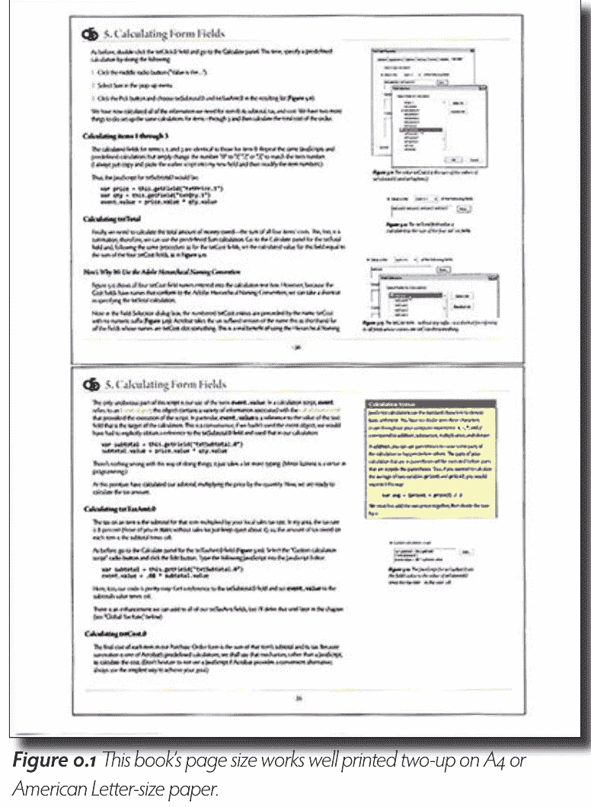

### 打印本书

许多人（包括我自己）更喜欢在纸上阅读技术教程。因此，请随意打印 *Beginning JavaScript*；它非常适合双面、每页两版地打印（图 o.1）。

### 分享本书

我真的希望你不要这样做。*Beginning JavaScript* 定价合理，而且我希望能就此主题及其他主题撰写更多书籍。然而，我需要至少能以此维持基本生计。所以，如果你的朋友或同事想阅读本书，请鼓励他们购买自己的副本。他们会为此感到自豪。

### 注册本书

电子书与软件类似；特别是，作者可以更新电子书，改进解释、修正语法、消除错别字，并 outright 消除错误。（当然，这本电子书既没有错误也没有错别字。）

如果你注册了你的购书信息（前往 [www.acumentraining.com/QEDGuides/qedregister.html](http://www.acumentraining.com/QEDGuides/qedregister.html)），你会在书籍有更新时收到通知。这值得一做。

图 0.1 本书的页面尺寸非常适合每页两版地打印在 A4 或美式信纸上。

## 在线资源

有两个信息来源是专门为配合本书使用而设计的。

### 示例文件和支持

本书的每一章都围绕一个或两个示例表单构建，我们通过添加 JavaScript 来完成该章的目标。每个示例表单都有两个相关文件：

- 完整、可正常运行的表单，所有 JavaScript 均已就位。这向你展示了表单的预期行为方式，并允许你查看该章 JavaScript 的实际应用。此版本表单的文件名以“end”结尾。
- 表单字段和其他元素均已就位，但尚未附加 JavaScript 的版本。如果你想边读边跟着做，编写、调试和执行 JavaScript，就使用这个版本。此版本表单的文件名以“start”结尾。

示例表单文件可在 [www.acumentraining.com/QEDGuides/acrojs.html](http://www.acumentraining.com/QEDGuides/acrojs.html) 下载。该网页也是你可以找到勘误、更新信息和其他有用信息的地方。

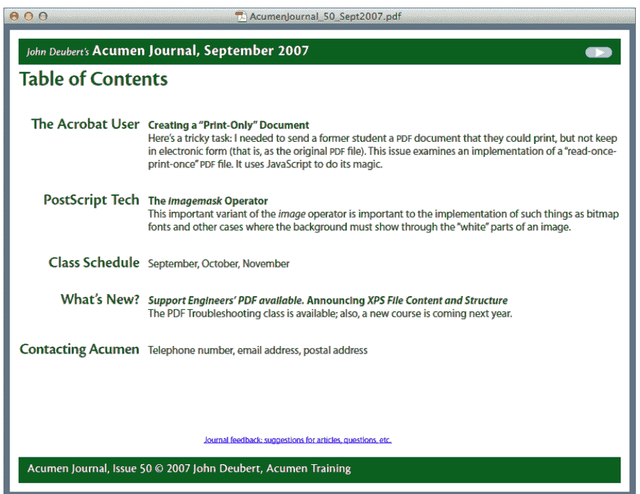

*图 o.2 每一期 Acumen Journal 都有一篇关于 Acrobat 的文章；其中许多涉及 JavaScript 的使用。*

### Acumen Journal

*Acumen Journal*（图 o.2）是我每年出版三到四期的免费期刊。每期都有一篇关于 Acrobat 高级用法的文章，其中许多涉及 JavaScript。往期期刊可作为本书主题的良好补充；自 2000 年开始撰写 *Journal* 以来，已积累了 60 多期。你可以在 [www.acumentraining.com/acumenjournal.html](http://www.acumentraining.com/acumenjournal.html) 下载它们。

如果你希望在新一期 *Journal* 发布时收到通知，Acumen Journal 网页上有一个链接指向相应的表单。

### 致谢

最后，感谢你购买本书或浏览样章。无论哪种方式，你都在参与一场出版业的持续实验。

# 第 1 章：欢迎学习 JavaScript

在生活中，你偶尔会学到一些极大地拓展你世界的东西，揭示出广阔的新体验、问题、机遇、娱乐和工作。一直围绕着你却不为人知的整个世界突然显现，提供了全新的探索空间。阅读、性、驾驶、子女，都带来了此前无法触及和未曾预料的关切、兴趣和互动。

就其自身而言，学习 JavaScript 将成为你职业生涯中这样一个门槛事件。如果你使用 Acrobat 已有一段时间，你可能已经相当熟练，并且在创建表单、添加音乐、制作幻灯片以及 Acrobat 提供的所有其他功能方面都轻车熟路。

本书将带你进入新世界。掌握 JavaScript 知识后，你可以在 Acrobat 中完成远超以往的事情：你可以与数据库交互；添加自己的弹出菜单；创建具有复杂交互界面的表单；并实现可以查询价格和其他数据的表单字段。这些只是你在 Acrobat 文档中使用 JavaScript 所能完成的事情中的一小部分。具备 JavaScript 技能后，你操纵 Acrobat 文件的能力将远超以往。

因此，有了这本书。

在这里，你将学习如何使用 JavaScript 在 Acrobat 中完成各种有用的任务。在此过程中，你将学到大量关于 JavaScript、编程和 Adobe Acrobat 的知识。

## 本章我们将学习什么

在本章中，我们将学习：

- 什么是 JavaScript？
- JavaScript 的类型
- 将 JavaScript 附加到表单字段
- JavaScript 的对象、数据类型和语法
- JavaScript 错误和调试器
- 如何在 Acrobat JavaScript 中使用你自己的文本编辑器

## 你应该已经了解什么

本书假设你具有相当丰富的 Acrobat 使用经验和创建 Acrobat 表单的经验。特别是，我假设你知道如何在 Acrobat 中创建表单；你应该能够创建表单字段、设置其属性并为其分配动作。如果你对这些任务中的任何一项感到不太确定，你可能需要立即去买一本相关的书（见下一页的侧边栏）。

除此之外，本书不假设你具备任何编程知识；你在我们通过示例进行的过程中将学到所需的编程技能。

同样，本书面向编程新手；如果你是有经验的程序员，你可能会觉得它的节奏比你期望的慢。有经验的程序员可能更适合直接去找一本更高级的书学习 JavaScript（这样的书有很多，尽管它们都是在网页的上下文中教授 JavaScript），然后查看 Adobe 的 JavaScript 参考网站，了解如何将其应用于 Acrobat。

### 你应该使用哪个版本的 Acrobat？

虽然这本电子书假设你使用的是 Acrobat XI（当前版本），但它同样适用于 Acrobat X，后者的界面几乎相同。我们逐步讲解的说明也几乎全都适用于 Acrobat 9。在 Acrobat 9 有较大差异的地方，我会提供关于在较早软件中应该如何操作的说明。

## 什么是 JavaScript？

JavaScript 是一种编程语言。“编程语言”这个词常常让新人感到紧张，但从概念上讲，它并不那么可怕：编程语言是用来描述执行某项任务所涉及步骤的语言。在 Acrobat 中，这些任务包括跳转到文档的特定页面、向数据库发送数据以及计算表单字段值。执行 JavaScript 所描述的步骤被称为**执行**程序。

作为一种编程语言，JavaScript 最显著的特点是它足够简单，许多应用程序都将其作为内置脚本语言使用。网络浏览器都能解释嵌入在网页中的 JavaScript，而就我们的主题而言，Acrobat 可以执行附加到表单字段、页面和 PDF 文件的 JavaScript。

像任何语言一样，JavaScript 有自己的词汇（有意义的单词）和语法（用这些单词组成语句的规则）。因此，学习 JavaScript 与学习人类语言（如西班牙语或德语）有很多共同点，只是要容易得多。JavaScript 比任何人类语言都简单得多：没有隐喻，没有字面意义上毫无意义的习语，没有同义词，没有微妙的含义差别。只有非常精确的语句，告诉 Acrobat 去做非常具体的事情。

## Acrobat 中的 JavaScript

Acrobat 允许你创建五种不同类型的 JavaScript：

- **表单字段 JavaScript**：附加到表单字段。当该表单字段中发生特定事件时（如按钮点击），Acrobat 会执行该脚本。Acrobat 中的大多数 JavaScript 都附加在表单字段上。
- **页面 JavaScript**：在用户进入或离开 Acrobat 文档中的特定页面时执行。
- **文档 JavaScript**：在 Acrobat 文档打开时执行。
- **文档动作 JavaScript**：在用户打开、关闭、保存或打印文档时执行。
- **应用程序 JavaScript**：在 Acrobat 启动时执行。

### 关于 Acrobat 表单的书籍

虽然有很多书可以教你如何创建 Acrobat 表单，但大多数都已经绝版。目前仅存的一本是：

- *PDF Forms Using Acrobat and LiveCycle Designer Bible* – Ted Padova 和 Angie Okamoto

Ted Padova 是“Bible”系列书籍的王者，这本书展示了原因。

还有其他专门针对 Acrobat 表单的书籍，虽然已绝版，但如果你找一找仍然可以找到。特别是，我自己的旧书仍然可以买到，不过我承认它已经有些过时了：

- *Creating Forms in Adobe Acrobat* – John Deubert

最后，任何一本内容 reasonably 完整的 Adobe Acrobat 书籍都会至少有一两章关于创建表单的内容。这包括我自己的书：

- *Adobe Acrobat X: Visual Quickstart Guide* – John Deubert
- *Acrobat X Classroom in a Book* – Adobe Creative Team
- *Acrobat X PDF Bible* – Ted Padova

这些都可以通过 Amazon.com 买到，就像世界上几乎所有东西一样。

## 欢迎来到 JavaScript

我们将讨论页面、文档和文档动作的 JavaScript（在第二章）；本书不会讨论应用 JavaScript。现在，让我们看看如何输入和使用表单域 JavaScript。

### 我们的第一个 JavaScript

让我们通过向图 1.1 中的按钮添加一个简单的 JavaScript 来开始探索我们的新世界。

此表单包含一套闪卡，旨在双面打印后用于测验学生的词汇。我们的 PDF 文件只有几张闪卡；每张卡都有一个按钮，可以将用户带到他们可以用来购买完整卡片集的订单表单。我们将为“订单表单”按钮添加一个 JavaScript，将用户带到位于 Acrobat 文件最后一页的订单表单（图 1.2）。

正如本书全文所示，该表单有两个版本在 JavaScript for Acrobat 网页上：

- `JSAcro_Ch01_Example_Final.pdf` 是完整表单，包含所有相关 JavaScript。
- `JSAcro_Ch01_Example_Start.pdf` 是“原始”版本，缺少本章的 JavaScript，以便您可以根据需要自己输入 JavaScript。

这些文件可在 `www.acumenttraining.com/QEDGuides/acrojs.html` 获取。

我们将为此表单中的“订单表单”按钮添加一个 JavaScript。

“订单表单”按钮的 JavaScript 将把用户移动到 PDF 文件的最后一页，即订单表单。

### 示例文件在哪里？

请记住，本电子书中的所有示例文件都可在 `www.acumentraining.com/QEDGuides/acrojs.html` 获取。

### 将 JavaScript 附加到表单域

作为您可能已经知道的内容的提醒，让我们逐步介绍将 JavaScript 附加到按钮的过程，在我们的例子中是“订单表单”按钮。

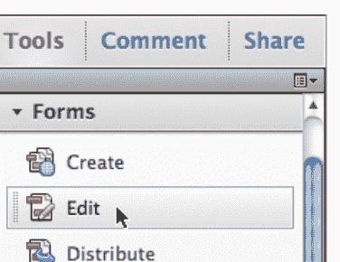

图 1.3 通过单击“表单”面板中的“编辑”按钮进入表单编辑器模式。

**将 JavaScript 附加到按钮的方法：**

从在 Adobe Acrobat 中打开表单并展开“工具”窗格开始。

> **注意**
>
> Acrobat 9 没有“工具”窗格，但它有“表单”菜单。要进入表单编辑器，请选择 *表单 > 添加或编辑域*。完成此操作后，您可以完全按照列出的步骤进行操作。

1. 在“工具”窗格的“表单”面板中，单击“编辑”工具（图 1.3）。

   Acrobat 将进入表单编辑器模式，将当前页上的所有表单域显示为一组矩形，并将通常的三个任务窗格替换为单个“表单”窗格（图 1.4）。请注意，我们的表单在第一页上只有一个域，一个名为 `btnOrderForm` 的按钮域。

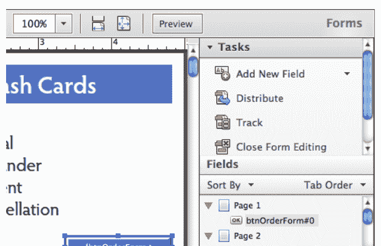

图 1.4 Acrobat 的表单编辑器模式为您提供了一个“表单”窗格、新的工具栏，并将每个表单域表示为一个带有手柄的矩形。

2. 双击“订单表单”按钮。


Acrobat 将显示“域属性”对话框（图 1.5）。

3. 单击“操作”选项卡。

您现在将看到一组控件，用于指定单击此按钮时应发生的情况（图 1.6）。

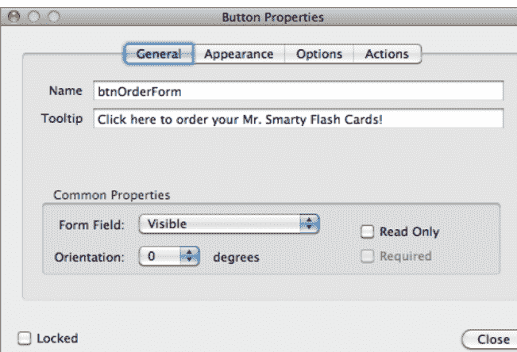

图 1.5 双击按钮会显示“按钮属性”对话框。

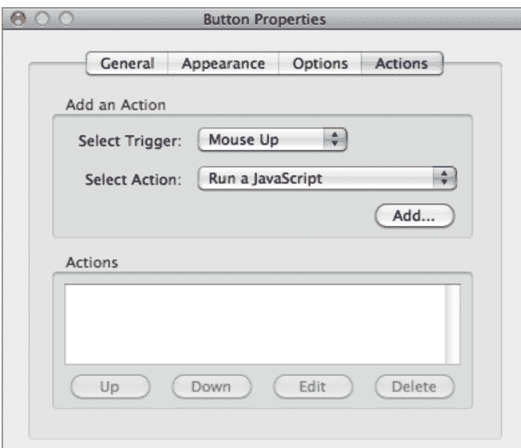

4. 在“选择触发器”弹出菜单中，选择`释放鼠标`。

这会告诉 Acrobat，当在按钮中单击后释放鼠标按钮时，应触发此按钮的操作。（请参阅右侧的旁注。）

图 1.6 “按钮属性”对话框的“操作”选项卡是我们指定用户单击按钮时应发生什么的地方。

5. 在“选择操作”弹出菜单中，选择`运行 JavaScript`，然后单击“添加”按钮。

Acrobat 将显示[JavaScript 编辑器](#)，一个带有简单文本编辑器的对话框（图 1.7，下一页）。您可以在此处输入应与“订单表单”按钮关联的 JavaScript。

6. 将您的 JavaScript 输入到此对话框的文本字段中。

对于我们订单表单的案例，JavaScript 是一个两行程序，它将用户的文档视图移动到包含订单表单的页面，然后使用户的计算机发出蜂鸣声：

```
this.pageNum = 6
app.beep()
```

将这些行输入到文本编辑字段中，如上所述，确保大小写匹配。代码的第一行表示，“在此文档中，将当前页码设置为 6。”第二行告诉 Acrobat 应用程序发出蜂鸣声。

7. 单击 JavaScript 编辑器的“确定”按钮和“域属性”对话框的“关闭”按钮，返回 Acrobat 表单。

您现在看到的是 Acrobat 闪卡页面，且“表单”工具仍处于选中状态，如图 1.4 所示。

8. 单击“表单”窗格中的“关闭表单编辑”按钮退出表单编辑器（图 1.8）。

您现在回到了开始时的状态，正在查看文档页面。

现在，试一试。单击“订单表单”按钮，Acrobat 将移动到订单表单页面，然后发出蜂鸣声。

### JavaScript 对象

我们的两行 JavaScript 使用了两个`JavaScript 对象`。JavaScript 对象是 JavaScript 程序中某些数据的表示。在您的程序可以操纵或检查表单域之前，它必须首先创建一个代表该域的对象。您可以在 JavaScript 中操纵的大多数事物（页面、签名、数据库连接等）在程序中都表示为对象。

在我们的示例程序中，`this`指的是一个`Doc 对象`。Doc 对象向您的 JavaScript 程序表示一个打开的 Acrobat 文件；您使用此对象来更改页面、保存文档以及以其他方式操纵程序中的文档。

我们的示例 JavaScript 中的`this`一词特别指我们的 JavaScript 所在的 Acrobat 文档（在我们案例中是闪卡文件）；可以将其视为`此文档`的简称。

`app`一词是一个[App 对象](https://example.com)，是对用于查看当前文档的 Acrobat 应用程序的引用。您使用`App`对象来告诉 Acrobat 应用程序执行某些操作：打开文件、弹出警报对话框，或在我们案例中发出蜂鸣声。

常用的 JavaScript 对象类型包括：

- `Annot`表示当前文档中的一个注释（例如，“便笺”）。
- `App`表示用于查看当前文档的 Acrobat 应用程序。
- `Connection`表示与外部数据库的连接。
- `Doc`表示一个打开的 Acrobat 文档。
- `Field`表示一个表单域。
- `Sound`表示嵌入在当前文档中的声音。

### 表单域事件

图 1.6 中显示的“选择触发器”弹出菜单提供了六个表单域事件，您可以为其附加操作：

- `鼠标按下`：当用户在表单域中按下鼠标按钮时发生。
- `释放鼠标`：当用户单击域并释放鼠标按钮，且鼠标指针仍在域中时发生。
- `鼠标移入`：当鼠标指针首次滑过表单域时发生。
- `鼠标移出`：当鼠标指针滑出表单域时发生。
- `获得焦点`：当用户单击或制表到表单域时发生，使其成为键盘或其他输入的目标。
- `失去焦点`：当用户制表出表单域或单击其他表单域时发生，因此我们的域不再是用户输入的目标。（当然，模糊是焦点的对立面。）

“域属性”对话框（图 1.6）允许您将一个或多个操作（在我们的案例中是一个 JavaScript 操作）与这些事件中的任何一个相关联。

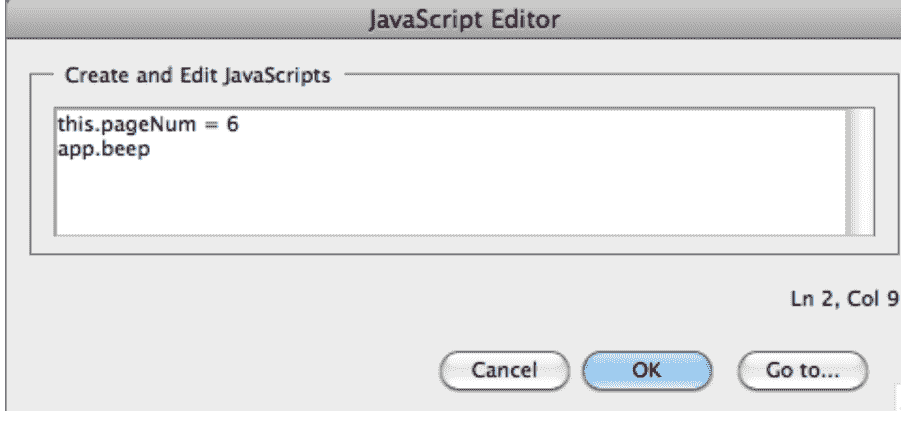

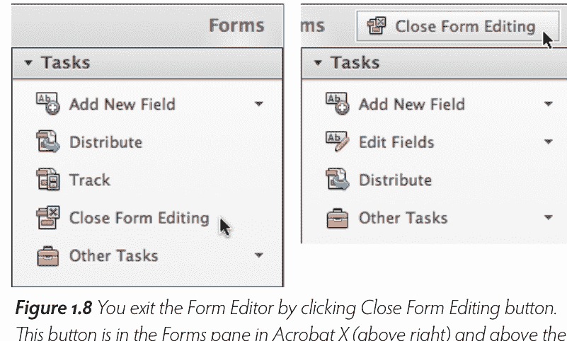

### 对象属性

JavaScript 对象类似于我们周围世界中的物理对象，例如书籍、花瓶和狗。每个真实世界的对象都拥有一组定义它的特征（例如，对于一只狗，有颜色、尾巴长度和跳蚤数量）。

JavaScript 对象的特征被称为该对象的[属性](https://example.com)。这些是我们 JavaScript 程序可以根据需要检查和更改的对象元素。每种类型的对象都有一组特征属性；例如，Doc 对象具有的属性包括标题、当前页码、作者和页数（参见表 1.1）。

| 属性 | 数据类型 | 描述 |
| :--- | :--- | :--- |
| `author` | 字符串 | 编写文档的人 |
| `fileSize` | 整数 | PDF 文件的大小（以字节为单位） |
| `numPages` | 整数 | 文档中的页数 |
| `pageNum` | 整数 | 用户当前可见的页码 |
| `title` | 字符串 | 文档的名称。 |

## 数据类型

表 1.1 的“数据类型”列列出了与其列出的每个属性相关联的信息类型。计算机编程（包括 JavaScript）使用特殊术语来精确描述数据类型。以下是 JavaScript 中常用的术语：

- `整数`是一个整数，例如 1、2、87 或 -6293。
- `浮点数`是一个带有小数部分的数字，例如 1.7、-842.9011、1024.0。请注意，小数部分可以为零，如 1024.0；在这种情况下，浮点数与整数具有相同的值，尽管在内部它仍然是一个浮点数。浮点数通常被称为“浮点”。
- `布尔值`是一个可以具有两个值的实体：真或假。布尔数据用于描述只能有两种状态的特征。（例如，我们狗对象中的`已绝育`属性是一个布尔值；一只狗要么已绝育，要么未绝育。）
- `字符串`是文本，即“字符字符串”。

## 1. 欢迎使用 JavaScript

短语`this.pageNum`表示 Document 对象的`pageNum`属性；该属性即文档当前向用户展示的页码。我们的程序通过将当前文档的`pageNum`属性设置为订单表单的页码，从而将用户移动到订单表单页面：

```
this.pageNum = 6
```

关于这个页码赋值，有几点需要注意：

- 引用对象的属性时，需要同时写出对象名和属性名，并用句点连接：`对象名.属性名`。
- 上面代码中的等号是一个赋值命令；它用于设定某个值。在本例中，它将当前文档的页码设置为 6。
- JavaScript 是区分大小写的。大写和小写字母是不同的；如果我们输入`This.PageNum`，程序就会失败。
- Acrobat 内部对文档页面的编号从 0 开始；我们 Acrobat 文件中的 7 页分别编号为 0 到 6。因此，当我们的 JavaScript 将`pageNum`属性设置为 6 时，实际上是在移动到文档的最后一页。

### “Program” vs. “Script” vs. “Code”

以下是三个密切相关、我们将在本书中使用的术语。

- **程序**（program）是一系列指令的通用术语，这些指令详细告诉计算机如何完成特定任务。一般而言，程序是一套独立的指令集，例如一个应用程序。
- **脚本**（script）是一种旨在另一个程序中操纵和运行的程序。JavaScript 是一种脚本语言，因为你使用它来控制另一个程序的行为，例如 Acrobat 或 FireFox。
- **代码**（code）是指构成程序的指令集。你的 JavaScript 程序由 JavaScript 代码组成。

## 对象方法

`方法`（method）是与 JavaScript 对象相关联的命令。就像狗可以接收命令（“坐下”、“跟上”、“马上吐出来！”）一样，JavaScript 对象也有它们可以执行的命令。每种对象类型的命令集合各不相同。例如，表 1.2 列出了`app`对象知道如何执行的一些命令。

### 表 1.2 App 对象的方法

| 方法 | 参数 | 说明 |
| :--- | :--- | :--- |
| `beep` |  | 播放系统的“哔”声 |
| `alert` | `String` | 显示包含指定文本的警告对话框 |
| `goBack` |  | 转到上一个视图 |
| `goForward` |  | 转到下一个视图 |
| `newDoc` |  | 打开一个新的空白 Acrobat 文档 |
| `openDoc` | `String` | 打开一个 Acrobat 文件。字符串参数包含文件名 |

在我们的订单表单 JavaScript 中，我们执行（“调用”）了`app`对象的`beep`方法：

```
app.beep()
```

注意，我们调用对象的方法与引用其属性的方式相同：对象名、“点”、方法名。方法名后面跟着括号，括号内包含方法的参数；让我们来说说这些是什么。

### 参数和返回值

有些方法需要额外的信息来完成它们的任务；例如，表 1.2 中列出的`openDoc`方法需要知道你要打开的文件名。传递给方法的信息称为该方法的“参数”。`openDoc`方法将文件名作为其参数；这个信息用括号括起来，必须跟在方法名后面。`openDoc`的调用看起来像这样：

```
app.openDoc("TermPaper.pdf")
```

上面的 JavaScript 语句将打开名为`TermPaper.pdf`的 Acrobat 文件。注意，我们之前对`app.beep`的调用有空的括号，因为该方法不接受任何参数；不过你仍然需要这些括号。

有时当你给狗一个命令时，你期望狗给你一些回报：命令“去捡棍子，乖！”应该会让你手中多出一根棍子（还会附带一些多余的口水）。同样，许多 JavaScript 方法都有返回值，即它们返还给 JavaScript 程序的某段数据。我们上面调用的`openDoc`方法实际上返回一个表示新打开文档的 Doc 对象，尽管我们对`openDoc`的单行使用只是忽略了它。我们将在下一章更详细地研究返回值。

### 命名参数

通常，你必须按照特定顺序向方法提供参数；`app`对象的`alert`方法（我们将在下一章详细讨论）需要一个字符串和一个图标代码：

```
app.alert("Woah! Somethin' weird just happened!", 2)
```

字符串和整数必须按该顺序提供，以便 JavaScript 能够识别它们。

然而，你也可以通过名称向方法传递参数。Acrobat JavaScript 指南（本章末尾有介绍）为方法所需的每个参数定义了相应的名称；对于`app.alert`，名称是`cMsg`和`nIcon`。

你可以使用以下方法调用，以任意顺序提供这些参数：

```
app.alert({cIcon: 2, cMsg:"Woah! Somethin' weird just happened" })
```

注意，我们在方法的括号内有花括号，花括号内有我们的方法参数。每个参数由参数名、冒号和参数值表示；参数之间用逗号分隔。

这不如按位置传递参数简洁，但每个参数的用途更清晰。（例如，我们对`app.alert`的第一次调用就没有提示 2 的用途。）此外，通过名称传递参数让你在格式化代码时具有很大的灵活性。特别是，你可以在参数列表中放置换行符，并以任意顺序提供参数；我们之前的例子也可以写成：

```
app.alert({cIcon: 2,
        cMsg: "Woah! Somethin' weird just happened" })
```

在本书中，我们将按位置传递参数；我们只在必要时——通常是为了某个特定 JavaScript 示例的清晰度——才使用参数名。不过，我将在描述方法时经常提供参数的名称，以便你在需要时使用。

通常，这样做并没有什么压倒性的理由。

## JavaScript 程序语法

在这里，我们必须讨论几个关于 JavaScript 命令如何组合成程序的话题。

### JavaScript 语句

JavaScript 程序——任何计算机程序——由一系列`语句`组成，每条语句执行整体任务中的一个步骤。我们的示例程序由两条语句组成：一个页码赋值和对`app`对象`beep`方法的调用。

```
this.pageNum = 6
app.beep()
```

通常，JavaScript 程序中的每一行包含一条 JavaScript 语句，如我们的程序所示。你也可以在一行中写多条语句，用分号分隔。我们的两行程序可以写成单行：

```
this.pageNum = 6; app.beep()
```

为什么要这样做？纯粹是为了美观；有些人就是喜欢把非常简单的语句组合在一起。我不推荐这种做法；如果每行只有一条语句，大多数程序会更容易阅读。

如果你阅读他人的 JavaScript，你可能会注意到许多程序员在程序的每一行末尾都加上分号：

```
this.pageNum = 6;
app.beep();
```

这不会造成任何伤害，但没有必要。他们大多出于习惯这样做；JavaScript 看起来非常像编程语言 C 和 C++，这两种语言都要求所有语句以分号结尾。你可以省略这些分号。

## JavaScript 文本

JavaScript 程序就是简单的文本文件；你可以用任何文本编辑器或文字处理器编写它们，然后复制粘贴到 Acrobat JavaScript 编辑器对话框中。实际上，Acrobat 允许你指定一个外部编辑器来编辑你的 JavaScript；我们将在本章末尾讨论如何操作。

顺便说一下，JavaScript 行内的空格和制表符字符在 JavaScript 中没有特殊含义。你可以随意使用它们来格式化程序。这纯粹是视觉上的问题；你需要格式化 JavaScript 代码，使其易于阅读。

慷慨地使用空白字符！阅读程序代码本身就够费力的了；如果程序员没有将代码格式化为易读的形式，程序可能几乎无法 decipher。这个问题重要到我将为本书中使用的许多 JavaScript 结构提供格式化提示。

## JavaScript 注释

JavaScript 代码可能相当晦涩难懂。琢磨别人的代码（甚至你自己六个月前的代码），试图弄清楚它到底想做什么，可能是件 tedious 的事。为了照顾其他查看你代码的人，也为了帮助未来的你自己，在 JavaScript 代码中放置注释是非常重要的。

JavaScript 注释是代码中被 JavaScript“机器”忽略的文本。其目的是让你放置自己的注释，供查看代码的人类阅读。

### JavaScript 注释类型

JavaScript 会识别（也就是说，忽略）两种类型的注释：

- **单行注释**以双斜杠（`//`）开头，并延伸到当前 JavaScript 代码行的末尾。这些注释用于简短的说明。

```
// 这是一个单行注释。
```

- **块注释**以`/*`开头，以`*/`结尾。在这两个定界符之间，你可以放置任意多的文本，并可以在 JavaScript 文件中跨越任意多的行。适用于较长的注释。

```
/* 这里我们有一个块注释。
这些文本将被完全忽略，
直到我们在这里结束注释。 */
```

### 一个示例

考虑以下摘自本书后续章节的、未加注释的 JavaScript 代码：

```
var txtField = event.target
txtField.fillColor = color.red
txtField.textColor = color.white
```

由于我们还没有讨论这些命令，这段脚本的确切目的以及它如何实现该目的是非常不清晰的，尽管它似乎与颜色有关。

另一方面，如果我们在这段代码中加入注释，那么即使是不熟悉程序的人，也至少能够知道程序的意图以及它大致在做什么：

```
/* 当用户通过 Tab 键切换进入或点击文本字段时，
   本程序将改变该文本字段的背景和文本颜色。 */
var txtField = event.target           // 获取对文本字段的引用
txtField.fillColor = color.red        // 将背景设置为红色
txtField.textColor = color.white      // 将文本颜色设置为白色
```

这个版本的程序清晰多了，即使是代码新手也能理解。

注释是编程中的一股正能量。任何比几行更复杂的脚本都应该包含描述其功能和工作原理的注释。

本书后续的所有示例都将包含大量注释，以使其尽可能易于理解。

不客气。

### JavaScript 错误


在（咳咳）极少数情况下，你的 JavaScript 代码出现错误——比如拼错了变量名、复制代码时出错等等——你将面临找出代码问题的任务，这个过程称为调试。Acrobat 自身会静默处理这些错误；如果代码失败，Acrobat 只会中止脚本；在表面上看，点击按钮似乎什么都没发生，尽管底层确实有一个失败的脚本在运行。这对于调试没有帮助；如果 JavaScript 失败了，我们希望得知此事，并且进一步被告知哪里出了问题，以便我们修复它。

为了获得关于失败脚本的诊断信息，我们需要启用一个叫做 JavaScript 调试器的工具。

### JavaScript 调试器

JavaScript 调试器是一个窗口，它呈现有关在你的 Acrobat 文档中执行的 JavaScript 的信息（图 1.9）。特别是，调试器会呈现有关 JavaScript 错误的诊断信息，让你能够找出它们出错的原因。

启用 JavaScript 调试器后，每当你的某个 JavaScript 失败时，Acrobat 将打开调试器并显示错误消息（如图 1.9 中的 “ReferenceError”）。这将使你能够确定哪里出了问题以及如何处理。

错误消息起初可能有些晦涩，但随着时间的推移和熟悉，它们会变得有用。你可能看到的最常见消息如下：

- **Reference Error: XXX is not defined**

  这表明你拼错了什么；名称 “xxx”（或其他什么）不是 JavaScript 认识的名称。请记住 JavaScript 区分大小写；`app`（JavaScript 认识的）和 `App`（它不认识的）是有区别的。

- **Syntax Error**

  这意味着 JavaScript 无法理解代码中的某些内容。这通常意味着你的脚本中遗漏了某些东西（一个逗号、一个数字、一个括号）。一个语法错误的例子是

  ```
  app.alert("Hi, Mom", 3
  ```

  这一行缺少了它的右括号。

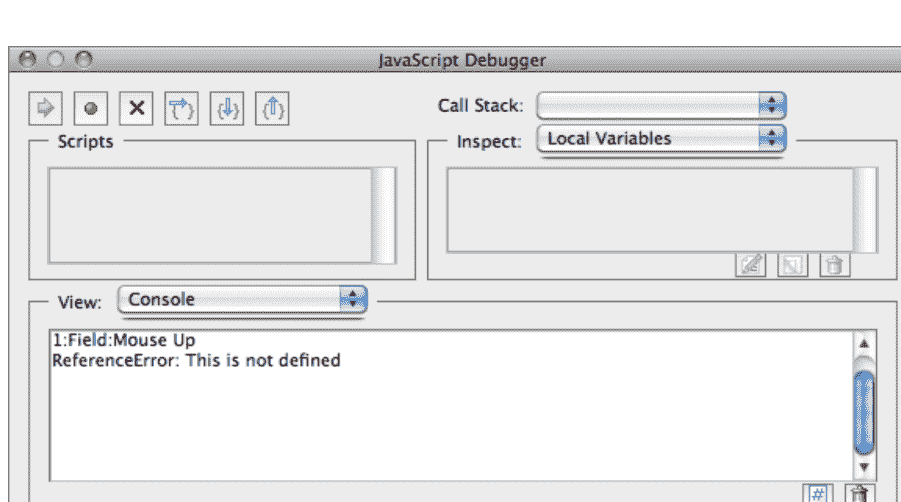

可能的错误消息集合非常庞大，尽管大多数都很难触发。只需保持冷静，阅读消息，并仔细检查异常的 JavaScript 代码中的拼写错误和遗漏。

### 启用 JavaScript 调试器

你在 Acrobat 的首选项中启用 JavaScript 调试器。打开 Acrobat 的首选项，在长长的首选项类别列表中选择 JavaScript（图 1.10）。JavaScript 调试器部分中的所有复选框都应如图所示被选中。

### 使用你自己的文本编辑器

Acrobat 的 JavaScript 编辑器内置的文本编辑器（参见图 1.7）相当简陋。它允许你输入 JavaScript，但没有特别强大的编辑功能。对于短小的 JavaScript，这并不重要；然而，当输入冗长、复杂的脚本时，你会怀念一个功能齐全的文本编辑器。

你可以要求 Acrobat 使用你选择的文本编辑软件来编辑你的 JavaScript。告诉 Acrobat 你想使用的编辑器后，当你点击 Document JavaScripts 对话框中的“添加”或“编辑”按钮时（图 1.11），它将自动启动该软件。

要设置此功能，你必须在 Acrobat 的首选项中指定你希望用于处理 JavaScript 的编辑器。

#### 指定编辑 JavaScript 时使用的文本编辑器：

启动 Acrobat。

1. 在 Mac 上，选择 *Acrobat>首选项*；在 Windows 上，选择 *编辑>首选项*。

   Acrobat 将向你显示其首选项对话框（图 1.12，下一页）。

2. 在首选项类别列表中选择 JavaScript。

   首选项对话框将显示影响 Acrobat JavaScript 支持的控件，如图 1.12 所示。

3. 在对话框底部的 JavaScript 编辑器控件中，选择“使用外部 JavaScript 编辑器”。

4. 点击“选择”（Windows）或“浏览”（Mac）按钮，然后导航到你想用于编辑 JavaScript 的编辑器的 `.exe` 或 `.app` 文件。

5. 点击“确定”按钮。

就这么简单。现在，当你编辑 JavaScript 时，Acrobat 将自动启动你的文本编辑器。在文本编辑器的窗口中输入你的 JavaScript 代码，保存文本，然后关闭编辑器。你的 JavaScript 将被自动输入到 Acrobat 中。

值得一提的是，我在 Mac 上最喜欢的程序员编辑器是 TextWrangler（www.bbarebones.com）；它是一个一流的编辑器，并且完全免费，天哪。在 Windows 文本编辑器中，我比较喜欢 TextPad（www.textpad.com）；它是一个相对便宜的共享软件，物有所值。

### JavaScript 参考资料

本书是非程序员在 Adobe Acrobat 中使用 JavaScript 的入门指南；它既没有全面覆盖 JavaScript 语言，也没有完整描述驻留在 Adobe Acrobat 中的 JavaScript 实现的方方面面。读完本书后，你将可以参考另外两份资料来进一步学习。

图 1.12 你可以让 Acrobat 在键入或修改 JavaScript 代码时使用外部编辑器。

### 客户端 JavaScript 参考手册

正如我在本章开头所说，有无数关于 JavaScript 的书籍。然而，官方的 JavaScript 定义是在一个名为 *客户端 JavaScript 参考手册* 的网页文档中呈现的，它驻留在 Oracle 的网站上，[这里](here)。

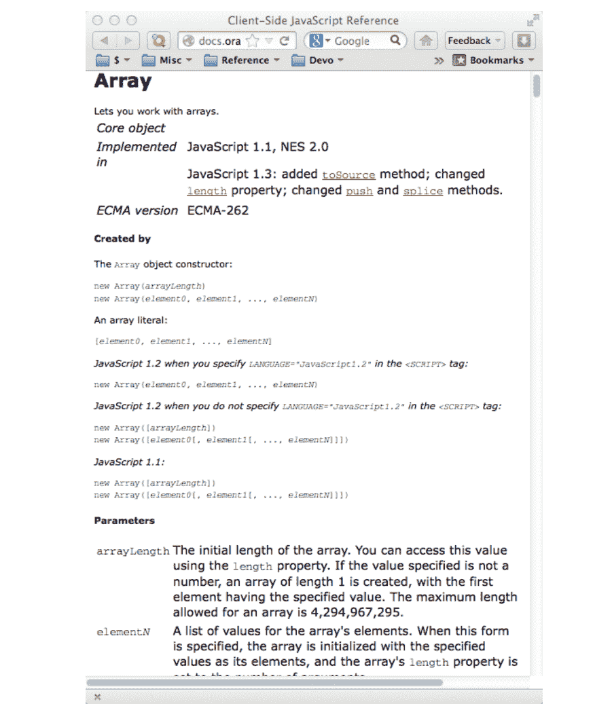

图 1.13 展示了《参考手册》中的一页。如你所见，这不是为了有趣阅读而设计的；它是一个参考，而不是教程。不过，如果你想学习 JavaScript 语言内置的完整功能集（而不是 Acrobat 版本的），这就是你要去的地方。

### Acrobat JavaScript 指南

关于你可以在 Acrobat 中使用 JavaScript 所能做的所有事情的完整描述，可在 Adobe 的开发者网站上获得的一份文档中找到：*JavaScript for Acrobat API Reference* 或从现在开始简称为 “JSAPI”（图 1.14，下一页）。这是 Acrobat 中你的 JavaScript 程序可用的所有对象类型的技术规范。通过 Adobe 的开发者网站，还有一个[优秀的在线](excellent%20on-line)版本可用。

## 1. 欢迎使用 JavaScript

与客户端参考手册类似，*JSAPI* 是一份技术规范，而不是你愿意从头读到尾的文档。它详细描述了 Acrobat 中可用的每种 JavaScript 对象类型，以及每种对象的属性和方法。你正在阅读的这本书通过一系列示例来展示如何使用 JavaScript 执行特定任务，而 *JSAPI* 则描述了你可以用 JavaScript 在 Acrobat 中做的 *所有事情*。

> **注意**

> *JSAPI* 可作为 Kindle 电子书从 amazon.com 购买。

为了让你对 *JSAPI* 有个大致印象，图 1.15 展示了 `app` 对象的 `beep` 方法完整描述的截图。我将在本书中不时地引用 *JSAPI*。

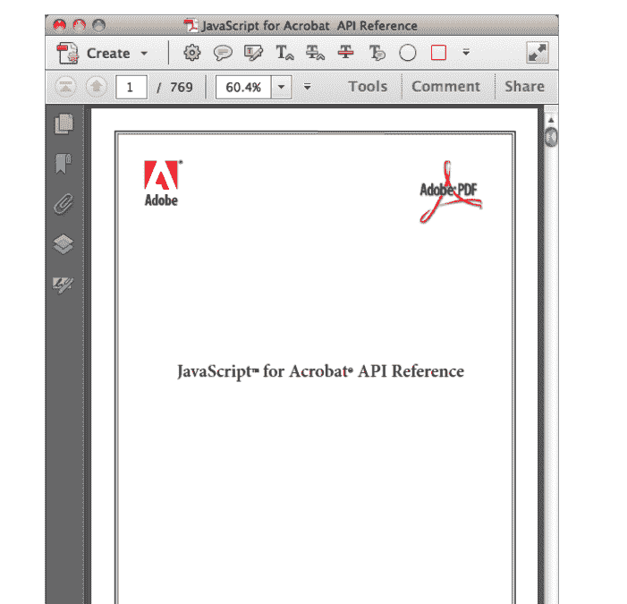

**图 1.14** *Acrobat JavaScript API 参考手册是阐述 Acrobat JavaScript 实现原理的正式技术文档。*

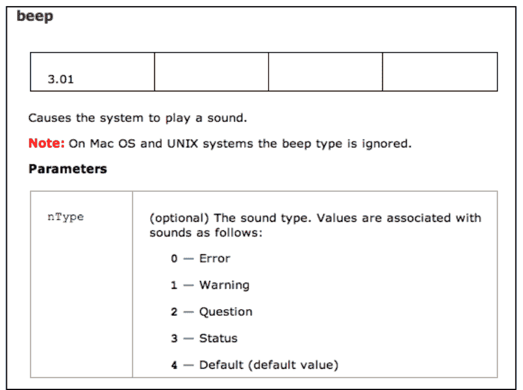

**图 1.15** *对 `app` 对象的 `beep` 方法的描述，是《Acrobat JavaScript API 参考手册》中为每个对象、方法和属性提供的描述类型的绝佳范例。*

# 第 2 章

## 页面和文档 JavaScript

Acrobat 中有五种主要的 JavaScript 类型，每种类型在 Acrobat 文档中的使用位置各不不同。

- **表单字段 JavaScript** 附属于表单字段。正如我们在上一章所见，表单字段脚本与表单字段上发生的事件相关联：鼠标按下、获得焦点等。

- **文档 JavaScript** 与 Acrobat 文件的打开相关联。当文档首次打开时，Acrobat 会执行这些脚本。

- **文档操作 JavaScript** 在 Acrobat 文件发生一组预定义事件中的某一个时执行：文件关闭、保存等。

- **页面 JavaScript** 与特定页面相关联。你可以提供脚本，让 Acrobat 在用户进入该页面、离开该页面或两者兼有时执行。

- **应用 JavaScript** 是在应用程序首次打开时由 Acrobat 执行的脚本。它们可以执行各种有趣的任务，例如向 Acrobat 菜单添加项目。本书不会讨论应用脚本，因为它们的用途专门且不常用；它们将是未来第二本书的主题。

我们在第 1 章讨论了表单字段 JavaScript。在本章中，我们将探讨如何编写其他三种类型的脚本。

### 项目介绍

*(文件：JSAcro_Ch02_Example_Start.pdf, JSAcro_Ch02_Example_Final.pdf)*

本章的示例文件是图 2.1 所示的宠物商店目录。在我们的讨论过程中，我们将向此文件添加文档 JavaScript、文档操作 JavaScript 和页面 JavaScript 的示例。

> **本章我们将学到什么**

> 在本章中，我们将学习如何：

> - 在文档打开时运行 JavaScript

> - 在文档关闭时运行 JavaScript

> - 在进入或离开页面时运行 JavaScript

> - 使用 JavaScript 变量

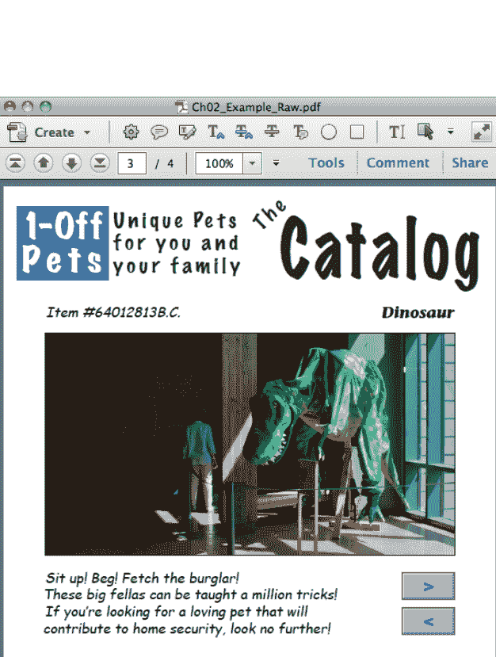

**图 2.1** 在本章中，我们将向此 PDF 文档添加多个脚本。

## 2. 页面和文档 JavaScript

### JavaScript 工具面板

本章我们将使用的几个与 JavaScript 相关的工具位于 Acrobat X 工具窗格的 JavaScript 面板中（图 2.2）。

如果你检查自己的 Acrobat 副本，可能会发现 JavaScript 面板缺失；Acrobat 默认不显示此面板。（这是合理的；绝大多数 Acrobat 用户与 JavaScript 无关，看到这个选项会感到震惊。）为了继续本书的内容，我们需要让此面板可见，步骤如下：

**要使 JavaScript 面板可见：**

1. 通过单击 Acrobat X 工具栏中的其名称，使工具窗格可见。

2. 单击工具窗格顶部的微小图标，并在弹出的菜单中选择 JavaScript（图 2.3）。

> **注意**

> Acrobat 9 没有工具窗格。本章中的所有 JavaScript 命令都位于“高级 > 文档处理”子菜单中。

JavaScript 面板将在工具窗格中可见。它将一直对你的 Acrobat X 副本可用，直到你再次取消选择它。

#### 文档 JavaScript

文档 JavaScript 由 Acrobat 在打开它们所附加的文档时执行。当用户打开你的 PDF 文件时，这是一种向读者呈现初始“欢迎屏幕”或执行其他启动活动的便捷方式。你可以根据需要向 Acrobat 文件附加任意多个文档 JavaScript。

例如，我们将向目录添加一个文档 JavaScript，当读者打开文档时显示欢迎信息（图 2.4）。

**将文档 JavaScript 附加到 Acrobat 文档：**

在 Acrobat 中打开文档。

1. 在 JavaScript 面板中，单击文档 JavaScript 工具（回到图 2.2）。

2. Acrobat 将显示文档 JavaScript 对话框（图 2.5，下一页）。

3. 在脚本名称字段中输入脚本的名称。

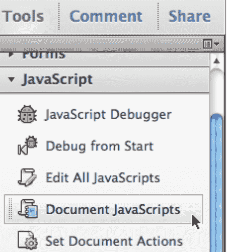

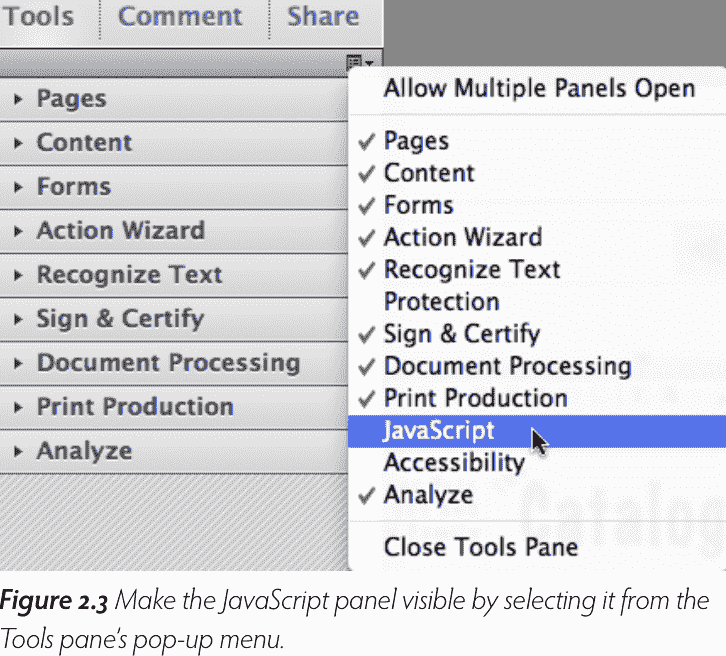

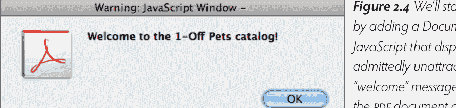

这可以是任何你希望的名称，但描述性的名称比晦涩的要好；我们将脚本命名为“Welcome”，因为这正是它的功能。

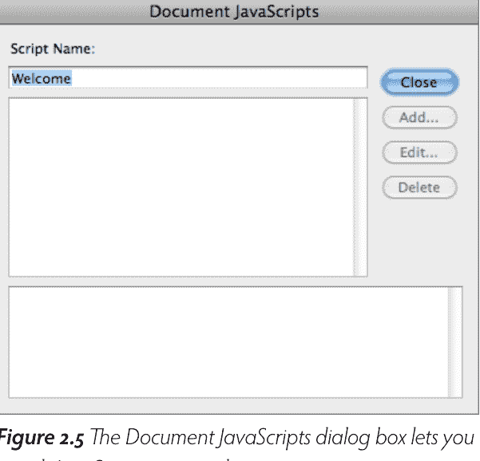

4. 单击“添加”按钮。

Acrobat 将向你展示 JavaScript 编辑器窗口（图 2.6）。请注意，该窗口出现时，文本字段中已经输入了一些 JavaScript 代码。此代码是 JavaScript 函数定义的起点；由于我们不打算定义函数，因此可以删除这些初始代码。

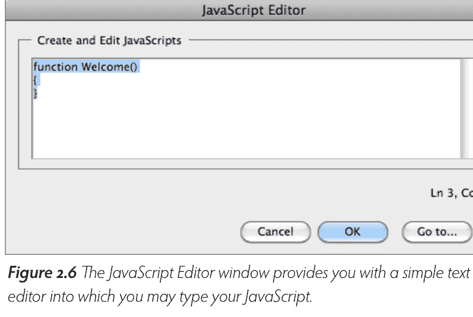

5. 在文本字段中输入你的 JavaScript（图 2.7，下一页）。

在我们的例子中，脚本将是一行，如下所示：

```
app.alert("Welcome to the 1-Off Pets catalog!", 3)
```

此 JavaScript 将显示如图 2.4 所示的警报。`app` 对象的 `alert` 方法显示一个带有指定文本的警报窗口。数字 3 表示警报中应出现的图标类型。我们将在第 4 章更详细地讨论此方法。（你可能记得我们在第 1 章讨论了 `app` 对象。）

请记住 JavaScript 区分大小写；你的大写和小写字母应与上面的行匹配。

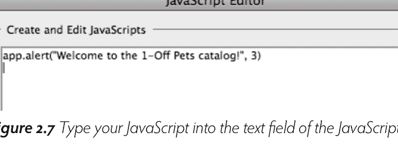

6. 单击“确定”退出 JavaScript 编辑器并返回文档 JavaScript 对话框。

对话框现在将在其脚本列表中显示我们的 Window 脚本（图 2.8）。如果在列表中单击该脚本，对话框将在下方的文本字段中显示代码，如图所示。

7. 单击“关闭”按钮退出文档脚本对话框；你现在将回到 Acrobat 页面。就这样！我们已经创建了文档 JavaScript。

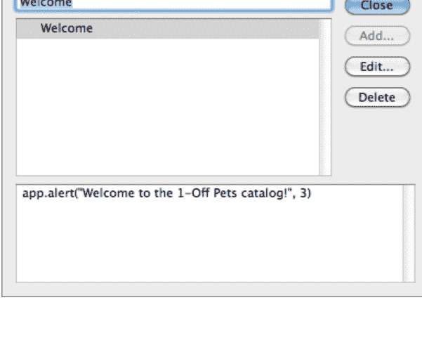

8. 通过保存 Acrobat 文件、关闭它然后重新打开来试用。Acrobat 应显示我们在图 2.4 中看到的警报。

## 2. 页面和文档 JavaScript

### 文档操作 JavaScript

**文档操作 JavaScript** 在文档发生特定事件时执行。你可以将 JavaScript 附加到五个事件：

- **文档将关闭** 意味着 Acrobat 即将关闭文档。

- **文档将保存** 意味着 Acrobat 即将保存文档。

- **文档已保存** 意味着 Acrobat 已完成文档的保存。

- **文档将打印** 意味着 Acrobat 即将打印文档。

- **文档已打印** 意味着 Acrobat 已完成文档的打印。

为了了解如何将 JavaScript 附加到这些事件之一，让我们对目录进行另一处更改。当用户关闭 Acrobat 文件时，让我们感谢用户查看我们的商品，如图 2.9 所示。我们将通过将 JavaScript 附加到“文档将关闭”事件来实现。

**将文档操作 JavaScript 附加到文档：**

在 Acrobat 中打开文档。

1. 在工具窗格的 JavaScript 面板中，选择“设置文档操作”（图 2.10）。

   Acrobat 将显示“文档操作”对话框（图 2.11）。此对话框列出了你可以附加 JavaScript 的五种可能的文档事件。

2. 选择“文档将关闭”，然后单击“编辑”按钮。

   Acrobat 将显示现在已熟悉的 JavaScript 编辑器窗口（图 2.12）。

3. 在编辑器中输入你的 JavaScript。在我们的例子中，单行脚本应为：

```
app.alert("Thanks for looking at our catalog!", 3)
```

4. 单击“确定”退出 JavaScript 编辑器，然后再次单击“确定”离开“文档操作”对话框。

   你现在将回到 Acrobat 页面。完成了！

5. 试用一下：保存 Acrobat 文档，然后将其关闭。Acrobat 将向你显示“感谢”警报，如图 2.9 所示。

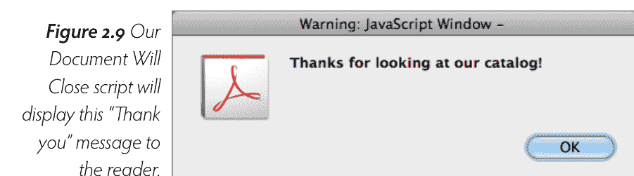

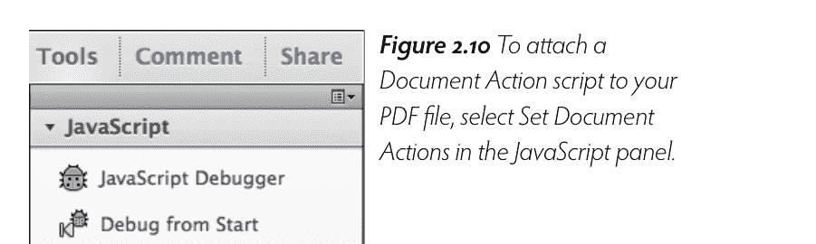

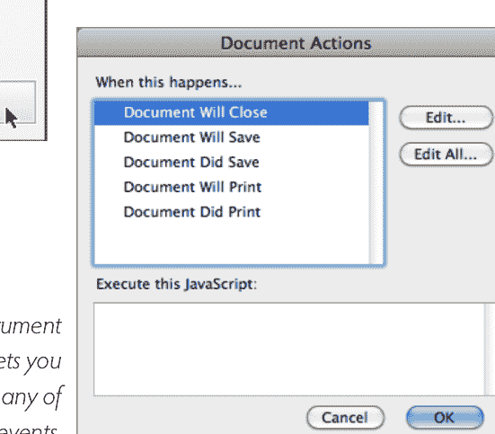

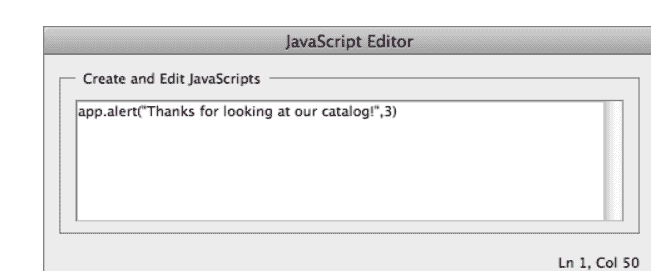

## 2. 页面和文档 JavaScript

### 页面操作 JavaScript

**页面操作**是关联到特定页面打开或关闭的 Acrobat 操作。这可以是 Acrobat 知道的任何类型的操作：菜单项、电影操作、声音操作——而在我们的案例中，当然还有 JavaScript 操作。

Acrobat 中有两种类型的页面操作：

- **页面打开**操作在用户滚动到该页面时执行（即“页面打开”事件）。

- **页面关闭**操作在用户离开该页面时执行（即“页面关闭”事件）。


举个例子，我们将把一个页面打开操作附加到目录中的第三页，以宣布家长监管对于体型较大的恐龙至关重要。当用户打开第 3 页时，我们的页面打开操作将显示`图 2.13`中的警报框。

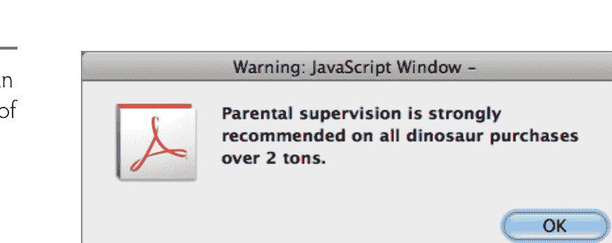

令人惊讶的是，我们并非通过 JavaScript 面板访问页面操作 JavaScript。相反，它们是通过页面缩略图导航窗格（`图 2.14`）附加的，您可以通过单击每页左侧导航栏中的页面图标来打开该窗格。

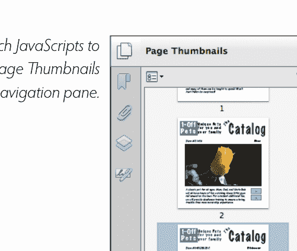

页面缩略图窗格默认是启用的，但以防您的 Acrobat 副本中禁用了它，您可以通过选择（深吸一口气）*查看 > 显示/隐藏 > 导航窗格 > 页面缩略图*来将其启用。

## 如何将页面操作附加到 Acrobat 文档中的页面

首先打开文档，并确保页面缩略图窗格可见。

1. 在页面缩略图窗格中右键单击目标页面（在我们的案例中是第 3 页）的缩略图，并从出现的上下文菜单中选择“页面属性”（`图 2.15`）。

   Acrobat 将显示页面属性对话框（`图 2.16，下一页`）。

2. 转到“操作”选项卡（如图 2.16 所示）。

3. 在“选择触发器”弹出菜单中，选择“页面打开”。

   菜单中的另一个选项当然是“页面关闭”。

4. 在“选择操作”弹出菜单中，选择“运行 JavaScript”。

   您可以关联到页面事件的其他操作还有很多；请参阅下一页的边栏。

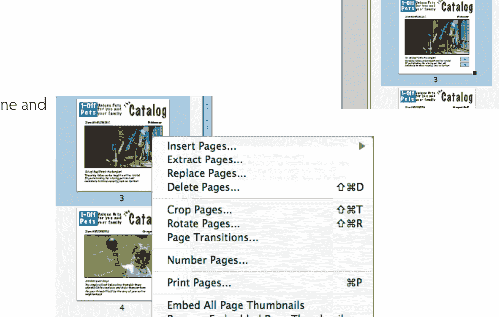

5. 单击“添加”按钮。

   Acrobat 将显示熟悉的 JavaScript 编辑器窗口。

6. 在编辑器中输入您的 JavaScript；在我们的案例中，这再次将是一行代码：

```javascript
app.alert("Parental supervision is strongly recommended on all dinosaur purchases over 2 tons.", 3)
```

上述内容应作为单行输入，尽管编辑器窗口可能会将其换行以适应文本框。注意上述代码第二行开头的`"¬"`字符；我将在书中全程使用此符号来表示一行 JavaScript 代码是上一行的延续。

7. 重复单击“确定”按钮，直到退出所有对话框并再次查看文档页面。

8. 尝试一下：在目录文档中转到前一页，然后返回第 3 页；您将看到`图 2.13`中 pictured 的警报框。

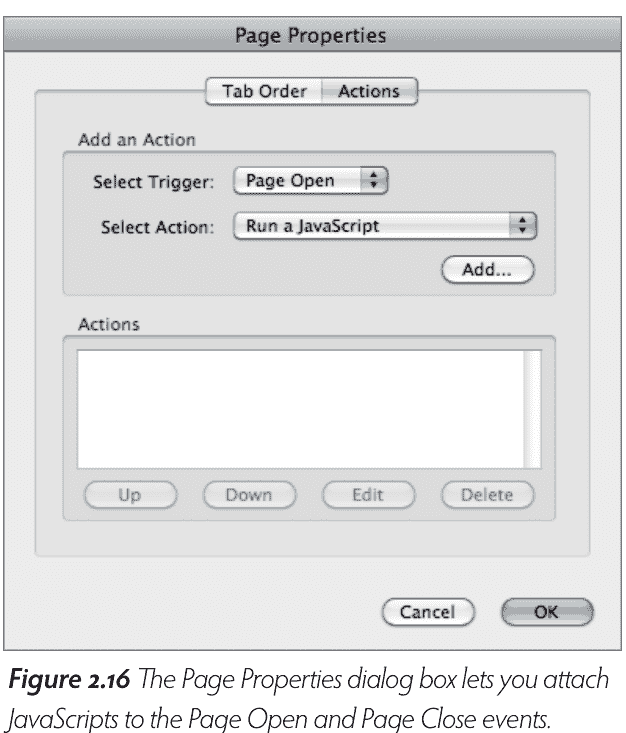

### 其他页面操作

您可以将各种各样的操作附加到“页面打开”或“页面关闭”事件。在“选择操作”弹出菜单中，您可以指定 Acrobat 应执行以下操作：

- 执行任何 Acrobat 菜单项
- 在该页面上播放电影
- 播放声音
- 转到网页
- 导入表单数据（我们稍后将看到如何操作）

还有更多！您应该尝试一下这个菜单；这里有很大的潜力。

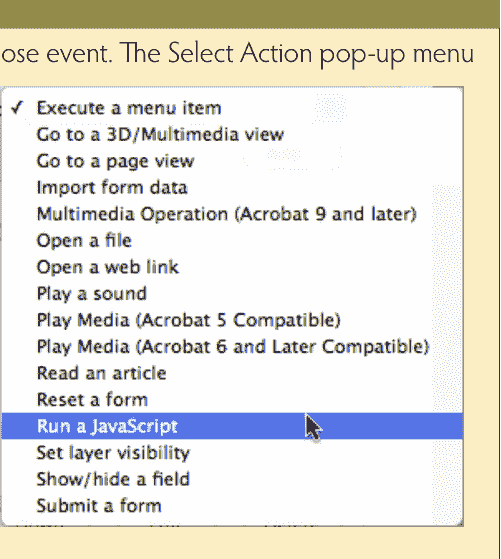

### 一次编辑所有脚本

到目前为止，我们已经将三个脚本附加到了我们的 PDF 格式目录：一个文档脚本、一个文档操作脚本和一个页面操作脚本。如果我们需要对这些脚本进行修改，我们必须依次打开它们，分别使用“文档 JavaScript”工具、“设置文档操作”工具和“页面缩略图”导航窗格。一点也不难，即使只有三个脚本，这也显得繁琐。如果您有（比方说）20 个脚本在文档中，逐一更新每一个将变得非常令人头疼。

幸运的是，还有更好的方法。

如果您在 JavaScript 面板中单击“编辑所有 JavaScript”工具（`图 2.17`），Acrobat 将打开 JavaScript 编辑器，其中包含大量的 XML 乱码（`图 2.18，下一页`）。（虽然 Adobe 没有说明，但我推测这是 Acrobat 用于在内部存储 JavaScript 代码的数据。）其中混合了您文档中每个脚本的代码。

文档中的每个 JavaScript 都将以类似以下块的文本表示：

```javascript
//<Document-Actions>
//<ACRO_source>Document Will Close</ACRO_source>
//<ACRO_script>
/***** belongs to: Document-Actions:Document Will Close *****/
app.alert("Thanks for looking at our catalog!",3)
//</ACRO_script>
//</Document-Actions>
```

上面两条粗体行是关键：带有`belongs to`的行标识了脚本的位置（在这种情况下是“文档将关闭”操作）；其后是实际的 JavaScript 代码（这里是一行，但可以是所需的任意多行）。

编辑您希望修改的任何脚本的 JavaScript 代码，然后单击编辑器的“确定”按钮。您将一次性修改了所有脚本。

相当酷，对吧？

> 顺便说一句：
>
> **请勿修改 JavaScript 编辑器中的 XML 代码！您将非常非常后悔！**
>
> 如果您更改了任何 XML 代码，所有的保险都失效了，因为这是 Acrobat 将您的 JavaScript 重新导入文档所使用的数据；最坏的情况是，您的整个 JavaScript 集合可能会消失在太空中。

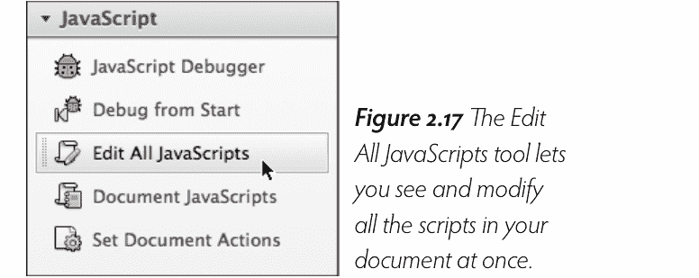

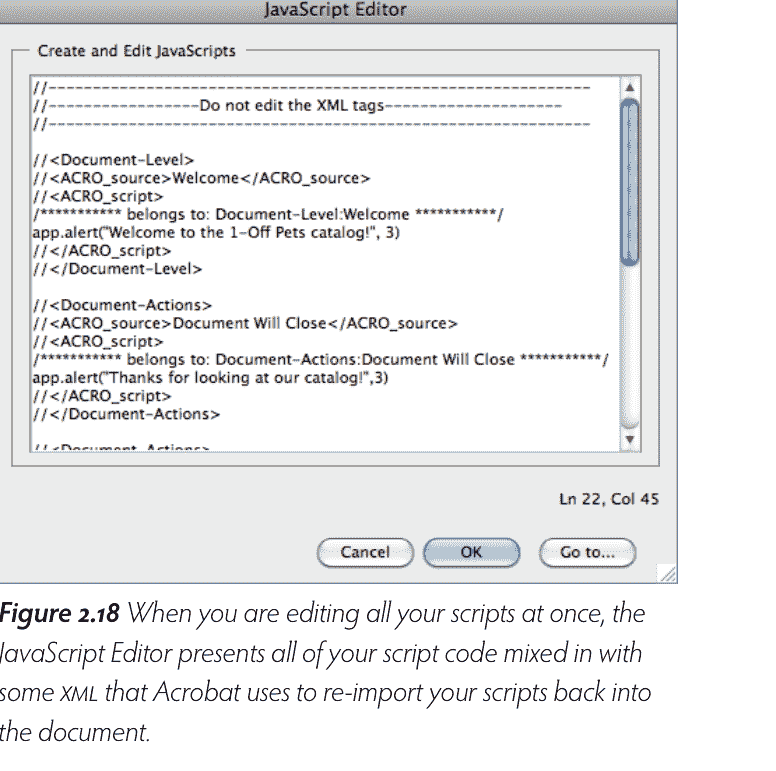

---

# 第 3 章：表单字段高亮

贯穿全书的一个反复出现的主题是表单中用户反馈的重要性。用户应该在任何时刻都清楚地知道期望他们做什么以及您的表单的哪部分正在等待信息。

在本章中，我们将探讨一种有用的方法来实现这一点；我们将创建一个文本字段具有彩色条目高亮的表单——即，当用户单击它们或切换进入它们时，它们会改变颜色，如下面的示例所示。动手试试；单击它。


相当巧妙，对吧？让我们看看如何操作。

### 项目

*（文件：`JSAcro_Ch03_Example_Start.pdf`、`JSAcro_Ch03_Example_Final.pdf`）*

我们将在`图 3.1`的订单表单中添加彩色条目高亮。这个 Acrobat 文件最初是一个完全不出彩的表单，用户会填写它以订购一份其记录副本。从`图 3.2`可以看出，该表单包含几个文本字段和一个单一的“提交”按钮。

由于彩色条目高亮，当用户在文本字段中单击时，字段将变为红色，表明它是当前活动字段。

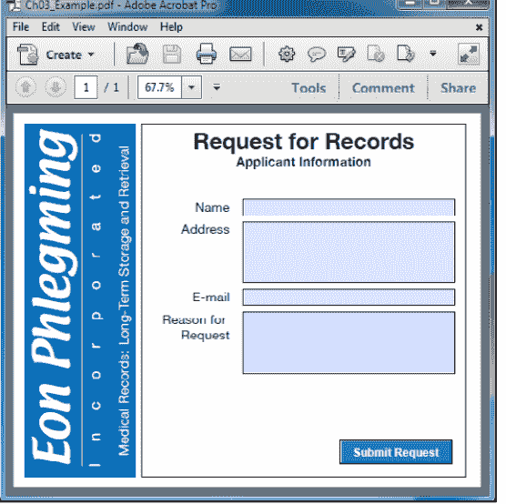

*图 3.1* 我们要向此表单中的文本字段添加条目高亮。

*图 3.2* 我们要向此表单中的文本字段添加条目高亮。

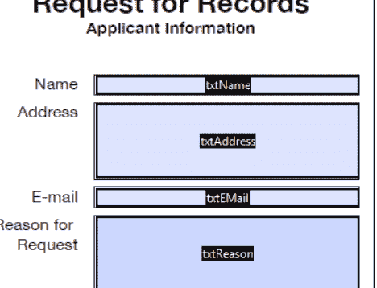

### JavaScript

通常，文本字段包含显示在白色或透明背景上的黑色文本。我们将修改文本字段，使得当用户单击字段（或切换进入它）时，字段变为白色文本在红色背景上，如同上一页的示例所示，表明该字段已准备好接收键盘输入。

#### 接近问题

为了实施条目高亮，我们将为表单中的每个文本字段附加 JavaScript（参见`图 3.3`）。“On Focus”事件发生在任何表单字段成为数据输入目标时，通常是因为用户单击了该字段或切换进入了它。“On Blur”事件发生在表单字段失去焦点时——即，当其他表单字段成为数据输入目标时。（如果“On Blur”这个词对于此事件来说有点奇怪，您会用什么单一单词来描述“焦点”的反义词？）

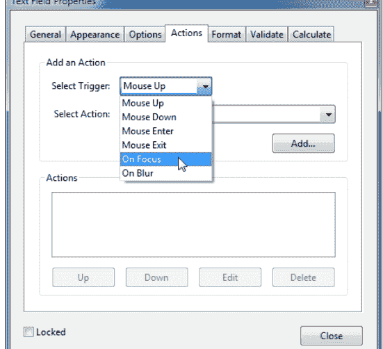

我们的“On Focus”JavaScript 将表单字段的背景色设置为红色，并将文本色设置为白色。“On Blur”脚本将背景和文本色分别恢复为透明和黑色。我们需要将这些 JavaScript 添加到用户可能输入数据的所有文本字段中。

*图 3.3* 我们将向表单中的每个文本字段添加两个脚本：一个将高亮打开的“On Focus”脚本和一个将其关闭的“On Blur”脚本。

### 代码

#### 步骤 1：“On Focus”JavaScript

下面的 JavaScript 旨在用于此表单中每个文本字段的“On Focus”事件（见图 3.2）。

```javascript
// This is the On Focus JavaScript
var txtField = event.target            // Get a reference to our text field
txtField.fillColor = color.red        // Change the background color to red
txtField.textColor = color.white      // Change the text color to white
```

> **事件目标**
>
> 在表单字段 JavaScript 中，短语`event.target`指的是引起该事件的表单字段。如果您单击“按钮”对象，`event.target`将返回对该按钮的引用。
>
> 这允许您编写可用于多个表单字段的 JavaScript 代码，而无需修改脚本。例如，本章的三行脚本可以剪切并粘贴到我们 PDF 文件中每个“文本”字段的“On Focus”事件中，而无需为单个字段修改脚本。

#### 代码详解

```javascript
var txtField = event.target
```

第一行获取引起“On Focus”事件发生的字段（事件的**目标**）并将其分配给一个命名引用（一个**变量**），其名称为`txtField`。这是我们将在其余 JavaScript 中引用文本字段的名称。（有关事件目标的完整讨论，请参阅第 5 章。）

## 3. 表单字段高亮显示

```javascript
txtField.fillColor = color.red
txtField.textColor = color.white
```

获取到文本字段的引用后，我们设置了它的两个属性：

- `fillColor`是表单字段的背景颜色。我们将其设置为红色。
- `textColor`是表单字段中文字的颜色。我们将其设置为白色。

请注意，我们以`color.red`和`color.white`的方式指定颜色。Acrobat 提供了一组常见颜色的预定义名称，列在`表 3.1`。

### 表 3.1 预定义颜色名称

| 预定义颜色名称 | 相关颜色名称 |
| --- | --- |
| `color.transparent` | `color.red` |
| `color.white` | `color.green` |
| `color.ltGray` | `color.blue` |
| `color.gray` | `color.cyan` |
| `color.dkGray` | `color.magenta` |
| `color.black` | `color.yellow` |

#### 步骤 2：失去焦点时的 JavaScript

我们的“失去焦点”脚本与“获得焦点”脚本相同——只是不同。我们将`textColor`和`fillColor`属性恢复为其原始值：

```javascript
// This is the On Blur script
var txtField = event.target      // Get a reference to our text field
txtField.fillColor = color.transparent  // Make the background color transparent
txtField.textColor = color.black      // Make the text color black
```

与第 1 步类似，我们获取到引发“失去焦点”事件的文本字段引用，然后更改背景和文字的颜色（背景透明和文字黑色）。`color.transparent`在此上下文中是一个有效的颜色。

这就够了。一旦你将这两个 JavaScript 添加到表单中的每个文本字段，您的表单将具有彩色输入高亮，用户会印象深刻。

### 自定义

为了您自己的目的自定义这些 JavaScript 并没有太困难；事实上，我们在这里使用的 JavaScript 可以用于任何表单中的任何文本字段，无需修改。

您可能想要做的唯一合理的自定义就是为您的文本字段选择其他颜色。您可以使用任意组合的`fillColor`和`textColor`来高亮您的文本字段。`表 3.1`显示了 Acrobat 识别的标准命名颜色；然而，您可以使用此格式将颜色设置为任何您想要的 RGB、CMYK 或灰度值：

```javascript
txtField.fillColor = ["RGB", .5, 1, .5 ]
```

颜色分量（在我们的案例中为 R、G 和 B）的值必须介于 0 到 1 之间。零表示该颜色分量关闭；1 表示该分量全开。因此：

```javascript
txtField.fillColor = ["CMYK", 0, 1, 0, 0]
```

将颜色设置为纯品红色（洋红色）。

最后，如果您将字段的`fillColor`和`textColor`都设置为`color.transparent`，该字段实际上会消失。您可以使用这一功能动态隐藏表单字段；但是，有一个更好的方法可以做到这一点，我们稍后会在第 12 章看到。

### 变量与字段引用

我们的两个 JavaScript 引用了几个我没有完全解释的项目。现在我们来谈谈它们。

#### 变量

JavaScript（或任何编程语言）中的**变量**是对数字、字符串或其他数据的一个命名引用。该引用的内部性质因语言而异，在 JavaScript 中并不重要；重要的是变量有一个名称，并且是数据的代名词。

您在 JavaScript 中使用`var`关键字创建变量。

```javascript
var ppi = 72
```

上述行创建一个名为`ppi`的变量，并为其分配数字 72。在 JavaScript 的其他地方，您可以使用名称`ppi`来代替值 72：

```javascript
300 / ppi
```

上述代码将 300 除以 72（也许是转换点英寸）。

#### 字段对象引用

我们的 JavaScript 修改了`txtName`表单字段中的一对与颜色相关的属性。为此，我们需要以某种方式获取代表该字段的 JavaScript 对象。我们使用`Doc`对象的`getField`方法完成了这一步：

```javascript
var nameField = this.getField("txtName")
```

记住，`this`指代 PDF 文档的`Doc`对象（可视为“当前文档”的缩写）。`Doc`对象的`getField`方法接受表单字段名称作为参数（在我们的例子中是`"txtName"`），并返回与该表单字段关联的 JavaScript `Field`对象。注意，表单字段的名称必须在引号内，因为它是 JavaScript 字符串。

上述代码获取到名为`txtName`的表单字段的`Field`对象的引用，并将该对象分配给变量`nameField`。完成之后，我们可以使用`nameField`变量访问和更改`txtName`字段的各种属性：

```javascript
nameField.value = "Thelonius Abbot"
```

这设置文本字段的内容（其值）为指定的字符串；这就是现在将出现在该字段中的文字。

# 第 4 章：检查 Acrobat 版本

Adobe Acrobat 的每个版本都增加了新的功能和能力：原始版本的 Acrobat（例如，Acrobat 5 之前）仅支持最基本的标注类型；数字签名在 Acrobat 6 中变得更为强大；作品集功能在 Acrobat 8 中是新增的。不可避免地，您必须假设查看表单的 Acrobat 版本是什么。如果用户的 Acrobat 版本早于此，您应该检测到这一事实并妥善处理这种情况。

这就是我们将在本章讨论的内容。我们将看到如何确定用户使用的 Acrobat 版本，以及如何在用户的程序过于简陋而无法正确显示时自动关闭文档。

### 本章学习要点

在本章中，我们将学习：

- 使用`if`和`else`指定条件执行
- 使用 JavaScript 关闭文档
- 显示包含用户信息的警报
- 格式化警报文本

### 项目

（文件：*`JSAcro_Ch04_Example_Start.pdf`*、*`JSAcro_Ch04_Example_Final.pdf`*）

`图 4.1`显示了使用彩色输入高亮来更改表单字段颜色的表单（当用户选择该字段时）。（顺便说一句，第 3 章展示了如何做到这一点。）此表单通过为每个文本字段的“获得焦点”和“失去焦点”事件附加 JavaScript 来实现高亮。由于这两个事件是在 Acrobat 5 中添加的，我们的表单在早于 5 的 Acrobat 版本中将无法正常工作。（是的，我*知道*Acrobat 5 是很长时间以前的事了，但您会惊讶地发现人们是多么喜欢继续使用旧版软件；我至少认识一个人 clinging to Acrobat Reader 4 运行在 Windows 2000 上。）

在本章中，我们将进一步修改此表单，查看用户的 Acrobat 版本号。如果版本号小于 5，我们将首先弹出警报（`图 4.2`）宣布这一事实，然后关闭表单。


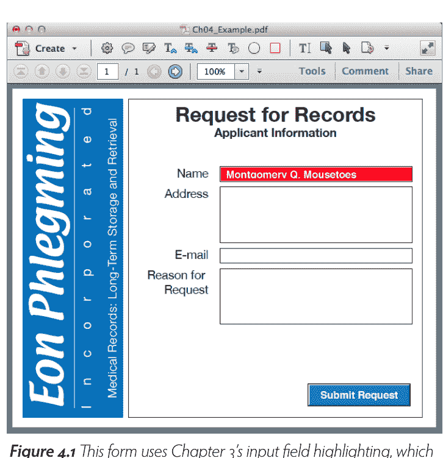

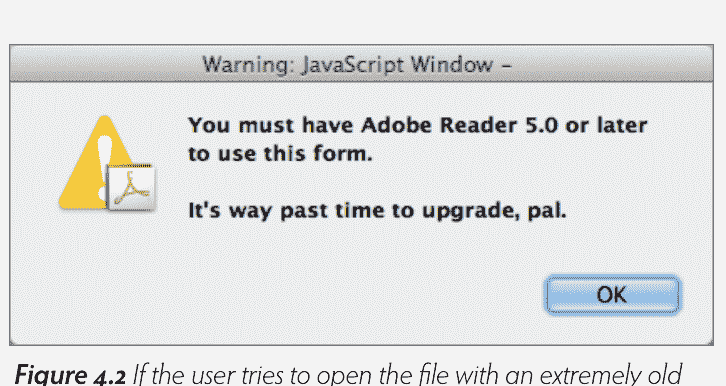

# 4. 检查 Acrobat 版本

## JavaScript 脚本

检查正确的 Acrobat 版本是当用户首次打开文档时您希望执行的操作。因此，我们将使用文档 JavaScript，Acrobat 会在用户首次打开文档时执行它。

## 问题分析

此脚本相对简单。我们将查看用户的 Acrobat 版本并将其与我们所需的最低 Acrobat 版本（在我们的例子中为 Acrobat 5）进行比较。如果版本小于 5，我们将发布图 4.2 所示的警报，然后关闭 Acrobat 文件。

我们可以通过检查`app`对象的`viewerVersion`属性轻松确定版本号，其值为当前 Acrobat 查看器的版本号。

## 代码

此 JavaScript 需要作为文档 JavaScript 输入。（参考第 2 章了解如何附加到文档的文档 JavaScript。）记住，文档 JavaScript 必须始终有一个名称。我将把我们的脚本命名为`CheckVersion`（**图 4.3**）——如果缺乏想象力，但这很具描述性。

```javascript
if (app.viewerVersion < 5) {
    app.alert("You must have Adobe Reader 5.0 or later to use this form.\n\nIt's way past time to upgrade, pal.")
    this.closeDoc(true)
}
```

## 代码详解

此程序围绕对 JavaScript`if`命令的调用构建。该命令比较两件事（在我们的案例中，是 Acrobat 版本和数字 5），如果比较结果为真则执行一段代码。`if`命令及其搭档`else`在 JavaScript 中无处不在；我们在本书中会频繁地看到它们。任何时候您的 JavaScript 需要在一种情况下做一件事而在另一种情况做另一件事，这些都是您使用的编程工具。

```javascript
if (app.viewerVersion < 5)
```

这里是我们查看 Acrobat 版本是否小于 5 的地方；更改数字以反映您所需的最低 Acrobat 版本。（注意我们正在检查`app`对象的`viewerVersion`属性。）

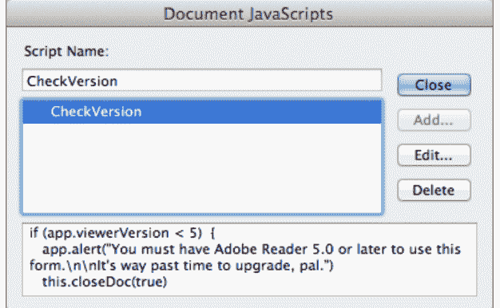

*图 4.3* 每个文档 JavaScript 都必须有名称；我们将我们的命名为“CheckVersion”。我们因此实现了清晰，尽管活力/灵动感还是溜走了。

如果比较结果为真（换句话说，如果阅读器版本低于 5），则应执行的 JavaScript 代码位于比较语句后面的大括号之间。在我们的例子中，这个“条件块”内有两行代码：

```javascript
app.alert("You must have Adobe Reader 5.0 or later to use this form.\n\nIt's way past time to upgrade, pal.", 3)
```

在这里，我们让`app`对象显示一个如图 4.2 所示的警告框。括号中的文本是警告框中应显示的文本；你可以将其更改为任何你想要的内容。请注意，在你的代码中，这应该是一整行；第二行开头有一个续行符。

还要注意文本中的两个“`\n`”字符。这些是“换行”指示符，告诉 Acrobat 在显示文本时在此处移动到下一行的开头。由于我们连续使用了两个，因此在警告文本中此处会得到一个空行（参见图 4.2）。你也可以使用`\t`（“制表符”）来缩进文本。

```javascript
this.closeDoc(true)
```

最后，在通知用户问题所在后，我们告诉当前文档关闭自身。请记住，`this`指的是当前文档（即“本文档”）。布尔值`true`表示用户不应有机会在文档关闭前保存文档。如果你将布尔值更改为`false`，Acrobat 将向用户显示一个标准的“是否要先保存”对话框（图 4.4），允许用户在 Acrobat 文件关闭前保存它。（例如，如果你在表单中的关闭按钮上使用`closeDoc`方法，你可能希望使用`false`；这将给用户保存其对表单所做的任何更改的机会。）

作为便利，如果你确实想要一个“保存”对话框，可以省略布尔值；在这种情况下，你对`closeDoc`的调用将如下所示：

```javascript
this.closeDoc()
```

这省去了你输入`false`的麻烦，但除此之外没有区别。

## 自定义说明

自定义此 JavaScript 的明显机会是：

- 更改`if`行中的版本号为你想要的任何最低 Acrobat 版本。
- 更改警告中的文本为你希望屏幕上显示的任何内容。

以下是你对此程序可以进行的不太明显的更改。

| 符号 | 含义 |
| :--- | :--- |
| `<` | 小于 |
| `>` | 大于 |
| `==` | 等于 |
| `<=` | 小于或等于 |
| `>=` | 大于或等于 |
| `!=` | 不等于 |

## 测试阅读器类型

你可以轻松修改本章的 JavaScript 代码，以查看你的用户正在使用哪个 Acrobat 程序来查看你的表单：Adobe Reader 还是完整的 Acrobat。`app`对象有一个名为`viewerType`的属性，它将具有两个字符串值之一，`"Reader"`或`"Exchange"`，具体取决于用户正在运行哪种类型的查看软件。（请注意，我们现在所知的“Adobe Acrobat”过去被称为“Acrobat Exchange”。）

如果你的表单需要完整 Acrobat 包的功能（也许你的表单允许用户将表单数据保存到磁盘，这仅在完整的 Acrobat 中可用），你可以修改本章的文档 JavaScript 如下：

```javascript
if (app.viewerType == "Reader") {     // "==" means "is equal to"
    app.alert("You must have the full Acrobat to use this form.")
    this.closeDoc(true)
}
```

如果他或她使用 Adobe Reader 查看你的表单，这将警告用户然后关闭文档。

## 测试计算机平台

Acrobat 还提供了一种方法，让你的 JavaScript 可以确定其运行在什么类型的计算机上。`app`对象的`platform`属性将具有三个值之一，具体取决于计算机的类型：`"WIN"`、`"MAC"`或`"UNIX"`。

如果此信息对你的脚本很重要，你可以在类似以下的代码块中使用`platform`属性：

```javascript
if (app.platform == "WIN")
    app.alert("I'm running on Microsoft Windows.")
else if (app.platform == "MAC")
    app.alert("I'm running on a Mac.")
else
    app.alert("This is a UNIX box.")
```

这不应该经常出现，因为 PDF 的一个优势是它是平台无关的；你不需要更改代码以适应特定平台。

## 警告图标

我们在本章程序中显示的警告带有一个停止图标，表示出现了非常严重的问题，我们必须停止正在做的事情。

## 使用或不使用大括号

调用`if`命令后跟当比较为真时应执行的 JavaScript 代码：

```javascript
if (app.viewerType == "Reader") {
    app.alert("Oops! No Reader")
    this.closeDoc(true)
}
```

在上面的代码（以及本章的示例代码）中，两行条件执行的代码被括在大括号内。

如果条件代码仅由单行 JavaScript 行组成，则可以省略大括号；因此，如果我们只想关闭文档而不显示警告，我们的上面的示例可以重写为：

```javascript
if (app.viewerType == "Reader")
    this.closeDoc(true)
```

这纯粹是为了视觉上的优雅；你可以将单个`closeDoc`调用括在大括号中，但那样就不那么美观了。一些 JavaScript 程序员即使在单行条件块中也会包含大括号；这使得该行确实是`if`语句的一部分这一点绝对明确。

> **注意**
>
> 我们的代码使用了一系列顺序的`if..else`调用。使用 JavaScript`switch`语句有一种更优雅的方法来实现这一点。我们不会在本书中讨论该运算符；你可能需要查阅它。

然而，有时你不想在警告中使用那么强烈的图标。`app.alert`方法允许你指定，除了警告中应包含的文本外，还应显示的图标。这是一个出现在方法调用中消息字符串之后的数字代码：

```javascript
app.alert("OMG, I can't believe you did that!", 3) // 3 is the icon code
```

有关你的警告可用的图标以及如何选择它们的完整讨论，请参见第 13 章。

# 第 5 章 计算表单字段

计算在我们计算机世界所做的事情中至关重要。电子表格、统计分析、会计信息——甚至不明显的事情，如文字处理和页面布局——都依赖于计算机执行计算的能力，将精细的小人脑留待追求更崇高的目标。

作为软件，Acrobat 也可以进行数学运算，允许你指定表单字段的值应该是计算出来的，而不是由用户输入。你可以使用 JavaScript 或 Acrobat 的预定义计算之一来实现这一点；在这里，我们将学习如何创建使用这两种方法的计算表单字段。

## 项目

（文件：`JSAcro_Ch05_Example_Final.pdf`、`JSAcro_Ch05_Example_Start.pdf`）

在本章中，我们将为**图 5.1**中的采购订单表单添加计算。该表单供小型企业的员工订购办公用品或其他必需品。对于用户想要购买的每件商品，他们提供描述以及所需的价格和数量。表单自动填写小计、税和总购买价格。

查看**图 5.2**，我们可以看到该表单由文本字段组成，排列成六列，分别用于商品名称、价格、数量、小计、税额和该商品的总成本。我们在表单底部还有一个最终的总金额。如果这是你为公司制作的真实表单，它还需要一个提交按钮，也许还有一个清除表单按钮；为了简洁起见，我在这里省略了这些。

我们需要放入此表单的计算如下：

对于每件购买的商品……

- 小计 = 价格 × 数量
- 税 = 税率 × 小计
- 商品成本 = 小计 + 税

最后：

- 总计 = 商品成本之和

让我们看看如何将这些计算添加到我们的表单中。

### 我们将在本章学习什么

在本章中，我们将学习如何：

- 创建计算表单字段
- 设置计算顺序
- 使用预定义计算
- 使用 Adobe 的层次命名约定
- 在表单中隐藏零值
- 创建全局变量

## 5. 计算表单域

### 创建计算域

你可能还记得，文本域可以被声明为计算域。Acrobat 会根据需要自动重新计算该域的值；我们所要做的就是准确地告诉 Acrobat 需要执行什么计算。我们通过“域属性”对话框（**图 5.3**）来完成此操作。

### 为文本域附加计算

首先确保文档在表单编辑器中可见，这样表单域就会像图 5.2 中那样显示为黑色矩形。

1. 双击该文本域。

   现在你将看到该文本域的“域属性”对话框（**图 5.3**）。

2. 点击“计算”选项卡。

   现在你看到的是允许你为文本域值指定计算的控件。

3. 对于简单计算，点击第二个单选按钮（“值是……”），然后从预定义计算的弹出菜单中进行选择。

   如果你看不到这个第二个单选按钮，那就意味着该域的格式未设置为“数字”。请参阅右侧的边栏。

4. 如果需要更复杂的计算，点击第三个单选按钮（“自定义计算脚本”），然后点击“编辑”按钮输入 JavaScript。

### 预定义计算

Acrobat 内置了五种计算。无需编写任何 JavaScript，你就可以将一个文本域的值设置为两个或多个其他表单域的和、积、平均值、最小值或最大值。这就是“域属性”对话框“计算”面板中第二个单选按钮的含义。

同样，这些预定义计算仅在你明确将文本域的格式设置为“数字”时才可用。

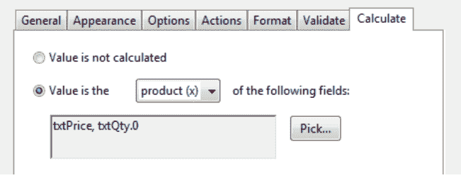

**图 5.3** *在域属性对话框的“计算”选项卡中，你告诉 Acrobat 如何计算文本域的内容。*

> ### 使用文本域进行数字计算？
>
> 文本域的*值*是该域包含的文本。如果该文本是有效数字，那么该域的值就可以用于 JavaScript 计算，就像我们这里所做的那样。如果文本域的值不是有效数字（例如，如果域中包含“Mooseberries”），那么该值仍然可以用于计算，但其值将被解释为 0。
>
> 确保文本域只包含有效数字的最简单方法是将其格式设置为“数字”；然后 Acrobat 将拒绝任何不属于数字值的按键输入。（如果你想使用 Acrobat 预定义计算，也需要这样做。）

### 要将文本域的格式设置为“数字”

首先，使用 Acrobat 表单工具选中该文本域。

1. 双击文本域以访问其属性。
2. 转到“格式”面板（**图 5.4**）。
3. 从可用格式列表中选择“数字”。
4. 选择其他选项（货币符号等），如果它们看起来有用。
5. 点击“确定”按钮。

此表单域现在将只接受数字、小数点以及开头的加号或减号。

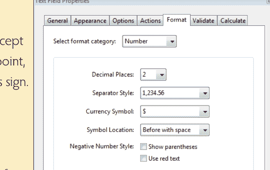

**图 5.4** *要对文本域执行计算，你必须将其格式设置为“数字”。*

### 要使用预定义计算之一

首先打开“域属性”对话框的“计算”面板。

1. 选择“启用”预定义计算的单选按钮（图 5.5）。
2. 从弹出菜单（也是图 5.5）中，选择你想要的计算。
3. 点击“选取”按钮，然后从弹出的列表（图 5.6）中选择计算应使用的数据域。

选择预定义计算比编写等效的 JavaScript 代码方便得多。在我们的采购订单表单中，我们将为“成本”字段（其值是小计和税额之和）和“总计”字段（所有项目成本之和）使用预定义计算（图 5.7）。税额的计算需要乘以一个常数值（我们的税率），因此无法使用预定义计算完成。（预定义计算可以将两个或多个表单域相乘，但不能将表单域乘以一个固定数字。）我们将为“税额”字段编写一个 JavaScript。

我们也可以为“小计”字段使用预定义计算（它是单价和数量的乘积）。不过，我们将用 JavaScript 来计算小计；这样做的原因将在本章末尾讨论增强功能时变得清晰。

> ### 图 5.5
>
> 要分配预定义计算，你首先选择“值是……”单选按钮，然后选择计算类型。
>
> ### 图 5.6
>
> 你可以从“域选择”对话框中选择应参与计算的表单域。
>
> ### 图 5.7
>
> `txtCost`字段的值是`txtSubtotal`值加上`txtTaxAmt`。

### 项目计算

让我们为表单中的各个采购项目添加计算。我们需要为每个项目的`txtTaxAmt`、`txtSubtotal`和`txtCost`字段应用计算值。

请注意，我们为这些字段分配的名称符合**Adobe 分层命名约定**（见边栏）；因此，例如，当我们向下浏览“税额”列时，字段的名称是`txtTaxAmt.0`、`txtTaxAmt.1`，依此类推。这种命名约定使得字段名称易于记忆，并且在使用预定义计算时可能很有用，正如我们讨论`txtTotal`字段时将看到的。

在我们讨论与项目相关的计算时，我们将查看适用于项目 0（第一行表单域）的 JavaScript。对于完整的表单，你需要为项目 1、2 和 3 重复这些计算，并根据需要更改字段名称。

### 计算`txtSubtotal.0`

一个项目的小计是单价乘以购买数量。就我们的表单而言，这意味着`txtSubtotal.0`的值应该是`txtPrice.0`乘以`txtQty.0`的乘积。这可以使用 Acrobat 预定义计算来完成，但我们将用 JavaScript 来做，原因有二：

- 我想明确指出，预定义计算并没有什么神奇之处；预定义计算能做的任何事情，你都可以轻松地用 JavaScript 完成。
- 在我们在本章末尾讨论的增强功能中，我们将看到一个很好的理由来用 JavaScript 执行所有计算。这与值为零的域的显示方式有关。但我们稍后会回到这个话题。

要将此计算附加到`txtSubtotal.0`，首先打开“域属性”对话框的“计算”面板（图 5.8）。（按照第 34 页“为文本域附加计算：”下的步骤 1–2 来到达此面板。）

点击“自定义计算脚本”单选按钮，然后点击“编辑”按钮。Acrobat 将向你显示 JavaScript 编辑器窗口（图 5.9）；输入下面的 JavaScript 并点击“确定”。

当你点击“确定”按钮时，Acrobat 会对你的代码进行一些检查，并尝试告诉你是否有任何明显错误。图 5.9 显示了文本域下方的其中一条错误消息。

请记住，双斜杠行表示 JavaScript 注释，Acrobat 和 JavaScript 会忽略它们。如果你愿意，可以省略这些注释，但我建议你也输入它们。（当你稍后返回代码时，它们将帮助你记住发生了什么。）

```javascript
// 获取价格和数量字段的引用

var price = this.getField("txtPrice.0")
var qty = this.getField("txtQty.0")

/* 将我们的文本域的值设置为
   价格和数量的乘积。*/
event.value = price.value * qty.value
```

这个简短的脚本相当简单明了。我们创建了变量`price`和`qty`，它们保存了对`txtPrice`和`txtQty`表单域的引用。然后我们将这两个字段的值相乘，并将所得乘积赋给名为`event.value`的东西。

> ### Adobe 分层命名约定


我们为文本域选择了一致的命名策略。与采购项目相关的文本域命名为`txtItem.0`、`txtItem.1`等。保存所有其他逐项信息的字段也类似命名（`txtCost.0`、`txtCost.1`；`txtQty.0`、`txtQty.1`等等）。

这些名称遵循 Adobe 分层命名约定。这是一组松散的规则，指定了如何为相关字段分配名称。这些名称类似于用于标识网站的 URL。使用“点”来分隔每个名称的不同部分；相关字段应共享其名称的开头部分以表示它们的关系。因此，`txtCost.1`和`txtCost.2`都是包含成本的文本域。这使得你很容易看出文本域之间的关系。

此外，正如我们将在计算“总计”字段时看到的，分层命名约定使得仅使用它们名称的开头部分就可以引用一整套表单域成为可能。也就是说，在预定义计算中，`txtPrice`是对所有以此名称开头的字段（`txtPrice.0`、`txtPrice.1`等）的简写引用。具体示例请参阅下面的“计算`txtTotal`”。

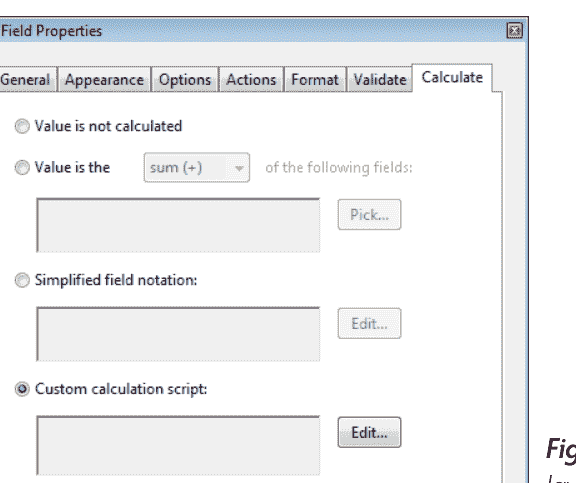

图 5.8 在文本域属性对话框的“计算”选项卡中为文本域附加 JavaScript。

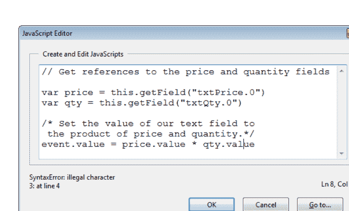

图 5.9 在 JavaScript 编辑器窗口中输入你的 JavaScript。注意文本域下方的错误消息。

## 5. 计算表单字段

本脚本中唯一不明显之处在于我们对术语`event.value`的使用。在计算脚本中，`event`指的是一个[事件对象](https://www.adobe.com/devnet-acrobat.html)；该对象包含与引发脚本执行的计算事件关联的各种信息。特别是，`event.value`是目标文本字段（即计算的目標字段）值的引用。这是一种方便的做法；如果我们没有使用`event`对象，我们不得不显式地获取对`txtSubtotal.0`字段的引用并在我们的计算中使用它：

```javascript
var subtotal = this.getField("txtSubtotal.0")
subtotal.value = price.value * qty.value
```

这样做并没有什么不对；只是需要输入更多的内容。（适度的懒惰在编程中是一种美德。）此外，我们要为附加到每个文本字段而重写脚本，每次都要替换该文本字段的名称。

此时，我们已计算出小计，即价格乘以数量。现在，我们准备计算税额了。

### 计算`txtTaxAmt.0`

单项的税额是该项小计乘以您所在地区的销售税率。在我所在的地区，税率是 8%（你们那些不在征收销售税州的，就请保密吧）；所以，每项应付的税额是小计乘以 0.08。

同前，转到`txtTaxAmt.0`字段的“计算”面板（图 5.10）。选择“自定义计算脚本”单选按钮并单击“编辑”按钮。在 JavaScript 编辑器中键入以下 JavaScript：

```javascript
var subtotal = this.getField("txtSubtotal.0")
event.value = .08 * subtotal.value
```

同样，我们的代码相当简单：获取对`txtSubtotal.0`字段的引用并将`event.value`设置为小计的值乘以 0.08。

我们可以为所有`txtTaxAmt`字段添加一种增强功能，但我将推迟到本章稍后部分（参见下文“全球税率”）。

### 计算`txtCost.0`

我们的采购订单表单中每项的最终成本是该项小计及其税款的总和。由于求和是 Acrobat 的预定义计算之一，我们将使用该机制而非 JavaScript 来计算成本。（如果 Acrobat 提供了方便的替代方案，不要犹豫不使用 JavaScript；始终使用实现目标的最简单方式。）

### 计算语法

JavaScript 计算使用标准字符来表示基本算术。您在电脑使用中肯定见过这些字符：`+`、`-`、`*`和`/`分别对应加、减、乘、除。

此外，您可以使用括号使计算的某些部分在其他部分之前发生：计算中位于括号内的部分将在括号外的部分之前执行。因此，如果您想计算两个变量`price1`和`price2`的平均值，您可以这样表达：

`var avg = (price1 + price2) / 2`

我们必须先将两个价格相加，然后将总和除以 2。

同前，双击`txtCost.0`字段并进入计算面板。这次，按以下方式指定预定义计算：

1. 单击中间的单选按钮（“值是...”）。
2. 在弹出菜单中选择求和（Sum）。
3. 单击“选取”按钮并从生成的列表中选择`txtSubtotal.0`和`txtTaxAmt.0`（图 5.11）。

我们现在已计算出了第 0 项所需的所有信息：其小计、税额和成本。我们还需要做两件事：为第 1 至第 3 项设置相同的计算，然后计算订单的总成本。

### 计算第 1 至 3 项

第 1、2 和 3 项的计算字段与第 0 项的完全相同。重复相同的 JavaScript 和预定义计算，但只需将数字“.0”改为“.1”、“.2”或“.3”以匹配项目编号。（我总是把之前的脚本复制到新字段中，然后修改项目编号。）

因此，`txtSubtotal.1`的 JavaScript 如下：

```javascript
var price = this.getField("txtPrice.1")
var qty = this.getField("txtQty.1")
event.value = price.value * qty.value
```

### 计算`txtTotal`

最后，我们需要计算总欠款金额——所有四项成本的总和。这也是求和；因此，我们可以使用预定义的 Sum 计算。转到`txtTotal`字段的计算面板，并按照与`txtCost`字段相同的过程，将字段的计算值设置为四个`txtCost`字段的总和，如图 5.12 所示。

### 我们为何使用 Adobe 层级命名约定

图 5.12 显示了输入到计算文本框中的所有四个`txtCost`字段名称。但是，因为 Cost 字段的名称符合 Adobe 层级命名约定，我们在指定`txtTotal`计算时可以利用捷径。

注意在“字段选择”对话框中，编号的`txtCost`条目前面带有没有数字后缀的名称`txtCost`（图 5.13）。Acrobat 将该无后缀名称作为简写，代表所有名称为`txtCost-某物`字段的字段。使用层级命名约定的一个真正好处是：您可以通过名称的前缀部分指代整个系列的字段。当有机会时，没有理由不使用这种捷径。

我们完成了！现在我们拥有一个功能的订单表单，给定价格和数量后，自动填写所有其他信息。试一试吧。输入一些数字。给项目起富有想象力和幽默的名字！

### 计算顺序

表单中计算发生的顺序非常重要。我们必须先计算小计，然后计算税额；必须先计算小计和税额，然后计算项目成本，依此类推。

有时您会发现，Acrobat 表单中的计算似乎以错误的顺序发生。您可以在“表单编辑器”中指定表单字段的计算顺序。在“表单”面板中，选择“其他任务”>“编辑字段”>“设置字段计算顺序”（图 5.14）。

> Acrobat 9 的“表单编辑器”没有“表单”面板。您通过选择“表单”>“编辑字段”>“设置计算顺序”来设置计算顺序。

Acrobat 将向您显示“计算字段”对话框（图 5.15），其中包含当前 Acrobat 文件中所有计算表单字段的滚动列表；这些字段在此列表中出现的顺序即为它们的计算顺序。

要更改表单字段在列表中的位置，只需选中它并单击适当的向上或向下按钮。

重新排列表单的字段，直到它们处于正确的计算顺序。您必须先计算小计才能计算税额；必须先计算税额才能计算项目成本；必须先计算所有项目的成本才能计算总成本。因此，在列表中，Subtotal 必须在 Tax 之上，Tax 必须在 Cost 之上，Cost 必须在 Total 之上。

如果您发现表单呈现出明显错误的结果，并且找不到任何个别字段计算的问题，请检查是否没有任何字段是乱序计算的。

### 增强功能

我们可以为表单添加几种增强功能。这些完全是可选项，但长远来看会受益匪浅。如果您想亲眼看到它们生效，它们已应用于本章示例中的`JSAcro_Ch05_Example_B&W.pdf`文件。这里的“B&W”是“Bells and Whistles”的缩写（“Bells and Whistles”指花哨的功能）。

## 5. 计算表单字段

### 隐藏零值

到目前为止，在我们构建的表单中，与图 5.1 所示的表单存在一个显著的视觉差异。在我们的表单版本中，所有与“空”行关联的计算字段都显示着零，这是它们执行计算的结果（图 5.16）。虽然这在技术上是正确的，但在审美上却令人不悦。如果我们没有指定要购买的物品，其关联的表单字段最好留空，而不是显示明确的零。

为了消除这种视觉杂乱，我们需要更改与`txtSubtotal`和`txtTaxAmt`字段关联的计算。它们应该仅在对应的`txtQty`具有非零值时才执行计算；如果`txtQty`的值为零（如果该字段为空就会出现这种情况），那么我们的小计和税额字段应该为空，也就是说，它们的值应该是`""`。

以下是`txtSubtotal.0`的新计算 JavaScript：

```javascript
// 获取计算所需的两个字段
// 用于我们的计算
var price = this.getField("txtPrice.0")
var qty = this.getField("txtQty.0")

if (qty.value != 0)           // 如果 qty 不为零...（"!=" 表示"不等于"）
    event.value = price.value * qty.value  // ...那么执行这个
else                           // 否则...
    event.value = ""           // ...执行这个。
```

记住 JavaScript`if..else`命令是如何工作的：`if`命令后面跟着括号中的比较；在我们的例子中，我们比较`qty.value`和`0`，测试它们是否不相等。这个比较之后跟着一行或多行 JavaScript，如果比较结果为真则执行；在我们的例子中，有条件执行的单行代码执行我们的小计计算。

如果提供了`else`命令（它是可选的），其后跟着一行或多行 JavaScript，如果`if`比较不为真则执行；在我们的例子中，如果比较为假（也就是说，如果`qty.value`等于 0），那么我们将文本字段的值设置为空字符串：`""`。

这一更改的最终效果是，如果某个物品的数量字段为空（使其值为零），那么`txtSubtotal.0`字段将为空。

| 价格 | 数量 | 小计 | 税额 | 总价 |
|------|------|------|------|------|
| $20.00 | 4 | $80.00 | $80.00 | $160.00 |
| | | $0.00 | $0.00 | $0.00 |
| | | $0.00 | $0.00 | $0.00 |
| | | $0.00 | $0.00 | $0.00 |

*图 5.16 在我们目前的表单中，零值字段显示的值——可想而知——为零。如果这些字段留空，我们的表单看起来会更美观。*

要将相同的效果应用到`txtTaxAmt`字段，你应该将它们的值计算更改为：

```javascript
var subtotal = this.getField("txtSubtotal.0")

if (subtotal.value != 0)
    event.value = gTaxRate * subtotal.value
else
    event.value = ""
```

这与`txtSubtotal.0`字段的推理完全相同，只是我们要检查`txtSubtotal.0`的值是否为零来决定是否在税额字段中留空。

你应该将`if...else`块添加到全部四个`txtSubtotal`和`txtTaxAmt`字段中。

### 预定义计算

不幸的是，任何使用预定义计算的字段，例如我们的`txtCost`字段，如果其值为 0，仍将继续显示“0.0”。这大概是使用 JavaScript 而非预定义计算的唯一理由。

如果我们希望`txtCost.0`字段在值为零时正确显示为空，我们需要用 JavaScript 来计算其值，而不是使用预定义的求和：

```javascript
var subtotal = this.getField("txtSubtotal.0")
var tax = this.getField("txtTaxAmt.0")

if (subtotal.value != 0)                // 如果小计不为零...
    event.value = subtotal.value + tax.value   // ...执行这个
else                                    // 否则...
    event.value = ""                     // ...执行这个
```

这比使用预定义计算要费事一些，但它确实给我们带来了视觉改进，使零值总计显示为空。

### “全局”税率

假设在你设计完这个表单很久之后，你所在地区的税率发生了变化。在我们的表单中，我们使用税率（.08）来计算`txtTaxAmt`字段的值：

```javascript
event.value = .08 * subtotal.value
```

我们的表单有四个这样的字段；在其他表单中，税率可能在复杂表单的各个字段中被使用数十次。

追查所有这些对税率的引用，并将`.08`替换为，比如说，`.09`，即使不是不可能，也是极其繁琐的。

幸运的是，最初设计表单时很容易做到便于更改所有对税率的引用。我们将在表单中添加一个文档级 JavaScript，它只做一件事：定义一个包含我们税率的变量。

第 2 章中未提及的一点是，在文档级 JavaScript 中定义的变量可以被 Acrobat 文档中的任何 JavaScript 使用。既然如此，我们表单中任何需要引用税率的 JavaScript 都可以使用税率变量的名称，而不是直接使用数值。如果我们稍后修改文档级 JavaScript，更改赋值给税率变量的值，所有使用该变量的 JavaScript 都会使用新的税率。一举之下，我们就更改了整个表单中使用的税率。

像我们的税率这样的变量，可以在整个 Acrobat 文件中使用的变量被称为全局变量。你在文档级 JavaScript 中定义的任何内容都是全局的，也就是说，对文档中的所有 JavaScript 都可用。

### 创建文档级 JavaScript

你可能需要复习第 2 章，了解文档级 JavaScript 的一般行为和创建的详细描述。在这里，我们将仅列出创建我们特定 JavaScript 的步骤。

**创建税率 JavaScript：**

从 Acrobat 文档打开且选中手形工具开始。

1. 在 Acrobat 中，选择*工具 > JavaScript > 文档级 JavaScript*。Acrobat 将向你展示 JavaScript 函数对话框（图 5.17）。
2. 在脚本名称文本框中，输入“TaxRate”或其他描述性标签。
3. 点击添加按钮。Acrobat 将向你展示标准的 JavaScript 编辑器，其中已输入了一些初步的（对我们的目的无用的）代码。

*图 5.17* 我们将要创建一个文档级 JavaScript，定义一个包含税率的全局变量。

4. 删除 JavaScript 编辑器中的默认代码，输入以下内容：

```javascript
var gTaxRate = .08
```

这一行 JavaScript 创建了一个名为`gTaxRate`的变量，并将其赋值`.08`（图 5.18）。（我总是用小写`g`作为全局变量名的前缀；这样，当我在其他 JavaScript 中看到该变量名时，我就知道它是一个全局变量，在文档级 JavaScript 中定义。）

5. 关闭所有对话框，直到返回 Acrobat 文档。

我们现在已经创建了一个文档级 JavaScript，创建了我们的全局变量`gTaxRate`。

### 使用全局变量

现在我们需要修改四个`txtTaxAmt`计算，使它们使用`gTaxRate`，而不是直接使用数字`.08`。

像往常一样，我会带你更改`txtTaxAmt.0`，然后让你修改其他三个`txtTaxAmt`字段。

**应用新的全局变量：**

从在 Acrobat 中打开表单并选中表单工具开始。

1. 双击`txtTaxAmt.0`以打开字段属性对话框。
2. 转到计算面板。
3. 点击计算 JavaScript 旁边的编辑按钮。你现在将看到 JavaScript 编辑器显示我们当前的 JavaScript，其计算为：

   ```javascript
   event.value = .08 * subtotal.value
   ```

4. 将计算中的`.08`替换为变量名`gTaxRate`。

   ```javascript
   event.value = gTaxRate * subtotal.value
   ```

   你的计算行现在应该看起来像图 5.19。
5. 关闭所有对话框，直到返回 Acrobat 文档。

你应该对上述更改应用到全部四个`txtTaxAmt`计算 JavaScript 中。

## 5. 计算表单字段

完成上述操作后，您不会立即看到变化。毕竟，我们的税率没有改变；我们只是通过一个变量来获取它，而不是直接使用数字。

### 更改税率

要了解为什么这个更改是有用的，假设您所在地区的税率发生了变化（很可能是提高了）。要一次性做出所有必要的更改，您只需更改文档 JavaScript 中`gTaxRate`的值：

**要更改表单中所有项目的税率计算：**

1. 在“工具”窗格的 JavaScript 面板中，选择“文档 JavaScript”。您将看到“文档 JavaScript”对话框。


2. 在列表中选择 TaxRate JavaScript（如**图 5.20** 所示），然后单击“编辑”按钮。

3. 在 JavaScript 编辑器中，将税率更改为 .09，或任何您喜欢的其他数字：

```javascript
var gTaxRate = .09
```

4. 退出所有对话框，直到返回到您的 Acrobat 文档。

5. 检查税额字段；现在所有四个字段都将包含反映新税率的计算值。

通过更改文档 JavaScript 中的单个税率值，我们更新了整个表单中所有 JavaScript 使用的税率。在这种情况下，只有四个这样的 JavaScript；在较大的表单中，可能有几十个。

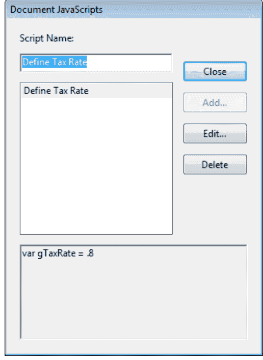

**图 5.20** 要更改表单中所有 JavaScript 使用的税率，只需更改文档 JavaScript 中`gTaxRate`的值即可。

# 第 6 章 自动输入表单数据

电子表单的优点之一是它们能够提供用户原本需要输入的信息。例如，当用户在电子订单表中选择要购买的产品时，表单应能够填写正确的单价并计算总成本。

## 本章我们将学习什么

在本章中，我们将学习如何：

- 创建和使用 JavaScript 数组
- 构建和使用数字表格
- 创建击键 JavaScript
- 使用下拉列表导出值

为此，表单必须包含一个产品及其价格的表格。每次用户选择一个产品时，表单必须在该表中查找该项目并获取该项目的价格。

这正是我们将在本章学习的内容：如何在表单中构建一个项目和价格的表格，然后从该表中获取信息以自动填写表单字段。

## 项目

（文件：*JSAcro_Ch06_Example_Final.pdf*、*JSAcro_Ch06_Example_Start.pdf*）

在本章中，我们将订单表中的下拉列表（图 6.1）与同一表单中的单价字段链接起来。当用户从下拉列表的菜单中选择一种新口味时，表单将更改单价以反映所选产品，然后重新计算总成本（图 6.2）。


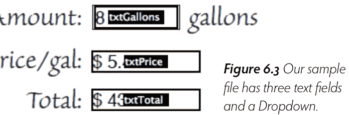

观察图 6.3，我们可以看到此表单有四个字段：一个下拉列表（`ddnFlavor`）和三个文本字段（`txtGallons`、`txtPrice` 和 `txtTotal`）。我们最关心的是下拉列表；我们将为此字段添加一个 JavaScript，该脚本会更改`txtPrice`和`txtTotal`字段以反映用户选择的冰淇淋。

具体来说，当我们从下拉列表的菜单中选择一个项目时，该下拉列表字段必须执行三项操作：

- 查找该项目的价格。
- 将`txtPrice`的值设置为该项目的价格。
- 重新计算`txtTotal`的值。

让我们看看如何做到这一点。

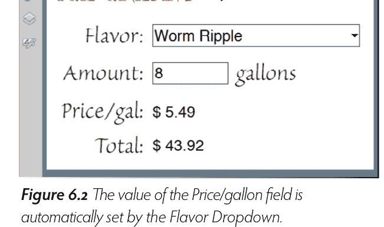

## JavaScript

> 那么，什么是“下拉列表”？

“下拉列表”是 Adobe 对以前称为组合框的控件的命名。该术语在 Acrobat X 中引入。

## 方法

在这个程序中，我们需要为下拉列表菜单中的项目构建一个价格表。我们将使用 JavaScript`Array`对象来完成此操作。`Array`对象代表一个列表——在我们的情况下，是一个价格列表。列表中的每个项目都可以通过其在列表中的位置或通过一个`keyword`（一个与该值相关联的字符串）来查找。在我们的案例中，我们将使用下拉列表中每个项目的导出值（见下一节）作为查找该项目价格的关键词。

我们需要为表单编写两个 JavaScript：

- 一个创建价格表的文档 JavaScript。此脚本将创建一个`Array`对象，然后加载导出值和相关价格对。
- 一个附加到我们的下拉列表的 JavaScript，该脚本在价格表中查找当前的`export value`（我们稍后会讨论），并使用得到的价格来设置`txtPrice`和`txtTotal`字段的值。

## 下拉列表导出值

下拉列表菜单中的每个项目都有两段相关联的文本：

- 实际出现在弹出菜单中的**项目文本**。
- `export value`，它在表单数据导出到文件或提交处理时表示下拉列表的选定值。

下拉列表中每个项目的文本和导出值由表单设计者在“字段属性”对话框中设置（图 6.4）。

如果您检查下拉列表的属性，您会发现菜单中有五个项目，其导出值分别为：Ccp、Ogr、Vla、WR 和 ZZ。这些值没有特殊含义；我只是选择了它们作为菜单项文本的粗略缩写。（因此，“Ccp”是“克苏鲁薯片”的导出值）

我们的 JavaScript 将把每个这些导出值与该冰淇淋的每加仑价格相关联。

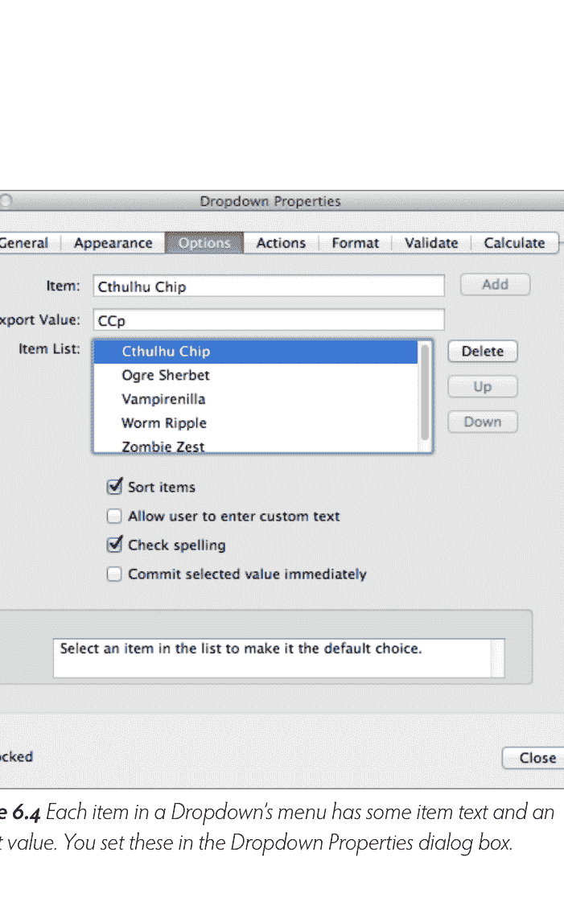

**图 6.4** 下拉列表菜单中的每个项目都有一些项目文本和一个导出值。您在下拉列表属性对话框中设置这些。

# 第 6 章 自动输入表单数据

## 创建价格列表数组

我们的第一个 JavaScript 是一个文档脚本，它创建我们的价格列表。这将是一个包含配对的导出值和价格的`Array`对象。有关文档 JavaScript 的完整讨论，请参考第 2 章。

**创建文档脚本：**

在 Acrobat 中打开表单文件。

1. 在“工具”窗格的 JavaScript 面板中，选择“文档 JavaScript”。Acrobat 将向您显示“文档 JavaScript”对话框（图 6.5）。
2. 在“脚本名称”框中，键入“PriceList”或类似的描述性名称。
3. 单击“添加”按钮。Acrobat 将向您显示常见的 JavaScript 编辑器窗口，其中包含一些初始 JavaScript 代码。
4. 删除默认的 JavaScript 代码，然后键入以下 JavaScript（图 6.6）：
5. 退出所有对话框，直到返回到 Acrobat 页面。

```javascript
var gPriceList = new Array      // 创建对一个新数组的引用

// 用产品的价格填充数组：
gPriceList["Ccp"] = 12         // Ccp 的每加仑价格是 $12.00
gPriceList["Ogr"] = 9.25        // ...等等。
gPriceList["Vla"] = 7
gPriceList["WR"] = 5.49
gPriceList["ZZ"] = 2.75
```

此时您不会在表单中看到任何不同的内容。我们的新 JavaScript 创建了一个价格列表数组，但我们尚未使用它来做任何事情。

### 代码详解

```javascript
var gPriceList= new Array
```

JavaScript`new`命令创建一个新对象，在本例中是一个新的`Array`对象。我们将新创建的`Array`对象赋值给一个全局变量`gPriceList`（由`var`命令创建）。由于这发生在文档 JavaScript 内部，`gPriceList`将是全局的，即可以在我们 Acrobat 文件中的任何 JavaScript 中使用。

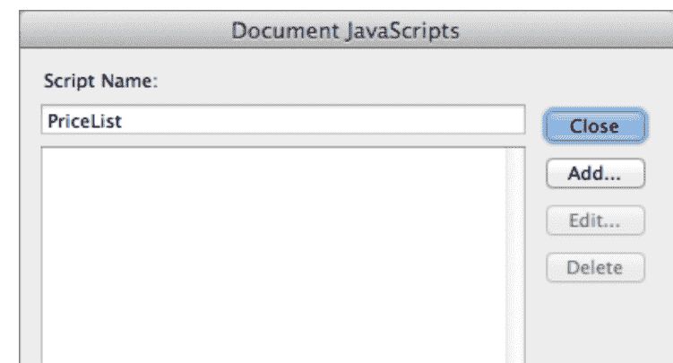

**图 6.5** 为您的文档 JavaScript 输入一个名称（此图为“PriceList”）并单击“添加”按钮。

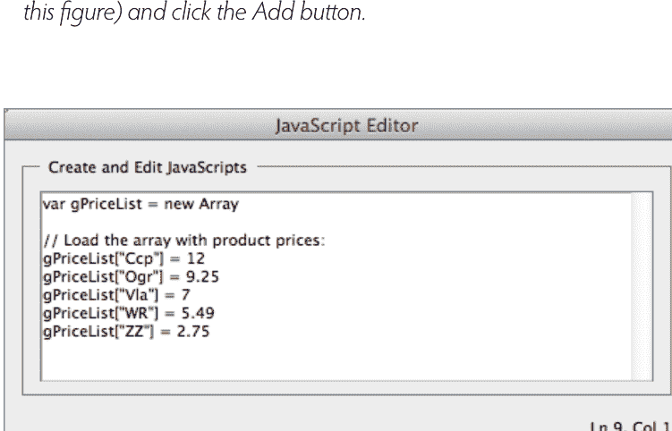

**图 6.6** 我们的文档 JavaScript 将创建一个包含冰淇淋价格表的数组。

## 第 6 章 自动输入表单数据

```javascript
gPriceList["Ccp"] = 12
```

这里我们将价格与下拉列表中的导出值关联起来。数组名称（`gPriceList`）后跟一对方括号，括号中包含一个值，表示列表中的一个条目。方括号内的值可以是一个数字，指定我们想要的特定项目在列表中的顺序位置，也可以是一个带引号的字符串，表示与所需项目关联的关键词。

在我们的案例中，我们将一个值赋给列表中的`Ccp`条目。上面一行 JavaScript，翻译成英语是：“在数组`gPriceList`中，将数字 12 赋给关键词`Ccp`。”

我们对下拉列表中的所有六个导出值重复此操作。

## 创建下拉列表脚本

现在我们需要教我们的下拉列表如何查找导出值并对其执行有用的操作。

我们将向我们的下拉列表附加一个*击键 JavaScript*。这是一个在用户每次向该下拉列表输入字符时执行的 JavaScript。令人惊讶的是，当用户从下拉列表的菜单中选择一个项目时，此脚本也会被调用。

因此，当用户从下拉列表菜单中选择一个项目时，Acrobat 将执行我们的击键 JavaScript，该脚本将进行表查找，更改`txtPrice`的值，最后为`txtTotal`计算一个新值。

**将击键 JavaScript 附加到我们的下拉列表：**

在表单编辑器中打开表单。

1. 双击下拉列表字段以获取其属性。Acrobat 将向您显示下拉列表属性对话框（**图 6.7**）。
2. 转到“格式”选项卡。
3. 在“类别”弹出菜单中选择“自定义”。
4. 单击“自定义击键脚本”文本框旁边的“编辑”按钮。您现在将看到熟悉的 JavaScript 编辑器。

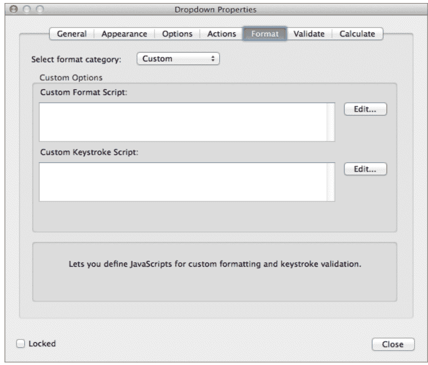

**图 6.7** 我们将在下拉列表属性对话框中键入击键 JavaScript。只需单击下方文本框旁边的“编辑”按钮。

## 第 6 章 自动输入表单数据

5. 输入以下脚本：

```javascript
// Get references to our form fields.
var priceFld = this.getField("txtPrice")
var totalFld = this.getField("txtTotal")
var quantityFld = this.getField("txtGallons")

// Is the new export value a keyword in our price list?
if (event.changeEx in gPriceList)
    priceFld.value = gPriceList[event.changeEx]    // Yes: get the price

// Now calculate a new value for the total price
totalFld.value = quantityFld.value * priceFld.value
```

6. 点击“确定”关闭所有对话框。

7. 试一下：从弹出菜单中选择各种商品，观察每加仑价格和总成本字段的值变化。

### 代码详解

```javascript
var rateFld = this.getField("txtPrice")
var totalFld = this.getField("txtTotal")
var quantityFld = this.getField("txtGallons")
```

此脚本首先获取我们需要访问的三个文本字段的引用，并将这些引用放入命名恰当的变量中。

```javascript
if (event.changeEx in gPriceList)
```

这里我们执行一个 JavaScript`if`命令，检查新的导出值是否是我们`gPriceList`数组中的有效关键字。在下拉菜单的按键 JavaScript 中，`event.changeEx`指的是新选中菜单项的导出值。短语`(Event.changeEx in gPriceList)`翻译过来就是：“在`Array`对象`gPriceList`中是否存在与我们的导出值匹配的关键字？”

```javascript
rateFld.value = gPriceList[event.changeEx]
```

这是当`event.changeEx`是`gPriceList`中的关键字时，`if`命令执行的那行 JavaScript。

短语`gPriceList[event.changeEx]`获取`gPriceList`数组中与导出值相关联的值。换句话说，该短语给出了下拉菜单中当前所选项目的单价。我们将`txtPrice`字段的值设置为这个数字。`txtPrice`字段将立即显示新的每加仑价格。

## 格式化你的代码

JavaScript 对于让你添加空格或制表符以提高代码可读性非常宽容。你可以以任何方式缩进你的 JavaScript，以改善视觉扫描效果。例如，我通常缩进`if`命令之后的语句，以强调它们只有在比较为真时才会被执行：

```javascript
if (event.changeEx in gPriceList)
    rateFld.value = gPriceList[event.changeEx]
```

类似地，我通常使用制表符和空格的某种组合来将我的注释与可执行的 JavaScript 代码分开；我还尝试让它们对齐：

```javascript
gPriceList["Ccp"] = 16    // Ccp costs $16/gal
gPriceList["Ogr"] = 12    // ...etc.
```

这使它们更具可读性，并且更赏心悦目（至少对我来说是这样）。你可以为你的 JavaScript 语句添加双空格，并根据需要添加空格和制表符。你的目标应该是让你的程序尽可能易于阅读。这不仅对其他人是一种帮助，对你自己几个月后重新阅读程序时也是如此。

```javascript
totalFld.value = quantityFld.value * rateFld.value
```

最后，我们将`txtTotal`字段（位于`totalFld`变量中）的值更改为数量和单价的乘积。后两个数字我们从`txtGallons`和`txtPrice`字段获取。

## 创建数组

在我们的文档 JavaScript 中，我们创建了一个`Array`对象，然后在单独的步骤中用值填充它：

```javascript
var gPriceList = new Array

gPriceList["Ccp"] = 12
gPriceList["Ogr"] = 9.25
gPriceList["Vla"] = 7
```

数组中的每个条目都将一个关键字（Ccp、Ogr 等）与一个数值相关联，代表该冰淇淋的每加仑价格。还有一种创建数组的替代方法，如果你创建的是一个相对较小的数组，并且将根据其在数组中的位置来检索其内容，那么这种方法非常方便。使用我们目前的技术，我们将用类似以下的代码创建这样一个数组：

```javascript
var gPriceList = new Array

gPriceList[0] = 12
gPriceList[1] = 9.25
gPriceList[2] = 7
```

我们通过**索引**（即数组中的位置）来引用此数组中的各个项：

```javascript
total = amount * gPriceList[1]   // total is the amount times 9.25
```

我们可以使用一种替代格式非常方便地创建这样的数组：

```javascript
var gPriceList = { 12, 9.25, 7}
```

实际上，这同时创建了一个数组并加载了值。花括号中的逗号分隔值（可以是任何类型的数据：数字、字符串、布尔值等）按出现的顺序加载到数组中。上面的行与前面更长的块完全等效。

# 第 7 章 鼠标悬停帮助

每个设计良好的表单都需要某种机制来提示用户如何填写表单。在 Acrobat 中，最常见的做法是通过内置在 Acrobat 表单机制中的工具提示帮助。这是许多应用程序的标准机制：将鼠标指针悬停在表单字段上，大约半秒钟后，一个有用的提示将出现在一个浮动窗口中（**图 7.1**）。

在本章中，我们将了解如何实现另一种方式：鼠标悬停帮助。这是当鼠标指针进入表单字段时自动出现的文本；不像工具提示帮助那样有半秒钟的暂停。请在**图 7.2**上试一试。

使用鼠标悬停帮助而不是工具提示帮助，纯粹是一个美学决定，基于你希望表单给填写者带来的“感觉”。

## 本章将学到什么

在本章中，我们将学习如何：

- 创建鼠标进入和鼠标退出 JavaScript
- 创建帮助文本表

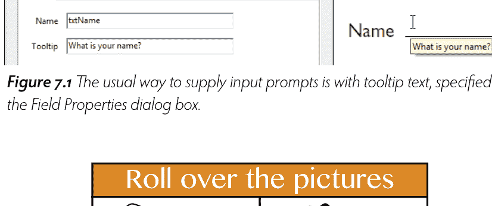

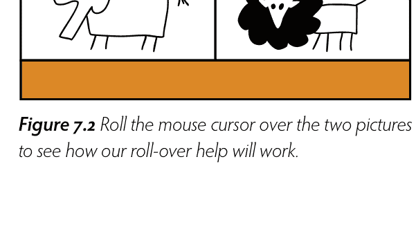

## 项目概述

（`JSAcro_Ch07_Example_Start.pdf`、`JSAcro_Ch07_Example_End.pdf`）


我们将为图 7.3 中表单的文本字段添加鼠标悬停帮助。每当鼠标指针移动到其中一个文本字段上时，一小段帮助文本将出现在表单底部的彩色区域，类似于我们在图 7.2 中的示例。


**图 7.3** 每当鼠标指针悬停在此表单的一个文本字段上时，帮助文本将出现在底部的彩色框中。

此表单中有四个文本字段（图 7.4）。前三个用于收集数据：申请人的姓名、地址和应聘职位；底部的字段`txtHelp`是一个不可见的文本字段，位于表单设计中绿色矩形的上方。

`txtHelp`字段不可见，不是因为其字段属性对话框中的“隐藏”属性被选中，而是因为它没有背景或边框颜色（图 7.5），并且初始时没有文本。只有当它有文本要显示时，它才会变得可见。

为了实现我们的鼠标悬停帮助，每当鼠标指针进入三个数据收集文本字段之一时，该字段中的一个 JavaScript 会将适当的帮助文本放入`txtHelp`字段。当指针离开文本字段时，其 JavaScript 会从`txtHelp`中移除文本。

## JavaScript 代码

### 实现方法

我们需要为三个数据收集字段中的每一个准备两个 JavaScript：

- 一个附加到字段“鼠标进入”事件的 JavaScript，它将适当的帮助文本放入`txtHelp`字段。记住，“鼠标进入”事件发生在鼠标指针进入表单字段边界时。
- 一个附加到字段“鼠标退出”事件的 JavaScript，它将从`txtHelp`中移除文本。记住，“鼠标退出”事件发生在鼠标指针再次移出表单字段时。


**图 7.4** 我们的表单有四个文本字段；三个用于收集数据，第四个用于显示帮助文本。


**图 7.5** 帮助文本字段不可见，因为它没有填充或边框颜色，并且初始时没有文本。

## 7. 悬停帮助

### 代码

首先，我们将两个 JavaScript 脚本附加到`txtName`字段上。要完成表单，您需要为其余每个数据收集字段执行以下步骤。

#### 将鼠标进入和鼠标移出 JavaScript 附加到姓名字段

在 Acrobat 表单编辑器中打开表单（这样字段就会显示为带有控制柄的矩形）开始操作。

1. 双击`txtName`字段以访问其属性（**图 7.6**）；转到字段属性对话框的“操作”面板。
2. 在“触发器”弹出菜单中选择 JavaScript，在“操作”弹出菜单中选择“运行 JavaScript”。

   对话框现在将如图 7.6 所示。
3. 单击“添加”按钮。

   Acrobat 将显示 JavaScript 编辑器。
4. 在 JavaScript 编辑器中输入以下内容：

   ```javascript
   var helpText = this.getField("txtHelp")     // Get reference to help field
   helpText.value = "What's your full name?"   // Set its value to help text
   ```

5. 单击“确定”返回到字段属性对话框。

   您的新 JavaScript 现在出现在“操作”列表中（**图 7.7**）。
6. 对于“鼠标移出”事件，重复步骤 2 到 5，将以下 JavaScript 输入到 JavaScript 编辑器中：

   ```javascript
   var helpText = this.getField("txtHelp")     // Get reference to help field
   helpText.value = ""                         // Set its value to empty
   ```

7. 关闭属性对话框并退出表单编辑器，以便返回到 Acrobat 页面。
8. 测试一下：单击手形工具，然后将鼠标指针移过“姓名”字段；您应该会看到帮助文本出现在彩色框中（**图 7.8**）。

要完成表单，请对`txtAddress`和`txtPosition`字段重复这些步骤，为每个字段使用适当的帮助文本。


### 代码详解

我们先来看看鼠标进入 JavaScript：

```javascript
var helpText = this.getField("txtHelp")
```

我们首先获取帮助文本字段`txtHelp`的引用。我们将此引用赋值给变量`helpText`。

```javascript
helpText.value = "What's your full name?"
```

现在我们将`txtHelp`字段的值设置为帮助文本 "What's your full name?"。文本字段的值是它向用户显示的文本。当我们设置字段的值时，会使其立即显示该文本。在我们的例子中，此脚本导致当鼠标指针进入`txtName`字段时帮助文本出现。

鼠标移出 JavaScript 与鼠标进入脚本几乎完全相同：

```javascript
var helpText = this.getField("txtHelp")
helpText.value = ""
```

它获取`txtHelp`字段的引用，但这次将其值设置为`""`。一对开闭引号中间没有任何内容，表示“无文本”（也称为空字符串）。`txtHelp`字段不包含文本，因此，当鼠标指针离开`txtName`时，它实际上会再次消失。

### 增强

（`JSAcro_Ch07_Example2_Start.pdf`、`JSAcro_Ch07_Example2_Final.pdf`）

我们目前的悬停帮助效果很好。如果有什么可以抱怨的话，那就是我们零散的帮助文本分布在所有文本字段的 JavaScript 中；如果我们想重写帮助条目——例如，将它们翻译成西班牙语——我们将不得不逐一查找并修改它们。

如果能将所有帮助文本字符串收集在一个地方，以便于维护和修改，那将很有帮助。我们可以通过将它们全部放在一个 JavaScript`Array`对象中来实现这一点。您可能还记得第 6 章中，`Array`对象代表了您 JavaScript 代码中的一个列表——在我们的例子中，是一个帮助文本字符串列表。

我们将在文档 JavaScript 中创建帮助文本数组，以便可以在文档中的每个其他 JavaScript 中使用它。特别是，我们的表单字段 JavaScript 将能够使用数组中的字符串，而不是在字段脚本本身中使用引号中的文本。

我们需要做两件事来实现这个新方法：

- 编写一个文档 JavaScript，创建一个包含所有适当帮助文本的`Array`对象。
- 修改所有表单字段中的鼠标进入 JavaScript，以便它们使用此全局数组中的帮助文本（“全局”是因为该数组可在整个表单中访问）。

此修改完全是可选的，但从长远来看是值得的，特别是对于具有大量悬停帮助文本的大型、复杂的表单。


#### 文档 JavaScript

要创建新的文档 JavaScript，请在 Acrobat 中打开表单文件，然后执行以下操作：

1. 在“工具”窗格的 JavaScript 面板中，选择“文档 JavaScript”（图 7.9）。Acrobat 将显示“文档 JavaScript”对话框（图 7.10）。
2. 在“脚本名称”框中，输入名称“HelpText”或类似描述性的名称。请记住，文档 JavaScript 都必须有名称。
3. 单击“添加”按钮。
4. 用以下 JavaScript 替换默认的 JavaScript 代码；此脚本创建一个数组并一次性加载字符串；我们稍后将更详细地讨论它：
5. 单击“确定”退出对话框，直到返回到 Acrobat 页面。

```javascript
var gHelpText = [                            // Create an array variable, gHelpText
    "What's your full name?",                 // String #0
    "Where do you live?",                     // String #1
    "What is it you're hoping to do here?",  // String #2
]
```


此时您不会在表单中看到任何不同之处。我们新的 JavaScript 创建了一个帮助文本字符串列表，但表单还不会对此做任何操作。我们将很快教我们的表单使用这个新数组，但首先，让我们看看 JavaScript 的内部工作原理。

### 代码详解

```javascript
var gHelpText = [...]
```

虽然不明显，但这个文档 JavaScript 中只有一条 JavaScript 语句：即创建一个数组并用值列表填充它的语句。`var`命令照常创建一个变量——在本例中，名为`gHelpText`。（名称开头的`g`表示这是一个全局可访问的变量；这是我自己命名约定，不是 JavaScript 的要求。）

当变量名后跟一对方括号（如此例）时，`var`命令将变量创建为数组，并将方括号内找到的项目列表放入数组中：

```javascript
[
    "What's your full name?",
    "Where do you live?",
    "What is it you're hoping to do here?",
]
```

在本例中，数组填充了三个字符串的列表，每个字符串都是我们其中一个表单字段的帮助文本片段。

这就是我们的文档 JavaScript 需要做的全部。`gHelpText`数组现在是我们所有帮助文本的存储库。其他 JavaScript 可以使用以下语法访问这些字符串：

```javascript
gHelpText[2]
```

方括号中的数字是我们想要的字符串在`gHelpText`数组中的顺序位置。数组中的项目从零开始编号，因此`gHelpText[0]`将引用我们列表中的字符串 "What's your full name?"。

#### 新的表单字段 JavaScript

既然我们已经创建了一个全局可用的帮助文本数组，我们需要教我们的表单字段脚本使用它。具体来说，在我们的每个文本字段中，我们需要更改与“鼠标进入”事件关联的脚本。

以下是`txtName`字段的鼠标进入 JavaScript 的新版本：

```javascript
var helpText = this.getField("txtHelp")     // Get reference to help field
helpText.value = gHelpText[0]               // Set its value to help text
```

这与我们之前的鼠标进入脚本完全相同，但有一处不同：在第二行代码中，我们将文本字段的值设置为`gHelpText`数组中的字符串编号 0（"What's your full name?"），而不是像我们之前那样直接在脚本中用引号包含该字符串。

## 7. 悬停帮助

我们需要更改文本字段中每个“鼠标进入”的 JavaScript，为每个字段的帮助文本使用适当的数字位置。

对用户而言，我们的表单看起来与之前并无不同。但是，未来更改帮助文本（例如支持其他语言）将变得更加容易，因为所有文本都位于表单中的一个位置。

请相信我，对于复杂的表单，你会发现这种技术非常有用。

## 8. 动态表单字段

Acrobat 表单中最常见的“特效”之一，就是根据其他表单字段的响应来显示和隐藏表单字段。例如，点击一个标记为“个体经营”的复选框，可能会出现一系列文本字段，询问你的公司名称、联邦纳税人识别号和其他相关信息；如果你取消勾选该复选框，这些文本字段就会全部消失。

我将这种效果称为表单字段的**渐进式显示**。这些字段最初并非全部可见；隐藏的字段只有当用户从可见控件中选择选项或进行其他交互时才会对用户显示。**图 8.1** 展示了这种技术的一个简单示例。

在本章和下一章中，我们将了解如何实现这一点。本章介绍了一种切换相对较少数量的表单字段可见性的技术。在下一章中，我们将看到如何让整页的表单字段按需出现。

### 本章我们将学习什么

在本章中，我们将学习如何：

- 切换字段的可见性
- 测试复选框的值
- 当下拉菜单更改时执行脚本
- 将 JavaScript 附加到各种控件类型


**图 8.1** 这里我们有一个文本框，当你点击复选框时，它会变得可见，然后再次消失。

## 8. 动态表单字段

### 项目 1：将 JavaScript 附加到复选框

（`JSAcro_Ch08_Example1_Start.pdf`、`JSAcro_Ch08_Example1_End.pdf`）

我们将为**图 8.2**所示的表单添加渐进式显示功能。最初，用户唯一可见的控件是复选框。当用户选中复选框时，会出现两个下拉菜单和一个按钮，允许用户指定作者和书名并提交请求（**图 8.3**）。如果用户取消选中复选框，则下拉菜单和按钮会再次消失。


**图 8.4** 显示了 Acrobat 文件中的表单字段。共有四个：

- `chkYes`是复选框，用户可以通过它表达获取免费书籍的意愿。
- `drpAuthor`是下拉菜单，用户可以从中选择一位作者。
- `drpTitle`是下拉菜单，用户可以从中选择一个书名。
- `btnSubmit`是一个标准的提交数据按钮。

其中，只有`chkYes`在文档首次打开时是可见的；其他字段在“字段属性”对话框中都被隐藏了。其他字段将通过我们编写的 JavaScript 变得可见。


### JavaScript

#### 解决问题的方法

从概念上讲，这是一个相当容易的问题。每个表单字段都有一个名为`hidden`的布尔（真或假）属性，该属性决定该字段是否可见；如果`hidden`设置为`true`，则该字段对用户不可见。（我发现这很反直觉。尽管多年来一直在操作`hidden`属性，但我仍然期望`true`表示可见；事实恰恰相反。）


我们需要编写一个 JavaScript 来切换两个下拉菜单和按钮的`hidden`属性。我们将把这个 JavaScript 附加到复选框字段的“鼠标松开”事件。JavaScript 将检查复选框是否被选中。如果复选框被选中，则 JavaScript 会将其他字段的`hidden`属性设置为`false`，使其对用户可见；否则，脚本会将`hidden`属性设置为`true`，隐藏其他字段。

**图 8.5** 我在首次创建表单时，将复选框的导出值设置为“Yes”。

我们的 JavaScript 如何判断复选框是否被选中？我们可以查看该字段的导出值。（复选框的导出值是该字段在复选框被选中时所具有的值。）当我创建这个表单时，我将复选框设置为导出值是字符串“Yes”（**图 8.5**）。我们的 JavaScript 只需查看复选框的`value`属性是否为“Yes”，然后相应地设置其他字段的`hidden`属性。

##### 复选框脚本

首先，转到`chkYes`复选框的“字段属性”对话框（**图 8.6**）中的“操作”面板。（关于如何到达那里，请参阅第 1 章的提醒。）


要将 JavaScript 附加到复选框：

1. 在“操作”弹出菜单中，选择“鼠标松开”事件；在“操作”菜单中，选择“运行 JavaScript”。
2. 点击“添加”按钮。

   Acrobat 将向你展示通常的 JavaScript 编辑器（**图 8.7**，见下页）。

**图 8.6** 我们将把一个 JavaScript 操作附加到复选框的“鼠标松开”操作上。

3. 在 JavaScript 编辑器中输入以下脚本：


```javascript
// Get references to the form fields
var authorFld = this.getField("drpAuthor");
var titleFld = this.getField("drpTitle");
var submitBtn = this.getField("btnSubmit");

if (event.target.value == "Yes") {     // Is the check box selected?
    authorFld.hidden = false            // Yes: make the form fields visible
    titleFld.hidden = false
    submitBtn.hidden = false
}
else {                                 // No: Hide the form fields again
    authorFld.hidden = true
    titleFld.hidden = true
    submitBtn.hidden = true
}
```


4. 退出所有对话框，直到你再次看到你的 Acrobat 页面。

5. 试试看：关闭表单编辑，然后点击复选框；所有其他表单字段都应该出现在页面上。取消选中该复选框，其他字段就会消失。

### 代码详解

```javascript
var authorFld = this.getField("drpAuthor");
var titleFld = this.getField("drpTitle");
var submitBtn = this.getField("btnSubmit");
```

我们首先获取对三个我们将要操作其可见性的表单字段的命名引用。我们需要这些引用来访问它们的`hidden`属性。

请记住，你可以为变量选择任何你喜欢的名称。我选择了`authorFld`、`titleFld`、`submitBtn`这些名称，因为它们既具有描述性又相对简短。你可以选择任何你喜欢的名称，只要这些名称在 JavaScript 中没有已经存在的含义。（例如，将一个变量命名为`if`将是一个坏主意；JavaScript 会将其解释为`if-else`语句的一部分。）

```javascript
if (event.target.value == "Yes") {
```

我们执行`if`命令，它检查我们复选框的值是否为 “Yes”。如果是，那么`if`将执行括号比较后面的大括号中的 JavaScript 代码行。请记住，双等号（`==`）表示“等于”。

短语`event.target.value`初看有些奇怪，但如果你从左到右逐步分析，就会变得清晰。你可能记得前面的章节中，`event.target`是对触发此 JavaScript 的任何表单字段的引用；在本例中，事件的目标是我们的复选框。既然`event.target`是我们的复选框，那么`event.target.value`就是我们复选框的值。如果复选框被选中，这个值将是 “Yes”（复选框的导出值）。

```javascript
authorFld.hidden = false
titleFld.hidden = false
submitBtn.hidden = false
```

在这里，我们使两个下拉菜单和提交按钮变得可见；我们通过将其`hidden`属性设置为`false`来实现这一点。（既然它们没有被隐藏，那么它们一定是可见的，对吧？）

```javascript
else {
    authorFld.hidden = true
    titleFld.hidden = true
    submitBtn.hidden = true
}
```

`else`命令指定了如果前面的`if`比较不为真时应该发生什么；在我们的例子中，这指的是复选框未被选中的情况。如果前面的比较不为真，则`else`执行大括号中的 JavaScript 代码行，将字段的`hidden`属性设置为`true`，使它们消失。

##### 精简`if-else`块

我们的程序有一个相当大的`if-else`块，它根据复选框的值设置字段的`hidden`属性。

```javascript
if (event.target.value == "Yes") {    // Is the check box selected?
    authorFld.hidden = false         // Yes: make the form fields visible
    titleFld.hidden = false
    submitBtn.hidden = false
}
else {                                 // No: Hide the form fields again
    authorFld.hidden = true
    titleFld.hidden = true
    submitBtn.hidden = true
}
```

请注意，如果`if`后的比较短语为`true`，那么我们将所有`hidden`属性设置为`false`，反之亦然；也就是说，我们将`hidden`属性设置为与比较结果相反的值。我们可以利用这一事实来简化代码，使其可读性稍差，但更加紧凑。这是新的 JavaScript：

## 8. 动态表单字段

```javascript
// Get references to the form fields
var authorFld = this.getField("drpAuthor");
var titleFld = this.getField("drpTitle");
var submitBtn = this.getField("btnSubmit");

// Set each "hidden" property to true if the target value doesn't equal "Yes"
authorFld.hidden = (event.target.value != "Yes");
titleFld.hidden = (event.target.value != "Yes");
submitBtn.hidden = (event.target.value != "Yes");
```

请注意，`if-else`代码块已完全移除，取而代之的是三行赋值语句，每行对应一个字段的`hidden`属性。在每种情况下，我们都是将`hidden`属性设置为比较表达式`(event.target.value != "Yes")`的*结果*（true 或 false）。

请记住，`!=`表示“不等于”。如果复选框未被选中，上述子句为 true；如果被选中，则为 false。我们的 JavaScript 赋值语句将字段的`hidden`属性设置为与子句相同的值：再次强调，如果复选框为空（从而隐藏字段），则为 true；如果复选框被选中（从而显示字段），则为 false。


你可能需要花点时间研究一下；一开始可能会有点困惑。一旦理解了，这是一种设置字段`hidden`属性的优雅而愉快的方式。如果你仍然不认为这是一种改进，完全坚持我们最初的版本也没有任何问题。

图 8.8 在我们的第二个示例中，顶部的下拉字段（上图左侧）改变了下方字段的内容。

### 项目 2：将 JavaScript 附加到下拉菜单

(`JSAcro_Ch08_Example2_Start.pdf`, `JSAcro_Ch08_Example2_End.pdf`)

在本章的第二个项目中，我们将了解如何使用下拉菜单来显示和隐藏其他表单字段。

如果你查看文件`Ch08_Example2_Start.pdf`，你会发现它看起来和我们之前的例子一样；我保存此文件时复选框已经被选中，所以当你打开文件时，它看起来会像图 8.2。在这个项目中，我们将研究下拉菜单中的项目如何根据你选择的作者而变化（图 8.8）。当你在顶部下拉菜单中选择一位作者时，下方的下拉菜单会为你显示该作者的三本书。


图 8.9 我们的表单有用于作者名和书名的下拉菜单。

图 8.9 显示了我们的下拉菜单在 Acrobat 表单编辑器中的样子。上方的下拉菜单`drpAuthors`在其菜单中有三个项目，每个项目都是一位虚构作者的名字（绝对没有法律问题！）；创建这个控件时，我根据作者的首字母为这些项目设置了导出值 ZG、BLS 和 EH。（记住，你是在字段属性对话框的选项面板中创建下拉菜单的菜单项和导出值的。）


图 8.10 实际上有三个书名下拉菜单，每位作者一个。它们精确地堆叠在一起，并且，任何时刻都只有一个会显示。

图 8.9 中不明显的是，书籍列表实际上由三个堆叠在一起的下拉菜单组成，每位作者一个（图 8.10）。任何时候都只有其中一个可见；另外两个在字段属性对话框中的`hidden`属性已被设置为`true`。这些下拉菜单的名称为`drpZanyGray`、`drpBobbyLou`和`drpHummingway`。（好吧，不，我不是很有想象力。）

当用户从`drpAuthor`中进行选择时，该控件将确定用户选择了哪个项目，然后更改这三个堆叠下拉菜单的可见性，使得对应的下拉菜单可见，而其他两个隐藏。例如，如果用户选择 Hummingway 作为作者，那么附加到`drpAuthor`控件的 JavaScript 将使`drpHummingway`可见，并隐藏其他两个下拉菜单。

### JavaScript 代码

我们将把 JavaScript 作为`keystroke JavaScript`附加到`drpAuthor`字段；每当用户在该字段中键入按键时，Acrobat 都会执行此脚本。对我们来说更重要的是，当下拉菜单的用户从字段菜单中选择一个项目时，该下拉菜单的`keystroke JavaScript`也会执行；这使得`keystroke JavaScript`成为放置我们的“启用正确书籍列表”脚本的完美位置。

在下拉菜单的`keystroke JavaScript`中，`event.changeEx`属性保存用户所选菜单项的导出值。我们将依次将`event.changeEx`与`drpAuthor`的每个导出值进行比较；当我们找到匹配项时，我们将设置其他三个下拉菜单的`hidden`属性。

##### 将`keystroke JavaScript`附加到下拉菜单

在文档打开并处于表单编辑器中时，让字段属性对话框显示`drpAuthor`的自定义格式面板，如**图 8.11**所示。（回顾如何到达此步骤请参见第 1 章。）

1. 点击自定义键盘脚本的编辑按钮。

   Acrobat 将向你展示 JavaScript 编辑器。

2. 在 JavaScript 编辑器中输入以下脚本。

```javascript
// Get references to our dropdowns
var bobby = this.getField("drpBobbyLou");
var zany = this.getField("drpZanyGray");
var humm = this.getField("drpHummingway");

if (event.changeEx == "BLS") {    // Has the user selected Bobby-Lou?
    bobby.hidden = false;             // Yes: set the hidden properties
    zany.hidden = true;
    humm.hidden = true;
} else if (event.changeEx == "ZG") {      // or has the user selected Zany Gray?
    bobby.hidden = true;
    zany.hidden = false;
    humm.hidden = true;
} else if (event.changeEx == "EH") {      // or Hummingway?
    bobby.hidden = true;
    zany.hidden = true;
    humm.hidden = false;
}
```


3. 退出所有对话框，直到你再次回到 Acrobat 页面。

4. 试一试：关闭表单编辑器，使用手形工具从顶部下拉菜单中选择不同的作者；下方的下拉菜单将随作者的变化而变化。

让我们来看看我们在这里做了什么。

### 代码详解

```javascript
var bobby = this.getField("drpBobbyLou");
var zany = this.getField("drpZanyGray");
var humm = this.getField("drpHummingway");
```

我们首先获取我们要控制其可见性的三个下拉菜单的引用。我们将每个下拉菜单对象分配给一个相应命名的变量。（和往常一样，这些变量名是我自己选的；没有什么特别之处。）

```javascript
if (event.changeEx == "BLS") {
```

这里我们调用了`if`命令，将`event.changeEx`（其中包含用户在`drpAuthor`中所选项目的导出值）与字符串 "BLS" 进行比较，后者是 "Bobby-Lou Stevenson" 菜单项的导出值。和往常一样，如果比较结果为 true，那么`if`将执行花括号中的 JavaScript 行。

```javascript
else if (event.changeEx == "ZG") {
    bobby.hidden = true;
    zany.hidden = false;
    humm.hidden = true;
}
```

如果第一个`if`比较为 false——如果用户*没有*选择 Bobby-Lou Stevenson——那么我们将检查他们是否选择了 "Zany Gray"；我们将`event.changeEx`与 "ZG"（我们在书籍列表下拉菜单中 Zany Gray 项目的导出值）进行比较。与之前一样，如果比较结果为 true，那么我们使 Zany Gray 下拉菜单 (`drpZanyGray`) 可见，并隐藏其他两个。

```javascript
else if (event.changeEx == "EH") {
    bobby.hidden = true;
    zany.hidden = true;
    humm.hidden = false;
}
```

最后，我们检查用户是否选择了 Ernst Hummingway 作为作者，显示`drpHummingway`下拉菜单并隐藏其他菜单。

### 精简代码

和之前一样，我们可以以牺牲一点清晰度为代价大幅缩短 JavaScript：

```javascript
// Get references to our Book List dropdowns
var bobby = this.getField("drpBobbyLou");
var zany = this.getField("drpZanyGray");
var humm = this.getField("drpHummingway");

// bobby.hidden is true if the user didn't choose Bobby-Lou
bobby.hidden = (event.changeEx != "BLS");

// Similarly for the other two Author dropdowns
zany.hidden = (event.changeEx != "ZG");   // hidden is false if user chose Zany
humm.hidden = (event.changeEx != "EH");   // hidden is false if user chose Ernst
```

对于所有三个书籍列表下拉菜单，如果用户没有在作者下拉菜单中选择该作者，我们就将`hidden`属性设置为`true`（隐藏字段）。我们使用值赋值来完成此操作，而不是一系列`if-else`语句。

*大大*减少了冗长。

# 动态表单字段

## 用于其他控件类型的 JavaScript

如你所见，创建少量动态可见表单字段背后的原理相当简单：你将一个 JavaScript 附加到控制表单字段上，该 JavaScript 设置你要操作的字段的`hidden`属性。JavaScript 可能需要确定控制字段的值，以决定哪些控件应设为可见，哪些应隐藏，正如我们在下拉列表中所做的那样。

我们之前的两个示例将控制 JavaScript 附加到了复选框和下拉列表上。本章结束前，我们将简要回顾如何使用其他表单类型作为控制字段。我们不会详细讲解这些类型，但每个类型都有一个示例包含在本章的示例文件中。

### 列表框

使用列表框字段控制其他字段的可见性与使用下拉列表几乎相同。实际上，列表框的 JavaScript 与你在下拉列表中使用的 JavaScript 是相同的。在这两种情况下，`event.changeEx`属性都将包含用户所选项目的导出值；我们可以检查此属性，然后相应地更改其他字段的可见性。


不同之处在于，列表框字段的 JavaScript 必须附加到该字段的 `Selection Change` 事件，而不是作为按键 JavaScript。Selection Change JavaScript 可以通过列表框字段属性对话框中的面板（图 8.12）访问。选择“Execute this script”单选按钮，单击编辑按钮，然后在 JavaScript 编辑器中键入你的 JavaScript。

文件 `Ch08_Example3.pdf` 演示了如何使用列表框字段控制其他字段的可见性。这仍然是我们之前的订单表格，但现在用户从列表中选择作者（图 8.13）。

### 单选按钮

使用一组单选按钮控制字段可见性的 JavaScript 与我们最初用于复选框的 JavaScript 几乎相同。你需要为组中的每个单选按钮附加一个 Mouse Up 事件 JavaScript；每个单选按钮的脚本负责使与该按钮所代表的选择相关联的控件可见并隐藏其他控件。

例如，图 8.14 显示了我们的表单，现在已更改为用户从一系列单选按钮中选择作者。（此文件是本章示例中的 `Ch08_Example4.pdf`。）

# 命令按钮和文本字段

如果使用命令按钮字段控制其他字段的可见性，如图 8.15 所示，你需要完全按照我们设置单选按钮的方式设置按钮。你将一个 Mouse Up JavaScript 附加到按钮上，该脚本设置按钮必须控制的表单字段的 `hidden` 属性。查看文件 `Ch08_Example5.pdf` 以查看图 8.15 表单的实际操作。

文本字段通常不适合作为控制表单字段。虽然你可以将一个 JavaScript 附加到该字段的 On Blur 事件以更改其他字段的 `hidden` 属性，但文本字段允许用户输入任何他们想要的内容这一事实通常会使脚本编写变得困难。你需要处理任何随机输入，为此编写的代码可能会变得混乱。通常，你会希望将用户的输入限制在一组已知条目内（如我们的作者列表），为此，下拉列表比文本字段效果好得多。

图 8.15 最后，你可以安排一个命令按钮来激活其他表单字段。

# 第 9 章：使用模板的动态控件

在第 8 章中，我们看到了如何使一组表单字段根据用户的某些操作（如单击复选框、从组合框中选择项目等）而显示和隐藏。我们通过直接操作字段的 `hidden` 属性的 JavaScript 实现了这一点。如果我们需要管理少量控件的可见性，这种技术是合适的，但如果我们需要操作大量控件，它就会变得笨重。

## 本章学习内容

在本章中，我们将学习如何：

- 创建模板
- 将模板内容添加到文档页面
- 将模板内容作为新页面添加

Acrobat 提供了一种专门用于动态向 Acrobat 表单添加控件甚至整个页面的机制：模板。模板是 Acrobat 文件中的一个页面，其内容（表单字段、文本、图形）可以通过 JavaScript 添加到文件中的现有页面，或作为插入文档的新页面。将模板内容添加到文档（作为新页面或作为现有页面的附加内容）的过程称为生成模板。

可以设置模板页面使其初始不可见；只有当模板被生成时，模板项目才会对用户显示。这通常是你想要的操作方式。

与上一章中直接设置动态字段的 `hidden` 属性相比，使用模板创建动态表单有两个优势：

- 模板可以根据需要在其上放置任意多的表单字段；生成一个内容密集、完整的模板并不比生成一个只有几个项目的模板更困难。这使得模板更适合管理大量动态字段。
- 生成模板会将模板页面上的所有内容添加到文档中：图形、文本、标签、图像以及表单字段。我们无法用上一章的技术做到这一点，因为只有表单字段具有 `hidden` 属性。

使用模板我们会失去什么？一旦你使用模板添加了项目和页面，就没有简单的方法可以再次移除它们；没有“取消生成”功能。就像生活中的其他事情一样，模板的生成是单向的。

在本章中，我们将了解如何创建模板并将其内容添加到表单中。

### 项目

(`JSAcro_Ch09_Example_Start.pdf`, `JSAcro_Ch09_Example_End.pdf`)

在本章中，我们将使用如图 9.1 所示的三页 PDF 文件。我们将把第 2 页和第 3 页转换为不可见的模板；当用户首次打开文件时，它看起来像一个只有第 1 页的单页文件。当用户单击“是！”复选框时，附加到该控件的 JavaScript 会执行两个操作：

- 它生成第 2 页模板，将其内容添加到表单的第 1 页。
- 它生成第 3 页模板作为添加到表单末尾的新页面。

用户所看到的是，当选择“是！”复选框时，当前页面上出现了两个组合框、一个文本字段、一个按钮及其标签（图 9.2），并且突然出现第二页，用于收集运输信息。用示例文件 `Ch09_Example_End.pdf` 试试看；观察起来很有趣。

### JavaScript

我们将在第 1 页的复选框上添加一个 Mouse Up JavaScript，按照上述描述生成两个模板。然而，在我们执行此操作之前，我们需要创建这些模板；这需要依次转到第 2 页和第 3 页，并告诉 Acrobat 这些页面应被视为模板。

你可能会发现在本章中打开文件 `Ch09_Example_Start.pdf` 并按照说明逐步操作特别有用，我们首先创建模板，然后将 JavaScript 附加到复选框。

我们用于创建模板的工具位于工具窗格的页面处理面板中（图 9.3，下一页）。你可能需要从该窗格的下拉菜单中选择此面板以将其添加到你的工具窗格中（同样是图 9.3）。

## 9. 使用模板创建动态控件

### 创建模板

我们希望将 `Ch09_Example_Start.pdf` 文件中的第 2 页和第 3 页都转换为模板。让我们从第 2 页开始。

**将第 2 页转换为模板：**

首先将 Acrobat 文件翻到第 2 页。

1. 在“文档处理”面板中，单击“页面模板”工具（图 9.3）。

   Acrobat 将显示“页面模板”对话框（图 9.4）。此对话框列出了 Acrobat 文件中定义的所有模板。列表初始时是空白的。

2. 在对话框顶部的“名称”字段中输入一个名称。

   这将成为文档中第 2 页模板的名称。选择一个能描述模板内容的名称。（我选择了 `tptMovieInfo`；“tpt”前缀以后会提醒我这是一个模板的名称。）

3. 单击“添加”按钮，然后在弹出的确认对话框中单击“是”。

   Acrobat 会将此页面转换为指定名称的模板；该名称现在将出现在“页面模板”列表中。名称左侧会有一个带眼睛图标的复选框；这表示该模板页面初始时在表单中是可见的。如果单击该图标，它将在眼睛图标和一个空白框（图 9.5）之间切换，空白框表示模板不可见。

4. 单击眼睛图标，清除复选框。

   一旦清除了复选框，第 2 页就会从你的文档中消失。它实际上仍然存在；只是变成了 PDF 文件中的一个不可见模板。（你会注意到，即使页面底部的状态栏现在也显示文档中的页面少了一个；对 Acrobat 来说，除非模板可见，否则它们不计入页面数量。）

   你通常希望模板初始时不可见。如果你总是希望某个内容的页面作为表单的一部分，你会保持它们可见；在这种情况下，生成模板会向文档添加另一个相同的页面。（例如，在费用报告表单中，你总是希望有一个包含费用项目的页面；你的模板将允许你生成另一个包含额外费用项目的页面。）

5. 单击“关闭”按钮，返回到你的 PDF 文档。

在你的 Acrobat 文件中翻到第 3 页（现在显示为第 2 页），重复步骤 1 到 5，将该页面转换为模板。我将这个第二个模板命名为 `tptAddress`，但你可以选择任何你喜欢的名字。一如既往，简短且有描述性的名称是最佳选择。

### 复选框的 JavaScript

创建好模板后，我们需要为复选框添加一个 JavaScript，以生成这些模板。我们将把这段 JavaScript 附加到复选框字段 `chkYes` 的“鼠标松开”事件上。（请注意，当表单首次打开时，此复选框是用户可见的唯一控件。）

我们的 JavaScript 必须为每个要生成的模板执行两个步骤：

1. 创建一个代表该模板的 `Template` 对象。

   `Template` 对象是一个 JavaScript 对象，代表你 JavaScript 程序中的一个特定模板。你可以通过调用当前文档的 `getTemplate` 方法来创建 `Template` 对象。语句 `this.getTemplate("tptAddress")` 会创建一个名为 `tptAddress` 的模板的 `Template` 对象。（记住，JavaScript 中的 `this` 指的是当前文档。）

2. 调用 `Template` 对象的 `spawn` 方法。

   `spawn` 方法会创建模板内容的副本，并将内容添加到现有页面或插入到文档中的新页面上。（我们稍后会看到如何指定内容的确切位置。）

我们的“鼠标松开” JavaScript 需要为表单中的两个模板都执行这两个步骤。

### 将 JavaScript 附加到复选框

首先确保复选框的“字段属性”对话框显示“操作”面板，如图 9.6 所示。（请参考第 1 章以了解如何进入此处。）

1. 选择“鼠标松开”事件，然后单击“添加”按钮。

   “添加操作”对话框出现。

2. 在“添加操作”对话框中，从弹出菜单中选择 JavaScript，然后单击“编辑”按钮。

   Acrobat 将为你呈现通常的 JavaScript 编辑器。

3. 在 JavaScript 编辑器中输入以下脚本（图 9.7）：

```javascript
// Get references to Template objects
var orderInfoTemplate = this.getTemplate("tptMovieInfo")
var addressTemplate = this.getTemplate("tptAddress")

if (this.numPages == 1) {                    // Is there only 1 page in the doc?
    orderInfoTemplate.spawn(0, false, true)  // If so, spawn the templates
    addressTemplate.spawn(1, false, false)
}
```

4. 退出所有对话框，直到再次看到你的 Acrobat 页面。

5. 尝试一下：使用手形工具单击复选框；其他表单字段和第二页将全部出现。

### 代码详解

```javascript
var orderInfoTemplate = this.getTemplate("tptMovieInfo")
var addressTemplate = this.getTemplate("tptAddress")
```

这两行调用了 `getTemplate` 方法，获取了此表单中两个模板的 `Template` 对象。第一行获取 `tptMovieInfo` 模板（最初是我们 Acrobat 文档中的第 2 页），并将其赋值给名为 `orderInfoTemplate` 的变量。第二行获取我们的第 3 页模板，并将其赋值给变量 `addressTemplate`。

```javascript
if (this.numPages == 1) {
```

此 `if` 命令在括号中接收一个比较，用于检查当前页码是否为 1。如果是，`if` 会执行花括号中的 JavaScript 代码行；这些代码行将生成我们的两个模板。`Doc` 属性 `numPages` 是 Acrobat 文档中的页数。

我们进行此检查是因为我们只想在用户首次单击复选框时生成模板一次。如果用户反复单击 `chkYes`，我们不希望每次“鼠标松开”都添加新模板。由于 `tptAddress` 模板会向我们的 Acrobat 表单添加一个新页面，我们的 JavaScript 可以查看表单当前的页数，以确定我们是否已经生成了模板。如果我们的文档只有一页（即 `this.numPages == 1`），那么我们还没有生成任何新页面，因此可以向文档添加新的控件和页面。

```javascript
orderInfoTemplate.spawn(0, false, true)
```

这里我们生成第 2 页模板，将该模板的内容添加到表单的第一页（图 9.8）。`Template` 对象的 `spawn` 方法接受三个参数（即调用该方法时必须在括号中传递的三个值）：一个页码和一对布尔值。根据你提供的参数，`spawn` 会将模板的内容复制到 Acrobat 文档中的现有页面或新页面上。

让我们详细讨论一下这些参数：

- **页码** — 第一个参数是 Acrobat 文档中的页码。它指定了新生成的项目应该放置的位置。其确切含义由 `spawn` 方法的最后一个布尔参数决定，如下所述。

  请记住，在 JavaScript 中，文档页面的编号从 0 开始；如果一个文档有 16 页，它们的编号将是 0 到 15。因此，我们 JavaScript 代码行中的 0 指的是 Acrobat 文件中的第一页。

- **重命名字段布尔值** — 第二个参数是一个布尔值，指定模板内容中的表单字段是否应重命名或保留其原始名称。`true` 值告诉 Acrobat 为模板的表单字段分配新名称；`false` 指定字段应保留其原始名称。

  在我们的 JavaScript 代码行中，我们将此参数设置为 `false`，因此模板中的所有字段将保留我们最初赋予它们的名称。我们稍后将讨论为什么你可能想要重命名模板的表单字段，以及 Acrobat 如何重命名它们。

- **添加到页面布尔值** — 这是指定页码参数含义的布尔值。如果参数为 `true`，模板内容将放置在该编号的页面上；如果为 `false`，模板内容将放置在一个新页面上，该新页面将插入到文档中，紧接在指定编号的页面之前。

  在我们的 JavaScript 代码行中，此参数为 `false`，因此我们将 `orderInfoTemplate` 的内容添加到表单的第一页，如图 9.8 所示。

## 9. 使用模板进行动态控件操作

```javascript
addressTemplate.spawn(1, false, false)
```

这里我们生成第 3 页模板，将其内容添加到一个新页面中，该页面被插入到文件末尾（图 9.9）；该页面的字段用于收集用户的姓名、地址和其他配送信息。

这里指定的页码是 1，表示新页面应插入到第 1 页之前。由于此表单最初只有一个可见页面（编号为 0），在第 1 页之前插入页面实际上就是将页面放在文档的末尾。

第二个参数是布尔值 `false`，告诉 Acrobat 不要重命名此模板上的表单字段。最后一个布尔值参数也是 `false`，告诉 Acrobat 是向文档添加新页面，而不是将模板内容添加到现有页面。

图 9.9 原文档中第 3 页的模板作为新页面添加到表单末尾。生成的 Acrobat 文件现在有两页：原始的第 1 页和从模板生成的新第二页。

### 自动重命名字段

在大多数情况下，当你生成模板以向表单添加动态字段时，你会告诉 Acrobat 保持表单字段名称不变。（这通过将 `spawn` 方法的第二个参数设置为 `false` 来指定。）这将保留你最初赋予这些字段的名称。

然而，在某些情况下，表单可能需要重复生成特定模板。例如，一个费用账户表单可能允许用户根据需要添加任意多页的新费用项目。如果我们不让 `spawn` 重命名字段，那么生成页面上每个字段的名称将与所有其他生成页面上对应字段的名称相同。如果你在一个字段中输入一个数字，该数字将立即成为所有其他同名字段的值。

重复生成页面上的表单字段几乎肯定需要具有唯一名称，因为用户输入的信息通常各页不同。

在这种情况下，你需要让 Acrobat 自动重命名模板页面上的表单字段。这可以通过在调用 `spawn` 方法时将第二个参数设置为 `true` 来指定：

```javascript
addressTemplate.spawn(this.numPages, true, false)
```

新生成页面上每个表单字段的新名称将从其在模板中的原始名称派生。该名称将由以下部分组成：

- 字母 P，加上……
- 新页面的页码，加上……
- 一个点，后跟模板名称，加上……
- 一个点，后跟原始字段名称。

因此，如果一个名为 `tptNewItems` 的模板作为第 6 页生成到表单中，并且其表单字段最初名为 `txtCost`，则新页面上对应字段的名称将是 `P6.tptNewItems.txtCost`。

虽然不美观，但很可能唯一。

### 将页面添加到文档末尾

生成的页面通常添加到当前 Acrobat 文档的末尾。如果你知道文档包含多少页，这很容易：只需指定一个比文档最后页码大 1 的页码。

然而，当你编写生成模板的 JavaScript 时，并不总是知道脚本执行时文档将有多少页。你的表单中可能有多个模板，它们都会生成新页面，而用户可能以任何顺序触发它们。

解决这个问题的方法是利用 `Doc` 对象的 `numPages` 属性；`this.numPages` 始终是文档中的页数。这个数字也始终比文档的最后页码大 1，正是我们需要在文档末尾生成新页面所需的数字。只需在调用 `spawn` 方法时使用 `this.numPages` 作为页码：

```javascript
addressTemplate.spawn(this.numPages, false, false)
```

这保证了生成的页面将被附加到 Acrobat 文件的末尾。

# 第 10 章：使用正则表达式进行击键检查

表单中常见的一种用户界面优化功能是检查你在表单字段中键入的击键，并拒绝“非法”击键。例如，一个收集邮政编码的字段通常只接受 0 到 9 的数字；附加到该表单字段的 JavaScript 会在用户输入每个字符时进行检查，判断其是数字还是其他字符，并据此接受或拒绝。

JavaScript 提供了一种极其强大的机制，称为正则表达式，可用于检查击键（及其他字符串）是否符合预期的模式。正则表达式是对一系列字符应遵循的模式进行简洁、精确的描述。字符串是否应以数字开头，后跟六个字母字符，最后以感叹号结尾？你可以用正则表达式来表达这种序列。（这里的“正则”意指符合模式、可预测的。）

然而，功能强大也意味着复杂；即使是对正则表达式的简要讨论也跨越多章（实际上，你可以买到关于此主题的完整书籍）。本章及后续两章将探讨使用正则表达式可以实现的一些任务。我们将从一个简单的案例开始：查看单个字符字符串，判断其对于特定表单字段是否“合法”。

### 本章学习目标

在本章中，我们将学习如何：

- 编写正则表达式


# 本章内容

- 创建和使用 JavaScript `RegExp` 对象
- 使用击键 JavaScript 检查用户输入
- 使用正则表达式验证字符串

## 项目实例

（`JSAcro_Ch10_Example_Start.pdf`，`JSAcro_Ch10_Example_End.pdf`）

我们将在图 10.1 所示的表单中添加一个 JavaScript，防止用户在“确认号”字段中输入任何非字母数字字符。（字母数字字符指 a–z、A–Z 和 0–9。）如图 10.2 所示，我们的表单包含四个表单字段：一个组合框，供用户选择对调查问题的回答；两个文本字段，用于姓名和确认号；以及一个提交按钮，将表单信息发送到“监视邻居”（WYN）母舰。

WYN 确认号是字母数字文本序列，因此我们将忽略用户在此字段中输入的任何非字母数字字符。我们将通过向该表单字段附加一个击键 JavaScript 来实现这一点。击键 JavaScript 会在用户每次向附加该脚本的表单字段键入字符时执行。该 JavaScript 可以检查输入的字符，并告知 Acrobat 如果该字符未通过 JavaScript 应用的任何测试则拒绝它。在我们的案例中，我们将检查用户按下的键是字母还是数字，如果不是则拒绝。

然而，在我们查看此字段的击键 JavaScript 之前，我们必须了解一些关于 JavaScript 正则表达式及其工作方式的知识。

图 10.1 我们将在“确认号”字段添加一个击键 JavaScript，以防止用户输入任何非字母数字字符。

## `RegExp` 对象

`RegExp` 对象是一个 JavaScript 对象，包含一个描述字符模式的正则表达式。你可以使用此对象来测试特定字符串是否符合或包含该模式。字符串是否包含字符“Acumen”？它是否完全是数字？它是否包含任何数字？它是否以大写字母开头？它是否是有效的电话号码？正则表达式的语法极其丰富；在字符串中你可以测试的内容几乎没有限制。

你使用一种在 JavaScript 中堪称最晦涩难懂语法的“语言”来指定正则表达式的字符模式；这需要一些时间来适应。然而，一旦你知道如何解读，正则表达式语法就不比英语难了。你只需要一点一点地学习。

## 我们的第一个正则表达式

让我们从本章示例中将使用的正则表达式开始：指定单字符、字母数字字符串的模式：

```javascript
var re = /^\w$/
```

这绝对是一行奇怪的代码。我们可以立即看出它定义了一个名为 `re`（代表“正则表达式”）的变量，但等号右边的内容乍一看像恶作剧。变量 `re` 是一个 `RegExp` 对象，一个表示正则表达式的对象；我们分配给它的奇怪文本实际上是一个描述字符模式的正则表达式。让我们检查一下这个正则表达式。

正则表达式由一系列单独的字符规范组成，这些规范依次指明字符串中应出现哪些字符。表达式中的每个项要么是要匹配的特定字符，要么是表示要匹配字符集的元字符。在编程术语中，元字符是一个代码（通常出现在字符串中），代表一个或多个其他字符。（例如，在许多编程语言中，双字符代码 `\t` 代表制表符。）这可能听起来令人困惑，但那是因为它演示起来比解释起来容易得多。

让我们详细查看上面的正则表达式，看看它是如何工作的。

```javascript
/^\w$/
```

正则表达式以斜杠字符开始和结束。这些斜杠在 JavaScript 代码中提供了明确的标记，指明表达式的开始和结束位置。斜杠类似于字符串开始和结束的双引号。

> **示例中的提交按钮**
>
> 请注意，本章示例文件中的提交按钮默认处于禁用和灰显状态。如果你输入已知的确认码（如 6Noida 或 Antwerpen4），它将变为启用状态（图 10.3）。如何实现这一点超出了本章范围，但如果你好奇，应首先阅读第 6 章，了解 JavaScript 数组对象的工作原理，然后检查 `txtValidation` 字段的 `On Blur` JavaScript 和该 Acrobat 文件的文档 JavaScript。

## 使用正则表达式进行按键检查

```javascript
/^\w$/
```

脱字符（`^`）表示字符串的开始。在表达式开头包含脱字符意味着描述此正则表达式的字符集必须出现在我们测试的字符串的开头。

```javascript
/^\w$/
```

`\w` 组合是一个元字符，匹配我们正在测试的字符串中的任意单个字母数字字符：a–z、A–Z 或 0–9。到目前为止我们所讨论的 `/^\w` 将匹配任何以字母数字字符开头的字符串。

```javascript
/^\w$/
```

最后，美元符号（`$`）是一个表示字符串结尾的代码。这意味着，要成为正则表达式的匹配项，我们的单个字母数字字符必须紧随字符串结尾之后。

因此，我们的正则表达式描述了以下字符序列：

- 字符串的开头（`^`）
- 单个字母数字字符（`\w`）
- 字符串的结尾（`$`）

简而言之，这描述了一个单字符字符串。

## 使用该正则表达式

我们创建的变量 `re` 包含对文本的单字符字母数字字符串的描述。我们可以使用此对象来测试任何特定的 JavaScript 字符串是否与该描述匹配。我们使用 `RegExp` 对象的 `test()` 方法执行此操作：

```javascript
re.test("a")          // 返回 true
re.test("abcd")       // 返回 false；字符过多
re.test("-")          // 返回 false；非字母数字
```

`test()` 方法接收一个字符串作为参数，将该字符串与正则表达式进行比较，如果字符串匹配模式，则返回布尔值（`true` 或 `false`）。在上述三条 JavaScript 语句中，只有第一个示例是匹配项，该字符串为单字符、字母数字字符串。

## 按键 JavaScript

每当用户向附着它的文本字段输入一个字符时，就会执行按键 JavaScript；它可以检查刚刚输入的字符，并在该字符未通过 JavaScript 自身应用的一些测试时拒绝它。Acrobat 的 `event` 对象包含一些字段，可提供按键 JavaScript 有用的信息：

- `event.change` 是一个字符串，包含用户最近输入的一个字符。
- `event.value` 是一个字符串，包含文本字段的内容（不包括新输入的字符）。
- `event.rc` 是一个布尔值，按键 JavaScript 可将其设置为 `false` 以指示应拒绝用户输入的字符。如果 JavaScript 以这种方式拒绝字符，Acrobat 将丢弃该字符；就好像用户从未按下该键一样。

到目前为止我一直忽略的一个事实是，附着于文本字段的按键 JavaScript 实际上会在两种情况下执行，而我们目前仅讨论了一种情况：

- 当用户向文本字段输入一个字符时
  - 这允许我们检查用户输入的每个字符，正如我们描述的这样。
- 当用户通过按 Tab 键离开文本字段或在表单的其他位置点击时离开文本字段
  - 这允许我们检查整个字段，以容纳无法通过逐个检查一个字符来建立用户输入有效性的情况。（例如，您可能希望拒绝看起来不像有效日期的字段内容。）这种类型的按键 JavaScript 与我们将在第 11 章讨论的验证脚本的目的非常相似；正如我们将看到的，验证脚本是检查整个表单字段内容的更合适方式。

JavaScript 可以通过检查 `event.willCommit` 属性来确定导致其执行的两种情况是哪种。此布尔属性在用户离开文本字段（按 Tab 键）时值为 `true`；`false` 值表示用户按下了键。（顺便说一下，该属性名为 `willCommit`，因为用户即将“提交”字段的当前值。）

因此，想要检查单个新输入字符有效性的按键 JavaScript 必须包含一个 `if` 语句，该语句检查 `event.willCommit`，并且仅当该布尔值为 `false` 时执行其字符检查语句：

```javascript
if (event.willCommit == false) {
    ... 检查 event.change 中的字符 ...
}
```

> 请记住，在 `if` 语句中，双等号（`==`）表示“等于”。

## 该 JavaScript

在我们的表单中，我们将使用按键 JavaScript 与我们上述定义的 `re` 对象一起，逐测试用户输入字段的字符。如果用户输入的字符不是字母数字字符，我们将告诉 Acrobat 发出蜂鸣声并忽略该按键。

### 创建按键 JavaScript

以在表单编辑器中打开文档开始。

1. 双击 `txtValidation` 字段以访问其属性。

   字段属性对话框打开（图 10.4）。

2. 转到“格式”面板，并在“格式类别”弹出菜单中选择“自定义”（如图 10.4 所示）。

3. 单击“自定义按键脚本”文本框旁边的“编辑”按钮。

   JavaScript 编辑器打开（图 10.5，下一页）。

4. 输入以下脚本：

   ```javascript
   var re = /^\w$/

   if (event.willCommit == false) {
       if (re.test(event.change) == false) {
           app.beep()
           event.rc = false
       }
   }
   ```

5. 关闭所有对话框。

6. 尝试一下：退出表单编辑模式，并向 Validation Key 文本字段输入一些字符。

   如果您尝试输入任何非字母数字字符，Acrobat 将发出蜂鸣声并忽略该键。

### 代码详解

```javascript
var re = /^\w$/
```

这是我们之前讨论过的 `RegExp` 对象 `re` 的定义。此对象的正则表达式将匹配任何单字符字母数字字符串。我们尚未对此正则表达式进行任何操作；我们只是将其定义为稍后使用。

```javascript
if (event.willCommit == false) {
```

正如我们之前讨论的那样，如果我们的按键 JavaScript 是因为用户正在离开表单字段而执行时，属性 `event.willCommit` 将变为 `true`。在这种情况下，我们不想做任何事情。我们只想在 `willCommit` 属性为 not true 时（即用户按下了键时）才使用我们的正则表达式。因此，我们进行此 `if` 操作。

我们是在查看 `event.willCommit` 是否为 `false`，即用户是否按下了键。如果是这样，我们执行大括号内的 JavaScript 语句集；这些语句将检查当前按键是否与我们的正则表达式匹配。

```javascript
if (re.test(event.change) == false) {
```

在第一个 `if` 命令的大括号内，我们还有另一个 `if` 命令。这个第二个、嵌套的 `if` 命令测试当前按键，查看其是否与我们的正则表达式 `re` 匹配。

请记住，`re.test()` 检查一个字符串以查看其是否与正则表达式匹配。在我们这种情况下，该字符串为 `event.change`；对于按键脚本，`event.change` 是一个包含用户按下的字符的字符串。我们的 `if` 比较检查我们的正则表达式测试是否返回 `false`，即用户按下的键是否与正则表达式不匹配。因此，如果用户按下的是字母数字字符以外的内容，`if` 运算符将执行大括号内的 JavaScript 语句。

```javascript
app.beep()
event.rc = false
```

最后，在第二个嵌套的大括号中，我们有两行 JavaScript 代码，如果用户按下的是字母数字键以外的内容，则执行这些代码。

这两行中的第一行指示 Acrobat（由 `app` 对象表示）发出蜂鸣声。

第二行不太明显：它将事件对象的 `rc` 属性设置为 `false`。此处，`rc` 代表“返回码”（return code）；这是一个布尔值，告诉 Acrobat 是否接受用户的按键。如果按键 JavaScript 将 `event.rc` 设置为 `false`（正如我们在此处所做的那样），则 Acrobat 将忽略该按键。

## 额外的正则表达式元字符

正则表达式可以包含的元字符集非常丰富；表 10.1 展示了最适用于测试字符串中单个字符的元字符示例。我们将在接下来的两章中看到更多适用于这些章节任务的代码。附录 B 提供了完整的正则表达式元字符列表。

### 表 10.1 一些正则表达式元字符

| 元代码 | 含义 |
| :--- | :--- |
| `\w` | 匹配单个字母数字字符。因此，如果测试字符串是 X，则 `\w` 会匹配；但如果是 β，则不会匹配。 |
| `\W` | 匹配单个非字母数字字符。 |
| `[xyz]` | 匹配方括号中的任意一个字符。你可以使用连字符表示字符范围。例如，`[afbt]` 会匹配 a、f、b 或 t，但不匹配 m。类似地，`[a-c]` 会匹配 a、b 或 c。 |
| `[^xyz]` | 匹配除方括号中字符外的任何字符。例如，`[^afbt]` 会匹配 m，但不匹配 a、f、b 或 t。注意，这与我们在示例脚本中使用的插入符用法不同。 |
| `\d` | 匹配单个数字字符，0 到 9。 |
| `\D` | 匹配任何非数字字符。 |
| `\s` | 匹配单个空白字符——即单个空格、制表符、回车符或换行符。 |
| `\S` | 匹配单个非空白字符——即除空格、制表符、回车符或换行符外的任何字符。 |

# 第 11 章：使用正则表达式进行字段验证

每个使用电脑的人都有过这样的经历：输入一个冗长复杂的序列号，然后应用程序将其退回，说它不是有效号码。在本章中，我们将了解如何自己实现这一功能。我们将探讨字段验证技术——检查表单字段的内容是否匹配特定模式。

在讨论这个话题时，我们将基于第 10 章开始的关于正则表达式的讨论。正则表达式是将字符串（例如文本字段的内容）与特定模式匹配的极其强大的工具。然而，力量伴随着复杂性；即使是对正则表达式的简单讨论也跨越了本书的多个章节。所有这些都表明，你在尝试本章之前应该先阅读第 10 章。

## 本章我们将学到什么

在本章中，我们将学习如何：

- 创建验证 JavaScript
- 使用正则表达式识别姓名
- 使用正则表达式识别序列号
- 识别文本字段（注：black 可能指视觉属性，或是 "text" 的 OCR 错误）
- 从 Web 获取正则表达式字符串

## 项目

（`JSAcro_Ch11_Example_Start.pdf`，`JSAcro_Ch11_Example_End.pdf`）

在本章中，我们将为图 11.1 中表单的两个文本字段添加验证。该表单中的字段如图 11.2 所示；我们将为以下字段添加验证脚本：

- `txtName`。我们将确保文本是有效的“名字-空格-姓氏”组合。
- `txtSN`。我们将验证输入是否为有效的序列号。我在这里选择的格式是软件序列号典型的数字和字母组合；序列 `A6BF-479X-2139` 将是一个有效的账号。

图 11.2：我们将检查以确保用户在 `txtName` 和 `txtSN` 字段中输入正确的文本。

在两种情况下，如果用户在字段中输入无效文本，我们的表单将显示警报，让他们知道存在问题，如图 11.3 所示。

## JavaScript

### 解决问题

我们将通过为每个字段编写一个验证 JavaScript 来验证这些字段中的文本。当用户离开字段时，Acrobat 会执行该字段的验证 JavaScript。我们的 JavaScript 的目的是查看用户在表单字段中输入的文本，并判断该文本是否有效。如果无效，脚本将告诉 Acrobat 拒绝用户的输入，导致字段恢复为其默认值（通常为空）。

在验证 JavaScript 内部，我们将通过正则表达式测试来检查用户输入的正确性，正如我们在第 10 章所做的那样。这将为我们提供一种紧凑而精确的方式，将字段文本与所需模式进行比较。

> **注意**
>
> 你可以将验证 JavaScript 附加到文本字段和下拉菜单。

我们的示例表单将让我们有机会查看三个复杂度递增的正则表达式，补充我们在上一章讨论的格式化代码。正如我们在那一章所看到的，正则表达式是 JavaScript 中最奇特、最晦涩的部分之一，许多人从未真正喜欢上它们。然而，如果你愿意，你可以跳过本书中处理正则表达式的章节（第 10、11 和 12 章），稍后再回来阅读；本书的其余部分不依赖于它们。

话虽如此，正则表达式非常值得学习，因为它们使完成大量重要的文本相关任务——字段验证、检查非法字符等——变得容易，否则这些任务将痛苦地困难。

## 姓名字段

让我们从姓名文本字段 `txtName` 开始。我们将向此字段添加一个验证 JavaScript，以确定其文本是否为有效姓名。这个 JavaScript 对于什么构成有效姓名的判断将非常简单。`txtName` 中的文本将被视为有效姓名，如果它由以下序列组成：

- 一个大写字母，后跟……
  - 一个或多个小写字母，后跟……
    - 一个单个空格字符，后跟……
      - 一个大写字母，后跟……
        - 一个或多个小写字母，后跟……
          - 字符串的结尾。

与上一章一样，我们需要创建一个描述此序列的正则表达式。

### 正则表达式

对于 `txtName`，我们将使用一个描述我们“名字-姓氏”序列的正则表达式；我们将把这个表达式分配给一个变量 `re`，就像我们在第 10 章所做的那样。

```javascript
var re = /^[A-Z][a-z]+ [A-Z][a-z]+$/
```

让我们检查此正则表达式中的每个元字符，看看它的含义。其中一些是上一章的复习。

```javascript
/^[A-Z][a-z]+ [A-Z][a-z]+$/
```

请记住，正则表达式以斜杠开始和结束。这些字符明确指示了 JavaScript 代码中正则表达式的范围。

```javascript
/^[A-Z][a-z]+ [A-Z][a-z]+$/
```

插入符标记我们字符串的开头。此正则表达式定义的序列必须位于字符串的开头才能匹配。

```javascript
/^[A-Z][a-z]+ [A-Z][a-z]+$/
```

正则表达式中的方括号将匹配方括号内的任意一个字符。你可以使用连字符表示字符范围。在我们的情况下，我们指定了 `[A-Z]`，它将匹配任何大写字母字符。简单地说，我们的字符串必须以大写字母开头。


`/^[A-Z][a-z]+ [A-Z][a-z]+$/`

类似地，`[a-z]`匹配任何单个小写字母。问题在于，在姓名中，首字母大写后跟着未知数量的小写字母。这就是加号的作用。在字符规范后跟加号（在我们的情况下是`[a-z]+`）表示应有一个或多个该字符规范。无论有多少个这样的字符，只要至少有一个即可。

到目前为止，我们的正则表达式表明我们正在测试的字符串应该以大写字母开头，后跟一个或多个小写字母：Barbara、Elizabeth、Gigi、Julia 等等。这充分指定了名字。

## 11. 使用正则表达式进行字段验证

`/^[A-Z][a-z]+ [A-Z][a-z]+$/`

正则表达式中名与姓规格之间的空格字符，将匹配我们测试字符串中的单个空格字符。这意味着名字和姓氏必须由单个空格字符分隔。

（此处我们可以使用一些替代方案，而不是显式的空格字符。具体来说，`\b`或`\s`都可以用来表示单词分界；有关这两个元字符的更多信息，请参见本章末尾的**表 11.1**。）

`/^[A-Z][a-z]+ [A-Z][a-z]+$/`

姓氏的规格与名字的规格完全相同：一个大写字母，后跟一个或多个小写字母。

`/^[A-Z][a-z]+ [A-Z][a-z]+$/`

最后，美元符号表示字符串的结束。这意味着我们的序列必须在字符串的末尾结束，该字符串才能匹配。这个正则表达式无疑过于简单；我们任何人都能想出大量不符合此序列的名字。不过，目前我们就先这样。第 19 章列出了一些网络上可用的正则表达式资源；其中许多站点有更全面的表达式用于测试姓名。

本章末尾的表 11.1 介绍了一些适用于检查字符集的其他正则表达式元字符。

## 验证脚本

编写完正则表达式后，让我们为`txtName`字段编写验证脚本，使其只接受有效的姓名。你需要在表单字段属性对话框的“验证”面板中输入验证 JavaScript（**图 11.4**）。


### 创建验证 JavaScript：

从在表单编辑器中打开文档开始。

1.  双击`txtName`字段以获取其属性（**图 11.4**）。
2.  转到**验证**选项卡。
3.  选择“运行自定义验证脚本”单选按钮。

*图 11.4* 通过双击文本字段，然后在随后出现的字段属性对话框中转到验证面板，您可以创建验证 JavaScript。

-   单击编辑按钮。

现在您将看到 JavaScript 编辑器（图 11.）。

-   输入以下脚本：

## 序列号字段

序列号字段需要接收一串看似随机的字符，并确定该序列是否符合此公司序列号的模式。此公司一个有效序列号的示例如下所示：

```
A6BF-479X-2139
```

也就是说，一个有效的序列号将由以下部分按顺序组成：

-   一个大写字母...
-   一个数字...
-   两个大写字母...
-   一个连字符...
-   三个数字...
-   依此类推。

### 正则表达式

描述我们模式的正则表达式如下所示：

```
var re = /^[A-Z]\d[A-Z]{2}-\d{3}[A-Z]-\d{4}$/
```

这开始看起来相当长且复杂，但它实际上并不特别难；像往常一样，我们只需要分部分理解它。

在正则表达式的开头`^`（表示字符串的开始）之后，我们有以下内容：

```
/^[A-Z]\d[A-Z]{2}-\d{3}[A-Z]-\d{4}/
```

就像我们在姓名字段中一样，`[A-Z]`表示从 A 到 Z 的单个字符。

```
/^[A-Z]\d[A-Z]{2}-\d{3}[A-Z]-\d{4}/
```

反斜杠-d 匹配单个数字，即从 0 到 9 的单个字符。它等同于`[0-9]`。

```
/^[A-Z]\d[A-Z]{2}-\d{3}[A-Z]-\d{4}$/
```

我们的账号现在需要两个大写字母。我们可以通过连续使用两个`[A-Z]`代码来实现，但如果我们需要，比如说，连续十个大写字母，这将变得笨拙。

花括号中的数字（例如我们例子中的`{2}`）表示前面的代码重复该次数。因此，`[A-Z]{2}`指定连续两个大写字母。

花括号中可以有两个数字，用逗号分隔，表示最小和最大字符数。例如，`[A-Z]{2,5}`表示至少 2 个，但不超过 5 个大写字母。

```
/^[A-Z]\d[A-Z]{2}-\d{3}[A-Z]-\d{4}$/
```

连字符，说来也怪，不是一个元字符；它只是指定字符串中此位置应有一个字面连字符。

正则表达式的其余部分没有引入新的代码；我们有：

-   `\d{3}[A-Z]-`，三个数字、一个大写字母和一个连字符
-   `\d{4}`，四个数字
-   `$`，字符串的结束和正则表达式的结束

## 验证脚本

`txtSN`字段的验证脚本与我们用于`txtName`字段的脚本非常相似。该脚本将查看字段内容是否与我们的正则表达式匹配，如果不匹配，将发出嘟嘟声并提示错误（**图 11.6**）。

要输入`txtSN`字段的验证脚本，请按照我们用于`txtName`的编号步骤操作，但输入以下脚本而不是`txtName`脚本：

```
var re = /^[A-Z]\d[A-Z]{2}-\d{3}[A-Z]-\d{4}$/

if (re.test(event.value) == false) {
    app.alert("Hrmph.\n\nThat is not a valid serial number.")
    app.beep()
}
```

如果您将此脚本与`txtName`的脚本进行比较，您会发现除了正则表达式和警告框中的文本外，它们是相同的。


**图 11.6** 如果您输入无效的序列号，表单将提示错误。请注意，我们在这里使用 JavaScript 中的`\n`进行了一些原始格式化；请参见侧边栏。

### 反斜杠-n

我们警告文本中的`\n`字符被 Acrobat（以及许多其他应用程序）识别为“换行”，即“转到下一行”。当`app.alert`方法在其字符串参数中遇到`\n`时，它会将随后的文本移动到下一行的开头。

请注意，在我们的例子中，我们连续使用了两个`\n`序列；这正是导致最终警告消息中出现空行的原因（**图 11.6**）。

Acrobat 警告框还识别`\t`表示“制表符”；文本将在警告框的该位置缩进。

顺便说一句，`\n`和`\t`属于元字符，因为它们是其他字符（本例中为换行符和制表符）的替代符。

我不会详细介绍这一点，因为它完全符合我们之前 JavaScript 的逻辑。

输入验证脚本后，试一试。退出表单编辑并输入一些账号。该字段将只接受符合我们正则表达式的账号。

### 增强功能

#### 空字段

我们当前验证 JavaScript 的一个问题是，如果用户将字段留空，我们的 JavaScript 会将其报告为错误输入。从技术上讲，这是正确的，因为零字符字符串既不是有效的名字也不是序列号。然而，这会导致令人烦恼的用户体验；每当用户点击表单字段，然后改变主意点击其他地方时，我们的表单就会对字段中的无效文本发出抱怨。

我们希望验证代码仅在用户实际向字段中输入内容时才检查字段内容。这可以通过对当前的验证 JavaScript 进行轻微修改轻松实现。以下是`txtName`脚本的新版本：

```
var re = /^[A-Z][a-z]+ [A-Z][a-z]+$/

if (event.value != "") {            // 字段不为空吗？
    if (re.test(event.value) == false) {        // 文本不匹配吗？
        app.alert("That does not appear to be a valid name. I need a first and last name.")
        app.beep()
    }
}
```

这里我们在脚本原始的`if`语句周围放置了一个新的`if`语句。

```
if (event.value != "") {
```

此`if`命令检查用户输入到表单字段中的文本是否不为空。（记住在 JavaScript 中"!="表示“不等于”。）只有当此条件为真（即文本字段不为空）时，`if`才会执行我们测试字段内容的 JavaScript 代码。如果字段为空，JavaScript 将根本不执行任何操作。这将防止用户被不必要的警报所困扰。

## 11. 使用正则表达式进行字段验证

### 拒绝错误输入

本章中使用的 JavaScript 实际上并不会拒绝用户输入的错误信息；也就是说，如果用户输入了不正确的文本，我们的 JavaScript 只会显示一个提示框告知用户，但会保留表单字段中的错误文本。这实际上是一件好事；它允许用户通过编辑原来的文本来修正错误，而无需重新输入整个字段。

然而，如果我们*确实*希望 Acrobat 拒绝错误输入，我们的 JavaScript 需要以某种方式告知 Acrobat 输入确实是错误的。我们可以通过将`event`对象的`rc`（结果代码）字段设置为`false`来实现：

```
event.rc = false
```

在验证脚本结束时，Acrobat 会检查`event.rc`，以确定您的脚本是否认为文本有效。如果`event.rc`为`false`，Acrobat 会将文本字段重置为其默认值（通常为空白）。

这行 JavaScript 应放置在用户输入未能通过正则表达式检查时执行的语句中：

```
if (re.test(event.value) == false) {
    app.alert("That does not appear to be a valid name.")
    app.beep()
    event.rc = false
}
```

同样，我认为在表单中这通常不是一个好主意；实际上，我认为这是一种苛刻的做法，因为它迫使用户在出错时重新输入字段的所有文本，而不是仅仅修正错误。

### 来自网络的正则表达式

我们已经编写了用于匹配使用我们表单的人员姓名以及其购买软件序列号的正则表达式。我们还有电子邮件字段需要处理，而在一个真实的注册表单中，还会有电话号码、邮政编码等许多其他字段，我们可能希望在用户将数据提交到我们的注册站点之前验证其中任何字段。

为表单中的每个文本字段编写正则表达式进行验证可能很繁琐。幸运的是，万维网上有许多网站提供可供免费使用的正则表达式：只需将表达式从网页复制并粘贴到表单字段的验证脚本中即可。

有关网络上的正则表达式资源列表，请参见第 20 章“接下来去哪里？”。

### 更多元字符

表 11.1 展示了一些最适用于测试字符集的模板代码。有关适用于该章节任务的更多代码，请参阅第 10 章。附录 B 提供了所有正则表达式代码的完整列表。

#### 表 11.1 一些更多的正则表达式元字符

| 元代码 | 含义 |
| :--- | :--- |
| `*` | 必须跟在字符规范之后；表示该规范的零个或多个实例。因此，`ba*d`将匹配`bd`、`bad`、`baaad`等。 |
| `+` | 匹配一个或多个前面的字符规范。因此，`ba+d`将匹配`bad`、`baaad`等。 |
| `?` | 匹配前面的字符零次或一次。因此，`ba?d`将匹配`bd`和`bad`，但不匹配`baad`。 |
| `{n}` | 其中`n`是一个数字：精确匹配前面规范的`n`个实例。因此，`Du{3}de`只会匹配`Duuuude`。 |
| `{n,m}` | 其中`n`和`m`是数字：匹配前面规范的至少`n`个但不超过`m`个实例。`Du{1,3}de`将匹配`Dude`、`Duude`和`Duuude`。 |
| `\b` | 匹配任何单词边界，包括字符串开头、空格字符、制表符或换行符。 |
| `\s` | 匹配任何单个空白字符，包括换行符、制表符、换行符等。这与`\b`不同，因为它包含一些特殊字符，如垂直制表符。 |

# 第 12 章：使用正则表达式格式化文本字段

当我刚开始使用 Acrobat 表单时，很久以前，让我印象极其深刻的功能之一就是其文本字段的自动格式化能力。在“字段属性”对话框的“格式”窗格中选择一个预定义格式，表单字段就会自动获取你输入的任何文本，并将其重新格式化为邮政编码、电话号码、货币格式等。非常巧妙。

那时我还年轻，之后经历了许多事情。我沿途积累的小智慧之一就是，Acrobat 的自动格式化文本字段并没有什么魔法。只要掌握一点 JavaScript 知识，并对正则表达式有一定的容忍度，你就可以轻松创建自己的自动格式化文本字段。

在本章中，我们将学习如何指定文本字段格式的基础知识。本课程将建立在前两章对正则表达式讨论的基础上；在尝试本章之前，你*必须*阅读那些章节。

### 我们将在本章学到什么

在本章中，我们将学习如何：

- 创建格式化 JavaScript
- 在正则表达式中使用括号

### 项目

(JSAcro_Ch12_Example_Start.pdf, JSAcro_Ch12_Example_End.pdf)

我们将为**图 10.1** 和 **10.2** 中表单的电话字段添加自动格式化功能。我们的脚本将按照美国电话号码的格式（1-区号-前缀-号码）重新格式化用户的输入。（这与 Acrobat 内置的电话格式不同，后者会在区号周围加上括号。）


**图 12.2** 此表单包含三个文本字段，我们将只修改其中的`txtTelephone`。

**图 12.1** 我们将为此表单添加一个格式化 JavaScript，该脚本会将电话字段中的输入更改为 1-nnn-nnn-nnnn 格式。

### 格式面板

我们通过前往“字段属性”对话框中的“格式”面板来指定表单字段的格式（**图 12.3**）。此面板允许我们从多种预定义格式中进行选择；如果需要的格式不在预定义列表中，可以从“格式类别”弹出菜单中选择“自定义”选项（如图所示），然后输入一个指定文本应如何向用户显示的 JavaScript。这个 JavaScript 被称为**格式化 JavaScript**。

格式化 JavaScript 必须将`event.value`属性设置为用户应看到的文本：

```
event.value = "Formatted Text"
```

此文本成为字段值的可见表示，但不会更改实际的字段内容。当用户离开字段（通过按 Tab 键转出或点击其他内容）时，Acrobat 会执行格式化脚本，更改字段的显示外观。当用户重新进入该字段时，文本会恢复为他或她最初输入的内容（**图 12.4**，下一页）。这是 Acrobat 对格式化字段始终执行的操作；你无法控制它。

请注意，格式化 JavaScript 在用户离开表单字段时执行；就此而言，它类似于附加到“失去焦点”事件的 JavaScript。然而，格式化 JavaScript 是一个完全独立的机制；当用户离开文本字段时，Acrobat 会依次执行格式化 JavaScript 和“失去焦点” JavaScript。


**图 12.3** 你在“字段属性”对话框的“格式”面板中输入格式化 JavaScript。

在我们的电话字段格式化 JavaScript 中，我们将使用以下正则表达式：

```
var re7Digits = /^(\d{3})(\d{4})$/
```

这个正则表达式有两个部分：

- `(\d{3})` - 这指定了连续三个数字字符。（`\d`匹配单个数字；`{3}`表示我们有三个这样的字符。）由于此表达式出现在字符串的开头，它将匹配电话号码的三位前缀。请注意，此规范在括号中；我们稍后将讨论其重要性。
- `(\d{4})` - 这将匹配电话号码的其余四位数字。它也在括号中。

括号导致在我们使用此正则表达式测试字符串时发生一些特殊情况。在上一章中，我们看到正则表达式中的括号会导致它们包含的规范被视为一个整体。这仍然正确，但还有更多。

一旦正则表达式被用于测试字符串，你的 JavaScript 可以稍后使用名为`RegExp.$1`、`RegExp.$2`、`RegExp.$3`直到`RegExp.$9`的特殊属性来引用与括号内规范匹配的文本。

`RegExp.$1`将引用与第一个括号表达式匹配的文本；`RegExp.$2`将引用第二个括号匹配项，依此类推直到第九个匹配项，称为`RegExp.$9`。

这听起来比实际概念更令人困惑；看一个例子会有所帮助。让我们使用我们的正则表达式测试一个七位数字符串：

```
var re7Digits = /^(\d{3})(\d{4})$/
re7Digits.test("8124796")
event.value = RegExp.$1 + "-" + RegExp.$2
```

在调用`re7Digits.test`之后，我们 JavaScript 中的`RegExp.$1`将引用字符串中第一个括号匹配项，即我们号码中的前三位数字 812。类似地，`RegExp.$2`将引用最后四位数字 4796，即第二个括号匹配项。

因此，`event.value`赋值可以通过将两个引用与中间放置的连字符连接，将七位数字重新组装成正确的美国电话号码（图 12.5）。


图 12.4 在上方图中，用户向文本字段中输入数字。一旦用户点击字段外部，字段的格式化 JavaScript 开始工作，将用户的输入更改为正确的格式（中间）。如果用户重新进入该字段，文本会恢复为用户的原始输入（下方）。


图 12.5 正则表达式`/^(\d{3})(\d{4})$/`使我们能够将七位数字的前三位和后四位分开。然后我们可以将它们显示为一个正确添加了连字符的电话号码，如最下方字段所示。

## 12. 使用正则表达式格式化文本字段

### JavaScript 代码

我们将为图 10.1 和 10.2 中所示的`txtPhone`字段编写一个格式化 JavaScript。此 JavaScript 应获取用户在文本字段中输入的任何内容，将其分离成电话号码组件，然后重新组合成格式正确的美国电话号码。

我们将处理两种情况：

- 用户输入七位数字（`1234567`）；我们将其格式化为本地号码（`123-4567`）。
- 用户输入十位数字（`1234567890`）；我们将其格式化为长途号码（`1-123-456-7890`）。

我们的 JavaScript 将包含两个正则表达式，每种情况一个，以及两个`if`语句，用于根据情况重新格式化文本字段。如果用户输入的不是七位或十位数字，我们将保持输入不变；Acrobat 将按照用户输入的原样显示。

### 输入格式化 JavaScript

在表单编辑器中打开表单。

1. 双击`txtPhone`字段以访问其属性。

   Acrobat 将显示字段属性对话框（图 12.3）。

2. 转到格式面板。
3. 在格式类别弹出菜单中选择“自定义”。
4. 单击“自定义格式脚本”文本框旁边的编辑按钮。

   JavaScript 编辑器打开（图 12.6）。

5. 输入以下脚本：
6. 关闭所有对话框。

```javascript
var re7Digits = /^(\d{3})(\d{4})$/
var re10Digits = /^(\d{3})(\d{3})(\d{4})$/

if (re7Digits.test(event.value))
    event.value = RegExp.$1 + "-" + RegExp.$2
else if (re10Digits.test(event.value))
    event.value = "1-" + RegExp.$1 + "-" + RegExp.$2 + "-" + RegExp.$3
```


7. 试一下：关闭表单编辑，然后在电话字段中输入一个七位或十位数字。JavaScript 会将您的输入重新格式化为有效的电话号码。

### 代码详解

```javascript
var re7Digits = /^(\d{3})(\d{4})$/
var re10Digits = /^(\d{3})(\d{3})(\d{4})$/
```

我们首先定义两个正则表达式。第一个是我们之前研究过的表达式；它将匹配任何七位数字的字符串。第二个表达式匹配十位数字的长途号码。它的三个括号表达式分别对应于三位区号、三位前缀和电话号码中剩余的四位数字。由于有括号，我们稍后可以通过`RegExp.$1`、`RegExp.$2`和`RegExp.$3`来引用它们。

```javascript
if (re7Digits.test(event.value))
```

这里我们在一个`if`命令的调用中，使用七位数字正则表达式测试表单字段的内容。如果字符串与我们的正则表达式匹配，`if`将执行 JavaScript 中的下一行。

```javascript
event.value = RegExp.$1 + "-" + RegExp.$2
```

仅当`if`命令的测试结果为`true`时，即如果我们的字符串是七位数字时，才会执行此行。此行通过连接前缀（`RegExp.$1`）、连字符和剩余的四位电话号码（`RegExp.$2`）来组装电话号码的显示版本。

```javascript
else if (re10Digits.test(event.value))
    event.value = "1-" + RegExp.$1 + "-" + RegExp.$2 + "-" + RegExp.$3
```

`else`命令指定一个或多个 JavaScript 语句，这些语句应在相应的`if`比较失败时执行，即如果用户输入的不是七位数字。

在我们的脚本中，`else`后面跟着另一个`if`，该`if`将用户输入与十位正则表达式进行测试。如果匹配，那么我们组装一个`1-nnn-nnn-nnnn`格式的长途号码。请记住，`RegExp.$1`、`RegExp.$2`和`RegExp.$3`将分别对应于区号、前缀和电话号码的其余部分。

### 验证与格式化

请注意我们的格式化 JavaScript 没有做什么：如果用户输入非数字字符或错误数量的数字，它不会拒绝用户的输入。如果字符串未能与脚本的两个正则表达式中的任何一个匹配，我们不会更改显示的输入；我们只是将其保留为用户输入的原样。

### 命名正则表达式

在第 10 章和第 11 章中，我们始终将与正则表达式关联的变量命名为`re`。这是一个很好的、助记的名称，而且我们从未需要其他名称，因为我们的 JavaScript 中从未使用过多个正则表达式。

然而，本章的示例有两个正则表达式，因此我们需要给它们的变量起不同的名称：`re7Digits`和`re10Digits`。初始的`re`提醒我这些是正则表达式；这是必不可少的；除此之外没有其他特殊含义。

你可以用任何你喜欢的方式命名正则表达式变量：`myRegExp`、`re1`、`re2`、`re3`、`telephoneNumberPattern`，或任何其他名称。

一如既往，我建议你力求使用简单且具有一定描述性的名称。

格式化 JavaScript 的唯一任务是重新格式化用户输入到文本字段中的内容，使其符合预期的字符布局。实际上，因内容不符合某些要求而拒绝表单内容，是验证脚本的领域，正如我们在第 11 章中讨论的那样。这些脚本检查文本字段的内容，如果内容无效，则警告用户。

电话号码的验证脚本类似于我们在第 11 章中用于验证序列号的示例脚本；回顾该脚本，你会发现你可以调整它以适应电话号码：你的验证脚本将使用正则表达式来确定用户的输入是否是有效的电话号码，然后如果输入无效，脚本将告诉 Acrobat 拒绝该输入。

请注意，如果你确实为电话字段附加了验证脚本，那么该字段现在将有两个脚本附加到它：验证脚本和格式化脚本。这是完全可以接受的；你可以根据需要为表单字段附加任意多个 JavaScript。

# 第 13 章：警告和对话框

对于任何计算机程序或脚本来说，最重要的活动之一是与用户通信。Acrobat JavaScript 提供的大多数工具允许用户与脚本进行通信。文本字段、按钮、复选框以及所有表单字段类型都允许用户提供信息供 JavaScript 处理。

那么相反方向的通信呢？JavaScript 如何与用户对话？

从第 2 章开始，我们一直使用一种方法来告诉用户一些事情：警告。我们定期使用`app.alert`方法向用户显示一个包含消息和“确定”按钮的对话框，如图 13.1 所示。

在本章中，我们将看到`app.alert`方法的一些额外功能。通过向该方法提供额外的参数，我们可以更改警告中显示的图标，并指定不同的按钮来替代默认的“确定”按钮。

我们还将研究`alert`的一个有用替代方法，即`app.response`方法，该方法向用户提出一个问题，并允许他或她输入答案。

### 本章我们将学到什么

在本章中，我们将学习如何：

- 向用户显示警告。
- 更改 Acrobat 警告中的图标和按钮。
- 检查用户点击了哪个按钮。
- 向用户提出问题并测试答案。


图 13.1 `app.alert`方法允许你的 JavaScript 与用户对话。

## 使用`app.alert`显示警告

从第 2 章开始，我们一直使用`alert`方法的最简单形式，仅传递要显示在警告中的字符串。例如，以下 JavaScript 行将显示如图 13.1 所示的警告。

```javascript
app.alert("Illegal command. Run away!")
```

然而，`alert`方法实际上可以接受多达三个参数：一个字符串和两个数字：

```javascript
app.alert("Illegal command. Run away!", 2, 2)
```

三个参数如下：

- 一个包含应在警告中显示的文本的字符串。
- 一个从 0 到 3 的数字，表示警告中应出现哪个图标。
- 一个从 0 到 3 的数字，表示警告中应出现哪些按钮。

## 13. 警报与对话框

后两个参数是可选的。如果不提供它们，Acrobat 将使用“停止”图标和“确定”按钮；这是我们迄今为止在所有警报中使用的方式。

### 警报图标

图 13.1 中的“停止”图标表示出现了非常严重的问题，用户应该立即停止他们正在做的事情。然而，你并不总是希望在警报中使用如此强调性的图标。在这种情况下，你可以为`app.alert`提供第二个参数，一个图标编号，用于指定警报中应显示哪个图标。

```javascript
app.alert("Close the form now? Are you sure?", 2, 2)
```

第二个参数`2`指定警报应使用“问题”图标，而不是默认的“停止”图标。

`app.alert`中的图标编号可以取值 0 到 3，产生如表 13.1 所列的结果。

请注意，表中这实际上是 Windows 参数。Macintosh 只有一个真正的“特殊”图标，对应代码 0；其他代码都使用 Mac 的默认图标，即应用程序图标。（情况并非一直如此。早期版本的 Mac Acrobat 有“停止”、“警告”和“信息”图标；这些图标在某个时候消失了，我无法说明原因。）

### 警报按钮

`app.alert`的第三个参数也是一个从 0 到 3 的整数；每个值指定应呈现给用户的一组特定按钮，如图 13.3 所示。

默认情况下，`app.alert`提供一个只有一个“确定”按钮的警报。但是，正如你可以指定警报中应显示的图标一样，你也可以指定应呈现给用户的一组按钮。

请注意，图 13.2 中的警报有两个按钮，分别标记为“是”和“否”；这是我们在相应调用`app.alert`时传递的第三个参数`2`的结果：

```javascript
app.alert("Close the form now? Are you sure?", 2, 2)
```

你的 JavaScript 如何确定用户点击了哪个按钮？`app.alert`方法返回一个从 1 到 4 的数字代码，表示用户点击了哪个按钮。使用`app.alert`的方式如下：

| 代码 | 含义 | Mac | Windows |
|---|---|---|---|
| 0 | 停止 | [图标] | [图标] |
| 1 | 警告 | [图标] | [图标] |
| 2 | 问题 | [图标] | [图标] |
| 3 | 信息 | [图标] | [图标] |

```javascript
var btnCode = app.alert("Are you sure you want to close the form?", 2, 2)
```

在这行 JavaScript 中，变量`btnCode`将被赋值一个数字（在这种情况下是 3 或 4），表示用户点击了“是”还是“否”按钮。（与往常一样，名称`btnCode`没有什么特别之处；我选择它是为了提醒我这个变量指的是什么。）

`app.alert`可能返回的值的含义列在表 13.2 中。

**表 13.2 `app.alert`的返回值**

| 值 | 含义 |
|---|---|
| 1 | 确定 |
| 2 | 取消 |
| 3 | 否 |
| 4 | 是 |

## 提问：`app.response`

Acrobat 为你的 JavaScript 程序提供了一种简单的方式来向用户提出一个简单的问题。`app.response`方法向用户显示一个对话框，其中包含一个问题，并允许用户输入回答。

调用`app.response`的一个典型示例，产生如图 13.4 所示的查询，如下所示：

```javascript
var pwd = app.response("What's the password? Eh?","Security Check","",true)
```

`response`方法的 Macintosh 版本会添加文本，明确显示该窗口是由 JavaScript 显示的（图 13.5）。这使得恶意 JavaScript 更难欺骗你，让你误以为它是询问银行信息等的系统窗口。

`app.alert`命令接受四个参数，其中只有第一个是必需的；其他参数是可选的：

- 一个包含要向用户展示的问题的字符串。
- 一个将用作对话框标题的字符串。虽然从技术上讲是可选的，但你确实应该提供一个标题字符串；一些早期版本的 Acrobat 提供的默认标题可能很晦涩，并可能让你的一些更敏感的用户感到恐慌。（例如，在一些早期版本的 Acrobat 中，默认标题是 "ECMAScript"。）现代版本的 Acrobat 明智地使用空白字符串作为默认标题。
- 一个表示默认用户回答的字符串。当对话框显示给用户时，此文本将已输入到文本字段中；用户只需单击“确定”即可提供此回答。

  例如，在一个面向美国市场的表单中，一个询问国籍的应答对话框可能会提供“美国”作为默认回答。请注意，在我上面的示例中，我传递了一个空字符串（`""`），表示我不想要默认回答。
- 一个布尔值，如果为`true`，则告诉`app.response`此字段是一个密码字段；为了安全起见，输入到文本字段中的字符将显示为圆点，如图 13.4 所示。如果你省略此布尔值，`app.response`将正常显示键入的字符。

如果用户单击“确定”按钮，`app.response`返回一个字符串，其中包含用户输入到文本字段中的文本。另一方面，如果用户单击“取消”按钮，则`app.response`返回一个`null`对象。这是一种特殊的 JavaScript 对象，通常用于表示“无响应”。调用`app.response`的 JavaScript 需要测试返回值，看看它是否是`null`对象；如果是这样，那么我们知道用户单击了“取消”。我们将在下面的示例中了解如何做到这一点。

### 项目

（文件：`Ch13_Example.pdf`、`Ch13_Example_raw.pdf`）

我们将在图 13.6 中的表单中添加几个警报。此表单有两个按钮，分别标记为“提交订单”和“关闭表单”；我们将把我们的 JavaScript 附加到这些字段的“鼠标松开”事件上。图 13.7 显示了此 Acrobat 表单中我们本章关注的两个按钮：`btnSubmit`和`btnClose`。

我们将添加到表单中的 JavaScript 将执行以下操作：

- 附加到“关闭表单”按钮（`btnClose`）的 JavaScript 将显示一个警报，询问用户是否真的应该关闭表单；此对话框将有两个按钮，分别标记为“是”和“否”。如果用户单击“是”按钮，表单将关闭。
- “提交订单”按钮（`btnSubmit`）的脚本将弹出一个要求输入密码的对话框；此对话框将有一个文本字段，用户可以在其中输入一个单词或短语。如果密码正确，JavaScript 将把表单提交到远程站点；否则，JavaScript 将责备他们，并且不会提交表单。

## 关闭表单脚本

我们将一个“鼠标松开”脚本附加到`btnClose`，当单击该按钮时，将显示图 13.8 中的对话框。如果用户单击“是”，脚本将关闭 Acrobat 文档。

**将我们的“鼠标松开”脚本附加到`btnClose`：**

从显示按钮“操作”面板的“字段属性”对话框开始，如图 13.9 所示。（有关如何到达此面板，请参阅第 1 章。）

1. 选择“鼠标松开”触发器，并在“操作”弹出菜单中选择“运行 JavaScript”。
2. 单击“添加”按钮。

   Acrobat 将向你显示 JavaScript 编辑器。

3. 在 JavaScript 编辑器中输入以下脚本：
4. 退出所有对话框并关闭表单编辑，以便你再次查看你的 Acrobat 页面。
5. 试一试：保存表单以保留你输入的代码。然后，使用“手形”工具，单击“关闭表单”按钮。你会被问到是否确定要关闭表单。单击“是”按钮，表单将关闭。（你确实先保存了它，对吧？）

```javascript
// First ask the user a question
var btnCode = app.alert("Are you sure you want to close the form?",2,2)
if (btnCode == 4)            // If the user clicked "Yes..."
    this.closeDoc(true)      // ...close the document.
```

**图 13.9** 我们将 JavaScript 附加到两个按钮的“鼠标松开”事件。

### 代码详解

**`var btnCode = app.alert("Are you sure you want to close the form?",2,2)`**

这与我们之前描述的对`app.alert`的调用相同。这会给我们图 13.8 中的“你确定吗？”警报。该警报有一个“问题”图标（`app.alert`参数中的第一个`2`），一个“是”按钮和一个“否”按钮（第二个`2`）。

**`if (btnCode == 4)`**

我们执行一个对`if`命令的调用，该命令查看我们的警报返回的值（现在存储在变量`btnCode`中）。当用户单击两个按钮中的任意一个时，警报将关闭，并且一个数字代码将被赋给变量`btnCode`。

查看表 13.3，我们可以看到`btnCode`的值将是 3（表示“否”）或 4（表示“是”）。如果`btnCode`等于 4，表示用户单击了“是”按钮，那么`if`将执行括号比较之后的 JavaScript 行。（请注意，由于我们在`if`命令之后只有一行，我们可以省略通常的花括号。）


`this.closeDoc(true)`

最后，如果`btnCode`等于 4，即如果用户在警报中单击了“是”，那么`if`将执行`this.closeDoc()`，这是一个关闭当前文档的方法。我们作为参数提供的布尔值`true`告诉 Acrobat 不要在关闭前给用户保存文档的机会。如果我们提供了`false`或完全省略布尔值，Acrobat 将会显示一个标准的“是否保存”对话框。

## 13. 警报框与对话框

### 提交订单脚本

我们将为`btnSubmit`的 Mouse Up 事件附加一段 JavaScript。当用户点击此按钮时，JavaScript 将向用户显示一个类似图 13.10 所示的对话框，要求其输入密码。用户输入密码后点击“确定”（或者，也许打退堂鼓并点击“取消”）。

如果用户输入了正确的密码，那么我们的 JavaScript 将把表单提交到远程服务器进行处理，发出嘟嘟声，并告知用户表单已发送。否则，脚本将显示一个提示密码不正确的警报框（图 13.11），并且不会提交数据进行处理。

**图 13.10** 我们表单的“提交”按钮首先要求用户输入密码。

**要将我们的 Mouse Up 脚本附加到`btnSubmit`按钮：**

从显示“操作”面板的“字段属性”对话框开始，类似于图 13.9。（再次提醒，请参阅第 1 章了解如何访问此面板。）

1. 在触发弹出菜单中选择 Mouse Up 事件，并在“选择操作”菜单中选择“运行 JavaScript”。
2. 单击“添加”按钮。

Acrobat 将向您显示 JavaScript 编辑器。

3. 在 JavaScript 编辑器中键入以下脚本：

```javascript
// Ask for a password
var pwd = app.response("What is the password?","Security Check","",true)

if (pwd == "axolotl") { // Did the user type the correct password?
    this.submitForm("http://www.langerhans.com/submit.js", false, true)
    app.beep()
    app.alert("Your order has been submitted.")
}
else { // Otherwise, ...
    if (pwd != null) // Did the user not click the Cancel button?
        app.alert("That is not the password!\n\n(Hint: it's a small, rather repulsive amphibian.)")
}
```

**图 13.11** 如果用户输入了错误的密码，我们的 JavaScript 会告知他们。

4. 关闭所有对话框，直到再次看到您的 Acrobat 页面。

> **注意**
>
> 我提过密码是“axolotl”吗？

5. 试一试。退出表单编辑并保存表单；然后点击“提交订单”按钮。当您被要求输入密码时，输入一些文本。如果您输入的不是密码，您将得到“密码不正确”的警报。如果您点击“取消”，对话框将静静关闭。

我提过密码是`axolotl`吗？

### 代码详解

```javascript
var pwd = app.response("What is the password?","Security Check","",true)
```

这里我们调用前面描述过的`app.response`方法。四个参数指定了应在警报框中显示的问题（“密码是什么？”）、警报框的标题（“安全检查”）、文本字段中的默认条目（空字符串）以及一个布尔值`true`，该值指定用户的条目应显示为一系列圆点，如图 13.10 所示。

`app.response`方法将返回两种内容之一：包含用户输入文本的字符串，或者，如果用户点击了“取消”，则返回一个空对象。无论哪种情况，该返回值都将分配给变量`pwd`。

```javascript
if (pwd == "axolotl") {
```

此`if`语句检查存储在变量`pwd`中的用户输入，查看它是否等于“axolotl!”。如果是，我们希望提交数据进行处理。

```javascript
this.submitForm("http://www.langerhans.com/submit.js", false, true)
```

这是当用户键入正确密码时`if`执行的三行代码中的第一行。此行执行`this.submit`，将表单提交到处理应用程序。此方法的三个参数如下：

- 包含处理应用程序 URL 的字符串。在本例中，它是一个处理程序的网址，该程序只是发回确认信息。真正的处理应用程序会，例如，获取表单数据并将其放入数据库。
- 一个布尔值，指示数据应以何种格式发送：FDF（`true`）还是 HTML（`false`）。我们指定 HTML 以实现与处理应用程序的最广泛兼容性。FDF 是 Acrobat 特有的格式，用于将表单数据发送到处理应用程序。
- 一个布尔值，指示是否应在发送到处理应用程序的数据中包含空字段。我们使用`true`，以便处理应用程序即使字段为空也能收到关于我们表单中所有字段的信息。（当有疑问时，我认为这是一个好主意。）

这就是您需要知道的关于从 JavaScript 内部提交表单的全部内容。困难的部分都发生在服务器端，您需要一个处理程序位于指定的 URL，该程序被设计为期望接收此类数据。如何做到这一点远远超出了本书的范围。但是，如果您以 HTML 格式发送数据，如上所述，那么您可以使用多种为 Web 表单设计的免费或廉价的基于服务器的程序；它们将与您的 Acrobat 表单数据完美配合。有关此类程序的来源，请参阅第 20 章。

#### `this.submitForm`命名参数

如果您使用命名参数方法调用`this.submitForm`（参见第 1 章的讨论），您可以向该方法提供一些额外的参数。这些包括：

- `cURL` - 要提交表单数据的 URL。
- `bEmpty` - 如果为 true，则提交所有字段，包括空字段。
- `cSubmitAs` - 一组预定义字符串中的一个，用于指示提交数据的格式。值包括 PDF、HTML 和 FDF。

这样的方法调用看起来像这样：

```javascript
this.submitForm({cURL: "www.langerhans.com", cSubmitAs: "PDF"})
```

请注意，上述调用不需要在 JavaScript 代码中单行显示。您可以完全按照上面的格式设置代码。

更多信息，请参阅 Acrobat JavaScript 参考手册（在第 1 章中描述）。

```javascript
app.beep()
app.alert("Your order has been submitted.", 3)
```

如果`if`命令的比较结果为`true`，则执行另外两行。这两行告诉 Acrobat（由`app`对象代表）发出嘟嘟声，然后显示一个警报框，向用户保证一切正常。请注意，对`app.alert`的调用指定了图标代码 3，即信息图标。

```javascript
else {
```

如果`if`比较失败（在我们的例子中，如果用户没有输入“axolotl”作为密码），那么`else`命令将在我们的 JavaScript 程序中执行其后用大括号括起来的行。

用户的输入，即变量`pwd`，不等于“axolotl”实际上有两个原因：如果用户输入了错误的文本，这会导致`if`比较失败；然而，如果用户点击了“取消”按钮，那么`pwd`将是一个空对象，这也会使测试失败（`pwd == "axolotl"`）。

```javascript
if (pwd != null)
```

这个第二个`if`语句，在`pwd`不是“axolotl”时由`else`命令执行，进一步将`pwd`与`null`进行比较。如果`pwd`变量不是`null`（`!=`表示不等于，记住），那么我们知道用户没有点击“取消”按钮（这会强制响应方法返回空对象）；因此，用户在对话框中输入了错误的密码。

```javascript
app.alert("That is not the password!\n\n(Hint: it's a small, rather repulsive amphibian.)")
```

此对`app.alert`的调用由第二个`if`命令执行。如果用户输入了不正确的密码，警报框将显示给用户。

注意警报字符串中看起来奇怪的`\n\n`。反斜杠-n 是 JavaScript 字符串中的一个元字符——也就是说，`\n`是一个字符序列，它实际上代表字符串中的某些其他字符。具体来说，`\n`代表一个新行——一个换行符。如果您在警报消息字符串中放置一个`\n`，显示的文本将在该点换行。在我们的 JavaScript 中，我们在字符串中放置了两个连续的`\n`序列，因此我们的警报文本显示两行文本，双倍行距（图 13.11）。

这是您在警报框中唯一真正的格式化能力。

我们将在第 10 至 12 章中，在正则表达式的上下文中更详细地讨论元字符。

# 第 14 章 JavaScript 函数

在编程中，经常会出现两个或多个脚本必须执行几乎相同活动的情况。例如，您可能有一个用于提交表单数据以便处理的按钮，以及另一个用于提交数据进行处理并立即关闭表单的按钮。这两个脚本在很大程度上是相同的，唯一的区别在于其中一个脚本将其作为最后的活动来关闭表单。拥有几乎相同的 JavaScript 没什么问题，但要在两个或多个单独的脚本中输入相同的代码似乎有些可惜。

在 JavaScript 中，您可以将常用代码放入**函数**。函数是 JavaScript 的一种机制，允许您将一系列命令与名称关联；然后您只需在脚本中放置该名称（就像内置的 JavaScript 命令或对象方法（如`alert`）一样），即可执行这些命令。

在上章中，我们在购买订单上的“提交订单”按钮和“关闭表单”按钮上添加了警报。在此，我们将通过函数扩展该表单，使表单的行为更加智能。在新版本的表单中，“关闭表单”按钮将检测我们是否已提交订单，如果尚未提交，将给我们机会进行提交，执行与“提交订单”按钮完全相同的一组步骤。一旦我们理解函数的运作方式，这将非常省事。

这是一个非常重要的章节，需要阅读；未来的章节将建立在我们对函数知识的了解之上。

### 本章我们将学到什么

在本章中，我们将学习如何：

- 编写 JavaScript 函数，以便在多个脚本中共享代码
- 使用 JavaScript 函数。

## JavaScript 函数

稍作重述，JavaScript 函数是一组存储的 JavaScript 命令，这些命令与一个名称相关联。

一旦定义了函数，只需在代码中使用函数名即可执行存储的 JavaScript 命令。

### 创建函数

考虑以下 JavaScript，它定义并随后使用了一个名为`BeepAlert`的函数：

```javascript
// 定义名为 BeepAlert 的函数
function BeepAlert() {
    app.beep()
    app.alert("Whatever you're doing, knock it off!")
}

// 现在使用新函数
BeepAlert()
```

像上面的函数定义一样，函数定义由以下内容组成：

- 单词`function`，声明随后的内容是函数定义。
- 新函数的名称——在我们的案例中为`BeepAlert`。

JavaScript 函数名称可以包含且限制为字母数字字符、下划线和美元符号的任何组合。有效的函数名称可以包括，例如：`Beep_Alert`、`InspectBunny-Toes9`和`$FormatAsSloth`。这些“特殊”字符中的任何一个都没有特殊意义；使用它们取决于美学和可读性。一如既往，名称的目标是简短但具有描述性。

一旦定义了`BeepAlert`，我们就可以在该脚本中像将其为内置的 JavaScript 命令一样使用该函数。我们的示例脚本以调用函数`BeepAlert()`结尾；这导致 Acrobat 执行函数主体中的代码，发出蜂鸣声并显示**图 14.1**中所示的警报。


这为什么有用？对于我们的`BeepAlert`函数而言，价值可以说是最小的，因为该函数没有做太多事情；主体仅包含两个语句。但是，函数主体中的 JavaScript 代码可以如你所愿一样复杂。该代码可以在需要时通过调用函数名称进行一次调用来激活。这减少了输入（以及引入错误的潜在可能性）和 JavaScript 代码中的杂乱——这些都是值得追求的目标。

### 函数参数

`BeepAlert`函数目前的另一个特性是，它显示的警报始终包含相同的文本：它总是说，“Whatever you're doing, knock it off!”（不管你在做什么，停下！）。让我们更改我们的定义，以便函数将预期被告知要显示的文本和警报图标：

```javascript
// 定义函数...
function BeepAlert(txt, icn) {
    app.beep()
    app.alert(txt,icn)
}

// ...然后四次使用它
BeepAlert("But why can't I have a dinosaur? Just a little one?", 2)
BeepAlert("Please?", 2)
BeepAlert("Pretty please?", 2)
BeepAlert("I'll cry!", 0)
```

我们的`BeepAlert`新定义在其初始括号中拥有两个逗号分隔的名称，表明该函数现在将需要两个参数，名为`txt`和`icn`。当我们执行`BeepAlert`时，必须在括号内传递两个值，正如我们在上面的示例代码中所做的那样：

```javascript
BeepAlert("Please?", 2)
```

JavaScript 将自动创建两个名为`txt`和`icn`的变量，并将第一个参数（字符串"Please?"）分配给`txt`变量，将第二个参数（数字 2）分配给`icn`。名称`txt`和`icn`没有任何特殊性。我选择它们是为了提醒我在函数主体中如何打算使用这些参数：`txt`将包含警报框文本的字符串；`icn`将是警报框的图标代码。

在函数主体内，我们在对`app.alert`的调用中使用变量`txt`和`icn`：

```javascript
app.alert(txt, icn)
```

`app.alert`方法将接收`txt`和`icn`的值（例如，"Please?"和 2）作为其参数，并显示**图 14.2**中的警报。


### 命名参数

我们定义`BeepAlert`以接受两个参数`txt`和`icn`：

```javascript
function BeepAlert(txt, icn)
```

此声明指定了参数变量的名称，但并没有表明`BeepAlert`希望`txt`和`icn`是什么类型的数据。它们都是数字吗？都是字符串？还是一个数字和一个布尔值？

实际上决定`txt`和`icn`数据类型的是`BeepAlert`最终如何使用它们。`BeepAlert`在其对`app.alert`方法的调用中使用其参数：

```javascript
app.alert(txt, icn)
```

我们知道从经验中，该方法接受一个字符串和一个数字。因此，`txt`和`icn`必须是：一个字符串和一个数字。（我们在第 1 章中讨论过的*Acrobat API 参考 JavaScript*列出了 Acrobat JavaScript 中每个对象中每个方法所需的参数。）

为函数参数选择变量名称非常重要，以便提醒您它们应该包含何种类型的数据。如果我给`BeepAlert`的参数命名为`arg1`和`arg2`，我将无法知道这些参数应该是什么，除非检查`BeepAlert`的定义；如果所涉及的函数很复杂，这可能很繁琐。

您应该选择提醒其目的的参数名称，从而提醒它们需要成为何种类型的数据。有些人给每个参数名称添加一个前缀，以表示每个参数的数据类型：

```javascript
function BeepAlert(strAlertText, numIcon)
```

查看上面的行，我知道`BeepAlert`将字符串和数字作为其参数接受。典型的前缀是`str`、`num`、`bool`和`ary`（数组）。这里没有标准化，所以请自由地创建自己的前缀。

## 项目 1：文档 JavaScript 中的函数

（文件：`JSAcro_Ch14_Example1_End.pdf`、`JSAcro_Ch14_Example1_Start.pdf`）

当您定义 JavaScript 函数时，它们在文档 JavaScript 中会变得最有用的。（您可以浏览第 2 章复习文档 JavaScript 的工作原理。）在文档 JavaScript 中定义的函数可以从 Acrobat 文档中的任何 JavaScript 中访问。这可以使您的表单项脚本整洁紧凑，因为许多代码可以从表单项脚本中移出，并放入文档 JavaScript 的函数中。

在此示例中，我们将查看上面定义的并使用了`BeepAlert`函数的 JavaScript，并将其附加到**图 14.3**所示的表单上。这是一个完全儿戏的表单，除了演示函数定义外没有任何有用的目的；我们将在稍后转到更有用的示例。


我们将原始 JavaScript 代码拆分为两个部分：

- `BeepAlert`函数定义，我们将将其放入文档 JavaScript。
- 对`BeepAlert`的四次调用，我们将将其附加到表单上的单个按钮作为鼠标抬起事件。这些警报越来越以抱怨的语调渴望一只恐龙（图 14.4）。


#### 文档 JavaScript

要将函数定义作为文档脚本附加到 Acrobat 文件：

1. 在 Acrobat 中打开文件。
2. 在“工具”面板的 JavaScript 面板中，单击“文档 JavaScript”。

   Acrobat 将向您显示文档 JavaScript 对话框（图 14.5）。
3. 在“脚本名称”字段中输入`BeepAlert`，并单击“添加”按钮。

   Acrobat 将向您显示通常的 JavaScript 编辑器。
4. 在对话框中输入`BeepAlert`的定义：


```javascript
function BeepAlert(txt, icn) {
    app.beep()
    app.alert(txt, icn)
}
```

## 14. JavaScript 函数

4. 关闭所有对话框，直到回到 Acrobat 页面。

我们已经在文档 JavaScript 中输入了函数的定义。`BeepAlert`这个函数将可供我们文档中的所有表单字段使用。然而这仅是一半的任务；现在我们必须输入一个使用该函数的 JavaScript。

### 表单字段 JavaScript

让我们现在将一个包含我们对`BeepAlert`函数四次调用的 JavaScript 附着到表单元独一按钮的鼠标松开（Mouse Up）事件中，该按钮的名称为`btnIWanit`。

### 将 Mouse Up 脚本附加到 `btnIWanit`


从显示操作面板的按钮字段属性对话框开始，如图 14.6 所示。（参见第 1 章关于如何执行此操作的提醒。）

1. 在触发器弹出菜单中选择“鼠标松开（Mouse Up）”，并在操作菜单中选择运行 JavaScript。
2. 单击添加按钮。

   Acrobat 将向您展示 JavaScript 编辑器。
3. 向 JavaScript 编辑器输入以下脚本：

```javascript
BeepAlert("But why can't I have a dinosaur? Just a little one?", 2)
BeepAlert("Please?", 2)
BeepAlert("Pretty please?", 2)
BeepAlert("I'll cry!", 0)
```

4. 退出所有对话框，直到再次查看您的 Acrobat 页面。
5. 尝试一下它。关闭表单编辑并点击“I Wan' It!”按钮。Acrobat 将依次显示四个警报，每个都是对`BeepAlert`的调用。

本例的意义在于，我们的按钮 JavaScript 可以在无需定义`BeepAlert`函数的情况下使用该函数；一旦在文档 JavaScript 中定义了该函数，就可以在任何 Acrobat 文件的任何 JavaScript 中使用它。

## 项目 2：两个按钮共享代码

（文件：`JSAcro_Ch14_Example2_End.pdf`、`JSAcro_Ch14_Example2_Start.pdf`）

现在，让我们利用关于函数的新知识来改进前一章中的示例。在第 13 章中，我们在图 14.7 的表单中添加了两个 JavaScript。图 14.8 显示附着在`btnSubmit`和`btnClose`（两个按钮）上的这两个 JavaScript 执行了以下操作：

- Submit 按钮的脚本请求密码，如果提供了正确的密码，则将表单数据提交到外部服务器进行处理。
- Close 按钮的脚本询问您是否确定要关闭表单，允许您取消关闭操作。如果您点击“是”按钮，则脚本关闭该表单。

我想改进 Close 按钮的行为。我希望附着在`btnClose`上的 JavaScript 检查表单是否已向远程站点提交以供处理。如果是，则该脚本将直接关闭文档。如果表单未被提交，则我希望该 JavaScript 询问用户他希望或她是否在关闭前提交表单（图 14.9）。如果用户点击“否”，则脚本将关闭文档；如果用户点击“是”，则 Close Form 按钮的脚本应执行 Submit Order 按钮通常所做的操作：请求密码并在用户提供正确密码时提交数据进行处理。


**图 14.7** *我们要修改附加到此表单两个按钮的 JavaScript。*

在继续之前，如果您最近没有阅读过本章内容，您应该阅读第 13 章。在本项目 JavaScript 的讨论中，我将描述我们对第 13 章脚本所做的更改，但我不会逐步详细描述原始代码。

### 解决问题的方法


我们将对前一章的 JavaScript 进行四项更改：

- 我们将在文档 JavaScript 中创建一个名为`gBeenSubmitted`的布尔变量，并将其初始设置为`false`。

> **注意**
>
> `gBeenSubmitted`是一个全局变量，可供我们文档中的所有脚本使用。我将变量的名称以字母`g`开头，以提醒它确实是全局变量，因此定义在文档 JavaScript 中（参见本章前面的说明）。

像`gBeenSubmitted`这样用于指示是否发生了某项操作的变量，在编程中被称为**标志**。您可以将`gBeenSubmitted`描述为表示文档已提交的标志。

- 我们将在文档 JavaScript 中定义一个名为`SubmitData`的函数。

  这个函数的主体将与上一章`btnSubmit`按钮上附着的 JavaScript 几乎完全相同。唯一的区别是这个 JavaScript 还将把`gBeenSubmitted`设置为`true`。

  为了方便起见，我们将从同一个文档 JavaScript 中定义`SubmitData`函数和`gBeenSubmitted`标志。

- 附带于 Submit Order 按钮上的 Mouse Up JavaScript 现在仅调用`SubmitData`函数，而不是包含前一章中的原始 JavaScript 代码（我们将该代码移到了函数中）。
- 附着在 Close Form 按钮上的 Mouse Up JavaScript 执行以下操作：它检查`gBeenSubmitted`以确定表单是否已提交；如果是，则关闭文档；如果不是，则询问用户应该提交表单吗？如果是，则执行`SubmitData`然后关闭文档。

### The JavaScripts

#### 文档 JavaScript

要向我们的表单添加文档 JavaScript，请遵循“想要恐龙”（Want-a-Dinosaur）`BeepAlert`示例中针对文档 JavaScript 编号的步骤，但为脚本选择一个不同的名称（图 14.10）。

在文档 JavaScript 对话框中输入此脚本的以下 JavaScript 代码：

```javascript
var gBeenSubmitted = false

// The SubmitForm function will be accessible throughout the form
function SubmitForm()
{
    // Ask for a password from user
        var pwd = app.response("What is the password?","Security Check","",true)

    if (pwd == "axolotl") {            // Did they type in the correct password?
        this.submitForm("http://www.langerhans.com/submit.js")       // Do it.
      app.beep()
          app.alert("Your order has been submitted.")
gBeenSubmitted = true}
else {                                    // Otherwise, do this...
    if (pwd != null)
        app.alert"That is not the password! n

(Hint: its a small rather repulsive amphibian.)")
}}
```

**Figure 14.10** This forms Document JavaScript defines a variable, `gBeenSubmitted`, that will be true if the form has been submitted. It also defines a function, `SubmitForm`, that does everything the Submit Order button used to do.


脚本执行两项操作，我们在上面都进行了描述：它定义布尔变量`gBeenSubmitted`并将其设置为`false`；另外创建一个名为`SubmitForm`的函数。

`SubmitForm`的主体与我们在第 13 章中附加到 Submit Order 按钮的 Mouse Up 脚本完全相同。您应该重新阅读该脚本，以详细了解其活动。总的来说，这个函数执行时会完成以下操作：

- 它使用`app.response`向用户请求密码。
- 如果用户键入`"axolotl"`，该密码就是正确的，函数提交表单进行处理，发出蜂鸣声并显示警报告知一切正常。然后设置`gBeenSubmitted`为`true`，原来的脚本没有这样做。
- 如果用户没有键入`"axolotl"`，函数会检查`app.response`返回的对象是否为`null`对象；如果不是（意味着用户没有点击 Cancel），函数会告诉用户密码不正确（图 14.11）。

在文档 JavaScripts 对话框中，键入以下内容：


**图 14.8** *此表单中的两个按钮命名为`btnSubmit`和`btnClose`。*


**图 14.11** *Submit Order 和 Close 按钮都可以提交表单并在用户输入错误密码时投诉。*

一旦定义了这个函数，现在此 Acrobat 文档中的任何 JavaScript 都可以通过执行`SubmitForm`来执行原 Submit Order 按钮所做的全部活动。

### The Submit button script

新的 Mouse Up 脚本对于`btnSubmit`变得非常短：调用`SubmitForm`函数。要将新脚本附加到`btnSubmit`，请遵循我们上面用于`btnIWanit`的编号步骤，但为 JavaScript 使用以下内容（图 14.12）：


**图 14.12** *使用`SubmitForm`函数使 Mouse Up JavaScript 非常紧凑。*

```javascript
SubmitForm()
```

非常简单。由于新的`SubmitForm`函数完成了旧的`btnSubmit`脚本所做的一切，因此新脚本只需要调用该函数。

## 14. JavaScript 函数

### 关闭按钮脚本

我们希望`btnClose`的 JavaScript 实现以下功能：

- 如果表单已经提交，它应该直接关闭文档。
- 如果表单尚未提交，JavaScript 应该询问用户是否愿意提交表单。
- 如果回答为否，JavaScript 应该直接关闭文档。
- 如果回答为是，JavaScript 应该调用`SubmitForm`，提交文档进行处理。

让我们看看如何实现这一点。

要将新的 Mouse Up 脚本附加到`btnClose`，请遵循我们上面用于`btnIWannit`的编号步骤，但使用以下 JavaScript：

```javascript
if (gBeenSubmitted == true)
    this.closeDoc()
else {
    var buttonCode = app.alert("You haven't yet submitted your data.\nDo
        you want to do so now?",1,3)
    if (buttonCode == 3)
        this.closeDoc()
    else if (buttonCode == 4)
        SubmitForm()
}
```

让我们逐步分析。

### 代码详解

```javascript
if (gBeenSubmitted == true)
    this.closeDoc()
```

这里我们有一个`if`命令，它检查`gBeenSubmitted`变量是否为`true`，这表示表单已提交。如果是这样，`if`就关闭 Acrobat 文档。

```javascript
else {
```

如果我们的`if`比较失败，意味着表单尚未提交，那么我们将执行一系列 JavaScript 行，这些行用花括号括起来，位于`else`命令之后。在我们的例子中，`else`命令的花括号包含另一个完整的`if-else`对。（这被称为“嵌套 if-else”。）

```javascript
var buttonCode = app.alert("You haven't yet...now?",1,3)
```

如果表单数据尚未提交处理，脚本的第一件事就是询问用户是否应该提交（参见图 14.9）。注意，我们传递了 3 作为按钮代码；这会给我们一个带有三个按钮的警报框：是、否和取消。此外，我们传递了 1 作为图标代码，给警报框一个“警告”图标。（有关按钮和图标代码值的提醒，请参阅第 13 章。）

`app.alert`方法将返回一个值，该值被赋给`buttonCode`变量；根据用户点击哪个按钮，这个值将是三个值之一：3（否）、4（是）或`null`（取消）。

```javascript
if (buttonCode == 3)
    this.closeDoc()
```

如果`buttonCode`变量的值为 3，表示用户点击了警报框的“否”按钮，那么我们将退出 Acrobat 文档。

```javascript
else if (buttonCode == 4)
    SubmitForm()
```

否则，我们检查用户是否点击了“是”按钮；如果是，我们执行`SubmitForm`函数。在这种情况下，用户点击“提交”按钮时通常发生的一切都会在这里发生：请求密码，然后根据密码的有效性提交或不提交表单。

函数为你提供了一种将重复代码打包到 JavaScript 中的便捷方式。它们是用任何编程语言编写的程序中极其常见的特征；我们将在本书的其余部分定期在脚本中定义函数。

### `app.popUpMenuEx`

`app.popUpMenuEx`方法使一个弹出菜单出现在屏幕上的鼠标指针位置。你通常会在附加到表单字段 Mouse Down 事件的 JavaScript 中调用此方法。

对`app.popUpMenuEx`的调用看起来像这样：


```javascript
var itemPicked = app.popUpMenuEx(
    {cName:"Item A", cReturn:"A"},
    {cName:"Item B", cReturn:"B"}
)
```

这个方法调用创建了一个包含两个项目的弹出菜单（图 15.1），看起来与我们之前见过的代码明显不同。首先，我们将每个参数放在单独的行上；这完全没问题，尽管一开始可能会令人惊讶。有关此内容的更多信息，请参阅侧边栏。

请注意，`popUpMenuEx` 的每个参数都是一小段用花括号括起来的代码。每个都是被称为 `Menu` 对象的东西的定义；在我们继续之前，我们需要详细讨论 `Menu` 对象。

### Menu 对象

`Menu` 对象是一个 JavaScript 对象，用于封装描述菜单项所需的所有信息，在我们的例子中是由调用 `app.popUpMenuEx` 创建的弹出菜单。`Menu` 对象通常是即时对象，它们被创建、立即使用，然后从内存中消失。

> **注意**
>
> `popUpMenuEx` 方法取代了早期名为 `popUpMenu` 的方法。作为完全现代的版本，我们将使用这个功能更强大的新方法。

### 图 15.1

我们的示例代码创建了一个包含 2 个项目的弹出菜单。


### 本章我们将学到什么

在本章中，我们将学习如何：

- 向 PDF 页面添加弹出菜单。
- 创建即时 JavaScript 对象。
- 使用 JavaScript 的 `switch` 运算符。

### 格式化方法调用

到目前为止，我们总是将方法调用表示为 JavaScript 代码中的单行：

```javascript
app.alert("Don't look back!",2)
```

然而，实际上你可以或多或少地按照自己的意愿格式化方法调用。特别是，将每个参数放在自己的行上是可以接受的：

```javascript
app.alert("Don't look back!",
2
)
```

你会这样做是为了可读性，通常是在方法有大量参数时。特别推荐在使用命名参数时这样做（我们在第 1 章讨论过）。

```javascript
app.alert({ cTitle: "Don't look back!",
    cMsg: "It's getting closer!",
    nIcon: 1
})
```

## 15. 创建弹出菜单

这些对象旨在用于在脚本中只使用一次然后再也不使用的对象，就像我们上面创建弹出菜单时那样。

你用花括号创建即时对象：

```javascript
{ propertyName: PropertyValue, propertyName: PropertyValue, ...}
```

花括号内是对象属性的名称和值，用冒号连接。花括号内的属性 `name:value` 对用逗号分隔。

在我们对 `app.popUpMenuEx` 的调用中，第一个参数是一个包含两个属性 `cName` 和 `cReturn` 的 `Menu` 对象：

```javascript
{cName:"Item A", cReturn:"A"}
```

`Menu` 对象最多可以有五个参数：

- `cName` 是一个字符串，将呈现给用户；这是菜单中项目的可见表示。
- `cReturn`（可选）是如果用户在弹出菜单中选择该项目，`popUpMenuEx` 方法将返回的值。如果你省略此属性，`popUpMenuEx` 将返回菜单项的名称。
- `bMarked`（可选）是一个布尔值，指示菜单项旁边是否应该有复选标记；其默认值为 `false`，表示该项目不应有复选标记。
- `bEnabled`（可选）是一个布尔值，指示该项目是否应被灰显；其默认值为 `true`，表示该项目不应被灰显。
- `oSubMenu`（可选）表示一个子菜单；其值可以是 `Menu` 对象或 `Menu` 对象的数组，表示子菜单的内容。

请注意，`Menu` 对象必须提供的唯一属性是 `cName`；其他一切都是可选的。

那么，回到我们上一页的示例代码：

```javascript
var itemPicked = app.popUpMenuEx(
    {cName:"Item A", cReturn:"A"},
    {cName:"Item B", cReturn:"B"}
)
```

用户将看到一个包含两个名为“Item A”和“Item B”元素的弹出菜单（图 15.1）。如果用户选择 Item A，`itemPicked` 变量将接收到字符串值“A”。

然后我们可以用 `if...else` 调用跟在 `app.popUpMenuEx` 调用之后，根据用户选择的菜单项执行不同的代码：

```javascript
var itemPicked = app.popUpMenuEx(
    {cName:"Item A", cReturn:"A"},
    {cName:"Item B", cReturn:"B"}
)

if (itemPicked == "A") {
    // 如果用户选择了 "A"，则执行此操作
else
    // 如果用户选择了 "B"，则执行此操作
```

如果用户在没有选择项目的情况下退出菜单（通常通过在弹出菜单外单击），那么 `popUpMenuEx` 返回一个 `null` 对象。（请记住，`null` 对象是一个没有值的 JavaScript 对象，通常在 JavaScript 中用于表示取消。）

### 子菜单

你通过在其中一个 `Menu` 对象参数中设置 `oSubMenu` 属性来向弹出菜单添加子菜单：

```javascript
var mnuResult = app.popUpMenuEx
(   {cName: "Item A", cReturn: "A"},
    {cName: "Item B", oSubMenu:     // 创建一个包含两个项目的子菜单
                    [ {cName: "Item C", cReturn: "C"},
                      {cName: "Item D", cReturn: "D"}
                    ]
    },
    {cName: "-"},
    {cName: "Item E", cReturn: "E"}
)
```

`oSubMenu` 的值将是一个 `Menu` 对象，或者更常见的是一个 `Menu` 对象的数组，表示子菜单的内容。上面的代码生成了图 15.2 中的弹出菜单。

> **注意**
>
> 如果 `Menu` 对象的 `cName` 属性是“-”，那么在该位置的菜单中将出现一条分隔线，如图 15.2 所示。


### switch 命令

考虑上面对 `app.popUpMenuEx` 的调用。变量 `mnuResult` 将接收到四个可能字符串中的一个作为其值：“A”、“C”、“D” 或 “E”，反映了用户在弹出菜单中的选择。请注意，“B”是子菜单的标题，因此用户无法选择。

## 15. 的太差的 pop-up 菜单

我们的 JavaScript 需要根据用户的选择执行相应的操作。我们可以使用一系列 `if...else` 语句来实现：

```javascript
if (result == "A") {
    // ... do the A stuff ...
}
else if (result == "C") {
    // ... do the A stuff ...
}
else if (result == "D") {
    // ... do the A stuff ...
}
else if (result == "E") {
    // ... do the A stuff ...
}
else {
    // ... do this if result isn't A, C, D, or E ...
}
```

这些级联的 `if...else` 命令可以工作，这样解决问题也没有问题。然而，这种活动——根据特定变量的值执行多个可能操作之一——非常常见，以至于 JavaScript 专门提供了一个命令来做这件事：`switch` 命令：

```javascript
switch (result) {
    case "A":
        ... do the A stuff ...
        ... could be several lines ...
        break
    case "C":
        ... do the C stuff ...
        break
    case "D":
        ... do the D stuff ...
        break
    case "E":
        ... do the E stuff ...
        break
    default:
        ... do this if nothing else matches ...
        break
}
```

初始的 `switch` 命令后面跟着括号中的变量名，接着是一对花括号，其中包含一系列 `case` 语句。每个 `case` 语句指定了如果被测试的变量具有特定值时应该发生什么。

每个 `case` 语句后面跟着它要测试的值；`case "A":` 后面跟着一组语句，如果 `result` 的值为 "A"，则执行这些语句。注意 "A" 后面的冒号；它将该特定情况适用的值与如果该 `case` 有效则应执行的 JavaScript 语句分隔开来。

如果 `result` 不匹配任何 `case` 语句，那么 `switch` 将什么都不做，除非你包含了一个 `default` 条目。如果你包含了 `default`，那么如果变量不匹配任何 `case` 语句，`switch` 将执行冒号后面的语句。

### break 命令

`break` 语句标记了与特定情况相关联的一组 JavaScript 语句的结束。如果缺少 `break` 语句，你会得到一些意外的结果：`switch` 将执行 `switch` 花括号中所有剩余的 JavaScript 语句，直到它最终遇到一个 `break`。例如，假设以下 `switch` 中 `result` 为 "C"：

```javascript
switch (result) {
    case "C":
        ... do the C stuff ...
    case "D":
        ... do the D stuff ...
        break
}
```

在这种情况下，`switch` 会执行 C 的内容，并且由于 C 的内容没有以 `break` 结束，它会继续执行 D 的内容。偶尔省略 `break` 语句可能有用，但通常你会在每个 `case` 块末尾加上 `break`。

### 项目

（文件：`JSAcro_Ch15_Example_Start.pdf`、`JSAcro_Ch15_Example_End.pdf`）

在本章中，我们将为图 15.3 所示的目录添加三个弹出菜单。目录第一页上的三个缩略图每个都有一个小的向下箭头。当用户点击该箭头时，文档会呈现一个弹出菜单，让用户选择查看图片的特写、阅读摄影师的简介，或订购高分辨率版本的照片（图 15.4）。

**图 15.3** 我们将在这页的三个缩略图上添加弹出菜单。


**图 15.4** 每个弹出菜单将包含三个项目和一个分隔符。


### 目录页面

这个目录是一个八页文档：

- 第 1 页是用户首先看到的初始页面；包含缩略图和关闭按钮。
- 第 2、3、4 页显示照片的特写（图 15.5）；向用户显示特写意味着简单地移动到 Acrobat 文件中的该页面。
- 第 5 页是一个相当普通的订购表单，允许用户订购照片的高分辨率版本。
- 第 6、7、8 页向用户展示艺术家的简介（图 15.6，下一页）。每页都有特定摄影师的简介。


图 15.5 每个缩略图在 Acrobat 文档中都有一个对应的页面，展示更大的图像版本。

我们将只详细查看该文件的第 1 页，因为这是我们创建弹出菜单的地方。你可能想查看其他页面上的控件；那里没有我们没讨论过的内容。

### 弹出菜单

每个缩略图右下角的箭头实际上是缩略图本身的一部分。我们将把弹出菜单附加到三个“隐形”按钮上，我已将这些按钮放置在每个箭头的上方（图 15.7）。

这些按钮并不是真正隐藏的；它们之所以隐形，是因为我创建它们时没有边框、背景或标签（图 15.8）。表单所需的视觉元素（特别是箭头）已经在 Acrobat 页面上；我只需要一个可以附加弹出菜单的按钮。

这些“隐形”按钮从左到右分别命名为 `btnShowMenu1`、`btnShowMenu2` 和 `btnShowMenu3`。对于每个按钮，我们将附加一个与 Mouse Down 事件相关联的 JavaScript；这个 JavaScript 将显示一个弹出菜单，然后根据用户的选择执行适当的操作。

我们的弹出菜单将分别向用户提供以下选项（参见图 15.3）：

- *查看特写* — 用户将被带到包含该特定图像特写的页面；这将是第 2、3 或 4 页，取决于用户点击了哪个缩略图的按钮。
- *关于艺术家* — 用户将被带到文档的第 6、7 或 8 页，取决于用户选择了哪个艺术家的简介。
- *订购表单* — 用户将被带到第 5 页，即订购表单页面。


图 15.8 覆盖在每个缩略图上的按钮是隐形的，因为它没有边框、背景或标签。

### JavaScript

不寻常的是，我们将把我们的 JavaScript 附加到按钮的 Mouse Down 事件上；这是因为弹出菜单的正确行为要求菜单在用户点击控件时立即出现，而不是像表单字段中的大多数操作那样在点击并释放后才出现。

我们将详细研究如何将 Mouse Down 脚本附加到覆盖最左边图像的 `btnShowMenu1`，并逐步讲解其代码。我们将简要检查其他按钮的脚本，因为它们与第一个几乎相同。

### 将 JavaScript 附加到 Mouse Down 事件的步骤

从显示 Actions 面板的 Field Properties 对话框开始，如图 15.9 所示。（请参阅第 1 章以了解如何进入此面板。）

1. 在 Trigger 弹出菜单中选择 Mouse Down 事件，在 Select Action 菜单中选择 Run a JavaScript，如图 15.9 所示。
2. 点击 Add 按钮。

Acrobat 将向你呈现通常的 JavaScript Editor。

3. 在 JavaScript Editor 中输入以下脚本：

```javascript
// Display the pop-up menu
var itemPicked = app.popUpMenuEx(
    { cName: "See close-up", cResult: "closeup" },
    { cName: "About the artist", cResult: "artist" },
    { cName: "-" },
    { cName: "Order form", cResult: "order" }
)
// Carry out a command based on the menu item picked
switch (itemPicked) {
    case "closeup":
        this.pageNum = 1
        break
    case "artist":
        this.pageNum = 5
        break
}
```


图 15.9 创建弹出菜单的 JavaScript 应该附加到表单字段的 Mouse Down 事件上。

## 15. 创建弹出式菜单

```javascript
case "order":
    this.pageNum = 4
    break
}
```

- **4** 退出所有对话框，直到您重新查看 Acrobat 页面。
- **5** 试一试：返回到手形工具并在最左侧的缩略图上单击箭头。将出现一个弹出式菜单，允许您在三个项目中进行选择。依次选中每个菜单项，观察表单的反应。

### 代码详解

```javascript
var itemPicked = app.popUpMenuEx(
    { cName: "See close-up", cResult: "closeup" },
    { cName: "About the artist", cResult: "artist" },
    { cName: "-" },
    { cName: "Order form", cResult: "order" }
)
```

该脚本首先呈现弹出式菜单。观察传递给 `popUpMenuEx` 的参数，我们可以看到我们的弹出式菜单包含四个项目（图 15.10）：

- **See close-up**


# About the artist

## `--`（连字符）

一个单连字符对`popUpMenuEx`有特殊含义；它指定在该位置出现分隔符，通常是一条水平线。

## Order form

当用户选择一项或单击表单的其他部位时，`app.popUpMenuEx`将返回所选项的`cResult`值，或者如果用户在未选择任何内容的情况下关闭弹出式菜单，则返回一个`null`对象。

在我们的代码中，由`app.popUpMenuEx`返回的字符串或`null`对象被指派给变量`itemPicked`。一如既往，这个名字没有什么特别的；我选择它是为了简短且易于记忆。


**图 15.10**我们的弹出式菜单包含三个项目加一个分隔符。

```javascript
switch (itemPicked) {
```

我们现在将对变量`itemPicked`执行`switch`。大括号将包裹若干`case`语句，这些语句共同检查`itemPicked`并对每个可能的值执行适当的 JavaScript 命令。

```javascript
case "See close-up":
    this.pageNum = 1
    break
```

此`case`语句处理实例`itemPicked`为"see closeup"的情况，将`this.pageNum`设为`1`。您或许记得第一章中的内容是：`this.pageNum`属性包含用户当前查看的页面；将其值设为 1 即可切换到第 1 页。）在 JavaScript 中，第 1 页是 Acrobat 文件中的第二页（请记住 JavaScript 从零开始计数页面）；该页面的第一张缩略图的特写页面（图 15.5）。

```javascript
case "About the artist":
    this.pageNum = 5
    break
```

在这里我们处理`itemPicked`为"about the artist"的情况，导航至 Acrobat 文档中的第 5 页。

```javascript
case "Order form":
    this.pageNum = 4
    break
```

最后，我们通过切换到第 4 页来处理“订单表单”情况，该页面即为订单项表（图 15.11）。

## 无默认值

请注意我们的`switch`语句未包含`default`（默认）块。这是因为我不希望在`itemPicked`的值为除了我们关心的三个值以外的任何内容时执行特殊操作。如果需要的话，我可以在我的`switch`语句中包含最终的、`default`（默认）块：

```javascript
default:
    app.alert("I do not understand what you mean.")
    break
```


**图 15.11**从我们的弹出式菜单中选择“订单表单”会合理地引导用户进入订单项表页面。

# 其他按钮

`btnShowMenu2`和`btnShowMenu3`的鼠标按下 JavaScript 与前述`btnShowMenu1`几乎完全相同。它们仅在与`btnShowMenu1`脚本的区别在于，我们为每张缩略图导出的特写和艺术档案页面的页码不同。

对于每个其他两个缩略图按钮，遵循上述编号步骤，但使用以下 JavaScript：

## 针对 `btnShowMenu2`

```javascript
var itemPicked = app.popUpMenuEx("See close-up","About the artist",
                                "-", "Order form")

switch (itemPicked) {
    case "See close-up":
        this.pageNum = 2
        break
    case "About the artist":
        this.pageNum = 6
        break
    case "Order form":
        this.pageNum = 4
        break
}
```

## 针对 `btnShowMenu3`

```javascript
var itemPicked = app.popUpMenuEx("See close-up","About the artist",
                                "-", "Order form")

switch (itemPicked) {
    case "See close-up":
        this.pageNum = 3
        break
    case "About the artist":
        this.pageNum = 7
        break
    case "Order form":
        this.pageNum = 4
        break
}
```

## 自定义说明笔记

### Case（案例）代码中的函数

在我们的示例中，每个`case`语句仅做一件事：通过设置`this.pageNum`的值将查看者移至特定页面。但是，`case`（块）内的 JavaScript 可以包含您希望的任何集合的 JavaScript 语句。例如，我们可以向弹出式菜单添加一个“关闭表单”项，并有一个相应的`case`入口如下所示：

```javascript
case "Close Form":
    var btn = app.alert("Are you sure you want to quit?",2,2)

    if (btn == 2)
        this.closeDoc()
    break
```


上面的`case`（块）询问用户是否真的想退出（图 15.12）；如果他或她点击“是”按钮，则`case`（块）将通过调用`this.closeDoc`关闭文档。（有关`app.alert`函数的详细信息请参见第 13 章。）

`case`（块）可以包含任意数量的 JavaScript。但是，如果语句将超过几行，我更喜欢定义一个函数来执行该活动，并让`case`（语句）简单地执行该函数；这样会使`case`块更加整洁且易于阅读。

例如，我们可以在我们的 Acrobat 文件中创建一个文档 JavaScript（参见第 2 章如何复习文档脚本的工作原理），它定义了一个名为`CloseIfSure`的函数如下：

```javascript
function CloseIfSure() {
    var btn = app.alert("Are you sure you want to quit?",2,2)

    if (btn == 2)
        this.closeDoc()
}
```

该函数的功能与我们之前的`case`（块）所做的完全一致：它询问用户是否真的想退出，如果是，则关闭文档。定义了我们的`CloseIfSure`函数后，我们的`case`（语句）现在只需调用该函数即可：

```javascript
case "Close Form":
    CloseIfSure()
    break
```

这比原始的`case`块更易读。`Case`（块）越复杂，将该代码移至函数并让案例只执行函数的做法就越有帮助。

### 弹出式菜单用户界面

重要的是您必须向用户提供指示，表明在页面的某点单击将产生一个弹出式菜单。在我们的示例中，我使用了向下指着的箭头（**图 15.13**），这是常见的图标，含义为“在此处单击以获得更多选择。”

我在原始缩略图中添加了此向下箭头是在 Adobe Photoshop 中添加的，因为我们的按钮被定义为没有背景、边框或标签。作为替代方案，我可以保留图像缩略图不变并使用一个其标签为`t`且其字体为 Zapf Dingbats 的按钮；这将产生以下符号：▼。虽然这种方法效果很好，但我想在 Photoshop 中向原始图像添加箭头可以为您提供更好的控制来精确呈现外观；例如，您可以应用如反锯齿之类的效果，它可以平滑任何锯齿边缘。


# 第 16 章 闪烁按钮、旋转星星和其他简单动画

毫无疑问，您知道可以使用 Acrobat 多媒体工具在 PDF 页面上放置电影；您可能做过一两次。但是，如果您有 JavaScript 经验（现在您是了），您可以完成其他类型的动画：闪烁的按钮、移动的图形等。

## 在本章中我们将学习什么

在本章中，我们将学习如何：

- 在执行一组时间间隔时执行函数。
- Create a blinking button.（创建闪光/眨眼的按钮。）
- 创建图形动画。

此 JavaScript 动画取决于`app`对象的`setInterval`（设置定时器）方法。该方法允许您指定一个 JavaScript 代码片段，应在设定的时间间隔内将其执行（这也解释了名称的由来）。您可以使用此方法来实时更改用户看到的内容，从而创建动画。

借助`setInterval`，可以创造各种引人注目的迷人图形。在本章中，我们将学习如何做两件事：创建一个闪烁按钮以吸引注意力；我们将创建一个简单的动态图形。

## 项目 1：一个简单的眨眼按钮

*（文件：`JSAcro_Ch16_Example1_Start.pdf`、`JSAcro_Ch16_Example1_End.pdf`）*

我们先从两个项目中较简单的那个开始：一个在页面上眨眼的按钮，以吸引您的注意力，就像右侧的一个。（如果让它烦到您的神经，单击该按钮可以切换闪烁的开关。）


该项目的起始文件是一个简单的页面，最初带有一个非闪烁的按钮，颜色为深红色（图 16.1）。为了让这个按钮眨眼，我们将使用`app.setInterval`来每隔约半秒钟改变其颜色，在按钮最初的深色和亮红色之间切换。（图 16.2）。

**图 16.1**在我们的第一个示例中，我们要让图中所示的深红色按钮闪烁。

### `app.setInterval`

`App`（对象）的方法`setInterval`告诉 Acrobat 每隔若干毫秒执行一次 JavaScript 代码片段。它需要两个参数：

> （注释）
>
> 我列出`setInterval`方法参数的名称只是为了完整；我们在样本代码中将不使用这些名称。）


- `cExpr`：一个包含应执行的 JavaScript 代码的字符串。
- `nMilliseconds`：执行 JavaScript 之间的时间间隔，以毫秒为单位表示。

## 16. 闪烁的按钮、旋转的星星及其他简单动画

该方法返回一个间隔对象，该对象代表定期执行的脚本——即间隔代码（参见边栏）。你需要将此对象存储在一个变量中，如下面的代码所示：

```javascript
var intervalObj = app.setInterval("app.beep()", 1000)
```

上述代码将导致 Acrobat 每秒发出一次蜂鸣声，直到你关闭 PDF 文件或你发疯为止，两者哪个先发生都行。（一两个小时后，那个蜂鸣声会变得非常烦人！）你可以通过将间隔对象（在我们的上述代码中存储在变量`intervalObj`中）传递给`clearInterval`方法来提前停止蜂鸣：

```javascript
app.clearInterval(intervalObj)
```

我们稍后会更详细地讨论`clearInterval`。

### 文档 JavaScript

我们的文档包含一个名为`btnBlinker`的按钮字段（图 16.3）。我们将通过每半秒将按钮颜色从深红色更改为亮红色来使其闪烁。由于我们希望闪烁在打开文档时立即开始，我们将在文档 JavaScript 中调用`setInterval`。（你可能想复习第 2 章，以提醒自己如何创建文档 JavaScript。）

此脚本做三件事：

- 它定义了一个名为`btnOn`的布尔（真或假）变量，并将其值设置为`false`。
- 它定义了一个名为`ToggleButton`的函数。此函数反转`btnOn`的值（`true`变为`false`，反之亦然），然后根据变量的新值将闪烁按钮的颜色设置为亮红色或深红色。
- 它执行`app.setInterval`方法，使按钮开始闪烁。

### 在文档 JavaScript 中定义定期操作

在 Acrobat 中打开文件开始。

1. 在工具窗格的 JavaScript 面板中，单击“文档 JavaScript”。

   Acrobat 将向你显示“文档 JavaScript”对话框（图 16.4）。

> 注意：请至少在一定程度上克制使用闪烁按钮和其他动画。正如你或许可以从本页看到的那样，这些页面元素可能会分散注意力并使读者烦恼。

> ## 间隔对象 vs 间隔代码
>
> 我们在本章中将使用两个密切相关的术语。我们现在应该把它们弄清楚，这样你就不会在阅读时感到困惑：
>
> - *间隔代码*是 Acrobat 由于调用`setInterval`而每隔一定毫秒执行一次的 JavaScript 代码。在我们左边的示例中，`app.beep()`就是间隔代码。
> - *间隔对象*是一个 JavaScript 对象，由`setInterval`返回，代表当前活动的一段间隔代码。正如我们这里提到的，间隔对象的主要目的是让你能够终止该进程。

2. 在“脚本名称”字段中输入`ToggleButton`或其他同样具有描述性的名称，然后单击“添加”按钮。

   Acrobat 将向你显示通常的 JavaScript 编辑器。

3. 在对话框中输入以下脚本：

```javascript
var btnOn = false              // Create a Boolean variable, set it to false

function ToggleButton()
{
    var btn = this.getField("btnBlinker")    // Get the button
    
    btnOn = !btnOn                           // Reverse the button's value

    if (btnOn)                               // Is btnOn now true?
        btn.fillColor = color.red           // Yes: set the button's color to red
    else                                     // Otherwise...
        btn.fillColor = ["RGB", .5, 0, 0]   // ...set the color to dark red
} // End of our function

// Now turn on the blinking:
if (app.viewerVersion >= 5)                  // But only with Acrobat 5 or later
    var blinkObject = app.setInterval("ToggleButton()", 500)
```

4. 关闭所有对话框，直到你返回到 Acrobat 页面。
5. 保存然后重新打开文档；你的按钮应该在文档再次打开时开始闪烁。

### 代码详解

#### `var btnOn = false`

这里我们创建了变量`btnOn`。这个变量具有一个布尔值，我们将用它来表示按钮当前是开启（亮红色）还是关闭（深红色）。每次我们改变按钮的颜色时，我们都会反转这个变量的值。

```javascript
function ToggleButton()
{
```

我们现在开始定义`ToggleButton`。

```javascript
var btn = this.getField("btnBlinker")
```

`ToggleButton`首先获取对我们按钮字段（在此示例中名为`btnBlinker`）的引用，并将该引用分配给一个变量`btn`。

```javascript
btnOn = !btnOn
```

这行看起来晦涩的代码反转了我们布尔变量`btnOn`的值。在 JavaScript 中，感叹号（读作“非”）可用于反转布尔值。因此，`!btnOn`（读作“非 btnOn”）的值与`btnOn`相反：如果`btnOn`为`false`，则为`true`；如果变量为`true`，则为`false`。这整行代码反转了`btnOn`的值，然后将结果赋回给`btnOn`。

```javascript
if (btnOn)
    btn.fillColor = color.red
else
    btn.fillColor = ["RGB", .5, 0, 0]
}
```


我们的函数以一个`if..else`块结束，它检查`btnOn`并根据变量的值设置按钮的填充颜色。如果`btnOn`为`true`，则我们将按钮颜色设置为亮红色；否则，我们将颜色设置为深红色。（有关 Acrobat JavaScript 中颜色指定的讨论，请参阅第 1 章。）

请记住，Acrobat JavaScript 中颜色分量的值范围是 0 到 1，零表示“关闭”。

```javascript
if (app.viewerVersion >= 5)
    var blinkObject = app.setInterval("ToggleButton()", 500)
```

最后，我们通过调用`app.setInterval`来使按钮开始闪烁。请注意，`setInterval`在 Acrobat 4 或更早版本中不存在，因此我们只在文档使用 Acrobat 5 或更高版本查看时才执行此方法。

假设我们的 PDF 查看器（Acrobat、Reader 等）不是太古老，我们的脚本会告诉 Acrobat 每 500 毫秒执行一次 JavaScript 语句`"ToggleButton()"`。每半秒，Acrobat 将调用我们的`ToggleButton`函数，反转“Click Me”按钮的颜色。

我们的按钮开始闪烁了！

### 在`if`子句中使用布尔变量

我们在示例的`if`调用中做了一些新的事情。在过去的章节中，我们会这样做：

```javascript
if (btnOn == true)
    btn.fillColor = color.red
```

注意比较子句`btnOn == true`的值与`btnOn`本身完全相同。如果`btnOn`为`true`，则该子句为`true`；如果变量为`false`，则为`false`。

既然如此，我们可以在`if`命令的括号内简单地使用`btnOn`自身的真/假值，而不是使用比较子句：

```javascript
if (btnOn)
    btn.fillColor = color.red
```

结果完全相同，并且（对大多数人来说）更整洁。它执行速度也更快，但快的幅度非常小，可能无法测量，更不用说感知到了。

### 自定义脚本

如果你使用此脚本在你自己的表单中添加闪烁按钮，你需要进行以下更改：

- 在`ToggleButton`的定义中，将`this.getField`调用中的按钮名称更改为你按钮的名称。
- 同样在`ToggleButton`中，将“开”和“关”的颜色更改为你想要的任何颜色；请回顾第 3 章以了解如何在 JavaScript 中指定颜色。
- 在`app.setInterval`调用中，将间隔更改为你希望的毫秒数。

### 停止闪烁

现在我们已经让按钮开始闪烁，问一下如何停止它是合理的，而不是关闭 PDF 文件？这很简单，我们已经提到过，虽然简短：我们使用`app.clearInterval`方法。

你可能记得，我们对`setInterval`的调用返回一个`Interval`对象，该对象代表新的间隔代码。在我们的示例中，我们将这个`Interval`对象分配给了一个名为`blinkObject`的变量。（人们问我如何想出这些名字；这是一种天赋。）

```javascript
var blinkObject = app.setInterval("ToggleButton()", 500)
```

要停止闪烁——即从 Acrobat 内部的递归函数列表中移除对`ToggleButton`的调用——我们将`blinkObject`传递给`app`对象的`clearInterval`方法。

```javascript
app.clearInterval(blinkObject)
```

按钮将立即停止闪烁。

如果你将此`clearInterval`调用添加到按钮的“鼠标松开”事件中，那么当用户单击按钮时，它将停止闪烁。我将此留作学生的练习；有关如何将 JavaScript 附加到按钮的说明，请参阅第 1 章。

## 16. 闪烁按钮、旋转星星与其他简单动画

### 项目二：一个简单的图形动画

（文件：`JSAcro_Ch16_Example2_Start.pdf`、`JSAcro_Ch16_Example2_End.pdf`）

对于我们的第二个项目，我们将向图 16.5 所示的文件中添加一个动画图形，与右侧所示的完全相同。（同样，单击图形可使其停止。）为了提高效率，我们将使用页面事件 JavaScript 来启动和停止动画，而不是像之前的示例那样使用文档脚本。我们稍后会讨论为什么这样做更好。


**图 16.5** *我们将使这页纸上的星星旋转起来。*

### 解决方法

和任何动画一样，我们移动的星星由一系列静止图像组成，我们将按顺序向观众展示这些图像，从而产生运动的幻觉。在我们的例子中，这些动画帧是一系列 Acrobat 按钮字段（图 16.6）的标签，这些字段在 PDF 页面上（图 16.7）一个叠一个地堆放着。除了名为`btnStar0`的字段可见外，所有这些按钮都被标记为隐藏。为了使星星动画化，我们依次使每个按钮字段可见，每次都隐藏之前可见的按钮。

这是`Interval`对象的完美工作。我们将定义一个间隔代码，每次调用时，它都会隐藏当前的星星并使队列中的下一个星星可见。

注意图 16.6 中，我们将按钮对象命名为`btnStar0`、`btnStar1`，依此类推直到`btnStar5`。这些名称很重要，因为我们可以通过连接前缀`"btnStar"`和一个 0 到 5 的数字来组合成一个有效的名称。这将允许我们在 JavaScript 中自动生成当前和下一个按钮的名称。


**图 16.6** *我们的动画星星由六个按钮字段组成，每个字段提供动画的一帧。*

### 页面脚本

动画可能需要大量的处理能力，并且可能减慢计算机上其他正在运行的程序的执行速度。在之前的示例中，我们在文档脚本中启动了闪烁按钮；结果，按钮会持续闪烁，无论情况如何。特别是，即使我们切换到另一个应用程序，甚至我们在 Acrobat 文件中移动到另一个页面，以至于按钮实际上不可见时，按钮仍然会闪烁。每隔半秒，我们的间隔代码就会持续执行，反转按钮的颜色。

在我们的新示例中，我们将通过将动画绑定到其所在的页面来避免这种情况；我们将在用户进入该页面时启动星星旋转，并在用户离开时再次关闭它。我们通过一对页面脚本实现这一点，分别用于“页面进入”和“页面退出”事件。

我们还需要一个定义该函数和一对簿记变量的文档脚本。


**图 16.7** *构成我们动画星星的六个字段堆叠在绿色矩形内。*

让我们看看这三种脚本。

#### 文档 JavaScript

我们将从文档 JavaScript 开始，它需要最多的讨论。你可能需要回顾第 2 章，以提醒自己如何将文档 JavaScript 附加到 PDF 文件。以下是脚本本身：

```javascript
var gCurrentStar = 0                     // 保存当前星星的编号
var gSpinner = null                      // 将保存 Interval 对象

function UpdateStar()
{   // 获取当前星星字段：
    var oldStar = this.getField("btnStar" + gCurrentStar)

    gCurrentStar = gCurrentStar + 1       // 增加当前星星编号
    if (gCurrentStar > 5)                 // 如果星星编号大于 5...
        gCurrentStar = 0                  // ...则将其重置为 0

    // 现在获取新的星星字段...
    var newStar = this.getField("btnStar" + gCurrentStar)

    newStar.hidden = false                // 使新的星星字段可见...
    oldStar.hidden = true                 // ...并隐藏旧的星星字段
}
```

让我们详细分析这个脚本。

### 逐步解析

```javascript
var gCurrentStar = 0
var gSpinner = null
```

脚本首先定义两个变量：

- `gCurrentStar`将保存一个整数，即我们当前显示的星星的编号。通过将这个编号连接到字符串`"btnStar"`，我们可以获得相应表单字段的名称（`btnStar0`、`btnStar1`等）。
- `gSpinner`将保存我们最终调用`setInterval`返回的`Interval`对象。我们将使用它在离开页面时关闭动画。由于在执行文档脚本时我们没有`Interval`对象，我们将一个`null`对象分配给该变量作为占位符。

请注意，由于这些变量是在文档 JavaScript 中定义的，它们是全局的，可由文档中的所有其他脚本访问。

```javascript
function UpdateStar()
{
}
```

我们现在开始定义`UpdateStar`函数，该函数将被周期性调用以使我们的图形动画化。它的目的是隐藏当前的星星图片并使下一个可见，在重复调用时循环，从`btnStar0`到`btnStar5`，然后又回到`btnStar0`。

```javascript
var oldStar = this.getField("btnStar" + gCurrentStar)
```

我们获取一个引用，指向保存当前星星图片的表单字段，并将其放入名为`oldStar`的变量中。请注意，我们通过将前缀`"btnStar"`与当前星星编号连接起来组合了该字段的名称，正如我们之前描述的那样。

```javascript
gCurrentStar = gCurrentStar + 1
```

现在我们增加当前星星的值。这段代码初看可能有点奇怪，但如果你从右向左读，它其实非常简单。我们将`gCurrentStar`的值加 1，然后将该和赋回给变量`gCurrentStar`。用英语表达就是，“将`gCurrentStar`设置为比其当前值大 1 的值。”

由于`gCurrentStar`最初的值在 0 到 5 的范围内，现在它有了增加后的值 1 到 6。这是一个问题。我们的星星编号只到 5（再次参见图 16.6）；如果`gCurrentStar`是 6，我们就走得太远了，需要从 0 重新开始。这就是我们接下来两行代码的作用。

```javascript
if (gCurrentStar > 5)
    gCurrentStar = 0
```

这个典型的`if`块检查`gCurrentStar`的值，如果它大于 5，则将变量重置为 0。

```javascript
var newStar = this.getField("btnStar" + gCurrentStar)
```

现在`gCurrentStar`保存着我们下一个动画帧的编号，我们可以用它来获取下一个帧的表单字段的引用，并将该引用放入变量`newStar`中。

```javascript
newStar.hidden = false
oldStar.hidden = true
```

```javascript
}
```

最后，我们的函数通过使新帧可见（将其`hidden`属性设置为`false`）并隐藏旧帧来结束。

> ## `Display`属性
>
> 早在 Acrobat 5 中，Adobe 为字段对象引入了一个新的`display`属性。此属性是`hidden`属性（以及其他一些属性）的替代。与其将`hidden`属性设置为`false`以使字段可见：
>
> ```javascript
> newStar.hidden = false
> ```
>
> 你应该改为更改其`display`属性的值：
>
> ```javascript
> newStar.display = display.visible
> ```
>
> `display`属性可以被赋予四个不言自明的值之一：
>
> `display.visible` `display.noPrint`
>
> `display.hidden` `display.noView`
>
> `hidden`属性仍然被广泛使用，更多的是出于习惯。

-138-

注意这里的顺序：我们先使新帧可见，然后再隐藏旧帧。如果你以相反的顺序操作，动画可能会显得闪烁，因为存在屏幕上两个帧都不可见的情况。

### 页面 JavaScript

一旦我们设置好了文档 JavaScript，两个页面 JavaScript 就很容易了。

#### 向文档添加页面事件 JavaScript

在 Acrobat 中打开文档。

1. 在页面缩略图导航面板中，右键单击页面，然后在上下文菜单中选择**页面属性**（图 16.8）。

   Acrobat 将显示“页面属性”对话框（图 16.9）。

2. 在“操作”选项卡中，在`Select Trigger`弹出菜单中选择`Page Open`，在`Select Action`菜单中选择`Run a JavaScript`，如图 16.9 所示。
3. 单击`Add`按钮。

   Acrobat 将向你显示 JavaScript 编辑器窗口。

4. 在 JavaScript 编辑器中输入以下代码行，替换默认代码：

   ```javascript
   gSpinner = app.setInterval("UpdateStar()", 80)
   ```

   这将调用我们的间隔代码`UpdateStar`，并在用户进入此页面时启动星星旋转。（在我们的示例中，此页面当然是*唯一*页面。）请注意，我们将返回的`Interval`对象存储在我们在文档脚本中定义的`gSpinner`变量中。

5. 单击`OK`按钮返回到“页面属性”对话框。
6. 在`Trigger`菜单中选择`Page Close`，在`Action`菜单中选择`Run a JavaScript`，然后单击`Add`。

   同样，Acrobat 会打开 JavaScript 编辑器。

7. 在编辑器窗口中输入以下行：

   ```javascript
   app.clearInterval(gSpinner)
   ```


**图 16.8** 页面缩略图导航窗格使我们能够访问页面属性，在那里我们可以设置页面操作。


**图 16.9** 我们通过“页面属性”对话框将 JavaScript 附加到“页面打开”和“页面关闭”事件。

## 16. 闪烁按钮、旋转星星及其他简单动画

8. 关闭 JavaScript 编辑器。页面属性对话框现在会在其操作列表中包含你的两个 JavaScript（图 16.10）。

9. 点击“确定”按钮返回 Acrobat 页面。你的星星应该立即开始旋转。如果它没有旋转，请保存文件，然后关闭并重新打开它。每次用户在文档中转到此页（是的，我知道这是唯一一页），页面打开 JavaScript 就会使星星开始旋转；当用户离开页面时，页面关闭脚本会再次停止旋转。

### 全局变量的重要性

我们在 PDF 文件的 Document JavaScript 中创建了`gSpinner`变量；这不仅仅是为了方便。我们本可以在页面打开脚本中创建该变量，像这样：

```javascript
var gSpinner = app.setInterval("UpdateStar()", 80)
```

但这样`gSpinner`就会是页面打开脚本的局部变量；也就是说，它对文档中的其他脚本不可见。特别是，页面关闭 JavaScript 将无法使用它来停止间隔代码。通过在 Document 脚本中创建`gSpinner`，并仅仅在页面打开脚本中为其赋值，我们确保了该变量是全局的，并且当关闭页面时可以关闭旋转器。

---

# 第 17 章

## 与数据库交互

Acrobat 表单是一种数据收集工具；其字段允许用户提供执行某项任务所需的信息：订购一本书、注册一门课程，或为国际 Elvis 目击者登记处描述一个事件。收集数据后，Acrobat 表单必须对其进行处理。在企业环境中，最常见的做法是*提交*数据，将其发送到一个基于服务器的应用程序，该程序将数据放入公司服务器上的数据库中。在这种情况下，Acrobat 并不直接与数据库交互；表单将数据发送到用 Java、PHP、ASP 或其他脚本语言编写的程序；是运行在服务器上的这个其他程序实际操作数据库。

然而，作为一种替代方案，Acrobat JavaScript 赋予表单直接与数据库“对话”的能力。通过使用一组 JavaScript 对象，这些对象共同实现了所谓的`ADBC`（Adobe 数据库连接），Acrobat 文档实际上可以成为数据库的用户界面。文档中的字段可以“自动”（从用户的角度）用数据库中的数据填充自身，用户可以输入新数据并将其添加到数据库。事实上，你可以对数据库执行的任何操作都可以在 Acrobat 文件中完成，但有四个限制：

- 数据库必须使用一种称为`SQL`的语言与外界通信。
- 表单必须使用一种称为`ODBC`（开放数据库连接）的 Microsoft 技术连接到客户端计算机。


- 连接方法必须支持 Windows 操作系统环境，并且由于缺乏 ADBC 集成而排除 Macintosh 平台。

还有一个大问题：表单必须使用 Acrobat 9 或更早版本查看。Acrobat X 移除了对 ADBC 的支持。事实上，在 Acrobat 7 到 9 中，ADBC 支持默认是关闭的；打开它需要对 Windows 注册表进行更改。我们将在下一节中看到如何操作。

本章和下一章将介绍在 JavaScript 中与数据库通信的基础知识。即使是对这个主题的简要介绍，也有太多内容需要讨论，所以我将其分为两章，主要是为了让这个主题不那么令人恐慌。

本章我们从 SQL 和 ODBC 的概述开始，然后查看 Acrobat 提供的用于访问数据库中信息的 JavaScript 对象。

在第 18 章，我们将把所学知识应用于一个示例表单，该表单从数据库中读取并显示数据。

### 本章我们将学到什么

在本章中，我们将学习如何：

- 按固定时间间隔执行函数。
- 创建闪烁按钮。
- 创建图形动画。

### 为什么 Adobe 移除了 ADBC？

ADBC 基于 Microsoft 的 ODBC，而 ODBC 到现在已经相当过时了。特别是，它的网络安全概念很原始，对于现代企业环境来说不够健壮。现代与远程数据库的通信使用其他协议，例如 SOAP（简单对象访问协议）。

我选择继续介绍 Acrobat 现已不鼓励使用的 ADBC，因为：

a) 这是我们可以在几章中有用地讨论的东西；

b) 有大量支持 ODBC 的企业数据库环境；并且

c) 对于初学者来说，ODBC 比 SOAP 或其同类更容易理解。

不过，不支持 Acrobat X 确实令人遗憾。

---

## 17. 与数据库交互

这些章节将帮助你开始在 Acrobat 内部执行数据库基本活动。然而，它们仅对数据库语言 SQL 进行了简要介绍；关于这个主题有专门的书籍。如果需要做的事情超出了这些章节的描述，你将需要阅读一本关于 SQL 的单独书籍。（我最喜欢的 SQL 入门书籍是 Peachpit Press 出版的 Chris Fehily 所著的《SQL：可视化快速入门指南》，但当地书店有许多关于这个主题的书。）

但首先，我们需要在 Acrobat 9 及更早版本中打开 ADBC 支持。

### 打开 ADBC 支持

正如我上面所说，ADBC 支持在 Acrobat 9 中默认是关闭的，在使用之前必须明确启用。这相对容易，但有点吓人，因为它涉及深入 Windows 注册表。不用担心；按照以下步骤操作，一切都会非常顺利。

我在下面的讨论中指的是 Acrobat 9。我所说的一切对于 Acrobat 8 和 7 也同样适用。此外，屏幕截图描绘的是 Windows 7；以下步骤也应该可以完美适用于 Windows XP 及更高版本。

我们将使用一个名为 `RegEdit.exe` 的 Windows 实用程序（包含在 Windows 安装中）在 Acrobat 9 的注册表项中添加一个名为 `ADBC` 的键。ADBC 条目需要添加一个名为 `bJSEnable`（代表“二进制 JavaScript 启用”）的 DWORD，其值为 1。操作如下：

#### 在 Acrobat 9 及更早版本中启用 ADBC

首先关闭 Acrobat 应用程序。

1. 以任何对你来说最方便的方式启动 `RegEdit.exe`；我本人使用开始菜单中的 Windows 搜索功能。RegEdit 将启动，显示其编辑器窗口，如图 17.1 所示。

   > **注意**
   >
   > **警告！警告！** 这些步骤涉及更改 Windows 注册表条目。请仔细按照步骤操作。如果犯了严重错误，完全有可能导致 Acrobat 或（如果情况真的很糟糕）Windows 本身无法使用。

如果你对此感到一丝紧张，就不要做了。数以百万计的人没有 ADBC 支持也能过上非常有用的生活。

2. 在 RegEdit 的注册表内容列表中向下浏览到：

   `HKEY_CURRENT_USER\Software\Adobe\Adobe Acrobat\9.0`（图 17.2）

> 注意：一些 OCR 输出显示“*/...*”；更正的标准路径通常位于 HIVE（如 SOFTWARE 或 LOCAL_MACHINE）下，但根据指令，在此处修正拼写错误以反映上下文暗示的典型 Windows 注册表路径（例如，`Adobe Acrobat\9.0`），同时保留内容逻辑。

#### 3. 打开“17.与数据库交互”项目

当你在注册表键列表中打开一个项目时，右键单击其名称并选择 **新建** > **项**。

#### 4. 将新键的名称更改为“Adbc”

你现在会看到 ADBC 键内已经存在一个名为 `bjSEnable` 的 DWORD 条目。如果它还不存在，请通过选择 **新建**，然后根据你的环境需求从以下两个选项之一中选择来手动创建它：

- 右键单击右侧窗格内部 -> 新建 > DWORD 值

现在双击新创建的值并将其十进制值设置为 1（图中显示十六进制 = 0x1；进行适当转换）。完成后点击确定。然后，如果按照当前操作系统架构规范在 Windows 平台条件下运行，请退出 RegEdit，但仅在成功完成所有注册表修改任务且未在执行阶段遇到错误之后，在完成下面第八步之后立即退出程序实例：

#### 启用 ADBC 支持完成步骤摘要表

下表仅供参考，如前所述，在本章前面章节文本中此处已充分描述。

---

## 17. 与数据库交互

为了在网络上使用数据库，需要一种标准语言来请求数据库中的信息（“给我所有来自 Pink Swollen Toes 乐队的专辑。”），以及一种标准方式将这些请求发送到数据库应用程序。我们将在这里简要研究这种设置。我们将看看 SQL——一种被许多数据库理解的查询语言，以及 ODBC——一种通过网络连接数据库的常用方法。SQL 是你用来向数据库提问的语言；ODBC 则是这个问题如何到达数据库软件。

## SQL

SQL（发音为“S-Q-L”）是一种用于向各种数据库软件发出命令的语言。除了理解 SQL 的商业数据库软件（如 Microsoft Access）之外，还有一些非常强大的免费 SQL 软件可用；例如，我特别喜欢 MySQL。

SQL 是一种定义明确、公开发布的标准语言；然而，各种数据库管理软件包在实现该标准时往往略有不同。Access、MySQL、PostgreSQL 和大多数其他数据库管理软件都提供了标准 SQL 的略有不同的变体。（这类似于英语的所有变体：美式、英式、澳式等。）然而，我们在本书中讨论的所有内容都非常基础，适用于任何 SQL 数据库软件。

### 关于“SQL”的由来

“SQL”这个名称最初代表“Structured Query Language”（结构化查询语言）。然而，由于这个短语并不能真正描述该语言，ANSI（美国国家标准协会）宣布这些首字母不再代表任何东西；该语言的名称就是 SQL，简单明了。

正确的发音是“S-Q-L”。你经常会听到人们说“Sequel”，但那是不正确的。除其他原因外，有一个名为 Sequel 的商业 SQL 数据库产品，该公司对名称被泛化自然很敏感。

我有时会把它发音为“Squeal”，但这主要反映了我最初学习这门语言时的反应。

### SQL 数据库与表

一个 SQL 数据库是二维表的集合。请参见图 17.8。该图描绘了一个用于企业客户列表的 SQL 数据库的一部分。在我们看到的图片段中，名为 Customers 的数据库有两个表：`ClientData` 和 `Companies`。这些表中的每一个在概念上都类似于电子表格，包含组织成行和列的数据。每一列必须有一个唯一的标题，用于在该表中标识它。

因此，在图中，表 `ClientData` 包含名为 `FirstName`、`LastName`、`Address` 等的列；这是数据库为表中每个人（在每一行上）存储的信息。

要访问 SQL 数据库中的数据，你必须指定：

- 你想要从中提取数据的表（例如，`ClientData`）。
- 你想要查看的列（`LastName`、`Address`）。
- 包含你所需信息的行（`LastName` 列包含“Smith”的行）。

### 数据库：Customers

| 表：ClientData | FirstName | LastName | Address |
| --- | --- | --- | --- |
|  | Mal | Reynolds | 1st Cabin on rt. |
|  | Kitty | Russell | Long Branch |
|  | Thomas | Barnaby | Causton |

### 表：Companies

| Name | Contact | Position |
| --- | --- | --- |
| Enterprise Inc. | W. Riker | COO |
| Firefly, Ltd. | Jayne Cobb | Pub. Relations |
| Jupiter Treks | Dave Bowman | Survivor Counsel |

图 17.8 *一个 SQL 数据库是二维表的集合。*

SQL 是你用来构建此类请求的语言。

在本章和下一章中，我们将看几个 SQL 请求的示例。这将让我们了解该语言的面貌，并提供一些我们稍后可以在 JavaScript 程序中使用的具体示例。

最终，我们将使用 Acrobat JavaScript 命令将这些命令发送到数据库；目前，我们只专注于 SQL 命令本身。

### 选择列

使用 SQL 数据库的第一步是告诉它你想要处理哪些表以及每个表中的哪些列。你可以使用如下命令来完成此操作（图 17.9）：

```sql
SELECT LastName, Address FROM ClientData
```

| FirstName | LastName | Address |
| --- | --- | --- |
| Mal | Reynolds | 1st Cabin on rt. |
| Kitty | Russell | Long Branch |
| Thomas | Barnaby | Causton |

图 17.9 SQL `SELECT` 命令指定了包含你想要处理的数据的列。

这里我们使用 SQL `SELECT` 命令，该命令指定我们希望处理来自数据库中一个或多个表（在我们的情况下是 `ClientData` 表）的一个或多个列（`LastName` 和 `Address`）的数据。将此命令发送到 SQL 数据库会告诉它“选择”指定列中的数据，这类似于在电子表格中选择列。

`SELECT` 关键字后面跟一个或多个用逗号分隔的列名。`FROM` 关键字后面跟你想从中提取数据的表的名称。

当我们从 Acrobat JavaScript 内部向数据库发送此命令时，不会立即发生任何事情。数据库选择指定的数据，但不会立即显示任何可见内容。我们的 JavaScript 然后可以逐行请求选定的数据，使用每一行数据来填写表单字段、执行计算等。（图 17.18，第 149 页，显示了我们将用于显示来自 `ClientData` 表数据的表单。）

我们稍后将讨论如何获取列名和表名。（简短的回答：询问数据库设计者。）

这是 SQL `SELECT` 命令的第二个示例：

```sql
SELECT * FROM ClientData
```

| FirstName | LastName | Address |
| --- | --- | --- |
| Mal | Reynolds | 1st Cabin on rt. |
| Kitty | Russell | Long Branch |
| Thomas | Barnaby | Causton |

图 17.10 星号字符是“每一列”的简写。

星号是一个简写字符，表示每一列。这个对 `SELECT` 的调用选择了表中的所有列（图 17.10）。

### 搜索

除了表名和列名外，对 `SELECT` 的调用还可以指定搜索条件，以便只选择某些行；这是通过 `WHERE` 子句完成的：

```sql
SELECT * FROM ClientData WHERE LastName = 'Russell'
```

上述示例将选择表中的所有列，但仅选择 `LastName` 列值为“Russell”的行（图 17.11）。注意，SQL 使用单个等号表示“等于”，而不像 JavaScript 使用双等号。还要注意，SQL 将搜索的文本用一对单引号括起来，而不是更常见的双引号。

SQL 提供了一套完整的比较运算符，可用于选择行。表 17.1 列出了可以在 `WHERE` 子句中执行的比较。

| 符号 | 比较 | 符号 | 比较 |
| --- | --- | --- | --- |
| `>` | 大于 | `>=` | 大于或等于 |
| `<` | 小于 | `<=` | 小于或等于 |
| `=` | 等于 | `<>` | 不等于 |

因此，

```sql
SELECT * FROM ClientData WHERE LastName > 'C'
```

将选择 `LastName` 列值在字母表中排在 C 之后的所有行。

SQL 是一种用于操作数据库的丰富语言。在这些章节中，我们只讨论一些非常基础的命令；查看任何关于 SQL 的好书，你都会发现大量用于对数据库执行各种操作的丰富词汇。话虽如此，我们在本章和下一章中研究的简单命令实际上足以满足大多数人可能想在 Acrobat 表单内执行的活动。

## ODBC

开放数据库连接是一种计算机可以与数据库通信的标准方法。用人的话来说，如果 SQL 相当于英语，那么 ODBC 就类似于电话；它是计算机系统可以将消息——SQL 语句——发送到数据库的手段。

| FirstName | LastName | Address |
| --- | --- | --- |
| Mal | Reynolds | 1st Cabin on rt. |
| Kitty | Russell | Long Branch |
| Thomas | Barnaby | Causton |

**图 17.11** `SELECT` 命令可以根据搜索条件选择列，在此示例中选择了 `LastName` 为“Russell”的所有条目的所有列。

## 17. 与数据库交互

计算机通常连接的是功能齐全的数据库软件，这类软件常常运行在服务器上。然而，Microsoft Windows 系统可以将 Access 数据库文件视为 ODBC 数据源。ODBC 数据源是 Windows ODBC 机制可以通过 SQL 进行操作的对象；它可以是数据库管理软件，也可以是仅以 ODBC 已知格式存储的简单数据库文件，例如 Access 数据库文件。支持 ODBC 的软件，包括 Acrobat JavaScript，可以从任何 ODBC 数据源（包括 Access 数据库文件）中读取数据。

### 向 Microsoft Windows 添加数据源

在 Windows 中，要使用 ODBC 数据源中的数据，您首先需要在计算机上打开该数据源。这需要通过 ODBC 数据源控制面板来完成。

在本章中，我们将使用一个名为 `ADBCDemo.mdb` 的 Access 文件作为我们的 ODBC 数据源。您可以在 Acrobat CD-ROM 的 `Extras` 文件夹中找到此文件；它也包含在本章的示例文件中。（请访问 [www.acumentraining.com/acrojs.html](http://www.acumentraining.com/acrojs.html) 获取本书的示例文件。）

如果您想跟随本主题的 JavaScript 示例进行操作，必须将此文件复制到硬盘（具体位置不重要），并按照以下步骤操作。请注意，我们在此讨论的是 Windows 环境，而非 Acrobat。此外，以下步骤的屏幕截图来自 Windows 7；其他版本的 Windows 步骤几乎完全相同，只是界面有所不同。

其他环境（包括 Macintosh OS X）也可以连接到 ODBC 数据源，但您需要参考这些环境的文档以了解如何操作。不幸的是，这些其他环境与我们此处的讨论有些无关，因为只有 Windows 版本的 Acrobat 支持 ODBC。

### 要将文件作为 ODBC 数据源添加到 Windows

首先，在 Windows 中显示您的 Windows 控制面板。

1. 在 Windows 7 中，转到“系统和安全”控制面板，然后单击“管理工具”链接（图 17.12）。
2. 双击“数据源 (ODBC)”图标，如图 17.12 所示。

在其他版本的 Windows 中，此工具的名称可能略有不同（例如“ODBC 数据源”），但稍加寻找，您会在控制面板中的某个位置找到它。

此时您将看到 ODBC 数据源管理器对话框（图 17.13）。此对话框列出了您系统上当前所有可用的数据源。我们将添加一个新数据源，即 Adobe 示例文件。


3. 单击“添加”按钮。

您将看到创建新数据源对话框（图 17.14）。

4. 选择 Microsoft Access Driver 并单击“完成”按钮。Windows 将显示 ODBC Microsoft Access 安装对话框（图 17.15）。
5. 在“数据源名”字段中，键入“ADBCDemo”；这是在我们的 Acrobat JavaScript 中将用于标识新数据源的名称。

这个名称没有特别含义；我只是想要一个简短且描述性的名字。

6. 在“说明”字段中键入简短描述。您可以填写任何您喜欢的内容。
7. 单击“选择”按钮，并在弹出的“打开”对话框中导航到 `ADBCDemo.mdb` 文件。
8. 关闭所有对话框，直到返回 Windows 桌面。


您不会看到明显的差异，但这台计算机上的所有 Windows ODBC 软件现在都将 Adobe 示例文件视为有效的数据源。

### 关闭“只读”

如果您将 `ADBCDemo` 文件从 Acrobat CD-ROM 复制过来，您会发现它被标记为只读，这很烦人。在 Windows 中，从 CD-ROM 复制任何文件到硬盘时，它们都会被标记为只读；在使用这些文件时，这会造成无尽的麻烦。让我们关闭这个属性。

**要关闭 `ADBCDemo.mdb` 文件的只读属性：**

1. 首先，在 Windows 中打开包含示例文件的窗口。
2. 右键单击该文件，并在弹出的上下文菜单中选择“属性”（图 17.16）。
3. 在对话框底部取消选中“只读”复选框（图 17.17）。
4. 单击“确定”按钮。


现在，我们终于可以讨论如何从 Acrobat JavaScript 访问数据库了。

### ADBC

ADBC（Adobe Database Connectivity）是 Adobe Acrobat 的 ODBC 版本；使用它，Acrobat JavaScript 可以建立到 ODBC 数据库的连接并向其传递 SQL 命令。然后，您可以选择数据库中的行，访问所选行中的数据，并在表单中显示这些数据。

实际上，由于 ADBC 只是一个将 SQL 命令传递给数据库的管道，因此您可以在 Acrobat JavaScript 中通过传递适当的 SQL 命令对数据库执行几乎任何操作：您可以查看数据库中的数据、修改数据、添加新数据、删除数据，等等。

我们将学习如何将 SQL 命令从 Acrobat JavaScript 传递到 ODBC 数据库。在下一章中，我们将使用 ADBC 来创建**图 17.18**所示的表单。此表单允许用户浏览客户数据库；它连接到我们在上一节中讨论的 `ADBCDemo` 文件，并允许用户逐步查看数据库中的每个人，依次显示每位客户的信息。该表单还允许用户按姓氏搜索特定客户。


### 数据库对象

ADBC 与数据库的通信在 Acrobat JavaScript 中通过三种类型的 JavaScript 对象进行：

- **ADBC 对象**是您用来连接 ODBC 数据库的对象。
- **Connection 对象**表示您的 JavaScript 已连接的数据库。
- **Statement 对象**是您用来向已连接的数据库发送 SQL 语句的对象。

**Statement 对象**还提供了一些方法，用于处理从数据库检索到的数据。例如，`nextRow` 方法允许您在数据库中一次一行地遍历选定的记录。我们稍后将介绍其中的一些方法。

要使用 ODBC 数据库，Acrobat 表单必须按以下顺序执行以下操作：

1. 使用 `ADBC` 对象打开与所需数据库的连接。此操作将生成一个 `Connection` 对象，该对象将在我们的 JavaScript 中代表该已连接的数据库。

   如果表单的唯一目的是作为此数据库的前端，那么表单可以在 Document JavaScript 或 Page Open JavaScript 中打开连接。（有关 Page Open JavaScript 工作方式的复习，请参阅第 2 章。）这样，一旦用户打开表单，数据库就可用了。

2. 使用在步骤 1 中获得的 `Connection` 对象获取 `Statement` 对象，通过它您可以向数据库发送 SQL 语句。这可以在打开数据库连接的同一脚本中完成。

3. 反复使用在步骤 2 中创建的 `Statement` 对象向数据库发送 SQL 语句。这就是您实际访问数据库内容的时候。

4. 如果需要，使用 `Statement` 对象的方法来处理从数据库检索到的数据。

让我们更详细地了解这三种数据库对象。

#### ADBC 对象

**ADBC 对象**是一个预定义的全局可访问对象（即，您可以从 Acrobat 文件中的任何 JavaScript 中使用它），它允许您连接到 Windows 计算机可用的 ODBC 数据源。它只有一个我们在此关心的方法——`newConnection`，其使用方式类似于以下代码行：

```javascript
var cxn = ADBC.newConnection("nameOfDataSource")
```

`newConnection` 方法打开一个到以参数形式传递给它的数据源的连接。它返回一个 `Connection` 对象，该对象代表现在已打开的数据源；在我们的情况下，我们将该 `Connection` 对象赋值给了变量 `cxn`。（通常，名称只是我选择的；对 JavaScript 没有特殊意义。）

如果 `newConnection` 无法打开数据源（可能是因为该计算机上没有同名的数据源可用），则该方法返回一个 `null` 对象。（记住，您必须先按照上面的描述在 Windows 中安装数据源，然后才能尝试打开连接。）

#### Connection 对象

`Connection` 对象代表您 JavaScript 程序中的一个已打开的数据源；您通常从对 `ADBC.newConnection` 的调用中获取 `Connection` 对象，就像我们在上面所做的那样。

在表单中，您将最常使用的 `Connection` 对象方法是 `newStatement`：

```javascript
var myStatement = cxn.newStatement()
```

这行 JavaScript 使用上一行代码中的 `Connection` 对象来创建一个 `Statement` 对象，通过它我们可以与数据库进行通信。正如我们将看到的，正是通过 `Statement` 对象，您才将 SQL 命令发送到数据库。

## 17. 与数据库交互

### Statement（语句）对象

`Statement` 对象是通往开放数据源的通道。`Statement` 对象允许你向关联的数据源发送 SQL 陈述，并从该数据源检索信息。此处我们有兴趣的三个方法是：`execute`、`nextRow` 和 `getRow`。

`execute` 方法将 SQL 句子发送到数据库：

```javascript
myStatement.execute("an SQL command")
```

字符串参数必须包含有效的 SQL 命令。这可以是任何 SQL 命令；使用 `execute`，你能从数据源读取数据，添加新数据或删除数据等任何事情。例如，以下脚本行选择名为 `ClientData` 的数据的所有列：

```javascript
myStatement.execute("SELECT * FROM ClientData")
```

请注意，`execute` 调用不立即将数据传输给你 JavaScript。在告诉数据库要选择所有列之后，我们需要告知它将该数据传输给我们的 JavaScript 程序。这是一个两步的过程；首先我们必须调用 `nextRow` 方法：

```javascript
myStatement.nextRow()
```

`nextRow` 方法指示数据库准备从最近 SQL 命令选择的行中发送下一行的数据。这不会立即传输到我们的 JavaScript 程序；它只是告诉数据源我们想读哪一行。我们通过实际调用 `getRow` 获取数据：

```javascript
var theRow = myStatement.getRow()
```

`getRow` 方法实际上获取来自数据源的行，并返回代表该数据的行对象。行对象的属性与该行内的每个列相对应；这些属性的值是数据库中那一行的当前值。例如，`theRow.FirstName` 指的是当前记录中的 `FirstName` 列的值。

让我们回到 `nextRow` 片刻。`nextRow` 告诉数据库准备读取下一行数据。如果已经处于最后一行，且没有更多行了？如果 `nextRow` 未能移动到新数据（通常是因为已达到数据库的结尾），那么它抛出你的 JavaScript 必须处理的某种异常。要理解这个奇怪短语的含义，我们需要稍微走神来讨论一对新的 JavaScript 命令：`try` 和 `catch`。

### `try` 和 `catch` 指令

使用 Acrobat 内的 SQL 时，`try` 以及 `catch` 命令很重要。实际上，它们是 JavaScript 错误处理机制的一部分，允许程序优雅地从错误中恢复。这两个命令旨在处理发生在运行时（即在程序执行过程中发生而不是最初键入代码时）的错误，这对本章我们非常重要。Acrobat 与数据库相关对象使用 `try` 和 `catch` 来处理超出数据的状况。

#### `try` 和 `catch` 的例子

考虑以下非常简单（也是极差）的单行 JavaScript：

```javascript
NoSuchThing
```

这个脚本的严重劣势在于不存在任何名为 `NoSuchThing` 的函数或 JavaScript 命令。（我意识到这并不非常现实，请原谅一会儿。）如果你执行此脚本来作为按钮的 Mouse Up 动作，那么 Acrobat 什么都不做；这会激怒用户。如果显示 JavaScript 调试器（参见第 1 章），你会发现其中带有一个错误消息（如图 17.19 所示）。


*图 17.19：如果任由其自身，Acrobat JavaScript 在你尝试读取数据源的最后一个条目之外时会生成一个错误。这至少不够优雅。*

你可以通过 `try` 和 `catch` 指令拦截 JavaScript 对异常情况（包括脚本错误）的处理：

```javascript
try {
    NoSuchThing
}
catch (e) {
    app.alert("Error! Nothing very much. Don't worry.\n" + e)
}
```

`try` 命令执行紧随其后的花括号中的 JavaScript 代码。如果该代码没有问题地运行，JavaScript 会忽略并跳过 `catch` 及其内容。然而，如果在执行 `try` 块时发生错误，则立即退出 `try`，并执行 `catch`。在 `try` 内生成的异常是所谓的 exception；引起 JavaScript 执行中断的是一个例外。最常见的例子就是 JavaScript 错误。

`catch` 命令随后括号包含一个名称；然后花括号内跟随一段 JavaScript 代码。通常，JavaScript 错误会导致 JavaScript 立即离开 `try` 子句并随后执行 `catch`。在 `catch` 内的变量我们传递给 `catch`（在我们的情况为 `e`）会引用一个 `Exception` 对象，其中包含了关于当前异常的信息。

在本例中，我们将此 `Exception` 对象传递给 `app.alert` 方法作为打印消息。（显示 `Exception` 对象的警告会输出对异常的描述——在我们的情况下，一条错误信息，如图 17.20 所述。）用来导致 JavaScript 程序抛出的术语是“抛出”；我们说 JavaScript 错误抛出异常，并被 `catch` 命令捕获。

### `nextRow` 和 exceptions

我们感兴趣 `try` 和 `catch` 的原因，是因为如果不再有更多数据可供读取，`Statement` 对象的 `nextRow` 方法将抛出异常。任由自己，JavaScript 会将此视为类似其他在脚本运行时发生的任何错误：取决于 Acrobat 的版本，它会打开一个 console 窗口并显示一条错误信息或什么都不做。

我们希望以更有效地处理这种情况。具体来说，你应总是在一个 `try`/`catch` 对中使用 `nextRow` 命令：

```javascript
try {
    myStatement.nextRow()
}
catch (e) {
    app.alert("There's no more data. Bummer.")
}
```

此代码执行我们的 `nextRow` 调用。如果成功，那么它跳过了 `catch` 子句并继续下去。然而，`nextRow` 失败的话，它会落入到 `catch` 条款内，告诉用户我们已到达数据的结尾。这种技术允许你控制如何向用户报告数据结束的消息。

在下一章里，我们在每次读取数据库时进入下一行数据会使用 `try`/`catch`。


*图 17.20：使用 `try` 和 `catch`，我们可以安排更用户友好的错误处理。*

### 表单中的 SQL

## 第 18 章：阅读及写入数据库

在前一章中，我们学习了什么是 ODBC（开放式数据库连接），以及如何使用 SQL 对这样的数据库进行查询的框架。我们还了解到如何连接到数据库并使用 JavaScript 对象组成 ADBC（Adobe ODBC 实施），从 Acrobat JavaScript 内发送查询。

在本章里，我们将把所有新学到的知识投入应用。我们将以图 18.1 所示的表单作为用户界面，浏览和搜索我们添加到 Microsoft Windows 作为数据源的 `ADBCDemo` 数据库文件。

如果你尚未阅读第 17 章，请立即进行吧。本章将直接进入到我们的项目。如果你没有那一章提供的对 Acrobat JavaScript 使用的数据库的基本知识，那么下面的讨论将相当不可理解。

### 本章我们将学到什么

在本章里，我们将学会如何：

- 从数据库中读取和显示数据。
- 添加新的数据到库内。

### 项目 1：浏览一个数据库

（文件：`Ch17_Example1_End.pdf`、`Ch17_Example1_Start`）

我们使用图 18.1 所示的表单作为 `ADBCDemo` 数据库文件的前端。从用户方面，当他们使用时会发生什么：

- 打开文档时，Acrobat 页面显示数据库中第一个人的信息。
- 如果点击“查找下一个”按钮，表单会显示下一个人的信息。用户可以重复点击“查找下一个”以遍历整个客户列表，直到达到结尾。此时底部消息框将显示“无进一步匹配”。
- 输入姓并点击“查找”按钮时，表单会显示数据库中有那个姓氏的第一个人的信息。
- 再次调用“查找下一个”时会依次显示具有相同姓氏的下一个人员。如上所述，如果没有更多匹配的客户，则消息框将告知用户此情况。


## 18. 读写数据库

在您能将 Acrobat 表单用作数据库前端之前，您需要了解关于该数据库的两项信息：

- 它包含的表的名称。我们的 `ADBCDemo` 数据库文件仅包含一个名为 `ClientData` 的表。
- 这些表中的列的名称。`ClientData` 表有七列，名称分别为：`FirstName`、`LastName`、`Address`、`City`、`State`、`Zipcode` 和 `Salary`。

在实际情况下，您需要从设计或维护您想使用的数据库的人员那里获取此信息。就我们的情况而言，`ADBCDemo.mdb` 的表和列名称在 Acrobat CD-ROM 上有文档记录。

查看图 18.2，您可以看到这是一个内容相当丰富的表单，包含九个文本字段和三个按钮。其中七个文本字段对应于我们数据库表中的列；事实上，我给它们起了与相应数据库列完全相同的名称。在本章中，我将把这些字段称为客户数据文本字段。

另外两个文本字段各有特殊用途：`txtQuery` 是用户可以输入客户姓氏以在数据库中进行搜索的文本字段；`txtMessage` 向用户显示消息（例如“找不到匹配的姓名”）。

我们的表单将包含多个 JavaScript：

- 四个文档 JavaScript，定义将在表单中使用的实用函数。
- 一个页面打开 JavaScript，连接到数据库文件并显示第一个客户的信息，如图 17.1 所示。
- 一个附加到“查找”按钮（名为 `btnFind`）的 JavaScript，该脚本对数据库执行查询，查找任何 `LastName` 列与 `txtQuery` 内容匹配的字段。如果找到匹配项，脚本将把第一个匹配行中的客户数据放入客户数据文本字段中。
- 一个附加到“查找下一个”按钮（`btnNext`）的短小 JavaScript，显示数据库中下一行的数据（即显示当前显示行之后的那一行的数据）。
- 一个附加到“重新连接”按钮的非常短的脚本，重新建立与数据库的连接（以防连接因某种原因中断）。

### 我们的表单


图 18.2：这个表单中有很多内容；我们有九个文本字段和三个按钮。

## 18. 读写数据库

总而言之，这是本书中最复杂的表单。令人高兴的是，它未必是最难理解的；这里有很多 JavaScript，但鉴于我们在第 17 章所学的内容，它们并不难。

### JavaScript

让我们看看这个项目中的 JavaScript。我们将首先查看四个文档 JavaScript，然后继续查看附加到页面打开事件和按钮的脚本。


如果您希望将这些脚本输入到表单的“起始”版本中，请记住它们仅在 Microsoft Windows 版本的 Acrobat 9（或更早版本）中有效；Mac 版本不支持数据库交互。（是的，对于我们这些主要在 Mac 上工作的人来说，这确实令人烦恼。）

## 文档 JavaScript

此表单有四个文档 JavaScript，每个定义一个函数。我们将按照它们在 JavaScript 函数对话框（图 18.3）中出现的顺序逐步讲解这些脚本。此对话框中的 JavaScript 顺序并不重要；列表已由 Acrobat 自动按字母顺序排序。请记住，在 Acrobat 9 中，您可以通过选择“高级 > 文档处理 > 文档 JavaScript”（图 18.4）来访问此对话框。您可以通过在脚本名称文本字段中输入名称并单击添加按钮，向此对话框添加新的文档脚本。

### `ClearFields()`

`ClearFields` 函数的目的是清空七个客户数据文本字段（`FirstName`、`LastName`、`Address` 等）中每个字段的值。例如，当数据搜索失败时，此函数可以轻松地清除这些字段。


**图 18.3** 我们将向 PDF 文件添加四个文档 JavaScript。它们定义的函数和变量将在整个表单中可用。


**图 18.4** 在 Acrobat 9 中，您通过“高级”菜单访问文档 JavaScript；其他 Acrobat 版本将其隐藏在不同的位置。

```javascript
function ClearFields()
{
    var f = this.getField("FirstName")
    f.value = ""
    f = this.getField("LastName")
    f.value = ""
    f = this.getField("Address")
    f.value = ""
    f = this.getField("City")
    f.value = ""
    f = this.getField("State")
    f.value = ""
    f = this.getField("Zipcode")
    f.value = ""
    f = this.getField("Income")
    f.value = ""
}
```

> **那么，那到底在哪里？**
>
> 您访问文档 JavaScript 对话框的确切方法因 Acrobat 版本而异；Adobe 经常开玩笑似地将其到处移动。图 18.4 中显示的菜单选择适用于 Acrobat 8 和 9；在早期版本中，您需要四处寻找才能找到它。

### 代码详解

此函数完全由我们在前面章节中涵盖的 JavaScript 特性组成。

```javascript
function ClearFields()
{
```

空括号告诉我们，我们的 `ClearFields` 函数在使用时不带任何参数。

```javascript
var f = this.getField("FirstName")
f.value = ""
```

对于七个客户数据文本字段中的每一个，我们获取对该字段的引用，将引用分配给一个变量 `f`，然后将字段的值（它显示的文本）设置为空字符串。这将使字段在 Acrobat 页面上变为空白。

`ClearFields` 为表单中的每个七个客户数据文本字段都有一对类似的行。

### `Connect(dataSource, table)`

我们的 `Connect` 函数连接到 `ADBCDemo` 数据库，并从 `ClientData` 表中获取第一行数据。然后，它在 Acrobat 页面上显示第一行的数据。

```javascript
var gDataSource = "ADBCDemo"    // 这些变量都是全局的，因为它们
var gTable = "ClientData"        // 是在文档脚本中创建的。
var gConnection
var gStatement
```

```javascript
function Connect(dataSource, table) // 这是我们的 Connect 函数定义
{
    try {
        gConnection = ADBC.newConnection(dataSource) // 连接到数据库
        if (gConnection == null) {                    // 连接失败？报告它。
            app.alert("无法连接到数据库：" + dataSource)
        }
        else {                                        // 连接成功？
            gStatement = gConnection.newStatement()   // 创建 Statement 对象。
            if (gStatement == null) {                  // 如果失败，报告它
                app.alert("无法创建语句")
            }
            else {
                // 否则，获取第一行数据
                gStatement.execute("SELECT * from " + table)
                gStatement.nextRow()
                var r = gStatement.getRow()
                PopulateFields(r)
            }
        }
    }
    catch (e) {
        // 如果数据已读完，通知用户。
        app.alert("读取数据源失败。数据库是否为空？")
    }
}
```

### 代码详解

```javascript
var gDataSource = "ADBCDemo"
var gTable = "ClientData"
var gConnection
var gStatement
```

我们首先定义四个变量，这些变量将在整个 Acrobat 文档的 JavaScript 中可用。我们将 `gDataSource` 和 `gTable` 分别分配为数据源名称和我们要读取的表名。另外两个变量我们暂时不赋值。

请注意，我将全局可访问变量的名称以小写 `g` 开头，以便它们可以立即被识别为全局变量。

```javascript
function Connect(dataSource, table)
```

我们的 `Connect` 函数将接受两个参数，它们都是字符串。`dataSource` 参数将是我们要连接的数据库的名称；`table` 是该数据库中我们想要使用的表的名称。

```javascript
try {
```

`Connect` 所做的一切都在一个 `try-catch` 对中进行。这是因为我们将尝试使用 `nextRow` 方法从数据库读取数据。正如我们在上一章所看到的，如果我们在数据库末尾，`nextRow` 会抛出一个异常；在 `try` 子句中执行函数的代码允许我们优雅地处理这种情况。

## 18. 读写数据库

```javascript
gConnection = ADBC.newConnection(dataSource)
```

在此处，我们尝试连接数据库。您可能还记得前一章中提到的内容：`ADBC` 对象的 `newConnection` 方法会打开连接到您的计算机上可用的 ODBC 数据源的连接。在我们的案例中，数据源的名称位于参数 `dataSource` 中，该参数将在函数被调用时传递给我们的函数。（正如我们将要看到的，我们的 Acrobat 表单会将 `Connect` 作为页面打开脚本的一部分来执行。）请不要混淆 `dataSource`（是我们的函数的参数变量）与 `gDataSource`（是同名但不同的全局变量）；它们在我们的程序中的是两个独立的实体。

请记住，`newConnection` 返回一个 `Connection` 对象，代表现已打开的数据源；如果它无法连接到命名的数据源，则会返回一个 `null` 对象。在我们的脚本中，返回值（无论是 `Connection` 对象还是 `null` 对象）都会被分配给我们的全局变量 `gConnection`。

```javascript
if (gConnection == null) {
    app.alert("Can't connect to database: " + dataSource)
}
```

我们的 JavaScript 代码立即检查 `gConnection` 看看它是否为 `null`。如果是，则显示一个警告框，通知用户连接数据库的尝试已失败（图 18.5）。

```javascript
else {
    gStatement = gConnection.newStatement()
}
```

如果 `gConnection` 变量不为 `null`——也就是说，如果我们的 JavaScript 成功连接到了数据库——那么我们需要创建一个 `Statement` 对象，通过该对象我们可以向该数据库发送 SQL 命令。我们调用 `Connection` 对象的 `newStatement` 方法，该方法返回一个 `Statement` 对象；我们的 JavaScript 将此对象分配给变量 `gStatement`。

```javascript
if (gStatement == null) {
    app.alert("Couldn't create statement")
}
```


图 18.5 如果表单无法打开数据库，它将向用户显示警告框。

如果 `newStatement` 无法创建 `Statement` 对象，则它会返回一个 `null` 对象；因此，我们的 JavaScript 会检查 `gStatement` 看看它是否为 `null`。如果是，我们通过调用 `app.alert` 通知用户出现问题。（在假设我们成功连接到数据源的前提下，`newStatement` 失败并没有特殊的原因；不过，总是明智地构建一些来自突发情况的保护机制。）

```javascript
else {
    gStatement.execute("SELECT * from " + table)
```

如果 `gStatement` 不为 `null`，意味着我们成功创建了 `Statement` 对象，那么我们将执行四条 JavaScript 语句，其中第一条是此次对 `execute` 方法的调用。`Statement` 对象的 `execute` 方法会将 SQL 命令发送到数据库。

在我们的案例中，我们要选择所有列，这些列的表名是以参数形式传递给我们的 `Connect` 函数的表参数。执行此操作的 SQL 语句如下所示：

```sql
SELECT * FROM theTable
```

上述行中的名称 `theTable` 只是实际表名的占位符。在我们的案例中，表的名称位于我们的参数变量 `table` 中。因此，我们传递给上面 `execute` 方法的字符串将是 `SELECT * FROM` 与变量 `table` 的值的连接。（在我们的 Acrobat 表单中，`table` 的值将为 `"ClientData"`。）

此时，数据库已经选择了表中的所有数据列。我们还没有告诉它如何处理这些数据；接下来的内容才是关于这一点的。

```javascript
gStatement.nextRow()
var r = gStatement.getRow()
```

在指示数据源选择数据库中的所有数据后，我们现在使用 `Statement` 对象的 `nextRow` 方法来指示数据源准备发送给我们下一行数据。（这实际上是第一行数据，因为我们刚刚连接到该数据库。）顺便说一下，正是因为调用了 `nextRow`，才要求我们必须借此函数代码在 `try` 块中执行；如果已经没有更多数据行，`nextRow` 将抛出异常。

在告诉了数据库我们要哪一行后，我们现在使用 `getRow` 方法获取实际数据；此方法返回一个 `Row` 对象，代表该行数据。

`Row` 对象具有与它代表的行中的列相对应的属性。每个属性本身都是一个对象，其值是该数据库中该行该列的实际数据。现在，既然我们已经用 `getRow` 读取了一行数据，并将结果 `Row` 对象分配给了变量 `r`，那么当前客户的首要姓名就会位于 `r.FirstName.value` 中。

```javascript
PopulateFields(r)
}
```

我们还没有查看过 `PopulateFields` 函数的定义（它在下面紧接着），但它做的事情很简单：它将数据库中检索到的一行中的信息显示在我们的表单页面上。

此次对 `PopulateFields` 的调用结束了我们的 `try` 块。如果我们在此处没有遇到任何异常，`Connect` 函数将退出。另一方面，如果出现了异常（特别是如果 `nextRow` 失败），那么 `Connect` 将执行 `catch` 块中的代码。

```javascript
catch (e) {
    app.alert("Failed to read the data source. Is the database empty?")
}
```

`Connect` 最后要做的事情是处理 `try` 遇到例外的情况。如果发生这种情况，很可能是因为 `nextRow` 未能找到任何数据行，这表明我们已到达数据库的末尾。既然我们刚才刚刚打开了这个数据库（这正是我们的 `Connect` 函数所做的），我们的 `catch` 块会询问用户数据库是否可能为空。

### `PopulateFields(row)`

我们的表具有七个客户数据文本字段（图 18.6），它们的名称与我们 `ClientData` 表中的列名相对应（`FirstName`、`LastName` 等）。`PopulateFields` 将这七个字段的值中的每一个设置为对应的 `Row` 对象中相应数据的值；`Row` 对象作为参数传递给该函数。

```javascript
function PopulateFields(row)
{
    var f = this.getField("FirstName")    // 获取 FirstName 字段
    f.value = row.FirstName.value          // 从数据中设置其值
    f = this.getField("LastName")         // 对每个文本字段重复此操作
    f.value = row.LastName.value
    f = this.getField("Address")
    f.value = row.Address.value
    f = this.getField("City")
    f.value = row.City.value
    f = this.getField("State")
    f.value = row.State.value
    f = this.getField("Zipcode")
    f.value = row.Zipcode.value
    f = this.getField("Income")
    f.value = row.Income.value
}
```


图 18.6 我们的表单具有七个文本字段；为了方便和清晰起见，我给了它们与其对应的数据库列相同的名称。

### 代码细节详解

这再次相对简单。

```javascript
function PopulateFields(row)
{
    var f = this.getField("FirstName")
    f.value = row.FirstName.value
}
```

该函数接受单个参数，该参数将是一个 `Row` 对象。

正如我们之前讨论的那样，`Row` 对象具有与行中的每一列相对应的属性。`Row` 对象中每个属性的名称与对应列的名称相同；每个属性的值是该列中数据的值。

在上述两行代码中，我们获取了表单字段 `FirstName` 的引用，并将此引用分配给变量 `f`。然后，我们将 `f` 的值（即相应文本字段中显示的文本）设置为 `row.FirstName.value`。这看起来有点奇怪，但并不困难：`row.FirstName` 是 `row` 中与 `FirstName` 列相对应的属性；`row.FirstName.value` 是该 `FirstName` 列的值。

因此，我们将 `FirstName` 表单字段的值（显示文本）设置为来自我们数据库的指定行中 `FirstName` 列的值（文本）。

`PopulateFields` 对行中的全部七个列及其相应的表单字段执行此操作。

### `PostMessage(msg)`


我们的表单使用文本字段`txtMessage`向用户显示消息，如图 18.7 所示。`PostMessage`函数使我们能够方便地将消息放置在此文本字段中。（请记住，我们在`Connect`函数中使用此函数向用户报告错误消息。）

```javascript
function PostMessage(msg)
{
    var fld = this.getField("txtMessage") // 获取消息字段
    fld.value = msg // 显示消息
}
```

该函数接受一个名为`msg`的字符串作为其参数。它获取文本字段`txtMessage`的引用，然后将该字段的值（换句话说，即它显示的文本）设置为`msg`。因此，执行`PostMessage("No match found for 'Gigikins'")`的脚本将产生图 18.7 中的消息。


## 18. 读写数据库

### 页面打开脚本

当 Acrobat 进入或离开脚本所附加的页面时，会执行页面操作。我们表单的单个页面附加了一个 JavaScript 到 Page Open 事件，因此当文档首次显示该页面时，它将被执行。此脚本连接到数据库，然后显示第一个客户的数据。

要将 Page Open JavaScript 附加到表单：


首先，打开表单，并在 Acrobat 中打开页面导航窗格，如图 18.8 所示。

1. 右键单击页面导航窗格中的页面缩略图，并从上下文菜单中选择页面属性（同样，如图 18.8 所示）。

Acrobat 将向你显示页面操作对话框（图 18.9）。

2. 单击页面操作选项卡。

Acrobat 将显示页面操作控件，如图 18.9 所示。

3. 从弹出菜单中选择 JavaScript，然后单击添加按钮。

4. 在随后出现的 JavaScript 编辑器窗口中，输入以下 JavaScript：

```javascript
ClearFields()
PostMessage("")
Connect(gDataSource, gTable)
```


5. 关闭所有对话框，直到你再次看到 Acrobat 页面。如果你希望非常整洁，也可以隐藏页面导航窗格。

6. 试一试：保存表单（这样你就不会丢失你的更改），然后关闭并重新打开表单。你应该会看到客户数据文本字段被填入了第一个客户的姓名、地址和薪资。（别忘了你必须在你的计算机上将`ADBCDemo.mdb`设置为数据源；参见第 17 章了解如何操作。）

此脚本调用了我们在 Document JavaScripts 中定义的三个函数。它清除表单字段，在消息字段中放入一个空字符串（以擦除可能已存在的任何消息，也许是先前使用表单遗留下来的），然后调用我们的`Connect`函数，将`gDataSource`和`gTable`的值作为参数传递。（记住，定义`Connect`的 Document 脚本将字符串`"ADBCDemo"`和`"ClientData"`分别赋值给`gDataSource`和`gTable`。）

`Connect`连接到 ADBCDemo 数据源，并从 ClientData 表中读取第一行数据，在 Acrobat 页面上显示该数据。

图 18.9 我们将创建一个页面打开 JavaScript，它清除我们的表单，然后连接到数据库。

## 18. 读写数据库

### 表单字段脚本

我们的表单有两个 JavaScript 附加到按钮上，在这两种情况下都是附加到鼠标松开事件。

### btnFind

当用户在姓氏字段（其名称为`txtQuery`）中输入姓氏，然后单击查找按钮（`btnFind`）时，我们将附加到`btnFind`的 JavaScript 会向数据源发送一个 SQL 命令，该命令告诉它选择所有姓氏字段与`txtQuery`中的文本匹配的行。

**要将 JavaScript 附加到`btnFind`的鼠标松开事件：**

首先，在按钮的字段属性对话框中使操作面板可见（图 18.10）。

1. 选择鼠标松开事件，然后单击添加按钮。
2. 从弹出菜单中选择 JavaScript，然后单击编辑按钮。
3. 在随后出现的 JavaScript 编辑器窗口中，输入以下 JavaScript：
4. 关闭所有对话框，直到你再次看到 Acrobat 页面。
5. 试一试：选择手形工具，在姓氏字段中输入一个名字（数据库中存在 Smith 和 Jones），然后单击查找按钮。你所查询的人的全名、地址和薪资将显示在页面上。

```javascript
var queryFld = this.getField("txtQuery")
// Create the command string:
var query = "SELECT * FROM " + gTable + " WHERE LastName = '" +
                                    queryFld.value + "'"

gStatement.execute(query)             // Send the command to the database
try {
    gStatement.nextRow()               // Get the next row of matching data
    var row = gStatement.getRow()
    PopulateFields(row)                // Display the row's data
    PostMessage("")                    // Clear the message field
}
catch (e) {                            // If there wasn't any data, clear the form
    ClearFields()                      // and display an error msg
    PostMessage("No match found for '" + queryFld.value + "'")
}
```


## 18. 读写数据库

### 代码详解

让我们详细看看这个脚本。

```javascript
var queryFld = this.getField("txtQuery")
```

我们首先获取对`txtQuery`字段的引用；我们将此引用赋值给变量`queryFld`。

```javascript
var query = "SELECT * FROM " + gTable + " WHERE LastName = '" + queryFld.value + "'"
```

在这里，我们正在将一个 SQL 语句作为字符串组装起来发送给数据源。（记住，在 JavaScript 中使用加号来连接字符串。）我们希望数据源选择所有姓氏与`txtQuery`的值匹配的行（其引用存储在变量`queryFld`中）。回想第 17 章，这样的查询字符串应该像这样：

```sql
Select * FROM *NameOfTable* WHERE LastName = 'SearchString'
```

在上面的行中，两个斜体名称分别代表我们要搜索的表的实际名称（ClientData，存储在变量`gTable`中）和我们要搜索的实际姓氏（将存储在`queryFld.value`中）。

我们通过连接以下部分拼凑出这个查询字符串：

- 字符串`SELECT * FROM`

  注意字符串末尾在`FROM`之后有一个空格。

- 包含表名的变量`gTable`
- 字符串`WHERE LastName =`
- `queryField.value`，这是用户想要查找的名称
- 包含单引号的最后一个字符串；这在 SQL 语句中终止查询字符串。

```javascript
gStatement.execute(query)
```

在这里，我们将 SQL 语句发送给数据源。数据源选择表中所有姓氏列与`txtQuery`中的名称匹配的行。数据源尚未将此数据发回给我们的 JavaScript。

## 18. 读写数据库

```javascript
try {
    gStatement.nextRow()
    var row = gStatement.getRow()
    PopulateFields(row)
    PostMessage("")
}
```

现在我们有一个`try`块，它检索第一个匹配行的数据并在当前页面上显示该数据。（此块内的前三行与我们`Connect`函数中执行相同任务的那三行完全相同。）这些 JavaScript 语句执行以下操作：

- 执行`nextRow`以告诉数据源选择表中第一个匹配的数据行。如果没有剩余的行，此行将生成异常——因此使用`try`来执行此代码。
- 使用`getRow`获取当前选定行中的数据。这返回一个`Row`对象，该对象被赋值给变量`row`。
- 将我们的`Row`对象传递给`PopulateFields`函数，该函数在 Acrobat 页面上显示数据。
- 最后，通过显示空白消息来清除消息字段。

```javascript
catch (e) {
    ClearFields()
    PostMessage("No match found for '" + queryFld.value + "'")
}
```

如果`try`块中对`nextRow`的调用失败，将执行`catch`块；如果没有任何行的 LastName 列匹配，则会发生这种情况。在这种情况下，我们清除客户数据文本字段以确保它们为空白，然后向用户显示一条警报，让他或她知道发生了什么。请注意，我们的警报文本将包含我们正在搜索的名称（`txtQuery`字段的值），如图 18.11 所示。

### btnNext

我们表单中的“下一个”按钮选择并显示数据库中姓氏与我们搜索字符串匹配的下一个人。如果没有进一步的匹配项，则该按钮的脚本会将此事实通知用户。按照上面`btnFind`的编号步骤操作，并输入以下鼠标松开脚本：


## 18. 读取和写入数据库

```javascript
try {
    gStatement.nextRow();
    var row = gStatement.getRow();
    PopulateFields(row);
}
catch (e) {
    PostMessage("No further matches.")
}
```

这是附加到`btnFind`按钮的简化版 JavaScript，完全由一个`try-catch`块组成。

```javascript
try {
    gStatement.nextRow();
    var row = gStatement.getRow();
    PopulateFields(row);
}
```

此`try`块用于检索下一个匹配行的数据，并将该数据显示在当前页面上。这些 JavaScript 语句执行以下操作：

- 执行`nextRow`以指示数据源选择表中的第一个匹配数据行。如果没有剩余行，此行将生成异常——因此使用`try`来执行此代码。
- 使用`getRow`获取当前选定数据行中的数据。这返回一个`Row`对象，该对象被赋值给变量`row`。
- 将`Row`对象传递给`PopulateFields`函数，该函数在 Acrobat 页面上显示数据。

```javascript
catch (e) {
    PostMessage("No further matches.")
}
```

如果`try`块中对`nextRow`的调用失败，表明没有剩余行具有匹配的 LastName 列，则执行`catch`块。在这种情况下，我们向用户显示一个警报，报告发生了什么。

### btnReconnect

最后，重新连接按钮（Reconnect button）重新连接到 ADBCDemo 数据源。为用户提供某种重新建立与数据库连接的方式非常有用。在实际情况中，数据源通常位于服务器上；如果网络中断或发生其他意外中断，你的表单将无法再找到数据源。像我们的重新连接（Reconnect）这样的按钮，为用户提供了一种无需关闭并重新打开表单即可重新建立连接的方法。

按照上述`btnFind`的编号步骤操作，并输入以下 Mouse Up 脚本：

```javascript
Connect(gDataSource, gTable)
```

好了，这并不复杂。此脚本只是调用我们在 Document JavaScripts 中定义的`Connect`函数。我们传递的参数是变量`gDataSource`和`gTable`，它们的值也在`Connect`文档 JavaScript 中设置。

### 完成！

如果你现在已将上述所有 JavaScript 输入到各自的位置，你应该拥有一个功能正常的数据库浏览器！

试一试：打开 Acrobat 文件，然后反复单击“查找下一个”（Find Next）按钮以查看数据库中的所有客户。然后在`txtQuery`字段中输入姓氏，然后单击“查找”（Find）按钮。

### 项目 2：添加新数据

我们的浏览器示例可以遍历数据库中的数据，但它不能添加任何新数据。如果你希望用户能够向数据库添加新信息呢？也许公司有了一个新客户；将该客户的数据添加到 ClientData 表中是合理的。

实际上，只需很少的工作就可以在我们之前的浏览器表单的基础上，赋予它向表中插入新行的能力。

**图 18.12**显示了我们表单的新版本，经过修改以允许用户在客户端数据文本字段中输入数据，并将该数据保存到数据库中。这个新表单与我们原始的几乎相同；它只有两个方面的不同：

- 客户端数据文本字段具有可见的轮廓。如果期望用户向其输入数据，使文本字段可见很重要。拥有不可见的数据输入字段肯定会惹恼用户。这些字段也不再是只读的；你可以在其中输入数据。
- 在“查找下一个”（Find Next）按钮上方有一个新按钮，标签为“添加新项”（Add New）。这个新按钮的内部名称是`btnAdd`。

我们将为`btnAdd`的 Mouse Up 事件附加一个 JavaScript；这个 JavaScript 将获取客户端数据文本字段中的数据，并将其作为新数据行写入数据库。


**图 18.12** 我们的新版表单有一个“添加新项”（Add New）按钮，它将允许我们向数据库添加新的客户端。

从用户的角度来看，他或她可以在表单的文本字段中输入新的客户端信息——名字、姓氏、地址、城市、州、邮政编码和薪水——单击“添加新项”（Add New）按钮，新的客户端就会被添加到数据库中。

### SQL INSERT 命令

你用于向数据库插入一行数据的 SQL 命令是`INSERT`。

```sql
INSERT INTO tableName (Field1, Field2, etc.) VALUES (value1, value2, etc.)
```

在上面的命令中：

- `tableName`是你要更改的表的名称。
- `Field1, Field2`等是你正在提供新数据的表列的名称。注意这些在括号内并用逗号分隔。
- `Value1, value2`等是应放入每个字段的值。

字段和值之间的对应关系是通过它们在括号内的顺序建立的。第一个值将放入第一个字段，第二个放入第二个，依此类推。值可以是字符串或数字；字符串必须用单引号括起来，这是标准的 SQL 格式。

因此，如果你想将字符串`"Nick"`和`"Danger"`插入到 ClientData 表的 FirstName 和 LastName 字段中，SQL 命令将是：

```sql
INSERT INTO ClientData (FirstName, LastName) VALUES ('Nick', 'Danger')
```

我们需要`btnAdd`的 JavaScript 获取七个客户端数据文本字段的值，然后组装一个包含类似上述 SQL INSERT 命令的字符串。

让我们看看这个 JavaScript。

### 脚本

我们将把此脚本附加到`btnAdd`按钮的 Mouse Up 动作。按照上述`btnFind`列出的编号步骤操作，但输入此 JavaScript：


```javascript
var firstName = this.getField("FirstName").value
var lastName = this.getField("LastName").value
var address = this.getField("Address").value
var city = this.getField("City").value
var state = this.getField("State").value
var zip = this.getField("Zipcode").value
var income = this.getField("Income").value
var stmt = "INSERT INTO " + table + " (FirstName, LastName, Address, City, State, Zipcode, Income) " + "VALUES ('" + firstName + "', '" + lastName + "', '" + address + "', '" + city + "', '" + state + "', '" + zip + "', " + income + ")"
try {
    gStatement.execute(stmt)
}
catch (e) {
    app.alert("Action failed. The database file or ODBC datasource might be read-only")
}
```

大致来说，这个脚本执行以下操作：

- 获取七个客户端数据文本字段中每个字段的值。
- 创建一个包含对`INSERT`调用的字符串，该字符串由客户端数据文本字段的值组合而成。
- 在`try`块中执行 SQL 语句。
- 如果插入失败，`execute`将抛出异常，`catch`块将显示一个警报，告知用户（图 18.13）。

### 详细代码

让我们详细看看这个：


`var firstName = this.getField("FirstName").value`

我们首先获取所有七个客户端数据文本字段的内容。我们使用简写符号来完成此操作。过去，我们会用两个 JavaScript 语句来完成每个字段：

```javascript
var nameField = this.getField("FirstName")      // 获取字段
var firstName = nameField.value                 // 获取其值
```

然而，由于`this.getField`返回一个`Field`对象，你可以将该短语完全当作`Field`对象本身来处理，包括使用所得`Field`对象的属性。因此，`this.getField("FirstName").value`与两行版本同样有效且更短，尽管在我看来可读性稍差。使用适合你的版本即可。

对于其他六个客户端数据文本字段，我们有一行类似的代码，将它们包含的文本放入名为`firstName`、`lastName`、`address`、`city`、`state`、`zip`和`income`的变量中。变量不一定需要这些名字；我们本可以按，比如说，七个小矮人中的六个来命名它们。然而，如果变量名能反映它们的内容，会使你的代码更具可读性。

```javascript
var stmt = "INSERT INTO " + table + " (FirstName, LastName, Address, City, State, Zipcode, Income) " + "VALUES ('" + firstName + "', '" + lastName + "', '" + address + "', '" + city + "', '" + state + "', '" + zip + "', " + income + ")"
```

这相当杂乱的一行是我们组装的`INSERT`语句。我们将一个字符串赋值给变量`stmt`；该字符串是通过连接以下内容创建的：

- 字符串`"INSERT INTO "`。
- 变量`gTable`，即我们的表名。
- 表中所有列的名称，放在括号中。
- 字符串`"VALUES ( "`。这标记了应插入数据库的数据的开始。
- 交替的变量、单引号和逗号，连接后看起来像：`'Mary Ann', 'Frost', '8 Doggy Lane',...`等等。
- 一个右括号。

完成所有这些后，赋值给`stmt`的字符串将是一个有效的 SQL`INSERT`命令。

```javascript
try {
    gStatement.execute(stmt)
}
```

这里我们有一个`try`块，其中包含一个对`execute`的调用，该调用执行我们的 SQL 语句。这就是我们实际将用户输入到表单中的数据放入数据库的地方。

图 18.13 *如果表单无法将新客户端插入数据库，它会显示一个警报告知用户。*

## 18. 读写数据库

```javascript
catch (e) {
    app.alert("操作失败。数据库文件或 ODBC 数据源可能为只读。");
}
```

如果`INSERT`操作失败，`execute`方法会抛出一个异常。这种情况下，我们的`catch`块会弹出一个警报，告知用户出了问题。

### 其他命令

如我之前所述，你传递给`execute`方法的字符串可以是任何有效的 SQL 命令。这意味着，你的表单借助 ODBC 数据库几乎可以做任何事。我们已经浏览、搜索并插入了数据。你还可以删除数据、重新排列数据——任何你需要对数据库执行的操作，都可以在你的 Acrobat 表单中完成。但要做到这一点，你需要学习 SQL。这不是一门很难的语言，但内容很多。幸运的是，有大量的在线资源可以帮助你学习 SQL；只需在谷歌上搜索“SQL 教程”，然后大显身手吧！

# 第 19 章 接下来何去何从

## 恭喜！

你已经通读了全书；你让表单字段飞舞起来，驾驭了正则表达式，并初步涉猎了数据库！现在，是时候去实践了。你已经掌握了足够的知识，能够创建比开始时更加智能、更有用的 Acrobat 表单了。是时候运用这些新技能了。

欢迎加入 JavaScript 社区。它有趣、引人入胜且令人满足，它能给你的朋友留下深刻印象，最重要的是，总有更多知识可以学习。

享受其中吧！

## 然后呢？

这本书既没有完全涵盖 JavaScript，也没有完全涵盖 Acrobat 的 JavaScript 功能。所以，你的下一个任务是了解更多关于 JavaScript 及其在 Acrobat 中的应用知识。

## 来源文档

Adobe Systems 当然是 Acrobat 的开发者，因此也是 Acrobat 所实现的这种特定 JavaScript 的开发者。Adobe 提供了一些免费文档，权威地描述了 Acrobat 的 JavaScript。

### JavaScript for Acrobat API 参考手册

你获取 Acrobat JavaScript 额外信息的主要来源是 Adobe 的 `JavaScript for Acrobat API 参考手册`（图 19.1）；该文档描述了 Acrobat JavaScript 的所有功能。它有两个版本：

> 注意：标题中的“API”代表“应用程序程序员接口”。以防你感到好奇。

- 一个 PDF 文件，如图 19.1 所示，可从 Acumen Training 网站的此页面下载。
- 一个 Kindle 版本，可在 Amazon.com 上获取。（搜索 Acrobat JavaScript。）

此文档描述的是 Acrobat 7 的 JavaScript。它听起来不像它听起来那么过时；自那时起 Acrobat JavaScript 变化很小，该文档仍然完全可用。`API 参考手册`类似于一本词典；你不太可能从头到尾通读它，而是会用它来查阅 Acrobat 中 JavaScript 对象的具体功能。尽管如此，我建议至少浏览一下，以便了解其中包含的内容。


## 19. 接下来何去何从

### Adobe Acrobat JavaScript 在线参考

Adobe 的网站有一个优秀的在线参考（图 19.2），涵盖了 Acrobat JavaScript 提供的所有内容，并且比 PDF 文件或 Kindle 书籍稍微更新一些。它描述的是 Acrobat 9 版本的 JavaScript；这没关系，因为同样，变化不大。除了描述 Acrobat JavaScript 对象和命令外，在线文档还包括一份程序员参考，值得一读。（它是图 19.2 中最上方的链接。）


### 纸质书

我想我应该提一下，你也可以从 Amazon.com 订购印刷装订版的 JavaScript 参考书，但它需要 1-3 个月才能发货，所以我认为你应该克制一下。

## Acrobat JavaScript 资源

在浏览了 Adobe 的文档后，你应该进一步探索 JavaScript 这门语言；这本入门书籍并未试图涵盖该语言的许多内容。你现在知道的已经足够在 Acrobat 中执行许多有用的任务，但你最终可能还想学习更多。

本章的其余部分列出了你可以去了解更多 JavaScript 和 Acrobat 知识的地方。许多网站提供从 JavaScript 教程、代码示例到可以复制粘贴到自己脚本中的代码片段的所有内容。不幸的是，几乎所有这些资源都主要面向 Web 的 JavaScript，因此对 Acrobat 表单不太有用。

以下是我发现最有用的网站和书籍。

Acumen Training 的 Acrobat JavaScript 网页（`www.acumentraining.com/acrojs.html`）包含了下面提到的 URL 链接。

### 书籍

尽管大多数关于 Acrobat 的技术书籍至少有一两章关于 JavaScript，但在撰写本文时，专门介绍 Acrobat JavaScript 的书籍只有 Adobe API 参考手册和你正在阅读的这本书。有无数关于 JavaScript 的书籍，但它们都是为编写 Web 浏览器脚本的人准备的。

### 互联网

有一些非常有用的网站为编写 Acrobat JavaScript 的人提供帮助。这些网站提供从代码示例、常见问题解答（FAQ）到关于各种 JavaScript 主题的白皮书的所有内容。以下列表不分先后顺序。

### AcrobatJS

[www.acumentraining.com/acrojs.html](http://www.acumentraining.com/acrojs.html)

这是我为本书读者准备的网页。在这里你可以找到所有章节的示例文件。你还会发现一系列的“E-ddenda”：适用于本书各部分的更改、注释和其他小技巧。你可以以 PDF 格式下载它们。

### Acumen Journal

[www.acumentraining.com/acumenjournal.html](http://www.acumentraining.com/acumenjournal.html)

这是我个人的免费、定期发布的技术期刊，以 PDF 格式发行。每期都有一篇关于高级 Acrobat 用法的月度文章；其中许多是关于 JavaScript 编程的。

### Planet PDF

[www.planetpdf.com](http://www.planetpdf.com)

这是我获取技巧和了解他人做法的地方。Planet PDF 有一个活跃的 JavaScript 论坛，你应该去那里逛逛。你会发现很多人寻求解决 Acrobat JavaScript 问题的帮助，也有很多人提出解决方案。一些非常聪明的人常驻于此。你还会找到很多代码示例和一些非常值得一读的专栏。此外，他们还有一个 Acrobat JavaScript“学习中心”，本质上是一个简短的入门教程。

### PDFZone

[www.pdfzone.com](http://www.pdfzone.com)

类似于 Planet PDF。这个网站提供了大量有用的信息。它没有一个专门的 JavaScript 论坛，但 PDF 表单讨论列表包含大量与 JavaScript 相关的讨论。我认为它的布局不如 PlanetPDF 好，但如果你仔细翻找，这里有很多好东西。

`Google`

在谷歌上快速搜索“Acrobat JavaScript”这个短语，会出现超过 3100 万个网站——这还只是限制在英语范围内！这是你在空闲时间翻找的好地方。你会发现指向包含示例代码、人们阐述他们喜欢或不喜欢什么、常见问题解答以及其他基于网络的信息来源的网站链接。

`新闻组`

没有专门关于 Acrobat JavaScript 的新闻组。然而，PDF 新闻组（`comp.text.pdf`）和 Acrobat 新闻组（`list.comp.software.adobe.acrobat`）偶尔会讨论 JavaScript 问题。后者新闻组已经没落；2011 年没有引入新主题。

还有一些有用的 JavaScript 新闻组；这些讨论语言本身的问题，而不是 Acrobat 特定主题。`Alt.comp.lang.javascript`可能是最有用的；它相当活跃，所以如果你提出一个问题，你可能真的会在一个有用的时间范围内得到答案。`Comp.lang.javascript`应该很有用，但它已被重复涌入的提供海外廉价、安全和有效处方药的帖子所占据。

实际上，新闻组开始显得有点 20 世纪了，你不觉得吗？
