# jQuery JavaScript 和 CSS 入门指南


---

---

---

## 第二部分：jQuery UI

297

第10章：实现拖放 299

- 使元素可拖动 300
- 使元素可带拖动残影拖动 308
- 在Safari窗口间拖动 311
- 为拖动元素委托放置区域 314
- 总结 326
- 练习 326

第11章：拖放排序 327

- 使列表可排序 327
- 自定义可排序项 338
- 保存排序列表的状态 347
- 总结 353
- 练习 354

第12章：框选 355

- 介绍Selectables插件 355
- 总结 372
- 练习 372

第13章：折叠面板UI 373

- 构建折叠面板UI 373
- 设置自动高度 376
- 更改默认面板 377
- 切换alwaysOpen选项 380
- 更改折叠面板事件 380
- 填充父元素的高度 381
- 设置标题元素 381
- 设置选中面板的样式 384
- 按位置选择内容面板 387
- 总结 390
- 练习 391

---

## 第14章：日期选择器

- 实现日期选择器 393
- 设置日期选择器样式 395
- 设置允许的日期范围 403
- 允许选择日期范围 404
- 本地化日期选择器 405
  - 设置日期格式 405
  - 本地化日期选择器文本 406
  - 更改起始星期 407
- 总结 408
- 练习 408

## 第15章：对话框

- 实现对话框 409
- 检查对话框的标记 411
- 创建模态对话框 417
- 自动打开对话框 419
- 控制动态交互 420
- 对对话框进行动画处理 421
- 处理对话框事件 422
- 总结 423
- 练习 424

## 第16章：选项卡

- 实现选项卡 425
- 通过AJAX加载远程内容 432
- 为选项卡切换添加动画 436
- 总结 437
- 接下来做什么？ 437
- 练习 438

## 附录A：练习答案

- 第2章 439
- 第3章 439
- 第4章 440
- 第5章 441


# 第一部分
jQuery API

- 第1章：jQuery 简介
- 第2章：选择与过滤
- 第3章：事件
- 第4章：操作内容与属性
- 第5章：数组与迭代
- 第6章：CSS
- 第7章：AJAX
- 第8章：效果
- 第9章：插件

# jQuery 简介

JavaScript 框架已成为客户端 Web 开发中必要且有用的伴侣。没有 JavaScript 框架，客户端编程将充满跨浏览器、跨平台的不一致性与特性差异，如同遍布弹坑的雷区。JavaScript 框架填平了这些弹坑和不一致之处，创造了一种无缝、愉快的客户端编程体验。

JavaScript 框架填补的最重要的空缺，是 Internet Explorer 的事件 API 与 W3C 标准事件 API 之间的不一致。jQuery 通过创建一个与 W3C 标准非常相似的跨浏览器事件 API 来填补这一空缺，并增加了一些自己原创的、实用的扩展功能。

大多数流行的客户端 JavaScript 框架填补的另一个空缺是，能够使用比浏览器默认 DOM 实现提供的非常初级的选择和遍历 API 更强大的方式来选择和遍历文档对象模型（DOM）中的节点。

jQuery 提供了一种选择机制，它使用的选择器语法类似于级联样式表中使用的语法。然而，jQuery 并不仅仅满足于支持 CSS 中的标准选择器，甚至也不仅仅支持 WebKit 和 Internet Explorer 8 支持的新选择器 API 实现。它再次扩展了标准，以支持新的、创新的、有用的选择器，这些选择器在使用选择器选择 DOM 节点时非常有意义。

简而言之，jQuery 大大减少了你必须进行的 JavaScript 编程和 Q/A（质量保证）工作量。它将原本可能需要编写数行代码的任务，通常减少到仅仅一行或几行代码。jQuery 使你的 JavaScript 更直观、更容易理解。jQuery 将 JavaScript 编程（由于复杂性以及跨浏览器、跨平台特性差异，它曾一度具有较高的入门门槛）变得更容易，并且对普通的 Web 开发者更具吸引力。

在整本书中，我将讨论 jQuery 的应用程序编程接口，即 API。我们将深入细致地研究使 jQuery 能够实现其功能的每一个微小的编程语法。对于每一个新内容，我都会提供简单、切中要点的示例来演示其工作原理。我将向你展示如何使用 jQuery 编写 JavaScript 应用程序，在读完本书后，你也将能够创建能在多种浏览器和平台上无缝运行的 Web 2.0 应用程序。

## 第一部分：jQuery API

在本章中，我将通过介绍你能从 jQuery 中获得什么、谁开发了 jQuery、如何获取 jQuery 以及如何安装 jQuery 并测试其是否准备就绪，来开始讨论 jQuery。

正如我在引言中提到的，我在这本书中并不假设你是 JavaScript 专家，但我假设你熟悉基本的 JavaScript 概念，例如 DOM 和事件绑定。我将尽力保持示例简单明了，并避免堆砌深奥的编程术语。

# jQuery 为我做了什么？

jQuery 使许多任务变得更容易。它简洁、全面的 API 有能力彻底改变你编写 JavaScript 的方式，旨在整合并尽可能消除许多常见且冗余的任务。jQuery 在以下领域表现尤为出色：

- jQuery 通过其各种内置方法，使迭代和遍历 DOM 变得容易得多。
- jQuery 通过其强大的内置选择器使用能力（就像你在 CSS 中使用的那样），使从 DOM 中选择项目变得更加容易。
- jQuery 通过其简单易懂的插件架构，使添加自定义方法变得非常容易。
- jQuery 有助于减少导航和 UI 功能中的冗余，例如标签页、基于 CSS 和标记的弹出对话框、动画、过渡效果以及许多其他功能。

jQuery 还不能帮你洗衣服、遛狗或调解世界和平（目前还不能），但它在使客户端网站开发更容易方面确实带来了很大的帮助。

jQuery 是唯一的 JavaScript 框架吗？——不，当然不是。你可以从多个 JavaScript 框架中进行选择：base2、Yahoo UI、Prototype、SproutCore、Dojo 等等。我为本书选择 jQuery 只是因为我欣赏它的简洁和不啰嗦。另一方面，在其他框架中，你会发现有很多相似之处，并且每个框架在统一事件 API、提供强大的选择器和遍历实现以及为冗余的 JavaScript 驱动的 UI 任务提供简单接口方面都各有优势。

过去，我是 base2 的忠实粉丝，仅仅是因为它致力于无缝支持 W3C 批准和事实上的标准 API。但我决定在本书中专门且详尽地研究 jQuery，因为我认为它的普及度值得全面介绍，而且我能够以一种更适合初级程序员的方式来呈现。

简而言之， jQuery 在某些地方模糊甚至消除了作为真正的跨浏览器、跨平台开发障碍的界限。它为你提供了一个标准的事件 API、一个标准的选择器 API、实用的遍历和枚举方法，以及一个非常有用的 UI 库，这些在 Windows、Mac 和 Linux 平台上的 Internet Explorer、Safari、Firefox 和 Opera 中都能通用。

这并不是说你的程序永远不会遇到跨浏览器问题，但 jQuery 大大降低了这种可能性，并消除了大量的兼容性问题。

### 第1章：jQuery 简介

## 谁开发了 jQuery？

我不会花很多时间谈论 JavaScript 框架的历史、它们为何存在等等。我更喜欢直入主题。话虽如此，简要提一下参与开发 jQuery 的人员还是有必要的。

jQuery 的主要开发者和创建者是 John Resig，他的网站位于 www.ejohn.org。John 住在马萨诸塞州的波士顿，是 Mozilla 公司的 JavaScript 布道师。

还有其他一些人为 jQuery 做出了贡献并继续协助其开发。你可以在 http://docs.jquery.com/CHARony/Contributors 上了解更多关于这些人及其在 jQuery 开发中所扮演角色的信息。

## 获取 jQuery

jQuery 是一个免费的开源 JavaScript 框架。截至本文撰写时，当前的稳定生产版本是 1.2.6。我在本书的整个过程中都使用 1.2.6 版本。获取 jQuery 很容易——你只需访问 www.jquery.com 并点击“下载”链接。你会看到三个下载选项：一个打包压缩版本、一个未压缩版本和一个打包版本；它们都指向同一个 jQuery 脚本。如果你想查看 jQuery 的源代码，请下载“未压缩”版本。如果由于某种原因你无法使用 gzip 压缩，请下载“打包”版本。打包版本是相同的 JavaScript 代码，只是去掉了所有注释、空白和换行符。否则，为了获得最佳的下载性能，打包压缩版本是最好的。

## 安装 jQuery

在本书中，我将假设 jQuery 脚本安装在以下路径：www.example.com/Library/jquery/jquery.js。

因此，如果我使用 example.com 域名，jQuery 在文档根目录下的路径将是 /Source Code/jquery/jquery.js。你不必将 jQuery 安装在此确切路径。

下面的“动手试一试”将通过在脚本正确安装时显示替代对话来帮助你安装 jQuery。

## 动手试一试：安装和测试 jQuery

### 示例 1-1

要安装和测试 jQuery，请按照以下步骤操作。

1. 从 www.jquery.com 下载 jQuery 脚本。或者，我也可以在本书的源代码下载材料中提供 jQuery 脚本，该材料可从 www.wrox.com 免费获取。

2. 输入以下 XHTML 文档，并将文档保存为 Example 1-1.html。根据你的 jQuery 路径进行适当调整；我使用的路径反映了示例所需的路径


## 第一部分：jQuery API

通过从 www.wrox.com 下载的本书源代码材料，在浏览器中打开时运行。

```html
<!DOCTYPE html PUBLIC "-//W3C//DTD XHTML 1.0 Transitional//EN"
    "http://www.w3.org/TR/2002/REC-xhtml1-20020801/DTD/xhtml1-transitional.dtd">
<html xmlns='http://www.w3.org/1999/xhtml' xml:lang='en'>
  <head>
    <meta http-equiv='content-type' content='text/html; charset=utf-8' />
    <meta http-equiv='content-language' content='en-us' />
    <title>Link</title>
    <script type='text/javascript'
            src='../../../Source Code/jQuery/jQuery.js'>
    </script>
    <script type='text/javascript' src='Example 1-1.js'></script>
    <link type='text/css' href='Example 1-1.css' rel='stylesheet' />
  </head>
  <body>
    <p>jQuery is not loaded.</p>
  </body>
</html>
```

3. 输入以下 JavaScript 文档，并将其保存为 *Example 1-1.js*：

```javascript
if ($) {
  $(document).ready(
    function() {
      $('p').addClass('tmpFrameworkLoaded');
      $('p').text('jQuery successfully loaded and running!');
    }
  );
}
```

4. 输入以下 CSS 文档，并将其保存为 *Example 1-1.css*：

```css
body {
    font: 16px sans-serif;
}
p {
    color: red;
    border: 1px solid red;
    padding: 5px;
    margin: 5px;
}
p.tmpFrameworkLoaded {
    color: green;
    border: 1px solid green;
}
```

如果安装失败，上述代码将得到你在**图 1-1**中看到的截图；如果安装成功，则得到**图 1-2**中的截图。

## 第 1 章：jQuery 简介


在前面的示例中，你安装并测试了 jQuery 框架。XHTML 文档引用了一个样式表和一个测试 JavaScript。XHTML 文档仅包含一个 `<p>` 元素，其中包含文本"jQuery is not loaded."。样式表中有一条规则，使该文本显示为红色，并在 `<p>` 元素周围添加红色边框。

你包含的 JavaScript 首先查找 jQuery 对象，该对象包含在一个美元符号中。这一个美元符号包含了 jQuery 的所有功能，这使得 jQuery 语句非常简短。如果觉得太短，你也可以用"jQuery"代替美元符号，这样上面的 JavaScript 示例就会变成这样：

```javascript
if (jQuery) {
    jQuery(document).ready(
        function() {
            jQuery('p').addClass('tmpFrameworkLoaded');
            jQuery('p').text('jQuery successfully loaded and running!');
        }
    );
}
```

## 第一部分：jQuery API

事件被附加到 jQuery 的 `ready` 事件上，该事件在 DOM 完全加载后立即执行，即所有标记内容、JavaScript 和 CSS 都加载完毕，但不包括图像。在早期的 JavaScript 中，你会让 JavaScript 在页面加载时执行，即 `onload` 事件。然而，`onload` 事件可能会慢得多，因为它会等待所有内容和图像加载完毕后才会执行，而不仅仅是内容。

当事件附加到 `ready` 事件后，你就可以对文档进行操作了。在本例中，一旦文档加载完成，jQuery 就会选择 `<p>` 元素并赋予它类名 `tmpFrameworkLoaded`。然后 jQuery 再次选择 `<p>` 元素，并将其文本内容更改为"jQuery successfully loaded and running!"。添加类名后，`<p>` 元素的文本将变为绿色，并在元素周围添加绿色边框。

以上是测试 jQuery 是否存在的非常简单、直截了当的方法，通过这个简单的示例，你可以看到与传统、无框架的 JavaScript 相比的巨大差异。如果没有 jQuery 框架，上面的示例看起来会是这样的：

```javascript
window.onload = function() {
    var $p = document.getElementsByTagName('p')[0];
    $p.className = 'tmpFrameworkLoaded';
    if ($p.innerText) {
        $p.innerText = 'jQuery successfully loaded and running!';
    } else {
        $p.textContent = 'jQuery successfully loaded and running!';
    }
};
```

## 编程规范

在 Web 开发中，专业的网页设计师、Web 开发人员——以及任何工作职责包含维护源代码的人员——通常会采用关于如何编写源代码的标准和规范。像 W3C 这样的标准化机构已经为你定义了用于创建网站的语言的标准。有些标准并未成文，而是事实上的标准。*事实上的标准*（*De facto standards*）是指尽管没有出现在任何标准组织制定的官方文件中，但已在整个行业内获得认可的标准。

在本书中，我将讨论标准、事实上的标准和官方标准，以及如何开发和设计考虑这些标准的基于 Web 的文档甚至基于 Web 的应用程序。例如，我将广泛讨论如何将行为（JavaScript）与表现（CSS）和结构（XHTML）分离。以这种方式编写的 JavaScript 通常被称为*非侵入式* JavaScript——它是非侵入式的，因为它是对 Web 文档内容的补充，而且即使关闭它，文档仍然可以正常运行。CSS 用于处理文档的所有表现方面。文档的结构存在于语义化编写的 XHTML 中。*语义化编写的* XHTML 使用恰当的标记元素进行有意义的组织，并且很少或根本不直接在标记中包含表现性组件。

除了标准之外，我还将讨论如何开发基于 Web 的文档，同时考虑不同浏览器的不一致性、差异和特性。有些交互功能几乎每个浏览器的处理方式都不同；在这些情况下，其他 Web 专业人士已经开创了事实上的标准，用于统一所有浏览器。JavaScript 基础框架的概念已经变得越来越流行，并且越来越成为所谓的 Web 2.0 应用程序的依赖，这些应用程序你将使用 jQuery 框架来学习开发。

在开始讨论 jQuery 之前，在接下来的章节中，我将对编程规范和应遵循的良好实践进行概括性概述。

### XHTML 和 CSS 规范

确保你的 Web 文档组织良好、编写清晰、命名恰当并妥善存储非常重要。这需要自律，甚至需要对最微小的细节有着近乎偏执的关注。

以下是创建 XHTML 和 CSS 文档时应遵守的规则列表：

*   捕获 XHTML 和 CSS 中的错误。
*   选择 ID 和类名时，确保它们具有描述性并包含在命名空间中。你永远不知道何时需要将两个项目合并——命名空间将帮助你避免冲突。
*   定义 CSS 时，避免使用通用类型选择器。使你的 CSS 更加具体。这也有助于防止冲突。
*   以合理的方式组织你的文件。将同一项目的文件放在同一文件夹中；用多个文件夹分隔多个项目。避免创建大量文件转储，这会使查找和关联文件变得困难。
*   避免使用不可访问的标记。尽量避免使用框架。使用语义恰当的元素组织你的标记。将段落放在 `<p>` 元素中。将列表放在 `<ul>` 或 `<ol>` 元素中。使用 `<h1>` 到 `<h6>` 表示标题，等等。
*   如果可能，还要考虑文档的加载效率。开发时，使用按组件组织的小型模块化文件；对于实时生产站点，将这些模块化文件合并和压缩。

在接下来的章节中，我将展示上述规则列表重要性的示例。

### 捕获 XHTML 和 CSS 中的错误

有些时候，你无法轻易发现标记或样式错误。通常情况下，养成缩进和留白标记文档和样式表的习惯，将使你在文档的初始开发过程中更容易发现错误，也更容易进行持续维护。然而，并非总是能够进行整洁有序的开发。也许你是从一个旧的内容管理系统继承而来，或者不得不处理其他为你生成源代码的软件。接下来我将讨论如何更轻松地发现和修复错误。


 ## 第一部分：jQuery API

### XHTML 和 HTML 中的标记错误

标记错误通常源于简单的人为失误。你可能忘记为某个元素输入闭合标签，可能忘记对某些特殊字符进行编码，或者不小心在文档中多次使用同一个 ID 名称。

如果网页文档包含错误，浏览器可能会继续正常运行，仿佛一切都没有问题，而且错误可能并不明显。有些错误之所以未被发现，是因为浏览器的设计宗旨就是在发现 HTML 错误时进行处理。浏览器在遇到错误时会决定如何处理，然后继续处理 HTML 文档。（例如，它可能能够猜出闭合标签应该在哪里。）当发现错误时，浏览器会尝试继续运行并向最终用户显示文档，而且通常情况下都能成功。

在某些情况下，你可能会注意到视觉上的故障，并清楚地看到某些地方出了问题，但也可能是一些不那么明显的东西受到了错误的影响。例如，你可能尝试用 JavaScript 附加一个事件，但该事件没有触发。你可能尝试通过脚本操作文档来删除或插入元素，却发现元素没有被插入，或者被插入了错误的位置。这类标记错误的影响要微妙得多。标记错误不会出现在浏览器的错误控制台中。结构性标记错误唯一会显现的地方是在使用 W3C 的标记验证服务验证文档时，该服务位于 http://validator.w3.org。

另一方面，XHTML 对标记错误并不宽容，而且假设浏览器正确支持 XHTML，当遇到 XHTML 文档中的错误时，浏览器不会尝试进行任何纠错。一种会让处理停止的标记错误是错误指定的 MIME（多用途互联网邮件扩展）类型。

MIME 标准被浏览器和 Web 服务器用于促进文件的自动识别和处理，也就是说，MIME 类型是浏览器用来识别文档内容的一部分。XHTML 文档应当使用 `application/xhtml+xml` MIME 类型来提供服务。以下是设置 XHTML 文档 MIME 类型的一种方式：

```
<!DOCTYPE html PUBLIC "-//W3C//DTD XHTML 1.0 Strict//EN"
               "http://www.w3.org/TR/xhtml1/DTD/xhtml1-strict.dtd">
<html xmlns='http://www.w3.org/1999/xhtml' xml:lang='en'>
  <head>
    <meta http-equiv='Content-Type'
          content='application/xhtml+xml; charset=UTF-8' />
  </head>
  <body>
```

在前面的代码示例中，XHTML MIME 类型是通过包含在文档头部中的 `<meta />` 元素来设置的。`<meta />` 元素中包含的 `http-equiv` 属性用于在标记文档本身中设置 HTTP 头。在前面的代码示例中，设置的是 `Content-Type` HTTP 头，当浏览器支持时，这将强制浏览器将 XHTML 文档解释为 `application/xhtml+xml`，而不是 `text/html`。

正确使用 `application/xhtml+xml` MIME 类型提供服务的 XHTML 文档，如果存在标签不匹配、标签缺失或任何类型的标记错误，都会导致所谓 XML *黄色死亡屏幕*（YSOD）的出现。*黄色死亡屏幕*这个名称的由来是因为 Mozilla（以及后来的 Firefox）的 XML 错误信息以黄色背景显示，而且 XML 错误信息会阻止文档的显示，从而阻止用户看到网页，这就是"死亡"部分的含义。当然，XML/XHTML 错误信息并非在每个浏览器中都是黄色的，但要点是，在正确提供服务的 XHTML 中，一个错误就可能使文档对最终用户不可见。

> 黄色死亡屏幕还与另一个错误信息相关，即蓝色死亡屏幕，这当然是 Windows 操作系统中导致完全系统崩溃的错误信息的俗称——崩溃时，会出现蓝色背景白色文字的报错信息。

> XHTML 1.0 文档通常不会使用正确、预期的 MIME 类型来提供服务。相反，它们通常作为 HTML 文档来提供服务——这在技术上并不违法，只要它们是 XHTML 1.0 文档。另一方面，XHTML 1.1 必须作为 `application/xhtml+xml` 来提供服务。

如果你选择 XHTML 路线，正确提供带有 `application/xhtml+xml` MIME 类型的文档是个好主意。设置 XHTML MIME 类型是最好、最兼容的方法，因为像 IE 这样不理解 XHTML MIME 类型的浏览器会继续将文档解释为普通的 HTML，而 Firefox、Safari 等浏览器则会正确解释 XHTML 文档。如果存在错误，这些浏览器不会显示渲染后的文档，而是会显示错误信息，抱怨文档中有些地方出了问题。

如果你选择 XHTML 路线，保持文档整洁就变成了维持文档可维护性的问题，因此是个人偏好问题。通常，动态网站会去除标记源中多余的空白，以减小文档大小从而获得性能优势，即使在宽带连接普及的今天，为非常慢速的拨号连接优化文档仍然是个好主意，而这种连接在农村地区仍然广泛使用。动态网站通常也能两全其美。也就是说，在预生产服务器上，网站可能提供未压缩的标记，而在生产服务器上，网站则提供压缩后的标记。

为了你自己作为程序员的 sanity，我强烈建议你保持整洁有序的标记，使用 W3C 验证服务检查标记文档中的验证错误，并考虑使用 XHTML。然而最终，选择 XHTML 还是 HTML 是个人偏好的问题。两者都是创建网页文档完全可以接受的互联网标准。本书中的示例使用 XHTML 标准——不过，这些示例同样适用于 HTML 标准。

## 第 1 章：jQuery 简介

## CSS 中的错误

样式表中的错误通常会通过不显示你应用的样式来让人们知晓。

然而，CSS 中的错误也可能更加微妙且难以发现。要捕捉 CSS 中的错误，我推荐以下两种方法之一：

- 使用 Mozilla Firefox（或其他报告 CSS 错误的浏览器），在浏览器的错误控制台中查找 CSS 错误。在 Firefox 中，这位于 工具→错误控制台。
- 使用 W3C 的 CSS 验证服务，网址为 `http://jigsaw.w3.org/css-validator`。

这两种解决方案都将帮助你定位和消除样式表错误。

养成编写整洁有序 CSS 的习惯也是很好的做法。用空白缩进你的样式表，并使用换行使样式表更易于维护。浏览器不关心你的样式表看起来如何，只要基本语法正确即可。你可以尽情添加或删除空白。

我在本书中通过示例不断回顾整洁有序源代码的主题。

大多数 Web 开发人员不太会过多考虑*命名空间*和*命名约定*的话题。命名约定在你的标记 ID 和类名中的重要性，就像命名空间在编程语言中的重要性一样。

首先，什么是命名空间，为什么需要它？命名空间是使你的程序、源代码等遵循特定命名约定的概念，旨在使你的程序更具可移植性，更能适应多样化的外部编程环境。换句话说，如果你想能够直接将 Web 应用程序插入到你的文档中，你要确保类名和 ID 名称、样式表和脚本，以及所有使你的 Web 应用程序成为其自身的各个部分，不会与文档中已有的任何应用程序发生冲突。你的应用程序应该是完全独立和自包含的，不与文档中已有的任何元素发生碰撞或冲突。

人们在样式表中使用哪些常见的 ID 名称？首先想想 Web 应用程序的典型组成部分是什么。有一个 body。可能有一列或多列。可能有 header 和 footer，还有很多可以被识别为所有 Web 应用程序都可能具有的通用、冗余部分的组件。那么，很多网站很可能正在使用 body、header、footer、column、left、right 等 ID 和类名。如果你用 ID 或类名 body 来命名一个元素，你很有可能与当今绝大多数现有网站发生冲突。为了避免这种冲突，在 Web 应用程序中为 ID 和类名添加前缀被认为是良好的做法，以避免冲突和命名空间碰撞。如果你编写了一个名为 tagger 的应用程序，你可能会通过在所有 ID 和类名前添加 tagger 这个词来命名空间该应用程序。例如，你可能有 taggerBody、taggerHeader、taggerFooter 等。然而，可能有人已经编写了一个名为 tagger 的应用程序。为了安全起见，你可以在网上搜索你为应用程序选择的名称，以确保没有人已经在使用那个名称。通常，简单地为你的 ID 和类名添加应用程序名称的前缀就足够了。

此外，在样式表中使用类型选择器作为 ID 和类名的前缀也很有帮助。*类型选择器*帮助你在修改或维护文档时缩小查找范围。例如，ID 选择器 #thisID 是模糊的。你不知道 thisID 是什么类型的元素，因此可能不得不扫描整个文档来找到它。但 div#thisID 更具体。通过在选择器中加入 div，你 immediately 知道你在找一个 `<div>` 元素。在选择器中加入类型还可以从另一个方面帮助你：在处理类名时，你可以将同一个类名应用于不同类型的元素。虽然我可能不赞成这是良好的做法，但至少在样式表中，你可以控制哪个元素获得哪种样式。span.someClass 和 div.someClass 是根据元素类型区分样式的选择器，而 .someClass 更模糊，适用于任何元素。

ID 和类名还应该以语义上有意义的方式描述其用途。请记住，ID 名称可能会在 URL 中用作 HTML 锚点。哪个更好：


### 第1章：jQuery 简介

www.example.com/index.html#left 还是 www.example.com/index.html#exRelatedDocuments？后者 ID 锚点使用了命名空间 ex（代表 example.com），而 RelatedDocuments 是元素的名称；因此，后者 URL 包含更多关于元素用途的信息，并以非常直观的方式极大地提高了文档的可维护性。此外，后者在搜索引擎优化（SEO）方面也更有优势。前者过于模糊，无法提供太多 SEO 价值。请将您创建的每个 ID 和类名视为文档 URL 的一部分。为您创建的每个 ID 和类名赋予语义化名称，以传达其含义和用途。

## 通用类型选择器

通用类型选择器是样式表规则，其形式如下：

```css
a {
    color: #29629E;
}
```

在前面的样式表规则中，您看到的可能是一个相当常见的场景：通过引用所有 `<a>` 元素的通用类型选择器来更改文档中每个链接的颜色。应避免使用通用类型选择器，原因与在文档中为 ID 和类名使用命名空间以避免多个脚本或样式表在组合到同一文档时发生冲突一样。相反，最佳实践是为这些元素应用 ID 或类名，或者至少将它们放在一个具有 ID 或类名的容器中，并且仅在通过样式表引用这些元素时使用后代选择器。

```css
div#tmpBanner a {
    color: #29629E;
}
```

前面的示例通过限制样式表规则的应用范围，避免了使用宽泛的通用选择器样式表规则所带来的弊端。现在，只有作为 ID 名为 tmpBanner 的 `<div>` 元素后代的 `<a>` 元素才会接收声明 `color: #29629E;`。

## 文件的存储和组织

文件的组织和存储方式对于文档的可维护性很重要。您应该以易于理解、易于学习的目录层次结构来维护文档。显然，不同的人有不同的文件存储和组织方法。重要的是要有组织方案，而不是完全没有。有些人选择按类型存储文档，然后按应用程序分开；而另一些人则倾向于先按应用程序分开，再按类型排序。

## 避免使文档不可访问

可访问性也是设计 Web 文档时需要考虑的一个重要因素。您应该尽力使您的 JavaScript 非侵入性，同时避免通过脚本或标记剥夺文档的可访问性。

- 避免使用框架。
- 将图像数量限制在实际为文档内容做出贡献的图像（而不是设计）。尽可能将设计包含在 CSS 背景图像中，并将为内容做出贡献的图像保留在 `` 元素中。确保为每个 `` 元素包含描述图像的 `alt` 属性。

- 将内容放置在语义上适当的标记容器中——例如，使用 `<p>` 表示段落，使用 `<h1>` 到 `<h6>` 表示标题。

- 使设计具有高对比度。想象一下通过视力不佳者的眼睛，文档在黑白状态下会是什么样子。您能轻松阅读内容吗？

- 避免偏离既定的用户界面惯例太远。您能区分超链接和普通内容吗？

- 使内容可通过键盘访问。您能在没有指向设备的情况下导航吗？

- 使内容不引人注目。您能在没有 flash 和 JavaScript 功能的情况下使用该网站吗？JavaScript 和 flash 应该以互补的方式增强 Web 内容，而不是成为必需品。

- 避免在每个文档的开头放置大量链接。如果您是在听内容被朗读出来，而不是在视觉上看到它，这种体验会愉快吗？

可访问性应被实践到成为自动反射的程度。它应像命名空间、文件组织和验证一样，以基本的方式巩固在您的开发实践中；但是，虽然其他最佳实践可以轻松地成为第二天性，但也很容易养成忽视可访问性的习惯，因此必须做出有意识的努力，定期审查可访问性并将可访问性根植于开发过程中。

## 标记和 CSS 的效率

复杂网站中的标记和 CSS 很容易变得庞大臃肿，并越来越多地拖慢整体加载和执行时间。随着网站整体受欢迎程度的增加，这可能会变得特别麻烦。随着网站复杂性的增加，有必要研究精简内容的方法。最好限制加载的外部文件数量，但所有 CSS 和 JavaScript 都应至少包含在一个外部文件中。如果 JavaScript 和 CSS 直接包含在文档中，初始加载时间会改善，但您也会失去在客户端缓存 JavaScript 和 CSS 的优势。

为了获得最佳的效率，请结合以下概念：

- 服务器端 gzip 压缩
- 客户端缓存
- 标记内容的自动压缩
- 多个 CSS 和 JavaScript 文件的自动压缩与合并

当结合前面几项时，您可以使 Web 文档的加载时间达到最佳；然而，有一些注意事项需要考虑，这些注意事项起初可能看起来相互矛盾：

- 可维护的标记应以整洁、有组织的方式编写。它应该有良好的间距和缩进，并在适当的地方包含换行符。
- 良好的编程实践意味着模块化开发，因此请按组件和应用程序分解您的 CSS 和 JavaScript。制作小而易于消化的块。这将加快您维护和扩展项目的能力。
- 客户端缓存可能会在更新 CSS 或脚本文件时带来麻烦。当缓存正常工作时，浏览器在更新后将继续使用旧版本的 CSS 和脚本文件。

好消息是，所有前述的注意事项都可以克服。坏消息是，克服它们并非特别容易。

在标记、JavaScript 和 CSS 文档中实现效率的最佳方法是使效率自动化。也就是说，编写能为您处理效率任务的服务器端应用程序。一个设计良好的专业内容管理系统将为您解决这些问题。它将允许您将 JavaScript、标记和 CSS 文档模块化，并根据每个文档设计执行的任务将它们分开，但会自动为您合并和压缩这些文档。

不幸的是，并非每个人都能使用专业的内容管理系统来提供他们的内容。对于这些人，需要做出一些妥协：

- JavaScript 和 CSS 可以使用基于 Web 的实用程序（如 Dean Edwards 的 packer，http://dean.edwards.name/packer）进行手动压缩。开发可以继续模块化，而压缩和合并部分的开发则简单地成为一项手动任务。
- 您可以限制文档中使用的空格量。使用两个空格而不是四个空格来缩进内容。

另一方面，克服文档缓存带来的头痛则是一个容易得多的任务。您可以通过更改文档路径来强制浏览器更新文档。例如，假设您的标记中包含以下脚本：

```html
<script src="/script/my.js" type="text/javascript"></script>
```

您将路径从 `/script/my.js` 更改为 `/script/my.js?lastModified=09/16/07`。后者引用的是同一个 my.js，但从技术上讲，对于浏览器来说是一个不同的路径，因此，将强制浏览器刷新其缓存的文档副本。路径的 `?lastModified=09/16/07` 部分就是所谓的路径查询字符串部分。查询字符串以问号开头，然后包含一个或多个查询字符串变量。查询字符串变量由服务器端编程语言或客户端 JavaScript 用于将信息从一个文档传递到另一个文档。在这个例子中，实际上没有传递任何信息。您包含的是最后修改的时间，尽管我也可以轻松地包含版本号，甚至是一串随机字符。在此示例中包含查询字符串只有一个目的：强制浏览器刷新文档的缓存版本。

对 CSS 也可以做同样的处理：

```html
<link type="text/css" rel="stylesheet" href="/styles/my.css?lastModified=09/16/07" />
```

在前面包含外部 CSS 文档的代码片段中，查询字符串用于强制刷新浏览器缓存的样式表副本。

在下一节中，我将讨论一些 JavaScript 特定的惯例。


## 第一部分：jQuery API

### JavaScript 约定规范

在 JavaScript 中，有几件事被认为是不应遵循的最佳实践并应避免的：

1.  **将所有脚本包含在外部文件中** — JavaScript 代码仅应包括在外部脚本文件中。不应将脚本嵌入标记文档或作为内联内容直接包含在标记元素中。
2.  **编写整洁一致的代码** — JavaScript 代码应以整齐、一致且可预测的方式进行格式化和组织。
3.  **为 JavaScript 代码命名空间化** — JavaScript 变量、函数、对象等应进行命名空格处理，以最大限度地减少潜在的命名空间冲突及其与其他 JavaScript 应用程序的碰撞。
4.  **避免浏览器检测** — 应在可能的情况下避免浏览器侦测，转而识别具体的浏览器功能特性。

在接下来的章节中，我将简要概述前述每一个概念。

### 将所有脚本包含在外部文件中

使 JavaScript 不显眼的部分含义在于使其成为互补和补充的内容，而非必需或强制性的内容。本书将详细探讨这一概念；然而，此处应说明为何这是最佳方法。

请参考以下代码示例：

```html
<!DOCTYPE html PUBLIC "-//W3C//DTD XHTML 1.0 Strict//EN"
"http://www.w3.org/TR/xhtml1/DTD/xhtml1-strict.dtd">
<html xmlns="http://www.w3.org/1999/xhtml" xml:lang="en">
<head>
    <meta http-equiv="Content-Type"
          content="application/xhtm+; charset=UTF-8"/>
    <title>内联 JavaScript</title>
    <link rel='stylesheet' type='text/css' href='style.css' />
</head>
<body>
    <p>
        
        <a href='javascript:void(0);'
           onclick='window.open(
               "pumpkin.jpg",
               "picture",
               "scrollbars=no,width=300,height=280,resizable=yes"
           );'>打开图片</a>
    </p>
</body>
</html>
```

将上述标记与以下样式表相结合：

```css
img {
    display: block;
    margin: 10px auto;
    width: 100px;
    border: 1px solid rgb(128, 128, 128);
}
body {
    font: 14px sans-serif;
}
p{
    width: 150px;
    text-align: center;
}
```

上述代码产生了如图 **图 1-1** 所示的效果。

在图 1-1 中，您看到的可能是相当常见的场景：拥有一个缩略图，您可以点击查看该缩略图的放大版本。这正是 JavaScript 能很好地处理的内容——在一个没有任何控件的单独弹出窗口中为您提供放大版本。

现在让我们检查为什么我在图 1-1 中所做的添加此功能的方法是错误的方向。

这种方法的有以下问题：

- 如果禁用了 JavaScript，查看大图将无法正常工作。
  - 出于个人喜好可以禁用 JavaScript。
  - 由于公司政策可能会禁用 JavaScript。
  - 用户若使用手持设备或通过任何种类的非传统媒介查看网站时，可能会禁用 JavaScript。
- 搜索引擎爬虫可能无法理解 JavaScript，因此搜索引擎可能无法正常索引此内容。
- 将 JavaScript 直接放置在标记文档中添加了一个不必要的膨胀和复杂性到标记文档中。

以上所有内容的压倒性观点是：内联 JavaScript 是向 Web 文档添加互补交互功能的一种非常糟糕的方式。

这是应对图 1-1 所示应用的更好方法。首先，您需要取消选中代码并将它替换为对已加载的外部 JavaScript 的引用。在以下示例中，我将外部负载的 JavaScript 命名为 thumb.js：

```html
<!DOCTYPE html PUBLIC "-//W3C//DTD XHTML 1.0 Strict//EN"
"http://www.w3.org/TR/xhtml1/DTD/xhtml1-strict.dtd">
<html xmlns="http://www.w3.org/1999/xhtml" xml:lang="en">
<head>
<meta http-equiv="Content-Type" content="application/xhtm+; charset=UTF-8"/>
<title内联 JavaScript</title>
<link rel='stylesheet' type='text/css` href='style.css' />
<script type='text/javascript' src=thumb.js'></script>
</head>
<body>
    <p>Open Picture</a></p>
</body>
</html>
```

然后在外部加载的 JavaScript 中执行如下操作：

```javascript
window.onload = function()
{
    var $nodes = document.getElementsByTagName('a');
      
     for (var $i = 0, length =$length; i < $lens); i++){ 
        nodes[i].onclick=function(e) {
            open(
                this.href,, picture,"scrollbars=no,width=300,height28,resizable=yes"
            );

             e?e.preventDefault():(window.event.returnValue=false)}]};;
};
```

借助上述代码段，您将获得与前述 **图 1-1**中看到的相同结果，以及一个不显眼的 JavaScript示例。非显眼 JavaScript在 Web 文档内提供扩展的交互式功能，但不会阻碍以普通方式使用文档换句话说，即使禁用 JavaScript，您仍然能够使用该网站并从中获取所需内容。

在上述示例中，JavaScript被移动到一个名为 `thumb.js`的外部文档中.`thumb.js`获取与所有存在于文档中的 `<a>`元素为 document.getElementsByTagName('a')每个<a> 元素放入一个调用 nodes数组变量 `$nodes`，然后使用 for循环来遍历出现在 `$node`变量中的所有 a 元素。这是通过创建一个计数器变量 $i ，然后通过$ 的节点长度属性将 <a>元素的数量的值分配到一个名为 length 变量的操作完成.现在for 循环将为存在的每个<a> 元素执行一次，并且每次 i 将由一个计数 1 。当包含 count 大于< a>个数的$i变量时, for 的执行将结束。

在内部的 FOR 循环中，您有一个 onClick 事件被分配到数组节点中的每一个 <a >` 存在。一个匿名函数已分配给 onclick 事件的执行。当一个用户使用点击的<a>元素上，该功能将被执行在内匿名函数的情况下可用特殊对象叫 this 。您可以看到一个调用 window.method窗口; href属性是传递到打开一个新的路径的路径 (this.href ),然后窗口名称和一些窗口的参数被定义

到目前为止,用户单击一个 <a> 元素就获得了一个弹出式窗口您希望它而不是默认的初始化时发生的行为当一个用户点击链接（这用于浏览器的导航到的 a的文档中定义的 href属性）默认动作停止，不幸的是，取决于你使用的浏览器 IE有自己的方式。其他所有的标准的方式JavaScript代码考虑到两者在下列行：

```javascript
$i?.$e.preventDefault(): (window.event.returnValue=false);
```

上述线说明如果变量 $E 评估到一个真正的值,则执行对象的防止方法事件对象正如 E . preventdefault();否则,如果是假值$ ,则该表达式：( window. event.value) = false）因此，如果 $E，使用标准的 W3C用于阻止的方法默认动作，如果是假的，微软对于阻挠

在这个非常简单的例子中你已经看到如何一个简单的示例可以膨胀成复杂的东西所有我在本例呈现的概念我继续回到本书整个但是你会得到一个相当不错的想法,非显而易见的 JavaScript。你可能会陷入一种情况，一个浏览器有它的方式做一件事的另一个有自己的做事方式的方法有时所有的流行的不同如何在去实现一个给定的任务因此用正确的做法涉及更多的思考和规划的好事这一额外的思想和计划的理解如何计算所有浏览器的差异成为第二天性后的好消息是一直有人关注你的谁已经经历过所有的深色的黑暗角落的不一致性，不兼容性以及缺乏共同的连贯的标准。

在这个点上你可能会问你所以什么好处通过所有这些麻烦来获得非妨碍,跨平台 JavaScript？我很高兴你问他。

- 在上述范例中如果禁用JavaScript的最终用户仍然可以点击链接查看缩略图版本的放大版这让您的网站更加可访问性
-当包含在一个外部加载文件内您获得了一个速度提升，因为只需要一次被加载的 JavaScript从那里起的缓存浏览器客户机端
-虽然这需要一些计划跨浏览器的不一致和不兼容可以完全克服
-你可以实现更好的搜索排名,由于搜索引擎现在能够访问和看到您的所有内容。
-你会显得更时髦，所有的的女孩（或男孩）会喜欢你的蝴蝶降落在肩膀上会有世界和平等等

好吧也许不是最后一个但非妨碍的 JavaScript 是简单的好东西 ™ 。


###编写整洁一致的代码

遵循一些既定的标准对于生产清洁一致组织结构良好,很重要的码。在专业世界里大多数程序员有他们喜欢的格式的方式看他们的编码在前面的部分我已经讨论如何缩进和空格标记和 CSS文档可以帮助你更容易抓住错误在这些文件中并使得这些文件可维护性好的同样适用于 JavaScript 不过与 JavaScript和其他编程语言编程规范通常定义得多细致到一个非常细微的程度在这里我谈论每个用于撰写来源代码的每一个。


## 图viz11#第一部分：jQuery API

### 缩进与行长度

为了使代码更容易阅读和维护，最好对代码进行适当的缩进。以下就是一个例子：

```javascript
{3}
window.onload=function(){var $nodes=document.getElementsByTagName('a');for(var$ i=0,$length=$ nodes.length;$i<$ length;$i++){$nodes[$i].onclick=function($e){ window.open(this.href,"picture","scrollbars=no,width=300,height=280,resizable=yes");$e? lueprint $blueprint: (window.event.returnValue=false);}};}
```

在上述代码块中，您看到的是本节上方展示的 `thumb.js` 的内容内容，未进行任何缩进或空格处理。现在，想象一下上述的代码是分布在一千行代码中的很多文件上，所有的文件格式都一样。为了实时生产的脚本而减少间距并非坏事；事实上，许多专业人士专门压缩工具为此目的使用。但同样的专业人士并不以压缩格式维护他们的脚本，并且通常有一个严格的编程标准必须遵循每个他们编写的脚本必须符合的。

最常见的、相对普遍的编程标准是将缩进的大小设置为四个空格（尽管有些用户只设置两个空）。除了设定了一个通用的规则即不能将制表符替换为独立的空间字符以外（即使从技术上来说，当一个制表符与单个的空格相比在添加到文件时字节更少的情况出现），这已经是一个普遍接受的做法。这个"不要使用制表符”的规则存在是因为文本应用中对于什么是制表符的解释差异很大。有些文本应用程序声明说一个制表符相当于八个独立空格字符；一些其他的则称其为一个制表符等于四个单个的空格，而其他一些仍然允许您明确定义多大的制表符大小。这些变数导致了制表符变得不可靠。大多数专业的集成开发环境（IDE）不仅让您能够根据需要将键盘上的 `[Tab]`键定义为单个空格，还可以定义要插入多少空格字符。

有些 IDE 的例子是 Adobe Dreamweaver、Zend Studio和Microsoft Visual Studio：这些都是直接编写或生成源代码的开发环境。此外，大多数 IDE尝试在写入源文档时猜测您的意图是通过智能调整空格的数目来做到这一点。例如，当你按下`[Return]`开始在你源代码文件中新的一行时候，IDE可以用至少与前一行的相同大小的空格缩进该新一行。Most IDEs 默认情况下会表现出这种行为方式了Dreamweaver自动插入两个空格时你按下了 `[Tab]键Zend Studio可以被配置成以替代制表符的形式插入的空格当你按下`[Tab]键的时候。

在整本书中，我尝试使用四个字符作为` [Tab] `键（虽然空间有限可能有时必须使用两个字符）。通常来说，客户端源代码的专业标准是两个空格，因为有四个字符会使文件大小增大得多一些而已。我一直坚持用四个空格是因为关于文件大小和带宽使用的担忧可以通过压缩您的服务器端源代码来处理当它用于生产网站的时候。

## 控制结构

*Control structures*包括以关键字` *if, if else, switch, case, else, for, while, try, catch*,以及类似的语句开始编程陈述（Statement)。控制结构的编程语言是任何编程语言的基础构件。让我们看看关于流行的编程标准和指南的控制结构语句应该如何格式化的问题吧！ 

### 第一章：jQuery简介

尽管不同的人对于编写源代码有不同的偏好，但绝大多数专业程序员社区正在使用的两种主流方法用于格式化控制结构如下所示：以下约定正式称为* K&R风格*,包括在Sun的Java编码标准指南中:  

```javascript
if ($condition) {    $something = 1;} else if ($another){$ something=2;	} els{$ thing =3;}
 ```

在前面的代码示例中，您可以看到花括号和圆括号用作缩进的标记。将上述与下一个约定进行对比称为*Allman风格*,它是Microsoft Visual Studio的默认设置:  

```javascript
if ( $condition ) {     }{    something=1	;  }elseIf($another){         Something =2;} else {$Something3; }}  
 ```

在 Allmand style中所有的花括号都整齐地排列在一起，这使得更容易检测是否缺少一个,同时也防止诸如缺少的花括号的拼写错误发生从一开始就因为他们位置有视觉辅助。  

当函数调用（如示例中的`window.open）非常长时有时将函数调用分拆成多行使它可以更容易阅读了浏览器中

```javascript
window.open(	(this.href,"picture",("scrollbars=no"width=300,height-280,resizable=yes"));  
 ```

和：  

```javascript
 window.open ( this href , " picture ", " scrollbard = no,width: 3 height. : = ye"; resizable, yes") ; 
```

是完全相同的。前者只是使人类更容易解析函数调用中存在的参数而已。有时这些两个约定混合起来形成第三个称为*One True Brace *约定的标准形式此定义在PHP的PEAR存储库的编码指南规范中规定如下：  

```php
window.onload = function () {	var $nodes=document.get Elements ByTagName ('a');		for ( var$ i=0,$length=$ nodes.length; $i<$ length;$i++){ 			
				window.open(     this.href, "picture",("scrollbars=no,width==350,height:28O,resizable=yes")),
  		    );		
			some($e) {$ e.preventDefault() :(window.event.returnValue=false);};} ; }   
```  

在 One True Brace 约定中，分配给` window.onload `的函数遵循 Allman风格代码内部则遵循 K&Rstyle,这就是我喜欢用于编写 JavaScript的方法因为它更紧凑并导致较小的文件大小尽管我对非JavaScript的代码写作更喜欢Allmand style以便更大的可读性由于其他语言中的文件大小的问题不大。您将使用哪个编程习惯问题是个人的品味往往哪个约定可以使用会导致无尽的战斗在程序团队之间因为一些人有不同的品味你应该使用最适合你的那个惯用法虽然是三个已经展示的流行，但也存在大量的变体存在于野外更多关于编程缩进样式的信息可以在http://en.wikipedia.org/wiki/Indent_style Wikipedia 中找到。  

### 可选的大括号和分号

在上述的惯例中你会注意到控制结构开始关键字（如` if）和一个左花括号之间始终有一个空格以下是一个使用第一约定的*switch *控制结构的例子：  

```javascript
swilch ($ variable ) {	case1:$Condition='this':break:	
case2;$condition=" that:";	break;	default:$ condition ='thos;}  
 ```

注意在前面的示例中没有在 default 情况下面出现 break 语句作为默认值，隐式认为一个 break,包含该 break 语句是必要的我不太符合规范的是我喜欢如何书写 switch 控制结构。  

```javascript
switch ($variable){	case1:<{$ Cond = this;break:	;}:case2:{ $ Condition= that;break:}	default;<{Cond=' those';>}}  
 ```

我喜欢在 case在开关语句中的每一个 case中添加大括号这样做是因为相信它使 switch 陈述更容易阅读然而最终来说这些是不必要的关于可选的大括号我总是包含它们，即使从技术上来讲它们是可选的的情况也一样。结束每行用分号是技术上可选的情况下在 JavaScript,但是有些情况下你无法省略它包括所有的可选的分号和花括号因为我认为这不仅可以使代码更清洁组织更有条理并且一致但也给你一个技术利益如果您想要压缩您的代码删除所有额外的空白空格注释等等这些可选的部分不再是可选的但是一旦被压缩需要保持程序功能正常。在以下示例中可以看到我指的是所谓的组件：  

```javascript
if ( $condition )	$something =1else if ($ another)    Something=2} elseSomething-3;     
 ```

在 JavaScript,前面的代码是合法的。在有换行符的位置暗示了分号只要有一个或多个语句被执行技术你不包括大括号但是上述失败当它被打压：  

```javascript
if ( $condition )$ something = 1else if ($ other) $something= 2 else $\ somethmg=3  
 ```

当你尝试执行时，前面的代码会因语法错误而失败因为它失败了因为脚本解释器不知道您打算一个语句在哪里结束以及下一个从哪里开始语言可能扩大到在某些条件下猜测但最好尽可能明确。  

你可能觉得奇怪的其他事情是包含一些函数定义后的分号你会在 JavaScript 看到这个是因为它可以成为数据类型就像是一个数字是一种类型的数据或者字符串是一种数据类型所以在JavaScript,有可能通过传递给它的形式传递的函数的方式


## 第一部分：jQuery API

数字或字符串。你可以将函数赋值给一个变量，然后稍后执行该函数。你已经看过一个这样的例子，下面的代码示例中再次展示：

```
window.onload = function()
{
    var $nodes = document.getElementsByTagName('a');

    for (var $i = 0, $length = $nodes.length; $i < $length; $i++) {
        $nodes[$i].onclick = function($e) {
            window.open(
                this.href,
                "picture",
                "scrollbars=no,width=300,height=280,resizable=yes"
            );
            $e? $e.preventDefault() : (window.event.returnValue = false);
        };
    }
};
```

在前面的代码示例中，你可以看到一个函数被赋值给了 `window` 对象的 `onload` 事件。函数定义以分号结束。同样，技术上讲，在这个例子中这个分号是可选的，但我包含它是因为我希望代码在压缩后仍能工作，并且我认为它使代码更一致、更有组织性，也更易于理解。

## 命名变量、函数、对象……

变量命名也是我在本书中始终遵循的编码标准的一部分。在为变量、函数、对象或任何我可能为其发明名称的事物命名时，我总是使用驼峰命名法。我喜欢在局部变量名（在当前执行的函数或对象方法作用域内执行的变量）后附加一个美元符号（$）。我不在全局变量名前使用美元符号，以表明它们是全局的。技术上讲，美元符号在 JavaScript 中是可选的。你并非必须以它开头来命名变量，但我使用它来辅助识别变量作用域。同样值得注意的是，我使用美元符号源于我作为 PHP 程序员的背景，在 PHP 中美元符号是变量名的必需前缀。有些人觉得这个约定很奇怪，所以，我再次恳请你选择对你来说最合理的方式。

## JavaScript 代码的命名空间

在编写应用程序时，考虑大局非常重要。无论你是为自己编写应用程序，还是编写将在你无法控制的各种环境中部署的应用程序，在你的职业生涯中，你很可能会在某个时候遇到一个问题：命名冲突。当我在讨论 CSS 和标记中的类和 ID 名称的命名空间时，我提到了这个话题。我之前在那里讨论的相同原则也适用于 JavaScript。你的脚本应用程序需要在不过多侵入全局命名空间的情况下运行。我说“过多”，是因为你肯定需要侵入一点，但你需要以一种受控且智能的方式进行。正如你可能为标记和 CSS 所做的那样，为你的 JavaScript 设置命名空间可能就像坚持使用面向对象的代码一样简单，将你所有的程序包装在一个或少数几个对象中，然后以非侵入性的方式在全局命名空间中为这些对象命名。一种常见的方法是用某种不会侵犯其他现有项目的前缀为这些对象设置命名空间。一个例子是 jQuery JavaScript 框架的命名空间设置方式。jQuery 做了很多事情，但对于 jQuery 中包含的所有代码，它对全局命名空间的侵入极少，只有“jQuery”对象，以及……

## 避免浏览器检测

浏览器检测可能真的很烦人。你正在用你最喜欢的浏览器上网，然后访问了一个将你拒之门外的网站——并非因为你的浏览器在技术上无法支持，而是因为它不符合网站创建者预设的功能要求。因此，我提出以下建议：

-   不要对访问者的浏览器能力做任何假设。
-   测试功能兼容性，而不是浏览器名称或浏览器版本。
-   考虑官方标准和事实标准。（官方标准应优先——事实标准要么会成为官方标准，要么会被其取代。）
-   世界总在变化——今天最受欢迎的东西，在未来几个月或几年里可能不再最受欢迎。
-   或许是时候转向使用某个框架来进行一些兼容性桥接了。

有人还记得一家叫 Netscape 的小公司吗？曾经，Netscape 是占主导地位的事实标准。现在，Netscape 仅占全球不到 0.6% 的市场份额，而微软的 IE 占据主导地位。在其最受欢迎的时候，IE 占据了超过 90% 的市场。现在 IE 约占 70%；Firefox 占 21%；Safari 大约占 7%，Opera 和其他浏览器合计约 2%。浏览器市场可以并且确实会波动。在现实世界中，有很多人使用不那么流行的浏览器。2% 听起来起初可能很小，但请记住这是在一个非常庞大的数字基础上的 2%。根据 www.internetworldstats.com 的数据，在 2008 年（我写作时），全球互联网用户刚刚超过 14 亿，占世界人口的 21.9%。因此，所谓的不那么流行的浏览器在宏大的格局中表现得并不差，虽然 2% 听起来很小，但实际上这是一个相当庞大的用户基础。

### 总结

jQuery 将原本在原生 JavaScript 中更复杂或冗长的任务变得简单得多，有时将许多行代码缩减为一行或几行。在整本书中，你将学习 jQuery 提供了什么，以及如何使用其简单、易于理解的 API 来编写出色的、具有专业外观的 Web 应用程序，使其具备财富 500 强公司应用的所有精致与光彩。

在本章中，我简要介绍了 jQuery 是什么，它从哪里来，以及谁开发和维护它；我还向你展示了如何安装它并开始使用它。在下一章中，你将直接投入工作，学习 jQuery 对 Selectors API 的强大实现及其世界级的 Event API。

如果你有兴趣了解更多关于 jQuery 的起源，请访问 www.jquery.com 和 www.ejohn.org。

本章还涵盖了一些优秀程序员希望养成习惯的事情，例如采用正式的编程约定，并通过使用某种命名空间（无论是通过语言提供的功能，还是通过为你使用的影响全局命名空间的名称添加前缀）来避免与他人代码冲突。我已经展示了一些我自己采用的做法，尽管我应该强调，你采用什么编程约定并不重要，重要的是你要采用一个。编程约定的前提是你有一套可以遵循的规则来格式化你的代码，使其整洁、有组织且易于理解。我的约定可能不是你想要的，但还有许多其他选择。

- 你应该避免检测用户的浏览器，特别是当它可能导致某个群体被排除在某些功能之外时。
- 你的代码应该利用客户端缓存及其提供的性能提升。
- 在我看来，最好以整洁组织的模块形式编写代码，然后使用服务端编程将这些模块组合成一个更大的脚本。
- 最后，同样重要的是，你要采用标准来呈现和维护客户端标记和 CSS。选择 XHTML 或 HTML 之一，因为两者都是公认的标准。我个人使用 XHTML，尽管 XHTML 可能对你的口味来说太严格了。使用 W3C 的验证服务来发现你的标记或 CSS 中的错误，因为有时 CSS 或标记中的错误会导致 JavaScript 出错。

## 2 选择与过滤

在本章中，我将讨论 jQuery 对 Selectors API 的精妙实现，它提供了使用与 CSS 中相同的选择器来选择 DOM 中元素的能力。jQuery 的 Selectors API 允许你使用选择器从 DOM 中选择一个或多个元素，然后你可以使用该结果集，或者你可以将这些元素传递下去，过滤得到一个更具体的结果集。

如果你以前从未听说过选择器，那么我建议你看看我的书《*Beginning CSS: Cascading Style Sheets for Web Design*，第 2 版》（Wrox, 2004; ISBN 978-0-7645-7642-3），其中广泛涵盖了选择器的内容。

在 CSS 中，你可以通过编写样式表将样式应用于一个或多个元素。你根据出现在 CSS 规则第一部分（第一个花括号之前）的语法来选择要设置样式的元素，这部分被称为 *选择器*。这里有一个 CSS 选择器的示例：

```
body form#hProductSummaryDialogue {
    display: block;
    position: absolute;
    z-index: 1;
    top: 22px;
    left: 301px;
    right: 0;
    bottom: 24px;
    width: auto;
    margin: 0;
    border: none;
    border-bottom: 1px solid rgb(180, 180, 180);
}
```

使用标记和 CSS，你可以为元素分配 ID 和类名，并且你可以使用选择器非常具体地控制元素的呈现方面。在 jQuery 中，应用于 CSS 的选择器概念也应用于 *DOM*（或 *文档对象模型*）的概念。在 DOM 中，你可以使用存在于文档标记中的每一个元素，并且你可以遍历 DOM 并使用选择器（就像你在 CSS 样式表中使用的那样）来选择你想要处理的元素。

## 第一部分：jQuery API

一旦你从DOM中选中了元素，就可以为它们添加交互行为。例如，你可以让用户点击某个元素时触发特定效果；或者当鼠标悬停或移开某个元素时发生相应的反应。基本上，你可以让你的网页文档在外观和行为上更接近桌面应用程序。与仅使用标记语言和CSS时只能呈现静态内容不同——现在你还能为其赋予动态行为。

本章将介绍如何使用jQuery的选择器API从文档中获取元素，并提供一些实用的使用示例。同时我还会讲解如何在jQuery中进行链式调用，其中一个应用是筛选元素——即通过过滤从大量元素中缩小选择范围。最后，我将讨论jQuery的事件API与W3C及微软事件API之间的关联。

### 选择器API的起源

*选择器API*的概念最初由JavaScript大师Dean Edwards提出，他创建了一个名为*cssQuery*的免费开源JavaScript包，其中实现了选择器API。在Dean提出这个概念并制作出可运行的概念验证实现后不久，John Resig（以及其他JavaScript框架开发者，与John的努力互不包含）对其进行吸收和扩展，并将其应用到他开发的jQuery框架中。这引发了Dean、John及其他JavaScript框架开发者之间反复的协作与竞争，最终促使这些早期实现获得了急需的性能提升——因为在最初构想中，它们在某些场景下运行相当缓慢。

在Dean提出选择器API概念后不久，W3C成员兼编辑Anne van Kesteren和Lachlan Hunt便将其起草成W3C规范。官方的W3C选择器API包含两个方法：用于选择单个元素的`document.querySelector()`，以及用于选择多个元素的`document.querySelectorAll()`。

> 官方API的命名经历了长时间的激烈讨论，因为各浏览器厂商无法就名称达成一致。最终通过投票决定了现在使用的名称。围绕命名的争议并非毫无道理，因为这个API很可能是**JavaScript历史上最重要的变革**，将在未来多年产生深远影响。其重要性在于，它一举取代了诸如`document.getElementById`、`document.all`和`document.getElementsByTagName`等不再必需的方法——由于这些方法允许使用选择器语法，你可以通过浏览器已支持的CSS选择器按ID、标签名、类名或上下文进行选择。

在我撰写本文时，W3C版本处于候选推荐状态，`document.querySelector`和`document.querySelectorAll`已在Internet Explorer 8、Safari 3、Firefox 3.1和Opera 10中原生实现。这是首次所有主流浏览器最新版本都包含了这项新功能！

jQuery和其他JavaScript框架的优势在于，它们在浏览器原生支持选择器API之前就已经实现了自己的版本，这使得它们能够使用原生实现（如果可用）。使用原生实现能让元素选择速度飞快。否则，如果用户使用较旧的浏览器，框架可以回退到自身较慢的基于JavaScript的实现。这意味着像jQuery这样的JavaScript框架能够在所有支持平台上普遍提供选择器API功能。jQuery官方兼容IE 6+、Firefox 1.5+、Safari 2.0.2+和Opera 9+。

#### 使用选择器API

在jQuery中使用选择器API非常简单。首先你需要知道，使用jQuery的所有操作都源于一个命名非常简洁的对象：$。没错，它的名字就是单个美元符号。正如我在第一章提到的，你也可以用"jQuery"代替美元符号，但在本书后续内容中，我将仅使用美元符号，并根据上下文称之为"美元符号对象"或"美元符号方法"，因为它实际上同时具备方法和对象的特性。

美元符号既是方法也是对象，因为它既可以像函数一样调用，又拥有可供调用的成员属性和方法。美元符号之所以命名为单个符号，唯一原因就是减少代码编写量。这就是为什么使用美元符号而不是像`document.getElementsBySelector()`这样冗长繁琐的方法名。

下面是一个简单示例，展示如何用选择器和这个方法为一组链接添加点击行为。本质上，以下代码的目的是强制链接在新窗口中打开，而不是使用在XHTML Strict下无法验证的"target"属性。

假设你有如下标记文档：

```
<!DOCTYPE html PUBLIC "-//W3C//DTD XHTML 1.0 Strict//EN"
    "http://www.w3.org/TR/xhtml1/DTD/xhtml1-strict.dtd">
<html xmlns='http://www.w3.org/1999/xhtml' xml:lang='en'>
  <head>
    <meta http-equiv='content-type' content='text/html; charset=utf-8' />
    <meta http-equiv='content-language' content='en-us' />
    <title>Link</title>
    <script type='text/javascript'
        src='../../../Source Code/jQuery/jQuery.js'>
    </script>
    <script type='text/javascript' src='Figure 2-1.js'></script>
    <link type='text/css' href='Figure 2-1.css' rel='stylesheet' />
  </head>
  <body>
    <ul id='tmpFavorites'>
      <li><a href='http://www.wrox.com'>Wrox</a></li>
      <li><a href='http://www.gizmodo.com'>Gizmodo</a></li>
      <li><a href='http://www.apple.com'>Apple</a></li>
      <li><a href='http://www.jquery.com'>jQuery</a></li>
    </ul>
  </body>
</html>
```

在上述标记文档中，你有一个包含四个链接的简单无序列表。将该标记与以下CSS结合：

```
body {
    font: 16px sans-serif;
}
ul {
    list-style: none;
    margin: 0;
    padding: 0;
}
a {
    text-decoration: none;
}
```

上述CSS文档只是让列表看起来更美观——既没有实质性增加也没有减少示例的演示价值。

最后，将以下JavaScript文档添加到标记中：

```
var tmpExample = {
    ready : function() {
        // 获取所有链接...
        $('ul#tmpFavorites li a').click(
            function($e) {
                $e.preventDefault();
                window.open(this.href, 'FavoriteLink', '');
            }
        );
    }
};

$(document).ready(tmpExample.ready);
```

上述代码组合起来，效果应如图2-1所示。

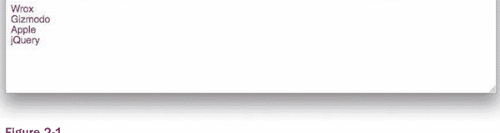

在示例中点击链接时，链接将在新窗口或标签页中打开（具体取决于浏览器处理弹出窗口的设置方式）。

在前面的示例中，你使用JavaScript强制ID名为`tmpFavorites`的`<ul>`元素中的链接在新窗口或标签页中打开。为此，在JavaScript中你创建了一个对象字面量（这不是创建新对象的唯一方式——有很多种方法，但我碰巧喜欢这种）。新对象名为`tmpExample`，它有一个名为`ready`的成员方法；在`ready`方法内部包含了文档就绪时需要执行的所有操作。

## 第二章：选择与筛选

*我不会深入探讨面向对象JavaScript的主题，而是专注于jQuery本身。如果你想了解更多关于面向对象JavaScript的知识，我推荐Nicholas C. Zakas广受好评的《Professional JavaScript for Web Developers》（同为Wrox出版社出版，2005年；第二版，2009年）。*

正如我在第一章简要提到的，jQuery提供了自己的`ready`事件，它在DOM加载完成后立即触发。这与`onload`或`load`事件不同，因为`load`事件需要等待所有图片加载完成后才会触发。大多数情况下你不需要等待那么久；你只想在DOM加载完成后立即开始操作文档并添加交互行为。这就是代码最后一行的作用：

```
$(document).ready(tmpExample.ready);
```

上述代码行附加了一个在DOM加载完成时触发的事件，届时`tmpExample.ready`函数将被调用并执行。注意当引用`tmpExample.ready`时，你没有在函数引用后添加括号——括号会导致函数立即执行，而不加括号只是引用函数。在这里，你希望函数引用在文档就绪时执行，而不是立即执行，因此通过不加括号的引用方式将函数赋给事件。加括号则是将执行后函数的返回值赋值，而非函数本身。

现在DOM已加载完成，你想通过脚本为文档添加交互行为。第一个项目展示了jQuery选择器API的实际应用：这是一个美元符号方法的函数调用，使用选择器选中ID名为`tmpFavorites`的`<ul>`元素，查找其中的后代`<li>`元素，再查找`<li>`元素中的后代`<a>`元素。

```
$('ul#tmpFavorites li a')
```

选中这些`<a>`元素后，你很可能想对它们执行某些操作。在这个示例中，你为每个选中的`<a>`元素添加了`click`事件。`click`事件通过jQuery特有的`click()`方法添加：

```
$('ul#tmpFavorites li a').click();
```

这里展示的是jQuery链式调用的示例：首先你选中了一组`<a>`元素；现在通过链式调用的`click()`方法直接为每个`<a>`元素添加点击事件。

在`click()`方法中，你传递了一个匿名（即无名）函数，其中包含当用户点击每个`<a>`元素时要执行的代码。

```
$('ul#tmpFavorites li a').click(
    function($e) {
        $e.preventDefault();
        window.open(this.href, 'FavoriteLink', '');
    }
);
```


## 第一部分：jQuery API

匿名函数包含一个名为 `$e` 的参数，它代表事件对象。事件对象就像你使用标准W3C事件API时一样，即使在撰写本文时尚不原生支持W3C事件API的Internet Explorer中也能工作。Internet Explorer能够使用标准API，是因为jQuery在幕后修补了问题区域并创建了一个无缝的API。无需升级浏览器！

接下来，函数调用 `$e.preventDefault();` 阻止默认操作发生。默认操作取决于你所指的元素。对于 `<a>` 元素，默认操作是将用户正在使用的窗口导航到 `<a>` 元素的 `href` 属性指定的链接。`$e.preventDefault()` 阻止该默认操作发生，因为你希望链接在新窗口或标签页中打开。如果你省略那一行 `$e.preventDefault();`，你会发现链接在新窗口或标签页中打开的同时，也会导航到该页面，而用户点击链接的主窗口也会导航到该页面。

最后，代码包含了使链接在新窗口或标签页中打开的那一行：

```javascript
window.open(this.href, 'FavoriteLink', '');
```

`window.open()` 方法以 `href` 属性的值作为第一个参数，后跟窗口或标签页的名称，再后跟用于控制窗口外观的参数；一个空字符串导致此方法的行为类似于值为 `_blank` 的 `target` 属性。

接下来的“动手试试”部分将把你刚才学到的关于jQuery和选择器API的知识结合起来，并给你一个亲自尝试的机会。（记住，本书所有“动手试试”练习的源代码以及每节的示例均可从 www.wrox.com 免费下载。）

### 动手试试
#### 使用选择器API
##### 示例 2-1

要动手演示jQuery的选择器API，请按照以下步骤操作：

+ 1. 在你的文本编辑器中创建以下标记文档，并将文档保存为 `Example 2-1.html`：

```html
<!DOCTYPE html PUBLIC "-//W3C//DTD XHTML 1.0 Strict//EN"
    "http://www.w3.org/TR/xhtml1/DTD/xhtml1-strict.dtd">
<html xmlns='http://www.w3.org/1999/xhtml' xml:lang='en'>
<head>
    <meta http-equiv='content-type' content='text/html; charset=utf-8' />
    <meta http-equiv='content-language' content='en-us' />
    <title>Link</title>
    <script type='text/javascript'
        src='../../../Source Code/jQuery/jQuery.js'>
    </script>
    <script type='text/javascript' src='Example 2-1.js'></script>
    <link type='text/css' href='Example 2-1.css' rel='stylesheet' />
</head>
<body id='tmpDialogueExample'>
    <form action='javascript:void(0);' method='post'>
        <p>
```

## 第二章：选择和过滤

在jQuery中，选择器API允许你从DOM中选择元素，就像在CSS样式表中一样。这个简单的对话框包含几个选择器API示例。

```html
</p>
<p>
  <input type='submit' name='tmpDialogueOpen'
         id='tmpDialogueOpen' value='Open Dialogue' />
</p>
<div id='tmpDialogue'>
  <input type='submit' name='tmpDialogueClose'
         id='tmpDialogueClose' value='Close Dialogue' />
</div>
</form>
</body>
</html>
```

2. 在你的文本编辑器中创建以下CSS文档，并将CSS文档保存在与你保存先前HTML文档相同的文件夹中，命名为 `Example 2-1.css`：

```css
body {
    font: 16px sans-serif;
}
div#tmpDialogue {
    display: none;
    position: absolute;
    top: 50%;
    left: 50%;
    width: 500px;
    height: 500px;
    margin: -251px 0 0 -251px;
    border: 1px solid blue;
    background: lightblue;
}
body#tmpDialogueExample div.tmpDialogueOn {
    display: block;
}
input#tmpDialogueClose {
    position: absolute;
    bottom: 5px;
    right: 5px;
    width: 100px;
}
```

3. 输入以下JavaScript代码，并将其作为另一个文档保存在HTML和CSS所在的同一文件夹中，命名为 `Example 2-1.js`：

```javascript
var tmpExample = {
  ready : function() {
    $('input#tmpDialogueOpen').click(
      function($e) {
        $e.preventDefault();
        $('div#tmpDialogue').addClass('tmpDialogueOn');
      }
);

    $('input#tmpDialogueClose').click(
        function($e) {
            $e.preventDefault();
            $('div#tmpDialogue').removeClass('tmpDialogueOn');
        }
    );
};

$(document).ready(tmpExample.ready);
```

请记住，你创建的示例和我在每节中演示的示例也必须考虑你在第1章示例1-1中安装和测试jQuery时设置的jQuery路径。如果一切正常，你应该会看到类似图2-2截图中的内容。

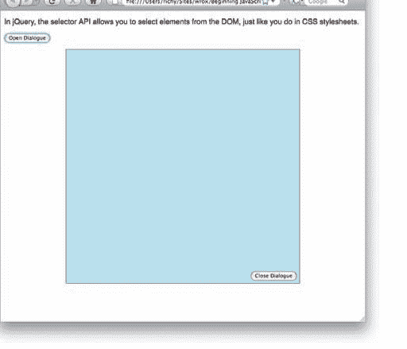

在示例2-1中，你会看到更多jQuery在选择器方面（甚至稍微超出选择器）能做什么。你拥有的是一个非常简单的、基于标记和CSS驱动的弹出窗口实现。

在标记中，你为弹出窗口奠定了结构基础。

```html
<form action='javascript:void(0);' method='post'>
    <p>
        In jQuery, the selector API allows you to select elements from
```

DOM，就像在CSS样式表中一样。这个简单的对话框包含几个选择器API示例。
</p>
<p>
  <input type='submit' name='tmpDialogueOpen'
         id='tmpDialogueOpen' value='Open Dialogue' />
</p>
<div id='tmpDialogue'>
  <input type='submit' name='tmpDialogueClose'
         id='tmpDialogueClose' value='Close Dialogue' />
</div>
</form>
```

需要注意的是，你实际上不需要一个 `<form>` 元素来让这个工作，你也并不真的需要在 `<input>` 元素上使用 `name` 属性——这些只是为了验证而包含的。此外，一个更负责任的实现也会考虑到有些人出于偏执或严格的IT策略而没有启用JavaScript。你应该在你的设计中考虑到这一点——然而，为了保持简单，我忽略了这个要求。

从结构上讲，事情非常简单；你有一个打开对话框的按钮。你有一个包含对话框本身的 `<div>` 元素，在该对话框内，你有一个关闭对话框的按钮。它看起来并不特别漂亮，但它确实能工作。

在CSS中，你会看到事情在“表现层”真正融合在一起。首先，你有一条规则为 `<body>` 元素设置了字体和字体大小；然后，你有一条规则将ID名为 `tmpDialogue` 的 `<div>` 元素绝对定位，然后通过在顶部和左侧偏移50%来调整位置。你设置了固定的宽度和高度，这是必需的，这样你才能通过调整顶部和左边距来使对话框居中。居中是通过将顶部和左侧定位为50%，然后应用一个等于宽度的一半加上左右内边距加上左右边框，以及高度的一半加上上下内边距加上上下边框的负边距来实现的。在这种情况下，宽度是500像素，左右各有1像素（px）的边框。所以你要除以2的值是502，得到251。高度值也是502，所以也得到251。你给顶部和左侧应用一个-251像素的负边距，这导致对话框完美居中。

```css
div#tmpDialogue {
  display: none;
  position: absolute;
  top: 50%;
  left: 50%;
  width: 500px;
  height: 500px;
  margin: -251px 0 0 -251px;
  border: 1px solid blue;
  background: lightblue;
}
```

对话框默认还被设置为 `display: none;`，这使其不可见。要使对话框可见，你使用JavaScript为ID名为 `tmpDialogue` 的 `<div>` 元素添加一个类名。你添加的类名是 `tmpDialogueOn`。要使下一条规则中的 `display: block;` 声明生效，你必须考虑CSS中的特异性。ID比类名更具体，因此要使对话框可见，你必须在CSS规则中引用ID名。我采用的方法是给 `<body>` 元素添加一个ID，然后使用后代选择器来定位对话框。


## 第一部分：jQuery API

为元素赋予一个ID名称，本例中是 *tmpDialogueExample*，然后通过后代选择器引用对话框 `<div>` 的类名。这使得选择器 `body#tmpDialogueExample div.tmpDialogueOn` 比 `div#tmpDialogue` 更具体。这意味着当类名 *tmpDialogueOn* 存在时，对话框开启；当它不存在时，对话框关闭。

```
body#tmpDialogueExample div.tmpDialogueOn {
    display: block;
}
```

样式表中的最后一条规则非常简单：它将ID名为 *tmpDialogueClose* 的 `<input>` 元素定位到对话框的右下角，距离底部和左边均为5像素。设置固定宽度是为了修正IE7和IE6中的尺寸错误。

```
input#tmpDialogueClose {
    position: absolute;
    bottom: 5px;
    right: 5px;
    width: 100px;
}
```

现在我来讲解JavaScript部分。和你在本节前面看到的例子类似，这里我创建了一个名为 *tmpExample* 的对象字面量，其中包含一个名为 *ready* 的方法，该方法被设置为使用jQuery的 *ready* 事件来执行。对象字面量中的方法实际上可以使用任何名称，但我喜欢使用 *ready*，因为它在语义上更正确。有些人喜欢将文档就绪时执行的方法称为 *init*（"initiate"的缩写）——使用任何你觉得有意义的名称即可。至于为什么我设置一个对象字面量而不是一个独立的函数，是因为我尽量减少全局命名空间的污染。这有助于避免与第三方脚本的命名冲突。

在 *ready* 方法内部，发生了两件事：设置一个事件在用户点击ID名为 *tmpDialogueOpen* 的 `<input>` 元素时触发，另一个事件在用户点击ID名为 *tmpDialogueClose* 的 `<input>` 元素时触发。

首先，我使用美元符号方法选中 `<input>` 元素：

```
$('input#tmpDialogueOpen')
```

然后，我使用jQuery的 *click()* 方法直接向该元素添加一个 *click* 事件。调用 *click* 方法的函数调用被链式连接到选择器的末尾。

```
$('input#tmpDialogueOpen').click();
```

事件的结果。在这种情况下，你希望阻止默认动作发生。当 `<input>` 元素的 `type` 属性设置为 `submit` 时，其默认动作是将表单提交到 `<form>` 元素 `action` 属性中引用的URL。当然，对于这个示例，我将 `action` 属性设置为 `javascript:void(0);`，这同样可以防止表单提交，所以从技术上讲，阻止默认动作并非必需。但如果我稍后要返回此 `<form>` 并更改 `action` 属性怎么办？假设我想成为一名负责任的JavaScript程序员，考虑到用户未启用JavaScript的情况。我可以做的一件事是将 `action` 属性设置为一个新页面，该页面包含我本应在JavaScript驱动的弹出对话框中显示的数据。我可以在 `<form>` 元素中添加 `target="_blank"` 属性，这将导致弹出对话框在新窗口中打开，并允许我的内容在没有JavaScript的情况下继续运行。当然，我也必须使用XHTML Transitional文档类型声明（Doctype）而不是Strict，因为target属性在XHTML Strict中是不允许的。所以，无论如何，考虑你将来如何继续构建和扩展你的网页——在编写脚本时尽可能地做好准备是个好习惯。

取消默认动作后，接下来要做的就是使对话框可见。为此，你需要使用美元符号方法选中ID名为 `tmpDialogue` 的 `<div>` 元素。接下来，你将另一个jQuery方法 `addClass()` 链接到选择器的末尾。顾名思义，`addClass()` 为元素添加一个类名；在本例中，你添加的类名是 `tmpDialogueOn`。回想一下你创建的样式表，为对话框添加此类名将使其可见。

然后对于关闭对话框按钮，你执行与打开对话框按钮相同的操作；但这一次，你是移除该类名以使对话框再次不可见。

```
$('input#tmpDialogueClose').click(
    function($e) {
        $e.preventDefault();
        $('div#tmpDialogue').removeClass('tmpDialogueOn');
    }
);
```

如你所见，jQuery可以帮助处理像弹出对话框这样简单的事情。然而，在这个例子中，jQuery本可以做得更多，因为正如你将在本书后面（第15章）看到的，jQuery几乎可以提供你需要的一切来实现这样一个弹出对话框，甚至包括华丽的动画过渡效果——你所要做的就是提供你想要使用的内容以及你希望它呈现的样式。

jQuery支持比浏览器原生支持的CSS更多的选择器。例如，jQuery支持CSS 2.1和CSS 3规范中定义的许多高级选择器。除了高级选择器支持，jQuery还引入了一些它自己的选择器，这些选择器在CSS中是不切实际的。

*附录B包含jQuery支持的所有选择器的参考表。*

## 第二章：选择与过滤

jQuery有一个非常创新的功能，即它提供的每个方法都返回jQuery对象。在前面的例子中，你看到了这是如何工作的：进行选择，然后对该选择执行某些操作，例如添加一个 `click` 事件。

在jQuery中，你可以通过多种方式获取一个较大的元素选择集并将其范围缩小。在本节中，我将介绍一些缩小选择范围的方法。

### 使用 find() 在选择中搜索

jQuery的 find() 方法允许你在选择集中进行选择。以下示例阐释了这个概念。假设你有以下标记代码：

```
<!DOCTYPE html PUBLIC "-//W3C//DTD XHTML 1.0 Strict//EN"
    "http://www.w3.org/TR/xhtml1/DTD/xhtml1-strict.dtd">
<html xmlns='http://www.w3.org/1999/xhtml' xml:lang='en'>
  <head>
    <meta http-equiv='content-type' content='text/html; charset=utf-8' />
    <meta http-equiv='content-language' content='en-us' />
    <title>Link</title>
    <script type='text/javascript'
            src='../../../Source Code/jQuery/jQuery.js'>
    </script>
    <script type='text/javascript' src='Figure 2-3.js'></script>
    <link type='text/css' href='Figure 2-3.css' rel='stylesheet' />
  </head>
  <body>
    <ul id='tmpFavorites'>
      <li><a href='http://www.wrox.com'>Wrox</a></li>
      <li><a href='http://www.gizmodo.com'>Gizmodo</a></li>
      <li><a href='http://www.apple.com'>Apple</a></li>
      <li><a href='http://www.jquery.com'>jQuery</a></li>
    </ul>
  </body>
</html>
```

前面的标记是本章前面常见的超链接列表。将前面的标记与以下CSS结合起来：

```
body {
    font: 16px sans-serif;
}
ul#tmpFavorites {
    list-style: none;
    margin: 0;
    padding: 0;
}
ul#tmpFavorites li {
    margin: 1px;
    padding: 3px;
}
a {
    text-decoration: none;
}
li.tmpFound {
    background: yellowgreen;
}
```

然后，添加以下JavaScript：

```
var tmpExample = {
    ready : function() {
        $('ul#tmpFavorites').find('li').addClass('tmpFound');
    }
};
$(document).ready(tmpExample.ready);
```

前面示例中的源代码产生了你在图2-3中看到的输出。

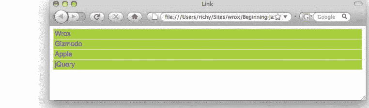

图 2-3

在前面的例子中，你看到了jQuery的 find() 方法的一个示例。基本上，find() 让你获取一个选择集并对其进行精炼。在这个例子中，首先你选中了ID名为 tmpFavorites 的 `<ul>` 元素；然后，一旦你获得了该选择集，你就查看 `<ul>` 的后代元素，以找到其中的每个 `<li>` 元素。一旦你找到了这些 `<li>` 元素，你就为每个元素添加了 tmpFound 类名。如果，例如，你想选中 `<ul>` 元素并向其添加一些事件，然后对其每个子元素 `<li>` 执行某些操作，这个方法会更有用。在这种情况下，你可以将原始 `<ul>` 元素的选择集分配给一个变量，使用该变量对 `<ul>` 元素执行一些操作，然后重用该选择集来查找 `<li>` 元素并对这些元素执行某些操作。

find() 方法使你能够在已选择的集合内搜索元素。

### 使用 siblings() 查找元素的兄弟元素

我演示的下一个方法向你展示了如何使用 siblings() 方法查找一个元素的所有兄弟元素。你从以下标记开始：

```
<!DOCTYPE html PUBLIC "-//W3C//DTD XHTML 1.0 Strict//EN"
   "http://www.w3.org/TR/xhtml1/DTD/xhtml1-strict.dtd">
<html xmlns='http://www.w3.org/1999/xhtml' xml:lang="en">
<head>
    <meta http-equiv='content-type' content='text/html; charset=utf-8' />
    <meta http-equiv='content-language' content='en-us' />

    <title></title>
</head>
```


## 第一部分：jQuery API

```html
<script type='text/javascript'
        src='../../Source Code/jQuery/jQuery.js'>
</script>
<script type='text/javascript' src='Figure 2-4.js'></script>
<link type='text/css' href='Figure 2-4.css' rel='stylesheet' />
</head>
<body>
    <h4>Places in Middle-Earth</h4>
    <ul id='tmpPlaces'>
        <li>Mordor</li>
        <li>Gondor</li>
        <li>Rohan</li>
        <li>Moria</li>
        <li>Lothlorien</li>
        <li>Dead Marshes</li>
        <li class='tmpExampleCity'>Minas Tirth</li>
    </ul>
</body>
</html>
```

通过以下 CSS 添加了一些样式：

```css
body {
    font: 16px sans-serif;
}
h4 {
    font-size: 16px;
    margin: 0 0 5px 0;
}
ul#tmpPlaces {
    list-style: none;
    margin: 0;
    padding: 0;
}
ul#tmpPlaces li {
    margin: 1px;
    padding: 3px;
}
li.tmpSiblings{
    background: khaki;
}
```

然后，是以下 JavaScript：

```javascript
var tmpExample = {
    ready :  function() {
        $('ul#tmpPlaces li.tmpExampleCity').siblings().addClass('tmpSiblings');
    }
};

$(document).ready(tmpExample.ready);
```

上述源代码给出了**图 2-4** 所示的输出效果。

## 第 2 章：选择与过滤

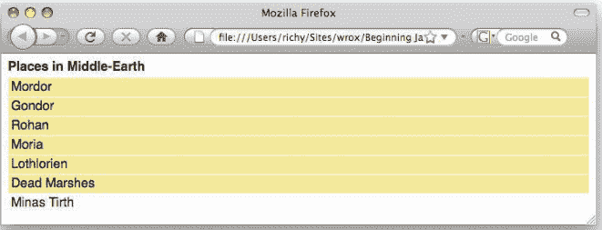

图 2-4

在前面的示例中，你看到另一个与上一节中介绍的 find() 方法非常相似的方法；只是这一次，选择被过滤为包含元素的所有同级元素。首先，通过选择器 `ul#tmpPlaces li.tmpExampleCity` 选中 class 名为 tmpExampleCity 的 `<li>` 元素。然后，选择被过滤为包含 class 名为 tmpExampleCity 的 `<li>` 元素的所有同级元素，换言之，除该元素之外的所有 `<li>` 元素。

siblings() 方法与 find() 方法类似，也可以包含一个选择器以进一步过滤。首先，修改上一个示例的标记，添加更多 class 名：

```html
<h4>Places in Middle-Earth</h4>
<ul id='tmpPlaces'>
  <li>Mordor</li>
  <li class='tmpRealmOfMen'>Gondor</li>
  <li class='tmpRealmOfMen'>Rohan</li>
  <li>Moria</li>
  <li class='tmpRealmOfElves'>Lothlorien</li>
  <li>Dead Marshes</li>
  <li class='tmpExampleCity'>Minas Tirth</li>
</ul>
```

然后修改上一个示例的 JavaScript，使其只查找具有 class 名 tmpRealmOfMen 的同级元素：

```javascript
var tmpExample = {
  ready : function() {
    $('ul#tmpPlaces li.tmpExampleCity')
      .siblings('.tmpRealmOfMen')
      .addClass('tmpSiblings');
  }
};

$(document).ready(tmpExample.ready);
```

这次你得到的输出如图 2-5 所示。

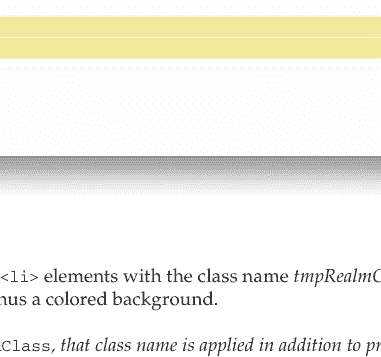

> 图 2-5

因此，在图 2-5 中，你看到只有 class 名为 tmpRealmOfMen 的 `<li>` 元素被赋予了 class 名 tmpSiblings，从而获得了彩色背景。

> 使用 addClass 添加 class 名时，该 class 名是在原有 class 名的基础上追加的。在图 2-5 中，class 名为 tmpRealmOfMen 的 `<li>` 元素除了保留该 class 外，还额外添加了 class 名 tmpSiblings。

### 选择特定的同级元素

回到同级元素的话题，jQuery 还有更多的方法可以让你对同级元素的选择进行精细控制。在前面的章节中，你看到 jQuery 的 siblings() 方法如何让你选择所有同级元素，或者使用选择器选择特定的同级元素组。jQuery 还让你能够根据元素出现在另一元素之前还是之后来选择同级元素，使用以下方法：next()、prev()、nextAll() 和 prevAll()。这些方法与 siblings() 方法类似工作。以下示例演示了 next() 方法：

```html
<!DOCTYPE html PUBLIC "-//W3C//DTD XHTML 1.0 Strict//EN"
 "http://www.w3.org/TR/xhtml1/DTD/xhtml1-strict.dtd">
<html xmlns="http://www.w3.org/1999/xhtml" xml:lang="en">
<head>
<meta http-equiv="content-type" content="text/html; charset=utf-8" />
<meta http-equiv="content-language" content="en-us" />
<title></title>
<script type='text/javascript' src='../../../Source Code/jQuery/jquery.js'></script>
<script type='text/javascript' src='Figure 2-6.js'></script>
<link type='text/css' href='Figure 2-6.css' rel='stylesheet' />
</head>
<body>
<h4>Colors</h4>
<ul id='tmpColors'>
<li>Red</li>
<li>Blue</li>
<li>Green</li>
<li id='tmpYellow'>Yellow</li>
<li>Orange</li>
<li>Purple</li>
</ul>
</body>
</html>
```

前面的标记包含以下 CSS：

```css
body {
    font: 16px sans-serif;
}
h4 {
    font-size: 16px;
    margin: 0 0 5px 0;
}
ul#tmpColors {
    list-style: none;
    margin: 0;
    padding: 0;
}
ul#tmpColors li {
    margin: 1px;
    padding: 3px;
}
li.tmpSibling {
    background: #165b91;
    color: white;
}
```

以下 JavaScript 演示了 `next()` 方法。

```javascript
var tmpExample = {
    ready : function() {
        $('li#tmpYellow').next().addClass('tmpSibling');
    }
};

$(document).ready(tmpExample.ready);
```

**在图 2-6 中**，你看到包含单词 *Orange* 的 `<li>` 元素具有深蓝色背景与白色文字，这是该元素获得 *tmpSibling* class 名的结果，而它是紧跟在 ID 名为 *tmpYellow* 的 `<li>` 元素之后的下一个元素。

以下演示了如果将 `next()` 替换为 `prev()` 会发生什么：

```javascript
var tmpExample = {
    ready : function() {
        $('li#tmpYellow').prev().addClass('tmpSibling');
    }
};

$(document).ready(tmpExample.ready);
```

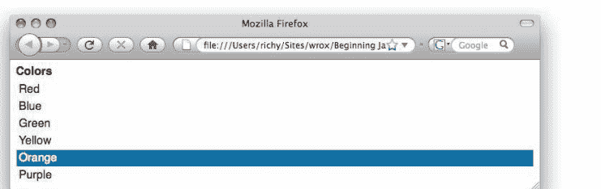

**在图 2-7 中**，你看到包含单词 *Green* 的 `<li>` 元素具有 class 名 `tmpSibling`，表明 ID 名为 `tmpYellow` 的 `<li>` 元素前面的紧邻元素已被选中。

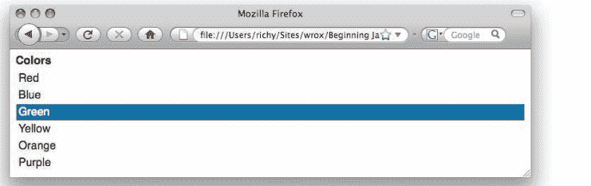

接下来，我演示将 `prev()` 替换为方法 `nextAll()` 时会发生什么：

```javascript
var tmpExample = {
    ready : function() {
        $('li#tmpYellow').nextAll().addClass('tmpSibling');
    }
};

$(document).ready(tmpExample.ready);
```

**在图 2-8 中**，你看到包含单词 *Orange* 和 *Purple* 的 `<li>` 元素具有 `tmpSibling` class 名，表明 ID 名为 `tmpYellow` 的 `<li>` 元素之后的所有元素都已被选中。

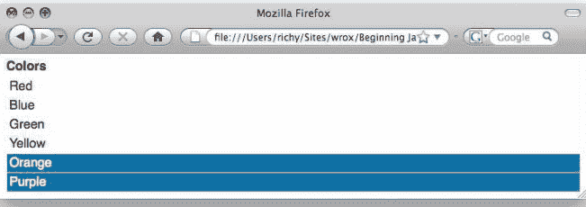

图 2-8

最后，我要演示的最后一个与同级元素相关的方法是 `prevAll()` 方法，正如你可能预料到的，它选择所有前面的同级元素：

```javascript
var tmpExample = {
  ready : function() {
    $('li#tmpYellow').prevAll().addClass('tmpSibling');
  }
};

$(document).ready(tmpExample.ready);
```

**在图 2-9 中**，带有单词 *Red*、*Blue* 和 *Green* 的 `<li>` 元素具有 *tmpSibling* class 名，表明 ID 名为 *tmpYellow* 的 `<li>` 元素之前的所有元素都已被选中。

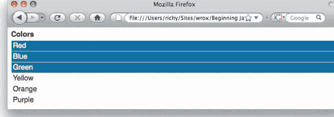

图 2-9

这些方法——*prev()*、*prevAll()*、*next()* 和 *nextAll()*——每个都接受选择器作为第一个参数，这允许你过滤选择。例如，像这样调用 *next()*：

```javascript
$('li#tmpYellow').next('li.someClassName').addClass('tmpSibling');
```

只有在下一个元素是带有 class 名 someClassName 的 `<li>` 元素时才会选中它。同样，调用带有选择器的 nextAll() 方法也会限制被选中的元素。

```javascript
$('li#tmpYellow').nextAll('li.someClassName').addClass('tmpSibling');
```

上述代码选择出现在 ID 名为 tmpYellow 的 `<li>` 元素之后的元素，但仅限于那些带有 class 名 someClassName 的 `<li>` 元素。

### 使用 parents() 和 parent() 方法搜索祖先元素

正如你可以选择同级元素和后代元素一样，你也可以沿着 DOM 树向上选择祖先元素。以下标记建立在图 2-4 和图 2-5 中所见示例的基础上：

```html
<!DOCTYPE html PUBLIC "-//W3C//DTD XHTML 1.0 Strict//EN"
    "http://www.w3.org/TR/xhtml1/DTD/xhtml1-strict.dtd">
<html xmlns='http://www.w3.org/1999/xhtml' xml:lang='en'>
  <head>
    <meta http-equiv='content-type' content='text/html; charset=utf-8' />
    <meta http-equiv='content-language' content='en-us' />
    <title></title>
    <script type='text/javascript'
            src='../../Source Code/jQuery/jQuery.js'>
    </script>
    <script type='text/javascript' src='Figure 2-10.js'></script>
    <link type='text/css' href='Figure 2-10.css' rel='stylesheet' />
  </head>
  <body id='tmpExample'>
    <h4>Places in Middle-Earth</h4>
    <div id='tmpPlacesWrapper'>
      <ul id='tmpPlaces'>
        <li>Mordor</li>
        <li class='tmpRealmOfMen'>Gondor</li>
        <li class='tmpRealmOfMen'>Rohan</li>
        <li>Moria</li>
        <li class='tmpRealmOfElves'>Lothlorien</li>
        <li>Dead Marshes</li>
        <li class='tmpExampleCity'>Minas Tirth</li>
      </ul>
    </div>
  </body>
</html>
```

CSS 文件也进行了一些修改；新文档看起来像这样：

```css
body {
    font: 16px sans-serif;
}
h4 {
    font-size: 16px;
    margin: 0 0 5px 0;
}
ul#tmpPlaces {
```


### 第2章：选择与过滤

```
list-style: none;
margin: 0;
padding: 0;
}
ul#tmpPlaces li {
    margin: 1px;
    padding: 3px;
}
div#tmpPlacesWrapper {
    padding: 5px;
    border: 1px solid rgb(200, 200, 200);
    background: rgb(240, 240, 240);
}
body#tmpExample div.tmpParent {
    background: rgb(174, 211, 248);
}
```

接下来，JavaScript代码如下所示：

```
var tmpExample = {
    ready : function() {
        $('li.tmpExampleCity').parents('div#tmpPlacesWrapper').addClass('tmpParent');
    }
};

$(document).ready(tmpExample.ready);
```

在**图2-10**中，你可以看到如何使用选择器来选择一个元素的祖先元素，不过在这个例子中，你只选择了一个父元素，即ID名称为*tmpPlacesWrapper*的`<div>`。如果提供给`parents()`方法的选择器匹配到多个祖先元素，你也可以选择多个祖先。为该`<div>`元素添加一个名为*tmpParent*的类名，会导致背景变为RGB 174, 211, 248，或者说是漂亮的天蓝色。如果没有添加*tmpParent*类名，背景颜色将是RGB 200, 200, 200，即浅灰色。

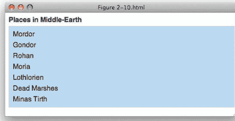

## 图2-10

在前面的例子中，如果省略选择器，所有祖先元素都会被选中：

```
$('li.tmpExampleCity').parents().addClass('tmpParent');
```

## 第一部分：jQuery API

`parents()`方法能够查看一个元素的所有祖先，一直追溯到根元素。如果你只想查看直接父元素，可以改用`parent()`方法。以下代码与**图2-10**产生相同的结果：

```
$('ul#tmpPlaces').parent().addClass('tmpParent');
```

上面的代码选择了ID名称为`tmpPlaces`的`<ul>`元素的直接父元素，即ID名称为`tmpPlacesWrapper`的`<div>`元素。

此外，你也可以使用选择器来限制`parent()`方法，使其只匹配更具体的元素：

```
$('ul#tmpPlaces').parent('div#tmpPlacesWrapper').addClass('tmpParent');
```

上面的代码限制`parent()`方法仅在ID元素为`tmpPlaces`的`<ul>`具有一个ID名称为`tmpPlacesWrapper`的父`<div>`元素时才进行匹配。

## 选择子元素

你也可以使用jQuery的`children()`方法选择一个元素的子元素。下面演示了`children()`方法：

```
<!DOCTYPE html PUBLIC "-//W3C//DTD XHTML 1.0 Strict//EN"
    "http://www.w3.org/TR/xhtml1/DTD/xhtml1-strict.dtd">
<html xmlns='http://www.w3.org/1999/xhtml' xml:lang='en'>
  <head>
    <meta http-equiv='content-type' content='text/html; charset=utf-8' />
    <meta http-equiv='content-language' content='en-us' />
    <title></title>
    <script type='text/javascript'
            src='../../../Source Code/jQuery/jQuery.js'>
    </script>
    <script type='text/javascript' src='Figure 2-11.js'></script>
    <link type='text/css' href='Figure 2-11.css' rel='stylesheet' />
  </head>
  <body>
    <h4>Fruit</h4>
    <ul>
      <li>Apple</li>
      <li>Cherry</li>
      <li>Orange</li>
      <li>Lemons</li>
      <li>Limes</li>
      <li>Grapes</li>
    </ul>
  </body>
</html>
```

以下样式表包含在前面的标记中：

```
body {
    font: 16px sans-serif;
}

h4 {
  font-size: 16px;
  margin: 0 0 5px 0;
}

ul {
  list-style: none;
  margin: 0;
  padding: 0;
}

ul li {
  margin: 1px;
  padding: 3px;
}

li.tmpChild {
  background: #cf0c35;
  color: white;
}
```

以下JavaScript代码演示了如何使用jQuery的`children()`方法选择每个`<li>`元素：

```
var tmpExample = {
  ready : function() {
    $('ul').children().addClass('tmpChild');
  }
};

$(document).ready(tmpExample.ready);
```

> 图2-11显示每个`<li>`元素都有类名tmpChild。每个`<li>`元素是通过先选择`<ul>`元素，然后调用jQuery的children()方法来选中的。

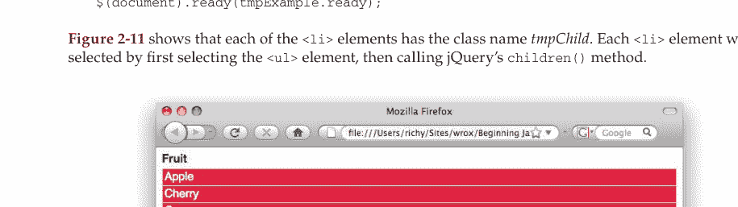

> 图2-11

就像我在本章中演示的其他方法一样，你也可以向children()方法传递一个选择器，以限制包含哪些元素：

```
$('ul').children('li.tmpCitrus').addClass('tmpChild');
```

## 第一部分：jQuery API

在前面的代码片段中，传递选择器`li.tmpCitrus`将选择范围限制在类名为*tmpCitrus*的`<li>`元素。

## 通过排除项选择元素

接下来的方法让你能够根据*不*想包含在选择中的内容来选择元素。以下标记文档为演示搭建了结构：

```
<!DOCTYPE html PUBLIC "-//W3C//DTD XHTML 1.0 Strict//EN"
    "http://www.w3.org/TR/xhtml1/DTD/xhtml1-strict.dtd">
<html xmlns='http://www.w3.org/1999/xhtml' xml:lang='en'>
  <head>
    <meta http-equiv='content-type' content='text/html; charset=utf-8' />
    <meta http-equiv='content-language' content='en-us' />
    <title></title>
    <script type='text/javascript'
            src='../../../Source Code/jQuery/jQuery.js'>
    </script>
    <script type='text/javascript' src='Figure 2-7.js'></script>
    <link type='text/css' href='Figure 2-7.css' rel='stylesheet' />
  </head>
  <body id='tmpExample'>
    <h4>Slapstick Comedians</h4>
    <ul id='tmpSlapstick'>
      <li class='tmpMarxBrothers'>Groucho</li>
      <li class='tmpMarxBrothers'>Chico</li>
      <li class='tmpMarxBrothers'>Harpo</li>
      <li class='tmpMarxBrothers'>Zeppo</li>
      <li class='tmpThreeStooges'>Moe</li>
      <li class='tmpThreeStooges'>Larry</li>
      <li class='tmpThreeStooges'>Curly</li>
      <li class='tmpThreeStooges'>Shemp</li>
      <li class='tmpAbbottAndCostello'>Abbott</li>
      <li class='tmpAbbottAndCostello'>Costello</li>
    </ul>
  </body>
</html>
```

前面的标记由以下CSS设置样式：

```
body {
    font: 16px sans-serif;
}
h4 {
    font-size: 16px;
    margin: 0 0 5px 0;
}
ul#tmpSlapstick {
    list-style: none;
    margin: 0;
    padding: 0;
}
ul#tmpSlapstick li {
margin: 1px;
padding: 3px;
}
li.tmpFunny {
background: rgb(174, 211, 248);
}
```

接下来，以下JavaScript代码演示了如何使用jQuery的:not()方法从结果集中排除元素：

```
var tmpExample = {
ready : function() {
$('ul#tmpSlapstick li').not('li.tmpThreeStooges').addClass('tmpFunny');
}
};

$(document).ready(tmpExample.ready);
```

在图2-12中，你可以看到除了类名为*tmpThreeStooges*的喜剧演员之外，所有滑稽喜剧演员都被赋予了*tmpFunny*类名。要得到这个结果，首先使用选择器`ul#tmpSlapstick li`选中每个元素；然后使用jQuery的`not()`方法过滤掉不想选择的内容，这样每个没有*tmpThreeStooges*类名的`<li>`元素都被赋予了*tmpFunny*类名。开个玩笑——顺便说一句，三个臭皮匠（Stooges）很棒。

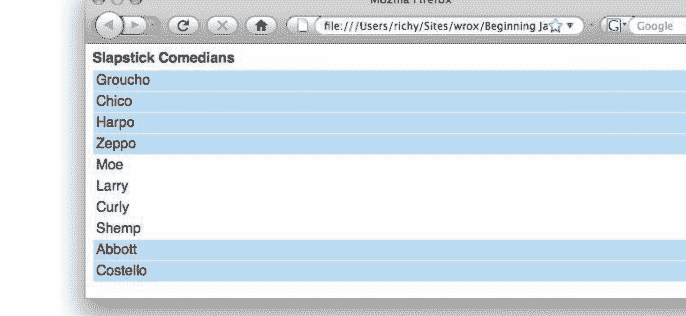

图2-12

## 选择结果片段

到目前为止，你已经了解了jQuery的选择器API如何允许你在DOM中进行各种方向的上下文选择。接下来我要演示的方法展示了如何使用名为`slice()`的方法选择结果集的一部分。沿用上一节相同的滑稽喜剧演员示例，并对CSS稍作修改：

## 第一部分：jQuery API

```
body {
    font: 16px sans-serif;
}
h4 {
    font-size: 16px;
    margin: 0 0 5px 0;
}
ul#tmpSlapstick {
    list-style: none;
    margin: 0;
    padding: 0;
}
ul#tmpSlapstick li {
    margin: 1px;
    padding: 3px;
}
li.tmpReallyFunny {
    background: #fcc16e;
}
```

在以下JavaScript代码中，你可以看到如何将`slice()`方法附加到选择的末尾来过滤结果：

```
var tmpExample = {
    ready : function() {
        $('ul#tmpSlapstick li').slice(0, 4).addClass('tmpReallyFunny');
    }
};

$(document).ready(tmpExample.ready);
```

在**图2-13**中，你可以看到前四个列表项被选中了，这对应于马克斯兄弟。jQuery的`slice()`方法接受两个参数：你想要选择的第一个元素的位置，以及你想要选择的最后一个元素的位置。编号从零开始偏移。

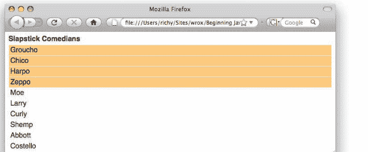


 `slice()` 方法的第二个参数是可选的。以下 JavaScript 代码展示了省略第二个参数时 `slice()` 方法的用法：

```
var tmpExample = {
  ready : function() {
    $('ul#tmpSlapstick li').slice(5).addClass('tmpReallyFunny');
  }
};

$(document).ready(tmpExample.ready);
```

在上述 JavaScript 中，`slice()` 方法接收了一个参数 5。在**图 2-14**中，你可以看到这次修改的结果。

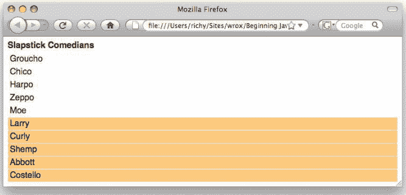

**图 2-14**

当你只指定一个参数时，`slice()` 方法从指定的索引（从 0 开始计数）开始选择，一直到末尾。在"Slapstick Comedians"（闹剧喜剧演员）示例中，结果是编号 6、7、8、9 和 10 被选中。

## 向选择结果*添加*更多元素

有时当你做出选择后，可能需要使用 `add()` 方法添加更多元素。jQuery 为你提供了使用 `add()` 方法实现这一功能的能力。因此，继续构建 Slapstick Comedians 示例，你将标记修改为如下所示：

```
<!DOCTYPE html PUBLIC "-//W3C//DTD XHTML 1.0 Strict//EN"
    "http://www.w3.org/TR/xhtml1/DTD/xhtml1-strict.dtd">
<html xmlns='http://www.w3.org/1999/xhtml' xml:lang='en'>
  <head>
    <meta http-equiv='content-type' content='text/html; charset=utf-8' />
    <meta http-equiv='content-language' content='en-us' />
    <title></title>
    <script type='text/javascript'
      src='../../../Source Code/jQuery/jQuery.js'>
    </script>
    <script type='text/javascript' src='Figure 2-10.js'></script>
    <link type='text/css' href='Figure 2-10.css' rel='stylesheet' />
  </head>
  <body id='tmpExample'>
    <h3>Slapstick Comedians</h3>
    <h4>The Marx Brothers</h4>
    <ul id='tmpMarxBrothers'>
      <li>Groucho</li>
      <li>Chico</li>
      <li>Harpo</li>
      <li>Zeppo</li>
    </ul>
    <h4>The Three Stooges</h4>
    <ul id='tmpThreeStooges'>
      <li>Moe</li>
      <li>Larry</li>
      <li>Curly</li>
      <li>Shemp</li>
    </ul>
    <h4>Abbott &amp; Costello</h4>
    <ul id='tmpAbbottAndCostello'>
      <li>Abbott</li>
      <li>Costello</li>
    </ul>
  </body>
</html>
```

样式表也有一些修改：

```
body {
  font: 16px sans-serif;
}
h3 {
  font-size: 18px;
  margin: 0 0 5px 0;
}
h4 {
  font-size: 16px;
  margin: 5px 0;
}
ul {
  list-style: none;
  margin: 0;
  padding: 0;
}
ul li {
  margin: 1px;
  padding: 3px;
}
li.tmpReallyFunny {
  background: #88fac6;
}
```

以下 JavaScript 代码展示了如何使用 jQuery 的 `add()` 方法向选择结果添加元素：

```
var tmpExample = {
    ready : function() {
        $('ul#tmpMarxBrothers li')
            .add('ul#tmpAbbottAndCostello li')
            .addClass('tmpReallyFunny');
    }
};

$(document).ready(tmpExample.ready);
```

图 2-15 展示了如你所预期的结果：ID 名为 tmpMarxBrothers 的 `<ul>` 元素内的 `<li>` 元素，以及 ID 名为 tmpAbbottAndCostello 的 `<ul>` 元素内的 `<li>` 元素，都拥有了海绿色背景（#88fac6）。

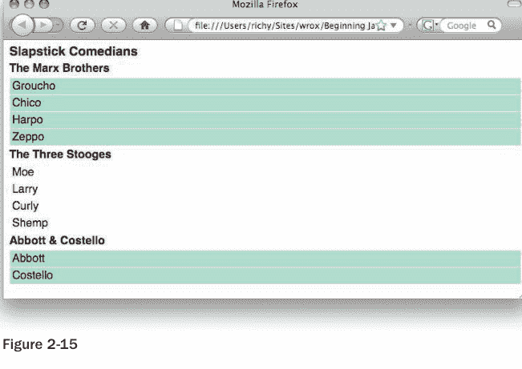

## 从结果集中选择特定元素

jQuery 的 `eq()` 方法（"equals" 的缩写）让你能够根据元素在结果集中的位置来选择元素。以下源代码展示了该方法的用法：

```
<!DOCTYPE html PUBLIC "-//W3C//DTD XHTML 1.0 Strict//EN"
    "http://www.w3.org/TR/xhtml1/DTD/xhtml1-strict.dtd">
<html xmlns='http://www.w3.org/1999/xhtml' xml:lang='en'>
  <head>
    <meta http-equiv='content-type' content='text/html; charset=utf-8' />
    <meta http-equiv='content-language' content='en-us' />
    <title></title>
    <script type='text/javascript'
      src='../../Source Code/jQuery/jQuery.js'>
    </script>
    <script type='text/javascript' src='Figure 2-11.js'></script>
    <link type='text/css' href='Figure 2-11.css' rel='stylesheet' />
  </head>
  <body>
    <h3>Brilliant Musicians</h3>
    <ul>
      <li>Brian Wilson</li>
      <li>Paul McCartney</li>
      <li>John Lennon</li>
      <li>Freddie Mercury</li>
    </ul>
  </body>
</html>
```

以下样式表与上述标记配合使用：

```
body {
  font: 16px sans-serif;
}
h3 {
  font-size: 18px;
  margin: 0 0 5px 0;
}
ul {
  list-style: none;
  margin: 0;
  padding: 0;
}
ul li {
  margin: 1px;
  padding: 3px;
}
li.tmpQueen {
  background: #cdb6ed;
}
```

然后，以下 JavaScript 代码展示了如何使用 `eq()` 方法根据从 0 开始的位置偏移量从结果集中选取单个元素：

```
var tmpExample = {
  ready : function() {
    $('ul li').eq(3).addClass('tmpQueen');
  }
};

$(document).ready(tmpExample.ready);
```

上述源代码给出了你在**图 2-16**中看到的结果。

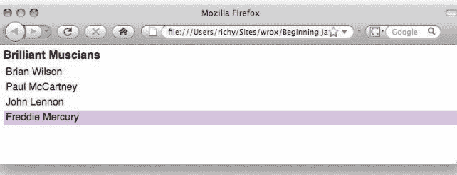

**图 2-16**

如你在 `slice()` 方法中所见，`eq()` 方法从结果集中选取特定元素。jQuery，以及你能找到的几乎任何 JavaScript 库，都是根据元素在标记中出现的顺序从 DOM 中选择元素的。因此，在这个例子中，*Brian Wilson*（布莱恩·威尔逊）包含在 `<li>` 元素 0 中，而 **Freddie Mercury**（弗雷迪·墨丘）包含在 `<li>` 元素 3 中。

以下"试一试"部分回顾了 jQuery 为筛选选择结果提供的所有方法。你可以亲自尝试这个例子，以帮助你记住每个方法的工作原理以及每个方法的用途。如果你认为自己已经充分理解了这些内容，那么可以跳到事件部分。

*本书中的所有源代码示例都可以从 www.wrox.com 免费下载。*

## 试一试 筛选选择结果

示例 2-2 要回顾选择筛选，请按以下步骤操作：

```
<!DOCTYPE html PUBLIC "-//W3C//DTD XHTML 1.0 Strict//EN"
    trashhttp://www.w3.org/TR/xhtml1/DTD/xhtml1-strict.dtd">
<html xmlns='http://www.w3.org/1999/xhtml' xml:lang='en'>
  <head>
    <meta http-equiv='content-type' content="text/html; charset=utf-8" />
    <meta http-equiv='content-language' content="en-us" />
    <title>Link</title>
    <script type='text/javascript'
      src="../../../../Source Code/jQuery/jQuery.js">
    </script>
    <script type='text/javascript' src='Example 2-2.js'></script>
    <link type='text/css' href='Example 2-2.css' rel='stylesheet' />
  </head>
  <body id='tmpDialogueExamples'>
    <div id='tmpSelection'>
      <h3>Edible plants</h3>
      <ul id='tmpPlants'>
        <li class='tmpVegetables' id='tmpOnion'>Onion</li>
        <li class='tmpVegetables' id='tmpBroccoli'>Broccoli</li>
        <li class='tmpVegetables' id='tmpPepper'>Pepper</li>
        <li class='tmpVegetables' id='tmpCarrot'>Carrot</li>
        <li class='tmpFruits'>Apple</li>
        <li class='tmpFruits'>Cherry</li>
        <li class='tmpFruits' id='tmpOrange'>Orange</li>
        <li class='tmpFruits'>Lemon</li>
      </ul>
    </div>
    <div class='tmpList'>
      <h4>Animals</h4>
      <ul id='tmpAnimals'>
        <li id='tmpChicken'>Chicken</li>
        <li id='tmpCow'>Cow</li>
        <li id='tmpBuffalo'>Buffalo</li>
        <li id='tmpSheep'>Sheep</li>
        <li id='tmpRabbit'>Rabbit</li>
      </ul>
    </div>
    <div id='tmpRecap'>
      <p>
        <a href='#' id='tmpFind'>
          Find all &lt;li&gt; elements inside of &lt;ul&gt; elements.
        </a>
      </p>
      <p>
        <a href='#' id='tmpSiblings'>
          Find all siblings of the &lt;li&gt; element with id tmpCarrot.
        </a>
      </p>
      <p>
        <a href='#' id='tmpNext'>
          Select the &lt;li&gt; sibling element after the &lt;li&gt; element
          with id name tmpBroccoli.
        </a>
      </p>
      <p>
        <a href='#' id='tmpPrev'>
          Select the &lt;li&gt; sibling element before the &lt;li&gt; element
          with id name tmpBroccoli.
        </a>
      </p>
      <p>
        <a href='#' id='tmpNextAll'>
          Select all &lt;li&gt; sibling elements after the &lt;li&gt; element
          with id name tmpBroccoli.
        </a>
      </p>
      <p>
        <a href='#' id='tmpPrevAll'>
          Select all &lt;li&gt; sibling elements before the &lt;li&gt; element
          with id name tmpOrange.
        </a>
      </p>
    </div>
  </body>
</html>
```

## 第二章：选择与过滤

```html
</p>
<p>
    <a href='#' id='tmpVegetables'>
        Select only &lt;li&gt; sibling elements before the &lt;li&gt;
        element with id name tmpOrange that are vegetables.
    </a>
</p>
<p>
    <a href='#' id='tmpParents'>
        Find the parent &lt;div&gt; element, with id tmpSelection.
    </a>
</p>
<p>
    <a href='#' id='tmpParent'>
        Find parent &lt;ul&gt; elements of &lt;li&gt; elements.
    </a>
</p>
<p>
    <a href='#' id='tmpChildren'>
        Find children &lt;h4&gt; elements of parent &lt;div&gt; elements with
        class name tmpList.
    </a>
</p>
<p>
    <a href='#' id='tmpNot'>
        Select children &lt;li&gt; elements of parent &lt;ul&gt; elements,
        except for vegetables.
    </a>
</p>
<p>
    <a href='#' id='tmpSlice'>
        Select &lt;li&gt; elements beginning with Cow and ending with Sheep.
    </a>
</p>
<p>
    <a href='#' id='tmpAdd'>
        Select all animal &lt;li&gt; elements, then add Pepper and Broccoli.
    </a>
</p>
<p>
    <a href='#' id='tmpEq'>
        Select all &lt;li&gt; elements, and reduce to only Buffalo.
    </a>
</p>
</div>
</body>
</html>
```

2.  创建以下 CSS 文档，命名为 *Example 2-2.css*：

```css
body {
    font: 16px sans-serif;
}
ul {
    list-style: none;
    padding: 0;
    margin: 0;
    width: 200px;
}
li {
    padding: 3px;
    margin: 3px;
}
div.tmpList {
    float: left;
    margin: 0 20px;
}
div#tmpRecap {
    clear: left;
    padding: 10px;
}
.tmpExample {
    border: 1px solid rgb(200, 200, 200);
    background: #cbe5f8;
}
div#tmpSelection {
    overflow: hidden;
}
```

3.  创建以下 JavaScript 文档，命名为 Example 2-2.js：

```javascript
var tmpExample = {
    ready : function() {
        // Find all <input> elements and add a click
        // event.
        $('a').click(tmpExample.findElements);
    },

    findElements : function($e)
    {
        // Prevent the default action, navigating to the link.
        $e.preventDefault();

        // Reset the example before applying the next.
        $('*').removeClass('tmpExample');

        switch (this.id)
        {
            case 'tmpFind':
            {
                // If the id of "this" <input> element contains "Find",
                // Do the find() example.
                $('ul').find('li').addClass('tmpExample');
                break;
            }
            case 'tmpSiblings':
            {
                $('li#tmpCarrot').siblings().addClass('tmpExample');
                break;
            }
            case 'tmpNext':
            {
                $('li#tmpBroccoli').next().addClass('tmpExample');
                break;
            }
            case 'tmpPrev':
            {
                $('li#tmpBroccoli').prev().addClass('tmpExample');
                break;
            }
            case 'tmpNextAll':
            {
                $('li#tmpBroccoli').nextAll().addClass('tmpExample');
                break;
            }
            case 'tmpPrevAll':
            {
                $('li#tmpOrange').prevAll().addClass('tmpExample');
                break;
            }
            case 'tmpVegetables':
            {
                $('li#tmpOrange').prevAll('li.tmpVegetables').addClass('tmpExample');
                break;
            }
            case 'tmpParents':
            {
                $('li#tmpCarrot').parents('div#tmpSelection').addClass('tmpExample');
                break;
            }
            case 'tmpParent':
            {
                $('li').parent('ul').addClass('tmpExample');
                break;
            }
            case 'tmpChildren':
            {
                $('div.tmpList').children('h4').addClass('tmpExample');
                break;
            }
            case 'tmpNot':
            {
                $('ul li').not('li.tmpVegetables').addClass('tmpExample');
                break;
            }
            case 'tmpSlice':
            {
                $('ul#tmpAnimals li').slice(1, 4).addClass('tmpExample');
                break;
            }
            case 'tmpAdd':
            {
                $('ul#tmpAnimals li')
                    .add('li#tmpBroccoli, li#tmpPepper')
                    .addClass('tmpExample');
                break;
            }
            case 'tmpEq':
            {
                $('ul li').eq(10).addClass('tmpExample');
                break;
            }
        }
    }
};

$(document).ready(tmpExample.ready);
```

上一个文档看起来类似于你在**图 2-17**中看到的内容。点击示例中的每个链接，会根据为每个 `<a>` 元素提供的描述，突出显示文档顶部部分的不同区域。

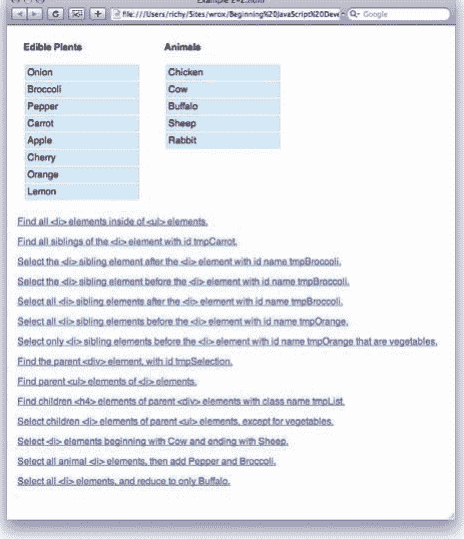

**图 2-17**

前面的示例是对 jQuery 提供的选择元素和过滤已选元素的所有方法的全面回顾。当你点击链接时，会执行一些 JavaScript 代码来演示链接中描述的内容。

首先，每个 `<a>` 元素都附加了一个 `click` 事件，这样当你点击链接时，该事件会由 `tmpExample` 对象的 `findElements()` 方法处理。这就像在 `tmpExample` 对象的 `ready()` 方法执行后运行一行代码一样简单：

```javascript
$('a').click(tmpExample.findElements);
```

在 `findElements()` 方法内部，首先执行的操作是阻止默认行为发生，对于 `<a>` 元素而言，其默认行为是导航到 `href` 属性中指定的文档。当然，在这种情况下，它本来也不会发生，因为每个 `<a>` 元素的 `href` 属性值都是一个井号（或磅符号），但无论如何默认行为还是被取消了，因为你永远不确定你的脚本将来会如何发展。

接下来发生的是，通过通用选择器（星号）选择文档中的每个元素，并移除类名 `tmpExample`。这会将文档重置为原始状态，以便每次点击新链接时，你只能看到与该链接描述匹配的元素。

```javascript
// Reset the example before applying the next.
$('*').removeClass('tmpExample');
```

然后，执行一个很长的 switch 语句；每个 case 对应标记文档中单个 `<a>` 元素的 ID 名称。

第一个 ID 名称为 `tmpFind` 的 `<a>` 元素使用 jQuery 的 `find()` 方法定位文档中所有 `<ul>` 元素内的所有 `<li>` 元素。因此，点击以下链接：

```html
<a href='#' id='tmpFind'>
    Find all &lt;li&gt; elements inside of &lt;ul&gt; elements.
</a>
```

会导致以下 JavaScript 代码执行：

```javascript
case 'tmpFind':
{
    // If the id of "this" <input> element contains "Find",
    // Do the find() example.
    $('ul').find('li').addClass('tmpExample');
    break;
}
```

随后，所有 `<li>` 元素都会拥有灰色边框和天蓝色背景，正如样式表中为类名 `tmpExample` 所定义的那样。

```css
.tmpExample {
    border: 1px solid rgb(200, 200, 200);
    background: #cbe5f8;
}
```

jQuery 选择器选择了所有 `<li>` 元素，无论它们出现在哪个 `<ul>` 元素中。这是因为你首先使用 `$('ul')` 进行了选择，这是一个类型选择器，结果是选择了所有 `<ul>` 元素。将 `find()` 方法链接到选择上，将选择更改为包括所有 `<li>` 元素，因为你是向 `find()` 方法提供了一个类型选择器，即 `find('li')`。

下一个链接触发了对 ID 名称为 *tmpCarrot* 的 `<li>` 元素的所有同级元素的选择：

```html
<a href='#' id='tmpSiblings'>
    Find all siblings of the &lt;li&gt; element with id tmpCarrot.
</a>
```

点击前面的链接会在 Example 2-2.js 中执行以下 JavaScript：

```javascript
case 'tmpSiblings':
{
    $('li#tmpCarrot').siblings().addClass('tmpExample');
    break;
}
```

使用 jQuery 的 `siblings()` 方法会选择所有与 Carrot 相邻的 `<li>` 元素。因此，选择了 Onion、Broccoli、Pepper、Apple、Cherry、Orange 和 Lemon。由于你选择的是 Carrot 的同级元素，所以同一个 `<ul>` 元素内的所有 `<li>` 元素（除了 Carrot 本身）都会被选中。

当你点击以下链接时，使用 jQuery 的 `next()` 方法会选中 ID 名称为 *tmpBroccoli* 的 `<li>` 元素之后的 `<li>` 元素，即 Pepper：

```html
<a href='#' id='tmpNext'>
    Select the &lt;li&gt; sibling element after the &lt;li&gt; element
    with id name tmpBroccoli.
</a>
```

前面的链接在点击时会触发以下 JavaScript：

```javascript
case 'tmpNext':
{
    $('li#tmpBroccoli').next().addClass('tmpExample');
    break;
}
```

以下链接执行相反的操作；它选择 Broccoli 之前的 `<li>` 元素，即 Carrot `<li>` 元素。这是通过 jQuery 的 `prev()` 方法完成的。

```html
<a href='#' id='tmpPrev'>
    Select the &lt;li&gt; sibling element before the &lt;li&gt; element
    with id name tmpBroccoli.
</a>
```

点击前面的链接时，会执行以下 JavaScript：

```javascript
case 'tmpPrev':
{
    $('li#tmpBroccoli').prev().addClass('tmpExample');
    break;
}
```


## 第2章：选择元素与过滤元素

在下面的代码片段中，你使用 jQuery 的 `nextAll()` 方法选择 Broccoli 后面的所有 `<li>` 元素：

```
case 'tmpNextAll':
{
  $('li#tmpBroccoli').nextAll().addClass('tmpExample');
  break;
}
```

然后，你使用 jQuery 的 `prevAll()` 方法选择 Orange `<li>` 元素前面的所有元素：

```
$('li#tmpOrange').prevAll().addClass('tmpExample');
```

在下一个示例中，你遍历 ID 名为 *tmpCarrot* 的 `<li>` 元素的所有祖先元素，找到 ID 名为 *tmpSelection* 的 `<div>` 元素，并为其添加类名 *tmpExample*。

```
$('li#tmpCarrot').parents('div#tmpSelection').addClass('tmpExample');
```

在下一个示例中，你选择任意 `<li>` 元素的直接父元素，即 `<ul>` 元素。选择器 `'ul'` 确保仅当父元素是 `<ul>` 元素时才被选中——在这个例子中这是一个无关紧要的点，因为它本来就是 `<ul>` 元素——但这演示了你可以选择向 jQuery 的 `parent()` 方法传递一个选择器。

```
$('li').parent('ul').addClass('tmpExample');
```

下一个示例使用 jQuery 的 `children()` 方法选择 ID 名为 *tmpList* 的 `<div>` 元素的所有子元素中属于 `<h4>` 的元素：

```
$('div.tmpList').children('h4').addClass('tmpExample');
```

随后，你创建了一个示例，选择所有作为 `<ul>` 元素后代的 `<li>` 元素，但使用 jQuery 的 `not()` 方法从选择中移除所有类名为 tmpVegetables 的 `<li>` 元素：

```
$('ul li').not('li.tmpVegetables').addClass('tmpExample');
```

在下面的代码片段中，你使用 jQuery 的 `slice()` 方法根据元素在选择中的位置来选择 `<li>` 元素，其中每个数字代表元素从零点开始的顺序位置。以下代码选择 Cow、Buffalo 和 Sheep：

```
$('ul#tmpAnimals li').slice(1, 4).addClass('tmpExample');
```

接下来，你会看到如何使用 jQuery 的 `add()` 方法来扩展已做的选择。以下代码选择 ID 名为 *tmpAnimals* 的 `<ul>` 元素的所有后代 `<li>` 元素，然后添加 ID 名为 *tmpBroccoli* 和 *tmpPepper* 的 `<li>` 元素：

```
$('ul#tmpAnimals li')
  .add('li#tmpBroccoli, li#tmpPepper')
  .addClass('tmpExample');
```

## 第 I 部分：jQuery API

在最后一个示例中，你根据元素在选择中的偏移位置来选择 `<li>` 元素。每个元素被分配一个数字，从 0 开始；以下代码选择 Buffalo，因为它是选择中的第 1 个 `<li>` 元素：

```
$('ul li').eq(1).addClass('tmpExample');
```

> 附录 C 提供了 jQuery 所有选择和过滤方法的参考。

### 小结

在本章中，你已经看到了一些基础示例，为你全面概述了 jQuery 的选择和过滤能力。你了解了 jQuery 如何对从 DOM 中选择元素提供极其精细的控制——精细到你会经常发现有多种方法可以达到相同的结果。

jQuery 的选择和过滤方法远比纯 JavaScript 强大得多，后者往往需要用好几行代码才能达到同等的控制水平。

jQuery 利用选择器的威力、简便性、熟悉度和便利性，帮助你到达 DOM 中的任何位置。你会发现，选择器语法与你用于 CSS 的语法相同；jQuery 甚至支持一些自己的扩展。有关 jQuery 支持的选择器语法的完整列表，请参见附录 B。

jQuery 的过滤方法让你可以使用 `find()` 方法选择后代元素；使用 `parents()` 方法选择祖先元素；以及使用 `siblings()`、`prev()`、`prevAll()`、`next()` 和 `nextAll()` 方法选择兄弟元素。你可以使用 `add()` 方法添加元素，或使用 `not()` 方法忽略元素。你还可以使用 `slice()` 和 `eq()` 方法达到更精确的选择。有关选择和过滤相关方法的完整列表，请参见附录 C。

### 练习题

- 1. 就其对标记源中元素选择的精细控制而言，jQuery 与哪另一种客户端技术有很多共同之处？
- 2. 如果你想使用 jQuery 基于祖先关系从 DOM 中选择元素，应该使用哪个方法？
- 3. 假设你想在 DOM 中将一个元素的位置与其前面的兄弟元素交换，什么 jQuery 方法可以帮助实现这个功能？
- 4. 如果你已经选择了一个元素，并想从 DOM 中选择该元素的一个后代元素，jQuery 提供了哪些方法可以让你达到目的？
- 5. 如果你已经做了一个选择，但后来想从该选择中移除一个或多个元素，应该使用什么 jQuery 方法？
- 6. 如果你只想从一个较大的选择中选取单个元素，应该使用什么 jQuery 方法？
- 7. 列出 jQuery 提供的所有用于处理兄弟元素的方法。
- 8. 如何使用 jQuery 向选择中添加元素？
- 9. Internet Explorer 8 不支持 CSS 3 规范中的 `:nth-child` 选择器。在 jQuery 中使用该选择器能在该浏览器中工作吗？

# 3

#### 事件

John Resig 创建 jQuery 的主要动机之一，是需要让某些脚本特性在浏览器间的支持更加一致，同时要尽可能高效并注重性能。John 做得相当出色——他的 Event API 不仅在所有流行的现代浏览器中都能工作，而且以一种非常直观的方式简化了事件，减少了你需要编写的将事件绑定到对象的代码量。

话虽如此，要真正体会 John 在 jQuery 中弥合差距所做的工作，有必要简要回顾一下在没有框架的情况下事件是如何工作的。本章将重述如何通过传统事件模型、W3C 事件模型和微软的 JScript 事件模型在 JavaScript 中处理事件，随后演示事件在 jQuery 中的工作原理。

长期以来，令各地 Web 开发者头疼的是 Internet Explorer 支持的事件模型与 W3C 标准化的事件模型之间的分歧。多年来，开发者们想出了各种富有创意的方法来统一这些不同的事件模型，以拥有一个可扩展、可靠且易于使用的 Event API。要真正理解开发者在试图弥合事件处理兼容性差距时所面临的挑战，你必须首先了解造成兼容性差距的细微差别。在本章中，我将通过回顾每种不同事件处理方法的工作原理，以及一些使跨浏览器事件处理成为挑战的细微差别，来更详细地介绍附加事件的不同方法，尽管我不会深入讨论这些细微差别，因为那会相当高深，而我们并不需要那种程度的细节来传达要点。

## 使用传统事件模型分配事件

## 第 I 部分：jQuery API

将另一个 `onclick` 事件分配给同一元素，后续的分配会覆盖之前的分配，你会陷入这样一种境地：当你点击该元素时，只有最后分配的 `onclick` 事件会被触发。

大多数情况下，这个限制完全不是问题，因为你通常只需要在同一元素上有一个相同类型的事件，但有足够的用例需要你能够将相同的事件多次分配给同一元素，这使得这成为事件处理的一个非常大的限制。最常见的例子是给 `window` 对象附加 `onload` 事件。在一个模块化的开发环境中，脚本根据其用途被分成更易管理的块并通过外部脚本加载，传统 Gingerbread event model 变得非常难以处理。在你加载的每个脚本中，你都需要附加文档事件，而要附加这些事件，你需要等待文档完全加载；所以你需要给一个函数附加到 `onload` 事件。使用传统事件模型，你只能给一个函数附加到 `onload` 事件。有能力的程序员可以用一些编程创意来克服传统事件模型的限制，但这会导致脚本臃肿，幸运的是标准制定机构已经认识到这一限制并提出了更优秀的解决方案——W3C 事件模型。

以下示例演示了传统事件模型如何工作，这是一个非常简单的例子，在网上非常常见——一个搜索框，其标签作为初始值包含在内。通常，搜索输入的值是 *Search* 或 *Search Example.com*，或 *Search Company*。当你点击输入框时，该值被移除，以便你可以输入查询。当输入框失去焦点（`onblur` 事件）时，如果用户已输入查询，他或她的查询会保留在输入框中；否则，标签会返回到搜索框。这是一种通过将输入框的标签与输入框本身结合来节省空间的简单便捷方法。

```
<!DOCTYPE html PUBLIC "-//W3C//DTD XHTML 1.0 Transitional//EN"
    "http://www.w3.org/TR/2002/REC-xhtml1-20020801/DTD/xhtml1-transitional.dtd">
<html xmlns='http://www.w3.org/1999/xhtml' xml:lang='en'>
  <head>
    <meta http-equiv='content-type' content='text/html; charset=utf-8' />
    <meta http-equiv='content-language' content='en-us' />
    <title></title>
    <script type='text/javascript' src='Figure 2-18.js'></script>
  </head>
  <body>
    <input type='text' name='q' id='tmpSearch' value='Search' />
  </body>
</html>
```

以下 JavaScript 演示了传统事件模型，该模型限制你只能给同一元素分配单个事件。在以下 JavaScript 的上下文中，这意味着你不能给同一元素附加额外的 `onfocus` 事件，因为后续的分配会覆盖第一个。

```
window.onload = function()
{
    document.getElementById('tmpSearch').onfocus = function() {
        if (this.value == 'Search') {
            this.value = '';
        }
    }
```

};

document.getElementById('tmpSearch').onblur = function() {
    if (!this.value) {
        this.value = 'Search';
    }
};

上述代码在浏览器中加载后，呈现的效果如**图 3-1**所示。

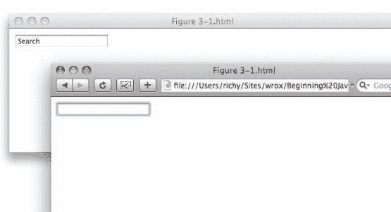

# 图 3-1

在**图 3-1**中，你可以看到三个对象：HTML 文档（Figure 3-1.html）、JavaScript 文档（Figure 3-1.js），以及 HTML 和 JavaScript 在 Safari 中的渲染输出。在 JavaScript 中，有一个事件在文档加载后触发，这是通过将一个函数赋值给 `window.onload` 来实现的。在 `onload` 执行的函数内部，有一个 `onfocus` 和一个 `onblur` 事件被应用到 ID 名为 `tmpSearch` 的 `<input>` 元素上。当 `<input>` 元素获得焦点且其值为 *Search* 时，该值会被设置为 `null`。当元素失去焦点（模糊）且没有值时，其值再次变为 *Search*。这是一种使搜索框显示其初始标签的常用技巧。

然而，这种分配事件的方法有一个很大的局限性。假设你加载了一个独立的 JavaScript 库，该库应用了自己的 `onfocus` 和 `onblur` 事件，或者更常见的情况是，你有多个外部脚本需要在 `onload` 时创建事件。使用传统的事件模型，你只能给同一个对象分配一个相同的事件。如果你尝试以 `window.onload = function()` 的方式为 `window.onload` 创建额外的赋值，你后续的赋值会覆盖之前的赋值，最终导致并非所有事件都被正确分配。

当然，通过合理的规划，你可以克服传统事件模型的这一局限性。由于也认识到了传统事件模型的这一局限性，W3C 创建了一个新的事件模型，以给开发者提供更大的灵活性。

## 第一部分：jQuery API

## 使用 W3C 事件模型分配事件

使用 W3C 的事件模型，你可以为同一个元素分配任意多个相同类型的事件。以下是**图 3-1**中概念的示例，但使用的是 W3C 事件模型而非传统事件模型：

```
<!DOCTYPE html PUBLIC "-//W3C//DTD XHTML 1.0 Transitional//EN"
    "http://www.w3.org/TR/2002/REC-xhtml1-20020801/DTD/xhtml1-transitional.dtd">
<html xmlns='http://www.w3.org/1999/xhtml' xml:lang='en'>
<head>
 <meta http-equiv='content-type' content='text/html; charset=utf-8' />
 <meta http-equiv='content-language' content='en-us' />
 <title>Contacts</title>
 <script type='text/javascript' src='Figure 3-2.js'></script>
</head>
<body>
    <input type='text' name='q' id='tmpSearch' value='Search' />
</body>
</html>
```

与传统事件模型相反，W3C 事件模型允许你为同一个元素分配任意多个相同类型的事件。在下面的 JavaScript 代码中，理论上我可以为 `<input>` 元素分配任意多个 `focus` 和 `blur` 事件——当然，是在合理范围内！

```
window.addEventListener(
    'load',
    function() {
        document.getElementById('tmpSearch').addEventListener(
            'focus',
            function() {
                if (this.value == 'Search') {
                    this.value = '';
                }
            }, false
        );

        document.getElementById('tmpSearch').addEventListener(
            'blur',
            function() {
                if (!this.value) {
                    this.value = 'Search';
                }
            }, false
        );
    }, false
);
```

运行此代码将产生**图 3-2**的效果，尽管该图并未在此实际展示。

它生成了与你在**图 3-1**中看到的相同的文档，唯一的区别在于事件的分配方式。W3C 事件模型的工作原理是调用你要分配事件的对象的 `addEventListener()` 方法。在前面的代码中，第一次使用 `addEventListener()` 附加事件是在 window 对象上调用该方法以附加一个加载事件。在**图 3-1**中，事件是 onload，而 W3C 事件模型去除了事件名称中的 *on* 前缀；除此之外，事件是相同的。`addEventListener()` 方法接受三个参数：

```
object.addEventListener(event, function, useCapture);
```

`addEventListener()` 的第二个参数是你想在事件发生时执行的函数。你提供给 `addEventListener()` 的参数可以是函数的名称，或者如你在前面的 JavaScript 中看到的，也可以是一个匿名函数。匿名函数没有名称，因此这个无名的函数定义被作为第二个参数传递给 `addEventListener()`。在本书中，你将看到更多匿名函数与命名函数的示例，因此我不会在此详细展开。

第三个参数，称为 `useCapture`，几乎从来不需要，尽管有少数情况需要使用它。`useCapture` 与事件捕获的概念有关。由于事件捕获是很少有 JavaScript 开发者使用或需要的功能，我选择不深入探讨这个概念，因为它实际上是一个边缘特性，很少有实际用例能证明其存在——事实上，它是一个如此边缘的特性，以至于 jQuery 在其大部分公开的事件 API 中都没有提供它。通常情况下，`useCapture` 参数的值应始终为 `false`。

## `this` 对象

`this` 对象在 JavaScript 中具有特殊含义，其含义可能根据使用上下文甚至使用的浏览器而改变。由于其含义可能随上下文变化，`this` 对象可能会让 JavaScript 新手感到困惑。在前面两个演示传统事件 API 和 W3C 事件 API 的示例中，`this` 被用来修改应用了事件的元素的属性。

> 你们中的一些人可能会说，等等——从技术上讲，`this` 是一个关键字！我认为将 `this` 视为一个对象会有所帮助，因为它通常就是一个对象。从技术上讲，称其为对象并不一定不正确。如果你对 `this` 的更多技术细节讨论感兴趣，我建议你阅读 Nicholas C. Zakas 的《*Professional JavaScript for Web Developers*》，该书同样由 Wrox 出版（2005年；第二版，2009年）。

假设你已经为一个元素添加了一个事件。如果你使用的是传统事件模型，`this` 总是指向你添加事件的那个元素，当你使用 `addEventListener` 函数时也是如此。下面的文档中有一个例子……字面和比喻意义上都是：

```
<!DOCTYPE html PUBLIC "-//W3C//DTD XHTML 1.0 Transitional//EN"
    "http://www.w3.org/TR/2002/REC-xhtml1-20020801/DTD/xhtml1-transitional.dtd">
<html xmlns='http://www.w3.org/1999/xhtml' xml:lang='en'>
  <head>
    <meta http-equiv='content-type' content='text/html; charset=utf-8' />
    <meta http-equiv='content-language' content='en-us' />
    <title>Contacts</title>
    <script type='text/javascript' src='Figure 3-3.js'></script>
    <link rel='stylesheet' href='Figure 3-3.css' type='text/css' />
  </head>
  <body>
    <input type='text' name='q' id='tmpSearch' value='Search' />
  </body>
</html>
```

以下样式表包含在前面的标记文档中：

```
input.tmpInputFocused {
    background: red;
    color: white;
}
```

最后，以下 JavaScript 也包含在前面的文档中。它演示了 `this` 如何指向标记文档中的 `<input />` 元素。当你处理附加到元素的事件时，`this` 总是指向你附加了事件的那个元素——也就是说，如果你使用的是 W3C 或传统事件 API。不幸的是，Internet Explorer 对 `this` 的含义有不同的理解。事实上，还应该注意的是，Internet Explorer 不支持 W3C 事件，因此此示例和上一个示例在 IE 中将无法工作。

```
window.addEventListener(
    'load',
    function() {
        document.getElementById('tmpSearch').addEventListener(
            'focus',
            function($e) {
                this.className = 'tmpInputFocused';
            }, false
        );

        document.getElementById('tmpSearch').addEventListener(
            'blur',
            function($e) {
                this.className = '';
            }, false
        );
    }, false
);
```

在**图 3-3**中，`this` 对象与元素之间的关联被突出显示；使用传统事件模型或 W3C 事件模型时，`this` 对象是一个 HTML 节点对象，你附加了事件的特定 HTML 节点对象所暴露的任何属性或方法，在 `this` 对象中都是可用的。在**图 3-3**中，`this` 指向 Figure 3-3.html 中的 `<input>` 元素。**图 3-3**展示了在 Safari 中加载 Figure 3-3.html 并聚焦 `<input>` 元素时发生的情况。（请注意，书的源代码中的图引用并不总是与书本身的图号完全对应。）

在**图 3-3**中，你可以看到当 `<input>` 元素获得焦点时，类名 `tmpInputFocused` 通过赋值给 `<input>` 元素的 `className` 属性，成为了该元素 `class` 属性的值。从前面源代码中的样式表可以看出，这使得 `<input>` 元素的背景变为红色，文本变为白色。**图 3-4**展示了当 `<input>` 元素失去焦点（或被模糊）时发生的情况。

在**图 3-4**中，你可以看到红色的背景和白色的文本样式不再应用，这是因为当 `<input>` 元素失去焦点或被模糊时，类名 `tmpInputFocused` 被移除了。


 ## 第 3 章：事件

**图 3-3**

**图 3-4**

`this` 对象也可以引用其他对象，具体取决于你在什么上下文中使用它。到目前为止，你已经看到了 `this` 对象与传统事件模型和 W3C 事件模型相关的情况，但这并不是你使用 `this` 对象的唯一场景。话虽如此，你将在本书中看到更多关于如何使用 `this` 对象的示例。

### event 对象

当你处理事件时，有时你想要拦截或阻止另一个动作发生。例如，假设你在网页上有现有的链接。当你点击一个链接时，浏览器会跳转到 `<a>` 元素的 `href` 属性所引用的文档。使用 JavaScript 可以拦截对超链接的点击。如果你想阻止默认动作发生，也就是说，阻止浏览器导航到 `href` 属性所引用的文档，你需要访问 `event` 对象的方法，该对象可以作为第一个参数传递给任何充当事件监听器的函数（通过 W3C 事件模型或传统事件模型分配的函数）。要阻止默认动作，你需要调用 `event` 对象的 `preventDefault()` 方法。以下代码展示了这一示例：

```
<!DOCTYPE html PUBLIC "-//W3C//DTD XHTML 1.0 Transitional//EN"
    "http://www.w3.org/TR/2002/REC-xhtml1-20020801/DTD/xhtml1-transitional.dtd">
<html xmlns='http://www.w3.org/1999/xhtml' xml:lang='en'>
  <head>
    <meta http-equiv='content-type' content='text/html; charset=utf-8' />
    <meta http-equiv='content-language' content='en-us' />
    <title>Link</title>
    <script type='text/javascript' src='Figure 3-5.js'></script>
  </head>
  <body>
    <a href='http://p2p.wrox.com'>Wrox&reg; Programmer to Programmer&trade;</a>
  </body>
</html>
```

前面标记中包含以下 JavaScript 代码：

```
window.addEventListener(
    'load',
    function() {
        document.getElementsByTagName('a')[0].addEventListener(
            'click',
            function($event) {
                window.open(this.href, 'P2P', 'width=500,height=500');
                $event.preventDefault();
            }, false
        );
    }, false
);
```

在前面的源代码中，你看到一个简单的标记文档，其中只有一个超链接。在引用的 JavaScript 中，通过获取所有 `<a>` 元素并将 `click` 事件添加到通过 `document.getElementsByTagName('a')[0]` 返回的第一个 `<a>` 元素，为该超链接附加了一个 `click` 事件。使用了一个匿名函数来处理 `click` 事件，该函数定义了一个参数 `$event`。该参数可以是你喜欢的任何名称；大多数开发者使用名为 `e` 或 `$e` 的变量来节省输入时间。有了这个参数，当 `click` 事件触发时，浏览器会将 `event` 对象传递给事件处理函数。

`event` 对象携带了一些预定义的方法 和属性，让你对事件有更多控制。你可以使用该对象来了解更多关于事件的信息，或了解事件所附加的对象相对于事件的情况，或控制事件处理函数执行完毕后会发生什么。就前面的代码而言，你想要拦截对 `<a>` 元素的点击。不是让浏览器在用户点击 `<a>` 元素后立即导航到 `href` 属性中指定的位置，而是告诉浏览器在 `<a>` 元素的 `href` 属性指定的位置打开一个弹出窗口，并通过调用 `event` 对象的 `preventDefault()` 方法不让主窗口导航到该位置。**图 3-5** 展示了执行上述代码时会发生什么。

**图 3-5**

在为超链接附加 `click` 事件的情况下，默认动作是浏览器导航到 `href` 属性中指定的位置。默认动作会因事件类型以及事件所应用的对象而不同。

`event` 对象还提供了其他方法和属性，但为了向你介绍 `event` 对象或帮你刷新对 `event` 对象的 memory，以上就是它的要点。我将在本书中继续 revisit `event` 对象。

## Microsoft JScript 事件模型

到目前为止，我一直在谈论 W3C 事件模型和传统事件模型。Microsoft 的 JScript 支持一种截然不同的、由 Microsoft 自己设计的事件模型。Microsoft 事件模型的 API 如下所示：

```
object.attachEvent(event, function);
```

在 Microsoft 的事件模型中，只有两个参数：`event` 和 `function`。乍一看，这可能给你一种 JScript 事件模型与 W3C 事件模型功能对等的印象，只是缺少 `useCapture` 参数。然而，事实并非如此。第一个区别是它的 event 参数需要带 *on* 前缀的事件名称。因此，Microsoft 模型与传统事件模型一样，直接使用相同的事件名称。

在 Microsoft 的事件模型中，当事件通过 `attachEvent()` 附加时，`this` 指向 `window` 对象，而不是事件所附加到的对象，这与传统事件模型中 `this` 的处理方式有很大偏差，尽管 Microsoft 在其传统事件模型的实现中确实支持后者。

Microsoft 不允许将 `event` 对象作为第一个参数传递给监听器函数。相反，Microsoft 提供了一个全局的 `window.event` 对象。因此，与其像前面 **图 3-5** 中那样调用 `$event.preventDefault()`，你需要将 `window.event` 对象的 `returnValue` 属性设置为 `false`，即 `window.event.returnValue = false`，这在 Internet Explorer 中提供了相同的结果。此外，Microsoft 的 `event` 对象不提供其他浏览器中 `event` 对象所支持的标准化方法。Microsoft 的传统事件模型实现也是如此——`event` 对象 *始终* 是全局的。

还应该指出的是，自 2001 年 IE6 发布以来，Internet Explorer 中支持的 Microsoft JScript 几乎没有经历过什么修订。虽然 Microsoft 在 IE7 中确实提供了一些 CSS 改进——比许多人希望的要少——但 JScript 的增强或错误修复却寥寥无几，尽管 Microsoft 一直有能力在不更新 IE 的情况下更新 JScript。当然，有过一些安全补丁，他们在 IE7 中提供了 `XMLHttpRequest` 对象的原生实现，与其他浏览器所支持的相同，作为以前版本的 IE 提供的 ActiveX 对象的替代。除此之外，今天的 JScript 与 IE 自 2001 年 IE6 发布以来使用的 JScript 是相同的。截至本文撰写之时，Microsoft 最新的浏览器版本 IE8，在 JavaScript 方面确实有一些显著的改进：更快的性能、更高的稳定性以及 Selectors API 的实现。然而，遗憾的是，它仍然不支持 W3C 的 Event API，Microsoft 浏览器的 Event API 与其他所有人支持的标准 W3C Event API 之间的鸿沟依然存在。

虽然 JavaScript 的某些角落里，浏览器制造商之间存在严重分歧，各有其特定的方式来处理某个特定事务，但 Microsoft 事件模型与 W3C 事件模型之间的支持分歧是最令人烦恼的，因为这是每次你想要附加和处理事件时都必须处理的 不兼容性，而这是 JavaScript 开发者最常见的任务。

## 创建通用的事件 API

尽管存在差异，大多数情况下开发者已经应对自如，使用自制的解决方案来弥兼容性。正如我在本章前面提到的，这种自制解决方案必须考虑到相当重的负担。以下是你自己制作 `addEventListener()`/`attachEvent()` 方法所需的要素：

- 不要泄漏内存。内存泄漏发生在你的浏览器为脚本分配内存（RAM）时。你的脚本使用了内存，但浏览器使用完毕后却从未释放。下次浏览器需要内存时，它会分配更多内存，而不是重用或释放它已经分配的内存。你的 JavaScript 可能变成一个 黑洞，不断吞噬

## 第三章：事件

更多内存被浪费在无用的 limbo 状态中。不过要注意：内存泄漏可能难以察觉。随着页面多次加载，浏览器会逐渐变得越来越慢、越来越不稳定。根据泄漏的严重程度，它可能导致浏览器崩溃。目前，IE6 在失控的内存使用方面问题最大。IE7 修复了部分问题，但仍有遗留。而 IE8 修复了更多。Firefox 和其他浏览器也曾出现过此问题，因此这并非 IE 独有的顽疾。

- 你必须在 IE 中修正 `this` 对象。`this` 应指向事件所附加的对象，而不是 `window` 对象。
- 你必须在 IE 中修正 `event` 对象，并提供与其他浏览器支持的 `event` 对象同等的功能。
- 你需要能够为同一元素附加多个事件。
- 你需要能够移除附加到元素上的事件。也就是说，要记住哪些事件被分配给了哪些元素，以便在需要时取消分配。

看起来可能不难，但实现这一列表实际上相当棘手。你需要大量的测试和专业的 JavaScript 知识，而大多数经验不足的程序员在一个或多个实现真正流畅稳定的事件 API 所必需的要点上会失败。

对于大多数普通网页开发者来说，通常不必担心或关心内存使用，至少不必在那个底层级别上操心。当然，你需要注意内存使用。你需要避免因为你的 JavaScript 应用想要加载数百万字节的数据而导致浏览器崩溃，并且你想找到方法让平均性能的脚本变得更快、更高效。

值得庆幸的是，你不必开发自己的事件处理方法。2005 年，Dean Edwards 和其他知名 JavaScript 专家联合起来解决事件问题。主要由 Dean 推动，一个名为 `addEvent()` 的解决方案诞生了。后来，John Resig 从 Dean 脚本的基本原理中汲取灵感，并加入了自己的创新，创建了 jQuery 的事件 API。John 去除了事件 API 中大部分的冗长和不必要的复杂性。

jQuery 通过以下 API 支持事件：

- `bind()` 方法，可以看作与 W3C 的事件 API 类似，但去掉了那个几乎无用的 `useCapture` 参数。
- 通过单独的事件方法，如 `click()`、`change()`、`focus()`、`blur()` 等，这使得附加事件所需的代码更加简洁。要使用此 API，你只需将函数引用或匿名函数作为第一个也是唯一参数传递给这些单独方法之一。这就像你之前在本章和第 1 章中看到的 `click()` 和 `ready()` 方法一样。
- 事件可以非常容易地通过编程方式模拟。你只需在不带任何参数的情况下调用事件方法即可。

接下来的几节将更详细地描述前面的 API。

关于 jQuery 在事件方面的完整支持列表，请参阅附录 D。

## 第一部分：jQuery API

### 使用 jQuery 的 bind() 方法绑定事件

正如我在上一节提到的，jQuery 的 `bind()` 方法的工作方式类似于 W3C 的标准事件 API。除了它的名称短得多之外，唯一的区别是它省略了那个几乎无用的 `useCapture` 参数。`useCapture` 参数是如此无用，以至于我决定在本书中甚至不讨论它，除了说它是无用的。嗯，实际上，公平地说，W3C 事件 API 的这个特性在极少数边缘情况下是有用的，但 99% 的情况下你不会遇到它们。如果你绝对想知道更多，别担心，你可以在 Nicholas C. Zakas 的《Professional JavaScript for Web Developers》（同样由 Wrox Press 出版，2005年；第二版，2009年）中找到一些相关内容。

以下示例演示了 `bind()` 方法：

```html
<!DOCTYPE html PUBLIC "-//W3C//DTD XHTML 1.0 Strict//EN"  
  "http://www.w3.org/TR/xhtml1/DTD/xhtml1-strict.dtd">
<html xmlns='http://www.w3.org/1999/xhtml' xml:lang='en'>
<head>
<meta http-equiv='content-type' content='text/html; charset=utf-8' />
<meta http-equiv='content-language' content='en-us' />
<title></title>
<script type='text/javascript'
  src='../../../../../Source Code/jquery/jquery.js'></script>
<script type='text/javascript' src='Figure 3-6.js'></script>
<link rel='stylesheet' href='Figure 3-6.css' type='text/css' />
</head>
<body>
<div></div>
<div></div>
<div></div>
<div></div>
<div></div>
<div></div>
</body>
</html>
```

前面的文档链接到以下样式表：

```css
div {
  border: 1px solid rgb(200, 200, 200);
  width: 100px;
  height: 100px;
  margin: 5px;
  float: left;
}
div.tmpExampleOver {
  background: #5092c5;
}
div.tmpExampleOn {
  background: #165b91;
}
```

以及以下 JavaScript：

```javascript
$(document).bind(
    'ready',
    function() {
      $('div').bind(
        'mouseover',
        function() {
          $(this).addClass('tmpExampleOver');
        }
      );

      $('div').bind(
        'mouseout',
        function() {
          $(this).removeClass('tmpExampleOver');
        }
      );

      $('div').bind(
        'click',
        function() {
          if ($(this).hasClass('tmpExampleOn')) {
            $(this).removeClass('tmpExampleOn');
          } else {
            $(this).addClass('tmpExampleOn');
          }
        }
      );
    }
  );
```

前面的源代码演示了如何使用 jQuery 的 `bind()` 方法附加事件，并且从本章前面的示例中，你可以看到它的工作方式与 W3C 的 `addEventListener()` 方法完全一样（除了那个 `useCapture` 参数），即该方法在要附加事件的对象上调用，然后传递事件名称和一个充当事件监听器的函数。在这个例子中，你附加了一个 `mouseover` 和 `mouseout` 事件，当鼠标指针经过每个方框时，每个 `<div>` 元素都会变成蓝色，方法是将类名 *tmpExampleOver* 附加到 `<div>` 元素上。然后你附加了一个 `mouseout` 事件，将 *tmpExampleOver* 类名从 `<div>` 元素中移除，使其恢复为没有背景。最后，你附加了一个 `click` 事件，它会在每次点击时切换类名 *tmpExampleOn* 的存在。前面的内容给你展示了如 **图 3-6** 所示的输出。

`bind()` 方法在你需要附加一个 jQuery 没有提供方法的事件时很有用。一些例子包括微软的 `onselectstart` 事件或 `ondrag` 事件，目前仅受 Internet Explorer 和 Safari 支持。这些事件会传递给 `bind()` 方法，去掉 *on* 前缀，如 `selectstart` 或 `drag`。

你还会注意到我调用 `hasClass()`、`addClass()` 和 `removeClass()` 方法的方式，这些都是 jQuery 提供的方法，位于事件处理函数内部。在事件处理函数中，jQuery 默认提供 `this` 对象，就像标准 W3C 事件 API 一样；它是一个表示事件所附加元素的对象。要访问 jQuery 方法，你必须将 `this` 包裹在对 jQuery 对象的调用中，即 `$(this)`；这样你就可以访问 jQuery 的所有方法。

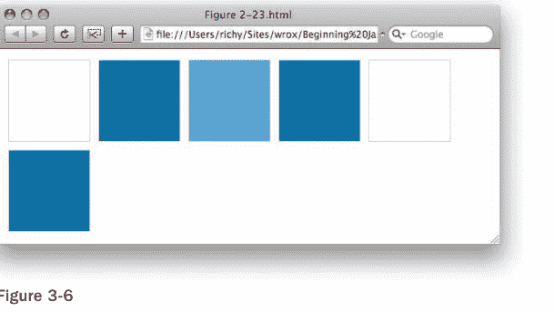

图 3-6

### 使用 jQuery 的事件方法绑定事件

John Resig 和 jQuery 团队并没有止步于将统一的、跨浏览器的事件 API 构建到 jQuery 中，而是看到了通过为每个事件制作单独的方法来使事件绑定变得更简单的机会，类似于传统的事件模型，但有两个主要区别。John 去掉了每个事件名称的 on 前缀，就像 W3C 事件 API 所做的那样，并且他将事件作为方法而不是属性，这样你就可以为同一元素附加多个相同类型的事件。以下示例演示了上一节中看到的示例，重写为使用 jQuery 的单独事件方法，使用相同的标记和样式表，但使用以下 JavaScript：

```javascript
$(document).ready(
  function() {
    $('div').mouseover(
      function() {
        $(this).addClass('tmpExampleOver');
      }
    );

    $('div').mouseout(
      function() {
        $(this).removeClass('tmpExampleOver');
      }
    );

    $('div').click(
      function() {
        if (!$(this).hasClass('tmpExampleOn')) {
          $(this).addClass('tmpExampleOn');
        } else {
          $(this).removeClass('tmpExampleOn');
        }
      }
    );
  }
);
```


## 第 3 章：事件

前面所述的功能与您之前在图 3-6 中看到的示例相同，该示例使用 bind() 方法，但前者更为简洁，因为它使用独立的事件方法来附加每个函数。此示例产生了 **图 3-7**（未显示）。

此外，jQuery 还考虑到了几种在附加事件时常出现的模式，例如当您附加 mouseover 事件时，通常也会附加 mouseout 事件。何不创建一个能同时附加两者的事件呢？这正是他们所做的——允许同时附加 mouseover 事件和 mouseout 事件的 **jQuery** 方法称为 `hover()`。jQuery 还考虑到了另一种模式，即每次点击交替调用附加的函数；此方法称为 toggle()。前面的示例已进一步细化以使用这两个方法。

```
$(document).ready(
    function() {
     $('div').hover(
         
    function()
       	{$(this).addClass('tmpExampleOver');
```

```
}
    ,
 function() {
      $(this).removeClass('tmpExampleOver');
   }
 );
 
 $('div').toggle(
function()
       	{$(this).addClass('tmpExampleOn');
```

`$('div').hover()` 方法的第一参数是绑定到元素 mouseover 事件的函数，第二参数是绑定到元素 mouseout 事件的函数。然后 `toggle()` 方法接受至少两个方法；每次点击会交替调用每个方法——第一次点击时执行第一个函数；第二次点击时执行第二个函数；第三次点击时，回到第一个函数，依此类推。需要至少提供两个函数，但可以供应任意数量的方法来进行切换。

## 触发事件

使用 jQuery 的事件 API 绑定到事件上的函数可以毫不费力地独立于任何事件发生而触发。这一概念允许您将绑定到事件的函数重新用于其他目的。您甚至可以向函数传递参数，而无须费吹灰之力。下面展示了如何使用 `trigger()` 方法在 jQuery 中触发事件：

```
<!DOCTYPE html PUBLIC "-//W3C//DTD XHTML 1.0 Strict//EN"
```

## 第一部分：jQuery API

```
<meta http-equiv='content-type' content='text/html; charset=utf-8' />
<meta http-equiv='content-language' content='en-us' />
<title></title>
<script type='text/javascript'
        src='../../Source Code/jQuery/jQuery.js'>
</script>
<script type='text/javascript' src='Figure 3-9.js'></script>
<link rel='stylesheet' href='Figure 3-9.css' type='text/css' />
</head>
<body>
  <form method='post' action='javascript:void(0);'>
    <div>
      <input type='text' name='tmpExample' value='Example' size='25' />
    </div>
  </form>
</body>
</html>
```

以下样式表包含在上述标记文档中：

```
input.tmpFocused {
    background: #5092c5;
    color: white;
}
```

以下 JavaScript 演示了 jQuery 的 trigger() 方法：

```
$(document).ready(
  function() {
    $('input').focus(
      function() {
        $(this).addClass('tmpFocused');
      }
    );

    $('input').blur(
      function() {
        $(this).removeClass('tmpFocused');
      }
    );

    $('input').trigger('focus');
  }
);
```

在上面的示例中，您看到了一个简单的焦点和模糊事件组合：当 `<input />` 元素获得焦点时，类名 `tmpFocused` 被添加给它；当失去焦点时，它被移除。页面加载时，会触发 `focus` 事件，默认赋予 `<input />` 元素焦点。这应该看起来像 **图 3-9** 中的截图。

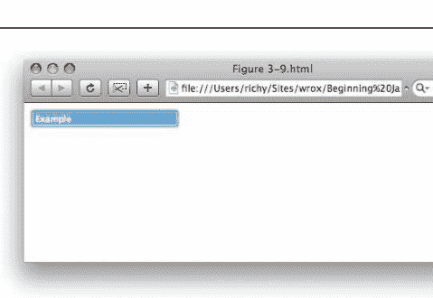

**图 3-9**

在上面的示例中，您看到了 `trigger()` 方法如何补充 `bind()` 方法，通过赋予您人为模拟事件的能力，而实际上不需要事件真正发生。然而，与 `bind()` 方法一样，jQuery 也使得事件模拟变得更加容易，您也可以直接调用事件方法（不带任何参数）来在 jQuery 中模拟事件。下面的 JavaScript 演示了这一概念，修改了您在最后一个示例中看到的 JavaScript：

```
$(document).ready(
  function() {
    $('input').focus(
      function() {
        $(this).addClass('tmpFocused');
      }
    );

    $('input').blur(
      function() {
        $(this).removeClass('tmpFocused');
      }
    );

    $('input').focus();
  }
);
```

在上述 JavaScript 中，该示例产生了图 3-10（未显示），而不是调用 `trigger()` 方法来模拟焦点事件，您只需调用 `focus()` 方法而不向其传递任何参数，这给您带来了在图 3-9 中观察到的相同结果。

正如我在本节开头提到的，如果您需要，也可以向模拟事件传递参数。您可以通过向 `trigger()` 方法传递第二个参数（称为 data 参数）来实现。传递给 `trigger()` 方法的数据可通过其第二个参数在充当事件处理程序的函数中可用，该参数的名称可以是您想要的任何名称。这在以下文档中得到演示：

```
<!DOCTYPE html PUBLIC "-//W3C//DTD XHTML 1.0 Strict//EN"
    "http://www.w3.org/TR/xhtml1/DTD/xhtml1-strict.dtd">
<html xmlns='http://www.w3.org/1999/xhtml' xml:lang='en'>
  <head>
    <meta http-equiv='content-type' content='text/html; charset=utf-8' />
    <meta http-equiv='content-language' content='en-us' />
```

上述标记文档链接到以下样式表：

```
input.tmpFocused {
    background: #89130a;
    color: white;
}
input.tmpFocusedOnLoad {
    background: #acd1ed;
}
```

在以下 JavaScript 中，您看到了 `trigger()` 方法如何将附加信息传递给事件处理程序。要访问被传递的信息，事件处理程序必须定义一个第二参数，可以是任何名称。在以下示例中，信息通过 `$data` 参数传递给事件处理程序：

```
$(document).ready(
  function() {
    $('input').focus(
      function($e, $data) {
        if (typeof($data) != 'undefined' && $data.thisIsOnLoad) {
          $(this).addClass('tmpFocusedOnLoad');
        } else {
          $(this).addClass('tmpFocused');
        }
      }
    );

    $('input').blur(
      function() {
        $(this).removeClass('tmpFocusedOnLoad');
        $(this).removeClass('tmpFocused');
      }
    );

    $('input').trigger('focus', {thisIsOnLoad: true});
  }
);
```

上述源代码组合在一起，给您展示了在 **图 3-11** 中看到的内容。当页面首次加载时，`<input />` 元素被赋予类名 `tmpFocusedOnLoad` 并获得焦点。失去焦点或模糊后，它失去该类名。然后在随后的聚焦中，`<input />` 元素接收类名 `tmpFocused`。

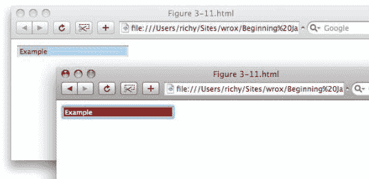

**图 3-11**

下面的“试一试”将复习 jQuery 的事件 API。

## 试一试：复习 jQuery 的事件 API

### 示例 3-1

要对 jQuery 的事件 API 进行全面复习，请遵循以下步骤：

- 1. 创建以下 HTML 文档作为 *示例 3-1.html*：

```
<!DOCTYPE html PUBLIC "-//W3C//DTD XHTML 1.0 Strict//EN"
    "http://www.w3.org/TR/xhtml1/DTD/xhtml1-strict.dtd">
<html xmlns='http://www.w3.org/1999/xhtml' xml:lang='en'>
<head>
    <meta http-equiv='content-type' content='text/html; charset=utf-8' />
    <meta http-equiv='content-language' content='en-us' />
```


## 第一部分：jQuery API

```html
        <title></title>
        <script type='text/javascript'
                src='../../../Source Code/jQuery/jQuery.js'>
        </script>
        <script type='text/javascript' src='Example 3-1.js'></script>
        <link rel='stylesheet' href='Example 3-1.css' type='text/css' />
      </head>
      <body>
        <p>
            jQuery's event API is modeled after the standard event API put
            forth by the W3C.  It's bind() method simplifies this API,
            by requiring less code, and dropping a mostly unneeded argument.
        </p>
        <div class='tmpBind'>
            <div></div>
            <div></div>
            <div></div>
        </div>
        <p>
            jQuery doesn't stop there, however, you can also use individual
            event methods to bind events.
        </p>
        <div class='tmpIndividual'>
            <div></div>
            <div></div>
            <div></div>
        </div>
        <p>
            And if that weren't enough, jQuery also provides two methods that
            accommodate applying both a mouseover and mouseout event in the
            same method, and a method that makes toggling easier and
            more intuitive.
        </p>
        <div class='tmpPattern'>
            <div></div>
            <div></div>
            <div></div>
        </div>
        <p>
            You can also programmatically trigger events, like automatically
            focusing the following &lt;textarea&gt; element on page load.
        </p>
        <div class='tmpTrigger'>
            <textarea name='tmpExample' cols='50' rows='5'>Example</textarea>
        </div>
        <p>
            Even triggering an event is made easier, you can use individual
            event methods with no arguments to do that too.
        </p>
      </body>
    </html>
```

### 2. 创建以下样式表作为示例 3-1.css：

```css
body {
	font: 16px sans-serif;
}
div.tmpBind,
div.tmpIndividual,
div.tmpPattern {
	height: 100px;
}
div.tmpBind div,
div.tmpIndividual div,
div.tmpPattern div {
	height: 88px;
	width: 88px;
	border: 1px solid rgb(200, 200, 200);
	float: left;
	margin: 0 3px;
	background: #cfdbe5;
}
body div.tmpExampleOver {
	background: #acdled;
}
body div.tmpExampleOn {
	background: #7e93a4;
}
textarea.tmpFocused {
	background: #acdled;
	color: white;
}
```

### 3. 创建以下 JavaScript 代码作为示例 3-1.js：

```javascript
$(document).ready(
	function() {
		$('div.tmpBind').bind(
			'mouseover',
			function() {
				$(this).find('div').addClass('tmpExampleOver');
			}
		)
	.bind(
		'mouseout',
		function() {
			$(this).find('div').removeClass('tmpExampleOver');
		}
	)
	.bind(
		'click',
		function() {
			if ($(this).find('div').hasClass('tmpExampleOn')) {
				$(this).find('div').removeClass mamaClass('tmpExampleOn');
			} else {
				$(this).find('div').addClass('tmpExampleOn');
			}
		}
	)

);
```

## 第一部分：jQuery API

```javascript
$('div.tmpIndividual').mouseover(
    function() {
        $(this).find('div').addClass('tmpExampleOver');
    }
).mouseout(
    function() {
        $(this).find('div').removeClass('tmpExampleOver');
    }
).click(
    function() {
        if ($(this).find('div').hasClass('tmpExampleOn')) {
            $(this).find('div').removeClass('tmpExampleOn');
        } else {
            $(this).find('div').addClass('tmpExampleOn');
        }
    }
);

$('div.tmpPattern').hover(
    function() {
        $(this).find('div').addClass('tmpExampleOver');
    },
    function() {
        $(this).find('div').removeClass('tmpExampleOver');
    }
).toggle(
    function() {
        $(this).find('div').addClass('tmpExampleOn');
    },
    function() {
        $(this).find('div').removeClass('tmpExampleOn');
    }
);

$('div.tmpTrigger textarea').focus(
    function($e) {
        $(this).addClass('tmpFocused');
    }
).blur(
    function() {
        $(this).removeClass('tmpFocused');
    }
);

$('div.tmpTrigger textarea').focus();
}
);
```

前面的示例在浏览器中加载时应该看起来像**图 3-12**的截图。

## 第 3 章：事件

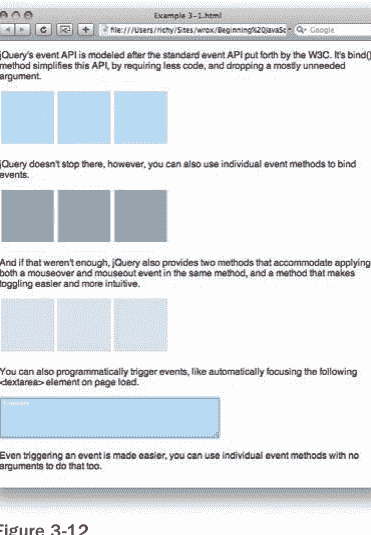

图 3-12

前面的示例几乎包含了本章关于 jQuery 的事件 API 学到的所有内容——至少是最重要的部分。我引入了一些与先前示例的微小偏差来保持内容有趣。

最大的偏差是我演示了如何通过一个接一个地链接事件，可以进一步减少 jQuery 代码。一旦在 jQuery 中进行了选择，大多数 jQuery 方法也会返回该选择（如果您已选择这样做），或者返回筛选后的选择；即使事件方法也返回您的先前选择，以便您可以继续对该选择进行操作。这是 jQuery 获得极高人气的原因之一：它允许您一个接一个地链接方法，从而比常规情况下为您节省更多代码行。当然，您不需要使用这种创新，但这是您可用工具中的另一项内容。

示例其余部分重申了各种方式可以使用 jQuery 的事件 API 将事件附加到每个元素上。第一组 jQuery 方法利用 `bind()` 方法将事件附加到以下标记：

```html
<div class='tmpBind'>
    <div></div>
    <div></div>
    <div></div>
</div>
```

前面的标记由以下 CSS 样式化：

```css
div.tmpBind,
div.tmpIndividual,
div.tmpPattern {
    height: 100px;
}
div.tmpBind div,
div.tmpIndividual div,
div.tmpPattern div {
    height: 88px;
    width: 88px;
    border: 1px solid rgb(200, 200, 200);
    float: left;
    margin: 0 3px;
    background: #cfdbe5;
}
```

前面的 CSS 代码将这些`<div>`元素并排排列，使它们成为带有灰色边框和朦胧天蓝色背景的完美正方形盒子。以下 JavaScript 添加了一些基本的鼠标悬停、鼠标移出和点击交互：

```javascript
$('div.tmpBind').bind(
    'mouseover',
    function() {
        $(this).find('div').addClass('tmpExampleOver');
    }
).bind(
    'mouseout',
    function() {
        $(this).find('div').removeClass('tmpExampleOver');
    }
).bind(
    'click',
    function() {
        if ($(this).find('div').hasClass('tmpExampleOn')) {
            $(this).find('div').removeClass('tmpExampleOn');
        } else {
            $(this).find('div').addClass('tmpExampleOn');
        }
    }
);
```

上述代码中的`bind()`方法有两个参数：您要附加的事件类型以及要用作事件监听器的函数。在这种情况下，您向名为 `tmpBind` 的`<div>` 元素添加了`mouseover`、`mouseout`和`click` 事件。在`mouseover`时，将类名 `tmpExampleOver` 添加到每个子 `<div>` 元素，而在`mouseout` 时，则移除该分类名。`tmpExampleOver` 类使每个子`<div>` 元素具有更明亮的天蓝色背景。点击`<div>` 元素时，会在每个子 `<div>` 元素上添加类名 `tmpExampleOn`，从而使每个 `<div>` 元素具有更深的蓝色背景。再次点击则移除该分类名。

下一段代码做同样的事情，但不再使用`bind()` 方法附加每个事件，而是使用单独的 `mouseover()`、`mouseout()`和`click()` 事件方法来附加每个事件。

然后，在随后那段代码中，您将 `mouseover()`和`mouseout()`事件的事件处理程序合并到一个单一的 `hover()` 方法中，并将前一个`click()` 方法的事件处理程序拆分为传递给`toggle()` 方法的两个方法。

最后，您向 `<textarea>` 元素添加焦点和模糊事件，并在页面加载时触发`<textarea>`的`focus()`事件处理程序。

### 总结

在 JavaScript 框架出现之前，事件 API 在不同浏览器之间相当碎片化。Microsoft 有自己的做事方式，其他人也有自己的方式。通过过去的几年，像这样的跨浏览器开发陷阱帮助将 JavaScript 保持下来并降级为主流 Web 开发中的新奇事物……更糟糕的是，这促成了许多 IT 部门提出的狭隘的仅 IE 开发政策。Firefox 和 Safari 的流行挑战了这种心态并推动了现状变革，甚至迫使 Microsoft 回归到对其旗舰浏览器的认真开发。

像 Dean Edwards、Peter-Paul Koch、John Resig 和其他人这样的 JavaScript 专家一直在努力开发完全由 JavaScript 驱动的补丁工作，以抹平 JavaScript 的粗糙边缘，使 JavaScript 开发对普通 Web 开发人员更加无缝和易于访问。

jQuery 的事件 API 使得处理 JavaScript 中的事件更容易，并消除了旧版 JavaScript 中持续存在的繁琐跨浏览器位，并在很大程度上基于 W3C 优越的事件模型标准化 JavaScript 中的事件。您不再需要担心`this`指的是哪个对象，或如何取消浏览器对事件的默认操作。

jQuery 的 `bind()`方法密切镜像 W3C 的`addEventListener()`，但使其更加简洁，并消除了几乎从不用到的第三参数的指定需求。此外，jQuery 通过提供单独的事件方法进一步创新，进一步减少了您需要编写的代码量，并使模拟事件变得非常容易。

### 练习

- 1. 在传统事件模型中，是否可以将同一类型的多个事件附加到同一个元素上？
2. W3C 的`addEventListener()`API 解决了传统事件模型的什么最大缺点？
3. 就事件命名而言，传统事件模型、W3C `addEventListener()`API 和 Microsoft 的事件模型在事件命名上的区别是什么？
4. jQuery 提供了哪种与 W3C 的`addEventListener()` API 非常相似的方法，它们有什么区别？
5. 如果您想要模拟表单 `<input>` 字段上的 `focus` 事件，您会使用什么方法？
6. 如果您想将`mouseover`和`mouseout` 事件都附加到元素上，哪种方法是最佳方法？

## 操作内容和属性

jQuery 是一个全面的库，它提供了您对于从 DOM 处理内容所能想象到的所有内容。在第 2 章中，您已经看到 jQuery 如何非常轻松地通过其细粒度的选择和过滤选择支持，从 DOM 获取元素。然后在第 3 章中，您又看到 jQuery 如何构建在 W3C 事件模型之上，使其更加简洁的同时提供了更多的方法供当今每个浏览器使用。本章继续讨论 jQuery 的 API 组件，深入介绍 jQuery 为操作内容和属性提供的方法。您不再需要担心浏览器是否支持 `innerText` 或 `textContent` 属性，也不需担心 `outerHTML` 属性，或者标准 DOM 方法是什么从文档中移除一个元素。jQuery 通过一个坚如磐石且简单可用的 API，直接覆盖了这些令人畏惧的冗长且有时碎片化的方法。

在本章中，我介绍如何对 DOM 内容进行混排，包括用另一个元素替换一个元素，插入新文本或 HTML，追加或前置内容，克隆内容，以及删除内容等。

我也介绍了如何使用 jQuery 操作属性，这是某些浏览器（咳，IE）中一些边缘用例可能使其变得困难的另一个领域。

或者您可能曾经希望为元素保存自定义数据，而无需处理创建自定义属性或隐藏元素。jQuery 也提供此功能。

### 设置和获取属性

使用 jQuery 操作属性非常简单。就像您对 jQuery 所做的任何事一样，首先您创建一个选择，然后在选择之后，您可以对该选择进行操作，例如设置或访问属性。在一个选择上设置一个属性会将该属性设置在所选的每个元素上，这可能是一个或多个元素。访问属性的值也很容易——一旦您创建了选择，访问属性的值将为提供您在第一个选择中的属性值。下面的文档在源代码中演示了这些概念：

```
<!DOCTYPE html PUBLIC "-//W3C//DTD XHTML 1.0 Strict//EN"
    "http://www.w3.org/TR/xhtml1/DTD/xhtml1-strict.dtd">
<html xmlns='http://www.w3.org/1999/xhtml' xml:lang='en'>
  <head>
    <meta http-equiv='content-type' content='text/html; charset=utf-8' />
    <meta http-equiv='content-language' content='en-us' />
    <title></title>
    <script type='text/javascript'
          src='../../Source Code/jQuery/jQuery.js'>
    </script>
    <script type='text/javascript' src='Figure 4-1.js'></script>
    <link type='text/css' href='Figure 4-1.css' rel='stylesheet' />
  </head>
  <body>
    <div>Mouse over to change this element's id.</div>
  </body>
</html>
```

下面的样式表链接到前面的文档：

```
body {
    font: 16px sans-serif;
}
div {
    width: 350px;
    padding: 10px;
    border: 1px solid rgb(200, 200, 200);
    background: #93cdf9;
    margin: 5px;
}
div#tmpExample {
    background: #6faddd;
}
```

下面的 JavaScript 也链接到前面的文档：

```
$(document).ready(
  function() {
    $('div').hover(
      function() {
        // Set the id attribute
        $(this).attr('id', 'tmpExample');

        // Get the id attribute
        $(this).text('This element\'s ID is: ' + $(this).attr('id'));
      },
      function() {
        $(this).attr('id', '');
        $(this).text('This element\'s ID has been removed.');
      }
    );
  }
);
```

前面的示例演示了如何使用 jQuery 的 `attr()` 方法设置文档中的 `id` 属性。这非常简单：您只需在第一参数中指定要设置的属性名称，在第二参数中指定要设置的值。检索属性的值也很容易：只需以名称作为第一个参数调用 `attr()` 方法，且不要指定第二个参数。前面给出的内容即您在 **图 4-1** 中看到的。

**图 4-1**

jQuery 的 `attr()` 方法也可以有稍微不同的语法——您也可以向该方法传递一个对象字面量，定义以键值对形式的关键属性。这将如下所示：

```
$('a').attr({
    id:    'tmpExample',
    title: 'Some Tooltip Text',
    href:  'http://www.example.com'
});
```

注意上面花括号的使用。左上角的花括号在打开括号之后，让 JavaScript 知道紧随其后的是一个对象字面量。每个属性显示为属性名称后跟一个冒号，然后是值。如果值是字符串，当然用引号括起来；然后您添加一个逗号和下个属性键值对，依此类推；然后闭合花括号完成对象。在本示例中，您设置了三个独立的属性：`id`、`title` 和 `href` 属性。DOM 的更改将产生相应的 HTML，如下所示：

```
<a href='http://www.example.com' title='Some Tooltip Text' id='tmpExample'>A link</a>
```

移除属性也很容易——为此您使用 `removeAttr()` 方法。该方法接受一个属性的名称，然后从每个所选元素中删除该属性。因此，如果您在前面的标记上运行以下 jQuery：

```
$('a').removeAttr('title');
```

正如您所预期的，您将获得以下标记代替：

```
<a href='http://www.example.com' id='tmpExample'>A link</a>
```

jQuery 的 `attr()` 方法还可以让您做另一件事，那就是使用回调函数设置属性。这个概念在下面演示的文档中得到了体现：

```
<!DOCTYPE html PUBLIC "-//W3C//DTD XHTML 1.0 Strict//EN"
    "http://www.w3.org/TR/xhtml1/DTD/xhtml1-strict.dtd">
<html xmlns='http://www.w3.org/1999/xhtml' xml:lang='en'>
<head>
    <meta http-equiv='content-type' content='text/html; charset=utf-8' />
    <meta http-equiv='content-language' content='en-us' />
    <title></title>
    <script type='text/javascript'
            src='../../../Source Code/jQuery/jQuery.js'>
    </script>
    <script type='text/javascript' src='Figure 4-2.js'></script>
    <link type='text/css' href='Figure 4-2.css' rel='stylesheet' />
</head>
<body>
    <ul>
        <li>Jupiter</li>
        <li>Saturn</li>
        <li>Uranus</li>
        <li>Neptune</li>
    </ul>
</body>
</html>
```

下面的样式表包含在前面的文档中：

```
body {
    font: 16px sans-serif;
}
ul {
    list-style: none;
    padding: 0;
    margin: 0;
}
ul li {
    margin: 3px;
    padding: 3px;
}
li#tmpJupiter {
    background: #d7b05b;
}
li#tmpSaturn {
    background: #d3988a;
}
li#tmpUranus {
    background: #8ad3a6;
}
li#tmpNeptune {
    background: #8aa9d3;
}
```

下面的 JavaScript 展示了如何选择每个 `<li>` 元素；然后使用 jQuery 的 `attr()` 方法添加一个 `id` 属性。在第二个参数中提供一个匿名函数，该函数在每个选中的 `<li>` 元素的上下文中执行。这意味着匿名函数执行四次，因为有四个 `<li>` 元素。在该函数中，通过获取前缀 `tmp` 创建并返回一个 ID，并使用 jQuery 的 `text()` 方法（我在本章后面讨论）检索 `<li>` 元素的文本内容并将其粘接到该前缀上。因此，每个 `<li>` 元素都会接收到一个唯一的 ID：第一个 `<li>` 元素给定 ID 名称 `tmpJupiter`；第二个为 `tmpSaturn`；第三个为 `tmpUranus`；第四个为 `tmpNeptune`。

```
$(document).ready(
  function() {
    $('li').attr(
      'id',
      function() {
        return 'tmp' + $(this).text();
      }
    );
  }
);
```

因此，jQuery 的 `attr()` 方法可以接受一个回调函数，该函数在每个选中的元素上下文中执行；该函数返回的值成为属性值。**图 4-2** 显示示例在浏览器中的样子。

下面的“试一试”总结了您关于 jQuery 属性操作能力所学到的所有内容。

### 试一试：操作属性

#### 示例 4-1

为了复习 jQuery 中的属性操作，请遵循以下步骤：

-   将以下标记文档输入到您的文本编辑器中：

```
<!DOCTYPE html PUBLIC "-//W3C//DTD XHTML 1.0 Strict//EN"
  "http://www.w3.org/TR/xhtml1/DTD/xhtml1-strict.dtd">
<html xmlns='http://www.w3.org/1999/xhtml' xml:lang='en'>
```


## 第一部分：jQuery API

```html
<head>
  <meta http-equiv='content-type' content='text/html; charset=utf-8' />
  <meta http-equiv='content-language' content='en-us' />
  <title></title>
  <script type='text/javascript'
          src='../../../Source Code/jQuery/jQuery.js'>
  </script>
  <script type='text/javascript' src='Example 4-1.js'></script>
  <link type='text/css' href='Example 4-1.css' rel='stylesheet' />
</head>
<body>
  <p>
    Setting an attribute value with jQuery's attr() method is
    really easy, all you have to do is supply the name of the
    attribute and a value.
  </p>
  <span class='tmpSetAttr'>
    The id attribute of this element is set to <i>tmpSetID</i>.
  </span>
  <p>
    You can also set multiple attributes by supplying an object
    literal to the attr() method.
  </p>
  <span class='tmpSetMultipleAttr'>
    The title of this element is set to <i>Hello, World!</i> and
    the id attribute of this element is set to <i>tmpHelloWorld</i>.
  </span>
  <p>
    Getting an attribute value is just as intuitive, all you need
    to do is call the attr() method with the name of the attribute
    you want to get the value for.
  </p>
  <span class='tmpGetAttr' title='Foo'>
    This element's title attribute has a value of <span></span>.
  </span>
  <p>
    An attribute can be removed from an element using the
    removeAttr() method.
  </p>
  <span class='tmpRemoveAttr'>
    This element's class attribute is removed.
  </span>
  <p>
    Element attributes may also be set via a callback function.
  </p>
  <ul>
    <li>I</li>
    <li>Me</li>
    <li>Mine</li>
  </ul>
</body>
</html>
```

2. 将上述文档保存为 *Example 4-1.html*。

## 第四章：操作内容和属性

3. 在你的文本编辑器中输入以下样式表：

```css
body {
  font: 16px sans-serif;
}
span#tmpSetID {
  background: yellow;
  border: 1px dashed rgb(128, 128, 128);
  padding: 3px;
}
span#tmpHelloWorld {
  background: green;
  padding: 3px;
  border: 1px dashed yellowgreen;
  color: yellowgreen;
}
span.tmpGetAttr {
  background: blue;
  padding: 3px;
  border: 1px dashed lightblue;
  color: lightblue;
}
span.tmpRemoveAttr {
  background: red;
  padding: 3px;
  border: 1px dashed pink;
  color: pink;
}
ul {
  list-style: none;
  padding: 0;
  margin: 5px;
}
li#tmpI,
li#tmpMe,
li#tmpMine {
  padding: 3px;
}
li#tmpI {
  background: orange;
}
li#tmpMe {
  background: purple;
}
li#tmpMine {
  background: magenta;
}
```

4. 将上述文档保存为 *Example 4-1.css*。

5. 输入以下 JavaScript 文档：

```javascript
$(document).ready(
  function() {
    $('span.tmpSetAttr').attr('id', 'tmpSetID');

    $('span.tmpSetMultipleAttr').attr({
      title: 'Hello, World!',
      id: 'tmpHelloWorld'
    });

    $('span.tmpGetAttr').find('span').text(
      $('span.tmpGetAttr').attr('title')
    );

    $('span.tmpRemoveAttr').removeAttr('class');

    $('li').attr(
      'id',
      function() {
        return 'tmp' + $(this).text();
      }
    );
  }
);
```

6. 将上述文档保存为 Example 4-1.js。

上述文档执行后的效果类似于图 4-3 所示。

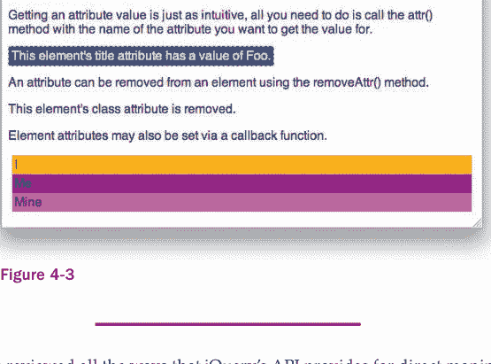

**图 4-3**

在示例 4-1 中，你回顾了 jQuery API 提供的所有直接操作属性值的方法。

## 第四章：操作内容和属性

在第一个示例中，你将以下 `<span>` 元素的 ID 属性设置为 `tmpSetID`：

```html
<span class='tmpSetAttr'>
    The id attribute of this element is set to <i>tmpSetID</i>.
</span>
```

`<span>` 元素的 `id` 属性通过以下 JavaScript 代码设置：首先使用选择器 `span.tmpSetAttr` 选中 `<span>` 元素，然后使用 jQuery 的 `attr()` 方法并传入两个值来设置 `id` 属性，第一个值是要设置的属性名称，第二个值是要赋予该属性的值。

```javascript
$('span.tmpSetAttr').attr('id', 'tmpSetID');
```

为上述 `<span>` 元素添加 ID `tmpSetID` 后，会触发以下样式表规则应用到该 `<span>` 元素：

```css
span#tmpSetID {
    background: yellow;
    border: 1px dashed rgb(128, 128, 128);
    padding: 3px;
}
```

随后，你同时设置了以下 `<span>` 元素的 `id` 和 `title` 属性：

```html
<span class='tmpSetMultipleAttr'>
    The title of this element is set to <i>Hello, World!</i> and
    the id attribute of this element is set to <i>tmpHelloWorld</i>.
</span>
```

你通过向 `attr()` 方法提供一个对象字面量来同时设置 `id` 和 `title` 属性，该对象包含多个键值对形式的属性。

```javascript
$('span.tmpSetMultipleAttr').attr({
    title: 'Hello, World!',
    id: 'tmpHelloWorld'
});
```

上述对 ID `tmpHelloWorld` 的应用导致以下样式表规则被应用到该 `<span>` 元素：

```css
span#tmpHelloWorld {
    background: green;
    padding: 3px;
    border: 1px dashed yellowgreen;
    color: yellowgreen;
}
```

在下一个示例中，你简单检索了 `title` 属性的值，并将该值插入到嵌套的 `<span>` 元素中。

```html
<span class='tmpGetAttr' title='Foo'>
    This element's title attribute has a value of <span></span>.
</span>
```

## 第一部分：jQuery API

嵌套 `<span>` 元素的值通过以下脚本设置。首先使用选择器 `span.tmpGetAttr` 选中外部 `<span>` 元素，然后使用 `find('span')` 选中嵌套的 `<span>` 元素，并使用 `text()` 方法设置该嵌套 `<span>` 元素的文本值。再次选中外部 `<span>` 元素，并使用 `attr('title')` 方法检索其 `title` 属性的值。

```javascript
$('span.tmpGetAttr').find('span').text(
  $('span.tmpGetAttr').attr('title')
);
```

在下一个示例中，你使用 jQuery 的 `removeAttr()` 方法完全移除一个属性。

```html
<span class='tmpRemoveAttr'>
  This element's class attribute is removed.
</span>
```

`class` 属性通过以下脚本完全移除：

```javascript
$('span.tmpRemoveAttr').removeAttr('class');
```

`class` 属性的移除导致以下样式表规则 *不再* 被应用：

```css
span.tmpRemoveAttr {
  background: red;
  padding: 3px;
  border: 1px dashed pink;
  color: pink;
}
```

然后，你看到的最后一个示例演示了如何使用回调函数来设置元素的属性。你获取以下 `<li>` 元素的文本值，并将其转换为 ID 名称。

```html
<li>I</li>
<li>Me</li>
<li>Mine</li>
```

以下脚本选中每个 `<li>` 元素，并将每个 `<li>` 元素的 `id` 属性分别设置为 `tmpI`、`tmpMe`、`tmpMine`：

```javascript
$('li').attr(
  'id',
  function() {
    return 'tmp' + $(this).text();
  }
);
```

上述脚本的执行导致以下样式表规则被应用：

```css
li#tmpI,
li#tmpMe,
li#tmpMine {
  padding: 3px;
}
```

## 第四章：操作内容和属性

```css
li#tmpI {
  background: orange;
}
li#tmpMe {
  background: purple;
}
li#tmpMine {
  background: magenta;
}
```

在下一节中，我将继续讨论 jQuery 中属性操作的内容，介绍 jQuery 提供的用于操作类名的 API。

### 操作类名

在之前的章节中，你已经看到过 jQuery 用于操作类名的 `addClass()`、`hasClass()` 和 `removeClass()` 方法的示例。在客户端 Web 开发中，最佳实践是避免直接在 JavaScript 代码中放置样式声明，而是通过操作元素的类名来保持行为与表现的分离，将样式放在 CSS 中。这被认为是最佳实践是有原因的：这样做最合理。由于所有的表现都整洁地包含在 CSS 中，行为在 JavaScript 中，结构在 HTML 中，你的文档将变得更易于管理，因为修改的位置更加可预测。如果样式分散在 HTML 内联、JavaScript 和实际的样式表中，那么更改文档的表现将变得更加困难。

类名非常灵活，允许你为同一个元素指定一个或多个类名。多个类名在属性中用单个空格分隔，如下所示：

```html
<div class='thisClassName otherClassName stillAnotherClassName'>
  Some content…
</div>
```

在上例中，`<div>` 元素有三个独立的类名，其中任何一个都可以用来从样式表中委派样式。CSS 还指定了在样式表中将类名链在一起的能力，如下所示：

```css
div.thisClassName.otherClassName.stillAnotherClassName {
  color: red;
}
```

上述方法并不常用，因为 IE6 只将样式应用于链中最后一个指定的类名。这个问题在 IE7 中得到了修复，其他浏览器也早已支持此功能。然而，你不必在样式表中将类名链在一起；你可以单独指定样式，每次只使用一个类名，并利用 CSS 的特异性和层叠规则来确保应用正确的样式。

```css
div.thisClassName {
  color: red;
}
div.otherClassName {
  color: maroon;
}
```


## 第一部分：jQuery API

```
div.stillAnotherClassName {
    color: crimson;
}
```

在上面的例子中，`<div>` 元素的样式将是深红色，因为其选择器与前面两个具有相同的特异性，并且得益于级联机制，由于它位于最后，其样式优先于前面两个。由于你使用 JavaScript 应用行为，你可以利用这些规则来创建点击、鼠标悬停或鼠标移出时发生的效果，动态地交换分配给元素的类名。

> 如果这些 CSS 主题对你来说很陌生，你可能会考虑购买我的书籍《Beginning CSS: Cascading Style Sheets for Web Design, 2nd ed.》（Wiley，2007），在其中我详细讨论了前面的概念。

在接下来的“动手试试”环节中，你将复习 jQuery 的类名操作 API。

### 动手试试：操作类名

#### 示例 4-2

要复习 jQuery 提供的操作类名的方法，请按照以下步骤操作：

1.  在文本编辑器中新建一个文档，输入以下标记：

```
<!DOCTYPE html PUBLIC "-//W3C//DTD XHTML 1.0 Strict//EN"
    "http://www.w3.org/TR/xhtml1/DTD/xhtml1-strict.dtd">
<html xmlns='http://www.w3.org/1999/xhtml' xml:lang='en'>
  <head>
    <meta http-equiv='content-type' content='text/html; charset=utf-8' />
    <meta http-equiv='content-language' content='en-us' />
    <title></title>
    <script type='text/javascript'
            src='../../Source Code/jQuery/jQuery.js'>
    </script>
    <script type='text/javascript' src='Example 4-2.js'></script>
    <link type='text/css' href='Example 4-2.css' rel='stylesheet' />
  </head>
  <body>
    <p>
      jQuery's class name manipulation API can be used to add or
      remove a class name from multiple elements at once, using
      the addClass(), removeClass(), or toggleClass() methods.
    </p>
    <table>
      <tbody>
        <tr>
          <td></td>
          <td></td>
          <td></td>
        </tr>
        <tr>
          <td></td>
          <td></td>
          <td></td>
        </tr>
        <tr>
          <td></td>
          <td></td>
          <td></td>
        </tr>
      </tbody>
    </table>
  </body>
</html>
```

2.  将上述标记文档保存为 *Example 4-2.html*。
3.  在文本编辑器中再新建一个文档，输入以下样式表：

```
body {
  font: 16px sans-serif;
}
td {
  width: 100px;
  height: 100px;
  border: 1px solid rgb(200, 200, 200);
}
td.tmpHover {
  background: yellow;
}
td.tmpSelected {
  background: orange;
}
```

4.  将上述文档保存为 *Example 4-2.css*。
5.  在另一个新文档中输入以下 JavaScript 代码：

```
$(document).ready(
  function() {
    $('table').hover(
      function() {
        $('td').addClass('tmpHover');
      },
      function() {
        $('td').removeClass('tmpHover');
      }
    )
    .click(
      function() {
        $('td').toggleClass('tmpSelected');
      }
    );
  }
);
```

6.  将上述文档保存为 *Example 4-2.js*。

上述文档在你将鼠标光标悬停在表格上时，会产生**图 4-4** 中的截图；在你点击表格时，会产生**图 4-5** 中的截图。

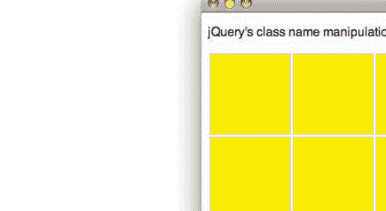

> 图 4-4

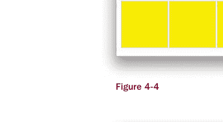

> 图 4-5

## 第四章：操作内容和属性

在示例 4-2 中，你快速复习了 jQuery 提供的类名操作方法。你为 `<table>` 元素附加了两个事件：一个 `hover` 事件和一个 `click` 事件。当你的鼠标光标悬停在 `<table>` 元素上时，会执行以下脚本：

```
$('table').hover(
  function() {
    $('td').addClass('tmpHover');
  },
  function() {
    $('td').removeClass('tmpHover');
  }
)
```

当鼠标在 `<table>` 元素上时，使用 jQuery 的 `addClass()` 方法将类名 `tmpHover` 添加到所有九个 `<td>` 元素。当鼠标离开 `<table>` 元素时，使用 jQuery 的 `removeClass()` 方法将类名 `tmpHover` 从所有九个 `<td>` 元素中移除。将类名 `tmpHover` 添加到每个 `<td>` 元素会触发以下样式表规则应用于每个 `<td>` 元素：

```
td.tmpHover {
  background: yellow;
}
```

最后，当你点击 `<table>` 时，类名 `tmpSelected` 会随着每次交替点击而在每个 `<td>` 元素上切换（添加和移除）。

```
.click(
  function() {
    $('td').toggleClass('tmpSelected');
  }
);
```

添加 `tmpSelected` 类名会触发以下样式的应用：

```
td.tmpSelected {
  background: orange;
}
```

jQuery 的类名操作方法使得添加、删除和切换类名变得更加容易，此外还可以检查类名是否存在。使类名操作更容易，反过来又使你更容易维护样式和行为的分离，将表现保留在样式表中，将行为保留在 JavaScript 中。

### 操作 HTML 和文本内容

jQuery 几乎为所有事情都提供了一个方法。它对 JavaScript 编程独特的、创新的方法重新发明了你编写 JavaScript 的方式。重新发明 JavaScript 是必要的，因为 jQuery 方法定义了一些基本规则，这些规则可以预期在其所有方法中都是通用的。例如，随着你更多地了解 jQuery 的工作方式，一个变得更加明显的基本规则是：只要可能，其方法就适用于一个或多个元素。你永远不需要区分你是只想处理一个元素还是多个元素，因为 jQuery 总是假定存在数组的可能性。

由于 jQuery 总是假定存在数组的可能性，它消除了历史上总是需要在数组或多个元素列表上进行迭代的冗余代码。你可以将方法链接在一起，并且可以同时对一个或多个元素执行复杂操作。在使用 jQuery 时，你可能会问自己一个问题：我如何访问标准或事实上的标准 DOM 方法和属性？在许多情况下，你不需要直接访问 DOM 属性或方法，因为 jQuery 提供了等效的、并且在大多数情况下更简洁的方法，这些方法旨在与 jQuery 的可链接编程模型无缝协作。而且 jQuery 的方法不仅更简洁，它们还尝试尽可能修复跨浏览器稳定性和可靠性问题。

jQuery 替换的一个这样的属性是事实上的标准 `innerHTML` 属性。`innerHTML` 属性和 Microsoft 对 DOM 的许多扩展正在 HTML5 规范中走向标准化。`innerHTML` 属性是 Microsoft 对 DOM 的少数扩展之一，已被浏览器制造商普遍采用。

与其完全依赖 Microsoft 的事实上的标准 `innerHTML` 属性及其类似属性的实现，jQuery 提供了各种方法来帮助你操作 HTML 和文本内容。在本节中，我讨论 jQuery API 中提供的以下方法：

- `html()` 方法用于设置或获取一个或多个元素的 HTML 内容。
- `text()` 方法用于获取或设置一个或多个元素的文本内容。
- `append()` 和 `prepend()` 方法允许你附加或前置内容。我还将讨论这些方法实际上如何优于原生的事实上的标准替代方案 `innerHTML`。
- `after()` 和 `before()` 方法允许你在其他元素旁边放置内容（与在那些元素内部附加或前置内容相反）。
- `insertAfter()` 和 `insertBefore()` 方法允许你通过获取一组元素并将其插入到另一组元素旁边来修改文档。
- `wrap()`、`wrapAll()` 和 `wrapInner()` 方法使你能够用其他元素包裹一个或多个元素。

在以下部分中，我将描述并演示上述方法的工作原理，使你掌握理解 jQuery 中内容操作如何工作的专业知识。

### 获取、设置和删除内容

jQuery 为内容操作提供的最简单的方法是 `html()` 和 `text()` 方法。如果你进行选择并调用这些方法中的任何一个而不带任何参数，jQuery 将简单地返回 jQuery 选择中第一个匹配元素的文本或 HTML 内容。以下文档演示了这是如何工作的：

```
<!DOCTYPE html PUBLIC "-//W3C//DTD XHTML 1.0 Strict//EN"
    "http://www.w3.org/TR/xhtml1/DTD/xhtml1-strict.dtd">
<html xmlns='http://www.w3.org/1999/xhtml' xml:lang='en'>
```


## 第4章：操作内容与属性

```
<head>
    <meta http-equiv='content-type' content='text/html; charset=utf-8' />
    <meta http-equiv='content-language' content='en-us' />
    <title></title>
    <script type='text/javascript'
            src='../../../Source Code/jQuery/jQuery.js'>
    </script>
    <script type='text/javascript' src='Figure 4-6.js'></script>
    <link type='text/css' href='Figure 4-6.css' rel='stylesheet' />
</head>
<body>
    <p>
        Before I speak, I have something important to say. <i>- Groucho Marx</i>
    </p>
</body>
</html>
```

上述文档链接了以下样式表：

```
body {
    font: 16px sans-serif;
}
```

以下脚本演示了如何使用 `html()` 和 `text()` 方法，以及对返回的输出应有何预期：

```
$(document).ready(
    function() {
        alert(
            'HTML: ' + $('p').html() + '\n' +
            'Text: ' + $('p').text()
        )
    }
);
```

在**图 4-6**中，你会看到 `html()` 方法在结果中返回了 `<i>` 元素，但 `text()` 方法则忽略了它。从这个意义上说，你会发现 `html()` 方法类似于 `innerHTML` 属性，而 `text()` 方法类似于 `innerText` 或 `textContent` 属性。

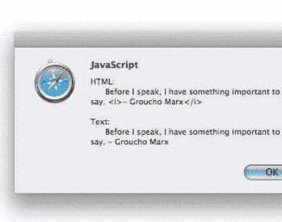

## 第一部分：jQuery API

### 设置文本或HTML内容

设置内容的工作方式类似：你只需将要设置的内容作为值，传递给 `text()` 或 `html()` 方法的第一个参数（针对一个或多个元素）。当然，使用哪种方法取决于你是否希望 HTML 标签被展开为 HTML。以下文档演示了如何设置文本或 HTML 内容：

```
<!DOCTYPE html PUBLIC "-//W3C//DTD XHTML 1.0 Strict//EN"
    "http://www.w3.org/TR/xhtml1/DTD/xhtml1-strict.dtd">
<html xmlns='http://www.w3.org/1999/xhtml' xml:lang='en'>
  <head>
    <meta http-equiv='content-type' content='text/html; charset=utf-8' />
    <meta http-equiv='content-language' content='en-us' />
    <title></title>
    <script type='text/javascript'
          src='../../../Source Code/jQuery/jQuery.js'>
    </script>
    <script type='text/javascript' src='Figure 4-7.js'></script>
    <link type='text/css' href='Figure 4-7.css' rel='stylesheet' />
  </head>
  <body>
    <p>
      Before I speak, I have something important to say. <i>- Groucho Marx</i>
    </p>
    <p class='tmpQuote' id='tmpQuote-1'>
    </p>
    <p class='tmpQuote' id='tmpQuote-2'>
    </p>
  </body>
</html>
```

以下样式表应用于前面的 HTML 文档：

```
body {
    font: 16px sans-serif;
}
p {
    padding: 5px;
    margin: 5px;
}
p.tmpQuote {
    background: lightblue;
}
p#tmpQuote-2 {
    background: lightgreen;
}
```

以下脚本演示了通过 jQuery 的 `text()` 和 `html()` 方法设置元素内容：

```
$(document).ready(
  function() {
    $('#tmpQuote-1').text(
      "Getting older is no problem. You just have to " +
    "live long enough. <i>- Groucho Marx</i>"
);

$('p#tmpQuote-2').html(
    "I have had a perfectly wonderful evening, but " +
    "this wasn't it. <i>- Groucho Marx</i>"
);
}
);
```

图 4-7 显示了通过 `text()` 方法应用内容如何导致 HTML 标签被忽略，并呈现在 ID 名为 *tmpQuote-1* 的 `<p>` 元素的输出中。它还显示了在 ID 名为 *tmpQuote-2* 的 `<p>` 元素中，使用 jQuery 的 `html()` 方法应用内容时，HTML 标签是如何被展开的。

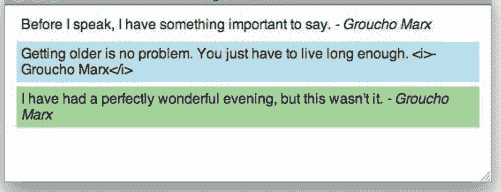

图 4-7

### 为多个元素设置文本或HTML内容

尽管你可能通常认为文本或 HTML 内容一次只应用于单个元素，但 jQuery 的 `text()` 和 `html()` 方法会将该文本或 HTML 内容应用于一个或多个元素。以下文档本质上与你在图 4-7 中看到的文档相同，只做了一些微小改动，以演示当 HTML 内容应用于包含多个元素的选择时会发生什么：

```
<!DOCTYPE html PUBLIC "-//W3C//DTD XHTML 1.0 Strict//EN"
    "http://www.w3.org/TR/xhtml1/DTD/xhtml1-strict.dtd">
<html xmlns='http://www.w3.org/1999/xhtml' xml:lang='en'>
    <head>
        <meta http-equiv='content-type' content='text/html; charset=utf-8' />
        <meta http-equiv='content-language' content='en-us' />
        <title></title>
        <script type='text/javascript'
                src='../../../Source Code/jQuery/jQuery.js'>
        </script>
        <script type='text/javascript' src='Figure 4-8.js'></script>
        <link type='text/css' href='Figure 4-8.css' rel='stylesheet' />
    </head>
    <body>
      <p>
        Before I speak, I have something important to say. <i>- Groucho Marx</i>
      </p>
      <p class='tmpQuote' id='tmpQuote-1'>
      </p>
      <p class='tmpQuote' id='tmpQuote-2'>
      </p>
    </body>
</html>
```

以下 CSS 链接到前面的 HTML 文档：

```
body {
    font: 16px sans-serif;
}
p {
    padding: 5px;
    margin: 5px;
    background: lightgreen;
}
```

以下脚本将 HTML 内容应用于文档中的所有 <p> 元素：

```
$(document).ready(
  function() {
    $('p').html(
      "Quote me as saying I was mis-quoted. " +
      "<i>- Groucho Marx</i>"
    );
  }
);
```

**图 4-8** 显示了输出的屏幕截图。你会看到脚本中应用的引文已被应用于所有三个 <p> 元素，替换了之前存在的任何内容。

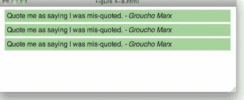

图 4-8

正如你在**图 4-8**中看到的，jQuery 根据你的选择应用 HTML 内容。如果你选择了多个元素，你会发现内容修改已应用于多个元素；如果你只选择了单个元素，你会发现内容修改仅应用于单个元素。

### 移除内容

移除内容也可以使用 jQuery 的 `text()` 和 `html()` 方法完成。要移除元素，你只需使用空字符串调用任一方法，即 `text('')` 或 `html('')`，仅此而已。然而，这并非从文档中移除内容的唯一方法，你将在本章稍后看到实现此目的的替代方法。

### 追加和前置内容

jQuery 修补的一个烦恼，让新的 jQuery 开发者完全意识不到浏览器的怪癖，是 IE 对 `<table>` 元素的“只读”限制。当你在 `<table>` 元素上使用像 `innerHTML` 或 `outerHTML` 这样的属性时，*table* 的指定包括了在 `<table>` 标签内使用的任何元素：`<tbody>`、`<thead>`、`<tfoot>`、`<tr>`、`<td>` 和 `<th>`。随着你开发需要 HTML 表格来布局表格数据的更复杂应用，这个限制会成为一个扼杀创新的痛苦障碍。解决这个限制并非极其困难；任何有创意的程序员都能想象出一个变通方法，即完全重建表格。值得庆幸的是，jQuery 直接覆盖了这个恼人的 IE 错误，正如以下代码所示：

```
<!DOCTYPE html PUBLIC "-//W3C//DTD XHTML 1.0 Strict//EN"
    "http://www.w3.org/TR/xhtml1/DTD/xhtml1-strict.dtd">
<html xmlns='http://www.w3.org/1999/xhtml' xml:lang='en'>
    <head>
        <meta http-equiv='content-type' content='text/html; charset=utf-8' />
        <meta http-equiv='content-language' content='en-us' />
        <title></title>
        <script type='text/javascript'
            src='../../../Source Code/jQuery/jQuery.js'>
        </script>
        <script type='text/javascript' src='Figure 4-9.js'></script>
        <link type='text/css' href='Figure 4-9.css' rel='stylesheet' />
    </head>
    <body>
        <h4>John Lennon Albums</h4>
        <table>
            <thead>
                <tr>
                    <th>Title</th>
                    <th>Year</th>
                </tr>
            </thead>
            <tbody>
                <tr>
                    <td>John Lennon/Plastic Ono Band</td>
                    <td>1970</td>
                </tr>
                <tr>
                    <td>Imagine</td>
                    <td>1971</td>
                </tr>
            </tbody>
```


## 第一部分：jQuery API

前面的代码链接了以下样式表：

```css
body {
    font: 16px sans-serif;
}
h4 {
    margin: 5px;
}
table {
    width: 100%;
    background: lightgreen;
}
th {
    background: green;
    color: lightgreen;
}
```

随后的 JavaScript 代码展示了 IE 的 `innerHTML` 只读限制：

```javascript
$(document).ready(
  function() {
    $('table tbody')[0].innerHTML +=
        "<tr>\n" +
        "  <td>Double Fantasy</td>\n" +
        "  <td>1980</td>\n" +
        "</tr>\n";
  }
);
```

正如你在**图 4-9** 中所看到的，当在 IE 中加载此文档时，包含专辑 *Double Fantasy* 的新行并不存在；但当你在 Safari（或 Firefox 或 Opera）中加载文档时，它就会出现。

## 第 4 章：操作内容和属性

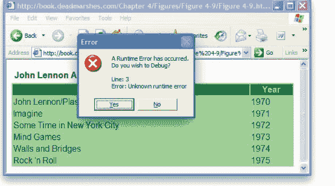

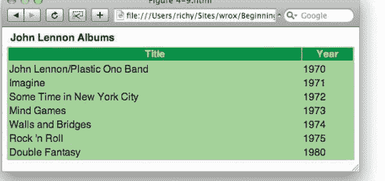

**图 4-9**

图 4-10 显示了同一文档在 IE 中的效果，其中对 JavaScript 做了如下修改：

```javascript
$(document).ready(
  function() {
    $('table tbody').append(
      "<tr>\n" +
      "  <td>Double Fantasy</td>\n" +
      "  <td>1980</td>\n" +
      "</tr>\n"
    );
  }
);
```

在前面的示例中，你没有直接使用 innerHTML 属性向 `<tbody>` 元素追加 HTML 内容，而是使用了 jQuery 的 `append()` 方法。由于 jQuery 的 `append()` 方法会自动修复 innerHTML 属性的只读限制，因此这次向表格追加 HTML 成功了，并且你在 IE6 中看到 *Double Fantasy* 被添加到了表格中。

## 第一部分：jQuery API

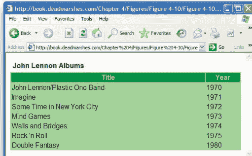

**图 4-10**

### 修复 Firefox 的 innerHTML 表单缺陷

在上一节中，你看到了 jQuery 的 `append()` 函数为何优于 IE 对 `innerHTML` 的原生支持，因为它不施加任何只读限制，并且能积极地规避该限制。另一个存在 `innerHTML` 缺陷的浏览器是 Firefox。在 Firefox 的情况下，当对包含表单元素的元素使用 `innerHTML` 时，这个缺陷就会显现出来；并且当你尝试使用 `innerHTML` 追加新内容时，你会看到这个缺陷的实际效果。当你这样做时，Firefox 会重置表单元素，并且不保留它们的值。在这里，jQuery 再次伸出援手，积极修复了这个问题，因此你不必再费力规避它。

以下文档修改了你在**图 4-9** 和 **4-10** 中看到的示例，使得表格现在包含表单元素：

```html
<!DOCTYPE html PUBLIC "-//W3C//DTD XHTML 1.0 Strict//EN"
    "http://www.w3.org/TR/xhtml1/DTD/xhtml1-strict.dtd">
<html xmlns='http://www.w3.org/1999/xhtml' xml:lang='en'>
  <head>
    <meta http-equiv='content-type' content='text/html; charset=utf-8' />
    <meta http-equiv='content-language' content='en-us' />
    <title></title>
    <script type='text/javascript'
        src='../../Source Code/jQuery/jQuery.js'>
    </script>
    <script type='text/javascript' src='Figure 4-11.js'></script>
    <link type='text/css' href='Figure 4-11.css' rel='stylesheet' />
  </head>
  <body>
    <h4>John Lennon Albums</h4>
    <table>
      <thead>
        <tr>
          <th>Title</th>
          <th>Year</th>
        </tr>
      </thead>
      <tbody>
        <tr>
          <td>
            <select>
              <option value='0'>0</option>
              <option value='1'>1</option>
            </select>
            <input type='text' value='John Lennon/Plastic Ono Band' size='25' />
          </td>
          <td>1970</td>
        </tr>
        <tr>
          <td>
            <input type='text' value='Imagine' size='25' />
          </td>
          <td>1971</td>
        </tr>
        <tr>
          <td>
            <input type='text' value='Some Time in New York City' size='25' />
          </td>
          <td>1972</td>
        </tr>
        <tr>
          <td>
            <input type='text' value='Mind Games' size='25' />
          </td>
          <td>1973</td>
        </tr>
        <tr>
          <td>
            <input type='text' value='Walls and Bridges' size='25' />
          </td>
          <td>1974</td>
        </tr>
        <tr>
          <td>
            <input type='text' value='Rock &#039;n Roll' size='25' />
          </td>
          <td>1975</td>
        </tr>
      </tbody>
    </table>
    <input type='submit' value='Add Album' id='tmpAddAlbum' />
  </body>
</html>
```

上述 HTML 文档链接了你在图 4-9 中看到的同一个 CSS 文档。

```css
body {
    font: 16px sans-serif;
}
h4 {
    margin: 5px;
}
table {
    width: 100%;
    background: lightgreen;
}
th {
    background: green;
    color: lightgreen;
}
```

**图 4-11** 中的 JavaScript 展示了一个会触发 Firefox 缺陷的脚本场景。与你在**图 4-9** 中看到的示例一样，这个示例由于其只读限制在 IE 中也无法工作。

```javascript
$(document).ready(
    function() {
        $('input#tmpAddAlbum').click(
            function($e) {
                $e.preventDefault();

                $('table tbody')[0].innerHTML +=
                    "<tr>\n" +
                    "  <td>\n" +
                    "    <input type='text' value='Double Fantasy' size='25' />\n" +
                    "  </td>\n" +
                    "  <td>1980</td>\n" +
                    "</tr>\n";
            }
        );
    }
);
```

在**图 4-11** 中，你会看到当你从第一行的下拉列表中选择选项“1”，然后点击“Add Album”按钮时，第一行的选择框会恢复到选项“0”。

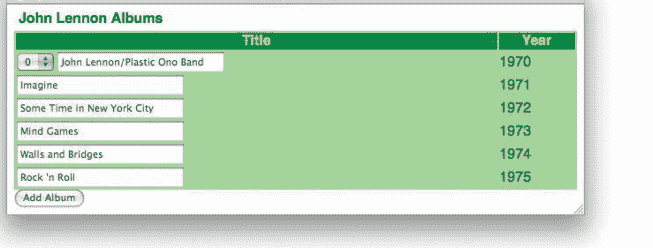

**图 4-11**

## 第 4 章：操作内容和属性

在**图 4-12** 中，你可以看到选项“1”被选中，并且“Add Album”按钮被按下。

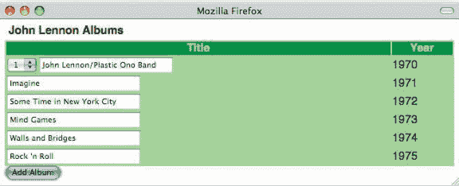

**图 4-12**

**图 4-13** 显示，在添加包含 *Double Fantasy* 的行之后，选择框已恢复到选项“0”。

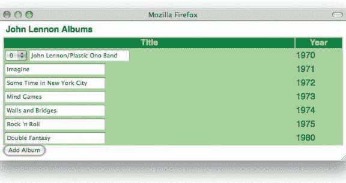

**图 4-13**

同样，jQuery 的 `append()` 方法规避了 Firefox 中长期存在且截至本文撰写时仍在 Firefox 3 中存在的这个缺陷。以下脚本演示了如何修改 JavaScript，改用 jQuery 的 `append()` 方法而不是直接使用 `innerHTML` 方法来修复该缺陷。**图 4-14** 显示，按下“Add Album”按钮后取得了正确的结果。

```javascript
$(document).ready(
    function() {

        $('input#tmpAddAlbum').click(
            function($e) {
                $e.preventDefault();

                $('table tbody').append(
                    "<tr>\n" +
                    "  <td>\n" +
                    "    <input type='text' value='Double Fantasy' size='25' />\n" +
                    "  </td>\n" +
                    "  <td>1980</td>\n" +
                    "</tr>\n"
                );
            }
        );
    }
);
```

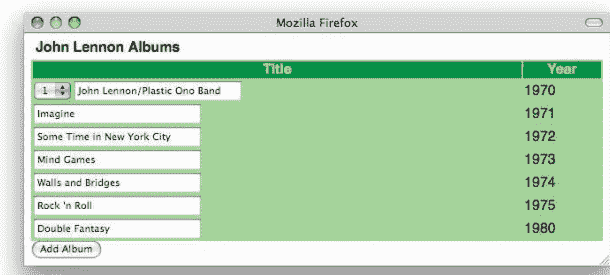

**图 4-14**

通过前面的示例，你可以看到 jQuery 并不仅仅是多余地替换了标准和事实上的标准 JavaScript API 方法（如 `innerHTML`）。它还修复了那些阻碍平滑、无缝的跨浏览器 Web 应用程序开发的跨浏览器缺陷。你不必担心原生开发中特有的怪癖，比如你在前面示例中看到的那些，并且你可以越来越多地构建出在任何地方都能保证正常工作的应用程序。然而，除了修复像你在 `innerHTML` 属性中看到的那些缺陷外，你还会发现 jQuery 的 API 在处理一个或多个项目的方式上也更加通用和一致（在有意义且可能的情况下）。jQuery 使用一种标准的方法来选择文档中的元素，并且在你需要选择元素能力的任何地方都应用了这个标准——`选择器`。浏览器制造商和标准化 JavaScript 的作者们有许多地方可以学习 jQuery 清洁、一致且流畅的 API。

当然，即使你可能在 JavaScript 领域需要担心的事情少了，你仍然要面对 Internet Explorer 严重过时且支持不足的 CSS 能力。由于我也是 CSS 的热心支持者，我也会在本书中探讨你在使用 CSS 时面临的一些挑战。

### 预置内容

`prepend` 这个词或多或少是技术编程界发明的（尽管它在编程界之外也有一些用途）。它的意思是将某些内容作为前缀添加到其他内容的开头。事实上，你不会在许多词典中找到 `prepend` 这个词，如果找到了，你会发现


## 第四章：操作内容与属性

所提供的定义——“（及物动词）预谋；在心里权衡”——与它在技术编程社区中的用法并不完全吻合。在这个领域，这个词被意为与 *append*（追加）相反，而 *append* 当然意味着“在某物的末尾添加”。

这个术语之所以从技术编程世界中产生，源于计算与印刷世界相比的灵活性。在印刷世界里，修改一份硬拷贝作品是非常困难的。你必须重新编页码，可能还要重新编章节号，并重写目录和索引。没有计算机的话，这将是一项巨大的工作。因此，在印刷世界里，通过 *append*（追加）或在末尾附加新内容来添加到已印刷作品中要容易得多。虽然并非总是如此，但这可以解释为什么世界在计算机存在之前，从未真正需要一个像 *prepend*（前导）这样的词，直到计算机的出现使这一操作成为必需。在技术领域，将东西粘到其他东西的开头很容易，所以我们创造了一个新词来描述这个动作。

在前面讨论通过 `innerHTML` 属性修改内容的各种问题的部分中，你学习了 jQuery 如何修改内容，以及如何通过一种叫做 `append()` 的方法在其他内容的末尾附加新内容。jQuery 还提供了一种让你能前导内容、在其他内容开头添加内容的方法，那就是 `prepend()` 方法。

### 在内容旁插入

使用 `append()` 和 `prepend()` 方法时，你是在元素*内部*添加内容。而使用 `before()` 和 `after()` 方法时，你是在元素*旁边*插入内容。`before()` 和 `after()` 方法在以下文档中进行了演示：

```html
<!DOCTYPE html PUBLIC "-//W3C//DTD XHTML 1.0 Strict//EN" "http://www.w3.org/TR/xhtml1/DTD/xhtml1-strict.dtd">
<html xmlns='http://www.w3.org/1999/xhtml' xml:lang='en'>
  <head>
    <meta http-equiv='content-type' content='text/html; charset=utf-8' />
    <meta http-equiv='content-language' content='en-us' />
    <title></title>
    <script type='text/javascript' src='../../../Source Code/jQuery/jQuery.js'></script>
    <script type='text/javascript' src='Figure 4-15.js'></script>
    <link type='text/css' href='Figure 4-15.css' rel='stylesheet' />
  </head>
  <body>
    <p>
      Why, I'd horse-whip you if I had a horse.
    </p>
  </body>
</html>
```

以下样式表应用于上述文档：

```css
body {
    font: 16px sans-serif;
}

h4 {
    margin: 5px;
}

p {
    margin: 5px;
}

p.tmpAttribution {
    text-align: right;
}
```

以下 JavaScript 演示了如何通过各自的 `before()` 和 `after()` 方法，在 `<p>` 元素前后插入内容：

```javascript
$(document).ready(
    function() {
        $('p')
            .before("<h4>Quotes</h4>")
            .after(
                "<p class='tmpAttribution'>\n" +
                " - Groucho Marx\n" +
                "</p>\n"
            );
    }
);
```

**图 4-15** 展示了在浏览器中加载上述文档时发生的情况。

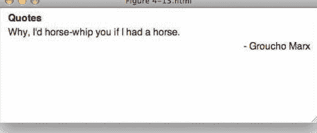

**图 4-15** 并没有什么真正令人惊讶的地方。传递给 `before()` 方法的内容被插入到 `<p>` 元素之前，而传递给 `after()` 方法的内容被插入到 `<p>` 元素之后。以下标记显示了执行此 JavaScript 后源代码的样子：

```html
<!DOCTYPE html PUBLIC "-//W3C//DTD XHTML 1.0 Strict//EN" "http://www.w3.org/TR/xhtml1/DTD/xhtml1-strict.dtd">
<html xmlns='http://www.w3.org/1999/xhtml' xml:lang='en'>
    <head>
        <meta http-equiv='content-type' content='text/html; charset=utf-8' />
<meta http-equiv='content-language' content='en-us' /><title></title><script type='text/javascript' src='../../../Source Code/jQuery/jQuery.js'></script><script type='text/javascript' src='Figure 4-15.js'></script><link type='text/css' href='Figure 4-15.css' rel='stylesheet' /></head>
    <body>
      <h4>Quotes</h4>
      <p>Why, I'd horse-whip you if I had a horse.</p>
      <p class='tmpAttribution'>- Groucho Marx</p>
    </body>
  </html>
```

### 通过选择器在内容旁插入

`before()` 和 `after()` 方法用于在元素旁边插入内容。`insertBefore()` 和 `insertAfter()` 方法执行相同的功能，但与你使用 `before()` 和 `after()` 方法时直接将内容传递给这些方法不同，你需要使用一个选择器来引用文档中你想插入到另一个元素旁边的另一个元素。此外，编写执行插入旁边操作的脚本时，逻辑是相反的。以下文档演示了如何使用 `insertBefore()` 和 `insertAfter()` 方法：

```html
<!DOCTYPE html PUBLIC "-//W3C//DTD XHTML 1.0 Strict//EN" "http://www.w3.org/TR/xhtml1/DTD/xhtml1-strict.dtd">
<html xmlns='http://www.w3.org/1999/xhtml' xml:lang='en'>
<head>
   <meta http-equiv='content-type' content='text/html; charset=utf-8' />
   <meta http-equiv='content-language' content='en-us' />
   <title></title>
   <script type='text/javascript' src='../../../Source Code/jQuery/jQuery.js'></script>
   <script type='text/javascript' src='Figure 4-16.js'></script>
   <link type='text/css' href='Figure 4-16.css' rel='stylesheet' />
</head>
<body>
<!-- Template Items -->
<table id='tmp'>
<thead><tr><th>Title</th><th>Year</th></tr></thead><tfoot><tr><th>Title</th><th>Year</th></tr></tfoot></table><!-- Main Content --><h4>John Lennon '70s Albums</h4><table class='tmpAlbums'><tbody><tr><td>John Lennon/Plastic Ono Band</td><td>1970</td></tr><tr><td>Imagine</td><td>1971</td></tr><tr><td>Some Time in New York City</td><td>1972</td></tr><tr><td>Mind Games</td><td>1973</td></tr><tr><td>Walls and Bridges</td><td>1974</td></tr><tr><td>Rock &#039;n Roll</td><td>1975</td></tr><tbody class='tmpAlbums'></table><!-- More Content --><h4>Paul McCartney '70s Albums</h4><table class='tmpAlbums'><tbody><tr><td>McCartney</td><td>1970</td></tr><tr><td>RAM</td><td>1971</td></tr><tr><td>Wild Life</td><td>1971</td></tr><tr><td>Red Rose Speedway</td><td>1973</td></tr><tr><td>Band on the Run</td><td>1973</td></tr><tr><td>Venus and Mars</td><td>1975</td></tr><tr><td>At the Speed of Sound</td><td>1976</td></tbody></table><!-- Even More Content --><table class='tmpAlbums'><tbody><<tr><td>Thrillington (As Percy Thrillington)</td><td>1977</td></tr><tr><td>Londontown</td><td>1978</td></tr><tr><td>Wings Greatest</td><td>1978</td></tr><tr><td>Back To The Egg</td><td>1979</td></tbody></table></body></html>
```

以下样式表应用于上述标记文档：

```css
body { font: 16px sans-serif; } h4 { margin: 5px; } table#tmpAlbums, th.tmpAttribution { width: 20%; background: lightblue } td:first, th:nth-child(odd) { color: lightgrey !important } table.tmpAlbumus tbody tr:hover { background-color: #fff8dc }
```

以下脚本演示了如何使用带选择器的 `insertBefore()` 和 `insertAfter()` 方法在文档中复制内容：

```javascript
$(document).ready( function() { $('table#tmp thead').insertBefore('table.tmpAlbums tbody'); $('table#tmp tfoot').insertAfter('table.tmpAlbums tbody'); } );
```

**图 4-16** 展示了上述文档在 Safari 浏览器中的结果。

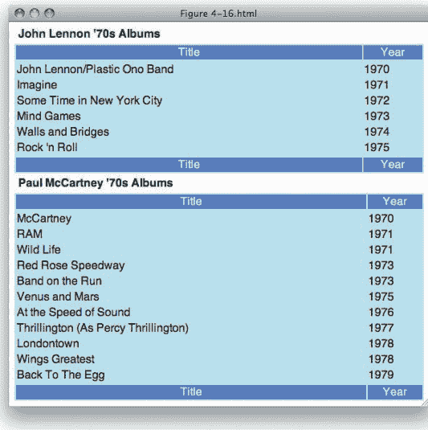

在前面的示例中，你可以看到包含在 ID 名为 `tmp` 的隐藏 `<table>` 元素中的 `<thead>` 和 `<tfoot>` 元素，被使用 jQuery 复制到了另外两个 `<table>` 元素中。你开始脚本时的逻辑是相反的；也就是说，你做的与使用 `before()` 和 `after()` 方法时相反。使用 `before()` 和 `after()` 方法时，你首先选择想要在旁边插入内容的元素，然后在 `before()` 或 `after()` 方法内提供要插入到所选元素旁边的内容。而这一次，你从选择文档中你想插入到另一个元素旁边的现有内容开始。在脚本中，你有以下代码：

```javascript
$('table#tmp thead').insertBefore('table.tmpAlbums tbody');
```

上面这一行首先选择 ID 名为 `tmp` 的 `<table>` 中包含的 `<thead>` 元素。你想将该 `<thead>` 元素复制到另外两个表格中，并将该内容用作模板。为此，你调用 `insertBefore()` 方法，然后向该方法传递一个选择器。你传递的选择器是你想要将原始选择（即 `<thead>`）插入到其*之前*的元素。该选择器首先引用类名为 `tmpAlbums` 的 `<table>` 元素，然后选择其后代 `<tbody>` 元素。所以，用简单的英语来说，这个脚本的意思是：“取隐藏表格中的 `<thead>` 元素，复制它并将其插入到包含两张前披头士成员70年代专辑目录信息的另外两个表格的 `<tbody>` 元素之前。” 另一行：

```javascript
$('table#tmp tfoot').insertAfter('table.tmpAlbums tbody');
```

做了同样的事情，但这次，你从隐藏表格中取出 `<tfoot>` 元素，复制它并将其插入到另外两个表格的 `<tbody>` 元素之后。


## # 第四章：操作内容和属性

本质上，`insertBefore()` 和 `insertAfter()` 方法使模板操作变得更加简便。

#### 包裹内容

在 jQuery 中，*包裹*一个元素意味着创建一个新元素，并将文档中的现有元素放置在该新元素内部。

jQuery 提供了一些用于包裹内容的方法，也就是说，这些方法接受一个或多个元素，并将这些元素放置在容器元素中，以改变文档的结构层次。jQuery 提供的用于包裹内容的方法有 `wrap()`、`wrapAll()` 和 `wrapInner()`。在接下来的章节中，我将演示如何使用这些方法。

### 逐个包裹选中的元素

jQuery 的 `wrap()` 方法用于逐个包裹选中的每个元素。也就是说，如果你的选择匹配了五个不同的元素，jQuery 的 `wrap()` 方法会创建五个独立的包裹器。为了更好地说明其工作原理，以下代码演示了如何使用 `wrap()` 方法将三个 `<p>` 元素分别包裹在 `<div>` 元素中：

```
<!DOCTYPE html PUBLIC "-//W3C//DTD XHTML 1.0 Strict//EN"
       "http://www.w3.org/TR/xhtml1/DTD/xhtml1-strict.dtd">
<html xmlns='http://www.w3.org/1999/xhtml' xml:lang='en'>
  <head>
    <meta http-equiv='content-type' content='text/html; charset=utf-8' />
    <meta http-equiv='content-language' content='en-us' />
    <title></title>
    <script type='text/javascript'
            src='../../../Source Code/jQuery/jQuery.js'>
    </script>
    <script type='text/javascript' src='Figure 4-17.js'></script>
    <link type='text/css' href='Figure 4-17.css' rel='stylesheet' />
  </head>
  <body>
    <h4>Mitch Hedberg Quotes</h4>
    <p>
      Dogs are forever in the push up position.
    </p>
    <p>
      I haven't slept for ten days, because that would be too long.
    </p>
    <p>
      I once saw a forklift lift a crate of forks. And it was way
      too literal for me.
    </p>
  </body>
</html>
```

以下样式表应用于上述标记文档：

```
body {
    font: 16px sans-serif;
}
```

## 第一部分：jQuery API

```
h4, p {
    margin: 5px;
}
div {
    background: #fedd58;
    border: 1px solid #ebcb49;
    margin: 3px;
}
```

以下脚本演示了 jQuery 的 wrap 方法：

```
$(document).ready(
  function() {
    $('p').wrap('<div></div>');
  }
);
```

在**图 4-17**中，你可以看到每个 `<p>` 元素都被包裹在一个 `<div>` 元素中，这通过应用在样式表中的样式变得显而易见。每个 `<div>` 都有独特的边距、外边距和背景色，以清楚地表明一个 `<div>` 的存在。

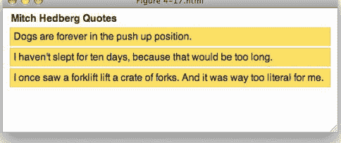

**图 4-17**

前面的示例清楚地表明，jQuery 的 `wrap()` 方法用于逐个包裹选中的每个元素。

### 包裹元素集合

`wrap()` 方法逐个包裹选中的每个项目，而 jQuery 的 `wrapAll()` 方法则将选中的所有项目包裹在单个包裹器中。以下文档展示了与上一节中用于演示 `wrap()` 方法相同的标记和样式表。唯一更改的是使用了 `wrapAll()` 方法而不是 `wrap()` 方法。

```
<!DOCTYPE html PUBLIC "-//W3C//DTD XHTML 1.0 Strict//EN"
    "http://www.w3.org/TR/xhtml1/DTD/xhtml1-strict.dtd">
<html xmlns='http://www.w3.org/1999/xhtml' xml:lang='en'>
```

## 第四章：操作内容和属性

```
<head>
    <meta http-equiv='content-type' content='text/html; charset=utf-8' />
    <meta http-equiv='content-language' content='en-us' />
    <title></title>
    <script type='text/javascript'
            src='../../../Source Code/jQuery/jQuery.js'>
    </script>
    <script type='text/javascript' src='Figure 4-18.js'></script>
    <link type='text/css' href='Figure 4-18.css' rel='stylesheet' />
</head>
<body>
    <h4>Mitch Hedberg Quotes</h4>
    <p>
        Dogs are forever in the push up position.
    </p>
    <p>
        I haven't slept for ten days, because that would be too long.
    </p>
    <p>
        I once saw a forklift lift a crate of forks. And it was way
        too literal for me.
    </p>
</body>
</html>
```

以下样式表应用于上述标记。

```
body {
    font: 16px sans-serif;
}

h4, p {
    margin: 5px;
}

div {
    background: #fedd58;
    border: 1px solid #ebcb49;
    margin: 3px;
}
```

在以下脚本中，你可以看到 wrap() 方法已被替换为 wrapAll() 方法：

```
$(document).ready(
    function() {
        $('p').wrapAll('<div></div>');
    }
);
```

**图 4-18** 显示，各个 `<p>` 元素并非被单独包裹在 `<div>` 元素中，而是所有三个 `<p>` 元素被一个单独的 `<div>` 元素包裹，这再次通过样式表中的样式得以清晰展现。

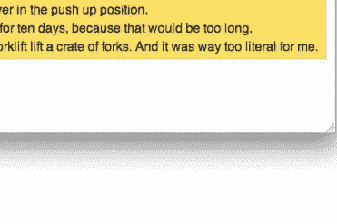

如前例所示，wrapAll() 方法接受一组元素，并用单个包裹器元素将整个选择集体包裹起来。

### 包裹元素的内容

我将演示的最后一个包裹方法是 wrapInner() 方法，它用于包裹元素的内容。此方法的工作方式类似于 wrap() 方法，即对选择中的每个项目应用包裹器，但不同的是，被选中的元素本身不被放入包裹器，而是其内容被放入包裹器。以下文档（与你在前两个示例中看到的文档相同）演示了 wrapInner() 方法与 wrap() 和 wrapAll() 方法的比较和区别：

```
<!DOCTYPE html PUBLIC "-//W3C//DTD XHTML 1.0 Strict//EN" "http://www.w3.org/TR/xhtml1/DTD/xhtml1-strict.dtd">
<html xmlns="http://www.w3.org/1999/xhtml" xml:lang="en">
<head>
<meta http-equiv="content-type" content="text/html; charset=utf-8" />
<meta http-equiv="content-language" content="en-us" />
<title></title>
<script type="text/javascript" src="../../Source Code/jQuery/jQuery.js"></script>
<script type="text/javascript" src="Figure 4-19.js"></script>
<link type="text/css" href="Figure 4-19.css" rel="stylesheet" />
</head>
<body>
<h4>Mitch Hedberg Quotes</h4>
<p>
 Dogs are forever in the push up position.
</p>
<p>
 I haven't slept for ten days, because that would be too long.
</p>
<p>
 I once saw a forklift lift a crate of forks. And it was way too literal for me.
</p>
</body>
</html>
```

## # 第四章：操作内容和属性

以下样式表应用于上述标记文档：

```
body {
    font: 16px sans-serif;
}
h4, p {
    margin: 5px;
}
```

在以下脚本中，你可以看到与前两个示例唯一的不同是使用了 `wrapInner()` 方法，而不是 `wrap()` 或 `wrapAll()` 方法：

```
$(document).ready(
  function() {
    $('p').wrapInner('<i></i>');
  }
);
```

在**图 4-19**中，你可以看到所有三个 `<p>` 元素的内容都各自被 `<i>` 标签包裹，使得每个 `<p>` 元素的内容以斜体样式显示。当然，此示例仅用于传达 `wrapInner()` 方法的工作方式。尽管你看到的是从 JavaScript 调用的样式更改（我个人认为这是一种不良实践），你应该将所有样式更改保留在样式表中，但你可以了解 `wrapInner()` 方法在技术上的工作原理。

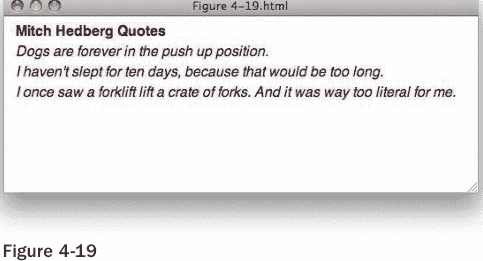

如**图 4-19** 所示，`wrapInner()` 方法获取选择中存在的每个单独元素的内容，并将该内容放入一个包裹器中。

### 使用对象引用包裹元素

关于包裹元素，我涵盖的最后一项内容可以应用于三个包裹方法中的任何一个——`wrap()`、`wrapAll()` 或 `wrapInner()`。具体来说，你不必在传递给这些每个方法的参数中使用 HTML 字符串，你也可以使用指向有效 DOM 元素的 JavaScript 对象引用。以下文档演示了我所说的含义：

```
<!DOCTYPE html PUBLIC "-//W3C//DTD XHTML 1.0 Strict//EN"
"http://www.w3.org/TR/xhtml1/DTD/xhtml1-strict.dtd">
<html xmlns='http://www.w3.org/1999/xhtml' xml:lang='en'>
```


## 第一部分：jQuery API

```html
<head>
    <meta http-equiv='content-type' content='text/html; charset=utf-8' />
    <meta http-equiv='content-language' content='en-us' />
    <title></title>
    <script type='text/javascript'
            src='../../Source Code/jQuery/jQuery.js'>
    </script>
    <script type='text/javascript' src='Figure 4-20.js'></script>
    <link type='text/css' href='Figure 4-20.css' rel='stylesheet' />
</head>
<body>
    <h4>Mitch Hedberg Quotes</h4>
    <p>
        I saw a human pyramid once. It was very unnecessary. It
        did not need to exist.
    </p>
    <p>
        I used to be a hot-tar roofer. Yeah, I remember that... day.
    </p>
    <p>
        I want to get a vending machine, with fun sized candy bars,
        and the glass in front is a magnifying glass. You'll be mad,
        but it will be too late.
    </p>
</body>
</html>
```

以下 CSS 将应用于前面的标记文档。

```css
body {
    font: 16px sans-serif;
}
h4, p {
    margin: 5px;
}
div {
    background: #70d6f0;
    border: 3px solid #7ac3d5;
    margin: 3px;
}
```

在以下脚本中，你会看到，你没有传递字符串 `<div></div>`，而是将 `document.createElement('div')` 传递给 `wrapAll()` 方法，这提供了与 **图 4-18** 中演示的本质上相同的效果：

```javascript
$(document).ready(
    function() {
        $('p').wrapAll(document.createElement('div'));
    }
);
```

**图 4-20** 显示，使用 JavaScript 对象引用来指向一个元素，与向 jQuery 的 `wrapAll()` 方法传递原始的 HTML 字符串，可以得到相同的结果。

## 第四章：操作内容和属性

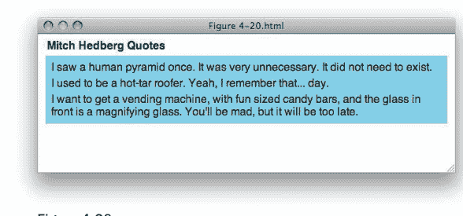

图 4-20

在接下来的“动手试一试”环节中，你将回顾所有关于 jQuery 文档操作 API 的知识：

### 操作 HTML 和文本内容

**示例 4-3**

要复习 jQuery 的文档操作 API，请按照以下步骤操作：

1.  在你的文本编辑器中输入以下 HTML：

```html
<!DOCTYPE html PUBLIC "-//W3C//DTD XHTML 1.0 Strict//EN"
    "http://www.w3.org/TR/xhtml1/DTD/xhtml1-strict.dtd">
<html xmlns='http://www.w3.org/1999/xhtml' xml:lang='en'>
  <head>
    <meta http-equiv='content-type' content='text/html; charset=utf-8' />
    <meta http-equiv='content-language' content='en-us' />
    <title></title>
    <script type='text/javascript'
            src='../../../Source Code/jQuery/jQuery.js'>
    </script>
    <script type='text/javascript' src='Example 4-3.js'></script>
    <link type='text/css' href='Example 4-3.css' rel='stylesheet' />
  </head>
  <body>
    <p>
      jQuery's <b>html()</b> method can be used to get HTML content.
    </p>
    <input type='submit' id='tmpGetHTML' value='Get HTML' />
    <p>
      jQuery's <b>text()</b> method can be used to get text content.
    </p>
    <input type='submit' id='tmpGetText' value='Get Text' />
    <p>
      The <b>html()</b> method can also be used to set HTML content,
      which is done by passing HTML to its first argument.
    </p>
    <input type='submit' id='tmpSetHTML' value='Set HTML' />
    <p>
      The <b>text()</b> method can also be used to set text content,
      which is done by passing text to its first argument.
    </p>
    <input type='submit' id='tmpSetText' value='Set Text' />
    <p class='tmpSetMultiple'>
      Text or HTML can be set on just one or many elements.
      <span></span>
      <span></span>
      <span></span>
    </p>
    <input type='submit' id='tmpSetMultiple' value='Set Multiple' />
    <p>
      The <b>append()</b> method is used to append content.
    </p>
    <input type='submit' id='tmpAppend' value='Append HTML' />
    <p>
      The <b>prepend()</b> method is used to prepend content.
    </p>
    <input type='submit' id='tmpPrepend' value='Prepend HTML' />
    <p>
      The <b>before()</b> and <b>after()</b> methods are used
      to insert content beside other content.
    </p>
    <div class='tmpBeside'>
      <span class='tmpReference'></span>
    </div>
    <input type='submit' id='tmpBefore' value='Insert Before' />
    <input type='submit' id='tmpAfter' value='Insert After' />
    <span class='tmpReferenceBefore tmpTemplate'></span>
    <span class='tmpReferenceAfter tmpTemplate'></span>
    <p>
      The <b>insertBefore()</b> and <b>insertAfter()</b> methods are
      used to insert existing content beside other content via a
      selector.
    </p>
    <div class='tmpBesideSelection'>
      <span class='tmpReference'></span>
    </div>
    <input type='submit' id='tmpBeforeSelection' value='Insert Before' />
    <input type='submit' id='tmpAfterSelection' value='Insert After' />
    <p>
      The <b>wrap()</b> method is used to wrap each item in a selection
      with individual wrapper elements.
    </p>
    <input type='submit' id='tmpWrap' value='Wrap' />
    <p>
      The <b>wrapAll()</b> method wraps an entire selection of elements
      in a single wrapper.
    </p>
    <input type='submit' id='tmpWrapAll' value='Wrap All' />
    <p>
      The <b>wrapInner()</b> method wraps the contents of every element
      in a selection with individual wrapper elements.
    </p>
    <input type='submit' id='tmpWrapInner' value='Wrap Inner' />
  </body>
</html>
```

2.  将前面的文档保存为 Example 4-3.html。

3.  在文本编辑器的新文档中输入以下 CSS：

```css
body {
    font: 16px sans-serif;
}
p {
    margin: 5px;
}
p.tmpSetMultiple span {
    display: block;
    margin: 5px;
}
div.tmpBeside,
div.tmpBesideSelection {
    clear: both;
    height: 62px;
}
span.tmpReference,
span.tmpReferenceBefore,
span.tmpReferenceAfter {
    float: left;
    width: 50px;
    height: 50px;
    margin: 5px;
}
span.tmpTemplate {
    display: none;
}
div span.tmpReference,
div span.tmpReferenceBefore,
div span.tmpReferenceAfter {
    display: block;
}
span.tmpReference {
    background: blue;
    border: 1px solid lightblue;
}
span.tmpReferenceBefore {
    background: green;
    border: 1px solid lightgreen;
}
span.tmpReferenceAfter {
    background: red;
    border: 1px solid pink;
}
div.tmpWrapper {
    background: #fdee8a;
    border: 3px solid #f3e270;
    margin: 5px;
}
div.tmpWrapAll {
    background: #bdfae2;
    border: 3px solid #a1e8cc;
}
span.tmpWrapInner {
    background: #b8def8;
}
```

4.  将前面的文档保存为 Example 4-3.css。

5.  在文本编辑器的新文档中输入以下 JavaScript：

```javascript
$(document).ready(
    function() {
        $('input').click(
            function($e) {
                $e.preventDefault();

                switch (this.id) {
                    case 'tmpGetHTML': {
                        alert($(this).prev().html());
                        break;
                    }
                    case 'tmpGetText': {
                        alert($(this).prev().text());
                        break;
                    }
                    case 'tmpSetHTML': {
                        $(this).prev().html(
                            "<b>Set HTML Content.</b>"
                        );
                        break;
                    }
                    case 'tmpSetText': {
                        $(this).prev().text(
                            "<b>Set Text Content.</b>"
                        );
                        break;
                    }
                    case 'tmpSetMultiple': {
                        $(this).prev().find('span').html(
                            "<b>Set content on multiple items.</b>"
                        );
                        break;
                    }
                    case 'tmpAppend': {
                        $(this).prev().append(
                            " <b>This content is appended.</b>"
                        );
                        break;
                    }
                    case 'tmpPrepend': {
                        $(this).prev().prepend(
                            "<b>This content is prepended.</b> "
                        );
                        break;
                    }
                    case 'tmpBefore': {
                        $('div.tmpBeside').find('span.tmpReference').before(
                            "<span class='tmpReferenceBefore'></span>"
                        );
                        break;
                    }
                    case 'tmpAfter': {
                        $('div.tmpBeside').find('span.tmpReference').after(
                            "<span class='tmpReferenceAfter'></span>"
                        );
                        break;
                    }
                    case 'tmpBeforeSelection': {
                        $('span.tmpReferenceBefore.tmpTemplate').insertBefore(
                            'div.tmpBesideSelection span.tmpReference'
                        );
                        break;
                    }
                    case 'tmpAfterSelection': {
                        $('span.tmpReferenceAfter.tmpTemplate').insertAfter(
                            'div.tmpBesideSelection span.tmpReference'
                        );
                        break;
                    }
                    case 'tmpWrap': {
                        $('p').wrap("<div class='tmpWrapper'></div>");
                        break;
                    }
                    case 'tmpWrapAll': {
                        $('body > *').wrapAll("<div class='tmpWrapAll'></div>");
                        break;
                    }
                    case 'tmpWrapInner': {
                        $('p').wrapInner("<span class='tmpWrapInner'></span>");
                        break;
                    }
                }
            }
        );
    }
);
```

6.  将前面的文档保存为 *Example 4-3.js*。

前面的示例将生成你在 **图 4-21** 中看到的文档。


## 第一部分：jQuery API


图 4-21

示例 4-3 复习了 jQuery 提供的各种用于操作文档的方法。下面是对本示例中使用的代码进行逐行复习。

你复习的第一个方法是 jQuery 的 `html()` 方法。当你在不带任何参数的情况下使用此方法时，你检索到一个元素的 HTML 内容。

```
<p>
jQuery’s <b>html()</b> method can be used to get HTML content.
</p>
<input type='submit' id='tmpGetHTML' value='Get HTML' />
```

当你按下标有“Get HTML”的按钮时，你会得到一个警报消息，其中包含该 `<input>` 元素之前的 `<p>` 元素的内容。

```
case 'tmpGetHTML': {
alert($(this).prev().html());
break;
}
```

## 第四章：操作内容和属性

在警报消息中，你可以看到 `<b>` 标签是存在的，这让你知道你检索到的 `<p>` 元素内容保留了 HTML 标签。

你复习的下一个方法是 `text()` 方法。当你按下以下代码片段中的按钮时，你会得到一个警报消息，其中包含 `<p>` 元素的文本内容：

```
<p>
    jQuery's <b>text()</b> method can be used to get text content.
</p>
<input type='submit' id='tmpGetText' value='Get Text' />
```

这一次，警报消息中没有 `<b>` 标签，这让你知道你只检索到了文本内容，忽略了所有的 HTML 标签。

随后，你观察如何设置 HTML 内容，同样使用 `html()` 方法。

```
<p>
    The <b>html()</b> method can also be used to set HTML content,
    which is done by passing HTML to its first argument.
</p>
<input type='submit' id='tmpSetHTML' value='Set HTML' />
```

当你按下与前面代码片段关联的 `<input>` 按钮时，你会用字符串 `<b>Set HTML Content.</b>` 替换 `<p>` 元素的内容。

```
case 'tmpSetHTML': {
    $(this).prev().html(
        "<b>Set HTML Content.</b>"
    );
    break;
}
```

然后，你观察如何使用 `text()` 方法设置文本内容：

```
<p>
    The <b>text()</b> method can also be used to set text content,
    which is done by passing text to its first argument.
</p>
<input type='submit' id='tmpSetText' value='Set Text' />
```

这一次，你按下 `<input>` 按钮时，使用 `text()` 方法将 `<p>` 元素的内容设置为字符串 `<b>Set Text Content.</b>`。当你这样做时，你会看到原始的未渲染的 HTML `<b>` 标签作为文本出现。

```
case 'tmpSetText': {
    $(this).prev().text(
        "<b>Set Text Content.</b>"
    );
    break;
}
```

## 第一部分：jQuery API

在下一个示例中，你观察 jQuery 的操作方法如何在选中多个元素时对多个元素起作用。在这个示例中，你看到 `html()` 方法确实如此，但 jQuery 的所有操作方法都是如此。

```
<p class='tmpSetMultiple'>
  Text or HTML can be set on just one or many elements.
  <span></span>
  <span></span>
  <span></span>
</p>
<input type='submit' id='tmpSetMultiple' value='Set Multiple' />
```

这一次，当你按下 `<input>` 按钮时，你会将字符串 `<b>Set content on multiple items.</b>` 设置到前面代码片段中的三个 `<span>` 元素上。

```
case 'tmpSetMultiple': {
  $(this).prev().find('span').html(
    "<b>Set content on multiple items.</b>"
  );
  break;
}
```

下一个示例演示了如何使用 `append()` 方法来追加内容。

```
<p>
  The <b>append()</b> method is used to append content.
</p>
<input type='submit' id='tmpAppend' value='Append HTML' />
```

当你按下标有“Append HTML”的按钮时，字符串 `<b>This content is appended.</b>` 会被附加到 `<p>` 元素内容的末尾。

```
case 'tmpAppend': {
  $(this).prev().append(
    " <b>This content is appended.</b>"
  );
  break;
}
```

然后，你观察相反的 `prepend()` 方法，用于前置内容：

```
<p>
  The <b>prepend()</b> method is used to prepend content.
</p>
<input type='submit' id='tmpPrepend' value='Prepend HTML' />
```

当你按下标有“Prepend HTML”的按钮时，字符串 `<b>This content is prepended.</b>` 会被放置到 `<p>` 元素内容的开头。

```
case 'tmpPrepend': {
  $(this).prev().prepend(
    "<b>This content is prepended.</b> "
  );
  break;
}
```

## 第四章：操作内容和属性

因此，这引出了下一个示例，你在其中观察 `before()` 和 `after()` 方法。

```
<p>
    The <b>before()</b> and <b>after()</b> methods are used
    to insert content beside other content.
</p>
<div class="tmpBeside">
    <span class="tmpReference"></span>
</div>
<input type="submit" id="tmpBefore" value="Insert Before" />
<input type="submit" id="tmpAfter" value="Insert After" />
```

当你点击标有“Insert Before”的按钮时，你会在具有类名 `tmpReference` 的 `<span>` 元素之前插入一个具有类名 `tmpReferenceBefore` 的 `<span>` 元素。插入的 `<span>` 元素样式为绿色背景，而参考的 `<span>` 元素样式为蓝色背景。

```
case 'tmpBefore': {
    $('div.tmpBeside').find('span.tmpReference').before(
        "<span class='tmpReferenceBefore'></span>"
    );
    break;
}
```

首先，你选择具有类名 `tmpBeside` 的 `<div>`，然后你使用 jQuery 的 `find()` 方法定位具有类名 `tmpReference` 的 `<span>`（蓝色的 `<span>`），然后你使用 jQuery 的 `before()` 方法在它之前插入新的具有绿色背景的 `<span>`。

当你点击标有“Insert After”的按钮时，你会在具有类名 `tmpReference` 的 `<span>` 元素之后插入一个具有类名 `tmpReferenceAfter` 的 `<span>` 元素。新的 `<span>` 元素样式为红色背景。

```
case 'tmpAfter': {
    $('div.tmpBeside').find('span.tmpReference').after(
        "<span class='tmpReferenceAfter'></span>"
    );
    break;
}
```

你复习的下两个方法是 `insertBefore()` 和 `insertAfter()` 方法。

```
<span class='tmpReferenceBefore tmpTemplate'></span>
<span class='tmpReferenceAfter tmpTemplate'></span>
<p>
    The <b>insertBefore()</b> and <b>insertAfter()</b> methods are
    used to insert existing content beside other content via a
    selector.
</p>
<div class='tmpBesideSelection'>
    <span class='tmpReference'></span>
</div>
<input type='submit' id='tmpBeforeSelection' value='Insert Before" />
<input type='submit' id='tmpAfterSelection' value="Insert After" />
```

## 第一部分：jQuery API

当你点击标有“Insert Before”的按钮时，将执行以下脚本：

```
case 'tmpBeforeSelection': {
    $('span.tmpReferenceBefore.tmpTemplate ').insertBefore(
        'div.tmpBesideSelection span.tmpReference'
    );
    break;
}
```

在前面的脚本中，你选择了具有类名 `tmpReferenceBefore` 的 `<span>`，然后调用 `insertBefore()` 方法，该方法接收该 `<span>` 元素，复制它，并将其插入到包含在具有类名 `tmpBesideSelection` 的 `<div>` 中的、具有类名 `tmpReference` 的 `<span>` 之前。

以下脚本做同样的事情，只是这次，你选择具有类名 `tmpReferenceAfter` 的 `<span>`，复制它，并将该 `<span>` 元素插入到具有类名 `tmpReference` 的 `<span>` 元素之后：

```
case 'tmpAfterSelection': {
    $('span.tmpReferenceAfter.tmpTemplate ').insertAfter(
        'div.tmpBesideSelection span.tmpReference'
    );
    break;
}
```

然后，你复习各种包装方法。你复习的第一个包装方法是 `wrap()` 方法。

```
<p>
    The <b>wrap()</b> method is used to wrap each item in a selection
    with individual wrapper elements.
</p>
<input type='submit' id='tmpWrap' value='Wrap' />
```

当你点击标有“Wrap”的按钮时，以下脚本获取每个 `<p>` 元素，并用一个具有类名 `tmpWrapper` 的 `<div>` 将其包装起来：

```
case 'tmpWrap': {
    $('p').wrap("<div class='tmpWrapper'></div>");
    break;
}
```

将每个 `<p>` 元素包装在该 `<div>` 元素中会触发以下样式表规则的应用：

```
div.tmpWrapper {
    background: #fdee8a;
    border: 3px solid #f3e270;
    margin: 5px;
}
```


## 第四章：操作内容与属性

每个 `<div>` 元素都带有黄色背景和更深黄色的边框。

接着，你回顾 `wrapAll()` 方法。

```
<p>
  The <b>wrapAll()</b> method wraps an entire selection of elements
  in a single wrapper.
</p>
<input type='submit' id='tmpWrapAll' value='Wrap All' />
```

当你点击 "Wrap All" 按钮时，以下脚本会获取 `<body>` 元素的所有子元素，并将这些元素全部包裹在一个具有类名 *tmpWrapAll* 的单个 `<div>` 元素中：

```
case 'tmpWrapAll': {
  $('body > *').wrapAll("<div class='tmpWrapAll'></div>");
  break;
}
```

将所有内容包裹在该 `<div>` 元素中会触发以下样式表规则的应用：

```
div.tmpWrapper {
  background: #fdee8a;
  border: 3px solid #f3e270;
  margin: 5px;
}
```

这个 `<div>` 元素具有海绿色的背景，以及更深海绿色的边框。

在示例 4-3 中你回顾的最后一个方法是 `wrapInner()` 方法：

```
<p>
  The <b>wrapInner()</b> method wraps the contents of every element
  in a selection with individual wrapper elements.
</p>
<input type='submit' id='tmpWrapInner' value='Wrap Inner' />
```

当你点击标有 "Wrap Inner" 的按钮时，以下脚本会将每个 `<p>` 元素的内容包裹在一个具有类名 *tmpWrapInner* 的 `<span>` 元素中：

```
case 'tmpWrapInner': {
  $('p').wrapInner("<span class='tmpWrapInner'></span>");
  break;
}
```

添加该 `<span>` 元素会导致以下样式表规则被应用：

```
span.tmpWrapInner {
  background: #b8def8;
}
```

上述样式表规则会将浅蓝色背景应用于每个 `<p>` 元素的文本内容。

## 第一部分：jQuery API

### 替换元素

在本节中，我将讨论两个方法：jQuery 的 `replaceWith()` 和 `replaceAll()` 方法。jQuery 的 `replaceWith()` 方法用你指定的任何 HTML 内容替换选中的元素。这与 jQuery 的 `html()` 方法非常相似，但 `html()` 方法设置的是元素的内容，而 jQuery 的 `replaceWith()` 方法替换的是元素及其内容。这可以被视为类似于微软事实上的标准属性 `outerHTML`。以下文档演示了 jQuery 的 `replaceWith()` 方法的工作原理：

```
<!DOCTYPE html PUBLIC "-//W3C//DTD XHTML 1.0 Strict//EN"
    "http://www.w3.org/TR/xhtml1/DTD/xhtml1-strict.dtd">
<html xmlns='http://www.w3.org/1999/xhtml' xml:lang='en'>
<head>
  <meta http-equiv='content-type' content='text/html; charset=utf-8' />
  <meta http-equiv='content-language' content='en-us' />
  <title></title>
  <script type='text/javascript'
          src='../../../Source Code/jQuery/jQuery.js'>
  </script>
  <script type='text/javascript' src='Figure 4-22.js'></script>
  <link type='text/css' href='Figure 4-22.css' rel='stylesheet' />
</head>
<body>
  <h4><i>More</i> Mitch Hedberg Quotes</h4>
  <div>
    <input type='submit' id='tmpQuote1' value='View Quote' />
  </div>
  <div>
    <input type='submit' id='tmpQuote2' value='View Quote' />
  </div>
</body>
</html>
```

以下样式表应用于上述 HTML：

```
body {
  font: 16px sans-serif;
}
h4, p {
  margin: 5px;
}
div {
  background: #70d6f0;
  border: 3px solid #7ac3d5;
  margin: 3px;
}
```

以下脚本演示了如何使用 jQuery 的 `replaceWith()` 方法来替换元素：

```
$(document).ready(
function() {
  $('input#tmpQuote1').click(
    function($e) {
      $e.preventDefault();

      $(this).replaceWith(
        "<p>\n" +
        "  I would imagine that if you could understand \n" +
        "  Morse code, a tap dancer would drive you crazy.\n" +
        "</p>\n"
      );
    }
  );

  $('input#tmpQuote2').click(
    function($e) {
      $e.preventDefault();

      $(this).replaceWith(
        "<p>\n" +
        "  I'd like to get four people who do cart wheels \n" +
        "  very good, and make a cart.\n" +
        "</p>\n"
      );
    }
  );
}
);
```

图 4-22 展示了上述文档的结果。当你点击任意一个按钮时，你会看到该按钮被引言所替换。

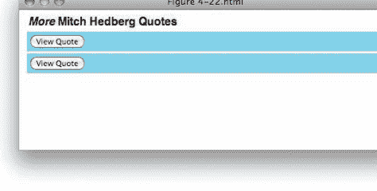

图 4-22

图 4-23 展示了按钮已被引言替换后的状态。

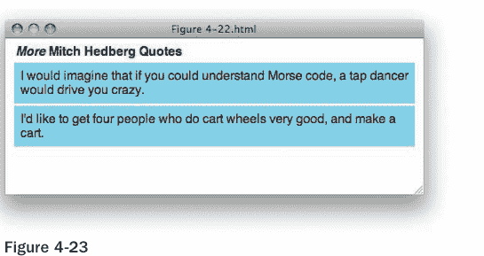

图 4-23

在前面的示例中，你看到一个点击事件被附加到每个按钮上，当你点击任意按钮时，都会调用 `$(this).replaceWith()`，这会导致 `<input>` 元素被传递给 `replaceWith()` 方法的 HTML 内容所替换。

我在本节中介绍的第二个方法是 jQuery 的 `replaceAll()` 方法，它与你本章前面学过的 jQuery 的 `insertBefore()` 和 `insertAfter()` 方法类似。jQuery 的 `replaceAll()` 方法接受一个选择器，而不是一个字符串。以下文档基本上使用了你在 **图 4-22** 中看到的相同内容，但使用了 `replaceAll()` 方法，而不是 `replaceWith()` 方法：

```
<!DOCTYPE html PUBLIC "-//W3C//DTD XHTML 1.0 Strict//EN"
    "http://www.w3.org/TR/xhtml1/DTD/xhtml1-strict.dtd">
<html xmlns='http://www.w3.org/1999/xhtml' xml:lang='en'>
<head>
  <meta http-equiv='content-type' content='text/html; charset=utf-8' />
  <meta http-equiv='content-language' content='en-us' />
  <title></title>
  <script type='text/javascript'
          src='../../../Source Code/jQuery/jQuery.js'>
  </script>
  <script type='text/javascript' src='Figure 4-24.js'></script>
  <link type='text/css' href='Figure 4-24.css' rel='stylesheet' />
</head>
<body>
  <div id='tmp'>
    <p id='tmpQuoteText1'>
      I'm sick of following my dreams. I'm just going to ask them
      where they're goin', and hook up with them later
    </p>
    <p id='tmpQuoteText2'>
      My fake plants died because I did not pretend to water them.
    </p>
  </div>
  <h4><i>Even More</i> Mitch Hedberg Quotes</h4>
  <div>
    <input type='submit' id='tmpQuotel' value='View Quote' />
  </div>
  <div>
    <input type='submit' id='tmpQuotel2' value='View Quote' />
  </div>
</body>
</html>
```

以下样式表应用于上述标记文档：

```
body {
  font: 16px sans-serif;
}
h4, p {
  margin: 5px;
}
div {
  background: #acf7d0;
  border: 3px solid #96dab6;
  margin: 3px;
}
div#tmp {
  display: none;
}
```

以下脚本演示了 `replaceAll()` 方法如何用于替换内容：

```
$(document).ready(function(){
  $('input#tmpQuotel').click(function($e){
    $e.preventDefault();
    $('p#tmpQuotelText1').replaceAll(this);
  });

  $('input#tmpQuotel2').click(function($e){
    $e.preventDefault();
    $('p#tmpQuotelText2').replaceAll(this);
  });
});
```

图 4-24 显示你得到一个类似于图 4-22 中看到的文档。你有两个按钮，当你点击任意按钮时，都会显示一个新的赫德伯格引言。

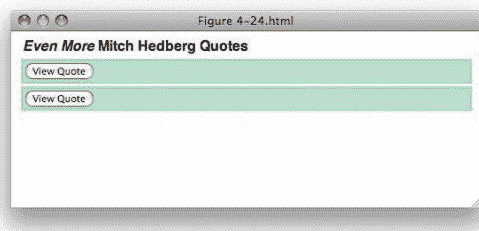

图 4-24

图 4-25 显示了点击每个按钮的结果。

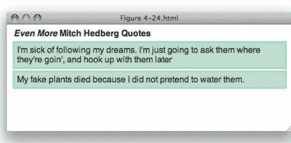

图 4-25

在前面的示例中，你看到当你点击按钮时，会执行一个 `click` 事件。用于替换的内容被选中，例如 `p#tmpQuoteText1`，然后调用 `replaceAll()` 方法，并将要替换的项作为参数传递给该方法。在前面的示例中，你传递了 `this` 关键字，但你也可以使用选择器。本质上，你会发现其逻辑与本节前面演示的 `replaceWith()` 方法正好相反。

### 移除内容

移除内容可以通过多种方式完成。例如，你可以将 `replaceWith()` 或 `html()` 方法与空字符串结合使用。但 jQuery 也提供了专门用于移除内容的方法，即 `empty()` 和 `remove()` 方法。以下文档演示了这两个方法的使用方式：

```
<!DOCTYPE html PUBLIC "-//W3C//DTD XHTML 1.0 Strict//EN"
    "http://www.w3.org/TR/xhtml1/DTD/xhtml1-strict.dtd">
<html xmlns='http://www.w3.org/1999/xhtml' xml:lang='en'>
<head>
```


## 第四章：操作内容与属性

以下样式表应用于前面的标记文档：

```
body {
    font: 16px sans-serif;
}
h4 {
    margin: 5px;
}
table {
    width: 100%;
    background: lightgreen;
    margin-bottom: 5px;
}
th {
    background: green;
    color: lightgreen;
}
```

以下脚本演示了 `empty()` 和 `remove()` 方法：

```
$(document).ready(
    function() {
        $('input#tmpEmptyTable').click(
            function($e) {
                $e.preventDefault();
                $('td').empty();
            }
        );

        $('input#tmpDelete').click(
            function($e) {
                $e.preventDefault();
                $('h4, table').remove();
            }
        );
    }
);
```

**图 4-26** 展示了上述示例的结果。

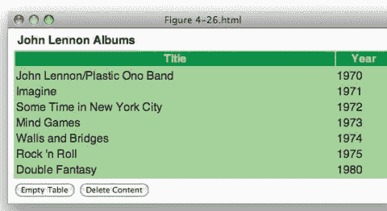

图 4-27 展示了点击标有“Empty Table”的按钮后发生的情况：每个 `<td>` 元素的内容都被移除。

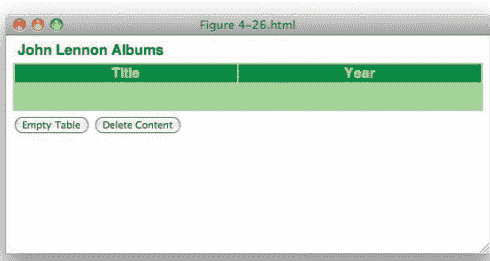

图 4-28 展示了点击标有“Delete Content”的按钮后发生的情况。`<h4>` 和 `<table>` 元素都被从文档中移除。

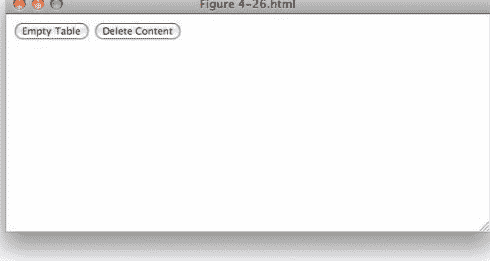

上述示例展示了使用 jQuery 的 `empty()` 方法时会发生的情况。这本质上与向 `html()` 方法传递空字符串相同——元素的所有子元素，无论是 HTML 元素还是文本，都会被移除。

上述示例也演示了 jQuery 的 `remove()` 方法，该方法会删除选择中指定的项目。但应注意，这些项目仍然存在于 jQuery 对象中，你可以通过将后续的 jQuery 方法链接到 `remove()` 方法上来继续操作这些项目。你还可以向 `remove()` 方法传递一个选择器，该选择器充当过滤器。传递给 `remove()` 方法的选择器中指定的任何项目都会被保留，不会从文档中移除。

### 克隆内容

jQuery 提供了一个名为 clone() 的方法用于克隆（复制）内容。与 DOM 的 cloneNode() 方法不同，jQuery 的 clone() 方法默认假定你想要复制该元素及其所有后代，因此你不必担心是否要指定克隆后代元素。同样与 DOM 的 cloneNode() 方法不同，你可以选择是否克隆元素的事件处理程序（以及其后代元素的事件处理程序），而这在原生 JavaScript 中是无法做到的。如果你想克隆元素的事件处理程序，只需将布尔值 true 作为第一个参数传递给 jQuery 的 clone() 方法即可。以下文档演示了 jQuery 的 clone() 方法：

```
<!DOCTYPE html PUBLIC "-//W3C//DTD XHTML 1.0 Strict//EN"
    "http://www.w3.org/TR/xhtml1/DTD/xhtml1-strict.dtd">
<html xmlns='http://www.w3.org/1999/xhtml' xml:lang='en'>
  <head>
    <meta http-equiv='content-type' content='text/html; charset=utf-8' />
    <meta http-equiv='content-language' content='en-us' />
    <title></title>
    <script type='text/javascript'
            src='../../../Source Code/jQuery/jQuery.js'>
    </script>
    <script type='text/javascript' src='Figure 4-29.js'></script>
    <link type='text/css' href='Figure 4-29.css' rel='stylesheet' />
  </head>
  <body>
    <h4>My Form</h4>
    <form action='javascript:void(0);' method='post'>
      <table>
        <thead>
          <tr>
            <th>Title</th>
            <th>Selected</th>
          </tr>
        </thead>
        <tbody>
          <tr id='tmp'>
            <td><input type='text' name='tmpTitle[]' value='0' /></td>
            <td><input type='checkbox' name='tmpTitleChecked[]' value='1' /></td>
          </tr>
          <tr>
            <td><input type='text' name='tmpTitle[]' value='0' /></td>
            <td><input type='checkbox' name='tmpTitleChecked[]' value='1' /></td>
          </tr>
          <tr>
            <td><input type='text' name='tmpFirst[]' value='0' /></td>
            <td><input type='checkbox' name='tmpTitleChecked[]' value='1' /></td>
          </tr>
        </tbody>
      </table>
      <input type='submit' id='tmpAddRow' value='Add a Row' />
    </form>
  </body>
</html>
```

以下样式表链接到前面的文档：

```
body {
    font: 16px sans-serif;
}
h4 {
    margin: 5px;
}
table {
    width: 100%;
    background: #b6d9f6;
    margin-bottom: 5px;
}
th {
    background: #8dc3f0;
}
tr#tmp {
    display: none;
}
```

以下脚本演示了 jQuery 的 clone() 方法：

```
$(document).ready(
    function() {
        $('input#tmpAddRow').click(
            function($e) {
                $e.preventDefault();
                $('tr#tmp').clone(true).removeAttr('id').appendTo('tbody');
            }
        );

        $('tr input[type=text]').focus(
            function() {
                $(this).addClass('tmpFocused');
            }
        ).blur(
            function() {
                $(this).removeClass('tmpFocused');
            }
        );
    }
);
```

**图 4-29** 展示了上述示例的屏幕截图。当你点击“Add a Row”按钮时，会向表单添加一个新行。

该脚本向 `<input>` 元素添加了一个点击事件。当 `<input>` 元素接收到点击事件时，会选中 ID 名为 tmp 的 `<tr>`，然后调用 clone() 方法，第一个参数设置为 true。将该参数设置为 true 会导致 clone() 方法也克隆被克隆元素上存在的任何事件处理程序，或其子元素上的任何事件处理程序。将第一个参数设置为 true 会导致附加到文本 `<input>` 元素的焦点和失焦事件与结构标记一起被克隆。链中的下一个方法通过调用 `removeAttr('id')` 从克隆的元素中移除 id 属性。否则，克隆的行将被隐藏。然后，使用 jQuery 的 `appendTo()` 方法将新克隆的行插入文档，该方法指定了选择器 `tbody`，导致新行被追加到 `<tbody>`，从而为表单添加了新行。

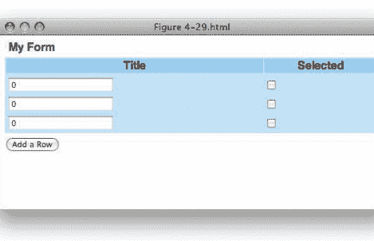

以下“动手实践”部分总结了你所学的关于 jQuery 的 `replaceAll()`、`replaceWith()`、`empty()`、`remove()` 和 `clone()` 方法的所有内容：

## 动手实践    替换、移除和克隆内容

#### 示例 4-4

要总结使用 jQuery 的操作 API 替换、移除和克隆内容，请按照以下步骤操作：

- 1. 在文本编辑器的新文档中输入以下标记：

```
<!DOCTYPE html PUBLIC "-//W3C//DTD XHTML 1.0 Strict//EN"
    "http://www.w3.org/TR/xhtml1/DTD/xhtml1-strict.dtd">
<html xmlns='http://www.w3.org/1999/xhtml' xml:lang='en'>
  <head>
    <meta http-equiv='content-type' content='text/html; charset=utf-8' />
    <meta http-equiv='content-language' content='en-us' />
    <title></title>
    <script type='text/javascript'
            src='../../Source Code/jQuery/jQuery.js'>
    </script>
    <script type='text/javascript' src='Example 4-4.js'></script>
    <link type='text/css' href='Example 4-4.css' rel='stylesheet' />
  </head>
  <body>
    <div class='tmpWrapper'>
      <input type='submit' id='tmpReplaceWith' value='Replace With' />
    </div>
    <div class='tmpWrapper'>
      <p id='tmpReplaceAllContent'>
        jQuery's replaceAll() method takes existing content and
        replaces it.
      </p>
```


## 第四章：操作内容与属性

```html
<input type='submit' id='tmpReplaceAll' value='Replace All' />
</div>
<div class='tmpWrapper'>
  <p>
    jQuery的empty()方法会从选中的项目中移除所有子元素（包括文本）。jQuery的remove()方法会彻底移除选中的项目。
  </p>
  <ul>
    <li>replaceAll()</li>
    <li>replaceWith()</li>
    <li>empty()</li>
    <li>remove()</li>
    <li>clone()</li>
  </ul>
  <input type='submit' id='tmpEmpty' value='Empty' />
  <input type='submit' id='tmpRemove' value='Remove' />
</div>
<div class='tmpWrapper'>
  <p>
    jQuery的clone()方法可用于复制元素。将其第一个参数设置为true时，还会复制这些元素的事件处理程序。
  </p>
  <form action='javascript:void(0);' method='post'>
    <div id='tmp' class='tmpRow'>
      <input type='text' name='tmpItem' value='' size='25' />
    </div>
    <div>
      <input type='submit' id='tmpAddInput' value='Add Input' />
    </div>
  </form>
</div>
</body>
</html>
```

2. 将上述文档保存为Example 4-4.html。

3. 在文本编辑器中将以下CSS输入到另一个新文档中：

```css
body {
  font: 16px sans-serif;
}
p {
  margin: 5px;
}
p#tmpReplaceAllContent {
  display: none;
}
div.tmpWrapper,
form div {
  padding: 5px;
}
input.tmpFocused {
  background: lightblue;
}
```

## 第一部分：jQuery API

4. 将上述文档保存为Example 4-4.css。

5. 在文本编辑器中输入以下JavaScript：

```javascript
$(document).ready(function() {
  $('input#tmpReplaceWith').click(function($e) {
    $e.preventDefault();
    $(this).replaceWith(
      "<p>\n" +
      "  jQuery's replaceWith() method is used to completely \n" +
      " replace one or more elements with the specified content.\n" +
      "</p>\n"
    );
  });

  $('input#tmpReplaceAll').click(function($e) {
    $e.preventDefault();
    $('p#tmpReplaceAllContent')
      .replaceAll(this)
      .removeAttr('id');
  });

  $('input#tmpEmpty').click(function($e) {
    $e.preventDefault();
    $('ul li').empty();
  });

  $('input#tmpRemove').click(function($e) {
    $e.preventDefault();
    $('ul').remove();
  });

  $('input#tmpAddInput').click(function($e) {
    $e.preventDefault();
    $('div#tmp')
      .clone(true)
      .removeAttr('id')
      .insertAfter($('div.tmpRow:last'))
      .find('input')
      .val('');
  });

  $('input[type=text]')
    .focus(
      function() {
        $(this).addClass('tmpFocused');
      }
    )
    .blur(
      function() {
        $(this).removeClass('tmpFocused');
      }
    );
});
```

6. 将上述文档保存为 *Example 4-4.js*。

你在前述示例中创建的文档会产生如**图 4-30**所示的截图。

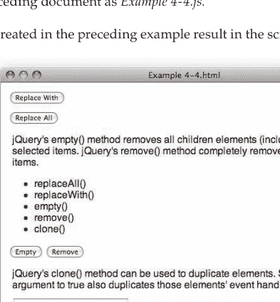

## 图 4-30

在示例 4-4中，你回顾了本章中剩余要讲解的jQuery操作方法。你以jQuery的 `replaceWith()` 方法开始了这个示例。

```html
<div class='tmpWrapper'>
    <input type='submit' id='tmpReplaceWith' value='Replace With' />
</div>
```

当你按下前述标记中标有"Replace With"的 `<input>` 按钮时，会执行以下脚本：

```javascript
$('input#tmpReplaceWith').click(
  function($e) {
    $e.preventDefault();
    $(this).replaceWith(
      "<p>\n" +
      "  jQuery's replaceWith() method is used to completely \n" +
      "  replace one or more elements with the specified content.\n" +
      "</p>\n"
    );
  }
);
```

在前述脚本中，用户点击的 `<input>` 元素会从文档中完全移除，并通过 `replaceWith()` 方法替换为 `<p>` 元素及其文本内容。

你在本示例中回顾的第二个方法是jQuery的 `replaceAll()` 方法。

```html
<div class='tmpWrapper'>
  <p id='tmpReplaceAllContent'>
    jQuery's replaceAll() method takes existing content and
    replaces it.
  </p>
  <input type='submit' id='tmpReplaceAll' value='Replace All' />
</div>
```

当前述标记中标有"Replace All"的 `<input>` 按钮被点击时， `<input>` 元素会从文档中完全移除，并替换为ID名为tmpReplaceAllContent的 `<p>` 元素。

```javascript
$('input#tmpReplaceAll').click(
  function($e) {
    $e.preventDefault();
    $('p#tmpReplaceAllContent')
      .replaceAll(this)
      .removeAttr('id');
  }
);
```

在 `<input>` 元素被替换为 `<p>` 元素后， `id` 属性会从 `<p>` 元素上移除，这也使得该内容变为可见。正如你在这个脚本中看到的，以及从本章之前的讨论中记得的， `replaceAll()` 方法的逻辑与 `replaceWith()` 方法相反。你首先要选中想要用于替换的内容。如果你愿意，也可以直接向美元符号方法提供内容；然后调用 `replaceAll()` 方法，其第一个参数是一个引用你想要替换的内容的选择器。

接下来，你回顾了jQuery的 `empty()` 和 `remove()` 方法。

```html
<div class='tmpWrapper'>
  <p>
    jQuery的empty()方法会从选中的项目中移除所有子元素（包括文本）。jQuery的remove()方法会彻底移除选中的项目。
  </p>
  <ul>
    <li>replaceAll()</li>
    <li>replaceWith()</li>
    <li>empty()</li>
    <li>remove()</li>
    <li>clone()</li>
  </ul>
  <input type='submit' id='tmpEmpty' value='Empty' />
  <input type='submit' id='tmpRemove' value='Remove' />
</div>
```

当你点击前述标记片段中标有"Empty"的 `<input>` 按钮时，会执行以下脚本：

```javascript
$('input#tmpEmpty').click(
    function($e) {
        $e.preventDefault();
        $('ul li').empty();
    }
);
```

前述脚本展示了如何使用 `empty()` 来移除每个 `<li>` 元素的内容。

当你点击前述标记片段中标有"Remove"的 `<input>` 按钮时，会执行以下脚本：

```javascript
$('input#tmpRemove').click(
    function($e) {
        $e.preventDefault();
        $('ul').remove();
    }
);
```

前述脚本展示了jQuery的 `remove()` 方法如何移除 `<ul>` 元素及其所有子元素。

最后，你在本示例中回顾的最后一个方法是jQuery的 `clone()` 方法。

```html
<div class='tmpWrapper'>
  <p>
    jQuery的clone()方法可用于复制元素。将其第一个参数设置为true时，还会复制这些元素的事件处理程序。
  </p>
  <form action='javascript:void(0);' method='post'>
    <div id='tmp' class='tmpRow'>
      <input type='text' name='tmpItem' value='' size='25' />
    </div>
    <div>
      <input type='submit' id='tmpAddInput' value='Add Input' />
    </div>
  </form>
</div>
```

当你点击前述标记片段中标有"Add Input"的按钮时，会执行以下脚本：

```javascript
$('input#tmpAddInput').click(
  function($e) {
    $e.preventDefault();
    $('div#tmp')
      .clone(true)                       // 复制<div>
      .removeAttr('id')                  // 移除id
      .insertAfter('div.tmpRow:last')    // 插入到最后一个<div>之后
      .find('input')                     // 获取input
      .val('');                          // 移除值
  }
);
```

在前述脚本中，你首先选择ID名为 `tmp` 的 `<div>` 元素，它用作复制文本输入字段的模板。调用 `clone(true)` 会复制 `<div>` 元素、其后代、其事件处理程序以及其后代的事件处理程序，这意味着附加到文本 `<input>` 元素的focus和blur事件也会被复制。 `id` 属性通过 `removeAttr()` 方法被移除，这保持了文档中ID的唯一性，从而也防止了不必要的错误出现。然后，新复制并修改后的 `<div>` 元素被插入到类名为 `tmpRow` 的最后一个 `<div>` 元素之后。jQuery的特殊 `:last` 伪类被调用，以便选择选中项中的最后一个元素，确保新插入的 `<div>` 元素始终位于最后。然后使用jQuery的 `find()` 方法选择 `<div>` 元素的 `<input>` 元素，并移除其值，以确保新的 `<input>` 元素是干净且未使用的。

### 小结

在本章中，你学习了jQuery的各种操作能力。本章讨论的内容在附录E的快速参考中有详细记载。你以学习jQuery的属性操作方法 `attr()` 开始了本章，它让你可以以多种方式指定属性，以属性作为第一个参数、值作为第二个参数，或者通过对象字面量以键值对形式指定参数，还可以使用回调函数。jQuery的 `removeAttr()` 方法可用于完全移除属性。

你还学习了jQuery如何极大地帮助你操作类名。jQuery的 `addClass()` 方法可用于向元素添加类名。其 `hasClass()` 方法可用于判断某个类名是否存在。其 `removeClass()` 方法可用于移除类名。而其 `toggleClass()` 方法可用于切换类名的开关。


## 第四章：操作内容和属性

你已经学习了用于操作文本和HTML内容的各种jQuery方法。你可以使用jQuery的 `text()` 和 `html()` 方法获取或设置元素的文本或HTML内容。你可以使用jQuery的 `append()` 或 `prepend()` 方法向其他元素追加或插入HTML内容。jQuery的 `after()`、`before()`、`insertAfter()` 和 `insertBefore()` 方法都可以用来在其他内容旁边插入内容。而jQuery的 `wrap()`、`wrapAll()` 和 `wrapInner()` 方法可用于用包装元素包裹元素。

最后，jQuery的 `replaceWith()` 和 `replaceAll()` 方法可用于用其他内容完全替换一个或多个元素。它的 `empty()` 方法可用于完全移除一个元素的子元素和后代元素。它的 `remove()` 方法可用于完全删除一个元素及其所有内容。它的 `clone()` 方法可用于复制内容，并可选择性地复制该内容中存在的事件处理程序。

### 练习

1.  编写一个示例代码，该代码可能用于同时设置 `<input>` 元素的值（value）和类（class）属性。
2.  如果你想使用jQuery将 `<a>` 元素的 `href` 属性设置为 `www.example.com`，对应的JavaScript代码可能是什么样的？
3.  哪个jQuery方法用于完全移除元素的属性？
4.  你会使用哪个jQuery方法来判断一个元素是否包含某个类名？
5.  如果一个元素包含HTML内容，并且你使用jQuery的 `text()` 方法获取该元素的内容，那么返回的值中会包含HTML标签吗？
6.  如果你使用jQuery的 `text()` 方法设置一个元素的内容，并且该内容包含HTML标签，那么这些HTML标签会在浏览器视口中显示的渲染输出中可见吗？
7.  描述一个jQuery的 `append()` 和 `prepend()` 方法在IE浏览器中相比 `innerHTML` 所绕过的bug。
8.  描述一个jQuery的 `append()` 和 `prepend()` 方法在Firefox浏览器中相比 `innerHTML` 所绕过的bug。
9.  如果你想将文档中现有的内容插入到其他现有内容之前，哪个jQuery方法最适合完成这个任务？
10. 如果你需要将文档中的多个项目包裹在一个单一的元素中，你会使用哪个jQuery方法？
11. jQuery的 `replaceWith()` 方法最类似于哪个事实上的标准JavaScript属性？
12. 如果你想从文档中完全删除一个项目及其所有子项目，你会使用哪个jQuery方法？
13. 如果你想复制一个元素及其事件处理程序，并将副本插入到文档的其他位置，你会调用哪个jQuery函数？

## 第五章：数组与迭代

在本章中，我将讨论jQuery提供的帮助你处理数组的方法。历史上，在JavaScript中处理数组通常需要你自己编写辅助方法，并且每次想要遍历数组内容时都要处理编写繁琐的冗余代码。

正如你在第四章中所看到的，jQuery为与操作文档内容相关的各种任务提供了一个丰富、健壮且有用的API。在本章中，你会看到jQuery在提供处理数组方面的能力也毫不逊色。

### 基本迭代

在本节中，你将学习一种全新的方法，使用jQuery的 `$.each()` 方法来处理遍历值数组的任务。到目前为止，当涉及查看数组中包含的每个单独值时，你可能习惯于处理如下所示的循环：

```
var $items = document.getElementsByTagName('div');

for (var $i = 0; $i < $items.length; $i++) {
  // 对每个项目执行一些操作
  alert($item[$i].innerHTML);
}
```

你有一个项目数组，或一个静态节点列表，或一个活动节点列表。然后你创建一个 `for` 循环，定义一个计数器，并继续遍历数组或列表的内容。

jQuery使这一切变得完全不必要，它提供了一种使用函数调用而不是 `for` 循环来遍历数组或列表的方法，以及一个用于实际查看每个单独项目的回调函数。jQuery使用的函数同样叫做 `each()`，它在下面的文档中进行了演示：

```
<!DOCTYPE html PUBLIC "-//W3C//DTD XHTML 1.0 Strict//EN"
    "http://www.w3.org/TR/xhtml1/DTD/xhtml1-strict.dtd">
<html xmlns='http://www.w3.org/1999/xhtml' xml:lang='en'>
  <head>
    <meta http-equiv='content-type' content='text/html; charset=utf-8' />
    <meta http-equiv='content-language' content='en-us' />
    <title></title>
    <script type='text/javascript'
        src='../../Source Code/jQuery/jQuery.js'></script>
    <script type='text/javascript' src='Figure 5-1.js'></script>
    <link type='text/css' href='Figure 5-1.css' rel='stylesheet' />
  </head>
  <body>
    <ul>
    </ul>
  </body>
</html>
```

前面的标记文档链接到以下样式表：

```
body {
    font: 16px sans-serif;
}
```

以下脚本演示了jQuery的 `each()` 方法。

```
$(document).ready(
  function() {
    var $items = [
      'John Lennon',
      'Paul McCartney',
      'George Harrison',
      'Ringo Starr'
    ];

    $($items).each(
      function() {
        $('ul').append("<li>" + this + "</li>");
      }
    );
  }
);
```

在前面的脚本中，你创建了一个临时数组并将其赋值给变量 `$items`。变量 `$items` 被传递给jQuery的美元符号方法，然后jQuery的 `each()` 方法被链接在该调用的末尾。你将一个匿名函数传递给jQuery的 `each()` 方法，该函数对数组中的每个项目执行一次；每次执行时，当前项目通过 `this` 关键字传递给匿名函数。

**图5-1** 显示了通过脚本，`<ul>` 元素被填充了四个新的 `<li>` 项目。


在前面的例子中，你看到了jQuery如何能够消除你通常用于遍历数组或列表内容的传统 `for` 构造。相反，你将一个数组传递给jQuery的美元符号方法，这样你就可以利用jQuery的全部功能来处理该数组。然后你链接了对jQuery `each()` 方法的调用，该方法接受一个回调函数作为其唯一参数。该回调函数随后对数组中的每个项目执行一次，从而消除了对计数器的需求，因为每次迭代时当前项目都会通过 `this` 关键字传递给该函数。

### 直接调用 each()

你不必像前面例子中看到的那样编写对 `each()` 的调用；但是，你也可以将数组传递给对jQuery `each()` 方法的直接调用。以下文档演示了这种变体：

```
<!DOCTYPE html PUBLIC "-//W3C//DTD XHTML 1.0 Strict//EN"
    "http://www.w3.org/TR/xhtml1/DTD/xhtml1-strict.dtd">
<html xmlns='http://www.w3.org/1999/xhtml' xml:lang='en'>
  <head>
    <meta http-equiv='content-type' content='text/html; charset=utf-8' />
    <meta http-equiv='content-language' content='en-us' />
    <title></title>
    <script type='text/javascript'
        src='../../Source Code/jQuery/jQuery.js'></script>
    <script type='text/javascript' src='Figure 5-2.js'></script>
    <link type='text/css' href='Figure 5-2.css' rel='stylesheet' />
  </head>
  <body>
    <ul>
    </ul>
  </body>
</html>
```

前面的文档链接到以下样式表：

```
body {
    font: 16px sans-serif;
}
```

以下脚本演示了如何直接调用 `each()`。

```
$(document).ready(
  function() {
    $.each(
      ['Groucho', 'Chico', 'Harpo', 'Zeppo'],
      function() {
        $('ul').append('<li>' + this + '</li>');
      }
    );
  }
);
```

在前面的例子中，你直接调用了 `each()` 方法，使用 `$.each()`，并将要迭代的数组作为其第一个值，回调函数作为第二个值。图5-2显示了前面的例子在浏览器中的渲染结果。


使用jQuery `each()` 方法的哪种方式其实并不重要。选择对你来说最有意义的方式即可。

### 变量作用域

作用域可能是一个棘手的问题，因为不同的语言对作用域的定义不同。简而言之，作用域限制了你可以访问的变量，这取决于它们被使用的上下文。在JavaScript中全局定义的变量（无论是否使用 `var` 关键字）——全局意味着在函数、对象或闭包之外——可以在文档的任何地方、全局范围内或从任何函数内部访问。在函数内部局部定义但没有使用 `var` 关键字的变量也被视为全局变量。你在函数内部使用 `var` 关键字局部定义的变量，只能在该函数内部访问……或者从该函数内部定义的匿名函数中访问。

了解作用域的工作原理有助于你更轻松地使用jQuery的 `each()` 方法进行数组迭代，因为你会发现你可以访问在传递给 `each()` 方法的匿名函数外部定义的局部变量。


## 第 5 章：数组与迭代

以下文档演示了变量作用域的概念：

```html
<!DOCTYPE html PUBLIC "-//W3C//DTD XHTML 1.0 Strict//EN"
    "http://www.w3.org/TR/xhtml1/DTD/xhtml1-strict.dtd">
<html xmlns='http://www.w3.org/1999/xhtml' xml:lang='en'>
  <head>
    <meta http-equiv='content-type' content='text/html; charset=utf-8' />
    <meta http-equiv='content-language' content='en-us' />
    <title></title>
    <script type='text/javascript'
            src='../../Source Code/jQuery/jQuery.js'></script>
    <script type='text/javascript' src='Figure 5-3.js'></script>
    <link type='text/css' href='Figure 5-3.css' rel='stylesheet' />
  </head>
  <body>
    <ul>
    </ul>
  </body>
</html>
```

以下样式表链接到前述标记文档：

```css
body {
    font: 16px sans-serif;
}
ul {
    list-style: none;
}
```

以下脚本演示了变量作用域的概念，即应用于在同一函数中定义的本地变量和匿名函数：

```javascript
$(document).ready(
    function() {
        var $append = " Marx";

        $(['Groucho', 'Chico', 'Harpo', 'Zeppo'])
            .each(
                function() {
                    $('ul').append("<li>" + this + $append + "</li>");
                }
            );
    }
);
```

在前面的脚本中，您会看到 $append 变量被定义为字符串 Marx；然后使用 each() 方法遍历数组的内容。在向 each() 方法传递的匿名函数中，您可以从该单独定义的函数内部访问 $append 变量。图 5-3 显示了前述 JavaScript、CSS 和 HTML 文档的渲染输出。

## 第 I 部分：jQuery API


**图 5-3**

除了能够访问迭代器函数内部定义的本地变量之外，还有两项内容是您在传统 `for` 结构中进行习惯使用的遗留部分：使用 `break` 和 `continue` 关键字，这是下一节要讨论的主题。

## 模拟 \`break\` 和 \`continue\`

在 jQuery 的 `each()` 方法中模拟 `break` 和 `continue` 关键字的功能非常直观。您只需在匿名函数中写一个 return 语句即可。返回布尔值 `false` 会停止迭代，就像在正常循环中使用 `break` 关键字一样，返回布尔值 `true` 会继续迭代，就像使用 `continue` 关键字一样。以下文档演示如何使用 jQuery 的 `each()` 方法模拟 `break` 和 `continue` 关键字：

```html
<!DOCTYPE html PUBLIC "-//W3C//DTD XHTML 1.0 Strict//EN"
    "http://www.w3.org/TR/xhtml1/DTD/xhtml1-strict.dtd">
<html xmlns='http://www.w3.org/1999/xhtml' xml:lang='en'>
  <head>
    <meta http-equiv='content-type' content='text/html; charset=utf-8' />
    <meta http-equiv='content-language' content='en-us' />
    <title></title>
    <script type='text/javascript'
            src='../../../Source Code/jQuery/jQuery.js'></script>
    <script type='text/javascript' src='Figure 5-4.js'></script>
    <link type='text/css' href='Figure 5-4.css' rel='stylesheet' />
  </head>
  <body>
    <ul>
    </ul>
  </body>
</html>
```

以下样式表链接到前述标记文档：

```css
body {
    font: 16px sans-serif;
}
ul {
    list-style: none;
}
```

## 第 5 章：数组与迭代

以下脚本演示如何使用布尔返回值来模拟 continue 和 break 关键字：

```javascript
$(document).ready(
	function() {
		$(['Groucho', 'Chico', 'Harpo', 'Zeppo'])
			.each(
				function() {
					if (this == 'Groucho') {
						// Continue
						return true;
					}
				}
			);

		$('ul').append(
			"<li>" + this + "</li>"
		);
	});

$(['John', 'Paul', 'George', 'Ringo'])
	.each(
		function() {
			if (this == 'Ringo') {
				// Break
				return false;
			}
		}
	);

$('ul').append(
	"<li>" + this + "</li>"
);
	});
```

在前面的脚本中，您看到在第一个数组中，脚本查找当前数组值是否为 Groucho，在这种情况下函数返回 true，这导致 each() 直接进入数组中的下一个值。在第二个数组迭代中，脚本检查当前值是否为 Ringo，在这种情况下函数返回 false，模拟 break 操作，each() 停止迭代。图 5-4 显示了前述 JavaScript、CSS 和 HTML 文档的渲染输出。


**图 5-4**

## 第 I 部分：jQuery API

### 遍历选择集

jQuery 的 each() 方法不必仅应用于数组；然而，它也可以应用于元素的选择集。以下文档演示如何使用 each() 来迭代一组元素的选择集：

```html
<!DOCTYPE html PUBLIC "-//W3C//DTD XHTML 1.0 Strict//EN"
  "http://www.w3.org/TR/xhtml1/DTD/xhtml1-strict.dtd">
<html xmlns='http://www.w3.org/1999/xhtml' xml:lang='en'>
  <head>
    <meta http-equiv='content-type' content='text/html; charset=utf-8' />
    <meta http-equiv='content-language' content='en-us' />
    <title></title>
    <script type='text/javascript'
      src='../../../Source Code/jQuery/jquery.js'></script>
    <script type='text/javascript' src='Figure 5-5.js'></script>
    <link type='text/css' href='Figure 5-5.css' rel='stylesheet' />
  </head>
  <body>
    <h4>Rubber Soul</h4>
    <ul>
      <li>Drive My Car</li>
      <li>Norwegian Wood (This Bird Has Flown)</li>
      <li>You Won't See Me</li>
      <li>Nowhere Man</li>
      <li>Think for Yourself</li>
      <li>The Word</li>
      <li>Michelle</li>
      <li>What Goes On</li>
      <li>Girl</li>
      <li>I'm Looking Through You</li>
      <li>In My Life</li>
      <li>Wait</li>
      <li>If I Needed Someone</li>
      <li>Run for Your Life</li>
    </ul>
  </body>
</html>
```

以下样式表应用于前述标记文档：

```css
body {
  font: 16px sans-serif;
}
h4 {
  margin: 0;
}
ul {
  list-style: none;
  margin: 5px;
  padding: 0;
}
li.tmpSong {
  background: #a0cde5;
  border: 4px solid #99c6dd;
}
```

在以下脚本中，您看到 jQuery 的 `each()` 方法可以像任何其他方法一样连接到选择集，并且您可以迭代选择集中的项目：

```javascript
$(document).ready(
  function() {
    $('li').each(
      function() {
        $(this).addClass('tmpSong');
      }
    );
  }
);
```

遍历选择集本质上与遍历数组相同，只不过这次，当您处理回调函数时，`this` 关键字包含来自该选择集的单个元素。如果您想在回调函数中使用 jQuery 方法，您将需要用美元符号方法的调用来包装 `this` 关键字。在示例中，每个 `<li>` 元素被选中，使用 `each()` 方法进行迭代，并给定类名 *tmpSong*。图 5-5 显示了前述示例在浏览器中的屏幕截图。


**图 5-5**

### 筛选选择与数组

在 jQuery API 中，有两种方法与筛选数组或选择集相关联。一种方法名为 `filter()`，用于从选择集中排除项目。另一种方法名为 `grep()`，用于从数组中排除项目。

## 第 I 部分：jQuery API

### 筛选选择集

filter() 用于使用选择器或回调函数从选择集中移除项目。以下文档演示如何使用 filter() 的选择器来减少选择集中的项目：

```html
<!DOCTYPE html PUBLIC "-//W3C//DTD XHTML 1.0 Strict//EN"
    "http://www.w3.org/TR/xhtml1/DTD/xhtml1-strict.dtd">
<html xmlns='http://www.w3.org/1999/xhtml' xml:lang='en'>
  <head>
    <meta http-equiv='content-type' content='text/html; charset=utf-8' />
    <meta http-equiv='content-language' content='en-us' />
    <title></title>
    <script type='text/javascript'
            src='../../Source Code/jQuery/jQuery.js'></script>
    <script type='text/javascript' src='Figure 5-6.js'></script>
    <link type='text/css' href='Figure 5-6.css' rel='stylesheet' />
  </head>
  <body>
    <h4>Rubber Soul</h4>
    <ul>
      <li class='Paul'>Drive My Car</li>
      <li class='John'>Norwegian Wood (This Bird Has Flown)</li>
      <li class='Paul'>You Won't See Me</li>
      <li class='John'>Nowhere Man</li>
      <li class='George'>Think for Yourself</li>
      <li class='John'>The Word</li>
      <li class='Paul'>Michelle</li>
      <li class='John'>What Goes On</li>
      <li class='John'>Girl</li>
      <li class='Paul'>I'm Looking Through You</li>
      <li class='John'>In My Life</li>
      <li class='John'>Wait</li>
      <li class='George'>If I Needed Someone</li>
      <li class='John'>Run for Your Life</li>
    </ul>
  </body>
</html>
```

前述标记文档包含以下样式表：

```css
body {
    font: 16px sans-serif;
}
h4 {
    margin: 0;
}
ul {
    list-style: none;
    margin: 5px;
    padding: 0;
}
li.tmpSelected {
    background: #a1e6b2;
    border: 4px solid #93daa4;
}
```


 ## 第5章：数组与迭代

以下脚本展示了 `filter()` 方法如何使用选择器来指示哪些项目应该被包含在选择中：

```
$(document).ready(
  function() {
    $('li')
      .filter('.George')
      .addClass('tmpSelected');
  }
);
```

在前面的脚本中，选择器 `.George` 将选择范围缩小到仅包含类名为 *George* 的 `<li>` 元素；然后为这些 `<li>` 元素分别添加类名 *tmpSelected*。**图 5-6** 展示了此示例在 Safari 中的截图。


**图 5-6**

### 使用回调函数过滤选择

`filter()` 方法也可以与回调函数一起使用。当以这种方式使用时，`filter()` 与 `each()` 非常相似，因为它允许指定一个回调函数，随后对选择中的每一个项目执行一次。

对于 `each()` 方法，你已经了解到返回一个布尔值可以模拟 `continue` 和 `break` 语句。而对于 `filter()` 方法，返回的布尔值决定某个项目应该保留在选择中还是从选择中移除。返回 `true` 将项目保留在选择中，返回 `false` 则将项目从选择中移除。以下文档展示了如何使用带有回调函数的 `filter()`：

```
<!DOCTYPE html PUBLIC "-//W3C//DTD XHTML 1.0 Strict//EN"
  "http://www.w3.org/TR/xhtml1/DTD/xhtml1-strict.dtd">
<html xmlns='http://www.w3.org/1999/xhtml' xml:lang='en'>
  <head>
    <meta http-equiv='content-type' content='text/html; charset=utf-8' />
    <meta http-equiv='content-language' content='en-us' />
    <title></title>
    <script type='text/javascript'
        src='../../Source Code/jQuery/jQuery.js'></script>
    <script type='text/javascript' src='Figure 5-7.js'></script>
    <link type='text/css' href='Figure 5-7.css' rel='stylesheet' />
</head>
<body>
  <h4>Rubber Soul</h4>
  <ul>
    <li class='Paul'>Drive My Car</li>
    <li class='John'>Norwegian Wood (This Bird Has Flown)</li>
    <li class='Paul'>You Won't See Me</li>
    <li class='John'>Nowhere Man</li>
    <li class='George'>Think for Yourself</li>
    <li class='John'>The Word</li>
    <li class='Paul'>Michelle</li>
    <li class='John'>What Goes On</li>
    <li class='John'>Girl</li>
    <li class='Paul'>I'm Looking Through You</li>
    <li class='John'>In My Life</li>
    <li class='John'>Wait</li>
    <li class='George'>If I Needed Someone</li>
    <li class='John'>Run for Your Life</li>
  </ul>
</body>
</html>
```

前面的标记文档链接到以下样式表：

```
body {
    font: 16px sans-serif;
}
h4 {
    margin: 0;
}
ul {
    list-style: none;
    margin: 5px;
    padding: 0;
}
li.tmpSelected {
    background: #a1e6b2;
    border: 4px solid #93daa4;
}
```

以下脚本展示了 jQuery 的 `filter()` 方法如何使用回调函数来减少选择中的项目：

```
$(document).ready(
  function() {
    $('li')
      .filter(
        function() {
          return $(this).hasClass('John') || $(this).hasClass('Paul');
        }
      )
      .addClass('tmpSelected');
  }
);
```

在前面的脚本中，`filter()` 方法遍历原始选择中的每个项目。它查看每个单独的 `<li>` 元素，并检查该 `<li>` 元素是否具有类名 *John* 或类名 *Paul*；如果存在任一类名，回调函数返回 `true`，表示该项目应保留在选择中。保留在选择中的每个项目随后获得类名 *tmpSelected*。*图 5-7* 展示了此示例在 Safari 中的截图。每首主要由 John 或 Paul 创作的歌曲都带有绿色背景和稍深绿色的边框。


*图 5-7*

### 过滤数组

正如我之前提到的，数组是使用另一个名为 `grep()` 的方法来过滤的。`grep()` 方法只能直接调用，也就是说，你只能以 `$.grep()` 或 `jQuery.grep()` 的形式调用它。将数组包装在美元符号方法中然后调用 `grep()` 是行不通的，至少在我撰写本文时所使用的 jQuery 版本中是如此。以下文档展示了如何使用 `grep()` 来过滤数组：

```
<!DOCTYPE html PUBLIC "-//W3C//DTD XHTML 1.0 Strict//EN"
    "http://www.w3.org/TR/xhtml1/DTD/xhtml1-strict.dtd">
<html xmlns='http://www.w3.org/1999/xhtml' xml:lang='en'>
  <head>
    <meta http-equiv='content-type' content='text/html; charset=utf-8' />
    <meta http-equiv='content-language' content='en-us' />
    <title></title>
    <script type='text/javascript'
        src='../../Source Code/jQuery/jquery.js'></script>
    <script type='text/javascript' src='Figure 5-8.js'></script>
    <link type='text/css' href='Figure 5-8.css' rel='stylesheet' />
</head>
<body>
  <h4>Rubber Soul</h4>
  <ul id='tmpAlbum'>
    <li class='Paul'>Drive My Car</li>
    <li class='John'>Norwegian Wood (This Bird Has Flown)</li>
    <li class='Paul'>You Won't See Me</li>
    <li class='John'>Nowhere Man</li>
    <li class='George'>Think for Yourself</li>
    <li class='John'>The Word</li>
    <li class='Paul'>Michelle</li>
    <li class='John'>What Goes On</li>
    <li class='John'>Girl</li>
    <li class='Paul'>I'm Looking Through You</li>
    <li class='John'>In My Life</li>
    <li class='John'>Wait</li>
    <li class='George'>If I Needed Someone</li>
    <li class='John'>Run for Your Life</li>
  </ul>
  <ul id='tmpFiltered'>
  </ul>
</body>
</html>
```

前面的标记文档链接到以下样式表：

```
body {
    font: 16px sans-serif;
}
h4 {
    margin: 0;
}
ul {
    list-style: none;
    margin: 5px;
    padding: 0;
}
```

以下脚本展示了 `grep()` 方法：

```
$(document).ready(
  function() {
    var $items = [];

    $('li').each(
      function() {
        $items.push($(this).text());
      }
    );

    var $filtered = $.grep(
      $items,
      function($value, $key) {
        return ($value.indexOf('You') != -1);
      }
    );

    $('ul#tmpAlbum').hide();

    $($filtered).each(function() {
        $('ul#tmpFiltered').append("<li>" + this + "</li>\n");
    });
  }
);
```

前面的脚本首先创建一个新数组，并将其赋值给变量 $items。然后脚本选择所有 `<li>` 元素，使用 push() 将每个 `<li>` 元素的文本作为新项添加到 $items 数组中。最终结果是 $items 数组包含了《Rubber Soul》专辑中所有歌曲的标题。

接着，创建了一个名为 $filtered 的新变量，它将包含过滤后的数组。`grep()` 方法直接以 `$.grep()` 的形式调用，第一个参数是 $items 数组，第二个参数是回调函数。在回调函数中，你返回一个布尔值来指示每个项目应该保留在数组中还是移除。返回 true 表示该值应被保留；返回 false 表示该项应被丢弃。你还可以更改被保留的值——只需返回你想要使用的替换值，它将替换之前的任何值。

在此示例中，回调函数使用 JavaScript 的 `indexOf()` 方法检查每首歌曲标题是否包含单词 you。如果包含，则保留该歌曲标题；如果不包含，则丢弃该歌曲标题。

通过选择 ID 名为 tmpAlbum 的 `<ul>` 元素，然后调用 jQuery 的 `hide()` 方法，将其隐藏。

最后，脚本使用 `each()` 遍历新的 $filtered 数组，将包含单词 you 的四首歌曲标题作为新的 `<li>` 元素追加到 ID 名为 tmpFiltered 的 `<ul>` 元素中。图 5-8 展示了前述示例在浏览器中的结果。


# **图 5-8**

`grep()` 方法还允许指定一个名为 invert 的可选第三个参数；如果将其设置为 true，则过滤后数组的值将被反转。


## 映射选择集或数组

与过滤（filtering）类似，在两种不同场景下都可以将一个项目集合映射为另一个集合：针对选择集，或者针对任意项目数组。不过，这一次两种场景都使用同一个名称的函数，即 `map()`。在下面的章节中，你将了解 `map()` 方法在这两种场景中的应用。

### 映射选择集

映射的概念是获取一组值，并修改其中一个或多个值以创建一组新值。在映射过程中不会从集合中移除任何项目，因此完成后你期望得到与开始时相同长度的值集合——其基本思想是可以根据需要任意替换值。以下文档演示了如何使用 jQuery 映射一个选择集：

```
<!DOCTYPE html PUBLIC "-//W3C//DTD XHTML 1.0 Strict//EN" "http://www.w3.org/TR/xhtml1/DTD/xhtml1-strict.dtd">
<html xmlns="KVhttp://www.w3.org/1999/xhtml" xml:lang="en">
<head>
<meta http-equiv='content-type' content='text/html; charset=utf-8' />
<meta http-equiv='content-language' content='en-us' />
<title></title>
<script type='text/javascript' src='../../../../Source Code/jQuery/jquery.js'></script>
<script type='text/javascript' src='Figure 5-9.js'></script>
<link type='text/css' href='Figure 5-9.css' rel='stylesheet' />
</head>
<body>
<h4>Rubber Soul</h4>
<ul id='tmpAlbum'>
<li class='Paul'>Drive My Car</li>
<li class='John'>Norwegian Wood (This Bird Has Flown)</li>
<li class='Paul'>You Won't See Me</li>
<li class='John'>Nowhere Man</li>
<li class='George'>Think for Yourself</li>
<li class='John'>The Word</li>
<li class='Paul'>Michelle</li>
<li class='John'>What Goes On</li>
<li class='John'>Girl</li>
<li class='Paul'>I'm Looking Through You</li>
<li class='John'>In My Life</li>
<li class='John'>Wait</li>
<li class='George'>If I Needed Someone</li>
<li class='John'>Run for Your Life</li>
</ul>
</body>
</html>
```

前面的标记文档由以下样式表进行样式设置：

```
body {
    font: 16px sans-serif;
}
h4 {
    margin: 0;
}
ul {
    list-style: none;
    margin: 5px;
    padding: 0;
}
ul li {
    position: relative;
    background: #eff557;
    border: 1px solid black;
    padding: 3px;
    margin: 2px 0;
}
i {
    position: absolute;
    top: 3px;
    right: 3px;
}
```

以下脚本演示了如何将一个选择集映射为新数组：

```
$(document).ready(
    function() {
        var $mapped = $('li').map(
            function($key) {
                switch (true) {
                    case ($(this).hasClass('John')): {
                        return $(this).text() + " <i>John Lennon</i>";
                    }
                    case ($(this).hasClass('Paul')): {
                        return $(this).text() + " <i>Paul McCartney</i>";
                    }
                    case ($(this).hasClass('George')): {
                        return $(this).text() + " <i>George Harrison</i>";
                    }
                }
            }
        );

        $('ul#tmpAlbum').hide();

        $($mapped).each(
            function() {
                $('ul#tmpMapped').append("<li>" + this + "</li>\n");
            }
        );
    }
);
```

### Part I: jQuery API

前面的脚本首先选择文档中所有的 `<li>` 元素。然后对该选择集链式调用 `map()` 方法，并提供一个回调函数作为 `map()` 方法的第一个参数。

传递给 `map()` 方法的回调函数，与你在本章中观察到的其他方法一样，通过 `this` 关键字将每个项目传递给回调函数。如果需要引用它，索引（或称键、计数器，随你怎么称呼）可以在提供给回调函数的第一个参数中访问。每个项目从零开始编号偏移，该计数器可以在第一个参数中访问。在前面的示例中，我将第一个参数命名为 `$key`。

在回调函数内部，一个 `switch` 结构检查每个 `<li>` 元素具有什么类名。例如，如果某个 `<li>` 元素具有 John 的类名，回调函数就返回歌曲名称并在末尾附加 HTML `<i>John Lennon</i>`。回调函数为每首歌曲附加了更为主要的创作者姓名，构建出一个新数组并赋值给变量 `$mapped`。

然后，通过选择第一个 ID 名为 `tmpAlbum` 的 `<ul>` 列表并调用 jQuery 的 `hide()` 方法将其隐藏。

接着使用 `each()` 方法迭代 `$mapped` 变量的内容，将每个映射值附加到 ID 名为 `tmpMapped` 的第二个 `<ul>` 元素中。**图 5-9** 展示了最终效果。


### 映射数组

映射数组基本上采用了与**图 5-9** 中映射选择集相同的逻辑——只是使用数组代替选择集。因此，你可以用数组调用 jQuery 的 `map()` 方法，就像能够调用 `each()` 方法一样，要么将数组传递给美元符号方法，要么直接调用 `map()` 方法，以数组作为第一个参数，回调函数作为第二个参数。以下文档展示了 `map()` 方法应用于数组的示例：

```
<!DOCTYPE html PUBLIC "-//W3C//DTD XHTML 1.0 Strict//EN"
    "http://www.w3.org/TR/xhtml1/DTD/xhtml1-strict.dtd">
<html xmlns='http://www.w3.org/1999/xhtml' xml:lang='en'>
  <head>
    <meta http-equiv='content-type' content='text/html; charset=utf-8' />
    <meta http-equiv='content-language' content='en-us' />
    <title></title>
    <script type='text/javascript'
            src='../../Source Code/jQuery/jQuery.js'></script>
    <script type='text/javascript' src='Figure 5-10.js'></script>
    <link type='text/css' href='Figure 5-10.css' rel='stylesheet' />
  </head>
  <body>
    <h4>Revolver</h4>
    <ul id='tmpMapped'>
    </ul>
  </body>
</html>
```

以下样式表应用于前面的标记：

```
body {
    font: 16px sans-serif;
}
h4 {
    margin: 0;
}
ul {
    list-style: none;
    margin: 5px;
    padding: 0;
}
ul li {
    position: relative;
    background: #a9c1ff;
    border: 2px solid #9ab6fc;
    padding: 3px;
}
```

### Part I: jQuery API

以下脚本演示了如何使用数组而非选择集来使用 jQuery 的 `map()` 方法：

```
$(document).ready(
  function() {
    var $items = [
      'Taxman',
      'Eleanor Rigby',
      'I\'m Only Sleeping',
      'Love You To',
      'Here, There and Everywhere',
      'Yellow Submarine',
      'She Said, She Said',
      'Good Day Sunshine',
      'And Your Bird Can Sing',
      'For No One',
      'Doctor Robert',
      'I Want to Tell You',
      'Got to Get You into My Life',
      'Tomorrow Never Knows'
    ];

    var $i = 0;

    var $mapped = $($items).map(
      function($key) {
        $i++;
        return ($i < 10? '0' + $i : $i) + ' ' + this;
      }
    );

    $($mapped).each(
      function() {
        $('ul#tmpMapped').append("<li>" + this + "</li>\n");
      }
    );
  }
);
```

在前面的脚本中，披头士乐队专辑 *Revolver* 的歌曲标题被放入数组并赋值给变量 `$items`。然后创建了一个名为 `$i` 的新变量并将其值设置为零。

`$items` 变量随后被传递给美元符号方法的调用，并调用 `map()` 方法。

在传递给 `map()` 方法的回调函数中，`$i` 变量递增；它将用作计数器。回调函数然后使用三元表达式检查 `$i` 是否小于 10；如果是，则在值前添加前导零；否则不添加前导零。这部分成为曲目编号。

在曲目编号和歌曲标题之间插入一个空格，包含前缀了曲目编号的歌曲标题的新数组被赋值给变量 `$mapped`。


## 第 5 章：数组与迭代

最后，使用 `each()` 方法迭代分配给 `$mapped` 变量的数组，并将带有轨道名称前缀的已修改歌曲标题作为 `<li>` 元素追加到文档中的 `<ul>` 元素中。前述示例的结果显示在 **图 5-10** 中。


下面的“尝试一下”部分回顾了你迄今为止学到的各种迭代方法：

### 尝试一下：迭代回顾

**示例 5-1**

要回顾你正在学习的数组迭代方法，请按照以下步骤操作：

1. 在你的文本编辑器中新建一个文档，输入以下 HTML 文档：

```html
<!DOCTYPE html PUBLIC "-//W3C//DTD XHTML 1.0 Strict//EN"
    "http://www.w3.org/TR/xhtml1/DTD/xhtml1-strict.dtd">
<html xmlns='http://www.w3.org/1999/xhtml' xml:lang='en'>
  <head>
    <meta http-equiv='content-type' content='text/html; charset=utf-8' />
    <meta http-equiv='content-language' content='en-us' />
    <title></title>
    <script type='text/javascript'
            src='../../Source Code/jQuery/jQuery.js'></script>
    <script type='text/javascript' src='Example 5-1.js'></script>
    <link type='text/css' href='Example 5-1.css' rel='stylesheet' />
  </head>
  <body>
    <div class='tmpAlbum tmpAlbumBeatles'>
      <h4>The Beatles' Sgt. Pepper's Lonely Hearts Club Band</h4>
      <ul class='tmpBeatles'>
        <li>Sgt. Pepper's Lonely Hearts Club Band</li>
        <li>With a Little Help from My Friends</li>
        <li>Lucy in the Sky With Diamonds</li>
        <li>Getting Better</li>
        <li>Fixing a Hole</li>
        <li>She's Leaving Home</li>
        <li>Being for the Benefit of Mr. Kite</li>
        <li>Within You, Without You</li>
        <li>When I'm Sixty-Four</li>
        <li>Lovely Rita</li>
        <li>Good Morning, Good Morning</li>
        <li>Sgt. Pepper's Lonely Hearts Club Band (Reprise)</li>
        <li>A Day in the Life</li>
      </ul>
      <ul class='tmpBeatlesMapped'>
      </ul>
    </div>
    <div class='tmpAlbum tmpAlbumELO'>
      <h4>Electric Light Orchestra's Time</h4>
      <ul class='tmpELO'>
        <li>Prologue</li>
        <li>Twilight</li>
        <li>Yours Truly, 2095</li>
        <li>Ticket to the Moon</li>
        <li>The Way Life's Meant To Be</li>
        <li>Another Heart Breaks</li>
        <li>Rain Is Falling</li>
        <li>From the End of the World</li>
        <li>The Lights Go Down</li>
        <li>Here Is the News</li>
        <li>21st Century Man</li>
        <li>Hold On Tight</li>
        <li>Epilogue</li>
        <li>The Bouncer</li>
        <li>When Time Stood Still</li>
        <li>Julie Don't Live Here</li>
      </ul>
      <ul class='tmpELOMapped'>
      </ul>
    </div>
    <div class='tmpActions'>
      <p>
        jQuery 的 each() 方法可用于任意迭代数组或选择集。
      </p>
      <input type='submit' id='tmpEach' value='Each' />
      <p>
        jQuery 的 filter() 方法可用于使用选择器从选择集中移除项目。
      </p>
      <input type='submit' id='tmpFilter' value='Filter' />
      <p>
        jQuery 的 filter() 方法也可用于使用回调函数从选择集中移除项目。
      </p>
      <input type='submit' id='tmpFilterCallback' value='Filter Callback' />
      <p>
        jQuery 的 grep() 方法可用于从数组中移除项目。
      </p>
      <input type='submit' id='tmpGrep' value='Filter Array' />
      <p>
        jQuery 的 map() 方法可用于将选择集转换为数组。
      </p>
      <input type='submit' id='tmpMap' value='Map Selection' />
      <p>
        jQuery 的 map() 方法也可用于将数组转换为另一个数组。
      </p>
      <input type='submit' id='tmpMapArray' value='Map Array' />
    </div>
  </body>
</html>
```

2. 将前述文档保存为 *Example 5-1.html*。

3. 在你的文本编辑器中新建一个文档，输入以下 CSS 文档：

```css
body {
    font: 16px sans-serif;
}
body,
html {
    padding: 0;
    margin: 0;
}
div.tmpAlbum {
    width: 50%;
    float: left;
    position: relative;
}
div.tmpActions {
    clear: left;
    padding: 5px;
}
h4 {
    margin: 5px;
}
ul {
    margin: 5px;
    padding: 0;
    list-style: none;
    border: 1px solid black;
}
ul.tmpBeatlesFiltered {
    border: 1px solid blue;
    color: blue;
}
```

4. 将前述文档保存为 Example 5-1.css。

5. 在你的文本编辑器中新建一个文档，输入以下 JavaScript 文档：

```javascript
$(document).ready(
    function() {
        $('input#tmpEach').click(
            function($e) {
                $e.preventDefault();
                $('li').each(
                    function() {
                        $(this).addClass('tmpSong');
                    }
                );
            }
        );

        $('input#tmpFilter').click(
            function($e) {
                $e.preventDefault();
                $('ul')
                    .filter('ul.tmpBeatles')
                    .addClass('tmpBeatlesFiltered');
            }
        );

        $('input#tmpFilterCallback').click(
            function($e) {
                $e.preventDefault();
                $('ul')
                    .filter(
                        function() {
                            return $(this).hasClass('tmpELO');
                        }
                    )
                    .addClass('tmpELOFiltered');
            }
        );

        $('input#tmpGrep').click(
            function($e) {
                $e.preventDefault();
                var $items = $('li').get();
                var $filtered = $.grep($items,
                    function($value, $key) {
                        return (
                            $(value).text().indexOf('the') != -1 ||
                            $(value).text().indexOf('The') != -1
                        );
                    }
                );
                $($filtered).each(
                    function() {
                        $(this).addClass('tmpContainsThe');
                    }
                );
            }
        );

        $('input#tmpMap').click(
            function($e) {
                $e.preventDefault();
                var $songs = $('ul.tmpBeatles li').map(
                    function($i) {
                        $i++;
                        return ($i < 10 ? '0' + $i : $i) + '. ' + $(this).text();
                    }
                );
                $('ul.tmpBeatles').hide();
                $('ul.tmpBeatlesMapped').show();
                $($songs).each(
                    function() {
                        $('ul.tmpBeatlesMapped').append("<li>" + this + "</li>");
                    }
                );
            }
        );

        $('input#tmpMapArray').click(
            function($e) {
                $e.preventDefault();
                var $songs = [
                    'Eldorado Overture',
                    'Can\'t Get It Out of My Head',
                    'Boy Blue',
                    'Laredo Tornado',
                    'Poor Boy (The Greenwood)',
                    'Mister Kingdom',
                    'Nobody\'s Child',
                    'Illusions in G Major',
                    'Eldorado',
                    'Eldorado Finale',
                    'Eldorado Instrumental Medley',
                    'Dark City'
                ];
                var $mapped = $($songs).map(
                    function($i) {
                        $i++;
                        return ($i < 10? '0' + $i : $i) + '. ' + this;
                    }
                );
                $('ul.tmpELO').hide();
                $('ul.tmpELOMapped').show();
                $($mapped).each(
                    function() {
                        $('ul.tmpELOMapped').append("<li>" + this + "</li>");
                    }
                );
                $('div.tmpAlbumELO h4').text('Electric Light Orchestra\'s Eldorado');
            }
        );
    }
);
```

6. 将前述文档保存为 *Example 5-1.js*。

前述示例看起来应该类似于 **图 5-11** 中显示的内容。


**图 5-11**

在示例 5-1 中，你回顾了 jQuery 提供的各种数组迭代方法，这些方法再次使用流行专辑的歌曲名来帮助演示每种方法的用途。

你回顾的第一个方法是 jQuery 的 `each()` 方法。

```html
<p>
    jQuery 的 each() 方法可用于任意迭代数组或选择集。
</p>
<input type='submit' id='tmpEach' value='Each' />
```

当点击上述标记片段中标记为“Each”的按钮时，你将执行以下 JavaScript 代码段：

```javascript
$('input#tmpEach').click(
    function($e) {
        $e.preventDefault();
        $('li').each(
            function() {
                $(this).addClass('tmpSong');
            }
        );
    }
);
```

在上述脚本中，你迭代文档中存在的每个 `<li>` 元素，添加类名 `tmpSong`。在每个元素上添加类名后，应用以下样式表规则：

```css
ul.tmpBeatles li.tmpSong {
    background: #a6c7fa;
}
ul.tmpELO li.tmpSong {
    background: #dba6fa;
}
```

你在示例 5-1 中回顾的第二个方法是 jQuery 的 `filter()` 方法，当与选择器一起使用时。

```html
<p>
    jQuery 的 filter() 方法可用于使用选择器从选择集中移除项目。
</p>
<input type='submit' id='tmpFilter' value='Filter' />
```

当点击上述标记片段中标记为“Filter”的按钮时，将执行以下脚本：

```javascript
$('input#tmpFilter').click(
    function($e) {
        $e.preventDefault();
        $('ul')
            .filter('ul.tmpBeatles')
            .addClass('tmpBeatlesFiltered');
    }
);
```

首先，你选择文档中的每个 `<ul>` 元素；总共有四个。然后，你调用 `filter()` 方法，并将选择器 `ul.tmpBeatles` 作为其第一个参数，这会移除任何没有类名 `tmpBeatles` 的 `<ul>` 元素，只留下一个 `<ul>` 元素。该 `<ul>` 元素随后获得类名 `tmpBeatlesFiltered`，这应用了以下样式表规则：

```css
ul.tmpBeatlesFiltered {
    border: 1px solid blue;
    color: blue;
}
```


## 第 5 章：数组与迭代

你在前面的示例中复习的第三种方法是 jQuery 的 `filter()` 方法，当与回调函数一起使用时。

```
<p>
    jQuery's filter() method can also be used to remove items from
    a selection using a callback function.
</p>
<input type='submit' id='tmpFilterCallback' value='Filter Callback' />
```

当你单击前面片段中标记为“过滤回调”的按钮时，会执行以下脚本：

```
$('input#tmpFilterCallback').click(
    function($e) {
        $e.preventDefault();

        $('ul')
            .filter(
                function() {
                    return $(this).hasClass('tmpELO');
                }
            )
            .addClass('tmpELOFiltered');
    }
);
```

每个 `<ul>` 元素再次被选中。总共有四个，每一个都传递给 `filter()` 方法的回调函数。只有那些类名为 `tmpELO` 的 `<ul>` 元素允许保留在选择中，只留下一个 `<ul>` 元素。剩余的 `<ul>` 元素接收类名 `tmpELOFiltered`，这将导致应用以下样式表规则：

```
ul.tmpELOFiltered {
    border: 1px solid crimson;
    color: crimson;
}
```

这个示例中的下一个要复习的方法是 jQuery 的 `grep()` 方法。

```
<p>
    jQuery's grep() method can be used to remove items from an
    array.
</p>
<input type='submit' id='tmpGrep' value='Filter Array' />
```

当你在前面的片段中单击标记为“过滤数组”的按钮时，会执行以下脚本：

```
$('input#tmpGrep').click(
    function($e) {
        $e.preventDefault();

        var $items = $('li').get();

        var $filtered = $.grep(
            $items,
            function($value, $key) {
                return (
                    $($value).text().indexOf('the') != -1 ||
                    $($value).text().indexOf('The') != -1
                );
            }
        );

        $($filtered).each(
            function() {
                $(this).addClass('tmpContainsThe');
            }
        );
    });
    ```

在前面脚本中，所有 `<li>` 元素的数组存储在 `$items` 变量中。然后，根据每个元素的文本是否包含单词 *the* 或 *The* 对 `$items` 数组进行过滤，这很有必要，因为 `indexOf()` 区分大小写。如果存在任何一种变体，提供给 `grep()` 的回调函数返回 `true`，该项目会被放置在分配给变量 `$filtered` 的数组中；否则，该元素将被丢弃。最后，你遍历存储在 `$filtered` 变量中的数组中的每个项目，向最终入选的每个 `<li>` 元素添加类名 `tmpContainsThe`，这将导致应用以下样式表规则：

```
li.tmpContainsThe {
    opacity: 0.6;
}
```

接下来，你复习应用于选择的 jQuery 的 `map()` 方法。

```
<p>
    jQuery's map() method can be used to translate a selection into an array.
</p>
<input type='submit' id='tmpMap' value='Map Selection' />
```

当你在前面的片段中单击标记为“映射选择”的按钮时，会执行以下脚本：

```
$('input#tmpMap').click(
    function($e) {
        $e.preventDefault();

        var $songs = $('ul.tmpBeatles li').map(
            function($i) {
                $i++;
                return ($i < 10? '0' + $i : $i) + '. ' + $(this).text();
            }
        );
    });
    );
    $('ul.tmpBeatles').hide();
    $('ul.tmpBeatlesMapped'.show());
    $('ul.tmpBeatlesMapped'.show()); // Note: Typo in original source `股本` -> `股本`? Keeping as per code block content.

        $(songs).each(
            function() {
                $('ul.tmpBeatlesMapped').append("<li>" + this + "</li>");
            }
        );
    };
```

在前面脚本中，你首先选择 `<ul>` 元素（类名为 *tmpBeatles*）的每个后代 `<li>` 元素（或所有的披头士歌曲）。然后调用 map() 方法。在向 map() 方法传递的回调函数中，第一个参数名为 `$i`，它表示 `<li>` 元素在选择中的偏移位置。变量 `$i` 被递增，以便用于曲目编号（因为它通常从零开始编号）。回调函数返回带有前缀的带编号的歌曲标题，包括前置零。每个修改后的歌曲标题都被存储在变量 `$songs` 中。

接下来，通过调用 `hide()` 隐藏类名为 *tmpBeatles* 的 `<ul>` 元素，并通过调用 `show()` 显示类名为 *tmpBeatlesMapped* 的 `<ul>` 元素。

然后，每个修改后的歌曲标题被追加到类名为 *tmpBeatlesMapped* 的 `<ul>` 元素。

最后，你复习应用于数组的 jQuery 的 `map()` 方法。

```
<p>
    jQuery's map() method can also be used to translate an array
    into another array.
</p>
<input type='submit' id='tmpMapArray' value='Map Array' />
```

当你在前面的片段中单击标记为“映射数组”的按钮时，会执行以下脚本：

```
$('input#tmpMapArray').click(
    function($e) {
        $e.preventDefault();

        var $songs = [
            'Eldorado Overture',
            "Can't Get It Out of My Head",
            'Boy Blue',
            'Laredo Tornado',
            'Poor Boy (The Greenwood)',
            'Mister Kingdom',
            "Nobody's Child",
            'Illusions in G Major',
            'Eldorado',
            'Eldorado Finale',
            'Eldorado Instrumental Medley',
            'Dark City'
        ];

        var $mapped = $($songs).map(
            function($i) {
                $i++;
                return ($i < 10 ? '0' + $i : $i) + '. ' + this;
            }
        );

        $('ul.tmpELO').hide();
        $('ul.tmpELOMapped').show();

        $($mapped).each(
            function() {
                $('ul.tmpELOMapped').append("<li>" + this + "</li>");
            }
        );

        $('div.tmpAlbumELO h4').text('Electric Light Orchestra\'s Eldorado');
    }
);
```

在前面脚本中，你首先为完全不同的 ELO 专辑 *Eldorado* 创建一个歌曲数组。每个歌曲标题存储在名为 `$songs` 的变量中。接下来，你将 `$songs` 变量传递给 `map()` 方法并将其追加调用 `map()`。在你传递给 `map()` 的回调函数中，你对披头士专辑做了同样的事情，在每个歌曲标题前添加曲目编号，将修改后的歌曲标题存储在一个名为 `$mapped` 的新变量中。

然后，就像上一个示例一样，你通过调用 `hide()` 隐藏类名为 `tmpELO` 的 `<ul>` 元素，并通过调用 `show()` 显示类名为 `tmpELOMapped` 的 `<ul>` 元素。

最后，你追加每个修改后的歌曲标题为类名为 `tmpELOMapped` 的 `<ul>` 下的新 `<li>` 元素，并更改 `<h4>` 元素的文本以反映新专辑的名称。

### 数组实用程序方法

jQuery 还提供了一些用于探测数组信息的高效实用方法。在下一节中，我将简要介绍 jQuery 的每个实用方法：

- `` $.makeArray(data) `` —— 将任何数据转换为真正的数组。
- `` $.inArray(needle, haystack) `` —— 查找关联到 needle 在 haystack 中首次出现位置的索引。
- `` $.merge(first, second) `` —— 将两个数组合并。
- `` $.unique(array) `` —— 删除数组中的任何重复值。
- `` get() `` —— 将选择作为数组检索。
- `` concat() `` —— 将数组合并到另一个数组。

jQuery 的大多数数组实用方法必须直接调用，使用前面列表中记载的美元点函数名，但 `get()` 和 `concat()` 除外。本章涵盖的所有方法都在附录 F 的快速参考中有所记载，但 `filter()` 方法除外，其文档在附录 C。

### 制作数组

jQuery 的 `makeArray()` 方法名称即其功能——它接收任何数据并将其转换为真正的数组。以下示例展示了如何使用此方法将字符串制作成数组：

```
var $item = 'The Beatles';
var $transformed = $.makeArray($item);
alert(typeof($transformed.push));
```

前面的代码弹出了你在 **图 5-12** 中看到的 JavaScript 警报。


在脚本中，字符串 *The Beatles* 被分配给变量 `$item`。变量 `$item` 传递给 `makeArray()`，结果赋值给变量 `$transformed`。然后，你检查对象 `$transformed.push` 的 `typeof`。如果分配给 `$transformed` 的值确实是数组，那么函数 `push` 将存在，因为那是始终在数组对象上可用的方法，并且警报对话框会说 *function*，事实也是如此。

### 在数组中查找值

jQuery 的 `inArray()` 方法就像 JavaScript 的 `indexOf()` 方法一样工作。它返回数组中项的位置。如果该项存在，从零开始偏移，如果该术语不存在，函数返回 -1。以下示例演示了 jQuery 的 `inArray()` 方法的工作原理：

```
var $items = [
    'Taxman',
    'Eleanor Rigby',
    "I'm Only Sleeping",
    'Love You To',
    'Here, There and Everywhere',
    'Yellow Submarine',
    'She Said, She Said',
```


## 第一部分：jQuery API

```
'Good Day Sunshine',
'And Your Bird Can Sing',
'For No One',
'Doctor Robert',
'I Want to Tell You',
'Got to Get You into My Life',
'Tomorrow Never Knows'
];

alert($.inArray('Love You To', $items));

alert($.inArray('Strawberry Fields Forever', $items));
```

前面的脚本会触发你在图 5-13 中看到的相应 JavaScript 提示框。


### 合并两个数组

jQuery 的 `$.merge()` 方法可用于将两个数组粘合在一起，形成一个单一的数组。以下脚本演示了其工作原理：

```
$(document).ready(
  function() {
    var $vegetables = [
      'Carrots',
      'Tomatoes',
      'Lettuce'
    ];

    var $fruits = [
      'Oranges',
      'Apples',
      'Cherries'
    ];

    $merged = $.merge($vegetables, $fruits);

    var $string = '';

    $(
        function() {
            $string += this + "\n";
        }
    );

    alert($string);
}
);
```

前面的脚本将产生你在**图 5-14** 中看到的提示对话框。


如你所见，jQuery 的 `merge()` 方法非常直观。

### 移除重复项

最后，jQuery 的 `$.unique()` 方法，乍一看，似乎是从任何数组中移除重复项。以下脚本测试了这一假设：

```
$(document).ready(
    function() {
        var $vegetables = [
            'Carrots',
            'Tomatoes',
            'Lettuce',
            'Tomatoes'
        ];

        var $before = '';

        $($vegetables).each(
            function() {
                $before += this + "\n";
            }
        );

        var $vegetables = $.unique($vegetables);

        var $after = '';

        $($vegetables).each(
            function() {
                $after += this + "\n";
            }
        );

        alert(
            "Before:\n" +
            $before + "\n" +
            "After:\n" +
            $after
        );
    }
);
```

前面的脚本会触发你在**图 5-15** 中看到的提示对话框，你会发现脚本并未产生预期的结果。`$.unique()` 方法并没有从数组中移除重复项*西红柿*。在仔细检查了我的示例脚本后，我更仔细地阅读了 jQuery 的官方文档，其中对其 `$.unique()` 方法的描述如下：

> 从一个元素数组中移除所有重复的元素。

该描述中的关键词是*元素*。jQuery 的 `$.unique()` 方法仅用于从一个*元素*数组中移除重复项。


**图 5-15**

## 第五章：数组与迭代

以下文档演示了 jQuery 的 `$.unique()` 方法按其预期用途使用... 从一个元素数组中移除重复项：

```
<!DOCTYPE html PUBLIC "-//W3C//DTD XHTML 1.0 Strict//EN"
    "http://www.w3.org/TR/xhtml1/DTD/xhtml1-strict.dtd">
<html xmlns='http://www.w3.org/1999/xhtml' xml:lang='en'>
  <head>
    <meta http-equiv='content-type' content='text/html; charset=utf-8' />
    <meta http-equiv='content-language' content='en-us' />
    <title></title>
    <script type='text/javascript'
            src='../../../Source Code/jQuery/jQuery.js'></script>
    <script type='text/javascript' src='Figure 5-16.js'></script>
    <link type='text/css' href='Figure 5-16.css' rel='stylesheet' />
  </head>
  <body>
    <p id='tmpParagraph-1'>
      Lorem ipsum dolor sit amet, consectetuer adipiscing elit.
      Ut convallis orci et felis feugiat suscipit. Etiam euismod
      mattis nunc. Pellentesque justo. Morbi commodo mattis velit.
      Aliquam nulla felis, fringilla nec, pharetra in, sollicitudin
      quis, erat.
    </p>
    <p id='tmpParagraph-2'>
      Vestibulum rutrum dapibus felis. Sed non urna quis pede
      convallis sodales.
    </p>
    <p id='tmpParagraph-3'>
      Aenean vel nisl nec tellus sollicitudin tempus. Donec risus
      est, gravida in, dapibus ac, gravida nec, sapien.
    </p>
  </body>
</html>
```

前面的标记文档链接到以下样式表：

```
body {
    font: 16px sans-serif;
}
```

以下脚本演示了如何使用 `$.unique()` 以及 jQuery 的 `get()` 和 `concat()` 方法从数组中移除重复项：

```
$(document).ready(
  function() {
    var $p = $('p').get();

    var $before = "Before:\n";

    $($p).each(
        function() {
            $before += this.id + "\n";
        }
    );

    $p = $p.concat(
        $('#tmpParagraph-1, #tmpParagraph-2').get()
    );

    var $merged = "\nMerged:\n";

    $($p).each(
        function() {
            $merged += this.id + "\n";
        }
    );

    $p = $.unique($p);

    var $after = "\nAfter\n";

    $($p).each(
        function() {
            $after += this.id + "\n";
        }
    );

    alert(
        $before + $merged + $after
    );
}
);
```

前面的脚本引入了一些新方法。脚本以以下行开始：

```
var $p = $('p').get();
```

前一行中的 `get()` 方法将 jQuery 选择检索为一个真正的数组，并将该数组分配给一个新变量 `$p`。

接下来的几行通过获取每个 `<p>` 元素的 ID 并将其存储在名为 `$before` 的变量中，记录 `$p` 变量中当前的内容：

```
var $before = "Before:\n";

$($p).each(
    function() {
        $before += this.id + "\n";
    }
);
```

此时，`$p` 变量应包含三个元素；标记文档中存在的每个 `<p>` 元素，且变量 `$before` 应包含每个 `<p>` 元素对应的三个 ID 名称。

在接下来的几行中，jQuery 的 `concat()` 方法用于将一个新选择合并到已存在于 `$p` 变量中的三个项目，从而创建一个新数组：

```
$p = $p.concat(
    $('#tmpParagraph-1, #tmpParagraph-2').get()
);
```

执行前面的代码后，变量 `$p` 应包含五个元素：原始选择的三个元素和两个重复项。

接下来的几行记录了存储在 `$p` 变量中的数组当前的外观。数组中每个 `<p>` 元素的 ID 被记录为字符串，存储在变量 `$merged` 中。

```
var $merged = "\nMerged:\n";

$($p).each(
    function() {
        $merged += this.id + "\n";
    }
);
```

在下一行中，使用 jQuery 的 `$.unique()` 方法从存储在 `$p` 变量中的数组中移除重复元素。

```
$p = $.unique($p);
```

由于故意向数组添加了两个重复项，现在数组应再次只包含三个项目。

在接下来的几行中，你通过将每个 `<p>` 元素的每个 ID 作为字符串存储在一个名为 `$after` 的新变量中，来查看通过使其唯一后存储在 `$p` 变量中的数组的样子：

```
var $after = "\nAfter\n";

$($p).each(
    function() {
        $after += this.id + "\n";
    }
);
```

最后，触发一个提示对话框（参见**图 5-16**），以便可以查看存储在 `$before`、`$merged` 和 `$after` 变量中的值，这些值如**图 5-17** 所示。

## 第一部分：jQuery API


**图 5-16**


**图 5-17**

最后，针对**图 5-17** 中显示的提示对话框中的文本，你会看到，当 jQuery 的 `$.unique()` 方法用于其声明的目的时，它确实有效。

### 总结

在本章中，我介绍了与迭代和处理数组及选择相关的几种方法。

你了解了 jQuery 的 `each()` 方法相比于使用 `for` 结构和计数器，是如何成为一种更简洁、更易于使用的迭代数组或选择的替代方案。你学会了如何通过返回一个布尔值，使用 `each()` 方法模拟 `break` 和 `continue` 关键字。你了解到 jQuery 的 `each()` 方法可以直接调用，也可以链式调用到被 `$()` 方法包装的选择或数组上。你了解到你不必担心变量作用域问题，


## 第五章：数组与迭代

匿名回调函数，以及你可以访问匿名函数所在作用域内定义的变量。关于变量作用域等主题的更深入讨论，我再次推荐Nicholas C. Zakas的优秀著作*《JavaScript高级程序设计》*（Wiley出版社，2005年；第二版，2009年）。

你学习了如何使用jQuery的`filter()`方法，通过选择器或回调函数来过滤选择集。数组可以使用jQuery的`grep()`方法进行过滤，该方法必须直接调用。

你学习了如何将一个数组映射到另一个数组，以及如何使用jQuery的`map()`方法将一个选择集映射到一个数组，该方法旨在将一组值转换为另一组值。

最后，你学习了jQuery的各种数组实用方法。`$.makeArray()`用于将任何数据转换为真正的数组。`$.inArray()`用于查找一个值在数组中的位置（从零开始偏移），其工作方式与JavaScript的`indexOf()`方法类似，返回-1（负一）表示该值不存在于数组中。`$.merge()`用于将两个独立的数组粘合成一个数组。`$.unique()`用于从元素数组中移除重复元素，这里的关键词是*元素*：`$.unique()`不适用于由非元素值组成的数组。`$.get()`用于将jQuery选择集作为真正的数组返回。`$.concat()`可用于jQuery创建的数组上，将一个数组连接到另一个数组，类似于jQuery的`$.merge()`方法。

### 练习

1.  如果你想使用jQuery的`each()`方法遍历以下元素集合，JavaScript代码可能是什么样子？
    `$elements = document.getElementsByTagName('div');`
2.  如果你想模拟`break`语句，你会在提供给jQuery的`each()`方法的回调函数内写什么语句？
3.  当使用`filter()`过滤选择集时，向`filter()`方法提供一个选择器会做什么？
4.  当使用`filter()`配合回调函数过滤选择集时，返回`true`会做什么？
5.  为了将一个项保留在数组中，提供给jQuery的`grep()`方法的回调函数必须返回什么值？
6.  提供给jQuery的`map()`方法的回调函数返回的值会怎样？
7.  当jQuery的`$.inArray()`方法返回-1（负一）时，这是什么意思？
8.  描述jQuery的`$.unique()`方法的目的。

## CSS

当从JavaScript处理CSS时，有一些细小的冗余和不一致之处，jQuery可以提供帮助。首先，jQuery使得从JavaScript操作CSS变得更容易。jQuery的方法允许你一次为多个CSS属性定义样式，或者一次定义一个CSS属性。但你可以一次设置一个或多个元素的样式，而不是一次设置一个元素的CSS属性。

正如我在第四章和第一章中提到的，通常最好避免将样式（CSS）与行为（JavaScript）和/或结构（HTML）混合。你应该尽可能地将CSS、JavaScript和HTML干净地分隔到各自对应的文件中。

然而，在某些情况下，不可避免地需要在你的JavaScript编程中引入表现层。在这些情况下，样式动态变化，以至于只将CSS保留在样式表中而不直接用JavaScript编程修改样式是不切实际且不合理的。在这个简短的章节中，我介绍了jQuery提供的方法，让你能够处理样式表属性和值。

### css() 方法

与其像传统JavaScript那样摆弄`style`属性，当你想要使用jQuery访问或修改样式信息时，你使用jQuery的`css()`方法。`css()`方法有三种不同的使用方式：

- 返回选择集中匹配的第一个元素的某个属性值
- 为一个或多个元素设置一个属性的值
- 为一个或多个元素设置多个属性

当你只想获取一个元素的某个属性值时，可以这样做：

```
var $backgroundColor = $('div').css('backgroundColor');
```

一旦你做出了选择，你就调用链接到选择集的`css()`方法，并传入你想要获取其值的属性。属性的访问方式与你直接使用`style`属性的方式相同；也就是说，连字符属性使用驼峰命名法而不是连字符，因此，例如，属性`"background-color"`应表示为`"backgroundColor"`。这里的代码片段返回选择集中第一个`<div>`元素的`backgroundColor`，因此如果文档中有五个`<div>`元素，前面的代码将返回第一个元素的`backgroundColor`。

如果你想设置单个属性，可以这样做：

```
$('div').css('backgroundColor', 'lightblue');
```

在前面的示例中，文档中所有`<div>`元素的`backgroundColor`都被设置为`lightblue`。

为多个元素设置多个属性可以这样做：

```
$('div').css({
    backgroundColor: 'lightblue',
    border: '1px solid lightgrey',
    padding: '5px'
});
```

一个包含键值对的对象字面量被传递给`css()`方法。在前面的示例中，文档中所有`<div>`元素的`backgroundColor`被设置为`lightblue`，`border`被设置为`1px solid lightgrey`，`padding`被设置为`5px`。

### outerWidth() 和 outerHeight() 方法

在传统的JavaScript中，当你想要获取一个元素的宽度（包括CSS宽度、边框宽度和内边距宽度）时，你使用`offsetWidth`属性。使用jQuery，当你调用`outerWidth()`方法时，就可以获得该信息，它提供选择集中第一个元素的`offsetWidth`。这给你一个以像素为单位的测量值，包括宽度、边框和内边距。以下示例说明了这些方法的工作原理：

```
<!DOCTYPE html PUBLIC "-//W3C//DTD XHTML 1.0 Strict//EN"
        "http://www.w3.org/TR/xhtml1/DTD/xhtml1-strict.dtd">
<html xmlns='http://www.w3.org/1999/xhtml' xml:lang='en'>
<head>
    <meta http-equiv='content-type' content='text/html; charset=utf-8' />
    <meta http-equiv='content-language' content='en-us' />
    <title></title>
    <link type='text/css' href='Figure 6-1.css' rel='stylesheet' />
    <script type='text/javascript'
            src='../../../Source Code/jQuery/jQuery.js'></script>
    </script>
    <script type='text/javascript' src='Figure 6-1.js'></script>
</head>
<body>
    <div></div>
</body>
</html>
```

## 第六章：CSS

以下样式表包含在前面的文档中：

```
body {
    font: 16px sans-serif;
}
div {
    width: 200px;
    height: 200px;
    padding: 10px;
    border: 1px solid rgb(200, 200, 200);
    background: lightblue;
}
```

以下JavaScript代码输出`outerHeight()`和`outerWidth()`方法为`<div>`元素返回的值：

```
$(document).ready(
    function() {
        alert(
            'outerWidth: ' + $('div').outerWidth() + "\n" +
            'outerHeight: ' + $('div').outerHeight()
        );
    }
);
```

前面的示例产生了你在**图6-1**中看到的文档。

图6-1

在前面的示例中，你可以看到脚本弹出一个警报对话框，输出`outerHeight()`和`outerWidth()`的值。每个值都是222，这考虑了宽度（200像素）加上每边10像素的内边距（共20像素），以及每边1像素的边框（共2像素），总计222像素。然后，同样的操作用于获取`outerHeight()`。如果你希望将元素的边距也计算在内


## 第一部分：jQuery API

同样，你可以为每个方法提供一个参数，告诉该方法将边距也计算在内。

前面示例的 CSS 已被修改，为 `<div>` 元素指定了边距：

```
body {
    font: 16px sans-serif;
}
div {
    width: 200px;
    height: 200px;
    padding: 10px;
    border: 1px solid rgb(200, 200, 200);
    background: lightblue;
    margin: 10px;
}
```

然后 JavaScript 也被修改了，以指定 `margin` 应该作为返回值的一部分：

```
$(document).ready(
    function() {
        alert(
            'outerWidth: ' + $('div').outerWidth({margin: true}) + "\n" +
            'outerHeight: ' + $('div').outerHeight({margin: true})
        );
    }
);
```

这个例子只发生了轻微的变化——一个对象字面量被传递给了 `outerWidth()` 和 `outerHeight()` 方法，其中包含一个选项 `margin: true`，表示 `margin` 应该包含在返回值中。这将得到你在**图 6-2**中看到的输出。


前面的输出是在 Firefox 中显示的，因为当前版本的 jQuery 在 Safari 或 Google Chrome 中运行时，`outerWidth()` 会报告一个不正确的值，这是一个 bug。jQuery 开发者正在努力解决这个 bug。警报对话框中显示的新值是 242 像素，其中包括你在样式表中添加的 10 像素的左右边距。

为了演示如何在面向实际的示例中使用 `css()`、`outerWidth()` 和 `outerHeight()` 方法，下面的“动手实践”向你展示如何制作一个自定义上下文菜单，该菜单利用这些方法在文档中设置自定义上下文菜单的位置。上下文菜单是你的浏览器在三键鼠标上点击右键时、点击并按住时，或者在较旧的 Mac 系统上按住 [Ctrl] 键并点击时提供的菜单。此菜单总是弹出在鼠标光标的位置。

## 第 6 章：CSS

### 动手实践：制作自定义上下文菜单

#### 示例 6-1

要制作一个自定义上下文菜单，请按照以下步骤操作：

1.  创建以下 XHTML 文档作为 Example 6-1.html：

```
<!DOCTYPE html PUBLIC "-//W3C//DTD XHTML 1.0 Strict//EN"
    "http://www.w3.org/TR/xhtml1/DTD/xhtml1-strict.dtd">
<html xmlns='http://www.w3.org/1999/xhtml' xml:lang='en'>
  <head>
    <meta http-equiv='content-type' content='text/html; charset=utf-8' />
    <meta http-equiv='content-language' content='en-us' />
    <title></title>
    <link type='text/css' href='Example 6-1.css' rel='stylesheet' />
    <script type='text/javascript'
            src='../../Source Code/jQuery/jQuery.js'></script>
    </script>
    <script type='text/javascript' src='Example 6-1.js'></script>
  </head>
  <body>
    <div id='tmpContextMenu'></div>
    <div class='tmpContextItem'></div>
    <div class='tmpContextItem'></div>
    <div class='tmpContextItem'></div>
    <div class='tmpContextItem'></div>
    <div class='tmpContextItem'></div>
    <div class='tmpContextItem'></div>
  </body>
</html>
```

2.  创建以下 CSS 作为 Example 6-1.css：

```
body {
    font: 16px sans-serif;
}
div.tmpContextItem {
    width: 100px;
    height: 100px;
    padding: 10px;
    border: 1px solid rgb(200, 200, 200);
    background: lightblue;
    margin: 10px;
    float: left;
}
div#tmpContextMenu {
    width: 150px;
    height: 150px;
    background: yellowgreen;
    border: 1px solid rgb(128, 128, 128);
    padding: 10px;
    position: absolute;
    left: 0;
    right: 0;
    display: none;
}
```

3.  创建以下 JavaScript 作为 Example 6-1.js：

```
var tmpContextMenuOn = false;

$(document).ready(
    function() {
        $('div.tmpContextItem').bind(
            'contextmenu',
            function($e) {
                $e.preventDefault();

                // The contextmenu doesn't work in Opera.
                // Guess those four users will just have to do without.
                var $menu = $('div#tmpContextMenu');

                $menu.show();

                // The following bit gets the dimensions of the viewport
                var $vpx, $vpy;

                if (self.innerHeight) {
                    // all except Explorer
                    $vpx = self.innerWidth;
                    $vpy = self.innerHeight;
                }
                else if (document.documentElement &&
                    document.documentElement.clientHeight) {
                    // Explorer 6 Strict Mode
                    $vpx = document.documentElement.clientWidth;
                    $vpy = document.documentElement.clientHeight;
                }
                else if (document.body) {
                    // other Explorers
                    $vpx = document.body.clientWidth;
                    $vpy = document.body.clientHeight;
                }

                // Reset offset values to their defaults
                $menu.css({
                    top: 'auto',
                    right: 'auto',
                    bottom: 'auto',
                    left: 'auto'
                });

                /**
                * If the height or width of the context menu is greater than the amount
                * of pixels from the point of click to the right or bottom edge of the
                * viewport adjust the offset accordingly
                */
                if ($menu.outerHeight() > ($vpy - $e.pageY)) {
                    $menu.css('bottom', ($vpy - $e.pageY) + 'px');
                } else {
                    $menu.css('top', $e.pageY + 'px');
                }

                if ($menu.outerWidth() > ($vpx - $e.pageX)) {
                    $menu.css('right', ($vpx - $e.pageX) + 'px');
                } else {
                    $menu.css('left', $e.pageX + 'px');
                }
            }
        );

        $('div#tmpContextMenu').hover(
            function() {
                tmpContextMenuOn = true;
            },
            function() {
                tmpContextMenuOn = false;
            }
        );

        $(document).mousedown(
            function() {
                if (!tmpContextMenuOn) {
                    $('div#tmpContextMenu').hide();
                }
            }
        );
    }
);
```

前面的示例产生的输出类似于图 6-3 中的屏幕截图。


**图 6-3**

## 第一部分：jQuery API

在我解释这个示例中的概念之前，我提出一个警告……虽然替换浏览器提供的上下文菜单可以用来提供有用的功能，从而更进一步地使你的基于 Web 的应用程序在外观和感觉上像桌面应用程序，但你应该谨慎选择调用自定义上下文菜单功能的场景。上下文菜单也被浏览器用户大量用于执行简单的事情，例如从当前位置向前或向后导航、重新加载当前页面，或者执行与使用浏览器相关的其他有用任务。但是，如果你的 Web 应用程序随意控制上下文菜单，你就有疏远或惹恼用户群的风险，因为你的应用程序阻止了用户以他们通常的方式访问和与他的或她的浏览器进行交互。此外，禁用浏览器的上下文菜单并不能阻止用户查看你的应用程序的源代码，因为你仍然可以转到浏览器的主菜单并单击“查看源代码”选项。更精明的用户可以通过禁用 JavaScript 来绕过它，甚至通过其他方式直接访问你的源代码，例如通过浏览器的缓存或从命令行或脚本直接从你的网站访问源代码。如果你考虑出于这个目的禁用上下文菜单，你可能需要重新考虑发布你的 Web 应用程序以供公众使用，因为这种防止访问你的网站源代码的方法是无效的，并且会受到许多变通方法的影响。请记住，你放在 Web 上的内容在设计上是为了被公众消费和可传输到驻留在各种平台上的各种浏览器的……要记住的关键点是，渲染你的标记和执行你的 JavaScript 完全是可选的。

话虽如此，前面的示例使用了一个具有完美正方形尺寸的 `<div>`，它取代了你的浏览器的默认上下文菜单。当你单击六个具有类名 *tmpContextItem* 的 `<div>` 元素之一时，充当上下文菜单的 `<div>` 会根据单击发生的位置重新定位。

首先，你设置当用户访问上下文菜单时触发的事件。这是通过使用 jQuery 的 `bind()` 方法完成的，因为 jQuery 没有提供 `contextmenu()` 方法。还应该注意的是，Opera 浏览器不支持 `contextmenu` 事件，并且可以在 Firefox 中禁用 `contextmenu` 事件，尽管它们默认是启用的。

因此，以下代码在用户尝试在鼠标光标位于具有类名 *tmpContextItem* 的 `<div>` 元素之一上时访问上下文菜单时禁用了浏览器的默认上下文菜单：

```
$('div.tmpContextItem').bind(
    'contextmenu',
    function($e) {
        $e.preventDefault();
    }
```

接下来，将充当上下文菜单的 `<div>` 元素被选中并分配给 `$menu` 变量，并且使用 jQuery 的 `show()` 方法使该 `<div>` 元素可见。

```
// The contextmenu doesn't work in Opera.
// Guess those four users will just have to do without.
var $menu = $('div#tmpContextMenu');

$menu.show();
```

当你在创建自己的上下文菜单时，你希望上下文菜单的位置根据在浏览器窗口中的哪个位置访问上下文菜单而改变。如果用户访问


## 第六章：CSS

当右键菜单靠近窗口的左侧和顶部边缘时，你需要让菜单从左侧和顶部定位。如果用户从窗口的右侧和底部触发右键菜单，那么你需要菜单智能地从右侧和底部重新定位，同时确保菜单的任何部分都不会被遮挡。为了让右键菜单能根据触发位置动态调整定位，你需要进行一些数学计算。进行这些计算所需的第一批数据是视口的尺寸。你将利用视口尺寸来帮助确定右键菜单相对于用户触发点应如何定位。遗憾的是，获取视口尺寸属于不同浏览器存在差异的边缘领域，而像 jQuery 这样的框架尚未提供简洁、统一的方法来弥合这些差异。以下代码能根据浏览器的实现智能地获取视口尺寸：

```javascript
// 以下代码获取视口尺寸
var $vpx, $vpy;

if (self.innerHeight) {
    // 除 Explorer 外的所有浏览器
    $vpx = self.innerWidth;
    $vpy = self.innerHeight;
} else if (document.documentElement &&
         document.documentElement.clientHeight) {
    // Explorer 6 严格模式
    $vpx = document.documentElement.clientWidth;
    $vpy = document.documentElement.clientHeight;
} else if (document.body) {
    // 其他 Explorer 版本
    $vpx = document.body.clientWidth;
    $vpy = document.body.clientHeight;
}
```

在实际定位右键菜单之前，你需要将菜单的偏移位置重置为默认值。所有四个偏移量都必须重置，因为接下来的代码将至少把其中两个偏移属性设置为正确的值，而具体哪两个被设置会取决于用户从哪里触发右键菜单。例如，你不希望上次用户触发菜单时设置的位置在此次触发时仍然有效，因为这可能会造成冲突。为了重置每个偏移位置，你使用 jQuery 的 `css()` 方法将 `top`、`right`、`bottom` 和 `left` 偏移属性重置回各自的默认值 `auto`。

```javascript
// 将偏移值重置为默认值
$menu.css({
    top:    'auto',
    right:  'auto',
    bottom: 'auto',
    left:   'auto'
});
```

现在你已准备好通过数学计算确定右键菜单的正确位置。要获得正确的位置，你需要知道你用于菜单的 `<div>` 元素的 `offsetHeight` 是否超过了浏览器视口高度减去鼠标光标相对于文档的垂直位置。如果 `offsetHeight`（由 jQuery 的 `outerHeight()` 方法提供）大于这个计算结果，就意味着菜单应该从底部定位，而不是从顶部；否则，菜单可能会被裁剪。

```javascript
/*
* 如果右键菜单的高度或宽度大于从点击点到视口
* 右侧或底部边缘的像素数，则相应地调整偏移量
*/
if ($menu.outerHeight() > ($vpy - $e.pageY) {
  $menu.css('bottom', ($vpy - $e.pageY) + 'px');
} else {
  $menu.css('top', $e.pageY + 'px');
}
```

水平方向的计算是同样的道理。如果菜单的 `offsetWidth`（由 jQuery 的 `outerWidth()` 方法提供）大于视口宽度减去鼠标光标相对于文档的水平坐标，那么菜单应该从右侧定位，而不是左侧；否则，菜单可能会在水平方向被裁剪。

```javascript
if ($menu.outerWidth() > ($vpx - $e.pageX) {
  $menu.css('right', ($vpx - $e.pageX) + 'px');
} else {
  $menu.css('left', $e.pageX + 'px');
}
```

关于根据用户在文档中的点击位置正确地定位右键菜单，就是这些内容了。额外的代码用于处理在恰当时机显示和隐藏右键菜单。在文档开头，你声明以下变量：

```javascript
var tmpContextMenuOn = false;
```

上述变量用于跟踪当菜单激活时，用户的鼠标光标是否悬停在菜单上。当用户鼠标光标离开菜单时，此变量设为 `false`；当光标在菜单上时，此变量设为 `true`。然后，这个布尔值被用于在用户点击菜单外区域时切换菜单关闭，并在用户点击菜单本身时保持菜单激活。

以下代码通过向 jQuery 的 `hover()` 方法传递两个事件处理程序来处理将 `tmpContextMenuOn` 变量设为 `true` 或 `false` 的部分：

```javascript
$('div#tmpContextMenu').hover(
  function() {
    tmpContextMenuOn = true;
  },
  function() {
    tmpContextMenuOn = false;
  }
);
```

然后，以下代码在用户点击菜单外任意位置时隐藏菜单（因为此时变量为 `false`），并在用户实际点击菜单时保持菜单显示。

```javascript
$(document).mousedown(
    function() {
        if (!tmpContextMenuOn) {
            $('div#tmpContextMenu').hide();
        }
    }
);
```

与 jQuery 的 CSS 相关的 API 文档在附录 H 中。

### 本章小结

在本章中，你学习了如何使用 jQuery 的 `css()` 方法获取元素 CSS 属性的值。你还学习了如何使用同一个 `css()` 方法操作元素样式，这可以通过向 `css()` 方法传递属性和值作为两个独立的字符串，或传递一个包含一个或多个属性-值对的对象字面量来实现。

jQuery 通过调用 `outerHeight()` 或 `outerWidth()` 方法提供了 `offsetHeight` 和 `offsetWidth` 属性。这些方法返回元素的像素宽度或高度，包括内边距和边框。你也可以特别地将 `margin` 添加到这些方法返回的值中，但在撰写本文时，添加 `margin` 在 Safari 或 Google Chrome 浏览器中无效。

最后，我通过一个面向实际应用的例子重申了这些方法，向你展示了如何用自定义的右键菜单替换浏览器的默认右键菜单。在这种情况下，你需要使用 jQuery 的 `css()` 方法来设置 CSS 属性值，而不是使用样式表，因为要设置的值是动态生成的。

### 练习

- 1. 如果你想使用 jQuery 获取 `<div>` 元素的 `color` 属性值，应该使用什么脚本？
- 2. 如果你想使用 jQuery 设置网页的背景颜色，应该使用什么代码？
- 3. 如果你需要使用 jQuery 为一组 `<div>` 元素设置内边距、外边距和边框，代码会是什么样子？
- 4. 返回元素像素宽度（包括边框和内边距尺寸）的 jQuery 方法叫什么？
- 5. 如果你想使用 jQuery 获取 `<div>` 元素的像素高度（包括边框、内边距和外边距），代码会是什么样子？

AJAX 是一种技术，它涵盖了从 JavaScript 发出任意 HTTP 请求以获取新数据而无需重新加载文档的能力。AJAX 代表“异步 JavaScript 和 XML”。然而，这个名字具有误导性，因为你完全不必使用 XML。XML 只是你可用于将数据从服务器传输到客户端 JavaScript 的众多可能格式之一。

# AJAX

使用 AJAX，可以使 Web 文档的行为更不像文档，而更像完全独立的桌面应用程序。近年来，随着 AJAX 被越来越频繁地主流采用，用于构建无缝、跨平台、无处不在的 Web 门户（如 Google 的 gmail 服务和众多其他基于 Web 的服务，或 Apple 的 MobileMe 服务），基于 Web 的应用程序的优势已被广泛认可。对于基于 Web 的应用程序，更新传播要容易得多，因为每个人在下次访问网站时都会立即升级。公司不再需要担心维护遗留软件和用户——对于基于 Web 的应用程序，每个人都会被推送到最新版本。用户访问这些应用程序也变得更加容易。由于不需要在希望使用该应用程序的每台计算机上进行单独安装，只需要一台性能适中的硬件上的合格浏览器即可。浏览器努力进一步模糊桌面应用程序和基于 Web 应用程序之间的界限，因为像 Firefox 和 Google Chrome 这样的浏览器使得通过在用户的桌面、 Dock、开始菜单或快速启动栏放置图标，将基于 Web 的应用程序作为桌面应用程序提供变得更加容易。就 Firefox 而言，此功能仍处于实验阶段，但在 Chrome 中，该功能已成为现实。此外还有 Adobe 的 AIR 运行时，它允许你使用 Web 标准开发桌面应用程序。由于 AIR 构建在 WebKit 之上——WebKit 是 Safari、Chrome、Android、iPhone 和 Apple 的 OSX Dashboard 等使用的渲染引擎——AIR 能够使用强大且符合标准的渲染引擎来开发复杂精妙的桌面应用程序。因此，如果这些公司有发言权，基于 Web 的应用程序将变得更加流行，并逐渐接管桌面应用程序曾经承担的某些任务。

基于 Web 应用程序开发的另一个优势（有些人可能认为这是有害的）是，基于 Web 的应用程序对盗版免疫，至少在传统意义上是如此。不付费就无法获得基于 Web 应用程序的服务，因为如果用户不付款，可以简单地将其锁定。然而，到目前为止，这并不是一个大问题，因为基于 Web 的应用程序通常由广告支持，使其免费使用。


## 第一部分：jQuery API

另一个优势依然是，你可以使基于 Web 的应用程序在比独立的桌面应用程序更多的操作系统和浏览器上运行。你可以针对 Safari、Chrome、Firefox、Internet Explorer 和 Opera，轻松覆盖超过 99% 的浏览受众。像 jQuery 这样的框架让这一切变得更简单，因为它消除了许多浏览器不一致性和麻烦，这些若不消除可能会成为跨浏览器开发的障碍。

AJAX 已成为 Web 开发中强大且日益重要的组成部分；在本章中，我介绍了 jQuery 用于发起 AJAX 请求的内建方法。正如你所预期的，jQuery 将某些中等冗长且复杂的特性简化为更简单、更易掌握的 API，让你能更快速地开始编写能够使用 AJAX 的 Web 应用程序。

### 发起服务器请求

你可能已经了解到，Web 的工作原理是通过一种名为 HTTP 的协议。当你导航到网页时，你的浏览器会向一个远程 HTTP 服务器发出请求，该服务器运行着 Apache 或 Microsoft IIS 或其他某种 HTTP 服务器软件，使用 HTTP 通信协议。AJAX 使得你可以以编程方式发出这些 HTTP 请求，而无需重新加载整个网页。一旦你的 JavaScript 发出请求并收到响应，你就可以获取该数据并根据你收到的响应操纵用户面前的内容。使用 HTTP 协议，有两种方法可以从服务器请求数据——GET 和 POST 方法。

### GET 和 POST 有什么区别？

从表面上看，GET 和 POST 方法似乎相同：两者都允许你请求网页并随该请求发送数据。大多数时候，对于 AJAX 请求，你想使用 GET 方法，因为它在性能方面稍快（在 AJAX 领域），但也存在其他差异需要留意，这些差异涉及两者之间的语义差异，以及技术和安全差异。以下几点概述了这些差异：

-   GET 方法旨在用于不会对任何事物的状态产生实质性、持久影响的那些请求（HTTP 规范称这类请求为 *幂等的*）。例如，当你发出请求仅仅是从数据库检索数据时，GET 适合此类请求。如果请求导致数据库变更（插入、更新或删除）——例如管理内容、下单或上传数据时——POST 方法最合适。然而，这一差异仅仅是语义上的。
-   使用 POST 方法会导致浏览器自动阻止用户通过浏览器的“返回”按钮重新提交表单，因为 POST 方法旨在用于涉及操作的情况。这是为防止表单数据重复提交而设立的技术差异。但这种自动阻止无效，因为你还必须设计服务器端程序以应对可能的重复提交……任何可能出错的地方，都会出错！用户可能会不耐烦，多次点击“提交”按钮或刷新已提交的表单，从而忽略浏览器的警告。另一方面，GET 方法不提供针对重复提交的自动保护。对于 AJAX 编程来说，这一差异主要是无关紧要的，因为除非你专门在程序中设计该功能，否则用户无法重新提交 POST 请求。

与 POST 方法相比，GET 方法对请求长度的限制低得多。这一差异是一个技术差异，可能对你的应用程序产生影响。GET 请求长度的限制因浏览器而异，但 RFC 2068 指出服务器应谨慎依赖超过 255 字节的 URI 长度。由于 GET 请求数据是 URI（网页地址）的一部分，因此 GET 请求实际上受浏览器支持的 URI 长度限制。Internet Explorer 可以支持长达 2,083 字符的 URL，这长得离谱。另一方面，POST 方法理论上没有长度限制，除非你的服务器配置限制了接受的长度。例如，PHP 默认配置为接受大小为 8 MB 或更小的 POST 请求。这些设置以及其他设置（如脚本可执行时长和可消耗内存量）共同定义了你的 POST 请求可以有多大；但在客户端，POST 请求没有硬性限制，除了受限于客户端硬件、网络和服务器的能力。

POST 和 GET 方法的编码方式不同，再次是技术差异。我不会详细说明这一差异，因为它超出了本书的范围。当你想通过 POST 方法上传文件时适用此差异，但由于 AJAX 无法处理文件上传，因此此差异不适用于 AJAX。本章后面我将介绍如何使用类 AJAX 技术上传文件。

在通过 AJAX 脚本发起请求时，POST 和 GET 方法之间的区别大多无关紧要。由于用户未参与请求，自动保护部分变得不必要，只剩下语义差异和长度限制。大部分情况下，你可以对一切都发起 GET 请求，据说这比 POST 方法略有性能优势。个人而言，出于多年在客户端编程中处理表单的习惯，我倾向于尊重语义差异。关于性能方面的更多信息，可在雅虎开发者网站上的 http://developer.yahoo.com/performance/rules.html 获取。

### AJAX 请求中用于传输数据的格式

虽然名称暗示你使用 XML 随 AJAX 请求传输数据，但这完全是可选的。除了 XML，服务器向客户端 JavaScript 应用传输数据还有另外两种常见方式：JSON（或 JavaScript 对象表示法）和 HTML。不过你并不限于这些格式，因为你原则上可以从服务器取用任何你喜欢的数据并传输给客户端。这些格式最受欢迎是因为 JavaScript 提供了处理此类数据的工具。XML 可以使用 DOM 工具和轻松查询。HTML 可以通过以不完整的片段形式发送，利用 `innerHTML` 属性或 jQuery 的 `.html()` 方法毫不费力地插入到文档中。

你还可以从服务器传输 JavaScript，它将在客户端应用程序中求值，执行它并使任何变量、函数、对象等可用。JSON 是允许 JavaScript 字面量语法的子集，因此也是 JavaScript 本身的子集。不过它被认为是其自己的数据传输格式。许多流行语言都能够读取和发送 JSON 格式的数据。

与 JSON 格式相关的潜在安全问题需要考虑，这源于使用 `eval()` 执行从服务器传来的 JavaScript 代码。只有当你确信被求值的数据无法被操纵且不包含恶意代码时，才应使用 `eval()`。在你的 Web 应用中，在用户使用 `eval()` 方法执行任何用户提供的数据之前，应采取预防措施，因为用户可能有恶意意图。由于你的部分代码在客户端可供所有人查看，任何用户都可以发现你用于传输和接收数据的方法。如果你使用 JSON 传输来自输入表单的用户提供数据，用户可能会恶意构建提交给你的表单中的数据，以便与你的 JSON 格式代码一起执行。恶意用户可以利用这种方式进行的攻击之一是执行窃取其他用户会话数据的 JavaScript，并将该数据传回恶意用户的服务器。这种攻击被称为 XSS 或 *跨站脚本漏洞*（也称为 *跨站脚本伪造*）。由于会话数据不与用户的计算机绑定，而是依赖于非常长的数字和字母字符串，难以在数学上重现，一旦恶意用户获得其他用户的会话 ID，那么该恶意用户就可以冒充其他用户，窃取他们的敏感数据或登录你的服务器以获取特权信息。因此必须对哪些代码可以安全使用 `eval()`、哪些代码不能使用进行极大慎重和思考。

在本章中，我提供了通过 AJAX 传输数据的三种流行方法的示例。关于此及其他 AJAX 相关主题，请购买 Nicholas C. Zakas、Jeremy McPeak 和 Joe Fawcett 出色的、备受好评的 *专业 AJAX*，第 2 版（Wiley, 2007）。

### 使用 jQuery 发起 GET 请求

在讨论了一些关于 AJAX 请求的基本细节后，下一个要讨论的话题是首使用 jQuery 通过 AJAX 发起你的第一个 GET 请求。

当然，AJAX 通常用于创建具有用类似 PHP、Java、ASP.NET、Ruby 或任何语言编写的服务器端组件的动态 Web 应用程序。这部分服务器端内容超出了本书范围，因此我不将 AJAX 请求链接到服务器端应用程序，而是将这些请求链接到提供相同响应的硬编码文档。如果你想了解更多涉及到的服务器端组件，Wrox 有一系列极好的书籍涵盖了太阳下的每一种语言。

总之，jQuery 提供了一些方法可以发起来自服务器的 GET 请求；你使用的方法取决于你获取的数据类型。通用的、用于发起任何类型 GET 请求的方法，很自然地被称为 `get()`。每个方法都是 jQuery 对象的一员，所以你会像这样调用 `get()` 方法：`$.get()`。

### 请求格式为 XML 的数据

我展示的第一个示例演示了如何请求服务器提供格式化为 XML 响应的数据。以下源代码演示了一个地址输入表单，其中选择国家时，国家字段会导致状态字段动态更新，同时国家的国旗也会更改。每个州的列表都是通过 AJAX 请求从服务器动态获取的。但这仅适用于三个国家选择——美国、加拿大和英国，因为信息是从静态 XML 文件提供的，而不是由数据库驱动的服务器。如果我创建一个包含所有 239 个国家选项的 XML 文件，我至少可以更改该国家的国旗，即使该国没有类似州的行政分区存在。以下是此示例的 HTML 部分：

```html
<!DOCTYPE html PUBLIC "-//W3C//DTD XHTML 1.0 Strict//EN"
    "http://www.w3.org/TR/xhtml1/DTD/xhtml1-strict.dtd">
<html xmlns='http://www.w3.org/1999/xhtml' xml:lang='en'>
```


## 第7章：AJAX

```html
<head>
    <meta http-equiv='Content-Type' content='text/html; charset=utf-8' />
    <meta http-equiv='content-language' content='en-us' />
    <title></title>
    <script type="text/javascript" src="../../../Source Code/jQuery/jQuery.js"></script>
    <script language="JavaScript" type="text/javascript" src="../Figure7-1.2013.pdf/Scripts/Figure 7-1.js"></script>

<script type='text/javascript' src='../Figure7-1.2013.pdf/Scripts/Figure 7-1.js'></script></html>
</head>
<body>
    <form action="javascript:void(0)" method='post'>
        <fieldset>
            <legend>Address</legend>

<div id='hLocationCountryIDWrapper'><label for='hLocationCountryID'><span style='display:inline-block;'>（英国） </span></label><select name='country' value='' size='-1'<option name='val-' disabled="disabled">请选择一个国家</option>
<option id='afghanistan' lang='en-us'value='0' selected='selected'>阿富汗</option>
<option id='albania' lang='en-gb'value=2' class='form-select-input'>阿尔巴尼亚</option>>

非常长的国家列表已被剪掉。完整的文件可从 www.wrox.com 下载的本书免费源代码下载材料中获取。</o
```html>

    <option id='algeria' lang="en-us" value=3'>阿尔及利亚</option>>

<option id='american_samoa' lang="en-gb"value='-4'>美属萨摩亚</option>>

前面的 HTML 由以下 CSS 样式化:

<body {
font-size16px; font-family:a sans-serif;}


fieldsetbackground:#93cdfa borderstyle=solid 208, 57,56 } div#hLocationCountryIDWrapper img {
position:relative;top=4px}</o

    <option id='andorra' lang="en-us" value='-5'>安道尔</option>
<select name='val-' size='-1'<span class='form-select-input'><p><span style="position:absolute;">请选择一个国家</div></select></span>>`


<div id=CountryName>'（英国)</div>>`

    <option id='angola' lang=en-us'value=-6'>安哥拉</opt
```html>
<option id='antis_bonairislands'spam="en-us"value='-7'>博内尔岛及阿鲁巴等岛屿</o
```html>


<div id="CountryName"（美国)</div>>`


<select name='val-' size=-1">
<option value='208' selected>'阿富汗'</option>>
    <option value=209'>阿尔巴尼亚</opt>


The complete file is available as part of this book's source code download materials available from www.wrox.com.</p>

    '<option id='argentina'span-en-us"value=9'>阿根廷'opt;'>`


<div id="CountryName"'（美国）</div>>>

```html
<select name='val-' size=-1">
<option value='-208' selected>'阿富汗'</option>>
    <option value=209'>阿尔巴尼亚</opt>


'<option id='american_samoa'span-en-us"value'=4'>美属萨摩亚</div>>>`

<div onclick="alert('hello')">圣卢西亚和巴巴多斯</div->


The preceding HTML is styled with the following CSS:<br/>
    <p style="-1;font-family:'sans-serif;'" font-size=16px">body {<br/></font><br/>
<fieldsetbackground:#93cdfa borderstyle=solid 208,57,56 } div#hLocationCountryIDWrapper img{</o

```html>
    <option id='angola' lang=en-us'value='-6'>安哥拉'</div>>`


<div id="CountryName"'（美国）></body>>>

```


第 7 章：AJAX

在 JavaScript 文件中，工作从为 ID 名为 *hLocationCountryID* 的 `<select>` 元素添加点击事件开始。在点击事件的处理程序中，你开始使用 jQuery 的 `$.get()` 方法发起你的 AJAX 请求。第一个参数指定了你想要请求的路径，即 XML 文件，并在文件名中动态替换了国家 ID。第二个参数是当你的脚本接收到服务器响应后要执行的回调函数，第三个参数是你想要发起的 AJAX 请求类型。关于 `$.get()` 方法 API 的完整概述，请参见附录 G。

你指定的回调方法有一个参数 `$xml`。这个变量包含了服务器发回的 XML 数据。然后，这些数据被制作成一个 jQuery 对象，这使得从中提取数据变得容易得多：

```
// Make the XML query-able with jQuery
$xml = $($xml);
```

接下来要做的就是从 XML 文档中获取 ISO2 代码，该代码用于获取所选国家更新后的国旗：

```
var $iso2 = $xml.find('hLocationCountryISO2').text();
```

就像在普通 HTML 文档中一样，你可以使用 jQuery 的 `find()` 方法定位 XML 元素 `<hLocationCountryISO2>`，并通过 jQuery 的 `text()` 方法检索其文本内容。在我为其创建了 XML 文件的三个国家的上下文中，`$iso2` 变量对于加拿大将包含 CA，对于英国将包含 GB，或者对于美国将包含 US。下一步是设置引用国旗的 `` 元素的 `src` 属性：

```
// Swap out the flag image
$('img[alt=Country]').attr(
    'src',
    '../../../Images/Flags/' + $iso2.toLowerCase() + '.png'
);
```

通过查询 DOM 中 `alt` 属性值为 *Country* 的 `` 元素来定位该 `` 元素。然后，使用 jQuery 的 `attr()` 方法设置 `` 元素的 `src` 属性，并根据本书源代码下载材料中的文件结构定义路径。然后，追加文件名，并将 ISO2 代码转换为小写，因为每个国旗图像都使用小写字符命名。这对于某些服务器（如 Windows 或某些不区分大小写的 Mac 服务器）可能不是问题，但 UNIX 和 Linux 服务器，包括一些 Mac 服务器（取决于 Mac 的格式化方式）是区分大小写的，文件名大小写不正确将导致图像加载失败。

下一步是移除所有州选项。首先，你查询 ID 名为 *hLocationStateID* 的 `<select>` 元素，然后调用 jQuery 的 `empty()` 方法移除所有选项。

```
// Remove all of the options
$('select#hLocationStateID').empty();
```

### 随请求发送数据

假设在最后一个示例中，你实际上是在处理一个数据库驱动的服务器；在这种情况下，在前面的示例中你构建请求的方式会略有不同。你需要将该信息单独传递，而不是使用国家 ID 动态创建要检索的 XML 文件的文件名。jQuery 允许在 `$.get()` 方法中传递数据。在上一个示例的上下文中，你开始时调用 `$.get()` 方法，看起来像这样，为了使示例更易于理解，额外的代码被省略了：

```
$.get('Figure 7-1.xml', function($xml) {}, 'xml');
```

第一个参数是你请求文件的路径——这可以是任何 URL 值。通常，你会希望引用一些可以为你输出数据的服务器端脚本。第二个参数是服务器的响应 XML 将传递到的回调函数，第三个参数是正在发出的请求类型，可以是 xml、html、script、json、jsonp 或 text 之一。此参数根据你期望从服务器返回的数据类型来设置。

当你想随请求发送额外数据时，需要添加另一个参数：

```
$.get(
  'Figure 7-1.xml',
  {hLocationCountryID: this.value}
  function($xml) {

  },
  'xml'
);
```

新参数位于文件名之后和函数引用之前，这是一个对象字面量，包含你想要随 GET 请求传递给服务器的数据。在前面的示例中，我已将文件名修改为简单的 Figure 7-1.xml，并创建了一个包含一个属性 `hLocationCountryID` 的对象字面量，其值成为从 `<select>` 元素传递的 `this.value`。因此，在幕后，这个修改将导致对服务器的请求如下所示：`Figure 7-1.xml?hLocationCountryID=223`。jQuery 获取对象字面量中的项目并构建 GET 请求。由于 GET 请求将数据作为你调用的 URL 的一部分包含在内，因此该数据会被追加到 URL 的末尾。URL 中的问号表示后面的是 GET 请求数据；然后值以名称/值对的形式传递，其中每个名称和值由等号分隔，然后如果有多个值，则通过在最后一个名称/值对后追加一个 & 符号来追加其他值，如下所示：

```
Figure 7-1.xml?hLocationCountryID=223&someThingElse=thisothervalue
```

然后，这些数据也会被专门编码以传输到 HTTP 服务器。一旦到达 HTTP 服务器，如何读取这些数据取决于你用于读取它的服务器端语言。

### 请求 JSON 格式的数据

在本节中，我将重新审视上一节的示例，但这次使用 JSON 作为数据传输格式，而不是 XML。我本可以使用相同的 jQuery 方法 `$.get()` 来完成此操作，并将最后一个参数从 `xml` 更改为 `json`，但事实证明，jQuery 提供了另一个名为 `$.getJSON()` 的方法来


## 第一部分：jQuery API

检索 JSON 格式的数据。这个方法类似于 `$.get()` 方法，只是服务器返回的数据格式显然预期为 JSON。

使用 JSON 作为数据传输格式，使代码比使用 XML 更加精简和易于操作，同时还显著减少了服务器响应的大小。以下示例与你在上一节看到的示例相同，当你从下拉菜单中选择加拿大、美国或英国时，国旗、行政区划和行政区划标签都会随之切换，呈现与当前查看国家相关的数据。HTML 部分保持不变，仅对 JavaScript 部分进行了少量修改。

```
$(document).ready(
    function() {
        $('select#hLocationCountryID').click(
            function() {
                $.getJSON(
                    'Figure 7-2 ' + this.value + '.json',
                    function(json) {
                        // 获取 ISO2 值，用于国旗文件名。
                        // 更换国旗图片
                        $('img[alt=Country]').attr(
                            'src',
                            '../../../Images/Flags/' + json.ISO2.toLowerCase() + '.png'
                        );

                        // 移除所有选项
                        $('select#hLocationStateID').empty();

                        // 设置各州...
                        $.each(
                            json.states,
                            function() {
                                var $state = this.split(':');
                                $('select#hLocationStateID').append(
                                    "<option value='" + $state[0] + "'>" +
                                    $state[1] +
                                    "</option>"
                                );
                            }
                        );

                        // 更改标签
                        $('label[for=hLocationStateID]').text(json.label + ':');
                    }
                );
            }
        );
    }
);
```

在前面的 JavaScript 中，其功能与上一节中服务器响应格式为 XML 的示例类似，只不过这次你使用 `$.getJSON()` 方法而不是 `$.get()` 方法来发起 AJAX 请求。这两个方法非常相似，不同之处在于使用 `$.getJSON()` 方法时，你不必指定最后一个参数来说明服务器响应的格式。另一个区别是你请求的文件扩展名是 `.json` 而不是 `.xml`，并且，与上一个示例一样，请求的文件取决于从下拉菜单中选择的国家。被请求文件中的 JSON 对象格式如下所示：

```
{
    ISO2: 'CA',
    ISO3: 'CAN',
    label : 'Province',
    states : [
        '0: ',
        '66:Alberta',
        '67:British Columbia',
        '68:Manitoba',
        '69:Newfoundland',
        '70:New Brunswick',
        '71:Nova Scotia',
        '72:Northwest Territories',
        '73:Nunavut',
        '74:Ontario',
        '75:Prince Edward Island',
        '76:Quebec',
        '77:Saskatchewan',
        '78:Yukon Territory'
    ]
}
```

如你所见，JSON 格式使用的是你已经在 JavaScript 中熟悉的对象字面量语法。整个对象用花括号包裹，但本身没有分配名称，这使得 jQuery 等框架能够轻松地获取 JSON 格式的数据并将其直接赋值给一个对象。在 JavaScript 中，前面的 JSON 作为 `json` 参数传递给了 `$.getJSON()` 方法的事件处理程序。你在 JSON 格式文档中看到的所有数据都可在该 `json` 变量内部使用。你通过 `json.ISO2` 访问 ISO2 信息，通过 `json.label` 访问标签，通过 `json.states` 访问 states 数组。使用 JSON，你省去了处理 XML 数据时原本需要的一步操作，即查询响应中的数据；使用 JSON，数据直接馈送到对象中并立即可用。你还会注意到 JSON 文件相比冗长的 XML 文档要精简得多。（诚然，XML 文档不必如此冗长——你看到的示例是根据我的数据库结构格式化的，该结构使用了各种名称前缀，具有大量的命名空间。）

与 `$.get()` 方法一样，如果你想向服务器传递数据，可以在可选的 `data` 参数中提供这些数据。

```
$.getJSON(
    'Figure 7-2.json',
    {hLocationCountryID: this.value},
    function($xml) {

    }
);
```

前面的代码生成图 7-2（此处未显示），与你为 `$.get()` 方法编写的代码完全相同（如果你需要在请求中发送额外数据的话），只是省略了最后一个参数。

## 第七章：AJAX

### 发送 POST 请求

在 jQuery 中，POST 请求与 GET 请求相同，只是方法名称不同。你使用 `$.post()` 而不是 `$.get()`。由于 POST 方法请求通常用于以某种方式修改数据状态，因此你很可能经常希望在 POST 请求中传递一些数据，而这些数据可能来自某种表单。jQuery 使得抓取表单数据并将其传递给服务器变得非常容易。jQuery 提供的用于此目的的方法叫做 `serialize()` 方法。`serialize()` 方法获取你指定的输入元素（包括 `<input>`、`<textarea>` 和 `<select>` 元素）的数据，并将这些字段中的值处理成一个查询字符串。通过向你在最后两个 GET 和 JSON 请求示例中看到的 JavaScript 添加一个新事件，可以演示这一点。以下是更新后的 JavaScript 代码：

```
$(document).ready(
  function() {
    $('select#hLocationCountryID').click(
      function() {
        $.getJSON(
          'Figure 7-3 ' + this.value + '.json',
          function(json) {
            // 获取 ISO2 值，用于国旗文件名。
            // 更换国旗图片
            $('img[alt=Country]').attr(
              'src',
              '../../../Images/Flags/' + json.ISO2.toLowerCase() + '.png'
            );

            // 移除所有选项
            $('select#hLocationStateID').empty();

            // 设置各州...
            $.each(
              json.states,
              function() {
                var $state = this.split(':');
                $('select#hLocationStateID').append(
                  "<option value='" + $state[0] + "'>" +
                  $state[1] +
                  "</option>"
                );
              }
            );

            // 更改标签
            $('label[for=hLocationStateID]').text(json.label + ':');
          }
        );
      }
    );

    $('input#hLocationButton').click(
      function($e) {
        $e.preventDefault();
        $.post(
          'Figure 7-3.xml',
          $('form :input').serialize(),
          function(xml) {
            // 处理服务器的响应
            if (parseInt($(xml).text()) > 0) {
              alert('数据成功提交！');
            }
          },
          'xml'
        );
      }
    );
  }
);
```

当你进行上述修改，加载新文档，并点击保存按钮时，你应该会看到类似 **图 7-3** 中的截图。


**图 7-3**

你为 ID 名为 *hLocationButton* 的 `<input>` 元素添加了一个新事件。当你点击 `<input>` 元素时，会使用 jQuery 的 `$.post()` 方法发起一个 POST 请求。当然，你没有设置 HTTP 服务器来传输这些数据，因此，你只是引用了一个静态 XML 文件，该文件让你知道 POST 请求至少在请求指定文档方面是成功的。在 `$.post()` 方法的第二个参数中，你提供了要传输给服务器的数据，就像你在前面两节中看到的 `$.get()` 和 `$.getJSON()` 方法一样。但是，这次你不是传递一个对象字面量，而是通过使用一个特殊的、jQuery 特定的选择器 `form :input` 来搜索文档中的所有 `<input>` 元素。该选择器表示查找所有输入


## 第一部分：jQuery API

通过指定 jQuery 的 `:input` 伪类（它适用于所有输入元素，即 `<input>` 元素（及其所有变体，如 password、checkbox、radio 等）、`<textarea>` 和 `<select>` 元素；这些都被视为输入元素），可以选择作为 `<form>` 元素后代的元素。然后，这个选择集被传递给 jQuery 的 `serialize()` 方法，该方法从各个输入元素中提取正确的名称和值，并将数据格式化为如下形式：

```
hLocationCountryID=223&hLocationStreetAddress=123+Main+Street&hLocationCity=Springfield&hLocationStateID=23&hLocationPostalCode=12345
```

这些数据现在已准备好发送到服务器，因此你只需将这个格式化后的数据作为 `$.post()` 方法的 `data` 参数传递即可。这也适用于 jQuery 的其他 AJAX 请求方法。jQuery 足够智能，能够区分你何时传递的是对象字面量（如前所述），以及何时传递的是像这里一样的格式化查询字符串。然后，在服务器端，你只需像处理普通的 POST 请求数据一样访问提交的数据即可。同样，如果你不熟悉服务器端编程，Wrox Press 出版了大量关于多种服务器端编程语言的书籍，可以帮助你快速上手。

### 动手实践：处理 AJAX 请求

**示例 7-1**

要回顾迄今为止讨论的 jQuery AJAX 功能，请按照以下步骤操作：

-   **1.** 输入以下标记文档作为 *Example 7-1.html*：

    ```html
    <!DOCTYPE html PUBLIC "-//W3C//DTD XHTML 1.0 Strict//EN"
        "http://www.w3.org/TR/xhtml1/DTD/xhtml1-strict.dtd">
    <html xmlns='http://www.w3.org/1999/xhtml' xml:lang='en'>
      <head>
        <meta http-equiv='content-type' content='text/html; charset=utf-8' />
        <meta http-equiv='content-language' content='en-us' />
        <title></title>
        <script type='text/javascript' src='../../../Source Code/jQuery/jQuery.js'></script>
        <script type='text/javascript' src='Example 7-1.js'></script>
        <link type='text/css' href='Example 7-1.css' rel='stylesheet' />
      </head>
      <body>
        <form action='javascript:void(0);' method='post'>
          <fieldset>
            <legend>jQuery AJAX Recap</legend>
            <p>
              jQuery's $.get() method can be used to retrieve XML-formatted
              data, which jQuery makes incredibly easy to work with by
              allowing you to use jQuery's rich selector API on XML documents.
            </p>
            <div>
              <label for='tmpFirstName'>First Name:</label>
              <input type='text' name='tmpFirstName' id='tmpFirstName' size='25' />
            </div>
            <div>
              <label for='tmpLastName'>Last Name:</label>
              <input type='text' name='tmpLastName' id='tmpLastName' size='25' />
            </div>
            <div class='tmpButton'>
              <input type='submit' name='tmpFetchName' id='tmpFetchName' value='Fetch Name' />
            </div>
            <div>
              <label for='tmpTitle'>Title:</label>
              <input type='text' name='tmpTitle' id='tmpTitle' size='25' />
            </div>
            <div>
              <label for='tmpCompany'>Company:</label>
              <input type='text' name='tmpCompany' id='tmpCompany' size='25' />
            </div>
            <div class='tmpButton'>
              <input type='submit' name='tmpFetchOther' id='tmpFetchOther' value='Fetch Title & Company' />
            </div>
            <div class='tmpButton'>
              <input type='submit' name='tmpPostData' id='tmpPostData' value='Post Data' />
            </div>
            <div id='tmpPostedData'>
            </div>
          </fieldset>
        </form>
      </body>
    </html>
    ```

-   **2.** 输入以下 CSS 作为 *Example 7-1.css*：

    ```css
    body {
        font: 16px sans-serif;
    }
    fieldset {
        border: 1px solid rgb(200, 200, 200);
        background: yellow;
    }
    fieldset div {
        padding: 10px;
        margin: 5px;
    }
    fieldset label {
        float: left;
        width: 200px;
        text-align: right;
        padding: 2px 5px 0 0;
    }
    div#hLocationCountryIDWrapper img {
        position: relative;
        top: -4px;
    }
    div.tmpButton {
        text-align: right;
    }
    ```

-   **3.** 输入以下 JavaScript 作为 *Example 7-1.js*：

    ```javascript
    $(document).ready(
        function() {
            $('input#tmpFetchName').click(
                function($e) {
                    $e.preventDefault();
                    $.get(
                        'Example 7-1.xml',
                        function(xml) {
                            $('input#tmpFirstName').val($(xml).find('firstName').text());
                            $('input#tmpLastName').val($(xml).find('lastName').text());
                        }
                    );
                }
            );

            $('input#tmpFetchOther').click(
                function($e) {
                    $e.preventDefault();
                    $.getJSON(
                        'Example 7-1.json',
                        function(json) {
                            $('input#tmpTitle').val(json.title);
                            $('input#tmpCompany').val(json.company);
                        }
                    );
                }
            );

            $('input#tmpPostData').click(
                function($e) {
                    $e.preventDefault();

                    var $data = $('form :input').serialize();

                    $('div#tmpPostedData').html(
                        "<h4>Posted Data:</h4>" +
                        $data
                    );

                    $.post(
                        'Example 7-1 Post.xml',
                        $data,
                        function(xml) {
                            if (parseInt($(xml).text()) > 0) {
                                alert('Data successfully posted!');
                            }
                        }
                    );
                }
            );
        }
    );
    ```

-   **4.** 创建以下 XML 文档作为 *Example 7-1.xml*：

    ```xml
    <?xml version="1.0" encoding="UTF-8" standalone="yes"?>
    <response>
      <firstName>John</firstName>
      <lastName>Doe</lastName>
    </response>
    ```

-   **5.** 创建以下 JSON 文档作为 *Example 7-1.json*：

    ```json
    {
      company : 'Springfield Electronics',
      title : 'Chief Widget Maker'
    }
    ```

-   **6.** 最后，创建以下文档作为 *Example 7-1 Post.xml*：

    ```xml
    <?xml version="1.0" encoding="UTF-8" standalone="yes"?>
    <response>1</response>
    ```

当你在浏览器中运行前面的文档时，你应该会看到类似图 7-4 所示的内容。


图 7-4

在此示例中，你回顾了到目前为止所学的关于 jQuery AJAX 功能的所有内容。首先演示了使用 jQuery 的 `$.get()` 方法通过 GET 方法请求一个 XML 格式的文档。HTML 部分设置了两个输入字段和一个按钮：

```html
<div>
  <label for='tmpFirstName'>First Name:</label>
  <input type='text' name='tmpFirstName' id='tmpFirstName' size='25' />
</div>
<div>
  <label for='tmpLastName'>Last Name:</label>
  <input type='text' name='tmpLastName' id='tmpLastName' size='25' />
</div>
<div class='tmpButton'>
  <input type='submit' name='tmpFetchName' id='tmpFetchName' value='Fetch Name' />
</div>
```

在 JavaScript 中，为按钮附加了一个 `click` 事件。当它被点击时，会发起一个 GET 请求来获取 *Example 7-1.xml* 文档，该文档为约翰·多伊先生定义了两个元素：`<firstName>` 和 `<lastName>`。

```javascript
$('input#tmpFetchName').click(
    function($e) {
        $e.preventDefault();
        $.get(
            'Example 7-1.xml',
            function(xml) {
                $('input#tmpFirstName').val($(xml).find('firstName').text());
                $('input#tmpLastName').val($(xml).find('lastName').text());
            }
        );
    }
);
```

检索 XML 文档中包含的数据毫不费力，因为 jQuery 允许你使用其各种选择和过滤方法来查询 XML 文档。`<firstName>` 元素的文本内容通过 jQuery 的 `val()` 方法被赋值给 ID 名称为 *tmpFirstName* 的 `<input>` 元素的值，`<lastName>` 元素也做了同样的处理，将其文本内容放入 ID 名称为 *tmpLastName* 的 `<input>` 元素的值中。

在下一组输入元素中，你有一个标题字段和一个公司字段。当你点击标有“Fetch Title & Company”的按钮时，会发出另一个 AJAX 请求，这次使用的是 jQuery 的 `getJSON()` 方法。

```javascript
$('input#tmpFetchOther').click(
    function($e) {
        $e.preventDefault();
        $.getJSON(
            'Example 7-1.json',
            function(json) {
                $('input#tmpTitle').val(json.title);
                $('input#tmpCompany').val(json.company);
            }
        );
    }
);
```

这次你获取的是 *Example 7-1.json* 文档，其中包含两条数据——公司和标题。JSON 示例更易于处理，也更简洁，因为它比 XML 方法需要的开销更少。jQuery 会自动将你在 *Example 7-1.json* 中定义的对象作为其第一个参数（在此示例中名为 `json`）在回调函数中提供。标题和公司分别可以通过 `json.title` 和 `json.company` 获得，并各自被赋值给相应 `<input>` 元素的值。


## 第一部分：jQuery API

上一节示例演示了如何将输入表单中的数据回传到服务器，不过再次说明，由于你并不是在操作真正的 HTTP 服务器，我们不得不假装数据确实被传递了过去，并模拟服务器可能的响应方式——这正是示例 7-1 Post.xml 文档的目的。

```javascript
$('input#tmpPostData').click(
  function($e) {
    $e.preventDefault();

    var $data = $('form :input').serialize();

    $('div#tmpPostedData').html(
      "<h4>Posted Data:</h4>" +
      $data
    );

    $.post(
      'Example 7-1 Post.xml',
      $data,
      function(xml) {
        if (parseInt($(xml).text()) > 0) {
          alert('Data successfully posted!');
        }
      }
    );
  }
);
```

阻止按钮的默认行为（这样表单就不会真正提交）之后，你要做的第一件事就是获取表单中各种输入元素里的所有数据。为此，你需要构造一个特殊的选择器语法，使用 jQuery 的 `:input` 伪类来选取所有 `<input>`、`<select>` 和 `<textarea>` 元素。然后将该选取结果传给 `serialize()` 方法，该方法会从表单中提取所有相关的名称和值，并构建出一个查询字符串，随后你可以将这个字符串作为第二个参数传递给 `$.post()` 方法。但在将数据传给 `$.post()` 方法之前，你先将序列化后的数据输出到网页上，方法是设置 ID 名为 `tmpPostedData` 的 `<div>` 元素的 innerHTML。这样你就能看到调用 `serialize()` 方法时发生了什么，并亲眼见证 jQuery 为你代劳的所有繁重工作。

最后，在将数据传给 `$.post()` 方法之后，会弹出一个 JavaScript 提示框，告知你 AJAX 请求已成功完成。

> 本章涵盖的各种方法在附录 G 的 API 参考中有详细说明。

### 从服务器加载 HTML 片段

在前面的章节中，你已经了解了如何使用 XML 和 JSON 数据格式从服务器请求数据。另一种流行的从服务器向客户端异步传输数据的方式是使用 HTML 片段。使用这种方法，你可以在需要时请求小块的 HTML，而且不需要 `<html>`、`<head>` 和 `<body>` 标签。

下面的示例演示了如何使用 jQuery 的 `load()` 方法加载 HTML 片段：

```html
<!DOCTYPE html PUBLIC "-//W3C//DTD XHTML 1.0 Strict//EN"
    "http://www.w3.org/TR/xhtml1/DTD/xhtml1-strict.dtd">
<html xmlns='http://www.w3.org/1999/xhtml' xml:lang='en'>
  <head>
    <meta http-equiv='content-type' content='text/html; charset=utf-8' />
    <meta http-equiv='content-language' content='en-us' />
    <title></title>
    <script type='text/javascript'
            src='../../../Source Code/jQuery/jQuery.js'></script>
    <script type='text/javascript' src='Figure 7-5.js'></script>
    <link type='text/css' href='Figure 7-5.css' rel='stylesheet' />
  </head>
  <body>
    <div id='hFinderTree'>
<ul class='hFinderTree'>
  <li>
    <div class='hFinderTreeDirectory hFinderTreeRoot'
         id='hFinderTreeDirectory-1' title='/'>
      <span>Macintosh HD</span>
    </div>
    <ul class='hFinderTreeDirectoryBranchOn' id='hFinderTreeDirectoryBranch-1'>
      <li class='hFinderTreeDirectoryBranch'>
        <div class='hFinderTreeDirectory' id='hFinderTreeDirectory-5175'
             title='/Applications'>
          <div class='hFinderTreeIcon'></div>
          <span>Applications</span>
        </div>
        
        <div class='hFinderTreeBranchWrapper'>
        </div>
      </li>
      <li class='hFinderTreeDirectoryBranch hFinderTreeServer'>
        <div class='hFinderTreeDirectory' id='hFinderTreeDirectory-5198'
             title='/Library'>
          <div class='hFinderTreeIcon'></div>
          <span>Library</span>
        </div>
        
        <div class='hFinderTreeBranchWrapper'></div>
      </li>
      <li class='hFinderTreeDirectoryBranch'>
        <div class='hFinderTreeDirectory' id='hFinderTreeDirectory-3667'
             title='/System'>
          <div class='hFinderTreeIcon'></div>
          <span>System</span>
        </div>
        
        <div class='hFinderTreeBranchWrapper'></div>
      </li>
      <li class='hFinderTreeDirectoryBranch'>
        <div class='hFinderTreeDirectory' id='hFinderTreeDirectory-5185'
             title='/Users'>
          <div class='hFinderTreeIcon'></div>
          <span>Users</span>
        </div>
        
        <div class='hFinderTreeBranchWrapper'>
        </div>
      </li>
    </ul>
  </li>
</ul>
    </div>
  </body>
</html>
```

上述标记由以下样式表进行样式设置：

```css
body {
 font: 13px "Lucida Grande", Arial, sans-serif;
 background: rgb(214, 221, 229);
}
div#hFinderTree ul {
 list-style: none;
 padding: 0;
 margin: 0;
}
div.hFinderTreeRoot {
 height: 28px;
 background: url('../../../../Images/Finder/Hard Drive.png') no-repeat left;
 padding: 4px 0 0 35px;
}
li.hFinderTreeDirectoryBranch {
 position: relative;
 padding: 0 0 0 20px;
 zoom: 1;
}
img.hFinderTreeHasChildren {
 position: absolute;
 top: 3px;
 left: 0;
}
div.hFinderTreeIcon {
 background: url('../../../../Images/Finder/Folder.png') no-repeat left;
 width: 16px;
 height: 16px;
 margin: 0 5px 0 0;
 float: left;
}
div.hFinderTreeBranchWrapper {
 display: none;
}
```

下面的 JavaScript 演示了如何异步加载树状结构中的文件夹。每个文件夹都是一个从服务器单独加载的 HTML 片段，这使得初始下载量更小，整体应用效率更高。

```javascript
$(document).ready(
    function() {
        $('img.hFinderTreeHasChildren').click(
            function() {
                if (!$(this).next().children('ul').length) {
                    $(this).next().load(
                        'AJAX%20Request%20Documents/' +
                        $(this).prev().attr('id').split('-').pop() + '.html',
                        function() {
                            $(this).show();
                            $(this).prev().attr(
                                'src',
                                '../../../../Images/Finder/Down.png'
                            );
                        }
                    );
                } else {
                    $(this).next().toggle();

                    $(this).attr(
                        'src',
                        '../../../../Images/Finder/' +
                        (($(this).attr('src')).indexOf('Down') != -1? 'Right' : 'Down') + '.png'
                    );
                }
            }
        );
    }
);
```

全部整合在一起后，上述代码在浏览器中测试时看起来如**图 7-5**所示。

在上面的脚本中，`click` 事件被绑定到 HTML 文档中的每个 `` 元素上。当用户点击该 `` 元素（即灰色箭头）时，脚本首先检查该文件夹的内容是否已经被请求过。脚本通过检查 `` 元素的下一个兄弟节点——即 class 名为 `hFinderTreeBranchWrapper` 的 `<div>` 元素——是否包含子 `<ul>` 元素来判断。该 `<ul>` 元素是否存在由以下表达式确定：

```javascript
!$(this).next().children('ul').length
```

`next()` 方法从 `` 遍历到 `<div>` 元素，`children()` 方法查看该 `<div>` 元素的子元素。然后使用 `length` 属性来确定存在多少个子 `<ul>` 元素。如果存在 `<ul>` 元素，说明该文件夹的内容已经从服务器请求并加载到文档中。如果不存在 `<ul>` 元素，则从服务器请求该文件夹的内容。


## 第一部分：jQuery API

**图 7-5**

直接在文档中加载是基于选择进行的。在此脚本中，你选择具有类名 `hFinderTreeBranchWrapper` 的 `<div>` 元素，这是通过调用 `$(this).next()` 完成的。`this` 引用 `` 元素，而 `next()` 选择下一个兄弟元素，即 `<div>` 元素。然后，`load()` 方法直接链接到该选择。通过将 `load()` 方法链接到选择，你是在告诉 jQuery 你希望将 HTML 片段插入到 DOM 的什么位置。

`load()` 方法的工作方式与 jQuery 提供的其他 AJAX 请求方法类似：你在第一个参数中指定要请求的文档 URL。你可以包含一个可选的第二个参数，其中包含你想通过 GET 请求发送到服务器的数据，第三个参数是请求成功时执行的回调函数。向服务器发送数据和指定回调函数都是可选的——如果你愿意，你可以只使用 URL 调用 `load()` 方法，这样也能正常工作。

## 第 7 章：AJAX

服务器以一个 HTML 片段响应，该片段直接加载到文档中。以下是正在加载的 HTML 片段的样子：

```html
<ul id="hFinderTreeDirectoryBranch-31490s">
  <li class="hFinderTreeDirectoryBranch">
    <div class="hFinderTreeDirectory" id="hFinderTreeDirectory-31491s"
         title="/Users/Shared">
      <div class="hFinderTreeIcon"></div>
      <span>Shared</span>
    </div>
    
    <div class="hFinderTreeBranchWrapper"></div>
  </li>
  <li class="hFinderTreeDirectoryBranch hFinderTreeServer">
    <div class="hFinderTreeDirectory" id="hFinderTreeDirectory-698482s"
         title="/Users/johnappleseed">
      <div class="hFinderTreeIcon"></div>
      <span>johnappleseed</span>
    </div>
    
    <div class="hFinderTreeBranchWrapper"></div>
  </li>
</ul>
```

以上是点击 /Users 文件夹的箭头时加载的 HTML 片段。我为每个顶级文件夹都准备了 HTML 片段。在本书的源代码下载中，每个片段都以一个数字目录 ID 命名。例如，/Applications 的 ID 是 5175，/Library 的 ID 是 5198，以此类推。这些数字 ID 中的每一个都嵌入在类名为 *hFinderTreeDirectory* 的 <div> 元素的 *id* 属性中，该元素存在于每个文件夹的结构中。请求文件夹内容时，嵌入的数字 ID 通过以下方式提取：

```javascript
$(this).prev().attr('id').split('-').pop()
```

上面的代码从点击事件起源的 `` 元素开始，即代码中的 `$(this)` 部分。然后你使用 *prev()* 方法导航到前一个兄弟元素，并通过 *attr('id')* 访问其 *id* 属性。接着，你沿连字符分割 *id*，创建一个数组。*pop()* 方法返回该数组的最后一项，这样你就只剩下 *id* 属性的数字部分。这被用来构造要加载的 HTML 片段的文件名——同样，对于这类事情，你通常不会请求一个静态 HTML 文件，而是希望服务器端脚本来做繁重的工作。每个 HTML 片段都位于名为 *AJAX Request Documents* 的子文件夹中。注意文件名中的空格。我非常喜欢以真实、人类可读的方式命名项目。许多网络专业人士避免在网络内容的名称中使用空格，这并非因为任何技术限制，而是因为一些浏览器会通过 URL 编码 %20 来美化文件名中的空格。Firefox 是一个让空格保持为空格，并在幕后简单地使用 %20 编码空格，并在地址栏中将空格保留为空格的浏览器，我非常喜欢这一点。然而，无论你更喜欢如何命名文件，你应该知道 jQuery 不允许在该方法的 URL 中直接放置空格，如果你希望 URL 中有空格，你必须自己进行编码。对于 jQuery 的其他 AJAX 请求方法则不是这样。这里存在差异的原因是 jQuery 允许你在传递给 load() 方法的 URL 中包含一个选择器，然后该选择器反过来用于过滤你所做的选择。就个人而言，我认为这有些多余，因为 jQuery 已经提供了许多过滤方法，但如果你需要，这个功能就在那里。

一旦发出请求，以下回调函数将被执行：

```javascript
function() {
    $(this).show();
    $(this).prev().attr(
        'src',
        '../../../Images/Finder/Down.png'
    );
}
```

回调函数在类名为 hFinderTreeBranchWrapper 的 `<div>` 元素上下文中执行；this 引用该 `<div>` 元素。默认情况下，所有类名为 hFinderTreeBranchWrapper 的 `<div>` 元素都通过样式表中的 `display: none` 被隐藏；调用 jQuery 的 `show()` 方法使 `<div>` 可见。现在剩下的就是将箭头的方向从向右改为向下，以表示文件夹已打开，这正是回调函数中第二部分代码的作用——它更改为 `<div>` 元素的前一个兄弟元素（即包含箭头的 `` 元素）的 src 属性中引用的图像。

接下来是如果文件夹已经加载时的情况：

```javascript
} else {
    $(this).next().toggle();

    $(this).attr(
        'src',
        '../../../Images/Finder/' +
            ($(this).attr('src').indexOf('Down') != -1? 'Right' : 'Down') + '.png'
    );
}
```

如果文件夹已存在，那么你希望每次点击箭头时切换文件夹的显示和隐藏。调用 `$(this).next().toggle()` 正是这样做的：如果 `<div>` 元素可见，它会被设为不可见，反之亦然。第二部分代码通过在 Right.png 和 Down.png 图像之间切换来切换箭头的方向。

以下 "动手练习" 将本节中学到的 `load()` 方法应用于一个更实际的例子中，这是一个基于网络的 Apple iCal 克隆的雏形。

> **提醒**：你可以从 www.wrox.com 免费获取本书源代码下载材料中的完整源代码示例。

### 动手练习 异步加载 HTML 片段

**示例 7-2**

回顾 jQuery 的 `load()` 方法，请遵循以下步骤：

-   **1**. 创建以下 HTML 文档作为 Example 7-2.html：

```html
<!DOCTYPE html PUBLIC "-//W3C//DTD XHTML 1.0 Strict//EN"
"http://www.w3.org/TR/xhtml1/DTD/xhtml1-strict.dtd">
<html xmlns='http://www.w3.org/1999/xhtml' xml:lang='en'>
<head>
<meta http-equiv='content-type' content='text/html; charset=utf-8' />
<meta http-equiv='content-language' content='en-us' />
<title></title>
<script type='text/javascript'
src='../../../../../Source Code/jQuery/jQuery.js'></script>
<script type='text/javascript' src='Example 7-2.js'></script>
<link type='text/css' href='Example 7-2.css' rel='stylesheet' />
<!--[if lt IE 8]>
<link type='text/css' href='Example 7-2.IE.css' rel='stylesheet' />
<![endif]-->
</head>
<body id='hCalendarTemplate'>
<div id='hCalendar'>
<table class='hCalendar'>
<thead>
<tr>
<th class='hCalendarMonth' colspan='7'>
<span class='hCalendarMonth'>September</span>
<span class='hCalendarYear'>2008</span>
</th>
</tr>
<tr>
<th class='hCalendarWeekday'>Sunday</th>
<th class='hCalendarWeekday'>Monday</th>
<th class='hCalendarWeekday'>Tuesday</th>
<th class='hCalendarWeekday'>Wednesday</th>
<th class='hCalendarWeekday'>Thursday</th>
<th class='hCalendarWeekday'>Friday</th>
<th class='hCalendarWeekday'>Saturday</th>
</tr>
</thead>
<tbody>
<tr>
<td class='hCalendarDay hCalendarLastMonth'>
<span class='hCalendarDay'>31</span>
</td>
<td class='hCalendarDay hCalendarThisMonth hCalendarFirst'>
<span class='hCalendarDay'>1</span>
</td>
<td class='hCalendarDay hCalendarThisMonth'>
<span class='hCalendarDay'>2</span>
</td>
```


## 第一部分：jQuery API

## 第 7 章：AJAX

```
<td class='hCalendarDay hCalendarThisMonth'>
  <span class='hCalendarDay'>3</span>
</td>
<td class='hCalendarDay hCalendarThisMonth'>
  <span class='hCalendarDay'>4</span>
</td>
<td class='hCalendarDay hCalendarThisMonth'>
  <span class='hCalendarDay'>5</span>
</td>
<td class='hCalendarDay hCalendarThisMonth'>
  <span class='hCalendarDay'>6</span>
</td>
</tr>
<tr>
<td class='hCalendarDay hCalendarThisMonth'>
  <span class='hCalendarDay'>7</span>
</td>
<td class='hCalendarDay hCalendarThisMonth'>
  <span class='hCalendarDay'>8</span>
</td>
<td class='hCalendarDay hCalendarThisMonth'>
  <span class='hCalendarDay'>9</span>
</td>
<td class='hCalendarDay hCalendarThisMonth'>
  <span class='hCalendarDay'>10</span>
</td>
</tr>
<tr>
<td class='hCalendarDay hCalendarThisMonth'>
  <span class='hCalendarDay'>11</span>
</td>
<td class='hCalendarDay hCalendarThisMonth'>
  <span class='hCalendarDay'>12</span>
</td>
<td class='hCalendarDay hCalendarThisMonth'>
  <span class='hCalendarDay'>13</span>
</td>
</tr>
<tr>
<td class='hCalendarDay hCalendarThisMonth'>
  <span class='hCalendarDay'>14</span>
</td>
<td class='hCalendarDay hCalendarThisMonth'>
  <span class='hCalendarDay'>15</span>
</td>
<td class='hCalendarDay hCalendarThisMonth'>
  <span class='hCalendarDay'>16</span>
</td>
</tr>
<tr>
<td class='hCalendarDay hCalendarThisMonth'>
  <span class='hCalendarDay'>17</span>
</td>
<td class='hCalendarDay hCalendarThisMonth'>
  <span class='hCalendarDay'>18</span>
</td>
<td class='hCalendarDay hCalendarThisMonth'>
  <span class='hCalendarDay'>19</span>
</td>
<td class='hCalendarDay hCalendarThisMonth'>
  <span class='hCalendarDay'>20</span>
</td>
</tr>
<tr>
<td class='hCalendarDay hCalendarThisMonth'>
  <span class='hCalendarDay'>21</span>
</td>
<td class='hCalendarDay hCalendarThisMonth'>
  <span class='hCalendarDay'>22</span>
</td>
<td class='hCalendarDay hCalendarThisMonth'>
  <span class='hCalendarDay'>23</span>
</td>
<td class='hCalendarDay hCalendarThisMonth'>
  <span class='hCalendarDay'>24</span>
</td>
<td class='hCalendarDay hCalendarThisMonth'>
  <span class='hCalendarDay'>25</span>
</td>
<td class='hCalendarDay hCalendarThisMonth'>
  <span class='hCalendarDay'>26</span>
</td>
<td class='hCalendarDay hCalendarThisMonth'>
  <span class='hCalendarDay'>27</span>
</td>
</tr>
<tr>
<td class='hCalendarDay hCalendarThisMonth'>
  <span class='hCalendarDay'>28</span>
</td>
<td class='hCalendarDay hCalendarThisMonth'>
  <span class='hCalendarDay'>29</span>
</td>
<td class='hCalendarDay hCalendarThisMonth hCalendarLast'>
  <span class='hCalendarDay'>30</span>
</td>
<td class='hCalendarDay hCalendarNextMonth'>
  <span class='hCalendarDay'>1</span>
</td>
<td class='hCalendarDay hCalendarNextMonth'>
  <span class='hCalendarDay'>2</span>
</td>
<td class='hCalendarDay hCalendarNextMonth'>
  <span class='hCalendarDay'>3</span>
</td>
<td class='hCalendarDay hCalendarNextMonth'>
  <span class='hCalendarDay'>4</span>
</td>
</tr>
</tbody>
</table>
</div>
<div id='hCalendarControls'>
<div id='hCalendarControlPrevious'></div>
<div class='hCalendarSeparator' id='hCalendarSeparatorOne'></div>
<div id='hCalendarControlDay' class='hCalendarControlToggle'></div>
<div class='hCalendarSeparator' id='hCalendarSeparatorTwo'></div>
<div id='hCalendarControlWeek' class='hCalendarControlToggle'></div>
<div class='hCalendarSeparator' id='hCalendarSeparatorThree'>
  <div></div>
</div>
<div id='hCalendarControlMonth' class='hCalendarControlToggle'>
  <div class='hCalendarControlOn'></div>
</div>
<div class='hCalendarSeparator' id='hCalendarSeparatorFour'>
  <div></div>
</div>
<div id='hCalendarControlNext'></div>
</div>
</body>
</html>
```

2. 创建以下样式表，并将其命名为 *示例 7-2.css*：

```
body {
    font: 12px "Lucida Grande", Arial, sans-serif;
    background: rgb(200, 200, 200);
    color: rgb(50, 50, 50);
}
div#hCalendar {
    position: absolute;
    top: 10px;
    right: 10px;
    bottom: 40px;
    left: 190px;
    background: #fff;
    border: 1px solid rgb(128, 128, 128);
    overflow: hidden;
}
div#hCalendar table.hCalendar {
    width: 100%;
    height: 100%;
    border-collapse: collapse;
}
div#hCalendar table.hCalendar tbody td {
    overflow: hidden;
    border: 1px solid rgb(200, 200, 200);
    font-size: 12px;
    height: 15%;
    width: 14.28%;
}
div#hCalendar table.hCalendar td.hCalendarDay {
    vertical-align: top;
    padding: 5px;
    text-align: right;
}
div#hCalendar table.hCalendar td.hCalendarLastMonth,
div#hCalendar table.hCalendar td.hCalendarNextMonth {
    color: rgb(200, 200, 200);
    background: rgb(244, 244, 244);
}
div#hCalendar table.hCalendar th.hCalendarMonth {
    height: 25px;
    font-size: 17px;
}
div#hCalendar table.hCalendar th.hCalendarWeekday {
    height: 16px;
    font-weight: normal;
    font-size: 11px;
}
```

3. 创建以下样式表，并将其命名为 *示例 7-2 Controls.css*：

```
div#hCalendarControls {
    position: absolute;
    left: 50%;
    bottom: 8px;
    width: 188px;
    height: 25px;
    margin: 0 0 0 -94px;
}
div#hCalendarControls div {
    position: absolute;
    height: 25px;
    top: 0;
    left: 0;
    background: url('../../../Images/Calendar/Navigation.png') no-repeat top left;
}
div#hCalendarControls div div {
    width: 100%;
    height: 100%;
    background: url('../../../Images/Calendar/Navigation.png') no-repeat top left;
}
div div#hCalendarControlPrevious {
    width: 23px;
}
div div#hCalendarControlPrevious div {
    background-position: 0 -50px;
}
div div#hCalendarControlDay {
    width: 46px;
    left: 24px;
    background-position: -24px 0;
}
div div#hCalendarControlDay div.hCalendarControlOn {
    background-position: -24px -25px;
}
div div#hCalendarControlDay div {
    background-position: -24px -50px;
}
div div#hCalendarControlWeek {
    width: 46px;
    left: 71px;
    background-position: -71px 0;
}
div div#hCalendarControlWeek div.hCalendarControlOn {
    background-position: -71px -25px;
}
div div#hCalendarControlWeek div {
    background-position: -71px -50px;
}
div div#hCalendarControlMonth {
    width: 46px;
    left: 118px;
    background-position: -118px 0;
}
div div#hCalendarControlMonth div.hCalendarControlOn {
    background-position: -118px -25px;
}
div div#hCalendarControlMonth div {
    background-position: -118px -50px;
}
div div#hCalendarControlNext {
    width: 23px;
    left: 165px;
    background-position: -165px 0;
}
div div#hCalendarControlNext div {
    background-position: -165px -50px;
}
div#hCalendarControls div.hCalendarSeparator {
    left: 23px;
    width: 1px;
    background-position: -23px 0;
}
div#hCalendarControls div.hCalendarSeparator div {
    background-position: -23px -50px;
}
div#hCalendarControls div#hCalendarSeparatorTwo {
    left: 70px;
}
div#hCalendarControls div#hCalendarSeparatorThree {
    left: 117px;
}
div#hCalendarControls div#hCalendarSeparatorFour {
    left: 164px;
}
```

4. 创建以下样式表，并将其命名为 *示例 7-2.IE.css*：

```
html, body {
    padding: 0;
    margin: 0;
    width: 100%;
    height: 100%;
}
div#hCalendar {
    height: expression(document.body.offsetHeight - 50);
    width: expression(document.body.offsetWidth - 200);
}
```

5. 创建以下 JavaScript，并将其命名为 *示例 7-2.js*：

```
$(document).ready(
  function() {
    $('div#hCalendarControls > div').mousedown(
      function() {
        if (!$(this).hasClass('hCalendarSeparator')) {
          $(this).html("<div></div>");
          $(this).prev().html("<div></div>");
          $(this).next().html("<div></div>");
        }
      }
    ).mouseup(
      function() {
        if (!$(this).hasClass('hCalendarSeparator')) {
          if ($(this).hasClass('hCalendarControlToggle')) {
            $('div#hCalendarControls div').not(this).empty();
            $(this).find('div').addClass('hCalendarControlOn');
            $(this).prev().html("<div></div>");
            $(this).next().html("<div></div>");
          } else {
            $(this).empty();
            if (!$(this).prev().prev().find('div').length) {
              $(this).prev().empty();
            }
            if (!$(this).next().next().find('div').length) {
              $(this).next().empty();
            }
            var $isNext = ($(this).attr('id').indexOf('Next') != -1);
            $('div#hCalendar').load(
              'Example%207-2%20' + ($isNext? 'Next' : 'Previous') + '.html'
            );
          }
        }
      }
    );
  }
);
```

6. 使用示例 7-2.html 中的结构，为 2008 年 8 月和 10 月创建日历表格。将 8 月的表命名为 *示例 7-2 Previous.html*，将 10 月的表命名为 *示例 7-2 Next.html*。2008 年 8 月的结构如下所示；请使用相同的代码来创建 2008 年 10 月，只需编辑相关日期、类名等即可。这些文件也包含在此书的源代码下载中。

```
<table class="hCalendar">
  <thead>
    <tr>
      <th class="hCalendarMonth" colspan="7">
        <span class="hCalendarMonth">August</span>
        <span class="hCalendarYear">2008</span>
```


## 第一部分：jQuery API

| <th></th> | 周日 | 周一 | 周二 | 周三 | 周四 | 周五 | 周六 |
| :--- | :--- | :--- | :--- | :--- | :--- | :--- | :--- |
| 27 | 28 | 29 | 30 | 31 | **1** | 2 |
| 3 | 4 | 5 | 6 | 7 | 8 | 9 |
| 10 | 11 | 12 | 13 | 14 | 15 | 16 |
| 17 | 18 | 19 | 20 | 21 | 22 | 23 |
| 24 | 25 | 26 | 27 | 28 | 29 | 30 |
| **31** | 1 | 2 | 3 | 4 | 5 | 6 |

## 第七章：AJAX

前面的例子产生了你在**图 7-6** 中看到的渲染效果。


**图 7-6**

你可能现在已经看出来了，前面的例子不仅仅是为了演示使用 jQuery `load()` 方法的另一种方式。你看到的是一个基于 Web 的 iCal 克隆版的雏形，我在本书后面的示例中会再次提及它。这个示例是不完整的；你只能向前或向后导航一个月。假设日历是在服务器端生成的，因为你使用 `load()` 方法通过 AJAX 请求获取上个月或下个月的数据。你也可以跳过服务器端的部分，强制你的日历使用 JavaScript 在客户端生成，这实际上取决于个人偏好。由于假设服务器将生成此日历，该示例粗略地模拟了如果涉及服务器端语言可能会发生的情况。

很难在不涉及其他概念的情况下，只解释像 AJAX 这样的单一概念——至少要制作一些对现实世界有用且具有代表性的示例。因此，除了演示你可能使用的另一种 AJAX 方式（提供一个服务器生成的日历）之外，你还看到了在为此类应用程序设置样式时面临的一些设计挑战。所以这个虽然公认有点长但非常有价值的示例，展示了你在设计方面面临的一些挑战之一。其中一个挑战是让日历在所有流行的浏览器中都能按预期显示。例如，你可能已经注意到，需要一些 hack 才能让 IE 正确显示日历。

我展示的另一个挑战是一个高级 CSS 概念，它与 jQuery 配合使用，使底部的按钮行根据用户交互提供不同的状态，这个概念是 CSS *精灵图（sprites）*。CSS 精灵图最初是由 Dave Shea 在 2004 年发表在 "A List Apart" 网站上的一篇文章中介绍给 Web 开发世界的。*精灵图*是将多个较小的图像组合在同一个图像文件中，然后在程序中单独显示它们，而无需将图像分割成更小的文件。关于精灵图的更深层次原理以及其起源的更多默认信息，我参考了 "A List Apart" 的这篇文章：http://alistapart.com/articles/sprites。

## 第一部分：jQuery API

图 7-7 显示了示例 7-2 中使用的精灵图文件。


底部按钮行的每种状态都包含在图 7-7 中显示的单个文件中。精灵图对 Web 开发带来的直接、切实的好处主要与三件事有关：

-   单个图像文件会占用更多的文件空间和带宽。每个单个图像文件都需要一定量的最低开销来创建文件。一张图像被切割成多个单独的文件，其总大小会比将所有这些单独的图像放入同一个文件中要大。
-   响应用户交互在不同图像之间切换会变得更加灵敏，因为浏览器不需要在用户点击按钮或鼠标悬停在某个元素上时下载图像——由于每种状态都包含在同一个图像文件中，你不必这样做。
-   来自服务器的更多 HTTP 请求会导致更多的延迟，因为你发出的每个 HTTP 请求都有一些相关的开销和延迟。单个请求中稍大的文件大小比多个独立请求中的多个独立文件加载得快得多。

jQuery 在使这些按钮中演示的用户状态发挥作用方面的作用很小。实现功能按钮所需的主要工作实际上是在样式表中完成的。但首先要做的是：以下 HTML 设置了你的按钮将要占用的骨架结构：

```
<div id='hCalendarControls'>
  <div id='hCalendarControlPrevious'></div>
  <div class='hCalendarSeparator' id='hCalendarSeparatorOne'></div>
  <div id='hCalendarControlDay' class='hCalendarControlToggle'></div>
  <div class='hCalendarSeparator' id='hCalendarSeparatorTwo'></div>
  <div id='hCalendarControlWeek' class='hCalendarControlToggle'></div>
  <div class='hCalendarSeparator' id='hCalendarSeparatorThree'>
    <div></div>
  </div>
  <div id='hCalendarControlMonth' class='hCalendarControlToggle'>
    <div class='hCalendarControlOn'></div>
  </div>
  <div class='hCalendarSeparator' id='hCalendarSeparatorFour'>
    <div></div>
  </div>
  <div id='hCalendarControlNext'></div>
</div>
```

前面这段 HTML 代码将一组 `<div>` 元素包裹在一个 ID 名为 `hCalendarControls` 的 `<div>` 元素中。在该 `<div>` 元素内，每个精灵图都有一个单独的 `<div>` 元素。为了忠实地模拟苹果公司的用户界面，每个按钮必须有一个 1 像素宽的分隔符，该分隔符的颜色会根据其周围按钮的状态而变化，因此存在 `<div>` 元素


## 第7章：AJAX

每个分隔符也是如此。日、周和月按钮具有可被激活并保持开启的状态。在iCal中，这些按钮用于更改日历的视图。由于这些按钮与“上一个”和“下一个”按钮相比多了一种状态，你需要某种方式将这些按钮与其他按钮区分开来，因此它们被赋予了一个类名`hCalendarControlToggle`。默认视图（月视图）通过添加一个具有类名`hCalendarControlOn`的子`<div>`元素默认设置为活动状态。随着我解释本示例的JavaScript和CSS部分，这种HTML结构背后的原理将变得更加清晰。样式表`Example 7-2 Controls.css`包含了所有处理这些按钮外观方面的CSS，以及那个通过一些巧妙的“功夫踢”将CSS精灵图像分割成更小图像的“高空走钢丝”般的操作。那么，让我们回顾一下该样式表中的每条规则，看看它是如何工作的。第一条规则并没有做什么特别的事情。它获取ID名为`hCalendarControls`的`<div>`元素，并将其沿着窗口底部水平居中。如果你还记得第2章的内容，这是通过设置`left`为50%定位，然后设置一个等于固定宽度一半的负左边距来实现的。

```css
div#hCalendarControls {
    position: absolute;
    left: 50%;
    bottom: 8px;
    width: 188px;
    height: 25px;
    margin: 0 0 0 -94px;
}
```

下一条规则为CSS精灵奠定了基础。ID名为`hCalendarControls`的`<div>`元素包含的每个子`<div>`元素都被设置为绝对定位。然后你给每个元素一个固定的25像素高度，这等于单个精灵图像的高度。图7-7中图像的每一行图像高度为25像素。最后，你将每个单独的`<div>`元素的背景设置为包含所有单个精灵的那一张图像。

```css
div#hCalendarControls div {
    position: absolute;
    height: 25px;
    top: 0;
    left: 0;
    background: url('../../../Images/Calendar/Navigation.png') no-repeat top left;
}
```

然后接下来的规则为一个嵌套的`<div>`元素设置样式，其尺寸被设置为其父元素的100%，并且它也被赋予一个包含主精灵图像的背景图像。这个嵌套的`<div>`元素将用于显示主文件中切换开启和鼠标按下（或活动）的图像状态。

```css
div#hCalendarControls div div {
    width: 100%;
    height: 100%;
    background: url('../../../Images/Calendar/Navigation.png') no-repeat top left;
}
```

以下两条规则设置了第一个按钮，即“上一个”按钮。要显示默认图像，你只需要将`<div>`元素的宽度设置为23像素。要显示鼠标按下状态（它的唯一其他状态），你只需要将背景位置的Y轴调整–50像素。这个调整会导致从主精灵文件中显示最后一行图像，借助jQuery的帮助，这意味着当用户按下按钮时，按钮显示的图像会发生变化。

```css
div div#hCalendarControlPrevious {
    width: 23px;
}
div div#hCalendarControlPrevious div {
    background-position: 0 -50px;
}
```

这就是使用CSS制作精灵的秘密——你所需要做的就是调整背景位置到你想要显示的主图像的相应部分。

以下三条规则定义了“日”按钮：它有一条额外的规则，因为它比“上一个”按钮多一种状态。除了鼠标按下状态，它还可以被切换为开启。第一条规则定义了该按钮在其父`<div>`容器中的位置。为了不覆盖“上一个”按钮，你将`left`属性设置为24像素，这考虑到了“上一个”按钮的宽度，再加上两者之间出现的分隔符的1像素宽度。“日”按钮在主精灵文件中的宽度是46像素，因此你将这个`<div>`元素的宽度设置为46像素。最后，为了显示主精灵文件的正确部分，你调整背景图像的水平位置为-24像素，这与你的`left`偏移位置相同，同样考虑了“上一个”按钮的位置。另外两条规则为其他每种状态调整了背景位置。切换开启状态将背景图像的垂直位置调整-25像素，并被赋予一个类名*hCalendarControlOn*，以区别于鼠标按下状态。并且就像你为“上一个”按钮所做的那样，你创建了另一条规则用于鼠标按下状态，将背景图像的垂直位置调整-50像素。

```css
div div#hCalendarControlDay {
    width: 46px;
    left: 24px;
    background-position: -24px 0;
}
div div#hCalendarControlDay div.hCalendarControlOn {
    background-position: -24px -25px;
}
div div#hCalendarControlDay div {
    background-position: -24px -50px;
}
```

如果浏览器普遍支持通过`background-position-x`和`background-position-y`属性独立调整背景位置的能力，这个概念就不会如此冗长。这些属性最初是IE的专有属性，但后来已被定义在CSS3边框和背景草案规范中。当所有浏览器都支持`background-position-y`属性时，就有可能制作一个更简单的样式表，不会有如此多的冗余。

在下一个块中，你做与“日”按钮相同的事情，但位置更靠左，以考虑前面的按钮和分隔符。此时，拿出计算器来帮助你确定每个按钮正确的`left`偏移位置和正确的`background`偏移位置可能会有所帮助。

```css
div div#hCalendarControlWeek {
    width: 46px;
    left: 71px;
    background-position: -71px 0;
}
div div#hCalendarControlWeek div.hCalendarControlOn {
    background-position: -71px -25px;
}
div div#hCalendarControlWeek div {
    background-position: -71px -50px;
}
div div#hCalendarControlMonth {
    width: 46px;
    left: 118px;
    background-position: -118px 0;
}
div div#hCalendarControlMonth div.hCalendarControlOn {
    background-position: -118px -25px;
}
div div#hCalendarControlMonth div {
    background-position: -118px -50px;
}
```

对于接下来的两条规则，你通过添加“下一个”按钮完成了按钮条。这些规则与你已经完成的其他规则类似，但像“上一个”按钮一样，它没有切换开启状态，所以你只需要两条规则。

```css
div div#hCalendarControlNext {
    width: 23px;
    left: 165px;
    background-position: -165px 0;
}
div div#hCalendarControlNext div {
    background-position: -165px -50px;
}
```

最后一块规则定位了每个单独的分隔符：

```css
div#hCalendarControls div.hCalendarSeparator {
    left: 23px;
    width: 1px;
    background-position: -23px 0;
}
div#hCalendarControls div.hCalendarSeparator div {
    background-position: -23px -50px;
}
div#hCalendarControls div#hCalendarSeparatorTwo {
    left: 70px;
}
div#hCalendarControls div#hCalendarSeparatorThree {
    left: 117px;
}
div#hCalendarControls div#hCalendarSeparatorFour {
    left: 164px;
}
```

剩下的就是用jQuery使按钮功能化。但是，在我描述JavaScript部分是如何工作之前，让我们先回到本示例的主要焦点——那个占据窗口大部分空间的大日历！在CSS和标记结构方面，这个示例并没有什么真正高级或不寻常的地方，除了在IE中加载日历时出现的一些渲染怪癖。视觉目标非常简单：你想要一个可以根据窗口大小调整而扩展和收缩的日历。表格的每个单元格都应该根据其可用空间按比例调整大小，这很容易实现。你做的第一件事是创建一个ID名为*hCalendar*的`<div>`元素。它是绝对定位的，并使用四个偏移属性来隐含其尺寸，也就是说，同时指定`top`和`bottom`属性会导致`<div>`被拉伸到你指定的顶部和底部位置。`left`和`right`属性也是如此——同时指定两者会导致`<div>`在水平方向上被拉伸到你指定的两个位置。然后一旦你有了这个，你就可以将包含日历信息的`<table>`元素设置为宽度和高度均为100%，这样它就会占据其所在的整个`<div>`元素，瞧，你就得到了一个根据浏览器窗口大小调整而扩展和收缩的日历，一个看起来非常类似于Apple原生桌面iCal软件，甚至是Outlook日历的日历。

```css
div#hCalendar {
    position: absolute;
    top: 10px;
    right: 10px;
    bottom: 40px;
    left: 190px;
    background: #fff;
    border: 1px solid rgb(128, 128, 128);
    overflow: hidden;
}
```

不过，当你想在IE中渲染这个示例时，这种逻辑有一些缺陷。IE6不支持通过指定相对的偏移属性来隐含宽度或高度。因此，在同一个`<div>`元素上同时设置`top`和`bottom`属性（使用像素位置）不会导致`<div>`在IE6中被拉伸。为了克服这个故障，我在一个只有IE6和IE7能看到的条件注释样式表中使用CSS表达式，通过JavaScript来指定`<div>`的宽度和高度。出现的另一个问题是IE6和IE7不能正确显示`<table>`，并且不能使其占据其包含`<div>`高度的100%。事实证明，使用CSS表达式设置包含`<div>`元素的`width`和`height`也有助于解决这个问题。奇怪的是，即使`<div>`元素显然设置了明确的`width`和`height`，你也必须将`<html>`和`<body>`元素的`width`和`height`设置为100%……然后表格就被正确修复了，占据了其父`<div>`元素高度的100%。

```css
html, body {
    padding: 0;
    margin: 0;
    width: 100%;
    height: 100%;
}
div#hCalendar {
    height: expression(document.body.offsetHeight - 50);
    width: expression(document.body.offsetWidth - 200);
}
```

现在我终于可以解释本示例的JavaScript部分了，它出人意料地简洁明了。JavaScript的第一部分将`mousedown`事件附加到ID名为*hCalendarControls*的`<div>`元素内的每个子`<div>`元素上。这部分处理底部每个按钮的鼠标按下状态，使CSS精灵功能化。首先，代码检查...


## 第七章：AJAX

用户开始点击的 `<div>` 元素不是分隔符。如果该 `<div>` 元素不是分隔符，则会为其及其前后相邻的兄弟元素各添加一个子 `<div>` 元素。这会使得样式表中定义的按钮的鼠标按下状态对于该按钮及其前后紧邻的分隔符变为激活状态。

```javascript
$('div#hCalendarControls > div').mousedown(
    function() {
        if (!$(this).hasClass('hCalendarSeparator')) {
            $(this).html("<div></div>");
            $(this).prev().html("<div></div>");
            $(this).next().html("<div></div>");
        }
    }
);
```

当你添加子 `<div>` 元素时，会根据你按下的按钮触发以下规则之一：

```css
div div#hCalendarControlWeek div {
    background-position: -71px -50px;
}
```

样式表已经为每个子 `<div>` 元素设置了规则，使每个元素的背景与主精灵文件中的最后一行图像相对应。因此，在 jQuery 中，你只需动态地为每个按钮添加或移除子 `<div>` 元素，即可显示按钮被按下时的鼠标按下样式。在接下来的 JavaScript 代码中，你完成了按钮效果。当用户释放鼠标按钮时（`mouseup` 事件），首先检查按钮元素是否不是分隔符，然后检查按钮 `<div>` 元素是否具有类名 `hCalendarControlToggle`，这表示它是三个可切换（开/关）按钮之一——“日”、“周”或“月”。如果按钮元素确实有这个类名，那就意味着你希望按钮在被按下后保持开启状态。从样式上来说，这意味着它应该显示主 CSS 精灵图像文件第二行中的图像。

```javascript
.mouseup(
    function() {
        if (!$(this).hasClass('hCalendarSeparator')) {
            if ($(this).hasClass('hCalendarControlToggle')) {
                $('div#hCalendarControls div').not(this).empty();
                $(this).find('div').addClass('hCalendarControlOn');
                $(this).prev().html("<div></div>");
                $(this).next().html("<div></div>");
            } else {
                $(this).empty();

                if (!$(this).prev().prev().find('div').length) {
                    $(this).prev().empty();
                }

                if (!$(this).next().next().find('div').length) {
                    $(this).next().empty();
                }

                var $isNext = ($(this).attr('id').indexOf('Next') != -1);

                $('div#hCalendar').load(
                    'Example%207-2%20' + ($isNext ? 'Next' : 'Previous') + '.html'
                );
            }
        }
    }
);
```

## 第一部分：jQuery API

为了确保按钮保持开启状态，你需要执行以下操作。首先，从除被按下的按钮外的所有兄弟元素中移除子 `<div>` 元素。这是通过使用 jQuery 的 `not()` 方法，并将 `this`（被按下的元素）传递给它以从选择中排除来实现的。然后，你调用 `empty()` 方法来移除任何子元素或后代元素。这确保了当当前按钮被设置为 *开启* 时，其他按钮不会保持 *开启* 状态，因为“日”、“周”或“月”中只能有一个被激活，不能同时激活多个。

```javascript
$('div#hCalendarControls div').not(this).empty();
```

要将当前按钮的样式设置为切换 *开启* 状态，你需要将类名 *hCalendarControlOn* 添加到当前按钮的子 `<div>` 元素。这个 `<div>` 元素与你最初在 `mousedown` 事件中动态添加的是同一个。

```javascript
$(this).find('div').addClass('hCalendarControlOn');
```

现在，要完成“切换开启”效果，剩下的就是设置相邻分隔符的样式，使其与“开启”的按钮相匹配。这只需像在代码的 `mousedown` 部分所做的那样，为紧邻的前后分隔符添加一个子 `<div>` 元素即可。

```javascript
$(this).prev().html("<div></div>");
$(this).next().html("<div></div>");
```

否则，如果被按下的按钮没有类名 *hCalendarControlToggle*，那就意味着你处理的是“下一个”或“上一个”按钮，它们没有切换 *开启* 状态，并且一旦按下这些按钮之一，按钮应该恢复到其 *关闭* 状态。为此，你只需从被按下的按钮中移除子 `<div>` 元素以移除样式。

```javascript
$(this).empty();
```

然后，你移除相邻分隔符的样式，但仅当相邻按钮未被切换开启时才这样做，因为如果你移除相邻分隔符的样式，而相邻按钮是切换开启的，就会破坏它的样式。要判断相邻按钮是否切换开启，你需要通过两次调用 `prev()` 或 `next()` 来遍历到它，然后使用 `find()` 方法查看该元素（距离“下一个”或“上一个”按钮两个元素远）内部是否有子 `<div>` 元素。如果它有，那就意味着它是开启的，你就不想移除相邻分隔符的样式。

```javascript
if (!$(this).prev().prev().find('div').length) {
    $(this).prev().empty();
}

if (!$(this).next().next().find('div').length) {
    $(this).next().empty();
}
```

## 第七章：AJAX

最后，由于你处理的是按下“下一个”或“上一个”按钮，这也是放置 AJAX 请求以将主日历更改为上个月或下个月的地方。

```javascript
var $isNext = ($(this).attr('id').indexOf('Next') != -1);

$('div#hCalendar').load(
  'Example%207-2%20' + ($isNext ? 'Next' : 'Previous') + '.html'
);
```

正如我之前提到的，这个例子只是粗略地模拟了脚本连接到真实服务器端脚本时会做的事情。首先，你确定被按下的按钮是“下一个”还是“上一个”按钮，然后根据实际情况加载文件 `Example 7-2 Next.html` 或 `Example 7-2 Previous.html`。通过将对 `load()` 的调用链接到选择的末尾，你是在告诉 jQuery 用从服务器请求的 HTML 替换选择中元素或元素的 `innerHTML`。在这个例子中，你制作了与主文件中 `<table>` 元素内日历结构相同的 HTML，分别对应 2008 年 9 月的前一个月和后一个月，从而允许你模拟向前或向后点击一次。

### 动态加载 JavaScript

jQuery 的另一个有用且创新的功能是它能够通过其 AJAX API 动态、异步地加载 JavaScript 文档。正如我在第一章中所述，最佳实践是将 JavaScript 开发拆分成更小、更容易理解、任务范围明确的模块。与模块化 JavaScript 开发相辅相成的另一种技术是在初始页面加载时加载最少的所需 JavaScript，并通过 AJAX 在需要时动态加载额外的 JavaScript，以节省页面加载时间并使应用程序响应更迅速。

除了模块化 JavaScript 开发之外，你可能希望通过 AJAX 加载 JavaScript 的另一个原因是拥有根据用户操作动态更改的 JavaScript，或者当你需要加载更复杂的应用程序时，这些应用程序根据用户输入或上下文而变化。

无论你为这个功能找到什么用途，在本节中，我将引导你了解 jQuery 通过其 AJAX 接口使用其 `$.getScript()` 方法加载 JavaScript 的 API。以下示例演示了如何异步加载 jQuery 的 Color API，然后使用该 API 创建一个在两种颜色之间过渡的动画。为了演示这一点，你向在示例 7-2 中制作的日历添加几行 JavaScript。

```javascript
$(document).ready(
  function() {
    $('div#hCalendarControls > div').mousedown(
      function() {
        if (!$(this).hasClass('hCalendarSeparator')) {
          $(this).html("<div></div>");
          $(this).prev().html("<div></div>");
          $(this).next().html("<div></div>");
        }
      }
    ).mouseup(
      function() {
```


## 第一部分：jQuery API

```javascript
if (!$(this).hasClass('hCalendarSeparator')) {
  if ($(this).hasClass('hCalendarControlToggle')) {
    $('div#hCalendarControls div').not(this).empty();
    $(this).find('div').addClass('hCalendarControlOn');
    $(this).prev().html("<div></div>");
    $(this).next().html("<div></div>");
  } else {
    $(this).empty();

    if (!$(this).prev().prev().find('div').length) {
      $(this).prev().empty();
    }

    if (!$(this).next().next().find('div').length) {
      $(this).next().empty();
    }

    var $isNext = ($(this).attr('id').indexOf('Next') != -1);

    $('div#hCalendar').load(
      'Figure%207-8%20' + ($isNext? 'Next' : 'Previous') + '.html'
    );
  }
}
);
```

```javascript
$.getScript(
  '../../../Source Code/jQuery/jQuery.color.js',
  function() {
    $('table.hCalendar td').click(
      function() {
        $(this)
          .animate({backgroundColor: 'lightgrey'}, 1000)
          .animate({backgroundColor: 'lightblue'}, 1000);
      }
    );
  }
);
```

新的 JavaScript 演示了如何通过 jQuery 的`$.getScript()`方法加载外部脚本。` $.getScript()`方法接收两个参数：你要加载的脚本路径，以及和 jQuery 的其他 AJAX 请求方法类似，它还有一个回调函数，当脚本被加载并成功执行时调用。

**图 7-8**中的截图显示了当你点击日历中的某一天后发生的动画的快照。颜色在 `lightgrey` 和`lightblue` 颜色关键词之间的所有蓝色变化之间切换。我将在第 19 章更详细地介绍 jQuery 的`animate()`方法。

## 第 7 章：AJAX


图 7-8

本示例加载的脚本 jQuery.color.js，以及示例本身的源代码，可在本书的代码下载材料中获取，网址为 www.wrox.com。

本示例受到 jQuery 官方文档中出现的类似概念的启发，网址为 www.jquery.com。

通过` $.getScript()`方法加载的 JavaScript 只是通过该方法的示例；如果你要深入应用此示例，也许可以修改脚本，直到真正需要时才请求 JavaScript，例如第一次点击日历中的某一天时。

#### AJAX 事件

在本节中，我介绍 jQuery 所称的*AJAX 事件*。AJAX 事件是在 AJAX 请求过程中发生的里程碑，可以提供请求状态的反馈，或者在每次里程碑发生时执行代码。里程碑的例子包括：请求开始时、请求停止时、请求已发送时、请求失败时、请求完成时以及请求完全成功时。我没有详尽介绍每个事件的细节，但附录 G 列出了 jQuery 支持的所有 AJAX 方法、属性和 AJAX 事件。

但是一个例子是在获取远程内容时显示“加载”消息。有三种方法可以这样做。一种方法允许你为所有 AJAX 请求全局设置 AJAX 事件，另外两种方法是使用 jQuery 的`ajax()`方法或 jQuery 的单个 AJAX 事件方法来为每个单独请求设置 AJAX 事件。在本节中，我将描述如何使用每种方法制作加载消息。

## 第一部分：jQuery API

全局添加 jQuery AJAX 事件非常容易——你只需要调用 jQuery 的`ajaxSetup()`方法。为了演示如何实现这一点，我修改了图 7-5 中的 Finder 示例。首先，你需要一个活动指示器来显示正在进行的操作。通常，动态 GIF 足以完成工作。在 Finder 示例的以下代码片段中，我在活动期间添加了一个动态 GIF 进行显示：

```html
<li class='hFinderTreeDirectoryBranch'>
    <div class='hFinderTreeDirectory' id='hFinderTreeDirectory-5185'
        title='/Users'>
        <div class='hFinderTreeIcon'></div>
        <span>Users</span></div>
    
    <div class='hFinderTreeBranchWrapper'>
    </div>
</li>
</ul>
</li>
</ul>
<div id='hFinderActivity'>
    
</div>
    </div>
</body>
</html>
```

然后，添加一些 CSS 到示例中，将活动指示器放置在窗口的右下部分。

```css
div.hFinderTreeIcon {
    background: url('../../../Images/Finder/Folder.png') no-repeat left;
    width: 16px;
    height: 16px;
    margin: 0 5px 0 0;
    float: left;
}
div.hFinderTreeBranchWrapper {
    display: none;
}
div#hFinderActivity {
    position: absolute;
    bottom: 5px;
    right: 5px;
    display: none;
}
```

最后，修改了 JavaScript，使得活动指示器在 AJAX 请求发生时动态显示，并在请求结束时隐藏：

```javascript
$.ajaxSetup({
    beforeSend : function() {
        $('div#hFinderActivity').show();
    },
    success : function() {
    $('div#hFinderActivity').hide();
});

$(document).ready(
  function() {
    $('img.hFinderTreeHasChildren').click(
      function() {
        if (!$(this).next().children('ul').length) {
          $(this).next().load(
            'AJAX%20Request%20Documents/' +
            $(this).prev().attr('id').split('-').pop() + '.html',
            function() {
              $(this).show();
              $(this).prev().attr(
                'src',
                '../../../Images/Finder/Down.png'
              );
            }
          );
        } else {
          $(this).next().toggle();

          $(this).attr(
            'src',
            '../../../Images/Finder/' +
            ($(this).attr('src').indexOf('Down') != -1? 'Right' : 'Down') + '.png'
          );
        }
      }
    );
  }
);
```

这种修改就像你在进行 AJAX 请求时看到的**图 7-9**。由于你正在从你自己的本地计算机请求文件，活动指示器将几乎瞬间显示和隐藏。因此，此技术显然更适合请求来自远程服务器的内容，那里可能存在一些延迟。


图 7-9

## 第一部分：jQuery API

在 JavaScript 中，你调用` $.ajaxSetup()`来定义一个名为`beforeSend`的事件和另一个名为`success`的事件。每个事件都是在传递给` $.ajaxSetup()`方法的 JavaScript 对象字面量中定义的。通过将回调函数附加到`beforeSend`属性，你告诉 jQuery 在每个 AJAX 请求之前执行指定的函数。在这种情况下，你通过调用 jQuery 的`show()`方法使活动指示器显示出来。然后，一旦请求成功完成，你通过将回调函数附加到`success`属性来隐藏活动指示器，后者在成功请求时执行。这只是使用此方法为 jQuery 全局定义 AJAX 默认值时你可以指定的属性的其中几个。所有可以在这里指定的选项都在附录 G 中详细列出。

当然，你并不限于 jQuery 的 AJAX 事件的这种用法。jQuery 的 AJAX 事件还可以用于修改请求中将使用的 HTTP 标头，或者使用 jQuery 的 AJAX API 进行其他底层操作。

前面的示例定义了如何使用` $.ajaxSetup()`方法全局定义事件。在以下示例中（生成**图 7-10**，此处未显示），我演示了如何使用单个 jQuery AJAX 事件方法执行相同的操作。这次仅修改了 JavaScript，其余部分与**图 7-9**中显示的相同。

```javascript
$(document).ready(
    function() {
        $('img.hFinderTreeHasChildren').click(
            function() {
                if (!$(this).next().children('ul').length) {
                    $(this).next()
                        .ajaxSend(
                            function() {
                                $('div#hFinderActivity').show();
                            }
                        )
                        .ajaxSuccess(
                            function() {
                                $('div#hFinderActivity').hide();
                            }
                        )
                        .load(
                            'AJAX%20Request%20Documents/' +
                                $(this).prev().attr('id').split('-').pop() + '.html',
                            function() {
                                $(this).show();
                                $(this).prev().attr(
                                    'src',
                                    '../../../Images/Finder/Down.png'
                                );
                            }
                        );
                } else {
                    $(this).next().toggle();

                    $(this).attr(
                        'src',
```


前述修改为你提供了与**图 7-9**中所示相同的结果，只是这一次显示和隐藏活动指示器的函数仅限于发生在与获取每个文件夹内容相关的特定 AJAX 请求中。为达到相同效果，你将 `beforeSend` 属性的回调函数移动到了 `ajaxSend()` 方法的调用内部，并将 `success` 属性的回调函数移动到了 `ajaxSuccess()` 方法的调用内部。当然，这些方法像 jQuery 的大多数其他方法一样，是可链式调用的。

最后一种附加事件的方式是通过调用 jQuery 更底层的 `ajax()` 方法。`ajax()` 方法在 jQuery 内部使用，为 jQuery 的其他 AJAX 请求方法（如 `$.get()`、`$.getJSON()`、`$.post()` 等）构造 AJAX 请求。jQuery 的 `$.ajax()` 方法允许你设置任意多的底层 AJAX 请求选项。以下示例演示了如何使用 `$.ajax()` 来模拟与前两个示例相同的结果：

```javascript
$(document).ready(
    function() {
        $('img.hFinderTreeHasChildren').click(
            function() {
                if (!$(this).next().children('ul').length) {
                    var self = $(this);

                    $.ajax({
                        beforeSend : function() {
                            $('div#hFinderActivity').show();
                        },
                        success : function() {
                            $('div#hFinderActivity').hide();
                        },
                        complete : function($response, $status) {
                            if ($status == "success" || $status == "notmodified" ) {
                                self.next().html($response.responseText);

                                self.next().show();
                                self.attr(
                                    'src',
                                    '../../../Images/Finder/Down.png'
                                );
                            }
                        },
                        url : 'AJAX%20Request%20Documents/' +
                            self.prev().attr('id').split('-').pop() + '.html'
                    });
                } else {
                    $(this).next().toggle();

                    $(this).attr(
                        'src',
                        '../../Images/Finder/' +
                        ($(this).attr('src').indexOf('Down') !== -1 ? 'Right' : 'Down') + '.png'
                    );
                }
            }
        );
    }
);
```

前述示例（产生**图 7-11**，此处未显示）在功能上与本节中看到的最后两个示例完全相同。就像另外两个示例一样，你通过每个 AJAX 请求请求每个文件夹的内容，并显示一个在 AJAX 请求进行时出现、在请求完成时隐藏的活动指示器。由于 `$.ajax()` 方法通过直接调用 jQuery 对象的该方法工作，你必须从使用 `load()` 方法的方法中改变思路。首先，由于你想加载 HTML，你需要记住你想将该 HTML 加载到哪个元素中。

```javascript
var self = $(this);
```

这被赋值给一个名为 `self` 的变量，以便你可以在分配给 `$.ajax()` 方法各种选项的回调函数中引用变量 `self`。如果你还记得**图 7-5**，`this` 指的是包含每个文件夹旁边出现的箭头的 `` 元素。`$.ajax()` 方法本身接受定义为对象字面量的各种选项，这些选项再次在附录 G 中有文档记录。你再次定义了 `beforeSend` 和 `success` 选项，其中包含显示和隐藏活动指示器的函数，但这次是在你正在进行的 AJAX 请求上下文中，而不是全局上下文。`complete` 选项定义了一个在 AJAX 请求完成时执行的回调函数……这将是 jQuery 的其他 AJAX 请求方法（如 `load()`、`$.get()` 或 `$.post()`）执行的回调函数。你定义的回调函数更底层，因为你在第一个参数中传递 XMLHttpRequest 响应对象，在第二个参数中传递请求的状态。如果 `$status` 变量是 `success` 或 `notmodified`，这意味着你的请求成功了；其余代码继续执行，就像**图 7-5**中的代码一样，并且 `` 元素包含在变量 `self` 中。`responseText` 属性包含响应的文本内容，在本例中是包含所有子文件夹的 HTML 代码片段。如果这是一个 XML 请求，你将有兴趣使用 `responseXML` 对象。HTML 代码片段被加载到 `` 元素之后出现的下一个兄弟 `<div>` 元素中，然后使用 `show()` 方法使该 `<div>` 元素可见，接着通过将箭头图像从 `Right.png` 交换到 `Down.png` 来改变箭头的方向。

jQuery 的 `$.ajax()` 方法旨在 jQuery 内部使用，或者当你需要对请求的进行方式进行大量底层修改而默认方法无法实现时使用。

### 实现 AJAX 风格的文件上传

我决定将这个主题与我对 jQuery AJAX 请求方法的讨论一起包含进来，因为许多初级程序员不知道无法通过 AJAX 请求从客户端上传文件。然而，可以让文件上传看起来像是通过 AJAX 请求完成的，无缝且无需你的文档重新加载。在普遍的 AJAX XMLHttpRequest API 之前，你仍然可以与服务器进行类似 AJAX 的交互，但如果你想以跨浏览器兼容的方式进行，你必须使用一个隐藏的 `<iframe>` 元素来模拟 AJAX 请求会发生的情况。这当然没有提供 XMLHttpRequest API 所能实现的底层 HTTP 请求调整，但它允许你更新文档中的内容而无需重新加载文档。然而，XMLHttpRequest API 在任何方面都没有考虑到文件上传。主要原因是因为这是一个安全风险。你无法在没有用户明确发起文件上传的情况下从用户的计算机上传文件。我想，XMLHttpRequest API 的未来修订版可能会找到一种方法，在不损害用户安全的前提下提供 AJAX 文件上传。在此之前，我们只能使用一种临时方法，涉及将 `<form>` 元素定向到一个隐藏的 `<iframe>` 元素。这种方法保持了安全性，因为用户仍然必须明确发起文件上传，但它也让你保持了 Web 2.0、AJAX 风格桌面应用程序的感觉，允许文件上传在不导致用户页面重新加载的情况下进行。在以下示例中，我演示了为此类应用程序所需的客户端组件，但我显然无法演示服务器端组件如何工作，因为不同的语言处理文件上传的方式不同，而且该部分的讨论超出了本书的范围。

```html
<!DOCTYPE html PUBLIC "-//W3C//DTD XHTML 1.0 Strict//EN"
  "http://www.w3.org/TR/xhtml1/DTD/xhtml1-strict.dtd">
<html xmlns='http://www.w3.org/1999/xhtml' xml:lang='en'>
  <head>
    <meta http-equiv='content-type' content='text/html; charset=utf-8' />
    <meta http-equiv='content-language' content='en-us' />
    <title></title>
    <script type='text/javascript'
      src='../../../Source Code/jQuery/jQuery.js'></script>
    <script type='text/javascript' src='Figure 7-12.js'></script>
    <link type='text/css' href='Figure 7-12.css' rel='stylesheet' />
  </head>
  <body>
    <iframe src='about:blank' name='hFinderUpload'
      id='hFinderUpload'></iframe>
    <form action='Figure 7-12 Upload.html' method='post'
      enctype='multipart/form-data' target='hFinderUpload'>
      <fieldset>
        <legend>上传文件</legend>
        <div id='hFinderUploadFileWrapper'>
          <label for='hFinderUploadFile'>文件：</label>
          <input type='file' name='hFinderUploadFile'
            id='hFinderUploadFile' size='25' />
        </div>
        <div id='hFinderButtonWrapper'>
          <input type='submit' id='hFinderButton'
            name='hFinderButton' value='Upload File' />
        </div>
      </fieldset>
    </form>
  </body>
</html>
```


## 第一部分：jQuery API

在上面的 HTML 中，你看到一个极简的文件上传方案。你包含一个 `<form>` 元素，其 `enctype` 属性设置为 `multipart/form-data`，以及一个 `<input>` 元素，其 `type` 属性设置为 `file`。`<form>` 元素的 `target` 属性设置为 `hFinderUpload`，这是 `<iframe>` 元素的名称。当你提交表单时，它会将结果发送到 `action` 属性中指定的 URL，而该请求的响应将在 `<iframe>` 元素中加载。

在样式表中，你使用声明 `display: none;` 隐藏 `<iframe>` 元素：

```
body {
    font: 16px sans-serif;
}
fieldset {
    background: #93cdf9;
    border: 1px solid rgb(200, 200, 200);
}
fieldset div {
    padding: 10px;
    margin: 5px;
}
fieldset label {
    float: left;
    width: 200px;
    text-align: right;
    padding: 2px 5px 0 0;
}
div#hFinderButtonWrapper {
    text-align: right;
}
iframe {
    display: none;
    position: absolute;
    bottom: 5px;
    right: 5px;
}
```

文件 Figure 7-12 Upload.html 模拟了你的服务器可能对文件上传提供的响应：

```
<!DOCTYPE html PUBLIC "-//W3C//DTD XHTML 1.0 Strict//EN"
    "http://www.w3.org/TR/xhtml1/DTD/xhtml1-strict.dtd">
<html xmlns='http://www.w3.org/1999/xhtml' xml:lang='en'>
  <head>
    <meta http-equiv='content-type' content='text/html; charset=utf-8' />
    <meta http-equiv='content-language' content='en-us' />
    <title></title>
  </head>
  <body>
    <p>
      This file would load upon requesting your form.
      <script type='text/javascript'>
        top.hFinder.onFileUpload();
      </script>
    </p>
  </body>
</html>
```

## 第7章：AJAX

在 HTML 中，嵌入了 JavaScript，它调用 `top` 对象，该对象引用加载到 `<iframe>` 中的文档的父文档。回到主 HTML 文件，你包含了一个 JavaScript 文件 Figure 7-12.js，其中包含以下脚本：

```
var hFinder = {
  onFileUpload: function()
  {
  alert('File uploaded!');
  }
};
```

上述代码在文件成功上传后执行，通过你从服务器发送的响应。如你所见，在不讨论文件上传的服务器端部分的情况下，模拟文件上传的 AJAX 请求相对来说并不复杂。

这个示例给出的结果类似于你在**图 7-12** 中看到的内容。


### 小结

在本章中，我带你领略了 jQuery 内置的 AJAX 功能。你了解了 GET 和 POST HTTP 请求之间的区别，了解到 GET 请求的长度有限制，此外从语义上讲，它更适合那些不会对服务器产生持久修改或影响的请求。相比之下，POST 请求应保留用于不应被任意重复且确实对服务器有某种持久影响的请求。在 AJAX 方面，GET 请求有轻微的性能优势。

jQuery 提供了 `$.get()` 方法来发出 GET 请求，`$.post()` 方法来发出 POST 请求。当你处理 XML 时，jQuery 让你能够超级方便地从 XML 文档中提取信息，让你可以完整访问 jQuery 的各种选择方法来查询你的 XML 响应。JSON 格式可能更容易处理，但必须格外小心，以确保你不会让自己容易受到跨站伪造攻击。对于处理 JSON 数据，jQuery 提供了 `$.getJSON()` 方法。

`load()` 方法可用于将从服务器请求的 HTML 片段插入到你用 jQuery 选择的元素中。

我还提供了一个复杂的面向真实生活的示例，其中你使用 jQuery 结合 CSS 和标记来创建一个跨平台的、由 AJAX 驱动的日历，该日历使用 CSS 精灵作为按钮，并使用 jQuery 的 `load()` 方法来切换日历的月份。

我描述了如何使用 jQuery 的 `$.getScript()` 方法异步加载脚本。这通过加载 jQuery 的颜色脚本进行了演示，该脚本应用于你在示例 7-2 中制作的日历，并在你点击日历中的各个日期时提供了漂亮的动画效果。

我讨论了 jQuery 的 AJAX 事件，并描述了你可以使用 AJAX 事件的不同方式，为你在**图 7-5** 中看到的 Finder 示例添加活动指示器。

最后，我描述了如何通过使用隐藏的 `<iframe>` 元素来模拟文件上传的 AJAX 风格请求。

### 练习题

- 1. 就 AJAX 请求而言，GET 和 POST HTTP 请求之间有什么区别吗？
- 2. 使用 jQuery 的 `$.get()` 方法时，如何为请求提供额外的数据？
- 3. 如何在提供给 `$.getJSON()` 方法的回调函数中访问 JSON 对象？
- 4. 给定以下 XML，如果你使用 jQuery 的 `$.get()` 方法来请求 XML 文档，你将如何访问 `<response>` 元素的内容？
- 5. 如果你想将 HTML 片段加载到一组选中的元素中，你会使用什么 jQuery 方法？
- 6. 在以下 JavaScript 中，描述发生了什么：
- 7. 如果你想附加 AJAX 事件，使其仅应用于单个 AJAX 请求的上下文中，而不是全局范围内，jQuery 提供了哪些方法来以这种方式附加事件？
- 8. 如果你想获取表单中每个输入元素的值，你会使用什么 jQuery 方法？

```
<?xml version="1.0" encoding="UTF-8" standalone="yes"?>
<response>Yes!</response>
```

```
$.ajaxSetup({
  beforeSend : function() {
    $('div#hFinderActivity').show();
  },
  success : function() {
    $('div#hFinderActivity').hide();
  }
});
```


## # 效果

到目前为止，你一直在学习 jQuery 的基础知识。jQuery 做了很多让开发者生活更轻松的事情，但 jQuery 并不止于让遍历 DOM、操作、迭代或你在前面章节中学到的所有其他很酷的事情变得更容易。它还为你提供了工具，让你能够通过动画和一些基础特效使你的文档看起来非常精致、专业和复杂。在本章中，我将介绍如何使用 jQuery 提供的用于处理效果的 API。

如你在前面章节的示例中所见，jQuery 可以使用其 `show()` 和 `hide()` 方法在隐藏和显示状态之间切换元素的显示。你可能还没学到的是，这些方法还能够通过短动画在隐藏和显示状态之间进行动画过渡。

jQuery 还让你能够通过动画化元素的高度来在隐藏和显示状态之间进行动画，此外还能通过动画化元素的不透明度来淡入淡出元素，所有这些只需一个简单的函数调用即可完成。

最后，jQuery 还能够对文档中的对象在任意数字样式之间进行动画处理，这让你能够创建自己的自定义动画。

### ## 显示和隐藏元素

jQuery 提供了三种显示和隐藏元素的方法——`show()`、`hide()` 和 `toggle()`。你在前面的章节中已经看到过 `show()` 和 `hide()` 的示例。这两种方法只是通过切换元素的 CSS `display` 属性来使对象可见或不可见。这些方法只是让打开或关闭元素变得更容易。你还未了解到的这些属性的一个特点是，你还可以向这些方法提供参数，通过动画化元素的不透明度，结合元素宽度和高度的动画，使元素淡入淡出。你还可以在第二个参数中提供一个回调函数，该函数在动画完成时执行。以下文档演示了如何使用 jQuery 的 `show()` 和 `hide()` 方法来显示和隐藏文档：

## 第一部分：jQuery API

```
<!DOCTYPE html PUBLIC "-//W3C//DTD XHTML 1.0 Strict//EN"
"http://www.w3.org/TR/xhtml1/DTD/xhtml1-strict.dtd">
<html xmlns='http://www.w3.org/1999/xhtml' xml:lang='en'>
<head>
<meta http-equiv='content-type' content='text/html; charset=utf-8' />
<meta http-equiv='content-language' content='en-us' />
<title></title>
<script type='text/javascript'
src='../../..../Source Code/jQuery/jQuery.js'></script>
<script type='text/javascript' src='Figure 8-1.js'></script>
<link type='text/css' href='Figure 8-1.css' rel='stylesheet' />
</head>
<body>
<input type='submit' id='tmpOpen' value='Open Dialogue' />
<div id='tmpDialogue'>
<p>
Lorem ipsum dolor sit amet, consectetuer adipiscing elit. Ut
vestibulum ornare augue. Fusce non purus vel libero mattis aliquet.
Vivamus interdum consequat risus. Integer feugiat fringilla est.
Vivamus libero. Vestibulum imperdiet arcu vitae nunc. Nunc est velit,
varius sed, faucibus quis,
</p>
<div id='tmpButtons'>
<input type='submit' id='tmpClose' value='Close Dialogue' />
</div>
</div>
</body>
</html>
```

以下样式表应用于前面的标记文档：

```
body {
font: 16px sans-serif;
}
div#tmpDialogue {
display: none;
position: absolute;
top: 50%;
left: 50%;
width: 500px;
height: 200px;
margin: -101px 0 0 -251px;
background: rgb(233, 233, 233);
border: 1px solid rgb(128, 128, 128);
}
div#tmpDialogue p {
padding: 5px;
margin: 5px;
}
div#tmpButtons {
position: absolute;
bottom: 5px;
right: 5px;
}
```


 ## 第 8 章：效果

以下脚本演示了 jQuery 的 `show()` 和 `hide()` 方法提供的动画效果：

```
$(document).ready(function() {
    $('input#tmpOpen').click(function($e) {
        $('#tmpDialogue').show('slow');
    });

    $('input#tmpClose').click(function($e) {
        $('#tmpDialogue').hide(5000);
    });
});
```

在前面的脚本中，你可以看到 jQuery 的 `show()` 方法可以接受一个字符串参数，用于指示 jQuery 应该以多快的速度动画显示该元素。对于 `show()`、`hide()` 或 `toggle()` 方法，你可以传递四种可能的参数来指示动画速度："slow"、"normal" 或 "fast"，或者用毫秒表示的时间。**图 8-1** 显示了前面示例在 Safari 中的屏幕截图。


图 8-1

### 滑动元素

jQuery 还提供了通过滑动来动画显示元素的能力。滑动在 jQuery 中的定义是动画改变元素的高度。因此，向下滑动意味着将元素的高度从 0 动画到其正常高度。而向上滑动则相反，是将元素的高度从其正常高度动画到 0。滑动是另一种显示和隐藏元素的方式。你只是使用不同的动画来完成任务。下面的脚本演示了 jQuery 的 `slideDown()` 和 `slideUp()` 方法，该脚本应用于**图 8-1** 中相同的标记文档：

```
$(document).ready(
    function() {
        $('input#tmpOpen').click(
            function($e) {
                $('div#tmpDialogue').slideDown('slow');
            }
        );

        $('input#tmpClose').click(
            function($e) {
                $('div#tmpDialogue').slideUp(5000);
            }
        );
    }
);
```

前面的脚本产生的结果与你在**图 8-1** 中看到的文档相同，可以在本书的免费源代码下载材料中找到，网址为 www.wrox.com，位于名为 *Figure 8-2* 的文件夹中。

当你点击标签为 *Open Dialogue* 的输入按钮时，你会看到 ID 名为 *tmpDialogue* 的 `<div>` 元素的高度被缓慢地从 0 动画到其完整高度。当你点击标签为 *Close Dialogue* 的按钮时，ID 名为 *tmpDialogue* 的 `<div>` 元素的高度再次被动画处理，但这次是相反的，从完整高度到 0，耗时 5 秒。

允许的速度与 jQuery 的 `show()` 和 `hide()` 方法允许的速度相同。此外，你还可以选择在传递给 `slideDown()` 或 `slideUp()` 方法的第二个参数中提供一个回调函数，该函数在动画完成后对每个选定的元素执行一次。

最后，还有一个 `slideToggle()` 方法，它在 `slideUp()` 和 `slideDown()` 之间交替切换。

### 淡入淡出元素

淡入淡出元素是 jQuery 提供的另一种显示和隐藏元素的变体。其 API 与前两节的方法相同；只有这些方法的名称以及这些方法使用的动画有所不同。jQuery 的 `fadeIn()` 方法通过将元素的不透明度从完全透明动画到完全不透明来显示元素；而 jQuery 的 `fadeOut()` 方法则当然相反，将元素从完全不透明动画到完全透明。

```
$(document).ready(
    function() {
        $('input#tmpOpen').click(
            function($e) {
                $('div#tmpDialogue').fadeIn('slow');
            }
        );

        $('input#tmpClose').click(
            function($e) {
                $('div#tmpDialogue').fadeOut(5000);
            }
        );
    }
);
```

同样，就像 `hide()`、`show()`、`slideUp()` 和 `slideDown()` 方法一样，你可以选择指定两个参数——动画的速度和一个在动画完成时执行的回调函数。前面的脚本可以在源代码下载中找到，即图 8-3。

### 自定义动画

jQuery 还提供了一个 API 来促进自定义动画，即名为 `animate()` 的方法。jQuery 的 animate 方法可以直观地在指定的持续时间内过渡具有数值的 CSS 属性。例如，如果你有一个 `<div>` 元素，并且该 `<div>` 元素的宽度为 300 像素（300px），当你调用 jQuery 的 `animate()` 方法，指定宽度为 500px，持续时间为 3 秒时，animate 方法会自动在 3 秒的时间内平滑地将 `<div>` 元素的宽度从 300px 调整到 500px。下面的文档演示了 `animate()` 方法：

```
<!DOCTYPE html PUBLIC "-//W3C//DTD XHTML 1.0 Strict//EN"
    "http://www.w3.org/TR/xhtml1/DTD/xhtml1-strict.dtd">
<html xmlns='http://www.w3.org/1999/xhtml' xml:lang='en'>
  <head>
    <meta http-equiv='content-type' content='text/html; charset=utf-8' />
    <meta http-equiv='content-language' content='en-us' />
    <title></title>
    <script type='text/javascript'
            src='../../../Source Code/jQuery/jQuery.js'></script>
    <script type='text/javascript' src='Figure 8-4.js'></script>
    <link type='text/css' href='Figure 8-4.css' rel='stylesheet' />
  </head>
  <body>
    <div id='tmpDialogue'>
      <p>
        Lorem ipsum dolor sit amet, consectetuer adipiscing elit. Ut
        vestibulum ornare augue. Fusce non purus vel libero mattis aliquet.
        Vivamus interdum consequat risus. Integer feugiat fringilla est.
        Vivamus libero. Vestibulum imperdiet arcu vitae nunc. Nunc est velit,
        varius sed, faucibus quis,
      </p>
      <div id='tmpButtons'>
        <input type='submit' id='tmpAnimate' value='Animate Dialogue' />
      </div>
    </div>
  </body>
</html>
```

以下样式表应用于前面的标记文档。请注意 ID 名为 tmpDialogue 的 `<div>` 的宽度（500px）和左边距（-251px）。

```
body {
  font: 16px sans-serif;
}
div#tmpDialogue {
  position: absolute;
  top: 50%;
  left: 50%;
  width: 500px;
  height: 200px;
  margin: -101px 0 0 -251px;
  background: rgb(233, 233, 233);
  border: 1px solid rgb(128, 128, 128);
}
div#tmpDialogue p {
  padding: 5px;
  margin: 5px;
}
div#tmpButtons {
  position: absolute;
  bottom: 5px;
  right: 5px;
}
```

前面的脚本演示了如何使用 `animate()` 方法在两个具有数值的样式属性之间进行过渡。

```
$(document).ready(
  function() {
    $('input#tmpAnimate').click(
      function($e) {
        $('div#tmpDialogue').animate({
          width: '600px',
          marginLeft: '-301px'
        }, 3000)
      );
    }
  );
);
```

在前面的脚本中，按下标有 Animate Dialogue 的按钮时，我们会动画显示 ID 名为 tmpDialogue 的 `<div>` 元素。`animate()` 方法提供了两个参数。在第一个参数中，提供了一个由样式 Prayer 成的对象字面量。该对象字面量中指定的两个属性是宽度 600px 和左边距 -301px。当执行 `animate()` 方法时，脚本以宽度属性的起始值 500px 开始动画，直到达到 600px 的值，同时对 marginLeft 属性执行相同的操作。它以 -251px 的值开始，动画直到达到 -301px 的值。`animate()` 方法的第二个参数中提供的值 3,000 是动画的长度，以毫秒（ms）为单位：3,000 ms = 3 秒。**图 8-4** 显示了 `<div>` 元素的初始状态，**图 8-5** 显示了 `<div>` 元素的结束状态。


图 8-4


图 8-5

### 小结

在本章中，你学习了 jQuery 的动画元素如何工作以隐藏和显示元素，无论是使用 jQuery 的各种内置动画还是创建自定义动画。

你学习了 jQuery 的 `hide()` 和 `show()` 方法如何在其第一个参数中提供速度，可以是 "slow"、 "normal" 或 "fast"，或者以毫秒指定的时间。当不使用任何参数时，jQuery 的 `show()` 和 `hide()` 方法 simply 通过切换 CSS `display` 属性来显示和隐藏元素。指定第一个参数会使这些方法使用动画在隐藏和显示状态之间过渡。

jQuery 提供了几种替代动画，本质上提供相同的功能，即在隐藏和显示状态之间切换。jQuery 的 `slideDown()`、`slideUp()` 和 `slideToggle()` 方法通过动画元素的高度来隐藏和显示元素。jQuery 的 `fadeIn()` 和 `fadeOut()` 方法通过动画元素的不透明度来隐藏和显示元素。


## 第一部分：jQuery API

最后，你了解了 jQuery 的 `animate()` 方法，它可以让你将元素已有的样式过渡到你指定的样式。就本书写作时而言，可动画的样式仅限于允许数值的 CSS 属性。

jQuery 效果在附录 M 中有详细说明。

### 练习题

1.  指定动画速度时，允许哪些选项？
2.  jQuery 的 `slideDown()` 方法有什么作用？
3.  要使用动画显示元素的透明度，应该使用什么方法？
4.  要创建自定义动画，应该使用什么方法？
5.  就本书写作时而言，jQuery 的 `animate()` 方法有什么限制？

## 9

## 插件

除了让许多脚本任务变得更加简单之外，jQuery 还非常容易通过新功能进行扩展。这是通过一个非常容易理解的插件 API 实现的。使用 jQuery 的插件 API，你可以创建自己的可链式调用的 jQuery 方法，甚至可以将整个复杂的客户端应用程序完全写成 jQuery 插件。

借助插件，你可以做很多事情。一些比较有用且突出的 jQuery 插件示例可以在 jQuery UI 库中找到，我将在第 10 章开始讨论。jQuery UI 库中的插件可以帮助你实现拖放、选择元素等功能，以及各种其他功能。此外，jQuery 还有一个活跃的第三方开发者社区，他们为几乎所有你能想到的功能制作插件。jQuery 蓬勃发展的插件社区很大程度上要归功于为 jQuery 编写插件是多么地简单。

在本章中，我将演示如何使用 jQuery 的插件 API，并介绍开始编写自己的插件所需理解的基本概念。除了在本章中学习的 jQuery 插件基础知识外，你还可以在本书后面看到更多使用 jQuery 插件 API 的示例。

## 编写插件

jQuery 插件非常容易实现。你只需要将包含要扩展 jQuery 方法的对象字面量传递给 `$.fn.extend()` 方法即可。以下代码演示了如何做到这一点：

```
<!DOCTYPE html PUBLIC "-//W3C//DTD XHTML 1.0 Strict//EN"
    "http://www.w3.org/TR/xhtml1/DTD/xhtml1-strict.dtd">
<html xmlns='http://www.w1999/xhtml' xml:lang='en'>
  <head>
    <meta http-equiv='content-type' content='text/html; charset=utf-8' />
    <meta http-equiv='content-language' content='en-us' />
```

```
<html>
<head>
  <title></title>
  <script type='text/javascript'
    src='../../../Source Code/jQuery/jQuery.js'></script>
  <script type='text/javascript'
    src='../../../Source Code/jQuery/jQueryUI.js'></script>
  <script type='text/javascript' src='Figure 9-1.js'></script>
  <link type='text/css' href='Figure 9-1.css' rel='stylesheet' />
</head>
<body>
  <h4>John Candy Movies</h4>
  <ul>
    <li>The Great Outdoors</li>
    <li>Uncle Buck</li>
    <li>Who's Harry Crumb</li>
    <li>Canadian Bacon</li>
    <li>Home Alone</li>
    <li>Space Balls</li>
    <li>Plans, Trains, and Automobiles</li>
  </ul>
  <p>
    <a href='javascript:void(0);'>Select All</a>
  </p>
</body>
</html>
```

以下 CSS 文档用于为前面的标记文档设置样式：

```
body {
  font: 12px "Lucida Grande", Arial, sans-serif;
  background: #fff;
  color: rgb(50, 50, 50);
  margin: 0;
  padding: 0;
}
h4 {
  margin: 5px;
}
ul {
  list-style: none;
  margin: 5px;
  padding: 5px;
}
li {
  padding: 3px;
}
li.tmpSelected {
  background: yellow;
}
p {
  text-align: right;
  padding: 5px;
}
```

## 第 9 章：插件

以下 JavaScript 演示了如何使用 jQuery 的插件 API 为 jQuery 编写自定义插件：

```
$.fn.extend({
  Select: function() {
    return $(this).addClass('tmpSelected');
  },
  Unselect: function() {
    return $(this).removeClass('tmpSelected');
  },
  MyApplication: {
    Ready: function() {
      $('p a').click(
        function($e) {
          $e.preventDefault();
          $('li').Select();
        }
      );

      $('li').click(
        function() {
          $(this).hasClass('tmpSelected')?
            $(this).Unselect() : $(this).Select();
        }
      );
    }
  }
});

$(document).ready(
  function() {
    $.fn.MyApplication.Ready();
  }
);
```

前面的代码在你单击单个电影标题时会产生**图 9-1**所示的屏幕截图。


图 9-1

## 第一部分：jQuery API

当你单击"Select All"链接时，会得到**图 9-2**所示的结果。


在前面的示例中，你了解了如何使用 `$.fn.extend()` 方法编写 jQuery 插件。jQuery 插件以对象字面量的形式传递给 `$.fn.extend()` 方法。有些插件是直接在元素对象上调用的。例如，你使用 jQuery 进行选择，如 `$('li')` 或 `$(this)`，然后调用插件方法，如 `$('li').Select()`。当调用该方法时，你所做的元素选择会以数组的形式通过 `this` 关键字传递给插件方法。

```
Select: function() {
    return $(this).addClass('tmpSelected');
},
```

在以上代码片段中，`Select()` 方法是一个自定义 jQuery 插件，它期望 `this` 关键字中存在一个元素对象数组。`this` 关键字被包装在对 jQuery 的调用中，然后调用 `addClass()` 方法，该方法为一个或多个项目添加类名……这使得 `Select()` 方法无论传递的是一个项目还是多个项目都能正常工作。然后在插件方法的末尾，你返回 jQuery 对象，以便保持方法的可链式调用性。

jQuery 插件开发中有两个普遍适用的组成部分：`this` 关键字包含一个或多个项目的数组，函数返回 jQuery 对象。这两个组成部分让你可以将自定义插件像其他任何 jQuery 函数调用一样包含进来，允许你进行选择、调用自定义方法，然后将其他方法链式调用到该函数调用上。

使用插件的另一种方式是直接调用插件方法。在前面的示例中，你看到一个名为 `MyApplication` 的对象，它包含一个名为 `Ready()` 的方法。`Ready()` 方法在 jQuery 的 `ready()` 事件中通过代码 `$.fn.MyApplication.Ready()` 直接调用。调用 `$.fn.MyApplication.Ready()` 是一个直接调用的插件示例，而不是像 `Select()` 方法那样通过选择链进行调用。

在下面的"动手实践"中，你将尝试为自己编写一个 jQuery 插件：

## 第 9 章：插件

### 编写 jQuery 插件

### 动手实践

#### 示例 9-1

要编写你的第一个 jQuery 插件，请按照以下步骤操作。

1. 输入以下 HTML 文档：

```
<!DOCTYPE html PUBLIC "-//W3C//DTD XHTML 1.0 Strict//EN"
"http://www.w3.org/TR/xhtml1/DTD/xhtml1-strict.dtd">
<html xmlns='http://www.w3.org/1999/xhtml' xml:lang='en'>
  <head>
    <meta http-equiv='content-type' content='text/html; charset=utf-8' />
    <meta http-equiv='content-language' content='en-us' />
    <title></title>
    <script type='text/javascript'
            src='../../../Source Code/jQuery/jQuery.js'></script>
    <script type='text/javascript'
            src='../../../Source Code/jQuery/jQueryUI.js'></script>
    <script type='text/javascript' src='Example 9-1.js'></script>
    <link type='text/css' href='Example 9-1.css' rel='stylesheet' />
  </head>
  <body>
    <div>
      <p>
        jQuery plugins give you the ability to extend jQuery's functionality,
        quickly and seamlessly. In this example you see how to make a context
        menu plugin, that handles everything you need to make a context menu
        widget in self-contained jQuery plugin.
      </p>
      <ul>
        <li>This is a context menu item.</li>
      </ul>
    </div>
  </body>
</html>
```

2. 将上述 HTML 文档保存为 Example 9-1.html。

3. 输入以下 CSS 文档：

```
body {
    font: 12px "Lucida Grande", Arial, sans-serif;
    background: #fff;
    color: rgb(50, 50, 50);
}
body,
html {
    width: 100%;
    height: 100%;
    margin: 0;
    padding: 0;
}
div {
    position: absolute;
```


## 第9章：插件

```
width: 100%;
height: 100%;
}
p {
    padding: 5px;
}
ul.tmpContextMenu {
    list-style: none;
    margin: 0;
    padding: 5px;
    border: 1px solid rgb(200, 200, 200);
    position: absolute;
    top: 0;
    left: 0;
    background: lightblue;
    width: 200px;
    min-height: 200px;
    display: none;
}
li {
    padding: 3px;
}
```

4.  将前面的样式表保存为 Example 9-1.css。

5.  输入以下 JavaScript 文档：

```
$.fn.extend({
    ContextMenu: function() {
        this.each(function() {
            $(this).addClass('tmpContextMenu');

            $(this).hover(
                function() {
                    $.data(this, 'ContextMenu', true);
                },
                function() {
                    $.data(this, 'ContextMenu', false);
                }
            );

            // Only attach the following event once.
            if (!$.data(document, 'MouseDown')) {
                $.data(document, 'MouseDown', true);
                $(document).mousedown(
                    function() {
                        $('.tmpContextMenu').each(
                            function() {
                                if (!$.data(this, 'ContextMenu')) {
                                    $(this).hide();
                                }
                            }
                        );
                    }
                );
            }
        });
    }
});
```

);

$(this).parent().bind(
  'contextmenu',
  function($e) {
    $e.preventDefault();

    // The contextmenu doesn't work in Opera.
    // Guess those four users will just have to do without.
    var $menu = $(this).find('.tmpContextMenu');

    $menu.show();

    // The following bit gets the dimensions of the viewport
    var $vpx, $vpy;

    if (self.innerHeight) {
      // all except Explorer
      $vpx = self.innerWidth;
      $vpy = self.innerHeight;
    } else if (document.documentElement &&
              document.documentElement.clientHeight) {
      // Explorer 6 Strict Mode
      $vpx = document.documentElement.clientWidth;
      $vpy = document.documentElement.clientHeight;
    } else if (document.body) {
      // other Explorers
      $vpx = document.body.clientWidth;
      $vpy = document.body.clientHeight;
    }

    // Reset offset values to their defaults
    $menu.css({
      top:    'auto',
      right:  'auto',
      bottom: 'auto',
      left:   'auto'
    });

    /**
     * If the height or width of the context menu is greater than the amount
     * of pixels from the point of click to the right or bottom edge of the
     * viewport adjust the offset accordingly
     */
    if ($menu.outerHeight() > ($vpy - $e.pageY)) {
      $menu.css('bottom', ($vpy - $e.pageY) + 'px');
    } else {
      $menu.css('top', $e.pageY + 'px');
    }

    if ($menu.outerWidth() > ($vpx - $e.pageX)) {
      $menu.css('right',  ($vpx - $e.pageX) + 'px');
    } else {
      $menu.css('left', $e.pageX + 'px');
    }
  }
);

return $(this);
},
MyApplication: {
    Ready: function() {
        $('ul').ContextMenu();
    }
}
});

$(document).ready(
    function() {
        $.fn.MyApplication.Ready();
    }
);
```

6.  将前面的文档保存为 *Example 9-1.js*。前面的代码将生成你所看到的 **图 9-3**。


在示例 9-1 中，你获取了第 6 章中学到的上下文菜单示例，并学习了如何将其转变为一个名为 *ContextMenu* 的可扩展、可复用的 jQuery 插件。你创建的插件允许你通过简单地在该元素上调用 `ContextMenu()` 方法并在样式表中定义一些样式，将文档中的任何元素变成上下文菜单。

本示例中涉及的数学和逻辑运算确实需要一个相对于视口定位的上下文菜单，但你开始了解如何创建一个可复用的 jQuery 插件，该插件尝试尽可能多地处理基础工作，只留下样式细节给你。

你创建的插件旨在将你选择的任何元素转换为上下文菜单。这些元素的父元素会自动附加 `contextmenu` 事件。上下文菜单逻辑使得当对该元素的父元素进行右键单击时，你设为上下文菜单的项目就会显示出来。

你首先使用 `$.fn.extend()` 方法定义你的插件。在本示例中，你向该方法传递了一个对象字面量，其中包含两个项目：一个 `ContextMenu()` 方法和一个 `MyApplication` 对象。当 ready 事件触发时，`MyApplication` 对象的 `Ready()` 方法将被执行。

```
$(document).ready(
    function() {
        $.fn.MyApplication.Ready();
    }
);
```

在 `MyApplication` 对象的 `Ready()` 方法中，文档中所有的 `<ul>` 元素都被设为上下文菜单。首先，选择所有 `<ul>` 元素，然后调用 `ContextMenu()` 方法。

```
MyApplication: {
    Ready: function() {
        $('ul').ContextMenu();
    }
}
```

对 `ContextMenu()` 方法的调用激活了你自定义的 jQuery 插件。`ContextMenu()` 方法内部发生的最初几段逻辑立即开始使用 jQuery 的 `each()` 方法进行迭代，遍历 `this` 关键字中存在的一个或多个元素。此时的 `this` 关键字预计只包含一个 `<ul>` 元素，但你本可以选择多个 `<ul>` 元素，并且插件逻辑也支持这种情况。

```
$.fn.extend({
    ContextMenu: function() {
        this.each(
            function() {
```

每个被选中作为上下文菜单的项目都被赋予了类名 `tmpContextMenu`，这使你能够使用 CSS 来设置上下文菜单的样式。

```
$(this).addClass('tmpContextMenu');
```

下一块代码为你的上下文菜单添加了一个 jQuery `hover` 事件，用于跟踪鼠标光标是否在上下文菜单上。为了跟踪鼠标光标是否在你的上下文菜单上，你使用了 jQuery 的 `$.data()` 方法，该方法由 jQuery 提供，用于临时存储与对象或元素关联的数据。要存储一个值，`$.data()` 方法接受三个参数：你想要与数据关联的元素、你想要与存储数据关联的名称，以及你想要存储的值。你可以将此功能视为向元素添加自定义属性或特性。在本例中，你使用 jQuery 的 `hover` 事件，在鼠标光标悬停在上下文菜单上时将 `ContextMenu` 的值设置为 `true`，相反，当鼠标光标离开上下文菜单时，将 `ContextMenu` 的值设置为 `false`。

```
$(this).hover(
    function() {
        $.data(this, 'ContextMenu', true);
    },
    function() {
        $.data(this, 'ContextMenu', false);
    }
);
```

正如你在第 6 章中通过设置一个名为 `tmpContextMenu` 的全局变量为 `true` 或 `false` 所做的那样，前面的代码片段提供了相同的功能，但允许你拥有多个上下文菜单，因为它将开关状态与每个上下文菜单单独关联，而不是与单个全局变量关联。跟踪鼠标光标的位置有助于你在用户在文档中上下文菜单外的任何位置单击时关闭上下文菜单。关闭非活动的上下文菜单由下一段代码处理。

在下面的代码片段中，你首先检查 `MouseDown` 的值是否为 `false`，如果是，你将其设置为 `true`，然后附加一个新的 `mousedown` 事件。将 `MouseDown` 设置为 `true` 可防止 `mousedown` 事件被附加多次，因为无论你在文档中添加了多少个上下文菜单，此事件每文档只需附加一次。

```
// Only attach the following event once.
if (!$.data(document, 'MouseDown')) {
    $.data(document, 'MouseDown', true);
    $(document).mousedown(
        function() {
            $('.tmpContextMenu').each(
                function() {
                    if (!$.data(this, 'ContextMenu')) {
                        $(this).hide();
                    }
                }
            );
        }
    );
}
```

当发生 `mousedown` 事件时，前面的代码会遍历每个上下文菜单元素，并使用 `$.data()` 方法检查附加到每个元素上的 `ContextMenu` 的值。如果 `ContextMenu` 的值为 `false`，则意味着鼠标光标不在该上下文菜单元素上，这意味着用户单击了上下文菜单外的文档区域，意味着应该关闭该上下文菜单。

最后部分的代码处理`contextmenu`事件并定位上下文菜单本身。以下代码中的逻辑期望你右键单击上下文菜单的父元素来触发上下文菜单，并且从逻辑和数学的角度来看，它还期望上下文菜单相对于视口定位，而不是相对于其父元素。这通常是应用程序期望的工作方式。上下文菜单相对于你的视口全局定位；然而，你必须在布局文档时考虑到这一点，因为你不能绝对定位那些父元素，否则会改变上下文菜单的定位。如果你不喜欢这个想法，可以轻松创建新的逻辑，期望你将所有上下文菜单作为`<body>`元素的子元素，并指定你希望该上下文菜单作用于的元素。

```
$(this).parent().bind(
  'contextmenu',
  function($e) {
    $e.preventDefault();
```

上下文菜单本身定位背后的逻辑和数学原理与你在第6章看到的基本上相同。

### jQuery插件开发的良好实践

开发自己的jQuery插件时，你应该记住以下几点：

-   开发jQuery插件时，良好的做法是始终期望将一个或多个项目传递给你的插件，并且只要合理且可能，始终返回jQuery对象。
-   我使用大写字母命名我的jQuery插件，以避免与其他jQuery插件的潜在命名冲突。如果你打算使用第三方jQuery插件，你需要考虑以某种方式为自己的插件命名空间，这样你的命名选择就不会与第三方插件的命名冲突。我将插件名称大写，因为我觉得第三方开发人员很少将插件名称大写，这自然有助于将我自己的本地插件与通过第三方来源获得的插件区分开来。当然，这可能还不够，或者你可能不喜欢这种方法。
-   如果你有兴趣开发遵循jQuery开发人员提出的所有推荐最佳实践的官方第三方jQuery插件，请参阅位于http://docs.jquery.com/Plugins/Authoring的文档。
-   最后，我不太喜欢必须编写`$.fn`来引用我的插件方法，所以我选择将其别名为两个美元符号。因此，我不编写`$.fn.MyApplication`，而是编写`$$ .MyApplication`，这是通过编写`var $$ = $.fn`实现的。我在本书前面的章节中使用了这一点，但这是我个人喜欢做的事情，你可能不喜欢。我提倡做任何对你有意义的事情。

## 第一部分：jQuery API

### 总结

在本章中，你学习了编写自己的jQuery插件所需的基本概念。你学习了如何通过将对象字面量传递给jQuery的`$.fn.extend()`方法来创建jQuery插件。

你学习了jQuery插件如何期望有一个或多个项目传递给它们，这些项目总是存在于`*this*`关键字中。

编写jQuery插件时，你应该返回jQuery对象（只要合理且可能），因为这保留了jQuery将方法调用链接在一起的神奇能力。

### 练习

-   1. 你使用什么方法向jQuery添加插件？
-   2. 在自定义插件中，通过jQuery选择的项目如何变得可用？
-   3. 你的插件应该返回什么值？

## 第二部分：jQuery UI

### jQuery UI

-   第10章：实现拖放
-   第11章：拖放排序
-   第12章：通过绘制框进行选择
-   第13章：手风琴UI
-   第14章：日期选择器
-   第15章：对话框
-   第16章：选项卡

# 10 实现拖放

从本章开始，我将讨论转向jQuery UI库。*jQuery UI库*是一组可重用组件，可让你更快地实现用户界面功能。jQuery UI库处理各种任务，例如使文档中的元素可拖动，或创建可通过拖放重新排列的项目列表，以及你将在本书剩余章节中学到的许多其他UI任务。

jQuery UI库的功能存在于你一直在使用和学习的jQuery核心框架之外。jQuery UI库是一系列jQuery插件，每个插件处理这些不同的UI任务，秉承jQuery API的精神，使某些UI任务更容易实现。

你可以从`http://ui.jquery.com/download`下载jQuery UI库组件。该网站允许你根据要使用的UI组件自定义下载，并提供此自定义功能，以便你可以添加尽可能少的JavaScript，从而减少文件大小和带宽等开销。本书的源代码可从`www.wrox.com`免费下载，包括整个jQuery UI包，其中包含所有jQuery UI库插件。出于测试和学习目的，这是可以的；但是，如果你想在真实的生产网站中使用UI库组件，你应该自定义jQuery UI库下载，仅包含你将在应用程序中使用的组件，因为整个库是一个相当大的文件，压缩后为229.56 KB（所有空格、注释和换行符已删除），完全解压和未压缩时为347.82 KB……这是一个相当大的文件下载。

在本章中，我开始介绍jQuery UI库的*Draggable*库。Draggable库使你能够使页面上的任何元素可拖动。从最基本的意义上说，这意味着你可以用鼠标在文档中移动这些元素，并按照你喜欢的方式排列它们。

## 使元素可拖动

jQuery UI库通过其*Draggables*插件提供了在文档中拖动元素的功能。使元素可拖动非常简单：首先，你需要包含包含Draggables插件的UI库；然后，一旦你通过jQuery进行了选择，你只需将`draggable()`方法链接到选择，如下所示：

```
$('div#tmpSomeElement').draggable();
```

前面的代码使ID名称为`tmpSomeElement`的`<div>`元素成为可拖动元素，这意味着你可以用鼠标将元素移动到文档中的任何位置。使元素可拖动的功能为你的应用程序功能提供了更多选项，提供了与开发桌面应用程序时相同的许多选项。

在幕后启用拖动操作的实际代码并不太复杂，但jQuery允许你将几行代码压缩成很少的代码，这又是另一件事。在这种情况下，它是一个简单的函数调用！

为了让你掌握使元素可拖动是多么容易，以下“动手试试”提供了一个示例，其中你创建了一个看起来像Mac OS X Leopard Finder的文件管理器。

动手试试 实现拖放文件夹

### 示例10-1

要试用jQuery的Draggables插件，请按照以下步骤操作：

1.  创建以下标记文档为*Example 10-1.html*：

```
<!DOCTYPE html PUBLIC "-//W3C//DTD XHTML 1.0 Strict//EN"
    "http://www.w3.org/TR/xhtml1/DTD/xhtml1-strict.dtd">
<html xmlns='http://www.w3.org/1999/xhtml' xml:lang='en'>
  <head>
    <meta http-equiv='content-type' content='text/html; charset=utf-8' />
    <meta http-equiv='content-language' content='en-us' />
    <title></title>
    <script type='text/javascript'
            src='../../Source Code/jQuery/jQuery.js'></script>
    <script type='text/javascript'
            src='../../Source Code/jQuery/jQueryUI.js'></script>
    <script type='text/javascript' src='Example 10-1.js'></script>
    <link type='text/css' href='Example 10-1.css' rel='stylesheet' />
    <!--[if lt IE 7]>
      <link type='text/css' href='Example 10-1.IE.css' rel='stylesheet' />
    <![endif]-->
  </head>
  <body>
    <div id="hFinderFiles">
      <div class="hFinderDirectory" title="/Applications">
        <div class="hFinderIcon"><div></div></div>
        <div class="hFinderDirectoryName">
          <span>Applications</span>
        </div>
      </div>
```


## 第十章：实现拖放功能

```
<div class="hFinderDirectory" title="/Library">
  <div class="hFinderIcon"><div></div></div>
  <div class="hFinderDirectoryName">
    <span>Library</span>
  </div>
</div>
<div class="hFinderDirectory" title="/Network">
  <div class="hFinderIcon"><div></div></div>
  <div class="hFinderDirectoryName">
    <span>Network</span>
  </div>
</div>
<div class="hFinderDirectory" title="/Sites">
  <div class="hFinderIcon"><div></div></div>
  <div class="hFinderDirectoryName">
    <span>Sites</span>
  </div>
</div>
<div class="hFinderDirectory" title="/System">
  <div class="hFinderIcon"><div></div></div>
  <div class="hFinderDirectoryName">
    <span>System</span>
  </div>
</div>
<div class="hFinderDirectory" title="/Users">
  <div class="hFinderIcon"><div></div></div>
  <div class="hFinderDirectoryName">
    <span>Users</span>
  </div>
</div>
</div>
</body>
</html>
```

2. 添加以下样式表作为 Example 10-1.css：

```
html,
body {
    width: 100%;
    height: 100%;
}
body {
    font: 12px "Lucida Grande", Arial, sans-serif;
    background: rgb(189, 189, 189)
        url('../../Images/Finder/Bottom.png') repeat-x bottom;
    color: rgb(50, 50, 50);
    margin: 0;
    padding: 0;
}
div#hFinderFiles {
    border-bottom: 1px solid rgb(64, 64, 64);
    background: #fff;
    position: absolute;
    top: 0;
    right: 0;
    bottom: 23px;
    left: 0;
    overflow: auto;
}
div.hFinderDirectory {
    float: left;
    width: 150px;
    height: 100px;
    overflow: hidden;
}
div.hFinderIcon {
    height: 56px;
    width: 54px;
    margin: 10px auto 3px auto;
}
div.hFinderIcon div {
    background: url('../../../Images/Finder/Folder 48x48.png')
    no-repeat center;
    width: 48px;
    height: 48px;
    margin: auto;
}
div.hFinderIconSelected {
    background-color: rgb(196, 196, 196);
    -moz-border-radius: 5px;
    -webkit-border-radius: 5px;
}
div.hFinderDirectoryName {
    text-align: center;
}
span.hFinderDirectoryNameSelected {
    background: rgb(56, 117, 215);
    -moz-border-radius: 8px;
    -webkit-border-radius: 8px;
    color: white;
    padding: 1px 7px;
}
```

3. 创建以下文档为 _Example 10-1.IE.css_：

```
div#hFinderFiles {
    height: expression(document.body.offsetHeight - 23);
    width: expression(document.body.offsetWidth);
}
div.hFinderIcon div {
    background: none;
    filter: progid:DXImageTransform.Microsoft.AlphaImageLoader
    (src='../../../Images/Finder/Folder 48x48.png', sizingMethod='crop');
}
```

4. 创建以下文档为 _Example 10-1.js_。

```
$(document).ready(
  function() {
    $('div.hFinderDirectory').mousedown(
      function() {
        $('div.hFinderDirectory').not(this)
          .find('div.hFinderIcon')
            .removeClass('hFinderIconSelected');
        
        $('div.hFinderDirectory').not(this)
            .find('div.hFinderDirectoryName span')
                .removeClass('hFinderDirectoryNameSelected');
        
        $(this).find('div.hFinderIcon')
            .addClass('hFinderIconSelected');
        
        $(this).find('div.hFinderDirectoryName span')
            .addClass('hFinderDirectoryNameSelected');
      }
    );
  }
);
```

上述源代码生成了您在图 10-1 中看到的文档。


在前面的示例中，您创建了一个类似于 Mac OS X Leopard 中 Finder 的文件夹布局。您会注意到，浏览器之间的唯一区别在于，选中文件夹时出现的圆角效果仅在 WebKit 和 Gecko 浏览器中有效，而 IE 和 Opera 则显示为直角。这是因为使用了实验性的 CSS 属性 `-moz-border-radius` 和 `-webkit-border-radius` 来实现此效果，它们分别只在 Gecko 和 WebKit 浏览器中有效。如果我想更进一步在所有浏览器中都实现该效果，我将不得不使用静态背景图像，可能还需要更多的标记。此外，用圆角高亮显示文件名会更加困难，甚至可能无法实现，因为这需要将圆角应用于内联元素，例如本例中的 `<span>` 元素。如果文件夹名称换行到新行，背景将应用于每一行，而不仅仅是文本的背景。换句话说，背景紧贴文本，如您在图 10-2 中所见。

在 **图 10-2** 中，您可以看到带有圆角的蓝色背景紧贴文本，导致背景的宽度随文本的宽度而变化。**图 10-2** 展示了 Safari 如何处理其圆角效果，即使这样，它与真实 Finder 的做法也不一致，真实的情况如 **图 10-3** 所示。


因此，考虑到让界面看起来与真实的 Finder 完全一致有些困难，并且考虑到相关浏览器的局限性，为避免这种复杂性，我直接接受 IE 和 Opera 使用直角框。

简而言之，本示例的核心功能允许您一次选择一个文件夹，并将这些文件夹拖放到窗口中的任何位置。

为了让元素可拖动，您包含了 jQuery UI 库，该库包含了所有 jQuery UI 插件，包括 Draggables 插件。

```
<script type='text/javascript'
    src='../../Source Code/jQuery/jQueryUI.js'></script>
```

本例中的标记非常直接。各个文件夹都包含在 ID 名称为 `hFinderFiles` 的 `<div>` 元素中；需要这个容器元素来辅助控制文件夹的呈现。

```
<div id="hFinderFiles">
```

每个文件夹都位于一个类名为 `hFinderDirectory` 的容器 `<div>` 元素中，目录路径包含在 `title` 属性中，该属性可用于实现 AJAX 功能，即文件夹的路径异步提交给服务器，然后服务器响应该文件夹的内容。每个文件夹都有一个图标和一个名称，因此为每个元素都设置了相应的标记。一旦您查看样式表，就会明白这种特定结构背后的原理。但是，您为图标创建一个 `<div>` 元素，其中包含一个嵌套的 `<div>` 元素。外层 `<div>` 元素控制图标的位置，并为高亮样式设置尺寸。然后，文件夹名称包含在另一个 `<div>` 元素中，文件夹名称嵌套在 `<span>` 元素内。使用 `<span>` 元素是为了当文件夹被高亮显示时，背景应用于一个内联元素，并且背景紧贴文本，即使文本占用了多行，正如您在 **图 10-1** 中看到的。

```
<div class="hFinderDirectory" title="/Applications">
    <div class="hFinderIcon"><div></div></div>
    <div class="hFinderDirectoryName">
        <span>Applications</span>
    </div>
</div>
```

样式表完成了将这堆原始结构标记变成一个模仿 Finder 文档的所有工作。下面回顾样式表中的每条规则，并解释为什么需要它们：

在本例中，您将每个文件夹放在一个容器 `<div>` 元素中，该元素稍后将在样式表中被绝对定位。定位该 `<div>` 元素的样式依赖于指定相反的偏移属性来暗示宽度和高度，正如您在第七章我展示的 iCal 克隆中已经看到的，该技术在 IE6 中不起作用。因此，就像在那个示例中一样，您必须为 `<html>` 和 `<body>` 元素设置 100% 的宽度和高度，以便修复 IE 中的呈现问题。这是必要的，因为在您创建的 IE 样式表中，容器 `<div>` 元素的尺寸是基于 `<body>` 元素的尺寸设置的，为了使其工作，您需要 `<body>` 元素占据整个视口，这就是为什么您应用以下规则：

```
html,
body {
    width: 100%;
    height: 100%;
}
```

在下一条规则中，您为 Finder 设置了 Lucida Grande 字体，这是 Mac 上用于许多 Mac 应用程序的字体。如果该字体不存在，则回退到 Arial（Windows 上存在），或者如果该字体也不存在，则回退到通用的 sans-serif 字体。背景设置为灰色，然后在窗口底部平铺一个图像，使该文档看起来就像真实的 Finder。字体颜色设置为非常深的灰色，最后，移除了 `<body>` 元素的默认内边距和外边距。

```
body {
    font: 12px "Lucida Grande", Arial, sans-serif;
    background: rgb(189, 189, 189)
        url('/../../Images/Finder/Bottom.png') repeat-x bottom;
    color: rgb(50, 50, 50);
    margin: 0;
    padding: 0;
}
```

下一条规则定位了 ID 名称为 `hFinderFiles` 的 `<div>` 元素，它包含所有文件夹。该 `<div>` 元素被设置为绝对定位，并占据整个视口，除了底部 23 像素，这是通过指定相反的偏移属性来暗示宽度和高度来实现的。背景设置为白色，在容器底部添加了一条深灰色的边框，最后，添加了 `overflow: auto;` 声明，以便当文件夹和文件的数量超过容器所能容纳的范围时，会出现滚动条，以便您可以访问所有内容。

```
div#hFinderFiles {
    border-bottom: 1px solid rgb(64, 64, 64);
    background: #fff;
    position: absolute;
    top: 0;
    right: 0;
    bottom: 23px;
    left: 0;
    overflow: auto;
}
```


## 第二部分：jQuery UI

其余样式表声明用于设置文件夹本身的样式。下一条规则将文件夹并排显示，并为每个文件夹指定固定尺寸。`overflow: hidden;` 声明可防止长文件夹名称超出容器边界。

```css
div.hFinderDirectory {
    float: left;
    width: 150px;
    height: 100px;
    overflow: hidden;
}
```

接下来两条规则处理文件夹图标的显示。你需要一个内部和一个外部 `<div>` 来显示文件夹图标。实际上，这可以用单个 `<div>` 元素完成，但问题在于 IE6 不支持 PNG 透明度，而为了强制 IE 正确显示 PNG 图像，你必须使用 IE 专有的 filter 属性，而该属性不允许你居中对齐图像。因此，外部 `<div>` 元素设置了考虑高亮效果后的图标尺寸，并且选定文件夹的灰色背景应用于这个外部 `<div>` 元素。内部 `<div>` 元素与被加载的背景图像（文件夹图标）具有相同的尺寸，并通过 `margin: auto;` 声明在外部 `<div>` 元素中居中显示。最终效果是一个看起来像 Mac OS X 中真实 Finder 的文件夹图标。

```css
div.hFinderIcon {
    height: 56px;
    width: 54px;
    margin: 10px auto 3px auto;
}
div.hFinderIcon div {
    background: url('../../Images/Finder/Folder 48x48.png')
        no-repeat center;
    width: 48px;
    height: 48px;
    margin: auto;
}
```

以下规则定义了选定文件夹的样式。类名 *hFinderIconSelected* 是通过 jQuery 动态应用于类名为 *hFinderIcon* 的 `<div>` 元素的。

```css
div.hFinderIconSelected {
    background-color: rgb(196, 196, 196);
    -moz-border-radius: 5px;
    -webkit-border-radius: 5px;
}
```

下一条规则将文件夹名称居中显示。

```css
div.hFinderDirectoryName {
    text-align: center;
}
```

最后，最后一条规则设置选定文件夹名称的样式。添加了蓝色背景、一点内边距、白色文字和圆角，使文件夹名称看起来更像真实的 Finder。

```css
span.hFinderDirectoryNameSelected {
    background: rgb(56, 117, 215);
    -moz-border-radius: 8px;
    -webkit-border-radius: 8px;
    color: white;
    padding: 1px 7px;
}
```

### 第10章：实现拖放功能

IE 样式表修复了 IE6 中的一些显示问题。第一条规则设置了 div#hFinderFiles 的尺寸，使 `<div>` 元素基于 `<body>` 元素的尺寸，而之前你已让 `<body>` 占据整个视口，宽度高度均为 100%，并去掉了默认的内边距和外边距。这是因为有些浏览器会给 `<body>` 应用默认内边距，而另一些则会应用默认外边距。`<div>` 的宽度和高度通过 CSS 表达式设置，这是 IE 专有特性。CSS 表达式应 sparingly 使用，如果要用的话，因为它们可能影响性能并导致难以定位的 JavaScript 错误。CSS 表达式中发生的 JavaScript 错误会在 IE 中以弹窗形式出现，抱怨主 HTML 文件第 1 行有错误，而不是 CSS 文件中实际出现错误的相关行。修正这类问题可能最好通过 JavaScript 而非 CSS 来完成。另一方面，这个修复仅限于 IE6——一个正在被淘汰的浏览器（希望尽快）。无论如何，如果你确实使用 CSS 表达式，请记住在看到 JavaScript 错误时检查你的 IE 样式表。

```css
div#hFinderFiles {
    height: expression(document.body.offsetHeight - 23);
    width: expression(document.body.offsetWidth);
}
```

IE 样式表中的第二条规则通过使用 IE 专有的 filter 属性修复了文件夹图标的 PNG 透明度问题。背景图像被移除，并使用相同的图像应用了滤镜。这消除了文件夹图标周围的浅蓝/灰色背景，使该部分图像变为透明。

```css
div.hFinderIcon div {
    background: none;
    filter: progid:DXImageTransform.Microsoft.AlphaImageLoader
        (src='../../../Images/Finder/Folder 48x48.png', sizingMethod='crop');
}
```

正如你已经预料到的，本示例的 JavaScript 部分非常简单。你首先需要编写使文件夹可选中的代码，这是通过添加 mousedown 事件实现的。使用 mousedown 事件而不是 click 事件，是因为即使用户在按住按钮时将鼠标光标移出文件夹边界，你也希望触发选择操作。如果用户在按住按钮时移动光标，会导致元素被拖动，因此你希望选中被拖动的文件夹，向用户显示他们正在拖动的文件夹已被选中。

```javascript
$('div.hFinderDirectory').mousedown(
    function() {
    }
)
```

在该 mousedown 事件内部，你编写选择文件夹的逻辑。这是通过选择除被点击文件夹之外的所有文件夹，并从每个文件夹内部的 div.hFinderIcon 元素中移除类名 hFinderIconSelected 来实现的。然后你再次进行相同的选择，但这次从每个文件夹的 div.hFinderDirectoryName span 中移除类名 hFinderDirectoryNameSelected，被点击的文件夹除外。然后你将这些相同的类名添加到被选中文件夹的 div.hFinderIcon 和 div.hFinderDirectoryName span 上。

最后，通过在 `mousedown()` 调用后链式调用 `draggable()` 方法，使每个文件夹变得可拖动。jQuery UI 的 `draggable()` 方法允许你将文档中的文件夹移动到任何位置，有点像 Mac OS X 的 Finder 默认工作方式，允许你按自己喜欢的方式排列文件夹。但 jQuery UI 的 `draggable()` 方法能做的远不止这些。

### 使用 Ghosting 使元素可拖动

假设你想让示例 10-1 中的文件夹图标以更合理、更有用的方式运作，例如，你想让文件夹可以拖动并放置到另一个文件夹上。jQuery UI 的 `draggable()` 方法也能实现这一点。事实上，jQuery UI 的 `draggable()` 方法有很多选项可以调整，以自定义拖动操作的工作方式。就像你在第7章看到的 `$.ajax()` 方法或第6章看到的 `css()` 方法一样，你可以向 `draggable()` 方法传递一个对象字面量，定义调整 `draggable()` 方法工作方式的选项。

一个可用的选项叫做 `ghosting`。当你开始拖动元素时，`Ghosting` 会发生，此时不是移动原始元素，而是创建一个与原始元素相同尺寸和外观的克隆元素，并拖动该元素。一个例子是当你打开 Finder（或 Windows 的 Explorer）并移动文件夹时。当你拖动文件夹时，会创建一个半透明的文件夹副本，你可以拖动该图像，通常是将其放到另一个文件夹图标上，从而将文件夹移动到新位置。**图 10-4** 展示了 Leopard 的 Finder 中 ghosting 效果的示例。

要为你的仿 Finder 添加 ghosting 效果，所需的 JavaScript 代码如下：

```javascript
$('div.hFinderDirectory').draggable({
    helper: 'clone',
    opacity: 0.5
});
```

你需要指定两个选项——`helper` 和 `opacity`。`helper` 选项可以取两个字符串值之一：`original` 或 `clone`。值 `original` 产生与你在示例 10-1 中观察到的相同效果，允许你在文档中移动元素。值 `clone` 会产生你在 **图 10-4** 中看到的 ghosting 效果，即创建一个项目的副本。另一个选项 `opacity` 控制你正在拖动元素的透明度。就像 CSS 的 `opacity` 属性


## 第十章：实现拖放功能

此选项受多种浏览器支持，接受一个介于0（完全透明）和1（完全不透明）之间的浮点数。值为0.5时产生50%的透明度。以下“动手试试”将这段代码添加到你的文件管理器克隆中：


### 动手试试 为你的文件管理器添加半透明效果

#### 示例 10-2

要为你的文件管理器添加半透明效果，请遵循以下步骤：

+   1. 将示例 10-1 中的文件复制为 Example 10-2.html、Example 10-2.css、Example 10-2.IE.css、Example 10-2.js 等。
2. 在新复制的 Example 10-2.html 中，将文件引用更新为 Example 10-2。

```
<!DOCTYPE html PUBLIC "-//W3C//DTD XHTML 1.0 Strict//EN"
    "http://www.w3.org/TR/xhtml1/DTD/xhtml1-strict.dtd">
<html xmlns='http://www.w3.org/1999/xhtml' xml:lang='en'>
  <head>
    <meta http-equiv='content-type' content='text/html; charset=utf-8' />
    <meta http-equiv='content-language' content='en-us' />
    <title></title>
    <script type='text/javascript'
            src='../../../Source Code/jQuery/jQuery.js'></script>
    <script type='text/javascript'
            src='../../../Source Code/jQuery/jQueryUI.js'></script>
    <script type='text/javascript' src='Example 10-2.js'></script>
    <link type='text/css' href='Example 10-2.css' rel='stylesheet' />
    <!--[if lt IE 7]>
      <link type='text/css' href='Example 10-2.IE.css' rel='stylesheet' />
    <![endif]-->
  </head>
  <body>
```

## 第二部分：jQuery UI

+   3. 修改 Example 10-2.js，在 `draggable()` 的调用中添加新代码：

```
$(document).ready(
    function() {
        $('div.hFinderDirectory').mousedown(
            function() {
                $('div.hFinderDirectory').not(this)
                    .find('div.hFinderIcon')
                        .removeClass('hFinderIconSelected');

                $('div.hFinderDirectory').not(this)
                    .find('div.hFinderDirectoryName span')
                        .removeClass('hFinderDirectoryNameSelected');

                $(this).find('div.hFinderIcon')
                    .addClass('hFinderIconSelected');

                $(this).find('div.hFinderDirectoryName span')
                    .addClass('hFinderDirectoryNameSelected');
            }
        )
        .draggable({
            helper: 'clone',
            opacity: 0.5
        });
    }
);
```

上述改进将呈现**图 10-5** 所示的效果。


图 10-5

在上面的示例中，你看到了为文件管理器制作拖放用户界面所需的第一部分内容。至此，你的应用程序中仅需添加四行代码以及 jQuery UI 的可拖拽插件。`helper` 选项设置为 `clone`，可为你提供在操作系统原生文件管理器中观察到的相同半透明效果。这与透明度选项相结合，使你的效果能够镜像原生文件管理器的效果。就这么简单！

在准备本章材料时，我注意到 jQuery UI 的可拖拽插件未能利用 Mac OS X 版 Safari 的原生拖放 API。我认为这一点值得一提的唯一原因是：Safari 的原生拖放 API 允许你实现一些非常酷的功能——它不仅允许你在同一个浏览器窗口内拖放项目，还允许在完全独立的浏览器窗口之间拖放。这种能力使得基于 Web 的文件管理能够真正以几乎每种方式模仿原生操作系统的文件管理。而且，除了文件管理之外，它还带来了一些其他有趣的 UI 场景，例如，通过在窗口之间拖放图像缩略图来管理内容。

这种技术的简洁优雅也极具吸引力，不容错过，因为利用它所需的修改极少。不幸的是，对于你 Windows 用户甚至 Mac 上使用非 Safari 浏览器的用户来说，没有类似的技术可用。然而，我认为这个概念仍然值得呈现，以期提高开发者对这类功能的认识，我们需要这样的功能来构建真正引人注目且可用的基于 Web 的应用程序。仅仅因为无法在所有浏览器中使用该技术，并不意味着你不能为那些支持它的浏览器提供这种便利……仅仅是出于为这些用户提供方便。

以下“动手试试”将向你展示如何在 Safari 中实现跨窗口拖放功能。不幸的是，此技术与 jQuery UI 的可拖拽实现不兼容，因此如果你想提供此功能，需要在你的代码中进行变通处理。以下展示了具体做法：

### 在 Safari 中实现跨窗口拖放

### 实现 Safari 的原生拖放 API

#### 示例 10-3

要实现 Safari 的原生拖放 API，请遵循以下步骤：

+   1. 将你为示例 10-2 创建的文件复制为 Example 10-3.html、Example 10-3.css、Example 10-3.IE.css 和 Example 10-3.js。

2. 刚刚创建的 Example 10-3.html 文件，修改文件引用使其指向正确的文件。

```
<!DOCTYPE html PUBLIC "-//W3C//DTD XHTML 1.0 Strict//EN"
	"http://www.w3.org/TR/xhtml1/DTD/xhtml1-strict.dtd">
<html xmlns='http://www.w3.org/1999/xhtml' xml:lang='en'>
<head>
<meta http-equiv='content-type' content='text/html; charset=utf-8' />
<meta http-equiv='content-language' content='en-us' />
<title></title>
<script type='text/javascript'
src='../../../../Source Code/jQuery/jQuery.js'></script>
<script type='text/javascript'
src='../../../../Source Code/jQuery/jQueryUI.js'></script>
<script type='text/javascript' src='Example 10-3.js'></script>
<link type='text/css' href='Example 10-3.css' rel='stylesheet' />
<!--[if lt IE 7]>
<link type='text/css' href='Example 10-3.IE.css' rel='stylesheet' />
<![endif]-->
</head>
<body>
```

3. 修改样式表 Example 10-3.css。你所做的修改将启用 Safari 的原生拖放 API。

```
div.hFinderDirectory {
    float: left;
    width: 150px;
    height: 100px;
    overflow: hidden;
    -khtml-user-drag: element;
}
div.hFinderDirectory:-khtml-drag {
    opacity: 0.5;
}
```

4. 按照如下方式修改 Example 10-3.js：

```
$(document).ready(
    function() {
        $('div.hFinderDirectory').mousedown(
            function() {
                $('div.hFinderDirectory').not(this)
                    .find('div.hFinderIcon')
                        .removeClass('hFinderIconSelected');

                $('div.hFinderDirectory').not(this)
                    .find('div.hFinderDirectoryName span')
                        .removeClass('hFinderDirectoryItemSelected');

                $(this).find('div.hFinderIcon')
                    .addClass('hFinderIconSelected');

                $(this).find('div.hFinderDirectoryName span')
                    .addClass('hFinderDirectoryItemSelected');
            }
        );

        if (!($.browser.safari && navigator.appVersion.indexOf('Mac') != -1)) {
            $('div.hFinderDirectory').draggable({
                helper: 'clone',
                opacity: 0.5
            });
        }
    }
);
```

这些修改使得你可以将文件夹从一个浏览器窗口拖动到另一个窗口，如**图 10-6** 所示。


图 10-6

在示例 10-3 中，你启用了 Safari 的原生拖放 API。不幸的是，此 API 仅在 Mac 版 Safari 中有效，在 Windows 版 Safari 或 Google Chrome 中无效。我预计未来 WebKit 的某个版本会改变这一状况。使用 Safari 的原生拖放 API 为 Mac 上使用该浏览器的用户提供了一个巨大优势，因为它允许你在多个窗口之间拖动元素，而不是将其限制在一个浏览器窗口内。该实现非常简单，因此使其附加功能可用并不会太麻烦，而其他浏览器的用户仍然可以使用 jQuery UI 的可拖拽插件。你为了启用此功能所做的第一件事是在以下规则中添加一条声明：

```
div.hFinderDirectory {
    float: left;
    width: 150px;
    height: 100px;
    overflow: hidden;
    -khtml-user-drag: element;
}
```

声明 `-khtml-user-drag: element;` 使每个文件夹可被拖动。然后，为了设置被拖动元素的样式，你添加了一条新规则：

```
div.hFinderDirectory:-khtml-drag {
    opacity: 0.5;
}
```


## 第二部分：jQuery UI

前述规则使用伪类 `:-khtml-drag` 为被拖拽的元素设置样式；你应用的样式与为 `draggable()` 方法设置的相同，即通过声明 `opacity: 0.5` 设置为50%透明度。

在 JavaScript 中，你在调用 `draggable()` 方法的地方包裹了一些浏览器检测代码，以便该方法在除 Mac 上 Safari 之外的所有浏览器中执行。

```
if (!($.browser.safari && navigator.appVersion.indexOf('Mac') != -1)) {
  $('div.hFinderDirectory').draggable({
    helper: 'clone',
    opacity: 0.5
  });
}
```

jQuery 允许你通过 `$.browser` 及其子属性来检测浏览器。`$.browser.safari` 不仅检查 Safari，还检查任何基于 WebKit 的浏览器。然后，你查看 `navigator.appVersion` 字符串，以确定脚本运行在哪个操作系统上，并寻找字符串 `Mac`。因此，你允许在 OS X 的 Safari 中使用其原生的拖放 API，而对所有其他浏览器使用 jQuery UI Draggables 插件。所需的修改极其微小，仅需额外六行代码。

### 为拖拽元素委派拖放区域

通常，当你在文档元素上实现拖拽时，你会希望将被拖拽的元素委派到其他地方进行放置。jQuery UI 提供了另一个插件来处理放置部分，名为 *Droppables*。jQuery UI Droppables 插件允许你创建和操作与将一个元素放置到另一个元素上相关的各种事项，包括当将一个元素拖过放置区域时发生什么，以及当放置发生时会发生什么。jQuery 允许你对拖放进行精确控制，这让你可以创建一个非常基础的拖放实现，或者一个非常完善的拖放实现。

正如你已经看到的 Draggables API 一样，jQuery UI 提供了一个简洁、易于使用的 API 来处理放置部分。要使一个元素成为可放置的元素，你只需进行选择并使用适当的选项调用 `droppable()` 方法。与 `draggable()` 方法一样，选项通过一个由键值对组成的对象字面量提供。以下示例展示了在你本章一直在构建的 Finder 克隆上下文中，一个可放置实现的样子：

```
$('div.hFinderDirectory').draggable({
    helper: 'clone',
    opacity: 0.5
})
.droppable({
    accept: 'div.hFinderDirectory',
    hoverClass: 'hFinderDirectoryDrop'
});
```

在前面的代码示例中，你拥有一个 Droppables API 的非常基础的实现。每个类名为 `hFinderDirectory` 的 `<div>` 元素都被设置为一个放置区域，这样任何目录都可以被拖拽并放置到任何其他目录上。为了使放置部分正常工作，你向 `droppable()` 方法传递了一些选项。`accept` 选项允许你指定一个选择器，用于匹配你希望允许放置到该区域的元素；在本例中，你只允许类名为 `hFinderDirectory` 的 `<div>` 元素被放置。使用此过滤器，你可以在同一文档中添加其他拖放功能，而不会在不同的拖放实现之间产生冲突。`hoverClass` 选项允许你在拖拽元素经过可放置元素时更改放置区域的样式。你只需指定一个类名作为值，然后在样式表中设置相应的样式。

在下面的“动手试一试”中，你将把我刚刚演示的 Droppables API 的基本概念应用到你一直在构建的 Finder 克隆上，并为 Internet Explorer 6 和 Mac OS X 上的 Safari 独立实现的拖放 API 添加了相应的处理：

### 动手试一试 添加放置区域

#### 示例 10-4

要为 Finder 克隆添加可放置功能，请按照以下步骤操作：

1.  将你为示例 10-3 创建的文件复制为 Example 10-4.html、Example 10-4.css、Example 10-4.IE.css 和 Example 10-4.js。
2.  修改你刚刚创建的 Example 10-4.html 文件，使文件引用指向正确的文件。

```
<!DOCTYPE html PUBLIC "-//W3C//DTD XHTML 1.0 Strict//EN"
  "http://www.w3.org/TR/xhtml1/DTD/xhtml1-strict.dtd">
<html xmlns='http://www.w3.org/1999/xhtml' xml:lang='en'>
  <head>
    <meta http-equiv='content-type' content='text/html; charset=utf-8' />
    <meta http-equiv='content-language' content='en-us' />
    <title></title>
    <script type='text/javascript'
            src='../../../Source Code/jQuery/jQuery.js'></script>
    <script type='text/javascript'
            src='../../../Source Code/jQuery/jQueryUI.js'></script>
    <script type='text/javascript' src='Example 10-4.js'></script>
    <link type='text/css' href='Example 10-4.css' rel='stylesheet' />
    <!--[if lt IE 7]>
      <link type='text/css' href='Example 10-4.IE.css' rel='stylesheet' />
    <![endif]-->
  </head>
  <body>
```

3.  对 Example 10-4.css 进行以下修改：

```
html,
body {
  width: 100%;
  height: 100%;
}
body {
  font: 12px "Lucida Grande", Arial, sans-serif;
  background: rgb(189, 189, 189)
    url('../../../Images/Finder/Bottom.png') repeat-x bottom;
  color: rgb(50, 50, 50);
  margin: 0;
  padding: 0;
}
div#hFinderFiles {
    border-bottom: 1px solid rgb(64, 64, 64);
    background: #fff;
    position: absolute;
    top: 0;
    right: 0;
    bottom: 23px;
    left: 0;
    overflow: auto;
}
div.hFinderDirectory {
    float: left;
    width: 150px;
    height: 100px;
    overflow: hidden;
    -khtml-user-drag: element;
}
div.hFinderDirectory:-khtml-drag {
    opacity: 0.5;
}
div.hFinderIcon {
    height: 56px;
    width: 54px;
    margin: 10px auto 3px auto;
}
div.hFinderIcon div {
    background: url('../../Images/Finder/Folder 48x48.png')
      no-repeat center;
    width: 48px;
    height: 48px;
    margin: auto;
}
div.hFinderIconSelected,
div.hFinderDirectoryDrop div.hFinderIcon {
    background-color: rgb(196, 196, 196);
    -moz-border-radius: 5px;
    -webkit-border-radius: 5px;
}
div.hFinderDirectoryDrop div.hFinderIcon div {
    background-image:
      url('../../Images/Finder/Open Folder 48x48.png');
}
div.hFinderDirectoryName {
    text-align: center;
}
span.hFinderDirectoryNameSelected,
div.hFinderDirectoryDrop span {
    background: rgb(56, 117, 215);
    -moz-border-radius: 8px;
    -webkit-border-radius: 8px;
    color: white;
    padding: 1px 7px;
}
```

## 第10章：实现拖放

4.  修改 Example 10-4.js，如下所示：

```
$(document).ready(
  function() {
    $('div.hFinderDirectory').mousedown(
      function() {
        $('div.hFinderDirectory').not(this)
          .find('div.hFinderIcon')
          .removeClass('hFinderIconSelected');

        $('div.hFinderDirectory').not(this)
          .find('div.hFinderDirectoryName span')
          .removeClass('hFinderDirectoryNameSelected');

        $(this).find('div.hFinderIcon')
          .addClass('hFinderIconSelected');

        $(this).find('div.hFinderDirectoryName span')
          .addClass('hFinderDirectoryNameSelected');
      }
    );

    if (!($.browser.safari && navigator.appVersion.indexOf('Mac') != -1)) {
      $('div.hFinderDirectory').draggable({
        helper: 'clone',
        opacity: 0.5
      })
      .droppable({
        accept: 'div.hFinderDirectory',
        hoverClass: 'hFinderDirectoryDrop',
        over: function(e, ui) {
          if ($.browser.msie && $.browser.version == 6.0) {
            $(this).find('div.hFinderIcon div').css({
              background: 'none',
              filter: "progid:DXImageTransform.Microsoft.AlphaImageLoader" +
                "(src='../../Images/Finder/Open Folder 48x48.png'," +
                "sizingMethod='crop')"
            });
          }
        },
        out: function(e, ui) {
          if ($.browser.msie && $.browser.version == 6.0) {
            $(this).find('div.hFinderIcon div').css({
              background: 'none',
              filter: "progid:DXImageTransform.Microsoft.AlphaImageLoader" +
                "(src='../../Images/Finder/Folder 48x48.png'," +
                "sizingMethod='crop')"
            });
          }
        },
        drop: function(e, ui) {
          var $path = ui.draggable.attr('title');
          // 对路径进行一些操作

          // 移除被放置的元素。
```


## 第二部分：jQuery UI

```
ui.draggable.remove();
}
});
} else {
  // Safari Mac OS X 原生 API
  var dragElement;

  $('div.hFinderDirectory').each(
    function() {
      // jQuery 的事件 API 不提供 dataTransfer 对象。
      this.addEventListener(
        'dragstart',
        function($e) {
          // setData 方法允许你为正在拖拽的元素保存一些数据。
          $e.dataTransfer.setData('Text', $(this).attr('title'));

          // 记住拖拽元素。
          dragElement = $(this);
        }, false
      );

      this.addEventListener(
        'dragenter',
        function($e) {
          // 取消浏览器的默认行为。
          $e.preventDefault();
        }, false
      );

      this.addEventListener(
        'dragover',
        function($e) {
          $e.preventDefault();
          // 为被拖拽的文件夹添加样式，但如果拖拽元素是在其自身上拖动则不添加。
          if (dragElement.attr('title') != $(this).attr('title')) {
            $(this).addClass('hFinderDirectoryDrop');
          }
        }
      );

      this.addEventListener(
        'dragleave',
        function($e) {
          $e.preventDefault();
          // 当拖拽项目离开拖放区域时移除样式。
          $(this).removeClass('hFinderDirectoryDrop');
        }
      );

      this.addEventListener(
        'drop',
        function($e) {
          var $path = $e.dataTransfer.getData('Text');
          // 使用路径执行一些操作

          // 删除拖拽元素。
          dragElement.remove();
          $e.preventDefault();
        }, false
      );
    }
  );
}
```

前面的源代码为你提供了在 Mac OS X 的 Safari 浏览器中如**图 10-7** 所示的输出。


图 10-7

图 10-8 显示了此示例在 Windows Vista 上的 Internet Explorer 8 Beta 2 中的样子。


**图 10-8**

在前面的示例中，你将 jQuery UI 的 `droppable()` 方法添加到了 Finder 克隆体，这使你能够委托可放置拖拽元素的区域，以及一系列使用 Mac OS X 上 Safari 的原生拖放 API 的方法。当然，如果你不想，也不必使用 Safari 的原生 API。jQuery UI 的可拖拽和可放置插件在 Safari 中都可以工作（不过，jQuery UI 使用自己的 API）；我之所以实现原生拖放 API，唯一的目的是为了让文件夹能够在该平台上完全独立的浏览器窗口之间进行拖放。

为了设置可放置库的文档，你在样式表中添加了一些规则，以定义当你将一个元素拖到另一个元素上方时该元素的外观。从这里开始，我将拖动一个元素到另一个元素上方的动作称为 `dragover` 事件；jQuery UI 简单地将此事件称为 `over`，但 IE 和 Safari 中的原生拖放 API 都将此事件称为 `dragover`。

本质上，你用于 `dragover` 的样式与你已经用于高亮一个文件夹以表示其选中的样式相同，只有一个区别：你将默认文件夹图标替换为打开的文件夹图标。在 JavaScript 部分，通过在样式表中添加类名 `hFinderDirectoryDrop`，可以更改 `dragover` 样式。这个类名被添加到类名为 `hFinderDirectory` 的 `<div>` 元素。jQuery 动态地将 `hFinderDirectoryDrop` 类名添加到/从这个 `<div>` 元素移除，允许你定义 `dragover` 时的不同样式。

因此，你正在为发生 `dragover` 事件的文件夹重用选中文件夹的样式。重用该样式很简单，只需在样式表中添加引用具有 `dragover` 类名 `hFinderDirectoryDrop` 的元素的额外选择器：

```css
div.hFinderIconSelected,
div.hFinderDirectoryDrop div.hFinderIcon {
    background-color: rgb(196, 196, 12);
    -moz-border-radius: 5px;
    -webkit-border-radius: 5px;
}
```

前面的代码为 `dragover` 元素重用了选中文件夹的样式。要将默认文件夹图标替换为打开的文件夹图标，你需要使用更具体的选择器。以下选择器用于添加默认文件夹图标：

```css
div.hFinderIcon div
```

以下选择器在发生 `dragover` 事件时覆盖前面的选择器，提供一个打开的文件夹图标而不是默认文件夹图标：

```css
div.hFinderDirectoryDrop div.hFinderIcon div {
    background-image:
        url('../../../Images/Finder/Open Folder 48x48.png');
}
div.hFinderDirectoryName {
    text-align: center;
}
span.hFinderDirectoryNameSelected,
div.hFinderDirectoryDrop span {
    background: rgb(56, 117, 215);
    -moz-border-radius: 8px;
    -webkit-border-radius: 8px;
    color: white;
    padding: 1px 7px;
}
```

然而，IE 样式表 `Example 10-4.IE.css` 并没有添加类似的样式表规则。如果你回忆一下本章前面的示例，IE6 在不使用利用其专有 CSS `filter` 属性的 hack 的情况下，无法正确显示透明的 PNG 图像。事实证明，如果你添加一个与你在主样式表中所做内容类似的新规则，IE6 会遇到某种内部样式表解析错误，无法正确渲染文件夹图标。为了解决这个问题，你需要使用浏览器检测直接从 JavaScript 中替换文件夹图标。不幸的是，在这种情况下，IE6 使得你无法将其样式保留在样式表中，而只能放在 JavaScript 中。

IE hack 使用了 jQuery UI 为处理可放置元素而提供的其他一些选项。如果你回忆一下本节前面的内容，你看到了如何向 `droppable()` 方法传递一个对象字面量。在对象字面量中，你通过键值对指定选项，这反过来让你对拖放操作的工作方式有更细粒度的控制。在调用 `droppable()` 的 JavaScript 部分，你有诸如 `accept` 之类的选项，正如你在本节前面看到的，它允许你通过指定选择器来过滤哪些元素被允许放入拖放区。

```javascript
.droppable({
    accept: 'div.hFinderDirectory',
```

下一个选项指定当 `dragover` 事件发生时添加到放置元素的类名。正如你已经看到的，此选项导致在 `dragover` 事件发生时，将类名 `hFinderDirectoryDrop` 添加到类名为 `hFinderDirectory` 的 `<div>` 元素。

```javascript
    hoverClass: 'hFinderDirectoryDrop',
```

以下选项允许你设置一个在 `dragover` 事件发生时执行的回调函数；此选项的名称就是 `over`。这里指定的此回调函数修复了 IE6 的故障，该故障阻止你将 `dragover` 样式放在 IE 样式表中。由于当你向 IE 样式表添加带有 `dragover` 的新过滤图像的新规则时，IE 会产生错误，因此你必须用 JavaScript 手动修复它。因此，以下 JavaScript 检查浏览器是否为 IE6；然后查询包含文件夹图像的 `<div>` 元素，移除 `background`，并通过 IE 的专有 `filter` 属性应用透明 PNG 图像。这个 hack 让你可以在 IE6 中使用具有透明部分的 PNG 图像，IE6 原生不支持 PNG 图像的透明度。另一方面，IE7 确实实现了对 PNG 图像透明度的支持，因此你不必将此修复应用于更新版本的 Internet Explorer。

```javascript
    over: function(e, ui) {
      if ($.browser.msie && $.browser.version == 6.0) {
        $(this).find('div.hFinderIcon div').css({
          background: 'none',
          filter:
          "progid:DXImageTransform.Microsoft.AlphaImageLoader" +
          "(src='../../..images/Finder/Open Folder 48x48.png'," +
          "sizingMethod='crop')"
        });
      }
    },
```

传递给 `droppable()` 方法的下一个选项指定了一个在 `dragleave` 事件发生时执行的函数，该事件发生在拖拽元素离开拖放区边界时。jQuery UI 将指定此事件的选项称为 `out`。此回调函数中的代码通过再次使用 IE 的专有 `filter` 属性恢复默认文件夹图像，从而完成了 IE6 的 hack。

```javascript
    out: function(e, ui) {
      if ($.browser.msie && $.browser.version == 6.0) {
        $(this).find('div.hFinderIcon div').css({
          background: 'none',
          filter:
          "progid:DXImageTransform.Microsoft.AlphaImageLoader" +
          "(src='../../..images/Finder/Folder 48x48.png'," +
          "sizingMethod='crop')"
        });
      }
    },
```

在传递给 `droppable()` 方法的最后一个选项中，你指定了一个在 `drop` 事件发生时执行的函数，该事件发生在元素被拖拽到拖放区上方并释放鼠标按钮时。在此函数内部，你将执行拖放操作旨在提供的任何功能。在本例中，你将删除被放置的文件夹，然后向服务器发出 AJAX 调用，服务器端的代码将实际将文件夹移动到新位置。

```javascript
    drop: function(e, ui) {
      var $path = ui.draggable.attr('title');
      // 使用路径执行一些操作

      // 移除被放置的元素。
      ui.draggable.remove();
    }
```


## 第十章：实现拖放功能

在前面的 drop 事件中，通过在回调函数中指定第二个参数，你能够访问与拖放操作相关的属性。在前面的例子中，第二个参数被命名为 `ui`；然后 `ui.draggable` 对象让你可以访问被拖拽到此元素上并放下的元素。在该示例中，你访问被拖拽元素的 `title` 属性，该属性包含文件夹的绝对路径，你可以将此路径与文件夹被放下的目标文件夹路径一起发送到服务器，从而通过编程方式将该文件夹移动到新位置。函数最后会删除被拖拽的元素，这将是实现拖放文件夹 UI 时需要执行的最终操作。

前面描述了使用 jQuery UI Droppable 库所需的操作。剩余的 JavaScript 代码涉及在 Mac OS X 上实现 Safari 的原生拖放 API，其方法略有不同。对于原生 API 实现，你首先声明一个变量，用于记住被拖拽的元素。这样做是为了让你能够从充当放置区的各种事件中访问被拖拽的元素。与 jQuery 不同，原生拖放 API 不在事件对象或传递给回调函数的另一个参数中提供被拖拽的元素。

```
var dragElement;

$('div.hFinderDirectory').each(
    function() {
        // jQuery 的事件 API 不提供 dataTransfer
        // 对象。
```

首先，你设置 `dragstart` 事件。当元素上的拖拽开始时触发此事件。Safari 和 IE 都支持拖放事件；然而，IE 不支持通过 CSS 实现拖放，正如你在本章前面看到的 `-khtml-user-drag` 属性。除了事件本身之外，IE 和 Safari 实现共享的另一个特性是 `dataTransfer` 对象，它允许你为拖放操作在剪贴板中存储数据。你可以在过程中的任何时候设置数据，但只能在发生 drop 事件时访问剪贴板中的数据。

```
this.addEventListener(
    'dragstart',
    function($e) {
        // setData 方法允许你保存一些数据
        // 用于被拖拽的元素。
        $e.dataTransfer.setData('Text', $(this).attr('title'));

        // 记住拖拽元素。
        dragElement = $(this);
    }, false
);
```

在 `dragstart` 事件的回调函数中，使用 `dataTransfer` 对象的 `setData()` 方法将被拖拽文件夹的路径保存到剪贴板。虽然我不会详细介绍 `setData()` 方法，但我会总结其用途：Safari 允许你传递纯文本，其中你在第一个参数中指定数据类型为 `Text`，在第二个参数中指定数据。你可以指定的另一种数据类型是 URL。这是 Internet Explorer 和 Safari 都支持的两种数据类型。Safari 还支持在第一个参数中指定 MIME 类型，例如 `text/plain` 或 `image/jpeg`。MIME 是 *多用途互联网邮件扩展* 的缩写，是一种类似于文件扩展名的标识文件内数据的标准。例如，PNG 图像具有扩展名 `.png`，但也具有 MIME 类型 `image/png`。因此，在 Safari 中，也可以使用 `setData()` 方法传输数据，其中你可以为传输的数据提供 MIME 类型，从而不限于纯文本或 URL。

在前面的代码中，传递给 `setData()` 方法的数据是被拖拽文件夹的路径。你实际上不需要传递此数据，因为你还设置了变量 `dragElement`，其中包含对被拖拽元素的引用。我提供 `setData()` 方法只是让你了解它的存在。

接下来，你附加一个 `dragenter` 事件。除了取消浏览器的默认操作外，此事件没有真正发生什么。这样做是为了避免你无意中与浏览器默认支持的拖放操作发生冲突。

```
this.addEventListener(
    'dragenter',
    function($e) {
        // 取消浏览器默认行为。
        $e.preventDefault();
    }, false
);
```

在下一段代码中，你附加一个 `dragover` 事件。这里，基本上你复制了 jQuery UI 代码中发生的事情。你检查文件夹是否被拖拽到自身上；如果是，你什么也不做；如果不是，你将 `hFinderDirectoryDrop` 类名应用到放置文件夹上。这与你通过 `droppable()` 方法的 `hoverClass` 选项看到的效果相同，除了为放置文件夹提供选中样式外，还将默认文件夹图标替换为打开的文件夹图标。并且你再次通过调用 `preventDefault()` 阻止浏览器的默认操作，以避免与用户执行拖放时浏览器默认执行的操作发生冲突。

```
this.addEventListener(
    'dragover',
    function($e) {
        $e.preventDefault();
        // 为被拖拽的文件夹添加样式
        // 但如果拖拽元素正在拖拽到自身上，则不添加。
        if (dragElement.attr('title') != $(this).attr('title')) {
            $(this).addClass('hFinderDirectoryDrop');
        }
    }
);
```

你附加的下一个事件是 `dragleave` 事件，当被拖拽的元素离开放置元素的边界时触发；你从文件夹中移除 `hFinderDirectoryDrop` 类，并且再次阻止默认操作。

```
this.addEventListener(
    'dragleave',
    function($e) {
        $e.preventDefault();
        // 当拖拽项目离开放置区域时移除样式。
        $(this).removeClass('hFinderDirectoryDrop');
    }, false
);
```

最后，你来到 `drop` 事件，在这里你将完成拖放操作。你可以通过指定与保存数据到剪贴板时相同的数据类型，从 `dataTransfer.getData()` 方法获取你传递的路径。同样，你只能在 drop 事件中调用 `getData()` 方法，这是一个安全措施，防止你任意访问用户的系统剪贴板。在这里，你可能会向服务器发出 AJAX 请求，发送拖放路径以便完成文件夹移动。最后，你再次阻止浏览器的默认操作。

```
this.addEventListener(
    'drop',
    function($e) {
        var $path = $e.dataTransfer.getData('Text');
        // 对路径进行一些处理

        // 删除拖拽元素。
        dragElement.remove();
        $e.preventDefault();
    }, false
);
}
```

在前面的例子中，你已经看到了 jQuery UI `droppable()` 方法如何在面向实际生活的拖放实现演示中工作。你还看到了 jQuery UI `droppable()` 方法（可在所有流行的浏览器中工作）与 Safari 和 IE 的原生拖放能力有何不同，如果 HTML5 的进展有任何指示，它们很快将成为所有浏览器支持的通用拖放 API 标准。毫无疑问，当这种情况发生时，jQuery 将进行调整以利用原生 API，保持其用更少代码做更多事情的愿景。

> 关于 jQuery UI Draggable 和 Droppable 的全面参考可在附录 J 中找到，包括你可以传递给 `draggable()` 和 `droppable()` 方法的所有选项，以及你可以选择在拖放事件处理程序的第二个参数中指定的 `ui` 对象。

### 总结

在本章中，你学习了如何使用 jQuery UI Draggables 和 Droppables 插件，你可以从 www.jQuery.com 按需下载它们。jQuery 网站为 UI 组件提供按需下载，以便你可以只包含需要使用的插件，这反过来有助于保持应用程序精简高效。

在整个本章中，你致力于构建 Mac OS X Finder 的克隆，并了解了如何将文件夹设为可拖拽元素。你还学习了如何在 Mac OS X 上的 Safari 中使用 Safari 的原生拖放 API，该 API 基于 IE 的拖放 API，并具有一些引人注目且有用的扩展。你看到了如何通过 jQuery UI 允许你传递给 `draggable()` 和 `droppable()` 方法的选项来控制拖放实现中的麻烦，这些选项帮助你控制想要什么样的拖拽操作、拖拽元素的样子、放置元素的样子，以及你可以在拖放操作期间发生的特定事件期间指定执行代码的事件处理程序。

在下一章中，我将介绍 jQuery 提供的另一个拖放 UI 概念，称为 Sortables（可排序）。

### 练习

-   1. 如果你想要一个允许用户在文档中拖动元素并将这些元素定位到他们喜欢的位置的 UI，你会使用什么？（提示：什么函数调用？）
-   2. 如果你想要创建类似于你的操作系统文件管理器的可拖拽元素，其中原始元素保持在原位，但当拖拽操作开始时，你拖拽该元素的克隆，你将如何使用 jQuery UI 实现这一点？（提示：什么函数调用？）
-   3. 如果你想要将一个元素设为可拖拽元素的放置区域，你会使用什么函数调用？
-   4. 编写你将用于在元素被拖拽到放置区域上方时向放置区域添加类名的函数调用。
-   5. 如果你想要限制可以放置在放置元素上的拖拽元素，你会为 `droppable()` 方法提供什么选项？此外，你会为该选项提供什么类型的值？
-   6. 列出你会用于原生拖放实现的事件。


## 拖放排序

在第10章中，我介绍了jQuery UI如何提供插件，使得实现拖放用户界面变得非常容易。在本章中，我将介绍另一个名为 *Sortables* 的jQuery UI插件，它使你能够将某种列表中的项目变得可排序，或“可重排”。

在网站开发中，对项目进行排序的需求经常出现。出于需要或便利，人们总会希望改变项目出现的顺序。例如，导航或侧边菜单中产品的显示顺序。

没有拖放功能，仍然可以为用户提供调整项目顺序的能力。例如，你可以提供上移或下移箭头来移动列表中的项目，但拖放排序是实现此类用户界面最快、最直观的方式。

### 使列表可排序

正如你在整本书中所看到的，jQuery将复杂的编程任务变得简单。有时，只需添加一行代码，甚至将一个额外的函数调用链接到选择器上，你就能完成很多工作！一旦你体验到jQuery使常见的编程任务变得多么容易，就几乎不可能再回到那些枯燥、臃肿、纯原生的JavaScript了。在第10章中，你已经看到，使元素可拖放本质上就是进行选择，然后调用一个函数。通过拖放使项目列表可排序也同样简单——你只需选择元素，然后调用一个函数即可。在这种情况下，你调用的函数叫做 `sortable()`。就像我在第10章中介绍的拖放示例一样，你可以通过传递给 `sortable()` 方法的JavaScript对象字面量中的精细选项，来调整元素的可排序性。jQuery UI为Sortables插件提供的每个选项都在附录K中有详细定义。

以下代码演示了一个非常基础的例子，展示了如何通过拖放使元素可排序，以及jQuery UI使这个任务变得多么简单。以下标记展示了一个简单的无序列表：

```
<!DOCTYPE html PUBLIC "-//W3C//DTD XHTML 1.0 Strict//EN"
    "http://www.w3.org/TR/xhtml1/DTD/xhtml1-strict.dtd">
<html xmlns='http://www.w3.org/1999/xhtml' xml:lang='en'>
  <head>
    <meta http-equiv='content-type' content='text/html; charset=utf-8' />
    <meta http-equiv='content-language' content='en-us' />
    <title></title>
    <script type='text/javascript'
            src='../../../Source Code/jQuery/jQuery.js'></script>
    <script type='text/javascript'
            src='../../../Source Code/jQuery/jQueryUI Rolling Stones UI.js'></script>
    <script type='text/javascript' src='Figure 11-1.js'></script>
    <link type='text/css' href='Figure 11-1.css' rel='stylesheet' />
  </head>
  <body>
    <h4>Delicious nutty snacks</h4>
    <ul>
      <li>Almonds</li>
      <li>Cashews</li>
      <li>Peanuts</li>
      <li>Walnuts</li>
      <li>Pine nuts</li>
    </ul>
  </body>
</html>
```

前面的标记与以下CSS样式表一同使用：

```
body {
    font: 12px "Lucida Grande", Arial, sans-serif;
    background: #fff;
    color: rgb(50, 50, 50);
    margin: 0;
    padding: 0;
}
h4 {
    margin: 5px;
}
ul {
    list-style: none;
    width: 250px;
    margin: 5px;
    padding: 0;

}
li {
    background: lightblue;
    padding: 3px;
    width: 250px;
    border: 1px solid #90c5d6;
}
```

而以下JavaScript代码完成了这个示例：

```
$(document).ready(
    function() {
        $('ul').sortable();
    }
);
```

上面的例子向你展示了创建一个可排序列表是多么容易。CSS和标记都相当常规，没什么特别令人兴奋或有趣的地方。示例中的JavaScript代码使你能够在任何浏览器中通过拖放来对 `<ul>` 元素内的项目进行排序。要实现这一点，你只需包含相关的jQuery UI插件——Roll Stones插件，即Sortables，然后使用jQuery选择器进行选择，并在该选择上链接调用 `sortable()` 函数即可。Sortables插件要求你选择一个容器元素，其直接子元素将通过拖放进行排序。当然，容器是 `<ul>` 元素，可排序的子元素是包含在该元素内的 `<li>` 元素。当你加载此示例并尝试排序时，你应该会看到类似于 **图 11-1** 的输出。

## 图 11-1

当然，此功能在所有现代浏览器中都有效——IE6、IE7、IE8、Firefox、Safari和Opera。

在前面的例子中，你看到利用Sortables插件确实非常简单。在接下来的“动手试一试”环节中，我将把可排序的概念应用到一个更贴近实际场景的应用程序中，即你通过GUI界面排序文件，这可能会用在企业内容管理系统（CMS）中，用于控制侧边栏或下拉菜单中链接的排序，或目录中产品的显示顺序。你将在本章中多次回到这个示例，以研究jQuery UI通过其Sortables插件提供的文件排序的其他方面。

### 动手试一试 实现一个可排序的列表

#### 示例 11-1

要创建一个可排序的文件列表，请按照以下步骤操作：

- 1. 将以下标记文档创建为 *Example 11-1.html*：

```
<!DOCTYPE html PUBLIC "-//W3C//DTD XHTML 1.0 Strict//EN"
    "http://www.w3.org/TR/xhtml1/DTD/xhtml1-strict.dtd">
<html xmlns='http://www.w3.org/1999/xhtml' xml:lang='en'>
<head>
  <meta http-equiv='content-type' content='text/html; charset=utf-8' />
  <meta http-equiv='content-language' content='en-us' />
  <title></title>
  <script type='text/javascript'
          src='../../Source Code/jQuery/jQuery.js'></script>
  <script type='text/javascript'
          src='../../Source Code/jQuery/jQueryUI.js'></script>
  <script type='text/javascript' src='Example 11-1.js'></script>
  <link type='text/css' href='Example 11-1.css' rel='stylesheet' />
  <!--[if lt IE 7]>
  <link type='text/css' href='Example 11-1.IE.css' rel='stylesheet' />
  <![endif]-->
</head>
<body>
  <ul id='hFinderCategoryFiles'>
    <li class='hFinderCategoryFile'>
      <div class='hFinderCategoryFileIcon'></div>
      <h5 class='hFinderCategoryFileTitle'>
        Using CoreImage to Resize and Change Formats on the Fly
      </h5>
      <div class='hFinderCategoryFilePath'>
        <a href='/Blog/apple/CoreImage.html'>
          /Blog/apple/CoreImage.html
        </a>
      </div>
    </li>
    <li class='hFinderCategoryFile'>
      <div class='hFinderCategoryFileIcon'></div>
      <h5 class='hFinderCategoryFileTitle'>
        Exploring Polymorphism in PHP
      </h5>
      <div class='hFinderCategoryFilePath'>
        <a href='/Blog/php/Polymorphism.html'>
          /Blog/php/Polymorphism.html
        </a>
      </div>
    </li>
    <li class='hFinderCategoryFile'>
      <div class='hFinderCategoryFileIcon'></div>
      <h5 class='hFinderCategoryFileTitle'>
        A PHP Shell Script for Backups
      </h5>
      <div class='hFinderCategoryFilePath'>
        <a href='/Blog/php/Backup%20Script.html'>
          /Blog/php/Backup Script.html
        </a>
      </div>
    </li>
    <li class='hFinderCategoryFile'>
      <div class='hFinderCategoryFileIcon'></div>
      <h5 class='hFinderCategoryFileTitle'>
        HTML 5 DOCTYPE
      </h5>
      <div class='hFinderCategoryFilePath'>
        <a href='/Blog/web/html5_doctype.html'>
          /Blog/web/html5_doctype.html
        </a>
      </div>
    </li>
    <li class='hFinderCategoryFile'>
      <div class='hFinderCategoryFileIcon'></div>
      <h5 class='hFinderCategoryFileTitle'>
        First Impressions of IE 8 Beta 2
      </h5>
      <div class='hFinderCategoryFilePath'>
        <a href='/Blog/web/ie8_beta2.html'>
          /Blog/web/ie8_beta2.html
        </a>
      </div>
    </li>
  </ul>
</body>
</html>
```

2. 将以下样式表创建为 Example 11-1.css：

```
html,
body {
  width: 100%;
  height: 100%;
}

body {
  font: 12px "Lucida Grande", Arial, sans-serif;
  background: rgb(189, 189, 189) url('../../Images/Finder/Bottom.png') repeat-x bottom;
  color: rgb(50, 50, 50);
  margin: 0;
  padding: 0;
}

ul#hFinderCategoryFiles {
  position: absolute;
  top: 0;
  bottom: 22px;
  left: 0;
  width: 300px;
  border-bottom: 1px solid rgb(64, 64, 64);
  border-right: 1px solid rgb(64, 64, 64);
  background: #fff;
  list-style: none;
  margin: 0;
  padding: 0;
}

li.hFinderCategoryFile {
  clear: both;
  padding: 5px 5px 10px 5px;
  min-height: 48px;
  width: 290px;
}
```


## 第二部分：jQuery UI

```css
li.hFinderCategoryFile h5 {
    font: normal 12px "Lucida Grande", Arial, sans-serif;
    margin: 0;
}
div.hFinderCategoryFileIcon {
    float: left;
    width: 48px;
    height: 48px;
    background: url('../../../Images/Finder/Safari Document.png') no-repeat;
}
h5.hFinderCategoryFileTitle,
div.hFinderCategoryFilePath {
    padding-left: 55px;
}
li.hFinderCategoryFileSelected {
    background: rgb(24, 67, 243)
        url('../../../Images/Backgrounds/Selected Item.png') repeat-x bottom;
    color: white;
}
li.hFinderCategoryFileSelected a {
    color: lightblue;
}
```

3.  创建以下样式表，作为示例 11-1IE.css：

```css
ul#hFinderCategoryFiles {
    height: expression(document.body.offsetHeight - 23);
}
div.hFinderCategoryFileIcon {
    background: none;
    filter: progid:DXImageTransform.Microsoft.AlphaImageLoader
        (src='../../../Images/Finder/Safari Document.png',
        sizingMethod='crop');
}
```

4.  创建以下 JavaScript 文档，作为示例 11-1.js：

```javascript
$(document).ready(
    function() {
        $('li.hFinderCategoryFile').mousedown(
            function() {
                $('li.hFinderCategoryFile').not(this)
                    .removeClass('hFinderCategoryFileSelected');

                $(this).addClass('hFinderCategoryFileSelected');
            }
        );

        $('ul#hFinderCategoryFiles').sortable();
    }
);
```

上述源代码将给你如图 11-2 所示的结果。

## 第 11 章：拖放排序


图 11-2

在前面的示例中，你看到了 jQuery UI Sortables 插件一个更实际的演示，即一个提供文件排序功能的应用。正如我在“实践一下”示例之前提到的，这个功能可以有多种应用。

在这个示例中，你有五个文件。每个文件都有一个文件图标、一个标题和一个指向该文件的可点击链接。我再次借鉴了 Mac OS X 的外观和感觉，以使应用程序感觉更像原生的桌面应用程序。如果我要扩展这个概念，我还可以提供其他模板，以模仿其他操作系统的外观和感觉。一种能够检测用户操作系统的服务器端语言，结合针对每个操作系统不同的样式表，使这个方案成为可能，这将让你的用户对你的基于 Web 的应用程序感到更加亲切。

在标记中，你进行设置以便内容可以用 CSS 样式化。每个文件项都表示为一个 `<li>` 元素。由于你正在处理一个项目列表，从语义上讲，将可排序列表设置为 `<ul>` 元素是最合理的，其中每个列表项 `<li>` 代表一个文件。

文件图标被放置在一个 `<div>` 元素中。你使用 `<div>` 是因为可以通过 CSS 的 `background` 属性来提供图标，并且因为我使用了一个具有可变 alpha 透明度的 PNG 图像，这也有助于你解决 IE6 的问题，使其能够正确处理 PNG 图像中的透明度。这种方法类似于你在第 10 章中为创建的 Finder 克隆所使用的方法。

文本内容被包裹在 `<h5>` 和 `<div>` 元素内，这样你就可以使用块级元素（而不是像 `<span>` 这样的内联元素）来控制边距和填充。当我解释本例中样式表的工作方式时，你将看到这为何有帮助。然后，你还不遗余力地给每个元素添加了类名，这使得更容易为这些特定元素应用样式或行为，同时也使得从语义的角度更容易识别元素的用途。每个类名的选择都是为了准确传达元素的用途。

```html
<li class="hFinderCategoryFile">
  <div class="hFinderCategoryFileIcon"></div>
  <h5 class="hFinderCategoryFileTitle">
    Using CoreImage to Resize and Change Formats on the Fly
  </h5>
  <div class="hFinderCategoryFilePath">
    <a href="/Blog/apple/CoreImage.html">
        /Blog/apple/CoreImage.html
    </a>
  </div>
</li>
```

该应用程序的设计使得可排序元素包含在跨越左侧的单列中，该列是通过结合使用顶部和底部偏移属性来暗示高度来创建的，这反过来又让你拥有一个可伸缩的列，该列可以随着视口大小的改变而流畅地调整大小。

正如你在第 10 章的 Finder 示例中所做的那样，你必须设置环境，以便在呈现方面也能驯服 IE6 和 IE7。首先，你给 `<html>` 和 `<body>` 元素设置 100% 的宽度和高度，并从 `<body>` 元素中移除任何默认的边距或填充（某些浏览器应用默认边距，某些应用默认填充）。这是使列在 IE6 和 IE7 中正确显示的关键部分。你在第 10 章的 Finder 示例中看到了类似的处理方法。

```css
html,
body {
    width: 100%;
    height: 100%;
}
body {
    font: 12px "Lucida Grande", Arial, sans-serif;
    background: rgb(189, 189, 189)
        url('../../Images/Finder/Bottom.png') repeat-x bottom;
    color: rgb(50, 50, 50);
    margin: 0;
    padding: 0;
}
```

在下一条样式表规则中，你通过为 ID 名为 `hFinderCategoryFiles` 的 `<ul>` 元素设置样式来创建左列，使其跨越文档左侧的高度。声明 `top: 0;` 与声明 `bottom: 22px;` 结合使用，导致 `<ul>` 元素除底部 22 像素外跨越视口的整个高度（底部 22 像素应用了渐变背景）。`<ul>` 元素被赋予 300 像素的固定宽度；否则，由于 `<ul>` 元素是绝对定位的，它将具有收缩适应的宽度。

```css
ul#hFinderCategoryFiles {
    position: absolute;
    top: 0;
    bottom: 22px;
    left: 0;
    width: 300px;
    border-bottom: 1px solid rgb(64, 64, 64);
    border-right: 1px solid rgb(64, 64, 64);
    background: #fff;
    list-style: none;
    margin: 0;
    padding: 0;
}
```

正如你在第 10 章所做的那样，你必须为 IE6 应用一个处理方法，以便列能够正确跨越视口的高度，因为它不支持同时指定偏移属性。这是在一个专门针对 IE6 的单独样式表中完成的。在该样式表中，你使用了一个 IE 专有的 CSS 表达式来修复列的高度。CSS 表达式通过获取 `<body>` 元素的 `offsetHeight` 并减去 23 像素来定义列的高度。

```css
ul#hFinderCategoryFiles {
  height: expression(document.body.offsetHeight - 23);
}
```

需要指出的是，IE 的专有 CSS 表达式在 IE8 中已被弃用；然而，像这样可能需要使用此功能的边缘用例，幸运的是已经得到修复。IE7 确实支持通过指定相反的偏移属性来暗示高度，但它存在一些错误，在给 `<body>` 和 `<html>` 元素分别设置 100% 宽度和高度之前，它无法正确处理这个特定用例，这与 CSS2.1 规范相悖。

每个 `<li>` 元素首先应用了声明 `clear: both`，这是清除每个文件图标（类名为 `hFinderCategoryFileIcon` 的 `<div>` 元素）左浮动所必需的。没有这个声明，你会得到一团混乱、难以理解的东西，因为每个 `<li>` 元素都试图浮动到前一个 `<li>` 元素图标的右侧，而前一个 `<li>` 元素又试图浮动到它前面的 `<li>` 元素图标的右侧，以此类推。`clear: left` 声明取消浮动，使图标向左浮动，只有 `<li>` 元素内的文本内容浮动到该图标的右侧。

每个 `<li>` 元素都被赋予 290 像素的固定宽度。你这样做是因为当你拖动一个 `<li>` 元素时，该元素会失去其宽度并收缩。它这样做是因为没有明确的宽度时，每个 `<li>` 元素的宽度基于其父元素 `<ul>` 的宽度。当你拖动一个 `<li>` 元素时，它的父元素不再是 `<ul>` 元素，而是 `<body>` 元素。`<li>` 元素通过 CSS 随着鼠标光标移动；它是相对于视口绝对定位的，并且其位置会通过 jQuery UI Sortables 插件根据鼠标光标的移动而不断更新。否则，作为一个绝对定位的元素，`<li>` 元素将具有收缩适应的宽度，因此通过给 `<li>` 元素一个固定的宽度，你可以让它在从一个点拖动到另一个点时保持其尺寸。`min-height` 属性保持了 `<li>` 元素内部间距的一致性，但也允许每个 `<li>` 元素垂直扩展以容纳额外的文本内容。

```css
li.hFinderCategoryFile {
  clear: both;
  padding: 5px 5px 10px 5px;
  min-height: 48px;
  width: 290px;
}
```

样式表中下一个值得关注的项目是图标，它由以下规则定义：

```css
div.hFinderCategoryFileIcon {
  float: left;
  width: 48px;
  height: 48px;
  background: url('../../../../Images/Finder/Safari Document.png') no-repeat;
}
```


## 第二部分：jQuery UI

文件图标被设置为宽高均为48像素，这个大小与操作系统提供的设置和图标保持一致。实际上，你看到的Safari图标正是Safari在Mac OS X上用于HTML文档的原始图标，只是被转换成了PNG格式并调整至48×48像素的尺寸。与桌面操作系统图标保持一致，使你能够重用这些图标，或者使用互联网上众多的免费图标包。在前面的规则中，`<div>`元素通过声明 `float: left;` 被设置为左浮动。正如我之前所解释的，该声明导致文本内容浮动到图标的右侧。我之前解释过的前一条规则中的 `clear: both;` 声明会在每个 `<li>` 元素上取消此声明，因此只有文本内容受到影响。图标使用 `background` 属性设置为背景。这种显示图标的方式为你带来几点好处。一个 `` 元素更冗长，并会导致代码中出现更多冗余，而且它让你能轻松使用透明PNG图像，因为这种方法便于对IE6进行修改，而IE6不幸地默认无法正确显示透明PNG图像。在IE样式表中，PNG图像的透明度通过以下规则修复：

```
div.hFinderCategoryFileIcon {
    background: none;
    filter: progid:DXImageTransform.Microsoft.AlphaImageLoader
        (src='../../../../Images/Finder/Safari Document.png', sizingMethod='crop');
}
```

样式表中最后几个值得关注的项目定义了选中文件的样式。这通过以下两条规则实现：

```
li.hFinderCategoryFileSelected {
    background: rgb(24, 67, 243)
        url('../../../../Images/Backgrounds/Selected Item.png') repeat-x bottom;
    color: white;
}
li.hFinderCategoryFileSelected a {
    color: lightblue;
}
```

前面的两条规则针对的是类名为 *hFinderCategoryFileSelected* 的 `<li>` 元素。这个类名通过jQuery由JavaScript动态地添加和移除。添加这个类名让你的用户可以看到当前选中的文件。除了提供选中的视觉提示，这还让你能够实现添加删除按钮的功能，按下按钮可以删除选中的项目，或者实现其他依赖于元素选择的功能。

这个示例的JavaScript代码非常精炼且切中要害。JavaScript基本上做了两件事。它通过适当地添加和移除类名 *hFinderCategoryFileSelected* 来提供选择 `<li>` 元素的能力，以此指示选择。它还使用jQuery UI Sortables插件使 `<li>` 元素可排序。

当DOM准备就绪时，第一项任务是为每个 `<li>` 元素附加一个 `mousedown` 事件。你将使用此事件来实现指示哪个元素被选中。

```javascript
$('li.hFinderCategoryFile').mousedown(
    function() {
        $('li.hFinderCategoryFile').not(this)
            .removeClass('hFinderCategoryFileSelected');

        $(this).addClass('hFinderCategoryFileSelected');
    }
);
```

脚本选择了所有具有类名 *hFinderCategoryFile* 的 `<li>` 元素。类名被添加到选择器中，尽管就目前而言，你可以选择所有没有类名的 `<li>` 元素并获得相同的结果，但这样你的应用程序可以轻松扩展。你可能会引入更多涉及添加与当前功能完全无关的 `<li>` 元素的功能。将类名添加到选择器使选择更加具体，并让你能够更轻松地扩展应用程序的功能。因此，选择所有具有类名 *hFinderCategoryFile* 的 `<li>` 元素，然后使用 `.not(this)` 过滤掉发生 `mousedown` 事件的 `<li>` 元素，并从每个 `<li>` 元素（发生 `mousedown` 事件的 `<li>` 元素除外）中移除类名 *hFinderCategoryFileSelected*。

这实际上不是实现选择最有效的方式，特别是如果你有一个非常长的列表。选择所有 `<li>` 元素效率低下，如果列表中有大量项目，可能会使你的脚本变慢。所以在向你展示了错误的选择方法之后，一种更好的方法是创建一个全局变量，每次进行选择时，将当前选中的元素存储在该变量中。以下代码是在示例11-1上下文中此方法的实现：

```javascript
$(document).ready(
    function() {
        var $selectedFile;

        $('li.hFinderCategoryFile').mousedown(
            function() {
                if ($selectedFile && $selectedFile.length) {
                    $selectedFile.removeClass('hFinderCategoryFileSelected');
                }

                $selectedFile = $(this);
                $selectedFile.addClass('hFinderCategoryFileSelected');
            }
        );

        $('ul#hFinderCategoryFiles').sortable();
    }
);
```

选中的项目存储在变量 `$selectedItem` 中。当 `mousedown` 事件触发时，脚本首先检查 `$selectedItem` 变量中是否存储了元素；如果有，则从该元素移除 *hFinderCategoryFileSelected* 类名，因为该元素是先前选中的元素。

然后，触发 `mousedown` 事件的元素（通过 `this` 关键字引用）通过将其包装在对美元符号函数的调用中，被转换为一个jQuery对象，并将类名 *hFinderCategoryFileSelected* 添加到触发 `mousedown` 事件的元素上。瞧，你得到了一个更精炼、更高效的选择API。

脚本中最后执行的操作（也是本例的重点）是通过调用 `sortable()` 方法使每个 `<li>` 元素可排序：

```javascript
$('ul#hFinderCategoryFiles').sortable();
```

## 第11章：拖放排序

### 自定义可排序项

在本节中，我将讨论一些你可以对可排序列表进行的视觉调整，以及如何将一个列表与另一个列表链接起来，以便在多个独立列表之间进行排序。jQuery UI的 `sortable()` 方法，像 `draggable()` 和 `droppable()` 一样，也允许你指定一个对象字面量作为其第一个参数，这让你能够调整排序的工作方式，除了提供在排序过程中发生的特定事件期间执行的回调函数。在本节中，我只讨论jQuery UI为其Sortables插件暴露的几个选项；然而，你可以在附录K中出现的Sortables API参考中找到完整的选项列表。

我介绍的第一个选项叫做 `placeholder`。`placeholder` 选项让你能够在可排序列表中为占位符设置样式，该占位符在拖动过程中出现，用于指示如果松开鼠标，项目将被放置的位置。默认情况下，从示例11-1中，你可以看到 `placeholder` 只是空白区域，其大小相对于被拖动的元素。`placeholder` 选项接受一个类名作为其值，然后应用于 `placeholder` 元素。

我介绍的第二个选项描述了如何自定义被拖动的元素；执行此操作的过程也可以应用于jQuery UI的 `draggable()` 方法。默认情况下，jQuery UI将用户选择用于排序的元素显示为用户拖动的元素，当然，这在大多数场景中都是合理的。然而，如果你愿意，你确实可以选择使用一个完全不同的元素来显示为拖动元素。使用 `helper` 选项可以自定义拖动过程中显示的元素。在jQuery UI中，`helper` 应用于拖放时（无论是在Sortables插件、Dragables插件还是其他插件中），指的是拖动过程中显示的元素。`helper` 选项接受两个参数：第一个参数是事件对象，第二个参数引用用户选择用于排序的元素。除了完全替换 `drag` 事件期间显示的元素外，你还可以使用此选项简单地调整用户选择的元素的显示。以下示例演示了如何使用 `placeholder` 和 `helper` 选项。

```html
<!DOCTYPE html PUBLIC "-//W3C//DTD XHTML 1.0 Strict//EN"
      "http://www.w3.org/TR/xhtml1/DTD/xhtml1-strict.dtd">
<html xmlns='http://www.w3.org/1999/xhtml' xml:lang='en'>
  <head>
    <meta http-equiv='content-type' content='text/html; charset=utf-8' />
    <meta http-equiv='content-language' content='en-us' />
    <title></title>
    <script type='text/javascript'
            src='../../Source Code/jQuery/jQuery.js'></script>
    <script type='text/javascript'
            src='../../Source Code/jQuery/jQueryUI.js'></script>
    <script type='text/javascript' src='Figure 11-3.js'></script>
    <link type='text/css' href='Figure 11-3.css' rel='stylesheet' />
  </head>
  <body>
    <h4>指环王人物</h4>
    <ul>
```


## 第11章：拖放排序

```
<li>弗罗多</li>
<li>山姆</li>
<li>皮平</li>
<li>梅里阿克</li>
<li>甘道夫</li>
<li>阿拉贡</li>
<li>阿尔温</li>
<li>吉姆利</li>
<li>莱戈拉斯</li>
<li>博罗米尔</li>
<li>法拉米尔</li>
<li>咕噜</li>
</ul>
</body>
</html>
```

前面的标记语言链接了以下样式表：

```
body {
    font: 12px "Lucida Grande", Arial, sans-serif;
    background: #fff;
    color: rgb(50, 50, 50);
    margin: 0;
    padding: 0;
}
h4 {
    margin: 5px;
}
ul {
    list-style: none;
    width: 250px;
    margin: 5px;
    padding: 0;
    border: 1px solid rgb(110, 59, 28);
    border-bottom: none;
}
li {
    background: rgb(218, 191, 162);
    padding: 3px;
    width: 244px;
    border-bottom: 1px solid rgb(110, 59, 28);
}
li.tmpPlaceholder {
    background: rgb(110, 59, 28);
    height: 22px;
}
li.tmpHelper {
    border: 1px solid rgb(110, 59, 28);
}
```

然后，以下JavaScript文档也被包含在前面的标记语言文档中：

```
$(document).ready(
    function() {
        $('ul').sortable({

            placeholder: 'tmpPlaceholder',
            helper: function(e, element) {
                return $(element).clone().addClass('tmpHelper');
            }
        });
    }
);
```

前面的示例在浏览器中加载后，提供了你在**图11-3**中看到的结果。


**图11-3**

在前面的示例中，你看到了如何使用 `placeholder` 和 `helper` 选项来调整可排序列表动态组件的展示效果。在示例中，你用类名 `tmpPlaceholder` 设置了 `placeholder` 选项。这个类名随后可以在样式表中使用，以调整在排序过程中充当可排序项目占位符的元素的外观。在样式表中，`placeholder` 被赋予深棕色背景和固定高度。

然后，`helper` 选项被提供了一个回调函数，该函数有两个参数：第一个参数引用事件对象，第二个参数 `element` 引用用户选择进行排序的元素。在JavaScript中，用户选择进行排序的元素被克隆，然后类名 `tmpHelper` 被添加到克隆体上，并从回调函数返回该克隆体。添加这个类名可以让你从样式表控制 `helper` 元素的样式。需要以这种方式添加类名，是因为jQuery UI没有像 `placeholder` 选项那样设置 `helper` 元素类名的选项。

为 `helper` 元素添加类名可以控制其样式。在前面示例的上下文中，这对于每个 `<li>` 元素应用边框的方式是有益的。在样式表中，只指定了底部边框。这与应用于 `<ul>` 元素的左边框、右边框和上边框结合使用，这样做是为了让每个 `<li>` 元素周围只有1像素的边框。将 `tmpHelper` 类名添加到 helper 元素上，用于更改边框，使边框应用于 `helper` 元素的所有边，而不仅仅是底部，这使得 `helper` 元素看起来更自然。

正如我之前提到的，你不必使用用户选择的元素作为 `helper` 元素显示的元素。如果你愿意，你可以从该回调函数返回一个完全不同的元素，该元素将是用户在屏幕上拖动的元素。

在接下来的“动手实践”中，你将扩展在示例11-1中创建的文件排序应用程序，添加一些选项，如你在本节中学到的 `placeholder` 和 `helper` 选项。你还添加了另一个选项，使你能够在多个列表之间对元素进行排序。

### 动手实践：自定义可排序列表

**示例11-2**

要查看多个可排序列表是如何实现的，请按照以下步骤操作：

1. 以示例11-1.html为基础，创建以下标记语言文档，命名为 *示例11-2.html*：

```
<!DOCTYPE html PUBLIC "-//W3C//DTD XHTML 1.0 Strict//EN"
  "http://www.w3.org/TR/xhtml1/DTD/xhtml1-strict.dtd">
<html xmlns='http://www.w3.org/1999/xhtml' xml:lang='en'>
  <head>
    <meta http-equiv='content-type' content='text/html; charset=utf-8' />
    <meta http-equiv='content-language' content='en-us' />
    <title></title>
    <script type='text/javascript'
            src='../../../Source Code/jQuery/jQuery.js'></script>
    <script type='text/javascript'
            src='../../../Source Code/jQuery/jQueryUI.js'></script>
    <script type='text/javascript' src='Example 11-2.js'></script>
    <link type='text/css' href='Example 11-2.css' rel='stylesheet' />
    <!--[if lt IE 8]>
      <link type='text/css' href='Example 11-2.IE.css' rel='stylesheet' />
    <![endif]-->
  </head>
  <body>
    <div id='hFinderCategoryFileWrapper'>
      <ul id='hFinderCategoryFiles'>
        <li class="hFinderCategoryFile">
          <div class="hFinderCategoryFileIcon"></div>
          <h5 class="hFinderCategoryFileTitle">
            使用CoreImage动态调整大小和更改格式
          </h5>
          <div class="hFinderCategoryFilePath">
            <a href="/Blog/apple/CoreImage.html">
              /Blog/apple/CoreImage.html
            </a>
          </div>
        </li>
        <li class="hFinderCategoryFile">
          <div class="hFinderCategoryFileIcon"></div>
          <h5 class="hFinderCategoryFileTitle">
            探索PHP中的多态性
          </h5>
          <div class="hFinderCategoryFilePath">
            <a href="/Blog/php/Polymorphism.html"></a>
          </div>
        </li>
      </ul>
    </div>
  </body>
</html>
```

```
        /Blog/php/Polymorphism.html
    </a>
</div>
</li>
<li class="hFinderCategoryFile">
    <div class="hFinderCategoryFileIcon"></div>
    <h5 class="hFinderCategoryFileTitle">
        用于备份的PHP Shell脚本
    </h5>
    <div class="hFinderCategoryFilePath">
        <a href="/Blog/php/Backup%20Script.html">
            /Blog/php/Backup Script.html
        </a>
    </div>
</li>
<li class="hFinderCategoryFile">
    <div class="hFinderCategoryFileIcon"></div>
    <h5 class="hFinderCategoryFileTitle">
        HTML 5 DOCTYPE
    </h5>
    <div class="hFinderCategoryFilePath">
        <a href="/Blog/web/html5_doctype.html">
            /Blog/web/html5_doctype.html
        </a>
    </div>
</li>
<li class="hFinderCategoryFile">
    <div class="hFinderCategoryFileIcon"></div>
    <h5 class="hFinderCategoryFileTitle">
        IE 8 Beta 2初印象
    </h5>
    <div class="hFinderCategoryFilePath">
        <a href="/Blog/web/ie8_beta2.html">
            /Blog/web/ie8_beta2.html
        </a>
    </div>
</li>
</ul>
<ul id='hFinderOtherCategoryFiles'>
</ul>
</div>
</body>
</html>
```

2. 使用 *示例11-1.css* 中的样式表，进行以下修改，并将结果保存到新文件 *示例11-2.css* 中：

```
html,
body {
    width: 100%;
    height: 100%;
}
body {
    font: normal 12px "Lucida Grande", Arial, sans-serif;
    background: rgb(189, 189, 189) 
        url('../../Images/Finder/Bottom.png') repeat-x bottom;
    color: rgb(50, 50, 50);
    margin: 0;
    padding: 0;
}
div#hFinderCategoryFileWrapper {
    position: absolute;
    top: 0;
    right: 0;
    bottom: 23px;
    left: 0;
}
ul#hFinderCategoryFiles,
ul#hFinderOtherCategoryFiles {
    float: left;
    height: 100%;
    width: 300px;
    border-bottom: 1px solid rgb(64, 64, 64);
    border-right: 1px solid rgb(64, 64, 64);
    background: #fff;
    list-style: none;
    margin: 0;
    padding: 0;
}
li.hFinderCategoryFile {
    clear: both;
    padding: 5px 5px 10px 5px;
    min-height: 48px;
    width: 290px;
}
li.hFinderCategoryFile h5 {
    font: normal 12px "Lucida Grande", Arial, sans-serif;
    margin: 0;
}
div.hFinderCategoryFileIcon {
    float: left;
    width: 48px;
    height: 48px;
    background: url('../../Images/Finder/Safari Document.png') no-repeat;
}
h5.hFinderCategoryFileTitle,
div.hFinderCategoryFilePath {
    padding-left: 55px;
}
li.hFinderCategoryFileSelected {
    background: rgb(24, 67, 243)
    url('../../Images/Backgrounds/Selected Item.png') repeat-x bottom;
    color: white;
}
li.hFinderCategoryFileSelected a {
    color: lightblue;
}
.hFinderCategoryFilePlaceholder {
    background: rgb(230, 230, 230);
    height: 58px;
}
```


 3. 从 Example 11-1.IE.css 开始，创建以下样式表，并将修改后的样式表另存为 Example 11-2.IE.css：

```css
ul#hFinderCategoryFiles,
ul#hFinderOtherCategoryFiles {
    height: expression(document.body.offsetHeight - 23);
}
div.hFinderCategoryFileIcon {
    background: none;
    filter: progid:DXImageTransform.Microsoft.AlphaImageLoader
        (src='../../..../Images/Finder/Safari Document.png',
        sizingMethod='');
}
```

4. 从你在 Example 11-1.js 中创建的 JavaScript 文件开始，进行以下修改，并将新的 JavaScript 文件另存为 Example 11-2.js：

```javascript
$(document).ready(
    function() {
        var $selectedFile;

        $("li.hFinderCategoryFile").mousedown(
            function() {
                if ($selectedFile && $selectedFile.length) {
                    $selectedFile.removeClass('hFinderCategoryFileSelected');
                }

                $selectedFile = $(this);
                $selectedFile.addClass('hFinderCategoryFileSelected');
            }
        );

        $("ul#hFinderCategoryFiles").sortable({
            connectWith: [
                'ul#hFinderOtherCategoryFiles'
            ],
            placeholder: 'hFinderCategoryFilePlaceholder',
            opacity: 0.8,
            cursor: 'move'
        });

        $("ul#hFinderOtherCategoryFiles").sortable({
            connectWith: [
                'ul#hFinderCategoryFiles'
            ],
            placeholder: 'hFinderCategoryFilePlaceholder',
            opacity: 0.8,
            cursor: ' gsmove'
        });
    }
);
```

上述操作将为你提供类似 **图 11-4** 所示的效果。

## 第 11 章：拖放排序


**图 11-4**

在 Example 11-2 中，你为 `sortable()` 方法添加了一些选项，并调整了文档的呈现方式以适应多个列表。

在呈现方面，让 IE6 和 IE7 获得与其他浏览器相同的正确渲染效果存在一个独特的挑战。在 Example 11-1 中，文件包含在一个 `<ul>` 元素中，该元素被设置为绝对定位的列。事实证明，IE 的 z-index 错误使得你无法使用该技术来创建包含可排序列表的列。这也可能是可排序插件的一个错误，但问题的关键在于，即使明确设置了每个绝对定位列的 z-index，对于绝对定位的列来说，可拖动元素也不可能相对于另一列获得正确的 z-index。当你尝试这种方法时会发生的情况是，将一个元素拖动到另一个单独的列表时，拖动元素会跑到列表后面，而不是像预期的那样保持在顶部。为了绕过这个错误，我采用了不同的方法来创建列，使用 CSS 浮动而不是定位。实现替代方法的第一步是在标记中创建一个包含两个列的包装元素。

```html
<div id='hFinderCategoryFileWrapper'>
    <ul id='hFinderCategoryFiles'>
```

`<div>` 元素包含两个 `<ul>` 元素；每个元素本身又是一个可排序的列表。每个 `<ul>` 元素也被设置为跨越 `<div>` 元素高度的列。以下 CSS 用于准备 `<div>` 元素，以便其内部的 `<ul>` 元素可以成为列。

```css
div#hFinderCategoryFileWrapper {
    position: absolute;
    top: 0;
    right: 0;
    bottom: 23px;
    left: 0;
}
```

`<div>` 元素被绝对定位，并且使用四个偏移属性来隐式定义宽度和高度，使 `<div>` 元素占据整个视口，除了底部的 23 像素。然后，将样式应用于每个 `<ul>` 元素。每个 `<ul>` 元素都被设置为左浮动，并具有固定的尺寸。

这种样式设法将两个 `<ul>` 元素都转换为列，匹配你在 Example 11-1 中看到的视觉外观，同时也设法绕过了当你尝试在两个列表之间排序时出现的烦人的 IE z-index 错误。

```css
ul#hFinderCategoryFiles,
ul#hFinderOtherCategoryFiles {
    float: left;
    height: 100%;
    width: 300px;
    border-bottom: 1px solid rgb(64, 64, 64);
    border-right: 1px solid rgb(64, 64, 64);
    background: #fff;
    list-style: none;
    margin: 0;
    padding: 0;
}
```

回到 JavaScript 部分，脚本部分应该相当直接。`connectWith` 选项接受一个选择器作为其值，它允许你将一个列表连接到另一个列表，从而使你能够在多个列表之间对项目进行排序。

然后，其他选项——`placeholder`、`opacity` 和 `cursor`——分别用于调整每个可排序列表的呈现效果。`placeholder` 选项，如你已经了解的，允许你为在排序期间充当占位符的元素添加一个自定义类名。`opacity` 选项用于控制 `helper` 元素的不透明度，它接受一个标准的 CSS 3 `opacity` 属性值（在 IE 中也有效）。`cursor` 选项用于在拖动 helper 时更改光标，它可以接受 CSS `cursor` 属性可以接受的任何值。

```javascript
$('ul#hFinderCategoryFiles').sortable({
    connectWith : [
        'ul#hFinderOtherCategoryFiles'
    ],
    placeholder: 'hFinderCategoryFileprogressPlaceholder',
    opacity: 0.8,
    cursor: 'move'
});
```

在前面的代码片段中，ID 名为 `hFinderCategoryFiles` 的 `<ul>` 列表与 ID 名为 `hFinderOtherCategoryFiles` 的 `<ul>` 列表建立了连接。为该列表指定的 `connectWith` 选项设置了从第一个 `<ul>` 元素到第二个的单向连接，这允许你将项目从第一个列表拖动到第二个，但反之则不行。要实现双向排序，你需要在第二个 `<ul>` 列表上设置选项，如下代码片段所示：

```javascript
$('ul#hFinderOtherCategoryFiles').sortable({
    connectWith : [
        'ul#hFinderCategoryFiles'
    ],
    placeholder: 'hFinderCategoryFilePlaceholder',
    opacity: 0.8,
    cursor: 'move'
});
```

> 你基本上在另一个 `<ul>` 元素上设置了相同的选项，除了 `connectWith` 选项，你在其中使用选择器来引用第一个 `<ul>` 元素。

> 再次说明，我只展示了你可以为可排序（Sortables）设置的几个选项。所有可排序选项都在附录 K 中有文档记录。

### - 保存已排序列表的状态

> jQuery UI 中的可排序 API 如果缺少最后一个细节就不完整——保存已排序列表的状态。这也由可排序插件涵盖。在第 7 章中，你了解了 jQuery 的 `serialize()` 方法，该方法自动获取表单中选定的输入元素，并将这些输入元素中的数据序列化为数据字符串，然后你可以通过 AJAX 请求将其提交给服务器端脚本。可排序插件提供了一种类似的机制来从可排序列表中检索数据。但可排序插件不是检索输入表单的值，而是从每个可排序元素中检索一个特定的属性。默认情况下，可排序插件将检索 `id` 属性的值。因此，在你本章完成的示例中，你会给每个 `<li>` 元素一个 `id` 属性，然后使用可排序插件的机制将每个 `id` 属性中存在的数据序列化为一个字符串，你可以将其传递给对服务器端脚本的 AJAX 请求，以便保存排序结果。以下代码片段展示了你将在 JavaScript 端使用的代码：

```html
<ul>
  <li id='tmpFrodo'>Frodo</li>
  <li id='tmpSam'>Sam</li>
  <li id='tmpPippin'>Pippin</li>
  <li id='tmpMeriadoc'>Meriadoc</li>
  <li id='tmpGandalf'>Gandalf</li>
  <li id='tmpAragorn'>Aragorn</li>
  <li id='tmpArwen'>Arwen</li>
  <li id='tmpGimli'>Gimli</li>
  <li id='tmpLegolas'>Legolas</li>
  <li id='tmpBoromir'>Boromir</li>
  <li id='tmpFaramir'>Faramir</li>
  <li id='tmpGollum'>Gollum</li>
</ul>
</body>
</html>
```

此文档使用了与 **图 11-3** 相同的 CSS，因此我不再重复该部分。以下 JavaScript 演示了如何序列化每个 `<li>` 元素的 `id` 属性：

```javascript
$(document).ready(
  function() {
    $('ul').sortable({
      placeholder: 'tmpPlaceholder',
      helper: function(e, element) {
        return $(element).clone().addClass('tmpHelper');
      },
      update : function(e, ui) {
        alert(
          $(this).sortable(
            'serialize', {
              key: 'list[]',
              expression: /^(.*)$/
            }
          )
        )
      }
    });
  }
);
```

一旦你尝试对项目进行排序，上述代码将产生你在 **图 11-5** 中看到的截图。


**图 11-5**


## 第 11 章：拖放排序

序列化数据会在屏幕上以 JavaScript 警报的形式弹出。

在上一节的 JavaScript 代码中，你为可排序列表的配置添加了一个新选项——`update` 选项。该 `update` 选项接收一个回调函数，每当一次排序完成时就会执行此函数。在你分配给 update 方法的回调函数内部，你可以从可排序列表中检索数据，然后将这些数据转发到服务器端脚本，从而允许你在实时排序的同时保存可排序列表的数据。要检索数据，请你调用 `sortable()` 方法并将第一个参数设置为 `'serialize'`；然后在第二个参数中提供几个选项。该 `key` 选项定义了提交给服务器端脚本时数据的名称。另一个选项是 `expression`，它让你定义一个应用于你获取数据来源属性的正则表达式。我使用的表达式 `/^\((.*)\)$/` 指示获得属性拥有的所有值，即整个值，而不是值的子集。你可以使用更复杂的正则表达式从 id 属性中获取更多字符串数据。一旦执行此方法，它将返回以下数据：

```
list[]=tmpMeriadoc&list[]=tmpGandalf&list[]=tmpFrodo&list[]=tmpAragorn&list[]=tmpSam&list[]=tmpBoromir&list[]=tmpFaramir&list[]=tmpArwen&list[]=tmpPippin&list[]=tmpLegolas&list[]=tmpGollum&list[]=tmpGimli
```

你可以看到，你拥有一个长的查询字符串数据，其中包含了每个 `<li>` 元素的 `id` 属性的值。然后可以直接将这些数据包含在 jQuery AJAX 请求的 `data` 参数中。


在接下来的“试一试”部分，你将本章一直在处理的可排序文件示例应用中应用刚刚学到的概念：

### 尝试：如何保存已排序列表的状态

#### 例11-3

要查看如何保存已排序列表的状态，请按照以下步骤操作。

+   **第 1 步。**以"Example 11-2.html"为基准，将该文件的内容复制到一个新文档中，并将该文档另存为*Example 11-3.html*；然后参照以下标记为每个 `<li>` 元素添加 `title` 属性。别忘了将每个文件引用更新为 Example 11-3。

    ```html
    <!DOCTYPE html PUBLIC "-//W3C//DTD XHTML 1.0 Strict//EN"
      "http://www.w3.org/TR/xhtml1/DTD/xhtml1-strict.dtd">
    <html xmlns='http://www.w3.org/1999/xhtml' xml:lang='en'>
     <head>
       <meta http-equiv='content-type' content='text/html; charset=utf-8' />
       <meta http-equiv='content-language' content='en-us' />
       <title></title>
       <script type='text/javascript' src='../../../Source Code/jQuery/jQuery.js'></script>
       <script type='text/javascript' src='../../../Source Code/jQuery/jQueryUI.js'></script>
       <script type='text/javascript' src='Example 11-3.js'></script>
       <link type='text/css' href='Example 11-3.css' rel='stylesheet' />
       <!--[if lt IE 8]>
         <link type='text/css' href='Example 11-3.IE.css' rel='stylesheet' />
       <![endif]-->
     </head> 
     <body>
      <div id="hFinderCategoryFileWrapper">

    ```

+   **第 2 步。**将 Example 11-2.css 的内容复制到新文件，并将该文件另存为*Example 11-3.css*。
    
    # 第二编：jQuery UI
    
    +   **第 3 步。**将 Example 11-2.IE.css 复制到新文件中，并保存为 *Example 11-3.IE.css*。

+   **第 4 步。**将 Example 11-2.js 复制到新文件，并保存为 *Example 11-3.js*，然后进行以下修改：

    ```javascript
    $(document).ready(
      function() { 
        var $selectedFile;

        $('li.hFinderCategoryFile').mousedown(
          function() {
            if ($selectedFile && $selectedFile.length) {
              $selectedFile.removeClass('hFinderCategoryFileSelected');
            }

            $selectedFile = $(this);
            $selectedFile.addClass('hFinderCategoryFileSelected');
          }
        ); 

        var saveUpdate = function(e, ui) { 
          var $data = $(this).sortable(
             'serialize', { 
                attribute: 'title', 
                expression: /^(.*)$/, 
                key: 'categoryFiles[]' 
              });

            alert($data);

            // 这里你可以继续发起 AJAX 请求以在服务器上保存排序数据，
          // which   
         // might look like this:          
           //  
             $.get('/path/to/server/file.php', $data);
        }; 

      $('ul#hFinderCategoryFiles').sortable({ 
       connectWith : [ 'ul#hFinderOtherCategoryFiles'],  --connect-with-->  
          placeholder: "hFinderCategoryFilePlaceholder",       
            opacity: 0.8,     ---opacity---
         cursor: 'move',     
    update: saveUpdate});

    ``` 

前面的文档给出了类似于你在**图11-6**中看到的截图的内容。    


在示例 11-3（Example 11-3）中，你添加了一些代码以从每个 `<li>` 元素检索数据。然而，与 jQuery UI 默认使用的 `id` 属性不同，这次你是从 `title` 属性获取数据。

    ```javascript
         var saveUpdate = function(e, ui) { 
       var $data = $(this).sortable(  
            "serialize", {   
                attribute: 'title',    
                  expression: /^(.*)$/,     
                   key: 'categoryFiles[]'               
              });  

      alert($data); 
        
        // 这里你可以继续发起 AJAX 请求
    /*   */ 
         // to save the sorted data on the server, which 
          might look like this:  
          
       // $.get('/path/to/server/file.php', $data); }     
    ```

# 第11章：拖放排序 

你通过定义一个新函数来开始这个项目，该函数将作为 `update` options的回调函数；此函数的名称为`saveUpdate`。在名为“saveUpdate”的函数内，你调用`sortable()`方法并带有`.serialize`选项从每个 `<li>` 元素检索数据。然后，在你传递给该方法的一个参数的第二个参数（options）中，通过使用`attribute` option将 jQuery UI序列化的数据的属性更改为 `title` 。其余部分相同：使用 expression options来通过字符串开始到结束检索整个value而不是仅仅在值内的一个子串。并且 key选项设置为 categoryFiles[] , 这是用来对序列化后的串起数据命名的。

你随后可以继续向服务器提交这些数据，自动地保存排序列表的排序状态作为排序发生时的行为能力。 

## 总结  

在本章中，您学习了如何使用 jQuery UI Sortable插件制作可排序列表 。使用 Sortables类，你很轻松就可以实现一种拖放API（拖拽和放置）。jQueryUI提供大量选项供你控制。

您学习过如何使用诸如 placeholder ，helper, cursor ,和 opacity 等选项来控制一个可排序列表的外观感观。正如你所看到的，placeholder option接受一个class名称以允许你用CSS来自定义正在被排行的元素留出的空间中的外观 。你也看到了如何 helper option可以通过提供一个回调函数来实现返回被用户拖拽的元素的场景？你看到过opacity cursor options都采用相同的 CSS opacity ,和cursor属性的值的情况. 

您还了解到如何使用 connectWith选项将多个列表连接在一起，该选项接收一个用于指示你想让可排序交换项目的其他选择的列表。connectWith 这个选项创建了一个单向链接到另一个列表意味着你可以拖动项目到其他列表中但不可以回到原来的地方 。为了创建双向链路你可以也给第二个列表中添加 connectwIth option带有选择器的第一个列作为参考. 

你还学习了如何保存已排好序的列表，这也是通过.sortable()方法来实现。在你的第一参数中提供'serialize'字符串然后在第二参数中可以提供确定序列化工作方式的选项——例如如果你愿意得到任何不是id属性的值则提供一个attribute options另一个你可以使用的选项是expression option ,它接受一个JavaScript正则表达式作为其 的价值 。然后 key options用来命名序列化的数据的名字. 

你还学习了如何使用 updateoption提供给可排序列表的，该选项接收一个回调函数一旦完成排序就执行一次。


## 第二部分：jQuery UI

### 练习

1.  你会使用什么方法使列表变得可排序？
2.  你会为 `placeholder` 选项提供什么类型的值？
3.  `placeholder` 选项的用途是什么？
4.  如果你想更改排序过程中显示的鼠标指针样式，应该使用哪个选项？
5.  `helper` 选项的用途是什么？
6.  你会使用哪个选项来连接多个可排序列表？
7.  你会为 `connectWith` 选项提供什么类型的值？
8.  在每次排序发生后，如何保存可排序列表的状态？

## 通过绘制方框进行选择

在本章中，我将介绍 jQuery UI 的 Selectables 插件。Selectables 插件更多地满足了一种特定的 UI 功能需求。我这样说是因为在你的应用程序中，你可能不会经常使用这个功能。Selectables 插件提供的功能是通过绘制一个方框来选择元素，这类似于你在操作系统的文件管理器或像 Photoshop 这样的图形编辑器中可能做过几次的操作。

Selectables 插件作为一种小众功能的地位，在其官方 jQuery 网站 www.jquery.com 上稀少的文档以及它没有像前两章介绍的插件那样多的自定义选项这一事实中可见一斑。

尽管如此，Selectables 插件仍然非常有用，我将在本章中向你展示这个插件至少一个实际应用——作为你在第 10 章开始的 Mac OS X Finder 克隆项目的延续。

### 介绍 Selectables 插件

Selectables 插件的工作原理类似于我在第 11 章介绍的 Sortables 插件，而且正如你现在已经认识到的那样，所有 jQuery UI 插件都共享一个干净、一致的 API，从一个插件到另一个插件的实现方式都基本相同。

要使元素成为可选择的元素，你需要在包含你想通过绘制方框来选择的元素列表的任何元素上调用 `selectable()` 方法。在下面的例子中，我提供了一个非常基础的概念验证演示，展示 Selectables 的功能。

```html
<!DOCTYPE html PUBLIC "-//W3C//DTD XHTML 1.0 Strict//EN"
"http://www.w3.org/TR/xhtml1/DTD/xhtml1-strict.dtd">
<html xmlns='http://www.w3.org/1999/xhtml' xml:lang='en'>
<head>
<meta http-equiv='content-type' content='text/html; charset=utf-8' />
<meta http-equiv='content-language' content='en-us' />
<title></title>
<script type='text/javascript' src='../../../../../Source Code/jQuery/jQuery.js'></script>
<script type='text/javascript' src='../../../../../Source Code/jQuery/jQueryUI.js'></script>
<script type='text/javascript' src='Figure 12-1.js'></script>
<link type='text/css' href='Figure 12-1.css' rel='stylesheet' />
</head>
<body>
  <h4>The Beatles</h4>
  <ul>
    <li>John Lennon</li>
    <li>Paul McCartney</li>
    <li>George Harrison</li>
    <li>Ringo Starr</li>
  </ul>
</body>
</html>
```

以下样式表包含在前面的标记文档中：

```css
body {
    font: 12px "Lucida Grande", Arial, sans-serif;
    background: #fff;
    color: rgb(50, 50, 50);
    margin: 0;
    padding: 0;
}
h4 {
    margin: 5px;
}
ul {
    list-style: none;
    margin: 0;
    padding: 15px 5px;
}
li {
    background: gold;
    padding: 3px;
    width: 244px;
    margin: 1px;
}
li.tmpSelected {
    background: yellow;
}
```

以下 JavaScript 也包含在前面的标记文档中：

```javascript
$(document).ready(
  function() {
    $('ul').selectable({
      selecting: function(e, ui) {
        $(ui.selecting).addClass('tmpSelected');
      },
      unselecting: function(e, ui) {
        $(ui.unselecting).removeClass('tmpSelected')
      }
    });
  }
);
```

前面的示例在你尝试在 `<ul>` 元素的边界内绘制方框时，会产生你在图 12-1 中看到的屏幕截图。


图 12-1

在前面的例子中，你可以看到使用 jQuery UI 的 Selectables 插件是多么容易。`selectable()` 方法是在包含你想选择的元素列表的元素上调用的。自然地，在这个例子中，`selectable()` 方法是在 `<ul>` 元素上调用的，这样你就可以通过绘制方框来选择一个或多个其子元素 `<li>`。Selectables 插件，就像我迄今为止介绍的其他 jQuery UI 插件一样，在其第一个参数中接受一个对象字面量，该对象用于提供插件工作方式的选项。你在这里看到两个选项：`selecting` 和 `unselecting`。`selecting` 选项指定了一个回调函数，该函数在进行选择时执行，针对添加到选择中的每个元素。添加到选择中的元素可以在第二个参数 `ui` 中作为 `ui.selecting` 使用。相反，`unselecting` 选项提供了一个回调函数，该函数在元素从选择中移除时执行。与 `selecting` 选项一样，正在从选择中移除的元素也可以在第二个参数 `ui` 中作为 `ui.unselecting` 使用。在这个例子中，这两个选项用于在元素被包含和从选择中移除时，向 `<li>` 元素添加和移除类名。

为了将 Selectables 插件置于现实世界的背景中，在下面的“动手试试”环节中，你将把 Selectables 插件应用于你在示例 10-4 中最后操作的 Mac OS X Finder 克隆项目，扩展这个 Finder 克隆，使其能够像桌面操作系统一样，通过绘制方框来选择多个文件夹。

### 动手试试：为你的 Finder 克隆添加可选择性

#### 示例 12-1

要了解如何将 jQuery UI 的 Selectables 插件应用于你的 Finder 克隆，请按照以下步骤操作。

1.  将你在 Example 10-4.html 中制作的标记文档复制到一个新文档中，并进行以下修改：

```html
<!DOCTYPE html PUBLIC "-//W3C//DTD XHTML 1.0 Strict//EN"
    "http://www.w3.org/TR/xhtml1/DTD/xhtml1-strict.dtd">
<html xmlns='http://www.w3.org/1999/xhtml' xml:lang='en'>
  <head>
    <meta http-equiv='content-type' content='text/html; charset=utf-8' />
    <meta http-equiv='content-language' content='en-us' />
    <title></title>
    <script type='text/javascript' src='../Source Code/jQuery/jQuery.js'></script>
    <script type='text/javascript' src='../Source Code/jQuery/jQueryUI.js'></script>
    <script type='text/javascript' src='Example 12-1.js'></script>
    <link type='text/css' href='Example 12-1.css' rel='stylesheet' />
    <!--[if lt IE 7]>
    <link type='text/css' href='Example 12-1.IE.css' rel='stylesheet' />
    <![endif]-->
  </head>
  <body>
    <div id="hFinderFiles">
      <div class="hFinderDirectory" title="/Applications">
        <div class="hFinderIcon"><div></div></div>
        <div class="hFinderDirectoryName">
          <span>Applications</span>
        </div>
      </div>
      <div class="hFinderDirectory" title="/Library">
        <div class="hFinderIcon"><div></div></div>
        <div class="hFinderDirectoryName">
          <span>Library</span>
        </div>
      </div>
      <div class="hFinderDirectory" title="/Network">
        <div class="hFinderIcon"><div></div></div>
        <div class="hFinderDirectoryName">
          <span>Network</span>
        </div>
      </div>
      <div class="hFinderDirectory" title="/Sites">
        <div class="hFinderIcon"><div></div></div>
        <div class="hFinderDirectoryName">
          <span>Sites</span>
        </div>
      </div>
      <div class="hFinderDirectory" title="/System">
        <div class="hFinderIcon"><div></div></div>
        <div class="hFinderDirectoryName">
          <span>System</span>
        </div>
      </div>
      <div class="hFinderDirectory" title="/Users">
        <div class="hFinderIcon"><div></div></div>
        <div class="hFinderDirectoryName">
          <span>Users</span>
        </div>
      </div>
    </div>
  </body>
```

2.  将前面的标记文档保存为 Example 12-1.html。

3.  将你在 Example 10-4.css 中制作的 CSS 文档复制到一个新文档中，并进行以下修改：

```css
html, body {
    width: 100%;
    height: 100%;
    overflow: hidden;
}
body {
    font: 12px "Lucida Grande", Arial, sans-serif;
    background: rgb(839, -189, -185);
    color: rgb(50, -50, -50);
    margin: 0;
    padding: 0;
}
#FinderFiles {
    border-bottom: 1px solid rgb(64, -64, -64);
    background: #fff;
    position: absolute;
    top: 0;
    right: 0;
    bottom: 283px;
    left: 0;
    overflow: auto;
}
.hFinderDirectory {
    float: left;
    width: 150px;
    height: 100px;
    overflow: hidden;
}
.hFinderIcon {
    height: 69px;
    width: 48px;
    margin: 0px auto 0px auto;
}
.hFinderIcon div {
    background: url("../../../images/minder/folder-48x48.png") no-repeat center;
    width: 150px;
    height: 98px;
    margin: auto;
}
.hFinderDirectorySelected, .hFinderDirectoryDrop .hFinderIcon {
    background-color: rgb(96, -50, -18);
    -moz-border-radius: 5px;
    -webkit-border-radius: 5px;
}
.hFinderDirectoryDrop .hFinderIcon div {
    background-image: url("../../../Images/Finder/Open_Folder_48X48.png");
}
```


## 第12章：通过绘制方框进行选择

```
div.hFinderDirectoryName {
    text-align: center;
}
span.hFinderDirectoryNameSelected,
div.hFinderDirectoryDrop span {
    background: rgb(56, 117, 215);
    -moz-border-radius: 8px;
    -webkit-border-radius: 8px;
    color: white;
    padding: 1px 7px;
}
div.ui-selectable-helper {
    background: rgb(128, 128, 128) !important;
    border: 1px solid black !important;
    opacity: 0.25;
    /* IE6 and IE7 */
    filter: alpha(opacity=25);
    /* IE8 standards mode */
    -ms-filter: "alpha(opacity=25)";
}
```

- 将上一个文档保存为 Example 12-1.css。
- 将你在 Example 10-4.IE.css 中制作的文件复制到一个新文件，命名为 Example 12-1.IE.css。
- 复制你在 Example 10-4.js 中制作的 JavaScript 文件，并进行以下修改：

```
var $$ = $.fn;

$$.extend({
  SelectElement: function() {
    $(this).find('div.hFinderIcon')
      .addClass('hFinderIconSelected');

    $(this).find('div.hFinderDirectoryName span')
      .addClass('hFinderDirectoryNameSelected');

    $.each(
      this,
      function() {
        if ($.inArray(this, $$.Finder.SelectedElements) == -1) {
          $$.Finder.SelectedElements.push(this);
        }
      }
    );

    return $;
  },

  UnselectElement: function() {
    $(this).find('div.hFinderIcon')
      .removeClass('hFinderIconSelected');

    $(this).find('div.hFinderDirectoryName span')
      .removeClass('hFinderDirectoryNameSelected');

    // 不要从数组中删除该项，除非它是
    // 被单独取消选择（而不是
    // 所有元素被取消选择）
    if (arguments[0]) {
      // 将选择别名为 elements，这样你可以在
      // 传递给 grep 的匿名函数内引用它。
      var elements = this;

      if ($$.Finder.SelectedElements.length) {
        $$.Finder.SelectedElements = $.grep(
          $$.Finder.SelectedElements,
          function(item, i) {
            // 如果该项不在选择中，它应该
            // 被保留。
            return $.inArray(item, elements) == -1;
          }
        );
      }
    }

    return $$;
  },

  Finder: {
    SelectingElements: false,
    SelectedElements: [],

    UnselectSelected: function() {
      $.each(
        $$.Finder.SelectedElements,
        function() {
          $(this).UnselectElement();
        }
      );

      $$.Finder.SelectedElements = [];
    },
    FolderOver: {
      background: 'none',
      filter:
        "progid:DXImageTransform.Microsoft.AlphaImageLoader" +
        "(src='../../../Images/Finder/Open Folder 48x48.png'," +
        " sizingMethod='crop')"
    },
    FolderOut: {
      background: 'none',
      filter:
        "progid:DXImageTransform.Microsoft.AlphaImageLoader" +
        "(src='../../../Images/Finder/Folder 48x48.png'," +
        " sizingMethod='crop')"
    },
    Ready: function() {
      $('div.hFinderDirectory')
        .mousedown(
          function() {
            if (!$$.Finder.SelectingElements) {
              // 取消选择所有已选内容
              $$.Finder.UnselectSelected();

              // 选择此元素。
              $(this).SelectElement();
            }
          }
        )
        .draggable({
          helper: 'clone',
          opacity: 0.5
        })
        .droppable({
          accept: 'div.hFinderDirectory',
          hoverClass: 'hFinderDirectoryDrop',
          over: function(e, ui) {
            if ($.browser.msie && $.browser.version == 6.0) {
              $(this).find('div.hFinderIcon div').css(
                $$.Finder.FolderOver
              );
            }
          },
          out: function(e, ui) {
            if ($.browser.msie && $.browser.version == 6.0) {
              $(this).find('div.hFinderIcon div').css(
                $$.Finder.FolderOut
              );
            }
          },
          drop: function(e, ui) {
            var $path = ui.draggable.attr('title');
            // 对路径执行某些操作

            // 移除被拖放的元素。
            ui.draggable.remove();
          }
        });

      // 使其能够通过
      // 用鼠标绘制方框来选择文件夹和文件。
      $('div#hFinderFiles').selectable({
        start: function(e, ui) {
          // 选择已开始，防止选择
          // 单个元素
          $$.Finder.SelectingElements = true;

          // 取消选择任何已选择的内容
          $$.Finder.UnselectSelected();
        },
        stop: function(e, ui) {
          // 再次允许单个元素的选择。
          $$.Finder.SelectingElements = false;
        },
        selecting: function(e, ui) {
          if (ui.selecting) {
            $(ui.selecting).SelectElement();
          }
        },
        unselecting: function(e, ui) {
          $(ui.unselecting).UnselectElement(true);
        }
      });
    }
  }
});

$(document).ready($$.Finder.Ready);
```

- 将上一个文档保存为 Example 12-1.js。

上述源代码结合在一起，呈现出你在**图12-2**中看到的文档。


**图12-2**

虽然此示例教你如何绘制选择框，但你会注意到，一旦做出选择，你就无法拖动该选择，即使你已经在单个文件夹上实现了拖放功能。虽然这是可能的，但它超出了本示例的范围。

在此示例中，你将 Selectables 插件应用于你在第10章中处理的 Mac OS X Finder 克隆版。此示例舍弃了我在第10章中讨论的原生 Safari 拖放 API，以使示例更小、更专注。此示例还包含了你在前面章节中学到的大量 jQuery 功能，以更好地演示如何在实际示例中应用 jQuery。

你对样式表进行了一些更改。除了从那里删除 Safari 的原生拖放 API 之外，你还添加了一个额外的规则，使你能够自定义绘制选择框时使用的框。jQuery 的默认选择框看起来像旧操作系统（如 Windows 98）中使用的框，它只提供一个虚线框来指示绘制框的位置。在此示例中，你更改了该框的样式，使其看起来更像 Mac OS X 中的选择框。

```
div.ui-selectable-helper {
    background: rgb(128, 128, 128);
    border: 1px solid black !important;
    opacity: 0.25;
    /* IE6 and IE7 */
    filter: alpha(opacity=25);
    /* IE8 standards mode */
    -ms-filter: "alpha(opacity=25)";
}
```

选择框必须使用你在此处看到的相同选择器进行自定义，因为 jQuery UI 未提供通过选项自定义选择框样式的机制。类名 *ui-selectable-helper* 是 jQuery UI 内部应用于选择框的类名，因此你所看到的自定义只是利用了这一事实。

该样式提供了灰色背景和黑色边框，然后通过 Safari、Firefox 和 Opera 支持的标准 `opacity` 属性；IE6 和 IE7 支持的专有 `filter` 属性；以及 IE8（在超级标准模式下）支持的专有 `-ms-filter` 属性，使框变为半透明。IE8 的 `filter` 属性语法与以前的版本相同；它只是将属性值用引号括起来并添加了特定于供应商的 `-ms-` 前缀。

除了这些修改之外，样式表与你在第10章中创建的样式表保持不变。此示例中的主要繁重工作发生在 JavaScript 中。

在此示例中，你重写了在 Example 10-4 中看到的示例，使其利用 jQuery 的插件 API，并添加了一些处理跟踪所选文件夹的功能。

首先，你将 jQuery 的插件功能（通常称为 `$.fn`）别名为 `$$` 或双美元符号，正如我在第9章中提到的，这是我更喜欢使用 jQuery 插件 API 的方式，这是一个“接受或不接受”的偏好。你可能更喜欢直接使用 `$.fn`，或者其他方式；我认为 `$$` 使插件 API 更直观易用。

```
var $$ = $.fn;
```

然后，你调用 jQuery 的 `extend()` 方法，将自己的功能添加到 jQuery 中。你向 jQuery 添加了三个项目——`SelectElement()`、`UnselectElement()` 和 `Finder` 对象。

```
$$.extend({
```

当你想选择文件夹或文件时，会调用 `SelectElement()` 方法。由于你已将此函数实现为 jQuery 的扩展，因此你可以在选择时或使用 jQuery 包装 DOM 节点时调用此函数。例如，你可以使用 `$(this).SelectElement()` 或 `$('div.hFinderDirectory').SelectElement()` 调用 `SelectElement()`。由于 `SelectElement()` 是一个插件，它的设计目的是像 jQuery 的内置方法一样工作。你可以一次选择一个或多个元素。

在 `SelectElement()` 方法内部，你通过将类名 `hFinderIconSelected` 添加到具有类名 `hFinderIcon` 的 `<div>` 来选择文件夹或文件，该 `<div>` 位于每个表示文件夹的 `<div>` 内部


## 第十二章：通过绘制框选来选择

或文件。然后，你将 *hFinderDirectoryNameSelected* 类名添加到位于具有 *hFinderDirectoryName* 类名的 `<div>` 内的 `<span>` 元素上。

你在第十章中做过类似的事情；然而，这次，你修改了选择过程，使你能够选择多个文件和文件夹，并且当然，要使用 jQuery 的插件功能。在第十章中，你无法重用选择功能，因为它包含在执行 *mousedown* 事件的匿名函数内。这次，你让选择功能变得可重用，这样你就可以不仅在你的 Finder 克隆中，还能在完全独立的应用程序中利用该功能。并且你开始了解一个 jQuery 应用程序如何演进，以及你应该如何思考诸如重用你已经编写的代码和使你的应用程序尽可能可扩展之类的事情。

我为什么在元素的类名中添加 *Directory*？这个模板不也应该适用于文件吗？我添加 *Directory* 到类名有两个原因。第一，我可能想要有能力为目录和文件应用不同的样式；第二，我需要某种方式来区分目录和文件，这样如果用户双击一个文件，我可以执行一个操作，比如打开或下载文件，而当用户双击一个目录时，我可以将该目录的内容替换窗口的内容。当然，有多种方法可以实现，你可能有更好的方法。话虽如此，我通常在编写一个实现后确实会发现更好的方法，但为了论证，这就是我命名背后的推理。

类名添加后，每个选定的项目都被添加到 `$.Finder.SelectedElements` 数组中。我将在本节后面讨论 *Finder* 对象，它的工作原理，以及我为什么这样做，但 *SelectedElements* 数组的存在是为了跟踪哪些目录和文件被选中，以便它们可以在我编写的任何其他可能需要知道用户选择了哪些项目的功能中轻松地被引用。由于你可以向数组添加一个或多个项目，并且 jQuery 总是将操作应用于一个或多个项目，在可能且合理的地方，你使用 jQuery 的 `each()` 方法遍历选择。正如你在第九章中学到的，jQuery 使选择变得可用ー可用给一个插件通过 `this` 关键字。然后，正如你在第五章中学到的，传递给 `$.each()` 的匿名函数会为传递给它的数组中的每一项执行，并且数组中的每一项都可以在匿名函数中使用 `this` 关键字访问。

因此，你必须考虑到你正在处理一个或多个项目的情况，这些项目总是以数组形式传递给你的插件，并且你希望能够选择一个或多个项目。所以，你使用 `$.each()` 遍历选择，并且每一项都使用 `push()` 添加到 *SelectedElements* 数组。你通过检查项目是否在数组中来确保数组不包含重复项，然后才实际将项目添加到数组中，你通过 jQuery 的 `$.inArray()` 方法来完成这个操作，你在第八章中学过这个方法。

然后函数返回 jQuery 对象，这使你能够链式调用方法，就像使用任何其他 jQuery 方法一样。

```
SelectElement: function() {
    $(this).find('div.hFinderIcon')
        .addClass('hFinderIconSelected');
    
    $(this).find('div.hFinderDirectoryName span')
        .addClass('hFinderDirectoryNameSelected');
    
    $.each(
        this,
        function() {
          if ($.inArray(this, $$.Finder.SelectedElements) == -1) {
            $$.Finder.SelectedElements.push(this);
          }
        }
    );

    return $;
},
```

下一个函数是 `UnselectElement()` 函数。此函数从相关元素中移除 *hFinderIconSelected* 和 *hFinderDirectoryNameSelected* 类名，移除“选中”样式。然后，它从 `SelectedElements` 数组中移除那个/那些项目。像 `SelectElement()` 函数一样，`UnselectElement()` 函数能够处理传递给它的一个或多个项目。

从 `SelectedElements` 数组中移除项目是在函数的第一个参数在调用中被指定且具有除 `false` 或 `null` 之外的任何值时触发的。这个触发机制是为了处理所有项目同时被取消选中的情况，这是在 `$$Finder.UnselectSelected()` 函数中完成的。没有这个切换，你会遇到一个鸡生蛋蛋生鸡的困境——在 `UnselectSelected()` 函数中，你遍历 `SelectedElements` 数组以取消选中其中的每一项，但在 `UnselectElement()` 函数中，你从 `SelectedElements` 数组中移除项目。同时做这两件事会导致崩溃，因为在 `UnselectSelected()` 方法中，你无法遍历一个不断变化的数组。`UnselectElement()` 方法中的切换让你控制项目是否从 `SelectedElements` 数组中移除，从而保留你一次取消选中所有元素的能力。

在从 `SelectedElements` 数组中移除项目的代码部分中，你首先做的事情是将选择（通过 `this` 关键字可用）别名为名为 `elements` 的变量。你别名化选择是因为当你使用 `$.grep()` 过滤 `SelectedElements` 数组时，你需要能够在传递给该方法的匿名函数中引用选择，并且一旦你在该匿名函数内工作，`this` 关键字就具有不同的含义。正如你在本书中看到的，jQuery 通常给 `this` 关键字一个与你正在做的事情相关的有意义的值。在插件中，`this` 关键字指的是你通过 `$()` 方法或无数其他允许你修改选择的方法用 jQuery 选择的元素。此外，正如你在第五章中学到的，在 jQuery 的 `$.each()` 方法中，在你传递给 `$.each()` 的函数中，数组中的每一项都被传递给一个函数，你在第二个参数中声明该函数，其中 `this` 关键字指的是数组中的一个单独的项目。然后，在事件的上下文中，正如你在第三章中学到的，`this` 关键字指的是事件发生的节点或元素，而如果你为一个 `<div>` 元素添加一个 `click` 事件并且你点击该元素，在你作为事件处理程序添加的函数中，`this` 关键字指的是 `<div>` 元素。因此，`this` 关键字根据你使用它的上下文而变化。在这个例子中，你有两个不同的上下文——`this` 关键字在应用于 `UnselectElement()` 方法时指的是选择；以及 `this` 关键字在应用于传递给 `$.grep()` 方法的匿名函数时是未定义的。为了使选择在该匿名函数内可用，你将其分配给 `elements` 变量。

`$.grep()` 方法，正如你在第五章中学到的，用于过滤数组。在你在此示例中看到的应用程序中，`$.grep()` 方法接受两个参数——你想要过滤的数组和一个确定每个项目是否应该在数组中的函数。如果函数返回一个 `true` 值，即布尔值 `true`，或者一个除 false、null 或零之外的值，那么该项目应该保留在数组中；如果函数返回一个 false 值（false、null 或零），该项目就不应该保留在数组中。在这个例子中，你遍历 `SelectedElements` 数组中的整个项目列表，并检查一个项目是否存在于传递给 `UnselectElement` 方法的选择中，该选择现在存在于 `elements` 变量中。如果项目存在于 `elements` 变量中，那么它应该从 `SelectedElements` 数组中移除。要确定项目是否存在于 `elements` 变量中，你使用 `$.inArray()`。如果返回的值是 -1，则项目不存在，函数返回 `true`（根据 == 表达式）。如果项目存在，`$.inArray()` 返回一个除 -1 之外的值，函数返回 `false`，这导致 `$.grep()` 从 `SelectedElements` 数组中移除该项目。

一旦 `$.grep()` 完成为 `SelectedElements` 数组中的每一项执行匿名函数，它返回一个过滤后的数组，该数组现在缺少未选中的项目，并且该新数组被分配为 `SelectedElements` 的新值。

```
UnselectElement: function() {
  $(this).find('div.hFinderIcon')
    .removeClass('hFinderIconSelected');

  $(this).find('div.hFinderDirectoryName span')
    .removeClass('hFinderDirectoryNameSelected');

  // Don't remove the vegetarian from the array, unless it is
  // being unselected individually (as opposed to
  // all elements being unselected)
  if (arguments[0]) {
    // Alias the selection to elements, so you can reference it
    // from within the anonymous function passed to grep.
    var elements = this;

    if ($$.Finder.SelectedElements.length) {
      $$.Finder.SelectedElements = $.grep(
        $$.Finder.SelectedElements,
        function(item, i) {
          // If the item isn't in the selection, it should
          // be kept.
          return $.inArray(item, elements) == -1;
        }
      );
    }
  }

  return $;
},
```

你接下来在这个代码中做的是定义一个名为 `Finder` 的新对象。`Finder` 对象包含与你的 Finder 克隆相关的所有逻辑。我已将 `Finder` 对象创建为 jQuery 插件，这是一种自然地适用于为你的代码设置命名空间并限制你对全局命名空间的影响的概念的技术，我在第一章中讨论过。你想限制你对全局命名空间的影响，因为你想增加你的应用程序的可移植性，这样你就可以将你的代码放入文档中，而不用担心你的命名选择与该文档中已存在的任何命名冲突。或者反过来，你想能够在你的应用程序中包含第三方应用程序，而不用担心命名冲突。通过将你的应用程序编写为 jQuery 插件，你将可能的命名冲突限制在 jQuery 的插件 API。当然，很多人


## 第二部分：jQuery UI

编写 jQuery 插件时，你可能时不时会想使用第三方插件，因此你也应该考虑到这一点，并为你的插件智能命名。我使用首字母大写的名字来为我的插件命名，以限制与其他插件冲突的可能性。你可能还想使用某种前缀，比如 `tmp` 或 `h`（我有时会用，`tmp` 是模板的缩写，`h` 分别指我自己的 Hierophant 框架）。在这个 Finder 克隆应用中，我不指望会使用很多第三方插件（如果有的话），所以我坚持简单地将我的名字首字母大写。你会想要选择对你最有意义的命名约定。

正如你已经看到的，`Finder` 对象中的属性和方法可以使用 `$$` 前缀来访问。因此，要访问 `SelectedElements` 数组，我会使用 `$$.Finder.SelectedElements`，或者要执行 `UnselectSelected()` 函数，我会使用 `$$.Finder.UnselectSelected()`。如果你不喜欢用 `$$` 作为 `$.fn` 的别名，你将需要相应地更改这些引用，例如，`$.fn.Finder.SelectedElements`。

```javascript
Finder: {
```

接下来的属性 `$$.Finder.SelectingElements` 是一个布尔值，用于跟踪用户何时通过使用 jQuery UI Selectables 插件绘制框来选择多个文件夹。当此属性为 `true` 时，表示正在进行选择。你将在本节稍后看到此属性如何有用。

```javascript
SelectingElements: false,
```

然后，正如你已经了解的，`$$.Finder.SelectedElements` 属性包含一个数组，其中包含当前选中的所有项，这使得此应用程序和其他应用程序更容易获取当前选择。

```javascript
SelectedElements: [],
```

`$$.Finder.UnselectSelected()` 方法用于从选择中移除所有选中的元素，即将 Finder 重新设置为完全未选中的状态。为此，`UnselectSelected` 方法遍历 `SelectedElements` 数组，对该数组中的每个项调用 `UnselectElement()` 方法。然后，它将 `SelectedElements` 数组重新设置为空数组。

```javascript
UnselectSelected: function() {
    $.each(
        $$.Finder.SelectedElements,
        function() {
            $(this).UnselectElement();
        }
    );
    $$.Finder.SelectedElements = [];
},
```

接下来的两个项目将你在示例 10-4 中为 IE 编写的 CSS 技巧移至两个对象 `$$.Finder.FolderOver` 和 `$$.Finder.FolderOut` 中，每个对象分别指定文件夹悬停（或打开）状态和默认状态 (`FolderOut`) 的 CSS。这些被移动有两个原因：第一，因为你可能想重用这些样式；第二，因为它使这些代码行更短，从而更容易将其放入空间有限的本书中。

```javascript
FolderOver: {
    background: 'none',
    filter: "progid:DXImageTransform.Microsoft.AlphaImageLoader" + "(src='../../Images/Finder/Open Folder 48x48.png', sizingMethod='crop')"
},
FolderOut: {
    background: 'none',
    filter: "progid:DXImageTransform.Microsoft.AlphaImageLoader" + "(src='../../Images/Finder/Folder 48x48.png', sizingMethod='crop')"
},
```

下一个函数 `$.Finder.Ready()` 在 DOM 完全加载时执行，这得益于 JavaScript 文档末尾的这行代码：

```javascript
$(document).ready($.Finder.Ready);
```

`Ready()` 函数包含你希望在 DOM 完全加载并可用时执行的所有代码：

```javascript
Ready: function() {
```

下一段代码包括你在第 10 章看到的拖放功能，并进行了一些调整以适应多元素选择和使用 jQuery 的插件 API，它还包括选择单个文件夹的能力。

`mousedown()` 事件在用户按下鼠标按钮时执行一个函数，当鼠标位于具有类名 `hFinderDirectory` 的 `<div>` 元素上时。目前，你只希望在用户没有通过绘制框进行选择时，允许在鼠标按下时选择单个文件夹或文件。因此，要将操作限制在未通过 Selectables 插件进行选择时，你需要检查 `$$.Finder.SelectingElements` 是否为 false。如果为 false，则表示没有进行选择。然后，要选择单个文件夹或文件，你首先通过调用 `$$.Finder.UnselectSelected()` 取消选择任何已选中的项，然后通过调用 `$(this).SelectElement()` 选择用户单击的元素。

```javascript
$('div.hFinderDirectory')
    .mousedown(
        function() {
            if (!$$.Finder.SelectingElements) {
                // Unselect all selected
                $$.Finder.UnselectSelected();
                // Select this element.
                $(this).SelectElement();
            }
        }
    )
```

## 第十二章：通过绘制框进行选择

```javascript
.draggable({
    helper: 'clone',
    opacity: 0.5
})
```

在下面的代码块中，与第 10 章不同的一点是调用 jQuery 的 `css()` 方法时，你包含了对存储在 `$$.Finder.FolderOver` 和 `$$.Finder.FolderOut` 中对象的引用，而不是直接定义这些对象。

```javascript
.droppable({
    accept: 'div.hFinderDirectory',
    hoverClass: 'hFinderDirectoryDrop',
    over: function(e, ui) {
        if ($.browser.msie && $.browser.version == 6.0) {
            $(this).find('div.hFinderIcon div').css(
                $$.Finder.FolderOver
            );
        }
    },
    out: function(e, ui) {
        if ($.browser.msie && $.browser.version == 6.0) {
            $(this).find('div.hFinderIcon div').css(
                $$.Finder.FolderOut
            );
        }
    },
    drop: function(e, ui) {
        var $path = ui.draggable.attr('title');
        // Do something with the path
        
        // Remove the element that was dropped.
        ui.draggable.remove();
    }
});
```

最后一段代码通过 jQuery UI Selectables 插件使文件夹和文件可选择。为了使文件夹可选择，你对包含文件夹元素的元素调用 `selectable()` 方法，在本例中是具有 ID 名 `hFinderFiles` 的 `<div>`。

你为 `selectable()` 方法提供了四个选项：start、stop、selecting 和 unselecting，每个都提供一个用于选择事件的回调函数。

`start` 选项允许你提供一个回调函数，该函数在选择开始时执行。在提供给 `start` 选项的回调函数中，你将变量 `$$.Finder.SelectingElements` 切换为 `true`，以表示正在进行选择。你已经了解到，该变量用于防止通过你附加到每个文件夹和文件元素的 `mousedown` 事件进行单个文件夹和文件的选择。一旦该变量被切换，任何已选中的项都会被清除，并通过调用 `$$.Finder.UnselectSelected()` 重新设置为未选中状态。调用该方法会在开始新选择时移除任何现有选择。

```javascript
// Make it possible to select folders and files by
// drawing a box with the mouse.
$('div#hFinderFiles').selectable({
```

```javascript
start: function(e, ui) {
    // Selection has started, prevent the selection
    // of individual elements
    $$.Finder.SelectingElements = true;

    // Unselect anything already selected
    $$.Finder.UnselectSelected();
},
```

`stop` 选项允许你提供一个回调函数，该函数在选择完成时执行（当选择框绘制完毕并且用户释放鼠标按钮时）。在提供给 `stop` 选项的回调函数中，你只需将变量 `$$.Finder.SelectingElements` 切换为 `false` 以表示选择不再进行，这再次允许单个文件和文件夹的选择。

```javascript
stop: function(e, ui) {
    // Allow the individual selection of elements again.
    $$.Finder.SelectingElements = false;
},
```

`selecting` 选项（正如你已经了解的）允许你指定一个回调函数，该函数在通过扩展选择框将元素添加到选择中时，为每个添加的元素实时执行一次。在此回调函数中，你检查 `ui.selecting` 对象是否存在，该对象指添加到选择中的对象。如果该对象存在，你对其调用 `SelectElement()` 方法，以便该文件夹被正确样式化以指示其选中状态。

```javascript
selecting: function(e, ui) {
    if (ui.selecting) {
        $(ui.selecting).SelectElement();
    }
},
```

`unselecting` 选项则相反，它指定一个回调函数，该函数在通过缩小选择框将元素从选择中移除时，为每个移除的元素执行一次。这里，每个元素都存在于第二个参数 `ui.unselecting` 中。对每个元素调用 `UnselectElement()` 方法以移除选中样式。

```javascript
unselecting: function(e, ui) {
    $(ui.unselecting).UnselectElement(true);
}
});
}
});
```

完整的 Selectables 插件 API 文档可在附录 L 中找到。


**小结**

在本章中，你学习了 jQuery UI Selectables 插件，它提供了通过鼠标光标绘制框来进行选择的功能。你了解了 Selectables 插件如何应用于一个基础的 `<ul>` 列表，以及你在第10章中制作的更复杂的 Finder 克隆版。

与其他 jQuery UI 插件一样，Selectables 插件接受以键值对形式指定的对象字面量选项。Selectables 插件允许你为可选择事件指定回调函数。提供给 `start` 和 `stop` 选项的回调函数分别在选区开始和结束时执行。提供给 `selecting` 和 `unselecting` 选项的回调函数在选区进行过程中，项目被添加和移除时执行。

### 练习题

1.  当选区开始时，你使用哪个选项来执行回调函数？
2.  当项目被添加或移除选区时（在选区进行过程中），你使用哪些选项来执行回调函数？
3.  使用 `selected` 和 `unselected` 选项时，你如何访问被添加和移除选区的每个元素？
4.  你会在样式表中添加什么选择器来自定义选择框的外观？

# 13 Accordion UI

到目前为止，你已经了解了 jQuery 如何让拖放功能的实现变得非常简单，也学习了 jQuery 如何让通过绘制框来选择项目变得轻而易举。你还看到了用 jQuery 实现拖放排序是多么简单。在本章中，我将介绍另一个非常酷的 jQuery UI 插件——Accordion。

jQuery UI Accordion 插件让你能够非常轻松地实现像你最喜爱的波尔卡乐器——手风琴一样展开和折叠的内容。

Accordion UI 小部件可以在 www.apple.com/mac 等热门网站上看到。在本章中，你将了解如何使用 jQuery UI Accordion 插件来制作你自己的 Accordion 小部件并自定义其外观。

## 构建 Accordion UI

在本节中，我将讨论如何制作 Accordion UI。根据定义，Accordion UI 是一组内容面板，每个面板都有自己的标题，但一次只有一个内容面板可见。当你点击其他内容面板时，平滑的动画会将当前可见的面板过渡到关闭状态，通过动画缩小其高度，只保留标题可见，同时动画另一个元素的高度，将其展开直到完全可见。

简要解释了 Accordion UI 是什么之后，以下文档从一个基本的 jQuery UI Accordion 插件实现开始：

```html
<!DOCTYPE html PUBLIC "-//W3C//DTD XHTML 1.0 Strict//EN"
            " reus"http://www.w3.org/TR/xhtml1/DTD/xhtml1-strict.dtd">
<html xmlns='http://www.w3.org/1999/xhtml' xml:lang='en'>
<head>
    <meta http-equiv='content-type' content='text/html; charset=utf-8' />
    <meta http-equiv='content-language' content='en-us' />
    <title></title>
<script type='text/javascript'
    src='../../.../Source Code/jQuery/jquery.js'></script>
<script type='text/javascript'
        src='../../../Source Code/jQuery/jQueryUI.js'></script>
<script type='text/javascript' src='Figure 13-1.js'></script>
<link type='text/css' href='Figure 13-1.css' rel='stylesheet' />
</head>
<body>
  <h4>The Beatles</h4>
  <ul>
    <li>
      <a href='#'>John Lennon</a>
      <p>
        Lorem ipsum dolor sit amet, consectetuer adipiscing elit.
        Vestibulum luctus rutrum orci. Praesent faucibus tellus
        faucibus quam. Aliquam erat volutpat. Nam posuere.
      </p>
    </li>
    <li>
      <a href='#'>Paul McCartney</a>
      <p>
        Lorem ipsum dolor sit amet, consectetuer adipiscing elit.
        Vestibulum luctus rutrum orci. Praesent faucibus tellus
        faucibus quam. Aliquam erat volutpat. Nam posuere.
      </p>
    </li>
    <li>
      <a href='#'>George Harrison</a>
      <p>
        Lorem ipsum dolor sit amet, consectetuer adipiscing elit.
        Vestibulum luctus rutrum orci. Praesent faucibus tellus
        faucibus quam_daemon. Aliquam erat volutpat. Nam posuere.
      </p>
    </li>
    <li>
      <a href='#'>Ringo Starr</a>
      <p>
        Lorem ipsum dolor sit amet, consectetuer adipiscing elit.
        Vestibulum luctus rutrum orci. Praesent faucibus tellus
        faucibus quam. Aliquam erat volutpat. Nam posuere.
      </p>
    </li>
  </ul>
</body>
</html>
```

以下样式表应用于上述标记文档：

```css
body {
    font: 12px "Lucida Grande", Arial, sans-serif;
    background: #fff;
    color: rgb(50, 50, 50);
    margin: 0;
    padding: 0;
}
h4 {
    margin: 5px;
}
ul {
    list-style: none;
    margin: 0;
    padding: 15px 5px;
}
li {
    background: gold;
    padding: 3px;
    width: 244px;
    margin: 1px;
}
```

以下脚本通过简单的函数调用将标记文档中的 `<ul>` 元素变成手风琴：

```javascript
$(document).ready(
    function() {
        $('ul').accordion();
    }
);
```

图 13-1 显示，虽然手风琴已经创建，但这里的工作还没有完成。


图 13-1

在图 13-1 中，每个元素的高度不正确，你可以看到内容溢出了每个 `<li>` 元素。在下一节中，我将描述当看到这个问题时如何修正。

从结构上讲，jQuery 的 Accordion 插件希望应用于一组元素；比如 `<ul>` 元素，它会自动识别每个 `<a>` 元素为每个内容面板的标题部分。在本章后面，我将更详细地讨论如何处理手风琴的样式。

### 设置自动高度

在图 13-1 中，你看到第一个面板的内容无法容纳在该面板内，当你在浏览器中尝试这个示例时，你会看到每个内容面板的底部被裁剪掉了。jQuery 的 Accordion 插件与 Selectable、Draggable、Droppable 等插件一样，允许你通过作为第一个参数传递给 `accordion()` 方法调用的对象字面量来提供选项。在本节中，我将描述如何使用 Accordion 的 `autoHeight` 选项。

`autoHeight` 选项可以提供一个布尔值，其默认值为 `true`。值 `true` 会让 Accordion 插件根据最高的内容来计算并应用每个内容面板的高度，但这并不总能提供你所期望的结果。

将 `autoHeight` 的值设置为 `false` 会改变 Accordion UI 处理每个内容面板高度的方式。以下演示了如何修改 `autoHeight` 选项：

```javascript
$(document).ready(
    function() {
        $('ul').accordion({
            autoHeight: false
        });
    }
);
```

上述脚本应用于我在图 13-1 中展示的同一个文档；在图 13-2 中，你可以看到图 13-1 中观察到的高度问题已经得到修正。


图 13-2

设置 `autoHeight` 在 Internet Explorer 或 Firefox 中无效。上述效果仅在 Safari 中可观察。

### 更改默认面板

此时，你已经拥有了一个可正常工作的 Accordion UI。在本节中，我将向你展示如何更改默认显示的内容面板。默认情况下，Accordion 插件显示第一个内容面板，但使用 `active` 选项，你可以强制显示不同的内容面板。以下标记文档演示了这一概念；注意应用于包裹 *George Harrison* 文本的 `<a>` 元素的 `tmpSelected` 类名：

```html
<!DOCTYPE html PUBLIC "-//W3C//DTD XHTML 1.0 Strict//EN"
    "http://www.w3.org/TR/xhtml1/DTD/xhtml1-strict.dtd">
<html xmlns='http://www.w3.org/1999/xhtml' xml:lang='en'>
  <head>
    <meta http-equiv='content-type' content='text/html; charset=utf-8' />
    <meta http-equiv='content-language' content='en-us' />
    <title></title>
    <script type='text/javascript'
            src='../../../Source Code/jQuery/jQuery.js'></script>
    <script type='text/javascript'
            src='../../../Source Code/jQuery/jQueryUI.js'></script>
    <script type='text/javascript' src='Figure 13-3.js'></script>
    <link type='text/css' href='Figure 13-3.css' rel='stylesheet' />
  </head>
  <body>
    <h4>The Beatles</h4>
    <ul>
      <li>
        <a href='#'>John Lennon</a>
        <p>
          Lorem ipsum dolor sit amet, consectetuer adipiscing elit.
          Vestibulum luctus rutrum orci. Praesent faucibus tellus
          faucibus quam. Aliquam erat volutpat. Nam posuere.
        </p>
      </li>
      <li>
        <a href='#'>Paul McCartney</a>
        <p>
          Lorem ipsum dolor sit amet, consectetuer adipiscing elit.
          Vestibulum luctus rutrum orci. Praesent faucibus tellus
          faucibus quam. Aliquam erat volutpat. Nam posuere.
        </p>
      </li>
      <li>
        <a href='#' class='tmpSelected'>George Harrison</a>
        <p>
          Lorem ipsum dolor sit amet, consectetuer adipiscing elit.
          Vestibulum luctus rutrum orci. Praesent faucibus tellus
          faucibus quam. Aliquam erat volutpat. Nam posuere.
        </p>
      </li>
    </ul>
```

 # jQuery UI

```html
<li>
    <a href='#'>Ringo Starr</a>
    <p>
        Lorem ipsum dolor sit amet, consectetuer adipiscing elit.
        Vestibulum luctus rutrum orci. Praesent faucibus tellus
        faucibus quam. Aliquam erat volutpat. Nam posuere.
    </p>
</li>
</ul>
</body>
</html>
```

以下样式表应用于上述标记文档：

```css
body {
    font: 12px "Lucida Grande", Arial, sans-serif;
    background: #fff;
    color: rgb(50, 50, 50);
    margin: 0;
    padding: 0;
}
h4 {
    margin: 5px;
}
ul {
    list-style: none;
    margin: 0;
    padding: 15px 5px;
}
li {
    background: gold;
    padding: 3px;
    width: 244px;
    margin: 1px;
}
```

在以下脚本中，您可以看到选择器 `a.tmpSelected` 被提供给 `active` 选项，这使得标记文档中包含具有该类名的 `<a>` 元素的 `<li>` 元素被用作默认的内容窗格：

```javascript
$(document).ready(
    function() {
        $('ul').accordion({
            autoHeight: false,
            active: 'a.tmpSelected'
        });
    }
);
```

在图 13-3 中，您可以看到 George Harrison 下的内容现在是默认内容。


图 13-3

您还可以将 `active` 选项设置为 `false`，这使得默认情况下没有内容打开；以下脚本演示了这一点：

```javascript
$(document).ready(
  function() {
    $('ul').accordion({
      autoHeight: false,
      active: false
    });
  }
);
```

在图 13-4 中，您可以看到将选项设置为 `false` 会导致默认情况下没有内容可见，只有标题。


图 13-4

### 切换 `alwaysOpen` 选项

Accordion 插件的 `alwaysOpen` 选项是一个布尔值，它决定一个内容窗格是否必须打开。默认情况下，Accordion 插件强制至少一个内容窗格处于打开状态。如果您点击已打开项的标题，什么也不会发生；如果您点击不同的标题，Accordion 插件会通过动画将已打开的项关闭，并将被点击的项打开。`alwaysOpen` 选项为您提供通过点击其标题来关闭已打开的内容窗格的能力。以下是 `alwaysOpen` 选项的演示：

```javascript
$(document).ready(
    function() {
        $('ul').accordion({
            autoHeight: false,
            active: false,
            alwaysOpen: false
        });
    }
);
```

当 `alwaysOpen` 选项设置为 `false` 时，您可以通过点击活动元素的标题来关闭它，这将呈现与您在图 13-4 中看到的相同的截图。

上述示例在代码下载中作为图 13-5 提供，但此处未显示。

### 更改 Accordion 事件

设置时，当您点击标题时，Accordion 内容窗格会进行过渡。您可以选择使用 `event` 选项更改触发过渡的事件。以下脚本向您展示如何将事件从 `click` 事件更改为 `mouseover` 事件：

```javascript
$(document).ready(
    function() {
        $('ul').accordion({
            autoHeight: false,
            active: false,
            alwaysOpen: false,
            event: 'mouseover'
        });
    }
);
```

上述修改没有可见的变化，因此您看到的文档与图 13-4 中的文档相似，但当您在浏览器中加载它时，您可以使用 `mouseover` 事件而不是 `click` 事件在内容窗格之间进行过渡。

上述示例在源材料中作为图 13-6 提供，但此处未显示。

### 填充父元素的高度

下一个选项名为 `fillSpace`，它改变了 Accordion 插件处理高度的方式。将 `fillSpace` 选项设置为 `true` 会导致每个包含内容的 `<li>` 元素填充其父 `<ul>` 元素的高度。

```javascript
$(document).ready(
    function() {
        $('ul').accordion({
            fillSpace: true,
            event: 'mouseover',
            active: 'a.tmpSelected'
        });
    }
);
```

在每个内容元素折叠之前，会记录 `<ul>` 元素的高度，然后将空间分配给已关闭的内容窗格，剩余的打开内容窗格接收剩余的空间。图 13-7 中的截图显示了当您将 `fillSpace` 选项设置为 `true` 时发生的情况的截图。


### 设置标题元素

默认情况下，Accordion 在每个 `<li>` 元素中使用 `<a>` 元素作为标题。您不必使用 `<a>` 元素作为标题；然而，以下示例说明了如何使用 `<h4>` 元素代替 `<a>` 元素：

```html
<!DOCTYPE html PUBLIC "-//W3C//DTD XHTML 1.0 Strict//EN"
    "http://www.w3.org/TR/xhtml1/DTD/xhtml1-strict.dtd">
<html xmlns='http://www.w3.org/1999/xhtml' xml:lang='en'>

<head>
  <meta http-equiv='content-type' content='text/html; charset=utf-8' />
  <meta http-equiv='content-language' content='en-us' />
  <title></title>
  <script type='text/javascript'
          src='../../../Source Code/jQuery/jQuery.js'></script>
  <script type='text/javascript'
          src='../../../Source Code/jQuery/jQueryUI.js'></script>
  <script type='text/javascript' src='Figure 13-8.js'></script>
  <link type='text/css' href='Figure 13-8.css' rel='stylesheet' />
</head>
<body>
  <h4>The Beatles</h4>
  <ul>
    <li>
      <h4>John Lennon</h4>
      <p>
        Lorem ipsum dolor sit amet, consectetuer adipiscing elit.
        Vestibulum luctus rutrum orci.
      </p>
    </li>
    <li>
      <h4>Paul McCartney</h4>
      <p>
        Lorem ipsum dolor sit amet, consectetuer adipiscing elit.
        Vestibulum luctus rutrum orci. Praesent faucibus tellus
        faucibus quam. Aliquam erat volutpat. Nam posuere. Aliquam
        erat volutpat. Etiam at lacus fermentum dui interdum pretium.
        Lorem ipsum dolor sit amet, consectetuer adipiscing elit.
      </p>
    </li>
    <li>
      <h4 class='tmpSelected'>George Harrison</h4>
      <p>
        Lorem ipsum dolor sit amet, consectetuer adipiscing elit.
        Vestibulum luctus rutrum orci. Praesent faucibus tellus
        faucibus quam. Aliquam erat volutpat loc. Nam posuere.
      </p>
    </li>
    <li>
      <h4>Ringo Starr</h4>
      <p>
        Lorem ipsum dolor sit amet, consectetuer adipiscing elit.
        Vestibulum luctus rutrum orci. Praesent faucibus tellus
        faucibus quam. Aliquam erat volutpat. Nam posuere.
      </p>
    </li>
  </ul>
</body>
</html>
```

以下样式表应用于上述标记文档：

```css
body {
    font: 12px "Lucida Grande", Arial, sans-serif;
    background: #fff;
    color: rgb(50, 50, 50);
    margin: 0;
    padding: 0;
}
h4 {
    margin: 5px;
}
ul {
    list-style: none;
    margin: 0;
    padding: 15px 5px;
}
ul h4,
ul p {
    margin: 5px;
}
li {
    background: gold;
    padding: 3px;
    width: 244px;
    margin: 1px;
}
```

在以下脚本中，您通过将选择器提供给 `header` 选项（在本例中为 `h4`）来更改用作每个内容窗格标题的元素，这使得每个 `<li>` 元素的 `<h4>` 元素用作标题，而不是 `<a>` 元素：

```javascript
$(document).ready(
    function() {
        $('ul').accordion({
            fillSpace: true,
            event: 'mouseover',
            active: 'h4.tmpSelected',
            header: 'h4'
        });
    }
);
```

在上述脚本中，请注意您还必须更改提供给 `active` 选项的选择器，因为现在您希望默认打开一个使用 `<h4>` 标题的内容窗格。

图 13-8 所示的截图演示了使用 `<h4>` 元素而不是 `<a>` 元素的情况。


## 第二部分：jQuery UI


**图 13-8**

### 设置选中面板的样式

我要介绍的下一个选项是 `selectedClass` 选项，它允许你为当前活动的面板指定一个类名，从而通过附加一个类名来设置该活动面板的样式。下面的文档演示了如何使用 `selectedClass` 选项为活动面板设置样式：

```html
<!DOCTYPE html PUBLIC "-//W3C//DTD XHTML 1.0 Strict//EN"
"http://www.w3.org/TR/xhtml1/DTD/xhtml1-strict.dtd">
<html xmlns='http://www.w3.org/1999/xhtml' xml:lang='en'>
  <head>
    <meta http-equiv='content-type' content='text/html; charset=utf-8' />
    <meta http-equiv='content-language' content='en-us' />
    <title></title>
    <script type='text/javascript'
            src='../../Source Code/jQuery/jQuery.js'></script>
    <script type='text/javascript'
            src='../../Source Code/jQuery/jQueryUI.js'></script>
    <script type='text/javascript' src='Figure 13-9.js'></script>
    <link type='text/css' href='Figure 13-9.css' rel='stylesheet' />
  </head>
  <body>
    <h4>The Beatles</h4>
    <ul>
      <li>
        <h4>John Lennon</h4>
        <p>
          Lorem ipsum dolor sit amet, consectetuer adipiscing elit.
          Vestibulum luctus rutrum orci.
        </p>
      </li>
      <li>
        <h4>Paul McCartney</h4>
        <p>
          Lorem ipsum dolor sit amet, consectetuer adipiscing elit.
          Vestibulum luctus rutrum orci. Praesent faucibus tellus
          faucibus quam. Aliquam erat volutpat. Nam posuere. Aliquam
          erat volutpat. Etiam at lacus fermentum dui interdum pretium.
          Lorem ipsum dolor sit amet, consectetuer adipiscing elit.
        </p>
      </li>
      <li>
        <h4 class='tmpSelected'>George Harrison</h4>
        <p>
          Lorem ipsum dolor sit amet, consectetuer adipiscing elit.
          Vestibulum luctus rutrum orci. Praesent faucibus tellus
          faucibus quam. Aliquam erat volutpat. Nam posuere.
        </p>
      </li>
      <li>
        <h4>Ringo Starr</h4>
        <p>
          Lorem ipsum dolor sit amet, consectetuer adipiscing elit.
          Vestibulum luctus rutrum orci. Praesent faucibus tellus
          faucibus quam. Aliquam erat volutpat. Nam posuere.
        </p>
      </li>
    </ul>
  </body>
</html>
```

在下面的样式表（应用于上述标记）中，以选择器 `li.tmpContentSelected` 开头的规则定义了活动面板的样式：

```css
body {
  font: 12px "Lucida Grande", Arial, sans-serif;
  background: #fff;
  color: rgb(50, 50, 50);
  margin: 0;
  padding: 0;
}
h4 {
  margin: 5px;
}
ul {
  list-style: none;
  margin: 0;
  padding: 15px 5px;
}
ul h4,
ul p {
  margin: 5px;
}
li {
    background: gold;
    padding: 3px;
    width: 244px;
    margin: 1px;
}
li.tmpContentSelected {
    background: yellow;
    border: 1px solid #000;
    width: 242px;
}
```

在下面的脚本中，`selectedClass` 选项的值为 `tmpContentSelected`。这个类名将应用于活动内容的 `<li>` 和 `<h4>` 元素，从而使你能够为活动内容设置与非活动内容不同的样式。

```javascript
$(document).ready(
    function() {
        $('ul').accordion({
            fillSpace: true,
            event: 'mouseover',
            active: 'h4.tmpSelected',
            header: 'h4',
            selectedClass: 'tmpContentSelected'
        });
    }
);
```

**图 13-9** 展示了应用此新修改后的文档截图，你可以看到选中的内容具有黄色背景和黑色边框，宽度比非选中内容窄 2 像素，以容纳边框。


**图 13-9**

### 根据位置选择内容面板

jQuery 还允许你根据位置更改默认内容面板，方法是让 jQuery 自动比较文档的 `location.href` 属性与每个 `<a>` 元素 `href` 属性中显示的手风琴组件内容的 URL。下面的文档演示了如何根据位置更改手风琴组件的默认内容面板：

```html
<!DOCTYPE html PUBLIC "-//W3C//DTD XHTML 1.0 Strict//EN"
  "http://www.w3.org/TR/xhtml1/DTD/xhtml1-strict.dtd">
<html xmlns='http://www.w3.org/1999/xhtml' xml:lang='en'>
  <head>
    <meta http-equiv='content-type' content='text/html; charset=utf-8' />
    <meta http-equiv='content-language' content='en-us' />
    <title></title>
    <script type='text/javascript'
            src='../../../Source Code/jQuery/jQuery.js'></script>
    <script type='text/javascript'
            src='../../../Source Code/jQuery/jQueryUI.js'></script>
    <script type='text/javascript' src='Figure 13-10.js'></script>
    <link type='text/css' href='Figure 13-10.css' rel='stylesheet' />
  </head>
  <body>
    <h4>The Beatles</h4>
    <ul>
      <li>
        <a href='john.html'>John Lennon</a>
        <p>
          Lorem ipsum dolor sit amet, consectetuer adipiscing elit.
          Vestibulum luctus rutrum orci.
        </p>
      </li>
      <li>
        <a href='paul.html'>Paul McCartney</a>
        <p>
          Lorem ipsum dolor sit amet, consectetuer adipiscing elit.
          Vestibulum luctus rutrum orci. Praesent faucibus tellus
          faucibus quam. Aliquam erat volutpat. Nam posuere. Aliquam
          erat volutpat. Etiam at lacus fermentum dui interdum pretium.
          Lorem ipsum dolor sit amet, consectetuer adipiscing elit.
        </p>
      </li>
      <li>
        <a href='george.html'>George Harrison</a>
        <p>
          Lorem ipsum dolor sit amet, consectetuer adipiscing elit.
          Vestibulum luctus rutrum orci. Praesent faucibus tellus
          faucibus quam. Aliquam erat volutpat. Nam posuere.
        </p>
      </li>
      <li>
        <a href='ringo.html'>Ringo Starr</a>
        <p>
          Lorem ipsum dolor sit amet, consectetuer adipiscing elit.
          Vestibulum luctus rutrum orci. Praesent faucibus tellus
          faucibus quam. Aliquam erat volutpat. Nam posuere.
        </p>
      </li>
    </ul>
    <h1>John Lennon</h1>
  </body>
</html>
```

上述标记文档命名为 *john.html*，并创建了类似的标记文档，分别命名为 *paul.html*、*george.html* 和 *ringo.html*。以下样式表应用于所有这四个标记文档：

```css
body {
    font: 12px "Lucida Grande", Arial, sans-serif;
    background: #fff;
    color: rgb(50, 50, 50);
    margin: 0;
    padding: 0;
}
h4 {
    margin: 5px;
}
ul {
    list-style: none;
    margin: 0;
    padding: 15px 5px;
    clear: left;
}
h4,
ul {
    float: left;
}
ul a {
    margin: 5px;
    font-weight: bold;
    display: block;
}
ul p {
    margin: 5px;
}
li {
    background: gold;
    padding: 3px;
    width: 244px;
    margin: 1px;
}
li.tmpContentSelected {
    background: yellow;
    border: 1px solid #000;
    width: 242px;
}
h1 {
    margin-left: 280px;
}
```

在下面的脚本中，你可以看到如何使用 `navigation` 和 `navigationFilter` 选项，根据 `location.href` 属性的值来更改默认内容面板：

```javascript
$(document).ready(
    function() {
        $('ul').accordion({
            fillSpace: true,
            event: 'mouseover',
            selectedClass: 'tmpContentSelected',
            navigation: true,
            navigationFilter: function() {
                return(
                    decodeURIComponent(this.href).toLowerCase() ==
                    decodeURIComponent(location.href.toLowerCase())
                );
            }
        });
    }
);
```

在前面的例子中，当你点击四个链接中的任何一个时，你会看到默认内容面板会根据你导航到的文档而改变，这是通过将每个 `<a>` 元素的 `href` 属性值与 `location.href` 属性进行比较来实现的。通过将 `navigation` 选项设置为 `true` 来触发位置比较。默认情况下，手风琴插件使用以下逻辑来比较每个 `href` 属性中指定的位置与 `location.href` 属性：

```javascript
navigationFilter: function() {
    return this.href.toLowerCase() == location.href.toLowerCase();
}
```

`navigationFilter` 选项使你能够使用自己的逻辑修改用于匹配位置的逻辑。例如，我在自己的测试中注意到，每个 `<a>` 元素的 `href` 属性中存在 URL 编码字符。每个空格字符都被替换为等效的 URL 编码字符，例如 `%20`。但是，这些相同的字符在浏览器的 `location.href` 属性中并没有被 URL 编码。为了解决这个问题，我向 `navigationFilter` 选项提供了我自己的回调函数，该函数在尝试比较之前使用 JavaScript 的 `decodeURIComponent()` 方法解码 URL 编码字符。你也可以使用 `navigationFilter` 选项以其他方式比较位置，例如通过查找查询字符串参数而不是文档路径。你只需让你的回调函数返回 `true` 表示匹配，否则返回 `false`。**图 13-10** 展示了前面示例中 *john.html* 页面的截图，你可以看到“John Lennon”面板在手风琴组件中默认是打开的。


## 第二部分：jQuery UI

### 总结

在本章中，你学习了如何创建手风琴 UI 以及可用于调整手风琴 UI 实现的各种选项。你了解到手风琴插件接收一个元素列表（例如 `<ul>` 元素），并将该列表中的条目转换为平滑动画的内容窗格，通过动画化列表中每个条目的高度在它们之间进行过渡。默认情况下，每个内容窗格的标题由 `<a>` 元素提供，但你可以通过向 `header` 选项提供选择器来将标题元素更改为其他元素。

`active` 选项可用于更改页面首次加载时显示的默认内容窗格。或者，你可以使用 `navigation` 和 `navigationFilter` 选项动态更改默认内容窗格，如果你愿意，也可以通过将 `active` 选项设置为 `false` 来完全不设默认内容窗格。如果没有指定默认内容窗格，则会使用列表中的第一个元素。

通常，手风琴插件要求至少有一个内容窗格是打开的；可以使用 `alwaysOpen` 选项来允许关闭打开的内容窗格。

`autoHeight`、`clearStyle` 和 `fillSpace` 选项中的每一个都可用于调整手风琴插件如何定义每个内容窗格的高度。`autoHeight` 选项取最高的内容并使用该高度作为所有其他内容窗格的高度，这可能并不总是提供正确的外观和感觉。`clearStyle` 选项在动画完成后清除手风琴插件在动画过程中设置的 `height` 和 `overflow` 限制。

`event` 选项用于更改触发内容窗格过渡的事件；`click` 是默认事件。

最后，`selectedClass` 选项可用于为活动内容窗格提供一个类名，这允许你为活动内容与非活动内容提供不同的外观和感觉。

> 手风琴插件及其选项的快速参考出现在附录 N 中。

### 练习

1.  你会向 `accordion()` 方法提供哪个选项来更改默认内容窗格？
2.  `alwaysOpen` 选项有什么作用？
3.  你会考虑使用哪三个选项来更改 `accordion()` 方法处理高度的方式？
4.  你会使用哪个选项使 `accordion()` 方法使用 `mouseover` 事件而不是 `click` 事件来触发内容过渡？
5.  你会使用哪个选项将标题元素更改为 `<h3>` 元素？
6.  你将如何根据 `location.href` 属性的值来自定义动态更改默认内容窗格的逻辑？
7.  你会使用哪个选项来使活动内容窗格的样式与非活动内容窗格不同？

# 14 日期选择器

jQuery UI 通过其 Datepicker 插件提供了一个功能丰富且复杂的 UI 组件，用于在表单字段中输入日期。

jQuery UI Datepicker 插件提供了一个图形化的日历，可以设置为在你需要将日期输入表单的任何地方弹出。日历的外观和感觉可以进行自定义。它产生的日期格式可以设置为符合当地习惯。它用于标记字段的文本可以替换为你喜欢的任何文本，翻译成外语，或者以其他方式进行本地化……使该插件完全具备本地化能力。

在本章中，我将描述如何使用和自定义 Datepicker 插件。

## 实现日期选择器

Datepicker 插件的基本实现看起来并不怎么样；它没有样式，但从功能的角度来看，它或多或少是可用的。

以下文档展示了 jQuery UI Datepicker 插件基本实现的示例：

```html
<!DOCTYPE html PUBLIC "-//W3C//DTD XHTML 1.0 Strict//EN"
    "http://www.w3.org/TR/xhtml1/DTD/xhtml1-strict.dtd">
<html xmlns='http://www.w3.org/1999/xhtml' xml:lang='en'>
  <head>
    <meta http-equiv='content-type' content='text/html; charset=utf-8' />
    <meta http-equiv='content-language' content='en-us' />
    <title></title>
    <script type='text/javascript'
            src='../../../Source Code/jQuery/jQuery.js'></script>
    <script type='text/javascript'
            src='../../../Source Code/jQuery/jQueryUI.js'></script>
    <script type='text/javascript' src='Figure 14-1.js'></script>
    <link type='text/css' href='Figure 14-1.css' rel='stylesheet' />
  </head>
  <body>
    <form action='javascript:void(0);' method='post'>
      <fieldset>
        <legend>Appointment Form</legend>
        <div>
          <label for='tmpDate'>Date:</label>
          <input type='text' id='tmpDate' size='25' value='' />
        </div>
      </fieldset>
    </form>
  </body>
</html>
```

以下样式表为上述标记文档提供了一些样式：

```css
body {
    font: 12px "Lucida Grande", Arial, sans-serif;
    background: #fff;
    color: rgb(50, 50, 50);
}
fieldset {
    border: none;
}
input {
    background: lightblue;
}
```

在以下脚本中，对标记文档中的 `<input>` 元素调用了 `datepicker()` 方法，这会导致当 `<input>` 元素获得焦点时，动态弹出一个日历供选择日期：

```javascript
$(document).ready(
  function() {
    $('input#tmpDate').datepicker();
  }
);
```

如你在 **图 14-1** 中所见，Datepicker 插件提供了一个无样式的日历，每次与其关联的 `<input>` 字段被激活时都会显示。


### 为日期选择器设置样式

默认情况下，Datepicker 插件不提供太多样式。在本节中，我将介绍如何为 Datepicker 日历设置样式。然而，在你着手为 Datepicker 小部件设置样式之前，你需要了解该小部件的结构。附录 O 中列出了完整的自定义选项列表和类名列表。

以下是 Datepicker 小部件默认使用的结构：

```html
<div id="ui-datepicker-div">
  <div class="ui-datepicker-control">
    <div class="ui-datepicker-clear">
      <a>Clear</a>
    </div>
    <div class="ui-datepicker-close">
      <a>Close</a>
    </div>
  </div>
  <div class="ui-datepicker-links">
    <div class="ui-datepicker-prev">
      <a>&lt;Prev</a>
    </div>
    <div class="ui-datepicker-current">
      <a>Today</a>
    </div>
    <div class="ui-datepicker-next">
      <a>Next&gt;</a>
    </div>
  </div>
  <div class="ui-datepicker-one-month ui-datepicker-new-row">
    <div class="ui-datepicker-header">
      <select class="ui-datepicker-new-month">
        <option value="0">January</option>
        <option value="1">February</option>
        <option value="2">March</option>
        <option value="3">April</option>
        <option value="4">May</option>
        <option value="5">June</option>
        <option value="6">July</option>
        <option value="7">August</option>
        <option value="8">September</option>
        <option value="9">October</option>
        <option value="10" selected="selected">November</option>
        <option value="11">December</option>
      </select>
      <select class="ui-datepicker-new-year">
        <option value="1998">1998</option>
        <option value="1999">1999</option>
        <option value="2000">2000</option>
        <option value="2001">2001</option>
        <option value="2002">2002</option>
        <option value="2003">2003</option>
        <option value="2004">2004</option>
        <option value="2005">2005</option>
        <option value="2006">2006</option>
        <option value="2007">2007</option>
        <option value="2008" selected="selected">2008</option>
        <option value="2009">2009</option>
        <option value="2010">2010</option>
        <option value="2011">2011</option>
        <option value="2012">2012</option>
        <option value="2013">2013</option>
        <option value="2014">2014</option>
        <option value="2015">2015</option>
        <option value="2016">2016</option>
        <option value="2017">2017</option>
        <option value="2018">2018</option>
      </select>
    </div>
    <table class="ui-datepicker" cellpadding="0" cellspacing="0">
      <thead>
        <tr class="ui-datepicker-title-row">
          <td class="ui-datepicker-week-end-cell">
            <a title="Sunday">Su</a>
          </td>
          <td>
            <a title="Monday">Mo</a>
          </td>
          <td>
            <a title="Tuesday">Tu</a>
          </td>
          <td>
            <a title="Wednesday">We</a>
          </td>
          <td>
            <a title="Thursday">Th</a>
          </td>
          <td>
            <a title="Friday">Fr</a>
          </td>
          <td class="ui-datepicker-week-end-cell">
            <a title="Saturday">Sa</a>
          </td>
        </tr>
      </thead>
      <tbody>
        <tr class="ui-datepicker-days-row">
          <td class="ui-datepicker-days-cell ui-datepicker-week-end-cell ui-datepicker-other-month ui-datepicker-unselectable">&nbsp;</td>
          <td class="ui-datepicker-days-cell ui-datepicker-other-month ui-datepicker-unselectable">&nbsp;</td>
          <td class="ui-datepicker-days-cell ui-datepicker-other-month ui-datepicker-unselectable">&nbsp;</td>
          <td class="ui-datepicker-days-cell ui-datepicker-other-month ui-datepicker-unselectable">&nbsp;</td>
```


## 第14章：日期选择器（Datepicker）

```html
<td class="ui-datepicker-days-cell ui-datepicker-other-month ui-datepicker-unselectable">&nbsp;</td>
<td class="ui-datepicker-days-cell ui-datepicker-other-month ui-datepicker-unselectable">&nbsp;</td>
<td class="ui-datepicker-days-cell ui-datepicker-week-end-cell">
    <a>1</a>
</td>
</tr>
<tr class="ui-datepicker-days-row">
    <td class="ui-datepicker-days-cell ui-datepicker-week-end-cell">
        <a>2</a>
    </td>
    <td class="ui-datepicker-days-cell">
        <a>3</a>
    </td>
    <td class="ui-datepicker-days-cell">
        <a>4</a>
    </td>
    <td class="ui-datepicker-days-cell">
        <a>5</a>
    </td>
    <td class="ui-datepicker-days-cell">
        <a>6</a>
    </td>
    <td class="ui-datepicker-days-cell">
        <a>7</a>
    </td>
    <td class="ui-datepicker-days-cell ui-datepicker-week-end-cell">
        <a>8</a>
    </td>
</tr>
<tr class="ui-datepicker-days-row">
    <td class="ui-datepicker-days-cell ui-datepicker-week-end-cell">
        <a>9</a>
    </td>
    <td class="ui-datepicker-days-cell">
        <a>10</a>
    </td>
    <td class="ui-datepicker-days-cell">
        <a>11</a>
    </td>
    <td class="ui-datepicker-days-cell">
        <a>12</a>
    </td>
    <td class="ui-datepicker-days-cell">
        <a>13</a>
    </td>
    <td class="ui-datepicker-days-cell">
        <a>14</a>
    </td>
    <td class="ui-datepicker-days-cell ui-datepicker-week-end-cell">
        <a>15</a>
    </td>
</tr>
<tr class="ui-datepicker-days-row">
  <td class="ui-datepicker-days-cell ui-datepicker-week-end-cell">
    <a>16</a>
  </td>
  <td class="ui-datepicker-days-cell">
    <a>17</a>
  </td>
  <td class="ui-datepicker-days-cell">
    <a>18</a>
  </td>
  <td class="ui-datepicker-days-cell">
    <a>19</a>
  </td>
  <td class="ui-datepicker-days-cell">
    <a>20</a>
  </td>
  <td class="ui-datepicker-days-cell">
    <a>21</a>
  </td>
  <td class="ui-datepicker-days-cell ui-datepicker-week-end-cell">
    <a>22</a>
  </td>
</tr>
<tr class="ui-datepicker-days-row">
  <td class="ui-datepicker-days-cell ui-datepicker-week-end-cell">
    <a>23</a>
  </td>
  <td class="ui-datepicker-days-cell">
    <a>24</a>
  </td>
  <td class="ui-datepicker-days-cell">
    <a>25</a>
  </td>
  <td class="ui-datepicker-days-cell">
    <a>26</a>
  </td>
  <td class="ui-datepicker-days-cell">
    <a>27</a>
  </td>
  <td class="ui-datepicker-days-cell ui-datepicker-today">
    <a>28</a>
  </td>
  <td class="ui-datepicker-days-cell ui-datepicker-week-end-cell">
    <a>29</a>
  </td>
</tr>
<tr class="ui-datepicker-days-row">
  <td class="ui-datepicker-days-cell ui-datepicker-week-end-cell">
    <a>30</a>
  </td>
  <td class="ui-datepicker-days-cell ui-datepicker-other-month ui-datepicker-unselectable">&nbsp;</td>
  <td class="ui-datepicker-days-cell ui-datepicker-other-month ui-datepicker-unselectable">&nbsp;</td>
  <td class="ui-datepicker-days-cell ui-datepicker-other-month ui-datepicker-unselectable">&nbsp;</td>
  <td class="ui-datepicker-days-cell ui-datepicker-other-month ui-datepicker-unselectable">&nbsp;</td>
  <td class="ui-datepicker-days-cell ui-datepicker-other-month ui-datepicker-unselectable">&nbsp;</td>
  <td class="ui-datepicker-days-cell ui-datepicker-week-end-cell ui-datepicker-other-month ui-datepicker-unselectable">&nbsp;</td>
</tr>
```

上述标记生成*图14-2*（未显示）。

在下面的"动手实践"中，我将介绍一种你可以用来为日期选择器（Datepicker）小部件设置样式的方法一百万种方法的一种：

### 动手实践：为日期选择器设置样式

**示例14-1**

1. 创建以下标记文档：

```html
<!DOCTYPE html PUBLIC "-//W3C//DTD XHTML 1.0 Strict//EN"    
             "http://www.w3.org/TR/xhtml1/DTD/xhtml1-strict.dtd">
<html xmlns="http://www.w3.org/1999/xhtml" xml:lang="en">
<head>
<meta http-equiv='content-type' content='text/html; charset=utf-8' />
<meta http-equiv='content-language' content='en-us' />
<title></title>
<script type='text/javascript'
       src='../Source Code/jquery/jQuery.js'></script>
<link rel='stylesheet' href='/Library/WebServer/Documents/Example 14-1.css'/>
</head>
```

```html
<input type='text' id='tmpDate' size='25' value='' />
    </div>
   </fieldset>
  </form>
 </body>
</html>
```

2. 将上述文档保存为*Example 14-1.html*。

3. 创建以下样式表：

```css
body {
    font: 12px "Lucida Grande", Arial, sans-serif;
    background: #fff;
    color: rgb(50, 50, 50);
}
fieldset {
    border: none;
}
input {
    background: lightblue;
}
#ui-datepicker-div {
    width: 300px;
    border: 1px solid rgb(128, 128, GORGE);
    padding: 5px;
    background: lightgreen;
    display: none;
}
div.ui-datepicker-control {
    position: relative;
    height: 25px;
    background: forestgreen;
}
div.ui-datepicker-control div {
    padding: 5px;
}
div.ui-datepicker-control div a {
    color: #fff;
}
div.ui-datepicker-links {
    position: relative;
    height: 20px;
    padding: 5px 0 0 0;
    background: darkgreen;
    border-bottom: 1px solid green;
    text-align: center;
}
div.ui-datepicker-links div {
    padding: 5px;
}
div.ui-datepicker-links div a {
    color: #fff;
}
div.ui-datepicker-clear,
```

4. 将上述样式表保存为*Example 14-1.css*。

5. 为IE6创建以下样式表：

```css
.ui-datepicker-cover {
    display:none; /*sorry for IE5*/
    display/**/: block; /*sorry for IE5*/
    position:absolute; /*must have*/
    z-index: -1; /*must have*/
    filter: mask(); /*must have*/
    top: -4px; /*must have*/
    left: -4px; /*must have*/
    width: 193px; /*must have to match width and borders*/
    height: 200px; /*must have to match maximum height*/
}
#ui-datepicker-div {
    z-index: 10; /* must have */
```

6. 将上述样式表保存为*Example 14-1.IE6.css*。

7. 创建以下JavaScript：

```javascript
$(document).ready(
  function() {
    $('input#tmpDate').datepicker();
  }
);
```

8. 将上述JavaScript保存为*Example 14-1.js*。

当你在浏览器中加载标记文档时，上述示例会产生类似**图14-3**截图所示的效果。


**图14-3**

在上述示例中，你进一步了解了如何为默认的日期选择器小部件设置样式。日期选择器的其他方面，例如允许选择的日期范围、日期格式以及小部件中显示的控件等，也都可以自定义，但这些内容将在本章稍后部分介绍。

要为日期选择器设置样式，你需要使用我在示例14-1之前提供的标记，利用各种类名来为弹出式日历创建样式。对于IE6需要做一些修正；所提供的修正与jQuery官方文档中针对日期选择器插件推荐的相同，官方文档地址为www.jquery.com。IE6的修正被放在单独的样式表中，这样你的主样式表就不必为了迁就IE6的缺陷而增大体积。另一方面，IE7和IE8 Beta 2则能够直接正确显示日期选择器小部件，无需进一步修改。

所提供的样式并没有什么特别 extraordinary 的，只是普通的CSS。

### 设置允许选择的日期范围

默认情况下，jQuery UI日期选择器插件允许你选择的日期范围是未来10年和过去10年。不过，你可以通过选项来指定范围，从而自定义允许的日期范围。

以下脚本演示了如何限制可选择的日期范围：

```javascript
$(document).ready(
    function() {
        $('input#tmpDate').datepicker({
            minDate: new Date(2000, 0, 1),
            maxDate: new Date(2002, 0, 1)
        });
    }
);
```

上述脚本应用于你在示例14-1中创建的文档，**图14-4**展示了在浏览器中查看时上述选项的效果。


**图14-4**

在上述示例中，你设置了最小日期和最大日期。日期通过`Date()`对象提供，其中你指定年份、从零开始的月份偏移量以及日期。传递的最小日期


## 第二部分：jQuery UI

最小日期通过 `minDate` 选项传递，最大日期通过 `maxDate` 选项传递。日期以 Date(yy, mm, dd) 的形式提供，同样地，月份从零开始计数：一月为零，二月为一，以此类推。这样设置的结果是，可选日期范围从2000年1月1日到2002年1月1日；例如，控件将不允许选择2002年1月2日。

或者，除了使用 `minDate` 和 `maxDate` 选项，你也可以通过另一个名为 `yearRange` 的选项来设置允许的日期范围。`yearRange` 选项根据你想要可选的年份来设置可选日期的范围。`minDate` 和 `maxDate` 选项允许你精细控制到具体的某一天，而 `yearRange` 选项仅允许你通过年份来指定可选日期。该选项提供了两种不同的方式来指定年份范围。以下脚本展示了默认范围：

```
$(document).ready(
    function() {
        $('input#tmpDate').datepicker({
            yearRange: "-10:+10"
        });
    }
);
```

上面的代码设置了一个相对于当前日期的范围，范围是从过去的10年到未来的10年。除了设置相对于当前日期的年份范围，你也可以设置一个任意的年份范围，以下脚本对此进行了演示：

```
$(document).ready(
    function() {
        $('input#tmpDate').datepicker({
            yearRange: "1900:2020"
        });
    }
);
```

上面的脚本将可选日期范围设置为从1900年到2020年。

### 允许选择日期范围

你还可以允许用户在控件内选择一个日期范围，即选择一个开始日期和一个结束日期。以下脚本展示了如何通过将 `rangeSelect` 选项设置为 true 来启用日期范围选择。

```
$(document).ready(
    function() {
        $('input#tmpDate').datepicker({
            rangeSelect: true
        });
    }
);
```

上面的脚本应用于你在示例 14-1 中创建的文档。**图 14-5** 显示该控件现在允许你选择一个开始日期和一个结束日期。

## 第14章：日期选择器


图 14-5

用于分隔范围的字符也可以通过 `rangeSeparator` 选项进行自定义；默认情况下，`rangeSeparator` 选项使用一个空格后跟一个连字符再后跟一个空格。

### 本地化日期选择器

日期选择器插件提供了许多本地化选项，允许你完全更改日历的外观、使用的文本、使用的日期格式以及日历开始于星期几。在接下来的几节中，我将描述如何本地化日期选择器的实现。

#### 设置日期格式

作为 `<input>` 元素值显示的日期格式可以更改为你喜欢的任何格式。以下脚本演示了如何更改日期格式，以便将日放在月之前，这在世界许多地方是常见的做法：

```
$(document).ready(
  function() {
    $('input#tmpDate').datepicker({
      dateFormat: 'dd/mm/yy'
    });
  }
);
```

在上面的脚本中，你可以看到日期格式是使用 `dateFormat` 选项设置的；在这种情况下，它指定了日、月和年——日和月带有前导零，年份为四位数格式。完整的选项列表可在附录 O 的“格式选项”中找到。图 14-6 显示日首先出现，然后是月，最后是年。

## 第二部分：jQuery UI


**图 14-6**

### 本地化日期选择器文本

以下选项可用于本地化、自定义或翻译日期选择器的实现：

- **clearText** - 要为清除链接显示的文本。默认是“清除”。
- **clearStatus** - 要在状态栏中为清除链接显示的文本。默认是“擦除当前日期”。
- **closeText** - 要为关闭链接显示的文本。默认是“关闭”。
- **closeStatus** - 要在状态栏中为关闭链接显示的文本。默认是“不做更改并关闭”。
- **prevText** - 要为上一月链接显示的文本。默认是“上一月”。
- **prevStatus** - 要在状态栏中为上一月链接显示的文本。默认是“显示上一月”。
- **nextText** - 要为下一月链接显示的文本。默认是“下一月>”。
- **nextStatus** - 要在状态栏中为下一月链接显示的文本。默认是“显示下一月”。
- **currentText** - 要为当前日链接显示的文本。默认是“今天”。
- **currentStatus** - 要在状态栏中为当前日链接显示的文本。默认是“显示当前月”。
- **monthNames** - 完整月份名称列表，用于日期选择器每个日期的月份标题，以及通过 dateFormat 设置请求的内容。默认是 `["一月", "二月", "三月", "四月", "五月", "六月", "七月", "八月", "九月", "十月", "十一月", "十二月"]`。
- `monthNamesShort` — 缩写的月份名称列表，用于通过 `dateFormat` 设置请求的内容。默认是 `["1月", "2月", "3月", "4月", "5月", "6月", "7月", "8月", "9月", "10月", "11月", "12月"]`。
- `monthStatus` — 要在状态栏中为月份下拉列表显示的文本。默认是“显示不同的月份”。
- `yearStatus` — 要在状态栏中为年份下拉列表显示的文本。默认是“显示不同的年份”。
- `weekHeader` — 年份周的列标题（参见 `showWeeks`）。默认是“周”。
- `weekStatus` — 要在状态栏中为年份周显示的文本。默认是“年份的周”。
- `dayNames` — 完整的星期名称列表，从星期日开始，用于通过 `dateFormat` 设置请求的内容。星期名称在鼠标悬停在相应列标题时也会作为弹出提示出现。默认是 `["星期日", "星期一", "星期二", "星期三", "星期四", "星期五", "星期六"]`。
- `dayNamesShort` — 缩写的星期名称列表，从星期日开始，用于通过 `dateFormat` 设置请求的内容。默认是 `["日", "一", "二", "三", "四", "五", "六"]`。
- `dayNamesMin` — 最小化的星期名称列表，从星期日开始，用作日期选择器内的列标题。默认是 `["日", "一", "二", "三", "四", "五", "六"]`。
- `dayStatus` — 要在状态栏中为星期链接显示的文本。使用 `DD` 表示完整名称，或使用 `D` 表示缩写名称。默认是“将 DD 设为一周的第一天”。
- `initStatus` — 日期选择器首次打开时在状态栏中显示的文本。默认是“选择一个日期”。

### 更改起始星期

在世界上的一些地方，日历从星期一开始，到星期日结束。你想使用哪一天作为起始星期也可以通过 `firstDay` 选项进行自定义。以下脚本演示了如何更改起始星期：

```
$(document).ready(
  function() {
    $("input#tmpDate").datepicker({
      dateFormat: "dd/mm/yy",
      firstDay: 1
    });
  }
);
```

在上面的脚本中，`firstDay` 选项用于将日历的起始日从星期日（其编号为零）更改为星期一（其编号为一）。图 14-7 显示了更改后的结果。

## 第二部分：jQuery UI


图 14-7

### 总结

在本章中，你了解了 jQuery UI 日期选择器插件所提供的一些功能。由于资源限制，本章仅涵盖了允许的部分选项；然而，包含所有可用于 `datepicker()` 方法的选项的全面参考出现在附录 O 中。

在本章中，你了解到日期选择器插件本身没有太多样式，任何你想要的样式都必须自己实现。你了解了控件的标记结构，以及可以应用到它上面的示例样式表。

你了解到日期选择器可以限制可选日期的范围。对于精细的、精确到天的控制，可以使用 `minDate` 和 `maxDate` 选项。对于任意的年份范围，可以使用 `yearRange` 选项。

你了解了一些可用于本地化日期选择器的选项——你可以更改日期格式、更改任何文本标签，以及更改日历中显示的起始星期。

### 练习

1. 列出三个可以用来限制日历中可选日期范围的选项，并描述它们之间的区别。
2. 你会使用哪个选项来更改日期格式？
3. 日期选择器插件是否提供了将其文本翻译成西班牙语的功能？
4. 你会使用哪个选项来更改起始星期？


### 对话框

在本章中，我将介绍如何使用 jQuery UI 对话框插件，该插件通过纯粹的标记、CSS 和脚本创建伪弹出窗口。

与弹出窗口不同——后者要求你在单独的浏览器窗口中打开新文档，而这种窗口越来越多地受到安全限制，例如无法隐藏文档的 URL 和窗口底部的状态栏——使用标记、CSS 和脚本创建的对话框可以按照你喜欢的任何方式进行样式设置，并且可以施加任何你喜欢的限制，例如，创建模态对话框的能力，它提供对话框并阻止用户在关闭对话框之前继续与文档进行交互。

弹出窗口与对话框（我将在本章剩余部分中如此指代这个组件——不再重复它们是由标记、CSS 和脚本生成的事实）的另一个区别是，对话框无法离开它们所在的浏览器窗口，因此对话框无法最小化到操作系统的任务栏，尽管你可能可以创建自己的最小化脚本，使对话框能够在浏览器窗口内最小化。

正如你在本书中学到的许多其他东西一样，jQuery UI 在其本身功能完备的对话框实现上，也几乎没有什么可挑剔的。

### 实现一个对话框

与其他所有 jQuery UI 插件一样，我通过展示一个插件外观的基本、未配置、未样式的实现，开始对对话框插件的讨论。以下文档展示了开箱即用的实现：

*Lipsum 文本可以从 www.lipsum.com 复制和粘贴。*

```
<!DOCTYPE html PUBLIC "-//W3C//DTD XHTML 1.0 Strict//EN"
"http://www.w3.org/TR/xhtml1/DTD/xhtml1-strict.dtd">
<html xmlns='http://www.w3.org/1999/xhtml' xml:lang='en'>
<head>
  <meta http-equiv='content-type' content='text/html; charset=utf-8' />
  <meta http-equiv='content-language' content='en-us' />
  <title></title>
  <script type='text/javascript'
          src='../../Source Code/jQuery/jQuery.js'></script>
  <script type='text/javascript'
          src='../../Source Code/jQuery/jQueryUI.js'></script>
  <script type='text/javascript' src='Figure 15-1.js'></script>
  <link type='text/css' href='Figure 15-1.css' rel='stylesheet' />
</head>
<body>
  <div id='tmpExample' title='Lorem Ipsum'>
    <p>
      Lorem ipsum dolor sit amet, consectetuer adipiscing elit. In
      sagittis commodo ipsum. Donec est. Mauris eget arcu. Suspendisse
      tincidunt aliquam velit. Maecenas libero. Aliquam dapibus
      tincidunt eros. Donec suscipit tincidunt odio. Maecenas congue
      tortor non ligula. Phasellus vel elit. Suspendisse potenti. Nunc
      odio quam, hendrerit ac, imperdiet sit amet, venenatis sed, enim.
    </p>
  </div>
</body>
</html>
```

以下样式表被应用到上述标记文档：

```
body {
    font: 12px "Lucida Grande", Arial, sans-serif;
    background: #fff;
    color: rgb(50, 50, 50);
}
```

在下面的脚本中，你可以看到如何通过选择具有 ID 名 *tmpExample* 的 `<div>` 元素，然后调用 `dialog()` 方法，将其变成一个对话框：

```
$(document).ready(
    function() {
        $('div#tmpExample').dialog();
    }
);
```

在**图 15-1**中，你可以看到开箱即用的对话框看起来并不怎么样。其样式在某些方面迫切需要关注。对话框的标题通过将标题放在要转换为对话框的元素的 `title` 属性中来设置。对话框的标题也可以通过将 `title` 选项传递给 `dialog()` 方法来设置；这两种设置标题的方法都可以使用。

### 检查对话框的标记

在学习如何设置对话框样式之前，你需要了解其底层结构是如何在标记中构建和组装的。以下标记是用于普通 jQuery UI 对话框的基本结构：

```
<div tabindex="-1" class="ui-dialog ui-draggable ui-resizable">
  <div class="ui-dialog-container">
    <div unselectable="on" class="ui-dialog-titlebar">
      <span unselectable="on" class="ui-dialog-title">
        This is my title
      </span>
      <a unselectable="on" href="#" class="ui-dialog-titlebar-close">
        <span unselectable="on">X</span>
      </a>
    </div>
    <!-- Begin Dialog Content -->
    <div class="ui-dialog-content" id="tmpExample">
      <p>
        Lorem ipsum dolor sit amet, consectetuer adipiscing elit. In
        sagittis commodo ipsum. Donec est. Mauris eget arcu. Suspendisse
        tincidunt aliquam velit. Maecenas libero. Aliquam dapibus
        tincidunt eros. Donec suscipit tincidunt odio. Maecenas congue
        tortor non ligula. Phasellus vel elit. Suspendisse potenti. Nunc
        odio quam, hendrerit ac, imperdiet sit amet, venenatis sed, enim.
      </p>
    </div>
    <!-- End Dialog Content -->
  </div>
  <div class="ui-dialog-buttonpane"></div>
  <div unselectable="on" class="ui-resizable-handle ui-resizable-n"></div>
  <div unselectable="on" class="ui-resizable-handle ui-resizable-e"></div>
  <div unselectable="on" class="ui-resizable-handle ui-resizable-s"></div>
  <div unselectable="on" class="ui-resizable-handle ui-resizable-w"></div>
  <div unselectable="on" class="ui-resizable-handle ui-resizable-se"></div>
  <div unselectable="on" class="ui-resizable-handle ui-resizable-sw"></div>
  <div unselectable="on" class="ui-resizable-handle ui-resizable-ne"></div>
  <div unselectable="on" class="ui-resizable-handle ui-resizable-nw"></div>
</div>
```

上述标记产生了图 15-2（未显示）。

上图展示了对话框源码可能的样子，去掉了我添加的用于显示内容插入位置的 HTML 注释。

在下面的“动手试一试”中，你将为对话框应用样式以使其更加美观：

**动手试一试** **为对话框设置样式**

*示例 15-1*
要为对话框设置样式，请遵循以下步骤。

1.  创建以下标记文档：

```
<!DOCTYPE html PUBLIC "-//W3C//DTD XHTML 1.0 Strict//EN"
"http://www.w3.org/TR/xhtml1/DTD/xhtml1-strict.dtd">
<html xmlns='http://www.w3.org/1999/xhtml' xml:lang='en'>
<head>
<meta http-equiv='content-type' content='text/html; charset=utf-8' />
<meta http-equiv='content-language' content='en-us' />
<title></title>
<script type='text/javascript'
src='../../../Source Code/jQuery/jQuery.js'></script>
<script type='text/javascript'
src='../../../Source Code/jQuery/jQueryUI.js'></script>
<script type='text/javascript' src='Example 15-1.js'></script>
<link type='text/css' href='Example 15-1.css' rel='stylesheet' />
<!--[if IE 6]>
<link type='text/css' href='Example 15-1.IE6.css' rel='stylesheet' />
<![endif]-->
</head>
<body>
<div id='tmpExample' title='Lorem Ipsum'>
<p>
Lorem ipsum dolor sit amet, consectetuer adipiscing elit. In
sagittis commodo ipsum. Donec est. Mauris eget arcu. Suspendisse
tincidunt aliquam velit. Maecenas libero. Aliquam dapibus
tincidunt eros. Donec suscipit tincidunt odio. Maecenas congue
tortor non ligula. Phasellus vel elit. Suspendisse potenti. Nunc
odio quam, hendrerit ac, imperdiet sit amet, venenatis sed, enim.
</p>
</div>
</body>
</html>
```

2.  将上述标记文档保存为 *Example 15-1.html*。

3.  创建以下样式表。样式表中引用的图片可在本书的免费源代码下载材料中找到，这些材料可从 www.wrox.com 获取。

```
body {
    font: 12px "Lucida Grande", Arial, sans-serif;
    background: #fff;
    color: rgb(50, 50, 50);
}
div.ui-dialog {
    overflow: visible !important;
}
div.ui-dialog-titlebar {
    height: 23px !important;
    background: url('../../../Images/Dialog/titlebarRight.png') no-repeat top right;
    position: relative;
    z-index: 10 !important;
}
span.ui-dialog-title {
    display: block;
    font-size: 13px;
    text-align: center;
    margin: 0 9px;
    padding: 4px 0 0 0;
    height: 19px !important;
    background: url('../../../Images/Dialog/titlebar.png') repeat-x top;
    position: relative;
    z-index: 10;
}
div.ui-dialog-container {
    background: #fff url('../../../Images/Dialog/titlebarLeft.png') no-repeat top left;
}
a.ui-dialog-titlebar-close {
    position: absolute;
    width: 14px;
    height: 15px;
    top: 5px;
    left: 10px;
    background: url('../../../Images/Dialog/closeOff.png') no-repeat top left;
    z-index: 10;
}
a.ui-dialog-titlebar-close:hover {
    background: url('../../../Images/Dialog/closeOn.png') no-repeat top left;
}
a.ui-dialog-titlebar-close span {
    display: none;
}
a.ui-dialog-titlebar-close:focus {
    border: none;
    outline: none;
}
```


## 第二部分：jQuery UI

```css
div.ui-dialog-content {
    padding: 10px;
    background: #fff !important;
    width: auto !important;
    height: auto !important;
    z-index: 10 !important;
    position: absolute !important;
    top: 23px;
    left: 0;
    bottom: 0;
    right: 0;
}
div.ui-resizable-handle {
    border: none !important;
    z-index: -1 !important;
}
div.ui-resizable-nw {
    background: url('../../Images/Dialog/Shadow/shadow_01.png') no-repeat top right !important;
    width: 117px !important;
    height: 112px !important;
    top: -50px !important;
    left: -60px !important;
}
div.ui-resizable-n {
    background: url('../../Images/Dialog/Shadow/shadow_02.png') repeat-x top !important;
    height: 112px !important;
    top: -52px !important;
}
div.ui-resizable-ne {
    background: url('../../Images/Dialog/Shadow/shadow_03.png') no-repeat top left !important;
    width: 115px !important;
    height: 112px !important;
    top: -50px !important;
    right: -60px !important;
}
div.ui-resizable-w {
    background: url('../../Images/Dialog/Shadow/shadow_04.png') repeat-y top left !important;
    width: 115px !important;
    left: -60px !important;
    top: 62px !important;
    bottom: 51px !important;
    height: auto !important;
}
div.ui-resizable-e {
    background: url('../../Images/Dialog/Shadow/shadow_06.png') repeat-y top left !important;
    width: 117px !important;
    right: -60px !important;
    top: 62px !important;
    bottom: 51px !important;
    height: auto !important;
}
div.ui-resizable-sw {
    background: url('../../Images/Dialog/Shadow/shadow_07.png') no-repeat top right !important;
    width: 115px !important;
    height: 111px !important;
    bottom: -60px !important;
    left: -60px !important;
}
div.ui-resizable-s {
    background: url('../../Images/Dialog/Shadow/shadow_08.png') repeat-x bottom !important;
    height: 111px !important;
    bottom: -60px !important;
    width: auto !important;
    left: 55px !important;
    right: 57px !important;
}
div.ui-resizable-se {
    background: url('../../Images/Dialog/Shadow/shadow_14.png') no-repeat top right !important;
    width: 117px !important;
    height: 111px !important;
    bottom: -60px !important;
    right: -60px !important;
}
```

## 第15章：对话框

- 4. 将上一个文档保存为 *Example 15-1.css*。
- 5. 单独创建以下样式表以修复一些 IE6 的 bug：

```css
div.ui-resizable-handle {
    border: none !important;
    background: #fff !important;
    filter: alpha(opacity=99);
}
div.ui-dialog-content {
    border: 1px solid rgb(128, 128, 128);
    border-top: none;
    padding: 10px 14px 10px 10px;
}
a.ui-dialog-titlebar-close {
    background: none;
    filter: progid:DXImageTransform.Microsoft.AlphaImageLoader
        (src="../../Images/Dialog/closeOff.png", sizingMethod="crop");
}
a.ui-dialog-titlebar-close:hover {
    background: none;
    filter: progid:DXImageTransform.Microsoft.AlphaImageLoader
        (src="../../Images/Dialog/closeOn.png", sizingMethod="crop");
}
```

- 6. 将上一个文档保存为 *Example 15-1.IE6.css*。
- 7. 创建以下脚本：

```javascript
$(document).ready(
    function() {
        $('div#tmpExample').dialog();
    }
);
```

- 8. 将上一个脚本保存为 *Example 15-1.js*。

上述操作将 jQuery UI 对话框的样式设计得类似 Mac OS X Leopard 的应用程序窗口，其特点是在所有浏览器（除了无法生成投影的 IE6）中都具有半透明的下拉阴影，该阴影使用 PNG 图像并在背景中重复平铺。在 Safari 3.2 和 IE6 中设置了样式的对话框截图见**图 15-3**。


图 15-3

在前面的示例中，你学习了如何将一种复杂的样式应用于 jQuery UI 对话框插件，使其外观类似于 Mac OS X Leopard 中的应用程序窗口。当然，你无需将样式弄得如此复杂也能完成很多工作，但你可以借此了解将对话框样式化到何种程度。

你在示例 15-1 中看到的示例在所有浏览器中都运行良好，尽管 IE6 中没有下拉阴影，因为它无法平铺半透明的 PNG 背景。不幸的是，IE6 的 PNG hack 只能应用于不重复的背景。因此，在 IE6 中，你看不到下拉阴影，而是看到了一个纯灰色的边框。另一方面，该对话框在 IE7 中渲染良好。

jQuery UI 本身也应用了一些自己的样式，你会看到样式表中的许多声明都包含了 `!important`，它用于覆盖层叠规则，强制应用附加了 `!important` 的规则。

### 创建模态对话框

正如我在章节开头提到的，*模态对话框*是一种在激活后会阻止用户与文档进行交互的对话框，直到对话框关闭为止。以下脚本演示了如何将 jQuery UI 对话框创建为模态对话框，其 HTML 示例如下：

```html
<!DOCTYPE html PUBLIC "-//W3C//DTD XHTML 1.0 Strict//EN"
  "http://www.w3.org/TR/xhtml1/DTD/xhtml1-strict.dtd">
<html xmlns='http://www.w3.org/1999/xhtml' xml:lang='en'>
<head>
  <meta http-equiv='content-type' content='text/html; charset=utf-8' />
  <meta http-equiv='content-language' content='en-us' />
  <title></title>
  <script type='text/javascript'
          src='../../../Source Code/jQuery/jQuery.js'></script>
  <script type='text/javascript'
          src='../../../Source Code/jQuery/jQueryUI.js'></script>
  <script type='text/javascript' src='Figure 15-4.js'></script>
  <link type='text/css' href='Figure 15-4.css' rel='stylesheet' />
  <!--[if IE 6]>
    <link type='text/css' href='Figure 15-4.IE6.css' rel='stylesheet' />
  <![endif]-->
</head>
<body>
  <p>
    Lorem ipsum dolor sit amet, consectetuer adipiscing elit. In
    sagittis commodo ipsum. Donec est. Mauris eget arcu. Suspendisse
    tincidunt aliquam velit. Maecenas libero. Aliquam dapibus
    tincidunt eros. Donec suscipit tincidunt odio. Maecenas congue
    tortor non ligula. Phasellus vel elit. Suspendisse potenti. Nunc
    odio quam, hendrerit ac, imperdiet sit amet, venenatis sed, enim.
  </p>
  <div id='tmpExample' title='Lorem Ipsum'>
    <p>
      Lorem ipsum dolor sit amet, consectetur adipiscing elit. In
      sagittis commodo ipsum. Donec est. Mauris eget arcu. Suspendisse
      tincidunt aliquam velit. Maecenas libero. Aliquam dapibus tincidunt eros.
      Donec suscipit tincidunt odio. Maecenas congue tortor non ligula.
      Phasellus vel elit. Suspendisse potenti. Nunc odio quam, hendrerit ac,
      imperdiet sit amet, venenatis sed, enim.
    </p>
  </div>
</body>
</html>
```

上面的 HTML 文档使用了你在示例 15-1 中创建的同一个 CSS 文档以及以下 JavaScript：

```javascript
$(document).ready(function() {
  $('div#tmpExample').dialog({
    modal: true,
    overlay : {
      background: '#fff',
      opacity: '0.7'
    }
  });
});
```

在前面的脚本中，你通过将 *modal* 选项设置为 true 来启用模态功能。当你将 *modal* 选项设置为 true 时，对话框打开期间会禁用与背景内容的交互。第二个选项 `overlay` 用于设置覆盖层的样式，该覆盖层用于禁用与背景内容的交互，从而为用户提供一个内容被禁用的视觉提示。`overlay` 选项接受键值对形式的样式属性，类似于第6章讨论的 jQuery `css()` 方法。

**在图 15-4** 中，你可以看到背景被覆盖了一层半透明的白色，以表示其已被禁用。


### 自动打开对话框

默认情况下，调用 dialog() 方法时，对话框会自动打开。这可以通过将 autoOpen 选项设置为 false 来轻松控制。一旦将 autoOpen 选项设置为 false，你就可以通过编程方式调用 dialog() 方法并在第一个参数中传入字符串 'open' 来打开对话框。下面的文档演示了这一点：

```html
<!DOCTYPE html PUBLIC "-//W3C//DTD XHTML 1.0 Strict//EN"
"http://www.w3.org/TR/xhtml1/DTD/xhtml1-strict.dtd">
<html xmlns='http://www.w3.org/1999/xhtml' xml:lang='en'>
<head>
<meta http-equiv='content-type' content='text/html; charset=utf-8' />
<meta http-equiv='content-language' content='en-us' />
<title></title>
<script type='text/javascript' src="../../Source Code/jQuery/jQuery.js"></script>
<script type='text/javascript' src="../../Source Code/jQuery/jQueryUI.js"></script>
<script type='text/javascript' src='Figure 15-5.js'></script>
<link type='text/css' href='Figure 15-5.css' rel='stylesheet' />
<!--[if IE 6]>
<link type='text/css' href='Figure 15-5.IE6.css' rel='stylesheet' />
<![endif]-->
</head>
<body>
<p>
Lorem ipsum dolor sit amet, consectetuer adipiscing elit. In sagittis commodo ipsum. Donec est. Mauris eget arcu. Suspendisse tincidunt aliquam velit. Maecenas libero. Aliquam dapibus tincidunt eros. Donec suscipit tincidunt odio. Maecenas congue tortor non ligula. Phasellus vel elit. Suspendisse potenti. Nunc odio quam, hendrerit ac, imperdiet sit amet, venenatis sed, enim.
</p>
<input type='submit' id='tmpOpen' value='Open Dialog' />
<div id='tmpExample' title='Lorem Ipsum'>
<p>
Lorem ipsum dolor sit amet, consectetuer adipiscing elit. In sagittis commodo ipsum. Donec est. Mauris eget arcu. Suspendisse tincidunt aliquam velit. Maecenas libero. Aliquam dapibus tincidunt eros. Donec suscipit tincidunt odio. Maecenas congue tortor non ligula. Phasellus vel elit. Suspendisse potenti. Nunc odio quam, hendrerit ac, imperdiet sit amet, venenatis sed, enim.
</p>
</div>
</body>
</html>
```

在示例 15-1 中创建的 CSS 文档将应用于上面的标记文档，并结合以下脚本：

```javascript
$(document).ready(function() {
    $('div#tmpExample').dialog({
        autoOpen: false
    });
});
```

## 第二部分：jQuery UI

```javascript
$(document).ready(
  function() {
    $('div#tmpExample').dialog({
      autoOpen: false
    });

    $('input#tmpOpen').click(
      function($e) {
        $('div#tmpExample').dialog('open');
      }
    );
  }
);
```

在前面的脚本中，通过将 `autoOpen` 选项设置为 `false` 来防止对话框自动打开。要打开对话框，需要向 `<input>` 元素附加一个 `click` 事件，当该事件发生时，调用 `$('div#tmpExample').dialog('open')` 以编程方式打开对话框。**图 15-5** 展示了前面示例的截图。


**图 15-5**

### 控制动态交互

默认情况下，jQuery UI Dialog 插件允许你调整对话框窗口的大小和拖动对话框。这两种与对话框的动态交互类型都可以通过向 `dialog()` 方法传递选项来禁用；例如，可以将 `draggable` 选项设置为 `false` 以禁用拖动对话框，并且可以将 `resizable` 选项设置为 `false` 以禁用调整对话框大小。以下脚本演示了如何禁用这些选项：

```javascript
$(document).ready(
  function() {
    $('div#tmpExample').dialog({
      resizable: false,
      draggable: false
    });
  }
);
```

## 第15章：对话框

前面的脚本产生的效果类似于你在图 15-6 中看到的。


在图 15-6 中，你可以看到你在示例 15-1 中应用的投影已经消失，这是因为你禁用了对话框的大小调整。然而，调整大小的标记部分正是你应用每个投影切片的地方。因此，为了使用像我在示例 15-1 中展示的样式，必须保留调整大小的功能。

### 对话框动画

打开或关闭对话框也可以使用附录 M 中列出的其中一种效果进行动画处理。可以通过为 `show` 选项提供一个效果来引入动画。

以下脚本演示了如何实现这一点：

```javascript
$(document).ready(
  function() {
    $('#tmpExample').dialog({
      autoOpen: false,
      show: 'explode'
    });

    $('#tmpOpen').click(
      function($e) {
        $('#tmpExample').dialog('open');
      }
    );
  }
);
```

## 第二部分：jQuery UI

前面的脚本在打开对话框时应用了使用 jQuery `explode` 效果的动画。**图 15-7** 展示了其在浏览器中的外观。


在 **图 15-7** 中，你可以看到点击“打开对话框”按钮时，对话框以动画形式打开，该动画将对话框切分成九块并组合在一起。

### 处理对话框事件

Dialog 插件支持多种事件。你可以设置在对话框打开时、对话框获得焦点时、对话框调整大小时、对话框被拖动时或对话框关闭时执行的事件。以下文档演示了如何向对话框附加 `close` 事件，但完整的事件列表可在附录 P 中找到：

```javascript
$(document).ready(
    function() {
        $('div#tmpExample').dialog({
            autoOpen: false,
            show: 'explode',
            close: function(e, ui) {
                alert(this.id);
            }
        });

        $('input#tmpOpen').click(
            function($e) {
                $('div#tmpExample').dialog('open');
            }
        );
    }
);
```

前面的脚本演示了将 `close` 选项附加到对话框，这会在对话框关闭时执行一个回调函数。回调函数在其所附加的对话框元素的上下文中执行，使得该元素通过 `this` 关键字可用，这导致了你在 **图 15-8** 中看到的截图。


**图 15-8**

### 总结

在本章中，你学习了如何使用 jQuery UI Dialog 插件实现对话框。你了解到 Dialog 插件本身没有太多样式，因此你学习了标记是如何构建的，并为对话框实现了自己的样式。

你学习了如何使用 `modal` 和 `overlay` 选项创建模态对话框：`modal` 选项可用于防止与背景文档进行交互，`overlay` 选项可用于设置用于禁止与背景交互的元素的样式，以向用户提供交互被禁用的视觉提示。

你学习了如何使用 `autoOpen` 选项禁用自动打开对话框。禁用自动打开对话框后，可以通过调用 `dialog('open')` 以编程方式打开对话框。

你可以使用 `resizable` 和 `draggable` 选项来禁用对话框的大小调整和拖动，但禁用大小调整会移除你在示例 15-1 中添加到对话框窗口的投影，因为该投影与为大小调整添加的标记元素相关联。

如果你愿意，可以通过为 `show` 选项提供一个效果（在附录 M 中有文档说明）来为打开和关闭对话框添加动画。

最后，与对话框相关联的多种事件可以附加回调函数。你看到了 `close` 事件的示例，但完整的选项列表可以在附录 P 中找到。

### 练习

- 1. 当对话框打开时，要使用哪个选项来禁止与文档交互？
- 2. 要设置用于禁止与文档交互的覆盖层的样式，你会使用哪个选项？
- 3. 如何禁用自动打开对话框？
- 4. 如何以编程方式打开对话框？
- 5. 如何以编程方式关闭对话框？（提示：参见附录 P。）
- 6. 如何禁用对话框的大小调整和拖动？
- 7. 要为打开或关闭对话框添加动画，你会使用哪个选项？

## 16 标签页

在这份关于 jQuery 和 jQuery UI 介绍的最后部分，我将展示如何使用 jQuery UI Tabs 插件，该插件使得实现标签页功能变得更容易。在标签页功能中，你点击一系列标签页来切换显示内容，这些内容要么已存在于文档中，要么通过 AJAX 请求加载。

jQuery UI 提供了实现标签页用户界面所需的所有功能方面，但不提供任何表现形式方面——你需要 BYOSS（“自带样式表”）。

实现标签页用户界面，就像 jQuery UI 提供的许多插件功能一样，非常容易。你只需要了解一些基础知识，例如如何构建将成为标签页的标记结构，当然，还有 Tabs 插件提供的各种选项，这些选项允许调整实现细节。

在本章中，我将介绍如何实现和设置标签页用户界面的样式，并介绍你最可能使用的一些 Tabs 插件选项。

### 实现标签页

首先，我展示一个 jQuery UI Tabs 插件的骨架实现，这是以下文档的目的：

```html
<!DOCTYPE html PUBLIC "-//W3C//DTD XHTML 1.0 Strict//EN"
  "http://www.w3.org/TR/xhtml1/DTD/xhtml1-strict.dtd">
<html xmlns='http://www.w3.org/1999/xhtml' xml:lang='en'>
<head>
  <meta http-equiv='content-type' content='text/html; charset=utf-8' />
  <meta http-equiv='content-language' content='en-us' />
  <title></title>
  <script type='text/javascript'
          src='../../../Source Code/jQuery/jQuery.js'></script>
  <script type='text/javascript'
          src='../../../Source Code/jQuery/jQueryUI.js'></script>
  <script type='text/javascript' src='Figure 16-1.js'></script>
  <link type='text/css' href='Figure 16-1.css' rel='stylesheet' />
</head>
<body>
<div id="tmpTabExample">
<ul>
  <li><a href="#tmpTab-1"><span>First Tab</span></a></li>
  <li><a href="#tmpTab-2"><span>Second Tab</span></a></li>
  <li><a href="#tmpTab-3"><span>Third Tab</span></a></li>
</ul>
<div id="tmpTab-1">
  <p>First tab is activated by default.</p>
</div>
<div id="tmpTab-2">
  <p>
    Lorem ipsum dolor sit amet, consectetur adipiscing elit. Suspendisse id sapien. Suspendisse rutrum libero sit amet dui. Praesent pede elit,
    tincidunt pellentesque, condimentum nec, mollis et, lacus. Donec nulla
    ligula, tempor vel, eleifend ut, luctus nec, est. Duis imperdiet sapien
    condimentum est. Curabitur euismod. Vestibulum magna. Vivamus massa
    erat, tristique at, congue in, fringilla sed, massa. Duis posuere justo
    ac magna. Lorem ipsum dolor sit amet, consectetur adipiscing elit.
    Donec ac dolor mollis lectus posuere convallis.
  </p>
</div>
<div id="tmpTab-3">
  <p>
    Lorem ipsum dolor sit amet, consectetur adipiscing elit. Suspendisse
    id sapien. Suspendisse rutrum libero sit amet dui. Praesent pede elit,
    tincidunt pellentesque, condimentum nec, mollis et, lacus. Donec nulla
    ligula, tempor vel, eleifend ut, luctus nec, est. Duis imperdiet sapien
    condimentum est. Curabitur euismod. Vestibulum magna. Vivamus massa
    erat, tristique at, congue in, fringilla sed, massa. Duis posuere justo
    ac magna. Lorem ipsum dolor sit amet, consectetur adipiscing elit.
    Donec ac dolor mollis lectus posuere convallis.
  </p>
</div>
</div>
</body>
</html>
```

前面的文档使用以下样式表进行样式设置：

```css
body {
  font: 12px "Lucida Grande", Arial, sans-serif;
  background: #fff;
  color: rgb(50, 50, 50);
}
div#tmpTab-1 {
  background: lightblue;
  padding: 5px;
}
```


## 第二部分：jQuery UI

## 第16章：选项卡

```css
div#tmpTab-2 {
    background: lightgreen;
    padding: 5px;
}
div#tmpTab-3 {
    background: yellow;
    padding: 5px;
}
```

以下脚本演示了如何调用 jQuery UI 的 `tabs()` 方法：

```javascript
$(document).ready(
    function() {
        $('div#tmpTabExample > ul').tabs();
    }
);
```

**图16-1** 显示，到目前为止，上述代码实际上看起来并没有什么效果。


上面的代码甚至看起来没有创建任何选项卡。然而，表象是具有欺骗性的。你之所以看不到任何效果，是因为选项卡插件并不对选项卡内容进行任何呈现样式化……它只处理选项卡的功能方面。为了获得接近基本骨架实现的效果，你必须向样式表添加一条规则，使样式表如下所示：

```css
body {
    font: 12px "Lucida Grande", Arial, sans-serif;
    background: #fff;
    color: rgb(50, 50, 50);
}
div#tmpTab-1 {
    background: lightblue;
    padding: 5px;
}
div#tmpTab-2 {
    background: lightgreen;
    padding: 5px;
}
div#tmpTab-3 {
    background: yellow;
    padding: 5px;
}
.ui-tabs-hide {
    display: none;
}
```

在样式表中添加最后一条规则会隐藏非活动选项卡，你就会得到如图16-2所示的结果。


图16-2

在**图16-2**中，你可以看到第二个和第三个内容面板已被隐藏，当你点击 `<ul>` 元素中的标签时，你就可以在不同的内容面板之间切换。你可以自由地按照你喜欢的方式设置选项卡的样式，我将在本章后面描述一种可能的样式设置方案。制作选项卡需要一些结构规则。首先，你有一个项目列表，在该列表中，你有指向锚点的超链接。

```html
<ul>
    <li><a href="#tmpTab-1"><span>第一个选项卡</span></a></li>
    <li><a href="#tmpTab-2"><span>第二个选项卡</span></a></li>
    <li><a href="#tmpTab-3"><span>第三个选项卡</span></a></li>
</ul>
```

在上面的标记片段中，每个超链接都链接到文档中其他地方出现的锚点，方法是包含一个井号，后跟该元素的ID名称。以这种方式构建文档使你的脚本编写具有非侵入性。如果脚本被禁用，用户仍然可以通过点击指向锚点的链接来浏览选项卡，而不是切换内容面板的显示。

在列表之后，你有三个 `<div>` 元素，每个元素都有一个与锚链接对应的ID名称，这使得这些元素成为锚点。

```html
<div id="tmpTab-1">
  <p>
    默认激活第一个选项卡。
  </p>
</div>
```

当你调用 `tabs()` 方法时，jQuery 会查看该列表，并自动从超链接中提取ID名称，它会自动将类名 `ui-tabs-hide` 添加到除第一个选项卡之外的所有选项卡上，第一个选项卡被视为默认活动选项卡。然后，可以使用该类名来隐藏非活动选项卡，但正如你在图16-2中所看到的，你必须自己显式地隐藏非活动选项卡。

由于你基本上是自己决定选项卡的结构，而不是让结构自动生成，因此你在如何设置选项卡样式方面有更大的自由度。在下面的“动手实践”中，我将演示如何为你的新 jQuery UI 启用的选项卡应用基本样式：

### 设置选项卡样式

#### 示例 16-1

要设置选项卡示例的样式，请按照以下步骤操作。

- 1. 创建以下文档。你在此类文档中看到的“Lorem Ipsum”占位文本可以从 www.lipsum.com 复制粘贴。

```html
<!DOCTYPE html PUBLIC "-//W3C//DTD XHTML 1.0 Strict//EN"
    "http://www.w3.org/TR/xhtml1/DTD/xhtml1-strict.dtd">
<html xmlns='http://www.w3.org/1999/xhtml' xml:lang='en'>
  <head>
    <meta http-equiv='content-type' content='text/html; charset=utf-8' />
    <meta http-equiv='content-language' content='en-us' />
    <title></title>
    <script type='text/javascript'
            src='../../../Source Code/jQuery/jQuery.js'></script>
    <script type='text/javascript'
            src='../../../Source Code/jQuery/jQueryUI.js'></script>
    <script type='text/javascript' src='Example 16-1.js'></script>
    <link type='text/css' href='Example 16-1.css' rel='stylesheet' />
  </head>
  <body>
    <div id="tmpTabExample">
      <ul>
        <li><a href="#tmpTab-1"><span>第一个选项卡</span></a></li>
        <li><a href="#tmpTab-2"><span>第二个选项卡</span></a></li>
        <li><a href="#tmpTab-3"><span>第三个选项卡</span></a></li>
      </ul>
      <div id="tmpTab-1">
        <p>
          默认激活第一个选项卡。
        </p>
      </div>
      <div id="tmpTab-2">
        <p>
          Lorem ipsum dolor sit amet, consectetuer adipiscing elit. Suspendisse
          id sapien. Suspendisse rutrum libero sit amet dui. Praesent pede elit,
          tincidunt pellentesque, condimentum nec, mollis et, lacus. Donec nulla
          ligula, tempor vel, eleifend ut, luctus nec, est. Duis imperdiet sapien
          condimentum est. Curabitur euismod. Vestibulum magna. Vivamus massa
          erat, tristique at, congue in, fringilla sed, massa. Duis posuere justo
          ac magna. Lorem ipsum dolor sit amet, consectetuer adipiscing elit.
          Donec ac dolor mollis lectus posuere convallis.
        </p>
      </div>
      <div id="tmpTab-3">
        <p>
          Lorem ipsum dolor sit amet, consectetuer adipiscing elit. Suspendisse
          id sapien. Suspendisse rutrum libero sit amet dui. Praesent pede elit,
          tincidunt pellentesque, condimentum nec, mollis et, lacus. Donec nulla
          ligula, tempor vel, eleifend ut, luctus nec, est. Duis imperdiet sapien
          condimentum est. Curabitur euismod. Vestibulum magna. Vivamus massa
          erat, tristique at, congue in, fringilla sed, massa. Duis posuere justo
          ac magna. Lorem ipsum dolor sit amet, consectetuer adipiscing elit.
          Donec ac dolor mollis lectus posuere convallis.
        </p>
      </div>
    </div>
  </body>
</html>
```

- 2. 将上面的标记文档保存为 Example 16-1.html。

- 3. 在文本编辑器中新建一个文档，输入以下样式表：

```css
body {
    font: 12px "Lucida Grande", Arial, sans-serif;
    background: #fff;
    color: rgb(50, 50, 50);
}
div#tmpTab-1 {
    background: lightblue;
    padding: 5px;
}
div#tmpTab-2 {
    background: lightgreen;
    padding: 5px;
}
div#tmpTab-3 {
    background: yellow;
    padding: 5px;
}
.ui-tabs-hide {
    display: none;
}
div#tmpTabExample ul {
    list-style: none;
    padding: 0;
    margin: 0;
    height: 22px;
    border-bottom: 1px solid darkgreen;
}
div#tmpTabExample ul li {
    float: left;
    height: 17px;
    padding: 4px 10px 0 10px;
    margin-right: 5px;
    border: 1px solid rgb(200, 200, 200);
    border-bottom: none;
    position: relative;
    background: yellowgreen;
}
div#tmpTabExample ul li a {
    text-decoration: none;
    color: black;
}
div#tmpTabExample ul li.ui-tabs-selected {
    background: darkgreen;
}
div#tmpTabExample ul li.ui-tabs-selected a {
    color: white;
}
```

- 4. 将上面的文档保存为 *Example 16-1.css*。

- 5. 在文本编辑器中创建以下文档：

```javascript
$(document).ready(
    function() {
        $('div#tmpTabExample > ul').tabs();
    }
);
```

- 6. 将上面的文档保存为 *Example 16-1.js*。

**图16-3** 显示了样式调整后的效果。


图16-3

### 通过 AJAX 加载远程内容

加载远程内容而不是本地内容非常容易。下面的文档展示了如何设置一个选项卡，该选项卡使用 AJAX 加载远程内容，而不是在你的文档中预先加载这些内容：

```html
<!DOCTYPE html PUBLIC "-//W3C//DTD XHTML 1.0 Strict//EN"
"http://www.w3.org/TR/xhtml1/DTD/xhtml1-strict.dtd">
<html xmlns='http://www.w3.org/1999/xhtml' xml:lang='en'>
<head>
<meta http-equiv='content-type' content='text/html; charset=utf-8' />
<meta http-equiv='content-language' content='en-us' />
<title></title>
<script type='text/javascript'
        src='../../../Source Code/jQuery/jQuery.js'></script>
<script type='text/javascript'
        src='../../../Source Code/jQuery/jQueryUI.js'></script>
<script type='text/javascript' src='Figure 16-4.js'></script>
<link type='text/css' href='Figure 16-4.css' rel='stylesheet' />
</head>
<body>
<div id="tmpTabExample">
  <ul>
    <li><a href="#tmpTab-1"><span>第一个选项卡</span></a></li>
    <li><a href="#tmpTab-2"><span>第二个选项卡</span></a></li>
    <li><a href="#tmpTab-3"><span>第三个选项卡</span></a></li>
    <li><a href="tab.html" title="tmpTab-4"><span>第四个选项卡</span></a></li>
  </ul>
  <div id="tmpTab-1">
    <p>
      默认激活第一个选项卡。
    </p>
  </div>
  <div id="tmpTab-2">
    <p>
      Lorem ipsum dolor sit amet, consectetuer adipiscing elit. Suspendisse
      id sapien. Suspendisse rutrum libero sit amet dui. Praesent pede elit,
      tincidunt pellentesque, condimentum nec, mollis et, lacus. Donec nulla
      ligula, tempor vel, eleifend ut, luctus nec, est. Duis imperdiet sapien
      condimentum est. Curabitur euismod. Vestibulum magna. Vivamus massa
      erat, tristique at, congue in, fringilla sed, massa. Duis posuere justo
      ac magna. Lorem ipsum dolor sit amet, consectetuer adipiscing elit.
      Donec ac dolor mollis lectus posuere convallis.
    </p>
  </div>
  <div id="tmpTab-3">
    <p>
      Lorem ipsum dolor sit amet, consectetuer adipiscing elit. Suspendisse
      id sapien. Suspendisse rutrum libero sit amet dui. Praesent pede elit,
      tincidunt pellentesque, condimentum nec, mollis et, lacus. Donec nulla
      ligula, tempor vel, eleifend ut, luctus nec, est. Duis imperdiet sapien
      condimentum est. Curabitur euismod. Vestibulum magna. Vivamus massa
      erat, tristique at, congue in, fringilla sed, massa. Duis posuere justo
      ac magna. Lorem ipsum dolor sit amet, consectetuer adipiscing elit.
      Donec ac dolor mollis lectus posuere convallis.
    </p>
  </div>
  <div id="tmpTab-4">
  </div>
</div>
</body>
</html>
```


## 第二部分：jQuery UI

在前面的标记文档中，进行了一些微小的修改，以添加一个新选项卡，该选项卡的内容将通过 AJAX 加载。您通过 `href` 属性设置选项卡，使其引用要通过 AJAX 加载的文档，并将您希望加载内容到的元素的 ID 放置在 `title` 属性中。

在下面的样式表中，您为新增的选项卡添加了新的样式：

```
body {
    font: 12px "Lucida Grande", Arial, sans-serif;
    background: #fff;
    color: rgb(50, 50, 50);
}
div#tmpTab-1 {
    background: lightblue;
    padding: 5px;
}
div#tmpTab-2 {
    background: lightgreen;
    padding: 5px;
}
div#tmpTab-3 {
    background: yellow;
    padding: 5px;
}
div#tmpTab-4 {
    background: pink;
    padding: 5px;
}
.ui-tabs-hide {
    display: none;
}
div#tmpTabExample ul {
    list-style: none;
    padding: 0;
    margin: 0;
    height: 22px;
    border-bottom: 1px solid darkgreen;
}
div#tmpTabExample ul li {
    float: left;
    height: 17px;
    padding: 4px 10px 0 10px;
    margin-right: 5px;
    border: 1px solid rgb(200, 200, 200);
    border-bottom: none;
    position: relative;
    background: yellowgreen;
}
div#tmpTabExample ul li a {
    text-decoration: none;
    color: black;
}
```

## 第 16 章：选项卡

```
div#tmpTabExample ul li.ui-tabs-selected {
    background: darkgreen;
}
div#tmpTabExample ul li.ui-tabs-selected a {
    color: white;
}
```

下面是 `tab.html` 文件中显示的内容。使用服务器端脚本，您还可以在服务器端添加逻辑，根据您的客户端是否启用了脚本，在您的正常模板中呈现此内容。为此，您需要默认将链接设置为 `tabs.html?noscript=true`。然后，在您的 JavaScript 中，在页面加载时自动移除查询字符串部分 `?noscript=true`，这将向您的服务器端脚本发出信号，只提供服务内容，而不是模板内的内容。

随后还包含以下脚本，您可以看到它保持不变：

```
$(document).ready(
  function() {
    $("div#tmpTabExample > ul").tabs();
  }
);
```

前面的示例产生了您在图 16-4 中看到的屏幕截图。


还有一些可以传递给 `tabs()` 方法的选项，用于配置 AJAX 加载。选项 `spinner` 用于在 AJAX 内容加载时，在选项卡标签中显示内容；您可以指定纯文本或 HTML 内容。

此外，可以向 `ajaxOptions` 传递一个 AJAX 选项对象以配置 AJAX 请求。有关选项的完整列表，请参阅附录 G。

## 第二部分：jQuery UI

### 动画选项卡切换

jQuery UI 插件武器库中的大多数内容都可以提供华丽的动画效果，选项卡插件也不例外。下面的脚本演示了如何动画化选项卡切换：

```
$(document).ready(
    function() {
        $('div#tmpTabExample > ul').tabs({
            fx: {
                opacity: 'toggle',
                duration: 'slow'
            }
        });
    }
);
```

前面的代码会动画化不透明度，淡出正在关闭的选项卡并淡入正在打开的选项卡。**图 16-5** 显示了该效果进行中时的屏幕截图。


您还可以动画化高度，产生滑动效果，或者同时使用 `height` 和 `opacity`，从而在淡化的同时产生滑动效果。下面的脚本演示了同时 combine `height` 和 `opacity` 动画：

```
$(document).ready(
    function() {
        $('div#tmpTabExample > ul').tabs({
            fx: {
                opacity: 'toggle',
                height: 'toggle',
                duration: 'slow'
            }
        });
    }
);
```

## 第 16 章：选项卡

前面的脚本添加了一个高度选项，值为'red；您在 **图 16-6** 中看到的屏幕截图显示了此脚本进行中时产生的效果。


图 16-6

### 总结

在使用选项卡实现时，还可以使用几个额外的选项；我在这章中介绍了一些更有用的选项，您可以在附录 Q 中找到选项卡插件可用的所有选项的完整参考。

在本章中，您学习了如何使用 jQuery UI 选项卡插件实现基于选项卡的用户界面。默认情况下，选项卡插件根本不提供任何表现样式，只提供选项卡用户界面的功能部分。您学习了如何使用一个相当基础的示例来开始为基于选项卡的用户界面添加样式。

您了解到选项卡插件支持使用 AJAX 远程加载内容；您只需进行最小的修改即可完成此操作。

最后，您还了解到选项卡插件支持选项卡之间的动画过渡，支持动画化不透明度或高度，或者同时进行两种，以及动画执行所需的持续时间。

### 接下来做什么？

您在本书中学习了大量关于 jQuery 和 jQuery UI 的内容。您看到 jQuery 和 jQuery UI 提供全面、稳健且强大的 API，用于构建 Web 应用程序。jQuery 解决了过去作为 Web 开发令人沮丧的障碍出现的许多跨浏览器开发难题。它拥有一个直观且实际有效的自有 API，帮助您修复 JavaScript 中的事件。它帮助您构建应用程序，拥有一个丰富且一致的 API，致力于尽可能减少编写应用程序所需的代码行数。jQuery UI 使常见的 UI 任务变得更容易，帮助您实现拖放、选择和对话框及选项卡等功能。

## 第二部分：jQuery UI

由于资源限制，我有两个插件——可重缩放插件（Re-sizables）和滑块插件（Slider）——未能包含在本书正文中。然而，我已在附录 R 和附录 S 中包含了这些插件的 API 文档。

除了 jQuery 官方网站（www.jquery.com）上正式提供的东西之外，还有一个蓬勃发展的第三方 jQuery 插件社区，您可以在 plugins.jquery.com 上了解更多相关信息。

我尽最大努力在本书的附录中包含尽可能多的官方 jQuery 文档，以便您使用；然而，我可能遗漏了一些材料。如果是这种情况，官方 jQuery 文档可以在 docs.jquery.com 找到，那里有文档、代码示例和常见问题解答（FAQ）。

展望未来，我建议阅读 Nicholas C. Zakas 的书籍：*Professional JavaScript for Web Developers*（Wiley，2005；第 2 版，2009）和由 Nicholas C. Zakas、Jeremy McPeak 和 Joe Fawcett 撰写的 *Professional Ajax* 第 2 版（Wiley 2007），这两本书提供了优秀且备受好评的高级 JavaScript 编程主题内容。

### 练习

-   1. 在样式表中，您需要创建什么类名规则来隐藏无活动的内容？
-   2. 在样式表中，您需要创建什么类名规则来更改活动选项卡的样式？
-   3. 您必须做什么才能通过 AJAX 调用加载内容？
-   4. 您可以使用哪个选项来动画化选项卡过渡？

## # A

## ## 练习答案

### 第 2 章

-   1. CSS 和 XPath 都是可接受的答案。
-   2. parents()
-   3. prev()
-   4. find() 或 children()，具体取决于元素在层级中的位置：children() 可用于元素的直接子元素，find() 可用于直接子元素或后代。
-   5. not()
-   6. 您将使用 eq() 方法，并将元素在选中范围内的位置（从零开始偏移）作为第一个参数提供。
-   7. siblings()、prev()、next()、prevAll()、nextAll()
-   8. 使用 add() 方法
-   9. 是

### 第 3 章

-   1. 使用传统事件模型，无法将多个同类型的事件附加到同一元素上；然而，如果怀着极大的编程创造力，确实可以克服这一限制。
-   2. 将多个同类型的事件附加到同一元素上的能力。W3C 的 API 中还有其他内容，但我认为这是最大的问题。
-   3. 在传统事件模型和 Microsoft 的事件模型中，每个事件都以前缀 on 命名，例如 onclick、onsubmit、onchange 等。在 W3C 的事件模型中，省略了 on 前缀，但名称其他部分相同。
-   4. bind() 方法。它的名称更短，并且省略了 W3C Event API 中使用的第三个 useCapture 参数。如果您将 useCapture 参数称为“几乎无用”，将获得额外分数。


## 附录 A：练习题答案

5. 你可以使用 trigger('focus') 方法，或者在无参数时调用 focus() 方法。如果你查阅了附录 D 并发现了 triggerHandler() 方法，该方法与 trigger() 方法类似，但能取消任何给定事件的浏览器默认操作，则会获得额外加分。

6. jQuery 的 hover() 方法接受两个处理程序，按顺序依次为 mouseover 和 mouseout。

### 第 4 章

1. 一种可能：

    ```javascript
    $('input').attr(
      'value' : 'Some Value',
      'class' : 'someClass'
    );
    ```

    另一种可能：

    ```javascript
    $('input').addClass('someClass').val('Some Value');
    ```

2. 代码看起来可能是这样：

    ```javascript
    $("a").attr('href', 'http://www.example.com');
    ```

3. removeAttr()

4. hasClass()

5. 否，返回值中将不包含 HTML 标签，仅包含元素的文本内容。

6. 是的，HTML 标签将被转义并作为文本内容处理。

7. jQuery 的 append() 和 prepend() 方法解决的 IE 中的一个 bug 在于：IE 在 `<table>` 元素上使 innerHTML 变为只读。

8. jQuery 的 append() 和 prepend() 方法解决的 Firefox 中的一个 bug 在于：Firefox 偶尔在使用 innerHTML 追加或预先插入 HTML 内容时会丢失表单输入值。

9. insertBefore()

10. wrapAll()

11. outerHTML

12. remove()

13. clone(true)

### 第 5 章

1. 代码看起来可能是这样：

    ```javascript
    $($elements).each(
        function() {
        }
    );

    $.each(
        $elements,
        function() {
        }
    );
    ```

2. `return false;`

3. 选择器引用的元素被保留在选中集内；未被选择器引用的元素被丢弃。

4. 保持当前项在选中集内；返回 `false` 会将当前项从选中集中移除。

5. 一个求值为 `true` 的值。返回 `false` 将从数组中移除一项。

6. 它替换了传递给回调函数的该项的值（在此期间迭代）。

7. `-1` 意味着值不在数组内；返回值小于或等于零则意味着值存在于数组中。

8. `$.unique()` 方法用于从由所有元素组成的数组中移除重复元素。

### 第 6 章

1. `$('div').css('color');`

2. 如果在第二个参数中指定任何颜色，代码看起来类似这样：

    ```javascript
    $('body').css('backgroundColor', 'yellow');
    ```

3. `$('div').css({ padding: '5px', margin: '5px', border: '1px solid grey' });`

4. `offsetWidth()`

5. `offsetHeight({margin: true})`

### 第 7 章

1. 在 AJAX 请求的上下文中，GET 和 POST 请求之间唯一真正的区别是：GET 请求对可以传递的数据量有具体限制；实际限制因浏览器而异。GET 请求也可能稍微更有效率。

2. `$.get()` 方法的第二个可选参数允许你随请求一起传递数据，可以是查询字符串或 JavaScript 对象字面量。

3. 你通过分配给回调函数的第一个参数的变量访问 JSON 对象（该回调函数是为你指定的 $.getJSON() 方法）。该变量可以有任何你想要的名称。

4. 访问 `<response>` 元素的内容看起来类似这样：

    ```javascript
    $.get(
      '/url/to/request.xml',
      function(xml) {
        alert($(xml).text());
      }
    );
    ```

5. load() 方法

6. 在 JavaScript 中，jQuery 通过调用 $.ajaxSetup() 方法将 AJAX 事件全局设置，该方法接受格式化爲 JavaScript 对象字面量的选项列表。beforeSend 属性指定在执行每个 AJAX 请求之前执行的回调函数。success 属性指定在执行每个成功的 AJAX 请求时执行的回调函数。在 beforeSend 指定的回调函数中，通过调用 show() 方法使 ID 名为 hFinderActivity 的 `<div>` 元素变为可见。在 success 指定的回调函数中，同样的 `<div>` 元素被隐藏（通过调用 hide() 方法）。

7. 一种方法是使用 jQuery 的 AJAX 事件方法，如 ajaxStart() 和 ajaxSuccess()；另一种是通过 jQuery 的 $.ajax() 方法。

8. 选择你想要获取值的表单元素，然后调用 serialize() 方法。

### 第 8 章

1. slow, normal, fast, 或以毫秒指定的时间

2. slideDown() 方法使元素的高度从没有变爲其正常高度。

3. fadeIn()

4. animate()

5. 你只能动画化具有数值属性的 CSS 属性。

### 第 9 章

1. $.fn.extend() 或 jQuery.fn.extend()

2. 可以使用 this 关键字访问选中集。你可以使用 this.each() 来遍历多个方法。

3. 尽可能返回 jQuery 对象以保持链式调用能力。

### 第 10 章

1. 用 jQuery 创建选中集，然后应用 draggable() 方法，例如：
    ```javascript
    $('div.someElement').draggable();
    ```

2. 用 jQuery 创建选中集，然后应用 draggable() 方法并指定 helper 选项，该选项的值设为 clone，类似这样：
    ```javascript
    $('div.someElement').draggable({
        helper: 'clone'
    });
    ```

3. 用 jQuery 创建选中集，然后应用 droppable() 方法，例如：
    ```javascript
    $('div.someElement').droppable();
    ```

4. 在拖动元素悬停在一个可拖放元素上时，为可拖放元素添加类名，你需要调用 droppable() 方法，并指定 hoverClass 选项。为你指定的 hoverClass 选项值是你想要添加的类名。这看起来类似于以下代码：
    ```javascript
    $('div.someElement').droppable({
        hoverClass: 'someClassName'
    });
    ```

5. 你会使用 accept 选项，提供选择器作为值，类似你看到以下内容：
    ```javascript
    $('div.someElement').droppable({
        accept: 'div.someDragElementYouWant'
    });
    ```

6. dragstart, dragenter, dragover, dragleave, drop

### 第 11 章

1. sortable() 方法

2. 类名

3. placeholder 选项接受一个类名，该名称允许你用 CSS 进行样式设置，占用的白空间处发生排序。

4. cursor 选项

5. helper 选项使你能夠改变用户拖动排序时的元素。

6. connectWith 选项

7. 选择器

8. 你可在可排序列表中指定 update 选项，其值为一个回调函数。然后在回调函数中，你做类似于以下代码的事情：

    ```javascript
    var $data = $('ul').sortable(
      'serialize', {
        key: 'list'
      }
    );

    $.get('/path/to/server/side/script.php', $data);
    ```

### 第 12 章

1. start 选项

2. selecting 和 unselecting 选项

3. 通过为回调函数指定第二个参数（在此书的示例和文档中，选择器事件的回调函数的第二个参数命名为 ui）。然后你可以将每个元素作为 `ui.selected` 和 `ui.unselected` 访问。你用来访问每个被添加或删除的元素的属性始终与选项的名称相同。

4. div.ui-selectable-helper

### 第 13 章

1. active

2. alwaysOpen 选项使你能够规定打开的内容面板是否可以被关闭。

3. autoHeight, clearStyle, 和 fillSpace

4. event

5. header: "h3"

6. 设置 navigation 选项为 true，然后提供导航过滤器 (navigationFilter) 的回调函数。在回调函数内，你可以提供自己的逻辑来确定给定 `<a>` 元素的 `href` 属性是否匹配 location.href 属性，从而使该内容面板默认显示。

7. selectedClass

### 第 14 章

1. minDate 和 maxDate 选项可以用于限制可选择日期的范围，精确到天数。yearRange 选项可用于在任意年份集合之间限制可选择日期的范围。

2. 当然是 dateFormat 选项！

3. 是的，datepicker 插件提供了对每个文本标签的细致定制。

4. firstDay 选项

### 第 15 章

1. modal 选项设为 false

2. overlay 选项

3. 将 autoOpen 选项设为 false。

4. 选择你想要打开的对话框，然后调用 dialog('open')。

5. 选择你想要关闭的对话框，然后调用 dialog('close')。

6. 将 resizable 和 draggable 选项设为 false。

7. show 选项

### 第 16 章

1. ui-tabs-hide

2. ui-tabs-selected

3. 首先，你在 `<li>` 元素中创建一个标签。在你放入该 `<li>` 元素中的 `<a>` 元素中，在 `href` 属性中引用你想要加载的文档，并在 `title` 属性中放入将加载内容的元素的 ID。然后你像正常一样创建内容面板，带有包含你在 `title` 属性中指定的名称的 `id` 属性。唯一不同的是不包含任何内容，因为它正在外部加载。

4. fx 选项


## jQuery 支持的选择器

下表包含了你可以与 jQuery 选择器 API 一起使用的选择器语法：

| 选择器 | 描述 |
| :--- | --- |
| **简单选择器** | |
| `#id` | 通过元素 `id` 属性中指定的 ID 名称选择单个元素。 |
| `element` | 通过元素名称选择一个或多个元素，例如 `form`、`div`、`input` 等。 |
| `.className` | 通过元素 `class` 属性中存在的类名选择一个或多个元素。单个元素也可以有多个类名。 |
| `*` | 通用选择器或通配符选择器；选择所有元素。 |
| `grouping, multiple, selectors` | 通过使用逗号连接多个选择器来选择一个或多个元素。 |
| **层级关系** | |
| `ancestor descendant` | 基于祖先关系选择一个或多个元素。 |
| `parent > child` | 基于父子关系选择一个或多个元素。 |
| `sibling + nextAdjacentSibling` | 选择紧跟在一个元素之后的兄弟元素。 |
| `sibling ~ anyProceedingSibling` | 选择紧跟在一个元素之后的任意兄弟元素。 |

## 附录 B：jQuery 支持的选择器

| 选择器 | 描述 |
| :--- | --- |
| `:first` | 选择第一个元素。 |
| `:last` | 选择最后一个元素。 |
| `:not(selector)` | 根据你不想要的内容选择元素。 |
| `:even` | 仅选择编号为偶数的元素。由于 jQuery 从零开始计算位置偏移，这实际上返回的是奇数项。第一项将被视为编号 0，第二项被视为编号 1，以此类推；因此偶数匹配的是编号 0、2、4 等。 |
| `:odd` | 仅选择编号为奇数的元素。由于 jQuery 从零开始计算位置偏移，这实际上返回的是偶数项（参见 `:even`）。 |
| `:eq(index)` | 基于其索引选择单个元素；例如，当元素及其所有兄弟元素被计数并分别分配编号时，该元素的编号（从零开始偏移）是多少。 |
| `:gt(index)` | 选择所有元素索引大于指定数字的元素。 |
| `:lt(index)` | 选择所有元素索引小于指定数字的元素。 |
| `:header` | 选择所有标题元素，例如 h1、h2、h3、h4、h5 或 h6。 |
| `:animated` | 选择所有当前正在进行动画的元素。 |
| `:contains(text)` | 根据指定的文本是否存在于元素内容中来选择元素。 |
| `:empty` | 选择没有子元素（包括文本节点）的元素。 |
| `:has(selector)` | 选择与指定选择器匹配的元素。 |
| `:parent` | 选择所有作为父元素的元素，例如，那些包含文本或其他元素作为子元素的元素。 |

| 选择器 | 描述 |
|---|---|
| **可见性过滤器** | |
| `:hidden` | 选择所有隐藏的元素，或 `type="hidden"` 的 `<input>` 元素。 |
| `:visible` | 选择所有可见的元素。 |
| **属性过滤器** | |
| `[attribute]` | 选择所有存在指定属性的元素。 |
| `[attribute=value]` | 选择所有属性具有指定值的元素。 |
| `[attribute!=value]` | 选择所有属性不具有指定值的元素。 |
| `[attribute^=value]` | 选择所有属性值以指定字符串开头的元素。 |
| `[attribute$=value]` | 选择所有属性值以指定字符串结尾的元素。 |
| `[attribute*=value]` | 选择所有属性值在任意位置包含指定字符串的元素。 |
| `[attribute][attribute][attribute]` | 选择所有具有每个属性的元素；例如，你可以将前面任何属性选择器链接在一起以检查多个属性。 |
| **子元素过滤器** | |
| `:nth-child(index/even/odd/equation)` | 选择所有元素是特定索引（参见 `:eq`）、或奇数、或偶数子元素的元素。与 jQuery 的 `:eq` 不同，这个选择器从 1 开始计数偏移，而不是从 0 开始。 |
| `:first-child` | 选择所有元素是其父元素的第一个子元素的元素。 |
| `:last-child` | 选择所有元素是其父元素的最后一个子元素的元素。 |
| `:only-child` | 选择所有元素是其父元素的唯一子元素的元素。 |

| 选择器 | 描述 |
| :--- | --- |
| **表单** | |
| `:input` | 选择所有 `<input>`、`<select>`、`<textarea>` 和 `<button>` 元素。 |
| `:text` | 选择所有 `type="text"` 的 `<input>` 元素。 |
| `:password` | 选择所有 `type="password"` 的 `<input>` 元素。 |
| `:radio` | 选择所有 `type="radio"` 的 `<input>` 元素。 |
| `:checkbox` | 选择所有 `type="checkbox"` 的 `<input>` 元素。 |
| `:submit` | 选择所有 `type="submit"` 的 `<input>` 元素。 |
| `:image` | 选择所有 `type="image"` 的 `<input>` 元素。 |
| `:reset` | 选择所有 `type="reset"` 的 `<input>` 元素。 |
| `:button` | 选择所有 `<button>` 元素和 `type="button"` 的 `<input>` 元素。 |
| `:file` | 选择所有 `type="file"` 的 `<input>` 元素。 |
| `:hidden` | 选择所有隐藏的元素，或 `type="hidden"` 的 `<input>` 元素。 |
| **表单过滤器** | |
| `:enabled` | 选择所有启用的元素。 |
| `:disabled` | 选择所有禁用的元素。 |
| `:checked` | 选择所有被选中的元素，例如复选框和单选按钮输入。 |
| `:selected` | 选择所有被选中的元素，例如 Select 下拉菜单中的选项。 |

### 选择与过滤

jQuery 提供了以下方法来选择和过滤元素，文档记录在 www.jquery.com。

| 方法/属性 | 描述 | 返回值 |
|---|---|---|
| **jQuery 核心** | | |
| `$(selector)` | 从文档中进行选择。 | jQuery |
| `jQuery(selector)` | 前述美元符号方法的替代名称 | jQuery |
| `length` | 选定元素的数量 | 数字 |
| `get()` | 将所有选定元素作为数组返回，而不是作为 jQuery 对象。 | 数组 |
| `get(index)` | 从选择中返回单个元素；`index` 参数是元素在选择中的位置，从零开始偏移。 | 元素 |
| `index(subject)` | 在选择中搜索指定元素，并返回该元素在选择中的位置，从零开始偏移。 | 数字 |
| **过滤** | | |
| `eq(index)` | 将选择缩减为单个元素，其中 `index` 是表示元素在选择中位置的数字，从零开始偏移。 | jQuery |
| `filter(selector)` | 移除所有不匹配指定选择器的元素。 | jQuery |

| 方法/属性 | 描述 | 返回值 |
| :--- | --- | --- |
| **过滤** (续) | | |
| `filter(function)` | `filter()` 方法也可以接受一个函数作为其第一个参数，其工作原理与 jQuery 的 `$.each()` 方法相同。该函数会为每个选中的项执行。<br><br>该函数必须返回一个布尔值，其中 `true` 表示该元素应保留在结果集中，`false` 表示该元素应从结果集中移除。 | jQuery |
| `not(selector)` | 从选择中移除匹配指定选择器的元素。 | jQuery |
| `slice(indexStart, indexEnd)` | 选择选择的一个子集，其中每个 `index` 是一个表示元素在选择中位置的数字，从零开始偏移。 | jQuery |

**查找**

| 方法/属性 | 描述 | 返回值 |
| :--- | --- | --- |
| `add(selector)` | 向选择中添加更多元素。 | jQuery |
| `children(selector)` | 在匹配元素的子元素上下文中进行选择。`selector` 参数是可选的；要选择所有选定元素的所有子元素，只需省略 `selector` 参数。 | |
| `find(selector)` | 在匹配元素的后代上下文中进行选择。 | jQuery |
| `next(selector)` | 选择下一个兄弟元素；`selector` 参数是可选的。 | jQuery |
| `nextAll(selector)` | 选择所有后续兄弟元素；`selector` 参数是可选的。 | jQuery |
| `prev(selector)` | 选择上一个兄弟元素；`selector` 参数是可选的。 | jQuery |
| `prevAll(selector)` | 选择所有前面的兄弟元素；`selector` 参数是可选的。 | jQuery |
| `siblings(selector)` | 选择所有兄弟元素；`selector` 参数是可选的。 | jQuery |
| `parents(selector)` | 选择所有祖先元素；`selector` 参数是可选的。 | jQuery |
| `parent(selector)` | 选择所有直接父元素；`selector` 参数是可选的。 | jQuery |

**链式调用**

| 方法/属性 | 描述 | 返回值 |
| :--- | --- | --- |
| `andSelf()` | 将先前的选择添加到当前选择中。 | jQuery |


#### 事件

下表包含了 jQuery 官方文档 `www.jquery.com` 中列出的所有支持的事件方法。

所有事件方法都返回 jQuery 对象。

| 方法 | 描述 |
|--------|-------------|
| **页面加载** | |
| `ready(function)` | 附加一个函数，该函数在 DOM 完全加载时执行，即所有标记、CSS 和 JavaScript 都已加载，但图片不一定加载完成。 |
| **事件处理** | |
| `bind(event, function)` | 附加一个函数，当事件发生时执行。可以在事件参数中指定多个事件；如果指定多个事件，则每个事件必须用单个空格分隔。 |
| `bind(event, data, function)` | `bind()` 方法接受一个可选的数据参数。数据参数是一个对象，作为 `event.data` 传递给附加函数的 `event` 对象。 |
| `one(event, function)` | 为指定事件附加一个函数，该函数仅执行一次。后续事件不会执行指定的函数。 |
| `one(event, data, function)` | `one()` 方法接受一个可选的数据参数。数据参数是一个对象，作为 `event.data` 传递给附加函数的 `event` 对象。 |
| `trigger(event)` | 在匹配的元素上触发指定事件。 |
| `trigger(event, data)` | `trigger()` 方法接受一个可选的数据参数。数据参数是一个对象，作为 `event.data` 传递给正在触发的 `event` 对象函数。 |
| `triggerHandler(event)` | 在匹配的元素上触发指定事件，同时取消浏览器对任何给定事件的默认操作。 |
| `triggerHandler(event, data)` | `triggerHandler()` 方法接受一个可选的数据参数。数据参数是一个对象，作为 `event.data` 传递给正在触发的事件对象函数。 |
| `unbind(event, function)` | 移除事件和函数。 |

#### 事件助手

| 方法 | 描述 |
| :--- | :--- |
| `hover(mouseover, mouseout)` | 为同一个元素附加 `mouseover` 和 `mouseout` 的函数。 |
| `toggle(function1, function2, function3...)` | 第一次点击执行第一个函数；第二次点击执行第二个函数；第三次点击执行第三个函数，依此类推。至少需要指定两个函数；可以指定无限数量的函数。 |

#### 事件方法

| 方法 | 描述 |
| :--- | :--- |
| `blur()` | 触发每个选中元素的 `blur` 事件。 |
| `blur(function)` | 将一个函数附加到每个选中元素的 `blur` 事件。 |
| `change()` | 触发每个选中元素的 `change` 事件。 |
| `change(function)` | 将一个函数附加到每个选中元素的 `change` 事件。 |
| `click()` | 触发每个选中元素的 `click` 事件。 |
| `click(function)` | 将一个函数附加到每个选中元素的 `click` 事件。 |
| `dblclick()` | 触发每个选中元素的 `dblclick`（双击）事件。 |
| `dblclick(function)` | 将一个函数附加到每个选中元素的 `dblclick` 事件。 |
| `error()` | 触发每个选中元素的 `error` 事件。 |
| `error(function)` | 将一个函数附加到每个选中元素的 `error` 事件。 |
| `focus()` | 触发每个选中元素的 `focus` 事件。 |
| `focus(function)` | 将一个函数附加到每个选中元素的 `focus` 事件。 |
| `keydown()` | 触发每个选中元素的 `keydown` 事件。 |
| `keydown(function)` | 将一个函数附加到每个选中元素的 `keydown` 事件。 |
| `keyup()` | 触发每个选中元素的 `keyup` 事件。 |
| `keyup(function)` | 将一个函数附加到每个选中元素的 `keyup` 事件。 |
| `load(function)` | 将一个函数附加到每个选中元素的 `load` 事件。 |
| `mousedown(function)` | 将一个函数附加到每个选中元素的 `mousedown` 事件。 |
| `mousemove(function)` | 将一个函数附加到每个选中元素的 `mousemove` 事件。 |
| `mouseout(function)` | 将一个函数附加到每个选中元素的 `mouseout` 事件。 |
| `mouseover(function)` | 将一个函数附加到每个选中元素的 `mouseover` 事件。 |
| `mouseup(function)` | 将一个函数附加到每个选中元素的 `mouseup` 事件。 |
| `resize(function)` | 将一个函数附加到每个选中元素的 `resize` 事件。 |
| `scroll(function)` | 将一个函数附加到每个选中元素的 `scroll` 事件。 |
| `select()` | 触发每个选中元素的 `select` 事件。 |
| `select(function)` | 将一个函数附加到每个选中元素的 `select` 事件。 |
| `submit()` | 触发每个选中元素的 `submit` 事件。 |
| `submit(function)` | 将一个函数附加到每个选中元素的 `submit` 事件。 |
| `unload(function)` | 将一个函数附加到每个选中元素的 `unload` 事件。 |

#### 事件对象规范化

在每个浏览器中，jQuery 都会在传递给每个作为事件处理程序的函数的第一个参数（事件对象）中提供以下内容，即使某些浏览器原本不支持这些特性：

| 方法/属性 | 描述 |
| --- | --- |
| `event.type` | 提供事件的类型，例如 `click`、`mouseover`、`keyup` 等。 |
| `event.target` | 触发事件的 DOM 元素。 |
| `event.pageX`, `event.pageY` | 相对于文档的鼠标坐标。 |
| `event.preventDefault()` | 防止浏览器对给定事件执行默认操作，例如提交表单或导航到 `<a>` 元素的 `href` 属性。 |
| `event.stopPropagation()` | 阻止事件从子元素或后代元素传播到其父元素或祖先元素，从而防止相同的事件在后续的祖先元素上运行。 |
| `event.data` | 传递给作为事件处理程序的函数的对象。请参阅上表中“事件处理”部分为各种方法指定的数据参数。 |

---

### 操作属性和数据缓存

| 方法/属性 | 描述 | 返回值 |
| --- | --- | --- |
| attr() |  |  |
| `attr(name)` | 从选择中的第一个元素返回指定属性的属性值。如果没有元素，则返回 "undefined"。 | 对象 |
| `attr(properties)` | 允许您通过指定键值对来设置属性。例如：attr({ id: 'someIDName', href: '/example.html', title: 'Some tooltip text.' }); | jQuery |
| `attr(key, value)` | 允许您通过在 key 参数中提供属性名称，在 value 参数中提供其值来指定属性。 | jQuery |
| `attr(key, function)` | 根据您指定的回调函数的返回值设置属性的值。回调函数在每个选定元素的上下文中执行，其中每个选定元素都可以在函数内通过 this 访问。 | jQuery |
| `removeAttr(name)` | 从元素中移除指定的属性。 | jQuery |

### 类名

| 方法/属性 | 描述 | 返回值 |
| --- | --- | --- |
| `addClass(class)` | 将指定的类名添加到每个选定的元素。元素可以有一个或多个类名。 | jQuery |
| `hasClass(class)` | 如果至少一个选定元素上存在指定的类名，则返回 true。 | 布尔值 |
| `removeClass(class)` | 从每个选定的元素中移除指定的类名。 | jQuery |
| `toggleClass(class)` | 如果指定的类名不存在则添加，如果存在则移除。 | jQuery |

#### HTML

| 方法/属性 | 描述 | 返回值 |
| --- | --- | --- |
| `html()` | 返回选择中第一个元素的 HTML 内容或 `innerHTML`。此方法不适用于 XML 文档，但适用于 XHTML 文档。 | 字符串 |
| `html(value)` | 设置每个选定元素的 HTML 内容。此方法不适用于 XML 文档，但适用于 XHTML 文档。 | jQuery |

#### 文本

| 方法/属性 | 描述 | 返回值 |
| --- | --- | --- |
| `text()` | 返回每个选定元素的文本内容。 | 字符串 |
| `text(value)` | 设置每个选定元素的文本内容。HTML 源代码不会被渲染。 | jQuery |

#### 值

| 方法/属性 | 描述 | 返回值 |
| --- | --- | --- |
| `val()` | 返回选择中第一个元素的 `value` 属性的内容。对于具有 `multiple="multiple"` 属性的 `<select>` 元素，将返回选中值的数组。 | 字符串，数组 |
| `val(value)` | 提供单个值时，此方法设置每个选定元素的 `value` 属性的内容。 | jQuery |
| `val(values)` | 提供多个值时，此方法会选中或选择与值集匹配的单选按钮、复选框或选择选项。 | jQuery |

#### 数据缓存

jQuery 能够将数据与元素一起存储，其工作方式与操作属性类似。

| 方法/属性 | 描述 | 返回值 |
| --- | --- | --- |
| `data(name)` | 返回为选定元素按指定名称存储的数据。 | 任意类型 |
| `data(name, value)` | 按指定名称为选定元素存储数据，并返回该值。 | 任意类型 |
| `removeData(name)` | 从选定元素中按指定名称移除数据。 | jQuery |

### 操作内容

| 方法/属性 | 描述 | 返回值 |
| --- | --- | --- |
| **HTML** | | |
| `html()` | 返回选择集中第一个元素的 HTML 内容，即 `innerHTML`。此方法不适用于 XML 文档，但适用于 XHTML 文档。 | String |
| `html(value)` | 设置每个选中元素的 HTML 内容。此方法不适用于 XML 文档，但适用于 XHTML 文档。 | jQuery |
| **文本** | | |
| `text()` | 返回每个选中元素的文本内容。 | String |
| `text(value)` | 设置每个选中元素的文本内容。HTML 源代码将不会被渲染。 | jQuery |
| **插入到内部** | | |
| `append(content)` | 将指定的内容追加到每个选中元素的内部。 | jQuery |
| `appendTo(selector)` | 将所有选中的元素追加到由 `selector` 参数指定的元素中。 | jQuery |
| `prepend(content)` | 将指定的内容前置到每个选中元素的内部。 | jQuery |
| `prependTo(selector)` | 将所有选中的元素前置到由 `selector` 参数指定的元素中。 | jQuery |
| **插入到外部** | | |
| `after(content)` | 在每个选中元素之后插入指定的内容。 | jQuery |
| `insertAfter(selector)` | 将选中的元素插入到由 `selector` 参数指定的元素之后。 | jQuery |
| `before(content)` | 在每个选中元素之前插入指定的内容。 | jQuery |
| `insertBefore(selector)` | 将选中的元素插入到由 `selector` 参数指定的元素之前。 | jQuery |

### 插入到周围

| 方法/属性 | 描述 | 返回值 |
| --- | --- | --- |
| `wrap(html)` | 用指定的 HTML 内容包裹每个选中的元素。 | jQuery |
| `wrap(element)` | 用来自 DOM 的指定元素包裹每个选中的元素。 | jQuery |
| `wrapAll(html)` | 用单个指定为 HTML 的包装器包裹所有选中的元素。 | jQuery |
| `wrapAll(element)` | 用来自 DOM 的指定元素包裹所有选中的元素。 | jQuery |
| `wrapInner(html)` | 用指定的 HTML 包裹每个选中元素的内部内容。 | jQuery |
| `wrapInner(element)` | 用来自 DOM 的指定元素包裹每个选中元素的内部内容。 | jQuery |

### 替换

| 方法/属性 | 描述 | 返回值 |
| --- | --- | --- |
| `replaceWith(content)` | 用指定的 HTML 或 DOM 元素替换每个选中的元素。此方法返回包含被替换元素的 jQuery 对象。 | jQuery |
| `replaceAll(selector)` | 用选中的元素替换由 `selector` 参数指定的元素。 | jQuery |

### 移除

| 方法/属性 | 描述 | 返回值 |
| --- | --- | --- |
| `empty()` | 从选中的元素中移除所有子节点。 | jQuery |
| `remove(selector)` | 从 DOM 中移除选中的元素。 | jQuery |

### 复制

| 方法/属性 | 描述 | 返回值 |
| --- | --- | --- |
| `clone()` | 克隆选中的元素；返回包含你创建的克隆的 jQuery 对象。 | jQuery |
| `clone(true)` | 克隆选中的元素及其事件处理程序；返回包含你创建的克隆的 jQuery 对象。 | jQuery |

### AJAX 方法

| 方法 | 描述 | 返回值 |
| :--- | :--- | :--- |
| **AJAX 请求** | | |
| `jQuery.ajax(options)`<br>`$.ajax(options)` | 允许你传递一个对象字面量，以键值对的形式指定各种选项。有关选项的完整列表，请参阅“选项”部分。此方法被 jQuery 的其他 AJAX 方法用于发起 AJAX 请求。只有在你需要比 jQuery 其他方法所能提供的更细粒度地控制 AJAX 请求时，才应使用此方法。 | XMLHttpRequest |
| `load(url, [data], [function])` | 从远程文件加载 HTML，并将 HTML 插入选中的元素内部。`data` 参数（可选）指定为对象字面量，定义你希望以键值对形式传递给服务器的数据。`function` 参数（也是可选的）是处理从服务器返回的数据的回调方法。 | jQuery |
| `jQuery.get(url, [data], [function], [type])`<br>`$.get(url, [data], [function], [type])` | 使用 GET 方法发起 HTTP 请求。 | XMLHttpRequest |
| `jQuery.getJSON(url, [data], [function])`<br>`$.getJSON(url, [data], [function])` | 使用 GET 方法发起 HTTP 请求，其中响应将是 JSON 格式的数据。 | XMLHttpRequest |
| `jQuery.getScript(url, [function])`<br>`$.getScript(url, [function])` | 通过 GET 方法异步加载并执行一个新的 JavaScript 文件。 | XMLHttpRequest |
| `jQuery.post(url, [data], [function], [type])`<br>`$.post(url, [data], [function], [type])` | 使用 POST 方法发起 HTTP 请求。 | XMLHttpRequest |

#### AJAX 事件

| 方法 | 描述 | 返回值 |
| :--- | :--- | :--- |
| `ajaxComplete(function)` | 绑定一个函数，在 AJAX 请求完成时执行。 | jQuery |
| `ajaxError(function)` | 绑定一个函数，在 AJAX 请求失败时执行。 | jQuery |
| `ajaxSend(function)` | 绑定一个函数，在 AJAX 请求发送之前执行。 | jQuery |
| `ajaxStart(function)` | 绑定一个函数，在 AJAX 请求开始时执行（如果尚未处于活动状态）。 | jQuery |
| `ajaxStop(function)` | 绑定一个函数，在 AJAX 请求结束时执行。 | jQuery |
| `ajaxSuccess(function)` | 绑定一个函数，在 AJAX 请求成功完成时执行。 | jQuery |

#### 杂项

| 方法 | 描述 | 返回值 |
| :--- | :--- | :--- |
| `jQuery.ajaxSetup(options)`<br>`$.ajaxSetup(options)` | 配置 AJAX 请求的默认选项。`option` 参数作为对象字面量，以键值对形式传递。请参阅“选项”部分。 | jQuery |
| `serialize()` | 将一组输入元素序列化为数据字符串。 | jQuery |
| `serializeArray()` | 将所有表单和表单元素序列化为 JSON 结构。 | jQuery |

### 选项

| 选项 | 描述 | 类型 |
| :--- | :--- | :--- |
| `async` | 默认情况下，jQuery 以异步方式发送所有 AJAX 请求。要发送同步请求，请将此属性设置为 `false`。 | Boolean |
| `beforeSend` | 你为此选项指定的函数会在 AJAX 请求发送之前执行。 | Function |
| `cache` | AJAX 请求是否应该被缓存。对于 dataType 为 script 的请求，默认为 true。 | Boolean |
| `complete` | 此选项允许你指定一个函数，该函数在 AJAX 请求完成时执行。 | Function |
| `contentType` | 发送到服务器的数据的 MIME 类型。默认值为 `application/x-www-form-urlencoded`。 | String |
| `data` | 随 GET 或 POST 请求发送到服务器的数据。可以指定为由 & 分隔的参数字符串或键值对的对象字面量。 | Object, String |
| `dataFilter` | 用于处理 XMLHttpRequest 原始响应数据的函数。这是一个预过滤函数，用于净化响应。你应该返回净化后的数据。该函数有两个参数：从服务器返回的原始数据和类型参数（参见 `dataType`）：<div class='code'><pre>function(data, type) {<br>  // 执行某些操作<br>  // 返回净化后的数据<br>  return data;<br>}</pre></div> | Function |
| `dataType` | 你期望从服务器的响应中接收的数据类型。jQuery 根据服务器返回的数据的 MIME 类型，自动确定是将 `responseText` 还是 `responseXML` 传递给处理响应的回调函数。有关允许类型的列表，请参阅“类型”部分。 | String |
| `error` | 如果 AJAX 请求失败，则执行此函数。 | Function |
| `global` | 是否为请求触发全局 AJAX 事件处理程序；例如，由各种 AJAX 事件方法设置的处理程序。默认值为 `true`。 | Boolean |
| `ifModified` | 仅当 `responseText` 自上次请求以来已被修改时，才允许请求成功。这通过检查 `Last-Modified` HTTP 头中的指定时间来确定。默认值为 `false`（忽略 `Last-Modified` 头）。 | Boolean |
| `jsonp` | 覆盖 JSONP 请求中的回调函数名称。此值将用于代替查询字符串中 GET 请求的 URL 部分或 POST 请求的数据部分中的 `callback=?` 中的 `callback`。因此，`{ jsonp: 'onJsonPLoad' }` 将导致 `onJsonPLoad=*` 传递给服务器。 | String |
| `password` | 用于响应 HTTP 访问身份验证请求的密码。 | String |


## 附录 G：AJAX 方法

| 选项 | 描述 | 类型 |
| --- | --- | --- |
| `processData` | 默认情况下，传递给 `data` 选项的数据会被处理并转换为查询字符串，以适应默认的内容类型 `application/x-www-form-urlencoded`。如果你要发送 DOMDocument 或其他未处理的数据，请将此选项设置为 `false`。默认值为 true。 | Boolean |
| `scriptCharset` | 适用于 `dataType` 设置为 `script` 或 `jsonp` 的 GET 请求。强制请求使用指定的字符集进行解释。仅在本地内容的字符集与要加载的远程内容不同时才需要。 | String |
| `success` | AJAX 请求成功时执行的函数。 | Function |
| `timeout` | 设置允许超时发生的时间长度，单位为毫秒 (ms)。 | Number |
| `type` | HTTP 请求的类型，GET 或 POST 之一。你也可以指定 PUT 或 DELETE。然而，并非所有浏览器都支持这些方法。 | String |
| `url` | 要请求的 URL。 | String |
| `username` | 在响应需要 HTTP 认证的请求时指定的用户名。 | String |
| `xhr` | 用于创建 `XMLHttpRequest` 对象的回调函数。在可用时 (IE) 默认为 ActiveXObject，否则为 `XMLHttpRequest`。你可以覆盖此函数以提供你自己的 `XMLHttpRequest` 实现或对工厂的增强。 | Function |

**类型** (允许用于 `dataType` 选项或 `type` 参数)

| 类型 | 描述 |
| --- | --- |
| `xml` | 返回一个可以用 jQuery 处理的 XML 文档。 |
| `html` | 以纯文本形式返回 HTML。`<script>` 元素在插入 DOM 时会被执行。 |
| `script` | 将响应作为 JavaScript 执行，并将脚本作为纯文本返回给回调函数。除非使用 `cache` 选项，否则会禁用缓存。注意：此类型的请求会将 POST 请求转换为 GET 请求。 |
| `json` | 将响应作为 JSON 执行，并返回一个 JavaScript 对象。 |
| `jsonp` | 使用 JSONP 加载一个 JSON 块。将在你的 URL 末尾添加额外的 `?callback=?` 来指定回调函数。 |
| `text` | 以纯文本字符串形式返回服务器响应。 |

## 附录 H：CSS

### 方法

| 方法 | 描述 | 返回值 |
| --- | --- | --- |
| `css(property)` | 从第一个选定元素返回指定的 CSS 属性值，例如：`$('div').css('background-color')` | String |
| `css(properties)` | 设置指定的 CSS 属性。properties 参数定义为一个键值对的对象字面量，例如：`$('div').css({ backgroundColor: 'red', marginLeft: '10px' });` | jQuery |
| `css(property, value)` | 设置指定的 CSS 属性值，例如：`$('div').css('background', 'red');` | jQuery |

### 定位

| 方法 | 描述 | 返回值 |
| --- | --- | --- |
| `offset()` | 返回第一个选定元素相对于视口的偏移位置。`var $offset = $('div').offset(); alert('Left: ' + $offset.left); alert('Top: ' + $offset.top);` | Object |

### 高度和宽度

| 方法 | 描述 | 返回值 |
| --- | --- | --- |
| `height()` | 返回第一个选定元素的像素高度（CSS 高度，不包括边框和内边距）。 | Integer |
| `height(value)` | 设置第一个选定元素的像素高度（CSS 高度）。如果未提供度量单位，则使用 px（像素）。 | jQuery |
| `width()` | 返回第一个选定元素的像素宽度（CSS 宽度，不包括边框和内边距）。 | Integer |
| `width(value)` | 设置第一个选定元素的像素宽度（CSS 宽度）。如果未提供度量单位，则使用 px（像素）。 | jQuery |
| `outerHeight(options)` | 返回第一个选定元素的 `offsetHeight`（包括像素高度、边框和内边距）。`options` 参数是一个 JavaScript 选项对象字面量。更多信息请参见“选项”部分。 | Integer |
| `outerWidth(options)` | 返回第一个选定元素的 `offsetWidth`（包括像素宽度、边框和内边距）。`options` 参数是一个 JavaScript 选项对象字面量。更多信息请见“选项”部分。 | Integer |

### 选项

| 选项 | 描述 | 类型 |
| --- | --- | --- |
| `margin` | 设置为 `true` 时，边距将包含在 `offsetWidth` 或 `offsetHeight` 的计算中。 | Boolean |

## 附录 I：实用工具

**浏览器检测**

| 方法/属性 | 描述 | 返回值/类型 |
|---|---|---|
| `$.browser`<br>`jQuery.browser` | 包含用于确定浏览器类型的属性。以下每个属性的值取决于你用来访问属性的浏览器，它们是布尔值：`$.browser.safari`、`$.browser.opera`、`$.browser.msie`、`$.browser.mozilla`。还有一个额外的属性提供浏览器版本：`$.browser.version`。 | Object |
| `$.boxModel`<br>`jQuery.boxModel` | 提供浏览器是否使用标准 W3C 盒模型的信息。 | Boolean |

**数组和对象操作**

| 方法/属性 | 描述 | 返回值/类型 |
|---|---|---|
| `$.each(object, function)`<br>`jQuery.each(object, function)` | 一个遍历数组或对象内容的函数，将每一项传递给回调函数。 | Object |
| `$.extend(target, object1...)`<br>`jQuery.extend(target, object1...)` | 用一个或多个指定对象扩展目标对象。返回原始的、未修改的对象。 | Object |
| `$.grep(array, function, invert)`<br>`jQuery.grep(array, function, invert)` | 使用回调函数过滤数组中的项目。如果可选的 `invert` 参数为 `false` 或未提供，`grep` 返回一个数组，其中包含回调函数对每个项目返回 `true` 的项目。如果 `invert` 参数为 `true`，则返回一个数组，其中回调函数对每个项目返回 `false`。 | Array |
| `$.makeArray(object)`<br>`jQuery.makeArray(object)` | 将任何内容转换为数组（相对于对象或 StaticNodeList）。 | Array |
| `$.map(array, function)`<br>`jQuery.map(array, function)` | 通过回调函数中提供的逻辑，将指定数组中的项目转换为另一个数组。 | Array |
| `$.inArray(value, array)`<br>`jQuery.inArray(value, array)` | 确定指定值是否出现在指定数组中。 | Array |
| `$.unique(array)`<br>`jQuery.unique(array)` | 从指定数组中移除重复值。 | Array |

**测试操作**

| 方法/属性 | 描述 | 返回值/类型 |
|---|---|---|
| `$.isFunction(item)`<br>`jQuery.isFunction(item)` | 确定指定项是否为函数。 | Boolean |

**字符串操作**

| 方法/属性 | 描述 | 返回值/类型 |
|---|---|---|
| `$.trim(string)`<br>`jQuery.trim(string)` | 移除字符串开头和结尾的空白字符（换行符、空格、制表符、回车符）。 | String |

## 可拖动元素和可放置元素

### 可拖动和可放置方法

| 方法 | 描述 | 返回值 |
|---|---|---|
| `draggable(options)` | 使选定元素可拖动。可以通过传递一个使用键值对的对象字面量作为第一个参数来指定选项。有关选项的完整列表，请参见本附录后面的“可拖动选项”部分。 | jQuery |
| `draggable('disable')` | 禁用选定元素的可拖动功能。 | jQuery |
| `draggable('enable')` | 启用选定元素的可拖动功能。 | jQuery |
| `draggable('destroy')` | 完全移除选定元素的可拖动功能。 | jQuery |
| `droppable(options)` | 使选定元素可放置。可以通过传递一个使用键值对的对象字面量作为第一个参数来指定选项。有关选项的完整列表，请参见本附录后面的“可放置选项”部分。 | Dropset |
| `droppable('disable')` | 禁用选定元素的可放置功能。 | jQuery |
| `droppable('enable')` | 启用选定元素的可放置功能。 | jQuery |
| `droppable('destroy')` | 完全移除选定元素的可放置功能。 | jQuery |


## 附录 J：拖放功能

### 可拖动选项

| 选项 | 描述 | 类型 |
| :--- | :--- | :--- |
| appendTo | 对于指定了 helper 选项的可拖动元素，传递给 appendTo 选项的匹配元素将用作 helper 的容器。如果未指定，helper 将附加到与可拖动元素相同的容器中。 | 元素，选择器 |
| axis | 将拖动限制在 X 轴或 Y 轴。默认为 false。 | 字符串 |
| cancel | 如果在匹配选择器的元素上开始拖动，则阻止拖动。 | 选择器 |
| containment | 将拖动限制在指定元素或选择的边界内。 | 元素，选择器 |
| cursor | 操作期间使用的 CSS 光标 | 字符串 |
| cursorAt | 移动拖动元素/辅助元素，使光标始终看起来从同一位置拖动。坐标可以使用键 top、left、right、bottom 以对象字面量形式给出。 | 对象，数组 |
| delay | 延迟拖动开始的时间，以毫秒（ms）为单位。这有助于防止单击元素时发生不需要的拖动。 | 整数 |
| distance | 开始拖动的像素容差。防止在鼠标光标距离拖动起点达到像素距离之前发生拖动。 | 整数 |
| grid | 将拖动元素或辅助元素捕捉到网格。 | 整数 x，整数 y |
| handle | 将拖动开始限制在指定元素上。这使你可以让一个大元素可拖动，但只有当其内部的一个较小元素用作“手柄”时。 | 元素，选择器 |
| helper | 允许使用辅助元素进行拖动显示。clone 选项将产生一种重影效果。可能的值：original 和 clone。默认值是 original。如果提供函数，则必须返回有效的 DOM 节点。 | 字符串，函数 |
| opacity | 正在拖动的元素的 CSS 不透明度 | CSS 不透明度 |
| revert | 如果设置为 `true`，当拖动停止时，元素将返回到其起始位置。也接受字符串 `valid` 和 `invalid`。如果设置为 `invalid`，仅当可拖动元素未被放置在可放置元素上时才会恢复。如果设置为 `valid`，则情况相反。 | 布尔值 |
| revertDuration | 恢复动画的持续时间；自 1.6 版本起稳定。 | 整数 |
| scroll | 如果设置为 `true`，在拖动过程中，可拖动元素的容器会自动滚动。 | 布尔值 |
| scrollSensitivity | 距离视口边缘的像素距离，超过此距离后视口应滚动。距离相对于指针，而不是可拖动元素。 | 整数 |
| scrollSpeed | 一旦鼠标指针进入 `scrollSensitivity` 距离内，窗口应滚动的速度 | 整数 |
| snap | 如果设置为选择器或 `true`（与选择器 `.ui-draggable` 相同），新的可拖动元素在到达元素边缘时将捕捉到所选元素的边缘。 | 布尔值，选择器 |
| snapMode | 如果设置，拖动的元素将只捕捉到元素的外边缘或内边缘。可能的值是 `inner` 和 `outer`。 | 字符串 |
| snapTolerance | 距离捕捉元素的像素距离，在此距离内应发生捕捉 | 整数 |
| refreshPositions | 如果设置为 `true`，所有可放置位置将在每次 `mousemove` 时计算。<br><br>注意：这可以解决高度动态页面上的问题，但会显著降低性能。 | 布尔值 |
| zIndex | 辅助元素被拖动时的 `z-index` 值。 | 整数 |
| start | 元素开始拖动时执行的函数 | 函数(e, ui) |
| drag | 元素正在被拖动时执行的函数 | 函数(e, ui) |
| stop | 元素的拖动结束时执行的函数 | 函数(e, ui) |

### 可拖动 UI 对象选项

为各种可拖动选项指定的回调函数在第二个参数中指定一个 `ui` 对象。以下是 `ui` 对象中公开的属性：

| 选项 | 描述 | 类型 |
|---|---|---|
| ui.options | 用于初始化可拖动元素的选项 | 对象 |
| ui.helper | 表示正在拖动的 `helper` 的 jQuery 对象 | 对象 |
| ui.position | `helper` 的当前位置，作为对象字面量，相对于偏移元素 | 对象 {top, left} |
| ui.absolutePosition | `helper` 的当前绝对位置，相对于页面 | 对象 {top, left} |

### 可放置选项

| 选项 | 描述 | 类型 |
|---|---|---|
| accept | 每次可拖动元素放置到可放置元素上时执行的函数。这允许你过滤哪些元素可以被放置。如果应接受拖动的元素，则函数应返回 `true`；如果不应接受，则返回 `false`。 | 函数(draggable) |
| accept | 所有匹配指定选择器的可拖动元素都将被可放置元素接受。 | 选择器 |
| activeClass | 当可拖动元素正在被拖动时，添加到可放置元素的类名 | 类名 |
| greedy | 如果为 `true`，此属性可防止嵌套可放置元素上的事件传播。默认值为 `false`。 | 布尔值 |
| hoverClass | 当可拖动元素被拖动到可放置元素上时，添加到可放置元素的类名 | 类名 |
| tolerance | 指定用于确定可拖动元素是否位于可放置元素上的方法。可能的值是 `fit`、`intersect`、`pointer` 或 `touch`。默认值是 `intersect`。 | 字符串 |
| activate | 当可接受的可拖动元素开始拖动时执行的函数 | 函数(e, ui) |
| deactivate | 当可接受的可拖动元素的拖动结束时执行的函数 | 函数(e, ui) |
| over | 当可接受的可拖动元素被拖动到可放置元素上时执行的函数（“over”由 tolerance 选项定义） | 函数(e, ui) |
| out | 当可接受的可拖动元素离开可放置元素时执行的函数（“leave”由 tolerance 选项定义。） | 函数(e, ui) |
| drop | 当可接受的可拖动元素被放置到可放置元素上时执行的函数（“on”由 tolerance 选项定义）。在函数内部，this 指的是可放置元素，ui.draggable 指的是可拖动元素。 | 函数(e, ui) |

**可放置 UI 对象选项**

为各种可放置选项指定的回调函数在第二个参数中指定一个 ui 对象。以下是 ui 对象公开的属性：

| 选项 | 描述 | 类型 |
|---|---|---|
| ui.options | 用于初始化可放置元素的选项 | 对象 |
| ui.position | 可拖动辅助元素的当前位置 | 对象 {top, left} |
| ui.absolutePosition | 可拖动辅助元素的当前绝对位置 | 对象 {top, left} |
| ui.draggable | 当前可拖动元素 | 对象 |
| ui.helper | 当前可拖动辅助元素 | 对象 |


### 可排序功能

| 方法 | 描述 | 返回值 |
|--------|-------------|--------------|
| **可排序方法** | | |
| `sortable(options)` | 使选定的元素可排序。可以通过传递一个使用键值对的对象字面量作为第一个参数来指定选项。有关选项的完整列表，请参见本附录后面的“可排序选项”部分。 | jQuery |
| `sortable('disable')` | 禁用选定元素上的可排序功能。 | jQuery |
| `sortable('enable')` | 启用选定元素上的可排序功能。 | jQuery |
| `sortable('destroy')` | 从选定元素中完全移除可排序功能。 | jQuery |
| `sortable('serialize', options)` | 返回每个可排序项的序列化 ID 字符串，然后可在 AJAX 请求或输入表单中使用。有关选项的完整列表，请参见本附录后面的“序列化选项”部分。 | 字符串 |
| `sortable('refresh')` | 刷新可排序项。 | jQuery |
| `sortable('refreshPositions')` | 刷新可排序项的缓存位置。 | jQuery |


## 附录 K：可排序组件

### 可排序选项

| 选项 | 描述 | 类型 |
| :--- | :--- | :--- |
| appendTo | 默认值为父元素；定义在拖动过程中，随鼠标移动的辅助元素被附加到何处（例如，用于解决重叠/zIndex问题）。 | String |
| axis | 如果指定，项目只能沿 X 轴或 Y 轴拖动。仅允许 x 或 y 值。 | One of x 或 y |
| cancel | 防止在匹配选择器的元素上开始排序。 | Selector |
| connectWith | 接受一个选择器数组，其中选择器匹配可排序的元素。如果指定了此选项，则应用此选项的可排序元素将与选择器指定的可排序元素建立单向连接。 | Array |
| containment | 将可排序元素的拖动限制在指定元素的边界内。可能的值为 parent 或 document。 | One of parent 或 document |
| cursor | 指定在拖动可排序元素时应显示的光标。 | CSS cursor |
| delay | 定义以毫秒（ms）为单位的延迟时间，有助于防止意外拖动。默认值为 0。 | Integer |
| distance | 以像素为单位的容差，用于确定排序开始的阈值。如果指定了此选项，则只有当鼠标光标被拖动超过指定距离后才会开始排序。默认值为 1。 | Integer |
| dropOnEmpty | 如果设置为 true，此选项允许将可排序项目从链接的可选元素中拖放出来。默认值为 true。 | Boolean |
| handle | 请参阅附录 J “可拖动选项”部分下的 handle 选项。 | Selector, element |
| forcePlaceholderSize | 如果为 true，此选项将强制占位符具有一个尺寸。默认值为 false。 | Boolean |
| grid | 将拖动元素/辅助元素捕捉到网格，每隔 x 和 y 像素。 | Object {x, y} |
| helper | 此选项允许在拖动过程中显示一个辅助元素。如果指定了一个回调函数，它应返回一个可用于显示的有效 DOM 节点。 | Element, function(e, element) |
| tolerance | 此选项定义了在 `drag` 事件期间重新排序的行为方式。默认值为 `guess`。`guess` 值会自动猜测是使用 `intersect` 还是 `tolerance`。在某些应用中，`pointer` 更为合适。 | One of `guess`、`intersect`、`tolerance` 或 `pointer` |
| items | 排序应应用于哪些项目。默认值为 `"> *"`（所有子元素）。 | Selector |
| opacity | 使用 CSS 3 `opacity` 值定义排序期间辅助元素的不透明度，其中 `0` 完全透明，`1` 完全不透明，其间的浮点数表示半透明。例如，`0.5` 表示半透明（或半不透明）。默认值为 `1`。 | CSS 3 Opacity |
| placeholder | 将一个类名应用于占位符元素（否则该元素将为空白区域）。 | className |
| revert | 此选项触发拖动的项目使用平滑动画返回其原始位置。默认值为 `true`。 | Boolean |
| scroll | 此选项导致当拖动元素到达边缘时页面滚动。默认值为 `true`。 | Boolean |
| scrollSensitivity | 此选项定义了拖动元素必须靠近边缘多近才会开始滚动。以像素为单位测量，默认值为 `20`。 | Integer |
| scrollSpeed | 此选项定义了元素滚动的距离。以像素为单位测量，默认值为 `20`。 | Integer |
| zIndex | `drag` 元素的 `z-index` | Integer |
| start | 排序开始时执行的函数 | function(e, ui) |
| sort | 排序过程中执行的函数 | function(e, ui) |
| change | 排序发生变化时执行的函数 | function(e, ui) |
| stop | 排序结束时执行的函数 | function(e, ui) |
| beforeStop | 排序结束时执行的函数，但在 `placeholder` 或 `helper` 仍然可用时 | function(e, ui) |
| update | 排序结束且拖动元素的 DOM 位置发生变化时执行的函数 | function(e, ui) |
| receive | 当来自连接的（单独的）可排序列表的项目被拖动到此可排序列表时执行的函数 | function(e, ui) |
| remove | 当来自此可排序列表的项目被拖动到连接的（单独的）可排序列表时执行的函数 | function(e, ui) |
| over | 当一个项目移动到连接的列表上方时执行的函数 | function(e, ui) |
| activate | 当对可排序项目的拖动开始时执行的函数。此函数会传播到所有连接的列表。 | function(e, ui) |
| deactivate | 当排序结束时执行的函数。此函数会传播到所有连接的列表。 | function(e, ui) |

### 序列化选项

| 选项 | 描述 | 类型 |
| --- | --- | --- |
| attribute | 从每个可排序元素中检索的属性值。默认值为 id。 | String |
| expression | 用于从属性值中提取字符串的正则表达式。默认值为 /(.+) [-=_] (.+) /. | Regular expression |
| key | URL 哈希中的键。如果未指定，将采用表达式的第一个结果。 | String |


## 附录 L：可选组件

### 可选方法

| 方法 | 描述 | 返回值 |
|---|---|---|
| `selectable(options)` | 将选定元素的子元素转换为可选元素。可以通过传递一个使用键值对的对象字面量作为第一个参数来指定选项。有关选项的完整列表，请参见本附录后面的“可选选项”部分。 | jQuery |
| `selectable('disable')` | 禁用选定元素上的可选功能。 | jQuery |
| `selectable('enable')` | 启用选定元素上的可选功能。 | jQuery |
| `selectable('refresh')` | 刷新每个选定元素的位置和大小。 | jQuery |
| `selectable('toggle')` | 切换可选性（在启用和禁用之间）。 | jQuery |
| `selectable('destroy')` | 完全移除可选功能。 | jQuery |

### 可选选项

| 选项 | 描述 | 类型 |
|---|---|---|
| `autoRefresh` | 此选项决定是否在选择操作开始时刷新（缓存的）每个可选元素的位置和大小。如果您遇到性能下降（例如，如果您有大量的可选元素），您可能希望将此选项设置为 `false`，并根据需要手动刷新位置。默认值为 `true`。 | Boolean |
| filter | 匹配的子元素将被转换为可选元素。默认值为 *（所有子元素）。 | Selector |
| selected | 此函数在选择操作结束时（鼠标按钮已释放）执行，针对添加到选择集的每个元素。选中的元素可通过 `ui` 参数中的 `ui.selected` 访问。`this` 关键字指的是父可选元素。 | function(e, ui) |
| selecting | 此函数在选择操作期间（选择框绘制时）执行，针对正在被选中的元素。选中的元素可通过 `ui` 参数中的 `ui.selecting` 访问。`this` 关键字指的是父可选元素。 | function(e, ui) |
| start | 此函数在选择操作开始时（鼠标按钮首次按下时）执行。`this` 关键字指的是父可选元素。 | function(e, ui) |
| stop | 此函数在选择操作结束时（鼠标按钮释放时）执行。`this` 关键字指的是父可选元素。 | function(e, ui) |
| unselected | 此函数在选择操作结束时（鼠标按钮已释放）执行，针对从选择集中移除的每个元素。从选择集中移除的元素可通过 `ui` 参数中的 `ui.unselected` 访问。`this` 关键字指的是父可选元素。 | function(e, ui) |
| unselecting | 此函数在选择操作期间（选择框绘制时）执行。正在被取消选中的元素可通过 `ui` 参数中的 `ui.unselecting` 访问。`this` 关键字指的是父可选元素。 | function(e, ui) |

### 备注

在本文档记录的每个回调函数的 `ui` 参数中，父可选元素也可作为 `ui.selectable` 访问。

Selectables 插件目前不提供自定义绘制框的方法，例如通过添加一个类名到它。尽管存在此限制，您仍然有能力自定义选择框，您可以通过在样式表中添加一条引用选择器 `div.ui-selectable-helper` 的规则来实现。如果您想覆盖 jQuery UI 对该框的样式，例如虚线边框，您必须添加 `!important` 以覆盖样式表声明。


#### 效果

### 速度

在下表中，每个方法的 `speed` 参数意味着可以为该参数指定 "slow"、"normal"、"fast" 中的任何一个，或以毫秒为单位指定时间。

### 回调函数

第二个参数可以提供一个可选的回调函数。如果提供了回调函数，则在动画完成时执行。

| 方法 | 描述 | 返回值 |
| :--- | :--- | :--- |
| **显示和隐藏方法** | | |
| `show()` | 如果元素是隐藏的，则显示每个选中的元素。 | jQuery |
| `show(speed, function)` | 使用动画显示每个选中的元素（参见“速度”和“回调函数”）。 | jQuery |
| `show(effect, options, speed, function)` | 如果第一个参数是效果字符串（参见“效果”），则对元素使用特定效果来显示该元素。 | jQuery |
| `hide()` | 如果元素没有被隐藏，则隐藏每个选中的元素。 | jQuery |
| `hide(speed, function)` | 使用动画隐藏每个选中的元素（参见“速度”和“回调函数”）。 | jQuery |
| `hide(effect, options, speed, function)` | 如果第一个参数是效果字符串（参见“效果”），则对元素使用特定效果来隐藏该元素。 | jQuery |
| `toggle()` | 在显示和隐藏之间切换每个选中的元素。 | jQuery |
| `toggle(speed, function)` | 使用动画在显示和隐藏之间切换每个选中的元素（参见“速度”和“回调函数”）。 | jQuery |
| `toggle(effect, options, speed, function)` | 如果第一个参数是效果字符串（参见“效果”），则对元素使用特定效果来切换该元素。 | jQuery |
| `effect(effect, options, speed, function)` | 对元素使用特定效果（不包括显示/隐藏逻辑）（参见“效果”）。 | jQuery |

### 滑动方法

| 方法 | 描述 | 返回值 |
| :--- | :--- | :--- |
| `slideDown(speed, function)` | 如果元素是隐藏的，则通过将元素的高度从无动画到其正常高度来显示每个选中的元素（参见“速度”和“回调函数”）。 | jQuery |
| `slideUp(speed, function)` | 如果元素是显示的，则通过将元素的高度从其正常高度动画到无来隐藏每个选中的元素（参见“速度”和“回调函数”）。 | jQuery |
| `slideToggle(speed, function)` | 通过动画元素的高度在显示和隐藏之间切换每个选中的元素（参见“速度”和“回调函数”）。 | jQuery |

### 淡入淡出方法

| 方法 | 描述 | 返回值 |
| :--- | :--- | :--- |
| `fadeIn(speed, function)` | 通过调整元素的不透明度来淡入每个选中的元素（参见“速度”和“回调函数”）。 | jQuery |
| `fadeOut(speed, function)` | 通过调整元素的不透明度来淡出每个选中的元素（参见“速度”和“回调函数”）。 | jQuery |
| `fadeTo(speed, opacity, function)` | 将每个选中的元素淡入到指定的不透明度（参见“速度”和“回调函数”）。 | jQuery |

### 自定义动画方法

| 方法 | 描述 | 返回值 |
| :--- | :--- | :--- |
| `animate(styles, duration, easing, function)` | 动画元素的样式，从元素开始的样式到提供给第一个参数的对象字面量中指定的样式。在撰写本文时，仅支持具有数值的 CSS 属性（不支持动画颜色过渡）。`easing` 参数接受两个可能的值：`"linear"` 和 `"swing"`。 | jQuery |
| `animate(styles, options)` | 参见“动画选项”部分。 | jQuery |
| `stop()` | 停止所有指定元素上所有当前正在运行的动画。 | jQuery |
| `queue()` | 返回第一个元素的队列的引用（它是一个函数数组）。 | Array (Function) |
| `queue(function)` | 将要执行的新函数添加到所有选中元素队列的末尾。 | jQuery |
| `queue(queue)` | 用这个新队列（函数数组）替换所有匹配元素的队列。 | jQuery |
| `dequeue()` | 从队列前面移除一个排队的函数并执行它。 | jQuery |

### 动画选项

| 选项 | 描述 | 类型 |
| :--- | :--- | :--- |
| duration | "slow"、"normal"、"fast" 中的任何一个，或以毫秒 (ms) 为单位指定的时间。 | String, number |
| easing | 你想要使用的缓动效果的名称（需要插件）。有两个内置值："linear" 和 "swing"。 | String |
| complete | 动画完成时要执行的函数。 | Function |
| step | * | Callback |
| queue | 将此项设置为 false 将使动画跳过队列并立即开始运行。 | Boolean |

\*在撰写本文时，jQuery 文档中没有关于 step 选项的描述。

#### 效果

| 选项 | 描述 |
| :--- | :--- |
| `blind` | 通过百叶窗效果隐藏或显示元素。 |
| `clip` | 垂直或水平地裁剪元素使其显示或隐藏。 |
| `drop` | 通过掉落效果隐藏或显示元素。 |
| `explode` | 将元素分解成多个部分。 |
| `fold` | 像折叠纸张一样折叠元素。 |
| `puff` | 缩放和淡出动画产生 puff 效果。 |
| `slide` | 将元素滑出视口。 |
| `scale` | 通过百分比因子缩小或放大元素。 |
| `size` | 将元素重新调整为指定的宽度和高度。 |
| `pulsate` | 多次脉动元素的不透明度。 |

只能单独使用的效果：

| 选项 | 描述 |
| :--- | :--- |
| `bounce` | 垂直或水平地弹跳元素 *n* 次。 |
| `highlight` | 用定义的颜色突出显示背景。 |
| `shake` | 垂直或水平地摇动元素 *n* 次。 |
| `transfer` | 将一个元素的轮廓转移到另一个元素。 |

### 手风琴

#### 显示和隐藏方法

| 方法 | 描述 | 返回值 |
| :--- | :--- | :--- |
| `accordion(options)` | 使选中的元素成为手风琴（参见“手风琴选项”）。 | jQuery |
| `accordion('activate', index)` | 以编程方式激活手风琴的内容部分。 | jQuery |
| `accordion('enable')` | 启用选中的手风琴。 | jQuery |
| `accordion('disable')` | 禁用选中的手风琴。 | jQuery |
| `accordion('destroy')` | 销毁选中的手风琴。 | jQuery |

#### 手风琴选项

| 选项 | 描述 | 类型 |
| :--- | :--- | :--- |
| `active` | 用于设置默认内容窗格。如果提供选择器，它必须引用用于标题的元素。如果提供值 `false`，则没有元素将用作默认内容窗格。默认值是第一个元素。 | Boolean, selector, element, number, jQuery |
| `alwaysOpen` | 默认情况下，始终有一个内容窗格打开，并且打开的内容窗格无法关闭。如果将此 open 设置为 `false`，则用户可以切换打开的内容窗格的打开或关闭状态。默认值是 `true`。 | Boolean |
| `animated` | 如果设置为 `false`，则禁用动画。如果安装了 jQuery UI Easing 插件，你可以使用 *bounceslide* 或 *easeslide* 值。默认值是 *slide*。 | Boolean, *slide*, *bounceslide*, or *easeslide* |
| `autoHeight` | 如果设置为 `true`，则使用最高的内容窗格作为每个窗格的高度参考。默认值是 `true`。 | Boolean |
| `clearStyle` | 如果设置，则在完成动画后清除高度和溢出样式，这使得手风琴可以与动态内容一起工作。不能与 `autoHeight` 选项一起使用。默认值是 `false`。 | Boolean |
| `event` | 用于触发手风琴的事件。默认值是 `click`。 | Event name |
| `fillSpace` | 如果设置，手风琴将完全填充手风琴容器元素（你调用 `.accordion()` 方法的元素）的高度。默认值是 `false`。 | Boolean |
| `header` | 引用要用于每个内容窗格的标题元素的选择器。默认值是 "a" (`<a>` 元素)。 | Selector, element, jQuery |
| `icons` | 用于标题的图标 | `header` 或 `headerSelected` |
| `navigation` | 使包含 `<a>` 元素的内容窗格（其 `href` 值与窗口的 `location.href`（文档的当前位置）匹配）活动。允许手风琴根据位置动态调整默认窗格。默认值是 `false`。 | Boolean |
| `navigationFilter` | 使用你在回调函数中提供的逻辑覆盖手风琴插件使用的默认 `location.href` 匹配。 | Function |
| `selectedClass` | 应用于活动内容窗格的类名，使你能够将活动内容窗格的样式与非活动内容窗格区分开。默认值是 `selected`。 | Class name |

486


## 日期选择器

| 方法 | 描述 | 返回值 |
|---|---|---|
| **日期选择器方法** | | |
| `datepicker(options)` | 将选定的元素转换为日期选择器（参见“日期选择器选项”）。 | jQuery |
| `datepicker("option", settings)` | 更改先前附加的日期选择器的设置。 | jQuery |
| `datepicker("dialog", dateText, onSelect, settings)` | 在对话框中打开日期选择器。 | jQuery |
| `datepicker("disable")` | 禁用日期选择器。 | jQuery |
| `datepicker("enable")` | 启用日期选择器。 | jQuery |
| `datepicker("isDisabled")` | 确定日期选择器字段是否已被禁用。 | Boolean |
| `datepicker("hide", speed)` | 关闭先前打开的日期选择器。 | jQuery |
| `datepicker("show")` | 调用先前附加的日期选择器。 | jQuery |
| `datepicker("destroy")` | 将日期选择器的功能与其关联控件断开连接。 | jQuery |
| `datepicker("getDate")` | 获取日期选择器的当前日期（或日期）。 | Date 或 Date[2] |
| `datepicker("setDate", date, endDate)` | 设置日期选择器的当前日期（或日期）。 | jQuery |

## 附录 O：日期选择器

### 日期选择器选项

| 选项 | 描述 | 类型 |
|---|---|---|
| clearText | 清除链接要显示的文本。默认值为 "Clear"。 | 字符串 |
| clearStatus | 清除链接在状态栏中显示的文本。默认值是 "Erase the current date"。 | 字符串 |
| mandatory | 如果必须选择日期则为 `true`，导致移除“清除”链接；如果不要求选择日期则为 `false`。默认值为 `false`。 | 布尔值 |
| closeText | 关闭链接要显示的文本。默认为 "Close"。 | 字符串 |
| closeStatus | 关闭链接在状态栏中显示的文本。默认值是 "Close without change"。 | 字符串 |
| closeAtTop | 如果设为 `true`，“清除/关闭”链接定位在顶部；否则，如果设为 `false`，这些链接定位到底部。默认为 `true`。 | 布尔值 |
| prevText | 上一个月链接要显示的文本。默认值为 "<Prev"。 | 字符串 |
| prevStatus | 上一个月链接在状态栏中显示的文本。默认值是 "Show the previous month"。 | 字符串 |
| nextText | 下一个月链接要显示的文本。默认值是 "Next>"。 | 字符串 |
| nextStatus | 下一个月链接在状态栏中显示的文本。默认值是 "Show the next month"。 | 字符串 |
| hideIfNoPrevText | 默认情况下，上和下链接被禁用（不可用）；将此属性设置为 `true` 则完全隐藏它们。默认为 `false`。 | 布尔值 |
| currentText | 当前天链接要显示的文本。默认值为 "Today"。 | 字符串 |
| currentStatus | 当前天链接在状态栏中显示的文本。默认值是 "Show the current month"。 | 字符串 |
| gotoCurrent | 如果为 `true`，当前天链接移动到当前选择的日期而不是今天。默认为 `false`。 | 布尔值 |
| navigationAsDateFormat | 当设为 `true` 时，在显示之前对 prevText、nextText 和 currentText 值应用 formatDate 函数，允许它们显示目标月份名称，例如。默认为 `false`。 | 布尔值 |

| 选项 | 描述 | 类型 |
|---|---|---|
| monthNames | 完整月份名称的列表，用于每个日期选择器的月份标题以及通过 `dateFormat` 设置请求的内容。默认值为 `` `["January", "February", "March", "April", "May", "June", "July", "August", "September", "October", "November", "December"]` ``。 | 数组 |
| monthNamesShort | 缩写月份名称的列表，用于通过 `dateFormat` 设置请求的内容。默认值为 `` `["Jan", "Feb", "Mar", "Apr", "May", "Jun", "Jul", "Aug", "Sep", "Oct", "Nov", "Dec"]` ``。 | 数组 |
| changeMonth | 允许您通过下拉列表选择月份。您可以通过将此属性设置为 `false` 来禁用此功能。默认为 `true`。 | 布尔值 |
| monthStatus | 月份下拉列表在状态栏中显示的文本。默认值为 `"Show a different month"`。 | 字符串 |
| yearRange | 控制在下拉列表中显示的年份范围。相对于当前年份设置一个年份范围 `` "-nn:+nn" ``，其中 n 是前向或反向的年份数；或者任意年份范围 `"nnnn:nnnn"`，其中 n 是起始和结束年份。默认为 `"-10:+10"`。 | 字符串 |
| changeYear | 允许您通过下拉列表选择年份。您可以通过将此选项设置为 `false` 来禁用此功能。默认为 `true`。 | 布尔值 |
| yearStatus | 年份下拉列表在状态栏中显示的文本。默认值为 `"Show a different year"`。 | 字符串 |
| weekHeader | 年份周（参见 `showWeeks`）的列标题。默认值为 `"wk"`。 | 字符串 |
| weekStatus | 年份周在状态栏中显示的文本。默认值为 `"Week of the year"`。 | 字符串 |
| dayNames | 长日名称的列表，从周日开始，用于通过 `dateFormat` 设置请求的内容。日名称也出现在悬停在相应列标题上时弹出的提示。默认值为 `` `["Sunday", "Monday", "Tuesday", "Wednesday", "Thursday", "Friday", "Saturday"]` ``。 | 数组 |
| dayNamesShort | 缩写日名称的列表，从周日开始，用于通过 `dateFormat` 设置请求的内容。默认值为 `` `["Sun", "Mon", "Tue", "Wed", "Thu", "Fri", "Sat"]` ``。 | 数组 |

| 选项 | 描述 | 类型 |
|---|---|---|
| dayNamesMin | 最小化日名称的列表，从周日开始，用于日期选择器内的列标题。默认值为 ["Su", "Mo", "Tu", "We", "Th", "Fr", "Sa"]。 | 数组 |
| firstDay | 设置一周的第一天：周日为 0，周一为 1。默认为 0。 | 数字 |
| changeFirstDay | 允许您单击日名称，使周以该天开始。您可以通过将此选项设置为 `false` 来禁用此功能。默认为 `true`。 | 布尔值 |
| dayStatus | 星期几链接在状态栏中显示的文本。使用 `DD` 表示日子的完整名称，或使用 `D` 表示其缩写名称。默认值是 "Set DD as first week day"。 | 字符串 |
| highlightWeek | 如果为 `true`，当鼠标悬停在一天上时，整周行高亮显示。默认为 `false`。 | 布尔值 |
| showOtherMonths | 在当前月份开头或末尾显示其他月份的日期（不可选择）。默认为 `false`。 | 布尔值 |
| dateStatus | 日期链接在状态栏中显示的文本。可使用任何 `dateFormat` 字符（参见“格式选项”）。默认值是 "Select DD, M d"。 | 字符串 |
| showWeeks | 显示每年周与每个月份并列。列标题由 `weekHeader` 设置指定。周数基于日期选择器每行中显示的第一个日期计算，因此可能不适用于该行中的所有日子。`calculateWeek` 设置允许您更改每年的周计算从默认的 ISO 8601 实现。默认为 `false`。 | 布尔值 |
| calculateWeek | 执行每年的周计算。此函数接受一个 `Date` 作为参数并返回相应年度周的数量。默认实现使用 ISO 8601 定义的周：周从周一开始，且每年第一个周包含 1 月 4 日。这意味着上一个年份的前三天可能会包含在当年的第一周中，而上一年年的最后一天也可能包含在去年年底的最后周中。默认为 `$.datepicker.iso8601Week`。 | 函数 |
| numberOfMonths | 设置一次性显示多少个月份。该值可以是整数，也可以是定义要显示的行列数的两元素数组。默认为 1。 | 数字，数字[2] |


## 附录 O：日期选择器

| 选项 | 描述 | 类型 |
|---|---|---|
| `stepMonths` | 设置点击“上一个/下一个”链接时移动的月份数。默认值为 1。 | Number |
| `rangeSelect` | 设置为 `true` 以允许在一个日期选择器上选择日期范围，或设置为 `false` 以仅选择单个日期。对于日期范围，第一次点击设置开始日期，第二次点击设置结束日期。默认值为 `false`。 | Boolean |
| `rangeSeparator` | 设置在通过 `onSelect` 函数中用于分隔日期范围中两个日期的文本。默认值为 " - "。 | String |
| `defaultDate` | 如果字段为空，则设置首次打开时显示的日期。指定一个通过 Date 对象的实际日期，或相对于今天的数字（例如 `+7`）或值和周期的字符串（'y' 表示年，'m' 表示月，'w' 表示周，'d' 表示天；例如 '+1m +7d'），或 `null` 表示今天。默认值为 `null`。 | Number, string |
| `minDate` | 通过 Date 对象设置可选择的最小日期，或相对于今天的数字（例如 `+7`）或值和周期的字符串（'y' 表示年，'m' 表示月，'w' 表示周，'d' 表示天；例如 '-1y -1m'），或 `null` 表示无限制。默认值为 `null`。 | Number, string |
| `maxDate` | 通过 Date 对象设置可选择的最大日期，或相对于今天的数字（例如 `+7`）或值和周期的字符串（'y' 表示年，'m' 表示月，'w' 表示周，'d' 表示天；例如 '+1m +1w'），或 `null` 表示无限制。默认值为 `null`。 | Number, string |
| `dateFormat` | 解析和显示日期的格式。有关所有可能格式的完整列表，请参阅“格式选项”。 | String |
| `shortYearCutoff` | 设置用于确定日期世纪的截止年份（与 `dateFormat 'y'` 结合使用）。如果提供数值（0-99），则直接使用该值。如果提供字符串值，则将其转换为数字并添加到当前年份。一旦计算出截止年份，任何年份值小于或等于它的输入日期都被认为是当前世纪，而大于它的日期则被认为是上一个世纪。默认值为 "+10"。 | String, number |
| `initStatus` | 日期选择器首次打开时在状态栏中显示的文本。默认值为“选择一个日期”。 | String |
| `showStatus` | 如果 `true`，则在日期选择器内显示状态栏，指示每个控件的功能。如果 `false`，则不需要状态栏。默认值为 `false`。 | Boolean |
| `statusForDate` | 用于确定日期选择器中日期状态文本的函数。默认函数使用 dateStatus 值并替换当前日期的信息。默认值为 this.dateStatus。 | Function |
| `appendText` | 在每个日期字段后显示的文本，例如用于显示所需的格式。默认值为 ""。 | String |
| `duration` | 控制日期选择器出现的速度。可以是毫秒（ms）时间，代表三种预定义速度之一的字符串（"slow"、"normal"、"fast"），或 "" 表示立即出现。默认值为 "normal"。 | String, number |
| `showOn` | 设置日期选择器何时自动出现：字段获得焦点时（'focus'）；仅当点击按钮时（'button'）；或在任一事件发生时（'both'）。默认值为 "focus"。 | focus, button, 或 both |
| `showAnim` | 设置用于显示/隐藏日期选择器的动画名称。使用 'show'（默认）、'slideDown'、'fadeIn' 或任何 show/hide jQuery UI 效果。默认值为 "show"。 | String |
| `showOptions` | 如果为 showAnim 使用 jQuery UI 效果之一，可以通过此选项为该动画提供额外设置。默认值为 {}。 | Options |
| `buttonText` | 触发按钮上显示的文本。与 showOn 等于 'button' 或 'both' 一起使用。默认值为 "..."。 | String |
| `buttonImage` | 弹出按钮图像的 URL。如果设置了此选项，按钮文本将成为 alt 值，并且不会直接显示。默认值为 ""。 | String |
| `buttonImageOnly` | 设置为 `true` 以在字段后放置图像用作触发器，而不在按钮上显示。默认值为 `false`。 | Boolean |
| `beforeShow` | 可以是一个函数，该函数接受一个输入字段和当前日期选择器实例，并返回一个用于更新日期选择器的设置（匿名）对象。它在日期选择器显示之前被调用。默认值为 `null`。 | Function |
| `beforeShowDay` | 该函数接受一个日期作为参数，并且必须返回一个数组，其中 [0] 等于 `true`/`false` 表示此日期是否可选，[1] 等于一个 CSS 类名，或 ' ' 表示默认呈现方式。它在日期选择器中的每一天显示之前被调用。默认值为 `null`。 | Function |
| `altField` | 要使用从日期选择器中选择的日期进行更新的另一个字段的 jQuery 选择器。使用下面的 `altFormat` 设置更改此字段中日期的格式。留空表示没有备用字段。默认值为 ""。 | String |
| `altFormat` | 用于上述 `altField` 的日期格式。这允许向用户显示一种日期格式用于选择目的，而在后台实际发送不同的格式。默认值为 ""。 | String |
| `onSelect` | 允许你在选择日期时定义自己的事件。该函数接收所选日期（文本形式）和日期选择器实例作为参数。`this` 指向关联的输入字段。默认值为 `null`。 | Function |
| `onChangeMonthYear` | 允许你在日期选择器移动到新的月份和/或年份时定义自己的事件。该函数接收第一个显示月份的第一天日期和日期选择器实例作为参数。`this` 指向关联的输入字段。默认值为 `null`。 | Function |
| `onClose` | 允许你在日期选择器关闭时定义自己的事件，无论是否选择了日期。该函数接收所选日期（作为日期或日期数组）和日期选择器实例作为参数。`this` 指向关联的输入字段。默认值为 `null`。 | Function |
| `isRTL` | 如果当前语言是从右向左书写的，则为 `true`。默认值为 `false`。 | Boolean |
| `constrainInput` | 如果输入字段受限于当前日期格式，则为 `true`。默认值为 `true`。 | Boolean |

### 日期选择器实用程序

| 方法 | 描述 | 返回值 |
|---|---|---|
| `$.datepicker.setDefaults(options)` | 更改所有日期选择器的默认设置。有关 `options` 参数，请参阅“日期选择器选项”。 | Datepicker |
| `$.datepicker.formatDate(format, date, options)` | 使用指定格式将日期格式化为字符串值。有关 `format` 参数，请参阅“格式选项”。可选的 `options` 参数可以提供一个包含 `dayNamesShort`、`dayNames`、`monthNamesShort` 或 `monthNames` 选项的对象字面量。 | String |
| `$.datepicker.iso8601Week(date)` | 确定给定日期在一年中的周数：1 到 53。 | Number |
| `$.datepicker.parseDate(format, value, options)` | 使用指定格式从字符串值中提取日期。有关 `format` 选项，请参阅“格式选项”。可选的 `options` 参数可以提供一个包含 `shortYearCutoff`、`dayNamesShort`、`dayNames`、`monthNamesShort` 或 `monthNames` 选项的对象字面量。 | Date |

### $datepicker.formatDate() 格式选项

| 选项 | 描述 |
|---|---|
| d | 月份中的日期，不带前导零 |
| dd | 月份中的日期，带前导零 |
| D | 日期名称缩写 |
| DD | 日期名称全称 |
| m | 月份，不带前导零 |
| mm | 月份，带前导零 |
| M | 月份名称缩写 |
| MM | 月份名称全称 |
| y | 两位数年份 |
| yy | 四位数年份 |
| @ | UNIX 时间戳（自 1970 年 1 月 1 日起经过的秒数） |
| "..." | 文本字面量 |
| ' | 单引号 |


## 附录 0：日期选择器

| 选项 | 描述 |
| --- | --- |
| 其他任何值。 | 字面文本 |
| ATOM | yy-mm-dd（与 RFC 3339 / ISO 8601 相同） |
| COOKIE | D, dd M yy |
| ISO_8601 | yy-mm-dd |
| RFC_822 | D, d M y |
| RFC_850 | DD, dd-M-y |
| RFC_1036 | D, d M y |
| RFC_1123 | D, d M yy |
| RFC_2822 | D, d M yy |
| RSS | D, d M y |
| TIMESTAMP | UNIX 时间戳（自 01/01/1970 以来经过的秒数） |
| W3C | yy-mm-dd（与 ISO 8601 相同） |

### 日期选择器样式

| ID | 描述 |
| --- | --- |
| ui-datepicker-div | 包裹整个日期选择器的容器。所有弹出式日期选择器共享此元素。内联日期选择器有自己的实例，其 ID 格式为 ui-datepicker-div-nn，其中 nn 是关联的输入字段或 div 的 ID。 |
| 类 | 描述 |
| ui-datepicker-multi | 表示日期选择器显示多个月份。 |
| ui-datepicker-rtl | 表示日期使用从右向左渲染的语言。 |
| ui-datepicker-inline | 如果日期选择器以内联方式显示，则为其容器 |
| ui-datepicker-prompt | 在对话框中显示时的提示行 |
| ui-datepicker-control | 包含“清除”和“关闭”链接的行 |
| ui-datepicker-clear | 包含“清除”链接的 div |
| ui-datepicker-close | 包含“关闭”链接的 div |
| ui-datepicker-links | 包含“上一个”、“下一个”和“当前”链接的行 |
| ui-datepicker-prev | 包含“上一个”链接的 div |
| ui-datepicker-current | 包含“当前”链接的 div |
| ui-datepicker-next | 包含“下一个”链接的 div |
| ui-datepicker-one-month | 单个月份的容器 |
| ui-datepicker-new-row | 新月份行的开始 |
| ui-datepicker-header | 包含月份和年份的行 |
| ui-datepicker-new-month | 用于选择月份的下拉菜单 |
| ui-datepicker-new-year | 用于选择年份的下拉菜单 |
| ui-datepicker | 单个月份的表格 |
| ui-datepicker-title-row | 包含星期名称的表头行 |
| ui-datepicker-days-row | 日历上的一行日期数字 |
| ui-datepicker-week-over | 日历上悬停行日期数字的高亮显示 |
| ui-datepicker-week-col | 年份周数列 |
| ui-datepicker-days-cell | 标准日期数字 |
| ui-datepicker-days-cell-over | 可选日期的鼠标悬停状态 |
| ui-datepicker-current-day | 高亮显示当前选定的日期。 |
| ui-datepicker-today | 高亮显示今天的日期。 |
| ui-datepicker-week-end-cell | 包含周末日期。 |
| ui-datepicker-other-month | 当前月份日期之前和之后的日期 |
| ui-datepicker-unselectable | 对用户禁用选择的日期 |
| ui-datepicker-status | 日期选择器的状态栏 |
| ui-datepicker-cover | 仅在 Internet Explorer 6 或更低版本中显示的 IFRAME |

### 对话框

| 方法 | 描述 | 返回值 |
| --- | --- | --- |
| 对话框方法 | | |
| dialog(options) | 将选定的元素变为对话框。 | jQuery |
| dialog("open") | 打开指定的对话框。 | jQuery |
| dialog("isOpen") | 确定对话框是否打开。 | Boolean |
| dialog("moveToTop") | 将指定的对话框移到对话框堆栈顶部。 | jQuery |
| dialog("close") | 关闭指定的对话框。 | jQuery |
| dialog("destroy") | 完全移除对话框。 | jQuery |

#### 对话框选项

| 选项 | 描述 | 类型 |
| --- | --- | --- |
| autoOpen | 设置为 true 时，调用 dialog 时对话框将自动打开。如果设置为 false，它将保持隐藏状态，直到对其调用 dialog("open")。默认值为 true。 | Boolean |
| bgiframe | 当为 true 时，将使用 bgiframe 插件，以解决 IE6 中无论 zIndex 如何，选择框都会显示在其他元素上方的问题。需要包含 bgiframe 插件。未来版本可能不需要单独的插件。默认值为 false。 | Boolean |
| buttons | 指定应在对话框上显示哪些按钮。属性键是按钮的文本。值是按钮被点击时的回调函数。回调的上下文是对话框元素；如果需要访问按钮，它可作为事件对象的 target 使用。 | Object |
| dialogClass | 指定的类名将添加到对话框，用于额外的样式。 | String |
| draggable | 设置为 true 时，生成的对话框将可拖动。如果为 false，对话框将不可拖动。默认值为 true。 | Boolean |
| height | 对话框的高度（以像素为单位）。默认值为 200。 | Number |
| hide | 对话框关闭时使用的动画效果 | String |
| maxHeight | 对话框可以调整大小的最大高度（以像素为单位） | Number |
| maxWidth | 对话框可以调整大小的最大宽度（以像素为单位） | Number |
| minHeight | 对话框可以调整大小的最小高度（以像素为单位）。默认值为 100。 | Number |
| minWidth | 对话框可以调整大小的最小宽度（以像素为单位）。默认值为 150。 | Number |
| modal | 当 modal 设置为 true 时，对话框将具有模态行为；页面上的其他项目将被禁用（即无法交互）。模态对话框在对话框下方但在其他页面元素上方创建一个覆盖层。覆盖层的自定义样式值（例如，更改其颜色或不透明度）可以通过 overlay 选项提供。默认值为 false。 | Boolean |
| overlay | 用于在对话框后（但在其他页面元素之上）显示覆盖层的样式属性的键/值对象 | Options |
| position | 指定对话框应显示的位置。可能的值：'center'、'left'、'right'、'top'、'bottom'，或包含坐标对（以像素为单位，从视口左上角偏移）或可能的字符串值（例如，['right', 'top'] 用于右上角）的数组。默认值为 "center"。 | "center", "left", "right", "top", "bottom", Array |
| resizable | 指定对话框是否可调整大小。默认值为 true。 | Boolean |
| show | 对话框打开时使用的动画效果（参见附录 M 中的“效果”） | String |
| stack | 指定对话框是否将在其他对话框之上堆叠。这将导致对话框在获得焦点时移到其他对话框前面。默认值为 true。 | Boolean |
| title | 指定对话框的标题。标题也可以通过对话框源元素的 title 属性指定。 | String |
| width | 对话框的宽度（以像素为单位）。默认值为 300。 | Number |
| open | 在对话框打开事件时执行的函数。根据 triggerHandler 接口，该函数接收两个参数。传递的数据是打开的对话框选项对象。 | function(event, ui) |
| focus | 在对话框获得焦点事件时执行的函数。根据 triggerHandler 接口，该函数接收两个参数。传递的数据是获得焦点的对话框选项对象。 | function(event, ui) |
| dragStart | 在对话框开始拖动时执行的函数 | function(event, ui) |
| drag | 在对话框被拖动时执行的函数 | function(event, ui) |
| dragStop | 在对话框拖动结束时执行的函数 | function(event, ui) |
| resizeStart | 在对话框开始调整大小时执行的函数 | function(event, ui) |
| resize | 在对话框调整大小期间执行的函数 | function(event, ui) |
| resizeStop | 在对话框调整大小结束时执行的函数 | function(event, ui) |
| close | 在对话框关闭时执行的函数 | function(event, ui) |

### 对话框样式

| 类 | 描述 |
|-------|-------------|
| ui-dialog-container | 整个对话框窗口 |
| ui-dialog-titlebar | 标题栏 |
| ui-dialog-titlebar-close | 关闭按钮（右上角的“X”） |
| ui-dialog-titlebar-hover | 关闭按钮的悬停样式 |
| ui-dialog-content | 对话框内容的附加样式 |
| ui-dialog-buttonpane | 对话框按钮（如“是”、“否”、“取消”）的容器 |

| 继承自 ui.resizable 的类名 |
|------------------------------------------|
| ui.resizable, ui-resizable-handle, ui-resizable-disabled, ui-resizable-autohide, ui-resizable-n, ui-resizable-s, ui-resizable-e, ui-resizable-w, ui-resizable-se, ui-resizable-sw, ui-resizable-nw, ui-resizable-ne |


### 选项卡

| 方法 | 描述 | 返回值 |
| --- | --- | --- |
| **选项卡方法** |  |  |
| tabs(options) | 将选定的元素创建为选项卡（参见“选项卡选项”）。 | jQuery |
| tabs("add", url, label, index) | 添加一个新选项卡。 | jQuery |
| tabs("remove", index) | 移除一个选项卡。 | jQuery |
| tabs("enable", index) | 启用之前被禁用的选项卡。 | jQuery |
| tabs("disable", index) | 禁用一个选项卡。 | jQuery |
| tabs("select", index) | 选择一个选项卡（以编程方式模拟点击）。 | jQuery |
| tabs("load", index) | 以编程方式重新加载 AJAX 选项卡的内容。 | jQuery |
| tabs("url", index, url) | 更改 AJAX（远程）选项卡加载内容的 URL。 | jQuery |
| tabs("destroy") | 销毁选项卡界面，并将 HTML 恢复到创建选项卡之前的状态。 | jQuery |
| tabs("length") | 获取第一个匹配的选项卡面板中的选项卡数量。 | Number |
| tabs("rotate", ms, continuing) | 设置选项卡面板中选项卡的自动轮播。 | jQuery |

## 附录 Q：选项卡

**选项卡选项**

| 选项 | 描述 | 类型 |
|---|---|---|
| `selected` | 初始化时要选定的选项卡的从零开始的索引。要将所有选项卡设置为未选定，请将此选项设置为 `null`。默认值为 `0`。 | Number |
| `unselect` | 允许当前选定的选项卡在点击时变为未选定。默认值为 `false`。 | Boolean |
| `event` | 用于选择选项卡的事件类型。默认值为 `"click"`。 | String |
| `disabled` | 一个数组，包含在初始化时应被禁用的选项卡的位置（从零开始）。默认值为 `[]`。 | Array |
| `cookie` | 将最近活动的（点击的）选项卡存储在 Cookie 中。该 Cookie 用于在下次页面加载时确定活动选项卡。需要 Cookie 插件。该对象需要具有 Cookie 插件作为选项所期望的键/值对形式。<br><br>可用选项为 `{expires: 7, path: '/', domain: 'jquery.com', secure: true}`。 | Object |
| `spinner` | 在远程内容加载期间，此字符串的 HTML 内容会显示在选项卡标题中。传入空字符串可禁用该行为。默认值为 `Loading&#8230;`。 | String |
| `cache` | 是否缓存远程选项卡的内容；例如，仅加载一次或每次点击都加载。缓存的内容采用惰性加载方式；例如，第一次点击时只加载一次。请注意，为防止浏览器缓存实际的 AJAX 请求，你需要在 `ajaxOptions` 中提供一个额外的 `cache: false` 标志。默认值为 `false`。 | Boolean |
| `ajaxOptions` | 加载选项卡内容时需要考虑的附加 AJAX 选项（参见附录 G 中的“选项”）。 | Object |
| `idPrefix` | 如果远程选项卡（即其锚元素）没有 `title` 属性来生成 ID，则会使用此前缀创建一个 ID/片段标识符，并通过 `$.data(element)` 返回一个唯一的 ID；例如，`"ui-tabs-54"`。默认值为 `ui-tabs-`。 | String |
| `fx` | 启用隐藏和显示选项卡面板的动画效果。duration 选项可以是一个字符串，表示三种预定义速度之一（`"slow"`、`"normal"`、`"fast"`），也可以是运行动画的毫秒数（ms）。默认值为 `"normal"`。 | Object |
| `tabTemplate` | 用于创建和添加新选项卡的 HTML 模板。占位符 `#{href}` 和 `#{label}` 会被传递给 add 方法的 URL 和选项卡标签所替换。默认值为：<br>`<li>`<br>&nbsp;&nbsp;`<a href="#{href}">`<br>&nbsp;&nbsp;&nbsp;&nbsp;`<span>#{label}</span>`<br>&nbsp;&nbsp;`</a>`<br>`</li>` | String |
| `panelTemplate` | 用于创建新选项卡面板的 HTML 模板，适用于使用 add 方法添加选项卡或为远程选项卡即时创建面板的情况。默认值为 `<div></div>`。 | String |
| `select` | 点击选项卡时执行的函数。 | `function(event, ui)` |
| `load` | 远程选项卡内容加载完毕后执行的函数。 | `function(event, ui)` |
| `show` | 显示选项卡时执行的函数。 | `function(event, ui)` |
| `add` | 添加选项卡后执行的函数。 | `function(event, ui)` |
| `remove` | 移除选项卡后执行的函数。 | `function(event, ui)` |
| `enable` | 启用选项卡时执行的函数。 | `function(event, ui)` |
| `disable` | 禁用选项卡时执行的函数。 | `function(event, ui)` |

### 选项卡样式

| 类名 | 描述 |
|-------|------|
| `ui-tabs-nav` | 这是整个菜单。将此用作基础类。 |
| `ui-tabs-selected` | 这是当前选项卡。创建一个强烈的视觉指示来表明哪个是当前选项卡非常重要。 |
| `ui-tabs-unselect` | 这是所有未选定但可选择的选项卡的类名。 |
| `ui-tabs-deselectable` | 这是所有可以取消选定的选项卡的类名。 |
| `ui-tabs-disabled` | 当选项卡被禁用时使用。强烈建议使其呈现某种程度的透明或禁用效果。通常通过使颜色变灰来实现。 |
| `ui-tabs-panel` | 这些是将被切换可见性的框。 |
| `ui-tabs-hide` | 此类用于隐藏框（可能是最重要的类）。 |

| 元素 | 描述 |
| --- | --- |
| `<span>` | `<span>` 元素用于实现圆角和可调整大小的背景等技巧。 |


### 可调整大小

| 方法 | 描述 | 返回值 |
|---|---|---|
| **可调整大小方法** |  |  |
| `resizable(options)` | 将选定的元素创建为可调整大小的元素（参见“可调整大小选项”）。 | jQuery |
| `resizable('disable')` | 临时禁用可调整大小功能。 | jQuery |
| `resizable('enable')` | 启用可调整大小功能。 | jQuery |
| `resizable('destroy')` | 完全移除可调整大小功能。 | jQuery |

**可调整大小选项**

| 选项 | 描述 | 类型 |
|---|---|---|
| `animate` | 调整大小后，以动画方式过渡到最终尺寸。默认值为 `false`。 | Boolean |
| `animateDuration` | 动画持续时间。接受以毫秒（ms）为单位的时间，或者 `"slow"`、`"normal"` 或 `"fast"` 之一。默认值为 `"slow"`。 | slow, normal, fast, 或 Integer |
| `animateEasing` | 动画的缓动效果。默认值为 `"swing"`。 | String |
| `alsoResize` | 在调整大小时，同步调整这些元素的大小。默认值为 `false`。 | Selector, Boolean |
| `aspectRatio` | 设置为 `true` 时，调整大小将受原始宽高比的约束。如果需要替代比率，可以提交一个数字，然后宽高比将由高度/宽度来约束。默认值为 `false`。 | Boolean, number |
| `autoHide` | 设置为 `true` 时，除了鼠标悬停在元素上时，其他时候会自动隐藏手柄。默认值为 `false`。 | Boolean |
| `cancel` | 如果在与选择器匹配的元素上开始拖动，则阻止调整大小。默认值为 `":input"`。 | Selector |
| `containment` | 将调整大小限制在指定元素的边界内。可以是 DOM 元素、`'parent'`、`'document'` 或一个选择器。默认值为 `false`。 | Element, selector, Boolean |
| `delay` | 定义拖动应何时开始的毫秒（ms）时间。有助于防止在点击元素时发生意外的拖动。默认值为 `0`。 | Integer |
| `disableSelection` | 设置为 `true` 时，阻止用户选择手柄和辅助元素。默认值为 `true`。 | Boolean |
| `distance` | 调整大小应开始时的像素容差。如果指定了此选项，只有在鼠标移动超过指定距离后，调整大小才会开始。默认值为 `1`。 | Integer |
| `ghost` | 设置为 `true` 时，在调整大小期间会显示一个替代元素。默认值为 `false`。 | Boolean |
| `grid` | 将调整大小的元素吸附到网格大小，每隔 x 和 y 像素。默认值为 `false`。 | Array[x, y] |
| `handles` | 每个手柄字符串（如果指定）应是一个 jQuery 选择器，匹配用作手柄的可调整大小元素的子元素。如果手柄不是可调整大小元素的子元素，你可以直接传递 DOM 节点或一个有效的 jQuery 对象。选项有 {n, e, s, w, ne, se, sw, nw, all}。 | Object |
| `helper` | 这是在调整大小手柄拖动过程中添加到代理元素上的 CSS 类，用于勾勒出调整大小的轮廓。一旦调整大小完成，原始元素将被调整大小。默认值为 `null`。 | String |
| `knobHandles` | 使用方形手柄作为调整大小手柄，而不是默认的边框。默认值为 `false`。 | Boolean |
| `maxHeight` | 这是允许可调整大小元素调整到的最大高度。默认值为 `null`。 | Integer |
| `maxWidth` | 这是允许可调整大小元素调整到的最大宽度。默认值为 `null`。 | Integer |
| `minHeight` | 这是允许可调整大小元素调整到的最小高度。默认值为 `10`。 | Integer |


## 附录 R：可调大小组件

| 选项 | 描述 | 类型 |
|--------|-------------|------|
| minWidth | 这是允许可调大小组件调整到的最小宽度。默认值为 0。 | 整数 |
| preserveCursor | 设置在调整元素大小时是否使用方向光标。默认值为 true。 | 布尔值 |
| preventDefault | 是否阻止 Safari 对 `<textarea>` 元素的默认调整大小行为。默认值为 true。 | 布尔值 |
| proportionallyResize | 一个高级选项，允许其他元素与原始元素一起按比例调整大小。只需在此数组中指定 jQuery 字符串或直接插入 DOM 节点。默认值为 false。 | 数组，布尔值 |
| transparent | 元素在调整大小时是否透明。默认值为 false。 | 布尔值 |
| start | 在调整大小操作开始时调用此函数。 | function(event, ui) |
| resize | 在调整大小过程中，当拖动调整大小手柄时调用此函数。 | function(event, ui) |
| stop | 在调整大小操作结束时调用此函数。 | function(event, ui) |

### 可调大小类名

```
ui.resizable, ui-resizable-handle, ui-resizable-disabled, ui-resizable-autohide,
ui-resizable-n, ui-resizable-s, ui-resizable-e, ui-resizable-w, ui-resizable-se,
ui-resizable-sw, ui-resizable-nw, ui-resizable-ne
```

### 滑块

- `slider(options)` 将选定的元素转换为滑块元素（参见“滑块选项”）。| jQuery
- `slider("moveTo", value, index)` 将滑块的手柄移动到给定位置。| jQuery
- `slider("value", index)` 获取手柄的值。| jQuery
- `slider("disable")` 临时禁用滑块。| jQuery
- `slider("enable")` 启用滑块。| jQuery
- `slider("destroy")` 完全移除滑动功能。| jQuery

#### 滑块选项

| 选项 | 描述 | 类型 |
|--------|-------------|------|
| animate | 当用户在手柄外的栏上点击时，滑块手柄是否平滑滑动。默认值为 false。 | 布尔值 |
| orientation | 通常您不需要设置此选项，因为插件会自动检测滑块方向。如果方向检测不正确，您可以将此选项设置为 'horizontal' 或 'vertical'。 | horizontal 或 vertical |
| handle | 用于滑块手柄的 jQuery 选择器。默认值为 '.ui-slider-handle'。 | 选择器 |

## 附录 S：滑块

| 选项 | 描述 | 类型 |
|--------|-------------|------|
| handles | 为一个或多个手柄指定边界。格式：`[{start:Integer, min:Integer, max:Integer, id:String} [, ...]]`。只有 `start` 是必需的。如果滑块还没有手柄，它们会自动创建。 | 对象 |
| max | 滑块的最大值。通过回调跟踪值以及设置步长时很有用。默认值为 `100`。 | 整数 |
| min | 滑块的最小值。通过回调跟踪值以及设置步长时很有用。默认值为 `0`。 | 整数 |
| range | 如果设置为 `true`，滑块将检测您是否有两个手柄，并在它们之间创建一个可样式的范围元素。您现在还可以在回调中访问 `ui.range` 以获取范围的量。默认值为 `false`。 | 布尔值 |
| startValue | 手柄将具有的初始值。 | 整数 |
| stepping | 如果定义，新值必须能被此数字整除，因此滑块将从一步跳到下一步。 | 整数 |
| steps | 作为 stepping 的替代方案，这定义了滑块将有多少步，而不是像 stepping 那样跳过多少值。默认值为 `0`。 | 整数 |
| start | 用户开始滑动时调用的函数。 | function(event, ui) |
| slide | 在滑动期间每次鼠标移动时调用的函数。参数为 `e` 和 `ui`，分别代表事件和用户界面。使用 `ui.value`（单手柄滑块）获取当前手柄的值，使用 `$(…).slider('value', index)` 获取另一个手柄的值。 | function(event, ui) |
| change | 在滑动停止时调用的函数，但仅当滑块位置已更改时。参数为 `e` 和 `ui`，分别代表事件和用户界面。使用 `ui.value`（单手柄滑块）获取当前手柄的值，使用 `$(…).slider('value', index)` 获取另一个手柄的值。 | function(event, ui) |
| stop | 用户停止滑动时调用的函数。 | function(event, ui) |

## 索引

A

- **无障碍公约**, 13–14
- **手风琴 UI 插件**
  - 构建, 373–375
  - 更改默认窗格, 377–379
  - 更改事件, 380
  - 定义, 373
  - 填充父元素高度, 381
  - 选项, 485–486
  - 概述, 373
  - 复习练习 Q & A, 391, 444–445
  - 通过位置选择内容窗格, 387–390
  - 设置 `autoHeight` 选项, 376
  - 设置标题元素, 381–384
  - 显示和隐藏方法, 485
  - 为选定的窗格设置样式, 384–386
  - 总结, 390–391
  - 切换 `alwaysOpen` 选项, 380
- **active 选项，手风琴插件, 378–379**
- **add() 方法**
  - 添加更多元素, 53–55
  - 定义, 452
  - 选择结果片段, 65–66
- **addClass() 方法**
  - 添加更多元素, 53, 55
  - 数组和迭代, 188, 192–194
  - 绑定事件, 80–83
  - 克隆内容, 155
  - 定义, 37, 162
  - 过滤选择, 60–66, 175, 177
  - 使用 `siblings()` 查找元素的兄弟元素, 40–41
  - 迭代选择, 173
  - 操作类名, 105–109
  - 替换内容，示例, 159
  - 搜索祖先元素, 47–48
  - 选择子元素, 49
  - 选择特定的兄弟元素, 43–46
  - 触发事件, 84–87
  - 编写自定义插件, 288
- **addEvent() 方法, 79**
- **addEventListener() 方法**
  - 使用 W3C 模型分配事件, 72–73
  - `bind()` 方法与之比较, 80
  - 创建通用事件 API, 78–79
  - `event` 对象与之, 76
  - `this` 对象与之, 73–75
- **after() 方法**
  - 定义, 110
  - 操作内容, 123–125, 136, 139, 143
- **AJAX（异步 JavaScript 和 XML）**
  - 异步加载 HTML 片段，示例, 247–265
  - 从服务器加载 HTML 片段, 240–246
  - 动态加载 JavaScript, 265–267
  - 通过 AJAX 加载远程内容, 432–435
  - 进行文件上传, 272–275
  - 选项, 462–464
  - 概述, 219–220
  - 复习练习 Q & A, 276, 442
  - 总结, 275–276
  - 类型, 464
- **append( ) 方法**
  - 定义, 110
  - 修复 Firefox `innerHTML` 错误, 118–122
  - 修复 IE `innerHTML` 错误, 117–118
  - 操作内容, 136, 138, 142
- **appendTo( ) 方法, 155**
- **AJAX（异步 JavaScript 和 XML），服务器请求**
  - 传输数据的格式, 221–222
  - GET 与 POST 方法, 220–221
  - 使用 jQuery 发出 GET 请求, 222–231
  - 发出 POST 请求, 232–234
  - 方法, 461–462
  - 处理，示例, 234–240
- **参数**
  - `addEventListener( )` 方法, 73
  - 微软 JScript 事件模型, 78
- **数组**
  - 过滤, 173–179
  - 映射, 180–185
  - 方法, 467–468
  - 复习练习 Q & A, 205
  - 总结, 204–205
- **$.ajax( ) 方法, 267, 271–272**
- **AJAX 事件, 267–272**
  - 通过 `$.ajax( )` 附加, 271–272
  - 全局定义, 268–270
  - 使用单独方法定义, 270–271
  - 方法, 462
  - 概述, 267
- **数组，实用方法, 196–204**
  - `$.merge( )` 方法, 198–199
  - `$.unique( )` 方法, 199–204
  - `inArray( )` 方法, 197–198
  - `makearray( )` 方法, 197
- **ajaxOptions 选项, 435**
- **ajaxSend( ) 方法, 271**
- **ajaxSetup( ) 方法, 268–270**
- **Allman 风格, 21–22**
- **数组和迭代**
  - 直接调用 `each( )`, 167–168
  - 模拟 `break` 和 `continue`, 170–171
  - 示例复习, 185–196
  - 选择的迭代, 172–173
  - 概述, 165–167
  - 复习练习 Q & A, 205, 441
  - 变量作用域, 168–170
- **alwaysOpen 选项，手风琴, 380**
- **祖先元素，搜索, 46–48**
- **animate( ) 方法, 266, 281–283**
- **动画。*另见* 效果**
  - 自定义, 281–283
  - 对话框的动画, 421–422
  - 方法, 482–483
- **异步 JavaScript 和 XML。*见* AJAX（异步 JavaScript 和 XML）**
- **attachEvent( ) 方法, 77–79**
- **attr( ) 方法**

512

- **示例**，99–105
- 发起GET请求获取XML数据，227–228
- 操作属性，457
- 设置属性，97–99
- **attribute option**，351–353
- 属性，操作
- 类名，105–109
- 示例，99–105
- 方法和属性，457–458
- 复习练习问答，163，440
- 过滤器的选择器语法，449
- 设置和访问，93–98
- 手风琴的autoHeight选项，376，390
- 对话框的autoOpen选项，419–420

## B

- **背景定位**，与浏览器，260–261
- before()方法定义，110
- 操作内容，123–125，136，139，143
- beforeSend属性，AJAX事件，270

### Beginning CSS: Cascading Style Sheets for Web Design, 2nd Ed (Wiley, 2007)

- www.wiley.com/go/css

## C

### 类名

- 使用addClass()添加，41
- 约定，12–13
- 自定义可排序项，340
- 绘制选择框，363
- 实现可调整大小，506
- 实现可排序列表，333–334
- 操作，105–109，457–458
- 为日期选择器设置样式，402
- 编写自定义插件，288
- 手风琴的clearStyle选项，390
- **click()方法，选择器API**，31
- **click事件**
    - 过滤选择集，63
    - 从服务器加载HTML片段，243
- **clone()方法**，154–157，161–162
- **克隆内容**
    - 练习，156–162
    - 概述，154–156
- **close事件，对话框**，422–423
- **concat()方法**，196，203
- **connectWith选项**，346–347
- **内容，操作**
    - 克隆，154–156
    - 替换、移除和克隆的示例，156–162
    - 方法，459–460
    - 移除，150–153
    - 替换，146–150
    - 复习练习问答，163，440
    - 小结，162–163
- **内容，操作HTML和文本**，109–145
    - 追加，115–118
    - 示例，135–145
    - 修复Firefox的`innerHTML`表单错误，118–122
    - 获取、设置和移除，110–111
    - 在内容旁边插入，123–125
    - 通过选择在内容旁边插入，125–129
    - 概述，109–110
    - 前置，122–123
    - 移除，115
    - 设置，112–113
    - 为多个项目设置，113–115
    - 包裹，129–135
- **内容过滤器**，选择器语法，448–449
- **内容面板**，使用。参见手风琴UI插件
- **上下文菜单**，自定义，211–216
- **ContextMenu()方法**，290–294
- **continue关键字**，170–171
- **控制结构**，20–22
- **复制内容**，460

### CSS（层叠样式表）

- 约定。参见jQuery、XHTML和CSS约定
- css()方法，207–208
- 检测标记错误，11–12
- 在IE8中停止支持，335
- 示例，创建自定义上下文菜单，211–216
- 表达式，307
- 过滤选择集。参见选择集，过滤
- 文件夹布局属性，303–304
- 实现效率，14–15
- 方法，465–466
- 非侵入式JavaScript，8
- 概述，207
- 复习练习问答，216，441
- 精灵图，257-260，262-264
- 小结，216
- 使用outerWidth和outerHeight()，208-211

### css()方法

- 自定义上下文菜单，215
- 绘制选择框，370
- 概述，207-208

### cssQuery，28

### 花括号

- JavaScript格式化，22-24
- 设置属性，97

### cursor选项，可排序项，344，346

### 自定义动画，281-283

## D

#### $.data()方法，293-294

- data参数，85
- 数据缓存，方法和属性，458
- Date()对象，日期选择器，403-404
- dateFormat选项，日期选择器，405-406
- **Datepicker插件**，393-408
    - 允许选择日期范围，404-405
    - 格式选项，494-495
    - ID和类样式，495-496
    - 实现，393-394
    - 本地化，404-408
    - 方法，487
    - 选项，488-493
    - 复习练习问答，408，445
    - 设置允许日期范围，403-404
    - 设置样式，395-399

### 设置样式，示例，399-403

- 小结，408
- 实用工具，494

### 事实标准，8

### 设计，无障碍约定，13-14

### dialog()方法

- 为对话框添加动画，421
- 自动打开对话框，419-420
- 控制动态交互，420
- 对话框事件，422
- 实现对话框，410
- 创建模态对话框，418
- 为对话框设置样式，示例，416

### Dialog插件。参见对话框

### 对话框，409-424

- 添加动画，421-422
- 自动打开，419-420
- 控制动态交互，420-421
- 事件，422-423
- 检查标记，411-412
- 实现，409-411
- 方法，497
- 模态，417-418
- 选项，497-499
- 复习练习问答，424，445
- 设置样式，499
- 设置样式，示例，412-417
- 小结，423

**文档对象模型**。参见DOM（文档对象模型）

### document.querySelector()方法，选择器API，28

### document.querySelectorAll()方法，选择器API，28

### 美元符号（$）

- jQuery，7
- 命名局部变量，24
- 美元符号（$）（续）
    - 在本书中的用法，29
    - 使用选择器API，29
- 双美元符号（$$），插件方法，295
- DOM（文档对象模型）
    - jQuery的优势，4
    - jQuery的可链接编程模型，110
    - 使用选择器API，31
    - 与选择器一起使用，27–28
- 拖放
    - 为拖动元素委派放置区域，314–325
    - 示例，309–311
    - 使元素可拖动，300–308
    - 使用幽灵使元素可拖动，308–309
    - 概述，299
    - 复习练习问答，326，443
    - 在Safari中，311–314
    - 小结，326
- 拖放，排序，327–354
    - 自定义可排序项，338–347
    - 实现可排序列表，327–329
    - 实现可排序列表，练习，329–357
    - 复习练习问答，354，444
    - 保存已排序列表的状态，347–353
    - 小结，353
- 拖放API，Safari，311–314，323–325
- dragenter事件，324
- draggable()方法
    - 自定义被拖动的项目，338
    - 拖放文件夹，300–308
    - Safari的拖放API，311–314
    - 使用幽灵，308–311
- Draggable库，299
- draggable选项，对话框，420
- Draggables插件。另见拖放
    - 定义，300
    - 方法，469
    - 选项，470–471
    - 参考资料，325
    - UI对象选项，472
- dragleave事件，322，324–325
- dragover事件，320–325
- dragstart事件，323
- drop事件，322–323，325
- 放置区域
    - 添加，315–325
    - 为拖动元素委派，314–315
- droppable()方法，放置区域，314–325
- Droppables插件
    - 添加放置区域，315–325
    - 全面参考，325
    - 为拖动元素委派放置区域，314–315
    - 方法，469
    - 选项，472–473
    - UI对象选项，473
- 动态交互，对话框，420–421
- 动态加载JavaScript，265–267

## E

### $e（事件对象），选择器API，32

#### extend()方法

#### each()方法
    - 数组迭代，166–167
    - 数组和迭代，186，191–192
    - 直接调用，167–168
    - 模拟break和continue，170–171
    - 过滤数组，179
    - 迭代选择集，172–173
    - 映射数组，185
    - 映射选择集，182
    - 变量作用域，168–170
- 移除内容，150–153，157
- 替换内容，160–161

#### 编码，与GET和POST方法，221

### $e.preventDefault()函数，32

#### eq()方法，55–57

#### 错误，XHTML/HTML标记，10–11

#### eval()方法，JSON，221–222

#### event参数，JScript事件模型，78

#### event对象
    - 通用事件API，79
    - W3C事件模型，75–77

#### event选项，手风琴事件，380，390

#### 事件
    - Dialog插件支持，422–423
    - 辅助方法，454
    - JScript事件模型，77–78
    - 方法，453–455
    - 对象规范化方法，455
    - 概述，69
    - 复习练习问答，93，439–440
    - 小结，93
    - 传统事件模型，69–71
    - W3C事件模型，72–77

#### Edwards, Dean，15，28

#### 效果
    - 回调函数，481–484
    - 自定义动画，281–283
    - 淡入淡出元素，280–281
    - 概述，277
    - 复习练习问答，284，442
    - 显示和隐藏元素，277–279
    - 滑动元素，279–280
    - 速度，481
    - 小结，283–284

#### 事件，AJAX，267–272

#### 事件，jQuery事件API，78–87
    - 使用bind()绑定，80–82
    - 使用事件方法绑定，82–83
    - 示例，87–93
    - 概述，78–79
    - 触发事件，83–87

#### 元素
    - 添加更多，53–55
    - 可拖动，300–308
    - 过滤选择集，示例，57–66
    - 选择祖先元素，46–48
    - 选择子元素，48–50
    - 从结果集中选择一个，55–57
    - 选择兄弟元素，39–42
    - 选择结果片段，51–53
    - 选择特定兄弟元素，42–46
    - 选择你不需要的，50–51

#### 练习。参见复习练习，问答

#### expression选项，已排序列表的状态，348–349，351–353

#### 表达式，CSS，307

#### extend()方法，364

#### empty()方法
    - 发起GET请求获取XML数据，227–228

#### $.data()方法，293-294


**fadeIn() 方法，元素，280–281**
**fadeOut() 方法，元素，280–281**
**淡入淡出效果，280–281, 482**
**文件**
- 存储和组织，13
- AJAX 上传，272–275
**fillSpace 选项，Accordion 组件，381**
**filter() 方法**
- 数组和迭代，186–187, 192–193
- 定义，173
- 用其筛选选择集，174–175
- 使用回调函数筛选选择集，175–177
**过滤器**
- 数组，177–179
- `filter` 属性，363
- 相关方法，451–452
- 用于选择集。*参见* 选择集，筛选
- 用于过滤器的选择器语法，448–450
**find() 方法**
- 异步加载 HTML 片段，264
- 发起 GET 请求获取 XML 数据，227–228
- 在选择集中搜索，38–39, 63
- `siblings()` 方法与之比较，41
**findElements() 方法，63**
**Finder() 方法，367–368**
**查找方法，用于选择，452**
**Firefox**
- 使用其捕获 CSS 中的错误，11
- 修复 `INNERHTML` 表单错误，118–122
**firstDay 选项，Datepicker 组件，407–408**
**`$.fn.Application.Ready()` 方法，288**
**`$.fn.extend()` 方法，285–288, 290**

## G
**focus() 方法，85, 93**
**文件夹，拖放，300–308**
**字体，拖放文件夹，305**
**for 循环，与数组迭代，165–166**
**格式**
- Datepicker 组件，405–406
- Datepicker 插件，494–495
- 在 AJAX 中传输数据，221–222
**表单，选择器语法，450**
**框架，无障碍惯例，13**
**函数参数，73, 78**
**函数，命名约定，24**

## G
**get() 方法，196, 201–203**
**通用类型选择器，13**
**`$.get()` 方法**
- AJAX 请求，234, 236, 238
- 从服务器发起 GET 请求，222
- 在 AJAX 请求中发送数据，229
**GET 方法**
- POST 方法与之比较，220–221
- 用于 AJAX 请求，238
**使用 jQuery 进行 AJAX GET 请求，222–231**
- 用于 XML 格式的数据，222–228
- 用于 JSON 格式的数据，229–231
- 概述，222
- 随请求发送数据，229
**getData() 方法，325**
**`$.getJSON()` 方法，229–231, 236, 239**
**`$.getScript()` 方法，265–267**
**幻影效果，308–311**
**`$.grep()` 方法**
- 数组和迭代，193

## H
**`$.grep()` 方法**
- 使用示例，187
- 过滤数组，177–179
- 迭代选择集，173

## I
**层级关系，选择器语法，447**

## J
**hover() 方法，83**

### K
**HTML (超文本标记语言)**
- 检测标记错误，10–11
- 异步加载代码片段，示例，247–265
- 从服务器加载代码片段，240–246
- 操作，相关方法，458
- 操作内容，459
- 操作文本内容，156–162
- 使用 AJAX 请求传输数据，221

### L
**html() 方法**
- 定义，110
- 获取 HTML 内容，110–111
- 操作内容，示例，135, 138, 140–141
- 移除 HTML 内容，115
- 与 replaceWith() 比较，146
- 设置 HTML 内容，112–113
- 为多个项目设置 HTML 内容，113–115
- 使用 AJAX 请求传输数据，221

## M
**HTTP 协议，220–221**

### N
**超链接**
- 无障碍惯例，14
- 实现选项卡，428

### O
**超文本标记语言。** *参见* **HTML (超文本标记语言)**

### P
**处理事件，相关方法，453–454**

## Q
**hasClass() 方法**
- 数组和迭代，176, 189, 193
- bind() 方法，80
- 使用事件方法绑定事件，82–83
- 定义，162, 457
- 动态加载 JavaScript，265–266
- 筛选选择集，176
- jQuery 事件 API，89–90, 92
- 异步加载 HTML 片段，253, 263
- 发起 GET 请求，223
- 操作类名，105
- 映射选择集，181
- 编写自定义插件，287

### R
**标题元素，Accordion 组件，381–384**

### S
**高度，CSS，465–466**

### T
**helper 选项**
- 自定义可排序组件，338–341
- 使用幻影效果，308

### U
**辅助程序，事件，454**

### V
**hide() 方法**
- 定义，481
- 隐藏元素，277–279
- 映射选择集，182

## W
**隐藏元素**
- 用于隐藏元素的效果，483–484
- 相关方法，481
- 概述，277–279

### X
**iCal 克隆，257**

### Y
**图标**
- 显示文件夹图标，306–307
- 可排序列表图标，333, 335–336

## Z
**幂等请求，220**

## AA
**ID，命名约定，12–13**

## AB
**IE (Internet Explorer)**
- 自定义可排序组件，341
- 直接在 HTML 和文本旁检测标记错误，10–11
- 相关方法，159–162
- Tab 插件，430

## AC
**安装，jQuery，1–4**

## AD
**Internet Explorer。** *参见* **IE (Internet Explorer)**

## AE
**JavaScript**

## AF
**JavaScript**
- 筛选选择集。*参见* **选择集**，筛选
- 非侵入式，14–15
- 面向对象，24–25
- 不显眼的 JavaScript，169–173

## AG
**JavaScript，编码最佳实践**
- 避免浏览器检测，24
- 干净、一致的代码，12
- 将所有脚本包含在外部文档中，14
- JavaScript 代码命名空间，362–363
- 不显眼的 JavaScript，18

## AH
**jQuery**
- jQuery 库。*参见* **jQuery**
- 类型，22

## AI
**jQuery**
- 其中的自定义方法，24
- 下载，5

## AJ
**jQuery，AJAX 事件**
- ajaxComplete() 方法，232
- ajaxSend() 方法，232
- ajaxStart() 方法，232
- ajaxStop() 方法，232

## AK
**jQuery，扩展**
- `$.fn.extend()` 方法，285–288
- `$` 关键字，326
- 上下文，369–370
- 数据，325

## AL
**jQuery，插件**
- 缓动，322
- 模板，312
- 时间，370

## AM
**jQuery，插件编写**
- 返回 this，336
- self，325
- 编写自定义插件，286–290

## AN
**jQuery，参考手册**
- 属性，447
- 选择器，447
- 遍历 DOM，370

## AO
**jQuery，使用选择器 API。** *参见* **选择器**，jQuery

## AP
**jQuery，实用工具**
- 定义，195
- 函数，195–206
- Trim() 方法，103

## AQ
**jQuery，使用**
- 定义，37
- 事件。*参见* **事件**
- 让你的计算机进行数学运算，85–86
- 插件。*参见* **插件**
- 在 JavaScript 中使用选择器 API。*参见* **选择器**，jQuery
- 编写 jQuery 插件。*参见* **jQuery**，插件编写


## 索引

### jQuery UI 库

-   手风琴。*参见折叠面板 UI 插件*
-   日期选择器插件。*参见日期选择器插件*
-   对话框插件。*参见对话框*
-   拖放目标插件，304–308
-   放置目标插件，314
    -   概述，299
    -   其中的插件，285
-   可调整大小插件，438
-   可选择元素插件。*参见可选择元素插件*
-   滑块插件，438
-   排序插件，327
-   选项卡插件。*参见选项卡插件*
    -   列表
        -   自定义排序，338–347
        -   实现排序，327–329
        -   实现排序示例，329–357
        -   保存已排序状态，347–349
        -   保存已排序状态示例，349–353
-   JScript 事件模型，76
-   load() 方法
    -   从服务器插入 HTML 片段，241, 244, 246
    -   异步加载 HTML 片段，247–257
-   JSON（JavaScript 对象标识符）
    -   请求格式化的数据，229–231
    -   使用 AJAX 请求传输数据，221
    -   处理 AJAX 请求示例，235–237, 239
-   加载
    -   加载的事件方法，453
    -   异步 HTML 片段示例，247–265
    -   从服务器加载 HTML 片段，240–246
    -   JavaScript 动态加载，265–267
    -   通过 AJAX 加载远程内容，432–435
-   日期选择器本地化选项，405–408
-   location.href 属性，387–390

### K

-   K&R 风格，21
-   键选项，排序列表，347–349, 351–353

### L

-   $.makeArray() 方法，196–197
-   map() 方法
    -   数组和迭代，187, 194–196
    -   映射数组，183–185
-   JavaScript 代码的行长度，20
-   选择映射，180–182
-   映射
    -   数组，183–185, 187, 194–196
    -   定义，180
    -   选择，180–182
-   链接
    -   无障碍约定，14
    -   实现选项卡，428
-   jQuery 约定标记
    -   "A List Apart"文章，257
    -   检测 CSS 错误，11–12
    -   检测 XHTML 和 HTML 错误，10–11
    -   提高效率实现，14–15
-   Datepicker maxDate 选项，404
-   通用事件 API 内存泄漏，78–79
-   $.merge() 方法，196, 198–199
-   方法
    -   折叠面板插件，485
    -   AJAX, 461–464
    -   AJAX 事件，270
    -   链式编程模型，110
    -   CSS, 465–466
    -   自定义，4
    -   日期选择器插件，487
    -   对话框，497
    -   拖拽和放置，469
    -   事件，453–455
    -   可调整大小，504
    -   可选择元素，479
    -   选择和过滤，451–452
    -   滑块插件，509
    -   排序，475
    -   选项卡，501
-   Microsoft JScript 事件模型，77–78
-   MIME（多用途邮件扩展）类型
    -   XHTML 标记错误，10–11
    -   Safari 支持，323–324
-   Datepicker minDate 选项，404
-   对话框最小化，409
-   模态对话框，417–418
-   模态选项，模态对话框，418
-   mousedown 事件
    -   绘制选择框，369
    -   实现拖放文件夹，307–308
    -   实现可排序列表，336–337
-   mouseout 事件
    -   bind() 方法，81
    -   使用事件方法绑定事件，82–83
    -   创建 jQuery 事件 API，92–93
-   mouseover 事件
    -   使用 jQuery 事件方法绑定事件，82–83
    -   使用此方法创建 jQuery 事件 API，92–93
    -   jQuery 的 bind() 方法，81
-   Mozilla Firefox
    -   使用 CSS 捕获错误，11
    -   修复 innerHTML 表单错误，118–122
-   Multipurpose Internet Mail Extensions (MIME) 类型
    -   XHTML 标记错误，10–11
    -   Safari 支持，323–324

### N

-   命名空间，12–13, 24–25
-   命名约定
    -   jQuery 插件，295
    -   概述，12–13
    -   变量、函数和对象，24
-   Accordion plugin 导航选项，389
-   Accordion plugin 导航过滤器选项，389
-   next() 方法
    -   过滤选择，45–46
    -   异步加载 HTML 片段，264
    -   从服务器加载 HTML 片段，243–244
    -   选择特定兄弟元素，42–43
-   nextAll() 方法
    -   过滤选择，45–46
    -   选择特定兄弟元素，44–45, 65
-   非侵入式 JavaScript，8, 16–19

### O

-   面向对象的 JavaScript，31
-   对象
    -   对象的方法，467–468
    -   命名约定，24
-   outerHeight() 方法，CSS*参见 outerHeight() 方法，CSS*
-   outerWidth() 方法，CSS*参见 outerWidth() 方法，CSS*
-   offsetWidth 属性，208–211
-   ondrag 事件，80
-   One True Brace 约定，22
-   在线资源
    -   CSS  sprite，257
    -   本书中的完整源代码示例，246
    -   jQuery 贡献者/下载，5
    -   jQuery 起源，25
    -   jQuery 插件，295
    -   jQuery UI 库组件下载，299
    -   性能，221
    -   编程缩进样式，22
-   onload 事件，JavaScript, 8, 70–71
-   onselectstart 事件，80
-   opacity 选项
    -   自定义排序器，346
    -   使用鬼影使元素可拖动，308
-   opacity 属性，绘制选择框，360, 362–364, 370
-   outerHeight() 方法，CSS, 208–211, 215–216
-   outerWidth() 方法，CSS, 208–211, 216
-   overlay 选项，模态对话框，418

### P

-   parent() 方法，46–48, 65
-   父元素，Accordion plugin, 381
-   parents() 方法，46–48
-   PEAR 仓库，PHP, 22
-   性能
    -   CSS 表达式与性能，307
    -   GET vs. POST 方法，220–221
-   placeholder 选项，自定义排序器，338–341, 343–344, 346
-   Plugin API.*参见插件*
-   插件
    -   良好实践，295
    -   概述，285
    -   复习练习 Q & A, 296, 443
    -   总结，296
    -   编写示例，289–295
    -   编写自定义插件，285–288
-   在 IE 中的 PNG 透明度
    -   修复排序列表，336
    -   实现可拖动元素，307
    -   实现放置元素，321–322
-   pop() 方法，245
-   弹出窗口，与对话框对比，409
-   定位 CSS，方法，465
-   $.post() 方法，232–234, 240
-   POST 请求，AJAX, 232–234
-   prepend() 方法
    -   定义，110, 123
    -   操作内容示例，136, 139, 142–143
-   添加（prepend）
    -   定义，122–123
    -   HTML 和文本内容，122–123
-   prev() 方法
    -   过滤选择，45–46
    -   异步加载 HTML 片段，264
    -   从服务器加载 HTML 片段，244
    -   使用此方法选择特定兄弟元素，43–44, 64
-   prevAll() 方法
    -   过滤选择，45–46
    -   选择特定兄弟元素，45, 65
-   preventDefault() 方法，事件对象，76
-   *专业 AJAX（Wiley，2007）*, 222, 438
-   *Web 开发专用 JavaScript*（Wiley，2005）, 31, 73, 80, 438
-   properties
    -   链式编程模型用于属性，110
    -   使用 css() 方法，207–208
-   RAM（随机存取存储器），78–79

### R

-   Datepicker rangeSelect 选项，404–405
-   ready 事件，jQuery
    -   直接调用插件方法，288, 293
    -   安装和测试 jQuery，8
    -   概述，36
-   ready() 方法，288, 369
-   AJAX 方式加载远程内容，432–435
-   remove() 方法，150–153, 160–161
-   removeAttr() 方法，97–98, 100–102, 104
-   removeClass() 方法
    -   添加鬼影，310
    -   绑定事件，82–83
    -   在事件处理函数中调用，81–83
    -   自定义排序器，344
    -   定义，162, 458
    -   实现拖放，312, 318, 325
    -   实现可排序列表，332, 337
    -   使元素可拖动，303, 308
    -   操作类名，105–109
    -   保存已排序列表状态，351
    -   Selectables 插件，356, 360, 367
    -   在 jQuery 中模拟事件，85
    -   trigger() 方法，84
    -   编写自定义插件，287
-   移除属性。*参见 removeAttr() 方法*
-   移除内容
    -   练习，156–162
    -   HTML 和文本，115
    -   方法用于，460
    -   概述，150–153

### S

-   replaceAll() 方法
    -   替换内容，148–150
    -   替换内容示例，156, 158, 160–161
-   replaceWith() 方法，146–148, 158–161
-   替换内容
    -   示例，156–162
    -   方法，460
    -   概述，146–150
-   Resig, John, 5
-   Resizables 插件，438, 504–506
-   dialogs resizeable 选项，420–421
-   提交保护重发，220
-   复习练习，Q & A
    -   Accordion plugin, 391, 444–445
    -   AJAX, 276, 442
    -   arrays and iteration, 205, 441
    -   CSS, 216, 441
    -   Datepicker plugin, 408, 445
    -   dialogs, 424, 445
    -   drag-and-drop, 326, 443
    -   drag-and-drop sorting, 354, 444
    -   effects, 284, 442
    -   events, 93, 439–440
    -   filtering selections, 66–67, 439
    -   manipulating content and attributes, 163, 440
    -   plugins, 296, 443
    -   selection box, drawing, 372, 444
    -   Tabs plugin, 437, 445
-   Safari
    -   放置元素，323–325
    -   原生拖放 API，311–314
    -   Accordion autoHeight 设置，376
-   sorted lists saveUpdate function, 351–353
-   scope, variable, 168–170
-   搜索引擎优化 (SEO)，ID 和类命名用于此，13
-   JSON format security issues, 221–222
-   selectable() 方法，355–357, 370
-   Selectables plugin
    -   示例，357–371
    -   注释，480
    -   选项，479
    -   概述，355–357
    -   sortable methods, 479
    -   summary, 372
-   Accordion plugin selectedClass option, 384–386
-   SelectElement() method, Selectables plugin, 362, 364–365, 369, 371
-   selecting option, Selectables plugin, 357, 371
-   selection box, drawing, 355–372
    -   adding selectability to Finder clone, 357–371
    -   review exercises Q & A, 372, 444
    -   Selectables plugin, 355–357
    -   summary, 372
-   selections
    -   inserting beside HTML and text content via, 125–129
    -   iterating with each(), 172–173
    -   mapping, 180–182
    -   setting and accessing attributes on, 93–98
-   selections, filtering, 37–66
    -   adding more elements, 53–55


## 选择（续）

- 选择器过滤（续）：
    - 使用回调函数，175–177
    - 示例，57–66
    - 使用 `siblings()` 查找元素的同级元素，39–42
    - 相关方法，451–452
    - 概述，37–38, 174–175
    - 复习练习 问答，66–67, 439
    - 使用 `parent()` 和 `parents()` 搜索祖先元素，46–48
    - 使用 `find()` 搜索，38–39
    - 选择子元素，48–50
    - 通过排除不需要的元素进行选择，50–51
    - 从结果集中选择一个元素，55–57
    - 选择结果片段，51–53
    - 选择特定的同级元素，42–46
    - 选择器语法，448–450

- **选择器 API**：
    - 示例，32–37
    - 起源，28
    - 概述，27–28
    - 选择器语法，447–450
    - 使用方法，29–32

- **选择器。**另请参阅选择器 API。
    - 定义，27
    - 语法，447–450

**语义化编写的 XHTML**，定义，8  
**分号（JavaScript 代码）**，22–24  
**（搜索引擎优化） SEO**，ID 和类命名，13  

- **`serialize()` 方法**：
    - AJAX 请求，235, 239
    - 发起 POST 请求，232
    - 保存排序列表的状态，347–349, 351–353

**序列化选项**，478  

- 服务器请求。参阅（异步 JavaScript 和 XML）AJAX，服务器请求  
- **`setData()` 方法 Safari**，323–324

- **`show()` 方法**：
    - AJAX 事件，270
    - 自定义上下文菜单，214
    - 显示元素，277–279

**show 选项（对话框）**，421–422  

- **显示元素**：
    - 与之配合使用的效果，483–484
    - 相关方法，481
    - 概述，277–279

- **同级元素**：
    - 使用 `siblings()` 查找元素，39–42, 64
    - 选择特定的同级元素，42–46  

**`siblings()` 方法**，39–42, 64  
**简单选择器（语法）**，447  

- **`slice()` 方法**：
    - 与 `eq()` 方法比较，57
    - 选择结果片段，51–53, 65

**`slideDown()` 方法**，280  
**Slider 插件**，438, 509–510  
**`slideToggle()` 方法**，280  
**`slideUp()` 方法**，280  

- **滑动**：
    - 元素，279–280
    - 相关方法，482

**（代码片段（HTML））**，240–246, 247–265

- **`sortable()` 方法**：
    - 自定义可排序项，338–339, 344–346
    - 实现可排序列表，327–329, 332, 337–338
    - 保存排序列表的状态，347–349, 351–353  

# `text()` 方法  
**（可排序插件）**：另请参阅*（拖放），排序*。  
- 定义（**327**）  
- 方法（**475**）  
- 选项（*476 –_478*）可选方法。*479* 序列化选项。*478*  

**排序**：参阅*（拖放）*，*（排序）*  
`<span>` 元素，**304 _ 305***  
*（特异性 CSS）*，***432***  

**（速度（效果与**）**，**481* 淡入淡出元素*，***281**\_显示与隐藏元素*_,_279* 滑动元素，*~~~280* ~~ 旋转器选项**，**435** 雪碧图，**CSS，*** ~~-_*262-264  

**（状态（保存排序列表）**，***=353***  
**（字符串操作。*方法*。**A68****** *（结构）* ****-*_****12*_  

`style 属性`。参阅 `css()` 方法  
#### 样式  
*   **（日期选择器插件）**：*******示例**，*---___*，__
    *   日期选择器插件。：方法，__495-***。6*"
        *   **日期选择器插件。**_:**_2195-* ***。08*_ 
            *   对话框**：****+*。*****357****
                *   选定的文件夹**，~~so~~___*6o3* 选定窗格，*****sb*-B***_*选项卡*，249-__  

**（success 属性（AJAX 事件）**，***=r?z*_  

*（switch 语句）*。：*.+*。+**_ **t\_ **（`table>` 元素 *IE 的只读限制或**，~~no_" 暗示宽度或高度，*_28*  
`tabs() 方法`：动画过渡。，=-B-_**-31_" 
实现。__+-*-_-219*_ 通过 AJAX 加载远程内容，* *A***-** 样式化选项卡，**s**  

**（选项卡插件**，***a****~+jg___*动画过渡，** +._**-**。8_" 
*（加载）*_++_*_-219* 远程内容通过 AJAX，** A*-+++5 方法。****soi**** 选项，**+o---6 复习练习问答**。**.+7\** +++a**  
样式。* **+.g-+。*，*_ss3-s4 摘要，* +zB-**_。\\*。***  

**（测试（jQuery）**。***+-*_* 方法。_****A_g****) *（文本）*，实现可排序列表，***+-+-* * 本地化选项。日期选择器插件，*_-_.7*_ 操纵内容，参阅内容*，操纵 HTML 和文本的方法。** **aEg****_ ++***  

# `text()` 方法（续）  
- 移除文本内容，115
- 设置文本内容，112–113
- 为多个项目设置文本内容，113–115

**textContent 属性**，111  
**（第三方产品 jQuery 插件）**，**285**，*295*  

# **this 对象**  
- 访问 jQuery 方法，80    
- 创建通用事件 API。，79
- W3C 事件模型（W3C），7–75

**title 属性（对话框）** 410  

# **切换**  
+   - 与之配合使用的效果（效果），.：.-..-.--.---_*。
    *   toggle() 方法，83, 90, 93, _246
    
- `toggleClass()` 方法，** 10–10**, 162, **A5***  
**（传统事件模型）**，-+-+.+,+,-..,.--.---_ 

**过渡（选项卡）**：.:-_-.-_-B-_*.

`trigger() 方法`，--_.-.----  

**触发事件**：-----...----   

“类型选择器”，---*-*.*-219*_ **更新选项**，=-**=348-** 35*** 上传 AJAX 文件，_ *7**-*-+** 

**（URI 长度（GET 与 POST 方法））**，**-_*。

*（URLs ID/类名和）*，*-.-..-.--._...---_*_-  

`useCapture 参数 addEventListener()`，---，*-.*-*+.++_.+*-（用户界面无障碍约定），-....-**A**  **实用方法**：  
     +   日期选择器插件，**_*****-..***_ 概述，_-_**-*。

# Y  
**（值（操作）**，.-----.-.---... 
*（变量作用域**，**-_-B-219*_ *（（变量命名约定），***-*_.**  

可见性过滤器 **选择器语法***，--A5*_*   

# U  
`$.unique() 方法`，-+.+*-..----_**。

*（取消选择元素*）方法*: ~~Selectables 插件***，* ~--._... 
取消选择选项 Selectables 插件**，---.++,--- 

**更新（保存排序列表状态）**，=-*=348-*=*，*351**- 

上传 AJAX 文件，**27-** -+*  

**（URI 长度 GET 与 POST 方法）**，**2***

URLs ID/类名和，* --_*   

useCapture 参数 addEventListener()**，---.+.--.._-.*_-(用户界面无障碍约定)，**-.-*-._-*14**  
*（实用方法）*，**A58-** 

- 日期选择器插件（日期选择器）。，=++++-_ 概述，_ .***_。

# W  

### U  
### V  
### T  
    
    *   - bind() 方法 vs. -,79--- 
        事件对象。，------.--..-----_...--_-.*+**
        this 对象，**458**，**.261-**_*. 

## 基于 Web 的应用程序开发（参阅 AJAX 异步 JavaScript 和 XML）  
*（星期几 日期选择器插件）*，**=B**  
width CSS，-.---.-.--*-..-*_，*_。-***  

## YSOD 黄色死亡屏幕

+   - window.onload() 函数，---.，--_...
        *（window.open().方法 选择器 API*），--..----_-.*-** 

### X  
    *   **XHTML**：约定（参阅 jQuery XHTML 和 CSS 约定）。检测标记错误**，-----.-.-----._-_*-.*-*_**。**非侵入式 JavaScript**，..-+**。**-...** 
        语义化编写的，**_******  
#### XHTML 和 CSS 约定：避免无障碍文档，-..-，--*，----.，*---*_...，检测错误（XHTML HTML），****-**+-*** 检测标记 **（CSS）**，_+.++.-----_ 通用类型选择器，-1-.ID/类命名**，***-**** 存储组织文件**。  
    *   **XML Get 请求**，**-_.+**-*-..-*  
        *（XMLHttpRequest API AJAX）*：-.------.-.---。*_-  

### Y  
*yearRange 选项（日期选择器）**：，--.--_*.----._-_..-** _(YSOD 黄色死亡屏幕 XHTML)**，10***  

#### 包裹内容  
    *   **wrap() 方法**：定义，-...-....** 操纵内容**，，_，.-.+-*，*-.* 使用对象引用包裹元素，.---_-.,--**-_ 单独包裹选择元素，*-++-*_.-.*+.* 
        #### wrapAll() 方法：  
            - 定义...，---.--..-** 操纵内容示例，，**+,----.**-*-*.***145** 包裹集合元素。-.+.+-*，*-...-.-****包裹元素引用**，_23---**。**-_-_* 
            
    *   **.wrapInner() 方法：**定义，.-.-...* 
        - 操纵内容，---_.,-**.*-,--*._-*..*+....*
            - 包裹内容，.**.--.***12.** 使用对象引用包裹元素，***-...*-.*+.*****-.+**** 

#### 包裹内容：HTML 文本，** ----*.++*_---**-**。方法，* -.----_*.._-.-.+...**_
