# JavaScript 入门指南


> “通过本书，你将对 JavaScript 语言获得深入的理解，从零开始学习所有关键概念。你在此获得的知识将帮助你开始编写令人兴奋且功能强大的 Web 应用程序。”


## 商标致谢

Wrox 已尽力通过适当使用大写字母，为本书中提到的所有公司和产品提供商标信息。然而，Wrox 无法保证这些信息的准确性。

## 鸣谢

**作者**
- Paul Wilton

**技术架构师**
- Victoria Hudgson

**贡献作者**
- Chris Ullman

**技术编辑**
- Amanda Kay
- Simon Mackie
- Howard Davies
- Phillip Jackson

**技术评审**
- Stuart Conway
- Brian Donnelly
- Denise Geliot
- Jeff Hart
- Susan Henshaw
- Martin Honnen
- Nigel McFarlane
- Dmitry V. Simonov
- Jon Stephens
- Andrew Van-Heusen
- Cliff Wooton

**生产经理**
- Simon Hardware

**生产协调员**
- Tom Bartlett

**类别经理**
- Dave Galloway

**插图**
- Shabnam Hussain

**开发编辑**
- Peter Morgan

**校对**
- Christopher Smith

**项目经理**
- Chandima Nethisinghe

**索引**
- Andrew Criddle

**封面**
- Shelley Frazier

## 关于作者

**Paul Wilton**

Paul 最初在英国国防部担任 Visual Basic 应用程序程序员，随后被吸引进入网络领域。在加入一家互联网开发公司后，他在过去的 3 年里致力于创建互联网解决方案，目前正在为一家英国主要银行开发一个电子商务网站。

Paul 的主要技能是使用 DHTML、JavaScript、VBScript 和 Visual Basic 开发 Web 前端，以及使用 ASP、Visual Basic 和 SQL Server 开发后端解决方案。目前，他正在扩展其技能集，将 Windows 2000 Active Directory 的 ADSI 编程纳入其中。

> *深情感谢我的未婚妻 Catherine，她确保我的“理智芯片”始终处于连接状态。同时非常感谢 Wrox 团队的所有成员，他们的奉献和辛勤工作促成了本书的诞生，而编辑们将我那些用一种极其类似于英语的语言写成的混乱词句变成了真正专业的内容。*

在线讨论请访问 http://p2p.wrox.com


在线讨论请访问 http://p2p.wrox.com

## 简介

JavaScript 是一种脚本语言，它能通过提供动态、个性化和交互式的内容来增强静态 Web 应用程序。这改善了网站访客的体验，并使他们更有可能再次访问。你一定见过那些现在在网站上随处可见的炫酷下拉菜单、滚动文字和变化的内容——这些都是通过 JavaScript 实现的技术。由于得到所有主要浏览器的支持，JavaScript 成为了 Web 上的首选语言。JavaScript 甚至可以在 Web 应用程序之外使用，例如，用于自动化管理任务。

本书旨在教你开始尝试 JavaScript 所需了解的一切——它是什么、如何工作以及你可以用它做什么。从基本语法开始，你将逐步学习如何创建强大的 Web 应用程序。如果你从未编程过，也别担心——本书将一步步教你所有你需要知道的内容。你会发现 JavaScript 可以成为你进入编程世界的绝佳入门；通过本书所获得的知识和理解，你将能够进一步学习计算机领域更新、更先进的技术。

### 本书适用于谁？

为了从本书中获得最大收益，你需要理解 HTML 以及如何创建静态网页。你不需要任何编程经验；本书会教你将 JavaScript 融入网页所需的所有知识，这样你就能创建更具动态性和吸引力的 Web 应用程序。

如果你已经有一些编程经验，并且想尝试 Web 编程，本书同样适合你。你可能对计算机概念有相当多的了解，但对 Web 技术可能知之甚少。

或者，你可能有设计背景，对 Web 和计算机概念了解相对较少。对你而言，JavaScript 将是进入编程世界和 Web 应用程序开发的一个低成本且相对容易的途径。

无论你是谁，我们都希望本书能满足你的期望。

#### 本书涵盖哪些内容？

我们将从探讨 JavaScript 到底是什么开始，并迈出掌握底层语言和语法的第一步。你将学习所有基础的编程概念，包括数据和数据类型，以及如何构建代码以在程序中做出决策或多次循环执行同一段代码。

一旦你掌握了基础知识，我们将转向 JavaScript 的一个核心概念——对象。你将学习如何利用 JavaScript 语言原生的对象，例如 Date 和 String，并了解这些对象如何帮助你管理复杂数据并简化程序。接下来，你将看到如何使用 JavaScript 操控浏览器为我们提供的对象，例如表单、窗口和其他控件。运用这些知识，我们可以开始创建真正专业的应用程序，使我们能够与用户进行交互。

即使是经验丰富的程序员，也很难每次都写出正确的长段代码——JavaScript 代码也不例外。我们将探讨常见的语法和逻辑错误，如何发现它们，以及如何使用 Microsoft 脚本调试器来帮助完成这项任务。此外，我们需要研究如何处理那些漏网之鱼般的错误，并确保它们不会损害我们应用程序最终用户的体验。

从这里开始，我们将转向更高级的主题，例如使用 cookie，以及用动态 HTML（DHTML）为我们的网页增添光彩。最后，我们将从客户端的数据和代码操控转向讨论 ASP——一种支持使用服务器端脚本和后端数据库动态生成 Web 内容的环境。

书末的附录为你提供了 JavaScript 语言以及主要浏览器对象模型和 ASP 的全面参考。它们还包含了贯穿全书的练习答案。

本书介绍的所有新概念都将通过实际示例进行说明，使你能够尝试 JavaScript 并基于刚刚学到的理论进行实践。在整个过程中，我们还将逐步构建一个更复杂的示例应用程序——一个在线趣味测验——它将让你看到 JavaScript 在真实场景中是如何实际应用的。

### 使用本书所需条件

因为 JavaScript 是一种基于文本的技术，所以要创建包含 JavaScript 的文档，你真正需要的只是记事本（或等效的文本编辑器）。

此外，为了试用本书中的代码，你需要一个支持 JavaScript 1.2 或更高版本的 Web 浏览器，即 Netscape Navigator 4 或更高版本，或 Internet Explorer 4 或更高版本。（有关哪个版本的 Netscape Navigator 和 Internet Explorer 支持哪个版本的 JavaScript，请参见第 1 章中的表格。）关于从何处下载这些浏览器的详细信息，请参见附录 I。在后面的章节中，当我们探讨动态 HTML 和 DOM 脚本时，某些代码是特定于某些浏览器的，但本书提供的大多数代码都是跨浏览器的。如果有例外情况，将会明确注明。

在第 15 章中，我们介绍了使用 JavaScript 和 ASP 进行服务器端脚本编写。要运行本章及后续章节中的代码示例，你需要一个 Web 服务器。我们使用了 PWS（个人 Web 服务器），第 15 章中包含了其安装指南，但使用任何其他服务器也可以。

最后，在第16章中，我们将使用JavaScript来访问数据库。出于演示目的，我们使用的数据库是Microsoft Access 2000，因此要运行代码示例，你的机器上需要安装此软件。该数据库本身可以随本书的其他代码一起下载。

## 约定

为了帮助你理解内容，并保持一致性，我们在整本书中使用了若干约定：

- 当我们引入新术语时，我们会将其**突出显示**。

> *建议、提示和背景信息将以这种缩进、斜体的字体呈现。*

## 试一试

在学习新知识之后，我们会有一个*试一试*部分，它将演示所学到的概念，并让你动手实践该技术。

#### 工作原理

在*试一试*部分之后，有时还会有一个*工作原理*部分进行进一步解释，帮助你将自己所做的与刚刚学到的联系起来。

屏幕上菜单中出现的词语，如"文件"或"窗口"菜单，使用的字体与你屏幕上看到的类似。

键盘上按的键，如*Ctrl*和*Enter*，使用斜体表示。

对于代码，我们使用两种字体样式。如果是我们在文本中讨论的词，例如，在讨论`functionNames()`、`<ELEMENTS>`和`ATTRIBUTES`时，它将使用等宽字体。URL和文件名也以这种字体显示。

如果是你可以输入并运行的代码块，或是此类代码块的一部分，那么它也会放在灰色框中：

```
<HTML>
    <HEAD>
        <TITLE>Simple Example</TITLE>
    </HEAD>
    <BODY>
        <SCRIPT LANGUAGE=JavaScript>
            document.write(Very simple JavaScript);
        </SCRIPT>
    </BODY>
</HTML>
```

有时你会看到混合样式的代码，如下所示：

```
<HTML>
    <HEAD>
        <TITLE>Simple Example</TITLE>
    </HEAD>
    <BODY>
<SCRIPT LANGUAGE=JavaScript>
document.write(Very simple JavaScript);
</SCRIPT>
</BODY>
</HTML>
```

在这种情况下，我们希望你特别注意带有灰色背景的代码，例如对其进行修改。白色背景的代码是我们已经看过的，且不希望进一步研究的代码。

## 下载源代码

随着我们逐章推进，将会有大量wasm代码可供你使用，以便你能够确切了解所讲解的JavaScript原理是如何工作的。我们也会频繁停下来动手实践，这样你不仅能看到事物是如何运作的，还能让它们为你自己工作。

所有示例的源代码都可以从Wrox网站下载（见下文）。然而，你可能决定更喜欢亲手输入所有代码。许多读者更喜欢这种方式，因为这是熟悉所用编程技巧的好方法。

无论你想要否输入代码，我们都已将本书的所有源代码放在我们的网站上，地址如下：

http://www.wrox.com

如果你是那种喜欢输入代码的读者，你可以使用我们的文件来核对你应该得到的结果——如果你认为自己可能输入了错误，这应该是你的第一站。如果你是那种不喜欢打字的人，那么从我们的网站下载源代码是必做的！

无论哪种方式，它都会帮助你进行更新和调试。

## 告诉我们你的想法

我们努力使这本书尽可能相关和有用，所以我们希望了解你想要和需要知道什么，以及你对我们呈现方式的看法。

如果你有任何意见，请告诉我们：

feedback@wrox.com

## 勘误与更新

我们已尽一切努力确保文本或代码中没有错误。然而，人非圣贤，因此我们认识到有必要在发现错误并加以修正时及时告知你。

有关获取支持、了解勘误以及向我们提供反馈的更多详细信息，请参见附录J。

在线讨论请访问 http://p2p.wrox.com

### 第1章：JavaScript与Web简介

在这章入门内容中，我们将了解什么是JavaScript，它能为你做什么，以及你需要什么才能使用它。有了这些基础，我们将在本书的其余部分看到JavaScript如何帮助你为网站创建强大的Web应用程序。

学习某样东西最简单的方法就是实际去做，所以在整本书中，我们将使用JavaScript创建许多有用的示例程序。我们在本章开始这个过程，在本章结束时，你将创建你的第一个JavaScript代码。

此外，在本书的过程中，我们将开发一个完整的JavaScript Web应用程序：一个在线知识问答。通过一步步观察它的发展，你将对如何创建自己的Web应用程序有很好的理解。在本章末尾，我们将查看完成后的知识问答，并讨论其设计背后的理念。

### JavaScript简介

在本节中，我们将简要了解什么是JavaScript，它从何而来，它是如何工作的，以及我们可以用它来做哪些有用的事情。

### 什么是JavaScript？

购买本书后，你可能已经清楚JavaScript是一种**计算机语言**，但什么是计算机语言呢？简单地说，计算机语言是一系列指示计算机执行某操作的指令。这个操作可以是各种各样的东西，包括显示文本、移动图像，或向用户请求信息。通常，指令或所谓的**代码**，是从上到下逐行**处理**的。处理简单地说就是计算机查看我们编写的代码，弄清楚我们想要执行什么操作，然后执行该操作。实际处理代码的行为称为**运行**或**执行**它。

用自然英语，让我们看看为了泡一杯咖啡，我们可能会编写什么样的指令或代码。

- 1. 将咖啡放入杯中
- 2. 用水壶接水
- 3. 将水壶放在火上烧
- 4. 水开了吗？如果是，则将水倒入杯中，否则继续等待
- 5. 享用咖啡

我们会从第一行开始运行这段代码（指令1），然后继续到下一行（指令2），再到下一行，依此类推直到结束。这就是大多数计算机语言的工作原理，JavaScript也不例外。然而，有时我们可能会改变执行流程，甚至完全跳过某些代码，但我们将在第3章中看到更多相关内容。

JavaScript是一种解释型语言，而不是编译型语言。我们说的解释型和编译型是什么意思呢？

好吧，告诉你一个秘密，你的计算机其实根本不懂JavaScript。它需要某种东西来解释JavaScript代码并将其转换成它能理解的东西；因此它是一种**解释型语言**。计算机只理解机器码，它本质上是一串二进制数字（即一串零和一）。当浏览器浏览JavaScript时，它将其传递给一个称为**解释器**的特殊程序，该程序将JavaScript转换为你的计算机能理解的机器码。需要注意的重要一点是，JavaScript的转换发生在代码运行时；每次代码运行时都必须重复进行。JavaScript并不是唯一的解释型语言：还有其他语言，包括VBScript。

另一种**编译型语言**，是指程序代码在实际运行之前就被转换成机器码，而且这种转换只需要做一次。程序员使用编译器将他们编写的代码转换为机器码，是这种机器码被程序的用户运行。编译型语言包括Visual Basic和C++。

也许现在正是消除一个广泛流传的误解的好时机：JavaScript与Java语言**并不相同**。事实上，尽管它们共享相同的名称，但这几乎是它们唯一共同的地方。特别好消息是，JavaScript比Java要容易学习和使用得多。事实上，像JavaScript这样的语言是所有语言中最容易学习的，但仍然出人意料地强大。

### JavaScript与Web

在本书的大部分内容中，我们将研究在加载到浏览器的网页中运行的JavaScript代码。创建这些网页我们只需要一个文本编辑器，例如Windows记事本，以及一个Web浏览器，如Netscape Navigator或Internet Explorer，用它们来查看我们的页面。这些浏览器都配备了JavaScript解释器。


#### JavaScript 与 Web 简介

事实上，JavaScript 语言最早出现在 Netscape Navigator 2 浏览器中，它是 Netscape Communicator Web 应用程序套件的一部分。最初，它被命名为 LiveScript。然而，由于 Java 在当时是热门技术，Netscape 决定 JavaScript 这个名字听起来更令人兴奋。一旦 JavaScript 真正流行起来，微软决定在 Internet Explorer 中加入他们自己的 JavaScript 版本，并将其命名为 JScript。从那时起，Netscape 和微软都发布了改进版本，并将其包含在最新的浏览器中。虽然这些不同品牌和版本的 JavaScript 有很多共同点，但如果不够小心，其中的差异足以引起问题。在本书中，我们将确保我们的 JavaScript 代码能够在 Netscape 和微软 4 及更高版本的浏览器中运行。在本章稍后的部分，我们将研究不同浏览器和 JavaScript 版本之间存在的问题，并探讨如何处理这些问题。

我们在本书中创建的大多数包含 JavaScript 的网页都可以存储在您的硬盘上，并直接从硬盘加载到浏览器中，就像加载任何普通的文本文件一样。然而，当我们浏览互联网上的网站时，网页的加载方式并非如此。互联网实际上就是一个将计算机连接在一起的巨大的网络。网站是由互联网上特定的计算机提供的特殊服务；提供这种服务的计算机被称为**托管 Web 服务（host web services）**，也被称为**Web 服务器（web servers）**。

基本上，Web 服务器的工作是在其硬盘上存储大量的网页。然后，当一个（通常位于不同计算机上的）浏览器请求该 Web 服务器上包含的网页时，Web 服务器将其从自己的硬盘中加载，然后通过一种称为**超文本传输协议 (HTTP)** 的特殊通信协议将页面传回请求计算机。运行 Web 浏览器并发出请求的计算机被称为**客户端（client）**。可以将客户端/服务器的关系想象成顾客/店主的关系。顾客走进商店说：“给我一个那个。”店主通过取出请求的商品并将其交给顾客来为顾客提供服务。在 Web 场景中，运行 Web 浏览器的客户端机器就像顾客，而获取请求页面的 Web 服务器就像店主。

当我们在 Web 浏览器中输入地址时，它如何知道从哪个 Web 服务器获取页面呢？就像商店有地址（例如 SomeTownsville 市中央大道 45 号）一样，Web 服务器也有地址。Web 服务器没有街道名称；相反，它们拥有互联网协议 (IP) **地址**，用于在互联网上唯一地标识它们。这些地址由四组数字组成，由点分隔，例如 127.0.0.1。

如果您曾浏览过网络，您可能会奇怪我到底在说什么。Web 服务器肯定有像 www.somewebsite.com 这样好听的名字，而不是 IP 地址吧？事实上，www.somewebsite.com 这个名称是实际 IP 地址的“友好”名称；这对我们人类来说更容易记忆。在互联网上，友好名称由名为**域名服务器（domain name servers）**的计算机转换为实际的 IP 地址，这是您的互联网服务提供商 (ISP) 为您设置的。

在书的末尾，我们将通过分步指南详细介绍如何设置自己的 Web 服务器。然后我们将看到，Web 服务器不仅仅是向客户端传回页面的呆板机器，事实上它们本身可以使用 JavaScript 进行一些处理。我们将在书的后面部分详细讨论这一点。

#### 为什么选择 JavaScript?

JavaScript 不是唯一的脚本语言；还有其他语言，如 VBScript 和 Perl。那么，为什么选择 JavaScript 而不是其他语言呢？

选择 JavaScript 的主要原因是其广泛的使用率和可用性。最常用的两种浏览器——Internet Explorer 和 Netscape Navigator 均支持 JavaScript，一些较不常用的浏览器也支持。因此，基本上我们可以假设大多数浏览我们网站的人都安装了某个版本的 JavaScript，尽管可以通过浏览器的选项将其禁用。

在我们提到的其他脚本语言中，用途与 JavaScript 相同的 VBScript 仅由 Internet Explorer 支持，而 Perl 完全不用于 Web 浏览器。

JavaScript 也非常通用，并不局限于在网页内使用。例如，它可以用于自动化计算机管理任务。然而，关于哪种脚本语言最强大且最有用，并没有绝对的答案。几乎所有在 JavaScript 中能实现的功能在 VBScript 中也能实现，反之亦然。

#### JavaScript 能为我做什么？

JavaScript 最常见的用途是与用户交互，从中获取信息并验证其操作。例如，假设我们想在页面上放置一个下拉菜单，以便用户选择他们想在我们的网站上访问的位置。下拉菜单可能是简单的旧 HTML，但它需要 JavaScript 在背后运行，以便对用户的输入执行实际操作。使用 JavaScript 进行交互的其他示例是表单，表单用于从用户获取信息。同样，这些可能是纯 HTML，但我们可能想要检查用户输入信息的有效性。例如，如果我们有一个表单用于输入用户的信用卡详情以准备在线购买商品，我们希望在发送商品之前确保他们确实填写了信用卡详情。我们可能还想检查输入的数据是否为正确类型，例如年龄应该是数字而不是文本。

JavaScript 还可以用于各种“技巧”。一个例子是当用户将鼠标悬停在页面图像上时，将其切换为另一张图像，这在网页菜单中经常见到。此外，如果您曾在浏览器的状态栏（通常在浏览器窗口底部）看到滚动消息并好奇是如何实现的，那么现在就是您寻找答案的机会，因为这是另一个 JavaScript 技巧。我们将在书的后面演示这一点。我们还将看到如何创建扩展菜单，当用户将鼠标悬停在上面时显示一个选项列表，这是另一个常见的 JavaScript 驱动的技巧。

技巧在一定程度上是可以的，但更有用的是能提供实际服务的微型应用程序。我所指的此类示例包括：房贷销售网站上由 JavaScript 驱动的房贷计算器，或者关于财务规划的网站中包含一个能为您计算税单的计算器。只要稍加创意，您会发现能实现的效果令人惊讶。

#### 创建 JavaScript Web 应用程序所需的工具

开始为 Web 应用程序创建 JavaScript 代码所需的一切就是一个简单的文本编辑器，例如 Windows 记事本，或者许多提供行号、搜索和替换等功能的稍微高级一点的文本编辑器。另一种选择是专业的 HTML 编辑器；您需要一个允许您编辑 HTML 源代码的编辑器，因为那是我们需要添加 JavaScript 的地方。此外，还有一些专门针对开发基于 Web 的应用程序的优秀工具，例如微软的 Visual InterDev。然而，在本书中，我们将专注于 JavaScript，而不是任何特定的开发工具。在学习基础知识时，手动编写代码通常比依赖工具代劳更好。这有助于您在尝试工具能力之外的更高级逻辑之前，理解语言的基础。一旦您对基础知识有了良好的理解，您可以使用工具来节省时间，以便将更多时间花在更高级、更有趣的编码上。

您还需要一个浏览器来查看您的网页。最好在您预计网站访问者会使用的浏览器上开发 JavaScript 代码。我们在本章稍后会看到，JavaScript 有不同的版本，每个版本由不同版本的 Web 浏览器支持。这些 JavaScript 版本虽然拥有共同的核心，但也包含语言的各种扩展。我们在本书中提供的所有示例均已在 Netscape Navigator 4.0、4.7 和 6 版本以及 Internet Explorer 4.0 和 5.0 版本上经过测试。凡是某段代码在这些浏览器中无法运行的地方，文中都做了标注。

即使您的浏览器支持 JavaScript，也可以在浏览器中禁用此功能。因此，在下一节开始第一个 JavaScript 示例之前，您应该检查浏览器的 JavaScript 是否已启用。

在 Netscape Navigator 中，从浏览器的“编辑 (Edit)”菜单中选择“首选项 (Preferences)”。在出现的窗口中，选择“高级 (Advanced)”选项卡。检查“启用 JavaScript (Enable JavaScript)”旁边的复选框是否已勾选。如果没有，请勾选它。

在 Internet Explorer 中，关闭脚本功能较难。从浏览器的“工具 (Tools)”菜单中选择“Internet 选项 (Internet Options)”，点击“安全 (Security)”选项卡，检查“Internet”或“本地内网 (Local intranet)”选项是否具有自定义安全设置。如果其中任何一个具有，请点击“自定义级别 (Custom Level)”按钮，向下滚动到“脚本 (Scripting)”部分。检查“活动脚本 (Active Scripting)”是否设置为“启用 (Enable)”。

最后一点需要注意是如何在浏览器中打开我们的代码示例。在书的大部分内容中（直到第 15 章），您只需要从硬盘存储位置打开文件。有多种方法可以实现。在 Internet Explorer 中的一种方法是从“文件 (File)”菜单中选择“打开 (Open)”，然后点击“浏览 (Browse)”按钮浏览到您存储代码的位置。同样，在 Netscape Navigator 中，您应该从“文件 (File)”菜单中选择“打开页面 (Open Page)”，然后点击“选择文件 (Choose File)”按钮，或者在 Netscape Navigator 6 中从“文件 (File)”菜单中选择“打开文件 (Open File)”。


## 第1章

#### `<SCRIPT>`标签与你的第一个简单JavaScript程序

我们已经围绕JavaScript这个主题讨论了很久；现在让我们看看如何将其放入我们的网页中。我们将编写第一段JavaScript代码。

在网页中插入JavaScript与插入任何其他HTML内容非常相似；我们使用标签来标记脚本代码的开始和结束。我们用来完成此操作的标签是`<SCRIPT>`标签。它告诉浏览器，由结束标签`</SCRIPT>`界定的后续文本块不是要显示的HTML，而是要处理的脚本代码。我们将被`<SCRIPT>`和`</SCRIPT>`标签包围的代码块称为**脚本块**。

基本上，当浏览器发现`<SCRIPT>`标签时，它不会尝试向用户显示包含的文本，而是使用浏览器内置的JavaScript解释器来运行代码的指令。当然，代码可能会给出关于更改页面显示方式或页面中显示内容的指令，但代码本身的文本永远不会显示给用户。

我们可以将`<SCRIPT>`标签放在HTML页面的头部（在`<HEAD>`和`</HEAD>`标签之间）或主体（在`<BODY>`和`</BODY>`标签之间）。但是，我们不能将它们放在这些区域之外，例如在`<HTML>`标签之前或`</HTML>`标签之后，因为浏览器不认为这些区域之外的任何内容是网页的一部分，并且会忽略它们。

`<SCRIPT>`标签有许多属性，但对我们来说最重要的是`LANGUAGE`属性。如上所述，JavaScript不是唯一可用的脚本语言，不同的脚本语言需要以不同的方式处理。我们需要告诉浏览器期望哪种脚本语言，以便它知道如何处理它。毫无疑问，当使用JavaScript时，`LANGUAGE`属性的值是JavaScript。因此，我们的开始脚本标签将如下所示：

```
<SCRIPT LANGUAGE="JavaScript">
```

包含`LANGUAGE`属性是一种好习惯，但在网页中可以省略它。诸如Internet Explorer (IE)和Netscape Navigator (NN)之类的浏览器默认使用JavaScript作为脚本语言。我的意思是，如果浏览器遇到没有设置`LANGUAGE`属性的`<SCRIPT>`标签，它会假设脚本块是用JavaScript编写的。但是，始终包含`LANGUAGE`属性是一种好习惯。

在JavaScript不是默认语言的情况下，例如当脚本在服务器端运行时（参见第15章），在这些情况下，我们需要指定我们的网页所需的语言，有时还需要指定JavaScript的版本。但是，当*不*指定`LANGUAGE`属性会导致问题时，我一定会提醒您。

好的，让我们看看我们的第一个包含JavaScript代码的页面。

#### 试一试 – 将文档涂成红色

我们将尝试一个简单的示例，使用JavaScript来更改浏览器的背景颜色。在您的文本编辑器（我使用的是Windows记事本）中输入以下内容：

```
<HTML>
<BODY BGCOLOR="WHITE">

<P>Paragraph 1</P>

<SCRIPT LANGUAGE="JavaScript">
  document.bgColor = "RED";
</SCRIPT>

</BODY>
</HTML>
```

将页面保存为`ch1_exampl.htm`到硬盘上的一个方便位置。现在将其加载到您的Web浏览器中。您应该看到一个红色的网页，左上角有文本**Paragraph 1**。但是等等 – 我们不是将`<BODY>`标签的`BGCOLOR`属性设置为白色吗？好的，让我们看看这里发生了什么。

#### 工作原理

页面包含在`<HTML>`和`</HTML>`标签中。然后它包含一个`<BODY>`元素。当我们定义开始`<BODY>`标签时，我们使用HTML将页面的背景颜色设置为白色：

```
<BODY BGCOLOR="WHITE">
```

然后，我们通过使用`<SCRIPT>`开始标签让浏览器知道我们的下几行代码是JavaScript代码：

```
<SCRIPT LANGUAGE="JavaScript">
```

从此处直到结束标签`</SCRIPT>`的所有内容都是JavaScript，浏览器会将其视为JavaScript。在这个脚本块中，我们使用JavaScript将文档的背景颜色设置为红色：

```
document.bgColor = "RED";
```

在网页中进行脚本编写时，我们可能称为页面的东西被称为**文档**。文档有许多属性，包括其背景颜色`bgColor`。我们可以通过编写`document`，然后放一个点，然后属性名来引用文档的属性。目前不必担心`document`的用法，因为我们将在本书后面深入研究它。

请注意，这行代码是JavaScript**语句**的一个例子。`<SCRIPT>`和`</SCRIPT>`标签之间的每一行代码都称为语句。

您还会注意到行末有一个分号（;）。我们在JavaScript中使用分号来表示一行代码的结束。实际上，JavaScript对分号的要求非常宽松，通常能够判断您开始新行时是否意味着开始新的代码行。但是，为了良好的编码实践，您应该在语句末尾使用分号，并且单个JavaScript语句应该放在一行中，不应该跨两行或多行。此外，您会发现有些时候您**必须**包含分号，我们将在本书后面介绍。

最后，为了告诉浏览器停止将我们的文本解释为JavaScript并开始将其解释为HTML，我们使用脚本结束标签：

```
</SCRIPT>
```

我们现在已经了解了代码是如何工作的，但还没有了解它的工作顺序。当浏览器加载网页时，它会逐行渲染页面。这个过程称为**解析**。Web浏览器从页面顶部开始，一直向下处理到页面底部。浏览器首先遇到`<BODY>`标签，并将文档的背景设置为白色。然后它继续解析页面。当它遇到JavaScript代码时，它被指示将文档的背景更改为红色。

#### 试一试 – 事情的流动方式

让我们扩展前面的示例以实际演示网页的解析过程。在您的文本编辑器中输入以下内容：

```
<HTML>
<BODY BGCOLOR="WHITE">

<P>Paragraph 1</P>

<SCRIPT LANGUAGE="JavaScript">
    // 脚本块 1
    alert("First Script Block");
</SCRIPT>

<P>Paragraph 2</P>

<SCRIPT LANGUAGE="JavaScript">
    // 脚本块 2
    document.bgColor = "RED";
    alert("Second Script Block");
</SCRIPT>

<P>Paragraph 3</P>

</BODY>
</HTML>
```

将文件保存为`ch1_examp2.htm`到您的硬盘，然后将其加载到浏览器中。加载页面时，您应该看到第一个段落（Paragraph 1）出现，然后是由第一个脚本块显示的消息框。浏览器会暂停解析，直到您单击“确定”按钮。如您所见，页面背景是白色的，如`<BODY>`标签中设置的那样，目前只显示第一个段落。

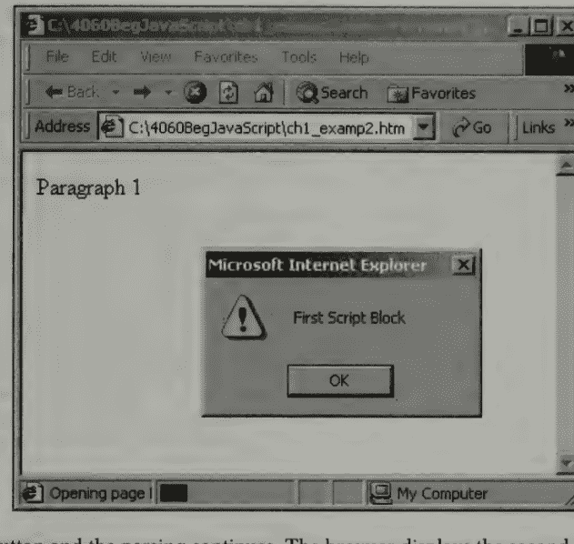

单击“确定”按钮，解析继续。浏览器显示第二个段落，并到达第二个脚本块，该脚本块将背景颜色更改为红色。第二个脚本块还会显示另一个消息框。

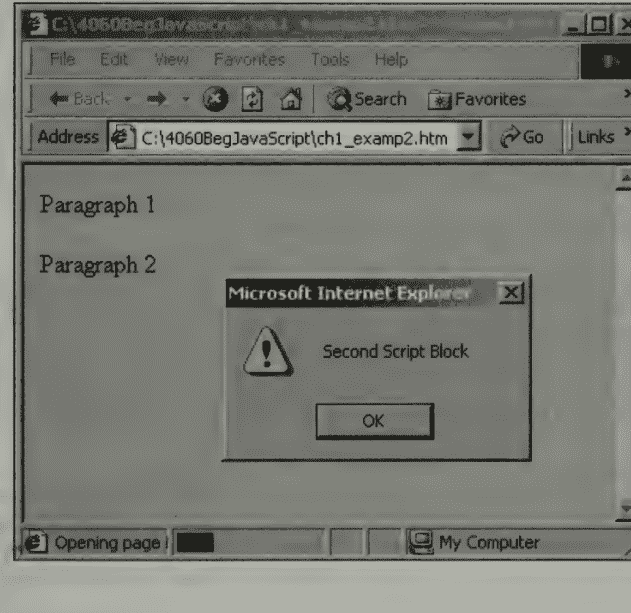

再次单击“确定”，解析继续，显示第三个段落（Paragraph 3）。网页已完成。

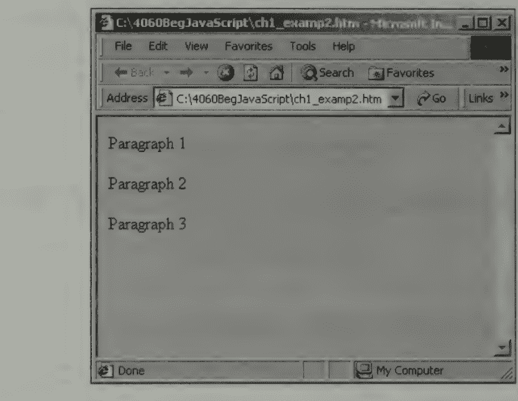

#### 工作原理

页面的第一部分与我们之前的示例相同。页面的背景颜色在`<BODY>`标签的定义中设置为白色，然后将一个段落写入页面：

```
<HTML>
<BODY BGCOLOR="WHITE">

<P>Paragraph 1</P>
```

第一个新部分包含在第一个脚本块中：

```
<SCRIPT LANGUAGE="JavaScript">
    // 脚本块 1
    alert("First Script Block");
</SCRIPT>
```

这个脚本块包含两行，这两行对我们来说都是新的。第一行：

```
// 脚本块 1
```

只是一个**注释**，仅仅是为了我们自己。浏览器将双正斜杠（//）之后的任何内容识别为注释，并且不会对其执行任何操作。它对我们程序员来说很有用，因为我们可以为代码添加解释，以便在以后返回代码时更容易理解我们当时在做什么。


#### JavaScript 与 Web 简介

第二行代码中的 `alert()` 函数对我们来说也是新的。在解释它的作用之前，我们需要先说明什么是**函数**。

我们将在第 3 章中正式定义函数，但目前我们只需将它们视为一些 JavaScript 代码片段，可以用来完成特定的任务。如果你有数学背景，你可能已经对函数有一些概念：它接收一些信息，进行处理，然后给出一个结果。函数让我们程序员的生活更加轻松，因为我们无需考虑函数*如何*完成任务，而只需专注于我们希望在何时让任务执行。

具体来说，`alert()` 函数使我们能够通过显示一个消息框来提醒或通知用户某事。要在消息框中显示的消息写在 `alert()` 函数的括号内，被称为函数的**参数**。

`alert()` 函数显示的消息框是**模态的**。这是一个重要的概念，我们后面还会遇到。它简单地说就是消息框不会消失，直到用户点击 OK 按钮将其关闭。实际上，页面的解析会在使用 `alert()` 函数的那一行暂停，直到用户关闭消息框后才会继续。这对于本例来说非常有用，因为它让我们能够演示截至目前已解析内容的结果：页面颜色已被设为白色，第一段文字已显示。

一旦点击 OK，浏览器会继续解析下方的代码：

```
<P>Paragraph 2</P>

<SCRIPT LANGUAGE="JavaScript">
  // Script block 2
  document.bgColor = "RED";
  alert("Second Script Block");
</SCRIPT>
```

第二段文字显示出来，第二块 JavaScript 代码开始运行。脚本块代码的第一行是另一条注释，所以浏览器会忽略它。第二行代码我们之前在示例中见过——它将页面的背景色改为红色。第三行代码是我们的 `alert()` 函数，它显示第二个消息框。解析会暂停，直到我们点击 OK 关闭消息框。

当我们关闭消息框后，浏览器会继续执行页面中的后续代码，显示第三段文字，最终完成我们的网页。

```
<P>Paragraph 3</P>

</BODY>
</HTML>
```

这个示例引出的另一个重要观点是通过 HTML 设置页面属性（如背景色）与使用 JavaScript 做同样事情之间的区别。使用 HTML 设置属性的方法是**静态的**：值只能设置一次，之后就无法再用 HTML 更改。而使用 JavaScript 设置属性可以让我们动态地更改它们的值。所谓**动态**，我指的是可以更改的事物，其值或外观不是固定不变的。

## 第 1 章

我们的示例仅仅是一个示例。在实践中，如果我们希望页面背景为红色，我们会将 `<BODY>` 标签的 BGCOLOR 属性设为 "RED"，而根本不会使用 JavaScript。我们*确实*想要使用 JavaScript 的地方，是为页面添加某种智能或逻辑。例如，如果用户的屏幕分辨率特别低，我们可能希望更改页面上显示的内容；有了 JavaScript，我们就可以做到这一点。使用 JavaScript 更改属性的另一个原因可能是为了特效，比如让页面从白色渐变到最终颜色。

#### 浏览器与兼容性问题简览

我们在上面的示例中看到，使用 JavaScript 可以通过 document 的 `bgColor` 属性来更改网页文档的背景色。无论你使用的是 Netscape 还是 Microsoft 浏览器，这个示例都能正常工作，原因是这两种浏览器都支持具有 `bgColor` 属性的 document。我们可以说这个示例是**跨浏览器兼容的**。然而，遗憾的是，一种浏览器中可用的属性或语言特性并不总是能在另一种浏览器中使用。有时甚至同一浏览器的不同版本之间也存在这种情况。

> Internet Explorer 和 Netscape Navigator 浏览器的版本号通常用小数表示，例如 Netscape Navigator 有 4.06 版本。在本书中，我们将使用以下术语来指代这些版本。版本 4.x 指的是所有以数字 4 开头的版本。版本 4.0+ 指的是所有大于 4 的版本。

创建基于 Web 的 JavaScript 时主要令人头疼的问题之一，是不同 Web 浏览器之间的差异、它们支持的 HTML 水平，以及其 JavaScript 解释器能处理的功能。你会发现，在一种浏览器中，只需几行代码就能移动一张图片，而在另一种浏览器中，可能需要一整页代码，甚至根本无法实现。某一版本的 JavaScript 包含将文本转为大写的方法，而另一个版本却没有。Microsoft 或 Netscape 浏览器的每一次新发布都会为其 HTML 和 JavaScript 支持添加新的令人兴奋的功能。好消息是，只要运用一点巧思，我们就能编写出同时适用于 Microsoft 和 Netscape 浏览器的 JavaScript。

你希望支持哪些浏览器，实际上取决于你认为大多数网站访问者——也就是你的**用户群**——会使用哪些浏览器。本书面向的是 Internet Explorer 4 及以上版本（IE 4.0+）和 Netscape Navigator 4 及以上版本（NN 4.0+）。

如果我们希望网站显得专业，就需要以某种方式处理旧版浏览器。我们可以确保代码向后兼容，即只使用旧版浏览器中可用的功能。然而，我们也可能决定将自己限制在旧版浏览器的功能范围内根本不值得。在这种情况下，我们需要确保页面能够优雅降级。所谓**优雅降级**，意思是尽管我们的页面无法在旧版浏览器中工作，但它们会以某种方式失败——要么用户根本不会注意到失败，要么用户会收到提醒，得知网站的某些功能与其浏览器不兼容。优雅降级的替代方案是我们的代码弹出大量错误消息、导致页面上显示奇怪的结果，总体让我们看起来像是不知道自己在干什么的傻瓜！

那么我们如何让我们的网页优雅降级呢？你可以使用 JavaScript 在网页部分或完全加载后检查它正在哪个浏览器中运行。我们可以利用这些信息来决定运行哪些脚本，甚至将用户重定向到另一个为充分利用其特定浏览器而编写的页面。在后面的章节中，我们将看到如何检查浏览器版本并采取适当的措施，让你的页面在尽可能多的浏览器上正常显示。

下表列出了 Microsoft 和 Netscape 浏览器支持的不同版本的 JavaScript（和 JScript）。然而，这在某种程度上是一种必要的简化，因为并不存在精确的功能逐一对应兼容性。我们只能指出不同版本的相似程度。此外，正如我们将在第 12 章中看到的，有问题的不只是 JavaScript 支持，还有 HTML 能够被代码修改的程度。

从更积极的角度来看，JavaScript 语言的核心在不同版本之间变化不大；差异大多是有用的额外功能，这些功能有则更好，但往往并非必需。在接下来的几章中，我们将专注于 JavaScript 语言的核心部分。

| 语言版本 | Netscape Navigator 版本 | Internet Explorer 版本 |
| :--- | :--- | :--- |
| JavaScript 1.0（相当于 JScript 1.0） | 2.x | 3.x |
| JavaScript 1.1 | 3.x | - |
| JavaScript 1.2（相当于 JScript 3.0） | 4.0 - 4.05 | 4.x |
| JavaScript 1.3 | 4.06+ | - |
| JavaScript 1.4（相当于 JScript 5.0） | - | 5.x |
| JavaScript 1.5 | 6.0 | - |

#### 知识问答介绍

在本书的过程中，我们将开发一个完整的基于 Web 的应用程序，即知识问答。该知识问答同时适用于 Netscape Navigator 4.0+ 和 Internet Explorer 4.0+ Web 浏览器，充分利用它们的 JavaScript 功能。最初，问答完全扑朔使用 Web 浏览器中的 JavaScript 代码运行，但稍后它还会使用运行在 Web 服务器上的 JavaScript 来访问包含问题的 Microsoft Access 数据库。


 # 第1章

让我们来看看测验最终会是什么样子。主起始屏幕如下所示。在这里，用户可以选择他们想要回答的题目数量，以及是否给自己设定时间限制。使用基于 JavaScript 的计时器，我们可以跟踪他们为自己分配的时间何时用完。

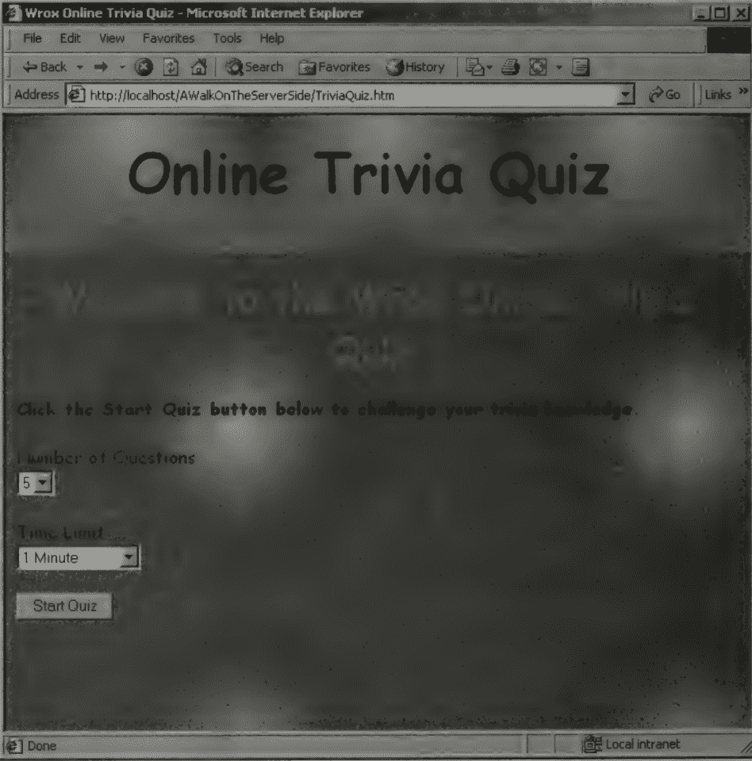

点击"开始测验"按钮后，用户将面对从我们创建的用于存储趣味问答题的数据库中随机抽取的题目。题目有两种类型。第一种如下所示，是基于选择题的形式。我们可以为这类题目指定任意数量的答案选项：JavaScript 会自动处理，无需为每道题编写不同的程序。

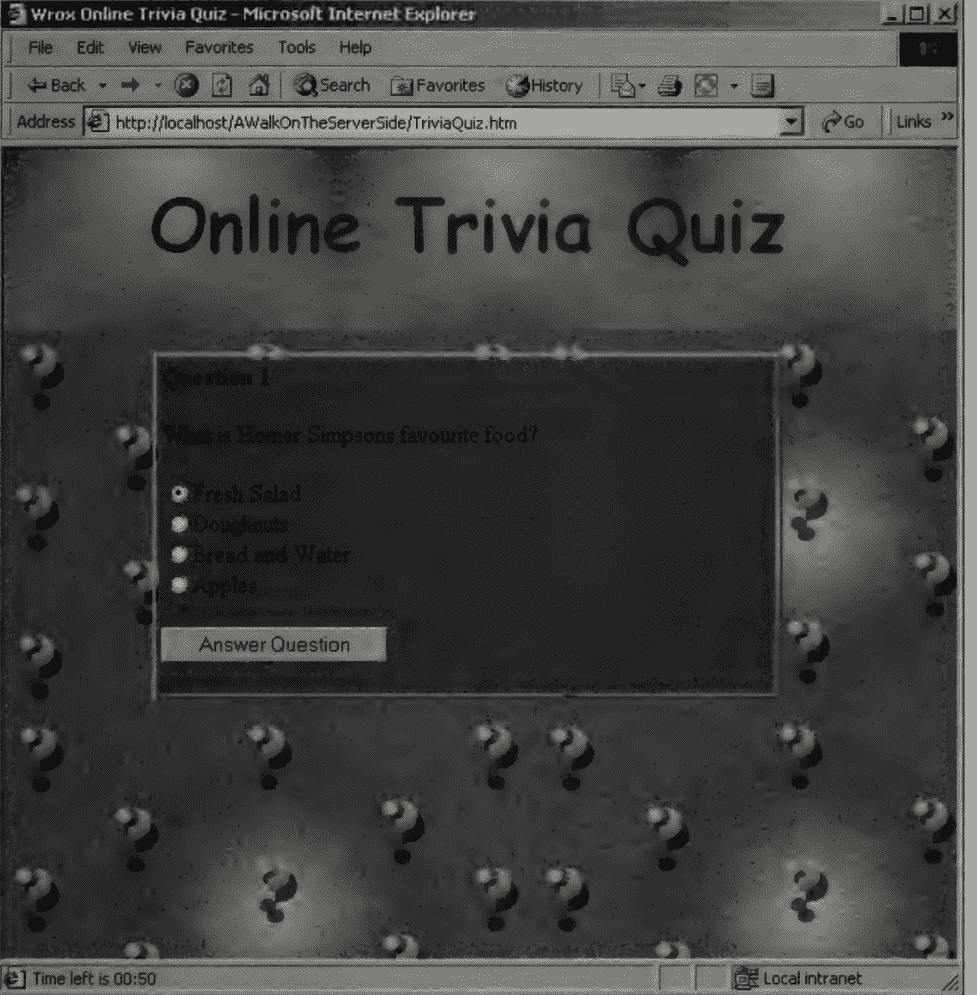

第二种题型是基于文本的。用户将答案输入到提供的输入框中，然后 JavaScript 会尽力智能地解读他们输入的内容。例如，对于下一页显示的题目，我输入了正确答案 Richard Nixon。然而，JavaScript 被编程为同时接受 R. Nixon、Nixon、Richard M. Nixon 等作为正确答案。我们将在第8章关于文本处理的部分了解如何实现。

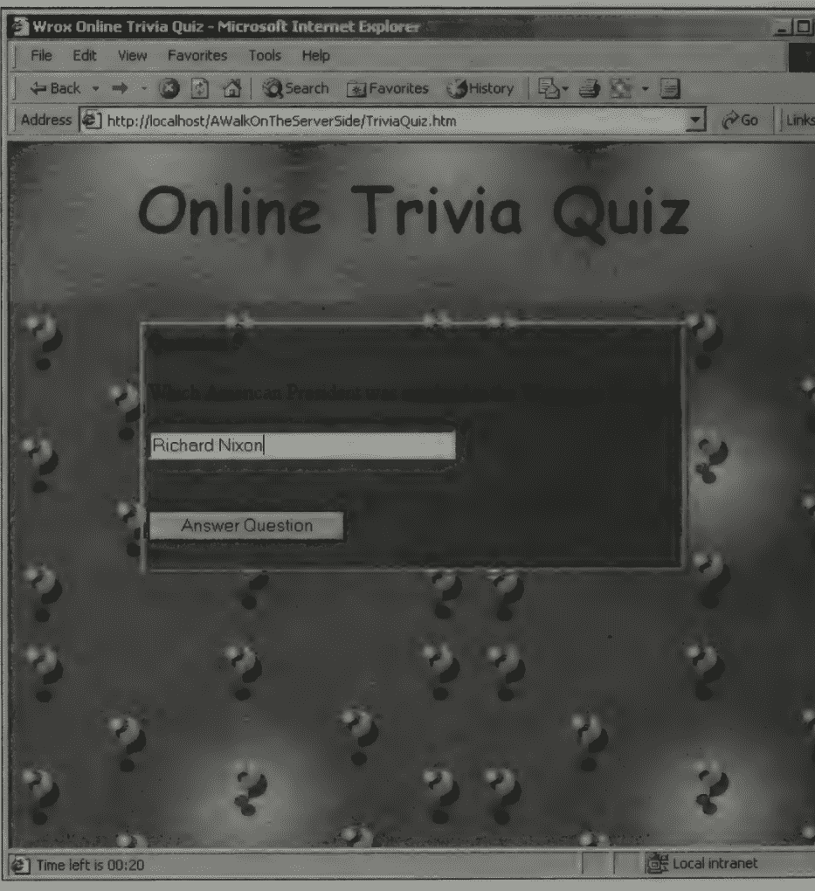

最后，当所有题目都回答完毕后，测验的最终页面会显示用户的结果。该页面还包含两个按钮：一个用于重新开始测验，另一个用于重置当前用户的测验统计数据。


#### 趣味问答测验编码背后的理念

我们已经简要了解了趣味问答测验的最终运行效果，后续章节将介绍实际代码，但值得思考一下其设计和编程背后的指导原则。

我们使用的最重要的概念之一是代码复用。通过反复使用相同的代码，我们节省了时间和精力。在 Web 应用程序中，你经常会发现需要反复执行相同的操作。例如，我们需要多次使用检查问题是否回答正确的代码。你可以创建任意多份代码副本，并在需要的地方将此代码添加到页面中。然而，这会使代码维护变得困难，因为如果需要修正错误或添加新功能，你就需要在许多不同的地方修改代码。当一个 Web 应用程序的代码从一个页面中的几行增长到多个页面中的许多行时，实际上很难跟踪你复制代码的所有位置。因此，考虑到复用性，趣味问答测验将所有需要多次使用的重要代码集中在一个地方。

同样的理念也适用于你使用的任何数据。例如，在趣味问答测验中，我们将已回答的题目数量记录在一个地方，并尽可能在最少的地方更新此信息。

有时你别无选择，只能将重要代码放在多个地方，例如，当你需要的信息只能在特定情况下获取时。然而，如果你能将其保持在一个地方，那么你会发现这样做能使编码更加高效。

在趣味问答测验中，我还尝试将代码拆分为特定的**函数**。我们将在第3章详细讨论 JavaScript 函数。在我们的趣味问答测验中，为我们网页提供随机选择的题目的函数集中在一个地方，无论这是选择题还是纯文本题。这样做不仅只编写一次代码，而且通过将提供相同服务或功能的代码集中在一个地方，也让我们的工作更加轻松。正如你稍后在书中看到的，创建这些不同题型的代码非常不同，但至少将它们放在相同的逻辑位置使查找变得容易。

在创建自己的基于 Web 的应用程序时，你可能会发现将较大的概念（这里是趣味问答测验）拆分为较小的想法很有用。将其分解会使编写代码变得容易得多。你不必面对空白屏幕想着"好了，现在我必须编写一个趣味问答测验"，而是可以想"好了，现在我必须编写一些代码来创建一个问题"。我发现这种技术使编码变得不那么可怕，也更容易开始。这种将代码需求分解为更小、更易管理的部分的方法通常被称为"分而治之"。

让我们以趣味问答测验为例。我们的趣味问答测验应用程序需要完成以下事情：

- 提出问题
- 检索并检查用户提供的答案，看是否正确
- 跟踪已提出了多少问题
- 跟踪用户答对了多少问题
- 如果是限时测验，跟踪剩余时间，并在时间用完时停止测验
- 显示最终摘要，包括已回答题目中正确答案的数量

这些是趣味问答测验的核心要素。可能还有其他你想做的事情，比如跟踪用户访问次数，但这些实际上超出了趣味问答测验的功能范围。

一旦你将整个概念分解为各个逻辑领域，有时值得再次使用"分而治之"技术，将子领域进一步分解为更小的部分，特别是当子领域相当复杂或涉及面广时。作为一个例子，让我们来看上面列表中的"提出问题"项。

提出问题将涉及：

- 从存储位置检索问题数据，例如从数据库中
- 处理数据并将其转换为可以呈现给用户的形式。这里我们需要创建要在网页中显示的 HTML。我们处理数据的方式取决于题目风格：选择题或文本题
- 显示问题供用户回答

随着我们在本书的过程中逐步构建趣味问答测验，我们将更深入地研究其设计以及所使用的一些技巧和策略。当我们遇到每个函数时，我们也会对其进行分解，以明确需要做什么。

#### 我们添加什么功能以及在哪里添加？

我们如何构建趣味问答测验所需的功能？以下列表将让你了解我们添加的内容以及在哪一章中添加。

在第2章中，我们通过定义将要提问的选择题来开始测验。我们使用一种叫做数组的东西来实现，该概念也在该章中介绍。

在第3章中，我们更详细地讨论函数，并在代码中添加一个函数来检查用户是否输入了正确答案。

经过几章理论内容后，在第6章中，我们让测验达到第一个"可用"状态。我们向用户显示问题，并允许用户回答这些问题。

在第7章中，我们通过将测验转变为所谓的"多框架应用程序"来增强测验。我们添加一个按钮供用户点击以开始测验，并规定测验必须在所有题目回答完毕后结束，而不是无限重复题目。

在第8章中，我们将文本题添加到测验中。这些题目与选择题的处理方式略有不同，包括如何向用户展示以及如何检查答案。正如我们上面看到的，测验将接受这些题目的多个不同正确答案。

在第9章中，我们允许用户选择他们希望回答的题目数量，以及是否希望为测验设定时间限制。如果他们选择给自己设定时间限制，我们会在窗口的状态栏中倒计时，并在时间用完时通知他们。

在第11章中，我们将使用 cookie 存储用户之前结果的信息，该概念也在该章中介绍。这使我们能够在测验结束时为用户提供一个平均分。


#### 第 1 章 总结

在这篇关于 JavaScript 的简短介绍中，你应该已经对 JavaScript 是什么以及它能做什么有了初步的了解。具体而言，本章涵盖了以下内容：

- 我们研究了浏览器在解析网页时遵循的流程。它逐行扫描页面（解析），并在遇到 HTML 标签和 JavaScript 代码时对其采取行动。
- 使用 JavaScript 进行 Web 开发时，我们可以选择在两个地方执行代码：服务端（server-side）或客户端（client-side）。客户端本质上是指运行浏览器的端——即用户的机器。服务端是指在 Web 服务器本身上进行的任何处理或存储。
- 与许多编程语言不同，JavaScript 仅需要一个文本编辑器即可开始编写代码。对于初学者来说，像 Windows 记事本这样的工具就足够了，不过随着经验的增加，更强大的工具将证明其价值。
- JavaScript 代码与 HTML 一起嵌入在网页本身中。其存在是通过使用 `<SCRIPT>` 标签来标记的。与 HTML 一样，脚本从页面顶部开始执行并向下运行到页面底部，在触达代码时逐行进行解释和执行。
- 我们介绍了在线琐事测验（online trivia quiz），这是我们在全书过程中将要构建的案例研究。我们探讨了该测验编码背后的一些设计理念，并解释了测验的功能是如何在书中逐步构建起来的。

在线讨论请访问 http://p2p.wrox.com

## 2 数据类型与变量

计算机的主要用途之一是处理和显示信息。所谓的“处理”，是指信息由计算机以某种方式被修改、解释或过滤。例如，在网上银行网站上，客户可能会请求查询上个月账户中所有支出款项的详情。此时，计算机将检索信息，过滤掉任何与上月付款无关的信息，然后将其显示在网页上。在某些情况下，信息在处理后不显示；而在其他时候，信息在获取后不经过处理直接使用。例如，在银行环境中，定期付款可能会在没有任何人为交互或显示的情况下通过电子方式处理并转移。

在计算领域，我们将信息称为**数据**（**data**）。这些数据有各种各样的形式，例如数字、文本、日期和时间等。在本章中，我们将专门研究 JavaScript 如何处理数字和文本等数据。理解数据的处理方式是学习任何编程语言的基础。

本章首先讨论 JavaScript 可以处理的各种数据类型。然后，我们研究如何将这些数据存储在计算机内存中，以便在代码中反复使用。最后，我们将学习如何使用 JavaScript 来操作和处理这些数据。

### JavaScript 中的数据类型

数据可以有许多不同的形式，或者我们称之为**类型**（**types**）。在 JavaScript 处理的数据类型中，有些你在编程之外的世界中就已经熟悉了，例如数字和文本。其他数据类型则较为抽象，用于简化编程，例如对象（object）数据类型，我们将在第 4 章中详细讨论。

一些编程语言是强类型语言。在这些语言中，每当我们使用一段数据时，需要明确声明我们处理的是什么类型的数据，并且对该数据的使用必须遵循适用于其类型的严格规则。例如，我们不能将一个数字和一个单词相加。

另一方面，JavaScript 是一种弱类型语言，它对我们如何使用不同类型的数据要宽容得多。在处理数据时，我们通常不需要指定数据类型；JavaScript 会自行推断。此外，当我们同时使用不同类型的数据时，JavaScript 会在幕后推断我们试图执行的操作。

既然 JavaScript 对数据如此随和，为什么我们还需要讨论数据类型呢？为什么不直接切入正题，在不担心类型的情况下开始使用数据？

首先，虽然 JavaScript 非常擅长推断它处理的数据，但在某些情况下，它可能会出错，或者至少不能按照我们的意愿执行。在这种情况下，我们需要明确告知 JavaScript 我们预期的数据类型及其使用方式。为此，我们首先需要了解一些关于数据类型的知识。

需要了解数据类型的第二个原因是，这能让我们在代码中有效地使用数据。对数据能执行的操作以及你将获得的结果取决于所使用的数据类型，即使我们没有明确指定其类型。因此，尝试将两个数字相乘是有意义的，但对文本执行相同操作则没有。此外，两个数字相加的结果与两个文本相加的结果截然不同。对于数字，我们得到的是它们的和；而对于文本，我们得到的是由其他文本片段拼接而成的一个长字符串。

让我们简要了解一些最常用的数据类型：数值型、文本型和布尔型（Boolean）。我们将在本章稍后部分学习如何使用它们。

### 数值数据

数值数据有两种形式：

- 整数，例如 145，也称为**整型**（**integers**）。这些数字可以是正数或负数，范围非常宽：$-2^{53}$ 到 $2^{53}$。
- 分数/小数，例如 1.234，也称为**浮点数**（**floating-point**）。与整数一样，它们可以是正数或负数，且同样具有巨大的范围。

简单来说，除非你在编写专业的科学应用程序，否则你不会在 JavaScript 中遇到数字大小的问题。此外，虽然在存储时我们可以对整数和浮点数进行区分处理，但 JavaScript 实际上将它们都视为浮点数。它体贴地将这些细节隐藏起来，所以我们无需担心。

### 文本数据

一个或多个文本字符的另一个术语是**字符串**（**string**）。我们只需将文本包含在引号（"）中，即可告诉 JavaScript 该文本应被视为文本而非代码。例如，"Hello World" 和 "A" 都是 JavaScript 能识别的字符串。你也可以使用单引号（'），因此 'Hello World' 和 'A' 同样是 JavaScript 能识别的字符串。但是，你必须以与开始时相同的引号结束字符串。因此，"A' 不是一个有效的 JavaScript 字符串，'Hello World" 同样不是。

如果你想要一个中间带有单引号的字符串，比如 Peter O'Toole 怎么办？如果你用双引号将其包裹，那就没问题，因此 "Peter O'Toole" 能被 JavaScript 识别。然而，'Peter O'Toole' 会导致错误。这是因为 JavaScript 认为你的文本字符串是 Peter O（即，它将中间的单引号视为字符串的结束标记），然后面对剩下的 Toole' 时会不知所措。

另一种解决方法是告诉 JavaScript 中间的 ' 是文本的一部分，而不是表示字符串的结束。你可以使用 `\` 字符来实现，该字符在 JavaScript 中具有特殊含义，被称为**转义字符**（**escape character**）。`\` 告诉浏览器下一个字符不是字符串的结束，而是文本的一部分。因此，'Peter O\'Toole' 将按预期工作。

如果你想在用双引号包裹的字符串中使用双引号怎么办？嗯，我们刚才提到的关于单引号的所有内容同样适用。因此 'Hello "Paul"' 可以工作，但 "Hello "Paul"" 不行。不过，"Hello \"Paul\"" 可以工作。

JavaScript 中还有很多其他无法直接输入但可以使用转义字符与其他字符结合创建的**转义序列**（**escape sequences**）。其背后的原理与 HTML 中使用的一样。例如，HTML 中连续的多个空格会被忽略，所以我们用 `&nbsp;` 表示空格。同样，在 JavaScript 中，有些情况下我们不能直接使用某个字符，而必须使用转义序列。下表详细列出了一些较为实用的转义序列：

| 转义序列 | 代表的字符 |
|---|---|
| \b | 退格 (Backspace) |
| \f | 换页 (Form feed) |
| \n | 换行 (New line) |
| \r | 回车 (Carriage return) |
| \t | 制表符 (Tab) |
| \' | 单引号 |
| \" | 双引号 |
| \\ | 反斜杠 |
| \xNN | NN 是一个十六进制数，用于标识 Latin-1 字符集中的一个字符 |

其中最不直观的是最后一个，它通过 Latin-1 字符集中的字符编号而不是常规外观来表示单个字符。附录 D 包含了完整的 Latin-1 字符集。举个例子：假设我们想在字符串中包含版权符号。我们的字符串应该长什么样？答案是 "\xA9 Paul Wilton"。如果你查看附录表，你会发现版权符号的字符编号是十六进制数 A9，所以这就是我们需要填入的数字。

还有一种类似的方法是使用 Unicode 转义序列来引用字符。不过，这仅在 JavaScript 1.3 及更高版本（即 IE 4.0+ 和 NN 4.06+）中有效。这些序列写成 `\uNNNN`，其中 NNNN 指该特定字符的 Unicode 编号。例如，使用此方法引用版权符号，你会使用 \u00A9。


#### 布尔数据

在现实世界中，使用是或否、正或负、真或假是十分常见的。真与假的概念对于数字计算机本身来说也是基础性的；它们不懂可能，只懂真和假。事实上，"是或否"这一概念非常有用，以至于在 JavaScript 中拥有自己专属的数据类型：**布尔**数据类型。布尔类型有两个可能的值：代表"是"的 `true` 和代表"否"的 `false`。

JavaScript 中布尔数据的用途与编程之外的世界完全相同；它使我们能够回答问题并根据答案做出决策。例如，如果我问你："这本书是关于 JavaScript 的吗？"你大概会回答："是的，它是"，或者你也可能说："对的"。同样，我们可能会说："如果这本书的主题不是 JavaScript 是假的，那就把它放下。"这里我们有一个布尔逻辑语句（以其发明者乔治·布尔命名），它提出一个问题，然后根据答案是真是假来做某件事。在 JavaScript 中，我们可以使用同样的布尔逻辑来赋予程序决策能力。我们将在下一章更详细地探讨布尔逻辑。

#### 变量——在内存中存储数据

数据可以被永久或临时存储。

重要的数据，比如个人银行账户的详细信息，我们希望将其保存在永久存储中。例如，当 Bloggs 女士从她的账户中取出 10 美元或英镑或欧元时，我们想从她的账户中扣除这笔钱，并永久记录新的余额。这类信息可能存储在一个名为**数据库**的东西中。我们将在第 16 章详细讨论数据库。

然而，在其他情况下，我们并不想永久存储数据，而只是临时记录一下。让我们来看一个例子。假设 Bloggs 女士在大坏银行股份有限公司有一笔贷款，她想了解这笔贷款还有多少未偿还。她进入贷款的在线银行页面，点击一个链接来查看她还欠多少钱。这是将会在某处被永久存储的数据。然而，假设我们还提供了一个增加还款额以提前还清贷款的功能。如果 Bloggs 女士在网页的文本框中输入一个增加的还款金额，我们可能想显示贷款将提前多久还清。这将涉及一些可能复杂的计算，所以为了方便起见，我们想编写代码，分几个阶段计算结果，在过程中存储每个阶段的结果，然后提供最终结果。一旦我们完成了计算并显示了结果，就没有必要永久存储每个阶段的结果了，所以与其使用数据库，我们需要使用一种称为**变量**的东西。为什么叫变量呢？嗯，也许是因为变量可以用来存储可以被改变的临时数据。

变量的另一个好处是，与可能保存到磁盘或磁带的永久存储不同，变量保存在计算机的内存中。这意味着存储和检索数据要快得多。

那么，是什么使变量成为临时存储数据的好地方呢？嗯，变量有有限的生命周期。我的意思是，一旦你的访问者关闭页面或跳转到一个新页面，你的变量就会丢失，除非你采取某些措施将它们保存在某处。

每个变量都被赋予一个名称，以便你可以在代码的其他地方引用它。这些名称必须遵循一定的规则。

#### 数据类型与变量

与许多 JavaScript 代码一样，你会发现变量名是区分大小写的。例如，`myVariable` 和 `myvariable` 并不相同。你会发现这是代码中错误很容易潜入的一个非常常见的方式，即使当你成为 JavaScript 专家之后。

变量名也有一些不能使用的特定名称和字符。不能使用的名称称为**保留字**。保留字是 JavaScript 自己使用的词，例如 `var` 这个词或 `with` 这个词，因此留作自己使用。你可以在附录 B 中找到保留字的完整列表。某些字符在变量名中也是禁止使用的。例如，和号（&）和百分号（%）。同样，你可以在附录 B 中找到完整列表。你可以在变量名中使用数字，但名称不能以数字开头。所以 `101myVariable` 不行，但 `myVariable101` 可以。让我们看更多一些例子。

无效名称包括：
- `with`
- `99variables`
- `my%Variable`
- `theGood&theBad`

有效名称包括：
- `myVariable99`
- `myPercent_Variable`
- `the_Good_and_the_Bad`

你可能希望为变量使用一种命名约定，例如描述你计划在变量中保留什么类型的数据。标记变量的方法有很多——没有对错之分，但最好坚持使用其中一种。一种常见的方法是**匈牙利命名法**，其中每个变量名的开头是一个三字母标识符，表示数据类型。例如，我们可以用 `int` 开头表示整数变量名，用 `flt` 开头表示浮点数变量名，用 `str` 开头表示字符串变量名，等等。然而，只要你使用的名称有意义并且一致使用，你用什么真的不重要。

#### 声明变量并赋予它们值

在使用变量之前，你应该使用 `var` 关键字向计算机声明它的存在。这会警告计算机需要预留一些内存，以便稍后存储你的数据。要声明一个名为 `myFirstVariable` 的新变量，你可以这样写：

```javascript
var myFirstVariable;
```

注意，行末的分号不是变量名的一部分，而是用来向 JavaScript 表示一行代码的结束。这一行是一个 JavaScript 语句的示例。

声明后，变量可以用来存储任何类型的数据。正如我们之前所说，许多其他编程语言，称为强类型语言，要求你不仅声明变量，还要声明它将用于存储的数据类型，比如数字或文本。然而，JavaScript 是一种**弱类型**语言；你不需要限制变量可以容纳的数据类型。

你可以将数据放入变量中，这个过程称为**赋值**，通过使用等号（=）。例如，如果你想让你名为 `myFirstVariable` 的变量保存数字 101，你可以这样写：

```javascript
myFirstVariable = 101;
```

当用于给变量赋值时，= 号有一个特殊的名称；它被称为**赋值运算符**。

#### 试一试——声明变量

让我们来看一个例子，我们声明一个变量，在其中存储一些数据，最后访问其内容。我们还将看到变量可以容纳任何类型的数据，而且所容纳的数据类型可以被更改。例如，我们可以先存储文本，然后改为存储数字，而 JavaScript 不会有任何问题。将以下代码输入到你的文本编辑器中，并保存为 ch2_examp1.htm：

```html
<HTML>
<HEAD>
</HEAD>
<BODY>

<SCRIPT LANGUAGE=JavaScript>

var myFirstVariable;

myFirstVariable = "Hello";
alert(myFirstVariable);

myFirstVariable = 54321;
alert(myFirstVariable);

</SCRIPT>

</BODY>
</HTML>
```

一旦你将它加载到网页浏览器中，它应该会显示一个包含 Hello 的警告框。这是变量 `myFirstVariable` 在代码中该点的内容：


点击 OK，另一个警告框出现，里面是 54321。这是我们赋给变量 `myFirstVariable` 的新值。


#### 工作原理

在脚本块中，我们首先声明我们的变量：

```javascript
var myFirstVariable;
```

目前，它的值是未定义的，因为我们只向计算机声明了它的存在，实际上并没有在其中存储任何数据。然而，在下一行中，我们给 `myFirstVariable` 赋予了一个字符串值，即值 "Hello"：

```javascript
myFirstVariable = "Hello";
```

这里我们给变量赋予了一个**字面量**值，即一段实际的数据，而不是通过计算或从另一个变量获得的数据。几乎在任何可以使用字面量字符串或数字的地方，你都可以将其替换为包含数字或字符串数据的变量。我们在下一行代码中看到了一个例子，我们在上一章见过的 alert() 函数中使用了我们的变量 `myFirstVariable`：

```javascript
alert(myFirstVariable);
```

这导致第一个警告框出现。接下来我们在变量中存储一个新值，这次是一个数字：

```javascript
myFirstVariable = 54321;
```

`myFirstVariable` 的先前值将永远丢失。用于存储该值的内存空间被 JavaScript 在一个名为**垃圾回收**的过程中自动释放。每当 JavaScript 检测到变量的内容不再可用时，比如当我们分配一个新值时，它就执行垃圾ience. 午餐后，Tommy 去了图书馆。process_of_management.

#### 用其他变量的值为变量赋值

我们已经看到可以给变量赋予一个数字或字符串，但我们可以用另一个变量中存储的数据来赋值吗？答案是肯定的，非常容易，而且与给变量赋予字面量值的方式完全相同。例如，如果我们已经声明了两个变量 `myVariable` 和 `myOtherVariable`，并且已经给变量 `myOtherVariable` 赋予了值 22，如下所示：

```javascript
var myVariable;
var myOtherVariable;
myOtherVariable = 22;
```

那么我们可以使用以下行将 `myVariable` 赋予与 `myOtherVariable` 相同的值（即 22）：

```javascript
myVariable = myOtherVariable;
```


#### 试一试——将其他变量的值赋给变量

让我们来看另一个示例，这次是将其他变量的值赋给变量。将以下代码输入到你的文本编辑器中，并保存为 ch2_examp2.htm：

```
<HTML>
<BODY>

<SCRIPT LANGUAGE=JavaScript>

var string1 = "Hello";
var string2 = "Goodbye";

alert(string1);
alert(string2);

string2 = string1;

alert(string1);
alert(string2);

string1 = "Now for something different";

alert(string1);
alert(string2);

</SCRIPT>

</BODY>
</HTML>
```

将页面加载到浏览器中，你会看到一系列六个警告框依次出现。每个都点击"确定"以查看下一个。前两个分别显示 string1 和 string2 的值，即 Hello 和 Goodbye。

然后我们将 string1 的值赋给 string2。接下来的两个警告框显示 string1 和 string2 的内容；这次两者都是 Hello。

最后，我们更改 string1 的值。注意 string2 的值不受影响。最后两个警告框显示 string1 的新值（Now for something different）和 string2 的未改变值（Hello）。

#### 工作原理

我们在脚本块中做的第一件事是声明两个变量 string1 和 string2。不过请注意，我们在声明变量的同时就为它们赋值了。这是一种快捷方式，称为**初始化**，可以省去我们输入过多代码的麻烦。

```
var string1 ="Hello";
var string2 = "Goodbye";
```

请注意，我们可以对所有数据类型使用这种快捷方式，而不仅仅是字符串。在接下来的两行中，我们使用 alert() 函数向用户显示每个变量的当前值：

```
alert(string1);
alert(string2);
```

然后，我们将 string1 中存储的值赋给 string2。为了证明赋值确实有效，我们再次使用 alert() 函数向用户显示每个变量的内容：

```
string2 = string1;

alert(string1);
alert(string2);
```

接下来，我们将 string1 设为一个新值：

```
string1 = "Now for something different";
```

这使 string2 保持其当前值，这表明 string2 拥有从上一步从 string1 赋值的数据的独立副本。我们将在后续章节中看到，情况并非总是如此。不过，一般来说，我们发现文本和数字等基本数据类型在赋值时总是被拷贝，而更复杂的数据类型，如我们将在第4章中遇到的对象，实际上是共享而不是拷贝的。例如，如果我们有一个值为字符串 "Hello" 的变量，并用该变量的值为另外五个变量赋值，那么我们现在拥有原始数据和五个独立的数据副本。然而，如果它是一个对象而不是字符串，我们做同样的事情，我们会发现仍然只有一份数据副本，但现在有六个变量共享它。使用六个变量名中的任何一个来更改它，都会对它们所有人都生效。

最后，使用 alert() 函数显示每个变量的当前值：

```
alert(string1);
alert(string2);
```

## 在浏览器中设置错误显示

虽然到目前为止我们的代码相当简单，但在输入时仍然有可能出错。当我们开始研究更复杂、更详细的代码时，这将会越来越成为问题。因此，在继续探讨如何使用存储在变量中的数据之前，这似乎是一个好时机来讨论如何确保浏览器向我们显示代码中出现的任何错误，以便我们去修正它们。

当你在浏览其他人的网站时，可能不会对他们代码中的错误感兴趣。在这种情况下，我们很可能会想办法关闭浏览器中错误对话框的显示。然而，作为 JavaScript 程序员，我们希望了解网页中错误的所有细节；这样我们可以在别人发现之前修复它们。因此，重要的是要确保我们用于测试网站的浏览器已正确配置，以显示错误及其详细信息。在本节中，我们将要做的就是这件事。

### 在 Netscape Navigator 中显示错误

在 Netscape Navigator 中显示错误的方式取决于你安装的版本。

如果你使用的是 NN 4.0 – 4.05，那么错误消息会在弹出的对话框中显示. 这应该是默认设置。

如果你使用的是 NN 4.06+，则可以使用 JavaScript 控制台。该控制台允许你"交互"处理错误——我们将此功能的进一步讨论留到第10章。

要设置 JavaScript 控制台在发生错误时自动出现，你需要通过修改偏好设置文件 `prefs.js` 来设置显示错误的偏好：

- 1. 确保 Navigator 没有运行。如果正在运行，那么当你编辑偏好设置文件时，它可能会覆盖你的更改。
- 2. 使用文本编辑器（如记事本）打开 `prefs.js`。偏好设置文件位于用户自己目录下的 `Netscape/Users` 目录中。例如，对于 Windows NT 上的 NN 4.7，你可以在以下位置找到 `prefs.js`：
  `<Netscape 路径>\Users\<用户名>`
  以防万一，在更改之前将该文件备份一份保存到其他地方可能是个好主意。
- 3. 在 `prefs.js` 文件的底部添加以下行：
  `user_pref("javascript.console.open_on_error", true);`
- 3. 保存并关闭 `prefs.js` 文件。

另一种打开 JavaScript 控制台的方法是在 Netscape 浏览器的位置框中输入 `javascript:`。

不过，在撰写本文时，这两种方法在 Netscape 6 上都不起作用。在此浏览器上，你需要从"工具"菜单中选择"工具"，然后选择 JavaScript 控制台选项。

### 在 Internet Explorer 中显示错误

通常情况下，IE 默认会使用对话框来显示 JavaScript 错误。

但是，有可能关闭了此类错误的显示，在这种情况下，我们需要遵循几个简单的步骤来重新启用错误显示。

#### 数据类型和变量

首先打开 Internet Explorer，从"工具"菜单中选择"Internet 选项"：

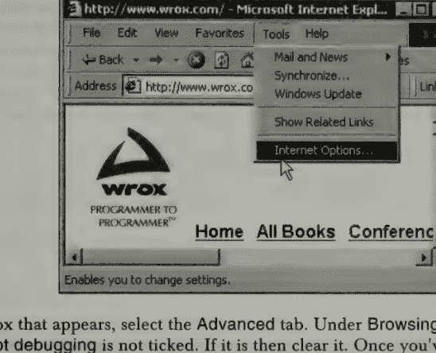

在出现的对话框中，选择"高级"选项卡。在"浏览"下，确保"禁用脚本调试"旁边的复选框未被勾选。如果已勾选，则取消勾选。完成此操作后，点击"确定"按钮关闭对话框。

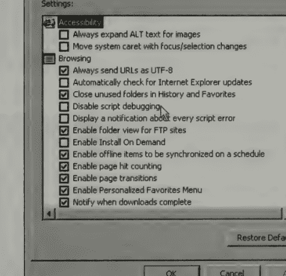

好的，现在我们已经设置好了错误消息的显示，让我们看看当代码中出现错误时实际会发生什么。

#### 发生错误时会发生什么

正如我们在上一节中提到的，在变量名中使用保留字将会导致浏览器中的 JavaScript 错误。然而，显示的错误消息可能不会立即有帮助。它可能不会指出你在声明变量时使用了保留字。让我们看看在这种情况下你可能会看到什么样的错误消息。请注意，这些错误消息也可能由与变量命名无关的其他错误产生，这有时会让人感到困惑。我们将在本书后面讨论这些其他错误，实际上，整个第10章都致力于发现和修复错误。

假设我们尝试定义一个名为 with 的变量，如下所示：

```
var with;
```

with 这个词在 JavaScript 中是保留的。我们会看到什么错误？

如果你在 Netscape 浏览器中加载该页面，并且该浏览器使用对话框来显示错误，你会看到类似以下内容：

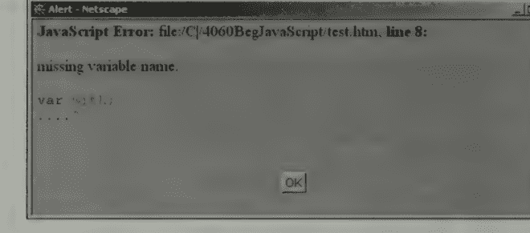

在 NN 中使用 JavaScript 控制台显示同一错误时，会产生类似以下内容：

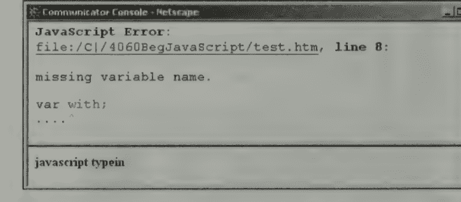

在 Internet Explorer 中，同一错误可能产生的不同对话框数量更令人困惑。这些消息取决于你安装的 Internet Explorer 版本，以及你是否安装了其他组件，如 Microsoft 脚本调试器，我们将在第10章中看到它的使用。


#### 数据类型与变量

例如，将保留字用作变量名会产生一条错误消息，提示需要一个标识符。在我的安装了Microsoft Visual Studio的机器上，我看到的错误消息对话框如下所示：

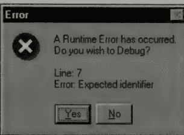

如果你安装了Microsoft提供的脚本调试器组件，也会看到上面显示的对话框。无论你使用的是IE 4还是IE 5，都会出现此消息框。

然而，如果你使用的是IE 5，并且没有安装Visual Studio或脚本调试器，那么你看到的错误对话框可能与下面类似：

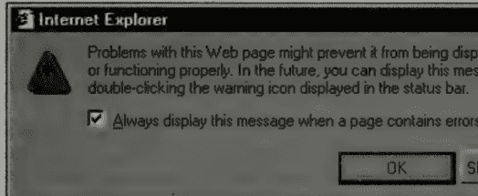

我们确实想知道出了什么问题，以便修复我们的脚本。为此，请单击“显示详细信息”按钮，它将告诉你错误的位置和性质：

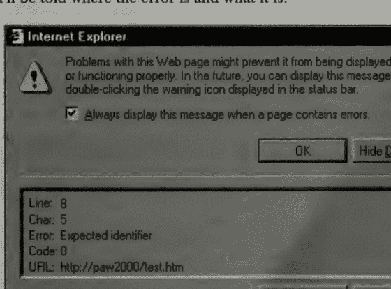

如果你使用的是IE 5，并且没有看到上述任何错误消息，请不要惊慌。在浏览器的状态栏（通常在浏览器窗口底部），你会注意到一个小黄三角，里面有一个感叹号。双击黄三角，错误消息对话框就会出现。


最后，如果你安装的是IE 4并且没有脚本调试器，那么你会看到一个像下面这样的简单对话框弹出：

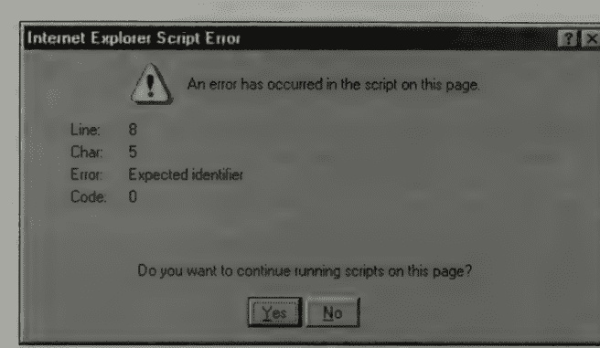

> 在本书的其余部分，我将展示安装了脚本调试器的Internet Explorer 5的错误对话框消息。但请记住，无论你的对话框看起来怎样，只要你得到了错误发生及其原因的提示，这就无关紧要。

#### 使用数据——计算与基本字符串操作

现在我们已经了解了如何处理错误，可以回到本章的主题：数据及其使用。我们已经看到了如何声明变量以及它们如何存储信息，但到目前为止我们还没有真正有效地利用这一点——那么，我们究竟为什么需要使用变量呢？

变量允许我们做的是临时保存信息，这些信息可以用于数学计算、构建文本消息或处理用户输入的词语等。变量有点像普通袖珍计算器上的内存存储按钮。假设你在核算财务。你可能首先将所有需要支出的款项加起来，然后将其存储在临时内存中。一旦你将所有收入加总，就可以从内存中扣除存储的金额来计算剩余多少。变量可以以类似的方式使用；我们可以首先获取必要的用户输入并将其存储在变量中，然后我们可以使用获得的值进行计算。

在本节中，我们将看到如何将存储在变量中的值有效地用于数值计算和基于文本的操作。

## 数值计算

JavaScript具有一系列基本的数学能力，如加法、减法、乘法和除法。每个基本数学函数都由一个符号表示，分别是 +, -, *, 和 /。我们称这些符号为**运算符**，因为它们对给定的值进行运算。换句话说，它们执行某种计算或操作并返回结果。你可以在几乎所有使用数字或变量的地方使用这些计算的结果。

让我们想象一下，我们正在计算购物清单上物品的总价值。我们可以将计算写为：

购物总成本 = 10 + 5 + 5

或者，如果我们实际计算总和，则是：

购物总成本 = 20

现在让我们看看如何在JavaScript中执行此操作。实际上，这非常相似，只是我们需要使用一个变量来存储最终总和：

```
var TotalCostOfShopping;
TotalCostOfShopping = 10 + 5 + 5;
alert(TotalCostOfShopping);
```

首先，我们声明了一个变量`TotalCostOfShopping`来保存总成本。

在第二行，我们有代码`10 + 5 + 5`。这段代码被称为一个**表达式**。当我们给变量`TotalCostOfShopping`赋以这个表达式的值时，JavaScript会自动计算表达式的值（20）并将其存储在变量中。你会注意到我们使用了`=`号来告诉JavaScript将计算结果存储在`TotalCostOfShopping`变量中。我们称之为将计算值**赋给**变量，这就是为什么单等号（`=`）被称为**赋值运算符**。

最后，我们在警告框中显示变量的值。

用于减法和乘法的其他运算符，`-`和`*`，工作原理完全相同。除法有点不同，用正斜杠字符`/`表示。

### 动手试试——计算

让我们看一个使用除法运算符的例子，看看它是如何工作的。输入以下代码并将其保存为`ch2_examp3.htm`：

```
<HTML>
<BODY>
<SCRIPT LANGUAGE=JavaScript>
var firstNumber = 15;
var secondNumber = 10;
var answer;
answer = 15 / 10;
alert(answer);

alert(15 / 10);

answer = firstNumber / secondNumber;
alert(answer);

</SCRIPT>

</BODY>
</HTML>
```

将其加载到你的Web浏览器中。你应该会看到连续三个警告框，每个都包含值1.5。这些值是三个计算的结果。

#### 工作原理

我们在脚本块中做的第一件事是声明我们的三个变量，并为前两个变量赋值，这些值我们稍后会用到：

```
var firstNumber = 15;
var secondNumber = 10;
var answer;
```

接下来，我们将answer变量设置为表达式15/10的计算结果。我们在一个警告框中显示这个变量的值：

```
answer = 15 / 10;
alert(answer);
```

如果你在想，“为什么不直接将answer变量设置为1.5”，那么我同意你的看法。这个例子演示了一种计算方式，但实际上你几乎永远不会这样做。

为了证明我们可以在使用数字或变量的地方使用表达式，我们通过将其包含在`alert()`函数中来直接显示15/10的计算结果：

```
alert(15 / 10);
```

最后，我们执行相同的计算，但这次使用我们的两个变量`firstNumber`（设置为15）和`secondNumber`（设置为10）。我们使用表达式`firstNumber / secondNumber`，将其结果存储在我们的`answer`变量中。然后，为了证明它都成功了，我们使用我们的朋友`alert()`函数显示`answer`中包含的值：

```
answer = firstNumber / secondNumber;
alert(answer);
```

#### 数据类型与变量

大多数计算将使用上面显示的第三种方式，即使用变量，或数字和变量，并将结果存储在另一个变量中。这样做的原因是，如果计算使用的是字面值——实际值，例如15 / 10——那么我们不如直接将计算结果编入程序，而不是强迫JavaScript为我们计算。例如，与其写15 / 10，不如直接写1.5。毕竟，我们强迫JavaScript做的计算越多，它的工作量就越大，速度就越慢，尽管承认一次计算不会给它带来太大负担。

使用结果而非计算的另一个原因是它使代码更具可读性。你更愿意在代码中阅读哪个，是1.5 * 45 – 56 / 67 + 2.567，还是69.231？更好的是，一个命名的变量，例如`PricePerKG`，对于不熟悉代码的人来说，会使代码更容易理解。

#### 递增和递减运算符

使用上述数学运算符有许多操作是如此常用，以至于它们被赋予了自己的运算符。我们要在这里讨论的两个是**递增**和**递减**运算符，分别由++和--表示。基本上，它们所做的是将变量的值增加或减少一。我们可以使用普通的+和-运算符来做到这一点，例如：

```
myVariable = myVariable + 1;
myVariable = myVariable - 1;
```

（请注意，我们可以为变量赋予一个涉及其先前值的表达式结果的新值。）然而，使用递增和递减运算符可以将其缩短为：

```
myVariable++;
myVariable--;
```

结果是相同的——`myVariable`的值增加或减少一——但代码更短。一旦你熟悉了语法，这就会变得非常清晰易懂。

现在，你很可能在想这些运算符听起来像戳眼睛一样有用。然而，在下一章中，当我们研究如何多次运行相同的代码时，我们将看到这些运算符非常有用且被广泛使用。事实上，`++`运算符被如此广泛地使用，以至于他们以它命名了一种计算机语言，C++。这里的“笑话”是C++比C更进一步（好吧，这就是程序员的幽默了！）

递增和递减运算符通常单独使用，但可以在表达式中与其他运算符一起使用`++`和`--`运算符。例如：

```
myVar = myNumber++ - 20;
```

将变量`myNumber`递增一，然后从中减去20，再将结果赋给变量`myVar`。然而，通常最好避免这种语法，因为它使代码更难阅读，并可能导致难以察觉的错误。

在我们继续之前，现在似乎是一个介绍另一个运算符`+=`的好时机。这个运算符可以用作增加变量所保存值的一种快捷方式，增加一个设定的量。例如：

```
myVar += 6;
```

与以下内容完全相同：

```
myVar = myVar + 6;
```


#### 运算符优先级

我们看到，执行某些功能的符号，例如将两个数字相加的+，以及从一个数字中减去另一个数字的-，被称为运算符。与人类不同，并非所有运算符都是平等的；有些具有更高的**优先级**——也就是说，它们会先被处理。通过一个简单的例子可以快速说明我的观点：

```html
<HTML>
<BODY>
<SCRIPT LANGUAGE=JavaScript>

var myVariable;

myVariable = 1 + 1 * 2;

alert(myVariable);

</SCRIPT>
</BODY>
</HTML>
```

如果你输入这段代码，你期望警告框显示myVariable的值是多少？你可能会预期，由于1 + 1 = 2，而2 * 2 = 4，答案是4。实际上，你会发现警告框显示myVariable中存储的计算结果是3。这是为什么呢？JavaScript难道不会正确计算吗？

其实，从你的数学知识中你可能已经知道原因了。JavaScript进行计算的方式是首先计算1 * 2 = 2，然后将这个结果用于加法，这样JavaScript最后完成的是1 + 2 = 3。

为什么？因为*的优先级高于+。=符号也是一个运算符（叫做赋值运算符），它的优先级最低——总是被留到最后处理。

+和-运算符具有相等的优先级，那么哪一个先执行呢？JavaScript从左到右进行计算，所以如果在计算中存在优先级相同的运算符，就按照它们从左到右出现的顺序进行计算。同样的规则适用于*和/，它们的优先级也是相等的。

让我们来看一个更复杂的例子——一个华氏度到摄氏度的转换器。（摄氏度是摄氏温标的另一个名称。）输入以下代码并保存为ch2_examp4.htm：

```html
<HTML>
<BODY>
<SCRIPT LANGUAGE=JavaScript>

// Equation is °C = 5/9 (°F - 32).
var degFahren = prompt("Enter the degrees in Fahrenheit", 50);
var degCent;

degCent = 5/9 * (degFahren - 32);

alert(degCent);

</SCRIPT>
</BODY>
</HTML>
```

如果你在浏览器中加载这个页面，应该会看到一个提示框，要求你输入要转换的华氏度。默认值50已经预先填入：

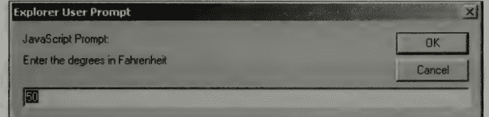

如果你保持50不变并点击OK按钮，会出现一个显示数字10的警告框。这表示50华氏度转换为摄氏度的结果。

重新加载页面，尝试改变提示框中的值，看看得到什么结果。例如，将值改为32并重新加载页面。这次你应该看到0出现。

#### 工作原理

脚本块的第一行是注释，因为它以两个斜杠（//）开头。它包含了将华氏度转换为摄氏度的公式，放在示例代码中仅供参考：

```javascript
// Equation is °C = 5/9 (°F - 32).
```

我们的任务是使用JavaScript代码表示这个公式。我们从声明变量degFahren和degCent开始。

```javascript
var degFahren = prompt("Enter the degrees in Fahrenheit", 50);
var degCent;
```

我们没有将degFahren变量初始化为字面量值，而是使用`prompt()`函数从用户那里获取一个值。`prompt()`函数的工作方式类似于`alert()`函数，除了显示消息外，它还包含一个文本框，用户可以在其中输入一个值。正是这个值将被存储在degFahren变量中。

我们向`prompt()`函数传递两条信息：

- 要显示的文本——通常是提示用户输入的问题
- 提示对话框首次出现时输入框中包含的默认值

这两条信息必须按给定顺序指定，并用逗号分隔。如果你不希望提示框打开时输入框中显示默认值，应该对第二条信息使用空字符串（""）。

如上面的代码所示，我们的文本是"Enter the degrees in Fahrenheit"，输入框中的默认值是50。

接下来是脚本块中用JavaScript表示的公式。我们将公式的结果存储在`degCent`变量中。你可以看到JavaScript看起来与我们注释中的公式非常相似，只是我们使用`degFahren`代替了°F，用`degCent`代替了°C。

```javascript
degCent = 5/9 * (degFahren - 32);
```

等号右边表达式的计算引出了一些重要的要点。首先，正如数学中一样，JavaScript公式是从左到右读取的，至少对于+、-等基本数学函数是这样的。其次，正如我们之前看到的，正如数学中有优先级一样，JavaScript中也有。

从左开始，JavaScript首先计算5/9 = .5555（约）。然后遇到乘法，但是等等……我们公式的最后一部分degFahren - 32，是在括号里的。这提高了优先级顺序，使JavaScript在进行乘法之前先计算degFahren - 32的结果。例如，当degFahren设置为50时，(degFahren - 32) = (50 - 32) = 18。现在JavaScript进行乘法运算，.5555 * 18，结果是10。

如果我们不使用括号会怎样？那么我们的代码将是：

```javascript
degCent = 5/9 * degFahren - 32;
```

5/9的计算保持不变，但JavaScript接下来会计算乘法，5/9 * degFahren。这是因为乘法的优先级高于减法。当degFahren为50时，这相当于5/9 * 50 = 27.7778。最后JavaScript会减去32，得到结果为-4.2221；这不是我们想要的答案！

最后，在我们的脚本块中，我们使用`alert()`函数显示答案：

```javascript
alert(degCent);
```

这结束了我们对JavaScript基本计算的简要介绍。然而，在第四章中，我们将了解**Math对象**，它使我们能够进行更复杂的计算，如求余弦、平方根等等。

## 基本字符串操作

在之前的章节中，我们了解了文本或字符串数据类型，以及数值数据。正如数值数据有相关的运算符一样，字符串也有运算符。在本节中，我们将介绍使用这些运算符的一些基本字符串操作技术。我们将在第四章中更深入地介绍字符串，并在第八章中介绍高级字符串处理。

在JavaScript中，你会发现自己反复做的一件事是将两个字符串连接成一个字符串——这个过程被称为**连接**。例如，我们可能想要连接两个字符串"Hello "和"Paul"，形成字符串"Hello Paul"。那么如何进行连接呢？很简单！我们使用+运算符。回想一下，当应用于数字时，+运算符将它们相加，但当用于两个字符串的上下文中时，它会将它们连接在一起。

```javascript
var concatString = "Hello " + "Paul";
```

现在存储在变量concatString中的字符串是"Hello Paul"。注意字符串"Hello "的最后一个字符是一个空格——如果我们漏掉了这个，那么我们的连接字符串就会变成"HelloPaul"。

### 动手尝试——连接字符串

让我们来看一个使用+运算符进行字符串连接的例子。输入以下代码并保存为ch2_examp5.htm。

```html
<HTML>
<BODY>

<SCRIPT LANGUAGE=JavaScript>

var greetingString = "Hello";
var myName = prompt("Please enter your name", "");
var concatString;

document.write(greetingString + " " + myName + "<BR>");

concatString = greetingString + " " + myName;

document.write(concatString);

</SCRIPT>

</BODY>
</HTML>
```

如果你在网页浏览器中加载它，首先会看到一个要求你输入名字的提示框。

输入你的名字并点击OK按钮。你应该会看到网页上显示两次问候语和你的名字。

#### 工作原理

我们从声明三个变量开始脚本块。我们将第一个变量`greetingString`设置为字符串值。第二个变量`myName`被赋值为用户在提示框中输入的内容。第三个变量`concatString`，我们在这里没有初始化。它将用于存储稍后我们在代码中进行连接的结果：

```javascript
var greetingString = "Hello";
var myName = prompt("Please enter your name", "");
var concatString;
```

在上一章中，我们看到网页是如何由单词`document`表示的，以及它有一些不同的属性如`bgColor`。我们还可以使用`document`直接将文本和HTML写入页面本身。我们通过使用单词`document`，后跟一个点，然后是`write()`来实现。然后我们像使用`alert()`函数一样使用`document.write()`，即将我们希望在网页中显示的文本放在write后面的括号内。现在不要太担心这个，因为第四章会详细解释。然而，我们现在在代码中使用`document.write()`来将一个表达式的结果写入页面：

```javascript
document.write(greetingString + " " + myName + "<BR>");
```

写入页面的表达式是`greetingString`变量的值、一个空格（" "）、`myName`变量的值以及HTML `<BR>`标签的连接。例如，如果我在提示框中输入Paul，这个表达式的值将是：

Hello Paul\<BR\>

在下一行代码中，我们有一个类似的表达式。这次它只是变量`greetingString`的值、一个空格和变量`myName`的值的连接。我们将这个表达式的结果存储在变量`concatString`中。最后，我们使用`document.write()`将变量`concatString`的内容写入页面：

```javascript
concatString = greetingString + " " + myName;
document.write(concatString);
```

#### 混合数字和字符串

如果我们想在表达式中混合文本和数字怎么办？一个典型的例子就是我们之前看到的温度转换器。在那个例子中，我们只显示数字而没有告诉用户它实际代表什么。我们真正想做的，是将描述性文本包裹在数字周围进行显示，例如"The value converted to degrees centigrade is 10"。

混合数字和文本实际上非常容易。我们可以简单地使用`+`运算符将它们连接在一起。JavaScript足够智能，知道当字符串和数字同时出现时，我们不是想进行数值计算，而是想将数字视为字符串并将其连接到文本上。例如，要将文本`My age is`和数字`101`连接在一起，我们可以简单地这样做：

```javascript
alert("My age is " + 101);
```

这会产生一个内部包含`My age is 101`的警告框。


#### 数据类型与变量

#### 动手试一试——让用户友好的温度转换器

我们可以在温度转换器示例中尝试这种连接字符串和数字的技术。我们将输出一些说明文字以及转换计算的结果。我们需要做的修改非常小，所以请在文本编辑器中打开 `ch2_examp4.htm`，并修改下面所示的行。然后将其另存为 `ch2_examp6.htm`。

```
<HTML>
<BODY>

<SCRIPT LANGUAGE=JavaScript>

// 公式为 °C = 5/9 (°F - 32)。

var degFahren = prompt("Enter the degrees in Fahrenheit",50);
var degCent;

degCent = 5/9 * (degFahren - 32);

alert(degFahren + "\xB0 Fahrenheit is " + degCent + "\xB0 centigrade");

</SCRIPT>

</BODY>
</HTML>
```

在网页浏览器中加载此页面。在提示框中单击“确定”提交值 50，这次你应该看到：

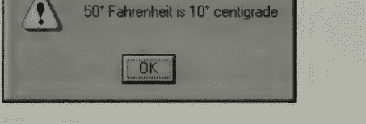

#### 工作原理

此示例与上面的 `ch2_examp4.htm` 完全相同，只有一行不同：

```
alert(degFahren + "\xB0 Fahrenheit is " + degCent + "\xB0 centigrade");
```

因此，我们只在这里看这一行。你可以看到 `alert()` 函数包含一个表达式。让我们更仔细地看看这个表达式。

首先，我们有变量 `degFahren`，它包含数字数据。我们将其连接到字符串 `"\xB0 Fahrenheit is "`。JavaScript 识别出你是在将一个数字和一个字符串相加，它明白你希望将它们连接成一个字符串，而不是尝试求和，因此会自动将 `degFahren` 中包含的数字转换为字符串。接下来，我们将此字符串连接到包含数字数据的变量 `degCent`。同样，JavaScript 会将此变量的值转换为字符串。最后，我们将字符串 `"\xB0 centigrade"` 连接起来。

还要注意，我们使用了一个转义序列在字符串中插入度数符号。你应该还记得本章前面的内容，`\xNN` 可用于插入无法直接键入的特殊字符。请记住，*NN* 是代表拉丁-1 字符表中某个字符的十六进制数（有关更多详细信息，请参见附录 D）。因此，当 JavaScript 在字符串中发现 `\xB0` 时，它不会显示这些字符，而是查找 B0 代表什么字符，然后显示该字符。

> 使用特殊字符时需要注意的一点是，它们不一定跨平台兼容。虽然我们可以在 Windows 计算机上使用 `\xNN` 表示某个字符，但可能会发现它在 Apple Mac 或 Unix 机器上是另一个字符。我们将在第 4 章中看到如何检测用户使用的操作系统，并利用此信息确保我们的代码能在不同操作系统上工作。

我们将在第 4 章中查看更多字符串操作技术——我们将看到如何搜索字符串以及在字符串中间插入字符。

#### 数据类型转换

正如我们在上面看到的，如果你将一个字符串和一个数字相加，JavaScript 会做出明智的选择，将数字转换为字符串，然后连接两者。通常，JavaScript 有足够的智能在需要时进行此类数据类型转换，但有些情况下我们需要自己转换数据的类型。例如，在某些情况下，我们可能会得到一段字符串数据，而我们希望将其视为数字。在使用表单从用户收集数据的情况下尤其如此。用户输入的任何值都被视为字符串，即使它们可能包含数字数据，例如用户的年龄。

为什么更改数据类型如此重要？考虑以下情况：我们使用表单从用户那里收集两个数字，并希望计算它们的和。这两个数字以字符串的形式提供给我们，例如 `"22"` 和 `"15"`。当我们尝试使用 `"22" + "15"` 计算这些值的和时，我们得到的结果是 `"2215"`，因为 JavaScript 认为我们试图连接两个字符串，而不是试图求两个数字的和。

在本节中，我们将介绍两个将字符串转换为数字的转换函数：`parseInt()` 和 `parseFloat()`。

首先看看 `parseInt()`。此函数将接受一个字符串并将其转换为整数。这个名称一开始可能有点令人困惑——为什么是 `parseInt()` 而不是 `convertToInt()`？这个名称的主要原因在于该函数的工作方式。它实际上会遍历（即解析）你要求它转换的字符串的每个字符，并检查它是否是有效的数字。如果有效，`parseInt()` 就使用它来构建数字；如果无效，该命令就停止转换，并返回它已转换的数字。

例如，如果你的代码是 `parseInt("123")`，那么 JavaScript 会将字符串 `"123"` 转换为数字 123。对于代码 `parseInt("123abc")`，JavaScript 也会返回数字 123。当 JavaScript 解释器遇到字母 a 时，它假设数字已经结束，并将 123 作为字符串 `"123abc"` 的整数版本返回。

`parseFloat()` 函数的工作方式与 `parseInt()` 相同，只是它返回浮点数（即小数），并且在它转换的字符串中，小数点被视为允许的数字的一部分。

#### 动手试一试——将字符串转换为数字

让我们看一个使用 `parseInt()` 和 `parseFloat()` 的示例。输入以下代码并将其保存为 `ch2_examp7.htm`：

```
<HTML>
<BODY>

<SCRIPT LANGUAGE=JavaScript>

var myString = "56.02 degrees centigrade";
var myInt;
var myFloat;

document.write("\"" + myString + "\" is " + parseInt(myString) +
    " as an integer" + "<BR>");

myInt = parseInt(myString);
document.write("\"" + myString + "\" when converted to an integer equals " +
    myInt + "<BR>");

myFloat = parseFloat(myString);
document.write("\"" + myString +
    "\" when converted to a floating point number equals " + myFloat);

</SCRIPT>

</BODY>
</HTML>
```

在浏览器中加载它，你会看到网页中写有三行，如下所示：

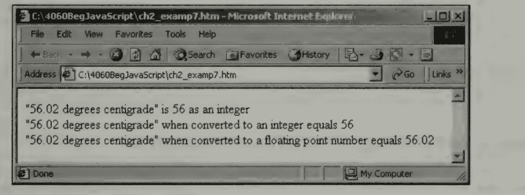

#### 工作原理

脚本块中的第一个任务是声明一些变量。声明了变量 `myString` 并将其初始化为我们想要转换的字符串。在这个示例中，我们本可以轻松地直接使用字符串，而不是将其存储在变量中，但在实践中你会发现，你使用变量的次数比使用字面值更多。我们还声明了变量 `myInt` 和 `myFloat`，它们将保存转换后的数字：

```
var myString = "56.02 degrees centigrade";
var myInt;
var myFloat;
```

接下来，我们将 `myString` 转换后的整数值写入页面，并显示在一个使用字符串连接构建的用户友好句子中。注意，我们使用了转义序列 `\"` 在我们要转换的字符串周围显示引号 (`"`)。

```
document.write("\"" + myString + "\" is " + parseInt(myString) +
  " as an integer" + "<BR>");
```

正如你所看到的，你可以在使用数字本身或包含数字的变量的相同位置使用 `parseInt()` 和 `parseFloat()`。实际上，在这一行中，JavaScript 解释器进行了两次转换。首先，它将 `myString` 转换为整数，因为这是我们通过使用 `parseInt()` 所要求的。然后，它自动将该整数转换回字符串，以便它可以与其他字符串连接起来组成我们的句子。还要注意，在处理整数时，`myString` 变量值的只有 `56` 部分被视为有效数字。`6` 之后的任何内容都被视为无效并忽略。

接下来，我们使用 `parseInt()` 对 `myString` 进行相同的转换，但这次将结果存储在 `myInt` 变量中。在下一行中，我们在显示给用户的文本中使用此结果。

```
myInt = parseInt(myString);
document.write("\"" + myString + "\" when converted to an integer equals " +
  myInt + "<BR>");
```

同样，尽管 `myInt` 持有一个数字，但 JavaScript 解释器知道，当涉及字符串和数字时，`+` 意味着我们希望将 `myInt` 的值转换为字符串并连接到字符串的其余部分，以便可以显示。

最后，我们使用 `parseFloat()` 将 `myString` 中的字符串转换为浮点数，我们将其存储在变量 `myFloat` 中。这一次，小数点被视为数字的有效部分，因此 `2` 之后的任何内容都被忽略。我们再次使用 `document.write()` 将结果写入网页中的一个用户友好字符串：

```
myFloat = parseFloat(myString);
document.write("\"" + myString +
  "\" when converted to a floating point number equals " + myFloat);
```

### 处理无法转换的字符串

有些字符串根本无法转换为数字，例如不包含任何数字数据的字符串。如果我们尝试转换这些字符串会发生什么？作为一个小实验，尝试修改上面的示例，使 `myString` 保存一些无法转换的内容。例如，将这行：

```
var myString = "56.02 degrees centigrade";
```

改为：

```
var myString = "I'm a name not a number";
```


#### 数据类型与变量

现在重新加载浏览器页面，你应该会看到以下内容：

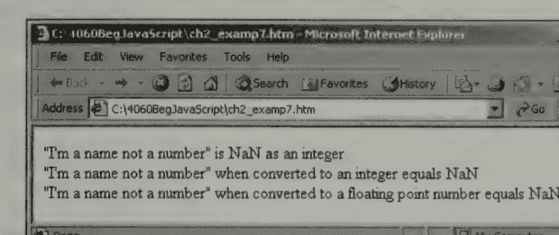

你可以看到，在之前显示数字的地方，现在显示的是 **NaN**。这是什么数字？嗯，它根本**不是数字**！

如果你对任何空字符串或不以至少一个有效数字开头的字符串使用 `parseInt()` 或 `parseFloat()`，那么你会得到 NaN，意思是不是一个数字。

NaN 实际上是 JavaScript 中的一个特殊值。它有自己的函数 `isNaN()`，用于检查某个值是否为 NaN。例如：

```
myVar1 = isNaN("Hello");
```

会将值 `true` 存储在变量 `myVar1` 中，因为 "Hello" 不是数字，而：

```
myVar2 = isNaN(34);
```

会将值 `false` 存储在变量 `myVar2` 中，因为 34 是一个数字。

在下一章中，我们将看到如何使用 `isNaN()` 函数来检查字符串作为数字的有效性，这在处理用户输入时证明是极其宝贵的，正如我们将在第 6 章中看到的。

#### 数组

我们现在将引入一个新概念——一种称为**数组**的东西。数组类似于普通变量，因为它可以用来保存任何类型的数据。然而，它有一个重要的区别，我们在下面进行说明。

正如我们已经看到的，一个普通变量一次只能保存一条数据。例如，我可以将 `myVariable` 设置为等于 25，如下所示：

```
myVariable = 25;
```

然后我再将其设置为另一个值，比如 35：

```
myVariable = 35;
```

但是，当我将变量设置为 35 时，第一个值 25 就丢失了。变量 `myVariable` 现在只保存数字 35。

我们可以使用下表来说明这个变量：

| 变量名 | myVariable |
|---|---|
| 值 | 35 |

这种普通变量和数组的区别在于，数组可以同时保存*不止一个*数据项。例如，我们可以使用一个名为 `myArray` 的数组来同时保存数字 25 和 35。数组中可以保存每条数据的位置称为一个**元素**。

我们如何区分数组中的这两条数据呢？我们为每条数据指定一个**索引**值。要引用该数据，我们在数组名称后面加上方括号，其中放入其索引值。例如，一个名为 `myArray` 的数组包含数据 25 和 35，可以使用下表来说明。

| 元素名 | myArray[0] | myArray[1] |
|---|---|---|
| 值 | 25 | 35 |

请注意，索引值从 0 开始，而不是从 1 开始。为什么是这样？当然 1 更有意义——毕竟，我们人类倾向于说第一项数据，接着是第二项，以此类推。不幸的是，计算机从 0 开始计数，并将第一项视为第零项，第二项视为第一项，以此类推。我知道这很令人困惑，但你很快就会习惯这个事实。

数组非常有用，因为你可以在数组中存储任意多（在计算机限制范围内）或任意少的数据项。另外，你不必事先声明想在数组中存储多少条数据，尽管你可以选择这样做。

那么我们如何创建一个数组呢？这与声明普通变量的方式略有不同。要创建一个新数组，你需要声明一个变量名，并使用 `new` 关键字和 `Array()` 函数告诉 JavaScript 你想让它成为一个新数组。例如，数组 `myArray` 可以这样定义：

```
var myArray = new Array();
```

请注意，与 JavaScript 中的所有内容一样，代码是区分大小写的，所以如果你输入的是 `array()` 而不是 `Array()`，代码将无法工作。这种定义数组的方式将在第 4 章中进一步解释。

与普通变量一样，你也可以先声明变量，然后告诉 JavaScript 你想让它成为一个数组。例如：

```
var myArray;
myArray = new Array();
```

前面我们说过，如果你想的话，可以事先声明数组将包含多少个元素，尽管这不是必须的。这是通过在 Array 后面的括号中放入要指定的元素数量来完成的。例如，要创建一个包含 5 个元素的数组，我们写：

```
var myArray = new Array(5);
```

我们已经看到了如何声明一个新数组，但我们如何将数据存储到其中呢？你可以在定义数组时通过在括号中包含数据来完成此操作，每条数据之间用逗号分隔。例如：

```
var myArray = new Array("Paul",345,"John",112,"Bob",99);
```

在这里，第一条数据 "Paul" 将以索引 0 放入数组。下一条数据 345 将以索引 1 放入数组，以此类推。这意味着名为 myArray[0] 的元素包含值 "Paul"，名为 myArray[1] 的元素包含值 345，以此类推。

请注意，你不能使用此方法来声明仅包含一条数字数据（如 345）的数组，因为 JavaScript 会假定你正在声明一个将包含 345 个元素的数组。

这就引出了在数组中声明数据的另一种方式。我们可以将上面一行代码写成：

```
var myArray = new Array();
myArray[0] = "Paul";
myArray[1] = 345;
myArray[2] = "John";
myArray[3] = 112;
myArray[4] = "Bob";
myArray[5] = 99;
```

我们使用每个元素名，就像使用变量一样，为它们赋值。我们在下面的“动手试试”部分解释这种声明数组元素值的方法。显然，在这个例子中，第一种定义数据项的方法要简单得多。然而，在某些情况下，你可能需要在数组声明后更改存储在特定元素中的数据。在这种情况下，你必须使用后一种方法来定义数组元素的值。

你还会从上面的例子中注意到，我们可以在同一个数组中存储不同的数据类型。JavaScript 在你可以放入数组的内容以及可以放置的位置方面非常灵活。

在继续一个例子之前，请注意这里，例如，如果你已将名为 myArray 的数组定义为包含 3 个元素，如下所示：

```
var myArray = new Array(3);
```

然后在索引 130 的元素中定义一个值：

```
myArray[130] = "Paul";
```

JavaScript 不会报错，而是会欣然接受你改变了主意，想要一个包含（至少）131 个元素的数组。

#### 动手试试 – 数组

在下面的例子中，我们将创建一个数组来保存一些名字。我们将使用上面描述的第二种方法将这些数据存储到数组中。然后我们将向用户显示这些数据。输入代码并将其保存为 ch2_examp8.htm。

```
<HTML>
<BODY>

<SCRIPT LANGUAGE=JavaScript>

var myArray = new Array();
myArray[0] = "Bob";
myArray[1] = "Pete";
myArray[2] = "Paul";

document.write("myArray[0] = " + myArray[0] + "<BR>");
document.write("myArray[2] = " + myArray[2] + "<BR>");
document.write("myArray[1] = " + myArray[1] + "<BR>");

myArray[1] = "Mike";
document.write("myArray[1] changed to " + myArray[1]);

</SCRIPT>

</BODY>
</HTML>
```

如果你在网页浏览器中加载此文件，你应该会看到一个类似这样的网页：

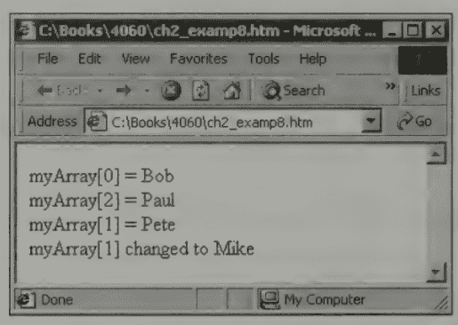

#### 工作原理

我们的脚本块中的第一个任务是声明一个变量，并告诉 JavaScript 解释器我们希望它成为一个新数组：

```
var myArray = new Array();
```

现在我们已经定义了数组，我们可以在其中存储一些数据。每次我们使用新的索引存储一条数据时，JavaScript 会自动为其创建一个新的存储空间。请记住，第一个元素将位于 myArray[0]。

让我们依次查看数组中的每次添加，看看发生了什么。在添加任何内容之前，我们的数组是空的。然后我们通过以下行添加一个数组元素：

```
myArray[0] = "Bob";
```

我们的数组现在看起来像这样：

| 索引 | 0 |
|---|---|
| 存储的数据 | Bob |

然后我们向数组添加另一个元素，这次索引为 1：

```
myArray[1] = "Pete";
```

| 索引 | 0 | 1 |
|---|---|---|
| 存储的数据 | Bob | Pete |

最后，我们向数组添加另一个元素，索引为 2：

```
myArray[2] = "Paul";
```

我们的数组现在看起来像这样：

| 索引 | 0 | 1 | 2 |
|---|---|---|---|
| 存储的数据 | Bob | Pete | Paul |

接下来，我们使用一系列 document.write() 函数将数组每个元素包含的值插入到网页中。我故意乱序访问数组，只是为了演示你可以这样做：

```
document.write("myArray[0] = " + myArray[0] + "<BR>");
document.write("myArray[2] = " + myArray[2] + "<BR>");
document.write("myArray[1] = " + myArray[1] + "<BR>");
```

你可以将数组中的每个特定位置视为一个标准变量。因此，你可以用它来进行计算，将其值转移到另一个变量或数组，等等。但是，如果你在定义数组位置中的数据之前尝试访问它，那么你会得到一个错误消息。

最后，我们将第二个数组位置的值更改为 "Mike"。我也可以将其更改为数字，因为就像普通变量一样，你可以随时在数组的每个单独数据位置中存储任何数据类型。


```
myArray[1] = "Mike";
```

现在我们的数组内容如下所示：

| 索引 | 0 | 1 | 2 |
|---|---|---|---|
| 存储的数据 | Bob | Mike | Paul |

为了验证我们所做的修改已经生效，我们使用 document.write() 来显示第二个元素的值：

```
document.write("myArray[1] changed to " + myArray[1]);
```

#### 多维数组

假设我们需要将一家公司的人员信息存储在数组中。我们可能有姓名、年龄、地址等数据。一种做法是按顺序存储这些信息。我的意思是，我们将姓名存储在数组的第一个元素中，然后将对应的年龄存储在下一个元素中，地址存储在第三个元素中，接着下一个姓名存储在第四个元素中，依此类推。我们的数组可能如下所示：

| 索引 | 0 | 1 | 2 | 3 | 4 | 5 | 6 | 7 | 8 |
|---|---|---|---|---|---|---|---|---|---|
| 存储的数据 | Name1 | Age1 | Address1 | Name2 | Age2 | Address2 | Name3 | Age3 | Address3 |

这可以实现，但使用**多维数组**有一个更简洁的解决方案。到目前为止，我们一直在使用一维数组。在这些数组中，每个元素仅使用一个索引来指定，即一个维度。因此，以上面的例子来看，我们可以看到 Name1 位于索引 0，Age1 位于索引 1，依此类推。

多维数组是指每个元素具有两个或更多索引的数组。例如，我们的人员数组作为二维数组可以如下所示：

| 索引 | 0 | 1 | 2 |
|---|---|---|---|
| 0 | Name1 | Name2 | Name3 |
| 1 | Age1 | Age2 | Age3 |
| 2 | Address1 | Address2 | Address3 |

我们将在下一个*动手实践*部分中了解如何创建这样的多维数组。

#### 动手实践 – 二维数组

以下示例说明了如何在 JavaScript 代码中创建这样的多维数组，以及如何访问该数组的元素。输入代码并将其保存为 ch2_examp9.htm。

```
<HTML>
<BODY>

<SCRIPT LANGUAGE=JavaScript>

var personnel = new Array();

personnel[0] = new Array();
personnel[0][0] = "Name0";
personnel[0][1] = "Age0";
personnel[0][2] = "Address0";

personnel[1] = new Array();
personnel[1][0] = "Name1";
personnel[1][1] = "Age1";
personnel[1][2] = "Address1";

personnel[2] = new Array();
personnel[2][0] = "Name2";
personnel[2][1] = "Age2";
personnel[2][2] = "Address2";

document.write("Name : " + personnel[1][0] + "<BR>");
document.write("Age : " + personnel[1][1] + "<BR>");
document.write("Address : " + personnel[1][2]);

</SCRIPT>

</BODY>
</HTML>
```

如果你在网页浏览器中加载它，你会看到页面上写入了三行内容，分别代表存储在数组 personnel[1] 元素中的人的姓名、年龄和地址。

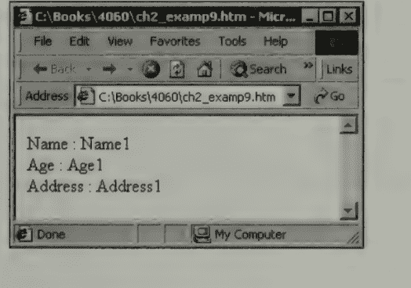

#### 工作原理

我们在脚本块中做的第一件事是声明一个变量 personnel，并告诉 JavaScript 我们希望它是一个新的数组：

```
var personnel = new Array();
```

然后我们做了一些新的事情；我们告诉 JavaScript 我们希望 personnel 数组的索引 0，即元素 personnel[0]，成为另一个新的数组：

```
personnel[0] = new Array();
```

那么这是怎么回事呢？事实上，JavaScript 并不真正支持多维数组，只支持一维数组。然而，JavaScript 允许我们通过在一个数组内部创建另一个数组来模拟多维数组。因此，上面这行代码所做的就是在 personnel 数组中索引为 0 的元素内部创建一个新数组。

在接下来的三行中，我们将值放入新创建的 personnel[0] 数组中。JavaScript 使这变得很容易；我们只需指定数组名称 personnel[0]，后跟方括号中的另一个索引。第一个索引（0）属于 personnel 数组；第二个索引属于 personnel[0] 数组。

```
personnel[0][0] = "Name0";
personnel[0][1] = "Age0";
personnel[0][2] = "Address0";
```

执行这些代码行之后，我们的数组如下所示：

| 索引 | 0 |
|---|---|
| **0** | Name0 |
| **1** | Age0 |
| **2** | Address0 |

顶部的数字目前只有 0，指的是 personnel 数组。沿侧边向下的数字 0、1 和 2，实际上是 personnel 数组内部新数组 personnel[0] 的索引。

对于第二个人的详细信息，我们再次重复这个过程，但这次我们使用 personnel 数组中索引为 1 的元素：

```
personnel[1] = new Array();
personnel[1][0] = "Name1";
personnel[1][1] = "Age1";
personnel[1][2] = "Address1";
```

现在我们的数组如下所示：

| 索引 | 0 | 1 |
|---|---|---|
| 0 | Name0 | Name1 |
| 1 | Age0 | Age1 |
| 2 | Address0 | Address1 |

我们在接下来的几行中创建第三个人的详细信息。我们使用 personnel 数组中索引为 2 的元素来创建一个新数组。

```
personnel[2] = new Array();
personnel[2][0] = "Name2";
personnel[2][1] = "Age2";
personnel[2][2] = "Address2";
```

我们的数组现在如下所示：

| 索引 | 0 | 1 | 2 |
|---|---|---|---|
| 0 | Name0 | Name1 | Name2 |
| 1 | Age0 | Age1 | Age2 |
| 2 | Address0 | Address1 | Address2 |

我们现在完成了多维数组的创建。我们通过访问第二个人的数据（Name1、Age1、Address1）并使用 document.write() 将其显示在页面上来结束脚本块。如你所见，访问数据与存储数据非常相似。我们可以在任何使用普通变量或一维数组的地方使用多维数组：

```
document.write("Name : " + personnel[1][0] + "<BR>");
document.write("Age : " + personnel[1][1] + "<BR>");
document.write("Address : " + personnel[1][2]);
```

尝试修改 document.write() 命令，使其显示第一个人的详细信息。代码如下所示：

```
document.write("Name : " + personnel[0][0] + "<BR>");
document.write("Age : " + personnel[0][1] + "<BR>");
document.write("Address : " + personnel[0][2]);
```

可以创建三维、四维甚至一百维的多维数组，但事情会变得非常混乱，你会发现你很少——如果有的话——需要超过两个维度。为了让你有个概念，以下是声明和访问一个五维数组的方法：

```
var myArray = new Array();
myArray[0] = new Array();
myArray[0][0] = new Array();
myArray[0][0][0] = new Array();
myArray[0][0][0][0] = new Array();

myArray[0][0][0][0][0] = "This is getting out of hand"

document.write(myArray[0][0][0][0][0]);
```

好吧，我不知道你怎么想，但我的脑袋已经开始疼了！

关于数组就先讲到这里，但我们将在第 4 章重新讨论它们，届时我们会发现关于它们的一些令人震惊的事情。我们还将学习一些更高级的特性。

#### 知识问答小测 – 使用数组存储问题

好了，是时候开始构建在线知识问答小测的第一步了。我们将通过定义构成小测中使用的问题和答案的数据来打下基础。

在本章中，我们只定义基于多项选择题的问题，每道题有一个字母答案。我们将使用数组来存储问题和答案；使用二维数组存储问题，使用一维数组存储对应的答案。

每道多项选择题的格式是：问题后面跟着每个可能的选择答案。问题的正确答案使用与该答案对应的字母来指定。例如：

The Beatles were:

- A sixties rock group from Liverpool
- Four musically gifted insects
- I don't know – can I have the questions on Baseball please

答案由字母 A 指定。

那么我们如何将这些信息存储在数组中呢？让我们先看看存储问题的数组。我们将数组定义如下：

| 索引 | 0 | 1 | 2 |
|---|---|---|---|
| 0 | Question0 的文本 | Question1 的文本 | Question2 的文本 |
| 1 | Question 0 的可能答案 A | Question 1 的可能答案 A | Question 的可能答案 A |
| 2 | Question 0 的可能答案 B | Question 1 的可能答案 B | Question 2 的可能答案 B |
| 3 | Question 0 的可能答案 C | Question 1 的可能答案 C | Question 2 的可能答案 C |
```


#### 数据类型与变量

当然，如果我们创建更多问题或某个问题的可选答案超过三个，可以扩展这个数组。

answers 数组的定义方式如下：

| 索引 | 0 | 1 | 2 |
|---|---|---|---|
| 值 | 问题 0 的正确答案 | 问题 1 的正确答案 | 问题 2 的正确答案 |

同样，随着问题数量的增加，我们可以扩展这个数组。

现在我们已经了解了如何存储问题数据，让我们来看看代码。我们从页面顶部的 HTML 开始。

```html
<HTML>
<HEAD>
<TITLE>Wrox 在线知识问答</TITLE>
</HEAD>
<BODY>
```

接着，在页面主体中，我们开始一个 JavaScript 代码块，声明两个变量 questions 和 answers，并将它们定义为新数组。这些变量的用途应该不言自明！不过，与其余代码一样，我们添加了注释，以便更容易理解我们在做什么。

```javascript
<SCRIPT LANGUAGE=JavaScript>

// questions 和 answers 数组用于保存问题和答案
var questions = new Array();
var answers = new Array();
```

接下来我们直接定义第一个问题。由于问题将存储在二维数组中，我们的首要任务是将 questions[0] 设为一个新数组。我们将该数组的第一个元素 questions[0][0] 赋值为问题文本，后续元素赋值为可能的答案。

```javascript
// 定义问题 1
questions[0] = new Array();

// 问题内容
questions[0][0] = "The Beatles were";

// 第一个选项
questions[0][1] = "A sixties rock group from Liverpool";

// 第二个选项
questions[0][2] = "Four musically gifted insects";

// 第三个选项
questions[0][3] = "I don't know - can I have the questions on Baseball please";
```

定义完第一个问题后，我们来设置第一个答案。对于选择题，我们只需将 answers 数组中对应索引的元素设置为表示正确选项的字符。在上面的问题中，正确答案是 "A sixties rock group from Liverpool"。由于这是第一个选项，其字母为 A。

```javascript
// 为问题 1 分配答案
answers[0] = "A";
```

我们再为测验定义两个问题。它们的格式与第一个问题相同，不过这两个问题各有四个选项供用户选择。在下一章中，你会看到我们的代码可以处理这种情况，而且事实上我们可以有任意数量的选项。

```javascript
// 定义问题 2
questions[1] = new Array();
questions[1][0] = "Homer Simpson's favorite food is";
questions[1][1] = "Fresh salad";
questions[1][2] = "Doughnuts";
questions[1][3] = "Bread and water";
questions[1][4] = "Apples";

// 为问题 2 分配答案
answers[1] = "B";

// 定义问题 3
questions[2] = new Array();
questions[2][0] = "Lisa Simpson plays which musical instrument";
questions[2][1] = "Clarinet";
questions[2][2] = "Oboe";
questions[2][3] = "Saxophone";
questions[2][4] = "Tubular Bells";

// 为问题 3 分配答案
answers[2] = "C";
```

我们通过创建一个警告框来结束脚本块，告知我们数组已完成初始化。

```javascript
alert("Array Initialized");

</SCRIPT>
</BODY>
</HTML>
```

将页面保存为 trivia_quiz.htm。这样就完成了我们测验问题和答案的定义。在下一章中，我们可以继续编写代码，检查问题的答案与用户提供的答案是否匹配。

#### 总结

在本章中，我们逐步掌握了 JavaScript 数据类型和变量的基础知识，以及如何在运算中使用它们。特别是我们了解到：

- JavaScript 支持多种数据类型，如数字、文本和布尔值。
- 文本由字符串表示，字符串由引号包围。字符串的引号必须成对匹配。转义字符允许你在字符串中包含无法直接输入的字符。
- 变量是 JavaScript 在内存中存储数据（如数字和文本）的方式，这样它们可以在代码中反复使用。
- 变量名不能包含某些非法字符，如 % 和 &，也不能是保留字，如 `with`。
- 在给变量赋值之前，我们必须先向 JavaScript 解释器声明它的存在。
- JavaScript 有四种基本数学运算符，分别用符号 +、-、* 和 / 表示。要将计算结果赋值给变量，我们使用 = 号，称为赋值运算符。
- 运算符有不同的优先级，因此乘法和除法会先于加法和减法计算。
- 字符串可以使用 + 运算符连接在一起，或称为拼接，生成一个大字符串。当数字和字符串使用 + 运算符连接时，JavaScript 会自动将数字转换为字符串。
- 尽管 JavaScript 的自动数据转换在大多数情况下都适用，但有时我们需要强制转换数据。我们看到 `parseInt()` 和 `parseFloat()` 如何用于将字符串转换为数字。如果尝试转换无法转换的字符串，将返回 NaN（非数字）。
- 数组是一种特殊的变量，可以保存多个数据。数据通过唯一的索引号插入和访问。

#### 练习题

这些问题的建议解决方案可以在附录 A 中找到。

#### 问题 1

编写一个 JavaScript 程序，将摄氏度转换为华氏度，并以描述性句子将结果写入页面。华氏度转摄氏度的 JavaScript 公式为：

```javascript
degFahren = 9 / 5 * degCent + 32
```

#### 问题 2

以下代码使用 prompt() 函数从用户那里获取两个数字。然后将这两个数字相加，并将结果写入页面。

```html
<HTML>
<BODY>
<SCRIPT LANGUAGE=JavaScript>

var firstNumber = prompt("Enter the first number","");
var secondNumber = prompt("Enter the second number","");
var theTotal = firstNumber + secondNumber;
document.write(firstNumber + " added to " + secondNumber + " equals " + theTotal);

</SCRIPT>
</BODY>
</HTML>
```

然而，如果你尝试运行这段代码，会发现它无法正常工作，这是为什么呢？

修改代码使其正常工作。

#### 决策、循环和函数

到目前为止，在本书中，我们已经看到如何使用 JavaScript 获取用户输入、用该输入执行计算和任务，并将结果写入 amount 到网页中。然而，袖珍计算器也能做到这一切，那么计算机的区别在哪里呢？也就是说，是什么让计算机看起来具有智能？答案是能够根据收集到的信息做出决策。

决策制定在创建网站时如何帮助我们？在上一章中，我们编写了一些将华氏度转换为摄氏度的代码。我们使用 `prompt()` 函数从用户那里获取华氏度数值。如果用户输入有效的数字，如 50，这段代码就能正常工作。然而，如果用户输入了无效的华氏温度，如字符串 "aaa"，那么我们会发现代码不再按预期工作。现在，如果我们的程序具有一些决策能力，我们就可以检查用户输入的内容是否有效。如果有效，我们可以进行计算；如果无效，我们可以告诉用户原因，并要求他们输入有效的数字。

用户输入验证可能是 JavaScript 中决策制定最常见的用途之一，但绝非唯一用途。我们的知识问答同样需要一些决策能力，以便检查用户给出的答案是对还是错。如果正确，我们需要采取某些步骤，例如告诉用户他们答对了并增加他们的分数。如果答案错误，则需要执行另一组代码来告诉他们答错了。

在本章中，我们将探讨 JavaScript 中如何实现决策制定，以及如何利用它使我们的代码更智能。

### 决策制定——if 和 switch 语句

所有编程语言都允许你做出决策。我的意思是，它们允许程序根据是否满足特定*条件*来遵循特定的行动方案。这正是赋予编程语言智能的地方。

例如，在我们使用仅\xfe0fJavaScript 代码仅兼容版本 4 或更高版本浏览器的场景中，条件可以是用户正在使用版本 4 或更高版本的浏览器。如果我们发现这一条件未满足，那么我们可以将他们引导到兼容早期浏览器的页面集合。


#### 第 3 章

条件是变量与数据之间的比较，例如：

- “A 是否大于 B？”
- “这个 X 是否等于 Y？”
- “M 是否不等于 N？”

在我们上面的例子中，如果变量 `browserVersion` 保存了用户所使用的浏览器版本，那么条件就是：

- “`browserVersion` 是否大于或等于 4？”

你会注意到，所有这些问题的答案要么是“是”，要么是“否” ——也就是说，它们是基于布尔值的，其计算结果只能是 true（真）或 false（假）。我们如何利用这一点在代码中创建决策能力呢？我们让浏览器测试条件是否为真。如果（且仅当）条件为真时，我们就执行一段特定的代码。

让我们看另一个例子。回顾第 1 章中我们用来演示代码流向的自然英语指令。其中一条制作咖啡的指令是：

- 水壶烧开了吗？如果是，则将水倒入杯中。否则，继续等待。

这是一个做出决策的例子。这条指令中的条件是“水烧开了吗？”。它有一个真或假的答案。如果答案为真，我们将水倒入杯中。如果答案不为真，我们则继续等待。

在 JavaScript 中，我们可以使用 `if` 语句或 `switch` 语句，根据条件是真还是假来改变代码的流向。我们稍后将讨论这些内容，但首先我们需要介绍一些对于定义条件至关重要的运算符 —— **比较运算符**。

#### 比较运算符

在上一章中，我们看到了数学函数（如加法和除法）是如何由符号（如 `+` 和 `/`）表示的，这些符号被称为运算符。我们还看到，如果我们想给变量赋予一个值，可以使用等号 (`=`) 为其分配一个值或计算结果，这被称为赋值运算符。

决策机制也有自己的运算符，允许你测试条件。比较运算符就像我们在上一章中看到的数学运算符一样，有一个左侧（LHS）和一个右侧（RHS），比较是在两者之间进行的。例如，小于运算符，符号为 `<`，就是一个比较运算符。我们可以写 `23 < 45`，翻译过来就是“23 是否小于 45？”。在这种情况下，答案将是 true。

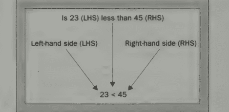

还有其他比较运算符，其中较为常用的汇总在下表中：

| 运算符符号 | 用途 |
| --- | --- |
| == | 测试 LHS 是否等于 RHS |
| < | 测试 LHS 是否小于 RHS |
| > | 测试 LHS 是否大于 RHS |
| <= | 测试 LHS 是否小于或等于 RHS |
| >= | 测试 LHS 是否大于或等于 RHS |
| != | 测试 LHS 是否不等于 RHS |

我们将在下一节讨论 `if` 语句时看到这些比较运算符的实际应用。

#### 优先级

回顾第 2 章，运算符具有优先级顺序。这也适用于比较运算符。`==` 和 `!=` 比较运算符的优先级最低，而其余的比较运算符 `<`、`>`、`<=` 和 `>=` 具有相同的优先级。

以上所有比较运算符的优先级都低于 `+`、`-`、`*` 和 `/` 等运算符。这意味着如果你进行像 `3 * 5 > 2 * 5` 这样的比较，乘法计算会先执行，然后才比较其结果。然而，在这种情况下，将两侧的计算包裹在括号内会更安全且更清晰，例如 `(3 * 5) > (2 * 5)`。作为一个通用规则，使用括号来确保优先级清晰是一个好主意，否则你可能会对结果感到惊讶。

#### 赋值与比较

最后需要提到的一个重要点是，赋值运算符 (`=`) 和比较运算符 (`==`) 非常容易混淆。请记住，`=` 运算符是将值分配给变量，而 `==` 运算符是比较两个变量的值。即使你已经明确了这个概念，在需要写两个等号的地方只写一个依然非常容易发生 —— 即使是现在，我也经常犯这个错误。

#### if 语句

`if` 语句是你会在几乎每个超过几行长的程序中用到的语句。它的工作方式非常像我们在英语语言中对“if”（如果）这个词的理解。例如，在英语中我们可能会说：“If the room temperature is more than 80 degrees Fahrenheit, then I'll turn the air conditioning on.”（如果室内温度超过华氏 80 度，我就打开空调）。在 JavaScript 中，这将被翻译成类似这样：

```
if (roomTemperature > 80)
{
    roomTemperature = roomTemperature - 10;
}
```

它是如何工作的？

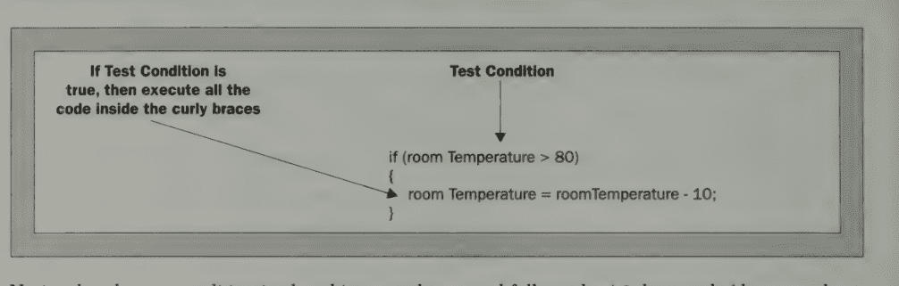

请注意，测试条件被放在括号中，并紧跟在 `if` 关键字之后。同时请注意，这一行的末尾没有分号。如果条件为真而要执行的代码被放置在条件之后行的花括号中，并且这些代码行每行都以分号结尾。

花括号 `{}` 在 JavaScript 中有特殊用途 —— 它们标记出一个代码**块**（block）。将代码行标记为属于同一个块，意味着 JavaScript 将把它们视为一段统一的代码。如果 `if` 语句的条件为真，JavaScript 将执行 `if` 语句之后的下一行或代码块。在上面的例子中，我们的代码块中只有一条语句，因此我们也可以写成：

```
if (roomTemperature > 80)
    roomTemperature = roomTemperature - 10;
```

但是，如果你有数行需要执行的代码，那么你需要使用花括号将它们标记为一个单一的代码块。例如，上述示例的修改版本（包含三行代码）必须包含花括号：

```
if (roomTemperature > 80)
{
    roomTemperature = roomTemperature - 10;
    alert("Its getting hot in here");
    alert("Air conditioning switched on");
}
```

一个特别容易犯的错误是在标记要执行的代码块时忘记花括号。在这种情况下，当条件为真时，执行的将*只有 `if` 语句后的第一行*。然而，无论测试条件的结果如何，其他行都将始终被执行。为了避免此类错误，即使只有一条语句，也养成始终使用花括号的好习惯。如果你养成了这个习惯，在真正需要它们的时候就更不容易遗漏。

#### 动手试一试 —— if 语句

让我们回到第 2 章的温度转换器示例，并添加一些决策功能。输入以下代码，并将其保存为 `ch3_examp1.htm`：

```
<HTML>
<BODY>

<SCRIPT LANGUAGE=JavaScript>

var degFahren = prompt("Enter the degrees Fahrenheit",32);
var degCent;

degCent = 5/9 * (degFahren - 32);

document.write(degFahren + "\xB0 Fahrenheit is " + degCent +
    "\xB0 centigrade<BR>");

if (degCent < 0)
{
    document.write("That's below the freezing point of water");
}

if (degCent == 100)
    document.write("That's the boiling point of water");

</SCRIPT>

</BODY>
</HTML>
```

将页面加载到浏览器中，并在提示框中输入要转换的华氏度值 32。当值为 32 时，两个 `if` 语句的条件都不成立，因此页面上写入的唯一一行将是：

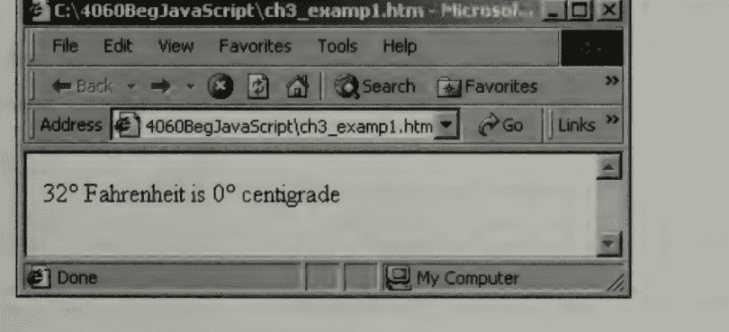

现在重新加载页面，输入华氏度值 31。这一次我们会在页面上看到两行：

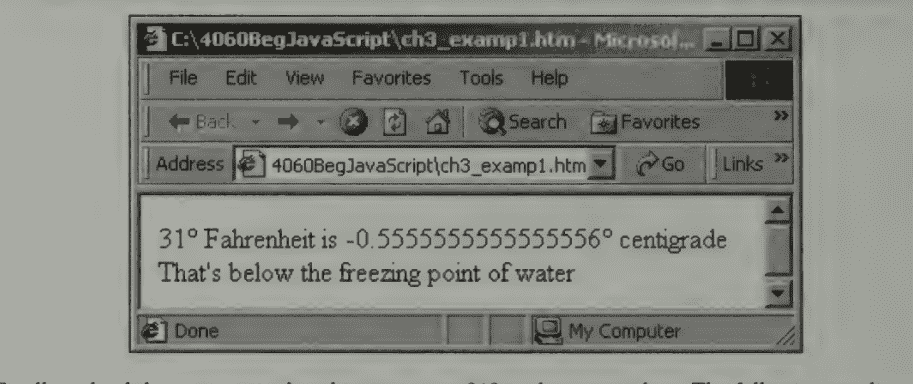

最后，再次重新加载页面，但这次在提示框中输入 212。页面上将出现以下两行：

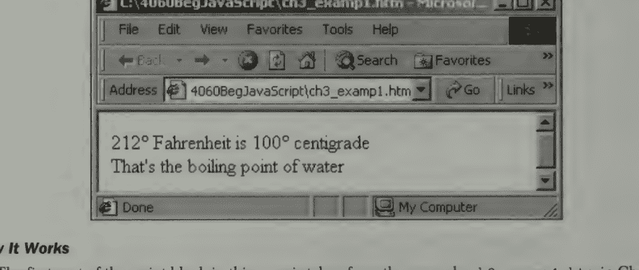

#### 工作原理

该页面脚本块的第一部分取自第 2 章的示例 `ch2_examp4.htm`。我们声明了两个变量 `degFahren` 和 `degCent`。变量 `degFahren` 被赋予了一个通过 `prompt()` 函数从用户那里获取的初始值。然后变量 `degCent` 被设置为计算结果 `5/9 * (degFahren - 32)`，这就是我们的华氏度到摄氏度的转换计算。

```
var degFahren = prompt("Enter the degrees Fahrenheit",32);
var degCent;

degCent = 5/9 * (degFahren - 32);
```

然后我们将计算结果写入页面：

```
document.write(degFahren + "\xB0 Fahrenheit is " + degCent +
"\xB0 centigrade<BR>");
```


现在我们来看新代码；我们的两个`if`语句中的第一个：

```
if (degCent < 0)
{
    document.write("That's below the freezing point of water");
}
```

这个`if`语句的条件是在问："变量`degCent`的值是否小于零？" 如果答案是肯定的——`defined`为`true`——花括号内的代码就会执行。在本例中，我们使用`document.write()`向页面写入一句话。如果答案是否定的——`false`——那么处理就会跳到关闭花括号后的下一行。另外值得注意的是，`if`语句开头花括号内的代码是缩进的。这不是必需的，但这是一个值得养成的好习惯，因为它能让你的代码更易读。

在尝试示例时，我们先输入了32，这样`degFahren`会被初始化为32。在这种情况下，计算式`degCent = 5/9 * (degFahren - 32)`会将`degCent`设为0。所以，"Is `degCent` less than zero?"的答案是`false`，因为`degCent`等于零，而不是小于零。花括号内的代码将被跳过，永远不会执行。在这种情况下，接下来要执行的行将是第二个`if`语句的条件，我们稍后会讨论这个。

当我们在提示框中输入31时，`degFahren`被设置为31，所以变量`degCent`将是-0.5555555556。那么我们的`if`语句现在看起来是怎样的呢？它评估的是"-0.55555556是否小于零？" 这次的答案是`true`，花括号内的代码，这里只是一个`document.write()`语句，ejecutará。

最后，当我们输入212时，这会如何改变我们的`if`语句呢？变量`degCent`通过计算被设置为100，所以`if`语句现在问的是，"100是否小于零？" 答案是`false`，花括号内的代码将被跳过。

在第二个`if`语句中，我们评估的条件是"变量`degCent`的值是否等于100？"

```
if (degCent == 100)
    document.write("That's the boiling point of water");
```

这里没有花括号，所以，如果条件是`true`，唯一要执行的代码是`if`语句下面的第一行。当我们想在条件为`true`时执行多行代码，那么花括号就是必需的。

我们在上面看到，当`degFahren`为32时，`degCent`将是0。所以我们的`if`语句将是"0是否等于100？" 答案显然是`false`，代码不会执行。同样，当我们把`degFahren`设为31时，`degCent`将被计算为-0.55555555556，所以"-0.55555556是否等于100？"也是`false`，代码不会执行。

最后，当`degFahren`被设为212时，`degCent`将是100。这次`if`语句是"100是否等于100？"答案是`true`，所以`document.write()`语句执行。

正如我们已经看到的，JavaScript中最常见的错误之一，即使对专家来说，也是使用一个等号进行评估，而不是必需的两个。看看下面的代码片段：

```
if (degCent = 100)
    document.write("That's the boiling point of water");
```

## 逻辑运算符

现在你应该对如何在`if`语句中使用条件有了一个大致的了解，但是如何使用"degFahren是否大于零，但小于100？"这样的条件呢？这里有两个条件需要测试。我们需要测试`degFahren`是否大于零*并且*`degFahren`是否小于100。

JavaScript允许我们使用这样的多个条件。要做到这一点，我们需要再学习三个运算符，即逻辑运算符AND、OR和NOT。它们的符号列在下表中：

| 运算符 | 符号 |
| :--- | :--- |
| AND | && |
| OR | \|\| |
| NOT | ! |

注意AND和OR运算符是*两个*重复的符号：`&&`和`||`。如果你只输入一个符号，`&`或`|`，那么会发生奇怪而晦涩的事情——你应该始终使用两个。

一旦我们讨论了三个逻辑运算符，我们将看看如何在`if`语句中使用它们，并配有大量实际示例。所以如果第一次阅读时似乎有点混乱，不要惊慌。一切都会变得清晰。让我们看看每个运算符是如何工作的，从AND运算符开始。

### AND

回想一下，我们在上面谈到了运算符的左侧（LHS）和右侧（RHS）。AND运算符也是如此。然而，现在条件的左侧和右侧是布尔值（通常是某个条件的结果）。

AND运算符的工作原理非常接近我们对英语中这个词的理解。例如，我们可能会说，"If I feel cold and I have a coat, then I'll put my coat on." 这里，"and"一词的左侧是"Do I feel cold?"，这可以被评估为真或假。右侧是"Do I have a coat?"，同样被评估为真或假。如果左侧为真（我感到冷）且右侧为真（我确实有外套），那么我就把外套穿上。

这与JavaScript中AND运算符的工作方式非常相似。AND运算符实际上会产生一个结果，就像把两个数字相加会产生一个结果一样。然而丕，AND运算符接受两个布尔值（在其左侧和右侧）并产生另一个布尔值。如果左侧和右侧条件都评估为真，那么结果将为真。在任何其他情况下，结果将为假。

下面是使用AND时可能的左侧和右侧评估结果的**真值表**。

| 左侧 | 右侧 | 结果 |
|---|---|---|
| true | true | true |
| false | true | false |
| true | false | false |
| false | false | false |

现在，虽然上面的表格严格来说是正确的，但值得注意的是JavaScript不喜欢做不必要的工作。嗯，谁喜欢呢！如果左侧是`false`，那么即使右侧评估为`true`，它对最终结果也没有任何影响——结果仍然会是`false`。所以为了避免浪费时间，如果左侧是`false`，JavaScript甚至不会费心检查右侧，而是直接返回`false`的结果。

### OR

就像AND一样，OR也以类似于我们英语语言理解的方式工作。例如，我们可能会说，如果下雨或下雪，我们就带伞。如果"正在下雨"或"正在下雪"这两个条件中的任何一个为真，那么我们就带伞。

同样，就像AND一样，OR运算符作用于两个布尔值（一个来自其左侧，一个来自其右侧）并返回另一个布尔值。如果左侧评估为`true`，或右侧评估为`true`，那么返回的结果是`true`。否则结果为`false`。下表显示了可能的结果：

| 左侧 | 右侧 | 结果 |
|---|---|---|
| true | true | true |
| false | true | true |
| true | false | true |
| false | false | false |

与AND运算符一样，JavaScript喜欢避免做那些对最终结果没有影响的事情。如果左侧是`true`，那么右侧是`true`还是`false`对最终结果都没有影响——结果仍然会是`true`。所以，为了避免工作，如果左侧是`true`，右侧就不会被评估，JavaScript直接返回`true`。最终结果是一样的——唯一的区别在于JavaScript如何进行计算。然而，这确实意味着你不应该依赖OR运算符的右侧一定会被执行。

### NOT

在英语中，我们可能会说"If I'm not hot, then I'll eat soup." 被评估的条件是我是否热。结果是真或假，但在这个例子中，如果结果是假，我们就采取行动（喝汤）。

然而，JavaScript习惯于仅在条件为`true`时执行代码。所以如果我们想让一个`false`条件导致代码执行，我们需要将那个`false`值切换为`true`（以及任何`true`值切换为`false`）。这样我们就可以"欺骗"JavaScript，让它在`false`条件后执行代码。


#### 第三章

我们使用非运算符来实现这一点。该运算符会反转结果的逻辑；它接受一个布尔值，并将其更改为另一个布尔值。因此，它将 `true` 变为 `false`，将 `false` 变为 `true`。这有时被称为**取反**。

要使用非运算符，我们将要取反的条件放在括号内，并在括号前加上 ! 符号。例如：

```
if (!(degCent < 100))
{
    // Some code
}
```

只有当条件 `degCent < 100` 为假时，大括号内的任何代码才会执行。

下表详细说明了使用非运算符时可能的结果。

| 右侧操作数 | 结果 |
| :--- | :--- |
| true | false |
| false | true |

#### if 语句中的多个条件

上一节开始时提出了一个问题：我们如何使用条件“degFahren 是否大于零但小于 100？”？一种方法是使用两个 `if` 语句，一个**嵌套**在另一个内部。嵌套仅意味着有一个外部 `if` 语句，而在这个外部语句内部嵌套了一个内部 `if` 语句。如果外部 `if` 语句的条件为 `true`，那么（且仅当此时）才会测试嵌套的内部 `if` 语句的条件。

使用嵌套的 `if` 语句，我们的代码将是：

```
if (degCent < 100)
{
    if (degCent > 0)
    {
        document.write("degCent is between 0 and 100");
    }
}
```

这可以工作，但它有点冗长，而且可能相当令人困惑。JavaScript 提供了一个更好的替代方案——在 `if` 语句的条件部分使用多个条件。这些多个条件使用我们刚刚学习的逻辑运算符连接在一起。因此，上面的代码可以重写为：

```
if (degCent > 0 && degCent < 100)
{
    document.write("degCent is between 0 and 100");
}
```

`if` 语句的条件首先评估 `degCent` 是否大于 0。如果结果为 `true`，那么上述代码继续评估 `degCent` 是否小于 100。只有当这两个条件都为 `true` 时，`document.write()` 代码行才会执行。

### 试一试 – 多个条件

在这个例子中，我们将演示使用与、或和非运算符的多条件 if 语句。输入以下代码，并将其保存为 ch3_examp2 .htm：

```
<HTML>
<BODY>

<SCRIPT LANGUAGE=JavaScript>

var myAge = prompt("Enter your age",30);

if (myAge >= 0 && myAge <= 10)
{
    document.write("myAge is between 0 and 10<BR>");
}

if ( !(myAge >= 0 && myAge <= 10) )
{
    document.write("myAge is NOT between 0 and 10<BR>");
}

if ( myAge >= 80 || myAge <= 10 )
{
    document.write("myAge is 80 or above OR 10 or below<BR>");
}

if ( (myAge >= 30 && myAge <= 39) || (myAge >= 80 && myAge <= 89) )
{
    document.write("myAge is between 30 and 39 or myAge is between 80 and 89");
}

</SCRIPT>

</BODY>
</HTML>
```

当您将其加载到浏览器中时，应该会看到一个提示框出现。输入值 30，然后按回车键，以下几行将被写入网页：

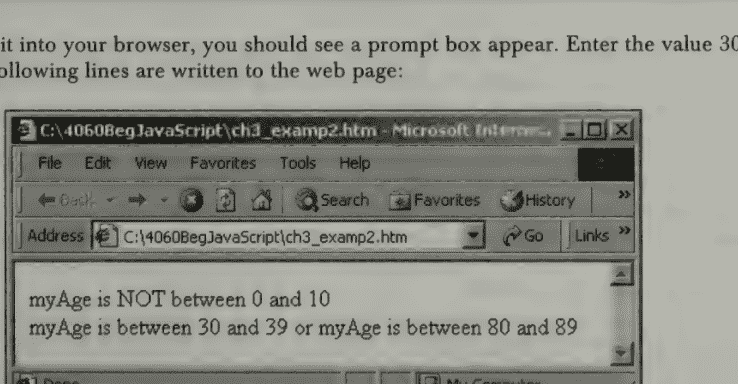

#### 工作原理

我们通过定义变量 myAge 并将其初始化为用户在提示框中输入的值来开始脚本块：

```
var myAge = prompt("Enter your age",30);
```

之后，我们有四个 if 语句，每个都使用多个条件。我们将依次详细查看每一个。

理解多个条件在做什么最简单的方法是将它们分解成更小的部分，然后评估组合结果。在我们的例子中，我们输入了值 30，该值已存储在变量 myAge 中。我们将把这个值代入条件中，看看它们是如何工作的。

这是第一个 if 语句：

```
if (myAge >= 0 && myAge <= 10)
{
    document.write("myAge is between 0 and 10<BR>");
}
```

第一个 if 语句提出的问题是“myAge 是否在 0 到 10 之间？”我们先看条件的左侧，代入我们特定的 myAge 值。这问的是“30 是否大于或等于 0？”——答案是 true。右侧条件提出的问题是，“30 是否小于或等于 10？”——答案是 false。条件的这两部分使用 && 连接，这表示与运算符。使用上面的与结果表，我们可以看到如果左侧为 true 而右侧为 false，我们得到的总体结果是 false。因此，if 语句条件的最终结果是 false，大括号内的代码不会执行。

让我们继续看第二个 if 语句：

```
if ( !(myAge >= 0 && myAge <= 10) )
{
    document.write("myAge is NOT between 0 and 10<BR>");
}
```

第二个 if 语句提出的问题是“myAge 是否不在 0 到 10 之间？”它的条件与第一个 if 语句相似，但有一个小的细微差别：我们将条件括在括号内，并在前面放上了非运算符 (!)。

括号内的部分将被评估，并且，像以前一样，产生相同的结果——false。然而，非运算符反转了结果，使其变为 true。由于 if 语句的条件为 true，这次大括号内的代码将执行，导致 document.write() 向页面写入响应。

那么第三个 if 语句呢？

```
if ( myAge >= 80 || myAge <= 10 )
{
    document.write("myAge is either 80 and above OR 10 and below<BR>");
}
```

第三个 `if` 语句问道，“`myAge` 是否大于或等于 80，或小于或等于 10？”先看左侧条件——“30 是否大于或等于 80？”——答案是 `false`。右侧条件的答案，“30 是否小于或等于 10？”再次是 `false`。条件的这两部分使用 `||` 组合，这表示或运算符。查看上面的或结果表，我们看到 `false` 或 `false` 产生 `false` 的结果。因此，`if` 语句的条件再次评估为 `false`，花括号内的代码不会执行。

最后一个 `if` 语句稍微复杂一些：

```
if ( (myAge >= 30 && myAge <= 39) || (myAge >= 80 && myAge <= 89) )
{
    document.write("myAge is either between 30 and 39 or myAge is between 80 and 89<BR>");
}
```

它提出的问题是“`myAge` 是否在 30 到 39 之间，或在 80 到 89 之间？”让我们将条件分解成它的组成部分。我们有一个左侧和一个右侧条件，使用或运算符组合。然而，左侧和右侧本身又各有左侧和右侧，它们使用与运算符组合。注意我们如何使用括号来告诉 JavaScript 我们希望条件的哪些部分先被评估，就像我们在数学计算中使用数字一样。

让我们先看条件的左侧，即 `(myAge >= 30 && myAge <= 39)`。通过将条件放入括号中，我们确保它被视为一个单独的条件；无论括号内有多少个条件，它只产生一个结果，要么是 `true`，要么是 `false`。分解括号内的条件，我们有“30 是否大于或等于 30？”结果为 `true`，“30 是否小于或等于 39？”结果再次为 `true`。从我们的与表中，我们知道 `true` 与 `true` 产生 `true` 的结果。

现在让我们看条件的右侧，即 `(myAge >= 80 && myAge <= 89)`。再次分解条件，我们看到左侧问，“30 是否大于或等于 80？”这给出 `false` 的结果，右侧问，“30 是否小于或等于 89？”这给出 `true` 的结果。我们知道 `false` 与 `true` 得到 `false` 的结果。

现在我们可以认为我们的 `if` 语句条件看起来像 `(true || false)`。查看我们的或结果表，我们可以看到 `true` 或 `false` 得到 `true` 的结果，因此 `if` 语句后面花括号内的代码将执行，一行将被写入页面。

然而，现在请记住，JavaScript 不会对最终结果没有影响的条件进行评估，上述条件就是这种情况之一。条件的左侧评估为 `true`。之后，条件的右侧是 `true` 还是 `false` 并不重要，因为在或操作中，只需要其中一个条件为 `true` 就能得到 `true` 的结果。因此，JavaScript 实际上并未评估上述条件的右侧。我们这样做只是为了演示目的。

正如我们所看到的，理解或创建多个条件的最简单方法是将它们分解成最小的逻辑块。你会发现，有了经验，你几乎会不假思索地这样做，除非你有一个特别棘手的条件需要评估。

虽然使用多个条件通常比使用多个 `if` 语句更好，但有时它会使你的代码更难阅读，因此更难理解和调试。`if` 语句中可能出现 10 个、20 个甚至超过 100 个条件，但你能想象尝试阅读一个只有 10 个条件的 `if` 语句吗？如果你觉得你的多个条件变得过于复杂，那么就把它们分解成更小的逻辑块。


#### 第 3 章

例如，假设我们想在 `myAge` 处于 30 - 39、80 - 89 或 100 - 115 这些范围时执行某些代码。我们可以这样编写语句：

```
if ( (myAge >= 30 && myAge <= 39) || (myAge >= 80 && myAge <= 89) ||
     (myAge >= 100 && myAge <= 115) )
{
    document.write("myAge is either between 30 and 39 or myAge is between 80
                    and 89 or myAge is between 100 and 115");
}
```

这样做没有错，但它开始变得有些冗长且难以阅读。相反，我们可以为 100 - 115 范围的部分创建另一个 if 语句。

#### else 和 else if

想象一种情况：如果你希望在某个条件为真时执行一段代码，而在该条件为假时执行另一段代码。我们可以通过使用两个 if 语句来实现，如下例所示：

```
if (myAge >= 0 && myAge <= 10)
{
    document.write("myAge is between 0 and 10");
}

if ( !(myAge >= 0 && myAge <= 10) )
{
    document.write("myAge is NOT between 0 and 10");
}
```

第一个 if 语句测试 `myAge` 是否在 0 到 10 之间，第二个语句则处理 `myAge` 不在 0 到 10 之间的情况。然而，JavaScript 提供了一种更简单的方法来实现这一点，即使用 else 语句。同样，else 这个词的用法与英语中的用法类似。我们可以说：“如果下雨，我就带把伞，否则（else）我就戴顶太阳帽”。在 JavaScript 中，我们可以地说：如果条件为真，则执行一个代码块，否则执行另一个备选代码块。使用这种技术重写上述代码，我们将得到：

```
if (myAge >= 0 && myAge <= 10)
{
    document.write("myAge is between 0 and 10");
}
else
{
    document.write("myAge is NOT between 0 and 10");
}
```

这样编写代码使其更简洁，因此更易于阅读，并且还可以节省 JavaScript 对一个我们已经知道答案的条件进行测试的时间。

我们还可以在 else 语句中包含另一个 if 语句。例如：

```
if (myAge >= 0 && myAge <= 10)
{
    document.write("myAge is between 0 and 10");
}
else if ( (myAge >= 30 && myAge <= 39) || (myAge >= 80 && myAge <= 89) )
{
    document.write("myAge is either between 30 and 39 or myAge is between 80 and 89");
}
else
{
    document.write("myAge is NOT between 0 and 10, nor is it between 30 and 39, nor is it between 80 and 89");
}
```

第一个 if 语句检查 `myAge` 是否在 0 到 10 之间，如果为真则执行某些代码。如果为假，则由 else if 语句检查 `myAge` 是否在 30 到 39 或 80 到 89 之间，如果为真则执行其他代码。如果这些都不满足，我们有一个最后的 else 语句，用于捕捉 `myAge` 的值在之前任何 if 条件中都未触发为真的情况。

在使用 if 和 else if 时，我们需要格外小心花括号，以确保 if 和 else if 语句在预期的位置开始和停止，而不会出现不属于正确 if 的 else。用文字描述这一点相当困难——通过示例更容易理解我的意思：

```
if (myAge >= 0 && myAge <= 10)
{
    document.write("myAge is between 0 and 10");
    if (myAge = 5)
    {
        document.write("Your 5 years old")
    }
}
else
{
    document.write("myAge is NOT between 0 and 10");
}
```

请注意，我没有对代码进行缩进。虽然这对 JavaScript 来说没关系，但它会增加人类阅读的难度，并掩盖了在最后一个 else 语句之前应该有的缺失花括号。

正确格式化并插入缺失括号后，代码如下所示：

```
if (myAge >= 0 && myAge <= 10)
{
    document.write("myAge is between 0 and 10");
    if (myAge = 5)
    {
        document.write("Your 5 years old")
    }
}
else
{
    document.write("myAge is NOT between 0 and 10");
}
```

如你所见，现在代码不仅可以正常工作，而且更容易看出哪些代码属于哪个 `if` 块。

#### 字符串比较

到目前为止，我们一直专注于在数字上使用比较运算符。然而，它们在字符串上同样适用。之前关于数字的所有讨论都适用于字符串，但有一个重要的区别。我们现在是按字母顺序而非数值大小来比较数据，因此有几个陷阱需要注意。

在以下代码中，我们将包含字符串 "Paul" 的变量 `myName` 与字符串字面量 "Paul" 进行比较：

```
var myName ="Paul";
if (myName == "Paul")
{
    alert("myName is Paul");
}
```

JavaScript 如何处理这种情况？它会依次检查左手边（LHS）的每个字母，并将其与右手边（RHS）相同位置的字母进行对比，以检查它们是否确实相同。如果在任何一点发现了差异，它就会停止，结果为 `false`。如果依次检查到最后确认所有字母都相同，则返回 `true`。上述 `if` 语句中的条件将返回 `true`，因此我们将看到一个 `alert` 弹窗。

然而，JavaScript 中的字符串比较是区分大小写的。因此，"P" 与 "p" 不同。沿用上面的例子，但将变量 `myName` 改为 "paul"，我们会发现条件为 `false`，且 `if` 语句内部的代码不会执行：

```
var myName ="paul";
if (myName == "Paul")
{
    alert("myName is Paul");
}
```

`>=`、`>`、`<=` 和 `<` 运算符同样适用于字符串和数字，但同样是字母顺序比较。因此 "A" < "B" 为真，因为在字母表中 A 在 B 之前。然而，JavaScript 的大小写敏感性再次起作用。"A" < "B" 为真，但 "a" < "B" 为 `false`。为什么？因为大写字母被视为始终在小写字母 *之前*。这是为什么呢？在 ASCII 字符集中，每个字母都有一个代码编号，大写字母的代码编号低于小写字母的代码编号。在编写自己的代码时，这是需要注意的一点。

避免大小写混淆最简单的方法是在比较两个字符串之前，将它们全部转换为大写或全部转换为小写。这可以通过使用 `toUpperCase()` 或 `toLowerCase()` 函数轻松实现，我们将在下一章中介绍这些函数。

#### switch 语句

我们在上面看到了 `if` 和 `else if` 语句如何用于检查各种条件；如果第一个条件无效，则检查另一个，依此类推。然而，当你想要检查一个特定变量是否具有大量可能的值时，有一个更高效的替代方案，即 `switch` 语句。请注意，`switch` 语句严格来说是浏览器版本 4 及更高版本的语言特性，因此如果你想支持 NN 3 及更早版本或 IE 3 浏览器，请不要使用它。

`switch` 语句的结构如下所示：

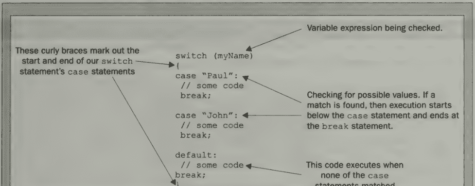

思考 `switch` 语句的最佳方式是：“切换到 case 匹配的代码块”。`switch` 语句包含四个重要元素：

- 测试表达式
- `case` 语句
- `break` 语句
- `default` 语句

测试表达式位于 `switch` 关键字后面的圆括号中。在上面的例子中，我们使用变量 `myName` 进行测试。不过，在圆括号内可以使用任何有效的表达式。

接下来是 `case` 语句。`case` 语句负责执行条件检查。为了表明哪些 `case` 语句属于我们的 `switch` 语句，必须将它们放在测试表达式之后的花括号内。每个 case 语句指定一个值，例如 `"Paul"`。那么 `case` 语句的作用就像 `if (myName == "Paul")`。如果变量 `myName` 确实包含值 `"Paul"`，则执行将从 `case: "Paul"` 语句下方的代码开始，并一直持续到 `switch` 语句的末尾。在这个例子中只有两个 `case` 语句，但你可以根据需要添加任意多个。


#### 第 3 章

在大多数情况下，你可能只希望执行相关 `case` 语句直接下方的代码块，而不是执行该 `case` 语句之后的所有代码（包括其他的所有 `case` 语句）。为了实现这一点，我们在想要执行的代码末尾放置一个 `break` 语句。这会告诉 JavaScript 在该点停止执行并退出 `switch` 语句。

最后我们有 `default` 情况，正如其名，它是当没有任何其他 `case` 语句匹配时将执行的代码。`default` 语句是可选的；如果你没有想要执行的默认代码，可以将其省略，但请记住，在这种情况下，如果没有 `case` 语句匹配，将没有任何代码执行。除非你绝对确定已经涵盖了所有选项，否则包含一个 `default` 情况是一个好习惯。

### 动手尝试 – 使用 switch 语句

让我们看看 `switch` 语句在实际中的运行情况。下面的示例演示了一个简单的猜数字游戏。输入代码并将其保存为 `ch3_examp3.htm`：

```html
<HTML>
<BODY>

<SCRIPT LANGUAGE=JavaScript>

var secretNumber = prompt("Pick a number between 1 and 5:", "");
secretNumber = parseInt(secretNumber);

switch (secretNumber)
{
case 1:
    document.write("Too low!");
    break;

case 2:
    document.write("Too low!");
    break;

case 3:
    document.write("You guessed the secret number!");
    break;

case 4:
    document.write("Too high!");
    break;

case 5:
    document.write("Too high!");
    break;

default:
    document.write("You did not enter a number between 1 and 5.");
    break;
}
document.write("<BR>Execution continues here");

</SCRIPT>

</BODY>
</HTML>
```

#### 决策、循环与函数

将此文件加载到浏览器中，并在提示框中输入值 1。你应该会看到类似这样的结果：

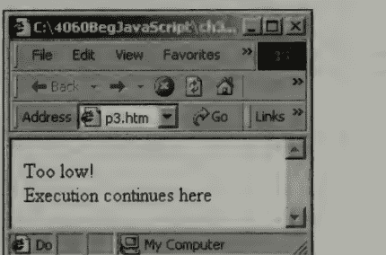

另一方面，如果你输入值 3，你应该会看到一条友好的消息，告知你正确猜中了秘密数字：

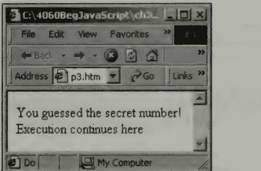

#### 工作原理

首先，我们声明变量 `secretNumber`，并将其设置为用户通过 `prompt()` 框输入的值。注意我们使用 `parseInt()` 函数将 `prompt()` 返回的字符串转换为整数值：

```javascript
var secretNumber = prompt("Pick a number between 1 and 5:", "");
secretNumber = parseInt(secretNumber);
```

接下来我们创建 `switch` 语句的开头：

```javascript
switch (secretNumber)
{
```

括号中的表达式简单来说就是变量 `secretNumber`，`case` 语句将与之进行比较。

我们使用花括号指定包含 `case` 语句的代码块。每个 `case` 语句检查 1 到 5 之间的一个数字，因为这是我们指定用户应该输入的内容。第一个 `case` 简单地输出一条消息，告知用户输入的数字太低了：

```javascript
case 1:
    document.write("Too low!");
    break;
```

第二个 `case` 语句（针对值 2）具有相同的消息，因此这里没有重复代码。第三个 `case` 语句告知用户他们猜对了：

```javascript
case 3:
    document.write("You guessed the secret number!");
    break;
```

最后，第四个和第五个 `case` 语句输出一条消息，告知用户输入的数字太高了：

```javascript
case 4:
    document.write("Too high!");
    break;
```

在这个示例中，我们确实需要添加一个 `default` 情况，因为用户很可能会（尽管有指令）输入一个不在 1 到 5 之间的数字，甚至可能是一个字母。在这种情况下，我们添加一条消息让他们知道出了问题：

```javascript
default:
    document.write("You did not enter a number between 1 and 5.");
    break;
```

`default` 语句对于捕捉 Bug 也非常有用——如果你某些 `case` 语句编写错误，那么当你看到本不该运行的 `default` 代码被执行时，你会很快发现问题。

最后我们添加了闭合花括号，标志着 `switch` 语句的结束。之后我们输出一行文字，指示执行将从何处继续：

```javascript
}
document.write("<BR>Execution continues here");
```

请注意，每个 `case` 语句都以 `break` 语句结束。这对于确保代码执行跳转到 `switch` 语句结束后的那一行至关重要。如果我们忘记包含它，那么我们可能会执行匹配 `case` 之后的所有 `case` 代码。

### 为不同情况执行相同代码

你可能已经发现了上述示例中 `switch` 语句的一个问题——如果用户输入 1 或 2，我们想要执行相同的代码；对于 4 或 5 也是如此。然而，为了实现这一点，我们不得不并在每个 `case` 中重复代码。我们希望有一种更简单的方法，让 JavaScript 为不同的情况执行相同的代码。这很简单！只需修改上述代码，使其如下所示：

```javascript
switch (secretNumber)
{
case 1:
case 2:
    document.write("Too low!");
    break;

case 3:
    document.write("You guessed the secret number!");
    break;

case 4:
case 5:
    document.write("Too high!");
    break;

default:
    document.write("You did not enter a number between 1 and 5.");
    break;
}
```

如果你将此代码加载到浏览器中并尝试输入不同的数字，你会发现它的行为与之前完全相同。

这里我们利用了一个特性：如果某个 `case` 语句的代码下方没有 `break` 语句，执行将继续通过每一个随后的 `case` 语句，直到遇到 `break` 语句或到达 `switch` 的末尾。你可以将其想象成在 `switch` 语句中某种“自由落体”，直到撞到 `break` 为止。

如果匹配了值为 1 的 `case` 语句，执行将直接继续直到 `case 2` 下方的 `break` 语句，因此我们实际上可以为这两个情况执行相同的代码。同样的技术也被用于值为 4 和 5 的 `case` 语句。

### 循环 – `for` 和 `while` 语句

**循环（Looping）** 意味着在条件为 `true` 时重复执行一段代码块。在 JavaScript 中，这通过两种语句实现：`while` 语句和 `for` 语句——我们稍后将详细讨论。但我们为什么会想要重复代码块呢？

举个例子，假设你有一系列结果（比如一年中每个月的平均气温），并且你想将这些数据绘制在图表上。绘制每个点所需的代码极有可能是相同的。因此，与其将代码写十二遍（每个点一遍），不如将相同的代码执行十二遍，但每次使用序列中的下一个数据项。这就是 `for` 语句大显身手的地方，因为我们知道代码需要执行多少次。

在另一种情况下，你可能希望在某个条件为 `true` 的整个过程中重复同一段代码，例如在用户不断点击“重新开始”按钮时。在这种情况下，`while` 语句会非常有用。

### for 循环

`for` 语句允许你将一段代码块重复执行特定的次数。其语法如下图所示：

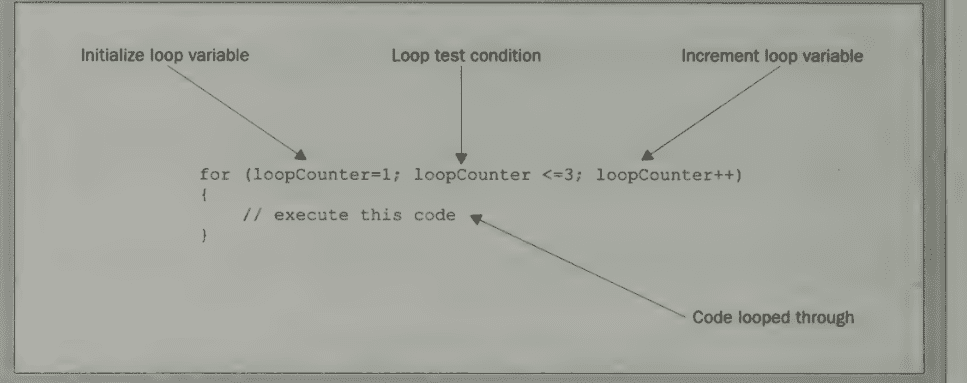

让我们看看 `for` 语句的构成。从上面的图表可以看出，与 `if` 和 `switch` 语句一样，`for` 语句的逻辑也包含在括号内。然而，这一次逻辑被分成了三个部分，每部分由分号隔开。例如，在上面的示例中，我们的逻辑是：

```javascript
(loopCounter = 1 ; loopCounter <= 3 ; loopCounter++)
```

`for` 循环的第一部分是 `for` 语句的 **初始化（initialization）** 部分。为了跟踪代码循环执行了多少次，我们需要一个变量来计数。我们就在初始化部分初始化这个变量。在上面的示例中，我们将 `loopCounter` 变量设置为 1。与其他部分不同，这部分在循环执行过程中仅执行一次。

在分号之后，是 `for` 语句的 **测试条件（test condition）** 部分。只要这个测试条件评估为 `true`，`for` 语句内部的代码就会继续执行。每次代码循环结束后，都会测试该条件。在上面的图表中，只要 `loopCounter` 小于或等于 3，我们就继续执行。你经常会看到循环执行的次数被称为 **迭代（iterations）** 次数。

最后，我们有 `for` 循环的 **增量（increment）** 部分，其中循环测试条件中的变量值会被增加。在这里我们可以看到，`loopCounter` 使用我们在第 2 章中看到的 `++` 运算符增加 1。同样，`for` 语句的这部分在每次代码循环时都会重复执行。虽然我们称之为增量部分，但它实际上也可以用来减少或 **递减（decrement）** 数值，例如如果我们想从数组的最后一个元素倒数到第一个。

在 `for` 语句之后，是只要测试条件为 `true` 就会被重复执行的代码块。该代码块包含在花括号内。如果条件从未为 `true`（即使在第一次测试循环条件时），那么 `for` 循环内部的代码将被跳过，永远不会执行。


综合以上所有内容，`for` 循环是如何工作的？

- 1. 执行 `for` 语句的初始化部分。
- 2. 检查测试条件。如果为 `true`，则继续；否则退出 `for` 语句。
- 3. 执行 `for` 语句块之后的代码。
- 4. 执行 `for` 语句的递增部分。
- 5. 重复步骤 2 到 4，直到测试条件为 `false`。

#### 尝试一下 – 转换一系列华氏温度值

让我们修改温度转换器，使其转换存储在数组中的一系列华氏值到摄氏值。我们将使用 `for` 语句遍历数组的每个元素。输入代码并将其保存为 `ch3_examp4.htm`。

```html
<HTML>
<BODY>

<SCRIPT LANGUAGE=JavaScript>

var degFahren = new Array(212, 32, -459.15);
var degCent = new Array();
var loopCounter;

for (loopCounter = 0; loopCounter <= 2; loopCounter++)
{
    degCent[loopCounter] = 5/9 * (degFahren[loopCounter] - 32);
}

for (loopCounter = 2; loopCounter >= 0; loopCounter--)
{
    document.write("Value " + loopCounter + " was " + degFahren[loopCounter] + 
                   " degrees Fahrenheit");
    document.write(" which is " + degCent[loopCounter] + 
                   " degrees centigrade<BR>");
}

</SCRIPT>

</BODY>
</HTML>
```

将此代码加载到浏览器后，你将在页面上看到三行结果，显示将华氏值数组转换为摄氏值的结果。

#### 工作原理

我们的首要任务是声明要使用的变量。首先，我们声明并初始化 `degFahren`，使其包含三个值：212、32 和 -459.67 的数组。接下来，将 `degCent` 声明为空数组。最后，声明 `loopCounter`，它将用于在循环过程中跟踪我们正在访问的数组索引：

```javascript
var degFahren = new Array(212, 32, -459.67);
var degCent = new Array();
var loopCounter;
```

接下来是我们的第一个 `for` 循环：

```javascript
for (loopCounter = 0; loopCounter <= 2; loopCounter++)
{
    degCent[loopCounter] = 5/9 * (degFahren[loopCounter] - 32);
}
```

在第一行，我们首先将 `loopCounter` 初始化为零。然后检查 `for` 循环的测试条件 `loopCounter <= 2`。如果此条件为真，则循环首次执行。一旦花括号内的代码执行完毕，`for` 循环的递增部分 `loopCounter++` 将被执行，然后测试条件将被重新评估。如果仍然为真，则再次执行循环代码。此过程持续进行，直到 `for` 循环的测试条件评估为假，此时循环将结束，并执行右花括号之后的第一条语句。

花括号内的代码是我们之前示例中看到的方程式，只是这一次我们将其结果放入 `degCent` 数组，索引值为 `loopCounter` 的值。

在第二个 `for` 循环中，我们将 `degCent` 数组中包含的结果写入屏幕：

```javascript
for (loopCounter = 2; loopCounter >= 0; loopCounter--)
{
    document.write("Value " + loopCounter + " was " + degFahren[loopCounter] +
                   " degrees Fahrenheit");
    document.write(" which is " + degCent[loopCounter] +
                   " degrees centigrade<BR>");
}
```

这次我们是*从* 2 倒数到 0。变量 `loopCounter` 初始化为 2，循环条件在 `loopCounter` 小于零之前保持为 `true`。这次 `loopCounter` 实际上每次是递减而不是递增，使用 `loopCounter--`。同样，`loopCounter` 具有双重目的：它记录我们已执行的循环次数，并提供数组中的索引位置。

> 请注意，在这些示例中，我们在循环中使用了整数。然而，没有理由不能使用小数，尽管这样做要少见得多。

#### for...in 循环

`for...in` 循环在 JavaScript 1.3 版（Internet Explorer 5.0+ 和 Netscape 4.06+）中引入。此循环主要用于数组。它允许我们遍历数组中的每个元素，而无需知道数组实际包含多少个元素。用通俗的英语说，这个循环的意思是：“对于数组中的每个元素，执行一些代码。” 我们无需计算每个元素的索引号，`for...in` 循环会为我们完成，并在每次迭代中自动移动到下一个索引。

其用于数组的语法是：

```javascript
for (index in arrayName)
{
    //some code
}
```

在上面的代码片段中，`index` 是我们在循环前声明的一个变量，它将自动填充数组中的下一个索引值。`arrayName` 是保存我们要循环的数组的变量名称。

让我们看一个例子来使事情更清楚。我们将定义一个数组并用三个值初始化它：

```javascript
var myArray = new Array("Paul", "Paula", "Pauline");
```

要使用常规 `for` 循环访问每个元素，我们会这样写：

```javascript
var loopCounter;
for (loopCounter = 0; loopCounter < 3; loopCounter++)
{
    document.write(myArray[loopCounter]);
}
```

要用 `for...in` 循环做完全相同的事情，我们这样写：

```javascript
var elementIndex;
for (elementIndex in myArray)
{
    document.write(myArray[elementIndex]);
}
```

如你所见，第二个例子中的代码更清晰一些，而且更短。两种方法同样有效，都会迭代三次。但是，如果你增加数组的大小，例如添加元素 `myArray[3] = "Philip"`，第一种方法仍然只遍历数组中的前三个元素，而第二种方法将遍历所有四个元素。

#### while 循环

`for` 循环用于循环特定次数，而 `while` 循环允许你测试一个条件，并在该条件为真时持续循环。`for` 循环在你需要知道循环次数时很有用，例如遍历一个已知具有特定数量元素的数组。`while` 循环在你需要循环的次数未知时更有用。例如，如果你正在遍历一个温度值数组，并且希望在数组元素包含的温度值小于 100 时继续循环，那么你需要使用 `while` 语句。

让我们看一下 `while` 语句的结构。

我们可以看到 `while` 循环比 `for` 循环包含的部分更少。`while` 循环由一个条件组成，如果该条件评估为真，则导致花括号内的代码块执行一次，然后重新评估条件。如果仍然为真，则再次执行代码并再次重新评估条件，依此类推，直到条件评估为假。

需要注意的一点是，如果条件一开始就是假的，那么 `while` 循环永远不会执行。例如：

```javascript
degCent = 100;

while (degCent != 100)
{
    // some code
}
```

在这里，如果 `degCent` 不等于 100，循环将运行，但因为 `degCent` 是 100，条件为 `false`，代码永远不会执行。

在实践中，我们通常期望循环执行一次；是否再次执行取决于循环内部代码对循环条件中涉及的变量所做的操作。例如：

```javascript
degCent = new Array();
degFahren = new Array(34, 123, 212);
var loopCounter = 0;
while (loopCounter < 3)
{
    degCent[loopCounter] = 5/9 * (degFahren[loopCounter] - 32);
    loopCounter++;
}
```

只要 `loopCounter` 小于三，循环就会执行。是循环内部的代码（`loopCounter++;`）递增 `loopCounter`，并最终导致 `loopCounter < 3` 为 `false`，从而使循环停止。然后执行将继续到 `while` 语句闭合大括号之后的第一行。

需要注意的是**无限循环**——一个永远不会结束的循环。假设我们在上面的代码中忘记了包含 `loopCounter++;` 这一行。省略这一行意味着 `loopCounter` 将保持为零，因此条件（`loopCounter < 3`）将始终为 `true`，循环将持续直到用户感到厌烦、生气并关闭他们的浏览器。然而，这是一个容易犯的错误，而且 JavaScript 不会对此发出警告。

不仅遗漏行会导致无限循环，循环代码中的错误也会导致无限循环。例如：

```javascript
var testVariable = 0;
while (testVariable <= 10)
{
    alert("Test Variable is " + testVariable);
    testVariable++;
    if (testVariable = 10)
    {
        alert("The last loop");
    }
}
```

找出导致无限循环的故意错误——是的，就是那个 `if` 语句。本应使用 `==` 作为比较运算符的地方，我们放了 `=`，因此在每次循环中 `testVariable` 被*设置*为 10，尽管有 `testVariable++` 这一行。这意味着在每次循环开始时，测试条件总是评估为 `true`，因为 10 小于或等于 10。加上额外的 `=`，使其变为 `if (testVariable == 10)`，一切就正常了。


#### 第 3 章

#### do...while 循环

在 `while` 循环中，我们看到只有在条件为 `true` 时，循环内部的代码才会执行；如果条件为 `false`，则代码永远不会执行，执行流将直接跳转到 `while` 循环之后的首行。然而，在某些情况下，无论 `while` 语句中的条件计算结果是否为 `true`，你可能都希望 `while` 循环中的代码至少执行一次。甚至可能是需要先执行 `while` 循环内部的代码，然后才能测试 `while` 语句的条件。在这种情况下，`do...while` 循环就是理想的选择。

让我们看一个通过提示框获取用户年龄的示例。我们希望显示提示框，但同时要确保用户输入的是一个数字：

```
var userAge;
do
{
    userAge = prompt("Please enter your age", "")
}
while (isNaN(userAge) == true)
```

循环体内的这行代码：

```
userAge = prompt("Please enter your age", "")
```

无论 `while` 语句的条件如何，都将被执行。这是因为在执行一次循环*之前*，系统不会检查条件。如果条件为 `true`，则代码再次循环。如果为 `false`，则停止循环。

请注意，在 `while` 语句的条件中，我们使用了在第 2 章中见过的 `isNaN()` 函数。它用于检查 `userAge` 变量的值是否为 `NaN`（非数字）。如果它不是数字，条件将返回 `true`，否则返回 `false`。正如示例所示，它允许我们测试用户输入，以确保输入了正确的数据。用户可能会在年龄上撒谎，但至少我们知道他们输入的是一个数字！

`do...while` 循环相对少见；大多数能用 `do...while` 循环完成的事情，用 `while` 循环也能做到，因此除非绝对必要，否则最好尽量避免使用。

#### break 和 continue 语句

我们在研究 `switch` 语句时已经接触过 `break` 语句。它在 `switch` 语句中的作用是停止代码执行，并将执行流移至 `switch` 语句结束花括号后的下一行代码。然而，当你想要提前退出循环时，`break` 语句也可以作为 `for` 和 `while` 循环的一部分使用。例如，假设你正在遍历一个数组（就像我们在温度转换示例中所做的那样），结果遇到了一个无效值？在这种情况下，你可能希望立即停止代码运行，通知用户数据无效，并退出循环。这就是 `break` 语句派上用场的情况。

让我们看看如何修改之前的华氏度转换示例 (`ch3_examp4.htm`)，使得当我们遇到非数字值时，停止循环并告知用户数据无效。

```
<SCRIPT LANGUAGE=JavaScript>
var degFahren = new Array(212, "string data", -459.67);
var degCent = new Array();
var loopCounter;

for (loopCounter = 0; loopCounter <= 2; loopCounter++)
{
    if (isNaN(degFahren[loopCounter]))
    {
        alert("Data '" + degFahren[loopCounter] + "' at array index " +
              loopCounter + " is invalid");
        break;
    }

    degCent[loopCounter] = 5/9 * (degFahren[loopCounter] - 32);
}
```

我们更改了 `degFahren` 数组的初始化，使其现在包含一些无效数据。然后，在 `for` 循环内部，添加了一个 `if` 语句来检查 `degFahren` 数组中的数据是否为非数字。这是通过 `isNaN()` 函数完成的；如果传递给括号的值（此处为 `degFahren[loopCounter]`）不是数字，它将返回 `true`。如果值不是数字，我们就告诉用户数组中哪个位置出现了无效数据。然后，我们使用 `break` 语句彻底跳出 `for` 循环，代码执行将从 `for` 语句结束后的第一行继续。

这就是 `break` 语句，那么 `continue` 呢？`continue` 语句与 `break` 类似，它会在被发现的位置停止循环的执行，但它不会退出循环，而是从下一次迭代开始执行，首先重新评估 `for` 或 `while` 语句的条件，就像已经到达循环代码的最后一行一样。

在上面的 `break` 示例中，情况是“全有或全无”——即使只有一条数据无效，我们也会跳出循环。如果我们尝试转换 `degFahren` 中的所有值，但在数组中遇到无效项时通知用户并继续处理下一项，而不是像上面的 `break` 示例那样直接放弃，可能会更好。

```
if (isNaN(degFahren[loopCounter]))
{
    alert("Data '" + degFahren[loopCounter] + "' at array index " +
          loopCounter + " is invalid");
    continue;
}
```

只需将 `break` 语句更改为 `continue`。我们仍然会收到关于无效数据的消息，但第三个值也将被转换。

#### 第 3 章

## 函数

函数是执行特定任务的实体。以口袋计算机为例，它提供许多基本计算，如加法和减法。然而，许多计算机还设有执行更复杂操作的功能键。例如，有些计算机有一个计算平方根的按钮，有些甚至提供统计函数，如计算平均值。这些函数中的大多数都可以仅使用加、减、乘、除这些基础数学运算来完成。然而，所需的计算步骤可能非常繁多，因此如果用户只需按一个按钮就能完成所有计算阶段，计算将被大大简化。他们唯一需要做的是提供数据（在这种情况下是数字），而功能键会完成其余所有工作。

JavaScript 中的函数有点像口袋计算机上的功能按钮；它们将执行特定任务的一块代码封装在一起。在本书目前为止的内容中，我们已经遇到了一些执行特定任务的便捷内置函数，例如将字符串转换为数字的 `parseInt()` 和 `parseFloat()` 函数，以及告知我们特定变量是否能转换为数字的 `isNaN()` 函数。其中一些函数会返回数据，例如 `parseInt()` 返回一个整数；而另一些函数仅执行操作，不返回数据。你还会注意到，有些函数可以传递数据，而有些则不行。例如，`isNaN()` 函数需要传递某些数据，以便它检查该数据是否为 `NaN`。函数要求传递的数据被称为其**参数（parameter(s)）**。

随着我们继续阅读本书，我们将遇到更多有用的内置函数，但如果能编写自己的函数岂不是太棒了？在完成、编写并调试了一块用于执行特定任务的代码后，如果能在需要时反复调用它，那就太方便了。JavaScript 赋予了我们这样做的能力，这也是我们在本节中将重点讨论的内容。

### 创建你自己的函数

创建和使用你自己的函数非常简单。下面的图表展示了一个函数的示例：

```
function convertToCentigrade (degFahren)
{
    var degCent;
    degCent = 5/9 * (degFahren - 32);
    return degCent;
}
```

你可能已经意识到这个函数的作用以及代码是如何运行的。是的，又是那个著名的华氏度转摄氏度的转换代码。

你在 JavaScript 中定义的每个函数在特定的页面中必须有一个唯一的名称。名称紧跟在 `function` 关键字之后。为了让自己省事，请尝试使用有意义的名称，这样当你以后在代码中看到它被调用时，就能确切知道它是做什么的。例如，一个接受某人的生日和今天的日期作为参数并返回其年龄的函数可以命名为 `getAge()`。然而，你可以使用的名称与变量名一样受到限制。例如，你不能使用 JavaScript 保留的词汇，因此你不能将函数命名为 `with()` 或 `while()`。

函数的参数放在函数名称后面的括号中。参数就是函数完成工作所需要提供的一项数据。如果不传递所需的参数，将会导致错误。一个函数可以有零个或多个参数，但即使没有参数，你仍然必须在名称后面加上左括号和右括号。例如，你的函数定义顶部必须看起来像这样：

```
function myNoParamFunction()
```

然后我们编写代码，函数在被调用时将执行这些代码。所有函数代码必须使用一对花括号将其放入一个代码块中。

函数还赋予了我们将值从函数返回到调用它的代码的能力。我们使用 `return` 语句来返回...


#### 第 3 章

```javascript
function writeUserWelcome(userName)
```

好的，现在我们已经定义了函数名和参数，剩下的就是创建函数体——也就是函数被调用时要执行的代码。我们通过将这部分代码包裹在花括号中来标记出来：

```javascript
function writeUserWelcome(userName)
{
    document.write("Welcome to my website" + userName + "<BR>");
    document.write("Hope you enjoy it!");
}
```

这段代码很简单，我们使用 `document.write()` 向网页输出一条消息。你可以看到 `userName` 的使用方式和普通变量一样；事实上，最好就把参数当作普通变量来理解。参数的值将取决于调用该函数的 JavaScript 代码中指定的内容。

让我们看看如何调用这个函数：

```javascript
writeUserWelcome("Paul");
```

非常简单——只需写出要调用的函数名，然后在括号中添加要传递给各参数的数据，这里只有一个参数。当函数中的代码执行时，函数体内使用的变量 `userName` 将包含文本"Paul"。

假设我们想向函数传递两个参数——需要做哪些改动？首先我们得修改函数定义。假设第二个参数用于存放用户的年龄——我们可以将其命名为 `userAge`，因为这样就能清楚地表明该参数数据的含义。以下是新代码：

```javascript
function writeUserWelcome(userName, userAge)
{
    document.write("Welcome to my website" + userName + "<BR>");
    document.write("Hope you enjoy it");
    document.write("Your age is " + userAge);
}
```

我们在函数体中添加了一行代码来使用新增的参数。调用该函数时应写成：

```javascript
writeUserWelcome("Paul", 31);
```

第二个参数是数字，所以不需要加引号。这里 `userName` 参数的值是 Paul，第二个参数 `userAge` 的值是 31。

### 动手试试——华氏转摄氏函数

让我们用函数来重写温度转换页面。你可以从 `ch3_examp4.htm` 中复制大部分代码——已更改的部分已用高亮标出。完成后将其保存为 `ch3_examp5.htm`：

```html
<HTML>
<BODY>

<SCRIPT LANGUAGE=JavaScript>

function convertToCentigrade(degFahren)
{
    var degCent;
    degCent = 5/9 * (degFahren - 32);

    return degCent;
}

var degFahren = new Array(212, 32, -459.67);
var degCent = new Array();
var loopCounter;

for (loopCounter = 0; loopCounter <= 2; loopCounter++)
{
    degCent[loopCounter] = convertToCentigrade(degFahren[loopCounter]);
}

for (loopCounter = 2; loopCounter >= 0; loopCounter--)
{
    document.write("Value " + loopCounter + " was " + degFahren[loopCounter] +
                   " degrees Fahrenheit");
    document.write(" which is " + degCent[loopCounter] +
                   " degrees centigrade<BR>");
}

</SCRIPT>

</BODY>
</HTML>
```

当你在浏览器中加载此页面时，应该会看到与 `ch3_examp4.htm` 完全相同的结果。

#### 工作原理

在脚本块的顶部，我们声明了 `convertToCentigrade()` 函数。我们在上面已经见过这个函数：

```javascript
function convertToCentigrade(degFahren)
{
    var degCent;
    degCent = 5/9 * (degFahren - 32);

    return degCent;
}
```

如果你在页面中使用了多个独立的 `script` 块，那么确保函数在任何脚本调用它之前就已经定义好是非常重要的。如果你有多个函数，你可能想把它们都放在页面顶部的一个独立 script 块中——放在 `<HEAD>` 和 `</HEAD>` 标签之间就很好。这样你就知道所有函数的位置，并且可以确保它们在被使用之前已经声明。

你应该对函数中的代码运作方式已经比较熟悉了。我们声明了一个变量 `degCent`，进行计算并将结果存储在 `degCent` 中，然后将 `degCent` 返回给调用代码。函数的参数是 `degFahren`，它提供了计算所需的信息。

函数声明之后是页面加载时执行的代码。首先我们定义所需的变量，然后通过两个循环来计算和输出结果。这部分与之前基本相同，除了第一个 `for` 循环：

```javascript
for (loopCounter = 0; loopCounter <= 2; loopCounter++)
{
    degCent[loopCounter] = convertToCentigrade(degFahren[loopCounter]);
}
```

第一个 `for` 循环内的代码将函数 `convertToCentigrade()` 返回的值放入 `degCent` 数组中。

本示例代码中有一个微妙之处。注意我们在函数 `convertToCentigrade()` 内声明了变量 `degCent`，同时又在函数定义之后将它声明为一个数组。

这肯定不被允许吧？

嗯，这就很自然地引出了本章的下一个主题——变量作用域。

### 变量作用域和生命周期

**作用域**是什么意思？简单来说，就是变量的可用范围——它在哪里可以被看到和使用。在网页中、函数外部声明的任何变量，对页面上的所有脚本都是可用的，无论该脚本是在函数内部还是外部——我们将其称为**全局作用域**或**页面级作用域**。然而，在函数内部声明的变量*仅*在该函数内部可见——函数外部的任何代码都无法访问它们。因此，我们可以在页面上每个函数中都声明一个 `degCent` 变量，*同时*在页面上函数外部也声明一次。但是，我们不能在同一个函数内部*多次*声明该变量，也不能在函数外部的页面上*多次*声明。需要注意的是，以这种方式在页面中重复使用变量名，虽然*不违法*，但并不是标准的良好实践——它会让代码读起来非常混乱。

函数参数类似于变量：它们在函数外部不可见，而且我们不能在函数中声明一个与其参数同名的变量。

那么，当函数内部的代码执行完毕、执行流返回到调用点时，会发生什么呢？当我们再次调用函数时，函数内定义的变量会保留其值吗？

答案是否定的；变量不仅具有作用域属性——它们在哪里可见——它们还具有**生命周期**。当函数执行完毕时，函数中的变量就会消亡，其值也会丢失，除非我们将其返回给调用代码。JavaScript 会不时执行垃圾回收（我们在上一章中讨论过），它会扫描代码，查看是否有不再使用的变量；如果有，就会释放它们所占用的内存，以便为其他变量腾出空间。

既然全局变量可以在任何地方使用，为什么不把所有变量都设为全局的呢？当你需要在全局范围内跟踪数据时，全局变量非常好用。然而，由于它们可以在代码中的任何位置被修改，这就意味着如果由于 bug 导致了错误的更改，那么这个 bug 可能出现在代码的任何地方，从而使调试变得困难。因此，最好将全局变量的使用保持在最低限度，尽管有时它们是必要的恶，例如当你需要在不同函数之间共享数据时。

### 知识问答——构建一个基础函数

在上一章中，我们声明了用于存储知识问答题目和答案的数组。我们还用前三道题目填充了这些数组。当时我们还没有足够的知识来实际利用这些数据，但借助本章所学的内容，我们可以创建一个函数，利用数组中的信息来检查答案是否正确。

打开 `trivia_quiz.htm` 并将其修改为如下所示：

```html
<HTML>
<HEAD>
<TITLE>Wrox Online Trivia Quiz</TITLE>

<SCRIPT LANGUAGE=JavaScript>

function answerCorrect(questionNumber, answer)
{
    // declare a variable to hold return value
    var correct = false;

    // if answer provided is same as correct answer then correct variable is true
    if (answer == answers[questionNumber])
        correct = true;

    // return whether the answer was correct (true or false)
    return correct;
}

</SCRIPT>
</HEAD>

<BODY>
<SCRIPT LANGUAGE=JavaScript>

// Questions variable will holds questions
var questions = new Array();
var answers = new Array();
```


#### 第 3 章

```javascript
// define question 1
questions[0] = new Array();

// the question
questions[0][0] = "The Beatles were";

// first choice
questions[0][1] = "A sixties rock group from Liverpool";

// second choice
questions[0][2] = "Four musically gifted insects";

// third choice
questions[0][3] = "I don't know - can I have the questions on Baseball please";

// assign answer for question 1
answers[0] = "A";

// define question 2
questions[1] = new Array();
questions[1][0] = "Homer Simpson's favorite food is";
questions[1][1] = "Fresh salad";
questions[1][2] = "Doughnuts";
questions[1][3] = "Bread and water";
questions[1][4] = "Apples";

// assign answer for question 2
answers[1] = "B";

// define question 3
questions[2] = new Array();
questions[2][0] = "Lisa Simpson plays which musical instrument";
questions[2][1] = "Clarinet";
questions[2][2] = "Oboe";
questions[2][3] = "Saxophone";
questions[2][4] = "Tubular Bells";

// assign answer for question 3
answers[2] = "C";
```

这里唯一的改动是我们移除了 `alert()` 函数（该函数用于告知用户数组已初始化），并添加了一个名为 `answerCorrect()` 的函数，用于检查知识问答题目是否回答正确。该函数被添加在页面 `head` 中的一个 `script` 块内。`answerCorrect()` 函数接受两个参数：一个是通过参数 `questionNumber` 传递的数组中的题目索引，另一个是通过参数 `answer` 传递的用户给出的答案。然后它会检查用户的答案是否确实正确——如果正确，函数返回 `true`，否则返回 `false`。

#### 决策、循环和函数

目前代码通过检查 `answers` 数组中索引为 `questionNumber` 的元素是否等于 `answer` 参数来验证用户给出的答案。鉴于这个函数如此简单，我们难道不能直接在需要的地方嵌入这段代码吗？为什么要费心去创建一个函数呢？这个问题的答案是：我们对这个函数有进一步的规划。目前，它的作用仅仅是检查用户的多选题回答（一个单字母）是否与 `answers` 数组中存储的字母一致。然而，稍后我们将扩展知识问答功能，以处理基于文本的问题，例如"哪位总统卷入了水门事件丑闻？"等等。这不仅仅是简单的比较，因此在某个时候我们会着手扩展 `answerCorrect()` 函数，使其包含额外的智能逻辑。通过将逻辑封装在单个函数中，我们只需修改一处代码即可，并且不会破坏程序的其他部分。使用该函数的代码只期望得到 `true` 或 `false` 的结果——该函数如何得出这个结果并不重要。

为了测试我们新的 `answerCorrect()` 函数，让我们再编写一些代码，遍历 `questions` 数组中的每一道题目，并使用 `answerCorrect()` 函数来找出正确答案。将下面所示的代码行插入到页面的 `body` 中，在 `script` 块内，放在 `questions` 和 `answers` 数组定义之后。测试完成后，你可以删除这段代码，因为它不属于最终知识问答的一部分。

```javascript
var possibleAnswers = new Array("A","B","C","D","E");
var questionNumber;
var arrayIndex;

for (questionNumber = 0; questionNumber < answers.length; questionNumber++)
{
    for (arrayIndex = 0; arrayIndex < 5; arrayIndex++)
    {
        if (answerCorrect(questionNumber,possibleAnswers[arrayIndex]))
        {
            alert("The Answer to Question " + questionNumber + " is " + 
                  possibleAnswers[arrayIndex]);
            break;
        }
    }
}
```

首先，我们定义三个要使用的变量：

- `possibleAnswers` 是一个包含五个字符的数组，每个字符代表用户可以用来回答问题的选项之一
- `questionNumber` 用于遍历 `answers` 数组中各题的答案
- `arrayIndex` 用作 `possibleAnswers` 数组的索引

接下来我们有两个 `for` 循环，其中一个嵌套在另一个内部。外层 `for` 循环遍历 `answers` 数组中每道题的答案。我们怎么知道有多少道题呢？很简单——我们使用数组内置的 `length` 属性。我们将在下一章进一步介绍它。不过，目前你只需要知道 `answers.length` 给出 `answers` 数组中元素的数量，也就是本例中的 3。回想一下，数组的索引从 0 开始。因此我们需要遍历的数组索引是 0、1 和 2。所以外层 `for` 循环的测试条件只需要是 `questionNumber < answers.length`，而不是 `questionNumber <= answers.length`。

对于外层 `for` 循环遍历的每一道题，内层 `for` 循环会遍历 `possibleAnswers` 数组中的每一个可能答案，并使用 `answerCorrect()` 函数将其与当前题目的正确答案进行比较。如果我们找到了正确的答案，就会弹出一个提示框告知结果，并跳出循环。注意，`break` 只会跳出内层 `for` 循环，而不会同时跳出两个循环。

如果你在浏览器中加载 `trivia_quiz.htm`，你应该会看到以下三个提示框：

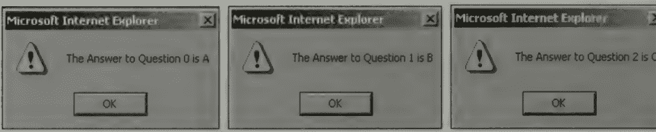

请注意，存储题目和答案数据的 `questions` 和 `answers` 数组在页面中具有全局作用域，这是我在上一节中警告过你的。然而，在这里这是必要的，因为函数和页面中的 JavaScript 代码都需要访问这些数组。

#### 总结

在本章中，我们完成了对 JavaScript 语言核心及其语法的学习。从现在开始的一切都将建立在这些基础之上，随着那些相对枯燥的语法知识的学习完成，我们可以继续探索本书后面更有趣的内容。

本章涵盖的内容包括：

- 使用 `if` 和 `switch` 语句进行决策——做出决策的能力本质上赋予了代码"智能"。根据条件为 `true` 还是 `false`，我们可以决定采取何种行动。
- 比较运算符——比较运算符将运算符左侧的值（左侧，LHS）与运算符右侧的值（右侧，RHS）进行比较，并返回一个布尔值。主要的比较运算符有：
  - `==` ——LHS 是否等于 RHS？
  - `!=` ——LHS 是否不等于 RHS？
  - `<=` ——LHS 是否小于或等于 RHS？
  - `>=` ——LHS 是否大于或等于 RHS？
  - `<` ——LHS 是否小于 RHS？
  - `>` ——LHS 是否大于 RHS？
- `if` 语句——使用 `if` 语句，我们可以在条件为 `true` 时选择执行一段代码（由花括号定义）。`if` 语句有一个测试条件，写在圆括号内。如果计算结果为 `true`，`if` 语句之后的代码将会执行。
- `else` 语句——如果我们希望在 `if` 语句为 `false` 时执行代码，可以使用 `else` 语句，它出现在 `if` 语句之后。
- 逻辑运算符——要组合条件，我们可以使用三种逻辑运算符 AND、OR 和 NOT，分别由 `&&`、`||` 和 `!` 表示。
  - AND 运算符仅在表达式两侧都为 `true` 时才返回 `true`。
  - OR 运算符在表达式两侧任一为 `true` 或两者都为 `true` 时返回 `true`。
  - NOT 运算符反转表达式的逻辑。
- `switch` 语句——它将表达式的结果与一系列可能的 `case` 进行比较，效果类似于多个 `if` 语句。
- 使用 `for`、`for...in`、`while` 和 `do...while` 进行循环——通常需要将一段代码重复执行多次，JavaScript 通过循环来实现这一点。
  - `for` 循环——适用于将代码循环执行特定次数。它由三部分组成：初始化部分、测试条件部分和递增部分。只要测试条件为 `true`，循环就会继续。每次循环执行代码块，然后执行 `for` 循环的递增部分，接着重新评估测试条件，看递增是否改变了结果。
  - `for in` 循环——当我们想要遍历数组但不知道数组中有多少个元素时非常有用。JavaScript 会为我们计算元素数量，确保不会遗漏任何元素。


#### 第 3 章

- while 循环 – 当测试条件保持为真时，用于循环执行某段代码。它由一个测试条件和一个仅在条件为真时才执行的代码块组成。如果条件从未为真，则代码永远不会执行。
- do...while 循环 – 与 while 循环类似，不同之处在于它会先执行一次代码，然后只要测试条件保持为真，就继续执行该代码。
- break 和 continue 语句 – 有时我们有充分的理由想要提前跳出循环，在这种情况下我们需要使用 break 语句。一旦命中 break 语句，由花括号标记的代码块的执行将停止，并立即从闭合花括号之后开始执行。continue 语句与 break 类似，不同之处在于虽然代码执行在循环的该点停止，但并没有跳出循环，而是继续执行，就好像已经到达了该次迭代的末尾一样。
- 函数是可重用的代码片段 – JavaScript 拥有许多内置函数，它们为我们程序员提供服务，例如将字符串转换为数字。然而，JavaScript 还允许我们使用 `function` 关键字定义和使用自己的函数。函数可以接收零个或多个传递给它们的参数，并且如果我们希望的话，可以返回一个值。
- 变量作用域和生命周期 – 在函数外部声明的变量在全局可用，也就是说，在页面的任何地方都可以使用。任何在函数内部定义的变量对于该函数是私有的，无法在其外部访问。变量具有生命周期，其长度取决于变量声明的位置。如果是全局变量，那么它的生命周期与页面相同——只要页面加载在浏览器中，该变量就一直存在。对于在函数中定义的变量，其生命周期被限制在那个函数的执行期间。一旦函数执行完毕，变量就会消失，其值也将丢失。如果在代码稍后的位置再次调用该函数，那么这些变量将为空。

#### 练习题

这些问题的建议解决方案可以在附录 A 中找到。

#### 问题 1

一名初级程序员带着一些看起来无法运行的代码来找你。你能发现他们哪里出错了吗？帮他们一把并修正这些错误。

```
var userAge = prompt("Please enter your age");

if (userAge = 0);
{
    alert("So you're a baby!");
}
else if ( userAge < 0 | userAge > 200)
    alert("I think you may be lying about your age");
else
{
    alert("That's a good age");
}
```

#### 问题 2

编写一段代码，使用 `document.write()` 显示 12 乘法表的结果。其输出应该是计算结果：

```
12 * 1 = 12
12 * 2 = 24
12 * 3 = 36
...
12 * 11 = 132
12 * 12 = 144
```

#### 问题 3

修改问题 2 的代码，使其成为一个函数，该函数接收所需的乘法表、起始值和结束值作为参数。例如，我们可能希望显示 4 乘法表，从 4 * 4 开始，到 4 * 9 结束。

#### 问题 4

修改问题 3 的代码，要求用户输入要显示的乘法表，代码应继续请求并显示乘法表，直到用户输入 -1。此外，进行一项检查以确保用户输入的是有效数字；如果无效，请要求他们重新输入。

在线讨论请访问 http://p2p.wrox.com

#### 第 4 章

#### JavaScript – 一种基于对象的语言

在本章中，我们将研究一个 JavaScript 的核心概念，即**对象（objects）**。但什么是对象，为什么它们很有用？

首先，我必须坦白。在整本书中，你一直在使用对象。例如，数组（Array）就是一个对象。为了简单起见，我一直对此保持沉默，但现在你准备好了解这个“可怕”的真相了。JavaScript 是一种基于对象的语言，因此我们所做的很多事情都涉及操作对象。我们将看到，通过充分利用这些对象，我们能用 JavaScript 实现的功能范围将大大扩展。

在本章开始时，我们将介绍什么是对象以及为什么它们很重要。接着我们将了解在 JavaScript 中使用什么样的对象，如何创建和使用它们，以及它们如何为我们简化许多编程任务。最后，我们将更详细地研究 JavaScript 为我们提供的一些最实用的对象，并看看如何在实际场景中使用它们。

不仅 JavaScript 本身由许多被称为对象的东西组成（我们称之为原生 JavaScript 对象），而且浏览器本身也被建模为一组可供我们使用的对象集合。我们将在下一章中专门学习这些对象。

### 基于对象的编程

“基于对象的编程”是一种稍微吓人一点的说法，其实就是使用对象进行编程。但我们要编程的这些对象到底是什么？它们在哪里，我们为什么要用它们来编程，以及如何编程？在本节中，我们将从通用编程术语以及更具体的 JavaScript 角度来探讨这些问题的答案。

## 对象简介

在开始介绍对象之前，让我们思考一下在计算机之外的“现实世界”中，对象是指什么。世界由事物或对象组成，例如桌子、椅子和汽车（仅举几例！）。让我们以汽车为例，这样我们可以探讨对象究竟是什么。

我们会如何定义我们的汽车？我们可能会说它是一辆具有四轮驱动的蓝色汽车。我们可能会指定它行驶的速度。当我们这样做时，我们是在指定对象的**属性（properties）**。例如，汽车有一个颜色属性，在这个例子中，它的值是蓝色。

我们如何使用汽车？我们转动点火钥匙，踩油门，按喇叭，换挡（也就是说，在手动挡汽车上选择 1、2、3、4 和倒车档，或在自动挡汽车上选择前进档和倒车档）等等。当我们这样做时，我们是在使用对象的**方法（methods）**。

我们可以把方法看作有点像函数。有时，我们可能需要在方法中使用某些信息，或者向其传递一个参数，以使其工作。例如，当我们使用换挡方法时，我们需要说明想要换到哪个挡位。其他方法可能会将信息反馈给所有者。例如，油尺方法会告诉所有者车里还剩多少油。

有时使用某种方法可能会改变对象的一个或多个属性。例如，使用加速方法可能会改变汽车的速度属性。其他属性则无法更改，例如汽车的车身形状属性（除非你以 100 英里的速度撞上了一堵砖墙！）。

我们可以说，汽车是由其方法和属性的集合定义的。在基于对象的编程中，其核心思想是用对象来模拟现实世界的情况，而对象由其方法和属性定义。

### JavaScript 中的对象

现在你应该对什么是对象有了基本的认识——一个具有方法和属性的“东西”。但我们在 JavaScript 中如何使用它呢？

在之前的章节中，我们（在很大程度上）一直在处理**原始（primitive）**数据。这是*实际*的数据，如字符串和数字。这类数据并不复杂，我们处理起来相当容易。然而，并非所有信息都像原始数据那样简单。让我们看一个例子来进一步澄清。

假设你写了一个显示公交车或火车时刻表信息的 Web 应用程序。一旦用户选择了一段旅程，你可能想让他们知道这段旅程需要多长时间。为此，你需要用到达时间减去出发时间。

然而，这并不像乍一看那样简单。例如，考虑出发时间为 14.53，到达时间为 15.10。如果我们告诉 JavaScript 计算表达式 15.10-14.53，我们会得到结果 0.57，即 57 分钟。然而，我们知道实际的时间差是 17 分钟。在时间上使用普通的数学运算符是行不通的！

114


#### JavaScript——一种基于对象的语言

要计算这两个时间之间的差值，我们需要做什么？首先，我们需要从每个时间中分离出小时和分钟。然后，要得到两个时间的分钟差值，我们需要检查到达时间的分钟数是否大于出发时间的分钟数。如果是，我们可以直接用到达时间的分钟数减去出发时间的分钟数。如果不是，我们需要在到达时间的分钟数上加60，同时从到达时间的小时数中减去1来进行补偿，然后再用到达时间的分钟数减去出发时间的分钟数。接着，我们需要用到达时间的小时数减去出发时间的小时数，最后将得到的分钟和小时重新组合在一起。

只要两个时间在同一天内，这种方法就能正常工作。例如，对于23:45和04:32这两个时间，这种方法就行不通了。

这种计算时间差的方式显然存在问题，而且看起来也非常复杂。对于处理时间和日期这类更复杂的数据，有没有更简单的方法呢？

这就是对象的用武之地。我们可以将出发时间和到达时间定义为Date对象。因为它们是Date对象，所以自带各种属性和方法，可以在需要操作或计算时间时使用。例如，它有`getTime()`方法，可以用来获取Date对象中的时间与1970年1月1日00:00:00之间的毫秒数。一旦我们获得了到达时间和出发时间的毫秒值，就可以直接将两者相减，并将结果存储在另一个Date对象中。要获取这个时间的小时和分钟，只需使用Date对象的`getHours()`和`getMinutes()`方法即可。我们将在本章后面看到更多这样的示例。

Date对象并不是JavaScript提供的唯一对象。我们在第2章中介绍过另一个对象，但为了保持简单，当时没有告诉你它是一个对象。那就是Array对象。回忆一下，数组是一种同时保存多条数据的方式。

Array对象有一个名为length的属性，它告诉我们数组保存了多少条数据，或者说有多少个元素。我们在第3章的趣味问答中实际上就使用了这个属性来计算需要循环遍历数组的次数。

Array对象还有许多方法。其中一个例子是`sort()`方法，它可以用来将数组中的元素按字母顺序排序。

你现在应该对对象在JavaScript中为何有用有了一个概念。我们已经了解了Date和Array对象，但JavaScript还提供了许多其他对象，使我们能够用代码实现更多功能。这些对象包括Math和String对象，我们将在本章后面进一步介绍。

#### 使用JavaScript对象

既然我们已经了解了JavaScript对象的"为什么"，接下来需要看看"是什么"和"怎么做"。

JavaScript中的每个对象都包含一系列相关的属性和方法，可用于操作某种特定类型的数据。例如，Array对象由操作数组的方法和从数组中获取信息的属性组成。在大多数情况下，要使用这些方法和属性，我们需要将数据定义为这些对象之一。换句话说，我们需要创建一个对象。

在本节中，我们将了解如何创建对象，以及在创建之后如何使用其属性和方法。

#### 创建对象

我们已经看到过创建对象的示例。那就是`Array`对象。要创建一个`Array`对象，我们使用了以下JavaScript语句：

```
var myArray = new Array();
```

那么这条语句是由什么组成的呢？

语句的前半部分我们很熟悉。我们使用`var`关键字定义了一个名为`myArray`的变量。这个变量通过赋值运算符（`=`）被初始化为语句右侧的值。

语句的右侧由两部分组成。首先是关键字`new`。它告诉JavaScript我们想要创建一个新对象。接下来是`Array()`。这是`Array`对象的**构造函数**。它告诉JavaScript我们想要创建什么类型的对象。大多数对象都有这样的构造函数。例如，`Date`对象有`Date()`构造函数。本书中我们看到的唯一例外是`Math`对象，这将在本章后面的部分进行说明。

我们在第2章中还看到，可以向构造函数`Array()`传递参数来向对象添加数据。例如，要创建一个包含三个元素（数据分别为"Paul"、"Paula"和"Pauline"）的`Array`对象，我们使用：

```
var myArray = new Array("Paul", "Paula", "Pauline");
```

让我们看一些更多示例，这次使用`Date`对象。创建`Date`对象最简单的方式是：

```
var myDate = new Date();
```

这将创建一个包含创建时日期和时间的`Date`对象。然而，

```
var myDate = new Date("1 Jan 2000");
```

将创建一个包含2000年1月1日日期的`Date`对象。

对象数据在变量中的存储方式与原始数据（如文本和数字）的存储方式不同。对于原始数据，变量保存的是数据的实际值。例如：

```
var myNumber = 23;
```

意味着变量`myNumber`将保存数据`23`。然而，赋值给对象的变量并不保存实际数据，而是保存一个指向数据所在内存地址的**引用**。这并不意味着我们可以获取到内存地址，因为内存地址的详细信息只有JavaScript自己知道，并在后台自行管理。你只需要记住，当我们说一个变量引用了一个对象时，指的就是这个意思。

总结一下本节内容，我们使用以下基本语法来创建JavaScript对象：

```
var myVariable = new ObjectName(optional parameters);
```

#### 使用对象的属性

访问对象属性中包含的值非常简单。我们先写包含（或引用）对象的变量名，后跟一个点号，然后是对象属性的名称。

例如，如果我们定义了一个包含在变量`myArray`中的Array对象，可以通过以下方式访问其length属性：

```
myArray.length
```

这将返回数组中包含的元素数量。

但获取到这个属性后，我们可以做什么呢？我们可以像使用任何其他数据一样使用这个属性。我们可以将其存储在变量中：

```
var myVariable = myArray.length;
```

或者将其显示给用户：

```
alert(myArray.length);
```

在某些情况下，我们甚至可以更改变量的值，例如：

```
myArray.length = 12;
```

然而，与变量不同的是，某些属性是只读的——我们可以从中获取信息，但不能*更改*其中的信息。

#### 调用对象的方法

方法与函数非常相似，因为它们都可以用来执行有用的任务，例如从特定日期获取小时数或为我们生成随机数。与函数一样，某些方法会返回一个值，例如Date对象的`getHours()`方法；而其他方法执行一个任务但不返回任何数据，例如Array对象的`sort()`方法。

使用对象的方法与使用属性非常相似，你先写对象的变量名，然后是一个点号，接着是方法的名称。例如，要对变量`myArray`中的Array元素进行排序，你可以使用以下代码：

```
myArray.sort();
```

与函数一样，某些方法可以传递参数，参数放在方法名后面的括号中。但是，无论方法是否接受参数，我们都必须在方法名后加上括号，就像使用函数一样。一般来说，任何可以使用函数的地方，都可以使用对象的方法。


## 第 4 章：原语与对象

现在你应该已经对原语数据（如数字和字符串）与对象数据（如 Date 和 Array）之间的区别有了较清晰的认识。然而，我之前是不是提到过还有一个 `String` 对象？它在其中扮演什么角色呢？

事实上，对应于字符串、数字和布尔值这三种原语数据类型，分别存在 `String`、`Number` 和 `Boolean` 对象。例如，要创建一个包含文本 "I'm a String object" 的 `String` 对象，我们可以使用：

```
var myString = new String("I'm a String object");
```

`String` 对象拥有和 `Array` 对象一样的 `length` 属性。它返回 `String` 对象中的字符数。例如：

```
var lengthOfString = myString.length;
```

会将数据 19 存储在变量 `lengthOfString` 中（请记住，空格也被视为字符）。

但如果我们声明了一个名为 `mySecondString` 的原语字符串，持有文本 "I'm a primitive string"，如下所示：

```
var mySecondString = "I'm a primitive string";
```

并且想要知道这个原语字符串中包含多少个字符，该怎么办？

这就是 JavaScript 为我们提供帮助的地方。回顾之前的章节，JavaScript 可以自动处理一种数据类型到另一种数据类型的转换。例如，如果我们尝试将一个字符串原语与一个数字原语相加：

```
theResult = "23" + 23;
```

JavaScript 会认为我们希望将数字视为字符串并将其两者拼接在一起，数字会被自动转换为文本。变量 `theResult` 将包含 "2323" —— 这是 23 和 23 的拼接结果，而不是 23 + 23 的和（即 46）。

同样的情况也适用于对象。如果我们声明了一个原语字符串，然后将其视为对象（例如尝试访问其某个方法或属性），JavaScript 会判定我们尝试的操作对于原语字符串是不正确的，但如果它是一个 `String` 对象则有效。在这种情况下，JavaScript 仅在该操作执行期间，将纯文本字符串转换为一个临时的 `String` 对象。

因此，对于我们的原语字符串 `mySecondString`，我们可以使用 `String` 对象的 `length` 属性来找出它包含的字符数：

```
var lengthOfSecondString = mySecondString.length;
```

这将把数据 22 存储在变量 `lengthOfSecondString` 中。

这里表达的相同观点也适用于数字和布尔原语及其对应的 `Number` 和 `Boolean` 对象。然而，这些对象并不经常被使用，因此本书将不再进一步讨论它们。

#### JavaScript 原生对象

到目前为止，我们一直在探讨什么是对象、如何创建它们以及如何使用它们。现在，让我们来看看一些 JavaScript 原生的、更实用的对象，即 JavaScript 为我们提供可直接使用的对象。

我们不会审视所有的 JavaScript 原生对象，而只关注一些最常用的，即 String 对象、Math 对象、Array 对象和 Date 对象。不过，附录 B 提供了 JavaScript 原生对象的完整列表。在本书后面的内容中，我们还将为每个较为复杂的对象专门安排一个章节，例如 String 对象（第 8 章）和 Date 对象（第 9 章）。

#### String 对象

与大多数对象一样，String 对象在被使用前需要先创建。创建 String 对象可以这样写：

```
var string1 = new String("Hello");
var string2 = new String(123);
var string3 = new String(123.456);
```

然而，正如我们所看到的，我们也可以声明一个字符串原语并像使用 String 对象一样使用它，让 JavaScript 在后台为我们完成对象转换。例如：

```
var string1 = "Hello";
```

只要 JavaScript 能清楚地知道我们在后台希望创建什么对象，使用这种技巧是没有问题的。如果原语数据类型是字符串，那么这不会成问题，JavaScript 会自动处理。

String 对象拥有大量的方法和属性，你可以在附录 B 中找到完整详情。在本节中，我们仅探讨一些较为简单且常用的方法。不过，在第 8 章中，我们将研究一些更复杂但功能强大的与字符串及正则表达式对象（RegExp）相关的方法。正则表达式提供了一种极其强大的手段，用于在字符串中搜索字符模式。例如，如果我们想在字符串 "Pauline, Paul, Paula" 中找到作为独立单词存在的 "Paul"，就需要使用正则表达式。然而，它们使用起来可能有点棘手，因此我们不会在本章进一步讨论 —— 我们想把一些乐趣留在后面！

在使用 String 对象的大多数方法时，记住字符串仅仅是一系列单个字符，且每个字符都有一个位置或索引，这一点与数组非常相似。就像数组一样，第一个位置（或索引）被标记为 0 而不是 1。因此，例如，字符串 "Hello World" 具有以下字符位置：

| 字符索引 | 0 | 1 | 2 | 3 | 4 | 5 | 6 | 7 | 8 | 9 | 10 |
| :--- | :---: | :---: | :---: | :---: | :---: | :---: | :---: | :---: | :---: | :---: | :---: |
| 字符 | H | e | l | l | o | | W | o | r | l | d |

### length 属性

`length` 属性简单地返回字符串中的字符数。例如：

```
var myName = new String("Paul");
document.write(myName.length);
```

这将把字符串 "Paul" 的长度（即 4）写入页面。

### charAt() 和 charCodeAt() 方法 —— 从字符串中选择单个字符

如果你想获取字符串中单个字符的信息，那么你需要 `charAt()` 和 `charCodeAt()` 方法。这些方法在检查用户输入的有效性时非常有用，我们在第 6 章讨论 HTML 表单时会详细探讨这一点。

`charAt()` 方法接受一个参数：你想要的字符在字符串中的索引位置。然后它返回该字符。如前所述，`charAt()` 将字符串字符的位置视为从 0 开始，因此第一个字符在索引 0 处，第二个在索引 1 处，依此类推。

例如，要找到字符串中的最后一个字符，我们可以使用以下代码：

```
var myString = prompt("Enter some text","Hello World!");
var theLastChar = myString.charAt(myString.length - 1);
document.write("The last character is " + theLastChar);
```

在第一行中，我们提示用户输入一个字符串（默认值为 "Hello World!"），并将该字符串存储在变量 `myString` 中。

在接下来的行中，我们使用 `charAt()` 方法来检索字符串中的最后一个字符。我们使用索引位置 `(myString.length - 1)`。为什么？以字符串 "Hello World!" 为例，该字符串的长度为 12，但由于索引从 0 开始，最后一个字符的位置是 11。因此，我们需要从字符串长度中减去 1 才能得到最后一个字符的位置。

在最后一行中，我们将字符串的最后一个字符写入页面。

`charCodeAt()` 方法的使用方式与 `charAt()` 类似，但它返回的不是字符本身，而是一个数字，该数字代表该字符在 Latin-1 字符集中的十进制字符代码（参见附录 D）。请记住，计算机只能理解数字 —— 对于计算机来说，我们所有的字符串都只是数字数据。当我们请求文本而非数字时，计算机根据其内部对每个数字的理解进行转换，并提供相应的字符。

例如，要找到字符串中第一个字符的字符代码，我们可以写：

```
var myString = prompt("Enter some text","Hello World!");
var theFirstCharCode = myString.charCodeAt(0);
document.write("The first character code is " + theFirstCharCode);
```

这将获取用户提供的字符串中索引位置为零的字符的字符代码，并将其写入页面。

字符代码是按顺序排列的，例如，字母 A 的代码是 65，B 是 66，依此类推。小写字母从 97 开始（a 是 97，b 是 98，依此类推）。数字从 48（代表数字 0）到 57（代表数字 9）。你可以在各种用途中使用这些信息，正如我们在下一个示例中将看到的那样。


#### 尝试一下 – 检查字符的大小写

下面是一个示例，用于检测给定字符串起始字符的类型，即该字符是大写、小写、数字还是其他字符。

```html
<HTML>
<BODY>

<SCRIPT LANGUAGE=JavaScript>

function checkCharType(charToCheck)
{
    var returnValue = "O";
    var charCode = charToCheck.charCodeAt(0);

    if (charCode >= "A".charCodeAt(0) && charCode <= "Z".charCodeAt(0))
    {
        returnValue = "U";
    }
    else if (charCode >= "a".charCodeAt(0) && charCode <= "z".charCodeAt(0))
    {
        returnValue = "L";
    }
    else if (charCode >= "0".charCodeAt(0) && charCode <= "9".charCodeAt(0))
    {
        returnValue = "N";
    }
    return returnValue;
}

var myString = prompt("Enter some text","Hello World!");
switch (checkCharType(myString))
{
    case "U":
        document.write("First character was upper case");
        break;
    case "L":
        document.write("First character was lower case");
        break;
    case "N":
        document.write("First character was a number");
        break;
    default:
        document.write("First character was not a character or a number");
}

</SCRIPT>
</BODY>
</HTML>
```

输入代码并将其保存为 ch4_examp1.htm。

当你将页面加载到浏览器中时，系统会提示你输入一个字符串。然后页面上会显示一条消息，告知你输入的第一个字符的类型——是大写、小写、数字还是其他内容（如标点符号）。

#### 第 4 章 – 工作原理

在页面的头部，我们定义了一个函数 `checkCharType()`，该函数在页面的主体部分中使用。我们首先通过声明变量 `returnValue` 并将其初始化为字符 "O" 来开始这个函数：

```javascript
function checkCharType(charToCheck)
{
    var returnValue = "O";
```

我们将这个变量作为函数结束时返回的值，用以指示字符的类型。它将取以下值：U 代表大写，L 代表小写，N 代表数字，O 代表其他。

函数中的下一行使用 `charCodeAt()` 方法来获取存储在 `charToCheck` 中的字符串第一个字符的字符代码，`charToCheck` 是该函数的唯一参数。字符代码存储在变量 `charCode` 中：

```javascript
var charCode = charToCheck.charCodeAt(0);
```

在接下来的几行中，我们有一系列 `if` 语句，用于检查字符代码落在哪个数值范围内。我们知道，如果它落在 A 和 Z 的字符代码之间，它就是大写的，因此我们将变量 `returnValue` 赋值为 U。如果字符代码落在 a 和 z 之间，那么它就是小写的，我们将 `returnValue` 赋值为 L。如果字符代码落在 0 和 9 之间，那么它是一个数字，我们将 `returnValue` 赋值为 N。如果该值不落在这些范围之内，那么变量将保留其初始值 O（代表其他），我们无需进行任何操作：

```javascript
if (charCode >= "A".charCodeAt(0) && charCode <= "Z".charCodeAt(0))
{
    returnValue = "U";
}
else if (charCode >= "a".charCodeAt(0) && charCode <= "z".charCodeAt(0))
{
    returnValue = "L";
}
else if (charCode >= "0".charCodeAt(0) && charCode <= "9".charCodeAt(0))
{
    returnValue = "N";
}
```

这在刚开始看来可能有点奇怪，所以让我们看看 JavaScript 是如何处理这段代码的。当我们写：

```javascript
"A".charCodeAt(0)
```

看起来我们是在尝试对一个字符串字面量使用 String 对象的某个方法。字符串字面量与原始字符串（primitive string）一样，它只是字符而非对象。然而，JavaScript 能意识到我们的意图，并自动将字面量字符 "A" 转换为一个包含 "A" 的临时 String 对象。然后，JavaScript 才会对这个在后台创建的 String 对象执行 `charCodeAt()` 方法。执行完毕后，该 String 对象将被销毁。基本上，这是一种简写方式，等同于：

```javascript
var myChar = new String("A");
myChar.charCodeAt(0);
```

无论哪种方式，第一个（且在此字符串中是唯一的）字符的代码都会被返回给我们。例如，在 Windows 操作系统上，`"A".charCodeAt(0)` 将返回数字 65。

最后，我们到达函数的末尾，将 `returnValue` 变量返回到调用该函数的地方：

```javascript
return returnValue;
}
```

你可能会好奇，为什么我们要费劲地使用变量 `returnValue`，而不是直接返回其值。例如，我们可以将代码写成如下形式：

```javascript
if (charCode >= "A".charCodeAt(0) && charCode <= "Z".charCodeAt(0))
{
    return "U";
}
else if (charCode >= "a".charCodeAt(0) && charCode <= "z".charCodeAt(0))
{
    return "L";
}
else if (charCode >= "0".charCodeAt(0) && charCode <= "9".charCodeAt(0))
{
    return "N";
}
return "O";
```

这样运行起来没有问题，那为什么不这么做呢？这种方式的缺点是难以跟踪函数的执行流。在像这样的小函数中这没什么大碍，但在较大的函数中可能会变得很复杂。而在原始代码中，我们始终能准确知道函数执行在哪里停止：它停止在末尾唯一的 `return` 语句处。而上面这个版本的函数在触及任何一个 `return` 语句时就会结束，因此函数可能在四个不同的位置结束。

在页面的主体部分，我们有一些测试代码来检查函数是否正常工作。我们首先使用变量 `myString` 作为测试字符串，它被初始化为 "Hello World!" 或用户在提示框中输入的任何内容：

```javascript
var myString = prompt("Enter some text","Hello World!");
```

接着，`switch` 语句在它的比较表达式中使用了我们上面定义的 `checkCharType()` 函数。根据函数返回的内容，其中一个 `case` 语句将被执行，并告知用户字符的类型：

```javascript
switch (checkCharType(myString))
{
    case "U":
        document.write("First character was upper case");
        break;
    case "L":
        document.write("First character was lower case");
        break;
    case "N":
        document.write("First character was a number");
        break;
    default:
        document.write("First character was not a character or a number");
}
```

示例到此结束。但在继续之前，值得注意的是，这个示例仅仅是为了演示 `charCodeAt()` 的使用。在实际操作中，直接写：

```javascript
if (char >= "A" && char <= "Z")
```

会比我们这里使用的：

```javascript
if (charCode >= "A".charCodeAt(0) && charCode <= "Z".charCodeAt(0))
```

要简单得多。

#### fromCharCode() 方法 – 将字符代码转换为字符串

`fromCharCode()` 方法可以被看作是 `charCodeAt()` 的反向操作：你向它传递一系列由逗号分隔的代表字符代码的数字，它将它们转换为一个单一的字符串。

然而，`fromCharCode()` 方法比较特殊，它是一个**静态（static）**方法——我们不需要创建 String 对象就可以使用它。相反，我们可以直接使用 String 语句。

例如，以下代码将字符串 "ABC" 赋值给变量 `myString`：

```javascript
var myString;
myString = String.fromCharCode(65, 66, 67);
```

当与变量结合使用时，`fromCharCode()` 方法会非常有用。例如，要构建一个由所有大写字母组成的字符串，我们可以使用以下代码：

```javascript
var myString = "";
var charCode;

for (charCode = 65; charCode <= 90; charCode++)
{
    myString = myString + String.fromCharCode(charCode);
}

document.write(myString);
```

我们使用 for 循环依次选择从 A 到 Z 的每个字符，并将其拼接至 `myString`。请注意，虽然这作为一个示例很好，但直接写下面的代码会更高效且更节省内存：

```javascript
var myString = "ABCDEFGHIJKLMNOPQRSTUVWXYZ"
```

#### `indexOf()` 和 `lastIndexOf()` 方法 – 在字符串中查找另一个字符串

`indexOf()` 和 `lastIndexOf()` 方法用于在另一个字符串中搜索某个字符串出现的位置。包含在另一个字符串中的字符串通常被称为**子字符串（substring）**。当我们拥有大量信息字符串但只需要其中一小部分时，这些方法非常有用。例如，在我们的知识问答游戏中，当有人输入文本答案时，我们想要检查字符串中是否包含某些关键词。

`indexOf()` 和 `lastIndexOf()` 都接受两个参数：

- 你想要查找的字符串
- 你想要开始搜索的字符位置（可选）

与 `charAt()` 方法一样，字符位置从零开始。如果你不包含第二个参数，搜索将从字符串的开头开始。

`indexOf()` 和 `lastIndexOf()` 的返回值是找到子字符串在原字符串中的字符位置。同样地，它是基于零的，所以如果子字符串在字符串开头被找到，则返回 0。如果没有匹配项，则返回 -1。

例如，要在字符串 "Hello paul. How are you Paul" 中搜索子字符串 "Paul"，我们可以使用以下代码：

```html
<SCRIPT LANGUAGE=JavaScript>

var myString = "Hello paul. How are you Paul";
var foundAtPosition;

foundAtPosition = myString.indexOf("Paul");
alert(foundAtPosition);

</SCRIPT>
```

这段代码应该会弹出一个包含数字 25 的消息框，这是 "Paul" 的字符位置。你可能会奇怪为什么是 25（这显然是指字符串中第二个 "Paul"），而不是第一个 "paul" 的位置 6。嗯，这又是由于大小写敏感导致的。虽然有点重复，但 JavaScript 在语法和进行比较时都非常严肃地对待大小写敏感。如果你输入 `IndexOf()` 而不是 `indexOf()`，JavaScript 会报错。同样，"paul" 与 "Paul" 是不同的。大小写错误非常容易发生，即使是对专家来说也是如此，因此在编程时最好对大小写保持高度警觉。

我们已经看到了 `indexOf()` 的实际运作，那么 `lastIndexOf()` 有什么不同呢？`indexOf()` 从字符串的开头（或你在第二个参数中指定的位置）开始向末尾搜索，而 `lastIndexOf()` 则从字符串的末尾（或你指定的位置）开始向开头搜索。

在随后的示例中，我们首先使用 `indexOf()` 进行搜索，它会找到第一个 "Paul"（将上个示例中的大小写修正为正确形式）。警告框显示此结果，即字符位置 6。然后我们使用 `lastIndexOf()` 进行搜索。这会从字符串末尾开始搜索，因此它遇到的第一个 Paul 是字符串中最后一个，位于字符位置 25。因此，第二个警告框显示结果 25。


 ## 第4章

```
<SCRIPT LANGUAGE=JavaScript>
var myString = "Hello Paul. How are you Paul";
var foundAtPosition;

foundAtPosition = myString.indexOf("Paul");
alert(foundAtPosition);

foundAtPosition = myString.lastIndexOf("Paul");
alert(foundAtPosition);

</SCRIPT>
```

#### 动手实践——统计子字符串出现次数

在本示例中，我们来看看如何使用 `indexOf()` 的起始字符位置参数。这里，我们将统计单词 Wrox 在字符串中出现的次数。

```
<HTML>
<BODY>
<SCRIPT LANGUAGE=JavaScript>
var myString = "Welcome to Wrox books. "
myString = myString + "The Wrox website is www.wrox.com. "
myString = myString + "Visit the Wrox website today. Thanks for buying Wrox"

var foundAtPosition = 0;
var wroxCount = 0;

while ( foundAtPosition != -1)
{
    foundAtPosition = myString.indexOf("Wrox",foundAtPosition);
    if (foundAtPosition != -1)
    {
        wroxCount++;
        foundAtPosition++;
    }
}

document.write("There are " + wroxCount + " occurrences of the word Wrox");

</SCRIPT>
</BODY>
</HTML>
```

将此示例保存为 ch4_examp2.htm。

当你在浏览器中加载该页面时，你应该会看到以下句子：

There are 4 occurrences of the word Wrox

显示在页面上。

#### 工作原理

在脚本块的顶部，我们已经在变量 `myString` 中构建了一个字符串，然后我们想要在其中搜索单词 Wrox 的出现次数。我们还定义了两个变量：`wroxCount` 将包含 Wrox 在字符串中被找到的次数，`foundAtPosition` 将包含子字符串 Wrox 当前出现位置在字符串中的位置。

然后我们使用了一个 while 循环，该循环在我们从字符串中找到单词 Wrox 时持续循环，即当变量 `foundAtPosition` 不等于 -1 时。在 while 循环内部，我们有以下代码行：

```
foundAtPosition = myString.indexOf("Wrox", foundAtPosition);
```

这里我们搜索子字符串 Wrox 在字符串 `myString` 中的下一次出现。我们如何确保获得的是下一次出现呢？我们使用变量 `foundAtPosition` 来指定搜索的起始位置，因为它包含了子字符串 Wrox 上一次出现位置的索引之后的索引。我们将变量 `foundAtPosition` 赋值为搜索结果，即子字符串 Wrox 下一次出现的索引位置。

每次找到 Wrox 时（即 `foundAtPosition` 不是 -1），我们增加变量 `wroxCount`，它统计我们找到子字符串的次数，并且我们增加 `foundAtPosition`，以便从字符串中的下一个位置重新开始搜索：

```
if (foundAtPosition != -1)
{
    wroxCount++;
    foundAtPosition++;
}
```

最后，我们使用 `document.write()` 将变量 `wroxCount` 的值写入页面。

在上一章中，我们讨论了无限循环的危险，你可以看到这里存在这种风险。如果移除 `foundAtPosition++`，我们将一直从同一个起始点搜索，永远无法找到单词 Wrox 的下一次出现。

`indexOf()` 和 `lastIndexOf()` 方法与 `substr()` 和 `substring()` 方法结合使用时更有用，我们将在下一节中介绍。结合使用这些方法可以让我们从字符串中截取子字符串。

#### substr() 和 substring() 方法——复制字符串的一部分

如果我们想要截取字符串的一部分，并将截取的部分赋值给另一个变量或在表达式中使用，那么我们将使用 `substr()` 和 `substring()` 方法。这两种方法提供相同的最终结果，即字符串的一部分，但它们所需的参数不同。

`substring()` 方法接受两个参数：我们想要截取的字符串部分的字符起始位置和字符结束位置。第二个参数是可选的；如果不包含它，则从起始位置到字符串末尾的所有字符都将被包含。

#### 第4章

例如，如果我们的字符串是 "JavaScript"，而我们只想要 "Java" 这段文本，我们可以这样调用该方法：

```
var myString = "JavaScript";
var mySubString = myString.substring(0,4);
alert(mySubString);
```

与目前为止所有 String 对象的方法一样，字符位置从零开始。然而，你可能会想知道为什么我们指定结束字符为 4。这个方法有点令人困惑，因为结束字符是结束标记；它不包含在被截取的子字符串中。把参数理解为指定*返回字符串的长度*会更有帮助：参数 0 和 4 将返回从位置 0 开始并包括该位置字符的 (4 - 0) 个字符。用图形表示如下：

| 字符位置 | 0 | 1 | 2 | 3 | 4 | 5 | 6 | 7 | 8 | 9 |
|---|---|---|---|---|---|---|---|---|---|---|
| 字符 | J | a | v | a | S | c | r | i | p | t |

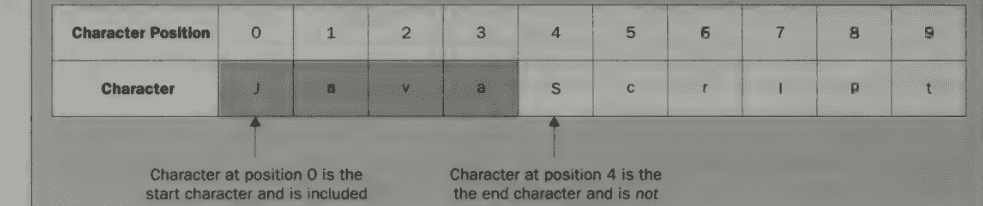

与 `substring()` 类似，`substr()` 方法同样接受两个参数，第一个是子字符串中要包含的第一个字符的起始位置。然而，这次第二个参数指定的是要从较长字符串中截取出来的字符字符串的*长度*。例如，我们可以将上面的代码重写为：

```
var myString = "JavaScript";
var mySubString = myString.substr(0,4);
alert(mySubString);
```

与 `substring()` 方法一样，第二个参数是可选的。如果不包含它，则从起始位置开始的所有字符都将被包含。

使用一种方法而不是另一种的主要原因是 `substring()` 方法受到 IE 3+ 和 NN 2+ 浏览器的支持。然而，`substr()` 方法仅在版本 4（及更高版本）浏览器中有效。

让我们来看看同时使用 `substr()` 和 `lastIndexOf()` 方法的情况。在下一章中，我们将了解如何检索当前加载网页的文件路径和名称。然而，目前无法仅检索文件名本身。因此，例如，如果你的文件是 "D:\mywebsite\temp\myfile.htm"，你可能需要提取 myfile.htm 部分。这正是 `substr()` 和 `lastIndexOf()` 派上用场的地方：

```
var fileName = window.location.href;
fileName = fileName.substr(fileName.lastIndexOf("\\") + 1);
document.write("The file name of this page is " + fileName);
```

第一行将变量 fileName 设置为当前文件路径和名称，例如 D:\mywebsite\temp\myfile.htm。不必担心理解这一行，因为我们将在下一章中详细介绍它。

第二行是精彩之处。你可以看到，我已经将 `lastIndexOf()` 方法的返回值作为另一个方法的参数使用，这是完全正确且非常有用的。我们使用 `fileName.lastIndexOf("\\")` 的目标是找到最后一个反斜杠的位置，\，它将是文件名之前的最后一个字符。我们为这个值加一，因为我们不想包含该字符，然后将这个新值传递给 `substr()` 方法。这里没有第二个参数（长度），因为我们不知道它。结果，`substr()` 将返回从该位置到字符串末尾的所有字符，而这正是我们想要的。

> 此示例检索本地机器上的页面名称，因为我们不是从 Web 服务器访问页面。但不要因此误以为你能仅使用 JavaScript 从网页访问本地硬盘上的文件。为了保护用户免受恶意黑客的攻击，JavaScript 对用户系统的访问权限非常有限，例如对文件的访问。我们将在本书后面更详细地讨论这个问题。

#### toLowerCase() 和 toUpperCase() 方法——更改字符串的大小写

如果我们想要更改字符串的大小写，例如，要在比较字符串时消除大小写敏感性，那么我们需要 `toLowerCase()` 和 `toUpperCase()` 方法。不难猜出这两个方法的作用。它们都返回一个字符串，其值是 String 对象中的字符串值，但根据调用的方法将其大小写转换为大写或小写。任何非字母字符在这些方法的作用下保持不变。

在以下示例中，我们可以看到，通过更改两个字符串的大小写，我们可以在不考虑大小写敏感性的情况下比较它们：

```
var myString = "I Don't Care About Case"

if (myString.toLowerCase() == "i don't care about case")
{
    alert("Who cares about case?");
}
```

尽管 `toLowerCase()` 和 `toUpperCase()` 不接受任何参数，但你必须记得在末尾加上两个空括号，即 ()。

#### Math 对象

Math 对象提供了许多有用的数学函数和数字操作方法。我们将在这里介绍其中的一些，其余的将在附录 B 中描述。

Math 对象有点不寻常，因为 JavaScript 会自动为你创建它。无需将变量声明为 Math 对象，或在能够使用之前定义新的 Math 对象，这使其使用起来稍微容易一些。


#### 第 4 章

Math 对象的属性包含了一些非常有用的数学常量，例如 PI 属性（其值为 3.14159 等）。像往常一样，我们通过在对象名称（Math）后面加上点号（.），然后写上属性名称来访问这些属性。例如，要计算圆的面积，我们可以使用以下代码：

```
var radius = prompt("Give the radius of the circle", "");
var area = (Math.PI)*radius*radius;
document.write("The area is " + area);
```

Math 对象的方法包含了一些使用标准数学运算符（+，-，*，/）无法实现或难以实现的操作。例如，`cos()` 方法返回传递给参数值的余弦值。我们现在来看几个这样的方法。

#### abs() 方法

`abs()` 方法返回传递给其参数的数值的绝对值。本质上，这意味着它返回该数值的正值。因此 -1 返回为 1，-4 返回为 4，依此类推。然而，1 将被返回为 1，因为它已经是正数。

例如，以下代码将在页面上写入数字 101：

```
var myNumber = -101;
document.write(Math.abs(myNumber));
```

#### ceil() 方法

`ceil()` 方法总是将一个数字向上舍入到下一个最大的整数。因此 10.01 变为 11，-9.99 变为 -9（因为 -9 大于 -10）。`ceil()` 方法只有一个参数，即您想要向上舍入的数字。

使用 `ceil()` 与我们在第 2 章中看到的 `parseInt()` 函数不同，因为 `parseInt()` 只是简单地截掉小数点后的所有数字以留下一个整数，而 `ceil()` 则是将数字向上舍入。

例如，以下代码在页面上写入两行，第一行包含数字 102，第二行包含数字 101：

```
var myNumber = 101.01;
document.write(Math.ceil(myNumber) + "<BR>");
document.write(parseInt(myNumber));
```

#### floor() 方法

与 `ceil()` 方法类似，`floor()` 方法会删除小数点后的所有数字，并返回一个整数。区别在于 `floor()` 总是将数字向下舍入。因此，如果我们传递 10.01，将返回 10；如果我们传递 -9.99，我们将看到返回 -10。

#### round() 方法

`round()` 方法与 `ceil()` 和 `floor()` 非常相似，不同之处在于它不是总是向上或向下舍入，而是在小数部分为 .5 或更大时向上舍入，否则向下舍入。

例如：

```
var myNumber = 44.5;
document.write(Math.round(myNumber) + "<BR>");

myNumber = 44.49;
document.write(Math.round(myNumber));
```

将在页面上写入数字 45 和 44。

#### 舍入方法总结

正如我们所看到的，`ceil()`、`floor()` 和 `round()` 方法都删除了小数点后的数字并仅返回一个整数。然而，它们返回哪个整数取决于所使用的方法：`floor()` 返回最小值，`ceil()` 返回最大值，而 `round()` 返回最接近的等效整数。这可能会有点令人困惑，因此下面是一个数值表，以及如果将这些数值传递给 `parseInt()` 函数以及 `ceil()`、`floor()` 和 `round()` 方法将返回哪个整数。

| 参数 | parseInt() 返回 | ceil() 返回 | floor() 返回 | round() 返回 |
|---|---|---|---|---|
| 10.25 | 10 | 11 | 10 | 10 |
| 10.75 | 10 | 11 | 10 | 11 |
| 10.5 | 10 | 11 | 10 | 11 |
| -10.25 | -10 | -10 | -11 | -10 |
| -10.75 | -10 | -10 | -11 | -11 |
| -10.5 | -10 | -10 | -11 | -10 |

> 请记住，`parseInt()` 是一个原生的 JavaScript 函数，而不是 Math 对象的方法，与本表中提供的其他方法不同。

#### 尝试一下 – JavaScript 舍入函数结果计算器

如果您仍然不确定如何舍入数字，那么下面的示例应该会有所帮助。在这里，我们将查看一个计算器，它从用户那里获取一个数字，然后写出当我们将该数字传递给 `parseInt()`、`ceil()`、`floor()` 和 `round()` 时的结果。

```
<HTML>
<BODY>
<SCRIPT Language=JavaScript>

var myNumber = prompt("Enter the number to be rounded","");

document.write("<H3>The number you entered was " + myNumber + "</H3><BR>");
document.write("<P>The rounding results for this number are</P>");
document.write("<TABLE WIDTH=150 BORDER=1>");
document.write("<TR><TH>Method</TH><TH>Result</TH></TR>");
document.write("<TR><TD>parseInt()</TD><TD>"+ parseInt(myNumber) +"</TD></TR>");
document.write("<TR><TD>ceil()</TD><TD>" + Math.ceil(myNumber) + "</TD></TR>");
document.write("<TR><TD>floor()</TD><TD>" + Math.floor(myNumber) + "</TD></TR>");
document.write("<TR><TD>round()</TD><TD>" + Math.round(myNumber) +"</TD></TR>");
document.write("</TABLE>")

</SCRIPT>
</BODY>
</HTML>
```

将其保存为 `ch4_examp3.htm` 并加载到浏览器中。在提示框中输入一个数字，例如 -12.354，然后点击确定。将此数字传递给 `parseInt()`、`ceil()`、`floor()` 和 `round()` 的结果将显示在页面上，并格式化在如下所示的表格中。

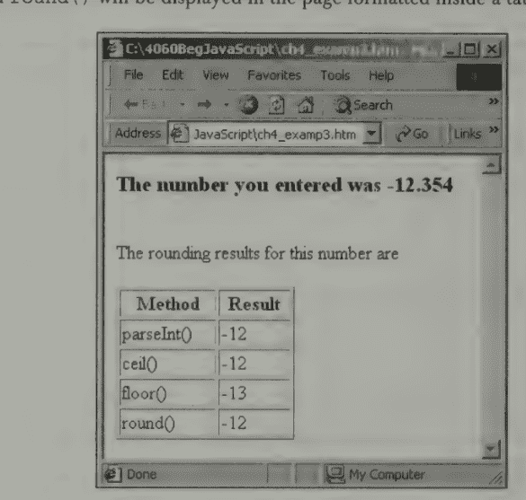

#### 工作原理

我们的第一个任务是从用户那里获取要舍入的数字：

```
var myNumber = prompt("Enter the number to be rounded","");
```

然后，我们写出该数字和一些描述性文本：

```
document.write("<H3>The number you entered was " + myNumber + "</H3><BR>");
document.write("<P>The rounding results for this number are</P>");
```

请注意，这次包含了一些用于格式化的 HTML 标签，主标题在 `<H3>` 标签中，而对表格含义的描述在段落 `<P>` 标签内。

接下来我们创建结果表：

```
document.write("<TABLE WIDTH=150 BORDER=1>");
document.write("<TR><TH>Method</TH><TH>Result</TH></TR>");
document.write("<TR><TD>parseInt()</TD><TD>"+ parseInt(myNumber) +"</TD></TR>");
document.write("<TR><TD>ceil()</TD><TD>" + Math.ceil(myNumber) + "</TD></TR>");
document.write("<TR><TD>floor()</TD><TD>"+ Math.floor(myNumber) + "</TD></TR>");
document.write("<TR><TD>round()</TD><TD>" + Math.round(myNumber) +"</TD></TR>");
document.write("</TABLE>")
```

我们在实际显示每个舍入函数的结果（每行一个）之前，先创建表头。你可以看到仅使用 JavaScript 就可以多么轻松地在网页中动态创建 HTML。其原理与页面中的 HTML 相同：我们必须确保标签语法正确，否则内容会出现异常或根本不显示。

每一行都遵循相同的原则，只是使用了不同的舍入函数。让我们来看看显示 `parseInt()` 结果的第一行：

```
document.write("<TR><TD>parseInt()</TD><TD>"+ parseInt(myNumber) +"</TD></TR>");
```

在要写入页面的字符串中，我们首先使用 `<TR>` 标签创建表格行。然后使用 `<TD>` 标签创建表格单元格，并插入该行显示的对应方法名称。接着我们用 `</TD>` 关闭单元格并用 `<TD>` 打开一个新单元格。在下一个单元格中，我们放置 `parseInt()` 函数的实际结果。虽然 `parseInt()` 返回的是一个数字，但因为我们将其与字符串拼接，JavaScript 会在拼接前自动将 `parseInt()` 返回的数字转换为字符串。这一切都在后台发生，无需我们手动操作。最后，我们用 `</TD></TR>` 关闭单元格和行。

#### random() 方法

`random()` 方法返回一个在 0 和 1 之间的随机浮点数，其中包含 0 但不包含 1。这在显示随机横幅图片或编写 JavaScript 游戏时非常有用。

让我们看看如何模拟掷单个骰子的过程。在下面的页面中，有 10 个随机数被写入页面。点击浏览器的刷新按钮以获取另一组随机数。

```
<HTML>
<BODY>
<SCRIPT LANGUAGE=JavaScript>
var throwCount;
var diceThrow;
for (throwCount = 0; throwCount < 10; throwCount++)
{
    diceThrow = (Math.floor(Math.random() * 6) + 1);
    document.write(diceThrow + "<BR>");
}
</SCRIPT>
</BODY>
</HTML>
```


#### 第 4 章

我们希望 `diceThrow` 的值在 1 到 6 之间。`random()` 函数返回一个介于 0 到小于 1 之间的浮点数。通过将这个数乘以 6，我们得到一个介于 0 到小于 6 之间的数。然后加上 1，我们就得到了一个介于 1 到小于 7 之间的数。通过使用 `floor()` 总是向下舍入到下一个最小的整数，我们可以确保最终得到一个在 1 到 6 之间的数。

如果我们想要一个 1 到 100 之间的随机数，只需修改代码，将 `Math.random()` 乘以 100 而不是 6。

#### pow() 方法

`pow()` 方法将一个数提升到指定的幂。它接受两个参数，第一个参数是要提升到指定幂的数，第二个参数是幂本身。例如，要将 2 提升到 8 次幂，即计算 2 * 2 * 2 * 2 * 2 * 2 * 2 * 2，我们会写 `Math.pow(2, 8)` —— 结果是 256。与 `sin()`、`cos()` 和 `acos()` 等其他一些在非科学应用编程中不常用的数学方法不同，`pow()` 方法通常非常有用。

#### 动手试试 – 使用 pow()

在下面的例子中，我们使用 `pow()` 编写了一个函数，用于固定数字的小数位数——这是 JavaScript 缺少的一个功能。这有助于证明，即使 JavaScript 缺少某个函数，你通常也可以使用现有函数来创建你需要的功能。

```html
<HTML>
<HEAD>
<SCRIPT LANGUAGE=JavaScript>

function fix(fixNumber, decimalPlaces)
{
    var div = Math.pow(10,decimalPlaces);
    fixNumber = Math.round(fixNumber * div) / div;
    return fixNumber;
}
</SCRIPT>
</HEAD>
<BODY>
<SCRIPT LANGUAGE=JavaScript>

var number1 = prompt("输入你想固定小数位数的数字","");
var number2 = prompt("你想要固定多少位小数？","");

document.write(number1 + " 固定为 " + number2 + " 位小数是：");
document.write(fix(number1,number2));

</SCRIPT>
</BODY>
</HTML>
```

将页面保存为 ch4_examp4.htm。

当在浏览器中加载该页面时，你会看到两个提示框。在第一个框中输入你想固定小数位数的数字，例如 2.2345。在第二个框中输入你想要固定的小数位数，例如 2。然后，将你给定的数字固定到给定位数的结果将被写入页面。对于我给出的示例数字，结果将是 2.23。

#### JavaScript – 基于对象的语言

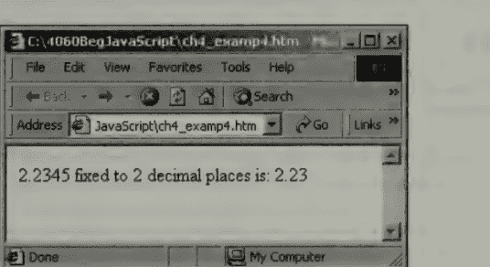

#### 工作原理

在页面的头部，我们定义了 `fix()` 函数。该函数会将其 `fixNumber` 参数固定为最多 `decimalPlaces` 参数指定的小数位数。例如，将 34.76459 固定为最多 3 位小数将返回 34.765。

函数中的第一行代码将变量 `div` 设置为 10 的指定小数位数的幂：

```javascript
function fix(fixNumber, decimalPlaces)
{
    var div = Math.pow(10, decimalPlaces);
```

然后，在下一行，我们计算新数字：

```javascript
fixNumber = Math.round(fixNumber * div) / div;
```

代码 `Math.round(fixNumber * div)` 的作用是将我们转换的数字中的小数点移动到我们想要保留的数字的小数点之后。所以对于 2.2345，如果我们想保留两位小数，就将其转换为 223.45。`Math.round()` 方法将此数字四舍五入到最接近的整数（本例中是 223），从而去除了任何不需要的小数部分。

然后我们将这个数字转换回它应有的分数，但当然只保留我们想要的小数部分。我们通过除以与乘以相同的数字（`div`）来实现。在我们的例子中，我们将 223 除以 100，得到 2.23。这就是 2.2345 固定为两位小数的结果。这个值通过以下代码行返回给调用代码：

```javascript
return fixNumber;
}
```

在页面正文中，我们使用两个提示框从用户那里获取数字。然后我们使用 `document.write()` 将使用这些数字调用 `fix()` 函数的结果显示给用户。

#### 数组对象

我们在第 2 章看到了如何创建和使用数组，并且在本章前面我已经向你承认它们实际上是对象。

除了存储数据，数组对象还提供了许多有用的属性和方法，我们可以用它们来操作数组中的数据并获取信息，例如数组的大小。

同样，这不是对数组对象所有属性和方法的详尽介绍，而只是一些更有用的。其余的细节你可以在附录 B 中找到。

### length 属性 – 查找数组中的元素数量

length 属性给出了数组中的元素数量。回想一下，我们在第 3 章的趣味测验中已经见过它的使用。有时我们确切知道数组的长度，但有些情况下，我们可能一直在向数组添加新元素，却没有简单的方法来跟踪添加了多少个。

length 属性可用于查找数组中最后一个元素的索引。下面的示例说明了这一点：

```javascript
var names = new Array();

names[0] = "Paul";
names[1] = "Catherine";
names[11] = "Steve";

document.write("最后一个名字是 " + names[names.length - 1]);
```

请注意，我们已在索引位置 0、1 和 11 的元素中插入了数据。数组索引从 0 开始，因此最后一个元素的索引是 length - 1，即 11，而不是 length 属性的值 12。

length 属性有用的另一种情况是 JavaScript 方法返回一个它自己构建的数组。例如，在第 8 章关于高级字符串处理中，我们将看到 String 对象有 split() 方法，它将文本分割成片段并将结果作为数组对象返回。由于数组是由 JavaScript 创建的，如果没有 length 属性，我们就无法知道数组中最后一个元素的索引是什么。

### concat() 方法 – 将数组连接在一起

如果我们想将两个独立的数组连接成一个大数组，那么我们可以使用数组对象的 concat() 方法。concat() 方法返回一个新数组，它是两个数组的组合：第一个数组的元素，然后是第二个数组的元素。为此，我们在第一个数组上调用该方法，并将第二个数组的名称作为其参数传递。

例如，假设我们有两个数组，names 和 ages，它们分别如下所示：

names 数组：

| 元素索引 | 0 | 1 | 2 |
| :--- | :--- | :--- | :--- |
| 值 | Paul | Catherine | Steve |

ages 数组：

| 元素索引 | 0 | 1 | 2 |
| :--- | :--- | :--- | :--- |
| 值 | 31 | 29 | 34 |

如果我们使用 `names.concat(ages)` 将它们组合起来，我们将得到一个这样的数组：

| 元素索引 | 0 | 1 | 2 | 3 | 4 | 5 |
| :--- | :--- | :--- | :--- | :--- | :--- | :--- |
| 值 | Paul | Catherine | Steve | 31 | 29 | 34 |

在下面的代码中，我们正是这样做的：

```javascript
var names = new Array("Paul","Catherine","Steve");
var ages = new Array(31,29,34);

var concatArray;

concatArray = names.concat(ages);
```

也可以将两个数组组合成一个，但将新数组赋值给现有第一个数组的名称，使用 `names = names.concat(ages)`。

如果我们使用 `ages.concat(names)`，会有什么不同？嗯，如下所示，区别在于现在 `ages` 数组的元素在前，然后连接的是 `names` 数组的元素：

| 元素索引 | 0 | 1 | 2 | 3 | 4 | 5 |
| :--- | :--- | :--- | :--- | :--- | :--- | :--- |
| 值 | 31 | 29 | 34 | Paul | Catherine | Steve |

使用 `concat()` 方法时，重要的是要注意它仅在版本 4 或更高版本的浏览器中可用。

### slice() 方法 – 复制数组的一部分

当我们只想复制数组的一部分时，可以使用 `slice()` 方法。使用 `slice()` 方法，我们可以切出数组的一部分并将其分配给一个新的变量名。`slice()` 方法有两个参数：

- 你想要复制的第一个元素的索引
- 标记要切出的部分结束位置的元素的索引（可选）


#### 第 4 章

就像使用 `substr()` 和 `substring()` 进行字符串复制一样，起点包含在复制范围内，但终点不包含。同样地，如果你不提供第二个参数，那么从起始索引开始的所有元素都将被复制。

假设我们有如下所示的 names 数组：

| 索引 | 0 | 1 | 2 | 3 | 4 |
| 价值 | Paul | Sarah | Louise | Adam | Bob |

如果我们想创建一个包含元素 1 (Sarah) 和 2 (Louise) 的新数组，我们需要指定起始索引为 1，结束索引为 3。代码如下所示：

```
var names = new Array("Paul","Sarah","Louise","Adam","Bob");
var slicedArray = names.slice(1,3);
```

请注意，当 JavaScript 复制数组时，它会将新元素复制到一个新数组中，在该数组中它们的索引为 0 和 1，而不是原来的索引 1 和 2。切片后，`slicedArray` 如下所示：

| 索引 | 0 | 1 |
| 价值 | Sarah | Louise |

第一个数组 names 不受切片操作的影响。

与 `concat()` 方法一样，`slice()` 方法仅在版本 4 及更高版本的浏览器中可用。

### join() 方法 – 将数组转换为单个字符串

`join()` 方法将数组中的所有元素连接起来并以字符串形式返回。它还允许你指定在每个元素被连接在一起时，想要插入在它们 *之间* 的任何字符。该方法只有一个参数，即我们希望在每个元素之间放置的字符串。

通过示例会更清晰。假设我的每周购物清单存储在一个数组中，如下所示：

| 索引 | 0 | 1 | 2 | 3 | 4 |
| 价值 | Eggs | Milk | Potatoes | Cereal | Banana |

现在我想使用 `document.write()` 将我的购物清单写入页面。我希望每件商品都位于不同的行，这意味着在每个元素之间使用 `<BR>` 标签。首先，我需要声明我的数组：

```
var myShopping = new Array("Eggs","Milk","Potatoes","Cereal","Banana");
```

现在，让我们使用 `join()` 方法将该数组转换为一个字符串：

```
var myShoppingList = myShopping.join("<BR>");
```

现在变量 `myShoppingList` 将持有以下文本：

```
"Eggs<BR>Milk<BR>Potatoes<BR>Cereal<BR>Banana"
```

我们可以使用 `document.write()` 将其写入页面：

```
document.write(myShoppingList);
```

现在，购物清单将出现在页面中，每件商品占一行：

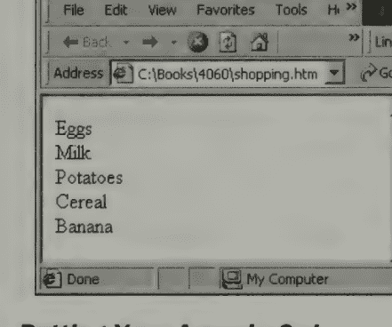

### sort() 方法 – 对数组进行排序

如果你的数组包含相似的数据，例如姓名列表或年龄列表，那么你可能希望将它们按字母顺序或数字顺序排列。`sort()` 方法让这件事变得非常简单。在下面的代码中，我们定义了数组，然后使用 `names.sort()` 将其按字母升序排列。最后，我们将其输出以便查看排序结果：

```
var names = new Array("Paul","Sarah","Louise","Adam","Bob");
var elementIndex;

names.sort();
document.write("Now the names again in order" + "<BR>");

for (elementIndex = 0; elementIndex < names.length; elementIndex++)
{
    document.write(names[elementIndex] + "<BR>");
}
```

不要忘记排序是区分大小写的，因此 Paul 会排在 paul 之前。事实上，数组元素是根据其字符的 Unicode 字符数值进行排序的。因此，包含元素 Adam, adam, Zoë, zoë 的数组将被排序为 Adam, Zoë, adam, zoë。

请注意，在 our for 语句中，我们在条件语句中使用了 Array 对象的 length 属性，而不是像这样手动插入数组长度 (5)：

```
for (elementIndex = 0; elementIndex < 5; elementIndex++)
```

为什么要这样做？毕竟我们预先知道数组中有 5 个元素。那么，如果我们通过添加两个更多姓名来更改数组中的元素数量会发生什么？

```
var names = new Array("Paul", "Sarah", "Louise", "Adam", "Bob", "Karen", "Steve");
```

如果我们插入的是 5 而不是 names.length，我们的循环代码将无法按预期工作。除非我们将 for 循环的条件部分改为 7，否则它不会显示最后两个元素。通过使用 length 属性，我们让自己省事了，因为现在即使我们添加数组元素，也不需要更改其他地方的代码。

好了，我们已经实现了升序排列，但如果我们想要降序排列呢？这就是 reverse() 方法发挥作用的地方。

### reverse() 方法 - 将数组反序排列

我们将看到的最后一个 String 对象（此处应为 Array 对象）方法是 reverse() 方法，无需猜测——它会反转数组的顺序，使末尾的元素移到前面。让我们再次以购物清单为例：

| 索引 | 0 | 1 | 2 | 3 | 4 |
| 价值 | Eggs | Milk | Potatoes | Cereal | Banana |

如果我们使用 reverse() 方法：

```
var myShopping = new Array("Eggs", "Milk", "Potatoes", "Cereal", "Banana");
myShopping.reverse();
```

最终数组元素的顺序将变为：

| 索引 | 0 | 1 | 2 | 3 | 4 |
| 价值 | Banana | Cereal | Potatoes | Milk | Eggs |

为了证明这一点，我们可以使用之前看到的 join() 方法将其写入页面：

```
var myShoppingList = myShopping.join("<BR>")
document.write(myShoppingList);
```

### 动手尝试 – 数组排序

当与 sort() 方法结合使用时，reverse() 方法可用于对数组进行排序，使其元素以反向字母或数字顺序出现。以下示例展示了这一点：

```
<HTML>
<BODY>
<SCRIPT LANGUAGE=JavaScript>

var myShopping = new Array("Eggs","Milk","Potatoes","Cereal","Banana");

var ord = prompt("Enter 1 for alphabetical order, and -1 for reverse order", 1);

if (ord == 1)
{
    myShopping.sort();
    document.write(myShopping.join("<BR>"));
}
else if (ord == -1)
{
    myShopping.sort();
    myShopping.reverse();
    document.write(myShopping.join("<BR>"));
}
else
{
    document.write("That is not a valid input");
}
</SCRIPT>
</BODY>
</HTML>
```

将该示例保存为 ch4_examp5.htm。当你将其加载到浏览器中时，系统会要求你根据是否想要正序或反序排列数组来输入内容。如果你输入 1，数组将正序显示。如果你输入 -1，数组将反序显示。如果你输入这两个值以外的任何内容，系统将告知你的输入无效。

#### 工作原理

在脚本块的顶部，我们定义了在本节中一直使用的包含购物清单的数组。接下来，我们定义变量 ord 为用户在提示框中输入的值：

```
var ord = prompt("Enter 1 for alphabetical order, and -1 for reverse order", 1);
```

该值被用于随后的 if 语句条件中。第一个 if 检查 ord 的值是否为 1，即用户是否想要按字母顺序排列数组。如果是，则执行以下代码：

```
myShopping.sort();
document.write(myShopping.join("<BR>"));
```

数组被排序，然后使用 join() 方法在单独的行中显示给用户。接下来在 else if 语句中，我们检查 ord 的值是否为 -1，即用户是否想要按反向字母顺序排列数组。如果是，则执行以下代码：

```
myShopping.sort();
myShopping.reverse();
document.write(myShopping.join("<BR>"));
```

在这里，我们在反转顺序之前先对数组进行排序。同样，数组使用 join() 方法显示给用户。

最后，如果 ord 既不是 1 也不是 -1，我们告诉用户其输入无效：

```
document.write("That is not a valid input");
```

### Date 对象

Date 对象处理 JavaScript 中所有与日期和时间相关的事项。使用它，我们可以获取当前的日期和时间，存储自定义的日期和时间，对这些日期进行计算，并将日期转换为字符串。

Date 对象拥有许多方法，使用起来可能有些复杂，这就是为什么本书后面专门有一章讨论 JavaScript 中的日期、时间和定时器（第 9 章）。在第 11 章中，我们还将看到如何使用日期来计算自用户上次访问以来网站是否添加了新内容。不过，在本节中，我们将重点讨论如何创建 Date 对象及其一些常用方法。

### 创建 Date 对象

有四种声明和初始化 Date 对象的方法。在第一种方法中，我们只声明一个新 Date 对象，而不初始化其值。在这种情况下，日期和时间值将被设置为运行脚本的 PC 上的当前日期和时间：

```
var theDate1 = new Date();
```

其次，我们可以通过传递自 1970 年 1 月 1 日 00:00:00 以来经过的毫秒数来定义 Date 对象。在下面的示例中，日期是 2000 年 1 月 31 日 00:20:00 GMT（即过了午夜 20 分钟）：

```
var theDate2 = new Date(949278000000);
```

你可能不会经常使用这种定义 Date 对象的方法，但这正是 JavaScript 实际存储日期的方式。其他提供日期的格式纯粹是为了我们的方便。

接下来，我们可以传递一个代表日期或日期和时间的字符串。在下面的示例中，我们使用了 "31 January 2000"：

```
var theDate3 = new Date("31 January 2000");
```

#### JavaScript – 一种基于对象的语言

然而，我们可以写成 2000年1月31日、Jan 31 2000、01-31-2000，或者任何你在正常书写日期时通常会预期的有效变体——如果不确定，可以尝试一下。如果你是在为美国以外的国际受众编写网页，那么你需要意识到指定日期的不同方式。在英国和许多其他地方，标准是“日, 月, 年”，而在美国，标准是“月, 日, 年”。如果你只指定数字，这可能会导致问题——JavaScript 可能会认为你在指代“日”，而你的本意是“月”。避免这种困扰最简单的方法是，尽可能始终使用月份的名称。这样就不会产生混淆。

在第四种也是最后一种方式中，我们通过传递由逗号分隔的以下参数来初始化 Date 对象：年、月、日、小时、分钟、秒和毫秒。例如：

```
var theDate4 = new Date(2000,0,31,15,35,20,20);
```

这个日期实际上是 2000年1月31日 15:35:20 和 20 毫秒。如果你愿意，可以只指定日期部分而忽略时间。

需要注意的一点是，在这种情况下，一月是月份 `0` 而不是你预期的月份 `1`，十二月则是月份 `11`。这是一个非常容易犯的错误。

#### 获取日期值

存储日期是很不错，但我们如何再次获取这些信息呢？很简单，我们只需使用 `get` 方法。这些方法汇总在下表中：

| 方法 | 返回值 |
|---|---|
| getDate() | 一个月中的日期（日）。 |
| getDay() | 一周中的第几天，以整数表示，周一是 0，周二是 1，依此类推。 |
| getMonth() | 月份，以整数表示，一月为 0，二月为 1，依此类推。 |
| getFullYear() | 年份，为一个四位数字。 |

例如，如果我们想获取 `ourDateObj` 中的月份，那么我们可以简单地写：

```
theMonth = myDateObject.getMonth();
```

所有这些方法的工作方式都非常相似，并且所有返回的值都基于本地时间，即代码运行所在机器的本地时间。也可以使用世界标准时间（Universal Time，此前称为 GMT），但我们将把这个内容的探讨留到第 9 章。

请注意，`getFullYear()` 方法仅在 IE 4+ 和 NN 4.06+ 中可用。

#### 尝试一下 – 使用 Date 对象检索当前日期

在下面的示例中，我们使用刚才讨论的获取日期类型的方法，将当前的日、月、年写入到网页中。

```
<HTML>
<BODY>

<SCRIPT LANGUAGE=JavaScript>

var months = new Array("January","February","March","April","May","June","July",
                      "August","September","October","November","December");
var dateNow = new Date();
var yearNow = dateNow.getFullYear();
var monthNow = months[dateNow.getMonth()];
var dayNow = dateNow.getDate();
var daySuffix;

switch (dayNow)
{
case 1:
case 21:
case 31:
    daySuffix = "st";
    break;
case 2:
case 22:
    daySuffix = "nd";
    break;
case 3:
case 23:
    daySuffix = "rd";
    break;
default:
    daySuffix = "th";
    break;
}

document.write("It is the " + dayNow + daySuffix + " day ");
document.write("in the month of " + monthNow);
document.write(" in the year " + yearNow);

</SCRIPT>
</BODY>
</HTML>
```

将代码保存为 `ch4_examp6.htm`。如果你加载该页面，你应该能看到一个格式良好的句子，告诉你当前的日期。

#### 工作原理

我们在代码中做的第一件事是声明一个数组并用一年中的月份填充它。为什么要这样做？因为 Date 对象没有一种方法能让我们通过名称而非数字来获取月份。不过，这不成问题，我们只需声明一个月份数组，并使用月份数字作为数组索引来选择正确的月份名称：

```
var months = new Array("January","February","March","April","May","June","July",
                      "August","September","October","November","December");
```

接下来我们创建一个新的 Date 对象，由于没有使用自定义值进行初始化，我们允许它自行初始化为当前的日期和时间：

```
var dateNow = new Date();
```

随后，我们将 `yearNow` 变量设置为由 `getFullYear()` 方法返回的当前年份：

```
var yearNow = dateNow.getFullYear();
```

请注意，`getFullYear()` 仅在第四版浏览器（如 IE 4 和 NN 4.06 及以上版本）中才可用。在此之前，只有 `getYear()` 方法，而在某些浏览器上它仅返回两位数的年份。

然后，我们使用 `getMonth()` 返回的值作为索引，从数组元素中获取值并填充到 `monthNow` 变量中。记住 `getMonth()` 返回的月份是整数值，一月从 0 开始——这是一个便利之处，因为数组也从零开始，因此无需调整即可找到正确的数组元素：

```
var monthNow = months[dateNow.getMonth()];
```

最后，将当前月份的日期放入变量 `dayNow` 中：

```
var dayNow = dateNow.getDate();
```

接下来，我们使用了在上一章学到的 `switch` 语句。这是一种为我们已有的日期添加正确后缀的有用技巧。毕竟，如果我们能说 “it is the 1st day” 而不是 “it is the 1 day”，我们的应用程序看起来会更专业。然而，这有点棘手，因为我们要添加的后缀取决于它前面的数字。因此，对于每月 1 日、21 日和 31 日，我们有：

```
switch (dayNow)
{
case 1:
case 21:
case 31:
    daySuffix = "st";
    break;
```

对于 2 日和 22 日，我们有：

```
case 2:
case 22:
    daySuffix = "nd";
    break;
```

对于 3 日和 23 日，我们有：

```
case 3:
case 23:
    daySuffix = "rd";
    break;
```

最后，我们需要为其他所有情况设置默认情况（`default`）。正如你现在已经猜到的，这简单地就是 “th”：

```
default:
    daySuffix = "th";
    break;
}
```

在最后几行中，我们只需使用 `document.write()` 将信息写入 HTML 页面。

#### 设置日期值

为了更改 Date 对象中的部分日期，我们有一组 `set` 函数，它们几乎完全复制了上面描述的 `get` 函数，只不过我们是在设置值而不是获取值。这些函数汇总在下表中：

| 方法 | 描述 |
|---|---|
| setDate() | 将月份的日期作为参数传递以设置日期 |
| setMonth() | 将年份的月份作为整数参数传递，其中 0 代表一月，1 代表二月，依此类推 |
| setFullYear() | 将年份设置为作为参数传递的 4 位整数 |

请注意，出于安全原因，基于 Web 的 JavaScript 无法更改用户计算机上的当前日期和时间。

因此，要将年份更改为 2001 年，代码如下：

```
myDateObject.setFullYear(2001);
```

同样，`setFullYear()` 方法仅在 IE 4+ 和 NN 4.06+ 浏览器中可用。

将日期和月份设置为 2 月 27 日的代码如下：

```
myDateObject.setDate(27);
myDateObject.setMonth(1);
```

这里需要注意的一个小点是，没有与 `getDay()` 方法直接对应的设置方法。一旦年、日、月被定义，星期几会自动为你设置好。

#### 计算与日期

看看下面的代码：

```
var myDate = new Date("1 Jan 2000");
myDate.setDate(32);
document.write(myDate);
```

这肯定有错——一月什么时候有 32 天了？这个疑问的答案是，一月当然没有 32 天，JavaScript 知道这一点。相反，JavaScript 将日期设置为从 1 月 1 日起算 32 天之后——也就是说，它将其设置为 2 月 1 日。

同样的情况也适用于 `setMonth()` 方法。如果你将其设置为大于 11 的值，日期会自动滚动到下一年。因此，如果我们使用 `setMonth(12)`，这将把日期设置为明年的一月，同样 `setMonth(13)` 是明年的二月。

我们如何利用 `setDate()` 和 `setMonth()` 的这个特性来为我们提供便利呢？比如说，如果我们想知道从现在起 28 天后是哪一天。考虑到不同月份的天数不同，而且可能会跨年，这并不是像最初看起来那么简单的任务。或者说，如果没有 `setDate()`，情况确实如此。实现此任务的代码如下：

```
var nowDate = new Date();
var currentDay = nowDate.getDate();
nowDate.setDate(currentDay + 28);
```

首先，我们将 `nowDate` 变量设置为一个没有初始化值的 Date 对象，从而获取当前系统日期。在下一行中，我们将当前月份的日期放入一个名为 `currentDay` 的变量中。为什么？因为当我们使用 `setDate()` 并传递一个超出该月最大天数的数值时，它会从该月的第一天开始，向后计算这么多天。因此，如果今天的日期是 1 月 15 日，而我们使用 `setDate(28)`，那么它就不是 1 月 15 日之后的 28 天，而是 1 月 1 日之后的 28 天。我们想要的是从当前日期起 28 天后，所以我们需要将当前日期与我们想要的提前天数相加。也就是说，我们需要 `setDate(15 + 28)`。在第三行中，我们将日期设置为当前日期加上 28 天。我们将当前月份的日期存储在 `currentDay` 中，所以现在我们只需向其加上 28 即可前进 28 天。

如果我们想要当前日期之前 28 天的日期，那么我们只需传递当前日期减去 28。请注意，这通常会是一个负数。我们只需要更改一行，即第三行，将其改为：

```
nowDate.setDate(currentDay - 28);
```

我们可以对 `setMonth()` 使用与 `setDate()` 完全相同的原理。

#### 获取时间值

检索单个时间数据的工作方式与日期值的 `get` 方法非常相似。我们在这里使用的方法汇总如下：

- `getHours()`
- `getMinutes()`
- `getSeconds()`
- `getMilliseconds()`


#### 第 4 章

这些方法分别返回指定 Date 对象的时、分、秒和毫秒，其中时间基于 24 小时制：0 代表午夜，23 代表晚上 11 点。

请注意，`getMilliseconds()` 方法仅在 IE 4+ 和 NN 4.06+ 浏览器中可用。

### 尝试一下 – 将当前时间写入网页

让我们来看一个将当前时间写入页面的示例：

```
<HTML>
<BODY>
<SCRIPT LANGUAGE=JavaScript>

var greeting;

var nowDate = new Date();
var nowHour = nowDate.getHours();
var nowMinute = nowDate.getMinutes();
var nowSecond = nowDate.getSeconds();

if (nowMinute < 10)
{
    nowMinute = "0" + nowMinute;
}

if (nowSecond < 10)
{
    nowSecond = "0" + nowSecond;
}

if (nowHour < 12)
{
    greeting = "Good Morning";
}
else if (nowHour < 17)
{
    greeting = "Good Afternoon";
}
else
{
    greeting = "Good Evening";
}

document.write("<H4>" + greeting + " and welcome to my website</H4>")
document.write("According to your clock the time is ");
document.write(nowHour + ":" + nowMinute + ":" + nowSecond);

</SCRIPT>
</BODY>
</HTML>
```

将此页面保存为 ch4_examp7.htm。

#### JavaScript – 一种基于对象的语言

当你将其加载到浏览器中时，它会根据一天中的时间在页面上写入一段问候语以及当前时间：

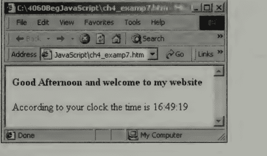

#### 工作原理

前两行代码声明了两个变量 —— `greeting` 和 `nowDate`：

```
var greeting;
var nowDate = new Date();
```

`greeting` 变量稍后将用于存储网站上的欢迎消息，无论是早安、午安还是晚安。`nowDate` 变量被初始化为一个新的 `Date` 对象。注意 `Date` 对象的构造函数是空的，因此 JavaScript 将把当前日期和时间存储在其中。

接下来，我们从 `nowDate` 中获取当前时间信息并将其存储在各个变量中。你可以看到获取时间数据与获取日期数据非常相似，只是使用了不同的方法：

```
var nowHour = nowDate.getHours();
var nowMinute = nowDate.getMinutes();
var nowSecond = nowDate.getSeconds();
```

你可能会好奇为什么示例中包含以下代码行：

```
if (nowMinute < 10)
{
    nowMinute = "0" + nowMinute;
}

if (nowSecond < 10)
{
    nowSecond = "0" + nowSecond;
}
```

这些行仅仅是为了格式化原因。如果时间是 10 点 09 分，你希望看到像 10:09 这样的显示。你不想看到 10:9，而如果我们直接使用 `getMinutes()` 方法而不添加额外的零，就会得到 10:9。秒数也是一样。如果你只是在计算中使用这些数据，那么无需担心格式问题 —— 我们在这里处理格式是因为我们要将代码执行的时间插入到网页中。

#### 第 4 章

接下来，在一系列 if 语句中，我们根据一天中的时间决定为用户创建什么样的问候语：

```
if (nowHour < 12)
{
    greeting = "Good Morning";
}
else if (nowHour < 17)
{
    greeting = "Good Afternoon";
}
else
{
    greeting = "Good Evening";
}
```

最后，我们将问候语和当前时间写入页面：

```
document.write("<H4>" + greeting + " and welcome to my website</H4>");
document.write("According to your clock the time is ");
document.write(nowHour + ":" + nowMinute + ":" + nowSecond);
```

在第 9 章关于日期、时间和定时器的内容中，我们将学习如何向网页写入一个持续更新的时间，使其看起来像个时钟。

#### 设置时间值

当我们想要设置 Date 对象中的时间时，有一系列与获取时间类似的方法，但现在是：

- setHours()
- setMinutes()
- setSeconds()
- setMilliseconds()

同样，`setMilliseconds()` 方法仅在 IE4+ 和 NN 4.06+ 浏览器中可用。

这些方法的运作方式与设置日期类似，即如果我们把任何时间参数设置为非法值，JavaScript 会认为你是指下一个或上一个时间边界。如果当前是 9:57，而你将分钟设置为 64，那么时间将被设置为 10:04，也就是说，从 9:00 起算 64 分钟。

下面的代码演示了这一点：

```
var nowDate = new Date();
nowDate.setHours(9);
nowDate.setMinutes(57);
alert(nowDate);

nowDate.setMinutes(64);
alert(nowDate);
```

首先，我们声明 `nowDate` 变量并将其赋值给一个新的 Date 对象，该对象包含当前日期和时间。在接下来的两行中，我们将小时设置为 9，分钟设置为 57。我们使用警报框（alert box）显示日期和时间，此时应该显示 9:57。然后将分钟设置为 64，再次使用警报框向用户显示日期和时间。现在分钟已超过一小时，因此显示的时间应该是 10:04。

如果小时被设置为 23 而不是 9，那么将分钟设置为 64 不仅会将时间移至下一个小时，还会导致日期更改为下一天。

#### 总结

在本章中，我们探讨了对象的概念，并看到了它们对于理解 JavaScript 的至关重要性，因为 JavaScript 几乎用对象来表示一切。我们还研究了一些 JavaScript 语言提供的内置对象，以增强其功能。

我们了解到：

- JavaScript 是基于对象的 —— 它使用对象的概念来表示字符串、日期和数组等事物。
- 对象具有属性和方法。例如，Array 对象具有 `length` 属性和 `sort()` 方法。
- 要创建新对象，我们只需编写 `new ObjectType()`。我们可以在创建对象时选择对其进行初始化。
- 要设置对象的属性值或获取该值，只需编写 `ObjectName.ObjectProperty`。
- 调用对象的方法类似于调用函数。可能会传递参数，也可能会传回返回值。访问对象的方法与访问属性完全相同，但必须记住在末尾添加括号，即使没有参数也要添加。我们编写 `ObjectName.ObjectMethod()`。
- String 对象为文本提供了一个方便的包装对象，并为我们提供了获取文本长度、在字符串内搜索文本以及选择部分文本的方法。
- Math 对象是自动创建的，提供了一系列数学属性和方法。例如，要获得 0 到 1 之间的随机数，我们使用 `Math.random()` 方法。
- Array 对象提供了操作数组的方法。我们可以做的一些事情包括查找数组长度、对其元素进行排序以及将两个数组合并在一起。
- Date 对象提供了一种存储、计算以及后续访问日期和时间的方法。

在下一章中，我们将把注意力转向浏览器本身，特别是它为我们的 JavaScript 编程提供的各种对象。我们将看到，使用浏览器对象是创建功能强大网页的关键。

#### 第 4 章

#### 练习题

这些示例的建议解决方案可以在附录 A 中找到。

#### 问题 1

使用 Date 对象，计算从现在起 12 个月后的日期，并将其写入网页。

#### 问题 2

从用户那里获取一份姓名列表，将输入的每个姓名存储在数组中。持续获取姓名，直到用户输入为空。将姓名按升序排列，然后将它们写入页面，每个姓名占用一行。

#### 问题 3

在本章早些时候讨论 `pow()` 方法时，我们看到了如何巧妙地使用它将数字固定到特定的位数。然而，我们创建的函数有一个缺陷。一个正确的 `fix()` 函数在将 2.1 固定到三位小数时，应该返回：

```
2.100
```

然而，我们的 `fix()` 函数反而返回：

```
2.1
```

请修改 `fix()` 函数，以便在必要时添加额外的零。


## 第五章：浏览器编程

在前三章中，我们已经考察了 JavaScript 的核心语言。我们看到了如何使用变量和数据、对这些数据执行操作、在代码中做出决策、反复循环同一段代码，甚至如何编写自己的函数。在上一章中，我们进一步学习了 JavaScript 如何是一种基于对象的语言，并看到了如何使用原生 JavaScript 对象。然而，我们感兴趣的不仅仅是语言本身——我们还想了解如何为 Web 浏览器编写脚本。利用这一点，我们可以开始创建更令人印象深刻的网页。

JavaScript 不仅基于对象，浏览器也是由对象组成的。当 JavaScript 在浏览器中运行时，我们可以访问浏览器的对象，方式与我们在上一章中使用 JavaScript 原生对象完全相同。但是，浏览器为我们提供了哪种类型的对象呢？

浏览器为我们提供的对象数量相当可观。例如，有一个 `window` 对象对应于浏览器窗口。我们已经使用了该对象的两个方法，即 `alert()` 和 `prompt()` 方法。为简单起见，我们之前称这些为函数，但它们实际上是浏览器 window 对象的方法。

浏览器提供的另一个对象是页面本身，由 `document` 对象表示。同样，我们已经使用了该对象的方法和属性。回想一下第一章，我们使用了 document 对象的 `bgColor` 属性来更改浏览器的背景色。我们还一直在使用 document 对象的 `write()` 方法向页面写入信息。

还有许多其他对象，代表我们在页面中编写的许多 HTML。例如，对于我们用来在文档中插入图像的每个 `` 标签，都有一个 `IMG` 对象。

浏览器为我们提供的、可与 JavaScript 一起使用的对象集合通常称为**浏览器对象模型（BOM）**。

> *你经常会看到这个词被称为文档对象模型（DOM）。然而，在整本书中，我们将使用 DOM 一词来指代 W3C 的标准文档对象模型，这将在第十三章中讨论。*

JavaScript 获得所有这些附加功能也有其缺点。为我们提供的对象集合高度依赖于我们所使用的浏览器的品牌和版本。某些对象在某些浏览器中可用，而在其他浏览器中不可用，而其他对象在不同的浏览器中具有不同的属性和方法。IE 4、IE 5 和 NN 4 的 BOM 详细信息可分别在附录 E、F 和 G 中找到。我们将在第十二章中看到更多关于 IE 和 NN 浏览器 BOM 之间差异的内容。

然而，在本章中，我们将专注于 BOM 的核心功能，即所有浏览器共有的对象。仅坚持使用此类对象，我们仍然可以在 JavaScript 中实现很多目标。有关它们的更多信息可以在附录 C 中找到。

### 浏览器对象简介

在本节中，我们将介绍所有浏览器共有的 BOM 对象。

在第四章中，我们看到 JavaScript 有许多我们可以访问和使用的原生对象。大多数对象是我们需要自己创建的，例如 `String` 和 `Date` 对象。其他对象，例如 `Math` 对象，无需我们创建就已存在，并且页面开始加载时即可立即使用。

当 JavaScript 在网页中运行时，它可以访问 Web 浏览器提供的大量其他对象。与 `Math` 对象类似，这些是专门为我们创建的，而我们不需要显式地创建它们。正如我们上面提到的，对象、它们的方法、属性和事件都映射在一个称为浏览器对象模型或 BOM 的东西中。

BOM 非常庞大，起初可能会让人感到不知所措。然而，你会发现最初你使用的可用对象、方法和属性不会超过 10%。我们将在本章开始查看 BOM 中较常用的部分，如下图所示。BOM 的这些部分在一定程度上是所有浏览器共有的。后续章节将在此基础上展开，以至于到本书结束时，你将能够真正让 BOM 为你所用。

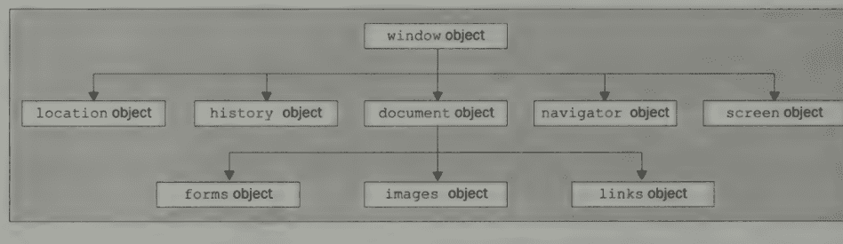

BOM 具有层次结构。该层次结构的顶层是 `window` 对象。你可以将其视为代表浏览器的框架以及与之相关的所有内容，例如滚动条、导航栏图标等。

在我们的窗口框架中包含的是页面。该页面在 BOM 中由 `document` 对象表示。你可以在下面的图示中看到：

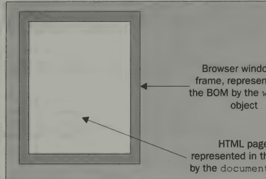

现在我们将继续更详细地讨论这些对象。

## window 对象——我们观察页面的窗口

`window` 对象代表浏览器容纳你网页的框架或窗口。在某种程度上，它也代表浏览器本身，并包含许多属性，这些属性之所以存在，仅仅是因为它们不适合放在其他任何地方。例如，通过 `window` 对象的属性，我们可以了解正在运行什么浏览器、用户访问过的页面、浏览器窗口的大小、用户屏幕的大小（如果我们使用的是 IE）等等。我们还可以使用 `window` 对象来访问和更改浏览器状态栏中的文本、更改加载的页面，甚至打开新窗口。

`window` 对象是一个**全局对象**，这意味着我们不需要使用它的名称来访问其属性和方法。例如，我们从本书开头就一直在使用的 `alert()` 函数实际上是 `window` 对象的 `alert()` 方法。虽然我们一直这样简单地使用它：

```javascript
alert("Hello!");
```

我们可以写成：

```javascript
window.alert("Hello!");
```

然而，由于 `window` 对象是全局对象，使用第一个版本是完全正确的。

`window` 对象的一些属性本身就是对象。IE 和 NN 共有的包括 `document`、`navigator`、`history`、`screen` 和 `location` 对象。`document` 对象代表我们的页面，`history` 对象包含用户访问过的页面历史，`navigator` 对象保存有关浏览器的信息，`screen` 对象包含有关客户端显示能力的信息，`location` 对象包含有关当前页面位置的详细信息。我们将在本章稍后单独查看这些重要对象。

### 使用 window 对象

让我们从一个简单的例子开始，在该示例中我们更改浏览器状态栏中显示的默认文本。状态栏（通常在浏览器窗口的左下角）通常由浏览器用来显示加载到浏览器中的任何文档的状态。例如，在 IE 中，一旦文档加载完成，你通常会在状态栏中看到 `Done`（完成），而在 Navigator 中，它通常显示 `Document : Done`（文档：完成）。让我们将其更改为显示 `Hello and Welcome`（你好，欢迎）。

要更改窗口状态栏中的默认消息，我们需要使用 window 对象的 `defaultStatus` 属性。

为此，我们可以编写：

```javascript
window.defaultStatus = "Hello and Welcome";
```

或者，由于 window 是全局对象，我们可以直接写：

```javascript
defaultStatus = "Hello and Welcome";
```

两种方式都有效，都是有效的，不过我通常更喜欢在前面写 `window`，因为这清楚地表明了 `defaultStatus` 属性的来源。否则我们可能会认为 `defaultStatus` 是一个变量名。这一点对于使用不太常见的属性和方法（例如 `defaultStatus`）尤其重要。对于像 `document` 这样的属性或像 `alert()` 这样的方法，你会发现你对它们如此熟悉，以至于不需要在前面加上 `window` 来提醒自己它们的上下文。

让我们将代码放入一个页面中：

```html
<HTML>
<HEAD>
<SCRIPT LANGUAGE=JavaScript>

window.defaultStatus = "Hello and Welcome";

</SCRIPT>
</HEAD>
</HTML>
```

将页面保存为 `ch5_examp1.htm` 并加载到你的浏览器中。你应该会在状态栏中看到指定的消息。

在这一点上，值得强调一点：在网页中，你不应该使用与 BOM 对象或其属性和方法的名称冲突的函数或变量名称。如果你这样做，可能不会出现错误，但会产生意外的结果。例如，在下面的代码中，我们声明了一个名为 `defaultStatus` 的变量。然后我们尝试将 window 对象的 `defaultStatus` 属性设置为 `"Welcome to my website"`。然而，这不会更改状态栏中的默认消息；相反，`defaultStatus` 变量中的值将被更改。

```javascript
var defaultStatus;
defaultStatus = "Welcome to my website";
```


在这种情况下，我们需要么使用不同的变量名，要么在我们想要修改的 `defaultStatus` 属性前加上 `window`：

```
var defaultStatus;
window.defaultStatus = "Welcome to my website";
```

这将产生我们想要的效果，即状态栏中的消息会发生改变。然而，这种写法显然会让代码变得非常混乱，因此通常最好的做法是不使用 BOM 对象、属性或方法名作为变量名。

与所有 BOM 对象一样，`window` 对象也有很多我们可以研究的属性和方法。不过，在本章中，我们将重点关注 `history`、`location`、`navigator`、`screen` 和 `document` 属性。这五个属性都包含对象（即 `history`、`location`location`、`navigator`、`screen` 和 `document` 对象），每个对象都有自己的属性和方法。在接下来的几页中，我们将依次研究这些对象，并了解它们如何帮助我们充分利用 BOM。

#### history 对象

`history` 对象用于跟踪用户访问的每个页面。这个页面列表通常被称为浏览器的历史堆栈。它允许用户点击浏览器的“后退”和“前进”按钮来重新访问页面。我们可以通过 `window` 对象的 `history` 属性来访问该对象。

与 JavaScript 原生的 `Array` 对象一样，`history` 对象有一个 `length` 属性。这可以用来查询历史堆栈中有多少个页面。

正如你所预料的，`history` 对象具有 `back()` 和 `forward()` 方法。当它们被调用时，浏览器中当前加载的页面位置会更改为用户访问过的前一个或后一个页面。（请注意，在 Netscape 6 中，`history` 对象的 `back()` 和 `forward()` 方法并不总是按预期工作。）

`history` 对象还具有 `go()` 方法。它接收一个参数，用于指定在历史堆栈中前进或后退多少步。例如，如果你想让用户返回到前前一个页面，你可以写：

```
history.go(-2);
```

若要前进三个页面，你可以写：

```
history.go(3);
```

请注意，`go(-1)` 与 `back()` 等效，`go(1)` 与 `forward()` 同样等效。

#### location 对象

`location` 对象包含了大量关于当前页面位置的潜在有用信息。它不仅包含页面的 URL（统一资源定位符），还包含托管页面的服务器、服务器连接的端口号以及所使用的协议。这些信息可以通过 `location` 对象的 `href`、`hostname`、`port` 和 `protocol` 属性获取。然而，许多此类值仅在我们从服务器加载页面时才真正相关，而不在像我们目前的示例中那样直接从本地硬盘加载页面时相关。

除了获取当前页面的位置外，我们还可以使用 `location` 对象的方法来更改位置并刷新当前页面。

### 更改位置

有两种导航到另一个页面的方法。我们可以将 `location` 对象的 `href` 属性设置为指向另一个页面，或者使用 `location` 对象的 `replace()` 方法。两者的效果相同，即页面位置发生改变。但它们的区别在于，`replace()` 方法会将当前页面从历史堆栈中移除，并用我们要跳转的新页面替换它；而使用 `href` 属性则简单地将新页面添加到历史堆栈的顶部。这意味着，如果使用了 `replace()` 方法且用户点击浏览器的**后退**按钮，他们将无法返回到最初加载的页面。如果使用了 `href` 属性，用户可以像往常一样使用**后退**按钮。

例如，要将当前页面替换为名为 `myPage.htm` 的新页面，我们将使用 `replace()` 方法并写道：

```
window.location.replace("myPage.htm");
```

这将加载 `myPage.htm`，并将历史堆栈中出现的所有当前页面替换为 `myPage.htm`。

若要加载同一个页面，但将其添加到导航历史记录中，我们使用 `href` 属性：

```
window.location.href = "myPage.htm"
```

在这两种情况下，我都在表达式前面添加了 `window`，但由于 `window` 对象在整个页面中是全局的，我们也可以写成：

```
location.replace("myPage.htm")
```

或者：

```
location.href = "myPage.htm"
```

#### navigator 对象

`navigator` 对象是另一个作为 `window` 对象属性的对象，尽管其名称如此，但它在 IE 和 NN 浏览器中均可用。它的名称更多是一种历史遗留，而非描述性的。或许一个更好的名称应该是“浏览器对象”，因为 `navigator` 对象包含大量关于浏览器及其运行的操作系统的信息。

`navigator` 对象最常见的用途可能是处理浏览器差异。利用它的属性，我们可以发现用户使用的是哪个浏览器、哪个版本以及哪个操作系统。然后我们可以根据这些信息采取行动，确保他们被引导至能在其浏览器上正常工作的页面。本章的最后一部分专门讨论这个重要主题，因此我们在这里不再详细讨论。

#### screen 对象

`window` 对象的 `screen` 对象属性包含了大量关于客户端机器显示能力的信息。其属性包括 `height` 和 `width` 属性，分别表示屏幕在像素单位下的垂直和水平范围。

`screen` 对象的另一个属性（我们将在下面的示例中使用）是 `colorDepth` 属性。它告诉我们客户端屏幕用于颜色的位数。

这个对象比我们前面提到的其他对象更新——它仅在 4 版本及以后的浏览器中可用。

## document 对象 —— 页面本身

与 `window` 对象一样，`document` 对象可能是 BOM 中最重要且最常用的对象之一。通过这个对象，你可以访问页面内部由 HTML 标签定义的某些对象的属性和方法。

不幸的是，IE 4、IE 5 和 NN 4 的 BOM 在这里存在巨大差异。前者的 BOM 实现允许你轻松访问页面上的几乎每一个元素，而后者仅允许有限地访问某些元素。如果我们回顾更早的浏览器（如 IE 3 和 NN 3），我们会发现 BOM 以及我们利用它进行编程的能力更加有限。我们将在第 12 章详细讨论 IE 4.0+ 和 NN 4.x 之间 BOM 的具体差异。

虽然 IE 5 支持 IE 4 的所有私有 BOM（即它具有向后兼容性），但 NN 6 并不支持 NN 4 的所有私有 BOM。相反，NN 6 支持 W3C DOM，而 IE 5 在一定程度上也支持。我们将把这个更高级的话题留到第 13 章。

在本章中，我们将重点关注 `document` 对象中所有浏览器通用的属性和方法。

`document` 对象关联了许多属性，这些属性同样也是数组。主要包括 `forms`、`images` 和 `links` 数组。IE 4 和 IE 5 支持许多其他数组属性，例如 `all` 数组属性，它包含了页面中由对象表示的所有标签的数组。Netscape 也有一些 IE 不支持的额外数组，例如 `tags` 数组。然而，我们将集中使用具有跨浏览器支持的对象，以免将我们的网页限制在单一浏览器中。

我们很快将研究 `images` 和 `links` 数组。第三个数组 `forms` 将是我们下一章讨论 Web 浏览器中表单时的主题。首先，我们将看一个简单的示例，了解如何使用 `document` 对象的方法和属性。

### 使用 document 对象

我们已经接触到了一些 `document` 对象的属性和方法，例如 `write()` 方法和 `bgcolor` 属性。附录 C 提供了可用属性和方法的完整列表，我们在书的后面会使用更多内容。

### 试一试 —— 根据用户屏幕的颜色深度设置颜色

在接下来的示例中，我们将根据用户屏幕支持的颜色数量来设置页面的背景颜色。这被称为屏幕颜色深度。如果用户使用仅支持两种颜色（黑白）的显示器，那么我们将背景色设置为亮红色就毫无意义。我们通过使用 JavaScript 来设置一个用户能够真正看到的颜色来解决这个问题。

```html
<HTML>
<BODY>
<SCRIPT LANGUAGE=JavaScript>

switch (window.screen.colorDepth)
{
    case 1:

    case 4:
        document.bgColor = "white";
        break;

    case 8:

    case 15:

    case 16:
        document.bgColor = "blue";
        break;

    case 24:

    case 32:
        document.bgColor = "skyblue";
        break;

    default:
        document.bgColor = "white";
}
    document.write("Your screen supports " + window.screen.colorDepth +
             "bit color");

</SCRIPT>

</BODY>
</HTML>
```


#### 浏览器编程

将页面保存为 `ch5_examp2.htm`。

当你将其加载到浏览器中时，页面的背景颜色将由你当前的屏幕颜色深度决定。同时，页面中的一条消息会告知你当前的颜色深度是多少。

你可以通过更改屏幕支持的颜色来测试代码是否正常工作。在 Windows 上，你可以通过右击桌面并选择“属性”选项来完成。在“设置”选项卡下有一个名为“颜色”的部分，你可以在其中更改支持的颜色数。通过刷新浏览器，你就可以看到这给页面的颜色带来了怎样的变化。

*在 Netscape 6 中，我们发现你需要关闭并重启浏览器才能观察到任何效果。*

#### 工作原理

正如我们上面看到的，`window` 对象具有 `screen` 对象属性。该对象的一个属性是 `colorDepth` 属性，它返回 1, 4, 8, 15, 16, 24 或 32 其中的一个值。这代表了分配给屏幕上每个像素的位数——像素就是组成屏幕的那些点之一。为了计算出我们有多少种颜色，我们只需计算 2 的 `colorDepth` 属性次幂。例如，`colorDepth` 为 1 表示有 2 种可用颜色，`colorDepth` 为 8 表示有 256 种可用颜色，依此类推。目前，大多数人的屏幕颜色深度至少为 8，但通常为 16 或 24，而 32 位正变得越来越普遍。

我们脚本块的第一项任务是根据用户实际能看到的颜色数量设置页面的背景颜色。我们在一个大型的 `switch` 语句中完成此操作。`switch` 语句中检查的条件是 `window.screen.colorDepth` 的值：

```javascript
switch (window.screen.colorDepth)
```

我们不需要为每一种可能的 `colorDepth` 设置不同的颜色，因为对于一般的 Web 使用来说，其中许多颜色并没有那么大的区别。相反，我们为不同但相似的 `colorDepth` 值设置相同的背景颜色。对于 `colorDepth` 为 1 或 4 的情况，我们将背景设置为白色。我们通过声明 `case 1:` 语句但不为其提供任何代码来实现这一点。如果 `colorDepth` 与此 case 语句匹配，它将“掉入”（fall through）到下面的 `case 4:` 语句中，在那里我们将背景颜色设置为白色。然后我们调用 `break` 语句，这样 case 匹配就不会进一步掉入 `switch` 语句中：

```javascript
    {
        case 1:

        case 4:
            document.bgColor = "white";
            break;
```

对于 `colorDepth` 为 8, 15 和 16 的值，我们也进行同样的操作，将背景颜色设置为蓝色：

```javascript
        case 8:

        case 15:
        case 16:
            document.bgColor = "blue";
            break;
```

最后，对于 `colorDepth` 为 24 和 32 的值，我们也进行同样的操作，将背景颜色设置为天蓝色（skyblue）：

```javascript
case 24:

case 32:
    document.bgColor = "skyblue";
    break;
```

我们用一个 default case 来结束 switch 语句，以防其他 case 语句都没有匹配。在这个默认情况下，我们再次将背景颜色设置为白色：

```javascript
default:
    document.bgColor = "white";
}
```

在接下来的脚本部分中，我们使用了 document 对象的 `write()` 方法，这是我们在示例中已经使用了一段时间的功能。我们用它将当前颜色深度设置的位数写入文档（即页面）：

```javascript
document.write("Your screen supports " + window.screen.colorDepth +
    "bit color")
```

在本书目前的示例中，我们一直在使用 document 对象。我们在第 1 章中使用其 `bgColor` 属性来更改页面的背景颜色，并且在示例中充分利用了其 `write()` 方法将 HTML 和文本写入页面。

现在让我们来看看 document 对象一些稍微复杂一些的属性。这些属性的共同点是它们都包含数组。我们首先看的是一个包含页面中每个图像对象的数组。

#### images 数组

如我们所知，我们可以使用以下标签将图像插入到 HTML 页面中：

```html

```

浏览器通过为该图像创建一个名为 `myImage` 的 IMG 对象，使其能够被我们在 JavaScript 中进行脚本操作。事实上，页面上的每张图像都有一个为其创建的 IMG 对象。

页面中的每个 IMG 对象都存储在 `images[]` 数组中。该数组是 document 对象的一个属性。页面上的第一张图像位于元素 `document.images[0]` 中，第二张位于 `document.images[1]` 中，依此类推。

如果我们愿意，可以将一个变量分配给 `images[]` 数组中的一个 IMG 对象引用。这可以让代码更易于阅读。例如，如果我们写：

```javascript
var myImage2 = document.images[1];
```

那么 `myImage2` 变量将包含一个对 `images[]` 数组中索引位置 1 处的 IMG 对象的引用。现在我们可以在代码中写 `myImage2` 而不是 `document.images[1]`，效果完全一样。

我们还可以通过名称访问 images 数组中的 IMG 对象。例如，由上述 `` 标签创建的、名称为 `myImage` 的 IMG 对象可以通过 document 对象的 images 数组属性这样访问：

```javascript
document.images["myImage"];
```

由于 `document.images` 属性是一个数组，它具有原生 JavaScript Array 对象的属性，例如 `length` 属性。例如，如果我们想知道页面上有多少张图像，那么代码 `document.images.length` 就会告诉我们。

#### 尝试一下 – 图像选择

IMG 对象本身具有一些我们可以利用的有用属性。其中最重要的是其 `src` 属性。通过更改此属性，我们可以更改加载的图像，即使在页面加载完成后也可以。我们在下一个示例中演示这一点：

```html
<HTML>
<BODY>


<SCRIPT LANGUAGE=JavaScript>
  var myImages = new Array("usa.gif","canada.gif","jamaica.gif","mexico.gif");
  var imgIndex = prompt("Enter a number from 0 to 3 ","");
  document.images["img1"].src = myImages[imgIndex];
</SCRIPT>

</BODY>
</HTML>
```

查看此 `ch5_examp3.htm`。你还需要四个图像文件，分别名为 `usa.gif`, `canada.gif`, `jamaica.gif` 和 `mexico.gif`。你可以自己创建，或者获取随书代码下载包中提供的文件。

当此页面加载到浏览器中时，一个提示框会要求你输入一个 0 到 3 之间的数字。根据你输入的数字，将显示不同的图像。

#### 工作原理

在页面的顶部，我们有 HTML `` 标签。请注意，`SRC` 属性被留空，并且它被赋予了 `NAME` 值 `img1`：

```html

```

接下来我们进入决定要显示哪个图像的脚本块：

我们首先定义一个包含图像源列表的数组。我的图像与 HTML 文件在同一个目录下，所以我没有指定路径。如果你的图像不在同一个目录下，请确保输入完整路径，例如 `C:\myImages\mexico.gif`。

```javascript
var myImages = new Array("usa.gif","canada.gif","jamaica.gif","mexico.gif");
```

然后我们要求用户输入一个 0 到 3 之间的数字，该数字将作为数组索引，用于访问 `myImages` 数组中的图像源：

```javascript
var imgIndex = prompt("Enter a number from 0 to 3","");
```

最后，我们将 IMG 对象的 `src` 属性设置为 `myImages` 数组中由用户提供索引号的元素内的源文本：

```javascript
document.images["img1"].src = myImages[imgIndex];
```

不要忘记，当我们写 `document.images["img1"]` 时，我们是在访问存储在 images 数组中的 IMG 对象。我们使用了在 `` 标签的 `NAME` 属性中定义的图像名称，但我们也可以使用 `document.images[0]`。它的索引位置是 0，因为它是此页面上的第一张（也是唯一一张）图像。

#### links 数组

对于每个定义了 `HREF` 属性的超链接标签 `<A>`，浏览器都会创建一个 A 对象。A 对象最重要的属性是 `href` 属性，它对应于标签的 `HREF` 属性。利用这一点，我们可以找出链接指向哪里，并且即使在页面加载后也可以对其进行更改。

页面中所有 A 对象的集合都包含在 `links[]` 数组中，其方式与我们上面看到的 `images[]` 数组中的 IMG 对象类似。

#### 将代码连接到网页事件

在第 4 章引入对象时，我们说对象是由其方法和属性定义的。然而，这并不是全部。对象还具有与之相关的事件。我们之前没有提到这一点，因为原生 JavaScript 对象没有这些事件，但 BOM（浏览器对象模型）的对象具有这些事件。

那么这些事件是什么呢？


#### 为浏览器编程

事件在特定情况发生时触发。例如，用户点击页面、点击超链接或将鼠标指针移到某些文本上都会导致事件发生。另一个非常常见的例子是页面的 load 事件。

我们为什么对事件感兴趣？

举例来说，假设我们希望在用户点击网页任意位置时弹出一个菜单。假设我们已经编写了一个能让弹出菜单显示的函数，那么如何知道*何时*让它显示，也就是*何时*调用该函数呢？我们需要以某种方式拦截用户在文档中的点击事件，并确保当该事件发生时我们的函数被调用。

为此，我们需要使用一种称为**事件处理程序**的东西。我们将其与事件发生时想要执行的代码相关联。这为我们提供了一种拦截事件的方法，使代码在事件发生后执行。你会发现，将事件处理程序添加到代码中通常被称为"将代码与事件连接"。这有点像设置闹钟——你设置时钟在特定事件发生时发出响声。对于闹钟来说，事件就是到达某个特定时间。

事件处理程序由单词 `on` 和它们将处理的事件组成。例如，click 事件有 `onclick` 事件处理程序，load 事件有 `onload` 事件处理程序。

将代码与事件连接有多种方式；我们将介绍两种更为实用的方法。

#### 作为属性的事件处理程序

第一种也是最常用的方法，是将事件处理程序的名称以及我们希望执行的代码添加到 HTML 标签的属性中。

让我们创建一个简单的 HTML 页面，其中包含一个由 `<A>` 元素给出的单一超链接。与该元素相关联的是 A 对象。A 对象的事件之一是 click 事件。毫不奇怪，当用户点击超链接时，click 事件触发。

```
<HTML>
<BODY>

<A HREF="somepage.htm" NAME="linkSomePage">
    Click Me
</A>

</BODY>
</HTML>
```

就目前而言，这个页面与普通超链接没有什么不同。你点击它，窗口就会导航到另一个页面。尚未向该链接添加任何事件处理程序！

如上所述，将事件与代码连接的一种非常常见且简单的方法是直接将其添加到我们要捕获其事件的对象标签中。在本例中，它是由 `<A>` 标签定义的 A 对象的 click 事件。点击链接时，我们希望捕获事件并将其与代码连接。我们需要将事件处理程序，在本例中为 `onclick`，作为属性添加到 `<A>` 标签中。我们将属性的值设置为事件发生时想要执行的代码。

让我们重写 `<A>` 标签来实现这一点：

```
<A HREF="somepage.htm" NAME="linkSomePage" onclick="alert('You Clicked?')">
    Click Me
</A>
```

可以看到，我们已向 `<A>` 标签的定义中添加了 `onclick="alert('You Clicked?')"`。现在，当点击链接时，我们会看到一个警告框。在此之后，超链接执行其"常规操作"，将我们带到 HREF 属性中定义的页面。

如果只有一行代码需要连接到事件处理程序，这样就可以了，但如果你想在点击链接时执行多行代码呢？

你所需要做的只是定义想要执行的函数，然后在 `onclick` 代码中调用它。我们现在就这样做：

```
<HTML>
<BODY>

<SCRIPT LANGUAGE="JavaScript">
function linkSomePage_onclick()
{
    alert('You Clicked?');
    return true;
}
</SCRIPT>

<A HREF="somepage.htm" NAME="linkSomePage"
    onclick="return linkSomePage_onclick()">
    Click Me
</A>

</BODY>
</HTML>
```

在脚本块中，我们创建了一个函数，只是一个标准函数，并给它取了一个描述性的名称以帮助我们阅读代码。我使用 uses `ObjectName_event()` 作为函数命名方式。这样你可以立即看出这与页面上的哪个对象相关，以及正在连接的是哪个事件。因此，在上面的示例中，该函数被称为 `linkSomePage_onclick()`，因为我们所指的是名为 `linkSomePage` 的 A 对象的 onclick 事件处理程序。

我们的 `onclick` 属性现在已经与调用 `linkSomePage_onclick()` 函数的代码相连接。因此，当用户点击超链接时，该函数将被执行。

你还会发现该函数返回一个值，在本例中是 `true`。此外，在定义 `onclick` 属性的地方，我们通过在函数名前使用 `return` 语句来返回函数的返回值。我们为什么要这样做？

`onclick="return linkSomePage_onclick()"` 返回的值被 JavaScript 用来决定链接的正常操作，即转到新页面，是否应该继续执行。如果我们返回 `true`，则操作继续，我们进入 `somepage.htm`。如果我们返回 `false`，则事件的正常链条，即转到 `somepage.htm`，不会发生。我们说与事件关联的操作被取消了。尝试将函数更改为：

```
function linkSomePage_onclick()
{
    alert('This link is going nowhere');
    return false;
}
```

现在你会发现，你只得到一条消息，但不会尝试转到 somepage.htm。

并非所有对象及其事件都会使用返回值，所以有时它是多余的。另外，返回 false 并不总是能取消操作。由于浏览器历史而非逻辑的原因，有时返回 true 反而会取消操作。一般来说，最好返回 true，并在发现例外情况时进行处理。

有些事件并不直接与用户的操作相关。例如，window 对象有 load 事件，在页面加载时触发；以及 unload 事件，在页面卸载时触发，即用户关闭浏览器或转到另一个页面时。

window 对象的事件处理程序实际上放在 `<BODY>` 标签内。例如，要添加 load 和 unload 事件的事件处理程序，我们会这样写：

```
<BODY LANGUAGE=JavaScript onload="myOnLoadfunction()"
      onunload="myOnUnloadFunction()">
```

注意，我们将 `<BODY>` 标签的 LANGUAGE 属性指定为 JavaScript。这是因为 `<BODY>` 标签未包含在使用 `<SCRIPT>` 标签定义的 JavaScript 脚本块中。像往常一样，由于 JavaScript 是默认脚本语言，这可以省略。

#### 作为属性的事件处理程序

我向你承诺了两种连接事件的方式，现在我们来看看第二种。

在这种连接事件的方式中，我们首先需要定义事件发生时将执行的函数。然后我们需要将该对象的事件处理程序属性设置为我们定义的函数。

以下示例说明了这一点：

```
<HTML>
<BODY>

<SCRIPT LANGUAGE="JavaScript">

function linkSomePage_onclick()
{
    alert('This link is going nowhere');
    return false;
}

</SCRIPT>

<A HREF="somepage.htm" NAME="linkSomePage">
    Click Me
</A>

<SCRIPT LANGUAGE=JavaScript>
    window.document.links[0].onclick = linkSomePage_onclick;
</SCRIPT>

</BODY>
</HTML>
```

将其保存为 ch5_examp4.htm。

我们定义了 `linkSomePage_onclick()` 函数，与之前大致相同。和之前一样，我们可以返回一个值来指示是否希望该对象的正常操作发生。

接下来是我们的 `<A>` 标签，我们正在连接其对象的事件。你会注意到标签属性中没有提到事件处理程序或函数。

对象事件与函数之间的连接在脚本的最后几行中完成：

```
<SCRIPT LANGUAGE=JavaScript>
    document.links[0].onclick = linkSomePage_onclick;
</SCRIPT>
```

正如我们之前所见，`document.links[0]` 返回网页中对应第一个链接的 A 对象，即我们的 linkSomePage 超链接。我们将该对象的 onclick 属性设置为引用我们的函数名——这就建立了对象的事件处理程序与我们的函数之间的连接。注意，函数名后不添加括号。现在每当我们点击链接，我们的函数就会执行。

连接代码与事件的第一种方法更简单，那我们为什么还想使用第二种呢？

也许你想这样做的最常见情况是，你想捕获一个事件，但没有 HTML 标签可以将事件处理程序作为属性写入。在希望动态更改附加到事件处理程序的代码时，它也具有实用性。

#### 试一试——页面加载时显示随机图片

让我们再看另一个示例，将超链接的 click 事件连接来随机更改页面中加载的图片。

```
<HTML>
<HEAD>

<SCRIPT LANGUAGE=JavaScript>

var myImages = new Array("usa.gif","canada.gif","jamaica.gif","mexico.gif");

function changeImg(imgNumber)
{
    var imgClicked = document.images[imgNumber];
    var newImgNumber = Math.round(Math.random() * 3);
```


#### 浏览器编程

```
while (imgClicked.src.indexOf(myImages[newImgNumber]) != -1)
{
    newImgNumber = Math.round(Math.random() * 3);
}

imgClicked.src = myImages[newImgNumber];
return false;
}

</SCRIPT>
</HEAD>

<BODY>

<A HREF="" NAME="linkImg1" onclick="return changeImg(0)">
    
</A>

<A HREF="" NAME="linkImg2" onclick="return changeImg(1)">
    
</A>

</BODY>
</HTML>
```

将该页面保存为 ch5_examp5.htm。同样，这个示例需要四个图像文件，你可以自行创建，或者从本书随附的代码下载包中获取。

将页面加载到浏览器中。你应该能看到如下所示的页面：

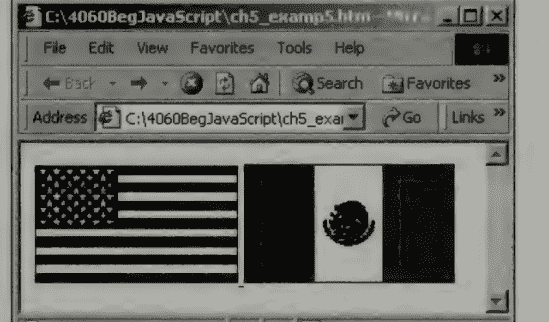

如果你点击一张图片，你会发现它变成了另一张图片，而该图片是随机选择的。

#### 工作原理

页面顶部脚本块的第一行定义了一个具有页面级作用域的变量。这是一个包含图像源列表的数组：

```
var myImages = new Array("usa.gif", "canada.gif", "jamaica.gif", "mexico.gif");
```

接下来是 `changeImg()` 函数，它将连接到包裹每个图像的 `<A>` 标签的 `onclick` 事件处理器。这一次，我们为两个链接的 `onclick` 事件处理器使用了同一个函数，事实上，我们可以将一个函数连接到任意数量的事件处理器上。我们向该函数传递一个参数——与该点击事件相关的 `IMG` 对象在 `images` 数组中的索引，以便我们知道需要对哪个图像进行操作。

在函数的首行，我们使用传递的参数来声明一个新变量，该变量指向 `images[]` 数组中与被点击图像相对应的 `IMG` 对象：

```
function changeImg(imgNumber)
{
    var imgClicked = document.images[imgNumber];
```

随后，我们将 `newImgNumber` 变量设置为 0 到 3 之间的一个随机整数。`Math.random()` 方法提供一个 0 到 1 之间的随机数，我们将其乘以 3 以获得一个 0 到 3 之间的数值。然后使用 `Math.round()` 将此数值转换为整数（0、1、2 或 3）。这个整数将提供我们在 `myImages` 数组中选择图像 `src` 的索引。

```
var newImgNumber = Math.round(Math.random() * 3);
```

接下来的几行是一个 `while` 循环，其目的是确保我们选择的图像与当前图像不同。如果在当前图像的 `src` 属性中找到了 `myImages[newImgNumber]` 所包含的字符串，那么我们就知道它们是同一张图，需要重新获取另一个随机数。我们持续循环直到获得一张新图像，此时 `myImages[newImgNumber]` 将不会在现有的 `src` 中被找到，`indexOf()` 方法将返回 -1，从而跳出循环：

```
while (imgClicked.src.indexOf(myImages[newImgNumber]) != -1)
{
    newImgNumber = Math.round(Math.random() * 3);
}
```

最后，我们将 `IMG` 对象的 `src` 属性设置为 `myImages` 数组中的新值。我们返回 `false` 以防止链接尝试跳转到另一个页面——该链接仅用于提供捕获 `onclick` 事件处理器的一种方式：

```
imgClicked.src = myImages[newImgNumber];
return false;
}
```

在 IE 中，你会发现 `IMG` 对象本身就拥有 `onclick` 事件，但遗憾的是，在 Netscape 浏览器中并非如此。为了使我们的代码兼容 Netscape，我们需要使用替代方案——目标是一样的，只是过程稍微复杂一点。由于 `A` 对象支持 `onclick` 事件处理器，我们将图像包裹在 `<A>` 标签内，并使用 `A` 对象的 `onclick` 事件处理器：

```
<A HREF="" NAME="linkImg1" onclick="return changeImg(0)">
    
</A>
```

如果我们只使用 IE，可以直接使用 `` 标签并像这样添加 `onclick` 事件处理器：

```

```

#### 浏览器版本检查示例

互联网上有许多不同的浏览器、同一浏览器的不同版本以及不同的操作系统，每种都有其自己的 BOM 版本和特定的古怪之处。因此，确保你的页面在所有浏览器上都能正常工作，或者至少能**优雅地降级**（例如通过显示一条建议用户升级浏览器的消息）是非常重要的。

虽然使用跨浏览器兼容代码可以解决大部分问题，但有时你可能想添加某些仅由单一浏览器支持的额外功能。解决方法是编写一段脚本来检查浏览器名称、版本，必要时检查操作系统，并执行与这些变体兼容的脚本。

我们检查浏览器详情的主要工具是 window 对象的 `navigator` 对象属性。具体来说，我们使用 `navigator` 对象的 `appName` 和 `userAgent` 属性。

`appName` 属性返回浏览器的型号，例如 Microsoft Internet Explorer 或 Netscape Navigator。

`userAgent` 属性返回一个包含各种信息的字符串，例如浏览器版本、操作系统和浏览器型号。然而，该属性返回的值因浏览器而异，因此使用时必须小心。例如，我们不能假设它以浏览器版本开头。在 NN 中确实如此，但在 IE 中，浏览器版本被嵌入在字符串的中间。

重要的是，浏览器检查代码本身不能使用仅在最新浏览器中才有的特性。例如，IE 3 不支持数组。如果我们检查代码中使用了数组，它会抛出错误并运行失败。

#### 尝试一下 – 检查并处理不同浏览器

在这个示例中，我们创建了一个页面，利用上述属性来检测客户端的浏览器、版本和操作系统。然后，它可以将用户转发到与其规格相匹配的页面。

```
<HTML>
<HEAD>
<SCRIPT LANGUAGE=JavaScript>
<!--
function getBrowserName()
{
   var lsBrowser = navigator.appName;
   if (lsBrowser.indexOf("Microsoft") >= 0)
   {
      lsBrowser = "MSIE";
   }
   else if (lsBrowser.indexOf("Netscape") >= 0)
   {
        lsBrowser = "NETSCAPE";
   }
   else
   {
        lsBrowser = "UNKNOWN";
   }
   return lsBrowser;
}

function getOS()
{
    var userPlat = "unknown";
    var navInfo = navigator.userAgent;

    if ((navInfo.indexOf("windows NT") != -1)
        || (navInfo.indexOf("windows 95") != -1 )
        || (navInfo.indexOf("windows 98") != -1 )
        || (navInfo.indexOf("WinNT") != -1 )
        || (navInfo.indexOf("Win95") != -1 )
        || (navInfo.indexOf("Win98") != -1 ))
    {
        userPlat = "Win32";
    }
    else if(navInfo.indexOf("Win16") != -1)
    {
        userPlat = "Win16";
    }
    else if(navInfo.indexOf("Macintosh") != -1)
    {
        userPlat = "PPC";
    }
    else if(navInfo.indexOf("68K") != -1)
    {
        userPlat = "68K";
    }
    return userPlat;
}

function getBrowserVersion()
{
    var findIndex;
    var browserVersion = 0;
    var browser = getBrowserName();

    if (browser == "MSIE")
    {
        browserVersion = navigator.userAgent;
        findIndex = browserVersion.indexOf(browser) + 5;
        browserVersion = parseInt(browserVersion.substring(findIndex,findIndex + 1));
    }
    else
    {
        browserVersion = parseInt(navigator.appVersion.substring(0,1));
    }
    return browserVersion;
}

//-->
</SCRIPT>
</HEAD>

<BODY>
<SCRIPT LANGUAGE=JavaScript>
<!--

var userOS = getOS();
var browserName = getBrowserName();
var browserVersion = getBrowserVersion();

if (browserVersion < 4 || browserName == "UNKNOWN" || userOS == "Win16")
{
    document.write("<H2>Sorry this browser version is not supported</H2>")
}
else if (browserName == "NETSCAPE")
{
    location.replace("NetscapePage.htm");
}
else
{
    location.replace("MSIEPage.htm");
}

//-->
</SCRIPT>
<NOSCRIPT>
    <H2>This website requires a browser supporting scripting</H2>
</NOSCRIPT>

</BODY>
</HTML>
```

将该脚本保存为 ch5_examp6.htm。你还需要创建另外两个简单的页面：一个名为 MSIEPage.htm（用于 IE 4 和 IE 5 浏览器），另一个名为 NetscapePage.htm（用于 Netscape 4 及以上版本）。这些只是我们重定向到的虚拟页面（代码下载包中提供了示例虚拟页面）。在实际应用中，它们将是你的浏览器专用页面，实现那些根本无法改为跨浏览器兼容的代码。

如果代码差异很小，则可以将它们整合在一个页面中并放在 `if` 语句内，确保代码仅由合适的浏览器运行。

如果检测到的浏览器版本低于 4，或者操作系统是 Win16（如 Windows 3.1），或者既不是 Microsoft 也不是 Netscape 浏览器，我们将显示一条消息告知用户该页面与其浏览器不兼容。虽然这并非理想状态，但绝对比让页面直接崩溃并弹出大量错误消息要好。


#### 第 5 章
#### 工作原理

页面头部（head）的脚本块定义了三个重要的函数。`getBrowserName()` 函数用于获取浏览器名称，`getOS()` 函数返回操作系统，而 `getBrowserVersion()` 函数用于获取浏览器版本。

让我们先来看看第一个函数 `getBrowserName()`。首先，我们获取 `navigator.appName` 返回的浏览器名称，并将其存储在变量 `lsBrowser` 中。该变量也将用于存储函数的返回值。

```javascript
```javascript
function getBrowserName()
{
    var lsBrowser = navigator.appName;
```

该属性返回的字符串往往非常长，且有时会略有不同。然而，通过检查某些关键字（如 `Microsoft` 或 `Netscape`）是否存在，我们可以确定浏览器名称。我们从以下代码行开始：

```javascript
if (lsBrowser.indexOf("Microsoft") >= 0)
{
    lsBrowser = "MSIE";
}
```

这段代码在 `lsBrowser` 字符串中搜索 `Microsoft`。如果该子字符串的 `indexOf` 值为 0 或更大，那么我们就知道找到了它，于是将返回值设置为 `MSIE`。

接下来的 `else if` 语句执行相同的操作，但针对的是 `Netscape`：

```javascript
else if (lsBrowser.indexOf("Netscape") >= 0)
{
    lsBrowser = "NETSCAPE";
}
```

如果这两个都没有找到，则我们返回 `UNKNOWN` 作为浏览器名称。如果你想支持更广泛的浏览器，可以添加额外的 `if` 语句来处理其他浏览器。

```javascript
else
{
    lsBrowser = "UNKNOWN";
}
```

随后，`lsBrowser` 的值被返回给调用代码：

```javascript
    return lsBrowser;
}
```

接下来我们转向 `getOS()` 函数。该函数首先定义两个变量：`userPlat` 初始化为字符串 `unknown`，`navInfo` 初始化为 `navigator` 对象的 `userAgent` 属性值。

```javascript
function getOS()
{
    var userPlat = "unknown";
    var navInfo = navigator.userAgent;
}
```

`userAgent` 属性返回的信息类型如下：

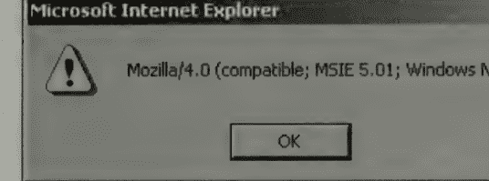

这是 Internet Explorer 5 的返回结果，而：

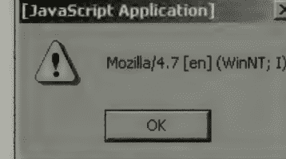

这是 Netscape Navigator 4.7 的结果。尽管它们都运行在同一个操作系统（即 Windows 2000）上，但你可以看到两个不同浏览器返回的 `userAgent` 结果截然不同。

函数的下一部分是一个巨大的 if 语句，我们在其中测试 `userAgent` 属性是否包含各种操作系统的名称。

if 语句的第一部分是通过 `indexOf()` 方法搜索 `navInfo`，以检查所有可能的 Windows 组合，例如 windows NT、WinNT、windows 98、Win98 等。如果发现了微软的任何 32 位操作系统，我们就将返回值设置为 Win32。

```javascript
if ((navInfo.indexOf("windows NT") != -1)
    || (navInfo.indexOf("windows 95") != -1 )
    || (navInfo.indexOf("windows 98") != -1 )
    || (navInfo.indexOf("WinNT") != -1 )
    || (navInfo.indexOf("Win95") != -1 )
    || (navInfo.indexOf("Win98") != -1 ))
{
    userPlat = "Win32";
}
```

下一个 `else if` 语句检查 `userAgent` 字符串中是否包含 Win16，如果是，则用户使用的是 Win16 操作系统（如 windows 3.1）：

```javascript
else if(navInfo.indexOf("Win16") != -1)
{
    userPlat = "Win16";
}
```

最后两个 if 语句检查 Apple Mac 操作系统的变体。我们还可以进一步检查 Unix 和 Linux。

```javascript
else if(navInfo.indexOf("Macintosh") != -1)
{
    userPlat = "PPC";
}
else if(navInfo.indexOf("68K") != -1)
{
    userPlat = "68K";
}
```

最后，如果没有找到匹配项，返回值将为 "unknown"：

```javascript
return userPlat;
}
```

检查操作系统有多重要？遗憾的是，Win32 上的 IE 与 Mac 或 Win16 上的 IE 并不相同。NN 也是如此，尽管程度可能稍轻。例如，Mac 版本的 IE 不支持 ActiveX 控件。不过，大多数情况下你不需要使用 OS 检查代码——通常只有那些更复杂或更冷门的功能在不同操作系统上才会无法运行。

现在我们转向最后一个函数 `getBrowserVersion()`。

我们如何推断浏览器版本取决于浏览器的类型。对于 Netscape，这简单地就是 Navigator 对象的 `appVersion` 属性的第一个字符。然而，对于 IE，这无法区分版本 4 和版本 5，因此我们需要一种不同的方法。

基于这些原因，该函数的第一项任务是找出我们面对的是哪种浏览器。我们声明浏览器变量，并使用刚刚编写的 `getBrowserName()` 函数将其初始化为浏览器名称：

```javascript
function getBrowserVersion()
{
    var findIndex;
    var browserVersion = 0;
    var browser = getBrowserName();
```

如果浏览器是 MSIE (Internet Explorer)，我们需要再次使用 `userAgent` 属性。在 IE 中，`userAgent` 属性总是包含 MSIE 及其后的浏览器版本。所以我们需要做的是搜索 MSIE，然后获取其后的数字。

我们将 `findIndex` 设置为 MSIE 的字符位置加上 5，从而选中 MSIE 之后的数字。`browserVersion` 被设置为该数字的整数值，我们使用 `substring()` 方法获取。这会选择从 `findIndex` 开始，到 `findIndex + 1` 之前结束的字符。这确保了我们仅选择一个字符。

```javascript
if (browser == "MSIE")
{
    browserVersion = navigator.userAgent;
    findIndex = browserVersion.indexOf(browser) + 5;
    browserVersion = parseInt(browserVersion.substring(findIndex, findIndex + 1));
}
```

获取 Netscape 和其他浏览器的版本号则简单得多；我们只需将 `appVersion` 中的第一个字符转换为整数。第一个字符通过 `substring()` 方法获取，起始于字符 0，结束于字符 1 之前：

```javascript
else
{
    browserVersion = parseInt(navigator.appVersion.substring(0,1));
}
```

在函数的末尾，我们将 `browserVersion` 返回给调用代码：

```javascript
return browserVersion;
}
```

我们已经看到了这些支持函数，但如何使用它们呢？在下面的代码中（在页面加载时执行），我们获取这三项信息：操作系统、浏览器和版本，并利用这些信息过滤掉不支持的浏览器。

```html
<SCRIPT LANGUAGE=JavaScript>
<!--

var userOS = getOS();
var browserName = getBrowserName();
var browserVersion = getBrowserVersion();

if (browserVersion < 4 || browserName == "UNKNOWN" || userOS == "Win16")
{
    document.write("<H2>Sorry this browser version is not supported</H2>")
}
else if (browserName == "NETSCAPE")
{
    location.replace("NetscapePage.htm");
}
else
{
    location.replace("MSIEPage.htm");
}

//--> 
</SCRIPT>
```

第一个 if 语句规定，如果浏览器版本低于 4，或者是一个未知浏览器，或者用户运行的是 16 位版本的 Windows，那么我们在页面中写入一条消息，告知其浏览器不受支持。如果愿意，我们可以提供更详细的信息。

在确定面对的是版本 4 或更高版本的浏览器后，我们接着检查该浏览器是否为 Netscape。如果是，我们使用 location 对象的 `replace()` 方法将用户重定向到 Netscape 专用页面。然后在 `else` 语句中，我们将用户重定向到与 Internet Explorer 兼容的页面。

你可能会注意到我在脚本块的开头使用了 `<!--`，在末尾使用了 `//-->`。这简单地将脚本包裹在 HTML 注释标签中。这样做是为了防止那些不支持 JavaScript 的旧版浏览器（即版本 2 及更早版本）在网页上直接显示脚本文本。

```html
<NOSCRIPT>
    <H2>This website requires a browser supporting scripting</H2>
</NOSCRIPT>
```

最后，我为极早期的浏览器以及选择禁用 JavaScript 的用户添加了一些 `<NOSCRIPT>` 标签。这些标签将显示一条消息，告知用户他们需要一个启用了 JavaScript 的浏览器。

#### 总结

在本章中我们涵盖了很多内容，现在我们已经拥有了继续学习更实用内容所需的所有基础，例如表单和用户输入，以及随后更高级的文本和日期处理领域。

- 我们将注意力转向了浏览器，即 JavaScript 存在的环境。就像 JavaScript 拥有原生对象一样， Web 浏览器也一样。Web 浏览器内部的对象及其组织层级由一个名为“浏览器对象模型”（Browser Object Model）的东西描述。这本质上是浏览器对象的地图。通过它，我们可以浏览浏览器提供的每个对象及其属性、方法和事件。

- 我们查看的首个主对象是 window 对象。它处于 BOM 层级的最顶端。window 对象包含许多重要的子对象，包括 location 对象、navigator 对象、history 对象、screen 对象和 document 对象。

- location 对象包含关于当前页面位置的信息，例如文件名、托管页面的服务器以及所使用的协议。这些都是 location 对象的属性。有些属性是只读的，但另一些属性（如 href 属性）不仅允许我们查找页面的位置，还可以被修改，从而让我们将页面导航到新位置。

- history 对象记录了用户自打开浏览器以来访问过的所有页面。有时某些页面不会被记录，例如在使用 location 对象的 `replace()` 方法进行导航时。我们可以在历史记录栈中向前或向后移动浏览器，并发现用户访问过哪些页面。

- navigator 对象代表浏览器本身，包含关于用户所使用的浏览器类型、版本和操作系统的有用详细信息。这些详细信息使我们能够编写处理各种类型浏览器的页面，即使在它们可能不兼容的情况下也是如此。


浏览器编程

- `screen` 对象包含关于用户计算机显示能力的信息。

- `document` 对象是最重要的对象之一。它是页面的对象表示，包含了该页面中所有由对象表示的元素。Netscape 浏览器和 Microsoft 浏览器之间的差异在此处尤为突出。如果我们想要页面在不同浏览器间兼容，就会发现可访问的元素是相当有限的。

- `document` 对象包含三个实际上是数组的属性。它们是 `links []`、`images []` 和 `forms []` 数组。每个数组包含了页面上由 `<A>`、`` 和 `<FORM>` 标签创建的所有对象，这是我们访问这些标签的方式。

- `images []` 数组为页面上的每个 `` 元素包含一个 `IMG` 对象。我们发现即使在页面加载后，我们也可以更改图像的属性。例如，我们可以让图像在被点击时发生变化。使用 `images []` 数组的原则同样适用于 `links []` 数组。

- 接下来我们了解到 BOM 对象除了方法和属性之外，还有事件。这些事件在 JavaScript 中通过事件处理器来处理，我们将事件处理器连接到事件发生时要执行的代码上。可用的事件取决于我们所操作的对象。

- 将我们编写的函数连接到事件处理器，只需在我们感兴趣的特定对象对应的元素上添加一个属性即可。该属性的名称是我们想要捕获的事件处理器的名称，其值是我们想要连接到它的函数。

- 在某些情况下，例如对于 `document` 对象，需要第二种将事件处理器连接到代码的方式。将对象的属性（以事件处理器为名称）设置为我们的函数，产生的效果与使用事件处理器作为属性相同。

- 在某些情况下，从事件函数返回值允许我们取消与事件关联的操作。例如，要阻止点击链接后跳转到另一个页面，我们从事件处理器的代码中返回 `false`。

- 最后，我们研究了如何检查用户使用的浏览器类型，以便确保他们只看到与其浏览器兼容的页面或页面的部分内容。`navigator` 对象为我们提供了所需的详细信息，特别是 `appName` 和 `userAgent` 属性。

本章到此结束。在下一章中，我们将继续学习更令人兴奋的表单脚本编程，你可以在页面上添加各种控件来帮助你从用户那里收集信息。

#### 练习题

这些问题的参考解答可以在附录 A 中找到。

#### 问题 1

创建一个包含多个链接的页面。然后编写代码，在 window onload 事件触发时，显示页面上每个链接的 href。

#### 问题 2

创建两个页面，一个名为 IEOnly.htm，另一个名为 NNOnly.htm。每个页面都应有一个标题，告诉你加载的是哪个页面，例如：

```
<H2>Welcome to the Internet Explorer only page</H2>
```

使用检查浏览器类型的函数，连接到 window 对象的 onload 事件处理器并检测用户使用的浏览器。然后如果该页面不适合此浏览器，就重定向到另一个页面。

#### 问题 3

在页面中使用  标签插入一张图片。当鼠标指针移到图片上时，应切换到另一张图片。当鼠标移出图片时，应换回原来的图片。你需要将图片包裹在 <A> 标签中，因为 IMG 对象没有 onmouseover 和 onmouseout 事件。

在线讨论请访问 http://p2p.wrox.com

#### 第 6 章

#### HTML 表单：与用户交互

如果我们不能与用户交互，也不能从他们那里获取信息（如文本、数字或日期），网页将会非常枯燥。幸运的是，使用 JavaScript 我们可以做到这一点。我们可以在网页中使用这些信息，也可以将其发送到 Web 服务器，在那里我们可以对其进行处理，并根据需要将其存储在数据库中。在本章中，我们将专注于在浏览器中使用信息，这被称为客户端处理。在第 14 章和第 15 章中，我们将看到如何将这些信息发送到 Web 服务器并存储在数据库中，这被称为服务器端处理。

使用计算机时，你一定对各种用户界面元素相当熟悉。例如，Windows 操作系统有许多标准元素，如可点击的按钮、列表、下拉列表框和可选择的单选按钮，以及可勾选的复选框。任何图形用户界面（GUI）操作系统都是如此，无论是在 Apple Mac、Unix 还是 Linux 上。这些元素就是我们现在与应用程序交互的方式。好消息是，我们可以在网页中包含许多这类元素，而且更好的是，这非常容易做到。一旦我们有了这样的元素（比如一个按钮）在页面中，我们就可以将其事件与代码绑定。例如，当按钮被点击时，我们可以触发一个我们创建的 JavaScript 函数。

这里需要重要说明的是，本章中我所讨论的元素是 HTML 提供的常见元素，而不是 ActiveX 元素、Java Applet 或插件。我们将在第 14 章中介绍其中一些内容。

所有用于交互的 HTML 元素都必须放在 HTML 表单中。让我们首先来看看 HTML 表单以及如何在 JavaScript 中与它们交互。

#### HTML 表单

表单为我们提供了一种将具有共同用途的 HTML 交互元素分组在一起的方式。例如，一个表单可以包含用于输入用户数据以在网站上注册的元素。另一个表单可以包含允许用户查询汽车保险报价的元素。在单个页面中可以有多个独立的表单。包含多个表单的页面不会让我们困扰，直到我们需要向 Web 服务器提交信息——那时我们需要意识到，一次只能将页面上其中一个表单的信息提交到服务器。

要创建一个表单，我们使用 <FORM> 和 </FORM> 标签来声明表单的起始和结束位置。<FORM> 标签有多个属性，例如 ACTION 属性，它决定表单提交到哪里；METHOD 属性，它决定信息如何提交；以及 TARGET 属性，它决定表单响应加载到哪个框架中。

一般来说，对于不打算向服务器提交信息的客户端脚本，这些属性不是必需的。当我们在后面的章节中研究服务器页面编程时，这些属性才会发挥作用。目前我们在 <FORM> 标签中唯一需要设置的属性是 NAME 属性，以便我们能够引用该表单。

因此，要创建一个空白表单，所需的标签大致如下：

```
<FORM NAME="myForm">
</FORM>
```

听到这些标签创建了一个 Form 对象，你不会感到惊讶，我们可以使用它来访问表单。我们通过两种方式访问此对象。

首先，我们可以直接使用它的名称访问对象，在这里就是 document.myForm。

或者，我们可以通过 document 对象的 forms[] 数组属性来访问对象。记得在上一章中我们讨论了 document 对象的 images[] 数组，以及如何像操作其他数组一样操作它。forms[] 数组同样适用，只不过数组中的每个元素现在持有的不是 IMG 对象，而是一个 Form 对象。例如，如果我们的表单是页面中的第一个表单，我们会使用 document.forms[0] 来引用它。

<FORM> 标签的许多属性都可以作为 Form 对象的属性来访问。特别是，Form 对象的 name 属性与 <FORM> 标签的 NAME 属性相对应。

#### 动手实践 – forms 数组

让我们看一个使用 forms 数组的示例。这里我们有一个包含三个表单的页面。使用 forms[] 数组，我们依次访问每个 Form 对象，并在消息框中显示其 name 属性的值。

```
<HTML>
<HEAD>
<SCRIPT LANGUAGE=JavaScript>

function window_onload()
{
```

186


#### HTML 表单：与用户交互

```javascript
var numberForms = document.forms.length;
var formIndex;
for (formIndex = 0; formIndex < numberForms; formIndex++)
{
    alert(document.forms[formIndex].name);
}
```

```html
</SCRIPT>
</HEAD>
<BODY LANGUAGE=JavaScript onload="window_onload()">
```

```html
<FORM NAME="form1">
<P>This is inside form1</P>
</FORM>
```

```html
<FORM NAME="form2">
<P>This is inside form2</P>
</FORM>
```

```html
<FORM NAME="form3">
<P>This is inside form3</P>
</FORM>
```

```html
</BODY>
</HTML>
```

将此文件保存为 ch6_exampl.htm。在浏览器中加载后，你会看到三个警告框，每个都显示一个表单的名称。

#### 工作原理

在页面主体中，我们定义了三个表单。每个表单都被赋予一个名称，并包含一段文本。

在 `<BODY>` 标签的定义中，`window_onload()` 函数被连接到 window 对象的 `onload` 事件处理器。

```html
<BODY LANGUAGE=JavaScript onload="return window_onload()">
```

这意味着当页面加载时，我们的 `window_onload()` 函数将被调用。

`window_onload()` 函数定义在页面头部的一个脚本块中。在该函数中，我们遍历 `forms[]` 数组。与任何其他 JavaScript 数组一样，`forms[]` 数组有一个 `length` 属性，我们可以用它来确知需要循环的次数。实际上，由于我们知道有多少个表单，我们可以直接把数字写进去。不过，这里我演示 `length` 属性的用法，因为这样更容易在数组中添加元素而无需修改函数。像这样泛化你的代码是一个值得养成的好习惯。

该函数首先获取 forms 数组中表单对象的数量，并将其存储在变量 `numberForms` 中。

```javascript
function window_onload()
{
    var numberForms = document.forms.length;
```

接下来我们定义一个变量 `formIndex`，用于 `for` 循环中。之后是 `for` 循环本身。

```javascript
var formIndex;
for (formIndex = 0; formIndex < numberForms; formIndex++)
{
    alert(document.forms[formIndex].name);
}
```

记住，由于数组的索引从零开始，我们的循环需要从索引 0 走到索引 `numberForms - 1`。我们通过将 `formIndex` 变量初始化为零，并将 `for` 循环的条件设为 `formIndex < numberForms` 来实现这一点。

在 `for` 循环的代码中，我们将所需表单的索引（即 `formIndex`）传递给 `document.forms[]`，这会返回 forms 数组中该数组索引处的表单对象。要访问表单对象的 `name` 属性，我们在末尾加上一个点和属性名称 `name`。

#### 表单对象的其他属性和方法

HTML 表单中常见的元素，我们稍后会详细介绍，也有相应的对象。访问这些对象的一种方式是利用表单对象的 `elements[]` 属性。这与我们刚刚看到的文档对象的 `forms[]` 数组属性类似，也是一个数组。`elements[]` 数组包含表单内所有与 HTML 交互元素对应的对象，但不包括很少使用的 `<INPUT TYPE=image>` 元素。正如我们稍后会看到的，这个属性对于遍历表单中的每个元素非常有用。例如，我们可以在提交表单之前遍历每个元素，检查其数据是否有效。

由于是一个数组，表单对象的 `elements[]` 属性具有 `length` 属性，它告诉我们表单中有多少个元素。表单对象本身也有 `length` 属性，同样能告诉我们表单中的元素数量。使用哪个由你决定，因为两者的功能相同，不过写 `document.myForm.length` 更短，打字更快，在代码中看起来也更简洁，比 `document.myForm.elements.length` 要简短。

当我们使用提交按钮将表单数据发送到服务器时，我们稍后会讲到这一点。不过，表单对象也有 `submit()` 方法，它的功能几乎相同。在 Netscape Navigator 中它有所不同，因为它不会调用表单对象提交事件的 `onsubmit` 事件处理器。

回想一下，在上一章中，我们看到从事件处理器代码返回的返回值如何影响正常事件的继续或取消。例如，从超链接的 `onclick` 事件处理器返回 `false` 会导致链接的导航被取消。同样的原理也适用于表单对象的 `onsubmit` 事件处理器，它在用户提交表单时触发。如果我们向此事件处理器返回 `true`，则表单提交继续进行；如果我们返回 `false`，则提交被取消。这使得 `onsubmit` 事件处理器的代码成为进行表单验证的绝佳场所：检查用户在表单中输入的内容是否有效。例如，如果我们询问他们的年龄，而他们输入了 "mind your own business"，我们可以发现这是文本而非有效数字，并阻止他们继续。我们将在第 15 章学习服务器端脚本时看到实际应用。

除了重置按钮（我们将在本章稍后讨论）之外，表单对象还有 `reset()` 方法，它会清除表单，或者如果存在默认值则恢复默认值。

创建空白表单并不那么令人兴奋或有用，所以现在让我们把注意力转向在表单中提供交互功能的 HTML 元素。

#### 表单中的 HTML 元素

在 `<FORM>` 元素中通常有大约十种元素。最有用的如下所示，按一般类型分类。我们给出每个元素的名称，以及（在括号中）创建它所需的 HTML，但注意这不是完整的 HTML，只是其中一部分。

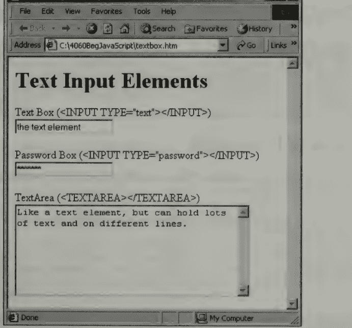

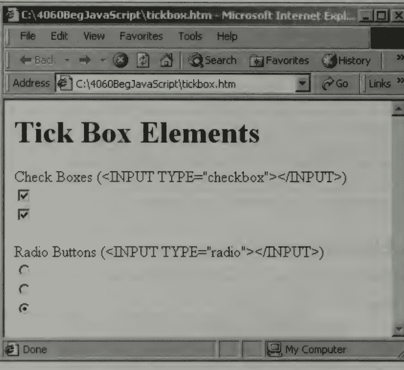

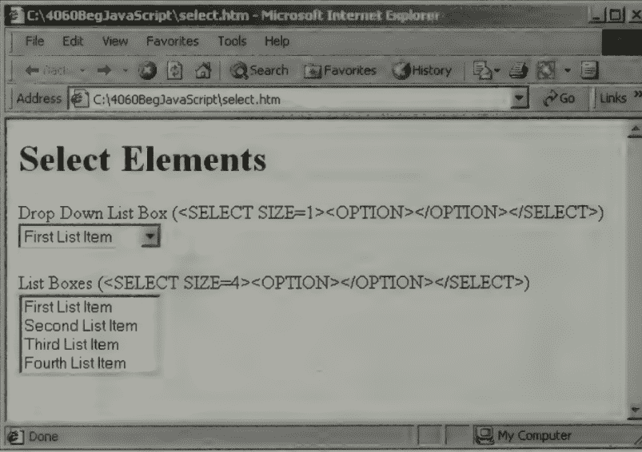

190

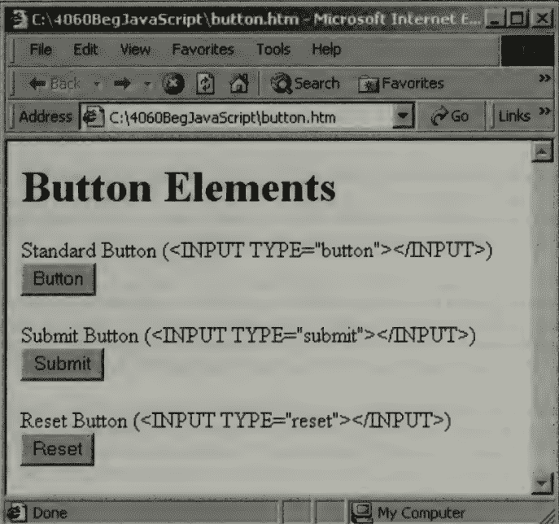

如你所见，大多数表单元素都是使用 `<INPUT>` 标签创建的。`<INPUT>` 标签的属性之一是 `TYPE` 属性。正是这个属性决定了这将是哪种 HTML 元素。该属性的值示例包括 `button`，用于创建按钮，以及 `text`，用于创建文本框。

网页中的每个表单元素都可供我们使用，是的，你猜对了，作为一个对象。与我们见过的所有其他对象一样，每个元素的自有其独特的一组属性、方法和事件。我们将逐一查看每个表单元素以及如何使用它特定的属性、方法和事件。但在那之前，让我们先看看表单元素对象共有的属性和方法。

#### 共同属性和方法

所有表单元素对象共有的一个属性是 `name` 属性。我们可以使用此属性的值在脚本中引用该特定元素。此外，如果我们要将表单中的信息发送到服务器，则元素的 `name` 属性会与表单元素的任何值一起发送，以便服务器知道该值与之相关的是什么。

大多数表单元素对象还共同具有 `value` 属性，它返回元素的值。例如，对于文本框，`value` 属性返回用户在文本框中输入的文本。此外，通过设置 `value` 属性的值，我们可以将文本放入文本框内。然而，`value` 属性的使用因元素而异，所以我们将在下面查看每个单独元素时探讨其含义。

所有表单元素对象还具有 `form` 属性，它返回包含该元素的 `Form` 对象。这在某些情况下很有用，比如你有一个通用例程来检查表单中数据的合法性。例如，当用户点击提交按钮时，我们可以将 `form` 属性引用的 `Form` 对象传递给我们的数据检查器，后者可以用它来遍历表单上的每个元素，依次检查元素中的数据是否有效。这在页面上定义了多个表单，或者你有一个通用数据检查器可以复制粘贴到不同页面时非常方便——这样你就不需要预先知道表单的名称。

有时了解你正在处理的是哪种类型的元素很有用，特别是当你使用 `Form` 对象的 `elements[]` 数组属性遍历表单中的元素时。此信息可以使用每个元素对象都有的 `type` 属性来检索。此属性返回元素的类型，例如 `button` 或 `text`。

所有表单元素对象还具有 `focus()` 和 `blur()` 方法。**焦点**是一个你可能还没有遇到过的概念。如果某个元素是焦点的中心，那么用户按下的任何键都会直接传递给该元素。例如，如果文本框具有焦点，那么按键会在文本框中输入值。此外，如果按钮具有焦点，那么按下 *enter* 键会触发按钮的 `onclick` 事件处理器代码，就好像用户用鼠标点击了按钮一样。

用户可以通过点击元素或使用 *tab* 键选择它来设置当前哪个元素具有焦点。然而，我们作为程序员，也可以通过使用表单元素对象的 `focus()` 方法来决关哪个元素具有焦点。例如，如果我们有一个供用户输入年龄的文本框，而用户输入了无效值，比如字母而非数字，那么我们可以告知他们的输入无效，并将他们送回该文本框以纠正错误。

Blur，也许可以更好地命名为"失去焦点"，是 `focus` 的反义词。如果我们想让某个表单元素不再是用户注意力的焦点，那么我们可以使用 `blur()` 方法。当用于表单元素时，`blur()` 方法通常会导致焦点转移到包含窗口。

除了 `focus()` 和 `blur()` 方法外，所有表单元素对象都有 `onfocus` 和 `onblur` 事件处理器。正如你所料，当元素获得焦点或失去焦点时，这些事件处理器会由于用户操作或 `focus()` 和 `blur()` 方法而触发。`onblur` 事件处理器是检查刚刚失去焦点的元素中数据合法性的好地方。如果数据无效，你可以将焦点重新设到该元素，并让用户.让用户知道他们输入的数据为何错误。

需要注意的一点是，在 `onfocus` 或 `onblur` 事件处理器代码中使用 `focus()` 或 `blur()` 方法。存在发生无限循环的危险。例如，考虑两个元素，每个元素的 `onfocus` 事件都会将焦点传递给另一个元素。那么，如果一个元素获得焦点，它的 `onfocus` 事件会将焦点传递给第二个元素，第二个元素的 `onfocus` 事件会将焦点传回第一个元素，如此循环，直到唯一的出路是关闭浏览器。这不太可能让你的用户满意！

对于使用 `focus()` 和 `blur()` 方法将焦点放回有问题的字段，如果该字段或其他字段依赖于用户的一些输入，也要非常谨慎。例如，假设我们有两个文本框，一个希望用户输入城市，另一个希望输入州。同时假设对州文本框的输入进行检查，以确保指定城市在该州内。如果该州不包含该城市，我们将焦点放回州文本框，让用户可以更改州名。然而，如果用户实际输入了错误的城市名和正确的州名，他们可能无法返回到城市文本框来纠正问题。


HTML 表单：与用户交互

#### 按钮表单元素

我将从标准的按钮元素开始介绍表单元素，因为它可能是最常用的，且相当简单。创建按钮的 HTML 标签是 `<INPUT>` 标签。例如，要创建一个名为 `myButton` 且表面显示“Click Me”字样的按钮，`<INPUT>` 标签应为：

```html
<INPUT TYPE="button" NAME="myButton" VALUE="Click Me">
```

`TYPE` 属性被设置为 `button`，而 `VALUE` 属性被设置为我们希望显示在按钮表面的文本。我们可以省略 `VALUE` 属性，但这样会得到一个空白按钮，用户将无法猜测其用途。

该元素创建了一个关联的 `Button` 对象；在本例中，它被称为 `myButton`。该对象拥有上述所有常见的属性和方法，包括 `value` 属性。这允许你使用 JavaScript 更改按钮表面的文本，尽管这可能不是你经常需要做的事情。按钮的核心在于 `onclick` 事件。

我们连接到按钮的 `onclick` 事件处理程序的方式，与我们为 `<A>` 标签等其他 HTML 标签处理 `onclick` 事件的方式完全一样。我们唯一需要做的就是定义一个在按钮被点击时想要执行的函数（例如 `button_onclick()`），然后将 `onclick` 事件处理程序作为 `<INPUT>` 标签的一个属性添加进去：

```html
<INPUT TYPE="button" onclick="button_onclick()">
```

#### 尝试一下 – 统计按钮点击次数

在下面的示例中，我们使用上述方法来记录按钮被点击的次数，并将其显示在按钮表面。

```html
<HTML>
<HEAD>
<SCRIPT LANGUAGE=JavaScript>
var numberOfClicks = 0;

function myButton_onclick()
{
    numberOfClicks++;
    window.document.form1.myButton.value = 'Button clicked ' + numberOfClicks + ' times';
}
</SCRIPT>
</HEAD>
<BODY>
<FORM NAME=form1>
    <INPUT TYPE='button' NAME='myButton' VALUE='Button clicked 0 times'
    onclick="myButton_onclick()">
</FORM>
</BODY>
</HTML>
```

将此页面保存为 `ch6_examp2.htm`。如果你在浏览器中加载此页面，你会看到一个显示“Button clicked 0 times”的按钮。重复按下此按钮，你会看到按钮顶部记录的点击次数在增加。

#### 工作原理

我们在页面头部的脚本块中定义了一个全局变量 `numberOfClicks`，它可以被页面内任何地方访问。我们在该变量中记录按钮被点击的次数，并利用此信息更新按钮的文本。

脚本块中的另一部分代码是函数 `myButton_onclick()` 的定义。该函数连接到页面主体中 `<INPUT>` 标签的 `onclick` 事件处理程序。此标签对应一个名为 `myButton` 的按钮元素，且包含在一个名为 `form1` 的表单中。

```html
<FORM NAME=form1>
    <INPUT TYPE='button' NAME='myButton' VALUE='Button clicked 0 times'
    onclick="myButton_onclick()">
</FORM>
```

让我们更仔细地看看 `myButton_onclick()` 函数。首先，该函数将变量 `numberOfClicks` 的值增加 1。

```javascript
function myButton_onclick()
{
    numberOfClicks++;
```

接着，我们使用 `Button` 对象的 `value` 属性更新按钮表面的文本。

```javascript
    window.document.form1.myButton.value = 'Button clicked ' + numberOfClicks +
    ' times';
}
```

该函数是专门为这个表单和按钮设计的，而不是一个可在其他场景使用的通用函数。因此，我直接使用了 `window.document.form1.myButton` 来引用表单和按钮。请记住，`window` 对象有一个包含 `document` 对象的属性，而 `document` 本身持有页面中的所有元素（包括 `<FORM>` 元素），且按钮被嵌入在我们的表单之中。

#### 尝试一下 – onmouseup 和 onmousedown

在 4.0 或更高版本的浏览器中，`Button` 对象还支持两个较少使用的事件：`onmousedown` 和 `onmouseup`。你可以在下一个示例中看到这两个事件的实际效果。

```html
<HTML>
<HEAD>
<SCRIPT LANGUAGE=JavaScript>
function myButton_onmouseup()
{
    document.form1.myButton.value = "Mouse Goes Up"
}

function myButton_onmousedown()
{
    document.form1.myButton.value = "Mouse Goes Down"
}

</SCRIPT>
</HEAD>
<BODY>
<FORM NAME=form1>
    <INPUT TYPE='button' NAME='myButton' VALUE=' Mouse Goes Up '
    onmouseup="myButton_onmouseup()"
    onmousedown="myButton_onmousedown()">
</FORM>
</BODY>
</HTML>
```

将此页面保存为 `ch6_examp3.htm` 并加载到浏览器中。如果你用鼠标左键点击按钮并保持按下，你会看到按钮上的文本变为“Mouse Goes Down”。一旦你松开按钮，文本将变为“Mouse Goes Up”。

#### 工作原理

在页面的主体中，我们在名为 `form1` 的表单中定义了一个名为 `myButton` 的按钮。在 `<INPUT>` 标签的属性中，我们将函数 `myButton_onmouseup()` 绑定到 `onmouseup` 事件处理程序，将函数 `myButton_onmousedown()` 绑定到 `onmousedown` 事件处理程序。

```html
<FORM NAME=form1>
    <INPUT TYPE='button' NAME='myButton' VALUE=' Mouse Goes Up '
    onmouseup="myButton_onmouseup()"
    onmousedown="myButton_onmousedown()">
</FORM>
```

`myButton_onmouseup()` 和 `myButton_onmousedown()` 函数定义在页面头部的脚本块中。每个函数仅由一行代码组成，我们利用 `Button` 对象的 `value` 属性来更改按钮表面显示的文本。

需要注意的一点是，像 `onmouseup` 和 `onmousedown` 这样的事件只有在鼠标指针真正处于该元素之上时才会触发。例如，如果你在按钮上点击并保持按下，然后在松开鼠标之前将鼠标移开，你会发现 `onmouseup` 事件不会触发，按钮表面的文本也不会改变。在这种情况下，如果我们将任何代码连接到 `document` 对象的 `onmouseup` 事件处理程序，那么触发的将是该处理程序。

不要忘记，与所有表单元素对象一样，`Button` 对象也具有 `onfocus` 和 `onblur` 事件，尽管它们在按钮场景中很少被使用。

#### 提交 (Submit) 和重置 (Reset) 按钮

另外两种类型的按钮是提交按钮和重置按钮。定义提交和重置按钮的方式与定义标准按钮相同，不同之处在于 `<INPUT>` 标签的 `TYPE` 属性被设置为 `submit` 或 `reset` 而不是 `button`。例如，之前截图中出现的提交和重置按钮是使用以下代码创建的：

```html
<INPUT TYPE="submit" VALUE="Submit" NAME="submit1">
<INPUT TYPE="reset" VALUE="Reset" NAME="reset1">
```

这些按钮具有特殊的用途，与脚本无关。

当点击提交按钮时，该按钮所在表单中的表单数据会自动发送到服务器，无需任何脚本。

当点击重置按钮时，表单中的所有元素将被清空并恢复到其默认值（即页面首次加载时的值）。

提交和重置按钮具有对应的名为 `Submit` 和 `Reset` 的对象，它们拥有与标准 `Button` 对象完全相同的属性、方法和事件。

#### 文本元素

标准的文本元素允许用户输入单行文本。这些信息随后可以用在 JavaScript 代码中，或者提交到服务器进行服务端处理。

文本框使用 `<INPUT>` 标签创建，与按钮类似，但需要将 `TYPE` 属性设置为 `text`。同样，你可以选择不包含 `VALUE` 属性，但如果包含了，该值将在页面加载时显示在文本框内。

在下面的示例中，`<INPUT>` 标签有两个额外的属性 `SIZE` 和 `MAXLENGTH`。`SIZE` 属性决定了文本框的显示宽度（以字符数为单位），而 `MAXLENGTH` 决定了用户可以输入到该框中的最大字符数。这两个属性都是可选的，并使用浏览器决定的默认值。

例如，要创建一个宽度为 10 个字符、最大长度为 15 个字符且初始包含“Hello World”字样的文本框，我们的 `<INPUT>` 标签如下：

```html
<INPUT TYPE="text" NAME="myTextBox" SIZE=10 MAXLENGTH=15 VALUE="Hello World">
```

该元素创建的 `Text` 对象具有一个 `value` 属性，我们可以在脚本中使用它来设置或读取文本框内包含的文本。除了我们之前讨论的通用属性和方法外，`Text` 对象还具有 `select()` 方法，用于选中或高亮文本框内的所有文本。这在用户输入了无效值时非常有用：我们可以将焦点设置到文本框并选中其中的文本。这样可以将用户的光标放在正确的位置以便修正数据，并让用户非常清楚地看到无效数据在哪里。


#### HTML 表单：与用户交互

文本对象（Text object）的 value 属性始终返回字符串数据类型，即便输入的是数字字符。如果我们将 value 用作数字，JavaScript 通常会为我们执行从字符串数据类型到数字数据类型的转换，但并非总是如此。例如，如果你执行的操作对字符串而言是有效的，JavaScript 就不会进行转换。如果我们有一个包含两个文本框的表单，并将从这两个文本框返回的值相加，JavaScript 会执行连接操作而非加法运算，因此 1 + 1 的结果将是 "11" 而非 2。要解决这个问题，我们需要将所有涉及的值转换为数字数据类型，例如使用 `parseInt()` 或 `parseFloat()`。然而，如果我们对两个值执行减法操作——这一操作仅对数字有效——那么 JavaScript 会认为"啊哈，这只能用数字来做，所以我要把这些值转换为数字数据类型"。因此，1 - 1 会直接返回 0，无需使用 `parseInt()` 或 `parseFloat()`。这是一个难以察觉的棘手 bug，所以最好养成显式转换的习惯，以免日后出现问题。

除了常见的事件处理程序如 `onfocus` 和 `onblur` 之外，文本对象还具有 `onchange`、`onselect`、`onkeydown`、`onkeypress` 和 `onkeyup` 事件处理程序。

`onselect` 事件在用户选中文本框中的部分文本时触发。

更有用的是 `onchange` 事件，它在元素失去焦点时触发，但*仅当*文本框内的值与其获得焦点时的值不同时才会触发。这使我们能够执行诸如有效性检查之类的操作，且仅当内容发生变化时才进行。

如前所述，`onfocus` 和 `onblur` 事件可用于验证用户输入。但它们还有另一个用途，那就是使文本框变为只读。在 IE 4.0+ 和 NN 6 中，我们可以使用 `<INPUT>` 标签的 `READONLY` 属性或文本对象的 `readOnly` 属性来防止内容被更改。但这对 NN 4.x 无效。我们可以使用 `blur()` 方法来解决这个问题。只需在定义文本框的 `<INPUT>` 标签中添加 `onfocus` 事件处理程序，并将其连接到一些代码，这些代码使用 `blur()` 方法将焦点从文本框移开：

```html
<INPUT TYPE="text" NAME=txtReadonly VALUE="Look but don't change"
   onfocus="window.document.form1.txtReadonly.blur()"
   READONLY=true>
```

`onkeypress`、`onkeydown` 和 `onkeyup` 事件正如它们的名称所示，分别在用户按下按键、按键按下以及按下的按键被释放时触发。

#### 试一试——带验证的简单表单

让我们将以上关于文本框和按钮的信息整合到一个示例中。在这个示例中，我们有一个简单的表单，包含两个文本框和一个按钮。上方的文本框用于输入用户姓名，第二个用于输入年龄。我们执行各种有效性检查。当年龄文本框失去焦点时，我们检查其有效性。但姓名和年龄文本框仅在按钮被点击时才会检查是否为空。

```html
<HTML>
<HEAD>

<SCRIPT LANGUAGE=JavaScript>

function butCheckForm_onclick()
{
    var myForm = document.form1;
    if (myForm.txtAge.value == "" || myForm.txtName.value == "")
    {
        alert("Please complete all the form");
        if (myForm.txtName.value == "")
        {
            myForm.txtName.focus();
        }
        else
        {
            myForm.txtAge.focus();
        }
    }
    else
    {
        alert("Thanks for completing the form " + myForm.txtName.value);
    }
}

function txtAge_onblur()
{
    var txtAge = document.form1.txtAge;
    if (isNaN(txtAge.value) == true)
    {
        alert("Please enter a valid age");
        txtAge.focus();
        txtAge.select();
    }
}

function txtName_onchange()
{
    window.status = "Hi " + document.form1.txtName.value;
}

</SCRIPT>
</HEAD>
<BODY>
<FORM NAME=form1>
    Please enter the following details:
    <P>
    Name:
    <BR>
    <INPUT TYPE="text" NAME=txtName onchange="txtName_onchange()">
    <BR>
    Age:
    <BR>
    <INPUT TYPE="text" NAME=txtAge onblur="txtAge_onblur()" SIZE=3 MAXLENGTH=3>
    <BR>
    <INPUT TYPE="button" VALUE="Check Details" NAME=butCheckForm onclick="butCheckForm_onclick()">
</FORM>
</BODY>
</HTML>
```

输入文本后，将文件保存为 ch6_examp4.htm 并在网页浏览器中打开。

在姓名文本框中输入你的名字。当你离开该文本框时，你会看到窗口底部的状态栏中显示 Hi *yourname*。

在年龄文本框中输入无效值，例如 'aaaa'，当你尝试离开该文本框时，系统会提示错误并让你返回修正。

最后点击"Check Details"按钮，两个文本框都会被检查是否已填写。如果任一为空，你会收到一条消息，提示你完成整个表单，并将光标定位到为空的文本框中。

如果一切填写正确，你会收到一条感谢消息。

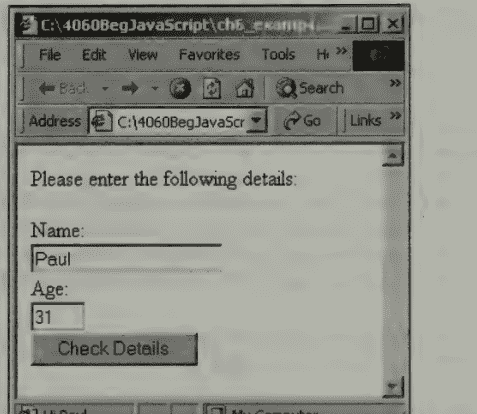

请注意，在撰写本文时，此示例在 NN 6 上无法正常工作。

#### 工作原理

在页面主体中，我们创建定义表单的 HTML 标签。在我们的表单中，表单名为 form1，我们创建了三个表单元素，分别命名为 txtName、txtAge 和 butCheckForm。

```html
<FORM NAME=form1>
    Please enter the following details:
    <P>
    Name:
    <BR>
    <INPUT TYPE="text" NAME=txtName onchange="txtName_onchange()">
    <BR>
    Age:
    <BR>
    <INPUT TYPE="text" NAME=txtAge onblur="txtAge_onblur()" SIZE=3 MAXLENGTH=3>
    <BR>
    <INPUT TYPE="button" VALUE="Check Details" NAME=butCheckForm
        onclick="butCheckForm_onclick()">
</FORM>
```

你会看到，对于第二个文本框，即 `txtAge` 文本框，我们在 `<INPUT>` 标签中包含了 `SIZE` 和 `MAXLENGTH` 属性。将 `SIZE` 属性设置为 3 可以让用户了解我们期望的文本长度，将 `MAXLENGTH` 属性设置为 3 有助于确保年龄值不会输入过大的数字！

第一个文本框的 `onchange` 事件处理程序连接到函数 `txtName_onchange()`，第二个文本框的 `onblur` 事件处理程序连接到函数 `txtAge_onblur()`，按钮的 `onclick` 事件处理程序连接到函数 `butCheckForm_onclick()`。这些函数在页面头部的脚本块中定义。我们将逐一查看这些函数，从 `butCheckForm_onclick()` 开始。

首先，我们定义一个变量 `myForm`，并将其设置为引用页面后面由我们的 `<FORM>` 标签创建的 `Form` 对象。

```javascript
function butCheckForm_onclick()
{
    var myForm = document.form1;
```

这样做可以减少每次使用 `form1` 对象时的代码量。我们可以直接输入 `myForm` 而不是 `document.form1`。这使我们的代码更具可读性，更易于调试，也减少了打字量。当我们将一个变量设置为等于现有对象时，我们实际上（在这种情况下）并没有创建一个新的 `form1` 对象。相反，我们只是将变量指向现有的 `form1` 对象。因此，当我们输入 `myForm.name` 时，JavaScript 会检查我们的变量，发现它实际上存储的是对象 `form1` 在内存中的位置，并使用该对象。所有这些都在后台进行，因此我们无需担心，可以像使用 `document.form1` 一样使用 `myForm`。

获得对 `Form` 对象的引用后，我们在 `if` 语句中使用它来检查名为 `txtAge` 的文本框或名为 `txtName` 的文本框的值是否实际包含任何文本。

```javascript
if (myForm.txtAge.value == "" || myForm.txtName.value == "")
{
    alert("Please complete all the form");
    if (myForm.txtName.value == "")
    {
        myForm.txtName.focus();
    }
    else
    {
        myForm.txtAge.focus();
    }
}
```

如果发现表单未填写完整，我们会警告用户。然后在内部 `if` 语句中检查哪个文本框未填写。我们将焦点设置到有问题的文本框，以便用户可以立即开始填写，而无需自己移动焦点。这也让用户知道我们的程序认为哪个文本框需要填写。为避免惹恼用户，请确保页面中的文本明确告知用户哪些字段是必填的。


#### HTML 表单：与用户交互

如果最初的外部 if 语句发现表单已填写完整，它将通过一条感谢信息告知用户。

```
else
{
    alert("Thanks for completing the form " + myForm.txtName.value);
}
```

在这种情况下，更可能的是，在验证表单后，我们会将其提交给服务器进行处理。我们可以通过使用 Form 对象的 `submit()` 方法来实现这一点，正如我们将在服务器端编程章节中看到的那样。

我们三个函数中的下一个是 `txtAge_onblur()`，它连接到 `txtAge` 文本框的 `onblur` 事件。此函数的目的是检查用户在年龄框中输入的字符串值是否确实由数字字符组成。

```
function txtAge_onblur()
{
    var txtAge = document.form1.txtAge;
```

同样，在函数开始处，我们声明一个变量并将其设置为引用一个对象；这次是我们在页面下方定义的、为 `txtAge` 文本框创建的 Text 对象。现在，我们不必每次都输入 `document.form1.txtAge`，只需输入 `txtAge`，它就能起到相同的作用。这确实有助于节省打字时间，特别是因为这是一个多次使用 `txtAge` 对象的大型函数。

下面的 if 语句检查 `txtAge` 文本框中输入的内容是否可以转换为数字。我们使用 `isNaN()` 函数来完成此操作。如果 `txtAge` 测试框中的值不是数字，那么就该告诉用户，并使用相应 Text 对象的 `focus()` 方法将焦点重新设置到出问题的元素上。此外，这次我们还通过使用 Text 对象的 `select()` 方法来突出显示文本。这使用户能更清楚地看到问题，并且无需先删除文本即可进行修正。

```
if (isNaN(txtAge.value) == true)
{
    alert("Please enter a valid age");
    txtAge.focus();
    txtAge.select();
}
```

我们可以更进一步，检查文本框中的数字是否确实是有效年龄，例如 - 191 不是有效年龄，255 可能也不是。我们只需要再添加一个 if 语句来检查这些可能性，但我会把这个作为额外练习留给你！

此函数连接到 `txtAge` 文本框的 `onblur` 事件处理程序，但我们为什么没有使用 `onchange` 事件处理程序呢？其优势在于我们只在值实际被更改时才重新检查。在以下情况下 `onchange` 不会触发：焦点移开前框为空，之后框内容也未改变。然而，将表单完成检查推迟到表单提交前可能更好，因为有些用户喜欢按非顺序方式填写信息，稍后会回来处理某些表单元素。

#### 第 6 章

最后一个函数用于 `txtName` 文本框的 `onchange` 事件。它在这里的使用有点随意，更像是 `onchange` 事件的一个示例。

```
function txtName_onchange()
{
    window.status = "Hi " + document.form1.txtName.value;
}
```

当 `onchange` 事件触发时——即焦点从姓名文本框移开且其内容已更改——我们获取 `txtName` 框的值并将其放入窗口底部的状态栏。它简单地显示“Hi *你的名字*”。我们通过 `window` 对象的 `status` 属性访问状态栏。虽然我们本可以直接写：

```
status = "Hi " + document.form1.txtName.value;
```

但我实际上在前面加了 `window`，只是为了明确我们实际访问的是什么。在阅读代码时，很容易将 `status` 误认为是一个变量，因此在这种情况下，虽然严格来说不是必需的，但在前面加上 `window` 确实使代码更易于阅读、理解和调试。

#### 密码文本框

密码框的唯一真正目的是允许用户在页面上输入密码，并使其字符被隐藏，这样就没有人可以从旁边偷看。然而，当发送到服务器时，密码中的文本是以纯文本形式发送的——没有加密或试图隐藏文本——因此它不是一种安全的传递信息的方式。

定义密码框与定义文本框完全相同，只是 `TYPE` 属性是 `password`：

```
<INPUT NAME=password1 TYPE=password>
```

此表单元素创建了一个关联的 `Password` 对象，其属性、方法和事件与 `Text` 对象几乎相同。

#### 隐藏文本框

隐藏文本框可以像普通文本框一样保存文本和数字，不同之处在于它对用户不可见。隐藏元素？它可能听起来像一幅看不见的画一样没什么用，但事实证明它非常有用。

要定义隐藏文本框，我们有以下 HTML：

```
<INPUT TYPE="hidden" NAME=myHiddenElement>
```

隐藏文本框创建了一个 `Hidden` 对象。它在 Form 对象的 `elements` 数组属性中可用，并且可以像任何其他对象一样在 JavaScript 中进行操作。尽管我们只能通过其 HTML 定义或通过 JavaScript 实际设置其值，但与普通文本框一样，当用户提交表单时，其值会提交到服务器。

那么它们为什么有用呢？让我们想象一下，我们需要从用户那里获取大量信息，但为了避免页面塞满元素、看起来像航天飞机的控制面板，我们决定通过多个页面来获取信息。问题是如何记录在前几页中输入的内容？很简单——我们使用隐藏文本框并将值放入其中。然后，在最后一页，所有信息都会提交给服务器——只是其中一些是隐藏的。总之，我们将在服务器端脚本章节中看到更多关于这方面的内容。

#### Textarea 元素

文本区域元素允许多行文本输入。除此之外，它的行为与文本框元素非常相似。

然而，与文本框不同，textarea 元素有自己的标签，即 `<TEXTAREA>` 标签。它还有两个额外的属性：COLS 和 ROWS。COLS 属性定义文本区域的宽度（字符数），ROWS 属性定义行数。设置元素内的文本不是通过 VALUE 属性完成的，而是将其放在开始和结束标签之间。因此，如果我们想要一个 40 个字符宽、20 行深，第一行初始文本为“Hello World”，第二行为“Line 2”的 textarea 元素，那么我们将这样定义：

```
<TEXTAREA NAME=myTextArea COLS=40 ROWS=20>
 Hello World
 Line 2
</TEXTAREA>
```

`<TEXTAREA>` 标签的另一个附加属性是 WRAP 属性，它决定当用户输入到行尾时会发生什么。其默认值为 off，因此如果用户在行尾没有按回车键，它将继续输入，直到出现水平滚动条。要开启换行，我们可以使用两个可能的值：nothing（即单独包含 WRAP 属性）和 hard。就客户端处理而言，两者作用相同：它们都开启了换行。然而，当涉及到服务器端处理时，它们确实会对表单提交时发送到服务器的信息产生影响。

如果我们在标签定义中包含 WRAP 属性来开启它，或将其设置为 soft，那么换行将发生在客户端，但回车符不会被发送到服务器，只有文本会被发送。如果 WRAP 属性设置为 hard，那么由换行引起的任何回车符都将被转换为硬回车，即，就好像用户按了回车键一样，这些将被发送到服务器。此外，我们需要意识到回车符实际上是什么，是由浏览器运行的操作系统决定的。例如，在 Windows 上，回车符是 \r\n，而在 Macintosh 上回车符是 \r，在 Unix 上回车符是 \n。

`<TEXTAREA>` 标签创建的 Textarea 对象具有与我们之前看到的 Text 对象相同的属性、方法和事件。请注意，即使 `<TEXTAREA>` 标签没有 VALUE 属性，它也有一个 value 属性。value 属性只是返回 `<TEXTAREA>` 和 `</TEXTAREA>` 标签之间的文本。Textarea 对象支持的事件包括 onkeydown、onkeypress、onkeyup 和 onchange 事件处理程序。


#### HTML 表单：与用户交互

## 动手试试——事件监听

为了帮助演示 `onkeydown`、`onkeypress`、`onkeyup` 和 `onchange` 事件的工作方式，特别是它们触发的顺序，让我们创建一个示例来告诉我们有哪些事件正在触发：

```
<HTML>
<HEAD>

<SCRIPT LANGUAGE=JavaScript>
function DisplayEvent(eventName)
{
    var myMessage = window.document.form1.textarea2.value;
    myMessage = myMessage + eventName;
    window.document.form1.textarea2.value = myMessage;
}
</SCRIPT>
</HEAD>

<BODY>
<FORM NAME=form1>
    <TEXTAREA ROWS=15 COLS=40 NAME=textarea1
        onchange="DisplayEvent('onchange\n');"
        onkeydown="DisplayEvent('onkeydown\n');"
        onkeypress="DisplayEvent('onkeypress\n');"
        onkeyup="DisplayEvent('onkeyup\n\n');">
    </TEXTAREA>
    <TEXTAREA ROWS=15 COLS=40 NAME=textarea2>
    </TEXTAREA>
    <BR><BR>
    <INPUT TYPE="button" VALUE="Clear Event TextArea"
        NAME=button1 onclick="window.document.form1.textarea2.value=''">
</FORM>

</BODY>
</HTML>
```

将此页面保存为 `ch6_examp5.htm`。

将页面加载到浏览器中，看看当你在第一个文本区域框中输入任意字母时会发生什么。你应该会在第二个文本区域框中看到触发的事件列表（`onkeydown`、`onkeypress`、`onkeyup`）。如果你在第一个文本区域框外点击，你会看到 `onchange` 事件被触发。

试试这个示例，看看有哪些事件被触发以及何时触发。有时你得到的结果可能与预期不完全一致。例如，如果你按下并按住一个键不放，在 IE 和 NN 6 中，`onkeydown` 和 `onkeypress` 会持续触发，直到你松开按键，此时只会触发一次 `onkeyup` 事件。在 NN 4.x 中，`onkeydown` 会触发一次，然后 `onkeypress` 会持续触发，直到你松开按键，此时只会触发一次 `onkeyup` 事件。

#### 工作原理

在页面主体中一个名为 `form1` 的表单里，我们定义了两个文本区域和一个按钮。第一个文本区域是我们将要监控其事件的对象。我们为 `onchange`、`onkeydown`、`onkeypress` 和 `onkeyup` 事件处理程序分别附加了调用 `DisplayEvent()` 函数的代码。传递给函数的值反映了正在触发的事件的名称。

```
<TEXTAREA ROWS=15 COLS=40 NAME=textarea1
    onchange="DisplayEvent('onchange\n');"
    onkeydown="DisplayEvent('onkeydown\n');"
    onkeypress="DisplayEvent('onkeypress\n');"
    onkeyup="DisplayEvent('onkeyup\n');"
></TEXTAREA>
```

接下来是一个空的文本区域，大小与第一个文本区域相同。

```
<TEXTAREA ROWS=15 COLS=40 NAME=textarea2>
</TEXTAREA>
```

最后是我们的按钮元素：

```
<INPUT TYPE="button" VALUE="Clear Event TextArea"
```

注意按钮的 `onclick` 事件处理程序并不是调用一个函数，而只是执行一行 JavaScript 代码。虽然我们通常会调用函数，但这并不是强制性的；如果只有一行代码要执行，直接写上去比创建一个函数再去调用它更简单。在这个例子中，`onclick` 事件处理程序连接到一段将第二个文本区域的内容设置为空（''）的代码。

现在让我们看看 `DisplayEvent()` 函数。它在页面头部的脚本块中定义。它将作为参数传入的事件名称添加到第二个文本区域中已有的文本后面：

```
function DisplayEvent(eventName)
{
    var myMessage = window.document.form1.textarea2.value;
    myMessage = myMessage + eventName;
    window.document.form1.textarea2.value = myMessage;
}
```

### 复选框和单选按钮

我将复选框和单选按钮的讨论放在一起，因为它们的对象具有相同的属性、方法和事件。复选框允许用户勾选和取消勾选。它类似于你可能收到的纸质调查问卷，在那里你被要求"勾选适用于你的选项"。单选按钮基本上是一组复选框，其特点是一次只能选中一个。当然，它们的外观也不同，而且它们的分组特性意味着它们的处理方式也不同。

创建复选框和单选按钮需要我们的老朋友 `<INPUT>` 标签。将其 `TYPE` 属性设置为 "checkbox" 或 "radio" 来确定创建哪种框或按钮。要在页面加载时将复选框或单选按钮设置为选中状态，我们只需在 `<INPUT>` 标签中插入 `CHECKED` 关键字。因此，要创建一个已经选中的复选框，我们的 `<INPUT>` 标签将是：

```
<INPUT TYPE="checkbox" NAME=chkDVD CHECKED VALUE="DVD">
```

要创建一个选中的单选按钮，`<INPUT>` 标签将是：

```
<INPUT TYPE="radio" NAME=radCPUSpeed CHECKED VALUE="1 GHz">
```

我上面提到过，单选按钮是分组元素。实际上，只在页面上放一个是没有什么意义的，因为用户无法在任何备选框之间进行选择。

要创建一组单选按钮，我们只需给每个单选按钮相同的 `NAME`。这会创建一个以该名称命名的单选按钮数组，我们可以像使用任何数组一样通过索引来访问它。

例如，要创建一组三个单选按钮，我们的 HTML 代码将是：

```
<INPUT TYPE="radio" NAME=radCPUSpeed CHECKED VALUE="800 MHz">
<INPUT TYPE="radio" NAME=radCPUSpeed VALUE="1 GHz">
<INPUT TYPE="radio" NAME=radCPUSpeed VALUE="1.5 GHz">
```

我们可以在一个表单中放置任意多组单选按钮，只需给每组赋予各自唯一的名称即可。注意我们只使用了一个 `CHECKED` 属性，因为组中只有一个单选按钮可以被选中。如果我们在多个单选按钮中使用了 `CHECKED` 属性，只有最后一个会被实际选中。

复选框和单选按钮元素的 `VALUE` 属性的使用方式与我们之前看过的元素不同。首先，它不反映用户与元素的交互，因为它是在我们的 HTML 或 JavaScript 中预定义的。无论复选框或单选按钮是否被选中，它都返回相同的值。其次，当表单提交到服务器时，只有被选中的复选框和单选按钮的值会被发送。因此，如果你有一个包含 10 个复选框的表单，用户在没有勾选任何复选框的情况下提交表单，那么除了一个空表单之外，不会有任何内容发送到服务器。我们将在学习服务器端脚本时了解更多相关内容。

每个复选框都有一个关联的 Checkbox 对象，每组中的每个单选按钮都有一个单独的 Radio 对象。如上所述，对于同名的单选按钮，我们可以通过将单选按钮组视为一个数组来访问组中的每个 Radio 对象，数组的名称就是组中单选按钮的名称。与任何数组一样，我们有 `length` 属性，它会告诉我们该组中有多少个单选按钮。

要确定用户是否实际勾选或取消勾选了复选框，我们需要使用 Checkbox 对象的 `checked` 属性。如果复选框当前被选中，该属性返回 `true`，否则返回 `false`。

单选按钮略有不同。因为同名的单选按钮被分组在一起，我们需要依次测试组中的每个 Radio 对象，看它是否被选中。一组中只有一个单选按钮可以被选中，因此如果你选中了组中的另一个，之前被选中的那个将变为未选中状态，新的那个将在其位置上被选中。

复选框和单选按钮都有事件处理程序 `onclick`、`onfocus` 和 `onblur`，它们的工作方式与我们之前在其他元素中看到的一样。

### 动手试试——复选框和单选按钮

让我们看一个使用了我们刚才讨论的所有属性、方法和事件的示例。这个示例是一个简单的表单，允许用户组装一套计算机系统。也许它可以用在电子商务环境中，用于在线购买计算机，具体配置由客户决定。

```
<HTML>
<HEAD>

<SCRIPT LANGUAGE=JavaScript>

var radCpuSpeedIndex = 0;
```


```javascript
function radCPUSpeed_onclick(radIndex)
{
  var returnValue = true;

  if (radIndex == 1)
  {
     returnValue = false;
     alert("Sorry that processor speed is currently unavailable");
     document.form1.radCPUSpeed[radCpuSpeedIndex].checked = true;
  }
  else
  {
     radCpuSpeedIndex = radIndex;
  }
  return returnValue;
}

function butCheck_onclick()
{
  var controlIndex;
  var element;
  var numberOfControls = document.form1.length;
  var compSpec = "Your chosen processor speed is ";
  compSpec = compSpec + document.form1.radCPUSpeed[radCpuSpeedIndex].value;
  compSpec = compSpec + "\nWith the following addtional components\n";
  for (controlIndex = 0; controlIndex < numberOfControls; controlIndex++)
  {
     element = document.form1[controlIndex];
     if (element.type == "checkbox")
     {
        if (element.checked == true)
        {
           compSpec = compSpec + element.value + "\n";
        }
     }
  }
  alert(compSpec);
}
```

`</SCRIPT>`
`</HEAD>`
`<BODY>`

`<FORM NAME=form1>`
`<P>`
勾选所有希望包含在计算机中的组件
`<BR><BR>`
`<TABLE>`
`<TR>`
   `<TD>DVD-ROM</TD>`
   `<TD><INPUT TYPE="checkbox" NAME=chkDVD VALUE="DVD-ROM"></TD>`
`</TR>`
`<TR>`
   `<TD>CD-ROM</TD>`
   `<TD><INPUT TYPE="checkbox" NAME=chkCD VALUE="CD-ROM"></TD>`
`</TR>`
`<TR>`
   `<TD>Zip Drive</TD>`
   `<TD><INPUT TYPE="checkbox" NAME=chkZip VALUE="ZIP Drive"></TD>`
`</TR>`
`</TABLE>`
`<P>`
选择你需要的处理器速度
`<TABLE>`
`<TR>`
  `<TD><INPUT TYPE="radio" NAME=radCPUSpeed CHECKED`
    `onclick="return radCPUSpeed_onclick(0)" VALUE="800 MHz"></TD>`
  `<TD>800 MHz</TD>`
  `<TD><INPUT TYPE="radio" NAME=radCPUSpeed`
    `onclick="return radCPUSpeed_onclick(1)" VALUE="1 GHz"></TD>`
  `<TD>1 GHz</TD>`
  `<TD><INPUT TYPE="radio" NAME=radCPUSpeed`
    `onclick="return radCPUSpeed_onclick(2)" VALUE="1.5 GHz"></TD>`
  `<TD>1.5 GHz</TD>`
`</TR>`
`</TABLE>`
`</P>`
`<INPUT TYPE="button" VALUE="Check Form" NAME=butCheck`
  `onclick="return butCheck_onclick()">`

`</FORM>`

`</BODY>`
`</HTML>`

#### HTML 表单：与用户交互

将该页面保存为 ch6_examp6.htm，然后在浏览器中加载。你会看到如下所示的表单：

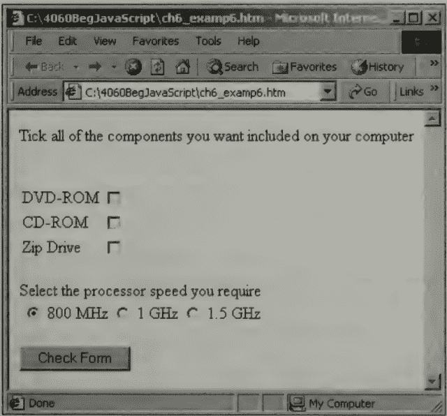

勾选一些复选框，更改处理器速度，然后点击**Check Form**按钮。会弹出一个消息框，显示你选择的组件和处理器速度详细信息。例如，如果你选择了 DVD-ROM 和 Zip Drive，以及 1.5GHz 处理器速度，你将看到以下内容：


注意，1 GHz 处理器已缺货，因此如果你选择它，会弹出一个消息框告知缺货，并且 1 GHz 处理器速度单选按钮将不会被选中。用户关闭消息框后，之前的设置将被恢复。

#### 工作原理

让我们首先查看页面的主体部分，我们在名为 form1 的表单中定义了复选框、单选按钮和普通按钮。我们从复选框开始。它们被放入表格中，仅用于格式化目的。没有调用函数或绑定事件。

```html
<TABLE>
  <TR>
    <TD>DVD-ROM</TD>
    <TD><INPUT TYPE="checkbox" NAME=chkDVD VALUE="DVD-ROM"></TD>
  </TR>
  <TR>
    <TD>CD-ROM</TD>
    <TD><INPUT TYPE="checkbox" NAME=chkCD VALUE="CD-ROM"></TD>
  </TR>
  <TR>
    <TD>Zip Drive</TD>
    <TD><INPUT TYPE="checkbox" NAME=chkZip VALUE="ZIP Drive"></TD>
  </TR>
</TABLE>
```

接下来是用于选择所需 CPU 速度的单选按钮，它们稍微复杂一些。同样，它们被放入表格中，仅用于格式化目的。

```html
<TABLE>
  <TR>
    <TD><INPUT TYPE="radio" NAME=radCPUSpeed CHECKED
     onclick="return radCPUSpeed_onclick(0)" VALUE="800 MHz"></TD>
    <TD>800 MHz</TD>
  </TR>
  <TR>
    <TD><INPUT TYPE="radio" NAME=radCPUSpeed
     onclick="return radCPUSpeed_onclick(1)" VALUE="1 GHz"></TD>
    <TD>1 GHz</TD>
  </TR>
  <TR>
    <TD><INPUT TYPE="radio" NAME=radCPUSpeed
     onclick="return radCPUSpeed_onclick(2)" VALUE="1.5 GHz"></TD>
    <TD>1.5 GHz</TD>
  </TR>
</TABLE>
```

单选按钮组的名称是 radCPUSpeed。我在 `<INPUT>` 标签的定义中加入了 CHECKED 一词，将第一个按钮设置为默认选中。确保有一个单选按钮默认被选中是个好主意。如果没有这个设置，如果用户没有选择任何按钮，表单提交时该单选组将没有值。

我们利用了每个 Radio 对象的 onclick 事件。对于每个按钮，我们都连接到同一个函数 `radCPUSpeed_onclick()`，但对于每个单选按钮，我们传递了一个值，即该特定按钮在 radCPUSpeed 单选按钮组数组中的索引。这使得判断哪个单选按钮被选中变得很容易。稍后我们会查看这个函数，但首先让我们看看完成我们表单的普通按钮。

```html
<INPUT TYPE="button" VALUE="Check Form" Name=butCheck
onclick="return butCheck_onclick()">
```

这个按钮供用户填写完表单后点击，其 onclick 事件处理器连接到了 `butCheck_onclick()` 函数。

因此，我们有两个函数，`radCPUSpeed_onclick()` 和 `butCheck_onclick()`。它们都在页面头部部分的脚本块中定义。现在让我们看看这个脚本块。它以声明变量 `radCpuSpeedIndex` 开始。这将用于存储 radCPUSpeed 单选按钮组当前选中的索引。

```javascript
var radCpuSpeedIndex = 0;
```

接下来是 `radCPUSpeed_onclick()` 函数，它由每个单选按钮中的 onclick 事件处理器调用。我们的函数有一个参数，即所选 radio 对象在 radCPUSpeed[] 数组中的索引位置。

```javascript
function radCPUSpeed_onclick(radIndex)
{
    var returnValue = true;
}
```

我们在函数中做的第一件事是声明 `returnValue` 变量并将其设置为 `true`。我们将把它作为函数的返回值返回。在这种情况下，这个返回值很重要，因为它决定了用户点击后单选按钮是否保持选中状态。如果我们返回 `false`，则会取消用户的操作，单选按钮保持未选中状态。实际上没有任何单选按钮会被选中，这就是我们跟踪已选中单选按钮索引的原因，这样我们就可以重新选中之前选中的按钮。为了允许用户的操作继续进行，我们返回 `true`。

作为这个动作的一个例子，在下一行我们有一个 if 语句。如果传递的单选按钮索引值为 1，即用户选中了 1 GHz 处理器的选项，那么我们告知他们该商品缺货，并通过将 `returnValue` 设置为 `false` 来取消点击操作。

```javascript
if (radIndex == 1)
{
    returnValue = false;
    alert("Sorry that processor speed is currently unavailable");
    document.form1.radCPUSpeed[radCpuSpeedIndex].checked = true;
}
```

我在上面提到，取消点击操作会导致没有单选按钮被选中，所以为了解决这个问题，我们在以下行重新设置之前选中的框为选中状态：

```javascript
document.form1.radCPUSpeed[radCpuSpeedIndex].checked = true;
```

我们在这里做的是使用 radCpuSpeed 单选按钮组的 Array 对象。每个数组元素实际上包含一个对象，即我们的三个 Radio 对象之一。我们使用 `radCpuSpeedIndex` 变量作为最后选中的 Radio 对象的索引，因为这是它所保存的内容。

最后在 else 语句中，我们将 `radCpuSpeedIndex` 设置为新选中的单选按钮的索引值。

```javascript
else
{
    radCpuSpeedIndex = radIndex;
}
```

在函数的最后一行，`returnValue` 的值返回到调用函数的地方，将会取消或允许点击操作。

```javascript
return returnValue;
}
```

我们的第二个函数 `butCheck_onclick()` 是连接到按钮 onclick 事件的那个函数。在真实的电子商务场景中，这个按钮是我们检查表单然后将其提交到服务器进行处理的地方。在这里，我们使用表单来显示一个消息框，确认你勾选了哪些框，好像你还不知道一样！

在顶部，我们声明了四个局部变量，它们将在函数中使用。变量 `numberOfControls` 设置为表单的 length 属性，即表单上的元素数量。变量 `compSpec` 将用于构建我们即将在消息框中显示的字符串。

```javascript
energyCheck_onclick()
{
    var controlIndex;
    var element;
    var numberOfControls = document.form1.length;
    var compSpec = "Your chosen processor speed is ";
    compSpec = compSpec + document.form1.radCPUSpeed[radCpuSpeedIndex].value;
    compSpec = compSpec + "\nWith the following adtional components\n";
}
```

在这行中：

```javascript
compSpec = compSpec + document.form1.radCPUSpeed[radCpuSpeedIndex].value;
```

我们将用户选择的单选按钮的值添加到我们的消息字符串中。全局变量 `radCpuSpeedIndex` 由单选按钮组的 onclick 事件设置，包含所选单选按钮的数组索引。


另一种查找被点击的单选按钮的方法是，遍历单选按钮组的数组，依次测试每个单选按钮是否被选中。代码大致如下：

```
var radIndex;
for (radIndex = 0; radIndex < document.form1.radCPUSpeed.length; radIndex++)
{
    if (document.form1.radCPUSpeed[radIndex].checked == true)
    {
        radCpuSpeedIndex = radIndex;
        break;
    }
}
```

不过，回到实际的代码。你会注意到我出于格式原因，在消息字符串中插入了一些换行符（`\n`）。

接下来是我们大型的 `for` 语句。

```
for (controlIndex = 0; controlIndex < numberOfControls; controlIndex++)
{
    element = document.form1[controlIndex];
    if (element.type == "checkbox")
    {
        if (element.checked == true)
        {
            compSpec = compSpec + element.value + "\n";
        }
    }
}
alert(compSpec);
```

在这里，我们使用 `document.form1[controlIndex]` 来遍历表单上的每个元素，该表达式返回存储在 `controlIndex` 索引位置处的元素对象的引用。

你会看到我将 `element` 变量设置为引用存储在 `form1[]` 数组中、索引位置由变量 `controlIndex` 指定的对象。这样做同样是出于简写便利的目的，因为现在要使用该特定对象的属性或方法，我们只需输入 `element`，然后一个点，再输入方法或属性名，这使我们的代码更易于阅读和调试，并节省输入。

我们只想查看哪些复选框被选中了，因此我们使用每个 HTML 元素对象都有的 `type` 属性，来查看我们正在处理的是什么元素类型。如果 `type` 是 `checkbox`，我们就继续查看它是否是一个被选中的复选框。如果是，我们就将其值附加到 `compSpec` 中的消息字符串。如果不是复选框，则可以安全地忽略。

最后要做的就是使用 `alert()` 方法显示我们的消息字符串的内容。

#### 选择元素

尽管它们看起来差异很大，但下拉列表和列表框实际上都是使用 `<SELECT>` 标签创建的元素，严格来说，它们都是选择元素。选择元素在一个列表中有一个或多个可供选择的选项；每个选项都使用 `<OPTION>` 标签定义。你的 `<OPTION>` 标签列表位于 `<SELECT>` 和 `</SELECT>` 标签之间。

`<SELECT>` 标签的 SIZE 属性用于指定有多少个选项对用户可见。

例如，要创建一个5行深的列表框并填充7个选项，我们的 `<SELECT>` 标签将如下所示：

```
<SELECT NAME=theDay SIZE=5>
  <OPTION VALUE=0 SELECTED>Monday
  <OPTION VALUE=1>Tuesday
  <OPTION VALUE=2>Wednesday
  <OPTION VALUE=3>Thursday
  <OPTION VALUE=4>Friday
  <OPTION VALUE=5>Saturday
  <OPTION VALUE=6>Sunday
</SELECT>
```

注意，周一（Monday）的 `<OPTION>` 标签还包含 SELECTED 这个词；这将使此选项成为页面加载时的默认选中项。选项的值被定义为数字，但文本同样有效。

如果我们希望这是一个下拉列表，那么我们只需将 `<SELECT>` 标签中的 SIZE 属性改为 1，看，它就成了下拉列表。

如果我们希望用户一次可以从列表中选择多个项目，我们只需在 `<SELECT>` 定义中添加 MULTIPLE 属性。

`<SELECT>` 标签创建一个 Select 对象。该对象有一个 `options[]` 数组属性，这个数组由 Option 对象组成，每个对象对应关联到该 Select 对象的 `<SELECT>` 元素内的一个 `<OPTION>` 元素。例如，在上面的例子中，如果 `<SELECT>` 元素包含在一个名为 theForm 的表单中，那么使用

```
document.theForm.theDay.options[0]
```

我们就可以访问为周一创建的选项。

我们如何知道用户选择了哪个选项？很简单；我们使用 Select 对象的 `selectedIndex` 属性。我们可以使用该属性返回的索引值，通过 `options[]` 数组访问被选中的选项。

Option 对象也有 `index`、`text` 和 `value` 属性。`index` 属性返回该选项在 `options[]` 数组中的索引位置。`text` 属性是列表中显示的内容，`value` 属性是为选项定义的值，如果提交表单，该值将被发送到服务器。

#### HTML 表单：与用户交互

如果你想找出选择元素中有多少个选项，你可以使用 Select 对象本身或其 `options[]` 数组属性的 `length` 属性。

让我们看看如何遍历上述选择框的 `options[]` 数组：

```
var theDayElement = window.document.form1.theDay;
document.write("There are " + theDayElement.length + " options");
var optionCounter;
for (optionCounter = 0; optionCounter < theDayElement.length; optionCounter++)
{
    document.write("Option text is " + theDayElement.options[optionCounter].text)
    document.write(" and its value is ");
    document.write(theDayElement.options[optionCounter].value);
    document.write("")
}
```

首先我们将变量 `theDayElement` 设置为引用 Select 对象。然后我们将选项的数量写入页面，在这个例子中是7。

接下来我们使用 `for` 循环遍历 `options[]` 数组，显示每个选项的文本（如 Monday、Tuesday 等）及其值（如 0、1 等）。如果你基于此代码创建页面，它必须放置在 `<SELECT>` 标签定义之后。

也可以在页面加载完成后向选择元素添加选项。接下来我们将探讨如何实现这一点。

#### 添加新选项

要向选择元素添加新选项，我们只需使用 `new` 运算符创建一个新的 Option 对象，然后将其插入到 Select 对象的 `options[]` 数组中的一个空索引位置。

创建新的 Option 对象时需要传递两个参数，第一个是希望在列表中显示的文本，第二个是要分配给该选项的值。

```
var myNewOption = new Option("TheText", "TheValue");
```

然后我们只需将此 Option 对象分配给一个空的数组元素，例如：

```
document.theForm.theSelectObject.options[0] = myNewOption;
```

如果你想删除一个选项，只需将 `options[]` 数组的该部分设置为 `null`。例如，要删除我们刚刚插入的元素，需要：

```
document.theForm.theSelectObject.options[0] = null;
```

当你从 `options[]` 数组中移除一个 Option 对象时，数组会被重新排序，使得被移除选项之上的所有选项的数组索引值都减一。

当你在某个索引位置插入一个新选项时，要注意它会覆盖那里已有的任何 Option 对象。

#### 第 6 章

### 实践演练 – 添加和删除列表选项

让我们使用上面看到的“星期列表”示例来演示添加和删除列表选项。

```
<HTML>
<HEAD>

<SCRIPT LANGUAGE=JavaScript>

function butRemoveWed_onclick()
{
    if (document.form1.theDay.options[2].text == "Wednesday")
    {
        document.form1.theDay.options[2] = null;
    }
    else
    {
        alert('There is no Wednesday here!');
    }
}

function butAddWed_onclick()
{
    if (document.form1.theDay.options[2].text != "Wednesday")
    {
        var indexCounter;
        var days = document.form1.theDay;
        var lastoption = new Option();
        days.options[6] = lastoption;

        for (indexCounter = 6;indexCounter > 2; indexCounter--)
        {
            days.options[indexCounter].text = days.options[indexCounter - 1].text;
            days.options[indexCounter].value = days.options[indexCounter - 1].value;
        }

        var option = new Option("Wednesday",2);
        days.options[2] = option;
    }
    else
    {
        alert('Do you want to have TWO Wednesdays?????');
    }
}

</SCRIPT>
</HEAD>
<BODY>

<FORM NAME=form1>
<SELECT NAME=theDay SIZE=5>
    <OPTION VALUE=0 SELECTED>Monday
    <OPTION VALUE=1>Tuesday
    <OPTION VALUE=2>Wednesday
```


 # HTML 表单：与用户交互

```
<OPTION VALUE=3>Thursday
<OPTION VALUE=4>Friday
<OPTION VALUE=5>Saturday
<OPTION VALUE=6>Sunday
</SELECT>
<BR>
<INPUT TYPE="button" VALUE="Remove Wednesday" NAME=butRemoveWed
    onclick="butRemoveWed_onclick()">
<INPUT TYPE="button" VALUE="Add Wednesday" NAME=butAddWed
    onclick="butAddWed_onclick()">
<BR>
</FORM>
</BODY>
</HTML>
```

将其保存为 `ch6_examp7.htm`。

如果你编写该页面并用浏览器加载，你应该能看到下面的表单。点击 “Remove Wednesday” 按钮，你会看到它从列表中消失。点击 “Add Wednesday” 按钮将其重新添加。如果你尝试添加第二个 Wednesday 或删除一个不存在的 Wednesday，你会收到一个礼貌的警告，告诉你不能这样做。

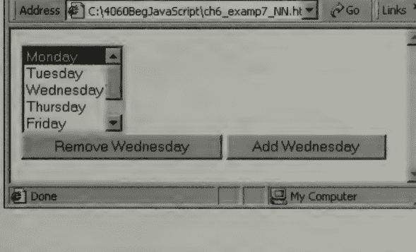

#### 工作原理

在页面的主体中，我们定义了一个名为 `form1` 的表单。它包含一个 `select` 元素，其中包含我们之前看到的星期选项。该表单还包含两个按钮：

```
<INPUT TYPE="button" VALUE="Remove Wednesday" NAME=butRemoveWed
    onclick="butRemoveWed_onclick()">
<INPUT TYPE="button" VALUE="Add Wednesday" NAME=butAddWed
    onclick="butAddWed_onclick()">
```

这些按钮的 `onclick` 事件处理程序分别连接到调用两个函数之一的代码：`butRemoveWed_onclick()` 和 `butAddWed_onclick()`。这些函数定义在页面头部（head）的 `script` 块中。我们将依次 살펴这些函数。

#### 第 6 章

在页面的顶部，我们有第一个函数 `butRemoveWed_onclick()`，它用于删除 Wednesday 选项。

```
function butRemoveWed_onclick()
{
    if (document.form1.theDay.options[2].text == "Wednesday")
    {
        document.form1.theDay.options[2] = null;
    }
    else
    {
        alert('There is no Wednesday here!');
    }
}
```

在函数中，我们首先进行一项合理性检查：只有在 Wednesday 选项确实存在时，我们才尝试删除它！我们通过检查数组中第三个选项（索引为 2，因为数组从索引 0 开始）的文本是否为 "Wednesday" 来实现。如果是，我们可以通过将该特定选项设置为 `null` 来删除 Wednesday 选项。如果数组中的第三个选项不是 Wednesday，则向用户发出警告，告知没有可删除的 Wednesday。虽然我在 `if` 语句的条件中使用了 `text` 属性，但我们也完全可以使用 `value` 属性，结果没有区别。

接下来是 `butAddWed_onclick()` 函数，正如其名，它用于添加 Wednesday 选项。

这比删除选项所需的代码稍微复杂一点。首先，我们使用 `if` 语句检查是否已经存在 Wednesday 选项。

```
function butAddWed_onclick()
{
    if (document.form1.theDay.options[2].text != "Wednesday")
    {
        var indexCounter;
        var days = document.form1.theDay;
        var lastoption = new Option();
        days.options[6] = lastoption;

        for (indexCounter = 6; indexCounter > 2; indexCounter--)
        {
            days.options[indexCounter].text = days.options[indexCounter - 1].text;
            days.options[indexCounter].value = days.options[indexCounter - 1].value;
        }
    }
}
```

如果没有 Wednesday 选项，我们需要为插入新的 Wednesday 选项腾出空间。

在此之前，我们定义了两个变量 `indexCounter` 和 `days`，后者指向 `theDay` 选择元素，是我们为了方便而使用的简写引用。接着，我们使用变量名 `lastoption` 创建一个新选项，并将此新选项赋值给选项数组中索引位置为 6 的元素。该位置之前是没有内容的。接下来，我们将从 Thursday 到 Sunday 的所有 `Option` 对象的 `text` 和 `value` 属性赋值给选项数组中索引值高一位的 `Option`，从而在选项数组的第 2 位留下空间来放置 Wednesday。这就是 `if` 语句中 `for` 循环的任务。

然后，通过向 `Option` 构造函数传递文本 "Wednesday" 和值 2，我们创建了一个新的 `Option` 对象。随后，该 `Option` 对象被插入到 `options[]` 数组的第 2 位，瞧，它就出现在我们的选择框中了。

```
var option = new Option("Wednesday",2);
days.options[2] = option;
}
```

如果 `if` 语句中的条件为假，我们通过向用户发送警告来结束该函数，告知列表中已经存在一个 Wednesday 选项。

```
else
{
    alert('Do you want to have TWO Wednesdays?????');
}
```

#### 使用 Internet Explorer 添加新选项

在 IE 中，与对象相关联的附加属性、方法和事件要多得多。特别是我们感兴趣的 `options[]` 数组具有额外的 `add()` 和 `remove()` 方法，用于添加和删除选项。这让开发变得简单了一些。

在添加选项之前，我们需要先创建它。这与之前完全相同，使用 `new` 运算符即可。

`add()` 方法允许我们插入一个已创建的 `Option` 对象，它接受两个参数。我们将要添加的选项作为第一个参数传递。可选的第二个参数允许我们指定想要添加选项的索引位置。这不会覆盖该位置已有的任何 `Option` 对象，而只是将 `Option` 对象在数组中向上移动以腾出空间。这基本上等同于我们在 `butAddWed_onclick()` 函数中使用 `for` 循环所编写的代码。

使用 `add()` 方法，我们可以将 `ch6_examp7.htm` 示例中的 `butAddWed_onclick()` 函数重写为如下形式：

```
function butAddWed_onclick()
{
    if (document.form1.theDay.options[2].text != "Wednesday")
    {
        var option = new Option("Wednesday",2);
        document.form1.theDay.options.add(option,2);
    }
    else
    {
        alert('Do you want to have TWO Wednesdays?????');
    }
}
```

`remove()` 方法仅接受一个参数，即我们要删除的选项的索引。当一个选项被删除时，较高索引位置的选项会向下移动以填补空白。

#### 第 6 章

使用 `remove()` 方法，我们可以将 `ch6_examp7.htm` 示例中的 `butRemoveWed_onclick()` 函数重写为如下形式：

```
function butRemoveWed_onclick()
{
    if (document.form1.theDay.options[2].text == "Wednesday")
    {
        document.form1.theDay.options.remove(2);
    }
    else
    {
        alert('There is no Wednesday here!');
    }
}
```

修改之前的示例并将其保存为 `ch6_examp8_IE.htm`，然后加载到 IE 中。你会发现它的运行效果与之前的版本完全一样。

#### Select 元素事件

Select 元素有三个事件处理程序：`onblur`、`onfocus` 和 `onchange`。我们之前都见过这些事件。我们在文本框元素中见过 `onchange` 事件，它在焦点离开文本框 *且* 文本框中的值发生改变时触发。在这里，当用户更改列表中选中的选项时，它就会触发。

#### 试一试 —— 使用 Select 元素进行日期差计算

让我们看一个使用 `onchange` 事件并充分利用下拉列表形式的 select 元素的示例。其目的是计算用户通过下拉列表框设置的两个日期之间相差的天数。

```
<HTML>
<HEAD>
<SCRIPT LANGUAGE=JavaScript>

function writeOptions(startNumber, endNumber)
{
    var optionCounter;
    for (optionCounter = startNumber; optionCounter <= endNumber; optionCounter++)
    {
        document.write('<OPTION value=' + optionCounter + '>' + optionCounter);
    }
}

function writeMonthOptions()
{
    var theMonth;
    var monthCounter;
    var theDate = new Date();

    for (monthCounter = 0; monthCounter < 12; monthCounter++)
    {
        theDate.setMonth(monthCounter);
        theMonth = theDate.toString();
```

#### HTML 表单：与用户交互

```
theMonth = theMonth.substr(4,3);
document.write('<OPTION value=' + theMonth + '>' + theMonth);
}

function recalcDateDiff()
{
    var myForm = document.form1;

    var firstDay = myForm.firstDay.options[myForm.firstDay.selectedIndex].value;
    var secondDay =
        myForm.secondDay.options[myForm.secondDay.selectedIndex].value;

    var firstMonth =
        myForm.firstMonth.options[myForm.firstMonth.selectedIndex].value;
    var secondMonth =
        myForm.secondMonth.options[myForm.secondMonth.selectedIndex].value;

    var firstYear =
        myForm.firstYear.options[myForm.firstYear.selectedIndex].value;
    var secondYear =
        myForm.secondYear.options[myForm.secondYear.selectedIndex].value;

    var firstDate = new Date(firstDay + " " + firstMonth + " " + firstYear);
    var secondDate = new Date(secondDay + " " + secondMonth + " " + secondYear);

    var daysDiff = (secondDate.valueOf() - firstDate.valueOf());
    daysDiff = Math.floor(Math.abs((((daysDiff / 1000) / 60) / 60) / 24));
    myForm.txtDays.value = daysDiff;

    return true;
}

function window_onload()
{
    var theForm = document.form1;
    var nowDate = new Date();

    theForm.firstDay.options[nowDate.getDate() - 1].selected = true;
    theForm.secondDay.options[nowDate.getDate() - 1].selected = true;

    theForm.firstMonth.options[nowDate.getMonth()].selected = true;
    theForm.secondMonth.options[nowDate.getMonth()].selected = true;

    theForm.firstYear.options[nowDate.getFullYear() - 1970].selected = true;
    theForm.secondYear.options[nowDate.getFullYear() - 1970].selected = true;
}

</SCRIPT>
</HEAD>
<BODY LANGUAGE=JavaScript onload="return window_onload()">
```


#### 第6章

```
<FORM NAME=form1>
<P>
First Date<BR>

<SELECT NAME=firstDay SIZE=1 onchange="return recalcDateDiff()">
<SCRIPT LANGUAGE=JavaScript>
   writeOptions(1,31);
</SCRIPT>
</SELECT>

<SELECT NAME=firstMonth SIZE=1 onchange="return recalcDateDiff()">
<SCRIPT LANGUAGE=JavaScript>
   writeMonthOptions();
</SCRIPT>
</SELECT>

<SELECT NAME=firstYear SIZE=1 onchange="return recalcDateDiff()">
<SCRIPT LANGUAGE=JavaScript>
   writeOptions(1970,2010);
</SCRIPT>
</SELECT>
</P>

<P>
Second Date<BR>

<SELECT NAME=secondDay SIZE=1 onchange="return recalcDateDiff()">
<SCRIPT LANGUAGE=JavaScript>
   writeOptions(1,31);
</SCRIPT>
</SELECT>

<SELECT NAME=secondMonth SIZE=1 onchange="return recalcDateDiff()">
<SCRIPT LANGUAGE=JavaScript>
   writeMonthOptions();
</SCRIPT>
</SELECT>

<SELECT NAME=secondYear SIZE=1 onchange="return recalcDateDiff()">
<SCRIPT LANGUAGE=JavaScript>
   writeOptions(1970,2010);
</SCRIPT>
</SELECT>
</P>

Total difference in days
<INPUT TYPE="text" NAME=txtDays VALUE=0>
<BR>
</FORM>

</BODY>
</HTML>
```

#### HTML 表单：与用户交互

将示例文件命名为 `ch6_examp9.htm`，并将其加载到你的网络浏览器中。你应该会看到下面的表单，不过两个日期框都会设置为当前日期。

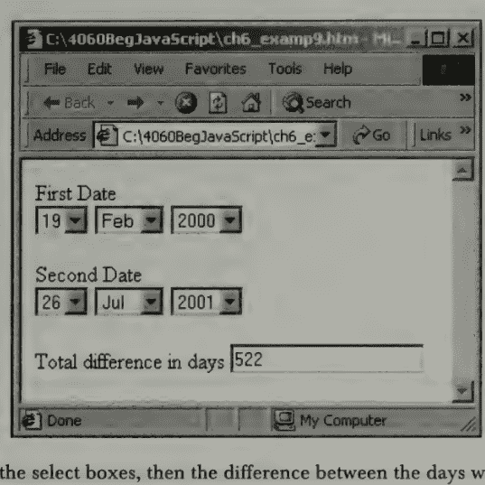

如果你更改任何一个选择框，那么日期之间的天数差将被重新计算并显示在文本框中。

#### 工作原理

在页面的主体部分，网页中的表单由六个下拉列表框和一个文本框构成。让我们来看一个 `select` 元素的例子；以第一个 `<SELECT>` 标签为例，它允许用户选择第一个日期中的日期部分。

```
<SELECT NAME=firstDay SIZE=1 onchange="return recalcDateDiff()">
<SCRIPT LANGUAGE=JavaScript>
    writeOptions(1,31);
</SCRIPT>
</SELECT>
```

`SIZE` 属性被设置为 `1`，这样我们得到的是一个下拉列表框而不是一个列表框。`onchange` 事件处理程序已连接到 `recalcDateDiff()` 函数，我们稍后会介绍这个函数。

然而，在 `<SELECT>` 元素内没有定义任何 `<OPTION>` 标签。要填充下拉列表框所需的所有选项，如果让你全部手动输入，那我也太残忍了！相反，我们使用函数来填充选项，这些函数利用了 `document.write()` 方法。

日期和年份的选项使用在页面头部声明的 `writeOptions()` 函数来填充。该函数接收两个值：起始数字和结束数字，用于指定我们希望 `select` 元素包含的选项范围。让我们来看一下 `writeOptions()` 函数。

```
function writeOptions(startNumber, endNumber)
{
    var optionCounter;
    for (optionCounter = startNumber; optionCounter <= endNumber; optionCounter++)
    {
        document.write('<OPTION value=' + optionCounter + '>' + optionCounter);
    }
}
```

这个函数实际上非常简单，包含一个 `for` 循环，使用变量 `optionCounter` 从第一个数字（`startNumber`）循环到最后一个数字（`endNumber`），并输出每个 `<OPTION>` 标签所需的 HTML。选项的文本和 `<OPTION>` 标签的 `VALUE` 属性都被指定为变量 `optionCounter` 的值。这当然比手动输入一个月中日期所需的31个 `<OPTION>` 标签要快得多。

你可能会想知道为什么使用 `document.write()` 方法；为什么不用我们之前见过的添加新选项的方法呢？

首先，这种方式在 IE 和 NN 浏览器中都有效，所以不需要编写两套不同的代码。其次，在页面加载时向 `<SELECT>` 元素添加新选项在 NN 浏览器中有时会很困难，可能需要刷新页面才能生效。

对于年份选择框，可以重复使用相同的函数。我们只需将 `1970` 和 `2010` 作为参数传递给 `writeOptions()` 函数，以填充年份选择框。

```
<SELECT NAME=firstYear SIZE=1 onchange="return recalcDateDiff()">
<SCRIPT LANGUAGE=JavaScript>
    writeOptions(1970,2010);
</SCRIPT>
</SELECT>
```

要用月份名称填充月份选择框，需要一个不同的函数。然而，填充 `<SELECT>` 元素背后的原理仍然是相同的，都使用 `document.write()`。从下面的月份选择元素可以看出，这个函数是 `writeMonthOptions()`。

```
<SELECT NAME=firstMonth SIZE=1 onchange="return recalcDateDiff()">
<SCRIPT LANGUAGE=JavaScript>
    writeMonthOptions();
</SCRIPT>
</SELECT>
```

新函数 `writeMonthOptions()` 定义在页面的头部。现在让我们来看看它。我们首先定义三个变量，并将变量 `theDate` 初始化为今天的日期。

```
function writeMonthOptions()
{
    var theMonth;
    var monthCounter;
    var theDate = new Date();
```

我们使用已存储的 `Date` 对象来获取月份的文本表示（Jan, Feb, ..., Dec）。我们通过在 `for` 循环中使用 `setMonth()` 方法，将 `theDate` 变量中的月份从 0 设置到 11 来获取这些月份。虽然 `Date` 对象没有提供将日期作为数字以外格式返回的方法，但它确实有 `toString()` 方法，该方法以字符串形式返回变量中存储的日期值。它返回的格式是：星期、月份、月份中的日期、时间，最后是年份，例如 `Sat Feb 19 19:04:34 2000`。我们只需要月份部分。由于我们总是知道它在字符串中的位置，并且长度始终为3，因此可以很容易地使用 `String` 对象的 `substr()` 方法提取月份。

```
for (monthCounter = 0; monthCounter < 12; monthCounter++)
{
    theDate.setMonth(monthCounter);
    theMonth = theDate.toString();
    theMonth = theMonth.substr(4,3);
    document.write('<OPTION value=' + theMonth + '>' + theMonth);
}
```

获得了三个字符的月份字符串后，我们就可以创建 `<OPTION>` 标签，并用月份填充其文本和值。

为了用户方便，在页面加载时，最好将选择元素中的两个日期都设置为今天的日期。这正是我们在 `window_onload()` 函数中所做的，该函数通过 `<BODY>` 标签连接到窗口的 `onload` 事件：

```
<BODY LANGUAGE=JavaScript onload="return window_onload()">
```

`window_onload()` 函数定义在页面的头部。我们首先将 `theForm` 变量设置为引用我们的 Form 对象，因为它缩短了代码中所需的引用。接下来，我们创建一个变量来保存一个 `Date` 对象，用于存储今天的日期。

```
function window_onload()
{
    var theForm = document.form1;
    var nowDate = new Date();
```

设置每个 `<SELECT>` 框的初始值很容易；`Date` 对象 `nowDate` 返回的值可以被修改，以提供 `options[]` 数组所需的正确索引。对于日期，正确的索引就是月份中的日期减去1——记住数组是从零开始的，所以1号实际上是在索引0处。将 `selected` 属性设置为 `true`，可以使该日期成为列表中当前选中的选项。

```
theForm.firstDay.options[nowDate.getDate() - 1].selected = true;
theForm.secondDay.options[nowDate.getDate() - 1].selected = true;
```

月份更简单，因为 `getMonth()` 函数返回一个0到11的值来表示月份，这正好匹配我们 `options[]` 数组所需的索引值。

```
theForm.firstMonth.options[nowDate.getMonth()].selected = true;
theForm.secondMonth.options[nowDate.getMonth()].selected = true;
```

对于年份，由于我们从1970年开始作为第一年，我们需要从当前年份减去1970来获得正确的索引值。

```
theForm.firstYear.options[nowDate.getFullYear() - 1970].selected = true;
theForm.secondYear.options[nowDate.getFullYear() - 1970].selected = true;
}
```

我们需要查看的代码最后一部分是连接到每个选择元素 `onchange` 事件的函数，即 `recalcDateDiff()` 函数。在这个函数中，我们的第一个任务是使用下拉列表构建用户选择的两个日期。

```
function recalcDateDiff()
{
    var myForm = document.form1;

    var firstDay = myForm.firstDay.options[myForm.firstDay.selectedIndex].value;
    var secondDay =
        myForm.secondDay.options[myForm.secondDay.selectedIndex].value;

    var firstMonth =
        myForm.firstMonth.options[myForm.firstMonth.selectedIndex].value;
    var secondMonth =
        myForm.secondMonth.options[myForm.secondMonth.selectedIndex].value;

    var firstYear =
        myForm.firstYear.options[myForm.firstYear.selectedIndex].value;
    var secondYear =
        myForm.secondYear.options[myForm.secondYear.selectedIndex].value;
```

我们遍历每个选择元素，并检索所选 Option 对象的值。Select 对象的 `selectedIndex` 属性提供了我们需要在 `options[]` 数组中引用所选 Option 对象的索引。例如，在：

```
var firstDay = myForm.firstDay.options[myForm.firstDay.selectedIndex].value;
```

中，索引由 `myForm.firstDay.selectedIndex` 提供。然后我们使用该值作为方括号内的索引值，用于 `firstDay` 选择元素的 `options[]` 数组。这提供了对所选 Option 对象的引用，其 `value` 属性被存储在变量 `firstDay` 中。

我们将此技术用于所有剩余的选择元素。

然后，我们可以基于从选择元素获取的值创建新的 `Date` 对象，并将它们存储在变量 `firstDate` 和 `secondDate` 中。

```
var firstDate = new Date(firstDay + " " + firstMonth + " " + firstYear);
var secondDate = new Date(secondDay + " " + secondMonth + " " + secondYear);
```

最后，我们需要计算两个日期之间的天数差。

```
var daysDiff = (secondDate.valueOf() - firstDate.valueOf());
daysDiff = Math.floor(Math.abs((((daysDiff / 1000) / 60) / 60) / 24));
```


#### HTML表单：与用户交互

`Date`对象有一个方法`valueOf()`，它返回从1970年1月1日到存储在`Date`对象中的日期之间的毫秒数。我们将`secondDate`的`valueOf`属性值减去`firstDate`的`valueOf`属性值，并将结果存储在变量`daysDiff`中。此时，它保存的是两个日期之间以毫秒为单位的差值，因此我们在下一行中将其转换为天数。通过除以1000，我们得到秒数，再除以60得到分钟数，再次除以60得到小时数，最后除以24得到我们最终的天数差值。`Math`对象的`abs()`方法使负数变为正数。用户可能将第一个日期设置得比第二个晚，而我们只想找出相差的天数，而不是找出哪个日期更早，所以我们将任何负结果变为正数。`Math.floor()`方法移除任何结果的小数部分，只返回向下取整的整数部分。

最后，我们将相差的天数写入页面上的`txtDays`文本框。

```
myForm.txtDays.value = daysDiff;

return true;
}
```

至此，我们对网页中更实用的表单元素的介绍就结束了。下一节我们将回到那个趣味问答，届时我们可以将新学到的知识付诸实践，实际创建一个可用的问答页面。

#### 趣味问答

是时候回到我们在第3章留下的趣味问答了。到目前为止，我们已经在数组中定义了问题和答案，并定义了一个函数来检查用户的答案是否正确。现在我们知道了如何创建HTML表单和元素，就可以开始在问答中使用它们来提供用户输入。在本节结束时，问题表单将如下图所示。

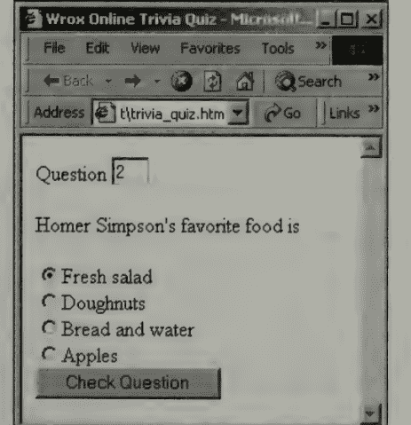

第6章

目前我们的问题是多选题；我们通过单选按钮组来表示多选选项。

我们使用我们的老朋友`document.write()`和问题数组中包含的信息来动态创建表单元素。一旦用户选择了代表答案的单选按钮，他们点击“检查问题”按钮，该按钮调用我们的`checkAnswer()`函数，判断用户是否回答正确，并告知结果。然后我们进入下一个问题。

让我们从创建表单元素开始。

#### 创建表单

我们需要做的第一件事是在页面中添加一个表单，单选按钮将被写入其中。加载`trivia_quiz.htm`，并在页面底部，即定义了问题和答案数组的位置下方，进行如下更改：

```
// 为问题3分配答案
answers[2] = "C";

</SCRIPT>

<FORM NAME="QuestionForm">

问题
<INPUT TYPE="text" NAME=txtQNumber SIZE=1>

<SCRIPT LANGUAGE=JavaScript>
    document.write(getQuestion());
</SCRIPT>

<INPUT TYPE="button" VALUE="检查问题" NAME=buttonCheckQ
    onclick="return buttonCheckQ_onclick()">
</FORM>

</BODY>
</HTML>
```

我们将新的表单`QuestionForm`插入到页面的body内部。

表单上的元素包括一个文本框，由以下行定义：

```
<INPUT TYPE="text" NAME=txtQNumber SIZE=1>
```

它将保存当前的问题编号；以及一个名为`buttonCheckQ`的按钮：

```
<INPUT TYPE="button" VALUE="检查问题" NAME=buttonCheckQ
    onclick="return buttonCheckQ_onclick()">
```

当点击该按钮时，它会检查用户提供的答案，并告知他们是否正确。该按钮的onclick事件连接到一个函数`buttonCheckQ_onclick()`，我们稍后将创建这个函数。

你能在上面图片中看到的单选按钮在哪里呢？嗯，我们将再次使用`document.write()`方法，在页面加载时动态插入问题。这样我们就可以每次从问题数组中随机挑选一个问题。正是这段代码：

```
<SCRIPT LANGUAGE=JavaScript>
    document.write(getQuestion());
</SCRIPT>
```

它使用我们需要添加的第二个函数`getQuestion()`来插入问题。

#### 创建答案单选按钮

我们在上面的代码中看到，所需的单选按钮将由`getQuestion()`函数插入，并且`buttonCheckQ_onclick()`函数连接到按钮的onclick事件处理程序。我们现在将这些函数添加到页面顶部，与我们在第3章定义的`answerCorrect()`函数放在同一个脚本块中。

在`trivia_quiz.htm`页面的顶部添加以下几行。

```
<HTML>
<HEAD>
<TITLE>Wrox在线趣味问答</TITLE>

<SCRIPT LANGUAGE=JavaScript>

var questionNumber;

function answerCorrect(questionNumber, answer)
{
    // 声明一个变量来保存返回值
    var correct = false;

    // 如果提供的答案与答案相同，则正确答案为true
    if (answer == answers[questionNumber])
        correct = true;

    // 返回答案是否正确（true或false）
    return correct;
}

function getQuestion()
{
    questionNumber = Math.floor(Math.random() * (questions.length));
    var questionHTML = "<P>" + questions[questionNumber][0] + "</P>";
    var questionLength = questions[questionNumber].length;
    var questionChoice;

    for (questionChoice = 1;questionChoice < questionLength;questionChoice++)
    {
        questionHTML = questionHTML + "<INPUT TYPE=radio NAME=radQuestionChoice"
        if (questionChoice == 1)
        {
            questionHTML = questionHTML + " CHECKED";
        }
        questionHTML = questionHTML + ">";
        questionHTML = questionHTML + questions[questionNumber][questionChoice];
        questionHTML = questionHTML + "<BR>";
    }

    document.QuestionForm.txtQNumber.value = questionNumber + 1;
    return questionHTML;
}

function buttonCheckQ_onclick()
{
    var answer = 0;

    while (document.QuestionForm.radQuestionChoice[answer].checked != true)
    {
        answer++;
    }

    answer = String.fromCharCode(65 + answer);

    if (answerCorrect(questionNumber,answer) == true)
    {
        alert("你答对了");
    }
    else
    {
        alert("你答错了");
    }

    window.location.reload();
}

</SCRIPT>
</HEAD>
<BODY>
```

我们将首先讨论`getQuestion()`函数，它用于构建向用户显示问题所需的HTML。我们首先想从问题数组中随机选择一个问题，因此需要生成一个随机数作为问题的索引。我们将这个数字存储在脚本块顶部声明的全局变量`questionNumber`中。

```
function getQuestion()
{
    questionNumber = Math.floor(Math.random() * (questions.length));
```

我们使用`Math.random()`方法生成一个0到1之间的随机数，然后乘以问题数组中的问题数量。这个数字使用`Math`对象的`floor()`方法转换为整数，该方法返回浮点数的最小整数部分。这正是我们想要的：一个从0到`questions.length - 1`的随机数。别忘了数组的索引从0开始。

我们的下一个任务是创建允许用户回答问题的单选按钮。我们通过将需要写入页面的HTML构建到变量`questionHTML`中来实现这一点。然后，我们可以只用一个`document.write()`来显示整个问题，一次性写出整个问题。

我们首先声明`questionHTML`变量，并将其设置为将实际问题写入页面所需的HTML。这些信息存储在`questions`数组的第二维度的第一个索引位置，即`questions[questionNumber][0]`，其中`questionNumber`是我们之前生成的随机索引。

```
var questionHTML = "<P>" + questions[questionNumber][0] + "</P>";
var questionLength = questions[questionNumber].length;
var questionChoice;
```

要为用户创建可供选择的答案，我们需要知道需要多少个单选按钮，这个信息存储在`questions`数组第二维度的`length`属性中。请记住，第二维度实际上只是存储在`questions`数组特定位置的一个`Array`对象，而`Array`对象具有`length`属性。我们使用变量`questionLength`来存储数组的长度，并声明另一个变量`questionChoice`，我们将用它来遍历数组。

现在我们可以开始循环遍历问题选项并构建单选按钮组。我们在下一个`for`循环中执行此操作。如果这是我们要为其构建HTML的第一个单选按钮，那么我们在`<INPUT>`标签中添加`CHECKED`这个词。这样做是为了确保其中一个单选按钮被选中，以防用户在未实际提供答案的情况下试图按下**检查答案**按钮。

```
for (questionChoice = 1;questionChoice < questionLength;questionChoice++)
{
    questionHTML = questionHTML + "<INPUT TYPE=radio NAME=radQuestionChoice"
    if (questionChoice == 1)
    {
        questionHTML = questionHTML + " CHECKED";
    }
    questionHTML = questionHTML + ">";
    questionHTML = questionHTML + questions[questionNumber][questionChoice];
    questionHTML = questionHTML + "<BR>";
}
```

例如，在`for`循环的一次迭代中，`questionHTML`中构建的HTML可能是：

```
<INPUT TYPE=radio NAME=radQuestionChoice CHECKED> 来自利物浦的六十年代摇滚乐队<BR>
```

循环结束后，`questionHTML`包含了显示一个问题所需的完整HTML，剩下的就是在表单的文本框中显示当前问题的问题编号，然后将`questionHTML`字符串返回给调用代码。我们使用`questionNumber + 1`作为问题编号纯粹是为了用户友好。即使它可能是索引为0的问题，大多数人也认为是从问题1开始，而不是问题0。


#### 第 6 章

```javascript
document.QuestionForm.txtQNumber.value = questionNumber + 1;
return questionHTML;
}
```

至此，`getQuestion()` 函数编写完毕。最后需要查看的新代码是 `buttonCheckQ_onclick()` 函数，它在按钮被点击时触发。我们已经在上面的代码中看到了它的添加过程。

我们首先通过声明变量 `answer` 并将其初始化为 0 来开始该函数。我们将把它用作遍历单选按钮组时的索引，同时也用来存储实际的答案。

```javascript
function buttonCheckQ_onclick()
{
    var answer = 0;
```

然后使用 `while` 语句循环遍历每个单选按钮，递增 `answer` 变量，直到遇到一个被选中的单选按钮。此时循环结束，我们就知道了用户选择哪个单选按钮作为答案，即存储在 `answer` 变量中的索引值。

```javascript
while (document.QuestionForm.radQuestionChoice[answer].checked != true)
{
    answer++;
}
```

由于我们的答案数组将答案存储为 A, B, C, D 等，因此我们需要将 `answer` 中包含的单选按钮索引转换为一个字符。我们在下一行完成此操作：

```javascript
answer = String.fromCharCode(65 + answer);
```

这里利用了字符 A 的字符代码是 65 这一事实。因此，如果用户选择了第一个单选按钮（即索引为 0），我们只需将 65 与 `answer` 中包含的索引号相加，即可得到答案的字符代码。然后使用 `String` 对象的 `fromCharCode()` 方法将其转换为字符。请记住，`String` 对象的某些方法无需我们实际创建 `String` 对象即可使用（称为静态方法）；我们可以直接使用始终存在的原生 `String` 对象。

我们在第 3 章中创建的 `answerCorrect()` 函数随后被用在一个 `if` 语句中。我们将问题编号和答案字符传递给该函数，如果答案正确，它将返回 `true`。如果返回 `true`，我们将显示一个消息框告知用户他们答对了，否则 `else` 语句会告知他们答错了。

```javascript
if (answerCorrect(questionNumber,answer) == true)
{
    alert("You got it right");
}
else
{
    alert("You got it wrong");
}
```

#### HTML 表单：与用户交互

最后，我们重新加载页面以随机选择另一个问题。

```javascript
window.location.reload();
```

}

在下一章中，我们将把这个常识问答测验（Trivia Quiz）制作成一个更复杂的基于多框架（multi-frame）的应用程序，并添加必要的功能，例如确保用户不会两次抽到同一个问题！！！

#### 总结

在本章中，我们学习了如何为 JavaScript 添加用户界面，以便能够与用户交互并从他们那里获取信息。让我们回顾一下本章讨论的一些内容。

- HTML 表单（form）是我们放置页面界面组成元素的区域。
- 每个 HTML 表单将一组 HTML 元素组合在一起。当表单被提交到服务器进行处理时，该表单中的所有数据都会被发送到服务器。一个页面上可以有多个表单，但一次只能将一个表单中的信息发送到服务器。
- 表单使用起始标签 `<FORM>` 创建，并以结束标签 `</FORM>` 结束。所有我们要包含在该表单中的元素都放置在 `<FORM>` 起始和结束标签之间。`<FORM>` 标签有各种属性——对于客户端脚本，`NAME` 属性是最重要的。我们可以通过其 `NAME` 属性或 `ID` 属性来访问表单。
- 每个 `<FORM>` 元素都会创建一个 `Form` 对象，该对象包含在 `document` 对象中。要访问名为 `myForm` 的表单，我们写 `document.myForm`。`document` 对象还有一个 `forms[]` 属性，它是一个包含文档中每个表单的数组。页面中的第一个表单是 `document.forms[0]`，第二个是 `document.forms[1]`，依此类推。利用 `Array` 对象的 `length` 属性，`document.forms.length` 可以告诉我们页面上有多少个表单。
- 在讨论完表单后，我们接着研究了可以放置在表单中的不同类型的 HTML 元素、如何创建它们以及它们在 JavaScript 中如何使用。
- 与表单元素相关联的对象具有许多共同的属性、方法和事件。它们都有 `name` 属性，我们可以用它在 JavaScript 中引用它们。它们还都有 `form` 属性，该属性提供了对包含该元素的 `Form` 对象的引用。`type` 属性返回一个文本字符串，告诉我们这是什么类型的元素；类型包括 `text`、`button` 和 `radio`。
- 我们还看到 `focus()` 和 `blur()` 方法，以及 `onfocus` 和 `onblur` 事件适用于每个表单元素对象。当一个元素成为表单中的活动元素时（无论是用户选择了该元素，还是我们使用了 `focus()` 方法），该元素就被称为获得了焦点。无论元素如何获得焦点，其 `onfocus` 事件都会触发。当另一个元素被设置为当前活动元素时，之前的元素被认为失去了焦点，或称之为模糊（blur）。同样，失去焦点可以是用户选择另一个元素或使用 `blur()` 方法的结果；无论哪种方式，当它发生时，`onblur` 事件都会触发。我们看到，如果使用得当，`onfocus` 和 `onblur` 是检查用户输入到元素中的数据有效性等事项的好地方。

所有元素都会返回一个 `value`，即分配给该元素的字符串数据。该值的含义取决于元素；对于文本框，它是文本框内部的值，而对于按钮，则是其表面显示的文本。

在讨论了元素的共同特征后，我们依次研究了每个最常用的元素，首先是按钮（button）元素。

按钮元素的唯一目的是被用户点击，点击会触发我们编写的某些脚本。我们可以通过连接到按钮的 `onclick` 事件来捕获点击。按钮使用 `TYPE` 属性设置为 `button` 的 `<INPUT>` 标签创建。`VALUE` 属性决定了按钮表面显示的文本。按钮的两种变体是 `submit`（提交）按钮和 `reset`（重置）按钮。除了充当按钮外，它们还提供一项与代码无关的特殊服务。`submit` 按钮会自动将表单提交到服务器。`reset` 按钮将表单清除回加载页面时的默认状态。

`text`（文本）元素允许用户输入单行纯文本。文本框使用 `TYPE` 属性设置为 `text` 的 `<INPUT>` 标签创建。我们可以通过 `<INPUT>` 标签的 `MAXLENGTH` 和 `SIZE` 属性来设置用户可以输入多少个字符以及文本框的宽度。文本框有一个关联对象称为 `Text`，它具有额外的事件 `onselect` 和 `onchange`。当用户选择框中的文本时，`onselect` 事件触发；而更实用的 `onchange` 事件在元素失去焦点且其内容自获得焦点以来发生变化时触发。`onchange` 事件是验证用户刚刚输入内容的理想位置。如果他们输入了非法值（例如在需要数字时输入了字母），我们可以告知用户并让他们返回纠正错误。文本框的一个变体是 `password`（密码）框，它与文本框几乎完全相同，不同之处在于输入的值被隐藏并显示为星号。此外，文本框还具有 `onkeydown`、`onkeypress` 和 `onkeyup` 事件。

接下来我们看到的元素是 `textarea`（文本区域），它与文本框类似，但允许输入多行文本。该元素使用起始标签 `<TEXTAREA>` 创建，并用 `</TEXTAREA>` 标签关闭，文本框的字符宽度和高度由 `COLS` 和 `ROWS` 属性决定。`textarea` 是否对达到行尾的文本进行换行，以及该换行在内容发送到服务器时是否被发送，由 `WRAP` 属性决定。如果省略或设置为 `off`，则不发生换行；如果设置为 `soft`，它会在客户端引起换行，但在表单发送时不会发送到服务器；如果设置为 `hard`，它会在客户端引起换行并将该换行发送到服务器。关联的 `Textarea` 对象具有与 `Text` 对象几乎相同的属性、方法和事件。

然后我们将复选框（checkbox）和单选按钮（radio button）元素放在一起讨论。本质上它们是同一种类型的元素，不同之处在于单选按钮是一个分组元素。我的意思是，一组中一次只能选中一个。选中另一个会导致之前选中的按钮被取消选中。这两个元素都使用 `<INPUT>` 标签创建，`TYPE` 属性为 `checkbox` 或 `radio`。如果在 `<INPUT>` 标签中放入 `CHECKED`，则该元素在页面加载时将被选中。创建具有相同名称的单选按钮会创建一个单选按钮组。单选按钮的名称实际上是指向一个数组，该数组中的每个元素都是表单中定义在该组内的单选按钮。这些元素有相关的对象称为 `Checkbox` 和 `Radio`。使用这些对象的 `checked` 属性，我们可以发现复选框或单选按钮当前是否被选中。除了共同的事件 `onfocus` 和 `onblur` 之外，这两个对象还具有 `onclick` 事件。


#### HTML 表单：与用户交互

- 在接下来的元素研究中，我们探讨了下拉列表和列表框，实际上两者都是 `select` 元素。`<SELECT>` 标签创建这些元素，而 `SIZE` 属性决定了一次可见多少个列表项。如果 `SIZE` 为 1，则创建的是下拉框而非列表框。`select` 元素中的每个项目由 `<OPTION>` 标签定义，或者之后使用 `Select` 对象的 `options[]` 数组属性添加，该属性是一个包含该元素每个 `Option` 对象的数组。然而，在页面加载后添加选项在 Netscape 和 Microsoft 浏览器中的实现方式不同。`Select` 对象的 `selectedIndex` 属性告诉我们哪个选项被选中；然后我们可以使用该值在 `options[]` 数组中访问该选项，并使用 `Option` 对象的 `value` 属性。`Option` 对象还具有 `text` 和 `index` 属性，`text` 是列表中显示的文本，而 `index 是它在 `Select` 对象的 `options[]` 数组属性中的位置。我们可以循环遍历 `options[]` 数组，并通过 `Select` 对象的 `length` 属性获取其长度。`Select` 对象具有 `onchange` 事件，当用户从列表中选择另一个项目时触发。

- 最后，我们为常识问答（Trivia Quiz）添加了一个基础的用户界面。现在，问题通过 `document.write()` 方法动态创建，用户可以从一组单选按钮中选择他们的答案。

在下一章中，我们将研究一旦在页面中创建了框架集（frameset），如何访问框架之间的代码和变量。我们还将研究如何使用 JavaScript 打开新窗口，以及在窗口打开后操纵它们的方法。我们将看到常识问答演变成一个基于框架的应用。

#### 练习

这些问题的建议解决方案可以在附录 A 中找到。

#### 问题 1

使用我们在第 2 章中看到的温度转换器示例中的代码，为其创建一个用户界面，并将其连接到现有代码，以便用户可以输入华氏度值并将其转换为摄氏度。

#### 问题 2

创建一个用户界面，允许用户挑选他们梦想中的计算机系统，其原理类似于在互联网上销售计算机的电子商务网站。例如，他们可以选择处理器类型、速度、内存、硬盘大小，以及添加 DVD-ROM 驱动器、声卡等额外组件的选项。当用户更改选择时，系统的价格应自动更新，并通过使用警报框（alert box）或更新文本框的内容，通知用户其指定配置的系统成本。

在线讨论请访问 http://p2p.wrox.com

# 7 窗口与框架

到目前为止，我们研究的页面都只是单页。然而，许多 Web 应用程序利用框架来分割浏览器的窗口，就像玻璃窗格分割真实窗户一样。很有可能您想构建利用此类框架的网站，好消息是 JavaScript 不仅允许您操纵各种框架对象及其方法和属性，还允许您在另一个框架中使用定义在某个框架中的函数和变量。我们将以研究如何跨此类框架编写脚本开始本章。

除了拥有基于框架的网站外，想要访问另一个框架中的变量和函数还有许多其他理由。两个重要的原因是使您的代码**模块化**以及能够在页面之间维护信息。

**模块化**是什么意思？在其他编程语言（如 Visual Basic）中，您可以创建一个模块，即一个存放通用函数和变量的区域，并在程序的不同位置重复使用它。那么，在使用框架时，我们可以将所有通用函数和变量放入一个区域（例如顶部框架），将其视为我们的代码模块。然后我们可以从不同的页面和不同的框架中重复调用这些函数。

如果我们将通用函数和变量放在定义其包含框架的页面中（即框架集定义页），那么如果我们需要更改框架内部的页面，框架集页面中定义的任何变量都将保留其值。这提供了一种非常有效的持有信息的方式，即使在用户浏览我们的网站时也是如此。另一个优点是，在框架集定义页中定义的任何函数都可以被后续页面调用，并且只需要加载到浏览器中一次，从而加快了页面的加载速度。

本章的第二个主题是如何打开和操纵新的浏览器窗口。新窗口有很多很好的用途，例如，您可能希望在您的网站中通过新窗口打开一个“外部”网站，但仍为用户保留您的网站。甚至更有用的是将小窗口作为对话框使用，您可以利用它们从用户那里获取信息。就像您可以在框架之间编写脚本一样，您也可以在某些窗口之间执行类似的操作。我们将在本章稍后部分详细了解，但让我们先从研究框架之间的脚本编写开始。

## 第 7 章：框架与 window 对象

框架是将浏览器窗口分割成各种窗格的一种方式，我们可以在其中加载不同的 HTML 文档。框架在框架集定义页中由 `<FRAMESET>` 和 `<FRAME>` 标签定义。`<FRAMESET>` 标签用于包含 `<FRAME>` 标签，并指定框架在页面上的外观。然后使用 `<FRAME>` 标签来指定每个框架并包含页面中所需的文档。

我们在第 5 章中看到，`window` 对象代表浏览器在您的页面或文档上的框架。如果您有一个没有框架的页面，那么将只有一个 `window` 对象。然而，如果您有多个框架，那么每个框架都会有一个 `window` 对象。除了框架集的最顶层窗口外，每个 `window` 对象都包含在另一个对象内部。

演示这一点最简单的方法是通过一个示例，在其中我们创建三个框架：一个顶层框架，内部包含两个框架。

### 尝试一下 – 多个框架

对于这个多框架示例，我们需要创建三个 HTML 文件。第一个是框架集定义页：

```html
<HTML>
<FRAMESET ROWS="50%,*" ID=TopWindow>
    <FRAME NAME="UpperWindow" SRC="UpperWindow.htm">
    <FRAME NAME="LowerWindow" SRC="LowerWindow.htm">
</FRAMESET>
</HTML>
```

将其保存为 TopWindow.htm。请注意，此页面中两个 `<FRAME>` 标签的 SRC 属性分别是 UpperWindow.htm 和 LowerWindow.htm。接下来我们创建这些文件：

```html
<HTML>
<HEAD>
<SCRIPT LANGUAGE=JavaScript>

function window_onload()
{
    alert("The name of the upper frame's window object is " + window.name);
    alert("The location of UpperWindow's parent is " +
        window.parent.location.href);
}

</SCRIPT>
</HEAD>
<BODY LANGUAGE=JavaScript onload="return window_onload()">

<P>Upper Frame</P>

</BODY>
</HTML>
```

此页面是名为 UpperWindow 的顶部框架的源页面，需要保存为 UpperWindow.htm。最后一个页面与此非常相似：

```html
<HTML>
<HEAD>
<SCRIPT LANGUAGE=JavaScript>

function window_onload()
{
    alert("The name of the lower frame's window object is " + window.name);
    alert("The location of LowerWindow's parent is " +
        window.parent.location.href);
}

</SCRIPT>
</HEAD>
<BODY LANGUAGE=JavaScript onload="return window_onload()">

<P>Lower Frame</P>

</BODY>
</HTML>
```

这是下方框架的源页面；将其保存为 LowerWindow.htm。

这三个页面组合在一起，使得 UpperWindow.htm 和 LowerWindow.htm 被包含在 TopWindow.htm 页面中。

加载到浏览器后，我们拥有三个 `window` 对象。一个是**父级 (parent)** 窗口对象，包含文件 TopWindow.htm；另外两个是**子级 (child)** 窗口对象，包含文件 UpperWindow.htm 和 LowerWindow.htm。如下图所示，两个子窗口对象包含在父窗口中：


如果任何框架内部还包含框架，那么这些内部框架将拥有作为该框架 `window` 对象子级的 `window` 对象。


 # 第 7 章

当你在浏览器中加载 TopWindow.htm 时，你会看到连续弹出四个消息框。这些消息框利用了 window 对象的属性来获取信息，并展示了 window 对象在层级结构中的位置。


#### 工作原理

让我们先来看看定义框架集的页面 TopWindow.htm：

```
<HTML>
<FRAMESET ROWS="50%,*" ID=TopWindow>
    <FRAME NAME="UpperWindow" SRC="UpperWindow.htm">
    <FRAME NAME="LowerWindow" SRC="LowerWindow.htm">
</FRAMESET>
</HTML>
```

该框架集使用 <FRAMESET> 标签定义。我们使用了两个属性：ROWS 和 ID。ROWS 属性的值为 "50%,*"，表示第一个框架占据窗口长度的一半，第二个框架占据剩余的空间。ID 属性用于指定一个名称，以便我们引用该页面。

#### 窗口与框架

这两个子窗口使用 <FRAME> 标签创建。在每个 <FRAME> 标签中，我们指定了一个 NAME，即窗口对象将被识别的名称，以及 SRC 属性，即加载到新创建窗口中的页面的路径，这些页面将构成每个窗口对象所包含的 document 对象的基础。

接下来我们看看 UpperWindow.htm 文件。在该页面的 <BODY> 标签中，我们将函数 window_onload() 附加到 window 对象的 onload 事件处理程序上。这个事件处理程序在浏览器完成窗口、窗口内的文档以及文档中所有对象的加载后被调用。这是一个非常合适的地方来放置初始化代码，或者在页面加载完成后、控制权交还用户之前需要执行某些更改的代码。

```
<BODY LANGUAGE=JavaScript onload="return window_onload()">
```

该函数定义在页面 head 部分的脚本块中：

```
function window_onload()
{
    alert("The name of the upper frame's window object is " + window.name);
    alert("The location of UpperWindow's parent is " + 
          window.parent.location.href);
}
```

window_onload() 函数利用了页面所在框架的 window 对象的两个属性：name 和 parent。name 属性很容易理解——它是我们在框架集页面中定义的名称。在本例中，名称为 UpperWindow。

第二个属性 parent 非常有用。它让你可以访问框架父窗口的 window 对象。这意味着你可以访问父窗口对象的所有属性和方法。通过这些，你还可以访问父窗口内的文档以及父窗口定义的任何其他框架。在这里，我们通过使用 location 对象的 href 属性（它本身是 window 对象的一个属性）来显示一个消息框，给出父框架文件名的详细信息。

LowerWindow.htm 的代码与 UpperWindow.htm 相同，但结果不同，因为我们访问的是不同的窗口对象。这次窗口对象的名称为 LowerWindow。然而，它与 UpperWindow 共享同一个父窗口，因此当我们访问窗口对象的 parent 属性时，我们得到的是与 UpperWindow 中相同的窗口对象的引用。消息框提供的文件名，即 href 属性，Canonical 与 UpperWindow 父窗口的文件名相同。

如果你在 Internet Explorer 中加载该 compounds 例，然后再在 Netscape 浏览器中加载，你可能会注意到一个非常重要的区别，这也凸显了浏览器之间不兼容的微妙之处。在 IE 中，LowerWindow 对象的消息框可能会先出现，这意味着该窗口的 onload 事件处理程序在 UpperWindow 的 onload 事件处理程序之前触发。然而，在 Netscape 中情况正好相反；UpperWindow 对象的 onload 事件处理程序先触发，然后是 LowerWindow 对象的。在这里这可能无关紧要，但有时事件触发的顺序非常重要，会影响代码的运行。这是一个值得注意并在自己的程序中留意的不兼容性问题。

#### 第 7 章

#### 跨框架编程

我们在上面看到，每个框架作为一个独立的窗口存在，并拥有各自的 window 对象。此外，我们还看到可以通过使用窗口对象的 parent 属性，从框架集定义页面指定的任何框架页面访问该框架集定义页面的 window 对象。获取父窗口 window 对象的引用后，我们可以像访问当前页面的 window 对象一样访问其属性和方法。此外，我们还可以访问该页面中定义的所有 JavaScript 变量和函数。

#### 试一试——将框架集页面用作模块

让我们来看一个更复杂的例子，其中我们使用顶部框架来跟踪用户浏览网站时的页面。在这个例子中，我们创建了五个页面，但不必担心，因为其中四个页面几乎完全相同。第一个需要创建的页面是定义框架集的页面：

```
<HTML>
<HEAD>

<TITLE>The Unchanging frameset page</TITLE>
<SCRIPT Language=JavaScript>

var pagesVisited = new Array();

function returnPagesVisited()
{
    var returnValue = "So far you have visited the following pages\n";
    var pageVisitedIndex;
    var numberOfPagesVisited = pagesVisited.length;
    for (pageVisitedIndex = 0; pageVisitedIndex < numberOfPagesVisited; pageVisitedIndex++)
    {
        returnValue = returnValue + pagesVisited[pageVisitedIndex] + "\n";
    }

    return returnValue;
}

function addPage(fileName)
{
    var fileNameStart = fileName.lastIndexOf("/") + 1;
    fileName = fileName.substr(fileNameStart);
    pagesVisited[pagesVisited.length] = fileName;

    return true;
}

</SCRIPT>

</HEAD>
<FRAMESET COLS="50%,*">
    <FRAME NAME=fraLeft SRC="page_a.htm">
    <FRAME NAME=fraRight SRC="page_b.htm">
</FRAMESET>
</HTML>
```

将此页面保存为 frameset_page.htm。

242

注意，两个框架的 SRC 属性初始化为 page_a.htm 和 page_b.htm。然而，我们还需要创建 page_c.htm 和 page_d.htm，因为我们将允许用户从这四个页面中选择加载到每个框架中的页面。我们先创建 page_a.htm 页面：

```
<HTML>
<HEAD>

<SCRIPT LANGUAGE=JavaScript>

function butShowVisited_onclick()
{
    document.form1.txtaPagesVisited.value = window.parent.returnPagesVisited();
}

</SCRIPT>
</HEAD>
<BODY onload="window.parent.addPage(window.location.href);">

<CENTER>
    <FONT SIZE=6 COLOR=MidnightBlue FACE=verdana>
        This is Page A
    </FONT>
</CENTER>
<P>
<A HREF="page_a.htm">Page A</A>
<A HREF="page_b.htm">Page B</A>
<A HREF="page_c.htm">Page C</A>
<A HREF="page_d.htm">Page D</A>
</P>

<FORM NAME=form1>
<TEXTAREA ROWS=10 COLS=35 NAME=txtaPagesVisited WRAP=hard>
</TEXTAREA>
<BR>
<INPUT TYPE="button" VALUE="List Pages Visited" NAME=butShowVisited
    onclick="butShowVisited_onclick()">
</FORM>
</BODY>
</HTML>
```

将此页面保存为 page_a.htm。

其他三个页面与 page_a.htm 完全相同，只有一行不同，所以你可以直接从 page_a.htm 复制并粘贴文本。将显示加载页面名称的 HTML 更改为：

```
<CENTER>
    <FONT SIZE=6 COLOR=MidnightBlue FACE=verdana>
        This is Page B
    </FONT>
</CENTER>
```

然后将其保存为 page_b.htm。

#### 第 7 章

同样，创建第三个页面（page C）：

```
<CENTER>
    <FONT SIZE=6 COLOR=MidnightBlue FACE=verdana>
        This is Page C
    </FONT>
</CENTER>
```

将其保存为 page_c.htm。

第四个页面也相同：

```
<CENTER>
    <FONT SIZE=6 COLOR=MidnightBlue FACE=verdana>
        This is Page D
    </FONT>
</CENTER>
```

将其保存为 page_d.htm。

#### 工作原理

在这个例子中，我们创建了一个框架集页面，其中包含一个 JavaScript 模块。该模块包含两个函数：`returnPagesVisited()` 和 `addPage()`。`pagesVisited` 数组用于存储用户访问过的页面名称。

`addPage()` 函数接收一个文件名（包含路径），提取出基本文件名，并将其添加到 `pagesVisited` 数组中。这个函数在每次加载框架页面时通过 `onload` 事件调用。

`returnPagesVisited()` 函数则遍历 `pagesVisited` 数组，将所有访问过的页面名称连接成一个字符串返回，用于显示在用户界面中。

四个内容页面（page_a.htm 到 page_d.htm）几乎完全相同，都包含：
- 一个标题显示当前页面名称
- 导航链接到其他三个页面
- 一个文本区域用于显示访问历史
- 一个按钮用于触发显示访问历史的功能

当用户点击 "List Pages Visited" 按钮时，会调用 `butShowVisited_onclick()` 函数，该函数通过 `window.parent.returnPagesVisited()` 调用父窗口（即框架集页面）中的函数，获取访问历史并显示在文本区域中。

这种设计允许我们在框架集页面中集中管理共享数据和功能，而各个框架页面则负责显示内容和用户交互。这是跨框架编程的一个典型应用场景。


点击任一框架中的链接即可将页面导航至新位置。例如，点击右侧框架中的 Page C 链接，然后点击左侧框架中的 Page D 链接，接着点击左侧框架的“List Pages Visited”按钮，你将看到 `page_c.htm` 和 `page_d.htm` 已被添加到列表中。

通常情况下，当加载新页面时，前一个页面中的任何变量及其值都会丢失，但在使用框架集（framesets）时，无论哪个页面被加载到每个框架中都无所谓——顶层框架保持加载状态，其变量将保留其值。在这个示例中我们看到，无论每个框架中加载的是哪个页面，顶层框架中的某个全局变量都在记录已浏览的页面，且顶层框架的变量和函数可以被加载到左侧或右侧框架中的任何页面访问。

#### 工作原理

让我们首先看 `frameset_page.htm` 中的 JavaScript，它是定义框架集的页面。页面的头部包含一个脚本块。我们在该脚本块中做的第一件事是声明变量 `pagesVisited` 并将其设置为引用一个新的 Array 对象。在该数组中，我们将存储用户在浏览网站时访问的每个页面的文件名。

```
var pagesVisited = new Array();
```

然后我们有两个函数。这两个函数中的第一个 `returnPagesVisited()` 的作用正如其名——它返回一个包含消息和已访问页面列表的字符串。它通过循环遍历 `pagesVisited` 数组，在变量 `returnValue` 中构建消息字符串，然后将该值返回给调用函数：

```
function returnPagesVisited()
{
    var returnValue = "So far you have visited the following pages\n";
    var pageVisitedIndex;
    var numberOfPagesVisited = pagesVisited.length;
    for (pageVisitedIndex = 0; pageVisitedIndex < numberOfPagesVisited;
        pageVisitedIndex++)
    {
        returnValue = returnValue + pagesVisited[pageVisitedIndex] + "\n";
    }

    return returnValue;
}
```

第二个函数 `addPage()` 将页面名称添加到 `pagesVisited` 数组中：

```
function addPage(fileName)
{
    var fileNameStart = fileName.lastIndexOf("/") + 1;
    fileName = fileName.substr(fileNameStart);
    pagesVisited[pagesVisited.length] = fileName;

    return true;
}
```

传递给此函数的 `fileName` 参数是所访问页面的完整文件名和路径，因此我们需要剥离路径，只留下文件名。字符串的格式类似于 `file:///D:/myDirectory/page_b.htm`，而我们只需要最后一个 `/` 字符之后的部分。因此，在第一行代码中，我们找到该字符的位置并将其加 1，因为我们希望从下一个字符开始。

接着在下一行中使用 `String` 对象的 `substr()` 方法，我们提取从字符位置 `fileNameStart` 直到字符串末尾的所有内容。请记住，`substr()` 方法接收两个参数，即我们想要的起始字符和我们要提取的字符串长度，但如果缺少第二个参数，则会提取从起始位置到末尾的所有字符。

然后我们将文件名添加到数组中，数组的 `length` 属性提供了下一个可用的索引位置。

现在我们将共同看看框架页面，即 `page_a.htm`、`page_b.htm`、`page_c.htm` 和 `page_d.htm`。在这些页面中的每一个页面里，我们都创建了一个名为 `form1` 的表单：

```
<FORM NAME=form1>
<TEXTAREA ROWS=10 COLS=35 NAME=txtaPagesVisited WRAP=hard>
</TEXTAREA>
<BR>
<INPUT TYPE="button" VALUE="List Pages Visited" NAME=butShowVisited
    onclick="butShowVisited_onclick()">
</FORM>
```

这包含了一个用于显示已访问页面列表的 `textarea` 控件，以及一个用户可以点击以填充 `textarea` 的按钮。

当其中一个页面加载时，通过将 `window` 对象的 `onload` 事件处理器连接到我们在 `frameset_page.htm` 中创建的 `addPage()` 函数，将其名称放入 `frameset_page.htm` 中定义的 `pagesVisited` 数组中。我们在页面的 `<BODY>` 标签中将代码连接到事件处理器：

```
<BODY onload="window.parent.addPage(window.location.href);">
```

回想一下，我们在页面中声明的所有函数都包含在该页面的 `window` 对象中（就像页面中的其他所有内容一样），但因为 `window` 对象是一个全局对象，我们不需要在变量或函数名前加上 `window` 前缀。

然而，这一次函数不在当前页面中，而是在 `frameset_page.htm` 页面中。包含此页面的窗口是包含当前页面的窗口的父窗口。因此，我们需要使用 `window` 对象的 `parent` 属性来引用父框架的 `window` 对象。代码 `window.parent` 为我们提供了对 `frameset_page.htm` 的 `window` 对象的引用。有了这个引用，我们现在可以访问 `frameset_page.htm` 中包含的变量和函数。在指明我们引用的 `window` 对象后，我们只需加上我们要调用的函数名称，在本例中为 `addPage()` 函数。我们将 `location.href` 字符串（包含页面的完整路径和文件名）作为该函数的唯一参数值传递进去。

正如我们在上面看到的，页面上的按钮将其 onclick 事件处理器连接到了一个名为 `butShowVisited_onclick()` 的函数。该函数定义在页面头部：

```
function butShowVisited_onclick()
{
    document.form1.txtaPagesVisited.value = window.parent.returnPagesVisited();
}
```

在这个函数中，我们调用父窗口对象的 `returnPagesVisited()` 函数，正如我们之前看到的，它返回一个包含已访问页面列表的字符串。Textarea 对象的 value 属性被设置为这段文本。

至此，我们完成了对框架页面代码的分析。如你所见，代码量并不多，因为我们将所有通用函数都放在了框架集页面中。这种代码复用不仅减少了打字量，而且意味着所有函数都集中在一处。如果某个函数存在 Bug，修复该 Bug 不仅能修复一个页面，还能修复所有使用该函数的页面。当然，只有将通用函数放在一处才有意义；而那些仅针对特定页面且在外部不再使用的函数，最好保留在该页面中。

#### 框架之间的代码访问

我们刚刚看到子窗口如何访问其父窗口的变量和函数，但框架集内部的框架之间如何互相访问呢？

我们在本章早些时候看到过如何实现此操作的简单示例，所以这次让我们看一个更复杂的例子。创建完成后，我们的页面将如下所示：


框架布局图如下所示。文本标签表示在 `<FRAMESET>` 和 `<FRAME>` 标签中为每个框架赋予的名称，但顶层框架除外，它仅仅是框架集层级结构顶部的窗口。


思考这种基于框架的网页层级结构最简单的方法类似于思考可以通过家谱图显示的家庭关系。如果我们像那样表示我们的框架集，它看起来就像下面的图表：


从图中我们可以看到，`fraBottom`（右侧框架的底部框架）有一个名为 `fraMain` 的父框架，而 `fraMain` 自身又有一个父级，即顶层窗口。因此，如果我们想从 `fraBottom` 窗口访问顶层窗口中的函数，我们需要访问 `fraBottom` 的父级的父级的窗口对象。我们知道窗口对象具有 `parent` 属性，它是对该窗口对象的父窗口的引用。所以，让我们利用这一点，创建一段代码来访问顶层窗口中的函数（例如名为 `myFunction()` 的函数）：

```
window.parent.parent.myFunction();
```

让我们将其分解。首先：

```
window.parent
```


 ## 窗口与框架

`window.parent` 可以获取代码所在窗口的父 `window` 对象的引用。代码在 `fraBottom` 中，因此 `window.parent` 将指向 `fraMain`。然而，我们需要的是顶层窗口，即 `fraMain` 的父窗口，因此我们在上述代码基础上添加，使其变为：

```
window.parent.parent
```

现在我们获得了顶层窗口的引用。最后，我们在表达式末尾加上 `myFunction()` 来调用它：

```
window.parent.parent.myFunction();
```

如果我们想从 `fraBottom` 中的代码访问 `fraMenu` 的 `window` 对象呢？其实我们需要的大部分代码已经有了。我们已经知道 `window.parent.parent` 可以获取顶层窗口，现在我们只需要该窗口中名为 `fraMenu` 的子窗口对象。有三种方式可以实现，效果完全相同。

我们可以使用窗口对象的 `frames[]` 数组属性中的索引：

```
window.parent.parent.frames[0]
```

或者，我们可以使用 `frames[]` 数组中的名称：

```
window.parent.parent.frames["fraMenu"]
```

最后，我们可以像引用任何窗口对象一样，直接使用其名称来引用它：

```
window.parent.parent.fraMenu
```

第三种方法是最简单的，除非你遇到不知道框架名称的情况，需要通过它在 `frames[]` 数组中的索引值来访问，或者你需要依次循环遍历每个子框架。

由于 `window.parent.parent.fraMenu` 为我们提供了与 `fraMenu` 关联的窗口对象的引用，要访问函数 `myFunction()` 或变量 `myVariable`，我们只需输入：

```
window.parent.parent.fraMenu.myFunction
```

或者：

```
window.parent.parent.fraMenu.myVariable.
```

那么，如果我们想要访问的不是框架内页面中的函数或变量，而是表单上的控件甚至是该页面上的链接呢？好，让我们假设我们想从 `fraBottom` 页面访问 `fraMenu` 页面中名为 `myForm` 的表单上名为 `myControl` 的控件。

我们已经知道 `window.parent.parent.fraMenu` 可以从 `fraBottom` 获取到 `fraMenu` 窗口对象的引用，但我们如何引用其中的表单呢？

#### top 属性

当你需要从框架层级和窗口对象层级中较低的位置访问最顶层的窗口时，使用 `parent` 属性可能会变得有些繁琐。另一种选择是使用窗口对象的 `top` 属性。它返回框架层级中最顶层窗口的窗口对象引用。在我们的示例中，这就是顶层窗口。

例如，在我们刚刚看到的例子中：

```
window.parent.parent.fraMenu.document.myForm.myControl.value;
```

可以写成：

```
window.top.fraMenu.document.myForm.myControl.value;
```

不过，由于 `window` 是全局对象，我们可以将其简写为：

```
top.fraMenu.document.myForm.myControl.value;
```

那么，什么时候应该使用 `top` 而不是 `parent`，或者反过来呢？

这两种属性各有优缺点。`parent` 属性允许你相对于当前窗口来指定窗口对象。当前窗口上方的窗口是 `window.parent`，它的父窗口是 `window.parent.parent`，以此类推。`top` 属性则更加通用；无论使用何种框架集布局，`top` 始终是最顶层的窗口。总是会有 `top`，但不一定总是有 `parent.parent`。如果你将所有希望从框架集中任何页面访问的全局函数和变量放在最顶层窗口中，那么无论其下方的框架集如何更改，`window.top` 始终有效，而使用 `parent` 属性则取决于其上方的框架集结构。然而，如果其他人将你的网站加载到他们自己的框架集页面中，那么突然间顶层窗口就不再是你的了，而是他们的，`window.top` 将不再有效。你无法两全其美，还是说可以呢？

一个技巧是检查顶层窗口是否包含你的页面，如果不包含，则重新加载顶层页面并指定你的顶层页面为要加载的页面。例如，检查顶层页面的文件名是否与你预期的名称匹配。`window.top.location.href` 将提供名称和路径——如果它们与我们期望的不符，则使用 `window.top.location.replace("myPagename.htm")` 来加载正确的顶层页面。

#### 试一试——脚本化框架

让我们将我们所学到的关于框架以及框架间脚本化的所有知识，运用到一个基于我们一直在研究的框架集的示例中。在本章中，我们将大量重用前一个示例中的页面和代码。

我们要创建的第一个页面是顶层窗口页面：

```
<HTML>
<HEAD>
<TITLE>The complex frameset page</TITLE>
<SCRIPT LANGUAGE=JavaScript>

var pagesVisited = new Array();

function returnPagesVisited()
{
    var returnValue = "So far you have visited the following pages\n";
    var pageVisitedIndex;
    var numberOfPagesVisited = pagesVisited.length;
    for (pageVisitedIndex = 0; pageVisitedIndex < numberOfPagesVisited;
        pageVisitedIndex++)
    {
        returnValue = returnValue + pagesVisited[pageVisitedIndex] + "\n";
    }

    return returnValue;
}

function addPage(fileName)
{
    var fileNameStart = fileName.lastIndexOf("/") + 1;
    fileName = fileName.substr(fileNameStart);
    pagesVisited[pagesVisited.length] = fileName;
    return true;
}

</SCRIPT>
</HEAD>
```

```
<FRAMESET COLS="200,*">
    <FRAME NAME=fraMenu SRC="menu_page.htm">
    <FRAME NAME=fraMain SRC="main_page.htm">
</FRAMESET>
</HTML>
```

如你所见，我们重用了 frameset_page.htm 中的大量代码，因此你可以从那里复制粘贴脚本块。唯一不同的代码行已用高亮标出。将此页面保存为 complex_frameset_page.htm。

接下来，创建将加载到 `fraMenu` 中的页面，即 menu_page.htm：

```
<HTML>
<HEAD>
<SCRIPT LANGUAGE=JavaScript>

function choosePage_onchange()
{
    var choosePage = document.form1.choosePage;
    var windowobject;

    if (document.form1.radFrame[0].checked == true)
    {
        windowobject = window.parent.fraMain.fraTop;
    }
    else
    {
        windowobject = window.parent.fraMain.fraBottom;
    }

    windowobject.location.href =
        choosePage.options[choosePage.selectedIndex].value;

    return true;
}
</SCRIPT>

</HEAD>
<BODY>

<FORM NAME=form1>
Select frame<BR>
Top <INPUT NAME="radFrame" CHECKED TYPE=radio>
Bottom <INPUT NAME="radFrame" TYPE=radio>
<BR><BR>
<SELECT NAME=choosePage LANGUAGE=JavaScript onchange="choosePage_onchange()">
    <OPTION VALUE=page_a.htm>Page A
    <OPTION VALUE=page_b.htm>Page B
    <OPTION VALUE=page_c.htm>Page C
    <OPTION VALUE=page_d.htm>Page D
</SELECT>
</FORM>

</BODY>
</HTML>
```

将此保存为 menu_page.htm。

`fraMain` 框架包含一个页面，该页面仅为 `fraTop` 和 `fraBottom` 页面的框架集：

```
<HTML>
<FRAMESET ROWS="50%,*">
    <FRAME NAME=fraTop SRC="page_a.htm">
    <FRAME NAME=fraBottom SRC="page_b.htm">
</FRAMESET>
</HTML>
```

将此保存为 `main_page.htm`。

对于接下来的四个页面，我们重用第一个示例中的四个页面：`page_a.htm`、`page_b.htm`、`page_c.htm` 和 `page_d.htm`。你需要做一些修改，如下所示。同样，所有页面除了页面中显示的文本外都是相同的，因此这里只展示 `page_a.htm`。其余页面请以类似方式进行修改。

```
<HTML>
<HEAD>

<SCRIPT LANGUAGE=JavaScript>

function butShowVisited_onclick()
{
    document.form1.txtaPagesVisited.value = window.top.returnPagesVisited();
}

function setFrameAndPageControls(linkIndex)
{
    var formobject = window.parent.parent.fraMenu.document.form1;
    formobject.choosePage.selectedIndex = linkIndex;
    if (window.parent.fraTop == window.self)
    {
        formobject.radFrame[0].checked = true;
    }
    else
    {
        formobject.radFrame[1].checked = true;
    }

    return true;
}

</SCRIPT>
</HEAD>
<BODY LANGUAGE=JavaScript
    onload="return window.top.addPage(window.location.href);">

<CENTER>
    <FONT size=6 color=MidnightBlue face=verdana>
        This is Page A
    </FONT>
</CENTER>
<P>
```


#### 第7章

```html
<A HREF="page_a.htm" name="pageALink"
  onclick="return setFrameAndPageControls(0)">Page A</A>
<A HREF="page_b.htm" name="pageBLink"
  onclick="return setFrameAndPageControls(1)">Page B</A>
<A HREF="page_c.htm" name="pageCLink"
  onclick="return setFrameAndPageControls(2)">Page C</A>
<A HREF="page_d.htm" name="pageDLink"
  onclick="return setFrameAndPageControls(3)">Page D</A>
</P>
<FORM NAME=form1>
<TEXTAREA ROWS=8 COLS=35 NAME=txtaPagesVisited>
</TEXTAREA>
<BR>
<INPUT TYPE="button" VALUE="List Pages Visited" NAME=butShowVisited
  onclick="butShowVisited_onclick()">
</FORM>
</body>
</html
```

用旧名称重新保存这些页面。

将`complex_frameset_page.htm`加载到浏览器中，你会看到与之前所示相似的屏幕，我们在下面重复展示：


#### 窗口和框架

单选按钮允许用户确定他们想要导航到新页面的框架。通过在下拉列表中更改当前选中的页面，所选页面会被加载到由单选按钮选中的框架中。

如果你使用`fraTop`和`fraBottom`框架内页面中的链接进行导航，那么你会注意到左侧`fraMenu`中的选中框架单选按钮和下拉列表会自动更新为刚刚导航到的页面和框架。

"列出已访问页面"按钮会显示已访问页面的列表，与上一个示例相同。

#### 工作原理

我们已经看过`complex_frameset_page.htm`中定义顶部窗口的代码是如何工作的，因为它与我们之前的示例非常相似。不过，我们会快速看一下`<FRAMESET>`标签，正如你所见，窗口的名称定义在`<FRAME>`标签的name属性中：

```html
<FRAMESET COLS="200,*">
    <FRAME name=fraMenu src="menu_page.htm">
    <FRAME name=fraMain src="main_page.htm">
</FRAMESET>
```

还要注意`<FRAMESET>`标签的`COLS`属性设置为`"200, *"`。这意味着第一个框架将占据宽度为200像素的列，而另一个框架将占据剩余空间的列。

让我们更详细地看看包含`menu_page.htm`的`fraMenu`框架。在页面的顶部，我们有主要的脚本块。它包含函数`choosePage_onchange()`，该函数与页面下方选择框的onchange事件处理程序相关联。选择框的选项包含各种页面URL。

该函数首先定义了两个变量。其中之一，`choosePage`，是对页面下方`choosePage`选择对象的快捷引用。

```javascript
function choosePage_onchange()
{
    var choosePage = document.form1.choosePage;
    var windowobject;
}
```

然后，`if...else`语句将我们的变量`windowobject`设置为用户在`radFrame`单选按钮组中所选择的框架的窗口对象引用：

```javascript
if (document.form1.radFrame[0].checked == true)
{
    windowobject = window.parent.fraMain.fraTop;
}
else
{
    windowobject = window.parent.fraMain.fraBottom;
}
```

正如我们在上面看到的，这只是顺着引用一路找下去，所以`window.parent`让我们获得了父窗口对象的引用。在这种情况下，`window.top`也能达到同样的效果。然后`window.parent.fraMain`让我们获得了`fraMain`框架的窗口对象引用。最后，根据我们想要导航到哪个框架，我们使用`window.parent.fraMain.fraTop`或`window.parent.fraMain.fraBottom`来引用`fraMain`中包含的`fraTop`或`fraBottom`窗口对象。

现在我们有了想要导航的框架的窗口对象引用，我们可以继续将其`location.href`属性更改为下拉列表中所选项的值，从而使该框架加载该页面：

```javascript
windowobject.location.href =
    choosePage.options[choosePage.selectedIndex].value;

return true;
}
```

正如我们之前看到的，`main_page.htm`只是定义`fraTop`和`fraBottom`的框架集页面。现在让我们看看实际加载到`fraTop`和`fraBottom`中的页面。因为它们都相同，所以我们只看`page_a.htm`。

让我们从查看顶部脚本块开始。它包含两个函数，`butShowVisited_onclick()`和`setFrameAndPageControls()`。我们在上一个示例中见过函数`butShowVisited_onclick()`：

```javascript
function butShowVisited_onclick()
{
    document.form1.txtaPagesVisited.value = window.top.returnPagesVisited();
}
```

然而，由于框架集布局已经改变，我们确实需要更改代码。以前`returnPagesVisited()`函数在父窗口中，现在它已移动到顶层窗口。正如你所见，我们只需要将引用从`window.parent.returnPagesVisited();`更改为`window.top.returnPagesVisited();`。

事实上，在上一个示例中，父窗口也是顶层窗口，所以如果一开始我们就用这种方式编写代码，这里就不需要更改了。将所有通用函数保留在顶层框架集页面中通常是一个不错的主意。这样，即使框架集布局稍后发生变化，你的所有引用仍然可以是`window.top`。

该页面中的新函数是`setFrameAndPageControls()`，它与页面下方定义的链接的`onclick`事件处理程序相关联。这个函数的作用是确保如果用户通过链接而不是`fraMenu`窗口中的控件导航到不同页面，那么这些控件将被更新以反映用户的操作。

我们首先将`formobject`变量设置为引用`fraMenu`页面中的`form1`：

```javascript
function setFrameAndPageControls(linkIndex)
{
    var formobject = window.parent.parent.fraMenu.document.form1;
```

#### 窗口和框架

让我们分解一下。所以：

```javascript
window.parent
```

让我们获得了fraMain的窗口对象引用。沿着层级向上，我们使用：

```javascript
window.parent.parent
```

来获取顶层窗口的窗口对象引用。是的，你说得对，我们可以使用`window.top`代替，而且这是更好的做法。我在这里用长方式只是为了演示层级是如何工作的。

现在我们沿着层级向下，但在我们树形图的另一侧，来引用fraMenu的窗口对象：

```javascript
window.parent.parent.fraMenu
```

最后，我们只对表单及其控件感兴趣，所以我们这样引用该对象：

```javascript
window.parent.parent.fraMenu.form1
```

现在我们有了表单的引用，我们可以像这段代码就在fraMenu本身中一样使用它。函数的参数`linkIndex`告诉我们四个链接中哪一个被点击了，我们在函数的下一行代码中使用这个值来设置fraMenu表单上下拉列表框中哪个选项被选中：

```javascript
formobject.choosePage.selectedIndex = linkIndex;
```

`if...else`语句是设置fraMenu的单选按钮组`radFrame`到用户刚刚点击的框架的位置，但是我们怎么知道是哪个框架呢？

```javascript
if (window.parent.fraTop == window.self)
{
    formobject.radFrame[0].checked = true
}
else
{
    formobject.radFrame[1].checked = true
}
```

我们检查当前窗口对象是否与`fraTop`的窗口对象相同。我们这样做是通过使用窗口对象的`self`属性（返回当前窗口对象的引用）和`window.parent.fraTop`（返回fraTop的窗口对象引用）。如果一者等于另一者，那么我们知道它们是同一个东西，并且当前窗口就是`fraTop`。如果是这种情况，那么`fraMenu`框架中的`radFrame`单选组将其第一个单选按钮选中。否则，我们为`fraBottom`选中另一个单选按钮。

我们在函数中最后一件事是返回true。请记住，此函数与`A`对象相关联，所以返回false会取消链接的操作，而true允许它继续，这正是我们想要的。

```javascript
return true;
}
```


#### 打开新窗口

在本章目前为止的内容中，我们一直在研究框架以及框架之间的脚本交互。在本节中，我们将稍微改变方向，研究如何打开额外的浏览器窗口。

为什么我们要费心打开新窗口呢？嗯，它们在各种不同的场景中都非常有用：

- 你可能希望在一个包含网站链接的页面中，点击链接时能在一个新窗口中打开该网站。
- 额外的窗口对于显示信息非常有用。例如，如果你有一个展示产品的页面，用户可以点击产品图片，随后弹出一个包含该产品详细信息的小窗口。相比于将现有窗口导航到新页面显示详情，然后再让用户点击**返回**按钮回到产品列表，这种方式在浏览产品时干扰较少。我们将创建一个示例来演示这一点。
- 对话窗口对于从用户那里获取信息非常有用，不过过度使用可能会让用户感到厌烦。

### 打开一个新的浏览器窗口

`window` 对象有一个 `open()` 方法，用于打开一个新窗口。它接受三个参数（其中第三个是可选的），并返回新浏览器窗口的 `window` 对象引用。

`open()` 方法的第一个参数是要在新窗口中打开的页面的 URL。不过，如果你愿意，可以为此参数传递一个空字符串以获得一个空白页，然后使用 `document.write()` 方法动态地向新窗口插入 HTML。我们稍后会给出相关示例。

第二个参数是我们想要为新窗口分配的名称。这并不是我们在脚本中使用的名称，而是用于超链接和表单等元素的 `TARGET` 属性。例如，如果我们将此参数设置为 `myWindow`，并将原页面上的一个超链接设置为：

```
<A HREF="test3.htm" TARGET=myWindow>Test3.htm</A>
```

那么点击该超链接将导致超链接在已打开的新窗口中起作用。我的意思是，`test3.htm` 将被加载到新窗口中，而不是当前窗口。同样的情况也适用于 `<FORM>` 标签的 `TARGET` 属性，我们将在关于服务器端 JavaScript 的章节中讨论它。在这种情况下，如果从原窗口提交表单，来自服务器的响应可以让它出现在新窗口中。

当新窗口打开时，它（默认）会带着一组特定的属性（如 `width` 和 `height`）以及标准的浏览器窗口特性一起打开。我们所说的浏览器窗口特性是指像地址输入框或带有导航按钮的菜单栏之类的东西。

`open()` 方法的第三个参数可用于指定 `height` 和 `width` 属性的值。此外，由于默认情况下大多数浏览器窗口特性都被关闭了，我们可以使用 `open()` 方法的第三个参数将它们重新开启。我们很快会更详细地研究浏览器特性。

#### 窗口与框架

让我们先看一个打开基础窗口所需的代码示例。我们将这个窗口命名为 `myWindow`，并将其宽度和高度设置为 250 像素。我们希望新窗口打开时内部加载 `test2.htm` 页面。

```
var newWindow;
newWindow = window.open("test2.htm","myWindow","width=250,height=250");
```

你可以看到 `test2.htm` 被作为第一个参数传递；这就是我们要打开的页面的 URL。我们在第二个参数中将窗口命名为 `myWindow`。在第三个参数中，我们将宽度和高度属性设置为 250。

你还会注意到，我们将变量 `newWindow` 设置为 `open()` 方法的返回值，它是刚刚打开的新窗口的 `window` 对象引用。现在我们可以使用 `newWindow` 来操作这个新打开的窗口，并通过 `window.document` 属性访问其中包含的文档。通过这个引用，我们可以执行与处理框架及其窗口对象时相同的所有操作。例如，如果我们想改变新窗口中文档的背景颜色，我们会输入：

```
newWindow.document.bgColor = "RED";
```

我们该如何关闭刚刚打开的窗口呢？很简单，我们只需使用 `window` 对象的 `close()` 方法，像这样：

```
newWindow.close();
```

#### 动手试一试 —— 打开新窗口

让我们来看看前面提到的产品页面示例：点击产品会弹出一个显示该产品详情的窗口。在不避讳地推销一下的前提下，我们将使用几本 Wrox 的书作为示例，尽管我们的页面上只有两件产品，这还不算全球最广泛的在线目录。

```
<HTML>
<HEAD>
<TITLE>Online Books</TITLE>
<SCRIPT LANGUAGE="JavaScript">

var detailsWindow;

function showDetails(bookURL)
{
	detailsWindow = window.open(bookURL, "bookDetails", "width=400,height=350");
	detailsWindow.focus();
	return false;
}

</SCRIPT>
</HEAD>
<BODY>
<H2 ALIGN=center>Online Book Buyer</H2>
<P>
Click any of the images below for more details
</P>
<STRONG>Beginning Active Server Pages 3</STRONG>
<BR>
<A NAME="begASPLink" HREF=""
   onclick="return showDetails('beg_asp3_details.htm')">
   
</A>
<BR><BR>
<STRONG>Professional JavaScript</STRONG>
<BR>
<A NAME="profJSLink" HREF=""
   onclick="return showDetails('prof_js_details.htm')">
   
</A>
</BODY>
</HTML>
```

将此页面保存为 `online_books.htm`。你还需要创建两张图片，分别命名为 `beg_asp3.gif` 和 `prof_js.gif`。或者，你可以在代码下载包中找到这些文件。

现在我们需要创建两个详情页面，两者都是纯 HTML：

```
<HTML>
<HEAD>
<TITLE>Beginning Active Server Pages 3.0</TITLE>
</HEAD>
<BODY>
<STRONG>Beginning Active Server Pages 3.0</STRONG>
<BR>
Subjects
<BR>
ASP
<BR>
Internet
<BR>
<HR COLOR=#cc3333>
<P>ASP 3.0 is the most recent version of ASP, and is released with version 5.0 of Microsoft's <B>Internet Information Server</B> (IIS 5.0) web server, with <B>Windows 2000</B>. It is also ported for use on UNIX.
</P>
<P>ASP is an easy way to control content - giving us the flexibility to handle complex professional commercial sites. If you want to program a web page, pure HTML is fine, however this book shows how to add dynamism to web site generation and will utilize components, objects and databases to achieve that.
</P>
</BODY>
</HTML>
```

将其保存为 `beg_asp3_details.htm`。

```
<HTML>
<HEAD>
<TITLE>Professional JavaScript</TITLE>
</HEAD>
<BODY>
<STRONG>Professional JavaScript</STRONG>
<BR>
<STRONG>Subjects</STRONG>

    ECMAScript<BR>
    Internet<BR>
    JavaScript<BR>
    XML and Scripting<BR>

<HR COLOR=#cc3333>
<P>This book covers the broad spectrum of programming JavaScript - from the core language to browser applications and server-side use to stand-alone and embedded JavaScript.
</P>
<P>
It includes a guide to the language - when where and how to get the most out of JavaScript - together with practical case studies demonstrating JavaScript in action. Coverage is bang up-to-date, with discussion of compatibility issues and version differences, and the book concludes with a comprehensive reference section. </P>

</BODY>
</HTML>
```

最后一个页面需要保存为 `prof_js_details.htm`。

将 `online_books.htm` 加载到浏览器中并点击其中一张图片。一个包含书籍详情的新窗口应该会出现在现有浏览器窗口之上。点击另一本书的图片，该窗口将被另一个包含该书详情的窗口替换。

> 注意，在 IE 4 中，如果你在不关闭前一个详情窗口的情况下打开另一本书的详情窗口，焦点将保持在打开窗口上。换句话说，打开窗口位于已打开的详情窗口之上。

#### 工作原理

`beg_asp3_details.htm` 和 `prof_js_details.htm` 文件都是纯 HTML 文件，所以我们不再分析它们。但在 `online_books.htm` 中，我们发现了一些脚本操作，我们将在这里*详细分析*。

在页面顶部的脚本块中，我们首先定义了一个变量 `detailsWindow`：

```
var detailsWindow;
```


接下来我们得到了一个实际打开新窗口的函数：

```
function showDetails(bookURL)
{
    detailsWindow = window.open(bookURL, "bookDetails", "width=400,height=350");
    detailsWindow.focus();
    return false;
}
```

该函数与随后出现在页面中、围绕在书籍图片周围的两个超链接的 onclick 事件处理程序相连。参数 `bookURL` 由 onclick 事件处理程序中的代码传递，其值将是 `beg_asp3_details.htm` 或 `prof_js_details.htm`。

我们使用 `window.open()` 方法创建新窗口。我们将 `bookURL` 参数作为要打开的 URL 传递。我们将 `bookDetails` 作为我们希望应用于新窗口的名称传递。如果该窗口已经存在，则不会打开另一个新窗口，而是将现有窗口导航至我们传递的 URL。这仅仅是因为我们在为每本书打开窗口时使用了相同的名称 (`bookDetails`)。如果我们使用不同的名称，则会打开一个新窗口。

通过将刚刚创建的窗口对象的引用存储在变量 `detailsWindow` 中，我们可以访问其方法和属性。在下一行中，您会看到我们使用由 `detailsWindow` 引用的窗口对象将焦点设置到新窗口上——否则它将出现在现有窗口之后。

最后，我们需要返回 `false`，以便取消超链接的正常动作。

虽然我们感兴趣的是用户点击图片的动作，但由于在 Netscape 4 下 `IMG` 对象没有 onclick 事件处理程序，我们需要将图片包装在超链接标签中，并使用与 `A` 对象相关的 onclick 事件。您可以在下面的代码中看到这一点，我们在其中创建了图片和超链接，并将 onclick 事件处理程序连接到我们的函数。虽然对于每个链接的 onclick 事件处理程序我们都使用同一个函数，但我们传递了不同的参数，即该书详情页的 URL。

```
<STRONG>Beginning Active Server Pages 3</STRONG>
<BR>
<A NAME="begASPLink" HREF=""
    onclick="return showDetails('beg_asp3_details.htm')">
    
</A>
<BR><BR>
<STRONG>Professional JavaScript</STRONG>
<BR>
<A NAME="profJSLink" HREF=""
    onclick="return showDetails('prof_js_details.htm')">
    
</A>
```

#### 向新窗口添加 HTML

我们上面提到，可以将空字符串作为 `window` 对象的 `open()` 方法的第一个参数传递，然后使用 HTML 向页面写入内容。让我们看看如何实现。

首先，我们需要通过向指定加载文件名的第一个参数传递空值来打开一个空白窗口：

```
var newWindow = window.open("", "myNewWindow", "width=150,height=150");
```

现在我们可以打开窗口的 `document` 来接收我们的 HTML：

```
newWindow.document.open();
```

当打开新窗口且页面为空时，这一步并非必需；但对于一个已经包含 HTML 的 `document`，它的效果是清除所有现有的 HTML 并将页面清空，以便准备写入。

现在我们可以使用 `document.write()` 方法写入任何有效的 HTML：

```
newWindow.document.write("<H4>Hello</H4>")
newWindow.document.write("<P>Welcome to my new little window</P>")
```

每次使用 `write()` 方法时，文本都会添加到现有内容之后，直到我们使用 `document.close()` 方法：

```
newWindow.document.close()
```

如果我们再次使用 `document.write()` 方法，传递的文本将替换现有的 HTML，而不是添加到其后。

#### 为您的窗口添加功能

正如我们所见，`window.open()` 方法接受三个参数，本节我们将重点讨论第三个参数。使用这个第三个参数，您可以控制诸如创建的新窗口的大小、它在屏幕上的起始位置、用户是否可以调整其大小、是否具有工具栏等等。

诸如菜单栏、状态栏和工具栏等功能可以使用 `yes` 或 `1` 表示开启，使用 `no` 或 `0` 表示关闭。要开启它们，我们也可以直接包含其名称而不指定值。

下面显示的可能选项列表并不完整，且并非所有选项在 IE 和 NN 浏览器中都能正常工作。

| 窗口功能 | 可能的值 | 描述 |
|---|---|---|
| copyHistory | yes, no | 将打开窗口的浏览历史复制到新窗口 |
| directories | yes, no | 显示目录按钮 |
| height | 整数 | 新窗口的高度（像素） |
| left | 整数 | 窗口左侧的起始位置（像素） |
| location | yes, no | 显示位置文本字段 |
| menubar | yes, no | 显示菜单栏 |
| resizable | yes, no | 用户可以在窗口打开后调整其大小 |
| scrollbars | yes, no | 如果页面太大无法适应窗口，则显示滚动条 |
| status | yes, no | 显示状态栏 |
| toolbar | yes, no | 显示工具栏 |
| top | 整数 | 窗口顶部的起始位置（像素） |
| width | 整数 | 新窗口的宽度（像素） |

如前所述，第三个参数是可选的。如果您不包含它，则所有窗口功能默认为 `yes`，但窗口的大小和位置属性默认为一组固定的位置和大小。例如，如果您尝试这段代码：

```
<HTML>
<HEAD>
<SCRIPT LANGUAGE=JavaScript>

var newWindow;
newWindow = window.open("", "myWindow");

</SCRIPT>
</HEAD>
</HTML>
```

那么您会看到一个类似这样的窗口：


然而，如果您指定了即使一个功能，那么所有其他功能（尺寸和位置属性除外）默认都将被设置为 `no`。例如：

```
var newWindow;
newWindow = window.open("","myWindow","width=200,height=120")
```

会产生一个没有任何功能（如下所示）的窗口，尽管这次我们定义了它的尺寸。


让我们再看一个例子。以下代码创建了一个 250 x 250 像素的窗口，具有位置栏和菜单栏，并且可以调整大小：

```
var newWindow;
newWindow =
window.open("","myWindow","width=250,height=250,location,menubar,resizable")
```

不过，有一个警告。永远不要在功能字符串内部包含空格，否则 Netscape 浏览器会认为其无效并忽略您的设置。

#### 窗口间的脚本交互

我们简要探讨了如何使用 `window.open()` 方法的返回值来操纵新窗口的属性、方法并访问其 `document` 对象。现在，我们将研究新打开的窗口如何访问打开它的窗口，以及就像使用框架（frames）一样，如何使用该窗口中的函数。

访问打开当前窗口的窗口对象的关键是窗口对象的 `opener` 属性。它返回一个指向打开当前窗口的窗口对象的引用。因此：

```
window.opener.document.bgcolor = "RED"
```

会将打开者窗口的背景颜色更改为红色。我们使用此引用的方式与在使用框架时使用 `window.parent` 和 `window.top` 属性的方式几乎相同。

### 尝试一下 - 窗口间脚本交互

让我们看一个例子，我们在其中打开一个新窗口，并从新窗口访问打开者窗口中的一个表单：

```
<HTML>
<HEAD>
<SCRIPT LANGUAGE=JavaScript>

var newWindow;

function butOpenWin_onclick()
{
    var winTop = (screen.height / 2) - 125;
    var winLeft = (screen.width / 2) - 125;
    var windowFeatures = "width=250,height=250,";
    windowFeatures = windowFeatures + "left=" + winLeft + ",";
    windowFeatures = windowFeatures + "top=" + winTop;

    newWindow = window.open("newWindow.htm","myWindow",windowFeatures);
}

function butGetText_onclick()
{
    if (typeof(newWindow) == "undefined" || newWindow.closed == true)
    {
        alert("No window is open");
    }
    else
    {
        document.form1.text1.value = newWindow.document.form1.text1.value;
    }
}
```

#### 窗口与框架

```
function window_onunload()
{
    if (typeof(newWindow) != "undefined")
    {
        if (newWindow.closed == false)
        {
            newWindow.close();
        }
    }
}
</SCRIPT>
</HEAD>
<BODY onunload="window_onunload()">
<FORM NAME=form1>
<INPUT TYPE="button" VALUE="Open newWindow" NAME=butOpenWin
    onclick="butOpenWin_onclick()">
<BR><BR>
NewWindow's Text
<BR>
<INPUT TYPE="text" NAME=text1>
<BR>
<INPUT TYPE="button" VALUE="Get Text" NAME=butGetText
    onclick="return butGetText_onclick()">
</FORM>
</BODY>
</HTML>
```

这是我们原始窗口的代码。将其保存为 `openerwindow.htm`。现在我们来看看将由打开者窗口加载的页面：

```
<HTML>
<HEAD>
<SCRIPT LANGUAGE=JavaScript>

function butGetText_onclick()
{
    document.form1.text1.value = window.opener.document.form1.text1.value;
}

</SCRIPT>
</HEAD>
<BODY>
<FORM NAME=form1>
Opener window's text<BR>
<INPUT TYPE="text" NAME=text1>
<BR>
<INPUT TYPE="button" VALUE="Get Text" NAME=butGetText LANGUAGE=JavaScript
    onclick="butGetText_onclick()">
</FORM>
</BODY>
</HTML>
```

将其保存为 `newWindow.htm`。


在浏览器中打开 openerwindow.htm，你会看到一个包含以下简单表单的页面：


点击 **Open newWindow** 按钮，你会看到在原始页面上方弹出以下窗口：


在新窗口的文本框中输入一些内容，然后回到原始的 opener 窗口，点击 **Get Text** 按钮，你会看到刚刚在 newWindow 中输入的内容出现在 opener 窗口表单的文本框中。

修改 opener 窗口文本框中的内容，然后回到 newWindow 并点击 **Get Text** 按钮，你在 opener 窗口文本框中输入的文本将会出现在 newWindow 的文本框中。

#### 工作原理

我们先来看 opener 窗口。页面头部有一个脚本块，其中定义了一个变量和三个函数。最上方，我们声明了一个新变量 `newWindow`，它将保存稍后使用 `window.open()` 方法返回的窗口对象引用。由于它位于任何函数之外，因此具有全局作用域，我们可以从页面上的任何函数访问它。

```javascript
var newWindow;
```

接下来是该页面三个函数中的第一个：`butOpenWin_onclick()`，它在页面下方与 **Open newWindow** 按钮的 `onclick` 事件处理程序相连。其目的很简单，就是打开新窗口。

我们不希望新窗口在页面上的任意位置打开，而是使用内置的 `screen` 对象（它是 `window` 对象的属性）来查明用户显示器的分辨率，并将窗口置于屏幕中央。`screen` 对象有许多只读属性，如附录 B 所示，但我们感兴趣的是 `width` 和 `height` 属性。变量 `winTop` 被初始化为窗口顶部要设置的位置。变量 `winLeft` 被设置为新窗口的左侧位置，使其位于屏幕中央。

```javascript
function butOpenWin_onclick()
{
    var winTop = (screen.height / 2) - 125;
    var winLeft = (screen.width / 2) - 125;
```

我们构建一个窗口特性字符串并将其存储在变量 `windowFeatures` 中。我们将宽度和高度设置为 250，然后使用刚刚填充的 `winLeft` 和 `winTop` 变量来创建窗口的初始起始位置：

```javascript
var windowFeatures = "width=250,height=250,";
windowFeatures = windowFeatures + "left=" + winLeft + ",";
windowFeatures = windowFeatures + "top=" + winTop;
```

最后，我们打开新窗口，确保将 `window.open()` 的返回值放入全局变量 `newWindow` 中，以便稍后操作：

```javascript
newWindow = window.open("newWindow.htm","myWindow",windowFeatures);
}
```

下一个函数用于从 `newWindow` 表单的文本框中获取文本。

在这个函数中，我们使用 `if` 语句来检查两件事。首先，我们检查 `newWindow` 是否已定义；其次，检查窗口是否实际处于打开状态。进行检查的原因是，我们不想尝试访问不存在的窗口，例如，如果尚未打开窗口或用户已关闭窗口。`typeof()` 函数返回变量中保存的信息类型，例如 number、string、Boolean、object 和 undefined。如果变量从未被赋值，则返回 undefined，如果尚未打开新窗口，`newWindow` 就会是这种情况。

确认窗口在某个时刻已打开后，我们现在需要检查它是否仍然打开，`window` 对象的 `closed` 属性正好可以完成这项工作。如果返回 `true`，则表示窗口已关闭；如果返回 `false`，则表示它仍然打开。（请勿将此 `closed` 属性与我们之前看到的 `close()` 方法混淆。）

在 `if` 语句中，你会看到检查 `newWindow` 是否已定义排在第一位，这并非偶然。如果 `newWindow` 确实是未定义的，那么 `newWindow.closed` 将导致错误，因为 `newWindow` 内部没有数据。然而，我们利用了这样一个事实：如果 `if` 语句的条件在某一点上已经能够确定为 `true` 或 `false`，而无需考虑条件的其余部分，那么条件的其余部分将不会被检查。

```javascript
function butGetText_onclick()
{
    if (typeof(newWindow) == "undefined" || newWindow.closed == true)
    {
        alert("No window is open");
    }
```

如果 newWindow 存在且已打开，则执行 else 语句中的代码。请记住，newWindow 将包含对已打开窗口的窗口对象的引用。这意味着我们可以访问 newWindow 中的表单，就像我们在脚本运行的页访问表单一样，只需使用 newWindow 窗口对象内部的 document 对象即可。

```javascript
else
{
    document.form1.text1.value = newWindow.document.form1.text1.value;
}
}
```

三个函数中的最后一个是 `window_onunload()`，它与该页面的 `onunload` 事件相连，在浏览器窗口关闭或用户导航到另一个页面时触发。在 `window_onunload()` 函数中，我们以与上述基本相同的方式检查 `newWindow` 是否有效且打开。我们必须将检查 `newWindow` 变量是否已定义放在首位。使用 `&&` 运算符时，JavaScript 仅在第一部分计算为 true 时才会检查第二部分。如果 `newWindow` 已定义，因此确实持有窗口对象（即使它可能是关闭的窗口），那么我们可以检查该窗口的 `closed` 属性。但是，如果 `newWindow` 未定义，则对其 `closed` 属性的检查不会发生，也不会出现错误。如果我们先检查 `closed` 属性而 `newWindow` 是未定义的，那么将会发生错误，因为未定义的变量没有 `closed` 属性。

```javascript
function window_onunload()
{
    if (typeof(newWindow) != "undefined" && newWindow.closed == false)
    {
        newWindow.close();
    }
}
```

如果 `newWindow` 已定义且打开，我们将其关闭。这样可以防止在不存在 opener 窗口的情况下点击 newWindow 的 **Get Text** 按钮来获取文本（因为此函数在 opener 窗口关闭时触发）。

现在让我们看看将要加载到 our newWindow 中的页面代码，即 newWindow.htm。该页面包含一个函数 `butGetText_onclick()`。它与页面中 **Get Text** 按钮的 `onclick` 事件处理程序相连，用于从 opener 窗口的文本框中检索文本。

```javascript
function butGetText_onclick()
{
    document.form1.text1.value = window.opener.document.form1.text1.value;
}
```

在这个函数中，我们使用 `window.opener` 属性获取打开此窗口的窗口的窗口对象引用，然后使用该引用从该窗口表单中的文本框获取值。此值被放入当前页面的文本框中。

#### 移动和调整窗口大小

在我们结束窗口主题之前，让我们来看看可用于调整现有窗口大小和移动现有窗口的方法。请注意，这些方法仅在版本 4 及更高版本的浏览器中可用。

一旦打开窗口，你就可以使用 `window` 对象的 `resizeTo()` 和 `moveTo()` 方法来更改其在屏幕上的位置和大小，这两个方法都以像素为单位接受两个参数。

假设我们刚打开了一个新窗口，像这样：

```javascript
var newWindow = window.open(myURL, "myWindow", "width=125,height=150,resizable");
```

现在你想将其宽度调整为 350 像素、高度为 200 像素，并将其移动到距离屏幕左侧 100 像素、距离顶部 400 像素的位置。你需要什么代码？

```javascript
newWindow.resizeTo(350,200);
newWindow.moveTo(100,400);
```

可以看到，我们使用 `resizeTo()` 将窗口大小调整为 350 像素宽、200 像素高。然后使用 `moveTo()` 将其移动到距离屏幕左侧 100 像素、距离屏幕顶部 400 像素的位置。

`window` 对象还有 `resizeBy()` 和 `moveBy()` 方法。这两个方法各接受两个以像素为单位的参数。例如：

```javascript
newWindow.resizeBy(100,200);
```

将使 newWindow 的大小水平增加 100 像素，垂直增加 200 像素。同样地：

```javascript
newWindow.moveBy(20,50);
```

将使 newWindow 水平移动 20 像素，垂直移动 50 像素。

使用这些方法时，必须记住用户可以根据需要手动调整这些窗口的大小。此外，客户端屏幕的像素大小在不同用户之间会有所不同。

#### 安全性

Netscape Navigator 和 Internet Explorer 等浏览器对脚本可以在不同框架和窗口之间访问的信息施加了某些限制。

如果这些框架和窗口中的所有页面都基于同一服务器，或者在本地加载到浏览器时位于同一台计算机上（如我们所做的），那么脚本可以访问和操作的内容就有相当大的自由度。但是，也存在一些限制。例如，如果你尝试在由用户自己打开的浏览器窗口中的脚本页面中使用 `window.close()` 方法，而不是由你的脚本打开的窗口，那么将出现一个消息框，为用户提供取消你的 `close()` 方法并保持窗口打开的选项。


#### 第7章

当一个窗口或框架（由一台服务器托管）中的页面尝试访问另一个包含不同服务器页面的窗口或框架的属性时，“同源策略”就会生效，你会发现你的脚本能做的事情非常受限。此策略将在下文描述。

假设你有一个页面托管在URL为www.myserver.com的网络服务器上。页面内包含以下脚本：

```javascript
var myWindow = window.open("www.anotherserver.com/anotherpage.htm", "myWindow");
```

现在我们有两个窗口，一个托管在www.myserver.com，另一个托管在不同的服务器www.anotherserver.com上。虽然这段代码确实可以运行，但同源策略会阻止任何页面从另一个页面访问文档对象。例如，在打开页面中的以下代码：

```javascript
var myVariable = myWindow.document.form1.text1.value;
```

会导致安全问题并会被浏览器阻止。虽然你确实可以访问另一个服务器上页面的window对象，但你只能访问其有限的属性和方法子集。

同样的源限制同样适用于框架，与窗口一样。其背后的理念非常合理：防止黑客将你的页面放入他们自己的页面中，并使用他们页面内的代码提取信息。然而，这些限制相当严格，也许过于严格，这意味着你应该避免在跨框架或窗口且页面托管在不同服务器上时使用脚本。

在Internet Explorer中没有简单的方法绕过这些限制，但Netscape Navigator浏览器确实支持经过数字签名以验证其来源的脚本。这些脚本受到的限制比未签名的脚本少，但这确实意味着你的页面无法从Internet Explorer访问。此外，签名所需的证书相当昂贵。

#### 小测验

正如我们在上一章中提到的，小测验只是一个询问单个随机选择问题的单页面。我们在本章中小测验的任务是将其从单页面应用转换为包含六个页面的多框架应用。这不是一个小改动，需要大量工作。通过对本章中小测验的增强，它将转变为类似一个正式应用。当应用首次加载时，用户将看到以下屏幕：


如你所见，这与第6章中小测验的外观有很大不同！接下来我们将看看创建此应用的策略。

#### 创建新的小测验

使用框架背后的想法是，将有一个名为`globalfunctions.htm`的页面，用于存放我们反复使用的所有全局函数。该页面将加载到名为`fraGlobalFunctions`的框架中。

还将有一个仅显示横幅“在线小测验”的页面，你可以在上面的截图中看到。该页面名为`menubar.htm`，将加载到名为`fraMenuBar`的框架中。

第三和第四个页面是用户关心的所有操作发生的地方。`QuizPage.htm`是小测验开始的地方——如上所示，它显示欢迎消息和“开始测验”按钮。`AskQuestion.htm`页面是显示和回答问题的地方，最后，当测验结束时，是显示结果的地方。这些将加载到名为`fraQuizPage`的框架中。

还有另外两个页面名为`TriviaQuiz.htm`和`TopFrame.htm`，它们的唯一职责是定义包含其他页面的框架的框架集。这些框架集页面将包含在名为Top window和`fraTopFrame`的框架中。

应用程序的框架结构如下图所示，以及每个框架的名称。请注意，虽然显示了fraGlobalFunctions框架，但它实际上对用户不可见，这具有使我们的代码和问题更难被阅读的优点。


从树状图的角度来看，框架如下所示：


现在我们将依次查看每个框架，并给出将加载到其中的页面或页面的代码。

#### Top window


让我们创建定义顶部和底部框架的框架集页面，这是我们能看到的。

```html
<HTML>
<HEAD>
    <TITLE>Wrox Online Trivia Quiz</TITLE>
</HEAD>
<FRAMESET ROWS="120,*" BORDER="0">
    <FRAME SRC="TopFrame.htm" NAME="fraTopFrame">
    <FRAME SRC="QuizPage.htm" NAME="fraQuizPage">
</FRAMESET>
</HTML>
```

将其保存为TriviaQuiz.htm。

这是用户加载到其浏览器中的页面。它定义了框架*fraTopFrame*和*fraQuizPage*，并指定了将加载到其中的页面。

#### fraQuizPage


我们要查看的下一个框架是fraQuizPage，其在框架层次结构中的位置如上所示。该框架将依次加载两个页面：QuizPage.htm和AskQuestion.htm。

#### QuizPage.htm

在上一个截图中，我们看到了小测验开始前的样子。我们只有一个起始页面，上面有一些文字和一个点击开始测验的按钮。测验结束后，如果用户要求重新开始测验，则会再次加载此页面。

让我们创建该起始页面。输入完代码后，将页面保存为QuizPage.htm。

```html
<HTML>
<HEAD>
<SCRIPT LANGUAGE=JavaScript>

function cmdStartQuiz_onclick()
{
    window.top.fraTopFrame.fraGlobalFunctions.resetQuiz();
    window.location.href = "AskQuestion.htm";
}

</SCRIPT>
</HEAD>

<BODY BACKGROUND="bluewash.jpg">
<H2 ALIGN="center">
    <FONT COLOR=coral FACE="Comic Sans MS" SIZE=6>
        Welcome to the Wrox Online Trivia Quiz
    </FONT>
</H2>
<P>
<FONT COLOR=darkslateblue FACE="Comic Sans MS" >
    <STRONG>
        Click the Start Quiz button below to challenge your trivia knowledge.
    </STRONG>
</FONT>
</P>
<P>
<FORM NAME="frmQuiz">
    <INPUT NAME=cmdStartQuiz TYPE=button VALUE="Start Quiz"
           onclick="return cmdStartQuiz_onclick()">
</FORM>
</P>
</BODY>
</HTML>
```

你可以看到页面的背景被设置为一个图像文件，即bluewash.jpg。你需要创建此文件，或从代码下载中获取一份副本。

#### AskQuestion.htm

点击开始测验按钮后，下一个加载到fraQuizPage框架中的页面是AskQuestion.htm，如下图所示（不过，由于问题是随机选择的，你可能有一个不同的起始问题）。


当点击“回答问题”按钮时，用户答案会被检查，然后此页面会重新加载。如果还有更多问题要问，则会显示另一个不同的、随机选择的问题。如果测验结束，则会显示如下所示的结果页面。实际上，结果页面和提问页面是同一个HTML页面，但根据测验是否结束动态创建。


我们现在将创建该页面，应将其保存为AskQuestion.htm：

```html
<HTML>
<HEAD>
<SCRIPT LANGUAGE=JavaScript>

var globalFunctions;
globalFunctions = window.top.fraTopFrame.fraGlobalFunctions;

function getAnswer()
{
    var answer = 0;

    while (document.QuestionForm.radQuestionChoice[answer].checked != true)
    {
        answer++;
    }

    return String.fromCharCode(65 + answer);
}

function buttonCheckQ_onclick()
{
    var questionNumber = globalFunctions.currentQNumber;

    if (globalFunctions.answerCorrect(questionNumber, getAnswer()) == true)
    {
        alert("You got it right");
    }
    else
    {
        alert("You got it wrong");
    }

    window.location.reload();
}

</SCRIPT>
</HEAD>
<BODY BACKGROUND="bluewashqs.jpg">
<TABLE ALIGN=center BORDER="2" WIDTH="70%">
<TR>
<TD BGCOLOR=RoyalBlue>
<FORM NAME="QuestionForm">

<SCRIPT LANGUAGE=JavaScript>
    document.write(globalFunctions.getQuestion());
</SCRIPT>

</FORM>
</TD>
</TR>
</TABLE>
</BODY>
</HTML>
```

如你所见，此页面需要不同的背景图像，即bluewashqs.jpg。同样，你需要创建此图像或从代码下载中获取。

#### fraTopFrame


Topwindow中定义的另一个框架实际上是另一个框架集定义页面。它定义了一个可见框架，即包含页面标题的框架，以及第二个不可见的框架，其中包含我们的全局函数，但没有HTML。接下来让我们创建那个框架集定义页面。

 ```html
<HTML>
<FRAMESET ROWS="0,*" BORDER="0">
    <FRAME SRC="GlobalFunctions.htm" NAME="fraGlobalFunctions">
    <FRAME SRC="Menubar.htm" NAME="fraMenubar">
</FRAMESET>
</HTML>
```

将此页面保存为 TopFrame.htm。

可以看到，它定义了两个名为 fraGlobalFunctions 和 fraMenuBar 的框架，我们将在接下来查看它们。

#### fraMenubar


接下来我们将为 fraMenubar 框架创建页面，该框架在框架层次结构中的位置如上图所示。

```
<HTML>
<BODY BACKGROUND="multicol_heading.jpg">
<H1 ALIGN="center">
<FONT FACE="Comic Sans MS" SIZE=+4 COLOR=DarkRed>
    Online Trivia Quiz
</FONT>
</H1>
</BODY>
</HTML>
```

将其保存为 menubar.htm。

此页面仅定义了在整页问答游戏中可见的标题。它还使用了一个名为 multicol_heading.jpg 的背景图片，你需要自行创建或从代码下载中获取。

#### fraGlobalFunctions


现在让我们把注意力转向最后一个新页面，即 globalfunctions.htm，它作为一个模块包含了我们所有的通用 JavaScript 函数。它包含在 fraGlobalFunctions 框架中。你可能会认出很多代码来自 trivia_quiz.htm 页面，那是我们在第 6 章创建的问答游戏。

```
<HTML>
<HEAD>
<SCRIPT LANGUAGE=JavaScript>

// questions and answers variables will holds questions and answers
var questions = new Array();
var answers = new Array();
var questionsAsked;
var numberOfQuestionsAsked = 0;
var numberOfQuestionsCorrect = 0;
var currentQNumber = -1;

// define question 1
questions[0] = new Array();
questions[0][0] = "The Beatles were";
questions[0][1] = "A sixties rock group from Liverpool";
questions[0][2] = "Four musically gifted insects";
questions[0][3] = "I don't know - can I have the questions on Baseball please";

// assign answer for question 1
answers[0] = "A";

// define question 2
questions[1] = new Array();
questions[1][0] = "Homer Simpson's favorite food is";
questions[1][1] = "Fresh salad";
questions[1][2] = "Doughnuts";
questions[1][3] = "Bread and water";
questions[1][4] = "Apples";

// assign answer for question 2
answers[1] = "B";

// define question 3
questions[2] = new Array();
questions[2][0] = "Lisa Simpson plays which musical instrument";
questions[2][1] = "Clarinet";
questions[2][2] = "Oboe";
questions[2][3] = "Saxophone";
questions[2][4] = "Tubular Bells";

// assign answer for question 3
answers[2] = "C";

function resetQuiz()
{
    var indexCounter;
    currentQNumber = -1;
    questionsAsked = new Array();

    for (indexCounter = 0; indexCounter < questions.length;indexCounter++)
    {
        questionsAsked[indexCounter Frauen] = false;
    }

    numberOfQuestionsAsked = 0;
    numberOfQuestionsCorrect = 0;
}

function answerCorrect(questionNumber, answer)
{
    // declare a variable to hold return value
    var correct = false;

    // if answer provided is same as answer then correct answer is true
    if (answer == answers[questionNumber])
    {
        numberOfQuestionsCorrect++;
        correct = true;
    }

    // return whether the answer was correct (true or false)
    return correct;
}

function getQuestion()
{
    if (questions.length != numberOfQuestionsAsked)
    {
        var questionNumber = Math.floor(Math.random() * questions.length)

        while (questionsAsked[questionNumber] == true)
        {
            questionNumber = Math.floor(Math.random() * questions.length);
        }

        var questionLength = questions[questionNumber].length;
        var questionChoice;

        numberOfQuestionsAsked++;

        var questionHTML = "<H4>Question " + numberOfQuestionsAsked +  "</H4>";
        questionHTML = questionHTML + "<P>" + questions[questionNumber][0];
        questionHTML = questionHTML + "</P>";
        for (questionChoice = 1;questionChoice < questionLength;questionChoice++)
        {
            questionHTML = questionHTML + "<INPUT type=radio "
            questionHTML = questionHTML + "name=radQuestionChoice"
            if (questionChoice == 1)
            {
                questionHTML = questionHTML + " checked";
            }
            questionHTML = questionHTML + ">" +
                questions[questionNumber][questionChoice];
            questionHTML = questionHTML + "<BR>"

    }

    questionHTML = questionHTML + "<BR><INPUT type='button' " 
    questionHTML = questionHTML + " value='Answer Question'";
    questionHTML = questionHTML + "name=buttonNextQ ";
    questionHTML = questionHTML + "onclick='return buttonCheckQ_onclick()'>";

    currentQNumber = questionNumber;
    questionsAsked[questionNumber] = true;
}
else
{
    questionHTML = "<H3>Quiz Complete</H3>";
    questionHTML = questionHTML + "You got " + numberOfQuestionsCorrect;
    questionHTML = questionHTML + " questions correct out of " 
    questionHTML = questionHTML + numberOfQuestionsAsked;
    questionHTML = questionHTML + "<BR><BR>Your trivia rating is " 

    switch(Math.round(((numberOfQuestionsCorrect / numberOfQuestionsAsked) * 10)))
    {
        case 0:
        case 1:
        case 2:
        case 3:
            questionHTML = questionHTML + "Beyond embarrassing";
            break;
        case 4:
        case 5:
        case 6:
        case 7:
            questionHTML = questionHTML + "少有的";
            break;
        default:
            questionHTML = questionHTML + "Excellent"
    }

    questionHTML = questionHTML + "<BR><BR><A "
    questionHTML = questionHTML + "href='quizpage.htm'><STRONG>"
    questionHTML = questionHTML + "Start again</STRONG></A>"
}

return questionHTML;
}

</SCRIPT>
</HEAD>
</HTML>
```

将此页面保存为 GlobalFunctions.htm。至此所有页面都已创建完成，现在是时候加载新的问答游戏并了解它的工作原理了。

#### 工作原理

将 TriviaQuiz.htm 加载到浏览器中以启动问答游戏并试用它。

尽管看起来有很多新代码，但其中的大部分与之前版本的问答游戏完全相同。

我们将更仔细地查看 QuizPage.htm 和 AskQuestion.htm 这两个页面，它们被加载到 fraQuizPage 框架中，以及 GlobalFunctions.htm，它被加载到 fraGlobalFunction 框架中。

在其他页面中，TriviaQuiz.htm 和 TopFrame.htm 仅仅是定义框架集的页面，而 menubar.htm 仅定义了页面的标题。

### QuizPage.htm

这是一个简单的页面。我们定义了一个函数 `cmdStartQuiz_onclick()`，它与页面下方"开始问答"按钮的 `onclick` 事件处理程序相连：

```
function cmdStartQuiz_onclick()
{
    window.top.fraTopFrame.fraGlobalFunctions.resetQuiz();
    window.location.href = "AskQuestion.htm";
}
```

在此函数中，我们通过调用 fraGlobalFunctions 框架中的 `resetQuiz()` 函数来重置测验。我们很快会讲到这个函数。要获取 fraGlobalFunctions 的 `window` 对象引用，我们需要获取顶层窗口下的 fraTopFrame 的引用。

在函数的第二行，我们将框架导航到 AskQuestion.htm，即提问的页面。接下来让我们看看那个页面。

### AskQuestion.htm

在此页面中，我们将多次访问 fraGlobalFunctions 框架中的函数，因此我们声明了一个页面级变量，并将其设置为引用 fraGlobalFunctions 的 `window` 对象。这样可以减少打字量，并使我们的代码更易读。

```
var globalFunctions;
globalFunctions = window.top.fraTopFrame.fraGlobalFunctions;
```

接下来是 `getAnswer()` 函数，它从页面下方的表单中检索用户选择哪个选项作为答案。它通过遍历表单中的每个选项，递增变量 `answer`，直到找到用户已选中的选项。记住，答案存储为 A、B、C 等形式，因此我们通过 String 对象的 `fromCharCode()` 方法将索引编号转换为正确的字符。这与我们在先前版本的问答游戏中看到的 `buttonCheckQ_onclick()` 函数的前半部分完全相同。


#### 第 7 章

```
function getAnswer()
{
    var answer = 0;

    while (document.QuestionForm.radQuestionChoice[answer].checked != true)
    {
        answer++;
    }

    return String.fromCharCode(65 + answer);
}
```

第二个函数 `buttonCheckQ_onclick()` 将连接到"检查答案"按钮的 `onclick` 事件。它与测验上一版本中同名函数的后半部分相似。不过，现在它引用的是 `fraGlobalFunctions` 框架中的 `answerCorrect()` 函数，而不是当前页面中的函数，并且使用 `getAnswer()` 函数而不是变量 `answer`。

```
function buttonCheckQ_onclick()
{
    var questionNumber = globalFunctions.currentQNumber;

    if (globalFunctions.answerCorrect(questionNumber, getAnswer()) == true)
    {
        alert("You got it right");
    }
    else
    {
        alert("You got it wrong");
    }

    window.location.reload();
}
```

与第 6 章一样，向用户显示问题的表单是使用 `document.write()` 动态填充的。不过这次，函数 `getQuestion()` 位于 `GlobalFunctions.htm` 页面中。

#### GlobalFunctions.htm

该页面的大部分内容取自我们在第 6 章创建的 `trivia_quiz.htm` 页面。在页面顶部，我们添加了四个更多的页面级变量。

```
var questions = new Array();
var answers = new Array();
var questionsAsked;
var numberOfQuestionsAsked = 0;
var numberOfQuestionsCorrect = 0;
var currentQNumber = -1;
```

然后我们按照之前的方式定义 `questions` 和 `answers` 数组。第一个新函数 `resetQuiz()` 如下所示：

```
function resetQuiz()
{
    var indexCounter;
    currentQNumber = -1;
    questionsAsked = new Array();

    for (indexCounter = 0; indexCounter < questions.length;indexCounter++)
    {
        questionsAsked[indexCounter] = false;
    }

    numberOfQuestionsAsked = 0;
    numberOfQuestionsCorrect = 0;
}
```

当测验开始或重新开始时，会调用此函数将所有全局测验变量重置为默认状态。例如，`questionsAsked` 变量被重新初始化为一个新数组，其长度将与 `questions` 数组的长度匹配，每个元素的默认值设为 `false`，表示对应的问题尚未被提问。

接下来是 `answerCorrect()` 函数，与上一章相同。页面的其余部分由 `getQuestion()` 函数组成，该函数相比上一版本有了重大变化。

之前我们只是随机提问，一直问到用户厌倦为止。现在我们要跟踪哪些问题已经被提问过，以及已经提了多少个问题。`questionsAsked` 数组将存储哪些问题已经被提问过，以便我们可以避免重复提问。变量 `numberOfQuestionsAsked` 跟踪到目前为止已经提了多少个问题，这样当问题数据库用完时我们就可以停止。变量 `numberOfQuestionsCorrect` 将用于记录正确回答的数量。这些变量在页面的头部定义。

来看 `getQuestion()` 函数，我们可以看到函数做的第一件事是使用 `if` 语句检查我们是否已经提问了与数据库中问题数量一样多的问题。`questions` 数组的 `length` 属性告诉我们数组中有多少个元素，而 `numberOfQuestionsAsked` 告诉我们到目前为止已经提了多少个问题。如果我们已经问完了所有问题，我们稍后会看到函数将输出一个结束页面，其中包含用户答对了多少的详细信息，并对其冷知识水平进行评级。

```
function getQuestion()
{
    if (questions.length != numberOfQuestionsAsked)
    {
        var questionNumber = Math.floor(Math.random() * questions.length)

        while (questionsAsked[questionNumber] == true)
        {
            questionNumber = Math.floor(Math.random() * questions.length);
        }
```

从上面的代码可以看到，问题的选择是随机的，与第 6 章版本的测验一样。不过，我们添加了一个 `while` 循环，利用了之前声明的 `questionsAsked` 数组。每次提问时，我们将 `questionsAsked` 数组中与问题编号相同位置的元素值设为 `true`。通过检查特定数组位置是否为 `true`，我们可以判断该问题是否已经被提问过，如果是这样，`while` 循环会继续执行，直到遇到一个 `false` 值，即一个未被提问的问题。

现在我们知道要问哪个问题了，接下来只需要继续提问，这就是下面代码的目的：

```
var questionLength = questions[questionNumber].length;
var questionChoice;

numberOfQuestionsAsked++;

var questionHTML = "<H4>Question " + numberOfQuestionsAsked + "</H4>";
questionHTML = questionHTML + "<P>" + questions[questionNumber][0];
questionHTML = questionHTML + "</P>";
for (questionChoice = 1;questionChoice < questionLength;questionChoice++)
{
    questionHTML = questionHTML + "<INPUT type=radio "
    questionHTML = questionHTML + " name=radQuestionChoice"
    if (questionChoice == 1)
    {
        questionHTML = questionHTML + " checked";
    }
    questionHTML = questionHTML + ">" +
        questions[questionNumber][questionChoice];
    questionHTML = questionHTML + "<BR>"
}

questionHTML = questionHTML + "<BR><INPUT type='button' "
questionHTML = questionHTML + " value='Answer Question'";
questionHTML = questionHTML + "name=buttonNextQ ";
questionHTML = questionHTML + "onclick='return buttonCheckQ_onclick()'>";
```

这段代码与第 6 章中的先前形式几乎完全相同，只是我们现在也动态创建了按钮以及答案选项。为什么？在函数开头我们看到一个 `if` 语句检查是否已到达测验的末尾。如果没有，我们就创建另一个问题，就像这里正在做的一样。如果测验已经结束，那么我们就不想创建一个答案数组来回答问题，而是想创建一个测验结束表单。要避免出现"回答问题"按钮的唯一方法，就是将其作为动态问题创建的一部分。

最后，我们可以看到 `questionsAsked` 数组被更新了，即刚刚被提问的问题被添加到了数组中：

```
currentQNumber = questionNumber;
questionsAsked[questionNumber] = true;
}
```

函数顶部 `if` 语句的 `else` 部分如上所示。其目的是创建测验完成的消息。我们构建所需的 HTML，将其存储在变量 `questionHTML` 中。我们不仅指定用户在被提问的问题中答对了多少个，还对他们的知识水平进行评级。

```
else
{
    questionHTML = "<H3>Quiz Complete</H3>";
    questionHTML = questionHTML + "You got " + numberOfQuestionsCorrect;
    questionHTML = questionHTML + " questions correct out of ";
    questionHTML = questionHTML + numberOfQuestionsAsked;
    questionHTML = questionHTML + "<BR><BR>Your trivia rating is "
```

评级使用 `switch` 语句完成，基于答对的题目数除以被提问的题目数，为简单起见，我们将其乘以十并四舍五入到最接近的整数。然后我们使用 `case` 语句创建正确的评级。请记住，代码执行从第一个匹配的 `case` 语句开始，一直执行到 `switch` 语句的末尾或遇到 `break` 语句为止。因此，如果我们的评级计算：

`Math.round(((numberOfQuestionsCorrect / numberOfQuestionsAsked) * 10`

结果为 1，代码将从 `case 1:` 语句开始执行，一直继续到 `case 3` 中的 `break` 语句。本质上，这意味着 0-3 的评级将被描述为"糟糕透顶"，4-7 为"一般"，而其他情况，即 `default` 分支，将被描述为"优秀"：

```
switch(Math.round(((numberOfQuestionsCorrect / numberOfQuestionsAsked) * 10)))
{
    case 0:
    case 1:
    case 2:
    case 3:
        questionHTML = questionHTML + "Beyond embarrasing";
        break;
    case 4:
    case 5:
    case 6:
    case 7:
        questionHTML = questionHTML + "Average";
        break;
    default:
        questionHTML = questionHTML + "Excellent"
}
```

最后，我们添加一个链接，允许用户重新开始测验：

```
    questionHTML = questionHTML + "<BR><BR><A "
    questionHTML = questionHTML + "href='quizpage.htm'><STRONG>"
    questionHTML = questionHTML + "Start again</STRONG></A>"
}
```

在函数末尾，我们将 HTML 返回到页面中写入，可能是新问题，也可能是测验结束的结果：

```
    return questionHTML;
}
```

以上就是本章冷知识测验的全部讨论。在下一章中，我们将使用高级字符串操作来提出需要文本（而非选项）回答的问题。


第 7 章

#### 总结

出于各种原因，拥有一个基于框架（frame）的网站可能会非常有用。因此，我们需要能够创建可以与框架以及这些框架内的文档和代码进行交互的 JavaScript。

- 我们看到框架的一个优点是，通过将所有通用函数放在一个单一的框架中，我们可以创建一个整个网站都能使用的 JavaScript 代码模块。
- 我们看到在框架中编写代码的关键是获取其他框架窗口对象的引用。我们学习了两种访问层级较高框架的方法，即使用窗口对象的 `parent` 属性及其 `top` 属性。
- `parent` 属性返回包含当前窗口对象的窗口对象，这将是包含创建该窗口的 frameset 的页面。`top` 属性则返回包含所有其他框架的顶级窗口对象。
- frameset 中的每个框架都可以通过两种方法访问。一种是使用框架的名称；另一种是使用 `frames[]` 数组并指定框架的索引。
- 如果我们要访问的框架定义在另一个窗口中，我们需要使用 `parent` 或 `top` 属性获取定义该框架的窗口对象的引用，然后在 `frames[]` 数组中指定名称或位置。

接着我们探讨了如何使用脚本打开新的额外浏览器窗口。

- 使用窗口对象的 `open()` 方法，我们可以打开新窗口。要打开的页面 URL 作为第一个参数传递，新窗口的名称作为第二个参数，而可选的第三个参数允许我们定义新窗口将具有哪些特性。
- `window.open()` 方法会返回一个值，该值是对新窗口窗口对象的引用。利用这个引用，我们可以访问该窗口的文档、脚本和方法，就像我们处理框架一样。如果想实现这一点，我们需要确保将该引用存储在一个变量中。
- 要关闭窗口，我们只需使用 `window.close()` 方法。要检查窗口是否已关闭，我们使用窗口对象的 `closed` 属性，如果已关闭则返回 `true`，如果仍然打开则返回 `false`。
- 对于一个新打开的窗口对象，如果要访问打开它的窗口，我们需要使用 `window.opener` 属性。就像框架中的 `window.parent` 一样，这提供了对打开当前窗口的窗口对象的引用，并允许我们访问该窗口对象及其属性。
- 窗口打开后，我们可以使用 `resizeTo(x,y)` 和 `resizeBy(x,y)` 调整其大小，并使用 `moveTo(x,y)` 和 `moveBy(x,y)` 移动其位置。

我们还简要地讨论了非同源（not of the same origin）窗口和框架的安全限制。所谓的非同源，是指一个框架中的文档托管在一个服务器上，而另一个框架中的文档托管在另一个不同服务器上的情况。在这种情况下，会实施非常严格的限制，从而限制框架或窗口之间脚本执行的程度。

在下一章中，我们将学习高级字符串处理，以及如何利用它为我们的趣味知识竞赛添加不同类型的题目。

#### 练习题

这些问题的建议解决方案可以在附录 A 中找到。

#### 问题 1

在上一章的练习题中，我们创建了一个允许用户选择计算机系统的表单。用户可以通过点击一个按钮将详细信息写入 `textarea` 来查看其系统的详情及其总成本。请修改该示例，使其成为一个基于框架的网页，并且不再将详细信息写入文本区域，而是写入另一个框架中。

#### 问题 2

在本章的第一个示例中，我们有一个带有书籍图片的页面，点击书籍图片会在弹出窗口中显示关于该书的信息。请对其进行修改，使弹出窗口也包含一个按钮或链接，点击时可将该项目添加到用户的购物篮中。同时在主页面上，为用户提供一种方式来打开购物篮窗口，显示用户迄今为止购买的所有项目详情，并提供一种从购物篮中删除项目的方法。

## 8 字符串处理

在第 4 章中，我们学习了 String 对象，它是 JavaScript 为我们提供的一种原生对象。我们了解了它的许多属性和方法，包括：

- `length` – 字符串的字符长度
- `charAt()` 和 `charCodeAt()` – 返回字符串中特定位置的字符或字符代码的方法
- `indexOf()` 和 `lastIndexOf()` – 允许在字符串中搜索另一个字符串是否存在的方法，如果找到则返回该字符串的字符位置
- `substr()` 和 `substring()` – 返回字符串一部分的方法
- `toUpperCase()` 和 `toLowerCase()` – 将字符串转换为大写或小写并返回的方法

在本章中，我们将学习 String 对象的四个新方法，即 `split()`、`match()`、`replace()` 和 `search()`。尤其是后三个方法，为我们提供了非常强大的文本处理功能。然而，为了充分利用这些功能，我们需要学习一个稍微复杂一点的主题。

`split()`、`match()`、`replace()` 和 `search()` 方法都可以使用一种被称为正则表达式（regular expressions）的东西，JavaScript 将其封装在一个名为 `RegExp` 的对象中。正则表达式允许你定义一个字符模式，可用于文本搜索或替换。例如，假设你有一个字符串，你想将其中所有被单引号包裹的文本替换为双引号。这看起来很简单——只需在字符串中搜索 ' 并替换为 " —— 但如果字符串是 *Bob O'Hara said 'Hello'* 呢？我们并不想替换 *O'Hara* 中的 '。如果没有正则表达式，这依然可以实现，但所需的代码行数将比使用正则表达式时多得多。

虽然 `split()`、`match()`、`replace()` 和 `search()` 在配合正则表达式时最为强大，但它们也可以直接与纯文本一起使用。我们将首先在简单的语境下查看它们如何工作，以熟悉这些方法。

### 附加字符串方法

在本节中，我们将探讨 `split()`、`match()`、`replace()` 和 `search()` 方法，并观察它们在不使用正则表达式时是如何工作的。

#### split() 方法

String 对象的 `split()` 方法将单个字符串拆分为一个子字符串数组。字符串拆分的位置由传递给该方法的拆分参数决定。该参数简单地是一个字符或文本字符串。

例如，要拆分字符串 "A,B,C" 以便获得一个填充了逗号之间字母的数组，代码如下：

```javascript
var myString = "A,B,C";
var myTextArray = myString.split(',');
```

JavaScript 创建了一个包含三个元素的数组。在第一个元素中，它放入了从字符串 `myString` 开始到第一个逗号为止的所有内容。在第二个元素中，它放入了从第一个逗号之后到第二个逗号之前的所有内容。最后在第三个元素中，它放入了从第三个逗号之后到字符串结束的所有内容。因此，我们的数组 `myTextArray` 将如下所示：

[图片：myTextArray 表示图]

然而，如果我们的字符串是 "A,B,C, "，JavaScript 会将其拆分为四个元素，最后一个元素包含从最后一个逗号到字符串结束的所有内容，即一个空字符串。

[图片：带有尾随逗号的 myTextArray 表示图]

如果你没有意识到这一点，这可能会让你陷入困惑。

> **试一试 - 反转文本顺序**
> 
> 让我们使用 `split()` 方法创建一个简短的示例，在示例中我们将反转写入 `<TEXTAREA>` 元素中的行。

```html
<HTML>
<HEAD>
<SCRIPT LANGUAGE=JavaScript>
function splitAndReverseText(textAreaControl)
{
  var textToSplit = textAreaControl.value;
  var textArray = textToSplit.split('\r\n');

  var numberOfParts = 0;
  numberOfParts = textArray.length;

  var reversedString = "";
  var indexCount;
```


 # 字符串操作

```
for (indexCount = numberOfParts - 1; indexCount >= 0; indexCount--)
{
    reversedString = reversedString + textArray[indexCount];
    if (indexCount > 0)
    {
        reversedString = reversedString + "\r\n";
    }
}

textAreaControl.value = reversedString;
}
</SCRIPT>
</HEAD>

<BODY>
<FORM NAME=form1>
<TEXTAREA ROWS=20 COLS=40 NAME=textarea1 WRAP=soft>Line 1
Line 2
Line 3
Line 4</TEXTAREA>
<BR>
<INPUT TYPE="button" VALUE="Reverse Line Order" NAME=buttonSplit
    onclick="splitAndReverseText(document.form1.textarea1)">
</FORM>
</BODY>
</HTML>
```

将此文件保存为 ch8_examp1.htm 并用浏览器加载。你应该能看到下面的截图：


#### 第 8 章

点击“Reverse Line Order”（反转行顺序）按钮会反转行的顺序：


尝试更改文本区域（textarea）内的行以进行进一步测试。

> 请注意，这段代码是针对 Windows 系统的——它两次使用了转义字符 \r\n。如果你在 Unix 机器上运行代码，需要将 \r\n 替换为 \n；如果你使用的是 Macintosh 机器，则需要将 \r\n 替换为 \r。另外请注意，对于 Netscape 6，你需要将 \r\n 替换为 \n。

#### 工作原理

这段代码运行的关键在于 `splitAndReverseText()` 函数。该函数定义在页面顶部的脚本块中，并连接到页面下方按钮的 onclick 事件处理器。

```
<INPUT TYPE="button" VALUE="Reverse Line Order" NAME=buttonSplit
  onclick="splitAndReverseText(document.form1.textarea1)">
```

如你所见，我们将想要反转的文本区域的引用作为参数传递给函数。通过这种方式，而不是在函数内部直接使用元素的引用，我们使函数更具通用性，从而可以将此函数用于任何文本区域元素。

#### 字符串操作

现在来看这个函数。我们首先将文本区域元素内部文本的值赋给 `textToSplit` 变量。然后，我们使用 String 对象的 `split()` 方法将该字符串拆分为一个文本行数组，并将生成的数组放入 `textArray` 变量中。

```
function splitAndReverseText(textAreaControl)
{
    var textToSplit = textAreaControl.value;
    var textArray = textToSplit.split('\r\n');
```

那么，我们使用什么作为传递给 `split()` 方法参数的分隔符呢？回想第 2 章，转义字符 \n 用于换行，\r 用于回车。因此，在 Windows 上，我们需要使用 \r\n。然而，为了增加复杂性，如果你使用 Unix 机器，需要将其替换为 \n，在 Macintosh 机器上则必须使用 \r。另一个让人困惑的点是，即使在 Windows 上，Netscape 6 似乎也需要 \n 而不是 \r\n。

接下来我们定义并初始化另外四个变量。

```
var numberOfParts = 0;
numberOfParts = textArray.length;

var reversedString = "";
var indexCount;
```

在获得字符串数组后，我们接下来想要反转它们。我们通过构建一个新字符串来实现这一点，从最后一个字符串开始，向第一个字符串方向依次将数组中的每个字符串添加进去。我们在 for 循环中完成此操作，不同于通常从零开始递增，我们从一个大于零的数字开始递减，直到达到零，此时停止循环。

```
for (indexCount = numberOfParts - 1; indexCount >= 0; indexCount--)
{
    reversedString = reversedString + textArray[indexCount];
    if (indexCount > 0)
    {
        reversedString = reversedString + "\r\n";
    }
}
```

当我们拆分字符串时，所有的行格式都被移除了。因此，在 if 语句中，我们在每个字符串的末尾添加一个回车和换行符 (\r\n)，除了最后一个字符串（即 `indexCount` 变量为零时）。（请记住，如果你使用的是 Unix、Macintosh 或 Netscape 6，则需要使用上文所述的不同转义字符）。

最后，我们将构建的新字符串赋值给文本区域元素。

```
textAreaControl.value = reversedString;
}
```

当我们学习完正则表达式后，我们将再次审视 `split()` 方法。

#### replace() 方法

`replace()` 方法在字符串中搜索子字符串的出现情况。在找到该子字符串的匹配项之处，它会将该子字符串替换为我们指定的第三个字符串。

让我们看一个例子。假设我们有一个包含单词 May 的字符串：

```
var myString = "The event will be in May, the 21st of May";
```

我们想将 May 替换为 June。我们可以这样使用 `replace()` 方法：

```
myCleanedUpString = myString.replace("May","June");
```

`myString` 的值不会改变。相反，`replace()` 方法返回 `myString` 的值，但其中的 May 被替换成了 June。我们将这个返回的字符串赋给变量 `myCleanedUpString`，它将包含文本：

```
"The event will be in June, the 21st of June"
```

#### search() 方法

`search()` 方法允许你在字符串中搜索特定的文本片段。如果找到了该文本，则返回其被发现的字符位置；否则返回 -1。该方法仅接收一个参数，即你想要搜索的文本。

在与纯文本一起使用时，`search()` 方法相比于我们已经见过的 `indexOf()` 等方法并没有真正的优势。然而，稍后我们会看到，当我们使用正则表达式时，这个方法的威力才会显现。

在下面的示例中，我们想要找出名为 `myString` 的字符串中是否包含 Java 这个词：

```
var myString = "Beginning JavaScript, Beginning Java, Professional JavaScript";
alert(myString.search("Java"));
```

弹出的警报框将显示值 10，这是 Java 第一次出现时字符 J 的位置（作为 JavaScript 单词的一部分）。

#### match() 方法

`match()` 方法与 `search()` 方法非常相似，不同之处在于它不返回找到匹配项的位置，而是返回一个数组。数组的每个元素包含找到的每个匹配项的文本。

虽然你可以将纯文本与 `match()` 方法一起使用，但这完全没有意义。例如：

```
var myString = "1997, 1998, 1999, 2000, 2000, 2001, 2002";
myMatchArray = myString.match("2000");
alert(myMatchArray.length);
```

#### 正则表达式

这段代码将导致 `myMatchArray` 包含两个元素，且都包含值 2000。既然我们已经知道搜索字符串是 2000，你可以看到这是一个相当无意义的练习。唯一有用的信息是数组的长度，它告诉我们匹配了多少次。

然而，当我们将 `match()` 方法与正则表达式一起使用时，它就合理得多了。此时我们可以搜索 21 世纪的所有年份，即那些以 2 开头的年份。在这种情况下，我们的数组将包含值 2000, 2000, 2001 和 2002——这才是更有用的信息！

在再次审视 `String` 对象的 `split()`、`match()`、`search()` 和 `replace()` 方法之前，我们需要了解正则表达式和 `RegExp` 对象。正则表达式提供了一种定义字符模式的方法，然后我们可以使用它来拆分、搜索或替换字符串中符合定义模式的字符。

JavaScript 的正则表达式语法大量借鉴了另一种脚本语言 Perl 的正则表达式语法。VBScript 等最新版本的语言也引入了正则表达式，许多应用程序（如 Microsoft Word）的查找功能也允许使用正则表达式。你会发现，即使在 JavaScript 之外，正则表达式知识也会被证明是有用的。

JavaScript 中正则表达式的使用是通过 `RegExp` 对象实现的，它是一个原生的 JavaScript 对象，就像 `String` 和 `Array` 等一样。有两种创建新 `RegExp` 对象的方法。最简单的是使用正则表达式字面量，例如：

```
var myRegExp = /\\b'|'\\b/;
```

正斜杠 (`/`) 标志着正则表达式的开始和结束。这是一种特殊的语法，告诉 JavaScript 这段代码是一个正则表达式，就像引号定义字符串的开始和结束一样。现在不必担心实际表达式的语法（即 `\b'|'\b`）——我们稍后会详细解释。

或者，我们可以使用 `RegExp` 对象的构造函数 `RegExp()` 并输入：

```
var myRegExp = new RegExp("\\\\b'|'\\\\b");
```

两种指定正则表达式的方式都可以，但前者更简短，JavaScript 使用起来更高效，因此通常更受欢迎。在本章接下来的大部分内容中，我们将使用第一种方法。

一旦我们掌握了正则表达式，我们将回到使用 `RegExp()` 构造函数的第二种定义方式。如上所示，使用第二种方法时，正则表达式的语法略有不同，我们届时会详细解释。

虽然我们将重点讨论将 `RegExp` 对象作为 `String` 对象的 `split()`、`replace()`、`match()` 和 `search()` 方法的参数，但它本身也有自己的方法和属性。例如，`test()` 方法允许你测试传递给它的字符串参数是否包含与 `RegExp` 对象中定义的模式相匹配的内容。我们稍后会在示例中看到 `test()` 方法的使用。


#### 第 8 章：简单正则表达式

使用正则表达式语法定义字符模式可能会变得相当复杂。在本节中，我们将仅探讨正则表达式模式的基础知识。最好的学习方式是通过示例。

让我们先看一个示例，在这个示例中，我们希望使用 `replace()` 方法和正则表达式来进行简单的文本替换。假设我们有以下字符串：

```javascript
var myString = "Paul, Paula, Pauline, paul, Paul";
```

我们想要将名字 Paul 的所有出现替换为 Ringo。

那么，我们需要查找的文本模式简单来说就是 Paul。将其表示为正则表达式，我们只需写成：

```javascript
var myRegExp = /Paul/;
```

如上所示，正斜杠字符标志着正则表达式的开始和结束。现在让我们将其与 `replace()` 方法结合使用。

```javascript
myString = myString.replace(myRegExp, "Ringo");
```

你可以看到 `replace()` 方法接受两个参数，首先是定义要搜索和替换模式的 RegExp 对象，其次是替换文本。

如果我们将这一切整合到一个示例中，结果如下：

```html
<HTML>
<BODY>
<SCRIPT LANGUAGE=JavaScript>
var myString = "Paul, Paula, Pauline, paul, Paul";
var myRegExp = /Paul/;
myString = myString.replace(myRegExp, "Ringo");
alert(myString);
</SCRIPT>
</BODY>
</HTML>
```

如果你将此代码加载到浏览器中，你将看到：


我们可以看到，这只替换了字符串中第一个出现的 Paul。但如果我们想替换字符串中所有的 Paul 怎么办？字符串末尾的两个依然存在，这是为什么呢？

#### 字符串操作

默认情况下，RegExp 对象仅查找第一个匹配的模式（在本例中是第一个 Paul），然后停止。这是 RegExp 对象常见且重要的行为。正则表达式倾向于从字符串的一端开始，遍历字符直到找到第一个完整匹配项，然后停止。

我们想要的是全局匹配（global match），即对所有可能的匹配项进行匹配和替换。为了帮我们实现这一点，RegExp 对象有两个我们可以定义的属性。你可以在下面看到它们的列表：

| 属性字符 | 描述 |
| --- | --- |
| g | 全局匹配。查找模式的所有匹配的所有项，而不是在找到第一个匹配项后停止 |
| i | 模式不区分大小写。例如，Paul 和 paul 被视为相同的字符模式 |

如果我们将上述代码中的 RegExp 对象更改为：

```javascript
var myRegExp = /Paul/gi;
```

那么将进行全局且不区分大小写的匹配。现在运行代码产生的结果是：


这看起来像是出了大问题。正则表达式匹配了字符串开头和结尾的 Paul 子串，以及倒数第二个 paul，正如我们所希望的那样。然而，Pauline 和 Paula 内部的 Paul 子串也被替换了。

RegExp 对象正确地完成了它的工作。我们要求替换所有字符模式为 Paul 的项，而这正是我们得到的结果。我们实际的意思是，只有当 Paul 是一个独立的单词而不是另一个单词（如 Paula）的一部分时，才将其替换。使正则表达式奏效的关键在于**精确定义字符模式**，以便只有该模式能匹配而其他模式不能，那么我们就来这样做。

- 1. 我们希望 paul 或 Paul 被替换。
- 2. 当它是另一个单词（如 Pauline）的一部分时，我们不希望它被替换。

我们如何指定第二个条件？我们如何知道该单词是连接到其他字符，而不仅仅是连接到空格、标点符号，或者仅仅是字符串的开头或结尾？

为了了解如何通过正则表达式实现这一点，我们需要寻求正则表达式特殊字符的帮助。我们将在下一节中探讨这些字符，到那时我们应该能够解决上述问题。

#### 正则表达式：特殊字符

在本节中，我们将探讨三类特殊字符。

### 文本、数字和标点符号

我们将探讨的第一组特殊字符是字符类（character class）的特殊字符。所谓字符类，我指的是数字、字母和空白字符。特殊字符显示在下表中。

| 字符类 | 匹配的字符 | 示例 |
| --- | --- | --- |
| `\d` | 任何 0 - 9 的数字 | `\d\d` 匹配 72，但不匹配 aa 或 7a |
| `\D` | 任何非数字字符 | `\D\D\D` 匹配 abc，但不匹配 123 或 8ef |
| `\w` | 任何单词字符，即 A-Z, a-z, 0-9 和下划线字符 _ | `\w\w\w\w` 匹配 Ab_2，但不匹配 £$%* 或 Ab_@ |
| `\W` | 任何非单词字符 | `\W` 匹配 @，但不匹配 a |
| `\s` | 任何空白字符，包括制表符、换行符、回车符、换页符和垂直制表符 | `\s` 匹配制表符 |
| `\S` | 任何非空白字符 | `\S` 匹配 A，但不匹配制表符 |
| `.` | 任何单个字符 | `.` 匹配 a 或 4 或 @ |
| `[...]` | 括号内的任何一个字符 | `[abc]` 将匹配 a 或 b 或 c，但除此之外没有任何匹配。`[a-z]` 将匹配 a 到 z 范围内的任何字符。 |
| `[^...]` | 任何一个字符，但不能是括号内的字符 | `[^abc]` 将匹配除 a 或 b 或 c 以外的任何字符。`[^a-z]` 将匹配任何不在 a 到 z 范围内的字符。 |

请注意，大写和小写字符意味着截然不同的东西，因此在使用正则表达式时需要格外注意大小写。

让我们看一个示例。要匹配格式为 1-800-888-5474 的电话号码，正则表达式将是：

```
\d-\d\d\d-\d\d\d-\d\d\d\d
```

你可以看到这里有很多重复的字符，这使得表达式相当臃肿。为了简化这一点，正则表达式有一种定义重复的方式。我们将在下一节关于重复字符的内容中看到。

在我们继续这个主题之前，让我们看另一个示例。

### 尝试一下 - 检查通行码是否包含字母数字字符

我们将把目前学到的关于正则表达式的知识运用到一个完整示例中，在该示例中，我们将检查通行码是否仅包含字母和数字（即字母数字字符），而不包含标点符号或像 @ 和 % 这样的符号。

```html
<HTML>
<BODY>
<SCRIPT LANGUAGE=JavaScript>

function regExpIs_valid(text)
{
    var myRegExp = /[^a-z\d ]/i;
    return !(myRegExp.test(text));
}

function butCheckValid_onclick()
{
    if (regExpIs_valid(document.form1.txtPhrase.value) == true)
    {
        alert("Your passphrase contains valid characters");
    }
    else
    {
        alert("Your passphrase contains invalid characters");
    }
}

</SCRIPT>
<FORM NAME=form1>
Enter your passphrase:<BR>
<INPUT TYPE="text" NAME=txtPhrase><BR>
<INPUT TYPE="button" VALUE="Check Character Validity" NAME=butCheckValid
onclick="butCheckValid_onclick()">
</FORM>
</BODY>
</HTML>
```

将页面保存为 ch8_examp2.htm，然后将其加载到浏览器中。在文本框中仅输入字母、数字和空格，然后点击“Check Character Validity”按钮，你将被告知该短语包含有效字符。尝试在文本框中输入标点符号或特殊字符（如 @, ^, $ 等），你将被告知它是无效的。

#### 工作原理

让我们先看页面头部脚本块中定义的 `regExpIs_valid()` 函数。它使用正则表达式对我们的通行码进行有效性检查：

```javascript
function regExpIs_valid(text)
{
    var myRegExp = /[^a-z\d ]/i;
    return !(myRegExp.test(text));
}
```

该函数仅接收一个参数，即我们要检查是否有效的文本。然后我们声明一个变量 `myRegExp` 并将其设置为一个新的正则表达式，这隐式地创建了一个新的 `RegExp` 对象。

正则表达式本身相当简单，但首先让我们思考我们要寻找什么模式。我们要查明的是我们的通行码字符串是否包含任何**不是** A 到 Z 和 a 到 z 之间的字母、0 到 9 之间的数字或空格的字符。让我们看看这如何转化为正则表达式。

首先，我们使用了带有 `^` 符号的方括号。

```
[^]
```

这意味着我们要匹配任何**不是**方括号内指定字符的字符。接下来我们添加了 `a-z`，它指定了 a 到 z 范围内的任何字符：

```
[^a-z]
```

到目前为止，我们的正则表达式匹配任何不在 a 到 z 之间的字符。请注意，因为我们在表达式定义末尾添加了 `i`，所以使该模式不区分大小写。因此，我们的正则表达式实际上匹配任何不在 A 到 Z 或 a 到 z 之间的字符。

接下来我们添加了 `\d` 以表示任何数字字符，即 0 到 9 之间的任何字符。

```
[^a-z\d]
```

因此，我们的表达式匹配任何不在 a 到 z、A 到 Z 或 0 到 9 之间的字符。最后，我们决定空格是有效的，因此我们将空格添加到方括号内：

```
[^a-z\d ]
```

将所有这些结合起来，我们得到了一个正则表达式，它将匹配任何既不是字母也不是数字也不是空格的字符。

在函数的第二行（也是最后一行），我们使用 `RegExp` 对象的 `test()` 方法来返回一个值：

```javascript
return !(myRegExp.test(text));
```

`RegExp` 对象的 `test()` 方法检查作为其参数传递的字符串，看正则表达式语法指定的字符是否与字符串内部的任何内容匹配。如果匹配，则返回 `true`，否则返回 `false`。我们的正则表达式将匹配找到的第一个无效字符，因此如果我们得到 `true` 结果，则表示通行码无效。然而，对于一个 `is_valid`（是否有效）函数，在无效时返回 `true` 有点不合逻辑，因此我们通过添加非运算符 (`!`) 来反转返回结果。

我们已经在上面看到了使用正则表达式编写的两行有效性检查函数。为了展示如果不使用正则表达式来实现同样的功能需要多多的代码，我创建了第二个函数，它的功能与 `regExpIs_valid()` 相同，但没有使用正则表达式：


#### 字符串操作

```javascript
function is_valid(text)
{
    var isValid = true;
    var validChars = "abcdefghijklmnopqrstuvwxyz1234567890 ";
    var charIndex;
    for (charIndex = 0; charIndex < text.length;charIndex++)
    {
        if ( validChars.indexOf(text.charAt(charIndex).toLowerCase()) < 0)
        {
            isValid = false;
            break;
        }
    }
    return isValid;
}
```

这可能是非正则表达式版本能做到的最简洁的代码了，但它仍然有十二行之长。这是正则表达式版本代码量的六倍。

该函数的原理与正则表达式版本相似。我们有一个变量`validChars`，其中包含我们认为有效的所有字符。然后我们在 for 循环中使用`charAt()`方法获取密码短语字符串中的每个字符，并检查它是否存在于我们的`validChars`字符串中。如果不存在，那么我们就知道有一个无效字符。

在这个例子中，该函数的非正则表达式版本是十二行，但面对更复杂的问题，我们可能会发现需要二十或三十行才能完成正则表达式只需几行代码就能做到的事情。

回到我们的实际代码，在页面头部定义的另一个函数是`butCheckValid_onclick()`。顾名思义，当点击页面主体中定义的`butCheckValid`按钮时，会调用此函数。

该函数在 if 语句中调用我们的`regExpIs_Valid()`函数，以检查用户在`txtPhrase`文本框中输入的密码短语是否有效。如果是，则使用警告框通知用户。

```javascript
function butCheckValid_onclick()
{
    if (regExpIs_valid(document.form1.txtPhrase.value) == true)
    {
        alert("Your passphrase contains valid characters");
    }
```

如果不是，则使用另一个警告框让用户知道他们的文本无效。

```javascript
    else
    {
        alert("Your passphrase contains invalid characters");
    }
}
```

#### 第 8 章

### 重复字符

正则表达式包含一种指定我们希望匹配多少个最后项或字符的方法。这非常实用，例如，如果我们想要指定重复特定次数字符的电话号码。

| 特殊字符 | 含义 | 示例 |
| :--- | :--- | :--- |
| {n} | 匹配 n 个前一项 | x{2} 匹配 xx |
| {n,} | 匹配 n 个或更多个前一项 | x{2,} 匹配 xx、xxx、xxxx、xxxxx 等 |
| {n,m} | 匹配至少 n 个、至多 m 个前一项 | x{2,4} 匹配 xx、xxx 和 xxxx |
| ? | 匹配前一项零次或一次 | x? 匹配无或 x |
| + | 匹配前一项一次或多次 | x+ 匹配 x、xx、xxx、xxxx、xxxxx 等 |
| * | 匹配前一项零次或多次 | x* 匹配无或 x 或 xx 或 xxx 或 xxxx 等 |

我们之前看到，要匹配格式为 1-800-888-5474 的电话号码，正则表达式应为`\d-\d\d\d-\d\d\d-\d\d\d\d`。让我们看看如何使用重复字符来简化这个表达式。

我们要查找的模式以一个数字后跟一个破折号开头，所以我们需要：

```
\d-
```

接下来是三个数字后跟一个破折号。这次我们可以使用重复特殊字符——`\d{3}`将精确匹配三个`\d`，即任何数字字符。

```
\d-\d{3}-
```

同样，接下来又是三个数字后跟一个破折号，所以现在我们的正则表达式看起来是：

```
\d-\d{3}-\d{3}-
```

最后，表达式的最后一部分是四个数字，即`\d{4}`。

```
\d-\d{3}-\d{3}-\d{4}
```

我们会像这样声明这个正则表达式：

```javascript
var myRegExp = /\d-\d{3}-\d{3}-\d{4}/
```

记住，第一个`/`和最后一个`/`告诉 JavaScript 这些字符之间的内容是一个正则表达式。JavaScript 基于此正则表达式创建一个`RegExp`对象。

再举一个例子，如果我们有字符串 "Paul Paula Pauline"，并且我们想用 George 替换 Paul 和 Paula，该怎么做？为此，我们需要一个能同时匹配 Paul 和 Paula 的正则表达式。

让我们逐步分析。我们知道我们想要字符 'Paul'，所以我们的正则表达式以

```
Paul
```

开头。

现在我们也想匹配 Paula，但如果我们将表达式设为`Paula`，这将排除对 Paul 的匹配。这时特殊字符`?`就派上用场了。它允许我们指定前一个字符是可选的，即它必须出现零次（根本不出现）或一次。所以，解决方案是：

```
Paula?
```

我们会将其声明为：

```javascript
var myRegExp = /Paula?/
```

### 位置字符

我们要看的第三组特殊字符是那些允许你指定字符模式两侧内容的字符。例如，我们可能希望我们的模式存在于字符串或行的开头或结尾，或者我们可能希望它位于两个单词之间。

| 位置字符 | 描述 |
| :--- | :--- |
| `^` | 模式必须位于字符串的开头，或者如果是多行字符串，则位于一行的开头。对于多行文本，即包含回车符的字符串，我们需要设置`RegExp.multiline = true`。 |
| `$` | 模式必须位于字符串的结尾，或者如果是多行字符串，则位于一行的结尾。对于多行文本，即包含回车符的字符串，我们需要设置`RegExp.multiline = true`。 |
| `\b` | 匹配单词边界，本质上是单词字符和非单词字符之间的点。 |
| `\B` | 匹配不是单词边界的位置。 |

例如，如果我们想确保我们的模式位于一行的开头，我们会输入：

```
^myPattern
```

这将匹配位于一行开头的`myPattern`出现。

要匹配相同的模式，但在一行的结尾，我们会输入：

```
myPattern$
```

单词边界特殊字符`\b`和`\B`可能会引起混淆，因为它们不匹配字符，而是匹配字符之间的位置。

假设我们在代码中定义了字符串 "Hello world!, let's look at boundaries said 007."：

```javascript
var myString = "Hello world!, let's look at boundaries said 007.";
```

为了让这个字符串的单词边界（即单词之间的边界）更加突出，让我们将它们转换为`|`字符。

```javascript
var myRegExp = /\b/g;
myString = myString.replace(myRegExp, "|");
alert(myString);
```

我们已经将所有单词边界`\b`替换为`|`字符，我们的消息框显示如下：

(Image: img/228fb598efe7b7fdf2a293e474cf986b_325_0.png)

*请注意，这在 Netscape Navigator 4.0-4.05 版本中不起作用。*

你可以看到，任何单词字符（即字母、数字或下划线）与任何非单词字符之间的位置都是单词边界。你还会注意到，字符串的开头或结尾与单词字符之间的边界也被认为是单词边界。此字符串的结尾是一个句点，所以它与字符串结尾之间的边界是非单词边界，因此没有插入`|`。

如果我们在示例中更改正则表达式，使其替换非单词边界：

```javascript
var myRegExp = /\B/g;
```

那么我们得到

(Image: img/228fb598efe7b7fdf2a293e474cf986b_325_1.png)

请注意，这在 Netscape Navigator 4.0-4.05 版本中不起作用。还要注意，在 NN 4.06+ 版本（但不是第 6 版）中，句点后的字符串末尾不会插入`|`。

现在，字母、数字或下划线与另一个字母、数字或下划线之间的位置被认为是非单词边界，并在我们的示例中被替换为`|`。然而，稍微令人困惑的是，两个非单词字符之间的边界（例如感叹号和逗号之间）也被认为是非单词边界。仔细想想，这是有道理的，但在创建正则表达式时很容易忘记。

你会记得，当我们开始研究正则表达式时，我用了这个示例：

```html
<HTML>
<BODY>
<SCRIPT LANGUAGE=JavaScript>
var myString = "Paul, Paula, Pauline, paul, Paul";
var myRegExp = /Paul/gi;
myString = myString.replace (myRegExp, "Ringo");
alert (myString);
</SCRIPT>
</BODY>
</HTML>
```

来将 Paul 或 paul 的所有实例转换为 Ringo。

然而，我们发现这段代码实际上将 Paul 的所有实例都转换为 Ringo，即使在另一个单词内部也是如此。

解决这个问题的一个选项是仅在字符串 Paul 后面跟着非单词字符时进行替换。非单词字符的特殊字符是`\W`，所以我们需要将正则表达式更改为：

```javascript
var myRegExp = /Paul\W/gi;
```

这给出的结果是：

(Image: img/228fb598efe7b7fdf2a293e474cf986b_326_0.png)

请注意，在 Netscape 4.0-4.05 上，这实际上给出的结果是：

> Ringo Paula, Pauline, Ringo Ringo

情况有所好转，但仍然不是我们想要的。注意，第二个和第三个 Paul 子串后面的逗号也被替换了，因为它们匹配了`\W`字符。此外，我们仍然没有替换字符串末尾的 Paul。这是因为最后一个 Paul 中字母 l 后面没有字符。最后一个 Paul 中 l 后面是什么？什么都没有，只有单词字符和非单词字符之间的边界，而这就是我们的答案。我们想要的是作为正则表达式的 Paul 后面跟着一个单词边界。让我们调整正则表达式来应对这种情况：


#### 涵盖所有可能性

正则表达式最棘手的地方可能就是确保它涵盖了所有可能性。在之前的示例中，我们的正则表达式在定义的字符串上运行正常，但它在以下字符串中是否有效：

```javascript
var myString = "Paul, Paula, Pauline, paul, Paul, JeanPaul";
```

在这种情况下，`JeanPaul` 中的 `Paul` 子字符串将被更改为 `Ringo`。我们实际上只想转换那些独立存在的 `Paul` 子字符串，也就是说，其两侧都有词边界。如果我们将正则表达式代码改为：

```javascript
var myRegExp = /\bPaul\b/gi;
```

那么我们就得到了最终答案，并且可以确保只有 `Paul` 或 `paul` 会被匹配。

#### 正则表达式的分组

在查看使用 `match()`、`replace()` 和 `search()` 方法的示例之前，关于正则表达式的最后一个主题是如何对表达式进行分组。事实上这非常简单。如果我们希望一组表达式被视为一个单一组，只需将它们括在圆括号中，例如 `/(\d\d)/`。正则表达式中的圆括号是特殊字符，用于将字符模式分组，它们本身并不是要匹配的字符的一部分。

问题是，“我们为什么要这样做？”。嗯，通过将字符分组为模式，我们可以将特殊的重复字符应用于整个字符组，而不仅仅是一个字符。

让我们以下面 `myString` 中定义的字符串为例：

```javascript
var myString = "JavaScript, VBScript and Perl";
```

我们如何使用同一个正则表达式同时匹配 `JavaScript` 和 `VBScript`？它们唯一的共同点是它们都是完整的单词，并且都以 `Script` 结尾。一个简单的方法是使用圆括号将模式 `Java` 和 `VB` 分组。然后我们可以使用特殊字符 `?` 应用于这些字符组，使我们的模式能够匹配任何具有零个或一个 `Java` 或 `VB` 实例且以 `Script` 结尾的单词。

```javascript
var myRegExp = /\b(VB)?(Java)?Script\b/gi;
```

如果我们将这个表达式分解，可以看到它要求的模式是：

1. 词边界：`\b`
2. 零个或一个 `VB` 实例：`(VB)?`
3. 零个或一个 `Java` 实例：`(Java)?`
4. 字符 `Script`：`Script`
5. 词边界：`\b`

将这些组合在一起，我们得到：

```javascript
var myString = "JavaScript, VBScript and Perl";
var myRegExp = /\b(VB)?(Java)?Script\b/gi;
myString = myString.replace(myRegExp, "xxxx");
alert(myString);
```

这段代码的输出结果是：


如果你回顾特殊重复字符表，你会发现它们应用于前一个项目。这个项目可以是一个字符，或者在使用了圆括号分组的情况下，是前一个字符组。

然而，我们刚刚定义的正则表达式存在一个潜在问题。除了匹配 `VBScript` 和 `JavaScript` 之外，它还会匹配 `VBJavaScript`。这显然不是我们的本意。

为了解决这个问题，我们需要同时利用分组和特殊字符 `|`（交替字符）。它具有类似“或”的含义，类似于在 `if` 语句中使用 `||`，它将匹配其两侧的字符。

#### 第 8 章

让我们再次思考这个问题。我们希望模式匹配 `VBScript` 或 `JavaScript`。显然它们有 `Script` 部分是共同的，所以我们想要的是一个以 `Java` 或以 `VB` 开头，且无论哪种方式都必须以 `Script` 结尾的新单词。

首先，我们知道单词必须以词边界开始：

```
\b
```

接下来，我们知道我们希望 `VB` 或 `Java` 出现在单词的开头。我们刚刚看到在正则表达式中 `|` 提供了我们需要的“或”，因此在正则表达式语法中我们需要：

```
\b(VB|Java)
```

这将匹配模式 `VB` 或 `Java`。现在我们只需添加 `Script` 部分：

```
\b(VB|Java)Script\b
```

因此，我们的最终代码如下所示：

```javascript
var myString = "JavaScript, VBScript and Perl";
var myRegExp = /\b(VB|Java)Script\b/gi;
myString = myString.replace(myRegExp, "xxxx");
alert(myString);
```

#### 复用字符组

我们可以在正则表达式的后续部分复用由字符组指定的模式。要引用之前的字符组，只需输入 `\` 和该组的顺序。例如，第一个组可以被引用为 `\1`，第二个为 `\2`，依此类推。

让我们看一个例子。假设我们有一个字符串中的数字列表，每个数字由逗号分隔。由于某种原因，我们不允许相同的数字连续重复，所以虽然：

```
009,007,001,002,004,003
```

是没问题的，但以下内容：

```
007,007,001,002,002,003
```

则是无效的，因为 `007` 和 `002` 出现了连续重复。

我们如何找到重复数字的实例并将其替换为单词 `ERROR`？我们需要使用正则表达式中引用分组的能力。

首先定义我们的字符串：

```javascript
var myString = "007,007,1,02,02,003,002,04";
```

#### 字符串操作

现在我们知道需要搜索一系列一个或多个数字字符。在正则表达式中，`\d` 指定任何数字字符，`+` 表示前一个项目出现一次或多次。到目前为止，我们的正则表达式为：

```
\d+
```

我们希望匹配一系列数字后面跟着一个逗号，所以我们只需添加逗号：

```
\d+,
```

这将匹配任何后面跟着逗号的数字系列，但我们如何搜索任何后面跟着逗号的数字系列，然后再次跟着同一系列数字呢？由于数字可以是任何数字，我们不能像这样直接将它们添加到表达式中：

```
\d+,007
```

因为这在 `002` 重复时将不起作用。我们需要做的是将第一组数字放在一个组中，然后我们可以指定我们要再次匹配该数字组。这可以通过 `\1` 来实现，它的意思是“匹配在第一个圆括号定义的组中找到的字符”。将所有这些组合在一起，我们得到：

```
(\d+),\1
```

这定义了一个字符模式为一个或多个数字字符的组。该组后面必须跟着一个逗号，然后是与第一个组中找到的相同的字符模式。将其放入 JavaScript 中，我们得到：

```javascript
var myString = "007,007,1,02,02,003,002,04";
var myRegExp = /(\d+),\1/g;
myString = myString.replace(myRegExp, "ERROR");
alert(myString);
```

警报框将显示：

```
ERROR,1,ERROR,003,002,04
```

这就完成了我们对正则表达式语法的简要回顾。由于正则表达式可能会变得有些复杂，因此像我们上面那样，从简单开始并慢慢构建通常是个好主意。事实上，大多数正则表达式很难一步到位——至少对于我们这些大脑没有行星那么大的凡人来说是这样。

如果它看起来仍然有点奇怪和令人困惑，请不要惊慌。在接下来的章节中，我们将通过更多正则表达式语法的示例，研究 String 对象的 `split()`、`match()`、`search()` 和 `replace()` 方法。

#### String 对象 – split(), replace(), search(), 和 match() 方法

使用正则表达式的主要函数是 String 对象的 `split()`、`replace()`、`search()` 和 `match()` 方法。我们已经看过它们的语法，所以我们将集中讨论它们与正则表达式的结合使用，同时学习更多关于正则表达式语法和用法的内容。

#### split() 方法

我们已经看到 `split()` 方法允许我们将字符串拆分为多个片段，拆分点由作为参数指定的字符或字符集决定。该方法的结果是一个数组，每个元素包含一个拆分后的片段。例如，字符串：

```javascript
var myListString = "apple, banana, peach, orange"
```

可以使用以下代码拆分为一个每个元素包含不同水果的数组：

```javascript
var myFruitArray = myListString.split(", ");
```

如果我们的字符串改为：

```javascript
var myListString = "apple, 0.99, banana, 0.50, peach, 0.25, orange, 0.75";
```

那么，例如，它可能同时包含水果的名称和价格。我们如何拆分字符串，但仅检索水果名称而不要价格？我们可以不用正则表达式来实现，但这需要多行代码。使用正则表达式，我们可以使用相同的代码，只需修改 `split()` 方法的参数即可。

#### 尝试一下 – 拆分水果字符串

让我们创建一个示例来解决上述问题——它必须拆分我们的字符串，但仅包含水果名称，不包含价格。

```html
<HTML>
<BODY>
<SCRIPT LANGUAGE=JavaScript>
var myListString = "apple, 0.99, banana, 0.50, peach, 0.25, orange, 0.75";
var theRegExp = /[^a-z]+/i;
var myFruitArray = myListString.split(theRegExp);
document.write(myFruitArray.join("<BR>"));
</SCRIPT>
</BODY>
</HTML>
```

将文件保存为 `ch8_examp3.htm`，然后在浏览器中加载。你应该能在页面上看到来自字符串的四种水果，每种水果占一行。


#### 工作原理

在脚本块内，首先我们有一个包含水果名称和价格的字符串：

```
var myListString = "apple, 0.99, banana, 0.50, peach, 0.25, orange, 0.75";
```

我们该如何分割它，以便只包含水果名称？我们的第一反应可能是使用逗号作为 `split()` 方法的参数，但这当然意味着我们也会得到价格。我们必须问自己：“我们想要的部分之间是什么？”也就是水果名称之间有什么可以用来定义分割点的东西。答案是，水果之间存在各种字符，例如逗号、空格、数字、小数点、更多数字，最后是另一个逗号。这些东西有什么共同点，又与我们想要的水果名称有何不同？它们的共同点是它们都不是字母 a 到 z。如果我们说在字符串中存在一组不属于 a 到 z 的字符的位置进行分割，那么我们就能得到想要的结果。现在我们知道了想要的结果，就需要创建我们的正则表达式。

我们知道我们想要的是排除字母 a - z，所以我们从以下开始：

```
[^a-z]
```

`^` 表示“匹配任何与方括号内指定字符不匹配的字符”。在这种情况下，我们指定了一个需要不被匹配的字符范围，即 a 到 z 之间的所有字符。如前所述，这只会匹配单个字符，而我们希望在任何存在一个或多个不属于 a 到 z 的字符的连续组的位置进行分割。为此，我们需要添加 `+` 这个特殊的重复字符，它表示“匹配前面指定的字符或组的一个或多个”。

```
[^a-z]+
```

我们的最终结果是：

```
var theRegExp = /[^a-z]+/i
```

`/` 和 `/` 标记了正则表达式的开始和结束，其 `RegExp` 对象作为引用存储在变量 `theRegExp` 中。我们在末尾添加 `i` 以使匹配不区分大小写。

如果创建正则表达式的过程看起来令人沮丧且不那么直观，请不要惊慌。起初，需要大量的试错才能做对，但随着经验的积累，你会发现创建它们变得容易得多，并且它能让你完成那些没有正则表达式会非常冗长或几乎不可能完成的任务。

在脚本的下一行，我们将 `RegExp` 对象传递给 `split()` 方法，该方法使用它来决定在哪里分割字符串。

```
var myFruitArray = myListString.split(theRegExp);
```

分割之后，变量 `myFruitArray` 将包含一个数组，其中每个元素都包含一个水果名称，如下所示：

| 数组元素索引 | 0 | 1 | 2 | 3 |
|---|---|---|---|---|
| 元素值 | apple | banana | peach | orange |

然后我们使用第4章中见过的数组对象的 `join()` 方法将字符串重新连接起来。

```
document.write(myFruitArray.join("<BR>"))
```

#### `replace()` 方法

我们已经查看了 `replace()` 方法的语法和用法。然而，`replace()` 方法的一个独特之处在于它能够根据正则表达式中匹配的组来替换文本。我们使用 `$` 符号和组的编号来实现这一点。正则表达式中的每个组都有一个从 1 到 9 的编号；任何大于 9 的组无法访问。要引用一个组，我们写 `$` 后跟组的位置编号。例如，如果我们有：

```
var myRegExp = /(\d) (\W)/g;
```

那么 `$1` 引用组 `(\d)`，`$2` 引用组 `(\W)`。

在下一个例子中，你可以更清楚地看到这一点。如果我们有一个定义如下的字符串：

```
var myString = "1999, 2000, 2001";
```

而我们想将其更改为 "the year 1999, the year 2000, the year 2001"，我们如何使用正则表达式来实现呢？

首先，我们需要将模式定义为正则表达式，在这种情况下是四位数字：

```
var myRegExp = /\d{4}/g;
```

但是，考虑到年份每次都不同，我们如何将年份值替换到替换字符串中呢？

我们修改正则表达式，将其放入一个组中：

```
var myRegExp = /(\d{4})/g;
```

现在，我们可以在替换字符串中使用这个组（组编号为 1），如下所示：

```
myString = myString.replace(myRegExp, "the year $1");
```

那么变量 `myString` 将包含所需的字符串 "the year 1999, the year 2000, the year 2001"。

让我们看另一个例子，我们要将文本中的单引号转换为双引号。我们的测试字符串是：

```
'Hello World' said Mr O'Connerly.
He then said 'My Name is O'Connerly, yes that's right, O'Connerly'.
```

测试字符串清楚地表明了一个问题：我们只想在引语成对出现时将单引号替换为双引号，而不是在它们用作撇号（如单词 that's 中）或作为人名一部分（如 O'Connerly 中）时进行替换。

让我们从定义正则表达式开始。首先我们知道它必须包含一个单引号：

```
var myRegExp = /'/;
```

然而，就目前而言，这将替换每一个单引号，这不是我们想要的。

观察文本，我们注意到的另一件事是引号总是出现在单词的开头或结尾，也就是说它们出现在边界上。乍一看，很容易认为这是一个单词边界。但请不要忘记 `'` 是一个非单词字符，所以边界将出现在它与另一个非单词字符（例如空格）之间。因此，边界将是一个非单词边界，即 `\B`。

因此，我们寻找的字符模式是非单词边界后跟一个单引号，或者一个单引号后跟一个非单词边界。关键是“或”，我们在正则表达式中使用 `|` 来表示。这使得我们的正则表达式为：

```
var myRegExp = /\B'|'\B/g;
```

这将匹配 `|` 左侧的模式或右侧的字符模式。我们想用双引号替换所有单引号，因此在末尾添加了 `g`，表示应该进行全局匹配。

#### 动手试试 – 将单引号替换为双引号

让我们使用上面定义的正则表达式来看一个例子。

```html
<HTML>
<HEAD>
<SCRIPT LANGUAGE=JavaScript>

function replaceQuote(textAreaControl)
{
    var myText = textAreaControl.value;
    var myRegExp = /\B'|'\B/g;

    myText = myText.replace(myRegExp,'"');
    textAreaControl.value = myText;
}

</SCRIPT>
</HEAD>
<BODY>
<FORM NAME=form1>
<TEXTAREA ROWS=20 COLS=40 NAME=textarea1 WRAP=hard>
'Hello World' said Mr O'Connerly.
He then said 'My Name is O'Connerly, yes that's right, O'Connerly'.
</TEXTAREA>
<BR>
<INPUT TYPE="button" VALUE="Replace Single Quotes" NAME=buttonSplit
onclick="replaceQuote(document.form1.textarea1)">
</FORM>
</BODY>
</HTML>
```

将页面保存为 `ch8_examp4.htm`。在浏览器中加载该页面：


点击 “Replace Single Quotes” 按钮，查看文本区域中的单引号被替换：

#### 字符串操作


尝试在文本区域中输入你自己的带有单引号的文本，并检查结果。

#### 工作原理

你可以看到，使用正则表达式，我们用几行简单的代码就完成了一项任务，如果没有正则表达式，可能需要花费四五倍的时间。

让我们先看页面头部中的 `replaceQuote()` 函数，所有的操作都在那里完成：

```javascript
function replaceQuote(textAreaControl)
{
    var myText = textAreaControl.value;
    var myRegExp = /\B'|'\B/g;

    myText = myText.replace(myRegExp, '"');
    textAreaControl.value = myText;
}
```

函数的参数是页面下方定义的 Textarea 对象——这就是我们想要替换其中单引号的文本区域。我们可以从按钮的标签定义中看到 Textarea 对象是如何传递的：

```html
<INPUT TYPE="button" VALUE="Replace Single Quotes" NAME=buttonSplit
     onclick="replaceQuote(document.form1.textarea1)">
```


 ## 第 8 章

在 `onclick` 事件处理器中，我们调用 `replaceQuote()` 并将 `document.form1.textarea1`（即 Textarea 对象）作为参数传递。

回到该函数，在第一行我们获取 Textarea 的值并将其存入变量 `myText` 中。然后，我们按照之前讨论的方式定义正则表达式，它匹配任何非单词边界后跟单引号，或任何单引号后跟非单词边界的情况。例如，'H 会匹配，H' 也会匹配，但 O'R 则不会，因为引号位于两个单词边界之间。不要忘记，单词边界是指单词的开始或结束位置与非单词字符（如空格或标点符号）之间的位置。

在函数的最后两行，我们首先使用 `replace()` 方法进行字符模式的搜索和替换，最后我们将 Textarea 对象的值设置为修改后的字符串。

#### search() 方法

`search()` 方法允许你在字符串中搜索字符模式。如果找到了该模式，则返回其被发现的字符位置，否则返回 -1。该方法仅接收一个参数，即你创建的 RegExp 对象。

虽然对于基础搜索 `indexOf()` 方法就足够了，但如果你需要更复杂的搜索（例如匹配任何数字的模式，或者单词必须在某个特定边界之间），那么 `search()` 提供了一种更强大、更灵活，但有时也更复杂的方法。

在下面的示例中，我们想找出字符串中是否包含单词 Java。但是，我们只想寻找作为独立单词的 Java，而不是它在另一个单词（如 JavaScript）内部的情况。

```
var myString = "Beginning JavaScript, Beginning Java 2, Professional JavaScript";
var myRegExp = /\bJava\b/i;
alert(myString.search(myRegExp));
```

首先我们定义了字符串，然后创建了正则表达式。我们想在它独立存在（即处于两个单词边界之间）时找到字符模式 Java。我们在正则表达式后面添加了 `i`，使搜索不区分大小写。请注意，对于 `search()` 方法，全局标志 `g` 是不相关的，使用它没有效果。

在最后一行，我们输出搜索定位到该模式的位置，在本例中为 32。

#### match() 方法

`match()` 方法与 `search()` 方法非常相似，不同之处在于它不返回找到匹配项的位置，而是返回一个数组。数组的每个元素包含一次匹配到的文本。

例如，如果我们有这样一个字符串：

```
var myString = "The years were 1999, 2000 and 2001";
```

并且想要从这个字符串中提取年份，我们可以使用 `match()` 方法。为了匹配每个年份，我们寻找位于单词边界之间的四个数字。这个要求转化为下面的正则表达式：

```
var myRegExp = /\b\d{4}\b/g;
```

我们想要匹配所有年份，因此在末尾添加了 `g` 以进行全局搜索。

为了执行匹配并存储结果，我们使用 `match()` 方法并将它返回的 `Array` 对象存储在一个变量中。

```
var resultsArray = myString.match(myRegExp);
```

为了证明它起作用了，让我们使用一些代码来输出数组中的每个项目。

```
var indexCounter;
for (indexCounter = 0; indexCounter < resultsArray.length; indexCounter++)
{
    alert(resultsArray[indexCounter]);
}
```

这将导致出现三个警告框，分别包含数字 1999、2000 和 2001。

#### 尝试一下 – 分割 HTML

在接下来的示例中，我们想获取一个 HTML 字符串并将其分割成组成部分。例如，我们希望 HTML `<P>Hello</P>` 变成一个数组，其元素内容为：

| <P> | Hello | </P> |

```
<HTML>
<HEAD>
<SCRIPT LANGUAGE=JavaScript>

function button1_onclick()
{
    var myString = "<TABLE align=center><TR><TD>"
    myString = myString + "Hello World</TD></TR></TABLE>"
    myString = myString +"<BR><H2>Heading</H2>";

    var myRegExp = /<[^\>\r\n]+>|[^<>\r\n]+/g
    var resultsArray = myString.match(myRegExp);

    document.form1.textarea1.value = "";
    document.form1.textarea1.value = resultsArray.join("\r\n");
}

</SCRIPT>
</HEAD>
```

```
<BODY>
<FORM NAME=form1>
    <TEXTAREA ROWS=20 COLS=40 NAME=textarea1></TEXTAREA>
    <INPUT TYPE="button" VALUE="Split HTML" NAME=button1
        onclick="return button1_onclick()">
</FORM>
</BODY>
</HTML>
```

将此文件保存为 ch8_examp5.htm。当你将页面加载到浏览器中并点击 "Split HTML" 按钮时，HTML 字符串将被分割，每个标签将被放置在 textarea 的单独一行中，如下所示：


#### 工作原理

页面顶部定义的 `button1_onclick()` 函数在点击 "Split HTML" 按钮时触发。在顶部，以下几行：

```
function button1_onclick()
{
    var myString = "<TABLE align=center><TR><TD>";
    myString = myString + "Hello World</TD></TR></TABLE>";
    myString = myString +"<BR><H2>Heading</H2>";
```

#### 字符串操作

定义了我们将要分割的 HTML 字符串。

接下来，我们创建 RegExp 对象并将其初始化为我们的正则表达式。

```
var myRegExp = /<[^>\r\n]+>|[^<>\r\n]+/g
```

让我们将其分解，看看我们尝试匹配什么模式。首先请注意，该模式由交替符号 `|` 分隔。这意味着我们要么匹配该符号左侧的模式，要么匹配右侧的模式。我们将分别查看这些模式。左侧我们有：

- 1. 模式必须以 `<` 开始
- 2. 在 `[^>\r\n]+` 中，我们指定需要一个或多个除 `>` 或 `\r`（回车）或 `\n`（换行）之外的任何字符
- 3. `>` 指定模式必须以 `>` 结束

右侧：

- 4. `[^<>\r\n]+` 指定模式是一个或多个任何字符，只要该字符不是 `<`, `>`, `\r` 或 `\n`。这将匹配纯文本。

在正则表达式定义之后有一个 `g`，它指定这是一个全局匹配。

因此，`<[^>\r\n]+>` 正则表达式将匹配任何开始或结束标签，如 `<P>` 或 `</P>`。另一个备选模式是 `[^<>\r\n]+`，它将匹配任何不是开始或结束标签的字符模式。

在接下来的这一行中：

```
var resultsArray = myString.match(myRegExp);
```

我们将 `resultsArray` 变量赋值为 `match()` 方法返回的 `Array` 对象。

代码的其余部分处理将分割后的 HTML 填充到 textarea 中。我们使用 `Array` 对象的 `join()` 方法将所有数组元素连接成一个字符串，每个元素由 `"\r\n"` 字符分隔，这样每个标签或文本片段都会出现在单独的一行：

```
document.form1.textarea1.value = "";
document.form1.textarea1.value = resultsArray.join("\r\n");
}
```

#### 第 8 章

#### 使用 RegExp 对象的构造函数

到目前为止，我们一直使用 `/` 和 `/` 字符来定义正则表达式的开始和结束来创建 RegExp 对象，例如：

```
var myRegExp = /[a-z]/;
```

虽然这通常是首选方法，但之前简要提到过，也可以使用 `RegExp()` 构造函数来创建 RegExp 对象。虽然我们大部分时间可能使用第一种方法，但在某些情况下（正如我们稍后在知识问答中将看到的），必须使用第二种方法来创建 RegExp 对象。

举个例子，上面的正则表达式同样可以定义为：

```
var myRegExp = new RegExp("[a-z]");
```

在这里，我们将正则表达式作为一个字符串参数传递给 `RegExp()` 构造函数。

使用这种方法时，一个非常重要的区别在于我们如何使用特殊的正则表达式字符（例如前面有反斜杠的 `\b`）。问题在于，反斜杠在 JavaScript 字符串中表示转义字符——例如，我们可能会使用 `\b` 表示退格。为了区分字符串中的 `\b`（退格）和正则表达式中的 `\b`（特殊字符），我们必须在正则表达式特殊字符前再放一个反斜杠。因此，当我们指的是匹配单词边界的正则表达式 `\b` 而不是退格字符时，`\b` 变成了 `\\b`。

例如，如果我们使用以下方式定义 RegExp 对象：

```
var myRegExp = /\b/;
```

那么使用 `RegExp()` 构造函数声明时，我们需要写成：

```
var myRegExp = new RegExp("\\b");
```

而不是：

```
var myRegExp = new RegExp("\b");
```

所有特殊的正则表达式字符，如 `\w`, `\b`, `\d` 等，在使用 `RegExp()` 创建时，前面必须多加一个 `\`。

当我们使用 `/` 和 `/` 方法定义正则表达式时，可以在最后一个 `/` 之后添加特殊标志 `g` 和 `i`，以表示模式匹配应该是全局的或不区分大小写的。在使用 `RegExp()` 构造函数时，我们如何实现同样的功能？

很简单。`RegExp()` 构造函数的第二个可选参数接收指定全局或不区分大小写匹配的标志。例如：

```
var myRegExp = new RegExp("hello\\b", "gi");
```


 var myRegExp = new RegExp("hello\\b","i");
```

或者

```
var myRegExp = new RegExp("hello\\b","g");
```

#### 常识问答测验

本章常识问答测验的目标是使其能够设置需要用户输入答案的问题，而不仅仅是我们已经实现的多选题。为了实现这一点，我们将利用新学到的正则表达式知识，在用户输入的回复中搜索与正确答案匹配的内容。

我们在文本答案方面面临的问题是，可能有多个可能的答案都是正确的，我们不想因为坚持只有 *一种* 版本才是正确的而让用户感到厌烦。例如，对于“哪位总统卷入了水门事件？”这个问题，答案是理查德·米尔豪斯·尼克松（Richard Milhous Nixon）。然而，大多数人会输入 Nixon，或者可能是 Richard Nixon，甚至 R Nixon。这些变体都是有效的，而使用正则表达式，我们只需几行代码就能轻松检查所有这些情况（或至少是许多合理的替代方案）。

为了添加这个额外功能，我们需要更改什么？事实上，只需要更改两个页面：`GlobalFunctions.htm` 页面和 `AskQuestion.htm` 页面。

在 `GlobalFunctions.htm` 页面中，我们需要定义新的问题和答案，修改用于构建向用户显示问题的 HTML 的 `getQuestion()` 函数，以及修改用于检查用户答案是否正确的 `answerCorrect()` 函数。

在 `AskQuestion.htm` 页面中，我们需要修改 `getAnswer()` 函数，该函数用于从页面的表单中获取用户的答案。

我们将首先对上一章创建的 `GlobalFunctions.htm` 进行修改，请在 HTML 编辑器中打开它。

我们在页面顶部定义的所有现有多选题都可以保持完全相同的格式不变，因此那里不需要任何更改。既然我们在使用正则表达式，怎么会这样呢？

之前，我们检查用户选择的答案（如 A、B、C 等）是否等于 `answers` 数组中的字符。其实，我们也可以这样做，但可以使用一个非常简单的正则表达式，将用户提供的字符与 `answers` 数组中的字符进行匹配。如果匹配，我们就知道答案正确。

#### 第 8 章

现在，我们将第一个新的基于文本的问题直接添加到最后一个多选题及其答案下方。

```
// define question 4
questions[3] = "In the Simpsons, Bleeding Gums Murphy played which instrument?"
// assign answer for question 4
answers[3] = "\\bsax(ophone)?\\b";
```

对于基于文本的问题，问题定义比多选题简单得多：它就是问题文本本身。

答案定义是一个正则表达式。请注意，我们使用 `\\b` 而不是 `\b`，因为我们将使用 `new RegExp()` 而不是 `/ /` 方法来创建正则表达式。这个问题的有效答案是 sax 和 saxophone，所以我们需要定义正则表达式来匹配其中任何一个。让我们分阶段解析：

| 表达式 | 描述 |
| :--- | :--- |
| `\\b` | `\b` 表示答案必须以单词边界开始，换句话说，答案必须是一个完整的单词，而不是包含在另一个单词内部。这样做是为了防止用户出于某种原因在答案前添加字符，例如“my answer is saxophone”。 |
| `sax` | 用户的答案必须以字符 sax 开头。 |
| `(ophone)?` | 我们通过将模式 ophone 放入括号中将其分组。然后通过在后面紧跟 `?`，我们表示该模式可以出现零次或一次。 |
| | 如果用户输入 sax，它出现零次；如果用户输入 saxophone，它出现一次——无论哪种情况都能匹配。 |
| `\\b` | 最后，我们希望单词在单词边界处结束。 |

我们将创建的第二个问题是：

```
"Which American President was involved in the Watergate Scandal?"
```

这个问题的可能正确答案非常多，包括：

```
Richard Milhous Nixon
Richard Nixon
Richard M. Nixon
Richard M Nixon
R Milhous Nixon
R. Milhous Nixon
R. M. Nixon
R M Nixon
R.M. Nixon
RM Nixon
R Nixon
R. Nixon
Nixon
```

这是一个相当详尽的可能正确答案列表，我们或许可以只接受 "Nixon" 和 "Richard Nixon"，但更长的列表可以构建一个更有挑战性的正则表达式。

```
// define question 5
questions[4] = "Which American President was involved in the Watergate Scandal?"
// assign answer for question 5
answers[4] = "\\b(Richard |R\\.? )?(Milhous |M\\.? )?Nixon\\b";
```

将上述问题和答案代码添加到 `GlobalFunction.htm` 文件中其他问题和答案的下方。

现在让我们分析这个正则表达式。

| 表达式 | 描述 |
| :--- | :--- |
| `\\b` | `\b` 表示答案必须以单词边界开始，因此答案必须是一个完整的单词，而不是包含在另一个单词内部。这样做是为了防止用户出于某种原因在答案前添加字符，例如“my answer is President Nixon”。 |
| `(Richard |R\.? ?)` | 表达式的这部分实际上与下一部分 `(Milhous |M\.? )?` 组合在一起。第一个括号创建了外部组。内部是一个子组，可以是两种模式之一。在 `|` 之前是模式 Richard，之后是模式 R 接着一个可选的点 `(.)` 和一个可选的空格。因此，Richard 或 R 或 R. 都能匹配。由于 `.` 在正则表达式中是特殊字符，我们必须告诉 JavaScript 我们指的是字面意义上的点而不是特殊字符点。我们通过在前面放置 `\` 来实现。然而，因为我们使用 `RegExp()` 构造函数定义此正则表达式，所以需要在前面多放置一个 `\`。 |
| `(Milhous |M\.? )?` | 这是外部组中的第二个子组。它的工作方式与第一个子组类似，只不过我们匹配的是 Milhous 而不是 Richard，是 M 而不是 R。此外，首字母后的空格不是可选的，因为我们不希望匹配 RMNixon。该子组外部的第二个 `?` 表示中间名/首字母是可选的。最后的括号表示外部组的结束。最后一个 `?` 表示外部组模式是可选的，这是为了允许仅输入 Nixon 作为有效答案。 |
| `Nixon\\b` | 最后，必须匹配模式 Nixon 且随后紧跟一个单词边界 |

至此，两个额外的基于文本的问题就完成了。现在我们需要再次修改 `GlobalFunctions.htm` 文件中的问题创建函数 `getQuestion()`。

```
function getQuestion()
{
	if (questions.length != numberOfQuestionsAsked)
	{
		var questionNumber = Math.floor(Math.random() * questions.length);

		while (questionsAsked[questionNumber] == true)
		{
			questionNumber = Math.floor(Math.random() * questions.length);
		}

		var questionLength = questions[questionNumber].length;
		var questionChoice;

		numberOfQuestionsAsked++;

		var questionHTML = "<H4>Question " + numberOfQuestionsAsked + "</H4>";

		// Check if array or string
		if (typeof questions[questionNumber] == "string")
		{
			questionHTML = questionHTML + "<P>" + questions[questionNumber] + "</P>";
			questionHTML = questionHTML + "<P><INPUT type=text name=txtAnswer ";
			questionHTML = questionHTML + " maxlength=100 size=35></P>"
		}
		else
		{
			questionHTML = questionHTML + "<P>" + questions[questionNumber][0];
			questionHTML = questionHTML + "</P>";
			for (questionChoice = 1;questionChoice < questionLength;questionChoice++)
			{
				questionHTML = questionHTML + "<INPUT type=radio ";
				questionHTML = questionHTML + "name=radQuestionChoice";
				if (questionChoice == 1)
				{
					questionHTML = questionHTML + " checked";
				}
				questionHTML = questionHTML + ">" +
				questions[questionNumber][questionChoice];
				questionHTML = questionHTML + "<BR>"
			}
		}

		questionHTML = questionHTML + "<BR><INPUT TYPE='button' ";
		questionHTML = questionHTML + " VALUE='Answer Question'";
		questionHTML = questionHTML + " NAME=buttonNextQ ";
		questionHTML = questionHTML + " onclick='return buttonCheckQ_onclick()'>";

		currentQNumber = questionNumber;
		questionsAsked[questionNumber] = true;
	}
	else
	{
```


 # 字符串操作

```
questionHTML = "<H3>Quiz Complete</H3>";
questionHTML = questionHTML + "You got " + numberOfQuestionsCorrect;
questionHTML = questionHTML + " questions correct out of "
questionHTML = questionHTML + numberOfQuestionsAsked;
questionHTML = questionHTML + "<BR><BR>Your trivia rating is "

switch(Math.round(((numberOfQuestionsCorrect / numberOfQuestionsAsked) *
10)))
{
    case 0:
    case 1:
    case 2:
    case 3:
        questionHTML = questionHTML + "Beyond embarrassing";
        break;
    case 4:
    case 5:
    case 6:
    case 7:
        questionHTML = questionHTML + "Average";
        break;
    default:
        questionHTML = questionHTML + "Excellent"
}

questionHTML = questionHTML + "<BR><BR><A href='quizpage.htm'><STRONG>"
questionHTML = questionHTML + "Start again</STRONG></A>"
}

return questionHTML;
}
```

你可以看到，由于我们需要提出基于文本的问题，`getQuestion()` 函数基本保持不变。唯一真正发生变化的几行代码是：

```
if (typeof questions[questionNumber] == "string")
{
    questionHTML = questionHTML + "<P>" + questions[questionNumber] + "</P>";
    questionHTML = questionHTML + "<P><INPUT type=text name=txtAnswer ";
    questionHTML = questionHTML + " maxlength=100 size=35></P>"
}
else
{
```

进行此次更改的原因是，多选题和基于文本的问题显示方式不同。在获得问题编号后，我们需要检查这是否是一个文本问题或多选题。对于基于文本的问题，我们将包含文本的字符串存储在 `questions[]` 数组中；而对于多选题，我们在 `questions[]` 数组中存储一个包含问题和选项的数组。我们可以检查 `questions[]` 数组在特定问题索引处存储的数据类型是否为字符串类型。如果是字符串类型，那么我们就知道这是一个基于文本的问题；否则，我们假设它是一个多选题。

#### 第 8 章

我们在以下代码行的 `if` 语句条件中使用了 `typeof` 运算符：

```
if (typeof questions[questionNumber] == "string")
```

如果条件为真，我们 then 创建基于文本问题的 HTML；否则，则创建多选题的 HTML。

`GlobalFunctions.htm` 中需要更改的第二个函数是 `answerCorrect()` 函数，它实际上用于检查用户给出的答案：

```
function answerCorrect(questionNumber, answer)
{
    // declare a variable to hold return value
    var correct = false;

    // if answer provided is same as answer then correct answer is true
    var answerRegExp = new RegExp(answers[questionNumber],"i");
    if (answer.search(answerRegExp) != -1)
    {
        numberOfQuestionsCorrect++;
        correct = true;
    }

    // return whether the answer was correct (true or false)
    return correct;
}
```

我们现在不再将用户的答案与 `answers[]` 数组中的值进行简单的比较，而是使用了正则表达式。

首先，我们创建了一个名为 `answerRegExp` 的新 `RegExp` 对象，并将其初始化为存储在 `answers[]` 数组中作为字符串的正则表达式。我们希望进行不区分大小写的匹配，因此将字符串 `i` 作为第二个参数传递。

在 `if` 语句中，我们在用户给出的答案中搜索正则表达式答案模式。对于基于文本的问题，此答案将是一个字符串；对于多选题，则是一个单个字符。如果找到匹配项，我们将获得字符匹配的位置。如果没有找到匹配项，则返回 `-1`。因此，如果匹配值不是 `-1`，我们就知道用户的答案是正确的，并且 `if` 语句中的代码将执行。这将增加变量 `numberOfQuestionsCorrect` 的值，并将 `correct` 变量设置为 `true`。

至此，对 `GlobalFunctions.htm` 的修改就完成了。请记得在关闭文件前保存。

最后，在更改完成之前，我们还需要修改最后一个函数。这次函数位于 `AskQuestion.htm` 文件中。该函数是 `getAnswer()`，用于从页面的表单中检索用户的答案。更改如下所示：

```
function getAnswer()
{
    var answer = 0;
```

```
if (document.QuestionForm[0].type == "radio")
{
    while (document.QuestionForm.radQuestionChoice[answer].checked != true)
        answer++;
    answer =  String.fromCharCode(65 + answer);
}
else
{
    answer = document.QuestionForm.txtAnswer.value;
}

return answer;
}
```

用户的答案现在可以通过两种方式之一提供：在选项组中选择一个选项，或在文本框中输入文本。我们通过使用表单中第一个控件的 `type` 属性来确定该问题使用了哪种方式。如果第一个控件是单选按钮，我们就知道这是一个多选题，否则我们假设它是一个基于文本的问题。

如果是多选题，那么我们像在添加文本问题之前那样获取答案（一个字符）。如果是基于文本的问题，那么只需从由 `GlobalFunctions.htm` 页面中 `getQuestion()` 函数动态写入表单的文本控件中获取文本值即可。

保存页面的更改，现在我们准备好对更新后的知识问答测试进行试运行了。加载 `TriviaQuiz.htm` 开始测试。你现在应该能看到如下面截图所示的文本问题。


#### 第 8 章

虽然在修改知识问答测试的过程中我们学到了更多关于正则表达式的知识，但或许最重要的一课是：使用通用函数，并尽可能将它们放置在公共代码模块中，会使后续的修改变得非常简单。在不到 20 行的代码中（且大部分在同一个文件中），我们就为测验增加了一项重大功能。

#### 总结

在本章中，我们研究了 `String` 对象的一些更高级的方法，以及如何利用正则表达式优化它们的使用。

概括而言，本章涵盖了以下要点：

- `split()` 方法将单个字符串拆分为字符串数组。我们向该方法传递一个字符串，用于确定拆分发生的位置。
- `replace()` 方法允许我们将一个字符模式替换为我们作为第二个参数指定的另一个模式。
- `search()` 方法返回第一个匹配给定参数模式的字符位置。
- `match()` 方法匹配模式，并在数组中返回匹配的文本。
- 随后我们研究了正则表达式，它允许我们定义想要匹配的字符模式。利用该模式，我们可以对字符串执行拆分、搜索、文本替换和匹配操作。
- 在 JavaScript 中，正则表达式以 `RegExp` 对象的形式存在。可以使用 `myRegExp = /myRegularExpression/` 或 `myRegExp = new RegExp("myRegularExpression")` 来创建 `RegExp` 对象。第二种形式要求某些原本在前面有一个 `\` 的特殊字符现在必须使用双反斜杠 `\\`。
- 正则表达式末尾的 `g` 和 `i` 字符可确保进行全局匹配和不区分大小写的匹配。例如：`myRegExp = /Pattern/gi;`
- 除了指定实际字符外，正则表达式还具有某些特殊字符组，允许匹配某些特定组的字符，如数字、单词字符或非单词字符。
- 特殊字符还可用于指定模式或字符的重复次数。此外，我们可以指定模式的边界，例如在字符串的开始或结束处，或者在单词或非单词边界旁边。
- 最后，我们可以定义字符组，以便在正则表达式的后续部分或使用 `replace()` 方法的结果中使用。
- 我们还在本章中更新了知识问答测试，使其除了已经见过的多选题外，还允许设置需要用户提供文本响应的问题。

在下一章中，我们将研究如何使用 JavaScript 处理和操作日期与时间，以及不同世界时区之间的时间转换。此外，还将介绍如何创建在页面加载后定期执行代码的定时器。我们将对知识问答测试进行调整，以便用户可以选择一个必须在其中完成测验的时间，例如 1 分钟内回答 5 个问题。


#### 练习题

这些题目的建议解答可以在附录 A 中找到。

#### 问题 1

下面的代码解决了什么问题？

```javascript
var myString = "This sentence has has a fault and and we need to fix it."
var myRegExp = /(\b\w+\b) \1/g;
myString = myString.replace(myRegExp, "$1");
```

如果我们现在修改代码，像这样创建 RegExp 对象：

```javascript
var myRegExp = new RegExp("(\b\w+\b) \1");
```

为什么这行不通，以及如何纠正这个问题？

#### 问题 2

编写一个正则表达式，找出下面句子中所有出现的单词 "a"，并将其替换为 "the"：

"a dog walked in off a street and ordered a finest beer"

使句子变为：

"the dog walked in off the street and ordered the finest beer"

#### 问题 3

假设你有一个带留言板的网站。编写一个正则表达式来屏蔽禁用词语。（让你自己编造词语！！！）

## 第 9 章：日期、时间和定时器

在第 4 章中，我们看到日期和时间的概念在 JavaScript 中是通过 `Date` 对象来体现的。我们介绍了 `Date` 对象的一些属性和方法，包括以下内容：

- 方法 `getDate()`、`getDay()`、`getMonth()` 和 `getFullYear()` 允许我们从 `Date` 对象中检索日期值。
- `setDate()`、`setMonth()` 和 `setFullYear()` 方法允许我们设置现有 `Date` 对象的日期值。
- `getHours()`、`getMinutes()`、`getSeconds()` 和 `getMilliseconds()` 方法检索 `Date` 对象中的时间值。
- `setHours()`、`setMinutes()`、`setSeconds()` 和 `setMilliseconds()` 方法允许我们设置现有 `Date` 对象的时间值。

那一章没有涉及的一点是，时间取决于你在世界各地的**位置**。在本章中，我们将通过探讨与**世界时间**相关的日期和时间来纠正这一遗漏。

例如，假设你的网站上有一个聊天室，想要在某个特定的日期和时间组织一次聊天。如果你的网站吸引国际访客，仅仅说 15:30 是不够的。15:30 可能是东部标准时间、太平洋标准时间、英国的时间，甚至可能是吉隆坡的时间。你当然可以说 15:30 EST，让访客自己换算，但即使这样也并非万无一失。澳大利亚和美国都有 EST。如果你能自动将时间转换为用户所在的时区，那岂不是很棒？在本章中，我们将看到如何实现这一点。

除了探讨世界时间，我们还将研究如何在网页中创建**定时器**。我们将看到，使用定时器可以触发代码，要么按固定间隔触发，要么只触发一次，例如在页面加载后五秒。我们将看到如何使用定时器为网页添加实时时钟，以及在状态栏中创建滚动文本。定时器还可用于在我们的 Web 应用程序中创建动画或特殊效果。最后，我们将使用定时器来让我们的知识问答用户给自己设定回答问题的时间限制。

### 世界时间

"现在"这个概念在世界各地意味着同一时间点。然而，当这个时间点用数字表示时，这些数字会因你所在的位置而异。需要的是用一个标准数字来表示那一刻。这通过**协调世界时（UTC）**来实现，UTC 是国际民用和科学时间的基础，于 1964 年开始实施。它以前被称为 GMT（格林尼治标准时间），确实在 UTC 0:00 时，伦敦格林尼治正是午夜。

下表显示了 UTC 0:00 时世界各地的当地时间。

| 旧金山 | 纽约（东部标准时间） | 伦敦格林尼治 | 德国柏林 | 日本东京 |
|---|---|---|---|---|
| 下午 4:00 | 下午 7:00 | 午夜 0:00 | 凌晨 1:00 | 上午 9:00 |

注意，给出的时间是冬季时间——未考虑夏令时。

JavaScript 中对 UTC 的支持来自 `Date` 对象的一些方法，这些方法与我们之前见过的类似。对于到目前为止我们见过的每种"设置日期"和"获取日期"类型的方法，都有一个 UTC 等效方法。例如，`setHours()` 设置 `Date` 对象中的本地小时，而 `setUTCHours()` 对 UTC 时间执行相同的操作。我们将在下一节更详细地介绍这些方法。

此外，`Date` 对象还有三个与世界时间相关的方法。

我们有方法 `toUTCString()` 和 `toLocaleString()`，它们根据 UTC 或本地时间将 `Date` 对象中存储的日期和时间作为字符串返回。

如果我们只想找出当前本地时间与 UTC 时间之间的分钟差，可以使用 `getTimezoneOffset()` 方法。如果时区落后于 UTC，例如在美国，则返回正数。如果时区超前，例如在澳大利亚或日本，则返回负数。

#### 试一试——Date 对象的世界时间方法

在下面的代码中，我们使用 `toLocaleString()`、`toUTCString()` 和 `getTimezoneOffset()` 方法，并将它们的值写入页面。

```html
<HTML>
<HEAD>
<SCRIPT LANGUAGE = JavaScript>
    var localTime = new Date();
</SCRIPT>
</HEAD>
<BODY>
<H4>
    UTC 时间是
    <SCRIPT LANGUAGE = JavaScript>
        document.write(localTime.toUTCString());
    </SCRIPT>
</H4>

<H4>
    本地时间是
    <SCRIPT LANGUAGE = JavaScript>
        document.write(localTime.toLocaleString());
    </SCRIPT>
</H4>

<H4>
    时区偏移是
    <SCRIPT LANGUAGE = JavaScript>
        document.write(localTime.getTimezoneOffset());
    </SCRIPT>
</H4>
</BODY>
</HTML>
```

将其保存为 `timetest.htm` 并在浏览器中加载。你看到的当然取决于你的计算机设置的时区，但你会看到类似这样的内容：

*(图片: img/228fb598efe7b7fdf2a293e474cf986b_354_0.png)*

这里我将计算机的时间设置为美国东部标准时间（例如纽约）的 2000 年 10 月 16 日上午 9:52。

注意，在 Netscape 4.0+ 浏览器上，第一行末尾实际上会显示 GMT 而不是 UTC。

#### 工作原理

那么这是如何工作的呢？在页面顶部的脚本块中，我们只有一行：

```javascript
var localTime = new Date();
```

这创建了一个新的 `Date` 对象，并根据客户端计算机的时钟将其初始化为当前日期和时间。（注意，实际上 `Date` 对象只是存储了计算机时钟上的日期和时间与 1970 年 1 月 1 日午夜 UTC 时间之间的毫秒数。）

在页面主体中，我们还有三个脚本块，使用我们上面介绍的三个世界时间方法。在以下行中：

```javascript
document.write(localTime.toUTCString());
```

我们将 `toUTCString()` 方法返回的字符串写入页面。这将把 `localTime` `Date` 对象中存储的日期和时间转换为等效的 UTC 日期和时间。

然后这一行：

```javascript
document.write(localTime.toLocaleString());
```

返回一个带有本地日期和时间值的字符串。由于这个时间只是基于用户的计算机时钟，如果该时钟调整了夏令时，那么此方法返回的字符串也会相应调整夏令时。

最后，代码：

```javascript
document.write(localTime.getTimezoneOffset());
```

输出本地时区时间与 UTC 时间之间的分钟差。

你可能在上面的截图中注意到，纽约时间与 UTC 时间的差异显示为 240 分钟，即 4 小时。然而，在上面的表格中，我们说纽约比 UTC 时间晚 5 小时。那么这是怎么回事呢？

实际上，在 10 月 16 日，纽约正在使用夏令时。所以，虽然在夏天当 UTC 时间为 0:00 时纽约是晚上 8:00，但在冬天当 UTC 时间为 0:00 时纽约是晚上 7:00。因此，在夏天 `getTimezoneOffset()` 方法将返回 240，而在冬天 `getTimezoneOffset()` 方法将返回 300。

为了说明这一点，请将之前的截图与下面的截图进行比较，我将计算机时钟的日期向前调了两个月。

*(图片: img/228fb598efe7b7fdf2a293e474cf986b_355_0.png)*

当然，这个示例依赖于用户计算机时钟设置正确这一前提。


 # 设置和获取 Date 对象的 UTC 日期和时间

当我们创建一个新的 Date 对象时，可以为其初始化一个值，也可以让 JavaScript 将其设置为当前日期和时间。无论哪种方式，JavaScript 都假定我们设置的是*本地*时间值。如果我们想要指定 UTC 时间，那么需要使用 'setUTC' 类型的方法，例如 `setUTCHours()`。

共有七个用于设置 UTC 日期和时间的方法，分别是：

- `setUTCDate()`
- `setUTCFullYear()`
- `setUTCHours()`
- `setUTCMilliseconds()`
- `setUTCMinutes()`
- `setUTCMonth()`
- `setUTCSeconds()`

这些方法的名称基本上已经清楚地表明了每个方法的作用，因此让我们直接进入一个简单的示例，来设置 UTC 时间。这些 UTC 方法在 IE 4.0 和 NN 4.06 中被引入，因此你需要使用这些版本或更高版本才能运行代码。

```
<HTML>
<BODY>
<SCRIPT LANGUAGE=JavaScript>

var myDate = new Date();

myDate.setUTCHours(12);
myDate.setUTCMinutes(0);
myDate.setUTCSeconds(0);

document.write("<H3>" + myDate.toUTCString() + "</H3>")
document.write("<H3>" + myDate.toLocaleString() + "</H3>")

</SCRIPT>

</BODY>
</HTML>
```

将其保存为 settimetest.htm。当你在浏览器中加载它时，你应该在网页中看到以下内容，不过实际日期将取决于当前日期以及你在世界上的位置：


#### 第 9 章

你可能想要更改计算机的时区和一年的时间来查看它在不同地区以及夏令时变化时的差异。例如，尽管我在英国，但我已经将此示例中计算机的设置更改为美国东部标准时间。在 Windows 中，你可以通过打开控制面板，然后双击日期/时间图标来进行更改。

那么这个示例是如何工作的呢？我们声明了一个变量 myDate 并将其设置为一个新的 Date 对象。由于我们没有将 Date 对象初始化为任何值，它将包含本地当前日期和时间。

然后使用 setUTC 方法，我们设置了小时、分钟和秒，使时间变为 12:00:00（中午，不是午夜）UTC 时间。

现在，当我们将 myDate 的值作为 UTC 字符串写出时，我们得到的是 12:00:00 和今天的日期。当我们将 Date 对象的值作为本地字符串写出时，我们得到的是今天的日期以及将 UTC 时间 12:00:00 转换为等效本地时间的时间。当然，你看到的本地值将取决于你的时区。例如，纽约人在夏季会看到 07:00:00，而纽约人在夏季会看到 08:00:00，冬季会看到 07:00，这是由于夏令时的原因。在英国冬季，你会看到 12:00:00，而在夏季你会看到 13:00:00。

对于获取 UTC 日期和时间，我们有与设置 UTC 日期和时间相同的函数，只不过这次，例如，是 `getUTCHours()` 而不是 `setUTCHours()`。

- `getUTCDate()`
- `getUTCDay()`
- `getUTCFullYear()`
- `getUTCHours()`
- `getUTCMilliseconds()`
- `getUTCMinutes()`
- `getUTCMonth()`
- `getUTCSeconds()`

注意，这次多了一个方法 `getUTCDay()`。它的工作方式与 `getDay()` 方法相同，返回星期几的数字，从星期日的 0 到星期六的 6。由于星期几是由日期、月份和年份决定的，因此没有 `setUTCDay()` 方法。

在我们继续研究定时器之前，让我们利用新获得的 Date 对象和世界时区的知识来创建一个世界时间转换器。在本章后面，当我们学会了如何使用定时器后，我们将更新该示例以制作一个世界时间时钟。注意，此示例仅适用于 IE 4.0+ 和 NN 4.06+。它不适用于 IE 3 或 NN 4.05 及更早版本。

#### 试一试——世界时间转换器（第一部分）

世界时间转换器由两个页面组成。第一个是框架集页面，第二个是时间转换表单存在的页面。让我们从创建框架集页面开始。

```
<HTML>
<HEAD>
</HEAD>
<FRAMESET COLS="250,*" BORDER=0>
    <FRAME SRC="worldtimeconverter.htm" NAME=formFrame>
    <FRAME SRC="about:blank" NAME=resultsFrame>
</FRAMESET>
</HTML>
```

这简单地将页面分成两个框架。然而，通过将框架之间的边框设置为 0，我们可以使其看起来就像单个页面。将此框架集页面保存为 `WorldTimeConverterFrameset.htm`。

左侧框架将包含用户可以从中选择他们想要获取时间的城市的表单，右侧框架将显示转换结果。右侧框架将使用代码写入，因此不需要为该框架创建页面。

我们现在创建左侧框架的页面。

```
<HTML>
<HEAD>
<SCRIPT LANGUAGE=javascript>

var timeDiff;
var selectedCity;
var daylightSavingAdjust = 0;

function updateTimeZone()
{
    var lstCity = document.form1.lstCity;
    timeDiff = lstCity.options[lstCity.selectedIndex].value;
    selectedCity = lstCity.options[lstCity.selectedIndex].text;
    updateTime();
}

function getTimeString(dateObject)
{
    var timeString;

    var hours = dateObject.getHours();
    if (hours < 10)
        hours = "0" + hours;

    var minutes = dateObject.getMinutes();
    if (minutes < 10)
        minutes = "0" + minutes;
```

```
var seconds = dateObject.getSeconds()
if (seconds < 10)
    seconds = "0" + seconds;

timeString = hours + ":" + minutes + ":" + seconds;

return timeString;
}

function updateTime()
{
    var nowTime = new Date();

    var resultsFrame = window.top.resultsFrame.document;

    resultsFrame.open()
    resultsFrame.write("Local Time is " + getTimeString(nowTime) + "<BR>");
    nowTime.setMinutes(nowTime.getMinutes() + nowTime.getTimezoneOffset() +
        parseInt(timeDiff) + daylightSavingAdjust);
    resultsFrame.write(selectedCity + " time is " + getTimeString(nowTime));
    resultsFrame.close();
}

function chkDaylightSaving_onclick()
{
    if (document.form1.chkDaylightSaving.checked)
    {
        daylightSavingAdjust = 60;
    }
    else
    {
        daylightSavingAdjust = 0;
    }

    updateTime();
}

</SCRIPT>
</HEAD>

<BODY LANGUAGE=JavaScript on31load="updateTimeZone()">
<FORM NAME=form1>
<SELECT SIZE=5 NAME=lstCity LANGUAGE=JavaScript onchange="updateTimeZone();">
<OPTION VALUE=60 SELECTED>Berlin
<OPTION VALUE=330>Bombay
<OPTION VALUE=0>London
<OPTION VALUE=180>Moscow
<OPTION VALUE=-300>New York (EST)
<OPTION VALUE=60>Paris
<OPTION VALUE=-480>San Francisco (PST)
<OPTION VALUE=600>Sydney
</SELECT>
<P>
```

#### 日期、时间和定时器

```
所选城市现在是夏季
且该国对夏季夏令时进行了调整
<INPUT TYPE="checkbox" NAME=chkDaylightSaving LANGUAGE=JavaScript
    onclick="return chkDaylightSaving_onclick()">
</P>
</FORM>

</BODY>
</HTML>
```

将此页面保存为 WorldTimeConverter.htm。然后将 WorldTimeConverterFrameset.htm 页面加载到你的浏览器中。（记住需要 NN 4.06+ 或 IE 4.0+ 浏览器。）

表单布局看起来如下所示。每当用户点击列表中的城市时，会显示用户的本地时间和所选城市的等效时间。在下方显示的示例中，我的本地区域设置为美国东部标准时间（例如纽约），我点击了列表中的 Berlin，并勾选了柏林夏季夏令时的复选框。


值得指出的是，这是一个示例，而且由于夏令时的问题，它并非完全万无一失。有些国家没有夏令时，有些国家在一年中的固定时间实行夏令时，还有一些国家虽然也实行夏令时，但时间各不相同。这使得准确预测一个国家何时实行夏令时几乎不可能。我们试图通过添加一个复选框来解决这个问题，让用户可以点击以确认他们从列表中选择的城市是否正在使用夏令时（我们假设这将使该城市的时间向前调整一小时）。

此外，不要忘记有些用户甚至可能没有正确设置他们的区域设置——这个问题没有简单的解决办法。


 ## 第9章

#### 工作原理

在查看 WorldTimeConverter.htm 之前，让我们先关注一下框架集定义页面 WorldTimeConverterFrameset.htm 中的一点：

```
<FRAME SRC="about:blank" NAME=resultsFrame>
```

注意我们是如何将右侧框架的 SRC 属性设置为 "about:blank" 的。这对某些浏览器（主要是 Netscape）来说是必需的——如果不这样做，document.write() 有时会失败，因为没有加载任何页面可供写入。

现在我们转向 WorldTimeConverter.htm 页面，大部分操作都在这个页面中。在该页面的主体部分有一个表单，其中我们使用 `<SELECT>` 元素定义了一个列表框。

```
<SELECT SIZE=5 NAME=lstCity LANGUAGE=JavaScript onchange="updateTimeZone();">
<OPTION VALUE=60 SELECTED>Berlin
<OPTION VALUE=330>Bombay
<OPTION VALUE=0>Londonesp;London
<OPTION VALUE=180>Moscow
<OPTION VALUE=-300>New York (EST)
<OPTION VALUE=60>Paris
<OPTION VALUE=-480>San Francisco (PST)
<OPTION VALUE=600>Sydney
</SELECT>
```

每个选项在列表框中显示城市名称，并将其值设置为该城市时区（冬季）与 UTC 之间的分钟差。因此，与 UTC 时间相同的伦敦值为 0。比 UTC 快一小时的巴黎值为 60，即 60 分钟。比 UTC 时间慢 5 小时的纽约值为 -300。

你会看到我们捕获了 `<SELECT>` 元素的 onchange 事件，并将其连接到页面头部脚本块中定义的 updateTimeZone() 函数。该函数涉及在脚本块顶部定义的三个全局变量：

```
var timeDiff;
var selectedCity;
var daylightSavingAdjust = 0;
```

函数 updateTimeZone() 更新其中两个变量，将变量 timeDiff 设置为列表选中选项的值（即所选城市与 UTC 时间的时间差），并将变量 selectedCity 设置为选中选项显示的文本（即所选城市）。

```
function updateTimeZone()
{
    var lstCity = document.form1.lstCity;
    timeDiff = lstCity.options[lstCity.selectedIndex].value;
    selectedCity = lstCity.options[lstCity.selectedIndex].text;
```

在函数 `updateTimeZone()` 的最后部分，调用了函数 `updateTime()`：

```
updateTime();
}
```

在继续查看这个函数之前，我们先回到页面的表单最后部分。这是一个复选框，如果用户从选择列表中选取的城市位于使用夏令时的国家的夏令时期间，则点击此复选框。

```
<INPUT TYPE="checkbox" NAME=chkDaylightSaving LANGUAGE=JavaScript
  onclick="return chkDaylightSaving_onclick()">
```

如你所见，此复选框的 `onclick` 事件连接到了另一个函数 `chkDaylightSaving_onclick()`。

```
function chkDaylightSaving_onclick()
{
    if (document.form1.chkDaylightSaving.checked)
    {
        daylightSavingAdjust = 60;
    }
    else
    {
        daylightSavingAdjust = 0;
    }
}
```

在 `if` 语句内部，代码访问复选框的 `checked` 属性，如果选中则返回 `true`，否则返回 `false`。如果已被选中，我们将全局变量 `daylightSavingAdjust` 设置为 60 以应对夏令时，否则设为 0。

```
    updateTime();
}
```

在这个函数的最后，如同我们在上面看到的函数 `updateTimeZone()` 的最后一样，调用了 `updateTime()` 函数。接下来我们就来看看这个函数。

在函数 `updateTime()` 中，我们将当前本地时间和所选城市的等效时间写入右侧名为 `resultsFrame` 的框架中，该框架是我们在框架集页面中定义的。

我们从函数顶部开始，创建一个新的 `Date` 对象，存储在变量 `nowTime` 中。该 `Date` 对象将被初始化为当前本地时间：

```
function updateTime()
{
    var nowTime = new Date();
```

接下来，为了使代码更紧凑、更易理解，我们定义一个变量 `resultsFrame`，它将引用 `resultsFrame` 窗口中包含的 document 对象：

```
var resultsFrame = window.top.resultsFrame.document;
```

有了对 `resultsFrame` 文档的引用后，我们打开该文档进行写入。这样做会清除文档中当前的所有内容，并提供一个干净的空白文档供我们写入 HTML。我们首先写入的是基于刚才创建的新 `Date` 对象的本地时间。不过，我们希望时间格式化为 小时:分钟:秒 的形式，因此我们编写了另一个函数 `getTimeString()` 来为我们完成这个任务。我们很快会看到这个函数。

```
resultsFrame.open()
resultsFrame.write("Local Time is " + getTimeString(nowTime) + "<BR>");
```

将当前时间写入 `resultsFrame` 后，我们现在需要计算所选城市的时间，然后再将其写入 `resultsFrame`。

我们在第4章中看到，如果将 `Date` 对象的各个部分（如小时、分钟和秒）设置为超出其正常范围的值，JavaScript 会认为你想要调整日期、小时或分钟来对应此值。例如，如果我们将小时设置为 36，JavaScript 会简单地将小时设为 12，并在 `Date` 对象中存储的日期上加一天。我们在以下代码行中利用了这一特性：

```
nowTime.setMinutes(nowTime.getMinutes() + nowTime.getTimezoneOffset() +
    parseInt(timeDiff) + daylightSavingAdjust);
```

让我们分解这一行代码，看看它是如何工作的。假设我们在纽约，本地夏令时是 5:11，我们想知道柏林的时间是多少。我们的代码行是如何计算这个的呢？

首先我们获取当前本地时间的分钟数；现在是 5:11，所以 `nowTime.getMinutes()` 返回 11。

然后我们使用 `nowTime.getTimezoneOffset()` 获取用户本地时间与 UTC 时间之间的分钟差。如果我们位于纽约，在夏季与 UTC 时间相差 4 小时，这就是 240 分钟。

接着我们获取所选城市的标准冬季时间与 UTC 时间的分钟差值，该值存储在变量 `timeDiff` 中。这里我们使用了 `parseInt()`，因为这是少数几个 JavaScript 会混淆并假设我们要将两个字符串连接在一起，而不是将值视为数字相加的情况之一。记住，我们从 HTML 元素的值获取了 `timeDiff`，而 HTML 元素的值是字符串，即使它们包含的是数字字符也是如此。由于我们想要的是柏林的时间，它与 UTC 时间相差 60 分钟，所以这个值是 60。

最后我们加上 `daylightSavingsAdjust` 的值。这个变量是在上面讨论过的函数 `chkdaylightsaving_onclick()` 中设置的。由于我们现在是夏季，而柏林使用夏令时，所以这个值是 60。

因此我们得到：

```
11 + 240 + 60 + 60 = 371
```

因此 nowTime.setMinutes() 将分钟数设置为 371。显然，不存在某点 371 分这样的时间，所以 JavaScript 转而假设我们指的是 5:00 之后的 6 小时 11 分钟，即 11:11——正是我们想要的柏林时间。

最后，updateTime() 函数将结果写入 resultsFrame，然后关闭文档写入。

```
resultsFrame.write(selectedCity + " time is " + getTimeString(nowTime));
resultsFrame.close();
}
```

在我们上面看到的 updateTime() 函数中，我们看到它利用了函数 getTimeString() 来格式化时间字符串。现在让我们来看看这个函数。该函数接收一个 Date 对象作为参数，并使用它来创建格式为 小时:分钟:秒 的字符串。

```
function getTimeString(dateObject)
{
    var timeString;

    var hours = dateObject.getHours();
    if (hours < 10)
        hours = "0" + hours;

    var minutes = dateObject.getMinutes();
    if (minutes < 10)
        minutes = "0" + minutes;

    var seconds = dateObject.getSeconds()
    if (seconds < 10)
        seconds = "0" + seconds;

    timeString = hours + ":" + minutes + ":" + seconds;

    return timeString;
}
```

为什么我们需要这个函数呢？因为我们不能直接使用：

```
getHours() + ":" + getMinutes() + ":" + getSeconds()
```

因为这三种函数的结果中有任何一个小于 10 时会出现问题。例如，12 点零 1 分会显示为 12:1:00 而不是 12:01:00。


#### 第9章

因此，该函数获取小时、分钟和秒的值，并检查每个值是否小于10。如果小于10，则在字符串前面添加一个零。当所有值都被检索后，它们会在变量`timeString`中连接在一起，然后返回给调用函数。

在下一节中，我们将探讨如何通过添加计时器，使显示的时间像时钟一样每秒更新。

#### 网页中的计时器

在IE 4.0+和NN 4.0+浏览器中，我们可以创建两种类型的计时器。有一种一次性计时器，在特定时间后只触发一次；第二种计时器则以固定间隔持续触发。我们将在接下来的两节中研究这两种类型的计时器。第一种类型，即"一次性计时器"，是支持JavaScript的旧版浏览器中唯一可用的类型。

在合理范围内，我们可以拥有任意数量的计时器，并且可以在代码中的任何点启动它们，例如在窗口`onload`事件或按钮点击时。计时器的常见用途包括定期更换的广告横幅图片，或在网页中显示变化的时间。

#### 一次性计时器

设置一次性计时器非常简单：我们只需使用window对象的`setTimeout()`方法。

```
window.setTimeout("your JavaScript code", milliseconds_delay)
```

`setTimeout()`方法接受两个参数。第一个是要执行的JavaScript代码，第二个是延迟时间，以毫秒（千分之一秒）为单位，表示代码执行前的等待时间。

该方法返回一个值（整数），即计时器的唯一ID。如果我们之后决定停止计时器触发，就使用这个ID来告诉JavaScript我们指的是哪个计时器。但是，你必须小心不要停止一个已经触发过一次的计时器，因为这可能会导致浏览器崩溃。

例如，要设置一个计时器，使其在页面加载后3秒触发，我们可以使用以下代码：

```
<HTML>
<HEAD>
<SCRIPT LANGUAGE=JavaScript>
var timerID;
function window_onload()
{
    timerID = setTimeout("alert('Times Up!')",3000);
    alert("Timer Set");
}
</SCRIPT>
</HEAD>
<BODY LANGUAGE = JavaScript onload="window_onload()">
</BODY>
</HTML>
```

#### 日期、时间和计时器

将此文件保存为timertest.htm，并在浏览器中加载。在此页面中，窗口的onload事件触发后3000毫秒（即3秒），会出现一个消息框。

虽然`setTimeout()`是window对象的方法，但你会记得，由于window对象位于层次结构的顶部，我们在引用其属性和方法时不需要使用它的名称。因此，我们可以使用`setTimeout()`而不是`window.setTimeout()`。

需要注意的是，设置计时器并不会阻止脚本继续执行。计时器在后台运行，时间到时触发。与此同时，页面正常运行，设置计时器后的任何脚本都会立即运行。所以，在这个例子中，告诉我们计时器已设置的警告框会在设置计时器的代码执行后立即出现。

如果我们决定在计时器触发之前停止它，该怎么办？

要清除计时器，我们使用window对象的`clearTimeout()`方法。它只接受一个参数，即`setTimeout()`方法返回的唯一计时器ID。

让我们修改上面的示例，提供一个可以点击的按钮来停止计时器。

```
<HTML>
<HEAD>
<SCRIPT LANGUAGE=JavaScript>
var timerID;
function window_onload()
{
    timerID = setTimeout("alert('Times Up!')",3000);
    alert("Timer Set");
}

function butStopTimer_onclick()
{
    clearTimeout(timerID);
    alert("Timer has been cleared");
}
</SCRIPT>
</HEAD>
<BODY LANGUAGE=JavaScript onload="window_onload()">
<FORM NAME=form1>
<INPUT TYPE="button" VALUE="Stop Timer" NAME=butStopTimer LANGUAGE=JavaScript
    onclick="return butStopTimer_onclick()">
</FORM>
</BODY>
</HTML>
```

将此文件保存为timertest2.htm，并在浏览器中加载。现在，如果在三秒之内点击"停止计时器"按钮，计时器将被清除。这是因为按钮连接到`butStopTimer_onclick()`函数，该函数使用计时器的ID `timerID`与window对象的`clearTimeout()`方法。

### 试一试——更新横幅广告

现在我们将看一个使用`setTimeout()`方法的更大示例。以下示例创建了一个带有图片横幅广告的网页，每隔几秒更换一次。

```
<HTML>
<HEAD>
<SCRIPT LANGUAGE=JavaScript>

var currentImgNumber = 1;
var numberOfImages = 3;

function window_onload()
{
	setTimeout("switchImage()", 3000);
}

function switchImage()
{
	currentImgNumber++;
	document.imgAdvert.src = "AdvertImage" + currentImgNumber + ".jpg";

	if (currentImgNumber < numberOfImages)
	{
		setTimeout("switchImage()", 3000);	}
}

</SCRIPT>
</HEAD>
<BODY onload="window_onload()">

</BODY>
</HTML>
```

输入代码后，将页面保存为Adverts.htm。你还需要创建三个名为AdvertImage1.jpg、AdvertImage2.jpg和AdvertImage3.jpg的图片（或者，这三张图片随本书的可下载代码一起提供）。

页面加载时，我们首先看到AdvertImage1.jpg。


三秒后，它变为第二张图片：


最后，三秒后，第三张也是最后一张图片加载：


#### 工作原理

页面加载时，``标签的SRC属性设置为第一张图片。

```

```

在`<BODY>`标签内，我们将window对象的**onload**事件处理程序连接到下面所示的`window_onload()`函数。

```
function window_onload()
{
    setTimeout("switchImage()", 3000)
}
```

在此函数中，我们使用`setTimeout()`方法启动一个计时器，它将在三秒后调用`switchImage()`函数。由于我们不需要清除计时器，所以没有保存`setTimeout()`方法返回的计时器ID。

`switchImage()`函数更改页面上对应于``标签的IMG对象的src属性值。

```
function switchImage()
{
    currentImgNumber++;
    document.imgAdvert.src = "AdvertImage" + currentImgNumber + ".jpg";
```

我们的广告图片编号为1到3：AdvertImage1.jpg、AdvertImage2.jpg和AdvertImage3.jpg。我们在脚本块顶部定义的全局变量`currentImgNumber`中跟踪当前加载在页面中的广告图片编号，并将其初始化为1。要获取下一张图片，我们只需将该变量加1，然后通过设置IMG对象的src属性来更新加载的图片，使用变量`currentImgNumber`来构建其完整名称。

```
if (currentImgNumber < numberOfImages) {
    setTimeout("switchImage()",3000);
}
```

我们有三张广告图片要展示。在if语句中，我们检查`currentImgNumber`（即当前图片的编号）是否小于3。如果是，则意味着还有更多图片要展示，因此我们设置另一个计时器，与我们在window对象的onload事件处理程序中设置的计时器相同。这个计时器将在三秒后再次调用此函数。

在4.0版本之前的浏览器中，这是创建以固定间隔持续触发的计时器的唯一方法。然而，在4.0及更高版本的浏览器中，我们将在下面看到一种更简单的方法。

### 设置以固定间隔触发的计时器

IE和NN 4.0版本的推出为window对象添加了新的计时器设置方法，即`setInterval()`和`clearInterval()`方法。它们的工作方式与`setTimeout()`和`clearTimeout()`非常相似，只是计时器以固定间隔持续触发，而不是只触发一次。

`setInterval()`方法接受与`setTimeout()`相同的参数，只是第二个参数现在指定计时器每次触发之间的间隔（以毫秒为单位），而不是计时器触发前的等待时间。

例如，要设置一个每5秒触发`myFunction()`函数的计时器，代码如下：

```
var myTimerID = setInterval("myFunction()",5000);
```

与`setTimeout()`一样，`setInterval()`方法返回一个唯一的计时器ID，如果你想用`clearInterval()`清除计时器，就需要这个ID。`clearInterval()`的工作方式与`clearTimeout()`相同。因此，要停止上面启动的计时器，我们将使用：

```
clearInterval(myTimerID);
```


 ## 尝试一下 – 世界时间转换器（第 2 部分）

让我们修改之前看到的世界时间示例，使其能够像一个持续更新的时钟一样，显示本地时间和所选城市的时间。

我们将对 `WorldTimeConverter.htm` 文件进行修改，请在文本编辑器中打开它。在已经定义的函数之前，添加下面所示的函数：

```
var daylightSavingAdjust = 0;

function window_onload()
{
    updateTimeZone();
    window.setInterval("updateTime()",1000);
}

function updateTimeZone()
{
```

接下来编辑 `<BODY>` 标签，使其如下所示：

```
<BODY LANGUAGE=JavaScript onload="return window_onload()">
```

重新保存文件，然后在浏览器中加载 `WorldTimeConverterFrameset.htm`。（请记住需要 NN 4.06+ 或 IE 4.0+ 浏览器。）页面看起来应该与之前的时间转换器版本相同，不同之处在于时间每秒都会持续更新。

#### 工作原理

这些改动简短且简单。在 `window_onload()` 函数中，我们添加了一个定时器，它将每 1000 毫秒（即每秒）调用一次 `updateTime()` 函数。它将一直运行，直到我们离开该页面。此前，我们的 `updateTime()` 函数仅在用户点击列表框并选择另一个城市，或点击夏令时复选框时才被调用。

`window_onload()` 函数连接到了 `<BODY>` 标签中窗口对象的 `onload` 事件，因此一旦页面加载完成，我们的时钟就会开始运行。

#### 尝试一下 – 滚动状态栏文本

让我们来看第二个使用 `setInterval()` 方法的示例。这一次是随处可见的滚动状态栏文本，你在很多网站上都能看到它。

```
<HTML>
<HEAD>
<SCRIPT LANGUAGE = JavaScript>

var message = "Beginning JavaScript from Wrox Press";
var startChar = 0;
var maxLength;

function window_onload()
{
	var availWidth = 0;
	var spaces = "";
	if (navigator.appName == "Netscape")
	{
		availWidth = window.innerWidth / 10;
	}
	else
	{
		availWidth = document.body.scrollWidth / 10;
	}

	while (availWidth > 0)
	{
		spaces = spaces + " ";
		availWidth--;
	}

	message = spaces + message;

	maxLength = message.length - 1;

	setInterval("scrollMessage()",65);
}

function scrollMessage()
{
	window.status = message.substring(startChar);
	startChar++;
	if (startChar == maxLength)
	{
		startChar = 0;
	}
}

</SCRIPT>
</HEAD>
<BODY LANGUAGE=JavaScript onload="return window_onload()">

<P>Scrolling Status Bar Example</P>

</BODY>
</HTML>
```

将该页面保存为 scrolling_status.htm 并加载到浏览器中。在浏览器窗口底部的状态栏中，你会看到一条滚动消息：

Beginning JavaScript from Wrox Press.

#### 工作原理

在脚本块的顶部，我们定义了三个全局变量：

```
var message = "Beginning JavaScript from Wrox Press";
var startChar = 0;
var maxLength;
```

我们希望在状态栏中滚动的消息存储在变量 message 中。变量 startChar 稍后将用于确定要在滚动条中显示的消息部分，这将有助于营造文本从右侧滚动并向左侧消失的视觉效果。变量 maxLength 随后将存储要显示的字符串长度。

当消息第一次出现在状态栏时，我们希望它大致出现在中间：


为了实现这一点，我们需要在消息前面填充足够的空格，使其大致位于中间。否则，如果没有空格，消息将从状态栏的左侧开始显示。问题是我们需要多少个空格？这在一定程度上取决于用户的屏幕分辨率以及其浏览器窗口的宽度。我们在 `window_onload()` 函数中处理这个问题，该函数连接到页面 `<BODY>` 标签中窗口对象的 onload 事件。我们计算浏览器窗口的像素宽度，然后将其除以 10，以此作为所需空格数量的一个粗略参考。

获取窗口宽度需要为 Netscape Navigator 和 Internet Explorer 浏览器使用不同的属性。在 Netscape 4.0+ 中，`window.innerWidth` 给我们窗口的内部像素宽度。

```
function window_onload()
{
  var availWidth = 0;
  var spaces = " ";
  if (navigator.appName == "Netscape")
  {
    availWidth = window.innerWidth / 10;
  }
```

对于 IE 4.0+，`document.body.scrollWidth` 能给出大致相同的结果。

```
else
{
  availWidth = document.body.scrollWidth / 10;
}
```

#### 第 9 章

计算出所需的空格数量后，我们使用 while 循环创建一个包含该数量空格的字符串，并将其存储在变量 spaces 中。

```
while (availWidth > 0)
{
    spaces = spaces + " ";
    availWidth--;
}
```

然后将此变量连接到存储在变量 message 中的消息前面。

```
message = spaces + message;
```

现在，我们在变量 message 中拥有了填充后的消息字符串，我们希望让文本看起来像是向左滚动：


为了实现这一点，我们在 `window_onload()` 函数的末尾添加一个定时器，每 65 毫秒调用一次函数。该函数将使消息在屏幕上向左移动一个字符。

```
maxLength = message.length - 1;

setInterval("scrollMessage()", 65);
}
```

那么 `scrollMessage()` 函数是如何使消息向左移动一个字符的呢？这很简单，只需显示消息字符串的一部分即可。最初，显示整个消息字符串，即从字符位置 0 到 `maxLength`。当函数下次被调用时，仅显示从字符位置 1 到 `maxLength` 的部分。而当函数再次被调用时，仅显示从字符位置 2 到 `maxLength` 的部分。

#### 日期、时间与定时器

最终，所有的空格和大部分单词都将不再显示在状态栏中，看起来就像我们的消息已经滚出左侧边缘一样。

一旦我们在状态栏中仅显示一个空字符串，我们就重新开始，再次显示整个字符串。现在我们知道了其工作原理，让我们看看代码：

```
function scrollMessage()
{
    window.status = message.substring(startChar);
    startChar++;
    if (startChar == maxLength)
    {
        startChar = 0;
    }
}
```

我们做的第一件事是将消息字符串放入状态栏。然而，我们并不是放入整个字符串，而是使用 `substring()` 方法仅插入其中一部分，即从变量 `startChar` 的字符位置开始到最后一个字符的部分。记住，在使用 `substring()` 时，如果我们不传递第二个参数（即想要显示的最后一个字符索引），我们将获得从起始字符到末尾的所有字符串。

当页面首次加载时，`startChar` 为 0，因此我们的子字符串将是所有从第一个字符到字符串末尾的内容，换句话说就是整个字符串。变量 `startChar` 在函数内部递增，因此下次定时器调用函数时，`startChar` 将为 1，我们的子字符串将从第二个字符开始。随着函数的每次调用，起始位置在字符串中不断后移，这意味着在状态栏中显示时，用户会觉得文本正越来越靠近窗口的左侧。

最终，状态栏中将不再显示任何字符。这发生在 `startChar` 与字符串长度相同时。一旦达到这一点，我们需要将 `startChar` 变量重置为零，从而营造出文本再次从状态栏中间开始滚动的效果。我们在函数末尾的 `if` 语句中实现了这一点。

至此，我们完成了对该示例的分析以及对定时器的介绍。接下来，我们将利用这些知识来修改知识问答测验，使其成为一个基于时间限制的测验。

#### 知识问答测验

在本章中，我们将对知识问答测验进行两项改动。首先，我们将允许用户选择完成测验所需的时间长度；其次，用户可以选择他们想要回答的问题数量。

将测验转换为基于定时器的测验仅需要修改两个页面，即 `QuizPage.htm` 和 `GlobalFunctions.htm`。

我们在 `QuizPage.htm` 中的第一个改动是对测验开始时的表单，因为我们需要允许用户选择时间限制和问题数量。然后我们将修改 `cmdStartQuiz_onclick()` 函数，以便它在调用 `GlobalFunctions.htm` 页面中的 `resetQuiz()` 函数时，同时将用户选择的时间限制和问题数量作为参数传递。


#### 第9章

接下来是GlobalFunctions.htm页面本身，我们需要修改resetQuiz()函数，以便在必要时根据所选的时间限制启动计时器。然后需要创建处理时间限制的新函数；一个在滚动条中显示消息，告知用户剩余时间；另一个处理时间限制结束的情况。

我们将首先对QuizPage.htm进行修改，请在文本编辑器中打开此文件。

我们要做的第一处更改是在表单上，目前该表单仅包含一个按钮。

```
<FORM NAME="frmQuiz">
<P>
Number of Questions <BR>
<SELECT name=cboNoQuestions size=1>
<OPTION value=3>3
<OPTION value=5>5
</SELECT>
</P>
<P>
Time Limit <BR>
<SELECT name=cboTimeLimit size=1>
<OPTION value=-1>No Time Limit
<OPTION value=60>1 Minute
<OPTION value=180>3 Minutes
<OPTION value=300>5 Minutes
</SELECT>
</P>
<INPUT NAME=cmdStartQuiz TYPE=button VALUE="Start Quiz"
onclick="return cmdStartQuiz_onClick()">
</FORM>
```

我们添加了两个新控件；两者都是使用`<SELECT>`标签创建的下拉列表框。在第一个列表框中，我们让用户选择他们想要回答的问题数量；在第二个列表框中，用户可以选择他们必须回答这些问题的时间限制。

接下来，我们需要修改页面顶部定义的cmdStartQuiz_onClick()函数。

```
<SCRIPT LANGUAGE=JavaScript>

function cmdStartQuiz_onClick()
{
    var cboNoQuestions = document.frmQuiz.cboNoQuestions;
    var noQuestions = cboNoQuestions.options[cboNoQuestions.selectedIndex].value;
    var cboTimeLimit = document.frmQuiz.cboTimeLimit;
    var timeLimit = cboTimeLimit.options[cboTimeLimit.selectedIndex].value;
    window.top.fraTopFrame.fraGlobalFunctions.resetQuiz(noQuestions,timeLimit);

    window.location.href = "AskQuestion.htm";
}

</SCRIPT>
```

此函数与cmdStartQuiz按钮的onclick事件相关联，是用户启动测验的方式。以前我们只是调用全局模块中的resetQuiz()函数，然后加载AskQuestion.htm页面。现在我们需要获取用户在问题数量和时间限制的select元素中选择的值。我们稍后会看到，resetQuiz()函数已被修改，现在接受两个参数，即要回答的问题数量和时间限制。

在cmdStartQuiz_onclick()函数的开头，我们首先设置一个变量cboNoQuestions来引用表单中的cboNoQuestions控件（用户在此选择他们想要回答的问题数量）。然后我们可以使用这个引用，而不是通过document和表单进行更冗长的完整引用。这样做可以保持代码行更短、更具可读性。

在第二行，我们获取问题数量选择控件中所选选项的值，并将此值存储在noQuestions变量中。

在接下来的两行中，我们重复完全相同的操作，只是这次处理的是时间限制控件和值。

最后，在函数的最后一行新代码中，我们重置测验，这次传递要回答的问题数量（noQuestions）和时间限制（timeLimit）。

至此，QuizPage.htm页面的所有更改都已完成，你可以在文本编辑器中重新保存并关闭该页面。

现在让我们将注意力转向GlobalFunctions.htm页面，首先看看我们需要对resetQuiz()函数进行的更改：

```
function resetQuiz(numberOfQuestions, SelectedTimeLimit)
{
    timeLeft = SelectedTimeLimit;
    totalQuestionsToAsk = numberOfQuestions;

    var indexCounter;
    currentQNumber = -1;
    questionsAsked = new Array();

    for (indexCounter = 0; indexCounter < questions.length; indexCounter++)
    {
        questionsAsked[indexCounter] = false;
    }

    numberOfQuestionsAsked = 0;
    numberOfQuestionsCorrect = 0;

    if (timeLeft == -1)
    {
        window.status = "No Time Limit";
    }
    else
    {
        quizTimerId = window.setInterval("updateTimeLeft()", 1000);
    }
}
```

第一处更改是在函数的定义上。以前它不接受参数，现在它接受两个参数：要回答的问题数量和完成测验的时间限制。

我们的下一个更改是将两个新的全局变量`timeLeft`和`totalQuestionsToAsk`设置为传递给函数的值。我们稍后将看到，这些全局变量在其他地方被用来判断是否已经提问了足够多的问题，以及检查时间限制是否已到。

对此函数的最后一处更改是设置计时器来监控剩余时间。用户的一个选择是完全没有时间限制，由值-1表示。如果时间限制为-1，我们只需使用window对象的status属性在浏览器窗口的状态栏中显示一条消息。请注意，在Netscape浏览器上，当帧发生变化时，状态栏中的“No Time Limit”文本会被“Document:Done”覆盖。但如果时间限制不是-1，那么我们就启动一个计时器，使用`setInterval()`，它将每秒调用一次`updateTimeLeft()`函数。

`updateTimeLeft()`是一个新函数，所以我们现在就来创建它。将其添加到脚本块中所有其他函数定义的下方。

```
function updateTimeLeft()
{
    timeLeft--;

    if (timeLeft == 0)
    {
        alert("Time's Up");
        numberOfQuestionsAsked = totalQuestionsToAsk;
        window.top.fraQuizPage.location.href = "AskQuestion.htm";
    }
    else
    {
        var minutes = Math.floor(timeLeft / 60);
        var seconds = timeLeft - (60 * minutes);

        if (minutes < 10)
            minutes = "0" + minutes;

        if (seconds < 10)
            seconds = "0" + seconds;

        window.status = "Time left is " + minutes + ":" + seconds;
    }
}
```

这个函数做三件事：它递减剩余时间，如果剩余时间达到零则停止测验，最后通过在浏览器的状态栏中显示消息来通知用户剩余时间。

如上所述，当使用`resetQuiz()`函数重置测验时，全局变量`timeLeft`被设置为用户完成测验的时间（以秒为单位）。`updateTimeLeft()`函数每秒被调用一次，在第一行：

```
timeLeft--;
```

我们将剩余秒数减1。

在接下来的`if`语句中，我们检查`timeLeft`是否为零。如果是，则意味着没有剩余秒数，我们结束测验。我们通过将全局变量`numberOfQuestionsAsked`设置为与用户想要回答的问题数量相同的值（存储在全局变量`totalQuestionsToAsk`中）来结束测验。然后，当我们导航页面到`AskQuestion.htm`时，该页面将认为所有要问的问题都已经问完，从而结束测验，而不是再问另一个问题。

如果仍有剩余时间，则执行`if`语句的`else`部分，并用剩余的分钟和秒数更新状态栏。

我们需要将`timeLeft`（以秒为单位）拆分为分钟和秒。首先我们使用以下行获取分钟数：

```
var minutes = Math.floor(timeLeft / 60);
```

这返回秒数除以60后的整数部分，这就是我们需要的分钟数。我们通过以下方式获取秒数：

```
var seconds = timeLeft - (60 * minutes);
```

这相当于`timeLeft`（总秒数）减去分钟值所代表的秒数。所以如果`timeLeft`是61，那么

```
minutes = 61 / 60 = 1.01667
```

整数部分是1，而

```
seconds = 61 - (60 * 1) = 1
```

我们希望在状态栏中以分钟:秒的格式显示这个字符串，在这种情况下是01:01。但是，如果分钟或秒的值小于10，直接拼接它们会得到类似1:1的结果。目前分钟数不会超过5，所以我们可以直接加0，但使用`if`语句可以让我们在未来允许用户设置超过9分钟的时间限制时保持代码的健壮性。

为了解决这个问题，我们在值小于10时添加一个前导零。

```
if (minutes < 10)
    minutes = "0" + minutes;

if (seconds < 10)
    seconds = "0" + seconds;
```

最后，我们更改窗口状态栏中显示的值：

```
window.status = "Time left is " + minutes + ":" + seconds;
```


#### 第9章

在前面的两个函数中，我们一直在使用一些新的全局变量，但尚未定义它们，所以现在我们来定义一下。

```javascript
var timeLeft = -1;
var totalQuestionsToAsk = 0;
var quizTimerId = 0;
```

将这些代码放在脚本块的顶部，与其他全局变量放在一起。

最后，我们只需要对函数`getQuestion()`做两处小的修改，本章的测验问答就算完成了。

第一处修改是函数顶部的`if`语句：

```javascript
if (totalQuestionsToAsk != numberOfQuestionsAsked)
{
    var questionNumber = Math.floor(Math.random() * questions.length);
```

以前，只要还没有用完所有可用的问题，我们就会提出另一个问题。现在，只要`totalQuestionsToAsk`变量不等于实际提问的数量，我们就会提出另一个问题。全局变量`totalQuestionsToAsk`的值是由用户决定的，当用户从下拉列表中选择他们想回答的问题数量时便已设定。我们将这个值传递给了`resetQuiz()`函数，由该函数实际设置变量的值。

第二处修改是 quiz 实际结束时`else`语句中的代码，此时我们需要写出用户表现的摘要。还记得我们设置了一个计时器来跟踪测验结束前剩余的时间。现在测验已经结束了，我们需要停止那个计时器，方法是使用`clearInterval()`方法，传入存储在全局变量`quizTimerId`中的计时器 ID，这个值是在计时器启动时设置的。但是，如果根本没有设置计时器（即用户没有选择时间限制），我们就不应该尝试停止它。

```javascript
            currentQNumber = questionNumber;
            questionsAsked[questionNumber] = true;
        }
        else
        {
            if (timeLeft != -1)
            {
                clearInterval(quizTimerId);
            }
            questionHTML = "<H3>Quiz Complete</H3>";
            questionHTML = questionHTML + "You got " + numberOfQuestionsCorrect;
```

好了，所有修改都已完成，现在重新保存`GlobalFunctions.htm`。你可以通过将`TriviaQuiz.htm`加载到浏览器中来启动测验。

希望你会看到如下所示的页面：


如果你选择了时间限制，然后点击**开始测验**按钮，你就会看到第一个随机选择的问题，同时页面底部状态栏中显示的计时器将开始倒计时。

本章对测验问答的所有修改到此完成。我们将在第11章再次回到测验问答，看看如何存储用户信息到用户的计算机上，以便提供过往成绩的表格。

#### 本章小结

我们在本章开始时了解了通用协调时间（UTC 时间），这是一种国际通用的时间标准。然后探讨了如何在网页中创建计时器。

我们涉及的具体要点包括：

- Date 对象，它允许我们以类似设置 Date 对象本地时间的方式来设置和获取 UTC 时间，使用的方法如`setUTCHours()`、`getUTCHours()`等，月份、年份、分钟、秒等也有类似的方法。
- 在国际时间转换中，一个实用的工具是`getTimezoneOffset()`方法，它返回用户本地时间与 UTC 时间之间的时差，单位为分钟。这个方法的一个陷阱是，我们假设用户在他们的计算机上正确设置了时区。如果没有，`getTimezoneOffset()`将毫无用处，同样任何本地日期和时间方法在用户时钟设置不正确的情况下也会失效。
- 使用`setTimeout()`方法，我们发现可以启动一个只触发一次的计时器，在经过一定毫秒数后触发。`setTimeout()`接受两个参数，第一个是我们要执行的代码，第二个是代码执行前的延迟时间。它返回一个值，即唯一的计时器 ID，如果我们之后想要引用该计时器，可以使用这个 ID；例如，要在它触发之前停止它，我们可以使用`clearTimeout()`方法。
- 要创建一个定期触发的计时器，我们使用`setInterval()`方法，它与`setTimeout()`的工作方式相同，只不过它会持续触发，除非用户离开页面或我们调用`clearInterval()`方法。
- 最后，利用我们新学到的计时器知识，我们修改了测验问答，使用户可以确定他们想回答多少个问题，以及测验必须在什么时间限制内完成。

在下一章中，我们将了解有史以来最常见的七大错误，每个人在某个时候都会犯这些错误，无论他们声称自己有多专业。我们还将了解用于 Internet Explorer 的脚本调试器，以及如何使用它来逐步执行实时代码。最后，我们将了解如何避免错误以及遇到错误时如何处理。

#### 练习问题

这些问题的建议解答可以在附录 A 中找到。

#### 问题 1

创建一个网页，顶部有一个广告图片。页面加载时，随机选择一张广告图片。每隔四秒钟将广告更换为不同的图片，确保选择不同的广告，直到所有广告图片都展示过为止。

#### 问题 2

创建一个表单，获取用户的出生日期。然后，利用这些信息，告诉他们出生在星期几。


## 第10章 常见错误、调试和错误处理

即使你已经成为 JavaScript 高手，仍然会发现犯错是不可避免的，即使只是些恼人的拼写错误。特别是当你的代码扩展到数百行时，出错的概率会变得更大。相应地，查找这些错误或 bug 的难度也会增加。在本章中，我们将探讨各种技术，帮助我们尽量减少这种情况带来的问题。

我们将首先了解七大 JavaScript 编码错误。一旦知道它们是什么，你在编写代码时就能加以留意——希望如此，这样你就不会经常犯这些错误了！

然后，我们将了解 Microsoft 脚本调试器，它可以与 Internet Explorer 配合使用。我们将了解如何使用它来逐步执行代码，并在代码运行时检查变量的内容，从而帮助我们找出难以发现的 bug。我们还将简要了解 Netscape Navigator 中可用的调试工具。

最后，我们将了解当错误确实发生时如何应对，以避免用户看到我们的编码错误。

#### 第10章

### 真不敢相信我刚这么做了——一些常见错误

现在是时候盘点一下七大常见错误了。其中一些会随着你经验的丰富而学会避免，但另一些可能会永远困扰着你！

#### 1：未定义的变量

JavaScript 在定义变量方面实际上非常宽松，甚至可以在实际赋值之前不定义变量。例如：

```javascript
abc = 23;
```

将隐式创建一个名为 abc 的新变量并赋值为 23，尽管严格来说你应该显式地定义变量：

```javascript
var abc = 23;
```

（实际上，是否使用`var`关键字会影响变量的作用范围，所以始终最好使用`var`关键字。）

但是，如果一个变量在*使用*之前尚未定义，就会产生错误。例如，以下代码：

```javascript
alert(abc);
```

如果变量 abc 之前没有定义过（无论是显式还是隐式），将会导致如下所示的错误。


此外，我们必须记住，函数定义也有参数，如果这些参数没有正确声明，会导致同样类型的错误。

看看下面的代码。

```javascript
function resetQuiz(numberOfQuestions, timeLimit)
{
    timeLeft = timeLimit;
    totalQuestionsToAsk = numberOfQuestions;
```


#### 常见错误、调试与错误处理

```javascript
currentQNumber = -1;
questionsAsked = new Array();
numberOfQuestionsAsked = 0;
numberOfQuestionsCorrect = 0;
}
```

如果我们调用这个函数，会得到类似这样的错误消息：


这里的错误实际上是函数定义中的一个简单拼写错误。第一个参数出现了拼写错误：应该是 `numberOfQuestions` 而不是 `numberOfQustions`。这类错误令人困惑的地方在于，虽然浏览器告诉我们错误在某一行，但实际上错误的根源可能在另一行。

### 2：大小写敏感

这是一个主要的错误来源，尤其是因为它有时很难被察觉。

例如，请找出以下代码中的三个大小写错误：

```javascript
var myName = "Paul";
if (myName == "paul")
    alert(myName.toUppercase());
```

第一个错误是我们输入了 `If` 而不是 `if`。然而，JavaScript 不会告诉我们这是一个大小写使用错误，相反，IE 会提示“预期对象 (Object expected)”，而 Netscape 会提示“If 未定义 (If is not defined)”。虽然错误消息给了我们一些关于哪里出错了的线索，但它们通常是以一种晦涩的方式呈现的。在这种情况下，IE 认为我们试图使用一个名为 `If` 的对象，而 Netscape 认为我们试图使用一个名为 `If` 的未定义变量。

好了，解决了那个错误之后，我们来到了下一个错误，这不再是 JavaScript 语法错误，而是一个逻辑错误。请记住，在 JavaScript 中 `Paul` 不等于 `paul`，因此 `myName == "paul"` 为 `false`，尽管我们很可能并不在意它是 `paul` 还是 `Paul`。这类错误完全不会产生错误消息，只是代码不会按照我们的计划执行。

第三个错误在于 `myName` 中包含的 `String` 对象的 `toUpperCase()` 方法。我们写成了 `toUppercase`，其中的 `C` 是小写。IE 会提示“对象不支持此属性或方法 (Object doesn't support this property or method)”，而 Netscape 会提示“myName.toUppercase 不是一个函数 (myName.toUppercase is not a function)”。乍一看，很容易忽略这样一个微小的错误，然后开始在 JavaScript 参考指南中查找该方法。我们可能会奇怪为什么方法在那里，但代码却不工作。同样，我们始终需要注意大小写，这是即使是专家有时也会犯的错误。

#### 第 10 章

### 3：闭合花括号数量错误

在下面的代码中，我们定义了一个函数，然后调用它。然而，其中有一个刻意制造的错误。看看你是否能发现它在哪里。

```javascript
function myFunction()
{
x = 1;
y = 2;

if (x <= y)
{
if (x == y)
{
alert("x equals y");
}
}

myFunction();
```

如果我们正确地格式化代码，就很容易发现错误所在：

```javascript
function myFunction()
{
    x = 1;
    y = 2;

    if (x <= y)
    {
        if (x == y)
        {
            alert("x equals y");
        }
    }
}

myFunction();
```

现在我们可以看到，我们忘记用闭合花括号来标记函数的结束。在有大量 `if`、`for` 或 `do while` 语句的地方，很容易出现闭合花括号过多或过少的情况。通过正确的格式化，这个问题会容易得多。

### 4：拼接时缺少 + 号

在下面的代码中，有一个刻意的拼接错误：

```javascript
var myName = "Paul";
var myString = "Hello";
var myOtherString = "World";
myString = myName + " said " + myString + " " + myOtherString;
alert(myString);
```

在第四行代码的 `" "` 和 `myOtherString` 之间应该有一个 `+` 运算符。

虽然在只有几行代码时很容易发现，但在大块代码中，这种错误可能更难被察觉。而且，这种错误引发的错误消息可能会产生误导。将此代码加载到浏览器中，IE 会告诉我们 `Error : Expected ';'`，而 Netscape 会告诉我们 `Missing ; before statement`。令人惊讶的是，这个错误出现的频率非常高。

### 5：使用“赋值”而非“等于”

看看下面的代码。

```javascript
var myNumber = 99;

if (myNumber = 101)
{
    alert("myNumber is 101");
}
else
{
    alert("myNumber is " + myNumber);
}
```

乍一看，你可能会认为 `if` 语句中 `else` 部分的 `alert()` 方法会执行，告诉我们 `myNumber` 中的数字是 99，但事实并非如此。我们犯了经典的“用一个等号代替两个等号”的错误。因此，我们并没有将 `myNumber` 与 101 进行比较，而是将 `myNumber` 赋值为 101。如果你像我一样，使用 Visual Basic 这种在比较和赋值时都只使用一个等号的语言编程，那么你会发现偶尔会出现这个错误。它实在太容易犯了。

更棘手的是，不会有任何错误消息弹出；受影响的只是我们的数据和逻辑。在 `if` 语句中为变量赋值虽然很古怪，但它是完全合法的，所以 JavaScript 不会报错。当嵌入在大块代码中时，这样的错误很容易被忽略。只需记住，下次当你的程序逻辑看起来很疯狂时，值得检查一下这个错误。

一个好消息是，NN 6 在我们犯这个错误时会发出类似这样的警告：测试相等性 (`==`) 被误写为赋值 (`=`)？

请注意，这只是一个警告而非错误，因此不会出现错误消息。警告和错误的区别在于，警告是指代码在语法上是正确的，但在逻辑上似乎有缺陷。而错误是指代码的语法无效。稍后我们将看到如何使用 Netscape JavaScript 控制台来查看错误和警告。

### 6：闭合圆括号数量错误

看看下面的代码：

```javascript
if (myVariable + 12) / myOtherVariable < myString.length)
```

发现错误了吗？

问题是我们漏掉了开头的一个圆括号。我们希望在除以 `myOtherVariable` 之前先计算 `myVariable + 12`，所以很自然地我们知道需要将其放入圆括号中：

```javascript
(myVariable + 12) / myOtherVariable
```

然而，`if` 语句的条件也必须在圆括号中。不仅缺少初始圆括号，而且如果你数一下，会发现闭合圆括号比开圆括号多一个——数量必须匹配。每一个打开的圆括号必须有一个相应的闭合圆括号。我们的代码应该是：

```javascript
if ((myVariable + 12) / myOtherVariable < myString.length)
```

在某些情况下，你会遇到大量开闭圆括号，很容易漏掉一个或多写一个。

### 7：将方法当做属性使用，反之亦然

最后一个常见错误是：要么我们忘记在没有参数的方法后面加圆括号，要么我们在使用属性时加了圆括号。

方法在其名称后面必须始终带有圆括号；否则 JavaScript 会认为它是一个属性。例如：

```javascript
var nowDate = new Date;
alert(nowDate.getMonth);
```

在第一行中，我们使用了 `Date` 构造函数（它其实就是 `Date` 对象的一个方法），但没有加圆括号。然而，即使我们不需要向构造函数传递任何值，也必须在它后面加上圆括号。

在第二行，我们调用了 `Date` 对象的 `getMonth()` 方法，但这里同样忘记了圆括号。

正确的写法应该是：

```javascript
var nowDate = new Date();
alert(nowDate.getMonth());
```

同样，正如方法后面应该始终有圆括号一样，属性后面永远不应该有圆括号，否则 JavaScript 会认为我们试图使用该对象的一个方法。例如：

```javascript
var myString = new String("Hello");
alert(myString.length());
```

在第二行中，我们在 `length` 属性后使用了圆括号，导致 JavaScript 认为它是一个方法。我们应该写的是：

```javascript
var myString = new String("Hello");
alert(myString.length);
```

在两行代码中，这个错误看起来很明显，但在编写大量代码时，很容易失手。

现在我们已经了解了这七个最常见的错误，我们将看看一种让修复这些错误变得更简单的方法。这就是通过 Microsoft 脚本调试器。

#### Microsoft 脚本调试器

用于 IE 的 Microsoft 脚本调试器是一个非常有用的工具，可以帮助发现哪里出了问题以及原因。使用它，你可以暂停脚本的执行，然后逐行运行代码，准确查看发生了什么。

你还可以找出变量中保存的数据，并“即时”执行语句。如果没有脚本调试器，我们能做的最好选择就是在代码中使用 `alert()` 方法来显示各个时间点变量的状态。

> 只要你安装了最新（3.0）版本的语言引擎，脚本调试器就可以在 IE 3.02+ 中工作。IE 5.0+ 会自动携带这些引擎。

#### 获取脚本调试器

你目前可以从以下 URL 下载脚本调试器：

```
http://msdn.microsoft.com/scripting/default.htm?/scripting/debugger/default.htm
```

如果该 URL 发生了变化，在 Microsoft 网站 `http://www.microsoft.com` 上搜索“script debugger”应该能找到它的新位置。

不过，如果你安装了个人 Web 服务器 (PWS) 或 Internet 信息服务 (IIS)（我们将在后面的章节中讨论），那么脚本调试器应该已经安装好了。其他程序（如 Visual Studio 的一部分 Visual InterDev）也会自动安装脚本调试器。

此外，Windows 2000 自动附带脚本调试器，尽管它在你的系统中可能尚未设置。要安装它，请打开**控制面板**并选择**添加/删除程序**。点击**添加/删除 Windows 组件**按钮，在打开的窗口中，向下滚动列表找到脚本调试器。如果没有勾选，请勾选它并点击**下一步**进行安装。

要检查脚本调试器是否已安装，请打开 Internet Explorer 并选择**查看**菜单。如果菜单选项中包含**脚本调试器**（如反面截图所示），则表示调试器已安装。如果你没找到这个菜单选项，脚本调试器仍有可能已安装但被禁用了。请参阅下一节末尾关于如何启用脚本调试器的方法，然后再次检查菜单选项。


#### 安装脚本调试器

下载脚本调试器后，您需要安装它。首先，您需要运行刚刚下载的文件，例如从Windows开始菜单的运行选项中执行。然后您应该会看到下面的对话框，询问您是否要安装调试器：点击"是"按钮。

接下来会出现许可证屏幕。查看许可证，如果您同意条款并希望安装调试器，请点击"是"按钮。

#### 常见错误、调试和错误处理

接下来您可以选择安装调试器的位置。本地计算机上的任何位置都可以。

点击"确定"，如果您看到以下屏幕，只需点击"是"。

脚本调试器现在将开始安装。完成后，您会看到以下消息：

点击"确定"，系统可能会询问您是否要重启计算机。如果是，请点击"是"以重启计算机。

计算机重启后，打开Internet Explorer。如果您转到"查看"菜单，应该会看到`脚本调试器`选项。如果没有，那么脚本调试器可能被设置为禁用。要启用它，在IE 5中转到"工具"菜单，或在IE 4中转到"查看"菜单，然后选择"Internet选项"。选择`高级`选项卡，您会看到类似于下图所示的屏幕。

确保"禁用脚本调试"复选框未被勾选，如上图所示。如果没有勾选，请取消勾选。点击"确定"，然后关闭浏览器。重新打开浏览器后，您应该能够在"查看"菜单中看到"脚本调试器"选项。

#### 使用脚本调试器

需要指出的是，脚本调试器实际上有两个版本：我们上面安装的基础版本，以及随Personal Web Server和Visual InterDev等程序一起提供的更高级版本。更高级版本具备基础版本的所有功能，但屏幕布局和外观会略有不同，一些按键和图标也会有所差异。我们这里只介绍基础版本，因此所有截图都适用于该版本。

#### 在调试器中打开页面

我们可以通过多种方式在脚本调试器中打开页面，但这里我们只介绍最有用的三种方法。不过，在开始之前，让我们先创建一个可供调试的页面。注意我们在第14行故意设置了一个拼写错误。如果您从头开始创建页面，请务必包含这个错误。

```
<HTML>
<HEAD>
<SCRIPT LANGUAGE=JavaScript>

function writeTimesTable(timesTable)
{
    var counter;
    var writeString;
    for (counter = 1; counter < 12; counter++)
    {
    writeString = counter + " * " + timesTable + " = ";
    writeString = writeString + (timesTable * counter);
    writeString = writeString + "<BR>";
    documents.write(writeString);
}
}

</SCRIPT>
</HEAD>
<BODY>
<P><SCRIPT LANGUAGE=JavaScript>writeTimesTable(2)</SCRIPT></P>
</BODY>
</HTML>
```

将此页面保存为debug_timestable.htm。

现在在Internet Explorer中加载此页面，您会发现激活脚本调试器的第一种方法——当代码中存在错误时自动启动。

您应该会看到一个类似下图所示的消息框，询问您是否希望调试。点击"是"。请注意，如果您安装了Visual Studio，第二个对话框将为您提供打开项目的选项。此时只需点击"否"。

表示希望调试后，您应该会看到下面的屏幕。调试器已打开，并停在错误所在的行，并用黄色高亮显示，虽然从本章的黑白截图中可能不太明显。这个故意设置的错误是我们写了documents.write而不是document.write。此视图是只读的，因此我们无法在此处编辑，需要返回文本编辑器进行修正。让我们修正这个错误，然后重新加载页面。

修正错误并重新加载页面后，我们应该能在网页中看到二的乘法表：

我们将使用的第二种打开调试器的方法是将要调试的页面加载到浏览器中，然后使用Internet Explorer"查看"菜单下"脚本调试器"中的"在下一语句处中断"选项。

我们已经加载了`debug_timestable.htm`，因此如上所示选择**查看**、**脚本调试器**、**在下一语句处中断**。看起来没有太多变化，但通过点击刷新图标或按*F5*重新加载页面，调试器将在执行下一个JavaScript语句时打开。

"下一个JavaScript语句"在页面中的位置取决于您的代码。如果页面中有函数或事件处理程序相关代码以外的代码，那么浏览器执行的第一行将是下一个JavaScript语句。在我们的例子中，这是调用函数的代码：

```
<SCRIPT>writeTimesTable(2)</SCRIPT>
```

如果页面中除了事件处理程序或函数内的代码外没有其他代码，那么下一个执行的语句将在事件处理程序中触发，例如窗口对象的`onload`事件处理程序或按钮的`onclick`事件处理程序。

请注意，对于某些脚本调试器设置，浏览器会显示一个对话框，说明未处理"运行时错误"类型的异常。这并不意味着代码中有错误，而只是"在下一语句处中断"的工作方式。

从上图可以看出，在我们的示例中，下一个执行的语句发生在浏览器到达网页中调用writeTimesTable()函数的脚本时，调试器再次用黄色高亮显示。

我们现在将使用顶部工具栏中可以找到的**单步进入图标**。

点击此图标，调试器将执行当前行的代码并移动到下一行，在我们的例子中是进入函数内部。我们稍后将更详细地介绍单步执行代码和检查变量内容。

最后，让我们看看打开调试器的第三种方法，这可能是最简单和最有用的方法。

想象一下，我们希望在执行for循环之前停止代码执行并打开调试器。我们可以通过简单地在脚本中添加debugger关键字来实现，这将在该点停止执行并打开调试器。让我们现在这样做。

我们需要关闭调试器，返回文本编辑器，并将以下代码添加到debug_timetable.htm：

```
function writeTimesTable(timesTable)
{
    var counter;
    var writeString;
    debugger
    for (counter = 1; counter < 12; counter++)
    {
    writeString = counter + " * " + timesTable + " = ";
    writeString = writeString + (timesTable * counter);
    writeString = writeString + "<BR>";
    document.write(writeString);
}
```

现在刷新Internet Explorer中的页面，我们会发现调试器打开了，代码执行暂停在包含debugger关键字的行上。

我们再次可以点击上面使用的单步进入图标，观察代码逐行执行。

#### 单步执行代码

单步执行代码有三种重要方式，每种都涉及脚本调试器顶部工具栏中的一个图标。

我们已经看到一种方式是单步进入代码。这简单意味着每一行代码都按行执行。如果调用了函数，那么我们将单步进入该函数并开始逐行执行函数内部的代码，然后在函数结束时单步退出并返回调用行。为此，我们使用**单步进入**图标。


#### 第十章

我们可能会发现，在步入一个函数后，执行到一半时认为该函数并非 bug 的来源，于是希望执行完该函数剩余的代码行，然后从函数被调用的位置继续逐步执行。这称为步出函数，需要使用**步出**图标。


有时我们也会遇到这样的情况：某段包含 bug 的代码调用了多个函数。如果我们知道其中某些函数没有 bug，那么可能只想直接执行它们，而不必逐步进入并逐行查看其执行过程。为此，调试器提供了**步过**图标，该图标可以执行函数内的代码，但无需我们逐行遍历。


让我们修改 debug_timetable.htm 中的乘法表代码，演示这三种单步执行操作。注意，`debugger` 关键字已从 `writeTimesTable()` 函数内部移除，现在放在了第二个脚本块中。

```
<HTML>
<HEAD>
<SCRIPT LANGUAGE=JavaScript>

function writeTimesTable(timesTable)
{
    var counter;
    var writeString;

    for (counter = 1; counter < 12; counter++)
    {
        writeString = counter + " * " + timesTable + " = ";
        writeString = writeString + (timesTable * counter);
        writeString = writeString + "<BR>";
        document.write(writeString);
    }
}

</SCRIPT>
</HEAD>
<BODY>
<P><SCRIPT LANGUAGE=JavaScript>

var timesTable;

debugger

for (timesTable = 1; timesTable <= 12; timesTable++)
{
    document.write("<P>")
    writeTimesTable(timesTable)
    document.write("</P>")
}

</SCRIPT></P>
</BODY>
</HTML>
```

#### 常见错误、调试与错误处理

将其保存为 `debug_timestable2.htm`。在浏览器中加载该文件，`debugger` 语句将打开脚本调试器。


单击**步入**图标，代码执行将移动到下一个语句。在本例中，下一个语句是 `for` 循环中的第一条语句，我们将变量 `timesTable` 初始化为 1。


#### 第十章

当我们再次单击**步入**图标时，timesTable = 1 语句被执行，我们步进到下一条待执行的语句，即 for 循环的条件部分。既然已经看到 timesTable 被设置为 1，我们就知道条件 timesTable <= 12 将为真。单击**步入**图标，条件被执行，确实如我们所料，条件为真，而 for 循环内的第一条语句 document.write("<P>") 接下来将被执行。

再次单击**步入**图标，这将带我们到 `writeTimesTable()` 函数的第一次调用处。我们想看看该函数内部发生了什么，因此再次单击**步入**，我们将步入该函数。你的屏幕应该如下图所示：


你可能会惊讶地发现，接下来要执行的语句不是 var counter; 或 var writeString; 这两行，而是 for 循环的初始化条件。前两行已经执行过了，但脚本调试器不允许你逐行步进变量声明。

多次单击**步入**图标，你很快就能领会函数的执行流程。事实上，如你所见，逐行步进代码可能有点乏味。因此，假设我们对这个函数满意，想要一次性运行完该函数的剩余部分，然后从函数调用后的下一行开始单步执行。为此，请单击前面讨论过的**步出**图标。

#### 常见错误、调试与错误处理


现在函数已完全执行完毕，我们退出了该函数并回到了下一行 `document.write("</P>")`，正如上图所示。

单击**步入**图标，你会看到 `document.write()` 行将被执行，而执行流程中的下一条语句是我们 `for` 循环的增量部分。再次单击**步入**，执行将继续到 `for` 循环的条件部分。再单击两次**步入**，我们就回到了 `writeTimesTable()` 函数的调用处。我们已经见识过它的执行过程，因此实际上我们想步过它并转到下一行。嗯，不难猜到，我们需要单击前面讨论过的**步过**图标来实现这一点。

单击**步过**图标，函数将被执行，但我们无需逐条语句地步进。我们应该会发现自己回到了 `document.write("</P>")` 这一行。

如果调试完成了，那么我们可以单击工具栏上的**运行图标**来运行剩余代码，而无需逐行步进，如下所示。（但是请注意，如果你使用的是 Visual InterDev，它是一个类似于录像机上的播放按钮图标。）让我们这样做，然后返回浏览器查看已执行代码的结果。你应该会在浏览器中看到从 1*1=1 到 11*12=132 的乘法表页面。

#### 第十章

### 断点

**断点**是你可以在调试器中设置的标记，它会强制代码执行在该点停止，并开始逐行步进代码。

在浏览器中加载我们的 `debug_timestable2.htm` 页面。这将打开调试器并在含有我们debugger语句的行停止执行。现在假设我们想停在 `writeTimesTable()` 函数中将乘法表结果写入页面的那一行，即 `document.write(writeString);`。这是 `for` 循环中的最后一条语句。但是，我们都很忙，不想手动步进到那一步之前的每一行。我们可以做的是在该行设置一个断点，然后点击**运行图标**，这将恢复正常方式的代码执行，即不逐行步进。当到达断点时，代码执行将停止，如果需要我们可以开始逐行步进。

要设置断点，我们需要在调试器中向上滚动代码窗口，直到能看到要设置断点的那一行。单击该行，然后单击工具栏中的**切换断点图标**，如下所示。![breakpoint-icon]

如下所示，任何设置了断点的行都会在代码窗口左侧以红褐色圆点标识，且该行本身也会显示为红褐色贯穿线，尽管该行可能并不总是彩色的。我们可以根据个人意愿同时设置任意数量的断点，因此如果还想在其他行中断，也可以在那里添加断点。

要取消断点，我们只需单击相关代码行，然后再次单击**切换断点图标**即可将其关闭。要一次性清除所有断点，我们可以单击**清除所有断点图标**，如下所示。![clear-breakpoints-icon]


#### 常见错误、调试与错误处理

好的，现在让我们通过单击工具栏中的**运行图标**来重新启动代码执行。

我们发现代码重新开始执行，不进行单步步进，直到到达我们的断点，此时它停止。我们可以使用**步入**图标进行单步执行，或者再次点击**运行图标**，这样执行会继续，除非再次遇到断点。

让调试器保持打开状态，并在我们设置的断点处暂停代码执行，因为我们马上还要用到它。

#### 命令窗口

虽然逐步执行代码并检查其执行流程很有用，但真正有用的是能够检查变量中包含的值、评估条件甚至实时更改内容。我们可以使用调试器的命令窗口来完成所有这些操作。

希望你仍然保持调试器打开，并在我们上面设置的断点处暂停执行。停止的行是：

document.write(writeString);

让我们看看如何找出变量 writeString 当前包含的值。

首先，我们需要在调试器内打开命令窗口。我们通过单击**命令窗口**图标（如下所示）或从视图菜单中选择命令窗口来实现。

在命令窗口中输入我们要检查的变量名，本例中是 writeString，然后按回车键。这将导致变量中包含的值打印在命令窗口中你输入的命令下方：


#### 第 10 章

如果我们想改变一个变量，那么可以在命令窗口中输入一行 JavaScript 并按回车键。

例如，在命令窗口中输入：

```
writeString = "Changed on the Fly<BR>"
```

并按回车键。现在移除断点（参见上文了解如何操作），然后点击运行图标。如果我们切换到浏览器，就能看到操作的结果：原本显示 1×1 乘法表结果的位置，现在被替换成了我们的文本 Changed on the Fly。请注意，这并不会改变实际的 HTML 源文件，只会改变浏览器中当前加载的页面。

命令窗口还可以求值条件。刷新浏览器以重置调试器，并让执行停留在我们的 debugger 语句处。点击两次 Step Into 图标，执行将停止在 for 语句的条件判断处。

在命令窗口中输入：

```
timesTable <= 12
```

并按回车键。由于这是循环第一次运行，timesTable 等于 1，因此条件 timesTable <= 12 的求值结果为 true。请注意，调试器有时会用值 -1 表示 true，用值 0 表示 false，因此你可能会看到值 -1 而不是 true。


#### 调用堆栈窗口

我们还可以使用命令窗口来访问浏览器对象模型（BOM）的属性。例如，如果我们在命令窗口中输入 `window.location.href` 并按回车键，它会告诉我们当前页面的存储位置。

事实上，命令窗口可以执行任何单行 JavaScript，包括函数。

在单步调试代码时，调用堆栈窗口会持续维护一个列表，记录已调用的函数，以到达代码中的当前执行点。

让我们创建一个示例网页，很好地演示调用堆栈的功能。

```html
<HTML>
<HEAD>

<SCRIPT LANGUAGE=JavaScript>

function firstCall()
{
    secondCall();
}

function secondCall()
{
    thirdCall();
}

function thirdCall()
{
    //
}

function button1_onclick()
{
    debugger
    firstCall();
}

</SCRIPT>
</HEAD>
<BODY>

<INPUT TYPE="button" VALUE="Button" NAME=button1
    onclick="return button1_onclick()">

</BODY>
</HTML>
```

将此页面保存为 debug_callstack.htm，然后在 IE 浏览器中加载。加载后，你只会看到一个带有按钮的空白网页。点击按钮，调试器将在 button1_onclick() 函数中的 debugger 语句处打开，该函数连接到按钮的 onclick 事件处理程序。

#### 第 10 章

要打开调用堆栈窗口，可以点击工具栏中的**调用堆栈图标**（此处说明），或者从**查看**菜单中选择**调用堆栈**。

我们的调试器现在如下所示：


每次调用函数时，调试器都会将该函数添加到调用堆栈的顶部。我们已经可以看到，第一个被调用的函数实际上是附加在按钮 `onclick` 事件处理程序上的代码。接下来添加到调用堆栈的是由 `onclick` 事件调用的函数，即调用堆栈顶部显示的 `button1_onclick()` 函数。

如果我们想查看每个函数最初是从哪里进入的，只需在调用堆栈窗口中双击函数名即可。双击 **<JSCRIPT> – Jscript – anonymous function**，将显示调用行，即连接到 `<INPUT>` 标签 `onclick` 属性的代码。现在双击顶行 **<JSCRIPT> – button1_onclick**，这将带我们回到当前执行点。

现在单步执行两次，使用 **Step Into** 图标。第一步到达调用 `firstCall()` 函数的行，然后第二步进入该函数本身。你会注意到该函数立即被添加到了调用堆栈中。


再次点击 Step Into 图标，我们将进入第二个函数 secondCall()。同样，它也被添加到调用堆栈中。再点击一次，我们进入第三个函数 thirdCall()，其名称同样被添加到调用堆栈的顶部。

现在再次点击 Step Into，当我们离开 thirdCall() 函数时，会看到其名称从调用堆栈顶部移除。再点击一次，我们退出第二个函数 secondCall()，其名称也从堆栈中移除。每再点击一次，我们就退出一个函数，其名称从调用堆栈中移除，直到最终所有代码执行完毕，我们回到浏览器中。

我们的示例页面非常简单易懂，但对于复杂的页面，尤其是多框架页面，调用堆栈对于追踪我们所在的位置、之前经过的路径以及到达方式非常有用。

#### 正在运行的文档窗口

我们要查看的最后一个窗口是正在运行的文档窗口。此窗口列出正在运行的每个 Internet Explorer 实例，以及该 IE 实例中当前加载的页面或文档。

让我们创建一些示例页面来演示正在运行的文档窗口的使用。

正在运行的文档窗口对于基于框架的页面最为有用，因此让我们创建一个包含两个框架的页面：

```html
<HTML>
<FRAMESET ROWS="50%,*">
    <FRAME NAME="topFrame" SRC="debug_topFrame.htm">
    <FRAME NAME="bottomFrame" SRC="debug_bottomFrame.htm">
</FRAMESET>
</HTML>
```

#### 第 10 章

第一个页面定义了框架集。将其保存为 `debug_frameset.htm`。

接下来，我们看到顶部窗口的页面：

```html
<HTML>
<HEAD>

<SCRIPT LANGUAGE=JavaScript>

function button1_onclick()
{
    var x;
    x = 1 + 1;
    alert(x)
}

</SCRIPT>
</HEAD>
<BODY>

<H2>Top Frame</H2>
<INPUT TYPE="button" VALUE="Button" NAME=button1 LANGUAGE=JavaScript
    onclick="return button1_onclick()">
</BODY>
</HTML>
```

将此页面保存为 `debug_topFrame.htm`。

最后是第三个页面：

```html
<HTML>
<HEAD>

<SCRIPT LANGUAGE=JavaScript>

function button1_onclick()
{
    var x;
    x = 2 * 2;
    alert(x);
}

</SCRIPT>
</HEAD>
<BODY>

<H2>Bottom Frame</H2>
<INPUT TYPE="button" VALUE="Button" NAME=button1 LANGUAGE=JavaScript
    onclick="return button1_onclick()">
</BODY>
</HTML>
```

#### 常见错误、调试和错误处理

将此页面保存为 debug_bottomFrame.htm。

现在在浏览器中加载 debug_frameset.htm。你将看到两个框架，每个框架都包含一个按钮。

我们可以通过首先从查看菜单中选择 Script debugger, Open 来打开调试器，从而查看当前加载在框架中的所有页面。调试器打开后，我们需要查看正在运行的文档窗口，可以点击工具栏中的正在运行的文档图标（此处说明），或从查看菜单中选择正在运行的文档。

最初会显示机器上运行的每个 Internet Explorer 实例。点击加号（+）可以展开该 IE 实例中当前加载或正在运行的页面。当页面使用框架集时（如我们的示例），包含在窗口框架集页面中的页面会缩进显示在框架集页面下方。你需要再次点击加号来展开它们。


如果我们想调试顶部框架中的代码，最简单的方法是在正在运行的文档窗口中右键单击 debug_topFrame.htm，然后选择在下一个语句处中断。然后点击顶部框架中的按钮，调试器将打开，执行将停止在第一条待执行的语句处（onclick="return button1_onclick() "）。

以上就是我们对 Microsoft 脚本调试器的简要介绍。此调试器非常适合调试页面，使其能在 IE 中正常工作。但是，它无法帮助你发现由跨浏览器不兼容性导致的错误。例如，在 NN 中正常运行的代码在 IE 中可能会抛出错误，而在 IE 中成功调试过的页面在 NN 中也可能轻易抛出错误。除了这个问题之外，该调试器对于发现代码中的逻辑错误非常有帮助。


#### Netscape 调试

Netscape 提供了几个工具来帮助我们调试页面，即 JavaScript 控制台和 Netscape 脚本调试器。

#### JavaScript 控制台

我们将要介绍的第一个 Netscape 提供的工具是 JavaScript 控制台，适用于 NN 4.06+ 版本。我们在第 2 章中已经见过它，它能让我们看到加载到 Netscape 浏览器中的代码中的任何错误。我们修改了 `prefs.js` 文件，以便在 NN 4.06+（不包括 NN 6）中发生错误时控制台能自动打开。

然而，控制台还允许你通过在控制台的文本框中输入代码来交互式地评估 JavaScript 语句。请注意，目前 NN 6 确实有控制台，但没有输入 JavaScript 代码的功能。后续版本很可能会加入此功能。

要访问任何 NN 4.06+ 浏览器（NN 6 除外）上的 JavaScript 控制台，你可以在地址栏中输入 `javascript:`，如下所示，然后按回车键：


对于 NN 4.06+ 浏览器，打开的控制台将类似于下图所示：


#### 常见错误、调试和错误处理

如果你使用的是 NN 6，那么你需要从任务菜单中选择“工具”、“JavaScript 控制台”，之后你会看到类似这样的内容：


请注意，我是在浏览器包含一个空白页面（特别是没有任何错误的页面）时打开控制台的，所以控制台主屏幕是空白的。让我们创建一个包含错误的简单页面，以便我们能看到控制台显示的内容。

```html
<HTML>
<BODY>

<SCRIPT LANGUAGE=JavaScript>

var myAge = 99;
myAge = myAge -/ 100;
document.write(myAge);

</SCRIPT>

</BODY>
</HTML>
```

将其保存为 `NN_ConsoleTest.htm` 并加载到 Netscape 4.06+ 浏览器中。

如果你已将 NN 浏览器的首选项设置为自动在控制台中显示错误（参见第 2 章），那么页面加载后控制台就会出现。如果没有，请按上述方式打开控制台。控制台将出现并显示如下错误消息：


#### 第 10 章

控制台不仅显示错误消息，还给出了它认为错误发生位置的指示。请注意，有时这可能会产生误导——尽管错误实际上发生在该位置，但我们可能需要通过在其他地方修改代码来纠正它。例如，一个缺少的用于标记代码块的大括号可能不会在它应该出现的位置产生错误。

如果你使用的是 Netscape 4.06+，但目前不是 NN 6，你会注意到下方窗格中有一个包含两个按钮和一个文本框的表单。

#### 使用控制台评估表达式

你可以使用 javascript 输入文本框来测试比较运算符并执行数学运算。要评估一个表达式，只需打开控制台，将表达式输入 javascript 输入文本框，然后按回车键。结果显示在上方窗格中。

例如，你可以评估以下表达式：

```
alert("hello world");
```

这将显示一个警告对话框；

```
10-2;
```

这将在上方窗格中显示 8；

```
var high=100; var low=45;
```

这将创建两个变量；

```
high-low;
```

这将在上方窗格中显示 55。

然而，虽然控制台对于查看页面错误和交互式评估 JavaScript 代码非常有用，但它不允许你以任何有意义的方式与页面中的任何代码或 BOM 进行交互。例如，对于我们之前使用的测试页面，我们有一个变量 `myAge`。无论你是自己打开控制台还是由错误自动打开，都无法检查 `myAge` 的值，实际上也无法访问该页面的 window 或 document 对象或其中的任何代码。如果你在文本框中输入：

```
alert(myAge);
```

并按回车键，你只会得到这样的消息：

JavaScript Error: [unknown origin]: myAge is not defined.

这限制了控制台在调试中的用途。

#### 常见错误、调试和错误处理

#### Netscape 调试器

Netscape 确实有，或者说曾经有，自己的调试器。它提供了一些类似 IE 版本的调试功能，例如你可以单步执行、跳入、跳出代码，可以使用断点，并访问调用堆栈窗口。

然而，该调试器自 1997 年以来就没有更新过。它在 Windows 2000 或任何平台上的 NN 6 上似乎根本无法工作，在 Windows 98 和 ME 上也可能存在问题。希望 Netscape 能在不久的将来发布该工具的更新版本。考虑到它的缺陷，你仍然可以从以下地址找到关于它的信息：

```
http://developer.netscape.com:80/docs/manuals/jsdebug/contents.htm
```

要下载它并找到更多信息，请访问以下链接：

```
http://developer.netscape.com/software/jsdebug.html
```

#### 错误处理

在编写程序时，我们希望被告知每一个错误。然而，当我们最终将代码部署到 Web 服务器供全世界访问时，我们最不想让用户看到的就是大量的错误消息对话框。当然，编写无错误的代码是一个好的开始，但是：

- 有时我们无法控制的情况会导致错误。一个很好的例子是，当我们依赖某些东西（例如 Java applet），而用户的计算机上没有，并且没有办法检查其是否存在。
- “墨菲定律”指出：任何可能出错的事情都将会出错！

#### 防止错误

处理错误的最佳方法是首先阻止它们发生。好吧，这似乎是老生常谈，但如果你想拥有无错误的页面，你应该做很多事情。

1. 尽可能在许多不同的平台和浏览器上彻底检查你的页面。我知道，考虑到可能的变化数量，这说起来容易做起来难，而且当它是由一个团队创建的专业网站时，拥有硬件、软件和时间来检查平台和浏览器兼容性会更容易。另一种方法是你决定支持哪些浏览器和平台，并在你的第一个网页上声明这些要求。然后检查它是否适用于指定的组合。使用本书前面我们看到的浏览器和平台检查代码，将不受支持的用户重定向到一个安全但可能功能减少或枯燥的网页，或者只是向他们提供一条消息，说明他们的浏览器/平台不受支持。

2. 验证你的数据。如果用户有一种方法可以输入会导致你的程序崩溃的无效数据，那么他们就会这么做。正如我曾经工作过的地方墙上的一张海报所说：“用户是白痴。永远不要低估一个白痴的狡猾”。如果你的代码会因文本框为空而崩溃，那么请检查它是否包含内容。如果你需要一个整数，那么请检查用户输入的是否确实是整数。用户刚刚输入的日期有效吗？他们刚刚输入的电子邮件地址 “mind your own business” 可能是有效的吗？不，所以要检查它是否符合 something@something.something 的格式。

好的，假设你已经仔细检查了你的页面，并且没有任何语法或逻辑错误的迹象。你已经添加了数据验证，确认用户输入的所有内容都是有效格式。仍然会有事情出错，有些问题你无能为力。让我们用一个发生在我身上的真实世界的例子来说明。

我创建了一个在线留言板，使用了一种称为远程脚本的技术，这是微软的一项技术，允许你将数据从服务器传输到网页。这依赖于一个小型 Java applet 来实现数据传输。我检查了我的代码，一切正常。我将其上线发布，再次运行良好，但在大约 5% 的情况下，Java applet 初始化后导致了错误。长话短说，远程脚本工作正常，除了在少数情况下，用户位于特定类型的防火墙后面，防火墙是阻止黑客侵入本地计算机网络的一种方法。现在，没有办法检查用户是否在某种类型的防火墙后面，所以在这种特殊情况下无能为力，还是有办法？

事实上，IE 5 和 NN 6 包含一种称为 `try...catch` 语句的东西。这允许你尝试运行代码——如果失败，错误将被 `catch` 子句捕获，并可以根据你的意愿进行处理。在我的留言板示例中，我使用了一个 `try...catch` 子句来捕获 Java applet 的失败，并将用户重定向到一个更基本的页面，该页面仍然显示消息，但没有使用 applet，因此不受防火墙影响。

现在让我们看看 `try...catch` 语句。

#### try...catch 语句

`try...catch` 语句成对出现；你不能只有一个而没有另一个。

我们使用 `try` 语句来定义一个我们想要尝试执行的代码块。

我们使用 `catch` 语句来定义一个代码块，该代码块将在 `try` 语句定义的代码块中发生正常运行异常时执行。术语 **异常** 在这里是关键：它指的是在一定程度上非同寻常且不可预测的情况，而错误是代码中被写错的地方。如果没有发生异常，那么 `catch` 语句中的代码永远不会执行。`catch` 语句还使我们能够获取异常消息的内容，如果我们没有先捕获它，该消息将显示给用户。

让我们创建一个简单的 `try...catch` 子句示例。

```html
<HTML>
<BODY>
<SCRIPT LANGUAGE=JavaScript>

try
{
```


#### 常见错误、调试与错误处理

```javascript
alert('This is code inside the try clause');
 alert('No Errors so catch code will not execute');
}
)
catch(exception)
{
 if (exception.description == null)
 {
  alert("Error is " + exception.message)
 }
 else
 {
  alert("Error is " + exception.description);
 }
}

</SCRIPT>
</BODY>
</HTML>
```

将此文件保存为 `TryCatch.htm`。

首先，我们定义 `try` 语句——通过将代码块包含在花括号 `{}` 内，我们标记出哪些代码位于 `try` 语句块中。

接下来是 `catch` 语句。我们紧跟 `catch` 语句后的圆括号中包含了 `exception`。这个 `exception` 只是一个变量名。它将存储一个 `Exception` 对象，该对象包含了在执行 `try` 代码块期间抛出的任何异常的信息。虽然我们使用了 `exception`，但也可以使用任何有效的变量名。例如，`catch (exceptionObject)` 也是可以的，而且当然更具描述性。

`Exception` 对象包含两个属性，用于提供有关发生异常的信息。坏消息是，虽然 IE 5 和 NN 6 都支持 `Exception` 对象并且都有两个属性，但这些属性的名称却不同。

IE 版本的 `Exception` 对象具有 `number` 和 `description` 属性。`number` 属性是该错误类型的唯一编号。`description` 属性是用户通常会看到的错误消息。

对于 NN 6，`Exception` 对象的属性是 `name` 和 `message`。`name` 属性是该类型错误的唯一名称，而 `message` 属性很像 IE 的 `description` 属性，因为它提供了关于哪里出错的更详细解释。

在 `catch` 语句后的花括号内，是当且仅当发生错误时才会执行的代码块。在这种情况下，`try` 代码块内的代码没有问题，因此 `catch` 块内的 `alert()` 不会执行。

让我们插入一个故意的错误：

```javascript
try
{
    alert('This is code inside the try clause');
    ablert('Exception will be thrown by this code');
}
catch(exception)
{
    if (exception.description == null)
    {
        alert("Error is " + exception.message)
    }
    else
    {
        alert("Error is " + exception.description);
    }
}
```

现在当我们加载页面时，`try` 代码块中的第一个 `alert()` 方法将正常执行，并向用户显示警告框。然而，第二个 `ablert()` 语句将导致错误，代码执行将从 `catch` 块中的第一条语句开始。

由于 IE 5 和 NN 6 的 `Exception` 对象支持不同的属性，我们需要为每个浏览器编写不同的代码。我们如何判断浏览器是 IE 还是 NN？

通过检查 `exception.description` 属性是否为 `null`，我们可以判断是否支持 `description` 属性，从而判断浏览器是否为 IE。如果它等于 `null`，则意味着该属性不支持，这是 NN 6，因此我们需要改为显示 `Exception` 对象的 `message` 属性。如果不等于 `null`，则意味着 `description` 属性有值，因此它存在并可使用。

如果你使用的是 Internet Explorer 5.0+，显示的错误描述将是 `'Object expected'`。如果你使用的是 Netscape Navigator 6，同样的错误会被解释为 `'ablert is not defined'`。

如果我们再次更改代码，使其产生一个不同的错误，我们会看到一些重要的事情。

```javascript
try
{
    alert('This is code inside the try clause');
    aler('This code won't work');
}
catch(exception)
{
    if (exception.description == null)
    {
        alert("Error is " + exception.message)
    }
    else
    {
        alert("Error is " + exception.description);
    }
}
```

如果我们将此代码加载到 IE 5 或 NN 6 浏览器中，错误不会由我们的 `catch` 子句处理，而是得到正常的浏览器错误消息，提示 `Expected ')'`。

原因在于这是一个语法错误；函数和方法本身有效，但存在一个无效字符。`won't` 这个词中的单引号结束了传递给 `alert()` 方法的字符串参数。此时，JavaScript 的语法（或语言规则）规定应该出现一个右括号 `)`，但这里没有。在执行任何代码之前，JavaScript 会遍历所有代码并检查语法错误，或违反 JavaScript 规则的代码。如果发现语法错误，浏览器将按常规方式处理它；我们的 `try` 子句永远不会运行，因此无法处理语法错误。

#### 抛出错误

`throw` 语句可以在 `try` 代码块内使用，以创建你自己的运行时错误。当一段糟糕的代码也能产生同样的效果时，为什么要创建一个生成错误的语句呢？

抛出错误对于指示问题（如无效的用户输入）非常有用。我们可以检查用户输入的有效性，然后使用 `throw` 立即停止代码执行，让 `catch` 代码块中的错误捕获代码接管。在 `catch` 子句中，我们可以判断错误是否基于用户输入，如果是，我们可以通知用户哪里出错以及如何纠正。或者，如果这是一个意外错误，我们可以比处理大量的 JavaScript 错误更优雅地处理它。

要使用 `throw`，我们输入 `throw` 后跟错误消息。例如：

```javascript
throw "This is my error message";
```

记住，当我们在 `catch` 语句中捕获 `Exception` 对象时，我们可以获取到我们抛出的错误消息。虽然我在 `throw` 语句中使用了字符串，但实际上我们可以抛出任何类型的数据，例如数字和对象。

#### 动手试试 – try...catch 和抛出错误

在这个例子中，我们将创建一个简单的阶乘计算器。这个例子的重点在于 `try...catch` 子句和 `throw` 语句。它是一个框架集页面，以便我们演示可能发生的、我们无法控制的错误。在这种情况下，页面依赖于在框架集页面中定义的函数，因此如果页面单独加载，将会出现问题。

首先，让我们创建定义框架集并包含一个重要函数的页面。

```html
<HTML>
<HEAD>
<SCRIPT LANGUAGE=JavaScript>

function calcFactorial(factorialNumber)
{
    var factorialResult = 1;
    for (; factorialNumber > 0; factorialNumber--)
    {
        factorialResult = factorialResult * factorialNumber;
    }
    return factorialResult;
}
</SCRIPT>
</HEAD>
<FRAMESET COLS="100%,*">
  <FRAME NAME="fraCalcFactorial" SRC="CalcFactorial.htm">
</FRAMESET>
</HTML>
```

将此页面保存为 `CalcFactorialTopFrame.htm`。

```html
<HTML>
<HEAD>
<SCRIPT LANGUAGE=JavaScript>

function butCalculate_onclick()
{
  try
  {
    if (window.top.calcFactorial == null)
      throw "This page is not loaded within the correct frameset";

    if (document.form1.txtNum1.value == "")
      throw "!Please enter a value before you calculate its factorial";

    if (isNaN(document.form1.txtNum1.value))
      throw "!Please enter a valid number";

    if (document.form1.txtNum1.value < 0)
      throw "!Please enter a positive number";

    document.form1.txtResult.value =
      window.parent.calcFactorial(document.form1.txtNum1.value);
  }
  catch(exception)
  {
    if (typeof(exception) == "string")
    {
      if (exception.charAt(0) == "!")
      {
        alert(exception.substr(1));
        document.form1.txtNum1.focus();
        document.form1.txtNum1.select();
      }
      else
      {
        alert(exception);
      }
    }
    else
    {
      if (exception.description == null)
      {
        alert("The following error occurred " + exception.message)
      }
      else
      {
        alert("The following error occurred " + exception.description);
      }
    }
  }
}
</SCRIPT>
</HEAD>
<BODY>
<FORM NAME="form1">
   <INPUT TYPE="text" NAME=txtNum1 SIZE=3> factorial is
   <INPUT TYPE="text" NAME=txtResult SIZE=25><BR>
   <INPUT TYPE="button" VALUE="Calculate Factorial"
      NAME=butCalculate onclick="butCalculate_onclick()">
</FORM>

</BODY>
</HTML>
```

将页面保存为 `CalcFactorial.htm`。然后将第一个页面 `CalcFactorialTopFrame.htm` 加载到你的浏览器中。请记住，这仅适用于 IE 5.0+ 和 NN 6。

该页面由一个简单的表单组成，包含两个文本框和一个按钮。在第一个框中输入数字 4，然后点击“计算阶乘”按钮。4 的阶乘（即 24）将被计算并放入第二个文本框。

一个数的阶乘是所有小于或等于该数的正整数的乘积。例如，4 的阶乘（写作 4!）是 1 * 2 * 3 * 4 = 24。阶乘用于数学的各个分支，包括统计学。在这里，我们只想创建一个函数，它做的事情足够复杂以至于值得成为一个函数，但又不至于复杂到分散本例的主要目的——即 `try`…`catch` 和 `throw` 语句。

如果我们清空第一个文本框并点击“计算阶乘”，那么会提示我们需要输入一个值。如果我们在第一个文本框中输入一个无效的非数字值，那么会提示输入一个有效的值。如果输入一个负数，那么会提示输入一个正数。

此外，如果你尝试将页面 `CalcFactorial.htm` 加载到浏览器中，然后在文本框中输入一个值并点击“计算阶乘”，会提示该页面未加载到正确的框架集中。

正如我们将看到的，所有这些错误消息都是使用 `try`…`catch` 和 `throw` 语句创建的。


#### 第 10 章

#### 工作原理

由于本示例全部围绕 try...catch 和 throw 展开，我们将重点介绍 CalcFactorial.htm 页面，特别是与表单唯一按钮的 onclick 事件处理程序相关联的 butCalculate_onclick() 函数。

我们首先来看 try 子句及其内部的代码。该代码包含四个 if 语句，以及一行将计算出的阶乘结果放入第二个文本框的代码。每个 if 语句都在检查一个条件，如果该条件为真，就会导致我们的代码出现问题。

第一个 if 语句检查顶层框架窗口中的 calcFactorial() 函数是否确实存在。如果不存在，它将抛出一个错误，该错误将被 catch 块捕获。如果用户加载的是 CalcFactorial.htm 页面而不是框架集页面 CalcFactorialTopFrame.htm，那么如果没有这个 throw 语句，我们的代码将会报错。

```
try
{
    if (window.top.calcFactorial == null)
        throw "This page is not loaded within the correct frameset";
```

接下来的三个 if 语句检查用户在文本框中输入的数据的有效性。首先我们检查文本框中是否确实输入了内容，然后检查输入的内容是否为数字，最后我们检查该值是否为负数。同样，如果任何 if 条件为真，我们都会抛出一个错误，该错误将被 catch 块捕获。我们定义的每条错误消息都以感叹号开头，其目的是将错误标记为用户输入错误，而不是诸如未在框架集中等其他类型的错误。

```
    if (document.form1.txtNum1.value == "")
        throw "!Please enter a value before you calculate its factorial";

    if (isNaN(document.form1.txtNum1.value))
        throw "!Please enter a valid number";

    if (document.form1.txtNum1.value < 0)
        throw "!Please enter a positive number";
```

如果一切正常，那么 calcFactorial() 函数将被执行，结果文本框将被填入用户输入数字的阶乘值。

```
    document.form1.txtResult.value =
        window.parent.calcFactorial(document.form1.txtNum1.value);
}
```

最后让我们将注意力转向 try...catch 语句的 catch 部分。首先，try 代码中抛出的任何消息都将被 exception 变量捕获。

```
catch(exception)
{
```

#### 常见错误、调试和错误处理

`exception` 中包含的数据类型取决于错误是如何抛出的。如果错误是由浏览器抛出的而不是由我们的代码抛出的，那么 `exception` 将是一个对象，即 `Exception` 对象。如果错误是由我们的代码抛出的，那么在当前实例中我们只抛出了基本字符串。因此，我们需要做的第一件事是确定 `exception` 包含什么类型的数据。如果它是字符串，那么我们知道它是由我们的代码抛出的，可以据此进行相应处理。如果它是一个对象，并且鉴于我们知道我们的代码没有抛出对象，我们假定它一定是浏览器生成了这个异常，`exception` 是一个 `Exception` 对象。

```
if (typeof(exception) == "string")
{
```

如果是代码使用 `throw` 生成的异常（因此 `exception` 是一个字符串），那么我们现在需要确定错误是用户输入错误（例如文本框中没有要计算的值），还是其他类型的错误（例如页面未在我们的框架集中加载）。所有用户输入异常消息的开头都有一个感叹号，因此我们使用 `if` 语句来检查第一个字符。如果是 `!`，则通知用户错误并将焦点返回到我们的控件。如果不是，则直接显示错误消息。

```
    if (exception.charAt(0) == "!")
    {
        alert(exception.substr(1));
        document.form1.txtNum1.focus();
        document.form1.txtNum1.select();
    }
    else
    {
        alert(exception);
    }
}
```

如果 `exception` 不是字符串，那么我们知道这是一个异常对象，需要根据浏览器版本显示相应的属性：如果是 NN 6 则显示 `message` 属性，如果是 IE 5 则显示 `description` 属性。我们使用 `if e.description == null` 检查来判断支持哪个属性。

```
else
{
    if (exception.description == null)
    {
        alert("The following error occurred " + exception.message)
    }
    else
    {
        alert("The following error occurred " + exception.description);
    }
}
```

#### 嵌套的 try...catch 语句

到目前为止，我们只使用了一个 try...catch 语句，但可以在一个 try 语句内部包含另一个 try...catch 语句。实际上我们可以更进一步，在这个内部 try...catch 的 try 语句中再放置一个 try...catch，甚至在其中再嵌套一个，限制因素在于实际这样做是否有意义。

那么为什么要使用嵌套的 try...catch 语句呢？我们可以在内部的 try...catch 语句中处理某些错误。但是，如果是更严重的错误，内部 catch 子句可以通过将其抛出传递给外部 catch 子句来处理。

让我们看一个示例。

```
try
{
    try
    {
        ablurt("This code has an error");
    }
    catch(exception)
    {
        var eMessage
        if (exception.description == null)
        {
            eMessage = exception.name;
        }
        else
        {
            eMessage = exception.description;
        }

        if (eMessage == "Object expected" || eMessage == "ReferenceError")
        {
            alert("Inner try...catch can deal with this error");
        }
        else
        {
            throw exception;
        }
    }
}
catch(exception)
{
    alert("Error the inner try...catch could not handle occurred");
}
```

在这段代码中，我们有两个 try...catch 对，一个嵌套在另一个内部。

内部 try 语句包含一行有错误的代码。内部 try...catch 的 catch 语句检查此错误引起的错误消息的值。如果异常消息是 Object expected 或 ReferenceError，则内部 try...catch 通过 alert 弹出框来处理它。

#### 常见错误、调试和错误处理

事实上，检查的两条异常消息是同一回事，只是 IE 和 NN 的报告方式不同。请注意，我使用了 NN 的 `Exception` 对象的 name 属性进行比较，而不是 message 属性，因为 name 是描述异常的简短单词，相比之下 message 是描述异常的完整句子。

但是，如果内部 catch 语句捕获的错误是其他任何类型的错误，它将再次被抛出，由外部 `try…catch` 的 `catch` 语句来处理。

让我们修改上一个示例 `CalcFactorial.htm` 中的 `calcFactorial()` 函数，使其包含内部和外部 `try…catch`。

```
function butCalculate_onclick()
{
    try
    {
        try
        {
            if (window.top.calcFactorial == null)
                throw ("This page is not loaded within the correct frameset");

            if (document.form1.txtNum1.value == "")
                throw("!Please enter a value before you calculate its factorial");

            if (isNaN(document.form1.txtNum1.value))
                throw("!Please enter a valid number");

            if (document.form1.txtNum1.value < 0)
                throw("!Please enter a positive number");

            document.form1.txtResult.value =
                window.parent.calcFactorial(document.form1.txtNum1.value);
        }
        catch(exception)
        {
            if (typeof(exception) == "string" && exception.charAt(0) == "!")
            {
                alert(exception.substr(1));
                document.form1.txtNum1.focus();
                document.form1.txtNum1.select();
            }
            else
            {
                throw exception;
            }
        }
    }
    catch(exception)
    {
        switch (exception)
        {
            case "This page is not loaded within the correct frameset":
            alert(exception);
            break;
```


```javascript
default :
    alert("The following critical error has occurred \n" + exception);
}
```

内部的 try...catch 处理用户输入错误。但是，如果它不是由我们抛出的用户输入错误，那么错误会被抛出，由外层的 catch 语句处理。外层的 catch 语句包含一个 switch 语句，该语句检查抛出的错误消息的值。如果是我们因为 calcFactorialTopFrame.htm 未加载而抛出的错误消息，那么它会在第一个 case 语句中处理。任何其他错误都在 default 语句中处理。然而，很可能在某些情况下，你会希望在 case 语句中处理许多不同的错误。

#### 最后

try...catch 语句有一个 finally 子句，它定义了一段脚本，无论是否抛出异常，该脚本都会执行。finally 子句不能单独出现；它必须位于 catch 块之后。例如：

```javascript
try
{
    alert("An exception will occur");
}
catch(exception)
{
    alert("Exception occurred");
}
finally
{
    alert("Whatever happens this line will execute");
}
```

finally 部分是放置任何清理代码的好地方，这些代码需要无论之前是否发生错误都要执行。

#### 总结

在本章中，我们探讨了编码中不那么令人兴奋的部分，即错误（bugs）。在一个理想的世界里，我们会每次都一次性做对，但在现实中，任何超过几行的代码都可能受到错误的影响。

- 我们首先探讨了一些更常见的错误，这些错误不仅在初次学习 JavaScript 时会犯，而且经验丰富的专家也可能犯。
- 然后我们安装了与 Internet Explorer 配合使用的脚本调试器。没有脚本调试器，任何错误都只会弹出消息，没有其他功能。有了脚本调试器，我们可以准确地看到错误可能出在哪里，并在错误发生时检查变量的当前状态。此外，我们还可以使用脚本调试器在代码运行时分析代码，逐步查看其流程，检查变量和条件。
- 我们简要了解了 Netscape 的调试工具，例如 JavaScript 控制台和脚本调试器。控制台可用于运行各种 JavaScript 语句。
- 有些错误不一定是我们代码中的错误，而是导致我们代码失败的正常情况下的例外，例如由于用户在防火墙后面而导致的 Java 小程序失败。我们看到 `try...catch` 语句是处理这类错误的好方法。此外，当与 `throw` 语句一起使用时，我们可以使用 `catch` 子句来处理可能发生的错误，例如用户输入错误。最后，我们看到，如果我们希望无论是否发生错误都要执行一段代码，那么我们可以使用 `finally` 子句。

在下一章中，我们将探讨一种使用名为 cookie 的东西在用户计算机上存储信息的方法。虽然它们可能没有强大到足以保存用户的一生历史，但它们足以让我们跟踪用户对我们网站的访问以及他们访问时查看的页面，并利用这些信息为用户提供更个性化的体验。

#### 练习题

这些问题的建议解决方案可以在附录 A 中找到。

#### 问题 1

示例 debug_timestable2.htm 中有一个故意的错误。对于每个乘法表，它只生成 1 到 11 的值，正如你从下面显示的二倍表的输出中看到的那样。


使用脚本调试器找出原因，然后纠正错误。

#### 常见错误、调试和错误处理

#### 问题 2

以下代码中存在一些常见错误，看看你是否能找出它们：

```html
<HTML>
<HEAD>
</HEAD>
<BODY>

<SCRIPT LANGUAGE=JavaScript>

function checkForm(theForm)
{
    var formValid = true;
    var elementCount  = 0;

    while(elementCount =< theForm.length)
    {
        if (theForm.elements[elementcount].type == "text")
        {

            if (theForm.elements[elementCount].value() = "")
                alert("Please complete all form elements")
                theForm.elements[elementCount].focus;
                formValid = false;
                break;

        }
    }

    return formValid;

}

</SCRIPT>

<FORM NAME=form1 onsubmit="return checkForm(document.form1)">
    <INPUT TYPE="text" ID=text1 NAME=text1>
    <BR>
    CheckBox 1<INPUT TYPE="checkbox" ID=checkbox2 NAME=checkbox2>
    <BR>
    CheckBox 1<INPUT TYPE="checkbox" ID=checkbox1 NAME=checkbox1>
    <BR>
    <INPUT TYPE="text" ID=text2 NAME=text2>
    <P>
    <INPUT TYPE="submit" VALUE="Submit" ID=submit1 NAME=submit1>
    </P>
</FORM>

</BODY>
</HTML>
```


# 11 存储信息：Cookies

作为网站程序员，我们的目标应该是让网站体验对用户来说尽可能简单和愉快。显然，设计良好、布局易于导航的页面是核心，但这并不是全部。我们可以更进一步，通过了解我们的用户并利用获得的关于他们的信息来**个性化网站**。

例如，当一个用户返回我们的网站时，我们在他们第一次访问时询问了他们的名字，我们可以通过用他们的名字问候他们来欢迎他们回到网站。另一个很好的例子是由一个网站提供的，比如亚马逊的网站，它包含了一键购买系统。通过已经知道用户的购买详情，如信用卡号码和送货地址，我们可以让用户从查看一本书到购买它只需点击一次，从而大大增加他们购买的可能性。此外，基于用户之前的购买和浏览模式等信息，可以向用户推荐书籍。

网站上的这种个性化要求用户在两次访问之间将关于他们的信息存储在某处。我们之前谈到，由于浏览器中包含的安全限制，从 Web 应用程序访问用户的本地文件系统几乎是不可能的。然而，作为网站开发者，我们可以使用一种称为 `cookie` 的东西，在用户本地磁盘上的一个特殊位置存储少量信息。它们被命名为 cookies 可能有一个逻辑上的原因，但它也为作者提供了大量二流的、与食物相关的笑话的机会！

#### 制作你的第一个 Cookie

Cookie 的关键在于 document 对象的 `cookie` 属性。使用此属性，我们可以在 JavaScript 代码中创建和检索 cookie 数据。

我们可以通过将 `document.cookie` 设置为 *cookie 字符串*来设置一个 cookie。我们将在本章后面详细介绍这个 cookie 字符串是如何组成的，但首先让我们创建一个简单的 cookie 示例，并查看信息存储在用户计算机上的哪个位置。

### 一个新鲜出炉的 Cookie

以下代码将设置一个 cookie，其中包含 UserName 为 Paul 的信息，到期日期为 2010 年 12 月 28 日。

```html
<HTML>
<HEAD>
<SCRIPT LANGUAGE=JavaScript>
   document.cookie = "UserName=Paul;expires=Tue, 28 Dec 2010 00:00:00;";
</SCRIPT>
</HEAD>

<BODY>
<P>This page just created a cookie</P>
</BODY>
</HTML>
```

将上面的页面保存为 FreshBakedCookie.htm。我们将在下面讨论 cookie 字符串的各个部分时了解代码是如何工作的，但首先让我们看看创建 cookie 时会发生什么。

我们如何在不使用代码的情况下查看 cookie，这取决于你使用的浏览器。我们将首先在 IE 中查看，然后在 NN 中查看。

### 在 IE 上查看 Cookies

在本节中，我们将了解如何查看 IE 已经存储在我们计算机上的 cookie。然后，我们将加载上面创建的创建 cookie 的页面，看看这有什么效果。

首先你需要打开 IE。我使用的是 IE 5.5，所以如果你使用的是 IE 4，你可能会发现截图和菜单位置略有不同。

在查看 cookie 之前，我们将首先清除浏览器的临时 Internet 文件夹，因为这将使查看浏览器存储的 cookie 更容易。在 IE 中，从“工具”菜单中选择“Internet 选项”，如下所示。


```


选择此选项后，将显示“Internet 选项”对话框：


单击“临时 Internet 文件”下的“删除文件”按钮。您将在另一个对话框中收到确认请求：


选中“删除所有脱机内容”复选框，然后单击“确定”。您将返回到“Internet 选项”对话框。

#### 第 11 章

让我们看看当前存储在您计算机上的 Cookie。在“Internet 选项”对话框中，单击“临时 Internet 文件”分组下“删除”按钮旁边的“设置”按钮。您应该会看到下面的对话框：


现在单击“查看文件”按钮，您计算机上所有临时页面和 Cookie 文件的列表将会显示出来。如果您之前按照说明操作并删除了所有临时 Internet 文件，那么您应该只能看到计算机上的 Cookie 文件，因为这些文件没有被删除。您计算机上的 Cookie 文件数量会有所不同，下面显示的是我计算机上目前的文件：


#### 存储信息：Cookie

实际的 Cookie、它们的名称和值，根据您计算机的操作系统不同，看起来会略有不同。在上面的屏幕截图中，我们可以看到我有三个 Cookie 文件：一个由 pawilton.com 网站设置，第二个由 amazon.com 设置，第三个由 yahoo.com 设置。

我们可以像在资源管理器中处理任何文件一样，只需单击一次 Cookie 文件，然后按 *Delete* 键，即可删除每个 Cookie。

我们可以通过双击 Cookie 来检查其内容。请注意，您可能会收到关于打开文本文件的潜在安全风险的警告，不过 Cookie 相当安全，因为它们只是简单的文本文件。我双击了由我的网站设置的名为 keelealumni 的 Cookie 文件；我们可以在下方看到其内容：


如我们所见，Cookie 只是一个普通的文本文件。每个网站或**域名**都有自己的文本文件，该网站的所有 Cookie 都存储在这个文件中。在这种情况下，目前只为我的域名 pawilton.com 存储了一个 Cookie。像 amazon.com 这样的域名几乎肯定会设置许多 Cookie。

在上面的屏幕截图中，我们可以看到 Cookie 的详细信息。这里，Cookie 的名称是 dteNewVisit，它的值是 2000 年 9 月 30 日 12:00:01，它是由域名 pawilton.com 设置的，并且仅适用于目录 /keelealumni。内容看起来可能像一堆乱码，但别担心——当我们了解如何编程 Cookie 时，您会看到我们不需要担心以这种格式设置详细信息。

完成后，关闭 Cookie 并单击对话框中的“确定”以返回浏览器。

现在将 FreshBakedCookie.htm 页面加载到您的 IE 浏览器中。这将设置一个 Cookie——让我们通过返回到“Internet 选项”对话框（从“工具”菜单中选择“Internet 选项”）来看看它是如何改变的。单击“设置”按钮，然后单击“查看文件”。在我的计算机上，它现在显示以下内容：


由于我们是从本地硬盘驱动器（而非服务器）上存储的网页创建 Cookie，因此其域名已设置为 Examples，即我的页面所在的目录。显然，这有点不切实际，因为实际上人们会从您 Internet 上的网站加载您的网页，而不是从您的本地硬盘驱动器加载。Internet 地址基于 FreshBakedCookie.htm 文件所在的目录。我们还可以看到，正如我们在创建 Cookie 时指定的那样，它的过期日期是 2010 年 12 月 28 日。双击该 Cookie 以查看其内容：


我们在左侧可以看到我们给 Cookie 命的名称 UserName，然后是它的值 Paul，以及它适用的目录。过期日期也在那里——只是形式不太容易识别。

#### 在 NN 上查看 Cookie

浏览器之间不共享 Cookie，因此您使用 IE 浏览器访问网站时存储的 Cookie 对 NN 不可用，反之亦然。

NN 将其 Cookie 存放在与 IE 完全不同的位置，并且查看内容的方式也不同。事实上，查看 Cookie 的方法在浏览器的不同版本之间也不同。

#### Netscape Navigator 4.x

所有 NN 4.x 浏览器的 Cookie 都保存在一个名为 `cookies.txt` 的文本文件中，该文件包含在您安装 Netscape 的目录下。然而，其确切位置会有所不同，因此查找此文件的最简单方法是使用操作系统搜索名为 `cookies.txt` 的文件。

例如，在我的计算机上，该文件位于

```
C:\Program Files\Netscape\Users\Default
```

但在您的计算机上很可能不同。

找到文件后，用文本编辑器打开它。在我的计算机上，它包含以下 Cookie：


如您在上面的屏幕截图中所见，虽然这是从同一台机器上安装了 IE 的 NN 浏览器截取的，我们之前看过 IE 的 Cookie，但这些 Cookie 没有任何共同之处。没有 `amazon.com` 或 `yahoo.com` 的 Cookie。有来自 `pawilton.com` 的我网站的 Cookie，因为我用这个浏览器访问过它。

同样，您可以看到 Cookie 的详细信息。这次第一个详细信息是 Cookie 所属的域，其次是该域上的目录，然后向后移动三个数据位，我们来到 Cookie 的名称，例如 `dteNewVisit`，然后是它的值，例如 Tuesday, August 29, 2000 17:49:39。

当我们知道要寻找什么时，我们可以从这个文件中辨认出各个 Cookie、它们的值等。然而，当使用代码查看 Cookie 时，会容易得多。

如果我们想删除一个或多个 Cookie，我们只需要关闭 Netscape 浏览器，然后在文本文件中删除 Cookie 的文本，再保存它。小心只删除 Cookie 文本，不要删除顶部警告您这是生成文件的那行。

让我们将我们的 `FreshBakedCookie.htm` 页面加载到 NN 浏览器中，并查看对 `cookie.txt` 的影响。

然后如果您重新打开 cookie.txt 文件，您应该能在其中某个位置看到以下行：


我们可以看到我们的代码成功了，Cookie 在里面，名称为 UserName，值为 Paul。过期日期也包含在 cookie.txt 文件中，但形式不明显。

#### Netscape Navigator 6

在 Netscape Navigator 6 上，管理 Cookie 的查看和删除稍微容易一些。从“任务”菜单中，选择“隐私和安全”选项。单击“Cookie 管理器”，然后单击“查看存储的 Cookie”。这将打开下面显示的“Cookie 管理器”。


请注意，我没有为 NN 6 设置任何 Cookie，因此“存储的 Cookie”框是空的。

单击“确定”返回浏览器，并加载 FreshBakedCookie.htm。重复上述过程进入“Cookie 管理器”，您会发现 UserName Cookie 已添加到框中。单击该 Cookie，其详细信息将显示在下方的空白处：


请注意，“Cookie 管理器”底部提供了用于删除选定的 Cookie 或所有存储的 Cookie 的按钮。

现在我们已经了解了如何手动查看 Cookie，让我们看看如何使用代码创建和读取它们。我们将首先研究组成 Cookie 字符串的每个部分。

#### Cookie 字符串

创建 Cookie 时，我们可以设置六个部分，即 `name`、`value`、`expires`、`path`、`domain` 和 `security`，尽管后四个是可选的。我们现在将依次查看每一个。

#### name 和 value

Cookie 字符串的第一部分包含 Cookie 的名称和值。名称用于我们以后可以引用该 Cookie，值是 Cookie 的“信息”部分。

Cookie 字符串的这个名称/值部分是强制性的——如果您不存储名称或值，就违背了 Cookie 的初衷，因为存储信息是 Cookie 的全部意义所在。您应该确保此部分位于 Cookie 字符串的开头。

Cookie 的值是一个原始字符串，当然，如果它是您要存储的数值数据，字符串可以包含数字字符。如果我们存储文本，那么某些字符，如分号，不能在值中使用，除非我们使用后面将看到的特殊编码。以分号为例，这是因为它们用于在 Cookie 字符串中分隔 Cookie 的不同部分。


#### 第 11 章

在下面的代码行中，我们设置了一个名为 `UserName`、值为 `Paul` 的 Cookie。

```
document.cookie = "UserName=Paul;";
```

这个 Cookie 的**有效期**非常有限。所谓有效期，指的是信息能够持续存在多长时间。如果我们没有设置过期日期，那么当用户关闭浏览器时，Cookie 就会失效。下次用户打开浏览器时，Cookie 就会消失了。如果我们只是想在**会话**期间存储信息（用户会话即用户单次访问我们网站的过程），这就足够了。然而，如果我们希望 Cookie 能保存更长时间，就必须设置其过期日期，接下来我们将对此进行介绍。

### expires

如果我们希望 Cookie 的存在时间超过单个用户会话，就需要使用 Cookie 字符串的第二部分 `expires` 来设置过期日期。例如：

```
document.cookie = "UserName=Paul;expires=Tue, 28 Dec 2010 00:00:00;";
```

通过上述代码行设置的 Cookie 将一直保持可用，直到 2010 年 12 月 28 日。请注意，`expires` 日期的格式非常重要——尤其对 IE 浏览器而言。它应该与 `toGMTString()` 方法返回的格式相同。这个方法类似于我们在第 9 章中看到的 `toUTCString()` 方法。

实际上，我们可能会使用 `Date` 对象获取当前日期，然后将 Cookie 设置为在该日期后三个月或六个月过期。否则，我们就得在 2010 年 12 月 28 日之后重写页面。例如，我们可以这样写：

```
var expireDate = new Date();
expireDate.setMonth(expireDate.getMonth() + 6);
document.cookie = "UserName=Paul;expires=" + expireDate.toGMTString() + ";";
```

这将创建一个新的名为 `UserName`、值为 `Paul` 的 Cookie，它将在当前日期后六个月过期。

### path

你会发现，99% 的情况下，你只需要设置 Cookie 的 name、value 和 `expires` 部分。然而，有时其他三个部分（如这里我们要看的 `path`）也需要设置。最后两个部分 `domain` 和 `secure` 属于更高级的用法，超出了入门书籍的范围，但为了完整起见，我们会简要介绍它们。

你可能已经习惯了硬盘上存在目录的概念。与其将所有内容都存储在硬盘上的同一个地方，不如将其划分到这些目录中。例如，你可能会将文字处理文件保存在"我的文档"中，将图像文件保存在"我的图片"中等。你可能还会对目录进行细分，因此在"我的图片"下可能有名为"我的家人"和"我的假期"等子目录。

#### 存储信息：Cookie

Web 服务器也使用相同的原理。与其将整个网站放在一个 Web 目录中，不如将网站分成各种不同的目录，这很常见且确实明智。例如，如果你访问 Wrox 网站 www.wrox.com，然后点击某个图书类别，你会发现所导航到的页面路径现在变成了 www.wrox.com/Books/。

这一切都非常有趣，但这与 Cookie 有什么关系呢？

问题在于，Cookie 不仅针对特定的 Web 域（如 www.wrox.com），还针对该域上的特定路径。例如，如果 www.wrox.com/Books/ 中的页面设置了一个 Cookie，那么只有该目录或其子目录中的页面才能读取和修改该 Cookie。如果 www.wrox.com/academic/ 中的页面尝试读取该 Cookie，则会失败。为什么 Cookie 要这样限制呢？

以免费网站空间这个常见例子来说明。网络上有许多公司允许你注册免费网站空间。通常，注册此空间的每个人的网站都在同一个域下。例如，Bob 的网站可能在 www.freespace.com/members/bob/，Belinda 的网站可能在 www.freespace.com/members/belinda。如果 Cookie 可以无视路径而被检索和修改，那么在 Bob 网站上设置的任何 Cookie 都可以被 Belinda 查看，反之亦然。这显然是他们两人都不愿意看到的情况。这不仅存在安全问题，而且如果他们彼此不知道对方都设置了一个名为 MyHotCookie 的 Cookie，那么他们就会遇到设置和检索同一 Cookie 的问题。想想免费网站空间提供商通常有多少用户，你就可以看到其中潜在的混乱。

好的，现在我们知道 Cookie 是针对特定路径的，但如果我们想从服务器上的两个不同路径查看我们的 Cookie 呢？例如，我们在 www.mywebsite.com/mystore/ 上有一个在线商店，但我们将商店细分为 /Books 和 /Games 等子目录。现在假设我们的结账页面在 www.mywebsite.com/mystore/Checkout 目录中。在 /Books 和 /Games 目录中设置的 Cookie 将彼此不可见，对 /Checkout 目录中的页面也不可见。为了解决这个问题，我们可以只在 /mystore 目录中设置 Cookie，因为这些 Cookie 可以被该目录及其任何子目录读取，或者我们可以使用 Cookie 字符串的 path 部分来指定 Cookie 的路径为 /mystore，即使它是在 /Games 或 /Books 或 /Checkout 子目录中设置的。

例如，我们可以这样做：

```
document.cookie = "UserName=Paul;expires=Tue, 28 Dec 2010 00:00:00" +
";path=/mystore;";
```

现在，即使 Cookie 是由 /Books 目录中的页面设置的，它仍然可以被 /mystore 目录及其子目录（如 /Checkout 和 /Games）中的文件访问。

如果我们希望指定 Cookie 对其设置域的所有子目录可用，那么我们可以使用 `/` 字符来指定根目录的路径。

```
document.cookie = "UserName=Paul;expires=Tue, 28 Dec 2010 00:00:00;path=/;";
```

现在，Cookie 将对其设置来源域的所有目录可用。如果该网站只是该域上的众多网站之一，最好不要这样做，因为其他人也能访问你的 Cookie 信息。

需要注意的是，虽然 Windows 计算机的目录名不区分大小写，但许多其他操作系统区分。例如，如果你的网站运行在基于 Unix 或 Linux 的服务器上，那么 path 属性将区分大小写，这是一个很容易犯的错误。

### domain

Cookie 字符串的第四部分是 domain。域的示例包括 wrox.com 或 pawilton.com。与 Cookie 字符串的 path 部分类似，domain 部分是可选的，你不太会经常用到它。

默认情况下，Cookie 仅对设置它们的域中的页面可用。例如，如果我们的第一个网站运行在域为 MyPersonalWebSite.MyDomain.Com 的服务器上，而第二个网站运行在 MyBusinessWebSite.MyDomain.Com 下，那么在一个网站中设置的 Cookie 将无法通过另一个域名访问的页面获取，反之亦然。大多数情况下这正是我们想要的，但当不是这种情况时，我们可以使用 Cookie 字符串的 domain 部分来指定 Cookie 对指定域的所有子域可用。例如：

```
document.cookie = "UserName=Paul;expires=Tue, 28 Dec 2010 00:00:00;path=/" + ";domain=MyDomain.Com;";
```

设置一个可以在两个子域之间共享的 Cookie。请注意，域必须相同：你不能共享 www.SomeoneElsesDomain.com 和 www.MyDomain.com。

### secure

Cookie 字符串的最后一部分是 secure 部分。这只是一个布尔值；如果设置为 true，则 Cookie 仅在使用安全通道尝试检索它的 Web 服务器上发送。默认值 false 表示 Cookie 将始终发送，无论安全性如何。这仅适用于我们使用 SSL（安全套接层）设置服务器的情况。

#### 创建 Cookie

为了让我们自己更轻松，我们将编写一个函数，允许我们更轻松地创建新 Cookie 并设置其某些属性。

```
function setCookie(cookieName, cookieValue, cookiePath, cookieExpires)
{
    cookieValue = escape(cookieValue);

    if (cookieExpires == "")
    {
        var nowDate = new Date();
        nowDate.setMonth(nowDate.getMonth() + 6);
        cookieExpires = nowDate.toGMTString();
    }

    if (cookiePath != "")
    {
        cookiePath = ";Path=" + cookiePath;
    }

    document.cookie = cookieName + "=" + cookieValue +
        ";expires=" + cookieExpires + cookiePath;
}
```

#### 存储信息：Cookie

Cookie 字符串中的 secure 和 domain 部分通常不太需要，因此该函数只允许设置 cookie 的 name、value、expires 和 path 部分。如果我们不想设置 path 或过期日期，只需为这些参数传入空字符串即可。如果未指定 path，则当前目录及其子目录将作为路径。如果未设置过期日期，则默认为从现在起六个月后的日期。

该函数的第一行：

```javascript
cookieValue = escape(cookieValue);
```

引入了我们之前未见过的 `escape()` 函数。在讨论设置 cookie 值时，我们提到某些字符不能直接使用，例如分号。（这也适用于 cookie 的名称。）为了解决这个问题，JavaScript 提供了内置的 `escape()` 和 `unescape()` 函数。`escape()` 函数将非文本或数字字符转换为 Latin-1 字符集中对应字符的十六进制表示，并在前面加上 % 字符。该字符集可以在附录 D 中找到。

例如，空格的十六进制值为 20，分号的值为 3B。因此：

```javascript
alert(escape("2001 a space odyssey;"));
```

输出为：


我们可以看到，空格已被转换为 %20，% 表示这是一个"转义"或特殊字符而非实际字符，20 则是该实际字符的 ASCII 值。分号已被转换为 %3B，正如我们所预期的那样。

正如我们稍后将看到的，在检索 cookie 值时，可以使用 `unescape()` 函数将编码版本转换回纯文本。

回到我们的函数；接下来是一个 if 语句：

```javascript
if (cookieExpires == "")
{
    var nowDate = new Date();
    nowDate.setMonth(nowDate.getMonth() + 6);
    cookieExpires = nowDate.toGMTString();
}
```

这处理的是为函数的 `cookieExpires` 参数传入空字符串 "" 的情况。由于大多数情况下我们希望 cookie 的有效期长于其创建时的会话，因此我们为 expires 设置了一个默认值，即当前日期之后六个月。

接下来，如果函数的 `cookiePath` 参数传入的值不是空字符串 ""，则在创建 cookie 时需要添加该值。我们只需在 `cookiePath` 参数传入的值前面加上 "path=" 即可。

```javascript
if (cookiePath != "")
{
    cookiePath = ";Path=" + cookiePath;
}
```

最后在最后一行，我们实际创建了 cookie，将 `cookieName`、`cookieValue`、`cookieExpires` 和 `cookiePath` 各部分拼接成字符串。

```javascript
document.cookie = cookieName + "=" + cookieValue +
    ";expires=" + cookieExpires + cookiePath;
```

每当需要创建新 cookie 时，我们会反复使用 `setCookie()` 函数，因为它使设置 cookie 比记住所有需要设置的部分稍微容易一些。更重要的是，它可以将过期日期设置为从现在起六个月后的日期。

例如，要使用该函数并设置一个 expires 和 path 使用默认值的 cookie，只需输入：

```javascript
setCookie("cookieName","cookieValue","","")
```

#### 动手试试——使用 setCookie()

现在我们将通过一个简单的示例来演示，使用 `setCookie()` 函数设置三个名为 Name、Age 和 FirstVisit 的 cookie。然后我们显示 `document.cookie` 属性中的内容，看看受到了怎样的影响。

```html
<HTML>
<HEAD>
<SCRIPT LANGUAGE=JavaScript>

function setCookie(cookieName, cookieValue, cookiePath, cookieExpires)
{
    cookieValue = escape(cookieValue);

    if (cookieExpires == "")
    {
        var nowDate = new Date();
        nowDate.setMonth(nowDate.getMonth() + 6);
        cookieExpires = nowDate.toGMTString();
    }

    if (cookiePath != "")
    {
        cookiePath = ";Path=" + cookiePath;
    }

    document.cookie = cookieName + "=" + cookieValue + ";expires=" + cookieExpires + cookiePath;
}

setCookie("Name","Bob","","");
setCookie("Age","101","","");
setCookie("FirstVisit","10 May 2000","","");

alert(document.cookie);

</SCRIPT>

</HEAD>
<BODY>

</BODY>
</HTML>
```

将该示例保存为 CreateCookie.htm，然后在你的网页浏览器中打开它。

我们将看到如下提示框。注意所有三个 cookie 都以名称/值对的形式显示，并以分号分隔，同时过期日期不会显示。如果我们设置了 path 参数，它也不会显示。


#### 工作原理

我们已经了解了 `setCookie()` 函数的工作方式，现在来看看使用该函数创建三个新 cookie 的三行代码：

```javascript
setCookie("Name","Bob","","");
setCookie("Age","101","","");
setCookie("FirstVisit","10 May 2000","","");
```

这一切都相当简单。第一个参数是我们给 cookie 的名称。稍后我们将看到如何根据赋予的名称来检索 cookie 的值。重要的是，我们使用的名称只能包含字母和数字字符，不能有空格、标点符号或特殊字符。虽然我们可以使用包含这些字符的 cookie 名称，但这样做会更复杂，最好避免。接下来是我们要赋予 cookie 的值。第三个参数是路径，第四个是我们希望 cookie 过期的日期。

例如，以上面使用 `setCookie()` 函数的第一行为例。这里我们设置了一个名为 Name、值为 Bob 的 cookie。我们不想设置 path 和 expires 部分，所以只需传入空字符串，即 ""。注意我们必须传入 ""——不能什么都不传。

上面剩余的两行设置了名为 Age 和 FirstVisit 的 cookie，并将它们的值分别设为 101 和 10 May 2000。

如果我们确实想设置 path 和过期日期，该如何修改代码呢？

假设我们希望路径为 /MyStore，过期日期为一年后。那么我们可以按如下方式使用 `setCookie()` 函数：

```javascript
var expireDate = new Date();
expireDate.setMonth(expireDate.getMonth() + 12);
setCookie("Name","Bob","/MyStore",expireDate.toGMTString());
```

首先我们创建一个新的 Date 对象，通过不向其构造函数传递任何参数，让它初始化为今天的日期。在下一行中，我们在这个日期上加上 12 个月。使用 `setCookie()` 设置 cookie 时，我们将 "/MyStore" 作为 path 传入，将 `expireDate.toGMTString()` 作为 expires 参数传入。

如果你已经创建了 cookie，比如名为 Name、值为 Bob，而你想更改它的值，该怎么办？为此，你只需重新设置同名 cookie，但使用新值即可。要将名为 Name 的 cookie 从值 Bob 更改为 Bobby，你需要以下代码：

```javascript
setCookie("Name","Bobby","","");
```

如果我们想删除一个已有的 cookie 呢？很简单。只需让它过期即可，方法是将其值更改并将其过期日期设置为过去的某个日期，例如：

```javascript
setCookie("Name","","","Mon, 1 Jan 1990 00:00:00");
```

#### 获取 Cookie 的值

在上面的示例中，我们使用了 `document.cookie` 来检索包含已设置 cookie 信息的字符串。然而，这个字符串有两个局限性。

首先，cookie 以名称/值对的形式被检索，每个单独的 cookie 用分号分隔。Cookie 的 expires、path、domain 和 secure 部分对我们不可用，也无法检索。

其次，cookie 属性只允许你检索特定路径及该路径所在 web 服务器上设置的所有 cookie。因此，例如，没有简单的方法仅获取名为 Age 的 cookie 的值。为此，我们需要使用前面章节中学到的字符串处理技术，从返回的字符串中截取所需的信息。

获取单个 cookie 值的方法有很多种，但我们将使用的方法具有适用于所有支持 cookie 的浏览器的优势。我们使用以下函数：

```javascript
function getCookieValue(cookieName)
{
    var cookieValue = document.cookie;
    var cookieStartsAt = cookieValue.indexOf(" " + cookieName + "=");
```


#### 存储信息：Cookies

```
if (cookieStartsAt == -1)
{
    cookieStartsAt = cookieValue.indexOf(cookieName + "=");
}

if (cookieStartsAt == -1)
{
    cookieValue = null;
}
else
{
    cookieStartsAt = cookieValue.indexOf("=", cookieStartsAt) + 1;
    var cookieEndsAt = cookieValue.indexOf(";", cookieStartsAt);
    if (cookieEndsAt == -1)
    {
        cookieEndsAt = cookieValue.length;
    }
    cookieValue = unescape(cookieValue.substring(cookieStartsAt,
        cookieEndsAt));
}

return cookieValue;
```

该函数的第一项任务是获取 `document.cookie` 字符串并将其存储在变量 `cookieValue` 中。

```
var cookieValue = document.cookie;
```

接下来，我们需要找出作为参数传递给函数的 cookie 名称在 `cookieValue` 字符串中的位置。我们使用 `String` 对象的 `indexOf()` 方法来获取此信息。该方法将返回找到单个 cookie 的字符位置，如果没有该名称（因此不存在该 cookie），则返回 -1。我们搜索 `" " + cookieName + "="`，这样就不会无意中找到包含所需名称的其他 cookie 名称或值。例如，如果我们有 xFoo、Foo 和 yFoo 作为 cookie 名称，如果搜索 Foo 而前面没有空格，则会首先匹配到 xFoo——这不是我们想要的！

```
var cookieStartsAt = cookieValue.indexOf(" " + cookieName + "=");
```

如果 `cookieStartsAt` 为 -1，则意味着该 cookie 不存在，或者它位于 cookie 字符串的最开始，因此 cookie 名称前面没有空格。为了确认具体是哪种情况，我们再次进行搜索，这一次不带空格。

```
if (cookieStartsAt == -1)
{
    cookieStartsAt = cookieValue.indexOf(cookieName + "=");
}
```

#### 第 11 章

在接下来的 if 语句中，我们检查是否找到了 cookie。如果没有找到，我们将 `cookieValue` 变量设置为 null。

```
if (cookieStartsAt == -1)
{
    cookieValue = null;
}
```

如果找到了 cookie，我们在 else 语句中从 `document.cookie` 字符串中获取我们想要的 cookie 值。我们通过寻找该 cookie 值部分的起始点和结束点来实现。起始点就在名称后的等号之后。因此在这一行中：

```
else
{
    cookieStartsAt = cookieValue.indexOf("=", cookieStartsAt) + 1;
```

我们通过从 cookie 名称/值对起始的字符开始搜索等号，来找到字符串中 cookie 名称后面的等号。然后我们将此值加 1，以跳过等号。

cookie 值的结束位置要么在下一个分号处，要么在字符串末尾，以先到者为准。我们在下一行中，从 `cookieStartsAt` 索引开始搜索分号：

```
var cookieEndsAt = cookieValue.indexOf(";", cookieStartsAt);
```

如果我们想要的 cookie 是字符串中的最后一个，那么将没有分号，`cookieEndsAt` 变量将因为没有匹配而变为 -1。在这种情况下，我们知道 cookie 值的结束位置必然是字符串的末尾，因此我们将变量 `cookieEndsAt` 设置为字符串的长度。

```
if (cookieEndsAt == -1)
{
    cookieEndsAt = cookieValue.length;
}
```

然后，我们使用 `substring()` 方法从主字符串中截取我们想要的值来获取 cookie 的值。由于我们使用 `escape()` 函数对字符串进行了编码，我们需要使用 `unescape()` 函数对其进行解码以获得真实值。

```
cookieValue = unescape(cookieValue.substring(cookieStartsAt,
    cookieEndsAt));
}
```

最后，我们将 cookie 的值返回给调用函数。

```
return cookieValue;
```

#### 尝试一下 —— 有什么新内容？

现在我们知道了如何创建和检索 cookie，让我们在示例中使用这些知识，检查用户自上次访问以来网站是否发生了任何更改。

我们将为这个示例创建两个页面。第一个是网站的主页，第二个是包含网站新增内容和更改详情的页面。只有当用户之前访问过该页面（即存在 cookie），但自页面上次更新以来尚未访问过时，第一个页面上才会出现指向第二个页面的链接。

让我们创建第一个页面：

```
<HTML>
<HEAD>
<SCRIPT LANGUAGE=JavaScript>

var lastUpdated = new Date("Tue, 28 Dec 2010");

function getCookieValue(cookieName)
{
    var cookieValue = document.cookie;
    var cookieStartsAt = cookieValue.indexOf(" " + cookieName + "=");

    if (cookieStartsAt == -1)
    {
        cookieStartsAt = cookieValue.indexOf(cookieName + "=");
    }

    if (cookieStartsAt == -1)
    {
        cookieValue = null;
    }
    else
    {
        cookieStartsAt = cookieValue.indexOf("=", cookieStartsAt) + 1;
        var cookieEndsAt = cookieValue.indexOf(";", cookieStartsAt);
        if (cookieEndsAt == -1)
        {
            cookieEndsAt = cookieValue.length;
        }
        cookieValue = unescape(cookieValue.substring(cookieStartsAt,
            cookieEndsAt));
    }

    return cookieValue;
}

function setCookie(cookieName, cookieValue, cookiePath, cookieExpires)
{
    cookieValue = escape(cookieValue);
```

#### 第 11 章

```
if (cookieExpires == "")
{
    var nowDate = new Date();
    nowDate.setMonth(nowDate.getMonth() + 6);
    cookieExpires = nowDate.toGMTString();
}

if (cookiePath != "")
{
    cookiePath = ";Path=" + cookiePath;
}

document.cookie = cookieName + "=" + cookieValue +
    ";expires=" + cookieExpires + cookiePath;
}
```

```
</SCRIPT>
</HEAD>

<B>
<H2 ALIGN=center>Welcome to my website</H2>
<BR><BR>
<CENTER>
<SCRIPT>

var lastVisit = getCookieValue("LastVisit");
if (lastVisit != null)
{
    lastVisit = new Date(lastVisit);
    if (lastVisit < lastUpdated)
    {
        document.write("<A HREF=\"WhatsNew.htm\">");
        document.write("</A>");
    }
}

var nowDate = new Date();
setCookie("LastVisit", nowDate.toGMTString(),"","")

</SCRIPT>
</CENTER>
</BODY>
</HTML>
```

此页面需要保存为 `MainPage.htm`。请注意，它包含了我们之前创建的两个函数 `setCookie()` 和 `getCookieValue()`。同时注意，该页面引用了一张名为 `WhatsNew.gif` 的图片；您可以自行创建该图片，或从代码下载包中获取。

接下来，我们只需创建一个简单的页面，用于链接到“新内容”详情。

```
<HTML>
<BODY>
<H2 ALIGN=center>Here's what's new on this website</H2>
</BODY>
</HTML>
```

将此页面保存为 `WhatsNew.htm`。

将 `MainPage.htm` 加载到浏览器中。第一次进入主页时，将只有一个标题显示“Welcome to my website”。显然，如果这是一个真实的网站，内容会比这丰富得多，但对于我们的示例来说已经足够了。然而，刷新页面后，我们会突然看到：


如果我们点击图片，就会被带到 `WhatsNew.htm` 页面，其中详细列出了自上次访问以来网站添加的所有内容。显然，在我们加载页面和刷新页面之间，我们的示例网站实际上没有任何变化。为了测试目的，我们通过将存储在变量 `lastUpdated` 中的网站上次更改日期设置为一个未来的日期（这里是 2010 年 12 月 28 日）来绕过这个问题。

#### 工作原理

`WhatsNew.htm` 页面只是一个没有脚本的简单 HTML 页面，因此我们将注意力集中在 `MainPage.htm` 上。在页面的 head 部分的第一个脚本块中，我们声明了变量 `lastUpdated`：

```
var lastUpdated = new Date("Tue, 28 Dec 2010");
```

每当我们对网站进行更改时，都需要更改此变量。目前它被设置为 2010 年 12 月 28 日（周二），只是为了确保我们在刷新页面时能看到“What's New”图片。对于实际运行的页面，一个更好的替代方案是 `document.lastModified` 属性，它返回页面最后一次更改的日期。

第一个脚本块的其余部分包含我们之前看过的两个函数 `getCookieValue()` 和 `setCookie()`。它们没有变化，因此我们在这里不再详细讨论。

有趣的内容在页面 body 中找到的第二个脚本块里。首先，我们使用 `getCookieValue()` 函数获取存储在 `LastVisit` cookie 中的用户上次访问日期：

```
var lastVisit = getCookieValue("LastVisit");
```


 # 第11章

如果它为 null，那么要么是用户之前从未访问过这里，要么距离他们上次访问已经超过六个月，cookie 已经过期。无论哪种情况，我们都不会显示"What's New"图片，因为如果是首次访问，一切都是新的；或者过去六个月里可能有很多变化——远比我们的"what's new"页面所描述的要多。

如果 lastVisit 不为 null，我们需要检查用户上次访问网站的时间是否在网站最后更新之前，如果是的话，就将他们引导到一个显示新内容的页面。我们在 if 语句中完成这个操作。

```
if (lastVisit != null)
{
    lastVisit = new Date(lastVisit);
    if (lastVisit < lastUpdated)
    {
        document.write("<A HREF=\"WhatsNew.htm\">");
        document.write("</A>");
    }
}
```

我们首先基于 lastVisit 的值创建一个新的 Date 对象，并将其重新存储到 lastVisit 变量中。然后，在内层 if 语句的条件中，我们将用户上次访问的日期与我们上次更新网站的日期进行比较。如果自用户上次访问以来有所变化，那么我们将"What's New"图片写入页面，这样用户就可以点击它来了解最新内容。请注意，我们在写入页面的字符串中使用了转义字符 \" 来表示 "，否则 JavaScript 会认为它们标志着字符串的结束。

最后，在脚本块的末尾，我们使用 setCookie() 函数将 LastVisit cookie 重置为今天的日期和时间。

```
var nowDate = new Date();
setCookie("LastVisit", nowDate.toGMTString(), "", "")
```

#### Cookie 限制

在使用 cookie 时，有一些重要的限制需要注意。

首先是，虽然所有现代浏览器都支持 cookie，但用户可能已禁用它们。在 NN 中，你可以通过"编辑"菜单中的"首选项"选项来执行此操作。禁用 cookie 的选项在 NN 4.x 中位于"高级"下，在 NN 6 中位于"高级"下的"Cookie"选项中。在 IE 中，它位于"工具"菜单下的"Internet 选项"。选择"安全"选项卡，最后点击"自定义级别"按钮。从那里，会出现一系列安全选项，其中一些与 cookie 的设置有关。

我们创建的用于创建和获取 cookie 的两个函数在 cookie 被禁用时不会产生错误，但当然，任何设置的 cookie 的值都将是 null，我们需要确保我们的代码能够处理这种情况。

我们可以为 cookie 被禁用时设置默认操作。例如，在上面的示例中，如果 cookie 被禁用，"What's New"图片将永远不会出现。或者，我们可以在网页中放置一条消息来提醒用户，让他们知道我们的网站需要 cookie 才能正常运行。

另一种方法是主动检查 cookie 是否已启用，如果没有，则采取一些措施来应对，例如将用户引导到一个功能较少、不需要 cookie 的页面。我们如何检查 cookie 是否已启用？

在下面的脚本中，我们设置一个测试 cookie，然后读取它的值。如果为 null，我们就知道 cookie 被禁用了。

```
setCookie("TestCookie","Yes","","");

if (getCookieValue("TestCookie") == null)
    {
        alert("This website requires cookies to function");
    }
```

第二个限制是可以为用户计算机上的我们的网站设置的 cookie 数量以及可以存储的信息量。对于每个域名和路径，我们最多可以存储 20 个 cookie，每个 cookie 键值对，即名称和值的组合，大小不得超过 4096 个字符。

为了绕过 20 个 cookie 的限制，我们可以在每个 cookie 中存储不止一条信息。例如，不使用：

```
setCookie("Name","Karen","","")
setCookie("Age","44","","")
setCookie("LastVisit","10 Jan 2001","","")
```

我们可以将这些信息合并到一个 cookie 中，每条详细信息用分号分隔：

```
setCookie("UserDetails","Karen;44;10 Jan 2001","","")
```

由于 setCookie() 函数会对 cookie 的值进行转义，因此用于分隔 cookie 值中数据片段的分号，与分隔 cookie 各部分的分号之间不会产生混淆。当我们使用 getCookieValue() 获取 cookie 值时，只需将其拆分为组成部分即可——只要我们记得存储的顺序！

```
var cookieValues = getCookieValue("UserDetails");
cookieValues = cookieValues.split(";")
alert("Name = " + cookieValues[0]);
alert("Age = " + cookieValues[1]);
alert("Last Visit = " + cookieValues[2]);
```

现在我们获得了三条信息，而 cookie 罐中还剩下 19 个 cookie。

#### 琐事测验——存储之前的测验结果

让我们回到琐事测验，利用我们对 cookie 的了解，添加跟踪之前测验结果的功能。我们将计算用户完成的所有测验的平均分数。同时我们还将允许用户重置统计信息。

我们只需要修改琐事测验的一个页面，即 `GlobalFunctions.htm` 页面。首先，我们需要添加本章前面介绍的两个 cookie 函数：`getCookieValue()` 和 `setCookie()`。这些可以添加在脚本块中的任何位置——我将它们添加在所有其他函数之后。

```
function getCookieValue(cookieName)
{
    var cookieValue = document.cookie;
    var cookieStartsAt = cookieValue.indexOf(" " + cookieName + "=");

    if (cookieStartsAt == -1)
    {
        cookieStartsAt = cookieValue.indexOf(cookieName + "=");
    }

    if (cookieStartsAt == -1)
    {
        cookieValue = null;
    }
    else
    {
        cookieStartsAt = cookieValue.indexOf("=", cookieStartsAt) + 1;
        var cookieEndsAt = cookieValue.indexOf(";", cookieStartsAt);
        if (cookieEndsAt == -1)
        {
            cookieEndsAt = cookieValue.length;
        }
        cookieValue = unescape(cookieValue.substring(cookieStartsAt,
            cookieEndsAt));
    }

    return cookieValue;
}

function setCookie(cookieName, cookieValue, cookiePath, cookieExpires)
{
    cookieValue = escape(cookieValue);

    if (cookieExpires == "")
    {
        var nowDate = new Date();
        nowDate.setMonth(nowDate.getMonth() + 6);
        cookieExpires = nowDate.toGMTString();
    }
```

```
if (cookiePath != "")
{
    cookiePath = ";Path=" + cookiePath;
}

document.cookie = cookieName + "=" + cookieValue +
    ";expires=" + cookieExpires + cookiePath;
}
```

我们最后需要修改的是 getQuestion() 函数。正是在这个函数中，要么向页面写入一个新问题，要么如果所有问题都已问过，则显示最终结果。目前我们只是输出用户答对的题目数量并对结果进行评级。现在我们将保留之前结果的滚动平均值，并同时显示这些信息。新增内容位于函数末尾，在将评级写入页面的脚本之后。

```
default:
    questionHTML = questionHTML + "Excellent"
}

var previousNoCorrect = Math.floor(getCookieValue("previousNoCorrect"));
var previousNoAsked = Math.floor(getCookieValue("previousNoAsked"));
var currentAvgScore Maths.round(numberOfQuestionsCorrect /
    numberOfQuestionsAsked * 100);

questionHTML = questionHTML + "<BR>The percentage you've " +
    " answered correctly in this quiz is " + currentAvgScore + "%";

if (previousNoAsked == 0)
{
    previousNoCorrect = 0;
}

previousNoCorrect = previousNoCorrect + numberOfQuestionsCorrect;
previousNoAsked = previousNoAsked + numberOfQuestionsAsked;

currentAvgScore = Math.round(previousNoCorrect / previousNoAsked * 100);

setCookie("previousNoAsked", previousNoAsked,"","");
setCookie("previousNoCorrect", previousNoCorrect,"","");

questionHTML = questionHTML + "<BR>This brings your average to date to " +
    currentAvgScore + "%"
questionHTML = questionHTML + "<P><INPUT TYPE=button " +
    "VALUE='Reset Stats' " +
    "onclick=\"window.top.fraTopFrame.fraGlobalFunctions.setCookie" +
    "('previousNoAsked', 0,'','1 Jan 1970')\" " +
    "NAME=buttonReset>"
questionHTML = questionHTML + "<P><INPUT TYPE=button " +
    "VALUE='Restart Quiz' " +
    "onclick=\"window.location.replace('quizpage.htm')\" " +
    "NAME=buttonRestart>"

}

    return questionHTML;
}
```


#### 第 11 章

那么这段新代码是如何工作的呢？

首先，我们使用 cookie 来检索之前正确回答的问题数量以及之前问过的总问题数量：

```javascript
var previousNoCorrect = Math.floor(getCookieValue("previousNoCorrect"));
var previousNoAsked = Math.floor(getCookieValue("previousNoAsked"));
```

然后，我们计算当前得分的平均值，这很简单，就是用户在本次测验中答对的问题数除以他们回答的问题数，然后乘以 100：

```javascript
var currentAvgScore = Math.round(numberOfQuestionsCorrect /
    numberOfQuestionsAsked * 100);
```

接着，我们将平均结果添加到 `questionHTML` 中，这是我们将要写入页面的 HTML 字符串：

```javascript
questionHTML = questionHTML + "<BR>The percentage you've " +
    " answered correctly in this quiz is " + currentAvgScore + "%";
```

接下来，我们检查之前询问的问题数量是否为零。如果是，那么要么是用户重置了统计数据，要么是他们第一次进行测验。我们将正确数量重置为零，因为在没有回答任何问题的情况下答对了 10 个显然是没有意义的！

```javascript
if (previousNoAsked == 0)
{
    previousNoCorrect = 0;
}
```

然后，我们更新之前正确回答的问题数量和之前回答问题的总数，并利用这些信息计算用户自从第一次参加测验或重置统计数据以来，所有测验的累计平均分：

```javascript
previousNoCorrect = previousNoCorrect + numberOfQuestionsCorrect;
previousNoAsked = previousNoAsked + numberOfQuestionsAsked;

currentAvgScore = Math.round(previousNoCorrect / previousNoAsked * 100);
```

在接下来的几行中，我们使用之前创建的 `setCookie()` 函数将新值更新到 cookie 中：

```javascript
setCookie("previousNoAsked", previousNoAsked,"","");
setCookie("previousNoCorrect", previousNoCorrect,"","");
```

在最后几行中，我们完成了结果字符串的构建，添加了累计平均分，然后创建了两个按钮。第一个按钮将通过将 `previousNoAsked` 变量设置为零来重置已询问的问题数，第二个按钮则是用来替代重新开始测验的链接。

```javascript
questionHTML = questionHTML + "<BR>This brings your average to date to " +
currentAvgScore + "%"
questionHTML = questionHTML + "<P><INPUT TYPE=button " +
"VALUE='Reset Stats' " +
"onclick=\"window.top.fraTopFrame.fraGlobalFunctions.setCookie" +
"('previousNoAsked', 0, '', '1 Jan 1970')\" " + "
"NAME=buttonReset>"
```

```javascript
questionHTML = questionHTML + "<P><INPUT TYPE=button " +
"VALUE='Restart Quiz' " +
"onclick=\"window.location.replace('quizpage.htm')\" " +
"NAME=buttonRestart>"
```

在创建按钮的代码行中，我们需要在双引号内部嵌套双引号，并在其内部嵌套单引号。这会令 JavaScript 感到困惑，因为它会认为字符串在实际结束之前就已经结束了。因此，我们使用了特殊的转义字符 `\"`，它表示双引号并不是在界定字符串，而是字符串本身的一部分。

保存页面并加载 `TriviaQuiz.htm`。

现在当你完成测验时，你会看到一个如下所示的总结：


至此，本章对知识问答测验的修改就完成了。

#### 总结

在本章中，我们探讨了如何将信息存储在用户的计算机上，并利用这些信息为用户提供个性化的网站体验。具体来说，我们发现：

- Cookie 的关键在于 `document` 对象的 `cookie` 属性。
- 创建 cookie 只需要设置 `document.cookie` 属性。Cookie 有 6 个可以设置的不同部分：名称、值、过期时间、可用路径、可用域名，以及最后是否仅通过安全连接发送。
- 虽然设置新 cookie 相当简单，但我们发现检索其值实际上会获取该域名和路径下的所有 cookie，我们需要使用 `String` 对象的方法来拆分 cookie 的名称/值对，以获取特定的 cookie。
- Cookie 存在许多限制。首先，用户可以将浏览器设置为禁用 cookie；其次，每个域名/路径限制 20 个 cookie，且每个 cookie 的名称/值最大长度为 4096 个字符。
- 最后，我们为知识问答测验添加了累计平均分的显示。

在下一章中，我们将把注意力转向动态 HTML（Dynamic HTML），它允许我们在页面加载后更改页面的内容。我们将研究如何在 Netscape Navigator 4.x 和 Internet Explorer 4.0+ 浏览器中创建网页下拉菜单。

#### 练习题

这些问题的建议解决方案可以在附录 A 中找到。

#### 问题 1

创建一个页面，用于跟踪用户在过去一个月中访问该页面的次数。

#### 问题 2

使用 cookie 实现用户每次访问网页时加载不同的广告。

#### 存储信息：Cookie


在线讨论请访问 http://p2p.wrox.com

## 第 12 章：动态 HTML

**动态 HTML (DHTML)** 这个术语的含义相当宽泛，但其核心目的是允许网页的元素和内容在加载到浏览器后进行动态更改。例如，它可以用来在鼠标指针悬停在文本上时改变文本的大小。此外，它还旨在通过让更多的 HTML 元素对用户的操作做出响应，从而增强用户交互。

在纯 HTML 中，我们可以定义页面包含的内容及其外观。然而，一旦页面构建完成并下载到用户的浏览器中，就结束了：页面内部的内容或外观无法再做出更改。但是，使用 DHTML，我们可以更改现有内容的外观，添加新内容，甚至删除内容。你想在表格内部添加一些文本？没问题。你想让标题在用户鼠标指针悬停时改变颜色？没问题。

JavaScript 为我们编写 DHTML 页面提供了手段。我们在第 5 章的示例中已经见识到了这一点，在那里我们实现了用户点击按钮即可更改页面加载图像的功能。最新的浏览器比这要先进得多，在 Internet Explorer 4.0+ 的情况下，我们现在几乎可以更改页面上的任何内容。此外，Internet Explorer 中的几乎每个标签都由一个具有大量事件选择的对象表示，这使得与用户的交互变得更加容易。

然而，坏消息是，Netscape Navigator 4.x 和 Internet Explorer 4.0+ 浏览器对 DHTML 的支持方式截然不同。这主要是因为我们使用了浏览器对象模型 (BOM) 中的许多对象来实现动态 HTML。虽然到目前为止我们看到的 BOM 部分基本相同，但这两个浏览器 BOM 的其余大部分内容存在巨大差异。虽然我们偶尔会发现表面上的相似之处，但这些有时实际上具有误导性。例如，IE 4.0+ 和 NN 4.x 的 BOM 中都有 `event` 对象，你可能会认为这是兼容性的希望之光，直到你意识到它们是完全不同的对象。

你会发现，你可能会为 IE 创建一个功能完备、极其华丽的 DHTML 页面，结果却发现要在 NN 4.x 中使其运行要么是不可能的，要么需要完全重写。甚至更糟糕的是，为 NN 4 编写的 DHTML 页面在 NN 6 中可能会严重失效。你基本上有两种选择：要么保持简单但有限，以确保跨浏览器兼容；要么追求令人惊叹的页面，但接受你很可能需要为每个浏览器编写不同版本的现实。显然，这两种策略各有优缺点。


#### 第 12 章

在本章中，我们将探讨在 Internet Explorer 4.0+ 中可以实现的 DHTML：如何更改元素、添加元素以及在页面上移动元素。我们还将研究如何创建一个动态菜单系统，使菜单在鼠标指针移过一系列图像时出现或消失。

接下来，我们将把注意力转向 Netscape Navigator 4.x。我们将研究在该浏览器上如何实现 DHTML，并尝试创建一个与 IE 版本功能类似的动态菜单示例。

> 虽然可以为 Netscape 6 浏览器编写 DHTML，但该浏览器不支持与 Netscape 4.x 相同的 BOM。相反，它遵循 W3C 文档对象模型 (DOM)。我们将在第 13 章中详细讨论这一点。

最后，我们将学习如何让针对 IE 4.0+ 和 NN 4.x 编写的 DHTML 实现跨浏览器兼容。

#### 样式表

在深入探讨不同浏览器支持的 DHTML 之前，我们先简要了解如何为 HTML 文档添加样式。例如，我们如何指定某个段落、一组段落或所有段落的文本颜色为红色？实现这一点有多种方法，包括使用 STYLE 属性和 `<STYLE>` 标签来包含样式表规则。我们稍后将讨论具体操作，但首先要了解什么是样式表以及它们解决了什么问题？

样式表允许我们将一套“样式”规则应用于各种 HTML 标签集。例如，我们可能希望所有段落标签 `<P>` 使用 Verdana 字体，字号为 12 磅，颜色为深蓝色，并在页面中居中。在旧版浏览器中，我们会使用各种 HTML 格式化标签来处理，如 `<CENTER>`、`<FONT>`、`<STRONG>`、`<U>` 等，以此决定页面的对齐方式、字体参数以及字体是否加粗或下划线。然而，这些格式化标签存在各种问题。

使用 HTML 格式化标签的第一个问题是，我们需要将每个想要特定样式的元素都包裹在各自的 HTML 格式化标签中。这增加了我们的工作量。此外，如果我们决定不再喜欢深蓝色的 Verdana 字体，而想要亮粉色和 Palatino Linotype 字体，我们需要修改页面中的每一个字体标签。

HTML 格式化标签的第二个问题是它们对样式的控制非常有限。例如，我们无法通过 `<FONT>` 标签及其 SIZE 属性指定 12 磅字体，因为它只允许我们指定字体比正常字体大或小。值为 1 将比正常字体小，3 则相同，4 比正常字体大，最高可达 7。这只能设置相对大小——用户可能更改了浏览器首选项，使其正常字体大小非常小。当我们指定想要比正常大小更小的字体时，用户看到的可能是几乎不可见的内容。

与这种缺乏精细控制相关的是，很难精确指定 HTML 元素在页面上的出现位置。通常，HTML 标签的显示取决于其元素在源代码中出现的位置。因此：

```
`<P>Hello</P>`
`<P>Goodbye</P>`
```

会先显示 Hello，然后在下一行显示 Goodbye。我们无法精确指定元素出现的位置，而是依赖 HTML 来决定。我们可以使用各种标签来格式化定位，例如将内容放入列表或使用表格，但尽管如此，我们仍然无法指定精确位置。

样式表带给我们的首先是能够在一个地方为整个页面指定某种类型的样式，其次是对用户加载页面时页面外观的控制力大大增强。

#### 添加一点样式

我们可以通过在 `<STYLE>` 标签内创建样式表，或者简单地为特定元素指定 STYLE 属性来为 HTML 页面添加样式。定义样式有多种方法，但我们仅探讨其中的三种：

- 为某些 HTML 元素定义样式，例如为所有段落元素定义样式。
- 创建样式类（style class）。该样式随后应用于所有在其属性中指定了该类的元素。
- 仅为一个元素指定样式。

#### `<STYLE>` 标签

上述提到的前两种方法（即为某种标签类型定义样式或定义样式类）可以通过创建 `<STYLE>` 标签来实现，我们将该标签添加到页面的 `<HEAD>` 部分。

要为特定元素类型（例如 `<P>` 标签）定义样式，我们使用以下格式：

```
<STYLE>
  ElementName {
    Style Attribute Name : Style Attribute Value;
    Another Style Attribute : Another Value; }
</STYLE>
```

`ElementName` 是我们想要应用样式的标签，但不带 `<` 和 `>`。例如，要为所有表格单元格标签 `<TD>` 定义样式，`ElementName` 为 `TD`；对于 `<P>` 标签，`ElementName` 为 `P`。

在花括号内部，我们定义想要应用于指定元素的样式属性。我们写出属性名称，然后用冒号（而不是等号）连接，最后写上要赋给该属性的值。如果我们要定义多个样式属性，需要用分号将每个属性隔开。

例如，假设我们希望所有 `<P>` 标签使用 Verdana 字体，颜色为深蓝色，字号为 12 磅。我们需要指定 `font-family`、`font-size` 和 `color` 样式属性：

```
<HTML>
<HEAD>
<STYLE>
  P { font-family: verdana; font-size : 12pt; color : darkblue; }
</STYLE>
</HEAD>
<BODY>
    <P>Some dark blue verdana 12 point text</P>
    <P>Also dark blue verdana 12 point text</P>
</BODY>
</HTML>
```

我们指定的第一个属性是 `font-family`，值为 verdana。随后是用分号标记该样式属性的结束。接着我们定义 `font-size` 属性并指定值为 12pt。最后我们指定 color 属性和值 darkblue。

页面中指定的两个段落将使用相同的字体、字号和颜色，正如在 `<STYLE>` 标签中指定的那样。

如果我们想为 `<TD>` 标签定义类似的属性，只需将其添加到 `<STYLE>` 标签内的定义中即可。

```
<STYLE>
    P { font-family : verdana; font-size : 12pt; color : darkblue; }
    TD { font-family : verdana; font-size : 10pt; color : red ; }
</STYLE>
```

这一次我将 font-family 属性设置得与段落相同，但将 `font-size` 设置为 10pt，颜色设置为红色。

当我们想为某种类型的标签定义基本样式时，这样做没问题。但如果我们希望某些段落使用较大的字体（例如作为标题），而其他段落仍使用 12 磅字体怎么办？为此，我们可以使用上述讨论的第二种技术，定义一个样式类。我们可以在选定的任何元素中使用在样式类中定义的样式。

与为特定元素定义的样式一样，我们在 `<STYLE>` 标签内定义类样式。唯一的区别是，我们不使用标签名，而是创建自己的类名。类名的特点是在前面加一个点。例如，要定义一个名为 HEADING1 的标题类，我们会写：

```
<STYLE>
    P { font-family : verdana; font-size : 12pt; color : darkblue; }
    .HEADING1 { font-size : 24pt; color : orange ; }
</STYLE>
```

HEADING1 类的样式属性指定 `font-size` 应为 24pt，颜色应为橙色。

每当我们想使用该类中指定的样式时，需要在元素的 HTML 中进行指定。为此，我们使用大多数 HTML 元素都支持的 CLASS 属性。让我们修改上面的示例，使两个段落中的第一个应用 HEADING1 样式：

```
<HTML>
<HEAD>
<STYLE>
    P { font-family: verdana; font-size : 12pt; color : darkblue; }
    .HEADING1 { font-size : 24pt; color : orange; }
</STYLE>
</HEAD>

<BODY>
   <P CLASS="HEADING1">A Heading in dark blue verdana 24 point</P>
   <P>Some dark blue verdana 12 point text</P>
</BODY>
</HTML>
```

现在，第一个段落应用了 HEADING1 样式类，因此其大小为 24pt 且颜色为橙色。

然而，为 `<P>` 标签定义的样式始终应用于所有 `<P>` 类型的标签。因此，第一个 `<P>` 标签同时应用了 P 样式和 HEADING1 样式类。当 P 样式定义与样式类发生冲突（即两者定义了相同的样式属性）时，样式类具有优先权。因此，第一个段落应用了来自 `<P>` 定义的 Verdana 字体，但类的大小和颜色样式属性覆盖了为所有 `<P>` 标签定义的属性。

#### STYLE 属性

我们之前提到的定义样式的第三种方法是直接路由——为每个标签使用其 STYLE 属性。例如，如果我们只希望第二个段落标签为绿色斜体，我们可以将 HTML 标签定义更改为：

```
<P STYLE="font-style : italic; color: green">
   Some dark blue verdana 12 point text
</P>
```

我们在标签的 STYLE 属性内部定义样式属性，就像之前在 `<STYLE>` 标签内部做的那样。首先我们将 font-style 属性设置为 italic，然后用分号隔开，将 color 设置为 green。与之前一样，这里对 color 属性的设置覆盖了样式表定义中对所有 `<P>` 标签的设置。不过，该段落仍然会采用在 `<STYLE>` 标签中设置的 font-family 和 font-size 属性。

#### 层叠样式表

最后，值得注意的是，样式表（全称 **Cascading Style Sheets**，简称 CSS）之所以被称为“层叠”，是因为为一个标签定义的样式属性可能会层叠到该标签内部的标签中，也就是说，父标签的一些样式属性会被其内部的任何子标签继承。

例如，在下面的代码中，我们没有为两个段落标签定义任何样式属性，仅为 `<DIV>` 标签定义了。`<DIV>` 标签是一个不显示任何内容的容器标签，我们稍后将详细讨论它。`<DIV>` 之外的 `<P>` 标签没有应用任何样式，但 `<DIV>` 内部的 `<P>` 对象继承了为 `<DIV>` 设置的样式属性。

```
<HTML>
<HEAD>
<STYLE>
   DIV { font-family: verdana; font-size : 12pt; color : darkblue; }
</STYLE>
```


 ```
<P>This text has no style</P>
<DIV>
  <P>This inherits its style from the div tag it's inside</P>
</DIV>
```

#### 元素定位

正如我们上面所说，HTML 内容通常从页面顶部流向底部，输出的位置基于标签在页面中定义的位置。所以

```
<P>Para 1</P>
<P>Para 2</P>
```

将会一个接一个地显示两个段落：

Para 1
Para 2

然而，使用样式表，我们可以通过两种方式指定内容的定位，而不是让浏览器决定放置位置。使用**绝对定位**，我们可以相对于浏览器窗口本身来设置内容的位置。使用**相对定位**，我们可以相对于内容所在的任何容器来设置其位置。例如，在以下 HTML 中

```
<DIV><P>My Para</P><DIV>
```

`<P>` 标签的相对定位将是相对于其所在的 `<DIV>` 标签而言的。我们很快会看到更多相关内容。

我们可以使用 `position` 样式属性来指定元素是相对定位还是绝对定位，该属性接受 `relative` 和 `absolute` 两个值。

定位元素的关键在于样式属性 `left` 和 `top`。我们可以使用多种不同的单位来表示这些值，但这里我将坚持使用最常用的——像素和百分比。我先从像素开始。

当你设置计算机屏幕的显示分辨率时，可以选择 `800 * 600` 或 `1024 * 768` 等值。这些值实际上就是像素，所以 `800 * 600` 意味着你的屏幕将被视为宽 800 像素、高 600 像素。这些值与你的实际物理显示器尺寸无关。

就绝对定位而言，屏幕的左上角是 `0,0`，右下角则由屏幕分辨率决定。因此，对于 `800 * 600` 的分辨 signRate，右下角坐标为 `800,600`；而对于 `1024 * 768` 的分辨率，则是 `1024,768`，如下面的示意图所示：


如果我们指定某个 `<DIV>` 标签的 left 样式属性设置为 400 像素，top 样式属性设置为 300 像素，那么在 800 * 600 分辨率的显示器上，该内容的左上角将正好位于屏幕中央。如果显示器设置为 1024 * 768，那么左上角将大约在屏幕的约五分之二处横向和约五分之二处纵向。这已在上面的大图中大致标出。

让我们来看一个例子。假设我们有一个绝对定位的 `<DIV>` 标签，其 left 为 200，top 为 100，并且其他样式属性指定它应为 200 像素宽、200 像素高，背景色为蓝色。我们的屏幕看起来将类似于这样：


现在，我们如何定位包含在 `<DIV>` 内的段落，使其相对于 `<DIV>` 定位呢？如果我们将 `<DIV>` 标签想象成一种屏幕中的屏幕，在这种情况下分辨率为 200 * 200，那么相对定位就更容易理解了。

将 `<DIV>` 本身视为一个屏幕时，其左上角为 0,0，右下角为 200, 200（即 `<DIV>` 标签的宽度和高度）。如果我们随后指定 `<P>` 标签应位于相对位置 left 100 和 top 100，那么 `<P>` 的左上角将正好位于其所在的 `<DIV>` 标签的中央。

如果我们相对定位一个不在另一个标签内的标签会怎样呢？在这种情况下，它将相对于 `<BODY>` 标签，也就是整个页面本身——本质上这与绝对定位相同，如果整个页面填满屏幕的话。

让我们来看看包含我们之前讨论的定位的 `<DIV>` 和 `<P>` 标签的页面 HTML：

```
<HTML>
<HEAD>
<STYLE>
    .DivStyle1 {background-color: blue;
        position : absolute;
        width: 200px; height: 200px;}
    .PStyle1 {color: white;
        position : relative;}
</STYLE>
</HEAD>

<BODY>
<DIV STYLE="left: 200px; top: 200px" CLASS="DivStyle1">
    <P CLASS="PStyle1" STYLE="left: 100px;top: 100px">My Paragraph</P>
</DIV>

</BODY>
</HTML>
```

将此输入文本编辑器并保存为 **relativepos.htm**。

在 `<STYLE>` 标签中，我们创建了两个样式类：DivStyle1 和 PStyle1。在其中，我们指定了上面讨论的样式属性。在 DivStyle1 中，我们指定了蓝色背景、定位应为绝对定位，最后是像素为单位的宽度和高度，即 px。对于 PStyle1，我们只指定了文本颜色和它应该相对定位。

然后在 `<DIV>` 标签中，我们使用标签的 CLASS 属性应用 DivStyle1 类中指定的样式。接着在 STYLE 属性中，我们指定标签的 left 和 top 位置——同样我们通过在值末尾添加 px 来指定像素为测量单位。由于 DivStyle1 类指定定位应为绝对定位，值 200 和 200 将是绝对的屏幕值。

在 `<P>` 标签中，我们应用 PStyle1 类，然后指定标签的位置为 100px 和 100px。这次它将相对于 `<DIV>` 定位，0,0 为 `<DIV>` 的左上角，200, 200 为右下角。

> 注意：IE 4 不支持 `<P>` 标签的绝对定位，但 NN 4+ 和 IE 5+ 支持。

在 800 * 600 分辨率的屏幕上，该示例应如下图所示：


请记住，`left` 和 `top` 样式属性适用于元素的左侧和顶部，因此 My Paragraph 的字母 M 的左上角位于相对于 `<DIV>` 的 `left` 100 和 `top` 100 的位置（即位于 `<DIV>` 的中央）。

我们前面还提到，除了将位置属性指定为像素外，我们还可以使用百分比。为此，我们只需在值末尾加上 % 而不是 px。在绝对定位的情况下，它是窗口宽度和高度的百分比。对于相对定位，它是包含标签的宽度和高度的百分比。

例如，要定位我们的 `<DIV>` 和 `<P>` 标签，使得 `<DIV>` 的左上角出现在屏幕中央，而 `<P>` 的左上角出现在 `<DIV>` 的中央，无论屏幕分辨率如何，我们可以这样写：

```
<DIV STYLE="left: 50%; top: 50%" CLASS="DivStyle1">
    <P CLASS="PStyle1" STYLE="left: 50%;top: 50%">My Paragraph</P>
</DIV>
```

#### 样式表与 JavaScript

你可能会想，"在一本关于 JavaScript 的书中，介绍样式表的意义何在？" 其意义在于，通过使用 JavaScript，我们可以操作标签的样式，即使在页面加载后也能改变它们的外观。例如，当用户的鼠标指针悬停在段落上时，我们可以改变其颜色。遗憾的是，不同浏览器对使用 JavaScript 操作样式属性的支持差异很大。IE 5.0 和 5.5 具有最高水平的操作能力，几乎所有标签都可以更改。NN 6 相比 NN 4 大大增强了支持。IE 4 也支持类似于 IE 5 的使用 JavaScript 更改样式的能力，但属性和标签的范围较不广泛。

在本章的剩余部分，我们将看到如何在 IE 4+ 和 NN 4.x 中使用 JavaScript 和样式表。在下一章中，我们将专注于 IE 5.5 和 NN 6 中的增强功能。

样式表本身就是一个大主题，如果你想了解更多，有许多专门的书籍。例如，O'Reilly 出版社的 *Cascading Style Sheets: The Definitive Guide*（ISBN 1-56592-622-6）对众多不同的可用属性及其适用的标签进行了详尽的讲解。

#### Internet Explorer 4.0+ 中的动态 HTML

在 IE 下，大多数标签，即使是像 `<P>` 标签这样的简单标签，都被表示为对象copied。这些标签的属性通常表示为对象的属性。这些对象还有大量其他属性，以及方法和事件，可能总共接近一百个。其中一些属性本身就是具有更多属性和方法的对象。

在本节中，我们将只关注 IE 中 DHTML 的基础知识。掌握了基础知识后，你可以通过查看本书附录 E 和 F 中的 IE BOM 参考资料，或参考 Wrox Press 提供的高级 DHTML 书籍，进一步探索 IE 提供的属性、方法和事件。

#### 访问页面标签

我们如何访问 HTML 标签的对象，以更改其属性、调用其方法并挂钩到其事件？我们显然需要某种方式来指定我们指的是哪个具体的标签。到目前为止，在本书中，我们一直给标签添加 NAME 属性并使用它来访问它们。例如，表单中的文本框可以这样定义：

```
<FORM NAME="myForm">
  <INPUT TYPE="text" NAME="text1">
</FORM>
```

然后我们在 JavaScript 中使用表单名称 myForm 和文本框名称 text1 来引用相应的 Form 对象和 Text 对象：

```
document.myForm.text1.value
```


#### IE 中的 DHTML 与标签识别

在 IE 的 DHTML 中，我们使用不同的方式来唯一标识标签，即使用标签的 ID 属性。这与 NAME 属性的工作方式非常相似。某些元素，如表单及其上的控件，仍然需要 NAME 属性，因为当表单被提交时，正是这个属性会被发送到服务器。然而，对于大多数其他元素，我们可以只使用 ID 属性。

例如，如果我们有一个段落标签 `<P>`，我们希望通过脚本访问它，可以这样写：

```
<P ID="myPara">A Paragraph</P>
```

要在我们的 JavaScript 代码中访问它，我们只需使用 ID 值。例如，如果我们想检索段落内的文本，我们会使用 P 对象的 innerText 属性，代码如下：

```
myPara.innerText;
```

在这个例子中，这将返回 "A Paragraph"。我们将在本章后面更详细地讨论 innerText 属性。

另一种访问与标签关联的对象的方式是 document 对象的 all 数组属性（或者更准确地说，是集合属性）。此属性包含页面源代码中定义的所有元素，并按源代码顺序排列。我们可以通过使用其在数组中的索引，或者在 all 一词后使用方括号中的 ID 值来引用一个元素。例如，要引用上面的段落，我们可以使用：

```
document.all["myPara"];
```

然而，出于本章目的，使用前一种方式引用标签对象更为简便。

#### 更改外观

页面加载后更改 HTML 标签外观的关键是 style 对象，几乎每个标签的对象都将其作为属性。style 对象是 JavaScript 对标签样式表的表示，我们在前面见过，大多数可以通过样式表设置的属性也可以使用 style 对象来设置。在附录 E 和 F 中，您将找到 style 对象属性的指南。

style 对象的一个属性示例是 color。很明显，这可以用来改变对象的颜色。例如，要更改 ID 为 myPara 的段落的 style 对象属性的 color 属性，我们会使用：

```
myPara.style.color='red';
```

这种使用表示特定标签的对象的 style 对象属性来更改标签外观的技术适用于大多数标签，可用的外观更改范围很广。从背景颜色到文本间距、文本大小，甚至标签是否对用户可见，都可以使用 style 对象来确定。

#### 尝试一下 – 使用 style 对象

让我们尝试一个使用 style 对象的简单示例：

```
<HTML>
<HEAD>
<SCRIPT LANGUAGE=JavaScript>

function myPara_onmouseout()
{
    myPara.innerText = "Roll your mouse over my text";
    myPara.style.color = "Black"
}

function myPara_onmouseover()
{
    myPara.innerText = "Wow that feels good!!!";
    myPara.style.color = "Red"
}

</SCRIPT>
</HEAD>

<BODY>
<P ID="myPara"
   onmouseout="return myPara_onmouseout()"
   onmouseover="return myPara_onmouseover()">
        Roll your mouse over my text
</P>
</BODY>
</HTML>
```

将其保存为 rollover_IE.htm。在浏览器中加载它，您应该会看到一个段落，其中包含文本 Roll your mouse over my text。


执行此操作后，文本颜色会变为红色，并且文本消息会更改为 Wow that feels good!!!。


当您将鼠标移开文本时，文本会恢复到原始颜色和消息。

#### 工作原理

在页面主体中，我们定义了一个 ID 为 myPara 的段落。我们为该段落的 onmouseout 事件处理程序连接到函数 myPara_onmouseout()，并将 onmouseover 事件处理程序连接到函数 myPara_onmouseover()。这些函数在页面头部的脚本块中定义。

当用户的鼠标指针滑过段落时，会调用 myPara_onmouseover() 函数，该函数首先更改段落的文本。它使用我们上面看到的 innerText 属性来完成此操作：

```
function myPara_onmouseover()
{
    myPara.innerText = "Wow that feels good!!!";
}
```

然后，该函数使用 myPara 对象的 style 对象属性的 color 属性来更改段落的颜色：

```
myPara.style.color = "Red"
}
```

当用户的鼠标指针移出段落时，会调用 myPara_onmouseout() 函数，该函数具有非常相似的功能。它只是将文本改回其原始值，并将 style 对象的 color 属性改回黑色。

#### 定位与移动内容

我们之前看到了如何使用样式表来确定页面加载时 HTML 元素在页面上的确切位置。嗯，使用 JavaScript，我们可以在页面加载后移动这些绝对或相对定位的元素，同样使用 style 对象。在这种情况下，我们可以使用 style 对象的 left 和 top 属性来更改 HTML 元素的左边距和上边距位置。

### 尝试一下 – 移动文本

让我们看一个如何使用 JavaScript 在页面加载后移动内容的示例。在这个例子中，我们将让两个段落从左向右滚动，然后再滚回来，形成一个连续的循环。我们将使用第 9 章中看到的计时器功能来保持标签移动。

```
<HTML>
<HEAD>
<SCRIPT LANGUAGE=JavaScript>

var paraOneLeft = 100;
var paraTwoLeft = 400;
var switchDirection = false;

function window_onload()
{
    window.setInterval("moveParas()",50);
}

function moveParas()
{
    if (switchDirection == false)
    {
        paraOneLeft++;
        paraTwoLeft--;

        if (paraOneLeft == 400)
        {
            switchDirection = true;
        }
    }
    else
    {
        paraOneLeft--;
        paraTwoLeft++;

        if (paraOneLeft == 100)
        {
            switchDirection = false;
        }
    }

    para1.style.left = paraOneLeft + "px";
    para2.style.left = paraTwoLeft + "px";
}
```

```
</SCRIPT>
</HEAD>
<BODY LANGUAGE=JavaScript onload="window_onload()">
<P STYLE="position:relative;left:100px;top:30px" ID="para1">Para 1</P>
<P STYLE="position:relative;left:400px;top:10px" ID="para2">Para 2</P>
</BODY>
</HTML>
```

将页面保存为 MovingTags_IE.htm，并在您的 Internet Explorer 4.0+ 浏览器中加载它。希望两个标签（Para 1 和 Para 2）的内容会平滑地跨屏幕向相反方向滚动，然后连续地返回。

#### 工作原理

在页面主体中，我们有两个 `<P>` 元素。每个元素都被赋予了一个唯一的 ID 值（para1 和 para2），我们将使用它来引用与每个标签关联的 P 对象。

```
<P STYLE="position:relative;left:100px;top:30px" ID="para1">Para 1</P>
<P STYLE="position:relative;left:400px;top:10px" ID="para2">Para 2</P>
```

在 STYLE 属性中，我们将段落定位在坐标 100, 30 和 400, 10 处。请注意，这意味着 para2 将位于 para1 上方。

注意，我们将段落定位为相对定位，而不是绝对定位，尽管这两个 `<P>` 标签并不在其他标签内部。为什么？

嗯，这是为了浏览器兼容性。IE 4 不支持 `<P>` 标签的绝对定位，但它支持它们的相对定位。IE 5.0+ 同时支持 `<P>` 标签的绝对和相对定位，所以我们不会有问题。在这个例子中，当不在另一个标签内部时使用相对定位，其效果与绝对定位相同。

另一种选择是使用 `<DIV>` 标签，它是一个容器标签，也就是说它不显示任何内容，但允许您将标签分组放在一起。这在 IE 4 和 IE 5 中都支持绝对和相对定位，所以我们可以将每个段落放在一个单独的绝对定位的 `<DIV>` 标签中，然后移动 `<DIV>` 标签。

在页面头部的脚本块中，在声明了三个用于确定段落左边距和滚动方向的变量之后，我们来看 window_onload() 函数。

```
function window_onload()
{
    window.setInterval("moveParas()",50);
}
```

这里我们使用 window 对象的 setInterval() 方法启动一个计时器，该计时器将每 50 毫秒调用一次 moveParas() 函数。接下来是脚本块中 moveParas() 函数的定义。此函数用于实际移动段落的文本。


 # 第 12 章

我们希望段落文本如何移动的方式是什么？

我们希望顶部的段落 `para2` 从左侧位置 400 开始，然后每次向左递减 1 像素，直到左侧位置为 100。此时，我们希望切换方向，通过将左侧位置增加 1 像素，将段落移回左侧位置 400，然后再次切换方向，如此循环往复。

我们希望底部的段落 `para1` 的行为与顶部段落完全相反：我们希望它从左侧位置 100 开始，然后向右滚动 1 像素，直到达到左侧位置 400，然后切换方向并向回滚动，直到左侧位置再次回到 100。

为了实现这一点，`moveParas()` 函数的首要任务是确定段落滚动的方向。它通过使用 `switchDirection` 变量来实现，如果 `para1` 正在向右滚动，该变量的值为 `false`；如果 `para1` 正在向左滚动，则值为 `true`。该变量在脚本块的顶部被初始化为 `false`。

在第一个 if 语句中，条件检查 `switchDirection` 的值是否为 `false`。如果是，则将 `para1` 的左侧位置增加 1，将 `para2` 的左侧位置减少 1。然后它在内部的 if 语句中检查 `para1` 的左侧位置是否为 400。如果是，则到了切换滚动方向的时候，因此它将变量 `switchDirection` 的值设置为 `true`：

```
function moveParas()
{
    if (switchDirection == false)
    {
        paraOneLeft++;
        paraTwoLeft--;

        if (paraOneLeft == 400)
        {
            switchDirection = true;
        }
    }
```

接下来，在一个 else 语句中，我们为 `switchDirection` 为 `true` 的情况（即滚动方向相反）编写了类似的代码：

```
else
{
    paraOneLeft--;
    paraTwoLeft++;

    if (paraOneLeft == 100)
    {
        switchDirection = false;
    }
}
```

最后，我们设置段落的左侧位置，方式与我们在前一个示例中设置 `color` 完全相同：通过使用每个 P 对象的 `style` 对象属性：

```
para1.style.left = paraOneLeft + "px";
para2.style.left = paraTwoLeft + "px";
}
```

至此，`moveParas()` 函数以及该脚本块编写完成。

在本节稍后的 DHTML 菜单示例中，我们将再次探讨标签的移动。

#### 更改、添加和删除现有内容

我们已经看到，在早期的浏览器中，一种有限形式的 DHTML 允许在页面完成加载后更改 &lt;IMG&gt; 标签中加载的图像（参见第 5 章）。现在，凭借 IE 4.0+ 中的 DHTML，我们可以在内容加载后更改所有内容。

对于 IE 浏览器，大多数标签的对象都有三个属性和两个方法可用于更改内容。它们分别是 `innerText`、`innerHTML`、`outerHTML`、`insertAdjacentText()` 和 `insertAdjacentHTML()`。一旦页面完成加载（即 window 对象的 `onload` 事件处理程序触发），我们就可以使用这些属性和方法来更改页面内容。

现在我们将详细探讨这些属性和事件，首先从我们已经见过的 `innerText` 属性开始。

#### 获取和设置 innerText 属性

`innerText` 属性允许我们检索、更改或设置起始标签和结束标签（例如 &lt;P&gt; 和 &lt;/P&gt;）之间包含的纯文本。

虽然许多标签都支持此属性，但在实际使用 `innerText` 之前，返回的内容并不总是显而易见的。例如，尽管它适用于 &lt;TABLE&gt; 标签，但它会将其内部所有 &lt;TD&gt; 标签中的所有文本作为检索到的 `innerText` 显示。

### 尝试一下 – innerText 属性

让我们回到段落示例，并用它来检查 `innerText` 属性。

```
<HTML>
<BODY>
<P ID="para1">Para 1</P>
<BR>
<INPUT TYPE="text" ID=text1 NAME=text1 SIZE=50>
<BR>
<INPUT TYPE="button" VALUE="Get innerText" ID="bttnGetInnerText"
    onclick="text1.value = para1.innerText">
<INPUT TYPE="button" VALUE="Set innerText" ID="bttnSetInnerText"
    onclick="para1.innerText = text1.value">
</BODY>
</HTML>
```

将该示例保存为 `innertext_IE.htm`，然后将其加载到 IE 浏览器中。你应该会看到一个如下所示内容的页面：


点击 `Get innerText` 按钮，文本框上方显示的段落内容（最初为 `Para 1`）将显示在文本框中。

在文本框中输入一些内容，然后点击 `Set innerText` 按钮。文本框上方段落内的文本将更改为你输入的内容。

尝试在文本框中输入一些 HTML（例如 `&lt;STRONG&gt;Hello&lt;/STRONG&gt;`）并点击 `Set innerText` 按钮。请注意，浏览器不会解析 HTML —— 它仅将其作为纯文本处理。

#### 工作原理

在页面顶部，我们定义了段落标签并确保它具有唯一的 ID 值。这样，我们以后就可以从 JavaScript 中引用它：

```
`<P ID="para1">Para 1</P>`
```

然后我们定义了两个按钮。第一个按钮 `Get innerText` 的 `onclick` 事件处理程序中附加了以下代码，该处理程序在点击按钮时触发：

```
`text1.value = para1.innerText`
```

这将文本框的值设置为 `para1` 的 `innerText` 属性值。

点击第二个按钮 `Set innerText` 时，它会更改加载的文档（而不是磁盘驱动器上的实际 HTML 文件）中段落内的文本，将其值设置为 `text1` 文本框中的值。这是因为其 `onclick` 事件处理程序中附加了以下代码：

```
`para1.innerText = text1.value`
```

#### 获取和设置 innerHTML 和 outerHTML 属性

`innerText` 属性仅允许访问标签内的纯文本，而 `innerHTML` 属性允许我们检索和更改标签的所有内容，包括任何 HTML。`outerHTML` 属性同样允许我们检索或更改标签的所有内容，但这次它还包括定义标签本身的 HTML。

例如，如果我们有以下代码：

```
<DIV ID=div1>Some text <H2>A heading</H2></DIV>
```

`div1` 的 `innerHTML` 属性值将是：

```
Some text <H2>A heading</H2>
```

`div1` 的 `outerHTML` 属性值将是：

```
<DIV ID=div1>Some text <H2>A heading</H2></DIV>
```

当我们使用这些属性更改 HTML 时，IE 会重新解析并将其显示，就像它在页面首次加载时就是其中的一部分一样。

`innerHTML` 和 `outerHTML` 属性的行为取决于它们所使用的标签类型。

某些标签被称为**容器**或**分组**标签 —— 它们存在的目的是将其他标签组合在一起。此类标签的示例包括 `&lt;DIV&gt;` 标签和 `&lt;SPAN&gt;` 标签。然而，大多数标签实际上并不是容器标签，尽管其他标签可以放置在其中。特别是，`&lt;P&gt;` 标签不是容器标签，尽管你可以在其中放入其他 HTML，例如 `&lt;P&gt;Some &lt;STRONG&gt;Bold&lt;/STRONG> text&lt;/P&gt; Observatory, ` situs dominoqq online terpercaya `Impact`。

第二个需要明确的非常重要的区别是**块级**元素和**行内**元素之间的区别。W3C 对块级和行内元素的定义非常详尽 —— 你可以在 `http://www.w3.org/TR/REC-html40/struct/global.html#h-7.5.3` 查看完整描述。简而言之，它是这样说的：

某些可能出现在文档正文中的 HTML 元素被称为“块级”元素，而其他元素则是“行内”元素（也称为“文本级”）。这种区分基于几个概念：

- 大多数块级元素可以包含行内元素和其他块级元素。大多数行内元素只能包含数据和其他行内元素。
- 默认情况下，块级元素的格式与行内元素不同。大多数块级元素从新行开始，而行内元素则不然。

块级元素类型的元素包括：

```
<ADDRESS>, <BLOCKQUOTE>, <BODY>, <DD>, <DIV>, <DL>, <DT>, <FIELDSET>,
<FORM>, <FRAME>, <FRAMESET>, <H1>, <H2>, <H3>, <H4>, <H5>, <H6>, <IFRAME>,
<NOSCRIPT>, <NOFRAMES>, <OBJECT>, <OL>, <P>, <UL>, <APPLET>, <CENTER>,
<DIR>, <HR>, <MENU>, <PRE>, <LI>, <TABLE>, <TR>, <THEAD>, <TBODY>, <TFOOT>,
<COL>, <COLGROUP>, <TD>, <TH>, <CAPTION>.
```


#### 第 12 章

在 DHTML 中，容器标签与非容器标签、块级元素与内联元素之间的区别非常重要，特别是在处理 `innerHTML` 和 `outerHTML` 属性时。对于大多数内联元素，我们可以使用这些属性来插入格式化 HTML 标签，例如用于斜体的 `<I>` 和用于粗体的 `<STRONG>`，因为它们是内联元素。然而，我们不能在其中插入块级元素。而大多数块级元素则可以使用 `innerHTML` 和 `outerHTML` 属性在内部插入任何有效的 HTML。

但请注意，这仅适用于*大多数*块级元素——该规则存在例外。例如，尽管 `<P>` 标签是一个块级元素，但我们不能在它内部插入其他块级元素，只能插入内联元素。

例如，如果有一个 `<P>` 标签，我们可以插入以下内容：

```
<B>Some plain and <I>italicized</I> text with boldness</B>
```

但我们不能插入这个：

```
Some text, then a <H2>Heading</H2>
```

因为这里包含了块级 `<H2>` 标签。如果你尝试这样做，你会发现结果非常奇怪且不可预测。

反之，内联元素 `<SPAN>` 既可以插入其他内联元素*以及*块级元素。

通常情况下，当你想要插入任何有效的 HTML 时，两个容器标签 `<DIV>` 和 `<SPAN>` 是最安全的选择。

#### 尝试运行 – 查看和设置页面 HTML

让我们看一个示例，在其中我们将演示 `innerHTML` 和 `outerHTML` 属性，以及容器标签、非容器标签、内联标签和块级标签。

```html
<HTML>
<HEAD>
<SCRIPT LANGUAGE=JavaScript>

function setHTML()
{
    var actOnTag = div1;

    if (radTag[0].checked == true)
    {
        actOnTag = para1;
    }

    if (radInnerOuter[0].checked == true)
    {
        actOnTag.innerHTML = textarea1.value
    }
    else
    {
        actOnTag.outerHTML = textarea1.value;
    }
}

function getHTML()
{
    var actOnTag = div1;

    if (radTag[0].checked == true)
    {
        actOnTag = para1;
    }

    if (radInnerOuter[0].checked == true)
    {
        textarea1.value = actOnTag.innerHTML;
    }
    else
    {
        textarea1.value = actOnTag.outerHTML;
    }
}

</SCRIPT>
</HEAD>
<BODY>

<DIV ID="div1">
    <P ID="para1">This is a <I>paragraph</I>.</P>
    <H2>A Heading inside the DIV</H2>
</DIV>

<BR><TEXTAREA COLS=60 ROWS=10 ID=textarea1 NAME=textarea1></TEXTAREA>
<BR>
Paragraph <INPUT TYPE="radio" NAME="radTag" CHECKED>
Div <INPUT TYPE="radio" NAME="radTag">
<BR>
InnerHTML <INPUT TYPE="radio" NAME="radInnerOuter" CHECKED>
outerHTML <INPUT TYPE="radio" NAME="radInnerOuter">
<P>
<INPUT TYPE="button" VALUE="Get HTML" NAME="bttnGetInnerText"
    onclick="getHTML()">
<INPUT TYPE="button" VALUE="Set HTML" NAME="bttnSetInnerText"
    onclick="setHTML()">
</P>
</BODY>
</HTML>
```

将示例页面保存为 `innerOuterHTML_IE.htm`。

将页面加载到浏览器中，你应该能看到如下页面：


页面中有两个重要的标签，我们将尝试查看或更改它们的 `innerHTML` 和 `outerHTML` 属性。第一个是 `div1`，它包含一个段落和一个标题。第二个是 `div1` 内部的段落，包含一些文本。

```html
<DIV ID="div1">
    <P ID="para1">This is a <I>paragraph</I>.</P>
    <H2>A Heading inside the DIV</H2>
</DIV>
```

页面上的第一组单选按钮允许我们选择想要操作的两个元素（`<DIV>` 或 `<P>`）中的一个。

第二组单选按钮允许我们选择是要获取还是设置 `innerHTML` 或 `outerHTML` 属性。

确保选中了 Paragraph（段落）和 `innerHTML` 的单选按钮，然后点击 Get HTML 按钮。这将把该段落的 `innerHTML` 属性值放入文本区域框中。我们应该看到：

This is a `<I>paragraph</I>`.

现在选择 `outerHTML` 单选按钮并再次点击 Get HTML 按钮。这一次，我们得到：

```html
<P id=para1>This is a <I>paragraph</I>.</P>
```

请注意，现在我们不仅拥有 `innerHTML` 的内容，还拥有起始标签 `<P>` 和结束标签 `</P>`。你还会注意到 `<P>` 在文本区域的第二行。原因在于 `<P>` 是一个块级标签，它们通常从新的一行开始。

如果我们更改单选按钮，选中 Div 和 `innerHTML` 按钮，然后点击 Get HTML 按钮，我们将看到一组完全不同的标签：

```html
<P ID="para1">This is a <I>paragraph</I>.</P>
<H2>A Heading inside the DIV</H2>
```

我们可以看到，容器 `<DIV>` 标签内部所有的 HTML 标签都被包含在内了。如果我们现在点击 `outerHTML` 的单选按钮，然后点击 Get HTML 按钮，结果与上述相同，只不过 `<DIV>` 标签本身也被包含进去了。

```html
<DIV ID="div1"><P ID="para1">This is a <I>paragraph</I>.</P>
<H2>A Heading inside the DIV</H2></DIV>
```

我们还可以使用 Set HTML 按钮来设置 `innerHTML` 和 `outerHTML` 属性。

例如，在选中 Div 和 `innerHTML` 单选按钮的情况下，我们可以向文本区域输入任何有效的 HTML 作为 `<DIV>` 标签的内容，然后使用 Set HTML 按钮进行设置。然而，如果我们更改了 HTML，那么 `<DIV>` 内部原有的标签将会丢失，因此除非我们在 `<DIV>` 内部定义一个 ID 为 `para1` 的标签，否则我们会发现无法再访问 `para1`，且 Paragraph 单选按钮将不再起作用。

如果我们设置 `<DIV>` 的 `outerHTML` 属性而没有定义另一个 ID 为 `div1` 的 `<DIV>`，也会面临同样的问题。设置 `outerHTML` 不仅会替换标签内部的 HTML，还会替换标签本身。

然而，当选中 Paragraph 和 `innerHTML` 单选按钮时，在设置 HTML 之前，我们只能输入纯文本，或者纯文本加格式化标签。

如果我们选择 `outerHTML` 单选按钮并删除该段落，或者给它分配另一个 ID，那么未来任何尝试访问 `para1` 的内部或外部 HTML 的操作都将失败，因为 `para1` 不再存在。事实上，这样做会导致类似下面所示的错误：


我通过先将段落的 `outerHTML` 设置为以下内容来引发上述错误：

```html
<P ID=para99>This is a <I>paragraph</I>.</P>
```

这将用一个 ID 为 `para99` 的段落替换了 `para1`。现在，当我在选中 paragraph 单选按钮时点击 `setHTML` 或 `getHTML` 按钮，就会出现上述错误，因为 `para1` 不再存在。

你可以使用这个示例尝试各种标签和设置，看看返回什么信息以及哪些标签可以被有效设置。只需记住，容器标签 `<DIV>` 和 `<SPAN>` 可以包含任何有效元素（无论是块级还是内联），但 `<P>` 元素只能包含内联元素（如格式化标签）。

#### 工作原理

本示例的目的是实验文档的一部分 HTML。这部分 HTML 出现在文档 body 的开头：

```html
<DIV ID="div1">
  <P ID="para1">This is a <I>paragraph</I>.</P>
  <H2>A Heading inside the DIV</H2>
</DIV>
```

在其下方，我们定义了一个文本区域控件，其 NAME 和 ID 均为 `textarea1`：

```html
<BR><TEXTAREA COLS=60 ROWS=10 ID=textarea1 NAME=textarea1></TEXTAREA>
```

接下来有两组单选按钮。前两个是指向我们想要更改的标签。Paragraph 单选按钮指向 ID 为 `para1` 的 `<P>` 标签。Div 单选按钮指向 ID 为 `div1` 的 `<DIV>` 标签，它包围了上述所有其他标签。

```html
Paragraph <INPUT TYPE="radio" NAME="radTag" CHECKED>
Div <INPUT TYPE="radio" NAME="radTag">
```

第二组单选按钮指向 `innerHTML` 和 `outerHTML` 属性：

```html
InnerHTML <INPUT TYPE="radio" NAME="radInnerOuter" CHECKED>
outerHTML <INPUT TYPE="radio" NAME="radInnerOuter">
```

最后，我们有两个按钮用于获取 HTML 或设置 HTML。每个按钮的 `onclick` 事件处理程序都连接到一个函数，分别是定义在页面 head 中的 `getHTML()` 或 `setHTML()` 函数。

```html
<INPUT TYPE="button" VALUE="Get HTML" NAME="bttnGetInnerText"
  onclick="getHTML()">
<INPUT TYPE="button" VALUE="Set HTML" NAME="bttnSetInnerText"
  onclick="setHTML()">
```


#### 动态 HTML

现在让我们来看看 `setHTML()` 函数，我们用它来设置 inner 或 outer HTML 属性。该函数首先声明一个变量 `actOnTag`，并将其初始化为 `div1` 的值。接下来，如果第一组单选按钮中的第一个被选中（即 Paragraph 单选按钮），则 `actOnTag` 变量的值会被改为 `para1`。这样，变量 `actOnTag` 现在包含了我们要查看或修改的标签的 ID。

```
function setHTML()
{
    var actOnTag = div1;

    if (radTag[0].checked == true)
    {
        actOnTag = para1;
    }
```

第二个 `if` 语句检查 `radInnerOuter[0]`（即 `innerHTML` 单选按钮）是否被选中。如果是，则将 `actOnTag` 变量所引用的标签的 `innerHTML` 属性设置为 `textarea` 控件的值。否则，就需要设置 `outerHTML` 属性。

```
if (radInnerOuter[0].checked == true)
{
    actOnTag.innerHTML = textarea1.value
}
else
{
    actOnTag.outerHTML = textarea1.value;
}
}
```

`getHTML()` 函数的工作方式完全相同，区别在于相关代码行：不是使用 `innerHTML` 或 `outerHTML` 属性来设置 HTML，而是获取它们的值，并通过 `<TEXTAREA>` 标签的 `value` 属性将其输出写入其中。

#### 使用 `insertAdjacentText()` 和 `insertAdjacentHTML()` 方法

到目前为止，我们已经了解了三个属性，它们可用于检索或设置页面中的内容。相比之下，`insertAdjacentText()` 和 `insertAdjacentHTML()` 方法允许我们*向*页面中*添加*已存在的内容。

与 `innerText` 和 `innerHTML` 属性类似，`insertAdjacentText()` 和 `insertAdjacentHTML()` 方法之间的区别在于：对于后者，添加的任何 HTML 都会被解析并显示，就好像它在页面首次加载时就已经存在一样；而对于前者，任何内容的添加都只是作为纯文本插入。

与 `innerHTML` 和 `outerHTML` 属性一样，一般来说，我们只能在其他内联元素内部插入内联 HTML 元素，而在块级元素内部可以插入其他块级元素和内联元素。然而，同样也有例外，例如 `<P>` 标签，它是一个块级元素，但只能插入内联元素。两个容器标签 `<SPAN>` 和 `<DIV>` 都可以包含块级元素和内联元素，即使 `<SPAN>` 是一个内联标签。

对于这两种插入方法，我们可以在相对于标签的四个位置中的任意一个插入内容，该标签的对象的 insert 方法正在使用。这两种方法都接受两个参数，第一个参数指定你希望新 HTML 插入的位置，第二个参数包含要插入的内容。第一个参数可以取以下四个值之一：

- `beforeBegin`。在起始标签之前立即插入文本或 HTML
- `afterBegin`。在起始标签之后，但在元素所有其他内容之前插入文本或 HTML
- `beforeEnd`。在闭合标签之前，但在元素所有其他内容之后插入文本或 HTML
- `afterEnd`。在闭合标签结束之后立即插入文本或 HTML

例如，假设我们有以下标签：

```
<DIV ID=div1>
  <P>
    text inside a paragraph
  </P>
</DIV>
```

使用此 HTML，我们将使用 insertAdjacentHTML() 方法将一个新的 `<BR>` 标签插入到 `<DIV>` 标签的四个可能位置中的每一个位置。代码：

```
div1.insertAdjacentHTML("beforeBegin", "<BR>");
```

结果如下：

```
<BR>
<DIV ID=div1>
  <P>
    text inside a paragraph
  </P>
</DIV>
```

`<BR>` 标签被放置在起始 `<DIV>` 标签之前。

当第一个参数为 `afterBegin` 时：

```
div1.insertAdjacentHTML("afterBegin", "<BR>")
```

我们得到：

```
<DIV ID=div1>
  <BR>
  <P>
    text inside a paragraph
  </P>
</DIV>
```

```
div1.insertAdjacentHTML("beforeEnd", "<BR>")
```

如果我们把第一个参数改为 `beforeEnd`：

我们会发现 HTML 将如下所示：

```
<DIV ID=div1>
    <P>
        text inside a paragraph
    </P>
    <BR>
</DIV>
```

最后，当第一个参数为 `afterEnd` 时：

```
div1.insertAdjacentHTML("afterEnd", "<BR>")
```

代码结果为：

```
<DIV ID=div1>
    <P>
        text inside a paragraph
    </P>
</DIV>
<BR>
```

#### DHTML 事件与 IE 的 event 对象

除了为页面中的每个标签提供大量新方法和属性外，IE 还为标签的对象提供了更多的事件和事件处理程序。这些事件包括 `ondragstart`（当用户开始用鼠标拖动选择内容时触发）、`onhelp`（当用户按下 F1 或从浏览器菜单中选择帮助时触发）以及 `onscroll`（当用户调整元素的滚动条时触发）。然而，本书不会更详细地介绍这些事件。

除了为每个标签提供更多类型的事件外，4.0 及以上版本的 IE 还重新定义了事件链，即事件触发的顺序，使得事件从最内层的标签冒泡到最外层的标签。例如，如果我们有一个包含在页面 `<DIV>` 中的表格，用户将鼠标指针移到表格单元格上，那么事件链将依次触发以下标签的 `onmouseover` 事件：首先是鼠标所在的 `<TD>` 单元格，然后是包含 `<TD>` 的 `<TR>` 标签，接着是 `<TABLE>`，随后是 `<DIV>`，最后是 document 对象。我们可以在这个链的一个或多个点处理事件。

IE 4.0+ 下的 DHTML 还提供了 event 对象。该对象是 window 对象的一个属性，每个打开的浏览器窗口都有一个这样的对象。它为我们提供了关于最近触发的事件的大量非常有用的信息，例如有关已触发事件的详细信息、导致事件触发的标签、用户鼠标指针的位置、他们按下的按钮或键，以及更多其他信息。

由于 event 对象只包含关于最近触发的事件的信息，因此我们必须要在事件触发后立即获取这些信息。因此，event 对象通常用于附加到事件的事件处理程序的代码中。

event 对象有很多属性和方法，但我们只会集中介绍一些更有用的属性。我们将在以下章节中查看这些内容。

#### 事件为何触发？

event 对象允许我们查找用户做了什么导致事件触发的信息。例如，我们可以检查鼠标指针在哪里、点击了哪些鼠标按钮、可能按下了哪些键。

event 对象的 `screenX` 和 `screenY` 属性为我们提供了事件发生时用户鼠标指针的坐标。由于 event 对象已经为我们创建好了，我们只需输入其名称，然后跟上我们感兴趣的属性或方法即可。因此：

```
event.screenX
```

获取用户鼠标指针水平位置的像素引用。

类似地，代码：

```
event.screenY
```

获取鼠标指针垂直位置的像素引用。请记住，屏幕坐标从屏幕左上角的 0, 0 开始。

event 对象的 `button` 属性告诉我们用户是否按下了鼠标按钮（如果有）。它返回 0 到 7（含）之间的数字，表示以下内容：

- 0：没有按下按钮。
- 1：左键被按下。
- 2：右键被按下。
- 3：左键和右键同时被按下。
- 4：中键被按下。
- 5：左键和中键同时被按下。
- 6：右键和中键同时被按下。
- 7：三个按钮（左键、右键和中键）同时被按下。

最后，我们可以使用 event 对象的 `keyCode` 属性来查明是否有键被按下以及按下了哪个键。它返回一个数字，表示所按键对应的 Unicode 字符代码。如果没有按下任何键，则此值为零。


 # 确定哪些标签参与了事件

事件对象具有三个属性 `fromElement`、`srcElement` 和 `toElement`，它们提供了对参与事件的标签对象的引用。例如，在 `onmouseover` 事件中：

- `fromElement` 属性将引用在用户鼠标指针移动到触发 `onmouseover` 事件的标签之前所处的那个标签对象。

- `srcElement` 属性将是导致事件触发的标签对象。例如，如果鼠标指针刚刚滚动到一个图像上，那么 `srcElement` 将是该 `` 标签的对象。

- `toElement` 属性是用户鼠标指针即将移动到的标签对象，例如在 `onmouseout` 事件中。浏览器如何知道鼠标将要移动到哪里？其实，浏览器是在特定用户动作实际发生之后才触发相关事件的，尽管延迟只有几微秒。这有点像电视直播，实际上是带有短延迟的传输，以便将脏话屏蔽掉。

这些属性中的每一个都提供了标签的实际对象，我们可以像直接引用该标签一样使用和操作它。这在编写放置在较高层级对象（如 document）事件中的通用代码时特别有用。

#### IE 中的动态菜单

我们已经简要地游览了 IE 中的 DHTML，现在是时候通过一个包含我们目前所见所有内容的示例将其付诸实践了。

在这个示例中，我们构建一个包含三张图像的网页，这些图像代表菜单选项。当用户的鼠标指针滚动到图像上时，图像右侧会出现一个菜单，其中包含用户可以选择的各种菜单选项，点击这些选项会将用户带到新页面。


当用户的鼠标指针离开菜单时，菜单再次消失。

### IE DHTML 菜单系统原理

让我们首先简要地从高层概述菜单系统的工作方式。解释完之后，我们将更深入地研究 HTML 和代码。

原理非常简单。对于每个主菜单选项（即 Wood、Metal 和 Bricks），我们都有一张图像。对于每个主菜单选项，我们还有一个 `<DIV>` 标签，其中包含一个菜单项列表。例如，对于 wood，我们有 Oak Timber、Teak Timber、Pine Timber 和 Yew Timber。我们捕获图像的 `onmouseover` 和 `onmouseout` 事件——请记住这是 IE，所以与 NN 不同，`` 标签确实拥有这些事件，不需要将其包装在 `<a>` 标签中。当鼠标滚动到图像上时，我们显示带有菜单项的 `<DIV>`。当鼠标离开图像且不在 `<DIV>` 上时，我们隐藏该 `<DIV>`。

当页面首次加载时，通过将其 `left` 样式属性设置为一个较大的负数，`<DIV>` 实际上被放置在屏幕之外。仅关注 wood 菜单图像和 `<DIV>`，启动时的页面屏幕如下所示：


现在用户将鼠标指针滚动到 wood 图像上，导致图像的 onmouseover 事件触发，在这种情况下，我们将 `<DIV>` 从其屏幕外位置移动到图像旁边的位置：


如果用户的鼠标指针移出图像，我们希望通过将其移回屏幕外位置来隐藏 `<DIV>`。我们可以在 onmouseout 事件处理程序中实现这一点。然而，如果鼠标指针向右移动到图像之外并进入包含菜单项的 `<DIV>`，我们不希望移动 `<DIV>` —— 一个在你试图将鼠标指针移上去时就立即消失的菜单将毫无意义。


因此，如果用户的鼠标指针是从图像移动到 `<DIV>`，那么我们不会隐藏 `<DIV>`。

如果鼠标指针从 `<DIV>` 移向页面的其他部分，那么通过在 `<DIV>` 的 onmouseout 事件处理程序中添加代码，我们可以再次通过将其设置为屏幕外位置来隐藏 `<DIV>`。

然而，这里有一个小问题。当用户的鼠标指针从 `<DIV>` 的边缘移动到 `<DIV>` 内部的下一个元素时，IE 会认为鼠标指针不再处于 `<DIV>` 之上，而是处于 `<DIV>` 内部的一个标签之上，并立即触发 `<DIV>` 的 onmouseout 事件处理程序代码。用户正尝试选择 `<DIV>` 内部的一个菜单项，因此在这种情况下，我们同样不希望隐藏 `<DIV>`。只有当鼠标指针从 `<DIV>` 移动到一个不包含在 `<DIV>` 本身内部的元素时，我们才隐藏 `<DIV>`。

总之，在以下情况下我们显示 `<DIV>`：

- 鼠标指针移动到图像上

并在以下两种情况之一时隐藏 `<DIV>`：

- 鼠标指针移出图像但没有进入 `<DIV>`
- 鼠标指针移出 `<DIV>`，但不是移动到 `<DIV>` 内部的标签

#### 第 12 章

我们已经涵盖了菜单如何出现和消失，但如何让 `<DIV>` 中的每个菜单项在鼠标滚动到其上方时改变字体颜色和背景颜色呢？很简单 —— 我们只需捕获 `<DIV>` 内部每个元素的 onmouseover 和 onmouseout 事件。当指针滚动到元素上时，我们将元素的样式更改为你在截图中看到的蓝色背景和白色文本。当它离开元素时，我们将样式还原为原始外观。这与本章前面看到的示例非常相似，即在鼠标指针滚动进入或离开段落时更改文本和外观。

最后，当包含菜单项的元素被点击时，我们捕获 onclick 事件处理程序并将用户引导至该项目的页面。

好了，希望你现在对基本原理有了很好的了解。现在是时候创建系统的第一个简单示例了，我们将在此详细解释实现基本功能所需的 HTML 和代码。随后我们将修改这个简单示例，使得所有代码都基于数组中的信息动态创建。

#### DHTML 菜单简单版本

在这个示例的最终版本中，我们将使用代码创建 DHTML。不过，如果先观察 DHTML 本身，会更容易理解。然后我们将查看所需的样式表，最后查看所需的基础代码。

我们将首先创建菜单系统的简化版本，其中仅包含一个菜单：wood 菜单。我们将查看所需的 DHTML，然后查看所需的样式表，最后查看所需的代码。然后我们将把它们全部整合到一个简单示例中。完成之后，我们应该能很好地理解动态菜单系统是如何工作的，然后我们可以创建最终版本，该版本不仅包含更多菜单，而且还能根据存储在数组中的信息动态创建 HTML。这样一来，添加一个菜单项或添加整个新菜单只需更改数组（可能还需要一张额外的图像），而无需更改代码。

#### DHTML

我们将专注于第一个菜单（wood 菜单）所需的 DHTML。页面上有一个显示为 Wood 的图像。当用户的鼠标指针滚动到图像上时，我们的菜单出现。当它离开图像或菜单时，菜单消失。让我们看看图像标签本身：

```

```

`` 标签足够简单。它有一个 ID 为 "WoodMenuImage"，并且我们将其绝对定位。我们将 onmouseover 事件处理程序设置为调用函数 `showMenu()`，将 onmouseout 事件处理程序设置为调用 `hideMenu()`。我们稍后将创建并研究这些函数是如何工作的，现在我们只关注它们的作用。`showMenu()` 函数显示我们的弹出菜单，但它实际上显示的是什么？你会发现它只接收一个参数，这个参数是对包含所有菜单项的 Div 对象的引用。在这里我们传递的是 `WoodMenuDiv`，它是代表我们 Wood Menu `<DIV>` 的对象，我们稍后会看到它。`hideMenu()` 函数简单来说就是 `showMenu()` 的反向操作，它通过隐藏 `<DIV>` 来隐藏菜单。同样，我们传递一个 Div 对象，即 `WoodMenuDiv`。


我们一直在讨论显示和隐藏`<DIV>`，所以让我们来看一下这个木材菜单的`<DIV>`的HTML：

```
<DIV ID="WoodMenuDiv" CLASS="DivMenu"
     onmouseout="return hideMenu(this)">
</DIV>
```

这个结构非常简单。我们赋予了它一个唯一的ID，它的样式定义在一个名为DivMenu的样式类中，我们稍后会讲到，而onmouseout事件处理程序调用了与``标签的onmouseout事件处理程序相同的hideMenu()函数。这个函数接收的参数是相同的，不过在这种情况下，我们传递`this`作为要隐藏的Div对象。`this`这个词是JavaScript表示"这个对象"的方式。在事件处理程序的上下文中，`this`始终指代触发事件处理程序的对象本身。在我们的例子中，`this`指代的是代表`<DIV>`标签的对象。我们也可以将WoodMenuDiv作为参数，那样会传递完全相同的东西，即木材菜单`<DIV>`标签的对象。使用`this`只是一种方便的简写， cheats，并且是非特定的，这意味着我们可以在不同的地方使用相同的代码。例如，金属菜单的`<DIV>`标签中的`this`将指代该Div对象。

我们在`<DIV>`标签的onmouseout事件处理程序时间在`<DIV>`标签的onmouseout事件处理程序中调用hideMenu()函数的原因是，我们希望当用户的鼠标指针离开菜单时隐藏菜单，以及当它离开``时。

好的，我们有一个用于菜单的`<DIV>`，但目前里面什么都没有。它是一个空白菜单，所以让我们为木材菜单添加每个菜单项，包括：橡木木材；柚木木材；松木木材；紫杉木材。

`<DIV>`及其内部需要的HTML如下所示：

```
<DIV Id="WoodMenuDiv" Class="DivMenu"
     onmouseout="return hideMenu(this)">
  <TABLE BORDER=0 CELLSPACING=1 CELLPADDING=1 ID="WoodTable">
    <TR>
      <TD Id="WoodOak" RollOver RollOut
          onclick="goPage('OakWood.htm')"
          CLASS="TDMenu">
        Oak Timber
      </TD>
    </TR>
  </TABLE>
</DIV>
```

到目前为止，我只添加了橡木木材的菜单项。我们将菜单项放在一个表格中，这是出于格式化原因的考虑，也因为它给了我们一个可以使用其事件的特定元素——`<TD>`元素。`<TD>`标签的onclick事件处理程序调用稍后我们将要创建的goPage()函数，该函数将用户带到该菜单项的页面，例如OakWood.htm页面。

你可能还会注意到`<TD>`标签的定义中有一些相当奇怪的东西：RollOver和RollOut。你可能在想`<TD>`标签没有这些属性，那它们在那里做什么？这肯定不是有效的HTML吧？

#### 第12章

嗯，你说得对。`<TD>`标签确实没有这些属性——这是我编造的。然而，这背后是有逻辑的。就HTML而言，RollOver和RollOut属性将被忽略。IE在创建页面时会看一眼它们，不认识它们是有效的HTML属性，因此在显示HTML时会忽略它们。然而，IE并没有完全忽略它们，因为当IE创建代表这些`<TD>`标签的对象时，它会将RollOver和RollOut添加为Td对象的属性——我们可以在JavaScript中使用的属性。对于我们的代码，我们不关心这些属性是否有值，而只关心它们是否存在，但我们为什么要关心它们是否存在呢？

RollOver和RollOut属性标记出那些`<TD>`标签是我们想要更改其样式的标签。更具体地说，当用户的鼠标指针滑过它们时，我们想改变它们的样式，当用户的鼠标指针滑出它们时，我们想将它们的样式改回。如果是`<TD>`标签且不包含这些属性，当用户用鼠标指针滑过/滑出时就无需改变样式。

我们需要这样做的根本原因是，我们稍后将要添加的执行滑过和滑出样式更改的代码实际上是在文档对象的onmouseover和onmouseout事件处理程序中的。我们将把它放在那里，因为这样可以避免为页面中的每个`<TD>`菜单标签都写事件处理程序。相反，我们会让onmouseover和onmouseout事件从`<TD>`标签冒泡上来，并在文档中捕获它们。如果`<TD>`标签有RollOver和RollOut属性，那么我们就更改它们的样式，否则我们就忽略该事件。当我们查看代码时，会更详细地了解这是如何工作的。

上面我们只添加了一个菜单项，所以现在让我们为木材菜单添加其余的部分：

```
<DIV ID="WoodMenuDiv" CLASS="DivMenu"
    onmouseout="return hideMenu(this)">
    <TABLE BORDER=0 CELLSPACING=1 CELLPADDING=1 ID="WoodTable">
        <TR>
            <TD ID="WoodOak" RollOver RollOut
                onclick="goPage('OakWood.htm')"
                CLASS="TDMenu">
                Oak Timber
            </TD>
        </TR>
        <TR>
            <TD ID="WoodTeak" RollOver RollOut
                onclick="goPage('TeakWood.htm')"
                CLASS="TDMenu">
                Teak Timber
            </TD>
        </TR>
        <TR>
            <TD ID="WoodPine" RollOver RollOut
                onclick="goPage('PineWood.htm')"
                CLASS="TDMenu">
                Pine Timber
            </TD>
        </TR>
        <TR>
            <TD ID="WoodYew" RollOver RollOut
                onclick="goPage('YewWood.htm')"
                CLASS="TDMenu">
                Yew Timber
            </TD>
        </TR>
    </TABLE>
</DIV>
```

希望你能看到一个模式正在形成，因为所有的`<TR>`和`<TD>`标签都是相同的，除了它们的ID值以及（就`<TD>`标签而言）它们点击时跳转的页面。这就是HTML动态部分的全部内容，所以让我们来看看样式表。

#### 样式表

在上面的代码中，你已经看到使用了两个样式类：DivMenu和TDMenu。

```
<STYLE>
.DivMenu {
    position:absolute;
    left:-200px;
    top:-1000px;
    width:180px;
    z-index:100;
    background-color: darkorange;
    border: 4px groove lightgrey;
}

.TDMenu {
    color:darkblue;
    font-family:verdana;
    font-size:70%;
    width:100%;
    cursor:default;
}
</STYLE>
```

我们在本章的第一部分讨论了样式表和类。像这样使用类有助于使页面维护更加容易，因为更改一类标签（如我们的菜单项）的属性只需要在样式表中进行更改，而不需要在每个标签中更改。

第一个类DivMenu应用于我们的`<DIV>`菜单标签。它定义的样式是：`<DIV>`的位置应该是绝对的，左边位置应为-200，顶部应为-1000。这意味着当页面首次加载时，`<DIV>`将会在屏幕之外，因此不可见。然后我们将它的z-index样式属性设置为100。z-index样式属性指定标签在页面中的"高度"。我的意思是，如果某些标签彼此叠加放置，z-index属性越高，该标签就越可能位于其他标签的前面。100这个值是任意选择的，足够高以至于页面上不太可能有其他东西具有更高的z-index。因此，`<DIV>`不太可能被页面上的其他标签覆盖。最后，我们将背景颜色设置为深橙色，并添加了一个4像素宽的浅灰色凹槽边框。

TDMenu类应用于我们菜单中用于菜单项的每个`<TD>`。它定义任何文本的颜色为深蓝色，字体为Verdana，大小为正常字体大小的70%。我们确保`<TD>`是表格宽度的100%，并且当光标滑过`<TD>`时保持默认光标，通常是一个指针。没有这个最后的属性，你会发现鼠标光标在`<TD>`标签上方时会变成一条竖线。

#### 显示和隐藏菜单

为了显示和隐藏菜单，我们使用`showMenu()`和`hideMenu()`函数。正如我们所见，`showMenu()`函数连接到菜单图像的`onmouseover`事件处理程序，而`hideMenu()`函数连接到菜单图像和菜单`<DIV>`的`onmouseout`事件处理程序。首先让我们看看完成的`showMenu()`：

```
function showMenu(menuToShow)
{
    var srcElement = event.srcElement;
    var xPos = parseInt(srcElement.offsetLeft);
    var yPos = parseInt(srcElement.offsetTop);

    menuToShow.style.left = xPos + (srcElement.width)
    menuToShow.style.top = yPos;
}
```

如你所见，它出奇地简短而简单。在第一行，我们声明了一个新变量`srcElement`，并将其设置为引用事件对象的`srcElement`属性。每当事件触发时，这个全局事件对象会被填充各种信息。`srcElement`属性，正如我们之前所见，包含对导致事件触发的标签对象的引用。在这里，我们使用这个对触发事件的标签的引用，来获取该标签在页面上的位置。我们希望将菜单定位在"请求"显示菜单的元素旁边。

接下来，我们将`xPos`和`yPos`变量设置为使用`srcElement`（我们的``标签对象）的`offsetLeft`和`offsetTop`属性来获取触发事件的元素的`left`和`top`位置值。这些告诉我们图像的左边在哪里，图像的顶部在哪里。实际上，它告诉我们的是图像距离父标签边缘的偏移量。由于图像不在任何标签内部，父标签就是`<BODY>`或文档本身，所以`offsetLeft`和`offsetTop`属性在这种情况下就是文档内部标签的屏幕坐标。

`showMenu()`函数的唯一参数是包含我们要显示的菜单的`<DIV>`对象。我们使用这个参数将`<DIV>`从屏幕外的位置移动到屏幕上的一个位置，高度与"请求"显示它的图像相同，但在其正右方。水平位置就是图像的`xPos`位置加上其宽度，我们可以从变量`srcElement`使用`width`属性获得。

接下来是我们的`hideMenu()`函数——同样简短而精练：

```
function hideMenu(menuToHide)
{
    if (event.toElement != menuToHide &&
        menuToHide.contains(event.toElement) == false)
    {
        menuToHide.style.left = -200;
        menuToHide.style.top = -1000;
    }
}
```


`hideMenu()` 函数可以由图像的 `onmouseout` 事件处理程序或每个菜单的 `<DIV>` 的 `onmouseout` 事件处理程序调用。基本上，我们希望在两种情况下隐藏菜单：

- 鼠标指针移出图像，但没有移入 `<DIV>`
- 鼠标指针移出 `<DIV>`，但没有移入 `<DIV>` 内部的标签

处理这些情况的第一部分比较简单——即鼠标移出图像或 `<DIV>`。这通过 `hideMenu()` 函数由图像和 `<DIV>` 的 `onmouseout` 事件处理程序调用而自然实现。困难的部分在于检查后两个条件：即我们没有移动到 `<DIV>`，且没有移动到 `<DIV>` 内部的标签。

该函数的参数 `menuToHide` 是我们可能想要隐藏的 `<DIV>` 标签对象。然后，函数在 `if` 语句中检查是否应该隐藏菜单。该语句的条件包含两个部分。第一部分检查鼠标指针是否未移向 `<DIV>` 标签。请记住，`event.toElement` 在事件发生时会给出鼠标正在移向的元素对象。条件的第二部分使用了标签对象的 `contains()` 方法，如果一个元素包含另一个元素，则返回 true，否则返回 false。如果 `menuToHide` 对象不包含鼠标指针正在移向的元素（返回 false），那么鼠标指针肯定没有移向 `<DIV>` 内部的任何菜单项元素。

如果 `if` 语句的条件评估为 true，函数通过将其 `style` 对象的 `left` 和 `top` 属性设置为屏幕外的位置来隐藏 `<DIV>`。

#### 菜单悬停（Rollover）与移出（Rollout）的样式更改

我们已经了解了菜单是如何创建的，以及为什么当用户将鼠标指针移入或移出时它们会显示或消失。那么，如何创建当用户鼠标指针悬停在菜单项上时，突出显示其文本和背景的效果呢？

关键在于我们通过 `onmouseover` 和 `onmouseout` 事件处理程序捕获文档对象（document object）的事件。文档对象没有由任何特定的标签定义，因此我们不能使用设置特定标签属性的常规方法来连接事件。相反，我们需要指定文档对象的 `onmouseover` 和 `onmouseout` 属性被设置为处理这些事件的函数——在这种情况下，我们将调用 `document_onmouseover()` 和 `document_onmouseout()` 函数：

```javascript
document.onmouseover = document_onmouseover;
document.onmouseout = document_onmouseout;
```

这里，`document_onmouseover()` 函数连接到文档对象的 `onmouseover` 事件，而 `document_onmouseout()` 函数连接到文档对象的 `onmouseout` 事件。我们将这两行代码放在任何函数之外的脚本块中，以便在页面加载时调用。

我们先来看看 `document_onmouseover()` 函数：

```javascript
function document_onmouseover()
{
  var srcElement = event.srcElement;
  if (srcElement.tagName == "TD" && 
      typeof(srcElement.RollOver) != "undefined")
  {
      srcElement.style.color = "white";
      srcElement.style.backgroundColor ="darkblue";
  }
}
```

与其在每个 `<TD>` 标签上捕获 `onmouseover` 事件，我们决定创建一个通用的事件处理程序来捕获文档对象的任何 `onmouseover` 事件。由于文档位于 BOM 层级的顶端，这意味着发生在较低层级的任何事件（例如在 `<TABLE>` 块内部、`<TR>` 标签内部的 `<TD>` 标签，而在我们的案例中，这些又在 `<DIV>` 标签内部）都会冒泡（bubble up）到文档。然后我们只需要检查事件源（即 `srcElement` 属性）是否为 `<TD>` 标签，并确认它是我们的菜单项 `<TD>` 标签，而不是页面中另一个无关的表格。`srcElement.tagName` 属性告诉我们事件中心是什么类型的标签。如果是 "TD"，那么我们就知道它是一个 `<TD>` 标签。

虽然这个页面除了菜单以外没有其他 `<TD>` 标签，但在实际使用中，很可能会有各种其他带有 `<TD>` 标签的表格，我们不希望它们受到高亮影响。我们如何确定该 `<TD>` 是否为菜单项标签？

记得在定义 `<TD>` 标签时，我们添加了两个属性 `RollOver` 和 `RollOut`，现在我们可以利用它们来检查这是否是我们的菜单标签。如果 `srcElement` 有一个名为 `RollOver` 且类型不是 `undefined` 的属性，那么我们就知道这是一个菜单项标签，当用户悬停在其上方时需要更改样式。我们将文本颜色设置为白色，背景颜色设置为深蓝色（darkblue）。

`document_onmouseout()` 函数的工作方式与 `document_onmouseover()` 函数几乎完全相同。唯一的区别是更改的样式。这一次，我们要恢复到默认的菜单颜色：深蓝色（darkblue）和深橙色（darkorange）。

```javascript
function document_onmouseout()
{
    var srcElement = event.srcElement;

    if (srcElement.tagName == "TD" && typeof(srcElement.RollOut) != "undefined")
    {
        srcElement.style.color = "darkblue";
        srcElement.style.backgroundColor = "darkorange";
    }
}
```

#### 点击菜单项

我们需要解释的 DHTML 菜单系统简单版本的最后一部分是每个菜单项响应的 `onclick` 事件。每个 `<TD>` 标签的 `onclick` 事件处理程序都连接到 `goPage()` 函数。它使用 `location` 对象的 `href` 属性将页面导航到新源。

```javascript
function goPage(src)
{
    window.location.href = src;
}
```

#### 综合实践：简单的 DHTML 菜单示例

好了，我们已经看到了简单菜单示例的各个组件。现在让我们创建整个页面：

```html
<HTML>
<HEAD>
<SCRIPT LANGUAGE=JavaScript>

function showMenu(menuToShow)
{
    var srcElement = event.srcElement;
    var xPos = parseInt(srcElement.offsetLeft);
    var yPos = parseInt(srcElement.offsetTop);

    menuToShow.style.left = xPos + (srcElement.width)
    menuToShow.style.top = yPos;
}

function hideMenu(menuToHide)
{
    if (event.toElement != menuToHide &&
        menuToHide.contains(event.toElement) == false)
    {
        menuToHide.style.left = -200;
        menuToHide.style.top = -1000;
    }
}

function document_onmouseover()
{
    var srcElement = event.srcElement;

    if (srcElement.tagName == "TD" && typeof(srcElement.RollOver) != "undefined")
    {
        srcElement.style.color = "white";
        srcElement.style.backgroundColor ="darkblue";
    }
}

function document_onmouseout()
{
    var srcElement = event.srcElement;
    if (srcElement.tagName == "TD" && typeof(srcElement.RollOut) != "undefined")
    {
        srcElement.style.color = "darkblue";
        srcElement.style.backgroundColor = "darkorange";
    }
}

function goPage(src)
{
    window.location.href = src;
}

document.onmouseover = document_onmouseover;
document.onmouseout = document_onmouseout;
</SCRIPT>

<STYLE>
  .DivMenu {position:absolute;
    left:-200;
    top:-1000;
    width:180;
    z-index:100;
    background-color:darkorange;
    border: 4px groove lightgrey;
  }

  .TDMenu {
    color:darkblue;
    font-family:verdana;
    font-size:70%;
    width:100%;
    cursor:default;
  }
</STYLE>
</HEAD>

<BODY>
<DIV ID="WoodMenuDiv" CLASS="DivMenu"
onmouseout="return hideMenu(this)">
<TABLE BORDER=0 CELLSPACING=1 CELLPADDING=1 ID="WoodTable">
<TR>
  <TD ID="WoodOak" RollOver RollOut
    onclick="goPage('OakWood.htm')"
    CLASS="TDMenu">
    Oak Timber
  </TD>
</TR>
<TR>
  <TD ID="WoodTeak" RollOver RollOut
    onclick="goPage('TeakWood.htm')"
    CLASS="TDMenu">
    Teak Timber
  </TD>
</TR>
<TR>
  <TD ID="WoodPine" RollOver RollOut
    onclick="goPage('PineWood.htm')"
    CLASS="TDMenu">
    Pine Timber
  </TD>
</TR>
<TR>
  <TD ID="WoodYew" RollOver RollOut
    onclick="goPage('YewWood.htm')"
    CLASS="TDMenu">
    Yew Timber
  </TD>
```

```html
</TD>
</TR>
</TABLE>
</DIV>


</BODY>
</HTML>
```

将其保存为 IEMenus.htm。此示例还需要一个图像文件 WoodButton.gif。将其加载到浏览器中，然后将鼠标指针移到图像和出现的菜单上。我们尚未为每个菜单项创建页面，因此如果点击某个菜单项，您将收到"页面未找到"错误。

#### 完整的 IE DHTML 菜单示例

我们已成功完成示例的所有 DHTML 功能。现在我们要做的是调整页面，使其不再手动编写每个菜单 `<DIV>` 的 HTML，而是创建一个函数，该函数基于数组中的信息，为我们创建所有 `<DIV>` 及其 `<TABLE>`、`<TR>` 和 `<TD>` 标签，并使用 `document.write()` 将信息写入页面。

您可能会想，"何必多此一举？" 这个示例按原样运行得挺好的，那我们直接添加金属和砖块菜单，然后回家不就行了。

嗯，是的，它确实运行良好，但如果添加、删除或编辑菜单项只需简单地更改数组中的文本，就能让我们以后的生活更轻松。如果我们想添加一个菜单项，只需向数组添加几行代码。如果想删除一个项目，只需删除几行。编辑菜单只需更改数组中存储的详细信息。它占用的空间也更少，因此下载速度更快，阅读起来也更容易。阅读完服务器端脚本和数据库章节（第15章和第16章）后，您甚至可以将菜单存储在数据库中，并使用服务器端脚本创建它们。

#### DHTML 代码

现在是时候输入完整菜单系统所需的代码了。好消息是，虽然改动很长，但相当容易理解。第一个改动是添加到页面头部脚本块中的内容：

```javascript
<HEAD>
<SCRIPT LANGUAGE=JavaScript>

var woodMenuItems = new Array();
woodMenuItems[0] = new Array();

woodMenuItems[0][0] = "Oak";
woodMenuItems[0][1] = "OakWood.htm";
woodMenuItems[0][2] = "Oak Timber";

woodMenuItems[1] = new Array();
woodMenuItems[1][0] = "Teak";
woodMenuItems[1][1] = "TeakWood.htm";
woodMenuItems[1][2] = "Teak Timber";

woodMenuItems[2] = new Array();
woodMenuItems[2][0] = "Pine";
woodMenuItems[2][1] = "PineWood.htm";
woodMenuItems[2][2] = "Pine Timber";

woodMenuItems[3] = new Array();
woodMenuItems[3][0] = "Yew";
woodMenuItems[3][1] = "YewWood.htm";
woodMenuItems[3][2] = "Yew Timber";

// Second menu
var metalMenuItems = new Array();
metalMenuItems[0] = new Array();

metalMenuItems[0][0] = "Steel";
metalMenuItems[0][1] = "SteelMetal.htm";
metalMenuItems[0][2] = "Steel Girders";

metalMenuItems[1] = new Array();
metalMenuItems[1][0] = "Copper";
metalMenuItems[1][1] = "CopperMetal.htm";
metalMenuItems[1][2] = "Copper Pipes";

metalMenuItems[2] = new Array();
metalMenuItems[2][0] = "Gold";
metalMenuItems[2][1] = "GoldMetal.htm";
metalMenuItems[2][2] = "Gold Ingots";

var bricksMenuItems = new Array();
bricksMenuItems[0] = new Array();

bricksMenuItems[0][0] = "StdHouse";
bricksMenuItems[0][1] = "StdHousebricks.htm";
bricksMenuItems[0][2] = "Standard House Brick";

bricksMenuItems[1] = new Array();
bricksMenuItems[1][0] = "LargeHouseBrick";
bricksMenuItems[1][1] = "LargeHousebricks.htm";
bricksMenuItems[1][2] = "Large House Bricks";

bricksMenuItems[2] = new Array();
bricksMenuItems[2][0] = "BreezeBlock";
bricksMenuItems[2][1] = "BreezeBlock.htm";
bricksMenuItems[2][2] = "Breeze Block";

function createMenu(menuName, menuItems)
{
    var divHTML = '<DIV ID="' + menuName + 'MenuDiv" CLASS="DivMenu"';
    divHTML = divHTML + ' onmouseout="return hideMenu(this)">';
    
    var tableHTML = ' <TABLE BORDER=0 CELLSPACING=1 CELLPADDING=1 ID="' + menuName + 'Table">';
    var tableRowHTML = "";
    var rowCount;
    var totalNoRows = menuItems.length;
    for (rowCount = 0; rowCount < totalNoRows; rowCount++)
    {
        tableRowHTML = tableRowHTML + '<TR><TD ID="' + 
        menuName + menuItems[rowCount][0] + 
        '" Rollover Rollout"';
        tableRowHTML = tableRowHTML + ' onclick="goPage(\'' + 
        menuItems[rowCount][1] + '\')";';
        tableRowHTML = tableRowHTML + ' CLASS="TDMenu">' + menuItems[rowCount][2]
        + ' </TD></TR>';
    }

    return divHTML + tableHTML + tableRowHTML + ' </TABLE></DIV>';
}

function showMenu(menuToShow)
{
```

其他改动在页面主体中：

```html
<BODY>
<SCRIPT LANGUAGE=JavaScript>
    document.write(createMenu('Wood', woodMenuItems))
    document.write(createMenu('Metal', metalMenuItems))
    document.write(createMenu('Bricks', bricksMenuItems))
</SCRIPT>


</BODY>
```

重新保存页面。另请注意，此示例需要三个图像：WoodButton.gif、MetalButton.gif 和 BricksMenu.gif。您需要创建这些图像，或者从本书的代码下载中获取它们。

将页面加载到浏览器中。将鼠标指针移到任何图像上都会弹出包含各种菜单选项的菜单。当您将鼠标指针移到这些菜单选项上时，请注意背景和文本颜色会发生变化。如果选择一个菜单选项，它将带您转到相关页面，但由于我们尚未创建任何其他页面，您只会收到"页面未找到"错误消息。

#### 工作原理

关于上述代码，我们首先注意到的是，我们上面讨论的标签，如 `<DIV>`、`<TABLE>`、`<TR>` 和 `<TD>` 标签，在页面中根本找不到。相反，我们使用了一个函数 `createMenu()`，它从数组中获取信息，并使用这些信息创建菜单所需的 HTML，然后使用 `document.write()` 将其输出到页面。这意味着，反过来，我们不必担心做太多的打字工作。

让我们通过查看菜单数组来开始研究代码。这些数组出现在页面头部第一个脚本块的顶部。

每个菜单都有一个单独的数组。每个数组遵循相同的模式和原则，因此我们只查看第一个菜单数组 `woodMenuItems[]`。

我们首先声明变量 `woodMenuItems` 并将其设置为引用一个新的 `Array` 对象：

```javascript
var woodMenuItems = new Array();
```

现在，这个数组将是一个多维数组。因此，每个元素 `woodMenuItems[x]` 也将被声明为一个数组。这些内部数组中的每一个都将保存特定菜单项的信息。

我们用索引为 0 的数组元素开始这个过程：

```javascript
woodMenuItems[0] = new Array();
```

现在我们可以使用这个数组的元素，即 `woodMenuItems[0][0]`、`woodMenuItems[0][1]` 和 `woodMenuItems[0][2]`，来保存关于第一个菜单项的信息。这些信息将是菜单项的名称、点击菜单项时要加载的页面，以及最后要在菜单中显示的文本。因此，我们在下面看到：

```javascript
woodMenuItems[0][0] = "Oak";
```

保存菜单的名称，

```javascript
woodMenuItems[0][1] = "OakWood.htm";
```

保存要加载的页面，以及

```javascript
woodMenuItems[0][2] = "Oak Timber";
```

保存要在菜单中显示的文本。

Wood 菜单选择的其余菜单项遵循相同的模式：定义一个新的 `Array` 对象并将其插入第一维，然后使数组的第二维保存名称、点击项目时要加载的页面，以及该菜单选择要显示的文本。


```
 woodMenuItems[1] = new Array();
woodMenuItems[1][0] = "Teak";
woodMenuItems[1][1] = "TeakWood.htm";
woodMenuItems[1][2] = "Teak Timber";

woodMenuItems[2] = new Array();
woodMenuItems[2][0] = "Pine";
woodMenuItems[2][1] = "PineWood.htm";
woodMenuItems[2][2] = "Pine Timber";

woodMenuItems[3] = new Array();
woodMenuItems[3][0] = "Yew";
woodMenuItems[3][1] = "YewWood.htm";
woodMenuItems[3][2] = "Yew Timber";
```

虽然这里没有显示，但 `metalMenuItems` 和 `bricksMenuItems` 的其余菜单也遵循相同的原则。

利用这些数组来创建菜单的函数是命名恰当的 `createMenu()` 函数。该函数位于页面头部第一个脚本块的接下来部分。这个函数创建的 HTML 与我们之前在讨论菜单系统原理时看到的相同，但通过使用数组和这样一个函数，我们可以更轻松地创建新菜单或更改现有菜单。创建新菜单所涉及的所有工作就是为菜单创建 `` 标签，然后将菜单详细信息添加到新数组中，最后调用 `createMenu()` 函数。

`createMenu()` 函数首先在 `divHTML` 和 `tableHTML` 变量中构建 `<DIV>` 和 `<TABLE>` 开始标签的 HTML。我们使用传递给函数的 `menuName` 参数为 `<DIV>` 和 `<TABLE>` HTML 创建唯一的 ID 值：

```
function createMenu(menuName, menuItems)
{
  var divHTML = '<DIV ID="' + menuName + 'MenuDiv" CLASS="DivMenu"';
  divHTML = divHTML + ' onmouseout="return hideMenu(this)">';

  var tableHTML = '<TABLE BORDER=0 CELLSPACING=1 CELLPADDING=1 ID="'
    + menuName + 'Table">';
```

接下来，我们遍历作为函数第二个参数传递的 `menuItems` 数组中的项目，该数组将是上述创建的三个数组之一。我们为每个菜单项创建必要的 `<TR>` 和 `<TD>` 标签：

```
var tableRowHTML = "";
var rowCount;
var totalNoRows = menuItems.length;
for (rowCount = 0; rowCount < totalNoRows; rowCount++)
{
  tableRowHTML = tableRowHTML + '<TR><TD ID="' +
    menuName + menuItems[rowCount][0] +
    '" RollOver RollOut';
  tableRowHTML = tableRowHTML + ' onclick="goPage(\''
    + menuItems[rowCount][1] + '\')"';
```

#### 第 12 章

```
tableRowHTML = tableRowHTML
    + 'CLASS="TDMenu">' + menuItems[rowCount][2]
    + '</TD></TR>';
}
```

最后，我们将 `<DIV>` 和 `<TABLE>` 的开始标签、为菜单项创建的 `<TR>` 和 `<TD>` 标签，以及 `<TABLE>` 和 `<DIV>` 的关闭标签连接起来，并将这些内容返回给调用该函数的代码：

```
return divHTML + tableHTML + tableRowHTML + '</TABLE></DIV>';
}
```

接下来，在页面正文顶部的脚本块中，我们使用 `document.write()` 将菜单写入页面，该方法调用 `createMenu()` 来提供 HTML。这将插入与我们在之前简单版本示例中看到的完全相同的 DHTML。该 DHTML 由每个菜单（即木材、金属和砖块）的一个 `<DIV>` 组成，每个 `<DIV>` 包含一个表格，每行包含一个菜单项。唯一的改变是我们现在也拥有了金属和砖块菜单的 HTML。

```
<SCRIPT LANGUAGE=JavaScript>
    document.write(createMenu('Wood', woodMenuItems))
    document.write(createMenu('Metal', metalMenuItems))
    document.write(createMenu('Bricks', bricksMenuItems))
</SCRIPT>
```

随后，我们还为每个菜单按钮定义了一个 `` 标签。木材菜单的标签之前已经存在，但我们现在按照完全相同的原则，为金属菜单和砖块菜单各添加了一个标签。

#### Netscape Navigator 4.x 中的动态 HTML

正如我们在本章开头所说，由于浏览器 BOM（浏览器对象模型）的差异，Netscape Navigator (NN) 4.x 支持的 DHTML 与 IE 4.0+ 支持的截然不同。两者仍有一些相似之处，例如样式表的使用，以及使用 HTML 标签中的 ID 来标识标签，但编程方式完全不同。NN 4.x 支持样式表，允许在页面加载时定义标签的属性，但一般来说，它在加载后更改页面的能力比 IE 要有限。此外，IE 将页面上的每个标签都作为一种特定的对象类型提供给我们，具有其特定的属性、方法和事件（例如 `<DIV>` 标签有 Div 对象，`<P>` 标签有 P 对象），而 NN 4.x 仅以这种方式提供部分标签。大多数标签则由一种对象类型表示，即 Layer 对象。该对象是 NN 4.x DHTML 的关键。

#### `<LAYER>` 标签和 Layer 对象

`<LAYER>` 标签最早在 NN 4.0 中引入，在 NN 6 中被弃用，它在脚本中由 Layer 对象表示，是页面加载后动态更改内容的关键。

将层（layers）想象成页面中独立的窗口是最简单的，甚至可以认为它们拥有我们可以使用的独立文档对象。

#### 创建层

有多种方法可以创建 Layer 对象。这里我们将重点讨论其中三种。前两种方法是使用 `<LAYER>` 和 `<ILAYER>` 标签进行显式创建。第三种方法是通过样式表将元素定位为绝对（absolute）或相对（relative），在这种情况下，NN 会将该元素在 JavaScript 中反映为一个 Layer 对象，我们可以更改其属性，如 left、top、visibility 和 content。

页面中的 Layer 对象可以通过文档对象的 layers 数组属性，通过索引或 ID 值进行引用。

### `<LAYER>` 和 `<ILAYER>` 标签

创建 Layer 对象最简单的方法是使用 `<LAYER>` 或 `<ILAYER>` 标签。`<LAYER>` 标签在页面的其他非层内容“前方”产生一个不可见的屏幕空间矩形。它是绝对定位的，并且在页面加载后可以重新定位以及写入内容。`<ILAYER>` 标签创建一个内联层，它是相对定位的，也可以重新定位。然而，更改其文档内部的内容非常困难，通常最好避免这样做。

`<LAYER>` 和 `<ILAYER>` 标签都可以包含其他标签并帮助将事物分组在一起。

我们会这样定义一个普通的 `<LAYER>`：

```
<LAYER ID="myLayer1" LEFT="100" TOP="250">
    <H3>Content within the layer</H3>
    <P>a paragraph in a layer</P>
</LAYER>
```

对于内联层，定义几乎完全相同。不同之处在于 LEFT 不是绝对左边距，而是相对于前一个标签的相对位置。TOP 属性同样适用。

```
<ILAYER ID="myILayer1" LEFT="100" TOP="250">
    <H3>Content within the ilayer</H3>
    <P>a paragraph in an ilayer</P>
</ILAYER>
```

要从 JavaScript 引用上述两个层中的任何一个，我们只需通过文档对象使用其 ID。例如，要移动 ID 为 myLayer1 的 `<LAYER>` 标签，我们将使用：

```
document.myLayer1.left = 200;
```

而要更改 ID 为 myILayer1 的 `<ILAYER>` 标签的背景颜色，我们将使用：

```
document.myILayer1.bgColor = "red";
```

### 隐式层创建

要为任何标签隐式创建层对象，我们需要使用样式表指定其为绝对定位或相对定位。我们在本章开头看到了如何实现这一点。如果我们这样做，NN 将自动为该标签创建 Layer 对象，尽管我们需要记住给它一个 ID 值，以便稍后更容易引用。即使没有 ID，也可以通过文档对象的 layers 数组属性访问页面中的 Layer 对象，但使用 ID 值可以让代码确定正在操作哪个标签变得容易得多。

#### 第 12 章

例如，如果我们定义一个绝对定位的 `<DIV>` 标签，如下所示：

```
<DIV STYLE="position:absolute;left:0px;top:100px;" ID="div1">
<P>
    My absolute positioned div containing a paragraph
</P>
</DIV>
```

我们可以使用唯一 ID 来访问隐式创建的 Layer 对象：

```
document.div1.left = 200;
```

另一种指定样式的方法是使用 `<STYLE>` 标签创建样式类，然后使用标签的 CLASS 属性将其样式设置为预定义类，正如我们在本章开头所看到的那样。

虽然我们在示例中使用了 `<DIV>`，但也可以使用许多可用的 HTML 标签。然而，虽然可行，但由于 Netscape 的 bug（特别是 NN 4 的早期版本），通常不建议这样做。`<DIV>` 和 `<SPAN>` 标签在定位方面工作良好，但其他标签可能会更有风险——它们可能有效，也可能会出现各种问题。

#### 移动层

Layer 对象有两个属性允许我们在页面加载后重新定位层：top 和 left。它们接受以像素为单位的值，用于重新定位层。

例如，如果我们的 `<LAYER>` 标签定义如下：

```
<LAYER ID="myLayer1" LEFT="100" TOP="250">
<H3>Content within the layer</H3>
<P>a paragraph in a layer</P>
</LAYER>
```

我们可以使用下面的脚本对其重新定位（绝对定位，因为 `<LAYER>` 标签自动被绝对定位）：

```
document.myLayer1.left = 500;
document.myLayer1.top = 100;
```

此外，Layer 对象具有 `moveTo()` 和 `moveBy()` 方法，我们可以通过这些方法一次性指定层的水平和垂直移动。`moveTo()` 方法移动到由参数指定的屏幕上的一个点，而 `moveBy()` 方法将标签沿参数传递的方向向右和向下移动。它们适用于绝对定位和相对定位的层，不过如果对于相对定位的层，`moveTo()` 方法将使用包含标签的坐标系而不是页面的坐标系。

例如，如果我们想将层重新定位在屏幕横向 200 像素、纵向 150 像素处，我们可以写：

```
myLayer1.MoveTo(200,150);
```


如果我们想将图层移动一定数量的像素，例如图层当前位于沿100、向下200的位置，而我们希望将其向上移动10像素、向下移动5像素，我们可以这样写：

```
myLayerMoveBy (10, -5);
```

请注意负值如何使图层在屏幕上向上移动。

如果两个图层放置在彼此之上会发生什么？

图层的顺序由其 Z-INDEX 属性决定。此属性的值越高，图层就越靠近前景。我们可以在创建标签时定义此属性，例如：

```
<LAYER ID="myLayer1" LEFT="100" TOP="250" Z-INDEX="1">
<H3>Content within the layer</H3>
<P>a paragraph in a layer</P>
</LAYER>
```

此图层将位于所有 Z-INDEX 为 0 的图层之上。事实上，如果我们不指定 Z-INDEX 属性，0 是其默认值，因此此元素将位于所有未定义 Z-INDEX 属性的元素之上。

我们可以在页面加载后通过脚本更改 Z-INDEX 属性值。我们可以直接使用 Layer 对象的 zIndex 属性指定 Z-INDEX（注意省略了连字符），或者我们可以使用 Layer 对象的 moveAbove() 和 moveBelow() 方法。这两种方法都接收一个参数，即我们希望将其移动到其上方或下方的 Layer 对象的 ID。

#### 试一试 – z-index

让我们看一个简单的例子，如下所示，其中有两个部分重叠的 `<DIV>` 标签，每个标签都有不同的 z-index 样式属性。由于每个 `<DIV>` 都使用样式表绝对定位，因此将为每个 `<DIV>` 创建一个 Layer 对象，可通过其标签 HTML 中指定的唯一 ID 属性访问。

```
<HTML>
<HEAD>
<STYLE>
  DIV { position: absolute; left : 100; }
</STYLE>
</HEAD>

<BODY>
<DIV ID="layer1" STYLE="background-color: red; top: 100;z-index: 2">
HHHHHHHHHH
<BR>
HHHHHHHHHH
<BR>
HHHHHHHHHH
</DIV>
<DIV ID="layer2" STYLE="background-color: blue; top: 120; z-index: 1">
XXXXXXXXXX
<BR>
XXXXXXXX
<BR>
XXXXXXXX
</DIV>
<FORM>
<INPUT TYPE="button" VALUE="Red Div Above" onclick="layer1.moveAbove(layer2)" NAME=button1>
<INPUT TYPE="button" VALUE="Red Div Below" onclick="layer1.moveBelow(layer2)" NAME=button2>
</FORM>
</BODY>
</HTML>
```

将此页面保存为 zindex_NN.htm，并在 NN 4.x 浏览器中加载。你应该会得到一个类似以下的页面。请注意，红色的 `<DIV>`（包含 H 值）位于最上层。


如果你按下“Red Div Below”按钮，页面将变为以下内容。


最上层的 `<div>` 现在是蓝色的（包含 X 值）。点击“Red Div Above”按钮，页面将恢复到之前的状态。

#### 工作原理

在页面的主体中，我们定义了两个 `<div>` 标签，每个都使用样式类进行绝对定位。第一个 `<div>` 背景为红色，z-index 为 2，填充了 HHHHHHHH。第二个背景为蓝色，z-index 为 1，填充了 XXXXXXXX。最初，由于蓝色 `<div>` 的 z-index 数字较低，它被红色 `<div>` 部分遮挡。然而，“Red Div Below”按钮的 onclick 事件处理程序中的代码包含：

```
layer1.moveBelow(layer2);
```

这会导致红色图层 layer1 移动到 layer2 下方，我们将 layer2 作为参数传递给 moveBelow() 方法。点击“Red Div Above”按钮，这次它的 onclick 事件处理程序包含：

```
layer1.moveAbove(layer2);
```

这会将红色 `<div>` 移动到蓝色 `<div>` 的上方。

#### 试一试 – 移动 Netscape 段落

让我们看另一个例子。我们将重写为 IE 创建的 MovingTags_IE.htm 示例，使其适用于 NN 4.x。

NN 移动段落的代码与 IE 版本几乎相同，因此请将 MovingTags_NN.htm 加载到你的网页编辑器中，并进行必要的四行修改：

```
<html>
<HEAD>
<SCRIPT LANGUAGE=JavaScript>

var paraOneLeft = 100;
var paraTwoLeft = 400;
var switchDirection = false;

function window_onload()
{
	window.setInterval("moveParas()",50);
}

function moveParas()
{
	if (switchDirection == false)
	{
		paraOneLeft++;
		paraTwoLeft--;
		if (paraOneLeft == 400)
		{
			switchDirection = true;
		}
	}
	else
	{
	    paraOneLeft--;
	    paraTwoLeft++;

	    if (paraOneLeft == 100)
	    {
	        switchDirection = false;
	    }
	}

	document.para1.left = paraOneLeft;
	document.para2.left = paraTwoLeft;
}
</SCRIPT>
</HEAD>
<BODY LANGUAGE=JavaScript onload="return window_onload()">

<DIV ID="para1" STYLE="position:absolute;left:100;top:30"><P>Para 1</P></DIV>
<DIV ID="para2" STYLE="position:absolute;left:400;top:10"><P>Para 2</P></DIV>

</BODY>
</HTML>
```

将页面保存为 MovingTags_NN.htm。

#### 工作原理

除了四行之外，该页面与 MovingTags_IE.htm 完全相同。首先是定义段落的两行 HTML：

```
<DIV ID="para1" STYLE="position:absolute;left:100;top:30"><P>Para 1</P></DIV>
<DIV ID="para2" STYLE="position:absolute;left:400;top:10"><P>Para 2</P></DIV>
```

我们将段落移到了 `<DIV>` 标签内部，并赋予了它们与 IE 版本中段落标签相同的 ID 值和属性。关键问题当然是为什么？

正如前面提到的，虽然理论上我们可以用样式表定位大多数标签，然后用它们的 Layer 对象移动它们，但由于 Netscape 浏览器中的错误（这些错误因操作系统和 Netscape 版本而异），这样做可能相当危险。有时它会起作用并且我们能侥幸成功，但有时它会导致灾难。我们可能对 `<P>` 标签这样做能侥幸成功，但尝试移动表格、表格单元格、列表等可能被证明是一个糟糕的举动，最好避免。因此，出于安全原因，我在示例中使用了 `<DIV>` 标签。

更改的另外两行是使用修订后的值分配段落的左位置的行：

```
document.para1.left = paraOneLeft;
document.para2.left = paraTwoLeft;
```

在 NN 中，我们指定 document 对象，但不需要像在 IE 版本中那样指定 style 对象。作为对比，在 IE 版本中，这两行是：

```
para1.style.left = paraOneLeft;
para2.style.left = paraTwoLeft;
```

虽然代码非常相似，但它隐藏了下面巨大的差异。在 IE 中，我们引用的是标签本身的 style 对象。在 NN 中，我们实际上不是在访问标签，而是访问为该标签创建并放置在 document 对象的 layers [] 数组属性中的 Layer 对象。

#### 更改图层内的内容

我们在上面提到，最好将图层视为页面中的窗口，这一点在更改图层内的内容时尤为重要。每个 Layer 对象都有 document 属性，可以访问该图层的文档，就像 window 对象的 document 属性可以访问窗口中的页面一样。我们可以对图层的文档做许多我们可以对窗口文档做的事情。例如，我们可以使用 document.write() 方法将 HTML 重新写入图层的文档。

例如，如果我们定义了这样一个 `<DIV>` 标签：

```
<DIV ID=myDIV STYLE="position:absolute;left:10;top:10">
<H2>
    A Heading
</H2>
</DIV>
```

那么要更改 `<DIV>` 内部的内容并移除 `<H2>` 标签，我们首先打开 `<DIV>` 标签的 Layer 对象的 document：

```
document.myDiv.document.open();
```

然后我们只需使用 document.write() 方法：

```
document.myDiv.document.write("<P>Now it's a paragraph</P>");
```

完成内容添加后，我们关闭 document，否则任何后续的 document.write() 将添加到图层内的 HTML 中，而不是替换它。

```
document.myDiv.document.close();
```

我们插入的 HTML 内容不受限制，只要它是有效的，并且我们确保使用了适当的关闭标签。

#### 图层事件

不幸的是，尽管 IE 为每个标签提供了许多新事件，但在 NN 4.x 下，我们通常只能使用版本 3 浏览器中提供的标准 HTML 事件。Layer 对象包含的事件有 onmouseover、onmouseout、onmouseup、onload、onfocus 和 onblur。


#### 第 12 章

对于通过 `<LAYER>` 标签或 `<ILAYER>` 标签创建的 Layer 对象，我们可以使用标准方法，将代码作为标签的属性附加到事件处理器上。

例如，如果我们有一个使用 `<LAYER>` 标签定义的 Layer 对象，并希望将函数 `myLayer_onmouseover()` 连接到 `onmouseover` 事件处理器，我们只需在标签定义中添加 `onmouseover` 属性即可：

```html
<LAYER ID="myLayer" LEFT=10 TOP=10 onmouseover="myLayer_onmouseOver()">
    Layer HTML
</LAYER>
```

然而，如果是一个隐式创建的 Layer 对象（例如绝对定位或相对定位的标签），我们就不能简单地将事件名称添加到标签的 HTML 定义中。例如，如果我们有一个 `<DIV>`，由于它被绝对定位，因此为其定义了一个 Layer 对象，而我们想要将该 Layer 对象的 `onmouseover` 事件处理器连接到函数 `myDiv_onmouseover()`，那么我们需要编写如下代码：

```html
<DIV ID="myDiv" STYLE="position:absolute;left:10;top:10">
    <P>A paragraph inside the div</P>
</DIV>

<SCRIPT LANGUAGE="JavaScript">
    document.myDiv.onMouseOver = myDiv_onmouseover;
</SCRIPT>
```

我们需要在页面的较早位置定义 `myDiv_onmouseover()` 函数，然后再尝试将其连接到 `onmouseover` 事件处理器。

### 尝试一下 - 标题滚过效果 (Roll Over Heading)

在之前关于 IE DHTML 的章节中，我们有一个示例：当用户的鼠标指针滚动到段落上时，段落颜色会改变，当鼠标移出时则恢复原状。让我们在 NN 中尝试同样的操作：

```html
<HTML>
<BODY>
<DIV ID=RollOverDiv STYLE="position:absolute;left:10;top:10">
    <P STYLE='color:black'>Roll your mouse over me</P>
</DIV>

<SCRIPT LANGUAGE=JavaScript>
function RollOverDiv_mouseOver()
{
    document.RollOverDiv.document.open();
    document.RollOverDiv.document.write("<P STYLE='color:red'>" +
    "Wow that feels good</P>");
    document.RollOverDiv.document.close();
}

function RollOverDiv_mouseOut()
{
    document.RollOverDiv.document.open();
    document.RollOverDiv.document.write("<P STYLE='color:black'>" +
    "Roll your mouse over me</P>");
    document.RollOverDiv.document.close();
}

document.RollOverDiv.onMouseOver = RollOverDiv_mouseOver;
document.RollOverDiv.onMouseOut = RollOverDiv_mouseOut;
</SCRIPT>

</BODY>
</HTML>
```

将页面保存为 `RollOverHeading_NN.htm`并在浏览器中加载。当鼠标指针滚动到文本上时，文本会发生变化并变为红色。

#### 工作原理

在页面顶部，我们定义了 `<DIV>` 标签：

```html
<DIV ID=RollOverDiv STYLE="position:absolute;left:10;top:10">
    <P STYLE='color:black'>Roll your mouse over me</P>
</DIV>
```

由于它通过 `STYLE` 属性被绝对定位，系统会为其创建一个 Layer 对象，我们可以访问该对象来实现滚过效果的更改。

在随后的脚本块中，我们定义了两个函数，它们将分别连接到 `<DIV>` 的 `onmouseover` 和 `onmouseout` 事件。

```javascript
function RollOverDiv_mouseOver()
{
    document.RollOverDiv.document.open();
    document.RollOverDiv.document.write("<P STYLE='color:red'>" +
        "Wow that feels good</P>");
    document.RollOverDiv.document.close();
}

function RollOverDiv_mouseOut()
{
    document.RollOverDiv.document.open();
    document.RollOverDiv.document.write("<P STYLE='color:black'>" +
        "Roll your mouse over me</P>");
    document.RollOverDiv.document.close();
}
```

在这两个函数中，我们使用以下代码访问 `<DIV>` 标签 Layer 对象的文档：

```javascript
document.RollOverDiv.document
```

我们使用 `document.write()` 在层文档内部替换新的 HTML。当鼠标指针滚动到 `<DIV>` 上时，我们写入一个不同的段落并将其颜色设为红色。当鼠标移出标题时，我们将原始文本和颜色写回文档。在两种情况下，我们都要确保使用 `document.close()` 方法关闭文档。如果我们不这样做，会发现下次鼠标滚动进入或移出标题时，它不会替换文档中的 HTML，而是在其后不断追加。

脚本块中最后要做的是将段落标签 Layer 对象的 `onmouseover` 和 `onmouseout` 事件连接到我们的函数：

```javascript
document.RollOverDiv.onMouseOver = RollOverDiv_mouseOver;
document.RollOverDiv.onMouseOut = RollOverDiv_mouseOut;
```

#### NN 事件对象 (The NN event Object)

与 IE 类似，NN 也支持事件对象。与 IE 版本一样，它包含一些有助于我们了解触发事件详情的属性。然而，这两个对象之间几乎只有名称和目的相同。

每当事件发生时，系统会自动为我们创建一个事件对象。与 IE 不同，它不是全局可用的，而仅在事件处理程序的代码中可用。这意味着如果我们想访问事件对象（例如在由事件处理程序调用的函数中），我们需要在定义事件处理程序时，将事件对象作为参数传递给该函数。

例如，下面有一个 `<A>` 标签，其 `onclick` 事件处理器连接到了我们编写的 `mylink_onclick()` 函数：

```html
<SCRIPT LANGUAGE=JavaScript>
function myLink_onclick ()
{
    // 事件代码
}
</SCRIPT>

<A HREF="#" ID=myLink onclick="myLink_onclick()">My Link</A>
```

为了利用事件对象，我们需要更改 `<A>` 标签的定义，以便将仅在事件连接代码中可用的事件对象传递给 `mylink_onclick()` 函数：

```html
<SCRIPT LANGUAGE=JavaScript>
function myLink_onclick(theEventObject)
{
    alert(theEventObject.type);
}
</SCRIPT>

<A HREF="#" ID=myLink onclick="myLink_onclick(event)">My Link</A>
```

在上述代码中，警报框将显示事件对象的 `type` 属性，即触发的事件类型，例如 `click`、`mouseout`、`mouseover` 等。

或者，如果我们是将事件处理器直接作为属性而非标签属性连接到函数，例如：

```javascript
document.onclick = myFunction;
```

那么我们只需在事件处理函数 `myFunction()` 的定义中定义一个参数，JavaScript 会自动将其设置为相关的事件对象：

```javascript
function myEventHandler(eventObject)
{
    alert(eventObject.type);
}
```

参数 `eventObject` 将自动引用事件对象，无需我们进行任何操作即可直接使用。

#### 尝试一下 - NN 事件对象

在下面的示例中，我们将演示事件对象的一些属性。

```html
<HTML>
<HEAD>
<SCRIPT LANGUAGE=JavaScript>

function document_onclick(evtObj)
{
    if (evtObj.which == 1)
    {
        document.xLayer.left = evtObj.x;
        document.xLayer.top = evtObj.y;
    }
}

document.onclick = document_onclick;

</SCRIPT>
</HEAD>

<BODY>

<LAYER ID="xLayer" TOP=-100 LEFT=0>
    <H3>X</H3>
</LAYER>

</BODY>
</HTML>
```

将此代码保存为 `EventObject_NN.htm`，并在 NN 4.x 浏览器中加载。当用鼠标左键点击浏览器中的文档时，页面上的该点会放置一个 X。

虽然目前这个功能没什么大用，但我们可以修改示例，使其不再是显示 X，而是出现一个包含用户可选项的弹出菜单。

#### 工作原理

首先，我们定义一个用于持有 x 的 `<LAYER>` 标签。我们也可以定义一个 `<DIV>` 标签并使用自动创建的 Layer 对象——这里只是为了演示一种变体。正是这个 Layer 将被移动到最近一次鼠标点击的位置，从而产生在用户点击的位置放置了一个 X 的效果。通过将 `<LAYER>` 的 `TOP` 属性设置为 -100，我们可以确保该层初始时显示在屏幕之外——我们只希望用户在第一次实际点击页面时才看到 X。

```html
<LAYER ID="xLayer" TOP=-100 LEFT=0>
  <H3>X</H3>
</LAYER>
```

代码通过将文档对象的 `onclick` 事件处理器连接到我们的函数 `document_onclick()` 来工作。

```javascript
document.onclick = document_onclick;
```

我们以这种方式连接事件，是因为没有定义文档的标签可以让我们将 `onclick` 事件处理器作为属性添加进去。

函数本身使用了事件对象，当我们像上面那样连接时，事件对象会自动作为第一个参数传递。

```javascript
function document_onclick(evtObj)
{
  if (evtObj.which == 1)
  {
    document.xLayer.left = evtObj.x;
    document.xLayer.top = evtObj.y;
  }
}
```

我们在 `if` 语句中使用的第一个事件对象属性是 `which`。`which` 属性的值为 1 代表鼠标左键，2 代表中键，3 代表右键。如果按下的是键盘按键，则 `which` 属性包含该按键的 ASCII 值。请注意，某些 ASCII 字符不可用，因为它们是热键，如 F1 和 Ctrl-A。

如果按下的是鼠标左键，我们将 `xLayer` 层移动到当前的鼠标位置，该位置包含在事件对象的 `x` 和 `y` 属性中。

至此，NN 下的 DHTML 简要介绍就完成了。我们最后的任务是创建与 IE 下相同的动态菜单。

#### NN 4.x 中的动态菜单

对于 NN 4.x 版本的 DHTML 菜单，我们将使用与 IE 4.0+ 版本相同的一些原则。首先，我们将使用一个数组中的信息来创建菜单，该数组与 IE 数组几乎完全相同，只不过我们添加了一点额外信息。我们还将使用相同的思路，将菜单隐藏在屏幕外，直到用户的鼠标滚动到图像上。这两个版本代码的关键区别在于，我们的菜单使用的是层（layers）而不是表格和 `<DIV>` 标签。NN 版本显示在对面的截图中：


#### 章节 NN DHTML 菜单系统原理

如果你对 IE 菜单系统背后的原理感到满意，那么你会发现 Netscape 版本在原理上几乎完全相同。主要变化在于使用的标签和操作这些标签的代码。你会发现 IE 版本中使用的 <div> 标签大多已被 <LAYER> 标签取代。

让我们简要概述一下 Netscape 系统的高级原理。完成概述后，我们将详细查看所有必需的标签和代码。

与 IE 版本一样，我们有一个  标签——当用户将鼠标指针移过它时，菜单会出现在图像的右侧。在 IE 版本中，菜单包含在一个 <div> 标签中，其中包含各种菜单项。而在 NN 版本中，菜单项现在存储在 <LAYER> 标签中。与 IE 版本一样，菜单的 <LAYER> 标签开始时位于屏幕外。当我们想要显示它时，只需将其移动到屏幕上的正确位置。当鼠标指针离开图像或菜单层时，我们将菜单 <LAYER> 隐藏——移到屏幕外。

在 IE 中，我们发现 <div> 标签的 onmouseout 事件处理程序不仅在鼠标指针离开 <div> 时被调用，而且在鼠标指针"进入" <div> 并经过其中的元素时也会触发。而使用 <LAYER> 标签时，这种情况不会发生——onmouseout 事件处理程序只在鼠标指针完全离开 <LAYER> 时触发，而不是在它进入 <LAYER> 内部时。这使我们的编码工作更加简单。

在 IE 版本中，每个菜单项都包含在菜单 <div> 内的表格行和表格单元格中。当用户将鼠标指针从一个行滚动到另一个行时，我们更改表格单元格的样式对象以指示用户正在选择哪个菜单。在 NN 版本中，我们仍然会在鼠标指针滚过菜单项时提供高亮显示的外观，但 HTML 和代码却大不相同。在 NN 版本中，每个菜单项都包含在自己的 <LAYER> 标签内。最初，每个菜单项只是在橙色背景上的纯蓝色文本。当用户的鼠标指针滚过该标签时，我们向菜单项 Layer 的文档写入 HTML，该 HTML 只是一个超链接，但使用样式表提供了外观变化，使超链接文本变为白色并去除下划线。我们还将 Layer 对象的背景颜色更改为蓝色。如果点击了超链接，用户将被带到该菜单项对应的页面，该页面在 <a> 标签的 HREF 属性中指定。当鼠标指针从菜单项 Layer 滚动离开时，我们会重新写入纯文本到其文档中。

#### DHTML 菜单简化版本

与 IE 版本一样，在这个简化的 NN 版本中，我们只创建木材菜单——在构建最终版本时再添加金属和砖块菜单。我们将创建除使用 document.write() 和数组构建页面的部分之外的所有代码和 HTML。

首先，我们有用户将鼠标指针滚过时显示菜单的图像：

```
<LAYER ID=WoodMenuImgLayer
    onmouseover="showNNMenu(event)"
    onmouseout="hideNNMenu(event)"
    LEFT=10
    TOP=10>
    
</LAYER>
```

图像位于一个具有唯一 ID 的 <LAYER> 标签内，该标签使用 <LAYER> 标签的 LEFT 和 TOP 属性进行绝对定位。我们使用关联的 Layer 对象来捕获 onmouseover 和 onmouseout 事件，并计算菜单层需要被定位的位置。我们将 onmouseover 事件处理程序设置为调用 showNNMenu() 并传递 event 对象作为参数。onmouseout 事件处理程序调用函数 hideNNMenu()，同样传递 event 对象。

每个菜单也包含在一个 <LAYER> 标签中：

```
<LAYER ID="WoodMenuLayer" LEFT=120 TOP=-1400 Z-INDEX=99
    onmouseout="this.top = -1400;">
</LAYER>
```

我们给该标签一个唯一的 ID，并使用 <LAYER> 标签的 LEFT 和 TOP 属性将其设置在屏幕外。Z-INDEX 属性设置为 99，以确保它显示在屏幕上任何其他层的前面。（警告一句——虽然菜单会显示在大多数内容的前面，但 Netscape 处理表单的方式意味着菜单层将显示在表单后面，对此我们几乎无能为力。）最后，我们添加了一个 onmouseout 事件的事件处理程序，当鼠标指针移出菜单时，通过将 top 样式属性设置为 -1400——完全移出屏幕——来隐藏菜单。这与 IE 版本不同，在 IE 版本中我们在这个事件处理程序的代码中调用了隐藏菜单函数。

到目前为止，我们有一个空的菜单层，所以让我们添加第一个菜单项，即代表橡木木材的项：

```
<LAYER ID="WoodMenuLayer" LEFT=120 TOP=-1400 Z-INDEX=99
    onmouseout="this.top = -1400;">
    <LAYER ID="WoodOak" TOP=0 LEFT=0
        CLASS="LayerItemMenu"
        WIDTH=175 HEIGHT=20
        BGCOLOR="orange"
        onmouseover="showOverMenu(this,'Oak Timber','OakWood.htm')"
        onmouseout="showOutMenu(this,'Oak Timber')">
        Oak Timber
    </LAYER>
</LAYER>
```

每个菜单项都由自己的 <LAYER> 标签表示。我们给它一个唯一的 ID WoodOak，并将其 TOP 和 LEFT 属性设置为零，使其出现在 ID 为 WoodMenuLayer 的 <LAYER> 标签内部的左上角。我们应用了样式类 LayerOutMenu 来给它外观——稍后我们会看到定义的样式。<LAYER> 标签具有 BGCOLOR 属性，这里我们将其定义为 orange。样式表可用于定义背景，但在 Netscape 中，使用样式表往往意味着背景会被赋予边框，让下方的页面显示出来。

#### 第 12 章

当用户的鼠标指针滚过菜单项时，我们想要更改菜单项层的样式。当它再次滚出时，我们想要将样式改回。为此，我们添加了 onmouseover 和 onmouseout 事件处理程序，分别调用 showOverMenu() 和 showOutMenu() 函数。稍后我们将创建并查看这些函数。

所有其他菜单项都遵循完全相同的模式，区别在于层的唯一 ID、指定 <LAYER> 在外部菜单 <LAYER> 中位置的 TOP 属性，以及传递给 showOverMenu() 和 showOutMenu() 函数的值。让我们添加所有其他菜单项：

```
<LAYER ID="WoodMenuLayer" LEFT=120 TOP=-1400 Z-INDEX=99
onmouseout="this.top = -1400;"
    <LAYER ID="WoodOak" TOP=0 LEFT=0
        CLASS="LayerItemMenu"
        WIDTH=175 HEIGHT=20
        BGCOLOR="orange"
        onmouseover="showOverMenu(this,'Oak Timber','OakWood.htm')"
        onmouseout="showOutMenu(this,'Oak Timber')">
        Oak Timber
    </LAYER>
    <LAYER ID="WoodTeak" TOP=22 LEFT=0
        CLASS="LayerItemMenu"
        WIDTH=175 height=20
        BGCOLOR="orange"
        onmouseover="showOverMenu(this,'Teak Timber','TeakWood.htm')"
        onmouseout="showOutMenu(this,'Teak Timber')">Teak Timber
    </LAYER>
    <LAYER ID="WoodPine" TOP=44 LEFT=0
        CLASS="LayerItemMenu"
        WIDTH=175 height=20
        BGCOLOR="orange"
        onmouseover="showOverMenu(this,'Pine Timber','PineWood.htm')"
        onmouseout="showOutMenu(this,'Pine Timber')">Pine Timber
    </LAYER>
    <LAYER ID="WoodYew" TOP=66 LEFT=0
        CLASS="LayerItemMenu"
        WIDTH=175 height=20
        BGCOLOR="orange"
        onmouseover="showOverMenu(this,'Yew Timber','YewWood.htm')"
        onmouseout="showOutMenu(this,'Yew Timber')">Yew Timber
    </LAYER>
</LAYER>
```

#### 样式表

我们的 HTML 使用了多个样式类，让我们逐一查看它们。

首先，我们希望避免图像或层周围出现任何边框，因为它们往往会破坏外观并导致 onmouseover 和 onmouseout 事件出现问题。例如，如果存在边框，即使用户看起来他们的鼠标指针已经移出了图像，onmouseout 事件也不会触发，因为他们的鼠标指针位于不可见的边框上。请注意，Netscape 默认会为所有元素添加 3 像素的边框。因此，我们在样式表中首先要做的是通过指定一个将应用于所有 <LAYER> 和  标签的样式来限制边框：

```
<STYLE>
    LAYER { border : none 0px;}
    IMG { border : none 0px;}
</STYLE>
```

接下来，我们需要指定菜单项的外观：

```
.LayerItemMenu
{
    font-family:verdana;
    font-size:60%;
    margin:0;
    padding:0;
    border: 3px groove lightgrey;
}
```

我们已经看到这个类用于上面菜单项的 `<LAYER>` 标签。除了指定字体族和大小外，我们还尝试限制元素周围可能的内边距或外边距，因为我们希望菜单项尽可能紧密地排列在一起。最后，我们指定一个 3 像素宽的浅灰色凹槽边框。（注意，出于某些奇怪的原因，英式英语中 gray 被拼写为 grey。这只在 lightgrey 中发生，gray 不会发生！）

我们需要的最后一个样式类，用于当鼠标指针悬停在菜单项链接上时的样式变化。我们将在看到 `showOverMenu()` 函数时看到它的使用。

```
.textLink { color: white; text-decoration: none;}
</STYLE>
```

#### 显示和隐藏菜单

让我们从当鼠标指针悬停在菜单图像上时显示菜单的函数开始，即 `showNNMenu()` 函数：

```
function showNNMenu(evt)
{
    var srcLayer = evt.target;
    var menuLayerId = new String(srcLayer.name).replace("ImgLayer","Layer");
    document.layers[menuLayerId].top = srcLayer.pageY;
    document.layers[menuLayerId].left = parseInt(srcLayer.pageX +
                                           srcLayer.clip.width + 4);
}
```

该函数只有一个参数 `evt`，它是我们在连接到图像周围 `<LAYER>` 的 `onmouseover` 事件处理程序中传递的事件对象。记住，事件对象是浏览器为我们自动创建的，并填充了有关触发事件的各种有用信息。

函数的第一行使用事件对象的 `target` 属性，它为我们提供了一个对象元素的引用，该元素处于事件的中心，在本例中，就是我们放置 `` 的 `<LAYER>` 标签的 Layer 对象。

#### 第12章

我们知道哪个层被悬停了，但我们不知道需要显示哪个菜单层。然而，由于我们使用的命名约定，我们可以很容易地找出。所有菜单图像周围的 `<LAYER>` 标签都被命名为 `WoodMenuImgLayer` 或 `MetalMenuImgLayer` 或 `BrickMenuImgLayer`。你可以看到它们的共同点是它们都以要显示的菜单名称开头，并以 `MenuImgLayer` 这几个词结尾。现在我们所有的菜单项 `<LAYER>` 标签也遵循类似的约定，被命名为 `WoodMenuLayer`、`MetalMenuLayer` 和 `BricksMenuLayer`。同样，它们以菜单名称开头，以 `MenuLayer` 结尾。根据这些信息，我们知道如果 `WoodMenuImgLayer` 被悬停，那么我们需要显示 `WoodMenuLayer` 层。我们如何在代码中处理这个问题？很简单——我们只需将 `ImgLayer` 部分替换为 `Layer`，瞧，我们就得到了需要显示的菜单层的唯一 ID。这正是函数第二行所做的。

现在我们知道需要将哪个层移动到屏幕上，我们可以在第三行和第四行完成。我们使用 `document.layers[]` 来访问 `document` 对象的 `layers` 数组属性，该属性为我们提供了一个 `Layer` 对象的引用，其 ID 在方括号内传递。在我们的例子中，它是变量 `menuLayerId` 中的 ID，即保存菜单项的 `Layer` 的 ID。首先，我们将此 `Layer` 对象的 `top` 属性设置为与 `srcLayer`（即被悬停的图像周围的层）相同的高度。然后在最后一行，我们将菜单 `Layer` 对象的 `left` 属性设置为图像周围 `Layer` 对象的 `left` 属性加上图像的宽度。我们还加上 4，只是为了确保图像周围的层和菜单层不会重叠——否则 `onmouseout` 和 `onmouseover` 事件将无法正确触发。

我们已经看到了如何显示菜单层，所以现在让我们看看当鼠标指针离开图像时隐藏它的函数。它连接到图像周围层的 `onmouseout` 事件处理程序。

```
function hideNNMenu(evt)
{
    var srcLayer = evt.target;
    if (evt.pageX < srcLayer.clip.right)
    {
        var menuLayerId = new String(srcLayer.name).replace("ImgLayer","Layer");
        document.layers[menuLayerId].top = -1400;
    }
}
```

如果用户将鼠标指针移出图像周围的层，无论是上方、下方还是左侧，我们都希望再次隐藏菜单。然而，如果鼠标指针向右移出图像，它将移至菜单层，因此我们不希望隐藏它。

作为参数 `evt` 传递给函数的事件对象包含我们找出鼠标指针移动位置所需的所有信息。我们再次声明并设置变量 `srcLayer` 为事件的 `target`，即 `` 标签周围的 `<LAYER>` 标签的 `Layer` 对象。然后，如果 `evt.pageX`（鼠标指针在页面上的当前水平位置）小于图像周围层的右边缘，我们就通过将其设置到屏幕外来隐藏菜单。图像的右边缘可通过 `Layer` 对象的 `clip.right` 属性获取。

与 `showNNMenu()` 函数类似，我们从图像周围层的 ID 中找出需要隐藏哪个菜单层。使用它，我们只需将 `ImgLayer` 部分替换为 `Layer`，就得到了可以用来获取要隐藏的 `Layer` 引用的 ID，通过 `document.layers` 数组。然后，我们可以通过设置菜单 `Layer` 的 `top` 属性为适当的值，将其移出屏幕。

#### 动态 HTML

### 菜单悬停和移出样式变化

让我们看看 `showOverMenu()` 函数，该函数在我们将鼠标悬停在菜单项上时改变其样式。该函数连接到每个包含菜单项的 `<LAYER>` 的 `onmouseover` 事件处理程序：

```
function showOverMenu(menuLayer, menuText, menuPage)
{
    menuLayer.bgColor = "blue";
    menuLayer.document.open();
    menuLayer.document.write('<DIV CLASS="LayerItemMenu">');
    menuLayer.document.write('<A HREF="' + menuPage + '" CLASS="textLink">'
        + menuText + '</A>');
    menuLayer.document.write('</DIV>');
    menuLayer.document.close();
}
```

该函数有三个参数。第一个是我们想要更改的菜单项层的 `Layer` 对象。第二个参数是我们想要显示的菜单文本，例如 `Oak Timber`，第三个是超链接的源地址，该链接将用户带到该菜单项的页面，例如 `Oak Timber` 菜单项的 `OakWood.htm` 页面。

在第一行，我们使用 `menuLayer` 引用的 `Layer` 对象将背景颜色设置为蓝色。然后我们打开层的文档进行写入，并写入一个 `<DIV>`，其中包含一个超链接（`<A>`），如果用户点击它，将被带到与该菜单项相关的页面。注意，我们使用了样式表中为 `<DIV>` 和 `<A>` 标签定义的样式类。除了为标签应用样式外，`<A>` 标签的类还确保链接具有白色文本且不像普通链接那样带下划线。

最后，我们关闭 `document.write()`——下次我们使用 `document.write()` 时，它将清除当前内容。

`showOutMenu()` 函数的工作方式与 `showOverMenu()` 类似，因为它使用 `document.write()` 更改菜单项层内 HTML 的内容，使其恢复到非悬停状态。它由每个包含菜单项的 `<LAYER>` 的 `onmouseout` 事件处理程序调用。

```
function showOutMenu(menuLayer, menuText)
{
    menuLayer.bgColor = "orange";
    menuLayer.document.open();
    menuLayer.document.write('<DIV CLASS="LayerItemMenu">' +
        menuText + '</DIV>');
    menuLayer.document.close();
}
```

这次只有两个参数，需要操作的菜单项的 `Layer` 对象，以及要显示的文本。由于不会创建超链接（毕竟，如果用户没有悬停在链接上，他们怎么点击呢？），因此不需要前一个函数的最后一个超链接源参数。


#### 第 12 章

### 综合运用：简单 DHTML 菜单示例

好了，我们的简单版本所需的所有 HTML 和代码都已就绪，现在让我们在完整页面中创建它：

```
<HTML>
<HEAD>

<STYLE>
    LAYER { border : none 0px;}
    IMG { border : none 0px;}
    .LayerItemMenu {
        font-family:verdana;
        font-size:60%;
        margin:0;
        padding:0;
        border: 3px groove lightgrey;
    }
    .textLink { color: white; text-decoration: none;}
</STYLE>

<SCRIPT LANGUAGE=JavaScript>
function showNNMenu(evt)
{
    var srcLayer = evt.target;
    var menuLayerId = new String(srcLayer.name).replace("ImgLayer","Layer");
    document.layers[menuLayerId].top = srcLayer.pageY + 10;
    document.layers[menuLayerId].left = parseInt(srcLayer.pageX
        + srcLayer.clip.width + 4);
}

function hideNNMenu(evt)
{
    var srcLayer = evt.target;
    if (evt.pageX < srcLayer.clip.right)
    {
        var menuLayerId = new String(srcLayer.name).replace("ImgLayer","Layer");
        document.layers[menuLayerId].top = -1400;
    }
}

function showOverMenu(menuLayer, menuText, menuPage)
{
    menuLayer.bgColor = "blue";
    menuLayer.document.open();
    menuLayer.document.write('<DIV CLASS="LayerItemMenu">');
    menuLayer.document.write('<A HREF="' + menuPage
        + '" CLASS="textLink">' + menuText + '</A>');
    menuLayer.document.write('</DIV>')
    menuLayer.document.close();
}

function showOutMenu(menuLayer, menuText)
{
    menuLayer.bgColor = "orange";
    menuLayer.document.open();
menuLayer.document.write('<DIV CLASS="LayerItemMenu">'
+ menuText + '</DIV>');
menuLayer.document.close();
}

</SCRIPT>
</HEAD>

<BODY>

<LAYER ID=WoodMenuImgLayer
onmouseover="showNNMenu(event)"
onmouseout="hideNNMenu(event)"
LEFT=10
TOP=10>

</LAYER>

<LAYER ID="WoodMenuLayer" LEFT=120 TOP=-1400 ZINDEX=99
onmouseout="this.top = -1400;">
<LAYER ID="WoodOak" TOP=0 LEFT=0
CLASS="LayerItemMenu"
WIDTH=175 HEIGHT=20
BGCOLOR="orange"
onmouseover="showOverMenu(this,'Oak Timber','OakWood.htm')"
onmouseout="showOutMenu(this,'Oak Timber')">
Oak Timber
</LAYER>
<LAYER ID="WoodTeak" TOP=22 LEFT=0
CLASS="LayerItemMenu"
WIDTH=175 HEIGHT=20
BGCOLOR="orange"
onmouseover="showOverMenu(this,'Teak Timber','TeakWood.htm')"
onmouseout="showOutMenu(this,'Teak Timber')">Teak Timber
</LAYER>
<LAYER ID="WoodPine" TOP=44 LEFT=0
CLASS="LayerItemMenu"
WIDTH=175 HEIGHT=20
BGCOLOR="orange"
onmouseover="showOverMenu(this,'Pine Timber','PineWood.htm')"
onmouseout="showOutMenu(this,'Pine Timber')">Pine Timber
</LAYER>
<LAYER ID="WoodYew" TOP=66 LEFT=0
CLASS="LayerItemMenu"
WIDTH=175 HEIGHT=20
BGCOLOR="orange"
onmouseover="showOverMenu(this,'Yew Timber','YewWood.htm')"
onmouseout="showOutMenu(this,'Yew Timber')">Yew Timber
</LAYER>
</LAYER>

</BODY>
</HTML>
```

将页面保存为 NNMEnus.htm，然后在 Netscape 4.x 浏览器中加载。菜单的外观和工作方式与 IE 版本非常相似，尽管可能效果稍差一些，因为它们往往在你还没来得及移过去之前就关闭了。如果用于实际场景，我们可能会考虑添加一个定时器，使菜单在关闭之前保持可见一秒钟。

#### 完整的 NN DHTML 菜单示例

现在我们来看一下这个示例的完整代码。它利用数组来存储菜单信息，并据此动态创建菜单的 HTML。

第一个改动是在页面头部的脚本块中，我们定义了数组和用于动态创建菜单 HTML 的函数：

```
<SCRIPT LANGUAGE=JavaScript>

var woodMenuItems = new Array();
woodMenuItems[0] = new Array();

woodMenuItems[0][0] = "Oak";
woodMenuItems[0][1] = "OakWood.htm";
woodMenuItems[0][2] = "Oak Timber";
woodMenuItems[0][3] = 0;

woodMenuItems[1] = new Array();
woodMenuItems[1][0] = "Teak";
woodMenuItems[1][1] = "TeakWood.htm";
woodMenuItems[1][2] = "Teak Timber";
woodMenuItems[1][3] = 22;

woodMenuItems[2] = new Array();
woodMenuItems[2][0] = "Pine";
woodMenuItems[2][1] = "PineWood.htm";
woodMenuItems[2][2] = "Pine Timber";
woodMenuItems[2][3] = 44;

woodMenuItems[3] = new Array();
woodMenuItems[3][0] = "Yew";
woodMenuItems[3][1] = "YewWood.htm";
woodMenuItems[3][2] = "Yew Timber";
woodMenuItems[3][3] = 66;

var metalMenuItems = new Array();
metalMenuItems[0] = new Array();

metalMenuItems[0][0] = "Steel";
metalMenuItems[0][1] = "SteelMetal.htm";
metalMenuItems[0][2] = "Steel Girders";
metalMenuItems[0][3] = 0;

metalMenuItems[1] = new Array();
metalMenuItems[1][0] = "Copper";
metalMenuItems[1][1] = "CopperMetal.htm";
metalMenuItems[1][2] = "Copper Pipes";
metalMenuItems[1][3] = 22;

metalMenuItems[2] = new Array();
metalMenuItems[2][0] = "Gold";
metalMenuItems[2][1] = "GoldMetal.htm";
metalMenuItems[2][2] = "Gold Ingots";
metalMenuItems[2][3] = 44;

var bricksMenuItems = new Array();
bricksMenuItems[0] = new Array();

bricksMenuItems[0][0] = "StdHouse";
bricksMenuItems[0][1] = "StdHousebricks.htm";
bricksMenuItems[0][2] = "Standard House Brick";
bricksMenuItems[0][3] = 0;

bricksMenuItems[1] = new Array();
bricksMenuItems[1][0] = "LargeHouseBrick";
bricksMenuItems[1][1] = "LargeHousebricks.htm";
bricksMenuItems[1][2] = "Large House Bricks";
bricksMenuItems[1][3] = 22;

bricksMenuItems[2] = new Array();
bricksMenuItems[2][0] = "BreezeBlock";
bricksMenuItems[2][1] = "BreezeBlock.htm";
bricksMenuItems[2][2] = "Breeze Block";
bricksMenuItems[2][3] = 44;

function createMenu(menuName, menuItems)
{
    var outerLayerHTML = '<LAYER ID="' + menuName + 'MenuLayer" '
    outerLayerHTML = outerLayerHTML +
        ' onmouseout="this.top = -1400;" LEFT=120 TOP=-1400 Z-INDEX=99>'

    var totalLayers = menuItems.length;
    var layerCount;
    var innerLayerHTML = "";
    var layerName = "";
    for (layerCount = 0; layerCount < totalLayers; layerCount++)
    {
        layerName = menuName + menuItems[layerCount][0];
        innerLayerHTML = innerLayerHTML + '<LAYER ID="' + layerName + '" '
        innerLayerHTML = innerLayerHTML + ' TOP=' + menuItems[layerCount][3]
            + ' LEFT=0 '
        innerLayerHTML = innerLayerHTML + ' CLASS="LayerItemMenu" '
        innerLayerHTML = innerLayerHTML + ' WIDTH=175 HEIGHT=20 BGCOLOR="orange" '
        innerLayerHTML = innerLayerHTML + ' onmouseover="showOverMenu(this,\''
            + menuItems[layerCount][2] + '\','
        innerLayerHTML = innerLayerHTML + '\''
            + menuItems[layerCount][1] + '\')" '
        innerLayerHTML = innerLayerHTML + ' onmouseout="showOutMenu(this,\''
            + menuItems[layerCount][2] + '\')">'
        innerLayerHTML = innerLayerHTML + menuItems[layerCount][2] + '</LAYER>';
    }

    return outerLayerHTML + innerLayerHTML + '</LAYER>';
}

function showNNMenu(evt)
{
```

下一个改动是在页面主体中。我们添加了包含其他两个菜单图片的图层，并用一个调用我们上面定义的 `createMenu()` 函数的脚本块来替代菜单本身的图层：

```
<BODY>
  <LAYER ID=WoodMenuImgLayer
    onmouseover="showNNMenu(event)"
    onmouseout="hideNNMenu(event)"
    LEFT=10
    TOP=10>
    
  </LAYER>
  <LAYER ID=MetalMenuImgLayer
    onmouseover="showNNMenu(event)"
    onmouseout="hideNNMenu(event)"
    TOP=50
    LEFT=10>
    
  </LAYER>
  <LAYER ID=BricksMenuImgLayer
    onmouseover="showNNMenu(event)"
    onmouseout="hideNNMenu(event)"
    TOP=90
    LEFT=10>
    
  </LAYER>

  <SCRIPT LANGUAGE=JavaScript>
    document.write(createMenu("Wood",woodMenuItems));
    document.write(createMenu("Metal",metalMenuItems));
    document.write(createMenu("Bricks",bricksMenuItems));
  </SCRIPT>

</BODY>
```

将此页面重新保存为 NNMenus.htm。你还需要 IEMenus.htm 示例中使用的那三个图片。

在你的 NN 4.x 浏览器中加载该页面进行测试。

#### 工作原理

与 IE 版本一样，创建菜单的信息存储在数组中。数组的结构和用法与 IE 版本完全相同，只是数组第二维的索引 3 处多了一个元素。它给出了每个菜单项图层在外层菜单图层中的 top 位置。

因此，每个数组元素包含以下信息：

- menuItems[X][0] - 菜单项的名称
- menuItems[X][1] - 点击菜单项时跳转到的页面
- menuItems[X][2] - 菜单项显示的文本
- menuItems[X][3] - 菜单项在外层菜单图层中的 top 位置


菜单本身的创建方式与 IE 版本非常相似，都是使用 `createMenu()` 函数。该函数的目的是根据菜单数组，重新创建我们在上述菜单背后的 DHTML 原理中所讨论的 HTML。

让我们来看看 `createMenu()` 函数。首先，我们定义该函数。可以看到该函数接收两个参数：`menuName` 和 `menuItems`。参数 `menuName` 将用于为我们的 `<LAYER>` 标签生成唯一的 ID 值。`menuItems` 参数实际上是一个多维数组。第一维代表每个菜单项，第二维（如上文所述）包含每个菜单项的详细信息，例如名称、跳转页面、显示的文本以及菜单项 `<LAYER>` 在主菜单 `<LAYER>` 内部的顶部位置。

```javascript
function createMenu(menuName, menuItems)
{
```

然后，我们在 `outerLayerHTML` 变量中使用传递给函数的 `menuName` 参数来创建 ID，从而构建菜单外部 `<LAYER>` 标签的开始标签：

```javascript
var outerLayerHTML = '<LAYER ID="' + menuName + 'MenuLayer" '
outerLayerHTML = outerLayerHTML +
' onmouseout="this.top = -1400;" LEFT=120 TOP=-1400 Z-INDEX=99>'
```

接下来，我们声明并初始化一些用于为每个菜单项创建 `<LAYER>` 标签所需的变量：

```javascript
var totalLayers = menuItems.length;
var layerCount;
var innerLayerHTML = "";
var layerName = "";
```

变量 `totalLayers` 保存了数组 `menuItems` 的长度。顾名思义，它告诉我们需要创建多少个菜单项。变量 `layerCount` 将用于遍历每个数组项，而 `innerLayerHTML` 将用于存储主菜单 `<LAYER>` 内部所有的内部 `<LAYER>` 标签。最后，变量 `layerName` 将保存每个菜单项层的唯一 ID。

我们的下一个任务是遍历菜单数组中的每个项目，并为每个菜单项构建 `<LAYER>` 标签。我们可以通过上面定义的 `totalLayers` 变量获知菜单中有多少个项目，然后对数组进行相应次数的循环：

```javascript
for (layerCount = 0; layerCount < totalLayers; layerCount++)
{
```

接下来的几行相对简单——我们只是在拼接字符串，以创建菜单项层的 HTML：

```javascript
layerName = menuName + menuItems[layerCount][0];
innerLayerHTML = innerLayerHTML + '<LAYER ID="' + layerName + '" '
innerLayerHTML = innerLayerHTML + ' TOP=' + menuItems[layerCount][3]
+ ' LEFT=0 '
innerLayerHTML = innerLayerHTML + ' CLASS="LayerItemMenu" '
innerLayerHTML = innerLayerHTML + ' WIDTH=175 HEIGHT=20 BGCOLOR="orange" '
```

#### 第 12 章

`for` 循环的剩余部分在刚开始看时可能会有点令人困惑：

```javascript
innerLayerHTML = innerLayerHTML + ' onmouseover="showOverMenu(this,\'' +
    + menuItems[layerCount][2] + '\','
    innerLayerHTML = innerLayerHTML + ',\''
        + menuItems[layerCount][1] + '\')" '
    innerLayerHTML = innerLayerHTML + ' onmouseout="showOutMenu(this,\''
        + menuItems[layerCount][2] + '\')">'
    innerLayerHTML = innerLayerHTML + menuItems[layerCount][2] + '</LAYER>';
```

出现反斜杠的原因是我们正在指示转义字符——在这种情况下是单引号。我们需要将它们作为转义字符，否则 JavaScript 会认为我们是指字符串的结束，而不是我们的真实意图，即字符串 *内部* 的单引号。

一旦创建了一个项目层，我们再次循环并创建下一个，以此类推，直到到达数组元素的末尾。

在函数的最后几行代码中，我们将包含主菜单 `<LAYER>` 标签的 `outerLayerHTML`、包含所有菜单项 `<LAYER>` 标签的 `innerLayerHTML` 以及外部层的闭合 `</LAYER>` 标签拼接在一起：

```javascript
return outerLayerHTML + innerLayerHTML + '</LAYER>';
```

所有这些内容都将返回给调用该函数的代码，该代码位于页面的主体中：

```html
<SCRIPT LANGUAGE=
```


 ## 动态 HTML

在 IE 4+ 和 Netscape 6 中，是 `Div` 对象的 `style` 属性包含我们需要更改的 `left` 属性。在 NN 4.x 中，是为使用样式表定位的 `<DIV>` 标签创建的 `Layer` 对象的 `left` 属性。我们的目标是将变量 `para1Style` 和 `para2Style` 设置为引用包含需要更改的 `left` 属性的对象。

首先，我们检查浏览器是否支持 `document.all`：

```
if (document.all)
{
    para1Style = para1.style;
    para2Style = para2.style;
}
```

只有 IE 4+ 支持此属性，因此如果是 IE 4+，则 `if` 语句的条件将为 `true`，变量 `para1Style` 和 `para2Style` 将被设置为相关 `<DIV>` 标签的 `style` 对象。

接下来，我们检查 `document` 对象的 `layers` 数组属性是否受支持：

```
else if (document.layers)
{
    para1Style = document.para1;
    para2Style = document.para2;
}
```

只有 Netscape 4.x 支持此属性，因此只有在 NN 4.x 时，大括号内的代码才会被执行。此代码将我们的 `para1Style` 和 `para2Style` 变量设置为引用为 `<DIV>` 标签创建的 `Layer` 对象。

最后，在 `else` 语句中，我们有兼容 NN 6 的代码：

```
else
{
    para1Style = document.getElementById("para1").style;
    para2Style = document.getElementById("para2").style;
}
```

这会使用 `document` 对象的 `getElementById()` 方法检索我们要移动的 `<DIV>` 标签的引用。这仅在 NN 6 和 IE 5+ 中受支持，并且是 W3C 文档对象模型（DOM）的一部分。现在不要太担心它——当我们查看符合 DOM 的代码时，下一章会更详细地介绍它。

最后，我们可以设置 `para1Style` 和 `para2Style` 变量中引用的任何对象的 `left` 属性：

```
para1Style.left = paraOneLeft;
para2Style.left = paraTwoLeft;
```

虽然此代码在任何 DHTML 浏览器（基本上是 IE 4+ 和 NN 4+）上都能正常工作，但我们仍然需要将使用旧版浏览器的用户重定向到一个简单的静态页面。接下来我们将看看如何做到这一点。

#### 重定向浏览器

有时，一个浏览器可以实现的功能，其他浏览器根本无法实现。或者可以实现，但每个版本所需的代码和标签 radically different，就像我们的菜单系统那样，试图在单个页面上放置多个版本要么不可能，要么极其困难。如果是这种情况，那么最好的办法是为每个浏览器准备一个不同的页面，并在进行第 5 章讨论的浏览器版本检查后，将用户重定向到正确的页面。

我们可以使用上述方法，使用 `document.all` 或 `document.layers`，或者第 5 章关于浏览器对象模型中讨论的方法，来检查哪个浏览器加载了页面。有了这些信息，我们可以使用 `location` 对象的 `replace()` 方法将用户重定向到适当的页面。

让我们看看如何将其添加到我们的动态菜单系统中，以便如果 NN 4.x 浏览器加载了 IE 版本，或者 IE 4+ 浏览器加载了 NN 4.x 版本，它们会重定向到正确的版本。

从 `IEMenus.htm` 版本开始，这需要在第一个脚本块的顶部添加：

```
if (!(document.all))
{
    if (document.layers)
    {
        window.location.replace("NNMenus.htm");
    }
    else
    {
        window.location.replace("NoMenus.htm");
    }
}
```

第一个 `if` 语句的条件是，如果 `document.all` 不为 true，则执行块中的代码。`document.all` 括号外的感叹号将逻辑反转，给了我们 `not`。

因此，如果某个不支持 `document.all` 的浏览器（请记住，只有 IE 4+ 支持此功能）加载了此页面，则 `if` 语句的大括号内的代码将执行。此代码检查浏览器是否支持 layers，即它是否是 NN 4.x。如果是，我们将加载的页面替换为 `NNMenus.htm` 页面。如果不为 true，则我们将页面替换为 `NoMenus.htm` 页面，这需要我们自己创建。

需要在 `NNMenus.htm` 的第一个脚本块顶部插入的代码如下所示：

```
if (!(document.layers))
{
    if (document.all)
    {
        window.location.replace("IEMenus.htm");
    }
    else
    {
        window.location.replace("NoMenus.htm");
    }
}
```

这在原理上与 IE 版本非常相似，只是我们在检查浏览器是否不支持 layers，即它不是 NN 4.x。如果不支持，则我们检查它是否支持 document.all 属性，即它是否是 IE 4+。如果是，我们将此页面替换为 IEMenus.htm 页面。否则，我们加载 NoMenus.htm 页面。

#### 小结

DHTML 是一个庞大的主题，我们在本章中只能触及基础。然而，有了这些知识，你可以更详细地探索 DHTML，并创建更复杂的用户界面技巧。

本章涵盖的要点包括：

- 样式表可用于为各种类型的标签或单个标签设置样式。我们还可以定义样式类，使用 CLASS 属性将其应用于某些标签。样式包括标签的字体、颜色和位置。
- DHTML 允许我们甚至在页面加载后更改和添加页面内容。Netscape Navigator 和 Internet Explorer 的 DHTML 实现非常、非常不同，因为它们有不同的浏览器对象模型，而且通常不兼容。
- IE 4.0+ 使页面中的每个标签在加载后都可访问和可更改，方法是将对象与其关联。为了能够访问此对象，我们必须为标签提供唯一的 ID 属性。
的顺序重新排列代码块。

的顺序重新排列代码块。

- 要更改标签加载后的外观，我们可以使用与标签关联的对象的 style 对象属性。我们可以使用它来为标签更改任何样式。
- 使用标签对象的 innerText、innerHTML 和 outerHTML 属性，我们可以更改标签内的内容；后两个属性用于任何 HTML 更改，会自动重新渲染。
- 全新的内容也可以使用标签对象的 insertAdjacentText() 和 insertAdjacentHTML() 方法插入。这些允许我们在标签开始之前、开始之后、结束标签之前或结束标签之后插入新内容。
- IE 支持一个特殊的全局对象，即 event 对象。此对象填充了有关事件情况的有用信息。例如，事件发生时鼠标指针的 x 和 y 位置是什么，用户按下了什么键（如果有），以及哪些标签的对象参与了事件。
- 然后我们为 IE 创建了一个基于本章讨论的 DHTML 的动态菜单系统。当用户将鼠标指针移到代表菜单选项的图像上时，会出现一个菜单项列表供用户选择。如果用户从菜单上移开而没有选择选项，则我们隐藏菜单。
- NN 4.x 采用了非常不同的方法，并将其大部分 DHTML 编程基于 Layer 对象。我们通过 Layer 对象访问大多数标签，如果它们使用样式表定位，则会为它们创建 Layer 对象。我们还可以直接使用 `<LAYER>` 和 `<ILAYER>` 标签创建 Layer 对象。坏消息是 Netscape 6 与 NN 4.x 不向后兼容，因此在 NN 6 上无法使用 layers。
- 使用 Layer 对象，我们可以在页面加载后移动内容。移动 layer 涉及 `top` 和 `left` 属性，或者 `moveTo()` 和 `moveBy()` 方法。页面中 layers 的堆叠顺序由 Layer 对象的 `zIndex` 属性或 `moveAbove()` 和 `moveBelow()` 方法决定。
- Layers 就像页面上的迷你窗口，与 `window` 对象一样，它们具有非常类似于普通窗口的 `document` 对象的 `document` 属性。要更改 layer 内的内容，我们首先使用 `document.open()`，然后可以使用 `document.write()` 方法插入新内容。一旦插入了新内容，我们必须使用 `document.close()` 方法，否则任何进一步的 `document.write()` 将添加而不是替换内容。
- NN 也有一个 `event` 对象，每次事件发生时都会生成，其目的与 IE event 对象相同，允许我们收集有关事件和相关用户输入的信息。但是，它有一组非常不同的属性。event 对象仅在事件连接代码中可用，因此在将事件处理程序连接到需要 event 对象的函数时需要小心。
- 最后，我们在 NN 中创建了一个非常相似的 DHTML 菜单系统。我们看到主要变化是 layers 对其功能至关重要。
- 我们以查看如何编写跨浏览器兼容页面来结束本章。这可以通过检查一个浏览器支持但另一个浏览器不支持的对象属性在单个页面中实现，或者根据用户的浏览器将他们重定向到不同的页面。

在下一章中，我们将更仔细地研究在 IE 5.0+ 和 NN6 浏览器中可以实现什么，它们在不同程度上支持 W3C 文档对象模型（DOM）。

#### 练习题

这些问题的建议解决方案可以在附录 A 中找到。

#### 问题 1

创建一系列图像，每个图像是链接到你网站不同页面的按钮。当鼠标指针移到图像上时，在页面某处显示一些文本，描述如果用户跟随该链接会发现什么。例如，写着"What's New"的图像可能有描述"Find out what has been added to the web site since your last visit"。当鼠标指针离开时，描述性文本应消失。你的页面必须与 IE 4+ 和 NN 4.x 兼容。

#### 问题 2

创建一个写着"Welcome"的图像，使其在页面上浮动。当用户的鼠标指针移到图像上时，将其更改为显示"Click For What's New"。点击后应将用户带到详细说明网站新增内容的页面。该解决方案必须与 IE 4+ 和 NN 4.x 兼容。


#### 理解文档对象模型

W3C Web 标准中最常被误解的部分之一就是文档对象模型，简称 DOM。DOM 为我们提供了一种表示网页上所有内容的方式，使其可以通过 JavaScript 或任何其他基于对象的编程语言的一组通用属性和方法来访问。所谓所有内容，就是指一切——图形、表格、表单，甚至文本本身，都可以通过修改脚本中的相关属性来改变。

DOM 不应与我们在第 5 章介绍并在上一章广泛使用的浏览器对象模型（BOM）相混淆。我们稍后会详细讨论两者之间的区别。目前，你可以把 BOM 理解为浏览器各种功能的浏览器相关表示——从浏览器按钮、URL 地址栏、标题栏，到浏览器窗口控件，以及网页的某些部分。然而，DOM *仅* 处理浏览器窗口或网页的内容，也就是 HTML 文档。它使文档以这样一种方式可用：任何浏览器都可以使用完全相同的代码来访问和操作文档内容。总结来说，BOM 可以访问浏览器和部分文档，而 DOM 可以访问所有文档，但*仅限*文档。

DOM 最大的优点是它与浏览器和平台无关。这意味着我们终于可以考虑编写一段 JavaScript 代码来动态更新页面（正如我们在上一章所看到的），并且无需任何调整就能在任何符合 DOM 标准的浏览器上运行。我们不需要为不同的浏览器编写代码，也不需要在编码时过分小心。

DOM 通过将页面内容表示为通用的树形结构来实现这一点。在 BOM 中，你可能需要查找与浏览器特定部分相关的属性并进行调整来访问某些内容，而 DOM 则要求你通过节点和非浏览器特定属性在页面表示中进行导航。我们稍后将探讨这个结构。

然而，为了使用 DOM 标准，最终我们需要完全实现该标准的浏览器。不幸的是，IE 5.5 仍然不支持标准的许多方面。即使是至少旨在支持标准的 NN 6，在某些方面仍然有所欠缺。因此，虽然跨浏览器编码比 NN 4 和 IE 4 时期简单得多，但仍然没有达到应有的简单程度。

#### 第 13 章

这使得 DOM 听起来像是一个不可能实现的理想，然而 DOM 的存在不仅仅是一个标准。DOM 标准的特性早在 NN 2 时代就已经在浏览器中实现了。然而，在 NN 2、3 和 4 版本中，许多 HTML 页面元素及其属性根本无法通过脚本操作，而正如我们所看到的，IE 4 使几乎所有页面元素及其属性都可以通过脚本操作。不幸的是，NN 4 为某些元素提供脚本访问的方式往往与 IE 4 使这些元素可用的方式不兼容。因此，文档对象模型标准应运而生。IE 和 NN 浏览器的最新版本现在都支持标准中概述的许多特性。

为了给你一个关于 DOM 真正定位的准确理解，我们需要简要概述它与目前其他一些现有 Web 标准之间的关系。我们还需要解释为什么存在多个版本的 DOM 标准，以及在标准内部为什么有不同的部分。（微软尤其为 W3C DOM 添加了许多扩展。）然后我们可以研究如何使用 JavaScript 来导航 DOM 以及动态更改网页内容，这种方式在以前仅使用纯 DHTML 而没有 DOM 的情况下是不可能实现的。议程上的项目有：

- HTML、ECMAScript、XML 和 XHTML Web 标准
- DOM 标准
- DOM 树结构
- 编写跨浏览器 DHTML

> 请记住，本章中的示例仅针对 DOM，因此只能由 IE 5.0/5.5 和 NN 6 支持。

#### 为什么我们需要 Web 标准？

当 Tim Berners-Lee 在 1991 年创建 HTML 时，他可能没有想到这项用于通过标记标签标记科学论文以用于他自己的全球超文本项目（即万维网）的技术，会在短短几年内成为九十年代中期软件行业两大巨头之间的战场。HTML 是从在学术机构中流传了几十年的元语言 SGML（标准通用标记语言）简化衍生而来的。其目的是保留用它创建的文档的结构。HTML 依赖于一种协议 HTTP（超文本传输协议）来在资源和查看者之间（例如服务器和客户端计算机）来回传输文档。这两项技术构成了 Web 的基础，而在 1990 年代初，人们很快意识到需要对这两种规范进行某种统一管理，以确保 HTML 和 HTTP 的共同实现，使全球范围内的通信成为可能。

1994 年，Tim 创立了 W3C（万维网联盟），这是一个旨在监督 Web 技术发展的机构。它有三个主要目标：

- 提供普遍访问，使任何人都可以使用它
- 开发软件环境，允许用户利用 Web
- 引导 Web 的发展，同时考虑由此产生的法律、社会和商业问题

#### 理解文档对象模型

Web 技术规范的每个新版本都必须经过 W3C 的仔细审查才能成为标准。HTML 和 HTTP 规范都受到这一流程的约束，每次对这些规范的更新都会产生一个新版本的标准。每个标准都必须经过工作草案、候选推荐标准和提案推荐标准阶段，才能被视为完全可用的标准。在流程的每个阶段，W3C 联盟成员都会投票决定进行哪些修正，甚至是否完全取消标准并将其退回起点。

这听起来是一种创建标准格式的非常痛苦和繁琐的方法，不太像是推动技术革命前沿的做法。确实，1990 年代中期的软件公司发现相关流程太慢了，于是他们另辟蹊径，自行实现新创新，然后将其提交给标准机构审批。Netscape 首先在其浏览器中引入了新标签，例如 `<FONT>` 标签，它为网页添加了呈现性内容。这被证明很受欢迎，于是他们添加了大量标签，使用户能够更改网页的呈现和样式方面的各个方面。实际上，JavaScript 本身最初就是 Netscape 的一项创新。

当微软加入竞争时，在其 Internet Explorer 浏览器的前两个版本中一直处于追赶状态。然而，随着 1996 年 Internet Explorer 3 的推出，他们建立了一套大致相当的功能集来与 Netscape 竞争，因此能够添加自己特定于浏览器的标签。Web 很快在这两种浏览器之间两极分化，但问题在于，在一种浏览器上可查看的页面，在另一种浏览器上往往无法显示。一个问题在于，微软利用其在市场上的强势地位免费提供浏览器，而 Netscape 仍然需要销售自己的浏览器，因为它无法负担免费分发其旗舰产品的代价。为了保持竞争优势，它们需要提供新功能，让用户愿意购买其浏览器而不是使用免费的微软浏览器。

矛盾在两家公司的第 4 版浏览器中达到了顶点，当时它们都引入了动态页面功能。不幸的是，正如我们在上一章所看到的，Netscape 通过 `<LAYER>` 标签来实现，而微软则选择通过脚本语言的属性和方法来实现。W3C 联盟需要在此处采取有力措施，因为他们的三个主要目标之一受到了损害——即普遍访问。如果你需要特定供应商的浏览器才能查看特定的页面集合，你又如何保证这一目标？他们决定采用一种使用现有标准 HTML 标签和层叠样式表的解决方案，这两者都是微软解决方案的一部分。结果，微软在浏览器"战争"中获得了主导地位。此后他们一直保持着这一地位，而 Netscape Navigator 浏览器在两年多的时间里没有进行过重大升级，直到最近 Netscape 6 的发布。目前的使用统计数据显示，根据不同的浏览器统计网站，微软的份额在 70% 对 30% 和 90% 对 10% 之间浮动。

随着 HTML 标准 4.01 版本的相对稳定，其功能集之丰富足以让任何浏览器制造商花费很长时间才能完全实现，人们的注意力转向了 Web 的其他领域。九十年代后期推出了一套新标准，用于管理呈现方法（样式表）和在脚本中表示 HTML 文档（文档对象模型或 DOM）。其他标准也随之出现，例如 XML（可扩展标记语言），它提供了一种通用格式，以保留结构的方式来表示数据。我们现在来看看已经创建的主要标准，并简要介绍每种技术的作用。


第 13 章

#### Web 标准

如果你访问 W3C 网站 http://www.w3.org，你会发现大量处于不同创建阶段的标准。并非所有这些标准都与我们相关，而与我们相关的标准也并不全部都能在该网站找到。然而，绝大多数与我们相关的标准都可以在那里找到。

现在我们将简要回顾一下对 JavaScript 产生影响的技术和标准，并提供一些相关的背景信息。其中一些技术你可能不熟悉，但你起码需要意识到它们的存在。

#### HTML

HTML 标准由 W3C 维护。考虑到每个版本应该只引入少量的几个新标签，这个标准看起来似乎相当简单，但实际上，标准制定机构的生活由于“浏览器大战”而变得极其复杂。HTML 1.0 和 2.0 版本是足够简单的短文档，但当 W3C 开始讨论 HTML 3.0 版本时，他们发现他们正在讨论的许多新功能已经被 3.0 版本浏览器中新增的项所取代，例如 `<APPLET>` 和 `<STYLE>` 标签。3.0 版本被废弃，而新的 3.2 版本成为了标准。

然而，HTML 3.2 中加入的许多功能是在浏览器制造商的要求下引入的，这违背了 HTML 的初衷——它本应仅用于定义结构。这些从 `<FONT>` 标签开始的新功能只会使问题复杂化，并给 HTML 增加了不必要的表现层特性。随着样式表的引入，这些特性实际上变得多余了。因此，在 3 版本浏览器中，突然出现了三种定义文本项样式截然不同的方式。那么哪种方式才是正确的？如果三种方式都被使用了，文本最终会呈现出哪种样式？HTML 标准 4.0 版本承担了理顺这一混乱局面工作的任务，并在标准的下一个版本中将许多标签标记为弃用（删除）。这是该标准中规模最大的版本，包含了将其与样式表、文档对象模型（DOM）相链接的功能，并且还为视障人士和其他被严重忽视的少数利益群体增加了便利设施。

当前版本的 HTML 标准 4.01 为将其重写为 XML 文档做好了准备。在本章稍后部分，我们将简要提及 XML。

#### ECMAScript

JavaScript 本身遵循了与 HTML 类似的轨迹。它最初用于 Netscape Navigator，随后在较晚的时间被添加到 Internet Explorer 中。Internet Explorer 版本的 JavaScript 被命名为 JScript，它与 Netscape Navigator 中的 JavaScript 版本差别不大。然而，两者的实现之间再次出现了差异，因此在为两种浏览器编写脚本时必须非常小心。

有趣的是，提出 JavaScript 标准规范的任务交给了欧洲计算机制造商协会（ECMA）。直到 JavaScript 发布了几个版本之后，这一标准才出现。与从一开始就由 W3C 财团开发的 HTML 不同，JavaScript 是一项私有创作。这就是为什么它由不同的标准机构管理。微软和 Netscape 都同意使用 ECMA 作为标准的载体/讨论论坛，因为 ECMA 以快速推进标准而著称，或许也因为其被认为具有中立性。选择 ECMAScript 这个名字是为了不偏向任何一家厂商的创作，而且因为 JavaScript 中的 “Java” 是 Sun 公司授权给 Netscape 的商标。该标准名为 ECMA-262，它制定了一套大致相当于 JavaScript 1.1 规范的规范。

尽管如此，ECMAScript 标准仅涵盖核心 JavaScript 功能，例如数字、字符串和布尔值等原始数据类型，`Date`、`Array` 和 `Math` 等原生对象，以及 `for` 和 `while` 循环、`if` 和 `else` 条件语句等过程语句。它没有提及客户端对象和集合，例如 `window`、`document`、`forms`、`links` 和 `images`。因此，虽然该标准在 JavaScript 和 JScript 都遵循它时有助于使核心编程任务兼容，但在使主流浏览器之间客户端对象的脚本编写兼容方面没有用处。一些不兼容性仍然存在。

所有当前的 JavaScript 实现预计都将符合当前的 ECMAScript 标准。虽然在 3 版本浏览器中，微软和 Netscape 的 JavaScript 方言之间存在相当多的不规则之处，但它们现在已经足够接近，可以被认为是同一种语言。Opera 浏览器也支持并提供了相同类型的标准支持。这是一个标准的绝佳示例，它如何在浏览器实现之间提供一种统一的语言，尽管类似于 HTML 的特性大战在 JavaScript 中仍以较小的程度存在。

#### 理解文档对象模型

#### XML

可扩展标记语言（Extensible Markup Language），简称 XML，是一种创建标记语言（如 HTML）的标准。XML 本身在设计上尽可能地像 HTML，但相似之处仅限于此。

HTML 实际上是元语言 SGML 的一个应用，SGML 也是一种生成标记语言的标准。SGML 已被用于创建许多标记语言，但 HTML 是唯一一个享有普遍知名度和普及度的语言。而 XML 则是 SGML 的一个直接子集。SGML 通常被认为过于复杂，以至于人们无法在计算机上准确地表示它，因此 XML 是 SGML 的一个简化子集。XML 比 SGML 容易阅读得多。

XML 的主要目的是创建在外观和结构上与 HTML 非常相似的自定义标记语言。XML 的一个主要用途是数据的表示。虽然普通数据库可以存储信息，但数据库不允许单个存储项包含关于其结构的信息。XML 可以利用标记语言的标签结构来表示任何类型的数据，从数学和化学符号到莎士比亚的全集，而这些包含在数据结构中的信息在其他情况下可能会丢失。例如，可以使用 XML 文档来记录马克·安东尼直到莎士比亚戏剧《凯撒大帝》第一幕第二场才出现，而关系数据库在没有大量额外字段的情况下很难做到这一点。例如：

```xml
<play>
  <act1>
    <scene1>
      ...
    </scene1>
    <scene2>
      <mark_anthony>
        Caesar, my lord?
      </mark_anthony>
    </scene2>
    <scene3>
      ...
    </scene3>
  </act1>
  <act2>
    ...
  </act2>
  <act3>
    ...
  </act3>
  <act4>
    ...
  </act4>
  <act5>
    ...
  </act5>
</play>
```

XML 也是完全跨平台的，因为它只包含文本。这意味着 Windows 上的应用程序可以用这种格式打包数据，而 UNIX 上一个完全不同的应用程序应该能够将其解开并读取数据。

正如你所想象的，XML 比 HTML 更复杂。你的浏览器会接收 HTML 代码，解释相关细节并为你显示相应的网页而无需任何干预，但 XML 需要额外的几个步骤。

由于是你自己创建标记语言，你首先需要通过一套规则来设置语言的运行方式。这可以通过两种方式之一实现：通过 **XML 架构（XML schema）** 或通过 **DTD（文档类型定义）**。这两者都用于制定规则，例如在标记语言中使用哪些标签、这些标签带有哪些属性，以及这些属性期望什么类型的数据。

其次，一旦你用新语言编写了 XML 文档，必须根据为 XML 文档制定的语法规则以及架构或 DTD 中的规则进行检查，以查看代码是否一致。

#### 格式良好与有效的 XML

让我们在这里先停一下，因为这里我们可以将它与 JavaScript 和 DOM 联系起来。XML 文档在流程的这个阶段必须经过两次检查。

第一次检查是格式良好性（well-formedness）。如果一个 XML 文档符合 XML 标准中规定的标准，则该文档被认为是**格式良好（well-formed）**的。XML 文档被发送到一个 **XML 解析器**（这些解析器内置在最新版本的浏览器中，但也可以存在于浏览器之外）来检查这一点。


#### 理解文档对象模型（DOM）详解

XML 文档的一个标准是所有开始标签都必须有对应的闭合标签。这与 HTML 中的情况类似。然而，虽然 HTML 标准*建议*所有 HTML 标签必须由闭合标签完成，但在实际操作中，许多标签经常省略闭合标签。浏览器仍然可以解析它，并且通常页面不会崩溃（这取决于你使用的浏览器及其容错能力）。例如，大多数浏览器会允许以下代码：

```
<P>
First Paragraph
<P>
Second Paragraph
```

而严格来说，它应该是：

```
<P>
First Paragraph
</P>
<P>
Second Paragraph
</P>
```

XML 对此并不宽容。事实上，这会导致 XML 解析器抛出错误。

主流浏览器对粗糙 HTML 的容忍通常也允许你在标签嵌套方面较为随意——你不必在开始另一个标签之前关闭前一个标签。因此，对于解析 HTML 页面的浏览器来说，以下内容同样是可以接受的：

```
<DIV>
First Paragraph
<P>
Second Paragraph
</DIV>
</P>
```

但在 XML 中这会导致错误，因为 XML 要求你正确地关闭嵌套标签。

最后，XML 还要求所有元素必须包含在一个单一的（最外层的）根元素中，这与 HTML 的 `<HTML>` 标签非常相似，不过根元素可以是任何特定的元素。只有这样，XML 文档才被认为是“良构”的（well formed）。

这就是 DOM 登场的地方。当你通过 JavaScript 使用 DOM 时，它会动态生成 HTML，但它生成的 HTML 也必须是良构的。这是因为页面上的每个独立 DOM 对象与一组 HTML 标签及其包含的内容之间存在一一对应关系。如果你没有正确地关闭或嵌套 HTML 标签，就无法正确创建相应的 DOM 对象。我们稍后将详细讨论 DOM 对象。

如果我们按照 XML 标准中明确规定的这些规则来生成 HTML，那么 HTML 文档将具有严格的层级结构，这使得用对象模型来表示它变得容易得多。你可能会好奇为什么我们在这里从讨论 XML 切换到了 HTML——原因是在*这两种*语言中，生成良构文档的规则是相同的，只不过在 HTML 中浏览器并没有严格强制执行。你应该能从中推断出，只要文档是良构的，XML 和 HTML 都可以拥有文档对象模型。

#### 第 13 章

XML 进行的第二个测试是**有效性（validity）**。这是将 XML 文档与 XML 模式（schema）或 DTD 中指定的规则进行比对。例如，规则可能规定一组 `<CAR>` 标签是有效的，并且其内部包含一组反映不同特性的标签，如 `<CHASSIS>`、`<ROOF>` 和 `<WHEELS>`。你的文档必须经过检查，以确保这些规则没有被滥用，例如为敞篷车设置天窗属性，或为自动挡汽车设置 `numberOfGears` 属性（也就是说，为属性设置了模式或 DTD 理论上不允许的不可能值）。

同样，有效性检查也可以在 HTML 中完成，通过那个被遗忘的 `<!DOCTYPE>` 元素。然而，除了 NN 6 之外，目前没有一个浏览器提供根据有效 DTD 检查 HTML 的手段，尽管 HTML 实际上确实有一个由 W3C 定义的 DTD。如果你在 NN 6 中为 HTML 指定“严格（strict）”DTD，浏览器将要求页面必须是良构且有效的，也就是说，它对任何未关闭的标签或嵌套错误的标签都完全没有容忍度。建议你通过这种方式检查文档，因为随着 XHTML 的引入，这可能会成为未来所有浏览器的要求，我们稍后就会看到。

#### 生成输出

最后，在 XML 中，浏览器没有地方可以解析你的标签含义，因此关于 XML 如何显示的任何规则都必须由你自己实现。通常这可以通过第三方语言（如 Java）完成，或者更常见地通过样式表中指定的一组显示规则来完成。

在 HTML 中，这是自动为你完成的——如果你指定 `<B>` 标签或 `<I>` 标签，浏览器就知道将相应文本显示为粗体或斜体。而在 XML 中，你必须使用样式表或程序来亲自创建样式。

虽然 XML 本身已经存在几年了，但直到最近才被标准委员会 W3C 采用。目前，该标准仅处于 1.0 版本，尽管 1.0 标准的第二版刚刚获得批准，它修正了 1.0 第一版中的一些错误。我们讨论 XML 的原因是，虽然 DOM 可以与 HTML 协作，但它主要是为与 XML 协作而设计的。恰巧，许多适用于 XML 的特性也可以用于 HTML 文档或 HTML 代码。

虽然我们在本章中不会使用任何 XML，但你在书的后面会短暂地接触到它。更重要的是，导航 XML 和 HTML 文档的原理是相同的，所使用的属性和方法也是一样的。

#### XHTML

XHTML 是 XML 和 HTML 标准的结合点。XHTML 只是将 HTML 4.01 标准重新定义为一个 XML 应用程序。这种优势使得 XHTML 能够规避由浏览器对 HTML 的特定解析所引起的一些问题，更重要的是，它提供了一套规范，允许浏览器以外的客户端使用 Web，例如手持计算机、手机或任何可能连接到互联网的软件设备（甚至是你的冰箱！）。

它还提供了一种通用方法来定义你自己的标签，而不是随机添加。你可以通过使用 XML DTD 和 XML **命名空间（namespace）**的通用方法来定义新标签（这是一种将一组标签与其他任何标签集唯一区分开的方法）。这对于像 WML（无线标记语言）这样的新标记语言特别有用，这些语言面向移动技术，需要一套不同的标签才能在能力大大降低的界面上显示。

528

#### 理解文档对象模型

话虽如此，任何熟悉 HTML 的人应该都能看懂 XHTML 页面并理解其运行机制。虽然存在差异，但这些差异并未增加新的标签或属性。

XHTML 和 HTML 之间的主要区别在于：

- XHTML 要求在文件顶部有 XML 声明：`<?xml version='1.0'?>`
- 你还必须在文件顶部提供一个 DTD 声明，引用你所使用的 DTD 标准版本。
- 你必须在 HTML 标签中包含对 XML 命名空间的引用。
- 你需要以小写形式提供所有 XHTML 标签名，因为 XML 区分大小写。
- XHTML 文档必须始终包含 `<head>` 和 `<body>` 元素。
- 标签必须始终关闭且正确嵌套。在只需要单个标签的情况下（如 `<br>`），应使用 `/` 关闭，例如 `<br/>`。
- 属性值必须始终用引号表示。

这套规则使得标签能够保持严格的层级结构，进而使得文档对象模型能够正确运行。这是 HTML 目前采取的路线，所有未来的 HTML 标准都将是 XHTML 标准。这也提供了一种在所有设备类型中标准化标记语言的方法，因此下一版本的 XML（移动设备的标记语言）也将兼容 XHTML 标准。你现在应该根据上述规则创建 HTML 文档。如果你这样做，你会发现编写通过 DOM 操作页面且运行符合预期地 JavaScript 脚本会变得容易得多。

如果你想了解更多关于 HTML 和 XHTML 的未来计划，Wrox Press 的书籍 *Beginning XHTML*（ISBN 1-861003-43-9）中对此有所涵盖。

现在，是时候让我们来考虑文档对象模型本身了。

#### 文档对象模型 (DOM)

正如我们提到的，文档对象模型是一种以独立于浏览器的方式表示文档的方法。它允许用户通过一组通用的对象、属性、方法和事件来访问文档，并使用脚本动态地更改网页内容。

众所周知，目前有多种脚本语言可用，如 JavaScript 和 VBScript。每种语言需要略有不同的语法，因此在编程时采取的方法也不同。即使使用所有浏览器通用的语言（如 JavaScript），供应商通常也会在语言中添加一些微小的变体。因此，为了确保你不会在某个特定的实现中出错，W3C 以 DOM 标准的形式提供了一组通用的对象、属性和方法，这些内容应在所有脚本语言中可用。


#### 第十三章

#### DOM 标准

到目前为止，我们一直在避免讨论 DOM 标准，这是出于一个特定的原因——它并非最容易理解的标准。支持一套通用的属性和方法被证明是一项非常复杂的任务，因此 DOM 标准被划分为不同的级别和部分，以处理不同的领域。标准的不同级别各自处于不同的完成阶段。

#### 第 0 级

第 0 级这个名称有点名不副实，因为标准中其实并没有真正的第 0 级。第 0 级实际上指的是“旧的方式”。所谓“旧的方式”，我们指的是在 DOM 标准之前由浏览器厂商实现的方法。如果你遇到有人提及第 0 级属性，他们指的是更线性的属性和方法访问表示法。例如，通常你会通过以下代码来引用表单上的元素：

```
document.forms[0].elements[1].value = "button1";
```

本章我们将不涵盖这些属性和方法，因为它们已被更新的方法所取代。

#### 标准第 1 级

标准第 1 级是标准的第一个版本，也是唯一真正完成的版本。它分为两部分——一部分定义为核心部分（可同时适用于 XML 和 HTML 的对象、属性和方法），另一部分为 HTML 部分（HTML 特有的对象、属性和方法）。第一部分处理如何导航和操作文档结构。这一部分中的对象、属性和方法非常抽象。第二部分仅处理 HTML，并提供了一组与所有 HTML 元素对应的对象。本章主要讨论标准第 1 级的第二部分。

最近，第 1 级已被修订和更正。你可以在 W3C 网站上看到第 1 级的更正版本，称为第二版。

#### 标准第 2 级

标准第 2 级目前是候选推荐标准，但考虑到其许多属性、方法和事件已被两个主要浏览器实现，它在最终批准之前不太可能发生重大变化。它包含为事件和样式表添加规范的部分，这些规范是针对核心和 HTML 特有的属性与事件的。它还提供了关于视图和遍历范围的部分，这两者本书都不会涉及，但你可以在 http://www.w3.org/TR/2000/PR-DOM-Level-2-Views-20000927/ 和 http://www.w3.org/TR/2000/PR-DOM-Level-2-Traversal-Range-20000927/ 分别找到更多信息。我们将在本章后面利用 DOM 这个级别的事件和样式部分的一些特性，因为它们已在最新版本的两个浏览器中实现。

#### 标准第 3 级

标准第 3 级仍处于早期阶段，目前是工作草案。它试图解决第 2 级标准中事件模型仍然存在的许多复杂性，并增加了对 XML 特性的支持，例如内容模型以及能够将 DOM 保存为 XML 文档。在撰写本文时，该级别的大部分内容尚未实现，因此我们将不考虑这个标准级别的任何新特性。

#### 理解文档对象模型

#### 浏览器对标准的符合性

几乎没有浏览器能 100% 符合*任何*标准，尽管有些浏览器，如 NN 6，在 DOM 方面已非常接近。因此，你无法保证 DOM 标准的所有对象、属性和方法在给定版本的浏览器中都可用，尽管自版本 4 起，两个浏览器都已提供了一些第 1 级和第 2 级的对象、属性和方法，就 Netscape 而言，甚至可以追溯到版本 2。然而，IE 5.5 和 NN 6 目前提供了最接近的符合性。

虽然在前面的章节中我们旨在支持版本 4 及更高版本的浏览器，但在本章中这将无法实现。DOM 标准中的许多内容最近才得到澄清，许多 DOM 特性和支持仅添加到最新的浏览器版本中。因此，本章中的示例仅保证在*最新*版本的 IE 和 NN 上运行。虽然跨浏览器脚本编写变得更加现实，但向后支持则完全不是。

虽然标准可能尚未完全实现，但它们确实为特定属性或方法应如何实现提供了指导方针，并为所有浏览器制造商在以后版本的浏览器中达成一致的工作目标提供了指导方针。DOM 并未引入任何新的 HTML 标签或样式表属性来实现其目标。DOM 的理念是利用现有技术，并且通常是其中一个或另一个浏览器的现有属性和方法。

#### DOM 与 BOM 之间的差异

我们已经强烈暗示了文档对象模型和浏览器对象模型之间的两个主要差异。然而，这种差异常常被混淆，因为 BOM 有时也以 DOM 的名义被提及。在你看到的任何相关文献中，请留意这一点。

首先，DOM 仅覆盖网页的文档，而 BOM 提供对浏览器所有区域的脚本访问，从按钮到标题栏，包括页面的某些部分。

其次，BOM 是特定浏览器独有的。如果你思考一下，这是有道理的——你无法指望标准化浏览器，因为它们必须提供彼此竞争的功能。因此，你需要一套不同的属性、方法甚至对象才能用 JavaScript 操作它们。

#### 将 HTML 文档表示为树结构

由于 HTML 是标准化的，因此网页只能包含该语言支持的标准特性，例如表单、表格、图像等，因此需要一种通用的方法来访问这些特性。这就是 DOM 的作用所在。DOM 的工作方式是拥有一种 HTML 文档的统一表示法。这是通过将整个 HTML 文档/网页表示为**树结构**来实现的。

只有较新的浏览器版本（5 及更高版本）才允许你通过这样的树结构访问网页的所有部分。在此之前，它们只会在这种树结构中部分表示网页，而将文本等内容留出，无法通过脚本访问。

事实上，可以将*任何* HTML 文档（实际上是任何 XML 文档）表示为树结构。唯一的先决条件是 HTML 文档应该是格式良好的。我们之前已经提到过为什么这是一个非常理想的属性，但再次强调并无害处。虽然不同的浏览器可能在不同程度上容忍诸如未关闭的标签，或 HTML 表单控件未包含在 `<FORM>` 标签集合内等怪癖，但为了准确描绘 HTML 文档的结构，你需要能够始终预测文档的结构。滥用结构，例如未关闭的标签，会阻止你将结构描绘成真正的层次结构，因此不被允许。通过 DOM 访问元素依赖于将页面表示为层次结构的能力。

### 什么是树结构？

如果你不熟悉树的概念，别担心。它们只是表示层次结构的一种图示方式。

让我们考虑一本书的例子，它有几组章节。如果我告诉你去找到第 543 页的第三行，那么你稍加搜索就能找到它。如果该书的更新版本被印刷出来，并增加了额外的章节，那么很可能你完全无法用相同的指令找到同一点。然而，如果指令改为，比如说，找到关于静物画的章节，关于使用水彩的那部分，以及关于定位光源的段落，那么即使在增加了额外页面和章节的再版中，你仍然能够找到它，尽管可能比使用第一种方法需要付出稍多一点努力。

书籍并不是特别动态的例子，但考虑到像网页这样的东西，其中的信息可能每天甚至每小时都会改变，你能看出为什么给出第二套指令比第一套更有用吗？同样的原则也适用于 DOM。以层次方式导航 DOM，而不是严格线性的方式，意义要大得多。当你将 DOM 视为树时，以这种方式导航页面就变得容易了。考虑一下你如何在 Windows 上使用 Windows 资源管理器定位文件，它创建了一个文件夹树视图，你可以通过它逐层深入。你不是按字母顺序查找文件，而是通过进入特定文件夹来定位它。

创建树的规则很简单。你从树的顶部开始，即文档和包含页面中所有其他元素的元素。文档是**根节点**。**节点**只是树上的一个点，代表一个特定的元素、一个元素的属性，甚至是元素包含的文本。根节点包含所有其他节点，例如 DTD 声明、XML 声明和根元素（包含所有其他元素的 HTML 或 XML 元素）。在 HTML 文档中，这通常是（应该是）`<HTML>` 标签。在根元素下面，是根元素包含的 HTML 元素。通常，一个 HTML 页面会在 `<HTML>` 元素内包含 `<HEAD>` 和 `<BODY>` 元素。这些元素被表示为根元素节点下面的节点，而根元素节点本身又位于树顶部的根节点下面：


表示 `<HEAD>` 和 `<BODY>` 元素的两个节点是**子节点**的例子，它们上方的 `<HTML>` 元素节点是一个**父节点**。由于 `<HEAD>` 和 `<BODY>` 元素都是 `<HTML>` 元素的子节点，它们都位于父节点/`<HTML>` 元素下的同一层级。`<HEAD>` 和 `<BODY>` 元素又包含其他子节点/HTML 元素，这些子节点将出现在它们节点下方的层级。因此，子节点也可以是父节点。每当你在另一个元素中遇到一组 HTML 元素时，它们各自在树上的同一级别形成一个单独的节点。最清晰的解释方式就是举例说明。


#### 一个 HTML 页面示例

让我们来考虑一个基本的 HTML 页面，如下所示：

```html
<HTML>
<HEAD>
</HEAD>
<BODY>
<H1>My Heading</H1>
<P>This is some text in a paragraph</P>
</BODY>
</HTML>
```

`<HTML>`元素包含`<HEAD>`和`<BODY>`元素。实际上只有`<BODY>`元素包含任何内容。它包含一个`<H1>`元素和一个`<P>`元素。`<H1>`元素包含文本"My Heading"。当我们遇到一个项目，比如文本或图像，或者一个不包含其他元素的元素时，树结构就会在该节点处终止。这样的节点被称为**叶节点**。然后我们继续到`<P>`节点，它包含一些文本，这也是文档中的一个节点。我们可以将其表示为以下的树结构：


很简单，对吧？这个示例几乎过于简单了，所以我们现在来看一个稍微复杂一点的示例，其中还涉及一个表格：

```html
<HTML>
<HEAD>
<TITLE>This is a test page</TITLE>
</HEAD>
<BODY>
<SPAN>Below is a table...</SPAN>
<TABLE BORDER=1>
<TR>
    <TD>Row 1 Cell 1</TD>
    <TD>Row 1 Cell 2</TD>
</TR>
<TR>
    <TD>Row 2 Cell 1</TD>
    <TD>Row 2 Cell 2</TD>
</TR>
</TABLE>
</BODY>
</HTML chapter 13

这里没有什么特别的地方。文档只包含一个有两行的表格，每行有两个单元格。我们可以再次用树结构来表示我们页面的层次结构（例如，`<HTML>`标签包含`<HEAD>`和`<BODY>`标签，`<HEAD>`标签包含`<TITLE>`标签，等等）：


树的最顶层很简单——`<HTML>`元素包含`<HEAD>`和`<BODY>`元素。`<HEAD>`元素又包含一个`<TITLE>`元素，而`<TITLE>`元素本身包含一些文本。这个文本节点是一个终止分支的子节点（一个叶节点）。然后我们可以回到下一个节点，即`<BODY>`元素节点，并沿着该分支向下。在这里，我们有包含在`<BODY>`元素中的两个元素，即`<SPAN>`和`<TABLE>`元素。虽然`<SPAN>`元素只包含文本并在那里终止，但`<TABLE>`元素包含两行`<TR>`，而两个`<TR>`元素又包含两个表格单元格`<TD>`元素。只有到那时我们才到达树的底部，每个表格单元格中包含的文本。我们的树现在完整地表示了我们的 HTML 代码。

#### DOM 对象

到目前为止我们所看到的都是高度理论性的，所以现在让我们更实际一些。

DOM 为我们提供了一套具体的对象、属性和方法，可以通过 JavaScript 访问，以导航 DOM 的树结构。让我们从 DOM 中用于表示树中节点（元素、属性或文本）的对象集合开始。

### 基础 DOM 对象

有三个对象被称为基础 DOM 对象。它们如下所示：

| 对象 | 描述 |
|---|---|
| Node | 文档中的每个节点都有自己的 Node 对象。 |
| NodeList | 这是所有 Node 对象的列表。 |
| NamedNodeMap | 它按名称提供对所有 Node 对象的访问，而不仅仅是通过索引。 |

这就是我们与 BOM 有很大区别的地方。在 DOM 中，你可能习惯使用名称与浏览器特定部分相关的对象，比如 window 对象，或者 Forms 和 images 数组。我们已经解释过，为了能够像在树中一样在网页中导航，我们必须在一个更抽象的基础上进行操作。你可以事先不知道页面的结构——所有事物最终都只是一个节点。要从一个 HTML 元素移动到另一个元素，或者从元素移动到属性，你必须从一个节点移动到另一个节点。这也意味着我们可以添加、替换或删除网页的部分，而不会影响整体结构，因为我们只是在更改节点。这就是为什么我们有三个听起来相当晦涩的对象来表示我们的树结构。

我们已经提到，我们树结构的顶部是根节点，根节点包含 XML 声明、DTD 和根元素。你可能可以推断出，因此我们需要的不只是这三个对象来表示我们的文档。事实上，有不同类型的对象来表示树中不同类型的节点。

### 高级 DOM 对象

正如我们所见，节点有多种类型。它是一个元素、一个属性，还是仅仅是纯文本？Node 对象有不同的对象来表示每种可能的节点类型。以下是该 Dong 提供的所有不同类型节点对象的完整列表。其中很多与本书无关，因为它们只涉及 XML 文档而不涉及 HTML 文档，但你应该注意到，我们的三种主要节点类型，即元素、属性和文本，都被涵盖了。

| 对象 | 描述 |
|---|---|
| Document | 文档的根节点 |
| DocumentType | XML 文档的 DTD 或模式类型 |
| DocumentFragment | 文档部分的临时存储空间 |
| EntityReference | 对 XML 文档中实体的引用 |
| Element | 文档中的一个元素 |
| Attr | 文档中元素的属性 |
| ProcessingInstruction | 处理指令 |
| Comment | XML 文档中的注释 |
| Text | 必须作为元素子节点的文本 |
| CDATASection | XML 文档中的 CDATA 段 |
| Entity | DTD 中未解析的实体 |
| Notation | DTD 中声明的表示法 |

在本章中我们不会介绍其中的大部分对象，但如果您需要导航 XML 文档的 DOM，那么您会发现自己不得不使用它们。

这些对象中的每一个都继承了 Node 对象的所有属性和方法，但也有自己的一些属性和方法。我们将在下一节中看一些这些示例。

#### DOM 属性和方法

如果我们试图查看上述 DOM 对象的所有属性和方法，我们会发现这会占用半本书。相反，我们只打算积极考虑三个对象，即 `node object`、`element object` 和 `document object` 本身。这是我们创建、修改和导航树结构所需的全部内容。此外，我们不会花费大量时间逐一介绍这些对象的每个属性和方法，而是会挑选一些最有用的属性和方法，并用它们来实现特定的目标。我们从 `document` 对象本身的两个最有用的方法开始。

### document 对象的方法（返回一个或多个元素）

让我们从最基础的层面开始。你已经有了你的 HTML 网页，那么如何在脚本中获取页面上的特定元素呢？我们将忽略 IE 4 和 IE 5 中使用的方式（`document.all` 集合）以及 NN4 的方式（例如，使用 `document.layers` 集合），而是专注于在 IE 5.5 和 NN 6 中实现这一点的两种跨浏览器方式。

| document 对象的方法 | 描述 |
| :--- | :--- |
| `getElementById(idvalue)` | 当提供元素的 ID 属性值时，返回对该元素（一个节点）的引用 |
| `getElementsByTagName(tagname)` | 返回对一组具有与参数中提供的相同标签的元素（一个节点列表）的引用 |

这两种方法中的第一种，`getElementById()`，要求我们确保要访问的页面中每个元素都使用 ID 属性，否则我们的方法将返回一个 `null` 值（表示缺失或未知值的词）。让我们回到我们的第一个示例，并为我们的元素添加一些 ID 属性：

```html
<HTML>
<HEAD></HEAD>
<BODY>
<H1 ID="Heading1">My Heading</H1>
<P ID="Paragraph1">This is some text in a paragraph</P>
</BODY>
</HTML>
```

现在我们可以使用 `getElementById()` 方法来返回对我们页面上任何带有 ID 属性的 HTML 元素的引用。例如，如果您将以下代码添加到上述代码中，我们可以引用 `<H1>` 元素：

```html
<HTML>
<HEAD>
</HEAD>
<BODY>
<H1 ID="Heading1">My Heading</H1>
<P ID="Paragraph1">This is some text in a paragraph</P>
<SCRIPT LANGUAGE="Javascript">
alert(document.getElementById("Heading1"));
</SCRIPT>
</BODY>
</HTML>
```


 # 理解文档对象模型

这将显示以下内容：


你可能期待它返回类似`<H1>`或`<H1 ID="Heading1">`的内容，但它实际上返回的只是对`<H1>`元素的引用。不过这更有用，因为你可以利用这个引用来修改`<H1>`元素的属性，比如改变颜色或大小。我们可以通过`style`对象来快速演示：

```
<HTML>
<HEAD>
</HEAD>
<BODY>
<H1 ID="Heading1">My Heading</H1>
<P ID="Paragraph1">This is some text in a paragraph</P>
<SCRIPT LANGUAGE="Javascript">
var H1Element = document.getElementById("Heading1");
H1Element.style.fontFamily = "Arial";
</SCRIPT>
</BODY>
</HTML>
```

如果我们在浏览器中显示这个例子，可以看到我们能够直接在脚本中影响`<H1>`元素的属性，就像我们在这里将字体类型改为Arial一样：

#### 第13章


两个方法中的第二个，getElementsByTagName()，工作方式相同，但正如其名称所示，它可以返回多个元素。如果我们回到第二个带有表格的例子，并用这个方法来返回代码中的表格单元格`<TD>`，那么我们会得到总共四个表格单元格返回到我们的对象。我们仍然只会有一个对象被返回，但这个对象将是一个元素集合。因此要引用集合中的特定元素，你需要更加精确。你需要指定一个索引号，这可以通过使用item()方法来实现：

```
<HTML>
<HEAD>
<TITLE>This is a test page</TITLE>
</HEAD>
<BODY>
<SPAN>Below is a table...    </SPAN>
<TABLE BORDER=1>
<TR>
    <TD>Row 1 Cell 1</TD>
    <TD>Row 1 Cell 2</TD>
</TR>
<TR>
    <TD>Row 2 Cell 1</TD>
    <TD>Row 2 Cell 2</TD>
</TR>
</TABLE>
<SCRIPT LANGUAGE="Javascript">
var TDelement = document.getElementsByTagName("TD").item(0);
TDelement.style.fontFamily = "arial";
</SCRIPT>
</BODY>
</HTML>
```

#### 理解文档对象模型

与数组一样，集合也是从零开始的，因此表格中的第一个元素对应的索引号是零。如果我们运行这个例子，再次使用*style*对象，它只会改变表格中第一个表格单元格内容的样式：


同样，每个元素的所有属性对DOM来说都是可用的。我们可以利用这些属性来修改元素的任何方面，从呈现方式到所包含的实际链接。如果你想用这种方式引用所有单元格，你必须在代码中逐个显式提及它们，并为每个元素分配一个新的变量，如下所示：

```
<SCRIPT LANGUAGE="Javascript">
var TDElement0 = document.getElementsByTagName("TD").item(0);
var TDElement1 = document.getElementsByTagName("TD").item(1);
var TDElement2 = document.getElementsByTagName("TD").item(2);
var TDElement3 = document.getElementsByTagName("TD").item(3);
TDElement0.style.fontFamily = "arial";
TDElement1.style.fontFamily = "arial";
TDElement2.style.fontFamily = "arial";
TDElement3.style.fontFamily = "arial";
</SCRIPT>
```

关于getElementsByTagName()方法有一点需要注意，它接收的元素名称需要放在引号内，并且不带通常包围标签的尖括号<>。标签名称还应该使用大写。

#### DOM与BOM的重叠

这里需要考虑的一点是，在前面的示例中，我们使用了在上一章介绍浏览器对象模型时介绍的一个特性来访问元素的样式属性，即*style*对象。然而，我们仍然在使用DOM的一部分。这是一个常见的混淆点，因为虽然DOM只关心浏览器窗口的内容，但BOM也关心浏览器窗口内部的一些特性以及浏览器本身的不同部分。这两个对象模型在浏览器窗口内部都可以使用的重叠区域，就是事情不太清楚的地方。这是因为浏览器在标准出台之前，就已经有了文档内容的内置对象模型。样式是两者都支持通过脚本属性和方法进行更改的一个主要方面，这无疑是文档的一部分，但目前仍然依赖于浏览器。

#### 第13章

鉴于这些信息，`style`对象（在第12章中讨论）可能看起来是浏览器对象模型的一部分，而不是文档对象模型的一部分，因为它是依赖于浏览器的。然而，虽然`style`对象没有在DOM第1级中涉及，但这并不意味着`style`对象是非标准的。`style`对象没有被标准涵盖，是因为标准的第一版本无法涵盖所有内容，它将样式留到了第二级。即使在第二级中也没有完全解决，可能要到第三版才能妥善解决。虽然依赖于浏览器，但`style`对象实际上在两个浏览器中都工作良好，并且在IE 5.5和NN 6中提供了非常相似的属性集合，这就是为什么我们选择它作为这个例子的原因。你也可以使用DOM方法`setAttribute()`（我们 shortly 会讲到）来设置`STYLE`属性，但这要复杂得多，而且目前只在NN 6中工作。即使是NN 6，也不允许你将属性设置为变量名（相对于文本字符串而言）。

#### document对象的属性（返回对最顶层元素的引用）

我们现在已经能够获取页面上单个元素的引用了，但我们讨论过的树结构呢？树结构涵盖了页面上的所有元素，并赋予它们层次结构。如果你想引用它，那么你需要一个`document`对象的特定属性，该属性返回文档的最外层元素。在HTML中，这应该始终是`<HTML>`元素。实现这一点的属性是`documentElement`。

| document对象的属性 | 说明 |
| --- | --- |
| `documentElement` | 返回对文档最外层元素（根元素，例如`<HTML>`）的引用 |

你可以如下使用`documentElement`。如果我们回到前面的示例代码，我们可以将整个DOM转移到一个变量中：

```
<HTML>
<HEAD>
</HEAD>
<BODY>
<H1 ID="Heading1">My Heading</H1>
<P ID="Paragraph1">This is some text in a paragraph</P>
<SCRIPT LANGUAGE="Javascript">
var Container = document.documentElement;
</SCRIPT>
</BODY>
</HTML>
```

变量`Container`现在包含根元素，即`<HTML>`。`documentElement`属性以对象的形式返回了对该元素的引用，准确地说是一个`Element`对象。`Element`对象有自己的一组属性和方法。如果我们想要使用它们，只需使用变量名，后跟方法或属性名：

```
Container.elementobjectproperty
```

幸运的是，`Element`对象只有一个属性。

#### Element对象的属性

Element对象的属性是对元素标签名称的引用。

| Element对象的属性 | 说明 |
| --- | --- |
| tagName | 可以设置或返回元素的标签名称 |

在前面的例子中，你不得不相信我的话，变量`Container`包含`<HTML>`元素，但使用这个属性我们可以证明它。添加以下使用`tagName`属性的代码行：

```
<HTML>
<HEAD>
</HEAD>
<BODY>
<H1 ID="Heading1">My Heading</H1>
<P ID="Paragraph1">This is some text in a paragraph</P>
<SCRIPT LANGUAGE="Javascript">
var Container = document.documentElement;
alert(Container.tagName);
</SCRIPT>
</BODY>
</HTML>
```

这段代码现在将证明我们的变量`Container`持有最外层元素，并由此推导出其中所有其他元素：


现在我们可以返回任何单个元素以及根元素，接下来看看如何开始导航我们的树结构。


#### 第13章

#### Node 对象的属性（遍历文档）

我们已经从网页中获取了一个或多个元素，但如果我们想要系统地在页面中移动，从一个元素到另一个元素，或者从一个属性到另一个属性，该怎么办？这时我们需要退回到更高层次。要在元素、属性和文本之间移动，我们必须要在树结构中的节点之间移动。节点中包含什么内容，或者说节点是什么类型，这并不重要。这就是为什么我们需要回到之前所说的基础对象之一。我们的整个树结构都是由这些基础的 Node 对象构成的。

以下是 Node 对象的一些常见属性，它们提供关于节点的信息（无论是元素、属性还是文本），并允许我们从一个节点移动到另一个节点：

| Node 对象的属性 | 属性描述 |
| :--- | :--- |
| firstChild | 返回元素的第一个子节点 |
| lastChild | 返回元素的最后一个子节点 |
| previousSibling | 返回与当前子节点同级的上一个子节点 |
| nextSibling | 返回与当前子节点同级的下一个子节点 |
| ownerDocument | 返回包含该节点的文档的根节点 |
| parentNode | 返回树结构中包含当前节点的元素 |
| nodeName | 返回节点的名称 |
| nodeType | 以数字形式返回节点的类型 |
| nodeValue | 以纯文本格式设置节点的值 |

让我们快速看看其中一些属性是如何工作的。再次考虑我们的第一个例子：

```
<HTML>
<HEAD>
</HEAD>
<BODY>
<H1 ID="Heading1">My Heading</H1>
<P ID="Paragraph1">This is some text in a paragraph</P>
<SCRIPT LANGUAGE="Javascript">
var H1Element = document.getElementById("Heading1");
H1Element.style.fontFamily = "Arial";
</SCRIPT>
</BODY>
</HTML>
```

#### 理解文档对象模型

我们现在可以使用 H1Element 来遍历我们的树结构，访问文本内容并修改它。如果我们添加以下几行：

```
<HTML>
<HEAD>
</HEAD>
<BODY>
<H1 ID="Heading1">My Heading</H1>
<P ID="Paragraph1">This is some text in a paragraph</P>
<SCRIPT LANGUAGE="Javascript">
var H1Element = document.getElementById("Heading1");
H1Element.style.fontFamily = "Arial";
var PElement = H1Element.nextSibling;
PElement.style.fontFamily = "Arial";
</SCRIPT>
</BODY>
</HTML>
```

我们将变量 PElement 中的引用设置为树结构中同级的下一个元素。实际上，我们是这样沿着树结构进行导航的：


同样的原理也可以反向工作。我们可以回到之前的例子并添加更多代码，导航回前一个节点并修改前一个元素的文本，如下所示：

```
<HTML>
<HEAD>
</HEAD>
<BODY>
<H1 ID="Heading1">My Heading</H1>
<P ID="Paragraph1">This is some text in a paragraph</P>
<SCRIPT LANGUAGE="Javascript">
var H1Element = document.getElementById("Heading1");
H1Element.style.fontFamily = "Arial";
var PElement = H1Element.nextSibling;
PElement.style.fontFamily = "Arial";
H1Element = PElement.previousSibling;
H1Element.style.fontFamily = "Courier";
</SCRIPT>
</BODY>
</HTML>
```

我们这里所做的，是将第一个 <H1> 元素的字体设置为 Arial；然后导航到下一个同级节点，即 <BODY> 元素的下一个子节点。第一个子节点是 <H1> 元素，第二个是 <P> 元素。我们在这里也将字体设置为 Arial。然后我们新加的两行代码使用 previousSibling 属性跳转回 <H1> 元素，然后再次更改 fontFamily 样式，但这次改为 Courier。所以程序的总效果是将 <H1> 元素改为 Courier 字体，<P> 元素改为 Arial 字体。

#### 试一试 – 使用 DOM 遍历 HTML 文档

我现在要承认一件事。到目前为止我们一直在"作弊"，因为我们并没有真正地遍历 HTML 文档，而只是使用 document.getElementById() 返回一个元素，然后从那里导航到不同的节点。现在让我们使用 document 对象的 documentElement 属性，正确地来做这件事。我们将从树的顶部开始，向下遍历子节点来获取这些元素，然后遍历子节点并以与之前相同的方式更改属性。

将以下内容输入到你的文本编辑器中：

```
<HTML>
<HEAD>
</HEAD>
<BODY>
<H1 ID="Heading1">My Heading</H1>
<P ID="Paragraph1">This is some text in a paragraph</P>

<SCRIPT LANGUAGE="Javascript">
var HTMLElement;     // HTMLElement 存储对 <HTML> 的引用
var HeadingElement;  // HeadingElement 存储对 <HEAD> 的引用
var BodyElement;     // BodyElement 存储对 <BODY> 的引用
var H1Element;       // H1Element 存储对 <H1> 的引用
var PElement;        // PElement 存储对 <P> 的引用

HTMLElement = document.documentElement;

HeadingElement = HTMLElement.firstChild;
alert(HeadingElement.tagName);

if(HeadingElement.nextSibling.nodeType==3)
{
     BodyElement = HeadingElement.nextSibling.nextSibling;
}
else
{
     BodyElement = HeadingElement.nextSibling;
}
alert(BodyElement.tagName);

if(BodyElement.firstChild.nodeType==3)
{
     H1Element = BodyElement.firstChild.nextSibling;
}
else
{
    H1Element = BodyElement.firstChild;
}
alert(H1Element.tagName);
H1Element.style.fontFamily = "Arial";

if(H1Element.nextSibling.nodeType==3)
{
    PElement = H1Element.nextSibling.nextSibling;
}
else
{
    PElement = H1Element个中单一个nextSibling;
}
alert(PElement.tagName);
PElement.style.fontFamily = "Arial";

if(PElement.previousSibling.nodeType==3)
{
    H1Element = PElement.previousSibling.previousSibling
}
else
{
    H1Element = PElement.previousSibling
}
H1Element.style.fontFamily = "Courier"
</SCRIPT>
</BODY>
</HTML>
```

将其保存为 navlast.htm。然后在浏览器中打开页面，点击确定通过每个消息框，直到看到以下页面：


#### 工作原理

我们希望这个例子通过添加多个弹窗来变得非常清晰，以演示我们在树的每个部分所处的位置。我们还用不同的元素名称命名了变量，以便更清楚地了解每个变量中存储了什么。我们完全也可以将它们命名为 a、b、c、d 和 eopalув，所以不要以为你必须局限于这种命名约定。

我们在脚本块的顶部，通过 `documentElement` 属性检索整个文档：

```
var HTMLElement = document.documentElement;
```

根元素是 `<HTML>` 元素，因此我们第一个变量以此命名。现在如果你回顾我们的树结构，你会看到 HTML 元素必须有两个子节点，一个包含 `<HEAD>` 元素，另一个包含 `<BODY>` 元素。我们首先通过以下方式移动到 `<HEAD>` 元素：

```
var HeadingElement = HTMLElement.firstChild;
```

我们使用包含 `<HTML>` 元素的 Node 对象的 `firstChild` 属性到达那里。我们使用第一个弹窗来证明这是正确的：

```
alert(HeadingElement.tagName);
```

`<BODY>` 元素是从 `<HEAD>` 元素出发的下一个同级节点，所以我们通过创建一个变量来导航到 `<HEAD>` 元素的下一个同级节点：

```
if(HeadingElement.nextSibling.nodeType==3)
{
    BodyElement = HeadingElement.nextSibling.nextSibling;
}
else
{
    BodyElement = HeadingElement.nextSibling;
}
alert(BodyElement.tagName);
```

这里我们检查 `HeadingElement` 的 `nextSibling` 的 `nodeType` 是什么。如果返回 3，那么我们将 `BodyElement` 设置为 `HeadingElement` 的 `nextSibling` 的 `nextSibling`，否则直接将其设置为 `HeadingElement` 的 `nextSibling`。我们为什么要这样做？答案在于 NN 6 中 DOM 查询的实现方式。我们会认为树中 `<HEAD>` 元素的下一个同级节点应该是 `<BODY>` 元素，在 IE 5.5 中确实如此。然而，NN 6 由于 Netscape 对 DOM 的解释方式，会给树中的每个元素添加文本节点，无论该元素是否包含文本。本章后面会更详细地解释这一点。为了以在 IE 5.5 和 NN 6 中都能工作的方式遍历树，我们检查下一个同级节点的 `nodeType` 是否为 3。如果是，那么它就是一个文本节点，我们需要移动到下一个节点。

我们使用弹窗证明我们现在已经到达 `<BODY>` 元素：

```
alert(BodyElement.tagName);
```


#### 理解文档对象模型

本页面中的 `<BODY>` 元素也有两个子元素，即 `<H1>` 和 `<P>` 元素。我们使用 `firstChild` 属性向下移动到 `<H1>` 元素。我们再次检查 NN 6 可能添加的额外文本节点。我们再次使用 `alert` 来显示我们已到达 `<H1>`：

```
if(BodyElement.firstChild.nodeType==3)
{
    H1Element = BodyElement.firstChild.nextSibling;
}
else
{
    H1Element = BodyElement.firstChild;
}
alert(H1Element.tagName);
```

在第三次 `alert` 之后，我们将更改第一个元素的样式，将字体更改为 Arial：

```
H1Element.style.fontFamily = "Arial";
```

然后，我们使用 `nextSibling` 属性导航到 `<P>` 元素，同样检查额外的文本节点：

```
if(H1Element.nextSibling.nodeType==3)
{
    PElement = H1Element.nextSibling.nextSibling;
}
else
{
    PElement = H1Element.nextSibling;
}
alert(PElement.tagName);
```

我们将 `<P>` 元素的字体也更改为 Arial：

```
PElement.style.fontFamily = "Arial";
```

最后，我们使用 `previousSibling` 属性在树中回退到 `<H1>` 元素，这次将字体更改为 Courier：

```
if(PElement.previousSibling.nodeType==3)
{
    H1Element = PElement.previousSibling.previousSibling
}
else
{
    H1Element = PElement.previousSibling
}
H1Element.style.fontFamily = "Courier"
```

希望这是一个相当容易理解的例子，因为我们只是使用了我们在图表中创建的相同树结构，但展示了 DOM 如何有效地创建这种层次结构，以及如何使用脚本在该层次结构中移动。

#### 节点对象的方法（向文档添加和删除元素）

现在我们可以在树结构中移动并更改元素的内容了。但是，我们仍然无法从根本上改变 HTML 文档的结构。不过，帮助就在眼前，因为节点对象的方法允许我们做到这一点。

以下方法列表允许您通过创建新节点并将其添加到我们的树中来更改 HTML 文档的结构：

| 节点对象的方法 | 描述 |
| --- | --- |
| `appendChild(new node)` | 将新的节点对象添加到子节点列表的末尾 |
| `cloneNode(child option)` | 创建一个与作为参数提供的节点对象相同的新节点对象，可选地包括所有子节点 |
| `hasChildNodes()` | 如果节点有任何子节点，则返回 `true` |
| `insertBefore(new node, current node)` | 在 `current node` 指定的节点之前，将新的节点对象插入到子节点列表中 |
| `removeChild(child node)` | 从节点对象的子节点列表中删除一个子节点 |
| `replaceChild(new child, old child)` | 用新的子节点对象替换旧的子节点对象 |

我们稍后将了解它们如何工作。

#### 文档对象的方法（向文档添加和删除元素）

除了上述节点对象的方法外，文档对象本身还提供了一些用于创建元素、属性和文本的方法。

| 文档对象的方法 | 描述 |
| --- | --- |
| `createElement(element name)` | 创建一个具有指定名称的元素节点 |
| `createTextNode(text)` | 创建一个具有指定文本的文本节点 |
| `createAttribute(attribute name)` | 创建一个具有指定名称的属性节点 |

同时演示节点对象和文档对象这两组方法的最佳方式是使用一个例子。

我们将创建一个只包含一个段落 `<P>` 和一个标题 `<H1>` 元素的网页，但我们不会使用 HTML，而是使用 DOM 属性和方法将这些元素放置到网页上。虽然以下示例中的截图是在 IE 中截取的，但您会发现该示例在 NN 6 中同样可以很好地运行，无需任何更改。启动您喜欢的文本编辑器并键入以下内容：

```
<HTML>
<HEAD>
</HEAD>
<BODY>
<SCRIPT LANGUAGE=JavaScript>
var newText;
var newElem;

newText = document.createTextNode("My Heading")
newElem = document.createElement("H1")
newElem.appendChild(newText)
document.body.appendChild(newElem)

newText = document.createTextNode("This is some text in a paragraph")
newElem = document.createElement("P")
newElem.appendChild(newText)
document.body.appendChild(newElem)

</SCRIPT>
</BODY>
</HTML>
```

将此页面另存为 create.htm，并在浏览器中打开它：


#### 第 13 章

#### 工作原理

这一切看起来有点沉闷和平淡，不是吗？是的，在您提出之前，我们本可以更简单地用 HTML 完成这个操作。但这不是重点。关键在于，我们使用通过 JavaScript 访问的 DOM 属性和方法来插入这些功能。脚本块的前两行只是用于定义脚本中的变量，这些变量将保存我们想要插入页面的文本以及我们希望插入的 HTML 元素：

```
var newText;
var newElem;
```

我们首先从树的底部开始，使用 `createTextNode()` 方法创建一个文本节点：

```
newText = document.createTextNode("My Heading")
```

然后我们使用 `createElement()` 方法创建一个 HTML 标题：

```
newElem = document.createElement("H1")
```

此时，这两个变量彼此完全独立。我们有一个文本节点，我们有一个 `<H1>` 元素，但它们没有连接。下一行允许我们将文本节点附加到我们的 HTML 元素。我们通过变量名 `newElem` 引用我们创建的 HTML 元素，并使用我们节点的 `appendChild()` 方法，将我们之前创建的 `newText` 变量的内容作为参数提供：

```
newElem.appendChild(newText);
```

让我们回顾一下。我们创建了一个文本节点并将其存储在 `newText` 变量中。我们创建了一个 `<H1>` 元素并将其存储在 `newElem` 变量中。然后我们将文本节点作为子节点附加到 `<H1>` 元素。这仍然给我们留下一个问题——我们创建了一个具有值的元素，但它不是我们文档的一部分。我们需要将我们迄今为止创建的全部内容附加到文档主体。我们可以通过 `appendChild()` 方法再次做到这一点，但这次将其提供给 `document.body` 对象：

```
document.body.appendChild(newElem)
```

这完成了我们代码的第一部分。现在我们只需要对 `<P>` 元素重复此过程：

```
newText = document.createTextNode("This is some text in a paragraph")
newElem = document.createElement("P")
newElem.appendChild(newText)
document.body.appendChild(newElem)
```

我们首先创建一个文本节点，然后创建一个元素。我们将文本附加到元素上，最后将元素和文本附加到文档的主体。这完成了我们在脚本中创建 HTML 文档部分的工作。

现在我们已经创建了元素并更改了文本，但我们忽略了网页的一个重要部分，即属性。我们现在来看看如何做到这一点。

#### 元素对象的方法（获取和设置属性）

虽然我们提到通过样式对象设置 STYLE 属性仍然是可以接受的，但如果您想设置任何其他元素属性，则应使用元素对象的 DOM 特定方法。

我们可以用来返回和更改 HTML 元素属性内容的两个方法是 `getAttribute()` 和 `setAttribute()`。

| 元素对象的方法 | 描述 |
| :--- | :--- |
| `getAttribute(attribute name)` | 返回属性的值 |
| `setAttribute(attribute name, value)` | 设置属性的值 |
| `removeAttribute(attribute name)` | 删除属性的值并替换为默认值 |

我们现在快速看看它们是如何工作的。在前面的例子中，您可能注意到使用了 `createElement()` 和 `createTextNode()` 将 HTML 元素和文本添加到我们的页面，但我们实际上并没有使用 `createAttribute()`。这是因为使用 `setAttribute()` 和 `getAttribute()` 方法创建属性要容易得多。

#### 试一试 – 创建属性

我们现在将采用最后一个示例，并为其添加一些属性，这些属性将影响文本的呈现和布局。在键入这些行时，请确保您复制了它们的大小写，因为如我们所见，这可能会影响示例是否有效。

在文本编辑器中打开 create.htm 并添加以下突出显示的行：

```
<HTML>
<HEAD>
</HEAD>
<BODY>
<SCRIPT LANGUAGE=JavaScript>
var newText;
var newElem;

newText = document.createTextNode("My Heading")
newElem = document.createElement("H1")
newElem.setAttribute("align","center")
newElem.appendChild(newText)
document.body.appendChild(newElem)

newText = document.createTextNode("This is some text in a paragraph")
newElem = document.createElement("P")
alert(newElem.getAttribute("align"))
newElem.setAttribute("align","right")
alert(newElem.getAttribute("align"))
newElem.appendChild(newText)
document.body.appendChild(newElem)
</SCRIPT>
</BODY>
</HTML>
```


#### 第 13 章

将此内容保存为 attribute.htm 并用浏览器打开：


点击警报框的确定，第二次显示时应该是正确的：


再次点击确定，你将看到最终屏幕：


#### 工作原理

我们在此仅添加了四行代码来增强现有的文档结构。第一行获取我们的 `<H1>` 元素并为其添加一个 ALIGN 属性：

```
newText = document.createTextNode("My Heading")
newElem = document.createElement("H1")
newElem.setAttribute("align", "center")
```

你应该注意到，在 `setAttribute()` 方法中，`align` 采用了小写，这是根据本章前面推荐的 XHTML 标准。如果使用大写：

```
newElem.setAttribute("ALIGN", "CENTER")
```

该示例将会失败。`setAttribute()` 方法接收任何现有属性（这里所说的现有属性是指在 HTML 规范中为该特定元素指定的属性），并为其提供值 CENTER。其结果是将我们的文本置于页面的中心。

> 严格来说，ALIGN 属性在 XHTML 中已被弃用，但由于它有效，且在网页上具有易于演示的视觉效果，所以我们使用了它。

因此，`setAttribute()` 首先接收属性名称，其次接收属性值。如果你将属性名称设置为一个不存在的属性，那么它对页面没有任何影响。你也可以将属性设置为一个不存在的值，这在语法上是完全合法的，但同样对页面没有影响。

代码的第二部分与第一部分非常相似：

```
newText = document.createTextNode("This is some text in a paragraph")
newElem = document.createElement("P")
alert(newElem.getAttribute("align"))
newElem.setAttribute("align", "right")
alert(newElem.getAttribute("align"))
```

一旦我们创建了 `<P>` 元素及其随附文本，我们使用 `getAttribute()` 来返回 ALIGN 属性的值。由于 ALIGN 尚未设置，它不返回任何值，甚至没有默认值。然后我们使用 `setAttribute()` 方法将 ALIGN 属性设置为 right，并使用 `getAttribute()` 返回该值。这一次，正如你预期的，它返回了 right。这随后会反映在网页的最终显示中。

到目前为止我们看到了什么？我们从一个近乎空的 DOM 层级结构开始。然后我们将 HTML 文档返回给一个变量，通过层级结构之外的 DOM 对象（Node 对象）导航其不同部分，更改对象的内容从而改变网页内容，然后将 DOM 对象插入层级结构中，从而在页面上插入新元素。这在 DOM 中只留下一个领域需要涵盖——事件模型。

#### DOM 事件模型

DOM 事件模型在 DOM 标准的第 2 级（Level 2）中引入。它是一种处理事件并向脚本提供有关这些事件信息的方法。它为确定是什么产生了事件、事件类型、事件发生的位置以及发生的时间提供了一套标准指南。

当然，这一切在 IE 4 中可以通过事件对象进行跟踪，在 NN 4 中在较小程度上也可以实现，正如我们在上一章中所见。然而，主要问题在于访问该对象的方式及其属性名称在两种浏览器之间完全不同。

DOM 事件模型在某些方面看起来并不完整，在标准的第 3 级中可能还会进行微调，但它确实引入了一组基础的对象、属性和方法。它还做了一些重要的区分。

首先是一个事件对象，它提供有关产生事件的元素的信息，并允许你在脚本中检索它。为了在脚本中可用，它必须作为参数传递给与事件处理程序连接的函数，正如我们在上一章中看到的 NN 4.x 那样。它不像 IE 事件对象那样是全局可用的。

标准概述了事件对象的几个属性和方法，这些长期以来一直是 IE 和 NN 之间争论的焦点。我们仅将使用其中的属性，因此在此仅讨论它们：

| 事件对象的属性 | 描述 |
|---|---|
| bubbles | 指示事件是否可以冒泡（将控制权从一个元素传递到另一个元素） |
| cancelable | 指示事件的默认操作是否可以被取消 |
| currentTarget | 指示当前正在处理哪个事件 |
| eventPhase | 指示事件处于事件流的哪个阶段 |
| target (仅限 Netscape Navigator 6) | 指示哪个元素导致了事件；在 DOM 事件模型中，文本节点可能是事件的目标 |
| timeStamp (仅限 Netscape Navigator 6) | 指示事件发生的时间 |
| type | 指示事件的名称 |

其次，DOM 引入了一个鼠标事件对象，专门处理由鼠标产生的事件。引入这个对象是因为你可能需要关于事件的更具体信息，例如光标的像素位置，或者鼠标来源的元素。

| 鼠标事件对象的属性 | 描述 |
|---|---|
| altKey | 指示产生事件时是否按下了 *Alt* 键 |
| button | 指示鼠标上的哪个按钮被按下 |
| clientX | 指示产生事件时，鼠标指针在浏览器窗口水平坐标中的位置 |
| clientY | 指示产生事件时，鼠标指针在浏览器窗口垂直坐标中的位置 |
| ctrlKey | 指示产生事件时是否按下了 *Ctrl* 键 |
| metaKey | 指示产生事件时是否按下了 meta 键 |
| relatedTarget (仅限 Netscape Navigator 6) | 在 DOM 事件模型中，文本节点是 mouseover 事件的（可能）目标 |
| screenX | 指示产生事件时，鼠标指针在浏览器窗口中相对于屏幕坐标原点的水平坐标位置 |
| screenY | 指示产生事件时，鼠标指针在浏览器窗口中相对于屏幕坐标原点的垂直坐标位置 |
| shiftKey | 指示产生事件时是否按下了 *shift* 键 |

虽然任何事件都可能创建事件对象，但只有一组特定的事件能产生鼠标对象。当发生鼠标事件时，你能够访问事件对象和鼠标对象两者的属性；而对于非鼠标事件，上述所有鼠标对象属性都不可用。能够创建鼠标事件对象的鼠标事件包括：

- onclick：当指针在元素或文本上点击鼠标按钮（按下并释放）时发生
- onmousedown：当指针在元素或文本上按下鼠标按钮时发生
- onmouseup：当指针在元素或文本上释放鼠标按钮时发生
- onmouseover：当鼠标指针移动到元素或文本上时发生
- onmousemove：当鼠标指针在元素或文本之上移动时发生
- onmouseout：当鼠标指针从元素或文本上移出时发生

要使用 DOM 获取事件，你只需查询由触发事件的单个元素创建的事件对象。例如，在以下代码中，`<P>` 元素将触发 ondblclick 事件：

```
<P ondblclick="handlekey(event)">Paragraph</P>

<SCRIPT LANGUAGE="JavaScript">
function handlekey(e)
{
  alert(e.type);
}
</SCRIPT>
```

我们必须将 `<P>` 元素创建的事件对象作为函数调用中的参数传递，以便在函数内部使用它。然后你可以使用传递的参数作为事件对象，并利用 DOM 提供的通用属性。

然而，这就是浏览器表现不稳定的地方。DOM Level 2 标准直到最近才达成一致，这意味着 IE 5.5 不支持表格中提到的许多 DOM 属性，尽管它支持 `type` 属性。相反，它拥有自己的一套 IE 特定属性，因为它们不是 DOM 的一部分，所以我们不会在关于 DOM 的章节中讨论它们。

如果你运行之前的示例，它只会告诉你我们的事件处理函数触发了什么样的事件。在上面的例子中，这似乎是显而易见的，但如果你包含以下额外的代码行：

```
<P ondblclick="handlekey(event)">Paragraph</P>
<H1 onclick="handle(event)">Heading 1</H1>
<SPAN onmouseover="handle(event)">Special Text</SPAN>

<SCRIPT LANGUAGE="JavaScript">
function handlekey(e)
{
  alert(e.type);
}
</SCRIPT>
```

那么这三个元素中的任何一个都可能触发该函数，因此代码变得有用得多。通常，你会使用相对较少的事件处理程序来处理任意数量的事件，并可以使用事件属性作为过滤器，以确定发生了什么类型的事件以及哪个 HTML 元素触发了它，从而对每个事件采取不同的处理方式。

例如：

```
<P ondblclick="handlekey(event)">Paragraph</P>
<H1 onclick="handlekey(event)">Heading 1</H1>
<SPAN onmouseover="handlekey(event)">Special Text</SPAN>

<SCRIPT LANGUAGE="JavaScript">
function handlekey(e)
{
  if (e.type == "onmouseover")
  {
    alert("You moved over the Special Text");
  }
}
</SCRIPT>
```

根据返回的事件类型，你可以采取不同的行动方案。


#### 理解文档对象模型 (DOM)

### 动手尝试 – 使用 DOM 事件模型

现在让我们快速看一个示例，该示例会在用户点击屏幕任何位置时创建一个鼠标事件对象，并将鼠标按钮点击时鼠标指针在屏幕上的 x 和 y 坐标返回给用户。这个示例在 IE 5+ 和 NN 6 浏览器中均可运行。

打开你的文本编辑器并输入以下内容：

```html
<HTML>
<HEAD>
</HEAD>
<BODY onclick="handleClick(event)">
Click anywhere on the screen...
<SCRIPT LANGUAGE="JavaScript">
function handleClick(e)
{
    alert("You clicked on the screen at X" + e.clientX +" and Y" + e.clientY);
}
</SCRIPT>
</BODY>
</HTML>
```

将其保存为 `mouseevent.htm` 并在浏览器中运行：


现在点击“确定”，在浏览器窗口中移动指针并再次点击。会出现不同的结果。

#### 工作原理

这个示例符合事件处理行为——浏览器等待一个事件，每当特定事件发生时，它将触发相应的函数。它将持续等待该事件，直到你退出浏览器或该特定网页。在本例中，我们使用 `<BODY>` 元素来触发 `onclick` 事件：

```html
<BODY onclick="handleClick(event)">
```

每当遇到该函数时，`handleClick()` 函数被触发，并生成一个新的鼠标事件对象。请记住，鼠标事件对象还允许你访问事件对象属性以及鼠标事件对象属性，尽管在这个示例中我们没有用到它们。

该函数接收鼠标事件对象并将其分配给引用 `e`：

```javascript
function handleClick(e)
{
    alert("You clicked on the screen at X" + e.clientX +" and Y" + e.clientY);
}
```

在函数内部，我们使用 `alert()` 语句在屏幕上显示鼠标事件对象的 `clientX` 和 `clientY` 属性的内容。每当你生成一个事件时，这个鼠标事件对象都会被覆盖并重新创建，因此下次你点击鼠标指针时，它会返回 X 和 Y 位置的新坐标。

如前所述，阻碍对 DOM 事件模型进行更深入讨论的一个问题是，目前只有一个浏览器对其提供了详细支持。我们在后面的示例中会看到，在通过属性返回事件信息时，我们仍然处于必须为两种浏览器编写双重代码的境地，但这应该让你初步了解它们应当如何工作，以及在未来的浏览器中将如何工作。我们在这里不会深入探讨事件的更多细节，但我们将在本章后面的一个示例中重新回到 DOM 事件对象模型，讨论如何为两种浏览器编写跨浏览器代码。事实上，让我们现在就进入问题的核心：使用 DOM 创建在两种浏览器中都能运行的网页。

#### 使用 DOM 编写跨浏览器 DHTML

当动态 HTML (Dynamic HTML) 刚推出时，它新特性所引发的许多兴奋感很快就被一个现实所掩盖：在 NN 4 中运行的动态网页在 IE 4 中无法运行，反之亦然。随之而来的是大量的指责和相互推诿。这些指责指向了两个主要的浏览器供应商（因为他们在违背或领先于标准的情况下创建了各自版本的语言）、图书出版商（因为他们将动态 HTML 的两种方法解释为几乎两种独立的语言，从而鼓励了这种多样性）、W3C（因为在浏览器发布前未能商定一个标准方法），以及网页开发人员本身（因为他们竟敢使用两套独立的代码）。不过，把责任推给任何人其实并不公平。

问题的核心在于，Netscape 创建了一个 `<LAYER>` 标签作为实现动态内容的一种方法。据称，他们最初收到了 W3C 标准委员会的积极回应，认为他们的动态 HTML 方法将被采纳为标准。不幸的是，传闻称，当标准机构发现微软提出的方法实际上被认为更简单、更直观且更可行时，他们的方案被舍弃了。到那时，Netscape 几乎已经完成了浏览器的开发，并且不可逆转地致力于将其发布。

无论你选择责怪哪一方都无关紧要，因为最终动态 HTML 成为了一个浏览器特定的语言，而微软的方法成为了使用它的事实标准。这并不是说微软的实现是完美的，Netscape 最新的浏览器 NN 6（在开源组织 Mozilla 的指导下由志愿者大军编写）在很大程度上扭转了长期困扰动态 HTML 的浏览器特定陷阱。简而言之，它使 NN 跟上了标准，在某些情况下甚至在合规性上超过了 IE。

如前所述，DOM 是一个标准，它为任何语言（因此是任何浏览器）提供了一组通用的属性、方法和事件，用于寻址和操作 HTML 文档。我们现在要做的是回顾上一章的一些先前示例，并演示如何将它们转换：首先是转换成仅使用 DOM 标准和方法的内容；其次，如果这不可行，则转换成能够提供可在两种浏览器上查看且无需两套完全独立代码的运行动态页面。

这并不是一份关于如何让页面在两种浏览器中运行的详尽指南，但通过研究四个不同的示例，我们希望涵盖两者之间的大部分共同点。

#### 动画文本示例

我们的第一个示例采用了上一章的动画文本示例。事实上，我们在上一章中看到了该示例的三个版本——一个适用于 IE 4+，一个适用于 NN 4.x，以及一个同时适用于 IE 4+ 和 NN 4+。最后一个示例使用了浏览器特定代码来适应不同的浏览器类型。在这里，我们将为兼容 DOM 的浏览器重写该示例，不再需要任何浏览器特定的代码。

### 动手尝试 – 文本动画

启动你的文本编辑器并输入以下内容：

```html
<HTML>
<HEAD>
<SCRIPT LANGUAGE=JavaScript>

var paraOneLeft = 100;
var paraTwoLeft = 400;
var switchDirection = false;

function window_onload()
{
    window.setInterval("moveParas()",50);
}

function moveParas()
{
    var paraOne = document.getElementById("paraOneID");
    var paraTwo = document.getElementById("paraTwoID");

    if (switchDirection == false)
    {
        paraOneLeft++;
        paraTwoLeft--;

        if (paraOneLeft == 400)
        {
            switchDirection = true;
        }
    }
    else
    {
        paraOneLeft--;
        paraTwoLeft++;

        if (paraOneLeft == 100)
        {
            switchDirection = false;
        }

        paraOne.style.left = paraOneLeft + 'px';
        paraTwo.style.left = paraTwoLeft + 'px';
    }
}

</SCRIPT>
</HEAD>
<BODY LANGUAGE=JavaScript onload="return window_onload()">

<P STYLE="position:absolute;left:100px;top:30px" ID="paraOneID">Para 1</P>
<P STYLE="position:absolute;left:400px;top:10px" ID="paraTwoID">Para 2</P>

</BODY>
</HTML>
```

将其保存为 `animate.htm`。然后用浏览器打开并观察动画文本：


#### 工作原理

代码依赖两个函数来运行。第一个 `window_onload()` 函数与之前的示例没有变化。它连接到 `<BODY>` 标签中给出的 `onload` 事件处理程序，该程序在窗口打开时触发。它用于启动一个定时器，每隔 50 毫秒调用第二个函数 `moveParas()`。

在调用 `window_onload()` 函数之前，我们设置了三个全局变量，其中两个用于初始化移动文本的起始位置，另一个变量用于决定滚动方向：

```javascript
var paraOneLeft = 100;
var paraTwoLeft = 400;
var switchDirection = false;
function window_onload()
{
    window.setInterval("moveParas()",50);
}
```

第二个函数是执行动画的函数，也是我们在本例中做出修改的函数。我们首先使用文档对象的 `getElementById()` 方法来返回屏幕上两个段落元素的引用。这是本示例与之前看到的示例之间的主要区别。

```javascript
function moveParas()
{
    var paraOne = document.getElementById("paraOneID");
    var paraTwo = document.getElementById("paraTwoID");
```

函数的下一部分你应该已经很熟悉了。如果我们不需要反转滚动方向（也就是说，文本块还没有达到我们设置的 100 和 400 的边界），我们可以给包含第一段文本左边距的变量加 1，并给包含第二段文本左边距的变量减 1。请注意，这目前还没有修改样式属性本身，只是更新了它们将要引用的变量。

```javascript
if (switchDirection == false)
{
    paraOneLeft++;
    paraTwoLeft--;
```

如果第一段达到了 400 像素，那么我们需要设置 `switchDirection` 变量来反映这一点——它确保我们在下一次调用函数时会切换滚动方向：

```javascript
if (paraOneLeft == 400)
{
    switchDirection = true;
}
}
```

如果我们切换了方向，那么 `else` 语句就会起作用。我们从第一段文本的左边距变量中减 1，并给第二段文本的左边距变量加 1。


#### 理解文档对象模型 (Document Object Model)

else
{
    paraOneLeft--;
    paraTwoLeft++;
}

然后我们再次运行检查，以查看段落是否达到了我们设定的边界，如果是，我们就再次反转方向：

```
if (paraOneLeft == 100)
{
    switchDirection = false;
}
```

最后两行代码通过将 `paraOneLeft` 和 `paraTwoLeft` 变量中的当前值（这些值最近已被递增或递减 1）赋给 `style.left` 属性，从而实现文本的实际动画效果：

```
paraOne.style.left = paraOneLeft + 'px';
paraTwo.style.left = paraTwoLeft + 'px';
}
```

因此，我们的示例变成了一个无限循环，因为段落会在指定的限制范围内在屏幕上往返穿梭，而无法超出这些限制。

#### 添加和删除文本示例

下一个示例同样改编自前一章的内容。回顾一下 `innertext_IE.htm` 示例，在那个示例中，我们为用户提供了一个文本框和两个按钮，允许用户获取或更改页面上编写的文本。这里给出的示例比那个示例稍微复杂一些，需要额外的编码以确保其符合 DOM 标准。

#### 尝试一下 – 在页面上添加和删除文本（节点）

启动你选择的文本编辑器并输入以下内容：

```
<HTML>
<HEAD>
<SCRIPT LANGUAGE=JavaScript>

function bttnAdd_onClick()
{
    var elemPara = document.getElementById("Para1");
    var elemTxtBox = document.getElementById("textarea1");

    var oldTxtNode = elemPara.firstChild;
    var oldText = oldTxtNode.nodeValue;
    var newText = oldText + elemTxtBox.value;
    var newTxtNode = document.createTextNode(newText);

    elemPara.replaceChild(newTxtNode, oldTxtNode);
}

function bttnNew_onClick()
{
    var elemPara = document.getElementById("Para1");
    var elemTxtBox = document.getElementById("textarea1");

    var newText = elemTxtBox.value;
    var newTxtNode = document.createTextNode(newText);

    var elemNew = document.createElement("P");
    elemNew.appendChild(newTxtNode);

    document.body.insertBefore(elemNew, elemTxtBox);
}

function bttnRem_onClick()
{
    var elemTxtBox = document.getElementById("textarea1");
    var elemLastPara = elemTxtBox.previousSibling;
    document.body.removeChild(elemLastPara);
}
</SCRIPT>
</HEAD>

<BODY>
<P ID="Para1">
    Some text...
</P>
<TEXTAREA COLS=30 ID="textarea1" ROWS=3></TEXTAREA>
<BR>
<INPUT TYPE="button" VALUE="Add Text" NAME="bttnAdd"
    onclick="bttnAdd_onClick()">
<INPUT TYPE="button" VALUE="New Paragraph" NAME="bttnNew"
    onclick="bttnNew_onClick()">
<INPUT TYPE="button" VALUE="Remove Paragraph" NAME="bttnRem"
    onclick="bttnRem_onClick()">

</BODY>
</HTML>
```

将其保存为 `textnode.htm` 并在浏览器中打开。在文本区域中输入一些文本：


#### 第 13 章

点击 **Add Text** 按钮，你会看到你的文本被添加到页面中的 "Some text..." 之后。然后点击 **New Paragraph** 按钮，你会看到你的文本作为一个新段落出现：


点击 **Remove Paragraph** 按钮，第二次出现的文本将再次消失：


> 请注意，在此示例中，如果你尝试删除或向一个之前已被删除的段落添加文本，将会发生错误。

#### 工作原理

在这个示例中，我们有三个执行所有工作的函数，每个函数分别连接到表单中的三个按钮之一。当我们点击 **Add Text** 按钮时，会激活第一个函数：

```
function btnAddOnClick()
{
    var elemPara = document.getElementById("Para1");
    var elemTextBox = document.getElementById("textarea1");

    var oldTxtNode = elemPara.firstChild;
    var oldText = oldTxtNode.nodeValue;

    var newText = oldText + elemTxtBox.value;
    var newTxtNode = document.createTextNode(newText);

    elemPara.replaceChild(newTxtNode, oldTxtNode);
}
```

它首先创建两个变量 `elemPara` 和 `elemTxtBox`，它们包含对 `<P>` 元素和 `<TEXTAREA>` 控制元素的引用。接着我们创建两个新变量 `oldTxtNode` 和 `oldText`，用于存储对段落节点子级文本节点的引用以及文本本身。这样我们在添加新文本时，就不会删除旧文本。接下来的两行创建了我们的新文本，首先是将旧文本与 `<TEXTAREA>` 控件的内容相加，然后使用这段新文本创建一个新的文本节点。

仅靠这些操作什么也做不了——我们仍需要将新文本节点重新连接回 DOM 结构中。我们使用段落节点对象的 `replaceChild()` 方法来实现，该方法接受两个参数，一个是旧文本节点的引用，另一个是我们想要替换它的新文本节点。

当有人点击 **New Paragraph** 按钮时，会激活第二个函数：

```
function bttnNew_onClick()
{
    var elemPara = document.getElementById("Para1");
    var elemTxtBox = document.getElementById("textarea1");

    var newText = elemTxtBox.value;
    var newTxtNode = document.createTextNode(newText);

    var elemNew = document.createElement("P");
    elemNew.appendChild(newTxtNode);

    document.body.insertBefore(elemNew, elemTxtBox);
}
```

它的工作方式与第一个函数类似。首先，它创建存储对 `<P>` 元素和 `<TEXTAREA>` 控件引用的变量。这一次我们不需要担心 `<P>` 元素现有的内容，因为我们正在创建一个新元素。我们创建两个新变量：`newText` 存储用户在 `<TEXTAREA>` 控件中提供的值，`newTxtNode` 则用于创建包含 `<TEXTAREA>` 控件内容的新文本节点。

接下来，我们使用 document 对象的 `createElement()` 方法创建一个新的 `<P>` 元素。我们使用 `appendChild()` 方法将新文本节点附加到该元素上，该方法仅接受一个参数，即新文本节点的引用。最后，我们使用 `insertBefore()` 方法将我们的 `<P>` 元素插入到网页中。`insertBefore()` 方法接受两个参数，第一个是我们希望插入的元素（一个新的 `<P>` 元素），第二个是 `<TEXTAREA>` 控件。它会在方法第二个参数指定的节点之前插入一个新子节点。这样，新的 `<P>` 元素就被插入到顶部的第一个 `<P>` 元素之后，以及 `<TEXTAREA>` 控件之前。

最后一个函数用于删除网页上最新的段落，并在有人点击 **Remove Paragraph** 按钮时激活。它比前两个函数简单得多：

```
function bttnRem_onClick()
{
    var elemTxtBox = document.getElementById("textarea1");
    var elemLastPara = elemTxtBox.previousSibling;
    document.body.removeChild(elemLastPara);
}
```

我们只需要识别一个元素，即 `<TEXTAREA>` 控件。我们将它的引用存储在 `elemTxtBox` 变量中。然后在下一行代码中使用 `previousSibling` 属性在树结构中向后导航一个节点，找到前一个元素。如果我们还没有向页面添加任何段落，这将是 HTML 页面中创建的第一个段落。我们将此节点的引用存储在变量 `elemLastPara` 中。然后我们将此变量传递给 `removeChild()` 方法，从而将该子节点从网页中删除。

#### 鼠标悬停示例

我们将考虑的下一个示例同样是我们在上一章中已经看过的。在这个示例中，当鼠标指针悬停在一段文本上时，其内容和颜色会发生变化。我们将重新创建这个示例，但使用 DOM 方法和属性。

#### 尝试一下 - 将鼠标指针悬停在文本上动态更改内容

再次启动你的文本编辑器并输入以下内容：

```
<HTML>
<HEAD>
<SCRIPT LANGUAGE=JavaScript>

function myPara_onmouseout()
{
    var myPara = document.getElementById("DynamicText");
    myPara.firstChild.nodeValue = "Roll your mouse over my text";
    myPara.style.color = "Black"
}

function myPara_onmouseover()
{
    var myPara = document.getElementById("DynamicText");
    myPara.firstChild.nodeValue = "Wow that feels good!!!";
    myPara.style.color = "Red"
}

</SCRIPT>
</HEAD>
<BODY>

<P ID="DynamicText" onmouseout="return myPara_onmouseout()"
onmouseover="return myPara_onmouseover()">
    Roll your mouse over my text
</P>

</BODY>
</HTML>
```


理解文档对象模型

将其保存为 rollover.htm，并在浏览器中打开该页面：


将鼠标光标移到文本上：


#### 工作原理

这个例子非常直接。如果触发了 onmouseover 事件处理程序，即鼠标指针已移动到文本上方，那么我们将 <P> 元素的子节点的节点值（换句话说，<P> 元素的文本）设置为等于 "Wow that feels good"，并将段落的 style.color 改为红色：

```
function myPara_onmouseover()
{
    var myPara = document.getElementById("DynamicText")
    myPara.firstChild.nodeValue = "Wow that feels good!!!";
    myPara.style.color = "Red";
}
```

当鼠标指针移出目标文本时，我们将 <P> 元素的子节点的节点值设置为等于 "Roll your mouse over my text"，并将段落的 style.color 设为黑色：

```
function myPara_onmouseout()
{
    var myPara = document.getElementById("DynamicText")
    myPara.firstChild.nodeValue = "Roll your mouse over my text";
    myPara.style.color = "Black";
}
```

这就是这个例子的全部内容。

#### 动态菜单示例

我们将最复杂的示例留到了最后。在这里，我们将提供一个在 Internet Explorer 5.5 和 Netscape Navigator 6 中都能工作的动态菜单系统。到目前为止，本章中的所有示例都能在 IE 和 Netscape Navigator 上工作，而不需要任何单独的编码。但在这里情况发生了变化。此前，这个示例的编写是*仅*针对 IE 的功能或*仅*针对 NN 4.x 的功能。然而，现在 NN 6 和 IE 5.5 都已支持大部分 DOM，因此跨浏览器版本是可能的——但仍需先进行一些修改。

#### 跨浏览器编码问题

在 IE 和 NN 特定版本中，动态菜单示例所做的所有操作，理论上都可以通过仅使用 DOM 中规定的属性和方法来实现。事实上，我们在这个示例中并没有什么特别或出格的地方。

然而，这并非一帆风顺。仅仅因为两种浏览器现在大体上都支持 DOM，并不意味着它们都完全支持。在某些地方，一种浏览器支持的是早期版本中创建的一组方法或属性，而这些并未被纳入 DOM；或者在某些地方，它们都支持 DOM 的某个特定功能，但提供了略有不同的实现方式。我们所做的是尝试创建这个示例的一个版本，使其：

- 使用尽可能少依赖于浏览器的代码行
- 在两种浏览器中提供相同的功能
- 使用 DOM 的方式来访问页面上的元素

在翻译代码时，我们遇到了程序中需要修复的五个主要区域，才能使示例在两种浏览器上工作。让我们在创建示例之前先来看看它们。

#### ID 和 NAME 属性

正如我们所见，ID 属性是 DOM 中标识页面上特定元素实例的首选方式。然而，IE 通过其 ID 属性直接使实际对象可用，而 Netscape Navigator 则不行。这意味着为了访问元素，我们必须再次使用我们的老朋友——document 对象的 getElementById() 方法。这个方法对 IE 和 NN 6 都可用，并且优先于 IE 在脚本中直接引用 ID 属性的能力，我们在上一章中看到过这一点。

> 还有一个非 DOM 规定的 getElementByName() 方法，它的工作方式与 getElementById() 方法相同，但*只能*在 IE 5 中使用。然而，由于在 DOM 中你应该使用 ID 属性而不是 NAME 属性来标识元素，所以我们不会使用这个方法。我们仅将其作为参考提及。

理解文档对象模型

#### 显式传递事件参数

IE 在使 `event` 对象全局可用方面要宽松得多。当将事件处理程序连接到函数时，你不必将 `event` 对象作为参数传递——它已经对该函数可用，就好像它是全局创建的一样。在 Netscape 中，以及 DOM 2 级标准中，为了能够使用 `event` 对象的属性和方法，你必须将 `event` 对象作为参数传递给函数。

在此示例的 IE 特定版本中，我们可以在函数内使用 `event` 对象，而不需要任何额外的代码。它无需任何参数即可如下工作，并将在 `alert()` 语句中返回 `IMG`：

```


<SCRIPT LANGUAGE=JavaScript>
function menudisplay()
{
    alert(event.tagName);
}
</SCRIPT>
```

然而，这段代码不会向 Netscape Navigator 中的函数传递任何参数，因此 `alert()` 语句不会显示任何值。我们必须显式传递 `event` 对象。以下代码将一个 `onmouseover` 事件处理程序赋给 `` 标签，同时也将 `event` 对象作为参数传递给函数。然后我们可以在函数中使用其属性和方法，如下所示：

```


<SCRIPT LANGUAGE=JavaScript>
function menudisplay(e)
{
    alert(e.tagName);
}
</SCRIPT>
```

在我们的动态菜单示例中有不少这样的例子，因此我们将不得不像上面那样转换每一处。

#### srcElement 和 toElement 属性

IE 4 的事件处理功能优于 NN 4 的诸多原因中，很大程度上是由于上述原因使其更易于使用。然而，由于事件对象具有不同的属性，其他问题也随之产生。

在 NN 4 和 DOM 标准中，要获取网页上哪个元素生成了事件，你必须使用事件对象的 `target` 属性。然而，在 IE 中，一旦事件被生成，可以通过检查事件对象的 `srcElement` 属性的内容来获取相同的元素。

如果鼠标指针跨越元素，而你想发现鼠标指针正在移入哪个元素，那么在 IE 中你需要使用事件对象的 `toElement` 属性。同样，这个属性在 DOM 标准中未作规定，DOM 和 NN 6 要求你改用 `relatedTarget` 属性。

第13章

幸运的是，两组属性（target 和 srcElement，以及 relatedTarget 和 toElement）的工作方式相同，尽管它们的名称不同。这使得为每种浏览器编写单独的代码行相对简单。这一次是 IE 的错，因为它不支持 DOM 中规定的方法。可以安全地假设 IE 的下一个完整版本，可能是 IE 6，将会支持这些属性。

为了解决这个问题并创建代码的双浏览器版本，我们需要在每次需要使用这些属性之一时执行检查。如果运行页面的浏览器是 IE，那么不需要对之前的 IE 版本页面进行任何更改。另一方面，如果是 NN 6 在浏览代码，我们需要改用 target 或 relatedTarget 属性。

#### 文本节点和 HTML 标签

IE 的 DHTML 实现有一个令人失望的地方：虽然从理论上讲所有内容都对脚本语言开放，但页面上的实际文本并不像不同元素那样被视为单独的实体或对象。你可以使用 innerHTML 和 innerText 属性来访问和更改它。（实际上，innerHTML 属性现在也在 NN 6 中得到了支持，尽管它并不严格属于 DOM。）然而，文本在脚本中并未被识别为对象。

NN 6 通过向对象模型添加文本节点来纠正这一点，并遵循 DOM 的措辞。这意味着每个包含一段文本的元素，正如我们之前所注意到的，应该将文本作为文本节点提供。IE 4 不这样做，尽管 IE 5+ 确实将文本节点添加到了对象模型中，但两种浏览器的实现之间仍然存在差异。正如我们在本章早些时候看到的，NN 6 似乎为每个元素都添加了文本节点，即使它不包含任何文本，而 IE 仅为包含文本的元素添加文本节点。

一些事件属性返回信息的方式也存在差异。在 IE 中只有 HTML 元素可以引发事件，但在 NN 6 中文本节点也可以引发事件。这在我们的示例中造成了问题。如果你使用 onmouseover 事件在一段文本上生成事件，在 IE 中它仍会返回包含文本的元素名称，而 NN 6 可能会返回文本节点。

在我们的示例中，当我们生成 onmouseover 事件时，在 NN 6 中我们必须向上移动到树结构的父节点（包含文本的元素）。这是因为我们能更改元素节点的样式，但不能更改文本节点的样式。我们在这里使用 parentNode 属性向上回溯树。

#### 动态生成"正确"的代码

这个示例的最后一个怪癖是，当我们通过在页面上放置包含表格的 <DIV> 标签来创建菜单时，我们使用 Javascript 动态创建 <DIV>、<TABLE>、<TR> 和 <TD> 标签。然而，根据 HTML 4.01 标准，表格还应该包含表头（<THEAD>）和表体（<TBODY>）以及表尾（<TFOOT>），类似于 HTML 文档被划分为 <HEAD> 和 <BODY> 标签的方式。通常这不会给我们带来任何问题，但在我们的示例中这一次确实如此。

HTML 4.01 标准建议我们在创建表格时，应如下创建：

```
<TABLE>
<THEAD>
</THEAD>
<TBODY>
<TR>
<TD>Cell Number 1</TD>
```


 ## 理解文档对象模型 (DOM)

```
</TR>
<TR>
  <TD>Cell Number 2</TD>
</TR>
</TBODY>
<TFOOT>
</TFOOT>
</TABLE>
```

尽管按照以下方式创建将具有完全相同的效果：

```
<TABLE>
<TR>
  <TD>Cell Number 1</TD>
</TR>
<TR>
  <TD>Cell Number 2</TD>
</TR>
</TABLE>
```

这回到了我们之前描述的良好格式 (well-formed) HTML 文档的要求。当我们动态创建没有页眉、正文和页脚部分的表格时，NN 6 因为要求 HTML 文档必须格式良好，会擅自地为我们向代码中添加这些标签。如果你在代码中添加一个 `alert()` 语句来返回鼠标指针当前所在元素的标签名，就可以证明这一点。如果你将鼠标移到图像上，它会返回 `IMG`。如果你将鼠标移到菜单上，它会返回 `TABLE`。由于我们在表格周围有一个边框，这构成了 `<TBODY>` 部分的一部分，当我们把鼠标指针移到上面时，它会显示 `TBODY`。

现在，你可能记得在上一章中，我们检测是否需要显示菜单的方法是检查我们是否处于图像之上，或者在 `<DIV>` 内部。这在 IE 中可能会导致问题，因为当鼠标指针在 `<DIV>` 内部移动并经过包含的表格元素时，`<DIV>` 的 `onmouseout` 事件可能会被触发。我们在之前 IE 版本页面中解决此问题的方法无法使用 DOM 复现，因此我们必须制定一个新策略。

正如你稍后将看到的，新策略取决于能够检查鼠标指针所在的元素与要隐藏的 `<DIV>` 是否具有相似的 ID 属性。我们通过将表格元素的 ID 属性开头设置为全部相同来实现这一点。由于 ID 属性是在程序中手动设置的，当 NN 6 添加它自己的 `<TBODY>` 元素时，它不会添加任何 ID 属性。这导致每当我们移动到返回 `<TBODY>` 元素的菜单部分时，菜单就会消失。

这意味着我们不得不添加一些额外的脚本，通过添加 `<TBODY>` 元素并为其以及其他表格元素添加以相同方式开头的 ID 属性，使我们的 `<TABLE>` 格式良好，这样 JavaScript 就不会认为 `<TBODY>` 元素在菜单之外！

为了使我们的动态菜单在不同浏览器中正常工作，这五个领域需要进行更改。现在让我们开始吧。

#### 第 13 章

### 尝试一下 - 动态菜单

启动你偏好的网页编辑器并输入以下内容：

```
<HTML>
<HEAD>
<SCRIPT LANGUAGE=JavaScript>
var ns = (navigator.appName.indexOf('Netscape')>-1);
var ie = (navigator.appName.indexOf('Microsoft Internet Explorer')>-1);
var woodMenuItems = new Array(
    ["Oak", "OakWood.htm", "Oak Timber"],
    ["Teak", "TeakWood.htm", "Teak Timber"],
    ["Pine", "PineWood.htm", "Pine Timber"],
    ["Yew", "YewWood.htm", "Yew Timber"]);
var metalMenuItems = new Array(
    ["Steel", "SteelMetal.htm", "Steel Girders"],
    ["Copper", "CopperMetal.htm", "Copper Pipes"],
    ["Gold", "GoldMetal.htm", "Gold Ingots"]);
var bricksMenuItems = new Array(
    ["StdHouse", "StdHousebricks.htm", "Standard House Brick"],
    ["LargeHouseBrick", "LargeHousebricks.htm", "Large House Bricks"],
    ["BreezeBlock", "BreezeBlock.htm", "Breeze Block"]);

function createMenu(menuName, menuItems)
{
    var divHTML = '<DIV ID="' + menuName + 'MenuDiv" CLASS="DivMenu"';
    divHTML = divHTML + 'onmouseout="return hideMenu(this, ' + menuName.length +
    ',event)" >';

    var tableHTML = '<TABLE BORDER=0 CELLSPACING=1 CELLPADDING=1 ID="' +
        menuName + 'Table"><TBODY ID="' + menuName + 'TableBody">';
    var tableRowHTML = "";
    var rowCount;
    var totalNoRows = menuItems.length;
    for (rowCount = 0; rowCount < totalNoRows; rowCount++)
    {
        tableRowHTML = tableRowHTML + '<TR ID="' + menuName +
            menuItems[rowCount][0] + 'TR"><TD ID="' + menuName +
            menuItems[rowCount][0];
        tableRowHTML = tableRowHTML + '" onclick="goPage(\'' +
            menuItems[rowCount][1] + '\')";
        tableRowHTML = tableRowHTML + ' CLASS="TDMenu">' + menuItems[rowCount][2] +
            '</TD></TR>';
    }
```

```
else
{
    var srcElement = event.srcElement;
}
var xPos = parseInt(srcElement.style.left);
var yPos = parseInt(srcElement.style.top);
menuToShow.style.left = xPos + (srcElement.width)
menuToShow.style.top = yPos;
}

function hideMenu(menuToHide, menuIDLength, e)
{
    var toElementID;
    if (ns)
    {
        var mouseLastIn = e.relatedTarget;
    }
    else
    {
        var mouseLastIn = event.toElement;
    }
    if (mouseLastIn != null)
    {
        if (mouseLastIn.nodeType == 3)
        {
            mouseLastIn = mouseLastIn.parentNode;
        }
        toElementID = mouseLastIn.id;
    }
    else
    {
        return false;
    }

    if (typeof(toElementID) == "undefined")
    {
        toElementID = "UNDEF";
    }
    toElementID = toElementID.substr(0,menuIDLength);
    var divMenuID = menuToHide.id;
    divMenuID = divMenuID.substr(0,menuIDLength);
    if (toElementID != divMenuID)
    {
        menuToHide.style.left = -200 + 'px';
        menuToHide.style.top = -1000 + 'px';
    }
}

function document_onmouseover(e)
{
    if (ns)
    {
        var srcElement = e.target;
    }
    else
    {
        var srcElement = event.srcElement;
    }
```

```
if (srcElement.nodeType == 3)
{
    srcElement = srcElement.parentNode;
}

if (srcElement.tagName=="TD")
{
    srcElement.style.color = "white";
    srcElement.style.backgroundColor = "darkblue"
}
}

function document_onmouseout(e)
{
    if (ns)
    {
        var srcElement = e.target;
    }
    else
    {
        var srcElement = event.srcElement;
    }

    if (srcElement.nodeType == 3)
    {
        srcElement = srcElement.parentNode;
    }
    if (srcElement.tagName == "TD")
    {
        srcElement.style.color ="darkblue";
        srcElement.style.backgroundColor = "darkorange";
    }
}

function goPage(src)
{
    window.location.href = src;
}
</SCRIPT>
<STYLE>
.DivMenu {position:absolute;
    left:-200;
    top:-1000;
    width:180;
    z-index:100;
    background-color:darkorange;
    border: 4px groove lightgrey;
}

.TDMenu {
    color:darkblue;
    font-family:verdana;
    font-size:70%;
    width:100%;
    cursor:default;
}
</STYLE>
</HEAD>
```

```
<BODY onmouseover="document_onmouseover(event)"
      onmouseout="document_onmouseout(event)">
<SCRIPT LANGUAGE=JavaScript>
document.write(createMenu('Wood', woodMenuItems))
document.write(createMenu('Metal', metalMenuItems))
document.write(createMenu('Bricks', bricksMenuItems))
</SCRIPT>


</BODY>
</HTML>
```

如果图像文件不可用，该页面在 NN6 中将无法工作（尽管在 IE 5.5 中可以）。NN6 将不会显示任何内容，甚至连损坏的链接符号都不会显示。你可以从本书的代码下载包中获取图像。

将其保存为 `IE_NN_Menus.htm` 并分别在 IE 5+ 和 NN 6 中打开此示例：

将鼠标指针移至按钮上，你应该会发现它们都以相同的方式动态生成菜单。

#### 工作原理

我们没有以任何方式改变此示例的基本工作流程。我们所做的一切就是将麻烦的浏览器特定属性转换为 DOM 特定属性。在无法实现的地方，我们使用了一小段浏览器嗅探 (browser sniffing) 代码来确定我们使用的是哪个浏览器，然后针对该浏览器采取相应的行动。

事实上，前两行代码就在检查我们使用的浏览器类型：

```
var ns = (navigator.appName.indexOf('Netscape')>-1);
var ie = (navigator.appName.indexOf('Microsoft Internet Explorer')>-1);
```

我们生成了两个变量，一个叫 `ns`，只有当我们的浏览器是 Netscape 浏览器时它才包含 `true` 值；而第二个变量 `ie` 则相反，只有当浏览器是 Internet Explorer 时才包含 `true` 值。然而，这就是我们在第一部分中需要更改的所有内容。

菜单元素的数组生成方式与之前几乎相同。唯一的区别在于编写数组元素系统的快捷方式。

让我们跳过这一部分，直接进入 `createMenu()` 函数。这里只有两处发生了变化。

在 `<DIV>` 标签中，我们有一个 `onmouseout` 事件处理程序，用于在用户移出 `<DIV>` 标签时隐藏菜单。我们在此处调用的函数中添加了两个参数。第一个参数是菜单名称的长度。我们稍后将研究为何需要它。此外，由于我们希望在移出 `<DIV>` 标签后检查事件对象，因此我们需要显式传递事件对象，所以将其作为另一个参数添加。

我们更改的第二件事是，该函数现在动态生成一个 `<TBODY>` 标签以确保我们的文档格式良好，并为此标签及 `<TR>` 标签添加 ID 属性：

 ```
function createMenu(menuName, menuItems)
{
    var divHTML = '<DIV ID="' + menuName + 'MenuDiv" CLASS="DivMenu"';
    divHTML = divHTML + ' onmouseout="return hideMenu(this, ' + menuName.length + ',event)">';
    
    var tableHTML = '<TABLE BORDER=0 CELLSPACING=1 CELLPADDING=1 ID="' + menuName + 'Table"><TBODY ID="' + menuName + 'TableBody">';
    var tableRowHTML = "";
    var rowCount;
    var totalNoRows = menuItems.length;
    for (rowCount = 0; rowCount < totalNoRows; rowCount++)
    {
        tableRowHTML = tableRowHTML + '<TR ID="' + menuName + menuItems[rowCount][0] + 'TR"><TD ID="' + menuName + menuItems[rowCount][0];
        tableRowHTML = tableRowHTML + '" onclick="goPage(\'' + menuItems[rowCount][1] + '\')"';
        tableRowHTML = tableRowHTML + ' CLASS="TDMenu">' + menuItems[rowCount][2] + '</TD></TR>';
    }
    return divHTML + tableHTML + tableRowHTML + '</TBODY></TABLE></DIV>';
}
```

接下来是 `showMenu() 函数，它必须被修改，因为它之前使用了仅限 IE 的事件对象属性 `srcElement` 来返回产生事件的元素。根据 DOM 2 级标准，你应该使用 `target` 属性来实现这一点。然而，虽然 Netscape 支持此属性，但 IE 并不支持。我们在脚本开始时创建的全局变量 `ie` 和 `ns` 现在就派上用场了。该函数创建了一个名为 `srcElement` 的变量，其中包含产生事件的 HTML 元素的名称。该变量的设置方式取决于所使用的浏览器。

对 showMenu() 函数的唯一其他更改是，事件对象现在作为参数传递，而不是像仅限 IE 版本那样作为全局变量可用：

```
function showMenu(menuToShow, e)
{
    if (ns)
    {
        var srcElement = e.target;
    }
    else
    {
        var srcElement = event.srcElement;
    }
    var xPos = parseInt(srcElement.style.left);
    var yPos = parseInt(srcElement.style.top);
    menuToShow.style.left = xPos + (srcElement.width)
    menuToShow.style.top = yPos;
    return false;
}
```

#### 第 13 章

hideMenu() 函数需要更剧烈的改动。它与 showMenu() 函数一样，也深受事件对象属性不一致的困扰，只不过这次的问题出在 IE 特有的 `toElement` 属性上，该属性记录了鼠标指针刚刚移入的元素。在 NN 6 中支持的符合 DOM 标准的等效属性是 `relatedTarget`。我们再次需要提供条件代码来检查 `ns` 变量，并创建一个 `mouseLastIn` 变量来持有其中一个属性：

```
function hideMenu(menuToHide, menuIDLength, e)
{
    var toElementID;
    if (ns)
    {
        var mouseLastIn = e.relatedTarget;
    }
    else
    {
        var mouseLastIn =  event.toElement;
    }
```

这里必须处理的第二个问题是我们之前提到的。NN 中的 `relatedTarget` 属性可能会返回文本节点，而 IE 中的 `toElement` 属性只能返回元素节点。这里的菜单代码必须检查鼠标指针即将进入的元素的 ID，但 ID 值仅适用于元素而非文本节点。因此，如果 `mouseLastIn` 是一个文本节点，我们的代码需要沿着节点层级向上追溯到包含该文本的元素。DOM 允许通过每个节点的 `parentNode` 属性来实现这一点。

为了确保这一点，我们检查 `mouseLastIn` 的 `nodeType` 属性。如果它返回值为 3，我们就知道 `onmouseout` 返回的是一个文本节点。然后我们沿着树结构向上移动到包含该文本节点的 HTML 元素，并使用该元素代替。

接着，我们将 `mouseLastIn` 节点的 ID 属性值存储在变量 `toElementID` 中。

```
if (mouseLastIn != null)
{
    if (mouseLastIn.nodeType == 3)
    {
        mouseLastIn = mouseLastIn.parentNode;
    }
    toElementID = mouseLastIn.id;
}
else
{
    return false;
}
```

最后，我们必须检查 `mouseLastIn` 节点的 ID 属性的开头是否与 `<DIV>` 标签 ID 的开头相匹配。如果是，我们就知道鼠标指针刚刚移动到了 `<DIV>` 内部的某个标签上，而不是移到了 `<DIV>` 外部，因此我们不隐藏菜单。

我们执行此检查的方法是，首先截取存储在变量 `toElementID` 中 `mouseLastIn` ID 的第一部分。由于函数的第二个参数提供了菜单名称的长度，我们知道需要截取 ID 的多少部分。然后，我们对存储在变量 `menuToHide` 中（作为函数的第一个参数传递）的 `<DIV>` 标签的 ID 属性执行相同的操作。最后，我们比较获得的两个值，如果它们不匹配，我们就设置 `<DIV>` 的 `left` 和 `top` 样式属性，使其位于屏幕之外并被隐藏。

#### 理解文档对象模型 (Document Object Model)

```
if (typeof(toElementID) == "undefined")
{
    toElementID = "UNDEF";
}
toElementID = toElementID.substr(0,menuIDLength);
var divMenuID = menuToHide.id;
divMenuID = divMenuID.substr(0,menuIDLength);
if (toElementID != divMenuID)
{
    menuToHide.style.left = -200 + 'px';
    menuToHide.style.top = -1000 + 'px';
}
```

现在让我们看看 `document_onmouseover()` 函数。同样，在 IE 5+ 中使用 IE 特有的 `srcElement` 属性，而 NN 6 使用符合 DOM 标准的 `target` 属性。我们刚刚添加了一个条件 `if` 语句来检查 `ns` 变量的内容并相应地设置 `srcElement` 变量。我们还必须检查 `onmouseover` 事件产生的是 HTML 元素还是文本节点，我们通过再次检查 `nodeType` 属性来实现。如果它等于 3，我们就沿着树结构向上跳一级到 HTML 元素并使用它：

```
function document_onmouseover(e)
{
    if (ns)
    {
        var srcElement = e.target;
    }
    else
    {
        var srcElement = event.srcElement;
    }

    if (srcElement.nodeType == 3)
    {
        srcElement = srcElement.parentNode;
    }

    if (srcElement.tagName=="TD")
    {
        srcElement.style.color = "white";
        srcElement.style.backgroundColor = "darkblue"
    }
}
```

最后，`document_onmouseout()` 函数也必须以此方式进行更改：

```
function document_onmouseout(e)
{
    if (ns)
    {
        var srcElement = e.target;
    }
    else
    {
        var srcElement = event.srcElement;
    }
```

```
if (srcElement.nodeType == 3)
{
    srcElement = srcElement.parentNode;
}
if (srcElement.tagName == "TD")
{
    srcElement.style.color ="darkblue";
    srcElement.style.backgroundColor = "darkorange";
}
```

> 请注意，在这两个函数中，我们检查鼠标指针所在的标签是否为 `<TD>` 标签，如果是，我们就更改该标签内容的样式。在之前的示例版本中，我们执行了更严格的检查，以确保 `<TD>` 标签包含在我们的菜单中，而不是页面上的任何其他内容中。

虽然示例代码量很大，但我们不需要调整太多的代码，因此其规模并没有真正增加。事实上，真正引发许多更改的只有两个问题。第一个是 IE 使用 `srcElement` 和 `toElement` 属性而不是 `target` 和 `relatedTarget` 属性；第二个是 NN 6 的事件对象 `target` 和 `relatedTarget` 属性可能会返回文本节点，而 IE 相应的 `srcElement` 和 `toElement` 属性只能返回元素节点。如果你意识到这些问题，那么修正它们的工作量其实并不大。希望正如你所见，我们已经远离了 IE 4 和 NN 4 时代由 `layers` 集合引起的问题。尽管我们之前发出了警告，但升级任务其实相当轻松。

#### 总结

本章包含了一些分岔和离题的讨论，但为了展示文档对象模型 (DOM) 在 JavaScript 中的地位和重要性，这些是必要的。

- 我们首先概述了四大主要标准：HTML、ECMAScript、XML 和 XHTML，并探讨了它们之间的关系。我们看到这些标准正在形成一个共同的目标，即要求对 HTML 网页编码实施更严格的指南，而这些指南反过来又使文档对象模型受益——如果网页按照这些指南编码，那么使用脚本访问和操作网页上的任何项将成为可能。

- 我们研究了文档对象模型，发现它提供了一种独立于浏览器和语言的方法来访问网页上的项目，并解决了困扰浏览器 4.0 版本的各种问题。我们看到了 DOM 如何将 HTML 文档表示为树状结构，以及如何通过在树中导航到不同元素，并利用其公开的属性和方法来访问网页的不同部分。

- 虽然这提供了操作网页内容的最佳方法，但目前还没有一个主要浏览器完整地实现了它。我们查看了两个最新的示例，IE 5.5 和 NN 6，并看到由于它们对 DOM 的支持，为创建动态的、可互操作的网页提供了强大的基础。


#### 练习

#### 问题 1

以下是一些用于创建网页的 HTML 代码。请使用 JavaScript 通过 `document.write()` 来生成这些 HTML，并仅使用 DOM 对象、属性和方法，来重建这个页面。请在 IE 5.5 和 NN 6 上测试你的代码，以确保它尽可能在两者上都能正常工作。

> 提示：在编写代码时，为每一行添加注释，以跟踪你在树结构中的位置，并为页面上的每个元素创建一个新变量（例如，不要只为每个 TD 单元格创建一个变量，而是创建 9 个）。

```html
<HTML>
<HEAD>
</HEAD>
<BODY>
<TABLE>
  <THEAD>
    <TR>
      <TD>Car</TD>
      <TD>Top Speed</TD>
      <TD>Price</TD>
    </TR>
  </THEAD>
  <TBODY>
    <TR>
      <TD>Chevrolet</TD>
      <TD>120mph</TD>
      <TD>$10,000</TD>
    </TR>
    <TR>
      <TD>Pontiac</TD>
      <TD>140mph</TD>
      <TD>$20,000</TD>
    </TR>
  </TBODY>
</TABLE>
</BODY>
</HTML>
```

#### 问题 2

增强你的 DOM 网页，使表格具有边框，并且仅使表格的表头（即，不是列标题）居中对齐。同样，如果可能，请在 IE 5.5 和 NN 6 上测试你的代码。

> 提示：将任何额外的代码添加到你已编写的脚本代码的末尾。

在线讨论请访问 http://p2p.wrox.com

## 第 14 章：在 JavaScript 中使用 ActiveX 和插件

虽然像 Internet Explorer 和 Netscape Navigator 这样的浏览器提供了许多内置功能，但它们仍然有很多无法独立完成的事情。例如播放视频片段或音频片段——这些功能在互联网上正变得越来越普遍。为了解决这个问题，浏览器可以通过使用插件来扩展其功能。

顾名思义，插件是被下载并“插入”到浏览器中的。实际上有数百种不同的插件可用，尽管比较常见的包括 Macromedia 的 Flash（用于播放 Flash 影片）和 RealNetworks 的 Real Audio 和视频播放器（用于播放真实的音频和媒体文件）。

本质上，插件是封装了执行其任务（如播放音频文件）所需的所有功能的对象，它们以一种对程序员隐藏复杂性的方式工作。它们通常是用 C++ 和 Java 等语言编写的。

插件通常（但并非总是）具有某种用户界面。例如，Real Audio 插件有一个用户界面，显示用于播放、暂停和停止播放音频文件的按钮。

一些插件向我们提供了具有各种方法和属性的对象。我们可以通过 JavaScript 访问这些对象，其方式类似于我们访问 `window` 对象或 `Math` 对象的方法和属性。例如，Real Audio 播放器插件提供了 `DoPlay()` 方法，我们可以用它来开始播放声音片段。

我猜你不会惊讶地发现 IE 和 NN 的处理方式不同。

Netscape 自 NN 3.0 起就支持插件。（目前，Netscape 6 在处理插件方面存在一些问题，因此本章中的代码可能无法在此浏览器上正常工作。）

IE 对插件的支持不是很好，但 IE 4.0+ 确实支持 ActiveX 控件，它提供了与插件相同的功能。

幸运的是，正如我们将看到的，使用 ActiveX 控件和 Netscape 插件是相似的，并且通过一些调整，几乎可以使用相同的代码来实现。主要的区别实际上是确保插件或 ActiveX 控件首先在用户的浏览器中可用并准备好运行。我们将在 NN 和 IE 上更详细地介绍这个问题，然后再继续讨论如何使用插件和 ActiveX 控件。

#### 在 Netscape Navigator 上检查和嵌入插件

为网页体验创建使用‘WizzoUltra3D’插件的脚本是非常好的，但除非访问你网页的访客也在他们的计算机上安装了‘WizzoUltra3D’插件，否则他们对网页的体验将会充满错误和错误信息。因此，我们不仅要正确添加在页面中使用插件所需的 HTML，还要使用 JavaScript 来检查用户的浏览器是否安装了我们的页面所使用的插件，这一点非常重要。我们将在本节中讨论这两个主题。

### 将插件添加到页面

为了利用安装在用户浏览器中的插件，我们需要使用 HTML 来告诉浏览器在我们页面中的何时何地使用它。这个过程被称为嵌入插件。

在 Netscape Navigator 3 和 4 中，嵌入插件的关键是 `<EMBED>` 标签。它在页面中的该点插入插件的可见界面（如果有）。`<EMBED>` 标签支持许多适用于所有插件的通用属性，如 HEIGHT、WIDTH、PLUGINSPACE、SRC 和 TYPE。我们将在这里更详细地介绍其中最后两个属性 SRC 和 TYPE。我们还将在下一节中讨论 PLUGINSPACE 属性。

大多数插件显示存储在 Web 服务器上的内容。例如，一个用于声音的插件，如 Real Audio，将播放扩展名为 .ra 的文件中的声音，而 Flash 插件将播放 Flash 影片，即扩展名为 .swf 的文件。`<EMBED>` 标签的 SRC 属性允许我们指定插件要加载和播放的初始文件。这将是一个指向该文件的 URL，通常托管在与 HTML 页面相同的 Web 服务器上。浏览器正是从这个文件来判断需要哪种类型的插件。例如，如果 SRC 是 www.myserver.com/myflashmovie.swf，那么通过检查文件的类型，浏览器就可以知道需要使用 Flash 播放器插件。

然而，并非所有插件都需要来自外部源的数据，因此也不一定需要 SRC 属性的值。在这种情况下，浏览器如何知道要加载哪个插件呢？嗯，这就是 `<EMBED>` 标签的 TYPE 属性的作用所在。TYPE 属性的实际值将特定于该插件。我们可以通过打开 NN 4.x 并从“帮助”菜单中选择“关于插件”选项来获取此信息：

在 JavaScript 中使用 ActiveX 和插件

这将显示安装在我们浏览器上的所有插件列表。TYPE 属性所需的值列为 MIME 类型，它代表多用途互联网邮件扩展，并指定内容类型，如网页、图像或 Flash 文件。例如，对于 Flash，MIME 类型是：

```
application/x-shockwave-flash
```

除了所有插件共有的多个属性外，我们还可以使用 `<EMBED>` 标签来指定特定于某个插件的属性。

例如，Flash 插件支持 QUALITY 属性，它决定了 Flash 影片的图像质量。要在 `<EMBED>` 标签中设置此属性，我们只需将其添加到已设置的属性列表中。例如：

```html
<EMBED ID="FlashPlugIn1"
SRC="topmenu.swf"
BORDER=0
HEIGHT=100
WIDTH=500
QUALITY=high
TYPE="application/x-shockwave-flash">
```

### 检查和安装插件

在确定了我们要嵌入页面的插件类型之后，如果浏览器发现该特定插件在用户的计算机上不存在，该怎么办呢？

为了解决这个问题，我们可以将 `<EMBED>` 标签的 `PLUGINSPAGE` 属性设置为指向插件创建者页面上的一个 URL。如果插件不在用户的计算机上，则会在网页内显示一个链接，指向 `PLUGINSPAGE` 属性中指定的 URL。用户可以单击该链接并加载插件，这样我们的网页就能正常运行了。

例如，对于 Flash，需要的 `PLUGINSPAGE` 属性是：

```
PLUGINSPAGE="http://www.macromedia.com/shockwave/download/index.cgi?P1_Prod_Version=ShockwaveFlash"
```

然而，如果用户没有安装该插件，我们可能更愿意将他们引导到我们网站的一个不依赖该插件的版本。我们如何知道插件是否已安装？

`navigator` 对象（我们在第 5 章介绍过）有一个名为 `plugins` 的属性，它是一个 `Plugin` 对象数组，每个对象对应于安装在该浏览器上的一个插件。我们可以通过使用索引值（索引用户浏览器上安装的所有插件）或使用插件应用程序的名称来访问 `plugins` 数组中的 `Plugin` 对象。

每个 `Plugin` 对象有四个属性：`description`、`filename`、`length` 和 `name`。我们可以通过查看 Netscape 中 **帮助** 菜单上的 **关于插件** 选项来找到这些值。

让我们以 Flash 为例。单击 **帮助** 菜单上的 **关于插件** 选项，这将显示安装在你浏览器上的插件列表。在下面的截图中，我们可以看到 Flash 的 `name` 属性是 **Shockwave Flash**。`filename` 和 `description` 属性的含义相当明显。`length` 属性给出了插件支持的 MIME 类型的数量。


#### 在 JavaScript 中使用 ActiveX 和插件

如前所述，`name` 属性可用于引用插件数组中的 Plugin 对象。因此，在 NN 中：

```javascript
var shockWavePlugIn = navigator.plugins["Shockwave Flash"];
```

这会将变量 `shockWavePlugIn` 设置为已安装的 Flash 插件对象。如果未安装，则 `navigator.plugins["Flash"]` 将返回 `undefined`。

我们可以利用这一点，在用户浏览器未安装所需插件时重定向用户：

```javascript
if (navigator.plugins["Shockwave Flash"])
{
    window.location.replace("my_flash_enabled_page.htm");
}
else
{
    window.location.replace("my_non_flash_page.htm");
}
```

如果未安装 Flash 插件，则 `navigator.plugins["Shockwave Flash"]` 将为 `undefined`，JavaScript 将其视为 `false`，从而执行 `else` 语句。如果已安装 Flash，则 `navigator.plugins["Shockwave Flash"]` 将返回 Flash Plugin 对象，JavaScript 将其视为 `true`，主 `if` 语句将执行。

这种检测方法的问题在于，插件的名称可能因操作系统而异。例如，Windows 98 版本插件的名称可能与 Apple Mac 版本的名称不同，而后者又可能与 Linux 版本的名称不同。某些插件（如 RealPlayer）在这种检测方法下根本无法可靠工作，因为其名称并非简单的 "RealPlayer"，而是包含 "RealPlayer" 一词的某个字符串。例如，在我的 Windows 2000 系统上使用 Netscape 4.73 时，名称是 "RealPlayer(tm) G2 LiveConnect-Enabled Plug-In (32bit)"——相当拗口。这不仅随浏览器版本和操作系统而异，还随 RealPlayer 版本而异。

检查插件是否已安装的另一种方法是遍历 `plugins[]` 数组，并检查每个名称是否包含某些关键词。如果找到，则假定该控件已安装。例如，要检查 RealPlayer，我们可以使用以下代码：

```javascript
var plugInCounter;

for (plugInCounter = 0; plugInCounter < navigator.plugins.length; plugInCounter++)
{
    if (navigator.plugins[plugInCounter].name.indexOf("RealPlayer") >= 0)
    {
        alert("RealPlayer is installed");
        break;
    }
}
```

`for` 循环遍历 `navigator.plugins` 数组，从索引 0 开始直到最后一个元素。检查数组中每个插件的 `name` 属性，看其是否包含文本 "RealPlayer"。如果包含，我们就知道 RealPlayer 已安装，并跳出循环；否则，显然 RealPlayer 未安装。

使用 `navigator` 对象的 `plugins[]` 数组的替代方法是使用 `navigator` 对象的 `mimeTypes[]` 数组，该数组包含一个 mimeType 对象数组，表示浏览器支持的 MIME 类型。我们可以用它来检查浏览器是否支持特定类型的媒体，例如 Flash 电影。

我们之前已经遇到过 MIME 类型——`<EMBED>` 标签的 `TYPE` 属性可用于指定 MIME 类型，以便浏览器知道要嵌入哪个插件。同样，通过使用"帮助"菜单中的"关于插件"选项，我们可以找到特定插件的 MIME 类型。事实上，一个插件很可能支持多个 MIME 类型。当我们检查特定的 MIME 类型时，我们是在检查浏览器是否支持特定类型的文件格式，而不一定是特定的插件。

例如，我们可以使用 `mimeTypes` 数组来检查 Flash 插件：

```javascript
if (navigator.mimeTypes["application/x-shockwave-flash"] &&
    navigator.mimeTypes['application/x-shockwave-flash'].enabledPlugin)
{
    window.location.replace("my_flash_enabled_page.htm");
}
else
{
    window.location.replace("my_non_flash_page.htm");
}
```

这里的 `if` 语句是关键。其条件由两部分组成，由 `&&` 运算符连接。

第一部分通过尝试访问 `mimeTypes` 数组中的特定 `mimeType` 对象，检查是否支持指定的 MIME 类型。如果不存在此类对象，则返回 `null`，对于 `if` 语句而言，这与返回 `false` 的作用相同。

第二部分检查不仅支持该 MIME 类型，而且处理此 MIME 类型的插件也是启用的。虽然不常见，但浏览器支持或识别某个 MIME 类型，却未安装相应插件的情况是可能的。例如，如果用户安装了 Microsoft Word，则 MIME 类型 "application/msword" 是有效的，但这并不意味着存在一个插件可以在 NN 浏览器中显示它！`mimeType` 对象的 `enabledPlugin` 属性实际上返回一个 Plugin 对象，但如果它不存在，将返回 `null`，而 `if` 语句会将其视为 `false`。

如果有人使用完全不支持插件的浏览器访问我们的页面会怎样？

基本上，`<EMBED>` 标签将被忽略，并且如果浏览器确实支持脚本，那么当我们通过脚本访问插件时将会发生错误。为了解决这个问题，NN 支持 `<NOEMBED>` 标签。任何支持 `<EMBED>` 标签的 NN 版本都会忽略开始 `<NOEMBED>` 标签和结束 `</NOEMBED>` 标签之间的任何内容，因此我们可以在其中放置一条消息，告诉用户该页面需要支持插件的浏览器。

```html
<NOEMBED>
    <H2> This page requires a browser that supports plug-ins </H2>
</NOEMBED>
```

#### 在 Internet Explorer 上检查并嵌入 ActiveX 控件

虽然 IE 在一定程度上支持插件，但其对 ActiveX 控件的支持更为完善。ActiveX 控件与插件的主要区别在于它们如何嵌入页面以及如何安装。一旦它们被嵌入并安装，在脚本编写方面的使用将与插件非常相似。

ActiveX 控件有点像迷你程序，通常使用 C++ 或 Visual Basic 等语言创建。与普通程序（如记事本或 Microsoft Word）不同，ActiveX 控件不能独立运行；它们需要被放置在容器程序中。并非所有程序都可以作为 ActiveX 控件的容器，只有那些专门设计用于此目的的程序，例如 Microsoft Access 和 Internet Explorer。当 ActiveX 控件的创建者编译其代码时，他们还会为其分配一个唯一的标识字符串，允许我们这样的程序员准确指定要在 IE ActiveX 容器中嵌入哪个控件。

### 将 ActiveX 控件添加到页面

为 IE 浏览器将 ActiveX 控件添加到页面需要使用 `<OBJECT>` 标签。`<OBJECT>` 标签有两个非常重要的属性，这些属性对所有控件都是通用的，即 `CLASSID` 和 `CODEBASE`。`CLASSID` 属性是控件创建者在编译时赋予其的唯一 ID。`CODEBASE` 属性提供一个 URL，可以在其中找到 ActiveX 控件——我们将在下一节更详细地探讨这个属性。

我们如何找到 `CLASSID`？嗯，一种方法是查阅随控件附带的文档或在控件创建者网站上可用的信息。如果我们已安装了该控件，那么另一种方法是通过 IE 本身，它会告诉我们计算机上安装了哪些控件并可供 IE 使用，还会提供额外信息（如 `CLASSID`），不过它不会告知任何随操作系统安装的控件。例如，Flash 3 随 Windows 98 安装，因此不会出现。

要获取此信息，我们需要打开 IE，然后从"工具"菜单中选择"Internet 选项"：


这将打开下面所示的控制台。在"临时 Internet 文件"区域，单击 **设置** 按钮：


在接下来打开的控制台中，单击 **查看对象** 按钮：


这将显示IE从互联网上安装的所有ActiveX控件的列表。下面显示的列表很可能与你自己计算机上的列表不同。

我们可以看到每个控件的大量信息，例如它的创建时间和版本号。然而，要找到CLASSID，我们需要右键单击感兴趣的控件名称，然后从弹出的菜单中选择"属性"。


以下信息将会显示，尽管在你的系统上可能略有不同：


我们可以看到CLASSID属性（显示为ID）和CODEBASE属性（显示为CodeBase）都会显示出来，不过对于CODEBASE，你可能需要点击该行，然后使用方向键滚动来查看所有信息。

#### 第14章

从这些信息中，我们得知要在网页中插入Flash ActiveX控件，需要添加以下`<OBJECT>`标签：

```
<OBJECT CLASSID="clsid:D27CDB6E-AE6D-11cf-96B8-444553540000"
    ID=flashPlayer1
    WIDTH=500
    HEIGHT=100>
</OBJECT>
```

我们还可以为控件本身设置属性或参数值。例如，对于Flash，我们需要将SRC属性设置为指向要加载的`.swf`文件，还可能需要设置QUALITY属性，它决定Flash影片的显示质量。然而，要设置ActiveX控件的这些参数，而不是`<OBJECT>`标签的属性，我们需要在开始`<OBJECT>`标签和结束`</OBJECT>`标签之间插入`<PARAM>`标签。

在每个`<PARAM>`标签中，我们需要指定要设置的参数名称和要设置的值。例如，如果我们要将SRC属性设置为`myFlashMovie.swf`，需要添加如下所示的`<PARAM>`标签：

```
<PARAM NAME=SRC VALUE="myFlashMovie.swf">
```

让我们将它添加到完整的`<OBJECT>`标签定义中，同时定义QUALITY属性。

```
<OBJECT CLASSID="clsid:D27CDB6E-AE6D-11cf-96B8-444553540000"
    ID=flashPlayer1
    WIDTH=500
    HEIGHT=100>
    <PARAM NAME=SRC VALUE="myFlashMovie.swf">
    <PARAM NAME=QUALITY VALUE=high>
</OBJECT>
```

#### 安装ActiveX控件

我们已经了解了如何将ActiveX控件插入页面中，但如果用户的计算机上没有安装该控件会怎样呢？

这就是`<OBJECT>`标签的CODEBASE属性发挥作用的地方。如果浏览器发现用户的计算机上没有安装该ActiveX控件，它将尝试从CODEBASE属性指向的URL下载并安装该控件。

ActiveX控件的创建者通常会提供一个URL，我们可以将其用作CODEBASE属性的值。我们之前在"工具"菜单的"Internet选项"下看到的信息提供了你计算机上已安装控件的CODEBASE，但这不一定是最适合使用的URL，特别是当它不是控件创建者的链接时。

#### 在JavaScript中使用ActiveX控件和插件

对于Flash，CODEBASE是http://active.macromedia.com/flash2/cabs/swflash.cab，所以我们的`<OBJECT>`标签将如下所示：

```
<OBJECT CLASSID="clsid:D27CDB6E-AE6D-11cf-96B8-444553540000"
    CODEBASE="http://active.macromedia.com/flash2/cabs/swflash.cab"
    ID=flashPlayer1
    WIDTH=500
    HEIGHT=100>
        <PARAM NAME=SRC VALUE="myFlashMovie.swf">
        <PARAM NAME=QUALITY VALUE=high>
</OBJECT>
```

在遵守许可协议的前提下，你可以将安装控件的.cab文件下载到自己的服务器上，然后将CODEBASE属性指向该文件。

遗憾的是，没有简单可靠的方法来检查用户的计算机上安装了哪些ActiveX控件。但是，`<OBJECT>`标签的Object对象确实有readyState属性。它返回0、1或4，表示对象的操作状态。可能的值为：

- 0 – 控件未初始化，尚未准备好使用
- 1 – 控件仍在加载中
- 4 – 控件已加载并准备好使用

我们需要给控件加载的时间，然后再检查其readyState属性，因此任何检查最好留到窗口的onload事件处理程序或文档对象的onreadystatechange事件处理程序触发之后进行。

要将用户重定向到不需要该控件的另一个页面，需要编写：

```
if (myControl.readyState == 0)
{
    window.location.replace("NoControlPage.htm");
}
```

并将此代码附加到窗口的onload事件处理程序上。

我们看到`<NOEMBED>`标签允许我们为不支持插件的浏览器用户显示消息。该标签在IE中的工作方式完全相同。或者，你可以在`<OBJECT>`和`</OBJECT>`标签之间放置文本，这种情况下，只有当浏览器无法显示ActiveX控件时才会显示该文本。

#### 使用插件和ActiveX控件

一旦我们将插件或ActiveX控件嵌入页面中，它们的实际使用方式非常相似。为了方便我们，大多数插件和控件的开发者使插件和ActiveX控件支持的属性、方法和事件相似。然而，检查开发者的文档很重要，因为很可能存在一些差异。

在`<EMBED>`或`<OBJECT>`标签内，我们为插件或控件分配一个唯一的ID值。然后我们就可以像访问任何其他标签一样，访问相应对象的方法、属性和事件。插件或控件实际支持的属性、方法和事件将特定于该控件，但让我们来看看一个较为常用的控件——RealNetworks的RealPlayer，它既有用于NN的插件形式，也有用于IE的ActiveX控件形式。你可以在http://www.realnetworks.com/devzone/index.html上找到关于此控件的更多信息，并且有一个免费版本（Real Player Basic）可以从http://www.realnetworks.com下载。请注意，也提供了付费的更多功能版本，但如果你搜索他们的网站，可以找到免费的基础版本。

首先我们需要将控件嵌入到网页中。在文本编辑器中输入以下内容：

```
<HTML>
<HEAD>
<OBJECT CLASSID="clsid:CFCDAA03-8BE4-11CF-B84B-0020AFBBCCFA" ID="real1">
    <PARAM NAME="HEIGHT" VALUE="0">
    <PARAM NAME="WIDTH" VALUE="0">
    <EMBED NAME="real1"
           ID="real1"
           BORDER="0"
           CONTROLS="play"
           HEIGHT=0
           WIDTH=0
           TYPE="audio/x-pn-realaudio-plugin">
</OBJECT>
</HEAD>

<BODY>
<NOEMBED>
    <H2>This Page requires a browser supporting Plug-ins or ActiveX controls</H2>
</NOEMBED>
</BODY>
</HTML>
```

将此代码保存为realplayer.htm。

首先需要注意的是，NN插件的`<EMBED>`标签已被插入到开始`<OBJECT>`标签和结束`</OBJECT>`标签之间。这样做的原因是NN会忽略`<OBJECT>`标签，只显示`<EMBED>`标签中定义的插件。而IE会忽略`<OBJECT>`标签内部的`<EMBED>`标签，但会显示ActiveX控件。

IE确实支持`<EMBED>`标签，尽管不建议使用。这意味着如果我们把`<EMBED>`标签放在`<OBJECT>`标签外部，IE将同时识别`<OBJECT>`和`<EMBED>`标签，从而产生困惑，尤其是在ID值方面，因为两者具有相同的ID real1。

我们将`<EMBED>`和`<OBJECT>`标签放在了`<HEAD>`内部。为什么呢？

因为在这个示例中，我们不想显示控件本身的图形界面，只想使用它播放声音的能力。将它放在文档的head中，用户就看不到它了。

最后，我们在页面的body中为不支持插件或ActiveX控件的浏览器用户放置了一个`<NOEMBED>`标签。这将向此类用户显示一条消息，告诉他们为什么盯着一个空白页面！


#### 在JavaScript中使用ActiveX和插件

我们希望确保没有安装RealPlayer插件或控件的用户在脚本开始操作控件时不会看到错误信息。因此，如果用户没有合适的插件或控件，我们将把他们重定向到另一个页面。我们将通过添加一个函数来检查插件或控件的可用性，并将其附加到`<BODY>`标签中`window`对象的`onload`事件处理程序来实现这一点：

```
</OBJECT>

<SCRIPT LANGUAGE=JavaScript>

function window_onload()
{
    var plugInInstalled = false;

    if (navigator.appName.indexOf("Microsoft") == -1)
    {
        var plugInCounter;

        for (plugInCounter = 0; plugInCounter < navigator.plugins.length; plugInCounter++)
        {
            if (navigator.plugins[plugInCounter].name.indexOf("RealPlayer") >= 0)
            {
                plugInInstalled = true;
                break;
            }
        }
    }
    else
    {
        if (real1.readyState == 4)
        {
            plugInInstalled = true;
        }
    }

    if (plugInInstalled == false) {
        window.location.replace("NoRealPlayerPage.htm");
    }
}

</SCRIPT>
</HEAD>
<BODY onload="return window_onload()">
<NOEMBED>
```

在`window_onload()`函数中，我们首先定义一个变量`plugInInstalled`并将其初始化为`false`。

接下来，由于检查插件或控件非常依赖于浏览器，我们先检查这是否是微软浏览器。如果不是，我们假设它是网景浏览器，尽管在实际例子中，我们可能需要进行更详细的检查。

#### 第14章

如果浏览器是网景浏览器，那么我们使用一个`for`循环遍历`navigator`对象的`plugins`数组，检查每个已安装插件的名称中是否包含"RealPlayer"这个词。如果找到这个词，我们将变量`plugInInstalled`设置为`true`并跳出`for`循环。

如果我们发现这是一个微软浏览器，那么我们使用`<OBJECT>`标签的`Object`对象的`readyState`属性来查看ActiveX控件是否已加载、初始化成功并准备就绪。如果其值为4，那么我们知道一切就绪，可以使用该控件，因此我们将变量`plugInInstalled`设置为`true`。

最后，函数中的最后一个`if`语句检查`plugInInstalled`是`true`还是`false`。如果为`false`，用户将被重定向到另一个名为`NoRealPlayerPage.htm`的页面，在那里我们可以提供替代的内容显示方式或提供加载RealPlayer控件的链接。让我们创建一个简单的页面来实现这一点：

```
<HTML>
<HEAD>
<TITLE>No Real Player Installed</TITLE>
</HEAD>
<BODY>

<H2>You don't have the required RealPlayer plug-in</H2>

<P>
You can download the plug-in from
<A HREF="http://www.real.com">Real Player</A>
</P>
</BODY>
</HTML>
```

这需要保存为`NoRealPlayerPage.htm`。

最后，回到`realplayer.htm`页面，让我们允许用户选择一个声音文件并开始和停止播放它。我们在脚本块顶部添加以下代码：

```
<SCRIPT LANGUAGE=JavaScript>

var fileName = "";

function butPlay_onclick()
{
    document.real1.SetSource("file://" + fileName);
    document.real1.DoPlay();
}

function butStop_onclick()
{
    document.real1.DoStop();
}

function file1_onblur()
{
    fileName = document.form1.file1.value;
}

function window_onload()
{
```

#### 在JavaScript中使用ActiveX和插件

我们还在页面主体中添加一个表单，其中包含用于开始、停止和选择声音文件的按钮：

```
</NOEMBED>
<FORM ID=form1 NAME=form1>
<INPUT TYPE="button" VALUE="Play Sound" ID=butPlay NAME=butPlay
  LANGUAGE=JavaScript onclick="return butPlay_onclick()">
<INPUT TYPE="button" VALUE="Stop Sound" ID=butStop NAME=butStop
  LANGUAGE=JavaScript onclick="return butStop_onclick()">
<INPUT TYPE="file" ID=file1 NAME=file1
  LANGUAGE=JavaScript onblur="return file1_onblur()">
</FORM>
</BODY>
</HTML>
```

我们已经完成了页面，现在重新保存它。将`realplayer.htm`加载到你的浏览器中，只要你的浏览器支持插件或ActiveX控件并且RealPlayer插件已安装，你应该会看到类似以下的内容：


点击"浏览"按钮，选择一个扩展名为`.ra`的声音文件（代码下载中提供了`spacemusic.ra`，或者你可以使用同样可从www.realnetworks.com获得的Real Producer Basic创建自己的文件）。点击"播放声音"和"停止声音"按钮来播放和停止声音。

那么这是如何工作的呢？

页面主体中的表单包含三个表单元素。前两个只是标准按钮，但最后一个是类型为`TYPE="file"`的`<INPUT>`元素。这意味着会显示一个文本框和一个按钮。当按钮被点击时，会打开一个"选择文件"对话框，允许你选择想要收听的`.ra`文件。选择后，该文件名将显示在文本框中。

我们将两个按钮的`onclick`事件处理程序和文件控件的`onblur`事件处理程序连接到三个函数：`butPlay_onclick()`、`butStop_onclick()`和`file1_onblur()`，这些函数在页面头部的脚本块中定义。

在函数`file1_onblur()`中，我们将一个全局变量`fileName`设置为文件控件的值。换句话说，`fileName`将包含用户选择播放的文件的名称和路径。每当用户将焦点从文件控件移动到另一个控件或页面区域时，`onblur`事件都会触发。实际上，我们会进行检查以查看用户选择的文件类型是否确实是有效的音频文件。

#### 第14章

在另外两个函数中，我们访问嵌入在页面中的RealPlayer插件或控件。我们使用一个函数加载用户选择的文件并播放它，另一个函数停止播放。

在两个函数中，我们都通过使用其名称前缀`document.`来访问RealPlayer控件。该脚本适用于IE和NN，尽管在IE下它访问的是`<OBJECT>`中定义的ActiveX控件，在NN下它访问的是`<EMBED>`标签中定义的插件。

在`butPlay_onclick()`函数中，我们使用RealPlayer对象的`SetSource()`方法。此方法接受一个参数——我们希望RealPlayer插件加载的文件。所以，在这行代码中：

```
document.real1.SetSource("file://" + fileName);
```

我们加载了用户指定的文件。接下来，我们使用RealPlayer对象的`DoPlay()`方法，它开始播放源文件：

```
document.real1.DoPlay();
```

在函数`butStop_onclick()`中，我们使用RealPlayer对象的`DoStop()`方法停止片段的播放：

```
document.real1.DoStop();
```

#### 测试你的无插件或ActiveX控件重定向脚本

如果你打算使用ActiveX控件或插件，很可能你会确保它已安装在你的计算机上。问题是，虽然这对测试页面在控件安装时是否能工作很好，但这确实使得检查针对没有该控件的用户的重定向脚本变得非常困难。你有几个可能的选项：

- 1. 使用另一台干净安装了操作系统和浏览器的计算机，然后在该计算机上加载你的页面。这是我使用的方法，因为这是检查你的页面100%有效的方法。

2. 卸载插件。根据插件/控件的安装方式，可能有一个卸载程序，或者对于Windows用户，可以在控制面板中使用"添加/删除程序"选项。

3. 对于网景浏览器，安装不同版本的浏览器。例如，如果你安装了Netscape 4.73，尝试安装一个旧版本，比如Netscape 3.0，甚至2.0（如果你能找到的话）。当前安装的插件通常不可用于后来安装的浏览器，尽管这并非总是如此。

4. 对于IE，你一次只能安装一个版本的浏览器。然而，IE确实使得移除ActiveX控件变得相当容易。在IE 5中，从"工具"菜单中选择"Internet选项"。点击"Internet临时文件"下的"设置"按钮，然后点击"查看对象"按钮。在这里，你需要右键单击要移除的控件名称，然后从弹出菜单中选择"移除"。


#### 潜在问题

插件和 ActiveX 控件为扩展浏览器功能提供了一种很好的方式，但这也伴随着代价——兼容性问题。可能面临的一些问题包括以下几点。

### 相似，但并不相同——浏览器之间的差异

尽管适用于 NN 的插件与适用于 IE 的等效 ActiveX 控件可能支持许多相似的属性和方法，但你常常会遇到明显、有时甚至是微妙的差异。

例如，RealPlayer 的插件和 ActiveX 控件版本都支持 `SetSource()` 方法。然而，虽然：

```
document.real1.SetSource("D:\MyDir\MyFile.ra")
```

在 IE 中可以工作，但它会在 NN 中引起问题。要使其在 NN 中工作，我们必须指定用于加载文件的协议。如果是 URL，我们需要指定 `http://`，但对于用户本地硬盘上的文件，我们需要添加 `file://`。

要使代码在 IE 和 NN 中都能工作，我们必须输入：

```
document.real1.SetSource("file://D:\MyDir\MyFile.ra")
```

### 插件之间的差异

在为 NN 编写 RealPlayer 插件脚本时，我们像这样嵌入它：

```
<EMBED NAME="real1" ID="real1"
    BORDER="0"
    CONTcontrols="play"
    HEIGHT=0 WIDTH=0 TYPE="audio/x-pn-realaudio-plugin">
```

然后我们只需输入以下内容即可通过脚本访问它：

```
document.real1.DoPlay()
```

然而，如果我们要编写 Flash 播放器脚本，则需要在 HTML 的 `<EMBED>` 定义中添加属性：

```
SWLIVECONNECT=true
```

否则，任何尝试访问该插件的操作都会导致错误。

```
<EMBED NAME="map"
    SWLIVECONNECT=true
    SRC="topmenu.swf"
    WIDTH=300 HEIGHT=200
    PLUGINSPAGE="http://www.macromedia.com/shockwave/download/index.cgi?Pl_Prod_
    VERSION=ShockwaveFlash">
```

仔细研究随插件提供的任何可用文档，以检查是否存在像这样的细微问题，这一点非常重要。

#### 第 14 章

#### 操作系统之间的差异

ActiveX 控件的支持在不同操作系统之间差异很大。适用于 Windows 3.1 的 IE 不支持 ActiveX 控件。适用于 Apple Mac 的 IE 支持，但不如 Win32 操作系统（如 Windows 95、98 和 2000）支持得好。

此外，我们还需要注意，为 Win32 编写的 ActiveX 控件在 Apple Mac 上无法工作：我们需要确保下载了特定于 Mac 的控件。

Mac 上的 IE 既支持插件也支持 ActiveX 控件，因此例如 Flash 在 Mac 上是插件，而在 Win32 上是 ActiveX 控件。显然，如果我们想要同时支持 Mac 和 Windows 用户，就需要编写更复杂的代码。

检查用户正在运行哪个操作系统非常重要（例如，使用第 5 章末尾给出的脚本），并处理可能出现的任何问题。

#### 同一插件或 ActiveX 控件的不同版本之间的差异

插件和控件的创建者通常会定期发布带有新功能的新版本。如果我们使用这些新功能，那么就需要确保用户不仅加载了正确的插件或 ActiveX 控件，而且版本也是正确的。

#### ActiveX 控件

对于 ActiveX 控件，我们可以在 `<OBJECT>` 标签的 CODEBASE 属性中添加版本信息。

```
<OBJECT CLASSID=clsid:AAA03-8BE4-11CF-B84B-0020AFBBCCFA
    ID=myControl
    CODEBASE="http://myserver/mycontrol.cab#version=3,0,0,0">
</OBJECT>
```

现在，浏览器不仅会检查该控件是否已安装在用户的系统上，还会检查已安装的版本是否为 3 或更高版本。

如果我们想检查版本，然后在版本早于我们页面所需版本时重定向到不同页面，该怎么办？

对于 ActiveX 控件，没有简单的方法可以使用 JavaScript 代码来检查 ActiveX 控件的版本。一种方法是找到一个新控件支持但旧版本不支持的属性，然后将其与 null 进行比较。例如，假设我们有一个控件，其最新版本引入了属性 BgColor。要检查已安装的版本是否是我们想要的版本，我们输入：

```
if (document.myControl.BgColor == null)
{
    alert("This is an old version");
}
```

ActiveX 创建者也有可能在其控件的对象中添加了某种版本属性供我们检查，但这将因控件而异。

#### 将 ActiveX 和插件与 JavaScript 结合使用

**插件**

对于插件，我们需要使用 navigator 对象的 plugins[] 数组属性中的 Plugin 对象。数组中的每个 plugin 对象都有 name、filename 和 description 属性，它们可能提供版本信息。但是，这将因插件而异。

例如，对于 Win32 上的 Flash Player 4，由以下代码给出的描述：

```
navigator.plugins["Flash"].description
```

是 Flash 4.0 r7。

使用我们在第 8 章介绍过的正则表达式，我们可以从这个字符串中提取版本号：

```
var myRegExp = /\d{1,}.\d{1,}/;
var flashVersion = navigator.plugins["Flash"].description;
flashVersion = parseFloat(flashVersion.match(myRegExp)[0]);
```

在第一行代码中，我们定义了一个正则表达式，它将匹配一个或多个数字，后跟一个点，然后再跟一个或多个数字。接下来，我们将 Flash 插件的描述存储在变量 flashVersion 中。最后，我们在变量中搜索正则表达式，返回所有匹配项的数组。然后我们对数组中索引 0 处的元素内容使用 parseFloat() 函数（换句话说，数组中的第一个元素）。

#### 小结

在本章中，我们研究了如何使用插件和 ActiveX 控件来扩展浏览器的功能。

我们看到：

- Internet Explorer 支持 ActiveX 控件，并在一定程度上支持插件。Netscape Navigator 对插件有很好的支持，但不支持 ActiveX 控件。
- 大多数插件的创建者也会提供相应的 ActiveX 控件。就插件和 ActiveX 控件的安装而言，Internet Explorer 和 Netscape Navigator 是不兼容的。
- 插件使用 `<EMBED>` 标签嵌入到网页中。我们通过指定源文件或使用 `<EMBED>` 标签的 SRC 和 TYPE 属性指定 MIME 类型来让 NN 知道要嵌入哪个插件。如果我们为 `<EMBED>` 标签的 PLUGINSPAGE 属性定义了一个值，那么没有安装该插件的用户将能够点击链接并安装它。
- 通过使用"帮助"菜单上的"关于插件"选项，我们可以找到有关 NN 浏览器上安装了哪些插件、它们的名称、描述和类型的详细信息。
- 要使用脚本检查用户是否拥有某个插件，我们可以使用 `navigator` 对象的 `plugins[]` 数组属性。对于安装的每个插件，此数组中将定义一个 `Plugin` 对象。每个 `Plugin` 对象都有 `name`、`description`、`filename` 和 `type` 属性，我们可以使用它们来确定用户的计算机上是否存在某个插件。我们还可以使用 `navigator` 对象的 `mimeTypes[]` 数组属性来检查是否支持某种类型的文件。
- Internet Explorer 支持 ActiveX 控件作为插件的替代方案。这些控件使用 `<OBJECT>` 标签嵌入到网页中。我们使用 `CLASSID` 属性指定想要的 ActiveX 控件。如果我们希望未安装特定控件的用户自动安装它，那么需要指定 `CODEBASE` 属性。
- 特定于控件的任何参数都使用 `<PARAM>` 标签指定，该标签插入在开头和结尾的 `<OBJECT>` 标签之间。
- 我们可以使用 `Object` 对象的 `readyState` 属性来检查控件是否已成功加载，该属性返回一个数字；0 表示控件未安装，1 表示仍在加载，4 表示已安装并可以使用。
- 几乎每种不同类型的插件和 ActiveX 控件都有自己的接口，控件的文档将提供详细信息。我们简要介绍了 RealNetworks 的 RealPlayer 控件。
- 我们还看到，虽然插件和控件对于扩展功能非常有用，但它们也可能存在潜在的陷阱。这些包括插件和 ActiveX 控件的脚本编写方式之间的差异、操作系统之间的差异，以及同一插件或控件的不同版本之间的差异。

在下一章中，我们将稍微改变方向，研究如何在 Web 服务器（而非浏览器）上使用脚本。我们将研究如何设置自己的 Web 服务器，以及如何使用 JavaScript 来控制 Web 服务器并动态地即时创建页面。


#### 练习

本题的建议解决方案可见附录 A。

#### 问题 1

使用 RealPlayer 插件/ActiveX 控件，创建一个包含三张图片的页面，使得当鼠标指针悬停在图片上时会播放声音。该页面应兼容 NN 4.x 和 IE 4+。然而，任何其他浏览器也应该能够查看该页面并悬停在图片上而不会出现错误。


## 15

#### 使用 ASP 进行服务器端脚本编写

到目前为止，我们一直研究的是在用户浏览器中运行的 JavaScript，并且我们直接从本地硬盘加载页面。然而在现实中，我们的网页通常位于连接到互联网或本地局域网的**Web 服务器**上。虽然我们可以简单地将 Web 服务器视为一个简单的文件服务器，其唯一作用就是将网页传回用户的浏览器，但我们在本章中将看到，Web 服务器可以在页面传递给用户之前，“实时”地处理并更改页面。服务器端脚本，尤其是与数据库访问相结合时，可以将我们的网站提升到一个完全不同的成熟维度，远远超出客户端脚本所能实现的范围。例如，电子商务在很大程度上就是通过服务器端处理实现的。

在本章中，我们将首先了解什么是服务器端脚本以及它是如何工作的。然后，我将向您展示如何设置您自己的 Web 服务器——以 Personal Web Server 为例，这是一个在 Windows 平台上免费提供的简单 Web 服务器。虽然这个服务器的功能不足以运行大型电子商务网站，但在您学习期间以及用于简单的局域网（公司网络）网站时，它绝对足够了。

随后，我们将详细探讨如何使用 **ASP (Active Server Pages)** 将服务器端脚本插入到网页中，以及有哪些服务器端技术可用，以增强我们网站的功能。最后，我们将为 Trivia Quiz（知识问答）添加服务器端处理，为下一章准备好使用数据库来存储知识问答问题。

#### 什么是服务器端脚本？

在 Web 应用程序中，通常至少涉及两台计算机：一台请求特定网页的客户端计算机，以及一台处理该请求并将页面返回给客户端的服务器计算机。


在上面的图表中，我们可以看到请求网页的过程。回想一下我们在第一章中简要讨论过的内容。它始于客户端机器，网站访客在浏览器中输入或选择一个 URL（统一资源定位符）。URL 告诉浏览器应该向互联网上的哪台服务器请求网页，以及网页所在的服务器目录路径，当然还包括网页的文件名。如果我们仅提供服务器名称，或者服务器名称和目录路径，那么服务器将返回该目录的默认页面（如果存在的话）。

然后，浏览器向 URL 中指定的服务器发送页面请求。服务器机器接收到请求，然后找到该页面并将其发送回客户端计算机。客户端计算机接收页面并将其传递给浏览器，浏览器随后将其显示出来，并执行嵌入在页面内部的任何 JavaScript 代码。

到目前为止，在本书中，我们一直处理的是**客户端 JavaScript**。这简单来说就是运行在客户端计算机浏览器中的 JavaScript 代码。然而，服务器机器不仅仅是简单地查找文件并将其传回客户端的“笨”计算机。它们在将页面传递给客户端之前，也可以进行自己的处理。由服务器机器在网页发送回客户端之前完成的任何处理都被称为**服务器端处理**。

服务器端处理可以涉及各种任务，例如处理用户在网页表单中发送的信息、访问数据库以检索或存储信息、在服务器上运行程序以在通知另一台计算机向客户发货前检查信用卡详情，甚至发送电子邮件。通过安装合适的组件，服务器可以承担极其广泛的任务。

那么 JavaScript 在这一切中处于什么位置呢？事实上，大多数 Web 服务器支持将脚本嵌入到网页中，然后在页面发送到客户端计算机之前由服务器本身进行处理。在微软 Web 服务器的页面中可以嵌入的脚本语言之一就是 JavaScript。然而，微软 Web 服务器并不是我们能使用的唯一 Web 服务器——来自 IBM、Sun 和 Netscape 等公司的许多不同 Web 服务器均可使用（仅举几例）。最受欢迎的 Web 服务器之一是运行在 Linux 操作系统上的 Apache。这些 Web 服务器中的许多都有自己的脚本语言，例如 PHP，它提供与 JavaScript 类似的功能。有些也支持 JavaScript 本身，例如 Netscape 的 Enterprise Server，而其他服务器（如 Apache）可以通过安装来支持 JavaScript。

我们知道 JavaScript 仅仅是一种编程语言，它需要一个运行环境才能发挥作用。当我们编写 JavaScript 客户端代码时，该环境是 Web 浏览器及其提供的浏览器对象模型 (BOM)。服务器端脚本也需要运行在一个环境中——这一次是由服务器本身提供的。在微软服务器上，这个环境被称为 Active Server Pages (ASP)。就像浏览器通过 window 对象和 document 对象等对象使页面可用一样，ASP 同样允许通过对象与服务器进行交互。好消息是，您在这里学到的关于 ASP 和服务器端脚本的知识也可以用于其他 Web 服务器，例如那些运行在 Unix 和 Linux 操作系统上的服务器。

在开始研究 ASP 对象之前，我们需要安装一个服务器。通常 Web 服务器和用户的浏览器位于不同的机器上，但没有理由不能将它们放在同一台机器上。事实上，这对于开发目的来说非常方便。

#### Personal Web Server (PWS)

好消息是，如果您运行的是 Windows（Windows 3.1 及更早版本除外），可以免费安装微软的 Personal Web Server (PWS)。缺点是，虽然 PWS 对于内部局域网网站来说很好，但它绝对不适合高访问量的互联网网站，因为它不够健壮，也不够安全。然而，在将脚本部署到名为 Internet Information Services (IIS) 的完整 Windows Web 服务器（随 Windows NT Server 和 Windows 2000 版本提供）之前，它非常适合用于开发服务器端脚本。

在 Windows 上安装 Web 服务器所需的步骤取决于所使用的操作系统。Windows 2000 Server 和 Advanced Server 用户已经安装了 IIS。如果您运行的是 Windows 2000 Professional，请注意 IIS 虽然随之提供，但默认并未安装。相反，您需要进入“控制面板” $\rightarrow$ “添加/删除程序” $\rightarrow$ 选择“添加/删除 Windows 组件”，在其中您将找到安装 Internet Information Services (IIS) 的选项。

Windows NT 4 Server 和 Workstation 用户需要安装 NT Option pack。对于 Server 用户，这将安装完整的 IIS 服务器版本。Workstation 用户将安装 PWS 版本。NT Option pack 可以通过 CD 或从微软网站获取：

```
http://www.microsoft.com/ntserver/nts/downloads/recommended/NT4OptPk/default.asp
```

如果您运行的是 Windows 95，可以从微软网站下载 PWS：

```
http://www.microsoft.com/Windows/ie/pws/default.htm
```

最后，Windows 98 和 98SE 用户可以在 Windows 磁盘中找到 PWS。

接下来我们将查看在 Windows 98 机器上安装 PWS 的所有必要步骤。您会发现大多数步骤与其他版本的 Windows 相似，只有少量细微差别。


#### 第15章

#### 在Windows 98上安装PWS

PWS的安装文件位于Windows 98光盘的`\add-ons\pws\`目录中。

我们需要将这些文件从光盘上的PWS目录复制到本地硬盘驱动器——`C:\Temp`目录是一个不错的选择。

由于Windows操作系统的更改，其中一个文件`MtsSetup.dll`已过时，需要从Microsoft网站下载新文件进行替换。该文件可从以下地址下载：

```
http://download.microsoft.com/download/transaction/Patch/1/W95/EN-US/Mtsssetup.exe
```

将可执行文件保存到硬盘的`C:\Temp`目录中，然后运行它。首先，会出现许可协议。阅读它，如果你同意，单击“是”开始安装。


接下来，在出现的文本框中，输入或浏览到从CD复制PWS目录的目录，然后单击“确定”。


当下方弹出的对话框询问是否要用刚下载的新文件覆盖现有的`Mtsssetup.dll`文件时，单击“是”。


更新完成。现在我们可以从“开始”菜单的“运行”中运行`C:\Temp\PWS`目录中的`setup.exe`来启动PWS安装过程。

然后我们应该会看到以下屏幕：


单击“下一步”按钮，我们将可以选择进行“最小”、“典型”或“自定义”安装。除非硬盘空间紧张（即你可用的空间少于50MB），否则请选择“典型”安装，它需要大约32MB的硬盘空间。


在下一个屏幕中，我们可以选择服务器的Web目录和网页存储的目录。除非你的C:驱动器空间有限，否则默认目录是可以的，这种情况下任何硬盘都是可以接受的。我们无法选择FTP或应用程序目录，因为Windows 98 PWS不支持这两者。选择目录后，单击“下一步”，PWS安装将开始。


安装完成后，单击“完成”并重新启动计算机。

#### 在Windows 98下管理PWS

Web服务器与普通程序有点不同。通常，你通过单击其图标来加载或启动程序。当你停止使用它时，你就关闭它。然而，Web服务器通常在操作系统启动时启动，除非你另有指定。它们在后台运行，被称为服务而不是普通程序。

PWS带有自己的基本控制台，它使我们能够控制Web服务。例如，如果我们想停止服务，我们使用控制台的“停止”按钮。要重新启动它运行，我们需要使用控制台中的“开始”按钮启动它。请注意，当服务停止时，任何从服务器加载网页的尝试都将失败。控制台还使我们能够创建新的Web目录并检查使用统计信息，例如每天有多少访问者访问了我们的网站。

PWS安装后，PWS托盘图标（如下所示）将放置在桌面底部的Windows任务栏中。


双击此图标将打开PWS控制台。或者，你也可以从“开始”菜单的选项访问控制台。Windows 2000用户可以在控制面板的“管理工具”下找到“个人Web管理器”。NT 4用户将在“开始”、“Windows NT 4.0 Option Pack”、“Microsoft Internet Information Server”、“Internet Service Manager”下找到它。请注意，这可能因你的操作系统而异。

现在打开PWS控制台：


从控制台的主要部分，我们可以获取很多信息。首先，在“Web发布已打开。你的主页可在以下位置访问：”这行字下面，我们可以看到服务器的名称。在我的情况下，名称自动设置为`http://Paul`。如果你单击这个`http://myservername`链接（其中`myservername`是你的Web服务器的名称），它将打开你的默认浏览器，并显示服务器的当前主页。

在其下方，我们可以看到服务器根目录（标记为**主目录**）的物理路径。如果你在安装PWS时选择了默认选项，那么，就像上面显示的我的一样，你的路径将是`C:\Inetpub\wwwroot`。

如果我们将一个名为`myPage.htm`的文件放入服务器的根目录，那么在浏览器中输入：

```
http://myservername/myPage.htm
```

将加载`myPage.htm`页面。如果我们在根目录`C:\Inetpub\wwwroot`下创建一个名为`myDir`的新目录，并将名为`myPage2.htm`的文件放入其中，那么在Web浏览器中输入：

```
http://myservername/myDir/myPage2.htm
```

将加载`myDir`中的`myPage2.htm`。

此外，如果Web服务器与浏览器在同一台机器上，你可以输入`http://localhost`而不是`http://myservername`。

在控制台底部，在**监控**分组下，我们有各种网站使用统计信息，例如每天访问者数（记录访问你网站的人数）和总请求数（列出请求了多少页面）。

现在让我们通过单击控制台左下角的**高级**图标来打开控制台的高级部分：


控制台的这一部分主要处理虚拟目录。什么是虚拟目录？

没有虚拟目录，任何可以浏览到的文档都需要放在Web服务器根目录下的文件夹中。**然而，虚拟目录**允许我们为硬盘驱动器上的物理目录指定一个别名，然后允许用户通过Web服务器访问这个物理目录，而无需将其物理放置在Web服务器的根目录下。这个过程也称为**别名**。虚拟目录不是真实的——它们只是引用物理目录的一种方式。

假设，例如，我们想要创建一个目录`C:\MyWeb sites\MyExampleDirectory`，并允许人们通过输入以下内容访问其内容：

```
http://myservername/AWalkOnTheServerSide
```
或
```
http://localhost/AWalkOnTheServerSide
```

为此，我们创建一个名为`AWalkOnTheServerSide`的新虚拟目录。实际上有两种创建虚拟目录的方法。一种是使用PWS控制台，另一种是从Windows资源管理器。让我们看看每种方法是如何工作的。

首先，PWS控制台方法。通过双击PWS托盘图标加载控制台，然后单击**高级**图标。现在确保选中了`<主目录>`，如下所示：


现在单击**添加**按钮，你将看到下面的对话框，我已经在其中输入了一个现有物理目录的名称和我希望用作其别名的名称——即通过Web服务器访问时的名称。

还有三个复选框可供选择，它们指定目录在Web服务器上的访问类型：
- **读取**使用户能够通过浏览你的网站来查看网页。
- **执行**允许用户在该目录中运行程序。
- **脚本**使服务器端脚本能够运行。

出于安全原因，通常最好不要启用**执行**权限，因为在大多数情况下，我们不希望浏览我们网站的人能够运行我们目录中的任何程序。


单击“确定”，虚拟目录`AWalkOnTheServerSide`将被创建并映射到物理目录`C:\MyWeb sites\MyExampleDirectory`。我们将物理目录称为**Web共享**——现在网络上其他计算机上的人可以通过Web浏览器查看它。

创建虚拟目录的第二种方法是从Windows资源管理器。

打开Windows资源管理器，然后选择要进行Web共享的目录。例如，我将共享我的目录`C:\MyWeb sites`。右键单击它，然后从弹出的菜单中选择**属性**。

从弹出的对话框中选择**Web共享**选项卡：


在表单中，将单选按钮从“不共享此文件夹”更改为“共享此文件夹”——我们将看到与之前相同的对话框，允许您设置目录的别名或虚拟名称，以及在PWS控制台下的权限。默认情况下，右键单击的目录名称将显示为建议的虚拟目录名称，如下图所示。如果您想使用其他名称，例如 `AWalkOnTheServerSide`，只需在框中输入该名称即可。


至此，我们对PWS的介绍就完成了。现在是时候开始使用它进行一些服务器端脚本编写了。

#### Active Server Pages 简介

在本节中，我们将简要介绍在 Active Server Pages（ASP）环境中使用 JavaScript 进行服务器端编程。我们将看到如何在用户加载页面时动态构建页面，了解ASP支持的各种对象，最后看看如何检索网页表单提交到服务器的信息。

包含存储在 Microsoft Web 服务器上的服务器端脚本的页面必须使用文件扩展名 `.asp` 保存。Microsoft 服务器（PWS 和 IIS）仅检查具有 `.asp` 扩展名的页面中的服务器端脚本，因此如果我们把服务器端脚本放在标准的 `.htm` 或 `.html` 文件中，它将被忽略。

如果是一个 `.asp` 页面，那么Web服务器会在将页面发送回浏览器之前逐行检查页面，并执行任何标记为服务器端执行的 JavaScript。如果只是一个 `.htm` 或 `.html` 文件，那么页面只会直接发送回浏览器，而不会检查任何应该在服务器端运行的脚本。如果我们有一个不包含服务器端脚本的页面，那么最好将其保存为 `.htm` 或 `.html` 扩展名，而不是 `.asp` 扩展名，否则服务器将花费宝贵的处理时间来检查不存在的服务器端脚本。

尽管 ASP 文件具有不同的文件扩展名，但就Web浏览器而言，它们只是包含HTML和客户端JavaScript的标准HTML页面。它们与所有Web浏览器兼容，因此没有浏览器兼容性问题。事实上，ASP脚本可以帮助我们解决浏览器兼容性问题，因为它允许我们动态构建页面，然后将其作为标准HTML发送到浏览器，而没有动态HTML浏览器支持的问题。例如，使用ASP，我们可以确保每次用户查看页面时都显示不同的横幅广告图片，并且由于我们是在服务器端执行，因此浏览器是否支持JavaScript和图片替换都无关紧要。

让我们迈出第一步，看看如何将服务器端脚本插入到网页中。

#### 第15章

#### 插入服务器端脚本

当我们插入客户端JavaScript时，我们不需要指定脚本语言是JavaScript（尽管这样做总是良好的编码实践）；浏览器的脚本语言默认是JavaScript。如果我们想插入其他语言的脚本，例如VBScript，我们就需要指定VBScript是我们正在使用的语言。

然而，在ASP的服务器端脚本中，默认语言是VBScript。如果我们不指定语言，那么服务器将把脚本作为VBScript来处理，当然，我们的JavaScript会导致错误。

因此，每当我们插入服务器端脚本时，我们必须指定语言是JavaScript（尽管实际上它是JScript，即JavaScript的Microsoft版本）。我们可以通过以下两种方式之一插入脚本并指定语言，现在我们来探讨这两种方式。

### `<SCRIPT>` 标签

插入服务器端脚本的第一种方法是使用与客户端JavaScript相同的 `<SCRIPT>` 标签。但是，我们现在需要使用 `LANGUAGE` 属性指定语言，并使用 `RUNAT` 属性指定脚本将在服务器端运行。

```
<SCRIPT LANGUAGE="JavaScript" RUNAT=SERVER>
	// Your server-side JavaScript here
</SCRIPT>
```

### `<%` 和 `%>` 定界符

插入服务器端脚本的第二种也是首选方法是通过在页面的第一行添加以下代码，告诉服务器当前页面上所有服务器端脚本应使用何种语言：

```
<%@ LANGUAGE = JavaScript%>
```

然后，在该页面中添加的任何服务器脚本都将被视为JavaScript。（注意，这只对当前页面有效——加载的任何其他页面必须有自己的语言规范。）

`<%@ %>` 代码有些特殊，因为它实际上是为包含服务器指令而设计的。这些是指令发送给服务器本身的命令。在我们的例子中，对服务器的指令是让它将页面上的所有服务器端代码视为用JavaScript编写，而不是VBScript。该指令必须独自占一行，并且位于页面顶部。

现在，要向页面添加服务器端脚本，我们只需将其放在 `<%` 和 `%>` 之间，这被称为脚本定界符：

```
<%
	// Your Server-side JavaScript here
%>
```

这种插入服务器端脚本的第二种方法的一个好处是，可以通过在第一个 `<%` 标签中添加等号来直接写入页面，像这样：`<%=`。例如，如果我们想将名为 `myVariable` 的变量的内容写入页面，我们只需写：

```
<%= myVariable %>
```

#### 服务器端与客户端脚本的区别

核心JavaScript语言，即其语法和原生对象，在服务器端与我们在客户端看到的保持一致。例如，我们有相同的 `if` 语句、`for` 循环、`Math` 对象、`String` 对象等。

然而，客户端脚本是托管（即运行）在浏览器中的。这意味着我们可以访问BOM中提供的、与浏览器相关的各种对象。例如，我们有 `window` 对象、`document` 对象等。

服务器端脚本不是托管在浏览器中，而是由服务器及其环境运行的。因此，我们没有与BOM和浏览器相关的对象，而是有与服务器相关的对象和ASP对象模型。因此，当我们编写服务器端脚本时，我们不能使用 `window` 对象或 `document` 对象，实际上也不能使用浏览器提供的任何BOM对象。我们稍后将看到新的ASP对象模型包含什么以及如何使用它。

第二点要强调的是，服务器端脚本运行在一台“机器”（即Web服务器）上，而客户端脚本运行在另一台“机器”（即运行浏览器的计算机）上。在服务器端创建的任何脚本都无法被客户端脚本访问，反之亦然。例如，如果我们在客户端脚本中声明了一个变量或创建了一个函数，我们将无法在服务器端脚本中访问该变量或函数。当您在相同的计算机上运行浏览器和服务器时，这可能会让人困惑，但它们仍然被视为单独的机器，并且服务器和客户端之间无法直接访问。我们稍后将看到如何将信息从客户端脚本传递到服务器端脚本再传回来，但这不是使用普通的JavaScript变量来实现的。

#### 编写服务器端脚本

我们已经了解了如何插入服务器端脚本，所以现在让我们用它来创建我们的第一个服务器端脚本程序。

#### 动手试试 - 随机横幅广告

让我们创建一个页面，当用户每次浏览它时，都从三个选项中随机加载一个横幅广告图片。在第9章中，我们使用了三个名为 `AdvertImage1.jpg`、`AdvertImage2.jpg` 和 `AdvertImage3.jpg` 的横幅广告图片，所以我们不妨再次使用它们：

```
<%@ LANGUAGE = JavaScript%>
<HTML>
<HEAD>
<%
    var randomAdvertNumber = parseInt(Math.random() * 3) + 1;
    var imgName = 'AdvertImage' + randomAdvertNumber + '.jpg';
%>
</HEAD>
<BODY>

">

</BODY>
</HTML>
```

#### 第15章

将文件保存为 `BannerAdvert.asp`。该文件需要以 `.asp` 扩展名保存，因为我们希望服务器端脚本被处理。此外，它需要放在服务器的根目录下或已设为虚拟目录的目录中。

在此，我将文件放在物理目录 `C:\MyWeb sites\MyExampleDirectory` 中，该目录关联了我在上一节创建的虚拟目录 `AWalkOnTheServerSide`。然后我可以使用以下URL浏览到该页面：

http://localhost/AWalkOnTheServerSide/BannerAdvert.asp

加载后，页面会随机选择我们三张图片中的一张，如下所示：


刷新页面几次，查看图片的随机选择效果。

#### 工作原理

在页面代码的最顶部，我们放置了：

```
<%@ LANGUAGE = JavaScript%>
```

如前所述，这告诉服务器，此页面中任何脚本使用的语言都是JavaScript。这行代码始终是文件的第一行且独占一行非常重要，因为它是服务器指令。

接下来，我们在页面的 `<head>` 部分内插入了两行JavaScript。我们使用 `<%` 来标记服务器端脚本块的开始，使用 `%>` 来标记其结束。我们可以这样做，因为我们已经告诉服务器我们用于服务器端脚本的语言是JavaScript。

```
<HEAD>
<%
    var randomAdvertNumber = parseInt(Math.random() * 3) + 1;
    var imgName = 'AdvertImage' + randomAdvertNumber + '.jpg';
%>
</HEAD>
```


#### 使用 ASP 进行服务器端脚本编写

代码本身会生成一个 1 到 3 之间的随机整数，并将其存储在变量 `randomAdvertNumber` 中。然后，它通过在随机生成的数字前面附加文本 `AdvertImage`，并在末尾附加文件扩展名 `.jpg` 来创建图像名称，存储在变量 `imgName` 中。

最后，在文档的正文中，我们定义了一个 `` 标签：

```
">
```

我们可以看到，`` 标签的 `SRC` 属性包含的不是图像的文件名，而是一些服务器端脚本，其运行结果将被插入到页面的该位置。起始符号 `<%` 和结束符号 `%>` 标记出脚本块，而添加到 `<%` 的等号 `=` 会使服务器端 JavaScript 的内容被写出到页面上。在这种情况下，我们插入的是变量 `imgName` 的值。

在浏览器中查看页面的源代码。在 Internet Explorer 中，请从 **View**（视图）菜单中选择 **Source**（源代码）；在 Navigator 中，请从 **View**（视图）菜单中选择 **Page Source**（页面源代码）。你应该会看到类似于以下的内容：

```
<HTML>
<HEAD>
</HEAD>
<BODY>

</BODY>
</HTML>
```

请注意，所有服务器端脚本都已经消失了。你还会发现它没有显示：

```
">
```

而是包含了随机选择的图像的文件名，在本例中为：

```

```

这是因为所有的脚本处理都在服务器端完成。发送到客户端浏览器的是处理的结果，因此浏览器永远无法看到我们的服务器端 JavaScript。如果我们不想将脚本代码公开给全世界，这是一个非常有益的特性。

#### if 语句和循环及其对页面 HTML 的影响

在服务器端脚本中，我们可以在 JavaScript 语句之间包含 HTML。例如，一个 `if` 语句可能开始于一个服务器端 JavaScript 块，但实际上在接下来的脚本块中才关闭，而这两个脚本块之间被 HTML 分隔。位于这些块之间的任何 HTML 都会受到该 `if` 语句的影响。

#### 第 15 章

我们在下面的示例中可以更清晰地看到这一点，该示例在页面上写入一个标题，说明变量 myNumber 中包含的数字是否为 101。

```
<%
var myNumber = 101;

if (myNumber == 101)
{
%>
<H2>My Number was 101</H2>
<%
}
else
{
%>
<H2>My number was not 101</H2>
<%
}
%>
```

在第一个脚本块的顶部，我们将 myNumber 设置为 101，所以我们已经知道了代码的结果。然而，重要的是这段 HTML：

```
<H2>My Number was 101</H2>
```

它位于第一个 JavaScript 块中 `if` 语句的左大括号和第二个 JavaScript 块中的右大括号之间，只有当 `if` 语句的条件为真时，它才会出现在发送到客户端机器的代码中。在这种情况下，条件是 myNumber == 101，因此该标题将出现在代码中。

位于 `else` 语句大括号之间的 HTML 将不会被写出到页面上，因为 `if` 语句中的条件为真。这与客户端 JavaScript 非常不同，在客户端 JavaScript 中，每个脚本块必须仅包含完整的语句。

这种使用条件来决定哪些 HTML 块应该写入最终页面以及哪些不应该写入的能力非常强大。稍后我们将看到如何检测用户使用的是什么浏览器和操作系统。利用这些信息，我们可以使用 `if` 语句仅向页面写入与用户浏览器兼容的 HTML。

同样地，循环（如 `for` 和 `while`）不仅会导致任何 JavaScript 语句重复执行，还会导致循环内部的任何 HTML 同样重复。在下面的示例中，我们重复写出一个包含数字的句子，该数字从 1 递增到 10：

```
<%
var myNumber;

for (myNumber = 1; myNumber <= 10; myNumber++)
{
%>
<P>
    <STRONG>The Number this time is <%=myNumber%></STRONG>
</P>
<%
    }
%>
```

就像 `if` 语句一样，运行的不仅是 `for` 循环起始和结束大括号之间的 JavaScript，而且每次循环重复时，包含在其中的 HTML 也会随之重复。

#### ASP 对象

当我们研究客户端 JavaScript 时，我们发现它本身其实做不了太多事情；它仅仅是一种编程语言。只有当它被用来操作浏览器对象模型（BOM）时，我们才会发现它能有多强大。在服务器端脚本中，我们有一组新的对象需要学习，可以通过操作它们来创建我们想要的结果。好消息是，ASP 可用的服务器端对象模型比客户端 BOM 小得多，更容易学习。

在本节中，我们将查看一些可用的 ASP 对象，包括 `Request`、`Response`、`Server`、`Session` 和 `Application` 对象。我们将看到它们如何使我们能够获取通过表单提交到页面的信息、查明用户使用的是哪个浏览器，以及将用户重定向到不同的页面。我们还将看到如何在用户在我们的网站中跳转时跟踪用户，以及如何在服务器上存储信息。

#### 请求 (Requests) 与响应 (Responses)

在详细研究 ASP 对象之前，我们先简要了解两个重要概念。一旦理解了这些概念，就能帮助解释为什么稍后我们将看到的两个 ASP 对象会存在，以及它们的目的。

在本章的前面，我们讨论过浏览互联网上的网页或运行在局域网上的 Web 服务器上的网页是一个两阶段的过程。首先，用户通过输入服务器名称、目录和他们想要的网页文件名，向服务器请求一个网页。请求也可以通过点击网页中的链接或提交页面中的表单来发起。Web 服务器接收到请求，以及一些关于客户端计算机、浏览器和（如果请求是由表单提交产生的）表单内包含的附加信息。

当微软设计 ASP 对象模型时，他们必须决定代表“请求”的对象名称，没错，你猜对了，他们决定将其命名为 `Request` 对象。任何与传入请求相关的事情，例如传递的表单数据甚至发送的 Cookie，都可以通过在服务器端 JavaScript 代码中使用 `Request` 对象来访问。

我们知道，请求只是方程式的一半——一旦有了请求，我们就需要处理响应方面的事情。请求的页面会自动发送回请求的浏览器，那么程序员在响应中的作用是什么？嗯，我们可以设置发送回浏览器的 Cookie，我们可以在页面发送回之前更改其中的 HTML，我们甚至可以重定向用户，以便发送回一个与请求页面不同的页面。

#### 第 15 章

经过充分的想象，人们决定代表响应方面的 ASP 对象被命名为……Response 对象。打赌你没预料到吧！

Response 和 Request 对象就像浏览器提供的 BOM 对象一样，我们不需要创建它们——它们会为我们自动创建并准备好使用。不同之处在于，现在是服务器为我们创建它们，而不是浏览器。这也适用于所有的 ASP 对象。

现在是时候更详细地研究 Request 和 Response 对象，以及 ASP 为我们提供的其他一些对象了。

#### Request 对象 – 从用户获取信息

Request 对象的目的是帮助我们了解用户最后一次请求服务器页面的详细信息。

当用户请求一个网页时（例如通过点击网页中的链接，或在浏览器的位置栏中输入 URL），请求的详细信息通过 HTTP（超文本传输协议）传递到服务器。该协议在低层级上规定了请求应如何发起、应向服务器传递哪些信息以及发送信息的结构方式。HTTP 请求包含一个请求头（header）和可能的请求体（body）。请求头包含有关请求的信息，例如用户使用的是哪个浏览器、哪个页面（如果有）发起了请求、该服务器有哪些 Cookie 等。请求体包含随请求发送的信息，例如在提交请求的表单中输入的信息。幸运的是，我们不需要担心这些细节或 HTTP 协议如何工作，因为使用 Request 对象使得获取所有这些信息变得非常简单。

我们将首先研究如何获取从表单提交的信息。

#### 获取表单提交的信息

在第 6 章中，我们学习了如何在网页中创建表单，以及如何使用与不同表单元素关联的对象在客户端访问这些信息。

我们曾简要提到过 `<FORM>` 标签的两个属性，但当时没有使用，因为它们仅适用于服务器端脚本。METHOD 属性决定了信息如何发送到服务器。该属性最常见的值是 POST，尽管有时也使用 GET。目前，我们将集中讨论如何检索通过 POST 方法发送的信息。

另一个现在相关的 `<FORM>` 标签属性是 ACTION 属性。它指定了表单中的信息应该被发送到的页面。

让我们看一个示例。假设我们在页面 MyFormPage.htm 中有一个表单，该表单只有两个文本框和一个提交按钮：

```
<FORM ACTION="ProcessFormPage.asp" METHOD=POST NAME=form1>
    <INPUT TYPE="text" NAME="txtName">
    <BR>
    <INPUT TYPE="text" NAME="txtAge">
    <BR>
    <INPUT TYPE="submit" VALUE="Post This Form" NAME=submit1>
</FORM>
```


 # 使用 ASP 进行服务器端脚本编程

当用户点击提交按钮时，表单元素中的所有信息，即表单提交时文本框中输入的值，将被发送到服务器。发送到哪里？在本例中，我们的表单将被提交到页面 `ProcessFormPage.asp`。我们必须指定一个 `.asp` 页面，否则我们将无法进行任何服务器端处理，也无法利用表单信息。你可以把表单提交想象成类似于用户点击超链接，即被定向到一个新页面。主要区别在于，除了定向到新页面之外，还会传递任何表单数据。

一旦表单被提交到 `<FORM>` 标签的 ACTION 属性指定的页面，我们就可以读取随表单发送的值。在上面的表单中，接收请求的页面将是 `ProcessFormPage.asp`，正是在这里我们可以编写 JavaScript 来读取和处理表单信息，然后将页面 `ProcessFormPage.asp` 返回给用户。获取表单信息的关键是 `Request` 对象的 `Form` 集合属性。**集合属性**与数组属性非常相似，访问方式也类似。

包含被提交表单的页面将提交表单的内容信息，以及该信息所关联的每个控件的 NAME 属性值。请注意，这里重要的是 NAME 属性而非 ID 属性。在我们的示例中，页面包含一个带有两个文本控件的表单，一个命名为 `txtName`，另一个命名为 `txtAge`。要获取这些信息，我们可以在 `ProcessFormPage.asp` 中编写如下代码：

```
var postedName = Request.Form("txtName")
var postedAge = Request.Form("txtAge")
```

这将使我们的变量 `postedName` 和 `postedAge` 包含用户提交表单时 `txtName` 和 `txtAge` 中的值。

#### 动手实践——简单的表单提交

在这个简单示例中，我们将创建一个表单，要求用户输入其名和姓，然后将这些信息提交到另一个页面，该页面将其显示回给用户。我们将首先创建一个带有表单的页面，其中包含两个文本框和一个提交按钮：

```
<HTML>
<BODY>
<FORM ACTION="ReceiveSimpleForm.asp" METHOD=POST ID=form1 NAME=form1>
    <P>
        First Name : <INPUT ID=txtFirstName NAME=txtFirstName>
    </P>
    <P>
        Last Name : <INPUT ID=txtLastName NAME=txtLastName>
    </P>
    <P>
        <INPUT ID=submit1 NAME=submit1 TYPE=submit VALUE="Post me to the server">
    </P>
</FORM>
</BODY>
</HTML>
```

将其保存为 `SimpleForm.htm`，存放在 `AWalkOnTheServerSide` 虚拟目录的物理目录 `C:\MyWebSites\MyExampleDirectory` 中。

现在创建表单要提交到的 ASP 文件：

```
<%@ LANGUAGE = JavaScript %>
<HTML>
<HEAD>
<%
    var lastName = Request.Form("txtLastName");
%>
</HEAD>
<BODY>
    <P>The value you entered for your first name was
    <%= Request.Form("txtFirstName") %></P>
    <P>The value you entered for your last name was
    <%= lastName %></P>
</BODY>
</HTML>
```

将其保存为 `ReceiveSimpleForm.asp`，与 `SimpleForm.htm` 放在同一目录中。

你需要通过使用服务器名称或 localhost 在本地服务器上浏览到 `SimpleForm.htm` 页面。例如，输入：

```
http://localhost/AWalkOnTheServerSide/SimpleForm.htm
```

到浏览器中。现在在文本框中输入一些信息，然后点击 Post me to the server 按钮。

你会看到提交到的页面 `ReceiveSimpleForm.asp` 显示了我们在文本框中输入的信息。

#### 工作原理

`SimpleForm.htm` 页面很容易理解，只是一个包含两个文本框和一个提交按钮的表单。

```
<FORM ACTION="ReceiveSimpleForm.asp" METHOD=POST ID=form1 NAME=form1>
```

请注意，表单的定义指定了如何使用 METHOD 属性提交表单，此处设置为 POST。此外，ACTION 属性指定了哪个页面将接收和处理提交的表单数据，在我们的例子中是 `ReceiveSimpleForm.asp`。

现在我们来看 `ReceiveSimpleForm.asp` 页面。在页面的最顶部，我们指定了该页面的脚本语言为 JavaScript：

```
<%@ LANGUAGE = JavaScript %>
```

在 <HEAD> 标签之间，我们编写了第一个服务器端 JavaScript。我们使用 <% 标记服务器端脚本的开始，使用 %> 标记结束。在服务器端脚本块内，我们只有一行代码：

```
var lastName = Request.Form("txtLastName");
```

我们声明了一个名为 lastName 的变量，并将其值设置为表单元素 txtLastName 的值。该变量在任何函数之外声明，因此它将是此页面的全局变量，并可供页面后续的任何服务器端脚本使用。请记住，这是服务器端脚本，因此该变量仅在服务器端处理期间可用，一旦页面被用户浏览器接收就会丢失。

然后，在页面主体中，我们获取表单元素 txtFirstName 中包含的信息，同样使用 Request.Form 集合属性和元素名称：

```
<P>The value you entered for your first name was
<%= Request.Form("txtFirstName") %></P>
```

我们通过将脚本括在 <%= 和 %> 标签中来将信息写入页面；起始标签后的等号使得脚本返回的任何值都会在该位置写入页面。

最后，我们将之前声明的变量 lastName 的值写入页面：

```
<P>The value you entered for your last name was
<%= lastName %></P>
```

#### 处理更复杂的表单

虽然访问文本框的值相当容易，但对于列表、下拉列表框、单选按钮，以及最后的文本区域元素等控件呢？实际上，所有这些的访问方式与文本框相同。

### Select 元素和单选按钮

当我们定义 select 元素和单选按钮时，我们为 select 列表中的每个项目或一组中的每个单选按钮指定一个 VALUE 属性。无论用户选择了 select 列表中的哪个项目或单选按钮组中的哪个按钮，其值都会被发送到服务器；其他所有 select 项目和单选按钮的值都会被忽略。

例如，让我们假设在一个已提交到服务器的表单中，有如下所示的表单元素：

```
<INPUT TYPE="radio" NAME=radio1 VALUE="FirstRadioButton">
<INPUT TYPE="radio" NAME=radio1 VALUE="SecondRadioButton">
<INPUT TYPE="radio" NAME=radio1 VALUE="ThirdRadioButton">

<SELECT NAME=selYear SIZE=1>
    <OPTION VALUE=1999>1999</OPTION>
    <OPTION VALUE=2000>2000</OPTION>
    <OPTION VALUE=2001>2001</OPTION>
</SELECT>
```

如果在表单提交时，用户选择了第二个单选按钮和 select 元素中的第三个选项，那么下面的变量中将包含什么？

```
var radioValue = Request.Form("radio1");
var selectValue = Request.Form("selYear");
```

答案是服务器端变量 radioValue 将包含字符串 "SecondRadioButton"，而 selectValue 变量将包含字符串 "2001"。尽管在客户端，单选按钮组和 select 选项数组包含多个值，但当它们被提交到 ASP 页面并在服务器端处理时，我们只能获得用户在提交表单之前所选的单选按钮或选项的值。

### 复选框

对于复选框，如果在表单提交到服务器时它被选中，则其值会被发送到服务器。如果未被选中，则不会向服务器发送任何值。

如果在表单中定义复选框时没有 VALUE 属性，那么被选中的复选框的值将是 "on"。

你可以在表单中定义两个或多个具有相同名称的复选框，在这种情况下，每个被勾选的复选框的值都会被传递。例如，如果我们的表单如下：

```
<FORM ACTION="test.asp" METHOD=POST ID=form1 NAME=form1>
  <INPUT TYPE="checkbox" NAME=checkbox1 VALUE="Hello">
  <INPUT TYPE="checkbox" NAME=checkbox1 VALUE="GoodBye">
  <INPUT TYPE=submit" NAME=submit1 VALUE="Submit">
</FORM>
```

并且只勾选了第一个复选框，那么 checkboxValue 变量的值：

```
var checkboxValue = Request.Form("checkbox1");
```

将只是字符串 "Hello"。

如果用户勾选了两个复选框，那么 checkboxValue 变量的值将是 "Hello, GoodBye"。

### 文本区域

TEXTAREA 表单元素的值传递方式与文本框相同，但有一个重要区别：它具有多行、回车符和换行符。当我们在第 6 章中介绍这个控件时，我们提到了 WRAP 属性。该属性有三个可能的值：*off*、*soft* 和 *hard*。如果 WRAP 属性为 *off*（这是未设置该属性时的默认值），则控件中的任何文本都将位于同一行，除非用户按下回车键。如果 WRAP 属性设置为 *soft*，则当文本到达行尾时会自动换到下一行，就像你的文字处理软件一样。然而，由这种换行引起的任何新行在提交到服务器时不会随文本一起发送。如果 WRAP 设置为 *hard*，则文本在行尾会换行，并且换行符会在提交到服务器时随文本一起发送。

不同的操作系统可能使用不同的字符来表示换行，正如我们在第 6 章中所见，因此了解你的访问者可能使用的每个操作系统的换行符非常重要。差异可能会让你惊讶！最好使用你期望访问者使用的所有平台来测试你的 ASP 页面。


#### 试一试 – 建议表单

让我们创建一个更复杂的表单 – 这次是一个建议表单。用户输入姓名和电子邮件详情、性别、年龄、是否期望收到对其建议的回复，以及最终的建议内容。我们在客户端对表单进行一些基本验证，仅在表单实际填写后才提交。如果表单通过验证，则提交到另一个页面，该页面向用户显示填写的值。

首先创建表单页面：

```html
<HTML>
<HEAD>
<SCRIPT LANGUAGE=JavaScript>

function form1_onsubmit()
{
    var returnValue = false;

    if (document.form1.txtName.value == "")
    {
        alert("Please enter your name");
        document.form1.txtName.focus();
    }
    else if (document.form1.txtEmail.value == "")
    {
        alert("Please enter your e-mail address");
        document.form1.txtEmail.focus();
    }
    else if (document.form1.txtaSuggestion.value == "")
    {
        alert("Please enter your suggestion");
        document.form1.txtaSuggestion.focus();
    }
    else
    {
        returnValue = true;
    }

    return returnValue;
}

</SCRIPT>
</HEAD>
<BODY>
<FORM ACTION="ReceiveComplexForm.asp"
      METHOD=post
      NAME=form1
      onsubmit="return form1_onsubmit()">
    <P>Name : <INPUT NAME=txtName></P>
    <P>E-mail : <INPUT NAME=txtEmail></P>
    Gender : <BR>
    Female <INPUT TYPE="radio" CHECKED NAME=radGender VALUE=Female>
    Male <INPUT TYPE="radio" NAME=radGender VALUE=Male>
    <BR><BR>
    Your age range
    <SELECT NAME=selAgeRange SIZE=1>
        <OPTION VALUE=0_18 SELECTED>Under 18</OPTION>
        <OPTION VALUE=19_40>19 - 40</OPTION>
        <OPTION VALUE=41_70>41 - 70</OPTION>
        <OPTION VALUE=70+>70+</OPTION>
    </SELECT>
    <BR><BR>
    Tick if you want a response
    <INPUT NAME=chkResponse TYPE=checkbox VALUE=SendResponse>
    <BR><BR>
    Your suggestion <BR>
    <TEXTAREA COLS=20 ROWS=10 NAME=txtaSuggestion WRAP=hard></TEXTAREA>
    <BR><BR>
    <P>
    <INPUT NAME=submit1 TYPE=submit VALUE="Send Suggestion">
    </P>
</FORM>
</BODY>
</HTML>
```

将其保存为 ComplexForm.htm，放在可通过你的网站浏览的目录中，例如 AWalkOnTheServerSide 虚拟目录对应的物理目录或你的 Web 服务器的 wwwRoot 目录。

接下来，我们创建接收表单提交数据的页面：

```asp
<%@ LANGUAGE = JavaScript%>
<HTML>
<BODY>
    <P>Name is <%= Request.Form("txtName") %></P>
    <P>E-mail is <%= Request.Form("txtEmail") %></P>
    <P>Gender is <%= Request.Form("radGender") %></P>
    <P>Response is <%= Request.Form("chkResponse") %></P>
    <P>Age Range is <%= Request.Form("selAgeRange") %></P>
    <PRE>
        <P>Suggestion is <%= Request.Form("txtaSuggestion") %></P>
    </PRE>
</BODY>
</HTML>
```

将其保存在与 ComplexForm.htm 相同的目录中，命名为 ReceiveComplexForm.asp。

将 ComplexForm.htm 页面加载到你的 Web 浏览器中，例如输入：
http://localhost/AWalkOnTheServerSide/ComplexForm.htm

你会看到如上所示的表单，你需要填写它（我已经填入了我的信息）。客户端脚本会检查你是否已输入姓名、电子邮件和建议内容，除非你已填写，否则不允许提交表单。

#### 使用 ASP 进行服务器端脚本编程


填写完表单后，点击"发送建议"按钮，表单将提交到 ReceiveComplexForm.asp 页面，该页面显示表单中提交的详细信息：


尝试用不同的值提交表单。特别注意当复选框未勾选与勾选时会发生什么。

#### 工作原理

在 ComplexForm.htm 的 body 中，我们有一个名为 form1 的表单。除了文本框外，该表单还包括一个单选按钮组、一个选择控件、一个复选框和一个文本区域。这使我们能够演示每个控件传递回服务器的信息。

首先，我们有两个用于用户姓名和电子邮件地址的文本框：

```html
<P>Name : <INPUT NAME=txtName></P>
<P>E-mail : <INPUT NAME=txtEmail></P>
```

正如我们在上一个示例中所看到的，这些控件发送到服务器的值就是用户输入的值。

对于文本框和文本区域之外的每个控件，我们都有一个由 VALUE 属性指定的值。单选按钮：

```html
Gender : <BR>
Female <INPUT TYPE="radio" CHECKED NAME=radGender VALUE=Female>
Male <INPUT TYPE="radio" NAME=radGender VALUE=Male>
```

的值为 Female 和 Male。在表单提交时，无论哪个单选按钮被选中，其值都会被提交。

对于选择控件，每个选项都有自己的值：

```html
Your age range
<SELECT NAME=selAgeRange SIZE=1>
  <OPTION VALUE=0_18 SELECTED>Under 18</OPTION>
  <OPTION VALUE=19_40>19 - 40</OPTION>
  <OPTION VALUE=41_70>41 - 70</OPTION>
  <OPTION VALUE=70+>70+</OPTION>
</SELECT>
```

同样，当表单提交时，选择控件中被选中的项目，其值将被提交。

复选框也具有 VALUE 属性：

```html
Tick if you want a response
<INPUT NAME=chkResponse TYPE=checkbox VALUE=SendResponse>
```

然而，这与上面的情况不同，因为只有在复选框被选中时才会提交其值，否则不会向服务器提交任何值。如果我们想确定复选框是否被勾选，只需查看其值是否为 SendResponse，或者它是否没有值即可。

在 TEXTAREA 控件中，我们将其 WRAP 属性设置为 hard。这样当用户的文本到达行末时，它会自动换行到下一行，并且当表单提交时，此格式将传递到服务器。

```html
Your suggestion <BR>
<TEXTAREA COLS=20 ROWS=10 NAME=txtaSuggestion WRAP=hard></TEXTAREA>
```

另外，请注意我们在 `<TEXTAREA>` 开标签和闭标签之间没有留任何空格，并且它们在同一行上。这是因为文本区域的值就是包含在其开标签和闭标签之间的字符串。如果我们不这样做，当用户没有在文本区域中输入任何内容时，文本区域的值将不是一个空字符串，而是一个空格或换行符。这使得检查用户是否输入了建议变得更加困难。

表单中的最后一个项目是一个提交按钮：

```html
<INPUT NAME=submit1 TYPE=submit VALUE="Send Suggestion">
```

在本章前面给出的简单表单示例中，我们在提交表单之前没有进行任何客户端表单验证。我们只设置了一个提交按钮，点击后自动提交表单，无需额外的 JavaScript。

但这一次，当我们定义 `<FORM>` 时，我们捕获了 Form 对象的 onsubmit 事件处理程序，并将其连接到我们在页面 head 中定义的 form1_onsubmit() 函数。请注意，`<FORM>` 标签的 onsubmit 属性返回函数 form1_onsubmit() 的值。如果返回 false，则表单提交被取消；如果返回 true，则表单提交继续进行：

```html
<FORM ACTION="ReceiveComplexForm.asp"
    METHOD=post
    NAME=form1
    onsubmit="return form1_onsubmit()">
```

另外，请注意从 `<FORM>` 的定义中可以看到，表单提交的方式是 post，表单将被提交到页面 ReceiveComplexForm.asp。我们稍后会介绍这个页面。

首先，让我们仔细看看在 ComplexForm.htm 页面 head 中定义的 form1_onsubmit() 函数。该函数首先定义变量 returnValue 并将其初始化为 false。

```javascript
function form1_onsubmit()
{
    var returnValue = false;
```

然后函数检查名为 txtName 的文本框是否有值。如果没有，则提醒用户注意这一事实，并将页面焦点返回到该控件：

```javascript
if (document.form1.txtName.value == "")
{
    alert("Please enter your name");
    document.form1.txtName.focus();
}
```

然后对名为 txtEmail 的文本框控件和名为 txtaSuggestion 的文本区域控件重复此检查：

```javascript
else if (document.form1.txtEmail.value == "")
{
    alert("Please enter your e-mail address");
    document.form1.txtEmail.focus();
}
else if (document.form1.txtaSuggestion.value == "")
{
    alert("Please enter your suggestion");
    document.form1.txtaSuggestion.focus();
}
```


#### 第 15 章

最后，如果没有一个条件为真，意味着我们想要填写的所有内容都已填写完毕，那么最后的 else 语句将把 returnValue 设置为 true：

```
else
{
    returnValue = true;
}
```

变量 returnValue 在函数结束时被返回。如前所述，如果它包含 false 时，表单提交将被取消，否则将正常进行：

```
return returnValue;
}
```

对于我们简单的测试网站来说，这些检查已经足够了。但如果我们的页面可以通过互联网访问，我们需要彻底检查每个表单元素是否都存在且具有值，以击败那些试图通过发送错误表单数据来使我们的 ASP 页面崩溃的恶意黑客。

现在我们将转向 `ReceiveComplexForm.asp` 页面，`ComplexForm.htm` 中的表单将被提交到该页面。请记住，现在我们在服务器端操作，因此如果我们想使用 JavaScript，始终需要将页面的语言指定为 JavaScript：

```
<%@ LANGUAGE = JavaScript%>
```

然后在页面的主体部分，我们打印出文本框、单选按钮、复选框和选择列表的值：

```
<P>Name is <%= Request.Form("txtName") %></P>
<P>E-mail is <%= Request.Form("txtEmail") %></P>
<P>Gender is <%= Request.Form("radGender") %></P>
<P>Response is <%= Request.Form("chkResponse") %></P>
<P>Age Range is <%= Request.Form("selAgeRange") %></P>
```

最后，我们将文本区域框的响应内容放在了 `<PRE>` 标签中。这样它将完全按照提交时的样子显示文本，包括换行符在内。如果 textarea 框中的文本分布在不同行，这里也会反映出来：

```
<PRE>
    <P>Suggestion is <%= Request.Form("txtaSuggestion") %></P>
</PRE>
```

如果我们更改 `ComplexForm.htm` 页面中文本区域框的定义，将其 WRAP 属性从 hard 改为 soft，我们会发现除非用户通过按回车键显式地将文本换行，否则提交的所有文本都将在同一行中。

#### 获取通过 URL 传递的信息

除了使用表单提交传递值外，我们还可以将值附加到我们要发送值的页面的 URL 中。你可能见过一些网站，例如，搜索的 URL 看起来像这样：

```
http://www.someserver.com/search_website.asp?SearchFor=SomeInfo&AndSomeOtherInfo
```

我们可以通过多种方式将此类信息从网页传递到服务器：

- 我们可以手动将信息添加到超链接中
- 我们可以使用脚本导航到末尾添加了数据的 URL
- 我们可以使用表单，但将 METHOD 属性更改为 GET 而不是 POST

在这里，我们将仅研究如何使用前两种方法在 URL 末尾添加数据，而不是使用表单。表单 POST 方法通常比表单 GET 方法更理想，因为它更易于使用且能处理大量的数据。

我们首先来看看如何构建一个带有附加值的 URL。假设我们想通过 URL 传递一个姓名和某人的年龄。

首先，我们需要接收数据的页面的 URL。如果它在我们的本地服务器上，可能是这样的：

```
http://localhost/MyGetInfopage.asp
```

要在 URL 末尾添加数据，我们首先需要告诉浏览器 URL 在哪里结束，数据从哪里开始。我们使用问号来实现这一点：

```
http://localhost/MyGetInfopage.asp?
```

现在，我们通过首先添加数据的键名（key name）来添加姓名数据。键名可以是任何你喜欢的内容，但必须仅包含字符和数字，不能包含标点符号或空格。让我们使用键名 `Name`：

```
http://localhost/MyGetInfopage.asp?Name
```

现在我们需要说明 `Name` 等于什么，即我们要传递什么数据。为此，我们只需添加一个等号，然后是数据本身。在下面的示例中，我传递的是 `Paul` 作为数据：

```
http://localhost/MyGetInfopage.asp?Name=Paul
```

需要注意的是，在 NN 中只有字符和数字可以这样传递。要传递标点符号、空格或特殊字符，我们需要采取一些额外步骤——我们需要用它们的 ASCII 十六进制值对其进行编码，并在前面加上 `%` 符号。（详情请参阅附录 D。）例如，对于空格，你应该使用 `%20`。因此，要传递数据 `Paul Wilton`，我们需要：

```
http://localhost/MyGetInfopage.asp?Name=Paul%20Wilton
```

然而，如果我们使用 JavaScript 将页面导航到不同位置，例如：

```
window.location.href = "http://localhost/MyGetInfopage.asp?Name=Paul%20Wilton"
```

那么我们可以使用 `escape()` 函数，它会为我们执行所有必要的编码。例如：

```
var myURLData = escape("Paul Wilton");
window.location.href = "http://localhost/MyGetInfopage.asp?Name=" +
myURLData;
```

如果我们想传递多个数据项该怎么办？

在这种情况下，我们只需用和符号 (`&`) 分隔各个数据项即可。例如，要传递姓名和年龄，我们使用：

```
http://localhost/MyGetInfopage.asp?Name=Paul&Age=31
```

如前所述，`escape()` 函数在 NN 中才是严格必要的，但在 IE 中也可以使用。它不会引起任何问题，并且可以省去检查浏览器类型的步骤。

既然我们已经知道如何发送数据，那么如何使用服务器端脚本提取它呢？

为了从被导航到的 ASP 页面中提取数据，我们使用 `Request` 对象的 `QueryString` 集合属性。该属性包含 URL 中传递的所有数据，可以通过名称进行检索。

例如，要检索上述 URL 中发送的 `Name` 和 `Age` 数据，我们将编写：

```
Request.QueryString("Name")
```

以及：

```
Request.QueryString("Age")
```

### 试一试 – 在 URL 中传递和检索数据

在这个示例中，我们将创建一个简单的页面，将信息通过 URL 传递到另一个页面，然后由该页面将其显示出来。我们演示了两种将数据附加到 URL 的方法：像上面那样直接写出 URL，以及使用脚本将数据添加到 URL 的末尾。

```
<HTML>
<HEAD>

<SCRIPT LANGUAGE=JavaScript>

function btnNavigate_onclick()
{
    var urlData = "Name=" + escape("Paul Wilton") + "&Age=31";
    window.location.href = "GetInfo.asp?" + urlData;
}
```

```
}
</SCRIPT>
</HEAD>
<BODY>

 <A HREF="GetInfo.asp?Name=Paul&Age=31">Get Info</A>
 <FORM NAME=form1 ID=form1>
  <INPUT TYPE="button"
   VALUE="Send Data"
   NAME=butNavigate

   onclick="return butNavigate_onclick()">

</FORM>
</BODY>
</HTML>
```

将此页面保存为 `PostInfo.htm`，放入 Web 服务器上 `AWalkOnTheServerSide` 虚拟目录的物理目录中。

接下来是提取数据的页面：

```
<%@ LANGUAGE = JavaScript %>
<html>
<BODY>

 <P>The info posted by the URL was</P>
 Name : <%= Request.QueryString("Name") %>
 <BR>
 Age : <%= Request.QueryString("Age") %>

</BODY>
</html>
```

将此页面保存为 `GetInfo.asp`，与 `PostInfo.htm` 文件在同一目录下。

使用以下 URL 访问 Web 服务器上的 `PostInfo.htm` 页面：

```
http://localhost/AWalkOnTheServerSide/PostInfo.htm
```

你将看到一个带有链接和按钮的页面：


在这里，我们为用户提供了两种方法，要么点击链接，要么点击按钮，将我们上面讨论的数据发送到 `GetInfo.asp` 页面。这些数据将被捕获并在该页面上显示：


#### 工作原理

在 `PostInfo.htm` 中，将数据发送到 `GetInfo.asp` 的第一种方法是通过超链接。如我们之前看到的，超链接末尾添加了数据：

```
<A HREF="GetInfo.asp?Name=Paul%20Wilton&Age=31">Get Info</A>
```

注意我们如何手动将 Paul 和 Wilton 之间的空格替换为 `%20`（十六进制字符等价物）。

发送数据的第二种方法是通过点击按钮：

```
<INPUT TYPE="button"
   VALUE="Send Data"
   NAME=butNavigate
   onclick="return butNavigate_onclick()">
```


#### 读取用户计算机上的 Cookie

我们在第11章中看到，可以创建一种称为 Cookie 的东西。Cookie 可以保存少量信息，并存储在用户的计算机上。通常，网页中存储的任何变量在我们离开网页时就会消失。然而，使用 Cookie，我们可以存储信息并指定其过期时间，即它应该何时停止存在。例如，我们可以将 Cookie 设置为持续六个月，在过期之前，我们可以读取和写入其信息，即使导航到了不同的页面或用户关闭了浏览器也是如此。

我们还看到，Cookie 是特定于某个网站的，也就是说特定于某个域名。www.somedomain.com 页面上的 Cookie 无法被 www.someotherdomain.com 页面读取。事实上，当你请求某个域名中的页面时，该域名的所有 Cookie 都会传递给服务器。例如，如果我在 www.mydomain.com 的页面中编写客户端代码，设置一个名为 UserName、值为 "Paul" 的 Cookie，那么当我下次请求同一网站的页面时，Cookie 名称及其值将随其余请求一起发送。这意味着我们实际上能够在服务器端读取客户端设置的 Cookie。需要记住的重要一点是，虽然我们可以在服务器端读取 Cookie，但它们的数据实际上始终物理存储在客户端计算机上——服务器上没有 Cookie 文件。

稍后我们将看到如何在服务器端创建和修改 Cookie，但同样，这是通过服务器将 Cookie 及其信息作为响应的一部分发送来完成的。浏览器从响应中获取 Cookie 信息，然后在客户端计算机上创建 Cookie。

第11章中给出的关于 Cookie 的信息，例如关于过期日期、路径名等，也适用于在服务器上访问的 Cookie。

要读取 Cookie，我们使用 Request 对象的 Cookies 集合属性。与 Form 集合一样，我们使用赋予 Cookie 的名称来读取其值。

例如，要检索名为 `BakedFreshToday` 的 Cookie，我们只需编写：

```
var myCookieValue = Request.Cookies("BakedFreshToday");
```

我们可以使用此技术读取服务器端或客户端设置的 Cookie。

#### 了解用户计算机、操作系统和浏览器的更多信息

正如我们之前所说，发送到服务器的请求通常包含有关客户端计算机和浏览器的额外信息。当请求到达服务器时，服务器会获取这些信息并将其存储在各种**服务器变量**中。这些变量是只读的——我们可以读取它们的值，但不能设置它们的值。这只能在服务器收到请求时完成。这些变量为我们提供诸如用户浏览器、操作系统、服务器名称、文件的实际物理路径等信息。

`Request` 对象允许直接访问服务器变量。同样，与 `Form` 和 `Cookie` 集合属性一样，`Request` 对象也有一个 `ServerVariables` 集合属性。例如，要获取名为 `NameOfServerVariable` 的服务器变量中包含的信息，我们只需输入：

```
Request.ServerVariables("NameOfServerVariable")
```

当然，实际上并没有名为 `NameOfServerVariable` 的服务器变量。服务器变量具有固定的名称，因为它们是由服务器设置的。这里，我们只看其中一个服务器变量 `HTTP_USER-AGENT`。以下代码返回的值：

```
Request.ServerVariables("HTTP_USER-AGENT")
```

与我们在第5章中看到的客户端 `navigator` 对象的 `userAgent` 属性相同。

#### 试一试——服务器端浏览器检测

我们之前已经查看了 `navigator` 对象的 `userAgent` 属性，使用它创建了一些 JavaScript 函数来检测浏览器名称、版本和操作系统。在本示例中，我们将创建这些函数的服务器端版本：

```
<%@ LANGUAGE = JavaScript%>
<HTML>
<BODY>

<%= Request.ServerVariables("HTTP_USER-AGENT") %>
<%
function getBrowserName()
{
    var lsBrowser = new String(Request.ServerVariables("HTTP_USER-AGENT"));
    if (lsBrowser.indexOf("MSIE") >= 0)
    {
        lsBrowser = "MSIE";
    }
    else if (lsBrowser.indexOf("Mozilla") >= 0)
    {
        lsBrowser = "NETSCAPE";
    }
    else
    {
        lsBrowser = "UNKNOWN";
    }

    return lsBrowser;
}

function getOS()
{
    var userPlat = "unknown";
    var navInfo = new String(Request.ServerVariables("HTTP_USER-AGENT"));

    if ((navInfo.indexOf("Windows NT") != -1)
        || (navInfo.indexOf("Windows 95") != -1 )
        || (navInfo.indexOf("Windows 98") != -1 )
        || (navInfo.indexOf("WinNT") != -1 )
        || (navInfo.indexOf("Win95") != -1 )
        || (navInfo.indexOf("Win98") != -1 ))
    {
        userPlat = "Win32";
    }
    else if(navInfo.indexOf("Win16") != -1)
    {
        userPlat = "Win16";
    }
    else if(navInfo.indexOf("Macintosh") != -1)
    {
        userPlat = "PPC";
    }
    else if(navInfo.indexOf("68K") != -1)
    {
        userPlat = "68K";
    }
    return userPlat;
}

function getBrowserVersion()
{
    var findIndex;
    var browserVersion;
    var browser = getBrowserName();
    browserVersion = new String(Request.ServerVariables("HTTP_USER-AGENT"));

    if (browser == "MSIE")
    {
        findIndex = browserVersion.indexOf("MSIE") + 5;
        browserVersion = parseFloat(browserVersion.substring(findIndex,
            findIndex + 4));
    }
    else if (browser == "NETSCAPE")
    {
        findIndex = browserVersion.indexOf("Mozilla") + 8;
        browserVersion = parseFloat(browserVersion.substring(findIndex,
            findIndex + 4));
    }
    else if (browser == "UNKNOWN")
    {
        browserVersion = 0;
    }

    return browserVersion;
}
%>

<P>
Browser is <%=getBrowserName()%>
<BR>
Operating system is <%=getOS()%>
<BR>
Browser Version is <%=getBrowserVersion()%>
</P>
</BODY>
</HTML>
```

将文件保存为 ServerBrowserDetect.asp，放在虚拟目录 AWalkOnTheServerSide 的物理目录中。在各种不同的浏览器中加载它，看看会得到什么样的结果。

以下是您可能会看到的一些结果。

首先是运行在 Windows 2000 下的 Internet Explorer 5：


接下来，是运行在 Windows 2000 下的 Netscape 4.7：


请注意，在运行在 Windows 98 下的 Netscape 3.03 中，HTTP_USER-AGENT 变量显示的是 Win95 而不是 Win98。这是因为 Windows 98 是在 NN 3.03 之后发布的。

代码中的检测例程使我们能够检查浏览器是 Netscape 还是 IE，浏览器是否运行在 Windows32 上，以及浏览器版本是什么。如果我们需要更复杂的检查，那么我们需要修改代码，或者可以使用 PWS 提供的浏览器功能组件，稍后我们将对此进行介绍。

#### 工作原理

这段代码本质上与客户端版本非常相似。在页面顶部，代码：

```
<%= Request.ServerVariables("HTTP_USER-AGENT") %>
```

将 HTTP_USER-AGENT 服务器变量的内容写入页面。然后，在页面底部附近，代码：

```
Browser is <%=getBrowserName()%>
<BR>
Operating system is <%=getOS()%>
<BR>
Browser Version is <%=getBrowserVersion()%>
```

将三个函数 getBrowserName()、getOS() 和 getBrowserVersion() 的返回值写入页面。我们将依次查看这些函数中的每一个。

对于检测浏览器名称，我们有 getBrowserName() 函数。首先，我们获取服务器变量 HTTP_USER-AGENT 的值。引用 Request.ServerVariables("HTTP_USER-AGENT") 实际上返回一个对象，即 ServerVariables 集合中的一个项目，因此我们需要基于其值创建一个新的 String 对象。这样我们就可以使用 String 方法，如 indexOf()。


 # 第 15 章

```
function getBrowserName()
{
    var lsBrowser = new String(Request.ServerVariables("HTTP_USER-AGENT"));
```

然后在 if 语句中，我们使用 `indexOf()` 检查 `lsBrowser` 字符串中是否包含 "MSIE"。如果包含，我们就知道浏览器是 Internet Explorer，并将变量 `lsBrowser` 设置为 "MSIE"：

```
if (lsBrowser.indexOf("MSIE") >= 0)
{
    lsBrowser = "MSIE";
}
```

否则，我们在 else if 语句中检查 "Mozilla"。如果存在，我们就假设浏览器是 Netscape，或者至少是一个兼容 Netscape 的浏览器，并将变量 `lsBrowser` 设置为 "NETSCAPE"。在大多数情况下这已经足够了，但可能会有一些不寻常的浏览器无法通过此方法识别。

```
else if (lsBrowser.indexOf("Mozilla") >= 0)
{
    lsBrowser = "NETSCAPE";
}
```

最后，如果在最后的 else 语句中没有找到 Mozilla，我们就将变量 `lsBrowser` 设置为 "UNKNOWN"。

```
else
{
    lsBrowser = "UNKNOWN";
}
```

然后函数返回变量 `lsBrowser`：

```
return lsBrowser;
}
```

操作系统检测函数 `getOS()` 与相应的客户端版本几乎完全相同。事实上，唯一的区别是变量 `navInfo` 不是 navigator 对象的 `userAgent` 属性，而是 `HTTP_USER-AGENT` 服务器变量，而这两者实际上是同一回事。

```
function getOS()
{
    var userPlat = "unknown";
    var navInfo = new String(Request.ServerVariables("HTTP_USER-AGENT"));
```

接着，我们只需在 `navInfo` 的值中搜索操作系统的不同变体。一系列 if 和 else if 语句使用 String 对象的 `indexOf()` 方法来搜索各种操作系统的名称。如果找到了该名称，我们就设置 `userPlat` 变量来存储这些操作系统的通用名称。例如，对于 Windows 95, 98, NT 和 2000，我们将 `userPlat` 变量设置为 "Win32"。

第一个 if 语句最复杂，因为它的条件是一系列 `indexOf()` 方法。如果其中任何一个不返回 -1，那么 if 语句就会将该条件视为真——请记住，在使用 OR（或）运算符时，只要其中一个条件为真，整个条件就为真。

```
if ((navInfo.indexOf("Windows NT") != -1)
    || (navInfo.indexOf("Windows 95") != -1 )
    || (navInfo.indexOf("Windows 98") != -1 )
    || (navInfo.indexOf("WinNT") != -1 )
    || (navInfo.indexOf("Win95") != -1 )
    || (navInfo.indexOf("Win98") != -1 ))
{
    userPlat = "Win32";
}
```

其他检查操作系统的条件则简单得多：

```
else if(navInfo.indexOf("Win16") != -1)
{
    userPlat = "Win16";
}
else if(navInfo.indexOf("Macintosh") != -1)
{
    userPlat = "PPC";
}
else if(navInfo.indexOf("68K") != -1)
{
    userPlat = "68K";
}
```

最后，函数返回变量 `userPlat`：

```
return userPlat;
}
```

最后我们将查看返回浏览器版本的函数 —— `getBrowserVersion()`。这个函数同样与客户端版本相似。我们首先通过将变量 `browser` 设置为 `getBrowserName()` 函数的返回值来确定我们面对的是哪种浏览器。然后，我们将 `Request.ServerVariables("HTTP_USER-AGENT")` 作为一个新的 String 对象存储在 `browserVersion` 变量中：

```
function getBrowserVersion()
{
    var findIndex;
    var browserVersion;
    var browser = getBrowserName();
    browserVersion = new String(Request.ServerVariables("HTTP_USER-AGENT"));
```

对于 Internet Explorer，版本号总是紧跟在 `HTTP_USER_AGENT` 字符串中的 "MSIE" 字符之后。因此，在 if 语句中，我们检查变量 `browser` 的值是否为 "MSIE"，如果是，我们在 `browserVersion` 中搜索 "MSIE"，将其在字符串中的索引值加 5，并将其存储在变量 `findIndex` 中。为了获得版本号，我们从 `browserVersion` 字符串中截取从索引 `findIndex` 到 `findIndex + 4` 的子字符串，然后将其重新保存为 `browserVersion`。

```
if (browser == "MSIE")
{
    findIndex = browserVersion.indexOf("MSIE") + 5;
    browserVersion = parseFloat(browserVersion.substring(findIndex,
        findIndex + 4));
}
```

对于 Netscape，版本号出现在 `HTTP_USER_AGENT` 字符串中的 "Mozilla/" 字符之后。因此，在 else if 语句中，我们使用与 Internet Explorer 版本相同的方法来获取存储在变量 `browserVersion` 中的浏览器版本：

```
else if (browser == "NETSCAPE")
{
    findIndex = browserVersion.indexOf("Mozilla") + 8;
    browserVersion = parseFloat(browserVersion.substring(findIndex,
        findIndex + 4));
}
```

在最后的 else if 语句中，我们检查变量 `browser` 的值是否为 "UNKNOWN"，在这种情况下，我们将 `browserVersion` 设置为 0：

```
else if (browser == "UNKNOWN")
{
    browserVersion = 0;
}
```

然后函数返回变量 `browserVersion`：

```
return browserVersion;
}
```

这种浏览器检测方法在大多数情况下运行良好，但正如我们稍后将看到的，还可以进行更复杂的浏览器功能检查。

#### Response 对象 – 向客户端发送信息

我们现在将从 Request 对象转向 Response 对象。该对象处理服务器端的外发事务。它允许我们将信息写入发送到用户浏览器的页面，创建 cookie，以及将用户浏览器重定向到与他们请求的页面不同的页面。我们现在来看看每项功能是如何实现的。

### 向页面写入信息

我们之前已经使用 `<%=` 和 `%>` 符号向页面写入内容。

然而，这实际上是 `Response.Write()` 的简写，其中 `Write()` 是 Response 对象的一个方法。例如，要使用 `Response.Write()` 向页面写入 "Hello World"，我们输入：

```
<% Response.Write("Hello World"); %>
```

虽然 `<%= %>` 符号通常很方便，但有时它并不适用。例如，当我们想要写入页面的文本是通过一段包含多个循环和 if 语句的 JavaScript 代码块构建时，它就不合适了。

让我们看一个例子。假设我们要计算发送一件商品的运费，而运费取决于商品发送到的国家。

首先让我们看看如何使用 `Response.Write()` 来实现：

```
<%
var shippingCost = 0;
var custCountry = Request.Form("txtCountry");

if (custCountry != "Rest Of World")
{
    if (custCountry == "USA")
    {
        shippingCost = 4.95;
    }
    else if (custCountry == "Canada")
    {
        shippingCost = 5.95;
    }

    Response.Write("<P>Shipping will cost $" + shippingCost + "</P>");
}
else
{
    Response.Write("Sorry we don't currently ship to that country");
}
%>
```

现在让我们看看使用 `<%= %>` 符号的实现方式：

```
<%
var shippingCost = 0;
var custCountry = Request.Form("txtCountry");

if (custCountry != "Rest Of World")
{
    if (custCountry == "USA")
    {
        shippingCost = 4.95;
    }
    else if (custCountry == "Canada")
    {
        shippingCost = 5.95;
    }
}
%>

<P>Shipping to your country will cost $<%= shippingCost %></P>

<%
}
else
{
%>
<P>Sorry we don't currently ship to that country</P>
<%
}
%>
```

使用 `<%= %>` 符号的第二种方法主要有两个问题。

第一，`Response.Write()` 方法允许我们将所有服务器端脚本写在一个服务器端脚本块中，也就是说所有代码都包含在一组 `<%` 和 `%>` 之间。这使得服务器更容易找到并处理我们的代码，从而减轻服务器负担并加快页面速度。相比之下，第二种使用 `<%= %>` 的方法需要四个服务器端脚本块，由于服务器必须搜索每个单独的块，这增加了服务器的负担。当我们创建包含许多脚本块的客户端代码时，这不是问题，因为即使是最普通的处理器也能应付这种负载。然而，一台服务器机器可能需要同时（即**并发地**）应对数千个，甚至数万或数十万个用户请求页面。在这种情况下，极少量的额外处理需求会被放大许多倍，从而导致加载问题。

`<%= %>` 符号的第二个缺点是，在这种情况下，它使得代码流不够简洁且不易阅读。在像这样的一小段代码中这可能不是问题，但如果是一个拥有许多独立脚本块的大页面，情况就会变得很棘手。

#### 创建 Cookie

我们之前已经看到 `Request` 对象如何允许我们读取存储在客户端机器上的 cookie。现在让我们看看如何使用 `Response` 对象来创建它们。

与客户端创建 cookie 相同，我们可以使用 `Response` 对象来指定 cookie 的名称、值，以及可选的过期日期、有效的域、有效的路径，以及是否仅通过 HTTPS 连接的安全方式发送。我们通过 `Response` 对象的 `Cookies` 集合属性来实现这一点。

例如，要创建一个名为 `UserName`、值为 `Paul` 且在 2010 年 1 月 1 日过期的 cookie，我们输入：

```
Response.Cookies("UserName") = "Paul";
Response.Cookies("UserName").Expires = "Jan 1, 2010"
```

正如我们之前看到的，要读取此 cookie，只需使用 `Request` 对象的 `Cookies` 集合属性。我们现在可以使用 `Response.Write()` 方法将 cookie 的值写入页面：

```
var myUserName = Request.Cookies("UserName");
Response.Write(myUserName);
```

你可以看到，在服务器端创建和读取 cookie 实际上比在客户端简单得多。


#### 重定向用户

将用户重定向到所请求页面之外的其他页面这一功能非常实用。例如，我们可以将用户重定向到与其浏览器兼容的页面。此外，如果我们在网站中集成了某种安全机制，比如用于访问网站特定部分的登录系统，那么我们可以快速重定向无效用户。

要重定向用户，我们只需使用 Response 对象的 Redirect() 方法，并将我们希望重定向到的页面的 URL 作为参数传递。例如，要将用户重定向到 http://localhost/AWalkOnTheServerSide/IllegalUser.htm，我们编写：

```
    Response.Redirect("http://localhost/AWalkOnTheServerSide/IllegalUser.htm");
```

### 尝试一下 - 一个简单的登录系统

让我们运用目前掌握的关于 cookie 和重定向的知识，来创建一个简单的登录系统，该系统将网站的某些部分限制为仅合法用户可访问。这种安全级别不适合在电子商务网站上保护信用卡信息等敏感数据，但对于企业内部网站上略微敏感的页面来说已经足够了。

我们将创建三个页面。第一个页面允许用户登录，第二个页面检查用户是否是合法用户，第三个页面是仅合法用户才能访问的私有页面。

首先，让我们创建允许用户登录系统的页面：

```
<HTML>
<HEAD>
<SCRIPT LANGUAGE=JavaScript>

function form1_onsubmit()
{
    var form = document.form1;
    var returnValue = false;

    if (form.txtUsername.value == "")
    {
        alert("Please enter your username");
        form.txtUsername.focus();
    }
    else if (form.txtPassword.value == "")
    {
        alert("Please enter your password");
        form.txtPassword.focus();
    }
    else
    {
        returnValue = true;
    }

    return returnValue;
}
</SCRIPT>
</HEAD>

<BODY>
<P>
To access this web site please enter your username and password in the boxes below
</P>

<FORM ACTION="CheckLogOn.asp"
      METHOD=POST
      ID=form1 NAME=form1
      onsubmit="return form1_onsubmit()">

<P>Username : <INPUT ID=txtUsername NAME=txtUsername TYPE=text></P>
<P>Password : <INPUT ID=txtPassword NAME=txtPassword TYPE=password></P>

<P>
<INPUT ID=reset1 NAME=reset1 TYPE=reset VALUE=Reset>&nbsp;
<INPUT ID=submit1 NAME=submit1 TYPE=submit VALUE="Log On">
</P>

</FORM>

</BODY>
</HTML>
```

将此文件保存为 Logon.htm，放在您 Web 服务器上 AWalkOnTheServerSide 虚拟目录的物理目录中。

接下来，我们有了实际检查登录信息有效性的页面：

```
<%@ LANGUAGE = JavaScript%>

<%
if (Request.Form("txtUsername") == "SecureUser" &&
    Request.Form("txtPassword") == "letmethrough")
{
    Response.Cookies("IsValid") = "Yes";
    Response.Redirect("SecureHome.asp");
}
else
{
    Response.Redirect("Logon.htm")
}

%>
```

将此页面保存为 CheckLogOn.asp，与 Logon.htm 放在同一目录下。

最后，让我们创建一个简单的、安全的页面，该页面仅在用户合法时才可访问：

```
<%@ LANGUAGE = JavaScript%>

<%

if (Request.Cookies("IsValid") != "Yes")
{
    Response.Redirect("Logon.htm")
}

%>
<HTML>
<BODY>

<P ALIGN=center>
<FONT SIZE=5>This page is for valid users only</FONT>
</P>

</BODY>
</HTML>
```

将此文件保存为 `SecureHome.asp`，同样放在与 `Logon.htm` 相同的目录下。

现在，浏览到 `Logon.htm` 页面，例如使用以下 URL：

http://localhost/AWalkOnTheServerSide/Logon.htm

有效的用户名是 `SecureUser`，密码是 `letmethrough`。输入这些有效值并点击 **Log On** 按钮 – 您将被带到安全的首页 `SecureHome.asp`，页面上显示文本 **This page is for valid users only**。然而，如果您输入无效值并点击 **Log On** 按钮，您将发现自己回到了登录页面。

请注意，登录页面上的 `Reset` 按钮是为了用户方便而设。它允许用户只需点击一下即可清除用户名和密码，而不必在输入错误时删除两个框中的每个字符。

关闭浏览器，然后尝试直接导航到 `SecureHome.asp`，绕过登录页面。

```
http://localhost/AWalkOnTheServerSide/SecureHome.asp
```

您会发现您被重定向到了登录页面。

#### 工作原理

登录页面仅包含一个文本框和一个密码框、一个提交按钮和一个重置按钮。当点击提交按钮时，与下面所示的 `<FORM>` 标签定义中表单的 onSubmit 事件处理程序相关联的代码将被执行。换句话说，我们在页面头部定义的 `form1_onsubmit()` 函数被执行。该函数对表单数据进行一些有效性检查。

```
<FORM ACTION="CheckLogon.asp"
METHOD=POST
ID=form1 NAME=form1
onsubmit="return form1_onsubmit()">
```

`form1_onsubmit()` 函数只是检查用户是否为用户名和密码都输入了值。该函数使用两个 `if` 语句来检查与 `txtUserName` 和 `txtPassword` 输入框关联的对象的 value 属性是否不为空字符串。如果为空，我们会提示用户，并通过返回 false 来阻止表单被提交。请记住，如果向 onSubmit 事件处理程序返回 true，表单提交将继续；如果返回 false，则提交被取消，不会发生到新页面的提交。

但为什么要这样做呢？我们当然可以让表单提交到服务器，在那里空的输入框将被识别为无效，然后用户会被返回到此页面。

嗯，首先，我们的目标通常应该是限制服务器必须执行的处理量。在访问者很少的网站上，这可能不是大问题，但如果有一天我们发现自己为拥有数万并发用户的服务器编写代码，我们会很庆幸养成了减轻服务器压力的习惯。检查空值所需的处理量非常小，对客户端计算机来说当然不是什么负担。然而，如果这在高负载服务器上执行，这个负担可能会被放大数万倍甚至更多，我们的服务器将会不堪重负。

在客户端进行这种验证的第二个优点是，我们可以立即告诉用户他们提交的数据存在问题，而不是让他们提交表单后再告诉他们。

然而，如果这是一个实际运行的网站，并且访问的是关键信息，那么我们建议除了客户端检查外，还应进行类似的服务器端检查，以阻止恶意黑客试图绕过我们的客户端检查，从他们自己的 `Logon.htm` 版本向 `CheckLogon.asp` 页面发送数据。不过，对于这个例子来说，我们现有的做法已经足够了。

现在让我们将注意力转向 `CheckLogOn.asp`。这是表单数据被提交到的页面，它检查用户名和密码是否有效。

一如既往，我们在页面顶部告诉服务器，我们将在此页面的所有脚本中使用 JavaScript。

```
<%@ LANGUAGE = JavaScript%>
```

然后我们验证用户在 Logon.htm 表单上输入的值。这里我们简单地检查用户名是否是 SecureUser 且密码是否是 letmethrough。在现实中，我们会使用一个允许检查多个用户名和密码的系统，例如数据库或目录服务，其中也包含用户验证详情。

在第一个 if 语句中，我们检查用户名和密码是否有效。如果有效，我们将 cookie IsValid 设置为 Yes。我们可以在每个安全页面上使用此 cookie 来检查用户是否已登录且有效，以防他们尝试绕过登录直接访问某个页面。我们没有为该 cookie 设置过期日期，所以它将在用户关闭浏览器时立即过期。最后，我们将用户重定向到 SecureHome.asp 页面，因此实际上他们从未真正看到 CheckLogon.asp 页面；它只是他们经过的一个页面。

```
<%
if (Request.Form("txtUsername") == "SecureUser" &&
    Request.Form("txtPassword") == "letmethrough")
{
    Response.Cookies("IsValid") = "Yes";
    Response.Redirect("SecureHome.asp");
}
%>
```

在 else 语句中（当用户详情无效时执行），我们将用户重定向回 Logon.htm 页面，给他们另一个机会输入正确的用户名和密码：

```
else
{
    Response.Redirect("Logon.htm");
}
%>
```

最后，让我们看看 SecureHome.asp 页面，如果用户输入了正确的用户详情，他们将从 CheckLogon.asp 被重定向到此页面。

同样，页面首先设置脚本语言：

```
<%@ LANGUAGE = JavaScript%>
```

然后页面检查 cookie IsValid 的值是否为 Yes。如果不是，用户将被重定向离开此页面，前往 Logon.htm 页面：

```
<%
if (Request.Cookies("IsValid") != "Yes")
{
    Response.Redirect("Logon.htm");
}
%>
```


最后，我们有了包含“安全”信息的页面主体。显然，在实际应用中，这里将包含需要用户验证的信息。

```html
<HTML>
<BODY>
<P ALIGN=center>
   <FONT SIZE=5>This page is for valid users only</FONT>
</P>
</BODY>
</HTML>
```

#### Server 对象 – 使用它来运行组件

**Server** 对象顾名思义，代表服务器本身。我们将探讨如何使用它来创建在服务器上运行的**组件（components）**；但我们所说的组件是指什么呢？

可以将组件看作是服务器的插件。它们是用 C++ 和 Visual Basic 等语言编写的小程序，我们可以在服务器端代码中将它们创建为对象，并利用它们执行超出基础 Web 服务器能力的功能。例如，信用卡组件可以验证信用卡号，电子邮件组件可以允许网页发送和接收电子邮件。PWS 预装了许多组件，例如允许我们在服务器上创建新文件和目录的文件访问组件、页面访问计数器组件，以及一个检查浏览器能力的组件（我们将很快讨论这个组件）。

要创建基于服务器上安装的组件的对象，我们需要 **Server** 对象的 `CreateObject()` 方法。为了告诉服务器我们要为哪个组件创建对象，我们需要向该方法传递该组件的编程 ID（`ProgID`），这需要从组件的文档中查到。

单个组件实际上可能能够创建多个不同的对象，每个对象具有不同的功能，并由不同的 `ProgID` 表示。

如前所述，Personal Web Server 包含了浏览器能力组件。现在让我们来看看如何利用它。

#### 浏览器能力组件 (Browser Capability Component)

浏览器能力组件使用 HTTP 请求头中发送的信息，不仅能分析出浏览器名称和版本号等信息，还能分析出浏览器是否支持 JavaScript、cookies、HTML 框架等详细信息。然而，它无法告知用户是否关闭或禁用了其中某些功能。浏览器能力组件是如何分析出所有这些信息的？

该组件知识库的关键是一个文本信息文件，其中包含各种浏览器的详细信息。该文件名为 `browscap.ini`，通常位于 `windows\system32\inetserv` 文件夹中。当然，新浏览器不断推出，因此更新此文件非常重要，可以通过自行修改，或者更好的方法是下载新文件。更多信息可见 `http://www.microsoft.com/ISN/faq/latest_browscapini_file.asp`。

微软网站在 `http://msdn.microsoft.com/library/psdk/iisref/com1g11.htm` 提供了 `browscap.ini` 的完整细节。

#### 使用 ASP 进行服务器端脚本编写

为了了解浏览器能力组件支持什么样的属性，请查看您系统上的 browscap.ini 文件，该文件分为针对不同浏览器的区块，列出了每个浏览器的属性。下面仅显示我电脑上 browscap.ini 文件的一小部分：

```ini
;;;;;;;;;;;;;;;;;;;;;;;;;;;;;;;;;;;;;;;;;; IE 5.0
[IE 5.0]
browser=IE
Version=5.0
majorver=5
minorver=0
frames=True
tables=True
cookies=True
backgroundsounds=True
vbscript=True
javaapplets=True
javascript=True
ActiveXControls=True
Win16=False
beta=True
AK=False
SK=False
AOL=False
Update=False
```

```ini
[Mozilla/4.0 (compatible; MSIE 5.*; Windows 95*)]
parent=IE 5.0
platform=Win95
beta=True
```

```ini
[Mozilla/4.0 (compatible; MSIE 5.*; Windows 98*)]
parent=IE 5.0
platform=Win98
beta=True
```

```ini
[Mozilla/4.0 (compatible; MSIE 5.*; Windows NT*)]
parent=IE 5.0
platform=WinNT
beta=True
```

```ini
[Mozilla/4.0 (compatible; MSIE 5.*; Windows 2000*)]
parent=IE 5.0
platform=Win2000
beta=True
```

```ini
[Mozilla/4.0 (compatible; MSIE 5.*)]
parent=IE 5.0
```

#### 尝试一下 – 浏览器能力

在这个示例中，我们将创建一个页面，利用浏览器能力组件来列出用户所使用浏览器的某些有用属性。

```asp
<%@ LANGUAGE = JavaScript%>
<HTML>
<BODY>
<P>Your Browser's details</P>
<%
var BrowsCapComponent = Server.CreateObject("MSWC.BrowserType");
%>

Browser Name : <%= BrowsCapComponent.browser %>
<BR>
Browser Version : <%= BrowsCapComponent.version %>
<BR>
Supports JavaScript : <%= BrowsCapComponent.javascript %>
<BR>
Supports Frames : <%= BrowsCapComponent.frames %>
<BR>
Supports Cookies : <%= BrowsCapComponent.cookies %>

<%
BrowsCapComponent = null;
%>

</BODY>
</HTML>
```

将此文件保存为 `BrowserCapability.asp`，存放在服务器 `AWalkOnTheServerSide` 虚拟目录的物理目录中。然后使用浏览器通过以下 URL 访问：

http://localhost/AWalkOnTheServerSide/BrowserCapability.asp

当您在浏览器中加载该页面时，应该能看到如下所示的信息。这是来自 Internet Explorer 5 的结果。


另一方面，如果您得到的是如下所示的信息，那么这表明您需要更新 browscap.ini 文件，因为您的浏览器和/或操作系统是在 browscap.ini 文件创建之后发布的。browscap.ini 文件只能告知您文件创建时已存在的浏览器和操作系统。您可能会发现，即使是最新的 browscap.ini 似乎也无法正确识别特定的浏览器，甚至经常无法识别常见浏览器。在这种情况下，您需要修改 browscap.ini 文件，或者使用不同的浏览器检测组件，或者使用我们之前创建的浏览器检测脚本。


#### 工作原理

我们像往常一样，通过定义脚本中使用的语言来启动页面：

```asp
<%@ LANGUAGE = JavaScript%>
```

然后，我们使用 Server 对象的 `CreateObject()` 方法在服务器上为浏览器能力组件创建对象：

```javascript
var BrowsCapComponent = Server.CreateObject("MSWC.BrowserType");
```

`MSWC.BrowserType` 是浏览器能力组件的 ProgID。

现在，组件对象已经创建，我们可以像访问任何对象一样访问其属性。在接下来的代码行中，我们获取浏览器的名称、版本，以及浏览器是否支持 JavaScript、框架或 cookies。这里我们只是将结果输出到页面上，但在实际应用中，我们可以利用这些信息将浏览器重定向到它支持内容的页面，或者仅在浏览器支持的情况下向当前页面写入内容。

```asp
Browser Name : <%= BrowsCapComponent.browser %>
<BR>
Browser Version : <%= BrowsCapComponent.version %>
<BR>
Supports JavaScript : <%= BrowsCapComponent.javascript %>
<BR>
Supports Frames : <%= BrowsCapComponent.frames %>
<BR>
Supports Cookies : <%= BrowsCapComponent.cookies %>
```

在最后一行，我们将持有创建组件引用的变量 `BrowsCapComponent` 设置为 `null`。

```javascript
BrowsCapComponent = null;
```

为什么要这样做？因为只要变量持有的组件引用在作用域内（即脚本可以访问），它就会一直留在内存中。我们希望限制服务器的负载，特别是内存使用量，因此通过将变量设置为 `null`，我们移除了引用，服务器就可以卸载该组件并释放服务器上的空闲内存。

#### 服务器端包含 (SSI) 指令

第一个问题是，什么是服务器端包含？服务器端包含简单来说就是一种将一个文件包含在另一个文件内部的手段。在服务器开始处理网页的服务器端代码之前，它会先对服务器端包含指令进行预处理检查。这简单来说就是我们发出的一条指令，用于将 `.asp` 页面、`.htm` 页面或任何有效的文本文件的内容插入到当前页面中。我们使用 `#include` 指令来完成此操作。

好，假设我们有两个文件：`MyWebPage.asp` 和 `MyOtherPage.inc`。`MyWebPage.asp` 如下所示：

```html
<HTML>
<BODY>
<H2>My Main Page</H2>
<!-- #include file="MyOtherPage.inc" -->
</BODY>
</HTML>
```

您可以看到我们使用了 `#include` 来插入文件 `MyOtherPage.inc`，该文件的内容将替换 `#include` 这一行。`file=""` 必须设置为文件名和文件路径。如果该文件与 `MyWebPage.asp` 文件在同一个目录下，则无需使用路径。如果不在，则必须包含完整路径，例如：

```html
<!-- #include file="C:\MyIncludeFiles\MyOtherPage.inc" -->
```

现在，如果我们的 `MyOtherPage.inc` 文件如下所示：

```html
<H2>My Include File</H2>
<P>This is included in another page</P>
<P>Included with the include directive</P>
```

那么 `#include file` 指令将使服务器在 `#include` 所在的位置包含此文件的所有内容，并将此页面发送给客户端：

```html
<HTML>
<BODY>
<H2>My Main Page</H2>
<H2>My Include File</H2>
<P>This is included in another page</P>
<P>Included with the include directive</P>
</BODY>
</HTML>
```


 ## 使用 ASP 进行服务器端脚本编写

虽然这是发送到用户浏览器的页面，但所有操作都在服务器的内存中完成。`MyWebPage.asp` 或 `MyOtherPage.inc` 都不会被修改。在包含文件的名称中使用 `.inc` 后缀并不是强制性的，但它能帮助我们跟踪该文件的用途。

如果我们愿意，包含页和被包含页都可以包含服务器端或客户端脚本。唯一的先决条件是：发送到用户浏览器的页面（包含所有服务器端包含内容后）必须在 HTML 和脚本方面是一个有效的页面。例如，如果 `MyOtherPage.inc` 是这样的：

```
<H2>My Heading</H2>
</BODY>
</HTML>
```

那么这将是无效的，因为被插入的页面已经拥有 `</BODY>` 和 `</HTML>` 标签，而每页只允许出现一组这样的标签。

服务器端包含（Server-side includes）在以下情况非常有用：当你网站上的多个页面需要使用同一段代码或同一段 HTML 时。以我们的客户端 cookie 函数为例——我们很可能在网站的许多页面中都会用到它们。现在我们可以使用框架（frames）并将 cookie 代码放在其中，但如果我们不想使用框架怎么办？那么，我们只需通过服务器端包含，在任何需要的地方包含该代码即可。如果我们重复使用相同的脚本函数或 HTML，这还能减少服务器上页面的大小，因为我们只需要存储一次这些信息。

使用服务器端包含还意味着我们可以通过将脚本与内容分离，使页面更加模块化。这意味着如果我们想更新代码，只需更新包含文件，所有页面都会自动更改以反映我们的更新。

只需记住，任何包含的脚本必须包含在正确的脚本标签中。例如，如果 `MyOtherPage.inc` 看起来像这样，那就是没问题的：

```
<%
// My server-side JavaScript
%>
```

或者对于客户端 JavaScript：

```
<SCRIPT>
// My client-side JavaScript
</SCRIPT>
```

但仅仅包含一段脚本而不带标签是不行的。你只需要想象一下，在所有 `#inserts` 处理完毕后，最终页面看起来是什么样子。它将是有效的 HTML 还是有效的脚本？如果不是，那么页面将会失败。

#### Session 对象 – 跟踪用户

接下来我们将研究的 ASP 对象是 `Session` 对象。该对象使我们能够跟踪用户，并在服务器上临时存储信息，我们可以在用户访问网站期间的任何页面中使用这些信息。

例如，如果我们网站的某个部分要求用户在查看页面之前登录，那么我们会强制用户登录。然而，在一次访问过程中登录之后，我们不希望用户在每次进入不同的安全页面时都要一遍又一遍地输入用户名和密码。解决方案是我们让他们登录一次，并使用 Session 对象存储此信息。随后，当他们进入不同页面时，我们可以使用此登录信息。

### 什么是 Session？

Session 对象体现了“用户会话”的概念，即用户对我们网站的一次访问。用户会话在用户首次浏览我们网站上的 ASP 页面时开始，并在用户最后一次请求页面后 20 分钟结束（虽然可以为此时间间隔设置不同的值）。时间延迟的唯一问题是，用户可能实际上并没有离开网站，而只是花超过 20 分钟的时间在查看单个页面。在这种情况下，一旦他们移动到另一个页面，将创建一个新会话。

此外，请注意，会话是针对特定虚拟目录的，因此如果用户首先加载 AWalkOnTheServerSide 中的页面，然后加载 AnotherVirtualDirectory 中的页面，这将启动一个新会话。

每个会话都会被自动分配一个对该用户在该会话中唯一的会话 ID；如果他们以后返回并创建新会话，该 ID 将会不同。我们可以使用 Session 对象的 SessionID 属性来检索此会话 ID：

```
var thisSessionID = Session.SessionID
```

服务器实际上使用 cookie 来跟踪 SessionID 值，因此如果用户的浏览器不支持 cookie 或 cookie 被关闭，则无法存储 SessionID，会话本身也无法正确创建。

### 在会话开始和结束时添加代码

Session 对象是少数几个除了属性和方法之外还具有事件的 ASP 对象之一。它有两个事件：Session_OnStart 和 Session_OnEnd。这两个事件的命名语法与我们目前看到的 BOM 事件不同，而且正如我们很快将看到的，它们在代码中的处理方式也不同。

事件的名称透露了它们的触发时机：当用户首次请求 ASP 页面时，以及自上次请求页面起 20 分钟后，它们会自动触发。换句话说，它们在用户会话的开始和结束时触发。我们可以在下面的图表中看到事件的顺序：


由于 Session_OnStart 和 Session_OnEnd 事件可能会在 Web 应用程序的任何页面上触发，我们需要将它们连接到一个未与任何特定页面链接的特殊文件中的代码。该文件名为 global.asa —— 我们必须使用这个确切的名称，不能自定义名称。

要将代码连接到这些事件，我们编写：

```
function Session_OnStart()
{
	// 会话开始时执行的代码
}
function Session_OnEnd()
{
	// 会话结束时执行的代码
}
```

之前我们在使用事件时，需要将事件处理程序连接到在特定事件发生时想要执行的函数。然而，在这些事件的情况下，这是不需要的。服务器自动知道这些函数应该在何时执行。

需要注意的是，Session_OnStart 和 Session_OnEnd 事件仅在请求第一个 ASP 页面时触发；如果请求的是静态 HTML 页面（即任何以 .htm 或 .html 扩展名保存的页面），则不会触发。同样重要的是，不支持 cookie 或禁用 cookie 的浏览器将无法正确支持会话。在这种情况下，每当用户请求 ASP 页面时，Session_OnStart 事件都会触发。

每个根目录或虚拟目录的根目录下只能有一个 global.asa 文件，因此我们在 wwwRoot 中会发现一个，并且可以在每个对应于我们定义的虚拟目录的物理目录中放置一个。当新会话开始或超时时，Web 服务器会自动访问 global.asa 文件的内容。

我们不能从 global.asa 向页面写入信息，但我们可以初始化稍后在页面中使用的会话变量，所以让我们来看看如何创建和使用会话变量。

### 会话变量 (Session Variables)

Session 对象允许我们在**会话变量**中将信息存储在服务器上，有效期为整个会话期间。无论用户处于哪个页面，我们都可以在整个会话中使用此信息。例如，假设我们要求用户使用用户名和密码登录。如果我们将此信息存储在会话变量中，那么以后如果我们需要该信息（例如在数据库中查找更多信息），就无需再次要求用户提供详细信息。

要创建会话变量，我们只需为其指定名称和值。例如：

```
Session("MySessionVariableName") = "MyVariableValue"
```

这将把值 MyVariableValue 存储在会话变量 MySessionVariableName 中。我们可以在会话变量中存储数字、字符串，甚至对象（如 Date 对象）。

要再次获取该信息，我们只需编写：

```
var MySessionVariableValue = Session("MySessionVariableName")
```

这将把 MySessionVariableName 会话变量的值存储在变量 MySessionVariableValue 中。

如果愿意，我们可以在 global.asa 页面的 Session_OnStart 事件代码中初始化会话变量。例如：

```
function Session_OnStart()
{
    Session("MySessionVariableName") = "InitialValue"
}
```

我们需要强调的是，会话变量不是 cookie，与 cookie 不同，它们存储在服务器的内存中，而不是在客户端计算机上。此外，我们不能直接从客户端脚本读取或写入它们，当然，从客户端传递到服务器的表单信息随后可以存储在会话变量中。

然而，由于会话需要 cookie，我们会发现会话变量也仅限于启用 cookie 的浏览器。如果我们想利用会话，那么我们需要告知用户需要 cookie，或者将他们引导至不需要会话和 cookie 的页面。使用会话变量的一种替代方案是在 URL 中传递信息，或者创建一个带有隐藏输入框的表单并以这种方式将信息发送到下一个页面。

我们还需要避免在会话变量中存储过量的数据，因为所有这些信息都会占用服务器上宝贵的内存。如果同时有大量会话运行，且每个会话占用大量内存，我们可能会发现服务器运行极其缓慢，最糟糕的情况下会导致服务器几乎停滞。因此，请谨慎使用会话变量。始终问问自己是否真的需要跟踪此信息，或者是否有更便捷的方法在不使服务器过载的情况下跟踪信息。

#### Application 对象

我们要看的最后一个 ASP 对象是 Application 对象。它代表我们的整个网站。将其称为“网站”对象可能更有意义，因为广义上来说，它就是这个意思。

到目前为止，我们所见到的所有关于将信息从客户端表单传递到服务器上的 ASP 页面、设置和读取 cookie 以及在 URL 中传递信息的操作，要么是特定于页面的，要么仅特定于浏览网站的单个用户。即使是会话和会话变量也是特定于单个用户的。没有办法在用户之间共享信息。我们有页面全局作用域的变量，但没有网站全局作用域的变量，除非我们使用 Application 对象。

Application 对象的主要目的是允许我们定义可以在服务器端任何页面的任何用户访问的信息。就像我们可以通过编写名称并分配值来定义会话变量一样，我们也可以使用 Application 对象来存储称为**应用程序变量 (application variables)** 的变量，其作用域是整个网站，或者至少是整个虚拟目录。

例如，要设置一个名为 MyAppVariable 且值为 "ABC" 的应用程序变量，我们要写：

```
Application("MyAppVariable") = "ABC";
```


要读回它，我们只需编写：

```
var myVar = Application("MyAppVariable");
```

正如 `Session` 对象有 `Session_OnStart` 和 `Session_OnEnd` 事件一样，`Application` 对象也有其启动和停止事件，即 `Application_OnStart` 和 `Application_OnEnd`。同样，这些事件也是在 `global.asa` 文件中创建的。

`Application_OnStart` 在 Web 服务器首次启动并请求第一个网页时触发。例如，它在操作系统重启后触发，或者如果您使用服务器控制台手动停止然后重新启动了 Web 服务器，它也会触发。可以想象，当 Web 服务器停止时，`Application_OnEnd` 事件也会发生，原因同样是操作系统正在重启或您手动停止了 Web 服务器。

例如，如果我们想在服务器启动时立即将应用程序变量 `MyAppVariable` 初始化为 "XYZ"，我们可以将以下代码添加到要受影响的虚拟目录的 `global.asa` 文件中：

```
function Application_OnStart()
{
    Application("MyAppVariable") = "XYZ";
}
```

#### 问答竞赛转为服务器端

让我们利用刚刚获得的有关会话和会话变量的知识来修改问答竞赛，使其能记住用户的选择。

下页显示的是问答竞赛的起始页面，用户在此页面上选择要回答的问题数量和时间限制。如果用户更改了默认值，完成了竞赛，然后要求重新开始竞赛，我们希望返回到此页面时，保持与用户先前选择相同的选项——目前每次显示的都是默认值。用户如果愿意可以更改他们之前的决定，如果他们这样做了，那么这些更改将在他们下次重新开始竞赛时被注意到。虽然这并非界面设计的主要创新，但它确实使竞赛变得稍微更加用户友好。

为了完成这些更改，我们将执行以下操作：

-   1. 为我们的问答竞赛网站创建一个虚拟目录。

-   2. 为我们的新虚拟目录创建一个 `global.asa` 文件，并使用 `Session_OnStart` 事件来初始化会话变量。

-   3. 将 `QuizPage.htm` 更改为 `QuizPage.asp`，以便我们可以添加服务器端 JavaScript。此页面将被修改以显示用户在选择列表中选定的时间限制和问题数量。

-   4. 我们还将创建一个新页面 `NoteUserSelections.asp`，该页面将在竞赛开始时从 `QuizPage.asp` 提交，并将用户选择的问题数量和时间限制存储在会话变量中。

-   5. 最后，由于 `QuizPage.htm` 已变为 `QuizPage.asp`，我们需要更新任何指向它的链接或引用。实际上，只需更改 `TriviaQuiz.htm` 和 `GlobalFunctions.htm` 即可。


在对问答竞赛的代码进行任何更改之前，我们首先需要将包含问答竞赛的目录设为 Web 共享，以便访问我们 Web 服务器的访客可以查看它。最简单的方法是将包含问答竞赛的目录设置为虚拟目录，并为其指定别名 `TriviaQuiz`。我们可以通过 Windows 资源管理器右键单击该目录并选择“属性”，然后选择“Web 共享”来完成此操作，或者我们可以使用 PWS 控制台中的“高级”选项卡（有关如何操作的详细信息，请参见本章前面的部分）。

现在我们已经设置好了虚拟目录，我们可以使用任何文本编辑器创建一个 `global.asa` 文件，其中包含以下代码。将其保存到 `TriviaQuiz` 目录中。

```
<SCRIPT RUNAT=Server LANGUAGE=JavaScript>

function Session_OnStart()
{
    Session("NoQsToAsk") = 3;
    Session("TimeLimit") = -1;
}

</SCRIPT>
```

我们已将一些代码附加到 `Session_OnStart` 事件。我们创建了两个会话变量 `NoQsToAsk` 和 `TimeLimit`，并分别赋予它们初始值 `3` 和 `-1`。这两个会话变量将用于确定上面所示的 `QuizPage.htm` 页面下拉列表中选中的问题数量选项和时间限制选项。

接下来，我们需要将 `QuizPage.htm` 从静态 HTML 文件更改为 ASP 文件，以便我们可以插入服务器端脚本。将页面加载到 Notepad 或您正在使用的任何 HTML 编辑器中，然后将其重新保存为 `.asp` 扩展名。

然后，我们需要通过在页面最顶部添加一个指令来设置页面的默认服务器端脚本语言：

```
<%@ LANGUAGE = JavaScript%>
<HTML>
<HEAD>
<META HTTP-EQUIV="expires" CONTENT="Mon, 1 Jan 1980 00:00:00 GMT">
<SCRIPT LANGUAGE=JavaScript>
```

请注意，我们还添加了一个 `<META>` 标签。这是因为我们想确保每次导航到 `QuizPage.asp` 时，它都从服务器重新加载，而不是从浏览器的缓存中重新加载。如果浏览器从其缓存重新加载，服务器端脚本将不会运行，选择列表也不会更新。

我们的下一个任务是更改 `<FORM>` 标签的属性和选择控件的定义：

```
<FORM NAME="frmQuiz" METHOD="post" ACTION="NoteUserSelections.asp">
<P>
Number of Questions <BR>
<SELECT NAME=cboNoQuestions SIZE=1>
  <OPTION VALUE=3>3
  <OPTION VALUE=5
  <%
     if (Session("NoQsToAsk") == 5)
     {
         Response.Write(" SELECTED ");
     }
  %>
>5
</SELECT>
</P>
<P>
Time Limit <BR>
<SELECT NAME=cboTimeLimit SIZE=1>
   <OPTION VALUE=-1>No Time Limit
   <OPTION VALUE=60
   <%
      if (Session("TimeLimit") == 60)
      {
         Response.Write(" SELECTED ");
      }
   %>
   >1 Minute
   <OPTION VALUE=180
   <%
      if (Session("TimeLimit") == 180)
      {
         Response.Write(" SELECTED ");
      }
   %>
   >3 Minutes
   <OPTION VALUE=300
   <%
      if (Session("TimeLimit") == 300)
      {
         Response.Write(" SELECTED ");
      }
   %>
   >5 Minutes
</SELECT>
```

我们通过添加 `METHOD` 属性更改了 `<FORM>`，该属性决定了表单信息如何发送到服务器。此外，还添加了 `ACTION` 属性，它决定了表单将提交到何处。我们希望将其提交到 `NoteUserSelections.asp` 页面，我们很快将需要创建它。

在表单内部，要更改选择控件中哪个选项被选中，我们需要在相关的 `<OPTION>` 标签中插入 `SELECTED` 属性。我们使用服务器端脚本来完成此操作。

对于 `cboNoQuestions` 控件的第二个 `<OPTION>` 标签，我们插入了一个服务器端 `if` 语句来检查会话变量 `NoQsToAsk` 的值。如果它是 5，我们就在 `<OPTION>` 标签中写入一个 `SELECTED` 属性，这样当页面发送到客户端浏览器时，它读取为 `<OPTION VALUE=5 SELECTED>`，导致浏览器将此选项设为默认选中项，而不是列表中第一个 `<OPTION>`（通常是默认选中的）。

我们对 `cboTimeLimit` 选择控件执行相同的操作。在每个 `<OPTION>` 标签中（第一个除外，因为它是默认选中的），我们使用一个 `if` 语句检查 `TimeLimit` 会话变量的值。如果它与该 `<OPTION>` 标签的值相同，那么我们就将 `SELECTED` 属性写入页面。

在离开此页面之前，我们需要更改函数 `cmdStartQuiz_onclick()`，该函数连接到 `QuizPage.asp` 页面中的 **Start Quiz** 按钮。

```
function cmdStartQuiz_onclick()
{
    var cboNoQuestions = document.frmQuiz.cboNoQuestions;
    var noQuestions = cboNoQuestions.options[cboNoQuestions.selectedIndex].value
    var cboTimeLimit = document.frmQuiz.cboTimeLimit;
    var timeLimit = cboTimeLimit.options[cboTimeLimit.selectedIndex].value
    window.top.fraTopFrame.fraGlobalFunctions.resetQuiz(noQuestions,timeLimit);
    
    document.frmQuiz.submit();
}
```

我们删除了这一行

```
window.location.href = "AskQuestion.htm";
```

并添加了 `document.frmQuiz.submit();`。这会提交表单——表单提交现在会启动竞赛。

这完成了此页面的更改，因此请确保重新保存它。

我们现在需要创建页面 `NoteUserSelections.asp`，`QuizPage.asp` 中 `frmQuiz` 表单的值将提交到此页面。这些值用于更新会话变量 `NoQsToAsk` 和 `TimeLimit`。

```
<%@ LANGUAGE = JavaScript%>

<%
    Session("NoQsToAsk") = parseInt(Request.Form("cboNoQuestions"));
    Session("TimeLimit") = parseInt(Request.Form("cboTimeLimit"));
    Response.Redirect("AskQuestion.htm");
%>
```

将此页面保存为 `NoteUserSelections.asp`，与其他问答竞赛页面放在同一目录中。

在此页面中，我们首先将页面的默认脚本语言定义为 JavaScript。然后，我们将会话变量 `NoQsToAsk` 和 `TimeLimit` 设置为表单提交传递的值。最后，我们将用户重定向到 `AskQuestion.htm` 页面，以便竞赛可以开始。

我们需要对竞赛进行的其余更改仅仅是为了反映 `QuizPage` 扩展名从 `.htm` 更改为 `.asp` 的变化。

首先，主 `TriviaQuiz.htm` 页面需要将 `fraQuizPage` 框架的 `SRC` 属性进行更改。


#### 第 15 章

```html
<HTML>
<HEAD>
<TITLE>Wrox Online Trivia Quiz</TITLE>
</HEAD>
<FRAMESET ROWS="120,*" BORDER="0">
<FRAME SRC="TopFrame.htm" NAME="fraTopFrame">
<FRAME SRC="QuizPage.asp" NAME="fraQuizPage">
</FRAMESET>
</HTML>
```

保存该页面，然后加载 GlobalFunctions.htm 页面。该页面同样需要进行一项修改，位于 `getQuestion()` 函数中。修改部分在函数的末尾，就在返回值给出之前。如果你的 HTML 编辑器支持“查找和替换”，那么直接在 QuizPage.htm 中执行“查找”并将其替换为 QuizPage.asp 会更简单。

```javascript
                questionHTML = questionHTML + "<BR>This brings your average todate to " +
                    currentAvgScore + "%"
                questionHTML = questionHTML + "<P><INPUT TYPE=button " +
                    "VALUE='Reset Stats' " +
                    "onclick=\"window.top.fraTopFrame.fraGlobalFunctions.setCookie" +
                    "('previousNoAsked', 0,'','1 Jan 1970')\" " +
                    "NAME=buttonReset>"
                questionHTML = questionHTML + "<P><INPUT TYPE=button " +
                    "VALUE='Restart Quiz' " +
                    "onclick=\"window.location.replace('quizpage.asp')\" " +
                    "NAME=buttonRestart>"

            }

            return questionHTML;
        }
```

重新保存页面。

至此，本章关于趣味问答测验的修改就全部完成了。尝试使用非默认设置运行该测验。当你重启测验时，这些设置应在选择列表中显示为已选中选项。

在下一章中，我们将把问题存储在数据库中，然后看看使用服务器端脚本访问数据库并根据其信息构建 HTML 有多么简单。

#### 总结

我们在本章中涵盖了大量内容，但实际上仅仅触及了服务器端脚本的皮毛。

#### 使用 ASP 进行服务器端脚本编写

在本章中，我们了解到：

- 客户端脚本是在客户端浏览器中运行的脚本。服务器端脚本是在页面被请求之后、发送到浏览器之前在服务器上运行的脚本。
- 我们研究了个人 Web 服务器 (PWS)，这是一个可在 Microsoft Windows 上使用的免费 Internet 服务器。它本质上是 Windows NT4 Server 的 Internet 信息服务 (IIS) 的精简版本。我们了解了从哪里获取 PWS 以及如何安装它。
- 在 PWS 和 IIS 上的服务器端脚本环境被称为 Active Server Pages。通过将普通的 HTML 页面保存为 `.asp` 扩展名，我们就可以在页面中插入在服务器端运行的脚本。只有 `.asp` 页面才能包含服务器端处理。
- 插入服务器端脚本可以通过普通的 `<SCRIPT>` 标签或使用 `<%` 和 `%>` 分隔符来完成。PWS 上的默认服务器端脚本语言是 VBScript。因此，`<SCRIPT>` 标签必须将 `LANGUAGE` 属性指定为 JavaScript，并使用 `RUNAT` 属性指定脚本在服务器上运行。如果我们使用 `<%` 和 `%>` 语法，必须在页面的顶行使用指令 `<%@ LANGUAGE = JavaScript%>` 来指定整个页面的语言。
- 服务器端脚本的运作方式与客户端脚本非常相似，尽管我们看到 `if` 语句或循环内部的任何 HTML 都是由 JavaScript 控制的。
- 客户端脚本使用浏览器对象模型 (BOM) 来完成任务，而服务器端脚本则使用 ASP 对象，使我们能够从用户获取信息、向页面写入信息以及操纵服务器本身。
- ASP `Request` 对象处理围绕用户请求页面的信息。这包括浏览器详情、表单中提交的信息、通过 URL 发送的信息以及 Cookie。
- `Response` 对象允许我们决定用户将收到的响应。这包括向页面写入信息、发送 Cookie 甚至将用户完全重定向到另一个页面。
- 我们研究了 `Server` 对象，并了解了它如何允许我们在服务器上运行组件。组件有点像浏览器的插件，它们是安装在服务器上的代码模块，用于扩展其功能。它们可以执行诸如启用数据库访问、检查浏览器功能或更复杂的任务（如发送电子邮件和检查信用卡）。
- 我们研究了会话 (Session) 的概念，以及它如何在 Web 服务器中通过 `Session` 对象实现。会话始于用户对 ASP 页面的第一次请求，并在用户最后一次请求页面 20 分钟后结束。
- 我们可以在 `Session_OnStart` 和 `Session_OnEnd` 事件中捕获会话的开始和结束点，这些事件需要放在 `global.asa` 文件中。
- `Session` 对象还提供了一种便捷的方法，通过会话变量在会话持续期间存储信息。
- 最后，我们简要研究了用于控制实际网站的 `Application` 对象。这与 `Session` 对象类似，它具有 `Application_OnStart` 和 `Application_OnEnd` 事件，并且可以使用应用程序变量在服务器上存储信息。

尝试运用你在本章中学到的知识进行实验。在下一章中，我们将进一步深入服务器端脚本，研究如何从网页访问数据库。访问数据库的能力将使我们的网站进入一个完全不同的新维度。

#### 练习

这些问题的建议答案可以在附录 A 中找到。

#### 问题 1

修改本章中的登录示例，使得如果用户输入无效值超过三次，他们不会被带回登录页面，而是被带到另一个告知他们不是有效用户的页面。

#### 问题 2

在第 6 章的问题 2 以及延续的第 7 章问题 1 中，我们创建了一个表单，允许用户选择他们梦想的计算机系统，并随着不同组件的选择看到价格的变化。本题的任务是允许用户购买他们选择的系统。这涉及：

- 当用户点击购买系统时，你需要获取电子商务购买所需的所有信息，例如姓名、地址和信用卡详情。
- 获取所有信息后，显示一个最终的摘要页面，展示所选系统、价格和用户详情。页面上应有一个确认订单按钮和一个取消订单按钮。
- 如果用户点击确认订单按钮，则完成购买：只需将他们带到一个显示“感谢您的订购”的页面。如果他们取消订单，则清除其详细信息并将其返回到主页。

在线讨论请访问 http://p2p.wrox.com

## 第 16 章：数据库

数据库对于 Web 开发非常重要，因为它们是存储大量易于访问和更新的数据的主要方式。例如，在线订单系统需要某个地方来永久存储客户和订单详情，即使是一个简单的留言板也需要某个地方来存储和检索消息。

你可能会问：“为什么不将数据存储在纯文本文件中而不是数据库中？”这虽然可行，但效率不高。数据库不仅仅存储数据，还对其进行组织，从而使我们能够非常轻松地查找并检索我们想要的数据。例如，像 Amazon 这样的在线书店可能有数百万本书，并希望允许客户通过作者姓名、出版年份、书名或出版社来搜索特定书籍。如果我们使用一个或多个包含所有书籍信息的文本文件，那么尝试查找 1998 年至 2000 年间由 Wrox Press 出版的所有书籍将是一项巨大的工程。数据库使这样的任务变得非常简单，因为排序和检索数据的方法已内置在其结构中。当然，我们仍然需要正确地设计数据库，但如果设计正确，我们会发现数据检索既快速又简单。

在本章中，我们将研究关系数据库背后的理论，以及如何以 Microsoft Access 为例创建自己的数据库。然而，构建数据库只解决了问题的一半——我们还希望从网页访问它。

这个问题的解决方案非常简单，因为 Microsoft 提供了名为 ActiveX Data Objects 的组件，使得使用服务器端 JavaScript 和 ASP 搜索和存储信息变得非常容易。这些组件要么预装在你的 Windows 操作系统中，要么在你安装 PWS（我们在上一章中看到的个人 Web 服务器）或 IIS（Microsoft 的 Internet 信息服务）时安装。

我们将在本章稍后部分研究如何使用这些组件通过服务器端脚本访问数据库。由于我们使用的是服务器端脚本，数据库必须处于服务器（在本例中为 PWS 或 IIS）可以访问的地方。我们不会研究从客户端 JavaScript 访问数据库，因为虽然可行，但远没有这么简单，而且对于本书来说过于高级。事实上，在客户端访问数据库的情况相当罕见——大多数情况下需要的是服务器端访问。


#### 数据库简明指南

数据库是那些大到足以用一整个图书馆的书籍来探讨的重要主题之一。在本节中，我们将进行最简要的概览，为您提供入门所需的基本知识。我们将涵盖数据库本身、如何定义和设计数据库，以及用于与数据库交互的 SQL 语言的简要总结。但是，如果您已经熟悉这些主题，可能希望直接进入下一节，我们将在那里开始讨论如何从网页访问数据库。

我们将使用 Microsoft 的 Access 数据库作为示例，尽管我们将讨论的大部分内容适用于任何关系型数据库。我使用的是 Access 2000，但 Access 95 或 97 同样适用。Access 是一款适合个人使用以及不预计有大量并发用户的内联网网站的良好数据库。但是，它不适合互联网上的大型电子商务网站；它无法很好地处理大量用户，并且缺乏像 MS SQL Server 7 那样的安全性。

#### 信息在数据库中的组织方式

数据库的目的是存储信息。然而，正如我们上面所说，还需要一种逻辑方式来组织这些信息的结构。这可以通过一系列**表**来实现，每个表包含逻辑上相关联的数据。这类数据库被称为**关系型数据库**，是目前最常见的数据库形式。

表本身包含被分成**记录**的数据，每条记录是一组相关的数据。例如，我的医院病历是与我相关的所有医疗信息。它可能包含我的姓名、年龄、地址、患过的疾病、接受过的手术等等。重要的是，所有这些信息都与我有关。您会有自己独立的病历，存储相同的信息片段，即姓名、年龄等，但显然是您的年龄和姓名信息，而不是我的。记录中存储的每条信息项，例如姓名、年龄、地址，被称为**字段**。我们有姓名字段、年龄字段、地址字段等等。

总结一下，数据库包含表，表包含记录，记录由字段组成。

当我们设计数据库时，我们创建自己的表并指定它们将包含的字段名。让我们用一个例子来探讨这些概念。假设我们正在为一家名为 CompBitsCo 的大型电脑零部件供应商创建一个数据库。这个数据库可能包含一个包含公司库存信息的表，另一个包含客户信息的表，还有一个包含客户订单信息的表。

在我们的 CompBitsCo 公司数据库示例中，库存信息表中可能存储哪些信息？

信息可能包括物品描述、物品成本和库存数量等。可能还有更多可以存储的信息，但为了我们的示例，我们将保持简单。

每条信息，例如描述、成本或库存数量，都由数据库表中的一个字段表示。我们需要为表内的每个字段指定一个唯一的名称，并指定它将存储何种类型的数据。例如，它可能存储文本，如物品描述；或存储数字，如库存数量；或存储货币值，如物品成本；或存储日期，如下一批库存预定交付日期。可以存储的数据类型范围很广，尽管有些比其他的更常见。下表显示了 Access 数据库中一些主要数据类型：

#### 数据库

| 数据类型 | 描述 |
| --- | --- |
| 文本 | 最多可存储 255 个字符 |
| 备注 | 最多可存储 64,000 个字符 |
| 数字 | 数值数据 |
| 日期/时间 | 存储日期和时间 |
| 货币 | 存储货币值 |
| 是/否 | 可以存储是/否或真/假的值 |

不同的数据库将支持不同的数据类型。尽管它们都支持文本和数字等常见类型，但可能有不同的名称，并且存储的数据量也可能不同。

让我们为示例中的库存表定义一些字段。

首先是物品描述。我们将给这个字段一个逻辑性的描述性名称，如 `ItemDescription` 字段。它将存储文本，因此其数据类型显然是 `文本`。

下一个字段是特定产品的可用物品数量。让我们称之为 `NumberInStock` 字段。它将存储数值数据，因此其字段类型将是 `数字`。

最后我们有成本信息，字段名 `ItemCost` 在逻辑和描述性上似乎相当合适。我们可以使用数字作为字段数据的格式，但由于它是货币数据，`货币` 数据类型在这种情况下似乎更合理。

因此，现在我们有了下表所示的字段集合：

| 字段名称 | 数据类型 |
| --- | --- |
| ItemDescription | 文本 |
| NumberInStock | 数字 |
| ItemCost | 货币 |

需要注意的是，即使相对较小的数据库也可能有数百个字段。如果它们没有以某种逻辑方式分组，试图理解所有内容将至少可以说是具有挑战性的。这就是为什么数据库通常包含多个表，字段被逻辑地分组到一个或另一个表中。例如，CompBitsCo 数据库将包含另一个客户信息表，其中包含客户名称和客户地址等字段。

我们前面提到了记录的概念，它由对应于一组字段的数据组成。例如，如果我们有一个名为 Widget 的物品，库存有 10 个，成本为 $10.99，那么我们的 `ItemDescription` 字段将存储 Widget，`NumberInStock` 将存储 10，`ItemCost` 将存储 $10.99。这些数据合在一起被称为一条记录。一个表可以有非常非常多的记录。例如，第二条记录可能是 `ItemDescription` 为 BigWidget，`NumberInStock` 为 7，`ItemCost` 为 $16.99。

#### 创建数据库

让我们创建一个新的 Access 2000 数据库，并添加上面讨论的库存表。

首先打开 Access。打开后，您将看到如下对话框：


通过选择“空 Access 数据库”单选按钮，然后单击“确定”来创建一个新数据库。

然后，下面显示的对话框允许您为新数据库选择文件名和位置。它将数据库的建议名称输入为 db1.mdb – 将其更改为 CompBitsCo.mdb 并单击“创建”：


我们现在有了数据库。让我们创建第一个表，我们称之为库存表。

在如下所示的视图中，确保在**对象**下选择了**表**，然后双击**使用设计器创建表**：


我们现在处于表设计视图中，面前有一张空白表，需要像我们上面定义的那样定义其字段。下面的屏幕截图显示了定义所有字段后应该呈现的样子。将字段名称键入相应的**字段名称**框中。在每个**数据类型**框上单击时，将出现一个下拉列表，允许您选择该字段的数据类型。


尽管每个字段都有一个数据类型，但这个数据类型本身具有各种属性，这些属性显示在屏幕左下角的“常规”选项卡下。在需要更改这些属性的地方我会指出来，否则您可以保留它们的默认值。

`ItemDescription` 字段具有文本数据类型，该类型本身具有字段大小属性，默认值为 50。这只是为该字段分配可能需要的空间，以它可以容纳的字符数表示。我们可以将其设置为 1 到 255 之间的任何值。

`NumberInStock` 字段具有数字数据类型，它也有字段大小属性。不过，这次我们可以从下拉列表中选择，当您单击字段大小输入框时会出现该列表。就我们的目的而言，默认值 `长整型` 是可以的，但值得注意的是，该字段定义了可以存储在该字段中的数字类型。它从小的 `字节`（只能存储 0 到 255 之间的整数）一直到 `双精度型`（一种浮点数，可存储非常大范围的值）。字段大小的 `同步复制 ID` 值是数字，但属于本书范围之外的专业用途。

为什么不选择能容纳最大数字的字段大小？或者为字段选择最大字符数？

在小规模上使用这种策略可能还可以接受，但想象一下对一个拥有十万客户的大数据库的影响，即使是微小的浪费也可能产生巨大的后果。在决定数据类型时，我们需要选择能完成工作的最小可能字段大小，并可能允许一点灵活性。例如，对于 `NumberInStock` 字段，我们选择了 `长整型` 类型，它将允许高达 2,147,483,647 的整数。但是，我们也许可以将字段的存储空间大小减半，使用 `整型` 字段大小，它允许高达 32,767 的整数。我们是否这样做取决于我们预期任何时候持有的库存量。如果将来库存量超过 32,767 有任何微小的可能性，那么我们就应该选择 `长整型`。另一方面，如果记录的最大库存水平是 2,000 并且预计不会变得更大，那么我们可以选择 `整型` 字段大小。没有硬性规定——只需运用您自己的良好判断力即可。

所有字段完成后，您可以关闭表，确保先保存它。当被要求时，为表选择名称 Stock。保存表时，将出现如下图所示的对话框，询问您是否要创建主键——单击“否”。我们稍后将讨论主键并在那时创建一个。


在向数据库添加一些数据之前，我们将创建存储客户和客户订单数据所必需的表。


#### 数据库设计——添加更多字段和表格

为了完成CompBitsCo的信息存储，让我们看看可能需要哪些字段来存储客户信息和订单信息。

对于客户，我们可能需要存储他们的姓名、地址和电话号码。对于订单，我们需要存储订单号、订单日期、哪个客户订购了商品，以及订购了什么商品和多少数量。

我们的字段将如下表所示：

| 字段名称 | 数据类型 |
|------------|-----------|
| CustomerName | 文本 |
| CustomerAddress | 文本 |
| TelNumber | 文本 |
| OrderNo | 数字 |
| OrderDate | 日期 |
| GoodsOrdered | 文本 |
| QtyOrdered | 数字 |

我们现在需要将这些字段合理地分配到不同的表中，其次我们需要允许日后高效地检索数据，第三，我们希望避免**数据复制**，即不必要的数据重复。

我们可以把所有东西都堆到一个表里，比如`CustomerAndOrders`表。这能工作，但设计非常糟糕，因为它会浪费存储空间；我们会在复制数据。让我们看看如果所有数据都存储在一个表中会是什么样子，我们就会明白为什么它是浪费的。

假设我们需要存储一个名为Big先生的客户信息，他订购了三个商品。表中的数据将如下所示：

| CustomerName | CustomerAddress | TelNumber | OrderNo | OrderDate | Goods Ordered | Qty Ordered |
|--------------|-----------------|-----------|---------|-----------|---------------|-------------|
| Mr Big | Some place, somewhere | 1234 5678 | 112 | 1 Jan 2000 | SomeBit | 2 |
| Mr Big | Some place, somewhere | 1234 5678 | 112 | 1 Jan 2000 | AnotherBit | 7 |
| Mr Big | Some place, somewhere | 1234 5678 | 112 | 1 Jan 2000 | ALittleBit | 1 |

从上面的数据可以看出，我们存储了客户的姓名、地址、电话号码、订单号和订单日期三次，而实际上只需要存储一次。唯一在行与行之间不同的是所订购的商品及其数量。这表明订购的商品及其数量需要放在一个单独的表中。我们应该有两个表：一个`CustomerOrder`表和一个`OrderItem`表。`CustomerOrder`表将包含字段`CustomerName`、`CustomerAddress`、`TelNumber`、`OrderNo`和`OrderDate`。`OrderItem`表将包含`GoodsOrdered`、`QtyOrdered`和`OrderNo`。如果我们不包含`OrderNo`字段，我们将无法知道商品对应哪个订单。通过使用它，对于`OrderItems`表中的任何一行，我们只需在`CustomerOrder`表中查找`OrderNo`即可看到是谁订购的。

目前，这使得`CustomerOrder`表看起来像这样：

| 字段名称 | 数据类型（字段大小） |
|------------|------------------------|
| CustomerName | 文本 (50) |
| CustomerAddress | 文本 (255) |
| TelNumber | 文本 (25) |
| OrderNo | 数字（长整型） |
| OrderDate | 日期 |

而`OrderItem`表看起来像这样：

| 字段名称 | 数据类型（字段大小） |
|------------|------------------------|
| OrderNo | 数字（长整型） |
| GoodsOrdered | 文本 (255) |
| QtyOrdered | 数字（整型） |

然而，我们将在`CustomerOrder`表中做出的另一个改变是：我们不会将`OrderNo`字段创建为数字，而是创建为`AutoNumber`字段，这是一种特殊的数字字段，会自动为新记录填充一个唯一的数字，通常是该字段下一个可用的最大数字。我们稍后将更详细地研究这个字段。

让我们像创建`Stock`表一样在Access中创建这些表。在Access中，确保在“对象”下选择了“表”，如上图所示。

我们将首先创建`CustomerOrder`表，因此双击**在设计视图中创建表**，然后按如下所示创建字段。同样请注意，每个字段在“常规”选项卡下的属性可以保留默认值，除了`CustomerAddress`需要字段大小为255，以及`TelNumber`需要字段大小为25。

在关闭之前，请确保将表保存为`CustomerOrder`。当提示创建主键时，单击“否”。

现在，重复上述步骤创建`OrderItem`表，同样将字段属性保留为默认值。完成的字段如下所示。将表保存为`OrderItem`，同样不要选择主键。

现在我们定义了三个表，我们需要研究表中一些字段之间是如何相互关联的。

#### 关系和主键

在我们用数据填充表之前，我们的数据库设计还有几个问题需要解决。首先，尽管我们有一个包含客户可购买的所有商品的`Stock`表和一个包含客户已购买的所有商品的`OrderItem`表，但它们之间没有关系。例如，`OrderItem`表中的一个商品可能在`Stock`表中不存在。这将非常奇怪。客户怎么可能购买了CompBitsCo甚至不卖的商品？如果他们真的购买了，它花了多少钱？成本信息在`Stock`表中。另外，如果客户购买了东西，我们需要在`Stock`表中查找一个商品的成本。然后当它被购买后，我们可能需要更改库存数量。因此我们需要两样东西：

- 一种将`OrderItem`表中的商品与`Stock`表中的商品匹配的方法
- 一种确保`OrderItem`表永远不会包含`Stock`表中不存在的商品的方法

目前，我们有一个`GoodsOrdered`字段包含所订购商品的名称。我们可以用它来匹配`Stock`表中的相同商品。这帮助我们满足了第一个要求，即匹配两个表中的商品，但它无助于满足第二个要求，即确保`OrderItem`表中的商品在`Stock`表中。此外，使用包含商品名称的文本字段非常浪费存储空间和计算机处理能力。假设我们的商品叫做GruntMaster 7000。这大约需要10个字节存储关于字段的必要信息，然后32个字节的内存用于实际的字符，而且可能有很多客户订单是订购GruntMaster 7000的，这意味着这种浪费会一遍又一遍地重复。另外，当在`OrderItems`表的`GoodsOrdered`字段和`Stock`表的`ItemDescription`字段之间进行比较时，计算机必须比较32个字节才能确定两行是否相同。那么替代方案是什么？

替代方案是使用数字，为`Stock`表中的每个商品分配一个唯一的ID。我们只需要在`Stock`表中添加一个额外的字段，将其命名为类似`StockId`的名称，并将其设置为`长整型`字段大小。然后在`OrderItem`表中，我们不再包含商品的名称，而是包含它的`StockId`。使用长整型只需要4个字节的内存，这大大节省了存储空间，并使表之间的比较更快。这个过程被称为**规范化**。

让我们从在`Stock`表中添加`StockId`字段开始。

从表视图中，右键单击`Stock`表并选择**设计视图**，就像我在下面所做的那样。你也可以从工具栏中选择设计图标。

现在我们在设计视图中，右键单击ItemDescription字段并选择插入行：

如下所示完成字段定义，字段名称为StockId，类型为数字，字段大小为长整型：


在`Stock`表中查找信息的主要方式是使用我们刚刚创建的`StockId`字段。我们可以通过将其设为**主键**来加快`StockId`等关键字段的数据查找速度。这真正意味着的是，该字段在Access内部被建立了索引，从而能更快地执行数据查找。将其设为主键，就是表明它是最重要的索引。我们可以定义其他索引，但只能有一个主索引或主键，尽管正如我们稍后将看到的，主键可以由多个字段组成。要在Access中将`StockId`设为主键，我们只需右键单击`StockId`字段，然后在出现的菜单中选择“主键”即可。就这么简单。


一旦字段被定义为主键字段，我们将在定义该字段的行旁边看到一个小钥匙符号。还要注意，索引属性从“是（有重复）”变为“是（无重复）”。这是因为主键字段必须包含唯一数据，以便Access能够快速排序和查找数据。

`StockId`字段只是一个我们编造的数字，用于在`OrderItems`表中唯一标识和表示库存项。分配给该字段的数字并不重要，只要它在该表中是唯一的即可。为了省去我们必须为每个`StockId`想出一个唯一数字的麻烦，我们可以使用Access的“自动编号”数据类型。要更改`StockId`字段的数据类型，只需单击“数据类型”框，然后从下拉列表中选择“自动编号”。现在，每当我们添加库存项信息时，`StockId`字段都会自动获得一个编号。实际上，我们无法编辑自动编号字段中的值。

保存对`Stock`表所做的更改。但是，在离开之前，让我们添加一些库存数据。要添加数据，最简单的方法是从表设计视图切换到数据表视图。我们可以选择这里显示的数据表图标，或者从“视图”菜单中选择“**数据表视图**”。


现在输入一些示例库存项。每一行代表一条记录，即由字段为某个库存项提供的信息。下面显示了一些示例值。请记住，自动编号字段会自动填充，因此不要尝试为`StockId`输入值。完成后关闭表。无需保存，因为每次从一条记录（即一行）移动到另一条记录时，值都会被存储。


我们需要更改`OrderItem`表以反映在`Stock`表中所做的更改。在设计视图中查看`OrderItem`表。我们需要将`GoodsOrdered`字段的名称更改为`StockId`，并将其数据类型从`Text`更改为`Number`，字段大小设置为“长整型”。为什么是“长整型”而不是“自动编号”？此字段的信息将取自`Stock`表的`StockId`字段，而不是独立创建的。

完成后，表格应如下所示。请注意，虽然在没有数据时可以轻松更改字段数据类型，但一旦表中填充了数据，我们就应该避免更改数据类型，否则可能会发现数据损坏或更改。


我们是否应该进一步将`StockId`设为主键字段？在此表中，实际上并不是`StockId`对查找记录是主要的。事实上，为了唯一标识一条记录，我们需要同时查找`OrderNo`和`StockId`字段，因此它们都必须被索引为主字段。虽然我们只能有一个主键索引，但它可以由多个字段组成。为此，我们需要单击每个字段左侧的灰色框。首先单击`OrderNo`字段，然后按住*Ctrl*键，单击`StockId`字段，使两个字段都变为黑色。现在单击工具栏上的主键图标，两个字段都将被索引为主键。

关闭表之前请记得保存。

#### 定义表之间的关系

我们提到的关于`Stock`和`OrderItem`表的一个问题是确保`OrderItem`表中没有`Stock`表中不存在的产品。我们可以说这两个表之间存在一种关系，特别是关于`StockId`字段。这种关系是，`Stock`表中的每个库存项在`OrderItem`表中可能有零个或多个出现。因此，虽然在`Stock`表中只有一条关于例如GruntMaster 7000的定义，但我们可能有许多出售GruntMaster 7000的订单，因此在`OrderItem`表中有很多条关于它的记录。我们称这为表之间的**一对多关系**。也有一对一和多对多关系。一对多关系可能是最常见的。

数据库允许我们定义这些关系，但我们为什么想这样做呢？

关系的一个重要方面是强制**数据完整性**。我们已经说过，拥有CompBitsCo不销售的产品的订单是不合逻辑的。从数据库的角度来看，这意味着我们不应该在`OrderItem`表中包含`StockId`在`Stock`表中不存在的项。希望仔细的编程能防止我们输入这种不合逻辑的数据，但没有任何东西可以阻止有人直接向数据库添加值，而且我们的程序中可能存在的错误总是可能让无效数据溜进来。一旦数据库包含了一些无效数据，清理起来可能是一项艰巨的任务。

但是，如果我们在数据库本身中指定一个关系规则，说明只有当`StockId`存在于`Stock`表中时，我们才能将其插入到`OrderItem`表中，那么无论数据是直接键入还是通过编程输入，我们都将强制执行此规则。通过关系，我们可以保证数据的有效性。

那么，我们如何在Access中定义关系呢？

让我们基于`StockId`字段在`OrderItem`表和`Stock`表之间创建一对多关系。

首先，我们需要从“工具”菜单中选择“关系”：


由于这是我们第一次打开关系工具，我们将在“显示表”窗口中看到从数据库中将表添加到关系图的选项。依次双击每个表将其添加到图表中。将所有三个表都添加到图表后，单击“关闭”。


在“关系”窗口中，单击OrderItem表中的StockId字段，按住鼠标按钮，拖动到Stock表中的StockId字段，然后释放鼠标按钮；将出现“编辑关系”对话框。我们想要确保强制执行关系，因此请确保选中了“实施参照完整性”复选框。完成后，单击“创建”按钮，新的关系将被定义，并强制执行数据完整性。


关系通过连接每个表中相关字段的线在图表上显示。它还指示关系的类型，例如一对一、一对多或多对多。我们可以看到Access在Stock表的StockId字段旁边放置了一个1，并在OrderItem表旁边放置了一个无穷大符号（∞），表示此表中可以有任意多相同StockId值的记录。


如果我们想检查任何关系，只需双击表之间的关系线。如果我们想删除关系，只需右键单击该线并选择“删除”。

关闭关系图之前，请务必单击“保存”图标以将定义的关系存储到数据库中。


 ## 第16章

这完成了我们对创建数据库的简要介绍，目前数据库已处于示例数据库可接受的阶段。如果要在实际环境中使用，我们可能还需要进一步细化其结构并添加更多的关系。

例如，我们可以添加一个 `Order` 表，并将 `OrderNo` 和 `OrderDate` 字段从 `CustomerOrder` 表移动到 `Order` 表中。然后我们可以在两个表中添加一个额外的字段来关联这两个表。为什么要这样做呢？目前，如果同一客户在两个或更多场合下订单，我们会创建重复信息——我们在 `CustomerOrder` 表中多次存储他们的姓名和地址。读完本章后，你可能想再看看这个数据库，看看如何改进它。

我们的下一个任务是研究如何查询数据库以获取其中存储的信息，然后添加、更新或删除记录。为此，我们需要使用结构化查询语言（SQL），这是下一节的主题。

#### SQL（结构化查询语言）

要访问数据库中的数据，我们需要使用一种特殊的数据操作语言，称为结构化查询语言（SQL，发音为"sequel"）。绝大多数关系数据库都支持SQL，包括Microsoft Access。

我们将只专注于该语言的一小部分，足以执行基本功能，如从数据库中获取信息、更新记录、添加新记录和删除记录。

SQL代码片段通常称为**查询**。最初，我们将使用Access来运行我们的SQL查询，看看它们是如何工作的，但在本章后面，我们将看到如何从网页中的JavaScript运行这些查询。

让我们先来看看如何从数据库中检索信息。

#### 选择记录

SQL提供了`SELECT`语句，使我们能够指定要检索哪些字段的信息。注意大写：出于良好的编程习惯，所有SQL命令关键字都使用大写，但实际上SQL语言本身是不区分大小写的。

例如，如果我们只想检索包含 `StockId`、`ItemDescription` 和 `NumberInStock` 字段的记录，那么我们的查询将以以下方式开始：

```
SELECT StockId, ItemDescription, NumberInStock
```

然后我们需要指定从哪个表中选择这些字段。`StockId` 出现在两个表——`Stock` 和 `OrderItems` 中，因此如果不指定表名可能会造成混淆。要指定表，我们写 `FROM`，然后是字段被选中的表名（或多个表名）：

```
SELECT StockId, ItemDescription, NumberInStock
FROM Stock
```

让我们在Access中尝试一下，看看结果。在我们的 `CompBitsCo` Access数据库中，单击Objects选项卡下的 **Queries**：


现在双击 **Create query in Design view**，设计对话框将出现：


由于我们正在学习SQL，我们想自己创建SQL，而不是让Access为我们代劳。要切换到SQL视图，我们首先需要在"Show Table"窗口中单击 **Close** 按钮。接下来单击工具栏中的 **SQL** 图标，如下图所示，然后我们将被带到SQL视图，其中SQL编辑框中只有单词 `SELECT;`。


将文本框中的SQL修改为我们的查询：

```
SELECT StockId, ItemDescription, NumberInStock
FROM Stock
```

> 请注意，与JavaScript一样，SQL语句的结束由分号表示，而且同样与JavaScript一样，大多数情况下省略它不会导致问题。

要运行查询，我们需要么单击工具栏中的Run图标（如下所示），要么从Query菜单中选择Run，要么从View菜单中选择Datasheet View。Access将处理我们的查询并在网格中显示结果：


要返回SQL视图，请从View菜单中选择SQL View。

除了指定我们想要查看哪些字段外，我们还可以通过使用WHERE子句来选择显示哪些记录，WHERE子句我们添加到SELECT语句中。例如，如果我们只想检索库存数量少于十的那些记录，我们会这样写：

```
SELECT StockId, ItemDescription, NumberInStock
FROM Stock
WHERE NumberInStock < 10
```

由于我们正在搜索的字段是数字字段，我们不需要将10放在引号中。然而，如果它是文本字段，那么我们必须将10放在引号中，就像我们在JavaScript字符串中那样。

将Access查询中的SQL修改为如上所示，然后重新运行它。这次只有符合我们WHERE子句条件的记录会返回到记录集中：


如果我们想在WHERE子句中指定多个条件，那么我们可以使用布尔运算符，例如AND和OR。例如，如果我们想要所有NumberInStock小于10且StockId等于2的记录，我们会将SQL改为：

```
SELECT StockId, ItemDescription, NumberInStock
FROM Stock
WHERE NumberInStock < 10 AND StockId = 2
```

在离开SELECT语句之前，我们将看看如何使用ORDER BY子句对返回的记录进行排序。

假设我们想按NumberInStock字段对结果进行排序。为此，我们将ORDER BY子句添加到查询的末尾，放在任何我们可能有的WHERE子句之后，并指定决定结果集顺序的字段。

```
SELECT StockId, ItemDescription, NumberInStock
FROM Stock
WHERE NumberInStock < 10
ORDER BY NumberInStock
```

这将按升序返回结果，即从低到高。如果我们想要从高到低的降序，我们在要排序的字段后输入DESC：

```
SELECT StockId, ItemDescription, NumberInStock
FROM Stock
WHERE NumberInStock < 10
ORDER BY NumberInStock DESC
```

如果我们想按多个字段排序，那么我们只需将需要排序的字段添加到列表中，用逗号分隔。第一个字段将首先排序，如果有两个匹配的项目，则顺序由下一个字段决定。如果它们仍然相同，则按下一个字段排序，依此类推。因此，要按NumberInStock然后StockID排序，我们会这样写：

```
SELECT StockId, ItemDescription, NumberInStock
FROM Stock
WHERE NumberInStock < 10
ORDER BY NumberInStock, StockID
```

#### 更新记录

要更改数据库中现有记录的值，SQL有UPDATE语句。我们可以用它来批量更新记录，或仅更新单个记录。它允许我们指定表中的哪些字段要更新，以及它们要更新为什么值。UPDATE语句的一个基本组成部分是WHERE子句；如果我们不指定WHERE子句，那么表中的每条记录都会被更新。

例如，如果我们想将GruntMaster 9000 Upgrade的库存水平更新为5，我们将创建以下SQL：

```
UPDATE Stock
SET NumberInStock = 5
WHERE StockId = 2
```

首先我们告诉数据库我们想做什么，即我们想UPDATE名为Stock的表。然后我们指定哪些字段要SET为新值，以及这些新值是什么。这里我们只设置了一个字段；如果我们想更新多个字段，我们只需添加一个逗号，然后是字段名称和值。例如：

```
SET NumberInStock = 5, ItemCost = 150
```

最后，我们有WHERE子句，其中我们有一个标准，指定哪些记录将受到影响。这里，通过指定StockId，它对每条记录来说是唯一的，我们确保只更新一条记录。

你可以在Access中尝试这个查询，就像我们对SELECT查询所做的那样：从Objects选项卡中选择Queries，单击Create query in Design view，然后切换到SQL视图。当你运行查询时，Access会告诉你将更新多少条记录，并给你取消查询的机会。如果你想继续更新，请单击Yes。


除了用我们指定的实际值进行更新外，我们还可以通过从数据库本身选择信息来更新。例如，让我们通过运行下面的查询将价格提高10%：

```
UPDATE Stock
SET ItemCost = ItemCost * 1.1
```


 ## 插入新记录

要向数据库中插入一条新记录，SQL 有一个名字很贴切的 INSERT 语句。使用 INSERT 时，我们需要告诉它表名、要向该表中哪些字段插入数据，以及要插入的值。

例如，要插入一个名为 UltraPC 的新库存项目，其价格为 $5000，且当前库存为零，我们的 SQL 语句如下：

```
INSERT
INTO Stock (ItemDescription, NumberInStock, ItemCost)
VALUES ('UltraPC', 0, 5000)
```

首先，我们告诉数据库要做什么——我们要 INSERT 一条记录。然后我们声明新记录要插入 INTO 哪个表，即 Stock 表。接着我们在括号中指定要向哪些字段放入新数据。最后，我们指定要插入每个字段的 VALUES。

如果你在 Access 中输入该 SQL 并运行，你的 Stock 表现在应该包含以下数据：


#### 删除记录

删除记录非常简单；我们使用 DELETE 语句，指定要从哪个表 FROM 删除记录，并使用 WHERE 子句来指定确定要删除记录的条件。如果我们不指定 WHERE 子句，那么该表中的所有记录都将被删除，这是需要非常小心的一点。

例如，要删除所有价格低于 $5 的项目，我们需要以下 SQL：

```
DELETE FROM Stock WHERE ItemCost < 5
```

在 Access 中运行此查询。它将删除 SomeBit 和 ALittleBit 这两个项目，使我们的表格留下以下记录：


#### IN 和 NOT IN 语句

我们要介绍的最后两个 SQL 语句是 IN 和 NOT IN 语句。它们允许我们搜索一个项目列表。假设我们想要搜索 NumberInStock 为 5、10 或 20 的所有项目。与其写成：

```
SELECT StockId, NumberInStock
FROM Stock
WHERE NumberInStock = 5 OR NumberInStock = 10 OR NumberInStock = 20
```

我们可以使用 IN 来写成：

```
SELECT StockId, NumberInStock
FROM Stock
WHERE NumberInStock IN (5, 10, 20)
```

基本上，用简单的英语来说，这就是"NumberInStock 等于列表 5、10、20 中的任何一个值"。

IN 的反义词是 NOT IN。例如，如果我们想要 NumberInStock 不是 5、10 或 20 的所有库存，我们将 WHERE 改为：

```
SELECT StockId, NumberInStock
FROM Stock
WHERE NumberInStock NOT IN (5, 10, 20)
```

这完成了我们对 SQL 的快速入门之旅，其中我们只学习了该语言的基础知识。然而，这已足以让我们开始创建网页中的 SQL 查询，这是下一节的主题。

#### 从网页访问数据库

现在我们已经了解了如何创建数据库，我们将转向使用 JavaScript 连接数据库并对其执行 SQL 查询。我们将只关注访问与 Web 服务器位于同一计算机上的数据库。这意味着我们将在 ASP 页面中使用服务器端脚本。在学习数据库访问时，很可能你的 Web 服务器、数据库以及作为客户端浏览网站的计算机都是以相同方式使用的。只需记住，当你的网站上架到外部世界时，客户端计算机通常与拥有数据库和 Web 服务器的计算机完全分离。

是什么使我们能够在脚本中访问数据库？

在关于服务器端脚本的前一章中，我们介绍了 Server 对象的 CreateObject() 方法。我们看到，通过在 Web 服务器上安装组件，我们可以扩展其超出基本 Web 服务器可用功能的能力，就像插件扩展浏览器的功能一样。我们看到个人 Web 服务器（PWS）带有许多组件，如浏览器功能组件，可以扩展服务器的功能。PWS 还带有一个称为 ActiveX 数据对象（ADO）的东西，这是另一个我们可以通过 Server.CreateObject() 访问的组件，正是这个组件为服务器提供了访问数据库的能力。

ADO 组件提供了广泛的数据库访问功能，有许多对象我们可以创建和使用来连接数据库、执行查询、返回记录集，以及执行你可能希望对数据库进行的几乎任何其他操作。完整的对象层次结构相当庞大，因此我们将只关注提供访问和操作数据库数据所需基本工具的对象。我们将特别介绍两个 ADO 对象：Connection 对象和 Recordset 对象。

正如名称所示，Connection 对象封装了与连接数据库相关的内容，而 Recordset 对象处理 SELECT 查询从数据库返回的一组记录。然而，实际情况并不那么泾渭分明，因为 Connection 对象也允许我们直接执行 SQL，而 Recordset 对象可以连接到数据库并返回记录，无需 Connection 对象。我们将在稍后更详细地研究这些对象。

让我们从讨论运行查询之前必须做的第一件事开始。那就是，实际连接到数据库！

#### 建立连接

在查询数据库之前，我们需要先连接到它。

连接到数据库需要一个**连接字符串**，其中包含各种信息，例如我们要连接哪个数据库以及如何连接它。如果我们要连接带有安全限制的数据库，那么连接字符串还将包含用户名和密码等信息。现在我们只看看如何创建连接字符串——稍后我们将实际使用它来连接数据库。

那么，我们可以在连接字符串中指定哪些连接数据库的方法呢？

尽管 ADO 提供了表示连接的对象，如 Connection 对象，但这些并不是实际执行连接的组件，只是我们与它们的接口。有两种 instalado 的技术可用于连接数据库：开放数据库连接（ODBC）和微软的 OLE DB。

ODBC 和 OLE DB 的目的都是为程序员提供连接数据库的接口。我们实际上并不直接使用这些技术，而是通过 ADO 对象来使用。然而，我们选择 ODBC 还是 OLE DB，确实会影响我们需要使用的连接字符串。

当然，关键问题是我们应该使用哪个，ODBC 还是 OLE DB？

ODBC 已经成为某种事实上的行业标准，我们会发现几乎所有数据库公司都会创建连接其数据库所需的 ODBC 驱动程序。OLE DB 是一项较新的技术，所以我们可能会发现一些较为冷门的数据库不受支持，尽管这种情况会随时间改变。OLE DB 直接连接到数据库，因此应该更快，尽管在实际情况中并非总是如此。

ODBC 要求在访问数据库的计算机上设置 **ODBC 数据源**。（我们将在下一节中看到如何操作。）完成此操作后，我们只需在连接字符串中指定数据源名称。这样做的优点是，理论上我们可以轻松切换数据库的位置甚至数据库类型，例如从 Access 切换到 SQL Server，而无需更改连接字符串。所需的只是在访问它的每台服务器上更改数据源。

OLE DB 在这方面灵活性较差，因为我们在连接字符串中输入数据库的位置和类型。如果我们想更改数据库，就必须更改我们的代码。

在我们继续更详细地了解数据库连接字符串之前，让我们看看如何设置 ODBC 数据源。

#### 第 16 章

#### 设置 ODBC 数据源

首先，我们需要通过"开始"菜单中的"设置"打开 Windows 98、95 或 NT 计算机的控制面板：


接下来双击 ODBC 图标，这将打开 ODBC 窗口。如果你使用的是 Windows 2000，那么你可以在控制面板的"管理工具"下找到 ODBC。

在 ODBC 窗口中，确保选择"系统 DSN"选项卡。我们要为计算机添加数据源，而不是特定于某个用户的数据源。


要添加新的数据源，点击“添加”按钮，此时会弹出“创建新数据源”对话框。我们要添加一个连接到 MS Access 数据库的数据源，因此请确保选择了 Microsoft Access Driver ("*.mdb)，然后点击“完成”按钮：


现在我们可以为数据源命名，并选择包含我们数据库的 .mdb 文件：


#### 第16章

在**数据源名称**文本框中，输入 `CompBitsCoDB`。然后点击**选择**按钮，浏览到您放置 `CompBitsCo.mdb` 文件的位置并选择它，再点击“确定”。您也可以在**描述**框中输入该数据源的描述。这是可选的，但有助于您日后记住该数据源的用途。

完成后，您的数据源框应类似于下图所示。点击**确定**按钮完成设置。


我们新建的数据源现在会列在 ODBC 窗口中。如果您需要修改它，例如数据库的位置发生变化，只需点击**配置**按钮即可。如果我们切换到其他数据库类型，如 SQL Server 或 Oracle，只需删除该数据源（点击**删除**按钮），然后创建一个同名的新数据源。

#### 连接字符串

我们的连接字符串将取决于数据库参数，例如数据库的位置、任何用户登录详细信息（用户名和密码），以及我们使用的是 ODBC 还是 OLE DB。

例如，要连接我们刚刚为 `CompBitsCo` Access 数据库创建的 ODBC 连接，连接字符串只需指定数据源名称（DSN）：

```
"DSN=CompBitsCoDB"
```

使用 OLE DB 连接需要稍微详细一些的信息。

首先，我们需要指定哪个 OLE DB 驱动程序（称为提供程序）将提供连接。在我们的案例中，这是一个 Access 数据库，因此提供程序将是 `Microsoft.Jet.OLEDB.4.0`。

我们还需要指定数据源，即数据库 `.mdb` 文件所在的位置。请记住，在 JavaScript 中，`\` 字符是一个特殊的转义字符。由于我们需要用它来指定目录路径，因此需要通过在它前面再加一个 `\` 来转义这个转义字符，使其被视为实际的反斜杠。

我将我的 `CompBitsCo.mdb` 放在了 `C:\temp` 目录中，所以我的数据源将是：

```
"Data Source=C:\\temp\\CompBitsCo.mdb"
"

将这些信息组合在一起，我们的 OLE DB 连接字符串将是：

```
Provider=Microsoft.Jet.OLEDB.4.0;Data Source=C:\\temp\\CompBitsCo.mdb
```

#### 创建连接对象并打开连接

`Connection` 对象允许我们打开一个可重用的数据库连接，我们可以在同一页面中反复访问该连接。为此，我们首先需要创建一个 `Connection` 对象，然后使用它来打开与数据库的连接。

我们使用 `Server` 对象的 `CreateObject()` 方法创建一个新的 `Connection` 对象。包含 ADO 对象的库名称是 `ADODB`。传递给 `CreateObject()` 方法的参数是这个库名称 `ADODB`，后跟一个点，然后是我们想要创建的 ADO 对象的名称，这里是 `Connection` 对象。

因此，要创建 `Connection` 对象，我们编写：

```
var adoConnection = Server.CreateObject("ADODB.Connection");
```

接下来，我们使用 `Connection` 对象的 `Open()` 方法打开与数据库的连接。`Open()` 方法将连接字符串作为第一个参数。对于我们这里使用的示例，我们将使用之前创建的 ODBC 数据源，因此使用 ODBC 版本的连接字符串。因此，要打开与 CompBitsCoDB ODBC 数据源的连接，我们需要：

```
adoConnection.Open("DSN=CompBitsCoDB");
```

现在我们已连接到数据库。稍后我们将看到如何使用它，但现在让我们看看在使用完连接后，如何关闭它并释放我们创建的对象，以便释放内存：

```
adoConnection.Close();
adoConnection = null;
```

首先，我们使用 `Connection` 对象的 `Close()` 方法关闭连接。然后，通过将包含 `Connection` 对象的变量设置为 `null`，我们表明已用完该变量，可以将其从内存中移除。

`Connection` 对象并不是连接数据库的唯一方式。稍后我们将看到如何使用 `Recordset` 对象创建临时连接。

不过，既然我们已经有了连接，让我们看看如何使用它。

#### 从数据库返回信息

要从数据库获取记录，我们必须首先连接到数据库（如上所述），然后对数据库运行 SQL 查询。此查询返回一个包含查询结果的 Recordset 对象。

首先，我们需要连接到数据库：

```
var adoConnection = Server.CreateObject("ADODB.Connection");
adoConnection.Open("DSN=CompBitsCoDB");
```

然后，我们需要定义一个变量来保存将从查询返回的 Recordset 对象：

```
var adoRecordSet;
```

最后，我们使用 Connection 对象的 Execute() 方法执行 SQL SELECT 语句，这将返回我们想要的记录。Execute() 方法返回一个 Recordset 对象，我们将其存储在 adoRecordSet 变量中。

```
adoRecordSet = adoConnection.Execute("SELECT StockId, ItemDescription, NumberInStock FROM Stock");
```

这样我们就得到了一个填充良好的 Recordset 对象，其中包含列和行数据，类似于我们在 Access 中执行查询时的情况。我们如何访问此记录集的行以获取我们想要的信息呢？

当我们在 Access 本身中执行 SELECT 语句时，我们看到它返回的结果如下所示：


在网页中使用 ADO 执行相同的查询会产生相同的记录集，我们当前的位置是记录集中的第一条记录，即 GruntMaster 7000 记录。

要获取当前记录中特定字段的信息，我们只需使用其字段名并指定我们想要值。在下面的代码中，我们将返回的 Recordset 对象的 ItemDescription 字段的内容放入名为 description 的变量中：

```
var description = adoRecordSet("ItemDescription").Value;
```

这意味着 "GruntMaster 7000" 被存储在 description 中。

获取此信息后，我们如何转到下一条记录？在 Access 中，我们只需将光标移动到下一行。在 ADO 中，我们执行完全相同的操作，只是在代码中使用 Recordset 对象的 MoveNext() 方法。

如果我们输入：

```
adoRecordSet.MoveNext();
```

那么“光标”将移动到下一行，此时：

```
adoRecordSet("ItemDescription").Value
```

返回值 "GruntMaster 9000 Upgrade"。

我们可以继续使用 MoveNext()，直到到达记录集的末尾。在 Access 中，我们可以看到那在哪里，但在 ADO 中，我们如何知道我们已经到达记录集的末尾呢？

ADO Recordset 对象具有 Eof 属性（代表文件末尾 End Of File）。如果此属性为 true，则表示我们已经越过记录集中的最后一条记录。重要的是要注意，Eof 并不意味着我们在最后一条记录上，而是我们实际上已经移过最后一条记录并到达了信息的末尾。

Recordset 对象还具有 Bof 属性，它表示我们在记录集的开头。同样，Bof 为 true 实际上意味着我们在第一条记录之前。当记录集首次填充时，如果查询返回了记录，那么我们将从第一条记录开始，Bof 将为 false——我们在第一条记录上，而不是在第一条记录之前。这可能有点令人困惑。

有些情况下查询将不会返回任何值。例如，如果数据库中没有记录，或者 SELECT 语句中的 WHERE 子句排除了所有记录，那么将不会有返回值。要检查我们是否有一个空记录集，我们可以同时使用 Bof 和 Eof 属性。如果 Bof 和 Eof 都为 true，则意味着我们在第一条记录之前且在最后一条记录之后。这听起来可能不合逻辑，确实如此，除非记录集为空。因此：

```
if (adoRecordSet.Bof == true && adoRecordSet.Eof == true)
{
    // Recordset empty
}
```

检查我们是否有一个空记录集。如果空记录集哪怕只有很小的可能性，我们都应该始终这样做。

#### 试一试——返回库存列表

让我们将学到的知识付诸实践，创建一个网页，返回我们 CompBitsCo 数据库的 Stock 表中的所有记录。出于格式化原因，我们将以 HTML 表格的形式返回值。对于每个项目，我们还将添加一个超链接，链接到允许购买该项目的页面，不过这个页面将在后面的示例中创建。


#### 第 16 章

```javascript
<%@ LANGUAGE = JavaScript%>
<HTML>
<BODY>
<TABLE BORDER=1>
<THEAD>
  <TR>
    <TH>Product</TH>
    <TH>Quantity In Stock</TH>
    <TH>Cost per Item</TH>
    <TH></TH>
  </TR>
</THEAD>

<%
// Open connection to database, then populate a recordset with list of stock
   var adoConnection = Server.CreateObject("ADODB.Connection");
   var adoRecordSet;
   var mySQL;
   adoConnection.Open("DSN=CompBitsCoDB");
   var mySQL = "SELECT StockId, ItemDescription, NumberInStock, ItemCost" +
       " FROM Stock";
   adoRecordSet = adoConnection.Execute(mySQL);

// Loop through recordset and write stock details out to page
   while ( adoRecordSet.Eof == false )
   {
%>
<TR>
   <TD><%=adoRecordSet("ItemDescription").Value%></TD>
   <TD><%=adoRecordSet("NumberInStock").Value%></TD>
   <TD><%=adoRecordSet("ItemCost").Value%></TD>
   <TD><A HREF="buyitem.asp?StockId=<%=adoRecordSet("StockId").Value%>">
       Buy this</A></TD>
</TR>
<%
   adoRecordSet.MoveNext();
   }

// Close Recordset and connections
// and release memory used by Recordset and Connection objects
   adoRecordSet.Close();
   adoRecordSet = null;
   adoConnection.Close();
   adoConnection = null;
%>
</TABLE>
</BODY>
</HTML>
```

将此页面保存为 `DisplayStock.asp`，放入我们在前一章中创建的虚拟目录 AWalkOnTheServerSide 的物理目录中。

在浏览器中输入以下地址访问该页面：

```
http://localhost/AWalkOnTheWildSide/DisplayStock.asp
```

你应该会看到一个类似于下面所示的屏幕：


你会注意到 BigBit 的价格显示为 10.989，而在数据库中它显示为 10.99。原因在于 Access 格式化了其数据的显示方式——对于货币，它仅显示小数点后的前两位数字并进行必要的四舍五入。然而，数据本身仍然是 10.989。记住，最初 BigBit 的成本是 9.99，然后我们执行了一个查询，在该价格基础上增加了 10%，使其变成了 10.989。Access 2000 提供了 `ROUND` 函数，我们可以使用它来限制小数位数——最理想的做法是在更新数据库并增加 10% 库存价格的原始 SQL 语句中使用它。

我们也可以像在第 4 章中看到的那样，编写一个 JavaScript 函数将小数位数固定为两位。然而，如果这是一个真实的在线购物应用程序，我们实际上并没有收取正确的价格——就数据库而言，正确价格是 10.989——因此需要修改的是数据库。由于这只是一个示例，我们将保持原样。

#### 工作原理

我们首先将页面的默认服务器端脚本语言设置为 JavaScript：

```javascript
<%@ LANGUAGE = JavaScript%>
```

然后在页面的主体部分中，我们定义了 `<TABLE>` 及其 `<THEAD>`，其中包含四个表头。前三个分别是 Product（产品）、Quantity In Stock（库存数量）和 Cost Per Item（单件成本），但最后一个表头为空。表格的行将包含库存数据，并在页面的后续部分动态创建。

```html
<TABLE BORDER=1>
    <THEAD>
        <TR>
            <TH>Product</TH>
            <TH>Quantity In Stock</TH>
            <TH>Cost per Item</TH>
            <TH></TH>
        </TR>
    </THEAD>
```

接下来是第一个服务器端脚本块，其开头如下所示：

```javascript
<%
var adoConnection = Server.CreateObject("ADODB.Connection");
var adoRecordSet;
var mySQL;
adoConnection.Open("DSN=CompBitsCoDB");
```

在此脚本中，我们首先创建了一个 Connection 对象并声明了两个变量：`mySQL` 用于构建我们的 SQL 查询，`adoRecordSet` 用于持有结果记录集。然后，我们打开到 CompBitsCo 数据库的连接。

在下面显示的接下来的两行脚本中，我们首先声明了 SQL 查询，该查询将返回 Stock 数据库表中关于产品的信息。然后，我们使用 Connection 对象的 `Execute()` 方法针对数据库运行此查询。这会返回一个 Recordset 对象，我们将其存储在变量 `adoRecordSet` 中。

```javascript
var mySQL = "SELECT StockId, ItemDescription, NumberInStock, ItemCost" +
" FROM Stock";
adoRecordSet = adoConnection.Execute(mySQL);
```

接下来的代码遍历存储在变量 `adoRecordSet` 中的记录集，从第一条记录开始，逐条向后移动，直到到达记录集的末尾。我们使用每条记录向页面输出 HTML 以显示库存信息。

表格中的最后一列实际上是一个显示为“Buy this”（购买此项）的链接。点击该链接将跳转到 `buyitem.asp` 页面，我们将在后面的示例中创建该页面。在链接的 URL 中，我们还传递了该记录的 `StockId` 值，这样在 `buyitem.asp` 页面中就可以检索到。利用这个值，我们将能够确定客户想要购买什么。

```javascript
while ( adoRecordSet.Eof == false )
{
%>
<TR>
    <TD><%=adoRecordSet("ItemDescription").Value%></TD>
    <TD><%=adoRecordSet("NumberInStock").Value%></TD>
    <TD><%=adoRecordSet("ItemCost").Value%></TD>
    <TD><A HREF="buyitem.asp?StockId=<%=adoRecordSet("StockId").Value%>">Buy this</A></TD>
</TR>
<%
    adoRecordSet.MoveNext();
}
```

在根据记录集的一行创建 HTML 表格的一行后，我们使用 `MoveNext()` 方法移动到记录集的下一行。请注意，很容易忘记放入这条语句，从而导致死循环，最终导致网页超时。

最后，在提取所有数据后，我们关闭 Recordset 和 Connection 对象，并通过将指向它们的变量设置为 null 来告知服务器我们已完成这些对象的使用。按照正确的顺序操作非常重要——必须先关闭 Recordset，然后将变量 `adoRecordSet` 设置为 null 以释放内存。绝不能先将该变量设置为 null 然后再尝试关闭它。关闭记录集后，我们就可以关闭连接并释放该变量，同样要遵循这个顺序。

```javascript
adoRecordSet.Close();
adoRecordSet = null;
adoConnection.Close();
adoConnection = null;
%>
```

#### 在没有 Connection 对象的情况下打开记录集

如果我们计划在一个页面内通过运行 SQL 命令从数据库中打开多个不同的记录集，那么像上面那样使用 Connection 对象是值得的。这意味着在页面中只需建立一次数据库连接，从而加快页面的处理速度。

然而，如果一个页面只需要检索一个记录集，那么我们可以使用 Recordset 对象而无需 Connection 对象。事实上，Recordset 对象会为自身创建一个 Connection 对象，但该对象在用于检索记录集后会立即被销毁，不能供我们直接使用。

Recordset 对象具有 `Open()` 方法，它打开的不是新连接，而是一个新记录集。传递给 `Open()` 方法的最小参数是包含将返回记录的 SELECT 语句的 SQL，以及一个连接字符串（类似于传递给 Connection 对象 `Open()` 方法的连接字符串）。

首先，我们需要创建一个新的 Recordset 对象：

```javascript
var adoRecordset = Server.CreateObject("ADODB.Recordset");
```

然后我们打开 Recordset，首先传递 SQL，然后传递连接字符串：

```javascript
var mySQL = "SELECT StockId, ItemDescription, NumberInStock, ItemCost" +
    " FROM Stock";
adoRecordset.Open(mySQL, "DSN=CompBitsCoDB");
```

到目前为止，我们看到的记录集只能使用 `MoveNext()` 方法从第一条记录向最后一条记录顺序推进。以这种方式打开记录集的一个额外好处是能够向前、向后移动，甚至跳转到记录集的开始或结束位置。这种灵活性的代价是消耗更多资源并给 Web 服务器带来更大负载。

要打开一个可以前后移动的 Recordset 对象，我们需要向 `Open()` 方法传递一个额外参数：`CursorType` 参数。当我们打开一个没有 `CursorType` 参数的 Recordset 时，我们打开的是**仅前向游标类型（forward only cursor type）**记录集。顾名思义，这仅允许 `MoveNext()` 类型的移动，并在我们遍历记录时检索记录。如果我们想打开所谓的**静态游标类型（static cursor type）**记录集，我们需要将数字 3 作为 `CursorType` 参数传递。静态游标类型记录集包含查询返回的所有记录，并可以使用以下命令向前和向后移动：


#### 第 16 章

- MoveFirst() - 移动到记录集的开头
- MoveLast() - 移动到记录集的末尾
- MoveNext() - 移动到下一条记录
- MovePrevious() - 移动到上一条记录

例如，要打开一个静态游标类型的记录集，我们将使用以下代码：

```javascript
var adoRecordset = Server.CreateObject("ADODB.Recordset");
var mySQL = "SELECT StockId, ItemDescription, NumberInStock, ItemCost" + " FROM Stock";
adoRecordset.Open(mySQL, "DSN=CompBitsCoDB", 3);
```

这与之前的示例完全相同，不同之处在于我们向 Recordset 对象的 Open() 方法传递了 3 作为第三个参数。

要遍历记录集，我们可以输入以下列表中的命令：

```javascript
adoRecordset.MoveLast();
adoRecordset.MoveFirst();
adoRecordset.MoveNext();
adoRecordset.MovePrevious();
```

请记住，静态游标会占用更多有限的服务器资源，因此除非你确实需要能够在记录集中向任何方向移动的能力，否则请不要使用它们。

#### 修改数据库中的信息

我们现在来看看如何修改数据库中的信息，例如添加、删除和更新记录。我们将使用之前看到的 SQL 查询，如 INSERT、UPDATE 和 DELETE 来进行更改。为了在数据库中执行这些查询，我们可以使用 Connection 对象的 Execute() 方法，并在其中传递更改数据的 SQL 语句，就像我们处理 SELECT 语句那样。然而，对于这类查询，不会返回记录集，因此不需要 Recordset 对象。

无论我们是插入、更新还是删除记录，JavaScript 代码都是相同的，改变的仅仅是被执行的 SQL 语句。

以下语句展示了 Execute() 方法在更新、插入和删除记录时的实际操作：

```javascript
var adoConnection = Server.CreateObject("ADODB.Connection");
adoConnection.Open("DSN=CompBitsCoDB");

adoConnection.Execute("UPDATE Stock SET NumberInStock = 5 WHERE StockId = 2");
adoConnection.Execute("DELETE FROM Stock WHERE ItemCost < 5");
adoConnection.Execute("INSERT INTO Stock (ItemDescription, NumberInStock, ItemCost) VALUES ('UltraPC', 0, 5000)");
```

在每种情况下，我们可以看到，决定操作的是传递给 Execute() 方法的 SQL 语句。

#### 插入数据

在之前的示例中，我们显示了一个库存列表，允许客户通过点击指向 BuyItem.asp 页面的链接来购买商品。我们现在将创建这个 BuyItem.asp 页面，并在其中创建一个要求用户填写详细信息的表单。该表单随后被提交到另一个 ASP 页面，我们在该页面中更新 CustomerOrder 和 OrderItem 数据库表。

```asp
<%@ LANGUAGE = JavaScript%>
<html>
<HEAD>
<SCRIPT>

function form1_onsubmit()
{
    var form = document.form1;
    var controlCounter;
    var returnValue = true;
    var formControl;

    // Check that all text boxes on form have not been left empty by user
    // Cancel form post if form is not complete by returning false
    for (controlCounter = 0; controlCounter < form.length; controlCounter++)
    {
        formControl = form.elements[controlCounter];
        if (formControl.type == "text" && formControl.value == "")
        {
            alert("Please complete all of the form");
            formControl.focus();
            returnValue = false;
            break;
        }
    }

    return returnValue;
}

</SCRIPT>
</HEAD>
<BODY>
Please enter your customer details
<BR>
<FORM ACTION="AddOrderDetails.asp" METHOD=POST NAME=form1 LANGUAGE=JavaScript
        onsubmit="return form1_onsubmit()">
<INPUT TYPE="hidden" NAME=txtStockID
       VALUE="<%=Request.QueryString("StockID")%>">
Name
<BR>
<INPUT TYPE="text" NAME=txtCustomerName MAXLENGTH=50>
<BR>
Address
<BR>
<INPUT TYPE="text" NAME=txtCustomerAddress MAXLENGTH=255>
<BR>
Telephone Number
<BR>
<INPUT TYPE="text" NAME=txtTelNumber MAXLENGTH=25>
<BR>
<INPUT TYPE="submit" VALUE="Send Order" ID=submit1 NAME=submit1>
</FORM>

</BODY>
</HTML>
```

将此页面保存为 BuyItem.asp，存放在与前一个示例中 DisplayStock.asp 相同的目录下。该页面允许用户输入他们的姓名、地址和电话号码。完成这些操作后，他们提交详细信息，这些信息将被发送到下一个页面 AddOrderDetails.asp，如下所示：

```asp
<%@ LANGUAGE = JavaScript%>
<HTML>
<HEAD>
<BODY>
<%
// Array to hold names of months
// used for creating date in format day month year
var month = new Array("Jan","Feb","Mar","Apr","May","Jun","Jul",
"Aug", "Sep", "Oct", "Nov", "Dec");
var nowDate = new Date();
var nowDate = nowDate.getDate() + " " + month[nowDate.getMonth()] + " " +
nowDate.getFullYear();
var orderNo;

// Connect to database
var adoConnection = Server.CreateObject("ADODB.Connection");
adoConnection.Open("DSN=CompBitsCoDB");
var adoRecordset;

// Create SQL to insert new order into CustomerOrder table
var mySQL = "INSERT INTO CustomerOrder " +
" (CustomerName, CustomerAddress, TelNumber, OrderDate)";
mySQL = mySQL + " VALUES ('" + Request.Form("txtCustomerName") + "', '";
mySQL = mySQL + Request.Form("txtCustomerAddress") + "', '";
mySQL = mySQL + Request.Form("txtTelNumber") + "', '";
mySQL = mySQL + nowDate + "')";

// Execute SQL to add new order
adoConnection.Execute(mySQL);

// Create SQL to get autonumber generated OrderNo from CustomerOrder table
// for order just added
mySQL = " SELECT Max(OrderNo) AS MaxOrderNo FROM CustomerOrder WHERE " +
mySQL = mySQL + " OrderDate = '#" + nowDate + "#' AND " +
mySQL = mySQL + " CustomerName = '" + Request.Form("txtCustomerName") + "'";
// Populate recordset with SQL to get OrderNo
adoRecordset = adoConnection.Execute(mySQL);

orderNo = adoRecordset("MaxOrderNo").Value;

// Recordset not needed after this so close it and allow release of memory
adoRecordset.Close();
adoRecordset = null;
%>
```

```asp
// Create SQL to insert item ordered into OrderItem table
var mySQL = "INSERT Into OrderItem (OrderNo, StockId, QtyOrdered)";
mySQL = mySQL + " VALUES (" + orderNo + ",";
mySQL = mySQL + Request.Form("txtStockId") + ",";
mySQL = mySQL + "1)";

// Execute SQL to insert details of order item purchased
adoConnection.Execute(mySQL);

// No more database access
// so close connection and indicate memory no longer needed
adoConnection.Close();
adoConnection = null;

Response.Write("<H2><CENTER>Your order was completed successfully" +
"</CENTER></H2>");
</BODY>
</HTML>
```

将此页面保存为 **AddOrderDetails.asp**，同样存放在 **DisplayStock.asp** 所在的目录下。

首先，通过以下 URL 在 Web 服务器上浏览到 **DisplayStock.asp** 页面：

```
http://localhost/AWalkOnTheServerSide/DisplayStock.asp
```

点击任何一个“Buy this”链接来购买该商品。你将被带到客户表单页面，在那里你可以输入你的详细信息。请注意，你所点击商品的数据库中的 **StockId** 已添加到 URL 中，以便页面知道你点击了哪个商品。

然后，当点击“Send Order”按钮时，订单将被发送到另一个页面 **AddOrderDetails.asp**，该页面将客户和订单详细信息输入到相关的数据库表中，并向用户显示确认消息。

检查数据库表，确认你的详细信息已添加到 CustomerOrder 和 Order 表中。

#### 工作原理

BuyItem.asp 页面中代码的工作方式对我们来说应该相当熟悉。页面以一行熟悉的声明开始，指定页面内的脚本是用 JavaScript 编写的：

```asp
<%@ LANGUAGE = JavaScript %>
```

然后在页面的 head 部分，我们定义了 form1_onsubmit() 函数。我们稍后将讨论这个函数。

在页面的 body 部分，我们有一个表单。该表单中的第一个控件是一个隐藏字段。我们在第 6 章中看到了它们是如何工作的。它与文本框完全相同，不同之处在于 TYPE 属性被设置为 hidden，因此在浏览器的用户界面上不可见。它允许我们在其中存储值，当用户点击提交按钮时，这些值将随表单的其他内容一起提交。

```html
<INPUT TYPE="hidden" NAME=txtStockId
VALUE="<%=Request.QueryString("StockId") %>">
```

此隐藏字段用于将客户购买商品的 StockId 传输到当前页面，并将此值发送到下一个页面。我们在表单中使用隐藏字段包含 StockId，以便在提交表单时，StockId 也能随之提交。StockId 本身是通过将其作为名为 StockId 的数据项放在超链接末尾而包含在 URL 中的。我们可以从创建该 URL 的 DisplayStock.asp 代码片段中看到这一点：

```html
<A HREF="buyitem.asp?StockId=<%=adorecordset("StockId").Value %>">
```

我们使用 Request 对象的 QueryString 属性从 URL 中提取该值。

表单还包含三个文本框，要求用户填写姓名、地址和电话号码。表单中的最后一个控件是提交按钮，点击时会尝试提交表单。

然而，在 `<FORM>` 元素的定义中，onsubmit 事件处理器被连接到 form1_onsubmit() 函数，我们现在详细来看一下这个函数。


`form1_onsubmit()` 函数执行一项基本验证，检查表单中的所有文本字段是否都已填写。我们首先定义四个变量：

```javascript
function form1_onsubmit()
{
    var form = document.form1
    var controlCounter;
    var returnValue = true;
    var formControl;
```

接下来，如下方代码所示，我们使用 Form 对象的 `elements` 数组属性和 `for` 循环依次遍历表单中的每个控件。在 `for` 循环内部，我们首先检查该控件是否为文本控件以及其值是否为空。如果发现任何文本控件为空，则向用户发出警告，将页面焦点设置到该空控件，并将 `returnValue` 设为 `false` 以阻止表单提交：

```javascript
for (controlCounter = 0; controlCounter < form.length; controlCounter++)
{
    formControl = form.elements[controlCounter];
    if (formControl.type == "text" && formControl.value == "")
    {
        alert("Please complete all of the form");
        formControl.focus();
        returnValue = false;
        break;
    }
}

return returnValue;
}
```

现在我们转向 **AddOrderDetails.asp** 页面，**BuyItem.asp** 中的表单会提交到该页面，所有数据库操作都在此进行。像往常一样，我们以 JavaScript 语言声明开始该页面。

在 AddOrderDetails.asp 页面中，我们希望根据表单提交的值，将客户和订单详情插入到数据库的相关表中。

在页面主体中，我们首先获取今天的日期，该日期将被插入到 CustomerOrder 表的 OrderDate 字段中：

```javascript
var month = new Array("Jan", "Feb", "Mar", "Apr", "May", "Jun", "Jul",
                     "Aug", "Sep", "Oct", "Nov", "Dec");
var nowDate = new Date();
var nowDate = nowDate.getDate() + " " + month[nowDate.getMonth()] + " " +
             nowDate.getFullYear();
```

我们希望将日期以 "*1 Jan 2000*" 的格式插入到 OrderDate 字段中，这样做是为了避免日期格式问题。例如，在美国，*1/11/2000* 表示 *2000年1月11日*，但英国的服务器会将其视为 *2000年11月1日*。由于 Date 对象的 `getMonth()` 方法仅返回 *0 到 11* 的数字来表示月份，因此我们需要将该值转换为三个字母的月份名称。通过按顺序定义一个月份名称数组，然后使用 `getMonth()` 函数的结果作为数组索引，我们就能获取当前月份的名称。

#### 第16章

接下来我们声明另一个变量，然后创建一个 ADO Connection 对象，并使用 ODBC 连接到我们的数据库。我们还声明一个变量来保存稍后将要使用的 adoRecordset 对象：

```javascript
var orderNo;
var adoConnection = Server.CreateObject("ADODB.Connection");
adoConnection.Open("DSN=CompBitsCoDB");
var adoRecordset;
```

下方显示的下一个代码块将新的客户订单记录插入到 CustomerOrder 表中：

```javascript
var mySQL = "INSERT INTO CustomerOrder " +
    "(CustomerName, CustomerAddress, TelNumber, OrderDate)";
mySQL = mySQL + " VALUES ('" + Request.Form("txtCustomerName") + "','";
mySQL = mySQL + Request.Form("txtCustomerAddress") + "','";
mySQL = mySQL + Request.Form("txtTelNumber") + "','";
mySQL = mySQL + nowDate + "')";
adoConnection.Execute(mySQL);
```

我们使用变量 `mySQL` 来构建 SQL 字符串，即一条 INSERT 语句，其中插入的值来自表单提交时传递的值。提交的值的检索使用了 **Request.Form()** 集合属性，这在第15章中已经介绍过。完整的 SQL 看起来类似于：

```sql
INSERT INTO CustomerOrder (CustomerName, CustomerAddress, TelNumber, OrderDate)
VALUES ('Paul','Some Town','1234 56789','6 Jun 2000')
```

然后，使用 Connection 对象的 `Execute()` 方法针对数据库执行此 SQL 查询。

将订购商品的详细信息插入到 OrderItem 表中则稍微复杂一些。我们首先需要知道刚才向 CustomerOrder 表插入新记录时自动生成的 OrderNo。

OrderNo 的自动编号是连续的，因此通过在 CustomerOrder 表中选择今日日期下相关客户名称的最高（Max）OrderNo 编号，我们基本可以确定能获得刚刚为该客户创建的 OrderNo。因此我们构建以下 SQL 代码：

```sql
mySQL = "SELECT Max(OrderNo) AS MaxOrderNo FROM CustomerOrder WHERE ";
mySQL = mySQL + " OrderDate = #" + nowDate + "# AND ";
mySQL = mySQL + " CustomerName = '" + Request.Form("txtCustomerName") + "'";
```

然而，虽然这对我们的示例来说没问题，但对于拥有数千名并发用户添加订单的真实在线订购系统而言，这是不可接受的。同名用户同时下单的可能性很小，但并非不可能。

`mySQL` 中创建的 SQL 将类似于：

```sql
SELECT Max(OrderNo) AS MaxOrderNo FROM CustomerOrder WHERE OrderDate = #6 Jun 2000# AND CustomerName = 'Paul'
```

SQL 的 `Max()` 函数返回记录集中的最大数值。语句中的 `AS MaxOrderNo` 部分只是为 `Max(OrderNo)` 返回的值指定一个别名，使我们能够访问该值并将其存储在变量 `orderNo` 中。还需注意，Access 的特殊之处在于它要求日期用 `#` 字符分隔，而不是像 JavaScript 中那样使用引号。

现在我们使用 Connection 对象的 `Execute()` 方法运行此 SQL 查询，将返回的 Recordset 对象存储在变量 `adoRecordset` 中。在下一行中，我们提取所需的值，并将其存储在变量 `orderNo` 中。最后，我们关闭 Recordset 对象，并将变量 `adoRecordset` 设为 `null`，以释放内存空间：

```javascript
adoRecordset = adoConnection.Execute(mySQL);
orderNo = adoRecordset("MaxOrderNo").Value;
adoRecordset.Close();
adoRecordset = null;
```

最后，我们将订购商品的详细信息添加到 OrderItem 表中。我们首先构建 SQL 语句：

```sql
var mySQL = "INSERT INTO OrderItem (OrderNo, StockId, QtyOrdered)";
mySQL = mySQL + " VALUES (" + orderNo + ",";
mySQL = mySQL + Request.Form("txtStockId") + ",";
mySQL = mySQL + "1)";
```

我们构建的 SQL 将类似于：

```sql
INSERT INTO OrderItem (OrderNo, StockId, QtyOrdered) VALUES (20,5,1)
```

然后我们使用 `Execute()` 方法针对数据库运行该查询。由于我们正在插入数据，因此不会返回 Recordset 对象。

```javascript
adoConnection.Execute(mySQL);
```

最后，我们关闭数据库连接，并允许 Connection 对象从内存中释放：

```javascript
adoConnection.Close();
adoConnection = null;
Response.Write("<H2><CENTER>Your order was completed successfully" + "</CENTER></H2>");
```

我们还添加了一个 `Response.Write()` 来发送消息，告知用户他们的订单已成功完成。

虽然我们的示例存在诸多局限性，但它确实展示了在线订购的基本工作原理。显然，还需要添加更多内容才能使其成为一个健壮而完整的系统。目前我们只允许订购一种特定商品的一个数量。此外，我们不获取任何付款详情，所以这将成为有史以来亏损最严重的电子商店——这话说得一点都不过分！最后，我们甚至都没有从库存中扣除已购买的商品。

现在是时候最后一次回到智力问答环节了。

#### 智力问答

我们对智力问答的最终修改是使用数据库来提供题目，而不是客户端数组。我们将使用客户端版本智力问答的许多原理，因此，虽然需要修改的地方很多，但实际逻辑基本保持不变。改变的只是题目信息的存储位置。

当然，我们的首要任务是创建一个数据库来存放题目。

### 智力问答数据库

在上一章中，我们首次在智力问答中使用了服务器端脚本。在本章中，我们在此基础上进一步使用服务器端脚本访问一个包含所有问答数据的数据库，这些数据以前我们是以客户端数组的形式保存的。数组在一定程度上没问题，但你能想象如果智力问答有1000道或更多题目，我们的页面会有多大吗？此外，代码开始变得难以管理；尝试添加或编辑题目涉及修改大量代码行。另外，如果信息存储在数据库中，就使得没有 JavaScript 技能的人也能够添加、删除和修改题目。我们甚至可以通过编写一个网页来提供这种功能，并将其包装在一个易于使用的界面中，这样他们甚至不需要了解数据库。

### 创建 TriviaQuestions 数据库

我们将再次使用 Microsoft Access 作为我们的数据库。这次我们使用 OLE DB 进行连接并指定文件位置，而不是创建 ODBC 数据源并指定该数据源。

在创建数据库之前，让我们先看一下表结构。数据库将非常简单，只有两个表。


第一个表是 **Question** 表，如上所示。该表包含我们智力问答的所有题目和答案。它由四个字段组成：**QuestionId**、**QuestionHTML**、**QuestionType** 和 **Answer**。QuestionId 是一个自动编号字段，将允许我们唯一标识一道题目，这在稍后查找答案时会很有用。QuestionHTML 包含问题的文本，例如 "*What is Homer Simpson's favorite food?*"


#### 数据库

有些问题只需在文本框中输入文本作答。另一些（如荷马最喜欢的食物问题）则是多选题。字段`QuestionType`将包含一个数字，表示该记录所处理的问题类型，例如纯文本或多选题。

最后，在`Answer`字段中，我们存储一个字母表示正确的多选答案，或一个正则表达式，该表达式应与基于文本的正确答案匹配。

如果问题是多选题，那么我们会将提供给用户的每个选项包含在第二个表中，即下面所示的`QuestionOptions`表：


每个多选题的答案选项在`QuestionOptions`表中都有各自的记录。例如，如果在`Question`表中有"荷马最喜欢的食物是什么"这个问题，`QuestionOptions`表中的记录可能包括甜甜圈、苹果、新鲜沙拉等等。

我们可以看到，该表中的第一个字段是`QuestionId`。特定记录中该字段的值将与`Question`表中该选项所对应问题记录的`QuestionId`字段值相同。

我们使用`QuestionOptions`表的`OptionOrder`字段来指定任何特定问题的选项顺序。最后，向用户显示的每个选项的文本在`AnswerOption`字段中。

关键问题是："为什么不仅仅使用一个表，把所有选项都放在里面呢？"

我们可以在`Question`表中定义额外的字段，例如`Option1`字段、`Option2`字段等，然后将所有可能的多选选项存储在这些字段中。然而，这存在问题。首先，基于文本的问题没有选项，所以这些额外字段对于这些问题来说就浪费了。其次，我们应该定义多少个选项字段呢？三个？四个？五个？

如果出于某种奇怪的原因，我们后来决定要有一些包含八个选项的问题，那么我们就必须返回数据库并添加额外的字段，而大多数时候这些字段并不使用。

#### 第16章

通过将选项作为另一个表中的行，我们有助于减少冗余字段，并且可以为每个问题选择任意数量或很少数量的选项。毕竟，选项只是QuestionOptions表中的行或记录。稍后我们还会看到，为选项设置一个单独的表会使编程稍微容易一些。我们只需循环遍历QuestionOptions表的记录集直到遇到Eof，就可以在页面中创建选项，而不必想办法猜测使用了多少个字段以及有多少个是冗余的。

了解了表结构之后，让我们开始创建数据库及其表。

我们的首要任务是打开Access。在初始启动对话框中选择"Blank Access database"选项，然后单击"OK"：


在下一个对话框中，我们可以命名并保存数据库。将其命名为TriviaQuestions.mdb。我的是保存在C:\Temp目录下，但任何目录都可以。记住您保存数据库的位置，因为其位置将在后面的网页中使用。完成后单击"Create"：


这将带我们进入主数据库视图，在Objects下选择Tables选项卡：


我们将双击"Create table in Design view"选项来创建我们的两个表。

首先创建Question表。字段如下所示，以及需要在General选项卡下更改的建议字段大小：


通过单击该字段，然后单击工具栏中的主键图标（黄色钥匙图标），将QuestionId字段设为主键。最后，保存表并关闭它。

#### 第16章

现在以同样的方式创建QuestionOptions表。其字段如下所示：


这次我们将两个字段设为主键。单击QuestionId字段左侧最左边的灰色方框，然后在按住Ctrl键的同时，单击OptionOrder字段旁边的灰色方框；两行都应该被黑色框选。现在单击工具栏中的主键图标，两个字段都应该成为主键的一部分，每个字段旁边都有钥匙图标，如上所示。

为什么需要将两个字段都作为主键的一部分？为什么不仅仅使用QuestionId字段？

我们将为每个问题存储多个选项，因此相同的QuestionId将出现在多条记录中。主键必须是唯一的，所以QuestionId字段本身不能作为主键。然而，QuestionId和OptionOrder组合在一起确实提供了定义主键所需的唯一性。

保存表，然后关闭它。

我们的下一个任务是定义两个表之间的关系。

从Tools菜单中选择Relationships选项。由于这是我们第一次打开该图表，我们将有机会将两个表添加到图表中。添加两个表，然后单击Close按钮：


**Relationships**图表现在已打开并显示我们的两个表，单击Question表中的QuestionId字段，按住鼠标按钮，拖动到QuestionOptions表中的QuestionId字段，然后松开。Edit Relationships对话框将如下所示出现。确保勾选**Enforce Referential Integrity**复选框。这样做将防止QuestionOptions表中存在没有对应问题的选项记录。


最后单击Create按钮创建新关系。保存图表并关闭它，以返回到表对象视图。

剩下的就是向数据库中添加一些问题。

通过双击Question表在数据表视图中打开它，并按如下所示输入问题。这些问题与我们之前在测验的各个版本中使用过的questions[]数组中的问题完全相同。输入答案时要小心，因为它们只需差一个字符，用户的答案就会被判错。

| QuestionId | QuestionHTML | QuestionType | Answer |
|---|---|---|---|
| 1 | What is Homer Simpson's favorite food? | 1 | 2 |
| 2 | The Beatles were | 1 | 1 |
| 3 | Lisa Simpson plays which musical instrument | 1 | 3 |
| 4 | In the Simpsons, Bleeding Gums Murphy played which instrument | 2 | ^?saxophone?\b |
| 5 | Which American President was involved in the Watergate Scandal? | 2 | ^((Richard |R\. ? ?)(Millhouse |M\. ? ?)?)?Nixon\b |

最后，添加`QuestionOptions`表的数据：

| QuestionId | OptionOrder | AnswerOption |
|---|---|---|
| 1 | 1 | Fresh Salad |
| 1 | 2 | Doughnuts |
| 1 | 3 | Bread and Water |
| 1 | 4 | Apples |
| 2 | 1 | A sixties rock group from Liverpool |
| 2 | 2 | Four musically gifted insects |
| 2 | 3 | I don't know - can i have the questions on baseball |
| 3 | 1 | Clarinet |
| 3 | 2 | Oboe |
| 3 | 3 | Saxophone |
| 3 | 4 | Tubular Bells |
| 0 | 0 | ▌ |

这样就完成了数据库的创建和问题的填充。现在是时候查看测验网页的更改了。

#### 测验逻辑的变化

尽管测验的大部分逻辑保持不变，但屏幕流程和传递数据的方法将发生变化。

框架集结构将保持与第7章以来相同的状态，但将添加新页面加载到`fraQuizPage`框架中。

#### 数据库

让我们看看当用户首次单击开始测验并回答第一个问题时会发生什么：


让我们看看图表中的每个阶段。首先，用户浏览到我们网站上的TriviaQuiz.htm页面。在加载到fraQuizPage框架的QuizPage.asp页面中，他们从下拉列表中选择测验选项，例如要回答多少个问题以及时间限制是多少。然后他们单击"Start Quiz"按钮，这将通过调用顶部框架中Globalfunctions.htm页面中的函数来启动计时器。接下来，包含测验选项的表单将被提交到NoteUserSelections.asp页面进行处理。


#### 第16章

`NoteUserSelections.asp` 页面仅重置保存测验数据的会话变量（如已提问的题目数量），然后记录用户在 `TriviaQuiz.htm` 表单中提交的测验选项。最后，它将用户重定向到 `AskQuestion.asp` 页面，因此实际上用户永远不会看到 `NoteUserSelections.asp` 页面。

`AskQuestion.asp` 页面从数据库中获取一个问题，然后将其在服务器端写入页面。该页面随后发送给用户，并包含一个表单，用户可通过单选按钮或文本框输入答案。表单中包含一个隐藏文本框，存储着 `QuestionId`。

当用户点击**回答问题**按钮时，表单会提交到 `CheckAnswer.asp` 页面。`CheckAnswer.asp` 中的服务器端 JavaScript 使用隐藏文本框中提交的 `QuestionId`，查询该问题的答案并与表单中提交的答案进行比较。如果匹配，则显示一张图片告知用户答案正确；否则，显示一张图片告知用户答案错误。

会话变量用于保存待提问的题目数量和已提问的总题数。这些变量在 `AskQuestion.asp` 和 `CheckAnswer.asp` 页面中，随着每个问题的提问和检查而更新。

在 `CheckAnswer.asp` 页面检查完一个问题的答案后，如果还有更多问题需要提问，服务器端 JavaScript 会向页面输出一个按钮。当用户点击该按钮时，会触发客户端 JavaScript，加载 `AskQuestion.asp` 页面，从而重新开始提问和检查答案的整个过程。

然而，如果所有问题都已提问完毕，则 `FinalResults.asp` 页面（已包含在 `CheckAnswer.asp` 中）的服务器端 JavaScript 会创建用户表现的摘要，并将其输出到页面，同时提供按钮允许用户重新开始测验并重置统计数据。

在此期间，计时器一直在运行，它由 `GlobalFunctions.htm` 中的函数在测验开始时启动。如果在测验期间的任何时间超出时间限制，测验页面将被另一个页面 `OutOfTime.asp` 替换，该页面同样包含 `FinalResults.asp`，会将结果显示到页面上。

如您所见，有很多工作要做。不过，现在我们对测验最新版本的工作原理有了概念，让我们开始进行更改和创建新页面，逐一查看每个页面。

#### 对 QuizPage.asp 的更改

我们需要对启动测验的 `QuizPage.asp` 进行几处小改动。

以前，当用户使用 `cmdStartQuiz_onclick()` 函数启动测验时，我们调用 `GlobalFunctions.htm` 页面中的客户端 JavaScript 函数 `resetQuiz()`。在此函数中，我们重置各种全局客户端变量。然而，在这个版本的测验中，我们基本上将所有全局客户端变量移至服务器端，并作为会话变量存储。

因此，我们不再需要在 `GlobalFunctions.htm` 页面中重置客户端变量，因此可以从该页面删除 `resetQuiz()` 函数，我们稍后将执行此操作。

我们的 `cmdStartQuiz_onclick()` 函数只需调用 `GlobalFunctions.htm` 中的 `startTimer()` 函数，在用户选择了时间限制的情况下启动计时器，然后提交测验启动值（即要回答的题目数量）到一个 ASP 页面，该页面将在服务器端处理它们。

修改页面头部的 `cmdStartQuiz_onclick()` 函数，使其如下所示：

```html
<HTML>
<HEAD>
<META HTTP-EQUIV="expires" CONTENT="Mon, 1 Jan 1980 00:00:00 GMT">
<SCRIPT LANGUAGE=JavaScript>

function cmdStartQuiz_onclick()
{
    var timeLimit = 
    document.frmQuiz.cboTimeLimit.options[document.frmQuiz.cboTimeLimit.selectedIndex]
    .value
    window.top.fraTopFrame.fraGlobalFunctions.startTimer(timeLimit);
    document.frmQuiz.submit();
}

</SCRIPT>
</HEAD>
```

新的 `cmdStartQuiz_onclick()` 函数的第一行从名为 `cboTimeLimit` 的下拉列表元素中获取用户选择的时间限制值。记住，我们需要的是用户选择的选项的值。我们使用选择控件的 `selectedIndex` 属性来确定哪个选项被选中，该属性的值用于访问 `options` 数组中的选定选项。

在第二行中，我们调用 `GlobalFunctions.htm` 页面中的 `startTimer()` 函数，并将用户选择的时间限制作为参数传递。

最后，我们将 `frmQuiz` 表单提交到服务器。在本例中，`<FORM>` 标签的 `ACTION` 属性是 `NoteUserSelections.asp`，正是这个页面将处理测验启动值。

我们已完成对 `QuizPage.asp` 的更改，因此可以保存并关闭它。

#### 对 GlobalFunctions.htm 的更改

既然我们正在考虑对 `QuizPage.asp` 的更改，我们不妨也对 `GlobalFunctions.htm` 页面进行相应的更改。这主要是删除大多数函数，但有一些例外。我们删除定义问题的所有代码，以及 `answercorrect()`、`getquestion()` 和 `resetquiz()` 函数。我们添加两个新函数 `stopTimer()` 和 `startTimer()`，并对 `UpdateTimeLeft()` 函数进行一处小改动。最后，我们删除 `getCookieValue()` 函数，并保持 `setCookie()` 函数不变。以下是新的 `GlobalFunctions.htm` 页面完整内容：

```html
<HTML>
<HEAD>
<SCRIPT LANGUAGE=JavaScript>

var timeLeft = -1;
var quizTimerId = 0;

function stopTimer()
{
    window.clearInterval(quizTimerId)
}

function startTimer(timeLimit)
{
    timeLeft = timeLimit;

    if (timeLimit == -1)
    {
        window.status = "No Time Limit";
    }
    else
    {
        quizTimerId = window.setInterval("updateTimeLeft()", 1000);
    }
}

function updateTimeLeft()
{
    timeLeft--;

    if (timeLeft == 0)
    {
        alert("Time's Up");
        window.top.fraQuizPage.location.href = "OutOfTime.asp";
    }
    else
    {
        var minutes = Math.floor(timeLeft / 60);
        var seconds = timeLeft - (60 * minutes);

        if (minutes < 10)
        {
            minutes = "0" + minutes;
        }
        if (seconds < 10)
        {
            seconds = "0" + seconds;
        }
        window.status = "Time left is " + minutes + ":" + seconds;
    }
}

function setCookie(cookieName, cookieValue, cookiePath, cookieExpires)
{
    cookieValue = escape(cookieValue);
    if (cookieExpires == "")
    {
        var nowDate = new Date();
        nowDate.setMonth(nowDate.getMonth() + 3);
        cookieExpires = nowDate.toGMTString();
    }
    if (cookiePath != "") {
        cookiePath = ";Path=" + cookiePath;
    }
    document.cookie = cookieName + "=" + cookieValue +
        ";expires=" + cookieExpires + cookiePath;
}
</SCRIPT>
</HTML>
```

让我们看看两个新函数 `stopTimer()` 和 `startTimer()`；它们的名称揭示了它们实际的功能。

函数 `stopTimer()` 使用 `window` 对象的 `clearInterval()` 方法来停止每秒触发的测验计时器。此函数在时间限制到期或用户完成测验时调用。它将由我们即将创建的一个新页面调用，该页面处理测验的结束。

函数 `startTimer()` 基于已删除的 `resetQuiz()` 函数中的代码，因此您可以从那里剪切并粘贴过来。该函数的唯一参数是以秒为单位的时间限制，即用户选择完成测验的时间。代码检查此时间限制是什么。如果是 -1，表示未选择时间限制，我们会在状态栏中写入“无时间限制”。如果选择了时间限制，则通过使用 `window` 对象的 `setInterval()` 方法启动计时器，使每秒调用一次 `updateTimer()` 函数。

我们的下一个更改是针对 `updateTimeLeft()` 函数的，仅需更改一行。当时间限制到期时，我们将用户重定向到 `OutOfTime.asp` 页面，该页面中的服务器端脚本将创建用户结果摘要并显示一个允许他们重新开始测验的按钮。我们稍后将创建 `OutOfTime.asp`。回想一下，以前我们将用户重定向到 `AskQuestion.htm`，结果显示功能绑定在 `GlobalFunctions.htm` 中的 `getQuestion()` 函数中，并从那里调用。

保存 `GlobalFunctions.htm` 页面并关闭它；我们不再对其进行更多更改。

#### 对 NoteUserSelections.asp 的更改

关于测验启动的最后更改是对我们在第15章创建的 `NoteUserSelections.asp` 页面的更改：

```asp
<%@ LANGUAGE = JavaScript%>

<%
    Session("NoQsToAsk") = parseInt(Request.Form("cboNoQuestions"));
    Session("TimeLimit") = parseInt(Request.Form("cboTimeLimit"));
    Session("totalQuestionsAsked") = 0;
    Session("AskedQuestions") = "0";
    Session("numberOfQuestionsCorrect") = 0;

    Response.Redirect("AskQuestion.asp");
%>
```


之前存储在客户端 `GlobalFunctions.htm` 页面中的所有数据，例如要问多少问题、已经问了多少、用户答对了多少等，现在都在此页面中于服务器端进行初始化和存储。我们使用了存储在 `Session` 对象中的会话变量来跟踪这些关键的测验变量。

一旦全局测验数据存储完毕，我们将使用 `Response.Redirect()` 重定向到 `AskQuestion.asp` 页面，接下来我们将查看该页面。

#### 提出问题 - 修改 AskQuestion.htm

以前，问题是在 `AskQuestion.htm` 页面中提出的。由于这是一个 .htm 页面，我们无法在其中进行任何服务器端处理。现在我们需要从服务器端数据库访问问题，因此需要将 `AskQuestion` 页面的文件扩展名更改为 .asp，以便我们的 Web 服务器在将页面发送给客户端之前先读取它并处理任何服务器端脚本。

将页面重新保存为 `AskQuestion.asp` 后，让我们看看需要对页面进行的更改：

```
<%@ LANGUAGE = JavaScript%>
<HTML>
<HEAD>
<META HTTP-EQUIV="Expires" CONTENT="1 Jan 1980">
</HEAD>

<BODY BACKGROUND="bluewashqs.jpg">
<TABLE ALIGN=center BORDER="2" WIDTH="70%">
<TR>
<TD BGCOLOR=RoyalBlue>
<FORM NAME="QuestionForm" METHOD=post ACTION="CheckAnswer.asp">

<%
    Session("totalQuestionsAsked")= parseInt(Session("totalQuestionsAsked")) + 1;
    var questionId;
    var mySQL;
    var adoConnection = Server.CreateObject("ADODB.Connection")
    adoConnection.Open("Provider=Microsoft.Jet.OLEDB.4.0;Data" +
        " Source=C:\\Temp\\TriviaQuestions.mdb")

    mySQL = "SELECT TOP 1 QuestionId, QuestionHTML, QuestionType FROM Question ";
    mySQL = mySQL + " WHERE QuestionId NOT IN (" +
        Session("AskedQuestions") + ")";
    var adoRecordset = adoConnection.Execute(mySQL);

    questionId = adoRecordset("QuestionId").Value;
    Session("AskedQuestions") = Session("AskedQuestions") + "," + questionId;

    if (adoRecordset("QuestionType").Value == 1)
    {
        mySQL = "SELECT OptionOrder, AnswerOption FROM QuestionOptions ";
        mySQL = mySQL + " WHERE QuestionId = " + questionId;
        mySQL = mySQL + " ORDER BY OptionOrder"
        var adoOptionsRecordset = adoConnection.Execute(mySQL);
    }
```

```
Response.Write("<H4>Question " + Session("totalQuestionsAsked") + "</H4>");

Response.Write("<INPUT TYPE=hidden NAME=txtQuestionId" +
    "VALUE=" + adoRecordset("QuestionId").Value + ">");

// Check QuestionType field - if 2 then text based question
if (adoRecordset("QuestionType").Value == 2)
{
    Response.Write("<P>" + adoRecordset("QuestionHTML").Value + "</P>");
    Response.Write("<P><INPUT TYPE=text NAME=txtAnswer");
    Response.Write(" MAXLENGTH=100 SIZE=35></P>");
}
else
{
    Response.Write("<P>" + adoRecordset("QuestionHTML").Value + "</P>");
    while (adoOptionsRecordset.Eof == false)
    {
        Response.Write("<INPUT TYPE=radio NAME=radQuestionChoice");
        if (adoOptionsRecordset("OptionOrder").Value == 1)
        {
            Response.Write(" CHECKED");
        }
        Response.Write(" VALUE=" + adoOptionsRecordset("OptionOrder").Value);
        Response.Write(">" + adoOptionsRecordset("AnswerOption"));
        Response.Write("<BR>");
        adoOptionsRecordset.MoveNext();
    }

    adoOptionsRecordset.Close()
    adoOptionsRecordset = null;
}

adoRecordset.Close();
adoRecordset = null;
adoConnection.Close();
adoConnection == null;
%>
<BR>
<INPUT TYPE="submit" VALUE="Answer Question" ID=submit1 NAME=submit1>
</FORM>
</TD>
</TR>
</TABLE>
</BODY>
</HTML>
```

正如我们所看到的，这几乎是一个全新的页面，与其之前的纯客户端版本几乎没有相似之处。然而，我们将看到它的许多逻辑和代码实际上借鉴了现在已废弃的客户端 `getQuestion()` 函数，该函数我们刚刚从 `GlobalFunctions.htm` 页面中删除。

在页面的先前版本中，页面主体包含一个表单，在表单内部调用了 `getQuestion()` 函数，该函数将测验问题写入页面。在新页面中，主体仍然包含一个表单，但表单包含一个服务器端脚本块，该脚本块访问我们的数据库，并将测验问题写入页面。

#### 第 16 章

我们向 `<FORM>` 定义添加了两个属性——`method`，我们将其值设为 `post`，以及 `action`，我们将其值设为 `CheckAnswer.asp`。因此，当表单被提交时，它将被发送到 `CheckAnswer.asp`，该页面将检查用户对问题的回答。我们将在下一节中更详细地探讨这一点。

```
<FORM NAME="QuestionForm" METHOD=post ACTION="CheckAnswer.asp">
```

现在让我们看看表单内包含的服务器端脚本块：

```
<%
    Session("totalQuestionsAsked") =
        parseInt(Session("totalQuestionsAsked")) + 1;
```

如上所示，我们通过递增会话变量 `totalQuestionsAsked` 来开始脚本块，该变量用于跟踪用户已回答的问题数量。

```
    var questionId;
    var mySQL;
    var adoConnection = Server.CreateObject("ADODB.Connection")
    adoConnection.Open("Provider=Microsoft.Jet.OLEDB.4.0;" +
        "Data Source=C:\\Temp\\TriviaQuestions.mdb")
```

接下来，在声明两个变量后，我们创建一个 ADO `Connection` 对象，该对象将用于连接到我们的 `TriviaQuestions` 数据库。然后我们使用 `Connection` 对象的 `Open()` 方法打开一个连接。

请注意，这里我们使用的是 OLE DB 而不是 ODBC 来连接数据库。这意味着我们不需要像在之前的示例中那样创建一个 ODBC 数据源。实际上，ODBC 数据源也可以——我只是想演示 OLE DB 的方法。如果您将数据库放在 `C:\Temp` 以外的目录中，那么您需要更改上面显示的最后一行以指向相关目录。请注意，我们在指定目录路径时使用了两个反斜杠而不是一个。请记住，在字符串中，单个反斜杠是一个特殊字符，转义字符，它允许在字符串中嵌入不可打印的字符。因此，为了告诉 JavaScript 转义字符实际上是一个真正的反斜杠，我们需要使用第一个反斜杠作为转义字符，第二个反斜杠表示要插入的特殊字符是一个反斜杠。

在接下来的两行中，我们创建要对数据库执行的 SQL，然后使用 `Connection` 对象的 `Execute()` 方法来运行它。

```
    mySQL = "SELECT TOP 1 QuestionId, QuestionHTML, QuestionType FROM Question ";
    mySQL = mySQL + " WHERE QuestionId NOT IN (" +
        Session("AskedQuestions") + ")";
    var adoRecordset = adoConnection.Execute(mySQL);
```

SQL 语句本身只是从数据库中返回一个问题。我们只想要一个问题，所以我们使用了 `TOP` SQL 语句，它告诉数据库我们只想要记录集中的 TOP（第一条）记录。请注意，这意味着我们每次运行测验时都会以相同的顺序获取问题，这与客户端版本的随机顺序不同。但是，一旦完成本章，您可能需要回头编写获取随机问题的代码。

#### 数据库

为了避免得到相同的问题两次，我们使用了 WHERE 子句和 SQL `NOT IN` 语句。`NOT IN` 语句只是将 Question 表中 QuestionId 字段的值与一个值列表进行比较，并且只选取 QuestionId 不在该列表中的记录。例如：

```
SELECT TOP 1 QuestionId, QuestionHTML, QuestionType FROM Question
WHERE QuestionId NOT IN (1,2,3)
```

将不会返回任何 QuestionId 为 1、2 或 3 的记录。

每次我们提出问题时，我们都会在会话变量 `AskedQuestions` 中记下它，这就是为 `NOT IN` 语句提供列表的变量。

当 SQL 在数据库上运行时，我们的 SELECT 查询返回的记录在 Recordset 对象中返回，我们将其值存储在 `adoRecordset` 变量中。

接下来的两行代码从记录集中检索 QuestionId 并更新会话变量 `AskedQuestions`：

```
questionId = adoRecordset("QuestionId").Value;
Session("AskedQuestions") = Session("AskedQuestions") + "," + questionId;
```

如果我们的 SQL 查询返回的问题是多选类型的问题，即 QuestionType 字段的值为 1，那么我们需要从 QuestionOptions 表中获取该问题的多选选项。我们在下面的几行中执行此操作：

```
if (adoRecordset("QuestionType").Value == 1)
{
    mySQL = "SELECT OptionOrder, AnswerOption FROM QuestionOptions ";
    mySQL = mySQL + " WHERE QuestionId = " + questionId;
    mySQL = mySQL + " ORDER BY OptionOrder"
    var adoOptionsRecordset = adoConnection.Execute(mySQL);
}
```

如您所见，我们创建了另一个 SQL SELECT 查询，该查询获取一个多选问题的所有可能选项，并在数据库上执行该查询，这次将返回的记录集存储在变量 `adoOptionsRecordset` 中。

现在我们已经从数据库中获取了所有需要的信息，是时候将问题写入页面了。

我们首先写出问题编号，它包含在 `totalQuestionsAsked` 会话变量中。回想一下，这在服务器端脚本块的最开始就更新了。我们还写出了一个包含 QuestionId 的隐藏表单元素。这将在 CheckAnswer.asp 页面在表单被提交到它时使用，用于查找问题的实际答案，以便检查用户的答案。

```
Response.Write("<H4>Question " + Session("totalQuestionsAsked") + "</H4>");

Response.Write("<INPUT TYPE=hidden NAME=txtQuestionId " +
    "VALUE=" + adoRecordset("QuestionId").Value + ">");
```


#### 第 16 章

接下来我们需要将问题写入页面。问题有两种类型：一种是通过文本框要求文本回答的问题，另一种是用户从一系列可能答案中选择答案的问题。这两者可以通过 `QuestionType` 字段的值来区分。我们先处理文本框问题：

```
if (adoRecordset("QuestionType").Value == 2)
{
    Response.Write("<P>" + adoRecordset("QuestionHTML").Value") + "</P>");
    Response.Write("<P><INPUT TYPE=text NAME=txtAnswer");
    Response.Write("MAXLENGTH=100 SIZE=35></P>");
}
```

如果 `QuestionType` 字段为 2，那么我们就知道这是一个文本框答案。我们根据记录集中的 `QuestionHTML` 字段将问题本身写入页面，然后写入文本框。

接下来我们讨论多项选择题，这种情况稍微复杂一些。如果是多选题，也就是说 `QuestionType` 字段为 1，那么我们需要首先使用记录集中的 `QuestionHTML` 字段将问题写入页面：

```
else
{
    Response.Write("<P>" + adoRecordset("QuestionHTML").Value + "</P>");
}
```

然后，使用 `adoOptionsRecordset` 中的记录，我们需要将每个可能的选项与一个单选按钮一起写出，以便用户选择他们认为正确的答案。我们不知道可能会有多少个选项，因此我们只需使用 `while` 循环遍历 `adoOptionsRecordset` 记录集，并使用 `MoveNext()` 移动到下一条记录或选项：

```
while (adoOptionsRecordset.Eof == false)
{
    Response.Write("<INPUT TYPE=radio NAME=radQuestionChoice");
    if (adoOptionsRecordset("OptionOrder").Value == 1)
    {
        Response.Write(" CHECKED");
    }
    Response.Write(" VALUE=" + adoOptionsRecordset("OptionOrder").Value);
    Response.Write(">" + adoOptionsRecordset("AnswerOption"));
    Response.Write("<BR>");
    adoOptionsRecordset.MoveNext();
}
```

在 `while` 循环内部，我们使用 `Response.Write()` 将每个由 `<INPUT TYPE=radio>` 表示的单选按钮写入页面。如果是第一个单选按钮（即记录集返回的 `OptionOrder` 字段为 1），我们就在该单选按钮的 HTML 中添加 `CHECKED`，从而确保页面在用户浏览器中加载时，默认选中第一个单选按钮。

接下来，我们通过在其定义中添加 `VALUE` 属性来完成单选按钮的 HTML，该值来自记录集的 `OptionOrder` 字段，将在表单提交时提供答案。最后，我们在单选按钮后添加一些要显示的文本，用以指示该单选按钮代表哪个答案。例如，对于“荷马·辛普森最喜欢的食物是什么？”这个问题，我们为第一个单选按钮写出“新鲜沙拉”，为第二个写出“甜甜圈”，以此类推。

最后在 `while` 循环中，我们添加一个 HTML `<BR>` 标签，使每个单选按钮独占一行。此外，非常重要的一点是，我们要移动到 `adoOptionsRecordset` 中的下一条记录。如果忘记这一点，循环将永远不会结束，因为它将一直停留在同一条记录上，永远无法真正到达文件末尾 (`Eof`)。

当我们完成 `options recordset` 的循环后，确保将其关闭并将变量设置为 null，以便对象能从内存中释放：

```
adoOptionsRecordset.Close()
adoOptionsRecordset = null;
}
```

最后，我们关闭 `adoRecordset` 以及 `Connection` 对象，并将它们设置为 `null`：

```
adoRecordset.Close();
adoRecordset = null;
adoConnection.Close();
adoConnection = null;
%>
```

至此，服务器端脚本块结束。在表单底部，我们有一个“Answer Question”按钮，它将答案提交到 `CheckAnswer.asp` 进行检查。我们接下来将创建这个页面。

```
<INPUT TYPE="submit" VALUE="Answer Question" ID=submit1 NAME=submit1>
```

我们已经完成了对 `AskQuestion.asp` 的修改，请在编辑器中保存并关闭它。

#### 检查答案 – CheckAnswer.asp

`CheckAnswer.asp` 是一个需要创建的全新页面。正如其名，它负责检查用户在 `AskQuestion.asp` 页面中提交的答案。它获取该页面中给出的答案，然后打开与数据库的连接，并检索我们存储在那里的实际答案。如果两者匹配，则用户回答正确，我们在页面上写入一个 `` 标签，显示一张提示答案正确的图片。如果答案不匹配，我们就写入一个不同的 `` 标签，显示一张图片告知用户回答错误。您可以使用 Wrox 网站上提供的代码下载包中的图像，或者使用绘画软件自行创建。

让我们创建这个页面，然后看看它是如何工作的：

```
<%@ LANGUAGE = JavaScript%>
<% Response.Buffer = "True" %>
<HTML>
<HEAD>
</HEAD>
<BODY BACKGROUND="bluewash.jpg">
<%
    var answer;
    var mySQL;
    mySQL = "SELECT QuestionType, Answer FROM Question ";
    mySQL = mySQL + " WHERE QuestionId = " + Request.Form("txtQuestionId");

var adoRecordset = Server.CreateObject("ADODB.Recordset");

adoRecordset.Open(mySQL, "Provider=Microsoft.Jet.OLEDB.4.0;Data" +
    " Source=C:\\Temp\\TriviaQuestions.mdb");

if (adoRecordset("QuestionType").Value == 2)
{
    answer = new String(Request.Form("txtAnswer"));
}
else
{
    answer = new String(Request.Form("radQuestionChoice"));
}

var answerRegExp = new RegExp(adoRecordset("Answer").Value,"i");

adoRecordset.Close();
adoRecordset = null;

if (answer.search(answerRegExp) != -1)
{
    Session("numberOfQuestionsCorrect") =
        parseInt(Session("numberOfQuestionsCorrect")) + 1;
%>
    <CENTER></CENTER>
<%
}
else
{
%>
    <CENTER></CENTER>
<%
}

if (Session("totalQuestionsAsked") != Session("NoQsToAsk"))
{
%>
    <FORM NAME="quizForm" ACTION="" METHOD="post">
    <INPUT TYPE="button" VALUE="Next Question" NAME=butNext
        onclick="window.location.replace('AskQuestion.asp')">
    </FORM>
<%
}
else
{
%>
    <!-- #include file="FinalResults.asp" -->
<%
}
%>

</FONT>
</BODY>
</HTML>
```

输入完代码后，将其保存为 `CheckAnswer.asp`。

页面以常规的服务器端代码声明开始，表明使用 JavaScript 编写：

```
<%@ LANGUAGE = JavaScript%>
```

同时注意以下行的使用：

```
<% Response.Buffer = "True" %>
```

这会将 Response 对象的 Buffer 属性设置为 True。我们需要这样做是因为该页面使用了 Cookie（在通过 `#include` 指令引入此页面的 `FinalResults.asp` 文件中），而 Cookie 必须设置在页面的响应头中。缓冲（Buffering）意味着服务器在将整个页面发送到用户浏览器之前会先将其完整构建。在 ASP 3.0 中，缓冲默认设置为 True，但在 ASP 2.0 中设置为 False。如果页面没有缓冲，那么当服务器读取设置 Cookie 的代码时，响应头可能已经发送出去了，从而导致错误。因此，为了确保我们的代码在所有 Microsoft 服务器上都能运行，我们加入了这一行。

然后，在页面的主体部分，我们有一块服务器端脚本。该脚本的首要任务是打开数据库，在 `Question` 表中查找，并获取刚刚提出的问题的正确答案。我们知道当前问题的 `QuestionId`，因为它是通过刚刚提交的表单传递的。

```
<%
var answer;
var mySQL;
mySQL = "SELECT QuestionType, Answer FROM Question ";
mySQL = mySQL + " WHERE QuestionId = " + Request.Form("txtQuestionId");

var adoRecordset = Server.CreateObject("ADODB.Recordset");
adoRecordset.Open(mySQL, "Provider=Microsoft.Jet.OLEDB.4.0;Data" +
" Source=C:\\temp\\TriviaQuestions.mdb")
%>
```

我们构建了从数据库获取答案所需的 SQL 语句。在查询中，我们选择了两个字段：`QuestionType` 和问题的答案。我们的 `WHERE` 语句确保我们获取的是正确问题的答案，而 `QuestionId` 包含在随表单数据一起传递的隐藏文本字段中。

这次我们没有创建 `Connection` 对象，因为我们只需要连接一次数据库。相反，我们直接使用 `Recordset` 对象连接到数据库，并使用我们在 `mySQL` 中创建的 SQL 打开记录集。

现在我们需要检索用户为该问题提供的答案。这个答案是从 `AskQuestion.asp` 页面的表单提交到 `CheckAnswer.asp` 页面的。然而，包含答案的控件名称取决于所提问题的类型（文本或多选）。文本答案将从 `txtAnswer` 文本框提交；多选答案则包含在 `radQuestionChoice` 单选按钮的值中。

如果答案是文本答案（即 `Question` 表的 `QuestionType` 字段值为 2），则从 `txtAnswer` 文本框中提取答案并将其放入名为 `answer` 的变量中：


#### 第 16 章

```javascript
if (adoRecordset("QuestionType").Value == 2)
{
    answer = new String(Request.Form("txtAnswer"));
}
```

如果 `QuestionType` 字段的值不为 2（即该问题是多选题），则从 `radQuestionChoice` 单选按钮中提取答案，并同样将其存入变量 `answer` 中：

```javascript
else
{
    answer = new String(Request.Form("radQuestionChoice"));
}
```

现在，用户给出的答案已存储在变量 `answer` 中。接下来，让我们从 `Recordset` 对象中获取正确答案。请记住，我们存入数据库的答案实际上是一个正则表达式，因此我们将数据库中的答案作为新 `RegExp` 对象的构造函数：

```javascript
var answerRegExp = new RegExp(adoRecordset("Answer").Value,"i");
```

我们已经完成了对 `Recordset` 的操作，现在将其关闭并删除对 `Recordset` 对象的引用，以便系统回收所占用的内存：

```javascript
adoRecordset.Close();
adoRecordset = null;
```

现在我们需要将存储在变量 `answer` 中的用户答案，与我们从数据库中检索并用于创建 `RegExp` 对象的正确答案进行比对。校验答案的方法与之前在 `GlobalFunctions.htm` 页面 `answerCorrect()` 函数中进行的客户端校验没有变化。

对于多选题答案，正则表达式只是一个简单的 1, 2, 3 或 4，代表正确的选项编号。对于文本类答案，则是一个完整的正则表达式。

在接下来的 `if` 语句条件中，我们搜索包含用户答案的 `answer` 变量，看它是否与 `answerRegExp` 中给出的正确答案匹配。如果匹配，我们向页面写入一张图片，告知用户他们答对了，同时我们还更新一个 `Session` 变量，记录到目前为止正确回答的问题数量。如果答案不匹配，我们使用 `else` 语句向页面写入另一张图片，告知用户他们答错了：

```javascript
if (answer.search(answerRegExp) != -1)
{
    Session("numberOfQuestionsCorrect") =
        parseInt(Session("numberOfQuestionsCorrect")) + 1;
%>
    <CENTER></CENTER>
<%
}
else
{
%>
    <CENTER></CENTER>
<%
}
```

服务器端脚本的最后一部分将检查已提出的问题数量是否与用户在测验开始时选择回答的问题总数相同。如果还需要提出更多问题，我们就在页面上写入一个按钮，点击该按钮将引导用户进入 `AskQuestion.asp` 页面。如果没有更多问题需要询问，则测验结束，我们将输出结果表格，列出用户此次测验的表现以及他们的平均分。该表格的代码不包含在本页中，而是在 `FinalResults.asp` 文件中，我们使用在上一章中看到的 #include 指令将其包含在本页内。

为什么不直接将其写在本页中？因为我们会在另一个页面中重复使用 `FinalResults.asp` 页面，为了减少重复，我们只创建一次结果代码，然后将其 #include 到不同的页面中。

```javascript
if (Session("totalQuestionsAsked") != Session("NoQsToAsk"))
{
    %>
    <FORM NAME="quizForm" ACTION="" METHOD="post">
    <INPUT TYPE="button" VALUE="Next Question" NAME=butNext
        onclick="window.location.replace('AskQuestion.asp')">
    </FORM>
    <%
}
else
{
    %>
    <!-- #include file="FinalResults.asp" -->
    <%
}
%>
```

接下来我们将查看 `FinalResults.asp` 包含文件。

#### 显示结果摘要

在测验结束时显示结果摘要的服务器端代码和 HTML 包含在一个名为 `FinalResults.asp` 的文件中。我们从未将此文件作为独立页面加载，而是使用 #include 指令将其包含在上述的 `CheckAnswer.asp` 页面以及我们即将创建的 `OutOfTime.asp` 页面中。

#### 创建 FinalResults.asp

以下是完整的 `FinalResults.asp` 页面。正如前一章提到的，我们可以为包含文件使用任何有效的扩展名，例如 .inc 也是可以的。然而，许多 HTML 编辑器会将 .asp 识别为服务器端 Web 文件，并对其语法进行颜色标记等处理。例如，我使用的 Microsoft Visual InterDev 甚至能为 BOM 对象（如 window 对象）或服务器端对象（如 Response）的方法和属性提供提示。如果是 .inc 文件，则没有这些帮助。此外，.asp 扩展名告诉我们代码内部的内容——它是一个包含服务器端代码的 Web 页面。

#### 第 16 章

请注意，您可以直接使用代码下载包中的 quizcomplete.gif 图像，或者使用绘画软件创建您自己的图像。

```html
<FORM NAME="quizForm" ACTION="" METHOD="post">

<SCRIPT LANGUAGE=JavaScript>
    window.top.fraTopFrame.fraGlobalFunctions.stopTimer();
</SCRIPT>

<FONT COLOR=darkslateblue FACE="Comic Sans MS">
<P></P>
You got <%= Session("numberOfQuestionsCorrect")%> 
questions correct out of <%= Session("NoQsToAsk") %> 
<BR><BR>Your trivia rating is

<%
    var numberOfQuestionsCorrect = parseInt(Session("numberOfQuestionsCorrect"));
    var numberOfQuestionsAsked = parseInt(Session("NoQsToAsk")); 
    switch(Math.round(((numberOfQuestionsCorrect / numberOfQuestionsAsked) * 100)))
    {
        case 0:
        case 1:
        case 2:
        case 3:
            Response.Write("Beyond embarrassing");
            break;
        case 4:
        case 5:
        case 6:
        case 7:
            Response.Write("Average");
            break;
        default:
            Response.Write("Excellent");
    }

var previousNoCorrect = Math.floor(Request.Cookies("previousNoCorrect"));
var previousNoAsked = Math.floor(Request.Cookies("previousNoAsked"));
var currentAvgScore = Math.round(numberOfQuestionsCorrect / numberOfQuestionsAsked * 100);

Response.Write("<BR>The percentage you've " + 
    " answered correctly in this quiz is " + currentAvgScore + "%");

if (previousNoAsked == 0)
{
    previousNoCorrect = 0;
}

previousNoCorrect = previousNoCorrect + numberOfQuestionsCorrect;
previousNoAsked = previousNoAsked + numberOfQuestionsAsked;

currentAvgScore = Math.round(previousNoCorrect / previousNoAsked * 100);

var nowDate = new Date();
nowDate.setMonth(nowDate.getMonth() + 3);
cookieExpires = nowDate.toGMTString();
cookieExpires = cookieExpires.slice(5, cookieExpires.length - 4);

Response.Cookies("previousNoAsked") = previousNoAsked;
Response.Cookies("previousNoAsked").Expires = cookieExpires;

Response.Cookies("previousNoCorrect") = previousNoCorrect;
Response.Cookies("previousNoCorrect").Expires = cookieExpires;

Response.Cookies("AverageScore") = currentAvgScore;
Response.Cookies("AverageScore").Expires = cookieExpires;

Response.Write("<BR>This brings your average todate to " +
               currentAvgScore + "%");

%>

<P>
<INPUT TYPE=button VALUE='Reset Stats' NAME=buttonReset
       onclick="window.top.fraTopFrame.fraGlobalFunctions
                .setCookie('previousNoAsked', 0, '', 'Mon, 1 Jan 1970')" >

<P>
<INPUT TYPE=button VALUE='Restart Quiz' NAME=buttonRestart
       onclick="window.location.replace('quizpage.asp')" >
</FORM>
```

将该页面保存为 `FinalResults.asp`。这段代码你应该看起来很熟悉。它其实就是测验客户端版本中用于显示结果的同一套代码（位于 `GlobalFunctions.htm` 页面的 `getQuestion()` 函数中），只不过被转换成了服务器端代码。

主要的变化是，我们不再使用全局客户端变量来确定用户在总问题数中答对了多少题，而是使用服务器上的会话（session）变量。此外，我们不再使用 `document.write()` 在客户端将代码写入页面，而是使用了 `Response.Write()`。我们仍然使用 cookie 来存储和访问平均分，但现在我们使用 `Response.Cookies` 和 `Request.Cookies` 来存储和检索 `AverageScore` cookie。

由于逻辑与我们在第 11 章中讨论的内容完全相同，我们只需简要查看一下代码。

首先需要指出的是缺失的部分，即语言指令：

```
<%@ LANGUAGE = JavaScript %>
```

原因是该文件永远不会被单独加载，而是被包含在其他具有语言指令的 ASP 页面中。

页面的顶部是一些客户端脚本，它调用了 `GlobalFunctions.htm` 页面中的 `stopTimer()` 函数。这将导致时间限制计数器停止倒计时。


#### 第 16 章

```javascript
<SCRIPT>

  window.top.fraTopFrame.fraGlobalFunctions.stopTimer();

</SCRIPT>
```

接下来我们显示用户答对的问题数量以及他们回答的总数，这些值是从我们存储在会话变量中的位置检索的：

```javascript
You got <%=Session("numberOfQuestionsCorrect")%> 
questions correct out of <%= Session("NoQsToAsk") %>
```

在接下来的代码段中（这次是服务器端脚本），我们将对用户表现的评价写入页面。这段代码与之前版本测验的 `GlobalFunctions.htm` 页面中客户端函数 `getQuestion()` 里的代码几乎完全相同。主要区别在于使用了 `Response.Write()`：

```javascript
<BR><BR>Your trivia rating is 
<% 
  var numberOfQuestionsCorrect = parseInt(Session("numberOfQuestionsCorrect"));
  var numberOfQuestionsAsked = parseInt(Session("NoQsToAsk"));
  switch(Math.round(((numberOfQuestionsCorrect / numberOfQuestionsAsked
    * 10)
  ))
  {
    case 0:
    case 1:
    case 2:
    case 3:
      Response.Write("Beyond embarrassing");
      break;
    case 4:
    case 5:
    case 6:
    case 7:
      Response.Write("Average");
      break;
    default:
      Response.Write("Excellent");
  }
%>
```

最后一部分服务器端代码同样是 `getQuestion()` 函数中客户端版本的虚拟副本。在代码中，我们计算本次测验的百分比分数，以及截至目前所有已完成测验的平均分（或者至少是从上次点击 `Reset` 按钮以来计算的）：

```javascript
var previousNoCorrect = Math.floor(Request.Cookies("previousNoCorrect"));
var previousNoAsked = Math.floor(Request.Cookies("previousNoAsked"));
var currentAvgScore = Math.round(numberOfQuestionsCorrect / 
  numberOfQuestionsAsked * 100);

Response.Write("<BR>The percentage you've answered correctly in this quiz is " + currentAvgScore + "%");
```

```javascript
if (previousNoAsked == 0)
{
    previousNoCorrect = 0;
}

previousNoCorrect = previousNoCorrect + numberOfQuestionsCorrect;
previousNoAsked = previousNoAsked + numberOfQuestionsAsked;

currentAvgScore = Math.round(previousNoCorrect / previousNoAsked * 100);

var nowDate = new Date();
nowDate.setMonth(nowDate.getMonth() + 3);
cookieExpires = nowDate.toGMTString();
cookieExpires = cookieExpires.slice(5, cookieExpires.length - 4);

Response.Cookies("previousNoAsked") = previousNoAsked;
Response.Cookies("previousNoAsked").Expires = cookieExpires;

Response.Cookies("previousNoCorrect") = previousNoCorrect;
Response.Cookies("previousNoCorrect").Expires = cookieExpires;

Response.Cookies("AverageScore") = currentAvgScore;
Response.Cookies("AverageScore").Expires = cookieExpires;

Response.Write("<BR>This brings your average total to " + currentAvgScore + "%");
```

你可以看到，主要的变化是我们使用 `Response.Write()` 将 HTML 写入页面，以及读取和设置 Cookie 的方式。之前我们在 `GlobalFunctions.htm` 中通过客户端的 `getCookieValue()` 和 `setCookie()` 函数来完成。然而，现在我们可以使用 Response 对象的 `Cookies()` 集合来设置 Cookie 值，并使用 Request 对象的 `Cookies()` 集合来读取它们。

最后，我们不再是通过向页面写入控件来重置测验统计数据并重启测验，而是直接将它们包含在页面中。之前同一个页面既用于输出新问题，又用于输出结果摘要，因此我们必须使用 `if` 语句来确保仅在最终页面时才输出结果。然而，`FinalResults.asp` 只做一件事，即写入结果的最终摘要，因此我们始终需要包含这些控件：

```html
<P>
<INPUT TYPE=button VALUE='Reset Stats' NAME=buttonReset
onclick="window.top.fraTopFrame.fraGlobalFunctions.setCookie('previousNoAsked', 0, '', 'Mon, 1 Jan 1970')" >

<P>
<INPUT TYPE=button VALUE='Restart Quiz' NAME=buttonRestart
onclick="window.location.replace('quizpage.asp')" >
```

#### 创建 OutOfTime.asp

我们只剩最后一个页面需要创建，请将其保存为 `OutOfTime.asp`：

```html
<%@ LANGUAGE = JavaScript%>
<% Response.Buffer = "True" %>
<HTML>
<BODY BACKGROUND="bluewash.jpg">

<!-- #include file="FinalResults.asp" -->

</BODY>
</HTML>
```

如你所见，这里的内容不多。大部分代码都在我们刚刚看到的 `FinalResults.asp` 文件中，该文件通过 `#include` 添加到此页面。再次注意，我们将缓冲（buffering）设置为 `True`。

当客户端计时器达到零时，`GlobalFunctions.htm` 页面中的客户端 `updateTimeLeft()` 函数会跳转到 `OutOfTime.asp`。此时，我们通知用户时间已到，然后加载 `OutOfTime.asp` 页面，显示他们的努力结果并停止测验。

#### 总结

在本章中，我们涵盖了大量内容，但几乎还没有触及数据库和 ActiveX 数据对象 (ADO) 的主题。然而，我们已经学习了创建高效数据库所需的足够知识。我们也学习了足够的数据库语言 SQL，以便从数据库中检索数据、插入数据、修改数据和删除数据。现在，我们也拥有了足够的 ADO 知识，能够从网页访问服务器端数据库。

- 我们了解到数据库由一个或多个表组成，每个表由一个或多个称为记录的行组成。
- 一条记录由一个或多个字段组成。每个字段持有信息并具有特定的数据类型，如数字、文本或日期。
- 在设计表时，我们需要确保不重复存储信息。一个表应包含具有某种逻辑关系的字段。例如，将客户数据存储在一个表中，将订单数据存储在另一个表中。
- 某些字段的数据在记录中是唯一的。我们可以使用这些字段来搜索特定记录。我们可以将唯一的且可能用于搜索的字段定义为**主键（primary keys）**。定义主键会对字段建立索引，有助于加快数据检索速度。
- **关系（Relationships）**允许我们指定一个表中的数据依赖于另一个表中数据的存在。例如，订单表中不应出现库存表中不存在的库存订单。
- 我们简要了解了结构化查询语言 (SQL)，它提供了检索、插入、更新和删除数据库中数据的方法。
- 为了检索一条或一组记录，我们使用 SQL 的 `SELECT` 语句。这允许我们指定所需的字段。它还允许我们使用 `WHERE` 子句来定义筛选记录的标准。
- SQL 的 `UPDATE` 语句允许更改数据库中已存在的一条或一组记录的字段值。添加新记录涉及 `INSERT` 语句，删除记录则涉及 `DELETE` 语句。
- 我们探讨了如何使用在服务器端运行的脚本访问服务器端数据库。这需要使用安装在服务器上的组件。我们研究了一组这样的组件，称为 ActiveX 数据对象 (ADO)。
- 在开始选择或更改数据之前，需要在网页内部建立与数据库的连接。
- 两种技术提供了连接数据库的手段：ODBC 和 OLE DB。使用 OLE DB，我们只需指定 OLE 驱动程序和数据库位置。在使用 ODBC 之前，我们需要在服务器计算机上设置 ODBC 数据源。
- ADO Connection 对象提供了连接数据库的方法。一旦建立连接，可以在同一个页面中重复使用；这样做可以加快数据库访问速度。
- ADO Connection 对象提供了 `Execute()` 方法，使 SQL 能够在数据库上运行。如果我们执行的是插入、删除或更新数据的查询，则只需调用 `Execute()` 方法并传递 SQL 语句即可。
- 如果我们的 SQL 是返回记录的 `SELECT` 查询，那么我们需要使用 ADO Recordset 对象来持有 `Execute()` 方法的结果。或者，如果我们在一个页面中只进行一次数据库访问，那么我们可以使用 Recordset 对象的 `Open()` 方法来同时连接数据库并检索记录。
- 最后，我们将知识测验进行了修改，通过使用存储在数据库中的信息来生成问题并检查答案。

在下一章中，我们将通过探讨你可以充分利用本书所学 JavaScript 技能的其他领域来结束本书。我们将看到，JavaScript 的强大之处不仅在于网页，还在于创建用于管理计算机以及访问和修改复杂的 Windows 2000 Active Directory 的脚本。


#### 练习

这些问题的建议解答可以在附录A中找到。

#### 问题1

在第15章中，我们学习了如何创建一个登录屏幕，该屏幕会在用户密码有效时将其重定向到某个页面，或者在密码无效时要求用户重新输入密码。登录名和密码在代码中设置。请创建一个包含用户名和对应密码的数据库，并用它来验证用户。

#### 问题2

创建一个留言板应用程序。它应该显示一个消息主题列表，其中包含数据库中每条消息的发帖人姓名和发帖日期。当点击一个消息主题时，应该显示完整的消息正文。在页面上添加一个按钮，允许在线创建新消息并将其添加到数据库中。

在线讨论请访问 http://p2p.wrox.com

## 17 最终寄语

在本书中，我们专注于在网页中使用JavaScript，无论是打包为客户端运行还是服务器端运行。我们已经了解了JavaScript如何使我们能够更改页面、与用户交互、在用户看到页面之前动态构建页面，以及最终如何访问数据库。

JavaScript在其最初设计的目的上表现得非常出色，即作为网页内的脚本语言，处理用户交互和各种BOM操作技巧。然而，有些领域虽然可以使用JavaScript，但使用其他编程语言可能更为合理。本章的第一节将探讨JavaScript的局限性，帮助您决定何时应该以及何时不应该使用它。

然而，从更积极的角度来看，JavaScript的应用范围非常广泛，在本章的后半部分，我们将探讨其中的一些应用。不幸的是，这些主题过于庞大，无法在一章中完整描述。许多主题值得单独成章甚至成书，因此我们将不会深入讲解如何为它们编程，而是专注于讨论它们是什么以及它们能教给我们什么。

#### JavaScript的局限性

我们已经看到了JavaScript的优点及其广泛的用途，但它是否有局限性？是否有它能做，但其他方式能做得更好的事情？

本质上，JavaScript存在三个主要问题。第一个是速度，即JavaScript在计算机（无论是服务器端还是客户端）上执行的快慢。第二个是JavaScript实际能做的事情的局限性，即它的功能有多强大。第三个是语言本身及其开发环境。让我们依次探讨这三个问题。

### 速度

回顾第1章，JavaScript是一种解释型语言，而不是编译型语言。这意味着计算机每次运行代码时，都会读取JavaScript代码并对其进行解释。对于像C++和Visual Basic这样的编译型语言，计算机只在实际运行之前编译（转换为机器码）一次代码。

像Internet Explorer和Netscape Navigator这样的浏览器自带JavaScript解释器，但您也会在其他地方找到它们。Windows本身带有一个名为Windows Script Host的管理工具，其中也包含一个JavaScript解释器。我们将在本章后面更详细地讨论这一点。

那么，为什么我们应该关心一种语言是解释型还是编译型呢？原因在于速度和可扩展性。

想象一下，我们有三个人：一个说英语，一个说法语，一个既会法语又会英语。现在，说英语和说法语的人之间唯一的沟通方式是通过那个双语的第三方充当翻译，就像我们的JavaScript需要解释器将其转换为计算机唯一能理解的语言——机器码一样。显然，说英语和说法语的人之间的沟通速度会比他们直接对话慢得多。JavaScript/机器码的情况也是如此。此外，一种语言中可能存在另一种语言中没有直接、简单对应词汇的概念或短语。相反，翻译者必须想出不同的词汇来解释需要翻译的短语。JavaScript和机器码也是如此。这本身就会减慢速度。例如，在JavaScript中，要显示一个带有消息的弹出框只需一行代码，即`alert()`。而在机器码中，这将涉及数千行包含各种不同函数的代码。

考虑到现代台式计算机的速度和处理能力，这种速度差异在客户端几乎可以忽略不计。机器码能在十分之一毫秒内显示弹出框，而JavaScript需要大约一毫秒，这不会对我们的客户端界面产生任何影响——用户根本不会注意到。然而，在服务器端，像亚马逊这样的热门网站在高峰时段可能有数十万并发用户。突然间，那微小的速度差异被放大了十万倍，变得用户可感知，甚至可能达到服务器看起来“宕机”的程度。

所有这一切的结论是，虽然JavaScript在客户端的速度完全没问题，但在服务器端可能就不行了。然而，如果我们让JavaScript在服务器端处理一些相当简单的任务，那么即使在高流量网站上，这可能也是可以接受的。我们还可能发现，复杂的服务器端JavaScript在低流量网站上运行良好，但如果我们需要扩展到更大规模的使用，就会遇到麻烦。这并不是说我们不应该使用服务器端JavaScript，而是我们应该适度使用并考虑其他选项。实际上，速度往往并非首要考虑，但在速度至关重要的地方，JavaScript可能不是最佳选择。

服务器端JavaScript处理的替代方案是用C++和Visual Basic等语言编写专门的服务器端组件，然后将它们编译成机器码。这些组件的运行速度将比JavaScript快得多，并有助于最大化我们网站能够处理的用户数量。

### 功能

JavaScript在网页浏览器中最大的局限性可能在于访问（或者更准确地说是完全无法访问）浏览器运行所在计算机的本地文件系统。JavaScript在网页浏览器中运行时，通常无法加载、保存或删除此类文件，甚至无法查看存在哪些文件。

事实上，网页中的JavaScript与用户操作系统（如Microsoft Windows）的交互能力非常有限。您无法访问操作系统的深层部分，例如用户详细信息、注册表或计算机硬件。

通常，这种对JavaScript在用户计算机上功能的刻意限制是件好事。如果JavaScript允许每个网站对任何连接到它的计算机为所欲为，那么大多数用户完全有理由禁用JavaScript。

然而，在某些情况下，有合法的理由需要访问用户计算机上的文件，例如连接到客户端数据库。在这些情况下，我们发现仅靠JavaScript是不够的。我们需要寻找其他方法，例如使用Visual Basic和C++等语言创建自己的插件或ActiveX控件。

### 语言与编程环境

JavaScript的一个优点是，您只需要一个记事本就能编写它。当然，现在有很多工具可以帮助我们更轻松地创建JavaScript，但目前还没有完全集成的开发环境能够与Visual Basic的IDE（集成开发环境）相媲美。这确实意味着，在Visual Basic等语言中开发复杂代码要比在JavaScript中容易得多，而且由于程序员的时间成本非常高，因此尽可能找到加快开发速度的方法是合理的。

第二个问题是JavaScript语言本身。在某些方面，JavaScript让我们的生活变得轻松。它不要求声明变量，我们可以在变量中放入任何类型的数据，而无需事先声明其类型。然而，这样做有一个缺点，因为它允许错误悄然出现，并使调试变得更加困难。

其他语言，如C++、Java，以及在较小程度上的Visual Basic，支持使编程更容易、更不易出错且更易于重用的语言特性。特别是，这些语言可能具有使面向对象编程（OOP）成为可能的语言特性。JavaScript实际上没有实现这一点的语言特性，它只是一个基于对象的语言。我的意思是它可以使用对象，但我们不能用它来定义我们自己的对象类。

#### JavaScript的其他用途

虽然JavaScript起源于网页脚本，但它已经真正作为编程工具发展壮大，并现在应用于许多不同的领域。我们将单独探讨其中的一些领域，并为您提供获取更多信息的指引。

### Windows Script Host (WSH)

Windows Script Host (WSH) 允许我们自动化在Windows操作系统计算机上可能需要执行的某些管理任务。对于系统管理员来说，它特别有用，因为他们在执行任务（如创建新用户账户）时通常需要执行相同的基本步骤。

我们已经看到浏览器为客户端JavaScript提供了一个环境。它提供了BOM，以及访问浏览器及其内部网页的方法和手段。我们看到了服务器端脚本的相同情况，但这次它由Web服务器托管，提供的对象模型是ASP。同样，WSH的工作方式也是如此——它是另一个托管环境，并提供自己的对象，使我们能够使用JavaScript做一些有用的事情。


#### 第 17 章

WSH 在实践中的一个绝佳例子就是开发一个复杂的电子商务网站。让我们想象一下，开发团队已经在开发环境中完成了工作，但现在需要将该 Web 应用程序部署到连接到 Internet 的外部 Web 服务器上以正式上线。一个大型项目在整体运行之前，可能包含许多需要安装的组件、需要创建的用户账户、需要创建并填充表和数据的数据库，以及需要创建的系统设置（如虚拟目录和 ODBC 数据源）。设置新网站的步骤可能非常繁多，任何一个环节出错都极有可能导致整个项目无法运行。然而，使用 JavaScript 编写的 WSH 脚本文件可以执行所有这些任务。管理员唯一需要做的就是运行开发人员提供的 WSH 代码。在 Windows 环境中，几乎没有什么事是 WSH 做不到的。

如果你运行的是 Windows 98、NT 或 2000，那么 WSH 已经安装在你的系统中了。其他 Windows 版本的用户需要从微软网站下载 WSH，网址为：

http://msdn.microsoft.com/scripting/default.htm?/scripting/windowshost/doc/wsAboutWSH20.htm。

让我们来看一个使用 JavaScript 进行 WSH 编程的简单示例。

将以下代码输入到纯文本编辑器中（例如 Windows 记事本）。将文件保存到计算机的 `C:\Temp` 目录下，命名为 `WSHCreateURLShortCuts.js`。请注意，`.js` 扩展名非常重要。

```javascript
var objShell = WScript.CreateObject("WScript.Shell");
var desktopDirectory = objShell.SpecialFolders("Desktop");

var urllink = objShell.CreateShortcut(desktopDirectory + "\\Wrox Press.url");
urllink.TargetPath = "http://www.wrox.com";
urllink.Save();

WScript.Echo("Shortcuts added successfully")
```

要运行此代码，可以进入“开始 | 运行”菜单，输入：

```
wscript.exe c:\temp\WSHCreateURLShortCuts.js
```

然后按回车键，或者使用 Windows 资源管理器浏览到 `C:\Temp` 目录并双击该文件。

这段代码的作用是在你的桌面上创建一个指向 URL `www.wrox.com` 的新快捷方式。然后它会显示一个消息框，通知我们“Shortcuts added successfully”（快捷方式添加成功）。你应该会看到桌面上出现这样一个快捷方式：


#### 最后的几句话

WSH 是一个相当复杂的主题，即使是解释基础知识也至少需要一章，但让我们概括地看看代码在做什么。

首先，我们声明一个变量 `objShell`，并使用内置的 WSH `WScript` 对象来创建另一个名为 `WScript.Shell` 的对象，或者简单地称为 Windows Shell 对象。记得我们在编写服务器端页面时，使用 `Server` 对象的 `CreateObject()` 方法来创建（例如）`ADODB.Connection` 对象。那么，这一行代码在做非常类似的事情，只是使用了不同的对象模型：

```javascript
var objShell = WScript.CreateObject("WScript.Shell");
```

然后，我们使用刚刚创建的 `Shell` 对象来查找所有桌面快捷方式的文件目录。这在不同版本的 Windows 之间，甚至对于不同的用户来说都可能有所不同。然而，通过 `Shell` 对象的 `SpecialFolders` 属性，我们总能找到它的位置：

```javascript
var desktopDirectory = objShell.SpecialFolders("Desktop");
```

接下来，我们创建一个 `ShortCut` 对象，用于创建指向 URL（在本例中为 `www.wrox.com`）的桌面快捷方式。我们传递桌面目录的文件位置以及我们想给快捷方式起的文件名：

```javascript
var urllink = objShell.CreateShortcut(desktopDirectory + "\\Wrox Press.url");
```

然后在接下来的两行中，我们定义快捷方式的目标路径，即快捷方式所指向的位置。在我们的例子中是一个 URL，但它也可以是计算机上的一个文件或像 MS Word 这样的应用程序。然后我们在第二行保存快捷方式，它就被添加到桌面上了：

```javascript
urllink.TargetPath = "http://www.beginning-javascript.com";
urllink.Save();
```

在接下来的三行中，我们以同样的方式创建另一个快捷方式。这次它指向 `www.wrox.com` 的 Wrox Press 网站：

```javascript
urllink = objShell.CreateShortcut(desktopDirectory + "\\Wrox Press.url");
urllink.TargetPath = "http://www.wrox.com";
urllink.Save();
```

最后，我们显示一条消息，说明快捷方式已成功创建：

```javascript
WScript.Echo("Shortcuts added successfully");
```

虽然这个例子远不足以告诉你如何使用 WSH 编程，但希望它能让你了解 WSH 的工作原理。你可以看到它与我们已经见过的 JavaScript 有很多共同点。真正的区别在于需要学习的 WSH 对象模型，就像我们学习浏览器的浏览器对象模型（BOM）和服务器上的 ASP 对象模型一样。一旦你理解了 JavaScript 语言本身，你的任务大部分就是学习更多的对象模型和新概念。

#### 了解更多

有很多关于 Windows Script Host 的网站和书籍。

一些有趣的链接包括：

- http://www.windows-script.com/
- http://msdn.microsoft.com/scripting/default.htm
- http://www.devguru.com/index.asp?page=/Technologies/wsh/quickref/wsh_intro.html

书籍推荐：

- Wrox Press 出版的 *Windows Script Host Programmer's Reference* ISBN 1-861002-65-3
- MacMillan Publishing Company 出版的 *Sams Teach Yourself Windows Script Host in 21 Days*

#### 可扩展标记语言 (XML)

我们在本书中已经接触过 XML，最显著的是在第 13 章中我们将其与 W3C DOM 标准一起讨论了。

回想一下，XML 用于定义标记语言。虽然这意味着我们可以自由地创建自己的标签名称，但我们的文档必须遵循非常严格的语法。要使文档被认为是“格式良好”（well-formed）的 XML，它必须满足以下条件：

- 必须包含一个 XML 标识符。
- 所有内容必须包含在一个根标签中。
- 所有标签必须有相应的闭合标签，例如 `<p>` 和 `</p>`，或者标签必须自闭合，例如 `<br/>`。
- 标签必须正确嵌套。例如，如果我们打开了一个 `<a>` 标签，然后打开了一个 `<b>` 标签，我们必须在关闭 `</a>` 标签之前先关闭 `</b>` 标签。
- 所有属性值必须用引号括起来。

最初，XML 是大肆炒作的对象，人们讨论它将取代 HTML 成为创建网页的主导标准。然而，XML 真正的优势在于不同来源数据的传输和通信，因为它具有出色的数据描述能力，且缺乏会掩盖真实信息的演示信息。

在理想的世界中，我们所有的资料都会保存在兼容的来源中，无论是 Excel 电子表格、文字处理文件，还是 SQL Server 和 Oracle 数据库。然而，现实世界并非如此，否则我早就成了住在异域岛屿上的百万富翁了！实际上，数据是以不同格式存储的。除了兼容的数据源之外，最好的替代方案是寻找一种独立于来源的数据传输和检索方式，这就是 XML 的用武之地。

我们只需要一种将任何格式的数据转换为 XML 的方法。然后数据就可以被发送到任何需要的地方，之后再被转换为另一种文档格式或转换为必要的存储格式。

那么 JavaScript 在这一切中扮演什么角色呢？由于 IE 5 和 NN 6 等浏览器支持 XML，使得 XML 文件可以被读取并用于创建网页。通过 JavaScript 可以对 XML 进行读取或解析，以提取我们需要的数据并加以利用。

我们也可以在 Web 服务器的 ASP 页面中使用 XML。同样地，我们可以使用 JavaScript 解析 XML 数据源，并根据提取的数据构建网页。

#### 了解更多

你可以在以下书籍中了解更多关于 XML 的信息：

- Wrox Press 出版的 *XML IE5 Programmer's Reference* ISBN 1-861001-57-6
- Wrox Press 出版的 *Beginning XML* ISBN 1-861003-41-2

提供 XML 信息的众多网站中，这里推荐两个：

```
http://www.xml-zone.com/
http://www.webdeveloper.com/xml/
```

#### 远程脚本 (Remote Scripting)

远程脚本是一项微软技术，它允许我们从客户端脚本运行位于服务器端脚本页面函数中的代码，而无需真正跳转到该服务器端页面。我们为什么要这样做？

让我们想象一个电子商务交易场景，客户正在购买一件商品。在交易的某个环节，我们需要获取客户希望邮寄物品的送货地址。现在，与其让用户填写整个地址，我们可以让他们输入门牌号和邮编，然后利用这些信息查询其完整地址。我们无法在客户端获取完整地址的信息，因此通常必须进行表单提交并通过服务器获取。然而，利用远程脚本，我们可以在网页上添加一个按钮来调用服务器端函数，传递用户提供的邮编并返回完整地址。然后我们可以用这些信息填充地址输入框，并允许用户进行任何必要的修改，而这一切都无需跳转到另一个页面。

#### 了解更多

要安装并了解更多关于远程脚本的信息，请参阅微软网站。直接 URL 为：

```
http://msdn.microsoft.com/scripting/default.htm?/scripting/RemoteScripting/default.htm
```

你也可以从以下链接了解更多信息：

```
http://www.learnasp.com/learn/remotescripting.asp
http://www.elementkjournals.com/asp/0005/asp0051.htm
```


#### Active Directory Service Interfaces (ADSI)

ADSI 是一种非常强大的编程接口，随 Windows NT 4 和 Windows 2000 Server 一起提供。它使得无论是局域网（LAN）还是互联网的网络操作，都可以从网页或 Windows 程序中进行操控。例如，我们在第 15 章中看到了如何使用 PWS 控制台来创建虚拟目录、设置其权限和位置。使用 ADSI，我们可以从 ASP 页面通过 JavaScript 以编程方式完成这些操作。事实上，我们可以做更多的事情，包括设置域、用户、验证用户以及共享资源。

什么样的 Web 应用可能会涉及使用 ADSI 呢？

一个例子可能是控制对按次付费网站的访问。用户注册该服务，提供他们的信用卡详情，并提供一个用户名和密码。使用 ADSI，我们可以编写代码来自动创建一个包含这些详细信息的新用户账户，这使他们能够立即访问我们的受保护网站，无需系统管理员手动创建用户账户。

你可能会问为什么我们不使用数据库来存储详细信息，以及用于登录和安全的网页。使用 Windows NT 或 Windows 2000 内置的安全机制有许多优势。首先，检查 NT 用户名和密码所需的处理比查找数据库所需的要少得多，因此我们的系统将更快、更具**可扩展性**，也就是说它能够在同一时间处理更多用户。其次，它会更安全；要攻破安全防线需要攻破 NT 的安全性。

#### Find Out More

ADSI 是一个相当复杂的主题，你可以在 Microsoft 网站上找到更多信息，网址为：

```
http://msdn.microsoft.com/library/default.asp?URL=/library/psdk/adsi/adsistartpage_7wrp.htm
```

关于此主题的书籍包括：

- *ADSI ASP Programmer's Reference* from Wrox Press ISBN 1-861001-69-X
- *Professional ADSI Programming - Active Directory Services Interface* from Wrox Press ISBN 1-861002-26-2

#### Summary

在本章中，我们了解到虽然 JavaScript 在客户端表现优秀，在服务器端也很有用，但有些时候它并不是完成任务的正确工具。例如，它不具备某些语言的速度，这在服务器端处理许多用户同时访问网站时可能会成为问题。

我们在本章中还看到，除了通过练习来提高现有的 JavaScript 技能外，我们还可以将其应用于新的领域，如 XML、Remote Scripting、Windows Script Host 和 ADSI。你实际上需要这些中的哪一个，很大程度上取决于你手头的任务。然而，XML 正开始变得对基于 Web 的系统越来越重要，特别是在需要使用来自不同来源的数据时。

凭借你从阅读本书中获得的知识、本章提供的信息以及附录 I 中的额外资源，你现在可以进一步探索使用 JavaScript 语言可以实现什么。

在线讨论请访问 http://p2p.wrox.com

# Appendix A: Exercise Solutions

在本附录中，你将找到对本书各章末尾提出的一些练习题的参考答案。

#### Chapter 2

在本章中，我们研究了 JavaScript 如何存储和操作数据，例如数字和文本。

### Question 1

编写一个 JavaScript 程序，将摄氏度转换为华氏度，并以描述性语句将结果写入页面。摄氏度转换为华氏度的 JavaScript 公式为：

*degFahren = 9 / 5 * degCent + 32*

### Solution

```html
<HTML>
<BODY>

<SCRIPT LANGUAGE=JavaScript>

var degCent = prompt("Enter the degrees in centigrade",0);
var degFahren = 9 / 5 * degCent + 32;

document.write(degCent + " degrees centigrade is " + degFahren +
    " degrees Fahrenheit");

</SCRIPT>

</BODY>
</HTML>
```

将其保存为 `ch02_q1.htm`。

我们通过使用 `prompt()` 函数获取用户想要转换的摄氏度，并将其存储在 `degCent` 变量中。

然后我们进行计算恒心，它使用存储在 `degCent` 中的数据并将其转换为华氏度。结果被赋值给 `degFahren` 变量。

最后，我们将结果写入网页，使用连接运算符 + 构建成一个句子。注意 JavaScript 如何在计算中知道 `degCent` 应被视为数字，但在 `document.write()` 中它知道应被视为文本进行连接。那它是怎么知道的呢？很简单，它看上下文。在计算中，`degCent` 被数字和纯数字运算符（如 * 和 /）包围。在 `document.write()` 中，`degCent` 被字符串包围，因此 JavaScript 假设 + 意味着连接。

### Question 2

以下代码使用 `prompt()` 函数从用户那里获取两个数字。然后将这两个数字相加，并将结果写入页面：

```html
<HTML>
<BODY>
<SCRIPT LANGUAGE=JavaScript>

var firstNumber = prompt("Enter the first number","");
var secondNumber = prompt("Enter the second number","");
var theTotal = firstNumber + secondNumber;
document.write(firstNumber + " added to " + secondNumber + " equals " + theTotal);

</SCRIPT>
</BODY>
</HTML>
```

然而，如果你尝试运行这段代码，你会发现它无法正常工作。为什么呢？

修改代码使其能够正常工作。

### Solution

`prompt()` 实际获取的数据是字符串。因此 `firstNumber` 和 `secondNumber` 都包含碰巧是数字字符的文本。当我们使用 + 符号将两个变量相加时，JavaScript 假设由于它是字符串数据，我们一定是想将两者连接起来而不是求和。

为了明确告诉 JavaScript 我们想要将数字相加，我们需要使用 `parseFloat()` 函数将数据转换为数字：

```html
<HTML>
<BODY>
<SCRIPT LANGUAGE=JavaScript>

var firstNumber = parseFloat(prompt("Enter the first number",""));
var secondNumber = parseFloat(prompt("Enter the second number",""));
var theTotal = firstNumber + secondNumber;
document.write(firstNumber + " added to " + secondNumber + " equals " + theTotal);

</SCRIPT>
</BODY>
</HTML>
```

将其保存为 `ch02_q2.htm`。

现在 `prompt()` 函数返回的数据在被存储到 firstNumber 和 secondNumber 变量之前被转换为浮点数。然后，当我们进行存储在 theTotal 中的加法运算时，JavaScript 会做出正确的假设：由于两个变量都是数字，我们一定是想将它们相加而不是连接它们。

一般规则是，当我们只有数值数据的表达式时，+ 运算符表示"执行加法"。如果存在任何字符串数据，那么 + 将表示连接。

#### Chapter 3

在本章中，我们研究了 JavaScript 如何基于条件做出决策。我们还研究了循环和函数。

### Question 1

一位初级程序员带着一些似乎无法正常工作的代码来找你。你能发现他们哪里出错了吗？帮帮他们，纠正错误。

```javascript
var userAge = prompt("Please enter your age");

if (userAge = 0);
{
  alert("So you're a baby!");
}
else if ( userAge < 0 | userAge > 200)
  alert("I think you may be lying about your age");
else
{
  alert("That's a good age");
}
```

### Solution

哎呀，我们的初级程序员今天运气不好！这一行有两个错误：

```javascript
if (userAge = 0);
```

首先，他们在 if 的条件中只有一个等号而不是两个，这意味着 userAge 将被赋值为零，而不是将 userAge 与零进行比较。第二个错误是该行末尾的分号——诸如 if 和 for、while 等循环之类的语句不需要分号。一般规则是，如果该语句有关联的代码块（即大括号中的代码），则不需要分号。所以这一行应该是：

```javascript
if (userAge == 0)
```

接下来的两个错误出现在这几行：

```javascript
else if ( userAge < 0 | userAge > 200)
    alert("I think you may be lying about your age");
else
```

初级程序员的条件是询问 userAge 是否小于零 OR userAge 是否大于 200。布尔 OR 的正确运算符是 ||，但程序员只使用了一个 |。其次，`alert()` 函数需要在一个代码块内，我们用大括号来表示。如果没有 else 语句，这是可以接受的，尽管是糟糕的编程习惯，但有了 else 语句，JavaScript 坚持要求有代码块。所以代码应该是：

```javascript
else if ( userAge < 0 || userAge > 200)
{
    alert("I think you may be lying about your age");
}
else
```

### Question 2

编写使用 `document.write()` 显示 12 乘法表结果的 JavaScript 代码。其输出应为以下计算的结果：

```
12 * 1 = 12
12 * 2 = 24
12 * 3 = 36
.....
12 * 11 = 132
12 * 12 = 144
```

### Solution

```html
<HTML>
<BODY>
<SCRIPT LANGUAGE=JavaScript>
var timesTable = 12;
var timesBy;

for (timesBy = 1; timesBy < 13; timesBy++)
{
    document.write(timesTable + " * " + timesBy + " = " + timesBy * timesTable +
    "<BR>");
}
</SCRIPT>
</BODY>
</HTML>
```


将此文件保存为 ch03_q2.htm。

我们使用一个 for 循环从 1 * 12 计算到 12 * 12。计算结果通过 document.write() 写入页面。这里需要注意运算符优先级的影响；连接运算符 `+` 的优先级低于乘法运算符 `*`。这意味着 `timesBy * timesTable` 的计算会先于连接操作完成，从而得到我们想要的结果。如果情况并非如此，我们就必须将计算放在括号中以提高其优先级。

#### 问题 3

修改问题 2 的代码，使其成为一个函数，该函数接收所需的乘法表以及起始和结束值作为参数。例如，我们可能想显示 4 的乘法表，从 4 * 4 开始，到 4 * 9 结束。

### 解答：

```html
<HTML>
<BODY>
<SCRIPT LANGUAGE=JavaScript>
function writeTimesTable(timesTable, timesByStart, timesByEnd)
{
    for (;timesByStart <= timesByEnd; timesByStart++)
    {
        document.write(timesTable + " * " + timesByStart + " = " +
        timesByStart * timesTable + "<BR>");
    }
}

writeTimesTable(4,4,9);
</SCRIPT>
</BODY>
</HTML>
```

将此文件保存为 ch03_q3.htm。

我们声明了函数，将其命名为 writeTimesTable()，并给它三个参数。第一个参数是我们要写的乘法表，第二个是起始点，第三个是它应该计算到的数字。

我们修改了 for 循环。首先，我们不需要初始化任何变量，所以初始化部分留空——我们仍然需要在其中放入一个分号，但分号前没有代码。当 timesByStart 参数小于或等于 timesByEnd 参数时，for 循环继续执行。你可以看到，与变量一样，我们也可以修改参数——在这个例子中，timesByStart 在每次循环迭代中递增一。

显示乘法表的代码基本相同。为了执行函数的代码，我们现在实际上需要调用它，我们在以下行中进行调用：

```javascript
writeTimesTable(4,4,9);
```

这将写入 4 的乘法表，从四乘以四开始，到九乘以四结束。

#### 附录 A

#### 问题 4

修改问题 3 的代码，使其从用户那里请求要显示的乘法表。代码应继续请求并显示乘法表，直到用户输入 -1 为止。此外，需要检查用户是否输入了有效的数字；如果无效，请要求用户重新输入。

### 解答：

```html
<HTML>
<BODY>
<SCRIPT LANGUAGE=JavaScript>

function writeTimesTable(timesTable, timesByStart, timesByEnd)
{
    for (;timesByStart <= timesByEnd; timesByStart++)
    {
        document.write(timesTable + " * " + timesByStart + " = " +
            timesByStart * timesTable + "<BR>");
    }
}

var timesTable;

while ( (timesTable = prompt("Enter the times table",-1)) != -1)
{
    while (isNaN(timesTable) == true)
    {
        timesTable = prompt(timesTable + " is not a valid number, please retry",-1);
    }

    if (timesTable == -1)
    {
        break;
    }

    document.write("<BR>The " + timesTable + " times table<BR>");
    writeTimesTable(timesTable,1,12);

}
</SCRIPT>
</BODY>
</HTML>
```

将此文件保存为 ch03_q4.htm。

函数保持不变，所以我们来看看新的代码。与问题 3 的第一个变化是，我们声明了一个变量 `timesTable`，然后在第一个 while 循环的条件中初始化它。这乍看起来可能有些奇怪，但它确实有效。while 循环条件内部括号中的代码：

```javascript
(timesTable = prompt("Enter the times table",-1))
```

首先执行，因为其优先级因括号而被提高。这将返回一个值，并且正是这个值与 -1 进行比较。如果它不是 -1，那么 while 条件为真，循环体执行，否则循环被跳过，页面上不会发生其他任何事情。

在嵌套于第一个 while 循环内部的第二个 while 循环中，我们使用函数 `isNaN()` 检查用户输入的值是否确实是数字。如果不是，那么我们提示用户重试，这将持续进行，直到输入有效的数字。

如果用户最初输入了一个无效值，那么在第二个 while 循环中他们可能已经输入了 -1，所以在 while 循环之后是一个 if 语句，检查是否输入了 -1。如果是，那么我们跳出 while 循环，否则调用 writeTimesTable() 函数。

#### 第 4 章

在本章中，我们了解到 JavaScript 是一种基于对象的语言，以及我们可以如何使用一些原生的 JavaScript 对象，例如 Date 和 Math 对象。

#### 问题 1

使用 Date 对象，计算从现在起 12 个月后的日期，并将其写入网页。

### 解答

```html
<HTML>
<BODY>
<SCRIPT LANGUAGE=JavaScript>

var months = new Array("Jan","Feb","Mar","Apr","May","Jun","Jul","Aug",
                      "Sep","Oct","Nov","Dec");
var nowDate = new Date();

nowDate.setMonth(nowDate.getMonth() + 12);
document.write("Date 12 months ahead is " + nowDate.getDay());
document.write(" " + months[nowDate.getMonth()]);
document.write(" " + nowDate.getFullYear());

</SCRIPT>
</BODY>
</HTML>
```

将此文件保存为 ch04_q1.htm。

因为 `getMonth()` 方法返回的是 0 到 11 之间的数字表示月份，而不是月份的名称，所以创建了一个名为 `months` 的数组来存储每个月份的名称。我们可以使用 `getMonth()` 来获取正确月份名称的数组索引。

变量 `nowDate` 被初始化为一个新的 Date 对象。由于没有指定初始值，新的 Date 对象将包含今天的日期。

要在当前日期上增加 12 个月，我们只需使用 `setMonth()`。我们使用 `getMonth()` 获取当前月份值，然后在其上加上 12。

最后，我们将结果写入页面。

#### 附录 A

#### 问题 2

从用户那里获取姓名列表，将输入的每个姓名存储在数组中。持续获取另一个姓名，直到用户输入空值为止。将姓名按升序排序，然后将其写入页面，每个姓名单独一行。

### 解答

```html
<HTML>
<BODY>
<SCRIPT LANGUAGE=JavaScript>

var inputName = "";
var namesArray = new Array();

while ( (inputName = prompt("Enter a name","")) != "" )
{
    namesArray[namesArray.length] = inputName;
}

namesArray.sort();

var namesList = namesArray.join("<BR>")
document.write(namesList);

</SCRIPT>
</BODY>
</HTML>
```

将此文件保存为 `ch04_q2.htm`。

首先我们声明两个变量：`inputName`，它将保存用户输入的姓名；以及 `namesArray`，它保存一个存储每个输入姓名的 `Array` 对象。

我们使用一个 `while` 循环，只要用户没有将提示框留空，就持续从用户那里获取另一个姓名。注意在 while 条件中使用括号至关重要。将：

```javascript
(inputName = prompt("Enter a name",""))
```

放在括号内，我们确保这部分首先执行，并从用户那里获取姓名并存储在 `inputName` 变量中。然后我们将括号内返回的值（无论用户输入了什么）与空字符串（用 `""` 表示）进行比较。如果它们不相等，即如果用户确实输入了值，我们再次循环。

现在，要按顺序对数组进行排序，我们使用 `Array` 对象的 `sort()` 方法：

```javascript
namesArray.sort();
```

最后，要创建一个包含所有数组元素值的字符串，每个值都在新行上，我们使用 HTML `<BR>` 标签并编写：

```javascript
var namesList = namesArray.join("<BR>")
document.write(namesList);
```

代码 `namesArray.join("<BR>")` 创建了一个字符串，其中每个数组元素之间用 `<BR>` 分隔。最后，我们使用 `document.write()` 将字符串写入页面。

#### 问题 3

我们在第 4 章研究 `pow()` 方法时看到，我们可以巧妙地使用它来将一个数字固定到特定的小数位数。然而，我们创建的函数存在一个缺陷。一个正确的 `fix()` 函数应该将 2.1 固定为三位小数并返回：

2.100

然而，我们的 `fix()` 函数却返回：

2.1

修改 `fix()` 函数，以便在必要时添加额外的零。

### 解答

```html
<HTML>
<HEAD>
<SCRIPT LANGUAGE=JavaScript>

function fix(fixNumber, decimalPlaces)
{
    var div = Math.pow(10,decimalPlaces);
    fixNumber = new String(Math.round(fixNumber * div) / div);

    var zerosRequired = decimalPlaces -
            (fixNumber.length - fixNumber.lastIndexOf(".") - 1);

    for (; zerosRequired > 0; zerosRequired--)
    {
        fixNumber = fixNumber + "0";
        return fixNumber;
    }
}
</SCRIPT>
</HEAD>
<BODY>
<SCRIPT LANGUAGE=JavaScript>

var number1 = prompt("Enter the number with decimal places you want to fix","");
var number2 = prompt("How many decimal places do you want?","");

document.write(number1 + " fixed to " + number2 + " decimal places is: ");
document.write(fix(number1,number2));

</SCRIPT>
</BODY>
</HTML>
```

将此文件保存为 ch04_q3.htm。

函数的声明和第一行与本章前面看到的 `fix()` 函数相同。然而，在此之后情况发生了变化。


#### 附录 A

我们像之前一样创建固定数值，使用 `Math.round(fixNumber * div) / div`。新的是我们将这个结果作为参数传递给 `String()` 构造函数，该函数创建一个新的 String 对象，并将其存回 `fixNumber`。

现在我们的数字已经固定到所需的小数位数，但其形式仍然是 2.1，而不是要求的 2.100。因此，我们的下一个任务是添加所需额外的零。为此，我们需要用 `decimalPlaces` 中指定的所需小数位数减去小数点后的实际位数。首先，要找出小数点后有多少位，我们这样写：

```
(fixNumber.length - fixNumber.lastIndexOf(".") - 1)
```

对于我们的数字 2.1，`fixNumber.length` 是 3。`fixNumber.lastIndexOf(".")` 将返回 1；记住，第一个字符是 0，第二个是 1，以此类推。所以 `fixNumber.length - fixNumber.lastIndexOf(".")` 的结果是 2。然后我们在最后减去 1，得到结果 1，这就是小数点后的位数。

完整的代码行是：

```
var zerosRequired = decimalPlaces -
(fixNumber.length - fixNumber.lastIndexOf(".") - 1);
```

我们知道最后一部分（`fixNumber.length - fixNumber.lastIndexOf(".") - 1`）是 1，并且传递的 `decimalPlaces` 参数是 3，3 - 1 等于 2，即需要添加 2 个零。

现在我们知道需要多少个额外的零，让我们来添加它们：

```
for (; zerosRequired > 0; zerosRequired--)
{
    fixNumber = fixNumber + "0";
}
```

现在我们只需要将函数的结果返回给调用代码：

```
return fixNumber;
```

#### 第 5 章

本章探讨了如何使用 JavaScript 通过用户浏览器的浏览器对象模型（BOM）所提供的对象、方法、属性和事件来为网页添加功能。

#### 问题 1

创建一个包含多个链接的页面。然后编写代码，在窗口的 `onload` 事件触发时，在页面上显示每个链接的 `href`。

## 解答

```
<HTML>
<HEAD>
<SCRIPT LANGUAGE=JavaScript>
function displayLinks()
{
    var linksCounter

    for (linksCounter = 0; linksCounter < document.links.length; linksCounter++)
    {
        alert(document.links[linksCounter].href);
    }
}
</SCRIPT>
</HEAD>
<BODY onload="displayLinks()">

<A HREF="link0.htm" >Link 0</A>
<A HREF="link1.htm">Link 2</A>
<A HREF="link2.htm">Link 2</A>

</BODY>
</HTML>
```

将此文件保存为 ch05_q1.htm。

我们通过向 <BODY> 标签添加一个属性来连接到窗口对象的 onload 事件处理程序：

```
<BODY onload="displayLinks()">
```

在 onload 事件触发时，这将运行引号中的脚本，调用 `displayLinks()` 函数。

在此函数中，我们使用一个 `for` 循环遍历 `document` 对象的 `links` 数组中的每个 `A` 对象：

```
function displayLinks()
{
    var linksCounter

    for (linksCounter = 0; linksCounter < document.links.length; linksCounter++)
    {
        alert(document.links[linksCounter].href);
    }
}
```

我们在条件中使用了 `links` 数组的 `length` 属性来确定需要循环多少次。然后，使用 `alert` 框显示每个 `A` 对象的 `href` 属性。我们不能在 `onload` 事件中使用 `document.write()`，因为它发生在页面加载完成之后。

#### 附录 A

#### 问题 2

创建两个页面，一个名为 `IEOnly.htm`，另一个名为 `NNOnly.htm`。每个页面应有一个标题，告诉您加载的是哪个页面，例如：

```
<H2>Welcome to the Internet Explorer only page</H2>
```

使用检查浏览器类型的函数，连接到窗口对象的 `onload` 事件处理程序，并检测用户使用的是什么浏览器。然后，如果加载的是该浏览器的错误页面，则重定向到另一个页面。

## 解答

`NNOnly.htm` 页面：

```
<HTML>
<HEAD>
<SCRIPT LANGUAGE=JavaScript>

function getBrowserName()
{
    var lsBrowser = navigator.appName;
    if (lsBrowser.indexOf("Microsoft") >= 0)
    {
        lsBrowser = "MSIE";
    }
    else if (lsBrowser.indexOf("Netscape") >= 0)
    {
        lsBrowser = "NETSCAPE";
    }
    else
    {
        lsBrowser = "UNKNOWN";
    }
    return lsBrowser;
}


function checkBrowser()
{
    if (getBrowserName() == "MSIE")
    {
        window.location.replace("IEOnly.htm");
    }
}

</SCRIPT>
</HEAD>
<BODY onload="checkBrowser()">

<H2>Welcome to the Netscape Navigator only page</H2>

</BODY>
</HTML>
```

`IEOnly.htm` 页面非常相似：

```
<HTML>
<HEAD>
<SCRIPT LANGUAGE=JavaScript>

function getBrowserName()
{
  var lsBrowser = navigator.appName;
  if (lsBrowser.indexOf("Microsoft") >= 0)
  {
    lsBrowser = "MSIE";
  }
  else if (lsBrowser.indexOf("Netscape") >= 0)
  {
    lsBrowser = "NETSCAPE";
  }
  else
  {
    lsBrowser = "UNKNOWN";
  }
  return lsBrowser;
}


function checkBrowser()
{
  if (getBrowserName() == "NETSCAPE")
  {
    window.location.replace("NNOnly.htm");
  }
}

</SCRIPT>
</HEAD>
<BODY onload="checkBrowser()">

<H2>Welcome to the Internet Explorer only page</H2>

</BODY>
</HTML>
```

从 `IEOnly.htm` 页面开始，我们首先添加一个 `onload` 事件处理程序，以便在页面加载时调用我们的 `checkBrowser()` 函数：

```
<BODY ONLOAD="checkBrowser()">
```

然后在 `checkBrowser()` 中，我们使用 `getBrowserName()` 函数来告诉我们用户使用的是哪个浏览器。如果是 Netscape，那么我们将用 `NNOnly.htm` 页面替换当前加载的页面。注意我们使用 `replace()` 而不是 `href`，因为我们不希望用户能够点击浏览器的后退按钮。这样，新页面正在加载的事实就不那么容易被察觉了。

```
function checkBrowser()
{
    if (getBrowserName() == "NETSCAPE")
    {
        window.location.replace("NNOnly.htm");
    }
}
```

`NNOnly.htm` 页面是相同的，只是在我们的 `if` 语句中，我们检查是否为 `MSIE`，如果是 `MSIE` 则重定向到 `IEOnly.htm`：

```
function checkBrowser()
{
    if (getBrowserName() == "MSIE")
    {
        window.location.replace("IEOnly.htm");
    }
}
```

#### 问题 3

在页面中使用 `` 标签插入一张图片。当鼠标指针划过图片时，应切换到另一张图片。当鼠标指针移出图片（即离开图片）时，应切换回原来的图片。你需要将图像包装在 `<A>` 标签内，因为在 NN 3 和 4 中，`IMG` 对象没有 `onmouseover` 和 `onmouseout` 事件。

## 解答

```
<HTML>
<HEAD>
<SCRIPT LANGUAGE=JavaScript>

function mouseOver()
{
    document.images["myImage"].src = "Img2.jpg";
}

function mouseOut()
{
    document.images["myImage"].src = "Img1.jpg";
}
</SCRIPT>
</HEAD>
<BODY>

<A STYLE="cursor : default" HREF="" onclick="return false" NAME="link1"
    onmouseover="mouseOver()" onmouseout="mouseOut()">
    
</A>

</BODY>
</HTML>
```

将此文件保存为 ch05_q3.htm。

在页面顶部，我们定义了两个函数来处理 `onmouseover` 和 `onmouseout` 事件：

```
function mouseOver()
{
    document.images["myImage"].src = "Img2.jpg";
}

function mouseOut()
{
    document.images["myImage"].src = "Img1.jpg";
}
```

函数名表明了它们将要处理的事件。我们使用 `document.images` 数组并通过在方括号中放入名称来访问我们 `` 标签的 `IMG` 对象。在 `onmouseover` 事件中，我们将图像的 `src` 属性更改为 `Img2.jpg`，在 `onmouseout` 事件中，将其改回 `img1.jpg`，即页面加载时我们指定的图像。

在页面本身中，我们的 `` 标签位于一个 `<A>` 标签内：

```
<A STYLE="cursor : default" HREF="" onclick="return false" NAME="link1"
    onmouseover="mouseOver()" onmouseout="mouseOut()">
    
</A>
```

我们需要这样做才能让我们的页面在 NN 3 和 4 中工作。只有 IE 4 和 5 以及 NN 6 支持 `IMG` 对象的 `onmouseover` 和 `onmouseout` 事件。然而，NN 4 确实支持 `<A>` 标签的 `A` 对象的这些事件，因此我们使用这种变通方法来获得我们想要的结果。

注意，我还添加了 `onclick="return false"`，为什么？通过返回 `false`，点击事件会被取消；记住，这个链接只是为了它的事件而存在，而不是作为一个超链接。为什么不完全省略 `HREF=""` 呢？嗯，虽然这样在 IE 中可以正常工作，但在 NN 中则不行，NN 会忽略没有包含 `HREF` 的事件。最后，仅针对 IE，我设置了鼠标指针在链接上时的光标样式为默认光标，而不是超链接鼠标光标：

```
STYLE="cursor : default"
```

#### 第 6 章

在本章中，我们看到了如何使用 HTML 表单和元素（如复选框、文本区域和单选按钮）以及 JavaScript 为我们的网页添加功能。

#### 问题 1

使用我们在第 2 章看到的温度转换器示例中的代码，为其创建一个用户界面，并将其连接到现有代码，以便用户可以输入华氏度数值并将其转换为摄氏度。


 # 解决方案

```
<HTML>
<HEAD>
<SCRIPT LANGUAGE=JavaScript>
function convertToCentigrade(degFahren)
{
    var degCent;
    degCent = degCent = 5/9 * (degFahren - 32);

    return degCent;
}

function butToCent_onclick()
{
    var CalcBox = document.form1.txtCalcBox;

    if (isNaN(CalcBox.value) == true || CalcBox.value == "")
    {
        CalcBox.value = "Error Invalid Value";
    }
    else
    {
        CalcBox.value = convertToCentigrade(CalcBox.value);
    }
}
</SCRIPT>
</HEAD>
<BODY>

<FORM NAME=form1>
<P>
    <INPUT TYPE="text" NAME=txtCalcBox VALUE="0.0">
</P>
    <INPUT TYPE="button"
           VALUE="Convert to centigrade"
           NAME=butToCent
           onclick="butToCent_onclick()">
</FORM>
</BODY>
</HTML>
```

将其保存为 ch05_q1.htm。

界面部分简单来说就是一个表单，包含一个用户输入华氏度值的文本框，以及一个点击后将该值转换为摄氏度的按钮。该按钮的 onclick 事件处理器被设置为调用 `butToCent_onclick()` 函数。

`butToCent_onclick()` 的第一行声明了一个变量，并将其设置为引用表示文本框的对象：

```
var CalcBox = document.form1.txtCalcBox;
```

为什么要这样做？因为在我们的代码中，当我们想要使用 `document.form1.txtCalcBox` 时，现在只需使用简短得多的 `CalcBox` 即可；这节省了打字时间，并使我们的代码更短且更易读。

因此，

```
alert(document.form1.txtCalcBox.value);
```

等同于：

```
alert(CalcBox.value);
```

在函数的其余部分，我们进行了一次合理性检查 —— 如果用户输入的是一个数字（也就是说，它不是 NotANumber）并且文本框包含一个值，那么我们就使用在第 3 章中看到的华氏度转摄氏度转换函数来进行转换，转换结果将用于设置文本框的值。

#### 问题 2

创建一个用户界面，允许用户选择他们梦想中的计算机系统，其原理类似于在互联网上销售计算机的电子商务网站。例如，可以让用户选择处理器类型、速度、内存、硬盘大小，以及添加 DVD-ROM 驱动器、声卡等额外组件的选项。随着用户更改选择，系统的价格应自动更新，并通过使用警报框或更新文本框的内容，将用户指定配置的系统费用通知给用户。

## 解决方案

```
<HTML>
<HTML>
<HEAD>

<SCRIPT LANGUAGE=JavaScript>
var CompItems = new Array();
CompItems[100] = 1000;
CompItems[101] = 1250;
CompItems[102] = 1500;

CompItems[200] = 35;
CompItems[201] = 65;
CompItems[202] = 95;

CompItems[300] = 50;
CompItems[301] = 75;
CompItems[302] = 100;

CompItems[400] = 10;
CompItems[401] = 15;
CompItems[402] = 25;
```

#### 附录 A

```
function updateOrderDetails()
{
  var total = 0;
  var orderDetails = "";
  var formElement;
  formElement =
    document.form1.cboProcessor[document.form1.cboProcessor.selectedIndex];
  total = parseFloat(CompItems[formElement.value]);
  orderDetails = "Processor : " + formElement.text;
  orderDetails = orderDetails + " $" + CompItems[formElement.value] + "\n";

  formElement =
    document.form1.cboHardDrive[document.form1.cboHardDrive.selectedIndex];
  total = total + parseFloat(CompItems[formElement.value]);
  orderDetails = orderDetails + "Hard Drive : " + formElement.text;
  orderDetails = orderDetails + " $" + CompItems[formElement.value] + "\n";

  formElement = document.form1.chkCDROM
  if (formElement.checked == true)
  {
    orderDetails = orderDetails + "CD-ROM : $" +
      CompItems[formElement.value] + "\n";
    total = total + parseFloat(CompItems[formElement.value]);
  }

  formElement = document.form1.chkDVD
  if (formElement.checked == true)
  {
    orderDetails = orderDetails + "DVD-ROM : $" +
      CompItems[formElement.value] + "\n";
    total = total + parseFloat(CompItems[formElement.value]);
  }

  formElement = document.form1.chkipayedScanner
  if (formElement.checked == true)
  {
    orderDetails = orderDetails + "Scanner : $" +
      CompItems[formElement.value] + "\n";
    total = total + parseFloat(CompItems[formElement.value]);
  }

  formElement = document.form1.radCase
  if (formElement[0].checked == true)
  {
    orderDetails = orderDetails + "Desktop Case : $" +
      CompItems[formElement[0].value];
    total = total + parseFloat(CompItems[formElement[0].value]);
  }
  else if (formElement[1].checked == true)
  {
    orderDetails = orderDetails + "Mini Tower Case : $" +
      CompItems[formElement[1].value];
    total = total + parseFloat(CompItems[formElement[1].value]);
  }
```

```
else
{
    orderDetails = orderDetails + "Full Tower Case : $" + CompItems[formElement[2].value];
    total = total + parseFloat(CompItems[formElement[2].value]);
}

orderDetails = orderDetails + "\n\nTotal Order Cost is $" + total;

document.form1.txtOrder.value = orderDetails;
}

</SCRIPT>
</HEAD>

<BODY>
<FORM NAME=form1>
<TABLE>
<TR>
<TD WIDTH=300>
Processor
<BR>
<SELECT NAME=cboProcessor>
    <OPTION VALUE=100>MegaPro 1ghz</OPTION>
    <OPTION VALUE=101>MegaPro 1.2</OPTION>
    <OPTION VALUE=102>MegaPro 1.5ghz</OPTION>
</SELECT>
<BR><BR>
Hard drive
<BR>
<SELECT NAME=cboHardDrive>
    <OPTION VALUE=200>30gb</OPTION>
    <OPTION VALUE=201>40gb</OPTION>
    <OPTION VALUE=202>60gb</OPTION>
</SELECT>
<BR><BR>
CD-ROM
<INPUT TYPE="checkbox" NAME=chkCDROM VALUE="300">
<BR>
DVD-ROM
<INPUT TYPE="checkbox" NAME=chkDVD VALUE="301">
<BR>
Scanner
<INPUT TYPE="checkbox" NAME=chkScanner VALUE="302">
<BR><BR>
Desktop Case
<INPUT TYPE="radio" NAME=radCase CHECKED VALUE="400">
<BR>
Mini Tower
<INPUT TYPE="radio" NAME=radCase VALUE="401">
<BR>
Full Tower
<INPUT TYPE="radio" NAME=radCase VALUE="402">
<P>
```

```
<INPUT TYPE="button" VALUE="Update" NAME=butUpdate onclick="updateOrderDetails()">
</P>
</TD>
<TD>
<TEXTAREA ROWS=20 COLS=35 ID=txtOrder NAME=txtOrder>
</TEXTAREA>
</TD>
</TABLE>
</FORM>
</BODY>
</HTML>
```

将其保存为 ch06_q2.htm。

解决这个问题有很多种方法，这仅仅是其中一种 —— 你可能想到了更好的方法。

我决定将用户选择的结果以文本形式显示在 `TEXTAREA` 框中，每个项目及其费用显示在单独的行中，最后显示总计。

每个表单元素都有一个我设置的用于持有库存 ID 编号的值。例如，全塔式机箱的库存 ID 为 402。项目的实际费用保存在页面开头定义的数组中。为什么我不直接将价格存储在每个表单元素的 `VALUE` 属性中？因为这样做更灵活。目前我们的数组仅持有每个项目的价格详情，但我们可以对其进行修改，使其持有更多数据，例如价格、描述、库存数量等等。此外，如果此表单被提交到服务器，则传递的值将是库存 ID，我们可以将其用于在库存数据库中进行查找。如果值被设置为价格并提交表单，我们将无法得知客户订购了什么 —— 我们唯一知道的是总共花费了多少钱。

我选择设置一个更新按钮，点击时会更新 `TEXTAREA` 框中的订单详情。不过，你可能想为每个表单元素添加事件处理器，在任何内容更改时即进行更新。

转向实际显示订单摘要的函数 `updateOrderDetails()`，我们可以看到代码量很大，虽然看起来复杂，但实际上相当简单。其中很多部分是在稍作修改后的重复。

为了节省打字时间并提高代码的可读性，我声明了一个变量 `formElement`，它将依次被设置为表单上的每个元素，用于提取库存 ID 及其对应的价格。在变量声明之后，我们找出选择了哪个处理器，计算费用并将详情添加到 `TEXTAREA` 中：

```
formElement =
	document.form1.cboProcessor[document.form1.cboProcessor.selectedIndex];
total = parseFloat(CompItems[formElement.value]);
orderDetails = "Processor : " + formElement.text;
orderDetails = orderDetails + " $" + CompItems[formElement.value] + "\n";
```

`selectedIndex` 属性告诉我们 select 控件内部哪个 Option 对象被用户选中，我们将 `formElement` 变量设置为引用该对象。


同样的原则也适用于选择硬盘驱动器大小的情况，因此接下来让我们查看可选额外项目的复选框，首先看一下 CD-ROM 复选框：

```javascript
formElement = document.form1.chkCDROM
if (formElement.checked == true)
{
    orderDetails = orderDetails + "CD-ROM : $" +
        CompItems[formElement.value] + "\n";
    total = total + parseFloat(CompItems[formElement.value]);
}
```

同样，我们将 `formElement` 变量设置为现在引用 `chkCDROM` 复选框对象。然后，如果该复选框被选中，我们将 CD-ROM 添加到订单详情中，并更新运行总计。DVD 和扫描仪复选框也适用同样的原则。

最后，我们来处理机箱类型。由于只能从选项中选择一种机箱类型，我们使用了一个单选按钮组。不幸的是，单选按钮没有像复选框那样的 `selectedIndex`，所以我们必须依次遍历每个单选按钮并找出它是否被选中：

```javascript
formElement = document.form1.radCase
if (formElement[0].checked == true)
{
    orderDetails = orderDetails + "Desktop Case : $" +
        CompItems[formElement[0].value];
    total = total + parseFloat(CompItems[formElement[0].value]);
}
else if (formElement[1].checked == true)
{
    orderDetails = orderDetails + "Mini Tower Case : $" +
        CompItems[formElement[1].value];
    total = total + parseFloat(CompItems[formElement[1].value]);
}
else
{
    orderDetails = orderDetails + "Full Tower Case : $" +
        CompItems[formElement[2].value]
    total = total + parseFloat(CompItems[formElement[2].value]);
}
```

我们检查哪个单选按钮被选中，并将其详情添加到文本区域（TEXTAREA）中，其价格添加到总价中。如果我们在代码块开头定义的库存数组包含更多详细信息，例如描述和价格，那么我们本可以遍历单选按钮数组，并根据 `CompItems` 数组添加详细信息。

最后，我们将文本区域（TEXTAREA）设置为用户所选系统的详细信息：

```javascript
orderDetails = orderDetails + "\n\nTotal Order Cost is " + total;
document.form1.txtOrder.value = orderDetails;
```

#### 附录 A

#### 第 7 章

在本章中，我们探讨了如何在网页中使用框架（frames），以及如何编写在框架之间进行脚本交互的 JavaScript 代码。我们还学习了如何使用脚本打开和修改新的浏览器窗口。

#### 问题 1

在前一章的练习问题中，我们创建了一个允许用户选择计算机系统的表单。他们可以通过点击一个按钮将详细信息写入文本区域（text area），从而查看其系统的详细信息和总成本。请修改此示例，使其成为一个基于框架（frames）的网页——详细信息应写入另一个框架，而不是写入文本区域。

## 解决方案

我创建的解决方案涉及一个框架集（frameset），它将页面分为左右两个框架。左侧是允许用户选择其系统的表单。在右侧框架中，当用户点击“更新”按钮时，所选系统将被汇总显示。

第一个页面是定义页面的顶层框架集，需要首先加载到浏览器中：

```html
<HTML>
<HEAD>
</HEAD>
<FRAMESET COLS="55%,*">
    <FRAME SRC="PickSystem.htm" NAME="pickSystem">
    <FRAME SRC="blank.htm" NAME="systemSummary">
</FRAMESET>

</HTML>
```

将其保存为 `ch7Q1TopFrame.htm`

接下来，我们需要为右侧框架创建一个空白页。在用户点击 **更新** 按钮之前，该框架是空白的。但如果我们不在该框架中放入一个 HTML 页面，Netscape 会抛出错误，尽管 IE 可以接受 `SRC=""`。

```html
<HTML>
<BODY>
</BODY>
</HTML>
```

将其保存为 `blank.htm`

最后，我们来到加载到左侧框架的页面，该页面允许用户选择其计算机系统及其组件。这与上一章问题 2 的解决方案非常相似，因此我将只关注此处所做的更改。所有更改都在 `updateOrderDetails()` 函数内。

#### 练习解决方案

```javascript
function updateOrderDetails()
{
    var total = 0;
    var orderDetails = "<H3>Your selected system</H3>";
    var formElement;
    formElement =
        document.form1.cboProcessor[document.form1.cboProcessor.selectedIndex];
    total = parseFloat(CompItems[formElement.value]);
    orderDetails = orderDetails + "Processor : " + formElement.text
    orderDetails = orderDetails + " $" + CompItems[formElement.value] + "<BR>";

    formElement =
        document.form1.cboHardDrive[document.form1.cboHardDrive.selectedIndex];
    total = total + parseFloat(CompItems[formElement.value]);
    orderDetails = orderDetails + "Hard Drive : " + formElement.text
    orderDetails = orderDetails + " $" + CompItems[formElement.value] + "<BR>";

    formElement = document.form1.chkCDROM
    if (formElement.checked == true)
    {
        orderDetails = orderDetails + "CD-ROM : $" +
            CompItems[formElement.value] + "<BR>";
        total = total + parseFloat(CompItems[formElement.value]);
    }

    formElement = document.form1.chkDVD
    if (formElement.checked == true)
    {
        orderDetails = orderDetails + "DVD-ROM : $" +
            CompItems[formElement.value] + "<BR>";
        total = total + parseFloat(CompItems[formElement.value]);
    }

    formElement = document.form1.chkScanner
    if (formElement.checked == true)
    {
        orderDetails = orderDetails + "Scanner : $" +
            CompItems[formElement.value] + "<BR>";
        total = total + parseFloat(CompItems[formElement.value]);
    }

    formElement = document.form1.radCase
    if (formElement[0].checked == true)
    {
        orderDetails = orderDetails + "Desktop Case : $" +
            CompItems[formElement[0].value] + "<BR>";
        total = total + parseFloat(CompItems[formElement[0].value]);
    }
    else if (formElement[1].checked == true)
    {
        orderDetails = orderDetails + "Mini Tower Case : $" +
            CompItems[formElement[1].value] + "<BR>";
        total = total + parseFloat(CompItems[formElement[1].value]);
    }
    else
    {
        orderDetails = orderDetails + "Full Tower Case : $" + CompItems[formElement[2].value];
        total = total + parseFloat(CompItems[formElement[2].value]);
    }

    orderDetails = orderDetails + "<P>Total Order Cost is $" + total + "</P>";

    window.parent.systemSummary.document.open();
    window.parent.systemSummary.document.write(orderDetails);
    window.parent.systemSummary.document.close();
}
```

将其保存为 `PickSystem.htm`，并将 `ch7Q1TopFrame.htm` 加载到浏览器中以试用该代码。

这与上一章问题 2 代码的第一个区别在于，创建系统摘要文本时我们创建的是 HTML 而不是纯文本，因此我们使用 `<BR>` 标签，而不是 `\n` 表示换行。

然而，主要的变化是以下三行代码：

```javascript
window.parent.systemSummary.document.open();
window.parent.systemSummary.document.write(orderDetails);
window.parent.systemSummary.document.close();
```

与上一章问题 2 的解决方案中设置文本区域（text area）框的值不同，这次我们将订单摘要写入一个 HTML 页面，即包含在右侧框架 `systemSummary` 中的页面。首先，我们打开文档进行写入，然后写出我们的字符串，最后关闭文档，表示我们已完成向页面的写入。

#### 问题 2

在第 7 章的第一个示例中，我们有一个包含书籍图片的页面，点击书籍图片会在弹出窗口中显示有关该书籍的信息。请修改此页面，使弹出窗口也包含一个按钮或链接，当点击时将该项目添加到用户的购物篮中。同时，在主页面上，为用户提供某种方式来打开一个购物篮窗口，其中包含用户迄今为止购买的所有商品的详细信息，并提供从此篮中删除商品的方法。

## 解决方案

针对这个练习，我创建了四个页面：两个页面显示书籍详情，与我们在示例中创建的页面非常相似；第三个页面显示书籍图片并打开新窗口；以及第四个全新的页面，将用于存放购物篮。

让我们查看要加载的主页面，我称之为 `online_books.htm`：

```html
<HTML>
<HEAD>
<TITLE>Online Books</TITLE>
<SCRIPT LANGUAGE="JavaScript">
```


#### 练习解答

```javascript
var detailsWindow;
var basketWindow;

var stockItems = new Array();

stockItems[100] = new Array();
stockItems[100][0] = "Beginning Active Server Pages";
stockItems[100][1] = "$39.99";
stockItems[100][2] = 0;

stockItems[101] = new Array();
stockItems[101][0] = "Professional JavaScript";
stockItems[101][1] = "$46.99";
stockItems[101][2] = 0;

function removeItem(stockId)
{
    stockItems[stockId][2] = 0;
    alert("Item Removed");
    showBasket();
    return false;
}

function showDetails(bookURL)
{
    detailsWindow = window.open(bookURL,"bookDetails","width=400,height=500");
    detailsWindow.focus();
    return false;
}

function addBookToBasket(stockId)
{
    stockItems[stockId][2] = 1;
    alert("Item added successfully");
    detailsWindow.close();
}

function showBasket()
{
    basketWindow =
    window.open('ShoppingBasket.htm','shoppingBasket','width=400,height=350');
    basketWindow.document.open();
    var basketItem;
    var containsItems = false;
    basketWindow.document.write("<H4>Your shopping basket contains :</H4>");

    for (basketItem in stockItems)
    {
        if (stockItems[basketItem][2] > 0)
        {
            basketWindow.document.write(stockItems[basketItem][0] + " at ");
            basketWindow.document.write(stockItems[basketItem][1]);
            basketWindow.document.write("&nbsp;&nbsp;&nbsp;&nbsp;");
            basketWindow.document.write("<A href=' ' onclick='return ' + ' window.opener.removeItem(" + basketItem + ")'>");
        }
    }
}
```

#### 附录 A

书籍的详细信息存储在 stockItems 数组中，我们将其设为一个多维数组。第二维存储书的标题、价格以及顾客购物车中的数量。

因此，在第一个元素中，我们有：

```javascript
stockItems[100] = new Array();
stockItems[100][0] = "Beginning Active Server Pages";
stockItems[100][1] = "$39.99";
stockItems[100][2] = 0;
```

[100][0] 是标题，[100][1] 是价格，最后 [100][2] 是所需数量，初始值为零。实际上，尽管有可能让顾客订购多本相同的书，但代码并未提供该功能。

代码中定义的第一个函数是 `removeItem()`：

```javascript
function removeItem(stockId)
{
    stockItems[stockId][2] = 0;
    alert("Item Removed");
    showBasket();
    return false;
}
```

该函数从购物车中移除一本书。参数 `stockId` 就是该书在数组中的元素索引，然后我们用它将第二维的数量元素设置为 0。

接下来，我们有将一本书添加到购物车的函数：

```javascript
function addBookToBasket(stockId)
{
    stockItems[stockId][2] = 1;
    alert("Item added successfully");
    detailsWindow.close();
}
```

最后一个函数在新窗口中显示购物车的内容：

```javascript
function showBasket()
{
    basketWindow =
        window.open('ShoppingBasket.htm','shoppingBasket','width=400,height=350');
    basketWindow.document.open();
    var basketItem;
    var containsItems = false;
    basketWindow.document.write("<H4>Your shopping basket contains :</H4>");

    for (basketItem in stockItems)
    {
        if (stockItems[basketItem][2] > 0)
        {
            basketWindow.document.write(stockItems[basketItem][0] + " at ");
            basketWindow.document.write(stockItems[basketItem][1]);
            basketWindow.document.write("&nbsp;&nbsp;&nbsp;&nbsp;");
            basketWindow.document.write("<A href='' onclick='return " +
                " window.opener.removeItem(" + basketItem + ")'>");
            basketWindow.document.write("Remove Item</A><BR>");
            containsItems = true;
        }
    }

    if (containsItems == false)
    {
        basketWindow.document.write("<H4>No items</H4>");
    }
    basketWindow.document.close();
    basketWindow.focus();
}
```

打开一个新窗口，并将其窗口对象引用存储在 basketWindow 中。然后我们向新窗口的文档写入内容，首先是一个标题，然后遍历 stockItems 数组中的每一项，并检查第二维的数量元素，即 stockItems[basketItem][2]。如果它大于零，我们就将该书的详细信息写入购物清单窗口。我们还向购物车输出一个链接，点击时会调用我们的 removeItem() 函数。

让我们创建购物车页面：

```html
<HTML>
<HEAD>
<TITLE>Shopping Basket</TITLE>
</HEAD>
<BODY>
</BODY>
</HTML>
```

将其保存为 ShoppingBasket.htm。虽然没有任何代码，但如果我们不创建该页面并将其加载到购物车窗口中，就无法对其使用 document.write()。

最后，我们需要创建书籍描述页面。首先是 prof_js_details.htm。这与我们为示例创建的版本相同，只是内部添加了表单和按钮。点击按钮时，会调用打开此窗口的窗口中的 addToBasket() 函数，即我们的 online_books.htm 页面。

```html
<HTML>
<HEAD>
<TITLE>Professional JavaScript</TITLE>
</HEAD>
<BODY><STRONG>Professional JavaScript</STRONG>
<BR>
<FORM NAME=form1>
<INPUT TYPE="button" VALUE="Add to basket" NAME=butAddBook
onclick="window.opener.addBookToBasket(101)">
</FORM>

<STRONG>Subjects</STRONG>
ECMAScript<BR>
Internet<BR>JavaScript
<BR>XML and Scripting<BR>

<HR COLOR=#cc3333>
<P>This book covers the broad spectrum of programming JavaScript - from the core
language to browser applications and server-side use to stand-alone and embedded
JavaScript.
</P>
<P>
It includes a guide to the language - when where and how to get the
most out of JavaScript - together with practical case studies demonstrating
JavaScript in action. Coverage is bang up-to-date, with discussion of
compatibility issues and version differences, and the book concludes with a
comprehensive reference section.
</P>

</BODY>
</HTML>
```

最后，我们有 beg_asp3_details.htm 页面。同样，它与示例中创建的版本相同，带有表单和按钮，用于将书籍添加到购物车，与上面的页面类似：

```html
<HTML>
<HEAD>
<TITLE>Beginning Active Server Pages 3.0</TITLE>
</HEAD>
<BODY>
<STRONG>Beginning Active Server Pages 3.0</STRONG>
<FORM NAME=form1>
<INPUT TYPE="button" VALUE="Add to basket" NAME=butAddBook
onclick="window.opener.addBookToBasket(100)">
</FORM>

<BR>
Subjects
<BR>
ASP
<BR>
Internet
<BR>

<HR COLOR=#cc3333>

<P>ASP 3.0 is the most recent version of ASP, and is released with version 5.0
of Microsoft's <B>Internet Information Server</B> (IIS 5.0) web server, with
<B>Windows 2000</B>. It is also ported for use on UNIX.
</P>
<P>ASP is an easy way to control content - giving us the
flexibility to handle complex professional commercial sites. If you want to
program a web page, pure HTML is fine, however this book shows how to add
dynamism to web site generation and will utilize components, objects and
Databases to achieve that.
</P>

</BODY>
</HTML>
```

#### 第 8 章

在本章中，我们学习了使用 String 对象进行字符串操作，以及使用 RegExp 对象在字符串中匹配字符模式。

#### 问题 1

下面的代码解决了什么问题？

```javascript
var myString = "This sentence has has a fault and and we need to fix it.";
var myRegExp = /(\b\w+\b) \1/g;
myString = myString.replace(myRegExp,"$1");
```


#### 附录 A

如果我们将代码改为如下方式创建 RegExp 对象：

```javascript
var myRegExp = new RegExp("(\\b\\w+\\b) \\1");
```

为什么这不会生效，以及我们如何纠正这个问题？

### 解答

问题在于句子中包含 "has has" 和 "and and"，这明显是一个错误。许多文字处理器都有自动修正功能来修复这类常见错误，而我们的正则表达式就是模拟这一功能。

因此，错误的 myString：

"This sentence has has a fault and and we need to fix it."

将变为：

"This sentence has a fault and we need to fix it."

让我们看看代码是如何工作的，先从正则表达式开始：

```javascript
/(\\b\\w+\\b) \\1/g;
```

通过使用括号，我们定义了一个组，因此 (`\b\w+\b`) 是第 1 组。该组匹配的模式是：单词边界后跟一个或多个字母数字字符（即 a-z、A-Z、0-9 和 _），再跟单词边界。在该组之后，我们有一个空格，然后是 `\1`。`\1` 的含义是匹配与第 1 组中完全相同的字符。例如，如果第 1 组匹配了 "has"，那么 `\1` 也会匹配 "has"。需要注意的是，`\1` 匹配的是第 1 组上一个确切匹配结果。因此，当完成后，`\1` 现在匹配 "and" 而不是之前匹配的 "has"。

我们在 replace() 方法中再次使用了该组，这次使用 $ 符号来指定组，因此 $1 匹配第 1 组。正是这一点使得两个匹配的 "has" 和 "and" 被替换为单个单词。

转到问题的第二部分，我们需要如何修改以下代码才能使其工作：

```javascript
var myRegExp = new RegExp("(\\b\\w+\\b) \\1");
```

很简单；现在我们是通过字符串传递给 RegExp 对象的构造函数，我们需要使用两个 `\` 而不是一个来表示正则表达式语法字符，像这样：

```javascript
var myRegExp = new RegExp("(\\\\b\\\\w+\\\\b) \\\\1","g");
```

注意，我们还传递了 g 给第二个参数，使其成为全局匹配。

#### 问题 2

编写一个正则表达式，找出以下句子中所有单词 "a" 的出现位置，并将其替换为 "the"：

"a dog walked in off a street and ordered a finest beer"

这样句子变为：

"the dog walked in off the street and ordered the finest beer"

### 解答

```html
<HTML>
<BODY>
<SCRIPT LANGUAGE=JavaScript>
var myString = "a dog walked in off a street and ordered a finest beer";
var myRegExp = /\ba\b/gi;
myString = myString.replace(myRegExp, "the");
alert(myString)
</SCRIPT>
</BODY>
</HTML>
```

将其保存为 ch08_q2.htm

使用正则表达式时，问题往往不只是你想要匹配什么，还有你不想要匹配什么。这里我们想要匹配字母 a，那为什么不直接写：

```javascript
var myRegExp = /a/gi;
```

那样确实会生效，但它也会替换 "walked" 中的 "a"，这不是我们想要的。我们想要替换字母 "a"，但仅限于它作为独立单词而不是在其他单词内部时。那么，字母什么时候成为一个单词呢？答案是当它位于两个单词边界之间时。单词边界由正则表达式特殊字符 `\b` 表示，因此正则表达式变为：

```javascript
var myRegExp = /\ba\b/gi;
```

末尾的 gi 确保进行全局、不区分大小写的搜索。

现在使用创建好的正则表达式，我们可以将其作为 replace() 方法的第一个参数：

```javascript
myString = myString.replace(myRegExp, "the");
```

#### 问题 3

假设你有一个带留言板的网站。编写一个正则表达式来移除禁用词汇（你可以自己编造词汇！！！）

### 解答

```javascript
var myRegExp = /(sugar )?candy|choc(olate|oholic)?/gi
var myString = "Mmm, I love chocolate, I'm a chocoholic. " +
    "I love candy too, sweet, sugar candy";
myString = myString.replace(myRegExp, "salad");
alert(myString)
```

将其保存为 ch08_q3.htm

在我的示例中，我们假设正在为某个节食网站的留言板创建脚本，其中与糖果相关的文字是被禁止的，将被替换为更健康的选择——沙拉。

我的禁用词汇是：

- chocolate
- choc
- chocoholic
- sugar candy
- candy

让我们看看我是如何构建正则表达式来移除这些违规词汇的。

我从两个基本词汇开始，因此要匹配 choc 或 candy，我使用：

```javascript
candy|choc
```

接下来我添加了 sugar candy 的匹配。由于 "sugar" 部分是可选的，我们用括号将其分组，并在其后添加 "?"。这意味着该组匹配零次或一次。

```javascript
(sugar )?candy|choc
```

最后我们需要添加可选的 "olate" 和 "oholic" 结尾部分。我们将这些作为一组放在 choc 单词之后，并再次使该组可选。我们可以使用 | 字符来匹配组中的任一结尾：

```javascript
(sugar )?candy|choc(olate|oholic)?/gi
```

最后，我们将其声明为：

```javascript
var myRegExp = /(sugar )?candy|choc(olate|oholic)?/gi
```

末尾的 gi 表示该正则表达式将在全局、不区分大小写的基础上查找和替换词汇。

所以，总结一下：

```javascript
/(sugar )?candy|choc(olate|oholic)?/gi
```

读作：

要么匹配零次或一次出现的 sugar 后跟 candy。或者匹配 choc 后跟零次或一次出现的 olate，或者匹配 choc 后跟零次或一次出现的 oholic。

最后：

```javascript
myString = myString.replace(myRegExp,"salad");
```

将违规词汇替换为 "salad"，并将 myString 设置为新的干净版本：

> Mmm, I love salad, I'm a salad. I love salad too, sweet, salad.

#### 第 9 章

在本章中，我们更详细地了解了 Date 对象，特别是关于世界时间和本地时间的部分。我们还学习了如何创建计时器来触发网页上的代码。

#### 问题 1

创建一个网页，顶部有一个广告图片。当页面加载时，随机选择一张广告图片。每四秒钟将广告更换为不同的图片，确保选择不同的广告图片，直到所有广告图片都被展示过。

### 解答

```html
<HTML>
<HEAD>
<SCRIPT LANGUAGE=JavaScript>

var imagesSelected = new Array(false,false,false);
var noOfImages = 3;
var totalImagesSelected = 0;

function window_onload()
{
    setInterval("switchImage()",4000);
}

function switchImage()
{

    var imageIndex;

    if (totalImagesSelected == noOfImages)
    {
        for (imageIndex = 0; imageIndex < noOfImages; imageIndex++)
        {
            imagesSelected[imageIndex] = false;
        }

        totalImagesSelected = 0;
    }

    var selectedImage = Math.floor(Math.random() * noOfImages) + 1;
    while (imagesSelected[selectedImage - 1] == true)
    {
        selectedImage = Math.floor(Math.random() * noOfImages) + 1;
    }
    totalImagesSelected++;
    imagesSelected[selectedImage - 1] = true;
    document.imgAdvert.src = "AdvertImage" + selectedImage + ".jpg";

}

</SCRIPT>
</HEAD>
<BODY ONLOAD="window_onload()">

</BODY>
</HTML>
```

将其保存为 ch09_q1.htm。

此解答基于本章中的示例 Adverts.htm，在该示例中我们按固定间隔依次显示三张图片。第一个区别是每次随机选择图片，而不是按顺序 display。其次，我们通过一个数组 imagesSelected 确保在一次序列中不会重复选择同一张图片，该数组的每个元素为 true 或 false，取决于该图片是否已被选择过。一旦我们展示了每张图片，就会重置数组并重新开始随机选择图片的序列。

此解答与本章示例的最终区别在于，我们使用 setInterval() 持续运行计时器。因此，直到用户跳转到其他页面之前，我们的随机图片展示将持续进行。

#### 问题 2

创建一个表单，获取用户的出生日期。然后，利用这些信息，告诉他们出生那天是星期几。

### 解答：

```html
<HTML>
<HEAD>
<SCRIPT LANGUAGE=JavaScript>

var days = new Array();
days[0] = "Sunday";
days[1] = "Monday";
days[2] = "Tuesday";
days[3] = "Wednesday";
days[4] = "Thursday";
days[5] = "Friday";
days[6] = "Saturday";

function dayOfWeek()
{
    var form = document.form1;
    var date = parseInt(form.txtDate.value)
    var year = parseInt(form.txtYear.value)

    if (isNaN(date) || isNaN(year))
    {
        alert("Please enter a valid whole number");
    }
    else
    {
        if (date < 1 || date > 31)
        {
            alert("Day of the month must be between 1 and 31");
        }
        else
        {
            userDate = date + " ";
            userDate = userDate + form.selMonth.options[form.selMonth.selectedIndex].value;
            userDate = userDate + " " + year;
            var dateThen = new Date(userDate);
            alert(days[dateThen.getDay()]);
        }
    }
}
</SCRIPT>
</HEAD>
<BODY>
```


#### 附录 A

```
<P>Find the day of your birth</P>
<P>
<FORM NAME=form1>
<INPUT TYPE=text NAME=txtDate SIZE=2 MAXLENGTH=2>
<SELECT NAME=selMonth>
    <OPTION selected value="Jan">Jan</OPTION>
    <OPTION selected value="Feb">Feb</OPTION>
    <OPTION selected value="Mar">Mar</OPTION>
    <OPTION selected value="Apr">Apr</OPTION>
    <OPTION selected value="May">May</OPTION>
    <OPTION selected value="Jun">Jun</OPTION>
    <OPTION selected value="Jul">Jul</OPTION>
    <OPTION selected value="Aug">Aug</OPTION>
    <OPTION selected value="Sept">Sept</OPTION>
    <OPTION selected value="Oct">Oct</OPTION>
    <OPTION selected value="Nov">Nov</OPTION>
    <OPTION selected value="Dec">Dec</OPTION>
</SELECT>
<INPUT TYPE=text NAME=txtYear SIZE=4 MAXLENGTH=4>
<BR>
<INPUT TYPE="button" VALUE="Day of the week"
    onclick="dayOfWeek()" NAME=button1>
</FORM>
</P>
</BODY>
</HTML>
```

将其保存为 ch09_q2.htm

解决方案出奇地简单。我们根据用户输入的日期创建一个新的 Date 对象。然后使用 Date 对象的 `getDay()` 方法获取星期几。该方法返回一个数字，但通过定义一个与该数字相匹配的星期数组，我们可以将 `getDay()` 的值作为该星期数组的索引。

我们还进行了一些基础的合理性检查，以确认用户输入的是数字，并且在日期的情形下，数值在 1 到 31 之间。我们本可以使用下拉选择元素（select element）作为获取日期的方法，从而只提供 1 到 31 的数字。当然，无论哪种方式，我们都没有检查是否输入了无效日期，例如 2 月 31 日。你可以尝试将此作为一项额外的练习。

> 提示：要获取该月的最后一天，先获取下个月的第一天，然后减去 1。

#### 第 10 章

在本章中，我们探讨了 JavaScript 代码中一些常见的错误，使用 Microsoft 脚本调试器调试代码，以及使用 `try...catch` 子句和 `throw` 语句处理错误的方法。

#### 问题 1

示例 debug_timetable2.htm 中有一个故意设置的 bug。对于每个乘法表，它仅创建 1 到 11 的值，如下面所示的 2 乘法表的输出所示：


使用脚本调试器找出发生这种情况的原因，然后修正代码。

### 解决方案

这个问题是代码逻辑问题而非语法问题。逻辑错误更难发现和处理，因为与语法错误不同，浏览器不会通知你在第几行有某种错误，而只是无法按预期工作。错误出在这一行：

```
for (counter = 1; counter < 12; counter++)
```

我们希望循环范围是 1 到 12（含）。我们的 `counter < 12` 语句在 counter 为 11 时仍为真，但在 counter 到达 12 时为假，因此 12 被遗漏了。为了修正这一点，我们可以将代码改为：

```
for (counter = 1; counter <= 12; counter++)
```

#### 问题 2

以下代码中存在一些常见错误，看看你能否发现它们：

```
<HTML>
<HEAD>
</HEAD>
<BODY>
```

#### 附录 A

```
<SCRIPT LANGUAGE=JavaScript>

function checkForm(theForm)
{
    var formValid = true;
    var elementCount  = 0;

    while(elementCount =< theForm.length)
    {
        if (theForm.elements[elementcount].type == "text")
        {

            if (theForm.elements[elementCount].value() = "")
                alert("Please complete all form elements")
                theForm.elements[elementCount].focus;
                formValid = false;
                break;

        }
    }

    return formValid;

}

</SCRIPT>

<FORM NAME=form1 onsubmit="return checkForm(document.form1)">
    <INPUT TYPE="text" ID=text1 NAME=text1>
    <BR>
    CheckBox 1<INPUT TYPE="checkbox" ID=checkbox2 NAME=checkbox2>
    <BR>
    CheckBox 1<INPUT TYPE="checkbox" ID=checkbox1 NAME=checkbox1>
    <BR>
    <INPUT TYPE="text" ID=text2 NAME=text2>
    <P>
    <INPUT TYPE="submit" VALUE="Submit" ID=submit1 NAME=submit1>
    </P>
</FORM>

</BODY>
</HTML>
```

### 解决方案

无 Bug 的版本如下所示：

```
<HTML>
<HEAD>
</HEAD>
<BODY>
```

```
function checkForm(theForm)
{
    var formValid = true;
    var elementCount = 0;

    while(elementCount < theForm.length)
    {
        if (theForm.elements[elementCount].type == "text")
        {
            if (theForm.elements[elementCount].value == "")
            {
                alert("Please complete all form elements")
                theForm.elements[elementCount].focus();
                formValid = false;
                break;
            }
        }

        elementCount++;
    }

    return formValid;

}

</SCRIPT>

<FORM NAME=form1 onsubmit="return checkForm(document.form1)">
    <INPUT TYPE="text" ID=text1 NAME=text1>
    <BR>
    CheckBox 1<INPUT TYPE="checkbox" ID=checkbox2 NAME=checkbox2>
    <BR>
    CheckBox 1<INPUT TYPE="checkbox" ID=checkbox1 NAME=checkbox1>
    <BR>
    <INPUT TYPE="text" ID=text2 NAME=text2>
    <P>
    <INPUT TYPE="submit" VALUE="Submit" ID=submit1 NAME=submit1>
    </P>
</FORM>

</BODY>
</HTML>
```

让我们依次分析每个错误。

第一个错误是一个逻辑错误：

```
while(elementCount =< theForm.length)
```

数组从零开始，因此第一个表单对象在索引 0 处，第二个在 1 处，依此类推。最后一个表单对象的索引值为 4。然而，`theForm.length` 将返回 5，因为表单中有 5 个元素。因此，while 循环将一直持续到 elementCount 小于或等于 5，但由于最后一个元素的索引是 4，这已经超过了限制。我们应该写成：

#### 附录 A

```
while(elementCount < theForm.length)
```

或者：

```
while(elementCount <= theForm.length - 1)
```

两者都可以，不过第一种更简洁。

我们来到了第二个错误：

```
if (theForm.elements[elementcount].type == "text")
```

乍一看没问题，但 JavaScript 对大小写敏感的严格要求导致了失败。变量名是 `elementCount`，而不是小写 c 的 `elementcount`。因此，这一行应改为：

```
if (theForm.elements[elementCount].type == "text")
```

下一个有错误的行是：

```
if (theForm.elements[elementCount].value() = "")
```

这里有两个错误。首先，`value` 是一个属性而不是方法，所以其后不需要括号。其次，我们犯了一个经典的错误：使用了单个等号而不是两个等号。请记住，一个等号意味着“赋值”，两个等号意味着“检查是否相等”。因此，修改后的行如下：

```
if (theForm.elements[elementCount].value == "")
```

下一个错误是我们没有将 `if` 代码块放在花括号中。JavaScript 不会抛出错误，因为语法是正确的，但逻辑不对，我们无法得到预期结果。加上花括号后，`if` 语句应为：

```
if (theForm.elements[elementCount].value == "")
{
    alert("Please complete all form elements")
    theForm.elements[elementCount].focus;
    formValid = false;
    break;
}
```

倒数第二个错误在：

```
theForm.elements[elementCount].focus;
```

这一次我们使用了一个方法，但其后没有括号。即使是没有参数的方法，其后也必须带有空括号。因此，修正后的行是：

```
theForm.elements[elementCount].focus();
```

794

#### 第 11 章

在本章中，我们探讨了在用户计算机上存储少量信息（称为 cookie），以及利用这些信息为用户定制我们的网站。

#### 问题 1

创建一个页面，用于跟踪用户在过去一个月内访问该页面的次数。

### 解决方案

```
<HTML>
<HEAD>
<SCRIPT LANGUAGE=JavaScript>

function getCookieValue(cookieName)
{
   var cookieValue = document.cookie;
   var cookieStartsAt = cookieValue.indexOf(" " + cookieName + "=");

   if (cookieStartsAt == -1)
   {
      cookieStartsAt = cookieValue.indexOf(cookieName + "=");
   }

   if (cookieStartsAt == -1)
   {
      cookieValue = null;
   }
   else
   {

      cookieStartsAt = cookieValue.indexOf("=", cookieStartsAt) + 1;
      var cookieEndsAt = cookieValue.indexOf(";", cookieStartsAt);
      if (cookieEndsAt == -1)
      {
         cookieEndsAt = cookieValue.length;
      }
      cookieValue = unescape(cookieValue.substring(cookieStartsAt,
         cookieEndsAt));
```


#### 附录 A

```
    }

    return cookieValue;
}

function setCookie(cookieName, cookieValue, cookiePath, cookieExpires)
{
    cookieValue = escape(cookieValue);
    if (cookieExpires == "")
    {
        var nowDate = new Date();
        nowDate.setMonth(nowDate.getMonth() + 6);
        cookieExpires = nowDate.toGMTString();
    }

    if (cookiePath != "")
    {
        cookiePath = ";Path=" + cookiePath;
    }
    document.cookie = cookieName + "=" + cookieValue + ";Expires=" +
        cookieExpires + cookiePath;
}

var pageViewCount = getCookieValue("pageViewCount");
var pageFirstVisited = getCookieValue("pageFirstVisited");

if (pageViewCount == null)
{
    pageViewCount = 1;
    pageFirstVisited = new Date();
    pageFirstVisited.setMonth(pageFirstVisited.getMonth() + 1);
    pageFirstVisited = pageFirstVisited.toGMTString();
    setCookie("pageFirstVisited", pageFirstVisited, "", pageFirstVisited);
}
else
{
    pageViewCount = Math.floor(pageViewCount) + 1;
}

setCookie("pageViewCount", pageViewCount, "", pageFirstVisited);

</SCRIPT>
</HEAD>
<BODY>
<SCRIPT>
var pageHTML = "You've visited this page " + pageViewCount;
pageHTML = pageHTML + " times since " + pageFirstVisited;
document.write(pageHTML);
</SCRIPT>
</BODY>
</HTML>
```

将其保存为 `ch11_q1.htm`。

我们在第 11 章讨论过 cookie 函数，所以让我们直接看新代码。

在前两行中，我们获取了两个 cookie 并将它们存储在变量中。第一个 cookie 保存访问次数，第二个保存页面首次访问的日期：

```
var pageViewCount = getCookieValue("pageViewCount");
var pageFirstVisited = getCookieValue("pageFirstVisited");
```

如果 `pageViewCount` cookie 不存在，要么是因为 cookie 已过期（记得我们在统计过去一个月的访问量），要么是因为用户之前从未访问过我们的网站。无论哪种情况，我们需要将 `pageViewCount` 设置为 1，并在 `pageFirstVisited` 变量中存储首次访问日期加上一个月。稍后在为我们将要创建的 `pageViewCount` cookie 设置过期值时会用到这个值，因为无法通过代码查出已有 cookie 的过期日期。

```
if (pageViewCount == null)
{
    pageViewCount = 1;
    pageFirstVisited = new Date();
    pageFirstVisited.setMonth(pageFirstVisited.getMonth() + 1);
    pageFirstVisited = pageFirstVisited.toGMTString();
    setCookie("pageFirstVisited", pageFirstVisited, "", pageFirstVisited);
}
```

在 `else` 语句中，我们增加 `pageViewCount` 的值：

```
else
{
    pageViewCount = Math.floor(pageViewCount) + 1;
}
```

然后我们设置用于跟踪用户页面访问次数的 cookie：

```
setCookie("pageViewCount", pageViewCount, "", pageFirstVisited);
```

最后，在页面的后面，我们写出页面访问次数以及计数器重置以来的日期：

```
var pageHTML = "You've visited this page " + pageViewCount;
pageHTML = pageHTML + " times since " + pageFirstVisited;
document.write(pageHTML);
```

#### 附录 A

#### 问题 2

使用 cookie 实现用户每次访问网页时加载不同的广告。

## 解决方案

```
<HTML>
<HEAD>
<SCRIPT LANGUAGE=JavaScript>

function getCookieValue(cookieName)
{
    var cookieValue = document.cookie;
    var cookieStartsAt = cookieValue.indexOf(" " + cookieName + "=");

    if (cookieStartsAt == -1)
    {
        cookieStartsAt = cookieValue.indexOf(cookieName + "=");
    }

    if (cookieStartsAt == -1)
    {
        cookieValue = null;
    }
    else
    {
        cookieStartsAt = cookieValue.indexOf("=", cookieStartsAt) + 1;
        var cookieEndsAt = cookieValue.indexOf(";", cookieStartsAt);
        if (cookieEndsAt == -1)
        {
            cookieEndsAt = cookieValue.length;
        }
        cookieValue = unescape(cookieValue.substring(cookieStartsAt, cookieEndsAt));
    }

    return cookieValue;
}

function setCookie(cookieName, cookieValue, cookiePath, cookieExpires)
{
    cookieValue = escape(cookieValue);
    if (cookieExpires == "")
    {
        var nowDate = new Date();
        nowDate.setMonth(nowDate.getMonth() + 6);
        cookieExpires = nowDate.toGMTString();
    }

    if (cookiePath != "")
    {
        cookiePath = ";Path=" + cookiePath;
    }
    document.cookie = cookieName + "=" + cookieValue + ";Expires=" + cookieExpires + cookiePath;
}

</SCRIPT>
</HEAD>
<BODY>

<SCRIPT>

var imageNumber = getCookieValue("displayedImages");
var totalImages = 3;

if (imageNumber == null)
{
    imageNumber = "1";
}
else
{
    imageNumber = Math.floor(imageNumber) + 1;
}

if (totalImages == imageNumber)
{
    setCookie("displayedImages", "", "", "Mon, 1 Jan 1970 00:00:00");
}
else
{
    setCookie("displayedImages", imageNumber, "", "");
}

document.imgAdvert.src = "AdvertImage" + imageNumber + ".jpg";
</SCRIPT>
</BODY>
</HTML>
```

将其保存为 `ch11_q2.htm`。

该解决方案基于前面章节中的类似问题，例如在第 9 章中我们展示了随机选择的图像。在这种情况下，只要我们的图像选择范围允许，用户每次访问页面时，我们都会在页面中展示一张不同的图像。

在本章中我们已经见过 cookie 的设置和读取函数，所以让我们看看新代码。

我们将之前显示的图像编号存储在一个名为 `displayedImages` 的 cookie 中。我们接下来显示的图像就是该图像编号 + 1。一旦所有图像都显示完毕，我们就从 1 开始重新循环。如果用户从未访问过该网站，则不存在 cookie，`getCookieValue()` 将返回 `null`，在这种情况下我们将 `imageNumber` 设置为 1。

大部分代码都比较直观，除了这一行：

```
if (totalImages == imageNumber)
{
    setCookie("displayedImages", "", "", "Mon, 1 Jan 1970 00:00:00");
}
```

这段代码的作用是通过将 cookie 的过期日期设置为一个已经过去的日期来删除该 cookie。

#### 附录 A

#### 第 12 章

在本章中，我们研究了动态 HTML (DHTML)，其中我们使用像 JavaScript 这样的脚本语言，在页面加载后对其进行操作，以增强用户交互。

#### 问题 1

创建一系列图像，每个图像都是一个链接到网站不同页面的按钮。当鼠标指针悬停在图像上时，在页面的某个位置显示一段文字，描述用户点击该链接后会看到的内容。例如，一张写着“最新动态”的图像可能会有这样的描述：“了解自上次访问以来网站新增了哪些内容”。当鼠标指针移出时，描述文字应该消失。你的页面必须兼容 IE 4+ 和 NN 4.x。

## 解决方案

```
<HTML>
<HEAD>
<SCRIPT LANGUAGE=JavaScript>

var descriptions = new Array();
descriptions[0] = "<P>See what's been added to the website since your last visit</P>";
descriptions[1] = "<P>Find out more about me and this website</P>";
descriptions[2] = "<P>Check out the interesting and useful links on this page</P>";

function showDescription(descriptionIndex)
{
    if (document.all)
    {
        DescriptionDiv.style.visibility = "visible";
        DescriptionDiv.innerHTML = descriptions[descriptionIndex];
    }
    else
    {
        document.DescriptionDiv.visibility = "visible";
        document.DescriptionDiv.document.open();
        document.DescriptionDiv.document.write("<DIV class='DescriptionDivStyle'>");
        document.DescriptionDiv.document.write(descriptions[descriptionIndex]);
        document.DescriptionDiv.document.write("</DIV>");
        document.DescriptionDiv.document.close();
    }
}

function clearDescription()
{
    if (document.all)
    {
        DescriptionDiv.style.visibility = "hidden";
    }
    else
    {
        document.DescriptionDiv.visibility = "hidden";
    }
}
</SCRIPT>
<STYLE>

DIV
{
    border-width: thin;
    border-style: ridge;
    border-color: red;
    width: 250px;
    height: 70px;
    visibility: hidden;
}

.DescriptionDiv
{
    position: absolute;
    left: 120px;
    top: 50px;
}
</STYLE>

</HEAD>
<BODY>

<A HREF="WhatsNew.htm"
   onmouseover="showDescription(0)"
   onmouseout="clearDescription()">
   </A>
<BR>
<A HREF="AboutMe.htm"
   onmouseover="showDescription(1)"
   onmouseout="clearDescription()">
   </A>
<BR>
<A HREF="InterestingLinks.htm"
   onmouseover="showDescription(2)"
   onmouseout="clearDescription()">
   </A>

<DIV ID=DescriptionDiv NAME=DescriptionDiv CLASS="DescriptionDiv">
</DIV>

</BODY>
</HTML>
```

让我们更详细地看看这个页面，从样式表定义开始，我们在其中定义了边框样式、尺寸、定位和可见性。第一个样式定义了页面上所有 `<DIV>` 标签的样式；第二个定义了一个名为 `DescriptionDiv` 的样式类。

#### 练习解决方案


#### 附录 A

由于 `` 标签在 NN 4 中不支持 onmouseover 和 onmouseout 事件，我们使用了 `<A>` 标签的鼠标事件：

```
<A HREF="WhatsNew.htm"
  onmouseover="showDescription(0)"
  onmouseout="clearDescription()">
</A>
```

最后，我们有一个 `<DIV>`，它将包含我们希望显示的文本：

```
<DIV ID=DescriptionDiv NAME=DescriptionDiv CLASS="DescriptionDiv">
</DIV>
```

在脚本块的顶部，我们定义了一个名为 descriptions 的新数组，用于存放当用户将指针悬停在菜单按钮上时要显示的描述。由于它在任何函数之外声明，因此具有全局作用域，并且可以从页面中的所有函数访问。

```
var descriptions = new Array();
descriptions[0] = "<P>查看自您上次访问以来网站新增的内容</P>";
descriptions[1] = "<P>了解关于我和本网站的更多信息</P>";
descriptions[2] = "<P>查看本页上有趣且有用的链接</P>";
```

第一个声明的函数是 showDescription()，它由围绕图像的 `<A>` 标签的 onmouseover 事件处理程序调用。它只接受一个参数 descriptionIndex，即 descriptions 数组中描述值的索引值。

页面加载后如何实际插入 HTML 在 IE 4+ 和 NN 4 之间有所不同，因此我们检查 document.all 是否返回值。如果返回，则这一定是 IE 4+，因为只有 IE 4+ 支持 document 对象的 all 属性。对于 IE，我们只需使 `<DIV>` 可见，然后将其 innerHTML 设置为我们的 descriptions 数组中包含的字符串，这会替换其中任何之前的 HTML。

如果这是 NN 4，我们再次使 `<DIV>` 可见，然后将我们的 HTML 写入代表我们的 Div 的 Layer 对象中包含的 document 对象。document.open() 会清除其中任何之前的 HTML。

尽管 IE 和 NN 版本看起来相似，因为它们似乎都访问 `<DIV>` 标签的 Div 对象，但实际上它们非常不同。NN 4 没有 Div 对象，而是使用 Layer 对象来表示任何绝对定位的标签，无论它们实际的标签类型是什么。因此 document.DescriptionDiv.visibility 实际上是在更改为该 `<DIV>` 创建的 Layer 对象的 visibility 属性。

最后一个函数 clearDescription() 由围绕图像的 `<A>` 标签的 onmouseout 事件处理程序调用，工作方式类似。我们首先检查这是 IE 还是 NN。如果是 IE，我们使用其 style 属性隐藏 Div；如果是 NN，我们访问代表 `<DIV>` 的 Layer 对象，并将其 visibility 属性设置为 hidden。

#### 问题 2

创建一个显示“Welcome”的图像，它会在页面中浮动。当用户鼠标指针悬停在该图像上时，将其更改为显示“Click For What's New”。点击后应将用户带到详细说明网站新增内容的页面。该解决方案必须同时适用于 IE 4+ 和 NN 4.x。

### 解决方案

```
<HTML>
<HEAD>
<SCRIPT LANGUAGE=JavaScript>

var isIE;

var floatingDivHeight = 65;
var floatingDivWidth = 265;
var timerId;
var screenWidth;
var screenHeight;
var horizontalMovement = Math.ceil(Math.random() * 6);
var verticalMovement = Math.ceil(Math.random() * 3);

function startTimer()
{
    timerId = window.setInterval("moveDiv()",100);

    if (document.all)
    {
        floatingDiv.style.left = "6px";
        floatingDiv.style.top = "6px";

        screenWidth = document.body.clientWidth;
        screenHeight = document.body.clientHeight;

        isIE = true;
    }
    else
    {
        screenWidth = window.innerWidth;
        screenHeight = window.innerHeight;
        isIE = false;
    }
}

function moveDiv()
{
    var currentLeft;
    var currentTop;

    if (isIE)
    {
        // IE4+ 代码
```

```
    currentLeft = parseInt(floatingDiv.style.left);
    currentTop = parseInt(floatingDiv.style.top);
}
else
{
    // NN4 代码
    currentLeft = parseInt(document.floatingDiv.left);
    currentTop = parseInt(document.floatingDiv.top);
}

if (currentTop < 6)
{
    verticalMovement = Math.ceil(Math.random() * 5);
}
else if ( ( currentTop + floatingDivHeight) > screenHeight )
{
    verticalMovement = -(Math.ceil(Math.random() * 5));
}

if (currentLeft < 6)
{
    horizontalMovement = Math.ceil(Math.random() * 5);
}
else if ( ( currentLeft + floatingDivWidth) > screenWidth )
{
    horizontalMovement = -(Math.ceil(Math.random() * 5));
}

currentLeft = currentLeft + horizontalMovement;
currentTop = currentTop + verticalMovement;

if (isIE)
{
    // IE4+ 代码
    floatingDiv.style.left = currentLeft;
    floatingDiv.style.top = currentTop;
}
else
{
    // NN4 代码
    document.floatingDiv.left = currentLeft;
    document.floatingDiv.top = currentTop;
}
}

</SCRIPT>
<STYLE>

.FloatingDiv {
    position: absolute;
    left: 6px;
    top: 6px;
    width : 410px;
    height : 260px;
}
```

```
</STYLE>

</HEAD>
<BODY onload="startTimer()">
<H3>Hello World</H3>
<DIV ID=floatingDiv NAME=floatingDiv CLASS="FloatingDiv">
    <A HREF="WhatsNew.htm"
       onmouseover="document.FloatingImage.src = 'clickforwhatsnew.jpg'"
       onmouseout="document.FloatingImage.src = 'Welcome.jpg'">
    
    </A>
</DIV>

</BODY>
</HTML>
```

让我们看看页面是如何工作的。页面加载时，窗口的 onload 事件处理程序调用函数 startTimer()。这会启动一个以 100 毫秒为间隔的定时器。每次定时器触发时都会调用函数 moveDiv()，它会将包含我们图像的 <DIV> 在页面上移动。

让我们更详细地看看这个页面。

在查看代码之前，我们先看看页面头部的样式表定义。它只定义了一个样式表类 FloatingDiv，该定义的属性使定位变为绝对定位，将 left 设置为 6 像素，top 设置为 6 像素，width 设置为 410 像素，height 设置为 260 像素。如果您使用不同尺寸的图像，请将这些值更改为与您的图像一样大或稍大一些。我们用于容纳图像和超链接的 <DIV> 标签应用了这个样式类：

```
<DIV ID=floatingDiv NAME=floatingDiv CLASS="FloatingDiv">
    <A HREF="WhatsNew.htm"
       onmouseover="document.FloatingImage.src = 'clickforwhatsnew.jpg'"
       onmouseout="document.FloatingImage.src = 'Welcome.jpg'">
    
    </A>
</DIV>
```

请注意，我们将图像包裹在 <A> 标签内，并使用其 onmouseover 和 onmouseout 事件通过更改 IMG 对象的 src 属性来切换加载的图像。

现在我们来看看代码。在脚本块的顶部，我们定义了一些全局的页面级变量。这些变量可以从页面上的任何 JavaScript 函数访问。变量 isIE 将根据浏览器是否为 IE 4+ 而被填充为 true 或 false。然后我们设置两个变量来保存 DIV 的宽度和高度；这些稍后用于判断 DIV 的右下角是否已到达屏幕末端。变量 horizontalMovement 和 verticalMovement 包含随机数。horizontalMovement 的值在 1 到 6 之间，verticalMovement 的值在 1 到 3 之间。它们保存定时器每次触发时 DIV 应该移动的量。最初，DIV 将沿页面水平移动 1 到 6 像素，垂直移动 1 到 3 像素。我们将在查看 moveDiv() 函数时了解这是如何工作的。

```
var isIE;

var floatingDivHeight = 65;
var floatingDivWidth = 265;
var timerId;
var screenWidth;
var screenHeight;
var horizontalMovement = Math.ceil(Math.random() * 6);
var verticalMovement = Math.ceil(Math.random() * 3);
```

函数 `startTimer()` 由窗口的 `onload` 事件处理程序调用。顾名思义，它以 100 毫秒的间隔启动一个定时器，每次调用 `moveDiv()`。接下来是一个 `if` 语句，它检查 `document.all` 是否返回任何值。如果返回，则这一定是 IE 4 或更高版本。如果是这种情况，我们有一些 IE 4+ 特定的代码，将 `screenWidth` 和 `screenHeight` 变量设置为以像素为单位的当前窗口大小。在此之前，我们将 `floatingDiv` 的 left 和 top 属性设置为 6。即使我们使用样式表设置了这些值，我们仍需要这样做，以便稍后在 `divMove()` 中读取这些值。这是 IE 的一个特性，如果我们不这样做，读取这些值时将返回空值。我们还将 `isIE` 设置为 `true`。

NN 4 部分的代码与 IE 部分所做的工作完全相同，除了使用 Netscape 时无需在通过代码读取样式属性之前先用代码设置它们。在 IE 中，`clientWidth` 和 `clientHeight` 为我们提供浏览器窗口的大小，而在 Netscape 中我们需要窗口对象的 `innerWidth` 和 `innerHeight`。我们还将 `isIE` 设置为 `false`。

```
function startTimer()
{
    timerId = window.setInterval("moveDiv()",100);
    
    if (document.all)
    {
        floatingDiv.style.left = "6px";
        floatingDiv.style.top = "6px";
        
        screenWidth = document.body.clientWidth;
        screenHeight = document.body.clientHeight;
        
        isIE = true;
    }
    else
    {
        screenWidth = window.innerWidth;
        screenHeight = window.innerHeight;
        isIE = false;
    }
}
```

最后我们来到 `moveDiv()` 函数，它由我们在窗口 `onload` 事件中设置的定时器每 100 毫秒调用一次。


从顶部开始，我们的首要任务是弄清楚该 Div 目前在页面上的位置。在 IE 和 NN 中，实现方式有所不同，因此我们需要使用之前设置的 isIE 变量来判断当前是哪种浏览器，并运行相应的代码。在 IE 中，Div 对象的 style 属性对象的 left 和 top 属性会告诉我们当前位置。在 NN 中，我们使用为 &lt;DIV&gt; 标签隐式创建的 Layer 对象，这是在我们将 Div 的 position 设置为 absolute 时创建的。正是该 layer 的 left 和 top 属性提供了当前位置。

```javascript
function moveDiv()
{
    var currentLeft;
    var currentTop;

    if (isIE)
    {
        // IE4+ Code
        currentLeft = parseInt(floatingDiv.style.left);
        currentTop = parseInt(floatingDiv.style.top);
    }
    else
    {
        // NN4 Code
        currentLeft = parseInt(document.floatingDiv.left);
        currentTop = parseInt(document.floatingDiv.top);
    }
}
```

我们的下一个任务是确定下一步应该将 Div 移动到哪里。

我们的第一个 if 语句检查 Div 是否已经到达页面的顶部或底部。如果 Div 的顶部已经到达页面顶部，也就是说 currentTop 小于 6，那么我们需要让 Div 开始向下移动。为什么是 6 而不是 0 呢？因为我们是让 Div 以每次最多 5 像素的幅度移动的。如果顶部当前位于位置 2，那么如果我们不开始向下移动，下一个位置可能就是 2 - 5，即 -3，这会导致部分 Div 超出页面顶部。如果我们在它到达小于 6 时就开始向下移动，就可以避免这种情况。变量 verticalMovement 包含我们的 &lt;DIV&gt; 每次上下移动的像素数。我们将其设置为一个在 1 到 5 之间随机选择的正数。

如果 Div 的底部已经到达页面底部，那么我们需要在每次计时器触发时让 Div 开始向上移动，因此我们将 verticalMovement 设置为一个在 1 到 5 之间的随机负数。所以如果当前位置是 594，而 verticalMovement 是 -5，那么下次调用计时器时它会变成 589，然后是 584，以此类推，给人一种在页面上浮动的视觉效果。

```javascript
if (currentTop < 6)
{
    verticalMovement = Math.ceil(Math.random() * 5);
}
else if ( ( currentTop + floatingDivHeight) > screenHeight )
{
    verticalMovement = -(Math.ceil(Math.random() * 5));
}
```

#### 附录 A

我们已经检查了页面上下的垂直移动，接下来需要检查 Div 是否位于页面的左边缘或右边缘。其原理与垂直移动相同；如果位于左侧，我们通过将 horizontalMovement 变量设置为一个随机正数来开始向右移动；如果位于右侧，我们通过将 horizontalMovement 设置为一个随机负数来开始向左移动：

```javascript
if (currentLeft < 6)
{
    horizontalMovement = Math.ceil(Math.random() * 5);
}
else if ( (currentLeft + floatingDivWidth) > screenWidth )
{
    horizontalMovement = -(Math.ceil(Math.random() * 5));
}
```

最后，我们通过将所需的移动量加到当前位置来计算新的位置。变量 horizontalMovement 和 verticalMovement 的值要么是在前面的 if...else 语句中分配的，要么是在页面顶部给它们分配的随机值。

```javascript
currentLeft = currentLeft + horizontalMovement;
currentTop = currentTop + verticalMovement;
```

同样，设置 left 和 top 位置在 IE 和 NN 中是不同的，因此我们需要为每个浏览器使用不同的代码：

```javascript
if (isIE)
{
    // IE4+ Code
    floatingDiv.style.left = currentLeft;
    floatingDiv.style.top = currentTop;
}
else
{
    // NN4 Code
    document.floatingDiv.left = currentLeft;
    document.floatingDiv.top = currentTop;
}
```

#### 第 13 章

在本章中，我们讨论了 DOM 以及如何在 JavaScript 中应用访问 HTML 文档上对象的标准方法，并用于创建能在两个主要浏览器中工作的网页。

#### 问题 1

这里有一些创建网页的 HTML 代码。请使用 JavaScript 生成 HTML，使用 document.write()，并且只使用 DOM 对象、属性和方法来重新创建这个页面。如果可能的话，在 IE 5.5 和 NN 6 上都测试一下你的代码，以确保它能在两个浏览器上工作。

提示：编写每一行代码时都加上注释，以便跟踪你在树结构中的位置，同时为页面上的每个元素创建一个新变量（例如，不仅为每个 TD 单元格创建一个变量，而是要创建 9 个）。

```html
<HTML>
<HEAD>
</HEAD>
<BODY>
<TABLE>
    <THEAD>
        <TR>
            <TD>Car</TD>
            <TD>Top Speed</TD>
            <TD>Price</TD>
        </TR>
    </THEAD>
    <TBODY>
        <TR>
            <TD>Chevrolet</TD>
            <TD>120mph</TD>
            <TD>$10,000</TD>
        </TR>
        <TR>
            <TD>Pontiac</TD>
            <TD>140mph</TD>
            <TD>$20,000</TD>
        </TR>
    </TBODY>
</TABLE>
</BODY>
</HTML>
```

## 解答

这似乎是一个相当令人望而生畏的例子，但它并非困难，而只是在两个领域的结合：一个是构建树结构，另一个是遍历树结构。你首先导航到 &lt;BODY&gt; 元素，然后创建一个 &lt;TABLE&gt; 元素，导航到你新建的 &lt;TABLE&gt; 元素，然后创建一个新的 &lt;THEAD&gt; 元素，并继续下去。这是一个冗长且重复的过程，所以给你的代码添加注释以跟踪位置是个好主意。

```javascript
<HTML>
<HEAD>
</HEAD>
<BODY>
<SCRIPT LANGUAGE="JavaScript">
var TableElem = document.createElement("TABLE")
var THElem = document.createElement("THEAD")
var TRElem1 = document.createElement("TR")
var TRElem2 = document.createElement("TR")
var TRElem3 = document.createElement("TR")
var TDElem1 = document.createElement("TD")
var TDElem2 = document.createElement("TD")
var TDElem3 = document.createElement("TD")
```

#### 附录 A

```javascript
var TDElem4 = document.createElement("TD")
var TDElem5 = document.createElement("TD")
var TDElem6 = document.createElement("TD")
var TDElem7 = document.createElement("TD")
var TDElem8 = document.createElement("TD")
var TDElem9 = document.createElement("TD")
var TDBODYElem = document.createElement("TBODY")
var TextNodeA1 = document.createTextNode("Car")
var TextNodeA2 = document.createTextNode("Top Speed")
var TextNodeA3 = document.createTextNode("Price")
var TextNodeB1 = document.createTextNode("Chevrolet")
var TextNodeB2 = document.createTextNode("120mph")
var TextNodeB3 = document.createTextNode("$10,000")
var TextNodeC1 = document.createTextNode("Pontiac")
var TextNodeC2 = document.createTextNode("140mph")
var TextNodeC3 = document.createTextNode("$14,000")
```

```javascript
docNavigate = document.documentElement; //Starts with HTML document
docNavigate = docNavigate.lastChild; //Moves to BODY element
docNavigate.appendChild(TableElem); //Adds the TABLE element
docNavigate = docNavigate.lastChild; //Moves to the TABLE element
docNavigate.appendChild(THElem); //Adds the THEAD element
docNavigate = docNavigate.firstChild; //Moves to the THEAD element
docNavigate.appendChild(TRElem1); //Adds the TR element
docNavigate = docNavigate.firstChild; //Moves the TR element
docNavigate.appendChild(TDElem1); //Adds the first TD element in the
                                 // heading
docNavigate.appendChild(TDElem2); //Adds the second TD element in the
                                 // heading
docNavigate.appendChild(TDElem3); //Adds the third TD element in the
                                 // heading
docNavigate = docNavigate.firstChild; //Moves to the first TD element
docNavigate.appendChild(TextNodeA1); //Adds the second text node
docNavigate = docNavigate.nextSibling; //Moves to the next TD element
docNavigate.appendChild(TextNodeA2); //Adds the second text node
docNavigate = docNavigate.nextSibling; //Moves to the next TD element
docNavigate.appendChild(TextNodeA3); //Adds the third text node
```

```javascript
docNavigate = docNavigate.parentNode; //Moves back to the TR element
docNavigate = docNavigate.parentNode; //Moves back to the THEAD element
docNavigate = docNavigate.parentNode; //Moves back to the TABLE element
docNavigate.appendChild(TBODYElem); //Adds the TBODY element
docNavigate = docNavigate.lastChild; //Moves to the TBODY element
docNavigate.appendChild(TRElem2); //Adds the second TR element
docNavigate = docNavigate.lastChild; //Adds the second TR element
docNavigate.appendChild(TDElem4); //Adds the TD element
docNavigate.appendChild(TDElem5); //Adds the TD element
docNavigate.appendChild(TDElem6); //Adds the TD element
docNavigate = docNavigate.firstChild; //Moves to the first TD element
docNavigate.appendChild(TextNodeB1); //Adds the first text node
docNavigate = docNavigate.nextSibling; //Moves to the next TD element
docNavigate.appendChild(TextNodeB2); //Adds the second text node
docNavigate = docNavigate.nextSibling; //Moves to the next TD element
docNavigate.appendChild(TextNodeB3); //Adds the third text node
```


docNavigate = docNavigate.parentNode; //Moves back to the TR element
docNavigate = docNavigate.parentNode; //Moves back to the TBODY element
docNavigate.appendChild(TRElem3); //Adds the TR element
docNavigate = docNavigate.lastChild; //Moves to the TR element
docNavigate.appendChild(TDElem7); //Adds the TD element
docNavigate.appendChild(TDElem8); //Adds the TD element
docNavigate.appendChild(TDElem9); //Adds the TD element
docNavigate = docNavigate.firstChild; //Moves to the TD element
docNavigate.appendChild(TextNodeC1); //Adds the first text node
docNavigate = docNavigate.nextSibling; //Moves to the next TD element
docNavigate.appendChild(TextNodeC2); //Adds the second text node
docNavigate = docNavigate.nextSibling; //Moves to the next TD element
docNavigate.appendChild(TextNodeC3); //Adds the third text node
</SCRIPT>
</BODY>
</HTML>

## Question 2

Augment your DOM web page so that the table has a border and so that the headings only of the table (that is, not the column headings) are center aligned. Again test your code on both IE 5.5 and NN 6 if possible.

*Hint: Add any extra code to the end of the script code you have already written.*

## Solution

Add these lines to the bottom of the script code to add a border:

```
docAttr = document.getElementsByTagName("TABLE").item(0)
docAttr.setAttribute("border","1")
```

Add these lines to the bottom of the script code to center-align headings:

```
docNewAttr = document.getElementsByTagName("THEAD").item(0)
docNewAttr.setAttribute("align","center")
```

#### Chapter 14

In this chapter, we saw how we could extend the functionality of our browser by using plug-ins and ActiveX controls, and how we could use these plug-ins within our web pages.

## Question 1

Using the RealPlayer plug-in/ActiveX control, create a page with three images so that when the mouse pointer rolls over them a sound is played. The page should work with NN 4.x and IE 4+. However, any other browsers should be able to view the page and click the images without errors appearing.

#### Appendix A

## Solution

```
<HTML>
<HEAD>

<SCRIPT LANGUAGE=JavaScript>

function play(fileName)
{
    document.real1.SetSource(fileName);
    document.real1.DoPlay();
}

function window_onload()
{
    var plugInInstalled = false;

    if (navigator.appName.indexOf("Microsoft") == -1)
    {
        var plugInCounter;

        for (plugInCounter = 0; plugInCounter < navigator.plugins.length;
plugInCounter++)
        {
            if (navigator.plugins[plugInCounter].name.indexOf("RealPlayer") >= 0)
            {
                plugInInstalled = true
                break;
            }
        }
    }
    else
    {
        if (real1.readyState == 4)
            plugInInstalled = true;
    }

    if (plugInInstalled == false)
        window.location.replace("NoRealAudioPage.htm");
}

</SCRIPT>

<OBJECT classid="clsid:CFCDAA03-8BE4-11CF-B84B-0020AFBBCCFA"
    id="real1" VIEWASTEXT>
    <PARAM NAME="HEIGHT" VALUE="0">
    <PARAM NAME="WIDTH" VALUE="0">
<EMBED name="real1" id="real1"
    BORDER="0"
    CONTROLS="play"
    HEIGHT=0 WIDTH=0 TYPE="audio/x-pn-realaudio-plugin">
</OBJECT>
</HEAD>
<BODY onload="window_onload()">
  <A onmouseover="play('Evil_Laugh.ra')"
     onmouseout=document.real1.DoStop();
     href="#">
    
  </A>
  <A onmouseover="play('Whoosh.ra')"
     onmouseout=document.real1.DoStop();
     href="#">
    
  </A>
  <A onmouseover="play('Explosion.ra')"
     onmouseout=document.real1.DoStop();
     href="#">
    
  </A>
</BODY>
</HTML>
```

Save this as ch14_ql.htm.

This solution is based on our RealPlayer example in the chapter. Note that the three sound files, `Evil_Laugh.ra`, `Whoosh.ra`, and `Explosion.ra` can be found in the code download for this book.

We verify that the user has the ability to play Real Audio files in the window onload event handler which calls the `window_onload()` function.

Just as the IE and NN support of plug-ins is different, so therefore are the means of checking for a plugin. For NN we go through the navigator object's plugins array and check each installed plug-in for the name RealPlayer; if it's found we know they have the RealAudio player installed.

With IE we simply use the real1 ActiveX control's `readyState` property to see if it's installed and initialized correctly.

To play the sounds we've defined a function called `play()` whose parameter is the name of the `.ra` (or `.rm`) sound file to be played:

```
function play(fileName)
{
  document.real1.SetSource(fileName);
  document.real1.DoPlay();
}
```

The function makes use of the RealAudio player's `setSource()` method to set the sound file to be played and the `DoPlay()` method to actually start playing the clip. We have used different sounds for each image by simply specifying a different filename as the parameter for the `play()` function.

We need to use the `onmouseover` and `onmouseout` events to start playing the sound when the mouse pointer is over the image and stop it when the mouse pointer moves out of the image. However, in NN 4 the IMG object does not have these event handlers so we need to wrap the image inside an `<A>` tag, which does have them. The `onmouseover` event starts playing the audio clip by calling our `play()` function, and the `onmouseout` event stops the playing by calling the RealPlayer's `DoStop()` method.

```
<A onmouseover="play('audiosig.ra')"
    onmouseout=document.real1.DoStop();
    href="#">
    
</A>
```

#### Chapter 15

In this chapter, we looked at running our scripts server-side, how running scripts sever-side differed from running them client-side, and using ASP objects.

## Question 1

Alter the logon example, so that if a user enters an invalid value more than three times they are not taken back to the logon page, but to another page telling them that they are not valid users.

## Solution

```
<%@ LANGUAGE = JavaScript %>
<HTML>
<HEAD>
<SCRIPT LANGUAGE=JavaScript>

function form1_onsubmit()
{
    var form = document.form1;
    var returnValue = false;

    if (form.txtUsername.value == "")
    {
        alert("Please enter your username");
        form.txtUsername.focus();
    }

    else if (form.txtPassword.value == "")
    {
        alert("Please enter your password");
        form.txtPassword.focus();
    }
    else
    {
        returnValue = true;
    }

    return returnValue;
}

</SCRIPT>
</HEAD>
<BODY>
<%
if (Request.Form.Count != 0)
{
    if (Request.Form("txtUsername") == "SecureUser" &&
        Request.Form("txtPassword") == "letmethrough")
    {
        Response.Cookies("IsValid") = "Yes";
        Response.Redirect("SecureHome.asp");
    }
    else
    {
        Session("LogonTrys") = parseInt(Session("LogonTrys")) + 1;
        Response.Redirect("logon.asp")
    }
}

var invalidTrys = Session("LogonTrys");
if (isNaN(invalidTrys))
{
    invalidTrys = 1;
    Session("LogonTrys") = invalidTrys;
}
else
{
    invalidTrys = parseInt(invalidTrys);
}

if ( invalidTrys != 1 )
{
    Response.Write("<P><FONT color=red size=+2>"+ "Sorry the username/password" +
                   " you entered were invalid</FONT></P>")
    if ( invalidTrys <= 3)
    {
        Response.Write("<P><FONT color=black size=+2>"+
                       "Please re-enter your details" +
                       "</FONT></P>")
    }
}

if ( invalidTrys <= 3)
{
%>
<P> To access this website please enter your username and password in the boxes below</P>

<FORM ACTION="LogOn.asp" METHOD=POST ID=form1 NAME=form1
      onsubmit="return form1_onsubmit()">

<P>Username : <INPUT ID=txtUsername NAME=txtUsername></P>
<P>Password : <INPUT ID=txtPassword NAME=txtPassword TYPE=password></P>

<P>
<INPUT ID=reset1 NAME=reset1 TYPE=reset VALUE=Reset>&nbsp;
<INPUT ID=submit1 NAME=submit1 TYPE=submit VALUE="Log On">
</P>
```


#### 附录 A

```
</FORM>
<%
}
%>
</BODY>
</HTML>
```

将其保存为 LogOn.asp。

我对本章示例所做的是进行了修改，将用户的尝试次数限制为三次，并且现在只需一个页面 LogOn.asp，而不是两个页面 LogOn.htm 和 CheckLogon.asp。LogOn.asp 同时包含了表单（提交到自身本身）和登录验证的检查。

第一个变化是页面的文件扩展名为 .asp 而非 .htm；这是为了让我们能够插入在服务器端运行的脚本。然后我们添加：

```
<%@ LANGUAGE = JavaScript %>
```

这是为了指示服务器使用 JavaScript 语言来运行该页面上的服务器端脚本。请记住，默认情况下使用的是 VBScript。

客户端脚本与之前的示例相比没有变化——下一个变化是在 `<BODY>` 标签之后添加了一个大的服务器端脚本块，所以让我们逐步来看看。

第一部分检查提交的登录详情。我们需要检查页面是否是因为表单提交而加载的（请记住此页面有一个表单，它提交到同一个页面）。`Request.Form.Count` 列出已提交值的表单元素的数量。如果为零，则意味着提交了一个没有元素的表单，或者在这种情况下，页面并非因表单提交而加载。如果不为零，则此页面是通过表单提交加载的，因此我们需要检查用户的登录详情。如果他们是有效用户，则将他们重定向到 SecureHome.asp 页面。如果不是，则增加变量 `LogonTrys`（用于存储用户尝试登录的次数），并让页面继续加载。

```
<%

if (Request.Form.Count != 0)
{
	if (Request.Form("txtUsername") == "SecureUser" && Request.Form("txtPassword")
	== "letmethrough")
	{
		Response.Cookies("IsValid") = "Yes";
		Response.Redirect("SecureHome.asp");
	}
	else
	{
		Session("LogonTrys") = parseInt(Session("LogonTrys")) + 1;
	}
}
```

接下来的服务器端代码处理用户在此会话中进行的登录尝试次数。如果这是此会话中他们第一次加载页面，则 `Session("LogonTrys")` 不会包含任何值，因此我们将其赋值为 1。否则，我们检索其值并将其作为整数存储在变量 `invalidTrys` 中。

```
var invalidTrys = Session("LogonTrys");
if (isNaN(invalidTrys))
{
    invalidTrys = 1;
    Session("LogonTrys") = invalidTrys;
}
else
{
    invalidTrys = parseInt(invalidTrys);
}
```

然后我们来看显示消息告知用户其登录名/用户名无效的服务器端代码。如果这是他们第一次访问此页面，那么显然他们还没有机会输入登录详情（无论有效与否）。如果这不是他们第一次访问，他们之所以回来，只能是因为提交了无效的用户名或密码。因此，如果 `invalidTrys` 不为 1，则不是他们此会话中第一次访问，因此我们显示登录无效的消息。如果重试次数小于 3，我们还会显示一条消息，告知他们重新输入详情并再次尝试。

```
if ( invalidTrys != 1 )
{
    Response.Write("<P><FONT COLOR=red SIZE=+2>"+
                    "Sorry the username/password" +
                    " you entered were invalid</FONT></P>")
    if ( invalidTrys <= 3)
    {
        Response.Write("<P><FONT color=black size=+2>"+
                        "Please re-enter your details" +
                        "</FONT></P>")
    }
}
```

最后一段服务器端代码包裹在一些 HTML 外面，特别是允许用户输入用户名和密码的表单。如果他们的尝试次数为 3 次或更少，则 if 语句将允许表单 HTML 写入页面并显示给用户。如果他们已经错误了三次，则此会话中不会显示第四次尝试的表单，只有关闭浏览器并再次导航到页面的 URL 才能再次尝试。

```
if ( invalidTrys <= 3)
{
%>
<P> To access this website please enter your username and password in the boxes below</P>

<FORM ACTION="LogOn.asp" METHOD=POST ID=form1 NAME=form1
      onsubmit="return form1_onsubmit()">

<P>Username : <INPUT ID=txtUsername NAME=txtUsername></P>
<P>Password : <INPUT ID=txtPassword NAME=txtPassword TYPE=password></P>

<P>
<INPUT ID=reset1 NAME=reset1 TYPE=reset VALUE=Reset>&nbsp;
<INPUT ID=submit1 NAME=submit1 TYPE=submit VALUE="Log On">
</P>

</FORM>
<%
}
```

#### 问题 2

在第 6 章的问题 2 中，并延续第 7 章的问题 1，我们创建了一个表单，允许用户选择他们梦想中的计算机系统，并在选择不同组件时看到价格的变化。本题的任务是使用户能够购买他们所选的系统。这涉及：

- 当用户点击购买系统时，你需要获取电子商务购买所需的所有信息，例如姓名、地址和信用卡详情。
- 获取所有信息后，显示一个最终摘要页面，展示所选系统、其价格以及用户的详情。页面上应有一个确认订单按钮和一个取消订单按钮。
- 如果用户点击确认订单按钮，则完成购买：只需带他们到一个页面，显示"感谢您的订单"。如果他们取消订单，则清除他们的信息并返回到主页。

### 解答

我重用了第 7 章的练习答案。首先我们需要一个顶部框架集页面，与第 7 章问题 1 中使用的相同。这次我将其命名为 `ch15Q2_TopFrame.htm`。

```
<HTML>
<HEAD>
</HEAD>
<FRAMESET COLS="55%,*">
    <FRAME SRC="ch15Q2_PickSystem.htm" NAME="pickSystem">
    <FRAME SRC="blank.htm" NAME="systemSummary">
</FRAMESET>
</HTML>
```

你还需要一个空白 HTML 文件 `blank.htm`，如下所示：

```
<HTML>
<BODY>
</BODY>
</HTML>
```

然后是我们允许用户选择系统的页面 `ch15Q2_PickSystem.htm`。这与第 7 章中的 `PickSystem.htm` 版本几乎完全相同，只有两处不同。首先是在 `updateOrderDetails()` 函数的顶部：

```
function updateOrderDetails()
{
    var total = 0;
    var orderDetails = "<H3>Your selected system</H3>";
    var orderForm = "";
    var formElement;
```

其次是在函数的末尾部分：

```
else
{
    orderDetails = orderDetails + "Full Tower Case : $" + CompItems[formElement[2].value]
    total = total + parseFloat(CompItems[formElement[2].value]);
}

orderForm = orderForm + "<FORM ACTION='ch15Q2_BuySystem.asp' METHOD=post "
    + "NAME=form1 TARGET=_top><INPUT TYPE='submit' "
    + "value='Buy System'>"
    + "<INPUT TYPE='hidden' NAME='txtCost' "
    + " VALUE='" + total + "'>"
    + "<INPUT TYPE='hidden' NAME='txtDescription' "
    + "VALUE='" + orderDetails + "'></FORM>"

orderDetails = orderDetails + "<P>Total Order Cost is $" + total + "</P>";

window.parent.systemSummary.document.open();
window.parent.systemSummary.document.write(orderDetails + orderForm);
window.parent.systemSummary.document.close();
}
```

将其保存为 `ch15Q2_PickSystem.htm`。

接下来是我们的第一个新页面，即点击"购买系统"按钮时加载的页面：

```
<%@ LANGUAGE=JavaScript %>
<HTML>
<HEAD>
<TITLE>Buy System</TITLE>

<SCRIPT LANGUAGE=JavaScript>

function checkForm()
{
    var regExp = /[^\d .]/
    var formValid = true;
    var theForm = document.form1;
    var elementIndex;
    var element;
    var nowDate = new Date();
    var expMonth = parseInt(theForm.selMonth.value)
    var expYear = parseInt(theForm.selYear.value)

    for (elementIndex = 0; elementIndex < theForm.length; elementIndex++)
    {
        element = theForm[elementIndex];
        if (element.type == "text")
        {
            if (element.value == "")
            {
                formValid = false;
                element.focus();
                alert("Please complete all of the boxes");
                break;
            }
        }
    }

    if (formValid == true && expYear <= parseInt(nowDate.getFullYear()) && parseInt(nowDate.getMonth()) > expMonth)
    {
        formValid = false;
        theForm.selMonth.focus();
        alert("The credit card expiry date you selected has expired")
    }
    else if (regExp.test(theForm.txtCCNumber.value) == true)
    {
        formValid = false;
        alert("Please enter a valid credit card number");
        theForm.txtCCNumber.focus();
        theForm.txtCCNumber.select();
    }

    return formValid;
}

</SCRIPT>

</HEAD>
<BODY>
<H2>Purchase System</H2>
<P>Please enter you name, address and credit card details below</P>
<FORM ACTION="ch15Q2_FinalStage.asp" METHOD=POST NAME=form1 onsubmit="return checkForm()">
<P>
Your Full Name:
<BR>
<INPUT TYPE="text" NAME=txtName>
</P>
<P>
House Name/Number
<BR>
<INPUT TYPE="text" NAME=txtHouse>
</P>
<P>
Street:
<BR>
<INPUT TYPE="text" NAME=txtStreet>
</P>
<P>
City:
<BR>
<INPUT TYPE="text" NAME=txtCity>
</P>
<P>
```


 ## 附录 A

```
<P>
Credit Card Number:
<BR>
<INPUT TYPE="text" NAME=txtCCNumber>
<P>
Expiry Date
<BR>
<SELECT NAME=selMonth>
<OPTION VALUE="01">01</OPTION>
<OPTION VALUE="02">02</OPTION>
<OPTION VALUE="03">03</OPTION>
<OPTION VALUE="04">04</OPTION>
<OPTION VALUE="05">05</OPTION>
<OPTION VALUE="06">06</OPTION>
<OPTION VALUE="07">07</OPTION>
<OPTION VALUE="08">08</OPTION>
<OPTION VALUE="09">09</OPTION>
<OPTION VALUE="10">10</OPTION>
<OPTION VALUE="11">11</OPTION>
<OPTION VALUE="12">12</OPTION>
</SELECT>
<SELECT NAME=selYear>
<%
var yearCount;
var nowYear = new Date();
nowYear = parseInt(nowYear.getFullYear());

for (yearCount = nowYear; yearCount < nowYear + 5; yearCount++)
{
    Response.Write("<OPTION value='" + yearCount + "'>")
    Response.Write(yearCount + "</OPTION>");
}
%>
</SELECT>

<INPUT TYPE="hidden" NAME="txtCost" VALUE="<%=Request.Form("txtCost")%>">

<INPUT TYPE="hidden" NAME="txtDescription"
       VALUE="<%=Request.Form("txtDescription")%>">
<P>
<INPUT TYPE="submit" VALUE="Submit" NAME=submit1>
</P>
</FORM>
</BODY>
</HTML>
```

将其保存为 **ch15Q2_BuySystem.asp**。

接下来是 ch15Q2_FinalStage.asp 页面，该页面显示用户订单的摘要和详细信息，并为用户提供购买或取消订单的机会：

```
<%@ LANGUAGE = JavaScript %>
<HTML>
<HEAD>
<TITLE>Final Summary</TITLE>
</HEAD>
<BODY>

<H3>Order Summary</H3>

<%

var description = Request.Form("txtDescription").item;
var cost = Request.Form("txtCost").item
var name = Request.Form("txtName").item
var houseNo = Request.Form("txtHouseNo").item
var street = Request.Form("txtStreet").item
var city = Request.Form("txtCity").item
var ccNumber = Request.Form("txtCCNumber").item

var expiryDate = Request.Form("selMonth") + "/" +Request.Form("selYear")

Response.Write ("<P>" + description + "</P>");
Response.Write ("<P>Will be delivered to </P>");
Response.Write ("<P>Name : " + name + " </P>");
Response.Write ("<P>at address</P>");
Response.Write ("<P>" + houseNo + " " + street + "<BR>");
Response.Write ("" + city)
Response.Write ("<P>Your credit card " + ccNumber)
Response.Write (" expiry date " + expiryDate)
Response.Write (" will be debited by $" + cost)

%>

<FORM action="ch15Q2_PurchaseOrder.asp" method=POST name=form1>
<INPUT TYPE="hidden" NAME="txtName" VALUE = "<%=name%>">
<INPUT TYPE="hidden" NAME="txtDescription" VALUE = "<%=description%>">
<INPUT TYPE="hidden" NAME="txtCost" VALUE = "<%=cost%>">
<INPUT TYPE="hidden" NAME="txtHouseNo" VALUE = "<%=houseNo%>">
<INPUT TYPE="hidden" NAME="txtStreet" VALUE = "<%=street%>">
<INPUT TYPE="hidden" NAME="txtCity" VALUE = "<%=city%>">
<INPUT TYPE="hidden" NAME="txtCCNumber" VALUE = "<%=ccNumber%>">
<INPUT TYPE="hidden" NAME="txtExpiryDate" VALUE = "<%=expiryDate%>">
<INPUT TYPE="submit" VALUE = "Purchase System" NAME=submit1>
<P>
<INPUT TYPE="button" value="Cancel Purchase" name=butCancel
      onclick="window.location.replace('ch15Q2_TopFrame.htm')" >
</P>
</FORM>

</BODY>
</HTML>
```

最后是 ch15Q2_PurchaseOrder.asp 页面，它负责执行系统的实际购买——如果这不仅仅是一个示例的话！

```
<%@ LANGUAGE=JavaScript %>
<HTML>
<HEAD>
<TITLE>Order Completed</TITLE>
</HEAD>
<BODY>

<H3>Thank you for your order <%=Request.Form("txtName")%>
<BR> it'll be with you shortly
</H3>

</BODY>
</HTML>
```

将此页面保存为 ch15Q2_PurchaseOrder.asp。

让我们简要看看它是如何工作的；我不会涵盖我们在第 6 章和第 7 章中涉及的部分，仅讨论新增内容。

首先，在 ch15Q2_PickSystem.htm 中，我们添加了以下代码：

```
orderForm = orderForm + "<FORM ACTION='Ch15Q2_BuySystem.asp' METHOD=post "
    + "NAME=form1 TARGET=_top><INPUT TYPE='submit' "
    + "value='Buy System'>"
    + "<INPUT TYPE='hidden' NAME='txtCost' "
    + " VALUE='" + total + "'>"
    + "<INPUT TYPE='hidden' NAME='txtDescription' "
    + "VALUE='" + orderDetails + "'></FORM>"
```

当用户点击更新按钮以查看他们选择的系统时，不仅会将显示系统所需的 HTML 写入页面，现在我们还会写入一个 HTML 表单，其中包含一个名为“Buy System”的按钮和两个隐藏输入框（我们在第 6 章中讨论过），这两个输入框包含用户想要的系统详细信息和成本。当点击“Buy System”按钮时，表单将提交到我们的第一个新页面 ch15Q2_BuySystem.asp。

让我们从 ch15Q2_BuySystem.asp 的顶部开始。

首先，由于我们希望使用 JavaScript 作为服务器端脚本语言，因此我们有：

```
<%@ LANGUAGE=JavaScript %>
```

接下来是一段包含 `checkForm()` 函数的客户端脚本。

该函数会进行一些基本检查，以确保所有输入框均已填写，信用卡有效期选择了一个有效的日期，且信用卡号仅包含允许的字符（即数字和空格）。

如果其中任何一项测试失败，我们将提醒用户，并通过向调用它的事件处理器返回 `false` 来阻止表单提交继续进行。

接下来我们进入表单本身，用户在此输入其详细信息，如姓名、地址和信用卡号。除以下内容外，大多数表单内容都应该是显而易见的，即信用卡过期年份的选择框：

```
<SELECT name=selYear>
<%
var yearCount;
var nowYear = new Date();
nowYear = parseInt(nowYear.getFullYear());

for (yearCount = nowYear; yearCount < nowYear + 5; yearCount++)
{
	Response.Write("<OPTION VALUE='" + yearCount + "'>")
	Response.Write(yearCount + "</OPTION>");
}
%>
</SELECT>
```

我们没有手动写入年份，而是使用了一些服务器端脚本来创建 `<OPTION>` 标签，生成从当前年份开始的连续 5 年。这样做的好处是我们不需要为了更新而修改页面。因此，即使你在 2030 年阅读这个附录，年份仍然有效，即 2030、2031、2032、2033 和 2034 年。月份选择框是我手动编写的，虽然用 JavaScript 创建它们可以省去输入工作，但对于每次页面加载都动态创建它们会给服务器增加额外且不必要的负载。如果你在想为什么选择下拉框（select）而不是文本输入框（text input）来获取有效期，这是因为这有助于防止验证错误。如果我们要求用户输入有效期，他们可能会以非预期或无效的格式输入，而我们必须编写大量代码来检查这种情况。使用选择框，他们别无选择，只能使用正确的格式。

最后，我们有两个隐藏输入框，其目的是持有从上一个页面提交的信息，即系统描述和成本：

```
<INPUT TYPE="hidden" NAME="txtCost" VALUE="<%=Request.Form("txtCost")%>">
<INPUT TYPE="hidden" NAME="txtDescription"
VALUE="<%=Request.Form("txtDescription")%>">
```

在使用表单提交时，隐藏输入框是页面间传输信息的一种非常便捷的方式，因为这样你就不需要服务器变量或 Cookie 了。

接下来我们进入 ch15Q2_FinalStage.asp，在这里我们显示用户输入内容的摘要，以便他们在最终确认前检查订单详情。

首先是服务器端代码，它检索提交的表单详情，并在页面发送到客户端浏览器之前将其用于写入摘要：

```
<%
var description = Request.Form("txtDescription").Item;
var cost = Request.Form("txtCost").Item
var name = Request.Form("txtName").Item
var houseNo = Request.Form("txtHouseNo").Item
```

```
var street = Request.Form("txtStreet").Item
var city = Request.Form("txtCity").Item
var ccNumber = Request.Form("txtCCNumber").Item

var expiryDate = Request.Form("selMonth") + "/" +Request.Form("selYear")

Response.Write ("<P>" + description + "</P>")
Response.Write ("<P>Will be delivered to </P>")
Response.Write ("<P>Name : " + name + "</P>")
Response.Write ("<P>At address</P>")
Response.Write ("<P>" + houseNo + " " + street + "<BR>")
Response.Write (city)
Response.Write ("<P>Your credit card " + ccNumber)
Response.Write (" expiry date " + expiryDate)
Response.Write (" will be debited by $" + cost)

%>
```

最后我们有一个表单，其中大部分是包含迄今为止收到的所有订单详细信息的隐藏输入框。当用户点击“Purchase”按钮时，所有信息将一次性提交。一次性处理一笔交易的所有信息，比尝试分阶段处理要容易得多，否则我们需要处理用户在中途改变主意，或者其计算机、浏览器或连接意外中断的情况。

```
<FORM action="Ch15Q2_PurchaseOrder.asp" method=POST name=form1>
<INPUT TYPE="hidden" NAME="txtName" VALUE ="<%=name%>">
<INPUT TYPE="hidden" NAME="txtDescription" VALUE ="<%=description%>">
<INPUT TYPE="hidden" NAME="txtCost" VALUE ="<%=cost%>">
<INPUT TYPE="hidden" NAME="txtHouseNo" VALUE ="<%=houseNo%>">
<INPUT TYPE="hidden" NAME="txtStreet" VALUE ="<%=street%>">
<INPUT TYPE="hidden" NAME="txtCity" VALUE ="<%=city%>">
<INPUT TYPE="hidden" NAME="txtCCNumber" VALUE ="<%=ccNumber%>">
<INPUT TYPE="hidden" NAME="txtExpiryDate" VALUE ="<%=expiryDate%>">
<INPUT TYPE="submit" VALUE ="Purchase System" NAME=submit1>
<P>
<INPUT TYPE="button" VALUE="Cancel Purchase" NAME=butCancel
        onclick="window.location.replace('Ch15Q2_TopFrame.htm')" >
</P>
</FORM>
```

最后一页是 ch15Q2_PurchaseOrder.asp，在其中我们简单地感谢用户购买系统。在现实中，这里将执行所有订单处理工作，例如将订单详细信息存入数据库、处理信用卡，并确保通知订单部门发送系统。


#### 第16章

在本章中，我们探讨了数据库，以及如何使用服务器端 JavaScript 来访问它们。

#### 问题 1

在第15章中，我们了解了如何创建一个登录屏幕：当用户密码有效时，将其重定向到一个页面；如果无效，则要求用户重新输入密码。登录名和密码是在代码中设置的。请创建一个数据库，用于保存用户名和对应的密码，并用其来验证用户身份。

## 解答

这是对我解决第15章问题1的方案的修改版本。我们可以重用第15章的 SecureHome.asp 页面作为安全页面，当用户的用户名和密码正确时，将其定向到该页面。我们需要创建一个包含用户名和密码的数据库，我将其命名为 security.mdb，以及一个登录页面，我将其命名为 Ch16_LogOn.asp。确保这些页面保存在 Web 服务器下的某个目录中，例如本章中创建的虚拟目录 AWalkOnTheServerSide。该示例仅在通过服务器浏览页面时有效，而作为普通文件加载时则无效。

```
<%@ LANGUAGE = JavaScript %>
<HTML>
<HEAD>
<SCRIPT LANGUAGE=JavaScript>
function forml_onsubmit()
{
    var form = document.form1;
    var returnValue = false;

    if (form.txtUsername.value == "")
    {
        alert("Please enter your username");
        form.txtUsername.focus();
    }
    else if (form.txtPassword.value == "")
    {
        alert("Please enter your password");
        form.txtPassword.focus();
    }
    else
    {
        returnValue = true;
    }

    return returnValue;

}
</SCRIPT>
</HEAD>
<BODY>
<%
if (Request.Form.Count != 0)
{

    var userNameInDatabase;
    var userName = new String(Request.Form("txtUsername")).toLowerCase();
    var password = new String(Request.Form("txtPassword")).toLowerCase();

    var mySQL = "SELECT UserName FROM User WHERE " +
                "UserName='" + userName +
                "' AND Password='" + password + "'";

    var adoRecordset = Server.CreateObject("ADODB.Recordset")
    adoRecordset.Open(mySQL, "DSN=SecureUsersDSN");

    if (adoRecordset.EOF == false )
    {
        var userNameInDatabase = adoRecordset("Username").Value;
        userNameInDatabase = userNameInDatabase.toLowerCase();
        if (userNameInDatabase == userName)
        {
            Response.Cookies("IsValid") = "Yes";
            Response.Redirect("SecureHome.asp");
        }
        else
        {
            Session("Logontrys") = parseInt(Session("Logontrys")) + 1;
        }
    }
    else
    {
        Session("Logontrys") = parseInt(Session("Logontrys")) + 1;
    }

    adoRecordset.Close();
    adoRecordset = null;
}

var invalidTrys = Session("Logontrys");
if (isNaN(invalidTrys))
{
    invalidTrys = 1;
    Session("Logontrys") = invalidTrys;
}
else
{
    invalidTrys = parseInt(invalidTrys);
}

if ( invalidTrys != 1 )
{
    Response.Write("<P><FONT color=red size=+2>"
                  + "Sorry the username/password"
                  + " you entered were invalid</FONT></P>")
    if ( invalidTrys <= 3)
    {
Response.Write("<P><FONT color=black size=+2>"
+ "Please re-enter your details"
+ "</FONT></P>")
}
}

if ( invalidTrys <= 3)
{
%>
<P> To access this website please enter your username and password in the boxes below</P>

<FORM ACTION="CH16_LogOn.asp" METHOD=POST
    ID=form1 NAME=form1
    ONSUBMIT="return form1_onsubmit()">

<P>Username : <INPUT ID=txtUsername NAME=txtUsername></P>
<P>Password : <INPUT ID=txtPassword NAME=txtPassword TYPE=password></P>

<P><INPUT ID=reset1 NAME=reset1 TYPE=reset VALUE=Reset>&nbsp;
<INPUT ID=submit1 NAME=submit1 TYPE=submit VALUE="Log On">
</P>

</FORM>
<%
}
%>
</BODY>
</HTML>
```

将此页面保存为 Ch16_LogOn.asp。

现在我们需要创建 Access 数据库来存储用户名和密码。将其命名为 Security.mdb，并创建一个名为 User 的表，包含两个字段：UserName 和 Password，如下所示。您可以将字段属性保留为默认值：

| 字段名称 | 数据类型 |
|---|---|
| UserName | 文本 |
| Password | 文本 |

您需要在数据库中输入一些用户名和密码。

最后，您需要为数据库创建一个名为 SecureUsersDSN 的 ODBC 数据源。

现在让我们看看代码是如何工作的。

在 Ch16_LogOn.asp 的最顶部，我们有至关重要的语言指令，告诉服务器我们的服务器端代码是 JavaScript：

```
<%@ LANGUAGE = JavaScript %>
```

接下来是一段客户端脚本，其中包含函数 `form1_onsubmit()`，该函数将由表单的 `onsubmit` 事件处理程序调用。其目的是检查用户是否在用户名和密码文本框中输入了值。如果它们为空，我们会通知用户并通过从函数返回 `false` 来阻止表单提交继续执行。

接下来，我们来到一些服务器端脚本，首先是一个 `if` 语句，在其中我们检查此页面是否有提交的表单元素。为什么要这样做？嗯，这个页面既提供了用户输入用户名和密码的方式，又在表单提交时检查该用户名和密码。我们稍后会看到，此页面上的表单提交到同一页面。因此，我们必须检查用户是通过浏览器导航到此页面加载它的（这种情况下我们不需要检查其安全信息），还是由于用户提交表单以检查其安全信息而加载的：

```

if (Request.Form.Count != 0)
{
```

如果此页面是通过表单提交加载的，那么这是因为用户按下了提交按钮，希望检查其登录信息，然后被带到安全主页或获得另一次输入其详细信息的机会。接下来的代码执行该任务：

```
var userNameInDatabase;
var userName = new String(Request.Form("txtUsername")).toLowerCase();
var password = new String(Request.Form("txtPassword")).toLowerCase();

var mySQL = "SELECT UserName FROM User WHERE " +
            "UserName='" + userName +
            "' AND Password='" + password + "'";

var adoRecordset = Server.CreateObject("ADODB.Recordset")
adoRecordset.Open(mySQL, "DSN=SecureUsersDSN");

if (adoRecordset.EOF == false )
{
    var userNameInDatabase = adoRecordset("Username").Value;
    userNameInDatabase = userNameInDatabase.toLowerCase();
    if (userNameInDatabase == userName)
    {
        Response.Cookies("IsValid") = "Yes";
        Response.Redirect("SecureHome.asp");
    }
    else
    {
        Session("LogonTrys") = parseInt(Session("LogonTrys")) + 1;
    }
}
else
{
    Session("LogonTrys") = parseInt(Session("LogonTrys")) + 1;
}

adoRecordset.Close();
adoRecordset = null;
}
```

上面的代码首先检索用户提交的用户名和密码，并将它们转换为小写。这样做是为了使用户名和密码不区分大小写，不过如果我们希望用户名和密码区分大小写，也可以省略这一步。

然后代码创建了一个 SQL 字符串（`mySQL`），从数据库中选择用户名，条件是用户名和密码匹配。我们创建一个 `Recordset` 对象，并使用该 SQL 字符串打开此记录集，其中包含 `SELECT` 查询的结果。然后我们可以通过检查记录集是否不在 `EOF`（文件末尾）位置来确认记录集中有记录，接着我们将返回的用户名值与从表单提交的用户名进行比较。如果它们匹配，我们可以确定这是一个有效用户。如果是有效用户，我们设置一个 cookie 并将用户重定向到 `securehome.asp` 页面。如果是无效用户，我们将会话变量 `LogOnTrys` 的值加 1，该变量用于记录用户尝试登录的次数。如果超过 3 次，我们不再给他们机会——这有助于阻止恶意黑客编写代码向我们的表单提交数百万种不同的密码/用户名组合，以期猜中一个。

在接下来的一段代码中，我们实际使用了 `LogOnTrys` 会话变量。如果这是本会话中他们第一次访问此页面，那么该变量将不包含任何值，因此我们赋予其值 1。然后，在第二个 `if` 语句中，我们检查尝试次数是否不等于 1。如果不等于 1，那么这显然不是本会话中他们第一次访问此页面，因此他们一定是由于输入了无效的用户名或密码而被返回到这里的。既然如此，我们输出一条消息，告诉他们输入了无效的用户名/密码。如果他们的错误次数在 3 次或以下，我们输出 HTML 要求他们再试一次。

```
var invalidTrys = Session("LogonTrys");
if (isNaN(invalidTrys))
{
    invalidTrys = 1;
    Session("LogonTrys") = invalidTrys;
}
else
{
    invalidTrys = parseInt(invalidTrys);
}

if ( invalidTrys != 1 )
{
    Response.Write("<P><FONT COLOR=red SIZE=+2>"
            + "Sorry the username/password"
            + " you entered were invalid</FONT></P>")
    if ( invalidTrys <= 3)
    {
    Response.Write("<P><FONT COLOR=black SIZE=+2>"
            + "Please re-enter your details"
            + "</FONT></P>")
    }
}
```

在页面的最后部分，我们使用服务器端 `if` 语句检查登录尝试次数是否为三次或以下。如果是，则 `if` 语句允许将 HTML 写入页面，显示一个带有文本框的表单，供用户再次尝试登录。如果这已是他们第三次以上的尝试，那么浏览器中将不会出现登录表单，他们将没有第四次机会，除非关闭浏览器并重新导航回该页面。请注意，表单的 ACTION 属性是 `LogOn.asp`，这意味着表单提交到自身。


```javascript
if ( invalidTrys <= 3)
{
%>
<P> To access this website please enter your
    username and password in the boxes below</P>

<FORM ACTION="LogOn.asp" METHOD=POST
    ID=form1 NAME=form1
    onsubmit="return form1_onsubmit()">

<P>Username : <INPUT ID=txtUsername NAME=txtUsername></P>
<P>Password : <INPUT ID=txtPassword NAME=txtPassword TYPE=password></P>

<P><INPUT ID=reset1 NAME=reset1 TYPE=reset VALUE=Reset>&nbsp;
    <INPUT ID=submit1 NAME=submit1 TYPE=submit VALUE="Log On">
</P>

</FORM>
<%
}
%>
</BODY>
</HTML>
```

#### 问题 2

创建一个留言板应用程序。它应该显示一个消息主题列表，其中每条消息都要包含在数据库中记录的发布者姓名和发布日期。当点击某个消息主题时，应显示完整的消息正文。在页面上添加一个按钮，允许在线创建新消息并将其添加到数据库中。

下面展示了主消息屏幕可能的样子：


当点击其中一个主题链接时，完整的消息将显示在下方框架的文本框中。

如果点击“创建新消息”按钮，用户应被引导至如下所示的表单，允许他们输入新消息并点击提交将其发送到数据库：


这些界面建议仅供参考。只要能显示和存储消息，你可以使用任何你喜欢的界面设计。

### 解决方案

对于我的解决方案，我们需要创建五个页面。请确保将这些页面保存在 Web 服务器下的某个目录中，例如我们在本章中创建的虚拟目录 `AWalkOnTheServerSide`。该示例仅在通过服务器浏览页面时才有效，如果将其作为普通文件加载则无法运行。

第一个是我们在浏览器中加载的页面，它创建加载其他页面的框架集（framesets）；将此页面命名为 `Ch16_MessageBoard.htm`：

```html
<HTML>
<FRAMESET ROWS="*,200">
    <FRAME NAME="messages" SRC="Ch16_messages.asp">
    <FRAME NAME="messagebody" SRC="Ch16_messagebody.asp">
</FRAMESET>
</HTML>
```

然后是显示所有可用消息的页面；我将其命名为 `Ch16_Messages.asp`：

```javascript
<%@ LANGUAGE=JavaScript %>
<HTML>
<BODY>
<CENTER>
    <H2>Message Board</H2>
    <FORM NAME="form1" METHOD=post ACTION="Ch16_NewMessage.asp" TARGET=_top>

        <INPUT TYPE="submit" VALUE="Create New Message" NAME=submit1>
    </FORM>
    <STRONG>
    Click the message subject link to
    view the full message
    </STRONG>

<TABLE BORDER=1>
<TR>
    <TH>Message Subject</TH>
    <TH>Posted By</TH>
    <TH>Posted On</TH>
</TR>
<%
var months = new Array("Jan", "Feb", "Mar", "Apr", "May", "Jun",
                       "Jul", "Aug", "Sep", "Oct", "Nov", "Dec");

var postedDate;
var lsSQL = "SELECT MessageId, UserName, MessageSubject, " +
            "DatePosted FROM Message " +
            "ORDER BY MessageId DESC"
var adoRS = Server.CreateObject("ADODB.Recordset")
adoRS.Open(lsSQL, "DSN=MessageBoardDSN")

while (adoRS.EOF == false)
{
    Response.Write("<TR><TD width=400>" +
                   "<A href='Ch16_MessageBody.asp?MessageId=" +
                   adoRS("MessageId") +
                   "' target=messagebody>" +
                   adoRS("MessageSubject") +
                   "</A></TD>")

    Response.Write("<TD width=100>" +adoRS("UserName") + "</TD>")

    postedDate = new Date(adoRS("DatePosted"))
    postedDate =postedDate.getDate() + " " + months[postedDate.getMonth()] +
               " " + postedDate.getFullYear();

    Response.Write("<TD width=100>" + postedDate + "</TD></TR>" )

    adoRS.MoveNext();
}

adoRS.Close()
adoRS = null;

%>

</TABLE>

</CENTER>
</BODY>
</HTML>
```

接下来是当用户点击主题行中的链接时显示消息正文的页面；此页面需要保存为 `Ch16_MessageBody.asp`：

```javascript
<%@ LANGUAGE=JavaScript%>
<HTML>
<BODY>
<CENTER>
<FORM>
<%
var lsMessageBody = "";
if (isNaN(Request.QueryString("MessageId")) == false)
{
   var lsSQL = "SELECT MessageBody FROM Message " +
               "WHERE MessageId = " + Request.QueryString("MessageId")
   var adoRS = Server.CreateObject("ADODB.Recordset")
   adoRS.Open(lsSQL, "DSN=MessageBoardDSN")
   lsMessageBody = adoRS("MessageBody").Value;

   adoRS.Close();
   adoRS = null;
}
%>
   <TEXTAREA ROWS=8 COLS=60 NAME=textarea1><%=lsMessageBody%></TEXTAREA>
</FORM>
</CENTER>
</BODY>
</HTML>
```

现在是用户可以创建新消息的页面；保存为 `Ch16_NewMessage.asp`：

```html
<HTML>
<HEAD>
<TITLE>Create New Message</TITLE>
<SCRIPT LANGUAGE=JavaScript>

function checkForm()
{
   var form = document.form1
   var controlCounter;
   var returnValue = true;
   var formControl;

   for (controlCounter = 0; controlCounter < form.length; controlCounter++)
   {
      formControl = form.elements[controlCounter]
      if ((formControl.type == "text" || formControl.type == "textarea")
          && formControl.value == "")
      {
         alert("Please complete all of the form");
         formControl.focus();
         returnValue = false;
         break;
      }
   }
   return returnValue;
}

</SCRIPT>
</HEAD>
<BODY>
<H2>Add New Message</H2>
<FORM ACTION="Ch16_StoreMessage.asp"
      METHOD=POST NAME=form1
      onsubmit="return checkForm()">
<P>
Your Name:<BR>
<INPUT TYPE="text" NAME=txtUserName MAXLENGTH=50>
</P>
<P>
Message Subject:<BR>
<INPUT TYPE="text" MAXLENGTH=50 NAME=txtMessageSubject>
</P>
<P>
Message Body:<BR>
<TEXTAREA ROWS=8 COLS=60 NAME=txtMessageBody></TEXTAREA>
</P>
<P>
<INPUT TYPE="submit" VALUE="Submit" NAME=submit1>
</P>
</FORM>
</BODY>
</HTML>
```

最后，我们将用户创建的新消息存储到数据库中的页面；将其保存为 `Ch16_StoreMessage.asp`：

```javascript
<%@ LANGUAGE=JavaScript %>
<HTML>
<HEAD>
<TITLE>Message Added</TITLE>
</HEAD>
<BODY>

<%

var months = new Array("Jan","Feb","Mar","Apr","May","Jun",
                         "Jul","Aug","Sep","Oct","Nov","Dec");

var messageSubject = Request.Form("txtMessageSubject");
var messageBody = Request.Form("txtMessageBody");
var userName = Request.Form("txtUserName");
var postedDate = new Date();
postedDate = postedDate.getDate() + " "
             + months[postedDate.getMonth()] + " "
             + postedDate.getFullYear();

if (messageSubject != "" && messageBody != "" && userName != "")
{
    var mySQL = "INSERT INTO Message " +
                "(UserName, MessageSubject, " +
                " MessageBody,DatePosted) " +
                "VALUES ('" + userName + "',
                "'" + messageSubject + "',
                "'" + messageBody + "',
                "#" + postedDate + "#)";

    var adoConnection = Server.CreateObject("ADODB.Connection");
    adoConnection.Open("DSN=MessageBoardDSN")
    adoConnection.Execute(mySQL);
    adoConnection.Close();
    adoConnection = null;
    Response.Write("<H2>Message Posted Successfully</H2>");
}

%>
<FORM NAME=form1>
    <INPUT TYPE="button" VALUE="Return to Message Board"
           onclick="window.location.href='CH16_MessageBoard.htm'"
           NAME=button1>
</FORM>
</BODY>
</HTML>
```

现在我们需要创建持有消息的数据库并设置一个 ODBC 数据源。

在 Access 中创建名为 `Message.mdb` 的新数据库。然后创建一个名为 `Message` 的新表，字段及其类型如下所示。你可以将子属性保持为默认值。将 `MessageId` 设为主键字段：


你可能想要先添加一些虚拟值，不过你也可以使用新消息表单页面来输入数据。

现在关闭数据库，创建一个名为 `MessageBoardDSN` 的新 DSN，并选择刚才创建的数据库。

让我们看看它是如何工作的，从 `Ch16_Messages.asp` 页面开始。在顶部附近，我们有一个仅包含一个按钮的表单，点击该按钮会将表单提交到“新消息”页面，在该页面可以创建新消息。我们实际上没有传递任何值，而只是将表单提交作为一种导航方式，使用按钮跳转到新页面而无需编写代码。另一种替代方案是在按钮的 `onclick` 事件处理程序中添加代码。


#### 练习解答

```
```
<FORM NAME="form1" METHOD=post ACTION="NewMessage.asp" TARGET=_top>
  <INPUT TYPE="submit" VALUE="Create New Message" NAME=submit1>
</FORM>
```

所有的操作都发生在下面看到的这段服务器端代码块中。正是这段代码实际访问数据库、检索消息并将其写入页面：

```
<%
var months = new Array("Jan","Feb","Mar","Apr","May","Jun",
                                        "Jul","Aug","Sep","Oct","Nov","Dec");

var postedDate;
var lsSQL = "SELECT MessageId, UserName, MessageSubject, " +
                      "DatePosted FROM Message " +
                      "ORDER BY MessageId DESC"
var adoRS = Server.CreateObject("ADODB.Recordset")
adoRS.Open(lsSQL,"DSN=MessageBoardDSN")

while (adoRS.EOF == false)
{
    Response.Write("<TR><TD width=400>" +
                               "<A href='Ch16_MessageBody.asp?MessageId=" +
                               adoRS("MessageId") +
                               "' target=messagebody>" +
                               adoRS("MessageSubject") +
                               "</A></TD>")

    Response.Write("<TD width=100>" +adoRS("UserName") + "</TD>")

    postedDate = new Date(adoRS("DatePosted"))
    postedDate =postedDate.getDate() + " " + months[postedDate.getMonth()] +
               " " + postedDate.getFullYear();

    Response.Write("<TD width=100>" + postedDate + "</TD></TR>" )

    adoRS.MoveNext();
}

adoRS.Close()
adoRS = null;
```

在上述代码的顶部，创建了一个包含一年中所有月份名称的数组，我们稍后将使用它在将消息发布日期写入页面之前对其进行格式化。然后，我们创建 SQL 查询，从数据库中选择所需信息，以便创建发布到留言板的消息列表。通过使用此 SQL，我们打开一个记录集（recordset）并用数据填充它。

然后，在 `while` 循环中，我们遍历记录集中的记录，并写入一行包含消息主题、消息作者和发布日期的表格行。请注意，主题被包裹在一个链接中，该链接将 `Ch16_MessageBody.asp` 加载到页面底部的 `messagebody` 框架中。我们在 URL 中添加名为 `MessageId` 的数据，并为其赋予从该记录中检索到的 `MessageId` 值。这样，消息正文页面就知道需要从数据库中获取并显示哪个消息正文。

#### 附录 A

接下来让我们看看 `Ch16_Messagebody.asp` 页面。它非常简单；首先，我们从 `Request.QueryString` 属性中获取上面添加到 URL 中的消息 ID。我们检查它是否包含一个有效的数字。如果不包含，则说明消息正文页面是由框架集（frameset）加载的，而不是因为用户点击链接查看的，因此我们需要访问数据库。我们在使用 SQL 打开记录集并将正文存储在 `lsMessageBody` 变量之前，创建 SQL 以从数据库中选择消息正文：

```
<%
var lsMessageBody = "";
if (isNaN(Request.QueryString("MessageId")) == false)
{
    var lsSQL = "SELECT MessageBody FROM Message " +
                "WHERE MessageId = " + Request.QueryString("MessageId")
    var adoRS = Server.CreateObject("ADODB.Recordset")
    adoRS.Open(lsSQL, "DSN=MessageBoardDSN")
    lsMessageBody = adoRS("MessageBody").Value;

    adoRS.Close();
    adoRS = null;
}
%>
```

最后，我们将 `lsMessageBody` 放入 `<TEXTAREA>` 标签中来显示正文：

```
<TEXTAREA ROWS=8 COLS=60 NAME=textarea1><%=lsMessageBody%></TEXTAREA>
```

`Ch16_NewMessage.asp` 页面同样简单。它仅由一个供用户输入消息详情的表单组成。在页面顶部，我们有一些客户端脚本 `checkForm()` 函数，该函数由表单的 `onsubmit` 事件处理器调用。它依次检查每个文本框和文本区域，确认用户是否已填写；如果没有填写，则向调用事件处理器返回 `false` 并取消 `onsubmit`。

```
function checkForm()
{
    var form = document.form1
    var controlCounter;
    var returnValue = true;
    var formControl;

    for (controlCounter = 0; controlCounter < form.length; controlCounter++)
    {
        formControl = form.elements[controlCounter]
        if ((formControl.type == "text" || formControl.type == "textarea")
            && formControl.value == "")
        {
            alert("Please complete all of the form");
            formControl.focus();
            returnValue = false;
            break;
        }
    }

    return returnValue;
}
```

838

#### 练习解答

最后，如果表单填写完整，它将被提交到我们的最终页面 `Ch16_StoreMessage.asp`。顾名思义，该页面将新消息作为新记录插入数据库。

在页面的服务器端脚本块中，我们需要连接到数据库，并根据用户提交的消息插入一条新记录。

首先，我们声明一个月份数组，用于创建发布日期详情。然后，我们从提交的表单中检索消息主题、正文和用户名，并将其存储在变量中。最后，我们生成一个包含今天日期的 `postedDate` 变量。这为我们提供了后续生成用于插入记录的 SQL 所需的所有信息。

```
var months = new Array("Jan","Feb","Mar","Apr","May","Jun",
    "Jul","Aug","Sep","Oct","Nov","Dec");

var messageSubject = Request.Form("txtMessageSubject");
var messageBody = Request.Form("txtMessageBody");
var userName = Request.Form("txtUserName");
var postedDate = new Date();
postedDate = postedDate.getDate() + " "
    + months[postedDate.getMonth()] + " "
    + postedDate.getFullYear();
```

在服务器端脚本的其余部分中，我们首先检查是否确实提交了消息主题、正文和用户名。如果其中任何一个变量为空，我们就不将信息存入数据库。这有助于增加黑客在不通过正确表单的情况下直接向数据库发帖的难度，或者应对用户浏览器不支持 JavaScript 从而导致客户端 `onsubmit` 表单检查未执行的情况。

假设变量包含值，那么我们就生成 SQL 并将其存储在变量 `mySQL` 中。我们使用 `INSERT` 语句来执行此操作，确保任何文本或备忘录字段都被单引号包围，日期字段由 `#` 包围。

随后，代码创建一个 ADO 连接对象，并使用我们的 DSN 打开与数据库的连接，最后执行 SQL `INSERT` 语句将消息添加到数据库。

```
if (messageSubject != "" && messageBody != "" && userName != "")
{
    var mySQL = "INSERT INTO Message " +
        "(UserName, MessageSubject, " +
        " MessageBody,DatePosted) " +
        "VALUES ('" + userName + "', '" +
        "'" + messageSubject + "', '" +
        "'" + messageBody + "', '" +
        "#'" + postedDate + "#')";

    var adoConnection = Server.CreateObject("ADODB.Connection");
    adoConnection.Open("DSN=MessageBoardDSN")
    adoConnection.Execute(mySQL);
    adoConnection.Close();
    adoConnection = null;
    Response.Write("<H2>Message Posted Successfully</H2>");
}
```

在线讨论请访问 http://p2p.wrox.com

#### B

#### JavaScript 核心参考

本附录概述了所有 JavaScript 核心语言函数和对象的语法及其属性和方法。如果版本之间发生了变化，已在文中注明。

#### 浏览器参考

Internet Explorer 对 JavaScript（而非 JScript）的支持不够稳定，但在大多数情况下可以工作。

| 语言版本 | Netscape Navigator 版本 | Internet Explorer 版本 |
| --- | --- | --- |
| JavaScript 1.0, JScript 1.0 | 2.x | 3.x |
| JavaScript 1.1 | 3.x | |
| JavaScript 1.2, JScript 3.0 | 4.0 - 4.05 | 4.x |
| JavaScript 1.3 | 4.06+ | |
| JavaScript 1.4, JScript 5.0 | 5.0 | 5.x |
| JavaScript 1.5 | 6.0 | |


 ## 保留字

JavaScript 中有许多被保留的单词和符号。这些单词不能用作变量名，其中的符号也不能在变量名中使用。它们列示如下：

| | | |
|---|---|---|
| abstract | boolean | break |
| byte | case | catch |
| char | class | const |
| continue | debugger | default |
| delete | do | double |
| else | enum | export |
| extends | false | final |
| finally | float | for |
| function | goto | if |
| implements | import | in |
| instanceof | int | interface |
| long | native | new |
| null | package | private |
| protected | public | return |
| short | static | super |
| switch | synchronized | this |
| throw | throws | transient |
| true | try | typeof |
| var | void | volatile |
| while | with | |
| - | ! | ~ |
| % | / | * |
| > | < | = |
| & | ^ | | |
| + | ? | |

#### 应避免使用的其他标识符

最好避免将以下标识符用作变量名：

### JavaScript 1.0

abs acos anchor asin atan atan2 big blink bold ceil charAt comment cos Date E escape eval exp fixed floor fontcolor fontsize getDate getDay getHours getMinutes getMonth getSeconds getTime getTimezoneOffset getYear indexOf isNaN italics lastIndexOf link log LOG10E LOG2E LN10 LN2 Math max min Object parse parseFloat parseInt PI pow random round setDate setHours setMinutes setMonth setSeconds setTime setYear sin slice small sqrt SQRT1_2 SQRT2 strike String sub substr substring sup tan toGMTString toLocaleString toLowerCase toUpperCase unescape UTC

### JavaScript 1.1

caller className constructor java JavaArray JavaClass JavaObject JavaPackage join length MAX_VALUE MIN_VALUE NaN NEGATIVE_INFINITY netscape Number POSITIVE_INFINITY prototype reverse sort split sun toString valueOf

### JavaScript 1.2

arity callee charCodeAt compile concat exec fromCharCode global ignoreCase index input label lastIndex lastMatch lastParen leftContext match multiline Number Packages pop push RegExp replace rightContext search shift slice splice source String test unshift unwatch watch

### JavaScript 1.3

apply call getFullYear getMilliseconds getUTCDate getUTCDay getUTCFullYear getUTCHours getUTCMilliseconds getUTCMinutes getUTCMonth getUTCSeconds Infinity isFinite NaN setFullYear setMilliseconds setUTCDate setUTCFullYear setUTCHours setUTCMilliseconds setUTCMinutes setUTCMonth setUTCSeconds toSource toUTCString undefined

#### JavaScript 运算符

**赋值运算符**在 JavaScript 1.0、JScript 1.0 中引入。

| 名称 | 引入版本 | 示例 | 含义 |
| :--- | :--- | :--- | :--- |
| 赋值 | JavaScript 1.0 JScript 1.0 | v1 = v2 | 将变量 v1 设置为变量 v2 的值 |
| 简写加法或简写连接 | JavaScript 1.0 JScript 1.0 | v1 += v2 | v1 = v1 + v2 |

#### 附录 B

| 名称 | 引入版本 | 示例 | 含义 |
|------|-----------|---------|---------|
| 简写减法 | JavaScript 1.0<br>JScript 1.0 | `v1 -= v2` | `v1 = v1 - v2` |
| 简写乘法 | JavaScript 1.0<br>JScript 1.0 | `v1 *= v2` | `v1 = v1 * v2` |
| 简写除法 | JavaScript 1.0<br>JScript 1.0 | `v1 /= v2` | `v1 = v1 / v2` |
| 简写取模 | JavaScript 1.0<br>JScript 1.0 | `v1 %= v2` | `v1 = v1 % v2` |
| 简写左移 | JavaScript 1.0<br>JScript 1.0 | `v1 <<= v2` | `v1 = v1 << v2` |
| 简写右移 | JavaScript 1.0<br>JScript 1.0 | `v1 >>= v2` | `v1 = v1 >> v2` |
| 简写零填充右移 | JavaScript 1.0<br>JScript 1.0 | `v1 >>>= v2` | `v1 = v1 >>> v2` |
| 简写与 | JavaScript 1.0<br>JScript 1.0 | `v1 &= v2` | `v1 = v1 & v2` |
| 简写异或 | JavaScript 1.0<br>JScript 1.0 | `v1 ^= v2` | `v1 = v1 ^ v2` |
| 简写或 | JavaScript 1.0<br>JScript 1.0 | `v1 \|= v2` | `v1 = v1 \| v2` |

**比较运算符**最早在 JavaScript 1.0 中引入，不过如文中所述，后续版本有一些更改。如果 `v1=1` 且 `v2=2`，则以下示例语句均为真。比较运算返回布尔字面量值 `true` 和 `false`。

在 JavaScript 1.4 中，针对对象，`==` 已被弃用，转而使用 `JSObject.equals`。仅在 JavaScript 1.2 中，`==` 和 `!==` 在返回值之前不会尝试类型转换。

| 名称 | 引入版本 | 示例 | 含义 |
|------|-----------|---------|---------|
| 等于 | JavaScript 1.0<br>JScript 1.0 | `v1 == 1` | 如果两个操作数严格相等，或转换为同一类型后相等，则为真。 |
| 不等于 | JavaScript 1.0<br>JScript 1.0 | `v1 != v2` | 如果两个操作数不严格相等，或转换为同一类型后不相等，则为真。 |

#### JavaScript 核心参考

| 名称 | 引入版本 | 示例 | 含义 |
|---|---|---|---|
| 大于 | JavaScript 1.0<br>JScript 1.0 | v2 > v1 | 如果左操作数大于右操作数，则为真。 |
| 大于或等于 | JavaScript 1.0<br>JScript 1.0 | v2 >= v2 | 如果左操作数大于或等于右操作数，则为真。 |
| 小于 | JavaScript 1.0<br>JScript 1.0 | v1 < v2 | 如果左操作数小于右操作数，则为真。 |
| 小于或等于 | JavaScript 1.0<br>JScript 1.0 | v1 <= v1 | 如果左操作数小于或等于右操作数，则为真。 |
| 严格等于 | JavaScript 1.3<br>JScript 1.0 | v2 === v2 | 不在 ECMA-262 中。如果操作数相等且类型相同，则为真。 |
| 严格不等于 | JavaScript 1.3<br>JScript 1.0 | v1 !== v2 | 不在 ECMA-262 中。如果操作数不严格相等，则为真。 |

**算术运算符**最早在 JavaScript 1.0 和 JScript 1.0 中引入。

| 名称 | 引入版本 | 示例 | 结果 |
|---|---|---|---|
| 加法 | JavaScript 1.0<br>JScript 1.0 | v1 + v2 | v1 与 v2 的和<br>如果它们是字符串，则为 v1 与 v2 的连接 |
| 减法 | JavaScript 1.0<br>JScript 1.0 | v1 - v2 | v1 与 v2 的差。 |
| 乘法 | JavaScript 1.0<br>JScript 1.0 | v1 * v2 | v1 与 v2 的积。 |
| 除法 | JavaScript 1.0<br>JScript 1.0 | v1 / v2 | v1 除以 v2 的商。 |
| 取模 | JavaScript 1.0<br>JScript 1.0 | v1 % v2 | v1 除以 v2 的整数余数。 |
| 前缀递增 | JavaScript 1.0<br>JScript 1.0 | ++v1 * v2 | (v1 + 1) * v2。<br>注意：v1 将变为 v1 + 1。 |

#### 附录 B

| 名称 | 引入版本 | 示例 | 结果 |
| :--- | :--- | :--- | :--- |
| 后缀递增 | JavaScript 1.0<br>JScript 1.0 | v1++ * v2 | (v1 * v2)；然后 v1 递增 1。 |
| 前缀递减 | JavaScript 1.0<br>JScript 1.0 | --v1 * v2 | (v1 - 1) * v2。<br>注意：v1 变为 v1 - 1。 |
| 后缀递减 | JavaScript 1.0<br>JScript 1.0 | v1-- * v2 | (v1 * v2)。然后 v1 递减 1。 |

**位逻辑运算符**最早在 JavaScript 1.0 和 JScript 1.0 中引入。它们通过将 v1 和 v2 中的值转换为 32 位二进制数，然后比较这两个二进制数的各个位来工作。结果以普通的十进制数返回。

| 名称 | 引入版本 | 示例 | 结果 |
| :--- | :--- | :--- | :--- |
| 按位与 | JavaScript 1.0<br>JScript 1.0 | v1 & v2 | 对每一对相应位进行与运算。 |
| 按位或 | JavaScript 1.0<br>JScript 1.0 | v1 | v2 | 对每一对相应位进行或运算。 |
| 按位异或 | JavaScript 1.0<br>JScript 1.0 | v1 ^ v2 | 对每一对相应位进行异或运算。 |
| 按位非 | JavaScript 1.0<br>JScript 1.0 | ~v1 | 反转数字中的所有位。 |

**位移运算符**最早在 JavaScript 1.0 和 JScript 1.0 中引入。它们通过将 v1 中的值转换为 32 位二进制数，然后将该数字中的位向左或向右移动指定的位数来工作。

| 名称 | 引入版本 | 示例 | 结果 |
| :--- | :--- | :--- | :--- |
| 左移 | JavaScript 1.0<br>JScript 1.0 | v1 << v2 | 将 v1 向左移动 v2 位，新空出的位用零填充。 |
| 右移 | JavaScript 1.0<br>JScript 1.0 | v1 >> v2 | 将 v1 向右移动 v2 位，移出数字的位被忽略。 |
| 零填充右移 | JavaScript 1.0<br>JScript 1.0 | v1 >>> v2 | 将 v1 向右移动 v2 位，移出数字的位被忽略，并在数字左侧添加 v2 个零。 |


**逻辑运算符**最早在 JavaScript 1.0 和 JScript 1.0 中被引入。它们应当返回布尔字面量之一，`true` 或 `false`。然而，如果 v1 或 v2 既不是布尔值，也不是易于转换为布尔值的值（如 0、1、`null`、空字符串或 `undefined`），则可能不会发生这种情况。

| 名称 | 引入版本 | 示例 | 结果 |
|---|---|---|---|
| 逻辑与 | JavaScript 1.0<br>JScript 1.0 | `v1 && v2` | 如果 v1 和 v2 都为 `true`，则返回 `true`，否则返回 `false`。如果 v1 为 `false`，则不会计算 v2。 |
| 逻辑或 | JavaScript 1.0<br>JScript 1.0 | `v1 \|\| v2` | 如果 v1 和 v2 都为 `false`，则返回 `false`，否则返回 `true`。如果 v1 为 `true`，则不会计算 v2。 |
| 逻辑非 | JavaScript 1.0<br>JScript 1.0 | `!v1` | 如果 v1 为 `true`，则返回 `false`，否则返回 `true`。 |

为了处理**对象**，JavaScript 中还引入了多个运算符：

| 名称 | 引入版本 | 示例 | 说明 |
|---|---|---|---|
| `delete` | JavaScript 1.2<br>JScript 3.0 | `delete someObject`<br>`delete someObject.property`<br>`delete someArray[index]` | 删除对象、对象的某个属性，或数组中指定索引处的元素。 |
| `in` | JavaScript 1.4 | `property in someObject` | 不在 ECMA-262 中。如果 someObject 具有指定名称的属性，则返回 `true`。Internet Explorer 不支持。 |
| `instanceof` | JavaScript 1.4<br>JScript 5.0 | `someObject instanceof objectType` | 不在 ECMA-262 中。如果 someObject 的类型为 objectType，则返回 `true`。 |
| `new` | JavaScript 1.0<br>JScript 1.0 | `someObject = new objectType(parameterList)` | 创建 objectType 类型对象的新实例。parameterList 遵循在其他地方指定的构造函数。 |
| `this` | JavaScript 1.0<br>JScript 1.0 | `this`<br>`this.property` | 引用当前对象。 |

#### 附录 B

JavaScript 中还有其他几个杂项运算符：

| 名称 | 引入版本 | 示例 | 说明 |
|---|---|---|---|
| 条件运算符 | JavaScript 1.0<br>JScript 1.0 | `evalquery ? v1 : v2` | 如果 evalquery 为 true，则运算符返回 v1，否则返回 v2。 |
| 逗号运算符 | JavaScript 1.0<br>JScript 1.0 | `eval1, eval2` | 计算 eval1 和 eval2 的值，同时将两者视为一个表达式。 |
| typeof | JavaScript 1.1<br>JScript 1.0 | `typeof v1`<br>`typeof (v1)` | 返回一个包含 v1 类型的字符串，不对 v1 进行求值。 |
| void | JavaScript 1.1<br>JScript 2.0 | `void eval1`<br>`void (eval1)` | 对 eval1 求值但不返回任何值。 |

#### 运算符优先级

1 + 2 * 3 是等于 1 + (2 * 3) = 7，还是等于 (1 + 2) * 3 = 9？

ECMAScript 标准目前尚未清晰地记录运算符优先级。然而，JavaScript 紧密遵循 Java，而 Java 又紧密遵循 C。下表显示了优先级，最高优先级在最上面，同类运算符归为一组。第三列解释了应将 1+2+3+4 理解为 ((1+2)+3)+4 还是 1+(2+(3+(4)))。

| 运算符类型 | 运算符 | 同类运算符的计算顺序 |
|---|---|---|
| 后缀运算符 | `[] () . expr++ expr--` | 从左到右 |
| 一元运算符 | `++expr --expr +expr -expr ~ !` | 从右到左 |
| 对象管理或类型转换 | `delete new typeof void` | 从右到左 |
| 乘法类 | `* / %` | 从左到右 |
| 加法类 | `+ -` | 从左到右 |
| 移位 | `<< >> >>>` | 从左到右 |
| 关系 | `< > <= >= in instanceof` | 从左到右 |
| 相等 | `== != === !==` | 从左到右 |
| 按位与 | `&` | 从左到右 |
| 按位异或 | `^` | 从左到右 |
| 按位或 | `\|` | 从左到右 |
| 逻辑与 | `&&` | 从左到右 |
| 逻辑或 | `\|\|` | 从左到右 |
| 条件 | `? :` | 从右到左 |
| 赋值 | `=` `+=` `-=` `*=` `/=` `%=` `&=` `^=` `\|=` `<<=` `>>=` `>>>=` | 从右到左 |
| 多重求值 | `,` | 从左到右 |

#### JavaScript 语句

以下表格描述了核心 JavaScript 语句。

### 声明

| 语句 | 引入版本 | 示例 | 说明 |
|---|---|---|---|
| `var` | JavaScript 1.0<br>JScript 1.0 | `var Number;`<br>`var Number =`<br>&nbsp;&nbsp;`6;`<br><br>`var N1, N2, N3`<br>`= 6;` | 用于声明变量。声明时是否初始化值为可选的。 |
| `function` | JavaScript 1.0<br>JScript 1.0 | `function`<br>`doItNow()`<br>`{`<br>&nbsp;&nbsp;`statements`<br>`}`<br><br>`function`<br>`doThis(p1, p2,`<br>`p3)`<br>`{`<br>&nbsp;&nbsp;`statements`<br>`}` | 用于声明具有指定参数的函数，参数可以是字符串、数字或对象。要返回值，函数必须使用 return 语句。 |

### 循环

| 语句 | 引入版本 | 示例 | 说明 |
|---|---|---|---|
| `do...while` | JavaScript 1.2<br>JScript 3.0 | `do`<br>`statements`<br>`--test;`<br>`while (0 <= test);` | 不在 ECMA-262 中。<br><br>执行指定的语句，直到 while 后的测试条件计算为 false。语句至少执行一次，因为测试条件在最后进行评估。 |
| `for` | JavaScript 1.0<br>JScript 1.0 | `for (var i=0; i<15; i++)`<br>`{`<br>`    var x += i;`<br>`    doSomething(x)`<br>`    ;`<br>`}` | 创建一个循环，根据 `for` 后面括号内的三个可选表达式进行控制，这些表达式用分号分隔。第一个是初始表达式，第二个是测试条件，第三个是增量表达式。 |
| `for...in` | JavaScript 1.0<br>JScript 1.0 | `for (var i in obj)`<br>`{`<br>`    return obj[i];`<br>`}` | 用于使用变量遍历对象的所有属性。对于每个属性，循环内指定的语句都会被执行。 |
| `if...else` | JavaScript 1.0<br>JScript 1.0 | `if (x <= y)`<br>`{`<br>`    thing += x;`<br>`    x++;`<br>`}`<br>`else`<br>`    thing += y;` | 如果条件计算为 `true`，则执行语句块。如果条件计算为 `false`，则可以执行另一个语句块。 |
| `while` | JavaScript 1.0<br>JScript 1.0 | `while(y < 3)`<br>`{`<br>`    doSomething();`<br>`}` | 如果测试条件计算为 `true`，则执行语句块。然后循环重复，每次重复时测试条件，如果条件计算为 `false`，则停止。 |

### 执行控制语句

| 语句 | 引入版本 | 示例 | 说明 |
|---|---|---|---|
| break | JavaScript 1.0<br>JScript 1.0 | `function loopWithBreak(b)`<br>`{`<br>`    var x = 0;`<br>`    while (x < 20)`<br>`    {`<br>`        if (10 == x)`<br>`            break;`<br>`        x++;`<br>`    }`<br>`    return x*b;`<br>`}` | 在 while 或 for 循环中使用，终止循环并将程序控制转移到循环后面的语句。<br><br>也可以与标签一起使用，以跳出到循环外的特定程序位置。 |
| continue | JavaScript 1.0<br>JScript 1.0 | `function loopWithContinue(c)`<br>`{`<br>`    var count = 0;`<br>`    while (count < 16)`<br>`    {`<br>`        if (0 == (++count % 2))`<br>`            continue;`<br>`        return count*c;`<br>`    }`<br>`}` | 用于停止执行 while 或 for 循环当前迭代中的语句块；循环的执行继续进行下一次迭代。 |
| label | JavaScript 1.2<br>JScript 3.0 | `function breakWithLabel(b)`<br>`{`<br>`    var outer, inr = 0;`<br>`    myFirstLabel:`<br>`    while (++outer < 12)`<br>`    {`<br>`        for(inr=0;inr<12; inr++)`<br>`        {`<br>`            if(6 == outer)`<br>`                break myFirstLabel;`<br>`            return  inr*outer;`<br>`        }`<br>`    }`<br>`}` | 一个标识符，可以与 break 或 continue 语句一起使用，以指示循环执行停止后程序应在何处继续执行。 |
| return | JavaScript 1.0<br>JScript 1.0 | `function returnSthg(x, y)`<br>`{`<br>&nbsp;&nbsp;`return x/y;`<br>`}` | 用于指定函数要返回的值。 |
| switch | JavaScript 1.2<br>JScript 3.0 | `switch(x)`<br>`{`<br>&nbsp;&nbsp;`case 0 :`<br>&nbsp;&nbsp;&nbsp;&nbsp;`doSomething();`<br>&nbsp;&nbsp;&nbsp;&nbsp;`break;`<br>&nbsp;&nbsp;`case 1 :`<br>&nbsp;&nbsp;&nbsp;&nbsp;`doSomethingElse();`<br>&nbsp;&nbsp;&nbsp;&nbsp;`break;`<br>&nbsp;&nbsp;`default :`<br>&nbsp;&nbsp;&nbsp;&nbsp;`doThisInstead();`<br>`}` | 不在 ECMA-262 中。根据传入参数的表达式值，指定要执行的各种语句块。类似于 Visual Basic 中的 Select Case 语句。 |
| with | JavaScript 1.0<br>JScript 1.0 | `with(myObject)`<br>`{`<br>&nbsp;&nbsp;`myProperty="New Value";`<br>`}` | 为一组语句指定默认对象。 |

### 异常语句

这些语句在 JavaScript 1.4 中引入。

| 语句 | 引入版本 | 示例 | 说明 |
|---|---|---|---|
| throw | JavaScript 1.4<br>JScript 5.0 | `function`<br>`ValidateDay(DayOfWk)`<br>`{`<br>&nbsp;&nbsp;`if (DayOfWk < 1 \| DayOfWk > 7)`<br>&nbsp;&nbsp;`{`<br>&nbsp;&nbsp;&nbsp;&nbsp;`throw "Invalid day of week";`<br>&nbsp;&nbsp;`}`<br>`}` | 不在 ECMA-262 中。抛出一个用户定义的自定义异常。 |


| 语句 | 引入版本 | 示例 | 描述 |
|-----------|------------|---------|-------------|
| `try...catch ...finally` | JavaScript 1.4 JScript 5.0 | `function catchException() { try { throw "Errors occurred"; } catch(excptn) { alert(excptn); } finally { doSomething(); } }` | 不在 ECMA-262 标准中。执行 `try` 块中的语句；如果发生任何异常，将在 `catch` 块中处理。`finally` 块允许我们规定在 `try` 和 `catch` 语句之后执行的语句。 |

#### 条件编译语句

这些语句是 JScript 特有的，Netscape Navigator 不支持。于 JScript 3.0 中引入。这些语句允许 JScript 代码仅在满足某些条件时才被编译。条件编译还提供了对条件编译变量的访问，这些变量提供了有关所使用的脚本平台和版本的信息。条件编译语句应放置在注释内部，这样不支持条件编译的浏览器将会忽略它们。

| 语句 | 引入版本 | 示例 | 描述 |
|-----------|------------|---------|-------------|
| `@cc_on` | JScript 3.0 | `/*@cc_on @*/` | 开启条件编译。 |
| `@if...@elif ...@else... @end` | JScript 3.0 | `/*@if (@_jscript_version==5) alert("Glad you've got the latest version of JScript!"); @elif (@_jscript_version>2) alert("It's not the latest version, but it'll do!"); @else @*/ alert("You're not using IE, or your browser's too old!"); /*@end @*/` | 仅当给定条件为真时，才编译随后的代码。`@elif` 语句允许测试另一个条件，而 `@else` 在不满足任何条件时提供默认处理。 |

| 语句 | 引入版本 | 示例 | 描述 |
|---|---|---|---|
| @set | JScript 3.0 | `/* @set @v1=23 @*/` | 允许创建变量以便在条件编译代码中使用。变量必须以字符 @ 开头。 |

#### 预定义条件编译变量

这些预定义变量返回有关浏览器运行的系统和平台的信息，并且在启用条件编译时可以访问。

| 变量 | 描述 |
|---|---|
| @_alpha | 如果浏览器在 DEC Alpha 机器上运行，则返回 true，否则返回 NaN。 |
| @_jscript | 如果浏览器支持 JScript，则返回 true。该值始终返回 true。 |
| @_jscript_build | 返回所用 JScript 版本的编译号。 |
| @_jscript_version | 返回所用 JScript 版本的版本号。 |
| @_mac | 如果浏览器在 Apple Macintosh 机器上运行，则返回 true，否则返回 NaN。 |
| @_mc680x0 | 如果浏览器在 Motorola 680x0 机器上运行，则返回 true，否则返回 NaN。 |
| @_PowerPC | 如果浏览器在 Motorola Power PC 机器上运行，则返回 true，否则返回 NaN。 |
| @_win16 | 如果浏览器在 Windows 16 位平台上运行，则返回 true，否则返回 NaN。 |
| @_win32 | 如果浏览器在 Windows 32 位平台上运行，则返回 true，否则返回 NaN。 |
| @_x86 | 如果浏览器在 IBM PC 或兼容机上运行，则返回 true，否则返回 NaN。 |

#### 其他语句

| 语句 | 引入版本 | 示例 | 描述 |
| :--- | :--- | :--- | :--- |
| 注释 (comment) | JavaScript 1.0<br>JScript 1.0 | `// 单行注释`<br>/* 多行<br>注释，长度<br>不限 */ | 备注，被脚本引擎忽略，可用于解释代码。 |
| import | JavaScript 1.2 | import<br>myObject.myProperty,<br>myObject.myFunction | 允许脚本导入从另一个脚本导出的对象及其属性和方法。Internet Explorer 不支持。 |
| export | JavaScript 1.2 | export myProperty,<br>myFunction | 允许签名脚本导出对象及其属性和方法，以便其他脚本可以导入。Internet Explorer 不支持。 |

#### 顶层属性和函数

这些是核心属性和函数，不与任何低级对象相关联，尽管在 ECMAScript 和 JScript 使用的术语中，它们被描述为全局对象的属性和方法。

### 顶层属性

这些属性是在 JavaScript 1.3 和 JScript 3.0 中引入的，但在之前的版本中，`Infinity` 和 `NaN` 作为 Number 对象的属性存在。

| 属性 | 引入版本 | 示例 | 描述 |
| :--- | :--- | :--- | :--- |
| Infinity | JavaScript 1.3<br>JScript 3.0 | `function getNumber(x) {`<br>`  if (isFinite(x)) {`<br>`    return x;`<br>`  }`<br>`  else {`<br>`    return Infinity;`<br>`  }`<br>`}` | 返回无穷大。 |
| NaN | JavaScript 1.3<br>JScript 3.0 | `function getNumber(x)`<br>`{`<br>`  if (isNaN(x))`<br>`  {`<br>`    return NaN;`<br>`  }`<br>`  else`<br>`  {`<br>`    return x;`<br>`  }`<br>`}` | 返回一个非数字的值。 |
| undefined | JavaScript 1.3 | `if (v1 == undefined)`<br>`{`<br>`  alert("Variable not defined");`<br>`}`<br>`else`<br>`{`<br>`  alert("Value is " + v1);`<br>`}` | 表示尚未给变量赋值。Internet Explorer 不支持。 |

#### 顶层函数

| 函数 | 引入版本 | 示例 | 描述 |
|----------|-----------|---------|-------------|
| escape() | JavaScript 1.0<br>JScript 1.0 | `str1 = escape("&");`<br>`// str1 == "%26"` | 用于将字符串编码为 ISO Latin-1 字符集，例如添加到 URL 中。 |
| eval() | JavaScript 1.0<br>JScript 1.0 | `strOp = "*";`<br>`v1 = 10;`<br>`strCode = "v1 = v1" + strOp + "2";`<br>`eval(strCode);`<br>`alert(v1);` | 返回作为参数传递的 JavaScript 代码的执行结果。 |
| isFinite() | JavaScript 1.3<br>JScript 3.0 | `function getNumber(x)`<br>`{`<br>`  if (isFinite(x))`<br>`  {`<br>`    return x;`<br>`  }`<br>`  else`<br>`  {`<br>`    return Infinity;`<br>`  }`<br>`}` | 指示参数是否为有限数字。 |
| isNaN() | JavaScript 1.0<br>(仅 Unix), 1.1<br>JScript 1.0 | `function getNumber(x)`<br>`{`<br>`  if (isNaN(x))`<br>`  {`<br>`    return NaN;`<br>`  }`<br>`  else`<br>`  {`<br>`    return x;`<br>`  }`<br>`}` | 指示参数是否不是数字。 |
| Number() | JavaScript 1.2<br>JScript 2.0 | `function getNumber(strNum)`<br>`{`<br>`  return Number(strNum);`<br>`}` | 将对象转换为数字。 |
| parseFloat() | JavaScript 1.0<br>JScript 1.0 | `x = parseFloat("21.99");`<br>`// x == 21.99` | 解析字符串并将其作为浮点数返回。 |
| parseInt() | JavaScript 1.0<br>JScript 1.0 | `x = parseInt("21.99");`<br>`//x == 21`<br>`x = parseInt("FF", 16);`<br>`//x == 255` | 解析字符串并将其作为整数返回。可选的第二个参数指定要转换的数字基数。 |
| String() | JavaScript 1.2<br>JScript 1.0 | `objDate = new`<br>`Date(940000000000);`<br>`strDate=String(objDate);`<br>`/*strDate == "Fri Oct 15`<br>`16:06:40 UTC+0100 1999"`<br>`*/` | 将对象转换为字符串。 |
| unescape() | JavaScript 1.0<br>JScript 1.0 | `str1 = unescape("%28");`<br>`//str1 == "("` | 返回指定十六进制编码值的 ASCII 字符串。 |

#### JavaScript 核心对象

以下表格描述了 JavaScript 核心语言中可用的对象及其方法和属性。

### ActiveXObject

ActiveXObject 对象在从 JScript 代码访问时代表一个 ActiveX 对象。它于 JScript 3.0 中引入，在 ECMAScript 或 Netscape JavaScript 中不可用。通过 ActiveXObject 构造函数创建；例如，要创建 Microsoft Word 文档，我们可以编写：

```javascript
var objActiveX = new ActiveXObject("Word.Document");
```

该对象的属性和方法将是这样创建的 ActiveX 对象的属性和方法。例如，以下代码打开一个 Word 文档，并向其中以及 HTML 页面写入一些文本：

```javascript
var objActiveX = new ActiveXObject("Word.Document");
strText="This is being written both to the HTML page and to the Word document.";
objActiveX.application.selection.typeText(strText);
document.write(strText);
```


#### Array（数组）

Array 对象表示变量的数组。它在 JavaScript 1.1 和 JScript 2.0 中被引入。使用 Array 构造函数创建 Array 对象：

```
var objArray = new Array(10)        // 一个包含 11 个元素的数组
var objArray = new Array("1", "2", "4")  // 一个包含 3 个元素的数组
```

### 属性

| 属性 | 引入版本 | 描述 |
|----------|-----------|-------------|
| constructor | JavaScript 1.1<br>JScript 2.0 | 用于引用该对象的构造函数。 |
| index | JavaScript 1.2 | 不在 ECMA-262 中。<br><br>基于零的索引，指示字符串中与正则表达式匹配的位置。Internet Explorer 不支持。 |
| input | JavaScript 1.2 | 不在 ECMA-262 中。<br><br>返回正则表达式匹配的字符串。Internet Explorer 不支持。 |
| length | JavaScript 1.1<br>JScript 2.0 | 返回数组中元素的数量。 |
| prototype | JavaScript 1.1<br>JScript 2.0 | 返回对象的原型，可用于扩展对象的接口。 |

### 方法

| 方法 | 引入版本 | 描述 |
|--------|-----------|-------------|
| concat() | JavaScript 1.2<br>JScript 3.0 | 不在 ECMA-262 中。<br><br>连接两个数组并返回由此形成的新数组。 |
| join() | JavaScript 1.1<br>JScript 2.0 | 将数组的所有元素连接成一个单一的字符串。 |
| pop() | JavaScript 1.2 | 不在 ECMA-262 中。<br><br>从数组末尾弹出最后一个元素并返回该元素。Internet Explorer 不支持。 |
| push() | JavaScript 1.2 | 不在 ECMA-262 中。将一个或多个元素推入数组末尾，并返回数组的新长度。（在 JavaScript 1.2 中，返回的是最后一个元素而非新长度。）Internet Explorer 不支持。 |
| reverse() | JavaScript 1.1, JScript 2.0 | 反转数组中元素的顺序，使第一个元素变成最后一个，最后一个变成第一个。 |
| shift() | JavaScript 1.2 | 不在 ECMA-262 中。从数组开头移除第一个元素并返回该元素。Internet Explorer 不支持。 |
| slice() | JavaScript 1.2, JScript 3.0 | 不在 ECMA-262 中。从数组中返回一个子数组。 |
| sort() | JavaScript 1.1, JScript 2.0 | 对数组元素进行排序。 |
| splice() | JavaScript 1.2 | 不在 ECMA-262 中。在数组中添加、删除或替换元素。Internet Explorer 不支持。 |
| toSource() | JavaScript 1.3 | 不在 ECMA-262 中。返回包含 Array 对象源代码的字符串。Internet Explorer 不支持。 |
| toString() | JavaScript 1.1, JScript 2.0 | 将 Array 对象转换为字符串。 |
| unshift() | JavaScript 1.2 | 不在 ECMA-262 中。在数组开头添加元素并返回新长度。Internet Explorer 不支持。 |
| valueOf() | JavaScript 1.1, JScript 2.0 | 返回数组的原始值。 |

在 Netscape JavaScript 中，此对象还从 Object 对象继承了 `watch()` 和 `unwatch()` 方法（非 ECMAScript 或 IE）。

#### Boolean（布尔值）

Boolean 对象用作布尔值的包装器。它在 JavaScript 1.1 和 JScript 2.0 中被引入。它使用 Boolean 构造函数创建，该构造函数接受对象的初始值作为参数（如果该值不是布尔值，它将被转换为布尔值）：

```
var objBoolean = new Boolean("true");
```

### 属性

| 属性 | 引入版本 | 描述 |
|---|---|---|
| constructor | JavaScript 1.1<br>JScript 2.0 | 指定创建对象原型的函数。 |
| prototype | JavaScript 1.1<br>JScript 2.0 | 返回对象的原型，可用于扩展对象的接口。 |

### 方法

| 方法 | 引入版本 | 描述 |
|---|---|---|
| toSource() | JavaScript 1.3 | 不在 ECMA-262 中。<br>返回包含 Boolean 对象源代码的字符串。Internet Explorer 不支持。 |
| toString() | JavaScript 1.1<br>JScript 2.0 | 将 Boolean 对象转换为字符串。 |
| valueOf() | JavaScript 1.1<br>JScript 2.0 | 返回 Boolean 对象的原始值。 |

在 Netscape JavaScript 中，此对象还从 Object 对象继承了 `watch()` 和 `unwatch()` 方法（非 ECMAScript 或 IE）。

#### Date（日期）

Date 对象用于表示给定的日期和时间。它在 JavaScript 1.0 和 JScript 1.0 中被引入。使用 Date 构造函数创建：

```
objDate = new Date()                    // 当前日期时间
objDate = new Date(940000000000)         // 自 1970 年 1 月 1 日 00:00:00 以来的毫秒数
objDate = new Date("Jan 1, 1999");
objDate = new Date(1999,11,31,8,0)       // 1999 年 12 月 31 日 08:00:00
```

### 属性

| 属性 | 引入版本 | 描述 |
| --- | --- | --- |
| constructor | JavaScript 1.1<br>JScript 2.0 | 用于引用该对象的构造函数。 |
| prototype | JavaScript 1.1<br>JScript 2.0 | 返回对象的原型，可用于扩展对象的接口。 |

### 方法

| 方法 | 引入版本 | 描述 |
| --- | --- | --- |
| getDate() | JavaScript 1.0<br>JScript 1.0 | 从 Date 对象中获取月份中的日期。 |
| getDay() | JavaScript 1.0<br>JScript 1.0 | 从 Date 对象中获取星期几。 |
| getFullYear() | JavaScript 1.3<br>JScript 3.0 | 从 Date 对象中获取完整年份。 |
| getHours() | JavaScript 1.0<br>JScript 1.0 | 从 Date 对象中获取当日的小时。 |
| getMilliseconds() | JavaScript 1.3<br>JScript 3.0 | 从 Date 对象中获取毫秒数。 |
| getMinutes() | JavaScript 1.0<br>JScript 1.0 | 从 Date 对象中获取分钟数。 |
| getMonth() | JavaScript 1.0<br>JScript 1.0 | 从 Date 对象中获取月份。 |
| getSeconds() | JavaScript 1.0<br>JScript 1.0 | 从 Date 对象中获取秒数。 |
| getTime() | JavaScript 1.0<br>JScript 1.0 | 从 Date 对象中获取自 1970 年 1 月 1 日 00:00:00 以来的毫秒数。 |
| getTimezoneOffset() | JavaScript 1.0<br>JScript 1.0 | 获取本地时区与 UTC 之间的分钟差。 |
| getUTCDate() | JavaScript 1.3<br>JScript 3.0 | 从调整为世界时（universal time）的 Date 对象中获取月份中的日期。 |
| getUTCDay() | JavaScript 1.3<br>JScript 3.0 | 从调整为世界时的 Date 对象中获取星期几。 |
| getUTCFullYear() | JavaScript 1.3<br>JScript 3.0 | 从调整为世界时的 Date 对象中获取年份。 |
| getUTCHours() | JavaScript 1.3<br>JScript 3.0 | 从调整为世界时的 Date 对象中获取当日的小时。 |
| getUTCMilliseconds() | JavaScript 1.3<br>JScript 3.0 | 从调整为世界时的 Date 对象中获取毫秒数。 |
| getUTCMinutes() | JavaScript 1.3<br>JScript 3.0 | 从调整为世界时的 Date 对象中获取分钟数。 |
| getUTCMonth() | JavaScript 1.3<br>JScript 3.0 | 从调整为世界时的 Date 对象中获取月份。 |
| getUTCSeconds() | JavaScript 1.3<br>JScript 3.0 | 从调整为世界时的 Date 对象中获取秒数。 |
| getVarDate() | JScript 3.0 | 不在 ECMA-262 或 Netscape JavaScript 中。返回 VT_DATE 格式的日期（用于与 ActiveX 对象通信）。 |
| getYear() | JavaScript 1.0<br>JScript 1.0 | 从 Date 对象中获取年份。 |
| parse() | JavaScript 1.0<br>JScript 1.0 | 获取日期自本地时间 1970 年 1 月 1 日 00:00:00 以来的毫秒数。 |
| setDate() | JavaScript 1.0<br>JScript 1.0 | 设置 Date 对象在月份中的日期。 |
| setFullYear() | JavaScript 1.3<br>JScript 3.0 | 设置 Date 对象的完整年份。 |
| setHours() | JavaScript 1.0<br>JScript 1.0 | 设置 Date 对象的当日小时。 |


#### 附录 B

| 方法 | 引入版本 | 说明 |
|---|---|---|
| setMilliseconds() | JavaScript 1.3<br>JScript 3.0 | 设置 Date 对象的毫秒数。 |
| setMinutes() | JavaScript 1.0<br>JScript 1.0 | 设置 Date 对象的分钟数。 |
| setMonth() | JavaScript 1.0<br>JScript 1.0 | 设置 Date 对象的月份。 |
| setSeconds() | JavaScript 1.0<br>JScript 1.0 | 设置 Date 对象的秒数。 |
| setTime() | JavaScript 1.0<br>JScript 1.0 | 根据自 1970 年 1 月 1 日 00:00:00 以来的毫秒数设置 Date 对象的时间。 |
| setUTCDate() | JavaScript 1.3<br>JScript 3.0 | 根据世界协调时间（UTC）设置 Date 对象在月份中的日期。 |
| setUTCFullYear() | JavaScript 1.3<br>JScript 3.0 | 根据世界协调时间（UTC）设置 Date 对象的完整年份。 |
| setUTCHours() | JavaScript 1.3<br>JScript 3.0 | 根据世界协调时间（UTC）设置 Date 对象的小时。 |
| setUTCMilliseconds() | JavaScript 1.3<br>JScript 3.0 | 根据世界协调时间（UTC）设置 Date 对象的毫秒数。 |
| setUTCMinutes() | JavaScript 1.3<br>JScript 3.0 | 根据世界协调时间（UTC）设置 Date 对象的分钟数。 |
| setUTCMonth() | JavaScript 1.3<br>JScript 3.0 | 根据世界协调时间（UTC）设置 Date 对象的月份。 |
| setUTCSeconds() | JavaScript 1.3<br>JScript 3.0 | 根据世界协调时间（UTC）设置 Date 对象的秒数。 |
| setYear() | JavaScript 1.0<br>JScript 1.0 | 设置 Date 对象的年份。 |
| toGMTString() | JavaScript 1.0<br>JScript 1.0 | 根据格林尼治标准时间将 Date 对象转换为字符串。已被 toUTCString 替代。 |
| toLocaleString() | JavaScript 1.0<br>JScript 1.0 | 根据本地时区将 Date 对象转换为字符串。 |
| toSource() | JavaScript 1.3 | 返回包含 Date 对象源代码的字符串。 |
| toString() | JavaScript 1.1 | 将 Date 对象转换为字符串。 |
| toUTCString() | JavaScript 1.3 | 不在 ECMA-262 中。<br>根据世界协调时间（UTC）将 Date 对象转换为字符串。Internet Explorer 不支持。 |
| UTC() | JavaScript 1.0<br>JScript 1.0 | 检索自 1970 年 1 月 1 日 00:00:00 以来，以世界协调时间（UTC）计算指定日期的毫秒数。 |
| valueOf() | JavaScript 1.1<br>JScript 2.0 | 返回 Date 对象的原始值。 |

在 Netscape JavaScript 中，该对象还从 Object 对象继承了 `watch()` 和 `unwatch()` 方法（不属于 ECMAScript 或 IE）。

#### Enumerator

`Enumerator` 对象允许我们遍历集合中的项目。在 JScript 3.0 中引入；不属于 ECMAScript 或 Netscape JavaScript。它通过 `Enumerator` 构造函数创建；要枚举的集合作为参数传入。例如，以下代码为 HTML 页面中的 `forms` 集合创建了一个 `Enumerator` 对象：

```
<FORM NAME="form1">
    <INPUT TYPE=button VALUE="Click me!">
</FORM>

<FORM NAME="form1">
    <INPUT TYPE=button VALUE="No, click me instead!">
</FORM>

<SCRIPT>
var colForms = document.forms;
var objEnum = new Enumerator(colForms);
</SCRIPT>
```

### 方法

| 方法 | 引入版本 | 说明 |
|--------|-----------|-------------|
| AtEnd() | JScript 3.0 | 如果 Enumerator 位于集合末尾，则返回 true。 |
| Item() | JScript 3.0 | 返回集合中当前位置的项。 |
| MoveFirst() | JScript 3.0 | 移动到集合中的第一项。 |
| MoveNext() | JScript 3.0 | 移动到集合中的下一项。 |

#### Function

表示要编译为函数的 JavaScript 代码块。在 JavaScript 1.1、JScript 2.0 中引入。Function 对象通过 Function 构造函数创建。例如，要创建一个表示以下函数的对象，该函数将两个作为参数传入的值相加：

```
function fnAddition(v1,v2)
{
    return v1+v2
}
```

我们可以按如下方式创建 Function 对象；函数的参数名称传递给 Function 构造函数，后面跟着函数的体：

```
var fnAddition = new Function ("v1", "v2", "return v1+v2");
```

然后我们可以像调用普通函数一样调用它：

```
var total = fnAddition(4,3);
```

### 属性

| 属性 | 引入版本 | 说明 |
|----------|-----------|-------------|
| arguments | JavaScript 1.1 JScript 2.0 | 包含传递给函数的参数的数组（在 Netscape JavaScript 中被替换为 Function 对象中的局部变量 arguments）。 |
| arguments.callee | JavaScript 1.2 | 返回当前 Function 对象的函数体（由 arguments 局部变量的 callee 属性替代）。Internet Explorer 不支持。 |
| arguments.caller | JavaScript 1.1 | 不在 ECMA-262 中。返回调用当前 Function 对象的函数名称（由 arguments 局部变量的 caller 属性替代）。Internet Explorer 不支持。 |
| arguments.length | JavaScript 1.1 JScript 2.0 | 返回传递给函数的参数数量（在 Netscape JavaScript 中被替换为 arguments 局部变量的 length 属性）。 |
| arity | JavaScript 1.2 | 不在 ECMA-262 中。返回函数预期的参数数量。已被 length 属性替代。Internet Explorer 不支持。 |
| caller | JScript 2.0 | 不在 ECMA-262 或 Netscape JavaScript 中。返回对调用当前 Function 对象的函数的引用。 |
| constructor | JavaScript 1.1 JScript 2.0 | 用于引用对象的构造函数。 |
| length | JavaScript 1.1 | 返回函数预期的参数数量。这与 arguments.length 不同，后者返回实际传递给函数的参数数量。Internet Explorer 不支持。 |
| prototype | JavaScript 1.1 JScript 2.0 | 返回对象的 prototype（原型），可用于扩展对象的接口。 |

### 方法

| 方法 | 引入版本 | 说明 |
| :--- | :--- | :--- |
| apply() | JavaScript 1.3 | 不在 ECMA-262 中。在调用该方法的对象的上下文中应用一个对象的方法。Internet Explorer 不支持。 |
| call() | JavaScript 1.3 | 不在 ECMA-262 中。在调用该方法的对象的上下文中执行一个对象的方法。Internet Explorer 不支持。 |
| toSource() | JavaScript 1.3 | 不在 ECMA-262 中。返回包含 Function 对象源代码的字符串。Internet Explorer 不支持。 |
| toString() | JavaScript 1.1<br>JScript 2.0 | 将 Function 对象转换为字符串。 |
| valueOf() | JavaScript 1.1<br>JScript 2.0 | 返回 Function 对象的原始值。 |

#### java

这只是 Packages.java 的同义词。在 JavaScript 1.1 中引入，但 ECMAScript 和 Internet Explorer 不支持。

#### JavaArray

表示从 JavaScript 中访问的 Java 数组。在 JavaScript 1.1 中引入；ECMAScript 和 Internet Explorer 不支持。由返回数组的 Java 方法创建。

### 属性

| 属性 | 引入版本 | 说明 |
|---|---|---|
| length | JavaScript 1.1 | 不在 ECMA-262 中。Java 数组中的元素数量。 |

### 方法

| 方法 | 引入版本 | 说明 |
|---|---|---|
| toString() | JavaScript 1.1 | 不在 ECMA-262 中。在 JavaScript 1.4 中，该方法被 java.lang.Object 超类的 toString 方法覆盖。在更早的版本中，该方法返回一个字符串，用于标识该对象为 JavaArray。 |

在 JavaScript 1.4 中，JavaArray 对象还从 Java 数组超类 java.lang.Object 继承方法。


#### JavaClass

用于在 JavaScript 中引用 Java 类。引入于 JavaScript 1.1；不被 ECMAScript 或 Internet Explorer 支持。通过 Packages 对象创建；例如，以下代码获取了由 `java.util` 包提供的 Java Date 类的引用：

```
var javaDate = Packages.java.util.Date;
```

### 属性

JavaClass 对象的属性是该 Java 类的静态字段。

### 方法

JavaClass 对象的方法是该 Java 类的静态方法。

#### JavaObject

表示从 JavaScript 代码中访问的 Java 对象。引入于 JavaScript 1.1，不被 ECMAScript 或 Internet Explorer 支持。由任何返回对象的 Java 方法创建，或者使用 `new` 关键字配合 Packages 对象创建：

```
var javaDate = new Packages.java.util.Date;
```

### 属性

继承其所属 Java 类的公共属性。它还继承该 Java 类所属任何父类的属性。

### 方法

继承其所属 Java 类的公共方法。它还继承来自 `java.lang.Object` 以及该 Java 类所属任何其他父类的方法。

#### JavaPackage

表示在 JavaScript 代码中访问的 Java 包。引入于 JavaScript 1.1，不被 ECMAScript 或 Internet Explorer 支持。通过 Packages 对象创建：

```
var javaUtilPackage = Packages.java.util;
```

### 属性

JavaPackage 的属性是其包含的 JavaClass 和 JavaPackage 对象。

#### 附录 B

#### Math

Math 对象提供了用于数学计算的方法和属性。引入于 JavaScript 1.0, JScript 1.0。Math 对象是一个顶级对象，无需构造函数即可访问。

### 属性

| 属性 | 引入版本 | 描述 |
| :--- | :--- | :--- |
| E | JavaScript 1.0<br>JScript 1.0 | 返回欧拉常数（自然对数的底数）（约为 2.718）。 |
| LN10 | JavaScript 1.0<br>JScript 1.0 | 返回 10 的自然对数（约为 2.302）。 |
| LN2 | JavaScript 1.0<br>JScript 1.0 | 返回 2 的自然对数（约为 0.693）。 |
| LOG10E | JavaScript 1.0<br>JScript 1.0 | 返回 E 的以 10 为底的对数（约为 0.434）。 |
| LOG2E | JavaScript 1.0<br>JScript 1.0 | 返回 E 的以 2 为底的对数（约为 1.442）。 |
| PI | JavaScript 1.0<br>JScript 1.0 | 返回 PI，圆周长与直径的比率（约为 3.142）。 |
| SQRT1_2 | JavaScript 1.0<br>JScript 1.0 | 返回 1/2 的平方根（约为 0.707）。 |
| SQRT2 | JavaScript 1.0<br>JScript 1.0 | 返回 2 的平方根（约为 1.414）。 |

### 方法

| 方法 | 引入版本 | 描述 |
| :--- | :--- | :--- |
| abs() | JavaScript 1.0<br>JScript 1.0 | 返回一个数的绝对值（正值）。 |
| acos() | JavaScript 1.0<br>JScript 1.0 | 返回一个数的反余弦值（弧度）。 |
| asin() | JavaScript 1.0<br>JScript 1.0 | 返回一个数的反正弦值（弧度）。 |
| atan() | JavaScript 1.0<br>JScript 1.0 | 返回一个数的反正切值（弧度）。 |
| atan2() | JavaScript 1.0<br>JScript 2.0 | 返回 x 轴与由参数传递的 y 和 x 坐标所代表的位置之间的夹角（弧度）。 |
| ceil() | JavaScript 1.0<br>JScript 1.0 | 返回一个数向上取整到最近整数的值。 |
| cos() | JavaScript 1.0<br>JScript 1.0 | 返回一个数的余弦值。 |
| exp() | JavaScript 1.0<br>JScript 1.0 | 返回 E 的参数次幂。 |
| floor() | JavaScript 1.0<br>JScript 1.0 | 返回一个数向下取整到最近整数的值。 |
| log() | JavaScript 1.0<br>JScript 1.0 | 返回一个数的自然对数（以 E 为底）。 |
| max() | JavaScript 1.0<br>JScript 1.0 | 返回作为参数传递的两个数中较大的那个。 |
| min() | JavaScript 1.0<br>JScript 1.0 | 返回作为参数传递的两个数中较小的那个。 |
| pow() | JavaScript 1.0<br>JScript 1.0 | 返回第一个参数的第二个参数次幂。 |
| random() | JavaScript 1.0<br>(仅 Unix), 1.1<br>JScript 1.0 | 返回一个 0 到 1 之间的伪随机数。 |
| round() | JavaScript 1.0<br>JScript 1.0 | 返回一个数四舍五入到最近整数的值。 |
| sin() | JavaScript 1.0<br>JScript 1.0 | 返回一个数的正弦值。 |
| sqrt() | JavaScript 1.0<br>JScript 1.0 | 返回一个数的平方根。 |
| tan() | JavaScript 1.0<br>JScript 1.0 | 返回一个数的正切值。 |

在 Netscape JavaScript 中，此对象还从 Object 对象继承了 `watch()` 和 `unwatch()` 方法（非 ECMAScript 或 IE）。

#### netscape

这仅仅是 `Packages.netscape` 的同义词。引入于 JavaScript 1.1，在 ECMAScript 或 Internet Explorer 中不可用。

#### Number

Number 对象充当原始数值的包装器。引入于 JavaScript 1.1, JScript 2.0。使用 Number 构造函数创建 Number 对象，并将初始数值作为参数传递：

```
var myNum = new Number(27);
```

### 属性

| 属性 | 引入版本 | 描述 |
| --- | --- | --- |
| constructor | JavaScript 1.1<br>JScript 2.0 | 用于引用该对象的构造函数。 |
| MAX_VALUE | JavaScript 1.1<br>JScript 2.0 | 返回 JavaScript 中能表示的最大数（约为 1.79E+308）。 |
| MIN_VALUE | JavaScript 1.1<br>JScript 2.0 | 返回 JavaScript 中能表示的最小数（5E-324）。 |
| NaN | JavaScript 1.1<br>JScript 2.0 | 返回一个“非数字”值。 |
| NEGATIVE_INFINITY | JavaScript 1.1<br>JScript 2.0 | 返回一个代表负无穷大的值。 |
| POSITIVE_INFINITY | JavaScript 1.1<br>JScript 2.0 | 返回一个代表（正）无穷大的值。 |
| prototype | JavaScript 1.1<br>JScript 2.0 | 返回该对象的原型，可用于扩展对象的接口。 |

### 方法

| 方法 | 引入版本 | 描述 |
| --- | --- | --- |
| toSource() | JavaScript 1.3 | 不在 ECMA-262 中。返回包含 Number 对象源代码的字符串。Internet Explorer 不支持。 |
| toString() | JavaScript 1.1 JScript 2.0 | 将 Number 对象转换为字符串。 |
| valueOf() | JavaScript 1.1 JScript 2.0 | 返回 Number 对象的原始值。 |

在 Netscape JavaScript 中，此对象还从 Object 对象继承了 `watch` 和 `unwatch` 方法（非 ECMAScript 或 IE）。

#### Object

Object 是 JavaScript 对象的原始类型，所有其他对象都衍生自它（也就是说，所有其他对象都继承了 Object 对象的方法和属性）。引入于 JavaScript 1.0, JScript 3.0。使用 Object 构造函数创建 Object 对象：

```
var myObj = new Object();
```

### 属性

| 属性 | 引入版本 | 描述 |
| --- | --- | --- |
| constructor | JavaScript 1.1 JScript 3.0 | 用于引用该对象的构造函数。 |
| prototype | JavaScript 1.1 JScript 3.0 | 返回该对象的原型，可用于扩展对象的接口。 |

### 方法

| 方法 | 引入版本 | 描述 |
| --- | --- | --- |
| eval() | JavaScript 1.0 | 不在 ECMA-262 中。在指定对象的上下文中执行一段 JavaScript 代码字符串。Internet Explorer 不支持，且在 Netscape JavaScript 中已不可用：被顶级 eval 函数取代。 |
| toSource() | JavaScript 1.3 | 返回包含 Object 对象源代码的字符串。Internet Explorer 不支持。 |
| toString() | JavaScript 1.0, JScript 3.0 | 将 Object 对象转换为字符串。 |
| unwatch() | JavaScript 1.2 | 不在 ECMA-262 中。从对象的属性中移除由 watch 方法添加的观察点。Internet Explorer 不支持。 |
| valueOf() | JavaScript 1.1, JScript 3.0 | 返回 Object 对象的原始值。 |
| watch() | JavaScript 1.2 | 不在 ECMA-262 中。允许我们指定一个函数，当给对象的指定属性赋值时，该函数将被调用。Internet Explorer 不支持。 |

#### Packages

允许在 JavaScript 代码中访问 Java 包。引入于 JavaScript 1.1，不被 ECMAScript 或 Internet Explorer 支持。这是一个顶级对象，不需要使用构造函数创建。Packages 对象的属性是要访问的 Java 包；例如，要获取 Java 包 `java.util` 的引用，我们可以写：

```
var javaUtilPackage = Packages.java.util;
```

#### RegExp

RegExp 对象用于包含正则表达式的模式。引入于 JavaScript 1.2 和 JScript 3.0，不被 ECMAScript 支持。RegExp 对象可以通过两种方式创建：使用 RegExp 构造函数，或使用文本字面量。例如，以下代码创建了一个对 "Smith" 或 "Smyth" 进行全局匹配的正则表达式：

```
var objRegExp = new RegExp("Sm[iy]th", "g");
```

或者：

```
var objRegExp = /Sm[iy]th/g;
```

第二个参数可以省略，也可以是以下一个或两个标志：

- g: 全局匹配
- i: 忽略大小写


## 属性

其中一些属性同时拥有长名称和短名称。短名称源自 Perl 编程语言。

| 属性 | 引入版本 | 描述 |
| -------- | ---------- | ----------- |
| $1, $2, ... $9 | JavaScript 1.2 JScript 3.0 | 不在 ECMA-262 中。匹配括号内并被记录的内容。Internet Explorer 不支持。 |
| $_ | JavaScript 1.2 JScript 3.0 | 参见 input。 |
| $* | JavaScript 1.2 | 参见 multiline。 |
| $& | JavaScript 1.2 | 参见 lastMatch。 |
| $+ | JavaScript 1.2 | 参见 lastParen。 |
| $` | JavaScript 1.2 | 参见 leftContext。 |
| $' | JavaScript 1.2 | 参见 rightContext。 |
| constructor | JavaScript 1.2 JScript 3.0 | 用于引用该对象的构造函数。 |
| global | JavaScript 1.2 | 不在 ECMA-262 中。指示是对字符串中所有可能的匹配进行匹配，还是仅匹配第一个。对应于 g 标志。Internet Explorer 不支持。 |
| ignoreCase | JavaScript 1.2 | 不在 ECMA-262 中。指示匹配是否不区分大小写。对应于 i 标志。Internet Explorer 不支持。 |
| index | JScript 3.0 | 不在 ECMA-262 或 Netscape JavaScript 中。字符串中第一个匹配项的位置。 |
| input | JavaScript 1.2 JScript 3.0 | 不在 ECMA-262 中。正则表达式进行匹配的目标字符串。 |
| lastIndex | JavaScript 1.2 JScript 3.0 | 不在 ECMA-262 中。字符串中下一次匹配开始的位置。 |
| `lastMatch` | JavaScript 1.2 | 不在 ECMA-262 中。最后一次匹配的字符。Internet Explorer 不支持。 |
| `lastParen` | JavaScript 1.2 | 不在 ECMA-262 中。最后一次匹配括号并被记录的内容（如果发生过）。Internet Explorer 不支持。 |
| `leftContext` | JavaScript 1.2 | 不在 ECMA-262 中。最近一次匹配之前的子字符串。Internet Explorer 不支持。 |
| `multiline` | JavaScript 1.2 | 不在 ECMA-262 中。指示是否跨多行搜索字符串。Internet Explorer 不支持。 |
| `prototype` | JavaScript 1.2, JScript 3.0 | 返回对象的原型，可用于扩展对象的接口。 |
| `rightContext` | JavaScript 1.2 | 不在 ECMA-262 中。最近一次匹配之后的子字符串。Internet Explorer 不支持。 |
| `source` | JavaScript 1.2, JScript 3.0 | 不在 ECMA-262 中。正则表达式模式的文本。 |

## 方法

| 方法 | 引入版本 | 描述 |
| --- | --- | --- |
| `compile()` | JavaScript 1.2, JScript 3.0 | 不在 ECMA-262 中。编译 RegExp 对象。 |
| `exec()` | JavaScript 1.2, JScript 3.0 | 不在 ECMA-262 中。在传入的字符串参数中执行匹配搜索。 |
| `test()` | JavaScript 1.2, JScript 3.0 | 不在 ECMA-262 中。测试传入的字符串参数中是否存在匹配项。 |
| `toSource()` | JavaScript 1.3 | 不在 ECMA-262 中。返回包含 RegExp 对象源代码的字符串。Internet Explorer 不支持。 |
| `toString()` | JavaScript 1.2, JScript 3.0 | 将 RegExp 对象转换为字符串。 |
| `valueOf()` | JavaScript 1.2, JScript 3.0 | 返回 RegExp 对象的原始值。 |

在 Netscape JavaScript 中，该对象还继承了来自 `Object` 对象的 `watch()` 和 `unwatch()` 方法（并非来自 ECMAScript 或 IE）。

下表列出了可用于正则表达式的特殊字符：

| 字符 | 示例 | 功能 |
|-----------|----------|----------|
| \\ | /n/ 匹配 n<br/>/\\n/ 匹配换行符<br/>/^/ 匹配行首<br/>/\\^/ 匹配 ^ | 对于默认被视为普通字符的字符，反斜杠表示下一个字符应被解释为特殊值。<br/><br/>对于通常被视为特殊字符的字符，反斜杠表示下一个字符应被解释为普通字符。 |
| ^ | /^A/ 匹配 "A man called Adam" 中的第一个 A 而非第二个 | 匹配行首或输入内容的开始。 |
| $ | /r$/ 仅匹配 "horror" 中的最后一个 r | 匹配行尾或输入内容的结束。 |
| * | /ro*/ 匹配 "right" 中的 r，"wrong" 中的 ro 以及 "room" 中的 "roo" | 匹配前一个字符零次或多次。 |
| + | /l+/ 匹配 "life" 中的 l，"still" 中的 ll 以及 "stilllife" 中的 lll | 匹配前一个字符一次或多次。例如，/a+/ 匹配 "candy" 中的 'a' 和 "caaaaaaandy" 中所有的 a。 |
| ? | /Smythe?/ 匹配 "Smyth" 和 "Smythe" | 匹配前一个字符零次或一次。 |
| . | /.b/ 匹配 "blob" 中的第二个 b 而非第一个 | 匹配除换行符以外的任何字符。 |
| `(x)` | `/(Smythe?)/` 匹配 "John Smyth and Rob Smythe" 中的 "Smyth" 和 "Smythe"，并允许将子字符串分别检索为 `RegExp.$1` 和 `RegExp.$2`。 | 匹配 x 并记录该匹配。匹配的子字符串可以从匹配结果数组的元素中检索，或者从 RegExp 对象的属性 `$1`, `$2` ... `$9` 或 `lastParen` 中检索。 |
| `x\|y` | `/Smith\|Smythe/` 匹配 "Smith" 和 "Smythe" | 匹配 x 或 y（其中 x 和 y 是字符块）。 |
| `{n}` | `/l{2}/` 匹配 "still" 中的 `ll` 以及 "stilllife" 中的前两个 l | 精确匹配前一个字符 n 次（其中 n 是正整数）。 |
| `{n,}` | `/l{2,}/` 匹配 "still" 中的 `ll` 和 "stilllife" 中的 `lll` | 匹配前一个字符 n 次或更多次（其中 n 是正整数）。 |
| `{n,m}` | `/l{1,2}/` 匹配 "life" 中的 `l`，"still" 中的 `ll` 以及 "stilllife" 中的前两个 l | 匹配前一个字符 n 到 m 次（其中 n 和 m 是正整数）。 |
| `[xyz]` | `[ab]` 匹配 a 和 b，`[a-c]` 匹配 a, b 和 c | 匹配方括号中的任何一个字符。可以使用连字符匹配字母表中的一个范围。 |
| `[^xyz]` | `[^aeiouy]` 匹配 "easy" 中的 s，`[^a-y]` 匹配 "lazy" 中的 z | 匹配除方括号内字符以外的任何字符。可以使用连字符指定字母表中的一个范围。 |
| `[\b]` | | 匹配退格键。 |
| `\b` | `/t\b/` 匹配 "about time" 中的第一个 t | 匹配单词边界（例如，空格或行尾）。 |
| `\B` | `/t\Bi/` 匹配 "it is time" 中的 ti | 在此位置没有单词边界时匹配。 |
| `\cX` | `/\cA/` 匹配 ctrl-A | 匹配控制字符。 |
| `\d` | `/IE\d/` 匹配 IE4, IE5 等 | 匹配数字字符。等同于 [0-9]。 |
| `\D` | `/\D/` 匹配 "3.142" 中的小数点 | 匹配任何非数字字符。等同于 [^0-9]。 |
| \f | | 匹配一个换页符。 |
| \n | | 匹配一个换行符。 |
| \r | | 匹配一个回车符。 |
| \s | /\s/ 匹配 "not now" 中的空格 | 匹配任何空白字符，包括空格、制表符、换行符等。等同于 [ \f\n\r\t\v]。 |
| \S | /\S/ 匹配 "a " 中的 a | 匹配除空白字符以外的任何字符。等同于 [^ \f\n\r\t\v]。 |
| \t | | 匹配一个制表符。 |
| \v | | 匹配一个垂直制表符。 |
| \w | /\w/ 匹配 "O?!" 中的 O 和 "$1" 中的 1 | 匹配任何字母数字字符或下划线。等同于 [A-Za-z0-9_]。 |
| \W | /\W/ 匹配 "$10million" 中的 $ 和 "j_smith@wrox" 中的 @ | 匹配任何非字母数字字符（不包括下划线）。等同于 [^A-Za-z0-9_]。 |
| \n | /(Joh?n) and \1/ 匹配 "John and John's friend" 中的 John 和 John，但不匹配 "John and Jon" | 匹配最后一次匹配括号并记录的第 n 个匹配子字符串（其中 n 是正整数）。 |
| \octal \xhex | /\x25/ 匹配 % | 匹配指定八进制或十六进制转义值对应的字符。 |

#### String

`String` 对象用于包含一个字符字符串。引入于 JavaScript 1.0 和 JScript 1.0。这必须与字符串字面量区分开，但 `String` 对象的方法和属性也可以通过字符串字面量访问，因为在调用它们时会创建一个临时对象。使用 `String` 构造函数创建：

```
var objString = new String("This is a string object.");
```


# 属性

| 属性 | 引入版本 | 说明 |
| :--- | :--- | :--- |
| constructor | JavaScript 1.1<br>JScript 2.0 | 用于引用对象的构造函数。 |
| length | JavaScript 1.0<br>JScript 1.0 | 返回字符串中的字符数量。 |
| prototype | JavaScript 1.1<br>JScript 2.0 | 返回对象的原型，可用于扩展对象的接口。 |

# 方法

| 方法 | 引入版本 | 说明 |
| :--- | :--- | :--- |
| anchor() | JavaScript 1.0<br>JScript 1.0 | 不在 ECMA-262 中。<br>返回一个 HTML 锚元素。可用作另一个链接的目标，但不能用于链接到另一个文档或文档的某一部分。 |
| big() | JavaScript 1.0<br>JScript 1َّ.0 | 不在 ECMA-262 中。<br>将字符串用 <BIG>...</BIG> 标签包裹起来。 |
| blink() | JavaScript 1.0<br>JScript 1.0 | 不在 ECMA-262 中。<br>将字符串用 <BLINK>...</BLINK> 标签包裹起来。 |
| bold() | JavaScript 1.0<br>JScript 1.0 | 不在 ECMA-262 中。<br>将字符串用 <B>...</B> 标签包裹起来。 |
| charAt() | JavaScript 1.0<br>JScript 1.0 | 返回字符串中指定位置的字符。 |
| charCodeAt() | JavaScript 1.2<br>JScript 3.0 | 返回字符串中指定位置字符的 Unicode 值。 |
| concat() | Pony 1.2<br>JScript 3.0 | 不在 ECMA-262 中。<br>连接作为参数提供的字符串，并返回由此形成的字符串。 |
| fixed() | JavaScript 1.0<br>JScript 1.0 | 不在 ECMA-262 中。<br>将字符串用 <TT>...</TT> 标签包裹起来。 |
| fontcolor() | JavaScript 1.0<br>JScript 1.0 | 不在 ECMA-262 中。<br>将字符串用 <FONT COLOR=string>...</FONT> 标签包裹起来。 |
| fontsize() | JavaScript 1.0<br>JScript 1.0 | 不在 ECMA-262 中。<br>将字符串用 <FONT SIZE=string>...</FONT> 标签包裹起来。 |
| fromCharCode() | JavaScript 1.2<br>JScript 3.0 | 返回由提供的 Unicode 值所表示的字符连接而成的字符串。 |
| indexOf() | JavaScript 1.0<br>JScript 1.0 | 返回所提供子字符串在 String 对象中首次匹配的位置。如果未找到该子字符串，则返回 -1。 |
| italics() | JavaScript 1.0<br>JScript 1.0 | 不在 ECMA-262 中。<br>将字符串用 <I>...</I> 标签包裹起来。 |
| lastIndexOf() | JavaScript 1.0<br>JScript 1.0 | 返回所提供子字符串在 String 对象中最后一次匹配的位置。如果未找到该子字符串，则返回 -1。 |
| link() | JavaScript 1.0<br>JScript 1.0 | 不在 ECMA-262 中。<br>创建一个 HTML 链接元素，可用于链接到另一个网页。 |
| match() | JavaScript 1.2<br>JScript 3.0 | 不在 ECMA-262 中。<br>用于将正则表达式与字符串进行匹配。 |
| replace() | JavaScript 1.2<br>JScript 3.0 | 不在 ECMA-262 中。<br>用于将匹配正则表达式的子字符串替换为新值。 |
| search() | JavaScript 1.2<br>JScript 3.0 | 不在 ECMA-262 中。<br>在字符串中搜索与正则表达式匹配的内容。 |
| slice() | JavaScript 1.0<br>JScript 3.0 | 不在 ECMA-262 中。<br>返回 String 对象的子字符串。 |
| small() | JavaScript 1.0<br>JScript 1.0 | 不在 ECMA-262 中。<br>将字符串用 <SMALL>...</SMALL> 标签包裹起来。 |

表格在下一页继续

#### 附录 B

| 方法 | 引入版本 | 说明 |
|--------|-----------|-------------|
| split() | JavaScriptVERSION 1.1<br>JScript 3.0 | 将 String 对象拆分为字符串数组，方法是将字符串分割成子字符串。 |
| strike() | JavaScript 1.0<br>JScript 1.0 | 不在 ECMA-262 中。<br>将字符串用 <STRIKE>...</STRIKE> 标签包裹起来。 |
| sub() | JavaScript 1.0<br>JScript 1.0 | 不在 ECMA-262 中。<br>将字符串用 <SUB>...</SUB> 标签包裹起来。 |
| substr() | JavaScript 1.0<br>JScript 3.0 | 不在 ECMA-262 中。<br>返回从给定起始位置开始、包含指定数量字符的子字符串。 |
| substring() | JavaScript 1.0<br>JScript 1.0 | 返回字符串中两个位置之间字符的子字符串。 |
| sup() | JavaScript 1.0<br>JScript 1.0 | 不在 ECMA-262 中。<br>将字符串用 <SUP>...</SUP> 标签包裹起来。 |
| toLowerCase() | JavaScript 1.0<br>JScript 1.0 | 返回转换为小写的字符串。 |
| toSource() | JavaScript 1.3 | 不在 ECMA-262 中。<br>返回包含 String 对象源代码的字符串。Internet Explorer 不支持此方法。 |
| toString() | JavaScript 1.1<br>JScript 2.0 | 将 String 对象转换为字符串。 |
| toUpperCase() | JavaScript 1.0<br>JScript 1.0 | 返回转换为大写的字符串。 |
| valueOf() | JavaScript 1.1<br>JScript 2.0 | 返回 String 对象的原始值。 |

在 Netscape JavaScript 中，该对象还从 Object 对象继承了 watch() 和 unwatch() 方法（不属于 ECMAScript 或 IE）。

#### sun

Packages.sun 的同义词。在 JavaScript 1.1 中引入，ECMAScript 和 Internet Explorer 均不支持。

#### VBArray

VBArray 对象在 JScript 中表示在 Visual Basic 或 VBScript 中创建的数组。在 JScript 3.0 中引入，ECMAScript 和 Netscape JavaScript 均不支持。JScript VBArray 对象使用 VBArray 构造函数创建，该构造函数将 Visual Basic 数组作为参数。以下代码在 VBScript 中构建一个数组，并从中创建 JScript VBArray 对象：

```
<SCRIPT LANGUAGE=VBScript>
function getArray()
dim arrワーク(1)
arrWORK(0)=100
arrVB(1)=250
getArray=arrVB
End Function
</SCRIPT>

<SCRIPT LANGUAGE=JavaScript>
var vbArr = new VBArray(getArray());
</SCRIPT>
```

## 方法

| 方法 | 引入版本 | 说明 |
| :--- | :--- | :--- |
| dimensions() | JScript 3.0 | 返回 VBArray 的维数。 |
| getItem() | JScript 3.0 | 从 VBArray 中检索指定的元素。 |
| lbound() | JScript 3.0 | 检索 VBArray 中第一个元素的索引位置。 |
| toArray() | JScript 3.0 | 将 VBArray 转换为普通的 JScript 数组。 |
| ubound() | JScript 3.0 | 检索 VBArray 中最后一个_ELEMENThe 的索引位置。 |

#### JavaScript 客户端参考

以下页面中的表格展示了 JavaScript 语言在客户端可用的附加功能。

由于 ECMAScript 仅支持核心语言，因此本附录中描述的所有功能都不兼容 ECMAScript。

客户端 JavaScript 中核心语言的补充内容几乎完全涉及浏览器对象模型。由于 Internet Explorer 4 和 5 以及 Netscape Navigator 4 的浏览器对象模型分别在附录 E、F 和 G 中详细介绍，因此本附录仅局限于两种模型共有的对象、方法和属性，这些可用于跨浏览器脚本编写。

#### 运算符

这些与 JavaScript 核心语言的运算符相同，另外增加了对象运算符 in 和 instanceof，它们直到 JavaScript 1.4 才引入。

#### 语句

这些与 JavaScript 核心语言的语句相同，另外增加了异常处理函数 throw 和 try...catch，它们在 JavaScript 1.4 中引入。

#### 事件

以下表格描述了客户端 CGI JavaScript 中可用的事件处理程序。请注意，在 Netscape Navigator 和 Internet Explorer 中，支持这些事件处理程序的元素有很大差异。

要处理事件，必须在事件适用的 HTML 元素中指定事件处理程序和处理该事件的函数：

```
<FORM>
    <INPUT TYPE="button" VALUE="Click here!" onclick=fnEventHandler()>
</FORM>

<SCRIPT LANGUAGE=JavaScript>
function fnEventHandler()
{
    // handle the event here
}
</SCRIPT>
```

#### 鼠标事件

| 事件 | 引入版本 | 说明 |
| --- | --- | --- |
| onclick | JavaScript 1.0 | 当用户点击 HTML 控件时触发。 |
| ondblclick | JavaScript 1.2 | 当用户双击 HTML 控件时触发。 |
| onmousedown | JavaScript 1.2 | 当用户按下鼠标按钮时触发。 |
| onmousemove | JavaScript 1.2 | 当用户移动鼠标指针时触发。 |
| onmouseout | JavaScript 1.1 | 当用户将鼠标指针从 HTML 控件内部移出时触发。 |
| onmouseover | JavaScript 1.0 | 当用户将鼠标指针移到 HTML 控件上方时触发。 |
| onmouseup | JavaScript 1.2 | 当用户释放鼠标按钮时触发。 |

#### 键盘事件

| Event | 引入版本 | 说明 |
| --- | --- | --- |
| onkeydown | JavaScript 1.2 | 当用户按下键盘上的某个键时触发。 |
| onkeypress | JavaScript 1.2 | 当用户按下键盘上的某个键时触发。此事件会持续触发，直到用户释放该键。 |
| onkeyup | JavaScript 1.2 | 当用户释放已按下的某个键时触发。 |


#### HTML 控制事件

| 事件 | 引入版本 | 描述 |
|---|---|---|
| onblur | JavaScript 1.0 | 当 HTML 控制项失去焦点时触发。 |
| onchange | JavaScript 1.0 | 当 HTML 控制项失去焦点且其值发生改变时触发。 |
| onfocus | JavaScript 1.0 | 当 HTML 控制项获得焦点时触发。 |
| onreset | JavaScript 1.1 | 当用户重置表单时触发。 |
| onselect | JavaScript 1.0 | 当用户在 HTML 控制项中选择文本时触发。 |
| onsubmit | JavaScript 1.0 | 当用户提交表单时触发。 |

#### 窗口事件

| 事件 | 引入版本 | 描述 |
|---|---|---|
| onload | JavaScript 1.0 | 当窗口完成加载时触发。 |
| onresize | JavaScript 1.2 | 当用户调整窗口大小时触发。 |
| onunload | JavaScript 1.0 | 当用户退出文档时执行 JavaScript 代码。 |

#### 其他事件

| 事件 | 引入版本 | 描述 |
|---|---|---|
| onabort | JavaScript 1.1 | 当用户中止加载图像时触发。 |
| onerror | JavaScript 1.1 | 当加载页面发生错误时触发。 |

#### 顶层函数

除了核心顶层函数外，客户端 JavaScript 还提供了两个额外的函数。这里添加它们仅是为了完整性，因为你不太可能需要使用它们。这些函数在 Internet Explorer 中不受支持。

| 函数 | 引入版本 | 示例 | 描述 |
|---|---|---|---|
| `taint()` | JavaScript 1.1 (1.2 版本移除) | `v1=taint(v2)` | 对数据进行标记，防止其在未经用户允许的情况下被传递到服务器。 |
| `untaint()` | JavaScript 1.1 (1.2 版本移除) | `v1=untaint(v2)` | 移除数据的标记，允许其被传递到服务器。 |

#### 附录 C

#### 对象

除了核心对象外，客户端 JavaScript 还支持以下对象。

### Anchor 对象（锚点对象）

Anchor 对象表示一个 HTML `<ANCHOR>` 元素。引入于 JavaScript 1.0。Anchor 对象可以通过 HTML `<a>` 标签或 String 对象的 `anchor()` 方法创建。以下示例展示了如何在 HTML 代码中创建 Anchor 对象并在 JavaScript 中引用它：

```
<A NAME="myAnchor" HREF="http://www.wrox.com">Wrox Press</A>

<SCRIPT LANGUAGE="JavaScript">
var objAnchor=document.anchors[0];
</SCRIPT>
```

在 Navigator 中，可以通过其 NAME 来引用锚点：

```
var objAnchor=document.anchors['myAnchor'];
```

然而，这在 Internet Explorer 中不起作用；相反，如果我们想使用锚点的名称，必须使用 `document.all`：

```
var objAnchor=document.all['myAnchor'];
```

不过，这会在 Navigator 中产生一条消息，因此建议使用第一种方法。

### 属性

NN 和 IE 中的 Anchor 对象唯一共有的属性是 name：

| 属性 | 引入版本 | 描述 |
|----------|------------|-------------|
| name | JavaScript 1.2 | 指示锚点的名称。对应于 NAME 属性。 |

### 方法

NN 和 IE 的 Anchor 对象之间没有共有的方法。

### Applet 对象

表示一个 Java applet。引入于 JavaScript 1.1, JScript 3.0。Applet 对象通过 HTML `<APPLET>` 元素创建，并通过 document 对象的 `applets` 集合进行引用：

```
<APPLET CODEBASE="http://mysite.com/applets/samples/" CODE="myapp.class"
    WIDTH=250 HEIGHT=150 NAME="myApp">
  <PARAM NAME="Quantity" VALUE="34372">
  <PARAM NAME="Color" VALUE="BrightPink">
</APPLET>

<SCRIPT LANGUAGE=JavaScript>
var objApplet=document.applets['myApp'];
</SCRIPT>
```

#### 属性

`Applet` 对象继承了 Java applet 的公共属性。

#### Area 对象

Area 对象将图像的一个区域定义为图像映射（image map）；它们是一种 `Link` 对象。引入于 JavaScript 1.1, JScript 3.0。

### Button 对象（按钮对象）

表示一个 HTML 按钮元素。引入于 JavaScript 1.0, JScript 1.0。要创建 `Button` 对象，请使用 `TYPE` 属性等于 `"button"` 的 HTML `<INPUT>` 标签：

```
<FORM NAME="myForm">
<INPUT TYPE=button VALUE="Click me!" NAME="myButton">
</FORM>

<SCRIPT LANGUAGE="JavaScript">
var objButton=document.forms['myForm'].elements['myButton'];
</SCRIPT>
```

在 NN 和 IE 中，`Button` 对象均支持以下事件：

- onblur
- onclick
- onfocus
- onmousedown
- onmouseup

#### 属性

| 属性 | 引入版本 | 描述 |
| :--- | :--- | :--- |
| form | JavaScript 1.0 | 引用 Button 对象所属的表单。 |
| name | JavaScript 1.0 | 指示按钮的名称。对应于 NAME 属性。 |
| type | JavaScript 1.1 | 指示元素的类型，对应于 TYPE 属性。这将返回 "button"。 |
| value | JavaScript 1.0 | 指示元素的值，对应于 VALUE 属性。 |

#### 方法

| 方法 | 引入版本 | 描述 |
| :--- | :--- | :--- |
| blur() | JavaScript 1.0 | 使元素失去焦点。 |
| click() | JavaScript 1.0 | 模拟对元素的鼠标点击并触发 onclick 事件。 |
| focus() | JavaScript 1.0 | 使元素获得焦点。 |

该对象还继承了 Object 对象的 `watch()` 和 `unwatch()` 方法。

### Checkbox 对象（复选框对象）

Checkbox 对象表示一个 HTML 复选框。引入于 JavaScript 1.0, JScript 1.0。要创建 Checkbox 对象，请使用 TYPE 属性设置为 `"checkbox"` 的 HTML `<INPUT>` 元素：

```
<FORM NAME="myForm">
<INPUT NAME="Check1" TYPE=checkbox>Check me!
</FORM>

<SCRIPT LANGUAGE="JavaScript">
var objCheck=document.forms['myForm'].elements['Check1'];
</SCRIPT>
```

Checkbox 对象支持以下事件：

- onblur
- onclick
- onfocus

#### 属性

| 属性 | 引入版本 | 描述 |
| --- | --- | --- |
| checked | JavaScript 1.0 | 指示复选框当前是否被选中。 |
| defaultChecked | JavaScript 1.0 | 指示复选框是否默认被选中。 |
| form | JavaScript 1.0 | 引用 Checkbox 对象所属的表单。 |
| name | JavaScript 1.0 | 指示复选框的名称。对应于 NAME 属性。 |
| type | JavaScript 1.1 | 指示元素的类型，对应于 TYPE 属性。这将返回 "checkbox"。 |
| value | JavaScript 1.0 | 指示元素的值，对应于 VALUE 属性。 |

#### 方法

| 方法 | 引入版本 | 描述 |
| --- | --- | --- |
| blur() | JavaScript 1.0 | 使元素失去焦点。 |
| click() | JavaScript 1.0 | 模拟对元素的鼠标点击并触发 onclick 事件。 |
| focus() | JavaScript 1.0 | 使元素获得焦点。 |

#### document 对象

表示当前文档。引入于 JavaScript 1.0, JScript 1.0。通过 HTML `<body>` 标签创建，并使用 `document` 关键字引用：

```
<BODY>
  The body of the page goes here.
</BODY>
<SCRIPT LANGUAGE="JavaScript">
    var objDoc=document;
</SCRIPT>
```

document 对象支持以下事件。但请注意，放置在 `<body>` 标签中的事件适用于窗口而非 document 对象：

- onclick
- ondblclick
- onkeydown
- onkeypress
- onkeyup
- onmousedown
- onmouseup

#### 属性

| 属性 | 引入版本 | 描述 |
| :--- | :--- | :--- |
| alinkColor | JavaScript 1.0 | 指示文档中活动链接的颜色，对应于 ALINK 属性。 |
| anchors | JavaScript 1.0 | 返回文档中锚点元素的数组。 |
| applets | JavaScript 1.1 | 返回文档中 applet 元素的数组。 |
| bgColor | JavaScript 1.0 | 指示文档的背景颜色，对应于 BGCOLOR 属性。 |
| cookie | JavaScript 1.0 | 指示 cookie 的值。 |
| domain | JavaScript 1.1 | 指示服务器的域名。 |
| embeds | JavaScript 1.1 | 返回文档中嵌入对象的数组。 |
| fgColor | JavaScript 1.0 | 指示文档中文本的前景色，对应于 TEXT 属性。 |
| form_name | JavaScript 1.1 | 引用具名表单。 |
| forms | JavaScript 1.1 | 返回文档中表单的数组。 |
| images | JavaScript 1.1 | 返回文档中图像的数组。 |
| lastModified | JavaScript 1.0 | 指示文档最后一次修改的时间。 |
| linkColor | JavaScript 1.0 | 指示文档中链接的默认颜色，对应于 LINK 属性。 |
| links | JavaScript 1.0 | 返回文档中链接的数组。 |
| referrer | JavaScript 1.0 | 返回调用当前文档的文档的 URL。 |
| title | JavaScript 1.0 | 指示文档的标题，对应于 `<TITLE>` 标签的内容。 |
| URL | JavaScript 1.0 | 返回文档的 URL。 |
| vlinkColor | JavaScript 1.0 | 指示已访问链接的颜色，对应于 VLINK 属性。 |

#### 方法

| 方法 | 引入版本 | 描述 |
| :--- | :--- | :--- |
| close() | JavaScript 1.0 | 关闭输出流并强制显示数据。 |
| open() | JavaScript 1.0 | 打开一个流以收集 write() 或 writeln() 方法的输出。 |
| write() | JavaScript 1.0 | 向文档写入一段 HTML 字符串。 |
| writeln() | JavaScript 1.0 | 向文档写入一行 HTML。 |


#### event 对象

event 对象表示一个 JavaScript 事件。引入于 JavaScript 1.2 和 JScript 3.0。当事件发生时，这些对象会自动创建于自动，无法通过编程方式创建。我们可以通过将 `event` 作为参数传递给事件处理程序来获取对该事件的引用：

```
<FORM NAME="myForm" onsubmit=catchEvent(event)>
<INPUT TYPE=SUBMIT VALUE="Click me!">
</FORM>
<SCRIPT LANGUAGE="JavaScript">
function catchEvent(objEvent)
{
alert(objEvent.type);
}
</SCRIPT>
```

## 属性

并非所有这些属性都与每个事件类型相关。

| 属性 | 引入版本 | 描述 |
|----------|-----------|-------------|
| screenX | JavaScript 1.2 | 表示鼠标指针相对于用户屏幕的水平位置。 |
| screenY | JavaScript 1.2 | 表示鼠标指针相对于用户屏幕的垂直位置。 |
| type | JavaScript 1.2 | 表示当前事件的类型。 |
| x | JavaScript 1.2 | 在 Navigator 中，当与 resize 事件一起传递时，这表示对象的宽度，或者表示鼠标指针相对于发生事件的图层的水平位置。在 IE 中，它表示鼠标指针相对于父元素的水平位置。 |
| y | JavaScript 1.2 | 在 Navigator 中，当与 resize 事件一起传递时，这表示对象的高度，或者表示鼠标指针相对于发生事件的图层的垂直位置。在 IE 中，它表示鼠标指针相对于父元素的垂直位置。 |

#### FileUpload 对象

表示一个文件 `<INPUT>` 元素。引入于 JavaScript 1.0 和 JScript 3.0。通过将 HTML `<INPUT>` 元素的 TYPE 属性设置为 "FILE" 来创建：

```
<FORM NAME="myForm" onsubmit=fnSubmit()>
<INPUT NAME="myFile" TYPE=FILE>
</FORM>
<SCRIPT LANGUAGE="JavaScript">
function fnSubmit()
{
var objFile = document.forms['myForm'].elements['myFile'];
}
</SCRIPT>
```

#### 附录 C

FileUpload 对象支持以下事件处理程序：

- onblur
- onfocus

## 属性

| 属性 | 引入版本 | 描述 |
|---|---|---|
| form | JavaScript 1.0 | 引用 FileUpload 对象所属的表单。 |
| name | JavaScript 1.0 | 表示 FileUpload 对象的名称。对应于 NAME 属性。 |
| type | JavaScript 1.1 | 表示元素的类型，对应于 TYPE 属性。这将返回 "file"。 |
| value | JavaScript 1.0 | 表示元素的值，对应于 VALUE 属性。 |

## 方法

| 方法 | 引入版本 | 描述 |
|---|---|---|
| blur() | JavaScript 1.0 | 使元素失去焦点。 |
| focus() | JavaScript 1.0 | 使元素获得焦点。 |
| select() | JavaScript 1.0 | 选择 FileUpload 对象的输入区域。 |

#### Form 对象

表示一个 HTML 表单。引入于 JavaScript 1.0 和 JScript 1.0。Form 对象通过 HTML `<FORM>` 标签创建，并通过 document 对象的 forms 属性进行引用：

```
<FORM NAME="myForm" onsubmit=fnSubmit()>
<INPUT TYPE=SUBMIT VALUE="Click me!">
</FORM>

<SCRIPT LANGUAGE="JavaScript">
function fnSubmit()
{
  var objForm = document.forms['myForm'];
}
</SCRIPT>
```

Form 对象支持两个事件处理程序：

- onreset
- onsubmit

## 属性

| 属性 | 引入版本 | 描述 |
|---|---|---|
| action | JavaScript 1.0 | 包含表单将要提交到的 URL，对应于 ACTION 属性。 |
| elements | JavaScript 1.0 | 返回表单中元素的数组。 |
| encoding | JavaScript 1.0 | 表示表单的编码类型，对应于 ENCTYPE 属性。 |
| method | JavaScript 1.0 | 表示用于提交表单的 HTTP 方法（"post" 或 "get"），对应于 METHOD 属性。 |
| name | JavaScript 1.0 | 表示表单的名称。对应于 NAME 属性。 |
| target | JavaScript 1.0 | 表示内容将要目标定位的窗口，对应于 TARGET 属性。 |

## 方法

| 方法 | 引入版本 | 描述 |
|---|---|---|
| reset() | JavaScript 1.1 | 将表单重置为默认状态。 |
| submit() | JavaScript 1.0 | 提交表单。 |

#### Frame 对象

JavaScript 实际上使用 window 对象来表示框架（frame）。每个 Frame 对象都是一个 window 对象，并且拥有 window 对象的所有方法和属性。然而，作为框架的窗口与顶层窗口略有不同。要创建和引用框架，我们使用 HTML `<FRAMESET>` 和 `<FRAME>` 元素以及 window 对象的 frames 属性。

#### Hidden 对象

Hidden 对象表示一个隐藏的 HTML 输入元素，用于向服务器发送您不希望在页面上显示的信息（但请注意，这些信息在提交时会附加到 URL 中）。引入于 JavaScript 1.0 和 JScript 1.0。Hidden 对象通过将 HTML `<INPUT>` 标签的 TYPE 属性设置为 "hidden" 来创建，并通过 document 对象的 forms 属性进行引用：

```
<FORM NAME="myForm">
<INPUT NAME="hidden" TYPE=hidden VALUE="You can't see this!">
</FORM>

<SCRIPT LANGUAGE="JavaScript">
var objHidden=document.forms['myForm'].elements['hidden'];
</SCRIPT>
```

## 属性

| 属性 | 引入版本 | 描述 |
|----------|-----------|-------------|
| form | JavaScript 1.0 | 引用 Hidden 对象所属的表单。 |
| name | JavaScript 1.0 | 表示 Hidden 对象的名称。对应于 NAME 属性。 |
| type | JavaScript 1.1 | 表示元素的类型，对应于 TYPE 属性。这将返回 "hidden"。 |
| value | JavaScript 1.0 | 表示元素的值，对应于 VALUE 属性。 |

#### history 对象

`history` 对象用于包含用户之前访问过的 URL 信息。引入于 JavaScript 1.0 和 JScript 1.0。`history` 对象不能通过编程方式创建，但可以通过 `window` 对象的 `history` 属性进行引用：

```
var objHistory=window.history;
```

## 属性

| 属性 | 引入版本 | 描述 |
|----------|-----------|-------------|
| length | JavaScript 1.0 | 表示历史列表中的条目数量。 |

## 方法

| 方法 | 引入版本 | 描述 |
|--------|-----------|-------------|
| back() | JavaScript 1.0 | 加载历史列表中的上一个 URL。 |
| forward() | JavaScript 1.0 | 加载历史列表中的下一个 URL。 |
| go() | JavaScript 1.0 | 从历史列表中加载指定的 URL。 |

#### IMG 对象

表示 HTML 页面中的一张图像。引入于 JavaScript 1.1 和 JScript 3.0。`IMG` 对象可以通过 `Image` 构造函数创建：

```
var objImage=new Image();
```

或者，它可以通过 HTML `` 标签创建，并使用 `document` 对象的 `images` 属性进行引用：

```

<SCRIPT LANGUAGE="JavaScript">
var objImage=document.images['myPicture'];
</SCRIPT>
```

IMG 对象支持以下事件处理程序：

- onabort
- onerror
- onload

## 属性

| 属性 | 引入版本 | 描述 |
| :--- | :--- | :--- |
| border | JavaScript 1.1 | 表示图像周围边框的宽度，对应于 BORDER 属性。 |
| complete | JavaScript 1.1 | 表示浏览器是否已完成图像的加载。 |
| height | JavaScript 1.1 | 表示图像的高度，对应于 HEIGHT 属性。 |
| hspace | JavaScript 1.1 | 表示水平外边距的大小，对应于 HSPACE 属性。 |
| lowsrc | JavaScript 1.1 | 表示在显示“真实”图像之前要加载的低分辨率图像的 URL，对应于 LOWSRC 属性。 |
| name | JavaScript 1.1 | 表示图像的名称。对应于 NAME 属性。 |
| src | JavaScript 1.1 | 表示图像的 URL，对应于 SRC 属性。 |
| vspace | JavaScript 1.1 | 表示垂直外边距的大小，对应于 VSPACE 属性。 |
| width | JavaScript 1.1 | 表示图像的宽度，对应于 WIDTH 属性。 |


#### 附录 C

#### Link 对象

表示指向另一个页面或同一页面另一部分的链接。在 JavaScript 1.0、JScript 1.0 中引入。通过 String 对象的 link() 方法或 HTML 的 `<A>` 或 `<AREA>` 标签创建；在后一种情况下，可以通过 document 对象的 links 属性引用：

```
<A HREF="http://www.wrox.com">Wrox Press</A>
```

```
<SCRIPT LANGUAGE="JavaScript">
  objLink = document.links[0];
</SCRIPT>
```

注意，无论是在 Navigator 还是 Internet Explorer 中，都无法通过 Link 对象的 NAME 属性引用该对象。

Link 对象支持以下事件：

- onclick
- ondblclick
- onkeydown
- onkeypress
- onkeyup
- onmousedown
- onmouseout
- onmouseup
- onmouseover

### 属性

| 属性 | 引入版本 | 说明 |
|---|---|---|
| hash | JavaScript 1.0 | 指示 URL 的锚点部分。 |
| host | JavaScript 1.0 | 指示 URL 的主机名和 IP 地址。 |
| hostname | JavaScript 1.0 | 指示 URL 中的主机名。 |
| href | JavaScript 1.0 | 指示完整的 URL。 |
| pathname | JavaScript 1.0 | 指示对象的路径和文件名。 |
| port | JavaScript 1.0 | 指示 URL 中的端口号。 |
| protocol | JavaScript 1.0 | 指示要使用的传输协议（如 "http:" 或 "https:"），包括冒号。 |
| search | JavaScript 1.0 | 指示附加到 URL 的查询字符串。 |
| target | JavaScript 1.0 | 指示内容将要在其中显示的窗口，对应于 TARGET 属性。 |

#### location 对象

location 对象表示当前在浏览器中显示的网页。在 JavaScript 1.0、JScript 1.0 中引入。location 对象无法以编程方式创建，但可以通过 window 对象的 location 属性引用：

```
var objLoc = window.location;
```

### 属性

| 属性 | 引入版本 | 说明 |
|---|---|---|
| hash | JavaScript 1.0 | 指示 URL 的锚点部分。 |
| host | JavaScript 1.0 | 指示 URL 的主机名和 IP 地址。 |
| hostname | JavaScript 1.0 | 指示 URL 中的主机名。 |
| href | JavaScript 1.0 | 指示完整的 URL。 |
| pathname | JavaScript 1.0 | 指示对象的路径和文件名。 |
| port | JavaScript 1.0 | 指示 URL 中的端口号。 |
| protocol | JavaScript 1.0 | 指示要使用的传输协议（如 "http:" 或 "https:"），包括冒号。 |
| search | JavaScript 1.0 | 指示附加到 URL 的查询字符串。 |

### 方法

| 方法 | 引入版本 | 说明 |
|---|---|---|
| reload() | JavaScript 1.1 | 重新加载当前文档。 |
| replace() | JavaScript 1.1 | 用指定的 URL 替换当前历史记录项。 |

#### navigator 对象

该对象表示浏览器，包含有关正在使用的浏览器类型和版本的信息。在 JavaScript 1.0、JScript 1.0 中引入。该对象无法以编程方式创建，但可以通过 navigator 关键字引用：

```
var objNav = navigator;
```

### 属性

| 属性 | 引入版本 | 说明 |
|---|---|---|
| appCodeName | JavaScript 1.0 | 返回浏览器的代码名称。对于 Navigator 和 Internet Explorer，该值均为 "Mozilla"。 |
| appName | JavaScript 1.0 | 返回浏览器的名称。对于 Navigator 为 "Netscape"，对于 IE 为 "Microsoft Internet Explorer"。 |
| appVersion | JavaScript 1.0 | 返回有关浏览器的信息，包括版本号及其运行的平台。 |
| mime双倍行距 | JavaScript 1.1 | 返回客户端支持的 MIME 类型的数组。在 IE 中仅出于兼容性考虑，返回空数组。 |
| platform | JavaScript 2.0 | 返回指示浏览器运行所在操作系统的字符串（例如 "Win32"）。 |
| plugins | JavaScript 1.1 | 返回已安装插件的数组。在 IE 中仅出于兼容性考虑，返回空数组。 |

### 方法

| 方法 | 引入版本 | 说明 |
|---|---|---|
| javaEnabled() | JavaScript 1.1 | 指示 Java 是否已启用。 |
| taintEnabled() | JavaScript 1.1（在 1.2 中移除） | 指定是否启用了数据污染。IE 不支持数据污染，因此始终返回 False。 |

#### Option 对象

表示 HTML `<SELECT>` 元素中的一个选项。在 JavaScript 1.0、JScript 1.0 中引入。`Option` 对象可以通过两种方式创建；它由 `<OPTION>` 标签创建，或者可以使用 `Option` 构造函数动态创建。以下代码演示了两种方法，创建一个包含 "Yes" 和 "No" 选项的 `<SELECT>` 元素，并动态添加第三个 "Don't know" 选项：

```
<FORM NAME="myForm">
<SELECT NAME="mySelect">
<OPTION>Yes
<OPTION>No
</SELECT>
</FORM>

<SCRIPT LANGUAGE="JavaScript">
var objSelect=document.forms['myForm'].elements['mySelect'];
var objOption=new Option("Don't know");
objSelect.options[2]=objOption;
</SCRIPT>
```

### 属性

| 属性 | 引入版本 | 说明 |
| :--- | :--- | :--- |
| `defaultSelected` | JavaScript 1.1 | 指示页面加载时该选项是否默认被选中。 |
| `index` | JavaScript 1.0 | 该选项在选择列表的选项数组中的从零开始的索引位置。 |
| `selected` | JavaScript 1.0 | 指示该选项当前是否被选中。 |
| `text` | JavaScript 1.0 | 指示该选项的文本。 |
| `value` | JavaScript 1.0 | 指示元素的值，对应于 VALUE 属性。 |

#### Password 对象

表示密码输入元素。在 JavaScript 1.0、JScript 1.0 中引入。通过将 TYPE 属性设置为 "password" 的 HTML `<INPUT>` 元素创建，并通过 Form 对象的 elements 数组引用：

```
<FORM ONSUBMIT=fnSubmit()>
<INPUT NAME=myPWD TYPE=password>
<INPUT TYPE=submit>
</FORM>

<SCRIPT LANGUAGE=JavaScript>
function fnSubmit() {
  var objPwd=document.forms[0].elements['myPWD'];
}
</SCRIPT>
```

注意！以这种方式输入的密码并不安全；它们会作为查询参数附加到 URL 中。

Password 对象支持两个事件：

- onblur
- onfocus

### 属性

| 属性 | 引入版本 | 说明 |
| :--- | :--- | :--- |
| `defaultValue` | JavaScript 1.1 | 指示密码的默认值。 |
| `form` | JavaScript 1.0 | 引用 Password 对象所属的表单。 |
| name | JavaScript 1.0 | 指示 `Password` 对象的名称。对应于 `NAME` 属性。 |
| type | JavaScript 1.1 | 指示元素的类型，对应于 `TYPE` 属性。返回值为 "password"。 |
| value | JavaScript 1.0 | 指示元素的值，对应于 `VALUE` 属性。 |

### 方法

| 方法 | 引入版本 | 说明 |
|---|---|---|
| blur() | JavaScript 1.0 | 使元素失去焦点。 |
| focus() | JavaScript 1.0 | 使元素获得焦点。 |
| select() | JavaScript 1.0 | 选择 `Password` 对象的输入区域。 |

#### Radio 对象

表示表单中的单选按钮。在 JavaScript 1.0、JScript 1.0 中引入。可以通过将 `TYPE` 属性设置为 "RADIO" 并具有相同名称的 HTML `<INPUT>` 元素数组创建多个单选按钮；分配不同的名称将使单选按钮属于不同的组，因此用户将能够选择任意数量。单选按钮数组可以通过 `Form` 对象的 `elements` 数组访问；然后可以通过该umably
的内在
翻译让我继续：

```
<FORM ONSUBMIT=fnSubmit()>
<INPUT TYPE="RADIO" NAME=radBtn>Yes
<INPUT TYPE="RADIO" NAME=radBtn>No
<INPUT TYPE="RADIO" NAME=radBtn>Don't care
<INPUT TYPE=SUBMIT>
</FORM>

<SCRIPT LANGUAGE=JavaScript>
function fnSubmit() {
    var arrRad=document.forms[0].elements['radBtn'];
    var objRad=arrRad[2];
    if (objRad.checked==true) {
        alert("'Don't care was made to care'");
    }
}
</SCRIPT>
```

Radio 对象支持以下事件：

- onblur
- onclick
- onfocus


## 属性

| 属性 | 引入版本 | 描述 |
| --- | --- | --- |
| checked | JavaScript 1.0 | 指示特定的单选按钮当前是否被选中。 |
| defaultChecked | JavaScript 1.0 | 指示特定的单选按钮默认情况下是否被选中。 |
| form | JavaScript 1.0 | 引用 Radio 对象所属的表单。 |
| name | JavaScript 1.0 | 指示 Radio 对象的名称。对应于 NAME 属性。 |
| type | JavaScript 1.1 | 指示元素的类型，对应于 TYPE 属性。返回 "radio"。 |
| value | JavaScript 1.0 | 指示元素的值，对应于 VALUE 属性。 |

## 方法

| 方法 | 引入版本 | 描述 |
| --- | --- | --- |
| blur() | JavaScript 1.0 | 使元素失去焦点。 |
| click() | JavaScript 1.0 | 模拟在元素上的鼠标点击，并触发 onclick 事件。 |
| focus() | JavaScript 1.0 | 使元素获得焦点。 |

#### Reset 对象

Reset 对象表示表单中的重置按钮。在 JavaScript 1.0、JScript 1.0 中引入。Reset 对象通过将 HTML `<INPUT>` 元素的 TYPE 属性设置为 "RESET" 来创建，并通过 Form 对象的 elements 数组引用：

```
<FORM>
<INPUT TYPE="RESET" NAME="myReset">
</FORM>

<SCRIPT LANGUAGE=JavaScript>
var objReset=document.forms[0].elements['myReset'];
</SCRIPT>
```

Reset 对象支持以下事件：

- onblur
- onclick
- onfocus

### 属性

| 属性 | 引入版本 | 描述 |
|----------|-----------|-------------|
| form | JavaScript 1.0 | 引用 Reset 对象所属的表单。 |
| name | JavaScript 1.0 | 指示重置按钮的名称。对应于 NAME 属性。 |
| type | JavaScript 1.1 | 指示元素的类型，对应于 TYPE 属性。返回 "reset"。 |
| value | JavaScript 1.0 | 指示元素的值，对应于 VALUE 属性。 |

### 方法

| 方法 | 引入版本 | 描述 |
|--------|-----------|-------------|
| blur() | JavaScript 1.0 | 使元素失去焦点。 |
| click() | JavaScript 1.0 | 模拟在元素上的鼠标点击，并触发 onclick 事件。 |
 blindness
| focus() | JavaScript 1.0 | 使元素获得焦点。 |

#### screen 对象

表示客户端的屏幕，包含有关客户端显示能力的信息。在 JavaScript 1.2、JScript 3.0 中引入。screen 对象自动创建，可以通过 screen 关键字引用：

```
alert("Available area: "+screen.availHeight+" x "+screen.availWidth+
    "\nTotal area: "+screen.height+" x "+screen.width);
```

### 属性

| 属性 | 引入版本 | 描述 |
|----------|-----------|-------------|
| availHeight | JavaScript 1.2 | 指示屏幕可能提供给浏览器使用的垂直范围（以像素计）。 |
| availWidth | JavaScript 1.0 | 指示屏幕可能提供给浏览器使用的水平范围（以像素计）。 |
| colorDepth | JavaScript 1.0 | 指示客户端屏幕上用于颜色的位数。 |
| height | JavaScript 1.0 | 指示屏幕的垂直范围（以像素计）。 |
| width | JavaScript 1.0 | 指示屏幕的水平范围（以像素计）。 |

#### Select 对象

表示表单中的选择列表。在 JavaScript 1.0、JScript 1.0 中引入。通过 HTML `<SELECT>` 元素创建，并通过 Form 对象的 `elements` 数组引用：

```
<FORM ONSUBMIT=fnSubmit()>
Please select your favorite food:
<SELECT NAME="mySelect">
<OPTION>Black pudding
<OPTION>Broccoli
<OPTION>Caviar
</SELECT>
<BR><INPUT TYPE=SUBMIT>
</FORM>

<SCRIPT LANGUAGE=JavaScript>
function fnSubmit() {
   var objSelect=document.forms[0].elements['mySelect'];
   if (objSelect.selectedIndex==0) {
      alert("Mine too!");
   }
}
</SCRIPT>
```

`Select` 对象支持以下事件：

- onblur
- onchange
- onfocus

### 属性

| 属性 | 引入版本 | 描述 |
|----------|-----------|-------------|
| form | JavaScript 1.0 | 引用 Select 对象所属的表单。 |
| length | JavaScript 1.0 | 返回选择列表中的选项数量。 |
| name | JavaScript 1.0 | 指示 Select 对象的名称。对应于 NAME 属性。 |
| options | JavaScript 1.0 | 返回选择列表中 Option 对象的数组。 |
| selectedIndex | JavaScript 1.0 | 返回第一个被选中选项的索引。 |
| type | JavaScript 1.1 | 指示元素的类型，对应于 TYPE 属性。对于多选列表返回 "select-multiple"，如果列表中只能选择一项则返回 "select-one"。 |

### 方法

| 方法 | 引入版本 | 描述 |
|---|---|---|
| blur() | JavaScript 1.0 | 使元素失去焦点。 |
| focus() | JavaScript 1.0 | 使元素获得焦点。 |

#### Submit 对象

Submit 对象表示表单中的提交按钮。在 JavaScript 1.0、JScript 1.0 中引入。通过将 HTML `<INPUT>` 元素的 TYPE 属性设置为 "SUBMIT" 来创建，并通过 Form 对象的 elements 数组引用：

```
<FORM ONSUBMIT=fnSubmit()>
<INPUT NAME="sbmtBtn" TYPE=SUBMIT>
</FORM>

<SCRIPT LANGUAGE=JavaScript>
function fnSubmit() {
    var objSubmit=document.forms[0].elements['sbmtBtn'];
    objSubmit.value="Don't touch me again!";
}
</SCRIPT>
```

Submit 对象支持以下事件：

- onblur
- onclick
- onfocus

### 属性

| 属性 | 引入版本 | 描述 |
|---|---|---|
| form | JavaScript 1.0 | 引用 Submit 对象所属的表单。 |
| name | JavaScript 1.0 | 指示提交按钮的名称。对应于 NAME 属性。 |
| type | JavaScript 1.1 | 指示元素的类型，对应于 TYPE 属性。返回 "submit"。 |
| value | JavaScript 1.0 | 指示元素的值，对应于 VALUE 属性。 |

### 方法

| 方法 | 引入版本 | 描述 |
| :--- | :--- | :--- |
| blur() | JavaScript 1.0 | 使元素失去焦点。 |
| click() | JavaScript 1.0 | 模拟在元素上的鼠标点击，并触发 onclick 事件。 |
| focus() | JavaScript 1.0 | 使元素获得焦点。 |

#### Text 对象

表示文本框。在 JavaScript 1.0、JScript 1.0 中引入。通过将 HTML `<INPUT>` 元素的 TYPE 属性设置为 "text" 来创建，并通过 Form 对象的 elements 数组引用：

```
<FORM ONSUBMIT=fnSubmit()>
<INPUT TYPE="text" NAME="myText">
<INPUT TYPE="SUBMIT">
</FORM>

<SCRIPT LANGUAGE=JavaScript>
function fnSubmit() {
    objText=document.forms[0].elements['myText'];
    if (objText.value=="" ) {
        alert("You must enter a value.");
    }
}
</SCRIPT>
```

Text 对象支持以下事件：

- onblur
- onchange
- onfocus
- onselect

### 属性

| 属性 | 引入版本 | 描述 |
| :--- | :--- | :--- |
| defaultValue | JavaScript 1.0 | 指示文本框的默认值。 |
| form | JavaScript 1.0 | 引用 Text 对象所属的表单。 |
| name | JavaScript 1.0 | 指示文本框的名称。对应于 NAME 属性。 |
| type | JavaScript 1.1 | 指示元素的类型，对应于 TYPE 属性。返回 "text"。 |
| value | JavaScript 1.0 | 指示元素的值，对应于 VALUE 属性。 |

### 方法

| 方法 | 引入版本 | 描述 |
|--------|------------|-------------|
| blur() | JavaScript 1.0 | 使元素失去焦点。 |
| focus() | JavaScript 1.0 | 使元素获得焦点。 |
| select() | JavaScript 1.0 | 选择 Text 对象的输入区域。 |

#### Textarea 对象

表示表单中的文本区域。在 JavaScript 1.0、JScript 1.0 中引入。通过 HTML `<TEXTAREA>` 元素创建，并通过 Form 对象的 `elements` 数组引用：

```
<FORM ONSUBMIT=fnSubmit()>
<TEXTAREA ROWS=5 COLS=30 NAME="myText">
Enter your text here.
</TEXTAREA>
<INPUT TYPE="SUBMIT">
</FORM>

<SCRIPT LANGUAGE=JavaScript>
function fnSubmit() {
    objText=document.forms[0].elements['myText'];
    if (objText.value=="") {
        alert("You've got to enter something");
    }
}
</SCRIPT>
```

Textarea 对象支持七个事件：

- onblur
- onchange
- onfocus
- onkeydown
- onkeypress
- onkeyup
- onselect


## 属性

| 属性 | 引入版本 | 描述 |
| --- | --- | --- |
| defaultValue | JavaScript 1.0 | 表示文本区域的默认值。 |
| form | JavaScript 1.0 | 引用文本区域对象所属的表单。 |
| name | JavaScript 1.0 | 表示文本区域的名称。对应于 NAME 属性。 |
| type | JavaScript 1.1 | 表示元素的类型，对应于 TYPE 属性。将返回 "textarea"。 |
| value | JavaScript 1.0 | 表示元素的值，对应于 VALUE 属性。 |

## 方法

| 方法 | 引入版本 | 描述 |
| --- | --- | --- |
| blur() | JavaScript 1.0 | 使元素失去焦点。 |
| focus() | JavaScript 1.0 | 使元素获得焦点。 |
| select() | JavaScript 1.0 | 选中文本区域对象的输入区域。 |

#### window 对象

表示浏览器中的窗口或框架。在 JavaScript 1.0、JScript 1.0 中引入。每个打开的浏览器窗口都会自动创建一个 window 对象，并且可以使用 window 关键字引用它。不过，我们可以不显式命名该对象来调用 window 对象的方法和属性，因此，要查看当前窗口是否已关闭，我们可以写：

```
alert(closed);
```

而不必写成：

```
window.alert(window.closed);
```

window 对象支持六个事件：

- onblur
- onerror
- onfocus
- onload
- onresize
- onunload

#### 附录 C

### 属性

| 属性 | 引入版本 | 描述 |
|----------|-----------|-------------|
| closed | JavaScript 1.1 | 指示窗口是否已关闭。 |
| defaultStatus | JavaScript 1.0 | 指示窗口状态栏中显示的默认文本。 |
| document | JavaScript 1.0 | 返回当前窗口中文档对象的引用。 |
| frames | JavaScript 1.0 | 返回窗口中框架的数组。 |
| history | JavaScript 1.1 | 返回窗口历史对象的引用。 |
| length | JavaScript 1.0 | 返回窗口中框架的数量。 |
| location | JavaScript 1.0 | 返回当前窗口的位置对象。 |
| name | JavaScript 1.0 | 指示窗口的名称。对应于 NAME 属性。 |
| offscreenBuffering | JavaScript 1.2 | 指定是否在对象可见之前使用离屏缓冲来更新窗口中的对象。 |
| opener | JavaScript 1.1 | 返回调用当前窗口的窗口的引用。 |
| parent | JavaScript 1.0 | 返回当前框架所属的窗口或框架的引用。 |
| self | JavaScript 1.0 | 返回当前窗口的引用。 |
| status | JavaScript 1.0 | 指示状态栏中的当前消息。 |
| top | JavaScript 1.0 | 返回最顶层窗口的引用。 |

### 方法

| 方法 | 引入版本 | 描述 |
|--------|-----------|-------------|
| alert() | JavaScript 1.0 | 显示包含消息和"确定"按钮的对话框。 |
| blur() | JavaScript 1.0 | 使元素失去焦点。 |
| clearInterval() | JavaScript 1.2 | 取消由 setInterval 方法设置的间隔。 |
| clearTimeout() | JavaScript 1.0 | 取消由 setTimeout 方法设置的超时。 |
| close() | JavaScript 1.0 | 关闭窗口。 |
| confirm() | JavaScript 1.0 | 显示包含消息以及"确定"和"取消"按钮的对话框。 |
| focus() | JavaScript 1.1 | 使元素获得焦点。 |
| moveBy() | JavaScript 1.2 | 在 x 轴和 y 轴上按照指定的像素数移动窗口。 |
| moveTo() | JavaScript 1.2 | 将窗口的左上角移动到 x 轴和 y 轴上的指定位置。 |
| open() | JavaScript 1.0 | 打开一个新窗口。 |
| print() | JavaScript 1.2 | 打印窗口或框架的内容。 |
| prompt() | JavaScript 1.0 | 显示带有消息、输入区域以及"确定"和"取消"按钮的对话框。 |
| resizeBy() | JavaScript 1.2 | 通过调整右下角的位置，按照指定的 x 和 y 偏移量调整窗口大小。 |
| resizeTo() | JavaScript 1.2 | 通过调整右下角的位置，将窗口调整到指定的尺寸。 |
| scroll() | JavaScript 1.1 | 将窗口滚动到指定的坐标位置。 |
| scrollBy() | JavaScript 1.2 | 按照指定的 x 和 y 偏移量滚动窗口。 |
| scrollTo() | JavaScript 1.2 | 将窗口滚动到指定的坐标位置，使指定的点成为左上角。 |
| setInterval() | JavaScript 1.2 | 每隔指定的毫秒数求值一次给定的表达式。 |
| setTimeout() | JavaScript 1.0 | 在指定的毫秒数过后求值给定的表达式（仅一次）。 |

在线讨论请访问 http://p2p.wrox.com

## 附录 D：Latin-1 字符集

本附录包含 Latin-1 字符集，以及十进制和十六进制格式的字符编码。如第 2 章所述，可以使用转义序列 "\xNN"（其中 NN 是下方 Latin-1 字符集中的十六进制字符编码）来表示那些无法直接在 JavaScript 中输入的字符。

| 十进制字符编码 | 十六进制字符编码 | 符号 |
| --- | --- | --- |
| 32 | 20 | 空格 |
| 33 | 21 | ! |
| 34 | 22 | " |
| 35 | 23 | # |
| 36 | 24 | $ |
| 37 | 25 | % |
| 38 | 26 | & |
| 39 | 27 | ' |
| 40 | 28 | ( |
| 41 | 29 | ) |
| 42 | 2A | * |
| 43 | 2B | + |
| 44 | 2C | , |
| 45 | 2D | - |
| 46 | 2E | . |
| 47 | 2F | / |
| 48 | 30 | 0 |
| 49 | 31 | 1 |
| 50 | 32 | 2 |
| 51 | 33 | 3 |
| 52 | 34 | 4 |
| 53 | 35 | 5 |
| 54 | 36 | 6 |
| 55 | 37 | 7 |
| 56 | 38 | 8 |
| 57 | 39 | 9 |
| 58 | 3A | : |
| 59 | 3B | ; |
| 60 | 3C | < |
| 61 | 3D | = |
| 62 | 3E | > |
| 63 | 3F | ? |
| 64 | 40 | @ |
| 65 | 41 | A |
| 66 | 42 | B |
| 67 | 43 | C |
| 68 | 44 | D |
| 69 | 45 | E |
| 70 | 46 | F |
| 71 | 47 | G |
| 72 | 48 | H |
| 73 | 49 | I |
| 74 | 4A | J |
| 75 | 4B | K |
| 76 | 4C | L |
| 77 | 4D | M |
| 78 | 4E | N |
| 79 | 4F | O |
| 80 | 50 | P |
| 81 | 51 | Q |
| 82 | 52 | R |
| 83 | 53 | S |
| 84 | 54 | T |
| 85 | 55 | U |
| 86 | 56 | V |
| 87 | 57 | W |
| 88 | 58 | X |
| 89 | 59 | Y |
| 90 | 5A | Z |
| 91 | 5B | [ |
| 92 | 5C | \ |
| 93 | 5D | ] |
| 94 | 5E | ^ |
| 95 | 5F | _ |
| 96 | 60 | ` |
| 97 | 61 | a |
| 98 | 62 | b |
| 99 | 63 | c |
| 100 | 64 | d |
| 101 | 65 | e |
| 102 | 66 | f |
| 103 | 67 | g |
| 104 | 68 | h |
| 105 | 69 | i |
| 106 | 6A | j |
| 107 | 6B | k |
| 108 | 6C | l |
| 109 | 6D | m |
| 110 | 6E | n |
| 111 | 6F | o |
| 112 | 70 | p |
| 113 | 71 | q |
| 114 | 72 | r |
| 115 | 73 | s |
| 116 | 74 | t |
| 117 | 75 | u |
| 118 | 76 | v |
| 119 | 77 | w |
| 120 | 78 | x |
| 121 | 79 | y |
| 122 | 7A | z |
| 123 | 7B | { |
| 124 | 7C | \| |
| 125 | 7D | } |
| 126 | 7E | ~ |
| 160 | A0 | 不间断空格 |
| 161 | A1 | ¡ |
| 162 | A2 | ¢ |
| 163 | A3 | £ |
| 164 | A4 | ¤ |
| 165 | A5 | ¥ |
| 166 | A6 | ¦ |
| 167 | A7 | § |
| 168 | A8 | ¨ |
| 169 | A9 | © |
| 170 | AA | ª |
| 171 | AB | « |
| 172 | AC | ¬ |
| 173 | AD | 软连字符 |
| 174 | AE | ® |
| 175 | AF | ¯ |
| 176 | B0 | ° |
| 177 | B1 | ± |
| 178 | B2 | ² |
| 179 | B3 | ³ |
| 180 | B4 | ´ |
| 181 | B5 | µ |
| 182 | B6 | ¶ |
| 183 | B7 | · |
| 184 | B8 | ¸ |
| 185 | B9 | ¹ |
| 186 | BA | º |
| 187 | BB | » |
| 188 | BC | ¼ |
| 189 | BD | ½ |
| 190 | BE | ¾ |
| 191 | BF | ¿ |
| 192 | C0 | À |
| 193 | C1 | Á |
| 194 | C2 | Â |
| 195 | C3 | Ã |
| 196 | C4 | Ä |
| 197 | C5 | Å |
| 198 | C6 | Æ |


#### 附录 D

| 十进制字符码 | 十六进制字符码 | 符号 |
| --- | --- | --- |
| 199 | C7 | Ç |
| 200 | C8 | È |
| 201 | C9 | É |
| 202 | CA | Ê |
| 203 | CB | Ë |
| 204 | CC | Ì |
| 205 | CD | Í |
| 206 | CE | Î |
| 207 | CF | Ï |
| 208 | D0 | Ð |
| 209 | D1 | Ñ |
| 210 | D2 | Ò |
| 211 | D3 | Ó |
| 212 | D4 | Ô |
| 213 | D5 | Õ |
| 214 | D6 | Ö |
| 215 | D7 | × |
| 216 | D8 | Ø |
| 217 | D9 | Ù |
| 218 | DA | Ú |
| 219 | DB | Û |
| 220 | DC | Ü |
| 221 | DD | Ý |
| 222 | DE | Þ |
| 223 | DF | ß |
| 224 | E0 | à |
| 225 | E1 | á |
| 226 | E2 | â |
| 227 | E3 | ã |

#### Latin-1 字符集

| 十进制字符码 | 十六进制字符码 | 符号 |
| --- | --- | --- |
| 228 | E4 | ä |
| 229 | E5 | å |
| 230 | E6 | æ |
| 231 | E7 | ç |
| 232 | E8 | è |
| 233 | E9 | é |
| 234 | EA | ê |
| 235 | EB | ë |
| 236 | EC | ì |
| 237 | ED | í |
| 238 | EE | î |
| 239 | EF | ï |
| 240 | F0 | ð |
| 241 | F1 | ñ |
| 242 | F2 | ò |
| 243 | F3 | ó |
| 244 | F4 | ô |
| 245 | F5 | õ |
| 246 | F6 | ö |
| 247 | F7 | ÷ |
| 248 | F8 | ø |
| 249 | F9 | ù |
| 250 | FA | ú |
| 251 | FB | û |
| 252 | FC | ü |
| 253 | FD | ý |
| 254 | FE | þ |
| 255 | FF | ÿ |

## 附录 E

#### IE 4 浏览器对象模型

IE 4 动态 HTML 对象模型包含 12 个 **对象** 和 19 个 **集合**。其中大部分被组织成严格的层次结构，允许 HTML 作者从 JavaScript 或 VBScript 等脚本语言访问浏览器的所有部分以及已加载的页面。

#### 对象模型概要

下图以图形形式展示了对象层次结构。其后是对象和集合的列表及简要描述。然后，每个对象都将被详细记录，展示其支持的属性、方法和事件。

请注意，并非所有对象和集合都包含在图中。有些不属于整体对象模型的一部分，但用于访问其他项目，如对话框或 HTML 元素。

#### 浏览器对象

| 对象名称 | 描述 |
|---|---|
| document | 一个通过多个集合和属性暴露 HTML 文档内容的对象。 |
| event | 一个全局对象，暴露表示所有事件发生时参数的属性。 |
| history | 暴露有关客户端先前访问过的 URL 的信息。 |
| location | 暴露有关当前显示文档的 URL 的信息。 |
| MimeType | 一个提供有关 MIME 类型信息的对象。 |
| navigator | 暴露提供有关浏览器或用户代理信息的属性。 |
| screen | 暴露有关客户端监视器屏幕和系统渲染能力的信息。 |
| Selection | 表示文档中屏幕上当前活动的选择。 |
| Style | 表示样式表中的单个样式元素。 |
| StyleSheet | 在 styleSheets 集合中暴露单个样式表中的所有样式。 |
| TextRange | 表示构成 HTML 文档的文本流的各个部分。 |
| window | 暴露与浏览器窗口或框架相关的属性、方法和事件。 |

#### 浏览器集合

| 集合名称 | 描述 |
| --- | --- |
| all | 文档主体中所有标签和元素的集合。 |
| anchors | 文档中所有锚点的集合。 |
| applets | 文档中所有对象的集合，包括内在控件、图像、小程序、嵌入内容和其他对象。 |
| areas | 构成图像映射的所有区域的集合。 |
| cells | 表格行中所有 <TH> 和 <TD> 单元格的集合。 |
| elements | 表单中所有控件和元素的集合。 |
| embeds | 文档中所有 <EMBED> 标签的集合。 |
| filters | 元素的所有滤镜对象的集合。 |
| forms | 页面中所有表单的集合。 |
| frames | 在 <FRAMESET> 标签内定义的所有框架的集合。 |
| images | 页面中所有图像的集合。 |
| imports | 为 StyleSheet 对象定义的所有导入样式表的集合。 |
| links | 页面中所有链接和 <AREA> 块的集合。 |
| mimeTypes | 浏览器支持的所有文档和文件类型的集合。 |
| options | <SELECT> 元素中所有项的集合。 |
| plugins | 页面中所有 <EMBED> 标签集合的别名。 |
| rows | 表格中所有行的集合，包括 <THEAD>、<TBODY> 和 <TFOOT>。 |
| scripts | 页面中所有 <SCRIPT> 部分的集合。 |
| styleSheets | 为文档定义的所有单个样式属性对象的集合。 |

#### 对象详解

本节记录了浏览器层次结构中每个对象可用的所有属性、方法和事件处理程序。

#### document 对象

通过其自身的集合和属性暴露整个 HTML 内容。还提供一系列事件和方法用于处理文档。

| 属性 | activeElement, alinkColor, bgColor, body, cookie, domain, fgColor, lastModified, linkColor, location, parentWindow, readyState, referrer, selection, title, url, vlinkColor |
| 方法 | clear(), close(), createElement(), createStylesheet(), elementFromPoint(), execCommand(), open(), queryCommandEnabled(), queryCommandIndeterm(), queryCommandState(), queryCommandSupported(), queryCommandValue(), write(), writeln() |
| 事件 | onafterupdate, onbeforeupdate, onclick, ondblclick, ondragstart, onerror, onhelp, onkeydown, onkeypress, onkeyup, onload, onmousedown, onmousemove, onmouseout, onmouseover, onmouseup, onreadystatechange |
| 集合 | all, anchors, applets, embeds, forms, frames, images, links, plugins, scripts, styleSheets |

#### event 对象

提供的全局对象，允许脚本语言访问事件的参数。它提供以下属性和集合：

| 属性 | altKey, button, cancelBubble, clientX, clientY, ctrlKey, fromElement, keyCode, offsetX, offsetY, reason, returnValue, screenX, screenY, shiftKey, srcElement, srcFilter, toElement, type, x, y |
| 方法 | 无 |
| 事件 | 无 |
| 集合 | bookmarks, boundElements |

#### history 对象

包含有关客户端访问过的 URL 的信息（存储在浏览器的历史列表中），并允许脚本在列表中移动。

| 属性 | length |
| 方法 | back, forward, go |
| 事件 | 无 |
| 集合 | 无 |

#### location 对象

包含有关当前 URL 的信息。它还提供重新加载页面的方法。

| 属性 | hash, host, hostname, href, pathname, port, protocol, search |
| 方法 | assign(), reload(), replace() |
| 事件 | 无 |
| 集合 | 无 |

#### MimeType 对象

提供有关页面 MIME 数据类型的信息。

| 属性 | description, enabledPlugin, name |
| 方法 | 无 |
| 事件 | 无 |
| 集合 | suffixes |

#### navigator 对象

此对象代表浏览器应用程序本身，提供有关其制造商、版本和能力的信息。

| 属性 | appCodeName, appName, appVersion, cookieEnabled, userAgent |
| 方法 | javaEnabled(), taintEnabled() |
| 事件 | 无 |
| 集合 | mimeTypes, plugins |

#### screen 对象

screen 对象向脚本语言提供有关客户端屏幕分辨率和渲染能力的信息。

| 属性 | bufferDepth, colorDepth, height, updateInterval, width |
| 方法 | 无 |
| 事件 | 无 |
| 集合 | 无 |


附录 E

#### Selection 对象

返回屏幕上的当前选区，允许访问所有选定元素，包括页面中的纯文本。

| | |
|---|---|
| **属性** | type |
| **方法** | clear() createRange() empty() |
| **事件** | 无 |
| **集合** | 无 |

#### Style 对象

该对象提供了对元素单个样式属性的访问。这些属性可能之前由样式表或页面内的内联样式标签设置。

| | |
|---|---|
| **属性** | background backgroundAttachment backgroundColor backgroundImage backgroundPosition backgroundPositionX backgroundPositionY backgroundRepeat border borderBottom borderBottomColor borderBottomStyle borderBottomWidth borderColor borderLeft borderLeftColor borderLeftStyle borderLeftWidth borderRight borderRightColor borderRightStyle borderRightWidth borderStyle borderTop borderTopColor borderTopStyle borderTopWidth borderWidth clear clip color cssText cursor display filter font fontFamily fontSize fontStyle fontVariant fontWeight height left letterSpacing lineHeight listStyle listStyleImage listStylePosition listStyleType margin marginBottom marginLeft marginRight marginTop overflow paddingBottom paddingLeft paddingRight paddingTop pageBreakAfter pageBreakBefore pixelHeight pixelLeft pixelTop pixelWidth posHeight position posLeft posTop posWidth styleFloat textAlign textDecoration textDecorationBlink textDecorationLineThrough textDecorationNone textDecorationOverline textDecorationUnderline textIndent textTransform top verticalAlign visibility width zIndex |
| **方法** | getAttribute() removeAttribute() setAttribute() |
| **事件** | 无 |
| **集合** | 无 |

#### StyleSheet 对象

该对象公开了 styleSheets 集合中单个样式表内的所有样式。

| | |
|---|---|
| **属性** | disabled href id owningElement parentStyleSheet readOnly type |
| **方法** | addImport() addRule() |
| **事件** | 无 |
| **集合** | imports |

#### TextRange 对象

该对象表示 HTML 文档的文本流。它可以用于设置和检索页面内的文本。

| 属性 | htmlText, text |
|---|---|
| 方法 | collapse() compareEndPoints() duplicate() execCommand() expand() findText() getBookmark() isInRange() isEqual() move() moveEnd() moveStart() moveToBookmark() moveToElementExtent() moveToPoint() parentElement() pasteHTML() queryCommandEnabled() queryCommandIndeterm() queryCommandState() queryCommandSupported() queryCommandValue() scrollIntoView() select() setEndPoint() |
| 事件 | 无 |
| 集合 | 无 |

#### window 对象

window 对象是指当前窗口。这可以是一个顶级窗口，或者是在另一个文档中由 `<FRAMESET>` 创建的框架内的窗口。

| 属性 | clientInformation closed defaultStatus dialogArguments dialogHeight dialogLeft dialogTop dialogWidth document event history location length name navigator offScreenBuffering opener parent returnValue screen self status top |
|---|---|
| 方法 | alert() blur() clearInterval() clearTimeout() close() confirm() execScript() focus() navigate() open() prompt() scroll() setInterval() setTimeout() showHelp() showModalDialog() |
| 事件 | beforeunload onblur onerror onfocus onhelp onload onresize onscroll onunload |
| 集合 | frames |

#### HTML 与表单元素交叉引用

动态 HTML 提供了与 HTML 3.2 相同的完整控件类型。然而，现在所有控件都拥有更多不同的属性、方法和事件。

以下表格显示了那些与控件最相关的项。

| 控件属性 | checked | dataFld | dataFormatAs | dataSrc | defaultChecked | defaultValue | maxLength | ReadOnly | recordNumber | selectedIndex | size | Status | type | value |
| :--- | :---: | :---: | :---: | :---: | :---: | :---: | :---: | :---: | :---: | :---: | :---: | :---: | :---: | :---: |
| HTML button | x | √ | √ | √ | x | x | x | √ | √ | x | x | x | √ | √ |
| HTML checkbox | √ | √ | x | √ | √ | x | x | √ | √ | x | √ | √ | √ | √ |
| HTML file | x | x | x | x | x | √ | x | √ | √ | x | x | x | √ | √ |
| HTML hidden | x | √ | x | √ | x | x | x | x | x | x | x | x | √ | √ |
| HTML image | x | x | x | x | x | x | x | x | √ | x | x | x | √ | x |
| HTML password | x | √ | x | √ | x | √ | √ | √ | x | x | √ | x | √ | √ |
| HTML radio | √ | √ | x | √ | x | x | x | √ | √ | x | √ | x | √ | √ |
| HTML reset | x | x | x | x | x | x | x | x | √ | x | x | x | √ | √ |
| HTML submit | x | x | x | x | x | x | x | x | √ | x | x | x | √ | √ |
| HTML text | x | √ | x | √ | x | √ | √ | √ | √ | x | √ | x | √ | √ |
| BUTTON 标签 | x | √ | √ | √ | x | x | x | x | x | x | x | √ | √ | √ |
| FIELDSET 标签 | x | x | x | x | x | x | x | x | √ | x | x | x | x | x |
| LABEL 标签 | x | x | x | x | x | x | x | x | x | x | x | x | x | x |
| LEGEND 标签 | x | x | x | x | x | x | x | x | √ | x | x | x | x | x |
| SELECT 标签 | x | √ | x | √ | x | x | x | x | √ | √ | x | x | √ | √ |
| TEXTAREA 标签 | x | √ | x | √ | x | x | x | √ | x | x | x | √ | √ | √ |

#### IE 4 浏览器对象模型

| 控件方法 | add | blur | click | createTextRange | focus | item | remove | select |
| :--- | :---: | :---: | :---: | :---: | :---: | :---: | :---: | :---: |
| HTML button | ✗ | ✓ | ✓ | ✗ | ✓ | ✗ | ✗ | ✓ |
| HTML checkbox | ✗ | ✓ | ✓ | ✗ | ✓ | ✗ | ✗ | ✓ |
| HTML file | ✗ | ✓ | ✓ | ✗ | ✓ | ✗ | ✗ | ✓ |
| HTML hidden | ✗ | ✗ | ✗ | ✗ | ✗ | ✗ | ✗ | ✗ |
| HTML image | ✗ | ✓ | ✓ | ✗ | ✓ | ✗ | ✗ | ✓ |
| HTML password | ✗ | ✓ | ✓ | ✗ | ✓ | ✗ | ✗ | ✓ |
| HTML radio | ✗ | ✓ | ✓ | ✗ | ✓ | ✗ | ✗ | ✓ |
| HTML reset | ✗ | ✓ | ✓ | ✗ | ✓ | ✗ | ✗ | ✓ |
| HTML submit | ✗ | ✓ | ✓ | ✗ | ✓ | ✗ | ✗ | ✓ |
| HTML text | ✗ | ✓ | ✓ | ✓ | ✓ | ✗ | ✗ | ✓ |
| BUTTON 标签 | ✗ | ✓ | ✓ | ✓ | ✓ | ✗ | ✗ | ✗ |
| FIELDSET 标签 | ✗ | ✓ | ✓ | ✗ | ✓ | ✗ | ✗ | ✗ |
| LABEL 标签 | ✗ | ✗ | ✓ | ✗ | ✗ | ✗ | ✗ | ✗ |
| LEGEND 标签 | ✗ | ✓ | ✓ | ✗ | ✓ | ✗ | ✗ | ✗ |
| SELECT 标签 | ✓ | ✓ | ✓ | ✗ | ✓ | ✓ | ✓ | ✗ |
| TEXTAREA 标签 | ✗ | ✓ | ✓ | ✓ | ✓ | ✗ | ✗ | ✓ |

| 控件事件 | onafterupdate | onbeforeupdate | onblur | onchange | onclick | ondblclick | onfocus | onrowenter | onrowexit | onselect |
|---|---|---|---|---|---|---|---|---|---|---|
| HTML button | × | × | ✓ | × | ✓ | ✓ | ✓ | × | × | ✓ |
| HTML checkbox | ✓ | ✓ | ✓ | ✓ | ✓ | ✓ | ✓ | × | × | ✓ |
| HTML file | × | × | ✓ | ✓ | ✓ | ✓ | ✓ | × | × | ✓ |
| HTML hidden | × | × | × | × | × | × | × | × | × | × |
| HTML image | × | × | ✓ | ✓ | × | ✓ | ✓ | × | × | ✓ |
| HTML password | × | × | ✓ | ✓ | ✓ | ✓ | ✓ | × | × | ✓ |
| HTML radio | ✓ | ✓ | ✓ | ✓ | ✓ | ✓ | ✓ | × | × | ✓ |
| HTML reset | × | × | ✓ | × | ✓ | ✓ | ✓ | × | × | ✓ |
| HTML submit | × | × | ✓ | × | ✓ | ✓ | ✓ | × | × | ✓ |
| HTML text | ✓ | ✓ | ✓ | ✓ | ✓ | ✓ | ✓ | × | × | ✓ |
| BUTTON 标签 | ✓ | ✓ | ✓ | × | ✓ | ✓ | ✓ | ✓ | ✓ | × |
| FIELDSET 标签 | ✓ | ✓ | ✓ | × | ✓ | ✓ | ✓ | ✓ | ✓ | × |
| LABEL 标签 | × | × | × | × | ✓ | ✓ | × | × | × | × |
| LEGEND 标签 | ✓ | ✓ | ✓ | × | ✓ | ✓ | ✓ | ✓ | ✓ | × |
| SELECT 标签 | ✓ | ✓ | ✓ | ✓ | ✓ | ✓ | ✓ | ✓ | ✓ | × |
| TEXTAREA 标签 | ✓ | ✓ | ✓ | ✓ | ✓ | ✓ | ✓ | ✓ | ✓ | ✓ |

在线讨论请访问 http://p2p.wrox.com

#### F

#### IE 5 浏览器对象模型

IE 5 动态 HTML 对象模型包含 23 个对象和 29 个集合。其中大多数被组织成严格的层次结构，允许 HTML 作者使用 JavaScript 或 VBScript 等脚本语言访问浏览器的所有部分以及加载的页面。

#### 对象模型概览

下面的图表以图形形式显示了对象层次结构。随后是对象和集合的列表及其简要描述。然后，详细记录每个对象，显示其支持的属性、方法和事件。

请注意，我们没有在图表中包含所有的对象和集合。有些不属于整体对象模型，而是用于访问其他项——例如对话框和 HTML 元素。


#### 附录 F
#### 浏览器对象

| 对象名称 | 描述 |
| :--- | :--- |
| Attribute（属性） | 表示一个属性或特性的对象表示。 |
| ClipboardData（剪贴板数据） | 与编辑操作一起使用，用于访问包含在剪贴板上的数据。 |
| CurrentStyle（当前样式） | 表示其父对象的层叠格式和样式。 |
| Custom（自定义） | 用户定义的元素。 |
| DataTransfer（数据传输） | 与拖放操作一起使用，用于访问包含在剪贴板上的数据。 |
| document（文档） | 一个对象，通过多个集合和属性公开HTML文档的内容。 |
| event（事件） | 一个全局对象，公开代表所有事件发生时参数的属性。 |
| External（外部） | 允许访问托管Internet Explorer组件的任何应用程序的对象模型。 |
| history（历史记录） | 公开有关客户端先前访问过的URL的信息。 |
| location（位置） | 公开有关当前显示文档的URL的信息。 |
| MimeType（MIME类型） | 一个提供有关MIME类型信息的对象。 |
| navigator（导航器） | 公开提供有关浏览器或用户代理信息的属性。 |
| Rule（规则） | 层叠样式表中的一个样式（即，一个选择器和一个或多个声明）。 |
| RuntimeStyle（运行时样式） | 表示其父对象的层叠格式和样式，覆盖全局样式表、内联样式和HTML属性。覆盖CurrentStyle对象的值，但不覆盖Style对象的值。 |
| screen（屏幕） | 公开有关客户端监视器屏幕和系统渲染能力的信息。 |
| Selection（选区） | 表示文档中屏幕上当前活动的选区。 |
| Style（样式） | 表示样式表中一个单独的样式元素。 |
| StyleSheet（样式表） | 在styleSheets集合中公开单个样式表内的所有样式。 |
| TextNode（文本节点） | 一个文本字符串，在文档层次结构中表示为一个节点。 |
| TextRange（文本范围） | 表示构成HTML文档的文本流的各个部分。 |
| TextRectangle（文本矩形） | 一组四个坐标，表示包含TextRange对象一行文本的矩形。 |
| UserProfile（用户配置文件） | 允许脚本请求对用户配置文件的读取访问权限，并执行读取操作。 |
| window（窗口） | 公开与浏览器窗口或框架相关的属性、方法和事件。 |

IE 5 浏览器对象模型

#### 浏览器集合

| 集合名称 | 描述 |
| :--- | :--- |
| all（所有元素） | 文档正文中所有标签和元素的集合。 |
| anchors（锚点） | 文档中所有锚点的集合。 |
| applets（小程序） | 文档中所有对象的集合，包括内置控件、图像、小程序、嵌入对象和其他对象。 |
| areas（区域） | 构成图像映射的所有区域的集合。 |
| attributes（属性） | 对象的所有属性的集合。 |
| behaviorUrns（行为URN） | 附加到元素的所有行为的集合（作为一组URN字符串）。 |
| bookmarks（书签） | 与当前事件影响的行绑定的所有ADO书签的集合。 |
| boundElements（绑定元素） | 页面上所有绑定到数据集的元素的集合。 |
| cells（单元格） | 表格行中所有\<TH>和\<TD>单元格的集合。 |
| childNodes（子节点） | 对象的所有子节点的集合。 |
| children（子元素） | 对象的所有直接后代的集合。 |
| controlRange（控件范围） | BODY元素的集合。 |
| elements（元素） | 表单中所有控件和元素的集合。 |
| embeds（嵌入对象） | 文档中所有\<EMBED>标签的集合。 |
| filters（过滤器） | 元素的所有过滤器对象的集合。 |
| forms（表单） | 页面中所有表单的集合。 |
| frames（框架） | 在\<FRAMESET>标签内定义的所有框架的集合。 |
| images（图像） | 页面中所有图像的集合。 |
| imports（导入） | 为样式表对象定义的所有导入样式表的集合。 |
| links（链接） | 页面中所有链接和\<AREA>块的集合。 |
| mimeTypes（MIME类型） | 浏览器支持的所有文档和文件类型的集合。 |
| options（选项） | \<SELECT>元素中所有项目的集合。 |
| plugins（插件） | 页面中所有嵌入对象集合的别名。 |
| rows（行） | 表格中所有行的集合，包括\<THEAD>、\<TBODY>和\<TFOOT>。 |
| rules（规则） | 在样式表中定义的所有规则对象的集合。 |
| scripts（脚本） | 页面中所有\<SCRIPT>部分的集合。 |
| styleSheets（样式表） | 为文档定义的所有单个样式属性对象的集合。 |
| tBodies（表体） | 表格中所有TBODY对象的集合。 |
| TextRectangle（文本矩形） | 对象中所有TextRectangle对象的集合。 |

#### 对象详解

本节列出了浏览器层次结构中每个对象可用的所有属性、方法和事件。这些属性、方法和事件的简要描述可以在附录C中找到，集合已在上文简要描述。

值得注意的是，几乎所有的DHTML元素都有一组通用的属性。这些属性提供了用于操作特定对象的属性、方法和事件。这种通用性使得使用完全相同的脚本风格和技术来处理浏览器对象模型中的几乎所有元素变得更加简单。因此，您将在这些列表中看到一定数量的重复。

### Attribute 对象

一个属性或特性的对象表示。

| 类别 | 详情 |
| :--- | :--- |
| 属性 | nodeName, nodeType, nodeValue, specified |
| 方法 | 无 |
| 事件 | 无 |
| 集合 | 无 |

### ClipboardData 对象

与编辑操作一起使用，用于访问包含在剪贴板上的数据。

| 类别 | 详情 |
| :--- | :--- |
| 属性 | 无 |
| 方法 | clearData(), getData(), setData() |
| 事件 | 无 |
| 集合 | 无 |

### CurrentStyle 对象

表示其父对象的层叠格式和样式。

| 类别 | 详情 |
| :--- | :--- |
| 属性 | backgroundAttachment, backgroundColor, backgroundImage, backgroundPositionX, backgroundPositionY, backgroundRepeat, borderBottomColor, borderBottomStyle, borderBottomWidth, borderColor, borderLeftColor, borderLeftStyle, borderLeftWidth, borderRightColor, borderRightStyle, borderRightWidth, borderStyle, borderTopColor, borderTopStyle, borderTopWidth, borderWidth, bottom, clear, clipBottom, clipLeft, clipRight, clipTop, color, cursor, direction, display, fontFamily, fontSize, fontStyle, fontVariant, fontWeight, height, layoutGrid, layoutGridChar, layoutGridCharSpacing, layoutGridLine, layoutGridMode, layoutGridType, left, letterSpacing, lineHeight, listStyleImage, listStylePosition, listStyleType, margin, marginBottom, marginLeft, marginRight, marginTop, overflow, overflowX, overflowY, padding, paddingBottom, paddingLeft, paddingRight, paddingTop, pageBreakAfter, pageBreakBefore, position, right, styleFloat, tableLayout, textAlign, textDecoration, textIndent, textTransform, top, unicodeBidi, verticalAlign, visibility, width, zIndex |
| 方法 | 无 |
| 事件 | 无 |
| 集合 | 无 |

### Custom 对象

用户定义的元素。

| 类别 | 详情 |
| :--- | :--- |
| 属性 | accessKey, canHaveChildren, className, clientHeight, clientLeft, clientTop, clientWidth, currentStyle, dir, document, id, innerHTML, innerText, isTextEdit, lang, language, offsetHeight, offsetLeft, offsetParent, offsetTop, offsetWidth, outerHTML, outerText, parentElement, parentTextEdit, readyState, recordNumber, runtimeStyle, scopeName, scrollHeight, scrollLeft, scrollTop, scrollWidth, sourceIndex, style, tabIndex, tagName, tagUrn, title |
| 方法 | addBehavior(), applyElement(), attachEvent(), blur(), clearAttributes(), click(), componentFromPoint(), contains(), createControlRange(), detachEvent(), doScroll(), focus(), getAdjacentText(), getAttribute(), getBoundingClientRect(), getClientRects(), getElementsByTagName(), getExpression(), insertAdjacentHTML(), insertAdjacentText(), mergeAttributes(), releaseCapture(), removeAttribute(), removeBehavior(), removeExpression(), replaceAdjacentText(), scrollIntoView(), setAttribute(), setCapture(), setExpression() |
| 事件 | onafterupdate, onbeforecopy, onbeforecut, onbeforeeditfocus, onbeforepaste, onbeforeupdate, onblur, onclick, oncontextmenu, oncopy, oncut, ondblclick, ondrag, ondragend, ondragenter, ondragleave, ondragover, ondragstart, ondrop, onerrorupdate, onfilterchange, onfocus, onhelp, onkeydown, onkeypress, onkeyup, onlosecapture, onmousedown, onmousemove, onmouseout, onmouseover, onmouseup, onpaste, onpropertychange, onreadystatechange, onresize, onscroll, onselectstart |
| 集合 | all, behaviorUrns, children, filters |

### DataTransfer 对象

与拖放操作一起使用，用于访问包含在剪贴板上的数据。

| 类别 | 详情 |
| :--- | :--- |
| 属性 | dropEffect, effectAllowed |
| 方法 | clearData(), getData(), setData() |
| 事件 | 无 |
| 集合 | 无 |


#### 附录 F

#### document 对象

通过一系列集合和属性公开 HTML 文档内容的对象。

| 类别 | 详情 |
|---|---|
| 属性 | `activeElement` `aLinkColor` `bgColor` `cookie` `defaultCharset` `designMode` `documentElement` `domain` `expando` `fgColor` `fileCreatedDate` `fileModifiedDate` `fileSize` `lastModified` `linkColor` `location` `parentWindow` `protocol` `readyState` `referrer` `selection` `uniqueID` `URL` `vlinkColor` |
| 方法 | `attachEvent()` `clear()` `clearAttributes()` `close()` `createDocument()` `createStyleSheet()` `createTextNode()` `createElement()` `elementFromPoint()` `execCommand()` `getElementById()` `getElementsByName()` `getElementsByTagName()` `mergeAttributes()` `open()` `queryCommandEnabled()` `queryCommandIndeterminate()` `queryCommandState()` `queryCommandSupported()` `queryCommandValue()` `recalc()` `releaseCapture()` `write()` `writeln()` |
| 事件 | `onbeforefocus` `onbeforeeditform` `onbeforepaste` `onclick` `oncontextmenu` `oncut` `ondblclick` `ondrag` `ondragend` `ondragenter` `ondragleave` `ondragover` `ondragstart` `ondrop` `onhelp` `onkeydown` `onkeypress` `onkeyup` `onmousedown` `onmousemove` `onmouseout` `onmouseover` `onmouseup` `onpaste` `onpropertychange` `onreadystatechange` `onstop` |
| 集合 | `all` `anchors` `applets` `childNodes` `children` `embeds` `forms` `frames` `images` `links` `scripts` `styleSheets` |

#### event 对象

一个全局对象，公开代表所有事件在发生时参数的属性。

| 类别 | 详情 |
|---|---|
| 属性 | `altKey` `button` `cancelBubble` `clientX` `clientY` `ctrlKey` `dataField` `dataTransfer` `fromElement` `keyCode` `offsetX` `offsetY` `propertyName` `qualifier` `reason` `recordset` `repeat` `returnValue` `screenX` `screenY` `shiftKey` `srcElement` `srcFilter` `srcUrn` `toElement` `type` `x` `y` |
| 方法 | 无 |
| 事件 | 无 |
| 集合 | `bookmarks` `boundElements` |

### External 对象

允许访问任何托管 Internet Explorer 组件的应用程序的对象模型。

| 类别 | 详情 |
|---|---|
| 属性 | `menuArguments` |
| 方法 | `AddChannel()` `AddDesktopComponent()` `AddFavorite()` `AutoCompleteSaveForm()` `AutoScan()` `ImportExportFavorites()` `IsSubscribed()` `NavigateAndFind()` `ShowBrowserUI()` |
| 事件 | 无 |
| 集合 | 无 |

IE 5 浏览器对象模型 (BOM)

#### history 对象

公开有关客户端之前访问过的 URL 的信息。

| 类别 | 详情 |
|---|---|
| 属性 | length |
| 方法 | back() forward() go() |
| 事件 | 无 |
| 集合 | 无 |

#### location 对象

公开有关当前显示文档 URL 的信息。

| 类别 | 详情 |
|---|---|
| 属性 | hash host hostname href pathname port protocol search |
| 方法 | assign() reload() replace() |
| 事件 | 无 |
| 集合 | 无 |

#### MimeType 对象

一个提供关于 MIME 类型信息的对象。

| 类别 | 详情 |
|---|---|
| 属性 | description enabledPlugin name |
| 方法 | 无 |
| 事件 | 无 |
| 集合 | suffixes |

#### navigator 对象

公开提供关于浏览器或用户代理（User Agent）信息的属性。

| 类别 | 详情 |
|---|---|
| 属性 | appCodeName appMinorVersion appName appVersion browserLanguage cookieEnabled cpuClass onLine platform systemLanguage userAgent userLanguage userProfile |
| 方法 | javaEnabled() taintEnabled() |
| 事件 | 无 |
| 集合 | plugins |

### Rule 对象

级联样式表 (CSS) 中的一个样式（具体而言，是一个选择器和一个或多个声明）。

| 类别 | 详情 |
|---|---|
| 属性 | readOnly, runtimeStyle, selectorText, style |
| 方法 | 无 |
| 事件 | 无 |
| 集合 | 无 |

### RuntimeStyle 对象

代表其父对象的级联格式和样式，覆盖全局样式表、内联样式和 HTML 属性。它会覆盖 `CurrentStyle` 对象的值，但不会覆盖 `Style` 对象的值。

| 类别 | 详情 |
|---|---|
| 属性 | background, backgroundAttachment, backgroundColor, backgroundImage, backgroundPosition, backgroundPositionX, backgroundPositionY, backgroundRepeat, border, borderBottom, borderBottomColor, borderBottomStyle, borderBottomWidth, borderLeft, borderLeftColor, borderLeftStyle, borderLeftWidth, borderRight, borderRightColor, borderRightStyle, borderRightWidth, borderStyle, borderTop, borderTopColor, borderTopStyle, borderTopWidth, borderWidth, bottom, clear, clip, color, cssText, cursor, direction, display, filter, font, fontFamily, fontSize, fontStyle, fontVariant, fontWeight, height, layoutGrid, layoutGridChar, layoutGridCharSpacing, layoutGridLine, layoutGridMode, layoutGridType, left, letterSpacing, lineHeight, listStyle, listStyleImage, listStylePosition, listStyleType, margin, marginBottom, marginLeft, marginRight, marginTop, overflow, overflowX, overflowY, padding, paddingBottom, paddingLeft, paddingRight, paddingTop, pageBreakAfter, pageBreakBefore, pixelBottom, pixelHeight, pixelLeft, pixelRight, pixelTop, pixelWidth, posBottom, posHeight, posLeft, posRight, posTop, posWidth, right, styleFloat, tableLayout, textAlign, textDecoration, textDecorationBlink, textDecorationLineThrough, textDecorationNone, textDecorationOverline, textDecorationUnderline, textIndent, textTransform, top, unicodeBidi, verticalAlign, visibility, width, zIndex |
| 方法 | 无 |
| 事件 | 无 |
| 集合 | 无 |

#### screen 对象

公开有关客户端监视器屏幕和系统渲染能力的信息。

| 类别 | 详情 |
|---|---|
| 属性 | availHeight, availWidth, bufferDepth, colorDepth, fontSmoothingEnabled, height, updateInterval, width |
| 方法 | 无 |
| 事件 | 无 |
| 集合 | 无 |

#### Selection 对象

代表文档中屏幕上当前激活的选择区域。

| 类别 | 详情 |
|---|---|
| 属性 | type |
| 方法 | clear(), createRange(), empty() |
| 事件 | 无 |
| 集合 | 无 |

#### Style 对象

代表样式表中的单个样式元素。

| 类别 | 详情 |
|---|---|
| 属性 | background, backgroundAttachment, backgroundColor, backgroundImage, backgroundPosition, backgroundPositionX, backgroundPositionY, backgroundRepeat, border, borderBottom, borderBottomColor, borderBottomStyle, borderBottomWidth, borderColor, borderLeft, borderLeftColor, borderLeftStyle, borderLeftWidth, borderRight, borderRightColor, borderRightStyle, borderRightWidth, borderStyle, borderTop, borderTopColor, borderTopStyle, borderTopWidth, borderWidth, bottom, clear, clip, color, cssText, cursor, direction, display, filter, font, fontFamily, fontSize, fontStyle, fontVariant, fontWeight, height, layoutGrid, layoutGridChar, layoutGridCharSpacing, layoutGridLine, layoutGridMode, layoutGridType, left, letterSpacing, lineHeight, listStyle, listStyleImage, listStylePosition, listStyleType, margin, marginBottom, marginLeft, marginRight, marginTop, overflow, overflowX, overflowY, padding, paddingBottom, paddingLeft, paddingRight, paddingTop, pageBreakAfter, pageBreakBefore, pixelBottom, pixelHeight, pixelLeft, pixelRight, pixelTop, pixelWidth, posBottom, posHeight, position, posLeft, posRight, posTop, posWidth, right, styleFloat, tableLayout, textAlign, textDecoration, textDecorationBlink, textDecorationLineThrough, textDecorationNone, textDecorationOverline, textDecorationUnderline, textIndent, textTransform, top, unicodeBidi, verticalAlign, visibility, width, zIndex |
| 方法 | getExpression(), removeExpression(), setExpression() |
| 事件 | 无 |
| 集合 | 无 |

#### StyleSheet 对象

公开 `styleSheets` 集合中单个样式表内的所有样式。

| 类别 | 详情 |
|---|---|
| 属性 | disabled, id, owningElement, parentStyleSheet, readOnly, type |
| 方法 | addImport(), addRule(), removeRule() |
| 事件 | 无 |
| 集合 | imports, rules |

#### TextNode 对象

一段文本字符串，在文档层级结构中表示为一个节点。

| 类别 | 详情 |
|---|---|
| 属性 | data, length, nextSibling, nodeName, nodeType, nodeValue, previousSibling |
| 方法 | splitText() |
| 事件 | 无 |
| 集合 | 无 |

#### TextRange 对象

代表构成 HTML 文档的文本流的段落。

| 类别 | 详情 |
|---|---|
| 属性 | boundingHeight, boundingLeft, boundingTop, boundingWidth, htmlText, offsetLeft, offsetTop, text |
| 方法 | collapse(), compareEndPoints(), duplicate(), execCommand(), expand(), findText(), getBookmark(), getBoundingClientRect(), getClientRects(), inRange(), isEqual(), move(), moveEnd(), moveStart(), moveToBookmark(), moveToElementText(), moveToPoint(), parentElement(), pasteHTML(), queryCommandEnabled(), queryCommandIndeterm(), queryCommandState(), queryCommandSupported(), queryCommandValue(), scrollIntoView(), select(), setEndPoint() |
| 事件 | 无 |
| 集合 | 无 |

#### TextRectangle 对象

一组四个坐标，代表 `TextRange` 对象中一行文本所在的矩形。

| 类别 | 详情 |
|---|---|
| 属性 | bottom, left, right, top |
| 方法 | 无 |
| 事件 | 无 |
| 集合 | 无 |

### UserProfile 对象

允许脚本请求对用户配置文件的读取访问权限，并执行读取操作。

| 类别 | 详情 |
|---|---|
| 属性 | 无 |
| 方法 | addReadRequest(), clearRequest(), doReadRequest(), getAttribute() |
| 事件 | 无 |
| 集合 | 无 |


 # window 对象

公开与浏览器窗口或框架相关的属性、方法和事件。

| 类别 | 内容 |
|----------|---------|
| 属性 | clientInformation, clipboardData, closed, defaultStatus, dialogArguments, dialogHeight, dialogLeft, dialogTop, dialogWidth, document, event, external, history, length, location, name, navigator, offscreenBuffering, opener, parent, returnValue, screen, screenLeft, screenTop, self, status, top |
| 方法 | alert(), attachEvent(), blur(), clearInterval(), clearTimeout(), close(), confirm(), detachEvent(), execScript(), focus(), moveBy(), moveTo(), navigate(), open(), print(), prompt(), resizeBy(), resizeTo(), scroll(), scrollBy(), scrollTo(), setInterval(), setTimeout(), showHelp(), showModalDialog(), showModelessDialog() |
| 事件 | onafterprint, onbeforeprint, onbeforeunload, onblur, onerror, onfocus, onhelp, onload, onresize, onunload |
| 集合 | Frames |

#### 附录 F

#### HTML 与表单控件交叉引用

动态 HTML 提供了与 HTML 3.2 相同的整体控件类型。然而，现在为所有控件提供了更多不同的属性、方法和事件。

以下表格显示了与 HTML 表单元素最相关的属性、方法和事件。

| 控件属性 | checked | dataFld | dataFormatAs | dataSrc | defaultChecked | defaultValue | maxLength | ReadOnly | recordNumber | selectedIndex | size | status | type | value |
| :--- | :---: | :---: | :---: | :---: | :---: | :---:


#### 附录 G

| 数组 | 描述 |
| --- | --- |
| links | 页面中所有链接和 `<AREA>` 块的数组。 |
| mimeTypes | 所有支持的 MIME 类型的数组。 |
| options | `<SELECT>` 列表中所有项目的数组。 |
| plugins | 所有可用插件的数组。 |

#### 浏览器对象详解

本节记录了浏览器层级结构中每个对象可用的所有属性、数组、方法和事件。JavaScript 对象在参考章节的最后部分涵盖。

#### Anchor 对象

表示在文档中通过 `<A NAME="...">` 创建的锚点对象。

| 类型 | 值 |
| --- | --- |
| 属性 | name |
| 方法 | `eval()` `toString()` `valueOf()` |
| 事件 | 无 |
| 数组 | 无 |

#### Area 对象

由 `<AREA>` 标签在 `<MAP>` 元素内创建的区域。

| 类型 | 值 |
| --- | --- |
| 属性 | `hash` `host` `hostname` `href` `pathname` `port` `protocol` `search` `target` |
| 方法 | `eval()` `handleEvent()` `toString()` `valueOf()` |
| 事件 | `onDblClick` `onMouseOut` `onMouseOver` |
| 数组 | 无 |

#### Button 对象

表示通过 `<INPUT>` 标签且 `TYPE=button` 创建的控件对象。

| 类型 | 值 |
| --- | --- |
| 属性 | `form` `name` `type` `value` |
| 方法 | `blur()` `click()` `eval()` `focus()` `handleEvent()` `toString()` `valueOf()` |
| 事件 | `onBlur` `onClick` `onFocus` `onMouseDown` `onMouseUp` |
| 数组 | 无 |

#### CheckBox 对象

表示通过 `<INPUT>` 标签且 `TYPE=checkbox` 创建的控件对象。

| 类型 | 值 |
|---|---|
| **属性** | checked defaultChecked form name type value |
| **方法** | blur() click() eval() focus() handleEvent() toString() valueOf() |
| **事件** | onBlur onClick onFocus |
| **数组** | 无 |

#### document 对象

通过其自身的数组和属性公开整个 HTML 内容，并提供一系列用于处理文档的事件和方法。

| 类型 | 值 |
|---|---|
| **属性** | alinkColor bgColor cookie domain fgColor lastModified linkColor referrer title URL vlinkColor |
| **方法** | captureEvents() close() eval() getSelection() handleEvent() open() releaseEvents() routeEvent() toString() valueOf() write() writeln() |
| **事件** | onClick onDblClick onKeyDown onKeyPress onKeyUp onMouseDown onMouseMove onMouseUp |
| **数组** | anchors applets classes embeds forms ids images layers links plugins tags |

#### Element 对象

表示 `<FORM>` 中所有控件数组中的一个控件对象。

| 类型 | 值 |
|---|---|
| **属性** | checked defaultChecked defaultValue form length name selectedIndex type value |
| **方法** | blur() click() eval() focus() handleEvent() select() toString() valueOf() |
| **事件** | onBlur onChange onClick onFocus onKeyDown onKeyPress onKeyUp onMouseDown onMouseUp onSelect |
| **数组** | 无 |

#### event 对象

提供给脚本语言以访问事件参数的全局对象。它提供以下属性以及三个标准方法：

| 类型 | 值 |
| --- | --- |
| 属性 | data layerX layerY modifiers pageX pageY screenX screenY target type which |
| 方法 | eval() toString() valueOf() |
| 事件 | 无 |
| 数组 | 无 |

#### FileUpload 对象

表示通过 `<INPUT>` 标签且 `TYPE=file` 创建的控件对象。

| 类型 | 值 |
| --- | --- |
| 属性 | form name type value |
| 方法 | blur() eval() focus() handleEvent() toString() valueOf() |
| 事件 | onBlur onChange onFocus |
| 数组 | 无 |

#### Form 对象

表示包含在 `<FORM>` 标签内的页面区域对象。

| 类型 | 值 |
| --- | --- |
| 属性 | action encoding length method name target |
| 方法 | eval() handleEvent() reset() submit() toString() valueOf() |
| 事件 | onReset onSubmit |
| 数组 | elements |

#### Frame 对象

表示 `<FRAMESET>` 内的 `<FRAME>` 对象。

| 类型 | 值 |
| --- | --- |
| 属性 | length name parent self window |
| 方法 | blur() clearInterval() clearTimeout() eval() focus() handleEvent() print() setInterval() setTimeout() toString() valueOf() |
| 事件 | onBlur onFocus onMove onResize |
| 数组 | frames |

#### Hidden 对象

表示通过 `<INPUT>` 标签且 `TYPE=hidden` 创建的控件对象。

| 类型 | 值 |
| --- | --- |
| 属性 | name type value |
| 方法 | eval() toString() valueOf() |
| 事件 | 无 |
| 数组 | 无 |

#### history 对象

包含客户端访问过的 URL 信息（存储在浏览器的历史记录列表中），并允许脚本在列表中移动。

| 类型 | 值 |
| --- | --- |
| 属性 | current length next previous |
| 方法 | back() eval() forward() go() toString() valueOf() |
| 事件 | 无 |
| 数组 | 无 |

#### IMG 对象

表示通过 `` 标签创建的元素对象。

| 类型 | 值 |
| --- | --- |
| 属性 | border complete height hspace lowsrc name prototype src vspace width |
| 方法 | eval() handleEvent() toString() valueOf() |
| 事件 | onAbort onError onKeyDown onKeyPress onKeyUp onLoad |
| 数组 | areas |

#### Layer 对象

表示文档中的 `<LAYER>` 或 `<ILAYER>` 元素对象。

| 类型 | 值 |
| --- | --- |
| 属性 | above background below bgColor clip.bottom clip.height clip.left clip.right clip.top clip.width document left name pageX pageY parentLayer siblingAbove siblingBelow src top visibility zIndex |
| 方法 | captureEvents() eval() handleEvent() load() moveAbove() moveBelow() moveBy() moveTo() moveToAbsolute() releaseEvents() resizeBy() resizeTo() routeEvent() toString() valueOf() |
| 事件 | onBlur onFocus onLoad onMouseOut onMouseOver |
| 数组 | 无 |

#### Link 对象

表示在页面中通过 `<A HREF="...">` 标签创建的超链接对象。

| 类型 | 值 |
|---|---|
| **属性** | hash host hostname href pathname port protocol search target |
| **方法** | eval() handleEvent() toString() valueOf() |
| **事件** | onClick onDblClick onKeyDown onKeyPress onKeyUp onMouseDown onMouseOut onMouseOver onMouseUp |
| **数组** | 无 |

#### location 对象

包含当前 URL 的信息。它还提供可重新加载页面的方法。

| 类型 | 值 |
|---|---|
| **属性** | hash host hostname href pathname port protocol search |
| **方法** | eval() reload() replace() toString() valueOf() |
| **事件** | 无 |

#### MimeType 对象

提供有关页面 MIME 数据类型的信息。

| 类型 | 值 |
|---|---|
| **属性** | description enabledPlugin name suffixes |
| **方法** | eval() toString() valueOf() |
| **事件** | 无 |

#### navigator 对象

该对象表示浏览器应用程序本身，提供有关其制造商、版本和功能的信息。

| 类型 | 值 |
|---|---|
| **属性** | appCodeName appName appVersion language platform userAgent |
| **方法** | eval() javaEnabled() toString() valueOf() |
| **事件** | 无 |
| **数组** | mimeTypes plugins |

#### Option 对象

由 `<SELECT>` 标签创建的列表中的单个 `<OPTION>` 项。

| 类型 | 值 |
| --- | --- |
| 属性 | defaultSelected index length selected selectedIndex text value |
| 方法 | eval() toString() valueOf() |
| 事件 | 无 |
| 数组 | 无 |

#### Password 对象

表示通过 `<INPUT>` 标签且 `TYPE=password` 创建的控件对象。

| 类型 | 值 |
| --- | --- |
| 属性 | defaultValue form name type value |
| 方法 | blur() eval() focus() handleEvent() select() toString() valueOf() |
| 事件 | onBlur onFocus |
| 数组 | 无 |

#### Plugin 对象

表示已安装插件组件功能的对象。

| 类型 | 值 |
| --- | --- |
| 属性 | description filename length name |
| 方法 | eval() refresh() toString() valueOf() |
| 事件 | 无 |
| 数组 | 无 |

#### Radio 对象

表示通过 `<INPUT>` 标签且 `TYPE=radio` 创建的控件对象。

| 类型 | 值 |
| --- | --- |
| 属性 | checked defaultChecked form length name type value |
| 方法 | blur() click() eval() focus() handleEvent() toString() valueOf() |
| 事件 | onBlur onClick onFocus |
| 数组 | 无 |


#### Reset 对象

一个表示通过 `<INPUT>` 标签且 `TYPE=reset` 创建的控件的对象。

| | |
|---|---|
| **属性** | form name type value |
| **方法** | blur() click() eval() focus() handleEvent() toString() valueOf() |
| **事件** | onBlur onClick onFocus |
| **数组** | 无 |

#### screen 对象

screen 对象为脚本语言提供关于客户端屏幕分辨率和渲染能力的信息。

| | |
|---|---|
| **属性** | availHeight availWidth colorDepth height pixelDepth width |
| **方法** | eval() toString() valueOf() |
| **事件** | 无 |
| **数组 | 无 |

#### Select 对象

一个表示通过 `<SELECT>` 标签创建的列表控件的对象。

| | |
|---|---|
| **属性** | form length name selectedIndex type text |
| **方法** | blur() eval() focus() handleEvent() toString() valueOf() |
| **事件** | onBlur onChange onFocus |
| **数组** | 无 |

#### Submit 对象

一个表示通过 `<INPUT>` 标签且 `TYPE=submit` 创建的控件的对象。

| | |
|---|---|
| **属性** | form name type value |
| **方法** | blur() click() eval() focus() handleEvent() toString() valueOf() |
| **事件** | onBlur onClick onFocus |
| **数组** | 无 |

#### Text 对象

一个表示通过 `<INPUT>` 标签且 `TYPE=text` 创建的控件的对象。

| | |
|---|---|
| **属性** | defaultValue form name type value |
| **方法** | blur() click() eval() focus() handleEvent() select() toString() valueOf() |
| **事件** | onBlur onChange onFocus onSelect |
| **数组** | 无 |

#### TextArea 对象

一个表示通过 `<TEXTAREA>` 标签创建的文本域控件的对象。

| | |
|---|---|
| **属性** | defaultValue form name type value |
| **方法** | blur() eval() focus() handleEvent() select() toString() valueOf() |
| **事件** | onBlur onClick onFocus onKeyDown onKeyPress onKeyUp |
| **数组** | 无 |

#### window 对象

window 对象是指向当前窗口的引用。这可以是一个顶层窗口，也可以是在另一个文档中通过 `<FRAMESET>` 创建的框架内的窗口。

| | |
|---|---|
| **属性** | closed defaultStatus document innerHeight innerWidth length location locationbar menubar name opener outerHeight outerWidth pageXOffset pageYOffset parent personalbar scrollbars self status statusbar toolbar top window |
| **方法** | alert() back() blur() captureEvents() clearInterval() clearTimeout() close() confirm() disableExternalCapture() enableExternalCapture() eval() find() focus() forward() handleEvent() home() moveBy() moveTo() open() print() prompt() releaseEvents() resizeBy() resizeTo() routeEvent() scrollBy() scrollTo() setInterval() setTimeout() stop() toString() valueOf() |
| **事件** | onBlur onDragDrop onError onFocus onLoad onMouseMove onMove onResize onUnload |
| **数组** | frames |

#### HTML 控件交叉引用

动态 HTML 提供了与 HTML 3.2 相同的完整控件类型。然而，现在为所有控件提供了更多的属性、方法和事件。

以下表格显示了与控件相关的内容。

| 控件 | checked | defaultChecked | defaultSelected | defaultValue | form | index | length | name | selected | selectedIndex | text | type | value |
| :--- | :---: | :---: | :---: | :---: | :---: | :---: | :---: | :---: | :---: | :---: | :---: | :---: | :---: |
| 按钮 (Button) | x | x | x | x | ✓ | x | x | ✓ | x | x | x | x | ✓ |
| 复选框 (Checkbox) | ✓ | ✓ | x | x | ✓ | x | x | ✓ | x | x | x | ✓ | ✓ |
| 文件上传 (FileUpload) | x | x | x | x | ✓ | x | x | ✓ | x | x | x | ✓ | ✓ |
| 隐藏域 (Hidden) | x | x | x | x | x | x | x | ✓ | x | x | x | x | ✓ |
| 选项 (Option) | x | x | ✓ | x | x | ✓ | ✓ | x | ✓ | ✓ | ✓ | x | ✓ |
| 密码框 (Password) | x | x | x | ✓ | ✓ | x | x | x | x | x | x | ✓ | ✓ |
| 单选框 (Radio) | ✓ | ✓ | x | x | ✓ | x | x | x | x | x | x | ✓ | ✓ |
| 重置按钮 (Reset) | x | x | x | x | ✓ | x | x | x | x | x | x | ✓ | ✓ |
| 选择框 (Select) | x | x | x | x | ✓ | ✓ | ✓ | ✓ | x | ✓ | ✓ | ✓ | x |
| 提交按钮 (Submit) | x | x | x | x | ✓ | x | x | x | x | x | x | ✓ | ✓ |
| 文本框 (Text) | x | x | x | ✓ | ✓ | x | x | x | x | x | x | ✓ | ✓ |
| 文本域 (Textarea) | x | x | x | ✓ | ✓ | x | x | x | x | x | x | ✓ | ✓ |

| 控件 | blur | click | eval | focus | handleEvent | select | toString | valueOf |
| :--- | :---: | :---: | :---: | :---: | :---: | :---: | :---: | :---: |
| 按钮 (Button) | ✓ | ✓ | ✓ | ✓ | ✓ | x | ✓ | ✓ |
| 复选框 (Checkbox) | ✓ | ✓ | ✓ | ✓ | ✓ | x | ✓ | ✓ |
| 文件上传 (FileUpload) | ✓ | x | ✓ | ✓ | ✓ | x | ✓ | ✓ |
| 隐藏域 (Hidden) | x | x | ✓ | x | x | x | ✓ | ✓ |
| 选项 (Option) | x | x | ✓ | x | x | x | ✓ | ✓ |
| 密码框 (Password) | ✓ | x | ✓ | ✓ | ✓ | ✓ | ✓ | ✓ |
| 单选框 (Radio) | ✓ | ✓ | ✓ | ✓ | ✓ | x | ✓ | ✓ |
| 重置按钮 (Reset) | ✓ | ✓ | ✓ | ✓ | ✓ | x | ✓ | ✓ |
| 选择框 (Select) | ✓ | x | ✓ | ✓ | ✓ | x | ✓ | ✓ |
| 提交按钮 (Submit) | ✓ | ✓ | ✓ | ✓ | ✓ | x | ✓ | ✓ |
| 文本框 (Text) | ✓ | ✓ | ✓ | ✓ | ✓ | ✓ | ✓ | ✓ |
| 文本域 (Textarea) | ✓ | x | ✓ | ✓ | ✓ | ✓ | ✓ | ✓ |

#### 附录 G

| 控件 | onBlur | onChange | onClick | onFocus | onKeyDown | onKeyPress | onKeyUp | onMouseDown | onMouseUp | onSelect |
| :--- | :---: | :---: | :---: | :---: | :---: | :---: | :---: | :---: | :---: | :---: |
| 按钮 (Button) | ✓ | ✗ | ✓ | ✓ | ✗ | ✗ | ✗ | ✓ | ✓ | ✗ |
| 复选框 (Checkbox) | ✓ | ✗ | ✓ | ✓ | ✗ | ✗ | ✗ | ✗ | ✗ | ✗ |
| 文件上传 (FileUpload) | ✓ | ✗ | ✓ | ✓ | ✗ | ✗ | ✗ | ✗ | ✗ | ✗ |
| 隐藏域 (Hidden) | ✗ | ✗ | ✗ | ✗ | ✗ | ✗ | ✗ | ✗ | ✗ | ✗ |
| 选项 (Option) | ✗ | ✗ | ✗ | ✗ | ✗ | ✗ | ✗ | ✗ | ✗ | ✗ |
| 密码框 (Password) | ✓ | ✗ | ✗ | ✓ | ✗ | ✗ | ✗ | ✗ | ✗ | ✗ |
| 单选框 (Radio) | ✓ | ✗ | ✓ | ✓ | ✗ | ✗ | ✗ | ✗ | ✗ | ✗ |
| 重置按钮 (Reset) | ✓ | ✗ | ✓ | ✓ | ✗ | ✗ | ✗ | ✗ | ✗ | ✗ |
| 选择框 (Select) | ✓ | ✓ | ✗ | ✓ | ✗ | ✗ | ✗ | ✗ | ✗ | ✗ |
| 提交按钮 (Submit) | ✓ | ✗ | ✓ | ✓ | ✗ | ✗ | ✗ | ✗ | ✗ | ✗ |
| 文本框 (Text) | ✓ | ✓ | ✗ | ✓ | ✗ | ✗ | ✗ | ✗ | ✗ | ✓ |
| 文本域 (Textarea) | ✓ | ✗ | ✓ | ✓ | ✓ | ✓ | ✓ | ✗ | ✗ | ✗ |

# JavaScript 样式属性

这些属性提供了对元素单个样式的访问。它们可能之前由样式表或页面内的内联样式标签设置。

| JavaScript 样式属性 |
|---|
| align backgroundColor backgroundImage borderColor borderBottomWidth borderLeftWidth borderRightWidth borderStyle borderTopWidth borderWidths() clear color display fontFamily fontSize fontStyle fontWeight height lineHeight listStyleType marginBottom marginLeft marginRight marginTop margins() paddingBottom paddingLeft paddingRight paddingTop paddings() textAlign textDecoration textIndent textTransform verticalAlign whiteSpace width |

在线讨论请访问 http://p2p.wrox.com

#### H

#### ASP 3.0 对象模型

ASP 对象模型由六个对象组成。下图在概念上展示了这些对象如何与客户端和服务器、客户端发出的请求以及服务器发回的响应相关联：


#### Application 对象

Application 对象在响应第一个 ASP 页面请求加载 ASP DLL 时创建。它提供了一个存储库，用于存储所有访问者打开的所有页面都可以使用的变量和对象引用。

| 集合 | 描述 |
|------------|-------------|
| Contents | 一个包含存储在 Application 对象中且未使用 `<OBJECT>` 元素定义的所有变量及其值的集合。这包括 Variant 数组和 Variant 类型的对象实例引用。 |
| StaticObjects | 一个包含通过使用 `<OBJECT>` 元素存储在 Application 对象中的所有变量的集合。 |

| 方法 | 描述 |
|--------|-------------|
| Contents.Remove ("variable_name") | 从 Application.Contents 集合中删除一个指定名称的变量。* |
| Contents.RemoveAll() | 从 Application.Contents 集合中删除所有变量。* |
| Lock() | 锁定 Application 对象，以便只有当前的 ASP 页面可以访问其内容。用于确保并发问题不会因允许两个用户同时读取和更新值而损坏内容。 |
| Unlock() | 释放当前 ASP 页面对 Application 对象的锁定。 |

\* 您 *不能* 在运行时从 Application.StaticObjects 集合中删除变量。

| 事件 | 描述 |
|-------|-------------|
| onStart | 当第一个用户请求应用程序中的某个网页时触发，在用户请求的页面执行之前发生。用于初始化变量、创建对象或运行其他代码。 |
| onEnd | 当 ASP 应用程序结束（即 Web 服务器关闭）时触发。这发生在最后一个用户会话结束，并且该会话的 onEnd 事件中的任何代码执行完毕之后。应用程序结束时，其中存在的所有变量都会被销毁。 |


#### ASPError 对象

**ASPError** 对象是 ASP 3.0 中的一个新对象，可以通过 `Server` 对象的 `GetLastError` 方法获取。它提供了关于 ASP 中发生的最后一个错误的详细信息。

| 属性 | 描述 |
| --- | --- |
| `ASPCode` | *整型*。由 IIS 生成的错误编号。 |
| `ASPDescription` | *整型*。如果错误与 ASP 相关，则提供详细的错误描述。 |
| `Category` | *字符串*。指示错误的来源：例如 ASP 本身、脚本语言或对象。 |
| `Column` | *整型*。生成错误的文件内的字符位置。 |
| `Description` | *字符串*。错误的简短描述。 |
| `File` | *字符串*。发生错误时正在处理的文件名称。 |
| `Line` | *整型*。生成错误的文件内的行号。 |
| `Number` | *整型*。标准 COM 错误代码。 |
| `Source` | *字符串*。在可用时，提供导致错误的实际代码行。 |

#### Request 对象

**Request** 对象向脚本提供客户端在请求页面或提交表单时提供的所有信息。这包括标识浏览器和用户的 HTTP 服务器变量，存储在浏览器中该域的 Cookie，以及作为查询字符串附加到 URL 中的任何值，或页面 `<FORM>` 部分 HTML 控件中的任何值。它还提供了访问用户可能通过 **安全套接字层** (SSL) 或其他加密通信协议使用的任何证书的途径，以及有助于管理连接的属性。

| 集合 | 描述 |
| --- | --- |
| `ClientCertificate` | 一个集合，包含用户在访问页面或资源时向我们的服务器提供的客户端证书中所有字段或条目的值。每个成员均为只读。 |
| `Cookies` | 一个集合，包含用户系统在发送请求时随之发送的所有 Cookie 的值。只有对包含资源的域有效的 Cookie 才会发送到服务器。 |
| `Form` | 一个集合，包含作为请求提交的 `<FORM>` 部分中所有 HTML 控件元素的值，且 `METHOD` 属性的值为 `POST`。每个成员均为只读。 |
| `QueryString` | 一个集合，包含用户请求中附加到 URL 的所有名称/值对，或者作为请求提交的 `<FORM>` 部分中所有 HTML 控件元素的值，且 `METHOD` 属性的值为 GET 或省略了该属性。每个成员均为只读。 |
| `ServerVariables` | 一个集合，包含客户端随请求发送的所有 HTTP 标头值，以及 Web 服务器的几个环境变量的值。每个成员均为只读。 |

| 属性 | 描述 |
| --- | --- |
| `TotalBytes` | *整型*。只读值，持有客户端发送的请求正文中的总字节数。 |

| 方法 | 描述 |
| --- | --- |
| `BinaryRead(*count*)` | 当数据作为 POST 请求的一部分发送到服务器时，从客户端请求中检索 *count* 字节的数据。它以 Variant 数组（或 SafeArray）形式返回。如果 ASP 代码已经引用了 `Request.Form` 集合，则此方法*不能*成功使用。同样，如果您使用了 `BinaryRead` 方法，则*不能*成功访问 `Request.Form` 集合。 |

#### Response 对象

Response 对象用于访问创建并发送回客户端的响应。它提供了标识服务器及其功能的 HTTP 变量、关于发送到浏览器的内容的信息，以及将存储在浏览器中该域的任何新 Cookie。它还提供了一系列用于创建返回页面的方法。

| 集合 | 描述 |
| --- | --- |
| `Cookies` | 一个集合，包含当前响应中将发送回客户端的所有 Cookie 的值。每个成员均为只写。 |

Response 对象提供了一系列可以读取（在大多数情况下）和修改的属性，以定制响应：

| 属性 | 描述 |
| --- | --- |
| `Buffer = True\|False` | *布尔值*。读/写。指定 ASP 页面创建的输出是否将保存在 IIS 缓冲区中，直到当前页面中的所有服务器脚本都处理完毕，或者直到调用 `Flush` 或 `End` 方法。它必须在任何输出发送到 IIS 之前设置（包括 HTTP 标头信息），因此它应该是 .asp 文件在 `<%@LANGUAGE=..%>` 语句之后的第一行。在 ASP 3.0 中，缓冲默认开启 (`True`)，而在早期版本中默认关闭 (`False`)。 |
| `CacheControl = "*setting*"` | *字符串*。读/写。将此属性设置为 `"Public"` 以允许代理服务器缓存页面，或设置为 `"Private"` 以防止代理缓存。 |
| `Charset = "*value*"` | *字符串*。读/写。将字符集名称（例如 `ISO-LATIN-7`）附加到服务器为每个响应创建的 HTTP Content-Type 标头中。 |
| `ContentType = "*MIME-type*"` | *字符串*。读/写。指定响应的 HTTP 内容类型，采用标准 MIME 类型（如 `"text/xml"` 或 `"image/gif"`）。如果省略，则使用 MIME 类型 `"text/html"`。内容类型告诉浏览器应预期什么类型的内容。 |
| `Expires = *minutes*` | *数字*。读/写。指定页面有效的时长（以分钟为单位）。如果用户在页面过期前返回同一页面，则显示缓存版本。超过该时间后页面过期，不应保存在私有（用户）或公共（代理）缓存中。 |
| `ExpiresAbsolute = #*date[time]*#` | *日期/时间*。读/写。指定页面过期的绝对日期和时间，之后页面将不再有效。如果用户在页面过期前返回同一页面，则显示缓存版本。超过该时间后页面过期，不应保存在私有（用户）或公共（代理）缓存中。 |
| `IsClientConnected` | *布尔值*。只读。返回一个指示，表明客户端是否仍连接到服务器并正在加载页面。如果客户端在当前页面执行完毕前跳转到另一个页面，可以使用此属性结束处理（使用 `Response.End` 方法）。 |
| `PICS = ("*PICS-label-string*")` | *字符串*。只写。创建 PICS 标头并将其添加到响应的 HTTP 标头中。PICS 标头根据暴力、色情、粗俗语言等定义页面内容，以启用内容过滤。 |
| `Status = "*code message*"` | *字符串*。读/写。指定将发送到客户端的 HTTP 响应标头中的状态值和消息，以指示页面处理错误或成功。示例为 `"200 OK"` 和 `"404 Not Found"`。 |

| 方法 | 描述 |
| --- | --- |
| `AddHeader ("name", "content")` | 使用 *name* 和 *content* 值创建自定义 HTTP 标头并将其添加到响应中。它*不会*替换同名的现有标头。标头一旦添加就无法删除。必须在任何页面内容（文本或 HTML）发送到客户端之前使用。 |
| `AppendToLog ("string")` | 当使用 W3C 扩展日志文件格式时，将字符串添加到此请求的 Web 服务器日志条目的末尾。要求在包含该页面的站点“扩展属性”页面中至少选择 URI Stem 值。 |
| `BinaryWrite (SafeArray)` | 将 Variant 类型 *SafeArray* 的内容写入当前的 HTTP 输出流，不进行任何字符转换。适用于写入非字符串信息，例如自定义应用程序所需的二进制数据，或构成图像文件的字节。 |
| `Clear()` | 当 `Response.Buffer` 为 True 时，从 IIS 响应缓冲区中擦除任何现有的缓冲页面内容。它*不会*擦除 HTTP 响应标头。可用于终止部分完成的页面。 |
| `End()` | 停止 ASP 处理页面脚本并返回当前创建的内容，然后终止该页面的任何进一步处理。 |
| `Flush()` | 当 `Response.Buffer` 为 True 时，将 IIS 缓冲区中所有当前缓冲的页面内容发送给客户端。可用于将长页面的部分内容分别发送给客户端。 |
| `Redirect ("url")` | 通过在响应中发送 "302 Object Moved" HTTP 标头，指示浏览器加载字符串 *url* 参数中的页面。 |
| `Write ("string")` | 将指定的 *string* 写入当前的 HTTP 响应流和 IIS 缓冲区，使其成为返回页面的一部分。 |

#### Server 对象

Server 对象提供了一系列在 ASP 脚本编写中非常有用的方法和属性。最明显的是 `Server.CreateObject` 方法，它在当前页面或会话的上下文中正确地实例化其他 COM 对象。此外，还有将字符串转换为适用于 URL 和 HTML 的正确格式的方法，通过将非法字符转换为正确的合法等效字符来实现。

| 属性 | 描述 |
| --- | --- |
| `ScriptTimeout` | *整型*。默认值为 90。设置或返回页面中的脚本在服务器终止页面执行并报告错误前可以执行的秒数。这会自动停止并从内存中移除那些可能导致执行陷入循环的错误页面，或在等待资源可用时停滞的页面。这可以防止服务器因运行行为不佳的页面而过载。如果您的页面运行时间较长，可能需要增加此值。 |


#### Session 对象

当访客首次向站点请求 ASP 页面时，系统会为该访客创建一个 Session 对象，且该对象一直可用，直到默认的超时时间（或由脚本确定的超时时间）过期。它提供了一个存储库，用于存储仅在访客在该会话生命周期内打开的页面中可用的变量和对象引用。

| 方法 | 描述 |
| :--- | :--- |
| `CreateObject ("identifier")` | 创建由 "identifier" 标识的对象（组件、应用程序或脚本对象）的实例，并返回可在代码中使用的引用。可用於虚拟应用程序的 `global.asa` 页面中，以创建具有会话级或应用程序级范围的对象。可以通过其 ClassID ("{ CLSID:FDC8 . . . . 37A9}") 值，或 ProgID 字符串（如 "ADODB.Connection"）来标识该对象。 |
| `Execute ("url")` | 停止当前页面的执行，并将控制权转移到 "url" 中指定的页面。用户的当前环境（会话状态和任何当前的事务状态）将被传递到新页面。在新页面执行完毕后，控制权将返回到原始页面，并从 `Execute` 方法调用后的语句处恢复执行。 |
| `GetLastError()` | 返回对 `ASPError` 对象的引用，该对象包含在 ASP 处理（即在 `asp.dll` 中）期间发生的最后一个错误的详细信息。`ASPError` 对象公开的信息包括文件名、行号、错误代码等。 |
| `HTMLEncode ("string")` | 返回输入值 "string" 的副本字符串，但所有非法的 HTML 字符（如 '<'、'>'、'&' 和双引号）都转换为等效的 HTML 实体 `&lt;`、`&gt;`、`&amp;`、`&quot;` 等。 |
| `MapPath ("url")` | 返回 "url" 中指定的文件或资源的完整物理路径和文件名。 |
| `Transfer ("url")` | 停止当前页面的执行，并将控制权转移到 "url" 中指定的页面。用户的当前环境（会话状态和任何当前的事务状态）将被传递到新页面。与 `Execute` 方法不同，执行*不会*在原始页面中恢复，而是在新页面执行完毕时结束。 |
| `URLEncode ("string")` | 返回输入值 "string" 的副本字符串，但所有在 URL 中无效的字符（如 '?'、'&' 和空格）都转换为等效的 URL 实体 - '%3F'、'%26' 和 '+'。 |

| 集合 | 描述 |
| :--- | :--- |
| Contents | 存储在此特定 Session 对象中且*并非*使用 `<OBJECT>` 元素定义的所有变量及其值的集合。这包括 Variant 数组和 Variant 类型的对象实例引用。 |
| StaticObjects | 使用 `<OBJECT>` 元素存储在此特定 Session 对象中的所有变量的集合。 |

#### 附录 H

| 属性 | 描述 |
|----------|-------------|
| `CodePage` | **整数**。可读/写。定义用于在浏览器中显示页面内容的代码页。代码页是字符集的数值，不同的语言和区域可能使用不同的代码页。例如，ANSI 代码页 1252 用于美式英语和大多数欧洲语言。代码页 932 用于日语汉字。 |
| `LCID` | **整数**。可读/写。定义发送到浏览器的页面的区域设置标识符 (LCID)。LCID 是一个标准的国际缩写，用于唯一标识区域；例如 2057 定义了一个使用货币符号 '£' 的区域。此 LCID 也可以用于 `FormatCurrency` 等语句中，其中有一个可选的 `LCID` 参数。页面的 LCID 也可以在起始的 `<%@...%>` ASP 处理指令中设置，并覆盖会话中 `LCID` 属性的设置。 |
| `SessionID` | **长整型**。只读。返回此会话的会话标识符，由服务器在创建会话时生成。该标识符仅在父级 `Application` 对象持续期间唯一，因此在启动新应用程序时可能会被重复使用。 |
| `Timeout` | **整数**。可读/写。定义此 Session 对象的超时时间（以分钟为单位）。如果用户在超时时间内没有刷新或请求页面，则会话结束。可根据需要在此单个页面中更改。默认值为 20 分钟，在高访问量的站点上可能倾向于使用较短的超时时间。 |

| 方法 | 描述 |
|--------|-------------|
| `Contents.Remove("variable_name")` | 从 `Session.Contents` 集合中删除一个命名变量。* |
| `Contents.RemoveAll()` | 从 `Session.Contents` 集合中删除所有变量。* |
| `Abandon()` | 结束当前用户会话，并在当前页面执行完成后销毁当前的 `Session` 对象。即使在调用 `Abandon` 方法后，您仍然可以在此页面中访问当前会话的变量。但是，该用户请求的下一个 ASP 页面将启动一个新会话，并创建一个仅包含 `global.asa` 中定义的默认值（如果存在）的新 Session 对象。 |

* 您*不能*在运行时从 `Session.StaticObjects` 集合中删除变量。

| 事件 | 描述 |
|-------|-------------|
| `onStart` | 当 ASP 用户会话启动，且在用户请求的第一个页面执行之前触发。用于初始化变量、创建对象或运行其他代码。 |
| `onEnd` | 当 ASP 用户会话结束时触发。此时是从用户最后一次向应用程序请求页面起，预定的会话超时时间已过期。会话结束时，会话中存在的所有变量将被销毁。也可以在代码中显式结束 ASP 用户会话，此时也会触发此事件。 |

#### ASP 3.0 对象模型


在线讨论请访问 http://p2p.wrox.com

## 实用资源

本附录包含了与 JavaScript 及相关主题相关的实用资源汇编。

#### Wrox 链接与书籍

我们先从指向其他 Wrox 资料的各种链接开始。

#### Wrox 主页

```
www.wrox.com
```

#### 代码下载

```
http://www.wrox.com/consumer/store/download.asp
```

#### 书籍

- *Professional JavaScript*，作者 Nigel McFarlane 等 (ISBN 1-861002-70-X)
- *Beginning XML Programming*，作者 David Hunter (ISBN 1-861003-4-21)
- *XML IE5 Programmer's Reference*，作者 Alex Homer (ISBN 1-861001-5-76)
- *JavaScript Objects*，作者 Alexander Nakhimovsky 和 Tom Myers (ISBN 1-861001-89-4)
- *Beginning Active Server Pages 3.0*，作者 David Buser 等 (ISBN 1-861003-38-2)
- *Windows Script Host Programmer's Reference*，作者 Dino Esposito 等 (ISBN 1-861002-65-3)
- *ADSI ASP Programmers' Reference*，作者 Stephen Hahn 等 (ISBN 1861001-69-X)
- *Professional ADSI Programming*，作者 Simon Robinson 等 (ISBN 1861002-26-2)

#### 产品下载链接

以下是我们本书中讨论过的各种软件的产品下载页面链接。

#### Microsoft Internet Explorer

```
http://www.microsoft.com/downloads/search.asp?
```

#### Netscape Navigator

```
http://home.netscape.com/computing/download
```

#### 附录 I

- **Mozilla**
  - http://www.mozilla.org
- **Macromedia (Shockwave and Flash)**
  - http://www.macromedia.com
- **Realnetworks.com (Real Player Basic 和 Real Producer Basic，您可以用它来制作自己的 Real Audio 文件)**
  - http://www.real.com
- **TextPad (一个优秀的 Windows 文本编辑器 – 您可以从该网站下载免费试用版)**
  - http://www.textpad.com

#### Web 标准

在第 13 章中，我们提到了目前与 JavaScript 领域相关的几项标准。以下链接将使您能够进一步了解这些标准。

- **ECMAScript 标准**
  - http://www.ecma.ch/ecma1/stand/ecma-262.htm
- **W3C (World Wide Web Consortium) 网站**
  - http://www.w3.org
- **DOM Level 1 规范**
  - http://www.w3.org/TR/1998/REC-DOM-Level-1-19981001/
- **DOM Level 2 规范**
  - http://www.w3.org/TR/2000/CR-DOM-Level-2-20000510/
- **HTML 4.01 规范**
  - http://www.w3.org/TR/REC-html40/
- **XHTML 规范**
  - http://www.w3.org/TR/xhtml1/
- **XML 1.0 规范**
  - http://www.w3.org/TR/2000/REC-xml-20001006

#### JavaScript 参考网站

JavaScript 和 JScript 主要由 Netscape 和 Microsoft 开发，因此可以在它们的网站上找到更多信息。

- **Netscape JavaScript 参考**
  - http://developer.netscape.com/docs/manuals/js/client/jsref/index.htm


#### 附录 J

**MSDN JScript 主页**
http://msdn.microsoft.com/scripting/default.htm?/scripting/jscript/default.htm

#### 其他可能感兴趣的网站

互联网上有许多网站可能让你感兴趣，并能增进你对本书所讨论主题的知识。它们包括以下网站：

**互联网相关技术**
http://www.irt.org

**热门网站**
http://www.serve.com/hotsyte/

**WebReference**
http://www.webreference.com

**WebMonkey**
http://hotwired.lycos.com/webmonkey/

**SQL 课程**
http://www.sqlcourse.com/

在线讨论请访问 http://p2p.wrox.com

#### 支持、勘误和 P2P.Wrox.Com

任何编程书籍最令人恼火的事情之一，莫过于你刚花了一小时输入的那点代码根本无法运行。你检查了一百遍，想弄清楚自己是否设置正确，然后你才注意到书页上变量名里的拼写错误。当然，你可以责怪作者不够细心、没有测试代码，责怪编辑没有尽到职责，或者校对不够细致，但这并不能改变错误确实会发生这一事实。

我们努力确保没有错误溜进现实世界，但我们无法保证本书是百分之百无误的。我们能做的是提供次佳方案：为您提供来自参与本书工作的专家们的即时支持和反馈，并努力确保后续版本消除这些小毛病。我们现在也承诺，不仅在您阅读本书期间支持您，在您开始开发应用程序后，也会通过我们的在线论坛为您提供支持。在那里，您可以向作者、审稿人和业界同行提出您的问题。

在本附录中，我们将介绍如何：

- 在 p2p.wrox.com 的同行论坛注册
- 在我们主站 www.wrox.com 上发布和查看勘误
- 通过电子邮件就书籍问题进行技术支持或提供反馈

通过这三种支持程序，您应该能很快得到问题的解答。

#### P2P.Wrox.Com 上的在线论坛

加入 JavaScript 邮件列表，获取作者和同行的支持。我们的系统在邮件列表、论坛和新闻组中提供**程序员对程序员™支持**，这补充了我们稍后将介绍的一对一电子邮件系统。请放心，您的问题不仅由支持专员审核，还会由我们邮件列表中的众多 Wrox 作者和其他行业专家查看。

### 如何注册获取支持

只需遵循这个六步流程：

1. 在您喜欢的浏览器中访问 `p2p.wrox.com`。在这里，您将找到任何关于 P2P 的当前公告——新建列表、已移除列表等。

2. 点击左侧栏中的"标记"按钮。

3. 选择访问 javascript 列表。

4. 如果您不是列表成员，您可以选择不加入而直接查看列表，或者点击相应按钮在列表中创建一个账户。

5. 如果您希望加入，将会出现一个表格，您需要在其中填写您的电子邮件地址、姓名和密码（至少4位数字）。选择您希望如何接收列表消息，然后点击"保存"。

6. 恭喜。您现在是 JavaScript 邮件列表的成员了。

### 为何此系统提供最佳支持

您可以选择加入邮件列表，或者接收每周摘要。如果您没有时间或条件接收邮件列表，那么您可以搜索我们的在线档案。您会发现能够按特定主题区域或关键词进行搜索。由于这些列表经过管理，您可以放心快速地找到良好、准确的信息。邮件可以被管理员编辑或移动到正确的位置，使其成为一个非常高效的资源。垃圾邮件和推销邮件会被删除，并且您的电子邮件地址受到独特的 Lyris 系统保护，免受能够自动收集新闻组邮件列表地址的网络机器人侵扰。任何关于加入或退出列表的问题，或任何关于列表的疑问，都应发送至：`listsupport@p2p.wrox.com`。

### 在 www.wrox.com 上检查在线勘误

以下部分将逐步指导您如何在我们的网站上发布和查看勘误以获得帮助。因此，接下来的章节是：

- 在网站上查找现有勘误列表
- 将您自己的勘误添加到现有列表中
- 您发布勘误后会发生什么（为什么它没有立即显示？）

还有一个部分介绍如何通过电子邮件提问以获取技术支持。这包括：

- 您的电子邮件应包含什么内容
- 我们收到您的电子邮件后会发生什么

### 在网站上查找勘误

在发送查询之前，您可能可以在我们的网站 `http://www.wrox.com` 上找到问题的答案，从而节省时间。

我们出版的每本书都有自己的页面和勘误表。您可以通过点击页面顶部选择类别中的分类来进入任何一本书的页面，在此例中，点击 JavaScript。

这将显示该类别下所有书籍的列表。然后您需要点击书名以显示其详细信息，如下图所示：

如果该书有任何勘误，那么在书籍详情下方会有一个链接。点击此链接可显示勘误列表，如下图所示：

点击勘误本身将显示详细信息。

### 添加勘误：电子邮件支持

如果您希望指出勘误以便发布在网站上，或者直接向熟悉该书的专家咨询书中的问题，请发送电子邮件至 support@wrox.com，并在电子邮件主题字段中注明书名和 ISBN 的最后四位数字。一封典型的电子邮件应包括以下内容：

- 在"主题"字段中包含书名、ISBN 最后四位数字和问题所在的页码。
- 在正文中包含您的姓名、联系信息和问题描述。

我们不会向您发送垃圾邮件。我们需要详细信息是为了节省您的时间和我们的时间。当您发送电子邮件时，它将经历以下支持链路：

#### 客户支持

您的消息将被发送给我们的客户支持人员之一，他们是首先阅读您邮件的人。他们有大多数常见问题的档案，会立即回答任何一般性问题。他们回答关于本书和网站的一般性问题。

#### 编辑

更深层次的查询会转交给负责该书的技术编辑。他们具有该编程语言或特定产品的经验，能够回答关于该主题的详细技术问题。一旦问题得到解决，编辑就可以将勘误发布到网站上。

#### 作者

最后，在极少数编辑无法回答您的问题的情况下，他们会将请求转交给作者。我们努力保护作者免受任何写作干扰。然而，我们非常乐意将具体的请求转交给他们。所有 Wrox 作者都帮助处理他们书籍的支持工作。他们会通过邮件将回复发送给客户和编辑，这样所有读者都应该能受益。

#### 我们无法回答的问题

显然，随着书籍数量的不断增加和技术基础的不断变化，需要支持的数据量也在日益增长。虽然我们致力于回答所有关于本书的问题，但我们无法回答您从我们的代码中改编的您自己程序中的错误。因此，虽然您可能很喜欢关于文件处理的章节，但如果您用例程弄垮了公司，删除了硬盘驱动器的内容，请不要期望得到太多同情。但是，如果您特别喜欢我们帮助下开发的例程，请务必告诉我们。

#### 如何告诉我们您的确切想法

我们理解错误会破坏阅读一本书的乐趣，并导致许多浪费和沮丧的小时，因此我们力求将它们可能造成的困扰降至最低。

您可能只想告诉我们您有多喜欢或讨厌所讨论的书籍。或者您可能有关于如何改进整个流程的想法。如果是这样，您应该发送电子邮件至 feedback@wrox.com。无论问题是什么，您总会发现一个富有同情心的倾听者。最重要的是，您应该记住我们确实关心您要说什么，并且我们将尽最大努力根据它采取行动。


 http://p2p.wrox.com 在线讨论

## 索引

#### 索引指南

索引按层级结构排列，采用字母顺序，符号排在字母 A 之前。大多数二级条目和许多三级条目也作为一级条目出现。这旨在确保用户无论选择何种搜索方式，都能找到所需信息。

#### 符号

- **#include 指令**
  - 服务器端包含, 656
- **<% 和 %>**
  - 脚本定界符, 616
  - 服务器端脚本, 插入脚本, 616
- **<%@ %>**
  - 服务器指令, 616
  - 服务器端脚本, 指定语言, 616
- **ActiveX 控件, 589**
  - 浏览器, 589
  - 与插件比较, 589, 599
  - 操作系统之间的差异, 600
  - 版本之间的差异, 600
  - 版本信息, 600
- **Internet Explorer, 589**
  - 添加 ActiveX 控件, 589
  - 安装 ActiveX 控件, 592
- **问题, 599**
- **RealPlayer, 594**
- **重定向脚本, 598**
  - 测试, 598
  - 使用, 593

#### A

- **abs() 方法**
  - Math 对象, 130
- **绝对定位**
  - 与相对定位比较, 455
  - 跨浏览器兼容性问题, 455
  - 样式表, 446
- **Access 数据库, 672**
  - 创建, 674
  - 数据类型, 672
  - DELETE 语句, 693
  - INSERT 语句, 693
  - ODBC 数据源, 设置, 697
  - OLE DB 提供程序, 698
  - 主键字段, 683
  - 关系, 685
    - 一对多关系, 创建, 685
  - SELECT 语句, 689
  - SQL 查询, 688
  - 表
    - 创建, 675, 679
    - 字段, 添加, 681
    - 字段, 定义, 675, 679
  - UPDATE 语句, 692
- **ACTION 属性**
  - <FORM> 标签, 186, 622
- **Active Directory 服务接口**
  - 参见 ADSI。
- **Active Server Pages**
  - 参见 ASP。
- **ActiveXObject 对象, 858**
- **add() 方法**
  - Select 对象, options[] 属性, 219
- **添加 ActiveX 控件**
  - Internet Explorer, 589
  - <OBJECT> 标签, 589
  - <PARAM> 标签, 592
- **ADO**
  - Connection 对象, 695
  - 页面, 从页面访问数据库, 695
  - Recordset 对象, 695
- **ADSI**
  - JavaScript, 752
  - 可扩展性, 752
- **alert() 函数**
  - 与 prompt() 函数比较, 47
  - JavaScript 函数, 17, 398
  - 模态消息框, 17
  - 参数, 17
  - 与 window.alert() 方法相同, 157
  - try...catch 语句, 398
  - 变量, 赋值, 35
- **alert() 方法**
  - window 对象
    - 与 JavaScript 的 alert() 函数相同, 157
- **别名**
  - 虚拟目录, 613
- **ALIGN 属性**
  - 属性, 创建, 553
  - getAttribute() 方法, 553
  - setAttribute() 方法, 553
- **all 属性**
  - document 对象, 451, 513, 516
- **altKey 属性**
  - 鼠标事件对象, 555
- **Anchor 对象, 888**
  - 方法, 952
  - Netscape Navigator 4 BOM, 952
  - 属性, 888, 952
- **AND 运算符**
  - 逻辑运算符, 78
  - 真值表, 78
- **answerCorrect() 函数**
  - 知识测验应用程序, 107
- **appendChild() 方法**
  - Node 对象, 548, 550, 565
- **Applet 对象, 889**
- **Application 对象, 660, 966**
  - 应用程序变量, 660
  - Application_OnEnd 事件, 661
  - Application_OnStart 事件, 661
  - 集合, 966
  - 事件, 966
  - 方法, 966
- **应用程序变量**
  - Application 对象, 660
- **Application_OnEnd 事件, 661**
  - global.asa 文件, 661
- **Application_OnStart 事件, 661**
  - global.asa 文件, 661
- **appName 属性**
  - navigator 对象, 173, 176
- **appVersion 属性**
  - navigator 对象, 178
- **Area 对象, 889**
  - 事件, 952
  - 方法, 952
  - Netscape Navigator 4 BOM, 952
  - 属性, 952
- **算术运算符, 845**
- **Array 对象, 115, 136, 859**
  - 示例, 141
  - 方法, 859
    - concat() 方法, 136
    - join() 方法, 138, 314, 321
    - reverse() 方法, 140, 141
    - slice() 方法, 137
    - sort() 方法, 115, 139, 141
  - 属性, 859
    - length 属性, 108, 115, 136, 246
- **数组, 55**
  - 与变量比较, 询问, 55
  - 创建, 56
  - 动态菜单示例, 484, 508
  - 元素, 56
  - 灵活性, 57
  - for...in 语句, 95
  - forms[] 数组, 186
  - 索引值, 56
  - 菜单数组, 484
  - 多维数组, 60
  - 单选按钮, 206
  - 在数组中存储数据, 57
    - document.write() 函数, 59
  - 使用
    - 多项选择题, 64
    - 知识测验应用程序, 64
- **AskQuestion.asp**
  - 数据库, 726
  - 知识测验应用程序, 726
- **AskQuestion.htm**
  - 正则表达式, 328
  - 知识测验应用程序, 283, 328
- **ASP**
  - 简介, 615
  - JavaScript, 607, 615
  - 请求, 621
  - 响应, 622
  - 服务器端处理, 607
  - 服务器端脚本, 607, 616
  - VBScript 默认语言, 616
- **ASP 对象模型, 621, 965**
  - Application 对象, 660, 966
  - ASPError 对象, 967
  - Request 对象, 967
  - Response 对象, 622, 644, 968
  - Server 对象, 652, 970
  - Session 对象, 657, 971
- **ASPError 对象, 967**
  - 属性, 967
- **赋值 (=) 运算符, 43**
  - 与比较运算符比较, 73
- **赋值运算符, 843**
- **Attribute 对象**
  - Internet Explorer 5 BOM, 936
  - 属性, 936
- **属性**
  - 创建, 551
    - ALIGN 属性, 553
  - 事件处理程序作为属性, 167

#### B

- **back() 方法**
  - history 对象, 159
- **向后兼容性**
  - 浏览器, 18
- **基础 DOM 对象, 534**
  - Node 对象, 542
- **BGCOLOR 属性**
  - <LAYER> 标签, 501
- **bgcolor 属性**
  - document 对象, 162
- **按位逻辑运算符, 846**
- **按位移位运算符, 846**
- **块级元素**
  - 与内联元素比较, 459
- **代码块**
  - for 语句, 92
  - if 语句, 74
- **blur() 方法**
  - 表单元素对象, 192
  - Text 对象, 197
- **BOF 属性**
  - Recordset 对象, 701
- **BOM**
  - 参见浏览器对象模型。
- **布尔数据, 32**
- **Boolean 对象, 118, 861**
  - 方法, 861
  - 属性, 861
- **break 语句**
  - ishake() 函数, 99
  - 循环, 98
  - switch 语句, 88
- **断点**
  - 清除所有断点图标, 384
  - 使用 Microsoft 脚本调试器, 384
  - 切换断点图标, 384
- **browser.ini 文件, 652**
- **浏览器能力组件, 652**
  - browser.ini 文件, 652
  - 创建对象
    - Server.CreateObject() 方法, 655
  - PWS, 652
  - 使用, 652, 654
- **浏览器集合**
  - Internet Explorer 4 BOM, 923
  - Internet Explorer 5 BOM, 934
- **浏览器检测**
  - 浏览器, 重定向, 516
  - 客户端 JavaScript, 173
  - getBrowserName() 函数, 176, 641
  - getBrowserVersion() 函数, 178, 643
  - getOS() 函数, 176, 642
  - navigator 对象, 173, 183
  - <NOSCRIPT> 标签, 180
  - Request 对象, 158
  - 服务器端脚本, 641
- **浏览器对象数组**
  - Netscape Navigator 4 BOM, 951
- **浏览器对象模型, 155**
  - 浏览器对象, 156
  - 与 DOM 比较, 521, 531, 539, 953
- **浏览器对象, 156**
  - Anchor 对象, 952
  - Area 对象, 952
  - Attribute 对象, 936
  - Button 对象, 952
  - Checkbox 对象, 935
  - Clipboard 对象, 934
  - CurrentStyle 对象, 936
  - DataTable 对象, 937
  - DataTransfer 对象, 161, 924, 938, 953
  - document 对象, 156, 161, 924, 938, 953
  - Element 对象, 953
  - event 对象, 924, 938, 954
    - onclick 事件, 193
  - External 对象, 938
  - FileUpload 对象, 954
  - Form 对象, 954
  - Frame 对象, 954
  - Hidden 对象, 955
  - history 对象, 159, 924, 939, 955
  - IMG 对象, 955
  - Internet Explorer 4 BOM, 922
  - Internet Explorer 5 BOM, 934
  - Layer 对象, 955
  - Link 对象, 956
  - location 对象, 160, 925, 939, 956
  - MimeType 对象, 925, 939, 956
  - navigator 对象, 161, 925, 939, 956
  - Netscape Navigator 4 BOM, 950
  - Option 对象, 957
  - Password 对象, 957
  - Plugin 对象, 957
  - Radio 对象, 957
  - Reset 对象, 958
  - Rule 对象, 940
  - RuntimeStyle 对象, 940
  - screen 对象, 161, 925, 940, 958
  - Selection 对象, 958
  - Style 对象, 926, 941
  - StyleSheet 对象, 926, 941
  - Submit 对象, 952
  - Text 对象, 959
  - TextArea 对象, 959
  - TextNode 对象, 942
  - TextRange 对象, 927, 942
  - TextRectangle 对象, 942
  - UserProfile 对象, 942
  - window 对象, 156, 157, 927, 943, 959
- **浏览器参考, 841**
- **浏览器**
  - ActiveX 控件, 589
  - 跨浏览器兼容性问题, 18
  - 向后兼容性, 18
  - 优雅降级, 18, 173
  - 错误消息, 40
  - 错误, 显示, 37
  - Internet Explorer, 8, 11
    - 错误消息, 41
    - 错误, 显示, 38
  - JavaScript, 8, 11
  - Netscape Navigator, 8, 11
    - 错误消息, 40
    - 错误, 显示, 38
  - 解析, 14
  - 插件, 589
  - 重定向
    - 浏览器检测, 516
- **bubbles 属性**
  - event 对象, 554
- **Button 元素**
  - 表单元素, 193
  - <INPUT> 标签, 180
- **Button 对象, 889**
  - 事件, 889, 952
  - 表单元素对象, 193
  - 方法, 890, 952
  - Netscape Navigator 4 BOM, 952
  - onblur 事件, 195
  - onclick 事件, 193
  - URL, 获取传递的信息, 637
  - onfocus 事件, 195
  - onmousedown 事件, 194
  - onmouseup 事件, 194
  - 属性, 890, 952
  - value 属性, 193
- **button 属性**
  - event 对象, 468
  - 鼠标事件对象, 555
- **Button 类型元素**
  - Button 元素, 193
  - HTML 表单, 191
  - Reset Button 元素, 196
  - Submit Button 元素, 196


 ## C

### call stack window (调用堆栈窗口)
Microsoft script debugger, 使用, 387

### cancelable property (cancelable 属性)
event object, 554

### Cascading Style Sheets (层叠样式表, 445

### case sensitivity (大小写敏感)
- common mistakes (常见错误), 367

### case statements (case 语句)
- switch statement (switch 语句), 87

### catch statement (catch 语句)
参阅 try...catch statement。

### ceil() method (ceil() 方法)
- example (示例), 131
- Math object (Math 对象), 130

### character class (字符类)
- RegExp object (RegExp 对象), special characters (特殊字符), 300

### charAt() method (charAt() 方法)
- String object (String 对象), 120, 291, 303

### charCodeAt() method (charCodeAt() 方法)
- example (示例), 121
- String object (String 对象), 120, 291

### CheckAnswer.asp
- databases (数据库), 731
- Trivia Quiz application (知识问答应用程序), 731

### Checkbox object (Checkbox 对象), 207, 890
- events (事件), 890, 953
- onblur event (onblur 事件), 207
- onclick event (onclick 事件), 207
- onfocus event (onfocus 事件), 207
- form element objects (表单元素对象), 207
- methods (方法), 891, 953
- Netscape Navigator 4 BOM, 953
- properties (属性), 891, 953
- checked property (checked 属性), 207

### checkboxes (复选框)
- CHECKED keyword (CHECKED 关键字), 206
- form elements (表单元素), 206
- forms, getting information posted by (表单，获取提交的信息), 626
- `<INPUT>` tag (`<INPUT>` 标签), 206

### CHECKED keyword (CHECKED 关键字)
- checkboxes (复选框), 206
- `<INPUT>` tag (`<INPUT>` 标签), 206
- radio buttons (单选按钮), 206

### checked property (checked 属性)
- Checkbox object (Checkbox 对象), 207
- Radio object (Radio 对象), 207

### checking for plug-ins (检查插件)
- mimeTypes[] array (mimeTypes[] 数组), 588
- Netscape Navigator, 586
- plugins[] array (plugins[] 数组), 587
- PLUGINSPAGE attribute (PLUGINSPAGE 属性), `<EMBED>` tag (`<EMBED>` 标签), 586

### child nodes (子节点)
- tree structure (树形结构), 532

### child window object (子窗口对象), 239

### CLASS attribute (CLASS 属性)
- `<DIV>` tag (`<DIV>` 标签), 448

### CLASSID attribute (CLASSID 属性)
- `<OBJECT>` tag (`<OBJECT>` 标签), 589

### Clear All Breakpoints icon (清除所有断点图标)
- Microsoft script debugger, 使用, 384

### clearInterval() method (clearInterval() 方法)
- cross browser compatibility issues (跨浏览器兼容性问题), 350
- repeat timers (重复定时器), 350
- window object (window 对象), 350

### clearTimeout() method (clearTimeout() 方法)
- one off timers (一次性定时器), 347
- window object (window 对象), 347

### client references (客户端参考), 885
- client-side objects (客户端对象), 888
- events (事件), 886
- operators (运算符), 885
- statements (语句), 885
- top-level functions (顶层函数), 887

### clients (客户端)
- web servers (Web 服务器), 9

### client-side JavaScript (客户端 JavaScript)
- browser detection (浏览器检测), 173
- getBrowserName() function (getBrowserName() 函数), 176
- getBrowserVersion() function (getBrowserVersion() 函数), 178
- getOS() function (getOS() 函数), 176
- `<NOSCRIPT>` tag (`<NOSCRIPT>` 标签), 180
- compared to server-side processing (与服务器端处理对比), 606
- compared to server-side scripting (与服务器端脚本对比), 617

### client-side objects (客户端对象), 888
- Anchor object (Anchor 对象), 888
- Applet object (Applet 对象), 889
- Area object (Area 对象), 889
- Button object (Button 对象), 889
- Checkbox object (Checkbox 对象), 890
- document object (document 对象), 891
- event object (event 对象), 893
- FileUpload object (FileUpload 对象), 893
- Form object (Form 对象), 894
- Frame object (Frame 对象), 895
- Hidden object (Hidden 对象), 895
- history object (history 对象), 896
- IMG object (IMG 对象), 896
- Link object (Link 对象), 898
- location object (location 对象), 899
- navigator object (navigator 对象), 899
- Option object (Option 对象), 900
- Password object (Password 对象), 901
- Radio object (Radio 对象), 902
- Reset object (Reset 对象), 903
- screen object (screen 对象), 904
- Select object (Select 对象), 905
- Submit object (Submit 对象), 906
- Text object (Text 对象), 907
- TextArea object (TextArea 对象), 908
- window object (window 对象), 909

### clientX property (clientX 属性)
- mouse event object (鼠标事件对象), 555, 558

### clientY property (clientY 属性)
- mouse event object (鼠标事件对象), 555, 558

### clip.right property (clip.right 属性)
- Layer object (Layer 对象), 504

### ClipboardData object (ClipboardData 对象)
- Internet Explorer 5 BOM, 936
- methods (方法), 936

### cloneNode() method (cloneNode() 方法)
- Node object (Node 对象), 548

### close() method (close() 方法)
- Connection object (Connection 对象), 699
- document object (document 对象), 263, 496, 505
- window object (window 对象), 259

### closed property (closed 属性)
- window object (window 对象), 269

### closing braces, errors in number of (右花括号数量错误)
- common mistakes (常见错误), 368

### closing parentheses, errors in number of (右括号数量错误)
- common mistakes (常见错误), 369

### CODEBASE attribute (CODEBASE 属性)
- `<OBJECT>` tag (`<OBJECT>` 标签), 589
- *Installing ActiveX Controls* (*安装 ActiveX 控件*), 592
- version information (版本信息), 600

### coding between frames (框架间编程)
- example (示例), 251
- multiple frames (多个框架), 242, 247
- security (安全性), 271

### coding between windows (窗口间编程)
- security (安全性), 271
- windows, opening new (窗口，打开新窗口), 266

### color property (color 属性)
Style object (Style 对象), 451, 453, 567

### color style attribute (颜色样式属性), 443, 445

### colorDepth property (colorDepth 属性)
screen object (screen 对象), 161, 163

### CODE attribute (CODE 属性)
- `<FRAMESET>` tag (`<FRAMESET>` 标签), 255
- `<TEXTAREA>` tag (`<TEXTAREA>` 标签), 203

### command window (命令窗口)
Microsoft script debugger, 使用, 385

### comments (注释)
JavaScript, 16

### common mistakes (常见错误), 366
- case sensitivity (大小写敏感), 367
- closing braces, errors in number of (右花括号数量错误), 368
- closing parentheses, errors in number of (右括号数量错误), 369
- concatenation mistakes (拼接错误), 368
- confusing operators (运算符混淆), 369
- methods, confusing with properties (将方法与属性混淆), 370
- properties, confusing with methods (将属性与方法混淆), 370
- undefined variables (未定义变量), 366

### comparison operators (比较运算符), 72, 844
compared to assignment (=) operator (与赋值 (=) 运算符对比), 73

definition (定义), 72
else if statement (else if 语句), 84, 85
if statement (if 语句), 72, 73
logical operators (逻辑运算符), 78
looping (循环), 91
multiple conditions (多重条件), 80
switch statement (switch 语句), 72, 87

### confusing operators (运算符混淆)
- common mistakes (常见错误), 369

### Connection object (Connection 对象), 695
- close() method (close() 方法), 699
- creating (创建), 699
- Server.CreateObject() method (Server.CreateObject() 方法), 699
- Databases, connecting to (数据库，连接至), 699
- open() method (open() 方法), 699

### connection string (连接字符串)
- databases, connecting to (数据库，连接至), 695
- ODBC, 698
- OLE DB, 698

### constructors (构造函数)
- objects (对象), 116
- RegExp object (RegExp 对象), 297
- using (使用), 322

### container tags (容器标签)
compared to non-container tags (与非容器标签对比), 459

### contains() method (contains() 方法)
`<div>` tag (`<div>` 标签), 477

### continue statement (continue 语句)
looping (循环), 95

### control events (控件事件)
HTML and Form elements (HTML 和表单元素), 930, 946, 962

### control methods (控件方法)
HTML and Form elements (HTML 和表单元素), 929, 945, 961

### control properties (控件属性)
HTML and Form elements (HTML 和表单元素), 928, 944, 960

### conversion (类型转换)
data types (数据类型), 52
parseFloat() function (parseFloat() 函数), 52
parseInt() function (parseInt() 函数), 52
strings, problems with converting (字符串，转换问题), 54
NaN, 55

### cookies
- disabled by users (被用户禁用), 432
- example (示例), 412
- GlobalFunctions.htm, 434
- lifespan (生命周期), 420
- limitations (限制), 432
- logon system example (登录系统示例), 647
- reading on user's computer (在用户计算机上读取)
  - Request object (Request 对象), 637
- retrieving value (检索值), 426
  - example (示例), 429
  - getCookieValue() function (getCookieValue() 函数), 426
- Session object (Session 对象), 658
- Trivia Quiz application (知识问答应用程序), 434
- viewing (查看)
  - Internet Explorer, 412
  - Netscape Navigator, 416
  - Netscape Navigator 4.x, 417
  - Netscape Navigator 6, 418
- web sites, personalization (网站，个性化), 411

### Cookies collection (Cookies 集合)
- Request object (Request 对象), 638, 646
- Response object (Response 对象), 646

### core objects (核心对象), 858
- ActiveXObject object (ActiveXObject 对象), 858
- Array object (Array 对象), 859
- Boolean object (Boolean 对象), 861
- Date object (Date 对象), 861
- Enumerator object (Enumerator 对象), 865
- Function object (Function 对象), 866
- java object (java 对象), 868
- JavaArray object (JavaArray 对象), 868
- JavaClass object (JavaClass 对象), 869
- JavaObject object (JavaObject 对象), 869
- JavaPackage object (JavaPackage 对象), 869
- Math object (Math 对象), 870
- netscape object (netscape 对象), 872
- Number object (Number 对象), 872
- Object object (Object 对象), 873
- Packages object (Packages 对象), 874
- RegExp object (RegExp 对象), 874
- String object (String 对象), 879
- sun object (sun 对象), 882
- VBArray object (VBArray 对象), 883

### core references (核心参考), 841
- browser reference (浏览器参考), 841
- core objects (核心对象), 858
- identifiers to be avoided as variable names (应避免用作变量名的标识符), 843
- operator precedence (运算符优先级), 848
- operators (运算符), 843
- reserved words (保留字), 842
- statements (语句), 849
- top-level functions (顶层函数), 856
- top-level properties (顶层属性), 855

### createAttribute() method (createAttribute() 方法)
- document object (document 对象), 548

### createElement() method (createElement() 方法)
- document object (document 对象), 548, 550, 565

### createMenu() function (createMenu() 函数)
- dynamic menus example (动态菜单示例), 484, 510
- escape characters (转义字符), 512

### CreateObject() method (CreateObject() 方法)
- Server object (Server 对象), 652
  - browser capability component, creating object for (浏览器能力组件，为其创建对象), 655
- components, creating objects for (组件，为其创建对象), 652
  - Connection object, creating (Connection 对象，创建), 699
- WScript object (WScript 对象), 749

### CreateShortcut() method (CreateShortcut() 方法)
- Shell object (Shell 对象), 749

### createTextNode() method (createTextNode() 方法)
- document object (document 对象), 548, 550

### cross browser compatibility issues (跨浏览器兼容性问题), 18
- absolute positioning (绝对定位), 455
- backward compatibility (向后兼容性), 18
- clearInterval() method (clearInterval() 方法), 350
- concat() method (concat() 方法), 137
- degrading gracefully (渐进增强/优雅降级), 18, 173
- DHTML, 441, 512, 558
  - writing cross browser DHTML using DOM (使用 DOM 编写跨浏览器 DHTML), 558
- document object (document 对象), 161
- DOM, 521, 558
  - writing cross browser DHTML using DOM (使用 DOM 编写跨浏览器 DHTML), 558
- DOM event model (DOM 事件模型), 556
- DOM standard (DOM 标准), 531
- dynamic menus example (动态菜单示例)
  - DOM, 568
- escape sequences (转义序列), 52
- Exception object (Exception 对象), 397
- getFullYear() method (getFullYear() 方法), 143
- getMilliseconds() method (getMilliseconds() 方法), 148
- getUTC methods, Date object (getUTC 方法，Date 对象), 338
- JavaScript, moving text (JavaScript，移动文本), 513
- Microsoft script debugger, 391
- onclick event (onclick 事件), 172
- position characters (位置字符), 307
- repeat timers (重复定时器), 350
- screen object (screen 对象), 161
- setFullYear() method (setFullYear() 方法), 146
- setInterval() method (setInterval() 方法), 350
- setMilliseconds() method (setMilliseconds() 方法), 150
- setUTC methods, Date object (setUTC 方法，Date 对象), 337
- slice() method (slice() 方法), 138
- substr() method (substr() 方法), 128
- switch statement (switch 语句), 87

### CSS
参阅 Cascading Style Sheets。

### ctrlKey property (ctrlKey 属性)
- mouse event object (鼠标事件对象), 555

### CurrentStyle object (CurrentStyle 对象)
- Internet Explorer 5 BOM, 936
- properties (属性), 936

### currentTarget property (currentTarget 属性)
- event object (event 对象), 554

### CursorType parameter (CursorType 参数)
- forward only cursor type recordset (仅前向游标类型的记录集), 705
- Recordset.Open() method (Recordset.Open() 方法), 705
- static cursor type recordset (静态游标类型的记录集), 705

### custom functions (自定义函数)
- answerCorrect() function (answerCorrect() 函数), 107
- calling (调用), 101
- creating (创建), 100
  - function keyword (function 关键字), 101
  - function names (函数名称), 101
- example (示例), 103
- parameters (参数), 101
- return statement (return 语句), 101
- Trivia Quiz application (知识问答应用程序), 105

### Custom object (Custom 对象)
- collections (集合), 937
- events (事件), 937
- Internet Explorer 5 BOM, 937
- methods (方法), 937
- properties (属性), 937


#### D

- 数据完整性 (data integrity)
    - 关系, 685
- 数据类型 (data types), 29
    - Access 数据库, 672
    - 布尔数据, 32
    - 转换, 52
    - 字段及其数据类型, 676
        - 修改时的问题, 684
    - 数值数据, 30
        - 浮点数, 30
        - 整数, 30
    - 文本数据, 30
- 数据的使用 (data, using), 42
    - 数值计算, 43
    - 运算符, 43
    - 字符串操作, 49
- 数据库 (databases)
    - Access 数据库, 672
        - 创建, 674
        - 关系, 685
        - 表的创建, 675, 679
    - 修改数据库中的信息, 706
        - DELETE 语句, 706
        - 隐藏文本框元素, 710
        - INSERT 语句, 706, 707, 712, 713
        - SQL 查询, 706
        - UPDATE 语句, 706
    - 连接数据库, 695
        - Connection 对象, 699
        - 连接字符串, 695
        - ODBC, 695
        - OLE DB, 695
    - 创建, 674
    - 设计, 677
    - 简介, 671
    - 规范化, 681
    - 组织信息, 672
    - 从页面访问数据库, 694
        - ADO, 695
        - 示例, 701
    - 主键字段, 683
    - 关系型数据库, 672
        - 关系, 680
    - 从数据库返回信息, 700
        - 示例, 701
        - SELECT 语句, 700
        - SQL 查询, 700
    - SQL 查询, 688
    - 表, 672
    - 记录, 672
        - 字段, 672
    - 关系, 685
- Trivia Quiz 应用程序, 714
    - AskQuestion.asp, 726
    - CheckAnswer.asp, 731
    - 创建数据库, 714
    - FinalResults.asp, 735
    - GlobalFunctions.htm, 723
    - NoteUserSelections.asp, 725
    - OutOfTime.asp, 740
    - QuizPage.asp, 722
- DataTransfer 对象
    - Internet Explorer 5 BOM, 937
    - 方法, 937
    - 属性, 937
- Date 对象, 115, 142, 861
    - 访问日期, 143, 144
    - 访问时间, 147, 148
    - 计算日期, 147
    - 创建, 142
    - 方法, 862
        - getDate() 方法, 143, 333
        - getDay() 方法, 143, 333
        - getFullYear() 方法, 143, 333
        - getHours() 方法, 115, 147, 333
        - getMilliseconds() 方法, 147, 333
        - getMinutes() 方法, 115, 147, 333
        - getMonth() 方法, 143, 225, 333, 711
        - getSeconds() 方法, 147, 333
        - getTime() 方法, 115
        - getTimezoneOffset() 方法, 334, 344
        - getUTCDate() 方法, 338
        - getUTCDay() 方法, 338
        - getUTCFullYear() 方法, 338
        - getUTCHours() 方法, 338
        - getUTCMilliseconds() 方法, 338
        - getUTCMinutes() 方法, 338
        - getUTCMonth() 方法, 338
        - getUTCSeconds() 方法, 338
        - setDate() 方法, 146, 333
        - setFullYear() 方法, 146, 333
        - setHours() 方法, 150, 333
        - setMilliseconds() 方法, 150, 333
        - setMinutes() 方法, 150, 333, 345
        - setMonth() 方法, 146, 225, 333
        - setSeconds() 方法, 150, 333
        - setUTCDate() 方法, 337
        - setUTCFullYear() 方法, 337
        - setUTCHours() 方法, 334, 337
        - setUTCMilliseconds() 方法, 337
        - setUTCMinutes() 方法, 337
        - setUTCMonth() 方法, 337
        - setUTCSeconds() 方法, 337
        - toLocaleString() 方法, 334
        - toString() 方法, 225
        - toUTCString() 方法, 334
        - valueOf() 方法, 227
    - 属性, 862
    - 设置日期, 146
    - 设置时间, 150
    - 世界时间, 333
        - 世界时间转换器, 339, 351
- debugger 关键字
    - 使用 Microsoft 脚本调试器, 378
- 调试 (debugging), 371
    - JavaScript 控制台, 392
    - Microsoft 脚本调试器, 371
    - Netscape 脚本调试器, 395
- 决策 (decisions), 71
    - 比较运算符, 72
    - 条件, 71
    - if 语句, 73
    - 逻辑运算符, 78
    - switch 语句, 87
- 声明 (declarations), 849
- 递减 (deincrement)
    - for 语句, 92
- 递减运算符 (decrement operator), 45
- default 语句
    - switch 语句, 88
- defaultStatus 属性
    - 使用, 158
    - window 对象, 158
- 渐进增强/优雅降级 (degrading gracefully)
    - 浏览器, 18, 173
- DELETE 语句, 693
    - Access 数据库, 693
        - 使用案例, 693
        - 创建, 693
    - 修改数据库中的信息, 706
        - SQL 查询, 693
        - WHERE 子句, 693
- description 属性
    - Exception 对象, 397
    - Plugin 对象, 398
- DHTML, 441
    - 改变外观, 451
    - 跨浏览器兼容性问题, 441, 512, 558
    - 使用 DOM 编写跨浏览器 DHTML, 558
    - DHTML 事件, 467
        - 事件对象, 467, 496
        - Internet Explorer, 467
        - Netscape Navigator, 496
        - ondragstart 事件, 467
        - onhref 事件, 467
        - onscroll 事件, 467
    - DOM, 558
    - 使用 DOM 编写跨浏览器 DHTML, 558
    - 动态元素的使用
        - DOM, 568
        - Internet Explorer, 469, 672
        - Netscape Navigator, 496
        - innerHTML 属性, 491
        - innerText 属性, 451
        - insertAdjacentHTML() 方法, 465
        - insertAdjacentText() 方法, 465
        - Internet Explorer, 450
        - Layer 对象, 486
        - Netscape Navigator, 486
        - outerHTML 属性, 491
        - 访问页面标签, 450
        - Style 对象, 451
    - “DIV” 标签
        - CLASS 属性, 448
        - 与 “LAYER” 标签的对比, 513
        - contains() 方法, 447
        - 动态元素的使用, 470, 475
        - innerHTML 属性, 462
        - outerHTML 属性, 462
        - STYLE 属性, 448, 495
- do...while 语句
    - isNaN() 函数, 98
    - 循环, 98
- document 对象, 891
    - all 属性, 451, 513, 516
        - 数组, 161, 163
    - tgcolor 属性, 162
    - close() 方法, 263, 496, 505
    - 集合, 924, 934
    - cookie 属性, 411
    - 显示, 425
    - getAttribute() 方法, 548
    - createElement() 方法, 548, 550, 565
    - createTextNode() 方法, 548, 550
    - 跨浏览器兼容性问题, 161
        - 描述, 161
    - document.write() 函数, 162
    - documentElement 属性, 540, 544
    - DOM 对象, 536
    - 事件, 891, 924, 938, 953
    - getElementById() 方法, 515, 536, 561, 568
    - getElementByName() 方法, 568
    - getElementsByTagName() 方法, 536, 538
    - image 属性, 544
    - 图像选择, 161
    - Internet Explorer 4 DOM, 924
    - Internet Explorer 5 DOM, 938
    - layers[] 数组, 487, 504, 513, 516
    - links[] 数组, 166
    - 方法, 548, 592, 924, 938, 953
    - Netscape Navigator 4 DOM, 905, 933
        - onclick 事件, 498
        - onmouseover 事件, 477
        - onmousemove 事件, 477
        - open() 方法, 263, 505
        - 属性, 892, 924, 938, 953
        - 根据屏幕色彩深度设置颜色, 162
        - 使用, 162
- 文档对象模型 (Document Object Model)
    - 参见 DOM
- document 属性
    - Layer 对象, 493
    - window 对象, 259
- 文档类型定义 (Document Type Definitions)
    - 参见 DTDs
- documents 数组, 写入函数, 162, 164
    - 数组数据写入, 50
    - 拼接, 50
    - 动态元素的使用, 481, 484, 505, 512
    - 在新窗口中添加 HTML, 263
    - Layer 对象, 493, 496
- documentElement 属性
    - document 对象, 540, 544
    - 获取文档, 546
- DOM, 521, 529
    - 添加文本, 562
    - 与 BOM 的对比, 521, 531, 539
    - 创建 HTML 元素, 549
    - 跨浏览器兼容性问题, 521, 558
        - 使用 DOM 编写跨浏览器 DHTML, 558
        - 删除文本, 562
    - 描述, 521
    - DHTML, 558
        - 使用 DOM 编写跨浏览器 DHTML, 558
        - DOM 事件模型, 554
    - DOM 对象, 536
    - DOM 标准, 530
    - 动态元素的使用, 568
        - Internet Explorer, 522
        - 鼠标悬停示例, 566
        - 移动文本, 559
        - 导航 HTML 文档, 544
        - Netscape Navigator, 522
        - 使用 Style 对象, 566
        - 树状结构, 531
            - 子节点, 532
            - 叶节点, 533
            - 父节点, 532
            - 根节点, 532
        - 格式良好的 HTML, 527
        - XHTML, 529
    - DOM 事件模型, 554
        - 跨浏览器兼容性问题, 556
        - 事件对象, 554
        - DOM 标准 Level 2, 554
        - 鼠标事件对象, 554
        - 使用, 557


DOM 对象, 534
- 基础 DOM 对象, 534
    - Node 对象, 542
- 高级 DOM 对象, 535
    - document 对象, 536
    - element 对象, 541

DOM 标准, 530
- 跨浏览器兼容性问题, 531
- DOM 标准 Level 0, 530
- DOM 标准 Level 1, 530
- DOM 标准 Level 2, 530
- DOM 标准 Level 3, 530
- Web 标准, 530

域名服务器 (domain name servers)
- IP 地址, 9

域名, cookie 字符串, 422

DoPlay() 方法
- RealPlayer, 598

DoStop() 方法
- RealPlayer, 598

下拉列表 (drop down list)
- 表单元素, 214
- `<OPTION>` 标签, 214
- `<SELECT>` 标签, 214

DTDs
- XML, 526

动态 HTML (Dynamic HTML)
- 参见 DHTML。

动态菜单示例, Netscape Navigator, 498
- 数组, arrays, 508
- createMenu() 函数, 510
- document.write() 函数, 505, 512
- 事件对象, 501
- 完整版本, 508
- 隐藏菜单, 503
- `` 标签, 500
- Layer 对象, 501
- `<LAYER>` 标签, 500
- onmouseout 事件, 500, 504, 505
- onmouseover 事件, 501, 504, 505
- 显示菜单, 503
- 简单版本, 500, 506
- 样式表, 502
    - `` 标签, 502
    - `<LAYER>` 标签, 502

动态属性 (dynamic properties)
- JavaScript, 17

动态生成代码
- 动态菜单示例, DOM, 570

#### E

Echo() 方法
- WScript 对象, 749

ECMAScript
- JavaScript, 525
- 作为标准的局限性, 525
- Web 标准, 524

Element 对象
- DOM 对象, 541
- 事件, 953
- 方法, 551, 953
    - getAttribute() 方法, 551, 553
    - removeAttribute() 方法, 551
    - setAttribute() 方法, 551, 553
- Netscape Navigator 4 BOM, 953
- 属性, 953
    - tagName 属性, 541

元素 (elements)
- 数组, 56

elements[] 属性
- Form 对象, 188, 711
- length 属性, 188

else if 语句
- 使用注意事项, 85
- 条件, 85

`<EMBED>` 标签
- 嵌入插件, 584
- HEIGHT 属性, 584
- ID 属性, 594
- Internet Explorer, 594
- Netscape Navigator, 584
- PLUGINS PAGE 属性, 584
    - 检查插件, 586
- QUALITY 属性, 585
- SRC 属性, 584
- SWLIVECONNECT 属性, 599
- TYPE 属性, 584
    - MIME 类型, 585
- WIDTH 属性, 584

嵌入插件 (embedding plug-ins)
- `<EMBED>` 标签, 584
- Netscape Navigator, 584

动态菜单示例, DOM, 568
- 相关代码, 572
- 跨浏览器兼容性问题, 568
- 跨编码问题, 568
    - 动态生成代码, 570
    - HTML, 570
    - ID 属性, 568
    - NAME 属性, 568
    - 显式传递事件参数, 569
    - srcElement 属性和 target 属性, 569
    - 文本节点, 570
    - toElement 属性和 relatedTarget 属性, 570
- DHTML, 568
- Internet Explorer, 568
- Netscape Navigator, 568

动态菜单示例, Internet Explorer, 469
- 数组, 484
- createMenu() 函数, 484
- DHTML, 472
- `<DIV>` 标签, 470
- document.write() 函数, 481, 484
- 事件对象, 476
- 完整版本, 481
- 隐藏菜单, 476
- `` 标签, 470
- 菜单数组, 484
- onclick 事件, 472, 478
- onmouseout 事件, 470, 477
- onmouseover 事件, 470, 477
- 显示菜单, 476
- 简单版本, 472, 479
- 样式表, 475
    - `<DIV>` 标签, 475
    - `<TD>` 标签, 475
- `<TD>` 标签, 473
    - 为其创建属性, 474

查询返回空记录集
- SELECT 语句, 701

Enumerator 对象, 865
- 方法, 866
- EOF 属性

Recordset 对象, 701

错误处理, 399
- 阶乘计算器, 399
- 墨菲定律, 395
- 防止错误, 395
- 验证, 399
- throw 语句, 399
- 抛出错误, 399
- try...catch 语句, 396
    - 嵌套 try...catch 语句, 404

错误消息
- 浏览器, 40
- 与警告的对比, 369
- Internet Explorer, 41
- JavaScript 控制台, 39
- Netscape Navigator, 40

转义字符
- createMenu() 函数, 512
- 文本数据, 31

转义序列
- 跨浏览器兼容性问题, 52
- 转义序列表, 31
- 文本数据, 31

escape() 函数
- cookies 角度设置, 423
- JavaScript 函数, 423, 635

事件处理器, 157, 423
- 作为属性, 157
- 作为成员变量, 169
- 显示随机图像, 170
- onclick 事件, 172
- return 语句, 168
- 使用, 170

事件对象, 467, 496, 893
- 集合, 924, 938
- DHTML 事件, 467, 496
- DOM 事件模型, 554
- 动态菜单：示例, 476, 501
- Internet Explorer 4 BOM, 928
- Internet Explorer 5 BOM, 938
- 方法, 934
- Netscape Navigator 4 BOM, 954
- 属性, 554, 893, 938, 954
    - bubbles 属性, 954
    - button 属性, 468
    - cancelable 属性, 554
    - current target 属性, 554
    - eventPhase 属性, 554
    - fromElement 属性, 469
    - keyCode 属性, 468
    - pageX 属性, 504
    - screenX 属性, 468
    - screenY 属性, 468
    - srcElement 属性, 469, 476
    - target 属性, 503, 954
    - timeStamp 属性, 469, 477
    - try...catch 属性, 469, 477
    - type 属性, 554
    - which 属性, 498
    - x 属性, 498
    - y 属性, 498
- 使用, 497
- window 对象, 467

eventPhase 属性
- 事件对象, 554

事件, 886
- 浏览器对象, 166
- DHTML 事件, 467
- DOM 事件模型, 554
- 事件处理器, 167
- HTML 控件事件, 887
- 隐式层创建
    - 相关问题, 494
- 键盘事件, 886
- 鼠标事件, 886
- Window 事件, 887

Exception 对象
- 跨浏览器兼容性问题, 397
- description 属性, 397
- Internet Explorer, 397
- message 属性, 397
- name 属性, 397
- Netscape Navigator, 397
- number 属性, 397
- throw 语句, 399
- try...catch 语句, 399

执行语句, 852
- Execute() 方法
    - Connection 对象, 700, 704, 706, 712, 717, 721
- 执行控制语句, 851
- expires cookie 字符串, 420

表达式
- 求值
    - JavaScript 控制台, 394
    - 数值计算, 43

可扩展标记语言 (Extensible Markup Language)
- 参见 XML

External 对象
- Internet Explorer 5 BOM, 938
- 方法, 938
- 属性, 938

#### F

阶乘计算器 (factorial computer)
- 错误处理, 399

字段 (fields)
- 添加, 681
- 数据类型, 676
- 修改时的问题, 684
- 定义, 675, 679
- 主键字段, 683
- 记录, 672

filename 属性
- Plugin 对象, 586

FileUpload 对象, 893
- 事件, 894, 954
- 方法, 894, 954
- Netscape Navigator 4 BOM, 954
- 属性, 894, 954

finally 语句
- try...catch 语句, 406

框架 (Frames)
- `<FRAME>` 标签, 238
- `<FRAMESET>` 标签, 238
- 全局变量, 245
- 层级结构, 248
- 多个框架, 238
- 框架间的编码, 242, 247, 251
- Trivia Quiz 应用程序, 272
- window 对象, 238

五维数组
- 多维数组, 63

浮点数
- 数据类型, 30

floor() 方法
- 示例, 131
- Math 对象, 130, 227

focus() 方法
- 表单元素对象, 192

font-family 样式属性, 443

font-size 样式属性, 443

font-style 样式属性, 445

for 语句
- 代码块, 92
- 递减, 92
- 示例, 93
- for...in 语句, 95
- 递增, 92
- 初始化, 92
- 循环, 92
- 测试条件, 92

for...in 语句
- 数组, 95
- 循环, 95

Form 集合
- Request 对象, 623, 712

表单元素对象, 191
- blur() 方法, 192
- Button 对象, 193
- Checkbox 对象, 207
- focus() 方法, 192
- form 属性, 192
- Hidden 对象, 202
- name 属性, 191
- onblur 事件, 192
- onfocus 事件, 192
- Option 对象, 214
- Password 对象, 202
- Radio 对象, 207
- Reset 对象, 196
- Select 对象, 214
- Submit 对象, 196
- Text 对象, 196
- Textarea 对象, 203
- type 属性, 192
- value 属性, 191

表单元素 (form elements)
- Button 类型元素, 191
- Button 元素, 193
- Reset Button 元素, 196
- Submit Button 元素, 196
- 表单元素对象, 191
- HTML 表单, 189
- `<INPUT>` 标签, 191
- Select 元素, 191
    - 下拉列表, 214
    - 列表框, 214
- 文本输入元素, 189
    - 隐藏文本框元素, 202
    - 密码文本框元素, 202
    - 文本框元素, 196
    - textarea 元素, 203
- 勾选框元素, 189
    - 复选框, 206
    - 单选按钮, 206

Form 对象, 894
- 数组, 954
- 与 `<FORM>` 标签的对比, 186
- elements[] 属性, 188, 711
- length 属性, 188
- 事件, 894, 954
- HTML 表单, 186
- length 属性, 188, 212
- 方法, 895, 954
- name 属性, 186
- Netscape Navigator 4 BOM, 954
- onsubmit 事件, 189, 631
    - 验证, 631, 650
- 属性, 895, 954
- reset() 方法, 189
- submit() 方法, 188, 201

form 属性
- 表单元素对象, 192

`<FORM>` 标签
- ACTION 属性, 186, 622
- 与 Form 对象的对比, 186
- HTML 表单, 186
- METHOD 属性, 186, 622
    - GET 值, 622
    - POST 值, 622
- NAME 属性, 186
- TARGET 属性, 186, 258

格式化标签 (formatting tags)
- 与样式表的对比, 442
- HTML, 442
- 相关问题, 442

获取表单提交的信息
- 复选框, 626
- 示例, 623, 627
- `<PRE>` 标签, 632
- 单选按钮, 625
- Request 对象, 622
- Select 元素, 625
- 文本框元素, 622
- textarea 元素, 626
- 验证, 631

forms[] 数组
- HTML 表单, 186

仅前向游标类型记录集 (forward only cursor type recordset)
- 与静态游标类型记录集的对比, 706
- CursorType 参数, 705
- MoveNext() 方法, 705

forward() 方法
- history 对象, 159

Frame 对象, 895
- 数组, 954
- 事件, 954
- 方法, 954
- Netscape Navigator 4 BOM, 954
- 属性, 954

`<FRAME>` 标签
- 框架 (Frames), 238
- NAME 属性, 241, 255
- SRC 属性, 241


## frames[] 属性

- frames[] 属性
  - window 对象, 249
- \<FRAMESET\> 标签
  - COLS 属性, 255
  - 框架 (Frames), 238
  - ID 属性, 240
  - ROWS 属性, 240
- fromCharCode() 方法
  - String 对象, 124
- fromElement 属性
  - event 对象, 469
- function 关键字
  - 自定义函数，创建, 101
- 函数名称
  - 自定义函数，创建, 101
- Function 对象, 866
  - 方法, 867
  - 属性, 866
- 函数 (functions)
  - 参见 JavaScript functions。

#### G

- g 属性
  - RegExp 对象, 299
- GET 值, METHOD 属性
  - \<FORM\> 标签, 622
- getAttribute() 方法
  - ALIGN 属性, 553
  - Element 对象, 551, 553
- getBrowserName() 函数
  - 浏览器检测，客户端 JavaScript, 176
  - 浏览器检测，服务器端脚本, 641
- getBrowserVersion() 函数
  - 浏览器检测，客户端 JavaScript, 178
  - 浏览器检测，服务器端脚本, 643
- getCookieValue() 函数
  - cookies，检索值, 426
  - 使用, 429
  - 值，cookie 字符串, 426
- getDate() 方法
  - Date 对象, 143, 333
- getDay() 方法
  - Date 对象, 143, 333
- getElementById() 方法
  - document 对象, 515, 536, 561, 568
- getElementByName() 方法
  - document 对象, 568
- getElementsByTagName() 方法
  - document 对象, 536, 538
- getFullYear() 方法
  - 跨浏览器兼容性问题, 143
  - Date 对象, 143, 333
- getHours() 方法
  - Date 对象, 147, 333
- getMilliseconds() 方法
  - 跨浏览器兼容性问题, 148
  - Date 对象, 147, 333
- getMinutes() 方法
  - Date 对象, 115, 147, 333
- getMonth() 方法
  - Date 对象, 143, 225, 333, 711
- getOS() 函数
  - 浏览器检测，客户端 JavaScript, 176
  - 浏览器检测，服务器端脚本, 642
- getSeconds() 方法
  - Date 对象, 147, 333
- getTime() 方法
  - Date 对象, 115
- getTimezoneOffset() 方法
  - Date 对象, 334, 344
  - 世界时间, 334
- getUTC 方法, Date 对象
  - 跨浏览器兼容性问题, 338
- getUTCDate() 方法
  - Date 对象, 338
- getUTCDay() 方法
  - Date 对象, 338
- getUTCFullYear() 方法
  - Date 对象, 338
- getUTCHours() 方法
  - Date 对象, 338
- getUTCMilliseconds() 方法
  - Date 对象, 338
- getUTCMinutes() 方法
  - Date 对象, 338
- getUTCMonth() 方法
  - Date 对象, 338
- getUTCSeconds() 方法
  - Date 对象, 338
- 全局函数
  - Trivia Quiz 应用程序, 273
- 全局对象
  - window 对象, 157
- 全局作用域, 104
- 全局变量
  - 框架 (Frames), 245
  - window 对象, 246
- global.asa 文件
  - Application_OnEnd 事件, 661
  - Application_OnStart 事件, 661
  - Session_OnEnd 事件, 659
  - Session_OnStart 事件, 659
  - Trivia Quiz 应用程序, 663
- GlobalFunctions.htm
  - cookies, 434
  - 数据库, 723
  - 问题数量，选择, 357
  - 正则表达式, 323
  - 网页中的定时器, 357
  - Trivia Quiz 应用程序, 280, 284, 323, 357, 434, 666, 723
- go() 方法
  - history 对象, 159

#### H

- hasChildNodes() 方法
  - Node 对象, 548
- HEIGHT 属性
  - \<EMBED\> 标签, 584
- height 属性
  - screen 对象, 161, 269
  - window 对象, 259
- Hidden 对象, 895
  - 表单元素对象, 202
  - 方法, 955
  - Netscape Navigator 4 BOM, 955
  - 属性, 896, 955
- 隐藏文本框元素
  - 数据库，更改其中的信息, 710
  - 表单元素, 202
  - \<INPUT\> 标签, 202
- 高级 DOM 对象, 535
  - document 对象, 536
  - element 对象, 541
- history 对象, 159, 896
  - 描述, 159
  - Internet Explorer 4 BOM, 924
  - Internet Explorer 5 BOM, 939
  - 方法, 896, 924, 939, 955
    - back() 方法, 159
    - forward() 方法, 159
    - go() 方法, 159
  - Netscape Navigator 4 BOM, 955
  - 属性, 896, 924, 939, 955
    - length 属性, 159
- hostname 属性
  - location 对象, 160
- href 属性
  - 超链接, 166
  - location 对象, 160, 241, 256
- HTML
  - 添加到新窗口, 263
    - document.write() 函数, 263
  - 与 JavaScript 的对比, 17
  - 与 SGML 的对比, 525
  - 与 XHTML 的对比, 528
  - 与 XML 的对比, 525
  - 使用 DOM 创建元素, 549
  - 动态菜单示例, DOM, 570
  - 格式化标签, 442
  - 使用 DOM 导航文档, 544
  - 静态属性, 17
  - 样式表, 442
  - 树形结构, 531, 533
  - 有效的 HTML, 528
  - Web 标准, 524
  - 格式良好的 HTML, 527
- HTML 和表单元素
  - 控件事件, 930, 946, 962
  - 控件方法, 929, 945, 961
  - 控件属性, 928, 944, 960
  - Internet Explorer 4 BOM, 928
  - Internet Explorer 5 BOM, 944
  - Netscape Navigator 4 BOM, 960
- HTML 控件事件, 887
- HTML 表单
  - 创建
    - Trivia Quiz 应用程序, 228
  - 表单元素, 189
    - 按钮类型元素, 191
      - Button 元素, 193
      - Reset Button 元素, 196
      - Submit Button 元素, 196
    - Select 元素, 191
      - 下拉列表, 214
      - 列表框, 214
    - 文本输入元素, 189
      - 隐藏文本框元素, 202
      - 密码文本框元素, 202
      - 文本框元素, 196
      - textarea 元素, 203
    - 复选框元素, 189
      - 复选框 (checkboxes), 206
      - 单选按钮 (radio buttons), 206
  - Form 对象, 186
  - \<FORM\> 标签, 186
- forms[] 数组, 186
- 介绍, 186
- Trivia Quiz 应用程序, 227
- 验证, 197
- HTTP
  - Web 服务器, 9
- 匈牙利命名法
  - 变量名称, 33
- 超链接
  - href 属性, 166
  - links[] 数组, 166
  - onclick 事件, 172, 262
  - TARGET 属性, 258
  - URL, 获取传递的信息, 636
- 超文本传输协议
  - 参见 HTTP。

#### I

- I 属性
  - RegExp 对象, 299
- ID 属性
  - 动态菜单示例, DOM, 568
  - \<EMBED\> 标签, 594
  - \<FRAMESET\> 标签, 240
  - \<ILAYER\> 标签, 487
  - \<LAYER\> 标签, 487, 502
  - \<OBJECT\> 标签, 594
  - 页面标签, 访问, 451
- 应避免作为变量名的标识符, 843
- If 关键字
  - if 语句, 74
- If 语句
  - 代码块, 74
  - 条件, 72, 73
  - 对页面 HTML 的影响, 620
  - else if 语句, 84, 85
  - 示例, 75
  - if 关键字, 74
  - 嵌套 if 语句, 80
  - 服务器端脚本, 619
- IIS, 607
  - 与 PWS 的对比, 607
- \<ILAYER\> 标签
  - ID 属性, 487
  - Layer 对象, 创建, 487
  - LEFT 属性, 487
  - TOP 属性, 487
- Images[] 数组
  - document 对象, 164
  - 图像选择, 165
  - IMG 对象, 165
  - length 属性, 165
- IMG 对象, 896
  - 数组, 955
  - 事件, 897, 955
  - images[] 数组, 165
  - 方法, 955
  - Netscape Navigator 4 BOM, 955
  - onclick 事件, 172
  - 属性, 897, 955
  - src 属性, 165, 172
- \ 标签
  - 动态菜单示例, 470, 500, 502
  - SRC 属性, 619
- 隐式图层创建, 487
  - 事件
    - 相关问题, 494
  - 样式表, 487
- IN 语句, 594
- 增量 (Increment)
  - for 语句, 92
- 递增运算符, 45
- Index 属性
  - Option 对象, 214
- 索引值
  - 数组, 56
- IndexOf() 方法
  - 与 lastIndexOf() 方法的对比, 125
  - 示例, 126
  - String 对象, 125, 177, 291, 427, 642
- 死循环 (Infinite loop)
  - while 语句, 97
- 初始化
  - for 语句, 92
  - 变量，赋值, 36
- 行内元素
  - 与块级元素的对比, 459
- innerHTML 属性, 459
  - \<div\> 标签, 462
    - 获取, 460
    - \<p\> 标签, 462
    - 设置, 460
- innerText 属性, 457
  - 获取, 457
  - P 对象, 452, 457
  - 设置, 457
- \<INPUT\> 标签
  - Button 元素, 193
  - 复选框, 206
  - CHECKED 属性, 206
  - 表单元素, 191
  - 隐藏文本框元素, 202
  - MAXLENGTH 属性, 196
  - 密码文本框元素, 202
  - 单选按钮, 206
  - READONLY 属性, 197
  - Reset 按钮元素, 196
  - SIZE 属性, 196
  - Submit 按钮元素, 196
  - 文本框元素, 196
  - TYPE 属性, 191
    - button 值, 191
    - file 值, 597
    - text 值, 191
  - VALUE 属性, 193, 196, 207
- INSERT 语句, 693
  - Access 数据库, 693
  - 创建, 693
  - 数据库，更改其中的信息, 706, 707, 712, 713
  - SQL 查询, 693
- insertAdjacentHTML() 方法, 465
  - Internet Explorer, 465
  - 参数, 466
- insertAdjacentText() 方法
  - Internet Explorer, 465
  - 参数, 466
- insertBefore() 方法
  - Node 对象, 548, 565
- 安装 ActiveX 控件
  - CODEBASE 属性, \<OBJECT\> 标签, 592
  - Internet Explorer, 592
- 整数
  - 数据类型, 30
- Internet Explorer
  - ActiveX 控件, 589
    - 添加 ActiveX 控件, 589
    - 安装 ActiveX 控件, 592
  - 与 Netscape Navigator 的对比, 493, 513
  - cookies，删除, 415
  - cookies，查看, 412
  - DHTML, 450
    - 动态菜单示例, 469
    - 事件, 467
  - DOM, 522
    - 动态菜单示例, DOM, 568
    - \<EMBED\> 标签, 594
    - 错误消息, 41
    - 阻碍错误的运行, 38
    - event 对象, 487
    - innerHTML 属性, 459
    - innerText 属性, 457
    - insertAdjacentHTML() 方法, 465
    - insertAdjacentText() 方法, 465
    - JavaScript, 511
    - Microsoft 脚本调试器, 371
    - \<NOEMBED\> 标签, 593
    - \<OBJECT\> 标签, 589
    - outerHTML 属性, 459
    - 页面标签, 访问, 451
    - \<PARAM\> 标签, 592
    - 插件, 588
    - 选择元素
      - 添加新选项, 219
      - 移除选项, 219
  - Style 对象, 451
  - 返回值表, 19
  - 虚拟目录，创建, 614
- Internet Explorer 4 BOM, 621
  - 浏览器集合, 923
  - 浏览器对象, 922
  - document 对象, 924
  - event 对象, 924
  - history 对象, 924
  - location 对象, 925
  - MimeType 对象, 925
  - navigator 对象, 925
  - screen 对象, 925
  - Selection 对象, 926
  - Style 对象, 926
  - StyleSheet 对象, 926
  - TextRange 对象, 927
  - window 对象, 927
  - HTML 和表单元素, 928
  - 概述, 921


#### JavaScript

- Internet Explorer 5 BOM, 933
  - browser collections, 935
  - browser objects, 934
    - Attribute object, 936
    - ClipboardData object, 936
    - CurrentStyle object, 936
    - Custom object, 937
    - DataTransfer object, 937
    - document object, 938
    - event object, 938
    - External object, 938
    - history object, 939
    - location object, 939
    - MimeType object, 939
    - navigator object, 939
    - Rule object, 940
    - RuntimeStyle object, 940
    - screen object, 940
    - Selection object, 941
    - Style object, 941
    - StyleSheet object, 941
    - TextNode object, 942
    - TextRange object, 942
    - TextRectangle object, 942
    - UserProfile object, 942
    - window object, 943
  - HTML and Form elements, 944
  - outline, 933
- Internet Information Services
  - see IIS.
- Internet Protocol addresses
  - see IP addresses.
- interpreted language
  - compared to compiled language, 8, 746
  - computer language, 8
  - JavaScript, 8, 745
- IP addresses
  - domain name servers, 9
  - web servers, 9
- isNaN() function
  - break statement, 99
  - do...while statement, 98
  - JavaScript functions, 55
  - NaN, 55
  - validation, 201
- item() method
  - NodeList object, 538
- Iterations
  - looping, 92

#### J

- Java
  - compared to JavaScript, 8
- java object, 868
- javaArray object, 868
  - methods, 868
  - properties, 868
- javaClass object, 869
- javaObject object, 869
- javaPackage object, 869
- JavaScript, 7, 745
  - ActiveX controls, 589
  - ADSI, 752
  - Array object, 115, 136
  - arrays, 55
    - multi-dimensional arrays, 60
  - ASP, 607, 615
  - Boolean object, 118
  - Browser Object Model, 155
  - browsers, 8, 11
  - client-side JavaScript, 606
  - comments, 16
  - common mistakes, 366
  - compared to HTML, 17
  - compared to Java, 8
  - compared to Perl, 10
  - compared to VBScript, 10
  - computer language, 7
  - concluding reflections, 745
  - conditions, 71
  - cookies, 411
  - data types, 29
  - Date object, 115, 142, 333
  - debugging, 371
    - JavaScript console, 392
    - Microsoft script debugger, 371
    - Netscape script debugger, 395
  - decisions, 71
  - definition, 7
  - DHTML, 441
  - dynamic properties, 17
  - ECMAScript, 525
  - error handling, 395
  - errors, easy to make, 747
  - Internet Explorer, 9, 11
  - interpreted language, 8, 745
  - introduction, 7
  - limitations, 745
    - power, 746
    - programming environment, 747
    - speed, 745
  - looping, 91
汉语: 循环, 91
  - Math object, 129
  - moving text, 454, 491
    - cross browser compatibility issues, 513
  - Netscape Navigator, 9, 11
  - Number object, 118
  - object-based programming, 113
  - objects, 114
  - originally called LiveScript, 9
  - parsing, 14
  - plug-ins, 583
  - RegExp object, 297
  - regular expressions, 297
  - Remote Scripting, 751
  - `<script>` tag, 12
  - server-side processing, 606
  - server-side scripting, 606
  - statements, 13
  - String object, 118, 119, 291
  - Style object, 451
  - style sheets, 450
  - table of versions, 19
  - text editor, 8, 11
  - this keyword, 473
  - using, 10
  - variables, 32
  - weakly typed languages, 29
  - web servers, 605
  - Windows Notepad, 8, 11, 747
  - WSH, 747, 748
  - XML, 751

### JavaScript console
- JavaScript console, 392
  - accessing, 392
  - error messages, 394
  - expressions, evaluating, 394
  - limitations, 394
- Netscape Navigator, 392

### JavaScript functions
- alert() function, 17, 398
  - same as window.alert() method, 157
- calling, 101
- custom functions
  - calling, 101
  - creating, 100
  - exception function, 423, 634
  - introduction, 100
- isNaN() function, 55
- parameters, 100
- parseFloat() function, 52, 601
- parseInt() function, 52, 344
- prompt() function, 47
- scope, 104
- Trivia Quiz application, designing, 24
- typeof() function, 269
- unsqueeze() function, 423

### JavaScript Style properties
- Netscape Navigator 4 BOM, 962

### join() method
- Array object, 138, 314, 321

### JScript
- see JavaScript

#### K

- keyboard events, 886
- keyCode property
  - event object, 468

#### L

- LANGUAGE attribute
  - `<script>` tag, 12, 616
- lastChild property
- lastIndexOf() method
  - Node object, 542
  - compared to indexOf() method, 125
  - String object, 125, 291
  - substr() method, using with 128, 128
- Latin-1 character set, 913
- Layer object, 488
  - clip.right property, 504
  - creating, 487
    - `<layer>` tag, 487
    - implicit layer creation, 487
  - DHTML, 485
  - document property, 493
  - document.write() function, 493, 496
  - dynamic menu example, 501
  - events, 955
  - left property, 488, 504
    - compared to Style object, left property, 515
  - methods, 955
  - moveAbove() method, 489
  - moveBelow() method, 489
  - moveBy() method, 488
  - moveTO() method, 488
- moving text, 491
- Netscape Navigator, 486
- Netscape Navigator 4 BOM, 955
- onblur event, 493
- onfocus event, 493
- onload event, 493
- onmousedown event, 493, 496
- onmouseover event, 493, 496
- onmouseup event, 493
- properties, 955
- top property, 488, 504
  - using, 489
- zIndex property, 489

### `<layer>` tag
- BGCOLOR attribute, 501
- compared to `<div>` tag, 513
- dynamic menu example, 500, 502
- ID attribute, 487, 502
- Layer object, creating, 487
- LEFT attribute, 487, 501
- Netscape Navigator, 486
- TOP attribute, 487, 501
- Z-INDEX attribute, 489, 501

### layers[] array
- document object, 487, 504, 513, 516
- leaf node
  - tree structure, 533
- LEFT attribute
  - `<ilayer>` tag, 487
  - `<layer>` tag, 487, 501
- left property
  - Layer object, 488, 504
    - compared to Style object, left property, 515
  - Style object, 454, 456, 477
    - compared to Layer object, left property, 515
- left style attribute, 446
- length property
  - Array object, 108, 115, 136, 246
  - elements[] property, 188
  - Form object, 188, 212
  - imagery history, 159
  - Images[] array, 165
  - optional[] property, 215
  - Plugin object, 586
  - Select object, 214
  - String object, 115, 120, 291

- Level 0 of DOM standard, 530
- Level 1 of DOM standard, 530
- Level 2 of DOM standard, 530
- DOM event model, 554
- Level 3 of DOM standard, 530
  - lifespan
    - cookies, 420
- lifetime
  - variables, 105

### Link object, 898
- events, 898, 956
- methods, 956
- Netscape Navigator 4 BOM, 956
- properties, 898, 956

### links[] array
- document object, 166
- hyperlinks, 166

### mouse event object
- list box
  - form elements, 214
  - `<option>` tag, 214
  - `<select>` tag, 214
- literal values
  - variables, 35
- LiveScript
  - original name for JavaScript, 9
- location object, 160, 899
  - changing locations, 160
  - description, 160
  - Internet Explorer 4 BOM, 925
  - Internet Explorer 5 BOM, 939
  - methods, 899, 925, 939
    - replace() method, 160, 180, 516
  - Netscape Navigator 4 BOM, 956
  - properties, 899, 925, 939
    - hostname property, 160
    - href property, 160, 241, 256
    - port property, 160
    - protocol property, 160
- location property
  - window object, 241
- logical operators, 78, 847
  - AND operator, 78
  - NOT operator, 79
  - OR operator, 79
  - table of operators, 78
- logon system example
  - cookies, 647
  - Request object, 647
  - Response object, 647
  - users, redirecting, 647
- looping, 91, 850
  - break statement, 98
  - conditions, 91
  - continue statement, 99
  - definition, 91
  - effect on page HTML, 620
  - for statement, 92
    - for...in statement, 95
  - infinite loop, 97
  - iterations, 92
  - reasons for using, 91
  - server-side scripting, 619
  - while statement, 96
    - do...while statement, 98

#### M

- many-to-many relationship
  - tables, 685
- match() method
  - RegExp object, using with, 318, 319
  - String object, 296
- Math object, 129, 870
  - automatically created, 129
  - methods, 870
    - abs() method, 130
    - ceil() method, 130
    - floor() method, 130, 227
    - pow() method, 134
    - random() method, 133, 172
    - round() method, 130, 172
  - properties, 870
    - PI property, 130
- mathematical operators, 43
- Max() function
  - SQL queries, 713
- MAXLENGTH attribute
  - `<input>` tag, 196
- menu arrays
  - dynamic menus example, 484
- menubar.htm
  - Trivia Quiz application, 279
- message box
  - modal message box, 17
- message property
  - Exception object, 397
- metaKey property
  - mouse event object, 555
- METHOD attribute
  - `<form>` tag, 186, 622
  - GET value, 622
  - POST value, 622
- methods
  - calling, 117
  - confusing with properties
    - common mistakes, 370
  - objects, 114
- Microsoft script debugger, 371
  - compared to Netscape script debugger, 395
  - cross browser compatibility issues, 391
  - installing, 372
  - Internet Explorer, 371
  - obtaining, 371
  - using, 374
    - Break at Next Statement menu option, 376
    - breakpoints, 384
    - call stack window, 387
    - command window, 385
    - debugger keyword, 378
    - pages, opening, 374
    - Run icon, 383
    - running documents window, 389
    - Step Into icon, 378, 379, 382
    - Step Out icon, 380, 382
    - Step Over icon, 380, 383
- MIME Types
  - TYPE attribute, 585
- MimeType object
  - collections, 925, 939
  - Internet Explorer 4 BOM, 925
  - Internet Explorer 5 BOM, 939
  - methods, 956
  - mimeTypes[] array, 588
  - Netscape Navigator 4 BOM, 956
  - properties, 925, 939, 956
- mimeTypes[] array
  - checking for plug-ins, 588
  - MimeType object, 588
  - navigator object, 588
- modal message box
  - alert() function, 17
- mouse event object
  - DOM event model, 554
  - events
    - onclick event, 555
    - onmousedown event, 555
    - onmousemove event, 555
    - onmouseout event, 555
    - onmouseover event, 555
    - onmouseup event, 555


#### 鼠标事件对象

鼠标事件对象（续）
属性
- altKey 属性，555
- button 属性，555
- clientX 属性，555，558
- clientY 属性，555，558
- ctrlKey 属性，555
- metaKey 属性，555
- relatedTarget 属性，555
- screenX 属性，555
- screenY 属性，555
- shiftKey 属性，555

鼠标事件，886

**moveAbove()** 方法
- Layer 对象，489

**moveBelow()** 方法
- Layer 对象，489

**moveBy()** 方法
- Layer 对象，488
- window 对象，271

**moveFirst()** 方法
- 静态游标类型记录集，706

**moveLast()** 方法
- 静态游标类型记录集，706

**moveNext()** 方法
- 仅前向游标类型记录集，705
- Recordset 对象，701，704

**movePrevious()** 方法
- 静态游标类型记录集，706

**moveTo()** 方法
- Layer 对象，488
- window 对象，271

多维数组，60
- 五维数组，63
- 二维数组，61

**MULTIPLE** 属性
- `<SELECT>` 标签，214

多条件，80
- 示例，81
- 嵌套 if 语句，80

多框架，238
- 框架间编码，242，247，251

创建
- 知识问答应用程序，273
- 知识问答应用程序，272

墨菲定律
- 错误处理，395

#### N

**NAME** 属性
- 动态菜单示例，DOM，568
- `<FORM>` 标签，186
- `<FRAME>` 标签，241，255
- 页面标签，访问，451

**name** 属性
- Applet 对象，397
- 表单元素对象，191
- Form 对象，186，191
- Plugin 对象，356
- window 对象，241

**name**，cookie 字符串，419

isNaN() 函数，55
- 字符串，转换问题，55

**navigator 对象**，899
- appName 属性，173，176
- appVersion 属性，178
- 数组，956
- 浏览器检测，173
- 集合，925，939
- 描述，161
- Internet Explorer 4 BOM，925
- Internet Explorer 5 BOM，939
- 方法，900，925，939，956
- mimeType 数组，588
- MimeType 对象，588
- Netscape Navigator 4 BOM，956
- plugins() 数组，956，596
- Plugin 对象，586
- 属性，900，925，939，956
- userAgent 属性，173，176，178

取反
- NOT 运算符，80

**嵌套 if** 语句
- 示例，81
- 多条件，80

**嵌套 try...catch** 语句
- 错误处理，404

**Netscape Navigator**
- 与 Internet Explorer 比较，493，513
- cookie，删除，417，419
- cookie，查看，416，418
- DHTML，488
- 动态菜单示例，498
- DHTML 事件，496
- DOM，522
- 动态菜单示例，DOM，568
- `<EMBED>` 标签，584
- 错误消息，40
- 错误，显示，36
- 事件对象，496
- Exception 对象，397
- Javascript，3，91
- JavaScript 控制台，392
- Layer 对象，486
- `<LAYER>` 标签，486
- Netscape 脚本调试器，395
- `<NOEMBED>` 标签，588
- 插件，584
- 检查插件，585
- 嵌入插件，584
- 版本表，19

**Netscape Navigator 4 BOM**，949
- 浏览器对象数组，951
- 浏览器对象，950
- Anchor 对象，952
- Area 对象，952
- Button 对象，952
- Checkbox 对象，953
- document 对象，953
- Element 对象，953
- event 对象，954
- FileUpload 对象，954
- Form 对象，954
- Frame 对象，954
- Hidden 对象，955
- history 对象，955
- IMG 对象，955
- Layer 对象，955
- Link 对象，956
- location 对象，956
- MimeType 对象，956
- navigator 对象，956
- Option 对象，957
- Password 对象，957
- Plugin 对象，957
- Radio 对象，957
- Reset 对象，958
- screen 对象，958
- Select 对象，958
- Submit 对象，958
- Text 对象，959
- TextArea 对象，959
- window 对象，959
- HTML 和 Form 元素，960
- JavaScript 样式属性，962
- 概要，950

**netscape 对象**，872

**Netscape 脚本调试器**，395
- 与 Microsoft 脚本调试器比较，395
- Netscape Navigator，395
- 存在的问题，395

**new 关键字**
- 对象，创建，116

**nextSibling 属性**
- Node 对象，542，543，546，547

**Node 对象**
- DOM 对象，542
- 方法
    - appendChild() 方法，548，550，565
    - cloneNode() 方法，548
    - hasChildNodes() 方法，548
    - insertBefore() 方法，548，565
    - removeChild() 方法，548，566
    - replaceChild() 方法，548，565
- 属性
    - firstChild 属性，542，546，547
    - lastChild 属性，542
    - nextSibling 属性，542，543，546，547
    - nodeName 属性，542
    - nodeType 属性，542，578，579
    - nodeValue 属性，542
    - ownerDocument 属性，542
    - parentNode 属性，542
    - previousSibling 属性，542，544，547
- 方法表，548
- 属性表，542

**NodeList 对象**
- item() 方法，538

**nodeName 属性**
- Node 对象，542

**节点**
- 子节点，532
- 叶节点，533
- 父节点，532
- 根节点，532
- 文本节点，570

**nodeType 属性**
- Node 对象，542，578，579

**nodeValue 属性**
- Node 对象，542

**`<NOEMBED>` 标签**
- Internet Explorer，593
- Netscape Navigator，588
- 使用，594

**非容器标签**
- 与容器标签比较，459

**规范化**
- 数据库，681

**`<NOSCRIPT>` 标签**
- 浏览器检测，客户端 JavaScript，180

**非数字**
- 参见 NaN。

**NOT IN 语句**，694

**NOT 运算符**
- 逻辑运算符，79
- 取反，80
- 真值表，80

**记事本**
- 参见 Windows 记事本。

**NoteUserSelections.asp**
- 数据库，725
- 知识问答应用程序，665，725

**Number 对象**，118，872
- 方法，873
- 属性，872

**问题数量，选择**
- GlobalFunctions.htm，357
- QuizPage.htm，356
- 知识问答应用程序，356

**number 属性**
- Exception 对象，397

**数字，连接到字符串**
- 字符串操作，50

**数值计算**
- 数据，使用，43
- 表达式，43
- 运算符，43

**数值数据**，30
- 浮点数，30
- 整数，30

#### O

**对象数据**
- 与原始数据比较，114

**Object 对象**，873
- 方法，873
- 属性，873
- readyState 属性，593，596

**面向对象编程**
- 参见 OOP。

**对象属性**
- window 对象，157

**`<OBJECT>` 标签**
- 添加 ActiveX 控件，589
- CLASSID 属性，589
- CODEBASE 属性，589
    - 安装 ActiveX 控件，592
    - 版本信息，600
- ID 属性，594
- Internet Explorer，589
- `<PARAM>` 标签，592

**基于对象的编程**
- 与 OOP 比较，747
- JavaScript，113

**对象**，114
- 构造函数，116
- 创建，116
    - new 关键字，116
- 全局对象，157
- 介绍，114
- JavaScript，114
- 方法，114
    - 调用，117
- 属性，114
    - 使用，117
- 由变量引用，116
- 使用，115

**ODBC**
- 与 OLE DB 比较，695
- 连接字符串，698
- 数据库，连接到，695
- ODBC 数据源，695

**ODBC 数据源**，695
- 设置，696
    - Access 数据库，697

**offsetLeft 属性**
- srcElement 对象，476

**offsetTop 属性**
- srcElement 对象，476

**OLE DB**
- 与 ODBC 比较，695
- 连接字符串，698
- 数据库，连接到，695
- OLE DB 提供程序，698

**OLE DB 提供程序**，698
- Access 数据库，698

**onblur 事件**
- Button 对象，195
- Checkbox 对象，207
- 表单元素对象，192
- Layer 对象，493
- Radio 对象，207
- Select 对象，220
- Text 对象，197

**onchange 事件**
- Select 对象，220，255
- Text 对象，197
- Textarea 对象，203

**onclick 事件**
- Button 对象，193
- Checkbox 对象，207
- 跨浏览器兼容性问题，172
- document 对象，498
- 动态菜单示例，472，478
- 事件处理程序，172
- 超链接，172，262
- IMG 对象，172
- 鼠标事件对象，555
- Radio 对象，207
- URL，获取传递的信息，637

**ondragstart 事件**
- DHTML 事件，467

**一次性计时器**
- clearTimeout() 方法，347
- 示例，348
- setTimeout() 方法，346
- 网页中的计时器，346

**一对多关系**
- 创建，685
- 表，685

**一对一关系**
- 表，685

**onfocus 事件**
- Button 对象，195
- Checkbox 对象，207
- 表单元素对象，192
- Layer 对象，493
- Radio 对象，207
- Select 对象，220
- Text 对象，197

**onhelp 事件**
- DHTML 事件，467

**onkeydown 事件**
- Text 对象，197
- Textarea 对象，203

**onkeypress 事件**
- Text 对象，197
- Textarea 对象，203

**onkeyup 事件**
- Text 对象，197
- Textarea 对象，203

**onload 事件**
- Layer 对象，493
- window 对象，246

**onmousedown 事件**
- Button 对象，194
- 鼠标事件对象，555

**onmousemove 事件**
- 鼠标事件对象，555

**onmouseout 事件**
- document 对象，477
- 动态菜单示例，470，477，500-505
- Layer 对象，493，496
- 鼠标事件对象，555
- Style 对象，使用，453

**onmouseover 事件**
- document 对象，477
- 动态菜单示例，470，477，501-505
- Layer 对象，493，496
- 鼠标事件对象，555
- Style 对象，使用，453

**onmouseup 事件**
- Button 对象，194
- Layer 对象，493
- 鼠标事件对象，555

**onscroll 事件**
- DHTML 事件，467

**onselect 事件**
- Text 对象，197

**onsubmit 事件**
- Form 对象，189，631
- 验证，631，650，711

**onunload 事件**
- window 对象，270

**OOP**
- 与基于对象的编程比较，747

**开放数据库连接**
- 参见 ODBC。


- open() 方法
  - Connection 对象, 699
  - document 对象, 263, 505
  - Recordset 对象, 705, 706
    - CursorType 参数, 705
  - window 对象
    - 窗口，打开新窗口, 258
- opener 属性
  - window 对象, 266
- 运算符优先级, 848
- 运算符, 843, 885
  - 算术运算符, 845
  - 赋值 (=) 运算符, 43
  - 赋值运算符, 843
  - 按位逻辑运算符, 846
  - 按位移位运算符, 846
  - 比较运算符, 72, 844
  - 自减运算符, 45
  - 自增运算符, 45
  - 逻辑运算符, 78, 847
  - 数学运算符, 43
  - 数值计算, 43
  - 优先级, 46
- Option 对象, 900
  - 表单元素对象, 214
  - index 属性, 214
  - 方法, 957
  - Netscape Navigator 4 BOM, 957
  - 属性, 901, 957
  - selected 属性, 225
  - text 属性, 214
  - value 属性, 214
- `<OPTION>` 标签
  - 下拉列表, 214
  - 列表框, 214
  - `<SELECT>` 标签, 214
  - VALUE 属性, 224
- options[] 属性
  - add() 方法, 219
  - length 属性, 215
  - remove() 方法, 219
  - Select 对象, 214
- OR 运算符
  - 逻辑运算符, 79
  - 真值表, 79
- ORDER BY 子句
  - SELECT 语句, 691
- outerHTML 属性, 459
  - `<DIV>` 标签, 462
  - 获取, 460
  - `<P>` 标签, 462
  - 设置, 460
- OutOfTime.asp
  - 数据库, 740
  - Trivia Quiz 应用程序, 740
- ownerDocument 属性
  - Node 对象, 542

#### P

- P 对象
  - innerText 属性, 453, 457
  - Style 对象, 457
- `<P>` 标签
  - innerHTML 属性, 462
  - outerHTML 属性, 462
  - STYLE 属性, 455
- Packages 对象, 874
- 页面级作用域, 104
- 页面标签，访问
  - DHTML, 450
  - ID 属性, 451
  - Internet Explorer, 451
  - NAME 属性, 451
- 页面，从页面访问数据库, 694
  - ADD, 695
  - 示例, 701
- 页面，打开
  - Microsoft 脚本调试器，使用, 374
- 页面，向页面写入信息
  - Response 对象, 644
- pageX 属性
  - event 对象, 504
- `<PARAM>` 标签
  - 添加 ActiveX 控件, 592
  - Internet Explorer, 592
  - `<OBJECT>` 标签, 592
  - QUALITY 属性, 592
  - SRC 属性, 592
- 参数
  - 自定义函数, 101
  - JavaScript 函数, 100
- 父节点
  - 树形结构, 532
- parent 属性
  - 与 top 属性比较, 251
  - window 对象, 241, 246
- 父窗口对象, 239
- parentNode 属性
  - Node 对象, 542
- parseFloat() 函数
  - JavaScript 函数, 52, 601
- parseInt() 函数
  - 示例, 131
  - JavaScript 函数, 52, 344
  - switch 语句, 89
- 显式传递事件参数
  - 动态菜单示例, DOM, 569
- Password 对象, 901
  - 事件, 901, 957
  - 表单元素对象, 202
  - 方法, 902, 957
  - Netscape Navigator 4 BOM, 957
  - 属性, 901, 957
- 密码文本框元素
  - 表单元素, 202
  - `<INPUT>` 标签, 202

路径, cookie 字符串, 420

**Perl**
- 与 JavaScript 比较, 10

**Personal Web Server**
- 见 PWS。

**PI 属性**
- Math 对象, 130

**Plugin 对象**
- description 属性, 586
- filename 属性, 586
- length 属性, 586
- 方法, 957
- name 属性, 586
- navigator 对象, 586
- Netscape Navigator 4 BOM, 957
- 属性, 957
- 版本信息, 601

**插件 (plug-ins), 583**
- 浏览器, 583
- 与 ActiveX 控件比较, 589, 599
- 不同操作系统之间的差异, 600
- 不同插件之间的差异, 599
- 不同版本之间的差异, 601
  - 版本信息, 601
- Internet Explorer, 584
- 介绍, 583
- Netscape Navigator, 584
  - 检查插件, 585
  - 嵌入插件, 584
- 相关问题, 599
- RealPlayer, 594
- 重定向脚本, 598
  - 测试, 598
- 使用, 593

**plugins[] 数组**
- 检查插件, 587
- navigator 对象, 586, 596
- Plugin 对象, 586

**PLUGINSPAGE 属性**
- `<EMBED>` 标签, 584
  - 检查插件, 586

**port 属性**
- location 对象, 160

**位置字符**
- 跨浏览器兼容性问题, 307
- RegExp 对象，特殊字符, 305

**position 样式属性, 446**

**定位 (positioning)**
- 绝对定位, 446
- 相对定位, 446

**POST 值, METHOD 属性**
- `<FORM>` 标签, 622

**pow() 方法**
- 示例, 134
- Math 对象, 134

**幂 (power)**
- JavaScript, 限制, 746

**`<PRE>` 标签**
- 表单，获取通过表单提交的信息, 632

**优先级**
- 比较运算符, 73
- 运算符, 46

**预定义条件编译变量, 854**

**防止错误**
- 错误处理, 395
- 验证, 396

**previousSibling 属性**
- Node 对象, 542, 544, 547

**主键字段, 683**
- 允许一个以上, 685
- 必须具有唯一数据, 683

**主键, 683**
- 仅允许一个, 685

**原始数据**
- 与对象数据比较, 114

**编程环境**
- JavaScript, 限制, 747
- Windows 记事本, 747

**prompt() 函数**
- 与 alert() 函数比较, 47
- JavaScript 函数, 47
- switch 语句, 89

**属性 (properties)**
- 与方法混淆
  - 常见错误, 370
- 作为事件处理程序, 169
- 对象属性, 157
- 对象, 114
- 使用, 117

**protocol 属性**
- location 对象, 160

**PWS, 607**
- 浏览器能力组件, 652
- 与 IIS 比较, 607
- 安装, 608
- 管理, 611
  - PWS 控制台, 611

**PWS 控制台**
- 高级部分, 612
  - 虚拟目录, 613
    - 创建, 613
- 主部分, 612
- PWS，管理, 611

#### Q

**QUALITY 属性**
- `<EMBED>` 标签, 585
- `<PARAM>` 标签, 592

**QueryString 集合**
- Request 对象, 634, 710

**QuizPage.asp**
- 数据库, 722
- Trivia Quiz 应用程序, 663, 722

**QuizPage.htm**
- 问题数量，选择, 356
- 网页中的定时器, 356
- Trivia Quiz 应用程序, 275, 283, 356

#### R

**单选按钮**
- 数组, 206
- CHECKED 关键字, 206
- 创建
  - Trivia Quiz 应用程序, 229
- 表单元素, 206
- 表单，获取通过表单提交的信息, 625
- `<INPUT>` 标签, 206

#### Request 对象

**Radio 对象, 207, 902**
- 事件, 902, 957
  - onblur 事件, 207
  - onclick 事件, 207
  - onfocus 事件, 207
- 表单元素对象, 207
- 方法, 903, 957
- Netscape Navigator 4 BOM, 957
- 属性, 903, 957
  - checked 属性, 207

**random() 方法**
- Math 对象, 133, 172

**READONLY 属性**
- `<INPUT>` 标签, 197

**readOnly 属性**
- Text 对象, 197

**readyState 属性**
- Object 对象, 593, 596

**RealNetworks**
- RealPlayer, 594

**RealPlayer, 594**
- DoPlay() 方法, 598
- DoStep() 方法, 598
- SetSource() 方法, 598

**记录 (records)**
- 字段, 672
- 表, 672

**Recordset 对象**
- BOF 属性, 701
- 查询返回的空记录集, 701
- EOF 属性, 701
- 仅前向游标类型的记录集, 705
- MoveNext() 方法, 705
- MoveNext() 方法, 701, 704
- open() 方法, 705, 706
  - CursorType 参数, 705
- 在没有 Connection 对象的情况下打开, 705
- SELECT 语句, 695, 700, 705
- 静态游标类型的记录集, 705
- MoveFirst() 方法, 706
- MoveLast() 方法, 706
- MoveNext() 方法, 706
- MovePrevious() 方法, 706

**Redirect() 方法**
- Response 对象, 647

**重定向脚本**
- ActiveX 控件, 598
- 插件, 598
- 测试, 598

**RegExp 对象, 297, 874**
- 另见正则表达式。
- 构造函数, 297
- 使用, 322
- 创建, 297
- g 属性, 299
- i 属性, 299
- match() 方法，配合使用, 318, 319
- 方法, 876
- 属性, 875
- replace() 方法，配合使用, 298, 314, 315
- search() 方法，配合使用, 318
- 特殊字符, 300, 877
  - 字符类, 300
  - 位置字符, 305
  - 重复字符, 304
- split() 方法，配合使用, 312
- test() 方法, 297, 302

**正则表达式, 297**
- 另见 RegExp 对象。
- AskQuestion.htm, 328
- 覆盖所有可能性, 308
- 示例, 298, 301
- GlobalFunctions.htm, 323
- 分组, 308
- 重用字符组, 310
- Trivia Quiz 应用程序, 323

**relatedTarget 属性**
- 动态菜单示例, DOM, 570
- 鼠标事件对象, 555

**关系数据库, 672**
- 关系, 680
- SQL 查询, 688

**关系 (relationships)**
- Access 数据库, 685
- 数据完整性, 685
- 数据库, 680
- 多对多关系, 685
- 一对多关系, 685
  - 创建, 685
- 一对一关系, 685
- 表, 685

**相对定位**
- 与绝对定位比较, 455
- 样式表, 446

**远程脚本 (Remote Scripting)**
- JavaScript, 751

**remove() 方法**
- Select 对象, options[] 属性, 219

**removeAttribute() 方法**
- Element 对象, 551

**removeChild() 方法**
- Node 对象, 548, 566

**重复定时器**
- clearInterval() 方法, 350
- 跨浏览器兼容性问题, 350
- 示例, 351
- setInterval() 方法, 350
- 网页中的定时器, 350

**重复字符**
- RegExp 对象，特殊字符, 304

**replace() 方法**
- location 对象, 160, 180, 516
- RegExp 对象，配合使用, 298, 314, 315
- String 对象, 296

**replaceChild() 方法**
- Node 对象, 548, 565

**Request 对象, 967**
- 浏览器检测, 638
- 集合, 967
- Cookies 集合, 638, 646
- cookies, 在用户计算机上读取, 637
- Form 集合, 623, 712
- 表单，获取通过表单提交的信息, 622
  - 复选框, 626
  - 示例, 623, 627
  - 单选按钮, 625
  - Select 元素, 625
  - 文本框元素, 622
  - textarea 元素, 626
- 登录系统示例, 647
- 方法, 968
- 属性, 968
- QueryString 集合, 634, 710
- 服务器变量，访问, 638
- ServerVariables 集合, 638
- URL, 获取传递进来的信息, 633, 634


## setMilliseconds() 方法

- setMilliseconds() 方法
  - 跨浏览器兼容性问题，150
  - Date 对象，150, 333
- setMinutes() 方法
  - Date 对象，150, 333, 345
- setMonth() 方法
  - Date 对象，146, 225, 333
- setSeconds() 方法
  - Date 对象，150, 333
- SetSource() 方法
  - RealPlayer，598
- setTimeout() 方法
  - 示例，348
  - 一次性定时器，346
  - window 对象，346, 349
- setUTC 方法，Date 对象
  - 跨浏览器兼容性问题，337
- setUTCDate() 方法
  - Date 对象，337
- setUTCFullYear() 方法
  - Date 对象，337
- setUTCHours() 方法
  - Date 对象，334, 337
- setUTCMilliseconds() 方法
  - Date 对象，337
- setUTCMinutes() 方法
  - Date 对象，337
- setUTCMonth() 方法
  - Date 对象，337
- setUTCSeconds() 方法
  - Date 对象，337
- SGML，522
  - 与 HTML 相比，525
  - 与 XML 相比，525
- Shell 对象，749
  - CreateShortcut() 方法，749
  - SpecialFolders 属性，749
- shiftKey 属性
  - 鼠标事件对象，555
- ShortCut 对象，749
  - Save() 方法，749
  - TargetPath 属性，749
- 快捷方式，创建
  - WSH，749
- SIZE 属性
  - `<INPUT>` 标签，196
  - `<SELECT>` 标签，214
- slice() 方法
  - Array 对象，137
  - 跨浏览器兼容性问题，138
- sort() 方法
  - Array 对象，115, 139
  - 示例，141
  - 与 reverse() 方法配合使用，141
- 特殊字符
  - 字符类，300
  - 位置字符，305
  - RegExp 对象，300, 877
  - 重复字符，304
- SpecialFolders 属性
  - Shell 对象，749
- 速度
  - JavaScript，限制，745

- split() 方法
  - 示例，292
  - 与 RegExp 对象配合使用，312
  - String 对象，292
  - 在不同硬件上使用，294
- SQL
  - 参见 SQL 查询。
- SQL 查询，688
  - 数据库
    - 修改其中的信息，706
    - 从中返回信息，700
  - DELETE 语句，693
  - IN 语句，694
  - INSERT 语句，693
  - Max() 函数，713
  - NOT IN 语句，694
  - SELECT 语句，688
    - ORDER BY 子句，691
    - WHERE 子句，690
  - UPDATE 语句，692
    - WHERE 子句，692
  - WHERE 子句
    - DELETE 语句，693
- SRC 属性
  - `<EMBED>` 标签，584
  - `<FRAME>` 标签，241
  - `` 标签，619
  - `<PARAM>` 标签，592
- src 属性
  - IMG 对象，165, 172
- srcElement 对象
  - offsetLeft 属性，476
  - offsetTop 属性，476
  - tagName 属性，478
  - width 属性，476
- srcElement 属性
  - 动态菜单示例，DOM，569
  - 事件对象，469, 476
- 标准通用标记语言 (Standard Generalized Markup Language)
  - 参见 SGML。
- 语句，849, 885
  - break 语句，98
  - 条件编译语句，853
    - 预定义条件编译变量，854
  - continue 语句，99
  - 声明，849
  - DELETE 语句，693
  - else if 语句，84, 85
  - 异常语句，852
  - 执行控制语句，851
  - finally 语句，406
  - for 语句，92
    - for...in 语句，95
  - if 语句，73, 619
  - IN 语句，694
  - INSERT 语句，693
  - JavaScript，13
  - 循环，850
  - NOT IN 语句，694
  - SELECT 语句，688
  - switch 语句，87
  - try...catch 语句，396
  - UPDATE 语句，692
  - while 语句，96
    - do...while 语句，98

1012


 - 静态游标类型记录集 (static cursor type recordset), 705
  - 与仅前向类型记录集 (forward only type recordset) 的比较, 706
  - CursorType 参数, 705
  - MoveFirst() 方法, 706
  - MoveLast() 方法, 706
  - MoveNext() 方法, 706
  - MovePrevious() 方法, 706

- 样式类 (style classes)，创建
  - `<STYLE>` 标签, 448

#### Style 对象
- color 属性, 451, 453, 567
- DHTML, 451
- Internet Explorer, 451
- Internet Explorer 4 BOM, 926
- Internet Explorer 5 BOM, 941
- left 属性, 454, 456, 477
  - 与 Layer 对象的 left 属性比较, 515
- 方法, 926, 941
- 移动文本, 454
- P 对象, 457
- 属性, 926, 941
- top 属性, 454, 477
- 使用, 452
  - DOM, 566
  - onmouseout 事件, 453
  - onmouseover 事件, 453

- 静态属性
  - HTML, 17

- Step Into 图标, 378
  - Microsoft 脚本调试器，使用, 378, 379, 382

- Step Out 图标, 380
  - Microsoft 脚本调试器，使用, 380, 382

- Step Over 图标, 380
  - Microsoft 脚本调试器，使用, 380, 383

## String 对象, 118, 119, 291, 879
- charAt() 方法, 120, 291, 303
- charCodeAt() 方法, 120, 121, 291
- 创建, 119
- fromCharCode() 方法, 124
- indexOf() 方法, 125, 126, 177, 291, 427, 642
- lastIndexOf() 方法, 125, 291
- length 属性, 118, 120, 291
- match() 方法, 296
  - 与 RegExp 对象配合使用, 318
- 方法, 880
- 属性, 880
- replace() 方法, 296
  - 与 RegExp 对象配合使用, 298, 314
- search() 方法, 296
  - 与 RegExp 对象配合使用, 318
- split() 方法, 292
  - 与 RegExp 对象配合使用, 312
- substr() 方法, 127, 225, 246, 291
- substring() 方法, 127, 179, 291, 355, 428
- toLowerCase() 方法, 129, 291
- toUpperCase() 方法, 129, 291

#### 样式表 (style sheets)
- 层叠样式表 (Cascading Style Sheets), 445
- 与格式化标签的比较, 442
- `<DIV>` 标签, 475
- 动态菜单示例, 475, 502
- HTML, 442
- `` 标签, 502
- 隐式层创建, 487
- JavaScript, 450
- `<LAYER>` 标签, 502
- 定位
  - 绝对定位, 446
  - 相对定位, 446
- STYLE 属性, 445
- `<STYLE>` 标签, 443
- `<TD>` 标签, 475
- XML，生成输出, 528

#### 字符串操作 (string operations)
- 拼接, 49
- 数据，使用, 49
- 数字，转换为字符串, 50

#### 字符串 (strings)
- 比较, 86
  - 区分大小写, 86
  - 比较运算符, 86
- 转换问题, 54
  - NaN, 55
- 子字符串, 125
- 文本数据, 30

#### `<STYLE>` 标签
- 样式类，创建, 448
- 样式表, 443

#### StyleSheet 对象
- 集合, 926, 941
- Internet Explorer 4 BOM, 926
- Internet Explorer 5 BOM, 941
- 方法, 926, 941
- 属性, 926, 941

#### 强类型语言 (strongly typed languages)
- 与弱类型语言的比较, 29

#### 结构化查询语言 (Structured Query Language)
- 参见 SQL。

#### STYLE 属性
- `<DIV>` 标签, 448, 495
- `<P>` 标签, 455
- 样式表, 445

#### Submit 按钮元素
- 表单元素, 196
- `<INPUT>` 标签, 196

## Submit 对象, 906
- 事件, 906, 958
- 表单元素对象, 196
- 方法, 907, 958
- Netscape Navigator 4 BOM, 958
- 属性, 906, 958

#### 样式属性 (style attributes)
- color 样式属性, 443, 445
- font-family 样式属性, 443
- font-size 样式属性, 443
- font-style 样式属性, 445
- left 样式属性, 446
- position 样式属性, 446
- top 样式属性, 446
- z-index 样式属性, 489

#### submit() 方法
- Form 对象, 188, 201

#### substr() 方法
- 跨浏览器兼容性问题, 128
- 与 lastIndexOf() 方法配合使用, 128
- String 对象, 127, 225, 246, 291

#### substring() 方法
- String 对象, 127, 179, 291, 355, 428

## 子字符串 (substrings), 125

## sun 对象, 882

1013

#### switch 语句

switch 语句
- break 语句, 88
- case 语句, 87
- 代码复用, 90
- 条件, 72, 87
- 跨浏览器兼容性问题, 87
- default 语句, 88
- 示例, 88
- parseInt() 函数, 89
- prompt() 函数, 89
- 结构, 87
- 测试表达式, 87

#### SWLIVECONNECT 属性
- `<EMBED>` 标签, 599

# T

#### 表格 (tables)
- 创建, 675, 679
- 数据库, 672
- 字段
  - 添加, 681
  - 定义, 675, 679
- 记录, 672
- 字段, 672
- 关系, 685
  - 数据完整性, 685
  - 多对多关系, 685
  - 一对多关系, 685
  - 一对一关系, 685

#### tagName 属性
- 元素对象, 541
- srcElement 对象, 478

#### TARGET 属性
- `<FORM>` 标签, 186, 258
- 超链接, 258

#### target 属性
- 动态菜单示例, DOM, 569
- 事件对象, 503, 554

#### TargetPath 属性
- ShortCut 对象, 749

#### `<TD>` 标签
- 为其创建属性, 474
- 动态菜单示例, 473, 475

#### 测试条件 (test condition)
- for 语句, 92

#### 测试表达式 (test expression)
- switch 语句, 87

#### test() 方法
- RegExp 对象, 297, 302

#### 文本框元素 (text box element)
- 表单元素, 196
- 表单，获取其提交的信息, 622
- `<INPUT>` 标签, 196

#### 文本数据 (text data)
- 转义字符, 31
- 转义序列, 31
- 字符串, 30

#### 文本编辑器 (text editor)
- JavaScript, 8, 11
- Windows 记事本, 8, 11

1014

#### 文本输入元素 (Text Input elements)
- 隐藏文本框元素, 202
- HTML 表单, 189
- 密码文本框元素, 202
- 文本框元素, 196
- textarea 元素, 203

#### 文本节点 (text nodes)
- 动态菜单示例, DOM, 570

## Text 对象, 197, 907
- 事件, 907, 959
  - onblur 事件, 197
  - onchange 事件, 197
  - onfocus 事件, 197
  - onkeydown 事件, 197
  - onkeypress 事件, 197
  - onkeyup 事件, 197
  - onselect 事件, 197
- 表单元素对象, 196
- 方法, 908, 959
  - blur() 方法, 197
  - select() 方法, 196
- Netscape Navigator 4 BOM, 959
- 属性, 907, 959
  - readOnly 属性, 197
  - value 属性, 196

#### text 属性
- Option 对象, 214

#### textarea 元素
- 表单元素, 203
- 表单，获取其提交的信息, 626
- `<TEXTAREA>` 标签, 203

## TextArea 对象, 203, 908
- 事件, 908, 959
  - onchange 事件, 203
  - onkeydown 事件, 203
  - onkeypress 事件, 203
  - onkeyup 事件, 203
- 表单元素对象, 203
- 方法, 909, 959
- Netscape Navigator 4 BOM, 959
- 属性, 909, 959
  - value 属性, 203, 247

#### `<TEXTAREA>` 标签
- COLS 属性, 203
- ROWS 属性, 203
- textarea 元素, 203
- WRAP 属性, 203, 626
  - hard 值, 626
  - off 值, 626
  - soft 值, 626

#### TextNode 对象
- Internet Explorer 5 BOM, 942
- 方法, 942
- 属性, 942

#### TextRange 对象
- Internet Explorer 4 BOM, 927
- Internet Explorer 5 BOM, 942
- 方法, 927, 942
- 属性, 927, 942

#### TextRectangle 对象
- Internet Explorer 5 BOM, 942
- 属性, 942

## this 关键字, 473

#### throw 语句
- 错误处理, 399
- Exception 对象, 399
  - 抛出错误, 399
  - 示例, 399

#### Tick Box 元素
- 复选框 (checkboxes), 206
- HTML 表单, 189
- 单选按钮 (radio buttons), 206

## 网页中的定时器, 346
- GlobalFunctions.htm, 357
- 一次性定时器, 346
- QuizPage.htm, 356
- 重复定时器, 350
- Trivia Quiz 应用程序, 355

#### timeStamp 属性
- 事件对象, 554

#### toElement 属性
- 动态菜单示例, DOM, 570
- 事件对象, 469, 477

#### Toggle Breakpoint 图标
- Microsoft 脚本调试器，使用, 384

#### toLocaleString() 方法
- Date 对象, 334
- 世界时间, 334

#### toLowerCase() 方法
- String 对象, 129, 291

#### TOP 属性
- `<ILAYER>` 标签, 487
- `<LAYER>` 标签, 487, 501

#### top 属性
- 与 parent 属性的比较, 251
- Layer 对象, 488, 504
- Style 对象, 454, 477
- window 对象, 250

## top 样式属性, 446

#### TopFrame.htm
- Trivia Quiz 应用程序, 279

## 顶级函数 (top-level functions), 856, 887

## 顶级属性 (top-level properties), 855

#### toString() 方法
- Date 对象, 225

#### toUpperCase() 方法
- String 对象, 129, 291

#### toUTCString() 方法
- Date 对象, 334
- 世界时间, 334

#### 树形结构 (tree structure)
- 子节点, 532
- 定义, 532
- DOM, 531
- HTML, 531, 533
- 叶节点, 533
- 父节点, 532
- 根节点, 532

#### Trivia Quiz 应用程序
- 数组，使用, 64
- AskQuestion.asp, 726
- AskQuestion.htm, 276, 283, 328
  - 正则表达式, 328
- CheckAnswer.asp, 731
- cookies, 434
- 自定义函数, 105
  - answerCorrect() 函数, 107
- 数据库, 714
  - 创建数据库, 714
- 设计, 23
  - 代码复用, 23
  - JavaScript 函数, 24
- FinalResults.asp, 735
- 全局函数, 273
- global.asa 文件, 663
- GlobalFunctions.htm, 280, 284, 323, 357, 434, 666, 723
  - 正则表达式, 323
- HTML 表单, 227
  - 创建, 228
- 介绍, 19
- menubar.htm, 279
- 多个框架 (multiple frames), 272
  - 创建, 273
- 多选题, 20
  - 数组，使用, 64
- NoteUserSelections.asp, 665, 725
- 问题数量，选择, 356
- OutOfTime.asp, 740
- QuizPage.asp, 663, 722
- QuizPage.htm, 275, 283, 356
  - 单选按钮，创建, 229
  - 正则表达式, 323
- 结果页面, 22
- 服务端处理, 661
- 开始界面, 19
- 基于文本的问题, 21
- 网页中的定时器, 355
- TopFrame.htm, 279
- trivia_quiz.htm, 66, 105, 228

#### trivia_quiz.htm
- Trivia Quiz 应用程序, 66, 105, 228

## TriviaQuiz.htm, 274, 665
- Trivia Quiz 应用程序, 274, 665

#### try 语句
- 参见 try...catch 语句。

#### try...catch 语句
- alert() 函数, 398
- 错误处理, 396
- 示例, 399
- Exception 对象, 397
- finally 语句, 406
- 嵌套 try...catch 语句, 404

#### 二维数组 (two dimensional array)
- 多维数组, 61

#### TYPE 属性
- button 值, 191
- `<EMBED>` 标签, 584
- file 值, 597
- `<INPUT>` 标签, 191
- MIME 类型, 585
- text 值, 191

#### type 属性
- 事件对象, 554
- 表单元素对象, 192

#### typeOf() 函数
- JavaScript 函数, 269


#### U

### 未定义的变量

-   常见错误，366

### unescape() 函数

-   获取 Cookie 值，428
-   JavaScript 函数，423

### UPDATE 语句，692

-   Access 数据库，692
-   创建，692
-   数据库，更改其中的信息，706
-   SQL 查询，692
-   WHERE 子句，692

### URL，获取传递的信息

-   示例，634
-   超链接，636
-   onclick 事件，Button 对象，637
-   Request 对象，633

### 用户会话

-   定义，658
-   Session 对象，658

### userAgent 属性

-   navigator 对象，173, 176, 178

### UserProfile 对象

-   Internet Explorer 5 BOM，942
-   方法，942

### 用户，重定向

-   登录系统示例，647
-   Response 对象，647

## 变量，32

-   应用程序变量，660
-   赋值，34
    -   alert() 函数，35
    -   初始化，36
    -   字面值，35
    -   其他变量值，36
-   与数组比较，55
-   声明，33
    -   var 关键字，33
-   全局变量，245
-   生命周期，105
-   引用对象，116
-   作用域，104
-   服务器变量，638
-   会话变量，659
-   未定义的变量，366
-   使用，42
-   变量名，32

### VBArray 对象，883

-   方法，883

### VBScript

-   与 JavaScript 比较，10
-   ASP 的默认语言，616

### 版本信息

-   ActiveX 控件，600
-   CODEBASE 属性，`<OBJECT>` 标签，600
-   Plugin 对象，601
-   插件，601

### 虚拟目录

-   别名，613
-   创建
    -   Internet Explorer，614
    -   PWS 控制台，高级部分，613
-   定义，613
-   PWS 控制台，高级部分，613
-   小测验应用程序，662
-   Web 服务器，613

#### V

### 有效的 HTML，528

### 有效的 XML，528

### 验证

-   表单，获取其提交的信息，631
-   HTML 表单，197
-   isNaN() 函数，201
-   onsubmit 事件，711
-   onsubmit 事件，Form 对象，631, 650
-   防止错误，396

### VALUE 属性

-   `<INPUT>` 标签，193, 196, 207
-   `<OPTION>` 标签，224

### value 属性

-   Button 对象，193
-   表单元素对象，191
-   Option 对象，214
-   Text 对象，196
-   TextArea 对象，203, 247

### value，Cookie 字符串，419

-   getCookieValue() 函数，426
-   使用 unescape() 函数检索，428
-   使用 escape() 函数设置，423

### valueOf() 方法

-   Date 对象，227

### var 关键字

-   变量，声明，33

### 变量名，33

-   大小写敏感，33
-   匈牙利命名法，33
-   保留字，33

#### W

### W3C

-   参见 World Wide Web Consortium（万维网联盟）。

### 警告

-   与错误消息比较，369

### 弱类型语言

-   与强类型语言比较，29
-   JavaScript，29

### Web 浏览器

-   参见 浏览器。

### Web 服务器，9, 605

-   客户端，9
-   托管 Web 服务，9
-   HTTP，9
-   IIS，607
-   IP 地址，9
-   PWS，607
-   服务器端脚本，606
-   虚拟目录，613

### 网站

-   个性化，411
    -   Cookies，411

#### Web 标准

-   DOM 标准，530
-   ECMAScript，524
    -   作为标准的局限性，525
-   HTML，524
-   World Wide Web Consortium，523
-   XHTML，528
-   XML，525

### 格式良好的 HTML，527

-   DOM，527

### 格式良好的 XML，526, 750

-   XML 解析器，526

### WHERE 子句

-   DELETE 语句，693
-   SELECT 语句，690
-   UPDATE 语句，692

### which 属性

-   event 对象，498

### while 语句

-   do...while 语句，98
-   无限循环，97
-   循环，96
-   结构，96

### WIDTH 属性

-   `<EMBED>` 标签，584

### width 属性

-   screen 对象，161, 269
-   srcElement 对象，476
-   window 对象，259

### Window 事件，887

### window 对象，158, 909

-   alert() 方法
    -   与 JavaScript 中的 alert() 函数相同，157
-   数组，559
-   子窗口对象，239
-   clearInterval() 方法，350
-   clearTimeout() 方法，347
-   close() 方法，258
-   closed 属性，269
-   集合，927, 943
-   defaultStatus 属性，158
-   描述，157
-   document 属性，559
-   event 对象，467
-   事件，909, 927, 943, 959
-   Frames，238
-   frames[] 属性，249
-   全局对象，157
-   全局变量，246
-   height 属性，259
-   Internet Explorer 4 BOM，927
-   Internet Explorer 5 BOM，943
-   location 属性，241
-   方法，910, 927, 943, 959
-   moveBy() 方法，271
-   moveTo() 方法，271
-   name 属性，241
-   Netscape Navigator 4 BOM，959
-   onload 事件，246
-   onunload 事件，270
-   open() 方法
    -   打开新窗口，258
-   opener 属性，266
-   parent 属性，241, 246
-   父窗口对象，239
-   属性，910, 927, 943, 959
-   对象属性，157
-   resizeBy() 方法，271
-   resizeTo() 方法，271
-   screen 属性，269
-   self 属性，257
-   setInterval() 方法，350, 455
-   setTimeout() 方法，346, 349
-   top 属性，250
-   使用，158
-   width 属性，259

### Windows 记事本

-   JavaScript，8, 11, 747

### Windows Script Host

-   参见 WSH

### 窗口，移动和调整大小，271

-   打开新窗口，258
    -   为新窗口添加功能，263
    -   优点，258
    -   窗口间编码，266
    -   示例，259
    -   HTML，添加到新窗口，263
        -   document.write() 函数，263
    -   window.open() 方法，258

### 世界时间，333, 334

-   Date 对象，333
-   getTimeZoneOffset() 方法，334
-   toLocaleString() 方法，334
-   toUTCString() 方法，334
-   世界时间转换器，339, 351

### 世界时间转换器

-   Date 对象，339, 351

### World Wide Web Consortium，522, 523

-   DOM 标准，530
-   ECMAScript 标准，524
-   HTML 标准，524
-   XHTML 标准，528
-   XML 标准，525

### WRAP 属性

-   hard 值，626
-   off 值，626
-   soft 值，626
-   `<TEXTAREA>` 标签，203, 626

### Write() 方法

-   Response 对象，644, 646, 713

### WScript 对象，749

-   CreateObject() 方法，749
-   Echo() 方法，749

### WSH

-   JavaScript，747, 748
-   Shell 对象，749
-   ShortCut 对象，749
-   创建快捷方式，749
-   WScript 对象，749

#### X

### x 属性

-   event 对象，498

#### XHTML

-   与 HTML 比较，528
-   与 XML 比较，528
-   DOM，529
-   Web 标准，528

#### XML

-   与 HTML 比较，525
-   与 SGML 比较，525
-   与 XHTML 比较，528
-   DTD，526
-   生成输出，528
-   样式表，528
-   JavaScript，751
-   架构，526
-   有效的 XML，528
-   Web 标准，525

### 格式良好的 XML，526, 750

### XML 解析器

-   格式良好的 XML，526

#### Y

### y 属性

-   event 对象，498

#### Z

### Z-INDEX 属性

-   `<LAYER>` 标签，489, 501

### zIndex 属性

-   Layer 对象，489

### z-index 样式属性，489

---

Wrox 为您编写书籍。关于我们团队将如何研究您对理想书籍中信息呈现方式的任何建议或想法。您的评论在 Wrox 总是受到重视。

美国免费电话 800-USE-WROX
传真 (312) 893 8001

英国电话 (0121) 687 4100		传真 (0121) 687 4101

#### Beginning Javascript - 注册卡

| 姓名 | 是什么影响了您购买本书？ | 您如何评价本书的整体内容？ |
| :--- | :--- | :--- |
| 地址 | [ ] 封面设计<br>[ ] 目录<br>[ ] 其他（请注明） | [ ] 优秀 [ ] 良好<br>[ ] 一般 [ ] 较差 |
| 城市：___________ 州/地区：___________ | 您认为本书最有用的地方是什么？ | |
| 国家/地区：___________ 邮编：___________ | | |
| 电子邮件：___________ | 您认为本书最没用的地方是什么？ | |
| 职业：___________ | | |
| 您是如何知道本书的？ | 请添加任何其他评论。 | |
| [ ] 书评（名称） | | |
| [ ] 广告（名称） | | |
| [ ] 推荐 | 您近期还会购买哪个主题的计算机书？ | |
| [ ] 目录 | | |
| [ ] 其他 | 今年您使用过的最好的计算机书是哪本？ | |
| 您在哪里购买了本书？ | | |
| [ ] 书店（名称） ___________ 城市：___________ | 注意：此信息仅用于让您了解 Wrox Press 的新书信息，不会用于任何其他目的或传递给任何第三方。 | |
| [ ] 电脑商店（名称） ___________ | | |
| [ ] 邮购 | | |
| [ ] 其他 | | |


 注意：如果您在英国邮寄下面的回邮卡，请发送至：

Wrox Press Ltd., Arden House, 1102 Warwick Road, Acocks Green, Birmingham B27 6BH. UK.

计算机书籍出版社

如果在美国邮寄则无需支付邮资

#### 商业回邮邮件

一类邮件

许可号 #64

伊利诺伊州芝加哥

邮资由收件人支付

WROX PRESS INC.
29 S. LA SALLE ST.
SUITE 520
CHICAGO IL 60603-USA

---

PROGRAMMER TO PROGRAMMER™ (程序员对程序员™)

#### Beginning JavaScript (JavaScript 入门)

JavaScript 是 Web 的语言。JavaScript 用于所有主流浏览器的编程，它能让您通过创建交互式、动态且个性化的页面来增强您的网站。本书的重点是客户端脚本，但 JavaScript 作为服务器端环境的脚本语言也极其流行，我们将在后面的章节中介绍这一主题。

《Beginning JavaScript》假设读者没有编程语言的先验知识，并在您学习的过程中教授所有需要的基本概念。在涵盖 JavaScript 核心语言之后，您将进一步学习更高级的技术，包括动态 HTML (Dynamic HTML)、Cookie 的使用、调试技术以及使用 ASP 的服务器端脚本。到本书结束时，您将掌握使用 JavaScript 创建动态且专业 Web 页面的艺术。

#### 本书面向哪些读者？

本书面向任何想要学习 JavaScript 的人。您需要具备非常基础的 HTML 知识，但不需要之前的编程经验。无论您是想习得一些编程技巧，还是想了解如何将现有的编程知识迁移到 Web 领域，本书都适合您。您只需要一个文本编辑器（如记事本）和一个浏览器，就可以开始了！

#### 本书涵盖哪些内容？

- 基础编程概念
- 全面的 JavaScript 实践教程
- 跨浏览器脚本，包括 Netscape 6
- Cookie 的创建与使用
- 插件和 ActiveX 控件
- 动态 HTML (Dynamic HTML)
- W3C DOM 脚本编写
- 使用 ASP 的服务器端 JavaScript

> 我们的目标是通过在您职业生涯的每个阶段与您分享经验丰富的程序员的知识，助您取得成功。

本书的源代码和支持可通过我们网站的免费会员获得：[www.wrox.com](http://www.wrox.com)

39.99 美元 (美国)
59.95 加元 (加拿大)
30.99 英镑 (英国净价)

推荐计算机书籍类别 #1 JAVASCRIPT

在线讨论地址：[p2p.wrox.com](http://p2p.wrox.com)

Wrox Press Inc., 29 S. LaSalle St., Suite 520, Chicago, Illinois 60603, USA.
Wrox Press Ltd., Arden House, 1102 Warwick Road, Acocks Green, Birmingham, B27 6BH, UK.
