# Java 编程入门指南（傻瓜书）

# 第 4 部分：使用程序单元

## 第 17 章：使用对象和类进行编程

### 创建类

### 从类到对象

### 思考类的另一种方式

### 接下来是什么？

## 第 18 章：使用 Java 类中的方法和字段

### `String` 类

### 使用对象的方法

### 静态方法

### 理解全局视角

## 第 19 章：创建新的 Java 方法

### 在类中定义方法

### 让对象完成工作

### 向方法传递值

### 从方法获取值

## 第 20 章：Oooey GUI 是一条蠕虫

### Java Swing 类

### Swing 类：第二轮

### 代码汤：将 XML 与 Java 混合

### 向 JavaFX 项目添加内容

### 采取行动

# 第 5 部分：十项要点

## 第 21 章：十个 Java 网站

### 本书的网站

### 官方来源

### 查找新闻、评论和示例代码

### 寻找 Java 工作

### 有问题吗？

## 第 22 章：Java API 中十个有用的类

### `ArrayList`

### `File`

### `Integer`

### `JFrame`

### `JOptionPane`

### `Math`

### `NumberFormat`

### `Scanner`

### `String`

### `System`

# 关于作者

# 广告页

# 与 Dummies 联系

# 最终用户许可协议

## 指南

1. 封面
2. 目录
3. 开始阅读

## 页码

1. iii
2. iv
3. vii
4. viii
5. ix
6. x
7. xi
8. xii
9. xiii
10. xiv
11. 1
12. 2
13. 3
14. 4
15. 5
16. 6
17. 7
18. 9
19. 10
20. 11
21. 12
22. 13
23. 14
24. 15
25. 16
26. 17
27. 18
28. 19
29. 20
30. 21
31. 22
32. 23
33. 24
34. 25
35. 26
36. 27
37. 28
38. 29
39. 30
40. 31
41. 32
42. 33
43. 34
44. 35
45. 36
46. 37
47. 38
48. 39
49. 40
50. 41
51. 42
52. 43
53. 44
54. 45
55. 46
56. 47
57. 48
58. 49
59. 50
60. 51
61. 52
62. 53
63. 55
64. 56
65. 57
66. 58
67. 59
68. 60
69. 61
70. 62
71. 63
72. 64
73. 65
74. 66
75. 67
76. 68
77. 69
78. 70
79. 71
80. 72
81. 73
82. 74
83. 75
84. 76
85. 77
86. 78
87. 79
88. 80
89. 81
90. 82
91. 83
92. 84
93. 85
94. 86
95. 87
96. 88
97. 89
98. 90
99. 91
100. 92
101. 93
102. 94
103. 95
104. 96
105. 97
106. 98
107. 99
108. 100
109. 101
110. 102
111. 103
112. 104
113. 105
114. 106
115. 107
116. 108
117. 109
118. 110
119. 111
120. 112
121. 113
122. 114
123. 115
124. 116
125. 117
126. 118
127. 119
128. 120
129. 121
130. 122
131. 123
132. 124
133. 125
134. 126
135. 127
136. 128
137. 129
138. 130
139. 131
140. 132
141. 133
142. 134
143. 135
144. 136
145. 137
146. 138
147. 139
148. 140
149. 141
150. 142
151. 143
152. 144
153. 145
154. 146
155. 147
156. 148
157. 149
158. 151
159. 152
160. 153
161. 154
162. 155
163. 156
164. 157
165. 158
166. 159
167. 160
168. 161
169. 162
170. 163
171. 164
172. 165
173. 166
174. 167
175. 168
176. 169
177. 170
178. 171
179. 172
180. 173
181. 175
182. 176
183. 177
184. 178
185. 179
186. 180
187. 181
188. 182
189. 183
190. 184
191. 185
192. 186
193. 187
194. 188
195. 189
196. 190
197. 191
198. 192
199. 193
200. 194
201. 195
202. 196
203. 197
204. 199
205. 200
206. 201
207. 202
208. 203
209. 204
210. 205
211. 206
212. 207
213. 208
214. 209
215. 210
216. 211
217. 212
218. 213
219. 214
220. 215
221. 216
222. 217
223. 218
224. 219
225. 220
226. 221
227. 222
228. 223
229. 224
230. 225
231. 226
232. 227
233. 228
234. 229
235. 230
236. 231
237. 232
238. 233
239. 234
240. 235
241. 236
242. 237
243. 238
244. 239
245. 240
246. 241
247. 242
248. 243
249. 244
250. 245
251. 246
252. 247
253. 248
254. 249
255. 250
256. 251
257. 252
258. 253
259. 254
260. 255
261. 256
262. 257
263. 258
264. 259
265. 260
266. 261
267. 262
268. 263
269. 264
270. 265
271. 266
272. 267
273. 268
274. 269
275. 270
276. 271
277. 272
278. 273
279. 274
280. 275
281. 276
282. 277
283. 278
284. 279
285. 280
286. 281
287. 282
288. 283
289. 284
290. 285
291. 286
292. 287
293. 288
294. 289
295. 290
296. 291
297. 292
298. 293
299. 294
300. 295
301. 296
302. 297
303. 298
304. 299
305. 300
306. 301
307. 302
308. 303
309. 304
310. 305
311. 306
312. 307
313. 308
314. 309
315. 310
316. 311
317. 312
318. 313
319. 314
320. 315
321. 316
322. 317
323. 318
324. 319
325. 320
326. 321
327. 322
328. 323
329. 325
330. 326
331. 327
332. 328
333. 329
334. 330
335. 331
336. 332
337. 333
338. 334
339. 335
340. 336
341. 337
342. 338
343. 339
344. 340
345. 341
346. 342
347. 343
348. 344
349. 345
350. 346
351. 347
352. 348
353. 349
354. 350
355. 351
356. 352
357. 353
358. 354
359. 355
360. 356
361. 357
362. 358
363. 359
364. 360
365. 361
366. 362
367. 363
368. 364
369. 365
370. 366
371. 367
372. 368
373. 369
374. 370
375. 371
376. 372
377. 373
378. 374
379. 375
380. 376
381. 377
382. 378
383. 379
384. 381
385. 382
386. 383
387. 384
388. 385
389. 386
390. 387
391. 388
392. 389
393. 390
394. 391
395. 392
396. 393
397. 394
398. 395
399. 396
400. 397
401. 398
402. 399
403. 400
404. 401
405. 402
406. 403
407. 404
408. 405
409. 406
410. 407
411. 408
412. 409
413. 410
414. 411
415. 412
416. 413
417. 414
418. 415
419. 416
420. 417
421. 418
422. 419
423. 420
424. 421
425. 422
426. 423
427. 424
428. 425
429. 426
430. 427
431. 428
432. 429
433. 431
434. 432
435. 433
436. 434
437. 435
438. 436
439. 437
440. 438
441. 439
442. 440
443. 441
444. 442
445. 443
446. 444
447. 445
448. 446
449. 447
450. 448
451. 449
452. 450
453. 451
454. 452
455. 453
456. 454
457. 455
458. 456
459. 457
460. 458
461. 459
462. 460
463. 461
464. 462
465. 463
466. 464
467. 465
468. 466
469. 467
470. 468
471. 469
472. 470
473. 471
474. 472
475. 473
476. 474
477. 475
478. 476
479. 477
480. 478
481. 479
482. 480
483. 481
484. 482
485. 483
486. 484
487. 485
488. 486
489. 487
490. 488
491. 489
492. 490
493. 491
494. 492
495. 493
496. 494
497. 495
498. 496
499. 497
500. 525
501. 527
502. 529
503. 531
504. 533
505. 534
506. 535
507. 536
508. 537
509. 538

# 引言

## 你的故事是什么？

- 你是一位在职员工，想进一步了解公司电脑的工作方式吗？
- 你是一位学生，需要额外阅读才能通过计算机入门课程吗？
- 你是一位典型的电脑用户——已经做过大量文字处理，想用电脑做点更有趣的事情吗？
- 你是一位求职者，对进入快节奏、光鲜亮丽、备受瞩目的计算机编程世界（或者至少是收入不错的计算机编程世界）感兴趣吗？

那么，如果你想编写计算机程序，这本书就是为你准备的。本书摒弃了那种“你当然已经知道”的高傲假设，从头开始讲解计算机编程。

## 关于本书

本书使用 Java——一种功能强大的通用计算机编程语言。但本书的重点并非 Java 的细微之处和古怪特性，而是强调一个过程——为计算机创建指令的过程。许多高深莫测的书籍描述了这一过程的机制——规则、约定和形式。但这些书并非为普通人而写，它们无法带你从现有水平达到你想要的目标。

在本书中，我几乎不假设你对计算机有任何经验。当你阅读每一节时，你会看到我的思考过程。你会看到我面临的问题、我的想法以及我找到的解决方案。有些问题是我记得自己作为新手时遇到的；另一些问题则是我作为专家时遇到的。我帮助你理解，帮助你想象，并帮助你自行创建解决方案。我甚至还会讲几个有趣的故事。

## 如何使用本书

我希望我能说：“翻开本书的任意一页，开始编写 Java 代码。只需填空，无需回头。”从某种意义上说，这是真的。编写 Java 代码不会破坏任何东西，所以你随时可以自由尝试。

但我必须诚实：如果你不了解全局，编写程序会很困难。任何计算机编程语言都是如此，不仅仅是 Java。如果你在不知道代码含义的情况下输入代码，而代码又没有完全按照你的意愿执行，那你就会陷入困境。

在本书中，我将编程划分为可管理的块。每个块（大致）对应一章。你可以从任何地方开始阅读——第 5 章、第 10 章或其他地方。你甚至可以从一章的中间开始探索。我尽量让示例有趣，同时避免章节之间的依赖。当我用到另一章的重要概念时，我会添加注释来帮助你找到方向。

总的来说，我的建议如下：

- 如果你已经知道某些内容，就不必费心去读。
- 如果你感到好奇，不要害怕跳过。如果确实需要，你可以随时回头翻阅前面的章节。

## 本书使用的约定

几乎每本技术书都会以字体图例开头，《傻瓜式 Java 编程入门（第 5 版）》也不例外。以下是本书中使用的字体简要说明：

- 新术语以*斜体*表示。
- 当我希望你输入简短内容或执行某个步骤时，我会使用**粗体**。
- 你还会看到这种`计算机字体`。我使用计算机字体表示 Java 代码、文件名、网页地址（URL）、屏幕消息以及其他类似内容。此外，如果需要输入的内容很长，它会单独一行（或几行）以计算机字体显示。
- 当你自己在电脑键盘上输入时，需要更改某些内容。例如，我可能会要求你输入：

  `class Anyname`

  这意味着你应该输入 **class**，然后输入你自己命名的名称。需要替换为你自己单词的内容将以*`斜体计算机字体`*显示。

## 你不必阅读的内容

选择第一章或第一节中你尚未了解的内容开始阅读。当然，你可能和我一样讨厌做决定。如果是这样，你可以遵循以下指南：

- 如果你已经知道计算机编程是什么，可以跳过第 1 章的前半部分。相信我，我不会介意。
- 如果你需要使用 Eclipse 以外的开发环境，可以跳过第 2 章。这适用于你计划使用 NetBeans、IntelliJ IDEA 或其他开发环境的情况。

  本书中的大多数示例需要 Java 5.0 或更高版本，部分示例需要 Java 7 或更高版本。因此，请确保你的系统使用 Java 7 或更高版本。如果你不确定电脑的 Java 版本，或者你有选择开发环境的余地，最稳妥的做法是阅读第 3 章。

- 如果你已经做过一些计算机编程，可以快速浏览第 6 章、第 7 章和第 8 章。然后深入阅读第 9 章，看看是否觉得轻松。（如果是，继续往下读。如果不是，再快速浏览一遍第 6 章、第 7 章和第 8 章。）
- 如果你觉得用 Java 以外的语言编写程序很轻松，那么这本书不适合你。请将本书作为纪念品，并购买我的《Java 编程入门（第 7 版）》（同样由 Wiley 出版）。

如果你想跳过侧边栏和标有“技术细节”图标的材料，请随意。事实上，如果你想跳过任何内容，都可以。

## 愚蠢的假设

在本书中，我对你（读者）做了一些假设。如果其中某个假设不正确，你大概也没问题。如果所有这些假设都不正确……嗯，还是买这本书吧。

- **我假设你有一台电脑。** 好消息是，你几乎可以在任何电脑上运行本书中的代码。唯一不能运行这些代码的电脑是那些超过八年（左右）的老古董。你可以在 Windows、Macintosh 和 Linux 电脑上运行最新版本的 Java。


- **我假设你能操作电脑的常用菜单和对话框。** 你不必是 Windows、Linux 或 Macintosh 的高级用户，但你应该能够启动程序、查找文件、将文件放入特定目录等。大多数时候，当你练习本书中的内容时，你是在键盘上输入代码，而不是用鼠标点击。

  在极少数需要拖放、剪切粘贴或即插即用的情况下，我会仔细引导你完成步骤。但你的电脑可能有数十亿种配置方式，我的说明可能不完全适合你的特殊情况。因此，当你遇到这些特定平台的任务时，请尝试按照本书中的步骤操作。如果步骤不完全适用，请给我发送电子邮件，或查阅针对你系统定制的书籍。

- **我假设你能进行逻辑思考。** 计算机编程的全部内容就是逻辑思考。如果你能逻辑思考，你就成功了。如果你不相信自己能逻辑思考，请继续读下去。你可能会感到惊喜。

- **我假设你对计算机编程知之甚少或一无所知。** 这不是那种“适合所有人的万能”书籍。我不会在取悦新手的同时戏弄专家。我特意将这本书面向新手——那些从未编程过或对编程感到不自在的人。如果你属于这类人，那么你读对了书。

## 本书的组织结构

本书分为若干小节，小节组成节，节构成章，最后章汇总成五个部分。（写书时，你会非常熟悉书的结构。经过数月的写作，你会在晚上睡觉时梦见章节和部分。）本书的各部分列举如下。

### 第 1 部分：Java 编程入门

第 1 部分中的章节为你做好整体编程体验的准备。在这些章节中，你将了解编程是什么，并让你的计算机准备好编写和测试程序。

### 第 2 部分：编写你自己的 Java 程序

本部分涵盖基本构建块——任何 Java 程序以及任何使用类似 Java 语言编写的程序中的元素。在本部分中，你将发现如何表示数据以及如何从现有值中获取新值。程序示例简短但有趣。

### 第 3 部分：控制流程

第 3 部分包含了我最喜欢的几章。在这些章节中，你让计算机从程序的一个部分导航到另一个部分。把你的程序想象成一座大宅邸，计算机在各个房间之间移动。有时计算机需要在两条或多条走廊之间做出选择，有时计算机会重新访问房间。作为程序员，你的工作是规划计算机在宅邸中的巡视路线。这非常有趣。

### 第 4 部分：使用程序单元

你是否曾通过将一个大问题分解成更小、更易管理的部分来解决它？这正是你在本书第 4 部分中所做的。你将发现将编程问题分解成部分的最佳方法，并为新找到的部分创建解决方案。你还将了解如何使用他人的解决方案。这感觉像偷窃，但并非如此。

本部分还包含一章关于使用窗口、按钮和其他图形项进行编程的内容。如果你的鼠标觉得本书中的示例忽略了它，请阅读第 20 章。

### 第 5 部分：十大要点

“十大要点”部分是一个小小的初学者糖果店。在“十大要点”中，你可以找到列表——技巧、资源以及各种有趣好东西的列表。

我在[`www.dummies.com`](http://www.dummies.com/)上添加了一篇文章，帮助你熟悉 Java 文档（准确地说，是[`www.dummies.com/programming/java/making-sense-of-javas-api-documentation`](http://www.dummies.com/programming/java/making-sense-of-javas-api-documentation/)）。没有 Java 编程文档，我无法编写程序。事实上，没有那些至关重要的文档，任何 Java 程序员都无法编写程序。这些文档采用网页格式，因此易于查找和导航。但如果你不熟悉所有术语，文档可能会让人不知所措。

## 本书使用的图标

如果你能看到我写这本书，你会看到我坐在电脑前自言自语。我在脑海中把每个句子重复好几遍。当我有额外的想法、旁白或不属于常规内容的东西时，我会稍微歪一下头。这样，任何听我说话的人（通常没人）都知道我暂时跑题了。

当然，在印刷品中，你看不到我歪头。我需要另一种方式将旁白想法单独放在一边。我用图标来实现。当你看到“提示”图标或“记住”图标时，你就知道我在快速绕道。

以下是本书中使用的图标列表：

 提示是一条额外信息——其他书可能忘记告诉你的一些有用内容。

 每个人都会犯错。天知道我自己也犯过不少错误。无论如何，当我想到人们特别容易犯的错误时，我会在“警告”图标中写下这个错误。

 有时我想雇一架空中写字飞机。“巴里，”白色烟雾云说，“如果你想比较两个数字，请使用双等号。请不要忘记这样做。”因为我雇不起空中写字，所以我只能满足于更低调的方式。我创建了一个“记住”图标。

 编写计算机代码是一项活动，学习活动的最佳方式就是练习。这就是为什么我为你创建了一些尝试的内容，以巩固你的知识。其中许多是建立信心的，但有些则更具挑战性。当你刚开始实践时，你会发现各种问题、困惑和障碍，这些在开始阅读材料时并未出现。但这是好事。坚持下去！不要气馁。或者，如果你感到沮丧，请访问本书的网站（[`www.allmycode.com/BeginProg`](http://www.allmycode.com/BeginProg)）获取提示和解决方案。

 偶尔，我会遇到一个技术小知识。这个小知识可能有助于你理解幕后人员（开发 Java 的人）的想法。你不必阅读它，但可能会觉得有用。如果你计划阅读其他（更极客的）Java 书籍，这个小知识也可能有帮助。

 此图标提醒你注意可以在网上找到的有用材料。（你不需要等很久就能看到这些图标之一。我在本引言末尾就用了一个！）

 “如果你不记得某某是什么意思，请参见某某某”，或者“更多信息，请阅读某某某”。

## 超越本书

除了你现在正在阅读的内容外，本书还附带一份免费的、可随时随地访问的速查表，其中包含你可以复制并粘贴到自己的 Java 程序中的代码。要获取此速查表，只需访问[`www.dummies.com`](http://www.dummies.com/)，并在搜索框中输入`Beginning Programming with Java For Dummies Cheat Sheet`。

## 下一步去哪里

如果你已经读到这里，那么你已经准备好开始阅读关于计算机编程的内容了。把我想象成你的向导、你的主人、你的私人助理。我尽一切努力让内容有趣，最重要的是，帮助你理解。

 如果你喜欢所读的内容，请给我发电子邮件、在我的 Facebook 墙上留言或发推文。我的电子邮件地址（专门为本书的评论和问题创建）是`BeginProg@allmycode.com`。我的 Facebook 页面是`/allmycode`，我的 Twitter 账号是`@allmycode`。别忘了：要获取最新信息，请访问本书的支持网站——[`http://allmycode.com/BeginProg`](http://allmycode.com/BeginProg)。

第 1 部分

# Java 编程入门

本部分内容……

- 激发成为 Java 开发者的热情
- 安装软件
- 运行一些示例程序

第 1 章

## 开始

本章内容：

-  **了解计算机编程到底是什么**
-  **理解让你能够编写程序的软件**
-  **准备使用集成开发环境**

计算机编程？那是什么？它技术性强吗？会疼吗？它政治正确吗？谷歌控制它吗？为什么有人想学它？还有我呢？我能学会吗？

## 这一切是怎么回事？

你可能用过电脑进行文字处理。打一封信，打印出来，然后把打印件寄给你爱的人。如果你能方便地使用电脑，你可能还上过网。访问一个页面，点击一个链接，再看另一个页面。很简单，对吧？

其实，这之所以简单，只是因为有人精确地告诉了电脑该做什么。如果你从工厂直接拿来一台电脑，不给它任何指令，这台电脑既不能做文字处理，也不能上网，什么也做不了。电脑所能做的，就是遵循人们给它的指令。

现在想象一下，你正在用 Microsoft Word 写一部伟大的美国小说，然后你到了一行的末尾（不是句子的末尾，只是行的末尾）。当你输入下一个单词时，电脑的光标会自动跳到下一行。这是怎么回事呢？

其实，有人编写了一个`计算机程序`——一套告诉电脑该做什么的指令。程序（或程序的一部分）的另一个名称是`代码`。清单 1-1 展示了 Microsoft Word 的部分代码可能是什么样子。

清单 1-1 计算机程序中的几行代码：

```java
if (columnNumber > 60) {
    wrapToNextLine();
} else {
    continueSameLine();
}
```

如果你把清单 1-1 翻译成通俗易懂的英语，你会得到类似这样的内容：

`如果列号大于 60，`

`则换到下一行。`

`否则（如果列号不大于 60），`

`则停留在同一行。`

必须有人编写像清单 1-1 中那样的代码。这些代码，连同数百万行其他代码，构成了名为 Microsoft Word 的程序。

那上网冲浪呢？你点击一个应该直接带你到 Facebook 的链接。在幕后，有人编写了如下代码：

```html
Go to <a href="http://www.facebook.com">Facebook</a>.
```

无论如何，总得有人编写程序。这个人被称为`程序员`。

### 告诉电脑该做什么

你用电脑做的每一件事都涉及大量的代码。例如，每个电脑游戏实际上都是一大堆（其实是“非常庞大”的！）计算机代码。在某个时候，必须有人编写游戏程序：

```java
if (person.touches(goldenRing)) {
    person.getPoints(10);
}
```

毫无疑问，编写程序的人拥有宝贵的技能。这些人有两个重要的特质：

- 他们知道如何将大问题分解成更小的、逐步的流程。
- 他们能用非常精确的语言表达这些步骤。

用于编写步骤的语言被称为`编程语言`，而 Java 只是数千种有用的编程语言之一。清单 1-1 中的内容就是用 Java 编程语言编写的。

### 各取所需

本书并非关于编程语言之间的差异，但你应该看看其他语言中的代码，以便更好地理解全局。例如，还有另一种语言 Visual Basic，它的代码看起来与 Java 编写的代码有些不同。Visual Basic 程序的一个片段可能如下所示：

```vb
If columnNumber > 60 Then
    Call wrapToNextLine
Else
    Call continueSameLine
End If
```

Visual Basic 代码看起来比清单 1-1 中的 Java 代码更像普通英语。但是，如果你认为 Visual Basic 像英语，那么再看看用 COBOL 编写的代码：

```cobol
IF COLUMN-NUMBER IS GREATER THAN 60 THEN
    PERFORM WRAP-TO-NEXT-LINE
ELSE
    PERFORM CONTINUE-SAME-LINE
END-IF.
```

在另一个极端，你会发现像 Forth 这样的语言。以下是用 Forth 编写的一段代码：

```forth
: WRAP? 60 > IF WRAP_TO_NEXT_LINE? ELSE CONTINUE_SAME_LINE? THEN ;
```

计算机语言之间可能差异很大，但在某些方面，它们又是相同的。当你习惯了写`IF COLUMN-NUMBER IS GREATER THAN 60`，你也能轻松地写出`if (columnNumber > 60)`。这只不过是用一套符号替换另一套符号的心理过程。最终，写像`if (columnNumber > 60)`这样的东西会变成你的第二天性。

## 从你的思维到电脑的处理器

当你创建一个新的计算机程序时，你会经历一个多步骤的过程。这个过程涉及三个重要的工具：

- **编译器：** 编译器将你的代码翻译成计算机友好（人类不友好）的指令。
- **虚拟机：** 虚拟机逐步执行计算机友好的指令。
- **应用程序编程接口：** 应用程序编程接口包含有用的预编写代码。

接下来的三节将分别描述这三个工具。

### 翻译你的代码

你可能听说过计算机处理的是 0 和 1。这当然没错，但这意味着什么呢？首先，计算机电路并不直接处理字母表中的字母。当你在电脑屏幕上看到单词`Start`时，计算机内部将该单词存储为`01010011 01110100 01100001 01110010 01110100`。你看到那个友好的五个字母单词的感觉，只是你对电脑屏幕像素的解读，仅此而已。计算机将所有内容分解成非常底层、不友好的 0 和 1 序列，然后再将它们重新组合，以便人类能够处理结果。

那么，当你编写一个计算机程序时会发生什么呢？程序必须被翻译成 0 和 1。这个翻译过程的正式名称是`编译`。没有编译，计算机就无法运行你的程序。

我编译了清单 1-1 中的代码。然后我做了一些无害的修改，以便看到生成的 0 和 1。我看到的是图 1-1 中的大杂烩。


图 1-1：我的电脑能理解这些 0 和 1，但我不能。

图 1-1 中编译后的混乱内容有许多不同的名称：

- 大多数 Java 程序员称之为`字节码`。
- 我经常称它为`.class 文件`。这是因为在 Java 中，字节码存储在名为`SomethingOrOther.class`的文件中。
- 为了强调区别，Java 程序员将清单 1-1 称为`源代码`，并将图 1-1 中的 0 和 1 称为`目标代码`。

要直观地了解源代码和目标代码之间的关系，请参见图 1-2。你可以编写源代码，然后让计算机根据你的源代码创建目标代码。为了创建目标代码，计算机使用一种名为`编译器`的特殊软件工具。

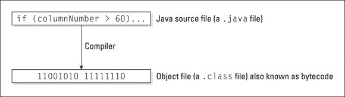

图 1-2：计算机编译源代码以创建目标代码。

 你的计算机硬盘上可能有一个名为`javac`或`javac.exe`的文件。这个文件包含了那个特殊的软件工具——编译器。（嘿，怎么样？`javac`代表“Java 编译器！”）作为 Java 程序员，你经常告诉你的计算机构建一些新的目标代码。你的计算机会在幕后运行`javac`文件中的指令来实现这个愿望。

### 运行代码

几年前，我在哥本哈根待了一周。我和一个朋友一起玩，他能流利地说丹麦语和英语。当我们在公园里聊天时，我隐约注意到一些孩子在我们周围转悠。我一个丹麦语单词都不会，所以我以为孩子们只是在聊些普通的孩子话题。

然后我的朋友告诉我，孩子们说的不是丹麦语。“他们在说什么语言？”我问道。

“他们在胡言乱语，”她说，“那只是些无意义的音节。他们听不懂英语，所以只是在模仿你。”

现在回到当下的话题。我看着图 1-1 中的内容，忍不住想嘲笑我的电脑说话的方式。但那样的话，我就和哥本哈根的那些孩子没什么两样了。对我来说毫无意义的东西，对我的电脑来说却可能意义非凡。当图 1-1 中的 0 和 1 渗透进电脑的电路时，电脑就会“思考”出图 1-3 中所示的那些想法。

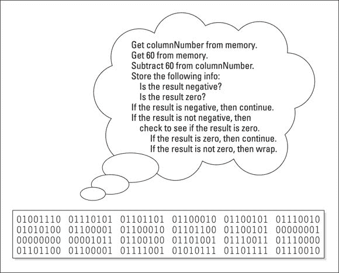

图 1-3：电脑从字节码文件中获取的内容。

每个人都知道电脑不会思考，但电脑可以执行图 1-3 中描述的指令。在许多编程语言（例如 C++ 和 COBOL）中，电脑所做的正是我所描述的那样。电脑会吞下一些目标代码，然后执行目标代码所指示的任何操作。

许多编程语言都是这样工作的，但 Java 并非如此。在 Java 中，电脑执行的是另一组不同的指令。电脑执行的是像图 1-4 中那样的指令。

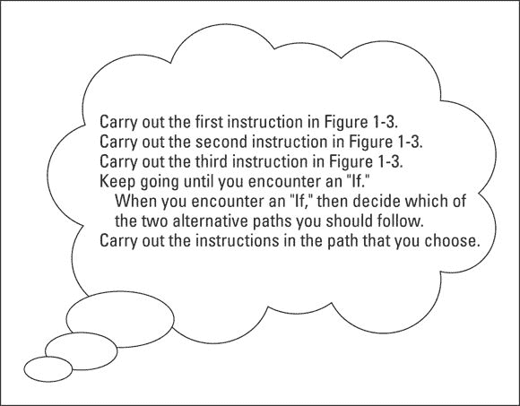

图 1-4：电脑运行 Java 程序的方式。

图 1-4 中的指令告诉电脑如何执行其他指令。电脑的第一条指令不是“从内存中获取`columnNumber`”，而是“按照字节码文件中的指示去做”。（当然，在字节码文件中，第一条指令恰好就是“从内存中获取`columnNumber`”。）

有一个特殊的软件负责执行图 1-4 中的指令。这个特殊的软件被称为`Java 虚拟机`（JVM）。JVM 引导你的电脑执行一些字节码指令。当你运行一个 Java 程序时，你的电脑实际上是在运行 JVM。这个 JVM 会逐位检查你的字节码，并执行字节码中描述的指令。

有很多好的比喻可以描述 JVM。可以把 JVM 想象成一个代理、一个跑腿的、一个中间人。无论如何，你都会遇到图 1-5 所示的情况。在（a）侧，是大多数编程语言的情况——电脑直接运行目标代码。在（b）侧，是 Java 的情况——电脑运行 JVM，而 JVM 则遵循字节码的指令。

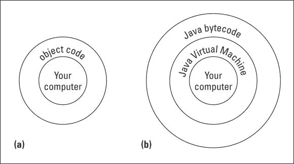

图 1-5：运行计算机程序的两种方式。

 你的电脑硬盘上可能有一些名为`javac`和`java`（或`javac.exe`和`java.exe`）的文件。`java`（或`java.exe`）文件包含了前面图 1-4 中所示的指令——即 JVM 中的指令。作为一名 Java 程序员，你经常告诉你的电脑运行一个 Java 程序。你的电脑通过在后台运行`java`文件中的指令来实现这个愿望。

### 你可以使用的代码

在 20 世纪 80 年代早期，我的表姐夫克里斯在一家计算机软件公司工作。这家公司为文字处理机编写代码。（当时，如果你想不用打字机来撰写文档，你会买一台除了文字处理之外什么也不做的“计算机”。）克里斯抱怨说，他总被要求一遍又一遍地编写同样的老代码。“首先，我写一个查找替换程序。然后我写一个拼写检查器。接着我又写另一个查找替换程序。然后，一种不同的拼写检查器。再然后，一个更好的查找替换程序。”


克里斯是如何保持对工作的兴趣的呢？而克里斯的雇主又是如何维持业务的呢？每隔几个月，克里斯就得重新发明轮子。扔掉旧的查找替换程序，从头开始写一个新程序。这效率很低。更糟糕的是，这很无聊。

多年来，计算机专业人士一直在寻找圣杯——一种让软件易于重用的编写方式。不要反复编写和重写你的查找替换代码。只需将任务分解成小块。一块用于查找单个字符，另一块用于查找空格，第三块用于将一个字母替换为另一个字母。当你拥有所有的小块后，只需将这些小块组装起来，形成一个查找替换程序。之后，当你想到文字处理软件的新功能时，你可以用稍微不同的方式重新组装这些小块。这很合理，成本效益高，而且有趣得多。

20 世纪 80 年代末，软件开发取得了多项进展，到 90 年代初，许多大型编程项目都开始使用预制组件来编写。Java 于 1995 年问世，因此该语言的创始人很自然地创建了一个可重用代码库。这个库包含了大约 250 个程序，包括处理磁盘文件的代码、创建窗口的代码以及通过互联网传递信息的代码。自 1995 年以来，这个库已经发展到包含超过 4000 个程序。这个库被称为*应用程序编程接口（API）*。

每个 Java 程序，即使是最简单的程序，都会调用 Java API 中的代码。这个 Java API 既实用又强大。它实用，是因为你可以用 API 中的程序做很多事情。它强大，是因为 API 非常庞大。没有人能记住 Java API 提供的所有功能。程序员会记住他们经常使用的功能，并在需要时查阅那些他们急需的功能。他们在一个名为*API 规范*（大多数 Java 程序员亲切地称之为*API 文档*或*Javadocs*）的在线文档中查找这些功能。

API 文档（参见[`http://docs.oracle.com/javase/8/docs/api`](http://docs.oracle.com/javase/8/docs/api/)）描述了 Java API 中的数千个功能。作为一名 Java 程序员，你每天都会查阅这个 API 文档。你可以将文档收藏在 Oracle 网站上，并在需要查找内容时重新访问该网站，或者你也可以通过[`www.oracle.com/technetwork/java/javase/downloads/index.html`](http://www.oracle.com/technetwork/java/javase/downloads/index.html)上的链接下载自己的 API 文档副本，从而节省时间。

## 你的 Java 编程工具集

要编写 Java 程序，你需要本章前面描述的工具：

- **你需要一个 Java 编译器。**（请参阅“翻译你的代码”一节。）
- **你需要一个 JVM。**（请参阅“运行代码”一节。）
- **你需要 Java API。**（请参阅“你可以使用的代码”一节。）
- **你需要访问 Java API 文档。**（同样，请参阅“你可以使用的代码”一节。）

你还需要一些不那么特殊的工具：

- **你需要一个编辑器来编写你的 Java 程序。** 清单 1-1 包含了一个计算机程序的一部分。说到底，计算机程序就是一大段文本。因此，要编写计算机程序，你需要一个*编辑器*——一个用于创建文本文档的工具。

  编辑器很像 Microsoft Word，或者任何其他文字处理程序。最大的区别在于，编辑器不会给你的文本添加任何格式——没有粗体、斜体或字体区分。计算机程序完全没有格式。它们除了普通的字母、数字和其他熟悉的键盘字符之外，什么都没有。

   当你编辑程序时，可能会看到粗体文本、斜体文本以及多种颜色的文本。但你的程序本身并不包含这些格式。如果你看到类似格式化的内容，那是因为你使用的编辑器启用了语法高亮。通过*语法高亮*，编辑器让文本看起来像是被格式化，以帮助你理解程序的结构。相信我，语法高亮非常有用。

- **你需要一种发出命令的方式。** 你需要一种方式来表达诸如“编译这个程序”和“运行 JVM”之类的指令。每台计算机都提供了发出命令的方式。（你可以双击图标，或者在运行对话框中输入冗长的命令。）但当你使用计算机的这些功能时，你需要在不同窗口之间跳转。你打开一个窗口阅读 Java 文档，另一个窗口编辑 Java 程序，第三个窗口启动 Java 编译器。这个过程可能非常*繁琐*。

### 用于创建代码的工具

在理想情况下，你可以通过一个统一的界面完成所有程序编辑、文档阅读和命令发出。这个界面被称为*集成开发环境*（*IDE*）。

一个典型的 IDE 将屏幕的工作区域划分为多个窗格——一个用于编辑程序，一个用于列出程序名称，一个用于发出命令，还有其他窗格帮助你编写和测试程序。你可以根据需要排列这些窗格以便快速访问。更棒的是，如果你更改了某个窗格中的信息，IDE 会自动更新所有其他窗格中的信息。

IDE 帮助你无缝地从编程工作的一个部分切换到另一个部分。有了 IDE，你无需担心编辑、编译和运行 JVM 的具体操作。相反，你可以专注于编写程序的逻辑。（你难道不知道吗？无论如何，你总会有需要担心的事情！）

在接下来的章节中，我将介绍 Eclipse IDE 的基本功能。Eclipse 有很多花哨的功能，但你可以忽略大部分，只需学会重复几个常规步骤。使用 Eclipse 几次后，你的大脑会自动执行这些常规步骤。从那时起，你就不用再担心 Eclipse，而是专注于 Java 编程。

当你阅读我关于 Eclipse 的段落时，请记住 Java 和 Eclipse 并非绑定在一起。本书中的程序适用于任何能运行 Java 的 IDE。除了 Eclipse，你还可以使用 IntelliJ IDEA、NetBeans、BlueJ 或其他任何 Java IDE。事实上，如果你喜欢“艰苦朴素”，你也可以不使用 IDE 来编写和运行本书的程序。你可以使用记事本、TextEdit 或 vi，配合操作系统的命令提示符或终端。这一切都取决于你。

### 你的硬盘上已经有什么？

你可能已经拥有一些创建 Java 程序所需的工具。但在较旧的计算机上，你的工具可能已经过时。本书中的大多数示例适用于所有版本的 Java。但有些示例无法在 Java 5.0 之前的版本上运行。其他示例则只能在 Java 6、Java 7、Java 8 或更高版本上运行。

最稳妥的做法是重新下载工具。有关下载的详细说明，请参见第 2 章。

# 第 2 章：设置你的计算机

## 本章内容

-  **安装 Java**
-  **下载并安装 Eclipse 集成开发环境**
-  **检查你的 Eclipse 配置**
-  **获取本书示例中的代码**

本章的详细程度远超你通常所需。如果你和大多数读者一样，可以按照“如果你不喜欢阅读说明……”一节中的步骤操作。然后直接跳到本章末尾附近的“导入本书示例程序”一节。只需阅读本章约 20%的内容，你就能获得 100%所需的软件。

当然，总会有一些小问题。有人用的是旧电脑，有人安装了冲突的软件。Joe 用的是 PC，Jane 用的是 Mac。Joe 的 PC 运行 Windows 10，而 Janis 运行 Windows 8。Joe 误读了我的一条指令，结果他的屏幕上没有任何内容与我描述的步骤匹配。本章 80%的内容描述了在那些罕见情况下你需要做的事情，即必须诊断问题。

如果你真的遇到麻烦，总有一个替代方案。你可以发送电子邮件至[`BeginProg@allmycode.com`](http://BeginProg@allmycode.com)。你也可以在 Facebook 上找到我（[`/allmycode`](http://facebook.com/allmycode)）或在 Twitter 上关注我（[`@allmycode`](http://twitter.com/allmycode)）。我很乐意回答问题并帮助你找出问题所在。

所以，请放心跳过本章中你不需要阅读的任何内容。凭直觉行事不会破坏任何东西。如果真的搞砸了，总有办法修复。

## 如果你不喜欢阅读说明……

要开始编写 Java 程序，你需要第 1 章中描述的软件：一个 Java 编译器和一个 Java 虚拟机（简称 JVM）。你还可以使用一个好的集成开发环境（IDE）和一些示例代码来入门。

编写 Java 程序所需的所有软件都是免费的。这些软件分为三个下载包：一个来自本书的网站，一个来自 Oracle，另一个来自 eclipse.org。

以下是获取创建 Java 程序所需软件的方法：

1. **访问** [`www.allmycode.com/BeginProg`](http://allmycode.com/BeginProg) **并下载包含本书所有程序示例的文件。**
2. **访问** [`www.oracle.com/technetwork/java/javase/downloads`](http://www.oracle.com/technetwork/java/javase/downloads) **并获取最新版本的 JDK。**

   在页面顶部，你可能会看到 Java 8 的链接和按钮。这没问题，但为了充分利用本书内容，我推荐使用 Java 9。使用 Java 9，你可以运行 JShell，这是一个用于测试 Java 功能的新交互式环境。如果 Oracle 的网页突出显示 Java 8，请向下滚动找到 Java 9 的早期访问预览版。按照链接和按钮获取前沿技术。

   选择与你操作系统（Windows、Macintosh 或其他）匹配的软件版本。如果你在 JRE 和 JDK 之间难以选择，请选择 JDK。

   如果你运行 Windows，并且在 32 位和 64 位软件之间难以选择，请抛硬币决定并记下你的选择。（如果选错了，在尝试安装 Java 或启动 Eclipse IDE 时会出现错误消息。）

    大多数在本章说明中遇到问题的人，要么安装了 32 位 Java 搭配 64 位 Eclipse，要么安装了 64 位 Java 搭配 32 位 Eclipse。如果你在进入第 6 步时遇到麻烦，请下载并安装其他版本的 Java 或 Eclipse。
3. **找到你在第 2 步中下载的 Java 软件图标。双击该图标开始安装 Java。**

    如果你很着急（谁不着急呢？），快速访问[`http://java.com`](http://java.com)可能会有所帮助。[`http://java.com`](http://java.com)网站提供了一个简单快捷的一键式 Java 安装程序。（只需点击大大的 Java 下载按钮，你不会错过的。）Java 下载按钮并非在所有电脑上都有效。但如果它对你有效，就像挥动虚拟魔法棒一样，这一步就完成了。你可以绕过[`java.oracle.com`](http://www.oracle.com/technetwork/java/javase/downloads)网站的复杂性，直接进入第 4 步。
4. **访问** [`http://eclipse.org/downloads`](http://eclipse.org/downloads) **并获取 Eclipse IDE。**

   大多数情况下，Eclipse 的网站会自动检测你电脑的操作系统，并提供针对你系统优化的下载版本。但如果网站提供了选择，请选择 **Eclipse IDE for Java Developers**。

   下载结果要么是一个可执行的安装程序文件（扩展名为 `.exe`），要么是一个压缩归档文件（扩展名为 `.zip` 或 `.tar.gz`）。
5. **如果你在第 4 步下载了** `.exe` **文件，请双击该文件图标开始安装 Eclipse。**

   **如果你在第 4 步下载了** `.zip` **文件或** `.tar.gz` **文件，请解压该压缩归档文件的内容。**

   如果你有一个压缩归档文件，解压后会看到一个名为 `eclipse` 或 `Eclipse.app` 的文件夹。将此文件夹复制到电脑硬盘上一个方便的位置。例如，在我的 Windows 电脑上，我最终得到了一个 `C:\eclipse` 文件夹。在我的 Mac 上，我最终在 `Applications` 文件夹中得到了一个 `Eclipse` 或 `Eclipse.app` 图标。

    在 Windows 中，`Program Files` 名称中的空格会混淆某些 Java 软件。我认为本书中的任何软件都不会出现此类问题，但我无法保证。如果你愿意，可以将 Eclipse 解压到 `C:\Program Files` 或 `C:\Program Files (x86)` 文件夹中。但请记住你的选择（以防之后遇到任何麻烦）。
6. **启动 Eclipse，然后点击欢迎屏幕上的 Workbench 图标。**

   最初，欢迎屏幕上的图标可能没有文本标签。但当你将鼠标悬停在图标上时，会出现工具提示。选择工具提示标题为 Workbench 的图标。
7. **在 Eclipse 中，导入你在第 1 步下载的代码。**

有关这些内容的详细信息，请参阅接下来的几个小节。

## 获取本书的示例程序

要获取本书示例程序的副本，请访问 [`http://allmycode.com/BeginProg`](https://users.drew.edu/bburd/BeginProg/) 并点击链接下载本书中的程序。将下载文件（`BeginProgJavaDummies5.zip`）保存到电脑硬盘上。

 在某些情况下，你点击下载链接，但浏览器没有提供保存文件的选项。如果遇到这种情况，请右键点击链接（在 Mac 上按住 Control 键点击）。在出现的上下文菜单中，选择“目标另存为”、“链接另存为”、“下载链接文件为”或类似标签的菜单项。

大多数网络浏览器会将文件保存到电脑硬盘上的 `Downloads` 目录中。但你的浏览器配置可能略有不同。无论如何，请记下包含下载的 `BeginProgJavaDummies5.zip` 文件的文件夹。

## 设置 Java

你可以通过访问 [`www.oracle.com/technetwork/java/javase/downloads`](http://www.oracle.com/technetwork/java/javase/downloads) 获取最新、最强大的 Java 版本。寻找最新可用的 JDK 版本。选择适用于你电脑操作系统的版本。

图 2-1 显示我在 Oracle 网站上点击 Download JDK 按钮（大约 2014 年 3 月）。当你访问该网站时，电脑屏幕上的页面可能看起来很像图 2-1，但你可能会看到 Java SE 9 而不是 Java SE 8。

- **如果你看到 Java 9，那就用它。**
- **如果你看到的是 Java 8 而不是 Java 9，请向下滚动以找到 Java 9 的早期访问预览版。**

使用普通的旧版 Java 8，你可以运行本书中的所有程序。但如果你有 Java 9，你可以使用 JShell——一个可以快速轻松地试验 Java 代码片段的工具。

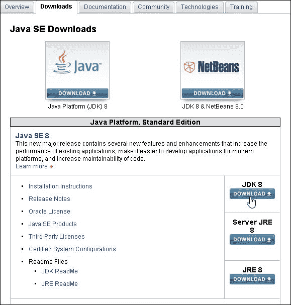

图 2-1: 获取 Java JDK。

 我在本章中描述的 Oracle 和 Eclipse 网站总是在变化。你从这些网站下载的软件也会变化。像“点击右上角的按钮”这样的具体说明很快就会过时（甚至产生误导）。因此，在本章中，我提供了长长的步骤列表，但也描述了这些步骤背后的思路。浏览每个建议的网站，寻找获取我所描述的软件的方法。当网站提供多个选项时，请查看本章中的说明以获取选择最佳选项的提示。如果你的电脑上的 Eclipse 窗口与本章图示中的窗口不完全相同，请扫描你的电脑窗口以寻找我所描述的任何选项。如果经过所有这些努力后，你仍然找不到所需内容，请查看本书的网站（[`www.allmycode.com/BeginProg`](http://allmycode.com/BeginProg)）或发送电子邮件至 `BeginProg@allmycode.com`。

如果你无法确定最合适的 Java 版本，或者想知道缩写 *JRE* 和 *JDK* 的含义，请参阅后面的边栏“Eenie, meenie, miney mo”（#text00005.html_c02-fea-0003）。

### 下载并安装 Java

在你接受许可协议并点击 Java 安装文件的链接后，你的电脑会执行以下两种操作之一：

- 下载并在你的系统上安装 Java
- 下载 Java 安装文件并将其保存到电脑硬盘上

如果安装自动开始，请按照说明操作，对所有提示回答“是”，并（除非你有充分的理由不这样做）接受默认设置。如果安装没有自动开始，请双击下载的安装文件来启动安装。

 如果你的电脑运行 Linux，下载的文件可能是 `.tar.gz` 文件。`.tar.gz` 文件是一个压缩归档文件。将归档文件的内容解压到你选择的文件夹中，并按照 Oracle 网站上发布的安装说明进行操作。

有关文件名、文件类型和归档文件的更多信息，请参阅本章前面的边栏“那些烦人的文件扩展名”（#text00005.html_c02-sec-0003）和“压缩归档文件”（#text00005.html_c02-sec-0005）。


 在访问 [`www.oracle.com/technetwork/java/javase/downloads`](http://www.oracle.com/technetwork/java/javase/downloads) 时，你还可以下载一份 Java API 文档。寻找标记为 Java SE Documentation（或类似名称）的下载项。接受许可协议，点击下载链接，然后看着文件下载到你的电脑硬盘上。下载的文件是一个压缩的 `.zip` 归档文件，因此你可以像解压其他所有此类归档文件一样解压它。（解压后的文件夹是一堆网页。要开始阅读 Java API 文档，请在该文件夹中查找 `index` 文件或 `index.html` 文件。双击该文件，你就可以开始了。）

 有关 Java API 文档的介绍，请参阅第 1 章。

大多数人在访问 Oracle 网站 [`java.oracle.com`](http://www.oracle.com/technetwork/java/javase/downloads) 并通过网站菜单安装 Java 时不会遇到困难。但如果你的情况比大多数人更“有趣”，你可能需要做出一些决定并执行一些额外的步骤。接下来的几个小节描述了一些这样的“有趣”场景。

### 如果你想在电脑上找到 Java……

第 1 章描述了 Java 生态系统，包括其编译器、虚拟机和其他部分。你的电脑可能已经拥有其中一些 Java 工具。如果是这样，你可以选择使用已有的版本，或者将最新版本的 Java 添加到系统中已有的版本之上。如果你需要帮助来决定怎么做，请参阅边栏“Eenie, meenie, miney mo”（`#text00005.html_c02-fea-0003`）。

 Java 的各个版本不像室内猫那样——它们可以在同一台电脑上共存，而不会互相争斗或嘶吼。如果你的电脑上安装了多个 Java 版本，完全没问题。你甚至可以在同一台电脑上混用 32 位和 64 位版本（只要至少有一个 Java 版本的位数与你的 Eclipse 版本匹配）。我的 Windows 10 电脑上有三个 Java 版本，从未遇到过麻烦。（偶尔，我会因为混淆不同 Java 版本而自找麻烦。但本章后面的“在 Eclipse 中配置 Java”一节能帮我理清头绪。要是没有这本书在身边，我该怎么办呢？）

要查看你已安装的 Java 版本，并可能避免重新安装 Java，请继续阅读。

## 在 Windows 10 上

在任务栏的搜索框中，输入“程序和功能”。在出现的选项列表中，选择“程序和功能”。此时会显示已安装的程序列表。在该列表中，查找标记为 `Java` 的项目。（参见图 2-2。）

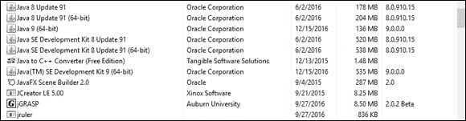

图 2-2：Windows 上的“程序和功能”对话框。

## 在 Windows 8 上

在“开始”屏幕上，按住 Windows 键的同时按 Q。在出现的搜索框中，输入“程序和功能”，然后按 Enter。此时会显示已安装的程序列表。在该列表中，查找标记为 `Java` 的项目。（参见图 2-2。）

## 在 Windows 7 上

选择“开始”⇒“控制面板”⇒“程序”⇒“程序和功能”。此时会显示已安装的程序列表。在该列表中，查找标记为 `Java` 的项目。（参见图 2-2。）

## 在 Mac 上

Macintosh 电脑可以支持两种不同的 Java 风格：一种由 Apple 公司内部开发，另一种由 Oracle 主导开发。某些命令和步骤适用于其中一种 Java 风格，但不适用于另一种。例如，要查找 Apple 的 Java 版本，可以查看 `/System/Library/Java/Java Virtual Machines` 目录或 `/System/Library/Frameworks/JavaVM.framework/Versions` 目录。但要查找 Oracle 的 Java，则需查看 `/Library/Java/JavaVirtualMachines` 目录。你还可以在 `/Library/Internet Plug-Ins/JavaAppletPlugin.plugin/Contents/Home` 目录中找到 Oracle 的 Java。

Tiger、Leopard 和 Snow Leopard（OS X 10.4、OS X 10.5 和 OS X 10.6）预装了 Java。较新的 Mac 操作系统则没有预装 Java。在这些较新的系统上，当你首次启动需要 Java 的应用程序时，电脑会提示你安装 Apple 的 Java 或 Oracle 的 Java。（例如，在本章后面，你将安装 Eclipse。当你首次尝试启动 Eclipse 时，如果尚未安装 Java，电脑会建议你进行安装。）

表 2-1 描述了 Mac OS 与 Java 版本之间的对应关系。

| 如果你拥有此 Mac OS X 版本…… | 那么你拥有此 Java 版本…… | 并且你可以安装此 Java 版本 |
| --- | --- | --- |
| OS X 10.4.11 (Tiger)<br>OS X 10.5.8 (Leopard) PowerPC 和/或 32 位 | Apple 的 Java 5.0 | Apple 的 Java 5.0 |
| OS X 10.5.8 (Leopard) 基于 Intel 且 64 位<br>OS X 10.6.8 (Snow Leopard) | Apple 的 Java 6 | Apple 的 Java 6 |
| OS X 10.7.5 (Lion)<br>OS X 10.8.5 (Mountain Lion)<br>OS X 10.9 (Mavericks)<br>OS X 10.10 (Yosemite)<br>OS X 10.11 (El Capitan)<br>macOS 10.12 (Sierra) | （无 Java） | Apple 的 Java 6<br>Oracle 的 Java 9 |

表 2-1：Mac OS X 版本与 Java 版本

要查看你正在运行的 OS X 版本，请执行以下操作：

1. 选择 Apple 菜单 ⇒ 关于本机。
2. 在出现的“关于本机”对话框中，查找“版本”一词。

   你会看到类似“版本 10.12.4”的浅灰色文字。

 表 2-1 中的信息适用于已更新的 Mac OS X 版本。如果你不经常应用软件更新，那么你运行的可能是 OS X 10.8.1 而非 10.8.5。如果是这样，请在 Apple 菜单中选择“软件更新”，然后按照提示操作。

 我在网络上偶尔会看到一些帖子，描述如何在 OS X 10.3 上安装 Java 5.0，以及其他绕过表 2-1 限制的方法。但如果你不喜欢折腾，这些变通方法并不适合你。（对于每个硬件或软件需求，总会有人试图创建变通方法，即 `hack`。无论如何，自行承担使用 `hack` 的风险。）

如果你不信任表 2-1（坦白说，你不应该相信你在印刷品中找到的一切），你可以在电脑上执行测试，以发现 Java 的存在以及（如果你的 Mac 有 Java）Java 版本号。以下是一些测试方法：

### 对于 OS X 10.6 或更早版本

1. 在 Spotlight 的搜索字段中，输入 `Java Preferences`。
2. 当 Spotlight 的顶部命中项是 Java Preferences 时，按 Enter。

   Java Preferences 窗口出现。（参见图 2-3。）

3. Java Preferences 窗口列出了你电脑上安装的 Java 版本。

   在图 2-3 中，该电脑有四个 Java 版本：Java 6 和 Java 7 的 32 位（i386）版本，以及 Java 6 和 Java 7 的 64 位（x86_64）版本。

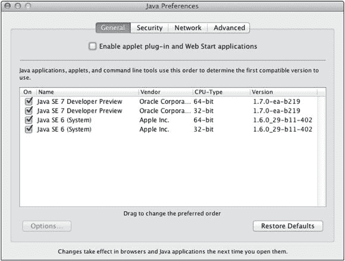

图 2-3：Java Preferences 应用程序。

### 对于 OS X 10.7 或更高版本

1. 在 Apple 菜单中，选择“系统偏好设置”。
2. 在“系统偏好设置”应用程序窗口中，单击 Java 图标。

   Java 控制面板出现。它看起来像图 2-4 或图 2-5 中的面板。

3. 如果你的 Java 控制面板看起来像图 2-4 中的面板，你可以在面板的“常规”选项卡上看到你电脑的 Java 版本。

   根据图 2-4 所示的面板，我的电脑有一个 Java 9 的早期访问（ea）版本。你可以跳过其余步骤。

4. 如果你的 Java 控制面板看起来像图 2-5 中的面板，请选择面板的“Java”选项卡。（参见图 2-6。）
5. 在“Java”选项卡上，单击“查看”。

   Java 运行时环境设置窗口出现。（参见图 2-7。）

6. 在 Java 运行时环境设置窗口的“用户”选项卡和“系统”选项卡上查找 Java 版本。

   图 2-7 显示了 Java 运行时环境设置窗口的“用户”选项卡。根据该图，电脑运行的是 Java 1.8。（Java 的亲密朋友称此版本为“Java 8”。）

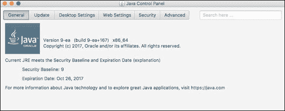

图 2-4：你的 Java 控制面板可能看起来像这样。

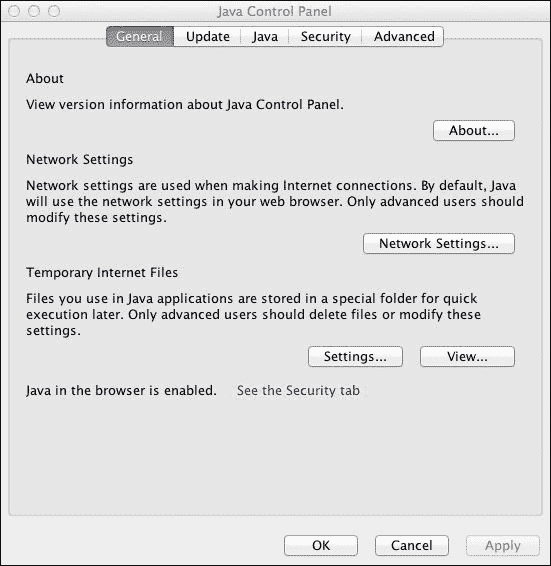

图 2-5：Java 控制面板的另一种形式。

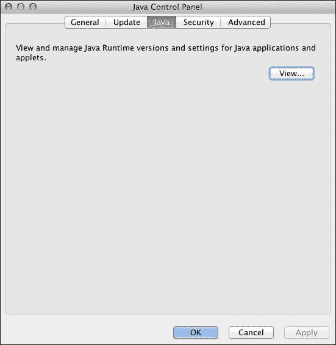

图 2-6：Java 控制面板中的“Java”选项卡。

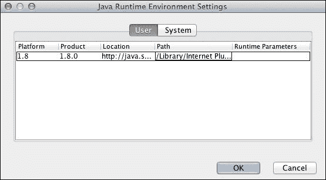

图 2-7：Java 运行时环境设置窗口中的“用户”选项卡。

## 在 Linux 上

要检查 Linux 电脑上的 Java 安装情况（或是否缺少 Java），请执行以下操作：

1. 在桌面的菜单中查找名为“终端”（也称为 Konsole）的选项。

   终端窗口打开（通常为黑色背景上的白色文本）。

2. 在终端窗口中，输入以下文本并按 Enter：`java -version`。

   在我的一台 Linux 电脑上，终端窗口响应如下文本：

   `java version 1.8.0_111`

在另一台 Linux 电脑上，我看到这样的信息：

`java version 9`

在 Java 8 和 Java 9 之间，Oracle 改变了它的版本编号系统。因此，版本 9 紧跟在 1.8.0 版本之后。无论如何，如果你的电脑返回的数字是 9 或更高，你就可以开香槟庆祝，并期待顺利运行本书中的示例。如果版本号是 1.5 或更高，你可以运行本书中的许多示例，但并非全部。如果你的电脑返回类似 `command not found` 的信息，那么很可能你的电脑上没有安装 Java。

## 设置 Eclipse 集成开发环境

在前面的章节中，你获得了你的电脑处理 Java 程序所需的所有工具。本节则有所不同。在本节中，你将获得你编写和测试 Java 程序所需的工具。你将获得 Eclipse——一个用于 Java 的集成开发环境。

集成开发环境（IDE）是一个提供工具的程序，帮助你轻松高效地创建软件。没有 IDE 你也可以创建 Java 程序，但使用 IDE 节省的时间和精力使其物有所值。（一些硬核程序员不同意我的观点，但那是另一回事。）

根据 Eclipse 基金会的网站，Eclipse 是“一个通用工具平台——一个开放的可扩展 IDE，适用于任何事物，也并非特指任何事物。”确实，Eclipse 功能多样。程序员通常认为 Eclipse 是用于开发 Java 程序的 IDE，但 Eclipse 也包含用于 C++、PHP 和许多其他语言的编程工具。

我甚至见过与程序开发无关的 Eclipse 变体。例如，Dynatrace 有一个监控大型系统性能的应用程序。当你在桌面电脑上运行 Dynatrace 的应用程序时，你实际上运行的是 Eclipse 的一个增强版本。

### 下载 Eclipse

以下是下载 Eclipse 的方法：

1. 访问 [`www.eclipse.org`](http://www.eclipse.org)。

   今天，我访问 [`www.eclipse.org`](http://www.eclipse.org) 时，看到一个显示 *Download* 的大按钮。（参见图 2-8。）明天，谁知道这个不断变化的网站上会出现什么！

   无论如何，你很可能看到某种下载按钮。

2. 点击下载按钮。

   点击下载按钮后，你可能会看到几个下载选项。（参见图 2-9。）

   每年六月都会发布一个新版本的 Eclipse，版本名称按字母顺序排列。2016 年 6 月，名称是 Neon。2017 年 6 月，是 Oxygen。2018 年 6 月，是 Photon。明白了吗？名称以 N 开头，然后是 O，接着是 P。（在图 2-9 中，不要让 *Orion* 中的 *O* 迷惑你。那是另一款软件。）

3. 点击按钮下载当前 Eclipse 版本。

   2017 年 5 月，我点击了图 2-9 中的 DOWNLOAD 64 BIT 按钮。结果，Eclipse 的网站又向我展示了另一个按钮。这个按钮提供了来自全球众多服务器之一的 Eclipse 副本。

4. 点击相应的按钮，并按照相应的链接开始下载。

   你点击的链接取决于 Eclipse 的众多镜像站点中哪个提供你的下载。只需浏览这些选项，然后开始下载即可。


图 2-8：eclipse.org 的主页。


图 2-9：2017 年 5 月，我下载了 Eclipse Neon。

注意图 2-9 中的 Download Packages 链接。如果你点击该链接，可以下载添加了某些功能的 Eclipse 副本。例如，Eclipse IDE for Java EE Developers 包含用于工业级开发的重型功能。Eclipse IDE for JavaScript and Web Developers 包含帮助人们创建网页的功能。

如果你进入一个提供各种包的页面，请寻找名为 Eclipse IDE for Java Developers（而不是 Java EE Developers）的包。

 Eclipse 的下载页面会引导你下载与你的电脑操作系统相匹配的 Eclipse 版本。例如，如果你在 Windows 电脑上访问该页面，页面只会显示适用于 Windows 的下载。如果你要为另一台电脑下载 Eclipse，你可能希望覆盖自动选择的操作系统。寻找一个包含你电脑操作系统名称的小下拉列表。你可以更改该下拉列表中选中的操作系统。

 如果你知道你的 Java 版本（32 位或 64 位），请务必下载对应的 Eclipse 版本。如果你不知道你的 Java 版本，请下载 64 位版本的 Eclipse 并尝试启动它。如果你能启动 64 位 Eclipse，那就没问题。但如果你收到 `No Java virtual machine was found` 错误消息，请尝试下载并启动 32 位版本的 Eclipse。关于 32 位和 64 位字长的完整说明，请参见本章前面的边栏“你的电脑有多少位？”

### 安装 Eclipse

安装 Eclipse 的具体方式取决于你的操作系统以及你下载 Eclipse 时获得的文件类型。以下是简要总结：

- **如果你运行 Windows 且下载的是** `.exe` **文件：**

  双击 `.exe` 文件的图标。

- **如果你运行 Windows 且下载的是** `.zip` **文件：**

  将文件内容解压到你选择的目录中。

  换句话说，在文件资源管理器（也称为 Windows 资源管理器）中找到 `.zip` 文件的图标。然后双击 `.zip` 文件的图标。（结果，资源管理器会显示 `.zip` 文件的内容，其中只包含一个文件夹——名为 `eclipse` 的文件夹。）将 `eclipse` 文件夹拖到你电脑硬盘上的方便位置。

  有关 `.zip` 文件的更多信息，请参见本章前面的边栏“压缩归档文件”。

  我最喜欢将 `eclipse` 文件夹直接拖到 `C:` 盘。因此，我的 `C:` 盘上有名为 `Program Files`、`Windows`、`eclipse` 等文件夹。我避免将 `eclipse` 文件夹设为 `Program Files` 的子文件夹，因为有时我在处理 `Program Files` 名称中的空格时会遇到问题。

- **如果你运行 Mac OS X：**

  下载 Eclipse 时，你会获得一个 `.tar.gz` 文件或一个 `.dmg` 文件。

  - `.tar.gz` 文件是一个压缩归档文件。当你下载该文件时，你的网页浏览器可能会自动为你解压部分内容。如果是这样，你的 `Downloads` 文件夹中不会出现 `.tar.gz` 文件。相反，你会找到一个 `.tar` 文件（因为你的网页浏览器解压了 `.gz` 部分）或一个 `eclipse` 文件夹（因为你的网页浏览器同时解压了 `.tar` 和 `.gz` 部分）。

    如果你在 `Downloads` 文件夹中找到了一个新的 `.tar` 文件或 `.tar.gz` 文件，请双击该文件，直到看到 `eclipse` 文件夹。将这个新的 `eclipse` 文件夹拖到你的 `Applications` 文件夹中，就大功告成了。


如果你下载了一个`.dmg`文件，网页浏览器可能会自动为你打开该文件。如果没有，请在`Downloads`文件夹中找到该`.dmg`文件并双击它。按照双击后出现的任何说明操作。如果需要你将 Eclipse 拖入`Applications`文件夹，请照做。

**如果你运行 Linux：**

你可能会获得一个`.tar.gz`文件，但也有可能获得一个自解压的`.bin`文件。将`.tar.gz`文件解压到你喜欢的目录，或者执行自解压的`.bin`文件。

### 首次运行 Eclipse

首次启动 Eclipse 时，您需要执行一些额外的步骤。要运行 Eclipse，请按以下步骤操作：

1. **启动 Eclipse。**

   在 Windows 中，“开始”菜单可能没有 Eclipse 图标。此时，请在文件资源管理器（即 Windows 资源管理器）中找到存放 Eclipse 解压文件的文件夹。双击代表`eclipse.exe`文件的图标。（如果看到的是`eclipse`文件而非`eclipse.exe`文件，请查看本章前面的边栏“那些烦人的文件扩展名”。）

   在 Mac 上，打开 Spotlight，在搜索框中输入`Eclipse`。当`Eclipse`出现在 Spotlight 列表的顶部时，按 Enter 键。

    首次在 Mac 上尝试运行 Eclipse 时，可能会收到一条消息，提示 Eclipse 并非来自 App Store，也非来自已识别的开发者。这世上没有百分之百的安全，但我下载并安装 Eclipse 无数次，从未遇到过问题。因此，要绕过这个障碍，请在`Applications`文件夹（或您安装 Eclipse 的其他位置）中找到 Eclipse 应用条目。按住 Control 键点击该应用条目，在弹出的上下文菜单中选择“打开”。此时会弹出一个对话框，询问您是否确定要打开该应用。您确定，所以点击“打开”。

   启动 Eclipse 后，您会看到“工作空间启动器”对话框。（参见图 2-10）。该对话框询问您希望在计算机硬盘的哪个位置存储使用 Eclipse 创建的代码。

2. **在“工作空间启动器”对话框中，点击“确定”接受默认设置（或者不接受默认设置！）。**

   无论如何，这都不是什么大事！

   由于这是您首次使用某个特定的 Eclipse 工作空间，Eclipse 会以欢迎屏幕启动。（参见图 2-11）。

3. **在欢迎屏幕上，寻找标有“工作台”的按钮或图标。**

   在图 2-11 中，该按钮位于右上角。

    多年来，许多 Eclipse 欢迎屏幕都只显示图标，而很少或没有帮助文字。如果在欢迎屏幕上任何地方都看不到“工作台”字样，请将鼠标悬停在每个图标上，直到找到工具提示中包含“工作台”字样的图标。

4. **点击“工作台”图标，打开 Eclipse 的主屏幕。**

   使用全新工作空间打开 Eclipse 后的主屏幕视图如图 2-12 所示。

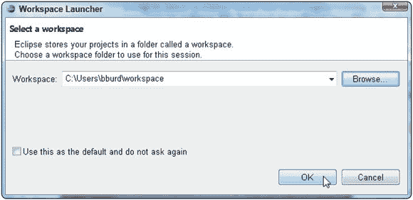

图 2-10： Eclipse 的工作空间启动器。

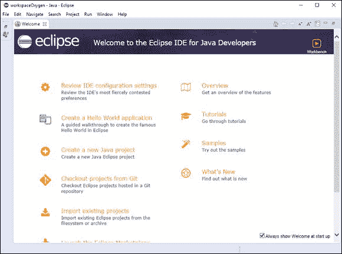

图 2-11： Eclipse 的欢迎屏幕。

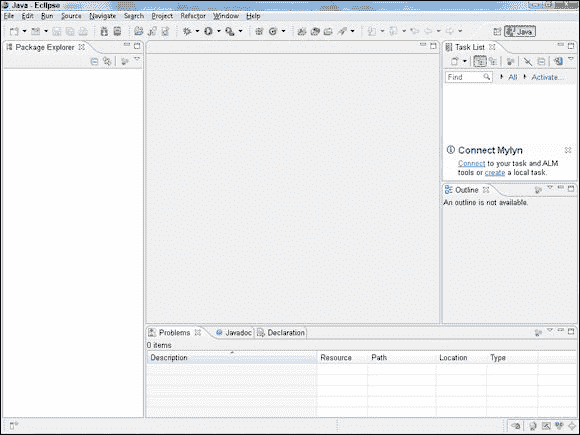

图 2-12： 使用全新工作空间的 Eclipse 工作台。

#### 如果需要在 Eclipse 中配置 Java……

Eclipse 通常会在您的计算机上查找 Java 安装，并选择一个已安装的 Java 版本来运行您的 Java 程序。您的计算机可能安装了多个 Java 版本，因此您可能需要仔细检查 Eclipse 选择的 Java 版本。以下步骤将向您展示如何操作：

1. **在 Windows 或 Linux 上：在 Eclipse 的主菜单中，选择 Window ⇒   Preferences。在 Mac 上：在 Eclipse 的主菜单中，选择 Eclipse ⇒   Preferences。**

   随后，Eclipse 的“首选项”对话框将出现。（您可以参照图 2-13 进行操作。）

2. **在“首选项”对话框左侧的树中，展开`Java`分支。**

3. **在`Java`分支中，选择`Installed JREs`子分支。**

4. **查看“首选项”对话框主体中的 Java 版本列表（已安装的 JRE）。**

   列表中，每个 Java 版本都有一个复选框。Eclipse 使用已勾选的版本。如果勾选的版本不是您偏好的版本（例如，勾选的版本不是 9 或更高版本），您可以进行一些更改。

5. **如果您偏好的 Java 版本出现在“已安装的 JRE”列表中，请勾选该版本的复选框。**

6. **如果您偏好的 Java 版本未出现在“已安装的 JRE”列表中，请点击“添加”按钮。**

   点击“添加”按钮后，将出现“JRE 类型”对话框。（参见图 2-14）。

7. **在“JRE 类型”对话框中，双击“标准 VM”。**

   随后，将出现“JRE 定义”对话框。（参见图 2-15）。接下来要执行的操作取决于几个不同因素。

8. **填写对话框中的“JRE 主目录”字段。**

   具体操作方式取决于您的操作系统。

   * 在 Windows 上，浏览到您安装偏好的 Java 版本的目录。在我的多台 Windows 电脑上，该目录通常是`C:\Program Files\Java\jre-9`、`C:\Program Files\Java\jdk1.8.0`、`C:\Program Files (x86)\Java\jre-9`或类似路径。

   * 在 Mac 上，使用 Finder 浏览到您安装偏好的 Java 版本的目录。在对话框的“JRE 主目录”字段中输入该目录的名称。

     我的 Mac 上有一个 Java 目录是`/System/Library/Java/Java Virtual Machines/1.6.0.jdk/Contents/Home`，另一个是`/Library/Java/JavaVirtualMachines/jdk-9.jdk/Contents/Home`。（第一个用于 Apple 的旧版 Java；第二个用于 Oracle 的新版 Java。）您还可能在`/System/Library/Frameworks/JavaVM.framework/Versions`目录中找到 Apple 的旧版 Java，在`/Library/Internet Plug-Ins/JavaAppletPlugin.plugin/Contents/Home`目录中找到 Oracle 的 Java。

      像`/System`和`/Library`这样的目录通常不会出现在 Finder 窗口中。要浏览到这些目录之一（例如`/Library`目录），请在 Finder 的菜单栏中选择 Go ⇒   Go to Folder。在出现的对话框中，输入`/Library`，然后点击“前往”。

      在导航到包含您偏好的 Java 版本的目录时，您可能会遇到`JDK 1.8.0.jdk`图标或其他扩展名为`.jdk`的项目。要查看该项目的内容，请按住 Control 键点击该图标，然后从出现的菜单中选择“显示包内容”。

   * 在 Linux 上，浏览到您安装偏好的 Java 版本的目录。如果不确定，请搜索名称以`jre`或`jdk`开头的目录。

   您可能还需要在“JRE 定义”对话框中执行一项操作。

9. **查看“JRE 定义”对话框中的“JRE 名称”字段；如果 Eclipse 没有自动填写名称，请在“JRE 名称”字段中输入一个名称（几乎任何文本都可以）。**

10. **点击“完成”关闭“JRE 定义”对话框。**

    Eclipse 的“首选项”对话框将回到前台。对话框的“已安装的 JRE”列表中包含了您新添加的 Java 版本。

11. **勾选新添加的 Java 版本旁边的复选框。**

    您差不多完成了。（还有几个步骤需要执行。）

12. **在“首选项”对话框左侧的`Java`分支中，选择`Compiler`子分支。**

    在“首选项”对话框的主体中，您会看到一个“编译器合规级别”下拉列表。

13. **在“编译器合规级别”下拉列表中，选择一个与您偏好的 Java 版本匹配的数字。**

    对于 Java 8，我选择合规级别 1.8。对于 Java 9，我选择合规级别 1.9 或合规级别 9。

     Eclipse 的更新并不总是与 Java 更新同步。如果您运行的是 Java 9，而 Eclipse 的最高合规级别是 1.8，请选择 1.8。请相信我的话，一切都会正常。

14. **呼！点击“首选项”对话框的“确定”按钮，返回 Eclipse 工作台。**

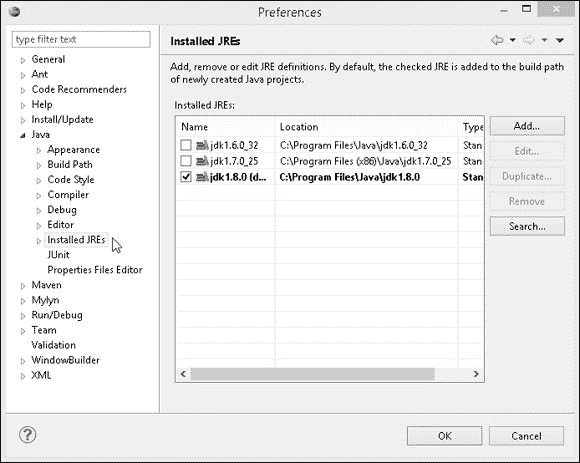

图 2-13： Eclipse 的“首选项”对话框。

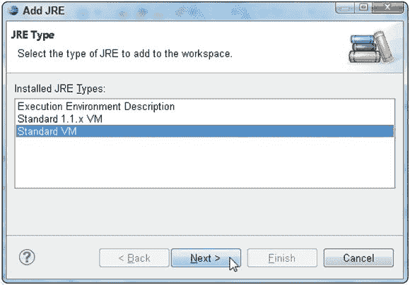

图 2-14： JRE 类型对话框。

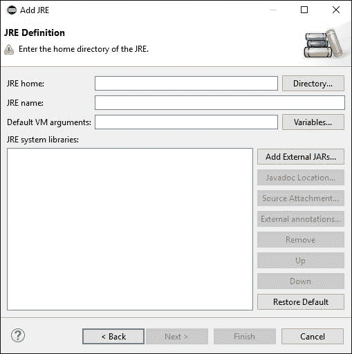

图 2-15： JRE 定义对话框。

## 导入本书的示例程序

Eclipse 中的导入操作可能有些棘手。当你从一个对话框切换到另一个时，许多选项的名称都很相似。这是因为 Eclipse 提供了多种不同的方式来导入多种不同类型的内容。不过，只要按照以下说明操作，就不会有问题。

1. **按照本章前面“获取本书的示例程序”一节中的步骤操作。**

2. **在 Eclipse 的主菜单中，选择`File ⇒  ⇒ Import`。（参见图 2-16。）**

   结果，Eclipse 会显示一个“导入”对话框。

3. **在“导入”对话框的树中，展开`General`分支。**

4. **在`General`分支中，双击`Existing Projects into Workspace`子分支。（参见图 2-17）**

   结果，“导入项目”对话框会出现。

    再看一下图 2-17。在该对话框中，不要选择“Archive File”或“File System”。本书的下载内容并未针对这两个选项进行设置。

5. **在“导入项目”对话框中，选择“Select Root Directory”单选按钮或“Select Archive File”单选按钮。（参见图 2-18）**

   以下是决定选择哪个单选按钮的方法：

   首先，确保你已经遵循了我在前面题为“那些烦人的文件扩展名”的边栏中给出的建议。然后，查看包含你从本书网站下载的文件的文件夹。

   * 如果你的浏览器没有自动解压下载的`.zip`文件，你会找到一个名为`BeginProgJavaDummies5.zip`的存档文件，其中包含本书的代码。在这种情况下，请选择“Select Archive File”单选按钮。

   * 如果你的浏览器自动解压了下载的`.zip`文件，你会找到一个名为`BeginProgJavaDummies5`的目录（文件夹），其中包含本书的代码。在这种情况下，请选择“Select Root Directory”单选按钮。

    为了确保你能区分文件夹和`.zip`文件，请查看本章的“那些烦人的文件扩展名”边栏。

   关于`.zip`文件和其他存档文件的完整说明，请参见题为“压缩存档文件”的边栏。

6. **点击“Browse”按钮，在你的计算机硬盘上找到`BeginProgJavaDummies5.zip`文件或`BeginProgDummies5`目录。**

   找到文件或目录后，Eclipse 的“导入项目”对话框会显示该文件内的项目名称。（参见图 2-19。）

7. **点击“Select All”按钮。**

   本书的示例非常精彩，你想全部导入！

8. **点击“Finish”按钮。**

   结果，主 Eclipse 工作台会重新出现。工作台左侧会显示本书 Java 项目的名称。（参见图 2-20。）

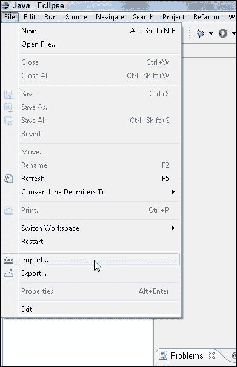

图 2-16： 开始导入本书的代码。

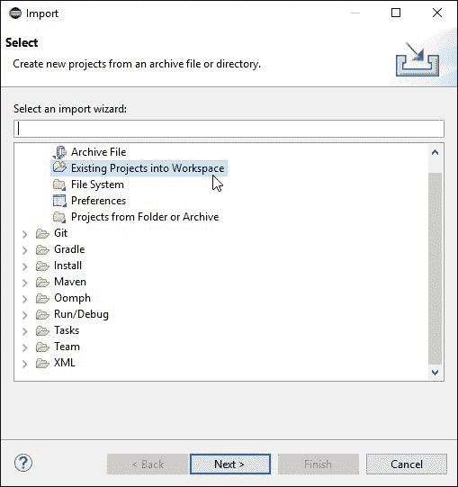

图 2-17： 在所有选项中，选择“Existing Projects into Workspace”。

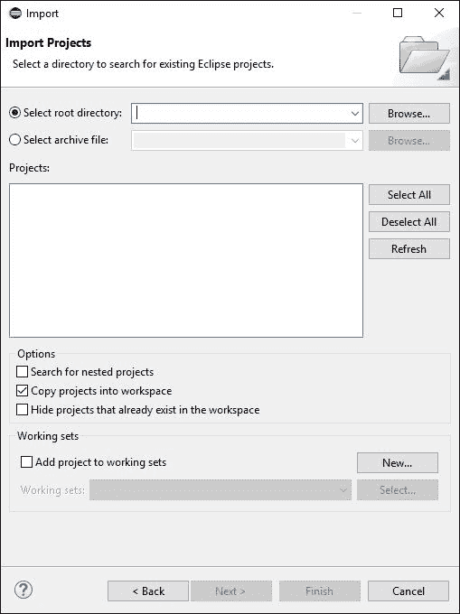

图 2-18： “导入项目”对话框。

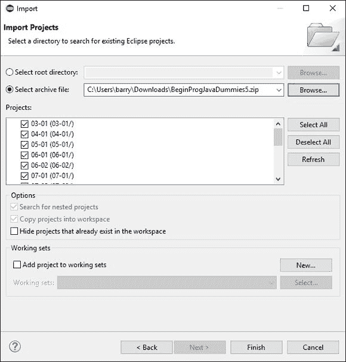

图 2-19： 要导入的项目。

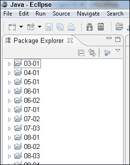

图 2-20： Eclipse 显示了一堆 Java 项目。

现在真正的乐趣开始了。

## 下一步是什么？

如果你正在读这一段，那么你可能已经完成了在计算机上安装 Java 和 Eclipse 的工作。在第 3 章中，你将开始收获软件安装工作的成果。你将使用 Eclipse 运行一个全新的 Java 程序。

# 第 3 章：运行程序

## 本章内容

 **编译并运行程序**

 **编辑你自己的 Java 代码**

 **使用工作区**

如果你是编程新手，对你来说，运行程序可能意味着点击鼠标。你想运行 Microsoft Word，所以双击 Microsoft Word 图标。仅此而已。

当你创建自己的程序时，情况就有点不同了。对于一个新程序，程序员（或程序员所在公司的某个人）会创建程序的图标。在此之前，一个完全正常的程序可能连图标都没有。那么，对于一个全新的 Java 程序，你该怎么办？如何让程序运行？本章将告诉你需要了解的内容。

## 运行一个现成的 Java 程序

了解 Java 的最佳方式就是动手实践 Java。当你动手实践 Java 时，你就是在编写、测试和运行你自己的 Java 程序。本节通过描述如何运行和测试程序来为你做准备。你将运行一个我已经为你写好的程序，而不是自己编写程序。该程序计算你每月需要偿还的住房抵押贷款金额。

这个抵押贷款计算程序不会打开自己的窗口。相反，该程序会在 Eclipse 的“控制台”视图中运行。“控制台”视图是 Eclipse 工作台右下部分的一个选项卡。（参见图 3-1。）完全在这个“控制台”视图中运行的程序被称为*基于文本的程序*。

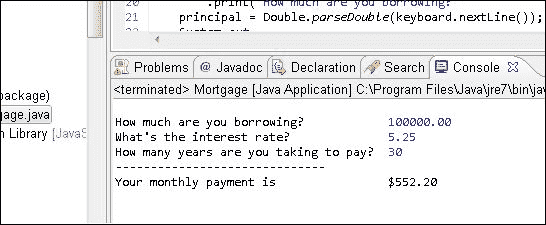

图 3-1： 本章基于文本的抵押贷款程序的一次运行。

 你可能在 Eclipse 工作台的右下部分看不到“控制台”选项卡。要调出“控制台”视图，请选择`Window ⇒ Show View ⇒ Other`。在出现的“Show View”对话框中，展开`General`分支。最后，在该`General`分支中，双击`Console`项。

有关“控制台”视图（以及 Eclipse 工作台的一般信息）的更多信息，请参见本章后面的“视图、编辑器和其他内容”一节。

 你可以通过访问本书的网站（[`http://allmycode.com/BeginProg`](http://allmycode.com/BeginProg)）查看图 3-1 中程序的 GUI 版本，以及本书中许多其他示例的 GUI 版本。

实际上，当你运行抵押贷款程序时，你会在 Eclipse 的“控制台”视图中看到两样东西：

* **抵押贷款程序发送给你的消息和结果：** 消息包括诸如`How much are you borrowing?`之类的内容，结果包括诸如`Your monthly payment is $552.20`之类的行。

* **你在程序运行时对抵押贷款程序的响应：** 如果你在程序询问借款金额时输入 100000.00，你会看到该数字回显在 Eclipse 的“控制台”视图中。

以下是运行抵押贷款程序的方法：

1. **确保你已经按照第 2 章中的说明操作——安装 Java、安装和配置 Eclipse 以及获取本书示例程序的说明。**

   谢天谢地！你不需要多次遵循这些说明。

2. **启动 Eclipse。**

   会出现“Eclipse Workspace Launcher”对话框。（参见图 3-2。）

一个*工作空间*是计算机硬盘上的一个文件夹。Eclipse 将你的 Java 程序存储在一个或多个工作空间文件夹中。除了这些 Java 程序，每个工作空间文件夹还包含一些 Eclipse 设置。这些设置存储了诸如你使用的 Java 版本、你在编辑器中偏好的单词颜色，以及拖动编辑器区域边缘时编辑器区域的大小等信息。你可以拥有多个工作空间，每个工作空间包含不同的程序和不同的设置。

默认情况下，工作空间启动器会提议打开你上次运行 Eclipse 时打开的那个工作空间。你需要打开在第 2 章中使用过的工作空间，因此不要修改启动器工作空间字段中的内容。

3. **在工作空间启动器对话框中，单击“确定”。**

巨大的 Eclipse 工作台从你的电脑屏幕上注视着你。（参见图 3-3。）

在图 3-3 中，工作台最左侧是 Eclipse 的包资源管理器，其中包含诸如`03-01`、`04-01`等数字。每个数字实际上是一个 Eclipse 项目的名称。正式地说，一个*项目*是工作空间内文件和文件夹的集合。直观地说，项目是一个基本的工作单元。例如，一个用于管理你的 CD 收藏的 Java 程序文件（以及包含数据的文件）的独立集合，可以构成一个单独的 Eclipse 项目。


再次查看图 3-3 中的包资源管理器，你会看到名为 03-01、04-01 等的项目。我的项目 03-01 包含了清单 3-1（本章第 3 章中的第一个也是唯一的清单）的代码。项目 06-02 包含了清单 6-2（本书第 6 章中的第二个代码清单）中的 Java 程序。项目名称可以包含字母、数字、空格和其他字符；对于本书示例的名称，我坚持使用数字和短横线。

要了解更多关于 Eclipse 包资源管理器等主题的信息，请参阅即将到来的章节“Eclipse 窗口里都是些什么？”

 当你启动 Eclipse 时，你可能会看到与图 3-3 不同的内容。你可能会看到 Eclipse 的欢迎屏幕，窗口中只有几个图标，其他地方一片空白。你也可能看到像图 3-3 那样的工作台，但包资源管理器中没有数字列表（03-01、04-01 等）。如果是这样，你可能遗漏了第 2 章中关于配置 Eclipse 的一些说明。或者，你可能在本节说明的第 2 步中修改了启动器工作空间字段中的内容。

无论如何，请确保你在包资源管理器中看到像 03-01 和 04-01 这样的数字。看到这些数字可以确保 Eclipse 已准备好运行本书中的示例程序。

4. **在包资源管理器中，单击**`03-0-Mortgage`**分支。**

`03-0-Mortgage`项目是唯一一个名称不是两位数字、一个短横线、再两位数字的项目。

 你可能想先睹为快，看看一些 Java 代码。要查看你在项目`03-0-Mortgage`中运行的 Java 程序，请在包资源管理器中展开`03-0-Mortgage`分支。在`03-0-Mortgage`分支内部，你会找到一个`src`分支，其中又包含一个`(default package)`分支。在`(default package)`分支内部，你会找到`Mortgage.java`分支。这个`Mortgage.java`分支代表我的 Java 程序。双击`Mortgage.java`分支，我的代码就会出现在 Eclipse 的编辑器中。

5. **选择主菜单中的“运行 ⇒ 运行为 ⇒ Java 应用程序”，如图 3-4 所示。**

当你选择“运行为 ⇒ Java 应用程序”时，计算机会运行该项目的代码。（在此示例中，计算机运行我编写的一个 Java 程序。）作为运行的一部分，消息`How much are you borrowing?`会出现在 Eclipse 的控制台视图中。（控制台视图与问题视图、Javadoc 视图、声明视图以及其他可能的视图共享 Eclipse 工作台的右下角区域。请参考图 3-1。）

6. **在 Eclipse 的控制台视图内任意位置单击，然后输入一个数字，例如 100000.00，并按 Enter 键。**

 在第 6 步输入数字时，不要包含你所在国家的货币符号，也不要对数字进行分组。（美国居民：不要输入美元符号，也不要使用逗号。）像`$100000.00`和`1,000,000.00`这样的内容会导致程序崩溃。你会在控制台视图中看到一条`NumberFormatException`消息。

分组分隔符因国家而异。图 3-1 中显示的运行是在一台配置为美国地区的计算机上进行的，其中*100000.00*（带点）表示“十万”。但在一个我称之为“逗号国家”的配置下，运行结果可能不同——在这些国家，*100000,00*（带逗号）表示“十万”。如果你住在逗号国家，并且完全按照图 3-1 所示输入 100000.00，你很可能会收到一条错误消息（`InputMismatchException`）。如果是这样，请将文件中的数字金额修改为符合你所在国家的数字格式。这样就没问题了。

按 Enter 键后，Java 程序会在控制台视图中显示另一条消息（`What's the interest rate?`）。（再次参考图 3-1。）

7. **针对利率问题，输入一个数字，例如 5.25，然后按 Enter 键。**

按 Enter 键后，Java 程序会在控制台视图中显示另一条消息（`How many years … ?`）。

8. **输入一个数字，例如 30，然后按 Enter 键。**

根据你输入的数字，Java 程序会显示一个每月还款金额。再次参考图 3-1。

*免责声明：* 你当地的抵押贷款公司会收取各种费用。在现实生活中获得抵押贷款时，你支付的金额会超过我的 Java 程序计算出的金额。（而且多得多。）

 在第 8 步输入数字时，不要包含小数点。像`30.0`这样的数字会导致程序崩溃。你会在控制台视图中看到一条`NumberFormatException`消息。

 有时，你会在程序运行过程中意识到自己犯了某种错误。你想立即终止程序的运行。只需单击控制台视图上方的小红色方块即可。（参见图 3-5。）

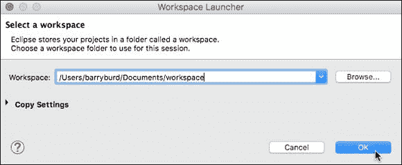

图 3-2：Eclipse 工作空间启动器。

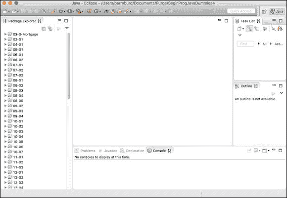

图 3-3：Eclipse 工作台。

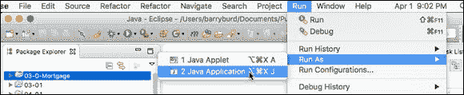

图 3-4：运行项目`03-0-Mortgage`中代码的方法之一。

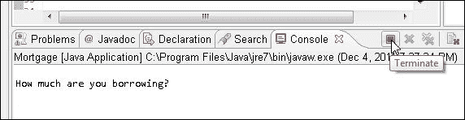

图 3-5：如何提前终止程序运行。

如果你按照本节的说明操作，但没有得到我所描述的结果，你可以尝试三件事。我按从最佳到最差的顺序列出：

* 检查所有步骤，确保你操作正确。
* 发送电子邮件至`BeginProg@allmycode.com`，在我的 Facebook 墙（[`/allmycode`](http://www.facebook.com/allmycode)）上发帖，或向 Burd 发推文（[@allmycode](http://www.twitter.com/allmycode)）。如果你描述发生了什么，我可能能找出问题所在并告诉你如何纠正。
* 恐慌。

## 输入并运行你自己的代码

上一节是关于运行他人的 Java 代码（从本书网站下载的代码）。但最终，你将自行编写代码。本节将展示如何使用 Eclipse IDE 创建代码。

### 将你的程序与我的程序分开

在第 2 章中，你从我的网站下载了本书的示例。然后你创建了一个 Eclipse 工作区，并将本书的示例导入到你的工作区中。

你可以在同一个工作区中创建自己的项目。但如果你想将你的代码与我的代码分开，可以创建第二个工作区。以下是创建新工作区的两种方法：

* **启动 Eclipse 时，在 Eclipse 的“工作区启动器”对话框的“工作区”字段中键入一个新文件夹名称。**

  如果该文件夹尚不存在，Eclipse 会创建该文件夹。如果该文件夹已存在，Eclipse 的“包资源管理器”会列出该文件夹包含的所有项目。

* **在 Eclipse 工作台的主菜单中，选择“文件” ⇒ “切换工作区”。（参见图 3-6。）**

  当你选择“文件” ⇒ “切换工作区”时，Eclipse 会提供几个你之前打开过的工作区文件夹。如果你的目标文件夹不在列表中，请选择“其他”选项。随后，Eclipse 会重新打开其“工作区启动器”对话框。

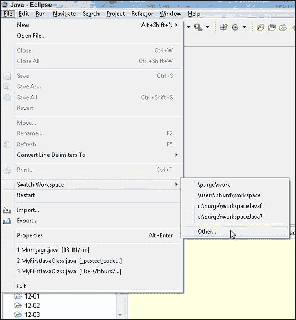

图 3-6：切换到另一个 Eclipse 工作区。

### 编写并运行你的程序

以下是创建新 Java 项目的方法：

1. **启动 Eclipse。**

2. **从 Eclipse 的菜单栏中，选择“文件” ⇒ “新建” ⇒ “Java 项目”。**

   此时会显示“新建 Java 项目”对话框。

3. **在“新建 Java 项目”对话框中，为你的项目键入一个名称，然后单击“完成”。**

   在图 3-7 中，我键入了名称`MyFirstProject`。

    如果你单击“下一步”而不是“完成”，你会看到一些当前不需要的其他选项。为避免混淆，只需单击“完成”。

   单击“完成”后，你会回到 Eclipse 工作台，`MyFirstProject`会出现在“包资源管理器”中，如图 3-8 所示。

   下一步是创建一个新的 Java 源代码文件。

4. **在“包资源管理器”中选择你刚刚创建的项目。**

   为了创建图 3-8，我选择了`MyFirstProject`而不是`SomeOtherProject`。

5. **在 Eclipse 的主菜单中，选择“文件” ⇒ “新建” ⇒ “类”。**

   此时会显示 Eclipse 的“新建 Java 类”对话框。（参见图 3-9。）

    Java 程序员通常将代码划分为一个或多个*包*。典型的包名如`java.util`或`org.allyourcode.images`。在图 3-9 中，Eclipse 警告我尚未为项目代码命名包。因此代码将进入一个名为 Java *默认包*的普通位置。Java 的默认包是一个没有名称的包——它是未打包代码的通用存放位置。包对于管理大型编程项目非常有用，但本书不涉及大型编程项目。因此，在本示例（以及本书的所有示例）中，我选择忽略该警告。有关 Java 包的更多信息，请参见第 18 章。

    与其他所有窗口环境一样，Eclipse 提供了多种完成同一任务的方法。除了选择“文件” ⇒ “新建” ⇒ “类”之外，你还可以在 Windows 中右键单击“包资源管理器”中的`MyFirstProject`（或在 Mac 上按住 Control 键单击`MyFirstProject`）。从弹出的上下文菜单中选择“新建” ⇒ “类”。你也可以在 Windows 中按 Alt+Shift+N（或在 Mac 中按 Option+⌘  +N）开始操作。点击和按键的选择取决于你。

6. **在“新建 Java 类”对话框的“名称”字段中，键入新类的名称。**

   在本示例中，我使用名称`MyFirstJavaClass`，名称中的单词之间没有空格。（参见图 3-9。）

    “新建 Java 类”对话框中的名称不能包含空格。唯一允许的标点符号是下划线字符（`_`）。你可以将类命名为`MyFirstJavaClass`或`My_First_Java_Class`，但不能命名为`My First Java Class`或`JavaClass,MyFirst`。

7. **勾选**`public static void main(String[] args)`**复选框。**

   你的勾选告诉 Eclipse 创建一些样板 Java 代码。

8. **接受“新建 Java 类”对话框中所有其他选项的默认值。（换句话说，单击“完成”。）**

   你甚至可以忽略对话框顶部附近的“不鼓励使用默认包”警告。

   单击“完成”后，你会回到 Eclipse 工作台。现在`MyFirstProject`包含一个名为`MyFirstJavaClass.java`的文件。为了方便起见，`MyFirstJavaClass.java`文件中已经包含了一些代码。Eclipse 的编辑器会显示这些 Java 代码。（参见图 3-10。）

9. **替换新 Java 程序中的一行现有代码。**

   在 Eclipse 的编辑器中键入一行代码。将行

   `// TODO Auto-generated method stub`

   替换为

   `System.out.println("Chocolate, royalties, sleep");`

   请严格按照清单 3-1 中的样子复制这行新代码。

   * 每个单词的拼写必须与清单 3-1 中的完全一致。
   * 每个单词的大小写必须与清单 3-1 中的完全一致。
   * 包含所有标点符号——点号、引号、分号——全部都要。
   *  区分小写字母`l`和数字`1`。单词`println`告诉计算机打印一整行。`println`中的每个字符都是小写字母。该单词不包含任何数字。
   *  Java 是*区分大小写*的，这意味着`system.out.printLn`与`System.out.println`不同。如果你输入`system.out.printLn`，你的程序将无法运行。请务必严格按照清单 3-1 中的方式大写你的代码。
   *  如果你从电子书中复制粘贴代码，请检查代码中的引号是否为直引号（`""`），而不是弯引号（`“ ”`）。在 Java 程序中，直引号是正确的；弯引号会带来麻烦。

   如果你正确键入了所有内容，你会看到图 3-11 中的内容。

   如果你没有严格按照清单 3-1 中的方式键入代码，你可能会在编辑器中看到锯齿状的红色下划线、带有 X 形标记的小矩形或其他红色标记。（参见图 3-12。）

   Eclipse 编辑器中的红色标记表示 Java 代码中的*编译时错误*。编译时错误（也称为*编译器错误*）是一种阻止计算机翻译代码的错误。（参见第 1 章中关于代码翻译的讨论。）

    图 3-12 中的错误标记出现在 Java 程序的第 5 行。行号显示在编辑器的左侧边距中。要让 Eclipse 编辑器显示行号，请选择“窗口” ⇒ “首选项”（在 Windows 中）或“Eclipse” ⇒ “首选项”（在 Mac 中）。然后选择“常规” ⇒ “编辑器” ⇒ “文本编辑器”。最后，勾选“显示行号”复选框。

   要解决编译时错误，你必须成为一名专注的侦探。你加入了一支精英小队，名为《法律与秩序：Java 编程单元》。你很少能找到简单的答案。相反，你需要缓慢而仔细地梳理证据，寻找线索。你将编辑器中看到的一切，逐字逐句地与清单 3-1 中的代码进行比较。你不能错过任何一个细节，包括拼写、标点符号以及大小写。

   Eclipse 有一些很好的功能可以帮助你找到编译时错误的根源。例如，你可以将鼠标指针悬停在锯齿状的红色下划线上。此时，你会看到错误的简要说明以及一些修复建议——一些*快速修复*。（参见图 3-13）

   在图 3-13 中，一个弹出消息告诉你 Java 不知道单词`system`是什么意思——即 *system cannot be resolved*。在该图底部附近，其中一个快速修复选项是将`system`改为`System`。

   当你点击“更改为 'System'（`java.lang`）”选项时，Eclipse 的编辑器会将`system`替换为`System`。编辑器中的错误标记消失，你从图 3-12 中的错误代码回到图 3-11 中的正确代码。

10. **在 Eclipse 编辑器中对代码进行任何修改或更正。**

    当你最终在编辑器中看不到任何锯齿状下划线或斑点时，就可以尝试运行程序了。

11. **选择**`MyFirstJavaClass`**，可以通过在编辑器内单击，或者单击包资源管理器中的**`MyFirstProject`**分支。**

12. **从 Eclipse 的主菜单中，选择**`Run ⇒ Run As ⇒ Java Application`**。**

    这样就搞定了。你的新 Java 程序会在 Eclipse 的控制台视图中运行。如果你运行的是清单 3-1 中的代码，你会看到图 3-14 中的`Chocolate, royalties, sleep`消息。简直就像在天堂一样！

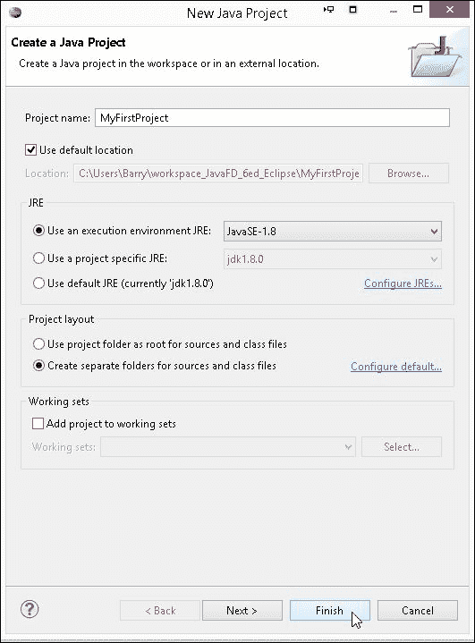

图 3-7：让 Eclipse 创建一个新项目。

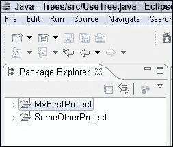

图 3-8：你的项目出现在 Eclipse 的包资源管理器中。

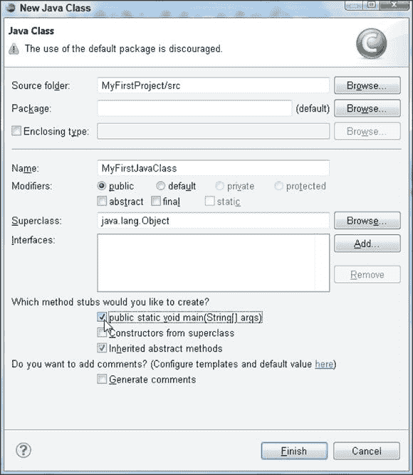

图 3-9：让 Eclipse 创建一个新的 Java 类。

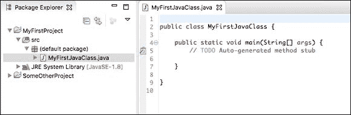

图 3-10：Eclipse 在编辑器中写入一些代码。

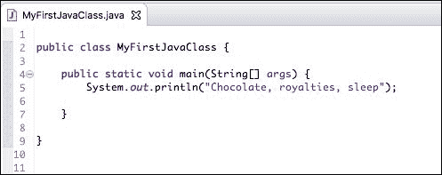

图 3-11：Eclipse 编辑器中的一个 Java 程序。

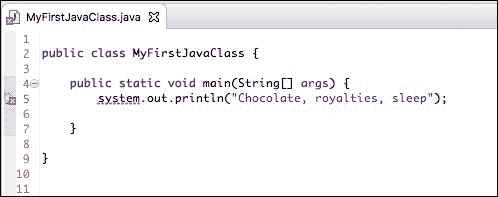

图 3-12：一个输入错误的 Java 程序。

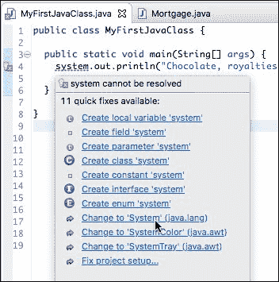

图 3-13：Eclipse 提供了一些有用的建议。

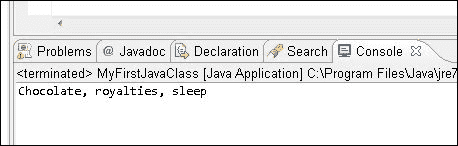

图 3-14：运行清单 3-1 中的程序。

清单 3-1 一个显示我喜欢的事物的程序

```java
public class MyFirstJavaClass {
public static void main(String[] args) {
System.out.println("Chocolate, royalties, sleep");
}
}
```

## Eclipse 窗口里所有这些是什么？

信不信由你，曾经有一位编辑拒绝了我的一本书稿。在页边空白处，编辑在诸如*can't*、*it's*和*I've*这样的词旁边潦草地写道：“这不是一个单词。”直到今天，我仍然不知道这位编辑为什么不喜欢缩略形式。我个人的看法是，语言总是需要扩展的。如果没有新词——比如*dot-com*、*infomercial*和*vaporware*——我们会在哪里？


即使是《牛津英语词典》（关于词汇争论的最终权威）每年也会增加超过 4000 个词条。这相当于每年增长超过 1%。大约每天 11 个新词！

事实上，人类的思想就像一座高层建筑：在至少建好第 49 层之前，你无法建造第 50 层。在拥有像`email`这样的词之前，你无法谈论`spam`。在当今这个时代，你需要语言的构建块。这就是为什么本节包含一堆新术语。

在本节中，每个新定义的术语都描述了 Eclipse IDE 的一个方面。因此，在阅读所有这些 Eclipse 术语之前，我提供以下免责声明：

- **本节为可选阅读。** 如果你在理解本书某些指令时遇到困难，请参考本节。但如果你在 Eclipse IDE 中导航毫无问题，就不要纠结于本节中的术语，把事情搞复杂了。

- **本节提供术语的解释，而非正式定义。** 是的，我的解释相当精确，但并非无懈可击。本节中的几乎每个描述都有隐藏的例外、遗漏、豁免和排除。请将本节中的段落视为友好的提醒，而非法律合同。

- **Eclipse 是一个非常实用的工具。** 但 Eclipse 并非 Java 生态系统的官方组成部分。尽管本书未详细描述，但你完全可以在不使用 Eclipse 的情况下编写 Java 程序。

### 理解全局

你的 Eclipse 之旅从一个宏观的鸟瞰图开始。

- **工作台：** Eclipse 桌面。（参见图 3-3）工作台是你开发代码的环境。

- **区域：** 工作台的一个部分。图 3-3 中的工作台包含五个区域。为了说明这一点，我在每个区域周围画了边框。（参见图 3-15）

- **窗口：** Eclipse 工作台的一个副本。使用 Eclipse，你可以同时打开多个工作台副本。每个副本出现在自己的窗口中。

- **操作：** 提供给你的一个选择——通常在你点击某个东西时出现。例如，当你在 Eclipse 主菜单栏上选择`File ⇒ New`时，你会看到可以创建的新事物列表。该列表通常包括`Project`、`Folder`、`File`和`Other`，但也可能包括`Package`、`Class`和`Interface`等。这些事物中的每一个（菜单上的每个项目）都称为一个`操作`。

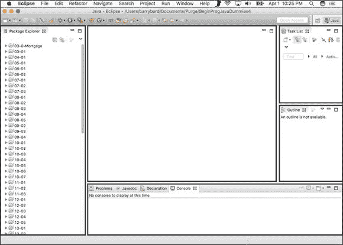

图 3-15：工作台被划分为多个区域。

### 视图、编辑器和其他内容

接下来的一组术语涉及视图、编辑器和选项卡。

 你可能难以理解视图和编辑器之间的区别。（视图就像编辑器，编辑器就像视图，或者类似的东西。）如果视图和编辑器对你来说看起来一样，并且你不确定能否区分它们，请不要沮丧。作为普通的 Eclipse 用户，随着你使用工作台的经验增加，视图和编辑器之间的区别会自然显现。你很少需要判断你正在使用的是视图还是编辑器。

如果你必须判断什么是视图，什么又是编辑器，以下是你需要知道的：

- **视图：** Eclipse 工作台的一部分，用于显示信息供你浏览。在最简单的情况下，视图填充工作台中的一个区域。例如，在图 3-15 中，包资源管理器视图填充了最左侧的区域。

  许多视图以列表或树的形式显示信息。例如，在图 3-10 中，包资源管理器视图包含一个树。

  你可以使用视图对事物进行更改。例如，要删除图 3-15 左侧列出的`03-01`项目，请右键单击包资源管理器视图中的`03-01`分支。（在 Mac 上，按住 Control 键单击`03-01`分支。）然后在出现的上下文菜单中选择`Delete`。

   当你使用视图进行更改时，更改会立即生效。例如，在包资源管理器的上下文菜单中选择“删除”时，你选中的任何项目都会立即被删除。从某种程度上说，这种行为并不新鲜。当你使用 Windows 资源管理器回收文件或使用 Macintosh Finder 删除文件时，也会发生同样的事情。

- **编辑器：** Eclipse 工作台的一部分，用于显示信息供你修改。典型的编辑器以文本形式显示信息。这些文本可以是文件的内容。例如，图 3-11 中的编辑器显示了`MyFirstJavaClass.java`文件的内容。

   当你使用编辑器进行更改时，更改不会立即生效。例如，查看图 3-11 中的编辑器。该编辑器显示了`MyFirstJavaClass.java`文件的内容。你可以在编辑器中输入各种内容。在从 Eclipse 菜单栏中选择“文件 ⇒ 保存”之前，`MyFirstJavaClass.java`不会发生任何变化。当然，这种行为并不新鲜。当你使用 Microsoft Word 或任何其他文字处理程序时，也会发生同样的事情。

   和其他作者一样，我偶尔也会偷懒，在真正想说`视图或编辑器`时，却用了`视图`这个词。当你发现我这样做时，只需摇摇头继续往下看。当我非常谨慎时，我会使用官方的 Eclipse 术语。我将视图和编辑器称为 Eclipse 工作台的`部件`。不幸的是，这种“部件”术语并不容易让人记住。

Eclipse 工作台的某个区域可能包含多个重叠的视图或重叠的编辑器。要将某个视图或编辑器置于最前面，你可以单击其选项卡。大多数 Eclipse 用户无需过多考虑（甚至根本不用考虑）这种“多个视图”的情况就能正常使用。但如果你关心选项卡和活动视图相关的术语，那么以下是详细说明：

- **选项卡：** 除了称之为`选项卡`之外，几乎无法描述的东西。我们称之为选项卡的东西，无论用什么其他名字，都能让我们从一个视图切换到另一个视图，或从一个编辑器切换到另一个编辑器。重要的是，视图可以相互`堆叠`。Eclipse 将堆叠的视图显示为带选项卡的笔记本中的页面。例如，图 3-14 显示了 Eclipse 工作台的一个区域。该区域包含五个视图（问题视图、Javadoc 视图、声明视图、搜索视图和控制台视图）。每个视图都有自己的选项卡。

  一堆堆叠的视图称为`选项卡组`。要将堆叠中的某个视图置于最前面，你可以单击该视图的选项卡。

  顺便提一下，所有这些关于选项卡和视图的内容同样适用于选项卡和编辑器。唯一有趣的是 Eclipse 使用`编辑器`这个词的方式。在 Eclipse 中，编辑器区域的每个选项卡页面都是一个独立的编辑器。例如，图 3-16 中的编辑器区域包含三个编辑器（而不是属于同一个编辑器的三个选项卡）。

- **活动视图或活动编辑器：** 在选项卡组中，位于最前面的视图或编辑器。

  在图 3-16 中，`MyFirstJavaClass.java`编辑器是活动编辑器。`Mortgage.java`和`ThingsILike.java`编辑器是非活动的。

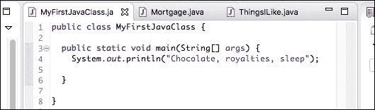

图 3-16：编辑器区域包含三个编辑器。

### 视图或编辑器中包含什么？

接下来的几个术语涉及单个视图、单个编辑器和单个区域。

- **工具栏：** 视图顶部的按钮（以及其他小部件）栏。（参见图 3-17。）

- **菜单按钮：** 工具栏中一个向下的箭头。单击菜单按钮时，会显示一个操作下拉列表。（参见图 3-18。）列表中显示的操作因视图而异。

- **关闭按钮：** 用于关闭特定视图或编辑器的按钮。（参见图 3-19。）

- **双箭头：** 一个双箭头，表示特定区域中应显示其他选项卡（但该区域宽度不够）。图 3-20 中的双箭头旁边有一个小数字 2。这个 2 告诉你，除了两个可见的选项卡外，还有两个选项卡不可见。单击双箭头会弹出一个悬停提示，其中包含所有选项卡的标签。

- **标记栏：** 编辑器区域左侧边缘的垂直标尺。Eclipse 在标记栏内显示微小的警报图标，称为`标记`。（例如，请参考图 3-12。）

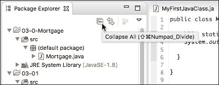

图 3-17：包资源管理器视图的工具栏。

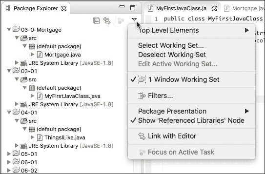

图 3-18：单击包资源管理器视图的菜单按钮。

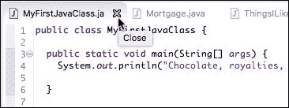

图 3-19：编辑器的关闭按钮。

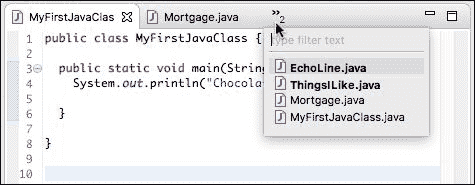

图 3-20：双箭头表示有两个编辑器被隐藏。

### 回到全局视角

接下来的两个术语涉及 Eclipse 的整体外观和感觉：

- **布局：** 特定视图的排列方式。图 3-3 中的布局有七个视图，其中四个很容易看到：

  - 最左边，你可以看到包资源管理器视图。
  - 最右边，你有任务列表视图和大纲视图。
  - 靠近底部，你有问题、Javadoc、声明和控制台视图。

  除了所有这些视图之外，该布局还包含一个`编辑器区域`。所有打开的编辑器都出现在这个编辑器区域内。

- **透视图：** 一种非常有用的布局。如果某个特定布局确实有用，就会有人给它命名。而且，如果一个布局有名字，你就可以随时使用它。例如，图 3-3 的工作台显示了 Eclipse 的 Java 透视图。默认情况下，`Java 透视图`包含六个视图，其排列方式与图 3-3 所示的排列非常相似。

   控制台视图出现在图 3-3 中，但控制台视图并不总是作为 Java 透视图的一部分出现。通常，当你运行基于文本的 Java 程序时，控制台视图会自动出现。如果你想强制显示控制台视图，请选择“窗口 ⇒ 显示视图 ⇒ 其他”。在出现的“显示视图”对话框中，展开“常规”分支。最后，在该“常规”分支中，双击“控制台”项。

  除了所有这些视图之外，Java 透视图还包含一个编辑器区域。（当然，编辑器区域有多个选项卡，但选项卡的数量与 Java 透视图无关。）

  你可以通过选择 Eclipse 主菜单栏中的“窗口 ⇒ 打开透视图”来切换透视图。本书几乎只关注 Eclipse 的 Java 透视图。但如果你喜欢探索，可以访问其他一些透视图，以领略 Eclipse 的强大功能和多样性。

 以下是一些你可以尝试的操作，以帮助你理解本章内容。如果这些尝试增强了你的信心，那很好。如果这些尝试让你对所读内容产生疑问，那也很好。如果这些尝试让你感到紧张，请不要气馁。你可以在本书的网站（[`www.allmycode.com/BeginProg`](http://www.allmycode.com/BeginProg)）上找到答案和其他帮助。你也可以通过电子邮件向我提问（`BeginProg@allmycode.com`）。

#### Eclipse 基础

按照本章前面“运行预置的 Java 程序”（Running a Canned Java Program）中的说明操作。然后尝试以下任务：

- 确保你能在 Eclipse 编辑器中看到抵押计算程序的代码。如果看不到，请在 Eclipse 工作台左侧的包资源管理器视图中查找`03-0-Mortgage`。展开`03-0-Mortgage`分支，直到看到名为`Mortgage.java`的分支。双击`Mortgage.java`分支。

- 在 Eclipse 编辑器中，对抵押计算程序中的文本进行任意修改。修改后，通过选择 Eclipse 主菜单中的`Edit ⇒ Undo`来撤销修改。

- 在 Eclipse 工作台的下方区域查找 Eclipse 的控制台选项卡。如果看不到该选项卡，请通过选择 Eclipse 主菜单中的`Window ⇒ Show View ⇒ Console`来显示控制台视图。（如果`Window ⇒ Show View ⇒ Console`不起作用，请尝试`Window ⇒ Show View ⇒ Other`。在出现的对话框中，双击`General ⇒ Console`项。）

- Eclipse 工作台有多个区域。使用鼠标拖动区域之间的边界（从而调整每个区域的大小）。要将区域恢复到调整大小之前的状态，请选择 Eclipse 主菜单中的`Window ⇒ Perspective ⇒ Reset Perspective`。

- Eclipse 工作台有多个不同的透视图。在本书中，你将使用 Java 透视图。通过选择 Eclipse 主菜单中的`Window ⇒ Perspective ⇒ Open Perspective ⇒ Debug`临时切换到调试透视图。注意 Eclipse 工作台中的区域和视图如何变化。然后通过选择 Eclipse 主菜单中的`Window ⇒ Perspective ⇒ Open Perspective ⇒ Java`切换回 Java 透视图。（如果由于某种原因，在选择`Window ⇒ Perspective ⇒ Open Perspective`时 Java 不在选项中，请选择`Other`，然后在出现的对话框中查找 Java。）

#### 尝试错误消息

按照本章前面“运行预置的 Java 程序”（Running a Canned Java Program）中的说明操作。在 Eclipse 的包资源管理器中查找`03-01`分支。展开该`03-01`分支时，查找名为`MyFirstJavaClass.java`的分支。双击`MyFirstJavaClass.java`分支后，`MyFirstJavaClass`的代码会出现在 Eclipse 编辑器中。

- 在 Eclipse 编辑器中，将单词`class`中的小写字母`c`改为大写字母`C`。执行此操作时，注意会出现一些红色标记。这些红色标记表示你的程序存在编译时错误。Java 是区分大小写的。因此，在 Java 程序中，单词`Class`（大写字母`C`）与单词`class`（小写字母`c`）的含义不同。

  在项目`03-01`中，有少数几处更改大小写不会导致错误。但对于大多数文本，更改大小写会导致 Eclipse 编辑器中出现红色错误警告。

- 在 Eclipse 编辑器中，将

  ```java
  System.out.println("You’ll love Java!");
  ```

  改为

  ```java
  System.out.println(6/0);
  ```

  Eclipse 编辑器中不会出现错误标记。但是，当你尝试运行程序时，会在 Eclipse 的控制台视图中看到红色文本。红色文本表示发生了运行时异常。该异常是因为 Java 无法将数字除以 0。

# 第 2 部分：编写你自己的 Java 程序

本部分内容……

- 剖析程序并检查各个部分
- 处理数字
- 处理非数字内容

## 第 4 章：探索程序的组成部分

### 本章内容

 **识别 Java 程序中的单词**

 **使用标点和缩进**

 **理解 Java 语句和方法**

我在一所文理学院的科学楼工作。每次路过生物实验室时，我都会低声说一句感谢。我庆幸自己不用解剖小动物。在我的工作中，我解剖的是计算机程序。计算机程序的气味比保存的动物尸体好闻多了。而且，解剖程序时，我不会联想到自己的死亡。

在本章中，我邀请你和我一起解剖一个程序。我有一个名为`ThingsILike`的小程序。我将程序拆开，仔细检查程序的内部结构。准备好你的手术刀，我们开始吧！

### 首次查看 Java 代码

我得坦白一件事。第一次看别人的计算机程序时，我会感到有点不安。意识到自己不理解代码中的某些（或许多）内容，让我紧张。我写过几百个（甚至几千个）程序，但开始阅读别人的代码时，我仍然感到不自信。

事实上，学习计算机程序是一个逐步积累的过程。首先，我会敬畏地凝视程序。然后运行程序，看看它做什么。接着盯着程序看一会儿，或者阅读别人对程序及其组成部分的解释。然后我再多凝视一会儿，再次运行程序。最终，我会理解这个程序。不要相信那些说自己从不经历这些步骤的聪明人。即使是经验丰富的程序员，也会缓慢而谨慎地接触新项目。

#### 看！一个程序！

在清单 4-1 中，你会看到一段 Java 代码。像所有新手程序员一样，你应该谦卑地凝视这段代码。但*不要被吓倒*。一旦掌握了窍门，编程就相当简单了。是的，也很有趣。

清单 4-1：一个简单的 Java 程序

```java
/*
 * A program to list the good things in life
 * Author: Barry Burd, BeginProg@allmycode.com
 * February 13, 2017
 */
class ThingsILike {
    public static void main(String args[]) {
        System.out.println("Chocolate, royalties, sleep");
    }
}
```

当我运行清单 4-1 中的程序时，得到的结果如图 4-1 所示：计算机在屏幕上显示单词`Chocolate, royalties, sleep`。我承认，编写并运行一个 Java 程序只是为了在某人电脑屏幕上显示`Chocolate, royalties, sleep`这些单词，工作量很大，但每项事业都得有个起点。


图 4-1：运行清单 4-1 中的程序。

 本书中的大多数程序都是基于文本的程序。运行这些程序时，输入和输出会出现在 Eclipse 的控制台视图中。相比之下，GUI（图形用户界面）程序会显示窗口、按钮、文本字段和其他小部件来与用户交互。你可以通过访问本书的网站（[`allmycode.com/BeginProg`](http://allmycode.com/BeginProg)）查看清单 4-1 以及本书中许多其他示例的 GUI 版本。

你可以在自己的计算机上运行清单 4-1 中的代码。操作步骤如下：

1. **按照第 2 章中的说明安装 Eclipse。**


## 2. 然后按照第 3 章前半部分的说明操作

这些说明告诉你如何运行名为`03-01`的项目，该项目可从本书网站（[`allmycode.com/BeginProg`](http://allmycode.com/BeginProg)）下载。要运行清单 4-1 中的代码，请按照相同的说明操作`04-01`项目，该项目也在同一下载中。

### 程序各行内容说明

如果清单 4-1 中的程序有朝一日出名，就会有人写一本《克利夫笔记》来总结它。这本书会非常短，因为你可以用一句话概括清单 4-1 的动作。这句话是：

`在电脑屏幕上显示` `巧克力、版税、睡眠`

现在将这句话与清单 4-1 中的大量代码进行比较。由于清单 4-1 有更多行，你可能会猜测它包含大量样板代码。嗯，你猜对了。不写样板代码就无法编写 Java 程序，但幸运的是，样板文本在不同 Java 程序之间变化不大。以下是我尽力用 66 个或更少的单词总结清单 4-1 所有文本的结果：

`这个程序列出了生活中的美好事物。`

`Barry Burd 于 2017 年 2 月 13 日编写了这个程序。`

`Barry 意识到你可能对这个代码有疑问，`

`因此你可以通过` `BeginProg@allmycode.com`、Twitter @allmycode 或 Facebook /allmycode 联系他。`

`这段代码定义了一个名为` `ThingsILike` `的 Java 类。` `以下是指令的主要起点：`

`在屏幕上显示` `巧克力、版税、睡眠`

本章其余部分（约 5000 多字）将更详细地解释清单 4-1 中的代码。

## Java 程序中的元素

英语和 Java 都被称为语言并非巧合。你用语言来表达思想。英语向人表达思想，而 Java 向计算机表达思想。此外，英语和 Java 都有单词、名称和标点符号之类的东西。事实上，这两种语言最大的区别在于 Java 比英语更容易学。（如果英语容易，计算机就能理解英语。可惜它们不能。）

拿一个普通的英语句子与清单 4-1 中的代码进行比较。这是那个句子：

> Ann 不发音“r”音，因为她来自纽约。

在高中语法课上，你关注动词、形容词等。但在这本书中，你从关键字和标识符的角度思考，如图 4-2 所示。

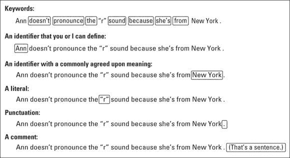

图 4-2：简单句子中的元素。

Ann 的句子包含各种东西。它们与你在计算机程序中找到的东西是同一类。所以计划是这样的：将图 4-2 中的元素与清单 4-1 中的类似元素进行比较。你已经理解英语，因此可以利用这种理解来了解 Java 的一些新知识。

但首先，这里有一个友好的提醒：在接下来的几段中，我将英语和 Java 进行对比。阅读这些段落时，请保持开放的心态。在比较 Java 和英语时，我可能会写道：“事物的名称与字典中的单词不同。”当然，你可以争辩说有些字典列出了专有名词，有些人有像 Hope、Prudence 和 Spike 这样的名字，但请不要这样。如果你避免吹毛求疵，你会从阅读中获得更多。好吗？我们还是朋友吗？

### 关键字

关键字是字典中的单词——一种内置于语言中的单词。

在图 4-2 中，像“from”这样的词是一个关键字，因为“from”在英语句子中使用时总是扮演相同的角色。Ann 句子中的其他关键字是“doesn’t”、“pronounce”、“the”、“sound”、“because”和“she’s”。

计算机程序也有关键字。事实上，清单 4-1 中的程序使用了四个 Java 关键字（以粗体显示）：

`class ThingsILike {`

`public static void main(String args[]) {`

每个 Java 关键字都有特定的含义——这个含义在不同程序之间保持不变。例如，每当我编写 Java 程序时，单词`public`总是表示程序中任何其他代码都可以访问的部分。

 Java 编程语言是区分大小写的。这意味着如果你将单词中的一个小写字母改为大写字母，你就改变了单词的含义。改变大小写可能使整个单词从有意义变成无意义。在清单 4-1 中，你不能将`public`替换为`Public`。如果你这样做，整个程序就会停止工作。

本章对关键字`class`、`public`、`static`和`void`的含义几乎没有详细说明。你可以提前翻阅其他章节的内容，或者通过“作弊”来应付。编写程序时，只需以

`class SomethingOrOther {`

开头，然后将文本

`public static void main(String args[]) {`

粘贴到你的代码中。在你最初的几个程序中，这个策略很管用。

表 4-1 列出了 Java 关键字的完整列表。

| `abstract` | `continue` | `for` | `new` | `switch` |
|---|---|---|---|---|
| `assert` | `default` | `goto` | `package` | `synchronized` |
| `boolean` | `do` | `if` | `private` | `this` |
| `break` | `double` | `implements` | `protected` | `throw` |
| `byte` | `else` | `import` | `public` | `throws` |
| `case` | `enum` | `instanceof` | `return` | `transient` |
| `catch` | `extends` | `int` | `short` | `try` |
| `char` | `final` | `interface` | `static` | `void` |
| `class` | `finally` | `long` | `strictfp` | `volatile` |
| `const` | `float` | `native` | `super` | `while` |

表 4-1 Java 关键字

 在 Java 中，单词`true`、`false`和`null`具有特定含义。与表 4-1 中的关键字一样，你不能将`true`、`false`和`null`用于 Java 程序中正常含义之外的任何其他含义。但出于只有最挑剔的 Java 专家才关心的原因，`true`、`false`和`null`并不被称为 Java 关键字。无论如何，如果你将单词`true`、`false`和`null`添加到表 4-1 中，也没问题。

关于关键字，有一点要记住：在 Java 中，每个关键字都有官方预定义的含义。Oracle 公司（对 Java 程序构成有最终决定权）创建了所有 Java 关键字。你不能为任何 Java 关键字赋予自己的含义。例如，你不能在计算中使用单词`public`：

```java
//这是糟糕的、糟糕的代码：
public = 6;
```

如果你试图以这种方式使用关键字，编译器会显示错误消息并拒绝翻译你的源代码。英语中也是如此。给一个婴儿取名 Because：

> “让我们为今晚的主持人——Because O. Borel——献上热烈的掌声。”

你可以这样做，但这个孩子永远不会过上正常的生活。

 尽管我在本节中强烈主张，但 Java 中有两个关键字在 Java 程序中没有意义。这两个关键字——`const`和`goto`——被保留在 Java 中不使用。如果你试图创建一个名为`goto`的变量，Eclipse 会显示`Invalid VariableDeclaratorId`错误消息。Java 的创建者认为，如果你在代码中使用了`const`或`goto`这两个词，应该礼貌地告诉你转到 C++程序员的那一桌。

### 你或我可以定义的标识符

我喜欢 Ann 这个名字，但如果你不喜欢传统名字，就编一个全新的名字。你即将有一个新生儿。叫她 Deneen 或 Chrisanta。给他取名 Belton 或 Merk。

一个名称是标识某物的词，所以我将不再称这些东西为名称，而改称它们为标识符。在计算机编程中，标识符是某种名词。标识符引用一个值、程序的一部分、某种结构或任意数量的东西。

清单 4-1 中有两个我们可以自行定义的标识符。它们是虚构的词`ThingsILike`和`args`。

```java
class ThingsILike {
public static void main(String args[]) {
```

正如名字 Ann 和 Chrisanta 在英语中没有特殊含义一样，`ThingsILike`和`args`在 Java 中也没有特殊含义。在清单 4-1 中，我用`ThingsILike`作为程序名，但我也可以使用像`GooseGrease`、`Enzyme`或`Kalamazoo`这样的名字。我必须在程序中写上`(String someName[])`，但我也可以使用`(String args[])`、`(String commandLineArguments[])`或`(String cheese[])`。

 为 Java 程序中的事物起一些合理且富有信息量的名称。像`GooseGrease`这样的名称是合法的，也确实很可爱，但它们无助于你跟踪程序的编写策略。

 当我命名 Java 程序时，可以使用`ThingsILike`或`GooseGrease`，但不能使用`public`这个词。像`class`、`public`、`static`和`void`这样的词是 Java 中的关键字。

`(String args[])`中的`args`保存了你在运行 Java 程序时输入的任何额外内容。例如，如果你通过输入`java ThingsILike won too 3`来运行程序，那么`args`会存储额外的值`won`、`too`和`3`。作为初学者，你不需要考虑 Java 的这个特性。只需将`(String args[])`粘贴到你的每个程序中即可。

### 具有约定俗成含义的标识符

许多人名叫 Ann，但只有一座著名的城市叫 New York。这是因为“New York”这个词具有标准且广为人知的含义——它是不夜城。如果你要建立自己的城市，应该避免将其命名为 New York，因为那样只会让所有人困惑。（我知道佛罗里达州有一个小镇叫 New York，但那不算数。记住，你应该忽略这类例外。）

大多数编程语言都有具有约定俗成含义的标识符。在 Java 中，几乎所有这类标识符都在 Java API 中定义。清单 4-1 中有五个这样的标识符。它们是`main`、`String`、`System`、`out`和`println`：

```java
public static void main(String args[]) {
System.out.println("Chocolate, royalties, sleep");
}
```

以下是每个名称含义的简要说明（更详细的描述贯穿本书）：

- **`main`：** 每个 Java 程序执行的起始点。
- **`String`：** 一串文本；一行字符，一个接一个。
- **`System`：** Java API 中的一个预置程序。该程序可以访问计算机中某些不受 Java 虚拟机（JVM）直接控制的功能。
- **`out`：** 基于文本的程序显示其文本的地方。（对于在 Eclipse 中运行的程序，`out`代表控制台视图。要了解更多关于基于文本的程序，请查看第 3 章的前几段。）
- **`println`：** 在计算机屏幕上显示文本。

 名称`println`来源于“print a line”（打印一行）。如果允许你用大写字母书写，它会是`PRINTLN`，单词末尾有一个字母`L`。当计算机执行`println`时，计算机会将一些文本放入 Eclipse 的控制台视图，然后立即移动到下一行的开头，为控制台视图中将要出现的其他内容做准备。

 严格来说，Java API 中标识符的含义并非一成不变。尽管你可以为`System`或`println`这样的词赋予自己的含义，但这样做并不明智——因为你会让其他程序员感到困惑，他们早已习惯了这些常见标识符名称的标准 API 含义。

### 字面量

字面量是一段看起来与其所代表的值完全相同的文本。在 Ann 的句子中（参见图 4-2），“r”是一个字面量，因为“r”指的是字母 r。

编程语言也有字面量。例如，在清单 4-1 中，引号内的内容就是一个字面量：

```java
System.out.println("Chocolate, royalties, sleep");
```

当你运行`ThingsILike`程序时，屏幕上会显示`Chocolate`、`royalties`、`sleep`这些词。在清单 4-1 中，文本`"Chocolate, royalties, sleep"`指的就是这些词，与屏幕上显示的内容完全一致（不含引号）。

你在计算机程序中使用的大多数数字都是字面量。如果你在程序中写下语句

```java
mySalary = 1000000.00;
```

那么`1000000.00`就是一个字面量。它代表数字 1000000.00（一百万）。

如果你不喜欢数数字位数，可以在 Java 7 程序中写下以下语句：

```java
mySalary = 1_000_000.00;
```

从 Java 7 开始，带下划线的数字可以作为字面量使用。

 在 Java 7 之前的 Java 版本中，你不能在代码中使用像`1_000_000.00`这样的数字。

 不同国家使用不同的数字分隔符和数字格式。例如，在美国，你写 1,234,567,890.55。在法国，你写 1234567890,55。在印度，你将数字按两位和三位分组，写为 1,23,45,67,890.55。你不能在 Java 程序中写`mySalary = 1,000,000.00`这样的语句。Java 的数字字面量中不包含任何逗号。但在印度，你可以写`mySalary = 10_00_000.00`以便于阅读。而对于程序的输出，你可以使用 Java 的`Locale`和`NumberFormat`类来显示像 1234567890,55 这样的数字。（关于`Locale`和`NumberFormat`的更多信息，请查看第 18 章。）

### 标点符号

一个典型的计算机程序包含大量标点符号。例如，考虑清单 4-1 中的程序：

```java
class ThingsILike {
public static void main(String args[]) {
System.out.println("Chocolate, royalties, sleep");
}
}
```

每个括号、每个花括号、每种类型的曲线符号都在使程序有意义方面发挥作用。

在英语中，你一直写到一行末尾，然后将文本换行到下一行开头。在编程中，你很少这样工作。相反，代码的标点符号引导着某些行的缩进。缩进显示了程序的哪些部分从属于其他部分。这就像在英语中，你写这样一个句子：

Ann 不发音“r”音，因为

，

> 众所周知

，

她来自纽约。

图 4-3 和 4-4 中的示意图展示了`ThingsILike`程序的各个部分如何包含在其他部分中。注意一对花括号如何像一个盒子一样工作。为了让你一眼就能看出程序的结构，你将每个盒子内部的所有内容都缩进。


图 4-3：一对花括号像一个盒子。

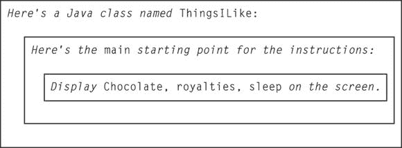

图 4-4：计算机程序中的思想是相互嵌套的。

 这一点我怎么强调都不为过：如果你不缩进代码，或者虽然缩进了但不够仔细，你的代码仍然能编译并正确运行。但这种成功运行会给你一种虚假的自信。一旦你试图更新某些缩进不当的代码，你就会陷入无法摆脱的困惑。听我的建议：在编写过程的每一步都仔细缩进你的代码。无论你是在草拟一个快速测试程序，还是为亿万富翁客户编写代码，都要精确地缩进。

 Eclipse 可以自动为你缩进代码。选择你想要缩进代码的`.java`文件。然后，在 Eclipse 的主菜单中，选择 Source ⇒   Format。Eclipse 会重新排列编辑器中的行，缩进那些应该缩进的部分，通常能让你的代码看起来更美观。

### 注释

注释是脱离正常流程的文本。在图 4-2 中，“That’s a sentence”这些词并不是 Ann 句子的一部分。相反，这些词是关于 Ann 句子的说明。

计算机程序中的注释也是如此。清单 4-1 中的前五行构成了一条大注释。计算机不会执行这条注释。注释中没有让计算机执行的指令。相反，注释告诉其他程序员关于你代码的一些信息。

注释也对你自身有益。想象一下，你把代码搁置一段时间，去处理其他事情。当你稍后回来继续处理代码时，注释能帮助你回忆起当时在做什么。

Java 编程语言有三种注释：

- **传统注释：** 清单 4-1 中的注释是传统注释。注释以`/*`开头，以`*/`结尾。开头的`/*`和结尾的`*/`之间的所有内容仅供人类阅读。`/*`和`*/`之间的任何内容都不会被编译器翻译。


清单 4-1 中的第二、三、四行有多余的星号。我称它们为“多余”，是因为在创建注释时这些星号并非必需。它们只是让注释看起来更美观。我在清单 4-1 中包含了它们，因为出于某种我不完全理解的原因，大多数 Java 程序员都会添加这些多余的星号。

- **行末注释：** 下面是一些带有行末注释的代码：

```java
class ThingsILike { //缺少两样东西
public static void main(String args[]) {
System.out.println("sleep"); //这里缺少
}
}
```

*行末*注释以两个斜杠开头，并延伸到该行末尾。

 你可能会听到程序员谈论*注释掉*代码的某些部分。当你编写程序时，如果某些功能运行不正常，尝试移除部分代码通常会有所帮助。至少，你能发现移除可疑代码后会发生什么。当然，你可能不喜欢移除代码后的结果，所以你不希望完全删除代码。相反，你可以将普通的 Java 语句变成注释。例如，将`System.out.println("Sleep");`变成`/* System.out.println("Sleep"); */`。这样，在你试图找出程序问题所在时，Java 编译器就不会看到这段代码。

- **Javadoc 注释：** 一种特殊的 `Javadoc` 注释是指任何以额外星号开头的传统注释：

```java
/**
* 打印一个字符串然后结束该行。
*/
```

这是一个很酷的 Java 特性。从 Oracle 网站下载的 Java SE 软件中包含一个名为`javadoc`的小程序。`javadoc`程序会查找代码中的这些特殊注释。该程序利用这些注释创建一个全新的网页——为你的代码定制的文档页面。要了解更多关于将 Javadoc 注释转换为网页的信息，请访问本书的网站（[`allmycode.com/BeginProg`](http://allmycode.com/BeginProg)）。

## 理解一个简单的 Java 程序

以下各节将对清单 4-1 中的 Java 程序进行介绍、解释、分析、剖析，并揭开其神秘面纱。

### 什么是方法？

你在一家高档修车厂担任汽车修理工。你的老板总是匆匆忙忙，而且习惯把单词连在一起说：“`fixTheAlternator` on that `junkyOldFord`”（修理那辆破旧福特车的发电机）。你在脑海中快速过一遍任务清单：“把车开进工位，打开发动机盖，拿扳手，松开发电机皮带”，等等。这里涉及三件事：

- **你有一个名称来表示你应该做的事情。** 这个名称是`fixTheAlternator`。

- **在你的脑海中，有一系列与名称`fixTheAlternator`相关联的任务。** 这个列表包括“把车开进工位，打开发动机盖，拿扳手，松开发电机皮带”等等。

- **有一个脾气暴躁的老板在命令你做所有这些工作。** 你的老板通过说“`fixTheAlternator`”来让你开始工作。换句话说，你的老板通过说出你应该做的事情的名称来让你开始工作。

在这个场景中，使用*方法*这个词并不牵强。你有一个处理发电机的方法。你的老板调用这个方法，你通过执行与该方法相关联的指令列表中的全部事项来响应。

#### Java 方法

如果你相信上一节中的所有内容，那么你已经准备好了解 Java 方法了。在 Java 中，*方法*是一个待办事项列表。每个方法都有一个名称，你可以通过在程序中使用该方法的名称来告诉计算机执行列表中的事项。

我从未编写过让机器人修理发电机的程序。但如果我要编写，程序可能会包含一个名为`fixTheAlternator`的方法。我的`fixTheAlternator`方法中的指令列表看起来会像清单 4-2 中的文本。

清单 4-2 一个方法声明

```java
void fixTheAlternator(onACertainCar) {
driveInto(car, bay);
lift(hood);
get(wrench);
loosen(alternatorBelt);
…
}
```

在我的 Java 代码的其他地方（在清单 4-2 之外），我需要一条指令来调用我的`fixTheAlternator`方法。调用`fixTheAlternator`方法的指令可能类似于清单 4-3 中的一行。

清单 4-3 调用一个方法

```java
fixTheAlternator(junkyOldFord);
```

 不要过于仔细地审视清单 4-2 和 4-3。清单 4-2 和 4-3 中的所有代码行都是虚构的！我编造了这些代码，使其看起来很像真实的 Java 代码，但并非真实代码。更重要的是，清单 4-2 和 4-3 中的代码并非旨在说明 Java 的所有规则。所以，如果你手头有怀疑的态度，请对清单 4-2 和 4-3 持保留意见。

 几乎每种计算机编程语言都有类似于 Java 方法的东西。如果你使用过其他语言，你可能会记得子程序、过程、函数、子例程、`Sub`过程或`PERFORM`语句等概念。无论你在喜欢的编程语言中如何称呼它，*方法*都是一组收集在一起并赋予新名称的指令。

#### 声明、头部和调用

如果你对方法是什么以及它如何工作有了基本了解（参见上一节），你可以进一步深入一些有用的术语：

- 如果我偷懒，我会把清单 4-2 中的代码称为`method`。如果我不偷懒，我会把这段代码称为`method declaration`。

- 清单 4-2 中的方法声明包含两部分。第一行（包含名称`fixTheAlternator`的部分，直到但不包括左花括号）称为`method header`。清单 4-2 的其余部分（花括号包围的部分）是`method body`。

- 术语`method declaration`将清单 4-2 中的指令列表与清单 4-3 中的指令区分开来，后者被称为方法调用。

有关所有方法术语的直观说明，请参见图 4-5。

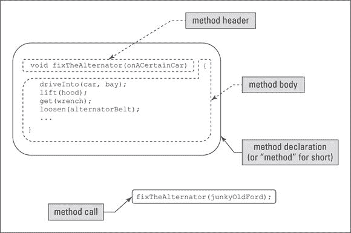

图 4-5：描述方法的术语。

方法的头部和主体就像字典中的一个词条。词条本身并不真正使用它所定义的词。相反，词条告诉你如果使用这个词会发生什么：

- **chocolate** (choc-o-late) *n.* **1.** 地球上最容易上瘾的物质。**2.** 你用版税收入支付的东西。**3.** 一个人饮食中最重要的营养元素。

- **`fixTheAlternator(onACertainCar)`** 把车开进维修区，打开发动机盖，拿起扳手，松开交流发电机皮带，然后吃点巧克力。

相比之下，方法调用就像在句子中使用一个词。方法调用使某些代码开始执行：

- “我要吃巧克力，不然我就发脾气。”

- “`fixTheAlternator` on that `junkyOldFord`。”

 方法的`声明`告诉计算机，如果你调用该方法执行，会发生什么。`方法调用`（一段独立的代码）告诉计算机实际调用该方法执行。方法的声明和方法的调用通常位于 Java 程序的不同部分。

### 程序中的 `main` 方法

在清单 4-1 中，大部分代码是一个名为`main`的方法的声明。（只需在代码的方法头部中查找单词`main`。）目前，不必担心方法头部中的其他单词——`public`、`static`、`void`、`String`和`args`。我将在接下来的几章中（按需）解释这些单词。

与任何 Java 方法一样，`main`方法是一个配方：

- `如何制作饼干：`

- `预热烤箱。`

- `擀面团。`

- `烘烤擀好的面团。`

或

- `如何执行 ThingsILike 代码中的`

- `主要指令：`

- `在屏幕上显示 Chocolate, royalties, sleep。`

单词`main`在 Java 中扮演着特殊角色。特别是，你永远不会编写显式调用`main`方法的代码。单词`main`是当程序开始运行时自动被调用的方法名称。

当`ThingsILike`程序运行时，计算机会自动找到程序的`main`方法，并执行该方法主体内的任何指令。在`ThingsILike`程序中，`main`方法的主体只有一条指令。该指令告诉计算机在屏幕上打印`Chocolate, royalties, sleep`。

 方法中的任何指令都不会被执行，直到该方法被调用。但是，如果你给一个方法命名为`main`，那么该方法会自动被调用。

### 你最终如何告诉计算机做某事

在清单 4-1 的核心深处，有一行代码实际上向计算机发出了直接指令。这一行

`System.out.println("Chocolate, royalties, sleep");`

告诉计算机显示单词`Chocolate, royalties, sleep`。（如果你使用 Eclipse，计算机会在控制台视图中显示`Chocolate, royalties, sleep`。）我可以用至少两种不同的方式描述这行代码：

- **它是一个语句。** 在 Java 中，告诉计算机做某事的直接指令称为`statement`。清单 4-1 中的语句告诉计算机显示一些文本。其他程序中的语句可能告诉计算机将 7 放入某个内存位置，或使窗口出现在屏幕上。计算机程序中的语句可以做各种各样的事情。

- **它是一个方法调用。** 在本章前面，我描述了一个称为方法调用的东西。语句`fixTheAlternator(junkyOldFord);`是方法调用的一个例子，`System.out.println("Chocolate, royalties, sleep");`也是。Java 有许多不同类型的语句。方法调用只是其中一种。

#### 用分号结束语句

在 Java 中，每个语句都以分号结束。清单 4-1 中的代码只有一条语句，因此清单 4-1 中只有一行以分号结束。

以清单 4-1 中的任何其他行为例——例如方法头部。方法头部（包含单词`main`的那一行）并不直接告诉计算机做任何事情。相反，方法头部描述了一些供将来参考的操作。头部声明：“万一有人调用`main`方法，接下来的几行代码告诉你如何响应那个调用。”

 每个完整的 Java 语句都以分号结束。方法调用是一个语句，因此它以分号结束，但方法头部和方法声明都不是语句。

#### 名为 `System.out.println` 的方法

清单 4-1 中间的语句调用了一个名为`System.out.println`的方法。这个方法在 Java API 中定义。每当你调用`System.out.println`方法时，计算机就会在屏幕上显示文本。

想想名字。信不信由你，我认识两个名叫 Pauline Ott 的人。一个是修女，另一个是物理学家。当然，英语世界中有很多叫 Pauline 的人，就像 Java API 中有几个名为`println`的东西一样。为了区分物理学家 Pauline Ott 和影评人 Pauline Kael，我写全名 Pauline Ott。为了区分修女和物理学家，我写“Sister Pauline Ott”。同样，我写`System.out.println`或`DriverManager.println`。第一个（你经常使用）在计算机屏幕上写文本。第二个（你在本书中根本不会用到）写入数据库日志文件。

正如 Pauline 和 Ott 本身就是名字一样，`System`、`out`和`println`也是 Java API 中的名字。但要使用`println`，你必须写方法的全名。你永远不会单独写`println`。它总是`System.out.println`或 API 名称的其他组合。

 Java 编程语言是区分大小写的。如果你将小写字母改为大写字母（反之亦然），就会改变单词的含义。你不能将`System.out.println`替换为`system.out.Println`。如果这样做，你的程序将无法运行。

#### 方法，无处不在的方法

在`ThingsILike`程序中，有两个方法发挥作用。图 4-6 说明了这种情况，接下来的几个要点将带你逐一了解。

- **有一个`main`方法的声明。** 我自己编写了`main`方法。每当我开始运行`ThingsILike`程序时，这个`main`方法会自动被调用。

- **有一个对`System.out.println`方法的调用。** 对`System.out.println`方法的调用是`main`方法主体中唯一的语句。换句话说，调用`System.out.println`方法是`main`方法待办事项列表中的唯一事项。

`System.out.println`方法的声明隐藏在官方 Java API 中。如需复习 Java API，请参阅第 1 章。


图 4-6：调用`System.out.println`方法。

 当我说“`System.out.println`隐藏在 API 中”时，我并没有公正地评价 API。诚然，你可以忽略 API 中所有琐碎的 Java 代码。你只需要记住`System.out.println`是在该代码中的某处定义的。但我把 API 代码说得像魔法一样，这并不公平。API 只是另一堆 Java 代码。API 中告诉计算机执行`System.out.println`调用意味着什么的语句，看起来很像代码清单 4-1 中的 Java 代码。

### Java 类

你听说过*面向对象编程*（也称为 *OOP*）这个术语吗？OOP 是一种思考计算机编程问题的方式——一种由多种不同编程语言支持的方式。OOP 始于 20 世纪 60 年代的一种名为 Simula 的语言。它在 20 世纪 70 年代通过另一种名为 Smalltalk 的语言得到加强。到了 20 世纪 80 年代，OOP 凭借 C++ 语言大放异彩。

有些人想改变这个缩写，称之为 COP——面向类编程。这是因为面向对象编程始于一种称为*类*的东西。在 Java 中，一切始于类，一切都被封装在类中，一切都基于类。在创建某种类之前，你在 Java 中什么都做不了。这就像在《危险边缘》节目中，听到亚历克斯·特雷贝克说“我们插播广告”，然后你打断他说：“对不起，亚历克斯。你不能在不把指令放在类中的情况下发出指令。”

理解类到底是什么对你来说很重要，所以我不敢在本章中随意解释。相反，我将第 17 章的大部分内容用于回答“什么是类？”这个问题。无论如何，在 Java 中，你的`main`方法必须放在一个类中。我编写了代码清单 4-1 中的代码，所以我得为我的新类起个名字。我选择了`ThingsILike`这个名字，因此代码清单 4-1 中的代码以`class ThingsILike`开头。

再看一下代码清单 4-1，注意`class ThingsILike`这一行之后发生了什么。其余代码被花括号括起来。这些花括号标记了类内部的所有内容。没有这些花括号，你就知道`ThingsILike`类的声明从哪里开始，但不知道声明在哪里结束。

就好像`ThingsILike`类内部的东西被放在一个盒子里。（请参阅图 4-3。）要框出一段代码，你需要做两件事：

- **使用花括号。** 这些花括号告诉编译器一段代码从哪里开始和结束。

- **缩进代码。** 缩进告诉你的肉眼（以及其他程序员的肉眼）一段代码从哪里开始和结束。

别忘了。你必须同时做到这两点。

#### 程序中的词汇

 代码清单 4-1 包含几种类型的词汇。看看当你更改其中一些词汇时会发生什么。

- 更改其中一个关键字。例如，将`class`改为`bologna`。在 Eclipse 编辑器中查找错误消息。

- 更改一个你或我可以定义的标识符。例如，将`args`改为`malarkey`。更改后，你的程序还能运行吗？

  `ThingsILike`这个词也是你或我可以编造的。所以你可以尝试将`ThingsILike`改为另一个词。如果你完全按照代码清单 4-1 中的代码复制，你的程序仍然可以运行。但如果你的程序以`public`开头，例如：

  `public class SomeOtherWord {`

- 你可能会遇到一些麻烦。如果遇到，只需删除`public`这个词。

- 更改一个具有约定俗成含义的标识符。例如，将`println`改为`display`。在 Eclipse 编辑器中查找错误消息。

- 更改程序的标点符号。例如，删除一对花括号。在 Eclipse 编辑器中查找错误消息。

- 注释掉整个`System.out.println("Chocolate, royalties, sleep");`这一行。（使用行尾注释风格。）运行程序时会发生什么？

- 注释掉整个`System.out.println("Chocolate, royalties, sleep");`这一行。（使用传统注释风格。）运行程序时会发生什么？

#### 有效标识符

你可以编造的名称种类是有限制的。例如，一个人的名字可能包含连字符，但不能包含问号。（至少在我所在的地方不能。）一位知名名人的名字可能是一个无法发音的符号。但对于我们大多数人来说，只能使用普通的字母、破折号和连字符。

在 Java 程序中，你可以编造哪些类型的名称？通过在 Eclipse 编辑器中将这些其他词替换`args`来找出答案。哪些更改是允许的，哪些不允许？

- `helloThere`

- `hello_there`

- `args7`

- `ar7gs`

- `75`

- `7args`

- `hello there`

- `hello-there`


- `public`
- `royalties`
- `@args`
- `#args`
- `/args`

#### 你最喜欢的东西

修改代码清单 4-1 中的代码，使其显示你喜欢的东西。运行程序，确保这些内容显示在 Eclipse 控制台视图中。

# 第 5 章：编写程序

本章内容包括：

 **从键盘读取输入**

 **编辑程序**

 **排除故障**

就在昨天，我和我的仆人 RoboJeeves 聊天。（RoboJeeves 是 RJ-3000 系列个人机器人生命体中的高端型号。）对话如下：

- *我：* RoboJeeves，告诉我一个物体在真空中下落三秒后的速度。
- *RoboJeeves：* 好的，我会的。“一个物体在真空中下落三秒后的速度。”好了，我告诉你了。
- *我：* RoboJeeves，别给我那种自作聪明的回答。我要一个数字。我要实际速度。
- *RoboJeeves：* 好的！“一个数字；实际速度。”
- *我：* RJ，这些低级的笑话有失你的身份。你到底能不能回答我的问题？
- *RoboJeeves：* 能。
- *我：* “能”什么？
- *RoboJeeves：* 是的，我既能也不能回答你的问题。
- *我：* 那到底是哪个？你能吗？
- *RoboJeeves：* 是的，我能。
- *我：* 那就做吧。告诉我答案。
- *RoboJeeves：* 速度是每小时 153,984,792 英里。
- *我：*（停顿思考后……）RJ，我知道你从不犯错，但那个数字 153,984,792 太高了。
- *RoboJeeves：* 太高了？不可能。在巨大的曼戈尔克松戈星球上，物体下落得非常快。现在，如果你想知道地球上物体下落的情况，你应该一开始就说明。

有时候那个机器人让我很不爽。事实是，RoboJeeves 只做我吩咐他做的事——不多也不少。如果我说“喂猫”，那么 RJ 就会说：“喂给谁？你的哪位客人要吃猫肉晚餐？”

## 计算机很愚蠢

尽管计算机非常方便，但它们做的都是同一件该死的事。它们会完全按照你的指令行事，而这有时非常不幸。例如，1962 年，一艘前往金星的水手号探测器在发射后仅四分钟就毁掉了。为什么？因为一个 FORTRAN 程序中缺少了一个按键。大约在同一时间，NASA 科学家发现了一个可能毁掉水星载人航天任务的错误。（没错！这些任务可是载人的！）这个错误是一行代码中用了句点而不是逗号。（程序员写了 `DO 10 I=1.10` 而不是 `DO 10 I=1,10`。）

恕我直言，我的伙伴 RoboJeeves 和他的计算机表亲们都极其愚蠢。有时它们看起来像是在揣测我们人类的想法，但实际上它们只是在执行其他人告诉它们要做的事。它们可以抛虚拟硬币，用复杂的方案模仿创造性行为，但从未真正独立思考。如果你说“跳”，它们就会按照编程设定对字母 `J-u-m-p` 做出反应。

因此，当你编写计算机程序时，你必须想象一个精灵给了你三个愿望。不要要求永恒的爱，因为如果你这样做了，精灵会给你一个流着口水、令人崇拜的伴侣——一个你根本不喜欢的家伙。也不要要求一百万美元，除非你想让精灵把你变成银行劫匪。

你在计算机程序中写的每一件事都必须精确。来看一个例子……

## 一个回显键盘输入的程序

清单 5-1 包含一个小型 Java 程序。该程序允许你在键盘上输入一行字符。一旦你按下回车键，程序就会显示第二行，复制你输入的内容。

### 清单 5-1 一个 Java 程序

```java
import java.util.Scanner;

class EchoLine {

public static void main(String args[]) {

Scanner keyboard = new Scanner(System.in);

System.out.println(keyboard.nextLine());

keyboard.close();

}

}
```

 本书中的大多数程序都是基于文本的程序。当你运行这些程序时，输入和输出会显示在 Eclipse 的控制台视图中。你可以通过访问本书的网站（[`http://allmycode.com/BeginProg`](http://allmycode.com/BeginProg)）查看清单 5-1 中程序的 GUI 版本——以及本书中许多其他示例的 GUI 版本。

图 5-1 展示了 `EchoLine` 代码（即清单 5-1 中的代码）的一次运行。图中的文本是我自己输入的内容和计算机响应的混合。


图 5-1：“不要”这个词的哪一部分你不明白？

在图 5-1 中，我输入了第一行（第一行 `请不要对任何人重复这句话`），然后计算机显示了第二行。以下是运行清单 5-1 中代码时发生的情况：

1. **起初，计算机什么也不做。**

   计算机在等待你输入内容。

2. **你点击 Eclipse 控制台视图内部。**

   结果，你会看到光标出现在 Eclipse 控制台视图的左边缘，如图 5-2 所示。

3. **你输入一行文本——任何文本都可以。（参见图 5-3。）**

4. **你按下回车键，计算机显示你输入的那行文本的副本，如图 5-4 所示。**


图 5-2：计算机等待你输入内容。


图 5-3：你输入一个句子。


图 5-4：计算机回显你的输入。

显示你的输入副本后，程序的运行结束。

### 输入并运行程序

本书的网站（[`http://allmycode.com/BeginProg`](http://allmycode.com/BeginProg)）提供了下载本书所有 Java 程序的链接。下载程序后，你可以按照第 2 章中的说明将程序添加到你的 Eclipse 工作区。然后，要测试清单 5-1 中的代码，你可以运行现成的 `05-01` 项目。

但我鼓励你从头开始——自己输入清单 5-1 的代码，然后测试你新创建的代码。只需按照以下步骤操作：

1. **启动 Eclipse。**

2. **从 Eclipse 的菜单栏中，选择 File ⇒ New ⇒ Java Project。**

   出现 Eclipse 的新建 Java 项目对话框。

3. **在对话框的 Project Name 字段中，输入** `MyNewProject` **。**

4. **点击 Finish。**

   点击 Finish 后，你会回到 Eclipse 工作台，在 Package Explorer 中看到 `MyNewProject`。下一步是创建一个新的 Java 源代码文件。

5. **在 Package Explorer 中，选择** `MyNewProject` **，然后在 Eclipse 的主菜单中，选择 File ⇒ New ⇒ Class。**

   出现 Eclipse 的新建 Java 类对话框。

6. **在新建 Java 类对话框的 Name 字段中，输入新类的名称。**

   在本例中，使用名称 `EchoLine`。请严格按照我在清单 5-1 中的拼写方式拼写 `EchoLine`，大写 `E`、大写 `L`，且没有空格。

    在 Java 中，一致的拼写和大小写非常重要——如果你在某个程序中不一致，程序很可能会出现一些讨厌的、烦人的编译时错误。

    可选地，你可以在标有 `public static void main(String[] args}` 的复选框中打勾。如果你不勾选，在步骤 8 中你需要多输入一些内容。无论勾选与否，都不是什么大问题。

7. **点击 Finish。**

   点击 Finish 后，你会回到 Eclipse 工作台。工作台中的一个编辑器有一个名为 `EchoLine.java` 的选项卡。

8. **在** `EchoLine.java` **编辑器中输入清单 5-1 的程序。**

   完全按照你在清单 5-1 中看到的代码进行复制。

   - 每个单词的拼写都要与我在清单 5-1 中的拼写完全一致。
   - 每个单词的大小写都要与我在清单 5-1 中的大小写完全一致。
   - 包含所有标点符号：点号、分号——所有符号。
   - 仔细检查单词 `println` 的拼写。确保 `println` 中的每个字符都是小写字母。（特别是，`ln` 中的 `l` 是字母，不是数字。）

    名称 `println` 来源于“print a *line*”（打印一行）。如果允许你用大写字母写这个名称，它会是 `PRINTLN`，单词末尾有一个字母 *L*。（不幸的是，Java 是区分大小写的。所以你必须输入 `println`，它看起来可能包含数字 1。实际上并没有。）

   如果你输入的所有内容都正确，编辑器中不会出现任何错误标记。

   如果看到错误标记，请返回并将你输入的内容与清单 5-1 中的内容逐一比较。比较每一个字母、每一个单词、每一个曲线、每一个污点。

    如果你正在阅读本书的电子版，可以尝试直接从清单 5-1 复制代码并粘贴到 Eclipse 编辑器中。这种方法或许可行，但你也可能会发现，书籍的电子图像中包含一些不属于 Java 程序的字符。例如，许多书籍使用弯引号（“和”），这与 Java 的直引号（`"`）不同。另外请记住，你可以通过访问本书网站 [`http://allmycode.com/BeginProg`](http://allmycode.com/BeginProg) 下载本书示例的真正电子副本。

9. **对编辑器中的代码进行任何修改或更正。**

   当最终看不到任何错误标记时，就可以运行程序了。

10. **通过单击编辑器内部或单击包资源管理器中的** `MyNewProject` **分支，选择** `EchoLine` **类。**

11. **在 Eclipse 的主菜单中，选择运行 ⇒ 运行为 ⇒ Java 应用程序。**

   你的新 Java 程序会运行，但不会发生太多事情。

12. **单击 Eclipse 的控制台视图内部。**

   结果，光标会出现在 Eclipse 控制台视图的左边缘。（参见图 5-2。）计算机正在等待你输入内容。

    如果你忘记单击控制台视图内部，Eclipse 可能不会将你的按键发送到正在运行的 Java 程序。相反，Eclipse 可能会将你的按键发送到编辑器或（奇怪的是）发送到包资源管理器。

13. **输入一行文本，然后按回车键。**

   作为响应，计算机会显示你输入文本的第二个副本。然后程序运行结束。（参见图 5-4。）

如果这个步骤列表看起来有点简略，你可以在第 3 章中找到更详细的内容。（请先查看第 3 章中的“输入并运行你自己的代码”部分。）总的来说，这里的步骤是对第 3 章内容的快速总结。

那么，当你亲自输入程序时，有什么大不了的？嗯，当你将手指放在键盘上时，可能会发生很多有趣的事情。这就是本章后半部分专门讨论故障排除的原因。

### EchoLine 程序的工作原理

当你还是个小婴儿，舒适地躺在母亲怀里时，她告诉了你如何将字符发送到计算机屏幕：

`System.out.println(你想要显示的任何文本);`

她没有告诉你的是如何从计算机键盘获取字符。有很多方法可以做到这一点，但我在本章推荐的方法是：

`keyboard.nextLine()`

现在，有趣的部分来了。调用 `nextLine` 方法不仅仅是获取键盘上的字符。当计算机运行你的程序时，计算机会用你在键盘上输入的内容替换 `keyboard.nextLine()` 这段文本。

要理解这一点，请看清单 5-1 中的语句：

`System.out.println(keyboard.nextLine());`

当你运行程序时，计算机会看到你对 `nextLine` 的调用，然后立即停止。（参见图 5-2。）计算机等待你输入一行文本。于是（参见图 5-3）你输入了这行：

`Hey, there’s an echo in here.`

计算机将整个 `Hey` 行替换到程序中的 `keyboard.nextLine()` 调用处。这个过程如图 5-5 所示。


图 5-5：计算机用文本替换 `nextLine` 调用。

对 `keyboard.nextLine()` 的调用嵌套在 `System.out.println` 调用内部。因此，最终计算机的行为就像清单 5-1 中的语句变成了这样：

`System.out.println("Hey, there’s an echo in here.");`

计算机在屏幕上显示文本 `Hey, there’s an echo in here.` 的另一个副本。这就是为什么你在图 5-4 中看到两行 `Hey` 的原因。

### 获取数字、单词和其他内容

在清单 5-1 中，`keyboard.nextLine()` 从计算机键盘获取一整行文本。如果你输入：

`Testing 1 2 3`

清单 5-1 中的程序会回显整个 `Testing 1 2 3` 文本行。

有时你并不希望程序获取一整行文本。相反，你希望程序获取一行中的一部分。例如，当你输入 **1 2 3** 时，你可能希望计算机获取数字 1。（也许数字 1 代表一个客户或类似的东西。）在这种情况下，你不需要在程序中使用 `keyboard.nextLine()`，而是使用 `keyboard.nextInt()`。

表 5-1 展示了 `keyboard.next` 相关方法的一些变体。不幸的是，表中的条目并不十分可预测。要读取一行输入，你调用 `nextLine`。但要读取一个单词输入，你并不调用 `nextWord`。（Java API 中没有 `nextWord` 方法。）相反，要读取一个单词，你调用 `next`。

### 表 5-1 一些 Scanner 方法

| 要读取的内容…… | ……请调用此方法 |
| --- | --- |
| 不带小数点的数字 | `nextInt()` |
| 带小数点的数字 | `nextDouble()` |
| 一个单词（例如，以空格结尾） | `next()` |
| 一行（或从该行读取部分数据后剩余的内容） | `nextLine()` |
| 单个字符（例如字母、数字或标点符号） | `findWithinHorizon(".",0).charAt(0)` |

此外，表中的故事有一个意外的结局。要读取单个字符，你不需要调用 `nextSomething`。相反，你可以调用奇怪的 `findWithinHorizon(".",0).charAt(0)` 方法组合。（请原谅创建 `Scanner` 类的人。他们是从一个专业的角度创建 `Scanner` 的。）

要查看表中一些方法的实际应用，请查看本书中的其他程序清单。第 6 章、第 7 章和第 8 章中有一些特别好的例子。

#### 获取单个单词和整行文本

按照本章“输入并运行程序”部分的说明操作，但进行以下两处更改：

- 在第 6 步中，在“新建 Java 类”对话框的“名称”字段中输入 **GetInput**。
- 不要输入清单 5-1 中的代码，而是输入以下程序：

```java
import java.util.Scanner;

public class GetInput {
    public static void main(String[] args) {
        Scanner keyboard = new Scanner(System.in);
        System.out.println(keyboard.next());
        System.out.println(keyboard.next());
        System.out.println(keyboard.nextLine());
        keyboard.close();
    }
}
```

当程序运行时，在 Eclipse 的控制台视图中输入以下文本（全部在一行上），然后按回车键。计算机会如何响应？为什么？

`I enjoy learning Java.`

### 输入三行代码，然后不再回头

在清单 5-1 中，无辜地隐藏着三行额外的代码。这些代码帮助计算机从键盘读取输入。这三行代码是：

`import java.util.Scanner;`

`Scanner keyboard = new Scanner(System.in);`

`keyboard.close();`

关于这三行代码，我有坏消息和好消息：

- **坏消息是，这些代码背后的逻辑很难理解。** 尤其是在第 5 章中，我介绍了 Java 最基本的概念，这一点尤为突出。
- **好消息是，你不需要理解这三行代码背后的原理。** 你可以将这些代码复制粘贴到任何从键盘获取输入的程序中，无需做任何修改。这三行代码在所有 Java 程序中都能直接使用。

只需确保将它们放在正确的位置：

- 将 `import java.util.Scanner` 这一行放在程序的第一行。
- 将 `Scanner keyboard = new Scanner(System.in)` 这一行放在 `main` 方法中，紧跟在 `public static void main(String args[]) {` 之后。
- 将 `keyboard.close()` 这一行放在程序的最后一行。

将来某个时候，你可能需要更仔细地考虑这三行代码的位置。但就目前而言，我给出的规则已经足够你使用了。


## 意料之外的情况

不久前，我遇到一位讲师，他有一个有趣的政策。他说：“有时我在讲课时，会从头开始在电脑上编写一个程序。我就在学生面前做这件事。如果程序第一次编译并运行成功，我希望学生们给我热烈的掌声。”

起初，你可能会觉得这个人非常自负，但你需要换个角度看问题。程序第一次就能编译并正确运行是很罕见的。几乎总会有拼写错误或其他类型的错误。

因此，本节将讨论你在首次编译和运行程序时常见的、意料之中的错误。每个人都会犯这些错误，即使是经验最丰富的程序员。关键在于保持冷静。以下是我的一般建议：

- **不要指望你输入的程序第一次就能编译通过。**

  准备好返回编辑器并修正一些错误。

- **不要指望编译无误的程序就能正确运行。**

  即使 Eclipse 编辑器中没有错误标记，你的程序仍可能包含缺陷。Eclipse 编译完程序后，你还需要成功运行它。也就是说，你的程序应该完成运行并显示正确的输出。

  你先编译，然后运行。让程序无错误地编译是这两项任务中较容易的一项。

- **阅读 Eclipse 编辑器中的内容，而不是你假设的内容。**

  不要假设你输入了正确的单词、正确的大小写，或者正确匹配了花括号或圆括号。将你输入的代码与任何示例代码进行比较。确保每个细节都正确无误。

- **保持耐心。**

  每一个好的编程工作都需要很长时间才能做好。如果你不能立即理解某些东西，请坚持下去。坚持到底（或者暂时放下，稍后再回来）。只要你投入足够的时间，没有什么是你无法理解的。

- **不要气馁。**

  不要摔你的馅饼皮。气馁（而不是知识匮乏）是你的敌人。如果你气馁了，你将一事无成。

- **不要认为只有你理解得慢。**

  我理解得慢，但我为此感到自豪。（凯蒂，第 6 章 会晚一周交稿。）

- **不要胆怯。**

  如果你的代码无法工作，并且你找不到原因，就去问别人。在在线论坛上发帖。不要害怕任何人的冷嘲热讽或讽刺回答。（关于如何回应别人无礼回答的手势列表，请参见附录 Z。）

  要直接问我，请给我发电子邮件、推特或在 Facebook 上给我留言。（发送邮件至 `BeginProg@allmycode.com`，推特至 [@allmycode](http://www.twitter.com/allmycode)，或在 Facebook 上发帖至 [`/allmycode`](http://www.facebook.com/allmycode)。）

### 诊断问题

本章前面的“输入并运行程序”一节告诉你如何运行 `EchoLine` 程序。如果一切顺利，你的屏幕最终会看起来像图 5-1 所示。但事情并不总是一帆风顺。有时你的手指会滑，在程序中插入一个拼写错误。有时你忽略了清单 5-1 中的某个细节，然后得到一个讨厌的错误消息。

当然，清单 5-1 中的某些内容是可以更改的。清单 5-1 中的每个单词并非一成不变。这里有一个棘手的问题：我不能告诉你必须完全按照原样重新输入清单 5-1。有些更改是可以的；有些则不行。继续阅读一些“实例”。

#### 大小写敏感

Java 是大小写敏感的。其中，*大小写敏感*意味着在 Java 程序中，字母 `P` 和字母 `p` 是不同的。如果你给我写粉丝信，开头写“亲爱的 barry”而不是“亲爱的 Barry”，我仍然明白你的意思。但 Java 不会这样工作。

只需更改 Java 程序中的一个字符，原本顺利的编译就会变成一个大麻烦！将 `p` 改为 `P`，如下所示：

`// 下面这行代码是错误的：`

`System.out.Println(keyboard.nextLine());`

当你在 Eclipse 编辑器中输入这个程序时，你会看到如图图 5-6 所示的丑陋景象。


图 5-6：Java 编译器能识别 `println`，但不能识别 `Println`。

当你看到像图 5-6 中的错误标记时，最好的办法是保持冷静，仔细阅读消息。有时消息中会包含有用的提示。（当然，有时也没有。）图 5-6 中的消息是 `The method Println(String) is undefined for the type PrintStream`。用通俗的话说，这意味着“Java 编译器无法解释单词 `Println`”。（消息没有直接说“不要输入单词 `Println`，你这个笨蛋！”。无论如何，如果计算机说你是我们中的笨蛋，你应该把它当作一种赞美。）现在，编译器无法理解像 `Println` 这样的单词的原因有很多。但对于初学者来说，你应该立即检查两个重要事项：

- **你是否拼写正确？**

  你是否不小心输入了 `print1n`（数字 1），而不是 `println`（小写字母 l）？

- **你是否正确使用了大小写？**

  你是否错误地输入了 `Println` 或 `PrintLn` 而不是 `println`？

这两种错误中的任何一种都可能让 Java 编译器陷入混乱。因此，请将你的输入与正确的输入逐字（逐字母）进行比较。当你发现不一致时，返回编辑器并修复问题。然后再次尝试编译程序。


当你在 Eclipse 编辑器中输入程序时，Eclipse 会尝试编译该程序。当 Eclipse 发现编译时错误时，编辑器通常会显示至少三个红色错误标记。（参见图 5-6。）编辑器左边距中的标记有一个类似 X 的符号，有时还有一个小灯泡。右边距中的标记是一个小方块。中间的标记是锯齿状的红色下划线。

如果将鼠标悬停在这些标记中的任何一个上，Eclipse 会显示一条消息，试图描述错误的性质。如果将鼠标悬停在波浪线上，Eclipse 会显示一条消息，并可能列出建议的解决方案列表。（每个建议的解决方案称为一个*快速修复*。）如果右键单击左边距的标记（或在 Mac 上按住 Control 键单击），然后在出现的上下文菜单中选择“快速修复”，Eclipse 会显示建议的解决方案。要让 Eclipse 自动修改你的代码（使用快速修复列表中的建议），只需单击或双击快速修复列表中的项目即可。（也就是说，单击任何看起来像链接的内容；双击任何看起来不像链接的内容。）

#### 标点符号不足

在英语和 Java 中，使用；正确的！标点符号很重要）

以清单 5-1 中的分号为例。如果你忘记输入分号会发生什么？

```java
//以下代码不正确：
System.out.println(keyboard.nextLine())
keyboard.close();
```

如果你漏掉了分号，你会看到图 5-7 中显示的消息。


图 5-7：一条有用的错误消息。

像图 5-7 这样的消息让你的生活简单得多。我不需要解释这条消息，你也不必琢磨消息的含义。只需按字面意思理解消息 `insert ";" to complete Statement`。在 `System.out.println(keyboard.nextLine())` 语句的末尾和该语句之后的任何代码之间插入分号。（对于更易读和理解的代码，将分号附加在 `System.out.println(keyboard.nextLine())` 语句的末尾。）

#### 标点符号过多

在初中时，我的英语老师说，每当我正常呼吸停顿的地方，就应该使用逗号。这个建议在过敏季节并不好用，那时我的句子中逗号比单词还多。即使作为一名付费作者，我也很难决定逗号应该放在哪里，所以我经常为了保险起见添加多余的逗号。这给我的文字编辑 Becky 增加了更多工作，她办公室的桌子旁有一个装满逗号的垃圾桶。

在 Java 程序中也是如此。你可能会过度使用标点符号。例如，考虑清单 5-1 中的 `main` 方法头。这一行对新手程序员来说是一个危险的弯道。

关于术语*方法头*和*方法体*的信息，请参考第 4 章。

通常，你不应该用分号结束方法头。但人们还是会添加分号。（也许在某种程度上，方法头看起来应该以分号结尾。）

```java
//以下代码行不正确：
public static void main(String args[]); {
```

如果你将这个多余的分号添加到清单 5-1 的代码中，你会得到图 5-8 中显示的消息。

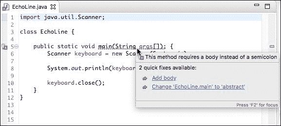

图 5-8：一个不需要的分号把事情搞砸了。

图 5-8 中的错误消息和快速修复有点误导。消息以 `This method requires a body` 开头。但该方法有一个方法体。不是吗？

当计算机尝试编译 `public static void main(String args[]);`（以分号结尾）时，计算机会感到困惑。我在图 5-9 中说明了这种困惑。你的眼睛看到了一个多余的分号，但计算机的眼睛将其解释为一个没有方法体的方法。所以这就是错误消息——计算机说 `This method requires a body instead of a semicolon`。


图 5-9：这台计算机在想什么？

如果你选择“添加方法体”快速修复，Eclipse 会创建以下（非常糟糕的）代码：

```java
import java.util.Scanner;

class EchoLine {
public static void main(String args[]) {
} {
Scanner keyboard = new Scanner(System.in);
System.out.println(keyboard.nextLine());
keyboard.close();
}
}
```

这个“修复”后的代码没有编译时错误。但当你运行这段代码时，什么也不会发生。程序开始运行然后停止运行，Eclipse 的控制台视图中没有任何内容。

我们都知道计算机是一台非常有耐心、非常富有同情心的机器。这就是为什么计算机会查看你的代码并决定再给你一次机会。计算机记得 Java 有一个高级特性，你可以编写一个方法头而不编写方法体。当你这样做时，你会得到所谓的*抽象方法*——我在本书中没有使用这个特性。无论如何，在图 5-9 中，计算机看到了一个没有方法体的方法头。所以计算机对自己说：“我知道！也许程序员正在尝试编写一个抽象方法。问题是，抽象方法的方法头必须包含 `abstract` 这个词。我应该提醒程序员这一点。”因此，计算机在图 5-9 中提供了 `Change ’EchoLine.main’ to ’abstract’` 快速修复。

无论如何，如果不揣摩言外之意，你就无法理解图 5-9 中的错误消息和快速修复。所以这里有一些技巧可以帮助你解读晦涩的消息：

- **避免条件反射式的反应。**

  有些人看到图 5-9 中的 `Change ’EchoLine.main’ to ’abstract’` 快速修复，会想知道如何将 `EchoLine.main` 改为 `abstract`。不幸的是，这不是正确的方法。如果你不知道 `abstract` 是什么意思，很可能你一开始就没打算让 `EchoLine.main` 成为 `abstract`。

- **长时间盯着有问题的代码行。**

  如果你`仔细`查看图 5-9 中的 `public static …` 行，最终你会注意到它与清单 5-1 中的对应行不同。清单 5-1 中的行没有分号，但图 5-9 中的行有分号。

  当然，你并不总是从像清单 5-1 中那样的预写代码开始。这就是熟能生巧的地方。你写的代码越多，你的眼睛对多余的分号和其他编程错误就会越敏感。

#### 花括号过多

你正在寻找最近的加油站，于是问了一个当地人。“走到第一个红绿灯左转，”当地人说。你直行了几条街，看到了一个闪烁的黄灯。你在信号灯处左转，行驶了大约一英里。什么？没有加油站？也许你把闪烁的信号灯误认为是真正的红绿灯。

你来到了一个岔路口，对自己说：“方向指示里没有提到岔路。我该走哪条路？”你向右拐，但一分钟后被迫上了高速公路。你看到一个牌子写着：下一个出口 24 英里。现在你真的迷路了，油表指针指向 S。（*S* 代表 Stranded，意为“抛锚”。）

事情是这样的：你犯了一个无心之过。你不应该在黄色闪烁灯处左转。这个错误本身并不那么严重。但第一个错误导致了更多的混乱，最终，你的选择变得毫无意义。如果你没有在闪烁灯处转弯，你就永远不会遇到那个该死的岔路口。然后上高速公路简直就是一场灾难。

这个故事有意义吗？当然有。计算机也会陷入类似的混乱。计算机发现你的程序中有一个错误。然后，打个比方说，计算机会在岔路口做出选择——这个岔路是基于原始错误的——而这条岔路上的所有选项都不会带来好结果。

举个例子。你在重新输入清单 5-1 中的代码时，不小心多打了一个花括号：

```java
//以下代码不正确：
import java.util.Scanner;
class EchoLine {
public static void main(String args[]) {
Scanner keyboard = new Scanner(System.in);
}
System.out.println(keyboard.nextLine());
keyboard.close();
}
}
```

在 Eclipse 编辑器中，你将鼠标悬停在最左侧的标记上。你会看到如图 5-10 所示的消息。

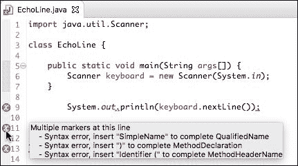

图 5-10：三条错误消息。

Eclipse 感到困惑，因为程序中的某些代码完全放错了位置。Eclipse 显示了三条消息——一条关于 `SimpleName`，一条关于括号，还有一条关于 `MethodHeaderName`。这些消息都没有指出问题的根源。Eclipse 试图在糟糕的情况下尽力而为，但此时，你不应该相信 Eclipse 说的任何一个字。

计算机并不是聪明的动物，如果有人编程让 Eclipse 说 `insert "SimpleName" to complete QualifiedName`，那么 Eclipse 就会原样说出这句话。（有些人说计算机让他们觉得自己很笨。对我来说，恰恰相反。计算机提醒我，机器可以有多笨，而人可以有多聪明。我喜欢这一点。）

当你看到一堆错误消息时，请仔细阅读每一条消息。问问自己能从每条消息中学到什么。但不要将每条消息都当作权威真理。当你对 Eclipse 的消息束手无策时，回到你的努力中，仔细盯着代码看。


如果你收到不止一条错误消息，一定要仔细查看这一堆消息中的每一条。有时，一条有用的消息会隐藏在一堆不太有用的消息之中。

## 拼写错误（以及其他失误）

你找到了一个古老的家族食谱，用来做魔鬼蛋（我的最爱之一）。你尽可能仔细地遵循每一步，但因为祖母有高血压，你省略了盐。你把一个蛋（完美的杰作）递给祖母。“胡椒不够，”她说着走开了。

下一道菜是勃艮第牛肉。你给亲爱的老奶奶拿了一块没加盐的切片。“不够甜，”她抱怨着离开了房间。“但这不可能，”你想，“勃艮第牛肉里没有糖。我明明没放盐。”即便如此，你还是回到厨房准备土豆泥。当然，你用了无盐黄油。“这次她会喜欢的，”你想。

“酸土豆！恶心！”奶奶说着，走到水槽边把土豆泥全吐了出来。因为你自尊心很强，所以并没有因为祖母的行为而感到被冒犯。但你有点困惑。为什么她对三道无盐的食谱给出了如此不同的评价？也许有一些你不知道的细微差别。

嗯，编写计算机程序时也会发生同样的事情。你可能会犯两次同样的错误（或者至少，你认为犯了同样的错误），但每次都会得到不同的错误消息。

例如，如果你更改了清单 5-1 中 `println` 的拼写或大小写，Eclipse 会告诉你该方法 `is undefined for the type PrintStream`。但如果你将 `System` 改为 `system`，Eclipse 会说 `system cannot be resolved`。而且当 `System` 拼写错误时，Eclipse 不会注意到 `println` 是否拼写正确。

在清单 5-1 中，如果你更改了 `args` 的拼写，什么也不会出错。程序可以正确编译和运行。但如果你更改了 `main` 的拼写，就会遇到一些不寻常的困难。（如果你不相信我，请阅读本章稍后的“运行时错误消息”部分。）

还是在清单 5-1 中，更改 `Scanner keyboard = new Scanner(System.in)` 这一行中等号的数量。如果是一个等号，一切正常。如果你不小心输入了两个等号（`Scanner keyboard == new Scanner(System.in)`），Eclipse 会把你拉回正轨，告诉你 `Syntax error on token "==", = expected`。（见图 5-11。）但如果你发疯似的输入四个等号，或者根本不输入等号，Eclipse 就会误解一切，并建议你 `insert ";" to complete BlockStatements`。不幸的是，插入分号根本没用。（见图 5-12。）


图 5-11：删除两个等号中的第二个。


图 5-12：你少了一个等号，但 Eclipse 没有注意到。


Java 对错误的反应方式多种多样。代码中的两个改动可能看起来很相似，但相似的改动并不总是导致相似的结果。代码中的每个问题都需要单独关注。


这里有一个有用的练习：从一个能正常运行的 Java 程序开始。成功运行代码后，做一个改动，故意引入错误。仔细查看每条错误消息，并问问自己这条消息是否有助于诊断问题。这个练习很有用，因为它能帮助你认识到错误是正常现象，并让你在不必急于让程序正确运行的压力下，练习分析消息。

## 运行时错误消息

在本章中，到目前为止，我描述的是编译程序时出现的错误。另一类错误则隐藏到程序运行时才出现。一个典型的例子是 `main` 这个词的拼写或大小写错误。

假设在一时冲动之下，你把 `main` 错误地拼写成了大写 `M`：


```java
//以下代码不正确：
public static void Main(String args[]) {
```

当你输入代码时，一切都很顺利。你没有看到任何错误标记。

但随后你尝试运行程序。这时，麻烦就来了。灾难如图 5-13 所示。

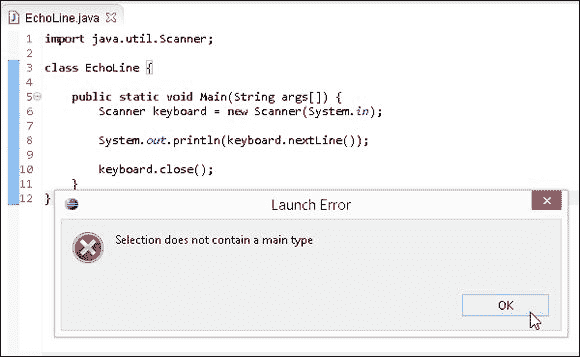

图 5-13：“选择内容不包含 main 类型”是什么意思？

当然，你的程序中有一个名为`Main`的东西，但它有名为`main`的东西吗？（是的，我听说过一位著名诗人叫 e. e. cummings，但 E. E. Cummings 又是谁？）计算机不会假定你的`Main`与预期的`main`是同一个意思。你需要将`Main`改回`main`。这样一切就正常了。

但与此同时（或者说在“main 时间”），这种不正确的拼写是如何通过编译器的？为什么你在编译程序时没有收到错误消息？如果大写`M`不会让编译器出错，那为什么这个大写`M`会在运行时搞砸一切？

答案要追溯到 Java 编程语言中不同类型的词。正如我在第 4 章中所说，Java 有标识符和关键字。

Java 中的关键字是固定不变的。如果你将`class`改为`Class`，或者将`public`改为`Public`，你会得到一些新的东西——计算机可能无法理解的东西。这就是为什么编译器会因关键字大小写错误而报错。确保所有关键字都被正确使用是编译器的职责。

另一方面，标识符可以随意出现。当然，有一个名为`main`的标识符，但你可以创建一个名为`Main`的新标识符。（不过你不应该这样做。对于了解 Java 中`main`通常含义的人来说，这太令人困惑了。）当编译器看到一行拼写错误的代码，比如`public static void Main`时，编译器只会认为你在创建一个全新的名称。因此编译器会放行这一行。你的老朋友——编译器，不会发出任何抱怨。

但是，当你尝试运行代码时，计算机会暴跳如雷。Java 虚拟机（JVM）运行你的代码。（详情请参见第 1 章。）JVM 需要找到一个位置来开始执行你代码中的语句，因此 JVM 会寻找一个名为`main`（小写`m`）的起点。如果 JVM 没有看到任何名为`main`的东西，JVM 就会不高兴。“在类 EchoLine 中找不到 main 方法，”JVM 说道。所以在运行时，是 JVM（而不是编译器）给你报错。

 更好的错误信息应该是：在类`EchoLine`中找不到`main`方法，其中`main`中的字母`m`是小写。有时，编写错误信息的人会忽略一两个细节。

### 什么问题？我没看到问题

在本章结尾，我将通过展示一些可以在清单 5-1 中更改而不影响程序运行的内容，来以积极的方式结束本章。

#### 你创建的标识符

如果你创建一个标识符，这个名字是可以随意更改的。例如，在清单 5-1 中，你可以将`EchoLine`改为`RepeatAfterMe`：

```java
class RepeatAfterMe {
public static void main … etc.
```

只要你愿意保持一致，这完全没有问题。只需按照本章前面“输入并运行程序”一节中的大部分步骤操作即可。

- 在第 6 步中，不要在“新建 Java 类”对话框的“名称”字段中输入`EchoLine`，而是输入`RepeatAfterMe`。
- 在第 8 步中，当你从清单 5-1 复制代码时，不要在清单顶部附近输入`class EchoLine {`，而是输入`class RepeatAfterMe {`。

 与其仅以`class`开头启动程序，你可以用`public class`开头。如果这样做，将`EchoLine`改为`RepeatAfterMe`可能会带来一点麻烦。对于你这样的新手程序员来说，最简单的解决方案是去掉`public`这个词。

#### 空格和缩进

Java 对空格和缩进的使用并不挑剔。你只需要保持程序组织良好且可读即可。以下是清单 5-1 中代码的空格和缩进的一种替代方案：

```java
import java.util.Scanner;

class EchoLine
{
public static void main( String args[] )
{
Scanner keyboard =
new Scanner( System.in );
System.out.println
( keyboard.nextLine() );
keyboard.close();
}
}
```

#### 你选择做事的方式

程序就像指纹。没有两个程序看起来非常相似。假设我和一位同事讨论一个编程问题。然后我们各走各路，编写自己的程序来解决同一个问题。当然，我们是在重复劳动。但我们会创建完全相同的代码吗？绝对不会。每个人都有自己的风格，每个人的风格都是独一无二的。

我请另一位 Java 程序员 David Herst 编写他自己的 EchoLine 程序，但没有给他看我在清单 5-1 中的代码。他写的是：

```java
import java.io.BufferedReader;
import java.io.InputStreamReader;
import java.io.IOException;

public class EchoLine {
public static void main(String[] args) throws IOException {
InputStreamReader isr = new InputStreamReader(System.in);
BufferedReader br = new BufferedReader(isr);
String input = br.readLine();
System.out.println(input);
}
}
```

不要担心`BufferedReader`、`InputStreamReader`之类的东西。只需注意，就像雪花一样，没有两个程序是完全相同的，即使它们完成相同的任务。这很好。这意味着你的代码，无论多么不同，都可以和别人的代码一样好。这很令人鼓舞。

#### 编译时错误

 MCV 疫苗通过让你患上轻微的麻疹来帮助你建立对麻疹的免疫力。同样，你可以通过故意在小型、可丢弃的 Java 程序中制造错误来增强对编程错误的免疫力。

无论你编写代码多少年，你编写的任何新代码中总会有一些编程错误。即使是最有经验的专业程序员也会犯错。但通过练习一些简单的错误，你可以发现初学者最常犯的一些错误，并习惯“编码、测试、修复、再编码”的循环。

尝试以下在清单 5-1 中引入错误的方法：

- 在`println`这个词中，将小写字母`l`改为数字`1`。
- 将整个`System.out.println`行移到`public static void main`行的上方。
- 删除`("Chocolate, royalties, sleep")`周围的括号。
- 删除`"Chocolate, royalties, sleep"`周围的引号。
- 将引用的文本跨行断开，如下所示：

  ```java
  System.out.println("Chocolate,
  royalties,
  sleep");
  ```

- 打开你最喜欢的文字处理程序（Microsoft Word、Apple Pages 或其他），创建一个仅包含文本“Chocolate, royalties, sleep”的文档。很可能，你的文字处理程序会自动使用弯引号（“”）而不是直引号（""），而弯引号不适用于 Java 程序。因此，从你的文字处理程序中复制这段带弯引号的文本。在 Eclipse 编辑器中，将带弯引号的文本粘贴到清单 3-1（位于第 3 章）中。替换该清单中原始的`"Chocolate, royalties, sleep"`文本，包括直引号等。查看 Eclipse 显示的错误信息类型。

#### 允许的空格和缩进更改

你不能将带引号的字符串（例如`"Chocolate, royalties, sleep"`）拆分成两行或三行。但在 Java 程序的其他部分，换行无关紧要。尝试更改清单 5-1 中的空格和缩进。尝试运行以下代码：

```java
import java.util.Scanner;

class ThingsILike
{
public static void main (String[] args)
{
Scanner keyboard = new Scanner (System.in);
System.out.println ("Chocolate, royalties, sleep");
keyboard.close ();
}
}
```

## 第 6 章：使用构建块：变量、值和类型

本章内容包括：

 **声明变量**

 **为变量赋值**

 **处理数字**

 **使用 Java 类型**

早在 1946 年，约翰·冯·诺依曼就撰写了一篇关于新兴计算机和计算技术的开创性论文。其中，他确立了一个基本事实：尽管计算机很复杂，但其主要工作是将数据从一个地方移动到另一个地方。取一个数字——某人银行账户的余额。将这个数字从计算机内存移动到计算机处理单元。向余额中添加几美元，然后将其移回计算机内存。数据的移动……仅此而已；没有更多了。

足够了！本章将向你展示如何移动数据。

## 使用变量

以下是某软件公司网站上的摘录：

> SnitSoft 认识到自己对信息技术社区的责任。因此，SnitSoft 以象征性收费的方式提供其最受欢迎的应用程序。只需支付 5.95 美元加上运费和手续费，您就能收到一个包含 SnitSoft 旗舰产品的闪存盘。

请继续。点击“立即订购！”链接。看看会发生什么。您会看到一个包含两个项目的订单表格。一个项目标有`$5.95 (Flash drive)`，另一个项目写着`$25.00 (Shipping and handling)`。真是敲竹杠！多亏了 SnitSoft 的慷慨，您只需支付 30.95 美元就能买到价值十美分的软件。

在 SnitSoft 网页的背后，一个计算机程序进行着卑鄙的计算。该程序看起来类似于清单 6-1 中的代码。

**清单 6-1 SnitSoft 的大骗局**

```java
class SnitSoft {
public static void main(String args[]) {
double amount;
amount = 5.95;
amount = amount + 25.00;
System.out.print("We will bill $");
System.out.print(amount);
System.out.println(" to your credit card.");
}
}
```

当我在自己的计算机上（而不是 SnitSoft 的计算机上）运行清单 6-1 中的代码时，得到了如图 6-1 所示的输出。


图 6-1：运行清单 6-1 中的代码。

### 使用变量

清单 6-1 中的代码使用了一个名为`amount`的变量。*变量*是一个占位符。你可以将像 5.95 这样的数字放入变量中。将数字放入变量后，你可以改变主意，将另一个不同的数字（如 30.95）放入变量中。（这就是变量中“变”的含义。）当然，当你将新数字放入变量时，旧数字就不再存在了。如果你没有将旧数字保存在其他地方，旧数字就消失了。

图 6-2 展示了清单 6-1 中代码的前后对比。当计算机执行`amount = 5.95`时，变量`amount`中包含数字 5.95。然后，在执行`amount = amount + 25.00`语句后，变量`amount`突然变成了 30.95。当你思考变量时，可以想象计算机内存中某个位置，那里由电线和晶体管存储着 5.95、30.95 或其他数值。在图 6-2 中，想象每个盒子周围还有数百万个类似的盒子。


图 6-2：一个变量（前后对比）。

现在你需要了解一些术语。（你可以参照图 6-3 来理解。）存储在变量中的东西称为*值*。变量的值可以在程序运行期间发生变化（例如，当 SnitSoft 添加运费和手续费时）。存储在变量中的值不一定是数字。（例如，你可以创建一个始终存储字母的变量。）存储在变量中的值的种类称为变量的*类型*。（你可以在本章剩余部分以及接下来的两章中了解更多关于类型的内容。）

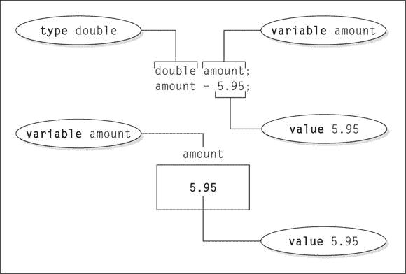

图 6-3：一个变量、它的值以及它的类型。

 变量和变量的*名称*之间存在细微的、几乎难以察觉的区别。即使在正式写作中，我经常在指代*变量名*时使用*变量*一词。严格来说，`amount`是变量名，而与`amount`相关的所有内存存储（包括`amount`的值和类型）才是变量本身。如果你认为这种*变量*与*变量名*之间的区别过于细微而不必在意，那么欢迎加入我们的行列。

每个变量名都是一个标识符——你可以在自己的代码中随意命名的名称（关于此主题的更多信息，请参见第 4 章）。在编写清单 6-1 时，我编造了名称`amount`。

### 理解赋值语句

清单 6-1 中带有等号的语句称为赋值语句。在*赋值语句*中，你将一个值赋给某个东西。在许多情况下，这个“某个东西”就是一个变量。

你应该养成从右向左阅读赋值语句的习惯。例如，清单 6-1 中的第一个赋值语句表示：“将`5.95`赋给`amount`变量。”第二个赋值语句稍微复杂一些。从右向左阅读第二个赋值语句，你得到：“将`25.00`加到`amount`变量中已有的值上，并将该数字（`30.95`）作为`amount`变量的新值。”关于这一点，图 6-4 给出了一个直观的、一目了然的图示。

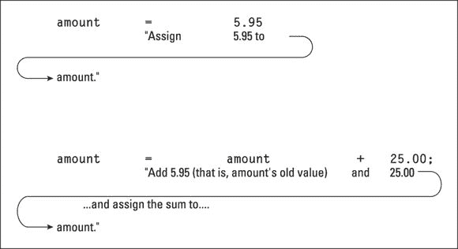

图 6-4：从右向左阅读赋值语句。

 在赋值语句中，被赋值的对象始终位于等号的左侧。

### 换行还是不换行？

清单 6-1 中的最后三条语句使用了一个巧妙的技巧。你希望程序在屏幕上只显示一行，但这行包含三个不同的内容：

- 该行以`We will bill $`开头。
- 该行接着显示`amount`变量的值。
- 该行以`to your credit card`结尾。

这是三个独立的部分，因此你将它们放在三条独立的语句中。前两条语句是对`System.out.print`的调用。最后一条语句是对`System.out.println`的调用。

对`System.out.print`的调用会在当前行的一部分显示文本，然后将光标留在当前行的末尾。执行`System.out.print`后，光标仍停留在同一行的末尾，因此下一个`System.out.`*`whatever`*可以继续在同一行上打印。通过多次调用`print`并以一次`println`调用收尾，最终结果就是一行漂亮的输出，如图 6-5 所示。


图 6-5：`System.out.print`和`System.out.println`所扮演的角色。

 调用`System.out.print`会写入一些内容，并将光标留在输出行的末尾。调用`System.out.println`会写入内容，然后将光标移动到全新输出行的开头，从而完成工作。

## 那些零和一到底意味着什么？

这里有一个词：

> gift

要讨论的问题是，这个词是什么意思？嗯，这取决于谁在看这个词。例如，说英语的读者会认为*gift*代表一个人赠予另一个人的东西，装在用亮纸和丝带装饰的盒子里：

> 看！我给你一个**礼物**！

但在德语中，*gift*这个词的意思是“毒药”：

> 让我给你一些**毒药**，亲爱的。

而在瑞典语中，*gift*既可以表示“已婚”，也可以表示“毒药”：

> 他们一**结婚**，她就往他的饮料里下了**毒**。

然后是法语。在法国，有一种名为“Gift”的糖果棒：

> 他假期来了，只给了我一块**Gift**巧克力棒。

字母 g-i-f-t 到底意味着什么？嗯，在你决定如何解释它们之前，它们没有任何意义。计算机电路中的零和一也是如此。

以序列`01001010`为例。这个序列可以代表字母*J*，也可以代表数字 74。同样的零一序列还可以代表 1.0369608636003646×10^(–43)。而当它被解释为屏幕像素时，同样的序列可以表示图 6-6 中显示的点。`01001010`的含义完全取决于软件解释该序列的方式。


图 6-6：八个黑白屏幕像素的极端特写。

### 类型与声明

如何告诉计算机`01001010`代表什么？答案在于一个称为“类型”的概念。变量的*类型*描述了该变量允许存储的值的种类。

在清单 6-1 中，查看`main`方法体中的第一行：

`double amount;`

这一行被称为*变量声明*。在程序中加入这一行，相当于说：“我声明我的程序中有一个名为`amount`的变量。”这一行为你在程序中保留了名称`amount`的使用权。

在这个变量声明中，单词`double`是一个 Java 关键字。这个单词`double`告诉计算机你打算在`amount`中存储哪种类型的值。具体来说，`double`代表介于 –1.8×10³⁰⁸ 和 1.8×10³⁰⁸ 之间的数字。这是一个极其庞大的数字范围。如果不使用 ×10 这种科学记数法，第二个数字是：


```text
180000000000000000000000000000000000000000000000000000
000000000000000000000000000000000000000000000000000000
000000000000000000000000000000000000000000000000000000
000000000000000000000000000000000000000000000000000000
000000000000000000000000000000000000000000000000000000
000000000000000000000000000000000000000.0
```

如果 SnitSoft 公司对运费和手续费收取如此高的费用，他们可以用 `double` 类型的变量来表示这笔费用。

### 重点是什么？

比 `double` 关键字所代表的数字范围巨大更重要的是，`double` 值可以包含小数点右边的数字。在将 `amount` 声明为 `double` 类型后，你可以在 `amount` 中存储各种数字。你可以存储 5.95、0.02398479 或 –3.0。在清单 6-1 中，如果我没有将 `amount` 声明为 `double` 类型，我就无法存储 5.95。相反，我只能存储普通的 5 或单调的 6，没有任何小数点后面的数字。

关于不带小数点的数字的更多信息，请参见第 7 章。


本段涉及一个非常挑剔的点，如果你没心情可以跳过。人们经常用“十进制数”这个短语来描述带有小数点右边数字的数字。问题是，音节“dec”代表数字 10，所以“十进制”这个词暗示了以 10 为基数的表示法。由于计算机存储的是以 2 为基数（而不是以 10 为基数）的表示法，用“十进制”来描述这样的数字其实是用词不当。但在本书中，我实在忍不住。不管技术人员喜不喜欢，我都称它们为十进制数。


以下是一些供你尝试的内容：

#### 数字运算

更改清单 6-1 中的数值，并用新数字运行程序。

#### 变量变化

在清单 6-1 中，将变量名 `amount` 改为其他名称。在整个清单 6-1 代码中一致地更改该名称。然后用新的变量名运行程序。

#### 使用下划线

修改清单 6-1 中的代码，使运费和手续费为 100 万美元。使用 `1_000_000.00`（带下划线）来表示这一百万美元金额。

#### 更多信息，请

修改清单 6-1 中的代码，使其显示三个值：闪存盘的原始价格、运费和手续费，以及总价。

## 从键盘读取十进制数

我简直不敢相信！SnitSoft 正在促销！仅限一周，你可以以低至 5.75 美元的价格购买 SnitSoft 闪存盘！最好赶紧订购一个。

不，等等！清单 6-1 中的价格固定为 5.95 美元。我必须修改程序。

我知道了。我会让代码更通用。我将从键盘输入金额。清单 6-2 是修改后的代码，图 6-7 显示了新代码的一次运行。


图 6-7：获取 `double` 变量的值。

清单 6-2 从键盘获取 `double` 值

```java
import java.util.Scanner;

class VersatileSnitSoft {
    public static void main(String args[]) {
        Scanner keyboard = new Scanner(System.in);
        double amount;
        System.out.print("What’s the price of a flash drive? ");
        amount = keyboard.nextDouble();
        amount = amount + 25.00;
        System.out.print("We will bill $");
        System.out.print(amount);
        System.out.println(" to your credit card.");
        keyboard.close();
    }
}
```


分组分隔符因国家而异。图 6-7 所示的运行结果是在一台配置为美国地区的计算机上进行的，其中 *5.75* 表示“五又百分之七十五”。但在一个我称之为“逗号国家”（即 *5,75* 表示“五又百分之七十五”的国家）配置的计算机上，运行结果可能不同。如果你住在逗号国家，并且像图 6-7 中那样输入 `5.75`，你很可能会收到一条错误消息（`InputMismatchException`）。如果是这样，请将文件中的数字金额改为符合你所在国家数字格式的写法。这样应该就没问题了。

### 虽为方法，却有其疯狂之处

注意清单 6-2 中对 `nextDouble` 方法的调用。在第 5 章的清单 5-1 中，我使用了 `nextLine`；但在这里的清单 6-2 中，我使用了 `nextDouble`。

在 Java 中，每种输入类型都需要其特定的方法。如果你要获取一行文本，那么 `nextLine` 就很好用。但如果你从键盘读取内容，并且希望这些内容被解释为数字，那么你需要像 `nextDouble` 这样的方法。

从清单 6-1 到清单 6-2，我添加了一个 `import` 声明和一些关于 `new Scanner(System.in)` 的内容。你可以通过阅读第 5 章中的“获取数字、单词和其他内容”一节来了解更多关于这些内容的信息。（你还可以通过访问第 13 章了解更多关于输入输出的内容。）更多示例（更多 `keyboard.nextSomething` 方法）在第 7 章和第 8 章中。

### 方法与赋值

注意我在清单 6-2 中如何使用 `keyboard.nextDouble`。对 `keyboard.nextDouble` 方法的调用是赋值语句的一部分。如果你查看第 5 章中关于 `EchoLine` 程序如何工作的部分，你会看到计算机可以用某个值替换方法调用。在清单 6-2 中，计算机就是这样做的。当你在键盘上输入 **5.75** 时，计算机将

`amount = keyboard.nextDouble();`

转换为

`amount = 5.75;`

（计算机实际上并不会重写清单 6-2 中的代码。这里的 `amount = 5.75` 一行只是说明了计算机操作的效果。）在清单 6-2 的第二个赋值语句中，计算机将 25.00 加到存储在 `amount` 中的 5.75 上。

某些方法调用具有这种替换效果，而其他方法（如 `System.out.println`）则没有。要了解更多关于此主题的信息，请参阅第 19 章。

## 主题变奏

在清单 6-1 中，需要两行代码来给 `amount` 变量赋予其第一个值：

`double amount;`

`amount = 5.95;`

你可以只用一行代码完成同样的操作：

`double amount = 5.95;`

当你这样做时，你不会说是在“赋值”给 `amount` 变量。`double amount = 5.95` 这一行并不被称为“赋值语句”。相反，这一行被称为带有“初始化”的声明。你是在“初始化” `amount` 变量。你可以用初始化做各种事情，甚至包括算术运算：

`double gasBill = 174.59;`

`double elecBill = 84.21;`

`double H2OBill = 22.88;`

`double total = gasBill + elecBill + H2OBill;`

### 将变量从一个地方移到另一个地方

记住初始化和赋值之间的区别很有帮助。首先，你可以将带有初始化的声明拖到方法外部：

```java
//This is okay:
class SnitSoft {
    static double amount = 5.95;
    public static void main(String args[]) {
        amount = amount + 25.00;
        System.out.print("We will bill $");
        System.out.print(amount);
        System.out.println(" to your credit card.");
    }
}
```

你不能对赋值语句做同样的事情（参见以下代码和图 6-8）：

```java
//This does not compile:
class BadSnitSoftCode {
    static double amount;
    amount = 5.95; //Misplaced statement
    public static void main(String args[]) {
        amount = amount + 25.00;
        System.out.print("We will bill $");
        System.out.print(amount);
        System.out.println(" to your credit card.");
    }
}
```


图 6-8：编译 `BadSnitSoftCode` 的失败尝试。

你不能将语句拖到方法外部。（尽管变量声明以分号结尾，但变量声明不被视为语句。真是奇怪！）

将声明放在方法外部的优势在第 17 章中有所说明。在你焦急地等待读到那一章时，请注意我是如何将我从 `main` 方法中提取的每个声明都加上了 `static` 这个词。我这样做是因为 `main` 方法的头部包含了 `static` 这个词。并非所有方法都是静态的。事实上，大多数方法都不是静态的。但每当你从一个 `static` 方法中提取声明时，你必须在声明的开头加上 `static` 这个词。关于 `static` 这个词的所有谜团将在第 18 章中解开。

### 合并变量声明

清单 6-1 中的代码只有一个变量（好像变量供应不足似的）。你可以用多个变量达到同样的效果：

```java
class SnitSoftNew {
    public static void main(String args[]) {
        double flashDrivePrice;
        double shippingAndHandling;
        double total;
        flashDrivePrice = 5.95;
        shippingAndHandling = 25.00;
        total = flashDrivePrice + shippingAndHandling;
        System.out.print("We will bill $");
        System.out.print(total);
        System.out.println(" to your credit card.");
    }
}
```

这段新代码产生的输出与清单 6-1 中的代码相同。（参见图 6-1。）

新代码有三个声明——分别对应程序的三个变量。因为所有三个变量具有相同的类型（`double` 类型），我可以修改代码，一举声明所有三个变量：

`double flashDrivePrice, shippingAndHandling, total;`

哪个更好——一个声明还是三个声明？没有哪个更好。这属于个人风格问题。

你甚至可以在合并声明中添加初始化。当你这样做时，每个初始化只适用于一个变量。例如，对于这一行：

`double flashDrivePrice, shippingAndHandling = 25.00, total;`

`shippingAndHandling` 的值变为 `25.00`，但变量 `flashDrivePrice` 和 `total` 没有获得特定值。


想练习一下本节的概念吗？没问题！

#### 给停车服务员小费

一个在线博客建议，当停车服务员在纽约市的车库中取回你的车时，给 2 美元小费。编写一个类似于清单 6-2 的程序。程序运行时，你输入车库公布的停车价格。程序会告诉你加上 2 美元小费后需要支付多少钱。

#### 双倍价格

修改清单 6-2 中的代码，使得无论 U 盘正常售价是多少，程序都收取两倍的价格。换句话说，一个 5 美元的 U 盘最终价格为 10 美元，一个 100 美元的 U 盘变为 200 美元。

## 使用 JShell 进行实验

本书中的程序都以同样老套的开场白开始：

```java
class SomethingOrOther {
    public static void main(String args[]) {
```

在 Eclipse 编辑器中重新输入这些样板代码可能会很烦人，尤其是当你的目标是测试执行几个简单语句的效果时。为了解决这个问题，Java 的管理者在 Java 9 中引入了一个新工具。他们称之为 JShell。

当你使用 JShell 时，你几乎不需要输入整个程序。相反，你输入一条 Java 语句，然后 JShell 对你的语句做出响应，然后你输入第二条语句，JShell 再响应，然后你输入第三条语句，依此类推。单条语句就足以让 JShell 做出响应。

JShell 只是语言“读取-求值-打印循环”（REPL）的一个例子。许多编程语言都有 REPL，而随着 Java 9 的推出，Java 语言终于有了自己的 REPL。

### 启动 JShell 程序

要运行 JShell，请确保你的计算机上安装了 Java 9（或更高版本的 Java，如果可用的话）。

#### 在 Windows 计算机上启动 JShell

1. **打开命令提示符窗口。**

   *在 Windows 7 中：* 按 Win+R，然后输入 `cmd`，再按 Enter。

   *在 Windows 8 中：* 在开始屏幕上，按 Win+Q。在出现的搜索字段中，输入 `command prompt`，然后按 Enter。

   *在 Windows 10 中：* 选择“开始” ⇒ “Windows 系统” ⇒ “命令提示符”。

2. **在命令提示符窗口中，输入以下命令：**

   `cd "\Program Files\Java"`

   `dir jdk*`

   

   在某些计算机上，你可能更适合将第一个命令输入为 `cd "\Program Files (x86)\Java"`。哪个有效就用哪个！

   命令提示符窗口会列出一些目录名称作为响应。

3. **在命令提示符窗口的响应中，查找名为** `jdk-9` **或类似名称的目录。**

   名称以 `jdk1.8` 或更低版本开头的目录无法使用。你必须安装 Java 9 或更高版本才能运行 JShell。

   在下一步中，我假设你已经找到了名为 `jdk-9` 的目录。如果你的目录名称不同，请调整你的输入以匹配该名称。

4. **在命令提示符窗口中，输入以下命令：**

   `cd jdk-9\bin`

   `jshell`

   如果一切顺利，命令提示符窗口会显示 `JShell>` 提示符。这样你就知道已经成功启动了 JShell。

#### 在 Mac 上启动 JShell

1. **按 Command+空格键，然后输入** `Terminal` **，再按 Enter。**

因此，你的电脑终端应用程序开始运行。

2. **在终端应用程序窗口中，输入以下命令：**

   `cd /Library/Java/JavaVirtualMachines`

   `dir jdk*`

   终端应用程序会响应，列出一些目录名称。

3. **在终端应用程序的响应中，查找名为** `jdk-9.jdk` **或类似名称的目录。**

   名称以 `jdk1.8` 或更低版本开头的目录无法使用。你必须安装 Java 9 或更高版本才能运行 JShell。

   在下一步中，我假设你已经找到了名为 `jdk-9.jdk` 的目录。如果你的目录名称不同，请调整你的输入以匹配该名称。

4. **在终端应用程序窗口中，输入以下命令：**

   `cd jdk-9.jdk/Contents/Home/bin`

   `./jshell`

   如果一切顺利，终端应用程序会显示 `JShell>` 提示符。这样你就知道已经成功启动了 JShell。

### 使用 JShell

在图 6-9 中，我使用 JShell 来试验本章的 Java 概念。


图 6-9：我与 JShell 之间的亲密对话。

当你运行 JShell 时，对话大致如下：

`jshell> 你输入一条语句`

`JShell 响应`

`jshell> 你输入另一条语句`

`JShell 响应`

例如，在图 6-9 中，我输入 `double amount` 然后按回车。JShell 响应显示：

`amount ==> 0.0`

然后我输入 `amount = 5.95`，JShell 响应：

`amount ==> 5.95`

接着，当我输入 `amount = amount + 25.00` 时，JShell 友好地返回：

`amount ==> 30.95`

以下是关于 JShell 的一些注意事项：

- **你无需输入完整的 Java 程序。**

  输入几条语句，例如：

  `double amount`

  `amount = 5.95`

  `amount = amount + 25.00`

  就能达到目的。这就像运行清单 4-1 中的代码片段（只不过清单 4-1 没有将 `amountInAccount` 声明为 `double` 类型）。


- **在 JShell 中，分号（在一定程度上）是可选的。**

  在图 6-9 中，我没有在每行末尾添加分号。

- **JShell 在你输入每一行后立即响应。**

  在我将`amount`声明为`double`后，JShell 响应告诉我，`amount`变量的值为`0.0`。在我输入`amount = amount + 25.00`后，JShell 告诉我`amount`的新值为`30.95`。

图 6-10 展示了 JShell 的更多优秀特性。

- **你可以向 JShell 询问表达式的值。**

  你无需将表达式的值赋给变量。例如，在图 6-10 中，我输入：

  `gasBill + elecBill`

  JShell 响应告诉我`gasBill + elecBill`的值为`258.8`。JShell 会为该值创建一个临时名称。在图 6-10 中，这个名称恰好是`$3`。

- **你甚至可以在不使用变量的情况下从 JShell 获得答案。**

  在图 6-10 中，我询问`42 + 7`的值，JShell 慷慨地回答值为`49`。JShell 为该值`49`创建了临时名称`$4`。因此，在图 6-10 的下一行，我询问`$4 + 1`的值，JShell 给出了答案`50`。


图 6-10：使用 JShell 计算表达式。

 在运行 JShell 时，你无需重新输入已经输入过的命令。如果你按一次上箭头键，JShell 会显示你最近输入的命令。如果你按两次上箭头键，JShell 会显示你倒数第二次输入的命令，依此类推。当 JShell 显示一个命令时，你可以使用左箭头和右箭头键移动到命令中的任意字符位置。你可以修改命令中的字符。最后，当你按回车键时，JShell 会执行你新修改的命令。

要结束 JShell 的运行，你可以输入`/exit`（以斜杠开头）。但`/exit`只是你可以向 JShell 发出的众多命令之一。要询问 JShell 还可以使用哪些其他命令，请键入`/help`。

借助 JShell，你可以在将语句放入完整的 Java 程序之前对其进行测试。这使得 JShell 成为一个真正有用的工具。

#### JShell 趣味练习

 在你的电脑上启动 JShell 应用程序。在 JShell 应用程序中依次输入以下语句，并观察 JShell 的响应：

`jshell> double bananaCalories = 100.0`

`jshell> double appleCalories = 95.0`

`jshell> double dietSodaCalories = 0.0`

`jshell> double cheeseburgerCalories = 500.0`

`jshell> bananaCalories + appleCalories +`

`…> dietSodaCalories + cheeseburgerCalories`

注意，在 JShell 中，一条语句可以跨越多行。在输入语句的第一部分后：

`bananaCalories + appleCalories +`

按回车键。然后，在下一行，JShell 不会显示通常的`jshell>`提示符，而是显示`…>`，这表示你应该继续输入该语句的更多内容。

保持 JShell 运行，为下一个实验做准备。

#### 在 JShell 中移动

在上一个实验中，你输入了四种食物的卡路里数值。但完成该实验后，你修改了对一个芝士汉堡卡路里数的估计。

在 JShell 仍在运行时，按键盘上的上箭头键，直到看到以下语句：

`double cheeseburgerCalories = 500.0`

然后按左箭头键，直到光标位于数字`5`旁边。按键盘上的退格键或删除键去掉数字`5`，然后在该位置输入数字`7`。现在语句变为：

`double cheeseburgerCalories = 700.0`

按回车键确认你希望 JShell 执行修改后的语句。

将`cheeseburgerCalories`的值改为`700.0`后，使用键盘的上箭头和下箭头让 JShell 再次计算卡路里总和：

`jshell> bananaCalories + appleCalories +`

`…> dietSodaCalories + cheeseburgerCalories`

不要重新输入变量名。让箭头键为你完成工作！

# 第 7 章：数字与类型

## 本章内容

 **处理整数**

 **从旧值创建新值**

 **理解 Java 中更奇特的类型**

不久以前，人们认为计算机除了进行大量数字运算外，什么也做不了。计算机解决算术问题，故事到此为止。

20 世纪 80 年代，随着文字处理程序的广泛使用，关于“大型金属数学大脑”的神话逐渐消失。但即便如此，计算机仍然是出色的计算器。毕竟，计算机速度极快且非常精确。计算机从不需要用手指计数。最重要的是，计算机在做算术时不会感到负担。我讨厌在一家好餐厅用餐结束时还要担心税费和小费，但计算机完全不在乎这些。（即便如此，计算机也很少外出就餐。）

## 使用整数

让我告诉你，当成年人一点也不好玩。现在我的客厅里有四个小孩。他们都盯着我，因为我手里拿着一袋口香糖。袋子里有 30 颗口香糖，孩子们都在想：“谁最棒？谁得到的口香糖比其他人多？谁会受到不公平的对待？”他们坚持要进行一次完整、正式的口香糖分配，每个孩子得到完全相同数量的美味小零食。我必须小心。如果不这样做，这件事就会没完没了。

有 30 颗弹珠糖和四个孩子，没办法平均分配这些弹珠糖。当然，如果我少一个孩子，就能给每个孩子 10 颗。问题是，弹珠糖可以扔掉，孩子不行。所以我唯一的选择就是尽可能平分，然后把剩下的处理掉。“好吧，快想想，”我对自己说。“30 颗弹珠糖和 4 个孩子，我能保证每个孩子得到多少颗？”

我立刻用电脑编程来解决这个问题。完成后，我得到了清单 7-1 中的代码。

清单 7-1 如何让四个孩子不闹脾气

```java
class KeepingKidsQuiet {
public static void main(String args[]) {
int gumballs;
int kids;
int gumballsPerKid;
gumballs = 30;
kids = 4;
gumballsPerKid = gumballs / kids;
System.out.print("Each kid gets ");
System.out.print(gumballsPerKid);
System.out.println(" gumballs.");
}
}
```

图 7-1 展示了`KeepingKidsQuiet`程序的运行结果。如果每个孩子得到七颗弹珠糖，那他们就不能抱怨我偏心。他们得找别的事来争吵了。


图 7-1：公平公正。

弹珠糖问题的核心在于，我处理的是整数——小数点后没有数字的数。当我用 30 除以 4 时，得到 7½，但我不能把½当真。无论我怎么努力，都没法把一颗弹珠糖分成两半，至少免不了听到“我的一半比他的大”。这一点在 Java 中得到了很好的体现。在清单 7-1 中，三个变量（`gumballs`、`kids`和`gumballsPerKid`）都是`int`类型。`int`值是整数。当你用一个`int`值除以另一个（就像清单 7-1 中用斜杠那样），得到的是另一个`int`。当你用 30 除以 4 时，得到的是 7——而不是 7½。你在图 7-1 中可以看到这一点。综合起来，语句

`gumballsPerKid = gumballs/kids;`

`System.out.print(gumballsPerKid);`

会在电脑屏幕上显示数字 7。

### 从键盘读取整数

这日子过得！昨天我家客厅里有四个孩子，我有 30 颗弹珠糖。今天我家有六个孩子，我有 80 颗弹珠糖。我该怎么应对这些变化？我知道了！我要写一个程序，从键盘读取弹珠糖和孩子的数量。程序见清单 7-2，运行结果如图 7-2 所示。


图 7-2：接下来，我可能会有 70 个孩子和 1000 颗弹珠糖。

清单 7-2 一个更通用的孩子与弹珠糖程序

```java
import java.util.Scanner;

class KeepingMoreKidsQuiet {
public static void main(String args[]) {
Scanner keyboard = new Scanner(System.in);
int gumballs;
int kids;
int gumballsPerKid;
System.out.print("How many gumballs? How many kids? ");
gumballs = keyboard.nextInt();
kids = keyboard.nextInt();
gumballsPerKid = gumballs / kids;
System.out.print("Each kid gets ");
System.out.print(gumballsPerKid);
System.out.println(" gumballs.");
keyboard.close();
}
}
```

关于清单 7-2，有几点需要注意。首先，你可以用`nextInt`方法读取一个`int`值。（参考第 5 章中的表格。）其次，你可以连续调用`Scanner`方法。在清单 7-2 中，我调用了两次`nextInt`。我只需要用空格分隔输入的数字。在图 7-2 中，我在`80`和`6`之间放了一个空格，但更多空格也可以。

这个空格规则适用于许多`Scanner`方法。例如，下面这段代码读取三个数值：

`gumballs = keyboard.nextInt();`

`costOfGumballs = keyboard.nextDouble();`

`kids = keyboard.nextInt();`

图 7-3 展示了这三个方法调用的有效输入。


图 7-3：三个`Scanner`方法调用的三个数字。

### 所见即所得

在编写自己的代码时，永远不要想当然。假设你不小心颠倒了清单 7-2 中`gumballs`和`kids`赋值语句的顺序：

```java
//This code is misleading:
System.out.print("How many gumballs? How many kids? ");
kids = keyboard.nextInt();
gumballs = keyboard.nextInt();
```

这里，`How many gumballs? How many kids?`这行具有误导性。因为`kids`赋值语句在`gumballs`赋值语句之前，所以你输入的第一个数字会成为`kids`的值，第二个数字会成为`gumballs`的值。程序显示的消息`How many gumballs? How many kids?`并不重要。重要的是程序中赋值语句的顺序。

如果`kids`赋值语句意外地排在了前面，你可能会得到一个奇怪的答案，比如图 7-4 中的零。这就是`int`除法的运作方式。它只是截断余数。用一个小数（比如 6）除以一个大数（比如 80），结果就是 0。


图 7-4：如何让六个孩子非常不开心。

 就像老恐怖片里的疯狂科学家一样，试试这些有趣的实验吧！

#### 动手又动脑

运行清单 7-2 中的程序。当程序询问`How many gumballs? How many kids?`时，输入`80.5 6`。（实际上，如果你所在的国家用 80,5 表示八十点五，则输入 80,5 而不是 80.5。）

在这次运行中，你看到了什么不愉快的消息？为什么你会看到这条消息？

#### 再试一次

运行清单 7-2 中的程序。当程序询问`How many gumballs? How many kids?`时，输入`"80" "6"`（包括引号）。

在这次运行中，你看到了什么不愉快的消息？为什么你会看到这条消息？

#### 一个微型加法器

编写一个程序，从键盘获取两个数字，并显示这两个数字的和。

## 通过应用运算符创建新值

还有什么比你的老朋友加号更让人安心的呢？这是你在小学数学中学到的第一件事。几乎每个人都知道如何计算二加二。事实上，在英语用法中，“二加二”是简单易行之事的代名词。每当你看到加号，你的一个脑细胞就会说：“谢天谢地，它可能复杂得多。”

所以 Java 也有加号。你可以用加号将两个数字相加：

`int apples, oranges, fruit;`

`apples = 5;`

`oranges = 16;`

`fruit = apples + oranges;`

当然，减号也是可用的：

`apples = fruit - oranges;`

用星号表示乘法，用斜杠表示除法：

`double rate, pay, withholding;`

`int hours;`

`rate = 6.25;`

`hours = 35;`

`pay = rate * hours;`

`withholding = pay / 3.0;`

 当你用一个`int`值除以另一个`int`值时，得到的结果是`int`值。计算机不会进行四舍五入，而是直接截断余数。如果你在程序中写入`System.out.println(11 / 4)`，计算机会打印`2`，而不是`2.75`。如果你需要小数结果，请将你要除的两个数（或其中一个）设为`double`类型。例如，如果你在程序中写入`System.out.println(11.0 / 4)`，计算机会用`double`值`11.0`除以`int`值`4`。由于两个值中至少有一个是`double`，计算机会打印`2.75`。

### 求余数

有一个很有用的算术运算符叫做取余运算符。取余运算符的符号是百分号（`%`）。当你在程序中写入`System.out.println(11 % 4)`时，计算机会打印`3`。这是因为 4 进入 11 的次数不重要，余数为 3。

 取余运算符的另一个名称是模运算符。

取余运算符实际上相当有用。毕竟，余数就是两个数相除后剩下的部分。如果你要兑换 1.38 美元的零钱呢？将 138 除以 25 后，你剩下 13 美分，如图 7-5 所示。


图 7-5：嘿，伙计！能换 138 根棍子的零钱吗？

清单 7-3 中的代码运用了这种取余思想。

清单 7-3 兑换零钱

```java
import java.util.Scanner;

class MakeChange {
public static void main(String args[]) {
Scanner keyboard = new Scanner(System.in);

int quarters, dimes, nickels, cents;
int whatsLeft, total;

System.out.print("How many cents do you have? ");
total = keyboard.nextInt();

quarters = total / 25;
whatsLeft = total % 25;

dimes = whatsLeft / 10;
whatsLeft = whatsLeft % 10;

nickels = whatsLeft / 5;
whatsLeft = whatsLeft % 5;

cents = whatsLeft;

System.out.println();
System.out.println("From " + total + " cents you get");
System.out.println(quarters + " quarters");
System.out.println(dimes + " dimes");
System.out.println(nickels + " nickels");
System.out.println(cents + " cents");

keyboard.close();
}
}
```

清单 7-3 中代码的一次运行结果如图 7-6 所示。你从`total`为 138 美分开始。语句

`quarters = total / 25;`

将 138 除以 25，得到 5。这意味着你可以从 138 美分中兑换 5 个 25 美分硬币。接下来，语句

`whatsLeft = total % 25;`

再次将 138 除以 25，只将余数 13 存入`whatsLeft`。现在你准备好下一步，即从 13 美分中尽可能多地取出 10 美分硬币。


图 7-6：1.38 美元的零钱。

你继续这样操作，直到所有 5 美分硬币都被分完。此时，`whatsLeft`的值就是 3（表示 3 美分）。


清单 7-3 中的代码使用以下硬币面额进行美元零钱兑换：1 美分、5 美分（一个镍币）、10 美分（一个角币）和 25 美分（一个 quarter）。使用这些面额，`MakeChange` 程序提供的不仅仅是一组加起来等于 138 美分的硬币。`MakeChange` 类给出的是加起来等于 138 美分的最少硬币数量。稍作调整，你就可以让这段代码适用于任何国家的货币体系。

你总是可以得到一组加起来等于总数的硬币。但对于某些国家的硬币面额，你并不总能得到加起来等于总数的最少硬币数量。事实上，我正在寻找例子。如果你所在国家的硬币面额导致 `MakeChange` 无法总是给出最佳答案，请给我发邮件（`BeginProg@allmycode.com`），在推特上 @[`@allmycode`](http://www.twitter.com/allmycode)，或者在 Facebook 上发布到 [`/allmycode`](http://www.facebook.com/allmycode)。谢谢。


当两个或多个变量具有相似类型时，你可以使用组合声明来创建变量。例如，清单 7-3 中有两个组合声明——一个用于变量 `quarters`、`dimes`、`nickels` 和 `cents`（均为 `int` 类型）；另一个用于变量 `whatsLeft` 和 `total`（均为 `int` 类型）。

但要创建不同类型的变量，你需要单独的声明。例如，要创建一个名为 `total` 的 `int` 变量和一个名为 `amount` 的 `double` 变量，你需要一个声明 `int total;` 和另一个声明 `double amount;`。


清单 7-3 中有一个 `System.out.println()` 调用，括号内没有内容。当计算机执行这条语句时，光标会跳到屏幕上的新一行。（我经常用这条语句在程序输出中插入一个空行。）

#### Java 算术运算


以下每个表达式的值是多少？在 JShell 中每行输入一个表达式，看看你的答案是否正确：

```java
10 / 3
10 % 3
3 / 10
3 % 10
8 * 3 + 4
4 + 8 * 3
8 * (3 + 4)
34 % 5 - 2 * 2 + 21 / 5
```

#### 变量值

以下每个变量（`a`、`b`、`c` 等）的值是多少？在 JShell 中每行输入一条语句，看看你的答案是否正确：

```java
int a = 8
int b = 3
int c = b / a
int d = a / b
int e = a % b
int f = 5 + e * d - 2
```

#### 雇佣水管工

当地一位水管工上门收费 75 美元。此外，水管工在我家每工作一小时，额外收费 125 美元。编写一个程序，输入水管工在我家工作的小时数，并输出水管工收取的总费用。

#### 再次兑换零钱

修改清单 7-3 中的代码，使其从键盘获取一个美元数和一个美分数。例如，用户不再输入 138（表示 138 美分），而是输入 1 38（1 美元 38 美分）。

#### 我有多高？

在我的家乡，我们不使用公制单位。相反，我们用英尺和英寸来测量每个人的身高。1 英尺等于 12 英寸，我的身高是 5.5 英尺。（我的身高以英尺为单位是 `double` 值 5.5。）编写一个程序，计算我的身高（以英寸为单位）。（即从 5.5 英尺计算出 66 英寸。）

修改程序，使其询问用户的身高（以英尺为单位），然后报告该人的身高（以英寸为单位）。

修改程序，使其询问用户的身高（以英尺和英寸为单位）。例如，一个身高 5.5 英尺的人输入数字 5（表示 5 英尺），然后输入数字 6（表示额外的 6 英寸）。程序报告该人的身高（以英寸为单位）。

#### 有多少个纪念日？

我和妻子是在 2 月 29 日结婚的，所以我们每四年才有一个纪念日。编写一个程序，其中包含一个名为 `years` 的变量。根据 `years` 变量的值，程序显示我们拥有的纪念日数量。

例如，如果 `years` 的值是 `4`，程序显示句子 `Number of anniversaries: 1`。如果 `years` 的值是 `7`，程序仍然显示 `Number of anniversaries: 1`。但如果 `years` 的值是 `8`，程序显示 `Number of anniversaries: 2`。

### 自增和自减运算符

Java 有一些简洁的小操作符，能让生活更轻松（对计算机处理器、你的大脑以及你的手指都是如此）。总共有四个这样的操作符——两个递增操作符和两个递减操作符。递增操作符加一，递减操作符减一。要了解它们的工作原理，你需要一些示例。

#### 使用前递增

第一个示例见图 7-7。


图 7-7：使用前递增。

图 7-7 中程序的运行结果如图 7-8 所示。在这个平淡无奇的运行中，口香糖球的数量被显示了三次。


图 7-8：前递增代码的运行结果（图 7-7 中的代码）。

双加号根据放置位置的不同有两个名称。当你把 `++` 放在变量前面时，`++` 被称为 `前递增` 操作符。在单词 `preincrement` 中，`pre` 表示之前。在这种语境下，之前有两个不同的含义：

- 你把 `++` 放在变量之前。
- 计算机在变量用于语句中任何其他部分之前，先将变量的值加 1。

图 7-9 展示了前递增操作符的慢动作回放。在图 7-9 中，计算机遇到 `System.out.println(++gumballs)` 语句。首先，计算机将 `gumballs` 加 1（将 `gumballs` 的值提升到 `29`）。然后，计算机执行 `System.out.println`，使用 `gumballs` 的新值（`29`）。


图 7-9：前递增操作符在行动。

#### 使用后递增

前递增的替代方案是 `后递增`。在后递增中，`post` 表示之后。之后有两个不同的含义：

- 你把 `++` 放在变量之后。
- 计算机在变量用于语句中任何其他部分之后，再将变量的值加 1。

图 7-10 展示了后递增操作符的特写。在图 7-10 中，计算机遇到 `System.out.println(gumballs++)` 语句。首先，计算机执行 `System.out.println`，使用 `gumballs` 的旧值（`28`）。然后，计算机将 `gumballs` 加 1（将 `gumballs` 的值提升到 `29`）。


图 7-10：后递增操作符在行动。

看看图 7-11 中加粗的代码行。计算机在屏幕上打印 `gumballs` 的旧值（`28`）。只有在打印完这个旧值之后，计算机才将 `gumballs` 加 1（将 `gumballs` 的值从 `28` 提升到 `29`）。


图 7-11：使用后递增。


对于 `System.out.println(gumballs++)`，计算机在打印 `gumballs` 已有的旧值之后，才将 `gumballs` 加 1。

图 7-11 中代码的运行结果如图 7-12 所示。将图 7-12 与图 7-8 中的运行结果进行比较：

- 在图 7-8 的前递增中，显示的第二个数字是 `29`。
- 在图 7-12 的后递增中，显示的第二个数字是 `28`。
- 在图 7-12 中，数字 `29` 直到运行结束时才出现在屏幕上，此时计算机执行了最后一条 `System.out.println(gumballs)`。


图 7-12：后递增代码的运行结果（图 7-11 中的代码）。


你是否在纠结该用前递增还是后递增？别再犹豫了。大多数程序员使用后递增。在典型的 Java 程序中，你经常看到像 `gumballs++` 这样的写法。你很少看到像 `++gumballs` 这样的写法。

除了前递增和后递增，Java 还有两个使用 `--` 的操作符。这些操作符被称为 `前递减` 和 `后递减`：

- 对于前递减（`--gumballs`），计算机在变量用于语句其余部分之前，先将变量的值减 1。
- 对于后递减（`gumballs--`），计算机在变量用于语句其余部分之后，再将变量的值减 1。

#### 使用 JShell 探索前递增和后递增


在 JShell 中逐行输入粗体文本，观察 JShell 的响应：

```text
jshell> int i = 8
jshell> i++
jshell> i
jshell> i
jshell> i++
jshell> i
jshell> ++i
jshell> i
```

#### 在 Java 程序中探索前递增和后递增

在运行以下代码之前，尝试预测代码的输出。然后运行代码，看看你的预测是否正确：

```java
public class Main {
    public static void main(String[] args) {
        int i = 10;
        System.out.println(i++);
        System.out.println(--i);
        --i;
        i--;
        System.out.println(i);
        System.out.println(++i);
        System.out.println(i--);
        System.out.println(i);
    }
}
```

### 赋值操作符

如果你读过上一节——关于加 1 操作符的那一节——你可能会想，能否操作这些操作符来加 2、加 5 或加 1000000？你能写出 `gumballs++++` 并仍然自称 Java 程序员吗？嗯，你不能。如果你尝试，Eclipse 会给出错误信息：

`Invalid argument to operation ++/--`

如果你不使用 Eclipse，你可能会看到不同的错误信息：

```text
unexpected type

required: variable

found : value

gumballs++++;

^
```

无论是否使用 Eclipse，底线是一样的：即你的代码包含错误，你必须修复它。

如何加 1 以外的值？幸运的是，Java 有很多赋值操作符可供使用。使用赋值操作符，你可以按任意数值进行加、减、乘、除。你还可以进行其他酷炫的操作。

例如，你可以通过编写以下代码将 `kids` 变量加 1：

`kids += 1;`

这比 `kids++` 或 `kids = kids + 1` 更好吗？不，并不更好。它只是一种替代方案。但你可以通过编写以下代码将 `kids` 变量加 5：

`kids += 5;`

你无法轻易地用前递增或后递增加 5。如果孩子们被困在邪恶科学家的克隆机器里呢？语句

`kids *= 2;`

将 `kids` 的数量乘以 2。

使用赋值操作符，你可以对变量进行任意数值的加、减、乘、除。该数值不必是字面量。你可以在等号右侧使用数值表达式：

```java
double amount = 5.95;
double shippingAndHandling = 25.00, discount = 0.15;
amount += shippingAndHandling;
amount -= discount * 2;
```

上述代码将 25.00（`shippingAndHandling`）加到 `amount` 的值上。然后代码从 `amount` 的值中减去 0.30（`discount * 2`）。多么慷慨！


如果“字面量”这个词让你感到陌生，请参考第 4 章。

#### 用赋值操作符做实验


在运行以下代码之前，尝试预测代码的输出。然后运行代码，看看你的预测是否正确：

```java
public class Main {
    public static void main(String[] args) {
        int i = 10;
        i += 2;
        i -= 5;
        i *= 6;
        System.out.println(i);
        System.out.println(i += 3);
        System.out.println(i /= 2);
    }
}
```

#### 再次进行更改

除了我在本节中描述的赋值运算符之外，Java 还有一个 `%=` 运算符。`%=` 运算符对余数的操作类似于 `+=` 运算符对加法的操作。修改清单 7-3 中的代码，使其尽可能使用 `%=` 赋值运算符。

## 大小很重要

以下是今天的新词汇：

- **foregift**（fore-gift）*n.* 承租人在租赁时向出租人支付的额外费用。
- **hereinbefore**（here-in-be-fore）*adv.* 在本文件的先前部分。

现在想象一下，你正在扫描一些压缩文本。在这些文本中，所有空格都被移除以节省存储空间。你遇到了以下字母序列：

> hereinbeforegiftedit

问题是，这些字母是什么意思？如果你知道每个单词的长度，你就能回答这个问题：

- here in be foregift edit
- hereinbefore gifted it
- herein before gift Ed it

计算机也面临同样的问题。当计算机在内存或磁盘中存储多个数字时，它不会在数字之间放置空格。所以想象一下，计算机内存的一小部分看起来像图 7-13 中的内容。（计算机只使用 0 和 1，但图 7-13 使用了普通数字。使用普通数字更容易看出发生了什么。）


图 7-13：存储数字 4221。

图 7-13 中存储的是什么数字？是两个数字 42 和 21？还是一个数字 4,221？又或者是四个数字 4、2、2 和 1？这完全取决于每个数字占用的空间大小。

想象一个变量，它存储一个月中的发薪日数量。这个数字永远不会超过 31。你可以只用 8 个 0 和 1 来表示这个小数。但是，一个计算宇宙中星星数量的变量呢？这个数字可能轻易超过一万亿，而要精确表示 1 万亿，你需要 64 个 0 和 1。

此时，Java 挺身而出。Java 有四种整数类型。就像在清单 7-1 中一样，我声明：

`int gumballsPerKid;`

我也可以声明：

`byte paydaysInAMonth;`

`short sickDaysDuringYourEmployment;`

`long numberOfStars;`

这些类型（`byte`、`short`、`int` 和 `long`）各自有特定的取值范围。（参见表 7-1。）

| 类型名称 | 取值范围 |
| --- | --- |
| *整数类型* |  |
| `byte` | –128 到 127 |
| `short` | –32768 到 32767 |
| `int` | –2147483648 到 2147483647 |
| `long` | –9223372036854775808 到 9223372036854775807 |
| *小数类型* |  |
| `float` | –3.4×10³⁸ 到 3.4×10³⁸ |
| `double` | –1.8×10³⁰⁸ 到 1.8×10³⁰⁸ |

表 7-1 Java 的基本数值类型

Java 有两种小数类型（小数点右边有数字的类型）。就像在清单 6-1（在第 6 章中）一样，我声明：

`double amount;`

我也可以声明：

`float monthlySalary;`

在 `double` 和 `float` 之间选择时，我总是选择 `double`。`double` 类型的变量具有更大的取值范围和更高的精度。（参见表 7-1。）

表 7-1 列出了 Java 的六种基本类型（也称为简单类型）。Java 只有八种基本类型，因此表 7-1 中只缺少了两种基本类型。

第 8 章描述了剩下的两种基本类型。第 17 章介绍了非基本类型。

作为初学者，你不必在表 7-1 中的类型之间做出选择。只需对整数使用 `int`，对小数使用 `double`。如果在学习过程中，你在别人的程序中看到类似 `short` 或 `float` 的内容，只需记住以下几点：

- `byte`、`short`、`int` 和 `long` 类型表示整数。
- `float` 和 `double` 类型表示小数。

大多数情况下，你只需要知道这些。

## 第 8 章：数字？谁需要数字？

### 本章内容


**处理字符**


**处理“真”或“假”值**


**完善你对 Java 基本类型的了解**

我不太喜欢传真机。它们太低效了。发送一份简短的传真，你会得到什么？你会得到两片树——一片在发送端，另一片在接收端。你还会得到数百万个点——这些点扫描打印页面上的微小线条。这些点区分亮区和暗区。真是浪费！


将传真与电子邮件进行比较。使用电子邮件，我可以用仅仅 2,500 个 0 和 1 发送一条 25 个字的参赛作品，而且不浪费任何纸张。最重要的是，电子邮件不描述亮点和暗点。电子邮件包含每个字母的代码——字母 `A` 对应一串短的 0 和 1，字母 `B` 对应另一串不同的 0 和 1，以此类推。还有什么比这更简单的呢？

现在想象发送一个单词的传真。这个单词是 `true`，意思是“真的，我接受你写《Java 入门编程傻瓜书》第 5 版的提议。”这份传真发送了四个字母 t-r-u-e 的图片，纸张上的污渍形成模糊的线条，墨粉不足的地方出现小白点。

但实际上，“true”消息的本质是什么？只有两种可能性，不是吗？消息可能是“true”或“false”，为了表示这些可能性，我不需要大张旗鼓。用 0 表示“false”，用 1 表示“true”怎么样？

* 他们问：“你接受我们写《Java 入门编程傻瓜书》第 5 版的提议吗？”

  “1，”我回答。

可惜我几个月前没想到这一点。无论如何，本章讨论字母、真、假以及其他类似的东西。

## 字符

在第 6 章和第 7 章中，你在所有变量中存储数字。这很好，但生活中除了数字还有更多内容。例如，我用计算机写了这本书，这本书包含了成千上万个非数字的东西，称为*字符*。

Java 中用于存储字符的类型是 `char`。清单 8-1 是一个使用 `char` 类型的简单程序，清单 8-1 程序的运行结果如图 8-1 所示。


图 8-1：令人兴奋的程序输出！

清单 8-1 使用 `char` 类型

```java
class LowerToUpper {
    public static void main(String args[]) {
        char smallLetter, bigLetter;
        smallLetter = ’b’;
        bigLetter = Character.toUpperCase(smallLetter);
        System.out.println(bigLetter);
    }
}
```

在清单 8-1 中，第一个赋值语句将字母 `b` 存储在 `smallLetter` 变量中。在该语句中，注意 `b` 被单引号（`’ ’`）包围。在 Java 程序中，每个 `char` 字面量都以单引号开头和结尾。

 当你用引号将字母括起来时，就告诉计算机这个字母不是变量名。例如，在清单 8-1 中，错误的语句 `smallLetter = b` 会告诉计算机查找名为 `b` 的变量。由于不存在名为 `b` 的变量，你会收到一条 `b cannot be resolved to a variable` 的消息。

在清单 8-1 的第二个赋值语句中，程序调用了一个名为 `Character.toUpperCase` 的 API 方法。`Character.toUpperCase` 方法如其名所示——该方法生成小写字母对应的大写形式。在清单 8-1 中，这个大写形式（字母 `B`）被赋值给变量 `bigLetter`，然后 `bigLetter` 中的 `B` 被打印在屏幕上，如图 8-2 所示。


图 8-2：清单 8-1 中的操作。

 当计算机在屏幕上显示 `char` 值时，它不会用单引号将字符括起来。

### 我跑题了……

不久前，我好奇如果调用 `Character.toUpperCase` 方法并传入一个原本不是小写的字符会发生什么。我翻出 Java API 文档，但没有找到有用的信息。文档说 `toUpperCase` “使用 UnicodeData 文件中的大小写映射信息将字符参数转换为大写。”谢谢，但这对我没用。

虽然看起来很傻，但我问自己，如果我是 `toUpperCase` 方法会怎么做。如果有人递给我一个大写字母 `R` 并让我把它大写，我会说什么？我会说：“把你的臭大写 `R` 拿回去。”用计算机的行话来说，我会给那个人发一条错误消息。所以我好奇，如果我对字母 `R` 应用 `Character.toUpperCase`，是否会收到错误消息。

我试了一下。我在清单 8-2 中设计了实验。

清单 8-2 探究 `toUpperCase` 的行为

```java
class MyExperiment {

    public static void main(String args[]) {

        char smallLetter, bigLetter;

        smallLetter = ’R’;

        bigLetter = Character.toUpperCase(smallLetter);

        System.out.println(bigLetter);

        smallLetter = ’3’;

        bigLetter = Character.toUpperCase(smallLetter);

        System.out.println(bigLetter);

    }

}
```

在我的实验中，我没有混合化学物质或引发爆炸。我实际做的是：

* **我将** ’R’ **赋值给** `smallLetter`。

  `toUpperCase` 方法接收了大写字母 `R`，并返回了另一个大写字母 `R`。（参见图 8-3。）我没有收到错误消息。这告诉我 `toUpperCase` 方法对已经是大写的字母做了什么——它什么也不做。

* **我将** `’3’` **赋值给** `smallLetter`。

  `toUpperCase` 方法接收了数字 `3`，并返回了相同的数字 `3`。（参见图 8-3。）我没有收到错误消息。这告诉我 `toUpperCase` 方法对非字母字符做了什么——它什么也不做——零、无、空。


图 8-3：运行清单 8-2 中的代码。

我写这个实验是为了强调一个重要观点。当你不理解计算机编程中的某些内容时，编写一个测试程序通常很有帮助。设计一个实验，看看计算机如何响应。

我猜测将大写字母 `R` 交给 `toUpperCase` 方法会给我一个错误消息，但我错了。看到了吗？问题的答案并非从天而降。创建 Java API 的人做出了决策。他们做出了一些显而易见的选择，也做出了一些意想不到的选择。没有人知道 Java 特性的所有细节，所以不要指望把所有答案都塞进脑子里。

Java 文档很棒，但对于文档回答的每个问题，它忽略了另外三个问题。所以大胆一点。不要害怕动手尝试。编写大量简短的程序进行实验。你弄不坏计算机，所以尽管大胆操作。你的求知精神总会得到回报。

阅读和理解 Java 的 API 文档是一门艺术，而非科学。关于如何充分利用这些文档的建议，请阅读我的文章《理解 Java API 文档》，网址为 [`www.dummies.com/programming/java/making-sense-of-javas-api-documentation`](http://www.dummies.com/programming/java/making-sense-of-javas-api-documentation/)。

### 仅限一个字符

`char` 变量只存储一个字符。所以如果你忍不住想写下面的语句：

```java
char smallLetters;

smallLetters = ’barry’; //不要这样做
```

请抵制这种诱惑。你不能在 `char` 变量中一次存储多个字母，也不能在一对单引号之间放入多个字母。如果你想存储单词或句子（不仅仅是单个字母），那么你需要使用一种叫做 `String` 的东西。关于 Java 的 `String` 类型，请参见第 18 章。

### 变量与复用

在清单 8-2 中，我两次使用了 `smallLetter`，也两次使用了 `bigLetter`。这就是为什么它们被称为*变量*。首先，`smallLetter` 的值是 `R`。后来，我改变了 `smallLetter` 的值，使其变为 `3`。

当我给 `smallLetter` 赋新值时，`smallLetter` 的旧值被覆盖了。例如，在图 8-4 中，第二次 `smallLetter` 赋值将 `3` 放入了 `smallLetter`。当计算机执行这第二个赋值语句时，旧值 `R` 就消失了。


图 8-4：改变 `smallLetter` 的值。

这可以吗？你能承受忘记 `smallLetter` 曾经拥有的值吗？可以，在清单 8-2 中，这是可以的。在你用语句

`bigLetter = Character.toUpperCase(smallLetter);`

给 `bigLetter` 赋值之后，你就可以忘记现有的 `smallLetter` 值了。你不需要这样做：

```java
// 这段代码很繁琐。
// 额外的变量是不必要的。
char smallLetter1, bigLetter1;
char smallLetter2, bigLetter2;
smallLetter1 = ’R’;
bigLetter1 = Character.toUpperCase(smallLetter1);
System.out.println(bigLetter1);
smallLetter2 = ’3’;
bigLetter2 = Character.toUpperCase(smallLetter2);
System.out.println(bigLetter2);
```

你不需要将旧值和新值存储在单独的变量中。相反，你可以像清单 8-2 那样复用变量 `smallLetter` 和 `bigLetter`。

这种变量复用并不会节省大量打字工作，也不会节省太多内存空间。但复用变量能让程序保持整洁。当你查看清单 8-2 时，一眼就能看出代码有两部分，并且两部分做的事情大致相同。

清单 8-2 中的代码简单且易于管理。在这样一个小程序中，简单性和可管理性并不重要。但在大型程序中，仔细考虑每个变量的使用会很有帮助。

### 何时不应复用变量

上一节讨论了复用变量以使程序简洁易读。本节展示另一面。在本节中，当前的问题迫使你创建新变量。

假设你正在编写代码来反转一个四字母单词中的字母。你将每个字母存储在不同的独立变量中。清单 8-3 展示了代码，图 8-5 展示了代码的运行效果。


图 8-5：停下这些罐子！

清单 8-3 让单词反向

```java
import java.util.Scanner;

class ReverseWord {
    public static void main(String args[]) {
        Scanner keyboard = new Scanner(System.in);
        char c1, c2, c3, c4;
        c1 = keyboard.findWithinHorizon(".", 0).charAt(0);
        c2 = keyboard.findWithinHorizon(".", 0).charAt(0);
        c3 = keyboard.findWithinHorizon(".", 0).charAt(0);
        c4 = keyboard.findWithinHorizon(".", 0).charAt(0);
        System.out.print(c4);
        System.out.print(c3);
        System.out.print(c2);
        System.out.print(c1);
        System.out.println();
        keyboard.close();
    }
}
```

清单 8-3 中的技巧如下：

* 按顺序为变量 `c1`、`c2`、`c3` 和 `c4` 赋值。
* 按相反顺序在屏幕上显示这些变量的值：`c4`、`c3`、`c2`，然后是 `c1`，如图 8-6 所示。


图 8-6：使用四个变量。

如果你不使用四个独立的变量，就无法得到你想要的结果。例如，假设你只用一个变量存储字符。你运行程序并输入单词 `pots`。当需要反向显示单词时，计算机只记得单词 `pots` 中的最后一个 `s`。但计算机不记得 `p`、`o` 或 `t`，如图 8-7 所示。


图 8-7：因为只使用了一个变量而出错。

我希望我能给你 12 条简单的规则，帮助你决定何时重用变量，何时不重用。问题是，我做不到。这完全取决于你想要实现什么。那么，如何自己判断何时重用变量，何时不重用呢？就像有人问如何到达卡内基音乐厅时，那人回答：“练习，练习，再练习。”

### 读取字符

Java 的 `Scanner` 类的创建者并没有为读取单个字符创建一个 `next` 方法。因此，为了输入单个字符，我将两个 Java API 方法拼接在一起。我使用了 `findWithinHorizon` 和 `charAt` 方法。

表 5-1（在第 5 章中）介绍了这种 `findWithinHorizon(".", 0).charAt(0)` 技术，用于读取单个输入字符，而清单 8-3 使用该技术一次读取一个字符。（实际上，清单 8-3 使用了四次该技术来读取四个单独的字符。）

注意图 8-5 中输入格式。要输入单词 `pots` 中的字符，我连续输入四个字母，字母之间没有空格，也没有引号。`findWithinHorizon(".", 0).charAt(0)` 技术就是这样工作的，但不要怪我或我的技术。其他开发者的字符读取方法也是同样的方式。无论你使用谁的方法，读取字符与读取数字是不同的。具体如下：

* **使用像** `nextDouble` **和** `nextInt` **这样的方法时，你需要在数字之间输入空格。**

  如果我输入 `80 6`，那么两次调用 `nextInt` 会先读取数字 `80`，然后读取数字 `6`。如果我输入 `806`，那么一次调用 `nextInt` 会读取数字 `806`（八百零六），如图 8-8 所示。

* **使用** `findWithinHorizon(".", 0).charAt(0)` **时，你不需要在字符之间输入空格。**

  如果我输入 `po`，那么连续两次调用 `findWithinHorizon(".", 0).charAt(0)` 会先读取字母 `p`，然后读取字母 `o`。如果我输入 `p o`，那么两次调用 `findWithinHorizon(".", 0).charAt(0)` 会先读取字母 `p`，然后读取一个空格字符。（是的，空格也是一个字符！）同样，请参见图 8-8。


图 8-8：读取数字和字符。

 要在计算机程序的文本中表示单个字符，需要用单引号将字符括起来。但是，当你在程序输入中键入字符时，不需要用引号将字符括起来。

 假设你的程序先调用 `nextInt`，然后调用 `findWithinHorizon(".", 0).charAt(0)`。如果你在键盘上输入 `80x`，你会收到一条错误消息。（消息显示 `InputMismatchException`。`nextInt` 方法期望你在每个 `int` 值之后输入一个空格。）现在，如果你在键盘上输入 `80 x` 而不是 `80x`，会发生什么？那么程序会得到 `int` 值 `80`，然后得到字符值一个空格。为了让程序得到 `x`，程序必须再调用一次 `findWithinHorizon(".", 0).charAt(0)`。这看起来有些浪费，但从长远来看是有意义的。

#### 名字里有什么？

 除了 `Character.toUpperCase` 方法之外，Java 还有一个 `Character.toLowerCase` 方法。考虑到这一点，编写一个程序，读取一个三个字母的单词，并输出该单词作为人名时的大写形式。例如，如果程序读取字母 `ann`，则程序输出 `Ann`。如果程序输入 `BoB`，则程序输出 `Bob`。

#### 字母的排列

编写一个程序，从键盘读取三个字母，并输出这三个字母的所有可能排列。例如，如果程序读取字母：

```text
box
```

程序输出：

```text
box
bxo
obx
oxb
xbo
xob
```

## `boolean` 类型

我遇到大麻烦了。我有 140 颗口香糖，15 个孩子在我的客厅里跑来跑去，尖叫不止。他们尖叫是因为每个孩子想要 10 颗口香糖，他们跑来跑去是因为孩子们在拥挤的客厅里就是这样的。我需要一个程序来告诉我是否每个孩子都能得到 10 颗口香糖。

我需要一个 `boolean` 类型的变量。一个 `boolean` 变量存储两个值之一——`true` 或 `false`（`true` 表示我可以给每个孩子十颗口香糖；`false` 表示我不能给每个孩子十颗口香糖）。不管怎样，孩子们已经失控了，所以我写了一个简短的程序，放在清单 8-4 中。程序的输出如图 8-9 所示。


图 8-9：哦，不！

清单 8-4 使用 `boolean` 类型


```java
class CanIKeepKidsQuiet {
    public static void main(String args[]) {
        int gumballs;
        int kids;
        int gumballsPerKid;
        boolean eachKidGetsTen;
        gumballs = 140;
        kids = 15;
        gumballsPerKid = gumballs / kids;
        System.out.print("True or false? ");
        System.out.println("Each kid gets 10 gumballs.");
        eachKidGetsTen = gumballsPerKid >= 10;
        System.out.println(eachKidGetsTen);
    }
}
```

在清单 8-4 中，变量 `eachKidGetsTen` 的类型是 `boolean`。因此，存储在 `eachKidGetsTen` 变量中的值可以是 `true` 或 `false`。（我不能在 `eachKidGetsTen` 变量中存储数字或字符。）

为了给变量 `eachKidGetsTen` 赋值，程序会检查 `gumballsPerKid` 是否大于或等于十。（符号 `>=` 代表“大于或等于”。真可惜！标准计算机键盘上没有 ≥ 键。）由于 `gumballsPerKid` 只有九，`gumballsPerKid >= 10` 的结果为假。因此，`eachKidGetsTen` 被赋值为 `false`。哎呀！孩子们会把房子拆了的！（在他们动手之前，先看看图 8-10。）


图 8-10：为 `eachKidGetsTen` 变量赋值。

### 表达式与条件

在清单 8-4 中，代码 `gumballsPerKid >= 10` 是一个表达式。该表达式的值取决于变量 `gumballsPerKid` 中存储的值。在糟糕的日子里，`gumballsPerKid >= 10` 的值为 `false`。因此，变量 `eachKidGetsTen` 被赋值为 `false`。

像 `gumballsPerKid >= 10` 这样，其值为 `true` 或 `false` 的表达式，有时被称为条件。


像 `true` 和 `false` 这样的值看起来可能包含字符，但实际上并非如此。在内部，Java 虚拟机并不用字母 t-r-u-e 或 f-a-l-s-e 来存储 `boolean` 值。相反，JVM 存储的是代码，比如 0 代表 `false`，1 代表 `true`。当计算机显示 `boolean` 值时（如 `System.out.println(eachKidGetsTen)`），Java 虚拟机会将像 0 这样的代码转换为五个字母的单词 `false`。

### 比较数字；比较字符

在清单 8-4 中，我将一个变量的值与数字 10 进行了比较。我在表达式中使用了 `>=` 运算符：

`gumballsPerKid >= 10`

当然，大于或等于的比较只能帮你到这里。表 8-1 展示了你可以用来比较事物的运算符。

| 运算符符号 | 含义 | 示例 |
| --- | --- | --- |
| `==` | 等于 | `myGuess == winningNumber` |
| `!=` | 不等于 | `5 != numberOfCows` |
| `<` | 小于 | `strikes < 3` |
| `>` | 大于 | `numberOfBoxtops > 1000` |
| `<=` | 小于或等于 | `lowNumber + highNumber <= 25` |
| `>=` | 大于或等于 | `gumballsPerKid >= 10` |

表 8-1 比较运算符

使用表 8-1 中的运算符，你可以比较数字和字符。


注意表 8-1 第一行中的双等号。不要试图用单个等号来比较两个值。表达式 `myGuess = winningNumber`（使用单个等号）并不会比较 `myGuess` 和 `winningNumber`。相反，`myGuess = winningNumber` 会改变 `myGuess` 的值。（它将 `winningNumber` 的值赋给变量 `myGuess`。）

你可以使用 `==` 和 `!=` 运算符比较其他事物（除了数字和字符）。但这样做时，你必须小心。更多信息请参见第 18 章。

#### 比较数字

没有什么比比较数字更单调乏味的了。“真还是假？五大于或等于十。”假。五既不大于也不等于十。你明白我的意思吗？无聊。

比较整数是直截了当的。但不幸的是，当你比较小数时，会有一个小问题。拿一个将摄氏度转换为华氏度的程序来说。等等！不要随便拿一个这样的程序；就拿清单 8-5 中的程序吧。

清单 8-5 这里温暖又舒适

```java
import java.util.Scanner;

class CelsiusToFahrenheit {
    public static void main(String args[]) {
        Scanner keyboard = new Scanner(System.in);
        double celsius, fahrenheit;

        System.out.print("Enter the Celsius temperature: ");
        celsius = keyboard.nextDouble();

        fahrenheit = 9.0 / 5.0 * celsius + 32.0;

        System.out.print("Room temperature? ");
        System.out.println(fahrenheit == 69.8);

        keyboard.close();
    }
}
```

如果你运行清单 8-5 中的代码并输入数字 21，计算机会计算 `9.0 / 5.0 * 21 + 32.0` 的值。信不信由你，你想检查计算机的答案。（谁知道呢？也许计算机算错了！）你需要做一些算术，但请不要伸手去拿计算器。计算器只是一台小型计算机，这类机器会互相包庇。要检查计算机的工作，你需要手动进行算术。什么？你说你害怕数学？好吧，别担心。我已经在图 8-11 中完成了所有数学计算。


图 8-11：华氏温度恰好是 69.8。

如果你手动计算，`9.0 / 5.0 * 21 + 32.0` 的值恰好是 69.8。所以运行清单 8-5 中的代码，并将 `celsius` 赋值为 `21`。当你显示 `fahrenheit == 69.8` 的值时，你应该得到 `true`，对吗？

嗯，不对。看看图 8-12 中的运行结果。当计算机计算 `fahrenheit == 69.8` 时，结果竟然是 `false`，而不是 `true`。这是怎么回事？


图 8-12：清单 8-5 中代码的一次运行。


分组分隔符因国家而异。图 8-12 所示的运行结果在世界各地几乎都适用。但如果摄氏温度是二十一点五度，你在某些国家输入 **21.5**（带点），而在其他国家输入 **21,5**（带逗号）。你的计算机硬件没有内置“国家检测仪”，但当你安装计算机操作系统时，你会告诉它你住在哪个国家。Java 程序会访问这些信息，并用它来自定义 `nextDouble` 方法的工作方式。

一点侦探工作可以大有帮助。回顾一下事实：

- **事实：**`fahrenheit` 的值应该恰好是 `69.8`。
- **事实：**如果 `fahrenheit` 是 `69.8`，那么 `fahrenheit == 69.8` 为 `true`。
- **事实：**在图 8-12 中，计算机显示了单词 `false`。所以表达式 `fahrenheit == 69.8` 不是 `true`。

你如何协调这些事实？毫无疑问，`fahrenheit == 69.8` 是 `false`，那么这对 `fahrenheit` 的值意味着什么？在清单 8-5 中，任何地方都没有显示 `fahrenheit` 的值。这会是问题所在吗？

此时，我使用了一个流行的程序员技巧。我添加了一些语句来显示 `fahrenheit` 的值：

```java
fahrenheit = 9.0 / 5.0 * celsius + 32.0;
System.out.print("fahrenheit: "); //Added
System.out.println(fahrenheit); //Added
```

增强版代码的一次运行如图 8-13 所示。如你所见，计算机没有命中目标。计算机计算 `9.0 / 5.0 * 21 + 32.0` 的值是 `69.80000000000001`，而不是预期的 `69.8`。事情就是这样。计算机的所有算术都是用 0 和 1 进行的，所以计算机的算术看起来不像图 8-11 中的十进制算术。计算机的答案并没有错。只是答案稍微有点不精确。


图 8-13：`fahrenheit` 变量的完整值。

在第 7 章的一个示例中，Java 的取余运算符（`%`）给出的结果是 `0.1299999999999999`，而不是你期望的 `0.13`。同样奇怪的事情也发生在本节的示例中。但本节代码并没有使用什么奇特的取余运算符，而是用了你的老朋友：除法、乘法和加法。

当你比较两个数字是否相等（使用 `==`）或不相等（使用 `!=`）时要小心。在使用 Java 的 `double` 类型或 `float` 类型时，微小的不精确性几乎无处不在。而且多个微小的不精确性会相互累积，变成非常大的不精确性。当你比较两个 `double` 值或两个 `float` 值时，这些值几乎永远不会完全相等。


如果你的程序没有按你预想的方式运行，请检查你对变量值的怀疑。在代码中添加 `print` 和 `println` 语句。


比较 `double` 值时，给自己留一些余地。不要比较是否完全相等，而是询问某个特定值是否合理接近预期值。例如，使用类似 `fahrenheit >= 69.8 - 0.01 && fahrenheit <= 69.8 + 0.01` 的条件来判断 `fahrenheit` 是否在 `69.8` 的 0.01 范围内。要了解更多关于包含 Java 的 `&&` 运算符的条件，请参阅第 10 章。

#### 比较字符

表 8-1 中的比较运算符对字符也适用。粗略地说，运算符 `<` 表示“在字母表中更靠前”。但你必须注意以下几点：

- 因为 `B` 在字母顺序上位于 `H` 之前，所以条件 `'B' < 'H'` 为 `true`。这并不奇怪。
- 因为 `b` 在字母顺序上位于 `h` 之前，所以条件 `'b' < 'h'` 为 `true`。这也不奇怪。
- 所有大写字母都排在任何小写字母之前，所以条件 `'b' < 'H'` 为 `false`。这倒是令人惊讶。（参见图 8-14。）


图 8-14：字母的排序。

在实践中，你很少需要比较一个字母与另一个字母。但在第 18 章中，你会读到 Java 的 `String` 类型。使用 `String` 类型，你可以比较单词、名称以及其他好东西。那时，你必须仔细考虑字母顺序，而图 8-14 中的概念就会派上用场。


在底层，字母 `A` 到 `Z` 存储为数字编码 65 到 90。字母 `a` 到 `z` 存储为编码 97 到 122。这就是为什么每个大写字母都“小于”任何小写字母。

## 其余的基本类型

在第 7 章中，我告诉你 Java 有八种基本类型，但表 7-1 只列出了八种中的六种。表 8-2 描述了剩下的两种类型——`char` 和 `boolean`。表 8-2 并不太令人兴奋，但我不能让你只看到表 7-1 中不完整的故事。

| 类型名称 | 取值范围 |
| --- | --- |
| *字符类型* |  |
| `char` | 数千个字符、字形和符号 |
| *逻辑类型* |  |
| `boolean` | 只有 `true` 或 `false` |

表 8-2 Java 的基本非数值类型


如果你剖析 Java 虚拟机的某些部分，你会发现 Java 将 `char` 视为数值类型。这是因为 Java 使用一种叫做 Unicode 的东西来表示字符——这是一种用于表示世界上多种语言字母表的国际标准。例如，大写字母 C 的 Unicode 表示是 67。希伯来字母 Aleph 的表示是 1488。再举一个更冷门的例子，语音学中浊卷舌近音的表示是 635。但不必担心这些。我之所以提到 `char` 类型是数值类型，唯一的原因是为了在我的技术朋友面前保住面子。


看完表 8-2 后，你可能想知道什么是字形。（事实上，我很自豪能写到这个深奥的概念，无论你是否需要这些信息。）字形是字符的一种特定表现形式。例如，a 和 *a* 是两种不同的字形，但这两个字形都代表罗马字母表中的同一个小写字母。（因为这两个字形含义相同，所以它们被称为异体字。如果你想显得很聪明，找个机会在日常对话中插入“字形”和“异体字”这两个词吧！）

#### 更多字符方法


将粗体文本逐行输入 JShell，看看 JShell 如何响应。

```text
jshell> Character.isDigit('a')
jshell> Character.isDigit('2')
jshell> Character.isLetter('a')
jshell> Character.isLetter('2')
jshell> Character.isLetterOrDigit('4')
jshell> Character.isLetterOrDigit('@')
jshell> Character.isLowerCase('b')
jshell> Character.isLowerCase('B')
jshell> Character.isLowerCase('7')
jshell> Character.isJavaIdentifierPart('x')
jshell> Character.isJavaIdentifierPart('7')
jshell> Character.isJavaIdentifierPart('-')
jshell> Character.isJavaIdentifierPart(' ')
```

# 第 3 部分

# 控制流程

本部分内容……

- 做出重大决策（或者更准确地说，做出不那么重大的决策）
- 重复自己，重复自己，再重复自己
- 从计算机硬盘上的文件中获取数据

## 第 9 章：岔路口

本章内容：

- 编写在备选方案之间进行选择的语句
- 将语句嵌套在一起
- 编写几种不同类型的决策语句

以下是《Beginning Programming with Java For Dummies》第 5 版第 8 章的摘录：

> 如果你试图存储单词或句子（而不仅仅是单个字母），那么你需要使用一种叫做 *String* 的东西。^*^

这段摘录说明了两个重要点：第一，你可能需要使用一种叫做 *String* 的东西。第二，你的行动选择可以取决于某件事是真还是假：

- 如果你确实是在存储单词或句子（为真），
- 那么你需要使用一种叫做 *String* 的东西。

本章讨论决策，这在指令创建中起着基础性作用。通过本章的内容，你的编程能力将突飞猛进。

## 决策，决策！

想象一下，你正沿着一条安静的乡间小路散步。你享受着宜人的夏日时光。天气不太热，一阵轻柔的北风让你感到神清气爽。你手里拿着这本书，翻到了第 9 章。你读到了关于存储单词或句子的段落，然后抬起头。

你看到路有一个岔口。你看到两块指示牌——一块指向右边，另一块指向左边。一块牌子上写着：“存储单词或句子？真。”另一块牌子上写着：“存储单词或句子？假。”你评估了单词或句子的情况，然后继续前进，根据你的软件情况向左或向右拐。这个故事如图 9-1 所示。


图 9-1：该走哪条路？

人生充满了岔路口。就拿加热冷冻零食的普通说明来说：

- **微波炉加热说明：**
  - 放在微波炉专用盘上。
  - 高火加热 2 分钟。
  - 翻转产品。
  - 再高火加热 2 分钟。
- **传统烤箱说明：**
  - 将烤箱预热至 350 度。
  - 将产品放在烤盘上。
  - 烘烤 25 分钟。

同样，你需要在不同选项之间做出选择。如果使用微波炉，就按这个做。否则，按那个做。

事实上，很难想象有哪种有用的说明不涉及选择。如果你是一位房主，有两个受抚养人，年收入超过 3 万美元，请勾选此处。如果你不记得如何在 Java 程序中使用花括号，请参见第 4 章。用户是否正确输入了密码？如果是，则允许用户登录；如果否，则将其踢出。如果你认为市场会上涨，就买入股票；否则，买入债券。如果你买入股票，应该买哪些？何时卖出？

## 做出决策（Java `if` 语句）


当你编写计算机程序时，你会一个接一个地做出决策。几乎每种编程语言都有一种在两个方向之一分支的方式。在 Java（以及许多其他语言）中，这种分支特性被称为`if`语句。查看清单 9-1 以了解`if`语句。

清单 9-1 一个 if 语句

```java
if (randomNumber > 5) {
    System.out.println("Yes. Isn’t it obvious?");
} else {
    System.out.println("No, and don’t ask again.");
}
```

要查看包含清单 9-1 中代码的完整程序，请跳转到清单 9-2（或者，如果你愿意，也可以步行、跳跃或奔跑至清单 9-2）。

清单 9-1 中的`if`语句代表一个分支、一个决策、两种备选行动方案。用通俗的英语来说，该语句的含义如下：

如果`randomNumber`变量的值大于 5，

则在屏幕上显示`"Yes. Isn’t it obvious?"`。

否则，

则在屏幕上显示`"No, and don’t ask again."`。

用图形表示，你会得到图 9-2 中所示的岔路口。


图 9-2：一个随机数决定你的命运。

### 仔细审视 if 语句

一个`if`语句可以采用以下形式：

```java
if (条件) {
    一些语句
} else {
    其他语句
}
```

要得到一个真实的`if`语句，只需用有意义的文本替换三个占位符`条件`、`一些语句`和`其他语句`。以下是我在清单 9-1 中进行替换的方式：

- 我用`randomNumber > 5`替换`条件`。
- 我用`System.out.println("Yes. Isn’t it obvious?");`替换`一些语句`。
- 我用`System.out.println("No, and don’t ask again.");`替换`其他语句`。

替换过程如图 9-3 所示。


图 9-3：一个`if`语句及其格式。

有时我需要为`if`语句的各个部分使用其他名称。我将它们称为`if`子句和`else`子句：

```java
if (条件) {
    if 子句
} else {
    else 子句
}
```

`if`语句是`复合语句`的一个例子——一种在其内部包含其他语句的语句。清单 9-1 中的`if`语句包含两个`println`调用，这些对`println`的调用就是语句。

请注意我在清单 9-1 的`if`语句中如何使用括号和分号。特别要注意以下几点：

- 条件必须放在括号内。
- `if`子句内的语句以分号结尾。`else`子句内的语句也是如此。
- 条件后面没有分号。
- `else`这个词后面没有分号。

作为初学者程序员，你可能会认为这些规则是任意的。但事实并非如此。这些规则属于精心设计的语法。它们就像英语句子的语法规则，但更加合乎逻辑！（抱歉，贝 Becky。）

表 9-1 展示了当你违反`if`语句的标点规则时可能出现的各种问题。表中最后两项最为臭名昭著。在这两种情况下，编译器不会捕获错误。这会让你产生虚假的安全感。问题在于，当你运行程序时，代码的行为并非你所期望的那样。

| 错误 | 示例 | 最可能的消息或结果 |
| --- | --- | --- |
| 条件周围缺少括号 | `if randomNumber > 5 {` | `Syntax error on token "if", ( expected after this token` |
| `if`子句或`else`子句内的语句后缺少分号 | `if (randomNumber > 5) {` `System.out.println("Y")` `}` | `Syntax error, insert ";" to complete BlockStatements` |
| 条件后立即出现分号 | `if (randomNumber > 5); {` `System.out.println("Y");` `} else {` | `Syntax error on token "else", delete this token` |
| `else`词后立即出现分号 | `} else; {` | 程序编译无误，但无论条件为真还是假，`else`词后的语句总是被执行。 |
| 缺少花括号 | `if (randomNumber > 5)` `otherValue = 7;` `System.out.println("Y");` `else` `otherValue = 9;` `System.out.println("N");` | 程序有时编译无误，但程序运行可能不会按预期执行。（底线：不要省略花括号。） |

表 9-1 常见的 if 语句错误消息

在编写代码时，将`if`语句视为一个不可分割的整体会有所帮助。不要先输入整行（条件和所有内容），而是尝试输入`if`语句的骨架轮廓：

```java
if () {          //待办：填写条件。
    //待办：填写 if 子句。
} else {
    //待办：填写 else 子句。
}
```

有了完整的轮廓后，你就可以开始处理待办事项列表中的项目了。当你将这种思维方式应用于复合语句时，就不太容易出错。

### 一个完整的程序

清单 9-2 包含一个带有简单`if`语句的完整程序。该清单中的代码就像一个电子神谕。向程序提出一个是非问题，程序会回答你。当然，你问题的答案是随机生成的。但谁在乎呢？反正问起来很有趣。

清单 9-2 我无所不知

```java
import java.util.Scanner;
import java.util.Random;

class AnswerYesOrNo {
    public static void main(String args[]) {
        Scanner keyboard = new Scanner(System.in);
        Random myRandom = new Random();
        int randomNumber;

        System.out.print("Type your question, my child: ");
        keyboard.nextLine();

        randomNumber = myRandom.nextInt(10) + 1;

        if (randomNumber > 5) {
            System.out.println("Yes. Isn’t it obvious?");
        } else {
            System.out.println("No, and don’t ask again.");
        }

        keyboard.close();
    }
}
```

图 9-4 展示了清单 9-2 中程序的几次运行。该程序的动作分为四个部分：

1. **提示用户。** 调用`System.out.print`，告诉用户输入一个问题。
2. **从键盘获取用户的问题。**

在图 9-4 中，我运行了四次`AnswerYesOrNo`程序，每次输入不同的问题。与此同时，回到代码清单 9-2，语句`keyboard.nextLine();`吞掉了我的问题，并且完全没有处理它。这有点反常，但你很聪明，所以你能应付。

通常，当程序从键盘获取输入时，程序会对输入进行处理。例如，程序可以将输入赋值给一个变量：

`amount = keyboard.nextDouble();`

或者，程序可以将输入显示在屏幕上：

`System.out.println(keyboard.nextLine());`

但代码清单 9-2 中的代码不同。当这个`AnswerYesOrNo`程序运行时，用户必须输入一些内容。（调用`nextLine`会等待用户输入一些内容然后按回车。）但`AnswerYesOrNo`程序不需要存储输入以供进一步分析。（就像我妻子问我是否打算收拾自己的烂摊子时，我所做的那样——我忽略问题，随便编个答案。）所以程序对用户的输入不做任何处理。`keyboard.nextLine`的调用只是作为一个独立的语句存在，什么都不做，就像一个巨大的黑洞。程序这样做很不寻常，但电子神谕本身就是个不寻常的东西。它需要一些稍微不寻常的代码。

3. **获取一个随机数——任意一个从 1 到 10 的`int`值。**

   好吧，聪明人。你刚刚丢弃了用户的输入。你要如何回答用户的问题是“是”还是“否”呢？

   没问题！完全没问题！你会随机显示一个答案。用户不会察觉有什么不同。（哈哈！）只要你能生成随机数，就能做到这一点。用 1 到 10 的数字就足够了。

   在代码清单 9-2 中，关于`Random`和`myRandom`的内容看起来很像熟悉的`Scanner`代码。从初学者的角度来看，`Random`和`Scanner`的工作方式几乎相同。当然，有一个重要的区别：调用`Random`类的`nextInt(10)`方法不会从键盘获取任何东西。相反，这个`nextInt(10)`方法会凭空得到一个数字。

   名称`Random`在 Java API 中定义。在代码清单 9-2 中调用`myRandom.nextInt(10)`会得到一个 0 到 9 之间的数字。然后我的代码加 1（得到 1 到 10 之间的数字），并将该数字赋值给变量`randomNumber`。完成后，你就可以回答用户的问题了。

    在 Java API 中，`Random`是一个 Java 类的名称，`nextInt`是一个 Java 方法的名称。关于类和方法之间关系的更多信息，请参见第 17 章、第 18 章和第 19 章。

4. **回答是或否。**

   调用`myRandom.nextInt(10)`就像在电视游戏节目中转动轮盘。轮盘上有编号 1 到 10 的槽位。代码清单 9-2 中的`if`语句将你的数字转换为“是”或“否”的选项。如果你掷出的数字大于 5，程序回答*是*。否则（如果你掷出的数字小于或等于 5），程序回答*否*。

   这一点你可以相信我。我基于我的`AnswerYesOrNo`程序做出了很多重要决定。


图 9-4：全知的 Java 程序在运行中。

### 在代码中缩进 if 语句

注意，在代码清单 9-2 中，`if`语句内部的`println`调用是缩进的。严格来说，你不必缩进`if`语句内部的语句。对于编译器来说，你可以把整个程序写在一行上，或者把所有语句排列成艺术性的、不规则的锯齿状。问题是，如果你不以某种逻辑方式缩进语句，那么你和别人都无法理解你的代码。在代码清单 9-2 中，`println`调用的缩进有助于你的眼睛（和大脑）快速看出这些语句从属于整个`if`/`else`流程。

在一个小程序中，不缩进或缩进不当的代码勉强可以容忍。但在一个复杂的程序中，不遵循整洁逻辑模式的缩进就是一个巨大而丑陋的噩梦。

 始终缩进你的代码，以便一眼就能看出程序的流程。

 你不必考虑缩进代码，因为 Eclipse 可以自动缩进你的代码。详情请参见第 4 章。

## 主题变体

我不喜欢剥猫皮。但我听说，如果有一天我需要剥一只猫，我有几种技术可以选择。下次我的猫组胺把地毯误当成猫砂盆时，我会记住这一点。^*

无论如何，无论你是剥鲶鱼皮、剥小猫皮，还是编写计算机程序，同样的原则都适用。你总是有替代方案。代码清单 9-2 展示了一种编写`if`语句的方法。本章的其余部分（以及第 10 章的全部内容）将展示创建`if`语句的其他一些方法。

### ……否则呢？

你可以创建一个没有`else`子句的`if`语句。例如，想象一个网页，每十个随机访问者中有一个会收到特别优惠。为了让访问者保持好奇，我调用`Random`类的`nextInt`方法，并向那些数字是幸运数字 7 的人提供优惠：

- 如果`myRandom.nextInt(10) + 1`生成数字 7，则显示特别优惠消息。
- 如果`myRandom.nextInt(10) + 1`生成任何其他数字，则什么都不做。不显示特别优惠消息，也不显示令人沮丧的“抱歉，没有优惠给你”的消息。

实现这种策略的代码如代码清单 9-3 所示。代码的几次运行结果如图 9-5 所示。


图 9-5：代码清单 9-3 的三次运行结果。

代码清单 9-3 你难道不幸运吗？

```java
import java.util.Random;

class SpecialOffer {
    public static void main(String args[]) {
        Random myRandom = new Random();
        int randomNumber = myRandom.nextInt(10) + 1;

        if (randomNumber == 7) {
            System.out.println("An offer just for you!");
        }

        System.out.println(randomNumber);
    }
}
```

代码清单 9-3 中的`if`语句没有`else`子句。这个`if`语句具有以下形式：

```java
if (条件) {
    一些语句
}
```

当`randomNumber`为 7 时，计算机显示`An offer just for you!`。当`randomNumber`不是 7 时，计算机不显示`An offer just for you!`。该操作如图 9-6 所示。


图 9-6：如果你没什么好说的，那就什么也别说。

 始终（我是说*始终*）在`if`语句的条件中比较两个数字或字符时使用双等号。永远（那是*永远、永远、永远*）不要使用单等号来比较两个值。单等号用于赋值，而不是比较。

在代码清单 9-3 中，我擅自添加了一个额外的`println`。这个`println`（在`main`方法的末尾）显示了我调用`nextInt`生成的随机数。在带有特别优惠的网页上，你可能看不到随机生成的数字，但如果不知道代码生成了什么数字，我就无法测试我的`SpecialOffer`代码。

无论如何，请注意，`randomNumber`的值在每次运行时都会显示。`randomNumber`的`println`并不在`if`语句内部。（这个`println`位于`if`语句之后。）因此，计算机总是会执行这个`println`。无论`randomNumber == 7`是 true 还是 false，计算机都会执行相应的`if`操作，然后继续执行`System.out.println(randomNumber)`。

### 在 if 语句中塞入更多内容

这里有一个有趣的情况：你有两支棒球队——Hankees 队和 Socks 队。你想在两行中分别显示两队的得分，并且胜者的得分显示在前面。（在电脑屏幕上，胜者的得分显示在败者得分之上。如果平局，则两行显示相同的分数，一上一下。）清单 9-4 给出了代码。

清单 9-4 让最好的队伍先显示

```java
import java.util.Scanner;
import static java.lang.System.in;
import static java.lang.System.out;

class TwoTeams {
    public static void main(String args[]) {
        Scanner keyboard = new Scanner(in);
        int hankees, socks;

        out.print("Hankees and Socks scores? ");
        hankees = keyboard.nextInt();
        socks = keyboard.nextInt();
        out.println();

        if (hankees > socks) {
            out.print("Hankees: ");
            out.println(hankees);
            out.print("Socks: ");
            out.println(socks);
        } else {
            out.print("Socks: ");
            out.println(socks);
            out.print("Hankees: ");
            out.println(hankees);
        }

        keyboard.close();
    }
}
```

图 9-7 展示了代码的几次运行结果。（为了在一张图中展示多次运行，我将 Eclipse 控制台视图的结果复制到了 Windows 记事本中。）


图 9-7：看到了吗？清单 9-4 中的代码确实有效！

借助花括号，一组`print`和`println`调用被安全地包裹在`if`子句中。另一组`print`和`println`调用则被塞进`else`子句中。这就形成了如图 9-8 所示的分支情况。


图 9-8：为你最喜欢的队伍加油。

### 一些方便的导入声明

在编写本节示例时，我已经厌倦了输入`System`这个词。毕竟，清单 9-4 中有十行`System.out.print`。到了本书的这个阶段，难道我的电脑还不能记住`out.print`是什么意思吗？

当然，电脑不是这样工作的。如果你想让电脑“知道”`out.print`是什么意思，你必须将这种知识编码到 Java 编译器的某个地方。


幸运的是，从 Java 5.0 开始，我就有了缩写诸如`System.out.print`的能力。（较旧的 Java 编译器根本无法处理清单 9-4 中的代码。）这种缩写能力被称为*静态导入*。这在清单 9-4 的第二行和第三行中得到了说明。

每当我以如下代码行开始一个程序时：

```
import static java.lang.System.out;
```

我就可以在程序的其余部分用简单的`out`替换`System.out`。对于`System.in`也是如此。借助清单 9-4 顶部附近的导入声明，我可以用更简单的`new Scanner(in)`替换`new Scanner(System.in)`。

你可能想知道这有什么好大惊小怪的。如果我能通过写`Scanner`来缩写`java.util.Scanner`，那么缩写`System.out`又有什么特别之处呢？为什么我必须写`out.print`？我能把`System.out.print`缩减成单个单词`print`吗？再看一下清单 9-4 的前几行。什么时候需要`static`这个词？`java.util`和`java.lang`之间有什么区别？

抱歉。我对这些问题的回答不会让你兴奋。事实上，在第 18 章之前，我无法解释清楚这些问题。在解释静态导入声明之前，我需要介绍一些概念。我需要描述类、包和静态成员。

在读到第 18 章之前，请耐心等待。只需将三个导入声明粘贴到 Java 程序的顶部，并相信一切都会顺利运行。

 你可以用单个单词`out`缩写`System.out`。你也可以用单个单词`in`缩写`System.in`。只需确保*完全按照*清单 9-4 中的样子复制`import`声明。如果与清单 9-4 中的行有任何偏差，你可能会遇到编译器错误。

 练习编写`if`语句！

#### 哎呀！

以下代码有什么问题？如何修复？

```
System.out.println("How many donuts are in a dozen?");
int number = keyboard.nextInt();
if (number = 12) {
  System.out.println("That’s correct.");
} else {
  System.out.println("Sorry. That’s incorrect");
}
```

#### 不要这样写代码

当我编写以下代码时，我没有正确缩进。这段糟糕的代码输出是什么？为什么？

```
int n = 100;
if (n > 100)
  System.out.println("n is big");
System.out.println("Will Java display this line of text?");
if (n <= 100)
  System.out.println("n is small");
System.out.println("How about this line of text?");
```

#### 世界对你微笑

编写一个程序，询问用户是否想看到笑脸。如果用户回复`Y`（表示“是”），代码显示：

`:-)`

否则，代码显示：

`:-(`

#### 连续的 IF 语句

修改之前的程序（笑脸程序），使其考虑三种可能性：

*   如果用户回复`Y`（表示“是”），代码显示`:-)`。

*   如果用户回复`N`（表示“否”），代码显示`:-(`。

*   如果用户回复`?`（表示“我不知道”），代码显示`:-|`。

使用三个独立的`if`语句，一个接一个。

#### 猜数字游戏

编写一个程序，随机生成一个 1 到 10 之间的数字。然后程序读取用户从键盘输入的数字。如果用户输入的数字与随机生成的数字相同，程序显示`You win!`。否则，程序显示`You lose`。

#### 长度转换

编写一个程序，从键盘读取一个米数。程序还从键盘读取一个字母。如果字母是`c`，程序将米数转换为厘米并显示结果。如果字母是`m`，程序将米数转换为毫米并显示结果。对于任何其他字母，程序不显示任何结果。

#### 在 IF 语句中放入多条语句

找一首短诗（大概四到五行）。编写一个程序，询问用户是否想读这首诗。如果用户回复`Y`（表示“是”），在 Eclipse 的控制台视图中显示这首诗。如果用户的回复不是`Y`，则显示以下内容：

```
Sorry!
I thought you were a poetry buff.
Maybe you’ll want to see the poem the next time you run this program.
```

* 此摘录经 John Wiley & Sons, Inc. 许可转载。如果你在当地书店找不到《Beginning Programming with Java For Dummies, 5th Edition》的副本，请访问[`www.dummies.com`](http://www.dummies.com/)。

* 里克·罗斯（Rick Ross）在我另一本书中读到过关于“剥猫皮”的内容，他通过电子邮件给我发来了以下信息：“……你提到了‘剥猫皮’，然后继续讨论猫砂盆之类的东西。请注意，‘剥猫皮的方法不止一种’这个短语指的是去除鲶鱼不可食用的皮很困难，而且有多种方法可以做到。这些方法包括把这家伙的尾巴钉在木板上，用钳子把皮剥下来，或者让毛茸茸的那种猫去处理那该死的东西，然后就不用操心了。我在那条河（美国南北流向的那条大河，名字以重复字母开头）边长大，所以这在我们那里的经历中是不可或缺的。”另一位读者艾伦·威尔逊（Alan Wilson）也对此发表了看法：“……‘剥猫皮’这个短语……实际上有一个更古老但同样有趣的英国海军起源。它指的是几百年前，将九根绳子系在用来惩罚顽固水手的鞭子上的活动。‘九尾猫’是鞭子的名字，而系绳子或‘剥’鞭子的方法不止一种。”无论如何，是时候向我的小宠物道歉了。

第 10 章

## 他往哪边走了？

本章内容

 **理清复杂条件**

 **编写酷炫的条件代码**

 **嵌套你的 if 语句**

又到了报税时间。此刻，我正在填写表格 12432-89B。上面写着：

> 如果你已婚且子女少于三个，并且收入高于 EIQ（预估收入配额），或者你单身且居住在非住宅区（根据《统一分区法》第 10 条第 iii 部分定义），并且你既是有限责任公司（LLC）的自雇人士，又符合退伍军人福利条件，那么根据你对问题 2a 和 3d 的回答，跳过步骤 3 和 4，或者步骤 4、5 和 6。

难怪我没时间写作！我忙着解读这些税表呢。

总之，本章讨论的是`if`语句的潜在复杂性。本章没有像表格 12432-89B 那样复杂的内容，但如果你遇到类似复杂的情况，你也能应对自如。

## 构建更大更好的条件

在清单 9-2（参见第 9 章）中，代码根据对`Random`类的`nextInt`方法的一次调用来选择行动方案。这对于第 9 章中描述的电子神谕程序来说没问题，但如果你是在掷一对骰子呢？在双陆棋和其他骰子游戏中，掷出 3 和 5 与掷出 4 和 4 不同，尽管两次的总和都是 8。下一步行动取决于你是否掷出了双数。要让计算机掷两个骰子，你需要执行`myRandom.nextInt(6) + 1`两次。然后将两次结果组合成一个更大、更复杂的`if`语句。

为了模拟双陆棋游戏（以及许多其他更实际的情况），你需要组合条件：

*`如果 die1 + die2 等于 8`*`且`*`die1 等于 die2，……`*

你需要像*且*和*或*这样的东西——它们可以将条件连接起来。Java 有表示这些概念的运算符，如表 10-1 所述，并在图 10-1 中进行了说明。

| 运算符符号 | 含义 | 示例 | 图示 |
| --- | --- | --- | --- |
| `&&` | 且 | `4 < age && age < 8` | 图 10-1 (a) |
| `||` | 或 | `age < 4 || 8 < age` | 图 10-1 (b) |
| `!` | 非 | `!eachKidGetsTen` | 图 10-1 (c) |

表 10-1 逻辑运算符


图 10-1: 当条件满足时，你会很开心。

像表 10-1 中那样的组合条件可能会非常令人困惑。这就是为什么我在使用这类东西时会小心翼翼。以下是表中每个示例的简短说明：

*   `4 < age && age < 8`

    `age`变量的值大于 4 *且*小于 8。数字 5、6、7、8、9……都大于 4。但在这些数字中，只有 5、6、7 小于 8。因此，只有数字 5、6、7 满足这个组合条件。

*   `age < 4 || 8 < age`

    `age`变量的值小于 4 *或*大于 8。要创建*或*条件，你需要使用两个管道符号。在许多美式英语键盘上，管道符号位于 Enter 键正上方（与反斜杠同一个键，但需按 Shift 键）。

    在这个组合条件中，`age`变量的值要么小于 4，要么大于 8。例如，如果一个数字小于 4，则该数字满足条件。像 1、2、3 这样的数字都小于 4，因此这些数字满足组合条件。

    同样，如果一个数字大于 8，则该数字也满足组合条件。像 9、10、11 这样的数字都大于 8，因此这些数字满足条件。

*   `!eachKidGetsTen`

    如果我不熟悉计算机编程语言，我会对这个感叹号感到困惑。我会认为`!eachKidGetsTen`的意思是“是的，每个孩子*确实*得到十个。”但这不是这个表达式的意思。这个表达式说的是：“变量`eachKidGetsTen`的值*不*是`true`。”在 Java 和其他编程语言中，感叹号表示*否定*、*不行*、*非*。

    清单 8-4（参见第 8 章）中有一个名为`eachKidGetsTen`的`boolean`变量。`boolean`变量的值要么是`true`，要么是`false`。因为`!`表示*非*，所以表达式`eachKidGetsTen`和`!eachKidGetsTen`的值相反。因此，当`eachKidGetsTen`为`true`时，`!eachKidGetsTen`为`false`（反之亦然）。

 Java 的`||`运算符是*包含性的*。这意味着只要左侧为`true`、右侧为`true`，或者两侧都为`true`，结果就是`true`。例如，条件`2 < 10 || 20 < 30`为真。

 在 Java 中，你不能像在普通英语中那样组合比较。在英语中，你可能会说：“我们晚餐桌上会有三到十个人。”但在 Java 中，如果你写`3 <= people <= 10`，你会收到错误消息。要进行这种比较，你需要类似`3 <= people && people <= 10`这样的写法。

### 组合条件：一个示例

下面是一个使用逻辑运算符的实用示例。一家电影院公布了票价：

*   普通票价：9.25 美元

*   12 岁以下儿童：5.25 美元

*   老年人（65 岁及以上）：5.25 美元

由于儿童和老年人的票价相同，你可以将这些价格合并为一个类别。（这并不总是最好的编程策略，但在这个例子中就这样做。）要找出某位观影者的票价，你需要一个或多个`if`语句。你可以用多种方式构建条件，我在清单 10-1 的代码中选择了其中一种方式。

清单 10-1 你付的钱太多了吗？

```java
import java.util.Scanner;

class TicketPrice {
    public static void main(String args[]) {
        Scanner keyboard = new Scanner(System.in);
        int age;
        double price = 0.00;
        System.out.print("How old are you? ");
        age = keyboard.nextInt();
        if (age >= 12 && age < 65) {
            price = 9.25;
        }
        if (age < 12 || age >= 65) {
            price = 5.25;
        }
        System.out.print("Please pay $");
        System.out.print(price);
        System.out.print(". ");
        System.out.println("Enjoy the show!");
        keyboard.close();
    }
}
```

`TicketPrice`程序的几次运行（参见清单 10-1）如图 10-2 所示。（为了便于查看，我将 Eclipse 控制台中的运行结果复制到了 Windows 记事本中。）当你年满 12 岁时，开始支付全价。你一直支付全价，直到 65 岁。从那时起，你再次支付优惠价格。


图 10-2： *《Java 入门编程（For Dummies）：电影版》*的入场票价。

清单 10-1 的关键部分是中间那一堆`if`语句，如图 10-3 所示。

*   第一个`if`语句的条件测试的是常规票价组。任何年满 12 岁*且*未满 65 岁的人属于这一组。

*   第二个`if`语句的条件测试的是边缘年龄段。未满 12 岁*或*年满 65 岁（含）的人属于这一类别。


图 10-3： 清单 10-1 中条件的含义。

 当你需要构造某个现有条件的相反条件时，通常可以遵循清单 10-1 中的模式。将`>=`改为`<`。将`<`改为`>=`。将`&&`改为`||`。

 如果你更改清单 10-1 中的金额，可能会遇到麻烦。例如，使用语句`price = 5.00`时，程序会显示`Please pay $5.0. Enjoy the show!`。这是因为 Java 不会存储小数点右边的两个零（而且 Java 不知道也不关心 5.00 是一个美元金额）。要解决这类问题，请参见第 18 章中关于`NumberFormat.getCurrencyInstance`的讨论。

### 何时初始化？

看一下清单 10-1，注意`price`变量的初始化：

`double price = 0.00;`

这一行声明了`price`变量，并将其初始值设置为`0.00`。如果我省略这个初始化，就会收到一条错误消息：

`The local variable price may not have been initialized`

这是怎么回事？我没有初始化`age`变量，但编译器并没有抱怨。为什么编译器偏偏对`price`变量斤斤计较呢？

答案在于代码中赋值语句的位置。考虑以下两个事实：

*   给`age`变量赋值的语句（`age = keyboard.nextInt()`）不在`if`语句内部。

    该赋值语句总是会被执行，并且（只要没有发生异常情况）变量`age`肯定会被赋予一个值。

*   给`price`变量赋值的两条语句（`price = 9.25`和`price = 5.25`）都在`if`语句内部。

    如果你查看图 10-3，会发现每个年龄段都被覆盖了。没有人会带着一个使两个`if`条件都为`false`的年龄出现在售票窗口。因此，每当你运行`TicketPrice`程序时，要么执行第一个`price`赋值，要么执行第二个。

    问题在于编译器不够聪明，无法检查所有这些情况。编译器只看到了图 10-4 中的结构，就担心计算机可能不会走任何一个`true`的分支。

    如果（由于某些不可预见的原因）两个`if`语句的条件都为`false`，那么变量`price`就不会被赋值。因此，如果没有初始化，`price`就没有值。（更准确地说，`price`没有在代码中被有意赋予的值。）

    最终，计算机会执行到`System.out.print(price)`语句。除非`price`有一个有意义的值，否则它无法显示`price`。此时，编译器会厌恶地举起它的虚拟双手。


图 10-4： 清单 10-1 中的选择。

### 越来越多的条件

昨晚我在附近的汉堡店吃了一顿美味的晚餐。作为促销活动的一部分，我随餐得到了一张折扣券。这张券可以在当地电影院购买电影票时抵扣 2.00 美元。

为了在`TicketPrice`程序中使用这张优惠券，我需要调整清单 10-1 中的代码。修改后的代码见清单 10-2。在图 10-5 中，我带着这段新代码跑了几圈。


图 10-5： 运行清单 10-2 中的代码。

清单 10-2 你有优惠券吗？


```java
import java.util.Scanner;

class TicketPriceWithDiscount {
  public static void main(String args[]) {
    Scanner keyboard = new Scanner(System.in);
    int age;
    double price = 0.00;
    char reply;
    System.out.print("How old are you? ");
    age = keyboard.nextInt();
    System.out.print("Have a coupon? (Y/N) ");
    reply = keyboard.findWithinHorizon(".", 0).charAt(0);
    if (age >= 12 && age < 65) {
      price = 9.25;
    }
    if (age < 12 || age >= 65) {
      price = 5.25;
    }
    if (reply == 'Y' || reply == 'y') {
      price -= 2.00;
    }
    if (reply != 'Y' && reply != 'y' && reply != 'N' && reply != 'n') {
      System.out.println("Huh?");
    }
    System.out.print("Please pay $");
    System.out.print(price);
    System.out.print(". ");
    System.out.println("Enjoy the show!");
    keyboard.close();
  }
}
```

清单 10-2 中有两个`if`语句的条件涉及字符：

- 在第一个这样的语句中，计算机检查`reply`变量是否存储了字母`Y`或字母`y`。如果是，则从`price`中减去 2.00。（关于`-=`这类运算符的信息，请参见第 7 章。）
- 第二个这样的语句有一个庞大的条件。该条件测试`reply`变量是否存储了任何合理的值。如果回复不是`Y`，也不是`y`，也不是`N`，也不是`n`，计算机就会显示“Huh?”来表达它的关切。（作为付费顾客，自动售票机屏幕上出现“Huh?”这个词肯定会引起你的注意。）


当你创建一个大型的多部分条件时，通常有几种思考该条件的方式。例如，你可以将清单 10-2 中的最后一个条件重写为`if (!(reply == 'Y' || reply == 'y' || reply == 'N' || reply == 'n'))`。“如果不是`reply`是`Y`、`y`、`N`或`n`中的某一个，则显示‘Huh?’”。

那么哪种写法更好呢——是清单 10-2 中的写法，还是这个提示中的写法？这取决于你的喜好。哪种写法让你更容易理解逻辑，哪种就更好。

### 使用布尔变量

无论一个程序有多好，你总能让它变得更好一点。以清单 10-2 中的代码为例。那堆`if`语句是否让你感到不安？你在阅读每个条件时是否会慢得像蜗牛？如果你能快速扫一眼条件并立即理解其含义，那该多好啊？

在某种程度上，你可以做到。如果你愿意创建一些额外的变量，就可以让你的代码更易读。清单 10-3 展示了如何做到这一点。

#### 清单 10-3 乔治·布尔会感到自豪

```java
import java.util.Scanner;

class NicePrice {
  public static void main(String args[]) {
    Scanner keyboard = new Scanner(System.in);
    int age;
    double price = 0.00;
    char reply;
    boolean isKid, isSenior, hasCoupon, hasNoCoupon;
    System.out.print("How old are you? ");
    age = keyboard.nextInt();
    System.out.print("Have a coupon? (Y/N) ");
    reply = keyboard.findWithinHorizon(".", 0).charAt(0);
    isKid = age < 12;
    isSenior = age >= 65;
    hasCoupon = reply == 'Y' || reply == 'y';
    hasNoCoupon = reply == 'N' || reply == 'n';
    if (!isKid && !isSenior) {
        price = 9.25;
    }
    if (isKid || isSenior) {
        price = 5.25;
    }
    if (hasCoupon) {
        price -= 2.00;
    }
    if (!hasCoupon && !hasNoCoupon) {
        System.out.println("Huh?");
    }
    System.out.print("Please pay $");
    System.out.print(price);
    System.out.print(". ");
    System.out.println("Enjoy the show!");
    keyboard.close();
  }
}
```

运行清单 10-3 代码的结果类似于图 10-5 所示。清单 10-2 和 10-3 的唯一区别在于使用了`boolean`变量。在清单 10-3 中，你在任何`if`语句开始之前就处理了所有小于号和双等号。当你遇到两个`if`语句时，条件可以使用简单的词语——比如`isKid`、`isSenior`和`hasCoupon`。有了这些`boolean`变量，表达每个`if`语句的条件就变得轻而易举。你可以在第 8 章中了解更多关于`boolean`变量的内容。

添加`boolean`变量可以让你的代码更易于管理。但由于某些编程语言没有`boolean`变量，许多程序员更喜欢即时创建`if`条件。这就是为什么我在本书中混合使用两种技术（带和不带`boolean`变量的条件）。

### 混合使用不同的逻辑运算符

如果你读过清单 10-2，就会知道我家附近的电影院提供折扣券。问题是，我不能将优惠券与其他任何折扣同时使用。我曾试图说服检票员我未满 12 岁，但他不信。那招不管用后，我又尝试将优惠券与老年人折扣结合使用，结果也行不通。

显然，影院使用了某种软件来检查像我这样的人。它看起来有点像清单 10-4 中的代码。要观看代码运行，请参见图 10-6。


图 10-6：运行清单 10-4 中的代码。

#### 清单 10-4 儿童或老年人不再享受额外优惠

```java
import java.util.Scanner;

class CheckAgeForDiscount {
    public static void main(String args[]) {
        Scanner keyboard = new Scanner(System.in);
        int age;
        double price = 0.00;
        char reply;
        System.out.print("How old are you? ");
        age = keyboard.nextInt();
        System.out.print("Have a coupon? (Y/N) ");
        reply = keyboard.findWithinHorizon(".", 0).charAt(0);
        if (age >= 12 && age < 65) {
            price = 9.25;
        }
        if (age < 12 || age >= 65) {
            price = 5.25;
        }
        if ((reply == 'Y' || reply == 'y') &&
            (age >= 12 && age < 65)) {
            price -= 2.00;
        }
        System.out.print("Please pay $");
        System.out.print(price);
        System.out.print(". ");
        System.out.println("Enjoy the show!");
        keyboard.close();
    }
}
```

清单 10-4 与其前身清单 10-1 和 10-2 非常相似。最大的区别在于加粗的`if`语句。这个`if`语句测试了两个条件，每个条件又包含两个部分：

- **顾客是否有优惠券？**

  也就是说，顾客的回答是`Y`或`y`吗？

- **顾客是否属于常规年龄组？**

  也就是说，顾客是否至少 12 岁且小于 65 岁？

在清单 10-4 中，我使用`&&`运算符将第 1 项和第 2 项连接起来。这样做是因为，顾客要获得 2.00 美元的折扣，必须同时满足两个条件（第 1 项和第 2 项），如图 10-7 所示。


图 10-7：回复和年龄条件都必须为真。

### 使用括号

清单 10-4 演示了关于条件的一个重要点。有时，你需要括号来使条件正确工作。例如，下面这个错误的`if`语句：

```java
//此代码不正确：
if (reply == 'Y' || reply == 'y' && age >= 12 && age < 65) {
    price -= 2.00;
}
```

将此代码与清单 10-4 中的正确代码进行比较。这个错误的代码没有用括号将`reply == 'Y'`与`reply == 'y'`分组，也没有将`age >= 12`与`age < 65`分组。结果就是图 10-8 中那对奇怪的运行结果。


图 10-8：大写字母的过错。

在图 10-8 中，注意尽管两次运行的年龄都是 85 岁，但输入`y`和`Y`却得到了不同的票价。这是因为，没有括号时，任何`&&`运算符都会在`||`运算符之前被求值。（这是 Java 编程语言的规则——先求值`&&`，再求值`||`。）当`reply`为`Y`时，错误`if`语句中的条件呈现以下形式：

`reply == 'Y' || some-other-stuff-that-does-not-matter`

每当`reply == 'Y'`为`true`时，整个条件自动为`true`，如图 10-9 所示。


图 10-9：“真或假”结果为“真”。

## 构建嵌套

时间是 1968 年，电视剧《囚徒》正在播出。在最后一集中，剧中的英雄遇到了他的宿敌“一号”。起初，一号戴着一个诡异的笑脸/哭脸面具，当面具摘下后，里面是一个猴子面具。要找出猴子面具后面是什么，你得租下整部剧自己看。但与此同时，请注意这种分层：面具中的面具。你可以用`if`语句做同样的事情。本节示例将向你展示如何操作。

但首先，看看清单 10-4。在那段代码中，条件`age >= 12 && age < 65`被测试了两次。每次计算机都将数字 12 和 65 以及`age`值送入其复杂的电路；每次计算机都得到相同的答案。这很浪费，但浪费并不是你唯一关心的问题。

如果你决定更改老年人票的年龄限制呢？从现在起，只有 100 岁以上的人才能享受老年人折扣。你翻遍代码，看到了第一个`age >= 12 && age < 65`测试。你将`65`改为`100`，拍拍自己的背，然后回家。问题是，你只更改了两个`age >= 12 && age < 65`测试中的一个，却没有更改另一个。难道把所有的`age >= 12 && age < 65`测试都放在一个地方不是更好吗？

清单 10-5 前来救场。在清单 10-5 中，我将所有`if`语句揉合成一个大块。代码很密集，但很好地完成了任务。

#### 清单 10-5 嵌套的`if`语句

```java
import java.util.Scanner;

class AnotherAgeCheck {
    public static void main(String args[]) {
        Scanner keyboard = new Scanner(System.in);
        int age;
        double price = 0.00;
        char reply;
        System.out.print("How old are you? ");
        age = keyboard.nextInt();
        System.out.print("Have a coupon? (Y/N) ");
```

```java
reply = keyboard.findWithinHorizon(".", 0).charAt(0);
if (age >= 12 && age < 65) {
    price = 9.25;
    if (reply == ’Y’ || reply == ’y’) {
        price -= 2.00;
    }
} else {
    price = 5.25;
}
System.out.print("Please pay $");
System.out.print(price);
System.out.print(". ");
System.out.println("Enjoy the show!");
keyboard.close();
}
}
```

### 嵌套`if`语句

清单 10-5 中代码的运行结果与清单 10-4 的运行结果看起来完全相同。你可以在图 10-6 中看到几次运行结果。清单 10-5 的主要思想是将一个`if`语句放在另一个`if`语句内部。毕竟，第 9 章提到`if`语句可以采用以下形式：

```java
if (条件) {
    一些语句
} else {
    其他语句
}
```

谁说一些语句不能包含`if`语句？同样，其他语句也可以包含`if`语句。而且，是的，你可以在一个`if`语句内部再创建一个`if`语句，如此嵌套。对于可以拥有的`if`语句数量，没有预定义的限制。

```java
if (age >= 12 && age < 65) {
    price = 9.25;
    if (reply == ’Y’ || reply == ’y’) {
        if (isSpecialFeature) {
            price -= 1.00;
        } else {
            price -= 2.00;
        }
    }
} else {
    price = 5.25;
}
```

当你将一个`if`语句放在另一个`if`语句内部时，就创建了嵌套`if`语句。只要慢慢来，并在脑海中清晰把握代码的流程，嵌套语句并不难编写。如果有助于理解，可以像图 10-10 所示那样画一个流程图。


图 10-10：清单 10-5 中的流程。


当你嵌套语句时，必须强制注意缩进和大括号的使用。（参见图 10-11。）当代码的缩进具有误导性时，没有人（即使是编写该代码的程序员）能弄清楚代码是如何工作的。缩进混乱的嵌套语句是程序员的噩梦。


图 10-11：注意添加正确的缩进和大括号。

### 级联`if`语句

这里有一个谜题：你有两支棒球队——Hankees 队和 Socks 队。你想在两行上分别显示两队的得分，并且获胜者的得分列在前面。（在电脑屏幕上，获胜者的得分显示在失败者的得分上方。）当比分相同时会发生什么？

你放弃了吗？答案是，没有正确答案。发生什么取决于你编写程序的方式。看看第 9 章中的清单 9-4。当比分相等时，条件`hankees > socks`为`false`。因此程序的执行流程会落到`else`子句。该子句先显示 Socks 队的得分，再显示 Hankees 队的得分。（参见第 9 章中的图 9-7。）

程序不一定非要这样工作。如果我将清单 9-4 中的`hankees > socks`改为`hankees >= socks`，那么在平局的情况下，Hankees 队的得分会先显示。

假设你想要更多的控制。当比分相同时，你想看到一条`It’s a tie`消息。为此，可以考虑一个三叉分支。一个分支用于 Hankees 获胜，另一个分支用于 Socks 获胜，第三个分支用于平局。你可以用几种不同的方式编写这段代码，但一种非常合理的方式是清单 10-6。关于清单 10-6 中代码的三次运行，请参见图 10-12。


图 10-12：加油，队伍，加油！

#### 清单 10-6 平局情况……


```java
import java.util.Scanner;
import static java.lang.System.out;

class WinLoseOrTie {
    public static void main(String args[]) {
        Scanner keyboard = new Scanner(System.in);
        int hankees, socks;

        out.print("Hankees and Socks scores? ");
        hankees = keyboard.nextInt();
        socks = keyboard.nextInt();
        out.println();

        if (hankees > socks) {
            out.println("Hankees win…");
            out.print("Hankees: ");
            out.println(hankees);
            out.print("Socks: ");
            out.println(socks);
        } else if (socks > hankees) {
            out.println("Socks win…");
            out.print("Socks: ");
            out.println(socks);
            out.print("Hankees: ");
            out.println(hankees);
        } else {
            out.println("It’s a tie…");
            out.print("Hankees: ");
            out.println(hankees);
            out.print("Socks: ");
            out.println(socks);
        }

        keyboard.close();
    }
}
```

清单 10-6 说明了一种思考问题的方式。你有一个问题，但答案不止两个。（在本节的棒球问题中，问题是“谁赢了？”，答案是“Hankees”、“Socks”或“平局”。）这个问题自然需要一个`if`语句，但`if`语句只有两个分支——`true`分支和`false`分支。因此，你将备选方案组合起来，形成级联`if`语句。

在清单 10-6 中，级联`if`语句的格式是：

```java
if (条件 1) {
    一些语句
} else if (条件 2) {
    其他语句
} else {
    更多语句
}
```

一般来说，你可以根据需要多次使用`else if`：

```java
if (hankeesWin) {
    out.println("Hankees win…");
    out.print("Hankees: ");
    out.println(hankees);
    out.print("Socks: ");
    out.println(socks);
} else if (socksWin) {
    out.println("Socks win…");
    out.print("Socks: ");
    out.println(socks);
    out.print("Hankees: ");
    out.println(hankees);
} else if (isATie) {
    out.println("It’s a tie…");
    out.print("Hankees: ");
    out.println(hankees);
    out.print("Socks: ");
    out.println(socks);
} else if (gameCancelled) {
    out.println("Sorry, sports fans.");
} else {
    out.println("The game isn’t over yet.");
}
```

级联`if`语句并没有什么特别之处。这不是一个新的编程语言特性。级联`if`语句利用了 Java 中的一个漏洞——在某些情况下省略花括号的漏洞。除此之外，级联`if`语句只是为你提供了一种在代码中思考决策的新方式。

**注意：** 清单 10-6 使用了静态导入声明，以避免重复书写`System.out`。要了解静态导入声明的一点内容（同时为我没有更深入地解释这个概念而道歉），请参见第 9 章。然后，要了解静态导入声明的真正故事，请参见第 18 章。

## 枚举可能性

第 8 章描述了 Java 的`boolean`类型——只有两个值（`true`和`false`）的类型。`boolean`类型非常方便，但有时你需要更多的值。毕竟，交通灯的值可以是`green`、`yellow`或`red`。扑克牌的花色可以是`spade`、`club`、`heart`或`diamond`。而工作日可以是`Monday`、`Tuesday`、`Wednesday`、`Thursday`或`Friday`。

生活中充满了小范围的可能性，而 Java 有一个可以反映这些可能性的特性。这个特性被称为`enum`类型。它从 Java 5.0 版本开始可用。

### 创建 enum 类型

清单 10-6 中的故事有三种可能的结局——汉基队获胜、袜子队获胜，或者比赛平局。你可以用下面这行 Java 代码来表示这些可能性：

```java
enum WhoWins {home, visitor, neither}
```

本周的比赛在汉基维尔的 SnitSoft 体育场进行，因此值`home`代表汉基队获胜，值`visitor`代表袜子队获胜。

计算机编程的目标之一是让每个程序的结构反映它所解决的问题。当程序让你联想到其底层问题时，程序就容易理解且维护成本低。例如，一个用于统计客户账户的程序应该使用像`customer`和`account`这样的名称。而一个处理三种可能结果（主队赢、客队赢、平局）的程序应该有一个包含三个可能值的变量。`enum WhoWins {home, visitor, neither}`这行代码创建了一个用于存储三个值的类型。

`WhoWins`类型被称为枚举类型。你可以把新的`WhoWins`类型看作是一个增强版的`boolean`。与两个值（`true`和`false`）不同，`WhoWins`类型有三个值（`home`、`visitor`和`neither`）。你可以创建一个`WhoWins`类型的变量：

```java
WhoWins who;
```

然后给这个新变量赋值：

```java
who = WhoWins.home;
```

在下一节中，我将把`WhoWins`类型派上用场。

### 使用枚举类型

清单 10-7 展示了如何使用全新的`WhoWins`类型。

**清单 10-7 骄傲的赢家和失意的输家**

```java
import java.util.Scanner;
import static java.lang.System.out;

class Scoreboard {
    enum WhoWins {home, visitor, neither}

    public static void main(String args[]) {
        Scanner keyboard = new Scanner(System.in);
        int hankees, socks;
        WhoWins who;

        out.print("Hankees and Socks scores? ");
        hankees = keyboard.nextInt();
        socks = keyboard.nextInt();
        out.println();

        if (hankees > socks) {
            who = WhoWins.home;
            out.println("The Hankees win :-)");
        } else if (socks > hankees) {
            who = WhoWins.visitor;
            out.println("The Socks win :-(");
        } else {
            who = WhoWins.neither;
            out.println("It’s a tie :-|");
        }

        out.println();
        out.println("Today’s game is brought to you by");
        out.println("SnitSoft, the number one software");
        out.println("vendor in the Hankeeville area.");
        out.println("SnitSoft is featured proudly in");
        out.println("Chapter 6. And remember, four out");
        out.println("of five doctors recommend");
        out.println("SnitSoft to their patients.");
        out.println();

        if (who == WhoWins.home) {
            out.println("We beat ’em good. Didn’t we?");
        }
        if (who == WhoWins.visitor) {
            out.println("The umpire made an unfair call.");
        }
        if (who == WhoWins.neither) {
            out.println("The game goes into overtime.");
        }

        keyboard.close();
    }
}
```

清单 10-7 中程序的三个运行结果如图图 10-13 所示。


图 10-13：汉基维尔的喜悦？

以下是清单 10-7 中发生的事情：

- **我创建了一个变量来存储`WhoWins`类型的值。**

  就像这行代码：

  ```java
  double amount;
  ```

  声明`amount`用于存储`double`值（如`5.95`和`30.95`），这行代码：

  ```java
  WhoWins who;
  ```

  声明`who`用于存储`WhoWins`值（如`home`、`visitor`和`neither`）。

- **我给`who`变量赋了一个值。**

  我执行了其中一个：

  ```java
  who = WhoWins.something;
  ```

  赋值语句。具体执行哪个语句取决于`if`语句中`hankees > socks`比较的结果。

  注意，在清单 10-7 中，我引用了每个`WhoWins`值。我写的是`WhoWins.home`、`WhoWins.visitor`或`WhoWins.neither`。如果我忘了`WhoWins`前缀而写成：

  ```java
  who = home; //这个赋值不生效！
  ```

  编译器会给我一个`home cannot be resolved to a variable`的错误信息。这就是`enum`类型的工作方式。

- **我将变量的值与每个`WhoWins`值进行比较。**

  在一个`if`语句中，我检查了`who == WhoWins.home`条件。在另外两个`if`语句中，我检查了其他`WhoWins`值。

在清单 10-7 的末尾，我本可以不使用`enum`值。我可以再次测试像`hankees > socks`这样的条件：

```java
if (hankees > socks) {
    out.println("The Hankees win :-)");
}
// 然后在程序后面……
if (hankees > socks) {
    out.println("We beat ’em good. Didn’t we?");
}
```

但这种策略会很笨拙。在一个更复杂的程序中，我可能最终要检查`hankees > socks`十几次。这就像一遍又一遍地问同一个问题。

与其重复检查`hankees > socks`条件，不如将比赛结果存储为一个`enum`值。然后我可以根据需要多次检查这个`enum`值。这是解决重复检查问题的一种整洁方式。


阅读关于 Java 的内容固然不错，但动手实践 Java 会更好。以下是一些可以锻炼你 Java 技能的事情：

#### 神秘的方式

解释为什么无论用户输入什么数字，以下代码总是显示`The first is smaller`。例如，如果用户输入 7 然后 5，程序显示`The first is smaller`：

```java
int firstNumber = keyboard.nextInt();
int secondNumber = keyboard.nextInt();
boolean firstSmaller = firstNumber < secondNumber;

if (firstSmaller = true) {
    System.out.println("The first is smaller.");
}
```

#### 什么类型的数字？

编写一个程序，从键盘读取一个数字，并显示`positive`、`negative`或`zero`中的一个词来描述该数字。使用级联`if`语句。

#### 接近交通信号灯

你的驾驶手册上说：“当接近绿灯时，通过路口，除非这样做不安全，或者有警察指示你不要这样做。”

编写一个程序，向用户提出三个问题：

- 你正在接近绿灯吗？
- 通过路口安全吗？
- 有警察指示你不要通过吗？

对于每个问题，用户回答`Y`或`N`。根据三个回答，程序显示`Go`或`Stop`。

不用说，你不应该在驾驶车辆时运行这个程序。

#### “是”和“又是”

修改“接近交通信号灯”程序，使得程序允许用户用大写字母`Y`或小写字母`y`回答“是”。

#### 红灯或黄灯

修改“接近交通信号灯”程序，使得程序询问`What color is the traffic light? (G/Y/R)`。当用户回答`Y`或`R`，并且要么通过不安全，要么有警察指示司机不要通过时，程序显示`Stop`。否则，程序不显示任何内容。

#### 什么？又一个交通信号灯程序？

你可以使用`System.out.println`来显示一个`enum`值。例如，在清单 10-7 中，如果你添加语句：

```java
System.out.println(who);
```

直到`main`方法的末尾，程序会显示`home`、`visitor`或`neither`中的一个单词。尝试创建一个名为`Color`的`enum`，其值为`green`、`yellow`和`red`。编写一个程序，询问`What color is the traffic light? (G/Y/R)`。根据用户的回答，将`Color.green`、`Color.yellow`或`Color.red`中的一个值赋给名为`signal`的变量。使用`System.out.println`显示`signal`变量的值。

#### 购买 3D 眼镜

我当地的电影院对 3D 电影额外收取三美元。（电影院要求我购买一副新的 3D 眼镜。我不能使用上次看 3D 电影时买的那副。）修改清单 10-5 中的代码，使程序询问`How many dimensions: 2 or 3?`。对于 3D 电影，程序在票价基础上增加三美元。（**注意：**老版《阴阳魔界》电视剧以旁白罗德·瑟林谈论第五维度开场。我想知道如今在我当地的电影院看《阴阳魔界》要花多少钱！）

# 第 11 章

## 如何拨动虚拟开关

### 本章内容

-  **处理多种选择**
-  **从语句中间跳出**
-  **处理替代赋值**

想象一下，在《一锤定音》节目中面对十扇不同的门。“选择 1 号门、2 号门、3 号门、4 号门……等等！我们先插播广告。回来之后，我会说出另外六扇门的名字。”

蒙提·霍尔（节目主持人）需要的是 Java 的`switch`语句。

## 认识 switch 语句

清单 9-2 中的代码（参见第 9 章）模拟了一个占卜玩具——一个电子神谕。向程序提问，程序会随机生成一个“是”或“否”的答案。但作为玩具，清单 9-2 中的代码并不有趣。代码只有两个可能的答案，缺乏多样性。即使是最早的会说话的玩偶也能说出大约十种不同的句子。

假设你想增强清单 9-2 的代码。调用`myRandom.nextInt(10) + 1`会生成 1 到 10 的数字。那么，你可以为这十个数字分别显示不同的句子。一大堆`if`语句应该能搞定：

```java
if (randomNumber == 1) {
    System.out.println("Yes. Isn’t it obvious?");
}
if (randomNumber == 2) {
    System.out.println("No, and don’t ask again.");
}
if (randomNumber == 3) {
    System.out.print("Yessir, yessir!");
    System.out.println(" Three bags full.");
}
if (randomNumber == 4)
.
.
.
if (randomNumber < 1 || randomNumber > 10) {
    System.out.print("Sorry, the electronic oracle");
    System.out.println(" is closed for repairs.");
}
```


但这种方法似乎很浪费。为什么不创建一个只检查一次`randomNumber`的值，然后根据找到的值采取行动的语句呢？幸运的是，确实存在这样的语句：`switch`语句。清单 11-1 给出了一个`switch`语句的例子。

清单 11-1 应对各种情况的答案

```
import java.util.Scanner;
import java.util.Random;
import static java.lang.System.out;

class TheOldSwitcheroo {
    public static void main(String args[]) {
        Scanner keyboard = new Scanner(System.in);
        Random myRandom = new Random();
        int randomNumber;

        out.print("Type your question, my child: ");
        keyboard.nextLine();

        randomNumber = myRandom.nextInt(10) + 1;

        switch (randomNumber) {
            case 1:
                out.println("Yes. Isn’t it obvious?");
                break;
            case 2:
                out.println("No, and don’t ask again.");
                break;
            case 3:
                out.print("Yessir, yessir!");
                out.println(" Three bags full.");
                break;
            case 4:
                out.println("What part of ’no’ don’t you understand?");
                break;
            case 5:
                out.println("No chance, Lance.");
                break;
            case 6:
                out.println("Sure, whatever.");
                break;
            case 7:
                out.println("Yes, but only if you’re nice to me.");
                break;
            case 8:
                out.println("Yes (as if I care).");
                break;
            case 9:
                out.println("No, not until Cromwell seizes Dover.");
                break;
            case 10:
                out.println("No, not until Nell squeezes Rover.");
                break;
            default:
                out.print("You think you have problems?");
                out.print(" My random number generator is broken!");
                break;
        }

        out.println("Goodbye");
        keyboard.close();
    }
}
```

### `switch`语句中的`case`

图 11-1 展示了清单 11-1 程序的三个运行实例。以下是其中一次运行的过程：

- 用户输入一个沉重的问题，变量`randomNumber`获得一个值。在图 11-1 的第二次运行中，这个值是 2。
- 清单 11-1 中的代码执行到`switch`语句的顶部，因此计算机开始检查该语句的`case`子句。值`2`与最顶部的`case`子句（`case 1`子句）不匹配，因此计算机继续检查下一个`case`子句。
- 下一个`case`子句中的值（数字 2）与`randomNumber`变量的值匹配，因此计算机执行这个`case 2`子句中的语句。这两个语句是：

```
out.println("No, and don’t ask again.");
break;
```

这两个语句中的第一个在屏幕上显示`No, and don’t ask again`。第二个语句称为`break`语句。（真令人惊讶！）当计算机遇到`break`语句时，它会跳出当前所在的`switch`语句。因此，在清单 11-1 中，计算机会直接跳过`case 3`、`case 4`等。计算机跳转到`switch`语句结束后的下一条语句。

- 计算机显示`Goodbye`，因为这是`switch`语句之后的语句告诉计算机要做的。


图 11-1: 运行清单 11-1 的代码。

清单 11-1 程序的整体思路如图 11-2 所示。


图 11-2: 一个带有 11 个分支的岔路。

### `switch`语句中的`default`

如果在运行清单 11-1 程序时出现严重错误怎么办？假设表达式`myRandom.nextInt(10) + 1`生成了一个不在 1 到 10 范围内的数字。那么计算机会跳过所有`case`子句，转而执行`default`子句。在`default`子句中，计算机显示`You think you have problems? …`，然后跳出`switch`语句。跳出`switch`语句后，计算机显示`Goodbye`。

 实际上，你不需要在`switch`语句的末尾放置`break`。在清单 11-1 中，最后一个`break`（属于`default`子句的那个）只是为了整体整洁。

### `switch`语句的细节

`switch`语句可以采用以下形式：

```
switch (表达式) {
    case 第一个值:
        语句
    case 第二个值:
        更多语句
    // … 更多 case …
    default:
        更多语句
}
```

关于`switch`语句的一些要点：

- *表达式*不一定非得是`int`类型。它可以是`char`、`byte`、`short`或`int`。

例如，以下代码在 Java 5 及更高版本中有效：

```java
char letterGrade;
```

```java
letterGrade = keyboard.findWithinHorizon(".",0).charAt(0);
switch (letterGrade) {
case ’A’:
    System.out.println("Excellent");
    break;
case ’B’:
    System.out.println("Good");
    break;
case ’C’:
    System.out.println("Average");
    break;
}
```

实际上，如果你避免使用`Scanner`类及其`findWithinHorizon`方法，这个要点的`switch`语句在所有 Java 版本（新旧版本）中都能正常工作。

- 如果你使用 Java 7 或更高版本，`Expression`可以是`String`。例如，以下代码在 Java 6 中无法运行，但在 Java 7 中运行良好：

```java
String description;
description = keyboard.next();
switch (description) {
case "Excellent":
    System.out.println(’A’);
    break;
case "Good":
    System.out.println(’B’);
    break;
case "Average":
    System.out.println(’C’);
    break;
}
```

 我在第 8 章中简要介绍了 Java 的`String`类型。我在第 18 章中详细描述了`String`类。

- `Expression`不必是单个变量。它可以是`char`、`byte`、`short`、`int`或`String`类型的任何表达式。例如，你可以用以下代码模拟两个骰子的投掷：

```java
int die1, die2;
die1 = myRandom.nextInt(6) + 1;
die2 = myRandom.nextInt(6) + 1;
switch (die1 + die2) {
// … 等等
}
```

- `switch`语句中的`case`不必按顺序排列。以下是一些可接受的代码：

```java
switch (randomNumber) {
case 2:
    System.out.println("不，别再问了。");
    break;
case 1:
    System.out.println("是的。这还不明显吗？");
    break;
case 3:
    System.out.print("是的，先生，是的，先生！");
    System.out.println(" 满满三袋。");
    break;
// … 等等
}
```

这种`case`的混合可能会在阅读和理解程序时拖慢你的速度，但它是合法的。

- 你不需要为`Expression`的每个预期值都提供一个`case`。你可以将一些预期值留给`default`。示例如下：

```java
switch (randomNumber) {
case 1:
    System.out.println("是的。这还不明显吗？");
    break;
case 5:
    System.out.println("没机会，兰斯。");
    break;
case 7:
    System.out.println("是的，但前提是你对我好。");
    break;
case 10:
    System.out.println("不，除非 Nell 挤了 Rover。");
    break;
default:
    System.out.println("抱歉，我实在无法决定。");
    break;
}
```

- `default`子句是可选的。

```java
switch (randomNumber) {
case 1:
    System.out.println("是的。这还不明显吗？");
    break;
case 2:
    System.out.println("不，别再问了。");
    break;
case 3:
    System.out.print("我太累了。");
    System.out.println(" 去问别人吧。");
}
System.out.println("再见");
```

如果没有`default`子句，并且出现了任何`case`未覆盖的值，`switch`语句将什么都不做。例如，如果`randomNumber`是`4`，上述代码只会显示`再见`，没有其他内容。

- 在某些方面，`if`语句比`switch`语句更灵活。例如，你不能在`switch`语句的`Expression`中使用条件：

```java
//你不能这样做：
switch (age >= 12 && age < 65)
```

你也不能将条件用作`case`值：

```java
//你不能这样做：
switch (age) {
case age <= 12: // … 等等
}
```

### 中断还是不中断

每个 Java 程序员都曾有过忘记使用`break`语句的时候。起初，输出结果令人困惑，但随后程序员会想起“穿透”这个概念。术语*穿透*描述了当你结束一个`case`而没有`break`语句时发生的情况。发生的情况是代码的执行会直接落入下一个`case`。执行会一直穿透下去，直到你最终遇到一个`break`语句或整个`switch`语句的结束。

如果你不相信我，请看清单 11-2。这个清单中的代码有一个出了问题的`switch`语句。

清单 11-2 拜托，给我一个中断！

```java
/*
 * 这不是好代码。程序员忘记了一些 break 语句。
 */
import java.util.Scanner;
import java.util.Random;
import static java.lang.System.out;

class BadBreaks {
    public static void main(String args[]) {
        Scanner keyboard = new Scanner(System.in);
        Random myRandom = new Random();
        int randomNumber;

        out.print("说出你的问题，我的孩子：");
        keyboard.nextLine();

        randomNumber = myRandom.nextInt(10) + 1;

        switch (randomNumber) {
        case 1:
            out.println("是的。这还不明显吗？");
        case 2:
            out.println("不，别再问了。");
        case 3:
            out.print("是的，先生，是的，先生！");
            out.println(" 满满三袋。");
        case 4:
            out.println("'不' 的哪部分你不明白？");
            break;
        case 5:
            out.println("没机会，兰斯。");
        case 6:
            out.println("当然，随便。");
        case 7:
            out.println("是的，但前提是你对我好。");
        case 8:
            out.println("是的（好像我在乎似的）。");
        case 9:
            out.println("不，除非 Cromwell 夺取 Dover。");
        case 10:
            out.println("不，除非 Nell 挤了 Rover。");
        default:
            out.print("你觉得你有问题？");
            out.println(" 我的随机数生成器坏了！");
        }

        out.println("再见");
        keyboard.close();
    }
}
```

我在图 11-3 中展示了这段代码的两次运行结果。在第一次运行中，`randomNumber`是 7。程序执行了`case 7`到`case 10`，以及`default`。在第二次运行中，`randomNumber`是 3。程序执行了`case 3`和`case 4`。然后，因为`case 4`有一个`break`语句，程序跳出了`switch`并显示`再见`。


图 11-3: 请做出决定。

 清单 11-2 中的`switch`语句缺少一些`break`语句。即使没有这些`break`语句，代码也能编译通过且没有错误。但是当你运行清单 11-2 中的代码时，你不会得到你想要的结果。

## 善用穿透

通常，在使用`switch`语句时，你并不希望发生穿透，所以你会在`switch`中到处添加`break`语句。但有时，穿透正是你所需要的。

以一个月中的天数为例。有没有简单的规则？包含字母*r*的月份有 31 天？*i*在*e*之前（除了*c*之后）的月份有 30 天？


你可以随意摆弄`if`条件。但为了处理所有可能性，我更喜欢使用`switch`语句。清单 11-3 演示了这个想法。

### 清单 11-3 查找一个月中的天数

```java
import java.util.Scanner;

class DaysInEachMonth {
    public static void main(String args[]) {
        Scanner keyboard = new Scanner(System.in);
        int month, numberOfDays = 0;
        boolean isLeapYear;

        System.out.print("哪个月份？ ");
        month = keyboard.nextInt();

        switch (month) {
        case 1:
        case 3:
        case 5:
        case 7:
        case 8:
        case 10:
        case 12:
            numberOfDays = 31;
            break;
        case 4:
        case 6:
        case 9:
        case 11:
            numberOfDays = 30;
            break;
        case 2:
            System.out.print("闰年（true/false）？ ");
            isLeapYear = keyboard.nextBoolean();
            if (isLeapYear) {
                numberOfDays = 29;
            } else {
                numberOfDays = 28;
            }
        }

        System.out.print(numberOfDays);
        System.out.println(" 天");
        keyboard.close();
    }
}
```

```java
}
}
```

图 11-4 展示了清单 11-3 中程序的几次运行。对于月份编号 6，计算机会跳转到`case 6`。由于`case 6`子句中没有语句，因此程序运行的这一部分相当无聊。


图 11-4：距离下一个重要截止日期还有多少天？

但由于`case 6`子句中没有`break`，计算机会直接进入`case 9`。同样，计算机没有找到任何语句和`break`，于是继续进入下一个`case`，即`case 11`。此时，计算机终于找到了有价值的内容。它将 30 赋值给`numberOfDays`，然后跳出整个`switch`语句。（参见图 11-5。）


图 11-5：跟随弹跳球。

二月是所有月份中最好的。首先，清单 11-3 中的二月`case`包含了对`Scanner`类的`nextBoolean`方法的调用。该方法期望我输入`true`或`false`。代码使用我输入的任何单词来给一个`boolean`变量赋值。（在清单 11-3 中，我将`true`或`false`赋值给`isLeapYear`变量。）

二月还包含它自己的`if`语句。在第 10 章中，我将`if`语句嵌套在其他`if`语句中。但在二月，我将`if`语句嵌套在`switch`语句中。这很酷。

 这里是练习使用`switch`语句的地方。

### 请勿在家中（或任何其他地方）尝试

以下代码有什么问题？你该如何修复它？

```java
switch (amount) {
case 1:
System.out.println("US cent");
case 5:
System.out.println("US nickel");
case 10:
System.out.println("US dime");
case 25:
System.out.println("US quarter");
case 50:
System.out.println("US half dollar");
case 100:
System.out.println("US dollar");
default:
System.out.println("Not a US coin");
}
```

### 一周中的每一天

编写一个程序，读取一个数字（从 1 到 7），并显示该数字对应的星期几。例如，在美国，星期日被视为一周的第一天。因此，如果用户输入`1`，程序显示`Sunday`。如果用户输入`2`，程序显示`Monday`。以此类推。

### 吃饭时间

编写一个程序，询问用户当前是几点，并使用`switch`语句告知用户用餐时间。如果时间在上午 6 点到上午 9 点之间，告诉用户“Breakfast is served.”。如果时间在上午 11 点到下午 1 点之间，告诉用户“Time for lunch.”。如果时间在下午 5 点到下午 8 点之间，告诉用户“It’s dinnertime.”。对于其他任何时间，告诉用户“Sorry, you’ll have to wait, or go get a snack.”。

### 微型计算器

编写一个程序，提示用户输入两个数字和一个字符。在`switch`语句中，程序将该字符对应的运算应用于这两个数字，并显示结果。程序的一次运行可能如下所示：

```text
First number: 21.0
Second number: 8.0
Operation (+ - * or /): +
29.0
```

程序接受字符`+`、`-`、`*`或`/`中的任意一个。作为额外挑战，增强程序的输出如下：

```text
First number: 31.0
Second number: 10.0
Operation (+ - * or /): *
31.0 * 10.0 = 310.0
```

请记住，你不能使用 Java 的`+`符号来显示一个`char`值紧挨着一个数值。如果你执行`System.out.println(5 + ’ ’ + ’*’)`，Java 不会显示`5 *`。相反，Java 会显示`79`。（如果你不信，可以在`JShell`中试试。）

### 数字颜色

在 RGB 颜色模型中，数值表示红色、绿色和蓝色的量。如果你混合红、绿、蓝仅显示八种颜色，那么 0 是黑色，1 是蓝色，2 是绿色，3 是青色，4 是红色，5 是品红色，6 是黄色，7 是白色。编写一个程序，从键盘读取一个数字，并显示该数字对应的颜色名称。

## 使用条件运算符

Java 有一个我忍不住要写的巧妙特性。使用这个特性，你可以以一种自然的方式思考替代方案。

那么“自然的方式”是什么意思呢？如果我模仿清单 11-3 末尾附近的`if`语句大声思考，我会得出这样的结论：

```text
//清单 11-3 中的思考过程：
接下来我该做什么？
如果是闰年，
我就让 numberOfDays 为 29；
否则，
我就让 numberOfDays 为 28。
```

我毫无头绪地进入了一个`if`语句，不知道接下来要做什么。这看起来很傻。现在是二月，每个人都知道二月该做什么。你要问这个月有多少天。

在我看来，清单 11-3 中的代码并没有反映出思考二月的最自然方式。这里有一种更自然的方式：

```text
//思考这个问题的更自然方式：
numberOfDays 的值是……
等等！这是闰年吗？
如果是，29
如果不是，28
```

在这种更自然的思考方式中，我从一开始就知道我在选择一个天数。所以当我走到岔路口（“这是闰年吗？”）时，剩下的唯一任务就是在 29 和 28 之间做出选择。

我可以优雅地做出选择：

```java
case 2:
System.out.print("Leap year (true/false)? ");
isLeapYear = keyboard.nextBoolean();
numberOfDays = isLeapYear ? 29 : 28;
```

`? :`组合被称为条件运算符。在图 11-6 中，我向你展示了我对二月的自然思考如何演变成条件运算符的格式。


图 11-6：从你的思维到计算机的代码。

整体来看，`isLeapYear ? 29 : 28`是一个具有值的表达式。那么这个表达式有什么值呢？嗯，`isLeapYear ? 29 : 28`的值要么是`29`，要么是`28`。这取决于`isLeapYear`是否为`true`。这就是条件运算符的工作原理：

- 如果问号前面的内容为`true`，则整个表达式的值就是问号和冒号之间的内容。
- 如果问号前面的内容为`false`，则整个表达式的值就是冒号后面的内容。

图 11-7 以一种滑稽的方式展示了这些概念。


图 11-7：你见过表达式自言自语吗？

条件运算符的整体效果就像计算机在执行：

`numberOfDays = 29;`

或：

`numberOfDays = 28;`

无论如何，`numberOfDays`都会得到一个值，并且代码优雅地解决了问题。

 练习使用 Java 的条件运算符。

### 盛装打扮

再看一下第 9 章中的“试一试”程序。使用条件运算符重写其中一些程序。

- 询问用户是否想看笑脸。如果用户回答`Y`，则显示`:-)`；否则显示`:-(`。
- 随机生成一个数字，让用户输入一个数字。如果数字匹配，显示`You win!`，否则显示`You lose`。
- 从键盘读取一个米数。然后从键盘读取一个字母（`c`或`m`）。如果字母是`c`，将米转换为厘米并显示结果。如果字母是`m`，将米转换为毫米并显示结果。（假设用户总是输入字母`c`或`m`。）
- 从键盘读取若干米数。然后从键盘读取一个字母。如果该字母是`c`，则将米转换为厘米并显示结果。如果该字母是`m`，则将米转换为毫米并显示结果。对于任何其他字母，显示原始的米数。

# 第 12 章

## 循环往复

### 本章内容

 **创建程序循环**

 **用循环制定问题解决方案**

 **诊断循环问题**

第 8 章有一段代码，用于反转用户输入的四个字母单词。如果你没读过第 8 章，或者不想翻回去看，这里快速回顾一下代码：

```java
c1 = keyboard.findWithinHorizon(".",0).charAt(0);
c2 = keyboard.findWithinHorizon(".",0).charAt(0);
c3 = keyboard.findWithinHorizon(".",0).charAt(0);
c4 = keyboard.findWithinHorizon(".",0).charAt(0);
System.out.print(c4);
System.out.print(c3);
System.out.print(c2);
System.out.print(c1);
```

这段代码对于恰好四个字母的单词来说非常合适，但如何反转一个五个字母的单词呢？按照现有代码，你必须添加两条新语句：

```java
c1 = keyboard.findWithinHorizon(".",0).charAt(0);
c2 = keyboard.findWithinHorizon(".",0).charAt(0);
c3 = keyboard.findWithinHorizon(".",0).charAt(0);
c4 = keyboard.findWithinHorizon(".",0).charAt(0);
c5 = keyboard.findWithinHorizon(".",0).charAt(0);
System.out.print(c5);
System.out.print(c4);
System.out.print(c3);
System.out.print(c2);
System.out.print(c1);
```

真麻烦！每当单词长度变化时，你就要添加语句！当输入变短时，你还要删除语句！这肯定不是解决问题的最佳方式。也许你可以命令计算机自动添加语句。（但话说回来，也许不行。）

幸运的是，你可以做得更好：只需编写一次语句，然后告诉计算机多次执行该语句。执行多少次？你可以告诉计算机执行该语句，直到它需要执行的次数为止。

这就是核心思想。本章其余部分将详细介绍细节。

## 一遍又一遍地重复指令（Java `while`语句）

这里有一个简单的掷骰子游戏：不断掷两个骰子，直到掷出 7 或 11。清单 12-1 中的程序模拟了游戏中的动作，图 12-1 显示了该程序的两次运行。


图 12-1：妈妈需要一双新鞋。

### 清单 12-1 掷出 7 或 11

```java
import java.util.Random;
import static java.lang.System.out;
class SimpleDiceGame {
  public static void main(String args[]) {
    Random myRandom = new Random();
    int die1 = 0, die2 = 0;
    while (die1 + die2 != 7 && die1 + die2 != 11) {
      die1 = myRandom.nextInt(6) + 1;
      die2 = myRandom.nextInt(6) + 1;
      out.print(die1);
      out.print(" ");
      out.println(die2);
    }
    out.print("Rolled ");
    out.println(die1 + die2);
  }
}
```

清单 12-1 的核心是一个称为`while`语句（也称为`while`循环）的东西。`while`语句具有以下形式：

```java
while (条件) {
  语句
}
```

用英语重新表述，清单 12-1 中的`while`语句会说：

*当两个骰子的点数之和不是 7 也不是 11 时*

*继续执行花括号内的所有内容：* `{`

`}`

花括号内的内容（一遍又一遍重复的内容）是获取两个新的随机数并显示这些随机数值的代码。只要`die1 + die2 != 7 && die1 + die2 != 11`保持为真，花括号内的语句就会重复执行。

循环中每次重复语句称为循环的一次迭代。在图 12-1 中，第一次运行有 2 次迭代，第二次运行有 12 次迭代。

当`die1 + die2 != 7 && die1 + die2 != 11`不再为真时（即当`sum`为 7 或 11 时），语句的重复立即停止。计算机继续执行循环之后的语句。

### 跟踪循环中的动作

为了追踪清单 12-1 中代码的动作，我将借用图 12-1 中第一次运行的数字：

- 开始时，`die1`和`die2`的值都是`0`。
- 计算机到达`while`语句的顶部，检查`die1 + die2 != 7 && die1 + die2 != 11`是否为真。（参见图 12-2。）条件为真，因此计算机在图 12-3 中走`true`路径。

  计算机执行一次循环迭代。在此迭代中，计算机获取`die1`和`die2`的新值，并将这些值打印在屏幕上。在图 12-1 的第一次运行中，新值为`3`和`1`。
- 计算机返回到`while`语句的顶部，检查`die1 + die2 != 7 && die1 + die2 != 11`是否仍然为真。条件为真，因此计算机在图 12-3 中走`true`路径。

  计算机执行另一次循环迭代。在此迭代中，计算机获取`die1`和`die2`的新值，并将这些值打印在屏幕上。在图 12-1 中，新值为 4 和 3。
- 计算机返回到`while`语句的顶部，检查`die1 + die2 != 7 && die1 + die2 != 11`是否仍然为真。瞧！这个条件变成了假！（参见图 12-4。）计算机在图 12-3 中走`false`路径。

  计算机跳转到循环之后的语句。计算机显示`Rolled 7`并结束程序运行。


图 12-2：两个错误不等于一个正确，但两个真值等于一个真值。


图 12-3：清单 12-1 中代码的路径。


图 12-4：看！我掷出了七点！

### 没有提前退出

在清单 12-1 中，当计算机发现`die1 + die2 != 7 && die1 + die2 != 11`为真时，计算机继续执行并执行循环花括号内的所有五个语句。计算机执行：

```java
die1 = myRandom.nextInt(6) + 1;
die2 = myRandom.nextInt(6) + 1;
```

也许（仅仅是也许），`die1`和`die2`的新值加起来等于 7。即便如此，计算机也不会在循环中途跳出。计算机完成本次迭代并执行：

```java
out.print(die1);
out.print(" ");
out.println(die2);
```


再一次，计算机只有在完全执行完循环中的所有五个语句后，才会再次执行测试（检查`die1 + die2 != 7 && die1 + die2 != 11`是否仍然为真）。

## 思考循环（哪些语句放在哪里）

以下是二十一点纸牌游戏的简化版本：你不断拿牌，直到总点数达到 21 或更高。然后，如果总点数为 21，你就赢了。如果总点数更高，你就输了。（顺便说一下，每张人头牌算作 10 点。）要玩这个游戏，你需要一个运行结果如图 12-5 所示的程序。


图 12-5：你赢则总和，你输则总和。

在本书的大部分章节中，我会在介绍程序特性之前先列出程序代码。但本节有所不同。本节讨论的是编写代码的策略。因此，在本节中，我将从头脑风暴策略开始。

### 寻找一些片段

如何编写一个简化版“二十一点”游戏程序？我首先从游戏规则中寻找线索，这些规则在本节第一段中已详细说明。这场大规模的“寻宝”活动如图 12-6 所示。


图 12-6：思考编程问题。

根据图 12-6 的推理，我需要一个循环和一个`if`语句：

```java
while (total < 21) {
    //do stuff
}
if (total == 21) {
    //You win
} else {
    //You lose
}
```

要让这个程序运行起来，还需要什么？看看图 12-5 中的示例输出。我需要一个包含`Card`和`Total`字样的标题。这需要调用`System.out.println`：

```java
System.out.println("Card Total");
```

我还需要几行输出——每行包含两个数字。例如，在图 12-5 中，`6 14`这一行显示了两个变量的值。一个变量存储最近抽取的牌，另一个变量存储到目前为止所有抽取牌的总和：

```java
System.out.print(card);
System.out.print(" ");
System.out.println(total);
```

现在我有四段代码，但还没有决定它们如何组合在一起。好吧，你可以直接说我疯了。但在这一过程中，我设想这四段代码相互环绕，就像低成本电影中的梦境片段。你可能想象得到，我并不擅长在梦境片段中描绘环绕的代码。即便如此，我还是把我的想法交给了约翰·威利父子出版公司的艺术部门，他们画出了图 12-7 中的画面。


图 12-7：……它们停在哪里，无人知晓。

### 组装片段

每段代码应该放在哪里？解决这个问题的最佳方法是询问每段代码应该执行多少次：

- **程序多次显示`card`和`total`的值。** 例如，在图 12-5 的第一次运行中，程序显示了四次这些值（先是`8 8`，然后是`6 14`，等等）。为了重复显示，我将生成显示的代码放在循环内部：

  ```java
  while (total < 21) {
      System.out.print(card);
      System.out.print(" ");
      System.out.println(total);
  }
  ```

- **程序每次运行只显示一次`Card Total`标题。** 这个显示出现在重复数字显示之前，因此我将标题代码放在循环之前：

  ```java
  System.out.println("Card Total");
  while (total < 21) {
      System.out.print(card);
      System.out.print(" ");
      System.out.println(total);
  }
  ```

- **程序每次运行只显示一次`You win`或`You lose`。** 这个消息显示出现在重复数字显示之后。因此我将输赢代码放在循环之后：

  ```java
  //Preliminary draft code -- NOT ready for prime time:
  System.out.println("Card Total");
  while (total < 21) {
      System.out.print(card);
      System.out.print(" ");
      System.out.println(total);
  }
  if (total == 21) {
      System.out.println("You win :-)");
  } else {
      System.out.println("You lose :-(");
  }
  ```

### 获取变量的值

我几乎有了一个可运行的程序。但如果我对已开发的代码进行心理测试运行，我会面临一些问题。为了理解我的意思，请想象自己站在计算机的角度思考片刻。（好吧，计算机没有鞋子。想象自己穿着计算机的靴子。）

你从上一节显示的代码顶部开始（以`Preliminary draft`注释开头的代码）。在代码的第一条语句中，你显示`Card Total`字样。到目前为止一切顺利。但随后你遇到`while`循环并测试条件`total < 21`。那么，`total`是否小于`21`？老实说，我很想编造一个答案，因为我不知道`total`变量的值而感到尴尬。（我确信计算机也很尴尬。）

在计算机到达`while`循环顶部之前，变量`total`必须有一个已知的值。由于玩家一开始没有牌，初始`total`值应为`0`。就这样定了。我在程序顶部声明`int total = 0`。

但我的朋友`card`变量呢？是否也应该将`card`设置为零？不。一副牌中没有值为零的牌（至少在我公平游戏时没有）。此外，`card`在程序运行期间应该多次获得新值。

等等！在前一句话中，“多次”这个词触动了我大脑中的神经元。它激发了“循环内部”的反射。因此我将对`card`变量的赋值放在`while`循环内部：

```java
//This is a DRAFT -- still NOT ready for prime time:
int card, total = 0;
System.out.println("Card Total");
while (total < 21) {
    card = myRandom.nextInt(10) + 1;
    System.out.print(card);
    System.out.print(" ");
    System.out.println(total);
}
if (total == 21) {
    System.out.println("You win :-)");
} else {
    System.out.println("You lose :-(");
}
```

代码仍然有一个错误，我可能通过更多的计算机角色扮演找到它。但相反，我大胆地运行这个测试版代码，看看会发生什么。图 12-8 显示了运行的一部分。


图 12-8：一次错误的运行。

不幸的是，图 12-8 中的运行不会自行停止。这种处理称为*无限循环*。循环一直运行，直到有人绊倒计算机的延长线。


你可以立即终止程序的运行。在 Eclipse 控制台视图的顶部寻找那个小小的红色矩形。当光标悬停在矩形上时，工具提示会显示*Terminate*。点击矩形，正在运行的 Java 程序就会停止，矩形变为灰色。

### 从无限到有限

对于某些问题，无限循环是正常且理想的。例如，考虑一个实时关键任务应用程序——空中交通管制或心肺机的监控。在这些情况下，程序应该一直运行下去。

但二十一点游戏应该很快结束。在图 12-8 中，游戏没有结束，因为`total`从未达到 21 或更高。实际上，`total`始终为零。问题在于我的代码中没有改变`total`变量值的语句。我应该将每张牌的值加到`total`上：

```java
total += card;
```

再次，我问自己这条语句应该放在代码中的什么位置。计算机应该执行这条赋值语句多少次？在程序开始时一次？在运行结束时一次？还是重复执行？

计算机应该重复地将牌的值加到累计总数上。实际上，每次抽牌时都应该累加。因此前面的赋值语句应该放在`while`循环内部，与获取新`card`值的语句并列：

```java
card = myRandom.nextInt(10) + 1;
total += card;
```

有了这个发现，我准备好查看完整的程序了。代码在清单 12-2 中，图 12-5 显示了两次运行结果。

清单 12-2 简化版二十一点游戏

```java
import java.util.Random;

class PlayTwentyOne {
    public static void main(String args[]) {
        Random myRandom = new Random();
        int card, total = 0;
        System.out.println("Card Total");
        while (total < 21) {
            card = myRandom.nextInt(10) + 1;
            total += card;
            System.out.print(card);
            System.out.print(" ");
            System.out.println(total);
        }
        if (total == 21) {
            System.out.println("You win :-)");
        } else {
            System.out.println("You lose :-(");
        }
    }
}
```

如果你已经读完了整个章节，你可能已经筋疲力尽了。创建循环可能是一项繁重的工作。幸运的是，你练习得越多，它就会变得越容易。

## 思考循环（预启动）

我记得小时候，我们住在费城的前街，靠近高架列车转向肯辛顿大道的地方。清晨时分，我得到外面从井里打水。我得压好几次水泵，水才会出来。爸爸妈妈管这叫“引水”。

如今我不再引水了，而是给`while`循环做“预启动”。考虑一个忙碌的网络管理员的情况。她需要一个能从电子邮件地址中提取用户名的程序。例如，程序读取`John@BurdBrain.com`并输出`John`。

程序是如何做到的呢？和本章的其他例子一样，这个问题涉及重复：

- 重复执行以下操作：
  - 读取一个字符。
  - 输出该字符。

当程序找到@符号时，就停止重复。我尝试编写这个程序。我的第一次尝试没有成功，但这是一个相当不错的开始。代码见清单 12-3。

清单 12-3 尝试从电子邮件地址获取用户名

```java
/*
 * This code does NOT work, but I’m not discouraged.
 */
import java.util.Scanner;

class FirstAttempt {
    public static void main(String args[]) {
        Scanner keyboard = new Scanner(System.in);
        char symbol = ' ';
        while (symbol != '@') {
            symbol = keyboard.findWithinHorizon(".",0).charAt(0);
            System.out.print(symbol);
        }
        System.out.println();
        keyboard.close();
    }
}
```

当你运行清单 12-3 中的代码时，你会得到如图 12-9 所示的输出。用户一个接一个地输入字符——字母`J`，然后是`o`，然后是`h`，等等。起初，清单 12-3 中的程序什么也不做。（在用户按下回车键之前，计算机不会将用户的任何输入发送给程序。）当用户输入完整的电子邮件地址并按下回车键后，程序获取第一个字符（`John`中的`J`）。


图 12-9：哎呀！连@符号也一起得到了。

不幸的是，程序的输出并非你所期望。你得到的不仅仅是用户名`John`，而是用户名和@符号。

要找出原因，请跟随计算机读取输入`John@BurdBrain.com`时的操作：

- 将`symbol`设置为`' '`（一个空格）。
- 这个空格是否等于@符号？
  - 否，因此执行一次循环迭代。
  - 输入字母`'J'`。
  - 打印字母`'J'`。
- 这个`'J'`是否等于@符号？
  - 否，因此执行一次循环迭代。
  - 输入字母`'o'`。
  - 打印字母`'o'`。
- 这个`'o'`是否等于@符号？
  - 否，因此执行一次循环迭代。
  - 输入字母`'h'`。
  - 打印字母`'h'`。
- 这个`'h'`是否等于@符号？
  - 否，因此执行一次循环迭代。
  - 输入字母`'n'`。
  - 打印字母`'n'`。
- 这个`'n'`是否等于@符号？//问题就在这里。
  - 否，因此执行一次循环迭代。
  - 输入@符号。
  - 打印@符号。//哎呀！
- 这个@符号是否等于@符号？
  - 是，因此停止迭代。

在程序运行接近尾声时，计算机将字母`n`与`@`符号进行比较。因为`n`不是@符号，计算机直接进入循环：

- 循环中的第一条语句从键盘读取一个@符号。
- 循环中的第二条语句没有检查是否到了停止打印的时候。相反，它直接前进并显示@符号。

一旦你显示了@符号，就无法回头了。你不能改变主意并取消显示@符号。因此，清单 12-3 中的代码并不完全有效。

### 解决问题

你从错误中学习。清单 12-3 的问题在于，在读取和写入字符之间，程序没有检查@符号。它应该执行“输入、测试、打印”，而不是“测试、输入、打印”。也就是说，不是这样做：

- 这个`'o'`是否等于@符号？
  - 否，因此执行一次循环迭代。
  - 输入字母`'h'`。
  - 打印字母`'h'`。
- 这个`'h'`是否等于@符号？
  - 否，因此执行一次循环迭代。
  - 输入字母`'n'`。
  - 打印字母`'n'`。
- 这个`'n'`是否等于@符号？//问题就在这里。
  - 否，因此执行一次循环迭代。
  - 输入@符号。
  - 打印@符号。//哎呀！

程序应该这样做：

- 输入字母`'o'`。
- 这个`'o'`是否等于@符号？
  - 否，因此执行一次循环迭代。
  - 打印字母`'o'`。
- 输入字母`'n'`。
- 这个`'n'`是否等于@符号？
  - 否，因此执行一次循环迭代。
  - 打印字母`'n'`。
- 输入@符号。
- 这个@符号是否等于@符号？
  - 是，因此停止迭代。

这个循环如图 12-10 所示。


图 12-10：程序需要做的事情。

你可以尝试模仿以下非正式模式：

- 输入一个字符。
- 该字符是否等于@符号？
  - 如果不是，则执行一次循环迭代。
- 打印该字符。

问题是，你不能把`while`循环的测试放在循环中间：

```java
//This code doesn’t work the way you want it to work:
{
    symbol = keyboard.findWithinHorizon(".",0).charAt(0);
    while (symbol != '@')
        System.out.print(symbol);
}
```

你不能把`while`语句的条件夹在你想要重复的两个语句之间。那么你能做什么呢？你需要遵循图 12-11 中的流程。因为每个`while`循环都以测试开始，这就是你跳入循环的地方：先测试，然后打印，最后输入。


图 12-11：跳入循环。

清单 12-4 展示了这种“测试、然后打印、然后输入”策略的具体实现。

清单 12-4 不错的尝试，但是……

```java
/*
 * This code almost works, but there’s one tiny error:
 */
import java.util.Scanner;

class SecondAttempt {
    public static void main(String args[]) {
        Scanner keyboard = new Scanner(System.in);
        char symbol = ' ';
        while (symbol != '@') {
            System.out.print(symbol);
            symbol = keyboard.findWithinHorizon(".",0).charAt(0);
        }
        System.out.println();
        keyboard.close();
    }
}
```

运行清单 12-4 代码的结果如图图 12-12 所示。代码几乎正确，但我仍然有一个小问题。注意用户输入前的空格。程序过早地进入了循环。第一次计算机执行以下语句时：

```java
System.out.print(symbol);
symbol = keyboard.findWithinHorizon(".",0).charAt(0);
```


计算机显示了一个不需要的空白字符。然后计算机获取了`John`中的`J`。在某些应用中，多一个空白字符没什么大不了的。但在其他应用中，多余的输出可能是灾难性的。


图 12-12：计算机显示了一个多余的空白字符。

### 修复问题

无论是否灾难性，多余的空白字符都是逻辑缺陷的症状。程序在还没有任何有意义的结果可以显示之前，不应该显示结果。这个问题的解决方案被称为……（请击鼓）……循环预读。你调用一次`findWithinHorizon(".",0).charAt(0)`来让一些值流动起来。清单 12-5 展示了如何操作。

清单 12-5 如何预读循环

```
/*
 * 这段代码能正确运行！
 */
import java.util.Scanner;
class GetUserName {
    public static void main(String args[]) {
        Scanner keyboard = new Scanner(System.in);
        char symbol;
        symbol = keyboard.findWithinHorizon(".",0).charAt(0);
        while (symbol != '@') {
            System.out.print(symbol);
            symbol = keyboard.findWithinHorizon(".",0).charAt(0);
        }
        System.out.println();
        keyboard.close();
    }
}
```

清单 12-5 遵循了图 12-13 所示的策略。首先你获取一个字符（例如`John`中的字母`J`），然后进入循环。进入循环后，你将该字母与`@`符号进行比较，如果合适则打印该字母。图 12-14 展示了`GetUserName`程序的一次完美运行。


图 12-13：清单 12-5 中的策略。


图 12-14：清单 12-5 中代码的一次运行。

循环预读是一项重要的编程技术。但这还不是全部。在第 14 章、第 15 章和第 16 章中，你可以了解其他一些有用的循环技巧。

 直面 Java 循环，通过这些编程挑战来练习。

#### 大数字

编写一个程序，反复从用户键盘读取数字。当用户输入一个大于 100 的数字时，程序停止循环。

#### 到了吗？

编写一个程序，反复向用户提出同一个问题：`Are we there yet?` 当用户回答大写字母`Y`或小写字母`y`时，程序停止循环。以下是一个示例运行：

```
Are we there yet? N
Are we there yet? n
Are we there yet? N
Are we there yet? N
Are we there yet? N
Are we there yet? y
Whew!
```

#### 累加

编写一个程序，使用循环反复从键盘读取数字。当用户输入一个负数时，程序停止读取数字。程序报告这些数字的总和，不包括最后一个（负数）数字。

#### 再猜一次

在第 9 章中，你编写了一个猜数字游戏程序。该程序将用户输入的数字与程序随机生成的数字进行比较。如果两个数字相等，用户获胜，否则失败。

按如下方式修改此程序：

- 与原始版本一样，程序只随机生成一次数字，但是……
- ……程序反复要求用户猜测，直到用户猜对为止。

#### 连续两个相同

编写一个程序，反复从用户键盘读取数字。当用户连续两次输入相同的数字时，程序停止循环。以下是程序的一次示例运行：

```
5
13
21
5
4
5
5
Done!
```

## 第 13 章：文件堆叠：应对信息过载

### 本章内容

 **使用硬盘上的数据**

 **编写访问硬盘的代码**

 **排查输入/输出行为问题**

考虑以下场景：

- 你是一位企业主，每天处理数百张发票。你将发票数据存储在硬盘上的文件中。你需要定制代码来对发票进行排序和分类。
- 你是一位天文学家，拥有夜空扫描的数据。当你准备分析某块数据时，你将这块数据加载到计算机的硬盘上。
- 你是一本畅销自助书的作者。去年的流行趋势叫做“自我镜像法”。今年的热潮是“做你的蛋糕系统”。如果不按照出版商的新规范进行转换，你就无法修改手稿。你需要软件来让这项任务变得可以忍受。

每种情况都需要一个新的计算机程序，每个程序都要从一个大型数据文件中读取。除此之外，每个程序还会创建一个全新的文件，其中包含明亮、闪亮的结果。

在前面的章节中，示例从键盘获取输入，并将输出发送到 Eclipse 控制台视图。这对于小任务来说没问题，但你不可能让计算机提示你输入每一块夜空数据。对于大问题，你需要大量数据，而存储数据的最佳位置就是计算机的硬盘。

## 运行面向磁盘的程序

为了处理大量数据，你需要用于从磁盘文件读取（和写入）的工具。一提到磁盘文件，有些人的心就开始因恐惧而怦怦直跳。毕竟，磁盘文件是难以捉摸且不可见的。它通过某种神奇的磁过程存储在计算机内部的某个地方。

事实上，从磁盘获取数据与从键盘获取数据非常相似。而将数据打印到磁盘与将数据打印到计算机屏幕也很相似。

 在本书中，将程序的文本输出显示“在计算机屏幕上”意味着在 Eclipse 的控制台视图中显示文本。如果你不使用 Eclipse 而使用其他 IDE（例如 NetBeans 或 IntelliJ IDEA），或者你完全不用 IDE 而使用系统的命令窗口，那么对你来说，“在计算机屏幕上”的含义略有不同。请根据需要自行理解。此外，我很清楚有些计算机使用 SSD 驱动器，内部没有真正的磁盘。因此，像面向磁盘和磁盘文件这样的术语已经显露出时代的痕迹。但让我们面对现实：“唱片店”不再专注于黑胶唱片，而在美国的度量单位中，12 英寸也不再是国王脚的长度。如今的 LCD 屏幕不再需要“保存”。而且，与老式的机械汽车收音机不同，网页上的单选按钮并不标记你最喜欢的电台。

考虑你在前面章节中运行代码时的场景。你在键盘上输入一些内容。程序接收这些内容，然后输出一些自己的内容。程序将这些新内容发送到控制台视图。实际上，数据流从键盘流向计算机内部，然后流向屏幕，如图 13-1 所示。


图 13-1：使用键盘和屏幕。

当然，本章的目标如图 13-2 所示。硬盘上有一个包含数据的文件。程序从磁盘文件中获取数据，并输出一些全新的数据。然后程序将新数据发送到硬盘上的另一个文件。实际上，数据流从磁盘文件流向计算机内部，再流向另一个磁盘文件。


图 13-2：使用磁盘文件。

图 13-1 和图 13-2 中的场景是相似的。事实上，记住以下基本要点会有所帮助：

- **磁盘文件中的内容与你从键盘输入的内容没有区别。**

  如果一个键盘读取程序期望你输入`19.95 5`，那么对应的磁盘读取程序期望一个包含相同字符`19.95 5`的文件。如果一个键盘读取程序期望你按下回车并输入更多字符，那么对应的磁盘读取程序期望文件中的下一行有更多字符。

- **磁盘文件中的内容与你从 Eclipse 控制台视图中看到的内容并无区别。**

  如果一个屏幕打印程序显示数字`99.75`，那么对应的磁盘写入程序会将数字`99.75`写入文件。如果一个屏幕打印程序将光标移到下一行，那么对应的磁盘写入程序会在文件中创建新的一行。

如果你难以想象磁盘文件中有什么内容，只需想象你会在键盘上输入或会在电脑屏幕上（即 Eclipse 控制台视图）看到的文本。同样的文本可以出现在你磁盘上的文件中。

### 示例程序

清单 13-1 包含一个键盘/屏幕程序。该程序将单价乘以数量得到总价。代码的运行结果如图 13-3 所示。


图 13-3：从键盘读取；写入屏幕。

清单 13-1 使用键盘和屏幕

```
import java.util.Scanner;

class ComputeTotal {
  public static void main(String args[]) {
    Scanner keyboard = new Scanner(System.in);
    double unitPrice, total;
    int quantity;

    unitPrice = keyboard.nextDouble();
    quantity = keyboard.nextInt();
    total = unitPrice * quantity;

    System.out.println(total);

    keyboard.close();
  }
}
```

 分组分隔符因国家而异。图 13-3 所示的运行结果在世界各地几乎都适用。但如果单价是十九点九五，你在某些国家输入`19.95`（带点），而在其他国家输入`19,95`（带逗号）。安装计算机操作系统时，你会告诉它你所在的国家。Java 程序会访问这些信息，并用它来自定义`nextDouble`方法的工作方式。

目标是编写一个类似清单 13-1 的程序。但这次新程序不是与键盘和屏幕交互，而是与你的硬盘驱动器交互。新程序从硬盘读取单价和数量，并将总价写回硬盘。

Java 的 API 提供了与硬盘交互所需的一切。一个很好的例子在清单 13-2 中。

清单 13-2 使用输入和输出文件

```
import java.util.Scanner;
import java.io.File;
import java.io.FileNotFoundException;
import java.io.PrintStream;

class ReadAndWrite {
  public static void main(String args[]) throws FileNotFoundException {
    Scanner diskScanner = new Scanner(new File("rawData.txt"));
    PrintStream diskWriter = new PrintStream("cookedData.txt");
    double unitPrice, total;
    int quantity;

    unitPrice = diskScanner.nextDouble();
    quantity = diskScanner.nextInt();
    total = unitPrice * quantity;

    diskWriter.println(total);

    diskScanner.close();
    diskWriter.close();
  }
}
```

关于`rawData.txt`文件（其名称出现在清单 13-2 中）的维护和使用指南，请参阅后面的“创建输入文件”部分。

### 编写操作硬盘的代码

*“我 _____（打印你的名字）_____ 同意每月支付 $______，在每月的第 ___ 天。”*

填空。这就是你需要做的全部。从磁盘读取输入也可以采用同样的方式。只需填写清单 13-3 中的空白。

清单 13-3 从磁盘文件读取数据的模板

```
/*
 * Before Eclipse can compile this code,
 * you must fill in the blanks.
 */
import java.util.Scanner;
import java.io.File;
import java.io.FileNotFoundException;

class ___________ {
  public static void main(String args[]) throws FileNotFoundException {
    Scanner diskScanner = new Scanner(new File("_________"));
    ______ = diskScanner.nextInt();
    ______ = diskScanner.nextDouble();
    ______ = diskScanner.nextLine();
    ______ = diskScanner.findWithinHorizon(".",0).charAt(0);
    // Etc.
    diskScanner.close();
  }
}
```

要使用清单 13-3，请为你的类取一个名字。将该名字插入第一个空白处。在第二个空白处（引号之间）输入输入文件的名称。然后，要从输入文件中读取一个整数，调用`diskScanner.nextInt`。要读取一个带小数点的数字，调用`diskScanner.nextDouble`。你可以调用第 5 章的表 5-1 中的任何`Scanner`方法——这些方法与从键盘获取按键时调用的方法相同。

清单 13-3 中的内容不是一个完整的程序。相反，它是一个代码模板——一段半成品的代码，留有空位供你填写。

使用清单 13-3 中的模板，你可以从磁盘文件输入数据。使用类似的模板，你可以将输出写入文件。该模板在清单 13-4 中。

清单 13-4 将数据写入磁盘文件的模板

```
/*
 * Before Eclipse can compile this code,
 * you must fill in the blanks.
 */
import java.io.File;
import java.io.FileNotFoundException;
import java.io.PrintStream;

class ___________ {
  public static void main(String args[]) throws FileNotFoundException {
    PrintStream diskWriter = new PrintStream("_________");
    diskWriter.print(_____);
    diskWriter.println(_____);
    // Etc.
    diskWriter.close();
  }
}
```

要使用清单 13-4，请将你的类名插入第一个空白处。在引号之间的空白处输入输出文件的名称。然后，要将一行的一部分写入输出文件，调用`diskWriter.print`。要将一行的剩余部分写入输出文件，调用`diskWriter.println`。

 Eclipse 有一个内置功能，用于创建和插入代码模板。要开始使用 Eclipse 模板，请选择 Window ⇒ Preferences（在 Windows 中）或 Eclipse ⇒ Preferences（在 Mac 上）。在出现的 Preferences 对话框中，选择 Java ⇒ Editor ⇒ Templates。创建新模板并不简单。但如果你稍微摸索一下，就能完成很多工作。

如果你的程序从一个磁盘文件获取输入，并将输出写入另一个磁盘文件，请将清单 13-3 和 13-4 中的内容结合起来。这样做之后，你会得到一个类似清单 13-2 的程序。

### 运行示例程序

测试清单 13-2 中的代码需要三个步骤。以下是这三个步骤的概述：

1. **创建**`rawData.txt`**文件。**
2. **运行****清单 13-2****中的代码。**
3. **查看**`cookedData.txt`**文件的内容。**

接下来的几节将详细介绍每个步骤。

#### 创建输入文件

你可以使用任何普通的文本编辑器为清单 13-2 中的代码创建输入文件。在本节中，我将向你展示如何使用 Eclipse 的内置编辑器。

创建输入文件：

1. **在 Eclipse 的包资源管理器中选择一个项目。**

   在本示例中，选择`13-02`项目（包含清单 13-2 中代码的项目）。

    在包资源管理器中，选择一个标签为项目名称的分支。（选择`13-02`分支以运行清单 13-2 中的代码。）不要选择项目内的某个条目。（例如，不要选择`src`分支或`(default package)`分支。）

2. **在 Eclipse 的主菜单中，选择 File ⇒ New ⇒ File。**

   此时会打开 Eclipse 的“新建文件”对话框。

3. **在“文件名”字段中，输入新数据文件的名称。**

   你可以输入计算机认为是有效文件名的任何名称。对于本节示例，我使用了名称`rawData.txt`，但其他名称如`rawData.dat`、`rawData`和`raw123.01.dataFile`也可以。我尽量避免使用麻烦的名称（包括简短无意义的名称和包含空格的名称），但你选择的名称完全取决于你自己（以及你的计算机操作系统、老板的突发奇想和客户的要求）。

4. **点击“完成”。**

   文件名会出现在 Eclipse 的包资源管理器中。一个空编辑器（其选项卡上显示新文件的名称）会出现在 Eclipse 的编辑区域。

5. **在编辑器中输入文本。**

   为了创建本节示例，我输入了文本`19.95 5`，如图 13-4 所示。要创建你自己的示例，请输入程序运行时所需的任何文本。


图 13-4：编辑输入文件。


 本节的步骤适用于使用 Eclipse 创建输入文件的情况。你也可以使用其他程序创建输入文件，例如 Windows 记事本或 Macintosh 的 TextEdit。但这样做时，你必须注意文件格式和文件扩展名。例如，要使用 Windows 记事本创建名为`raw123.01.dataFile`的文件，请在“另存为”对话框的“文件名”字段中输入`"` `raw123.01.dataFile` `"`（带引号）。如果不加引号，记事本可能会在文件名后添加`.txt`（将`raw123.01.dataFile`变成`raw123.01.dataFile.txt`）。类似的问题也适用于 Macintosh 的 TextEdit 程序。默认情况下，TextEdit 会为每个新文件添加`.rtf`扩展名。要覆盖特定文件的`.rtf`默认设置，请在保存文件前选择 Format ⇒ Make Plain Text。然后，保存文件时，TextEdit 会提供在文件名后添加`.txt`扩展名的选项。在“另存为”对话框中，如果你不希望文件名以`.txt`结尾，请取消选中“如果未提供扩展名，则使用“.txt””复选框。

#### 运行代码

要让 Eclipse 运行代码，请执行与其他任何 Java 程序相同的操作。选择要运行的项目（本例中为项目`13-02`）。然后选择 Run ⇒ Run As ⇒ Java Application。

当你运行清单 13-2 中的程序时，Eclipse 的控制台视图中不会显示任何文本。这种完全没有可见输出的情况会让一些人感到不安。事实上，像清单 13-2 中的程序完全在后台工作。该程序没有从键盘读取的语句，也没有向屏幕打印的语句。因此，如果你的硬盘驱动器声音很大，当你选择 Run ⇒ Run As ⇒ Java Application 时，可能会听到轻微的吱吱声，但你不会输入任何程序输入，也不会看到任何程序输出。

该程序将其所有输出发送到硬盘上的一个文件中。如何查看文件内容呢？

#### 查看输出文件

要查看清单 13-2 中程序的输出，请执行以下步骤：

1. **在项目资源管理器中，选择**`13-02`**项目分支。**
2. **在主菜单中，选择 File ⇒ Refresh。**
3. **在项目资源管理器中，展开**`13-02`**项目分支。**

   一个名为`cookedData.txt`的新文件会出现在包资源管理器树中（位于`13-02`项目内）。

4. **双击包资源管理器树中的**`cookedData.txt`**分支。**

   `cookedData.txt`的内容会显示在 Eclipse 编辑器中。（参见图 13-5。）


图 13-5: 查看输出文件。

### 磁盘文件问题故障排除

当你运行清单 13-2 中的代码时，计算机会执行`new Scanner(new File("rawData.txt"))`。如果 Java 虚拟机找不到`rawData.txt`文件，你会看到类似图 13-6 所示的消息。这个错误消息可能令人沮丧。在很多情况下，你非常清楚硬盘上有一个`rawData.txt`文件。愚蠢的计算机就是找不到它。


图 13-6: 计算机找不到你的文件。

没有快速、万无一失的方法来解决这个问题。但你应该始终首先检查以下事项：

- **再次检查是否存在名为**`rawData.txt`**的文件。**

  打开 Windows 文件资源管理器或 Macintosh 的 Finder，查找具有该名称的文件。

   文件资源管理器和 Finder 中显示的文件名可能具有误导性。你可能会看到名称`rawData`，而文件的真实名称是`rawData.txt`。要一劳永逸地解决这个问题，请参考第 2 章中的“那些烦人的文件扩展名”边栏。

- **检查文件名的拼写。**

  确保程序中的名称与硬盘上文件的名称完全一致。即使一个字母放错位置，也可能导致计算机找不到文件。

- **如果你使用 Linux（或除 Mac OS X 之外的 UNIX 变体），请检查文件名的大小写。**

  在 Linux 和许多 UNIX 版本中，大小写的差异可能会让计算机感到困惑。

- **检查文件是否位于正确的目录中。**

  当然，你有一个名为`rawData.txt`的文件。但不要指望你的 Java 程序会在硬盘上的每个文件夹中查找该文件。你怎么知道哪个文件夹应该存放像`rawData.txt`这样的文件呢？

  工作原理如下：每个 Eclipse 项目在计算机硬盘上都有自己的文件夹。你在图 13-5 中看到了`13-02`项目文件夹及其`src`子文件夹。但在图 13-7 中，Windows 文件资源管理器显示了`13-02`文件夹、其`src`子文件夹以及其他名为`.settings`和`bin`的子文件夹。（Mac 用户可以在 Finder 窗口中看到相同的子文件夹。）

  `src`、`bin`和`.settings`文件夹包含它们自己的文件。但在图 13-7 中，`rawData.txt`和`cookedData.txt`文件直接位于`13-02`项目文件夹内。换句话说，`rawData.txt`和`cookedData.txt`文件位于`13-02`项目文件夹的根目录下。

   当你运行本节示例时，`rawData.txt`文件应位于硬盘上`13-02`项目文件夹的根目录下。这就是为什么在前面“创建输入文件”部分的步骤 1 中，我提醒你选择`13-02`项目文件夹，而不是项目的`src`子文件夹。

  图 13-7 显示了输入和输出文件位于其 Eclipse 项目的根目录下。但一般来说，文件位置可能很棘手，尤其是当你从 Eclipse 切换到不熟悉的 IDE 时。关于将输入和输出文件直接放在项目目录内的通用规则可能不适用于其他编程环境。

  这里有一个技巧：无论你使用什么 IDE（甚至在没有 IDE 的情况下创建 Java 程序），都可以运行清单 13-2 中代码的这个精简版本：

```java
import java.io.File;
import java.io.FileNotFoundException;
import java.io.PrintStream;

class JustWrite {
    public static void main(String args[]) throws FileNotFoundException {
        PrintStream diskWriter = new PrintStream("cookedData.txt");
        diskWriter.println(99.75);
        diskWriter.close();
    }
}
```

这个程序不需要那个讨厌的`rawData.txt`文件。如果你运行这段代码且没有收到错误信息，请在硬盘上搜索该程序的输出文件（`cookedData.txt`）。注意包含`cookedData.txt`文件的文件夹名称。当你把`rawData.txt`放入同一个文件夹时，之前运行清单 13-2 代码时遇到的任何问题都应该消失。

- **检查**`rawData.txt`**文件的内容。**

  查看`rawData.txt`文件内部并确保文件包含数字`19.95 5`总是有益的。如果`rawData.txt`没有出现在 Eclipse 的编辑区域中，请在包资源管理器中找到清单 13-2 项目（名为`13-02`的项目）。双击项目的`rawData.txt`分支，该文件就会出现在 Eclipse 的编辑区域中。

   默认情况下，Java 的`Scanner`类会查找输入值之间的空白。因此，本例中的`rawData.txt`文件应包含`19.95 5`，而不是`19.955`或`19.95,5`。

   `Scanner`类会查找值之间的任何*空白*字符。这些空白字符可能包括空格、制表符和换行符。例如，`rawData.txt`文件可以包含`19.95 5`（`19.95`和`5`之间有多个空格），或者将`19.95`和`5`放在两行中。


图 13-7：计算机硬盘上`13-02`项目文件夹的内容。

## 编写面向磁盘的程序

清单 13-2 与清单 13-1 非常相似。实际上，只需进行一些简单的编辑，就可以从清单 13-1 转到清单 13-2。具体方法如下：

- **在代码开头添加以下导入声明：**

  `import java.io.File;`

  `import java.io.FileNotFoundException;`

  `import java.io.PrintStream;`

- **在方法头部添加以下**`throws`**子句：**

  `throws FileNotFoundException`

- **在调用**`new Scanner`**时，将**`System.in`**替换为对**`new File`**的调用，如下所示：**

  `Scanner` `变量名` `= new Scanner(new File("` `输入文件名` `"))`

- **创建一个**`PrintStream`**用于将输出写入磁盘文件：**

  `PrintStream` `另一个变量名` `= new PrintStream("` `输出文件名` `");`

- **在调用**`nextInt`、`nextLine`**等方法时使用**`Scanner`**变量名。**

  例如，要从清单 13-1 转到清单 13-2，我将

  `unitPrice = keyboard.nextDouble();`

  `quantity = keyboard.nextInt();`

  改为

  `unitPrice =` `diskScanner` `.nextDouble();`

  `quantity =` `diskScanner` `.nextInt();`

- **在调用**`print`**和**`println`**时使用**`PrintStream`**变量名。**

  例如，要从清单 13-1 转到清单 13-2，我将

  `System.out.println(total);`

  改为

  `diskWriter` `.println(total);`

- **在调用**`close`**时使用**`Scanner`**变量名。**

  例如，要从清单 13-1 转到清单 13-2，我将

  `keyboard.close();`

  改为

  `diskScanner` `.close();`

- **在调用**`close`**时使用**`PrintStream`**变量名。**

  例如，要从清单 13-1 转到清单 13-2，我在`main`方法的末尾添加

  `diskWriter` `.close();`

### 从文件读取

所有`Scanner`方法都可以从现有的磁盘文件中读取。例如，要从名为`mySpeech`的文件中读取一个单词，请使用以下代码：

```java
Scanner diskScanner = new Scanner(new File("mySpeech"));
String oneWord = diskScanner.next();
```

要从名为`letters.dat`的文件中读取一个字符，然后在屏幕上显示该字符，可以这样做：

```java
Scanner diskScanner = new Scanner(new File("letters.dat"));
System.out.println(diskScanner.findWithinHorizon(".", 0).charAt(0));
```

 注意我是如何从名为`mySpeech`的文件中读取的，而不是`mySpeech.txt`或`mySpeech.doc`。点号后面的任何内容都称为*文件扩展名*，对于包含数字和其他数据的文件，文件扩展名是可选的。当然，Java 程序必须命名为*`something`*.java，但数据文件可以命名为`mySpeech.txt`、`mySpeech.reallymine.allmine`或仅`mySpeech`。只要`new File`调用中的名称与计算机硬盘上的文件名一致，一切都没问题。

### 写入文件

`print`和`println`方法可以写入磁盘文件。以下是一些示例：

- 在运行清单 13-2 中的代码期间，变量`total`存储了数字 99.75。要将 99.75 存入`cookedData.txt`文件，执行

  `diskWriter.println(total);`

- 这个`println`调用之所以写入磁盘文件，是因为清单 13-2 中有以下一行：

  `PrintStream diskWriter = new PrintStream("cookedData.txt");`

- 在程序的另一个版本中，你可能决定不使用`total`变量。要将 99.75 写入`cookedData.txt`文件，可以调用

  `diskWriter.println(unitPrice * quantity);`

- 要在屏幕上显示`OK`，可以调用以下方法：

  `System.out.print("OK");`

  要将`OK`写入名为`approval.txt`的文件，可以使用以下代码：

  `PrintStream diskWriter = new PrintStream("approval.txt");`

  `diskWriter.print("OK");`

- 你可能决定将`OK`作为两个单独的字符写入。要写入屏幕，可以调用以下方法：

  `System.out.print('O');`

  `System.out.print('K');`

  要将`OK`写入`approval.txt`文件，可以使用以下代码：

  `PrintStream diskWriter = new PrintStream("approval.txt");`

  `diskWriter.print('O');`

  `diskWriter.print('K');`

- 与`System.out`的对应方法类似，磁盘写入的`print`和`println`方法在换行行为上有所不同。例如，你想在屏幕上显示以下文本：

  `Hankees Socks`

  `7 3`

  为此，可以调用以下方法：

  `System.out.print("Hankees ");`

  `System.out.println("Socks");`

  `System.out.print(7);`

  `System.out.print(" ");`

  `System.out.println(3);`

  要将相同的文本写入名为`scores.dat`的文件，可以使用以下代码：

  `PrintStream diskWriter = new PrintStream("scores.dat");`

  `diskWriter.print("Hankees ");`

  `diskWriter.println("Socks");`

  `diskWriter.print(7);`

  `diskWriter.print(" ");`

  `diskWriter.println(3);`

## 写入、重写与反复重写

出于调皮的本性，我做了一个小实验。我问自己，如果多次运行同一个文件写入程序会发生什么。于是我创建了一个小程序（清单 13-5 中的程序），并运行了两次。然后我检查了程序的输出文件。输出文件（如图 13-8 所示）只包含两个字母。


图 13-8：测试一下。

清单 13-5 一个小实验

```java
import java.io.File;
import java.io.FileNotFoundException;
import java.io.PrintStream;

class WriteOK {
    public static void main(String args[]) throws FileNotFoundException {
        PrintStream diskWriter = new PrintStream(new File("approval.txt"));
        diskWriter.print('O');
        diskWriter.println('K');
        diskWriter.close();
    }
}
```

以下是实验从开始到结束的事件顺序：

1. **在我运行清单 13-5 中的代码之前，我的电脑硬盘上没有**`approval.txt`**文件。**

   这没问题。每个实验都得有个起点。

2. **我运行了清单 13-5 中的代码。**


清单 13-5 中对 `new PrintStream` 的调用创建了一个名为 `approval.txt` 的文件。最初，新的 `approval.txt` 文件不包含任何字符。随后在清单 13-5 中，对 `print` 和 `println` 的调用将字符写入文件。因此，运行代码后，`approval.txt` 文件包含两个字母：字母 `OK`。

3. **我第二次运行了清单 13-5 中的代码。**

此时，我可能会想象在 `approval.txt` 文件中看到 `OKOK`。但我在图 13-8 中看到的并非如此。运行两次代码后，`approval.txt` 文件只包含一个 `OK`。原因如下：

- 清单 13-5 中对 `new PrintStream` 的调用会删除我现有的 `approval.txt` 文件。该调用会创建一个新的空 `approval.txt` 文件。
- 创建新的 `approval.txt` 文件后，`print` 方法调用将字母 `O` 放入新文件。
- `println` 方法调用将字母 `K` 添加到同一个 `approval.txt` 文件中。

故事就是这样。每次运行程序时，它都会清除硬盘上已有的任何 `approval.txt` 文件。然后程序将数据添加到一个新创建的 `approval.txt` 文件中。


文件处理可能很棘手。如果早期遇到麻烦，很容易感到沮丧。幸运的是，这些实验将帮助你走上正确的轨道。

#### 运行巴里的项目

通过从本书网站（[`www.allmycode.com/BeginProg`](http://www.allmycode.com/BeginProg)）下载代码来测试一下。按照第 2 章中的说明将代码导入 Eclipse。运行 `Project 13-02` 中的代码。`13-02` 项目自带一个 `rawData.txt` 文件。在 Eclipse 中运行项目后，检查 Eclipse 的包资源管理器，确保运行已创建了一个 `cookedData.txt` 文件。

#### 我的文件在哪？

创建一个包含以下代码的 Eclipse 项目：

```java
import java.util.Scanner;
import java.io.File;
import java.io.FileNotFoundException;
import java.io.PrintStream;

class ReadAndWrite {
    public static void main(String args[]) throws FileNotFoundException {
        Scanner diskScanner = new Scanner(new File("data.txt"));
        PrintStream diskWriter = new PrintStream("data.txt");
        diskWriter.println("Hello");
        System.out.println(diskScanner.next());
        diskScanner.close();
        diskWriter.close();
    }
}
```

当你运行代码时，会在 Eclipse 的控制台视图中看到一条错误消息。为什么？

#### 先写后读

修改“我的文件在哪？”实验中的代码，使 `PrintStream diskWriter` 声明出现在 `Scanner diskScanner` 声明之前。

当你运行代码时，单词 `Hello` 应该出现在 Eclipse 的控制台视图中。运行代码后，检查以确保你的 Eclipse 项目包含一个名为 `data.txt` 的文件。

#### 文件中的随机数

创建一个程序，将十个随机生成的数字写入磁盘文件。写入数字后，程序从文件中读取这些数字，并在 Eclipse 的控制台视图中显示它们。

# 第 14 章：创建循环中的循环

## 本章内容

 **分析循环策略**

 **诊断循环问题**

 **创建嵌套循环**

如果你是 John Wiley & Sons, Inc. 的编辑，请不要阅读接下来的几段。在接下来的几段中，我将泄露一个重要的行业秘密（你绝对不希望我这么做）。

我将描述一个编写畅销《傻瓜》系列书籍的万无一失的流程。流程如下：

写几个词组成一个句子。重复几次组成一个段落。

`重复以下步骤以形成一个段落：`

`重复以下步骤以形成一个句子：`

`写一个词。`

重复前面的指令几次以形成一个章节。制作几个章节，然后制作几个章节。

`重复以下步骤以形成一本畅销的《傻瓜》系列书籍：`

`重复以下步骤以形成一个章节：`

`重复以下步骤以形成一个部分：`

`重复以下步骤以形成一个段落：`

`重复以下步骤以形成一个句子：`

`写一个词。`

这个过程涉及一个循环中的循环中的循环中的循环中的循环。这就像是一幅语言版的 M.C. 埃舍尔版画。它是有用的，还是无聊的？

嗯，在计算机编程的世界里，这种事情经常发生。大多数五层循环都隐藏在方法调用后面，但两层循环嵌套在日常编程中很常见。因此，本章将告诉你如何编写循环中的循环。这是非常有用的内容。

顺便说一句，如果你是 Wiley 的编辑，从现在开始你可以继续阅读了。

## 回顾你的旧代码

第 12 章中的清单 12-5 程序从电子邮件地址中提取用户名。例如，程序从键盘读取 `John@BurdBrain.com`，并将 `John` 写入屏幕。让我告诉你，在这本书中，我编写程序有一些相当蹩脚的借口，但这个简单的电子邮件示例是最蹩脚的！为什么你会想在键盘上输入一些内容，然后让计算机只显示你输入的一部分？这种代码一定有更好的用途。

确实有。BurdBrain.com 网络管理员有一个包含 10,000 名员工电子邮件地址的列表。更准确地说，管理员的硬盘上有一个名为 `email.txt` 的文件。该文件包含 10,000 个电子邮件地址，每行一个地址，如图 14-1 所示。


图 14-1: 电子邮件地址列表。

公司的电子邮件软件有一个有趣的功能。要在公司内部发送电子邮件，你不需要输入完整的电子邮件地址。例如，要发送电子邮件给 John，你可以输入用户名 `John` 而不是 `John@BurdBrain.com`。（这个 `@BurdBrain.com` 部分被称为主机名。）

公司的网络管理员想要提炼 `email.txt` 文件的内容。她想要一个新文件 `usernames.txt`，其中只包含用户名而不包含主机名，如图 14-2 所示。


图 14-2: 从电子邮件地址列表中提取的用户名。

### 重写一些现有代码

为了解决管理员的问题，你需要修改清单 12-5 中的代码。新版本从磁盘文件获取电子邮件地址，并将用户名写入另一个磁盘文件。新版本在清单 14-1 中。

清单 14-1 从一个文件到另一个文件

```java
import java.util.Scanner;
import java.io.File;
import java.io.FileNotFoundException;
import java.io.PrintStream;

class ListOneUsername {
    public static void main(String args[]) throws FileNotFoundException {
        Scanner diskScanner = new Scanner(new File("email.txt"));
        PrintStream diskWriter = new PrintStream("usernames.txt");
        char symbol;
        symbol = diskScanner.findWithinHorizon(".", 0).charAt(0);
        while (symbol != ’@’) {
            diskWriter.print(symbol);
            symbol = diskScanner.findWithinHorizon(".", 0).charAt(0);
        }
        diskWriter.println();
        diskScanner.close();
        diskWriter.close();
    }
}
```

清单 14-1 的功能与清单 12-5 中的前身几乎相同。唯一的区别在于，清单 14-1 中的代码不与用户交互，而是与磁盘文件交互。

### 运行你的代码

以下是运行清单 14-1 中代码的步骤：

1. **在你的 Eclipse 项目目录中创建一个名为 `email.txt` 的文件。**

   在 `email.txt` 文件中，只放入一个电子邮件地址。只要地址包含 `@` 符号，任何地址都可以。

2. **将 `ListOneUsername.java` 文件（来自清单 14-1 的代码）放入项目的 `src/(default package)` 目录中。**

3. **运行清单 14-1 中的代码。**

   运行代码时，控制台视图中不会显示任何有趣的内容。真可惜！

4. **查看 `usernames.txt` 文件的内容。**

   如果你的 `email.txt` 文件包含 `John@BurdBrain.com`，那么 `usernames.txt` 文件将包含 `John`。

有关这些步骤的更多详细信息，请参阅第 13 章中伴随清单 13-2、13-3 和 13-4 的讨论。（如果你不知道如何查看 `usernames.txt` 文件的内容，该讨论尤其有用。）

## 创建有用的代码

上一节描述了一个网络管理员的问题——从一个包含电子邮件地址的文件中创建一个包含用户名的文件。清单 14-1 中的代码解决了部分问题——它只提取了一个电子邮件地址。这是一个好的开始，但为了只获取一个用户名，你并不需要计算机程序。用铅笔和纸就能搞定。

别再让网络管理员久等了。在本节中，你将开发一个程序，处理硬盘驱动器上文件中的数十、数百甚至数千个电子邮件地址。

首先，你需要一个创建程序的策略。将清单 14-1 中的语句反复运行。更好的是，让这些语句自己反复运行。幸运的是，你已经知道如何反复做某件事：使用循环。（关于循环的基础知识，请参阅第 12 章。）

策略如下：将清单 14-1 中的语句放入一个更大的循环中：

```text
while (*未到达 email.txt 文件末尾*) {
  *执行清单 14-1 中的语句*
}
```

回顾清单 14-1 中的代码，你会发现这些语句本身也有一个 `while` 循环。因此，这个策略涉及将一个循环放入另一个循环中：

```text
while (*未到达 email.txt 文件末尾*) {
  // 等等
  while (symbol != ’@’) {
    // 等等等等
  }
  // 等等等等等等
}
```

因为一个循环在另一个循环内部，所以它们被称为嵌套循环。旧的循环（`symbol != ’@’` 循环）是内层循环。新的循环（文件末尾循环）称为外层循环。

### 检查文件是否结束

现在你只需要一种测试循环条件的方法。如何知道是否到达了 `email.txt` 文件的末尾？

答案来自 Java 的 `Scanner` 类。该类的 `hasNext` 方法对以下问题回答 `true` 或 `false`：

> `email.txt` 文件中是否还有（除了你已经读取的内容之外的）内容可读？

如果程序的 `findWithinHorizon` 调用尚未消耗掉 `email.txt` 文件中的所有字符，那么 `diskScanner.hasNext()` 的值为 `true`。因此，要在未到达 `email.txt` 文件末尾时持续循环，你可以这样做：

```text
while (diskScanner.hasNext()) {
  *执行清单 14-1 中的语句*
}
```

该策略的首次实现见清单 14-2。

清单 14-2 两个循环的机械组合

```java
/*
 * 此代码无法工作（但你可以从错误中学习）。
 */
import java.util.Scanner;
import java.io.File;
import java.io.FileNotFoundException;
import java.io.PrintStream;

class ListAllUsernames {
  public static void main(String args[]) throws FileNotFoundException {
    Scanner diskScanner = new Scanner(new File("email.txt"));
    PrintStream diskWriter = new PrintStream("usernames.txt");
    char symbol;

    while (diskScanner.hasNext()) {
      symbol = diskScanner.findWithinHorizon(".", 0).charAt(0);
      while (symbol != ’@’) {
        diskWriter.print(symbol);
        symbol = diskScanner.findWithinHorizon(".", 0).charAt(0);
      }
      diskWriter.println();
    }

    diskScanner.close();
    diskWriter.close();
  }
}
```

当你运行清单 14-2 中的代码时，会得到如图 14-3 所示的令人失望的响应。


图 14-3: 你搞砸了。

### 模拟计算机的感受

清单 14-2 中的代码有什么问题？为了找出原因，我来扮演计算机。“如果我是计算机，在执行清单 14-2 中的代码时，我会做什么？”

我首先会做的几件事如图 14-4 所示。我会读取 `John` 中的 `J`，然后写入 `John` 中的 `J`，接着读取字母 `o`（也在 `John` 中）。


图 14-4: 模拟清单 14-2 中的代码。

经过几次内层循环后，我会遇到 `John@BurdBrain.com` 中的 `@` 符号，如图 14-5 所示。


图 14-5: 到达用户名的末尾。

找到这个 `@` 符号会让我跳出内层循环，回到外层循环的顶部，如图 14-6 所示。


图 14-6: 离开内层循环。

我会读取 `BurdBrain` 中的 `B`，然后再次进入内层循环。但接着（太可怕了！）我会把那个 `B` 写入 `usernames.txt` 文件。（见图 14-7。）


图 14-7: 我的错误所在。

这就是错误！你不应该将主机名写入 `usernames.txt` 文件。当计算机找到 `@` 符号时，它应该跳过 John 电子邮件地址的其余部分。

此时，你有一个选择。你可以直接跳到清单 14-3（从这里往后几节）中的修正代码，或者继续阅读以了解图 14-3 中错误消息的原因。

### 为什么计算机意外地越过了文件末尾

啊！你想知道为什么图 14-3 中会出现那条讨厌的错误消息。

我通过角色扮演计算机来帮助自己找出问题所在。假设我已经按照图 14-7 中的步骤进行了角色扮演。我不应该用内层循环处理第一个字母 `B`（更不用说整个 `BurdBrain.com` 主机名了）。但不幸的是，我确实这么做了。

我继续运行并处理更多的电子邮件地址。当处理到最后一个电子邮件地址的末尾时，我抓取 `BurdBrain.com` 中的 `m`，然后回去测试它是否为 `@` 符号，如图 14-8 所示。


图 14-8：旅程的最后一段。

现在我遇到了麻烦。这个最后的 `m` 显然不是 `@` 符号。于是我跳入内层循环，试图再获取一个字符。（参见图 14-9。）`email.txt` 文件中已经没有更多字符了，因此 Java 向计算机屏幕发送了一条错误消息。（请参考图 14-3 中的 `NullPointerException` 错误消息。）


图 14-9：试图读取文件末尾之后的内容。


下面解释为什么会出现 `NullPointerException`：`email.txt` 文件中已经没有更多字符了，因此对 `findWithinHorizon(".", 0)` 的调用返回空。（没有找到任何内容。）在 Java 中，更精确地描述这种空值的方式是使用 `null` 这个词。调用 `findWithinHorizon(".", 0)` 的结果是 `null`，因此指向找到的字符（`charAt(0)`）是徒劳的。于是，Java 显示了一条 `NullPointerException` 消息。

### 解决问题


清单 14-3 给出了针对图 14-1 和图 14-2 所描述问题的解决方案。该清单中的代码与清单 14-2 中的代码几乎相同。唯一的区别是增加了一个对`nextLine`的调用。当计算机遇到`@`符号时，这个`nextLine`调用会吞掉输入行的剩余部分，而不会实际“品尝”它。（`nextLine`调用获取了电子邮件地址的剩余部分，但不会输出该部分。这个思路之所以可行，是因为每个电子邮件地址都独占一行。）在吞掉`@BurdBrain.com`之后，计算机会优雅地移动到下一行输入。

清单 14-3 这样就好多了！

```java
/*
 * This code is correct!!
 */
import java.util.Scanner;
import java.io.File;
import java.io.FileNotFoundException;
import java.io.PrintStream;

class ListAllUsernames {
    public static void main(String args[]) throws FileNotFoundException {
        Scanner diskScanner = new Scanner(new File("email.txt"));
        PrintStream diskWriter = new PrintStream("usernames.txt");
        char symbol;
        while (diskScanner.hasNext()) {
            symbol = diskScanner.findWithinHorizon(".",0).charAt(0);
            while (symbol != ’@’) {
                diskWriter.print(symbol);
                symbol = diskScanner.findWithinHorizon(".",0).charAt(0);
            }
            diskScanner.nextLine();
            diskWriter.println();
        }
        diskScanner.close();
        diskWriter.close();
    }
}
```

要运行清单 14-3 中的代码，你需要一个`email.txt`文件——就像前面图 14-1 中显示的那个文件。在`email.txt`文件中，输入几个电子邮件地址。只要每个地址包含一个`@`符号并且每个地址独占一行，任何地址都可以。将`email.txt`文件与`ListAllUsernames.java`文件（来自清单 14-3 的代码）一起保存在你的项目目录中。更多细节，请参见第 13 章中清单 13-2、清单 13-3 和清单 13-4 的讨论。

通过清单 14-3，你达到了一个重要的里程碑。你分析了一个微妙的编程问题，并找到了一个完整且可行的解决方案。你使用的工具包括思考策略和角色扮演计算机。随着时间的推移，你可以用这些工具来解决更大、更好的问题。

 对于新手程序员来说，没有什么比创建嵌套循环更具挑战性了。这就是为什么我在本章以及接下来的两章中都会讲解循环技巧。你可以说，我在循环地讲解编程循环。

尝试编写我在接下来几段中建议的代码。不要害怕犯很多错误。如果你卡住了，放慢速度，退一步，思考当计算机严格按照指令执行时会发生什么。

解决方案在我的网页上：[`www.allmycode.com/BeginProg`](http://www.allmycode.com/BeginProg)。但在你尝试过各种不同的想法之前，不要直接跳到解决方案。遵循这个经过验证的公式：

- `编写一些代码；`
- `运行你的代码；`
- `while (你的程序不能正确运行) {`
- `逐条语句地逐步执行你的代码，同时跟踪变量的值以及计算机的输出，因为 Java 会严格按照你编写的指令执行；`
- `在逐步执行语句的过程中，注意 Java 做了你不希望它做的事情的地方；`
- `问自己如何修改语句，使得 Java 能按照你的意愿执行；`
- `修改代码中的语句；`
- `再次运行你的代码；`
- `}`

#### 路的尽头

一个名为`input.txt`的文件只包含四个字符：

`Java`

当你运行以下代码时，输出是什么？

```java
import java.io.File;
import java.io.FileNotFoundException;
import java.util.Scanner;

public class Main {
    public static void main(String[] args) throws FileNotFoundException {
        Scanner diskScanner = new Scanner(new File("input.txt"));
        while (diskScanner.hasNext()) {
            char symbol = diskScanner.findWithinHorizon(".", 0).charAt(0);
            System.out.print(Character.toUpperCase(symbol));
        }
        diskScanner.close();
    }
}
```

#### 看见星星

在本章的“当计算机是什么感觉”一节中，我检查了程序代码的每一行，并问自己计算机在执行该行时会做什么。对下面的程序做同样的事情：

```java
import java.io.File;
import java.io.FileNotFoundException;
import java.util.Scanner;

class ReadStars {
    public static void main(String args[]) throws FileNotFoundException {
        Scanner diskScanner = new Scanner(new File("input.txt"));
        char symbol;
        while (diskScanner.hasNext()) {
            symbol = diskScanner.findWithinHorizon(".",0).charAt(0);
            while (symbol == ’*’) {
                System.out.print(symbol);
                symbol = diskScanner.findWithinHorizon(".",0).charAt(0);
            }
            System.out.println();
        }
        diskScanner.close();
    }
}
```

当`input.txt`文件包含以下字符时会发生什么？

`*****x***y*****z`

#### 循环汤

制作一个图表，跟踪当 Java 执行以下代码时`i`和`j`值的变化。

```java
int i = 5;
int j;
while (i > 0) {
    System.out.println(i);
    i--;
    j = 3;
    while (j > 0) {
        System.out.print(j);
        j--;
    }
    System.out.println();
}
```

根据图表中的值，代码的输出是什么？在 Eclipse 中运行代码，看看你的预测是否正确。

#### 在这里做些改动

修改上一个实验（“循环汤”）中的代码，使得输出中没有包含`321`数字序列的行。取而代之的是，输出中包含`123`数字序列的行。

#### 看见星星

这个实验分为两部分。第一部分只需要一个循环。第二部分需要嵌套循环。

- 编写一个程序，询问用户要显示多少颗星。当用户输入一个数字时，程序显示相应数量的星。以下是示例运行：

  `How many stars? 5`

  `*****`

- 编写一个程序，反复询问用户是否想看到一行星。只要用户回复字母`y`，程序就执行上一个要点中的操作。也就是说，程序询问用户要显示多少颗星，然后显示相应数量的星。一旦用户回复字母`n`，程序停止运行。

  以下是该程序的示例运行：

  `Do you want a row of stars? (y/n) y`

  `How many stars? 5`

  `*****`

  `Do you want a row of stars? (y/n) y`

  `How many stars? 2`

  `**`

  `Do you want a row of stars? (y/n) y`

  `How many stars? 8`

  `********`

  `Do you want a row of stars? (y/n) n`

  要创建这个程序，请将你在上一个要点（“看见星星”的第 1 部分）中编写的代码，用第二个循环包裹起来。

#### 顺便一提

在图 14-3 中，一个 Java 程序的运行抛出了`NullPointerException`。这些`NullPointerException`消息从来都不有趣，但你遇到的这类消息越多，它们就越不可怕。

为了帮助你适应`NullPointerException`消息，故意生成一个。在 JShell 窗口中依次输入以下两行：

`String name = null;`

`System.out.println(name.length());`

## 第 15 章：老调重弹

### 本章内容

 **创建重复动作**

 **改进嵌套技巧**

 **坚持用户提供有效响应**

 **遍历枚举值**

我清楚地记得——每次去埃德娜姑妈家时那种恐惧感。她是一位和蔼的老妇人，本意是好的。但去她家拜访总是令人痛苦。

首先，我们会坐在客厅里谈论其他亲戚。只要我能听懂大家在说什么，那还好。有时闲聊会涉及成人话题，我就会感到无聊。

家庭闲聊结束后，父亲会帮埃德娜姑妈处理账单。这看起来很有趣，因为埃德娜姑妈有一种遗传性的家族毛病：和我以及许多祖先一样，埃德娜姑妈无论如何都理不清文件。就好像文件上有过敏原，让埃德娜姑妈浑身不自在。在付了十分钟有用的账单后，父亲会发现一个错误、一个不正确的总计，或者账本中其他需要关注的地方。他会问埃德娜姑妈，而她只是耸耸肩。父亲在试图找出问题时变得焦躁不安，而埃德娜姑妈则翻着白眼，带着无知满足的微笑。这真是绝妙的娱乐。

然后，付完账单后，我们会坐下来吃晚饭。这时我就会想起为什么我害怕这些拜访。晚餐令人难以忍受。埃德娜姑妈信奉弗莱 Fletcherism——一种健康运动，其追随者每口食物咀嚼 100 次。更虔诚的追随者会使用一张图表，每种食物的咀嚼次数不同。任何食物的最低咀嚼次数是 32 次——嘴里每颗牙齿一次。这样做的人说他们在“弗莱彻化”。

爸爸妈妈觉得整个弗莱彻主义很愚蠢，但他们尊重埃德娜姑妈，认为应该迁就她这个年纪的人，而不是违抗。至于我，我觉得自己会因为单调而爆炸。每顿饭都像永远持续。每一口都是煎熬。我仍然记得我的咒语——那些我不由自主对自己说的话：

- `到目前为止我已经咀嚼了 0 次。`
- `我已经咀嚼了 100 次吗？如果没有，那么`
- `咀嚼！`
- `将咀嚼次数加 1。`
- `回到“我已经咀嚼了吗”以检查是否完成。`

## 重复执行一定次数的语句（Java `for` 语句）

生活中充满了计数循环的例子。而计算机编程反映了生活（……还是反过来？）。当你告诉计算机做什么时，你常常是在告诉计算机打印三行、处理十个账户、拨打一百万个电话号码，等等。由于计数循环在编程中很常见，编程语言的创造者专门为这类循环开发了语句。在 Java 中，重复执行某件事一定次数的语句称为`for`语句。`for`语句的一个例子见清单 15-1。

### 清单 15-1 霍勒斯·弗莱彻的报复

```java
import static java.lang.System.out;

class AuntEdnaSettlesForTen {
    public static void main(String args[]) {
        for (int count = 0; count < 10; count++) {
            out.print("I’ve chewed ");
            out.print(count);
            out.println(" time(s).");
        }
        out.println("10 times! Hooray!");
        out.println("I can swallow!");
    }
}
```

图 15-1 展示了运行清单 15-1 中程序的结果：

- 清单 15-1 中的`for`语句首先将`count`变量设置为 0。
- 然后`for`语句测试确保`count`小于 10（显然是的）。
- 接着`for`语句继续执行花括号内的打印语句。在这个早期阶段，计算机打印`I’ve chewed 0 time(s)`。
- 然后`for`语句执行`count++`——这是`for`语句括号内的最后一项。这个最后动作将`count`的值加 1。


图 15-1: 咀嚼十次。

这结束了清单 15-1 中`for`语句的第一次迭代。当然，这个循环不止一次迭代：

- 现在`count`等于 1，`for`语句再次检查确保`count`小于 10。（是的，1 小于 10。）
- 因为测试通过，`for`语句再次进入花括号内的语句，并在屏幕上打印`I’ve chewed 1 time(s)`。
- 然后`for`语句执行括号内的最后一项`count++`。该语句将`count`的值加 1，使`count`增加到 2。

以此类推。整个过程不断重复，直到十次迭代后，`count`的值最终达到 10。此时，检查`count`是否小于 10 的条件失败，循环执行结束。计算机跳转到`for`语句之后紧接着的任何语句。在清单 15-1 中，计算机打印`10 times! Hooray! I can swallow!`。整个过程如图 15-2 所示。


图 15-2: 清单 15-1 中`for`循环的动作。

### `for`语句的结构

一个典型的`for`语句如下所示：

```java
for (初始化; 条件; 更新) {
    语句
}
```

在关键字`for`之后，你在括号内放入三项内容：*初始化*、*条件*和*更新*。

括号内的每一项都扮演着各自独特的角色：

- **初始化：** 初始化只执行一次，当程序运行首次到达`for`语句时执行。
- **条件：** 条件被多次测试（在每次迭代开始时）。
- **更新：** 更新也被多次求值（在每次迭代结束时）。

如果这有助于理解，可以想象循环的文本被重新排列了：

`//This is` `NOT` `real code`

```java
int count = 0
for count < 0 {
out.print("I’ve chewed ");
out.print(count);
out.println(" time(s).");
count++;
}
```

你不能用这种方式编写真正的`for`语句。（编译器会把这样的代码直接扔进垃圾桶。）即便如此，这仍然是`for`语句各部分执行的顺序。

 `for`语句的第一行（`for`关键字后跟括号内的内容）并不是一个完整的语句。因此，你几乎不会在括号后面加分号。如果你犯了错误，输入了分号，就像这样：

```java
// 不要这样做：
for (int count = 0; count < 10; count++) ;
{
```

你通常会让计算机进入一个空循环。计算机从 0 数到 9。数完之后，计算机会执行左花括号后面的任何语句。（循环在分号处结束，因此左花括号后面的语句不在循环内部。）

### 初始化`for`循环

看看清单 15-1 中`for`循环的第一行，注意声明`int count = 0`。这是新内容。当你创建`for`循环时，可以在循环初始化部分声明一个变量（比如`count`）。

如果在`for`循环的初始化中声明了变量，就不能在循环外部使用该变量。例如，在清单 15-1 中，尝试在循环结束后加上`out.println(count)`：

```java
// 这段代码无法编译。
for (int count = 0; count < 10; count++) {
out.print("I’ve chewed ");
out.print(count);
out.println(" time(s).");
}
out.print(count); // 这里的 count 变量不存在。
```

加上对`count`变量的这个额外引用后，编译器会给出错误信息。你可以在图 15-3 中看到这条信息。如果你对`for`语句不熟悉，这条信息可能会让你惊讶——“你说‘count 无法解析为变量’是什么意思？就在那条语句上面四行，明明有一个`count`变量声明。”啊，是的。但`count`变量是在`for`循环的初始化中声明的。在`for`循环外部，这个`count`变量并不存在。


图 15-3：什么是`count`变量？我没看到`count`变量。

要在`for`语句外部使用变量，必须在`for`语句外部声明该变量。你甚至可以对`for`语句的计数变量这样做。清单 15-2 给出了一个例子。

清单 15-2 使用在`for`循环外部声明的变量

```java
import static java.lang.System.out;

class AuntEdnaDoesItAgain {
    public static void main(String args[]) {
        int count;
        for (count = 0; count < 10; count++) {
            out.print("I’ve chewed ");
            out.print(count);
            out.println(" time(s).");
        }
        out.print(count);
        out.println(" times! Hooray!");
        out.println("I can swallow!");
    }
}
```

运行清单 15-2 中的代码，结果与清单 15-1 的运行结果完全相同。运行结果如图 15-1 所示。与前者不同，清单 15-2 可以奢侈地使用`count`变量来显示数字 10。它之所以能做到这一点，是因为在清单 15-2 中，`count`变量属于整个`main`方法，而不仅仅属于`for`循环。

注意清单 15-2 中的`for (count = 0`。由于`count`是在`for`语句之前声明的，因此在`for`语句的初始化中不需要再次声明`count`。我尝试过两次声明`count`，就像下面的代码：

```java
// 这样不行：
int count;
for (int count = 0; count < 10; count++) {
    … 等等。
```

然后 Eclipse 告诉我清理我的代码：

`Duplicate local variable count ^`

## 使用嵌套`for`循环

因为你正在阅读《Java 编程入门（傻瓜书）第 5 版》，我假设你管理着一家大酒店。第 16 章会告诉你关于酒店管理所需的一切。但在你开始阅读那一章之前，你可以先在本节中预览一下。

我碰巧知道你的酒店有 9 层，每层有 20 个房间。在这个阳光明媚的下午，有人递给你一个 U 盘，里面有一个装满数字的文件。你将这个`hotelData`文件复制到硬盘上，然后在 Eclipse 编辑器中显示该文件。你会看到如图 15-4 所示的内容。


图 15-4：包含酒店入住数据的文件。

这个文件给出了每个房间的客人数量。例如，在文件开头，你看到`2 1 2`。这意味着，在一楼，1 号房间有 2 位客人，2 号房间有 1 位客人，3 号房间有 2 位客人。读完 20 个数字后，你看到`0 2 2`。因此，在二楼，1 号房间有 0 位客人，2 号房间有 2 位客人，3 号房间有 2 位客人。以此类推，直到文件中的最后一个数字。根据那个数字，九楼的 20 号房间有 4 位客人。

你希望这些数字显示得更有序一些——就像图 15-5 中那样的显示。于是你拿出键盘，快速编写一个 Java 程序。


图 15-5：图 15-4 中数据的可读显示。

与其他一些例子一样，你通过问自己每条语句应该执行多少次来决定语句的位置。首先，图 15-5 中的显示有 9 行，每行有 20 个数字：

- `for (each of 9 floors)`
- `for (each of 20 rooms on a floor)`
- `get a number from the file and display the number on the screen.`

因此，你的程序中有一个`for`循环嵌套在另一个`for`循环中——一对嵌套的`for`循环。

接下来，你注意到图 15-5 中每行的开头。每行包含单词`Floor`，后面跟着楼层号。由于这个`Floor`显示在图 15-5 中只出现了 9 次，因此打印这个显示的语句属于`for-each-of-9-floors`循环（而不属于`for-each-of-20-rooms`循环）。这些语句应该放在`for-each-of-20-rooms`循环之前，因为每个`Floor`显示出现在每行 20 个数字显示之前一次：

- `for (each of 9 floors)`
- `display "Floor" and the floor number,`
- `for (each of 20 rooms on a floor)`
- `get a number from the file and display the number on the screen.`

你几乎准备好编写代码了。但有一个细节很容易被忘记。（好吧，这是我总是忘记的细节。）在显示 20 个数字之后，程序需要换行。这个换行动作在程序运行期间只发生 9 次，而且总是在程序显示完 20 个数字之后发生：

- `for (each of 9 floors)`
- `display "Floor" and the floor number,`
- `for (each of 20 rooms on a floor)`
- `get a number from the file and display the number on the screen,`
- `Go to the next line.`

就是这样。这就是你需要的全部内容。创建图 15-5 显示的代码在清单 15-3 中。

清单 15-3 嘿！这是`For`套`For`吗？

```java
import java.util.Scanner;
import java.io.File;
import java.io.FileNotFoundException;
import static java.lang.System.out;

class DisplayHotelData {
    public static void main(String args[]) throws FileNotFoundException {
        Scanner diskScanner = new Scanner(new File("hotelData"));
        for (int floor = 1; floor <= 9; floor++) {
            out.print("Floor ");
            out.print(floor);
            out.print(": ");
            for (int roomNum = 1; roomNum <= 20; roomNum++) {
                out.print(diskScanner.nextInt());
                out.print(' ');
            }
            out.println();
        }
        diskScanner.close();
    }
}
```

清单 15-3 中的代码中，变量`floor`从 1 到 9，变量`roomNum`从 1 到 20。由于`roomNum`循环嵌套在`floor`循环内部，因此输出 20 个数字的操作会重复 9 次。这很好，正是我想要的。


在编写循环代码时，多练习总没有坏处。尝试解决以下问题。慢慢来，不要气馁。记住，答案可以在[`www.allmycode.com/BeginProg`](http://www.allmycode.com/BeginProg)找到。

### 自恋者的代码

编写一个程序，从键盘读取用户的姓名和一个数字（`howMany`）。程序使用`for`循环在屏幕上将用户的姓名显示`howMany`次。

### 英镑兑美元

2017 年 4 月，1 英镑兑换 1.25 美元。编写一个程序，生成一个简单的货币换算表。在程序中，使用`for`循环显示以下表格：

```text
Pounds Dollars
1 1.25
2 2.5
3 3.75
4 5.0
5 6.25
6 7.5
7 8.75
8 10.0
9 11.25
```

### 神秘代码

本实验分为两部分：

- 在不运行以下代码的情况下，尝试预测代码的输出：

  ```java
  for (int row = 0; row < 5; row++) {
      for (int column = 0; column < 5; column++) {
          System.out.print("*");
      }
      System.out.println();
  }
  ```

  做出预测后，运行代码以验证你的预测是否正确。

- 本条目中的代码是前一条目代码的微小变体。首先，尝试预测代码的输出，然后运行代码以验证你的预测是否正确：

  ```java
  for (int row = 0; row < 5; row++) {
      for (int column = 0; column <= row; column++) {
          System.out.print("*");
      }
      System.out.println();
  }
  ```

### 绘制图案

本实验分为四部分：

- 编写一个程序，从键盘读取一个数字。程序使用`for`循环显示该数字个数的短横线。

  例如，如果用户输入数字 5，程序显示：

  `-----`

- 修改你在前一条目中编写的程序。修改后的程序使用两个`for`循环显示两行字符。第二行比第一行少一个字符。例如，如果用户输入数字 7，程序显示：

  `-------`

  `------`

- 修改你在前一条目中编写的程序。修改后的程序使用嵌套的`for`循环显示多行字符，每行比前一行短一个字符。例如，如果用户输入数字 5，程序显示：

  ```text
  -----
  ----
  ---
  --
  -
  ```

  **提示：**此程序中的代码与前面“神秘代码”中的某个代码片段非常相似。

- 作为额外挑战，修改你在前一条目中编写的代码，使其在每行末尾显示一个斜杠（`/`）。例如，如果用户输入数字 5，程序显示：

  ```text
  ----/
  ---/
  --/
  -/
  /
  ```

### 乘法表

本实验分为四部分：

- 编写一个程序，从键盘读取一个数字。程序使用`for`循环显示从 1 到该数字（包括该数字）的所有数字。例如，如果用户输入 9，程序显示：

  `1 2 3 4 5 6 7 8 9`

  

  要在数字之间添加空格，请参考第 12 章中的“转义”边栏。

- 编写一个程序，从键盘读取一个数字。程序使用`for`循环显示 1 的两倍、2 的两倍，依此类推，直到用户输入数字的两倍（包括该数字）。例如，如果用户输入 9，程序显示：

  `2 4 6 8 10 12 14 16 18`

- 编写一个程序，使用嵌套的`for`循环显示一个乘法表。

  ```text
  1 2 3 4 5 6 7 8 9
  2 4 6 8 10 12 14 16 18
  3 6 9 12 15 18 21 24 27
  4 8 12 16 20 24 28 32 36
  5 10 15 20 25 30 35 40 45
  6 12 18 24 30 36 42 48 54
  7 14 21 28 35 42 49 56 63
  8 16 24 32 40 48 56 64 72
  9 18 27 36 45 54 63 72 81
  ```

- 作为额外挑战，为你的乘法表添加一个表头行和表头列。最终显示效果如下：

  ```text
  1 2 3 4 5 6 7 8 9
  ---------------------------------------------------------
  1 |1 2 3 4 5 6 7 8 9
  2 |2 4 6 8 10 12 14 16 18
  3 |3 6 9 12 15 18 21 24 27
  4 |4 8 12 16 20 24 28 32 36
  5 |5 10 15 20 25 30 35 40 45
  6 |6 12 18 24 30 36 42 48 54
  7 |7 14 21 28 35 42 49 56 63
  8 |8 16 24 32 40 48 56 64 72
  9 |9 18 27 36 45 54 63 72 81
  ```

## 重复直到获得所需结果（Java `do`语句）

我在第 12 章中介绍了 Java 的`while`循环。当你创建`while`循环时，首先编写循环的条件。在条件之后，编写需要重复执行的代码。

```java
while (条件) {
    需要重复执行的代码
}
```

这种编写`while`语句的方式并非偶然。该语句的外观强调了一个重要点——计算机在执行任何重复代码之前总是先检查条件。

如果循环的条件永远不为真，则循环内的代码永远不会被执行——一次也不会。事实上，你可以轻松编写一个永远不会执行其语句的`while`循环（尽管我想不出有什么理由要这样做）：

```java
// 这段代码不会输出任何内容：
int twoPlusTwo = 2 + 2;
while (twoPlusTwo == 5) {
    System.out.println("你在开玩笑吗？");
    System.out.println("2+2 不等于 5。");
    System.out.print("每个人都知道");
    System.out.println(" 2+2 等于 3。");
}
```

尽管有这样一个愚蠢的`twoPlusTwo`示例，但`while`语句仍然是 Java 循环结构中最有用的。特别是，`while`循环适用于需要“三思而后行”的情况。例如：“只要我的账户里有钱，就每月开一张按揭支票。”当你第一次遇到这个语句时，如果账户余额为零，你就不想开按揭支票——一张都不想。

但有时（虽然不多），你需要“先行动后思考”。在向用户请求响应的情况下，用户的响应可能合理，也可能不合理。可能是用户手指滑了，或者用户没有理解问题。在许多情况下，正确解释用户的响应非常重要。如果用户的响应不合理，你必须再次询问。

### 获取可靠的响应

考虑一个删除文件的程序。在删除文件之前，程序要求用户确认。如果用户输入`Y`，则删除；如果输入`N`，则不删除。当然，删除文件是严肃的事情。将错误的按键误认为是“是”的回答可能会删除公司的记录。（而将错误的按键误认为是“否”的回答可能会保留公司的罪证。）如果对用户的响应有任何疑问，程序应要求用户重新响应。

暂停片刻，思考一下动作的流程——当计算机执行循环时，应该发生什么，不应该发生什么。这种循环在获取用户的第一个响应之前不需要检查任何东西。实际上，在用户给出第一个响应之前，循环没有什么可检查的。循环不应该以“只要用户的响应无效，就获取用户的另一个响应”开始。相反，循环应该直接向前，获取用户的响应，然后检查该响应是否有意义。实现这一切的代码在清单 15-4 中。

清单 15-4 删除前重复

```java
/*
 * DISCLAIMER: Neither the author nor John Wiley & Sons,
 * Inc., nor anyone else even remotely connected with the
 * creation of this book, assumes any responsibility
 * for any damage of any kind due to the use of this code,
 * or the use of any work derived from this code,
 * including any work created partially or in full by
 * the reader.
 *
 * Sign here:_______________________________
 */

import java.io.File;
import java.util.Scanner;

class IHopeYouKnowWhatYoureDoing {
    public static void main(String args[]) {
        Scanner keyboard = new Scanner(System.in);
        char reply;

        do {
            System.out.print("Reply with Y or N…");
            System.out.print(" Delete the importantData file? ");
            reply = keyboard.findWithinHorizon(".", 0).charAt(0);
        } while (reply != 'Y' && reply != 'N');

        if (reply == 'Y') {
            new File("importantData.txt").delete();
            System.out.println("Deleted!");
        } else {
            System.out.println("No harm in asking!");
        }

        keyboard.close();
    }
}
```

### 删除文件


运行清单 15-4 程序的结果如图 15-6 所示。在删除文件之前，程序询问用户是否同意删除。如果用户给出两个预期答案之一（`Y`或`N`），程序将按照用户的意愿进行。但如果用户输入任何其他字母（或任何数字、标点符号等），程序会要求用户再次响应。


图 15-6：不！别这么做！

在图 15-6 中，用户犹豫了一会儿，先是输入字母`U`，然后是数字`8`，接着是小写字母。最后，用户输入`Y`，程序删除了`importantData.txt`文件。如果你比较硬盘上的文件（在程序运行前后），你会发现程序删除了名为`importantData.txt`的文件。

如果你使用 Eclipse，以下是如何确认文件被删除的方法：

1. 创建一个包含清单 15-4 中代码的 Java 项目。

   如果你按照第 2 章中的步骤导入了本书的示例，你可以跳过创建项目的步骤，直接使用现有的`15-04`项目。

2. 在包资源管理器中，选择该项目。

    不要选择项目的任何子文件夹。（例如，不要选择项目的`src`文件夹。）而是选择项目的根目录。关于项目根目录的更多信息，请参阅第 13 章。

3. 在 Eclipse 的主菜单中，选择 `File ⇒ New ⇒ File`。

   出现 Eclipse 的新建文件对话框。

    在新建文件对话框中，确保项目根文件夹的名称出现在对话框的“输入或选择父文件夹”字段中。例如，如果你按照第 2 章中的步骤导入了本书的示例，请确保`15-04`（且没有其他文本）出现在“输入或选择父文件夹”字段中。

4. 在对话框的“文件名”字段中，输入新文件的名称。

   输入`importantData.txt`。

5. 点击完成。

6. 观察文件名出现在 Eclipse 的包资源管理器中。

   该名称位于`15-04`项目的根目录中。你将其放在根目录中，因为在清单 15-4 中，名称`importantData.txt`（没有斜杠或反斜杠）仅指项目根目录中的名称。程序的运行对根目录之外的任何文件都没有影响，即使这些文件中有名为`importantData.txt`的文件。

    要了解如何引用项目根目录之外的文件，请参阅第 13 章。

   对于这个实验，你不需要向文件中添加任何文本。该文件仅用于被删除。

7. 运行程序。

   当程序运行时，输入`Y`以删除`importantData.txt`文件。

   运行程序后，你需要检查以确保程序删除了`importantData.txt`文件。

8. 在包资源管理器中，再次选择项目的根目录（为了保险起见）。

9. 在 Eclipse 的主菜单中，选择 `File ⇒ Refresh`。

   Eclipse 会重新查看项目目录，并在包资源管理器的树中列出该目录的文件。假设程序正确执行，名为`importantData.txt`的文件将不再出现在树中。

在清单 15-4 中，语句

```java
new File("importantData.txt").delete();
```

很巧妙。乍一看，你似乎是在创建一个新文件，然后又在同一行代码中删除它！但实际上，`new File`这个词只是在你的程序内部创建了一个文件的表示。更准确地说，`new File`这个词在你的程序内部创建了一个磁盘文件的表示，该文件可能已经存在于你的计算机硬盘上，也可能不存在。以下是`new File`语句的真正含义：

> “让`new File("importantData.txt")`引用一个名为`importantData.txt`的文件。如果该文件存在，则删除它。”

是的，细节决定成败。但微笑在于微妙之处，高尚在于细微差别。

### 使用 Java 的 `do` 语句

要编写清单 15-4 中的程序，你需要一个循环——一个反复询问用户是否应该删除`importantData.txt`文件的循环。（清单 15-4 中循环的动作如图 15-7 所示。）循环会持续询问，直到用户给出有意义的响应。循环在每次迭代结束时，即每次用户响应之后，测试其条件。


图 15-7：循环开始，`do`循环。

这就是为什么清单 15-4 中的程序有一个`do`循环（也称为`do … while`循环）。使用`do`循环，程序直接跳入，执行一些语句，然后检查条件。如果条件为真，程序返回循环顶部进行下一次迭代。如果条件为假，计算机离开循环（并跳转到循环之后紧接着的任何代码）。

#### 仔细看看 `do` 语句

`do`循环的格式是：

```java
do {
    Statements
} while (Condition)
```

将*条件*写在循环末尾提醒我，计算机首先执行循环内的*语句*。计算机执行完*语句*后，继续检查*条件*。如果*条件*为真，计算机返回去再次执行*语句*。

使用`do`循环，计算机总是至少执行一次循环内的语句：

```java
//This code prints something:
int twoPlusTwo = 2 + 2;
do {
    System.out.println("Are you kidding?");
    System.out.println("2+2 doesn’t equal 5.");
    System.out.print("Everyone knows that");
    System.out.println(" 2+2 equals 3.");
} while (twoPlusTwo == 5);
```

这段代码显示 `Are you kidding? 2+2 doesn’t equal 5 …` *等等*，然后测试条件`twoPlusTwo == 5`。由于`twoPlusTwo == 5`为假，计算机不会返回进行下一次迭代。相反，计算机会跳转到循环之后紧接着的任何代码。

 练习使用 Java 的`do`语句。

#### 我听到回声了吗？

在`do`语句中，反复从键盘读取数字。在屏幕上将每个数字显示给用户。显示一个数字后，询问用户是否要继续输入数字。当用户回复字母`n`时，停止。

以下是程序的一次示例运行：

```text
Enter a number: 5
5
Continue? (y/n) y
Enter a number: 81
81
Continue? (y/n) y
Enter a number: 29
29
Continue? (y/n) n
Done!
```

#### 累加吧！

在`do`语句中，反复从键盘读取`int`值，并记录运行总和。用户通过输入最后一个`int`值（即值 0）来表示“我想停止输入值”。此时，程序显示用户输入的所有值的总和。

## 使用预定值重复（Java 的增强 `for` 语句）

大多数人说自己“从未赢过任何东西”。其他人赢了抽奖、抽签和比赛，但他们没赢过。好吧，我要告诉这些人：其他人也没赢过。没人赢过。这就是概率法则的运作方式。你赢得美国流行彩票头奖的概率大约是 1.35 亿分之一。如果你卖掉价值 25 万美元的房子，用所有钱买彩票，你中奖的概率仍然只有 540 分之一。如果你每个月每天都玩（每天卖一栋房子），你赢得头奖的概率仍然低于 15 分之一。

当然，上一段的内容不适用于我。我不买彩票，但我经常赢。我的连胜始于几年前。在一次在线研讨会结束时，我赢得了一些昂贵的 Java 软件。同月晚些时候，我赢得了一枚支持微芯片的小指戒指（1998 年 Java 会议的纪念品）。第二年，我赢得了一台无线 PDA。就在上周，我赢得了一台高级商务级打印机。

我从不花钱参加任何比赛。所有这些奖品都是免费的。当全国计算机科学教育者会议在内华达州里诺举行时，我的同事们说服我尝试老虎机。我输了 23 美元，然后又赢回了 18 美元。那时我停止了游戏。我只落后 5 美元，就想见好就收。

这就是为什么我写一个关于老虎机的 Java 程序是如此奇怪的事情。典型的老虎机有三个卷轴，每个卷轴大约有 20 个符号。但为了说明本节的想法，我不需要 20 个符号。相反，我使用 4 个符号——樱桃、柠檬、金桔和芜菁甘蓝。

### 创建增强 `for` 循环

当你玩我的简化老虎机时，你可以旋转超过 60 种组合中的任何一种——樱桃+樱桃+金桔、芜菁甘蓝+芜菁甘蓝+芜菁甘蓝，或者其他。本章的目标是列出所有可能的组合。但首先，我向你展示另一种循环。清单 15-5 为老虎机的符号定义了一个`enum`类型，并显示了一个符号列表。（关于`enum`类型的介绍，请参见第 10 章。）

清单 15-5：老虎机符号

```java
import static java.lang.System.out;

class ListSymbols {
    enum Symbol {
        cherry, lemon, kumquat, rutabaga
    }

    public static void main(String args[]) {
        for (Symbol leftReel : Symbol.values()) {
            out.println(leftReel);
        }
    }
}
```

清单 15-5 使用了 Java 的*增强 `for` 循环*。*增强*一词意为“与早期 Java 版本中的循环相比有所增强”。增强`for`循环是在 Java 5.0 中引入的。如果你运行的是 Java 1.4.2（或类似版本），则无法使用增强`for`循环。

以下是增强`for`循环的格式：

```java
for (TypeName variableName : RangeOfValues) {
    Statements
}
```

以下是清单 15-5 中的循环如何遵循该格式：

- 在清单 15-5 中，单词`Symbol`是一个类型的名称。

  `int`类型描述诸如 –1、0、1 和 2 之类的值。`boolean`类型描述值`true`和`false`。而（由于清单 15-5 中的代码）`Symbol`类型描述值`cherry`、`lemon`、`kumquat`和`rutabaga`。有关像`Symbol`这样的`enum`类型的更多信息，请参见第 10 章。

- 在清单 15-5 中，单词`leftReel`是一个变量的名称。

  清单 15-1 中的循环将`count`定义为`int`变量。类似地，清单 15-5 中的循环将`leftReel`定义为`Symbol`变量。因此，理论上，变量`leftReel`可以取四个`Symbol`值中的任何一个。

  顺便说一下，我将这个变量命名为`leftReel`，因为代码列出了可以出现在老虎机三个卷轴最左侧的所有符号。由于老虎机的三个卷轴都有相同的符号，我也可以将这个变量命名为`middleReel`或`rightReel`。但转念一想，我会将名称`middleReel`和`rightReel`留到后面的示例中使用。

- 在清单 15-5 中，表达式`Symbol.values()`代表清单 15-5 中的四个值。

  引用我上一段的话：“理论上，变量`leftReel`可以取四个`Symbol`值中的任何一个。” 嗯，`for`语句的*`RangeOfValues`*部分将理论付诸实践。括号内的这第三项表示：“进行与`Symbol`值数量相同的循环迭代，并且在每次循环迭代中，`leftReel`变量取不同的`Symbol`值。”

  因此，清单 15-5 中的循环经历了四次迭代：一次迭代中`leftReel`的值为`cherry`，另一次迭代中`leftReel`的值为`lemon`，第三次迭代中`leftReel`的值为`kumquat`，第四次迭代中`leftReel`的值为`rutabaga`。在每次迭代中，程序打印`leftReel`变量的值。结果如图 15-8 所示。


图 15-8：清单 15-5 中代码的输出。

通常，*`someEnumTypeName.values()`*表达式代表特定`enum`类型的变量可以拥有的值集合。例如，在第 10 章的清单 10-7 中，你可以使用表达式`WhoWins.values()`来引用`home`、`visitor`和`neither`值。

 类型名称（如`Symbol`）与类型值（如`Symbol.values()`）之间的区别非常微妙。幸运的是，你不必担心这种区别。作为初学者，你只需在增强循环的*`RangeOfValues`*部分使用`.values()`后缀即可。

### 嵌套增强 `for` 循环

清单 15-5 以优雅的方式解决了一个简单的问题。在阅读了清单 15-5 之后，你可能会问更复杂的问题：“我能列出老虎机四个符号的所有可能的 3 卷轴组合吗？” 是的，你可以。清单 15-6 向你展示了如何做到这一点。

清单 15-6：列出组合

```java
import static java.lang.System.out;
```

```java
class ListCombinations {
    enum Symbol {
        cherry, lemon, kumquat, rutabaga
    }

    public static void main(String args[]) {
        for (Symbol leftReel : Symbol.values()) {
            for (Symbol middleReel : Symbol.values()) {
                for (Symbol rightReel : Symbol.values()) {
                    out.print(leftReel);
                    out.print(" ");
                    out.print(middleReel);
                    out.print(" ");
                    out.println(rightReel);
                }
            }
        }
    }
}
```

当你运行清单 15-6 中的程序时，会得到 64 行输出。其中一些行（来自运行中间部分）显示在图 15-9 中。


图 15-9：清单 15-6 中代码的部分输出行。

与清单 15-3 中的代码类似，清单 15-6 中的程序包含一个循环嵌套在另一个循环中。实际上，清单 15-6 是一个三层嵌套循环。以下是清单 15-6 的策略：

- `对于（左侧转轮可能出现的 4 个符号中的每一个），`
- `对于（中间转轮可能出现的 4 个符号中的每一个），`
- `对于（右侧转轮可能出现的 4 个符号中的每一个），`
- `显示三个转轮的符号。`

你从外层循环的`cherry`符号开始。然后进入中间循环，并以`cherry`符号开始该循环。接着进入内层循环，选择`cherry`（双关语）。最后，当每个循环都设置为`cherry`时，显示`cherry cherry cherry`组合。（参见图 15-10。）


图 15-10：首次进入清单 15-6 程序中的循环。

显示`cherry cherry cherry`之后，你继续处理最内层循环的其他值。也就是说，将右侧转轮的值从`cherry`改为`lemon`。（参见图 15-11。）现在三个转轮的值是`cherry cherry lemon`，于是在屏幕上显示这些值。


图 15-11：在最内层循环中从`cherry`改为`lemon`。

当最内层（右侧转轮）循环的四个值全部遍历完毕后，跳出该最内层循环。但跳出后回到中间循环的顶部，将`middleReel`的值从`cherry`改为`lemon`。现在`leftReel`和`middleReel`的值分别是`cherry`和`lemon`。（参见图 15-12。）


图 15-12：在中间循环中从`cherry`改为`lemon`。

在中间循环改为`lemon`后，再次冲入最内层循环。就像从未见过这个内层循环一样，将循环变量设置为`cherry`。（参见图 15-13。）


图 15-13：重新启动内层循环。

显示美味的`cherry lemon cherry`组合后，开始改变最内层循环的值。（参见图 15-14。）


图 15-14：第二次遍历最内层循环。

循环一直进行，直到显示所有 64 种组合。呼！

 为了结束本章，你将为剪刀石头布游戏编写代码。

#### 枚举所有可能性

创建一个`enum`类型，包含剪刀石头布游戏中的三个值。编写一个程序，使用增强型`for`循环显示这三个值。

#### 展示你的手势

使用嵌套的增强型`for`语句，展示两名玩家在剪刀石头布游戏中相互对抗的所有可能性。程序的输出应类似如下：

```text
paper paper
paper scissors
paper stone
scissors paper
... 以此类推
```

## 第 16 章：使用循环和数组

### 本章内容


 最大化使用`for`循环

 在单个变量中存储多个值

 处理值组

本章有十幅插图。对于这些插图，John Wiley & Sons, Inc. 的人员坚持使用以下编号：图 16-1、图 16-2、图 16-3、图 16-4、图 16-5、图 16-6、图 16-7、图 16-8、图 16-9 和图 16-10。但我喜欢另一种编号方式。我想将插图编号为`figure[0]`、`figure[1]`、`figure[2]`、`figure[3]`、`figure[4]`、`figure[5]`、`figure[6]`、`figure[7]`、`figure[8]`和`figure[9]`。在本章中，你将了解原因。

## 一些循环的实际应用

Java 汽车旅馆拥有十间舒适的房间，坐落在主干道旁一个安静的地方。除了一个独立的小办公室外，汽车旅馆只是一长排底层房间。每个房间都可以从宽敞的前停车场轻松进入。

奇怪的是，旅馆的房间编号是 0 到 9。我可以说这种编号是偶然的——与建筑商的原始设计计划有关。但事实是，从 0 开始使得本章中的示例更容易编写。

作为 Java 汽车旅馆的经理，你将入住数据存储在计算机硬盘上的一个文件中。该文件对应旅馆中的每个房间有一个条目。例如，在图 16-1 中，0 号房间有 1 位客人，1 号房间有 4 位客人，2 号房间为空，以此类推。


图 16-1：Java 汽车旅馆的入住数据。

你想要一份显示每个房间客人数的报告。因为你知道有多少个房间，这个问题很适合用`for`循环来解决。解决这个问题的代码在清单 16-1 中，代码的运行结果如图 16-2 所示。


图 16-2：运行清单 16-1 中的代码。

清单 16-1 生成入住报告的程序

```java
import java.util.Scanner;
import java.io.File;
import java.io.FileNotFoundException;
import static java.lang.System.out;

class ShowOccupancy {
    public static void main(String args[]) throws FileNotFoundException {
        Scanner diskScanner = new Scanner(new File("occupancy"));
        out.println("Room\tGuests");
        for (int roomNum = 0; roomNum < 10; roomNum++) {
            out.print(roomNum);
            out.print("\t");
            out.println(diskScanner.nextInt());
        }
        diskScanner.close();
    }
}
```

清单 16-1 使用了一个`for`循环——这是第 15 章中描述的那种循环。随着`roomNum`变量的值从 0 递增到 9，程序从`occupancy`文件中逐个显示数字。要了解更多关于从磁盘文件（如我的`occupancy`文件）读取数字的信息，请参见第 13 章。

 本示例的输入文件名为`occupancy`，而不是`occupancy.txt`。如果你使用 Windows 记事本创建`occupancy`文件，则必须在“另存为”对话框的“文件名”字段中使用引号。也就是说，你必须在“文件名”字段中输入`"occupancy"`（带引号）。如果不给文件名加上引号，记事本会为文件名添加默认扩展名（将`occupancy`变成`occupancy.txt`）。类似的问题也适用于 Macintosh 的 TextEdit 程序。默认情况下，TextEdit 会为每个新文件添加`.rtf`扩展名。若要为特定文件覆盖`.rtf`默认设置，请选择“格式”⇒“制作纯文本”。然后，在“另存为”对话框中，取消选中“如果未提供扩展名，则使用“.txt””复选框。（若要为所有新建文件覆盖默认设置，请选择 TextEdit ⇒“偏好设置”。然后，在“偏好设置”对话框的“新建文档”选项卡的“格式”部分，选择“纯文本”。）

### 在运行时决定循环的界限

有时，你可能希望得到比图 16-2 更简洁的报告。“别给我一长串房间列表，”你说，“只告诉我 3 号房间的客人数量。”要获得这样的报告，你需要一个稍微智能一点的程序。该程序见清单 16-2，程序的运行结果如图 16-3 所示。


图 16-3：几个单房间报告。

清单 16-2 仅报告一个房间

```java
import java.util.Scanner;
import java.io.File;
import java.io.FileNotFoundException;
import static java.lang.System.out;
public class ShowOneRoomOccupancy {
public static void main(String args[]) throws FileNotFoundException {
Scanner keyboard = new Scanner(System.in);
Scanner diskScanner = new Scanner(new File("occupancy"));
int whichRoom;
out.print("Which room? ");
whichRoom = keyboard.nextInt();
for (int roomNum = 0; roomNum < whichRoom; roomNum++) {
diskScanner.nextInt();
}
out.print("Room ");
out.print(whichRoom);
out.print(" has ");
out.print(diskScanner.nextInt());
out.println(" guest(s).");
keyboard.close();
diskScanner.close();
}
}
```

如果说清单 16-2 有什么寓意，那就是`for`循环的迭代次数可以在不同运行之间变化。清单 16-2 中的循环会一直运行，只要计数变量`roomNum`小于用户指定的房间号。当`roomNum`等于用户指定的数字时（即`roomNum`与`whichRoom`相同），计算机跳出循环。然后计算机从`occupancy`文件中再读取一个`int`值，并将其显示在屏幕上。

当你盯着图 16-3 中的运行结果时，务必记住房间编号的特殊性。3 号房间有两位客人，因为 3 号房间是图 16-1 中`occupancy`文件的*第四个*房间。这是因为汽车旅馆的房间编号为 0 到 9。

### 在`for`循环中使用各种条件

看看图 16-3 中的运行结果，注意当用户错误地询问一个不存在的房间时，程序表现得很糟糕：这家汽车旅馆没有 10 号房间。如果你询问 10 号房间的客人数量，程序会尝试读取比`occupancy`文件包含的更多数字。这种不幸的尝试会导致`NoSuchElementException`。

清单 16-3 修复了文件结束问题。

清单 16-3 单房间代码的更精细版本

```java
import java.util.Scanner;
import java.io.File;
import java.io.FileNotFoundException;
import static java.lang.System.out;
public class BetterShowOneRoom {
public static void main(String args[]) throws FileNotFoundException {
Scanner keyboard = new Scanner(System.in);
Scanner diskScanner = new Scanner(new File("occupancy"));
int whichRoom;
out.print("Which room? ");
whichRoom = keyboard.nextInt();
for (int roomNum=0; roomNum < whichRoom && diskScanner.hasNext(); roomNum++) {
diskScanner.nextInt();
}
if (diskScanner.hasNext()) {
out.print("Room ");
out.print(whichRoom);
out.print(" has ");
out.print(diskScanner.nextInt());
out.println(" guest(s).");
}
keyboard.close();
diskScanner.close();
}
}
```

清单 16-3 中的代码并不惊天动地。要得到这段代码，你只需取清单 16-2 中的代码，并添加几个对`occupancy`文件结束的测试。你在每次调用`nextInt`之前执行`diskScanner.hasNext`测试。这样，如果`nextInt`调用注定失败，你就能在失败发生之前捕获潜在的错误。清单 16-3 代码的几次测试运行如图 16-4 所示。


图 16-4：错误的房间号 10 没有得到响应。

 在清单 16-3 中，我想知道`occupancy`文件是否包含更多数据（我尚未读取的任何数据）。因此我调用了`Scanner`类的`hasNext`方法。`hasNext`方法会向前查看，判断我是否可以读取任何类型的数据——`int`值、`double`值、单词、`boolean`等。这对于本节示例来说没问题，但在某些情况下，你需要对输入数据更加挑剔。例如，你可能想知道是否可以调用`nextInt`（而不是`nextDouble`或`nextLine`）。幸运的是，Java 提供了满足你最挑剔输入需求的方法。像`if (diskScanner.hasNextInt())`这样的方法会测试你是否可以从磁盘文件中读取一个`int`值。Java 还有`hasNextLine`、`hasNextDouble`等方法。关于普通的`hasNext`方法的更多信息，请参见第 14 章。

清单 16-3 中有一个庞大而复杂的条件来保持`for`循环继续：

```java
for (int roomNum=0; roomNum < whichRoom && diskScanner.hasNext(); roomNum++) {
```

许多`for`循环的条件是简单的“小于”测试，但并没有规定所有`for`循环条件都必须如此简单。事实上，任何表达式都可以作为`for`循环的条件，只要该表达式的值为`true`或`false`。清单 16-3 中的条件将“小于”与对`Scanner`类的`hasNext`方法的调用结合了起来。

## 读者，认识数组；数组，认识读者

一位疲惫的旅行者走到 Java 汽车旅馆的前台。“我想要一个房间，”旅行者说。于是前台服务员运行了一份类似图 16-2 的报告。注意到列表中第一个空房间，服务员推荐了 2 号房间。“我就要它了，”旅行者说。

如今找个好帮手真难。你告诉过服务员多少次要先填满编号较大的房间？编号较小的房间比较旧，而且急需维修。例如，3 号房间有一个室内游泳池（管道漏水，地毯湿透了）。2 号房间没有暖气（至少冬天没有）。1 号房间有严重的电气问题（对于那个房间，你总是提前收费）。此外，8 号房间是空的，而且编号较大的房间收费更高。

这时，展示方式的一个微妙变化就能带来巨大差异。你需要一个程序来按逆序列出空房间。这样，8 号房间就会在 2 号房间之前引起服务员的注意。

思考一个程序以逆序显示数据的策略。根据图 16-1 的输入，程序的输出应类似于图 16-5 所示的显示。


图 16-5：空房间列表，编号较大的房间显示在前。

以下是编程策略的第一个（糟糕）想法：

- 获取`occupancy`文件中的最后一个值。
- 如果该值为 0，则打印房间号。
- 获取`occupancy`文件中倒数第二个值。
- 如果该值为 0，则打印房间号。
- ……以此类推。

借助一些花哨的输入/输出程序，这个策略或许可行。但无论使用何种输入/输出程序，直接跳转到文件末尾或中间都是一件非常麻烦的事。如果你打算反复跳转，那就更糟糕了。所以，回到绘图板，想一个更好的办法。

这里有一个想法！读取`occupancy`文件中的所有值，并将每个值存储到各自的变量中。然后按逆序遍历这些变量，在适当的时候显示房间号。

这个想法可行，但代码丑陋不堪，我拒绝将其称为“清单”来赋予它尊严。不，这只是一个“请看以下代码”之类的东西。所以，请看下面这段丑陋的代码：

```java
/*
 * 呃！我受不了这段丑陋的代码！
 */
guestsIn0 = diskScanner.nextInt();
guestsIn1 = diskScanner.nextInt();
guestsIn2 = diskScanner.nextInt();
guestsIn3 = diskScanner.nextInt();
guestsIn4 = diskScanner.nextInt();
guestsIn5 = diskScanner.nextInt();
guestsIn6 = diskScanner.nextInt();
guestsIn7 = diskScanner.nextInt();
guestsIn8 = diskScanner.nextInt();
guestsIn9 = diskScanner.nextInt();
if (guestsIn9 == 0) {
    System.out.println(9);
}
if (guestsIn8 == 0) {
    System.out.println(8);
}
if (guestsIn7 == 0) {
    System.out.println(7);
}
if (guestsIn6 == 0) {
    // ……以此类推。
```

你缺少的是一种统一命名十个变量的方式。也就是说，如果能写成这样就好了：

```java
/*
 * 好主意，但这不是真正的 Java 代码：
 */
// 正向读取
for (int roomNum = 0; roomNum < 10; roomNum++) {
    guestsIn roomNum = diskScanner.nextInt();
}
// 反向写入
for (int roomNum = 9; roomNum >= 0; roomNum--) {
    if (guestsIn roomNum == 0) {
        System.out.println( roomNum );
    }
}
```

好吧，你可以编写这种循环。你只需要一些方括号。当你将方括号添加到上述代码的想法中时，你就得到了所谓的数组。*数组*是一行值，就像一层汽车旅馆的一排房间。要想象数组，只需想象 Java 汽车旅馆：

- 首先，想象房间一个挨着一个排列。
- 接着，想象同样的房间，但前墙不见了。在每个房间里，你可以看到一定数量的客人。
- 如果可以的话，忘记 9 号房间里的两个客人正在把一堆钞票放进一个大公文包。忽略 5 号房间的客人已经一天半没离开电视机的事实。抛开所有这些细节，只看数字。在每个房间里，看到一个代表该房间客人数的数字。（如果自由想象不是你的强项，请看图 16-6。）


图 16-6：Java 汽车旅馆房间的抽象快照。

用 Java 编程的行话来说，整排房间被称为*数组*。数组中的每个房间被称为数组的*组件*（也称为数组*元素*）。每个组件关联两个数字：

- **索引：**在 Java 汽车旅馆数组中，索引就是房间号（从 0 到 9 的数字）。
- **值：**在 Java 汽车旅馆数组中，值就是给定房间中的客人数（存储在数组组件中的数字）。

使用数组可以避免声明十个单独的变量：`guestsIn0`、`guestsIn1`、`guestsIn2`等等。要声明一个包含十个值的数组，你可以写两行相当短的代码：

```java
int guestsIn[];
guestsIn = new int[10];
```

你甚至可以将这两行合并成一行更长的代码：

```java
int guestsIn[] = new int[10];
```

在这两段代码中，注意使用了数字`10`。这个数字告诉计算机让`guestsIn`数组拥有十个组件。数组的每个组件都有自己的名称。起始组件名为`guestsIn[0]`，下一个名为`guestsIn[1]`，以此类推。十个组件中的最后一个名为`guestsIn[9]`。

 在创建数组时，你总是要指定组件的数量。数组的索引总是从 0 开始，到比组件总数少一的数字结束。例如，如果你的数组有十个组件（并且你用`new int[10]`声明了数组），那么数组的索引范围是从 0 到 9。

 当你创建数组变量时，你可以将方括号放在类型名之后或变量名之后。换句话说，你可以写成

```java
int guestsIn[];
```

就像我在本节中所做的那样，或者你也可以写成

```java
int[] guestsIn;
```


就像一些程序员所做的那样。无论哪种方式，你定义的都是完全相同的数组变量。同样，你会看到

```java
public static void main(String args[])
```

也会看到

```java
public static void main(String[] args)
```

这两个方法头具有完全相同的含义。

### 在数组中存储值

创建数组后，你可以将值放入数组的组件中。例如，6 号房间的客人受够了你在别人床上放的那些薄荷糖。于是他们退房了，6 号房间变成了空房。你应该将值 `0` 放入第 `6` 个组件。你可以用这个赋值语句来实现：

```java
guestsIn[6] = 0;
```

某个工作日，生意惨淡。汽车旅馆里没有客人。但随后你走运了：一辆大巴停在了汽车旅馆前。大巴侧面挂着“孤独者大会”的牌子。从车上下来 25 个人，每个人都走向汽车旅馆的小办公室，没有人注意车上的其他人。每个人都想要一个单独的房间。其中只有 10 个人能住进 Java 汽车旅馆，但这没关系，因为你可以把另外 15 个孤独者送到路边的老 C 侧度假村和汽车旅馆。

总之，为了在 Java 汽车旅馆登记这十个孤独者，你给每个房间安排了一位客人。创建数组后，你可以利用数组的索引编写一个 `for` 循环，如下所示：

```java
for (int roomNum = 0; roomNum < 10; roomNum++) {
    guestsIn[roomNum] = 1;
}
```

这个循环代替了十个赋值语句，因为计算机执行了十次 `guestsIn[roomNum] = 1` 这条语句。第一次循环时，`roomNum` 的值为 `0`，因此实际上计算机执行了

```java
guestsIn[0] = 1;
```

在下一次循环迭代中，`roomNum` 的值为 `1`，因此计算机执行了相当于以下语句的操作：

```java
guestsIn[1] = 1;
```

在下一次迭代中，计算机的行为就像在执行

```java
guestsIn[2] = 1;
```

以此类推。当 `roomNum` 变为 9 时，计算机执行了相当于以下语句的操作：

```java
guestsIn[9] = 1;
```

注意，循环的计数器从 0 到 9。将此与图 16-6 进行比较，并记住数组的索引从 0 到比数组组件数少一的数字。使用从 0 到 9 的房间号进行循环，覆盖了 Java 汽车旅馆的所有房间。


当你处理数组时，使用 `for` 循环遍历数组的各个元素，通常会将循环的计数器变量初始化为 0。为了形成测试是否继续迭代的条件，你经常会写出像 `roomNum < arraySize` 这样的表达式，其中 `arraySize` 是数组中的元素个数。

### 创建报告

图 16-5 中用于创建报告的代码如代码清单 16-4 所示。这个新程序采用了世界上最丑陋代码（几页前的代码，包含变量 `guestsIn0`、`guestsIn1` 等）的思路。但不再使用十个独立的变量，代码清单 16-4 使用了一个数组。

代码清单 16-4 向前和向后遍历数据

```java
import java.util.Scanner;
import java.io.File;
import java.io.FileNotFoundException;

class VacanciesInReverse {
    public static void main(String args[]) throws FileNotFoundException {
        Scanner diskScanner = new Scanner(new File("occupancy"));
        int guestsIn[];
        guestsIn = new int[10];
        for (int roomNum = 0; roomNum < 10; roomNum++) {
            guestsIn[roomNum] = diskScanner.nextInt();
        }
        for (int roomNum = 9; roomNum >= 0; roomNum--) {
            if (guestsIn[roomNum] == 0) {
                System.out.print("Room ");
                System.out.print(roomNum);
                System.out.println(" is vacant.");
            }
        }
        diskScanner.close();
    }
}
```

注意 `VacanciesInReverse` 程序第二个 `for` 循环括号中的内容。这些内容很容易搞错。你的目标是让循环依次检查房间 9、房间 8，以此类推。

```java
if (guestsIn[9] == 0) {
    System.out.print(roomNum);
}
if (guestsIn[8] == 0) {
    System.out.print(roomNum);
}
if (guestsIn[7] == 0) {
    System.out.print(roomNum);
}
```

……依此类推，直到……

```java
if (guestsIn[0] == 0) {
    System.out.print(roomNum);
}
```

关于代码的一些观察：

- 循环的计数器必须从 9 开始：

  `for (int roomNum = 9; roomNum >= 0; roomNum--)`

- 每次循环，计数器递减 1：

  `for (int roomNum = 9; roomNum >= 0; roomNum--)`

- 只要计数器大于或等于 0，循环就继续：

  `for (int roomNum = 9; roomNum >= 0; roomNum--)`

仔细思考这三项，你就能写出完美的 `for` 循环。

### 初始化数组

在代码清单 16-4 中，你通过反复从磁盘文件读取数字并逐个元素存储到数组中，将值放入 `guestsIn` 数组。有一种更简单的方法可以将值放入数组。当你声明数组时，可以提供数组初始化。具体做法如下：

```java
class VacanciesInReverse {
    public static void main(String args[]) {
        int guestsIn[] = {1, 4, 0, 2, 2, 1, 4, 3, 0, 2};
        for (int roomNum = 9; roomNum >= 0; roomNum--) {
            if (guestsIn[roomNum] == 0) {
                System.out.print("Room ");
                System.out.print(roomNum);
                System.out.println(" is vacant.");
            }
        }
    }
}
```

在这段代码中，加粗的初始化行告诉 Java 将 1 放入 `guestsIn[0]`，4 放入 `guests[1]`，0 放入 `guestsIn[2]`，以此类推。这种替代代码清单 16-4 的方法不使用磁盘文件，只需要一个循环。

在本章的酒店房间示例中，我没有使用数组初始化，因为将值存储在文件中更贴近实际。但你可以在自己的程序中使用数组初始化。


本节描述的特性之所以称为初始化，是因为你不能将其用作赋值的一部分。换句话说，你可以写

```java
int guestsIn[] = {1, 4, 0, 2, 2, 1, 4, 3, 0, 2};
```

但不能写

```java
// Don’t do this:
int guestsIn[];
guestsIn = {1, 4, 0, 2, 2, 1, 4, 3, 0, 2};
```

在数组声明结束后，就不能再使用花括号将值放入数组了。

## 使用数组

在本章前面，一车独行客来到了你的汽车旅馆。当他们终于离开时，你很高兴摆脱了他们，即使这意味着你的所有房间会空置一段时间。但现在又有一辆巴士驶入停车场。这辆巴士上挂着格雷加里安俱乐部的标志。车上下来 50 个人，一个比一个爱社交。现在停车场里的每个人都吵着要见其他人。他们一边见面打招呼，一边嬉闹着涌向前台，唱着俱乐部的主题曲。（哦不！是格雷加里安圣歌！）

前五个格雷加里安人都想要 7 号房间。虽然挤了点，但你本来也不太在意消防法规。接着来了三个人，他们特别想要 0 号房间。（他们是程序员，觉得这个房间号很可爱。）然后是一群四个格雷加里安人，想要 3 号房间。（房间里的游泳池对他们很有吸引力。）

面对这么多人，你最好打开电脑。你启动一个程序，可以输入新的入住数据。该程序有五个部分：

- **创建一个数组，然后将 0 放入数组的每个元素中。**

  当独行客俱乐部的成员离开时，汽车旅馆突然空了。（见鬼，甚至在独行客俱乐部成员离开之前，旅馆就已经显得空荡荡了。）要声明一个数组并用零填充，你可以执行如下代码：

  ```java
  int guestsIn[];
  guestsIn = new int[10];
  for (int roomNum = 0; roomNum < 10; roomNum++) {
      guestsIn[roomNum] = 0;
  }
  ```

- **获取一个房间号，然后获取将入住该房间的客人数量。**

  读取用户输入的数字是相当乏味的事情。做一些提示，调用几次 `nextInt`，就搞定了：

  ```java
  out.print("Room number: ");
  whichRoom = keyboard.nextInt();
  out.print("How many guests? ");
  numGuests = keyboard.nextInt();
  ```

- **使用房间号和客人数量来修改数组中的值。**

  在本章前面，要将一位客人放入 2 号房间，你执行了 `guestsIn[2] = 1;`。

  现在你有两个变量：`numGuests` 和 `whichRoom`。假设 `numGuests` 是 `5`，`whichRoom` 是 `7`。要将 `numGuests` 放入 `whichRoom`（即，将五位客人放入 7 号房间），你可以执行 `guestsIn[whichRoom] = numGuests;`。

  这是新程序设计中的关键步骤。

- **询问用户程序是否应该继续。**

  是否还有更多客人要安排房间？要了解这一点，执行以下代码：

  ```java
  out.print("Do another? ");
  } while (keyboard.findWithinHorizon(".",0).charAt(0) == 'Y');
  ```

- **显示每个房间的客人数量。**

  没问题！你已经做过这个了。你可以（几乎逐字地）从代码清单 16-1 中借用代码：

  ```java
  out.println("Room\tGuests");
  for (int roomNum = 0; roomNum < 10; roomNum++) {
      out.print(roomNum);
      out.print("\t");
      out.println(guestsIn[roomNum]);
  }
  ```

  这段最新代码片段与代码清单 16-1 中的内容唯一的区别是，新代码使用了 `guestsIn` 数组。第一次循环时，代码执行 `out.println(guestsIn[0]);`，显示 0 号房间的客人数量。第二次循环时，代码执行 `out.println(guestsIn[1]);`，显示 1 号房间的客人数量。最后一次循环时，代码执行 `out.println(guestsIn[9]);`，显示 9 号房间的客人数量。完美。

完整的程序（将这五个部分组合在一起）见代码清单 16-5。程序的运行结果如图 16-7 所示。


图 16-7：运行清单 16-5 中的代码。

清单 16-5 将入住数据存储在数组中

```java
import java.util.Scanner;
import static java.lang.System.out;

class AddGuests {
    public static void main(String args[]) {
        Scanner keyboard = new Scanner(System.in);
        int whichRoom, numGuests;
        int guestsIn[];
        guestsIn = new int[10];
        for (int roomNum = 0; roomNum < 10; roomNum++) {
            guestsIn[roomNum] = 0;
        }
        do {
            out.print("Room number: ");
            whichRoom = keyboard.nextInt();
            out.print("How many guests? ");
            numGuests = keyboard.nextInt();
            guestsIn[whichRoom] = numGuests;
            out.println();
            out.print("Do another? ");
        } while (keyboard.findWithinHorizon(".", 0).charAt(0) == ’Y’);
        out.println();
        out.println("Room\tGuests");
        for (int roomNum = 0; roomNum < 10; roomNum++) {
            out.print(roomNum);
            out.print("\t");
            out.println(guestsIn[roomNum]);
        }
        keyboard.close();
    }
}
```

嘿！清单 16-5 中的程序相当大！它可能是本书迄今为止最大的程序。但大并不一定意味着难。如果程序的每个部分都有意义，你可以独立创建每个部分，然后将所有部分拼在一起。瞧！代码就变得可控了。

## 循环风格

第 15 章的清单 15-6 使用增强型 `for` 循环来遍历一组值。在那个程序中，这些值属于 `enum` 类型。嗯，本章也处理一组值——即数组中的值。所以，如果我向你展示一个遍历数组值的增强型 `for` 循环，你可能不会感到惊讶。

要查看这样的循环，请从清单 16-5 中的代码开始。该程序中的最后一个循环看起来像这样：

```java
for (int roomNum = 0; roomNum < 10; roomNum++) {
    out.println(guestsIn[roomNum]);
}
```

要将其转换为增强型 `for` 循环，你需要创建一个新的变量名。（`howMany` 这个名字怎么样？我喜欢这个名字。）无论你选择什么名字，新变量都会遍历 `guestsIn` 数组中的值。

```java
for (int howMany : guestsIn) {
    out.println(howMany);
}
```

这个增强型循环使用与第 15 章中循环相同的格式。

```java
for (类型名 变量名 : 值范围) {
    语句
}
```

在第 15 章中，`值范围` 属于枚举类型。但在本章的例子中，`值范围` 属于数组。

增强型 `for` 循环简洁明了。但不要急于在数组中使用增强型循环。这个特性有一些讨厌的限制。例如，我的新 `howMany` 循环不显示房间号。我避免显示房间号，因为我的 `guestsIn` 数组中的房间号是索引 0 到 9。不幸的是，增强型循环无法轻松访问数组的索引。

还有另一个令人不快的意外。从清单 16-4 中的以下循环开始：

```java
for (int roomNum = 0; roomNum < 10; roomNum++) {
    guestsIn[roomNum] = diskScanner.nextInt();
}
```

将这个传统的 `for` 循环转换为增强型 `for` 循环，你会得到以下误导性的代码：

```java
for (int howMany : guestsIn) {
    howMany = diskScanner.nextInt(); //不要这样做
}
```

新的增强型 `for` 循环并没有达到你想要的效果。这个循环从输入文件中读取值，然后将这些值丢进垃圾桶。最终，数组中的值保持不变。

这很遗憾，但却是事实。要充分利用数组，你必须回到 Java 传统的 `for` 循环。

## 删除多个文件

第 15 章中的一个程序删除了一个名为 `importantData.txt` 的文件。删除该文件的代码如下：

```java
new File("importantData.txt").delete();
```


在这段代码中，`new File`调用指向单个文件。这段代码很好，但它没有告诉你如何删除一堆文件。如何编写代码一次处理多个文件？

幸运的是，Java提供了处理多个文件的方法。一种方法是使用`File`对象数组。清单16-6包含一个说明此想法的程序。

清单16-6 删除所有`.txt`文件

```java
import java.io.File;
class IHateTxtFiles {
    public static void main(String args[]) {
        File folder = new File(".");
        for (File file : folder.listFiles()) {
            if (file.getName().endsWith(".txt")) {
                file.delete();
            }
        }
    }
}
```

在许多操作系统（包括Windows、Mac OS和Linux）中，单个点代表当前工作目录：程序开始查找文件的位置。对于在Eclipse中运行的Java程序，此工作目录是项目的根目录。例如，假设清单16-6中的代码位于名为`16-06`的Eclipse项目中。那么你的硬盘上有一个名为`16-06`的文件夹，其中包含一个名为`src`的文件夹，而`src`文件夹中又包含`IHateTxtFiles.java`文件。（参见图16-8。）程序的工作目录是`16-06`目录。因此，在清单16-6中，代码

```java
folder = new File(".")
```

使`folder`引用名为`16-06`的目录。


图16-8：你的项目位于名为`16-06`的文件夹中。


如果你读完了上一段，我知道你在想什么。“项目的根目录`16-06`是一个文件夹，而不是文件。但清单16-6中的代码说`folder = new File(".")`。为什么代码不说`folder = new Folder(".")`呢？”嗯，很高兴你问这个问题。事实证明，大多数操作系统模糊了文件夹和文件之间的区别。对于Java来说，文档`IHateTxtFiles.java`是一个文件，名为`src`的文件夹也是一种文件，名为`16-06`的文件夹也是一种文件。

在Java中，每个`File`对象都有一个`listFiles`方法，当你调用`folder.listFiles()`时，你会得到一个数组。数组中存储的每个“值”都是`folder`中的一个文件。在清单16-6中，增强型`for`循环的格式与上一节中的循环相同。

```java
for (类型名 变量名 : 值范围) {
    语句
}
```

在清单16-6中，`值范围`是一个数组。该数组包含`16-06`项目目录中的所有文件。因此，增强型`for`循环会取出`16-06`目录中的每个文件，并询问：“这个文件的名称是否以`.txt`结尾？”

```java
if (file.getName().endsWith(".txt"))
```

如果某个文件的名称以`.txt`结尾，则删除该文件：

```java
file.delete();
```

图16-9和16-10展示了Eclipse包资源管理器中的“之前”和“之后”图片。在运行本节示例之前，`16-06`目录包含名为`src`、`aFile.txt`、`save.me`和`xFile.txt`的内容。运行本节示例之后，`16-06`目录仍然包含`src`和`save.me`，但不再包含`aFile.txt`或`xFile.txt`。


图16-9：使用我们的`.txt`文件删除产品之前，你丑陋的项目。


图16-10：使用我们的`.txt`文件删除产品之后，你可爱的项目。


运行本节程序后，你可能在Eclipse的包资源管理器中看不到任何变化。要验证项目目录中不再包含`.txt`文件，请在包资源管理器中选择`16-06`分支。然后，在Eclipse的主菜单中，选择文件 ⇒ 刷新。


Eclipse的包资源管理器看起来像是在显示硬盘驱动器某部分的所有文件和文件夹。但外表可能具有欺骗性。包资源管理器中的某些分支既不代表文件也不代表文件夹。（例如，在图16-9和图16-10中，`JRE系统库`分支代表一组相关文件——这些文件可能并不都在同一个目录中。）而且，硬盘驱动器上的某些文件和文件夹不会出现在Eclipse的包资源管理器中。（除了像`src`这样出现在Eclipse包资源管理器中的内容外，项目文件夹通常还包含名为`.classpath`和`.project`的文件，以及名为`.settings`和`bin`的文件夹。这些额外的文件和文件夹通常不会显示在Eclipse的包资源管理器中。）


当你调用`folder.listFiles()`时，生成的数组不包含`folder`目录子目录中的任何内容。为了确认这一点，我在`16-06`项目的`src`目录中创建了`dFile.txt`，然后运行了本节的示例。程序运行后，`dFile.txt`没有被删除。


想锻炼一下数组技能吗？如果是，这里有一些可以尝试的内容。

#### 初始化数组

本实验分为三个部分：

- 运行以下程序，了解数组初始化是如何工作的：

    ```java
    public class Main {
        public static void main(String[] args) {
            int[] myArray = { 9, 21, 35, 16, 21, 7 };
            System.out.println(myArray[0]);
            System.out.println(myArray[1]);
            System.out.println(myArray[5]);
            // System.out.println(myArray[6]);
        }
    }
    ```

- 如果取消前一个要点程序中最后一个`System.out.println`调用的注释，然后运行程序，会发生什么？为什么会这样？

- 如果尝试将第一个要点程序中的一行代码替换为两行代码，会发生什么？

    ```java
    int[] myArray;
    myArray = { 9, 21, 35, 16, 21, 7 };
    ```

    这是否解释了为什么数组初始化不被称为数组赋值？

#### 选择一个元素

创建一个包含以下数组初始化的程序：

```java
int amounts[] = {19, 21, 16, 14, 99, 86, 31, 19, 0, 101};
```

在程序中，要求用户输入一个位置编号——一个从0到9的数字。让程序通过显示`amounts`数组中该位置的值来响应。例如，如果用户输入0，程序显示19。如果用户输入1，程序显示21。以此类推。

#### 显示所有元素

创建一个包含以下数组初始化的程序：

```java
int amounts[] = {19, 21, 16, 14, 99, 86, 31, 19, 0, 101};
```

添加代码以显示数组中的所有索引和值。输出的前三行应如下所示：

```text
The 0 element’s value is 19.
The 1 element’s value is 21.
The 2 element’s value is 16.
```

#### 显示部分元素

创建一个包含以下数组初始化的程序：

```java
int amounts[] = {19, 21, 16, 14, 99, 86, 31, 19, 0, 101};
```

添加一个循环，显示数组中偶数位置的值。程序的输出为`19 16 99 31 0`。

#### 生成平方数

我创建了一个程序，使用循环生成前50个完全平方数的数组。以下是我的程序，其中缺少一些代码：

```java
public class Main {
    public static void main(String[] args) {
        int squares[] = ___________;
        for (______________________) {
            squares[i] = _____;
        }
        System.out.println(squares[0]);
        System.out.println(squares[1]);
        System.out.println(squares[2]);
        System.out.println(squares[49]);
    }
}
```

填写缺失的代码。运行程序时，输出如下：

```text
0
1
4
2401
```

#### 找到一个空房

有人来到前台要求一个房间。酒店职员不需要所有空房的列表。职员只需要一个空房的编号。任何空房都可以。修改清单16-4中的代码，使其只显示一个房间号（当前空房的编号）。

#### 选择一个房间

修改清单16-5中的代码，使其不询问用户要将客人安排到哪个房间号。代码自动从当前空房中选择一个房间。

#### 有多少客人？

修改清单16-4或清单16-5中的代码，使程序显示汽车旅馆中的客人总数。（为此，代码将每个房间的客人数量相加。）

#### 并行数组

创建一个新的Eclipse项目，并将以下代码放入项目的`main`方法中：

```java
char[] cipher = { ’s’, ’f’, ’k’, ’l’, ’d’, ’o’, ’h’, ’z’, ’m’, ’b’,
    ’t’, ’a’, ’n’, ’g’, ’u’, ’v’, ’i’, ’q’, ’x’, ’w’, ’y’, ’c’,
    ’j’, ’r’, ’p’, ’e’ };
char[] plain = { ’e’, ’q’, ’s’, ’f’, ’i’, ’n’, ’h’, ’u’, ’r’, ’k’,
    ’g’, ’z’, ’c’, ’y’, ’x’, ’l’, ’m’, ’d’, ’w’, ’a’, ’b’, ’t’,
    ’p’, ’j’, ’v’, ’o’ };
```

这段代码创建了两个数组。在第一个数组中，`cipher[0]`是`’s’`，`cipher[1]`是`’f’`，`cipher[2]`是`’k’`，以此类推。在第二个数组中，`plain[0]`是`’e’`，`plain[1]`是`’q’`，`plain[2]`是`’s’`，以此类推。

完成`main`方法的编写，使得当用户输入一个小写字母时，程序在`cipher`数组中查找该字母，并通过显示`plain`数组中对应的字母来响应。

例如，如果用户输入字母`s`，程序回复字母`e`。（程序发现`s`在`cipher`数组的第0位，因此程序显示`plain`数组第0位的字母。而`plain`数组第0位的字母是`e`。）

类似地，如果用户输入`f`，程序显示`q`，因为`f`在`cipher`数组的第1位，而`q`在`plain`数组的第1位。

#### 解密密文

对于所有密文爱好者来说，这是一个具有挑战性的任务！将你在之前的“并行数组”实验中编写的代码放入一个循环中。让用户输入一个单词，紧接着输入一个空格。当用户按下回车键时，程序重复执行并行数组实验中的代码。程序在`cipher`数组中查找用户输入的所有字母，并显示对应的`plain`数组字母。例如，如果用户输入`rwpw`，程序响应显示单词`java`。

# 第4部分：使用程序单元

本部分内容……

- 将工作划分为可管理的部分
- 创建可重复使用的配方
- 创建窗口和其他漂亮的东西

## 第17章：使用对象和类进行编程

### 本章内容

- **使用类进行编程（并且具有风格和技巧）**
- **从类创建对象**
- **加入专属的“我理解类和对象”协会**

第6章、第7章和第8章介绍了Java的基本类型——比如`int`、`double`、`char`和`boolean`。这很好，但现实世界中的问题有多少会只涉及这些简单的值呢？考虑一下商家和顾客之间的交易。顾客进行购买，这涉及商品名称、型号、信用卡信息、销售税率以及许多其他内容。一次购买比一个`int`值复杂得多，也比一个`double`值复杂得多。如何在Java程序中表示一次完整的购买？

在较老的计算机编程语言中，你会把一次购买当作一堆未打包的衣物来处理。想象一堆袜子、衬衫和其他衣物。你没有篮子，所以只能尽可能多地抓取。当你走向洗衣机时，会掉下一些东西——这里一只袜子，那里一块毛巾。这就像用老方法存储购买中的值。在较老的语言中，没有“购买”这个概念。只有`double`值、`char`值和其他零散的东西。你把购买金额放在一个变量中，顾客姓名放在另一个变量中，销售税数据放在其他地方。但这很糟糕。在通往编译器的路上，你很容易丢三落四。程序中只要有一点小错误，你就可能在这里丢掉一个金额，在那里丢掉一个顾客姓名。

对于洗衣和编程来说，如果你有一个篮子，情况会好得多。较新的编程语言（如Java）允许你将值组合起来，创建出新的、更有用的值类型。例如，在Java中，你可以将`double`值、`int`值、`boolean`值以及其他类型的值组合起来，创建出你称之为`Purchase`的东西。因为你的购买信息全部打包在一起，所以跟踪购买的各个部分就更容易了。这就是一个重要的计算机编程概念的开端：面向对象编程的概念。

### 创建类

我先从一个“传统”的例子开始。清单17-1中的程序处理简单的购买数据。程序的运行结果如图17-1所示。


图17-1：处理顾客的购买。

清单17-1用老式方法处理

```java
import java.util.Scanner;

class ProcessData {

    public static void main(String args[]) {
        Scanner keyboard = new Scanner(System.in);

        double unitPrice;
        int quantity;
        boolean taxable;

        System.out.print("Unit price: ");
        unitPrice = keyboard.nextDouble();

        System.out.print("Quantity: ");
        quantity = keyboard.nextInt();

        System.out.print("Taxable? (true/false) ");
        taxable = keyboard.nextBoolean();

        double total = unitPrice * quantity;

        if (taxable) {
            total = total * 1.05;
        }

        System.out.print("Total: ");
        System.out.println(total);

        keyboard.close();
    }
}
```

如果图17-1中的输出看起来有点奇怪，那是因为我在代码中没有控制小数点后的位数。所以输出中，$42.00显示为`42.0`。这没关系。我将在第18章中向你展示如何解决这个问题。

### 引用类型和Java类

清单17-1中的代码涉及几个简单的值：`unitPrice`、`quantity`和`taxable`。所以本章的重点是：通过组合几个简单的值，你可以得到一个单一的、更有用的值。这就是它的工作原理。你取一些Java的基本类型，将它们混合在一起做成一个基本类型炖菜，然后得到什么？你得到一种更有用的类型，称为引用类型。清单17-2中有一个例子。

清单17-2成为一次购买的含义

```java
class Purchase {

    double unitPrice;
    int quantity;
    boolean taxable;
}
```

清单17-2中的代码没有`main`方法，所以Eclipse可以编译代码，但你不能运行它。当你在Eclipse的主菜单中选择`Run ⇒ Run As`时，弹出的上下文菜单中没有Java Application条目。你可以点击Eclipse工具栏上的小`Run As`按钮，然后选择Java Application。但随后你会看到如图17-2所示的消息框。因为清单17-2没有`main`方法，所以没有地方开始执行。（实际上，清单17-2中的代码根本没有语句。没有什么可执行的。）


图17-2：清单17-2中的代码没有`main`方法。

### 使用新定义的类


要对清单 17-2 中的代码做一些有用的事情，你需要一个`main`方法。你可以将`main`方法放在一个单独的文件中。清单 17-3 向你展示了这样一个文件。

清单 17-3 使用你的`Purchase`类

```java
import java.util.Scanner;

class ProcessPurchase {

    public static void main(String[] args) {
        Scanner keyboard = new Scanner(System.in);

        Purchase onePurchase = new Purchase();

        System.out.print("Unit price: ");
        onePurchase.unitPrice = keyboard.nextDouble();

        System.out.print("Quantity: ");
        onePurchase.quantity = keyboard.nextInt();

        System.out.print("Taxable? (true/false) ");
        onePurchase.taxable = keyboard.nextBoolean();

        double total = onePurchase.unitPrice * onePurchase.quantity;

        if (onePurchase.taxable) {
            total = total * 1.05;
        }

        System.out.print("Total: ");
        System.out.println(total);

        keyboard.close();
    }
}
```

理解清单 17-3 中代码的最佳方法是将其与清单 17-1 中的代码逐行比较。事实上，有一个机械公式可以将清单 17-1 中的代码转换为清单 17-3 中的代码。表 17-1 描述了该公式。

| 在清单 17-1 中 | 在清单 17-3 中 |
| --- | --- |
| `double unitPrice;` `int quantity` `boolean taxable;` | `Purchase onePurchase = new Purchase();` |
| `unitPrice` | `onePurchase.unitPrice` |
| `quantity` | `onePurchase.quantity` |
| `taxable` | `onePurchase.taxable` |

表 17-1 将代码转换为使用类

这两个程序（清单 17-1 和 17-3）本质上做的是同一件事，但一个使用基本类型变量，另一个依赖于清单 17-2 中的`Purchase`代码。两个程序的运行结果都类似于前面图 17-1 所示。

### 运行跨越两个独立文件的代码

从 Eclipse 的角度来看，一个包含两个 Java 源文件的项目没什么大不了的。你在同一个项目中创建两个类，然后选择 Run ⇒   Run As ⇒   Java Application。一切都会按你期望的方式工作。

唯一变得棘手的情况是，当你在一个项目中有两个`main`方法时。本节中的示例（参见清单 17-2 和 17-3）没有这个问题。但当你试验代码时，很容易添加带有额外`main`方法的类。你也可能创建一个具有多个入口点的大型应用程序。

当一个项目有多个`main`方法时，Eclipse 可能会提示你并询问要运行哪个类的`main`方法。但有时 Eclipse 不会提示你。相反，Eclipse 会随意选择一个`main`方法而忽略其他所有方法。这可能会让人非常困惑。你向错误的`main`方法中添加了`println`调用，但控制台视图中什么也没有出现。嘿，这是怎么回事？

你可以按照以下步骤解决这个问题：

1. **在包资源管理器中展开项目的分支。**
2. **展开项目分支中的**`src`**文件夹。**
3. **展开**`src`**分支中的**`(default package)`**分支。**

   `(default package)`分支包含`.java`文件。

4. **（在 Windows 上）右键单击你想要运行其**`main`**方法的**`.java`**文件。（在 Mac 上）按住 Control 键并单击你想要运行其**`main`**方法的**`.java`**文件。**
5. **在出现的上下文菜单中，选择“运行方式” ⇒ “Java 应用程序”。**

 你不能运行一个没有`main`方法的项目。如果你尝试这样做，会弹出一个消息框，就像前面图 17-2 中显示的那样。

### 为什么要这么做？

从表面上看，清单 17-3 中的代码更长、更复杂、更难阅读。但想想一大堆衣物：找篮子、把袜子扔进篮子里可能需要时间，但当衣服都在篮子里时，搬运起来就容易多了。清单 17-3 中的代码也是同样的道理。当你的数据都在一个`Purchase`篮子中时，对购买数据进行复杂操作就容易多了。

### 从类到对象

清单 17-2 中的代码定义了一个类。`class`是一个设计蓝图；它描述了你打算如何组合和使用数据片段。例如，清单 17-2 中的代码声明了你打算将`double`、`int`和`boolean`值组合起来，以创建新的`Purchase`值。

类是所有 Java 编程的核心。但 Java 被称为一种面向对象的语言。Java 并不被称为面向类的语言。事实上，没有人使用“面向类语言”这个术语。为什么呢？

嗯，你无法拥抱一个类。类不是真实的。没有对象的类就像没有巧克力的日子。如果你现在正坐在一个房间里，扫视一下房间里所有的椅子。房间里有多少把椅子？两把？五把？二十把？在一个有五把椅子的房间里，你有五个椅子对象。每把椅子（每个对象）都是真实的东西，你可以使用它，你可以坐在上面。

像 Java 这样的语言有类和对象。类和对象之间有什么区别？

- 对象是一个事物。
- 类是这类事物的设计蓝图。

例如，你如何描述一把椅子是什么？嗯，椅子有座面、靠背和腿。在 Java 中，你可以编写清单 17-4 中的内容。

清单 17-4 成为一把椅子的含义

```java
/*
 * 这是真正的 Java 代码，但这段代码
 * 不能单独编译：
 */
class Chair {
    FlatHorizonalPanel seat;
    FlatVerticalPanel back;
    LongSkinnyVerticalRods legs;
}
```

清单 17-4 中的代码是椅子的设计蓝图。代码告诉你每把椅子有三样东西。代码命名了这些部分（`seat`、`back`和`legs`），并简要说明了每个部分是什么。（例如，座面是一个`FlatHorizontalPanel`。）同样地，清单 17-2 中的代码告诉你每笔购买有三样东西。代码命名了这些部分（`unitPrice`、`quantity`和`taxable`），并说明了每个部分的原始类型。

想象一下宇宙边缘的一个巨大工厂。每晚你睡觉时，这个工厂会冲压出有形的对象——这些对象将在你第二天醒来时遇到。明天你将去 Sloshy Shoes 公司面试。所以今晚工厂为公司的办公室建造椅子。工厂根据清单 17-4 中近乎真实的代码建造椅子对象，如图 17-3 所示。


图 17-3：来自`Chair`类的椅子对象。

在清单 17-3 中，这一行

`Purchase onePurchase = new Purchase();`

的行为就像宇宙边缘的那个巨大工厂。不过，清单 17-3 中的这一行创建的不是椅子对象，而是一个`Purchase`对象，如图 17-4 所示。清单 17-3 中的这一行是一个带有初始化的声明。就像这一行

`int count = 0;`

声明了`count`变量并将`count`设置为 0，清单 17-3 中的这一行声明了`onePurchase`变量，并使`onePurchase`指向一个全新的对象。这个新对象包含三个部分：一个`unitPrice`部分、一个`quantity`部分和一个`taxable`部分。


图 17-4：从`Purchase`类创建的对象。

 如果你要较真，图 17-4 中的内容与清单 17-3 中语句`Purchase onePurchase = new Purchase()`的作用之间存在差异。图 17-4 显示了一个对象，其中存储了值`20.00`、`2`和`true`。语句`Purchase onePurchase = new Purchase()`创建了一个新对象，但没有用有用的值填充该对象。获取值是在清单 17-3 的后面部分进行的。

### 理解（或忽略）细微差别

有时，当你引用一个特定对象时，你想强调该对象来自哪个类。嗯，侧重点的细微差别需要术语上的大差别。所以，Java 程序员是这样使用术语的：

- 在清单 17-3 中，语句`Purchase onePurchase = new Purchase()`创建了一个新的对象。
- 在清单 17-3 中，语句`Purchase onePurchase = new Purchase()`创建了`Purchase`类的一个新实例。

“对象”和“实例”这两个词几乎是同义词，但 Java 程序员从不说“`Purchase`类的对象”（即使说了，他们也会觉得别扭）。

顺便说一句，如果你搞混了这些术语，说了类似“`Purchase`类的对象”这样的话，没有人会对你发火。每个人都明白你的意思，生活照常进行。事实上，我经常使用像“`Purchase`对象”这样的短语来描述`Purchase`类的一个实例。对象和实例之间的区别并不十分重要。但重要的是要记住，“对象”和“实例”这两个词含义相同。（好吧！它们几乎含义相同。）

### 引用对象的组成部分

在清单 17-2 的`Purchase`代码中，我声明了三个变量：一个`unitPrice`变量、一个`quantity`变量和一个`taxable`变量。在现实生活中，你可能会说每笔购买有三个部分：所购物品的`unitPrice`、购买物品的`quantity`，以及该购买是否应纳税。

当你创建一个 Java 类时，这些变量中的每一个都被称为一个字段。`Purchase`类有三个字段——即`unitPrice`字段、`quantity`字段和`taxable`字段。

创建对象后，你可以使用点号来引用对象的字段。例如，在清单 17-3 中，我通过以下代码将值放入`onePurchase`对象的`unitPrice`字段：

`onePurchase.unitPrice = keyboard.nextDouble();`

稍后在清单 17-3 中，我通过以下代码获取`unitPrice`字段的值：

`double total = onePurchase.unitPrice * onePurchase.quantity;`

这种点号用法可能看起来繁琐，但它确实有助于程序员组织代码。在清单 17-1 中，每个变量都是独立的实体。但在清单 17-3 中，每次使用`unitPrice`这个词都与购买的概念紧密相连。这很好。

 每个字段都是一个变量，但并非每个变量都是字段。例如，在以下代码中，`amount`变量不是字段，因为它是在`main`方法内部声明的。

```java
public static void main(String args[]) {
    double amount;
    amount = 5.95;
    // … 等等。
}
```

无论如何，我不希望你被“字段”和“变量”这两个词困扰。“字段”只是一个在类中扮演特殊角色的变量。当我想强调这个特殊角色时，我使用“字段”一词。当我不想强调这个特殊角色时，我使用“变量”一词。我甚至可能在同一个句子中在“字段”和“变量”之间来回切换。谁知道呢？我可能会把某个东西称为“变段”或“字量”。

如果你关心我使用哪个词以及何时使用，那很好。如果你不关心，也不必担心。

### 创建多个对象

创建`Purchase`类后，你可以创建任意多个购买对象。例如，在清单 17-5 中，我创建了两个购买对象。

清单 17-5 处理购买

```java
class ProcessPurchases {
    public static void main(String[] args) {
        Purchase purchase1 = new Purchase();
        purchase1.unitPrice = 20.00;
        purchase1.quantity = 3;
        purchase1.taxable = true;

        Purchase purchase2 = new Purchase();
        purchase2.unitPrice = 20.00;
        purchase2.quantity = 3;
        purchase2.taxable = false;

        double purchase1Total = purchase1.unitPrice * purchase1.quantity;
        if (purchase1.taxable) {
            purchase1Total *= 1.05;
        }

        double purchase2Total = purchase2.unitPrice * purchase2.quantity;
        if (purchase2.taxable) {
            purchase2Total *= 1.05;
        }

        if (purchase1Total == purchase2Total) {
            System.out.println("No difference");
        } else {
            System.out.println("These purchases have different totals.");
        }
    }
}
```

图 17-5 展示了清单 17-5 中代码的运行结果，图 17-6 说明了这一概念。


图 17-5：运行清单 17-5 中的代码。


图 17-6：从一个类产生两个对象。

 要编译清单 17-5 中的代码，你必须在同一项目中拥有`Purchase`类的副本。（`Purchase`类在清单 17-2 中。）要将类的代码从一个项目复制到另一个项目，请参阅第 16 章。（该章的边栏“在此处和彼处获取输入”描述了复制粘贴的步骤。）

清单 17-5 中有两个购买对象，因为代码

`new Purchase();`

被执行了两次。

 正如你可以将`int`变量的赋值与声明分开：

```java
int count;
count = 0;
```

你也可以将`Purchase`变量的赋值与声明分开：

```java
Purchase purchase1;
purchase1 = new Purchase();
```

创建了清单 17-2 中的代码后，`Purchase`这个词代表一种全新的类型——引用类型。Java 有八种内置的基本类型，以及在人们一生中可以定义的任意多种引用类型。在清单 17-2 中，我定义了`Purchase`引用类型，你也可以定义引用类型。

表 17-2 简要比较了基本类型和引用类型。

|  | 基本类型 | 引用类型 |
| --- | --- | --- |
| 如何创建 | 内置于语言中 | 定义为 Java 类 |
| 有多少种 | 八种 | 无限多种 |
| 变量声明示例 | `int count;` | `Purchase aPurchase;` |
| 赋值示例 | `count = 0;` | `aPurchase = new Purchase();` |
| 为其部分赋值 | （不适用） | `aPurchase.unitPrice = 20.00;` |

表 17-2 Java 类型

### 关于类的另一种思考方式

当你开始学习面向对象编程时，你可能会认为类的概念是一个大骗局。硅谷的一些极客闲着没事干，就去酒吧编造了一些关于类的令人困惑的胡言乱语。他们自己也不知道是什么意思，但看到人们努力理解的样子觉得很有趣。

嗯，这并非类的本质。类是严肃的东西。更重要的是，类很有用。许多权威研究表明，类和面向对象编程可以节省时间和金钱。

即便如此，类的概念可能仍然难以捉摸。即使是经验丰富的程序员——那些刚接触面向对象编程的人——也很难理解对象与类的区别。

### 类、对象和表格


由于类可能很神秘，我将用另一个类比来扩展你的理解。图 17-7 是一个包含三笔购买的表格。表格的标题由一个词（Purchase）组成，表格有三个列标题：`unitPrice`、`quantity`和`taxable`。而清单 17-2 中的代码也包含相同的内容——`Purchase`、`unitPrice`、`quantity`和`taxable`。所以在图 17-7 中，将表格的顶部部分（标题和列标题）视为一个类。就像清单 17-2 中的代码一样，表格的顶部部分告诉你成为`Purchase`意味着什么。（意味着拥有`unitPrice`值、`quantity`值和`taxable`值。）


图 17-7：一个购买表格。

类就像表格的顶部部分。那么对象呢？对象就像表格的一行。例如，使用清单 17-5 中的代码，我创建了两个对象（`Purchase`类的两个实例）。第一个对象的`unitPrice`值为`20.00`，`quantity`值为`3`，`taxable`值为`true`。在对应的表格中，第一行包含这三个值——`20.00`、`3`和`true`，如图 17-8 所示。


图 17-8：一笔购买对应表格的一行。

### 一些问答

以下是世界上最简短的面向对象编程常见问题解答：

- **我可以在没有类的情况下拥有对象吗？**

  不，你不能。在 Java 中，每个对象都是某个类的实例。

- **我可以在没有对象的情况下拥有类吗？**

  是的，你可以。事实上，本书中几乎每个程序都创建了一个没有对象的类。以清单 17-5 为例。清单 17-5 中的代码定义了一个名为`ProcessPurchases`的类。而在清单 17-5（或其他任何地方）中，我都没有创建`ProcessPurchases`类的实例。我有一个没有对象的类。这完全没问题。这是常规操作。

- **创建了一个类及其实例后，我还能向该类添加更多实例吗？**

  是的，你可以。在清单 17-5 中，我创建了一个实例，然后又创建了另一个。在一个`for`循环中，我可以创建十几个实例，这样在图 17-8 的表格中就会有十几行。无论没有对象、三个对象、四个对象还是更多对象，我仍然拥有同一个`Purchase`类。

- **一个对象可以来自多个类吗？**

  别乱说！也许其他面向对象语言允许这种糟糕的类杂交，但在 Java 中，这是严格禁止的。这正是 Java 区别于它之前某些语言的一点：Java 更干净、更统一、更容易理解。

### 接下来是什么？

清单 17-5 中的一些代码让我感到不安。在清单 17-5 中，计算购买总额的语句出现了一次，然后又出现了第二次，只做了一个微小的改动：

```java
double purchase1Total = purchase1.unitPrice * purchase1.quantity;
if (purchase1.taxable) {
    purchase1Total *= 1.05;
}
double purchase2Total = purchase2.unitPrice * purchase2.quantity;
if (purchase2.taxable) {
    purchase2Total *= 1.05;
}
```

对我来说，这种重复看起来很愚蠢。难道计算机不应该让我们免于诸如重复打字之类的单调负担吗？如果我第一次正确键入了这些语句，但第二次却出了错怎么办？也许我会把错误的版本复制第三次和第四次，最终得到一团糟的代码！

重复的代码容易出错。它既不方便又没有必要。与其重复代码，你应该能够总结你的代码，然后反复引用那个总结过的代码。借助 Java 的方法，你正好拥有这种能力。在本书的许多示例中，你已经使用了别人的方法，而在第 19 章中，你将创建自己的方法。

 这是你编写一些非常优雅的代码的机会。

#### 你的 BMI 是多少？

一个人的身体质量指数（BMI）等于该人的体重（千克）除以身高（米）的平方。例如，一个身高 1.65 米、体重 65 千克的人，其 BMI 为 23.875。

- 创建一个`Person`类。每个`Person`都有一个体重和一个身高。换句话说，`Person`类有两个字段：一个`weight`字段（`double`值）和一个`height`字段（另一个`double`值）。
- 创建另一个包含`main`方法的类。在`main`方法中，创建一个`Person`对象。通过从键盘读取输入，为`Person`对象的`weight`和`height`字段赋值。使用`Person`对象的`weight`和`height`字段计算该人的 BMI。然后输出该人的 BMI。
- 修改你为上一项编写的`main`方法，使其创建三个`Person`对象并计算每个对象的 BMI。

#### 一点宏观经济学

一个国家的债务与 GDP 之比等于政府债务除以国内生产总值（GDP）。例如，一个拥有 14.3 万亿美元债务和 18.5 万亿美元 GDP 的国家，其债务与 GDP 之比约为 77%。较低的债务与 GDP 之比意味着该国可以在不增加更多债务的情况下偿还债务。

尝试编写以下代码：

- 创建一个`Country`类。每个`Country`都有一个`debt`和一个`gdp`。换句话说，`Country`类有两个字段：一个`debt`字段（`double`值）和一个`gdp`字段（另一个`double`值）。
- 创建另一个包含`main`方法的类。在`main`方法中，创建一个`Country`对象。通过从键盘读取输入，为`Country`对象的`debt`和`gdp`字段赋值。

  同样在`main`方法中，询问用户一个可接受的债务与 GDP 之比。如果你的`Country`对象的债务与 GDP 之比低于该可接受值，则输出单词`That’s acceptable`。否则，输出`That’s not acceptable`。
- 修改你为上一项编写的`main`方法，使其创建三个`Country`对象，并为每个对象显示`That’s acceptable`或`That’s not acceptable`。

#### 没什么特别的

这个程序不涉及`Purchase`类、`Person`类、`Country`类，也不涉及任何具有明显现实意义的类：

- 创建一个`Thing`类。`Thing`类有两个字段：一个`value1`字段（`int`值）和一个`value2`字段（另一个`int`值）。
- 创建另一个包含`main`方法的类。在`main`方法中，创建一个`Thing`对象。通过从键盘读取输入，为`Thing`对象的`value1`和`value2`字段赋值。使用`Thing`对象的`value1`和`value2`字段显示关于该对象的一句话。典型的一句话可能是：

  `This thing has values 42 and 91.`
- 修改你为上一项编写的`main`方法，使其创建三个`Thing`对象，并显示关于每个对象的一句话。

# 第 18 章：使用 Java 类中的方法和字段

本章内容包括：

-  **使用 Java 的 `String` 类**
-  **调用方法**
-  **理解静态和非静态方法与字段**
-  **让数字看起来更美观**

我希望你没有读过第 17 章，因为我在那一章开头撒了一个大谎。实际上，那不是谎言，而是夸张。

实际上，也不是夸张，而是措辞上的精心选择。在第 17 章中，我写道将数据收集到类中是面向对象编程的开始。嗯，这没错。只不过在许多编程语言在面向对象编程流行之前就已经有了数据收集功能。Pascal 有*记录*。C 有*结构体*。

说得更准确一点，将数据分组到可用的块中只是面向对象编程的前提条件。只有当你将数据和方法都结合到你的类中时，你才真正在进行面向对象编程。

本章开启了数据和方法结合的进程，而第 19 章将完善这一图景。

### `String`类

`String`类在 Java API 中声明。这意味着在你从 Oracle 网站（[`www.oracle.com/technetwork/java/javase/downloads/index.html`](http://www.oracle.com/technetwork/java/javase/downloads/index.html)）下载的内容中，有一个名为`String.java`的文件。如果你找到这个`String.java`文件并查看其代码，你会发现一些非常熟悉的内容：

```java
class String {
    … 等等。
```

在你自己的代码中，你可以使用这个`String`类，而无需查看`String.java`文件内部的内容。这是面向对象编程的伟大之处之一。

### 一个简单的例子

`String`是一串字符。它就像连续排列的几个`char`值。你可以声明一个`String`类型的变量，并在其中存储多个字母。清单 18-1 有一个小例子。

#### 清单 18-1：我又在重复自己（再次）

```java
import java.util.Scanner;

class JazzyEchoLine {
    public static void main(String args[]) {
        Scanner keyboard = new Scanner(System.in);
        String lineIn;
        lineIn = keyboard.nextLine();
    }
}
```

`System.out.println(lineIn);`

`keyboard.close();`

`}`

`}`

清单 18-1 的一次运行结果如图 18-1 所示。这次运行与清单 5-1（见第 5 章）中的运行结果惊人地相似。这是因为清单 18-1 是对清单 5-1 中工作的重演。


图 18-1：运行清单 18-1 中的代码。

清单 18-1 中的新思路是使用了`String`。在清单 5-1 中，我没有变量来存储用户的输入。但在清单 18-1 中，我创建了`lineIn`变量。这个变量存储了一串字母，比如字母`Do as I write, not as I do`。

### 善用 `String`变量

清单 18-1 中的程序接收用户的输入并将其回显到屏幕上。这是一个很棒的程序，但（就像我认识的许多大学行政人员一样）它似乎并不是特别有用。

来看看 Java 的`String`类型的一个更有用的应用。一个很好的例子在清单 18-2 中。

#### 清单 18-2：将名字放入 `String`变量

```java
import java.util.Scanner;
import static java.lang.System.out;

class ProcessMoreData {
  public static void main(String args[]) {
    Scanner keyboard = new Scanner(System.in);
    String fullName;
    double amount;
    boolean taxable;
    double total;

    out.print("Customer’s full name: ");
    fullName = keyboard.nextLine();

    out.print("Amount: ");
    amount = keyboard.nextDouble();

    out.print("Taxable? (true/false) ");
    taxable = keyboard.nextBoolean();

    if (taxable) {
      total = amount * 1.05;
    } else {
      total = amount;
    }

    out.println();
    out.print("The total for ");
    out.print(fullName);
    out.print(" is ");
    out.print(total);
    out.println(".");

    keyboard.close();
  }
}
```

清单 18-2 中代码的一次运行结果如图 18-2 所示。代码将`Barry A. Burd`存储在一个名为`fullName`的变量中，并将`fullName`变量的内容作为输出的一部分显示出来。要使这个程序工作，你必须将`Barry A. Burd`存储在某个地方。毕竟，程序遵循以下大纲：

- `获取一个名字。`
- `获取其他一些信息。`
- `计算总额。`
- `显示名字`（以及其他一些信息）。


图 18-2：进行购买。

如果程序没有将名字存储在某个地方，那么在获取其他信息和计算总额之后，它就会忘记这个名字（因此程序无法显示名字）。

### 读取和写入字符串

要从键盘读取一个`String`值，你可以调用`next`或`nextLine`：

- **方法 `next` 读取到下一个空白字符为止。**

  例如，对于输入`Barry A. Burd`，语句：

  ```java
  String firstName = keyboard.next();
  String middleInit = keyboard.next();
  String lastName = keyboard.next();
  ```

  会将`Barry`赋值给`firstName`，`A.`赋值给`middleInit`，`Burd`赋值给`lastName`。

- **方法 `nextLine` 读取到当前行末尾为止。**

  例如，对于输入`Barry A. Burd`，语句：

  ```java
  String fullName = keyboard.nextLine();
  ```

  会将`Barry A. Burd`赋值给变量`fullName`。（嘿，当作者还是有些隐藏好处的。）

要显示一个`String`值，你可以调用你的老朋友`System.out.print`或`System.out.println`。事实上，本书中的大多数程序都显示`String`值。在清单 18-2 中，像下面这样的语句会显示`String`值`"Customer’s full name: "`：

```java
out.print("Customer’s full name: ");
```

 你可以使用`print`和`println`将`String`值写入磁盘文件。详情请见第 13 章。

第 4 章介绍了一串字符，用双引号括起来：

`"Chocolate, royalties, sleep"`

在第 4 章中，我称其为某种*字面量*。（它是字面量，因为与变量不同，它看起来就像它所代表的东西。）那么，在本章中，我可以继续讲述 Java 字面量的故事：

- 在清单 18-2 中，`amount`和`total`是`double`变量，而`1.05`是一个`double`字面量。
- 在清单 18-2 中，`fullName`是一个`String`变量，而像`"Customer’s full name: "`这样的东西是`String`字面量。

 在 Java 程序中，你需要用双引号将`String`字面量中的字母括起来。

 只要多加练习使用 Java 的`String`值，你就永远不会被难住。

#### 将字符串添加到其他内容中

在 Java 中，你可以在`String`值和数值之间放置加号。当你这样做时，Java 会将所有内容变成一个大的`String`值。要了解这是如何工作的，请将清单 18-2 中的最后几行替换为以下单行：

```java
out.println("The total for " + fullName + " is " + total + ".");
```

#### 单词顺序的乐趣

编写一个程序，从键盘输入六个单词。程序输出六个句子，每个句子中第一个单词位于不同的位置。例如，一次运行的结果可能如下所示：

```text
only I have eyes for you.
I only have eyes for you.
I have only eyes for you.
I have eyes only for you.
I have eyes for only you.
I have eyes for you only.
```

### 使用对象的方法

如果你不太关心类和引用类型，那么在清单 18-2 中使用`String`类型并不算什么大事。几乎你能对基本类型做的所有事情，似乎也能对`String`类型做。但前方有危险。看看清单 18-3 中的代码以及图 18-3 中显示的运行结果。


图 18-3：但我输入了正确的密码！

#### 清单 18-3：一个有缺陷的密码检查器


```java
/*
 * This code does not work:
 */
import java.util.Scanner;
import static java.lang.System.out;
class TryToCheckPassword {
  public static void main(String args[]) {
    Scanner keyboard = new Scanner(System.in);
    String password = "swordfish";
    String userInput;
    out.print("What’s the password? ");
    userInput = keyboard.next();
    if (password == userInput) {
      out.println("You’re okay!");
    } else {
      out.println("You’re a menace.");
    }
    keyboard.close();
  }
}
```

以下是这个例子中呈现的事实：

- 根据清单 18-3 中的代码，`password` 的值是 `"swordfish"`。
- 在图 18-3 中，作为对程序提示的响应，用户输入了 `swordfish`。因此，在代码中，`userInput` 的值是 `"swordfish"`。
- `if` 语句检查条件 `password == userInput`。因为两个变量都有值 `"swordfish"`，条件**应该**为真，但是……
- ……条件**并不**为真，因为程序的输出是 `You’re a menace`。

这是怎么回事？我尝试加强代码，看看是否能找到任何线索。密码检查程序的增强版在清单 18-4 中，新版本的运行结果如图 18-4 所示。


图 18-4：这看起来更糟了。

清单 18-4 尝试调试清单 18-3 中的代码：

```java
import java.util.Scanner;
import static java.lang.System.out;
class DebugCheckPassword {
public static void main(String args[]) {
Scanner keyboard = new Scanner(System.in);
String password = "swordfish";
String userInput;
out.print("What’s the password? ");
userInput = keyboard.next();
out.println();
out.print("You typed ");
out.println(userInput);
out.print("But the password is ");
out.println(password);
out.println();
if (password == userInput) {
out.println("You’re okay!");
} else {
out.println("You’re a menace.");
}
keyboard.close();
}
}
```

哎呀！这次我被难住了。图 18-4 中的运行结果显示，`userInput` 和 `password` 变量的值都是 `swordfish`。那么为什么程序不接受用户的输入呢？

当你用双等号比较两个东西时，引用类型和基本类型的行为并不相同。例如，考虑 `int` 和 `String`：

- 你可以用双等号比较两个 `int` 值。这样做时，结果完全符合你的预期。例如，以下代码中的条件为真：

  ```java
  int apples = 7;
  int oranges = 7;
  if (apples == oranges) {
  System.out.println("They’re equal.");
  }
  ```

- 当你用双等号比较两个 `String` 值时，结果并不如你所愿。计算机不会检查两个 `String` 值是否包含相同的字母。相反，它会检查变量在内存中存储方式的某种深奥属性。


就你的目的而言，术语*引用类型*只是类的一个花哨名称。由于 `String` 在 Java API 中被定义为一个类，所以我称 `String` 为引用类型。这个术语突出了基本类型（如 `int`）和类（即引用类型，如 `String`）之间的平行关系。

### 比较字符串

在前面的要点中，`int` 和 `String` 之间的差异非常有趣。但如果双等号对 `String` 值不起作用，那么如何检查用户 Joe 是否输入了正确的密码呢？你可以使用清单 18-5 中的代码来实现。

清单 18-5 调用对象的方法：

```java
/*
* This program works!
*/
import java.util.Scanner;
import static java.lang.System.out;
class CheckPassword {
public static void main(String args[]) {
Scanner keyboard = new Scanner(System.in);
String password = "swordfish";
String userInput;
out.print("What’s the password? ");
userInput = keyboard.next();
if (password.equals(userInput)) {
out.println("You’re okay!");
} else {
out.println("You’re a menace.");
}
keyboard.close();
}
}
```

新的密码检查代码的运行结果如图 18-5 所示，让我告诉你，这真是如释重负！清单 18-5 中的代码确实有效！当用户输入 `swordfish` 时，`if` 语句的条件为真。


图 18-5：终于，用户 Joe 可以登录了。

### 关于类和方法的真相

清单 18-5 中的神奇之处在于使用了名为 `equals` 的方法。我有两种方式解释 `equals` 方法：一种简单的方式，一种更详细的方式。首先，简单的方式：`equals` 方法将一个字符串中的字符与另一个字符串中的字符进行比较。如果字符相同，则 `if` 语句内的条件为真。仅此而已。


不要使用双等号来比较两个 `String` 对象。相反，应使用其中一个对象的 `equals` 方法。

要更详细地理解 `equals` 方法，请翻到第 17 章，查看图 17-7 和图 17-8。这些图说明了类、对象以及表格各部分之间的相似性。在图中，每一行代表一次购买，每一列代表购买所具有的特征。

你可以观察到任何类（包括 Java 的 `String` 类）都具有相同的相似性。事实上，图 17-7 对购买所做的描述，图 18-6 对字符串做了同样的描述。


图 18-6：将 `String` 类和 `String` 对象视为表格的一部分。

图 18-6 中展示的内容比真实的 `String` 类故事简单得多。但图 18-6 提出了一个很好的观点。与图 17-7 中的购买一样，每个字符串都有自己的特征。例如，每个字符串都有一个 `value`（字符串中实际存储的字符），每个字符串都有一个 `count`（字符串中存储的字符数）。你不能真的写出下面这行代码，因为图 18-6 中的内容省略了一些微妙的细节：

```java
//This code does NOT work:
System.out.println(password.count);
```

无论如何，图 18-6 中的每一行都有三个项目：一个 `value`、一个 `count` 和一个 `equals` 方法。因此，表格的每一行包含的不仅仅是数据。每一行都包含一个 `equals` 方法，一种对数据进行有用操作的方式。就好像每个对象（`String` 类的每个实例）都有三样东西：

- 一串字符（对象的 `value`）
- 一个数字（对象的 `count`）
- 一种与其他字符串进行比较的方式（对象的 `equals` 方法）

这就是面向对象编程的本质。每个字符串都有自己的 `equals` 方法副本。例如，在清单 18-5 中，`password` 字符串有自己的 `equals` 方法。当你调用 `password` 字符串的 `equals` 方法并将 `userInput` 字符串放在方法的括号中时，该方法会比较这两个字符串，看它们是否包含相同的字符。

清单 18-5 中的 `userInput` 字符串也有一个 `equals` 方法。我可以使用 `userInput` 字符串的 `equals` 方法将其与 `password` 字符串进行比较。但我没有这样做。事实上，在清单 18-5 中，我根本没有使用 `userInput` 字符串的 `equals` 方法。（要比较 `userInput` 和 `password`，我必须使用 `password` 字符串的 `equals` 方法或 `userInput` 字符串的 `equals` 方法。所以我做了一个任意的选择：我选择了 `password` 字符串的方法。）

### 调用对象的方法

在第 17 章中，我创建了一个 `Purchase` 类：

```java
class Purchase {
double unitPrice;
int quantity;
boolean taxable;
}
```

我将 `unitPrice` 变量、`quantity` 变量和 `taxable` 变量称为 `Purchase` 类的*字段*。

调用字符串的 `equals` 方法类似于获取购买的 `unitPrice`。无论是 `equals` 还是 `unitPrice`，你都会用到你的老朋友——点号。例如，在清单 17-3（第 17 章中）中，你编写了：

```java
onePurchase.unitPrice = keyboard.nextDouble();
```

而在清单 18-5 中，你编写了：

```java
if (password.equals(userInput))
```

点号对于对象的字段和方法的作用是相同的。无论哪种情况，点号都会作用于对象并选取该对象的某个部分。无论该部分是字段（如 `onePurchase.unitPrice`）还是方法（如 `password.equals`），它都有效。

事实上，字段和方法在许多方面非常相似，因此用一个词来统称字段和方法会很方便。这个词就是*成员*。在第 17 章中，`Purchase` 类有三个成员：`unitPrice`、`quantity` 和 `taxable`。而在 Java API 中，`String` 类大约有 60 个成员，其中之一是 `equals`。

### 组合与使用数据

在本章的这个位置，我终于可以说：“我早就告诉过你。”以下是第 17 章中的一段引用：

> 类是一种设计蓝图；它描述了你打算如何*组合*和*使用*数据片段。

类可以定义你*使用*数据的方式。你如何使用密码和用户的输入？你要检查它们是否相同。这就是为什么 Java 的 `String` 类定义了一个 `equals` 方法。


对象可以不仅仅是数据的集合。使用面向对象编程，每个对象都拥有用于操作该对象的方法副本。


Java 的 `String` 类令人印象深刻，拥有近 60 个方法。但与 Java 的 `JFrame` 类相比，这算不了什么。`JFrame` 类有数百个方法。

#### 显示一个窗口

识别以下代码中的方法调用：

```java
import javax.swing.JFrame;

public class Main {
    public static void main(String[] args) {
        JFrame frame = new JFrame();
        frame.setSize(300, 300);
        frame.setTitle("This is frame");
        frame.setVisible(true);
    }
}
```

运行代码以查看其效果。（通过单击 Eclipse 控制台视图附近的红色方形终止图标来结束代码运行。详情请参阅第 3 章。）

#### 查阅文档

访问 [`https://docs.oracle.com/javase/8/docs/api/javax/swing/JFrame.html`](https://docs.oracle.com/javase/8/docs/api/javax/swing/JFrame.html) 阅读属于 Java 的 `JFrame` 类的方法。特别地，阅读名为 `setSize`、`setTitle` 和 `setVisible` 的方法。

### 静态方法

你有一叠支票。每张支票都有一个编号、一个金额和一个收款人。你用你自己的打印机打印这些支票。要打印支票，你使用一个 Java 类。由 `Check` 类创建的每个对象都有三个字段（`number`、`amount` 和 `payee`）。每个对象都有一个方法（`print` 方法）。你可以在图 18-7 中看到所有这些。


图 18-7：`Check` 类和一些支票对象。

你希望按编号顺序打印支票。因此你需要一个 `sort` 方法来对支票进行排序。如果图 18-7 中的支票被排序，那么编号为 1699 的支票将排在第一位，而编号为 1705 的支票将排在最后。

关键问题是，每张支票是否都应该有自己的 `sort` 方法？编号为 1699 的支票需要对自己进行排序吗？答案是否定的。有些方法根本不应该属于类中的对象。

那么这些方法属于哪里？如何在不给每张支票创建单独的 `sort` 方法的情况下拥有一个 `sort` 方法？

答案如下：将 `sort` 方法设为 `static`。任何静态的东西都属于整个类，而不属于类的任何特定实例。如果 `sort` 方法是静态的，那么整个 `Check` 类只有一个 `sort` 方法的副本。这个副本与整个 `Check` 类共存。无论你创建多少个 `Check` 类的实例——三个、十个或零个——你只有一个 `sort` 方法。

关于这个概念，请参考图 18-7。整个类只有一个 `sort` 方法。因此 `sort` 方法是静态的。无论你如何调用 `sort` 方法，该方法都使用相同的值来完成其工作。

当然，每个单独的支票（每个对象，图 18-7 中表格的每一行）仍然有自己的 `number`、自己的 `amount`、自己的 `payee` 以及自己的 `print` 方法。当你 `print` 第一张支票时，你会得到一个金额；当你 `print` 第二张支票时，你会得到另一个金额。因为每个对象都有一个 `number`、一个 `amount`、一个 `payee` 和一个 `print` 方法，所以我称这些东西为 `non-static`。我称它们为非静态是因为……嗯……因为它们不是静态的。

### 调用静态和非静态方法

在本书中，我第一次使用 `static` 这个词是在清单 3-1 中。我在每个 `main` 方法中都使用了 `static`（本书的清单中有很多 `main` 方法）。在 Java 中，你的 `main` 方法必须是静态的。事情就是这样。

要调用静态方法，你使用类名加一个点号。这与调用非静态方法的方式略有不同：

- **要调用普通（非静态）方法，你在对象后面加一个点号。**

  例如，处理图 18-7 中支票的程序可能包含以下代码：

  ```java
  Check firstCheck;
  firstCheck.number = 1705;
  firstCheck.amount = 25.09;
  firstCheck.payee = "The Butcher";
  firstCheck.print();
  ```

- **要调用类的静态方法，你在类名后面加一个点号。**

  例如，要对图 18-7 中的支票进行排序，你可以调用 `Check.sort();`

### 将字符串转换为数字

清单 18-5 中的代码引入了一个名为 `equals` 的非静态方法。要比较 `password` 字符串和 `userInput` 字符串，你需要在两个字符串对象之一前面加上 `.equals`。在清单 18-5 中，我在 `password` 对象前面加上了 `.equals`：

```java
if (password.equals(userInput))
```

每个字符串对象都有自己的 `equals` 方法，因此我也可以通过编写以下代码达到相同效果：

```java
if (userInput.equals(password))
```

但 Java 还有另一个名为 `Integer` 的类，整个 `Integer` 类有一个名为 `parseInt` 的静态方法。如果有人给你一个字符串，你想把这个字符串转换为 `int` 值，你可以调用 `Integer` 类的 `parseInt` 方法。清单 18-6 有一个小例子。

清单 18-6 更多筹码，谢谢


```java
import java.util.Scanner;
import static java.lang.System.out;

class AddChips {
    public static void main(String args[]) {
        Scanner keyboard = new Scanner(System.in);
        String reply;
        int numberOfChips;
        out.print("How many chips do you have?");
        out.print(" (Type a number,");
        out.print(" or type 'Not playing') ");
        reply = keyboard.nextLine();
        if (!reply.equals("Not playing")) {
            numberOfChips = Integer.parseInt(reply);
            numberOfChips += 10;
            out.print("You now have ");
            out.print(numberOfChips);
            out.println(" chips.");
        }
        keyboard.close();
    }
}
```

清单 18-6 中代码的几次运行结果如图 18-8 所示。你想给每个玩家十个筹码。但房间里有些扫兴的人不参与游戏。所以两个人都没有筹码，但待遇可能不同。空手的玩家得到十个筹码，但空手的扫兴者一个也得不到。


图 18-8：运行清单 18-6 中的代码。

在清单 18-6 中，你调用了 `Scanner` 类的 `nextLine` 方法，允许用户输入任何字符——不仅仅是数字。如果用户输入 `Not playing`，你就不会给这个扫兴者任何筹码。

如果用户输入了一些数字，你就只能把这些数字困在名为 `reply` 的字符串变量中。你不能像 `reply` 这样的字符串加上十。因此，你需要调用 `Integer` 类的 `parseInt` 方法，该方法接收你的字符串，并返回一个漂亮的 `int` 值。然后，你就可以对这个 `int` 值加十了。


Java 有一个漏洞，允许你将数字加到字符串上。问题是，你得到的并不是真正的加法。将数字 `10` 加到字符串 `"30"` 上，得到的是 `"3010"`，而不是 `40`。


不要混淆 `Integer` 和 `int`。在 Java 中，`int` 是一种原始类型的名称（本书中会大量使用这种类型）。而 `Integer` 是一个类的名称。Java 的 `Integer` 类包含处理 `int` 值的便捷方法。例如，在清单 18-6 中，`Integer` 类的 `parseInt` 方法从字符串中生成一个 `int` 值。

### 将数字转换为字符串

在第 17 章的清单 17-1 中，对两件商品的购买金额加上了税费。但清单 17-1 代码的一次运行出现了一个异常。（请参考图 17-1。）对于 40 美元加 5% 的税，程序显示的总金额为 `42.0`。这很奇怪——在我所在的地方，货币金额通常不会只显示小数点后一位。

如果你不仔细选择购买金额，情况会更糟。例如，在图 18-9 中，我运行了同一个程序（清单 17-1 中的代码），购买金额为 19.37。结果显示得很难看。


图 18-9：你有 20.338500000000003 的零钱吗？

由于计算机内部使用 0 和 1，它的算术运算方式与我们习惯的方式不太一样。那么如何解决这个问题呢？

Java API 中有一个名为 `NumberFormat` 的类，而 `NumberFormat` 类有一个名为 `getCurrencyInstance` 的静态方法。当你调用 `NumberFormat.getCurrencyInstance()`（括号内为空）时，你会得到一个对象，该对象可以将数字格式化为美国货币金额。清单 18-7 给出了一个示例。

**清单 18-7 显示美元金额的正确方式**

```java
import java.text.NumberFormat;
import java.util.Scanner;

class BetterProcessData {
    public static void main(String args[]) {
        Scanner keyboard = new Scanner(System.in);
        double unitPrice;
        int quantity;
        boolean taxable;
        NumberFormat currency = NumberFormat.getCurrencyInstance();

        System.out.print("Unit price: ");
        unitPrice = keyboard.nextDouble();
        System.out.print("Quantity: ");
        quantity = keyboard.nextInt();
        System.out.print("Taxable? (true/false) ");
        taxable = keyboard.nextBoolean();

        double total = unitPrice * quantity;
        if (taxable) {
            total = total * 1.05;
        }

        String niceTotal = currency.format(total);
        System.out.print("Total: ");
        System.out.println(niceTotal);
        keyboard.close();
    }
}
```

清单 18-7 中代码的一些漂亮运行结果，请参见图 18-10。现在，你终于看到了像 `$20.34` 这样的总金额，而不是 `20.338500000000003`。啊！这样好多了。


图 18-10：看看这些漂亮的数字。

### `NumberFormat` 的工作原理

就我当前的目的而言，清单 18-7 中的代码包含三个有趣的变量：

- 变量 `total` 存储一个数字，例如 `42.0`。
- 变量 `currency` 存储一个对象，该对象可以将数字格式化为美国货币金额。
- 变量 `niceTotal` 被设置为存储一串字符。

`currency` 对象有一个 `format` 方法。为了将适当的一串字符存入 `niceTotal` 变量，你需要调用 `currency` 对象的 `format` 方法。你将这个 `format` 方法应用于变量 `total`。

### 你的国家；你的货币

清单 18-7 中的代码在美国运行良好。但在其他国家，货币符号可能不是美元符号（$），并且你可能用 `20.00` 以外的字符来表示*二十*。

Java 会根据你计算机的区域设置来调整输入和输出。例如，假设你的计算机运行的是在法国销售的 Windows 版本。那么，就 Java 而言，你计算机的区域设置是 `Locale.FRANCE`，而清单 18-7 中代码的一次运行结果看起来就像图 18-11 所示。


图 18-11：在法国计算机上运行清单 18-7 的结果。

实际上，你可以为许多国家定制代码，而且你甚至不需要购买机票！我的计算机配置为在美国运行。但在清单 18-8 中，我使用了 Java 的 `Locale` 类来获得图 18-11 所示的运行结果。

**清单 18-8 使用 Java 区域设置**

```java
import java.text.NumberFormat;
import java.util.Locale;
import java.util.Scanner;

class BetterProcessData {
    public static void main(String args[]) {
        Scanner keyboard = new Scanner(System.in);
        keyboard.useLocale(Locale.FRANCE);

        double unitPrice;
        int quantity;
        boolean taxable;
        NumberFormat currency =
            NumberFormat.getCurrencyInstance(Locale.FRANCE);

        System.out.print("Unit price: ");
        unitPrice = keyboard.nextDouble();
        System.out.print("Quantity: ");
        quantity = keyboard.nextInt();
        System.out.print("Taxable? (true/false) ");
        taxable = keyboard.nextBoolean();

        double total = unitPrice * quantity;
        if (taxable) {
            total = total * 1.05;
        }

        String niceTotal = currency.format(total);
        System.out.print("Total: ");
        System.out.println(niceTotal);
        keyboard.close();
    }
}
```

### 理解大局

在本节中，我将回答本书中提出的一些紧迫问题：“`java.util` 代表什么？”“为什么在代码的某些地方需要 `static` 这个词？”“园艺学学位如何帮助你整理已注销的支票？”

我还将以一些独特而有趣的方式解释“static”。毕竟，静态字段和方法并不容易理解。从多个角度阅读 Java 的静态特性会有所帮助。

### 包与导入声明

在 Java 中，你可以将一组类分组到所谓的*包*中。实际上，Java 标准 API 中的类被分成了大约 200 个包。本书中的示例大量使用了三个包：名为 `java.util`、`java.lang` 和 `java.io` 的包。

#### 类 `java.util.Scanner`

包 `java.util` 包含大约 75 个类，其中包括非常有用的 `Scanner` 类。与大多数其他类一样，这个 `Scanner` 类有两个名称：一个*完全限定名*和一个缩写的*简单名*。该类的完全限定名是 `java.util.Scanner`，简单名是 `Scanner`。通过将包名添加到类的简单名上，你就得到了完全限定名。（也就是说，将包名 `java.util` 添加到简单名 `Scanner` 上，得到 `java.util.Scanner`。）

导入声明允许你缩写类的名称。使用声明：

```java
import java.util.Scanner;
```

Java 编译器就能知道在哪里查找 `Scanner` 类。因此，你无需在整个代码中编写 `java.util.Scanner`，只需编写 `Scanner` 即可。

#### 类 `java.lang.System`

`java.lang` 包包含约 35 个类，其中包括广受欢迎的 `System` 类。（该类的全限定名是 `java.lang.System`，简单名是 `System`。）你无需在代码中编写 `java.lang.System`，只需编写 `System` 即可。你甚至不需要 `import` 声明。


在 Java 的所有包中，`java.lang` 包是特殊的。无论是否使用 `import` 声明，编译器都会自动导入 `java.lang` 包中的所有内容。你可以用 `import java.lang.System` 开始程序，但即使你不这样做，编译器也会自动添加此声明。

#### 静态变量 `System.out`

为了缩写 `System.out.println`，你需要进行哪种导入？如何将其缩短为 `out.println`？`import` 声明允许你缩写*类*的名称。但在表达式 `System.out` 中，`out` 这个词并不是一个类，而是一个静态变量。（`out` 变量指向 Java 程序发送文本输出的位置。）因此，你不能编写：

```java
// 这段代码是无效的，不要使用：
import java.lang.System.out;
```

那该怎么办？你应该编写：

```java
import static java.lang.System.out;
```

要了解更多关于 `out` 变量作为静态变量的信息，请阅读下一节。


在本章中，我将 `out` 称为静态变量。这没问题。但更准确的描述是将其称为 Java `System` 类的静态字段。

### 揭开静态的神秘面纱

我喜欢引用自己的话。当我引用自己的话时，不需要书面许可。我不必担心版权侵权，也从未收到过律师函。最棒的是，我可以随意更改和歪曲自己说过的话。当我转述自己的想法时，不可能被错误引用。

基于此，以下是前面章节中的一段引用：

> *任何静态的东西都属于整个类，而不属于该类的任何特定实例……要调用静态方法，你需要使用类名加一个点。*

多么深刻！在清单 18-6 中，我介绍了一个名为 `parseInt` 的静态方法。以下是将同一段引用应用于静态 `parseInt` 方法的情况：

> *静态* `parseInt` *方法属于整个* `Integer` *类，而不属于* `Integer` *类的任何特定实例……要调用静态* `parseInt` *方法，你需要使用* `Integer` *类名加一个点。你需要编写类似* `Integer.parseInt(reply)` *的代码。*

非常好！那么我在第 3 章中介绍的 `System.out` 呢？我也可以将我的引用应用于此。

> *静态* `out` *变量属于整个* `System` *类，而不属于* `System` *类的任何特定实例……要引用静态* `out` *变量，你需要使用* `System` *类名加一个点。你需要编写类似* `System.out.println()` *的代码。*

如果你思考一下 `System.out` 的含义，这种静态机制就说得通了。毕竟，名称 `System.out` 指向 Java 程序发送文本输出的位置。（当你使用 Eclipse 时，名称 `System.out` 指向 Eclipse 的控制台视图。）一个典型的程序只有一个发送文本输出的位置。因此，一个 Java 程序只有一个 `out` 变量。无论你创建了多少个对象——三个、十个或零个——你只有一个 `out` 变量。当你将某物设为静态时，你就确保了程序中只有该物的一个实例。

好了！`out` 变量是静态的。

要缩写静态变量（或静态方法）的名称，你不能使用普通的 `import` 声明。相反，你需要使用静态导入声明。这就是为什么在第 9 章及之后，我使用 `static` 关键字来导入 `out` 变量：

```java
import static java.lang.System.out;
```

### 巴里兑现了一个古老的承诺

在第 6 章中，我将一个变量声明移到了 `main` 方法之外。我从清单 18-9 中的代码变成了清单 18-10 中的代码。

**清单 18-9 在 `main` 方法内部声明变量**

```java
class SnitSoft {
    public static void main(String args[]) {
        double amount = 5.95;
        amount = amount + 25.00;
        System.out.println(amount);
    }
}
```

**清单 18-10 将变量移到 `main` 方法外部**

```java
class SnitSoft {
    static double amount = 5.95;

    public static void main(String args[]) {
        amount = amount + 25.00;
        System.out.println(amount);
    }
}
```

在清单 18-9 中，`amount` 是属于 `main` 方法的变量。但在清单 18-10 中，`amount` 是属于 `SnitSoft` 类的静态字段。

在第 6 章中，我承诺会解释为什么清单 18-10 需要额外的 `static` 关键字（在 `static double amount = 5.95` 中）。好了，经过本章对静态方法的所有讨论，我终于可以解释一切了。

请参考图 18-7。在该图中，你有支票，还有一个 `sort` 方法。每张单独的支票都有自己的 `number`、自己的 `amount` 和自己的 `payee`。但整个 `Check` 类只有一个 `sort` 方法。

我不知道你怎么样，但为了整理我的已注销支票，我会把它们挂在我那棵奇特的象腿树（Yucca Elephantipes）上。我将编号较高的支票固定在上层叶片上，编号较低的放在下层叶片上。当我发现一张支票的编号介于另外两张之间时，我会选择一片空闲的叶子（位于上层和下层叶片之间）。

模拟我这种整理方法的程序看起来像这样：

```java
class Check {
    int number;
    double amount;
    String payee;

    static void sort() {
        Yucca tree;
        if (myCheck.number > 1700) {
            tree.attachHigh(myCheck);
        }
        // … 等等
    }
}
```


由于`static`关键字，`Check`类只有一个`sort`方法。而且因为我在静态`sort`方法内部声明了`tree`变量，这个程序只有一个`tree`变量。（事实上，我把所有已注销支票都挂在一棵象腿树上。）我可以将`tree`变量的声明移到`sort`方法外部。但如果这样做，我可能会有太多象腿树：

```java
class Check {
    int number;
    double amount;
    String payee;
    Yucca tree; // 这很糟糕！
    // 每张支票都有自己的树。
    static void sort() {
        if (myCheck.number > 5000) {
            tree.attachHigh(myCheck);
        }
        // … 等等
    }
}
```

在这段糟糕的代码中，每张支票都有自己的编号、自己的金额、自己的收款人以及自己的树。但这太荒谬了！我不想把每张支票都固定在自己的象腿树上。众所周知，你应该只用一棵象腿树来整理支票。（大银行就是这么做的。）

当我把`tree`变量的声明移到`sort`方法外部时，我希望保留我只有一棵树的事实。（更准确地说，整个`Check`类只有一棵树。）为了确保我只有一棵树，我将`tree`变量声明为静态：

```java
class Check {
    int number;
    double amount;
    String payee;
    static Yucca tree; // 这样更好！
    static void sort() {
        if (myCheck.number > 5000) {
            tree.attachHigh(myCheck);
        }
        // … 等等
    }
}
```

出于完全相同的原因，当从清单 18-9 转到清单 18-10 时，我编写了`static double amount`。

 要了解更多关于排序的内容，请阅读约翰·莱文和玛格丽特·莱文·杨合著的 *UNIX For Dummies*（第 5 版）。要了解更多关于银行支票的内容，请阅读凯瑟琳·辛德尔所著的 *Managing Your Money Online For Dummies*。要了解更多关于树的内容，请阅读菲利普·吉鲁、鲍勃·贝克斯特罗姆和兰斯·瓦尔海姆合著的 *Landscaping For Dummies*（均由 Wiley 出版）。

 这些实验将帮助你理解静态方法和静态字段。

#### 更多金钱

运行以下代码，并识别代码中调用的静态方法：

```java
import java.text.NumberFormat;
import javax.swing.JOptionPane;

public class Main {
    public static void main(String[] args) {
        NumberFormat currency = NumberFormat.getCurrencyInstance();
        String inputString = JOptionPane.showInputDialog("Enter an amount");
        double inputAmount = Double.parseDouble(inputString);
        double oneMore = inputAmount + 1;
        String oneMoreMoney = currency.format(oneMore);
        String message = "One more than that amount is " + oneMoreMoney + ".";
        JOptionPane.showMessageDialog(null, message);
    }
}
```

***提示：*** 大多数 Java 程序员以大写字母开头命名类。任何以大写字母开头的名称很可能是一个类的名称。如果你对某个特定名称不确定，可以在 Java 的 API 文档中查找该名称。文档在线地址为[`https://docs.oracle.com/javase/8/docs/api/index.html?overview-summary.html`](https://docs.oracle.com/javase/8/docs/api/index.html?overview-summary.html)。

#### 傻瓜书

看看下面的代码。在运行这段代码期间，`author`字段存在多少个副本？`publisher`字段存在多少个副本？为什么？

```java
class Book {
    String title;
    String author;
    static String publisher = "Wiley";
}

public class Main {
    public static void main(String[] args) {
        Book javaForDummies = new Book();
        javaForDummies.title = "Java For Dummies";
        javaForDummies.author = "Barry Burd";
        Book dosForDummies = new Book();
        dosForDummies.title = "DOS For Dummies";
        dosForDummies.author = "Dan Gookin";
    }
}
```

如果在`main`方法中添加以下两条语句，`publisher`字段的副本数量会改变吗？

```java
Book.publisher = "John Wiley & Sons, Inc.";
Book.publisher = "A publisher in the United States";
```

如果会，为什么？如果不会，又为什么？

#### 使用静态和非静态字段

运行以下代码。然后检查代码，确定为什么它会产生你在控制台视图中看到的输出：

```java
class IntegerHolder {
    int value;
    static int howMany = 0;
}

public class Main {
    public static void main(String[] args) {
        IntegerHolder holder1 = new IntegerHolder();
        holder1.value = 79;
        IntegerHolder.howMany++;
        IntegerHolder holder2 = new IntegerHolder();
        holder2.value = 443;
        IntegerHolder.howMany++;
        System.out.println(holder1.value);
        System.out.println(holder2.value);
        System.out.println(IntegerHolder.howMany);
        //System.out.println(IntegerHolder.value); Why is this statement illegal?
        System.out.println(holder1.howMany); // This statement is legal
        // but the statement is
        // misleading. Why?
    }
}
```

#### 这里有问题

以下代码有什么问题？单词`static`的含义如何产生影响？添加另一个`static`关键字能解决问题吗？为什么？

```java
import java.util.Scanner;

public class Main {
    Scanner keyboard = new Scanner(System.in);

    public static void main(String[] args) {
        int numberOfCats = keyboard.nextInt();
        System.out.println(numberOfCats);
    }
}
```

#### 事实如此

在以下代码中，为什么字段是静态的？

```java
class Facts {
    static int numberOfPlanets = 8;
    static int numberOfMoons = 1;
    static int numberOfContinents = 7;
    static int numberOfOceans = 5;
}
```

你可以通过在每个字段声明中添加 Java 的`final`关键字来使`Facts`类变得更好：

```java
class Facts {
    static final int numberOfPlanets = 8;
    static final int numberOfMoons = 1;
    static final int numberOfContinents = 7;
    static final int numberOfOceans = 5;
}
```

`final`变量的值不能被更改。因此，在`main`方法中，代码

```java
System.out.println(BetterFacts.numberOfPlanets);
```

是合法的，但代码

```java
BetterFacts.numberOfPlanets = 9; // Bad code
```

是不合法的。

## 第 19 章：创建新的 Java 方法

### 本章内容包括

 **编写处理现有值的方法**

 **构建修改现有值的方法**

 **创建返回新值的方法**

在第 3 章和第 4 章中，我介绍了 Java 方法。我向你展示了如何创建`main`方法以及如何调用`System.out.println`方法。从那些章节到本章之间，我很少提及方法。在第 18 章中，我介绍了一堆供你调用的新方法，但这只是故事的一半。

本章完成了这个循环。在本章中，你将创建自己的 Java 方法——不是你一直使用的那个老掉牙的`main`方法，而是一些新的、强大的 Java 方法。

### 在类中定义方法

在第 18 章的图 18-6 中，引入了一个有趣的概念——这个概念是面向对象编程的核心。每个 Java 字符串都有自己的`equals`方法。也就是说，每个字符串内部都内置了将自己与其他字符串进行比较的功能。这是一个重要的点。当你进行面向对象编程时，你将数据和功能捆绑到一个称为类的块中。只需记住巴里在第 17 章中不朽的话：

> 类……描述了打算如何组合*和使用*数据片段。

为什么这些话如此重要？它们之所以重要，是因为在面向对象编程中，数据块对自己负责。通过面向对象编程，你需要了解的关于字符串的一切都位于文件`String.java`中。因此，如果人们在使用字符串时遇到问题，他们就知道去哪里查找所有代码。这太棒了！

事情是这样的：对象包含方法。第 18 章向你展示了如何使用对象的方法，而本章将向你展示如何*创建*对象的方法。

### 创建方法

想象一个包含三个账户信息的表格。（如果你难以想象这样的东西，只需看看图 19-1。）在图中，每个账户都有一个姓氏、一个识别号和一个余额。此外（这里是重点），每个账户都知道如何在屏幕上显示自己。表格的每一行都有自己的`display`方法副本。


图 19-1: 账户表格。

图 19-1 中的姓氏可能看起来很奇怪。这是因为我是随机生成表格数据的。每个姓氏是三个字母的随意组合：一个大写字母后跟两个小写字母。

 虽然看起来奇怪，但随机生成账户值是常见做法。当你编写新代码时，你想测试代码以确定它是否运行正确。你可以自己编造数据（使用像`"Smith"`、`0000`和`1000.00`这样的值）。但为了让你的代码接受具有挑战性的考验，你应该使用一些意想不到的值。如果你有一些来自真实案例研究的值，你应该使用它们。但如果你没有真实数据，随机生成的值很容易创建。

要了解我如何随机生成三个字母的名字，请参阅本章的边栏“随机生成单词”。

我需要一些代码来实现图 19-1 中的想法。幸运的是，我在清单 19-1 中有一些代码。

清单 19-1 一个账户类

```java
import java.text.NumberFormat;
import static java.lang.System.out;

class Account {
    String lastName;
    int id;
    double balance;

    void display() {
        NumberFormat currency = NumberFormat.getCurrencyInstance();
        out.print("The account with last name ");
        out.print(lastName);
        out.print(" and ID number ");
        out.print(id);
        out.print(" has balance ");
        out.println(currency.format(balance));
    }
}
```

清单 19-1 中的`Account`类定义了四个成员：一个`lastName`字段、一个`id`字段、一个`balance`字段和一个`display`方法。因此，`Account`类的每个实例都有自己的`lastName`、自己的`id`、自己的`balance`以及自己的`display`执行方式。这些内容与图 19-1 中的四列相对应。

### 检查方法的头部

清单 19-1 包含了`display`方法的声明。与`main`方法的声明类似，`display`声明也有一个头部和一个主体。（参见第 4 章。）头部包含两个单词和一对括号：

- **单词**`void`**告诉计算机，当调用**`display`**方法时，**`display`**方法不会向调用它的地方返回任何内容。**

  在本章后面，有一个方法会返回一些内容。目前，`display`方法不返回任何内容。

- **单词**`display`**是方法的名称。**

  每个方法都必须有一个名称。否则，你就无法调用该方法。

- **括号中包含调用方法时将要传递给该方法的所有内容。**

  当你调用一个方法时，你可以动态地向该方法传递信息。这个`display`示例的括号是空的，看起来很奇怪。这是因为调用`display`方法时没有传递任何信息。这没问题。我将在本章后面给出一个更充实的例子。

### 检查方法的主体

`display`方法的主体包含一些`print`和`println`调用。有趣的是，主体中引用了`lastName`、`id`和`balance`字段。方法的主体可以这样做。但是，由于每个对象都有自己的`lastName`、`id`和`balance`变量，那么`display`方法主体中的变量意味着什么呢？

实际上，当我使用`Account`类时，我会创建小的账户对象。也许我会为图 19-1 中表格的每一行创建一个对象。每个对象都有自己的`lastName`、`id`和`balance`变量值，并且每个对象都有自己的`display`方法副本。

以图 19-1 中的第一个`display`方法为例——即 Aju 账户的方法。该对象的`display`方法的行为就像它拥有清单 19-2 中的代码一样。

清单 19-2 display 方法在无人查看时的行为

```java
/*
 * 这不是真正的代码：
 */
void display() {
    NumberFormat currency = NumberFormat.getCurrencyInstance();
    out.print("The account with last name ");
    out.print("Aju");
    out.print(" and ID number ");
    out.print(9936);
    out.print(" has balance ");
    out.println(currency.format(8734.00));
}
```

实际上，三个`display`方法中的每一个都表现得好像它的主体有略微不同的代码。图 19-2 展示了`Account`类的两个实例的这种想法。


图 19-2: 两个对象，每个都有自己的 display 方法。

### 调用方法

为了将上一节的想法付诸实践，你需要更多的代码。因此，下一个清单（参见清单 19-3）创建了`Account`类的实例。

清单 19-3 使用清单 19-1 中的代码


```java
import java.util.Random;

class ProcessAccounts {
    public static void main(String args[]) {
        Random myRandom = new Random();
        Account anAccount;

        for (int i = 0; i < 3; i++) {
            anAccount = new Account();
            anAccount.lastName = "" +
                (char) (myRandom.nextInt(26) + 'A') +
                (char) (myRandom.nextInt(26) + 'a') +
                (char) (myRandom.nextInt(26) + 'a');
            anAccount.id = myRandom.nextInt(10000);
            anAccount.balance = myRandom.nextInt(10000);
            anAccount.display();
        }
    }
}
```

以下是清单 19-3 中操作的总结：

- 执行以下操作三次：
- 创建一个新对象（`Account`类的一个实例）。
- 随机生成该对象的`lastName`、`id`和`balance`值。
- 调用该对象的`display`方法。

三次`display`调用中的第一次打印第一个对象的`lastName`、`id`和`balance`值。第二次`display`调用打印第二个对象的`lastName`、`id`和`balance`值，依此类推。

清单 19-3 中代码的一次运行结果如图 19-3 所示。


图 19-3：运行清单 19-3 中的代码。

 关于清单 19-3 中的代码，你的实际结果可能会有所不同。你不会看到与图 19-3 中相同的值。事实上，如果你多次运行清单 19-3，你（几乎可以肯定）每次都会得到不同的三个字母的名字、不同的 ID 号和不同的账户余额。这就是程序随机生成值时发生的情况。

### 控制流

假设你正在运行清单 19-3 中的代码。计算机执行到`display`方法调用：

`anAccount.display();`

此时，计算机开始运行`display`方法内部的代码。换句话说，计算机跳转到`Account`类代码（清单 19-1 中的代码）的中间。

执行完`display`方法的代码（那一堆`print`和`println`调用）后，计算机返回到清单 19-3 中它离开的地方。也就是说，计算机回到`display`方法调用处，并继续执行后续代码。

当你运行清单 19-3 中的代码时，每次循环迭代中的动作流并不完全是从上到下。相反，动作从`for`循环转到`display`方法，然后再回到`for`循环。整个过程如图 19-4 所示。


图 19-4：清单 19-1 和 19-3 之间的控制流。

### 使用标点符号

在清单 19-3 中，注意点的使用。要引用存储在`anAccount`对象中的`lastName`，你写：

`anAccount.lastName`

要让`anAccount`对象显示自身，你写：

`anAccount.display();`

太好了！当你引用对象的字段或调用对象的方法时，唯一的区别是括号：

- 要引用对象的字段，你不使用括号。
- 要调用对象的方法，你使用括号。

 当你调用一个方法时，你在方法名后面加上括号。即使括号内没有任何内容，也要这样做。

### 多功能的加号

清单 19-3 中的程序使用了一些巧妙的小技巧。在 Java 中，你可以用加号做两件不同的事情：

- **你可以用加号进行数字相加。**

  例如，你可以写：

  `numberOfSheep = 2 + 5;`

- **你可以用加号拼接字符串。**

  当你拼接字符串时，你把它们一个接一个地粘在一起。例如，表达式：

  `"Barry" + " " + "Burd"`

  将`Barry`、一个空格和`Burd`粘在一起。新拼接成的字符串是（你猜对了）`Barry Burd`。

在清单 19-3 中，语句：

```java
anAccount.lastName = "" +
(char) (myRandom.nextInt(26) + 'A') +
(char) (myRandom.nextInt(26) + 'a') +
(char) (myRandom.nextInt(26) + 'a');
```

包含许多加号，其中一些加号用于拼接内容。第一个东西是一个神秘的空字符串（`""`）。这个空字符串是不可见的，所以它永远不会妨碍你看到第二、第三和第四个东西。

在空字符串上，程序拼接了第二个东西。第二个东西是表达式`(char) (myRandom.nextInt(26) + 'A')`的值。这个表达式看起来可能很复杂，但实际上没什么大不了的。这个表达式代表一个大写字母（随机生成的任意大写字母）。

在空字符串和大写字母上，程序拼接了第三个东西。第三个东西是表达式`(char) (myRandom.nextInt(26) + 'a')`的值。这个表达式代表一个小写字母（随机生成的任意小写字母）。

在所有这些内容上，程序又拼接了另一个小写字母。所以总的来说，你得到了一个随机生成的三字母名字。更多细节，请参见下面的边栏。

 在清单 19-3 中，语句`anAccount.balance = myRandom.nextInt(10000)`将一个`int`值赋给了`balance`。但`balance`是一个`double`变量，而不是`int`变量。这没问题。在少数允许的情况下，Java 允许你将`int`值赋给`double`变量。赋值的结果并不令人意外。如果你将`int`值 8734 赋给`double`变量`balance`，那么`balance`的值就变成了 8734.00。结果如图 19-3 的第一行所示。

 使用`double`类型来存储金额通常是一个坏主意。在本书中，我使用`double`是为了尽可能简化示例。但对于货币值，`int`类型更好，而`BigDecimal`类型则更佳。更多细节，请参见第 7 章。

### 让对象自己干活

当我还是一个年轻的对象时，我没有你们现在拥有的对象那么聪明。例如，考虑清单 19-4 中的对象。这个对象不仅能显示自身，还能用值填充自身。

清单 19-4 一个包含两个方法的类

```java
import java.util.Random;
import java.text.NumberFormat;
import static java.lang.System.out;

class BetterAccount {
    String lastName;
    int id;
    double balance;

    void fillWithData() {
        Random myRandom = new Random();
        lastName = "" +
            (char) (myRandom.nextInt(26) + 'A') +
            (char) (myRandom.nextInt(26) + 'a') +
            (char) (myRandom.nextInt(26) + 'a');
        id = myRandom.nextInt(10000);
        balance = myRandom.nextInt(10000);
    }

    void display() {
        NumberFormat currency = NumberFormat.getCurrencyInstance();
        out.print("The account with last name ");
        out.print(lastName);
        out.print(" and ID number ");
        out.print(id);
        out.print(" has balance ");
        out.println(currency.format(balance));
    }
}
```

我写了一些代码来使用清单 19-4 中的类。这些新代码在清单 19-5 中。

清单 19-5 这太酷了！

```java
class ProcessBetterAccounts {
    public static void main(String args[]) {
        BetterAccount anAccount;
        for (int i = 0; i < 3; i++) {
            anAccount = new BetterAccount();
            anAccount.fillWithData();
            anAccount.display();
        }
    }
}
```

清单 19-5 非常巧妙。因为清单 19-4 中的代码非常聪明，所以清单 19-5 中的新代码几乎没什么工作要做。这段新代码只是创建一个`BetterAccount`对象，然后调用清单 19-4 中的方法。当你运行所有这些代码时，你会得到类似图 19-3 的结果。

### 向方法传递值

想象一下，你派一个人去超市买面包。当你这样做时，你会说：“去超市买些面包。”（在家试试看。你很快就会得到一条新鲜的面包！）当然，另一次，你派同一个人去超市买香蕉。你说：“去超市买些香蕉。”这一切的意义何在？嗯，你有一个方法，并且有一些即时信息，在调用方法时传递给方法。这个方法的名字是“去超市买些……”。即时信息要么是“面包”，要么是“香蕉”，取决于你的烹饪需求。在 Java 中，方法调用看起来像这样：

```java
goToTheSupermarketAndBuySome(bread);
goToTheSupermarketAndBuySome(bananas);
```

括号里的东西被称为参数或参数列表。有了参数，你的方法变得更加通用。你不再每次都得到相同的东西，而是可以一次派某人去超市买面包，另一次买香蕉，第三次买鸟食。当你调用`goToTheSupermarketAndBuySome`方法时，你当场决定要请你的朋友买什么。

这些概念在清单 19-6 和 19-7 中得到了更具体的体现。

清单 19-6 添加利息

```java
import java.text.NumberFormat;
import static java.lang.System.out;

class NiceAccount {
    String lastName;
    int id;
    double balance;

    void addInterest(double rate) {
        out.print("Adding ");
        out.print(rate);
        out.println(" percent…");
        balance += balance * (rate / 100.0);
    }

    void display() {
        NumberFormat currency = NumberFormat.getCurrencyInstance();
        out.print("The account with last name ");
        out.print(lastName);
        out.print(" and ID number ");
        out.print(id);
        out.print(" has balance ");
        out.println(currency.format(balance));
    }
}
```

清单 19-7 调用`addInterest`方法

```java
import java.util.Random;

class ProcessNiceAccounts {
    public static void main(String args[]) {
        Random myRandom = new Random();
        NiceAccount anAccount;
        double interestRate;

        for (int i = 0; i < 3; i++) {
            anAccount = new NiceAccount();
            anAccount.lastName = "" +
                (char) (myRandom.nextInt(26) + 'A') +
                (char) (myRandom.nextInt(26) + 'a') +
                (char) (myRandom.nextInt(26) + 'a');
            anAccount.id = myRandom.nextInt(10000);
            anAccount.balance = myRandom.nextInt(10000);
            anAccount.display();
            interestRate = myRandom.nextInt(5);
            anAccount.addInterest(interestRate);
            anAccount.display();
            System.out.println();
        }
    }
}
```

在清单 19-7 中，这一行：

```java
anAccount.addInterest(interestRate);
```

它的作用与我的小超市示例中的`goToTheSupermarketAndBuySome(bread)`这一行相同。`addInterest`这个词是方法名，括号中的`interestRate`是参数。整体来看，这条语句告诉清单 19-6 中的代码执行其`addInterest`方法。这条语句还告诉清单 19-6 在方法的计算中使用某个数值（即`interestRate`变量中存储的值）。`interestRate`的值可以是 1.0、2.0，或者通过调用`myRandom.nextInt(5)`得到的任何其他值。同样，`goToTheSupermarketAndBuySome`方法适用于面包、香蕉，或者你从超市需要的任何其他东西。

下一节将详细描述`addInterest`及其操作。同时，清单 19-6 和清单 19-7 中代码的运行结果如图 19-5 所示。


图 19-5：运行清单 19-7 中的代码。

 Java 对类型的使用有严格的规定。例如，你不能将`double`值（如`3.14`）赋值给`int`变量。（编译器会直接拒绝截断`.14`部分，你会收到一条错误信息。这有什么新鲜的呢？）但 Java 在类型使用上并非完全不讲道理。Java 允许你将`int`值（如`myRandom.nextInt(5)`）赋值给`double`变量（如`interestRate`）。如果你将`int`值`2`赋值给`double`变量`interestRate`，那么`interestRate`的值就变成了`2.0`。结果如图 19-5 的第二行所示。

### 传递值

调用方法时，你可以动态地向该方法传递信息。这些信息位于方法的参数列表中。清单 19-7 中有一个对`addInterest`方法的调用：

```java
anAccount.addInterest(interestRate);
```

第一次循环时，`interestRate`的值为`2.0`。（记住，我使用的是图 19-5 中的数据。）在程序运行的这一时刻，该方法调用相当于以下语句：

```java
anAccount.addInterest(2.0);
```

计算机即将运行`addInterest`方法内部的代码（清单 19-6 中的一个方法）。但首先，计算机会将值`2.0`传递给`addInterest`方法头中的参数。在`addInterest`方法内部，`rate`的值变为`2.0`。关于这一概念的图示，请参见图 19-6。


图 19-6：将值传递给方法的参数。

这里有一个有趣的地方。`addInterest`方法头中的参数是`rate`。但在`ProcessNiceAccounts`类内部，方法调用中的参数是`interestRate`。这没问题。实际上，这是标准做法。

在清单 19-6 和清单 19-7 中，参数的名称不必相同。唯一重要的是两个参数（`rate`和`interestRate`）具有相同的类型。在清单 19-6 和清单 19-7 中，这两个参数都是`double`类型，所以一切正常。


在`addInterest`方法内部，`+=`赋值运算符将`balance * (rate / 100.0)`加到现有的`balance`值上。关于`+=`赋值运算符的更多信息，请参见第 7 章。

### 使用方法头

在接下来的几点中，我将对`addInterest`方法头（在清单 19-6 中）做一些说明：

- **关键字**`void`**告诉计算机，当调用**`addInterest`**方法时，该方法不会向调用它的地方返回任何值。**

  下一节将给出一个方法返回值的示例。

- **关键字**`addInterest`**是方法名。**

  这是你在编写`ProcessNiceAccounts`类代码时用来调用该方法的名称。（参见清单 19-7。）

- **方法头中的括号包含了调用方法时将要传递的所有内容的占位符。**

  调用方法时，你可以动态地向该方法传递信息。这些信息就是方法的参数列表。`addInterest`方法头表明，`addInterest`方法接受一条信息，并且该信息必须是`double`类型：

  ```java
  void addInterest(double rate)
  ```

  确实，如果你查看对`addInterest`的调用（在`ProcessNiceAccounts`类的`main`方法中），该调用中包含变量`interestRate`，而`interestRate`是`double`类型。当我调用`addInterest`时，我向该方法传递了一个`double`类型的值。

### 方法如何使用对象的值

清单 19-6 中的`addInterest`方法被清单 19-7 的`main`方法调用了三次。每次的实际账户余额和利率都不同：

- **在图 19-5 的第一次调用中，余额为 8983.00，利率为 2.0。**

  进行此调用时，表达式`balance * (rate / 100.0)`表示 8983.00 * (2.0 / 100.00)。参见图 19-7。

- **在图 19-5 的第二次调用中，余额为 3756.00，利率为 0.0。**

  进行此调用时，表达式`balance * (rate / 100.0)`表示 3756.00 * (0.0 / 100.00)。同样参见图 19-7。

- **在图 19-5 的第三次调用中，余额为 8474.00，利率为 3.0。**

  进行`addInterest`调用时，表达式`balance * (rate / 100.0)`表示 8474.00 * (3.0 / 100.00)。


图 19-7：Cbj 的账户和 Bry 的账户。

### 传递多个参数

看一下清单 19-6 和清单 19-7。在这些清单中，`display`方法没有参数，而`addInterest`方法有一个参数。现在考虑来自第 11 章的以下代码：

```java
char letterGrade;
letterGrade = keyboard.findWithinHorizon(".",0).charAt(0);
```

在这段代码中，`findWithinHorizon`方法调用有两个参数：`String`参数`"."`和`int`参数`0`。这并不罕见。你可以创建带有任意数量参数的方法。唯一的限制是：调用方法时，调用中的参数类型必须与方法声明头中的参数类型匹配。例如，在 Java 的 API 代码中，`findWithinHorizon`方法的第一行如下所示：

```java
public String findWithinHorizon(String pattern, int horizon) {
```

而在方法调用`findWithinHorizon(".",0)`中，第一个参数`"."`是`String`类型，第二个参数`0`是`int`类型。

清单 19-8 和 19-9 是对清单 19-6 和 19-7 中代码的变体。在新的清单中，`addInterest`方法有两个参数：一个用于利率，另一个用于年数。当你调用`addInterest`方法时，该方法会重复添加你指定年数的利息。

清单 19-8 和 19-9 中代码的运行结果如图 19-8 所示。


图 19-8：运行清单 19-9 中的代码。

#### 清单 19-8 为指定年数添加利息

```java
import java.text.NumberFormat;
import static java.lang.System.out;
class NiceAccount {
    String lastName;
    int id;
    double balance;
    void addInterest(double rate, int howManyYears) {
        for (int i = 1; i <= howManyYears; i++) {
            out.print("Adding ");
            out.print(rate);
            out.println(" percent…");
            balance += balance * (rate / 100.0);
        }
    }
    void display() {
        NumberFormat currency = NumberFormat.getCurrencyInstance();
        out.print("The account with last name ");
        out.print(lastName);
        out.print(" and ID number ");
        out.print(id);
        out.print(" has balance ");
        out.println(currency.format(balance));
    }
}
```

#### 清单 19-9 调用增强版`addInterest`方法

```java
import java.util.Random;
class ProcessNiceAccounts {
    public static void main(String args[]) {
        Random myRandom = new Random();
        NiceAccount anAccount;
        double interestRate;
        for (int i = 0; i < 3; i++) {
            anAccount = new NiceAccount();
            anAccount.lastName = "" +
                (char) (myRandom.nextInt(26) + 'A') +
                (char) (myRandom.nextInt(26) + 'a') +
                (char) (myRandom.nextInt(26) + 'a');
            anAccount.id = myRandom.nextInt(10000);
            anAccount.balance = myRandom.nextInt(10000);
            anAccount.display();
            interestRate = myRandom.nextInt(5);
            anAccount.addInterest(interestRate, 3);
            anAccount.display();
            System.out.println();
        }
    }
}
```

### 从方法获取值

假设你让朋友去买杂货。你以方法调用的形式提出杂货请求。你发出如下调用：

`goToTheSupermarketAndBuySome(bread);`

`goToTheSupermarketAndBuySome(bananas);`

括号里的东西就是参数。每次调用`goToTheSupermarketAndBuySome`方法时，你都会在方法的参数列表中放入不同的值。

那么，当你的朋友从超市回来时会发生什么？“这是你让我买的面包，”你的朋友说。作为执行你意愿的结果，你的朋友会返回一些东西给你。你发起了一个方法调用，而该方法返回了信息（或者更确切地说，该方法返回了一些食物）。

返回给你的东西称为方法的*返回值*，而返回的东西的类型称为方法的*返回类型*。

### 一个例子

要了解返回值和返回类型在实际 Java 程序中如何工作，请查看清单 19-10 和 19-11 中的代码。

#### 清单 19-10 一个返回值的方法

```java
import java.text.NumberFormat;
import static java.lang.System.out;
class GoodAccount {
    String lastName;
    int id;
    double balance;
    double getInterest(double rate) {
        double interest;
        out.print("Adding ");
        out.print(rate);
        out.println(" percent…");
        interest = balance * (rate / 100.0);
        return interest;
    }
    void display() {
        NumberFormat currency = NumberFormat.getCurrencyInstance();
        out.print("The account with last name ");
        out.print(lastName);
        out.print(" and ID number ");
        out.print(id);
        out.print(" has balance ");
        out.println(currency.format(balance));
    }
}
```

#### 清单 19-11 调用清单 19-10 中的方法

```java
import java.util.Random;
import java.text.NumberFormat;
class ProcessGoodAccounts {
    public static void main(String args[]) {
        Random myRandom = new Random();
        NumberFormat currency = NumberFormat.getCurrencyInstance();
        GoodAccount anAccount;
        double interestRate;
        double yearlyInterest;
        for (int i = 0; i < 3; i++) {
            anAccount = new GoodAccount();
            anAccount.lastName = "" +
                (char) (myRandom.nextInt(26) + 'A') +
                (char) (myRandom.nextInt(26) + 'a') +
                (char) (myRandom.nextInt(26) + 'a');
            anAccount.id = myRandom.nextInt(10000);
            anAccount.balance = myRandom.nextInt(10000);
            anAccount.display();
            interestRate = myRandom.nextInt(5);
            yearlyInterest = anAccount.getInterest(interestRate);
            System.out.print("This year’s interest is ");
            System.out.println(currency.format(yearlyInterest));
            System.out.println();
        }
    }
}
```

要查看清单 19-10 和 19-11 中代码的运行结果，请参见图 19-9。


图 19-9：运行清单 19-11 中的代码。

### 返回类型和返回值如何工作

我想追踪清单 19-10 和 19-11 中的部分操作。对于输入数据，我使用图 19-9 中的第一组值。

以下是调用`getInterest`时发生的情况（你可以跟随图 19-10 查看）：

- `balance`的值为`9508.00`，`rate`的值为`2.0`。因此`balance * (rate / 100.0)`的值为`190.16`——一百九十美元十六美分。

- 值`190.16`被赋值给`interest`变量，因此语句

  `return interest;`

  的效果等同于

  `return 190.16;`

- `return`语句将这个值`190.16`发送回调用该方法的代码。*在流程中的这一点，清单 19-11 中的整个方法调用*——`anAccount.getInterest(interestRate)`——*取值为*`190.16`*。*

- 最后，值`190.16`被赋值给变量`yearlyInterest`。


图 19-10：方法调用是一个带有值的表达式。


如果方法返回任何东西，那么对该方法的调用就是一个带有值的表达式。该值可以被打印、赋值给变量、与其他值相加，等等。任何你能对其他类型的值做的事情，你都可以对方法调用做。

### 再次使用方法头

当你创建方法或方法调用时，必须小心地一致使用 Java 的类型。确保检查以下几点：

- 在清单 19-10 中，`getInterest`方法的方法头以单词`double`开头。当方法执行时，它应该将一个`double`值发送回调用它的地方。

- 同样在清单 19-10 中，`getInterest`方法的最后一条语句是`return interest`。该方法返回存储在`interest`变量中的任何值，而`interest`变量的类型是`double`。到目前为止一切顺利。

- 在清单 19-11 中，调用`getInterest`返回的值被赋值给名为`yearlyInterest`的变量。果然，`yearlyInterest`的类型是`double`。

这就解决了！在清单 19-10 和 19-11 中，处理`getInterest`方法时类型的使用是一致的。我太激动了！


编写几个程序来学习如何创建 Java 方法。

#### 一、二、三

在下面的代码中，将注释替换为执行注释所述操作的语句：

```java
class Counter {
    int count = 0;

    void increment() {
        // Add 1 to the value of count
    }
}

public class Main {
    public static void main(String[] args) {
        Counter counter = new Counter();
        // Call the counter object’s increment method
        System.out.println(counter.count);
    }
}
```

#### 二、七、十九

修改前面“一、二、三”段落中的代码，使得：

- `increment`方法有一个参数，并且
- `main`方法多次调用`increment`，每次使用不同的参数值。

`increment`方法使用其参数来决定增加`count`值的幅度。

#### 处理购买

在第 17 章的末尾，我抱怨了清单 17-5 中的重复代码。当你看到重复代码时，可以考虑创建一个方法。将每次重复替换为对该方法的调用。代码的逻辑集中在一处（方法声明），而方法调用反复引用该处。瞧！重复问题解决了！

按如下方式修改第 17 章中的代码：

- 在清单 17-2 的`Purchase`类代码中添加一个`getTotal`方法。`getTotal`方法不接受参数，并返回一个`double`值。
- 将清单 17-5 中的重复代码替换为两次`getTotal`方法调用。

更具体地说：

- `getTotal`方法声明自己的`total`变量。
- `getTotal`方法将`Purchase`对象的`unitPrice`乘以该对象的`quantity`，并将结果赋值给`total`变量。


- 根据对象的 `taxable` 值，`getTotal` 方法要么增加 `total` 变量的值，要么不增加。
- `getTotal` 方法返回 `total` 变量的值。

#### 自第 17 章以来你的 BMI 有变化吗？

在第 17 章末尾的“你的 BMI 是多少？”实验中，你创建了一个 `Person` 类，并且你的 `main` 方法计算了一个 `Person` 对象的身体质量指数（BMI）。改进该代码，使 `Person` 类包含自己的 `getBmi` 方法。`getBmi` 方法根据对象自身的 `weight` 和 `height` 字段的值计算该 `Person` 对象的身体质量指数。

在另一个类中，`main` 方法创建三个 `Person` 对象，为每个 `Person` 对象的 `weight` 和 `height` 字段赋值，并调用每个 `Person` 对象的 `getBmi` 方法。

#### 两次零还是零

在第 17 章末尾的“没什么特别的”实验中，你创建了一个 `Thing` 类，并且你的 `main` 方法显示了一个关于 `Thing` 对象的句子。改进该代码，使 `Thing` 类包含自己的 `display` 方法。`display` 方法根据对象自身的 `value1` 和 `value2` 字段的值打印一个 `Thing` 对象的句子。

在另一个类中，`main` 方法创建三个 `Thing` 对象，为每个 `Thing` 对象的 `value1` 和 `value2` 字段赋值，并调用每个 `Thing` 对象的 `display` 方法。

#### 更多宏观经济学

在第 17 章末尾的“一点宏观经济学”实验中，你创建了一个 `Country` 类。你的 `main` 方法询问用户一个可接受的债务与 GDP 比率，并在比较一个国家的比率与可接受比率后报告 `That’s acceptable` 或 `That’s not acceptable`。

改进该代码，使 `Country` 类包含自己的 `hasAcceptableRatio` 方法。`hasAcceptableRatio` 方法有一个 `double` 参数。该参数表示用户认为可接受的债务与 GDP 比率。`hasAcceptableRatio` 方法根据对象自身的 `debt` 和 `gdp` 字段的值计算该 `Country` 对象的债务与 GDP 比率。`hasAcceptableRatio` 方法返回一个 `boolean` 值：如果 `Country` 对象的比率可接受则返回 `true`，否则返回 `false`。

在另一个类中，`main` 方法创建三个 `Country` 对象，为每个 `Country` 对象的 `debt` 和 `gdp` 字段赋值，并调用每个 `Country` 对象的 `hasAcceptableRatio` 方法。

# 第 20 章

## Oooey GUI 是一条蠕虫

本章内容包括：

 **行动起来**

 **显示图像**

 **使用按钮和文本框**

有一个关于马戏团杂技演员跳过老鼠的经典老笑话。不幸的是，如果我把这个笑话写进这本书里，可能会因版权侵权而被起诉。

无论如何，这个笑话是关于从小处着手，逐步迈向更大的目标。这正是你阅读《Java 编程入门（第 5 版）》时所做的事情。

本书中的大多数程序都是基于文本的。*基于文本的*程序没有窗口，没有对话框——没有任何这类东西。在基于文本的程序中，用户在控制台视图中输入字符，程序在同一控制台视图中显示输出。

如今，很少有公开可用的程序是基于文本的。几乎所有程序都使用*GUI*——*图形用户界面*。因此，如果你已经读完了本书的每一页，你可能会对自己说：“我什么时候才能知道如何创建 GUI 呢？”

好吧，现在就是时候了！本章将向你介绍 Java 中的 GUI 编程世界。

 你可以通过访问本书的网站（[`http://allmycode.com/BeginProg`](http://allmycode.com/BeginProg)）查看本书许多示例的 GUI 版本。

### Java Swing 类

Java 的*Swing*类在计算机屏幕上创建图形对象。这些对象可以包括按钮、图标、文本字段、复选框以及其他使窗口如此有用的好东西。

Swing 这个名字并不是首字母缩写。当 Java 编程语言的守护者们最初为这些类创建代码时，其中一位开发者将其命名为 Swing，因为摇摆乐正在经历怀旧复兴。是的，除了 `String` 和 `Swing`，标准 Java API 中还有一个 `Spring` 类和一个 Spring 框架。但那是另一个故事了。

实际上，Java 的 API 有若干组窗口组件。详情请参见附近的“Java GUI”边栏。

### 在屏幕上显示图像

清单 20-1 中的程序在你的计算机屏幕上显示一个窗口。要查看该窗口，请看图 20-1。


图 20-1：多漂亮的窗口！

清单 20-1 中的代码本身逻辑很少。相反，这段代码将 Java API 中的一组类组合在一起。

清单 20-1 创建一个包含图像的窗口：

```java
import javax.swing.JFrame;
import javax.swing.ImageIcon;
import javax.swing.JLabel;

class ShowPicture {
    public static void main(String args[]) {
        JFrame frame = new JFrame();
        ImageIcon icon = new ImageIcon("androidBook.jpg");
        JLabel label = new JLabel(icon);
        frame.add(label);
        frame.setDefaultCloseOperation(JFrame.EXIT_ON_CLOSE);
        frame.pack();
        frame.setVisible(true);
    }
}
```

在清单 17-3（第 17 章）中，我通过以下行创建了 `Purchase` 类的实例：

`Purchase onePurchase = new Purchase();`

在清单 20-1 中，我做了同样的事情——通过以下行创建了 `JFrame`、`ImageIcon` 和 `JLabel` 类的实例：

`JFrame frame = new JFrame();`

`ImageIcon icon = new ImageIcon("androidBook.jpg");`

`JLabel label = new JLabel(icon);`

以下是关于这几行代码的一些“八卦”：

- `JFrame` 就像一个窗口（只不过它叫 `JFrame`，而不是窗口）。在清单 20-1 中，`JFrame frame = new JFrame();` 这行代码创建了一个 `JFrame` 对象，但这行代码并没有在任何地方显示这个 `JFrame` 对象。（显示操作在后面的代码中。）

- `ImageIcon` 对象是一张图片。在程序项目目录的根目录下，我有一个名为 `androidBook.jpg` 的文件。该文件包含图 20-1 中显示的图片。因此，在清单 20-1 中，`ImageIcon icon = new ImageIcon("androidBook.jpg");` 这行代码创建了一个 `ImageIcon` 对象——一个包含 `androidBook.jpg` 图片的图标。

   出于某种我永远无法理解的原因，你在运行清单 20-1 时可能不想使用我的 `androidBook.jpg` 图片文件。你可以使用几乎任何 `.gif`、`.jpg` 或 `.png` 文件来替换我（可爱的）Android 书籍封面图片。为此，请将你自己的图片文件拖到 Eclipse 的 Package Explorer 中。（拖到这个示例项目文件夹的根目录。）然后，在 Eclipse 编辑器中，将名称 `androidBook.jpg` 改为你自己的图片文件名。就这么简单！

- 我需要一个地方来放置图标。我可以把它放在一个叫做 `JLabel` 的东西上。因此，在清单 20-1 中，`JLabel label = new JLabel(icon);` 这行代码创建了一个 `JLabel` 对象，并将 `androidBook.jpg` 图标放在这个新标签的表面上。

如果你读了前面的要点，可能会产生一个错误的印象。这些措辞可能暗示每个组件（`JFrame`、`ImageIcon`、`JLabel` 等）的使用都是你已知知识的逻辑延伸。“你把 `ImageIcon` 放在哪里？嗯，当然，你把它放在 `JLabel` 上。”当你长时间努力使用 Java 的 Swing 组件后，所有这些事情对你来说都会变得自然。但在那之前，你需要在 Java 的 API 文档中查找一切。

 你永远不需要记住 Java API 类的名称或特性。相反，你应该随时准备好 Java 的 API 文档。当你需要了解某个类时，就在文档中查找它。如果你经常需要某个类，你就会记住它的特性。对于不常用的类，你总是有文档可以参考。

关于使用 Java API 文档的技巧，请参阅我的文章《理解 Java API 文档》，网址为 [`www.dummies.com/programming/java/making-sense-of-javas-api-documentation`](http://www.dummies.com/programming/java/making-sense-of-javas-api-documentation)。

### 只是另一个类

什么是 `JFrame`？像任何其他类一样，`JFrame` 有几个部分。关于其中一些部分的简化视图，请参见图 20-2。


图 20-2：`JFrame` 类的简化描述。

与图 18-6（在第 18 章）中的 `String` 一样，`JFrame` 类既有字段也有方法。字段包括框架的高度和宽度。方法包括 `add`、`setDefaultCloseOperation`、`pack` 和 `setVisible`。总的来说，`JFrame` 类大约有 320 个方法。

由于本书中不便详述的技术原因，你不能使用点号来引用框架的高度或宽度。但你可以使用那些臭名昭著的点号来调用许多 `JFrame` 方法。在清单 20-1 中，我通过编写 `add(label)`、`frame.setDefaultCloseOperation(JFrame.EXIT_ON_CLOSE)`、`frame.pack()` 和 `frame.setVisible(true)` 来调用框架的方法。

以下是关于清单 20-1 中 `JFrame` 方法的详细说明：

- `frame.add(label)` 调用将标签放到框架上。标签显示我的 `androidBook.jpg` 图片，因此这个调用使图片出现在框架上。

- 调用 `frame.setDefaultCloseOperation` 告诉 Java 当你试图关闭框架时该怎么做。（在 Windows 中，你点击标题栏右上角的 X。在 Mac 上，X 在框架的左上角。）对于作为更大应用程序一部分的框架，你可能希望点击 X 时框架消失，但你可能不希望应用程序停止运行。

  但在清单 20-1 中，框架就是整个应用程序——全部内容。当你点击 X 时，你希望 Java 虚拟机自行关闭。为此，你调用 `setDefaultCloseOperation` 方法，参数为 `JFrame.EXIT_ON_CLOSE`。其他选项如下：

  - `JFrame.HIDE_ON_CLOSE`：框架消失，但它仍然存在于计算机内存中。
  - `JFrame.DISPOSE_ON_CLOSE`：框架消失，并且不再存在于计算机内存中。
  - `JFrame.DO_NOTHING_ON_CLOSE`：框架仍然显示，仍然存在，并且仍然执行你在点击 X 之前所做的所有操作。点击 X 时什么也不会发生。因此，使用这个 `DO_NOTHING_ON_CLOSE` 选项，你可能会变得相当困惑。

   如果你不调用 `setDefaultCloseOperation`，Java 会自动选择 `HIDE_ON_CLOSE` 选项。当你点击 X 时，框架消失，但 Java 程序继续运行。当然，由于没有可见的框架，清单 20-1 的运行不会做太多事情。运行唯一明显的效果是你的开发环境的行为。在 Eclipse 中，Console 视图工具栏上的小方块保持鲜红色。当你将鼠标悬停在该方块上时，会看到“终止”工具提示。要结束 Java 程序的运行（并将方块恢复为褪色的红灰色），只需点击这个小方块。

- 框架的 `pack` 方法将框架收缩包裹在已添加到框架的内容周围。如果不调用 `pack`，框架可能会比必要的大得多或小得多。

  不幸的是，默认情况下框架会比必要的小得多。如果在清单 20-1 中，你忘记调用 `frame.pack`，你会得到图 20-3 中显示的小框架。当然，你可以通过用鼠标拖动框架的边缘来放大框架。但为什么你必须这样做呢？只需调用 `frame.pack` 即可。

- 调用 `setVisible(true)` 使框架出现在你的屏幕上。如果你忘记调用 `setVisible(true)`（我经常这样），当你运行清单 20-1 中的代码时，屏幕上什么也看不到。这总是令人不安，直到你弄清楚自己做错了什么。


图 20-3：一个尚未打包的框架。

#### 构造函数调用

在清单 17-3（在第 17 章）中，我使用 `Purchase onePurchase = new Purchase();` 这行代码创建了一个 `Purchase` 类的实例。

清单 20-1 中的代码做了同样的事情。在清单 20-1 中，我使用以下行创建了一个 `JFrame` 类的实例：`JFrame frame = new JFrame();`

将图 17-4（在第 17 章）与本章的图 20-4 进行比较。


图 20-4：从 `JFrame` 类创建的对象。

在这两个图中，`new` *SomethingOrOther* `()` 调用从现有类创建了一个对象：

- **在第 17 章中，我创建了我的 `Purchase` 类的一个实例。**

  此对象代表一次实际购买（包含购买金额、税费等）。

- **在本章中，我将创建一个** `JFrame` **类的实例。**

  此对象代表计算机屏幕上的一个框架（带有边框、最小化按钮等的框架）。在更复杂的应用程序（显示多个框架的应用）中，代码可能会从诸如 `JFrame` 这样的类创建多个对象。（参见图 20-5。）


图 20-5：从 `JFrame` 类创建三个对象。

在清单 20-1 中，以下代码行：

`JFrame frame = new JFrame();`

`ImageIcon icon = new ImageIcon("androidBook.jpg");`

`JLabel label = new JLabel(icon);`

看起来像是方法调用。毕竟，方法调用由名称后跟括号组成。你可以在开括号和闭括号之间放入一些参数。表达式 `keyboard.nextLine()` 是对名为 `nextLine` 的方法的调用。那么，在清单 20-1 中，`JFrame()` 是对名为 `JFrame` 的方法的调用吗？不，不是。

在表达式 `new JFrame()` 中，Java 的 `new` 关键字表示对构造器的调用。构造器类似于方法，不同之处在于构造器的名称与 Java 类的名称相同。Java 的标准 API 包含名为 `JFrame`、`ImageIcon` 和 `JLabel` 的类，而清单 20-1 中的代码调用了 `JFrame`、`ImageIcon` 和 `JLabel` 的构造器。

正如术语所暗示的，*构造器* 是一段用于构造对象的代码。因此，在清单 20-1 中，当你调用：

`JFrame frame = new JFrame();`

时，你让一个 `frame` 变量引用一个新构造的对象（一个从 `JFrame` 类构造出来的对象）。

构造器和方法有很多共同点。如果代码中没有相应的方法声明，你就无法调用该方法。（对于 Java 的 `nextLine` 方法，其方法声明位于 Java 庞大的 API 类集合中的某处。）构造器也是如此。如果代码中没有 `JFrame` 类的构造器，你就无法调用 `new JFrame()`。果然，在 Java API 类中，你可以找到 `JFrame()` 构造器的声明。代码大致如下：

```java
public class JFrame {
    int height;
    int width;
    public Component add() …
    public void setDefaultCloseOperation() …
    public void pack() …
    public void setVisible() …
    …
    /**
     * 构造一个新的、初始不可见的框架。
     */
    public JFrame() {
        …
    }
    …
}
```


构造器声明看起来几乎与方法声明一样。但请注意，构造器声明并非以 `public void JFrame()` 或 `public double JFrame()` 或 `public` *anything* `JFrame()` 开头。除了可选的 `public` 关键字外，构造器声明只包含正在构造其对象的类的名称。更多内容将在下一节介绍。

### Swing 类：第二回合

在你的 Java 相关旅程中，你会看到清单 20-1 中代码的几种变体。本节将探讨其中一种变体。

本节的示例与上一节的示例功能完全相同。唯一的区别在于两个示例处理 `JFrame` 类的方式。本节的代码位于清单 20-2 中。

#### 清单 20-2 扩展 Java 的 JFrame 类

```java
import javax.swing.ImageIcon;
import javax.swing.JFrame;
import javax.swing.JLabel;

class ShowPicture {
    public static void main(String args[]) {
        new MyFrame();
    }
}

class MyFrame extends JFrame {
    MyFrame() {
        ImageIcon icon = new ImageIcon("androidBook.jpg");
        JLabel label = new JLabel(icon);
        add(label);
        setDefaultCloseOperation(JFrame.EXIT_ON_CLOSE);
        pack();
        setVisible(true);
    }
}
```

 当你在 Eclipse 编辑器中查看清单 20-2 时，你会看到一个黄色标记。黄色标记表示警告而非错误，因此你可以忽略该警告并继续运行代码。如果将鼠标悬停在标记上，你会看到一条关于名为 `serialVersionUID` 的提示。`serialVersionUID` 是一个数字，有助于 Java 在将对象的不同副本从一个地方发送到另一个地方时避免版本冲突。你可以通过应用 Eclipse 的快速修复来消除该警告，但如果你不挑剔，则无需理会这些快速修复。

 关于 Eclipse 快速修复功能的信息，请参阅第 5 章。

### 扩展一个类

在清单 20-2 中，`extends JFrame` 这几个词尤为重要。当你看到 Java 的 `extends` 关键字时，想象用短语 *is a kind of*（是一种）来替换该关键字：

`public class MyFrame` *is a kind of* `JFrame {`

当你输入 `MyFrame extends JFrame` 时，你声明了你的新 `MyFrame` 类拥有 Java 自身 `JFrame` 类中内置的字段和方法，甚至可能更多。例如，`JFrame` 实例具有 `setDefaultCloseOperation`、`pack` 和 `setVisible` 方法，因此每个新的 `MyFrame` 实例也都具有 `setDefaultCloseOperation`、`pack` 和 `setVisible` 方法（参见图 20-6）。


图 20-6：一个 `MyFrame` 实例拥有许多方法。

当你在代码中加入 `extends JFrame` 时，你就免费获得了 `JFrame` 的方法。`MyFrame` 类的代码不需要为诸如 `setDefaultCloseOperation`、`pack` 和 `setVisible` 等方法提供声明。这些声明已经存在于 Java API 的 `JFrame` 类中。`MyFrame` 类代码中的声明仅针对全新的事物——即特定于你新声明的 `MyFrame` 类的事物。就好像清单 20-2 包含了以下信息：

`public class MyFrame` *is a kind of* `JFrame {`

*此外，除了 JFrame 中的内容，MyFrame 还有一个全新的构造器：*

`public MyFrame() {`

`// 等等`

`}`

`}`

在清单 20-2 中，`new MyFrame()` 让 `MyFrame` 构造器执行其工作。而清单 20-2 中的构造器做了相当多的工作！该构造器完成了清单 20-1 中 `main` 方法所做的工作：

- 构造器创建了一个包含 `androidBook.jpg` 图片的 `ImageIcon`。
- 构造器创建了一个 `JLabel` 对象，并将 `androidBook.jpg` 图标放在新标签的表面上。
- 构造器添加了 `JLabel` 对象。

  暂停一下！将什么添加到什么上？在清单 20-1 中，语句

  `frame.add(label);`

  将 `JLabel` 对象添加到 `frame` 中。但在清单 20-2 中，没有 `frame` 变量。在清单 20-2 中，你只有

  `add(label);`

  嗯，好消息是：在构造器声明内部，你正在构造的对象是“给定的”。你不需要命名该新对象来引用它。就好像构造器的代码如下所示：

  ```java
  MyFrame() {
      ImageIcon icon = new ImageIcon("androidBook.jpg");
      JLabel label = new JLabel(icon);
      new_frame_that_is_being_constructed.add(label);
      new_frame_that_is_being_constructed.setDefaultCloseOperation(JFrame.EXIT_ON_CLOSE);
      new_frame_that_is_being_constructed.pack();
      new_frame_that_is_being_constructed.setVisible(true);
  }
  ```

以下是清单 20-2 中构造器完成其工作的方式：

- 构造器将 `JLabel` 对象添加到正在构建的 `MyFrame` 对象中。
- 构造器告诉 Java 虚拟机在关闭框架时自行关闭。
- 构造器将框架紧贴框架上显示的图像进行收缩包装。
- 构造器使框架显示在屏幕上。

`extends` 关键字为 Java 编程引入了一个基本概念——*继承*的概念。在清单 20-2 中，新创建的 `MyFrame` 类*继承*了现有 `JFrame` 类中声明的字段和方法。继承是面向对象编程语言的一个关键特性。

 对本章的程序做一些修改。

#### 混合搭配

更改清单 20-1 中 `main` 方法内语句的顺序。对清单 20-2 中构造器内的语句也做同样的操作。语句的顺序是否会产生影响？代码中是否有某些语句必须位于其他语句之前？

构建可视化对象时语句顺序的宽松性暗示了一种不同的 GUI 编程思维方式。这被称为声明式编程，我将在下一节中描述它。

#### 自行尝试

使用你自己的图像文件替换我的 `androidBook.jpg` 文件，运行清单 20-1 或 20-2 中的代码。

### 代码汤：将 XML 与 Java 混合

回过头来，再次仔细品味清单 20-1 中的代码。尽管 Java 具有面向对象的风格，但该代码使用“先做这个，再做那个”的方法来显示窗口：

- *以下是显示图片的方法：*
- `构造`一个框架。
- `构造`一个包含特定图像的图标。
- `构造`一个包含该图标的标签。
- `将`图标添加到框架。
- *……*
- `打包`框架。
- `使`框架可见。

这种“先做这个，再做那个”的方法被称为*过程式编程*。

现在想象你在卢浮宫，看着《蒙娜丽莎》。你不会想：“达芬奇先画了脸，然后在脸上加了微笑，然后加了身体，最后加了背景。”这幅画并不是从一个动作推进到另一个动作。相反，这幅画*就是*它本身。

同样，GUI 应用程序中的窗口不需要过程式的推进。相反，你可以*声明式地*描述一个窗口。你编写代码说：“窗口看起来是这样的。”Java 虚拟机根据你的描述自行决定显示什么以及何时显示。

例如，考虑图 20-7 中的网格。


图 20-7：姓名和电话号码。

以下 Swing 代码创建了一个类似图 20-7 的网格。不要关注代码中的所有细节。相反，注意所有的动词：“`将`布局设置为新的 `GridLayout`，`将`标签添加到框架，`设置`字体，`打包`框架，等等。”这完全是过程式的。

```java
import java.awt.Font;
import java.awt.GridLayout;
import javax.swing.JFrame;
import javax.swing.JLabel;

public class Main {
    public static void main(String[] args) {
        JFrame frame = new JFrame();
        frame.setLayout(new GridLayout(4, 2));
        JLabel labels[] =
            { new JLabel("Name"), new JLabel("Phone"),
              new JLabel("Alice"), new JLabel("555-1234"),
              new JLabel("Bob"), new JLabel("555-4321"),
              new JLabel("Carol"), new JLabel("555-3000") };
        frame.add(labels[0]);
        frame.add(labels[1]);
        JLabel boldLabel = new JLabel("Name");
        Font boldFont = boldLabel.getFont();
        Font plainFont =
            new Font(boldFont.getName(), Font.PLAIN, boldFont.getSize());
        for (int i = 2; i < 8; i++) {
            labels[i].setFont(plainFont);
            frame.add(labels[i]);
        }
        frame.pack();
        frame.setVisible(true);
    }
}
```

为了将世界从过程式思维中拯救出来，JavaFX 提供了一种声明式选项。使用 JavaFX，你可以使用 XML（可扩展标记语言）标签以大纲形式描述场景。以下是图 20-7 中网格的 JavaFX 版本：

```xml
<GridPane gridLinesVisible="true" layoutX="100.0" layoutY="165.0">
    <children>
        <Label text="Name" GridPane.columnIndex="0" GridPane.rowIndex="0">
            <font>
                <Font name="System Bold" size="12.0" fx:id="x1"/>
            </font>
        </Label>
        <Label font="$x1" text="Phone"
               GridPane.columnIndex="1" GridPane.rowIndex="0"/>
        <Label text="Alice"
               GridPane.columnIndex="0" GridPane.rowIndex="1"/>
        <Label text="555-1234"
               GridPane.columnIndex="1" GridPane.rowIndex="1"/>
        <Label text="Bob"
               GridPane.columnIndex="0" GridPane.rowIndex="2"/>
        <Label text="555-4321"
               GridPane.columnIndex="1" GridPane.rowIndex="2"/>
        <Label text="Carol"
               GridPane.columnIndex="0" GridPane.rowIndex="3"/>
        <Label text="555-3000"
               GridPane.columnIndex="1" GridPane.rowIndex="3"/>
    </children>
</GridPane>
```

如果你熟悉 HTML（网页语言），你可能会认出 XML 网格代码中的一些技巧。如果不熟悉，不用担心。使用名为 Scene Builder 的工具，你的计算机会替你编写 XML 代码。要了解我的意思，请继续阅读。

### 使用 JavaFX 和 Scene Builder

GUI 程序有两个有趣的特点：

- **GUI 程序通常包含大量代码。**

  这些代码中，很多在不同 GUI 程序之间差异很小。

- **GUI 程序涉及可视化元素。**

  描述可视化元素的最佳方式是“绘制”它们。用代码描述它们可能既缓慢又不直观。

为了让你的 GUI 开发更轻松，你可以使用 JavaFX 和 Scene Builder。使用 Scene Builder，你可以可视化地描述你的程序。Scene Builder 会自动将你的可视化描述转换为 Java 源代码和 XML 代码。

### 安装 Scene Builder

安装 Scene Builder 与安装大多数软件类似。以下是具体步骤：

1. **访问** [`http://gluonhq.com/products/scene-builder`](http://gluonhq.com/products/scene-builder)**。**
2. **点击下载按钮。**

   点击后，会出现一个下载选项列表。

3. **点击与你计算机操作系统（Windows、Mac 或 Linux）对应的按钮。**

   随后，下载开始。在 Windows 计算机上，你会得到一个 `.exe` 文件。双击该文件开始安装。

   在 Mac 上，你会得到一个 `.dmg` 文件。根据你的 Mac 网页浏览器设置，浏览器可能会或可能不会自动解压 `.dmg` 文件。如果没有，请双击 `.dmg` 文件开始安装。

4. **按照安装程序的指示操作。**

   在 Windows 计算机上，你接受一系列默认设置。

   在 Mac 上，你将 Scene Builder 的图标拖到 `Applications` 文件夹中。

就这样！你已经安装了 Scene Builder。

### 安装 e(fx)clipse

Eclipse 有其自身复杂的机制来集成新功能。Eclipse 的工具称为 Eclipse *插件*。当你首次安装 Eclipse 时，默认会获得许多插件。然后，为了增强 Eclipse 的功能，你可以安装许多额外的插件。

Eclipse 的 *e(fx)clipse* 插件有助于创建 JavaFX 应用程序。你可以将插件添加到现有的 Eclipse 安装中，但更简单的方法是下载一份新的 Eclipse（一份已经安装了 e(fx)clipse 的副本）。以下是获取新 Eclipse 副本的方法：

1. **访问** [`http://efxclipse.bestsolution.at`](http://efxclipse.bestsolution.at/)**。**
2. **查找包含 All-in-One 下载的页面。**
3. **在“All-in One 下载”页面上，找到一种下载适用于你操作系统的 Eclipse 副本的方法。**

    你下载的 Eclipse 的字长（32 位或 64 位）必须与你的 Java 版本的字长匹配。有关 32 位和 64 位字长的完整说明，请参见第 2 章。

4. **按照相应的链接或单击相应的按钮开始下载。**
5. **按照第 2 章中的说明，在你的计算机上安装这个新的 Eclipse 副本。**

   将新的 Eclipse 副本放在一个全新的文件夹中。这样，你就不必卸载旧的 Eclipse 副本。（实际上，在计算机上安装两个独立的 Eclipse 是很有帮助的。）在我的 Windows 计算机上，我有一个 `c:\eclipse` 文件夹和一个 `c:\eclipseFX` 文件夹。这两个文件夹都有各自的子文件夹，名称如 `configuration`、`features` 和 `plugins`。这两个文件夹都有各自的 `eclipse.exe` 文件。同样，我的 Mac 在 Applications 文件夹中也有 `eclipse` 和 `e(fx)clipse` 文件夹。


 当你启动新的 Eclipse 副本时，程序会提示你选择硬盘上的工作空间位置（即本次会话中 Eclipse 项目所在的硬盘位置）。此时，你有两个选择：

- 你可以为两个不同的工作空间设置两个不同的文件夹——一个工作空间用于原始的 Eclipse 副本，另一个工作空间用于新的 Eclipse 副本。

  这样做可以将你之前章节的原始工作与本章的工作分开。此外，使用两个不同的工作空间，你可以同时运行两个 Eclipse 副本。

- 或者，你可以将两个版本的 Eclipse 指向同一个文件夹（从而指向同一个工作空间）。

  这样做可以将所有工作集中在一个地方。你无需切换工作空间即可从原始工作切换到本章的工作。缺点是，你不能使用同一个工作空间同时运行两个 Eclipse 副本。

   不必为 Eclipse 工作空间的决定而烦恼。在任何 Eclipse 副本中，你都可以从一个工作空间切换到另一个工作空间。你可以在每次启动 Eclipse 时决定使用哪个工作空间。你也可以通过选择 Eclipse 主菜单中的 File ⇒ Switch Workspace 来切换工作空间。

### 创建一个基础的 JavaFX 项目

有句老话说得好：“一图胜千言。”如果你把像`javafx.application.Application`这样的东西算作三个独立的词，那么同一张图就值 70 个词。在本节中，你将创建一个图片，Eclipse 会根据它构建一个 70 词的 Java 程序。请按照以下步骤操作：

1. 按照前面“安装 Scene Builder”和“安装 e(fx)clipse”两节中的说明进行操作。

2. 启动你的新 Eclipse 副本，并单击欢迎屏幕上的 Workbench 图标。

3. 从 Eclipse 的菜单栏中，选择 File ⇒ New ⇒ Project。

   此时会弹出 New Project 对话框。

4. 在对话框的列表中，展开 JavaFX 分支。在该分支中，选择 JavaFX project，然后单击 Next。

   此时会弹出 New Java Project 对话框。

5. 在 New Java Project 对话框中，为你的项目输入一个名称。

   如果你严格按照我的说明操作，请将项目命名为`MyFirstJavaFXProject`。

6. 单击 Finish 关闭 New Java Project 对话框。

   你会看到 Eclipse 工作台，在 Eclipse 的 Package Explorer 中显示你新创建的项目。

### 运行你的基础 JavaFX 项目

在上一节中，你使用 e(fx)clipse 创建了一个全新的 JavaFX 项目。当你运行新项目的代码时，你会看到图 20-8 中的内容。你会看到一个空白的窗口。


图 20-8：一个空窗口。

这个窗口不包含任何图像、按钮、文本字段——什么都没有——这是因为 e(fx)clipse 创建新项目的方式。e(fx)clipse 工具用最少的代码填充项目。这样，新项目就是一块白板——一个空壳，你可以向其中添加按钮、文本字段或其他有用的组件。

### 向 JavaFX 项目添加内容

我喜欢空旷的空间。大学毕业后独自生活时，我的公寓墙上没有挂任何画。我不想日复一日地盯着同样的艺术品。我更喜欢用自己想象中的图像来填充空白的白色空间。所以，对我来说，图 20-8 中的空窗口令人感到舒适。

但如果图 20-8 没有被纽约现代艺术博物馆收藏，那么这个窗口就毫无用处。（顺便说一句，我还在等待博物馆馆长的回复。）当你创建一个功能强大的 GUI 程序时，首先要创建一个包含按钮和其他小部件的窗口。然后添加方法来响应按键、按钮点击等操作。

下一节包含一些响应按钮点击的代码。但在本节中，你将使用一个 XML 文件来描述一个按钮和一个文本字段：

1. 按照本章前面“创建一个基础的 JavaFX 项目”一节中的说明进行操作。

   在 Eclipse 的 Package Explorer 中查找你在该节中创建的新项目。

2. 在 Eclipse 的 Package Explorer 中展开新项目的分支。

   查找`application`分支，它位于`src`分支内部。

3. 右键单击（或在 Mac 上按住 Control 键单击）`application`分支。在出现的上下文菜单中，选择 File ⇒ New ⇒ Other。

   此时会弹出 Select a Wizard 对话框。

4. 在 Select a Wizard 对话框的树中，展开 JavaFX 分支。

5. 在 JavaFX 分支中，双击 New FXML Document 项。

   此时会弹出 FXML File 对话框，如图 20-9 所示。

6. 在对话框的 Name 字段中，为你的新文件输入一个名称，然后单击 Finish。

   如果你严格按照我的说明操作，请将文件命名为`Root`。

    在图 20-9 中，你输入了名称`Root`，但 e(fx)clipse 创建的文件全名是`Root.fxml`。

   这个新的`Root.fxml`文件描述了你的新 JavaFX 应用程序中按钮、文本字段和其他内容的布局。这就是我在前面“代码汤：将 XML 与 Java 混合”一节开头大加渲染的 XML 文档。

7. 右键单击（或在 Mac 上按住 Control 键单击）Eclipse 的 Package Explorer 中新的`Root.fxml`分支。在出现的上下文菜单中，选择 Open with SceneBuilder。

   此时会弹出 Scene Builder 应用程序窗口。（参见图 20-10。）

   Scene Builder 窗口包含几个区域：

   - Scene Builder 窗口的中间是 *Content panel*（内容面板），你可以在其中预览你的新应用程序。（目前，你的应用程序中没有任何内容可看，所以 Content panel 是一片空白。）

   - 窗口的左上部分是 *Library panel*（库面板），其中包含 Containers 部分、Controls 部分以及其他几个部分。

     在 GUI 世界中，按钮、文本字段、标签和复选框等东西被称为 *controls*（控件）。Library panel 的 Controls 部分形成了一个调色板。要创建 GUI 窗口，你可以将控件从调色板拖放到 Content panel 上。

   - 窗口的左下部分是 *Document panel*（文档面板），其中包含 Hierarchy 部分和 Controller 部分。Hierarchy 部分包含一个 AnchorPane 项。

   “层次结构”部分包含一个树状图，显示窗口中的元素之间的嵌套关系。“控制器”部分帮助你将设计的窗口与应用程序的 Java 代码关联起来。

   - 窗口最右侧是*检查器面板*，其中包含“属性”部分、“布局”部分和“代码”部分。

     在“属性”部分，你可以描述窗口中元素的特征。在“代码”部分，你可以为窗口中元素关联的 Java 方法命名。

 实际情况可能有所不同！这些说明适用于 Scene Builder 8.3.0。如果你使用的是不同版本的 Scene Builder，操作步骤可能会略有差异。

8. 双击“层次结构”部分中的`AnchorPane`项。

   在 Scene Builder 内容面板的中央会出现一个标记。

9. （可选）在内容面板中拖动标记以放大`AnchorPane`。（参见图 20-11。）

10. 在库面板的“控件”部分找到`TextField`条目；然后将一个`TextField`控件拖入内容面板中的`AnchorPane`。

11. 在库面板的“控件”部分找到`Button`条目。将一个`Button`控件拖入内容面板中的`AnchorPane`。（关于`TextField`控件和`Button`控件的外观，可参见图 20-12。）

12. 在主菜单中，选择“文件”⇒“保存”。

    这样即可保存新的 FXML 文件。

13. 关闭 Scene Builder 应用程序。

    返回 Eclipse 工作台后，你可以在`Root.fxml`文件中看到新代码。（参见图 20-13。）

     双击包资源管理器中的`Root.fxml`分支即可查看文件代码。如果代码中没有出现`TextField`和`Button`字样，请单击编辑器窗口内部。（单击鼠标可更新编辑器以反映 Scene Builder 所做的更改。）如果编辑器中的代码缩进不正确，请单击编辑器的空白区域，然后按`Ctrl+Shift+F`（Windows）或`⌘  -Shift-F`（Mac）。

     任何时候你想格式化 Eclipse 编辑器中的代码（使其更易读、更易理解），都可以按`Ctrl+Shift+F`或`⌘  -Shift-F`。

14. 编辑项目的`Main.java`文件。

    注释掉`BorderPane root`语句，并添加一条`Parent root`语句，如清单 20-3 中粗体所示。

    清单 20-3 中的编辑操作将应用程序与你新设计的`Root.fxml`布局连接起来。

15. 运行项目。

    运行后，你将看到图 20-14 中的窗口。


图 20-9：FXML 文件对话框。


图 20-10：Scene Builder 启动运行。


图 20-11：放大 AnchorPane。


图 20-12：一个`TextField`和一个`Button`。


图 20-13：新编码的`Root.fxml`文件。


图 20-14：使用`Root.fxml`文件运行项目。

清单 20-3 如何编辑 Main.java 文件

```java
package application;

import javafx.application.Application;
import javafx.fxml.FXMLLoader;
import javafx.scene.Parent;
import javafx.scene.Scene;
import javafx.stage.Stage;
//import javafx.scene.layout.BorderPane;

public class Main extends Application {
    @Override
    public void start(Stage primaryStage) {
        try {
            // BorderPane root = new BorderPane();
            Parent root = FXMLLoader.load(getClass().getResource("Root.fxml"));
            Scene scene = new Scene(root, 400, 400);
            scene.getStylesheets().
                add(getClass().getResource("application.css").toExternalForm());
            primaryStage.setScene(scene);
            primaryStage.show();
        } catch (Exception e) {
            e.printStackTrace();
        }
    }

    public static void main(String[] args) {
        launch(args);
    }
}
```

按照本节的步骤操作时，Scene Builder 会修改项目的 Java 代码。完成本节的步骤后，你可以像往常一样运行项目（选择“运行”⇒“运行为”⇒“Java 应用程序”）。但项目运行时，应用程序不会执行任何操作。单击按钮时，什么也不会发生。在文本字段中键入内容时，什么也不会发生。真是白费功夫！

在下一节中，你将让按钮和文本字段发挥作用。

### 采取行动

本章创建的程序大约有 50 行代码。但在此之前，你只输入了一行代码。在本节的说明中，你将让按钮响应鼠标单击。你只需再输入几行代码即可！

1. 按照本章前面“向 JavaFX 项目添加内容”一节的说明操作。

   这样，你就有了显示`TextField`控件和`Button`控件的代码。现在该重新打开 Scene Builder 了。

2. 右键单击（在 Mac 上为 Control 单击）Eclipse 包资源管理器中的`Root.fxml`分支。在出现的上下文菜单中，选择“用 SceneBuilder 打开”。

   将出现 Scene Builder 应用程序窗口。（参见图 20-12。）

3. 在 Scene Builder 窗口中，选择应用程序的`Button`控件。

   你可以通过单击内容面板中`Button`控件的图片，或单击文档面板“层次结构”部分中的`Button`字样来完成此操作。

   选择`Button`控件后，检查器面板的“属性”部分会显示有关`Button`控件的一些信息。在该部分顶部附近，你会看到一个标记为`Text`的项。你在`Text`旁边的字段中键入的任何内容都会显示在按钮的表面上。

4. 在`Text`旁边的字段中，键入单词`Capitalize`，然后按 Enter 键。

   此时，单词`Capitalize`会出现在内容面板中`Button`控件的表面上。（参见图 20-15。）

   请记住，检查器面板包含三个部分：“属性”部分、“布局”部分和“代码”部分。此时，“属性”部分已展开，另外两个部分已折叠。

5. 在检查器面板中，单击“代码”部分。

   这样会展开“代码”部分（同时折叠“属性”部分）。

6. 在“代码”部分，查找标记为“On Action”的字段。在该字段中，键入`onClick`，然后按 Enter 键。（参见图 20-16。）

    在键入`onClick`之前，请确保“代码”部分顶部显示的是`Button`字样。如果显示的是其他单词（如`TextField`或`AnchorPane`），则你即将更改错误组件的“On Action”字段。

   按钮控件就处理到这里！现在，我们来处理`TextField`控件。

7. 选择`TextField`控件（可以在内容面板中，也可以在文档面板的“层次结构”部分中）。

8. 在“代码”部分，查找标记为`fx:id`的字段。在该字段中，键入`textField`，然后按 Enter 键。（参见图 20-17。）

   在告别 Scene Builder 之前，你需要将 Scene Builder 的工作与 Java 代码关联起来：

9. 单击文档面板中的“控制器”部分。

   这样做会扩大 Controller 部分，同时缩小 Hierarchy 部分。

10. 在 Controller 类字段（位于 Controller 部分内）中，输入`application.Main`（两个单词之间有一个点），然后按 Enter 键。（参见图 20-18。）

     在执行本节中的其他某些步骤时，你有一些自由度。例如，如果在第 4 步中输入`Click Me!`而不是`Capitalize`，程序仍然可以运行。但在填写本步骤的 Controller 类字段时，你的自由度非常小。默认情况下，e(fx)clipse 工具将你的程序命名为`Main.java`，并将其放在名为`application`的包中。因此，在 Controller 类字段中，你必须指向这个`application.Main`程序。如果你指向其他地方，则必须重命名程序或包，或者两者都重命名。而本章到目前为止已有 40 多个步骤需要遵循，你可能不想不必要地重命名内容。

    终于！你在 Scene Builder 中的工作即将结束。

11. 在 Scene Builder 的主菜单中，选择 File ⇒ Save。

12. 关闭 Scene Builder 应用程序。

    呼！你回到了 Eclipse 工作台。

     当你关闭 Scene Builder 时，Eclipse 可能不会自动更新`Root.fxml`文件的内容。如果在代码中看不到`Capitalize`这个词，请在编辑器窗口内单击鼠标。（单击鼠标会更新编辑器，以反映 Scene Builder 所做的更改。）

13. 在`Main.java`文件中，在清单 20-4 的开头附近和清单 20-4 的结尾附近添加粗体代码。


清单 20-4 中的编辑告诉 Java，当用户单击 `Button` 控件时，更改 `TextField` 控件中显示的文本。

完成这一步后，你就拥有了一个真正的 GUI 应用程序！

## 14. 运行项目


图 20-15：使用 `Button` 控件的属性。


图 20-16：当用户单击 `Button` 控件时，调用代码的 `onClick` 方法。


图 20-17：为 `TextField` 控件分配 ID。


图 20-18：指定 FXML 文件的控制器类。

### 清单 20-4 如何编辑 Main.java 文件

```java
package application;

import javafx.event.ActionEvent;
import javafx.scene.control.TextField;
import javafx.application.Application;
import javafx.fxml.FXML;
import javafx.fxml.FXMLLoader;
import javafx.scene.Parent;
import javafx.scene.Scene;
import javafx.stage.Stage;
//import javafx.scene.layout.BorderPane;

public class Main extends Application {
    @Override
    public void start(Stage primaryStage) {
        try {
            // BorderPane root = new BorderPane();
            Parent root = FXMLLoader.load(getClass().getResource("Root.fxml"));
            Scene scene = new Scene(root, 400, 400);
            scene.getStylesheets().
                add(getClass().getResource("application.css").toExternalForm());
            primaryStage.setScene(scene);
            primaryStage.show();
        } catch (Exception e) {
            e.printStackTrace();
        }
    }

    public static void main(String[] args) {
        launch(args);
    }

    @FXML
    private TextField textField;

    @FXML
    protected void onClick(ActionEvent event) {
        textField.setText(textField.getText().toUpperCase());
    }
}
```

当你运行本节中的程序时，你会看到类似图 20-19、20-20 和 20-21 中的屏幕截图。瞧！当你单击按钮时，Java 会将文本转换为大写！


图 20-19：一个全新的框架。


图 20-20：用户在文本框中输入内容。


图 20-21：单击按钮将文本框中的文本转换为大写。

 调整本节中的程序以获得一些令人兴奋的结果。（好吧，对某些人来说结果可能无趣，但对我来说很兴奋！）

### 将文本复制到文本字段

使用 e(fx)clipse 和 Scene Builder 创建一个包含一个按钮和两个文本字段的框架。当用户单击按钮时，Java 将文本从第一个文本字段复制到第二个文本字段。

**提示：**你可以用一个声明创建两个文本字段：

```java
@FXML
private TextField textField, textField2;
```

### 在文本字段之间复制

使用 e(fx)clipse 和 Scene Builder 创建一个包含两个按钮和两个文本字段的框架。当用户单击第一个按钮时，Java 将文本从第一个文本字段复制到第二个文本字段。当用户单击第二个按钮时，Java 将文本从第二个文本字段复制到第一个文本字段。

### 将文本复制到标签

在 JavaFX 中，标签类似于文本字段。与文本字段一样，标签可以显示文本。事实上，`Label` 控件有一个 `setText` 方法，就像清单 20-4 中使用的 `setText` 方法一样。

但标签的外观不同。标签的外观不会邀请用户更改标签的文本。标签看起来像是永久固定在框架上的文本。当然，文本并不是永久的，因为你的代码可以更改标签的文本。

使用 e(fx)clipse 和 Scene Builder 创建一个包含一个按钮、一个文本字段和一个标签的框架。当用户单击按钮时，Java 将文本从文本字段复制到标签。

**提示：**当声明多个类型的控件时，每个声明都需要自己的 `@FXML` 注解。

```java
@FXML
private TextField textField;

@FXML
private Label label;
```

### 创建一个小型计算器

使用 e(fx)clipse 和 Scene Builder 创建一个包含两个文本字段、一个按钮和一个标签的框架。用户在一个文本字段中输入一个数字，在另一个文本字段中输入另一个数字。当用户单击按钮时，Java 在标签中显示两个数字的和。

**提示：**无论 Java 从文本字段的 `getText` 方法中得到什么，都是 `String` 类型。当你在两个 `String` 值之间放置加号时，Java 只是将值拼接在一起——例如，`"42" + "98"` 的结果是 `"4298"`。在将这些值相加之前，你必须将它们转换为数字。你可以使用 Java 的 `Integer.parseInt` 方法来实现。（请参阅第 18 章。）

当你调用标签的 `setText` 方法时，调用的参数必须是 `String` 类型。要从 `int` 值获取 `String` 值，请使用 `Integer.toString` 方法——例如，`Integer.toString(86)` 的结果是 `"86"`。

# 第 5 部分

## 十要点部分

本部分内容……

### 使用网络资源

### 窥见冰山一角：Java 中一些最有用的类

# 第 21 章

## Java 十大网站

### 本章内容

 **查看本书网站**

 **查找 Oracle 的资源**

 **了解更多关于 Java 的信息**

难怪网络如此受欢迎。它既实用又有趣。本章通过列出十个实用且有趣的网站来证明这一点。每个网站都有资源帮助你更有效地使用 Java。据我所知，这些网站都没有使用广告软件、弹出窗口或其他令人讨厌的东西。

### 本书网站

有关本书技术内容的所有事宜，请访问这个出色的网站：

[`www.allmycode.com/BeginProg`](http://www.allmycode.com/BeginProg)

对于商业问题——例如，“我如何再购买 100 本《Java 入门指南（傻瓜书）》？”——请访问 [`www.dummies.com`](http://www.dummies.com/)。

### 权威来源

Java 的官方 Oracle 网站是 [`www.oracle.com/technetwork/java`](http://www.oracle.com/technetwork/java)。

Java 技术的使用者应访问 [`www.java.com`](http://www.java.com)。

有兴趣分享 Java 技术的程序员和开发者可以前往 [`www.java.net`](http://www.java.net)。

### 寻找新闻、评论和示例代码

如需阅读专家撰写的文章，请访问 InfoQ（[`www.infoq.com`](http://www.infoq.com)）和 TheServerSide（[`www.theserverside.com`](http://www.theserverside.com/)）。

如需参与所有人的讨论（包括许多非常聪明的人），请访问 JavaRanch（[`www.javaranch.com`](http://www.javaranch.com)）。

### 寻找 Java 相关工作

如需查看职位列表，请访问 Dice（[`www.dice.com`](http://www.dice.com/)）。

### 有问题吗？

如果你遇到困难需要帮助，可以在 Stack Overflow（[`stackoverflow.com`](http://stackoverflow.com/)）上搜索答案或提出问题。

别忘了：如果你对本书中读到的任何内容有疑问，可以发送电子邮件至 `BeginProg@allmycode.com`，在 [`www.facebook.com/allmycode`](http://www.facebook.com/allmycode) 上发帖，或通过 [`@allmycode`](http://www.twitter.com/allmycode) 向 Burd 发推文。

# 第 22 章

## Java API 中的十个实用类

### 本章内容

 **了解更多关于类的信息**

 **发现其他有用的类**

我为自己感到骄傲。我用了不到 30 个 Java API 中的类，就写了大约 400 页关于 Java 的内容。标准 API 有数千个类，所以我觉得自己做得相当不错。

无论如何，为了帮助你熟悉一些我最喜欢的 Java API 类，本章提供了一个简短的列表。此列表中的某些类在本书的示例中多次出现。其他类则非常有用，以至于我不得不将它们收录进来。

有关本章中类的更多信息，请查看 Java 的在线 API 文档：[`http://docs.oracle.com/javase/8/docs/api`](http://docs.oracle.com/javase/8/docs/api)。

### `ArrayList`

第 16 章介绍了数组。这很好，但在任何编程语言中，数组都有其局限性。例如，一个大小为 100 的数组。如果你突然需要存储第 101 个值，那就完全没辙了。如果不重写一些代码，就无法更改数组的大小。向数组中插入值是另一个问题。要将 `"Tim"` 按字母顺序插入到 `"Thom"` 和 `"Tom"` 之间，你可能需要移动数千个 `"Tyler"`、`"Uriah"` 和 `"Victor"` 的名字来腾出空间。

但 Java 有一个 `ArrayList` 类。`ArrayList` 类似于数组，不同之处在于 `ArrayList` 对象可以根据需要增长和缩小。你还可以使用 `ArrayList` 类的 `add` 方法轻松插入新值。`ArrayList` 对象非常有用，因为它们能完成许多数组无法做到的好事。

### `File`

说到实用的 Java 类！`File` 类能完成许多本书示例中未包含的功能。`canRead` 方法告诉你是否可以从文件中读取。`canWrite` 方法告诉你是否可以写入文件。调用 `setReadOnly` 方法可确保你不会意外写入文件。`deleteOnExit` 方法会删除文件，但只有在程序停止运行后才会执行。`exists` 方法检查你是否拥有某个特定文件。`isHidden`、`lastModified` 和 `length` 方法能提供关于文件的更多信息。你甚至可以通过调用 `mkdir` 方法创建新目录。面对现实吧：这个 `File` 类功能强大！

### `Integer`

第 18 章描述了 `Integer` 类及其 `parseInt` 方法。`Integer` 类还有许多其他功能，在处理 `int` 值时非常有用。例如，`Integer.MAX_VALUE` 代表数字 `2147483647`。这是 `int` 变量可以存储的最大值。（参见第 7 章。）表达式 `Integer.MIN_VALUE` 代表数字 `–2147483648`（`int` 变量可以存储的最小值）。调用 `Integer.toBinaryString` 会接受一个 `int` 并返回其二进制（基数为 2）表示。而 `Integer.toBinaryString` 对基数为 2 所做的处理，`Integer.toHexString` 对基数为 16（十六进制）同样适用。

### `JFrame`

第 20 章有一个 `JFrame` 示例。`JFrame` 可以作为应用程序在屏幕上显示的起点。`JFrame` 就像一个窗口，因此你可以在 `JFrame` 上放置按钮、文本字段和其他有用的控件。在第 20 章中，我将一张图片放在了 `JFrame` 上。

`JFrame` 有几种不同的布局。例如，边界布局将 `JFrame` 分为五个区域：`NORTH`、`SOUTH`、`EAST`、`WEST` 和 `CENTER` 区域。`CENTER` 区域中的项目通常是最大的，它是 `JFrame` 的核心。其他边界布局区域中的项目位于 `JFrame` 的四条边上。

使用网格布局，你可以将项目放入表格单元格中；使用流式布局，你可以将项目一个接一个地排成一行。

### `JOptionPane`

要快速创建简单的图形用户界面，可以使用 `JOptionPane`。以下是一些代码：

```java
String word = JOptionPane.showInputDialog("Enter a word");
JOptionPane.showMessageDialog(null, word);
String string = JOptionPane.showInputDialog("Enter an int value");
int number = Integer.parseInt(string);
number++;
JOptionPane.showMessageDialog(null, "One more is " + number);
```

运行这段代码时，你会看到图 22-1 到图 22-4 中的对话框。


图 22-1：显示输入对话框。


图 22-2：显示消息对话框。


图 22-3：显示另一个输入对话框。


图 22-4：显示另一个消息对话框。

### `Math`

你有数字需要处理吗？你用电脑进行复杂的计算吗？如果是这样，试试 Java 的 `Math` 类。（这是一段代码，而不是坐下来听代数课的地方。）`Math` 类处理 π、*e*、对数、三角函数、平方根以及所有其他让大多数人感到毛骨悚然的数学内容。

### `NumberFormat`

第 18 章有一节关于 `NumberFormat.getCurrencyInstance` 方法的内容。使用此方法，你可以将 `20.338500000000003` 转换为 `$20.34`。如果你不在美国，或者你的公司向全球销售产品，你可以使用 Java 的 `Locale` 来增强你的货币实例。例如，使用 `euro = NumberFormat.getCurrencyInstance(Locale.FRANCE)`，调用 `euro.format(3)` 会返回 `3,00 €` 而不是 `$3.00`。

`NumberFormat` 类还有用于显示非货币金额的方法。例如，你可以显示带或不带逗号的数字，带或不带前导零，以及小数点后任意位数的数字。

### `Scanner`

Java 的 `Scanner` 类能做的远不止本书示例中的那些。与 `NumberFormat` 类一样，`Scanner` 可以处理来自不同区域设置的数字。例如，要输入 `3,5` 并使其表示“三又二分之一”，你可以输入 `myScanner.useLocale(Locale.FRANCE)`。你还可以告诉 `Scanner` 跳过某些输入字符串，或使用除 10 以外的数字基数。总而言之，`Scanner` 类非常灵活。

### `String`

第 18 章探讨了 Java 的 `String` 类。该章节详细描述了一个名为 `equals` 的方法。`String` 类还有许多其他有用的方法。例如，使用 `length` 方法，你可以获取字符串中的字符数。使用 `replaceAll`，你可以轻松地将字符串中出现的所有 `"my fault"` 替换为 `"your fault"`。而使用 `compareTo`，你可以按字母顺序对字符串进行排序。

### 系统


你可能对 `System.in` 和 `System.out` 很熟悉。但 `System.getProperty` 呢？`getProperty` 方法可以揭示关于你计算机的各种信息。你可以找到的信息包括：操作系统的名称、处理器的架构、Java 虚拟机版本、类路径、用户名，以及你的系统是使用反斜杠还是正斜杠来分隔文件夹名称。当然，你可能已经知道所有这些信息。但你的 Java 代码是否需要动态发现这些信息呢？

# 关于作者

`Barry Burd` 博士在罗格斯大学获得计算机科学硕士学位，并在伊利诺伊大学获得数学博士学位。在伊利诺伊州尚佩恩-厄巴纳担任助教期间，他曾五次入选全校范围的“学生评选优秀教师”名单。

自 1980 年以来，`Burd` 博士一直在新泽西州麦迪逊的德鲁大学数学与计算机科学系担任教授。他曾在美国、欧洲、澳大利亚和亚洲的会议上发表演讲。他主持关于软件及其他技术主题的播客和视频。他是许多文章和书籍的作者，包括《Java For Dummies》、《Java Programming for Android Developers For Dummies》和《Android Application Development All-in-One For Dummies》，这些书均由 Wiley 出版。

`Burd` 博士与他的妻子（结婚 `n` 年，其中 `n` > 35）居住在新泽西州麦迪逊。作为一名狂热的室内爱好者，`Burd` 博士喜欢睡觉、聊天和吃饭。

# 献词

献给 Harriet、Sam 和 Jennie；Sam 和 Ruth；Abram 和 Katie；Benjamin 和 Jennie。也献给 Basheva。

# 作者致谢

**作者待办事项清单，2017 年 5 月 13 日：**

**事项：** 给 Paul Levesque（本书的项目编辑）和 Becky Whitney（本书的文字编辑）送巧克力。正如任何阅读第 4 章的人所了解的那样，巧克力是地球上最珍贵的商品之一。所以当我送巧克力时，我会深思熟虑、用心地送出。

**事项：** 立一块牌匾以表彰 Katie Mohr，你在 Wiley 的策划编辑。当你在处理其他项目时，Katie 一直坚持让你撰写本书的第五版。（当然，你更想要一个长假而不是另一个书籍项目，但谁在乎呢？她是对的；你错了。）

**事项：** 给技术编辑 Chad Darby 发送感谢信，他帮助润色了你的原始作品，并且奇迹般地没有给你增加很多额外工作。

**事项：** 拜访天普大学的 Frank Thornton、Bonnie Averbach 和 Herbert Putz。感谢他们引导你走向教授的职业道路。在任何其他职业中，你都不会有时间写作。（顺便说一句，在费城时，别忘了停下来吃一份芝士牛排。）

**事项：** 给伊利诺伊大学的 Gaisi Takeuti，以及天普大学的 William Wisdom 和 Hughes LeBlanc 发送电子邮件。感谢他们教授你符号逻辑。这让你作为计算机科学家和数学家的生活更加丰富。

**事项：** 花更多时间与家人在一起。（提醒他们，在开始写书之前，你是在家里闲逛的那个人。）重申你收拾好自己的东西的承诺。不要那么紧张，并且把你开始的每个句子说完。记住，你永远无法完全回报他们给予你的爱，但你应该始终努力尝试。

## 出版商致谢

**策划编辑：** Katie Mohr

**高级项目编辑：** Paul Levesque

**文字编辑：** Becky Whitney

**技术编辑：** Chad Darby

**编辑助理：** Serena Novosel

**高级编辑助理：** Cherie Case

**制作编辑：** Antony Sami

**封面图片：** © bestfoto77/Shutterstock


随身携带《达人迷》！


访问我们的[网站](http://www.dummies.com)


在 [Facebook](http://www.facebook.com/fordummies) 上点赞我们


在 [Twitter](http://www.twitter.com/fordummies) 上关注我们


在 [YouTube](http://www.youtube.com/user/fordummies) 上观看我们


在 [LinkedIn](http://www.linkedin.com/groups?home=&amp;gid=3229946&amp;trk=anet_ug_hm) 上加入我们


在 [Pinterest](http://pinterest.com/fordummies/) 上钉我们


在 [google+](https://plus.google.com/105265587979403653723) 上圈我们


订阅我们的[新闻通讯](http://www.dummies.com/go/newsletter)


创建你自己的[达人迷书籍封面](http://covers.dummies.com/)


[在线购物](http://dummiesmerchandise.com)


# WILEY 最终用户许可协议

请访问 [www.wiley.com/go/eula](http://www.wiley.com/go/eula) 以获取 Wiley 的电子书 EULA。
