# Windows 8 应用程序开发入门指南

关于作者

关于技术编辑

致谢

引言


# 第一部分

## Windows 8 应用程序开发简介

*   第 1 章：Windows 应用程序开发简史
*   第 2 章：使用 Windows 8
*   第 3 章：从开发者视角看 Windows 8 架构
*   第 4 章：熟悉你的开发环境

## 第 1 章

## Windows 应用程序开发简史

**本章你将学到：**

*   了解 Windows 操作系统如何诞生，以及它在过去 27 年中的演变过程
*   掌握历史上曾定义 Windows 开发的不同工具和技术
*   理解 Windows 8 的范式转变，并将其应用于应用程序开发
*   认识 Windows 8 风格应用程序

Windows 8 代表了该操作系统整个生命周期中最大的一次飞跃。它不仅仅是一个更新旧功能、添加一些备受期待和流行特性的新版本。正如微软所强调的，这个操作系统被“重新构想”了。如果不了解 Windows 8 的来龙去脉，就很难理解它所带来的范式转变。


在本章中，你将首先了解操作系统在过去 27 年间的演变过程，然后学习与 Windows 同步发展的开发技术和工具。

### Windows 的生命历程

1985 年 11 月 20 日，微软发布了首个版本的 Windows，其设计初衷是面向图形用户界面（GUI）。微软将 Windows 作为其 MS-DOS 操作系统的附加组件，而 Windows 彻底改变了个人电脑的格局。首个版本的 Windows 采用了非常简单的图形，与其说它是一个真正的操作系统，不如说它是 MS-DOS 的一个前端界面。

#### 从 Windows 3.1 到 32 位

首个版本发布后，几乎过了七年，Windows 3.1 才于 1992 年 3 月问世。这个 16 位操作系统支持多任务处理——这在当时用户尚未习惯的环境中是一大亮点。新版本的 Windows 包含了可在 DOS 应用程序之间共享的虚拟设备驱动程序。由于其保护模式，Windows 3.1 能够寻址数兆字节的内存——而当时 8086 系列中央处理器（CPU）使用的默认地址模式仅允许 640 KB——且无需任何虚拟内存管理软件。生活在那个时代的电脑用户或许还记得这个操作系统的启动画面，如图 1-1 所示。

**图 1-1：** Windows 3.1 的启动画面

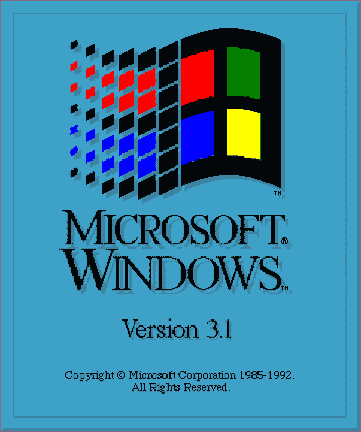

* * *

**注意** 多任务处理是操作系统的一种能力，允许在同一时间段内运行多个任务（也称为进程）。这些任务共享计算机的资源，如 CPU 和内存。操作系统在执行任务时会在它们之间切换。每个任务运行一小段时间，由于切换速度很快，它们看起来像是同时运行。保护模式是 x86 兼容 CPU 的一种操作模式，它支持虚拟内存处理和多任务处理等特殊功能。

* * *

1995 年 8 月发布的 Windows 95 是一个 32 位操作系统，支持抢占式多任务处理——换句话说，操作系统能够在不依赖任务主动配合的情况下中断任务。Windows 95 不再是 MS-DOS 的附加组件，而是一个完整的操作系统（这一事实曾长期存在争议）。随后又推出了几个其他 Windows 版本（具体是 Windows 98 和 Windows Me），直到 2001 年 10 月 Windows XP 发布。

#### Windows XP 与 Windows Vista

凭借图 1-2 中著名的标志，Windows XP 成为最受欢迎的 Windows 版本。尽管看起来有些奇怪，但这种成功（就庞大的安装基数而言）部分归功于它发布时提供的新用户体验（XP 代表“eXPerience”）。同样，GDI+图形子系统、快速用户切换、ClearType 字体渲染、64 位支持等创新，也只是部分促成了这个 Windows 版本的成功。实际上，推动 XP 成功的主要因素是其后继者 Windows Vista 的不受欢迎。

**图 1-2：** Windows XP 标志

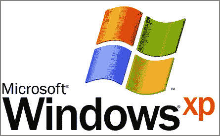

2006 年 11 月发布的 Windows Vista 以全新的设计亮相，并提供了大幅改进的安全性——相比之下，XP 需要三个服务包才能消除其安全问题和隐患。尽管这足以让它比前代更受欢迎，但 Vista 要求更强大的硬件作为其新功能的代价。大多数企业已经花费了 IT 预算的很大一部分来稳定 XP（在 Windows XP Service Pack 3 之后），它们根本不认为迁移到 Vista 是合理的。Vista 很快成为 Windows 家族中寿命最短的操作系统。

#### Windows 7 抹去 Vista 的失败

正如微软 Windows 部门总裁史蒂文·辛诺夫斯基多次承认的那样，微软在设计 Windows 7 之前就已经吸取了教训。Windows 7 于 2009 年 7 月发布，距离 Vista 发布两年零八个月。Windows 7 在性能上比 Windows XP 和 Vista 有显著提升，包括启动时间、关机时间、多核 CPU（即拥有多个处理器的 CPU）上的更好任务调度、搜索等。用户体验大幅改善，Windows 7 引入了跳转列表、Aero Peek、Aero Snap 等新功能，以及许多其他小改进，使得在应用程序窗口之间导航以及在屏幕上组织它们变得更加容易。

Windows 7 无疑提供了一种成功的方式来抹去 Vista 的失败。对于 Windows 团队来说，沿着 Windows 7 指定的方向前进本是一件容易的事，但团队却选择迎接一个最具挑战性的任务。

#### Windows 8 的范式转变

尽管 Windows 诞生于个人电脑成为日常生活一部分的时代，但它仍然是一个为企业及信息工作者设计的操作系统。操作系统提供的大多数功能实际上希望——有时甚至强迫——用户按照系统内置的方式工作。用户在熟悉文件、目录、安全组、权限、共享、注册表等概念之前，无法执行任何操作。这种方法反映了设计者假设用户应该如何与系统交互。

* * *

**注意** 由于应用程序会大量占用可用系统资源，Windows 操作系统需要定期维护，例如清理、磁盘碎片整理、病毒检查、服务包安装等。尽管每个新版本在减轻或自动化这一负担方面都取得了很大进步，但这一责任从未完全消失。

* * *

##### 微软向消费者迈出第一步

苹果以消费者为中心的产品，如 iPhone 和 iPad，向世界展示了另一种可能性：无需了解文件、目录、系统注册表或应用程序安装过程是什么，就能以直观的方式与计算机软件交互。微软似乎长期未能理解这种方法，但市场的销售数据迫使公司将重心转向以消费者为中心的设备和操作系统。

微软行为上的第一个重大变化出现在 2010 年 2 月中旬的巴塞罗那世界移动通信大会上，当时公司首次向公众介绍了 Windows Phone 7。Windows Phone 7 完全以消费者体验为核心。其视觉设计、简洁性以及柔和、精准的动画突出了用户界面（UI），使得该设备的使用变得非常直观。市场认可了这一变化，如今——在 Windows Phone 7.5“芒果”发布近一年后——微软已成为移动操作系统市场的第三大竞争者，并且越来越接近苹果的 iOS 和谷歌的 Android。

* * *

**注意** Windows 操作系统家族确实有针对嵌入式设备（Windows Embedded）和移动电话（Windows CE 和 Windows Mobile）的版本，这些版本在 Windows Phone 7 之前就已存在。

* * *

##### Windows 8 登场

随着 Windows 8 的发布，Windows Phone 7 以消费者为中心的方法成为了操作系统体验的一部分。当你启动操作系统（与 Windows 7 相比，启动时间显著缩短）时，新的 Windows 8 开始屏幕不会让你想起底部带有任务栏的传统桌面。相反，你面对的是一组磁贴，每个磁贴代表一个应用程序，如图 1-3 所示。


**图 1-3：** Windows 8 开始屏幕

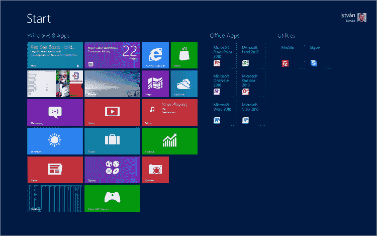

这个全新的开始屏幕向消费者传递了一个明确的信息：Windows 不仅是为信息工作者和经验丰富的计算机用户设计的操作系统，它也是一款面向消费者的设备，充分考虑了多点触控、平板电脑和触控板的需求。开始屏幕的界面非常直观，大多数人无需任何指导就能立即上手操作。拥有触控屏智能手机和平板电脑使用经验的用户会发现，开始屏幕、启动应用、滚动、缩放以及运用在其他设备上学到的手势操作都显得自然而然。

那些使用 Windows 运行商业应用（如 Word、Excel 或 PowerPoint）或其他企业特定系统界面的用户，可能会觉得 Windows UI 的这种变化有些不同寻常。不过，Windows 在设计上完全兼容现有应用，因此它也提供了桌面模式。当启动为之前任何 Windows 版本创建的应用（或未使用 Windows 8 风格 UI 的应用）时，该应用将在熟悉的桌面环境中运行。例如，当用户启动 Excel 时，它会在桌面模式下打开，如图 1-4 所示。

**图 1-4：** Excel 在 Windows 8 桌面模式下运行

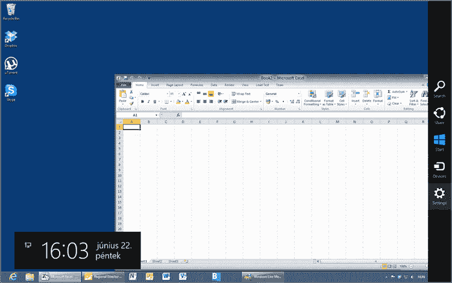

这是 Windows 8 的第二副面孔——所有之前使用过 Windows 的用户都熟悉它。如果你没有看到“开始”菜单和显示当前日期时间的状态指示器，你可能会以为自己正在使用 Windows 7。

全新的 Windows 8 开始屏幕并非只是对 Windows 7 的简单补充。在这个简洁屏幕的背后，是一个全新的以消费者为中心的应用世界，称为 Windows 8 风格应用。用户不再面对充满图标和矩形应用窗口的桌面，而是每次只看到一个占据全屏的应用。没有窗口标题、关闭按钮、可调整大小的边框或任何其他元素（在用户体验术语中称为“铬元素”）来分散用户对应用的注意力。图 1-5 中显示的天气应用就是这种新风格的绝佳示例。

**图 1-5：** Windows 8 中的天气应用

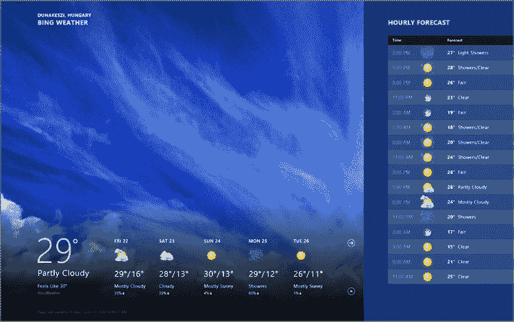

在本书中，你将全面了解这种新的用户界面范式，更重要的是，你将掌握开发这种新风格应用的能力。在深入探讨 Windows 8 风格应用的开发细节之前，你应该先了解一下 Windows 开发的历史。

### API 与工具的历史

如果没有在平台上运行的应用以及创建这些程序的开发者，Windows 的故事就会显得相当乏味。微软一直致力于围绕其产品（包括旗舰产品 Windows）建立强大的开发者社区。

* * *

**注意** 微软领导者经常强调这个社区的重要性。当你在网上搜索“Steve Ballmer”时，你一定会看到那些他激情澎湃地高喊“开发者、开发者、开发者……”并重复这个词十几遍的视频。

* * *

2012 年，Windows 平台迎来了 27 岁生日。在其漫长的生命周期中，不仅操作系统本身，其应用程序编程接口（API）以及相关的开发工具也得到了极大的改进。从这个角度来看，Windows 8 代表了 Windows 历史上最大的一次飞跃。要理解为何可以这样说，值得回顾一下 Windows 应用开发的最初时刻。

#### C 语言的力量

尽管在当今世界，编写 Windows 应用非常普遍，但在 Windows 诞生之初并非如此。当时，在 MS-DOS 应用中成长起来的程序员觉得 Windows 的方式很奇怪——仿佛一切都颠倒了过来。一个简洁的 MS-DOS 应用控制着一切，并在需要时调用操作系统函数，而 Windows 却走了一条疯狂的道路！操作系统控制着应用，并在需要促使程序执行某些操作（如刷新 UI 或执行菜单命令）时调用它。

而这并非对可怜开发者的唯一冒犯。使用 C 编程语言——当时的主流语言——在 MS-DOS 中编写最简单的“Hello, world”应用易如反掌，如下所示：

```
#include <stdio.h>

main() 
{
    printf("Hello, world");
}
```

然而，要实现同样的结果，Windows 需要更多的工作。它要求围绕单个 `printf` 函数编写“脚手架”代码，而且你很难说它直观，如 清单 1-1 所示。

清单 1-1： Windows 3.1 风格的“Hello, world”程序（节选）

```
#include <windows.h>

/* 导出入口点，供 Windows 调用 */
long FAR PASCAL _export WndProc(HWND, UINT, UINT, LONG)

/* 应用的入口点 */
int PASCAL WinMain(HANDLE hInstance, HANDLE hPrevInstance,
    LPSTR lpszCmdParam, int nCmdShow) 
{
    static char szApplication[] = "HelloW";
    HWND hwnd;
    MSG msg;
    WNDCLASS wndClass;

    /* 创建窗口类 */
    if (!hPrevInstance) 
    {
        wndClass.Style = CS_HREDRAW | CS_VREDRAW;
        wndClass.lpfnWndProc = WndProc;
        /* 为简洁起见，省略了几行代码 */
        wndClass.hbrBackground = GetStockObject(WHITE_BRUSH);
        wndClass.lpszMenuName = NULL;
        wndClass.lpszClassName = szApplication;
        RegisterClass(&wndClass);
    }

    /* 为该类创建窗口实例 */
    hwnd = CreateWindow(szApplication,
        "My Hello World Program",
        WS_OVERLAPPEDWINDOW,
        /* 为简洁起见，省略了几个参数 */
        hInstance,
        NULL);
    /* 开始显示窗口 */
    ShowWindow(hwnd, nCmdShow);
    UpdateWindow(hwnd);

    /* 管理消息循环 */
    while (GetMessage(&msg, NULL, 0, 0)) 
    {
        TranslateMessage(&msg);
        DispatchMessage(&msg)
    }
}

/* 处理消息 */
long FAR PASCAL _export WndProc(HWND hwnd, UINT message,
    UINT wParam, LONG lParam)
{
    HDC hdc;
    PAINTSTRUCT ps;
    RECT rect;

    switch (message)
    {
        case WM_PAINT:
            hdc = BeginPaint(hwnd, &ps);
            GetClientRect(hwnd, &rect);
            DrawText(hdc, "Hello, world", -1, &rect,
                DT_SINGLELINE | DT_CENTER | DT_VCENTER);
            EndPaint(hwnd, &pd);
            return 0;

        case WM_DESTROY:
            PostQuitMessage(0);
            return 0
    }
    return DefWindowProc(hwnd, message, wParam, lParam);
}
```

这个程序包含许多行代码，因为它是在一个仅提供底层操作系统函数的 API 上编写的。尽管源代码很长，但它揭示了 Windows 重要的内部细节。所有这些细节至今仍存在于 Windows 8 的核心中，当然是以改进的形式：

*   程序一开始，通过设置 `wndClass` 结构的字段并使用 `RegisterClass` 方法创建了一个窗口类。窗口类是一个概念，它标识了一个处理发送到窗口的消息的过程（称为窗口过程）。

*   程序使用已注册的窗口类创建了一个窗口（通过 `CreateWindow` 方法），然后使用 `ShowWindow` 方法显示它。`UpdateWindow` 方法向窗口发送一条消息以重新绘制其 UI。

*   应用的核心是消息循环，如下所示：

    ```
    while (GetMessage(&msg, NULL, 0, 0)) 
    {
        TranslateMessage(&msg);
        DispatchMessage(&msg)
    }
    ```


这个循环从队列中获取消息，将按键转换为等效消息（例如，模拟鼠标操作），然后将它们分派到相应的窗口过程。

*   如果说消息循环是灵魂，那么窗口过程就是心脏。在清单 1-1 中，`WndProc`由消息循环调用。它的消息参数包含消息的代码（要处理的事件），而一个 switch 语句包裹了处理各个消息的代码片段。

*   `WM_PAINT`消息告诉窗口它应该重新绘制自身。通过`BeginPaint`方法，它获取一个设备上下文资源，用于在窗口的客户区进行绘制。然后使用该设备上下文在窗口中央写入“Hello, World”消息。`ReleasePaint`释放这个设备上下文——它恰好是系统中非常有限的资源。

你可以想象当时 Windows 开发是多么耗时和痛苦——因为程序员被迫通过 Windows API 使用底层操作系统结构。

#### C++ 取代 C

1983 年，在 Brian Kernighan 和 Dennis Ritchie 出版第一版 C 语言（1978 年）仅仅几年后，Bjarne Stroustrup 创建了一种新语言，为 C 语言增加了面向对象特性。这种语言就是 C++，它很快也在 Windows 平台上流行起来。

C++ 允许将数据和功能封装在类中，并支持对象继承和多态。借助这些特性，Windows 的平面 API 可以呈现为一组更小的实体，将数据结构和 API 操作分组到逻辑上下文中。例如，所有与创建、显示和管理 UI 窗口相关的操作都可以放入一个名为`Window`的类中。

C++ 方法帮助开发者更好地了解 API 的全局，并降低了 Windows 编程的门槛。例如，清单 1-1 中描述的“Hello, World”程序的基本部分可以围绕对象进行组织，如清单 1-2 所示。

清单 1-2: C++ 中“Hello, World”程序的蓝图（摘录）

```
// --- 表示主程序的类
class Main
{
  public:
    static HINSTANCE hInstance;
    static HINSTANCE hPrevInstance;
    static int nCmdShow;
    static int MessageLoop( void );
};

// --- 表示窗口的类
class Window
{
  protected:
    HWND hWnd;
  public:
    HWND GetHandle( void ) { return hWnd; }
    BOOL Show( int nCmdShow ) { return ShowWindow( hWnd, nCmdShow ); }
    void Update( void ) { UpdateWindow( hWnd ); }
    virtual LRESULT WndProc( UINT iMessage, WPARAM wParam, LPARAM lParam ) = 0;
};

// --- 表示此程序主窗口的类
class MainWindow : public Window
{
    // --- 为简洁起见省略实现
};

// --- 从 Main 类的实现中摘录
int Main::MessageLoop( void )
{
    MSG msg;

    while( GetMessage( (LPMSG) &msg, NULL, 0, 0 ) )
    {
        TranslateMessage( &msg );
        DispatchMessage( &msg );
    }
    return msg.wParam;
}

LRESULT MainWindow::WndProc( UINT iMessage, WPARAM wParam, LPARAM lParam )
{
    switch (iMessage)
    {
        case WM_CREATE:
            break;
        case WM_PAINT:
            Paint();
            break;
        case WM_DESTROY:
            PostQuitMessage( 0 );
            break;
        default:
            return DefWindowProc( hWnd, iMessage, wParam, lParam );
    }
    return 0;
}
```

借助 C++ 提供的面向对象方法，对象行为可以打包到可重用的代码库中。程序员可以基于这些库创建自己的程序，从而只需定义与内置行为不同的行为。例如，他们必须重写清单 1-2 中的`Paint()`方法来重新绘制其窗口对象的 UI。

Windows 编程因 C++ 和对象库而发生了巨大变化。微软创建了两个库：Microsoft Foundation Classes（`MFC`）和 Active Template Library（`ATL`），它们至今仍在维护，并可在其旗舰开发环境 Visual Studio 中使用。

* * *

**注意** 你很快将了解更多关于 Visual Studio 开发环境的内容。

* * *

#### Visual Basic

用 C 或 C++ 编程语言编写的应用程序暴露了大量关于 Windows 工作方式的细节。在某些情况下，了解这些内容很重要，但在大多数情况下，这可能会令人沮丧，并使开发者无法专注于真正的应用程序功能。

1991 年 5 月发布的 Visual Basic 彻底改变了这种编程风格。Visual Basic 没有暴露 Windows 内部细节，而是将它们对程序员隐藏起来，并提供了高级构造，如窗体、控件、模块、类和代码隐藏文件。Visual Basic 语言使开发者能够专注于应用程序的真正业务，而无需编写数十行代码来实现非常简单的功能。“Hello, World”程序可以用一行代码编写：

```
MsgBox("Hello, World!")
```

无需设置窗口类，无需注册窗口，无需消息循环编程！该语言的高级概念使得完全不需要处理脚手架细节。所有这些都由 Visual Basic 运行时实现。

通过使用图形化的集成开发环境（IDE），这种应用程序开发方式至今仍是最受欢迎且最高效的方法。程序员通过从 IDE 的工具箱中拖放 UI 元素（控件）到窗体表面，以图形方式设计应用程序的对话框窗口（在 Visual Basic 术语中称为窗体）。每个控件都有多个事件处理程序，用于响应来自环境的事件——例如用户单击按钮或更改组合框中的选择。编程实际上就是编写处理这些事件的代码。

1993 年，微软开发了一种二进制标准——组件对象模型（`COM`），它允许创建可被其他应用程序使用的可重用对象。许多技术都建立在`COM`之上，例如对象链接与嵌入（`OLE`），它使得自动化应用程序成为可能。1993 年后发布的 Visual Basic 版本都是基于`COM`和`OLE`设计的。这种方法非常成功，以至于该语言的一种方言——Visual Basic for Applications（`VBA`）——成为了 Microsoft Office 宏的编程语言。

#### Delphi

Visual Basic 并不是唯一一个脱离 C 和 C++ 常规路径的编程环境。Delphi 最初由 Borland 开发，使用 Object Pascal 编程语言。Visual Basic 是一种基于对象的语言（它支持带有封装数据和函数的类，但不允许对象继承），而 Object Pascal 是一种真正的面向对象语言。Delphi 的 IDE（其第一个版本于 1995 年发布）与 Visual Basic IDE 非常相似。Delphi 被设计为一种快速应用程序开发（RAD）工具，支持开发数据库应用程序，包括简单的应用程序甚至企业级系统。

该产品发展非常迅速，在其诞生后的前五年内发布了五个版本。Delphi 是第一个能够为 Windows 编译 32 位应用程序的工具。与 Visual Basic 控件类似，它提供了超过 100 个可视组件（组织在 Delphi 的可视组件库中），开发者可以立即投入使用。此外，开发者还可以轻松创建自己的可视组件，并将其添加到现有库中。

#### .NET 的出现


2002 年，.NET Framework 为 Windows 开发注入了新的活力。.NET 程序被编译成一种称为 Microsoft 中间语言（MSIL）的中间语言。这种中间代码在运行时由即时（JIT）编译器转换为可执行的 CPU 特定操作。这种新方法为 Windows 开发带来了几个重要的范式，包括以下内容：

*   在 .NET 发布之前，每种语言（和开发环境）都使用自己的运行时库。学习一门新语言通常意味着也要学习一个新的运行时库。而有了 .NET，所有语言都使用相同的运行时。2002 年，微软只支持两种编程语言（C# 和 Visual Basic.NET）。如今，已有超过 100 种 .NET 语言在使用。微软自己将 F# 添加到了这个列表中，并且还支持 IronPython 和 IronRuby（它们由各自的社区驱动）。

*   运行时环境利用垃圾回收机制，自动管理内存分配和对象销毁。这种行为有助于提高生产力，并允许开发人员编写更不易出错的代码。垃圾回收还减少了编写存在内存泄漏的程序的几率。

*   程序员不再使用底层 API 方法，而是可以操作那些封装了背后 API 复杂性的对象。开发人员无需处理繁琐的内部 Windows 细节，而是可以使用高级抽象，从而提高生产力。

*   .NET 提供了 COM 与 .NET 对象之间高度的协作能力。.NET 代码不仅可以访问 COM 对象，还可以提供能被 COM 世界使用的对象。

.NET 被称为托管环境，其语言被称为托管语言——以区别于编译为 CPU 特定代码的本机语言，如 C、Object Pascal（Delphi）和 C++。

* * *

**注意** .NET Framework 并不是第一个托管运行时环境。这一殊荣属于 Java，它由 Sun Microsystems 于 1995 年发布。.NET 是微软对 Java 现象的回应，其许多特性都受到了 Sun 的 Java 实现的启发。

* * *

与 .NET Framework 同时发布的 Visual Studio 在 .NET 的成功中发挥了重要作用。Visual Studio 附带了大约二十几个项目模板，以加速 Windows 应用程序开发的起步。如今，Visual Studio Ultimate 版包含了超过一百个项目模板。

* * *

**注意** 你将在第 4 章中了解更多关于 Visual Studio 的内容。

* * *

Visual Studio 模板非常强大。例如，你可以通过使用 Windows 窗体应用程序模板，只需点击几下即可创建如图 1-6 所示的应用程序。

**图 1-6:** 使用 Visual Studio 创建的一个简单 Windows 窗体应用程序

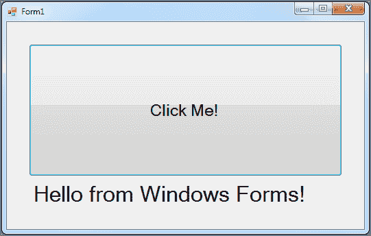

借助 Visual Studio 的工具，你可以轻松设置图 1-6 所示窗口的视觉属性。清单 1-3 显示了在此示例中你需要手动添加的唯一代码。

清单 1-3: 图 1-6 中窗体背后的代码

```
using System;
using System.Windows.Forms;

namespace HelloWorldWinForms
{
    public partial class Form1 : Form
    {
        public Form1()
        {
            InitializeComponent();
        }

        private void button1_Click(object sender, EventArgs e)
        {
            label1.Text = "Hello from Windows Forms!";
        }
    }
}
```

尽管 .NET 配备了丰富的对象库和出色的工具，但它仍然使用了基于早期 Windows 版本设计的 API。

#### 新的 UI 技术

长期以来，Windows UI 由图形设备接口（GDI）API 管理，该 API 随着 Windows XP 的发布演变为 GDI+。GDI 和 GDI+ 是基于光栅的 API，所有标准 Windows UI 控件都使用它们进行自我渲染。开发人员能够更改任何标准控件默认视觉外观的唯一方法是重写渲染控件 UI 的 Windows 事件。

当 Windows Presentation Foundation（WPF）图形子系统在 .NET Framework 3.0 中引入（后来作为 Windows Vista 的内置组件）时，GDI 范式被彻底改变。WPF 不再以命令式方式（即使用编程语言编写的指令）创建 UI，而是采用可扩展应用程序标记语言（XAML），它是可扩展标记语言（XML）的一个衍生品，来描述 UI 元素。WPF 还利用了计算机内置的图形处理单元（GPU）强大的硬件加速能力。

Silverlight（微软的富互联网应用程序框架）也使用 XAML 来定义用户界面。清单 1-4 展示了一个非常简单的 XAML 示例，它在 Silverlight 中实现了“Hello, World”应用程序。

清单 1-4: “Hello, World”应用程序的 MainPage.xaml 文件

```
<UserControl x:Class="HelloFromSL.MainPage"
    xmlns="http://schemas.microsoft.com/winfx/2006/xaml/presentation"
    xmlns:x="http://schemas.microsoft.com/winfx/2006/xaml"
    xmlns:d="http://schemas.microsoft.com/expression/blend/2008"
    xmlns:mc="http://schemas.openxmlformats.org/markup-compatibility/2006"
    mc:Ignorable="d"
    d:DesignHeight="300" d:DesignWidth="400">

    <Grid x:Name="LayoutRoot" Background="White">
        <TextBlock FontSize="48">Hello from Silverlight</TextBlock>
    </Grid>
</UserControl>
```

这段代码生成了如图 1-7 所示的页面。该图中的文本是清单 1-4 中加粗代码行的显示结果。

**图 1-7:** 清单 1-4 的输出

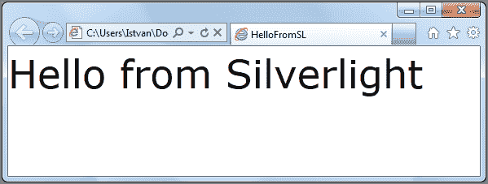

WPF 和 Silverlight 是伟大的技术。使用它们就像用一台 2012 年生产的先进发动机（WPF/Silverlight）替换一台 1930 年代的兰博基尼发动机（GDI/GDI+ 类型）。这些技术不仅定义了 UI，还可以使用极少（甚至没有）代码来声明其动态行为。这些技术将 UI 与应用程序的逻辑（模型）层连接起来。以下是这些技术的一些重要特性：

*   这些技术经过设计和定制，使你能够创建丰富、强大的桌面或互联网应用程序，以提供卓越的用户体验。除了提供简单的 UI 元素（如文本框、按钮、列表、组合框、图像等）之外，它们还提供了使用动画和媒体元素（如视频和音频）创建内容的自由。与传统的（有人甚至会说乏味的）使用矩形 UI 元素的 UI 方法相比，WPF 和 Silverlight 使你能够改变应用程序的整个面貌。

*   它们提供了一个非常灵活的布局系统，使得创建布局变得容易，你可以自动适应多种因素（例如可用屏幕大小、显示的项目数量、显示元素的大小和放大倍数）。

*   样式和模板是促进开发人员与设计师之间顺畅协作的功能。开发人员实现应用程序的逻辑，因此他们从不直接设置 UI 的视觉属性。相反，他们通过编程方式发出 UI 状态已更改的信号。设计师则根据 UI 可能的状态来创建 UI 的视觉效果。


*   Silverlight 和 WPF 以声明方式（即无需编写代码）应用数据绑定——这是一种用于将 UI 元素连接到数据或其他 UI 元素的技术。数据绑定与样式、模板、布局甚至动画协同工作。该机制在业务线（LOB）应用中尤其有用。借助来自数据库并由应用逻辑处理的数据绑定信息，元素可以声明式地绑定到 UI 元素。

* * *

**注意** 布局系统用于在 UI 上排列元素。借助灵活的布局系统（例如 WPF、Silverlight 和 Windows 8 背后的系统），你可以定义 UI 元素之间的关系，这些元素在运行时会自动放置在 UI 上。例如，你可以定义一个布局系统，使其将 UI 控件排列成两列，并均匀分布它们。WPF 和 Silverlight 中的样式和模板的使用方式类似于文档发布系统中的样式和模板。样式收集 UI 元素的公共属性；模板是一个骨架，包含 UI 元素内容的占位符。

* * *

WPF 和 Silverlight 的主要优点可能在于它们有助于清晰分离属于开发人员的 UI 相关任务与设计人员执行的任务。在当今以消费者为中心的应用中，这比开发人员和设计人员任务混杂的方法具有明显优势。

* * *

**注意** XAML 在 Windows 8 风格应用中扮演着非常重要的角色，正如你在第 3 章中所了解的那样。

* * *

### Windows 应用开发的第 22 条军规

在 Windows 应用开发的演进过程中，技术及相关分支不断分化。一个分支是原生开发，始于 Windows 早期使用 C 编程语言的阶段。另一个分支是托管开发，使用 .NET Framework 及其托管技术和语言。

由于 CPU 特定的代码编译以及对 Windows API 和系统资源的底层访问，原生应用可以提供托管技术无法比拟的出色性能。然而，在编写业务应用时，使用原生代码的效率低于使用 .NET Framework 的托管代码，且更加繁琐。因为业务应用通常与数据库交互，托管语言的性能开销几乎无法察觉——应用大部分时间都在与底层服务和数据库通信。

当 Windows 应用开发人员为某个应用寻找合适的技术和工具时，他们可能会发现自己处于与约瑟夫·海勒小说《第 22 条军规》（纽约：Alfred A. Knopf，1995 年）中的轰炸机飞行员尤索林相同的困境。

在许多情况下，尤其是在编写桌面应用时，原生开发和托管开发之间没有最优选择。尽管 WPF 和 Silverlight 是打造出色应用的绝佳技术，但它们无法从原生代码中使用。WPF 和 Silverlight 并未足够深入地嵌入到操作系统中。例如，启动 WPF 应用需要时间，因为 WPF 子系统会加载到内存中。在许多需要计算能力的场景中，.NET 产生的结果远不如原生代码。

Visual Studio 就是这种矛盾局面的典型例子。它使用了混合代码库。大多数组件用 C++ 实现，某些部分用 C#（使用 WPF）实现。启动画面应在用户启动应用后立即弹出。它使用 C++ 和 GDI+ 实现，因为 WPF 的速度不够快。Visual Studio 的代码编辑器使用 WPF 实现，因为它拥有丰富且易用的工具集，可以承载这样一个具有出色 UI 的复杂组件。

在 LOB 应用开发中，生产力是最重要的因素。原生代码开发的性能优势对应用的价值不大，因为在大多数情况下，数据库层才是性能瓶颈。使用托管代码，业务应用的编程阶段通常更快且更不容易出错。

因此，在编写桌面应用时，原生代码提供了最佳性能，但在此情况下，你无法使用 WPF 和 Silverlight 的丰富工具集。当你转向托管代码时，可能会提高生产力，但会损失最终应用的性能。在绝望之际，你可以采用某种“骡子”解决方案——就像 Visual Studio 那样，但这样会带来大量开销。这可不是一个容易的决定，对吧？

这种情况在 Windows 8 中完全改变了。拥有 HTML5/层叠样式表 3（CSS3）/JavaScript 经验的 Web 开发人员、经验丰富的 C++ 程序员以及成长于 .NET 的开发人员，都会觉得自己的知识足以且适合开始 Windows 8 风格应用的开发。不再有像 Windows 时代初期 C 程序员那样的特权极客阵营。每个人都可以使用相同的技术和相同的工具——无需妥协。这怎么可能？第 3 章将解释这一点。

### 总结

Windows 平台在过去 27 年中发生了惊人的演变。它从一个简单的 MS-DOS 扩展转变为一个复杂且功能齐全的操作系统，被全球大多数个人计算机所使用。Windows 的设计初衷是面向信息工作者和经验丰富的计算机用户。尽管每个版本都越来越接近非高级用户，但它始终未能成为像苹果 iPhone 或 iPad 那样简单的消费设备的操作系统。

Windows 8 改变了这一点。除了所有用户熟悉的传统桌面模式外，该操作系统还拥有一个全新的面貌——Windows 8 风格应用，提供直观的用户体验——应用占据整个屏幕，并吸引用户的全部注意力。

不仅操作系统发生了变化，开发工具和 API 也发生了变化并得到了显著改进。与过去只有 C 和 C++ 程序员才有权创建 Windows 应用不同，如今 C++、Visual Basic、C# 和 Delphi 程序员也可以使用他们喜爱的 IDE 开发应用。根据所选的语言和工具，程序员必须使用不同的 API 和技术。原生编程语言（如 C、C++ 和 Delphi）提供 CPU 特定的代码和更好的性能，而托管代码在开发 LOB 应用时效率更高，并且可以轻松访问现代 UI 技术，如 WPF 和 Silverlight。

Windows 8 风格应用提供了相同的 API，这些 API 在原生代码和托管代码中均可使用——无需妥协。此外，这些 API 也适用于 HTML5/CSS3/JavaScript 开发人员。

Windows 8 不仅改变了操作系统的 UI，还改变了你与之交互的方式。除了支持传统的输入设备（如键盘和鼠标）外，它还提供了与操作系统和 Windows 8 风格应用交互的一流支持——支持多点触控手势、手写笔，以及通过陀螺仪和加速度计等传感器进行交互。

在第 2 章中，你将了解使用 Windows 时的所有这些新特性。

**练习**

**1.** 微软 Windows 家族中第一个完全以消费者为目标设计和开发的操作系统是什么？

**2.** Windows 8 风格应用是否有窗口标题栏和边框？

**3.** 列出常用于 Windows 应用开发的编程语言。

**4.** Web 开发人员可以使用哪些语言栈来创建 Windows 8 风格应用？

* * *

**注意** 练习的答案可在附录 A 中找到。

* * *


**本章所学内容**

| **主题** | **关键概念** |
| --- | --- |
| Windows 操作系统 | Windows 是一系列操作系统的统称，始于 1985 年 11 月 20 日发布的 Windows 1.0，当时作为 MS-DOS 操作系统的附加组件。该系列还包括嵌入式设备（Windows Embedded）和手机（Windows CE、Windows Mobile 和 Windows Phone）的版本。当前版本为 Windows 8 和 Windows Phone 7.5。 |
| Windows API | 在 Windows 上运行的应用程序可以通过 Windows 应用程序编程接口（API）访问操作系统的底层服务。 |
| C 和 C++ 编程语言 | 作为可用于开发 Windows 应用程序的两种编程语言，C 和 C++ 能够充分利用操作系统的所有特性，包括硬件相关及非常底层的特性。自 Windows 早期以来，这两种语言就一直用于应用程序开发。C++ 在 C 的基础上扩展了面向对象特性，并在过去 25 年中发展成为一种非常成熟的编程语言。 |
| Visual Basic 编程语言 | Visual Basic 于 1991 年发布，是一种革命性的编程语言，通过提供表单、控件和事件等高级 UI 概念，显著减少了编程工作量。该语言还提供了与组件对象模型（COM）/对象链接与嵌入（OLE）组件的无缝集成。 |
| .NET Framework | Microsoft .NET Framework 是一个位于操作系统和应用程序之间的运行时环境。其主要作用是以托管方式提供对底层操作系统所有服务的访问，从而提高开发人员的工作效率。C# 和 Visual Basic .NET 是用于创建 .NET Framework 应用程序最常用的两种语言。 |
| WPF 和 Silverlight | Windows Presentation Foundation（WPF）和 Silverlight 是运行在 .NET Framework 上的现代且成熟的 UI 平台。它们使您能够创建具有丰富 UI 的应用程序，包括灵活的布局、多媒体元素和动画。它们使用样式、模板和数据绑定等高级技术，以高效的方式将应用程序的 UI 层与底层逻辑联系起来。 |
| Windows 8 风格应用程序 | Windows 8 风格应用程序是 Windows 8 中引入的一种新型应用程序。由于它们的外观和用户交互管理方式与传统桌面应用程序完全不同，因此它们占据全屏（即没有应用程序边框），并且不再要求用户在应用程序内显示和管理多个窗口。 |

## 第 2 章

## 使用 Windows 8

**本章你将学到：**

* 使用鼠标和键盘操作 Windows 8
* 在多点触控设备上使用 Windows 8
* 利用“开始”屏幕、动态磁贴和超级按钮栏的功能
* 切换到桌面并使用传统 Windows 应用程序

Windows 8 在用户界面（UI）方面发生了巨大变化。它采用了更以触控为中心的设计理念。桌面有一些略微改变的功能，但大多数传统的基于鼠标的工作流程保持不变。而在全新的 Windows 8 风格界面上，几乎所有内容都是全新的。动态磁贴不仅仅是快捷方式；Windows 8 风格应用程序的处理方式也与传统 Windows 应用程序不同。甚至“开始”屏幕也包含了旧版“开始”菜单所没有的功能。

虽然用户可能凭直觉学会这些操作，但对于开发人员来说，深入了解 Windows 8 UI 的每一个细节至关重要。只有充分掌握这些能力，你才能构建出真正引人入胜且直观的应用程序，让用户不仅用它完成任务，而且乐在其中。

### 两个世界，一个操作系统

Windows 8 拥有两种截然不同的 UI：普通的桌面 UI（可能你已经习惯）和完全不同的全新 Windows 8 UI。为什么 Windows 8 UI 如此重要？

在过去的几十年里，用户见证了鼠标在 PC 上几乎战胜所有其他控制设备的过程。对于普通 Windows 用户来说，使用鼠标被认为是操作桌面计算机图形用户界面（GUI）最简单的方式。除了鼠标，高级用户也依赖键盘。诸如 Ctrl+Alt+Del 之类的键盘快捷键以及 Windows 键等特殊键，都能加快他们的工作速度。

微软构建其 Windows 操作系统时，假设你将使用鼠标和键盘来控制操作系统和程序。这一前提促使微软创建了一个 GUI，用于协调通过这些设备进行的用户交互。它始终假设你拥有一个像素级精确的指针，并且可以毫无困难地点击小图标。

较小的设备，如个人数字助理（PDA）和智能手机，过去通常使用硬件按钮或触控笔来操作其界面。由于尺寸限制，这些设备在创建内容时不如消费内容时高效。话虽如此，在这些设备上模仿桌面 GUI 可能并非最佳选择。然而，在智能手机和 PDA 开始普及的时代，这却是最佳选择。这些智能设备的操作系统试图重新创建其大型桌面设备的简化版 GUI，以尽可能保留用户体验并降低学习曲线。

2001 年，微软创造了第三类设备：平板电脑。平板电脑本质上是带有可翻转触摸屏的小型笔记本电脑。它们是功能齐全的计算机，但更具移动性。借助触摸屏，你可以更自然的方式操作屏幕上的对象，而无需使用鼠标或键盘。

由于其固有的缺陷，平板电脑的外形因素在当时对市场影响甚微。它们是小巧的设备——但仍然很重。它们适合内容创建和消费——但电池续航时间短，等等。除了硬件相关问题，还有一个更紧迫的问题阻碍了平板电脑的普及：缺乏像为（多点）触摸屏构建的 GUI。Windows XP 仅仅允许用户用手指代替鼠标指针。

在过去十年中，另一种类型的 GUI 兴起。普通手机变得更大、更智能。在某个时候，它们变得很像 PDA——数字伴侣、组织者和内容消费设备。然而，如果你看看当代的大屏幕智能手机，几乎找不到触控笔。更重要的是，其 GUI 与 Windows 桌面 PC 或旧款 PDA 上的 GUI 完全不同。

这种新型 GUI 从头开始构建，旨在让你无需使用触控笔或按键等额外硬件设备，就能自然地操作屏幕上的对象。你可以直接用手指触摸屏幕上的对象，无需任何指针或硬件设备。大多数此类设备都配备多点触摸屏，因此它们能够识别用多根手指进行的操作——通常称为多点触控手势。这些功能使你能够以更自然的方式与手持设备交互。

虽然可以使用智能手机进行内容消费，例如浏览网页或阅读文档，但 3 到 4 英寸的小屏幕往往成为障碍。笔记本电脑则被认为是另一个极端。它们太大、太重、太吵，而且移动性不足，无法完成如此简单的任务。它们的设计初衷是让你完成计算机能做的所有事情。作为内容创建设备，它们提供了无与伦比的可能性，但这需要付出代价。


为了填补智能手机与笔记本电脑之间的空白，第三种设备以全新的姿态重新出现。它们仍被称为平板电脑（有时也叫 slate），但大多数情况下没有实体键盘。它们配备 7 到 10 英寸的多点触控屏，只有少量实体按键。部分设备配有触控笔，但主要依靠触摸手势作为用户交互方式。正因如此，它们继承了以触摸为中心的智能手机操作系统。使用这些平板电脑通常感觉非常自然，即使是从未用过电脑的人也能轻松上手。

这种新型平板电脑可以看作是智能手机的后代。与旧式设备不同，它们与台式电脑几乎毫无共同之处，但却是出色的内容消费设备。它们的图形用户界面完全不同，需要不同的交互方式才能发挥强大功能，而且同样重要的是，它们不运行相同的应用程序。

基于这些用户界面构建的操作系统注定只能在一个领域表现出色。它们要么适合内容消费设备，要么适合内容创建设备，但无法两者兼顾。

如今的硬件已经发展到足以让最初的平板概念成为现实，不再受十年前那些缺陷的困扰。然而，软件尚未准备就绪，因为没有一种操作系统能同时适应这两种截然不同的使用方式。

通过 Windows 8，微软创建了第一个尝试融合两种用户界面范式、力求两全其美的操作系统。众所周知的桌面应用程序最适合内容创作场景（例如编写书籍或程序），而 Windows 8 风格的应用则擅长内容消费（例如阅读上述书籍）。

Windows 8 的双重特性使其成为第一个足够灵活的操作系统，让你可以在任何运行该系统的设备上选择想要的使用方式。无论你使用的是带有外接键盘底座的新一代平板电脑、内置键盘和触摸屏的超极本，还是强大的笔记本电脑或台式电脑，你都可以使用相同的、熟悉的操作系统。此外，你的“开始”屏幕、设置和 Windows 8 应用会跟随你使用的所有设备。

Windows 图形用户界面看似复杂的特性以及操作系统核心的改进，让你（开发者）能够构建可在任何拥有 7 到 70 英寸屏幕（当然，还需满足特定硬件要求）的设备上运行的应用。这些应用在使用多点触控屏时，或者用鼠标和键盘操控时，同样引人入胜。这种不妥协的操作系统为用户提供了全新的舒适体验，同样重要的是，也为开发者带来了前所未有的市场机遇。

### 输入方式

如果你的设备或电脑有 USB 端口，你可以使用鼠标和键盘与之交互。但对于 Windows 8，了解其他控制设备的方法也很重要。

#### 多点触控输入

虽然以前版本的 Windows 主要面向台式机和笔记本电脑，但 Windows 8 为全新系列设备打开了可能性——基于 ARM 的平板电脑、基于 x64 架构的平板电脑、新型超极本等。这些设备的共同特点是配备支持多点触控的电容式触摸屏。在构建 Windows 8 风格应用时，最好在设计用户界面时牢记这一点。

微软在构建以触摸为中心的应用方面为你提供了两方面的帮助：

*   Visual Studio 2012 为 Windows 8 风格应用提供的现成控件同样适用于鼠标和触摸屏。你将在本书后续章节中了解这些控件。
*   微软确保在整个操作系统中对特定的单点和多点触摸手势有一致的用法，并提供清晰简洁的描述方式。这些手势是用一根或两根手指完成的用户交互。

以下是 Windows 8 定义的所有手势。最好记住它们，因为所有 Windows 用户都会熟悉这些手势，你可以构建遵循这一准标准的应用。

*   点击（Tap）——这是与屏幕上对象的主要交互方式，例如通过触摸“开始”屏幕上的动态磁贴来启动应用。你可以将其视为鼠标点击的触摸对应操作。
*   长按（Tap and Hold）——这是与对象的次要交互方式，例如触摸对象一秒钟不松开以调出上下文菜单。这类似于鼠标右键单击。
*   滑动（Slide）——没有任何列表的程序非常罕见。滚动列表通常意味着单击（或点击）滚动条来移动视图。虽然这仍然可行，但对于触摸屏用户来说，用一根手指触摸列表并轻拂来移动视图更为自然。列表会朝该方向平移或滚动。
*   轻扫（Swipe）——使用此手势选择屏幕上的对象。轻扫类似于滑动。用一根手指触摸对象，然后稍微向下拉动而不松开。当你停止并松开时，就完成了一次轻扫手势。如果你没有停止向下移动手指，松开屏幕时，它很可能被解释为滑动手势。
*   捏合（Pinch）——这是一种多点触控手势，用两根手指同时触摸屏幕，然后向彼此移动或分开。通常，此手势与缩放效果相关，用于放大或缩小图像或其他对象。
*   旋转（Rotate）——此手势用两根手指触摸屏幕，并围绕一个中心点（可以是其中一根手指）转动。此手势可用于转动或旋转对象。
*   从边缘轻扫（Swipe from the Edge）——正如你将在本章后面看到的，屏幕的边缘和角落对 Windows 8 有重要功能。因此，在屏幕边缘之一上执行轻扫手势可能会激活某些有用的功能。例如，如果你从触摸屏的右边缘轻扫，将始终打开超级按钮栏（如本章后面所述，其中包含“开始”按钮和其他几个有用功能）。如果你从屏幕底部轻扫，通常会激活应用命令的上下文栏（本章后面也会详细介绍）。

图 2-1 展示了所有这些手势交互。

**图 2-1:** Windows 8 触摸手势

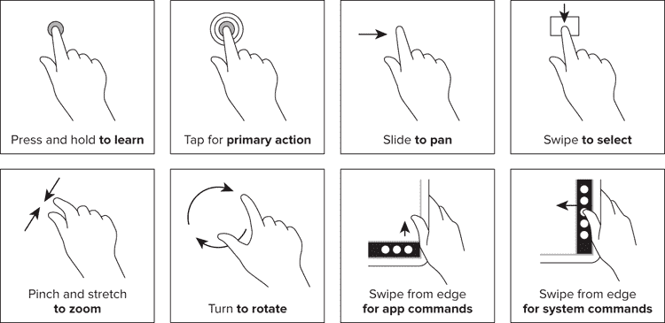

* * *

**注意** 有关手势的更多详细信息，请访问 [`msdn.microsoft.com/en-us/library/windows/apps/hh761498.aspx`](http://msdn.microsoft.com/en-us/library/windows/apps/hh761498.aspx)。

* * *

#### 软件键盘

许多 Windows 8 设备尺寸太小，无法配备实体键盘。这些设备上的键盘输入通过屏幕上的软件键盘完成。当用户点击文本框（或其他等待键盘输入的控件）时，软件键盘会自动在屏幕底部弹出。在较小的屏幕上，这意味着键盘会占据大部分空间。因此，在设计接收字母数字用户输入的应用时，必须确保在软件键盘打开时，控件的大小足以适应最小的屏幕分辨率。

Windows 8 附带多种软件键盘布局，帮助你尽可能舒适地打字。在某些布局中，按钮的大小也可以调整。不过，软件键盘的布局和按钮大小不会影响整个键盘所需的空间。


图 2-2 展示了新的“双拇指”键盘布局，它让你在双手握住 Windows 8 平板电脑时，仅用拇指就能舒适地打字。左上角的垂直省略号可让你选择按钮的大小（图中显示的是最大设置）。

**图 2-2：** 具有特殊布局的软件键盘

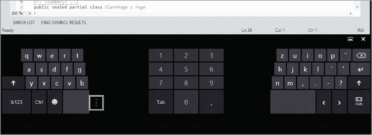

#### 其他输入设备

大多数情况下，你的应用程序会与鼠标或触摸屏配合使用。但这并不意味着 Windows 8 不支持其他输入设备。

某些设备（主要是手持设备）配备了触控笔。触控笔是一种触摸屏辅助工具，比直接用手指提供更高的精度。但由于触控笔并不常见，你应该为普通的触摸输入构建用户界面。

更重要的输入设备是传感器。绝大多数新型 Windows 8 平板电脑将内置设备，用于检测设备的位置和姿态（你握持设备的方式）等信息。如果设备或计算机有传感器，其数据可以在你的 Windows 8 风格应用中使用。

以下是一些传感器的示例：

*   全球定位系统（GPS）告诉你设备的地理位置。
*   加速度计告知你设备速度的变化。
*   陀螺仪告诉你设备的旋转速度。
*   磁力计或指南针告诉你北方向的角度。
*   环境光传感器告知你设备周围的光照条件。

你可以通过使用微软提供的 API 轻松地将传感器输入集成到你的应用中，这为你创造了开发更具吸引力或更易用的应用程序的机会。

### 登录

从 Windows 8 应用开发者的角度来看，登录操作系统并不是一件真正重要的事情——除了不登录就无法编写应用之外。但值得注意的是，Windows 8 的设计初衷是使用 Microsoft 账户（基本上是 Live ID 的新名称），而不是每台计算机上的普通本地用户账户。

* * *

**注意** Windows Live 是微软的在线服务集合。你可以通过[`live.com`](http://live.com)访问它们。Windows Live 包括邮件、日历、在线存储和即时消息功能。你可以通过创建 Microsoft 账户在[`live.com`](http://live.com)免费访问所有这些服务。

* * *

这意味着，如果你使用 Live ID 电子邮件地址和密码登录，Windows 8 将让你尽可能轻松无缝地访问存储在 Live Services 中的所有内容。例如，如果你在 Internet Explorer 中打开[`live.com`](http://live.com)，你将立即使用登录 Windows 的登录名和密码自动登录。或者，如果你想在应用中选择一张图片，你不仅会看到当前计算机上的图像，还会看到你存储在 SkyDrive 上的所有图像——就像它们存储在本地一样。（当然，这仅当计算机可以访问互联网从 SkyDrive 获取这些图片时才成立。）

* * *

**注意** SkyDrive 是微软的免费在线存储技术。如果你有 Microsoft 账户（以前称为 Windows Live ID），你将获得 5 GB 的免费存储空间，可用于在[`www.skydrive.com`](http://www.skydrive.com)上在线存储你的照片和文档。你可以将这些文件设为私有或公开访问，或与他人共享。

* * *

当你构建应用时，可以利用这种 Live 集成，让你的应用像微软内置到 Windows 8 中一样无缝地使用用户信息和数据。用户首次启动应用并尝试登录 Windows Live 时，会看到一个请求应用权限的屏幕。用户阅读详细信息并单击或点击“确定”后，应用将能够执行用户已批准的所有操作——读取电子邮件、访问个人数据、下载或上传文件到 SkyDrive 等。用户可以随时撤销这些权限。

除了 Microsoft 账户，仍然可以使用普通的本地账户。

另外两种新的登录类型也值得一提。由于强密码可能需要很长时间（且需要一些精力）输入，这在没有硬件键盘的触摸屏设备上尤其麻烦。Windows 8 允许你创建图片登录和/或个人识别码（PIN）登录，作为传统强密码登录的补充。

图片密码让你选择一张图片，在上面绘制三个图形（点、线和圆），下次登录时，你无需输入可能很长的密码即可登录。你只需按相同顺序在相同位置重复绘制这三个图形——这在触摸屏上非常容易。

PIN 密码选项让你选择一个四位数的个人识别码，这比输入长密码更容易。

### 开始屏幕

登录到 Windows 8 设备后，你遇到的第一个屏幕就是新的开始屏幕。Windows 8 迈出了巨大而大胆的一步——你熟悉了几十年的开始菜单不复存在。然而，正如你将看到的，旧开始菜单的每个功能都存在于开始屏幕中，因此你会很快适应它。

#### 开始菜单的演变

基本上，开始屏幕代表了开始菜单的演变。这种演变的结果是，你不再看到图标或纯文本，而是迷人的动态磁贴。如果你熟悉微软最新的手机操作系统（Windows Phone 7），你已经对它们有了基本了解。如果你不熟悉 Windows 8 的设计，它们可能看起来只是更大的图标。但它们能做的远不止于此——它们可以包含丰富且变化的内容！

日历动态磁贴与你的在线日历（Windows Live、Hotmail、Exchange 等）同步，并显示你下一个约会的信息。当你查看消息动态磁贴时，可以看到有多少即时消息等待回复。在天气动态磁贴上，你可以看到基本的天气信息，而人脉磁贴则告诉你各种社交网络上好友的状态更新。图 2-3 展示了运行中的开始屏幕。

**图 2-3：** Windows 8 开始屏幕

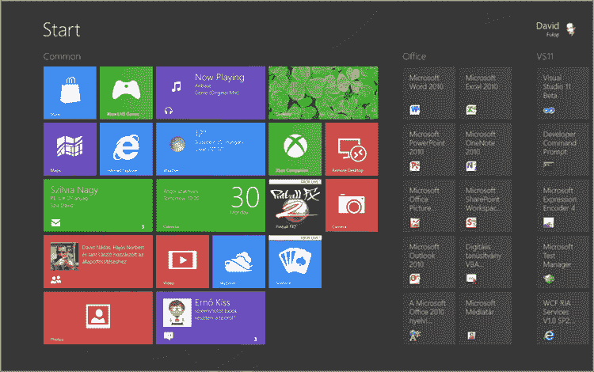

这些动态磁贴代表应用程序和程序，就像以前的开始菜单一样。但它们也提供了关于应用程序用途的基本信息。因此，你甚至不需要启动这些应用程序——只需瞥一眼开始屏幕，所有重要信息就都在那里了。

当然，你很可能会希望拥有比一个屏幕能容纳的更多的动态磁贴。开始屏幕上垂直放置的磁贴数量会根据屏幕分辨率进行调整，因此在更大的显示器上，你会自动获得更多行磁贴。然而，你的磁贴可以在水平方向上溢出。利用这一特性，你可以在开始屏幕上放置任意数量的动态磁贴。本章稍后你将了解更多关于在开始屏幕上放置动态磁贴的内容。

列表控件是一个你应该了解的基本编程和 UI 概念。列表控件是应用程序的一部分，通常以统一的方式表示任意数量的 UI 元素。在 Windows 7 开始菜单的“所有程序”下，你可以看到一个列表控件的基本示例——所有程序都表示为图标和简单字符串。


Windows 资源管理器中的项目面板是一个更复杂的列表控件。它能够以多种方式（小图标、大图标、详细信息或简单列表）显示文件夹内容，并且具备分组和排序功能。

列表控件可能各不相同，但它们共享一些共同特性，这些特性多年来已为每位 Windows 用户所熟悉。

由于“开始”屏幕也是一种列表控件，因此它也具备这些易用性特性。如果你恰好使用鼠标和键盘，滚动“开始”屏幕的方式正如你所想。在“开始”屏幕底部有一个滚动条，你可以用它向左或向右移动视图。就像你之前遇到过的任何列表控件一样，你可以使用鼠标滚轮来滚动“开始”屏幕。此外，尝试将鼠标指针放在右侧边缘，然后向右移动。如图 2-4 所示，视图会向右移动。

**图 2-4：** 滑动“开始”屏幕

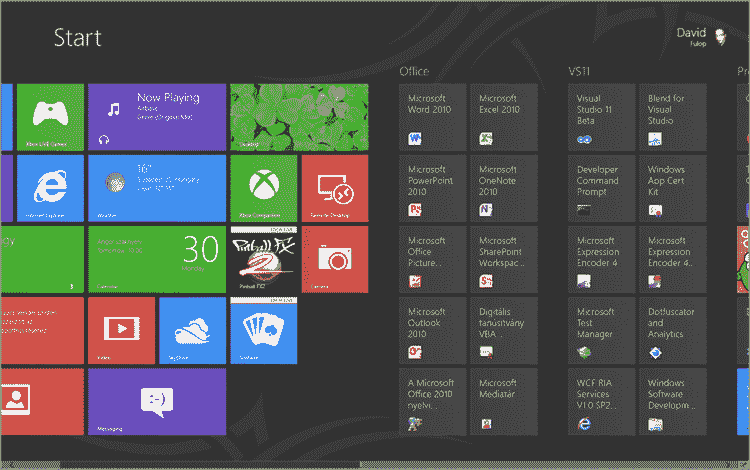

如果你有触摸屏设备，可以利用自然的用户交互。只需触摸“开始”屏幕上的任意位置（屏幕边缘除外），然后水平滑动手指。视图会跟随你的手势移动。

尽管滚动或滑动屏幕相当方便，但还有一种方法可以从缩小的视图中查看所有动态磁贴。缩小视图会缩小“开始”屏幕上的动态磁贴，让你能同时看到所有磁贴。这样，你可以快速跳转到某个位置（特定的动态磁贴），而无需逐个滚动浏览所有磁贴。图 2-5 显示了缩小视图下的“开始”屏幕。

**图 2-5：** 缩小视图下的“开始”屏幕

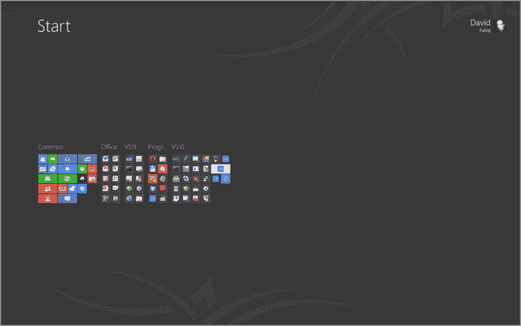

稍后在本章中，你将深入了解如何使用和管理动态磁贴，以及如何使用缩小视图。不过，让我们先看看如何在 Windows 8 的“开始”屏幕上查找应用。

#### 浏览和搜索已安装的应用

从某种意义上说，你的应用定义了整个系统的能力。因此，添加新功能和工具意味着添加和安装新应用。你可能会很快发现自己拥有的应用数量超过了希望在“开始”屏幕上以动态磁贴形式显示的数量。

* * *

**注意** 顺便提一下，将所有应用都固定到“开始”屏幕是没有意义的——你肯定不会同样频繁地使用每一个应用。

* * *

当然，你会进行优先级排序，并隐藏（取消固定）某些应用。那么，在哪里（或者更具体地说，如何）可以找到这些应用呢？

在早期版本的 Windows 中，“开始”菜单的“所有程序”部分是列出所有已安装软件、浏览已安装软件以及搜索特定应用程序的中心位置。如前所述，旧版“开始”菜单的所有功能都延续到了“开始”屏幕中——但你不会找到一个名为“所有程序”的动态磁贴。

在“应用”屏幕上，你会看到由字母标识的组。这些组包含名称以组名中字母开头的应用。其中一些应用的名称含义不太明确（例如“Windows 系统”）。这些组类似于旧版“开始”菜单中的文件夹。它们包含一起安装的程序，并且通过某种关系相互关联。

新的“应用”屏幕（及其功能）帮助你能够在众多应用中浏览——与旧版“开始”菜单中冗长的列表相比，这是一种快速流畅的体验。

这是找到你一直在寻找的应用的高效方法。自 Windows Vista 发布以来，旧版“开始”菜单有一个相当出色的特性——搜索程序。打开“开始”菜单后，你会看到一个文本框，只需开始输入即可。“开始”菜单会过滤其内容。当你知道自己在寻找某个特定内容（如控制面板）时，只需单击“开始”，输入 `co`，然后单击控制面板图标，而无需浏览冗长的列表。

在 Windows 8 中，你可以利用这一熟悉的工作流程，如下一个练习所示。此外，你还将学习如何浏览已安装在计算机或设备上的应用程序，以及如何将应用固定到“开始”屏幕。

* * *

##### 动手试一试：在“开始”屏幕上浏览、搜索应用并固定应用

**图 2-6：** “开始”屏幕底部菜单中的“所有应用”命令

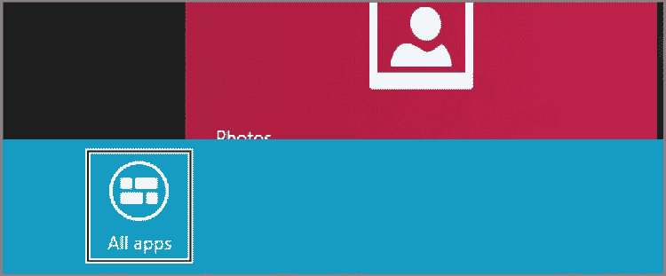

要在“开始”屏幕上浏览或搜索应用，请按照以下步骤操作：

1. 使用鼠标右键单击“开始”屏幕上的任意空白区域（即除动态磁贴以外的任何位置）。底部菜单会显示一个命令“所有应用”，如图 2-6 所示。如果使用触摸屏设备，请在屏幕底部使用“从边缘滑动”手势以达到相同效果。

2. 单击或点击“所有应用”图标。动态磁贴消失，现在你会看到系统上所有已安装软件的列表，如图 2-7 所示。你可以像滚动“开始”屏幕本身一样滚动此列表，并可以单击任何图标或名称以启动相应的程序。（你现在不必这样做，但如果这样做了，你可以使用键盘或设备上的“开始”按钮返回“开始”屏幕。稍后你将了解更多相关信息。）

3. 要根据应用名称或与其他应用的关联来搜索应用，请使用鼠标滚轮同时按住键盘上的 Ctrl 键，或者在屏幕上做出捏合手势以缩小图标。“应用”屏幕上的图标会合并成组，如图 2-8 所示。单击某个组以聚焦该组中的应用。

**图 2-7：** “应用”屏幕

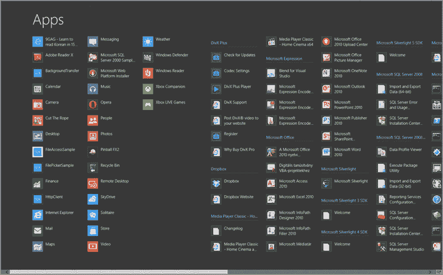

**图 2-8：** “应用”屏幕中的应用程序组

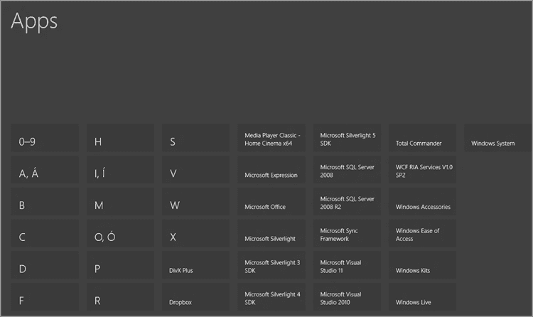

4. 按下键盘或触摸屏设备上的“开始”按钮，返回“开始”屏幕。

**图 2-9：** 带有搜索命令的超级按钮栏


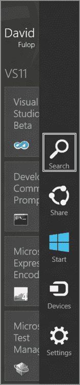

如果你的键盘没有“开始”按钮，请将鼠标光标移动到屏幕右下角以打开超级按钮栏。如果你使用的是没有硬件“开始”按钮的触摸屏设备，请在屏幕右侧使用“从边缘滑动”手势来执行相同操作。屏幕上会弹出五个图标，覆盖当前内容。点击（或轻触）中间那个蓝色窗口形状的图标，即可返回“开始”屏幕。（本章后面会详细介绍超级按钮栏。）

**5.** 要搜索应用，请在“开始”屏幕打开时开始键盘输入。例如，按下 C 键。此时会出现你之前在本“动手实践”练习中见过的“应用”屏幕，但有两个不同之处。首先，它现在被过滤为仅显示名称以字母“c”开头的应用。其次，屏幕右侧会出现一个侧边栏，其中包含你刚才输入文本的文本框以及其他一些内容。

在缺少硬件键盘的触摸屏设备上实现相同操作会稍微复杂一些。要打开可用于搜索应用的搜索栏，请在屏幕右侧边缘使用“从边缘滑动”手势。这会调出超级按钮栏，如图 2-9 所示。然后轻触超级按钮栏最上方的图标（名为“搜索”）。熟悉的“应用”屏幕会出现，右侧带有一个侧边栏，其中包含一个文本框。轻触文本框以调出虚拟键盘，然后轻触“c”键。

**6.** 按下或轻触“o”键。应用再次被过滤，现在你只能看到名称中包含“co”的应用，如图 2-10 所示。

**7.** 要将“控制面板”应用固定到“开始”屏幕，请右键点击或向下滑动该应用的图标以选中它。这会调出屏幕底部的上下文栏，如图 2-11 所示。上下文栏包含四个图标。点击或轻触第一个图标（显示为“固定到‘开始’屏幕”）。上下文栏消失，如果你返回“开始”屏幕，会发现“控制面板”位于屏幕的最右端。（可能需要滚动才能找到它。）下次你以这种方式选中“控制面板”时，上下文栏上的第一个按钮将显示为“从‘开始’屏幕取消固定”。点击或轻触该图标，可以撤销此操作，并从“开始”屏幕中删除该动态磁贴。

**图 2-10:** 名称中包含“co”的应用

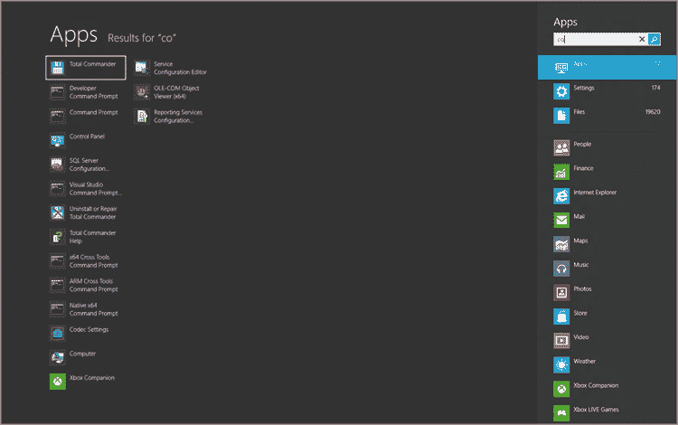

**图 2-11:** 选中的应用图标及打开的上下文栏

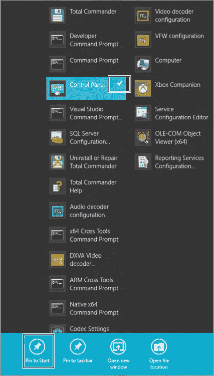

* * *

**注意** 你不必局限于只搜索应用名称的第一个单词。过滤算法会在应用名称的每个单词中查找输入的子字符串。例如，如果你输入 c，则“Windows Media Center”的图标会出现在列表中，因为其名称中的一个单词以“c”开头。

* * *

超级按钮栏和搜索功能都是 Windows 8 的核心功能，你将在本章后面了解它们。但现在，让我们看看“开始”屏幕的核心部分——动态磁贴——能做什么。

#### 使用动态磁贴

正如你之前所学，动态磁贴可以被视为一种快捷方式，因为它代表一个应用程序。但动态磁贴不仅仅是放大的图标。它们会输出应用程序所消耗的部分数据，让你更高效。你无需打开电子邮件应用就能查看是否有新邮件等待处理，只需瞥一眼该应用的动态磁贴即可。

实际上，某些应用可能拥有多个动态磁贴。例如，你可以让某个天气应用将一个显示某城市天气的动态磁贴固定到“开始”屏幕，再固定另一个动态磁贴来显示另一个城市的信息。不过，此功能是可选的。只有那些为此做好准备（经过编程）的应用才提供此功能。

要启动一个应用，只需点击其动态磁贴（如果使用触摸屏设备，则轻触它）。对于大多数动态磁贴，此操作会直接启动应用。但了解一点很有帮助（不仅仅是对于开发者）：特殊的动态磁贴（辅助磁贴）可以包含应用的某些初始化信息。此功能（称为深层链接）允许用户不仅启动应用，还能指定要使用应用的哪个部分。例如，如果用户使用前述天气应用固定了一个关于布达佩斯天气的动态磁贴，之后通过该动态磁贴启动天气应用，应用将打开并显示布达佩斯的天气预报。

现在，让我们来看看动态磁贴的基本操作及其相关操作。

##### 动态磁贴的上下文栏

当你使用 Windows（或任何图形桌面操作系统）时，你会接触到上下文菜单和弹出菜单的概念。这些菜单为图形化表示的对象（无论是桌面上的图标还是桌面本身）提供额外操作。在 Windows 8 中，上下文菜单以更受控制的方式出现——至少在位置和设计方面如此。当你右键点击“开始”屏幕以调出上下文栏时，你会看到 Windows 8 的上下文菜单。

每个动态磁贴都有自己的上下文菜单，当然，这些菜单中的项目可能略有不同。当你调出 Windows 8 风格应用的上下文栏时，你可能会看到以下按钮：

*   固定到“开始”屏幕/从“开始”屏幕取消固定——点击（或轻触）此按钮可使选中的动态磁贴出现在“开始”屏幕上，或从“开始”屏幕上消失——正如你在之前的“动手实践”练习中已经看到的那样。

*   卸载——点击或轻触此按钮可从设备中删除选中动态磁贴背后的应用。你可以通过从 Windows 8 应用商店重新安装该应用来撤销此操作。

*   放大/缩小——某些应用提供同一动态磁贴的两种尺寸：一种是小正方形，另一种是两倍大的矩形，后者提供更多信息。当选中一个动态磁贴，且与之关联的应用支持这两种尺寸的磁贴时，你会在上下文菜单中看到一个名为“放大”或“缩小”的按钮。它们让你选择是使用小尺寸还是双倍尺寸的动态磁贴，但仅当应用支持大尺寸磁贴时才会出现。

*   关闭/打开动态磁贴——此按钮可让你关闭动态磁贴上的通知，或重新打开它们。关闭后，磁贴仅显示应用的默认图标表示。这些按钮仅当磁贴背后的应用支持通知时才会出现。

Windows 8 风格应用只是故事的一半。Windows 8 也能运行传统的 Win32/.NET 应用。当这些应用之一被固定到“开始”屏幕时，其对应的动态磁贴并非真正“动态”；它不会更新。传统软件应用目前缺乏实现此功能的手段。此外，这些程序的上下文栏也会略有不同。

当调出传统应用的上下文栏时，除了 Windows 8 风格应用的上下文栏按钮外，你通常还会看到以下按钮：

*   固定到任务栏——你可以使用此按钮将该程序永久固定到桌面任务栏。

*   打开新窗口——使用此按钮在桌面上打开该应用的新实例。

*   以管理员身份运行——使用此按钮以管理员权限在桌面上运行该应用。请注意，你无需是管理员即可看到此按钮，但使用它时，系统会提示你输入管理员密码。

*   打开文件位置——使用此按钮可在 Windows 资源管理器中打开包含该应用可执行文件的文件夹——当然，是在桌面上。


如你所见，所有这些按钮都与 Windows 桌面相关。与 Windows 8 风格应用的另一个区别是，上下文栏上不会出现“放大/缩小”和“打开/关闭动态磁贴”按钮，原因显而易见。在下一个练习中，你将学习如何使用动态磁贴的上下文栏。

* * *

**试一试：使用动态磁贴的上下文栏**  
要使用上下文栏更改动态磁贴的大小或打开/关闭它们，请按照以下步骤操作：

**1.** 要调出上下文栏，请右键单击或轻扫某个动态磁贴。例如，右键单击或轻扫“音乐”动态磁贴。你单击的动态磁贴会显示一个小边框，并在右上角出现一个标记。同时，上下文栏会出现，如图 2-12 所示。

**2.** 单击或点击上下文栏上的“缩小”按钮，使“音乐”动态磁贴变小。请注意，操作完成后上下文栏会自动消失，如图 2-13 所示。

**图 2-12：** “音乐”动态磁贴的上下文栏

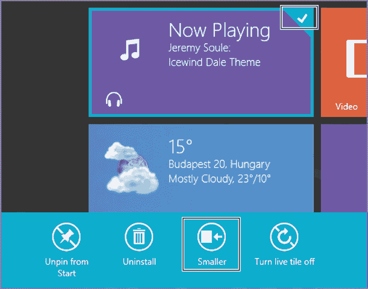

**图 2-13：** “音乐”动态磁贴变小

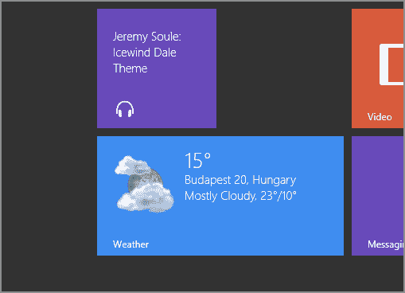

**3.** 再次右键单击或轻扫“音乐”动态磁贴。单击或点击“放大”按钮。动态磁贴再次变为双倍大小。

**4.** 要关闭动态磁贴的更新，首先右键单击或轻扫“音乐”动态磁贴。然后，单击或点击上下文栏上的“关闭动态磁贴”按钮。该动态磁贴将停止更新其内容；只会在上面显示一个音符。

**5.** 要重新打开更新，请右键单击或轻扫“音乐”动态磁贴。单击或点击“打开动态磁贴”按钮。当你使用该应用播放音乐时，更新将再次出现在磁贴上。

**工作原理**  
动态磁贴本身可被视为小型应用——只不过它们必须连接到一个“真正的”应用程序。当你构建 Windows 8 风格的应用时，你可以通过一个名为后台任务的第三方组件，向应用的动态磁贴发送状态更新。操作系统会不时调用后台代理，让它向动态磁贴发送两种更新——一种用于小尺寸动态磁贴，另一种用于大尺寸版本。通过单击或点击上下文栏上的“关闭动态磁贴”按钮，你可以阻止动态磁贴接收这些更新。

* * *

**注意** 虽然上述场景是动态磁贴最常见的工作方式，但也存在特殊情况。你将在第 9 章中了解更多关于动态磁贴的内容。

* * *

* * *

你可以通过右键单击或轻扫手势选择多个动态磁贴。当选中多个动态磁贴时，只会显示“从‘开始’屏幕取消固定”或“清除选择”按钮。后者允许你取消所有选中的动态磁贴。要取消单个动态磁贴的选择，请再次右键单击或轻扫该动态磁贴。

##### 重新定位动态磁贴

动态磁贴以整洁有序的方式排列在“开始”屏幕上。一列磁贴由两个小（正方形）动态磁贴组成，当磁贴到达并占据最后一行（由屏幕分辨率决定）时，下一个磁贴会放置在新的一列中。

为了在使用任何 Windows 8 设备时提供并保持一致且熟悉的体验，操作系统不允许任何人更改此布局机制。然而，自定义功能触手可及。除了前面描述的操作外，用户还可以将动态磁贴组合成组，或者直接移动它们以改变顺序。

让我们尝试更改顺序。

* * *

**试一试：重新排列动态磁贴**  
要重新排列动态磁贴，请按照以下步骤操作：

**1.** 转到“开始”屏幕。按住鼠标左键单击一个动态磁贴。向任意方向稍微移动鼠标。所有其他磁贴都会冻结，并相对于你按住的那个磁贴后退，但你按住的那个动态磁贴大小保持不变。同时，它还会变得半透明。  
在触摸屏设备上执行此操作时，请向下轻扫动态磁贴，并在它完全脱离原位之前不要松开。

**2.** 向任意方向自由移动动态磁贴。其他动态磁贴会移开，为你尝试重新定位的动态磁贴腾出空间，如图 2-14 所示。

**图 2-14：** 重新定位动态磁贴

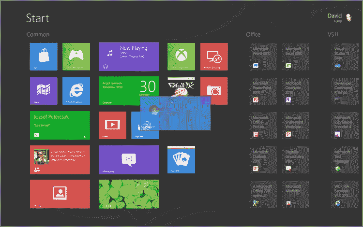

**3.** 找到你想要放置动态磁贴的位置后，松开鼠标左键或手指。新的顺序和布局将被保留。

**工作原理**  
当你将动态磁贴从其位置拖出时，Windows 8 会理解你想将该动态磁贴放置在“开始”屏幕的其他位置。为了帮助你完成此操作，所有其他动态磁贴都会冻结并缩小。当你将动态磁贴移动到新位置时，其他动态磁贴会自动移开，以显示如果你将拖动的磁贴放置在那里，它们将如何排列。

* * *

##### 动态磁贴组

你可能已经注意到，“开始”屏幕上的动态磁贴被分成了组。这种分组非常微妙。唯一能区分的是两列动态磁贴之间更大的水平间距。此外，组可以有自己的名称，显示在动态磁贴上方。

###### 创建动态磁贴组

创建动态磁贴组相当容易，但奇怪的是，你在上下文栏上找不到用于此任务的命令按钮。当你将动态磁贴拖到新位置，并且该动态磁贴在两个组之间悬停时，会出现一条粗的浅灰色水平线。如果你松开拖动的动态磁贴，它将成为新动态磁贴组中的第一个项目。

###### 使用动态磁贴组

当你创建一个新的动态磁贴组时，它没有名称。如果你想给该组命名，或者想将其放置在其他组之间的其他位置，你可以进入“开始”屏幕的缩小视图。在此视图中，你可以同时看到所有动态磁贴和组。在此概览中，你无法选择单个动态磁贴，但可以选择组（一次一个）。选择一个组会在屏幕底部打开上下文栏，其中包含一个命令：“命名组”。选择此命令可以让你为组添加名称，或者如果名称已存在则进行修改。

重新排列组的方式与重新定位动态磁贴有些相似。在缩小视图中，你可以选择一个动态磁贴组，并将其拖到你想要放置的位置。当你拖动组时，其他组会移开，为拖动的组腾出空间。

* * *

**试一试：管理动态磁贴组**  
要创建新的动态磁贴组，为其命名，然后将其放置在其他组之间的其他位置，请按照以下步骤操作：

**1.** 打开“开始”屏幕。按住鼠标左键单击一个动态磁贴并将其移开。如果你使用触摸屏设备，请轻扫动态磁贴，不要松开。当磁贴脱离原位后，你就可以移动它。将动态磁贴水平拖动，直到它直接位于动态磁贴之间较大的间隙上方（这是组之间的分隔线）。一条粗灰色线会出现在组之间，如图 2-15 所示。松开动态磁贴。

**图 2-15：** 创建动态磁贴组


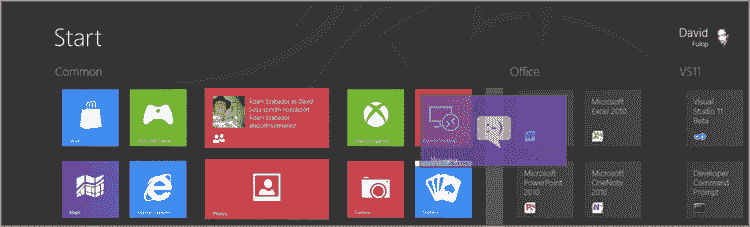

**2.** 进入缩小视图。你可以通过按住 Ctrl 键并滚动鼠标滚轮，或在“开始”屏幕上使用捏合手势来实现。如果鼠标没有滚轮，请单击屏幕右下角。图 2-16 显示了缩小视图下的“开始”屏幕。

**3.** 右键单击或轻扫你在步骤 1 中刚刚创建的新组。这会在屏幕底部打开上下文栏，其中包含一个命令按钮：“命名组”。单击或点击它，在上下文栏上方弹出的窗口中，为这个尚未命名的组指定一个名称。图 2-17 展示了这一步骤。输入名称后，单击或点击文本框下方的“名称”按钮。

**图 2-16：** 缩小视图

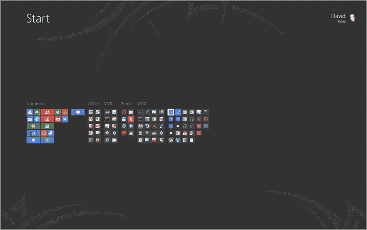

**图 2-17：** 重命名动态磁贴组

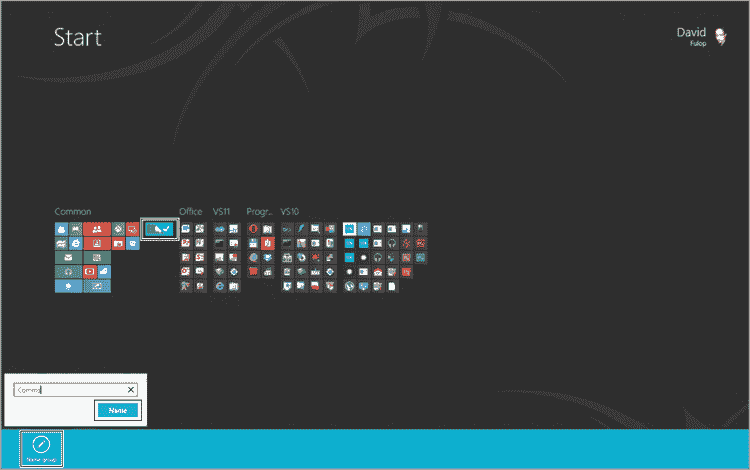

**4.** 仍在缩小视图中时，单击并按住（或轻扫）你在步骤 1 中创建的组。按住组的同时移动鼠标或手指。移动几个像素后，该组会从原位弹出。将组向侧面拖动，直到相邻的组改变位置，为你拖动的组腾出空间，如图 2-18 所示。松开鼠标按钮或手指，将组放置在该位置。

**图 2-18：** 排列动态磁贴组

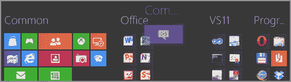

**5.** 单击或点击屏幕上的任意位置，退出缩小视图。

**工作原理** 动态磁贴组帮助你分类“开始”屏幕上的动态磁贴。通过将动态磁贴放置在两个组之间或“开始”屏幕的边缘，即可创建新组。创建组时，它是未命名的，但可以在缩小视图中选中它来命名。同样在此概览视图中，你可以更改组的排列顺序。

* * *

#### 使用 Windows 8 风格应用

Windows 8 和 Windows 8 风格应用的设计旨在通过鼠标或触摸屏轻松操控。有一些（多点）触摸手势可用于完成特定任务，例如关闭应用或在应用之间切换。因此，使用 Windows 8 风格应用与使用传统的 Windows 桌面及其上运行的程序之间存在一些差异，你必须了解这些差异。

##### 关闭 Windows 8 风格应用

首先，你实际上无法真正关闭 Windows 8 风格应用（当然，除非你通过代码或使用任务管理器强制终止）。你可以告诉操作系统你想要关闭正在运行的应用，但它不会立即释放该应用。

从“如何使用 Windows 8”的角度来看，这大多不重要，但作为这一设计决策及其他若干设计决策的结果，Windows 8 风格应用没有关闭按钮。事实上，它们没有边框、标题栏或任何可被视为“装饰”的东西。（微软通常将设计中无功能的部分称为“装饰”。）

此外，Windows 8 风格应用没有窗口；它们始终是全屏显示——除非在分屏模式下使用，但这里先不讨论。因此，一开始关闭 Windows 8 风格应用可能比较困难，因为大多数此类应用没有关闭按钮。

要关闭 Windows 8 风格应用，你可以使用一个简单的手势，只需一根手指或鼠标即可完成。如果你抓住应用的“标题栏”（即屏幕顶部几个像素的区域），并将其向下拖拽到屏幕底部边缘，应用就会关闭，你会被带回“开始”屏幕。

这个手势非常容易使用，你应该根据其含义来构建你的应用。不要将按钮或其他任何命令控件放置在离应用顶部边缘太近的位置。如果非必要，不要在应用中添加“关闭”按钮，因为用户会习惯使用上述手势。

##### 在 Windows 8 风格应用之间切换

当你在使用一个 Windows 8 风格应用时，想要切换到另一个，该怎么办？当你运行一个 Windows 8 风格应用时，它会占据屏幕上的所有像素。Windows 8 中没有任务栏，因此你不能直接点击应用的图标。

如果你的电脑有键盘，可以使用传统的 Alt+Tab 或 Windows 键+Tab 快捷键在应用之间切换。要完全通过鼠标完成此操作，或在触摸屏设备上完成，你需要学习另一种鼠标移动或手势。

如果你想使用鼠标在 Windows 8 风格应用之间切换，请将鼠标移动到屏幕左上角。之前使用的应用的缩略图会出现。如果你点击它，当前应用会进入后台，并与上一个使用的应用交换位置。如果你不点击它，而是将鼠标指针沿着屏幕左边缘向下移动，会出现一条黑色条纹，在这条条纹上，所有在后台运行的 Windows 8 风格应用都会显示出来。你可以点击其中任何一个，将该应用带到屏幕前台。

如果你使用触摸屏设备，切换应用的方法略有不同。要在应用之间切换，请在屏幕左侧使用“从边缘轻扫”手势。上一个应用的缩略图会出现。如果你用手指继续拖动这个缩略图，并在屏幕上的某个位置松开，它就会变为活动状态并再次全屏显示。通过这个手势，你可以遍历所有正在运行的 Windows 8 风格应用。

要精确选择你想要切换到的应用，请在左侧使用“从边缘轻扫”手势，当上一个应用的缩略图出现时，将其轻扫回边缘。这会打开与使用鼠标访问正在运行的应用时相同的黑色侧边栏。当应用侧边栏打开时，你可以松开屏幕，侧边栏会保持打开状态。然后，只需点击你想要重新激活的应用即可。

* * *

**注意** 值得注意的是，“开始”屏幕的缩略图始终位于应用侧边栏的底部。如果你点击或轻触此缩略图，你会回到“开始”屏幕。你正在使用的应用不会关闭，它只是被发送到后台。

* * *

##### 同时使用多个 Windows 8 风格应用

你很可能希望同时运行两个应用，而无需在它们之间来回切换。为了支持这种非常常见的场景，Windows 8 风格应用具有三种视觉状态。

除了默认的全屏状态外，应用还可以处于“填充”或“贴靠”状态。当你想要同时使用两个应用时，其中一个可以贴靠，这意味着它只占据屏幕一侧的一小部分。同时，另一个 Windows 8 应用可以填充，即占据剩余的空间。通过单击或点击并按住贴靠应用与填充应用之间的窄线，然后水平拖动分隔线，你可以让应用切换状态（一个从贴靠变为填充，另一个则相反）。或者，如果你将分隔线一直拖到屏幕边缘然后松开，分隔线后面的应用将被关闭。

在接下来的“动手试一试”练习中，你将通过相应的鼠标或触摸手势看到这些功能的具体操作。

* * *

**动手试一试：使用 Windows 8 风格应用**

**图 2-19：** 侧边栏显示正在运行的 Windows 8 应用


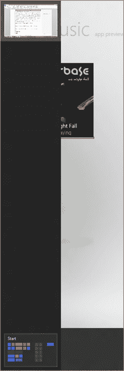要熟悉 Windows 8 应用的基本操作，请按照以下步骤进行：

**1.** 在“开始”屏幕上，单击或点击应用的动态磁贴以启动该应用。例如，启动“音乐”应用。

**2.** 应用运行后，将光标移至屏幕左上角，然后稍微向下移动。侧边栏会显示当前正在运行的 Windows 8 应用。若要通过触摸屏调出此侧边栏，请在左侧边缘使用“从边缘滑动”手势，然后立即滑回边缘。图 2-19 显示了打开的侧边栏。

**3.** 单击或点击侧边栏底部的“开始”屏幕缩略图，返回“开始”屏幕。

**4.** 在“开始”屏幕上，单击或点击另一个应用的动态磁贴。例如，启动“天气”应用。

**5.** 应用运行后，重复步骤 2 中的操作，打开正在运行的应用的侧边栏。

**6.** 单击或点击侧边栏中最顶部的缩略图。这将带你回到之前使用的应用（“音乐”应用）。（实际上，你只需将鼠标移至左上角，然后在不打开侧边栏的情况下单击缩略图即可完成此操作。）

**7.** 抓住应用的标题栏。如果使用鼠标，请将光标移向屏幕顶部边缘，直到它变成一只小手。然后按住鼠标左键，将光标移向屏幕底部。使用触摸屏执行相同操作非常类似：从屏幕顶部边缘向下滑动以抓住应用。应用会缩小到原来大小的一半或三分之一。

**8.** 将应用拖向屏幕的左侧或右侧，当它足够靠近边缘时，松开鼠标左键或手指。这会使应用进入贴靠状态。拖动应用时，会出现一条浅色竖线，提示如果你松开拖动的应用，它将被贴靠到屏幕较近的一侧。屏幕较大的另一半将保持灰色或空白。此区域可以显示一个已填充的应用。

**9.** 要用之前的应用填充屏幕剩余的空白区域，请将光标移至屏幕左上角，然后点击上一个使用的应用的缩略图。如果使用触摸屏设备，只需在屏幕左侧使用“从边缘滑动”手势。图 2-20 显示了此阶段。

**图 2-20:** 左侧为填充状态的 Windows 8 应用，右侧为贴靠状态的 Windows 8 应用

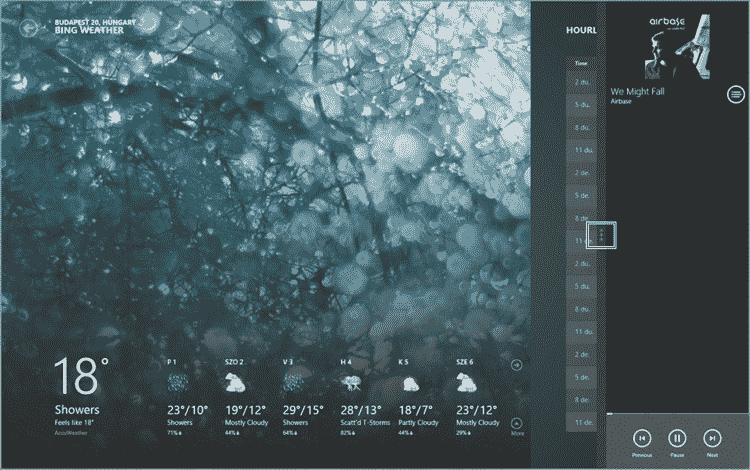

**10.** 要修改两个应用之间的屏幕分割比例，请按住（如果使用触摸屏则长按）分隔贴靠应用和填充应用的窄深灰色线条（在图 2-20 中高亮显示）。将鼠标或手指移向屏幕较远的一端，直到填充应用移开。松开鼠标或触摸屏，即可交换两个应用的屏幕尺寸比例。

**11.** 再次抓住分隔线，将其移向屏幕较近的一侧。松开后，贴靠应用消失，之前填充的应用变为全屏。

**12.** 要关闭正在运行的应用，首先抓住它的标题栏，就像步骤 7 中那样。然后将应用向下拖到屏幕的最底部。如果将其拖到足够靠近边缘的位置，它会变得透明。

**13.** 松开鼠标按钮以关闭应用。如果使用触摸屏设备，在向下滑动到边缘之前不要松开手指。

**工作原理**

Windows 8 风格的应用需要一种方式，让用户能够通过触摸或鼠标轻松执行常见任务。如果你想切换到另一个应用，可以将光标移至左上角并单击其中一个缩略图，或者从左侧边缘滑入其他正在运行的应用。如果你想同时使用两个应用，可以将屏幕分割成较小和较大的两部分。每个部分都可以由一个能够处理贴靠或填充布局风格的应用来填充。要关闭 Windows 8 应用，只需抓住其标题栏，将其向下拉到屏幕底部边缘，然后松开即可。

* * *

**图 2-21:** 打开的超级按钮栏

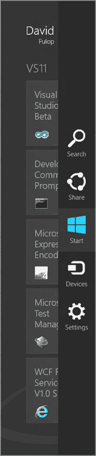

### Windows 超级按钮栏

操作系统的几个常见任务需要一个中心位置，以便随时轻松访问。这些任务包括返回“开始”屏幕（类似于在以前版本的 Windows 中按 Windows 按钮打开“开始”菜单）、搜索、在应用之间切换以及管理设备或设置。此外，由于 Windows 8 风格的应用会填满整个屏幕，这些功能必须不可见，但仍需易于访问。

正如你所了解的，应用切换与屏幕左侧相关联。在顶部边缘执行的手势与关闭应用或在三种布局状态之间更改其大小有关。屏幕底部边缘用于调出命令栏或上下文栏。这样只剩下右侧边缘来容纳所有尚未放置的重要操作系统功能。

#### 超级按钮栏简介

无论你是在“开始”屏幕、Windows 8 风格应用还是桌面上，如果将鼠标移至屏幕的任意一个右角（或在屏幕右侧使用“从边缘滑动”手势），右侧会出现五个按钮。这就是超级按钮栏。

超级按钮栏有点像是一个中心枢纽，用于与你的应用以及操作系统进行交互。它始终包含相同的五个按钮——开始、搜索、共享、设备和设置——并且始终在那里，只需一次滑动或鼠标移动即可访问。应用程序无法覆盖此行为。

图 2-21 显示了带有打开的超级按钮栏的“开始”屏幕。

此外，当你打开超级按钮栏时，屏幕左下角会出现一个信息框，显示当前日期和时间、网络信号强度以及剩余电池电量。

#### 开始按钮

由于其中心位置和与其他按钮不同的颜色，“开始”按钮确实显得与众不同。考虑到“开始”按钮在以往 Windows 版本历史中的重要功能，这一点完全可以理解。请注意，在 Windows 8 中，屏幕上没有永久的“开始”按钮，如果你的触摸屏设备没有硬件键盘，没有这个按钮你就无法返回“开始”屏幕。

当你在使用某个应用时单击或点击“开始”按钮，它会打开“开始”屏幕。当你再次单击或点击它（在“开始”屏幕打开时），你会返回到上次使用的应用。这似乎与以前版本的 Windows 有所不同，但实际上是完全相同的。区别实际上在于新的“开始”屏幕。它占据了整个屏幕，而不仅仅是像“开始”菜单那样的一小部分。但当你单击或点击“开始”时正在运行的应用会在后台继续运行，不会被挂起。

* * *

**注意** 值得注意的是，在配备鼠标的计算机上，你始终可以使用“开始”屏幕的缩略图（就像你在上一个“动手试一试”练习中已经做的那样）。在使用 Windows 8 应用时，将光标移至屏幕左下角，然后点击出现的缩略图。

* * *

#### 搜索按钮

快速在电脑或设备上查找文件或应用非常重要。Windows Vista 通过在“开始”菜单中放置搜索框使其更快。在之前的“开始屏幕”部分及其对应的“动手试一试”练习中，你学习了如何使用此功能查找应用。但 Windows 8 可以做得更多！


当你调出超级按钮栏，并点击或轻触“搜索”按钮时，就会进入之前看到的应用搜索页面。默认情况下，Windows 会查找名称中包含你输入文本的应用。但在你输入文本的文本框下方，可以看到三个按钮：“应用”、“设置”和“文件”。随着你输入，这些按钮上会出现数字。这些数字告诉你，有多少应用、Windows 设置或文件的名称中包含你输入的文本，以及有多少文件包含你正在查找的文本。

搜索屏幕在你输入时只显示应用，但当你点击或轻触“设置”或“文件”按钮时，应用会消失，取而代之的是筛选后的 Windows 设置或文件列表。在查找文件时，搜索屏幕顶部甚至会出现分类，以帮助你加快搜索速度。图 2-22 显示了文件模式下的搜索屏幕。

当你构建 Windows 8 应用时，可以将其设置为搜索提供程序。这意味着该应用处理的数据可以从应用外部（即 Windows 搜索屏幕）进行搜索。只要你向 Windows 表明你的应用可以搜索其数据，Windows 就会允许你搜索该应用的数据，而无需先启动该应用。

在三个主要按钮下方，是那些向 Windows 表明其内部具有搜索功能的应用。当你点击（或轻触）其中一个图标时，相应的应用会启动，并且你会立即看到该应用内的搜索结果。

**图 2-22：** 搜索文件

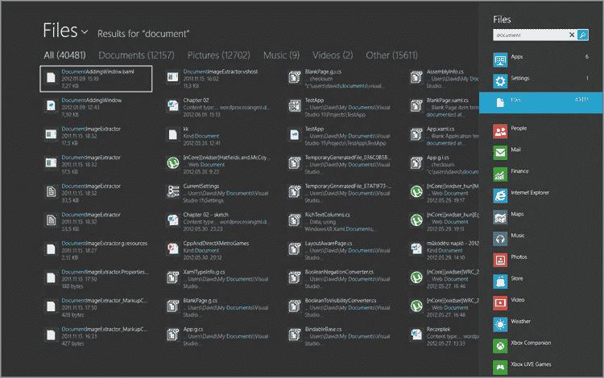

#### 共享按钮

共享信息（链接、文档等）在过去十年中已成为日常任务。通常，这需要先启动一个“拥有”信息的应用（例如可以打开特定网页的浏览器），然后启动另一个可用于与他人通信的应用（例如电子邮件客户端），接着设置共享方式（创建新电子邮件），并将信息从一个应用复制到另一个应用。

在 Windows 8 中，这一常见任务成为系统的一部分，从而简化了操作，节省了时间和精力。超级按钮栏上的“共享”按钮可以在能够与其他应用共享数据的应用中使用，以调出一个侧边栏，列出接受这些数据的应用。点击或轻触其中一个应用，即可打开该应用，并立即设置好一切，以便尽可能快地将信息与他人共享（例如创建电子邮件，并设置发件人和邮件正文）。

在下面的练习中，你可以看到这有多简单。

---

##### 动手试一试：通过超级按钮栏应用进行共享

按照以下步骤，使用 Windows 超级按钮栏在应用之间共享一些数据：

1. 点击或轻触“开始”屏幕上的 Internet Explorer (IE) 动态磁贴，启动 IE。
2. 点击或轻触应用底部的文本框，然后输入 URL，导航到 [www.microsoft.com](http://www.microsoft.com)。输入完成后，按 Enter 键，或轻触文本框旁边的箭头。
3. 页面打开后，将鼠标光标移动到屏幕的右上角或右下角，或者在屏幕右边缘执行轻扫手势，调出超级按钮栏。点击或轻触超级按钮栏上的“共享”按钮，让 Windows 列出所有可以接受并共享 IE 中打开的 URL 的应用。在安装其他应用之前，列表中只会显示“邮件”应用。图 2-23 显示了列出接受应用的侧边栏。

**图 2-23：** 可以接受 IE 提供数据的应用

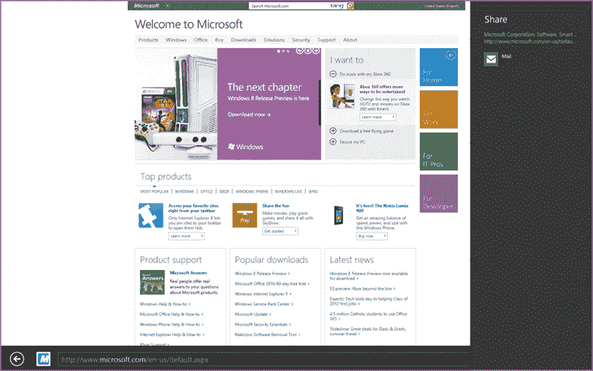

4. 点击或轻触“邮件”应用的图标。“邮件”应用会在屏幕右侧打开，并立即显示一封几乎可以发送的电子邮件。图 2-24 显示了你在设备上应看到的内容。
5. 在“邮件”应用的文本框中输入电子邮件地址（你可以点击或轻触建议的地址以加快速度），然后点击或轻触应用右上角的“发送”按钮（该按钮在图 2-24 中突出显示）。“邮件”应用会显示正在发送电子邮件，然后消失。

**图 2-24：** 使用“邮件”应用共享来自 IE 的数据

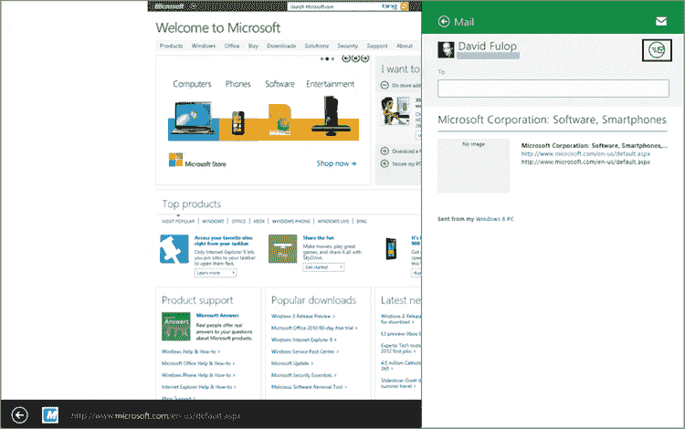

#### 工作原理

Windows 8 应用可以向 Windows 表明它们能够与其他应用共享某种数据或信息。一个应用可以将这些数据发送给另一个可以接受它的应用。使用 Windows 8 应用时，调出超级按钮栏并选择“共享”按钮即可开始共享。然后选择你想要接收信息的应用。作为共享目标的应用将通过 Windows 接收数据，并可以对其进行处理（做任何它想做的事情）。

---

#### 设备按钮

个人电脑和平板电脑并非独立、单一的硬件。它们几乎总是可以连接某种外设——外部显示器、输入设备、扩展坞等。台式电脑大多数时候拥有一套固定的外设，因为它们不常移动。而笔记本电脑和平板电脑则是移动设备，可能一直在不同的环境中使用。不同的环境可能导致不同的外设。如果你在旅行时使用笔记本电脑，你会单独使用它，但当你回到办公室时，你可能会连接鼠标和第二个屏幕。

“设备”按钮让你可以在一个中心位置访问这些连接的外部硬件设备。你无需前往“控制面板”或“我的电脑”来查看设备。只需打开超级按钮栏，点击或轻触“设备”按钮，即可看到设备列表。

#### 设置按钮

**图 2-25：** 设置栏

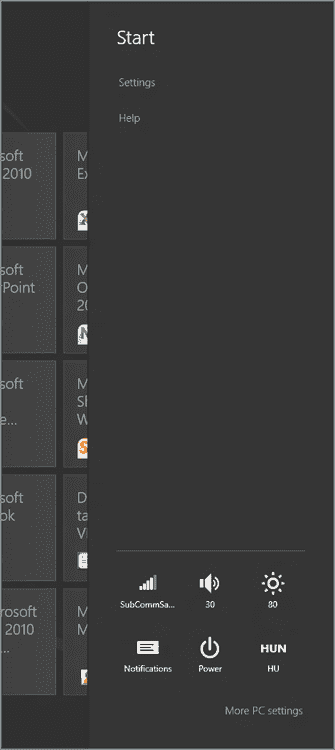

超级按钮栏上的最后一个按钮是“其他所有内容”，这些内容在日常使用设备时非常有用。当你点击或轻触“设置”按钮时，设置栏会打开。从 Windows 8（即从“开始”屏幕打开，或在使用 Windows 8 应用时打开）打开时，设置栏包含的内容与从桌面打开时略有不同（稍后你将了解更多关于桌面的内容）。图 2-25 显示了在 Windows 8 模式下打开的设置栏。

在设置栏的下方，你会找到六个图标。从左到右（以及从上到下），它们包括：

- **网络** — 指示你的电脑或设备是否具有活动的局域网 (LAN) 或 Internet 连接，以及信号强度（使用 Wi-Fi 时）。点击或轻触它会打开“网络”侧边栏，你可以使用它连接到网络。
- **音量** — 显示连接到计算机的扬声器或耳机的音量设置。点击或轻触它会打开音量滑块，你可以使用它调整此设置。
- **亮度** — 显示屏幕的亮度设置（如果可用）。点击或轻触此图标会打开亮度滑块，你可以使用它调整此设置。
- **通知** — 某些应用程序（以及 Windows 8 本身）可以创建弹出（或 Toast）通知。这些是出现在屏幕上的小方框，包含一些信息，几秒钟后消失。通过点击或轻触此按钮，你可以启用或禁用这些通知，以阻止所有可能打扰你的应用。
- **电源选项** — 点击或轻触此按钮可关闭、重启、休眠你的电脑，或使其进入睡眠模式。可用的电源选项可能因其他设置或策略而异。
- **键盘区域设置** — 此图标指示软件和硬件键盘的当前区域和布局。点击或轻触此按钮可切换到其他键盘布局。


在这六个按钮下方，有一个链接显示“更多电脑设置”。如果你点击或轻触它，就会打开“电脑设置”应用。在这里，你可以管理电脑最重要的设置。

“设置”栏可以作为应用的一个设置页面。你可以向其中添加自定义内容，用户可以通过这些内容管理当前应用的设置。

### Windows 桌面

正如你在第 1 章中学到的，Windows 有着非常悠久的历史——可以追溯到 20 世纪 90 年代初。微软在发布新版本操作系统时，始终将向后兼容性作为首要目标。Windows 8 通过其 Windows 8 用户界面、Windows 8 风格应用以及将“开始”菜单变为全屏“开始”屏幕，改变了许多东西。登录后，你总是会看到 Windows 桌面——所有程序都在独立的窗口中运行的地方。现在，在 Windows 8 中，你会立即被带到“开始”屏幕。桌面发生了什么变化？你过去使用的非 Windows 8 应用又怎么样了？

#### 介绍桌面应用

在“开始”屏幕上，你会发现一个有点独特的应用，叫做“桌面”应用。当你点击或轻触它时，就会进入那个自 Windows 7 以来变化不大的经典 Windows 桌面。请注意，如果出于某种原因你取消了它的固定，你随时可以从“应用”搜索页面重新固定它。更多信息请参阅前面的“开始屏幕”一节。

必须理解的是，“桌面”应用本身可以像任何其他 Windows 8 应用一样对待！你可以通过向下拖动来关闭它。你可以让它处于贴靠或填充状态，当你打开侧边栏时，它会像普通应用一样显示在屏幕左侧的应用侧边栏中。它的特殊之处在于，它可以运行所有为以前 Windows 版本创建的旧版桌面应用，以及所有为 Windows 8 创建的非 Windows 8 应用。图 2-26 显示了处于填充状态的“桌面”应用，同时另一个 Windows 8 应用处于贴靠位置。

除了从“开始”屏幕启动“桌面”应用本身之外，还有另一种切换到 Windows 桌面的方法。当你在 Windows 8 中启动一个非 Windows 8 应用时，该应用会立即启动“桌面”应用。这相当合理，因为如果没有这种行为，启动非 Windows 8 应用会导致大量桌面应用在运行（但无法访问）。

如果“桌面”应用被关闭，它正在运行的所有桌面程序都会保留在内存中继续运行。它们不会发生任何变化；只是在你重新打开“桌面”应用之前无法访问。

**图 2-26:** 桌面应用与另一个 Windows 8 应用共享屏幕

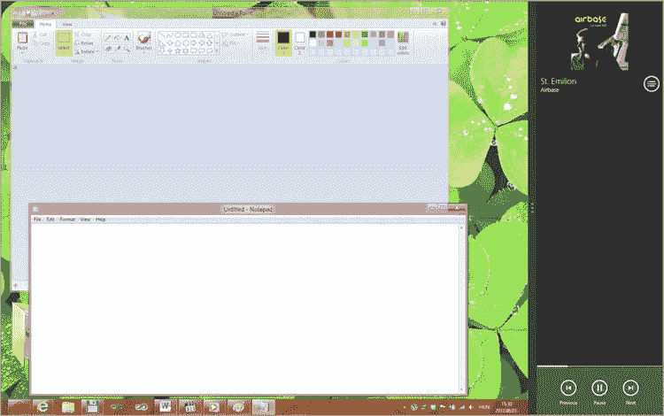

#### 在桌面程序之间切换

如果你有键盘，你可以通过按住 Alt 键、反复按 Tab 键，并在到达你想要使用的应用或桌面程序时松开 Alt 键，来在所有程序（包括 Windows 8 应用和非 Windows 8 应用）之间切换。

在缺少这些键的触摸屏设备上，你可以将“桌面”应用带到前台，然后轻触任务栏上的应用程序图标。当然，使用鼠标的用户可以通过单击图标来执行相同操作，就像在旧版 Windows 中一样。

桌面应用不会显示在屏幕左侧的应用侧边栏中，只有运行它们的“桌面”应用本身会显示在那里。

#### 开始按钮在哪里？

在 Windows 8 中，微软决定打破在屏幕左下角放置“开始”按钮的传统。但这并不意味着你必须学习新的工作流程才能打开“开始”屏幕。

在屏幕左边缘和任务栏最左侧图标之间，总是有一个小的空白区域。当你将鼠标光标移动到屏幕的这个左下角时，会出现“开始”屏幕的缩略图。点击它即可打开“开始”屏幕。这与你之前在旧版 Windows 中所做的并没有太大不同。

当然，按键盘上的 Windows 键也会产生相同的效果。

对于触摸屏用户，前面描述的选项可以从任何地方（包括“桌面”应用）打开“开始”屏幕。你可以通过从屏幕右边缘滑动来打开超级按钮栏，然后轻触“开始”按钮。或者，你可以从左边缘滑动打开应用栏，然后轻触侧边栏底部的“开始”屏幕缩略图。

### 总结

借助 Windows 8，你可以利用新一代应用和基础架构服务的力量。Windows 8 应用提供了一种构建适合平板电脑的应用的方法，同时保留了传统桌面软件的所有优势。在 Windows 8 的帮助下，你可以构建能够在更广泛的设备上运行的应用——台式机、笔记本电脑和平板电脑。通过利用多点触控手势和鼠标手势、角落和边缘的功能、共享和搜索合约，你可以构建更直观的应用——但这需要付出代价。作为开发人员，你必须知道如何有效地使用用户界面，无论是使用鼠标还是触摸屏。

“开始”屏幕的目的不仅仅是作为一个全屏的“开始”菜单。如果某个应用的动态磁贴持续为用户提供有用的信息，用户更有可能将其固定在“开始”屏幕上。

超级按钮栏是一个中心位置，用户可以在其中查找搜索和共享等功能。如果某个应用提供搜索和/或共享功能，那么通过将该应用连接到超级按钮栏上的“搜索”和“共享”中心来提供这些功能是一种良好的做法。

在第 3 章中，你将了解 Windows 8 架构的一些内部细节，以理解哪些组件可以帮助你构建 Windows 8 风格的应用。

**练习**

**1.** 如何通过触摸切换到上一个 Windows 8 风格应用？
**2.** 在哪里可以找到在“开始”屏幕上没有动态磁贴的应用？
**3.** 如何让动态磁贴停止刷新其内容？
**4.** 如何关闭 Windows 8 风格应用？
**5.** 如何在一个应用中与另一个应用共享数据？
**6.** 如何切换到 Windows 桌面应用来运行桌面应用？

* * *

**注意** 练习的答案可以在附录 A 中找到。

* * *

**本章所学内容**

| **主题** | **关键概念** |
| --- | --- |
| 多点触控手势 | 轻触、长按、滑动、轻扫、捏合、从边缘轻扫和旋转手势让用户在使用触摸屏设备时能够更直观、更自然地与应用交互。 |
| 登录模式 | 虽然传统的密码登录仍然可用，但你也可以使用四位数的个人识别码（PIN）密码和更便于触摸的图片登录。 |
| 开始屏幕 | 这是旧版“开始”菜单的后继者。这是使用电脑或平板电脑的中心屏幕。 |
| 动态磁贴 | 动态磁贴是应用的快捷方式，但它可以显示后台持续更新的信息，即使对应的应用没有运行。动态磁贴位于“开始”屏幕上，并且可以分组。 |
| 应用侧边栏 | 你可以在屏幕左侧打开应用侧边栏，它会显示所有当前正在运行的 Windows 8 应用。 |
| 全屏、贴靠、填充 | Windows 8 应用可以具有这三种布局状态。设备的屏幕可以容纳一个全屏应用，或者一个贴靠应用和一个填充应用。贴靠应用位于屏幕的任一侧，尽管尺寸较小，但仍能提供完整功能。填充应用占据贴靠应用留下的所有剩余屏幕空间。 |
| 超级按钮栏 | 超级按钮栏是 Windows 8 中的一个中心位置，用于执行常见任务。在这里你可以找到“搜索”和“共享”按钮，它们分别作为提供搜索或共享功能的应用的中心。“开始”按钮也位于超级按钮栏中。 |
| 共享 | 超级按钮栏上的这个按钮为你提供了将数据从一个应用发送到另一个应用的选项。 |


| Windows 桌面 | 这是所有非 Windows 8 应用驻留和运行的地方。它在台式机和笔记本电脑上仍然具有核心和关键功能，可以通过启动非 Windows 8 应用，或从“开始”屏幕启动“桌面”应用本身来访问。 |

## 第 3 章

### 从开发者角度看 Windows 8 架构

**本章你将学习：**

* 理解 Windows 8 风格应用和桌面应用的独立技术栈
* 掌握 Windows 运行时在开发 Windows 8 风格应用中的作用
* 了解哪些编程语言可用于访问 Windows 运行时应用程序编程接口（API）
* 理解 .NET Framework 4.5 的新特性
* 选择合适的编程语言和技术栈来创建你自己的 Windows 8 应用

当你开发应用程序时，通常会使用一组协同工作的技术。Windows 开发平台提供了大量的工具、技术和技巧。在过去十年中，这些组件的数量急剧增加。Windows 8 通过一种新型应用——Windows 8 风格应用——提供了一种新的开发模型，支持多种编程语言（C++、C#、Visual Basic、JavaScript），同时保持了相关技术组件的数量较少。Windows 8 仍然允许开发传统的桌面应用。

在本章中，你将了解有助于开发 Windows 8 应用的组件架构。首先，你将了解桌面应用和 Windows 8 应用开发技术栈之间的区别。正如你将学到的，Windows 8 应用开发的关键组件是 Windows 运行时，因此你将了解其结构和优势。为特定应用选择合适的技术并不容易。本章最后将帮助你更轻松地做出这一决定。

### Windows 8 开发架构

正如你所了解的，Windows 8 使你能够开发一种新型应用——Windows 8 风格应用——同时传统的桌面应用仍然可以在 Windows 上运行。此外，你仍然可以使用你喜欢的工具和技术来开发 Windows 8 风格应用。

Windows 8 的架构师在创建 Windows 8 风格应用的新架构层栈时做出了一个重要决定。因此，在 Windows 8 中，你有两个基本的技术栈（一个用于 Windows 8 风格应用，一个用于桌面应用），它们可以并行使用，如图 3-1 所示。

* * *

**注意** 架构层是一组具有相同角色的组件（例如，与操作系统通信）。架构层栈反映了这些层的服务如何相互构建。

* * *

**图 3-1:** Windows 8 为 Windows 8 风格应用和桌面应用提供了独立的架构组件栈

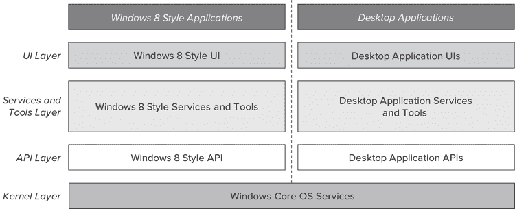

尽管这些 Windows 8 风格应用和桌面应用使用相同的操作系统内核，但在应用开发方面，你需要考虑一些重要事项。表 3-1 提供了这两种应用的比较。

**表 3-1:** 桌面应用与 Windows 8 风格应用

| **桌面应用** | **Windows 8 风格应用** |
| --- | --- |
| 桌面应用可以基于可追溯到 1995 年（其中许多部分甚至可追溯到 1991 年）的 Win32 应用程序编程接口（API）进行编程，也可以使用采用托管基类的 .NET Framework 进行编程。正如你在第 1 章“Windows 应用开发简史”中所了解的，桌面应用有丰富的语言、工具和技术选择。尽管选项丰富是件好事，但从应用开发的角度来看，这可能是一个劣势。根据你的应用目标——或你的意图——你可能会混合使用多种语言或技术来编程实现预期的功能。 | Windows 8 风格应用代表了一种新方法。它们旨在通过多点触控和传感器提供一流的用户体验，并且在用户界面（UI）响应性方面非常敏感。想象一个应用，你可以用手指在屏幕上拖动对象，而不是像用鼠标移动对象时那样体验卡顿的响应。为了确保完美的体验，用于 Windows 8 风格应用的 API 应原生支持 UI 响应性。当然，Windows 8 风格应用仍然支持完美的鼠标和键盘集成。 |
| 大多数桌面应用在屏幕上显示窗口和对话框，并等待用户输入、响应或确认。有时这些应用会在主窗口上显示多个非模态对话框（即允许你在不关闭对话框的情况下切换回主应用的对话框）。在工作时，用户必须从一个窗口切换到另一个窗口，常常同时关注不同的任务，有时是无意识的。 | Windows 8 风格应用开发旨在提供直观的 UI，应用占据整个屏幕。这种方法不鼓励使用弹出在屏幕上的对话框，而是建议使用应用页面，就像在浏览器中运行的 Web 应用一样。Windows 8 风格应用可以通过 Windows 应用商店部署，并且必须符合微软发布的 UI 和用户体验指南，才能通过认证过程。 |
| 桌面应用通常需要一个标准的安装过程，包含几个引导用户完成安装步骤的屏幕。整个过程可能需要一分钟（甚至更长时间），同时所有文件和资源被复制到计算机，并进行必要的注册。卸载应用也遵循标准过程，需要用户从控制面板开始操作。 | Windows 8 风格应用面向那些不一定熟悉文件、注册表和安装过程等概念的消费者。这些用户期望只需简单触摸或点击就能将应用添加到他们的应用集合中，而所有其他步骤都由系统自动完成。这些用户希望同样轻松地卸载程序——而不关心 Windows 在后台如何实现这一过程。 |

如你所见，由于这种以消费者为中心的信息技术方法，对 Windows 8 风格应用的期望与传统桌面应用截然不同。Windows 架构团队决定为 Windows 8 风格应用创建一个独立的子系统，以及一个独立的 API 来构建它们。

在深入探讨这个新 API 的细节之前，让我们先看看传统桌面应用的架构组件。

#### 桌面应用层

为了构建传统的桌面应用，开发者可以使用多种应用类型及其相关的组件栈。有趣（但并不意外）的是，“传统”这个词现在的含义与几年前（比如五年前）完全不同。尽管随着 Windows 8 的出现，你可以将图 3-2 中显示的所有应用栈称为“传统”，但托管应用栈在 2002 年还是相当新的，而 Silverlight 栈是最年轻的，自 2008 年可用。

**图 3-2:** 桌面应用层

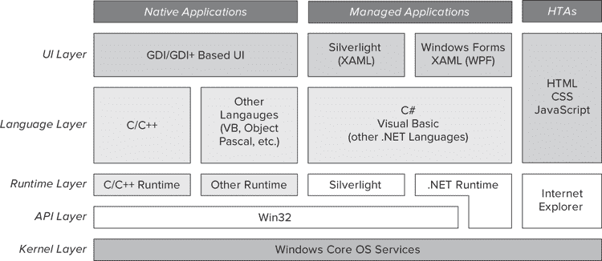

* * *


**注意** 如果你不了解图 3-2 中描述的所有技术，不必感到畏惧。该图旨在向你展示与桌面应用程序开发相关的各种技术组件。如果你对其中任何一项特别感兴趣，可以在 MSDN（[`msdn.microsoft.com`](http://msdn.microsoft.com)）上使用其名称进行搜索。

* * *

请注意图 3-2 中语言层与 UI 层之间的关系。如你所见，所选的编程语言从根本上决定了你可以用来创建桌面应用程序的技术栈。

对于原生应用程序，选择 C 或 C++（或其他原生语言，如 Visual Basic、Object Pascal 等）直接编译为 CPU 特定代码，意味着你必须使用图形设备接口（GDI）或 GDI+技术来实现 UI。

对于托管应用程序，你仍然可以使用 GDI 和 GDI+（在.NET 中，它们以 Windows Forms 的别名被使用）。一个更现代、更强大的选择是 Windows Presentation Foundation（WPF）——它基于可扩展应用程序标记语言（XAML）——或者它的“弟弟”（但同样强大）Silverlight XAML。

* * *

**注意** 原生应用程序直接编译为 CPU 特定代码，而托管应用程序则被转换为中间语言（IL）。当你运行托管应用程序时，IL 会由即时编译器（JIT）转换为 CPU 特定代码。

* * *

虽然使用 HTML 及相关技术创建桌面应用程序并不常见，但你可以通过 HTML 应用程序（HTA）来创建它们。

你的语言偏好也决定了在编程时可以使用的运行时库和环境（如图 3-2 所示的运行时层）。这些库包含语言原生用于访问操作系统服务的操作，例如显示值、管理文件或通过网络通信。对于原生应用程序，每种语言都有自己的语言运行时，例如 C/C++的 Microsoft 基础类库（MFC）和活动模板库（ATL）、Visual Basic 的 VB 运行时（.NET 出现之前的经典 Basic 语言），或 Delphi（Object Pascal）的 Visual Component Library（VCL）。

.NET 通过引入自己的基类库消除了这种差异，该基类库在所有.NET 语言中可用，包括 C#和 Visual Basic（以及其他流行的.NET 语言，如 F#、IronPython、IronRuby 等）。然而，随着 Silverlight 的发布，这种统一的局面变得有些模糊，Silverlight 在浏览器应用程序（如 Internet Explorer、Firefox、Safari 等）和桌面应用程序中都有另一个.NET 运行时。Silverlight 基类库只是.NET 中可用运行时类型的子集。

原生应用程序的运行时库构建在 Win32 API 之上（如图 3-2 中的 API 层所示），这是一个扁平的 API，拥有数万个（实际上互不相关的）入口点，用于调用 Windows 核心操作系统服务（如图 3-2 中的内核层）。相比之下，.NET 有自己的运行时环境——称为公共语言运行时（CLR）——它以对象的形式提供了对 Win32 API 更好的抽象，将相关的数据结构和操作封装成可重用的类型。

想象一下，你是一位架构师，想要为 Windows 8 风格应用程序创建开发组件栈。你会将其与现有的桌面应用程序技术合并吗？也许吧，但尽管如此，微软的架构团队决定创建一套新的、独立的 API，以摆脱技术碎片化。

#### Windows 8 风格应用程序层

随着 Windows 8 操作系统以消费者为中心的方法，微软现在面临着新的挑战。创建一个直观、支持多点触控、始终响应的 UI 只是挑战之一。更大的挑战是建立一个能够正确支持开发者的平台，让他们能够使用自己熟悉的技术和工具，最重要的是，提高生产力。

##### 挑战

微软拥有一个非常强大的 Windows 开发社区。大量开发者通过 Web 应用程序开发体验了 IT 的“消费化”。然而，只有极少数开发者熟悉基于 Windows 的消费设备，即 Windows Phone 开发者。长期以来，Windows Phone 是微软唯一真正的消费设备。

全球许多 Web 开发者和爱好者——比整个微软社区阵营还要多——拥有为 Android（谷歌）或 iOS（苹果）平台开发消费应用程序的经验。Windows 8 旨在成为一个不仅吸引专业 Windows 开发者，也吸引那些与微软社区关系不密切的开发者的操作系统。

微软似乎在争夺消费者的竞争中起步较晚。创建新设备及其操作系统是应对竞争的重要一步，但如果没有一个出色的开发平台和策略，就不可能提供足够优质的应用程序来巩固 Windows，并为消费者提供优质替代品。

微软一直提供出色的开发工具，这些工具随着时间的推移不断演进，提供了极高的生产力。微软没有只押注于一种编程语言（如苹果和谷歌所做的那样），而是容纳了多种编程语言，让开发者选择他们想要使用的语言。提供最佳的消费应用程序创建平台无疑是获得更好市场地位的关键因素。

微软通过为 Windows 8 风格应用程序提供开发平台来应对这一挑战。

##### 架构层概述

通过为 Windows 8 风格应用程序创建独立的层次化组件栈，微软引入了一个新概念，摒弃了传统桌面应用程序开发的问题，并重新构想了 Windows API 和语言运行时的理念。这一新概念支持在单一编程 API 上使用多种语言，如图 3-3 所示。

**图 3-3:** Windows 8 风格应用程序技术层

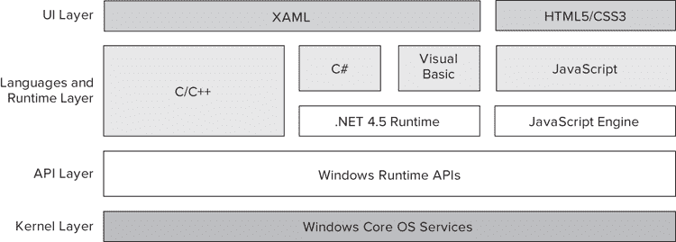

从图 3-3 中可以得出几个重要信息。

所有 Windows 8 风格应用程序都有一个最终的 API 层——Windows 运行时——用于与 Windows 核心操作系统服务通信，程序无需其他 API 即可访问这些服务。无论使用哪种编程语言，每个服务都无限制地可用，因此你也可以从 C++、C#、Visual Basic 和 JavaScript 中访问它们。

全球数百万开发者使用 HTML 和 CSS 创建网站和网页。这些开发者使用 JavaScript 为网页添加（有时是复杂的）UI 逻辑。在 Windows 8 风格应用程序模型中，微软增强了 JavaScript 的潜力，使其能够访问 Windows 运行时提供的全套 API。

最新的 HTML 标准（HTML5）结合层叠样式表 3（CSS3）和 JavaScript，比其前身更强大。HTML5 网站可以原生播放多媒体和显示矢量图形——利用计算机中图形处理单元（GPU）的硬件加速。在过去几年中，成千上万的新网站使用 HTML5 构建，以提供新时代的用户体验。熟悉 HTML 和 JavaScript 技术的开发者可以立即利用所有这些能力来创建 Windows 8 风格应用程序。


在 Windows 8 中，基于 XAML 的 WPF 和 Silverlight 技术的核心已成为操作系统的一部分——并以原生代码重写。C++、C# 和 Visual Basic 应用程序的 UI 可以用 XAML 定义。相同的 XAML 在每种语言中都能生成完全相同的 UI——没有任何限制或障碍。由于统一的 UI 技术以及提供对操作系统服务访问的相同 API，C++、C# 和 Visual Basic 的应用程序模型是相同的。

如果将图 3-2 中的桌面应用程序架构层与图 3-3 中的 Windows 8 风格应用程序层进行比较，可以立即看出后者在运行时、API 和 UI 技术选择方面更为简单。无论你是 Web 开发人员、C++ 爱好者还是 .NET 程序员，与创建传统桌面应用程序相比，创建 Windows 8 风格应用程序的入门门槛实际上更低。

你对编程语言的偏好仅决定了在程序中必须使用的 UI 技术。JavaScript 与 HTML 绑定，而其他语言（C++、C# 和 Visual Basic）则与 XAML 绑定。通常，开发人员会使用多种编程语言和标记语言，并且可以说他们已经习惯了多语言环境。学习一门新语言应该是一种激励而非约束，然而，处理不同的运行时库和组件却相当繁琐。

Windows 8 风格应用程序开发跨越了这个问题。无论你选择哪种编程语言，只需学习一组 API——由 Windows 运行时提供。

### 理解 Windows 运行时

毫无疑问，Windows 运行时是 Windows 8 风格应用程序架构中的关键组件。它代表了编程模型演进中的一次巨大飞跃，类似于 .NET Framework 在 2002 年所做的那样。负责这一伟大架构的微软团队将 Windows 运行时描述为“构建出色 Windows 8 风格应用的坚实、高效基础”。

在第 1 章中，你了解到 Win32 API 包含一组扁平的运算和数据结构。.NET 之前使用的语言运行时提供了隐藏大部分 API 运算的库，并公开一组更简单的对象和函数，使常见编程任务更轻松。.NET Framework 为这些对象添加了运行时环境，并提供了额外功能，如垃圾回收、异常处理、应用程序之间的通信支持等。

尽管语言运行时库和 .NET Framework 已经持续演进很长时间，但它们仍然没有公开 Win32 API 提供的所有数据结构和运算。造成这种困境的主要原因是，利用 Win32 的运行时组件是与操作系统服务分开创建的。

这种情况在 Windows 8 中完全改变了。Windows 运行时是操作系统的一个有机组成部分。它不是需要单独安装的附加组件，例如 Windows 软件开发工具包（Windows SDK）。每次创建新的 Windows 8 版本时，API 和 Windows 运行时都会与操作系统的其他部分一起构建。让我们仔细看看这个强大的新组件的能力。

#### Windows 运行时架构概述

正如 Windows 8 的设计以用户体验为核心，Windows 运行时的设计则以开发人员体验为重点。现代开发环境（如 Visual Studio，你将在第 4 章“了解你的开发环境”中了解更多）提供了出色的工具，使开发人员更高效。

##### Windows 运行时设计原则

高效工具的一个好例子是 IntelliSense，它在你输入代码时监视上下文，并自动提供可能的后续选项列表。如图 3-4 中的示例所示，IntelliSense 提供了在 MainPage 方法上下文中可能跟在 `this` 成员之后的表达式列表。IntelliSense 不仅显示适当成员的列表，还在工具提示中显示所选成员（AllowDrop）的简短说明。负责 Windows 运行时设计的团队始终牢记，新的 API 应该易于与 IntelliSense 等强大工具配合使用。

**图 3-4：** IntelliSense 使开发人员更高效

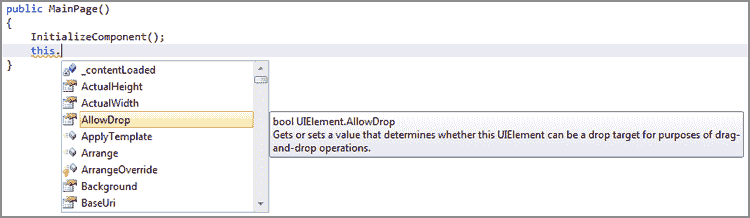

Windows 8 的流畅用户体验只能通过保持 UI 响应式的应用程序来实现。过去，Windows 最大的问题在于操作系统及其应用程序的迟钝和粗糙行为。例如，用户开始通过流畅地移动鼠标来拖动屏幕上的对象，但对象却以“断断续续”的方式移动。

异步编程模型为这类问题提供了很好的解决方案。该模型在执行长时间或资源密集型计算时不会阻塞 UI。Windows 运行时的 API 在设计时就考虑了异步性。设计团队做出了一个艰难的决定：所有可能耗时超过 50 毫秒的操作都实现为异步操作。随 Visual Studio 2012 发布的 C# 和 Visual Basic 编程语言的新版本支持这种编程模型，你将在第 5 章中了解到。

* * *

**注意** 不要被你不熟悉的概念吓到，比如“异步编程”或“UI 阻塞”。第 5 章“现代 Windows 应用程序开发原则”将对这些概念进行详细概述。现在，只需理解异步性提供了一种将长时间操作推入后台的方法，同时让 UI 保持响应。

* * *

Windows 团队一直致力于在每个新 Windows 版本中提供向后应用程序兼容性。Windows 运行时经过设计和建立，使得应用程序能在新的 Windows 版本中继续运行。如果某个 API 在新版本的操作系统中更改了操作，旧版本的操作仍将与新版本并行可用，因此它们可以同时使用。每个应用程序使用其创建时所使用的操作版本。

##### Windows 运行时的构建块

反映微软的设计原则，Windows 运行时不仅仅是一组 API。它是一个真正的运行时环境，将操作系统服务与基于它们构建的 Windows 8 风格应用程序绑定在一起，而与用于实现特定应用程序的编程语言无关。这个运行时环境由几个构建块组成，如图 3-5 所示。

**图 3-5：** Windows 运行时的构建块

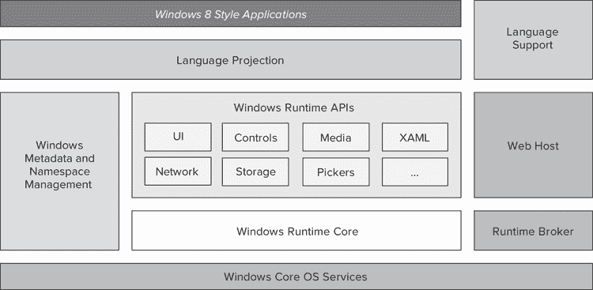

Windows 操作系统通过 Windows 运行时核心块暴露给 Windows 8 风格应用程序，该核心块（顾名思义）是运行时环境的本质。这个核心块将底层服务封装成类型和接口。核心之上有许多 API，每个 API 负责某种常见的操作系统任务。尽管图 3-5 中只显示了其中几个，但实际上有超过二十个 API 可用。

你不必记住每个类型、接口，甚至不必记住某个类型或功能所在的 API，因为 Windows 运行时拥有自己的元数据来描述它们的信息。此外，基本类型被分组到分层命名空间中——就像 .NET Framework 或 Java 运行时中的对象一样——因此很容易找到它们。

* * *

**注意** 你很快就会了解更多关于 Windows 运行时的内容。

* * *


编程语言具有不同的特性，并且使用不同的约定。在 API 和元数据块的顶层，有一个薄层——语言投影（Language Projection），负责以特定于语言的方式公开 API。Windows 8 风格应用程序通过这一层访问 Windows 运行时 API。

* * *

**注意** 你将在本章后面进一步了解这一层。

* * *

图 3-5 中显示的其他几个组件共同构成了 Windows 8 风格应用程序通过 Windows 运行时充分利用操作系统功能的环境：

*   你的应用程序可能会访问需要用户权限的特定系统资源（例如网络摄像头、麦克风或互联网）。这些资源只能通过 Runtime Broker 组件访问，该组件会在操作首次尝试使用资源时询问用户是否允许访问。例如，如果你创建了一个从网络摄像头获取用户照片的应用程序，除非用户明确启用，否则 Runtime Broker 不会让系统捕获照片。

*   正如你已经了解的，你可以使用 HTML5 和 JavaScript 创建 Windows 8 风格应用程序。这些应用程序由于其 Web 特性，运行在 Web 宿主中。

*   每种语言都有一些特定的运行时支持（例如，支持该语言的运行时库，如 `printf` C++ 函数、`append` JavaScript 方法，或 C# 和 Visual Basic 中可用的 `String.Split` 操作）。这些可以在与语言投影层协作的语言支持构建块中找到。

图 3-5 中展示的一些构建块在日常编程活动中扮演着重要角色。在接下来的几节中，你将了解更多关于它们的细节。

#### Windows 运行时中的元数据

在 Windows 运行时中提供使用元数据的方式是 Windows 8 风格应用程序开发中一个非常重要的特性。它是使架构更健壮、API 更易于发现，并最终提高开发人员生产力的不可或缺的资源。实际上，Windows 背后的不同开发技术在它们所使用的元数据格式上有些分散：

*   Win32 API 是一个庞大的数据结构和操作集合，可以通过位于 Windows 安装目录下 System32 文件夹中的动态链接库（DLL）来访问。这些库包括 `kernel32.dll`、`user32.dll`、`netapi32.dll`、`avicap32.dll` 等等。DLL 有许多操作入口点。然而，只有纯 .dll 文件，你无法知道它们包含哪些操作以及如何调用它们，因为它们不是自描述的。

*   微软在 1993 年引入的组件对象模型（COM）是一种二进制标准，允许开发人员用接口定义语言（IDL）编写对象的接口。`.idl` 文件可以编译成类型库（`.tbl` 文件），该文件表示与 COM 对象相关的元数据。

*   .NET Framework 将类型元数据提升为一等公民。在 .NET 中，类型是为你提供可用操作的对象，而类型元数据描述了可用的操作。程序集文件（由任何 .NET 语言编写的源代码编译生成的二进制文件）是自描述的。它们包含封装在程序集中的类型和操作的元数据。

.NET 处理元数据的方式非常出色！然而，元数据只能绑定到托管类型。许多 Win32 操作根本没有 .NET 类型包装它们。从托管代码中使用这些类型需要创建定义来替代缺失的元数据。这样的定义描述起来很繁琐，并且你需要关于你打算使用的操作的文档。一个这样的例子是可以在 `avicap32.dll` 中找到的 `capCreateCaptureWindow` 操作的定义：

```
[DllImport("avicap32.dll", EntryPoint="capCreateCaptureWindow")]
static extern int capCreateCaptureWindow(
  string lpszWindowName, int dwStyle, 
  int X, int Y, int nWidth, int nHeight, 
  int hwndParent, int nID);
```

如果你创建了错误的定义（例如，你使用了 `double X` 而不是 `int X`），你的源代码会编译通过，但会在运行时引发错误，导致你花费大量精力来查找和解决这个问题。

##### 元数据格式

Windows 运行时的设计者在架构元数据子系统时受到了 .NET Framework 的启发。他们决定使用 .NET 程序集所使用的元数据格式，该格式在过去十年中已经证明了其适用性。设计者选择了 .NET Framework 4.5（与 Windows 8 同时发布的最新版本 .NET）所使用的格式。

元数据文件提供了 Windows 运行时中每个可用 API 的信息。它们随 Windows 8 一起安装，因此可以在每台装有 Windows 8 的计算机上找到，无论该计算机是用于开发还是其他用途。这些文件是机器可读的，你可以检查它们的内容，正如你在以下练习中学到的那样。

* * *

###### 试一试：窥探 Windows 运行时元数据

Windows 运行时元数据文件位于 Windows 安装文件夹下。它们具有 `.winmd` 扩展名，你可以使用 `ILDASM` 实用程序检查它们的内容。

要检查元数据文件，请按照以下步骤操作：

1. 在“开始”屏幕中，单击“桌面”磁贴，然后从任务栏中选择“Windows 资源管理器”。
2. 导航到 Windows 安装目录下的 `System32\WinMetadata` 文件夹。如果你的操作系统安装在默认位置，你可以在 `C:\Windows` 下找到此文件夹。如果你在 Windows 安装过程中指定了其他位置，请选择该文件夹。
3. 此文件夹列出了超过一百个文件，每个文件名都以 Windows 开头，并具有 `.winmd` 扩展名，如图 3-6 所示。这些文件代表了 Windows 运行时 API 的元数据信息。

**图 3-6：** `System32\WinMetadata` 文件夹中的 Windows 运行时元数据文件

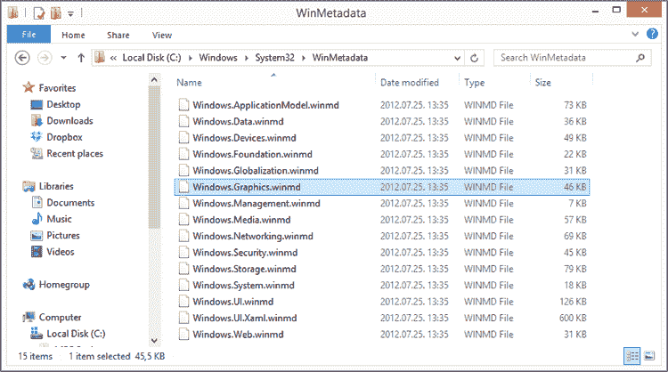

4. 向下滚动到 `Windows.Graphics` 文件。右键单击它，然后从上下文菜单中选择“打开方式”命令。屏幕上会弹出一个窗口，你可以在其中将应用程序与 `.winmd` 文件类型关联。向下滚动到弹出窗口的底部，然后选择“在这台电脑上查找其他应用”，如图 3-7 所示。

**图 3-7：** 将 `.winmd` 文件与应用程序关联

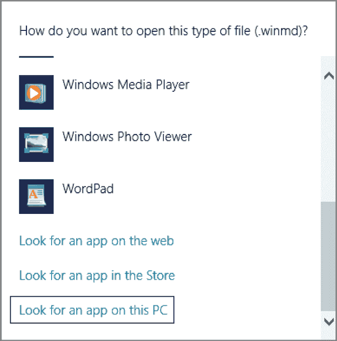

5. 屏幕上会弹出“打开方式”对话框。在“文件名”文本框中，键入 `C:\Program Files (x86)\Microsoft SDKs\Windows\v8.0A\bin\NETFX 4.0 Tools` 路径（或使用“打开方式”对话框导航到此路径）。单击“打开”。对话框会填充此文件夹中的文件。向下滚动到 `ildasm`，然后再次单击“打开”。
6. `ILDASM` 实用程序打开并显示 `Windows.Graphics.winmd` 文件的元数据树。展开 `Windows.Graphics.Display` 节点，然后展开 `Windows.Graphics.Display.ResolutionScale` 节点。你可以发现此元数据文件中定义的所有类型，以及 `ResolutionScale` 类型的枚举值，如图 3-8 所示。

**图 3-8：** `ILDASM` 实用程序中的 `Windows.Graphics.Display` 元数据信息

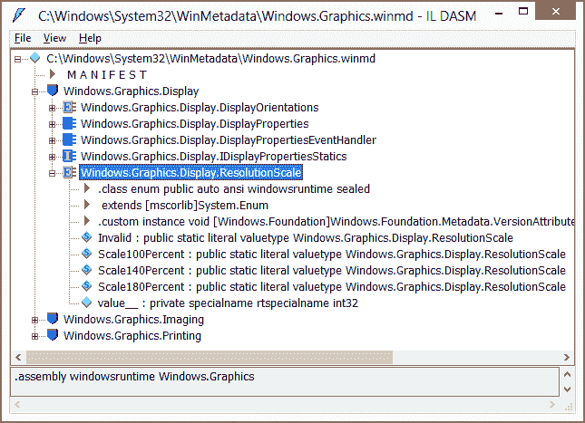

7. 在 `ILDASM` 应用程序窗口中，双击 `MANIFEST` 节点。将打开一个新窗口，显示元数据文件的清单信息，如图 3-9 所示。

**图 3-9：** `Windows.Graphics` 元数据文件的清单信息


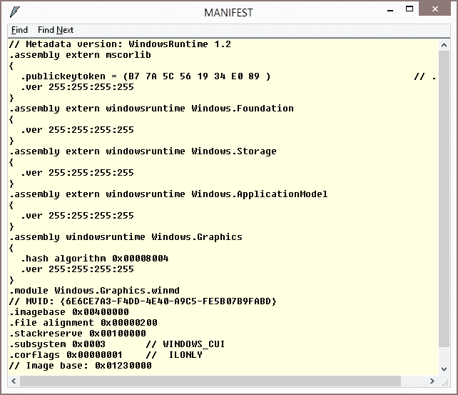元数据文件的清单承载着关于该文件以及文件中描述的类型的重要信息。在图 3-9 中，你可以看到有一个`.module Windows.Graphics.winmd`条目，其后跟着几行内容。这些项描述了关于元数据文件的信息。你会看到三个以`.assembly extern`开头的条目，它们是对与 Windows.Graphics 元数据文件中使用的类型相关的其他元数据信息的引用。第一个引用`mscorlib`是.NET 4.5 公共语言运行时（CLR）的主要系统组件。另外两个分别是`Windows.Foundation`和`Windows.Storage`，它们是其他的`.windm`文件——这可以从它们带有的`windowsruntime`修饰符标签推断出来。

**8.** 打开`System32\WinMetadata`文件夹中的其他元数据文件，并检查它们的结构。完成后，关闭所有打开的`ILDASM`实例。

#### 工作原理

`System32\WinMetadata`文件夹包含必要的`.windm`文件。在第 5 步中，你将`.winmd`文件扩展名与`ILDASM`实用工具关联起来。在第 6 步中，你窥探了`Windows.Graphics.Display.ResolutionScale`类型的元数据。在第 7 步中，你检查了`.winmd`清单如何描述对外部元数据文件的依赖关系。

* * *

##### 命名空间

正如你在之前的练习中所体验到的，Windows 运行时类型具有层次化的名称。例如，包含分辨率缩放值的枚举的全名为`Windows.Graphics.Display.ResolutionScale`。该名称的最后一个标签是类型的简单名称，而前缀标签则构成了命名空间层次结构。顶级命名空间是`Windows`。它包含一个嵌入的命名空间`Graphics`，而`Graphics`又嵌入了`Display`。

* * *

**注意** .NET、Java 和 C++程序员对命名空间的概念很熟悉。Windows 运行时使用的命名空间与.NET 中应用的语义完全相同。

* * *

命名空间在管理创建应用程序时使用的大量类型时是一个重要概念。如果所有类型名称都混入一个大池子中，那么很难找到它们，也很难猜测哪个类型适合某个特定任务。

另一个问题是类型命名。你无法保证没有其他人使用与你相同的类型名称。例如，当你将类型命名为`Circle`时，很可能其他人也会使用相同的名称。如果你购买了一个自定义 UI 组件包，其中可能已经有一个`Circle`类型。你的应用程序如何知道在源代码的某个位置应该使用哪个`Circle`类型，以及你打算使用自己的`Circle`还是购买的那个？

命名空间是很好的构造，可以帮助你将对象分组到类别中。使用设计良好的命名空间层次结构可以提高你的工作效率，因为你可以轻松地为某个任务找到合适的类型。例如，当你准备在屏幕上显示图像时，首先会在`Windows.Graphics.Imaging`命名空间中查找，因为它的名称暗示了这类类型存在于那里。

命名空间还有助于避免类型名称冲突。如果你将自己的类型放入它们自己的命名空间中（例如，将`Circle`放入`MyCompany.Shapes`命名空间），它们就不会与其他程序员或公司的类型发生冲突。

类型可以有相当长的全名。幸运的是，所有支持命名空间概念的编程语言都提供了某种构造来避免使用全名，并允许只编写简单名称。让我们看几个例子。

C#提供了`using`子句来帮助解析类型名称：

```
using Windows.UI.Xaml;

namespace MyAppNamespace
{
  class MyClass: UserControl
  {
    public MyClass()
    {
      // ...
      selectedItem = this.FindName(itemName) as ListBoxItem;
      // ...
    }
  }
}
```

Visual Basic 使用`Imports`关键字提供了相同的构造：

```
Imports Windows.UI.Xaml

Namespace MyAppNamespace

  Class MyClass
    Inherits UserControl

    Public Sub New()
      ' ...
      selectedItem = TryCast(Me.FindName(itemName), ListBoxItem)
      ' ...
    End Sub
  End Class
End Namespace
```

毫不奇怪，C++也通过`using namespace`子句提供了相同的概念：

```
using namespace Windows::UI::Xaml;

namespace MyAppNamespace
{
  class MyClass: UserControl
  {
    public MyClass()
    {
      // ...
      selectedItem = dynamic_cast<ListBoxItem^>(this->FindName(itemName);
      // ...
    }
  }
}
```

C#、Visual Basic 和 C++中的`using`、`Imports`和`using namespace`构造分别指示编译器在指定的命名空间中查找类型名称。这种机制允许你在程序中只编写`ListBoxItem`类型名称，因为编译器也会检查`Windows.UI.Xaml`命名空间。否则，你将不得不编写完整的`Windows.UI.Xaml.ListBoxItem`名称。

* * *

**注意** 当然，也可以从 JavaScript 程序访问 Windows 运行时命名空间中的对象。在 JavaScript 中，你可以使用不同的机制，正如你在第 6 章“使用 HTML5、CSS、JavaScript 和 jQuery 创建 Windows 8 风格应用程序”中所学到的。

* * *

#### 语言投影

编程语言有其自身的特性。特定编程语言的粉丝喜欢使用该语言，是因为它的属性，例如可读性、高性能构造、功能性、低语法噪音等。在创建 Windows 8 风格应用程序时，你可以使用多种语言——它们具有不同的语法和语义方法。然而，对于 Windows 运行时设计者来说，允许从这些非常不同的语言中使用所有服务是一个挑战。

语言投影层负责将 Windows 运行时 API 转换为该语言的形态。由于这种转换，程序员可以像使用语言原生运行时库的一部分那样使用这些 API。

理解语言投影层作用的最佳方式是看一个简单的例子。`Windows.Storage.Pickers`命名空间包含一个名为`FileOpenPicker`的类型，它允许你从文件夹中选择一个文件。使用 C#编程语言，你可以使用以下代码配置此对话框以选取图片文件：

```
using Windows.Storage.Pickers;
// ...
FileOpenPicker openPicker = new FileOpenPicker();
openPicker.ViewMode = PickerViewMode.Thumbnail;
openPicker.SuggestedStartLocation = PickerLocationId.PicturesLibrary;
openPicker.FileTypeFilter.Add(".jpg");
openPicker.FileTypeFilter.Add(".jpeg");
openPicker.FileTypeFilter.Add(".png");
```

同样的任务可以用 JavaScript 重写，如下代码片段所示：

```
var openPicker = new Windows.Storage.Pickers.FileOpenPicker();
openPicker.viewMode = Windows.Storage.Pickers.PickerViewMode.thumbnail;
openPicker.suggestedStartLocation = 
    Windows.Storage.Pickers.PickerLocationId.picturesLibrary;
openPicker.fileTypeFilter.replaceAll([".png", ".jpg", ".jpeg"]);
```

以粗体突出显示的标识符代表 Windows 运行时 API 类型。在 C#和 JavaScript 中，它们都以大写字母开头并使用帕斯卡命名法。以斜体字体的标识符是 Windows 运行时类型的成员。如你所见，它们在 C#中使用帕斯卡命名法，而在 JavaScript 中使用驼峰命名法。这是由语言投影层完成的！C#语言投影将成员名称渲染为帕斯卡命名法，而 JavaScript 语言投影则根据 JavaScript 约定使用驼峰命名法。

* * *

**注意** 使用帕斯卡命名法和驼峰命名法意味着编写标识符时，单词之间没有空格，复合词中每个元素的第一个字母分别大写。帕斯卡命名法使用大写首字母（例如“`PicturesLibrary`”中的“P”），而驼峰命名法使用小写首字母（例如“`viewMode`”中的“v”）。

* * *


语言投影层的作用并不仅限于语法糖。在 Windows 运行时 API 中，`FileOpenPicker` 类型的 `FileFilterType` 属性是一个字符串元素的向量（或数组）（`FileExtensionVector`）。C# 语言投影将此属性呈现为 `List<string>`（字符串列表），因此可以通过 `List<string>` 类型的 `Add` 方法添加文件扩展名，如下所示：

```
openPicker.FileTypeFilter.Add(".jpg");
openPicker.FileTypeFilter.Add(".jpeg");
openPicker.FileTypeFilter.Add(".png");
```

JavaScript 语言投影将 `fileFilterType` 属性呈现为字符串数组，因此可以使用 `replaceAll` 函数设置数组的内容，如下所示：

```
openPicker.fileTypeFilter.replaceAll([".png", ".jpg", ".jpeg"]);
```

Visual Studio 也利用了语言投影层的特性。如图 3-10 和图 3-11 所示，C# 和 JavaScript 中的 IntelliSense 会根据语言提供相应的后续操作。

**图 3-10：** IntelliSense 在 C# 中提供 `List<string>` 类型的成员

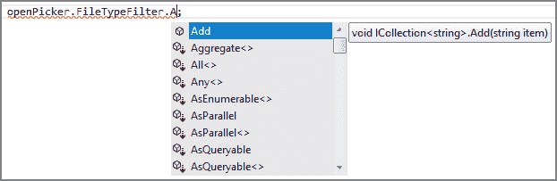

**图 3-11：** IntelliSense 在 JavaScript 中提供数组操作

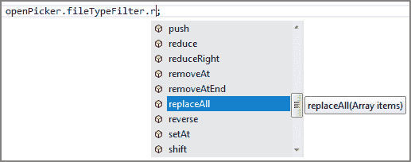

借助语言投影，你无需根据编程语言使用不同的工具来访问和获取操作系统服务。你会感觉所有 Windows 运行时服务就像是所选编程语言运行时环境的一部分。

#### Windows 运行时的优势

如你所知，Windows 运行时是 Windows 核心操作系统服务之上的一种新型现代 API，并且从包括 C++、C#、Visual Basic (.NET) 和 HTML/JavaScript 在内的多种编程语言中使用起来更加自然。这种现代化使得 Windows 运行时架构师能够重新思考当代操作系统应如何支持应用程序开发：

*   Windows 运行时提供了对硬件（如全球定位系统 (GPS) 单元、传感器、摄像头或其他现代硬件设备）的便捷访问——只需几行代码。而在过去，用 C 语言在 Windows 3.1 上创建第一个“Hello, world”程序需要编写几十行代码，而 Windows 运行时让你只需大约五行代码就能用内置摄像头拍照。

*   应用程序在安全沙箱中运行。这意味着只有那些在当前安全上下文中被认为是安全的操作才会被执行。例如，如果某个应用程序想要打开麦克风，除非用户明确确认允许使用麦克风，否则该操作被认为是不安全的。

*   旧的 Win32 API 是核心操作系统服务之上的一个独立层。而 Windows 运行时是操作系统的一个组成部分，专为开发者体验而优化。Windows 运行时不仅比 Win32 更容易使用，而且更稳定，并改进了内存管理，以减少内存消耗并加快内存管理速度。

*   现代硬件设备和始终响应的 UI 离不开异步编程模型。Windows 运行时原生支持异步操作。

#### Windows 运行时未包含的内容

到目前为止，你已经了解到 Windows 运行时是开发 Windows 8 风格应用程序的关键组件。通过 Windows 运行时暴露的所有操作系统服务都可以从 C++、C#、Visual Basic 和 JavaScript 中使用。但在将 Windows 8 风格应用程序与 Windows 运行时之间划等号之前，你应该知道 Windows 8 风格应用程序还可以利用 Windows 运行时中不可用的其他操作系统组件。

用 C 或 C++ 编程语言编写的应用程序会直接编译为 CPU 特定的机器指令，这些指令可以直接在 CPU 上执行。这些应用程序可以直接访问负责渲染 UI、控制输入设备、管理传感器、与 GPU 通信等功能的原生操作系统组件。其中大多数组件可以为 Windows 8 风格应用程序增加额外价值。例如，游戏程序员可以利用 DirectX API（如 Direct2D、Direct3D、DirectWrite、XAudio2 和 XInput）的高性能图形能力。

* * *

**注意** Microsoft DirectX 是一组多媒体和游戏 API。这些 API 消除了应用程序与承载特定功能的硬件之间的多个额外层，以提供多媒体和游戏应用程序所需的高性能。Direct2D 是二维图形 API，而 Direct3D 专为三维图形游戏开发而设计。DirectWrite 是一个文本布局和字形渲染 API，最初随 Windows Vista 发布，在 Windows 8 中仍然可用。当微软着手开发其游戏主机时，以 X 作为“Xbox”名称的基础，表明该主机基于 DirectX 技术。

* * *

这些 API 在应用程序与其访问的硬件之间提供了一个非常薄的层，并使用低级数据结构在应用程序和硬件之间传递信息。尽管通过 Windows 运行时提供的服务在 UI 响应性和系统稳定性方面是安全的，但这些 API 是为性能而优化的——需要在应用程序中进行更多控制。

使用 C++，你可以创建利用 DirectX API 功能的 Windows 8 风格应用程序。例如，你可以使用 DirectWrite 创建精美的书法文本，如图 3-12 所示。

**图 3-12：** 使用 DirectWrite API 的 Windows 8 风格应用程序

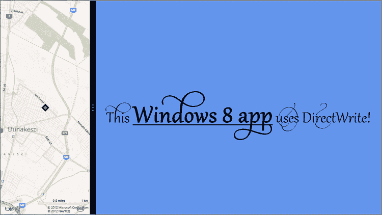

尽管这些组件无法通过 Windows 运行时使用，并且只能直接从 C++ 访问，但 C# 和 Visual Basic 中的机制可以在托管代码中利用这些 API。截至撰写本文时，你可以在 CodePlex ([`www.codeplex.com`](http://www.codeplex.com)) 上找到一些开源项目，这些项目旨在从 C# 在 Windows 8 上使用 DirectX。尽管这些项目还处于非常初期的阶段，但几个月后可能会大有改进。

### .NET Framework 4.5

支持 Windows 8 风格应用程序的两种编程语言——C# 和 Visual Basic——运行在 .NET Framework 之上。Windows 8 随新版本的 .NET Framework（版本 4.5）一起发布。如果不了解此版本的新特性以及 .NET Framework 如何与 Windows 运行时协作，那么开发架构图就不完整。

#### .NET Framework 4.5 的安装模型

自 2002 年（.NET 1.0 发布）以来，新版本的 .NET Framework 与先前版本的协作方式有多种，如图 3-13 所示。尽管前三个版本（1.0、1.1 和 2.0）随不同的 CLR 版本一起发布，这些版本可以在同一台计算机上并行运行，但后续版本采用了不同的路径。

**图 3-13：** .NET 版本之间的关系

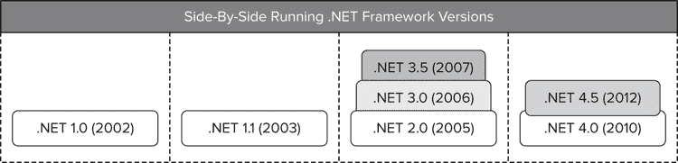

当 .NET Framework 3.0 于 2006 年发布时，它并没有安装自己的 CLR。它只是对版本 2.0 的补充，并使用了其运行时核心。2007 年的 .NET 3.5 也是如此。它是对 .NET 3.0 的补充，并且仍然使用 .NET 2.0 发布的 CLR。


2010 年，.NET 4.0 发布，同样带有自己的 CLR，封装了来自 .NET 3.5 的基类库的增强形式。理论上，在 2010 年，你可以在计算机上并排安装四个 CLR 版本：CLR 1.0、CLR 1.1、CLR 2.0 和 CLR 4.0。最新的 .NET Framework 4.5 版本为之前使用的安装模型增添了更多内容。.NET 4.5 并没有在 CLR 4.0 运行时之上并排添加新的 CLR 或新的基类库，而是作为就地更新（即不仅添加新文件，还会覆盖现有文件的更新），它既改变了 CLR 4.0 运行时（将其升级为 CLR 4.5），也扩展了之前的基类库。

* * *

**注意** 从兼容性角度来看，操作系统或 .NET CLR 的就地更新始终存在很大风险。在 .NET Framework 4.5 发布时，微软承担了这一风险，并投入了大量精力来应对潜在的兼容性问题。微软建立了一个兼容性实验室，审查了所有错误修复和新功能，并原封不动地运行了旧测试。

* * *

#### Windows 运行时集成

.NET CLR 一直具有与其他传统技术（如 COM 和 P/Invoke（平台调用以访问 Win32 API））的集成功能。借助 .NET Framework 4.5，CLR 原生集成了 Windows 运行时。C# 和 Visual Basic 程序员现在可以像使用 .NET 类型一样轻松地使用 Windows 运行时类型。

Windows 运行时类型是原生类型。它们实际上使用了一种不需要对象注册的现代新版 COM，因此无法直接从托管代码调用其操作。然而，.NET CLR 和语言编译器在幕后处理了一切，你无需处理从托管代码调用原生 Windows 运行时对象的细节。

如果你回顾一下图 3-2 和图 3-3，可以看到桌面应用程序和 Windows 8 风格应用程序的开发堆栈中都包含一个 .NET 运行时框。你可能会认为这意味着存在两个不同的 .NET Framework，一个用于桌面应用程序，另一个用于 Windows 8 风格应用程序。幸运的是，只有一个。

Windows 8 风格应用程序（Windows 运行时应用程序）可用的基类库仅限于被认为对 Windows 8 应用程序“安全”的服务。当你尝试构建现有的 .NET 源代码时，某些部分将无法编译，因为这些部分可能使用了 Windows 运行时中找不到的 .NET 基类库函数，或者被认为在 Windows 8 应用中“不安全”。

* * *

**注意** 通常，所有不会危及 UI 响应性的操作都被视为“安全”。

* * *

#### 异步支持

正如你所了解的，异步编程是提供 UI 响应性的关键技术，而 Windows 运行时在设计时就考虑了异步性。Windows 运行时设计过程的结果启发了 .NET Framework 团队，他们为框架的许多组件添加了异步支持。.NET 基类库包含数百项更改和改进，其中包括以下最重要的内容：

*   基类库的关键接口（例如文件 I/O 操作）支持异步。
*   ADO.NET（.NET 中的基础数据访问技术）中的数据访问过程，以及 Windows Communication Foundation (WCF) 中的网络通信组件，也将异步构造作为一等操作处理。
*   ASP.NET 在处理请求和创建响应时支持异步管道。ASP.NET MVC 4 提供了异步控制器。
*   在 .NET Framework 4.0 中引入的任务并行库在设计时就考虑了异步编程。在 .NET Framework 4.5 中，其线程管理通过新增的用于管理同步和各种超时场景的类型得到了改进。

尽管异步编程模式提供了更好的 UI 响应性和更高的吞吐量，但应用起来相当困难，并且容易出错。借助 .NET Framework 4.5，C# 和 Visual Basic 编译器提供了两个新关键字（C# 中的 `async` 和 `await`，Visual Basic 中的 `Async` 和 `Await`），它们接管了与这些模式相关的所有复杂性。

* * *

**注意** 你将在第 6 章中了解更多关于这些关键字的内容。

* * *

#### 其他新功能

尽管 .NET Framework 4.5 的主要新特性是 Windows 运行时集成和对异步编程的增强支持，但还有许多其他微小的改进使开发人员更高效。.NET Framework 4.5 中有许多新功能，但解释它们远远超出了本书的范围。如果你想获取更多相关信息，最佳起点是 MSDN 上的 .NET Framework 开发中心，网址为 [`msdn.microsoft.com/netframework`](http://msdn.microsoft.com/netframework)。

### 为你的项目选择合适的技术

本章向你展示了可用于创建 Windows 8 应用程序的多种技术和编程语言。有时最困难的决定是为你的项目选择合适的语言和技术栈。本节包含一些提示，帮助你做出最佳决策。

除了编程语言和开发技术之外，还有另一个之前很少提及的重要考虑因素。Windows 8 不仅彻底改变了用户使用应用程序的方式，还改变了他们发现、安装和卸载程序的方式。这种新的安装模型可能会激励你创建 Windows 8 风格应用程序而不是桌面应用程序，因此现在可能是简要概述它的好时机。

#### Windows 应用商店

在之前的 Windows 操作系统中，你必须创建安装包，并在目标计算机上运行这些包来部署应用程序。你的用户必须了解安装过程中的一些技术细节，例如选择目标文件夹、安装先决条件、向桌面添加快捷方式等。通常，安装过程是令人担忧的——这次安装是否会覆盖计算机上的某些内容，从而阻止其他应用程序正常运行？此外，不必要的应用程序必须被卸载，并且通常需要清理工具来清除这些应用程序留下的垃圾堆。

如果没有一种更简单的获取和发布应用程序的方式，以消费者为中心的方法就无法奏效。Windows 8 风格应用程序只能从 Windows 应用商店（一种在线服务）安装。作为开发人员，你可以将应用程序上传到 Windows 应用商店，在那里它需要经过审批流程，然后用户才能发现并安装它。作为用户，你可以在 Windows 应用商店中找到应用程序，购买后（或选择免费试用，甚至在应用程序允许的情况下免费使用），让操作系统为你安装该应用程序。如果你不再需要该应用程序，Windows 8 会立即卸载它并负责清理过程——释放该应用程序持有的所有资源。

* * *

**注意** 对于想要购买和运行 Windows 8 风格应用程序的消费者来说，使用 Windows 应用商店非常容易。然而，开发人员需要了解更多关于上传程序以及利用 Windows 应用商店功能来盈利的细节。第 16 章“介绍 Windows 应用商店”将专门讨论此主题。

* * *

#### Windows 8 应用程序还是桌面应用程序？

你首先应该决定的是要创建 Windows 8 风格应用程序还是桌面应用程序。表 3-2 通过区分几个考虑点来帮助你做出决定。

**表 3-2:** 在 Windows 8 风格应用程序和桌面应用程序之间选择的帮助要点


| **何时使用 Windows 8 风格应用程序** | **何时使用桌面应用程序** |
| --- | --- |
| 你对 Windows 编程没有或几乎没有经验。 | 你对 Windows 编程有更多经验——而且你是一名经验丰富的 Windows 程序员。 |
| 你专注于提供卓越用户体验的应用程序。 | 你专注于打算使用你已经熟悉的 UI 技术（Windows Forms、WPF 或 Silverlight）的应用程序。 |
| 你需要复用的 UI 代码库相对较小。 | 你有大量与 UI 相关的代码，并且希望复用该代码库所承载的知识。 |
| 你的应用程序运行在单台 Windows 计算机上。你的应用程序主要关注为通过互联网（或公司内网）访问的服务和远程组件提供 UI。 | 你的应用程序分布在多个组件中，包括 UI、业务服务和数据库。UI 应用程序组件使用遗留的、供应商特定的或专有的通信技术来访问其他服务。 |
| 你的应用程序打算利用移动设备（如平板电脑）提供的用户体验和设备功能。 | 你的应用程序主要在桌面计算机上使用，和/或与现有应用程序集成。 |
| 你想利用 Windows 应用商店提供的简单应用程序部署模型。 | 你需要比 Windows 应用商店提供的更复杂的部署模型。 |
| 你可以使用（即允许使用）C++、C#、Visual Basic 或 JavaScript 编程语言来创建应用程序。 | 除了 C++、C#、Visual Basic 和 JavaScript 之外，你还需要大量使用其他编程语言来创建应用程序。 |

如果你参与一个复杂的项目，显然不能在整个项目中使用 Windows 8 风格技术栈——通常你需要进行服务器端开发。然而，值得检查系统中那些可以贯穿使用并可能实现为 Windows 8 风格应用程序的 UI 组件。

* * *

**注意** 本书专注于 Windows 8 风格应用程序开发，不打算涵盖传统的桌面开发技术，如 WPF 和 Silverlight。如果你对这些技术也感兴趣，Wrox 为你提供了大量优秀书籍。请访问 Wrox 网站（[www.wrox.com](http://www.wrox.com)）了解更多信息。

* * *

#### 选择编程语言

正如你在本章前面所学到的，你可以使用多种语言进行 Windows 8 风格应用程序开发——C++、C#、Visual Basic 和 JavaScript。如果你偏爱其中任何一种，请毫不犹豫地开始使用该语言。

如果你对 Windows 编程没有或几乎没有经验，或者不确定哪种语言的学习曲线最短，以下是一些有助于你决策的线索：

*   如果你有网页设计和网站创建的经验，你肯定了解 HTML，并且可能对 CSS 和 JavaScript 有经验。从使用 JavaScript 创建你的第一个 Windows 8 风格程序开始。
*   如果你在 Microsoft Word 和 Excel 中使用过宏，那么 Visual Basic 可能是你应该开始使用的语言。
*   如果你的经验是关于编程算法而非 UI，那么 C++ 和 C# 是你的最佳选择。C# 可能更容易学习；C++ 则能对底层编程结构提供更多控制。

Windows 8 风格应用程序编程的最大优点之一是你不必只局限于一种语言！你甚至可以在一个应用程序中使用多种编程语言。例如，如果你有使用 JavaScript 进行 Web 编程的经验，你可以用 HTML 和 JavaScript 创建 UI，但仍然使用 C# 编写的更复杂的应用程序逻辑以及用 C++ 编写的高性能算法。

即使你开始使用其中一种语言进行应用程序开发，也值得学习其他语言——因为每种语言都有其优势。当你有紧迫的截止日期或希望更开放地面对其他平台时，掌握多种语言并习惯合理地将它们混合使用是无价的。

### 总结

Windows 8 提供了一种新的应用程序开发模型，称为 Windows 8 风格应用程序模型。然而，你仍然可以利用以前 Windows 版本中使用的桌面应用程序开发技术栈。

Windows 8 风格应用程序有自己的技术栈。四种编程语言——C++、C#、Visual Basic 和 JavaScript——可用于创建 Windows 8 应用程序。无论使用哪种语言，这些应用程序所需的所有操作系统服务都可以通过一个名为 Windows 运行时的新组件访问——从这个角度来看，各种语言是平等的。

Windows 运行时是核心 Windows 服务之上的现代编程接口。虽然它用本机代码实现，但它提供了命名空间、对象元数据和异步操作。每种编程语言都有一个模仿 Windows 运行时的语言投影层。这个层是针对特定语言创建的。

C# 和 Visual Basic 使用 .NET Framework 4.5，它与 Windows 运行时原生集成，因此 Windows 运行时中的类型可以像任何 .NET 基类库类型一样轻松使用。

在第 4 章中，你将学习可用于创建 Windows 8 风格应用程序的基本工具。你将创建几个简单的应用程序来激发你的兴趣。

#### 练习

**1.** 列出可用于在 Windows 8 中创建 Windows 8 风格应用程序的编程语言。
**2.** Windows 8 风格应用程序支持哪些 UI 技术？
**3.** 允许从所有 Windows 8 编程语言访问 Windows 核心服务的组件是什么？
**4.** 为什么 Windows 运行时优于传统的 Win32 API？
**5.** Windows 应用商店提供的应用程序部署模型是什么？

* * *

**注意** 你可以在附录 A 中找到练习的答案。

* * *

#### 本章所学内容

| **主题** | **关键概念** |
| --- | --- |
| Windows 8 编程语言 | Windows 8 风格应用程序可以使用以下语言创建：C/C++、C#、Visual Basic、JavaScript。 |
| XAML | 在 Windows 8 中，可扩展应用程序标记语言（XAML）用于声明和实现使用 C++、C# 和 Visual Basic 编程的应用程序的用户界面（UI）。 |
| HTML | 在 Windows 8 中，最新版本的超文本标记语言（HTML）——HTML5——与层叠样式表 3（CSS3）结合使用，以使用 JavaScript 编程语言创建应用程序 UI。 |
| Windows 运行时 | Windows 运行时是 Windows 8 风格应用程序可用于访问底层操作系统服务的应用程序编程接口（API）。 |
| Windows 运行时对象 | 与 Win32（使用平面操作）不同，Windows 运行时提供有意义的对象，这些对象具有相关的操作和数据结构。这些对象是自描述的。它们提供关于自身的元数据信息。利用这些元数据，应用程序可以轻松使用公开的操作。 |
| 命名空间 | Windows 运行时对象被组织成层次化的命名空间。不同命名空间中的对象可以使用相同的简单名称。 |
| 语言投影层 | 可以从每种 Windows 8 编程语言访问 Windows 运行时对象和操作，就好像 Windows 运行时与该特定语言绑定一样。这种行为由语言投影层提供。 |
| 异步编程模型 | Windows 运行时提供异步编程模型以实现 UI 响应性。可能阻塞 UI 的操作以异步方式实现——它们将处理推送到后台线程，同时保持 UI 响应。 |


| .NET Framework 4.5 | .NET Framework 4.5 是与 Windows 8 同步发布的最新版本 .NET Framework。它提供了与 Windows 8 的原生集成，并为许多基类库添加了异步支持。 |
| Windows 应用商店 | Windows 8 风格的应用只能从 Windows 应用商店（一项在线服务）安装。开发者可以将应用上传到商店，经过审批流程后，用户才能购买和安装。 |

## 第 4 章

## 了解你的开发环境

**本章你将学到：**

* 发现可用于开发 Windows 8 风格应用的必备工具
* 了解 Visual Studio 和 Expression Blend 集成开发环境
* 使用 Visual Studio 创建你的第一个 Windows 8 风格应用
* 探索 Visual Studio IDE 的一些实用功能
* 使用 Expression Blend 增强用户体验

**本章的 WROX.COM 代码下载**

你可以在 [www.wrox.com/remtitle.cgi?isbn=1118012682](http://www.wrox.com/remtitle.cgi?isbn=1118012682) 的“下载代码”选项卡中找到本章的 [wrox.com](http://wrox.com) 代码下载。代码位于 Chapter04.zip 文件中，并按对应练习中的说明单独命名。

Windows 8 开发是一件很棒的事情，这得益于 Windows 运行时、强大的编程语言以及渲染技术。微软也提供了出色的工具来利用这些卓越的技术。在本章中，你将了解开发应用时使用的两个基本工具：Visual Studio 2012 和 Expression Blend。

首先，你将使用 Visual Studio 创建一个简单的 Windows 8 应用。本章的练习将帮助你熟悉使用 Visual Studio 集成开发环境（IDE），并帮助你理解 Windows 8 应用开发的基本步骤。用户体验是 Windows 8 应用成功的关键因素。为了了解优秀的设计工具如何通过几个步骤支持增强用户界面（UI），你将使用 Expression Blend 修改示例应用。

阅读本章后，你将准备好深入探索 Windows 8 应用开发的细节，并使用这些强大的生产力工具。

## 工具集介绍

在第 3 章中，你了解到 Windows 8 拥有用于构建 Windows 8 风格应用的完整技术栈。它支持四种编程语言——C++、C#、Visual Basic 和 JavaScript。使用 JavaScript 的开发者可以利用 HTML5 和 CSS3 创建应用的用户界面，而其他编程语言的爱好者则可以在构建 UI 时利用可扩展应用程序标记语言（XAML）。

这些技术很棒，但如果没有合适的工具集，开发者就无法高效地使用它们。微软的旗舰开发工具运行在 Windows 8 上，你可以利用它们来设计和实现你的 Windows 8 风格应用：

* Microsoft Visual Studio 2012 是终极开发环境，支持所有 Windows 8 语言以及用于 Windows 8 风格应用开发的完整技术栈。
* Microsoft Expression Blend 是一款出色的工具，可帮助 UI 设计师以相当高效的方式建立专业的应用 UI。

### Visual Studio 2012

Visual Studio 是微软的集成开发环境。它的历史可以追溯到 21 年前。最新版本是第 11 个主要版本，称为 Visual Studio 2012。这是你可以用来为所有微软平台（包括 Windows 8 及其前身、.NET Framework、Windows Phone、Silverlight 和 Windows Azure）开发应用的终极工具。在过去的 21 年中，Visual Studio 经历了多次变革，才达到现在的形态。

#### Visual Studio 简史

在最初的几个 Windows 操作系统版本上进行应用开发，是使用 C 编程语言的开发者的特权。在这些 Windows 版本中，创建应用意味着在文本编辑器中编写源代码，执行手动步骤来编译应用，并将生成的二进制文件链接成可执行文件。

Visual Basic 在 1991 年 5 月发布了 1.0 版本，极大地改变了这一格局。该产品通过引入表单、控件、模块、类和代码隐藏文件等概念，使开发真正变得可视化（与之前使用的 C 语言工具形成对比）。

由于 Visual Basic 的成功，微软构建了大量具有可视化组合功能的工具和语言。带有微软基础类库（MFC）的 Visual C++（于 1993 年 2 月发布）证明了 C++ 语言也可以作为一种高效工具，以简单的方式创建出色的 UI。1995 年（这一年充满了关于 Java 编程语言的新闻），微软创建了 Visual J++ 语言，并附带了自己的 Java 虚拟机（JVM）。

微软的架构团队认识到，应用的可视化方面可以与用于创建它的编程语言完全分离。他们创建了一个产品——Visual Studio 97——它捆绑了 Visual Basic 5.0、Visual C++ 5.0、Visual FoxPro 5.0、Visual J++ 和 Visual InterDev。该 IDE 的下一个版本名为 Visual Studio 6.0，于 1998 年 6 月发布。

作为对 Java 平台成功的回应，微软于 2002 年 2 月发布了 .NET Framework。.NET Framework 1.0 与 Visual Studio.NET 同步发布。这个 Visual Studio 版本将多种编程语言和工具集成到同一个 IDE 中。开发者可以直接使用四种语言：Visual Basic.NET、Visual C#、Visual C++ 和 Visual J#。除 J# 外，这些语言在 Visual Studio 2012 中仍然可用。

#### Visual Studio 版本

微软一直致力于围绕其工具建立庞大的开发者社区，并创建了针对特定受众的专用版本——包括爱好者、学生，以及专业和企业开发者。同一个产品——Visual Studio——既可以供个人开发者编码娱乐使用，也可以供专业开发者在大型企业项目中使用。从 2005 年开始，除了面向企业开发者的版本外，还提供了免费的 Visual Studio Express 版本。此后，每个新的 Visual Studio 版本都有相应的 Express 版本。

虽然最初 Express 版本是按编程语言发布的（Visual C# Express、Visual Basic Express、Visual Web Developer Express），但微软后来改变了这一趋势，改为按应用类型发布（Visual Studio Express for Windows Phone、Visual Studio Express for Windows 8）。此外，新工具（如单元测试）也开始成为 Express 版本的一部分。

最新的 Visual Studio 2012 支持以下版本：

* Visual Studio 2012 Express for Windows 8——这是一个免费版本，你可以从微软开发者网络（MSDN）下载。使用此工具，你可以开发功能完整的 Windows 8 风格应用。单元测试和 Team Foundation Server（微软的源代码控制和团队管理工具）集成也可用。
* Visual Studio 2012 Professional/Premium/Ultimate——这些版本不是免费的；你需要为其提供的功能和服务付费。Professional 版本专为在小团队中工作的自由开发者设计。Premium 版本面向企业项目，而 Ultimate 版本为架构师和项目经理提供了在拥有数十名团队成员的大型项目中使用的工具。

在本书中，你将使用 Visual Studio 2012 Express for Windows 8 版本，因为它包含了 Windows 8 风格应用开发所需的所有工具——而且是免费的。

#### 安装 Visual Studio 2012 Express for Windows 8


在您可以使用 Visual Studio 2012 Express for Windows 8 创建 Windows 8 风格应用之前，必须先将其安装到计算机上。在以下练习中，您将下载并安装该产品。

***

**试一试：安装 Visual Studio 2012 Express for Windows 8**

要安装 Visual Studio 2012 Express for Windows 8，请按照以下步骤操作：

**图 4-1：** Visual Studio 2012 Express for Windows 8 安装程序的开始屏幕

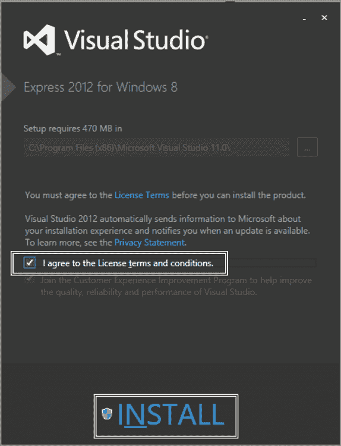

**1.** 访问 MSDN 上的 Windows 8 风格应用开发中心网站（[`msdn.microsoft.com/en-us/windows/apps/default`](http://msdn.microsoft.com/en-us/windows/apps/default)）。选择“下载工具和 SDK”链接，进入“面向开发人员的下载”页面。  
**2.** 单击“立即下载”按钮，当浏览器询问您是运行还是保存该应用程序时，选择“运行”。几秒钟后，Visual Studio 2012 Express for Windows 8 安装程序将启动。  
**3.** 勾选“我同意许可条款和条件”，然后单击屏幕底部的“安装”文本，如图 图 4-1 所示。  
**4.** 根据您的 Windows 8 设置，可能会弹出“用户帐户控制”对话框，询问您是否允许安装程序对计算机进行更改。如果弹出，请单击“是”；否则，安装将被取消。

**图 4-2：** 您可以跟踪安装进度。

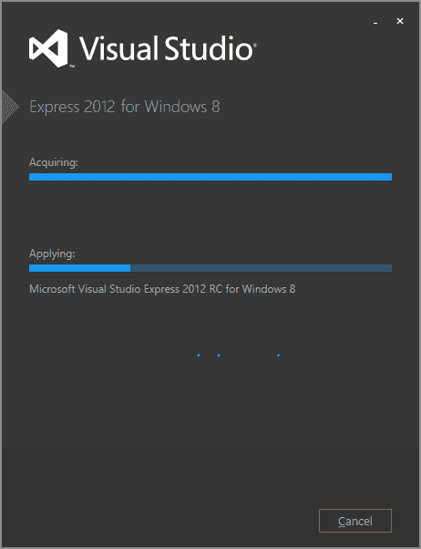

**5.** 安装过程开始。它会下载要在计算机上安装的包，安装它们并进行配置。您可以通过两个进度条跟踪此过程，如图 图 4-2 所示。“获取”栏显示包下载的进度，而“应用”栏显示安装和配置的进度。  
**6.** 大约 15 分钟后，所有 Visual Studio 2012 Express 组件将安装在您的计算机上。在安装屏幕底部，单击“启动”链接以启动 IDE。启动画面会显示几秒钟，同时 IDE 进行配置，然后主窗口会显示“起始页”，如图 图 4-3 所示。

**图 4-3：** Visual Studio 2012 Express for Windows 8 的起始页

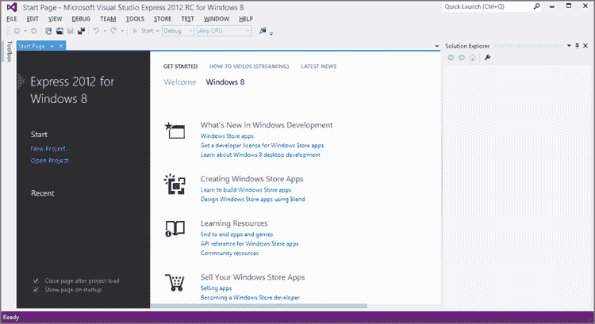

***

现在，Visual Studio 已准备就绪。在此 IDE 中，只需几次单击即可轻松创建 Windows 8 风格应用，您将在本章后面学习到这一点。

***

**注意** 首次启动后，Visual Studio 会要求您获取开发人员许可证。提交应用到 Windows 应用商店时需要此许可证，您将在第 16 章中了解这一点。当“开发人员许可证”对话框出现时，请选择“取消”。

***

### Visual Studio IDE 快速浏览

自上一版本（Visual Studio 2010）以来，Visual Studio IDE 经历了现代化和清理。产品团队非常努力地使 IDE 更快（缩短启动和项目加载时间）、更节省内存且更易于使用。在本节中，您将通过创建一个简单的应用程序来了解 IDE。

#### 创建新项目

在 Visual Studio IDE 中，您当前的工作由一个解决方案表示。解决方案将较小的应用程序工件单元（称为项目）分组。项目是可以独立构建的最小单元。在以下练习中，您将学习如何创建项目。

***

**试一试：创建新的 Windows 8 风格应用程序**

如第 3 章所述，Windows 8 风格应用程序可以用四种语言（C++、C#、Visual Basic 和 JavaScript）编写。在本练习中，您将使用 C# 语言和 XAML UI 技术。您创建的应用程序不会做任何令人兴奋的事情。它只是在屏幕上显示四个不同颜色的矩形，并在您点击或单击矩形时显示文本。

要创建简单的 Windows 8 风格应用，请按照以下步骤操作：

**1.** 在主菜单中，选择“文件” &menuarrow; “新建项目”命令，以选择要创建的项目类型。将出现“新建项目”对话框，并显示许多项目模板，如图 图 4-4 所示。

**图 4-4：** 显示 Visual C# 空白应用程序模板的“新建项目”对话框

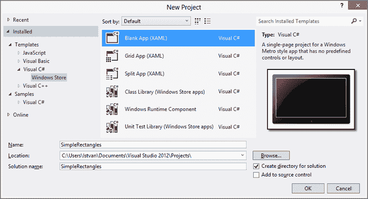

**图 4-5：** 显示项目的解决方案资源管理器


**2.** 对话框的左窗格显示类别层次结构。在“已安装”节点下，展开“模板”，然后展开“Visual C#”。单击“Windows 应用商店”节点以显示此类别的可用项目模板。选择“空白应用程序”模板，将其命名为 `SimpleRectangles`，然后单击“确定”。  
根节点表示包含一个项目的解决方案——即根节点正下方的节点。该项目具有子节点，例如“属性”、“引用”、“资产”和“通用”文件夹，以及 `App.xaml` 文件等。IDE 还会打开 `App.xaml.cs` 文件进行编辑。

**工作原理**  
当您在步骤 2 中选择“空白应用程序”模板并指定其名称时，Visual Studio 会创建模板文件的副本，并将模板中的一些占位符替换为应用程序的名称（`SimpleRectangles`）。复制模板后，IDE 立即打开它，并在“解决方案资源管理器”窗口中显示其结构。

***

如果您运行该应用程序，它将只显示一个空白页面。在下一个练习中，您将设计应用程序的页面。

***

**试一试：设计页面**

要设计应用程序的页面，请按照以下步骤操作：

**1.** 在“解决方案资源管理器”中，双击 `MainPage.xaml` 节点。IDE 在设计视图中打开该文件，如图 图 4-6 所示。此视图分为设计窗格（顶部），显示页面的预览，以及 XAML 窗格（底部），包含描述页面定义的 XAML 代码。

***

**注意** 当您在 Visual Studio 中打开页面（或任何 XAML）文件时，加载设计预览可能需要几秒钟。在此期间，预览窗格中会显示一个带有“正在加载设计器…”文本的框。

***

**2.** 在设计窗格的左下角，使用组合框更改缩放比例，以便您可以看到整个设计预览。根据您显示器的大小，66.67%、50% 或 33.33% 可能是合适的比例。

**图 4-6：** 设计 `MainPage.xaml` 文件


**图 4-7：** IntelliSense 显示的完成列表


**3.** 在 XAML 窗格中，向下滚动到 `<Grid …>` 和 `</Grid>` 元素之间的空行，然后开始键入 `<Grid.RowD`。在您键入时，Visual Studio 内置的 IntelliSense 技术会自动显示一个完成列表，如图 图 4-7 所示。在此列表中，`RowDefinitions` 条目被高亮显示为“RowD”的建议完成项。按 Tab 键，建议的完成项将被应用。按“>”关闭 XAML 标记，编辑器会自动为您创建结束标记 `</Grid.RowDefinitions>`，如图 图 4-8 所示。

**图 4-8：** 完成的表达式


**4.** 将以下粗体代码复制到 XAML 窗格中：


```
<Grid Background="{StaticResourceApplicationPageBackgroundThemeBrush}">
    <Grid.RowDefinitions>
        <RowDefinition />
        <RowDefinition />
    </Grid.RowDefinitions>
    <Grid.ColumnDefinitions>
        <ColumnDefinition />
        <ColumnDefinition />
    </Grid.ColumnDefinitions>
    <TextBlock Text="Behind Red" Grid.Row="0" Grid.Column="0" 
         FontSize="48" 
        HorizontalAlignment="Center" VerticalAlignment="Center" />
    <Rectangle Name="RedRectangle" Grid.Row="0" Grid.Column="0" 
         Fill="Red" />
    <TextBlock Text="Behind Green" Grid.Row="0" Grid.Column="1" 
         FontSize="48" 
        HorizontalAlignment="Center" VerticalAlignment="Center" />
    <Rectangle Name="GreenRectangle" Grid.Row="0" Grid.Column="1" 
         Fill="Green" />
    <TextBlock Text="Behind Blue" Grid.Row="1" Grid.Column="0" 
         FontSize="48" 
        HorizontalAlignment="Center" VerticalAlignment="Center" />
    <Rectangle Name="BlueRectangle" Grid.Row="1" Grid.Column="0" 
         Fill="Blue" />
    <TextBlock Text="Behind Yellow" Grid.Row="1" Grid.Column="1" 
         FontSize="48" 
        HorizontalAlignment="Center" VerticalAlignment="Center" />
    <Rectangle Name="YellowRectangle" Grid.Row="1" Grid.Column="1"
         Fill="Yellow" />
</Grid>
```

**5.** 设计预览会根据你刚刚输入的 XAML UI 定义进行刷新，如图 4-9 所示。

**图 4-9:** 页面预览


**工作原理**

当你使用 C++、C# 或 Visual Basic 编程语言时，XAML 是用于定义 Windows 8 风格应用 UI 的技术。在前一个练习中创建项目时，IDE 为你创建了 `MainPage.xaml` 文件作为默认应用程序页面。在步骤 3 和步骤 4 中，你添加了一个网格声明，将屏幕分为两行两列，网格的每个单元格包含一个 `TextBlock` 和一个 `Rectangle` 元素。在每个单元格中，矩形被放在文本前面，因为 `TextBox` 声明位于 `Rectangle` 声明之前。当你更改 XAML 窗格的内容时，预览会持续刷新，如图 4-9 所示。

* * *

虽然你已经设计了页面的布局，但尚未向应用程序添加任何行为。在接下来的练习中，你将添加几行代码，使用户可以单击或点击矩形以显示其背后的文本。

* * *

**动手试一试：添加和编辑事件处理程序代码**

Windows 8 风格应用程序遵循众所周知的事件模式。当用户与应用程序交互时，操作系统会引发一个事件。在代码中，你可以编写一个事件处理程序方法来响应特定事件。要为你在上一个练习中设计的页面添加事件处理程序代码，请按照以下步骤操作：

**1.** 如果你在上一个练习中关闭了 `MainPage.xaml` 文件，请在解决方案资源管理器中双击它将其打开。

**图 4-10:** 属性窗口


**2.** 在 XAML 窗格中，选择带有 `Name="RedRectangle"` 属性的 `<Rectangle>` 元素。在主窗口右侧的解决方案资源管理器下方，你可以看到属性窗口，如图 4-10 所示。如果看不到，请按 `Alt+Enter` 显示它。

**3.** 在名称字段的右侧，你会看到两个图标。单击第二个图标（如图 4-10 中突出显示的）以显示所选矩形的事件。向下滚动到 `Tapped` 事件，输入 `RectangleTapped`，然后按 Enter。

**4.** IDE 会打开 `MainPage.xaml.cs` 文件，并创建一个名为 `RectangleTapped` 的新事件处理程序方法。

* * *

**注意** `MainPage.xaml.cs` 文件被称为代码隐藏文件，因为它包含与 `MainPage.xaml` 文件定义的 UI 相关联的代码。如果在解决方案资源管理器中展开 `MainPage.xaml` 节点，你会看到它嵌套了 `MainPage.xaml.cs` 文件。

* * *

**5.** 在 `MainPage.xaml.cs` 文件顶部以 `using` 开头的最后一行之后，追加以下代码行：


```
using Windows.UI.Xaml.Shapes;
```

**6.** 将以下粗体代码输入到 `RectangleTapped` 方法的主体中：


```
private void RectangleTapped(object sender, 
       TappedRoutedEventArgs e)
{
    RedRectangle.Fill.Opacity = 1.0;
    GreenRectangle.Fill.Opacity = 1.0;
    BlueRectangle.Fill.Opacity = 1.0;
    YellowRectangle.Fill.Opacity = 1.0;
    var rectangle = sender as Rectangle;
    if (rectangle != null)
    {
        rectangle.Fill.Opacity = 0.25;
    }
}
```

**7.** 单击 IDE 工具栏下方的 `Mainpage.xaml` 选项卡，返回页面的设计视图，并查看你关联了事件处理程序方法的 `<Rectangle>` 元素：

```
<Rectangle Name="RedRectangle" Grid.Row="0" Grid.Column="0" 
    Fill="Red" 
Tapped="RectangleTapped" />
```

IDE 自动将 `RectangleTapped` 方法与 `<Rectangle>` 元素的 `Tapped` 事件关联起来。通过选择以下粗体代码并按 `Ctrl+C` 复制，然后按 `Ctrl+V` 将其粘贴到其他三个 `<Rectangle>` 元素中：

```
<TextBlock Text="Behind Red" Grid.Row="0" Grid.Column="0" 
       FontSize="48" 
    HorizontalAlignment="Center" VerticalAlignment="Center" />
<Rectangle Name="RedRectangle" Grid.Row="0" Grid.Column="0" 
    Fill="Red" 
Tapped="RectangleTapped" />
<TextBlock Text="Behind Green" Grid.Row="0" Grid.Column="1" 
    FontSize="48" 
    HorizontalAlignment="Center" VerticalAlignment="Center" />
<Rectangle Name="GreenRectangle" Grid.Row="0" Grid.Column="1" 
    Fill="Green" 
Tapped="RectangleTapped" />
<TextBlock Text="Behind Blue" Grid.Row="1" Grid.Column="0" 
    FontSize="48" 
    HorizontalAlignment="Center" VerticalAlignment="Center" />
<Rectangle Name="BlueRectangle" Grid.Row="1" Grid.Column="0" 
    Fill="Blue" 
Tapped="RectangleTapped" />
<TextBlock Text="Behind Yellow" Grid.Row="1" Grid.Column="1" 
    FontSize="48" 
    HorizontalAlignment="Center" VerticalAlignment="Center" />
<Rectangle Name="YellowRectangle" Grid.Row="1" Grid.Column="1" 
    Fill="Yellow" 
Tapped="RectangleTapped" />
```

现在，SimpleRectangles 应用程序已准备好运行。

**工作原理**

你可以使用属性窗口设置所选元素的属性，或将元素的事件与事件处理程序方法关联。在步骤 3 中，你创建了一个新的事件处理程序方法，并将其与名为 `RedRectangle` 的 `Rectangle` 元素的 `Tapped` 事件关联。当你点击该元素或用鼠标单击它时，会引发此事件。你在步骤 6 中添加的代码使所有矩形变为不透明，并将所选矩形设置为几乎透明。因此，由于透明度，被其隐藏的文本可以被看到。在步骤 7 中，你编辑了 XAML 定义，将其他三个矩形（绿色、蓝色和黄色）的 `Tapped` 事件与 `RectangleTapped` 方法关联。

* * *

你已经创建了第一个 Windows 8 风格应用程序。现在是时候运行它了。在接下来的练习中，你将学习如何从 Visual Studio 启动应用程序，以及如何调试它。

* * *

**动手试一试：运行和调试项目**

要启动应用程序，请按照以下步骤操作：

**1.** 按 `Crtl+F5`，或使用 **调试** &menuarrow; **开始执行(不调试)** 菜单命令。Visual Studio 会生成并部署你的项目，然后立即启动它。应用程序会显示四个矩形。

**2.** 点击任意矩形（如果你有平板电脑），或用鼠标指针单击任意矩形。矩形会变暗，并显示其背后的文本。例如，当你点击或单击绿色矩形时，它会显示“Behind Green”文本，如图 4-11 所示。


**图 4-11：** SimpleRectangles 应用程序运行效果


**图 4-12：** 开始屏幕中的 SimpleRectangles 磁贴

**3.** 按 Alt+F4 关闭应用程序。关闭后，开始屏幕会显示出来。用手指或鼠标滑动屏幕，直到到达最右侧的磁贴。你可以找到 SimpleRectangles 应用程序的磁贴，如图 4-12 所示。**4.** 单击 Windows 按钮或点击开始屏幕中的“桌面”磁贴，返回 Visual Studio IDE。**5.** 打开 `MainPage.xaml.cs` 文件，向下滚动到 `RectangleTapped` 方法，然后点击 `if (rectangle != null)` 行开头左侧的编辑器边距。此操作为该行添加了一个断点，如图 4-13 所示。

**图 4-13：** 在 `RectangleTapped` 方法中创建断点


**图 4-14：** 执行在断点处停止

**6.** 按 F5 或使用“调试”&menuarrow;“开始调试”命令，以调试模式启动应用程序。应用程序以与之前相同的方式启动。**7.** 点击或触摸屏幕。`RectangleTapped` 事件被触发，程序执行在所选断点处停止，如图 4-14 所示。**8.** 按 F10 两次，程序执行移动到 `rectangle.Fill.Opacity = 0,25;` 行。按 F5，程序再次运行——直到你再次点击屏幕。**9.** 在 Visual Studio IDE 中按 Shift+F5，或在 SimpleRectangles 应用程序中按 Alt+F4，停止应用程序。

* * *

**注意** 在 Visual Studio 中要小心不要使用 Alt+F4 组合键，因为它会关闭 IDE。Shift+F5 组合键是“调试”&menuarrow;“停止调试”命令的快捷键。在 IDE 中时，可以使用 Shift+F5 结束调试。

* * *

**工作原理** 如本练习所示，你可以分别使用 F5 或 Ctrl+F5 键，在有调试或无调试的情况下启动应用程序。在这两种情况下，Visual Studio 都会编译应用程序，立即部署它，并在开始屏幕中创建相应的磁贴，如图 4-12 所示。你可以向代码中添加断点。当应用程序启动后，每当执行到达断点时，应用程序就会停止，IDE 会显示包含断点的文件，并高亮显示当前位置。

* * *

**注意** 你可以在本书的配套网站 [www.wrox.com](http://www.wrox.com) 上找到本练习的完整代码下载，位于 Chapter04.zip 下载文件中的 SimpleRectangles-VS 文件夹内。

* * *

* * *

#### 使用示例和扩展

研究示例应用程序可以帮助你加快学习曲线。Visual Studio 的设计者考虑到了这一点，并将 IDE 与示例库网站（[`code.msdn.microsoft.com`](http://code.msdn.microsoft.com)）集成在一起。这个社区网站是 Windows 编程代码示例的中心，你可以找到数千个优秀的源代码项目。在这个网站上，你可以通过指定标签、编程语言、Visual Studio 版本和其他条件来搜索示例。当你找到感兴趣的示例时，可以下载并用 Visual Studio 打开它。此外，你还可以上传自己的示例应用程序。

##### 从示例创建新项目

虽然该网站使用起来非常直观，但你首先必须下载一个示例，然后在 IDE 中打开它。你可以直接从 IDE 中打开示例，而无需使用浏览器查找和下载感兴趣的示例，正如你在下一个练习中学到的那样。

* * *

**试一试：从示例应用程序创建新项目** 要从示例应用程序创建项目，请按照以下步骤操作：**1.** 使用“文件”&menuarrow;“关闭解决方案”菜单命令，关闭 IDE 中的 SimpleRectangles 项目及其所有相关文件。**2.** 使用“文件”&menuarrow;“新建项目”菜单命令，或按 Ctrl+Shift+N 组合键创建一个新的示例项目。弹出“新建项目”对话框。**3.** 单击对话框中的“联机”节点（最底部）。IDE 会连接到几个与 Visual Studio 相关的网站——包括示例库网站——并检索显示在对话框中的信息。在“联机”节点下，显示两个主要文件夹：模板和示例。**4.** 单击“模板”文件夹左侧的小三角形将其折叠。**5.** 在“示例”文件夹下，展开 JavaScript 节点，然后展开“桌面”，再单击 HTML5。对话框会显示用 JavaScript 编写并标记为 HTML5 的可用示例程序，如图 4-15 所示。

**图 4-15：** “新建项目”对话框中的 JavaScript 示例

**6.** 选择“启动画面示例 (JavaScript)”项，然后单击“确定”。Visual Studio 会下载示例代码，并将其安装到你的计算机上。安装前，你必须同意“下载和安装”对话框中显示的许可条款，如图 4-16 所示。单击“安装”。

**图 4-16：** “下载和安装”对话框

**7.** Visual Studio 使用已安装的示例创建一个新项目，并打开 `description.html` 文档，其中解释了有关此示例的详细信息。**8.** 按 Ctrl+F5 运行项目。应用程序启动，你可以立即使用它。按 Alt+F4 组合键关闭应用程序。**9.** 按 Windows 键切换回 Visual Studio。在 IDE 中，你可以使用解决方案资源管理器浏览项目文件，并了解 SplashScreenSample 的工作原理。**工作原理** 在第 3 步中，当你单击“联机”节点时，IDE 会查询几个网站以获取模板和示例类别。在第 5 步中，当你遍历示例层次结构时，IDE 会查询示例库网站，获取“桌面/HTML5”类别中的 JavaScript 项目并显示它们。当你选择 SplashScreenSample 项时，它会安装示例文件并基于此项目创建一个新的解决方案。在浏览示例时，“新建项目”对话框的右侧窗格会显示有关该示例的更多信息。如果你想了解更多关于所选示例的信息，可以单击“更多信息”链接，该链接会打开示例库网站上该示例的页面。

* * *

当你想要学习新的 Windows 8 功能时，值得查看示例项目。Windows SDK 团队已向示例库网站上传了超过 100 个 Windows 8 示例。

##### 安装和使用扩展

Visual Studio 2012 有一个名为“扩展管理器”（在 Visual Studio 2012 中称为“扩展和更新”）的强大功能，可帮助从 Visual Studio 库（[`visualstudiogallery.com`](http://visualstudiogallery.com)）发现、下载和管理 Visual Studio 扩展。通过使用此功能，你可以找到上传到库中的模板、可视控件和工具。在下一个练习中，你将学习如何使用扩展管理器下载和安装工具。

* * *


#### 尝试一下：使用 Visual Studio 扩展管理器

在本练习中，你将安装免费的 NuGet 扩展。请按照以下步骤进行安装：

**1.** 使用菜单中的“工具 &menuarrow; 扩展和更新”命令，打开“扩展和更新”对话框。此对话框是管理（即下载、安装、禁用和移除）你希望在 IDE 中使用的所有扩展的中心。默认情况下，该对话框会列出所有已安装的扩展，如图 4-17 所示。

**图 4-17:** 显示所有已安装扩展的“扩展和更新”对话框


**2.** 单击“联机”选项卡。IDE 会查询 Visual Studio 库和示例库，以收集有关可用扩展的信息。单击“Visual Studio 库”节点以显示可用的扩展。

**3.** 在列表中选择“NuGet 包管理器”项，然后单击“下载”按钮。所选扩展将被下载，并启动 VSIX 安装程序。单击“安装”。

* * *

**注意** 根据你在 Windows 8 中的安全设置，“用户账户控制”对话框可能会要求你确认是否允许 VSIX 安装程序对计算机进行更改。

* * *

**4.** 几秒钟后，VSIX 安装程序将配置 NuGet 包管理器扩展。单击“关闭”退出 VSIX 安装程序。

**5.** 单击“已安装”选项卡。现在你可以在列表中看到 NuGet 包管理器，如图 4-18 所示。大多数扩展需要重启 Visual Studio，对话框底部会显示相应消息。单击“重启”。

**图 4-18:** “扩展管理器”对话框现在显示 NuGet 包管理器。


**图 4-19:** NuGet 包管理器添加了一个新的菜单项。


**6.** 当 Visual Studio 重启后，转到“工具”菜单。你可以找到“库包管理器”项，它由 NuGet 包管理器放置在那里，如图 4-19 所示。

#### 工作原理

Visual Studio 具有可扩展性模型，允许安装可集成到 IDE 中的加载项、模板、工具、控件、示例和其他工件。所有这些都可以通过“扩展管理器”对话框进行处理，该对话框帮助你发现、安装和管理它们。大多数扩展需要执行只能在 Visual Studio 启动时完成的配置步骤，因此要使用它们，你必须重启 Visual Studio。

* * *

#### 关于 IDE 的一些有用知识

Visual Studio IDE 是一个真正的工作台，提供了大量有用的工具和函数，帮助你高效地创建软件。如果本书打算告诉你关于 IDE 的所有重要细节，那么它的篇幅至少会翻倍。

Visual Studio 2012 的大部分改进在于简化 UI 并使其更简洁。在本节中，你将学到一些让 IDE 使用更轻松的知识。

##### Visual Studio 起始页

当你启动 Visual Studio 时，IDE 会显示一个组织良好的屏幕——起始页，如图 4-20 所示。如果你之前使用过 Visual Studio，可能对这个页面很熟悉。该页面是开始日常 IDE 工作的中心。你可以加载任何最近的项目、启动新项目或打开现有项目文件。如果你是 Visual Studio 新手，起始页会提供最有用的链接来开始应用程序开发，包括 Windows 8 风格的应用。

**图 4-20:** Visual Studio 起始页


此页面提供了两个选项，帮助你管理起始页的可见性，如图 4-20 中突出显示的部分。设置第一个选项后，当你在 IDE 中加载项目时，起始页会关闭。第二个选项允许你控制 Visual Studio 启动时是否显示起始页。有时你可能希望在起始页暂时不可见时使用它。使用“视图 &menuarrow; 起始页”命令即可显示它。

##### 窗口管理

在使用 Visual Studio 时，你通常会使用多个文档（如代码文件和设计器界面）以及一系列工具（如解决方案资源管理器、工具箱、属性窗口等）。相应地，你会使用文档窗口和工具窗口。将它们放置在合适的位置并不总是那么容易，以便使用最佳布局来提高工作效率。

IDE 提供了简单但强大的窗口管理功能，支持多显示器。你可以通过拖放窗口操作来更改工作台的布局，如图 4-21 所示。在 IDE 中有多种排列窗口的方式：

*   你可以将文档或工具窗口以选项卡形式停靠到编辑框架。例如，图 4-21 中的 `MainPage.xaml.cs` 和 `App.xaml.cs` 就是按这种方式排列的。

*   你可以将工具窗口停靠到 IDE 框架的边缘，或者以选项卡形式停靠到编辑框架。在图 4-21 中，你可以看到“在文件中查找”对话框停靠在编辑框架的右边缘。当你拖动“在文件中查找”的标题栏时，编辑框架中央会出现一个引导菱形。当你移动窗口并将鼠标悬停在最右侧的引导图标上时，一个“幽灵框架”会显示对话框的新停靠位置。你可以通过释放鼠标左键来接受此位置，或者将窗口移动到其他位置。

*   你可以将窗口浮动在 IDE 之上或之外。

*   你可以通过简单地将窗口拖到另一个显示器来在多台显示器上显示窗口。

*   你可以沿 IDE 边缘最小化（自动隐藏）工具窗口。在图 4-21 中，屏幕左边缘的“工具箱”窗口是自动隐藏的。移动鼠标并单击“工具箱”即可显示该工具窗口。

*   你可以随时使用“窗口 &menuarrow; 重置窗口布局”命令将窗口位置重置为原始布局。

**图 4-21:** 将“在文件中查找”对话框拖到新的停靠位置


##### 使用快速启动

Visual Studio 有数千个可用命令。你可以在菜单或工具栏中轻松找到其中大部分命令。然而，有时并不那么直接。例如，当你在 IDE 中打开一个项目并想创建新项目时，你可能会在“项目”菜单中寻找“新建项目”命令，而不是在“文件”菜单中（实际上该命令位于“文件”菜单中）。

**图 4-22:** 快速启动搜索“project”的结果


Visual Studio 2012 引入了一个名为“快速启动”的新搜索工具。它位于 IDE 的右上角，与大多数程序和网页中的搜索框位置相同。你可以使用 Ctrl+Q 组合键立即将焦点移动到快速启动。

使用此工具非常简单。只需输入你要查找的命令的一部分，IDE 就会搜索你可能需要的命令、选项和文件。例如，当你在快速启动框中输入 `project` 时，你会看到可用命令、选项和文件的列表，如图 4-22 所示。


您可以使用上下箭头键配合 `Enter` 键，或使用鼠标来调用相应的命令。例如，当您单击“项目和解决方案”&menuarrow;“常规”选项时，将打开“选项”对话框，并显示所选的选项页面。在列表中，您可以使用 `Ctrl+Q` 组合键显示所有结果，并在结果类别（如菜单、选项、打开的文档和最近使用的命令）之间移动。

* * *

**注意** IDE 具有许多有用的功能，可让您的工作更轻松、更高效。在本书的后续章节中，您将更详细地了解这些功能。

* * *

### 使用 Expression Blend 点亮您的应用程序

Visual Studio 2012 Express for Windows 8 是创建 Windows 8 应用的免费终极工具。它提供了建立应用程序 UI 和编写管理用户交互逻辑的工具集。当您安装 Visual Studio 时，另一个强大的工具——Expression Blend for Visual Studio 2012——也会安装在您的计算机上。

Blend 是 Microsoft Expression 产品家族的一员。该工具旨在让 UI 设计人员使用 XAML 或 HTML 技术制作现代、美观且独特的应用程序页面。虽然它是面向设计人员的产品，但不仅限于图形设计，还可以用于设计和创建应用程序，正如您将在本节中学到的那样。

#### 使用 Visual Studio 解决方案启动 Expression Blend

您在本章前面创建的 `SimpleRectangles` 应用程序也可以使用 Expression Blend 构建。Visual Studio 侧重于以程序员习惯的方式创建应用程序，而 Blend 则专注于 UI 设计。这两个工具反映了开发人员和设计人员之间的任务分工。很棒的是，在 Visual Studio 中创建的 Windows 8 风格应用程序项目可以在 Expression Blend 中打开，反之亦然。

要了解更多关于使用 Expression Blend 的信息，在接下来的练习中，您将为 `SimpleRectangles` 项目添加动画效果。

* * *

**试一试：使用 Visual Studio 解决方案启动 Expression Blend**  
要开始使用 Visual Studio Blend 增强 `SimpleRectangles` 应用程序，请按照以下步骤操作：

1. 转到“开始”屏幕（如果您处于桌面模式，请按 Windows 按钮），然后单击“Blend for Visual Studio”磁贴。

* * *

**注意** 如果找不到“Blend for Visual Studio”磁贴，请开始输入 `Blend`。Windows 会自动进入搜索屏幕并显示所有名称中包含“Blend”的应用程序。右键单击“Blend for Visual Studio”，然后在应用程序栏中选择“固定到‘开始’屏幕”。此后，您会发现该应用程序磁贴已固定到“开始”屏幕。

* * *

值得重复搜索过程并使用应用程序栏中的“固定到任务栏”命令。完成这个简单操作后，在桌面模式下只需单击一次即可从任务栏访问 Blend for Visual Studio。

2. Expression Blend 会在几秒钟内启动。选择“文件”&menuarrow;“打开项目/解决方案”命令（或按 `Ctrl+Shift+O`），将打开“打开项目”对话框。

3. 导航到您创建 `SimpleRectangles` 项目时保存的文件夹。选择 `SimpleRectanges.sln` 文件，然后单击“打开”。Blend IDE 会打开该解决方案，并在“项目”窗口中显示其结构。

4. 双击 `MainPage.xaml` 文件，IDE 会将其显示在主窗口中央，如图 4-23 所示。

* * *

**注意** 您在图 4-23 中看到的屏幕截图使用了浅色配色方案，以便在打印时提供更好的对比度。您会看到较深的颜色，因为 Blend 默认使用深色主题。您可以使用“选项”对话框的“工作区”选项卡（“文件”&menuarrow;“选项”）将主题从深色更改为浅色，反之亦然。

* * *

**图 4-23：** 在 Blend for Visual Studio 中打开的 `SimpleRectangles` 解决方案


5. 在“项目”窗口中，展开 `MainPage.xaml` 节点，然后双击其正下方的 `MainPage.xaml.cs` 节点。该文件将打开并显示 C# 代码，就像您在 Visual Studio IDE 中一样。

6. 单击 `MainPage.xaml.cs` 选项卡中的 X 图标以关闭代码编辑器。

**工作原理**  
Blend for Visual Studio 可以打开使用 Visual Studio 创建的解决方案文件，并理解包含 Windows 8 应用项目的解决方案结构。您可以使用 Blend IDE 创建和修改 UI，也可以阅读和编辑相关代码。

虽然本练习没有演示，但您甚至可以使用“文件”&menuarrow;“新建项目”命令在 Blend 中创建新的 Windows 8 应用程序项目。

* * *

Blend 拥有一组工具窗口，可帮助您设计 UI。图 4-23 显示了最重要的几个：

*   “项目”工具窗口显示解决方案中文件和文件夹的结构，类似于 Visual Studio 中的解决方案资源管理器。

*   屏幕左侧的“工具箱”包含可用于编辑设计图面上打开的页面的一组工具。

*   “对象和时间线”工具窗口显示构成 UI 的可视元素层次结构。在图 4-23 中，您可以看到页面（`MainPage.xaml`）由三个元素组成：`BottomAppBar`、`TopAppBar` 和 `[Grid]`。`[Grid]` 是可展开的，因此它嵌套了其他元素，如小三角形所示。

*   屏幕中央是设计图面。您可以在此处拖放 UI 元素，以及移动、调整大小和管理它们。

*   构成 UI 的每个对象都有可在“属性”窗口中编辑的属性——该窗口位于设计图面的右侧。

Blend IDE 看起来并不复杂（与其他以设计人员为中心的应用程序（如 Adobe 的 Photoshop）相比），但它非常强大，正如您将在接下来的练习中学到的那样。

#### 向 UI 添加动画对象

当用户点击或单击矩形时，`SimpleRectangles` 应用程序会更改矩形的透明度。现在让我们为其添加一个飞入动画效果。当矩形被点击或单击时，文本将飞入屏幕。

* * *

**试一试：使用 Expression Blend 创建文本块**  
要创建一个在点击或单击任何矩形时飞入的文本块，请按照以下步骤操作：

**图 4-24：** `TextBlock` 工具


1. 在“工具箱”中，单击 `TextBlock` 工具，如图 4-24 所示。此时 `TextBlock` 工具被选中。

2. 在设计图面上，在红色和绿色矩形上方（以及平板电脑边框之外）的屏幕中央绘制一个矩形，如图 4-25 所示。要绘制矩形，请在设计图面上单击您想要放置其左上角的位置，然后在不释放鼠标左键的情况下，将指针移动到右下角的位置。在移动鼠标时，Blend 会显示矩形的尺寸，如图 4-25 中突出显示的那样。将矩形设置为大约 700 像素宽、100 像素高。

**图 4-25：** 绘制 `TextBlock` 矩形


**图 4-26：** 在“属性”窗口中设置 `TextBlock` 的名称


  
**3.** 单击“属性”窗口，在“名称”框中键入 `FlyInRectangle`，如图 图 4-26 所示。这将是你在编写代码时可以使用的控件名称。  
**4.** 在工具箱中，单击黑色鼠标指针工具，该工具用于选中你刚刚绘制的 `TextBlock`。在“属性”窗口中向下滚动到“文本”部分，将文本大小设置为 24 磅（24 pt），如图 图 4-27 所示。

**图 4-27:** 将文本大小设置为 24 磅

  
**5.** 在“文本”部分，单击第二个（段落标记）选项卡，将水平对齐方式设置为“居中”，如图 图 4-28 所示。

**图 4-28:** 将文本水平对齐方式设置为“居中”

  
**6.** 在设计图面上，双击 `TextBlock` 的矩形以选中其文本，然后键入 You’ve tapped the screen 以更改默认的“TextBlock”文本。设计图面会更新，如图 图 4-29 所示。

**图 4-29:** 更新后的设计图面


**图 4-30:** 添加到 UI 元素层次结构中的 `FlyInRectangle`

  
**工作原理**  
你可以使用工具箱选取 UI 元素并将其放置在设计图面上。在本练习中，你使用了 `TextBlock` 工具在 `MainPage.xaml` 页面上放置了一个文本框。你使用“属性”窗口设置了文本的名称、大小和水平对齐方式。此外，你还更改了默认文本。新的 `TextBlock` UI 元素被添加到页面 UI 元素的层次结构中，并显示在“对象和时间线”工具窗口中，如图 图 4-30 所示。

* * *

现在，你已经准备好为 `FlyInRectangle` UI 元素编写动画。使用 Blend 创建动画相当简单。借助情节提要，你只需几个步骤即可完成，正如你在下一个练习中学到的那样。

* * *

##### 试一试：使用 Blend 创建动画

要创建移动 `FlyInRectangle` 元素的动画，请按照以下步骤操作：  
**1.** 在“对象和时间线”工具窗口中，单击“新建”按钮（加号，如图 图 4-31 所示）以创建新的情节提要。此时会打开“创建情节提要资源”对话框。在“名称（键）”文本框中键入 `FlyInStoryboard`，然后单击“确定”。

**图 4-31:** “对象和时间线”对话框中的“新建”按钮

  
**2.** 情节提要对象已创建，并且录制模式已启动，如设计图面顶部的“FlyInStoryboard 时间线录制已设置”标签所示。时间线窗格显示在“对象和时间线”工具窗口中，如图 图 4-32 所示。

**图 4-32:** 时间线窗格

  
此窗格包含一个水平刻度，表示时间线中的秒数。0 值下方的一个小黄色箭头和一条垂直黄线表示设计图面显示情节提要的初始状态。  
**3.** 单击时间线上的 2 刻度值。黄色箭头和线现在表示设计图面代表情节提要在 2 秒时的状态。  
**4.** 单击“You’ve tapped the screen”文本并将其移动到屏幕中间。由于情节提要处于录制模式，通过这个简单的移动，你指示设计器要创建一个动画文本的情节提要，使文本在情节提要开始后 2 秒移动到所选位置。  
**5.** 在时间线窗格中，有一个小播放按钮。单击它。情节提要开始并动画显示文本，使其从初始位置移动到你在上一步中指定的新位置。

**图 4-33:** `FlyInRectangle` 嵌套的 `RenderTransform` 对象

  
**6.** 在“对象和时间线”工具窗口中，展开 `FlyInRectangle` 节点。此节点嵌套了一个新的 `RenderTransform` 节点，该节点表示文本位置的变化（你在步骤 4 中添加的小动画），如图 图 4-33 所示。  
**7.** 单击 `RenderTransform` 节点以在“属性”窗口中更改其属性。你设置的动画有点不自然，因为文本以恒定速度移动。如果它开始缓慢，加速后再次减速再停止，会更自然。你可以在“属性”窗口的“缓动”部分轻松进行此更改，如图 图 4-34 所示。你可以在那里看到一个图表，显示动画属性（在本例中为文本块的位置，由垂直轴标记）如何随时间变化（由水平轴标记）。  
**8.** 在图表的左下角和右上角，你可以找到两个手柄。要更改图表，请单击并逐个将它们移动到新位置，如图 图 4-35 所示。  
**9.** 在“对象和时间线”工具窗口中，单击 `FlyInStoryboard` 名称（直接在工具窗口选项卡下方）以在“属性”窗口中显示相关属性。  
**10.** 在“属性”窗口中，选中 `AutoReverse` 复选框。单击时间线中的“播放”按钮，可以看到现在文本块飞入然后自动飞出。  
**11.** 使用“文件”&menuarrow;“全部保存”命令保存所有更改。

**图 4-34:** `RenderTransform` 对象的原始缓动


**图 4-35:** `RenderTransform` 对象的修改后缓动

  
**工作原理**  
创建动画的关键对象是你在步骤 1 中添加到页面的情节提要。情节提要使用时间线定义设计图面上对象的状态。在步骤 3 和步骤 4 中，你定义了文本块“You’ve tapped the screen”的两个状态——两个不同的位置。情节提要记录了文本块属性的变化方式。当你在步骤 5 中播放情节提要时，文本块的属性值在 0 到 2 秒之间的每一帧（大约每秒 30 帧）都被计算出来，这就是你所感知到的流畅动画。  
在步骤 7 和步骤 8 中，你更改了属性值的计算方式。图 4-35 中的图表显示了属性如何随时间变化。你可以看到，在动画的开始和结束时，属性随时间变化缓慢（图表平坦），而在动画中间，属性变化更快（图表更陡峭）。  
在许多情况下，你会发现使用你在步骤 10 中设置的 `AutoReverse` 标志非常有用。你不需要创建新的情节提要来回放动画。设置此标志会自动为你完成。

* * *

#### 启动动画

你几乎已经完成了所有操作。最后一步是在点击或单击屏幕时触发情节提要。这很简单；你可以在 Blend 中完成，正如你在下一个练习中学到的那样。

* * *

##### 试一试：启动动画

要启动你在上一个练习中创建的动画，请按照以下步骤操作：  
**1.** 在“项目”工具窗口中，双击 `MainPage.xaml.cs` 文件将其打开。找到文件底部的 `RectangleTapped` 事件处理程序方法。  
**2.** 在该方法的末尾添加以下两行代码：  


```
FlyInStoryBoard.SkipToFill();
FlyInStoryboard.Begin();
```


**3.** 在菜单中，选择“项目 &menuarrow; 运行项目”命令。Blend IDE 会生成项目（就像使用 Visual Studio 一样）、部署它，并启动 SimpleRectangles 应用程序。

**4.** 当应用程序启动时，尝试点击或单击矩形。你可以检查每次点击或单击矩形时动画是否都会启动。如果你在短时间内（2 秒内）连续点击或单击两个矩形，你可以检查动画是否总是从头开始播放。

**工作原理** 你在第 2 步中添加的代码行只是停止动画，然后从头开始播放。正如你在第 3 步中所体验到的，Expression Blend 也可以生成和部署你的 Windows 8 风格应用程序。

* * *

**注意** 你可以在本书的配套网站上找到本练习的完整代码下载，网址为 [www.wrox.com](http://www.wrox.com)，位于 Chapter04.zip 下载文件中的 SimpleRectangles-Blend 文件夹内。

* * *

* * *

#### 同时使用 Visual Studio 和 Blend

在前面的练习中，你只了解了 Blend 的部分功能。Expression Blend 提供了丰富的功能、许多高级特性（包括出色的 UI 编辑能力）、对数据绑定、示例数据、样式和模板的支持。虽然 Blend 的许多设计功能也已集成到 Visual Studio 2012 中，但 Blend 仍然是面向设计师的工具。

在实际的 Windows 8 风格应用程序项目中，Blend 和 Visual Studio 是协同使用的。通常，开发人员在 Visual Studio 中创建基本 UI 并编写应用程序背后的逻辑。设计师则使用 Blend 通过丰富的动画效果、媒体和精美的布局来增强 UI。

在本书的后续章节中，你将看到许多示例，展示这两个强大的工具如何构成创建 Windows 8 应用程序的终极工具集。

### 总结

Windows 8 提供了出色的技术来承载 Windows 8 风格应用程序。然而，如果没有合适的工具集，开发人员就无法高效地使用它们。微软提供了这些使应用程序开发变得简单的工具：

*   Microsoft Visual Studio 2012 是终极开发环境，支持所有 Windows 8 语言以及 Windows 8 风格应用程序开发的完整技术栈。它有一个免费版本，即 Visual Studio 2012 Express for Windows 8，你可以从 MSDN 下载。

*   Microsoft Expression Blend 是一款面向 UI 设计师的工具，能够以相当高效的方式创建专业的应用程序 UI。Blend 也有免费版本。

你可以在 Visual Studio 和 Blend 中创建、开发、生成和运行 Windows 8 风格应用程序。Visual Studio 提供了出色的编码体验，而 Blend 则是编辑美观现代 UI 所需的工具。

在第 5 章中，你将了解更多关于 Windows 8 风格应用程序开发的原则，并熟悉异步编程的基础知识。

**练习**

**1.** 哪个免费开发工具支持所有 Windows 8 语言？

**2.** 如何查找 Windows 8 示例应用程序？

**3.** 哪个工具窗口列出了 Visual Studio 项目的结构？

**4.** 如果你想在 Visual Studio 中启动应用程序，可以使用哪些命令？

**5.** 你可以使用 Visual Studio 的哪个功能来快速查找命令或选项？

**6.** 使用 Expression Blend 创建动画的关键对象是什么？

* * *

**注意** 你可以在附录 A 中找到练习的答案。

* * *

**本章所学内容**

| **主题** | **关键概念** |
| --- | --- |
| Visual Studio 2012 Express for Windows 8 | 该工具是 Visual Studio 2012 系列中的免费成员。你可以从 MSDN 网站下载。该工具包含创建、调试和部署 Windows 8 风格应用程序所需的所有功能。 |
| 创建新的应用程序项目 | 使用“文件 &menuarrow; 新建项目”命令（Ctrl+Shift+N）打开“新建项目”对话框。在“已安装的模板”选项卡下，选择你要使用的编程语言，然后选择目标模板。输入应用程序名称，并可选择更改项目位置。单击“确定”创建项目。 |
| 从示例创建新项目 | 使用“文件 &menuarrow; 新建项目”命令（Ctrl+Shift+N）打开“新建项目”对话框。选择“联机”选项卡，然后展开“示例”选项卡。该对话框允许你浏览联机示例。你也可以使用对话框右上角的搜索框来筛选示例。找到所需示例后，输入应用程序名称，并可选择更改项目位置。单击“确定”从指定示例创建项目。 |
| 安装 Visual Studio 扩展 | 使用“工具 &menuarrow; 扩展管理器”命令打开“扩展管理器”对话框。在此对话框中，选择“联机扩展”选项卡以浏览 Visual Studio 库中的控件、模板和工具，或选择“示例库”以浏览项目示例。如果找到扩展，你可以通过单击“下载”按钮立即开始使用。安装扩展后，你可能需要重启 Visual Studio。在这种情况下，扩展管理器会通知你。 |
| 使用快速启动查找命令 | 在 Visual Studio 2012 中，快速启动工具让你无需遍历菜单结构即可轻松找到命令。单击 IDE 主窗口右上角的“快速启动”搜索框，或按 Ctrl+Q。当你输入表达式时，IDE 会列出匹配的命令、选项和打开的文档名称。你可以单击结果列表中的某个项，Visual Studio 将启动相应的命令，或导航到所选文档。 |
| 在 Expression Blend 中打开 Visual Studio 项目 | Expression Blend 可以打开使用 Visual Studio 创建的 Windows 8 风格应用程序项目。启动 Blend 后，使用“文件 &menuarrow; 打开项目”命令（Ctrl+Shift+O），然后选择相应的解决方案文件。Blend 会打开该解决方案，并在“项目”工具窗口中显示其结构。 |

# *第二部分*

# *创建 Windows 8 应用程序*

*   第 5 章：现代 Windows 应用程序开发原则
*   第 6 章：使用 HTML5、CSS 和 JavaScript 创建 Windows 8 风格应用程序
*   第 7 章：使用 XAML 创建 Windows 8 风格用户界面
*   第 8 章：使用 XAML 控件
*   第 9 章：构建 Windows 8 风格应用程序
*   第 10 章：创建多页面应用程序
*   第 11 章：构建连接型应用程序
*   第 12 章：利用平板电脑功能

# *第 5 章*

# *现代 Windows 应用程序开发原则*

**本章你将学习：**

*   掌握 Windows 8 设计语言的概念
*   理解同步编程与异步编程的区别
*   使用 C# 5.0 中的新异步模式
*   在 JavaScript 中创建异步逻辑

**WROX.COM 本章代码下载**

你可以在 [www.wrox.com/remtitle.cgi?isbn=1118012682](http://www.wrox.com/remtitle.cgi?isbn=1118012682) 的“下载代码”选项卡中找到本章的 wrox.com 代码下载。代码位于 Chapter05.zip 下载文件中，并按相应练习单独命名。

在本书的这一部分，你将学习创建 Windows 8 应用程序。Windows 8 支持多种编程语言，包括 JavaScript、C# 和 C++，你将在后续章节中看到所有这些语言。

然而，在开始编程之前，你首先必须理解现代 Windows 应用程序开发的基本原则。在本章中，你将学习 Windows 8 设计语言的关键概念，然后探索并尝试 C# 和 JavaScript 中的异步编程模式。

### Windows 8 风格应用程序


在了解新的 Windows 8 风格应用程序的原理和特性之前，你必须先回溯历史，理解是什么催生了 Windows 8 设计语言。那么，让我们回顾历史，谈谈复古风格的应用程序。

很久以前，当人们刚开始使用计算机时，他们需要辅助手段来理解各种计算机软件的工作原理。为了简化用户的生活，软件开发人员开始使用隐喻，将软件构建在现实生活中广为人知的概念之上。最广泛使用的隐喻可能就是“桌面”。遵循这一隐喻的现代操作系统让用户在计算机上看到的文档和应用程序，与他们在现实物理世界中的桌面上看到的东西非常相似。

尽管桌面隐喻已有 40 多年的历史（根据维基百科，它最早由艾伦·凯于 1970 年在施乐帕克研究中心提出），但如今在设备上你仍能找到相同的概念。新设备拥有更强大的硬件，这有助于在桌面上更逼真地描绘对象。

例如，即使看今天最小的手机的主屏幕，你也能看到绘制精美的图标。丰富的色彩、阴影和三维效果让它们看起来就像物理世界中的原始物体。如果你启动一个电子书阅读器应用程序，你可能会先看到一个书架，它看起来绝对真实，带有木质纹理和排列整齐的书籍。然后，当你打开一本电子书时，它像真书一样打开，翻页时的动画让你感觉仿佛在读一本实体书。

这就是拟物化设计风格，它使用物理世界的隐喻，并以超写实的图形在数字世界中描绘对象。

然而，自从这些概念诞生以来，世界已经发生了变化。新一代用户已经成长起来，他们不需要辅助手段就能理解和使用计算机。人们现在更喜欢简洁和高效，而不是华丽的图形。用户不再关心一个应用程序是画得漂亮还是超级漂亮，他们更青睐那些能帮助他们快速解决问题的应用程序。在当今快节奏的世界中，快速消费信息是成功的关键。这被称为信息图设计风格，而 Windows 8 风格应用程序的用户界面遵循这些原则。

#### 什么是 Windows 8 设计语言？

微软为 Windows 8 创建了一种遵循信息图设计原则的新设计语言。尽管每个应用程序都有各自的外观，但它们拥有共同的模式和主题，帮助用户以类似的方式理解和使用它们。在你的应用程序中遵循操作系统所使用的相同设计概念，可以帮助你的用户更高效地使用你的软件。

虽然这种设计语言的起源可以追溯到早期版本的 Windows Media Center 和 Zune 媒体播放器应用程序，但微软是在 Windows Phone 7 上才完全致力于这一新方向，并使这种语言变得突出。此后，Xbox 360 的仪表板也适应了这种设计，而 Windows 8 也严重依赖它。未来，你可能会看到越来越多的应用程序采用这些概念。

* * *

**注意** 对于 Windows 8，你可以创建两种类型的应用程序：经典桌面应用程序和新的 Windows 8 风格应用程序。你并非必须使用 Windows 8。然而，Windows 8 的概念在支持触摸的设备上可能更实用。因此，如果你的目标是平板电脑或其他用户可以通过触摸手势控制应用程序的设备，请考虑使用 Windows 8。

* * *

#### Windows 8 应用程序的通用设计原则

**图 5-1：** 一个具有简化图形的 Windows 8 风格图标


关于 Windows 8，你首先注意到的可能是它绝对不同于你习惯的东西。Windows 8 打破了旧有的惯例，如果你想接受它，就必须保持开放的心态。

你首先要考虑的是，软件和设备是数字世界的一部分。如果你在手机或电脑上看到一张书的照片，它会让你想起阅读，因为你的大脑将数字照片与实体书联系起来。但你的大脑不需要完美的照片或逼真的图像来建立这种联系，因为你知道它只是设备上一个模拟对象的数字副本。因此，你可以简化图像——正如你在图 5-1 中看到的——同时保留其原始目的。

你的软件不需要将模拟世界复制到数字世界中。它不必看起来像别的东西——它实际上就是一个数字应用程序。真实性和简洁性可以帮助用户更快地理解程序，这在信息图设计风格中非常重要。

你必须要意识到的第二件事是，你为什么要创建你的应用程序。主要是为了生产和消费信息。在这种情况下，你必须将信息置于中心位置，并去掉一切无助于信息生产和消费的东西（记住，简洁）。重点应该放在内容上，而不是承载内容的框架上。如果你的用户正在处理内容，那么所有窗口、边框、线条和背景图像——所谓的“镀铬装饰”——对他们来说就不那么重要了。如果它们有助于你的原始目标，你可以使用它们，但不要仅仅为了让你的应用程序看起来花哨。

* * *

**注意** 请记住，如今大多数人使用移动设备，你在应用程序中使用的所有额外镀铬装饰都会消耗电量，并可能缩短宝贵的电池寿命。

* * *

只需看看任何内置的 Windows 8 风格应用程序。它们不是在窗口中运行，而是全屏运行，为内容腾出空间。Windows 8 风格应用程序甚至隐藏了经典的 Windows 任务栏，以释放一些屏幕空间（记住，移动设备屏幕很小），并帮助用户专注于当前应用程序。

如今，用户被来自各种来源的数据淹没，因此当信息根据他们的需求定制时，他们会非常感激。在平板设备上，应用程序可能知道你是谁、你在哪里、你以什么姿势拿着设备、你周围有谁，以及你现在对什么信息感兴趣。应用程序可以自我定制，以提供个性化、相关且互联的内容。如果设备支持触摸手势，你可以直接与内容交互，这是超越经典鼠标和键盘组合的另一种用户体验层次。

在 Windows 8 设计语言中，内容为王，如果你想明智地使用它，就需要良好的排版。字体、字号、颜色和空白是使信息以易于阅读的格式显示的关键。微软提供了关于最佳实践的建议，甚至提供了你可以免费使用且无需额外许可的控件和字体。

动画在 Windows 8 设计语言中也很重要，因为运动可以进一步帮助用户理解软件。一致地使用动画可以让你的应用程序更直观，即使用户没有刻意关注它们。你可以使用快速流畅的动画向用户表明你的应用程序响应迅速，并为界面注入活力。


但请稍等！如果你的应用程序使用了与其他应用相同的布局、字体、动画和样式，那么它独特的外观会变成什么样？Windows 8 提供了一套设计原则，微软认为这些原则能够通过解决可用性挑战来让应用变得更好。这套原则并非一份严格的要求清单，你的应用无需满足它们才能在 Windows 8 上运行。你完全可以在遵循 Windows 8 设计原则的同时，打造自己的品牌。只需看看内置应用或 Windows 应用商店中的应用，你就会发现它们各具特色，并反映了作者的品牌。从设计语言中汲取灵感，但在 Windows 8 和你自己的风格之间找到平衡。

#### 应用程序结构与导航模型

Windows 8 风格的应用是下一代软件，因为它们不仅面向台式电脑和笔记本电脑，还面向最新的手持平板设备。平板设备支持触摸手势，而且通常没有其他输入设备（包括鼠标和键盘）。Windows 8 操作系统已为在平板上运行做好了充分准备（例如，它有一个虚拟键盘，让你可以在触摸屏上输入文本），你也应该为基于手势的控制来设计你的应用。事实上，微软建议将 Windows 8 风格的应用设计为以触摸为先的体验，这意味着你应该将手势作为主要输入方式进行设计和优化。

* * *

**注意** 尽管触摸手势是 Windows 8 风格应用的主要输入方式，但你同样可以完全使用鼠标和键盘来操作它们。

* * *

不幸的是，手势带来了两个问题：

* 用户无法像使用鼠标那样精确地用手指操作。这意味着你必须放大 UI 上的触摸目标。
* 触摸手势不易探索。只有当手势在整个系统中一致使用时，这种输入方式才能完美工作，因为这样用户只需学习一次，就能在所有地方（甚至在你的应用中）使用相同的手势。

幸运的是，微软为 Windows 8 风格的应用开发了一套导航系统，解决了这些问题。

* * *

**注意** 你可以在第 14 章“高级编程概念”中了解更多关于触摸手势的内容。

* * *

Windows 8 风格应用中导航的基本单位是页面。你可能已经猜到，这个名称来自 Web，因为这些应用页面的工作方式与网页非常相似。用户一次只操作一个页面，导航意味着从一个页面转到另一个页面。不会出现可能破坏这种一致性并使 UI 复杂化的窗口或弹出窗口。

你可以将页面组织成扁平系统或层级系统。

在扁平系统中，所有页面都处于同一层级。这种模式最适合只包含少量页面且用户必须能够在选项卡之间切换的应用。游戏、浏览器或文档创建应用通常属于这一类。在这些应用中，用户可以使用屏幕顶部的导航栏（或导航栏）在页面之间切换，如图 5-2 所示。

你可以以任何方式在导航栏上表示页面，但一种典型的技术是使用缩略图。

层级系统对人们来说更为熟悉，因为它遵循了网站页面组织的相同模式。层级模式最适合包含大量页面且这些页面可以分组到多个部分的应用。

层级的根节点是一个中心页面，它是应用的入口点。在中心页面上，用户可以大致了解应用各个部分的内容，因此这个首页应该吸引用户，并引导他们进入各个部分页面。你可以在图 5-3 中看到来自必应财经应用的中心页面示例。这个欢迎页面是对应用中最重要和相关数据的概览。

**图 5-2:** 带有选项卡导航栏的 Windows 8 风格 Internet Explorer


**图 5-3:** 必应财经应用的中心页面


从中心页面，用户可以导航到应用的第二个层级，即部分页面。部分页面通常包含可以分组、排序和筛选的列表。在图 5-4 中，你可以看到必应财经应用的部分页面，其中列出了应用中可用的股票。

从部分页面的列表中，用户可以选择单个项目并导航到层级的第三级，即详情页面。详情页面可能包含所选项目的所有信息，其布局可能因内容类型而异。在图 5-5 中，你可以看到必应财经应用中单只股票的详情页面。

用户可以通过激活（触摸）屏幕上的项目来深入层级，或者通过使用页面顶部的“返回”按钮返回。当然，如果你的应用更简单，你可以省略中心页面或部分页面，以创建更浅的层级。

在第 2 章“使用 Windows 8”中，你了解了超级按钮栏和应用栏。超级按钮栏可以从右侧滑入，应用栏可以从屏幕底部向上滑出，以向用户显示更多选项。这两个栏都是可扩展的，你可以将特定于应用的选项添加到其中。

应用栏应包含上下文命令，当命令过多时，甚至可以弹出菜单。超级按钮栏包含“设置”超级按钮，它提供了一个单一入口点，用于访问用户当前上下文中所有相关的设置。这意味着你也应该将应用的设置添加到“设置”超级按钮中。在图 5-6 中，你可以看到内置的天气应用如何扩展“设置”超级按钮以包含其选项。

**图 5-4:** 必应财经应用的“关注列表”部分页面


**图 5-5:** 必应财经应用中某只股票的详情页面


**图 5-6:** 天气应用的“设置”超级按钮


起初，你可能会认为包含应用栏、超级按钮栏、导航栏、层级结构和“返回”按钮的导航概念非常复杂。也许确实如此。然而，如果所有这些概念在操作系统和应用中一致使用，那么毫无疑问，用户迟早会掌握它们，并且最终，希望他们甚至能乐在其中。

现在，让我们来看看如何创建一个基本的 Windows 8 风格应用。

* * *

##### 动手试一试：创建一个基本的 Windows 8 应用

要创建你的第一个 Windows 8 风格应用，请按照以下步骤操作：

1. 在“开始”屏幕上单击 Visual Studio 2012 的图标启动它。
2. 选择“文件”&menuarrow; “新建项目”（或按 Ctrl+Shift+N）以显示“新建项目”对话框。
3. 从左侧树中选择“已安装”&menuarrow; “模板”&menuarrow; “Visual C#”&menuarrow; “Windows 应用商店”类别，然后在中间窗格中选择“网格应用程序”项目类型，如图 5-7 所示。

**图 5-7:** “新建项目”对话框


**4.** 单击“确定”。Visual Studio 会创建一个空的项目骨架，并在代码编辑器中打开主文件 `App.xaml.cs`。

**5.** 通过单击“调试”&menuarrow;“开始执行(不调试)”菜单项来启动应用程序。Visual Studio 会编译并启动应用程序，你将看到一个正在运行的 Windows 8 风格应用程序，如图 5-8 所示。

**6.** 通过从左向右滚动来查看应用程序中的分组。

**7.** 单击某个分组标题以打开分组详细信息页面。

**图 5-8:** 默认的网格应用程序类型


**8.** 通过从左向右滚动查看分组详细信息页面上的内容，然后单击其中一个项以导航到项详细信息页面。

**9.** 查看项详细信息页面的内容，然后通过单击“后退”按钮两次（屏幕顶部的大左箭头）导航回主屏幕。

**工作原理** 根据你选择的项目模板，Visual Studio 生成了一个空骨架，其中包含用 C# 开始创建 Windows 8 风格应用程序所需的一切。你可以通过单击“视图”&menuarrow;“解决方案资源管理器”菜单项（或直接按 `Ctrl+Alt+L`）打开“解决方案资源管理器”窗口，在其中可以看到项目中的所有文件，如图 5-9 所示。

该应用程序包含三个页面：主页、分组详细信息页面和项详细信息页面。在“解决方案资源管理器”窗口（以及项目文件夹）中，你可以找到代表这些页面的 `GroupedItemsPage.xaml`、`GroupDetailPage.xaml` 和 `ItemDetailPage.xaml` 文件。

生成的文件还包含实现页面间导航的代码。你可以通过双击 `GroupedItemsPage.xaml.cs` 文件来定位这些代码行。（可能需要单击 `GroupedItemsPage.xaml` 文件左侧的箭头三角形来展开层次结构。）向下滚动到以 `this.Frame.Navigate` 开头的行。

**图 5-9:** 解决方案资源管理器窗口中项目文件夹的内容


应用程序中显示的数据（分组和项）是硬编码到模板中的，因为应用程序未连接到任何数据源。你可以通过双击“解决方案资源管理器”窗口中 `DataModel` 文件夹内的 `SampleDataSource.cs` 文件，然后向下滚动到 `SampleDataSource` 类来查看硬编码的数据，如图 5-9 所示。

* * *

### 异步开发平台

每年，客户端应用程序越来越依赖从网络下载的数据。由于传输的数据量显著增加，网络延迟常常导致应用程序冻结，这不仅给最终用户带来严重困扰，也让开发者头疼不已。

随着服务器端连接客户端数量的增长，服务器必须能够扩展并管理增加的工作负载。然而，客户端通常请求的数据需要服务器先从外部服务或数据库中获取，然后才能处理请求。即使服务器只是在等待外部数据，其资源也会被当前请求占用，这限制了服务器的可扩展性。

一种众所周知的编程实践——既能解决 UI 响应性问题，又能解决服务器可扩展性问题——是设计软件同时执行多项任务。例如，当应用程序的一部分正在通过网络下载数据（可能需要一段时间）时，另一部分可以负责响应用户生成的鼠标和键盘事件。如果应用程序能够处理这些 UI 事件，用户就会觉得应用程序正在工作且响应迅速，即使网络很慢，用户也会感到满意。否则，程序会显得冻结，这无疑会破坏用户体验。

你已经见过多个遵循这种设计的应用程序。例如，你可以在后台复制硬盘文件、听喜欢的音乐的同时，浏览你最喜欢的网站。为了实现这一点，操作系统会不断切换正在运行的应用程序，并给它们极短的执行时间。在这个短时间片用完后，操作系统会切换到下一个应用程序，让它执行下一个时间片。

然而，如果深入底层，你会发现操作系统切换的不是应用程序，而是更小的单元——线程。线程是操作系统可以调度的最小处理单元。每个应用程序都可以创建多个线程并在其上执行不同的任务，操作系统会负责同时执行这些线程。这个概念称为多线程，当你在浏览器中多个标签页浏览多个网站，或者在邮件程序中撰写新邮件而上一封邮件正在后台发送时，你就在享受它的好处。

你可能已经猜到，多线程应用程序通常比那些将所有任务放在单个线程上执行的经典应用程序更友好。然而，创建多线程应用程序并不容易，如今开发者们尽量避免在代码中应对这些挑战。正如你将在本章后面看到的，并发执行会增加应用程序的复杂性，使代码可读性和可维护性降低。

#### 异步编程简介

你应该按照思考的方式来编写代码。当你进行逻辑思考时，你的大脑会产生一系列紧密相连的连续想法。幸运的是，编程语言长期以来一直支持开发者以编程逻辑表达这种思维方式——即一系列按顺序执行的离散步骤。这称为同步编程，由于这是最简单的编码方式，大多数开发者更喜欢编写同步代码。

所有程序都由任务组成，这些任务是需要完成的或长或短的工作单元。如 图 5-10 所示的同步编程模型中，当你以同步模型安排任务时，下一个任务只能在前一个任务完全完成后才能开始。

**图 5-10:** 同步编程模型


由于任务总是按确定顺序完成，前一个任务的输出总是可供后一个任务使用。换句话说，后面的任务依赖于前面的任务。

当某个任务耗时过长时，问题就会出现，因为它执行了长时间运行的、计算密集型的操作，从慢速磁盘读取大文件，或者连接到响应时间较慢的服务器。由于默认情况下操作系统为每个进程分配一个线程，该单个线程将忙于等待长时间运行操作的结果，而无法响应任何 UI 事件。在这种情况下，线程被阻塞。

尽管程序实际上正在运行（即它非常忙碌，除了等待什么也不做），但最终用户会感觉程序冻结了，这是一种非常糟糕的用户体验。在当今智能移动设备和触控驱动应用程序的世界中，用户对丰富的用户体验非常敏感，你的应用程序必须始终保持响应，不受任何因素（网络速度、磁盘速度或 CPU 速度）的影响。为了实现这种理想的用户体验，你必须尽最大努力避免线程阻塞。


解决这个问题的一个自然方案是从单线程同步模型转向多线程模型，如图 5-11 所示。

**图 5-11：** 多线程同步模型


在这个模型中，每个任务都在单独的线程上执行，底层操作系统负责同时执行它们。使用这个模型，你可以将长时间运行的任务移到后台线程，并在 UI 线程中响应 UI 事件，以保持应用程序的响应性。由于操作系统通过分配 CPU 时间片并在线程之间切换来承担管理线程的重任，即使线程数多于 CPU 数，这似乎也是一个方便的解决方案。

然而，事实并非如此。

当你编写多线程应用程序时，你会面临一些棘手的问题。例如，如果有一个被多个线程使用的数据结构，如何确保并发访问是安全的？换句话说，你能确保编写线程安全的代码吗？你知道如何在线程之间封送数据吗？这意味着如果你在一个线程上有一个值，如何将其传递给另一个线程？用户能否取消长时间运行的过程？异常传播是另一个问题。如果后台线程出现错误，如何将其转发到 UI 线程？后台线程如何向用户报告进度？

尽管这些问题所代表的困难可以得到妥善解决，但解决方案需要熟练的程序员，并且常常导致使用复杂的逻辑。

通过一个稍微简化的模型，你可以获得非常相似的结果，并摆脱许多这些问题。这需要使用如图 5-12 所示的异步编程模型。

**图 5-12：** 异步编程模型


在异步编程模型中，多个任务在同一个线程上执行。然而，长时间的任务被分成更小的单元，以确保它们不会长时间阻塞线程。这与同步模型有很大不同，在同步模型中，任务作为单个完整的单元顺序执行。在同步模型中，下一个任务只能在前一个任务完成后才能开始。但在异步模型中，只要前一个任务让出执行权，下一个任务就可以开始。第二个任务不必等到第一个任务完全完成。

例如，如果任务是下载一个文件，你可以发送请求（这是一个快速操作），然后释放线程以响应 UI 事件。如图 5-13 所示，当网卡发出信号表示来自服务器的响应已到达时，你就可以处理结果。虽然使用这个模型任务不会完成得更快，但你的应用程序将提供更愉快的用户体验。

**图 5-13：** 无阻塞下载


因为你的任务在单个线程上交错执行，所以不再有线程安全、数据封送、异常传播、进度报告、取消等问题。

不幸的是，异步模型仍然不完美。代价是，在将同步代码重写为异步模型后，你几乎认不出它。你有责任将任务划分为更小的、非阻塞的单元，并确保它们在不再需要线程时释放它。这通常意味着编写启动任务、做其他事情，然后最终在回调函数中处理结果的代码。实现起来需要很长时间，而且生成的代码难以阅读和维护，因为你完全失去了连续的控制流。

困境显而易见。你是用响应式系统取悦用户，还是用易于编写的简单代码取悦开发者？当你使用.NET 时，你可以两者兼得。

#### .NET 平台上的异步编程演进

自.NET Framework 首次发布以来，该平台就内置了对异步编程的支持。在过去的十年中，随着框架的众多版本，多种方法不断演进，现在你有几种设计模式可用于在.NET 中创建异步逻辑。

在第一个.NET Framework 中，你可以使用异步编程模型（APM）。在 APM 中，异步操作通过两个方法（`BeginOperationName`和`EndOperationName`）实现，分别启动和完成异步操作（`OperationName`）。你可以在以下代码片段中看到它的实际应用，该代码异步下载文件。（此代码可在可下载的代码文件`NetFx\ NetFxAsyncHistory\APMForm.cs`中找到。）

```
private void StartDownload( string url )
{
  HttpWebRequest req = (HttpWebRequest) WebRequest.Create( url );
  IAsyncResult result = req.BeginGetResponse( this.OnResponse, req );
}

private void OnResponse( IAsyncResult result )
{
  HttpWebRequest req = (HttpWebRequest) result.AsyncState;
  HttpWebResponse resp = (HttpWebResponse) req.EndGetResponse( result );
  Stream str = resp.GetResponseStream();
  // TODO: process the response stream here
}
```

`BeginGetResponse`方法用于启动异步下载并注册一个回调方法，当异步操作完成时由框架调用。`BeginGetResponse`方法返回一个`IAsyncResult`实例，你可以用它来查询异步操作的当前状态。当下载完成时，框架调用指定的`AsyncCallback`回调，你可以在其中调用`EndGetResponse`方法来获取结果并完成下载。

这就是.NET 1.0 中你所拥有的一切，正如你所见，它能工作，但需要大量的代码。此外，APM 没有显式支持异常处理、取消和进度监控。这些都需要你自己实现。

.NET Framework 的第二个主要版本专注于事件和委托，并引入了基于事件的异步模式（EAP）。EAP 的优势在于，它只使用一个方法名（`OperationNameAsync`）来实现异步操作（`OperationName`）。但在调用此方法之前，你必须注册操作完成时调用的回调方法。

以下代码片段展示了如何使用实现了 EAP 的`WebClient`类来下载字符串。（此代码可在可下载的代码文件`NetFx\NetFxAsyncHistory\EAPForm.cs`中找到。）

```
private void StartDownload( string url )
{
  WebClient wc = new WebClient();
  wc.DownloadStringCompleted += this.OnCompleted;
  wc.DownloadStringAsync( new Uri( url ) );
}

private void OnCompleted( object sender, 
  DownloadStringCompletedEventArgs e )
{
  string result = e.Result;
  // TODO: Process the string result here.
}
```

这代码少了很多，看起来也更简洁，对吧？然而，如果你想象一个围绕这几行代码构建的完整应用程序，你会意识到很难理解哪个代码块在何时运行，即使它们是在单个线程上异步运行。你无法轻松地跟踪执行路径，因为你的代码反映了完全混合的控制流。此外，如果你用 lambda 表达式（即 C# 3.0 引入的一种新的紧凑语言语法）重写这段代码，你会得到先写下稍后执行的内容的代码。（此代码可在可下载的代码文件`NetFx\NetFxAsyncHistory\EAPForm.cs`中找到。）


```
WebClient wc = new WebClient();
wc.DownloadStringCompleted += ( s, args ) =>
{
  string result = args.Result;
  // TODO: Process the string result here.
};
wc.DownloadStringAsync( new Uri( url ) );
```

在这个示例中，你只有一个回调，但其他类（例如`BackgroundWorker`类）可能需要多个回调，当你审查代码时，控制流看起来完全颠倒。而这只是一个单一操作。如果你想异步完成多个任务，情况会更糟。此外，异常处理问题也没有解决，因为当调用已经返回时，你如何将异常传播给调用者？

为了解决所有这些困难，.NET Framework 4.0 引入了一种全新的方法，称为基于任务的异步模式（TAP）。在 TAP 之前，当开发者想要异步解决问题时，他们必须弄清楚执行路径，正如你之前所见，这导致了回调和混合的控制流。TAP 的主要目标是让开发者像处理同步代码一样处理异步代码，并帮助他们清晰地看到控制流。

为了实现这一点，.NET 4.0 中添加了一组名为任务并行库（TPL）的新类。该库中最重要的类是`Task`类，它让开发者可以选择打破“执行路径”的思维方式，专注于“工作单元”。`Task`类的实例指的是将在未来某个时刻传递的值。你不必关心这个值是如何以及在哪个线程上计算的。你只需要知道传递结果需要一些时间，并且你可以使用`Task`对象来防止当前执行流被阻塞，直到结果到达。

使用`Task`对象，你可以查询异步执行的状态，等待其完成，并获取结果值。甚至还有这个类的泛型版本`Task<TResult>`，你可以用它以强类型方式访问异步操作的结果。

以下代码片段展示了如何使用`Task`类下载网页。（此代码可在可下载的代码文件`NetFx\NetFxAsyncHistory\TAPForm.cs`中找到。）

```
Task.Factory.StartNew( () =>
{
  WebClient wc = new WebClient();
  string result = wc.DownloadString( url );
  // TODO: Process the string result here.
} );
```

使用任务，你可以编写与之前同步代码非常相似的异步逻辑。毫不奇怪，微软偏爱这种方法，并且 .NET 4.5 包含直接返回`Task`实例的新方法。例如，`WebClient`类有一个名为`DownloadStringTaskAsync`的新方法（`TaskAsync`后缀是返回`Task`对象的方法的命名约定），它进一步简化了你的工作，如下所示。（此代码可在可下载的代码文件`NetFx\NetFxAsyncHistory\TAPForm.cs`中找到。）

```
WebClient wc = new WebClient();
var task = wc.DownloadStringTaskAsync( url );
// TODO: Process the task.Result string here.
```

到目前为止，你已经看到了几种异步执行代码的方式，它们都是由 .NET Framework 基类库提供的。这种架构的好处是这些类对所有 .NET 语言都可用。但由于这使得解决方案通用，你无法充分利用生产力，也无法享受你最喜欢的编程语言的舒适性。另一方面，特定于语言的解决方案对于使用该语言的开发者来说可能更方便。然而，它只对他们可用。

微软在这方面有经验，因为它在 .NET 3.0 中使用了类似的方法，即语言集成查询（LINQ）。LINQ 严重依赖一组扩展方法，这些方法在`IEnumerable`实例上完成繁重的工作，但 C# 中的语言语法使它们的使用更加简洁，并产生更易读的代码。由于这种解决方案已被证明具有优势，微软再次做了同样的事情，正如你在本章后面所见，C# 5.0 中为任务添加了直接的语言支持。有了新的语言语法，你将再也不用编写回调了。

* * *

**注意** 本章中的代码片段展示了如何启动和完成异步操作，但没有处理结果的细节。仅此一项在桌面应用程序中就可能很复杂。当你创建带有异步逻辑的图形用户界面（GUI）应用程序时，应记住一条重要规则：在后台线程上运行的代码不得直接接触 UI！例如，这意味着你不能直接从异步回调中在窗口中显示值。请查看本章的配套代码（可从[www.wrox.com](http://www.wrox.com)下载），了解如何在 Windows Forms 应用程序中使用`Invoke`方法解决此问题的示例。

* * *

#### 使用 C# 5.0 进行异步编程

在 C# 5.0 中，微软通过向语言添加两个新关键字进一步简化了异步编程。新关键字的灵感来自 F# 中的`await`/`async`模式，它们无疑使你的代码更加简洁。然而，你肯定需要一些时间来完全理解它们的工作原理。但当你熟悉了新语法后，异步编程将变成一种乐趣！

这两个新关键字是`async`修饰符和`await`运算符。使用它们时，请始终记住，它们的主要目标是减轻你在使用`Task`类时面临的语法负担，就像 LINQ 使用`select`关键字和`IEnumerable`上的扩展方法一样。使用新关键字，你可以将同步方法转换为异步逻辑的机械工作交给编译器。

让我们通过一个简短的示例更详细地了解它们。以下代码片段展示了一个包含`WebClient.DownloadString`调用的同步方法，该调用可能需要很长时间才能执行。（此代码可在可下载的代码文件`CS5\CS5Async\Form1.cs`中找到。）

```
private void DownloadSync( string url )
{
  WebClient wc = new WebClient();
  string result = wc.DownloadString( url );
  this.txtStatus.Text = result;
}
```

你可以使用新关键字将此代码转换为异步方法：

```
private async void DownloadAsync( string url )
{
  WebClient wc = new WebClient();
  string result = await wc.DownloadStringTaskAsync( url );
  this.txtStatus.Text = result;
}
```

粗体代码表示代码中更改的部分。首先，你在方法或 lambda 表达式上使用`async`修饰符，以向编译器指示该代码块是异步的。标记有`async`修饰符的方法称为异步方法。

其次，在异步方法中，你可能有多行代码，但在某个时刻，执行到达一个需要很长时间才能执行的操作或函数调用。这就是你真正想要异步以避免阻塞当前线程的地方。

* * *

**注意** 传统上，你会在此处使用回调处理程序订阅完成事件，并将控制权返回给调用者。`await`运算符正是这样做的。如果你在异步方法中将`await`运算符应用于长时间运行的函数调用，它会指示编译器将此方法的其余部分订阅为该任务的延续处理程序，然后立即返回给调用者。当任务完成时，任务会调用延续，该延续在调用者的同步上下文中运行。

* * *


请注意，异步方法用于管理异步，而非创建异步。异步方法不会启动新线程；相反，它们在底层使用众所周知的回调，但省去了你创建它们的繁琐工作。实际上，编译器通过生成完全管理控制流的代码来承担繁重的工作。为了使其工作，被等待的操作必须返回 `void`、`Task` 或 `Task<T>` 实例。这乍看起来是一个严格的限制，但你在实践中会发现，它完全能满足你的需求，并有助于标准化你的代码。

在接下来的“动手实践”练习中，你将创建一个经典的 Windows Forms 应用程序，该程序从网络下载内容，同时使用 C# 中新的 `async` 和 `await` 关键字保持 UI 响应。

---

#### 获取 C# 5.0

要使用新的 C# 语言元素，你需要一个能理解它们的 C# 编译器版本。如果你有 Visual Studio 2012 和 .NET Framework 4.5，那么你已经准备好了，因为它们自带了 C# 5.0。然而，即使你只有 Visual Studio 2010，也可以通过安装 Visual Studio 异步社区技术预览版（CTP）来尝试新语法，该预览版可在 [`msdn.microsoft.com/en-us/vstudio/gc31uf06360`](http://msdn.microsoft.com/en-us/vstudio/gc31uf06360) 获取。Async CTP 本质上是对 Visual Studio 的一个小补丁，它升级了 C# 编译器和代码编辑器，使其能够理解 `async` 和 `await` 关键字。在撰写本文时，可用的版本是第 3 版，它与 Visual Studio Express、Silverlight 5、Windows Phone SDK 7.1 和 Roslyn CTP 兼容。

---

**注意** 你可以在本书的配套网站 [www.wrox.com](http://www.wrox.com) 上找到本练习的完整代码下载，位于 Chapter05.zip 下载中的 CS5TryItOut 文件夹内。

---

##### 动手实践：编写同步代码

要创建一个在长时间操作期间无响应的桌面应用程序，请按照以下步骤操作：

1. 启动 Visual Studio 并创建一个新的 Windows Forms 应用程序项目。

   图 5-14： 设计器中控件的布局

   

2. 在设计器中打开 Form1，然后从工具箱的“公共控件”部分将一个 TextBox 和一个 Button 拖放到它上面。你将使用该按钮启动一个长时间运行的操作，并使用文本框显示有关操作当前状态的消息。

3. 打开“属性”窗口，对于 TextBox 的 Name 属性，输入 `txtStatus`；对于 Button 的 Name 属性，输入 `btnStart`。在 Button 的 Text 属性中，输入 `Start`。将文本框的 Multiline 属性更改为 `true`，并按 图 5-14 所示排列控件。

4. 双击 Start 按钮切换到代码视图，并为其生成一个事件处理程序存根。

5. 为了使后续代码更具可读性，在 `Form1` 类中创建以下简短方法，该方法将指定的消息以新行添加到文本框中：

   ```csharp
   private void Write( string message )
   {
     this.txtStatus.Text += message + "\r\n";
   }
   ```

6. 输入以下代码，以便在应用程序启动和事件处理程序运行时使用新的 `Write` 方法显示一些状态消息。此代码还会更改鼠标光标以指示应用程序正忙。

   ```csharp
   public Form1()
   {
     InitializeComponent();
     Write( "Ready." );
   }

   private void btnStart_Click( object sender, EventArgs e )
   {
     this.Cursor = Cursors.WaitCursor;
     Write( "Click event handler started." );
     // TODO: The real work comes here...
     Write( "Click event handler ended." );
     this.Cursor = Cursors.Default;
   }
   ```

   图 5-15： 显示默认消息

   

7. 编译并启动应用程序，测试单击 Start 按钮时是否显示消息，如 图 5-15 所示。

8. 在 `btnStart_Click` 方法之后输入以下代码，创建运行长时间操作的 `DoWork` 方法。此方法从 Internet 下载一个页面并返回其长度。

   ```csharp
   private int DoWork()
   {
     string result = new WebClient().DownloadString( 
       "http://gyorgybalassy.wordpress.com" );
     return result.Length;
   }
   ```

   为了使此代码能够编译，你必须在文件顶部添加以下 `using` 指令：

   ```csharp
   using System.Net;
   ```

9. 将你在第 6 步的 `btnStart_Click` 事件处理程序中输入的 TODO 注释替换为以下代码行，这些代码启动下载并显示结果：

   ```csharp
   int length = DoWork();
   Write( "Download completed. Downloaded bytes: " + length.ToString() );
   ```

   此时，你的代码应如下所示：

   ```csharp
   using System;
   using System.Net;
   using System.Windows.Forms;

   namespace WindowsFormsApplication1
   {
     public partial class Form1 : Form
     {
       public Form1()
       {
         InitializeComponent();
         Write( "Ready." );
       }

       private void btnStart_Click( object sender, EventArgs e )
       {
         this.Cursor = Cursors.WaitCursor;
         Write( "Click event handler started." );
         int length = DoWork();
         Write( "Download completed. Downloaded bytes: " + length.ToString() );
         Write( "Click event handler ended." );
         this.Cursor = Cursors.Default;
       }

       private int DoWork()
       {
         string result = new WebClient().DownloadString( 
           "http://gyorgybalassy.wordpress.com" );
         return result.Length;
       }

       private void Write( string message )
       {
         this.txtStatus.Text += message + "\r\n";
       }
     }
   }
   ```

   图 5-16： 同步执行

   

10. 编译并启动应用程序。单击 Start 按钮，注意你必须等待大约 3 秒，才会显示 图 5-16 中所示的消息。

#### 工作原理

此代码向你展示了从网络下载内容的经典同步实现。

你在第 2 步中创建的用户界面上的 Button 用于启动下载，多行 TextBox 用于提供一些反馈，让你了解当前正在发生的事情。

你在第 5 步中创建的 `Write` 方法是一个辅助方法，它简化了向状态文本框添加新消息行的操作。`Write` 方法中的 `"\r\n"` 字符串负责在新行中写入消息。

当应用程序启动时，会显示“Ready”消息，程序等待用户操作。当用户单击 Start 按钮时，会执行你在第 6 步中创建的 `btnStart_Click` 事件处理程序，该处理程序会更改鼠标光标并显示“Click event handler started”状态消息。之后，会调用你在第 8 步中创建的 `DoWork` 方法，这是应用程序的核心，因为它使用 `WebClient` 类的 `DownloadString` 方法执行下载操作。请注意，这是一个同步方法，它会阻塞执行，直到所需内容完全从 Internet 下载完毕。当此方法阻塞线程时，应用程序无法处理其他 UI 事件，窗口变得无响应。

为了保持示例简单，`DoWork` 方法仅返回下载内容的长度，然后由单击事件处理程序的剩余部分显示。

---

通过这个“动手实践”练习，你现在拥有的代码完全是同步的，`DownloadString` 调用会阻塞线程，直到内容完全下载完毕。由于该调用位于 UI 线程上，应用程序完全无响应。请注意，在下载期间，你甚至无法移动或关闭窗口。

下一个练习将引导你解决这个问题。

---


**注意** 本练习的完整代码可在本书配套网站 [www.wrox.com](http://www.wrox.com) 的 `Chapter05.zip` 下载包中的 `CS5TryItOut` 文件夹中找到。

* * *

* * *

#### 动手试一试：使用异步回调

要解决异步回调中的线程阻塞问题，请按以下步骤操作：

**1.** 使用上一个“动手试一试”练习中的最终代码，现在你将使用 `DownloadString` 方法的异步版本。将上一个练习第 8 步中的 `DoWork` 方法替换为以下两个方法：

```
private void DoWork()
{
  Write( "DoWork started." );

  WebClient wc = new WebClient();
  wc.DownloadStringCompleted += OnDownloadCompleted;
  wc.DownloadStringAsync( new Uri( "http://gyorgybalassy.wordpress.com" ) );

  Write( "DoWork ended." );
}

private void OnDownloadCompleted( object sender, 
  DownloadStringCompletedEventArgs e )
{
  Write( "Download completed. Downloaded bytes: " + e.Result.Length.ToString() );
}
```

在这种情况下，你首先通过 `OnDownloadCompleted` 事件处理程序订阅 `WebClient` 实例的 `DownloadStringCompleted` 事件，然后异步启动下载。

**2.** 由于在这种情况下，回调负责在 UI 上显示结果长度，因此将 `btnStart_Click` 事件处理程序中的方法调用简化为：

```
DoWork();
```

此时，你的代码应如下所示：

```
using System;
using System.Net;
using System.Windows.Forms;

namespace WindowsFormsApplication1
{
  public partial class Form1 : Form
  {
    public Form1()
    {
      InitializeComponent();
      Write( "Ready." );
    }

    private void btnStart_Click( object sender, EventArgs e )
    {
      this.Cursor = Cursors.WaitCursor;
      Write( "Click event handler started." );
      DoWork();
      Write( "Click event handler ended." );
      this.Cursor = Cursors.Default;
    }

    private void DoWork()
    {
      Write( "DoWork started." );

      WebClient wc = new WebClient();
      wc.DownloadStringCompleted += OnDownloadCompleted;
      wc.DownloadStringAsync( new Uri( 
        "http://gyorgybalassy.wordpress.com" ) );

      Write( "DoWork ended." );
    }

    private void OnDownloadCompleted( object sender, 
      DownloadStringCompletedEventArgs e )
    {
      Write( "Download completed. Downloaded bytes: " + 
        e.Result.Length.ToString() );
    }

     private void Write( string message )
     {
      this.txtStatus.Text += message + "\r\n";
    }
  }
}
```

**图 5-17：** 异步执行


**3.** 编译并测试你的应用程序。注意，现在你几乎看不到鼠标等待光标，并且“started”和“ended”消息几乎立即显示。尽管“Download completed”结果消息在几秒后才显示，但应用程序仍然保持响应，如图 5-17 所示。

#### 工作原理

你在第 1 步中输入的 `DownloadStringAsync` 方法会在后台线程上启动下载，然后立即返回。由于它不会阻塞 UI 线程，因此 `DoWork` 方法的其余部分和按钮事件处理程序可以继续执行。由于按钮事件处理程序返回得非常快，应用程序的消息循环可以继续，并且应用程序可以响应进一步的 UI 消息。

你在第 1 步中输入的 `OnDownloadCompleted` 方法是一个回调方法，当 `WebClient` 对象完全从给定 URL 下载内容时，会调用该方法。但是，在异步启动下载之前，你必须指定哪个方法作为回调，通过以下行订阅 `DownloadStringCompleted` 事件来实现：

```
wc.DownloadStringCompleted += OnDownloadCompleted;
```

当调用 `OnDownloadCompleted` 回调方法时，它会通过 `e` 参数的 `Result` 属性获取下载结果，然后使用 `Write` 方法在 UI 上显示其长度。

* * *

这种方法的问题在于，你的代码没有反映控制流。你的点击操作触发了一个事件处理程序，该处理程序调用了一个方法，然后方法和处理程序都返回了。然而，任务尚未完成，因为在未来的某个时刻，回调将通过向用户显示结果来完成它。

在继续阅读之前，请花点时间思考一下，如果第一次下载失败或结果太小，你需要从另一个 URL 下载内容，你会如何修改代码？是的，你可能需要另一个回调。

* * *

**注意** 本练习的完整代码可在本书配套网站 [www.wrox.com](http://www.wrox.com) 的 `Chapter05.zip` 下载包中的 `CS5TryItOut` 文件夹中找到。

* * *

* * *

#### 动手试一试：使用 C# 中的新异步关键字

要使用 C# 中的新 `async` 和 `await` 关键字，请按以下步骤操作：

**1.** 找到上一个“动手试一试”练习中输入的 `DoWork` 方法，并将其替换为以下使用新 `async` 和 `await` 关键字的代码：

```
private async void DoWork()
{
  Write( "DoWork started." );

  WebClient wc = new WebClient();
  string result = await wc.DownloadStringTaskAsync( 
    new Uri( "http://gyorgybalassy.wordpress.com" ) );
  Write( "Download completed. Downloaded bytes: " + result.Length.ToString() );

  Write( "DoWork ended." );
}
```

* * *

**注意** 请注意，如果你在 Visual Studio 2010 中使用 Visual Studio Async CTP，则必须添加对 `AsyncCTPLibrary.dll` 文件的引用，否则代码将无法编译。要添加引用，请在解决方案资源管理器窗口中右键单击“引用”分支，然后单击“添加引用”以打开“添加引用”对话框。单击“浏览”按钮，然后从之前安装 Visual Studio Async Community Technology Preview 的文件夹中选择 `AsyncCTPLibrary.dll`。

* * *

**图 5-18：** 使用异步方法的控制流


**2.** 生成并测试你的应用程序。你应该会看到如图 5-18 所示的结果。

**3.** 为了进一步简化代码，你甚至可以将上一个“动手试一试”练习中创建的 `btnStart_Click` 事件处理程序转换为异步方法，直接在其中使用 `async` 和 `await` 关键字。

```
private async void btnStart_Click( object sender, EventArgs e )
{
  this.Cursor = Cursors.WaitCursor;
  Write( "Click event handler started." );

  WebClient wc = new WebClient();
  string result = await wc.DownloadStringTaskAsync( 
    new Uri( "http://gyorgybalassy.wordpress.com" ) );
  Write( "Download completed. Downloaded bytes: " + result.Length.ToString() );

  Write( "Click event handler ended." );
  this.Cursor = Cursors.Default;
}
```

**4.** 使用新语法，可以非常轻松地检查结果并向代码中添加备用下载。你可以像处理同步代码一样，在前一次下载之后直接添加，如下所示：

```
private async void btnStart_Click( object sender, EventArgs e )
{
  this.Cursor = Cursors.WaitCursor;
  Write( "Click event handler started." );

  WebClient wc = new WebClient();
  string result = await wc.DownloadStringTaskAsync( 
    new Uri( "http://gyorgybalassy.wordpress.com" ) );
  if( result.Length < 100000 )
  {
    Write( "The result is too small, download started from second URL." );
    result = await wc.DownloadStringTaskAsync( 
      new Uri( "https://www.facebook.com/balassy" ) );
  }
  Write( "Download completed. Downloaded bytes: " + result.Length.ToString() );

  Write( "Click event handler ended." );
  this.Cursor = Cursors.Default;
}
```

#### 工作原理

**图 5-19：** 使用异步事件处理程序的控制流


在步骤 1 中修改应用程序，然后在步骤 2 中生成并测试应用程序后，从图 5-18 所示的输出中可以看到，此时的控件流完全不同。`DoWork`方法启动了，但当执行到达等待的方法时，控件返回给调用方，事件处理程序完成。当等待的方法准备好返回其结果时，执行会继续异步方法的剩余部分。代码看起来完全是同步的，因为回调的魔法完全由编译器完成。在步骤 3 中，你学会了如何在保持相同行为的情况下摆脱`DoWork`方法，如图 5-19 所示。

* * *

现在你已经熟悉了 C# 5.0 中可用的新关键字，让我们看看如何在 C# 5.0 中实现取消操作。

* * *

**注意** 你可以在本书的配套网站上找到本练习的完整代码下载，网址为[www.wrox.com](http://www.wrox.com)，位于 Chapter05.zip 下载中的 CS5TryItOut 文件夹内。

* * *

* * *

**动手试一试：在 C# 5.0 中实现取消操作**要使用 C# 5.0 取消长时间运行的异步操作，请按照以下步骤操作：**1.** 为了在 UI 上支持取消，从工具箱中将一个`Button`控件拖放到`Form1`上。将其`Name`属性设置为`btnCancel`，`Text`属性设置为`Cancel`。在设计器中双击`Cancel`按钮，生成一个空的`btnCancel_Click`事件处理程序方法。**2.** 实现取消的首选模式依赖于一个称为取消令牌的轻量级对象。输入以下代码，向`Form1`类添加一个`CancellationTokenSource`对象，稍后你将用它向长时间运行的操作发出取消信号：

```
private CancellationTokenSource cts;
```

**3.** 现在，你可以实现你在步骤 1 中生成的`Cancel`按钮的事件处理程序，通过输入以下代码来发出取消信号：

```
private void btnCancel_Click( object sender, EventArgs e )
{
  Write( "Cancellation started." );
  this.cts.Cancel();
  Write( "Cancellation ended." );
}
```

**4.** 在之前的“动手试一试”练习中，你已经在`btnStart_Click`事件处理程序中使用了`DownloadStringTaskAsync`方法。如果你在其第二个参数中提供一个取消令牌，该方法支持取消：

```
cts = new CancellationTokenSource();
WebClient wc = new WebClient();
string result = await wc.DownloadStringTaskAsync( 
  new Uri( "http://gyorgybalassy.wordpress.com" ), cts.Token );
```

此时你的代码应如下所示：

```
using System;
using System.Net;
using System.Windows.Forms;

namespace WindowsFormsApplication1
{
  public partial class Form1 : Form
  {
    private CancellationTokenSource cts;

    public Form1()
    {
      InitializeComponent();
      Write( "Ready." );
    }

    private async void btnStart_Click( object sender, EventArgs e )
    {
      this.Cursor = Cursors.WaitCursor;
      Write( "Click event handler started." );

      cts = new CancellationTokenSource();
      WebClient wc = new WebClient();
      string result = await wc.DownloadStringTaskAsync( 
        new Uri( "http://gyorgybalassy.wordpress.com" ), cts.Token );
      if( result.Length < 100000 )
      {
        Write( "The result is too small, download started from second URL." );
        result = await wc.DownloadStringTaskAsync( 
          new Uri( "https://www.facebook.com/balassy" ) );
      }
      Write( "Download completed. Downloaded bytes: " + result.Length.ToString() );

      Write( "Click event handler ended." );
      this.Cursor = Cursors.Default;
    }

    private void btnCancel_Click( object sender, EventArgs e )
    {
      Write( "Cancellation started." );
      this.cts.Cancel();
      Write( "Cancellation ended." );
    }

     private void Write( string message )
     {
       this.txtStatus.Text += message + "\r\n";
     }     
  }
}
```

**5.** 编译并测试你的应用程序，启动后立即取消下载。注意，会抛出图 5-20 所示的异常。

**图 5-20:** 抛出了`TaskCanceledException`

**6.** 为了使代码安全可靠，你应该将`btnStart_Click`事件处理程序中的等待方法包装在 try-catch 块中：

```
try
{
  string result = await wc.DownloadStringTaskAsync( 
    new Uri( "http://gyorgybalassy.wordpress.com" ), cts.Token );
  Write( "Download completed. Downloaded bytes: " + result.Length.ToString() );
}
catch( TaskCanceledException )
{
  Write( "Download cancelled." );
}
```

**图 5-21:** 带取消的下载

**7.** 运行此代码，注意这次下载被优雅地取消了，如图 5-21 所示。**8.** 你甚至可以使用取消机制来实现超时。为此，你必须在步骤 6 中创建的 try 块内，在通过`DownloadStringTaskAsync`方法调用启动异步操作之前，调用`CancellationTokenSource`的`CancelAfter`方法：

```
cts = new CancellationTokenSource();

WebClient wc = new WebClient();
try
{
  cts.CancelAfter( 100 );
  string result = await wc.DownloadStringTaskAsync( 
    new Uri( "http://gyorgybalassy.wordpress.com" ), cts.Token );
  Write( "Download completed. Downloaded bytes: " + result.Length.ToString() );
}
catch( TaskCanceledException ex )
{
  Write( "Download cancelled." );
}
```

**工作原理**你在步骤 2 中创建的`CancellationTokenSource`是在.NET 中实现取消的标准方式。当你在步骤 3 中创建的`Cancel`按钮的事件处理程序调用`CancellationTokenSource`的`Cancel`方法时，它会设置一个内部标志，向异步任务指示已请求取消。为了将当前的取消令牌实例与当前的异步方法关联起来，你在步骤 4 中将其作为方法参数传递给`DownloadStringTaskAsync`方法。在内部，`DownloadStringTaskAsync`方法会定期检查令牌，如果请求了取消，则中止下载。出于某种原因，.NET Framework 的创建者决定取消是一种异常操作。因此，它总是会引发`TaskCanceledException`，你可以通过步骤 6 中添加的 try-catch 块优雅地处理它。如果没有这个包装，异常会导致应用程序崩溃。在步骤 8 中，你看到了`CancellationTokenSource`对象的另一种用法，用于实现超时。在内部，此代码使用指定的超时时间初始化一个`System.Threading.Timer`对象。当计时器触发时，它会调用`CancellationTokenSource`对象的`Cancel`方法。由于这实际上是一种取消，因此会抛出相同的`TaskCanceledException`，由你来检测是发生了超时还是用户发起的取消。

* * *

至此，你已经学会了如何创建具有异步逻辑的用户友好型应用程序。在下一节中，你将把这些知识应用到 Windows 8 和 Windows 运行时中。

#### Windows 运行时上的异步开发

在 Windows 8 中，Windows 运行时让微软有机会完全重新设计 Windows 的应用程序编程接口（API）。现在历史重演，因为十多年前微软开始开发.NET Framework 时也发生了同样的事情。当时，最初的目标之一是在低级的 Win32 函数之上创建一个高级的、面向对象的 API，使任何.NET 语言都能轻松访问。这个目标实现了。然而，挑战最近发生了变化。


正如你在本章前面所学到的，在丰富、交互式用户界面的演进过程中，异步编程变得越来越重要。.NET 框架通过不断提供更新的方法来支持异步方式，从而持续适应这一新挑战。尽管微软 .NET 框架的架构师们尽力提供越来越简单的语法来创建异步逻辑，但 .NET 开发者的本质并未改变。微软意识到，如果让开发者在同步 API 和异步 API 之间做选择，大多数开发者会因为简单而选择同步 API。即使异步方法有清晰的语法，同步逻辑也更容易理解。

微软在设计 Windows 运行时（Windows Runtime）时牢记这一点，并遵循一个简单的规则：如果一个 API 预计运行时间超过 50 毫秒，那么该 API 就是异步的。这意味着无法以同步方式调用它。无论你是否喜欢，都必须走异步路径。这一重大决策背后的理念是确保 Windows 8 风格的应用程序始终响应用户输入，绝不提供糟糕的用户体验。

* * *

**注意** 你会在 Windows 运行时的各个部分找到仅支持异步的 API，尤其是在进行文件系统或网络操作时。据微软称，整个 Windows 运行时中约有 15% 是仅支持异步的 API。如果你已经做过一些 Silverlight 或 Windows Phone 开发，你几乎不会注意到它们，因为这些平台在网络访问方面遵循类似的规则。

* * *

在接下来的练习中，你将学习如何使用名为“文件打开选择器”（File Open Picker）的新异步文件打开对话框。

* * *

**注意** 你可以从本书的配套网站 [www.wrox.com](http://www.wrox.com) 的 WinRTTryItOut 文件夹（位于 Chapter05.zip 下载包内）中找到本练习的完整代码以供下载。

* * *

* * *

#### 动手试一试：使用文件打开选择器

开始本练习之前，请确保你的“我的图片”文件夹中有 JPG 图像文件。你可以从 `C:\Windows\Web\Wallpaper` 文件夹复制一些文件到“我的图片”文件夹，这样你的应用程序就能选择它们。

要尝试新的文件打开选择器，请按照以下步骤操作：

1. 在“开始”屏幕上单击 Visual Studio 2012 的图标启动它。
2. 选择“文件”→“新建项目”（或按 Ctrl+Shift+N）以显示“新建项目”对话框。
3. 从左侧树中选择“已安装”→“模板”→“Visual C#”→“Windows 应用商店”类别，然后在中间窗格中选择“空白应用程序”项目类型，如图 5-22 所示。

   **图 5-22：** “新建项目”对话框

   
4. 单击“确定”。Visual Studio 会创建一个空的项目骨架，并在代码编辑器中打开主文件 `App.xaml.cs`。
5. 通过单击“视图”→“解决方案资源管理器”菜单项（或按 Ctrl+Alt+L）打开“解决方案资源管理器”窗口。
6. 双击 `MainPage.xaml` 文件在设计器中打开它。注意设计窗格中间的通知，提示设计器仍在加载。请耐心等待设计器完全加载并显示应用程序 UI 的图像。
7. 通过单击“视图”→“工具箱”菜单项（或按 Ctrl+Alt+X）打开“工具箱”窗口。
8. 在工具箱中打开“公共 XAML 控件”部分，然后将一个 Button 控件拖放到设计图面上。
9. 双击设计图面上的按钮，生成当用户单击按钮时调用的事件处理方法。Visual Studio 会切换到 `MainPage.xaml.cs` 文件的代码视图，你可以看到新生成的 `Button_Click_1` 事件处理程序。
10. 滚动到文件顶部，添加以下 using 语句：

    ```
    using Windows.Storage;
    using Windows.Storage.Pickers;
    using Windows.UI.Popups;
    ```

11. 向下滚动到 `Button_Click_1` 方法，在其签名中添加 `async` 修饰符。然后将以下代码行添加到方法体中：

    ```
    FileOpenPicker picker = new FileOpenPicker
    {
      ViewMode = PickerViewMode.Thumbnail,
      SuggestedStartLocation = PickerLocationId.PicturesLibrary,
    };
    picker.FileTypeFilter.Add(".jpg");
    StorageFile file = await picker.PickSingleFileAsync();
    MessageDialog dlg = new MessageDialog(
      "Selected: " + file.Path, "Selection completed");
    await dlg.ShowAsync();
    ```

    此时，你的方法应如下所示：

    ```
    private async void Button_Click_1(object sender, RoutedEventArgs e)
    {
      FileOpenPicker picker = new FileOpenPicker
      {
        ViewMode = PickerViewMode.Thumbnail,
        SuggestedStartLocation = PickerLocationId.PicturesLibrary,
      };
      picker.FileTypeFilter.Add(".jpg");
      StorageFile file = await picker.PickSingleFileAsync();
      MessageDialog dlg = new MessageDialog(
        "Selected: " + file.Path, "Selection completed");
    await dlg.ShowAsync();
    }
    ```

12. 通过单击“调试”→“开始执行（不调试）”菜单项启动应用程序。Visual Studio 会编译并启动应用程序。
13. 单击应用程序中唯一的按钮以打开文件选择器。选择任意图像文件，然后单击“打开”按钮。文件选择器关闭，所选文件的完整路径会显示在一个弹出对话框中。

#### 工作原理

在本练习中，你创建了一个 Windows 8 风格的应用程序，允许用户从其“我的图片”文件夹中选择一个图像文件。

在第 8 步和第 9 步中，你在应用程序的主页上添加了一个按钮控件，并生成了当用户单击按钮时由 Windows 调用的方法。

你可以使用 `Windows.Storage.Pickers.FileOpenPicker` 类向用户显示标准的 Windows 8 风格文件选择 UI。由于该命名空间默认不包含在源文件中，你在第 10 步中添加了它。在这一步中，你还添加了代码中使用的另外两个命名空间。

在第 11 步中，你添加了代码，首先显示文件选择器，然后在弹出对话框中显示所选文件的完整路径。在前两条语句中，你将文件选择器配置为从用户的“我的图片”文件夹启动，仅显示 JPEG 文件，并以缩略图形式显示这些文件。

`PickSingleFileAsync` 方法显示文件选择器。注意其名称以 Async 结尾，这意味着它是一个异步方法。因此，你必须在调用前添加 `await` 关键字，并在宿主函数的签名中添加 `async` 关键字。

操作的结果是一个 `Windows.Storage.StorageFile` 对象，它描述了所选文件。其 `Path` 属性包含所选文件的完整路径，这就是你在弹出对话框中显示的内容。

你使用 `Windows.UI.Popups.MessageDialog` 类向用户显示一个新的 Windows 8 风格弹出对话框。注意，你用来完成此操作的 `ShowAsync` 方法也是异步的，因此你必须在它前面使用 `await` 关键字。

* * *

`PickSingleFileAsync` 方法的返回值类型为 `PickSingleFileOperation`，它实现了 `IAsyncOperation<StorageFile>` 接口。该接口是 Windows 运行时中最重要的接口之一，因为它是异步 API 的标准，你将非常频繁地使用它。

在本章前面，你了解了 .NET 框架中的 `Task` 和 `Task<T>` 类型，它们引用一个将在未来某个时刻传递的值。Windows 运行时和 .NET 非常接近，但 Windows 运行时并不等同于 .NET 框架，其功能也必须可供无法访问 .NET 框架的其他语言（如 JavaScript）使用。


为了抽象这些差异，Windows Runtime 以 `IAsyncOperation` 接口的形式提供了自己的未来类型。Windows Runtime 中的所有异步 API 都返回一个 `IAsyncOperation` 或 `IAsyncOperation<T>` 对象，你可以使用其 `Completed` 属性设置一个回调方法，当异步操作完成时调用该方法，并使用其 `GetResults` 方法以 `T` 类型对象的形式返回结果。

如果你还记得之前的“动手试一试”练习，代码中并没有出现 `IAsyncOperation<StorageFile>`。相反，`PickSingleFileAsync` 方法直接返回了一个 `StorageFile` 对象。这正是 `await` 关键字的魔力所在。它不仅处理了异步执行，还解包了结果，直接返回原始结果对象，而不带包装。

由于 `IAsyncOperation` 并非由 .NET Framework 提供，而是由 Windows Runtime 提供，因此即使你使用 JavaScript 编写 Windows 8 风格的应用，也可以利用它的强大功能。

#### 使用 JavaScript Promise 进行异步编程

在本章前面，你已经了解了微软如何在其开发者技术（.NET Framework、C# 和 Windows Runtime）中将异步编码模式作为一等公民。然而，Windows Runtime 对具有 Web 开发背景的开发者也是开放的，并且直接支持 JavaScript。在本节中，你将学习如何使用一种名为 Promise 的新概念在 JavaScript 中应用异步模式。

JavaScript 是一种单线程语言，这意味着任何阻塞该单线程的长时间运行或等待操作都会使你的应用看起来像冻结了一样。这在 Web 世界中早已是众所周知的行为，因此大多数长时间运行的操作（通常是网络调用）都是通过回调实现的，这并不奇怪。然而，正如你在本章前面所看到的，回调往往会导致代码复杂且难以维护。

Windows Runtime 实现了 Common JS Promises/A 提案来克服这些问题。Promise 是一个 JavaScript 对象，它会在未来的某个时间返回一个值，就像 C# 中的任务一样。所有暴露给 Windows 8 风格应用的 Windows Runtime 异步 API 都被封装在 Promise 对象中，因此你可以在 JavaScript 中以自然的方式使用它们。

Promise 对象上最常用的方法是 `then` 函数，它接受三个参数：

```
then( fulfilledHandler, errorHandler, progressHandler )
```

*   在 `fulfilledHandler` 参数中，你可以指定一个回调方法，当 Promise 成功完成（即被兑现）时调用该方法。
*   在 `errorHandler` 参数中，你可以选择指定一个回调方法，当 Promise 因错误而完成时调用该方法。
*   在 `progressHandler` 参数中，你可以选择指定一个回调方法，当 Promise 对象提供进度信息时调用该方法。请注意，并非所有 Promise 对象都能报告进度。

* * *

**注意** 你可以在 [`wiki.commonjs.org/wiki/Promises/A`](http://wiki.commonjs.org/wiki/Promises/A) 阅读原始的 Promises/A 提案。

* * *

现在你已经了解了 Promise 的基本概念，可以在实践中使用它们了。在下一个练习中，你将使用 JavaScript 创建一个 Windows 8 风格的应用，该应用使用 Promise 异步搜索 Twitter 上的内容。

* * *

**注意** 你可以在本书的配套网站 [www.wrox.com](http://www.wrox.com) 上找到本练习的完整代码下载，位于 `Chapter05.zip` 下载包中的 `JSTryItOut` 文件夹内。

* * *

##### 动手试一试：使用 JavaScript Promise 创建一个简单的 Twitter 客户端

要使用 JavaScript 创建一个 Windows 8 风格的应用，请按照以下步骤操作：

1. 在“开始”屏幕上单击 Visual Studio 2012 图标启动它。
2. 选择“文件”&menuarrow; “新建项目”（或按 Ctrl+Shift+N）以显示“新建项目”对话框。
3. 从左侧树中选择“已安装”&menuarrow; “模板”&menuarrow; “JavaScript”&menuarrow; “Windows 应用商店”类别，然后在中间窗格中选择“空白应用”项目类型，如图 5-23 所示。

   **图 5-23：** “新建项目”对话框

   

4. 单击“确定”。Visual Studio 会创建一个空的项目骨架，并在代码编辑器中打开主 `default.js` 文件。
5. 单击“调试”&menuarrow; “开始执行（不调试）”菜单项启动应用程序。Visual Studio 会编译并启动应用程序，你将看到你的第一个 JavaScript Windows 8 风格应用正在运行。你可以看到，正如其名称所示，该应用确实是空白的。它只在界面上显示“Content goes here”文本。
6. 按 ALT+F4 退出应用程序，或者如果你使用的是支持触摸操作的设备，则使用关闭手势。
7. 返回 Visual Studio，选择“视图”&menuarrow; “解决方案资源管理器”菜单项（或按 Ctrl+Alt+L）打开“解决方案资源管理器”窗口。
8. 在“解决方案资源管理器”窗口中，你可以看到应用程序的三个主要文件：

   *   `default.html` 文件包含描述应用程序用户界面的标记。
   *   `css` 文件夹中的 `default.css` 文件定义了应用程序的外观和感觉。
   *   `js` 文件夹中的 `default.js` 文件包含应用程序逻辑。

9. 双击 `default.html` 文件在代码编辑器中打开它。在代码中找到 `<body>` 和 `</body>` 标签，并将该内容替换为以下内容：

   ```html
   <p>输入要在 Twitter 上搜索的关键字：</p>
   <div>
     <input type="text" id="txtKeyword" value="Budapest" />
     <button id="btnSearch">搜索</button>
   </div>
   <div id="divStatus">就绪。</div>
   <div id="divResult"></div>
   ```

10. 在“解决方案资源管理器”中双击 `css` 文件夹内的 `default.css` 文件，在代码编辑器中打开它。找到文件顶部的 `body{ }` 部分，并将其替换为以下内容：

    ```css
    body { padding: 30px; }
    #txtKeyword { width: 500px; }
    #divStatus { padding: 10px; }
    #divResult { padding: 10px; margin-top: 10px; line-height: 2em; }
    ```

11. 在“解决方案资源管理器”中双击 `js` 文件夹内的 `default.js` 文件，在代码编辑器中打开它。找到 `app.onactivated` 事件处理函数中带有“Initialize your application here”注释的 `if` 块。将以下代码添加到其中：

    ```javascript
    var btnSearch = document.getElementById("btnSearch");
    btnSearch.addEventListener("click", onSearchButtonClicked);
    ```

12. 将以下函数代码块追加到 `default.js` 文件的末尾：

    ```javascript
    function onSearchButtonClicked(e) {
      var txtKeyword = document.getElementById("txtKeyword");
      var divStatus = document.getElementById("divStatus");
      var divResult = document.getElementById("divResult");

      var url = "http://search.twitter.com/search.json?q=" + txtKeyword.value;

      WinJS.xhr({ url: url })
        .then(
          function complete(result) {
            divStatus.style.backgroundColor = "lightGreen";
            divStatus.innerHTML = "下载 " + result.response.length + 
                                  " 字节完成。 <br />";

            var hits = JSON.parse(result.responseText).results;

            for (var i = 0; i < hits.length; i++) {
              divResult.innerHTML += hits[i].text + "<br/>";
            }
          },

          function error(e) {
            divStatus.style.backgroundColor = "red";
            divStatus.innerHTML = "休斯顿，我们遇到问题了！";
          },

          function progress(result) {
            divStatus.style.backgroundColor = "blue";
            divStatus.innerHTML = "已下载 " + result.response.length + 
                 " 字节。 <br />";
          }
        );
      }
    ```


**13.** 通过单击“调试 &menuarrow; 启动调试”菜单项（或按 F5）启动应用程序。  
**14.** 输入任意关键字（或接受默认关键字），然后单击“搜索”按钮。结果应类似于图 5-24 所示。

**图 5-24:** 运行中的 Twitter 搜索应用程序


#### 工作原理

根据你选择的项目模板，Visual Studio 生成了一个空骨架，其中包含开始用 JavaScript 创建 Windows 8 风格应用程序所需的一切。你在步骤 7 和步骤 8 中查看了生成的模板代码。在步骤 9 中，你创建了描述应用程序页面结构的标记。它包含两个输入控件：一个名为 `txtKeyword` 的文本字段和一个名为 `btnSearch` 的按钮。标记还包含两个 `div` 元素（`divStatus` 和 `divResult`），它们充当输出的占位符。请注意，`id` 属性包含元素的名称，你可以在应用程序代码和样式表中使用这些名称来引用它们。在步骤 10 中，你使用层叠样式表（CSS）定义了 UI 元素的外观。在接下来的步骤中，你为应用程序添加了逻辑。在步骤 11 中，你使用 `onSearchButtonClicked` 事件处理程序订阅了搜索按钮的 `click` 事件。当用户单击“搜索”按钮时，会调用此函数。你在步骤 12 中添加了这个事件处理函数。你在步骤 12 中添加的 `onSearchButtonClicked` 事件处理程序向 Twitter 发送异步搜索请求，并显示结果。在该函数的前三行中，你为 UI 元素创建了快捷变量。在第四行中，你根据用户在文本输入字段中输入的关键字构建了 Twitter 搜索的 URL。`WinJS.xhr` 方法是用 JavaScript 创建 Windows 8 风格应用程序时最重要的函数之一，因为它使你能够使用 Promise 通过网络进行异步通信。`WinJS.xhr` 函数返回一个 Promise 对象，你可以调用它的 `then` 方法来指定完成、错误和进度回调。这些回调被指定为 `then` 函数的三个函数类型参数。请注意，你不必为这些函数命名；此处命名仅为了使代码更易读。第一个回调（`complete`）在异步下载成功完成时被调用。在前两行中，你为用户设置了友好的浅绿色背景颜色和状态消息。然后，你将 Twitter 返回的文本数据解析为一个 `hits` 对象，这是一个包含结果命中的数组。接着，使用 `for` 循环遍历结果，并将它们逐一添加到结果窗格中。第二个回调（`error`）在异步下载完成但出现错误时被调用。如果你想测试它，请在搜索输入字段中输入一个单引号（`'`），然后单击“搜索”按钮。此错误处理程序会在红色背景上显示一条固定的错误消息。第三个回调（`progress`）在 `WinJS.xhr` 函数报告进度时被调用。此函数会在状态窗格中以蓝色背景显示已下载的字节数。在大多数网络上，下载速度非常快，因此你必须睁大眼睛才能捕捉到它。如果你眨眼，就会错过。

---

如果你在没有附加调试器的情况下测试了应用程序（通过使用“调试 &menuarrow; 启动而不调试”菜单项，或按 Ctrl+F5），你可能已经意识到“搜索”按钮有时不起作用。根本原因是事件订阅代码不完善，但现在你已经了解了 Promise 的工作原理，可以在下一个练习中修复它。

---

**注意** 你可以在本书的配套网站 [www.wrox.com](http://www.wrox.com) 上找到此练习的完整代码下载，位于 `Chapter05.zip` 下载中的 `JSPromisesTryItOut` 文件夹内。

---

#### 试一试：在应用程序初始化时使用 Promise

要优化应用程序初始化代码，请按照以下步骤操作：

**1.** 在代码编辑器中打开 `default.js` 文件，并删除你在上一个“试一试”练习中添加的以下代码：

```
var btnSearch = document.getElementById("btnSearch");
btnSearch.addEventListener("click", onSearchButtonClicked);
```

**2.** 在 `app.onactivated` 函数中找到以 `args.setPromise` 开头的代码行，并将其更改为以下内容：

```
args.setPromise(WinJS.UI.processAll().then(function () {
  var btnSearch = document.getElementById("btnSearch");
  btnSearch.addEventListener("click", onSearchButtonClicked);
}));
```

**3.** 使用“调试 &menuarrow; 启动而不调试”菜单项（或按 Ctrl+F5）启动应用程序，无需附加调试器，然后测试应用程序。

#### 工作原理

`WinJS.UI.processAll` 函数初始化你在 HTML 标记中定义的 UI 元素，并返回一个 Promise，该 Promise 在初始化成功完成时被履行。使用 `then` 函数，你可以确保仅在标记初始化之后才附加订阅“搜索”按钮的 `click` 事件的代码。

---

在前面的练习中，你将 `then` 方法作为过程调用，没有使用其返回值。然而，它的返回值非常有价值，因为 `then` 函数也返回一个 Promise，而该 Promise 当然也有一个 `then` 函数，该函数又返回另一个 Promise，依此类推。这使你能够以非常自然的方式链式调用多个 `then` 函数，甚至多个异步操作。

在前面的“试一试”练习中，你首先创建了一个在 Twitter 上搜索的 Windows 8 风格应用程序。在下一个练习中，你将扩展之前的应用程序，并将搜索结果保存到一个文件中。请注意，现在你将拥有多个异步操作，这些操作应按以下顺序执行：

1. 从 Twitter 下载搜索结果。
2. 创建目标输出文件。
3. 将结果写入输出文件。

幸运的是，Windows 运行时提供了返回 Promise 的异步方法来实现这一目标。

---

**注意** 你可以在本书的配套网站 [www.wrox.com](http://www.wrox.com) 上找到此练习的完整代码下载，位于 `Chapter05.zip` 下载中的 `JSChainingPromisesTryItOut` 文件夹内。

---

#### 试一试：链式调用 Promise

要了解如何链式调用 Promise，请按照以下步骤操作：

**1.** 在 Visual Studio 中，打开你在上一个练习中创建的项目，并打开 `default.js` 文件。

**2.** 找到 `onSearchButtonClicked` 函数，并在其顶部添加以下行：

```
var content;
```

**3.** 找到 `then` 方法的 `complete` 函数，并在其末尾添加以下行：

```
content = result.responseText;
```

**4.** 删除 `then` 方法末尾的分号（`;`），并将其替换为以下代码行：

```
.then(
  function () {
    var folder = Windows.Storage.ApplicationData.current.temporaryFolder;
    return folder.createFileAsync("temp.txt",
      Windows.Storage.CreationCollisionOption.replaceExisting); 
  }
 )
.then(
  function (storageFile) {
    divStatus.innerHTML += "Saving the results to " + storageFile.path + "<br />";
    return Windows.Storage.FileIO.writeTextAsync(storageFile, content);
  }
)
.then(
  function () {
    divStatus.innerHTML += "Done.";
  }
);
```

此时，你的 `onSearchButtonClicked` 函数应如下所示：


```
function onSearchButtonClicked(e) {
  var content;
  var txtKeyword = document.getElementById("txtKeyword");
  var divStatus = document.getElementById("divStatus");
  var divResult = document.getElementById("divResult");

  var url = "http://search.twitter.com/search.json?q=" + txtKeyword.value;

  WinJS.xhr({ url: url })
.then(
      function complete(result) {
        divStatus.style.backgroundColor = "lightGreen";
        divStatus.innerHTML = "Downloading " + result.response.length + 
                              " bytes completed. <br />";

        var hits = JSON.parse(result.responseText).results;

        for (var i = 0; i < hits.length; i++) {
          divResult.innerHTML += hits[i].text + "<br/>";
        }

        content = result.responseText;
      },

      function error(e) {
        divStatus.style.backgroundColor = "red";
        divStatus.innerHTML = "Houston, we have a problem!";
      },

      function progress(result) {
        divStatus.style.backgroundColor = "blue";
        divStatus.innerHTML = "Downloaded " + result.response.length + 
             " bytes. <br />";
      }
    )
.then(
      function () {
        var folder = Windows.Storage.ApplicationData.current.temporaryFolder;
        return folder.createFileAsync("temp.txt",
          Windows.Storage.CreationCollisionOption.replaceExisting);
      }
    )
.then(
      function (storageFile) {
        divStatus.innerHTML += "Saving the results to " + storageFile.path + 
             "<br />";
        return Windows.Storage.FileIO.writeTextAsync(storageFile, content);
      }
    )
.then(
      function () {
        divStatus.innerHTML += "Done.";
      }
    );
}
```

**5.** 按 Ctrl+F5 启动应用程序，并在 Twitter 上搜索任意关键字。请注意，现在结果不仅会显示出来，还会保存到一个文件中，该文件的路径显示在绿色状态窗格中。你可以在图 5-25 中看到一个示例输出。

**图 5-25:** 在 Twitter 搜索应用程序中保存结果

**6.** 使用 Windows 资源管理器浏览到绿色状态窗格中显示的文件夹，并验证 `temp.txt` 文件的内容。

#### 工作原理

在第 2 步中，你创建了一个名为 `content` 的局部变量，并在第 3 步中将 Twitter 返回的原始结果保存到该变量中。这就是稍后写入输出文件的 `content`。

在第 4 步中，你在异步处理链的末尾添加了三个新的 `then` 块。请注意，虽然 `then` 函数最多可以接受三个参数，但在这个简单示例中，你只定义了第一个参数，该参数在 `promise` 成功完成时被调用。如果你不想使用 `error` 和 `progress` 处理程序，可以省略它们。

在第一个新的 `then` 块中，你使用了 Windows 运行时的 `createFileAsync` 函数，在应用程序的临时文件夹中创建一个名为 `temp.txt` 的文件。正如你可能从其名称中猜到的那样，`createFileAsync` 函数是一个异步函数，并且像所有异步函数一样，它返回一个 `promise` 对象。

下一个 `then` 块使用这个 `promise` 对象，该对象在文件成功创建时被满足。文件就绪后，你使用 `writeTextAsync` 函数将 `content` 保存到其中。`writeTextAsync` 也是一个异步函数，返回一个 `promise` 对象。

最后一个 `then` 块处理这个 `promise` 对象的完成事件，并在整个过程成功完成时显示一条简单的消息。

* * *

### 总结

Windows 8 带来了新一代应用程序，这些应用程序经过优化，以应对当今执行环境的挑战。现代应用程序更多地在触控设备上运行，并由期望获得最佳用户体验的用户使用。

Windows 8 设计语言是在移动设备以及桌面世界中提供出色用户体验的关键支柱。新的信息图设计概念打破了传统的图标设计风格，专注于内容而非其周围的装饰。遵循 Windows 8 设计原则，你可以创建完美融入 Windows 8 的用户友好型应用程序。

为了获得最佳用户体验，你需要快速且流畅的应用程序。在大数据结构和网络通信高延迟的时代，你无法通过传统的单线程编程模型实现这一目标。你必须使用异步编程技术，而 Windows 运行时强制你这样做，因为它为众多功能仅提供异步 API。

幸运的是，Windows 8 中最主要的两种编程语言（C# 和 JavaScript）都直接支持异步编程。在 C# 5.0 中，你有两个新关键字（`async` 和 `await`），可以用来创建异步方法，而无需使用回调，也不会破坏源代码中的线性控制流。在 JavaScript 中，你可以使用 `promises` 来编写复杂但易于阅读和维护的异步逻辑。

#### 练习

**1.** 什么是 Windows 8 设计语言？**2.** 哪种类型的应用程序最适合平面导航和层次导航模式？**3.** 线程模型和异步执行模型有什么区别？**4.** C# 5.0 如何支持异步编程？**5.** 什么是 JavaScript `promises`？

* * *

**注意** 你可以在附录 A 中找到练习的答案。

* * *

#### 本章所学内容

| **主题** | **关键概念** |
| --- | --- |
| 图标设计风格 | 图标设计风格是一种设计概念，使用物理世界的隐喻，并在数字世界中以超写实图形描绘对象。 |
| 信息图设计风格 | 信息图设计风格是一种设计概念，专注于信息和内容，而不是容纳它们的框架。 |
| 平面导航 | 平面导航是一种导航模式，其中所有页面位于同一层次级别。 |
| 层次导航 | 层次导航是一种导航模式，其中应用程序的页面被分组到多个部分和级别中。 |
| 线程 | 线程是操作系统可以调度的最小执行单元。 |
| 异步编程模型 | 在异步编程模型中，多个任务在同一线程上执行，但长任务被划分为更小的单元，以确保它们不会长时间阻塞线程。 |
| 任务对象 | `Task` 是一个 .NET 对象，引用将在未来某个时刻传递的值。 |
| `async` 和 `await` | `async` 和 `await` 是 C# 5.0 中的两个新关键字，可用于创建异步方法。 |
| `IAsyncOperation<T>` | `IAsyncOperation<T>` 接口是 Windows 运行时中使用的未来类型。 |
| JavaScript `promise` | `promise` 是一个遵循 Common JS Promises/A 提案的 JavaScript 对象，并在未来某个时刻返回一个值。 |

## 第 6 章

### 使用 HTML5、CSS 和 JavaScript 创建 Windows 8 风格应用程序

#### 本章你将学到：

*   理解超文本标记语言、层叠样式表和 JavaScript 的基础知识
*   从 HTML5 应用程序访问 Windows 运行时
*   使用 JavaScript 创建 Windows 8 风格应用程序

#### 本章的 Wrox.com 代码下载

你可以在 [www.wrox.com/remtitle.cgi?isbn=1118012682](http://www.wrox.com/remtitle.cgi?isbn=1118012682) 的“下载代码”选项卡中找到本章的 [wrox.com](http://wrox.com) 代码下载。代码位于 `Chapter06.zip` 下载文件中，并按相应练习中的描述单独命名。


在本书的前面部分，你已经了解到 Windows 8 为 web 开发者带来了新的机遇。传统上，web 开发者可以利用他们的技术创建网站，这些网站由运行在 web 服务器上的编程逻辑和只能通过 web 浏览器访问的用户界面（UI）组成。Windows 8 改变了这一格局，允许 web 开发者复用他们现有的知识来创建在桌面上运行的应用程序。以前只存在于 web 服务器和 web 浏览器中的技术，现在成为了创建经典富客户端应用程序的一等公民。

本章简要概述了这些技术。首先，你将学习如何创建一个经典的网页以及如何设计它，然后你将学习如何使用相同的技术在 Windows 8 上创建完整的桌面应用程序。

* * *

**注意** 本章包含对 HTML5、CSS 和 JavaScript 的简短介绍。如果你已经熟悉这些技术，可以跳过介绍，直接进入本章的“Windows 运行时上的 HTML5 应用程序”部分。

* * *

### Web 上的 HTML5 和 CSS

当蒂姆·伯纳斯-李发明万维网时，他需要一种语言来描述内容丰富、格式任意、并由相互连接的页面组成的内容。由于 1989 年没有这样的语言，他创建了超文本标记语言（HTML），它已成为构建网页的标准。

在过去的 20 年里，HTML 一直在缓慢但持续地变化，以适应新兴互联网的新需求。如今，大多数网站都是使用 HTML4 构建的，但自从万维网联盟（W3C）于 2008 年 1 月发布了 HTML5 的工作草案以来，越来越多的浏览器厂商开始支持新特性，这为 web 创作者利用 HTML5 的优势铺平了道路。

HTML 最初被设计用于描述网页的静态内容，如今这仍然是该语言的主要用途。然而，当讨论 HTML5 时，它通常涵盖更广泛的范围。术语 HTML5 通常作为一个总称，涵盖了下一代网站使用的 100 多种规范。这些技术正在制定标准，以支持播放多媒体、存储数据、处理文件、访问用户的地理坐标、使网站在浏览器中离线运行等新需求。

在本章中，你首先将了解 HTML 语言本身在版本 5 中的增强功能。在本章后面，你将初步了解相关标准，因为其中许多标准也适用于 Windows 8 应用程序。

#### 了解 HTML5 技术

从最严格的意义上讲，HTML5 是 HTML 标准的下一版本，它继承了 HTML4 的大部分特性，废弃了其中一些特性，并增加了新特性。由于语言本身由 HTML 元素及其属性组成，这本质上意味着 HTML5 为语言添加了新的元素和属性。

你可以将新元素和属性分为以下几类：

*   语义和结构元素
*   媒体元素
*   表单元素和输入类型
*   绘图

##### 新的语义和结构元素

以前，web 开发者主要使用 `div` 容器元素将简单的元素包裹成更大的区块，以便将它们作为一个整体进行引用和格式化。例如，`div` 元素也用于创建页眉、菜单和页脚。如今，大多数网页的标记代码都是由大量相互嵌套的无意义 `div` 元素构成的，这很难维护。

HTML5 引入了新的结构元素，例如 `header`、`nav`、`footer`、`figure`、`summary`、`aside` 等。这些新元素不仅帮助你更轻松地理解标记，而且由于它们为代码提供了语义，它们还能帮助搜索引擎和屏幕阅读器理解特定内容区块的用途。

##### 新的媒体元素

以前，如果 web 开发者想要在网页中嵌入音频或视频文件，他或她不得不依赖第三方浏览器插件，因为浏览器中没有对多媒体的直接支持。然而，这些插件在桌面上的部署、稳定性和安全性方面引发了诸多问题。此外，浏览器插件在大多数移动设备上不可用，导致这些设备上的多媒体内容无法访问。

为了解决所有这些问题，HTML5 引入了新的媒体元素，例如 `audio`、`video`、`track` 等。借助这些新元素，浏览器能够原生播放多媒体内容，无需用户安装任何第三方插件。

##### 新的表单元素和输入类型

表单是 HTML 标准的重要组成部分，因为它们用于向服务器提交数据。尽管之前的 HTML 版本对表单有很好的支持，但它们给 web 开发者留下了大量重复性工作。例如，如果你想让用户输入数字、日期、电子邮件地址或 URL，你只能提供一个通用的文本框，然后由你来验证输入内容，检查它是否是有效的数字、日期或电子邮件地址。

为了让你的工作更轻松，HTML5 引入了新的输入类型，例如 color、date、time、email 等。你只需将输入设置为这些类型，浏览器就会渲染相应的输入字段（例如，日期选择器用于日期），并执行适当的输入验证。

##### 绘图

HTML5 引入了新的 `canvas` 元素，你可以通过脚本使用它来动态绘制图形。由于图形不再硬编码到网页中，它们可以自适应设备或页面的当前状态，甚至可以交互。某些浏览器甚至支持 `canvas` 的硬件加速渲染，这使得 web 成为图形密集型应用程序和游戏的理想环境。

如你所见，HTML5 在多个方面扩展了之前的版本。这些方面的共同主题是，这些新特性帮助你创建具有非常清晰标记、更少编码且无需浏览器插件的现代网站。

#### HTML 入门

在你用 HTML5 创建第一个网页之前，你必须了解 HTML 元素的基本语法。如果你理解了语法，就更容易理解你的页面是如何工作的。

一个 HTML 页面由 HTML 元素组成。一个 HTML 元素通常包含带有一些标记的内容。以下是一个示例元素，它以强调排版方式渲染文本：

```
<strong>在大多数浏览器中，这将以粗体显示。</strong>
```

元素的第一部分是开始标签，后面跟着内容，最后元素以结束标签结束。非常重要的一点是，标签集是由 HTML 标准固定的，因此你不能发明新标签，因为 web 浏览器无法理解它们。

前面示例中的 `strong` 标签指示浏览器以强调高亮方式渲染元素内容（在大多数浏览器中意味着粗体字母）。标签使用尖括号（<>）与内容分隔，结束标签通过在开始尖括号后添加斜杠字符（/）与开始标签区分。

有些元素没有内容，你可以使用自闭合标签来标记它们。自闭合标签是单个标签，在结束尖括号前有一个斜杠（/）。例如，以下 `br` 标签指示浏览器渲染一个换行：

```
<br />
```


某些元素需要额外的参数才能正常工作。例如，`img`元素用于渲染图像，但你必须定义要显示哪个图像文件。你可以在那些需要这种额外配置的元素上使用 HTML 属性。属性是在开始标签中定义的名称-值对。以下示例展示了如何使用`img`标签的`src`属性来显示图像文件`budapest.png`：

```

```

单个元素可以有多个由空格分隔的属性。例如，`img`标签也可以有一个`alt`属性，其中包含当图像因某种原因无法渲染时显示的替代文本：

```

```

关于 HTML 元素，你接下来必须记住的一点是，不能重叠它们。这意味着你可以将一个元素完全嵌入另一个元素中，但不能部分嵌入。以下示例正确使用了`em`元素来强调，以及`strong`元素来进一步强化内容。大多数浏览器将`em`元素渲染为斜体，将`strong`元素渲染为粗体。在这个示例中，单词`important`将同时显示为粗体和斜体。

```
<strong>这是<em>重要的！</em></strong>
```

注意，整个`em`元素都在`strong`元素内部。然而，如果你重新排列结束标签，就会得到错误的标记，因为外层的`strong`元素在内层的`em`元素之前关闭，如下所示：

```
<strong>这是<em>重要的！</strong></em>
```

这被称为重叠。你必须避免这种情况（即使许多网页浏览器能正确渲染而不报错）。

* * *

**注意** 如果你想确保标记正确，请使用 W3C 标记验证服务，网址为 [`validator.w3.org`](http://validator.w3.org)。

* * *

这就是 HTML 语言的基本语法，你将在接下来的“动手试一试”练习中使用它来创建一个网页。练习之后，你将学习如何为它添加一些精美的设计。

* * *

**注意** 你可以在本书的配套网站 [www.wrox.com](http://www.wrox.com) 上找到本练习的完整代码下载，位于 `Chapter06.zip` 下载包中的 `HTML\TryItOut` 文件夹内。

* * *

**动手试一试：使用 HTML5 创建网页**

要创建一个 HTML 网页，请按照以下步骤操作：

**1.** 在开始屏幕上单击 Visual Studio 2012 的图标启动它。

**2.** 选择“文件” &menuarrow; “新建” &menuarrow; “网站”（或按 `Alt+Shift+N`）以显示“新建网站”对话框。

**3.** 从左侧树中选择“已安装” &menuarrow; “模板” &menuarrow; “Visual C#”类别，然后在中间窗格中选择“ASP.NET 空网站”项目类型。

**4.** 单击“确定”，Visual Studio 将创建一个空的项目框架。

**5.** 通过选择“视图” &menuarrow; “解决方案资源管理器”菜单项（或按 `Ctrl+Alt+L`）打开“解决方案资源管理器”窗口。在“解决方案资源管理器”窗口中，右键单击 `WebSite1` 项，然后选择“添加” &menuarrow; “添加新项”。在“添加新项”对话框中，选择“HTML 页面”模板，并在“名称”文本框中输入 `default.html`。单击“添加”。

**6.** Visual Studio 会创建一个包含一些默认内容的新 HTML 文件，并在编辑器中打开它。找到 `<title>` 和 `</title>` 标签，并将其替换为以下代码：

```
<title>我的第一个网页</title>
```

**7.** 找到 `<body>` 和 `</body>` 标签，并在它们之间添加以下代码：

```
<h1>Hello World!</h1>

这是一个链接，它会在新浏览器窗口中打开
<a href="http://wrox.com" target="_blank">Wrox 主页</a>。

<h2>文本元素</h2>

<p>
  这是一个包含换行符的段落，
  <br />
  以及一些<strong>重要的</strong>信息。
</p>

<h2>列表</h2>

<section>
  <h3>编号列表</h3>
  这是一个编程语言的编号列表：
  <ol>
    <li>JavaScript</li>
    <li>C++</li>    
    <li>C#</li>
  </ol>
</section>

<section>
  <h3>项目符号列表</h3>
  这是一个颜色的项目符号列表：
  <ul>
    <li>红色</li>
    <li>白色</li>    
    <li>绿色</li>
  </ul>
</section>

<h2>表单元素</h2>

<form>
  <label for="txtName">姓名：</label>
  <input type="text" id="txtName" /> <br />

  <label for="txtEmail">电子邮件：</label>
  <input type="email" id="txtEmail" /> <br />

  <label>性别：</label> 
  <label for="radFemale">女</label>
  <input id="radFemale" name="gender" type="radio" /> 
  <label for="radMale">男</label>
  <input id="radMale" name="gender" type="radio" /> 
  <br />

  <label for="selContinent">大洲：</label>
  <select id="selContinent">
    <option>亚洲</option>
    <option>非洲</option>
    <option>北美洲</option>
    <option>南美洲</option>
    <option>南极洲</option>
    <option selected="selected">欧洲</option>
    <option>大洋洲</option>
  </select>
  <br />

  <label for="chkAccept">我接受条款：</label>
  <input id="chkAccept" type="checkbox" /> 
  <br />

  <button>保存</button>
</form>
```

**8.** 通过单击“调试” &menuarrow; “开始执行（不调试）”菜单项（或按 `Ctrl+F5`）启动应用程序。Visual Studio 会启动开发 Web 服务器，并在默认浏览器中打开该页面。结果应类似于图 6-1 所示。

**图 6-1：** 没有任何格式的基本网页


#### 工作原理

在本练习中，你创建了一个简单的网页，演示了最常用的 HTML 元素。

在步骤 5 中，你创建了一个基本的 HTML 页面骨架，其中包含了大多数网页中都会出现的元素。第一行的 `<!DOCTYPE html>` 声明告诉浏览器，在处理此页面时应遵循 HTML5 标准。

在 DOCTYPE 之后是根元素 `html`，它包含一个 `head` 元素和一个 `body` 元素。`body` 包含页面的内容，而 `head` 则包含供浏览器使用的页面附加信息。

在步骤 6 中，你设置了页面的标题，该标题会显示在渲染该页面的浏览器标签页上。

在步骤 7 中，你添加了定义页面内容的标记。第一行包含一个 `h1` 元素，用于在页面上渲染一级标题。标记中还包含 `h2` 和 `h3` 元素，分别用于显示二级和三级标题。

在一级标题之后，有一个包含 `a`（锚点）标签的句子，该标签将其内容转换为可点击的超链接。请注意，该句子在源代码中被分成三行，由换行符和多个空格分隔，但浏览器将其渲染为一行。这是因为标记的格式不会影响渲染后的页面。如果你希望浏览器执行某些操作，必须使用标签明确告知。这就是为什么标记中有那么多 `<br />` 标签来创建换行。

在二级标题“文本元素”之后，有一个 `<p>` 标签定义了一个段落，这为包裹较长的内容提供了良好的实践。

`ul` 和 `ol` 元素分别定义了一个无序（项目符号）列表和一个有序（编号）列表，其中包含由 `li` 元素定义的列表项。这两个列表以及相应的介绍性句子和标题被包裹在 `section` 元素中。`section` 元素是 HTML5 的新标签，你可以用它来将页面划分为更小的部分，无论是否改变其内容的视觉呈现。

`form` 元素定义了一个包含 `input` 元素的表单。表单本身不一定用于收集用户数据，但以这种方式使用是一种良好的实践。在 `form` 元素内部，`input` 元素根据其 `type` 属性的值渲染文本框、单选按钮和复选框。`select` 元素将其 `option` 子元素转换为浏览器中的组合框。

请注意包含 `input` 元素文本的 `label` 标签。`label` 和 `input` 元素之间的连接是通过 `for` 和 `id` 属性创建的。`label` 的 `for` 属性指向该标签所属的 `input` 元素的 `id`。如果你在浏览器中单击标签文本，焦点将设置到相应的 `input` 元素上。

在表单底部，有一个 `button`，目前它还没有什么作用。稍后，你将编写一些客户端代码来响应用户的点击。

* * *

在之前的练习中，你通过使用 HTML 标记定义内容来创建了一个网页。由于你没有定义浏览器应如何渲染它，内容以默认（略显朴素）的样式显示。在下一节中，你将学习如何自定义网页的视觉外观和感觉。

#### 使用 CSS 为页面添加样式

最初，HTML 是一个独立的标准，你可以用它来定义内容的结构以及内容的视觉呈现。你可以使用像 `big`、`center` 和 `color` 这样的 HTML 元素，以及像 `align`、`height` 和 `width` 这样的属性来定义你希望在浏览器中渲染页面的方式。

你仍然可以在今天的网站中使用这些元素和属性，但它们已从 HTML5 中移除，因为它们有两个重要的缺点：

*   使用这些元素和属性会使你的代码更复杂且难以阅读。其他 HTML 元素定义了内容的结构和语义，而这些呈现元素定义了内容的视觉呈现。将“是什么”与“如何呈现”混合会导致不必要的复杂性。

*   当你使用这些呈现性 HTML 元素时，你将内容与设计紧密耦合。内容和如何在浏览器中显示它的定义位于同一个 HTML 文件中，并且很难独立于内容为页面赋予新的外观。

这两个缺点都指向了一个方向：将内容的结构和语义部分与内容的视觉呈现分离。这种分离具有以下优点：

*   将设计与内容分离有助于你创建更易于维护的代码。一个文件包含 HTML 内容，另一个文件包含呈现语义。

*   你可以轻松地独立更改内容和视觉呈现。如果你是 Web 开发人员或内容管理员，只需修改 HTML 文件。但如果你是 Web 设计师，只需更改设计文件。

*   更容易创建一致的设计，因为你可以轻松地将设计附加到网站中的所有网页上。

多年来，有一种标准有助于实现这种分离，称为层叠样式表（CSS）。由于其明显的优势，CSS 多年来一直是 Web 创作者广泛使用的技术，而现在你可以使用它来定义 Windows 8 风格应用程序的外观和感觉。

#### CSS 入门

在使用 CSS 为你之前创建的网页添加样式之前，你必须了解 CSS 的工作原理。

你可以使用 CSS 声明来描述某些内容的外观和感觉。CSS 声明是属性-值对，用于定义位置、大小、颜色、边框、字体等。在以下示例中，你可以看到 `text-align`、`color` 和 `margin` 属性：

```
text-align: center;
color: red;
margin: 5px 10px;
```

在语法上，属性名和值由冒号（`:`）分隔，多个声明由分号（`;`）分隔。

你可以通过使用元素的 `style` 属性，将 CSS 设置直接附加到要格式化的 HTML 元素上。在以下示例中，你可以看到一个自定义格式的 HTML 段落：

```
<p style="font-style: italic; border: 1px solid blue; margin-left: 30px; 
          width: 300px; padding: 10px; text-align: center;">
  Everything is difficult for one, nothing is impossible for many. 
       (István Széchenyi)
</p>
```

该段落由浏览器渲染为一个带有蓝色边框的框，文本为斜体并居中。该框有轻微的内边距（padding），并通过设置较大的左外边距进行了缩进，如图 6-2 所示。

这种技术称为内联样式，虽然它按预期工作并将所有格式集中到单个 `style` 属性中，但它并没有将格式与内容分离，因为如果你想要另一个类似格式的段落，必须重复所有样式设置。

**图 6-2:** 简单的格式化内容


更好的方法是使用样式块。样式块是页面内的一个 HTML `style` 元素，它可以包含多个格式化规则，如下面的代码片段所示：

```
<style type=“text/css”>
  /* 样式规则写在这里… */
</style>
```

使用样式块，你可以将所有使用的样式定义集中到页面内的一个位置。你可以在同一页面内轻松重用它们。但是，如果你希望在多个页面上使用相同的样式，则必须在这些页面上重复样式块。


要解决这个问题，你可以将所有样式设置移到一个外部文件中，即外部样式表。外部样式表是一个纯文本文件（通常以 `.css` 扩展名命名），你可以通过页面 `head` 部分中的 HTML `link` 标签将其附加到多个页面上，如下所示：

```
<link href="style.css" rel="stylesheet" type="text/css" />
```

外部样式表是最常用的方法，因为通过它们，你可以轻松地在网站的多个页面上重复使用现有的格式定义，并且仍然可以在一个中心位置管理你的设计。如果遵循最佳实践，在重新设计网站时，你只需修改 CSS 文件即可。

这种方法的另一个好处是，浏览器只需下载一次 CSS 文件，并将其存储在下载缓存中。当下一个页面引用同一个 CSS 文件时，浏览器无需再次下载，从而节省网络带宽，并使页面渲染速度更快。

然而，如果你通过样式块或外部样式表将样式定义与内容分离，就必须指定要格式化的页面部分。这时 CSS 选择器就派上用场了。通过 CSS 选择器，你可以将样式定义附加到以下内容：

*   HTML 标签的所有实例（例如所有 `h1` 标题）
*   多个 HTML 元素
*   单个 HTML 元素

如果你想格式化某个 HTML 标签的所有出现位置，可以通过标签名称来选择它们。例如，如果你想将所有 `h2` 二级标题的文本格式化为带下划线，可以使用以下由选择器和声明组成的 CSS 规则：

```
h2 { text-decoration: underline; }
```

在这种情况下，CSS 选择器是 `h2`，它将后面 `{}` 块中的 CSS 声明附加到页面中的所有 `h2` 元素上。一条 CSS 规则可以包含多个 CSS 选择器，也可以包含多个 CSS 声明。

如果你想格式化页面中的多个元素，可以使用 CSS 类选择器。在样式表中，你可以通过给类命名并在其前面加上句点（`.`）来定义一个新的 CSS 类，如下例所示：

```
<style type=“text/css”>
.famous 
  { 
    font-style: italic; 
    font-size: 120%;  
  }
</style>
```

然后，你可以使用 HTML 的 `class` 属性将新类附加到任何 HTML 元素上，如下所示：

```
<p class=“famous”>Albert Wass</p>
```

请注意，CSS 类本身并不定义你可以用它格式化的标签名称。这意味着你可以将同一个 CSS 类附加到不同的 HTML 元素上，如下所示：

```
<span class=“famous”>László Bíró</span>
```

* * *

**注意** 一个好的做法是根据类的用途来命名，而不是根据它们的外观，因为如果你重新设计网站，它们的外观可能会改变，但用途不变。例如，名为 `highlight` 的类就很好，因为它清楚地说明了它的用途，无论它具体如何突出显示内容。而名为 `bigredtext` 的类在改变网站外观后可能会显得奇怪，比如你决定用蓝色边框和黄色背景来突出显示内容，而不是红色和更大的字体。

* * *

现在你已经知道如何格式化页面中的所有或部分元素了。然而，如果你只想格式化单个 HTML 元素，使用类就有些大材小用了。幸运的是，还有第三种 CSS 选择器可以用来选择单个 HTML 元素——通过它的 HTML `id` 属性。顾名思义，`id` 属性必须包含一个任意值，该值在页面中唯一标识一个元素。你可以通过以 `#` 开头的 CSS id 选择器来引用这个值，如下例所示：

```
<style type=“text/css”>
#first 
  { 
    font-weight: bold; 
    color: red;  
  }
</style>

<p>
  Lake <span id=“first”>Balaton</span> is the largest lake in Central Europe.
</p>
```

* * *

**注意** 如果你想格式化几个单词，但并没有一个只包含这些单词的 HTML 元素，该怎么办？在这种情况下，你可以使用内联的 `span` 元素来包裹你的内容，如下例所示：

```
<p>
  Did you know that <span class=“important”>Harry Houdini</span> 
     was born in Budapest?
</p>
```

如果你想格式化页面中更大的部分，可以将其包裹在 HTML `div` 元素中。`span` 和 `div` 元素都可以有 `style`、`class` 和 `id` 属性，你可以用它们来格式化包裹的内容。

* * *

现在你已经了解了三种基本的选择器类型，可以开始组合它们了。例如，你可以只选择那些带有 `important` 类的列表项（`li` 元素）（如果 `important` 选择器也附加到了其他元素上，这会很有用）：

```
<style type=“text/css”>
.important
  {
    color: red;
  }
li.important
  {
    font-variant: small-caps;
  }
</style>

<p class=“important”>
  This paragraph will be rendered with red letters.
</p>

<ul>
  <li>orange</li>
  <li class=“important”>apple</li>
  <li>grape</li>
</ul>
```

在上面的例子中，由于 `important` CSS 类，段落和第二个列表项将显示为红色。此外，由于 `li.important` 混合选择器，第二个列表项将以小型大写字母显示。

HTML 元素会从其父元素继承大部分样式设置，这非常有用，因为你无需在每个元素上定义所有样式设置。如果你格式化了一个父元素，其样式会传播到子元素。由于 `body` 是包裹所有内容元素的最外层元素，因此一个好的做法是在 `body` 元素上定义页面级别的设置，如下例所示：

```
body
{
  font-family: Verdana, Arial, Sans-Serif;
  font-size: 75%;
}
```

这个选择器为页面上的所有元素设置了字体系列和字体大小，因为这些 CSS 属性是可继承的。然而，并非所有 CSS 属性都如此，CSS 这样做是有充分理由的。例如，`border` 属性不可继承，因为在大多数情况下，当你给一个元素添加边框时，你并不希望给它的所有子元素也添加类似的边框。

现在你已经知道 CSS 属性的值可以来自多种来源：

*   浏览器的默认样式
*   外部样式表
*   页面内的样式块
*   内联样式属性
*   父元素

CSS 中另一个依赖元素层次结构的方面是层次选择器。通过后代选择器，你可以选择作为另一个元素后代的元素。在下面的代码片段中，你可以看到两条 CSS 规则。第一条适用于所有链接（HTML 锚点），但第二条仅适用于列表项中使用的链接。

```
a { text-decoration: none; }
li a { text-decoration: none; }
```

当然，你也可以将类选择器和 ID 选择器与层次选择器一起使用。以下 CSS 规则适用于所有在 `id` 属性值为 `errors` 的列表项中带有 `error` 类的链接：

```
li#errors a.error { font-weight: bold; }
```

本节简要介绍了 CSS 的语法。然而，它只能展示最常用的部分，这些部分你可能也会在 Windows 8 应用程序中使用。如果你想了解伪类、伪元素、子选择器、相邻兄弟选择器和属性选择器，请访问 MSDN 库中的“理解 CSS 选择器”文章，网址为 [`msdn.microsoft.com/en-us/library/aa342531.aspx`](http://msdn.microsoft.com/en-us/library/aa342531.aspx)。

* * *

**注意** 如果你想确保样式表正确无误，可以使用 W3C CSS 验证服务，网址为 [`jigsaw.w3.org/css-validator/`](http://jigsaw.w3.org/css-validator/)。

* * *


现在你已经拥有了样式化完整网页所需的一切。在下一个练习中，你将使用 CSS 为你之前创建的 HTML5 网页设置格式。

---

**注意** 你可以在本书的配套网站 [www.wrox.com](http://www.wrox.com) 的 `Chapter06.zip` 下载包中的 `CSS\TryItOut` 文件夹中找到本练习的完整代码。

---

---

##### 动手试一试：使用 CSS 功能为网页添加设计与布局

要了解如何使用 CSS 为你之前练习中创建的网页设置格式，请按照以下步骤操作：

1. 在开始屏幕上单击 Visual Studio 2012 的图标启动它。
2. 选择“文件”&menuarrow;“打开”&menuarrow;“网站”（或按 Alt+Shift+O）以显示“打开网站”对话框。选择你在上一个练习中创建网站的文件夹，然后单击“打开”。
3. 选择“视图”&menuarrow;“解决方案资源管理器”菜单项（或按 Ctrl+Alt+L）打开“解决方案资源管理器”窗口。在“解决方案资源管理器”窗口中，右键单击 WebSite1 项，然后选择“添加”&menuarrow;“添加新项”。在“添加新项”对话框中，选择“样式表”模板，并在“名称”文本框中输入 `default.css`。单击“添加”。
4. Visual Studio 会创建一个包含一些默认内容的新 CSS 文件，并在编辑器中打开它。将模板生成的内容替换为以下代码，然后按 Ctrl+S 保存更改：

```css
body {
  font-family: "Segoe UI";
  font-size: 11pt;
  font-weight: 300;
  line-height: 1.36;   
  margin: 20px;   
}

h1, h2, h3 {
  color: #8c2633;
  clear: both;
  font-weight: 200;
}
h1 { font-size: 42pt; margin-top: 0; margin-bottom: 10px; }   
h2 { font-size: 20pt; margin-bottom: 5px; }            
h3 { font-size: 11pt; margin: 0; }

a { text-decoration: none; }
a:hover { text-decoration: underline; }

.left-column  { width: 60%; float: left; margin-right: 10%; }
.right-column { width: 30%; float: left; }

form { line-height: 2; }

label {
  display: inline-block;
  width: 120px;
}
label[for^=rad] { width: auto; }

input[type=radio] { margin-right: 20px; }
input[type=checkbox] { padding: 0; }

button {
  background-color: rgba(182, 182, 182, 0.7);
  line-height: 1;
  border-width: 0;
  padding: 6px 8px 6px 8px;
  min-width: 80px;
  margin-left: 124px;
} 
```

5. 在“解决方案资源管理器”窗口中，双击 `default.html` 文件在编辑器中打开它。在结束的 `</head>` 标签之前添加以下代码：

```html
<link rel="stylesheet" type="text/css" href="default.css" />
```

6. 向下滚动，将 `class="left-column"` 属性添加到第一个 `section` 元素，将 `class="right-column"` 属性添加到第二个 `section` 元素。此时，你的 `section` 元素应如下所示：

```html
<section class="left-column">
  <h3>Numbered list</h3>
  This is a numbered list of programming languages:
  <ol>
    <li>JavaScript</li>
    <li>C++</li>    
    <li>C#</li>
  </ol>
</section>

<section class="right-column">
  <h3>Bulleted list</h3>
  This is a bulleted list of colors:
  <ul>
    <li>red</li>
    <li>white</li>    
    <li>green</li>
  </ul>
</section>
```

7. 单击“调试”&menuarrow;“开始执行（不调试）”菜单项（或按 Ctrl+F5）启动应用程序。Visual Studio 会启动开发 Web 服务器，并在默认 Web 浏览器中打开该页面。结果应类似于 图 6-3 所示。

**图 6-3:** 格式化后的网页


#### 工作原理

在本练习中，你使用 CSS 为之前创建的网页设置了格式。在第 4 步中，你在一个单独的 CSS 文件中创建了 CSS 代码，并在第 5 步中将其连接到 HTML 页面。

你在第 4 步中添加的第一条 CSS 规则设置了 `body` 元素的格式。由于 `body` 元素包含所有内容，这条规则有效地定义了页面上所有元素的字体样式和行间距。

第二条 CSS 规则定义了页面上所有 `h1`、`h2` 和 `h3` 标题的文本颜色和字体粗细。这条规则适用于所有标题，其后是三条单独的规则，分别定义了三个标题级别的不同字体大小和边距。

标题规则之后是两条格式化页面链接的规则。`a` 选择器适用于所有链接，并移除下划线。`a:hover` 选择器仅适用于当前鼠标悬停的链接，并显示下划线。

`.left-column` 和 `.right-column` 选择器将两个 `section` 元素并排放置。默认情况下，`section` 是一个块级元素，这意味着它和页面一样宽。通过减小宽度并使用 `float` 属性，你可以将其放置在一行中。

接下来的 `form` 选择器适用于 `form` 元素，并将从 `body` 继承的 1.36 行间距增加到 2。这为表单内的输入元素之间提供了一些垂直空间。

接下来的 CSS 规则格式化表单内容。为了垂直对齐所有输入元素，你必须使标签具有相同的宽度。然而，`label` 是一个内联元素，这意味着你不能设置它的宽度和高度属性，因为这些属性只对块级元素有效。你可以通过将 `display` 属性设置为 `inline-block` 来结合内联和块级行为。如你所见，`label` 选择器将所有 `label` 元素的宽度设置为 120 像素。但这会导致单选按钮标签出现问题，因此下一行修复了它：

```css
label[for^=rad] { width: auto; }
```

这是一个非常巧妙的选择器，适用于所有 `for` 属性以 `rad` 开头的输入元素。在方括号（`[]`）内，你可以定义 HTML 属性及其值的过滤器。接下来的两条 CSS 规则使用相同的技术来格式化页面上的单选按钮和复选框。

最后，页面底部的 `button` 被格式化。注意如何通过将 `border-width` 设置为零来移除其边框，并通过设置 `margin-left` 使其与其他输入控件对齐。

---

在上一个练习中，你自定义了 HTML 页面的外观和感觉。然而，该页面仍然是静态的，这意味着它不会对用户操作做出反应。如果你想创建一个交互式页面，你必须学习如何编写在浏览器中运行的代码。

#### 运行客户端代码

HTML 和 CSS 标准为你提供了一种优雅且便捷的方式来创建网页并定义其外观和感觉。然而，这些标准侧重于静态内容，并没有提供任何创建交互式页面的选项。要创建能够响应用户操作并动态变化的网页，你需要一些能够在客户端（浏览器内）执行的代码。

目前，所有主流浏览器都支持一种无需安装任何插件即可创建客户端逻辑的语言：JavaScript。JavaScript 是一种解释型、面向对象、动态的脚本语言，这意味着它拥有类型、运算符、核心对象和方法。其语法源自 Java 语言，而 Java 本身又继承自 C 语言，因此如果你熟悉 C 语言或 C#，许多编码结构对你来说都会很熟悉。

#### JavaScript 入门

与许多其他语言一样，JavaScript 语言的基本构建块是类型。它有五种基本类型：数字、字符串、布尔值、对象和函数。

当你声明一个变量时，不必指定其类型。浏览器会根据你存储在变量中的值自动推断其类型：

```javascript
var a = 9;               // 数字
var b = "Hello World!";  // 字符串
var c = true;            // 布尔值
```

JavaScript 是一种动态语言，这意味着类型与值关联，而不是与变量关联。因此，你可以通过在其中存储不同类型的值来更改变量的类型，这自然会影响各种运算符对该变量的操作方式：


```
var d = 9;        // d is of type Number
var e = d + 27;   // e is 36
d = 'September';  // d is of type String now
var f = d + 2;    // f is 'September27'
```

这种动态特性赋予了该语言强大的能力。例如，你可以创建一个对象，并在之后需要时动态地向其添加属性，如下所示：

```
var city = { Name: 'Budapest', Population: 2551247 };
city.Founded = 1873;   
// Here you can access the values as city.Name, city.Population and city.Founded.
```

请注意，你无需指定要实例化的类。相反，你只需定义要存储在对象中的值。JavaScript 是一种面向对象的语言，拥有对象，但没有类。

函数在 JavaScript 中也是一等公民。它们可以接受零个或多个参数，并可以选择使用 `return` 语句返回值，如下所示：

```
function add( a, b )
{
  return a+b;
}
```

函数参数也是弱类型的，这意味着如何使用它们取决于你。例如，你可以使用数字或字符串参数调用前面的 `add` 函数，如下所示：

```
add(5, 21);              // returns 26
add('Hello', 'World');   // returns 'HelloWorld'
```

你甚至可以从参数列表的末尾省略任意数量的参数，如下所示：

```
add(1998);   // This returns "NaN" which means “Not-a-Number”, 
             // that indicates that the return value is not a legal number.
```

如果你不给函数参数赋值，或者不给变量赋值，它将变为 `undefined`：

```
add('May');  // Returns 'Mayundefined'
```

你可以通过将变量与 `undefined` 进行比较来检查它是否有值：

```
function add( a, b )
{
  if( b !== undefined )
    return a+b;
  else
    return a;
}
add('May');       // Returns 'May'
add('May', 'a');  // Returns 'Maya'
```

JavaScript 的一个非常独特的特性是函数的行为就像任何其他变量一样；因此，你也可以在对象中使用它们。例如，你可以创建一个包含属性和函数的对象，如下所示：

```
function getPerson( title, firstName, lastName )
{
  return {
    Title: title,
    FirstName: firstName,
    LastName: lastName,
    getDisplayName: function()
    {
      return title + ' ' + firstName + ' ' + lastName;
    }    
  };
}
var p = getPerson( 'Dr.', 'James', 'Plaster');  // The parts of the 
                                                // name are accessible
                                                // via the p.Title, 
                                                // p.FirstName and 
                                                // p.LastName properties here.

var name = p.getDisplayName();                  // name is 'Dr. James Plaster'
```

你也可以像传递其他变量一样将函数作为参数传递：

```
function getEnglishName( firstName, lastName )
{
  return firstName + ' ' + lastName;
}

function getHungarianName( firstName, lastName )
{
  return lastName + ' ' + firstName;
}

function getPerson( firstName, lastName, nameFunc )
{
  return {
    FirstName: firstName,
    LastName: lastName,
    getDisplayName: function()
    {
      return nameFunc( firstName, lastName );
    }
  };
}

var en = getPerson( 'Ernő', 'Rubik', getEnglishName ).getDisplayName();    
var hu = getPerson( 'Ernő', 'Rubik', getHungarianName ).getDisplayName();  
// en is 'Ernő Rubik' and hu is 'Rubik Ernő' here
```

你甚至可以将函数作为参数使用而不给它们命名，并将其内联在函数调用中，如下所示：

```
var p = getPerson( 'Flórián', 'Albert', function(fn, ln) { 
  return fn + ' ' + ln;
} );
var en = p.getDisplayName();    // en is 'Flórián Albert' 
```

* * *

**注意** 这只是对 JavaScript 语言的简短介绍，重点介绍了本章后面在创建 Windows 8 风格应用程序时使用的特性。你可以在 W3Schools JavaScript 教程中阅读更多关于 JavaScript 的内容，网址为 [`www.w3schools.com/js`](http://www.w3schools.com/js)。

* * *

在下一个练习中，你将使用 JavaScript 对你在上一个练习中创建的网页上的用户操作做出响应。

* * *

**注意** 你可以在本书的配套网站 [www.wrox.com](http://www.wrox.com) 上找到本练习的完整代码下载，位于 `Chapter06.zip` 下载中的 `JavaScript\TryItOut` 文件夹内。

* * *

#### 试一试：向网页添加客户端代码

要了解如何使用 JavaScript 为你上一个练习中创建的网页添加交互性，请按照以下步骤操作：

1. 通过单击“开始”屏幕上的图标启动 Visual Studio 2012。

2. 选择“文件”&menuarrow;“打开”&menuarrow;“网站”（或按 Alt+Shift+O）以显示“打开网站”对话框。选择你在上一个练习中创建网站的文件夹，然后单击“打开”。

3. 通过选择“视图”&menuarrow;“解决方案资源管理器”菜单项（或按 Ctrl+Alt+L）打开“解决方案资源管理器”窗口。在“解决方案资源管理器”窗口中，右键单击 `WebSite1` 项，然后选择“添加”&menuarrow;“添加新项”。在“添加新项”对话框中，选择“JavaScript 文件”模板，并在“名称”文本框中输入 `default.js`。单击“添加”。

4. Visual Studio 会创建一个新的 JavaScript 文件并在编辑器中打开它。将以下代码添加到 `default.js` 文件中，然后按 Ctrl+S 保存更改：

    ```
    function load() {
      var btn = document.getElementsByTagName('button')[0];
      btn.disabled = true;

      btn.addEventListener('click', function (event) {
        var lbl = document.getElementById('lblMessage');
        var txt = document.getElementById('txtName');
        var name = txt.value;

        txt.addEventListener('keypress', function () {
          lbl.innerText = '';
        });

        lbl.innerText = name.length === 0 ?
          'Please enter your name!' : 
          'Thank you, ' + name + '!';

        event.preventDefault();
      });

      var chk = document.getElementById('chkAccept');
      chk.addEventListener('click', function (event) {
        btn.disabled = !this.checked;
      });
    }
    ```

5. 在“解决方案资源管理器”窗口中，双击 `default.html` 文件以在编辑器中打开它。在结束的 `</head>` 标签之前添加以下代码：

    ```
    <script type="text/javascript" src="default.js"></script> 
    ```

    此时，你的 `head` 元素应如下所示：

    ```
    <head>
      <title>My first webpage</title>
      <link rel="stylesheet" type="text/css" href="default.css" />
      <script type="text/javascript" src="default.js"></script>
    </head>
    ```

6. 向下滚动并将以下属性添加到开始的 `<body>` 标签中：

    ```
    onload="load();"
    ```

    此时，你的 `<body>` 标签应如下所示：

    ```
    <body onload="load();">
    ```

7. 向下滚动并在结束的 `</button>` 和 `</form>` 标签之间添加以下元素：

    ```
    <span id="lblMessage" />
    ```

8. 在“解决方案资源管理器”窗口中，双击 `default.css` 文件以在编辑器中打开它。将以下代码添加到文件末尾：

    ```
    #lblMessage { color: red; }
    ```

**图 6-4：** 交互式表单


**9.** 通过单击“调试 → 开始执行(不调试)”菜单项（或按 Ctrl+F5）启动应用程序。Visual Studio 会启动开发 Web 服务器，并在默认浏览器中打开页面。请注意，您无法单击“保存”按钮，因为页面加载时该按钮处于禁用状态。勾选“我接受条款”复选框后，“保存”按钮变为可用。单击“保存”按钮，会出现“请输入您的姓名！”错误消息。在“姓名”文本框中输入您的姓名，请注意，一旦开始在文本框中输入，错误消息就会消失。再次单击“保存”按钮，按钮旁边会出现“谢谢”消息，如图 图 6-4 所示。

**工作原理**

在本练习中，您向网页添加了在浏览器客户端运行的 JavaScript 逻辑。

在第 4 步中，您在一个单独的 JavaScript 文件中创建了 JavaScript 代码，然后在第 5 步中通过将 `script` 标签添加到 `head` 中，将其连接到 HTML 页面。

在第 6 步中，您将事件处理程序附加到 `body` 元素的 `load` 事件上，该事件在 `body` 元素完全加载到浏览器后执行 `default.js` 文件中的 `load` 函数。操作的顺序很重要，因为 JavaScript 代码引用了页面元素。因此，页面必须首先完全加载。

在第 7 步中，您向页面添加了一个新的占位符元素，JavaScript 代码使用它来显示消息，然后在第 8 步中，您使用 CSS 格式化了该元素。

您在第 4 步中添加的 `load` 函数访问页面上的 HTML 元素，并根据用户操作修改它们。从 JavaScript 引用 HTML 元素最常用的技术是使用 `document.getElementById` 函数，该函数使用元素的 `id` 属性值。`document.getElementsByTagName` 函数具有类似的目的，但它返回具有指定标签名称的元素列表。

当页面加载时，`load` 函数立即执行。它首先通过名称获取对“保存”按钮的引用，然后禁用该按钮。接下来，您使用 `addEventListener` 函数将事件处理程序附加到“保存”按钮的 `click` 事件上。

事件处理程序是一个代码块，当用户单击按钮时执行。该代码首先获取对显示消息的标签和“姓名”文本框的引用。以下代码从“姓名”文本框中获取输入的文本，并将其存储在 `name` 变量中：

```
var name = txt.value;
```

然后，您为“姓名”文本框的 `keypress` 事件订阅了一个简单的处理程序，每当用户在文本框中键入时按下键时都会调用该处理程序。该处理程序只有一行，通过将消息设置为空文本来清除消息。

接下来的三行代码（是一个单一表达式）根据输入姓名的长度显示相应的消息：

```
lbl.innerText = name.length === 0 ?
    'Please enter your name!' : 
    'Thank you, ' + name + '!';
```

您可以这样理解：当姓名为空时，消息是“请输入您的姓名！”；否则，消息是“谢谢，[姓名]！”。实际上，这是以下代码的简写形式：

```
if(name.length === 0)
{
   lbl.innerText = 'Please enter your name!';
}
else
{
   lbl.innerText = 'Thank you, ' + name + '!';
}
```

单击事件处理程序中的最后一行代码 `event.preventDefault();` 用于抑制浏览器在单击按钮时执行的默认操作。在这种情况下，浏览器会将表单提交到服务器，而您希望避免这种情况。

在按钮单击事件处理程序之后，最后三行代码附加了复选框的 `click` 事件的事件处理程序。在事件处理程序中，`this` 对象引用附加了处理程序的 HTML 元素，在本例中是复选框，因此您可以使用其 `checked` 属性来查询用户是否选中或取消选中它。根据此值，使用一行代码启用或禁用按钮，这是以下代码的简写形式：

```
if(this.checked === true)
{
    btn.disabled = false;
}
else
{
    btn.disabled = true;
}
```

* * *

在本练习中，您学习了操作页面上对象的基本 JavaScript 技术。在本章的后续部分中，您将学习如何利用这些知识创建 Windows 8 风格的应用程序。

* * *

**注意** 如果您想了解更多关于 HTML5、CSS 和 JavaScript 的信息，可以在 [`www.w3schools.com`](http://www.w3schools.com) 找到关于这些技术的快速教程。

* * *

### Windows 运行时上的 HTML5 应用程序

在本章前面，您学习了 Web 开发人员用于创建在 Web 浏览器中运行的应用程序的基本技术。传统上，只有 Web 浏览器能够理解 HTML、CSS 和 JavaScript，并且能够执行使用这些技术构建的复杂应用程序逻辑。如果开发人员想要在桌面应用程序中使用 Web 技术，则必须将 Web 浏览器嵌入到应用程序中，因为桌面无法直接执行 Web 代码。

然而，借助 Windows 8，微软扩展了用于客户端应用程序的 Web 平台，现在您可以使用 HTML、CSS 和 JavaScript 创建完全在客户端运行的 Windows 8 风格应用程序。Windows 8 平台内置了本机执行 Web 代码所需的一切。

在 图 6-5 中，您可以看到用 JavaScript 编写的 Windows 8 风格应用程序与传统桌面应用程序的比较。在右侧，您可以看到对于桌面应用程序，Web 浏览器负责托管和运行 JavaScript 应用程序代码。另一方面，对于 Windows 8 风格应用程序，微软提供了一个 JavaScript 引擎（代号“Chakra”），用于托管和执行应用程序的 HTML、CSS 和 JavaScript 代码。

**图 6-5:** Windows 8 风格应用程序与桌面应用程序的区别


您还可以注意到 Windows 8 风格应用程序的另一个组件，称为 Windows 库 for JavaScript，您将在下一节中了解它。

#### Windows 库 for JavaScript (WinJS)

如果您是 Web 开发人员，您可能爱或恨 JavaScript。您可能爱 JavaScript，因为它是一种非常强大且灵活的编程语言。它完全专注于 Web，并且由于其弱类型特性，您可以用很少的代码行编写相当复杂的逻辑。然而，编写良好的代码或调试有缺陷的代码则是另一回事。由于该语言的特点，JavaScript 编码和调试工具不如 C# 和 Visual Basic 工具先进。

JavaScript 开发人员通常通过使用客户端库来解决这个问题，这些库为典型的编程任务提供了现成的解决方案。使用库，您可以加快应用程序开发速度，并为类似问题提供标准解决方案。有多个库可供下载，但没有一个针对 Windows 8 进行优化。为了让开发人员的生活更轻松，微软创建了一个名为 Windows 库 for JavaScript (WinJS) 的新库，其中包含大量有用的命名空间、类和函数，在您使用 JavaScript 创建 Windows 8 风格应用程序时可以依赖它们。

WinJS 提供以下组件：

*   用于将代码组织成命名空间和类的辅助函数
*   一个 `WinJS.Promise` 对象，它封装了 JavaScript 承诺的功能，并被 WinJS 中的所有异步函数使用
*   一个管理应用程序生命周期的应用程序模型
*   一个可用于创建多页用户界面的导航框架


-   基于模板的数据绑定，可将存储变量中的数据无缝流动到 UI 元素
-   用户界面（UI）控件，用于封装和增强典型的 HTML 控件
-   默认的 CSS 样式和动画，用于构建与其他 Windows 8 风格应用以及 Windows 8 操作系统本身一致的 UI
-   解决典型编码任务的辅助函数

从这份列表中可以看出，WinJS 是一个庞大且非常实用的库，它能够将 Windows 运行时特性自然地集成到 JavaScript 编程语言中。

### 使用 JavaScript 创建 Windows 8 风格应用

在接下来的几节中，你将了解使用 JavaScript 创建 Windows 8 风格应用的各个方面。首先，你将学习新的文件系统应用程序编程接口（API），然后学习 Windows 运行时 for JavaScript 的数据绑定服务。在理解数据管理之后，你将学习查询设备属性以及为应用程序添加直接触摸操作。在本章的最后几节中，你将动态创建图像和 Windows 8 风格动画。

* * *

> **注意** 由于本书篇幅有限，本章无法展示使用 JavaScript 创建 Windows 8 风格应用的每一个细节。请注意，JavaScript 在 Windows 8 平台上是“一等公民”，你可以像使用 C# 或 Visual Basic 一样，从 JavaScript 访问所有 Windows 运行时特性。

* * *

#### 访问文件系统

Windows 运行时为需要访问文件系统以读写文件的应用程序提供了一个全新的 API。由于文件操作可能耗时，新 API 的方法都是异步的，从而迫使开发者避免阻塞 UI 线程，创建响应式应用程序。在 JavaScript 中，你可以通过 promise 方便地管理异步方法，并使用 `then` 方法将它们串联起来。

`Windows.Storage` 命名空间中的 `FileIO` 类提供了以下读写文件的方法：

- `appendLinesAsync`
- `appendTextAsync`
- `readBufferAsync`
- `readLinesAsync`
- `readTextAsync`
- `writeBufferAsync`
- `writeBytesAsync`
- `writeLinesAsync`
- `writeTextAsync`

这些方法可以操作 `IStorageFile` 实例，该实例提供有关文件及其内容的信息，以及操作它们的方法。通常，你通过向用户显示文件打开或文件保存选择器来获取 `IStorageFile` 对象。文件选择器与旧的文件打开和文件保存对话框非常相似，但它们是针对 Windows 8 风格应用完全重新设计的。你可以在 `Windows.Storage.Pickers` 命名空间中找到 `FileOpenPicker` 和 `FileSavePicker` 类。

在接下来的练习中，你将创建一个简单的类似记事本的应用程序，用于打开、编辑和保存文本文件。

* * *

> **注意** 你可以在本书的配套网站 [www.wrox.com](http://www.wrox.com) 上找到本练习的完整代码下载，位于 `Chapter06.zip` 下载包中的 `FileSystem\TryItOut` 文件夹内。

* * *

##### 动手试一试：从 HTML5 应用程序访问文件系统

开始本练习之前，请确保你的桌面上有 TXT 文本文件（即纯文本文件）。你可以使用记事本创建一些包含简单内容的纯文本文件。在本练习中，你将创建一个显示这些文件内容的应用程序。

要了解如何从 HTML5 应用程序访问文件系统，请按照以下步骤操作：

1. 在“开始”屏幕上单击 Visual Studio 2012 图标启动它。
2. 选择“文件”&menuarrow;“新建项目”（或按 Ctrl+Shift+N）以显示“新建项目”对话框。
3. 从左侧树中选择“已安装”&menuarrow;“模板”&menuarrow;“JavaScript”&menuarrow;“Windows 应用商店”类别，然后在中间窗格中选择“空白应用”项目类型。
4. 单击“确定”。Visual Studio 会创建一个空的项目骨架，并在代码编辑器中打开主 `default.js` 文件。
5. 选择“视图”&menuarrow;“解决方案资源管理器”菜单项（或按 Ctrl+Alt+L）打开“解决方案资源管理器”窗口。
6. 在“解决方案资源管理器”窗口中，双击 `default.html` 文件以在代码编辑器中打开它。
7. 找到 `<body>` 和 `</body>` 标签之间的内容，并将其替换为以下代码：

```html
<p>
  <button id="btnOpen">打开...</button>
  <button id="btnSave">另存为...</button>
  已选文件： 
  <span id="lblPath">（未选择文件，单击“打开”选择文件）</span>
</p>
<textarea id="txtContent" style="width: 100%; height: 100%;"></textarea>
```

8. 单击工具栏上的“保存”图标（或按 Ctrl+S）保存更改。关闭 `default.html` 文件的编辑器选项卡，返回编辑 `default.js` 文件。
9. 在 `app.onactivated` 事件处理程序内找到 `Initialize your application here` 注释行，并在其后添加以下代码：

```javascript
var btnOpen = document.getElementById('btnOpen');
btnOpen.addEventListener('click', onOpenButtonClicked);

var btnSave = document.getElementById('btnSave');
btnSave.addEventListener('click', onSaveButtonClicked);
```

10. 将以下代码追加到 `default.js` 文件的末尾：

```javascript
function onOpenButtonClicked() {
  var picker = new Windows.Storage.Pickers.FileOpenPicker();
  picker.suggestedStartLocation = Windows.Storage.Pickers.PickerLocationId.desktop;
  picker.fileTypeFilter.replaceAll(['.txt', '.ini', '.log']);

  picker.pickSingleFileAsync().then(function (file) {
    if (file !== null) {
      var lblPath = document.getElementById('lblPath');
      lblPath.innerText = file.path;

      Windows.Storage.FileIO.readTextAsync(file).then(function (content) {
        var txtContent = document.getElementById('txtContent');
        txtContent.value = content;
      });
    }
  });
}

function onSaveButtonClicked() {
  var txtContent = document.getElementById('txtContent');
  var content = txtContent.value;

  var picker = new Windows.Storage.Pickers.FileSavePicker();
  picker.suggestedStartLocation = Windows.Storage.Pickers.PickerLocationId.desktop;
  picker.fileTypeChoices.insert('纯文本', ['.txt']);
  picker.pickSaveFileAsync().then(function (file) {
    if (file !== null) {
      Windows.Storage.FileIO.writeTextAsync(file, content).then(function () {
        var dlg = new Windows.UI.Popups.MessageDialog(
          '您的内容已成功保存到 ' + file.path, '保存完成');
        dlg.showAsync();
      });
    }
  });
}
```

11. 选择“调试”&menuarrow;“开始调试”菜单项（或按 F5）启动应用程序。结果应类似于图 6-6 所示。
12. 单击“打开”启动文件打开选择器。选择一个文件，然后点击选择器对话框右下角的“打开”。应用程序将内容加载到可编辑区域，如图 6-7 所示。
13. 更改可编辑区域中的文本，然后单击“另存为”将更改保存到新文件中。在文件保存选择器底部输入文件名，然后点击选择器对话框右下角的“保存”。
14. 单击“关闭”关闭通知保存操作结果的弹出消息对话框，如图 6-8 所示。

**图 6-6：** 文本编辑器应用程序的主屏幕


**图 6-7：** 打开文件后的文本编辑器应用程序主屏幕


**图 6-8：** 成功保存后的通知对话框


#### 工作原理

根据你选择的项目模板，Visual Studio 生成了一个空骨架，其中包含开始使用 JavaScript 创建 Windows 8 风格应用所需的一切。该项目包含两个主要文件：


*   `default.html` 文件包含定义应用程序 UI 元素的 HTML 标记。
*   `default.js` 文件包含定义应用程序行为的 JavaScript 逻辑。

在第 7 步中，你在 `default.html` 文件中创建了应用程序的 UI。该 UI 由两个按钮（打开和保存）、一个显示所选文件路径的 `span` 元素以及一个提供文本编辑功能的 `textarea` 组成。请注意，所有按钮、`span` 和 `textarea` 元素都具有 `id` 属性，这是为了稍后从 JavaScript 代码中引用它们所必需的。

在第 9 步中，你扩展了应用程序的初始化代码。正如本章前面所学，`WinJS.UI.processAll()` 函数负责初始化 Windows 8 风格应用程序的标记。由于它返回一个 promise，你可以使用 `then()` 函数在标记初始化成功完成后运行自定义初始化代码。

在这里，你通过为两个按钮附加事件处理程序来初始化它们。首先，你使用 `document.getElementById()` 函数通过按钮的 `id` 属性值获取对按钮的引用，然后调用 `addEventListener()` 函数，为按钮的 `click` 事件订阅一个自定义函数。这确保了当用户单击按钮时，你的函数会被调用。同样的逻辑对“打开”按钮和“保存”按钮各执行一次，但使用了不同的处理函数。

在第 10 步中，你为“打开”和“保存”按钮添加了事件处理函数。

当用户单击“打开”按钮时，会调用 `onOpenButtonClicked()` 函数。在此函数中，你首先创建了 `FileOpenPicker` 类的实例，并配置了它将要打开的文件夹以及它将显示的文件类型。配置好选择器后，你使用 `pickSingleFileAsync()` 函数打开选择器对话框。请注意，这是一个返回 promise 的异步函数，因此你可以使用 `then()` 函数来处理其返回值。`pickSingleFileAsync()` 函数返回一个 `StorageFile` 实例，你的代码直接在 `then()` 函数的 `file` 参数中接收该实例。如果用户关闭选择器对话框而未打开文件，则 `file` 参数包含 `null` 值。

用户选择文件后，你在 UI 上显示文件的路径。为此，你使用 HTML 的 `span` 元素作为路径的占位符，并通过其 `innerText` 属性替换其默认内容。

要读取所选文件的内容，你使用了 `FileIO` 类的 `readTextAsync()` 函数。请注意，这也是一个异步函数，它返回文件的字符串内容，该内容显示在 UI 的 `textarea` 元素中。

`textarea` 元素提供了编辑其内容的内置功能，因此你的逻辑中没有用于处理编辑期间任何事件的特殊代码。

当用户单击“另存为”按钮时，会调用 `onSaveButtonClicked()` 函数。首先，你使用 `textarea` 的 `value` 属性检索编辑后的文本，并将其存储在 `content` 变量中。然后，你实例化了 `FileSavePicker` 类，其行为与 `FileOpenPicker` 类非常相似。配置好默认文件夹和文件类型后，你使用 `pickSaveFileAsync()` 函数打开选择器对话框。这个异步函数返回一个 `StorageFile` 实例，如果用户取消了保存对话框，则该实例可能为 `null`。接下来，你使用 `FileIO` 类的 `writeTextAsync()` 函数将字符串内容写入目标文件。在保存函数异步返回后，你创建了一个新的 `MessageDialog` 实例，并调用其 `showAsync()` 方法来显示关于成功保存的通知对话框。

* * *

#### 管理数据

数据管理是每个应用程序的关键组成部分。数据从数据库、文件或网络服务中读取，然后显示在 UI 上。用户搜索并修改数据，之后更改会传播回原始数据源。数据首先从数据源流向 UI，然后从 UI 流向数据源。

由于数据管理是一项典型的编程任务，现代编程环境提供了多种功能来简化它。通常，它们具有数据源组件，可用于连接到数据库、文件或网络服务，以及可以显示数据并为用户提供输入功能的 UI 控件。数据源和 UI 组件之间的连接通过数据绑定建立。

数据绑定确保与 UI 元素之间的数据流无缝衔接。单向数据绑定将数据从存储变量传输到 UI，并确保当底层数据发生变化时 UI 会自动更新。双向数据绑定扩展了单向绑定的功能，在 UI 上修改数据后将数据传回底层数据源。

根据数据的大小和结构，存在两种类型的绑定：

*   简单绑定将单个值连接到单个 UI 元素的单个属性。例如，你可以将存储在字符串变量中的名称显示在文本框中。
*   列表绑定将多个值连接到能够管理列表的 UI 元素。例如，你可以获取存储在字符串数组中的国家名称列表，并将其显示在表格或组合框中。

在 Windows 8 中，`WinJS` 仅支持单向绑定，这意味着你可以轻松地将数据从变量传输到 UI。要处理数据修改，你必须为 UI 元素的更改事件连接事件处理程序，并手动将修改后的数据写回数据源。

你可以以声明方式或编程方式定义绑定。使用声明式绑定，你可以用描述数据对象的哪些属性应绑定到当前元素的属性的表达式来扩展 HTML 标记。例如，以下 `img` 元素渲染一张图像，其 URL 存储在数据对象的 `avatarUrl` 属性中：

```

```

`WinJS` 还支持编程式绑定。这意味着你可以使用 `WinJS.Binding` 命名空间中的对象和函数，从 JavaScript 代码中设置和操作数据绑定。例如，以下代码显示一张图像，其 URL 存储在 `data.avatarUrl` 属性中：

```
var data = WinJS.Binding.as({ avatarUrl: 'myphoto.png' });
data.bind('avatarUrl', function (newValue, oldValue) {
    var target = document.getElementById('picture');
    target.src = newValue;
});
```

在接下来的练习中，你将创建一个图像浏览器应用程序，并学习如何在 HTML5 Windows 8 风格应用程序中以声明方式绑定数据。


### 试一试：在 HTML5 应用程序中使用简单数据绑定

开始本练习之前，请确保你的“图片库”文件夹中有图像文件。如果需要图像，可以在 `C:\Windows\Web` 文件夹中找到一些。在本练习中，你将创建一个显示这些图像文件的 HTML5 Windows 8 风格应用程序。

要了解如何在 HTML5 应用程序中使用数据绑定，请按照以下步骤操作：

1. 在“开始”屏幕上单击 Visual Studio 2012 的图标启动它。
2. 选择“文件”→“新建项目”（或按 `Ctrl+Shift+N`）以显示“新建项目”对话框。
3. 从左侧树中选择“已安装”→“模板”→“JavaScript”→“Windows 应用商店”类别，然后在中间窗格中选择“空白应用”项目类型。
4. 单击“确定”。Visual Studio 会创建一个空的项目骨架，并在代码编辑器中打开主 `default.js` 文件。
5. 选择“视图”→“解决方案资源管理器”菜单项（或按 `Ctrl+Alt+L`）打开“解决方案资源管理器”窗口。
6. 在“解决方案资源管理器”窗口中，双击 `default.html` 文件以在代码编辑器中打开它。
7. 找到 `<body>` 和 `</body>` 标签之间由模板生成的内容，并将其替换为以下代码：

```html
<h1>
  Your
  <span data-win-bind="innerText: name"></span>
  Library
</h1>
```

8. 单击工具栏上的“保存”图标（或按 `Ctrl+S`）保存更改。
9. 在“解决方案资源管理器”窗口中，双击 `css` 文件夹中的 `default.css` 文件，以在代码编辑器中打开它。
10. 在文件末尾添加以下代码：

```css
h1 {
  margin: 20px;
}

h1 span {
  font-weight: bold;
}
```

11. 单击工具栏上的“保存”图标（或按 `Ctrl+S`）保存更改。
12. 在“解决方案资源管理器”窗口中，双击 `js` 文件夹中的 `default.js` 文件，以在代码编辑器中打开它。
13. 在 `app.onactivated` 事件处理程序中找到 `WinJS.UI.processAll()` 函数调用，并将其替换为以下代码：

```javascript
args.setPromise(WinJS.UI.processAll().then(function () {
  var lib = Windows.Storage.KnownFolders.picturesLibrary;
  var data = WinJS.Binding.as({ name: lib.name });
  var element = document.getElementById('span');
  WinJS.Binding.processAll(element, data);
}));
```

14. 单击工具栏上的“保存”图标（或按 `Ctrl+S`）保存更改。
15. 选择“视图”→“解决方案资源管理器”菜单项（或按 `Ctrl+Alt+L`）打开“解决方案资源管理器”窗口。在“解决方案资源管理器”窗口中，双击 `package.appxmanifest` 文件以在清单编辑器中打开它。

---

**注意** 清单文件是一个 XML 文件，包含部署过程中使用的所有信息。你可以在第 9 章中了解更多关于清单文件的内容。

---

16. 在清单编辑器中，转到“功能”选项卡，然后在“功能”列表中勾选“图片库访问”选项。
17. 单击“调试”→“开始调试”菜单项或按 `F5` 启动应用程序。结果应类似于图 6-9 所示。

图 6-9： 图像浏览器应用程序的主屏幕


#### 工作原理

根据你选择的项目模板，Visual Studio 生成了一个空骨架，其中包含开始创建 JavaScript Windows 8 风格应用程序所需的一切。

在第 7 步中，你在 `default.html` 文件中创建了应用程序的 UI。这个简单的 UI 只包含一个 `h1` 标题元素，其中包含单词“Your”和“Library”，以及一个作为它们之间占位符的 `span` 元素。这个占位符将呈现库的名称。注意 `span` 元素的 `data-win-bind` 属性，它定义了数据源对象的 `name` 属性绑定到 `span` 元素的 `innerText` 属性。

在第 10 步中，你使用 CSS 稍微修改了应用程序的外观，为标题添加了外边距，并通过加粗文本突出显示了库的名称。

在第 13 步中，你扩展了应用程序的初始化代码。由于 `WinJS.UI.processAll` 函数返回一个 promise，你可以使用 `then` 函数在标记初始化成功完成后立即运行自定义初始化代码。

首先，你创建了对“图片库”文件夹的引用。这是一个已知文件夹，Windows 运行时提供了一个属性来方便地访问它。

接下来，你使用 `WinJS.Binding` 类的 `as` 函数以可观察的方式将“图片库”的名称存储在本地 `data` 变量中。

然后，你创建了对 HTML `span` 元素的引用，该元素是标记层次结构中数据应绑定到的根元素。

最后，你使用 `WinJS.Binding.processAll` 函数将 UI 元素与数据源连接起来，更新所有绑定并将值从数据源对象传输到 UI 控件。这会导致标题中显示“图片库”的名称。

此应用程序访问“图片库”，这是一项安全敏感操作，默认情况下不允许任何应用程序执行。为了解决这个问题，你的应用程序必须显式请求访问“图片库”的权限。这是应用程序的一项功能，你必须通过应用程序的清单文件向 Windows 8 指明这一点。这就是为什么你必须在第 15 步中勾选应用程序功能中的“图片库访问”选项。如果你在调试模式下运行应用程序而未勾选此选项，则会收到如图 6-10 所示的异常。

图 6-10： 仅在调试模式下抛出的“访问被拒绝”异常


---

在前面的练习中，你学习了如何将单个数据值绑定到单个 HTML 元素的属性。这称为简单绑定。在下一个练习中，你将学习如何使用列表绑定将多个值绑定到单个 UI 控件。

---

### 试一试：在 HTML5 应用程序中使用列表绑定

要了解如何在 HTML5 应用程序中使用列表绑定，请按照以下步骤操作：

1. 打开你在上一个练习中创建的应用程序。
2. 在代码编辑器中打开 `default.html` 文件，并在结束的 `</h1>` 标签之后插入以下代码：

```html
<div id="tmpl" data-win-control="WinJS.Binding.Template">
  <div>
    
    <br>
    <span class="name" data-win-bind="innerText: name"></span>
    <br />
    <span class="date" data-win-bind="innerText: date"></span>
  </div>
</div>

<div id="lv" 
  data-win-control="WinJS.UI.ListView" 
  data-win-options="{itemDataSource : files.dataSource, itemTemplate: 
       select('#tmpl')}">
</div>
```

3. 单击工具栏上的“保存”图标（或按 `Ctrl+S`）保存更改。
4. 在“解决方案资源管理器”窗口中，双击 `css` 文件夹中的 `default.css` 文件，以在代码编辑器中打开它。
5. 在文件末尾添加以下代码：

```css
#lv.win-listview 
{
  height: 500px; 
  width: 500px; 
}

#lv .win-container {
  margin: 20px;
  padding:  10px;
}

#lv .win-item {
  width:  205px;
  height: 165px;
}

#lv .win-item img {
  width: 192px;
  height: 120px;
}

.name {
  font-weight: bold;
}

.date {
  font-size: small;
}
```

6. 单击工具栏上的“保存”图标（或按 `Ctrl+S`）保存更改。
7. 在“解决方案资源管理器”窗口中，双击 `js` 文件夹中的 `default.js` 文件，以在代码编辑器中打开它。
8. 通过将以下代码添加到文件顶部来创建一个全局变量：

```javascript
var files = new WinJS.Binding.List;
```

9. 找到 `WinJS.Binding.processAll(element, data);` 这一行，并在其后添加以下代码：


```
lib.getItemsAsync().then(function (items) {
  items.forEach(function (item) {
    if (item.isOfType(Windows.Storage.StorageItemTypes.file)) {
      files.push({
        url: URL.createObjectURL(item),
        name: item.name,
        path: item.path,
        date: item.dateCreated
      });
    }
  });
});
```

##### 图 6-11：
带图片的图像浏览器应用程序


**10.** 通过单击“调试 &menuarrow; 开始调试”菜单项（或按 F5）启动应用程序。结果应类似于图 6-11 所示。请注意，如果将鼠标悬停在图像上，会弹出一个包含图像完整路径的工具提示。此外，如果图像超过四张，您可以水平滚动列表。

#### 工作原理

在本练习中，您使用`ListView`控件扩展了现有代码，该控件通过声明式数据绑定显示图片库中的图像。

在第 2 步中，您向页面添加了两个`div`元素。第二个`div`元素标记有`data-win-control`属性，并在执行`WinJS.UI.processAll`函数时转换为`WinJS.UI.ListView`控件。该`div`元素具有一个`data-win-options`属性，其中包含`ListView`控件的设置：

*   `itemDataSource`属性定义了包含`ListView`控件要显示的数据的对象。在本例中，它是稍后步骤中创建的`files`对象的`dataSource`属性。
*   `itemTemplate`属性指向页面中的另一个 HTML 元素，该元素用于渲染`ListView`中的单个项。在本例中，它是`ListView`前面的`div`元素。由于模板被`ListView`引用，因此模板必须在页面中`ListView`之前声明。

模板`div`也由`data-win-control`属性标记，并转换为`WinJS.Binding.Template`实例。在模板内部，`data-win-bind`属性将数据源的属性连接到 HTML 元素的属性。

在第 5 步中，您添加了一些控制`ListView`渲染的 CSS 类。`ListView`使用九个内置的 CSS 类，您可以使用这些类来自定义整个控件及其包含项的渲染。这里您使用了`win-listview`、`win-container`和`win-item`类来更改`ListView`的默认外观。

在第 8 步中，您创建了一个全局变量，用作`ListView`的数据源。`ListView`支持任何实现`IListDataSource`接口的数据类型。`WinJS`提供了几种类型的`IListDataSource`对象，`WinJS.Binding.List`是其中之一。

在第 9 步中，您使用图片库文件夹中的文件数据填充了数据源。通过`getItemsAsync`和`forEach`函数，您异步枚举了库中的所有项，并将每个文件的自定义形状对象添加到数据源。数据源包含每个文件的一个对象，具有`url`、`name`、`path`和`date`属性。您可以在第 2 步中看到，您在`ListView`的项模板中引用了这些属性。

---

您在前一个练习中已经看到，数据绑定提供了一种便捷的方式，可以将变量中的数据在 UI 上显示。在下一个练习中，您将看到数据绑定在数据源和 UI 控件之间建立了实时连接，并且当底层数据发生变化时，可以自动更新 UI。为了演示这一点，您将扩展图像库浏览器应用程序，并为图像列表提供删除功能。

---

##### 注意
您可以在本书的配套网站[www.wrox.com](http://www.wrox.com)上找到本练习的完整代码下载，位于`Chapter06.zip`下载中的`Binding\TryItOut`文件夹内。

---

#### 动手试一试：更新数据源

要了解如何在 HTML5 应用程序中使用列表绑定更新底层数据源，请按照以下步骤操作：

**1.** 打开您在前一个练习中创建的应用程序。

**2.** 在解决方案资源管理器窗口中，双击`js`文件夹中的`default.js`文件，在代码编辑器中打开它。

**3.** 找到以下代码块：

```
args.setPromise(WinJS.UI.processAll().then(function () {
  var lib = Windows.Storage.KnownFolders.picturesLibrary;
  var data = WinJS.Binding.as({ name: lib.name });
  var element = document.getElementById('span');
  WinJS.Binding.processAll(element, data);

  lib.getItemsAsync().then(function (items) {
    items.forEach(function (item) {
      if (item.isOfType(Windows.Storage.StorageItemTypes.file)) {
        files.push({
          url: URL.createObjectURL(item),
          name: item.name,
          path: item.path,
          date: item.dateCreated
        });
      }
    });
  });
// Place code in this exercise here.
}));
```

**4.** 将以下代码行添加到上一个代码片段中标记有“Place code in this exercise here”注释的行中：

```
var lv = document.getElementById('lv');
lv.addEventListener('iteminvoked', function (eventObj) {
  eventObj.detail.itemPromise.then(function (listViewItem) {
    var binding = files.dataSource.createListBinding();
    binding.fromIndex(listViewItem.index).then(function (dataItem) {
      files.dataSource.remove(key);
      binding.release();
    });
  });
});
```

此时，您的代码应如下所示：

```
args.setPromise(WinJS.UI.processAll().then(function () {
  var lib = Windows.Storage.KnownFolders.picturesLibrary;
  var data = WinJS.Binding.as({ name: lib.name });
  var element = document.getElementById('span');
  WinJS.Binding.processAll(element, data);

  lib.getItemsAsync().then(function (items) {
    items.forEach(function (item) {
      if (item.isOfType(Windows.Storage.StorageItemTypes.file)) {
        files.push({
          url: URL.createObjectURL(item),
          name: item.name,
          path: item.path,
          date: item.dateCreated
        });
      }
    });
  });

  var lv = document.getElementById('lv');
  lv.addEventListener('iteminvoked', function (eventObj) {
    eventObj.detail.itemPromise.then(function (listViewItem) {
      var binding = files.dataSource.createListBinding();
      binding.fromIndex(listViewItem.index).then(function (dataItem) {
        var key = dataItem.key;
        files.dataSource.remove(key);
        binding.release();
      });
    });
  });
}));
```


5. 通过单击“调试”&menuarrow;“开始调试”菜单项（或按 F5）启动应用程序。单击任意图片。如果一切操作正确，被单击的图片应从列表中消失，并且列表会自动重新排序。不用担心，图片文件并未从磁盘中删除。

#### 工作原理

在本练习中，你为现有的 `ListView` 控件扩展了一个自定义事件处理程序，用于从 `ListView` 的数据源中移除一个项目。你在步骤 4 中添加的代码的前两行将一个新的事件处理程序附加到了 `ListView` 控件的 `iteminvoked` 事件上。当用户单击或点击（在触控设备上）列表中的某个项目时，会触发 `iteminvoked` 事件。

在这个事件处理程序中，你首先通过事件处理程序的 `eventObj` 参数的 `detail` 属性访问了 `ListView` 中被单击的项目。利用该对象的 `itemPromise` 属性，你可以将被单击的项目作为一个 promise 来处理，并为其链式调用一个 `then` 函数。当 promise 完成时，`then` 函数的内联函数被调用，并且被单击的项目会以 `listViewItem` 参数的形式传递给它。`listViewItem` 对象表示由 `ListView` 渲染出的可见对象。请注意，这并不是原始数据项，只是它在 UI 上显示的一个投影版本。

这就是数据绑定发挥作用的地方。数据绑定可以帮助你从列表视图项中获取底层的数据项。列表视图项有一个 `index` 属性，你使用了 `fromIndex` 函数，该函数返回作为列表视图项来源的原始数据项。

下一步是请求数据源移除这个数据项。要操作数据源中的任何数据项，你必须通过其唯一标识符（称为键）来引用它。当你向数据源添加项目时，你可以为每个项目创建一个唯一的键，如果你不这样做，数据源会自动创建一个。你可以通过数据项的 `key` 属性获取其键。在这段代码中，你使用这个键调用了数据源的 `remove` 函数来移除指定的项目。

在这段代码的最后一行，你调用了 `binding` 对象的 `release` 函数，该函数向绑定发出信号，表明你已经完成了所有修改，并且它应该通知所有订阅的 UI 控件有关更改的信息。这会导致 `ListView` 从 UI 中移除指定的项目，并自动重新排序。

---

在前三个练习中，你学习了如何使用数据绑定在 UI 上渲染和操作数据。数据绑定是一个非常强大的工具，因为它可以帮助你减少多行代码，因此在创建数据驱动的应用程序时，你每天都会用到它。

#### 尊重用户的设备

以前，客户端应用程序只能在传统的台式机和笔记本电脑上运行。但 Windows 8 带来了一种新型设备：平板电脑。平板电脑与台式机和笔记本电脑有很大不同，因为它提供了新型的交互方式。你可以随身携带平板电脑，以横向或纵向模式握在手中，并通过触摸手势控制应用程序。平板电脑通常内置一组传感器，你的应用程序可以访问这些传感器来检测设备的方向、用户的位置、环境的光线水平等。

---

**注意** 你可以在第 12 章中了解更多关于传感器的信息。

---

Windows 8 可以在多种设备上运行，你的应用程序必须优雅地处理这些设备的各种特性。即使你的应用程序不依赖内置传感器，它至少也必须尊重不同设备的不同屏幕。你的应用程序必须适应屏幕的四个特性：

*   尺寸——这是设备显示屏的物理大小。
*   分辨率——这是显示屏中的像素数量。要启用所有 Windows 8 功能，最低分辨率至少为 1366 &times; 768 像素。
*   方向——这表示用户握持设备的方式（即横向或纵向模式）。
*   模式——在 Windows 8 上，用户可以在全屏模式或贴靠模式下运行 Windows 8 风格应用程序。在全屏模式下，应用程序占据整个屏幕；而在贴靠模式下，应用程序停靠在屏幕边缘一个 320 像素宽的列中。

Windows 运行时提供了用于查询设备参数并对屏幕变化做出响应的 API。为了提供最佳用户体验，你的 Windows 8 风格应用程序必须使用这些 API 来优化自身以适应当前的显示条件。当用户旋转设备或将应用程序从全屏模式切换到贴靠模式时，你可以重新定位或调整 UI 元素的大小。

在下一个练习中，你将创建一个能够适应不同屏幕尺寸的图片浏览器应用程序。

---

**注意** 你可以在本书的配套网站 [www.wrox.com](http://www.wrox.com) 上找到本练习的完整代码下载，位于 `Chapter06.zip` 下载包中的 `ViewState\TryItOut` 文件夹内。

---

##### 试一试：创建灵活布局

开始本练习之前，请确保你的“图片库”文件夹中至少有十个图片文件。如果需要图片，可以在 `C:\Windows\Web` 文件夹中找到一些。

要了解如何创建能够响应屏幕尺寸变化的应用程序，请按照以下步骤操作：

1. 在“开始”屏幕上单击 Visual Studio 2012 的图标启动它。
2. 选择“文件”&menuarrow;“新建项目”（或按 Ctrl+Shift+N）以显示“新建项目”对话框。
3. 从左侧树中选择“已安装”&menuarrow;“模板”&menuarrow;“JavaScript”&menuarrow;“Windows 应用商店”类别，然后在中间窗格中选择“空白应用程序”项目类型。
4. 单击“确定”。Visual Studio 会创建一个空的项目骨架，并在代码编辑器中打开主 `default.js` 文件。
5. 选择“视图”&menuarrow;“解决方案资源管理器”菜单项（或按 Ctrl+Alt+L）打开“解决方案资源管理器”窗口。
6. 在“解决方案资源管理器”窗口中，双击 `default.html` 文件以在代码编辑器中打开它。
7. 找到模板生成的 `<p>Content goes here</p>` 内容（位于 `<body>` 和 `</body>` 标签之间），并将其替换为以下代码：

```
<div id="tmpl" data-win-control="WinJS.Binding.Template">
  <section>
    
    <div>
      <span class="name" data-win-bind="innerText: name"></span>
      <br />
      <span class="date" data-win-bind="innerText: date"></span>
    </div>
  </section>
</div>

<div id="host">
  <div id="lv" data-win-control="WinJS.UI.ListView" 
               data-win-options="{ itemDataSource: data.items.dataSource, 
                                   itemTemplate: select('#tmpl'), 
                                   layout: {type: WinJS.UI.GridLayout} }" />
</div>
```

8. 在结束的 `</head>` 标签之前添加以下代码：

`<script src="/js/data.js"></script>`

9. 单击工具栏上的“保存”图标（或按 Ctrl+S）保存更改。
10. 在“解决方案资源管理器”窗口中，双击 `css` 文件夹内的 `default.css` 文件以在代码编辑器中打开它。
11. 在文件末尾添加以下代码：

```
#host {
  height: 100%;
  width: 100%;
}

#lv {
  height: 100%;
  width: 100%;
}

  #lv .win-item {
    width: 410px;
    height: 350px;
    padding: 10px;
  }

    #lv .win-item img {
      width: 400px;
      height: 300px;
    }

.name {
  font-weight: bold;
}

.date {
  font-size: small;
}
```

12. 单击工具栏上的“保存”图标（或按 Ctrl+S）保存更改。
13. 在“解决方案资源管理器”中，右键单击 `js` 文件夹，然后选择“添加”&menuarrow;“新建项”。在“添加新项”对话框中，选择“JavaScript 文件”，并在“名称”文本框中输入 `data.js`。单击“确定”。
14. 将以下代码添加到 `data.js` 文件中：

```
// (code content not provided in the original text)
```


```
(function () {
  "use strict";

  var images = new WinJS.Binding.List;
  var lib = Windows.Storage.KnownFolders.picturesLibrary;

  lib.getItemsAsync().then(function (items) {
    items.forEach(function (item) {
      if (item.isOfType(Windows.Storage.StorageItemTypes.file)) {
        images.push({
          url: URL.createObjectURL(item),
          name: item.name,
          date: item.dateCreated
        });
      }
    });
  });

  WinJS.Namespace.define("data", {
    items: images
  });
})();
```

**15.** 单击工具栏上的“保存”图标（或按 `Ctrl+S`）以保存更改。

**图 6-12：** 在模拟器中启动应用程序


**16.** 选择“视图”&menuarrow;“解决方案资源管理器”菜单项（或按 `Ctrl+Alt+L`）打开“解决方案资源管理器”窗口。在“解决方案资源管理器”窗口中，双击 `package.appxmanifest` 文件，在清单编辑器中将其打开。

**17.** 在清单编辑器中，转到“功能”选项卡，并在功能列表中勾选“图片库访问”选项。

**18.** 选择工具栏上的“模拟器”启动应用程序，如图 6-12 所示。您可以在图 6-13 中看到正在运行的应用程序。

**图 6-13：** 模拟器中的图像浏览器应用程序


**图 6-14：** 模拟器的旋转图标


请注意，您可以水平滚动应用程序以查看所有图像。

**19.** 使用右侧的旋转图标（如图 6-14 所示）将模拟器从横向模式旋转为纵向模式。您可以在图 6-15 中看到纵向模式下的应用程序。请注意，虽然图像会自动旋转，但布局并不理想，因为应用程序没有使用设备的整个屏幕。使用模拟器右侧的按钮将应用程序旋转回横向模式。

**20.** 拖动应用程序的顶部边缘，将其移动到屏幕左侧（在模拟器内），以切换到贴靠模式，如图 6-16 所示。

**图 6-15：** 纵向模式下的应用程序


**图 6-16：** 贴靠模式下的应用程序


**图 6-17：** 模拟器中的“更改分辨率”功能


如果应用程序没有切换到贴靠模式，可能是因为模拟器运行的分辨率太低。Windows 8 至少需要 1366 &times; 768 的分辨率才能支持贴靠模式。您可以使用模拟器右侧的“更改分辨率”按钮来模拟此屏幕尺寸，如图 6-17 所示。请注意，虽然应用程序的大小会自动适应贴靠模式，但图像太大，水平滚动列表并不方便。在接下来的步骤中，您将优化应用程序，使其自动适应纵向和贴靠模式。

**21.** 从“解决方案资源管理器”中打开 `default.css` 文件。将以下代码添加到文件末尾：

```
@media screen and (-ms-view-state: snapped) {
  #lv .win-item {
    width: 100%;
    height: 210px;
    padding: 5px;
  }

    #lv .win-item img {
      width: 280px;
      height: 210px;
    }

    #lv .win-item div {
      display: none;
    }
}

@media screen and (-ms-view-state: fullscreen-portrait) {
  #lv .win-item {
    width: 100%;
    height: 310px;
  }

    #lv .win-item div {
      display: inline-block;
      margin-left: 10px;
      height: 300px;
      vertical-align: bottom;
      font-size: 20pt;
    }

  .date {
    font-size: 14pt;
  }
}
```

**22.** 从“解决方案资源管理器”中打开 `default.js` 文件。找到以 `var activation` 开头的代码行，并在其后添加以下代码：

```
var appView = Windows.UI.ViewManagement.ApplicationView;
var appViewState = Windows.UI.ViewManagement.ApplicationViewState;
```

**23.** 找到代码行 `args.setPromise(WinJS.UI.processAll());` 并将其替换为以下代码：

```
args.setPromise(WinJS.UI.processAll().then(function () {
  window.addEventListener('resize', onResize);
}));
```

**24.** 找到代码行 `app.start();` 并在其后添加以下两个函数：

```
function onResize(eventArgs) {
  refresh(appView.value);
}

function refresh(newViewState) {
  var newLayout;

  switch (newViewState) {
    case appViewState.snapped:
      newLayout = new WinJS.UI.ListLayout();
      break;
    case appViewState.filled:
      newLayout = new WinJS.UI.GridLayout();
      break;
    case appViewState.fullScreenLandscape:
      newLayout = new WinJS.UI.GridLayout();
      break;
    case appViewState.fullScreenPortrait:
      newLayout = new WinJS.UI.ListLayout();
      break;
  }

  var lv = document.getElementById('lv').winControl;
  WinJS.UI.setOptions(lv, {
   layout: newLayout
  });
}
```

**25.** 在模拟器中以横向、纵向和贴靠模式运行并测试应用程序。请注意，应用程序现在会完全根据可用屏幕大小调整其布局，并根据视图模式更改滚动方向，如图 6-18 和 6-19 所示。

**图 6-18：** 纵向模式下的优化布局


**图 6-19：** 贴靠模式下的优化布局


#### 工作原理

在本练习中，您创建了一个图像浏览器应用程序，它与之前练习中创建的应用程序非常相似。不过，此版本尊重用户的设备。

在第 7 步中，您创建了应用程序的 UI。此应用程序使用 `WinJS.UI.ListView` 控件来显示“图片库”文件夹中的图像。请注意在 `data-win-options` 属性中设置的 `ListView` 控件的配置参数：

*   `itemDataSource` 属性配置将绑定到 `ListView` 控件的数据对象。您在第 14 步中，在 `data.js` 文件中创建了 `data.items.dataSource` 对象，并在第 8 步中将其连接到此页面。

*   `itemTemplate` 属性指向 `ListView` 上方的 `div` 元素，该元素用于定义列表中每个项目的布局和内容。

*   `layout` 属性非常重要，因为它定义了整个列表的布局。此处设置的默认值是 `WinJS.UI.GridLayout` 对象，它提供水平滚动，并将项目呈现在多行多列中。这是横向模式下使用的默认呈现方式。


在第 11 步中，你使用 CSS 定义了应用程序的外观和感觉。注意，你通过`id`属性（`#lv`）引用了`ListView`控件，并使用`ListView`控件内置的`.win-item` CSS 类格式化了列表项。在第 13 步和第 14 步中，你创建了`ListView`的数据源对象。这段代码与你之前在本章中看到的代码非常相似，但这次代码完全与应用程序的其他部分隔离。自执行函数（注意底部的`()`）提供了代码封装，而最后一行代码中的`define`函数确保只有必要的数据从该作用域发布。

在第 18–20 步中，你测试了应用程序的默认行为。当应用程序的视图状态发生变化时，Windows 8 会自动重新渲染你的应用程序。然而，它不知道如何有效利用屏幕。这完全取决于你的应用程序。

在第 21 步中，你添加了两组 CSS 规则，它们被包裹在`@media`块中。这些`@media`块是媒体查询，依赖于`-ms-view-state`属性，仅在应用程序处于贴靠模式和竖屏模式时应用 CSS 规则。这些媒体查询中定义的 CSS 规则会添加到之前定义的没有任何媒体查询块的规则中。对于贴靠模式，`div`元素（用于渲染文本）被隐藏，图像被缩放为 280 × 210 像素，以适应贴靠模式 320 像素的宽度。对于竖屏模式，文本不再显示在图像下方，而是显示在图像右侧，并使用更大的字体。

当你改变应用程序的外观和感觉时，媒体查询非常强大，但你无法使用它们来改变其行为。在这个示例中，你必须添加一些代码来根据视图状态更改`ListView`的滚动方向。

在第 24 步中，你添加了一个刷新函数，将`ListView`的布局从`GridLayout`更改为`ListLayout`，因为`GridLayout`提供水平滚动，而`ListLayout`提供垂直滚动，这对于贴靠模式和竖屏模式更合适。

在第 23 步中，你确保了当用户更改应用程序的屏幕大小时，列表布局会刷新。为此，你将`onResize`事件处理程序订阅到了`resize`事件。

---

正如你在上一个练习中看到的，在 Windows 8 中使用 HTML5 和 CSS3 创建灵活的 UI 非常容易。媒体查询提供了一种便捷的方式，仅使用 CSS 即可改变应用程序的外观和感觉，而 Windows 8 提供了事件和 API，以便在 JavaScript 代码中对应用程序进行微调。

#### 滚动与缩放

触摸手势是在现代触摸设备上与 Windows 8 风格应用程序交互的主要方式。直接操作是一种自然的应用程序控制方式，但前提是手势在操作系统和所有应用程序中保持一致。微软进行了深入研究，开发了 Windows 8 触摸交互方案，并将触摸处理的最佳实现深度集成到操作系统中。为了确保每个应用程序中手势处理的一致性和最优性，WinJS 中的控件内置了对触摸交互的支持。

由于大量内容无法在小屏幕上完全显示，两种基本交互是滚动和缩放。你可以通过滑动来滚动内容，通过捏合手势进行缩放。用户会很快熟悉滚动和缩放手势，因为他们也可以在 Windows 8 开始屏幕和其他 Windows 8 风格界面中使用这些手势进行导航。

在下一个练习中，你将创建一个图像浏览器应用程序，在其中可以使用触摸手势进行缩放、平移和滚动。

---

**注意** 你可以在本书的配套网站[www.wrox.com](http://www.wrox.com)上找到本练习的完整代码下载，位于`Chapter06.zip`下载包中的`Zoom\TryItOut`文件夹内。

---

##### 试一试：实现缩放和平移

要了解如何创建一个可以使用触摸手势进行缩放和平移的应用程序，请按照以下步骤操作：

1. 在开始屏幕上单击 Visual Studio 2012 的图标启动它。
2. 选择“文件” &menuarrow; “新建项目”（或按 Ctrl+Shift+N）以显示“新建项目”对话框。
3. 从左侧树中选择“已安装” &menuarrow; “模板” &menuarrow; “JavaScript” &menuarrow; “Windows 应用商店”类别，然后在中间窗格中选择“空白应用”项目类型。
4. 单击“确定”。Visual Studio 会创建一个空的项目骨架，并在代码编辑器中打开主`default.js`文件。
5. 在 Windows 资源管理器中打开`C:\Windows\Web\Wallpaper\Nature`文件夹，将`img1.jpg`、`img2.jpg`、`img3.jpg`和`img4.jpg`文件复制到剪贴板。
6. 切换回 Visual Studio，通过选择“视图” &menuarrow; “解决方案资源管理器”菜单项（或按 Ctrl+Alt+L）打开“解决方案资源管理器”窗口。右键单击`images`文件夹，然后单击“粘贴”。
7. 在“解决方案资源管理器”窗口中，双击`default.html`文件以在代码编辑器中打开它。
8. 找到模板生成的位于`<body>`和`</body>`标签之间的`<p>Content goes here</p>`内容，并将其替换为以下代码：

```html
<div class="step">
  
</div>
```

9. 在“解决方案资源管理器”窗口中，双击`css`文件夹内的`default.css`文件以在编辑器中打开它。将以下代码添加到文件末尾：

```css
.step {
  overflow: auto;
  -ms-content-zooming: zoom;
  -ms-content-zoom-limit-min: 10%;
  -ms-content-zoom-limit-max: 500%;
  width: 100%;
  height: 100%;
}

  .step img {
    width: 100%;
    height: 100%;
  }
```

10. 通过在工具栏上选择“模拟器”来启动应用程序，如图 6-20 所示。如果你有支持触摸手势的设备，也可以在不使用模拟器的情况下运行应用程序。但如果你的计算机仅支持鼠标和键盘，模拟器可以帮助你测试应用程序并模拟各种触摸手势。
11. 在模拟器右侧，你可以看到用于模拟触摸手势的按钮。如果将鼠标悬停在它们上面，会弹出工具提示，如图 6-21 所示。

**图 6-20：** 在模拟器中启动应用程序


**图 6-21：** 模拟器的触摸按钮


12. 单击模拟器的“触摸仿真捏合/缩放”按钮，然后将鼠标悬停在应用程序显示的图像上。按住鼠标左键并向前（远离你）旋转鼠标滚轮以放大，或向后（朝向自己）旋转以缩小。
13. 单击模拟器的“基本触摸模式”按钮（从上数第二个按钮），然后将鼠标悬停在你的应用程序上。按住左键移动鼠标以平移放大的图像。

#### 工作原理

在本练习中，你创建了一个简单的图像查看器应用程序，允许使用触摸手势进行缩放和平移。

在第 8 步中，你创建了应用程序的简单 UI。注意，图像通过经典的`img`标签显示，该标签被包裹在`div`元素中。`div`元素有一个名为`step`的 CSS 类，你在第 9 步中定义了它。

你在第 9 步中仅使用 CSS 为`step`类实现了缩放和平移功能。只需`-ms-content-zooming: zoom`和`overflow: auto`这两个 CSS 声明即可启用缩放。通过`-ms-content-zoom-limit-min`和`-ms-content-zoom-limit-max`属性，你定义了最小和最大缩放级别。如果你希望启用缩小功能，则前者是必需的，因为默认的最小缩放级别是 100%。

---

正如你在上一个练习中看到的，仅使用 CSS 实现缩放和平移非常容易。在下一个练习中，你将扩展上一个应用程序，添加滚动功能。

---


**注意** 你可以在本书的配套网站 [www.wrox.com](http://www.wrox.com) 的 `Chapter06.zip` 下载包中的 `ZoomAndScroll\TryItOut` 文件夹里找到本练习的完整代码。

* * *

* * *

##### 动手实践：实现滚动

要了解如何创建一个可以通过触摸手势滚动的应用程序，请按照以下步骤操作：

1. 启动 Visual Studio，打开你在上一个练习中创建的应用程序。
2. 选择“视图 &menuarrow; 解决方案资源管理器”菜单项（或按 Ctrl+Alt+L）打开“解决方案资源管理器”窗口。
3. 在“解决方案资源管理器”窗口中，双击 `default.html` 文件，在代码编辑器中打开它。
4. 找到 `<body>` 元素，并将其内容（你在上一个练习中添加的内容）替换为以下代码：

    ```html
    <div id="scroller">
      <div class="step">
        
      </div>
      <div class="step">
        
      </div>
      <div class="step">
        
      </div>
      <div class="step">
        
      </div>
    </div>
    ```

5. 在“解决方案资源管理器”窗口中，双击 `css` 文件夹内的 `default.css` 文件，在编辑器中打开它。将以下代码添加到文件末尾：

    ```css
    #scroller {
      overflow: auto;
      display: -ms-flexbox;
      width: 100%;
      height: 100%;
    }
    ```

6. 在工具栏上选择“模拟器”启动应用程序。单击模拟器右侧的“基本触摸模式仿真”图标以启用触摸手势。将鼠标悬停在图像上，然后按住鼠标左键并将图像向左移动。注意图像会滚动，下一张图像会出现在右侧。
7. 切换回 Visual Studio，将以下两行代码添加到 `#scroller` CSS 规则中：

    ```css
    -ms-scroll-snap-type: mandatory;
    -ms-scroll-snap-points-x: snapInterval( 0%, 100% );
    ```

    此时你的代码应如下所示：

    ```css
    #scroller {
      overflow: auto;
      display: -ms-box;
      width: 100%;
      height: 100%;
      -ms-scroll-snap-type: mandatory;
      -ms-scroll-snap-points-x: snapInterval( 0%, 100% );
    }
    ```

8. 在模拟器中启动应用程序，并使用触摸手势滚动图像。注意现在你始终能看到完整的图像，因为滚动被吸附到图像边界。你可以测试在上一个练习中创建的缩放和平移功能是否仍然有效。

**工作原理**

在本练习中，你为之前的图像查看器应用程序添加了滚动功能，因此用户现在可以使用自然的触摸手势在图像之间切换。

在第 4 步中，你更改了应用程序的 UI，使其不仅显示单个图像，而是显示四个图像。这些图像分别被包裹在带有 `step` CSS 类的独立 `div` 元素中，该类提供了你在上一个练习中学到的缩放功能。所有四个图像都被包裹在一个名为 `scroller` 的外部 `div` 中，该 `div` 提供了滚动功能。

在第 5 步中，你在 CSS 中配置了 `scroller` div。为了实现滚动，你添加了 `overflow: auto` 和 `display: -ms-box` CSS 规则。通过这两条规则，该 `div` 自动变得可以通过触摸手势滚动。

在第 7 步中，你配置了滚动的吸附行为。通过将 `-ms-scroll-snap-type` 属性设置为 `mandatory`，你定义了滚动始终会被调整，使其落在吸附点上。所选的吸附点是距离正常滚动停止位置最近的那个。

在 `-ms-scroll-snap-points-x` 属性中，你定义了吸附点沿 x 轴的位置。`0%` 表示图像的左边缘，`100%` 表示图像的右边缘。`snapInterval` 定义了指定的距离应沿 x 轴重复。

* * *

#### Windows 8 风格应用程序中的画布图形

许多应用程序需要一个绘图表面，用户可以在上面动态绘制自定义形状、渲染文本和操作图像。这个问题在桌面上早已得到解决，但在浏览器中，在 HTML5 之前，程序化绘图一直是一个棘手的问题。

HTML5 引入了 `<canvas>` 元素，它提供了一个矩形区域，你可以使用画布绘图 API 在其中绘制任何内容。使用 canvas 元素，你可以执行以下操作：

* 绘制形状
* 用颜色填充它们
* 创建渐变和图案
* 渲染文本和图像
* 操作像素

简而言之，你可以使用 canvas 在 JavaScript 中动态创建光栅图像。

需要注意的是，canvas 元素的行为就像一块真正的画布：它只记住最后绘制的图像。canvas 不支持图层、对象或事件处理程序，因此你无法操作之前创建的图形。如果你想修改图像，必须重新绘制 canvas。

这种低级 API 的缺点是你不能轻易地为绘图添加交互性。另一方面，这种直接的图像绘制在现代 Web 浏览器中非常快速。最新的浏览器还支持硬件加速渲染，这进一步加快了 canvas 操作的速度，并使 canvas 元素成为图形密集型应用程序和游戏的完美宿主。

在 Windows 8 中，你可以在 Windows 8 风格应用程序中使用 canvas API。在下一个练习中，你将通过用 JavaScript 绘制一个笑脸来学习 canvas API 的基础知识。

* * *

**注意** 你可以在本书的配套网站 [www.wrox.com](http://www.wrox.com) 的 `Chapter06.zip` 下载包中的 `Canvas\TryItOut` 文件夹里找到本练习的完整代码。

* * *

* * *

##### 动手实践：在 Windows 8 画布上绘图

要了解如何在 Windows 8 风格应用程序中的画布上绘图，请按照以下步骤操作：

1. 在“开始”屏幕上单击 Visual Studio 2012 的图标启动它。
2. 选择“文件 &menuarrow; 新建项目”（或按 Ctrl+Shift+N）以显示“新建项目”对话框。
3. 从左侧树中选择“已安装 &menuarrow; 模板 &menuarrow; JavaScript &menuarrow; Windows 应用商店”类别，然后在中间窗格中选择“空白应用程序”项目类型。
4. 单击“确定”。Visual Studio 会创建一个空的项目骨架，并在代码编辑器中打开主 `default.js` 文件。
5. 选择“视图 &menuarrow; 解决方案资源管理器”菜单项（或按 Ctrl+Alt+L）打开“解决方案资源管理器”窗口。双击 `default.html` 文件，在代码编辑器中打开它。
6. 找到模板生成的 `<p>Content goes here</p>` 内容（位于 `<body>` 和 `</body>` 标签之间），并将其替换为以下代码：

    ```html
    <canvas id="canvas" width="400" height="400"></canvas>
    ```

7. 在“解决方案资源管理器”窗口中，双击 `css` 文件夹内的 `default.css` 文件，在编辑器中打开它。
8. 将以下代码添加到 `default.css` 文件末尾：

    ```css
    canvas {
      background-color: White;
      border: 3px solid orange;
      margin: 15px;
    }
    ```

9. 在“解决方案资源管理器”窗口中，双击 `js` 文件夹内的 `default.js` 文件，在编辑器中打开它。
10. 找到包含 `args.setPromise(WinJS.UI.processAll());` 的行，并在其后添加以下代码行：


```
var canvas = document.getElementById('canvas');
var ctx = canvas.getContext('2d');

var line = '#000';
var head = '#ffff00';
var eye = '#fff';
var pupil = 'green';
var mouth = '#FF0000';
var nose = 'BLACK';

ctx.save();

ctx.shadowColor = "#999";
ctx.shadowBlur = 20;
ctx.shadowOffsetX = 5;
ctx.shadowOffsetY = 5;

ctx.fillStyle = head;
ctx.beginPath();
ctx.arc(200, 200, 100, 0, Math.PI * 2, false);
ctx.fill();

ctx.restore();

ctx.strokeStyle = line;
ctx.lineWidth = "2";
ctx.stroke();

ctx.strokeStyle = mouth;
ctx.beginPath();
ctx.moveTo(135, 225);
ctx.quadraticCurveTo(200, 285, 265, 225);
ctx.stroke();

ctx.moveTo(135, 225);
ctx.quadraticCurveTo(200, 310, 265, 225);
ctx.stroke();         

ctx.strokeStyle = line;
ctx.fillStyle = eye;
ctx.lineWidth = '1';

ctx.beginPath();
ctx.arc(160, 160, 15, 0, Math.PI * 2, false);
ctx.stroke();
ctx.fill();

ctx.beginPath();
ctx.arc(240, 160, 15, 0, Math.PI * 2, false);
ctx.stroke();
ctx.fill();

ctx.fillStyle = pupil;
ctx.beginPath();
ctx.arc(162, 162, 6, 0, Math.PI * 2, false);
ctx.fill();

ctx.beginPath();
ctx.arc(238, 162, 6, 0, Math.PI * 2, false);
ctx.fill();

ctx.save();

ctx.fillStyle = nose;
ctx.translate(200, 190);
ctx.rotate(45 * Math.PI / 180);

ctx.beginPath();
ctx.fillRect(0, 0, 16, 16);
ctx.fill();

ctx.restore();

ctx.font = '48px Calibri';
var text = 'Smile!';
var textSize = ctx.measureText(text);
var textx = 200 - textSize.width / 2;
ctx.strokeText(text, textx, 360);
ctx.fillText(text, textx, 360);
```

**图 6-22：** 画布上的绘图


**11.** 通过单击“调试 &menuarrow; 开始调试”菜单项（或按 F5）启动应用程序。结果应类似于图 6-22 所示。

#### 工作原理

在本练习中，你创建了一个简单的 Windows 8 风格应用程序，它在画布上绘制了一张笑脸。

在第 6 步中，你向 HTML 标记中添加了承载绘图的 canvas 元素。请注意，你在标记中显式指定了 canvas 元素的宽度和高度，这很不寻常，因为正如你之前所学，CSS 更适合放置这类布局设置。然而，canvas 并非普通元素！`width` 和 `height` 属性控制着坐标空间的大小。如果缺少这些属性，canvas 的坐标空间默认为 300 像素宽、150 像素高。然后，当你在 CSS 中为 canvas 指定宽度和高度时，300×150 像素的坐标空间会被拉伸到指定大小，这通常会导致绘图变形。为确保绘图不被拉伸，你应在 HTML 中定义宽度和高度。在本例中，canvas 宽 400 像素、高 400 像素。

在第 8 步中，你为 canvas 元素添加了 CSS 设置。如你所见，你可以像控制其他 HTML 元素一样控制 canvas 的边框、背景颜色和布局。

在第 10 步中，你添加了渲染绘图的代码。前两行代码创建了上下文对象，该对象公开了可用于在 canvas 上绘图的 API。接下来，在以 `var` 开头的六行代码中，你定义了稍后用于样式填充和描边的颜色。请注意，你可以通过多种方式定义颜色，例如使用颜色名称、RGB 代码、大写、小写等。

接着，使用第一个 `ctx.save()` 函数保存了当前绘图上下文。这是必需的，因为接下来以 `ctx.shadow` 开头的几行代码会更改阴影设置。由于这些设置是全局的，后续所有绘图元素都会继承它们。第一个绘制的对象是使用 `arc` 和 `fill` 函数绘制的黄色圆形。由于阴影仅对该对象需要，因此在绘制圆形后立即使用 `ctx.restore` 函数恢复了原始上下文。

接下来的三行代码在之前绘制的圆形周围绘制了一条 2 像素宽的黑色线条：

```
ctx.strokeStyle = line;
ctx.lineWidth = "2";
ctx.stroke();
```

下一步，你用两条线绘制了嘴巴。第一个 `quadraticCurveTo` 函数绘制了上唇，第二个绘制了下唇。

嘴巴之后，你用四个圆形绘制了眼睛。首先，通过以下代码将眼睛样式设置为白色填充和细黑色描边：

```
ctx.strokeStyle = line;
ctx.fillStyle = eye;
ctx.lineWidth = '1';
```

**图 6-23：** 平移并旋转后的坐标空间


接着，你绘制了左眼和右眼，然后绘制了左瞳孔和右瞳孔。

眼睛之后，你绘制了鼻子。鼻子有点棘手，因为它是一个旋转的矩形。通过 `translate` 函数，你将 canvas 原点从左上角移动到了鼻子位置的中心，然后使用 `rotate` 函数将坐标空间旋转了 45 度。此时，坐标空间的位置如图 6-23 所示。由于你只想将此变换应用于鼻子矩形，因此在绘制鼻子之前保存了上下文，之后又恢复了它。

最后六行代码在脸部下方显示了“Smile!”文本。`measureText` 是一个非常实用的函数，你可以使用它根据上下文中当前设置的字体大小和字体样式计算任何文本所需的宽度。在本例中，你用它来将文本正确放置在绘图的水平中心位置。最后，使用 `strokeText` 和 `fillText` 函数渲染了轮廓文本。

* * *

#### 使用 Windows 8 动画库

动画在 Windows 8 平台上扮演着重要角色，因为它们让 Windows 8 风格应用程序变得生动。好的动画不仅美观，还能通过让用户确信发生了什么或将要发生什么来增强用户体验。动画是 Windows 8 设计语言不可或缺的一部分。

然而，创建好的动画很困难。虽然动画可以为应用程序增添美感和独特个性，但它们必须在整个平台上保持一致，才能有目的性且不分散注意力。此外，在电池供电设备的世界中，动画必须经过优化并完全尊重用户的设备。

为了应对这些挑战，Microsoft 提供了 Windows 8 动画库，它可以帮助你轻松地为 Windows 8 风格应用程序添加优化且一致的动画。Windows 8 动画库涵盖以下场景：

*   应用程序导航
*   内容动画
*   显示或隐藏 UI 元素
*   集合更改动画
*   选择动画

与 WinJS 中的许多其他函数一样，动画也使用 Promise。为了提供快速流畅的用户体验，动画在单独的线程上播放，不会阻塞 UI。这些函数都是异步的，并返回 Promise 对象，你可以使用它们来链式调用动画。在内部，动画基于标准的 CSS3 动画和过渡构建，并充分利用设备的硬件能力。

在下一个练习中，你将创建一个 Windows 8 风格应用程序，并通过添加最常见的动画来增强用户体验。

* * *

**注意** 你可以从本书的配套网站 [www.wrox.com](http://www.wrox.com) 下载本练习的完整代码，位于 Chapter06.zip 下载包中的 Animation\TryItOut 文件夹。

* * *


### 尝试使用：Windows 8 动画库

要了解如何在 Windows 8 风格的应用中使用 Windows 8 动画库，请按照以下步骤操作：

1. 通过单击“开始”屏幕上的图标启动 Visual Studio 2012。
2. 选择“文件”&menuarrow;“新建项目”（或按 Ctrl+Shift+N）以显示“新建项目”对话框。
3. 从左侧树中选择“已安装”&menuarrow;“模板”&menuarrow;“JavaScript”&menuarrow;“Windows 应用商店”类别，然后在中间窗格中选择“空白应用”项目类型。
4. 单击“确定”。Visual Studio 会创建一个空的项目框架，并在代码编辑器中打开主 `default.js` 文件。
5. 通过选择“视图”&menuarrow;“解决方案资源管理器”菜单项（或按 Ctrl+Alt+L）打开“解决方案资源管理器”窗口。双击 `default.html` 文件，在代码编辑器中打开它。
6. 找到 `<body>` 和 `</body>` 标签之间由模板生成的 `<p>Content goes here</p>` 内容，并将其替换为以下代码：

   ```
   <h1>Animations</h1>

   <h2>Content</h2>

   <p id="content1">
     Lorem ipsum dolor sit amet, consectetuer adipiscing elit, sed diam nonummy nibh
     euismod tincidunt ut laoreet dolore magna aliquam erat volutpat. Ut wisi enim ad
     minim veniam, quis nostrud exerci tation ullamcorper suscipit lobortis nisl ut 
     aliquip ex ea commodo szeretlek. Tucsok autem vel eum iriure dolor in hendrerit 
     in vulputate velit esse molestie consequat, vel illum dolore eu feugiat nulla
     facilisis at vero eros et accumsan et iusto odio dignissim qui blandit praesent 
     luptatum zzril delenit augue duis dolore te feugait nulla facilisi. 
   </p>

   <p id="content2">
     At vero eos et accusamus et iusto odio dignissimos ducimus qui blanditiis 
     praesentium voluptatum deleniti atque corrupti quos dolores et quas molestias
     excepturi sint occaecati cupiditate non provident, similique sunt in culpa qui 
     officia deserunt mollitia animi, id est laborum et dolorum fuga. Et harum quidem 
     rerum facilis est et expedita distinctio. Nam libero tempore, cum soluta nobis est
     eligendi optio cumque nihil impedit quo minus id quod maxime placeat facere 
     possimus, omnis voluptas assumenda est, omnis dolor repellendus. Temporibus autem 
     quibusdam et aut officiis debitis aut rerum necessitatibus saepe eveniet ut et 
     voluptates repudiandae sint et molestiae non recusandae. Itaque earum rerum hic 
     tenetur a sapiente delectus, ut aut reiciendis voluptatibus maiores alias  
     consequatur aut perferendis doloribus asperiores repellat.
   </p>

   <button id="btnShow">Show content</button>
   <button id="btnNext">Next content</button>
   <button id="btnHide">Hide content</button>

   <h2>Panels</h2>

   <p>
     <button id="btnShowPanel">Show panel</button>
     <button id="btnHidePanel">Hide panel</button>
   </p>

   <div id="panel">
     <p>Hello from a side panel!</p>
   </div>
   ```

   你可以在 `<p>` 标签之间写入任何内容。例如，你可以从 [`lipsum.com`](http://lipsum.com) 复制并粘贴著名的 Lorem ipsum 占位文本（如上所示）。

7. 在“解决方案资源管理器”窗口中，双击 `css` 文件夹中的 `default.css` 文件，在编辑器中打开它。
8. 将模板生成的内容替换为以下代码：

   ```
   body      { margin: 15px; }
   p         { line-height: 1.8em; }
   h2        { margin-top: 20px; }
   #content1 { opacity: 0; }
   #content2 { display: none; }
   #btnNext  { display: none; }
   #btnHide  { display: none; }

   #panel
   {
     position: fixed;
     right: 0px;
     top: 0px;
     width: 450px;
     height: 100%;
     background-color: #323232;
     opacity: 0;
     z-index: 1;
   }

   #panel p
   {
     position: absolute;
     top: 45%;
     text-align: center;
     width: 100%;
   } 
   ```

9. 在“解决方案资源管理器”窗口中，双击 `js` 文件夹中的 `default.js` 文件，在编辑器中打开它。
10. 找到包含 `Initialize your application here` 注释的行，并在其后添加以下代码行：

    ```
    var headings = document.querySelectorAll('h1, h2');
    WinJS.UI.Animation.enterPage(headings, { top: '100px', left: '500px' });

    btnShow.addEventListener('click', onBtnShowClicked);
    btnNext.addEventListener('click', onBtnNextClicked);
    btnHide.addEventListener('click', onBtnHideClicked);

    btnShowPanel.addEventListener('click', onBtnShowPanelClicked);
    btnHidePanel.addEventListener('click', onBtnHidePanelClicked);
    ```

11. 向下滚动，并在 `app.start();` 行之后插入以下代码：

    ```
    function onBtnShowClicked() {
      WinJS.UI.Animation.enterContent(content1);
      btnShow.style.display = 'none';
      btnNext.style.display = 'inline';
    }

    function onBtnNextClicked() {
      WinJS.UI.Animation.exitContent(content1).then(function() {
        content1.style.display = 'none';
        content2.style.display = 'block';
        btnNext.style.display = 'none';
        btnHide.style.display = 'inline';
        return WinJS.UI.Animation.enterContent(content2);
      });
    }

    function onBtnHideClicked() {
      WinJS.UI.Animation.exitContent(content2);
      content1.style.display = 'block';
      content2.style.display = 'none';
      btnShow.style.display = 'inline';
      btnNext.style.display = 'none';
      btnHide.style.display = 'none';
    }

    function onBtnShowPanelClicked() {
      panel.style.opacity = '1';
      WinJS.UI.Animation.showPanel(panel);
    }

    function onBtnHidePanelClicked() {   
      WinJS.UI.Animation.hidePanel(panel).then(function () {
        panel.style.opacity = '0';
      });    
    }
    ```

11. 通过单击“调试”&menuarrow;“开始调试”菜单项（或按 F5）启动应用程序。请注意，当应用程序启动时，标题会从右下角飞入其最终位置。
12. 单击“Show content”按钮。请注意，段落文本不会立即出现，而是淡入并浮动到其最终位置。
13. 单击“Next content”按钮。请注意，段落文本变为更长的文本，并且页面上的控件向下移动，为新内容提供足够的屏幕空间。
14. 单击“Show panel”按钮。请注意，一个窄面板从右侧缓慢飞入，而不改变页面上的其他内容。你可以在图 6-24 中看到它。

    **图 6-24：** 动画示例

    

    单击“Hide panel”按钮使面板飞出。

15. 单击“Hide content”按钮隐藏段落文本，并将应用程序返回到其初始状态。

#### 工作原理

在本练习中，你创建了一个简单的 Windows 8 风格应用程序，该应用程序使用 Windows 8 动画库演示了一些基本动画。

在第 6 步中，你创建了应用程序的基本标记。请注意 HTML 中的以下内容：

*   一个 `h1` 和两个 `h2` 标签，用于呈现应用程序的标题和标题。
*   两个 `p` 标签，包含当你单击“Show content”、“Next content”和“Hide content”按钮时进行动画的内容。第一个段落会在应用程序启动时显示，当你单击“Next content”按钮时，它会切换到第二个段落。
*   按钮使用 `button` 元素呈现。
*   右侧面板使用 `div` 元素创建。
*   大多数元素都有一个 `id` 属性，以便从 JavaScript 和 CSS 代码中唯一地访问它们。


在第 8 步中，你使用 CSS 设置了页面元素的视觉外观。你使用了`display:none` CSS 声明来完全隐藏元素，以及`opacity:0`声明使元素不可见。两者的区别在于，不可见元素仍会占用屏幕空间，而隐藏元素则完全从 UI 中移除，从而将空间让给其他元素。注意面板 div 如何通过`position`、`right`、`top`、`width`和`height`属性被转换为全高框并移动到页面右侧。`z-index`属性确保面板在其他 UI 元素之上的另一层中渲染。

在第 10 步中，你添加了一些在应用程序启动时运行的代码。第一行代码创建了一个包含页面上所有标题（`h1`和`h2`元素）的 JavaScript 列表。第二行代码使用 Windows 8 动画库的`enterPage`动画为这些元素添加动画效果。注意`enterPage`函数的第二个参数，它设置了标题飞入最终位置的偏移量。在此例中，页面加载时标题从最终位置右侧 500 像素、下方 100 像素处出现，然后`enterPage`动画将它们移动到 HTML 和 CSS 定义的位置。此偏移设置仅用于演示目的。微软建议将偏移参数设置为`null`以创建 Windows 8 风格的动画。

应用程序初始化代码中的接下来五行代码将事件处理函数附加到页面上按钮的点击事件。注意，你可以直接访问页面上的 HTML 对象，而无需通过调用`document.getElementById`，只需使用它们在 HTML 标记中定义的`id`。

在第 11 步中，你实现了当用户点击 UI 上的按钮时执行的事件处理函数。你使用了`style.display`属性来显示或隐藏 UI 元素。将此属性设置为`'none'`会隐藏元素。设置为`'inline'`或`'block'`则会相应地显示内联或块级元素。`style.opacity`属性的行为类似。当设置为`0`时，元素变为不可见；设置为`1`时，元素变为可见。

当你点击“显示内容”按钮时，会调用`onBtnShowClicked`函数，该函数为段落文本启动`enterContent`动画，隐藏“显示内容”按钮，并显示“下一个内容”按钮。由于`enterContent`函数异步启动动画，按钮在文本仍在动画时发生变化。效果是同时发生的。

当你点击“下一个内容”按钮时，会调用`onBtnNextClicked`函数。此事件处理程序异步启动`exitContent`动画，并使用`then`函数仅在动画完成后执行附加代码。在第一段文本缓慢淡出后，“下一个内容”按钮被隐藏，“隐藏内容”按钮被显示。最后，启动`enterContent`动画，使第二段文本淡入。

当你点击“隐藏内容”按钮时，会调用`onBtnHideClicked`函数，它使用`exitContent`动画和`style.display`属性将元素恢复到原始状态。

当你点击“显示面板”和“隐藏面板”按钮时，会分别调用`onBtnShowPanelClicked`和`onBtnHidePanelClicked`函数。点击“显示面板”按钮时，`showPanel`动画启动，面板从屏幕右侧飞入。点击“隐藏面板”按钮时，`hidePanel`动画将面板飞出屏幕。这里你可以看到使用`then`函数进行效果链式调用的另一个示例。只有在`hidePanel`将面板移出屏幕后，才使用`style.opacity`属性使面板不可见。

***

### 总结

在浏览器中，HTML、CSS 和 JavaScript 已被证明适合创建实际应用程序。在过去几年中，技术和实践不断发展，Web 开发人员也已准备好使用纯 HTML 和 JavaScript 的成熟模式来实现复杂解决方案。借助 Windows 8，微软向 Web 开发人员开放了 Windows 开发人员平台，使他们能够重用现有知识并开发 Windows 8 风格应用程序。为所有网站提供支持的技术现在在客户端也成为了第一等公民。

Windows 运行时的特性和服务完全可供 JavaScript 应用程序使用。一个特定组件——Windows JavaScript 库（WinJS）——确保 JavaScript 开发人员能够以熟悉且自然的方式访问这些特性和服务，无论该语言的特性和限制如何。

此外，该库为常见编码任务提供了辅助工具，使开发人员的生活更轻松。借助 WinJS 控件，你可以快速创建 Windows 8 风格应用程序，并通过声明式或编程式数据绑定轻松管理数据。Windows 8 动画库帮助你通过设备优化的动画为应用程序增添美感、活力、动感和个性。

#### 练习

1. 你可以将新的 HTML5 元素分为哪四组？
2. 什么是 Windows JavaScript 库（WinJS）？
3. 什么是数据绑定？
4. 什么是 CSS 媒体查询？
5. 为什么应该使用 Windows 8 动画库而不是在 JavaScript 中实现自己的动画？

***

##### 注意

你可以在附录 A 中找到练习的答案。

***

#### 本章所学内容

| **主题** | **关键概念** |
| --- | --- |
| HTML5 | HTML5 是超文本标记语言标准的下一代，它使你能够在浏览器中创建丰富的互联网应用程序。 |
| Windows JavaScript 库（WinJS） | Windows JavaScript 库（WinJS）是一个 JavaScript 代码库，它发布系统级特性和常见编码模式的辅助工具，以简化在 JavaScript 中创建 Windows 8 风格应用程序的过程。 |
| `document.getElementById` 和 `document.getElementsByTagName` | 通过`document.getElementById`和`document.getElementsByTagName`函数，你可以在 JavaScript 代码中获取对 DOM 元素的引用。 |
| `addEventListener` | 通过`addEventListener`函数，你可以将函数附加到 DOM 元素上以响应用户操作。 |
| 简单绑定 | 简单绑定是一种数据绑定类型，它将单个数据值连接到单个 UI 元素。 |
| 列表绑定 | 列表绑定是一种数据绑定类型，它将值数组连接到能够处理列表或表格中多个值的复杂 UI 元素。 |
| `WinJS.UI.ListView` | `ListView`是一个 WinJS 控件，它在 Windows 8 风格应用程序中提供标准列表行为。 |
| `@media` | `@media`关键字引入了一个 CSS 媒体查询，你可以使用它来针对具有特定功能的设备定制 CSS 选择器。 |
| 贴靠模式 | 贴靠是 Windows 8 风格应用程序的显示模式之一。在贴靠模式下，应用程序停靠在屏幕边缘，宽度为 320 像素的框架内。 |
| `canvas` | `canvas`是一个 HTML5 元素，它使你能够使用 JavaScript 创建光栅图形。 |

## 第 7 章

### 使用 XAML 创建 Windows 8 风格用户界面

#### 本章你将学到

- 理解什么是 XAML 以及如何使用它来描述用户界面
- 理解布局管理机制
- 理解什么是资源以及如何在应用程序中共享它们
- 了解可在 Windows 8 风格应用程序中使用的基本控件
- 熟悉 Windows 8 风格应用程序中强大的数据绑定引擎

#### Wrox.com 本章代码下载


你可以在 [www.wrox.com/remtitle.cgi?isbn=1118012682](http://www.wrox.com/remtitle.cgi?isbn=1118012682) 的 Download Code 选项卡中找到本章的 [wrox.com](http://wrox.com) 代码下载。代码位于 Chapter7.zip 下载文件中，并根据相应练习单独命名。

在本章中，你将学习使用可扩展应用程序标记语言（XAML）开发 Windows 8 风格应用程序的基础知识。本章首先介绍布局管理的工作原理，以及如何利用资源创建可重用组件，随后介绍基本控件以及 Windows 8 风格应用程序支持的动画和媒体框架。到本章结束时，你将学会如何使用样式和模板重新设计用户界面（UI），并熟悉数据处理场景。

### 使用 XAML 描述用户界面

几年前，功能才是最重要的。人们满足于通过使用喜欢的工具来完成一项任务。即使该工具不太易用，其开发者仍能在市场上保持竞争力。

在开发新一代应用程序时，你必须接受新的要求和标准，这些要求在用户体验、创新、创造力和响应性方面设定了更高的门槛。如今的期望值要高得多。一个具有竞争力的产品必须在可用性、视觉设计、内容和数据呈现方面拥有卓越的用户体验。当今软件设计的圣杯是打造一款人们喜爱的产品。

这些新需求在很大程度上改变了对工具和技术的需求。不久前，Windows Forms 还是微软开发者堆栈中最流行的 UI 技术。开发者喜欢它，因为它非常易于使用，并且是构建 Windows 客户端应用程序的高效技术。功能需求相对容易满足。

但如今的新需求迅速使 Windows Forms 过时。尽管 Windows Forms 是一种有效的技术，但它有一个主要弱点——非常僵化的控件模型。要改变按钮或列表控件等控件的视觉外观需要大量工作。用它设计创新的用户体验几乎不可能，至少很难实现。

* * *

**注意** 在设计用户界面时，首先必须使用面板定义屏幕的布局。然后，在面板上放置控件，例如按钮、显示列表的其他控件，或任何你认为合适的控件。你应该构建一个能够处理不同分辨率和显示设备宽高比的布局。完成基础工作后，可以使用漂亮的动画和一些视觉自定义来改善应用程序的外观。

* * *

Windows Forms 并非唯一受此症状影响的技术。许多其他微软和非微软技术也面临同样的命运。

微软很快意识到了这一点。在 .NET Framework 3.0 中，微软发布了一项名为 Windows Presentation Foundation（WPF）的新技术。WPF 旨在让开发者能够构建他们能想到的任何 UI，并自由地打造创新体验。该技术本身引入了一些非常重要的新概念：

*   全新的控件模型——WPF 将控件分为两大类：只有一个子元素的控件和拥有多个子元素的控件。（你将在本章后面了解更多关于控件是什么以及如何使用它们的内容。）基本上就是这样。这就是 WPF 所包含的全部约束。例如，你可以创建一个 `Button` 控件，并在其中放置另一个 `Button`。然后你可以在内部的 `Button` 中添加一个 `ListBox`。当然，这没什么意义，但它确实展示了 WPF 引入的新控件模型的灵活性。

*   声明式 UI——WPF 包含一种描述 UI 的新方式。你不再需要编写代码和逻辑来构建 UI。你可以完全通过声明的方式，使用一种基于 XML 的语言——可扩展应用程序标记语言（XAML）来完成。如果你曾经使用超文本标记语言（HTML）进行过 Web 开发，那么对这个概念应该非常熟悉。

*   矢量图形——WPF 引入了一种包含矢量图形的 UI。矢量图形使用数学来渲染内容，而不是像素。组件由曲线和线条组成，而不是点。这意味着，在不同的分辨率和不同的每英寸点数（DPI）值下，UI 在视觉上仍然令人愉悦。缩放可以轻松进行，而不会损失质量。在基于 XAML 的 UI 中，你应该始终看到清晰完美的字体和图形。

*   样式和模板——新控件由基元和基本形状构建而成。这些微小的视觉元素构成了控件的可视化树。使用模板和样式，你可以更改或完全替换任何控件的可视化树，同时保留该控件所代表的所有功能。

这些新概念相当成功，因此微软决定构建一种支持基于 XAML 开发的 Web 技术。该项目的代号是 WPF Everywhere（WPF/E），后来以 Silverlight 的名称向公众推出。

XAML 在战略上对微软变得非常重要。如今，XAML 出现在微软的众多产品中。你可以使用 XAML 构建 WPF、Silverlight 或 Windows Phone 应用程序。事实上，XAML 还被用于 Windows Workflow Foundation（WF）4.0 中，以定义长时间运行的工作流并以可视方式显示它们。

在开发 Windows 8 风格应用程序时，你可以从两种不同的技术中选择。你可以使用 HTML5 和 JavaScript 构建 UI，也可以选择 XAML。

XAML 本身只是一个 XML 文档，仅此而已。一个非常强大的解析器处理此文档中的元素。这意味着，无论你向此文档添加什么内容，都会从中创建一个实例。

语法相当直接。大多数情况下，语法来自 XML 规范，但一些不错的补充使 XAML 更加强大。

在以下代码示例中，创建了一个新的 `Button` 控件，并将其 `Content` 属性设置为“Hello XAML”。你可以使用属性语法在对象上设置属性。通过这种方法，XAML 元素上的属性映射到对象本身的属性。

```
<Button Content="Hello XAML"/>
```

以下代码创建了一个带有渐变画刷的矩形。你可以使用属性语法轻松指定像“White”或“Black”这样的简单颜色。然而，你可能希望用更复杂的颜色填充矩形。渐变画刷将是一个完美的选择。它包含一个渐变停止点列表，这些停止点定义了渐变画刷中出现的颜色。你必须切换到一种称为属性语法的不同语法来描述这个复杂值的赋值。在以下示例中，矩形的 `Fill` 属性被设置为 `LinearGradientBrush`：

```
<Rectangle Width="100" Height="100">
    <Rectangle.Fill>
        <LinearGradientBrush EndPoint="0.5,1" StartPoint="0.5,0">
            <GradientStop Color="Black"/>
            <GradientStop Color="#FF1875AA" Offset="1"/>
        </LinearGradientBrush>
    </Rectangle.Fill>
</Rectangle>
```

以下代码演示了标记扩展的使用。在本章后面，你将学习绑定、资源以及引用其他对象。这些功能通过标记扩展实现。标记扩展需要使用带有花括号的特殊语法，如下所示：

```
<TextBlock Text="{Binding FirstName}" Foreground="{StaticResource whiteBrush}"/>
```

此时，你不必担心所有这些代码的含义。你只需要熟悉 XAML 中的语法即可。

### 使用命名空间


如果你使用面向对象语言创建过应用程序，就会知道不同的组件和控件可以同名共存，但需位于不同的命名空间中。命名空间是代码的逻辑容器，旨在帮助你避免元素名称冲突。这并非 XAML 独有，标准 XML 规范也定义了 XML 命名空间及其语法。微软还提供了额外的强大功能，可以直接映射到公共语言运行时（CLR）命名空间。

当你向文档中添加 XAML 元素时，默认情况下 XAML 解析器会尝试在默认命名空间中解析该类型。如果该类型位于其他命名空间，则必须使用 `xmlns:prefix` 属性显式引用该命名空间。`prefix` 作为完整命名空间的简写。因此，每当你想引用特定命名空间中的对象时，必须像 `prefix:MyControl` 这样引用，其中 `prefix` 是该命名空间的自定义简写名称。

默认命名空间是不带指定前缀的 `xmlns` 声明。在 Windows 8 风格应用中，XAML 的默认命名空间是 [`schemas.microsoft.com/winfx/2006/xaml/presentation`](http://schemas.microsoft.com/winfx/2006/xaml/presentation)，它直接映射到 `Windows.UI.Xaml.Controls` 命名空间。所有基本控件都位于此命名空间中。

在下一个练习中，你将学习如何使用 XAML 创建第一个 Windows 8 风格应用。

***

**注意：** 你可以在本书的配套网站 [www.wrox.com](http://www.wrox.com) 上找到本练习的完整代码下载，位于 `Chapter07.zip` 下载包中的 `GreetMeApplication` 文件夹内。

***

#### 动手试一试：使用 XAML 构建 GreetMe 应用

在本练习中，你将使用 XAML 创建一个简单的 Windows 8 风格应用。你将在 UI 上放置一个 `Button` 控件，并处理其 `Click` 事件。当事件触发时，你将向用户问好。

1. 打开 Visual Studio 2012，创建一个新的 Windows 8 风格应用项目。在项目名称中输入 `GreetMeApplication`。

2. 项目加载后，确保当前编辑的文件是 `MainPage.xaml`。

3. 要向 UI 添加 `Button` 控件，找到名为 `LayoutRoot` 的 `Grid` 面板，并在 `Grid` 元素内添加以下代码：

    ```xml
    <StackPanel HorizontalAlignment="Center" VerticalAlignment="Center" 
             Orientation="Horizontal">
        <TextBlock Text="Your name: "/>
        <TextBox x:Name="txtName" Text="" Width="200" Margin="8,0,8,0"/>
        <Button Content="Greet Me" />
    </StackPanel>
    ```

4. 要订阅 `Button` 控件的 `Click` 事件，将 `Button` 声明修改为以下代码：

    ```xml
    <Button Content="Greet Me" Click="Button_Click"/>
    ```

5. 要编写 `Click` 事件的事件处理程序，右键单击 XAML 代码编辑器，选择“查看代码”。此时会打开一个名为 `MainPage.xaml.cs` 的新文件。在 `MainPage` 类中添加以下代码：

    ```csharp
    private void Button_Click(object sender, RoutedEventArgs e)
    {
        var dialog = new Windows.UI.Popups.MessageDialog("Hello " + txtName.Text);
        dialog.ShowAsync();
    }
    ```

6. 按 `F5` 运行应用程序。在 `TextBox` 中输入你的名字，然后点击 `GreetMe` 按钮。图 7-1 显示了结果。

**图 7-1：** 运行 GreetMe 应用


#### 工作原理

**图 7-2：** 解决方案资源管理器窗口中的项目结构


这是一个非常简单的应用，但其中有很多值得学习的地方。当你在第 1 步创建项目时，Visual Studio 已经为你准备好了项目结构。图 7-2 显示了解决方案资源管理器窗口中创建的结构。

在 `Assets` 文件夹中，你会看到一些应用程序的图形资源，例如徽标和启动画面图片。你还会看到两个 XAML 文件。其中一个是 `App.xaml`，它代表应用程序对象。该对象是应用程序运行时第一个被创建的对象。在 `App.xaml` 中，你可以从 `x:Class` 属性看到 `Application` 对象是 `GreetMeApplication.App`。在解决方案资源管理器中，你可以看到 `App.xaml` 下有一个名为 `App.xaml.cs` 的代码隐藏文件。代码隐藏文件包含与标记定义对象（此处为 `App` 对象）关联的代码。如果你打开它，会看到以下代码：

```csharp
sealed partial class App : Application
{

    public App()
    {
        this.InitializeComponent();
        this.Suspending += OnSuspending;
    }

    protected override void OnLaunched(LaunchActivatedEventArgs args)
    {
        // 如果已在运行，则不重复应用初始化，只需确保窗口处于活动状态
        if (args.PreviousExecutionState == ApplicationExecutionState.Running)
        {
            Window.Current.Activate();
            return;
        }

        if (args.PreviousExecutionState == ApplicationExecutionState.Terminated)
        {
            //TODO: 从之前挂起的应用程序加载状态
        }

        // 创建一个 Frame 作为导航上下文，并导航到第一个页面
        var rootFrame = new Frame();
        if (!rootFrame.Navigate(typeof(MainPage)))
        {
            throw new Exception("Failed to create initial page");
        }

        // 将 Frame 放入当前 Window 中，并确保其处于活动状态
        Window.Current.Content = rootFrame;
        Window.Current.Activate();
    }

    private void OnSuspending(object sender, SuspendingEventArgs e)
    {
        var deferral = e.SuspendingOperation.GetDeferral();
        //TODO: 保存应用程序状态并停止任何后台活动
        deferral.Complete();
    }
}
```


这是创建应用程序对象的地方。在 `OnLaunched` 方法内部，创建了一个 `Frame` 控件。`Frame` 控件负责在不同页面之间导航，就像网页浏览器一样，但在这里，这些页面是基于 XAML 的视图。通过使用 `Frame`（命名为 `rootFrame`），控件导航被启动到 `MainPage`。这就是为什么应用程序运行后会立即显示 `MainPage` 的原因。`Frame` 控件尚未成为可见 `Window` 的一部分，因此将 `Frame` 设置为窗口的当前内容。你可以看到一些关于执行状态和挂起事件的额外代码。你现在不必担心这些。这些代码与应用程序生命周期相关。你将在第 9 章中了解更多。

`Grid` 面板在 `MainPage` 内拉伸。面板用于创建布局。你将在本章中了解更多。现在，可以将面板视为控件的容器，例如 `Button` 控件。`Grid` 的 `x:Name` 属性指定了变量的名称，你可以使用该变量从代码隐藏或 XAML 代码中引用面板。在本例中，变量名为 `LayoutRoot`。稍后你会看到，这个名称相当常见。页面上的第一个项目通常是一个名为 `LayoutRoot` 的面板。

在步骤 3 中，将一个 `StackPanel` 放置在 `LayoutRoot` 内部，并使用 `HorizontalAlignment` 和 `VerticalAlignment` 属性将其定位在屏幕中央。`TextBlock` 控件用于显示简单文本，`TextBox` 控件用于接受用户输入。请注意，`TextBox` 控件被命名为 `txtName`。`StackPanel` 中的第三个元素是一个 `Button` 控件。为了在 `Button` 控件中显示“Greet Me”字符串，其 `Content` 被设置为“GreetMe”。

在步骤 4 中，你将 `Click` 事件指向一个名为 `Button_Click` 的方法。`Click` 事件用于响应用户操作。当用户单击按钮时，会触发 `Click` 事件。你可以使用事件处理程序订阅这些事件。在本例中，当 `Click` 事件被触发时，`Button_Click` 事件处理程序将收到通知。XAML 解析器会在 `MainPage` 类中查找此方法。在名为 `MainPage.xaml.cs` 的代码隐藏文件中，`MainPage` 类必须实现此方法。

在步骤 5 中，事件处理程序的主体中，你使用 `DialogMessage` 来问候用户。`DialogMessage` 显示“Hello”字符串，并附加在名为 `txtName` 的 `TextBox` 中输入的文本。

* * *

### 理解布局管理系统

在创建应用程序的 UI 时，你面临的最困难的问题之一是如何适应不同的显示分辨率、宽高比和 DPI 设置。如果考虑到 Windows 8 未来可能出现的各种显示屏幕和硬件（例如平板电脑、台式机、笔记本电脑、电视等），这似乎是一个相当严峻的挑战。因此，在构建 UI 时必须非常小心，确保它能够很好地缩放并适应不同的场景。基于 XAML 的 Windows 8 风格应用程序拥有非常灵活的布局管理系统，这极大地帮助你满足这些需求。

布局管理系统的核心是 `Panel` 类。基于 XAML 的 Windows 8 风格应用程序提供了多个 `Panel` 类，在 UI 上排列视觉元素时，这些类提供了极大的灵活性和策略。

#### 新概念：依赖属性

在了解布局管理的细节之前，你应该了解一个新概念。在基于 XAML 的 Windows 8 风格应用程序中，引入了一种新的属性，称为依赖属性。框架中最基础的基类是 `DependencyObject`。每个控件、面板和形状都继承自此类。只有 `DependencyObject` 才能拥有依赖属性。

大多数情况下，你完全不必担心这些属性是依赖属性，但你应该知道，只有依赖属性支持数据绑定、动画和样式。所有控件都派生自 `DependencyObject` 类，并且它们的大多数（但不是全部）属性都是依赖属性，这意味着你在处理控件属性时将获得所有优势。

#### 通过附加属性将依赖属性更进一步

设计 UI 控件模型并非易事，尤其是当你希望保持事物尽可能简单和灵活时。面板是布局管理系统的核心。面板是控件的简单容器。面板的职责是根据某种逻辑排列这些子元素。在许多技术中，控件具有特定于面板的属性。如果你设置了这些属性并将控件添加到面板中，面板就会知道如何排列这些控件。但这意味着控件的设计者必须知道框架中存在哪些类型的面板，以及应该支持哪些类型的属性。

这将引入一个非常僵化的模型。如果你想创建一种新型面板，支持圆形排列并将元素放置到预定义的插槽中，该怎么办？控件的作者无法提前知道有一天你会创建这个非常酷的面板，并且它需要在控件上有一个 `SlotIndex` 属性。

如果你在开发过程中无法向控件添加属性，那么你可以在之后附加它。这就是附加属性的全部意义。你可以在属于不同类型的一个对象上设置依赖属性。附加属性本质上就是依赖属性。

你可以将其视为将实例的特殊值保存到内存区域中，然后，如果你需要该值，可以检查该区域，看是否有人已经为给定实例保存了该值。附加属性的美妙之处在于，你不必处理这些问题和步骤。在 XAML 中，它们看起来几乎就像是控件的属性。

以下代码演示了在 `CircularPanel` 类中声明一个名为 `SlotIndex` 的附加属性：

```
// 表示索引的附加属性
public static readonly DependencyProperty SlotIndexProperty =
    DependencyProperty.RegisterAttached("SlotIndex", "Int32", 
    "MyPanels.CircularPanel",...)
```

以下代码展示了如何使用它：

```
<Button Content="Press Me" local:CircularPanel.SlotIndex="1"/>
```

`Button` 控件对 `CircularPanel` 或 `SlotIndex` 一无所知。这些信息仅对你的 `CircularPanel` 类有价值。你在 `CircularPanel` 类中定义了 `SlotIndex` 属性，但仍然在 `Button` 控件上设置了它。

* * *

**注意** `CircularPanel` 是一个虚构的面板，不属于 Windows 8 风格应用程序的一部分。

* * *

#### 影响控件大小和布局的属性

在布局方面，并不总是与面板有关。控件本身也有一些属性，对其大小和布局有巨大影响。

*   `Width` 和 `Height` 属性——通过为 `Width` 和 `Height` 属性设置显式值，你可以得到预期的结果。控件会占用必要的空间以达到适当的大小。如果你没有提供显式值，这些属性默认为 `Auto`，这意味着控件的实际大小由其他因素决定。

*   `Margin` 属性——`Margin` 属性是一个由四个数字组成的集合，分别指定 `Left`、`Top`、`Right` 和 `Bottom` 边距（按此顺序）。你可以为 `Margin` 值使用负数，以表示 `Margin` 对控件的最终大小和位置有直接影响。

*   `Padding` 属性——`Padding` 属性是一个由四个数字组成的集合，分别指定 `Left`、`Top`、`Right` 和 `Bottom` 内边距（按此顺序）。内边距定义在包含内容的控件上。内边距值决定了容器控件与所包含控件边缘之间的距离。


*   `HorizontalAlignment` 属性 — 此属性决定控件在水平空间中对齐到 `Left`、`Center`、`Right` 还是 `Stretched`。
*   `VerticalAlignment` 属性 — 此属性决定控件在垂直空间中对齐到 `Top`、`Center`、`Bottom` 还是 `Stretched`。

所有面板都遵循 `Width`、`Height` 和 `Margin` 属性。然而，对齐属性并不总是被考虑在内。这种行为取决于面板的类型及其自身的布局算法。

#### Canvas 面板

`Canvas` 面板是最基础的面板，拥有最简单的布局策略。当你向面板添加控件时，它会显示在左上角。如果你想指定它距离左上角的位置，可以使用 `Canvas.Left` 和 `Canvas.Top` 附加属性。在以下代码和图 7-3 中，你可以看到一个按钮被放置在 `Canvas` 面板的 (120,100) 位置：

```
<Canvas>
    <Button Canvas.Left="120" Canvas.Top="100"/>
</Canvas>
```

图 7-3： 放置在 Canvas 中的按钮控件


`Canvas` 面板还有一个名为 `Canvas.ZIndex` 的附加属性。如果两个控件相互重叠，则最后添加到面板 `Children` 集合中的控件位于最上层。如果你想改变顺序，应在子元素上设置 `ZIndex` 以反映元素的正确排序。

关于 `Canvas` 面板，入门所需了解的内容大致如此。简单的布局策略意味着布局算法会非常快，这对于性能优化可能很重要。

在图 7-3 中还有一点需要注意。`Button` 控件的大小仅占用渲染其内部内容所需的空间。这是因为 `Button` 控件没有设置 `Width` 和 `Height` 属性，因此默认为 `Auto`。在这种情况下，`Auto` 意味着 `Canvas` 面板决定这些属性的最终宽度和高度，而根据 `Canvas` 的规则，`Button` 只需要足够的空间来正确渲染其内容。如果你将 `Width` 和 `Height` 属性设置为特定值，控件则会填充所需的空间。

#### StackPanel 面板

`StackPanel` 也是一个相当简单的面板。它根据其 `Orientation` 属性，将子元素水平或垂直地依次排列。`StackPanel` 没有任何附加属性。如果 `Orientation` 设置为 `Vertical`，`StackPanel` 的布局算法会考虑 `HorizontalAlignment` 属性，但不会考虑 `VerticalAlignment`。如果 `Orientation` 设置为 `Horizontal`，`StackPanel` 的布局算法会考虑 `VerticalAlignment` 属性，但不会考虑 `HorizontalAlignment` 属性。

以下代码包含两个 `StackPanel`，分别具有水平和垂直方向。图 7-4 展示了指定的布局：

```
<StackPanel Orientation="Horizontal">
    <Button Content="Left" HorizontalAlignment="Left"/>
    <Button Content="Center" HorizontalAlignment="Center"/>
    <Button Content="Right" HorizontalAlignment="Right"/>
    <Button Content="Strech" HorizontalAlignment="Stretch"/>
</StackPanel>

<StackPanel Orientation="Vertical">
    <Button Content="Top" VerticalAlignment="Top"/>
    <Button Content="Center" VerticalAlignment="Center"/>
    <Button Content="Bottom" VerticalAlignment="Bottom"/>
    <Button Content="Strech" VerticalAlignment="Stretch"/>
</StackPanel>
```

图 7-4： 水平和垂直方向的 StackPanel


#### Grid 面板

`Grid` 面板稍微复杂一些，拥有更精细的布局策略。顾名思义，该面板支持带有行和列的网格状布局。面板的子元素始终放置在一个单元格内。如果没有定义行或列，`Grid` 面板将只有一个单元格，该单元格填满 `Grid` 面板的整个区域。

##### 定义行和列

你可以通过向 `Grid` 面板添加 `RowDefinitions` 和 `ColumnDefinitions` 来定义行和列。默认情况下，行和列会均分可用空间。你可以通过设置 `RowDefinition` 和 `ColumnDefinition` 项的 `Height` 和 `Width` 属性来改变这一行为。`Height` 和 `Width` 属性支持以下三种不同的值：

*   `Auto` — `Auto` 表示行或列的大小应适应其内容。
*   `固定值` — 通过提供显式值，可以确保 `Height` 和 `Width` 不受其他值影响，并且行或列占用所需的空间。
*   `星形大小` — 星形值表示应占用剩余空间。这里的“剩余”是关键。在具有 `Auto` 和固定大小的行和列获得空间后，剩余空间可由星形大小的行和列占用。如果有多个行是星形大小，这些行会均分剩余空间。星形可以带有一个数字，表示其比例。

让我们看一个简单的例子：

```
<Grid>
    <Grid.RowDefinitions>
        <RowDefinition Height="Auto"/>
        <RowDefinition Height="100"/>
        <RowDefinition Height="1*"/>
        <RowDefinition Height="1*"/>
        <RowDefinition Height="2*"/>
    </Grid.RowDefinitions>
</Grid>
```

上述代码片段仅包含布局代码，因此没有内容时不可见。在此配置中，`Grid` 的第一行大小根据第一行的内容而定。第二行为 100px。剩余空间在第 3、4、5 行之间分配，它们占剩余空间的比例分别为 25%、25% 和 50%。图 7-5 展示了使用 `Grid` 面板的布局。

图 7-5： 使用 Grid 面板的复杂布局


##### 在 Grid 中放置控件

要为控件指定行或列索引，应使用 `Grid.Row` 和 `Grid.Column` 附加属性。以下代码将 `Button` 控件放置在第 2 行第 3 列（索引从 0 开始）：

```
<Button Grid.Row="1" Grid.Column="2"/>
```

在布局方面，将控件放置在 `Grid` 的单元格中意味着控件可以占用该单元格提供的所有空间。你可以使用控件的对齐和边距属性来调整控件在单元格内的位置和大小。

控件可以跨越多行或多列。你可以通过 `Grid.RowSpan` 和 `Grid.ColumnSpan` 属性实现这一点。

##### VariableSizedWrapGrid 面板

使用 `VariableSizedWrapGrid` 面板，你可以创建与 Windows 8 主屏幕非常相似的布局。该面板的布局策略相当简单。

面板根据 `Orientation` 属性，在有空闲空间时从左到右或从上到下排列其子控件。当没有更多空间容纳下一个元素时，面板会开始使用新的一行或一列。

你还可以使用 `MaximumNumberOfRowsOrColumns` 属性指定最大行数或列数。如果 `Orientation` 设置为 `Horizontal`，则 `MaximumNumberOfRowsOrColumns` 属性限制行数；如果 `Orientation` 设置为 `Vertical`，则限制列数。

使用此面板时，布局大致均匀。如果你希望对面板内每个控件的空间进行更多控制，可以设置 `ItemHeight` 和 `ItemWidth` 属性。通过为这些属性赋值，可以确保面板中的每个项目都具有相同的固定单元格大小。


有时您需要为某个项分配更多空间。使用 `VariableSizedWrapGrid.ColumnSpan` 和 `VariableSizedWrapGrid.RowSpan` 附加属性，可以指定某个项跨越多个行或列。

让我们看一个简单的示例：

```
<VariableSizedWrapGrid ItemHeight="150" ItemWidth="150" MaximumRowsOrColumns="3" >
    <Rectangle Margin="8" Fill="LightGreen" VariableSizedWrapGrid.ColumnSpan="2" 
        VariableSizedWrapGrid.RowSpan="2"/>
    <Rectangle Margin="8" Fill="Red"/>
    <Rectangle Margin="8" Fill="Red"/>
    <Rectangle Margin="8" Fill="Red"/>
    <Rectangle Margin="8" Fill="Red"/>
    <Rectangle Margin="8" Fill="Red"/>
    <Rectangle Margin="8" Fill="Red"/>
    <Rectangle Margin="8" Fill="Red"/>
    <Rectangle Margin="8" Fill="Red"/>
    <Rectangle Margin="8" Fill="Red"/>
    <Rectangle Margin="8" Fill="Red"/>
    <Rectangle Margin="8" Fill="Red"/>
    <Rectangle Margin="8" Fill="Red"/>
    <Rectangle Margin="8" Fill="Red"/>
    <Rectangle Margin="8" Fill="Red"/>
    <Rectangle Margin="8" Fill="Red"/>
    <Rectangle Margin="8" Fill="Red"/>
    <Rectangle Margin="8" Fill="Red"/>
</VariableSizedWrapGrid> 
```

在此示例中，`VariableSizedWrapGrid` 面板需要排列 18 个矩形。`ItemWidth` 和 `ItemHeight` 属性设置的值意味着每个矩形的宽度和高度均为 150 像素。唯一的例外是第一个矩形，其 `VariableSizedWrapGrid.ColumnSpan` 和 `VariableSizedWrapGrid.RowSpan` 附加属性设置为 2。这些设置确保该矩形跨越两行两列，因此大小为 300×300。您可以在图 7-6 中看到结果。

**图 7-6：** 使用 `VariableSizedWrapGrid` 面板的复杂布局


* * *

**注意** 您可以使用其他布局容器，例如 `CarouselPanel` 或 `WrapGrid` 面板，但这些面板仅限于在 `ItemsPanelTemplate` 中使用。在第 8 章中，您将学习如何使用 `ItemsPanelTemplate` 自定义 `ItemsControls` 的布局。

* * *

在下一个练习中，您将学习如何使用 XAML 在 Windows 8 风格应用程序中构建灵活布局。

* * *

**试一试：构建复杂布局**

在本练习中，您将创建一个布局稍显复杂的简单 Windows 8 风格应用程序。您将添加一个菜单并划分空间以支持带有详细信息的列表。

1. 使用 Visual Studio 2012 创建一个新的 Windows 8 风格应用程序。选择 `Blank App (XAML)` 模板。
2. 在 `Solution Explorer` 窗口中，双击 `MainPage.xaml` 文件。
3. 在设计图面上，将 `Grid` 划分为主列，如图 7-7 所示。

**图 7-7：** 使用 Visual Studio 2012 设计器向 `Grid` 面板添加列


4. 在设计图面上，将 `Grid` 划分为两行，如图 7-8 所示。

**图 7-8：** 使用 Visual Studio 2012 设计器向 `Grid` 面板添加行


5. 从 `ToolBox` 中，将一个 `StackPanel` 拖到第一行。
6. 打开 `Properties` 窗口，确保选中了 `StackPanel`。
7. 在 `Properties` 窗口中，打开 `Layout` 部分。设置以下属性：

   * `HorizontalAlignment`：`Left`
   * `VerticalAlignment`：`Bottom`
   * `RowSpan`：1
   * `ColumnSpan`：2
   * `Row` 和 `Columns`：0
   * `Width` 和 `Height`：`Auto`
   * `Margin`：30 (Left),0,0,0

8. 打开 `Documents Outline` 窗口并将其固定。

**图 7-9：** `Document Outline` 窗口


9. 确保选中了 `StackPanel`，如图 7-9 所示。
10. 在 `Properties` 窗口中，将 `StackPanel` 的 `Orientation` 属性设置为 `Horizontal`。
11. 在 `Toolbox` 中，找到 `TextBlock` 元素并双击将其添加到 `StackPanel` 中。重复此操作三次，最终得到四个 `TextBlock`。
12. 选中 `StackPanel` 中的所有 `TextBlock`，然后在 `Properties` 窗口中设置以下属性：

    * `Margin`：15 (Left), 0,0,0
    * `FontSize`：36
    * `Text`：`MenuItem`

13. 选择包含 `StackPanel` 的 `Grid` 面板。
14. 在 `Toolbox` 中找到 `Rectangle` 并双击。
15. 在 `Rectangle` 上设置以下属性：

    * `HorizontalAlignment`：`Stretch`
    * `VerticalAlignment`：`Stretch`
    * `RowSpan` 和 `ColumnSpan`：1
    * `Column`：0
    * `Row`：1
    * `Width` 和 `Height`：`Auto`
    * `Margin`：20

16. 在 `Properties` 窗口中，选择 `Brush` 部分并将 `Fill` 属性设置为任意红色调。
17. 选择包含 `StackPanel` 的 `Grid` 面板。
18. 在 `Toolbox` 中找到 `StackPanel` 并双击。
19. 在新的 `StackPanel` 上设置以下属性：

    * `HorizontalAlignment`：`Stretch`
    * `VerticalAlignment`：`Stretch`
    * `RowSpan` 和 `ColumnSpan`：1
    * `Column`：1
    * `Row`：1
    * `Width` 和 `Height`：`Auto`
    * `Margin`：20
    * `Background`：`#FFD4D4D4`

20. 按 F5 运行应用程序。图 7-10 显示了您应看到的结果。

**图 7-10：** 复杂布局结果


**工作原理**

通过单击 `Grid` 面板的上方稍偏左的位置，您可以指示 Visual Studio 向 `Grid` 添加两行两列。

第一个 `StackPanel` 用作菜单容器。其 `ColumnSpan` 属性设置为 2，因为您希望菜单跨越列。`Orientation` 设置为 `Horizontal`，以确保菜单项水平排列。通过设置对齐属性，您可以确保面板菜单位于第一行第一列的左下角。

菜单由四个 `TextBlock` 表示。设置左侧 `Margin` 可确保菜单项之间有一些空白。

`Rectangle` 用作占位符。在本章后面，您将用 `ListBox` 替换它。将 `Rows` 属性设置为 1 可将矩形移动到第二行。将 `Margin` 设置为 20 可在四个边上提供一些空白。

第二个 `StackPanel` 将在后续练习中填充。目前，它是项详细信息的占位符。

* * *

* * *

**注意** 在本练习中，您使用了 Visual Studio 2012 可视化设计器来构建 UI。您也可以使用 XAML 编辑器达到相同效果。有时使用 XAML 编辑器设置属性更快更方便。如果您更喜欢可视化设计器，Expression Blend 是创建用户界面的更有效工具。在第 8 章中，您将使用 Expression Blend 自定义用户界面。

* * *

现在您已经知道如何创建布局，接下来您将添加控件并自定义 UI。在尝试创建一致的用户界面时，您很快会感到需要在应用程序中共享对象，例如通用的视觉外观或某些数据对象。在下一节中，您将学习如何创建此类资源。

### XAML 中的可重用资源

使用 XAML 构建 UI 时，您需要不同的对象，如颜色、样式、模板、数据对象或任何可以想象到的可重用组件。您可以将资源视为一个大型字典容器，您可以将任何内容放入其中，然后通过单个键从 XAML 或代码中引用其中的任何内容。资源是定义在 `FrameworkElement` 类上的 `ResourceDictionary` 类型，这意味着每个面板或控件都有一个可供使用的 `Resources` 部分。

向 `Resources` 集合中添加项相当简单。以下代码演示了添加到 `Grid` 面板的 `Resources` 部分中的两个 `SolidColorBrush` 资源项。请注意，两个资源项都设置了 `x:Key` 属性。此属性用于引用资源。


```xml
<Grid.Resources>
    <SolidColorBrush x:Key="foregroundBrush" Color="White"/>
    <SolidColorBrush x:Key="backgroundBrush" Color="Black"/>
</Grid.Resources>
```

#### 引用资源

要使用资源，必须使用 `StaticResource` 标记扩展来引用它。顾名思义，这种引用是静态的，意味着在运行时无法将引用更改为不同的资源。但是，更改所引用资源的属性当然是可行的。以下代码展示了如何引用资源：

```xml
<Button Content="Click Me" 
    Background="{StaticResource backgroundBrush}" 
    Foreground="{StaticResource foregroundBrush}"/>
```

* * *

**注意** 引用不存在的资源本身不会导致编译器错误，但设计器会给出警告。如果使用提供的键找不到引用的资源，则在视图尝试在 `InitializeComponent` 方法内初始化时，会在运行时引发异常。这可能导致严重错误，因此应始终确保所有引用的资源都是可访问的。

* * *

#### 资源的层次结构

应将资源视为 UI 层次结构的一部分，就像其他控件一样，因为它们是在属于可视化树的控件上定义的。在控件的属性上设置对资源的引用时，必须确保该资源对给定控件是可访问且可见的。

可以在三个不同级别定义资源：

*   应用程序资源 — 在 `App.xaml` 中，应用程序对象上有一个 `Resource` 部分。添加到该部分的资源在应用程序中的任何位置都可见。
*   页面资源 — 在顶层控件上创建的每个页面中，都可以定义资源。添加到该部分的资源对页面上的每个控件都可见，但对放置在其他页面上的任何控件不可见。
*   本地资源 — 由于 `Resources` 属性是在 `FrameworkElement` 类上定义的，因此可以向控件或面板添加资源。这些资源是本地资源，只能由给定控件或面板内的元素访问。

#### 资源字典

如果工作做得好，大部分 XAML 代码将属于 `Resource` 部分，只有布局和控件会放在 `Children` 和 `Content` 部分。很快就会发现资源部分非常庞大且难以维护。为了解决这个问题，可以使用单独的 `ResourceDictionary` 文件。

`ResourceDictionary` 文件是仅包含资源对象的独立 XAML 文件。`ResourceDictionary` 文件的可见性和层次结构由合并位置决定。默认情况下，这些独立文件中的资源不可见。必须将它们合并到任意级别的 `Resource` 部分中。将文件合并到 `Resource` 部分后，可以认为独立文件中的资产就像直接定义在给定 `Resource` 部分中一样。以下代码示例演示了资源字典的内容：

```xml
<ResourceDictionary
    xmlns="http://schemas.microsoft.com/winfx/2006/xaml/presentation" 
    xmlns:x="http://schemas.microsoft.com/winfx/2006/xaml">
    <SolidColorBrush x:Key="brBrush" Color="Red" />
</ResourceDictionary>
```

`ResourceDictionary` 文件是划分资源的绝佳工具。以下代码展示了如何将 `ResourceDictionary` 文件合并到 `Application.Resources` 部分：

```xml
<Application.Resources>
    <ResourceDictionary>
        <ResourceDictionary.MergedDictionaries>
            <ResourceDictionary Source="MyResource.xaml"/>
        </ResourceDictionary.MergedDictionaries>
    </ResourceDictionary>
</Application.Resources>
```

#### 系统资源

**图 7-11：** 属性窗口中的系统资源


资源是在多个页面中重用画笔、样式和其他对象的常见方式。之前，你学习了如何定义自己的资源。然而，在构建 Windows 8 风格应用程序时，你可能希望确保应用程序的设计符合原生操作系统的设计。为此，使用与 Windows 8 相同的颜色、字体和字体样式是合理的。你可以通过引用内置的系统资源来实现这一点。可以使用大量资源——画笔、颜色、字体样式和大小，以及许多其他共享对象。

探索这些系统资源的最佳且可能最简单的方法是使用 Visual Studio 2012 的属性窗口，如图 7-11 所示。例如，如果要确保矩形具有与应用栏背景相同的颜色，可以启动 Visual Studio 2012，单击矩形，找到 `Fill` 属性，然后单击“系统资源”。你将看到一系列适用的系统级画笔资源。只需选择一个，例如 `AppBarBackgroundThemeBrush`。

在下一个练习中，你将学习如何创建和重用现有资源。

* * *

##### 动手试一试：使用资源

在本练习中，你将创建一个画笔资源并将其放置在页面的 `Resources` 部分。然后从矩形中引用它。

1.  打开上一个项目。
2.  选择灰色的 `StackPanel`。在属性窗口中，将 `Name` 属性设置为 `detailsPanel`。
3.  在属性窗口中，选择“画笔”部分。
4.  选择 `Background` 属性。
5.  在该属性的颜色条右侧，有一个浅灰色的小方块，称为“高级属性”。单击它。
6.  选择“转换为新资源”。
7.  在弹出的对话框中，为新资源提供名称 `lightBrush`。
8.  确保选中“此文档”，并且组合框中选中了“Page”选项。
9.  单击“确定”。
10. 选择红色矩形并选择其 `Fill` 属性。
11. 在“画笔”部分中，找到 `Stroke` 属性下的一系列图标。单击最后一个图标“画笔资源”。
12. 在“画笔资源”选项卡中，可以看到本地资源和系统级资源。
13. 单击 `lightBrush`。
14. 按 F5 运行应用程序。你应该会看到如图 7-12 所示的结果。

**图 7-12：** 使用资源的结果


#### 工作原理

“转换为新资源窗口”会创建一个新资源并将其保存到你指定的位置。在本例中，你将其保存到了当前文档，即当前的 `Page.Resources` 部分。

`Page.Resources` 部分应如下所示：

```xml
<Page.Resources>
    <SolidColorBrush x:Key="lightBrush" Color="#FFD4D4D4"/>
</Page.Resources>
```

之后，你可以通过从代码中引用资源、使用“高级属性”选项创建引用，或者（如果处理画笔）使用“画笔资源”面板来重用资源。

* * *

### Windows 8 风格应用程序中的基本控件

对于 Windows 8 风格应用程序开发，有一些简单的控件可用于构建 UI。这些控件可以分为两大类。

第一类包含 `ContentControl`。这类控件只能包含一个子元素。你可以使用 `ContentControl` 的 `Content` 属性添加此子元素。`ContentControl` 本身是一个基类，但你也可以在 UI 中使用它来分组或分隔 UI 的一部分。你可以将任何内容放入 `Content` 中。如果添加字符串，它将显示文本；如果添加 `UIElement`，它将呈现该元素。`UIElement` 是一种可以可视显示的组件。


第二类包含 `ItemsControls`。这类控件可以包含一个元素列表。就像 `ContentControl` 一样，你也可以直接使用 `ItemsControl`。有两种不同的方式可以向 `ItemsControl` 填充项目：

*   你可以设置 `Items` 属性——通常，这是在 XAML 中完成的。`ItemsControl` 可以接受其 `Items` 集合中的任何类型的对象。这使你能够创建任何类型的列表或 UI。例如，如果你想要一个可以放置文本、图像和视频的社交墙，你可以使用 `ItemsControl`，并将 `TextBlocks`、`Images` 和 `MediaElements` 添加到 `Items` 集合中。

*   你可以设置 `ItemsSource` 属性——虽然 `Items` 集合可以直接在 XAML 中或通过代码使用 `Items.Add()` 方法进行操作，但 `ItemsSource` 属性在大多数情况下被设置为数据项的集合。你一次只能使用其中一个属性。如果你设置了 `ItemsSource` 属性，就不能直接操作 `Items` 集合。如果你向 `Items` 集合添加元素，就不能设置 `ItemsSource` 属性。

基本上，每个控件要么派生自 `ContentControl` 类，要么派生自 `ItemsControl` 类。唯一的例外是 `Border`、`TextBlock` 和 `Image` 控件，从技术上讲，它们甚至不是控件！这一点你其实不必担心。这只是一个简单的技术细节。这些元素的正常使用方式与派生自控件的元素非常相似。

#### 具有简单值的控件

在 Windows 8 风格的应用中，不仅仅是 `ContentControls` 与 `ItemsControls` 的区分。还有其他类型的控件不属于这些类别。

##### Border 元素

使用 `Border` 元素，你可以在其他控件周围绘制边框和/或背景。`Border` 元素只是一个 `FrameworkElement`，它也是每个控件的基类。`Border` 元素只能有一个子元素，因此如果你需要将多个控件分组到一个边框内，请考虑先将它们分组到一个面板中，然后将该面板作为子元素添加到 `Border` 中。

表 7-1 显示了 `Border` 类最重要的属性。

**表 7-1:** Border 类的重要属性

| 属性 | 描述 |
| --- | --- |
| `CornerRadius` | `CornerRadius` 属性指定边框角的半径。如果指定一个数字，则所有角都均匀圆角。如果指定四个数字，则顺序为左上、右上、右下、左下。 |
| `BorderThickness` | 使用 `BorderThickness` 属性，你可以指定边框四条边的线条粗细。如果指定四个数字，则顺序为左、上、右、下。如果只指定一个数字，则表示所有边应用相同的值。 |

以下代码示例演示了 `Border` 元素的使用：

```
<Border Width="400" Height="300" Background="LightBlue" CornerRadius="20" 
    BorderThickness="1" BorderBrush="LightGray">
    <Grid>
        <!--....-->
    </Grid>
</Border>
```

* * *

**注意** 在 XML 中，你可以使用 `<!--` 表示后面的文本只是注释。你可以使用 `-->` 结束注释部分。

* * *

##### Image 元素

`Image` 元素用于显示图像。使用 `Source` 属性，你可以将元素指向图片的位置。支持的图像类型包括 PNG、JPEG、GIF、TIFF、BMP、JPEG 和 XR。如果 `Image` 无法打开图片，则会触发 `ImageFailed` 事件。如果加载图像成功，则会触发 `ImageOpened` 事件。`Image` 元素可以调整图片大小以适当填充空间。你可以使用 `Stretch` 属性控制此行为。

表 7-2 显示了不同 `Stretch` 值的含义。

**表 7-2:** Stretch 枚举值

| 值 | 描述 |
| --- | --- |
| `None` | 图片以原始大小显示。 |
| `Fill` | 图片填充 `Image` 元素占用的整个区域。不保留图片的原始宽高比。 |
| `Uniform` | 图片调整大小以适合 `Image` 元素占用的区域。保留图片的原始宽高比。 |
| `UniformToFill` | 图片填充 `Image` 元素占用的整个区域。保留图片的原始宽高比。如果控件和图片的宽高比不同，图片可能会被裁剪。 |

##### TextBlock 元素

`TextBlock` 是一个超级简单的元素，旨在显示简单文本。如果你想要显示标签、标题或只是简单的无格式文本，`TextBlock` 是一个不错的选择。要显示更复杂的格式化文本，你应该使用 `RichTextBlock` 控件。

表 7-3 显示了 `TextBlock` 类最重要的属性。

**表 7-3:** TextBlock 类的重要属性

| 属性 | 描述 |
| --- | --- |
| `Text` | `Text` 属性表示 `TextBlock` 的文本内容。`Text` 属性接受简单文本或称为 `Inlines` 的内容。使用 `Inlines`，你可以向文本内容添加简单的格式。 |
| `TextWrapping` | 使用 `TextWrapping` 枚举，你可以指定当水平空间不足以显示全部内容时，文本是换行还是截断。 |
| `TextTrimming` | 使用 `TextTrimming` 枚举，你可以指定当空间不足以显示全部内容时，文本是否被修剪。 |
| `IsTextSelectionEnabled` | 使用 `IsTextSelectionEnabled` 属性，你可以指定文本内容是否可以被选择和复制。 |

##### TextBox 控件

`TextBox` 控件是用于简单文本输入的主要 UI 元素。`TextBox` 控件及其功能的设计方式使其同样支持触摸屏、平板电脑和标准 PC（鼠标和键盘）场景。

表 7-4 显示了 `TextBox` 类最重要的属性。

**表 7-4:** TextBox 类的重要属性

| 属性 | 描述 |
| --- | --- |
| `Text` | `Text` 属性表示 `TextBox` 的文本内容。`Text` 属性接受简单文本。 |
| `InputScope` | `InputScope` 属性决定在触摸屏或平板电脑场景下应显示哪种键盘。建议经常设置此属性，因为它可以改善用户体验。 |
| `IsSpellCheckEnabled` | 使用 `IsSpellCheckEnabled` 属性，你可以设置是否对 `TextBox` 的内容进行拼写检查。 |
| `IsTextPredictionEnabled` | 使用 `IsTextPredictionEnabled` 属性，你可以设置在输入时是否启用文本预测。 |
| `SelectedText` | 使用 `SelectedText` 属性，你可以获取 `TextBox` 中当前选中的文本。 |

在以下代码示例中，你可以看到 `TextBox` 与 `InputScope` 的使用：

```
<TextBox x:Name="InputTextBox" IsTextPredictionEnabled="True">
    <TextBox.InputScope>
        <InputScope>
            <InputScope.Names>
                <InputScopeName NameValue="Url"/>
            </InputScope.Names>
        </InputScope>
    </TextBox.InputScope>
</TextBox>
```

##### PasswordBox 控件

`PasswordBox` 控件是另一个文本输入控件，但它专门用于接受密码。此控件的行为与你在 Windows 8 登录屏幕上遇到的几乎相同。

表 7-5 显示了 `PasswordBox` 类最重要的属性。

**表 7-5:** PasswordBox 类的重要属性

| 属性 | 描述 |
| --- | --- |
| `Password` | `Password` 属性表示控件的内容。使用此属性，你可以获取输入的密码。 |
| `PasswordChar` | `PasswordChar` 属性表示用于代替密码实际字符显示的字符。 |


使用 `IsPasswordRevealButtonEnabled` 属性，您可以设置用户是否可以显示密码的真实字符。这是通过 `PasswordBox` 控件上的一个特殊按钮来控制的。

##### 使用 ProgressBar 和 ProgressRing 控件显示进度

`ProgressBar` 和 `ProgressRing` 控件都用于表示正在运行的后台进程，但它们在用途上是完全不同的控件。

`ProgressRing` 控件用于表示屏幕上有内容需要加载。在 Windows 8 风格的应用程序中，每当后台逻辑需要加载一些数据显示在屏幕上时，您就会看到这个控件弹出。因此，需要等待一段未知的时间，但用户应该知道后台正在发生某些事情。`ProgressRing` 控件有一个重要属性：`IsActive` 属性。当此属性设置为 `true` 时，`ProgressRing` 会显示；当设置为 `false` 时，则不可见。

另一方面，`ProgressBar` 控件表示操作的进度。通常，有一个条形图，随着进度的推进，填充区域会进行动画显示。

**表 7-6：** 显示了 `ProgressBar` 类最重要的属性。

| **属性** | **描述** |
| --- | --- |
| `Minimum` | `Minimum` 属性表示控件可能的最小值。 |
| `Maximum` | `Maximum` 属性表示控件可能的最大值。 |
| `Value` | `Value` 属性表示控件的当前值。 |
| `IsIndeterminate` | 使用 `IsIndeterminate` 属性，您可以在 `Minimum`、`Maximum` 和 `Value` 属性值不可用时，将控件设置为显示进度。 |

#### 内容控件

前面的项目是不属于 `ContentControls` 或 `ItemsControls` 系列的控件。在本节中，我们将讨论 `ContentControls` 系列。

##### Button 控件

`Button` 控件可能是您能使用的最简单的控件。它是一个 `ContentControl`，因此 `Button` 的内容可以是任何内容（而不仅仅是简单的文本）。

关于 `Button` 控件，您应该了解的一个成员是 `Click` 事件。Windows 8 风格应用程序中的事件设计方式使其能够很好地响应触摸屏和鼠标输入。因此，仅处理 `Click` 事件即可在支持触摸的设备以及标准 PC 环境中正常工作。

以下代码示例演示了在 XAML 中使用 `Button` 控件：

```
<Button Content="Click Me" Click="Button_Click"/>
```

以下代码示例演示了代码隐藏文件中 `Click` 事件的事件处理程序：

```
private void Button_Click(object sender, RoutedEventArgs e)
{
    //TODO 在此处插入代码
}
```

##### CheckBox 和 RadioButton 控件

`CheckBox` 和 `RadioButton` 控件是两个非常相似的控件，因为它们都表示可供选择的选项。这两个控件的主要区别在于，`CheckBox` 通常设计为允许用户选择多个选项，而 `RadioButton` 则设计为允许用户从多个选项中选择一个。您可以通过设置 `RadioButton` 的 `GroupName` 属性来实现此行为，因为具有相同 `GroupName` 值的 `RadioButton` 是互斥选择的。这两个控件都有一个 `IsChecked` 布尔属性来表示它们是否被选中。

以下代码示例演示了 `RadioButton` 控件的使用：

```
<StackPanel>
    <RadioButton GroupName="Settings" IsChecked="True"/>
    <RadioButton GroupName="Settings"/>
    <RadioButton GroupName="Settings"/>
</StackPanel>
```

##### ScrollViewer 控件

通过定义动态布局，您可以针对不同的屏幕尺寸和分辨率做好准备。然而，屏幕的某些部分总是需要显示比屏幕实际能显示的更多的数据。您可以通过将该区域分组到 `ScrollViewer` 控件中来解决此问题。从 `ItemsControl` 派生的类型（如 `ListBox`）也在内部使用 `ScrollViewer`。

**表 7-7：** 显示了 `ScrollViewer` 类最重要的属性。

| **属性** | **描述** |
| --- | --- |
| `HorizontalScrollBarVisibility` | 使用 `HorizontalScrollBarVisibility` 属性，您可以设置水平 `ScrollBar` 是始终可见、从不可见还是仅在需要时可见。 |
| `VerticalScrollBarVisibility` | 使用 `VerticalScrollBarVisibility` 属性，您可以设置垂直 `ScrollBar` 是始终可见、从不可见还是仅在需要时可见。 |

##### ToggleSwitch 控件

顾名思义，`ToggleSwitch` 控件是一个简单的开关。它有两种状态：开和关。您可以在 Windows 8 的控制面板中找到许多 `ToggleSwitch` 控件。

**表 7-8：** 显示了 `ToggleSwitch` 类最重要的属性。

| **属性** | **描述** |
| --- | --- |
| `IsOn` | `IsOn` 属性确定开关状态是开还是关。 |
| `OnContent` | `OnContent` 属性确定控件处于开状态时显示的内容。 |
| `OffContent` | `OffContent` 属性确定控件处于关状态时显示的内容。 |

以下代码示例演示了 `ToggleSwitch` 类的使用：

```
<ToggleSwitch OnContent="It's on" OffContent="It's Off" IsOn="True"/>
```

在下一个练习中，您将创建一个简单的用户界面来显示足球运动员的详细信息。

* * *

##### 试一试：使用基本控件构建用户界面

在本练习中，您将为球员创建详细信息视图，并为球员列表创建一个 `ListBox`：

1. 打开之前的项目，或者打开 SimpleControlsDemo - Start 解决方案。
2. 选择右侧的 `StackPanel`。在属性窗口中，将面板命名为 `detailsPanel`。
3. 从工具箱中，按顺序向 `StackPanel` 添加一个 `TextBlock`、一个 `Image` 和另一个 `TextBlock`，可以通过拖放或双击每个项目来完成。
4. 通过单击设计器区域底部的 XAML 选项卡切换到 XAML 编辑器。
5. 找到 `detailsPanel`。
6. 将其当前内容替换为以下代码：

```
<TextBlock x:Name="txtTitle" HorizontalAlignment="Left" TextWrapping="Wrap"
    Text="This is a placeholder for Title" FontSize="32"/>
<Image x:Name="playerPhoto" HorizontalAlignment="Center" Height="150" Width="200" 
    Margin=“0,20,0,20”/>
<TextBlock x:Name="txtContent" HorizontalAlignment="Stretch" TextWrapping="Wrap"
    Text="This is a placeholder for the biography"/>
```

7. 切换回设计器视图。
8. 从工具箱中选择 `ListBox` 控件。
9. 在矩形上方精确绘制一个 `ListBox`。
10. 将新的 `ListBox` 命名为 `lboxPlayers`。
11. 按 F5 运行应用程序。您应该会看到如**图 7-13：**所示的结果。

**图 7-13：** 完成的用户界面


#### 工作原理

向用户界面添加控件有多种方法。您可以选择目标并双击“新建项”选项，也可以使用拖放。选择要添加的项目，然后将其绘制在设计器表面上也同样有效。

向 `StackPanel` 添加三个控件会根据 `Orientation` 属性自动排列它们，该属性默认设置为 Vertical。

为图像添加 `Margin` 会在控件之间创建一些空白区域。

您可以在设计器和 XAML 编辑器视图之间来回切换。如果您想同时看到两个区域，可以选择拆分选项。在本练习中，您使用了混合方法来设置属性。您可以选择更喜欢设计器友好的方法，还是更喜欢直接在 XAML 中键入代码。


* * *

### 处理数据

大多数情况下，你希望在用户界面上显示数据并接受用户输入，然后将其写回数据模型。如果没有数据绑定，你将需要管理大量样板代码。

例如，假设你有一个表示 `Person` 对象的 `FirstName` 属性的 `TextBox`。假设你希望在 `TextBox` 的 `Text` 属性发生变化时更新 `FirstName` 属性的值。你必须订阅 `TextBox` 的 `TextChanged` 事件，并手动更新 `Person` 实例上的 `FirstName` 属性。

相反的方法同样繁琐。每当 `FirstName` 属性发生变化时，你必须手动更新 `TextBox` 的 `Text` 属性。如果用户界面上有更多显示相同 `FirstName` 属性的控件，你必须手动更新所有控件。

有了数据绑定，你可以忘记所有这些。数据绑定机制可以作为控件属性与数据对象之间的粘合剂。在前面的例子中，你可以将 `TextBox` 的 `Text` 属性绑定到 `Person` 实例的 `FirstName` 属性。当任意一方的值发生变化时，另一方会自动收到通知并更新，从而省去编写大量额外代码来保持双方同步的麻烦。

#### 数据绑定的依赖属性和通知

数据绑定有一条重要规则：数据绑定的目标属性必须是依赖属性，并且目标对象必须派生自 `DependencyObject` 类。

图 7-14 展示了绑定的概念。大多数情况下，你无需担心这个约束，因为控件上定义的大多数属性都是依赖属性，并且所有控件都派生自 `DependencyObject` 类。

**图 7-14:** 对象之间的数据绑定


你可以在 XAML 中以声明方式定义数据绑定，也可以在代码中使用 `Binding` 类以命令方式定义。`Binding` 类有许多有用的属性，可以更精细地控制绑定机制。表 7-9 列出了最重要的属性。

**表 7-9:** `Binding` 类的重要属性

| 属性 | 描述 |
| --- | --- |
| `Path` | `Path` 属性指定要绑定的源属性。可以是任何公共属性。 |
| `Mode` | 使用 `Mode` 属性，你可以指定一个 `BindingMode`，它决定了绑定的方向。你可以在本章后面的“绑定模式与方向”部分了解更多信息。 |
| `Source` | `Source` 属性指定要绑定的类实例。 |
| `ElementName` | 你还可以在用户界面上的不同控件之间定义绑定。`ElementName` 属性通过其 `Name` 属性引用源控件。 |
| `Converter` | 此属性接受一个 `IValueConverter` 实例，它可以作为不兼容属性之间的代理。 |

以下代码演示了在 XAML 中使用数据绑定。将一个 `Person` 实例添加到 `Grid` 的 `Resources` 部分。`TextBox` 的 `Text` 属性绑定到 `Person` 的 `FirstName` 属性。源对象通过 `Binding` 对象上的 `Source` 属性指定，源属性通过 `Path` 属性指定。

```
<Grid x:Name="LayoutRoot">
    <Grid.Resources>
        <local:Person x:Key="personData"/>
    </Grid.Resources>

    <TextBox Text="{Binding Path=FirstName, Source={StaticResource personData}}"/>
</Grid>
```

* * *

**注意** 如果 `Binding` 的第一个参数是你要绑定的源属性，则可以省略 `Path` 关键字。

* * *

数据绑定的主要特性是：当源属性通知 `Binding` 对象有关更改时，它会更新目标属性。然而，发送源属性更改的通知并不是 `Binding` 对象的职责。这必须由包含源属性的对象来执行。

通知机制基于一个名为 `INotifyPropertyChanged` 的接口。该接口定义了一个名为 `PropertyChanged` 的事件。源对象必须实现此接口，并在源属性更改时触发 `PropertyChanged` 事件。以下代码演示了此接口的实现：

```
public class Person : INotifyPropertyChanged
{
    private string firstName;

    public string FirstName
    {
        get { return firstName; }
        set
        {
            firstName = value;
            RaisePropertyChanged("FirstName");
        }
    }

    private string lastName;

    public string LastName
    {
        get { return lastName; }
        set
        {
            lastName = value;
            RaisePropertyChanged("LastName");
        }
    }

    // 触发事件的辅助方法
    protected void RaisePropertyChanged(string propertyName)
    {
        if (PropertyChanged != null)
            PropertyChanged(this, new PropertyChangedEventArgs(propertyName));
    }

    public event PropertyChangedEventHandler PropertyChanged;
}
```

#### 绑定模式与方向

创建绑定时，你可以指定绑定方向。使用 `Mode` 属性，你可以选择以下三种绑定模式：

*   `OneWay` — 此选项确保当源属性收到更改通知时，绑定会更新目标对象。更改目标属性的值对源属性没有影响。

*   `TwoWay` — 此选项确保当绑定从目标或源属性收到更改通知时，它会同步两者。

*   `OneTime` — 此选项与 `OneWay` 模式非常相似，区别在于它仅在绑定发生后立即更新目标属性。但之后，它会停止监视更改。大多数情况下，你不需要使用此选项。然而，在某些特殊情况下，它可能有助于提高性能。

以下代码演示了 `TwoWay` 绑定的使用：

```
<TextBox Text="{Binding Path=FirstName, Source={StaticResource personData}, 
    Mode=TwoWay}"/>
```

#### DataContext 属性

另一个在数据绑定机制中至关重要的属性是 `DataContext`。`DataContext` 属性通过一个称为属性值继承的选项定义。这意味着，如果你构建一个用户界面结构，并在某个 `FrameworkElement` 上设置 `DataContext` 属性，那么其视觉树中的所有子元素和后代会自动继承 `DataContext` 的值。

例如，如果你有一个包含控件列表的 `Grid` 面板，并在该面板上设置 `DataContext`，那么所有控件的 `DataContext` 都将被设置为父面板的 `DataContext` 属性的值。

以下代码演示了这种情况：

```
<Grid x:Name="LayoutRoot">
    <Grid.Resources>
        <local:Person x:Key="personData"/>
    </Grid.Resources>

    <StackPanel DataContext="{StaticResource personData}">
        <TextBox Text="{Binding Path=FirstName, Mode=TwoWay}"/>
        <TextBox Text="{Binding Path=LastName, Mode=TwoWay}"/>
    </StackPanel>
</Grid>
```

`TextBox` 控件上的绑定不再需要引用源，因为父级 `StackPanel` 的 `DataContext` 已经引用了它。`TextBox` 是 `StackPanel` 的子元素，因此它继承了 `DataContext`，这意味着绑定将从继承的 `DataContext` 值中获取源对象。

#### 使用值转换器更改绑定管道中的数据

将绑定描述为目标属性和源属性之间的粘合剂，表明了这种连接的紧密程度。事实上，将绑定视为一种管道机制更为恰当。


有时你需要更好地控制这个管道。例如，考虑构建一个显示货币汇率及其百分比变化的 UI。如果百分比为正，你可以使用绿色作为显示值的字体前景色；如果为负，则用红色显示值。

你想要绑定的数据对象有一个`Change`属性，类型为`Double`，表示百分比变化。在这种情况下，你必须将`Foreground`颜色属性直接绑定到`Change`属性。将`Color`绑定到`Double`似乎没有太大意义。幸运的是，数据绑定管道中有一个转换步骤，称为值转换。使用转换器，你可以注入一些自定义代码，将一个值转换为不同的值或类型。

转换器是实现`IValueConverter`接口的类。该接口定义了两个方法：

*   `Convert`：在读取源属性值时调用。
*   `ConvertBack`：在将目标属性的值写回源属性时调用。

以下代码演示了`IValueConverter`的实现。如果价格大于 9.99，`TextBlock`属性的`Foreground`应为红色；否则应为绿色。将颜色转换回价格值没有实际意义，因此未实现`ConvertBack`方法。该转换器可以作为资源添加，随后通过`Binding`类的`Converter`参数在绑定中引用。

```
// Value converter class
public class  PriceToColorConverter : IValueConverter
{
    public object Convert(object value, string typeName, object parameter,
        string language)
    {
        var price = (double)value;

        if (price > 9.99) return Colors.Red;
        else return Colors.Green;
    }

    public object ConvertBack(object value, string typeName, object parameter,
        string language)
    {
        throw new NotImplementedException();
    }
}
```

你可以像下面这样在 XAML 中使用此转换器：

```
<Grid x:Name="LayoutRoot">
    <Grid.Resources>
        <!-- ... -->
        <local:PriceToColorConverter x:Key="priceConverter"/>
    </Grid.Resources>

    <StackPanel DataContext="{StaticResource salesData}">
        <TextBlock Foreground="{Binding Path=Price, 
            Converter={StaticResource priceConverter}}" 
                 Text="{Binding Path=Price}"/>
    </StackPanel>
</Grid>
```

上面的代码示例使用`PriceToColorConverter`确保`TextBlock`的前景色根据价格值绘制为适当的颜色。该转换器被放置在网格的资源部分，并通过名为`local`的 XML 命名空间引用。`"local"`前缀映射到`PriceToColorConverter`类的 CLR 命名空间。

除了值之外，`Convert`和`ConvertBack`方法还支持其他参数：

*   `typeName` — 要转换数据的目标属性的类型。
*   `Parameter` — 使用转换器时，可以在绑定机制中添加转换器参数。你可以将此属性用于任何转换逻辑。
*   `Language` — 转换的语言。某些转换逻辑可能特定于语言和区域。你可以使用此参数决定应用哪种逻辑。

#### 绑定到集合

大多数情况下，你需要处理数据列表。`ItemsControl`旨在显示和可视化任何数据集合。因此，如果你有一个包含集合的数据源，你可以轻松地将其绑定到数据。尽管看起来很简单，但有一个小问题。

你的数据可能随时发生变化，UI（此处为`ItemsControl`）应感知其源集合的任何更改。你可以通过`INotifyPropertyChanged`接口的`PropertyChanged`事件通知`Binding`属性更改。同样的逻辑适用于更改集合，只是这次集合必须实现`INotifyCollectionChanged`接口，并在每次更改时触发`CollectionChanged`事件。

你应该知道，像泛型`List`这样的简单集合并未实现此功能。然而，有一种名为`ObservableCollection`的新集合，它正是为此行为而设计的。因此，每当你将集合绑定到`ItemsControl`的`ItemsSource`属性时，应确保该集合是`ObservableCollection`。

在下一个练习中，你将创建一个非常简单的“主-从”场景，探索绑定到集合并显示详细信息。

* * *

**试一试：简单的主-从场景**

在本练习中，你将用一个玩家列表填充`ListBox`，并绑定详细信息视图及其控件，以显示所选玩家的数据。

1. 打开之前的项目，或者从本书的可下载代码中打开`DataBindingDemo - Start`项目，下载地址为[www.wrox.com](http://www.wrox.com)。
2. 在解决方案资源管理器窗口中，右键单击项目，选择“添加类”选项。
3. 将文件命名为`Player.cs`。
4. 将以下代码添加到`Player`类中：

```
public class Player : INotifyPropertyChanged
{
    private string playerName;

    public string PlayerName
    {
        get { return playerName; }
        set
        {
            playerName = value;
            RaisePropertyChanged("PlayerName");
        }
    }

    private string photoUrl;

    public string PhotoUrl
    {
        get { return photoUrl; }
        set
        {
            photoUrl = value;
            RaisePropertyChanged("PhotoUrl");
        }
    }

    private string biography;

    public string Biography
    {
        get { return biography; }
        set
        {
            biography = value;
            RaisePropertyChanged("Biography");
        }
    }

    protected void RaisePropertyChanged(string propertyName)
    {
        if (PropertyChanged != null)
            PropertyChanged(this, new PropertyChangedEventArgs(propertyName));
    }
    public event PropertyChangedEventHandler PropertyChanged;
}
```

5. 向项目中添加另一个名为`PlayerDataSource.cs`的类。
6. 将以下代码添加到`PlayerDataSource`类中：

```
public class PlayerDataSource
{
    public PlayerDataSource()
    {
        LoadPlayers();
    }

    private ObservableCollection<Player> players;

    public ObservableCollection<Player> Players
    {
        get { return players; }
        set { players = value; }
    }

    private void LoadPlayers()
    {
        players = new ObservableCollection<Player>
        {
            new Player
            {
                PlayerName = "Sample Player 1",
                PhotoUrl = "/Assets/Player1Photo.jpg",
                Biography = "Sample Biography"
            },
            new Player
            {
                PlayerName = "Sample Player 2",
                PhotoUrl = "/Assets/Player2Photo.jpg",
                Biography = "Sample Biography"
            }
        };
    }
}
```


**7.** 在“文档大纲”窗口中，单击根网格面板。  
**8.** 打开“属性”窗口，找到 `DataContext` 属性。  
**9.** 单击“新建”按钮。在“选择对象”对话框中，选择 `PlayerDataSource` 类。单击“确定”按钮。  
**10.** 单击 `ListBox`，然后在“属性”窗口中找到 `ItemsSource` 属性，并单击“高级属性”。选择“创建数据绑定”。在“路径”窗口中，选择 `Players`，然后单击“确定”按钮。  
**11.** 单击“详细信息”面板，找到 `DataContext` 属性。  
**12.** 单击“高级属性”，选择“创建数据绑定”。  
**13.** 将绑定类型更改为“元素名称”。  
**14.** 在“元素名称树视图”中，选择 `ListBox`。  
**15.** 在“路径树视图”中，选择 `SelectedItem` 属性。  
**16.** 单击“确定”按钮。  
**17.** 单击 `txtTile`，在“属性”窗口中找到 `Text` 属性，然后选择“高级属性”。选择“创建数据绑定”，并在“路径树视图”中选择 `PlayerName` 属性。单击“确定”按钮。  
**18.** 单击 `playerPhoto`，在“属性”窗口中找到 `Source` 属性，然后选择“高级属性”。选择“创建数据绑定”，并在“路径树视图”中选择 `PhotoIUrl` 属性。单击“确定”按钮。  
**19.** 单击 `txtContent`，在“属性”窗口中找到 `Text` 属性，然后选择“高级属性”。选择“创建数据绑定”，并在“路径树视图”中选择 `Biography` 属性。单击“确定”按钮。  
**20.** 按 F5 运行应用程序。

#### 工作原理

`Player` 类在每次触发 `PropertyChanged` 事件的属性时，都会实现 `INotifyPropertyChanged` 接口。这样，如果该类内部有任何数据发生变化，绑定就会收到通知，并可以更新 UI。

`PlayerDataSource` 类定义了一个类型为 `ObservableCollection<Player>` 的 `Players` 集合。该集合已准备好，在集合内部发生变化时通知绑定。

通过将 `PlayerDataSource` 分配为主网格面板的 `DataContext`，整个页面及其内部的所有控件都继承了 `PlayerDataSource` 作为 `DataContext`。

`ListBox` 绑定到位于 `DataContext` 中的 `Players` 集合。（请记住，此时的 `DataContext` 就是 `PlayerDataSource`。）

通过 UI 到 UI 的绑定，`detailsPanel` 的 `DataContext` 绑定到了 `ListBox` 的 `SelectedItem`。因此，每当 `ListBox` 中的选定项发生变化时，`detailsPane` 的 `DataContext` 就会更新。这意味着 `detailsPanel` 的 `DataContext` 始终是一个 `Player` 实例。

`detailsPanel` 内部的控件绑定到某个球员的属性。由于 `detailsPanel` 的 `DataContext` 是一个 `Player`，因此其内部的控件共享同一个 `Player` 实例作为它们的 `DataContext`。

每当 `ListBox` 的 `SelectedItem` 发生变化时，`detailsPanel` 的内容就会通过绑定引擎自动更新。

* * *

### 总结

你可以使用基于 XAML 的解决方案开发 Windows 8 风格的应用。XAML 提供了一种声明式的方式来描述 UI。

引入了一种新的、非常灵活的控件模型，以满足新一代 UI 的需求。新的控件模型使你能够以任何方式自定义 UI 和控件。

在新概念中，引入了一种基于面板的新布局管理系统。为了实现开发者的需求，实现了多种面板，例如 Grid、StackPanel、Canvas 和 VariableSizedWrapGrid。

你可以使用强大的数据绑定引擎将数据对象和 UI 连接在一起。也支持简单对象和集合。如果模型通过 `INotifyPropertyChanged` 和 `INotifyCollectionChanged` 接口通知绑定有关更改的信息，绑定会自动更新。

在第 8 章中，你将学习更复杂的控件，这些控件可以处理大量数据并以多种方式呈现它们。你还将学习其他重要的 UI 概念，例如动画和模板引擎，它们使你能够自定义控件和数据的视觉表示。

#### 练习

**1.** 如何在应用程序中共享预定义的画笔？  
**2.** 如何通知绑定源属性的更改？  
**3.** 哪个面板允许你使用相对坐标自由定位其元素？  
**4.** 如何确保 `StackPanel` 中的元素之间有一些空白？  
**5.** 当底层集合发生变化时，绑定如何更新 `ListBox`？  
**6.** 如何确保绑定同时更新源属性和目标属性？

* * *

**注意** 你可以在附录 A 中找到练习的答案。

* * *

#### 本章所学内容

| **主题** | **关键概念** |
| --- | --- |
| 可扩展应用程序标记语言 (XAML) | XAML 是一种基于 XML 的语言，可用于声明式地描述用户界面 (UI)。它为设计器工具提供了强大的支持，并允许开发者将 UI 与代码分离。 |
| `StaticResource` | 你可以在应用程序的多个级别共享资源，以便在任何时候重用它们。大多数情况下，你会共享样式、颜色、画笔和转换器。你可以使用 `StaticResource` 属性在 XAML 中引用这些对象。 |
| 面板 | 布局系统构建在面板之上。面板负责根据特定逻辑排列其子元素。面板是构建复杂 UI 的强大工具。 |
| 数据绑定 | 使用数据绑定，你可以表示两个对象之间的“实时连接”。每当一个对象发生变化时，另一个对象也会同步更新。大多数情况下，你将 UI 控件属性绑定到数据对象属性。 |
| `INotifyPropertyChanged` | 要更新绑定，必须通知它有关更改的信息。你可以通过触发 `INotifyPropertyChanged` 接口中定义的 `PropertyChanged` 事件来实现这一点。因此，你必须确保包含源属性的源对象实现了此接口。 |
| `ObservableCollection` | 与简单对象一样，集合必须通知绑定有关集合更改的信息。对于集合，这是通过 `INotifyCollectionChanged` 接口中定义的 `CollectionChanged` 事件实现的。`ObservableCollection` 实现了此接口。 |
| `DataContext` | `FrameworkElements` 定义了一个名为 `DataContext` 的属性。这是一个特殊属性，因为它的值会被 `FrameworkElement` 内部的子元素继承。顾名思义，如果你将此属性设置为一个数据对象，那么该对象视觉树下的每个元素也会继承该值，这意味着它们将共享相同的数据上下文。 |
| 转换器 | 绑定机制使你能够将两个类型完全不同的属性绑定在一起。为了确保这些绑定有意义且能正常工作，你可以向绑定管道添加一个转换器。 |
| `BindingMode` | 使用 `BindingMode`，你可以指定更新的方向。`OneWay` 绑定仅更新目标，而 `TwoWay` 绑定也可以更新源。 |
| `ContentControl` | 这是最简单的控件类型。`ContentControls` 有一个 `Content` 属性，表示控件的内部视觉内容。该属性的类型为 `object`，因此你可以向其中添加任何内容。 |
| `ItemsControl` | `ItemsControls` 表示视觉列表。你可以在集合中添加任何类型的项，`ItemsControl` 会显示它们。这是框架中所有基于列表的控件的基类。 |

## 第 8 章

### 使用 XAML 控件

#### 本章你将学习：

*   理解并创建 Windows 8 风格应用中的动画和过渡
*   理解并应用变换
*   理解如何更改控件的视觉外观
*   熟悉 Microsoft Expression Blend
*   熟悉强大的 Windows 8 风格特有的复杂控件

**WROX.COM 本章代码下载**


你可以在 [www.wrox.com/remtitle.cgi?isbn=1118012682](http://www.wrox.com/remtitle.cgi?isbn=1118012682) 的 Download Code 选项卡中找到本章的 wrox.com 代码下载。代码位于 `Chapter8.zip` 下载文件中，并按照相应练习的描述单独命名。

在本章中，你将学习 Windows 8 风格应用程序的一些更令人兴奋的功能，这些功能使你能够创建更令人惊叹的用户体验。本章首先介绍如何使用动画库创建动画，以及如何创建自定义动画。你还将了解一些重要概念，例如变换、视觉自定义以及一个名为 Microsoft Expression Blend 的工具。到本章结束时，你将学会如何为用户界面（UI）创建自定义视觉体验，并熟悉如何在 Windows 8 风格应用程序中呈现复杂控件。

### 在应用程序中使用动画

动画可以让你的 UI 变得生动。通过精心设计的动画，你可以让应用程序看起来快速、流畅且响应灵敏。此外，动画可以帮助用户更快地学会如何使用你的应用程序。例如，当你向列表中添加新项时，新项会以动画方式进入其位置（而不是简单地弹出在列表控件中），同时其他项也会以动画方式移动到新位置。你的 UI 确保新项有足够的显示空间。这些微小但富有意义的动画可以帮助用户更轻松地理解所执行的操作。

虽然动画可以为你的应用程序增加巨大价值，但它们也应该被精心设计。动画和过渡在整个应用程序和操作系统中应保持一致。它们还应该平滑、快速且流畅。卡顿的动画可能会让人非常失望。

在构建 Windows 8 风格应用程序时，你可以选择两种不同类型的动画：

*   **依赖动画**——如果你创建自定义动画，它们很可能会作为依赖动画运行。依赖动画在 UI 线程上运行。UI 线程通常忙于处理用户输入或某些绘制逻辑，因此可能无法为你的动画生成一致的帧率，从而导致它们有些卡顿。

*   **独立动画**——独立动画独立于 UI 线程运行。工作从 CPU 卸载到图形处理单元（GPU）。GPU 是经过优化的硬件单元，能够以一致的帧率提供精美、丰富的图形。这意味着，如果你希望动画流畅且无故障，应该使用独立动画，因为它们的性能会好得多。

* * *

**注意** 深入探讨独立动画的内部工作原理超出了本书的范围。然而，要了解更多关于创建自定义独立动画的信息，请参阅 [`msdn.microsoft.com/en-us/library/windows/apps/hh994638.aspx`](http://msdn.microsoft.com/en-us/library/windows/apps/hh994638.aspx) 上的文章。

* * *

确保你使用的独立动画与其他 Windows 8 风格应用程序保持一致的一种方法是使用动画库。

#### 动画库

动画库包含一组预定义的动画，这些动画性能高、流畅，并且与 Windows 动画的外观和感觉保持一致。你不必担心让它们快速、流畅，甚至保持一致。它们已经利用了平台的独立动画能力，并在整个 Windows 操作系统 UI 中使用。将动画库视为一个动画调色板，你可以随时使用，并且它们已经根据出色的 Windows 8 风格 UI 的要求进行了调整。

应用程序库支持两种类型的动画：

*   **主题过渡**——这些过渡由布局系统自动触发。它们响应页面活动布局的变化而触发。这些通常是用于提供加载、卸载或更改对象位置视觉效果的动画。

*   **主题动画**——这些动画从代码中手动触发，你可以为动画指定目标。

##### 主题过渡

主题过渡是创建简单动画的好方法，这些动画不会惹恼应用程序的用户，同时仍然使其具有吸引力和可爱性。通常，你会应用主题过渡来动画化项的添加、删除或重新排序，或控件内容的变化。以下代码片段演示了名为 `EntranceThemeTransition` 的过渡的使用：

```
<Button Content="Animated Button" HorizontalAlignment="Center">
    <Button.Transitions>
        <TransitionCollection>
            <EntranceThemeTransition/>
        </TransitionCollection>
    </Button.Transitions>
</Button>
```

通过使用此代码片段，你可以让按钮以动画方式滑入其位置，而不是在首次渲染时直接出现。从代码片段中可以看出，你可以对 `UIElement` 应用多个过渡。实际上，你可以根据需要应用任意多个（前提是对用户有意义）。

某些过渡通过允许你在过渡上设置一些属性来提供一定程度的自定义。自定义应非常谨慎地进行，因为这些过渡被设计为简单、易用，并且最重要的是保持一致。

前面的示例代码片段并不那么有趣，因为它只应用于单个 `Button` 控件。真正的乐趣始于你开始将这些过渡应用于其他元素的容器。在以下代码示例中，过渡定义在面板上：

```
<WrapGrid>
    <WrapGrid.ChildrenTransitions>
        <TransitionCollection>
            <EntranceThemeTransition/>
            <RepositionThemeTransition/>
        </TransitionCollection>
    </WrapGrid.ChildrenTransitions>
    <Rectangle Fill="Red" Width="100" Height="100" Margin="10"/>
    <Rectangle Fill="Red" Width="100" Height="100" Margin="10"/>
    <Rectangle Fill="Red" Width="100" Height="100" Margin="10"/>
    <Rectangle Fill="Red" Width="100" Height="100" Margin="10"/>
    <Rectangle Fill="Red" Width="100" Height="100" Margin="10"/>
    <Rectangle Fill="Red" Width="100" Height="100" Margin="10"/>
    <Rectangle Fill="Red" Width="100" Height="100" Margin="10"/>
    <Rectangle Fill="Red" Width="100" Height="100" Margin="10"/>
    <Rectangle Fill="Red" Width="100" Height="100" Margin="10"/>
</WrapGrid>
```

`WrapGrid` 面板中包含的每个子元素在首次渲染时都会滑入其位置。这是通过使用 `EntranceThemeTransition` 实现的。`RepositionThemeTransition` 确保当你添加或删除子元素时，其余元素会重新定位并以平滑且漂亮的动画滑入新位置。

当使用像 `GridView` 或 `ListView` 这样的复杂控件时（你将在本章后面了解更多），你不必担心配置过渡。这些控件默认设计为支持它们。

表 8-1 描述了支持的过渡。

**表 8-1:** 支持的主题过渡

| **主题过渡** | **描述** |
| --- | --- |
| `AddDeleteThemeTransition` | 为项的添加或删除动画化过渡。通常应用于项容器。 |
| `ContentThemeTransition` | 当控件内容发生变化时动画化过渡。 |
| `EntranceThemeTransition` | 当项首次显示时提供过渡。 |
| `ReorderThemeTransition` | 当列表控件中项的顺序发生变化时提供过渡。通常与拖放一起使用。 |
| `RepositionThemeTransition` | 当控件重新定位到新位置时提供过渡。 |

##### 主题动画和情节提要


主题转换是创建简单动画的好方法，但你可能需要在动画过程中拥有更多控制权，同时仍要与 Windows 操作系统动画保持一致。

`Storyboard` 对象是可以控制多个动画的对象。你可以将情节提要想象成一个视频播放器。使用情节提要，你可以启动、停止、暂停、恢复和定位动画。你需要使用事件处理程序编写代码来控制 `Storyboard` 对象。情节提要还支持目标。这意味着当你向情节提要添加动画时，你可以为动画设置一个目标。目标表示应进行动画处理的对象。

以下代码片段演示了主题动画与情节提要的配合使用：

```
<Grid>
    <Grid.Resources>
        <Storyboard x:Name="hideStoryboard">
            <FadeOutThemeAnimation Storyboard.TargetName="targetRectangle"  />
        </Storyboard>
    </Grid.Resources>
    <Rectangle x:Name="targetRectangle" PointerPressed="Rectangle_Tapped" 
         Fill="Blue" Width="200" Height="300" />
</Grid>
```

让我们仔细看看这个代码示例。`Grid` 面板包含一个蓝色矩形。`PointerPressed` 事件在矩形上处理。事件处理程序如下所示：

```
private void Rectangle_Tapped(object sender, PointerRoutedEventArgs e)
{
    hideStoryboard.Begin();
}
```

这段代码确保每当用户单击或点击矩形时，名为 `hideStoryboard` 的 `Storyboard` 就会启动。

此情节提要包含一个名为 `FadeOutThemeAnimation` 的动画，顾名思义，它是一个主题动画，负责平滑淡出以隐藏目标元素。在动画对象上，通过设置 `Storyboard.TargetName` 附加属性来定义目标对象。此属性的值设置为目标 `UIElement` 的 `Name` 属性的值。

* * *

**注意** 附加属性将在第 7 章中详细描述。

* * *

这意味着每当用户点击或单击矩形时，就会对矩形应用淡出动画。

表 8-2 描述了一些受支持的主题动画。

**表 8-2:** 最重要的受支持主题动画

| **主题动画** | **描述** |
| --- | --- |
| `FadeInThemeAnimation` | 控件首次出现时的透明度动画。 |
| `FadeOutThemeAnimation` | 从 UI 中移除或隐藏的控件的透明度动画。 |
| `PopInThemeAnimation` | UI 组件出现时的平移和透明度动画。这是一种弹出式动画。 |
| `PopOutThemeAnimation` | UI 组件以弹出式动画关闭时的平移和透明度动画。 |
| `TapUpThemeAnimation` | 在元素被点击后立即运行的动画。 |
| `TapDownThemeAnimation` | 在元素被点击时运行的动画。 |

如你所见，你很可能需要相当多的受支持动画来构建令人惊叹且激动人心的 UI。你应该记住，使用动画库中的动画和转换可以确保动画是独立动画。

#### 了解视觉状态

动画的另一个（且非常实用的）功能称为视觉状态。视觉状态用于描述视图的视觉状态，以及视图不同状态之间的转换。视觉状态使用简单的情节提要对象来描述状态和转换。一个很好的例子是 `Button` 控件中定义的状态。`Button` 控件具有按下状态和鼠标悬停状态等许多状态。

以下代码片段演示了视觉状态的使用：

```
<Grid x:Name="mainGrid">
    <VisualStateManager.VisualStateGroups>
        <VisualStateGroup x:Name="VisibilityGroup">
            <VisualState x:Name="Visible">
                <Storyboard>
                    <FadeInThemeAnimation Storyboard.TargetName=
                         "targetRectangle"  />
                </Storyboard>
            </VisualState>
            <VisualState x:Name="Hidden">
                <Storyboard>
                    <FadeOutThemeAnimation Storyboard.TargetName=
                         "targetRectangle"  />
                </Storyboard>
            </VisualState>
        </VisualStateGroup>
    </VisualStateManager.VisualStateGroups>

    <Rectangle x:Name="targetRectangle" Fill="Blue" Width="200" Height="300" />
</Grid>
```

如你所见，视觉状态包含用于表示控件状态的情节提要。你可以随时定义视觉状态。视觉状态必须放置在 `VisualStateGroups` 中。在同一个 `VisualStateGroup` 内，你的控件一次只能处于一种状态，但如果所有状态位于不同的 `VisualStateGroup` 中，则它可以同时处于两种或多种状态。

前面的代码示例在同一个组中定义了两个不同的状态。该组名为 `VisibilityGroup`，包含 `Visible` 和 `Hidden` 状态。你可以使用 `VisualStateManager` 类的 `GoToState()` 方法从代码更改状态。以下代码示例演示了如何更改当前视觉状态：

```
VisualStateManager.GoToState(this, "Hidden", true);
```

`GoToState` 方法的第一个参数是包含视觉状态的控件。在这种情况下，你可以将 `this` 指定为控件，它是对当前 `Page` 控件的引用。`GoToState` 方法的第二个参数是你要切换到的视觉状态的名称。第三个也是最后一个参数是一个布尔值，用于决定是否要使用视觉转换。视觉转换是视觉状态管理的一个更高级的概念。它们旨在根据原始状态和新目标视觉状态来区分状态更改之间的动画。`true` 表示在可用时使用转换。

* * *

**注意** 你可以在 [`msdn.microsoft.com/en-us/library/windows/apps/windows.ui.xaml.visualtransition.aspx`](http://msdn.microsoft.com/en-us/library/windows/apps/windows.ui.xaml.visualtransition.aspx) 上阅读有关视觉转换的更多信息。

* * *

通过设置视觉状态，包含的情节提要会自动启动。无需手动启动。在这种情况下，如果你切换到 `Visible` 状态，则会使用 `FadeInThemeAnimation` 来显示 `targetRectangle`。如果你切换到 `Hidden` 状态，则会使用 `FadeOutThemeAnimation` 来隐藏 `targetRectangle`。

视觉状态是为视图定义多种状态的好方法。例如，你可以根据用户的登录状态为页面定义两种不同的视觉状态。

在以下练习中，你将应用动画库中的动画来创建良好的视觉和平滑体验。

* * *

**注意** 你可以在本书的配套网站 [www.wrox.com](http://www.wrox.com) 上的 AnimationLibraryDemo 文件夹中找到本练习的完整代码以供下载。

* * *

* * *

##### 试一试：使用动画库

在本练习中，你将使用 `EntranceThemeTransition`、`AddDeleteThemeTransition` 和 `RepositionThemeTransition` 来为面板中的项目添加和移除制作动画。

**1.** 使用空白应用 (XAML) 模板创建一个新项目。

**2.** 打开 `MainPage.xaml`。

**3.** 找到 `Page` 控件内的 `Grid`，并在 `Grid` 内部添加一个名为 `itemsContainer` 的 `VariableSizedWrapGrid`，如下所示：

```
<VariableSizedWrapGrid x:Name="itemsContainer"/>
```

**4.** 在 `itemsContainer` 上方添加两个按钮：

```
<StackPanel Orientation="Horizontal" HorizontalAlignment="Center" 
         VerticalAlignment="Top">
    <Button Content="添加"/>
    <Button Content="移除" Margin="8,0,0,0"/>
</StackPanel>
<VariableSizedWrapGrid x:Name="itemsContainer" Margin="0,50,0,0"/>
```

**5.** 订阅按钮的 `Click` 事件：

```
<Button x:Name="btnAdd" Content="添加" Click="btnAdd_Click_1"/>
<Button x:Name="btnRemove" Content="移除" Click="btnRemove_Click_1" 
     Margin="8,0,0,0"/>
```


**6.** 打开 `MainPage.xaml.cs` 并找到 `OnNavigatedTo` 方法。在其中添加代码，向 `itemContainer` 中添加 20 个红色矩形。每个矩形宽 100 像素、高 100 像素，且每边应有 8 像素的边距，如下所示：

```
protected override void OnNavigatedTo(NavigationEventArgs e)
{
    for (int i = 0; i < 20; i++)
    {
        var rectangle = new Rectangle();
        rectangle.Width = 100;
        rectangle.Height = 100;
        rectangle.Fill = new SolidColorBrush(Colors.Red);
        rectangle.Margin = new Thickness(8);
        itemsContainer.Children.Add(rectangle);
    }
}
```

**7.** 在 `btnAdd` 的事件处理程序中添加代码，以添加新的矩形：

```
private void btnAdd_Click_1(object sender, RoutedEventArgs e)
{
    itemsContainer.Children.Add(new Rectangle
    {
        Width = 100,
        Height = 100,
        Fill = new SolidColorBrush(Colors.Red),
        Margin = new Thickness(8)
    });
}
```

**8.** 在 `btnRemove` 的事件处理程序中添加代码，以移除第二个矩形：

```
private void btnRemove_Click_1(object sender, RoutedEventArgs e)
{
    itemsContainer.Children.RemoveAt(1);
}
```

**9.** 按 F5 运行应用程序。

**10.** 单击“添加”和“移除”按钮。观察项目的表现。

**11.** 切换回 Visual Studio 2012，按 Shift+F5 停止调试。

**12.** 为首次出现添加动画，如下所示：

```
<VariableSizedWrapGrid x:Name="itemsContainer">
    <VariableSizedWrapGrid.ChildrenTransitions>
        <TransitionCollection>
            <EntranceThemeTransition/>
        </TransitionCollection>
    </VariableSizedWrapGrid.ChildrenTransitions>
</VariableSizedWrapGrid>
```

**13.** 按 F5 运行应用程序。观察启动时项目的表现。

**14.** 单击“添加”和“移除”按钮。观察项目的表现。

**15.** 切换回 Visual Studio 2012，按 Shift+F5 停止调试。

**16.** 通过添加以下代码，为项目移除、添加和重新定位添加动画：

```
<VariableSizedWrapGrid x:Name="itemsContainer">    <VariableSizedWrapGrid.ChildrenTransitions>        <TransitionCollection>            <EntranceThemeTransition/>            <AddDeleteThemeTransition/>            <RepositionThemeTransition/>        </TransitionCollection>    </VariableSizedWrapGrid.ChildrenTransitions></VariableSizedWrapGrid>
```

**17.** 单击“添加”和“移除”按钮。观察项目的表现。

**18.** 按 F5 运行应用程序。

#### 工作原理

在前几个步骤中，你构建了布局（现在你应该已经习惯了）。本练习的有趣部分从步骤 6 开始。当你导航到页面时，`OnNavigatedTo` 方法会运行。启动时，`MainPage` 是第一个打开的页面，因此当导航发生时，会调用 `OnNavigatedTo` 方法。

在步骤 6 中，你通过代码添加了 20 个尺寸为 100×100 的矩形。这些矩形使用 `SolidColorBrush` 填充，该画笔以红色创建。然后，你使用 `Margin` 属性在元素之间创建了一些空白。矩形准备好后，你将其添加到 `itemsContainer`（即 `VariableSizedWrapGrid` 面板）中。

在步骤 7 和 8 中，`btnAdd_Click_1` 事件处理程序添加了一个具有相同参数的新矩形。`btnRemove_Click_1` 事件处理程序从 `itemsContainer` 的 `Children` 集合中移除第二个矩形。

当你首次运行应用程序时，没有动画，也没有任何视觉提示表明实际发生了什么。

在步骤 12 中，你添加了 `EntranceThemeTransition`。运行应用程序时，你会看到矩形以平滑的滑动动画动画到其位置。然而，项目的移除、添加和重新定位仍然没有动画。

最后，在步骤 16 中，你添加了 `AddDeleteThemeTransition`（它在添加新项目时动画显示新项目，在移除旧项目时动画显示旧项目）和 `RepositionThemeTransition`（它重新排列被移除项目之后的项目）。

当你运行应用程序时，你会看到项目的移除和添加现在都有了动画。图 8-1 显示了结果。

**图 8-1：** 移除项目后重新定位时的动画


通过动画库中的简单、一致且平滑的动画来点亮你的 UI 就是这么容易。

* * *

#### 自定义动画

动画库非常有用且功能强大，但它无法涵盖所有可能的动画场景。如果你想创建无法通过主题动画或主题过渡实现的动画，则应创建自己的自定义动画。

在大多数情况下，自定义动画是依赖动画。这意味着你应该谨慎使用它们。使用自定义动画，你可以自由创建任何你想要的动画。你可以对任何依赖属性进行动画处理。

* * *

**注意** 依赖属性在第 7 章中有详细描述。

* * *

以下是一些常见的动画类型，你可以使用动画类对不同类型的属性进行动画处理：

*   `DoubleAnimation` — `DoubleAnimation` 非常适合对 double 类型的属性进行动画处理。例如，你可以对 `Opacity` 属性或变换对象（如旋转）的 double 属性进行动画处理。

*   `ColorAnimation` — `ColorAnimation` 是一种在发生某些事件时更改对象颜色的简单方法。例如，你可以动画到更亮的颜色来表示高亮项目。

*   `ObjectAnimation` — 有时对象具有更复杂的属性，应使用动画进行更改。这种动画类型最常见的用法是使用 `Visibility` 枚举来隐藏和显示控件。

* * *

**注意** 还存在其他类型的动画，例如使用关键帧的动画和使用缓动函数的动画。涵盖所有类型的动画超出了本书的范围。如果你有兴趣创建更复杂的动画，应阅读 [`msdn.microsoft.com/en-us/library/windows/apps/br243232.aspx`](http://msdn.microsoft.com/en-us/library/windows/apps/br243232.aspx) 上的文章。

* * *

大多数情况下，你可能会使用 `DoubleAnimation` 并对 `Opacity` 等属性进行动画处理，或者对变换的属性进行动画处理。使用这组动画技术，你可以创建大多数你想要执行的动画。以下代码片段演示了 `DoubleAnimation` 的使用：

```
<Grid>
    <Grid.Resources>
        <Storyboard x:Name="hideStoryboard">
            <DoubleAnimation Storyboard.TargetName="targetRectangle"
                Storyboard.TargetProperty="Opacity" Duration="00:00:00.5"
                To="0"/>
        </Storyboard>
    </Grid.Resources>
    <Rectangle x:Name="targetRectangle" PointerPressed="Rectangle_Tapped" 
         Fill="Blue" Width="200" Height="300" />
</Grid>
```

此代码片段通过将 `targetRectangle` 的 `Opacity` 属性在 0.5 秒内动画到 0 来隐藏矩形。如你所见，你可以像使用动画库中的动画一样使用自定义动画。你创建一个 `Storyboard` 并向其添加一个动画，然后设置 `Storyboard.TargetName`。不过，这次你还需要设置要动画处理的属性名称。

动画库中的动画是预定义的动画。这些类型的动画的所有内容都已指定（例如持续时间、要动画处理的属性等）。使用自定义动画，你必须指定所有这些信息。


之前的代码示例将 `Storyboard.TargetProperty` 设置为 `Opacity` 属性，并将 `Duration` 设置为 0.5 秒。因此，当情节提要播放时，它会在 0.5 秒内将不透明度动画化为 0。情节提要完成后所需的值通过 `To` 属性定义。如果需要定义动画的起始值，也可以使用 `From` 属性。

##### 变换

现在你知道了如何使用自定义动画对对象的属性进行动画处理。然而，大多数情况下，你会对变换属性进行动画处理，以实现控件的滑动、缩放或旋转。在 Windows 8 风格的应用程序中，这些动画被称为渲染变换。这些类型的变换在应用时不会影响布局，因此你不必担心性能问题或不断变化的奇怪布局。

支持以下变换类型：

*   `TranslateTransform`
*   `ScaleTransform`
*   `RotateTransform`
*   `SkewTransform`

* * *

**注意** 你可以使用矩阵创建更复杂的变换。如果你想更深入地了解变换的世界，可以在 [`msdn.microsoft.com/en-us/library/windows/apps/windows.ui.xaml.media.matrixtransform.aspx`](http://msdn.microsoft.com/en-us/library/windows/apps/windows.ui.xaml.media.matrixtransform.aspx) 上找到更多相关信息。

* * *

##### 变换的原点

变换必须有一个中心点。该点决定了变换的原点。例如，如果你想指定围绕矩形的中心旋转，应将 `RenderTransformOrigin` 属性设置为 (0.5,0.5)。

这些坐标是相对于 `UIElement` 左上角的相对坐标：

*   (0,0) 是左上角。
*   (1,1) 是右下角。
*   (0.5, 0.5) 是 `UIElement` 的正中心。

你可能会对椭圆感到疑惑，它没有视觉上的左上角。然而，从布局的角度来看，每个 `UIElement` 都被放置在一个边界矩形中，该矩形表示 `UIElement` 所需的最小宽度和高度。在设置 `RenderTransformOrigin` 属性时，应牢记这个边界矩形。

你放入 XAML 页面的每个 `UIElement` 都有一个名为 `RenderTransform` 的属性。将前面描述的任何变换分配给此属性，你将得到一个经过变换的 `UIElement`。以下代码示例展示了一个例子：

```
<Rectangle Width="200" Height="200" Fill="Red" RenderTransformOrigin="0.5,0.5">
    <Rectangle.RenderTransform>
        <RotateTransform Angle="45"/>
    </Rectangle.RenderTransform>
</Rectangle>
```

此代码示例将矩形绕其中心点旋转 45 度。图 8-2 显示了旋转后的矩形。

**图 8-2:** 旋转 45 度的矩形


##### 应用多个变换

如果你想对 `UIElement` 应用多个变换，可以使用一个 `TansformGroup`，如下所示：

```
<Rectangle Width="200" Height="200" Fill="Red" RenderTransformOrigin="0.5,0.5">
    <Rectangle.RenderTransform>
        <TransformGroup>
            <RotateTransform Angle="45"/>
            <TranslateTransform X="100"/>
        </TransformGroup>
    </Rectangle.RenderTransform>
</Rectangle>
```

这些变换非常有效，但同时也有限制。它们仅限于二维（2-D）空间。不幸的是，要创建真正的三维（3-D）空间需要使用 DirectX 和大量复杂的代码。但如果你能接受一点小技巧，`PlaneProjections` 可以派上用场。

##### 三维空间中的变换

如果你想创建类似 3-D 的变换，可以使用 `PlaneProjections` 在二维空间中模拟它们。`PlaneProjections` 的行为与渲染变换完全相同——它们不会影响布局。

在接下来的练习中，你将使用 `PlaneProjections` 创建一个自定义动画，以在 3-D 中旋转面板。

* * *

**注意** 你可以在本书的配套网站 [www.wrox.com](http://www.wrox.com) 的 RotatingPanelIn3D 文件夹中找到本练习的完整代码下载。

* * *

* * *

**试一试：创建 3-D 旋转面板**

在本练习中，你将创建一个在 3-D 中旋转的面板。一旦单击“开始旋转”按钮，面板就开始旋转 360 度。你将使用自定义动画和 `PlaneProjections` 来实现这一点。

1. 创建一个名为 `RotatingPanelIn3D` 的新项目。使用空白应用（XAML）模板。

2. 打开 `MainPage.xaml`，找到其中的 `Grid` 面板。

3. 向网格添加一个背景色为橙色的 `Border`，并在 `Border` 控件内放置简单的文本内容。使用 `TextBlock` 显示文本。添加以下代码：

    ```
    <Border Width="500" Height="350" Background="Orange"
            HorizontalAlignment="Center" VerticalAlignment="Center">
        <Grid>
            <TextBlock Foreground="White" FontSize="40" HorizontalAlignment=
                 "Center" VerticalAlignment="Center" Text="Rotating in 3D"/>
        </Grid>
    </Border>
    ```

4. 在主 `Grid` 面板内添加一个“下一步”按钮，并订阅 `Click` 事件：

    ```
    <Grid Background="{StaticResource ApplicationPageBackgroundThemeBrush}">
        <Button x:Name="startButton" Content="Start Rotation" HorizontalAlignment=
             "Center" VerticalAlignment="Top"
                Click="startButton_Click_1"
                />

        <Border Width="500" Height="350" Background="Orange"
                HorizontalAlignment="Center" VerticalAlignment="Center">
            <Grid>
                <TextBlock Foreground="White" FontSize="40" HorizontalAlignment=
                     "Center" VerticalAlignment="Center" Text="Rotating in 3D"/>
            </Grid>
        </Border>
    </Grid>
    ```

5. 在 `Border` 上定义一个 `PlaneProjection`。将其命名为 `rotateTransform`。

    ```
    <Grid Background="{StaticResource ApplicationPageBackgroundThemeBrush}">
        <Button x:Name="startButton" Content="Start Rotation" HorizontalAlignment=
             "Center" VerticalAlignment="Top"
                Click="startButton_Click_1"
                />

        <Border Width="500" Height="350" Background="Orange"
                HorizontalAlignment="Center" VerticalAlignment="Center">
            <Border.Projection>
                <PlaneProjection x:Name="rotateTransform"/>
            </Border.Projection>
            <Grid>
                <TextBlock Foreground="White" FontSize="40" HorizontalAlignment=
                     "Center" VerticalAlignment="Center" Text="Rotating in 3D"/>
            </Grid>
        </Border>
    </Grid>
    ```

6. 创建一个 `Storyboard` 来旋转面板。将其命名为 `rotateStoryboard`。

    ```
    <Page.Resources>
        <Storyboard x:Name="rotateStoryboard">
            <DoubleAnimation Storyboard.TargetName="rotateTransform"
                                Storyboard.TargetProperty="RotationY"
                                To="360"
                                Duration="00:00:00.5"/>
        </Storyboard>
    </Page.Resources>
    ```

7. 打开 `MainPage.xaml.cs`。在 `startButton_Click_1` 事件处理程序中，使用以下代码启动情节提要：

    ```
    private void startButton_Click_1(object sender, RoutedEventArgs e)
    {
        rotateStoryboard.Begin();
    }
    ```


**8.** 按 `F5` 运行应用程序，然后单击“开始旋转”按钮。

**工作原理**

在第 3 步中，你添加了一个具有显式高度和宽度值的 `Border` 控件，并将其对齐到屏幕中央。你将边框的背景设置为橙色阴影，并在其中放置了一个 `TextBlock`。`TextBlock` 并未直接添加到 `Border` 中，而是被包裹在一个 `Grid` 面板内。这样，你可以确保能够在边框内添加更多项，而不仅仅是单个 `TextBlock`。

在第 5 步中，你在 `Border` 控件上定义了 `Projection` 属性。`PlaneProjection` 对象被命名为 `rotateTransform`。此时，你未指定任何其他属性，因为一开始无需做其他操作。当你想要使用 `Storyboard` 对变换进行动画处理时，为变换命名非常有用。

在第 6 步中，你向页面的 `Resources` 部分添加了一个情节提要。该情节提要使用单个 `DoubleAnimation` 对 `rotateTransform` 对象的 `RotationY` 属性进行动画处理。`To` 值决定了动画完成后对象的期望值。通过 `Duration` 属性，你指定了完成动画所需的时间。在本例中，需要 500 毫秒（ms）。

在第 7 步中，你通过名称 `rotateStoryboard` 引用了该情节提要。之所以可以这样做，是因为在 `Page.Resource` 部分中，你为情节提要指定了 `x:Name` 属性。除了使用 `Begin()` 方法启动情节提要外，无需其他操作，应用程序即可运行。

* * *

### 设计控件的视觉外观

创建视觉上吸引人、美观的用户界面对于应用程序的成功起着非常重要的作用。在设计应用程序时，遵循 Windows 8 风格原则，并使用内置的 Windows 8 特定控件，可以极大地帮助你实现目标。但在许多情况下，你会希望更改控件的视觉外观。

在 Windows 8 风格应用程序中，控件模型非常灵活，实际上控件只有默认外观。这就是你直接使用内置控件时看到的样子。但它们的视觉外观可以随时覆盖。

每个控件都有一个名为 `Template` 的属性。此属性表示控件的视觉外观和内部视觉结构。如果你能查看控件的内部结构（事实上你可以，正如你将在下一个“试一试”练习中看到的那样），你会看到边框、矩形、面板和其他基本控件，它们整体上代表了控件本身。要更改控件的内部结构，你必须将控件的 `Template` 属性设置为你认为更合适的其他内容。

以下代码片段演示了在设计按钮时使用控件模板：

```
<Button Content="这是内容" Width="200" Height="200" FontSize="20">
    <Button.Template>
        <ControlTemplate TargetType="Button">
            <Grid>
                <Ellipse Fill="Orange"/>
                <ContentPresenter/>
            </Grid>
        </ControlTemplate>
    </Button.Template>
</Button>
```

`Template` 属性的类型是 `ControlTemplate`。这就是为什么你要将 `ControlTemplate` 添加到 `Template` 属性中。在 `ControlTemplate` 上，你应该指定 `TargetType` 属性，该属性决定了哪些控件可以使用此结构作为模板。

在本例中，`ControlTemplate` 包含一个 `Grid` 面板和一个作为 `Button` 背景的橙色 `Ellipse`。`ContentPresenter` 是一个新元素。

假设你有一个 `ContentControl`，并且想要重新设计其模板。你计划添加大量视觉效果使其更美观。运行时如何决定哪个元素将显示 `ContentControl` 的内容？答案很简单——你显式创建一个占位符来显示内容。对于 `ContentControl`，占位符称为 `ContentPresenter`；对于 `ItemsControl`，则称为 `ItemsPresenter`。你只需将此组件放置在模板内部，以标记放置控件有价值内容的位置。

* * *

**注意** `ContentControl` 和 `ItemControl` 将在第 7 章中更详细地描述。

* * *

**图 8-3：** 重新设计的 Button 控件


在本例中，“这是内容”文本将显示在 `ContentPresenter` 所在的位置。然而，这个模板非常简单。图 8-3 显示了重新设计的 Button 控件。

这意味着，尽管此按钮的默认外观已更改，但如果你开始使用该按钮，你会注意到它缺少所有交互的视觉反馈。

#### 将控件与内部连接

上一节中创建的模板一点也不灵活。`Button` 控件有几个重要属性，例如 `Background` 属性（决定控件的背景颜色），以及 `HorizontalContentAlignment` 和 `VerticalContentAlignment` 属性（决定按钮内容的对齐方式）。尽管这些属性在重新定义模板之前有效，但现在它们毫无用处。按钮如何知道哪个视觉元素充当控件的背景？是边框或面板的背景？还是形状的填充？你必须明确说明这些信息。

挑战在于告诉 `Button` 控件，`Background` 属性与椭圆的 `Fill` 属性相关联。你可以使用一个熟悉的概念，称为模板绑定。它很像数据绑定（在第 7 章中详细讨论过），但它是为在控件模板中使用而设计的。以下代码示例演示了 `TemplateBinding` 的使用：

```
<Button Content="这是内容" Width="200" Height="200" FontSize="20" 
         Background="#FFFB6C09">
    <Button.Template>
        <ControlTemplate TargetType="Button">
            <Grid>
                <Ellipse Fill="{TemplateBinding Background}"/>
                <ContentPresenter HorizontalAlignment="{TemplateBinding 
                     HorizontalContentAlignment}" 
                     VerticalAlignment="{TemplateBinding 
                     VerticalContentAlignment}"/>
            </Grid>
        </ControlTemplate>
    </Button.Template>
</Button>
```

**图 8-4：** 使用改进模板的按钮


此代码示例确保椭圆的填充与按钮的背景相关联，并且内容的对齐方式可以通过按钮的 `HorizontalContentAligment` 和 `VerticalContentAlignment` 属性进行调整。图 8-4 显示了使用改进模板的按钮。

#### 响应交互

到目前为止，重新设计的按钮在视觉上不会对任何更改或交互做出反应。没有视觉变化来指示鼠标悬停在控件上，或者正在按下它。`Button` 控件本身支持一些你可以挂钩的视觉状态。实现这些状态意味着每次按钮对任何交互做出反应时，它都会更改其视觉状态，并且你的情节提要就会启动。

默认情况下，`Button` 控件支持以下视觉状态：

*   Normal — 这是默认状态。
*   Pressed — 当用户单击按钮或触摸控件时，应用 `Pressed` 状态。
*   Disabled — 当控件的 `IsEnabled` 属性为 false 时，应用 `Disabled` 状态。
*   PointerOver — 当鼠标光标悬停在控件上时，应用 `PointerOver` 状态。

这些视觉状态属于 `CommonStates` 视觉状态组。`Button` 还支持焦点更改的视觉状态。

如果你决定实现任何视觉状态，`Button` 将使用你的实现。你不必支持所有状态，只需支持你感兴趣的状态即可。

以下代码片段演示了在控件模板中使用视觉状态：


```
<Button Content="这是内容" Height="200" Width="200" 
         Background="#FFFB6C09" FontSize="20">
    <Button.Template>
        <ControlTemplate TargetType="Button">
            <Grid x:Name="grid" RenderTransformOrigin="0.5,0.5">
                <Grid.RenderTransform>
                    <CompositeTransform/>
                </Grid.RenderTransform>
                <VisualStateManager.VisualStateGroups>
                    <VisualStateGroup x:Name="CommonStates">
                        <VisualState x:Name="Normal"/>
                        <VisualState x:Name="Pressed">
                            <Storyboard>
                                <DoubleAnimation Duration="0" To="0.9" 
                                  Storyboard.TargetProperty=
                                  "(UIElement.RenderTransform).
                                  (CompositeTransform.ScaleX)" 
                                  Storyboard.TargetName="grid" 
                                  d:IsOptimized="True"/>
                                <DoubleAnimation Duration="0" To="0.9" 
                                   Storyboard.TargetProperty=
                                   "(UIElement.RenderTransform).
                                   (CompositeTransform.ScaleY)" 
                                   Storyboard.TargetName="grid" 
                                   d:IsOptimized="True"/>
                            </Storyboard>
                        </VisualState>
                        <VisualState x:Name="Disabled"/>
                        <VisualState x:Name="PointerOver">
                            <Storyboard>
                                <ObjectAnimationUsingKeyFrames 
                                  Storyboard.TargetProperty="
                                  (UIElement.Visibility)" 
                                  Storyboard.TargetName="mouseOverEllipse">
                                    <DiscreteObjectKeyFrame KeyTime="0">
                                        <DiscreteObjectKeyFrame.Value>
                                            <Visibility>Visible</Visibility>
                                        </DiscreteObjectKeyFrame.Value>
                                    </DiscreteObjectKeyFrame>
                                </ObjectAnimationUsingKeyFrames>
                            </Storyboard>
                        </VisualState>
                    </VisualStateGroup>
                    <VisualStateGroup x:Name="FocusStates"/>
                </VisualStateManager.VisualStateGroups>
                <Ellipse Fill="{TemplateBinding Background}"/>
                <ContentPresenter HorizontalAlignment="{TemplateBinding 
                     HorizontalContentAlignment}" 
                     VerticalAlignment="{TemplateBinding 
                     VerticalContentAlignment}"/>
                <Ellipse x:Name="mouseOverEllipse" Visibility="Collapsed">
                    <Ellipse.Fill>
                        <LinearGradientBrush EndPoint="0.5,1" StartPoint="0.5,0">
                            <GradientStop Color="#FFFFE800" Offset="1"/>
                            <GradientStop Color="Transparent" Offset="0"/>
                        </LinearGradientBrush>
                    </Ellipse.Fill>
                </Ellipse>
            </Grid>
        </ControlTemplate>
    </Button.Template>
</Button>
```

这段代码包含一些值得解释的精彩思路。

首先，忽略视觉状态，看看实际的视觉内容。你会发现新的控件模板与之前的非常相似。它有一个椭圆作为控件的视觉表示，并且还有一个 `ContentPresenter` 来支持内容。

但这个新版本还增加了一个名为 `mouseOverEllipse` 的新椭圆，带有渐变填充。椭圆底部的渐变显示颜色 #FFFFE800，这是一种黄色调。在椭圆的顶部，渐变变为 `Transparent`。基本上，这个新椭圆用于为按钮创建一个高亮视觉元素。默认情况下，`mouseOverEllipse` 是 `Collapsed`（折叠）状态，因此不可见。

现在，我们来研究一下这个模板的视觉状态。你可以在 `CommonStates` `VisualStateGroup` 中找到之前讨论过的视觉状态。`PointerOver` 状态定义了一个 `Storyboard`，其中包含一个对象动画，用于将 `mouseOverEllipse` 的 `Visibility` 属性更改为 `Visible`。每当鼠标光标悬停在按钮控件上时，`PointerOver` 状态被激活，`mouseOverEllipse` 的 `Visibility` 属性被设置为 `Visible`。当鼠标光标离开 `Button` 控件的区域时，控件切换回 `Normal` 视觉状态，同时所有属性更改被还原。使用视觉状态时，你可以免费获得这种行为。

如果进一步研究，你会发现 `Pressed` 状态也已实现。`Pressed` 状态使用一个 `Storyboard` 来控制两个 `DoubleAnimation`。这些动画对模板根 `grid` 上定义的 `CompositeTransform` 对象的 `ScaleX` 和 `ScaleY` 属性进行动画处理。这意味着当你按下按钮时，它会稍微缩小，为 `Click` 事件提供一些不错的视觉反馈。图 8-5 展示了按钮在两种不同状态下的样子。

**图 8-5：** `Button` 在 `Normal` 和 `PointerOver` 状态下的显示。


* * *

**注意** 大多数情况下，你会希望重用控件模板，或者将它们用作某种控件类型的默认模板。你应该将这些模板放在资源中，以便重用。一种常见的做法是将控件模板放在样式中，并使该样式成为控件类型的默认样式。

* * *

你可能会想，为了实现简单的功能和修改，这代码未免太复杂了。你可能还想知道如何了解控件支持哪些视觉状态，以及如何在不重新定义整个控件模板的情况下修改默认模板。

在大多数情况下，你只想将控件的模板调整为你自己的自定义设计，而不想从头开始。不幸的是，Visual Studio 2012 对此场景的支持并不多。如果你需要可视化设计器来创建新的控件模板或编辑现有模板，你应该使用 Microsoft Expression Blend。

Visual Studio 和 Expression Blend 共享相同的项目结构，这意味着你可以将项目加载到 Blend 中。Blend 最初是为交互设计师设计的，但开发人员也可以利用这个工具。

#### 使用 Expression Blend

Microsoft Expression Blend 在揭示控件的原始模板或显示控件支持哪些视觉状态方面做得非常出色。在设计图面上，你可以轻松调整视觉结构，或创建动画来自定义控件。图 8-6 展示了 Microsoft Expression Blend 的外观。

**图 8-6：** Microsoft Expression Blend


##### 工具栏

图 8-7 展示了 Expression Blend 的工具栏。

**图 8-7：** Expression Blend 工具栏


在工具栏上，你会发现一些非常有用的工具，可以帮助你更轻松地构建 UI。最重要的工具是选择工具，即第一个带有鼠标光标的图标。如果此工具处于活动状态，你可以选择并移动设计图面上的项目。

如果你向 UI 添加一个控件，你将切换到“绘制模式”。这意味着当你单击设计图面（或设计图面上的任何项目）时，你将开始绘制之前添加的同一个控件。如果你想切换回选择模式，应单击工具栏上的选择工具（或按 `V` 键）。

* * *


**注意** 你很快就会了解更多关于设计器表面及其模式的内容。

* * *

在工具栏的下半部分，你也可以找到一些控件。如果你长按 `Button`、`TextBlock`、`Grid` 或 `Rectangle` 控件，会弹出其他选项（即同一类别下的其他控件）。如果只是单击这些工具栏项，则会切换到绘制模式。你可以像在 Microsoft Paint 中一样，在设计器表面上绘制这些控件。

##### 项目面板

图 8-8 所示的项目面板基本上是 Visual Studio 解决方案资源管理器的 Blend 版本。你可以看到与解决方案关联的文件。

##### 资源面板

图 8-9 所示的资源面板包含你可以添加到 UI 的所有内容，并按多个类别分组。你可以在该面板中找到控件、面板、形状、媒体元素、样式等。它还支持搜索控件。如果你需要一个 `Button` 控件，只需找到它，然后拖放到设计器表面即可。

**图 8-8：** Expression Blend 项目面板


**图 8-9：** Expression Blend 资源面板


##### 状态面板

图 8-10 所示的状态面板显示控件支持的视觉状态。如果你选择一个视觉状态，设计器表面会切换到该状态。你更改的任何属性都会作为动画添加到活动视觉状态的情节提要中。设计器表面周围的红色边框和一条消息会警告你正处于视觉状态编辑模式。

##### 设备面板

图 8-11 所示的设备面板可帮助你模拟 Windows 8 设备的不同属性。你可以模拟方向、对齐状态、分辨率、主题以及应用程序的部署位置：远程设备、本地或模拟器。

**图 8-10：** Expression Blend 状态面板


**图 8-11：** Expression Blend 设备面板


##### 对象和时间线面板

**图 8-12：** Expression Blend 对象和时间线面板


图 8-12 所示的对象和时间线面板显示页面上控件的可视化树。你可以看到已构建的整个层次结构。选择树的任何节点也会在设计器表面上选择该控件。你还可以在树上拖放项目。该面板还提供切换到时间线模式以及创建和管理复杂情节提要的选项。

##### 设计器表面

图 8-13 所示的设计器表面支持三种不同的模式：

*   设计模式——在此模式下，你处于完整的可视化设计器模式，看不到任何 XAML。
*   代码模式——在此模式下，你可以查看和编辑 XAML 代码，但看不到可视化表示。
*   拆分模式——在此模式下，你可以同时看到 XAML 代码编辑器和可视化设计器，并且可以编辑两侧，而 Expression Blend 会保持两个视图同步。

**图 8-13：** 处于拆分模式的 Expression Blend 设计器表面


##### 属性面板

图 8-14 所示的属性面板与 Visual Studio 2012 中的属性面板非常相似。实际上，Visual Studio 采用了 Expression Blend 的属性面板。当选中一个元素时，所有属性都会列在此部分中。属性面板也是你切换到事件模式时订阅事件的地方。不过，这个选项很少使用，因为大多数编码工作都是在 Visual Studio 2012 中完成的。

##### 资源面板

图 8-15 所示的资源面板使你能够概览整个应用程序中的所有资源。在此面板上，你可以在不同部分之间移动资源，有些资源还可以就地编辑。通过拖放，你可以将资源应用于设计器表面上的元素。

**图 8-14：** Expression Blend 属性面板


**图 8-15：** Expression Blend 资源面板


* * *

**注意** 你可以同时使用 Expression Blend 和 Visual Studio，这对软件开发人员来说非常有价值。你只需在两个应用程序中打开你的项目即可。但一定要非常小心！请记住，如果你使用 Expression Blend 更改了任何内容，则必须在切换回 Visual Studio 之前保存文件。否则，Visual Studio 将覆盖你所做的所有更改。当然，从 Visual Studio 切换到 Expression Blend 也是如此。如果你在当前的 IDE 中保存了文件，当切换到另一个 IDE 时，它会警告你应该重新加载文件，因为该文件已被另一个应用程序更改。在这种情况下，你应该接受重新加载操作。

* * *

在下一个练习中，你将使用 Expression Blend 创建之前设计的按钮。

* * *

**注意** 你可以在本书的配套网站 [www.wrox.com](http://www.wrox.com) 的 `ControlTemplateDemo` 文件夹中找到本练习的完整代码以供下载。

* * *

* * *

#### 动手试一试：使用 Expression Blend 自定义模板

**图 8-16：** 工具栏上的 Button 控件


1. 打开 Expression Blend 并选择“新建项目”。
2. 在“新建项目”对话框中，确保选中 XAML 选项。选择“空白应用 (XAML)”模板。
3. 将应用程序命名为 `ControlTemplateDemo`。单击（或点击）“确定”按钮。
4. 在工具栏上，选择 `Button` 控件。图 8-16 显示了工具栏上的 `Button` 控件。
5. 使用鼠标在设计器表面上绘制一个 `Button`。
6. 单击“属性”面板以查看新按钮的属性。
7. 单击“背景”属性，然后从调色板中选择一种橙色。
8. 在“属性”面板上，找到“布局”部分，并将“宽度”和“高度”属性都设置为 200。
9. 在“属性”面板上，找到“文本”部分，并将“字号”设置为 20。
10. 右键单击 `Button`，然后从上下文菜单中选择“编辑模板”。
11. “编辑模板”提供多个选项。选择“编辑副本”。
12. 输入 `MyButtonTemplate` 作为资源名称，然后单击“确定”。
13. 查看“对象和时间线”面板。你可以看到 `Button` 控件的原始内部结构。
14. 在“对象和时间线”面板上，右键单击模板根项下方的顶部项。从上下文菜单中选择“删除”。
15. 在工具栏上，双击 `Grid` 面板。图 8-16 显示了工具栏上的 `Grid` 面板。
16. 在工具栏上，长按 `rectangle`，然后从列表中选择 `ellipse`。
17. 双击 `ellipse`。
18. 单击“资源”面板以激活它。
19. 在搜索 `TextBox` 中，开始输入单词 `contentpresenter`。一旦结果列表找到 `ContentPresenter` 控件，双击它。
20. 在工具栏上，单击并长按 `rectangle` 工具，然后从弹出菜单中选择 `ellipse`。双击 `ellipse`。图 8-18 显示了工具栏上的 Rectangle 工具。

**图 8-17：** 工具栏上的 Grid 面板


**图 8-18：** 工具栏上的矩形工具


**21.** 在“属性”面板中，在“名称”文本框内输入 `mouseOverEllipse`。  
**22.** 在“对象和时间线”面板中，选择第一个椭圆。在“属性”面板中，找到“填充”属性。在“填充”属性旁边，有一个灰色小矩形，鼠标悬停时工具提示显示文本“默认”。单击该矩形，选择“模板绑定”选项。在“模板绑定”选项提供的列表中，选择“Background”。  
**23.** 在“对象和时间线”面板中，选择 ContentPresenter。在“属性”面板的“搜索”文本框中，开始输入单词 `horizontalcontentalignment`。在 `HorizontalContentAlignment` 属性旁边，有一个灰色小矩形，鼠标悬停时工具提示显示文本“默认”。单击该矩形，选择“模板绑定”选项。在“模板绑定”选项提供的列表中，选择 `HorizontalAlignment`。  
**24.** 在“属性”面板的“搜索”文本框中，开始输入单词 `verticalcontentalignment`。在 `VerticalContentAlignment` 属性旁边，有一个灰色小矩形，鼠标悬停时工具提示显示文本“默认”。单击该矩形，选择“模板绑定”选项。在“模板绑定”选项提供的列表中，选择 `VerticalAlignment`。  
**25.** 在“对象和时间线”面板中，选择 `mouseOverEllipse`。在“属性”面板中，确保“搜索”文本框为空。  
**26.** 单击“填充”属性。选择“渐变画笔”选项。  
**27.** 在调色板编辑器下方，有一条指示线。小形状（箭头）表示渐变停止点。单击左侧的停止点，在 A（Alpha）值旁边的文本框中输入 0。  
**28.** 单击右侧的停止点，然后在调色板上选择浅黄色。  
**29.** 在“属性”面板中，找到“外观”部分，将“可见性”属性设置为 Collapsed。  
**30.** 单击“状态”面板以激活它。  
**31.** 选择 `PointerOver` 视觉状态，然后将“可见性”属性设置为 Visible。  
**32.** 在设计器顶部，在面包屑菜单中，单击 [Button] 退出模板编辑模式。  
**32.** 按 F5 运行应用程序。将鼠标移到按钮上以测试状态更改。

#### 工作原理

在本练习中，你执行的操作与纯 XAML 中完全相同。唯一的区别是，这里你使用的是 Expression Blend，无需编写一行代码即可完成相同操作。

从步骤 1 到步骤 9，你只是为 Button 控件添加了一些属性（如宽度和高度、背景颜色和字体大小）。  
从步骤 10 到步骤 21，你为 Button 控件创建了控件模板（至少是它的视觉结构）。  
从步骤 22 到步骤 24，你应用了模板绑定，以确保某些属性（如 Button 控件的背景颜色）与模板中相应控件的属性相关联。  
从步骤 25 到步骤 31，你配置了 `mouseOverEllipse`，使其作为 Button 控件上的高亮视觉效果，并使用视觉状态进行过渡。

这些是你在练习中执行的主要步骤。然而，有些步骤很重要，需要理解，因为你可以从中了解很多关于 Expression Blend 的知识。让我们逐一讲解最重要的步骤。

在步骤 2 中，你选择了 XAML 选项。不过，你也可以选择 HTML 选项。Expression Blend 同时支持基于 XAML 和 HTML 的开发，这使其非常强大且独特。

在步骤 4 中，你选择了 Button 控件。此操作使 Expression Blend 进入绘制模式。当光标位于设计器表面时，它会变为十字准线。当你绘制新项目时，它会自动添加到“对象和时间线”面板中选定的项目下，并使新项目成为选定项目。“属性”面板现在显示新 Button 控件的属性。

在步骤 8 中，你找到了“布局”部分。“属性”面板上的属性被分组到不同的部分中，这些部分可以折叠和展开。

在步骤 10 中，你可以单击设计器表面上的 Button，或单击“对象和时间线”面板上的 Button。两者在右键单击时的反应相同。“编辑模板”选项允许你进入控件的模板并对其进行自定义。通过选择“编辑副本”选项，Button 的原始内容和结构将可见。如果你想进行精细调整，这是一个很好的选择。新对话框是“资源”对话框。你必须指定资源的名称，因为新的控件模板将保存为资源。

在步骤 15 中，清空原始内容后，你可以通过双击工具栏上的 Grid 面板向模板添加新面板。

在步骤 22 中，你使用了属性选项来访问高级功能，如模板绑定、数据绑定或引用资源。“模板绑定”选项仅显示你可以绑定到的父控件的合适属性。

在步骤 31 中，你激活了 `PointerOver` 视觉状态。一旦单击它，设计器表面会显示红色边框和一条消息，表明状态记录已开启。你现在在“属性”面板上设置的所有内容都将成为状态激活时运行的动画的一部分。

* * *

这看起来可能有很多步骤。但请放心，一旦你熟悉了 Expression Blend 并多加练习，这个过程可能不到一分钟就能完成，这使得它在自定义 UI 时非常高效。

### 使用复杂控件

Windows 8 风格应用程序设计原则和带有默认样式的基本控件集的一大优势是，能够跨应用程序和 Windows 操作系统创建一致的用户体验。随着你越来越多地使用 Windows 8 风格应用程序，你会注意到 UI 中的主要相似之处和熟悉的概念。这些应用程序可能使用类似的列表控件，具有类似的布局。这些控件的交互模式和手势是相同的。从用户体验的角度来看，这非常好，尤其是在考虑自信使用应用程序的学习曲线时。

这种相似性源于一些成熟的 UI 模式，这些模式由内置的复杂控件（如 `GridView`、`ListView`、`FlipView`、`SemanticZoom` 或 `AppBar` 控件）形成。使用这些控件，你可以使应用程序更易于理解，对用户来说更熟悉。

#### 了解 ListViewBase 控件

复杂列表控件派生自 `ListViewBase` 类（`ListBox` 除外）。此类包含 Windows 8 风格复杂列表控件所需的所有逻辑。派生自 `ListViewBase` 的类支持触摸和鼠标优化的交互模式、按需异步加载、分组、多选和语义缩放等功能（以及其他许多功能）。

`ListView` 和 `GridView` 控件派生自 `ListViewBase`，这意味着使用这些控件，你将免费获得前面提到的功能。`ListView` 和 `GridView` 控件的另一个（相当有趣的）方面是它们几乎相同。这些控件没有在 `ListViewBase` 中发明额外的属性，但在呈现数据时却截然不同。

#### 使用 GridView 控件

图 8-19 中显示的 `GridView` 控件表示一个水平滚动的项目网格。你可以在许多需要排列照片的应用程序中看到这种布局。通常，新闻和照片应用程序更喜欢这种布局格式。

**图 8-19：** USA Today 应用程序中的 GridView 控件


##### 绑定到数据


`GridView` 控件是一个 `ItemsControl`，因此它公开了 `Items` 和 `ItemsSource` 等属性，可用于将项目列表指定为数据源。将 `GridView` 绑定到集合就像将任何 `ItemsControl` 绑定到集合一样简单。

* * *

**注意** 第 7 章提供了关于 `ItemsControl`、`Items` 和 `ItemsSource` 的更多详细信息。

* * *

以下代码演示了如何绑定到 `GridView`：

```
<Page.Resources>
    <local:PlayersCollection x:Key="players"/>
<Page.Resources>

<GridView ItemsSource="{Binding Source={StaticResource players}}" 
  Margin="0,120,0,0" MaxHeight="500">
    <GridView.ItemTemplate>
        <DataTemplate>
            <StackPanel Margin="20">
                <TextBlock Text="{Binding Name}" FontWeight="Bold" />
                <TextBlock Text="{Binding BirthDate}"/>
                <CheckBox Content="Complete" IsChecked="{Binding 
                     IsTeamCaptain}" IsEnabled="False"/>
            </StackPanel>
        </DataTemplate>
    </GridView.ItemTemplate>
</GridView>
```

此代码片段绑定到一个玩家集合。该集合位于 `Page.Resources` 部分。当使用绑定设置 `ItemsSource` 属性时，`Source` 可以作为 `StaticResource` 引用。此 `GridView` 还配置为使用自定义 `ItemTemplate` 显示项目。所有这些功能与简单的 `ItemsControls` 完全相同。

如果要显示大量数据，可能希望对其进行视觉分组，以便用户更轻松地处理呈现的信息。分组不是 `GridView` 特有的功能。`ListViewBase` 类也支持分组。

##### 分组数据

对数据进行视觉和逻辑上的分组非常常见。然而，更改数据集合的原始结构和内容在性能方面代价高昂，而且需要编写大量代码。为了解决这个问题，可以使用一个名为 `CollectionViewSource` 的类。

`CollectionViewSource` 包装原始集合并保持其不变，无论你进行何种操作——排序、分组或筛选。排序、分组和筛选规则可以更改、添加或删除，而原始集合完全不受影响。

要在 `CollectionViewSource` 上启用分组，请执行以下步骤：

1. 将 `CollectionViewSource` 对象的 `Source` 属性设置为分组后的数据。
2. 将 `IsSourceGrouped` 属性设置为 `true`。这将为数据启用分组。
3. 将 `ItemsPath` 属性设置为表示组内项目的属性名称。

以下代码演示了 `CollectionViewSource` 类的使用：

```
<Page.Resources>
     <CollectionViewSource x:Name="teamsList" IsSourceGrouped="True" 
          ItemsPath="Players"/>
<Page.Resources>

<GridView ItemsSource="{Binding Source={StaticResource teamsList}}" 
  Margin="0,120,0,0" MaxHeight="500">
    …
</GridView>
```

在这种情况下，你有一个 `Team` 对象的集合。每个 `Team` 对象都有一个 `Player` 对象的集合。这里要做的是将团队用作组，将玩家用作组项。此代码片段配置了 `CollectionViewSource` 以支持此场景。

请注意，在前面的代码片段中，`Source` 属性未设置。这是因为在大多数情况下，你会使用代码隐藏文件中的代码来设置它。你可以将 `Source` 属性设置为任何集合。

##### 定义视觉组

尽管 `CollectionViewSource` 已准备好以分组视图显示，但 `GridView` 仍需要一些优化。`GridView` 需要知道应使用哪个属性来显示分组标题。你可以使用 `GroupStyle` 属性来指定。

`GroupStyle` 属性使你能够完全自定义分组的视觉表示。`GroupStyle` 属性定义了一个 `HeaderTemplate` 来自定义标题的外观。

以下代码演示了 `GroupStyle` 的定义：

```
<Page.Resources>
     <CollectionViewSource x:Name="teamsList" IsSourceGrouped="True" 
          ItemsPath="Players"/>
<Page.Resources>

<GridView ItemsSource="{Binding Source={StaticResource teamsList}}" 
  Margin="0,120,0,0" MaxHeight="500">
    <GridView.ItemTemplate>
        <DataTemplate>
            <StackPanel Margin="20">
                <TextBlock Text="{Binding Name}" FontWeight="Bold" />
                <TextBlock Text="{Binding BirthDate}"/>
                <CheckBox Content="Complete" IsChecked="{Binding 
                     IsTeamCaptain}" IsEnabled="False"/>
            </StackPanel>
        </DataTemplate>
    </GridView.ItemTemplate>

    <GridView.GroupStyle>
        <GroupStyle HidesIfEmpty="True">
            <GroupStyle.HeaderTemplate>
                <DataTemplate>
                    <Grid Background="LightGray">
                        <TextBlock Text='{Binding TeamName}'
                                   Foreground="Black" Margin="30"
                                   Style="{StaticResource HeaderTextStyle}"/>
                    </Grid>
                </DataTemplate>
            </GroupStyle.HeaderTemplate>

            <GroupStyle.Panel>
                <ItemsPanelTemplate>
                    <VariableSizedWrapGrid/>
                </ItemsPanelTemplate>
            </GroupStyle.Panel>
        </GroupStyle>
    </GridView.GroupStyle>

</GridView>
```

此代码示例按 `Teams` 分组显示 `Players`。在 `GroupStyle` 上定义了多个属性：

* `HidesIfEmpty` 属性定义当组内没有项目时是否显示该组。
* `HeaderTemplate` 属性定义应在组标题中显示哪些数据。它绑定到 `TeamName` 属性。
* 表示标题文本的 `TextBlock` 样式引用了 `HeaderTextStyle` 系统资源。
* 组的默认面板被覆盖。使用 `GroupStyle.Panel` 属性，将其设置为使用 `VariableSizedWrapGrid`。

如你所见，可以使用许多属性和选项来自定义 `GridView` 控件的分组功能。

#### 使用 ListView 控件

`ListView` 控件是一个垂直排列的可滚动项目列表。它旨在逐个呈现项目，同时支持使用户易于使用和学习的特性。默认情况下，`ListView` 没有视觉表示；仅渲染项目。图 8-20 显示了 PC 设置应用程序中使用的 `ListView` 控件。设置组以垂直项目列表的形式呈现。

##### 比较 ListView 与 ListBox

`ListBox` 和 `ListView` 都是 `ItemsControls`，它们的行为非常相似。这两个控件都旨在以视觉方式排列项目列表。默认情况下，这些控件垂直堆叠显示这些项目。

然而，两者之间存在细微但非常重要的差异。从技术上讲，它们具有不同的基类。`ListBox` 直接继承自 `Selector` 类，而 `ListView` 继承自 `ListViewBase` 类。但它们的重大差异仍来自默认的视觉外观。

`ListView` 是围绕 Windows 8 样式原则和触摸应用程序设计的，而 `ListBox` 控件则更像是一种遗留控件。默认情况下，`ListView` 控件为其项目提供更多空间，以使其更适合触摸操作，并且它不像 `ListBox` 那样具有视觉外观。

**图 8-20：** PC 设置中的 `ListView` 控件


在触摸和选择方面，它们的行为也大不相同。当你尝试滚动 `ListBox` 的内容时，你会注意到它会高亮显示你首先点击的元素。由于滚动和选择操作以相同的触摸手势开始，`ListBox` 控件在开始时根本无法区分。


`ListView` 在选择操作上拥有完全不同的手势和鼠标行为，因此该问题在此控件中根本不会出现。`ListView` 还支持动画库中的过渡和动画效果，帮助用户更轻松地理解在列表中添加或删除项目时发生的变化。

这些是两个控件之间细微但非常重要的区别。建议在 Windows 8 风格的应用中优先使用 `ListView` 控件。

以下代码展示了如何使用 `ListView` 控件：

```
<ListView ItemsSource="{Binding Source={StaticResource players}}">
    <ListView.ItemTemplate>
        <DataTemplate>
            <Grid Height="100" Margin="8">
                <Grid.ColumnDefinitions>
                    <ColumnDefinition Width="Auto"/>
                    <ColumnDefinition Width="*"/>
                </Grid.ColumnDefinitions>
                <Border Width="100" Height="100">
                    <Image Source="{Binding PlayerPhoto}" Stretch="UniformToFill"/>
                </Border>
                <StackPanel Grid.Column="1" VerticalAlignment="Top" 
                       Margin="8,0,0,0">
                    <TextBlock Text="{Binding Name}"/>
                    <TextBlock Text="{Binding BirthDate"/>
                    <TextBlock Text="{Binding TeamName}"/>
                </StackPanel>
            </Grid>
        </DataTemplate>
    </ListView.ItemTemplate>          
</ListView>
```

这段代码垂直显示了一个球员列表。每个项目都有一张显示球员照片的 `Image`。照片旁边显示了姓名、出生日期和球队名称信息。

#### 使用 FlipView 控件

`FlipView` 控件是一种 `ItemsControl`，设计为一次只显示一个项目。虽然听起来有些奇怪，但 `FlipView` 的概念非常实用——专注于列表中的单个项目。你可以将这个控件视为一个包含多个页面的详细信息视图。在使用触摸设备时，`FlipView` 控件会在用户通过滑动手势更改当前项目时提供平滑的过渡。当用户使用鼠标作为输入设备时，该控件会在两侧提供分页控件。图 8-21 展示了正在使用的 `FlipView` 控件。

**图 8-21：** 照片应用中的 FlipView 控件


以下代码片段演示了 `FlipView` 控件的使用：

```
<FlipView Width="480" Height="250 ItemsSource="{Binding Photos}"/>
    <FlipView.ItemTemplate>
        <DataTemplate>
            <Grid>
                <Image Width="480" Height="250" Source="{Binding Image}" 
                     Stretch="UniformToFill"/>
                <Border Height="80" VerticalAlignment="Bottom">
                    <TextBlock Text="{Binding ImageTitle}"/>
                 </Border>
            </Grid>
        </DataTemplate>
    </FlipView.ItemTemplate>
</FlipView> 
```

请注意 `FlipView` 控件如何使用 `ItemTemplate` 属性来定义单个项目的显示方式。不过，它一次仍然只显示一个项目。

#### 使用 SemanticZoom

`SemanticZoom` 控件无疑是 Windows 8 风格应用中最酷的功能。`SemanticZoom` 允许你定义两个不同的缩放级别来表示同一组数据。这意味着，如果你有大量数据，你可以创建一个详细的缩放级别来查看每一条数据，同时还可以定义一个数据的概览展示。`SemanticZoom` 在级别之间提供了漂亮的过渡效果，并且支持手势操作。你可以使用捏合和缩放手势在缩放级别之间切换。

`SemanticZoom` 有两个属性对应两个缩放级别：

*   `ZoomedOutView`
*   `ZoomedInView`

你可以将任何实现了 `ISemanticZoomInformation` 接口的控件添加到这些属性中。XAML 框架提供了两个实现该接口的控件：`GridView` 和 `ListView`。图 8-22 展示了使用 `SemanticZoom` 的 Windows 8 开始菜单。

* * *

**注意** 不要将 `SemanticZoom` 与光学变焦混淆。`SemanticZoom` 为同一组数据提供不同的表示形式，而光学变焦不会改变视图，只是放大可视区域。

* * *

以下代码示例展示了如何使用 `SemanticZoom`：

```
<SemanticZoom>
    <SemanticZoom.ZoomedOutView>
        <!-- 在此处放置用于缩小视图的 GridView 或 ListView。 -->   
    </SemanticZoom.ZoomedOutView>
    <SemanticZoom.ZoomedInView>
        <!-- 在此处放置用于放大视图的 GridView 或 ListView。 -->       
    </SemanticZoom.ZoomedInView>
</SemanticZoom>
```

在接下来的练习中，你将学习使用 Windows 8 中的新控件，并进一步了解预置的应用程序模板。

* * *

**注意** 你可以从本书的配套网站 [www.wrox.com](http://www.wrox.com) 的 `ComplexControlsDemo` 文件夹中下载本练习的完整代码。

* * *

**图 8-22：** 使用 SemanticZoom 的 Windows 8 开始菜单


* * *

##### 试一试：在 Windows 8 中使用复杂控件

1. 打开 Visual Studio 2012，选择“文件”&menuarrow;“新建”&menuarrow;“项目”。
2. “新建项目”对话框为 Windows 8 风格应用提供了众多 XAML 应用程序模板。选择“网格应用 (XAML)”模板。
3. 将项目命名为 `ComplexControlsDemo`。单击（或点击）“确定”按钮。
4. 按（或点击）F5 运行应用程序。
5. 尝试滚动应用程序。然后选择一个 `GridViewItem` 并单击它。
6. 详细信息页面是一个 `FlipView`。尝试使用屏幕左右边缘的箭头或滑动手势更改当前活动项目。

#### 工作原理

如你所见，此模板创建了一个示例应用程序和一个基础结构，供你入门。现在，理解这段代码的每一个细节非常重要，这样你才能改进或重用它们。

首先，让我们研究一下数据模型。解决方案中有一个 `DataModel` 文件夹，其中包含 `SampleDataSource.cs` 文件。如果你打开该文件，会看到一个 `SampleDataSource` 类。这个类只公开了一个名为 `AllGroups` 的属性。`AllGroups` 属性的类型是 `ObservableCollection<SampleDataGroup>`，这意味着组中的每个项目都是一个 `SampleDataGroup` 实例。

`SampleDataGroup` 类公开了两个集合：`Items` 和 `TopItems`。这两个集合都包含 `SampleDataItems`。每个 `SampleDataItem` 都有 `Content` 和对其 `Group` 的引用。`SampleDataGroup` 和 `SampleDataItem` 都继承自 `SampleDataCommon`。这个基类包含了这些类的公共属性（`Title`、`Subtitle`、`Description`、`Image`、`UniqueId`）。因此，组和项目都有 `Title` 和 `Subtitle`。`SampleDataSource` 类为此模型层次结构创建了大量示例数据。

现在，打开 `GroupedItemsPage.xaml`。这就是 `GridView` 所在的位置。找到 `Page.Resources` 部分。在该部分中，你会找到一个配置好的 `CollectionViewSource`。由于你想要呈现分组数据，`CollectionViewSource` 是一个非常方便的对象，可以帮助你实现目标。

你可以看到 `Source` 属性绑定到了 `Groups` 属性，`IsSourceGrouped` 属性设置为 true，`ItemsPath` 属性绑定到了 `TopItems`：

```
<CollectionViewSource
            x:Name="groupedItemsViewSource"
            Source="{Binding Groups}"
            IsSourceGrouped="true"
            ItemsPath="TopItems"
            d:Source="{Binding AllGroups, Source={d:DesignInstance 
                 Type=data:SampleDataSource, IsDesignTimeCreatable=True}}"/>
```


如果你将 `GridView` 绑定到此 `CollectionViewSource`，它将绑定到之前检查过的分组数据集合。现在，找到名为 `itemGridView` 的 `GridView`。它的 `ItemsSource` 绑定到了 `CollectionViewSource`。`IsItemClickEnabled` 属性设置为 true，因此当点击或触摸 `GridView` 中的某个项时，将触发 `ItemClick` 事件。你通过 `ItemView_ItemClick` 事件订阅了此事件。如果更仔细地查看 `GridView`，你会发现还设置了其他一些内容，例如自定义的 `GroupStyle` 或自定义面板。

```
<GridView
    x:Name="itemGridView"
    AutomationProperties.AutomationId="ItemGridView"
    AutomationProperties.Name="Grouped Items"
    Grid.Row="1"
    Margin="0,-3,0,0"
    Padding="116,0,40,46"
    ItemsSource="{Binding Source={StaticResource groupedItemsViewSource}}"
    ItemTemplate="{StaticResource Standard250x250ItemTemplate}"
    SelectionMode="None"
    IsItemClickEnabled="True"
    ItemClick="ItemView_ItemClick">

    <GridView.ItemsPanel>
        <ItemsPanelTemplate>                        
            <VirtualizingStackPanel Orientation="Horizontal"/>
        </ItemsPanelTemplate>
    </GridView.ItemsPanel>
    <GridView.GroupStyle>
        <GroupStyle>
            <GroupStyle.HeaderTemplate>
                <DataTemplate>
                    <Grid Margin="1,0,0,6">
                        <Button
                            AutomationProperties.Name="Group Title"
                            Content="{Binding Title}"
                            Click="Header_Click"
                            Style="{StaticResource TextButtonStyle}"/>
                    </Grid>
                </DataTemplate>
            </GroupStyle.HeaderTemplate>
            <GroupStyle.Panel>
                <ItemsPanelTemplate>
                    <VariableSizedWrapGrid Orientation="Vertical" 
                         Margin="0,0,80,0"/>
                </ItemsPanelTemplate>
            </GroupStyle.Panel>
        </GroupStyle>
    </GridView.GroupStyle>
</GridView>
```

在代码隐藏文件中，事件处理程序如下所示：

```
void ItemView_ItemClick(object sender, ItemClickEventArgs e)
{
    // 导航到相应的目标页面，通过将所需信息作为导航参数传递来配置新页面
    var itemId = ((SampleDataItem)e.ClickedItem).UniqueId;
    this.Frame.Navigate(typeof(ItemDetailPage), itemId);
}
```

这意味着，如果你点击 `GridView` 中的某个项，`ItemClickEventArgs` 将通过 `ClickedItem` 属性告诉你点击了哪个项。它仍然是一个对象，因此你必须将其转换为适当的类型，即 `SampleDataItem` 类型。然后你可以开始导航到 `ItemDetailPage`，同时将 `UniqueId` 作为参数传递给新页面。`ItemDetailPage` 的工作方式非常相似。它使用了一个 `CollectionViewSource`，但这次它绑定到了一个 `FlipView` 控件。`FlipView` 控件在其 `ItemTemplate` 中定义了一个完整的 `UserControl`，用于显示当前选中（显示）项的所有内容。

---

---

**注意** 值得进一步研究此模板。它展示了本章未涵盖的 Windows 8 风格应用程序的额外功能。它还引入了一些非常棒且有用的模式，你可以在以后的应用程序中使用。

---

#### 使用 AppBar 控件

在许多情况下，你会遇到这样的情况：想要向 UI 添加额外的功能、命令或操作，但又不希望在内容区域占用空间和额外的视觉元素。Windows 8 风格应用程序为此问题提供了一个很好的解决方案。通过使用 Windows 8 风格模式中的 `AppBar` 控件，你可以为此问题构建一个统一的解决方案。

每个 `Page` 都有两个 `AppBar` 区域：`TopAppBar` 和 `BottomAppBar`。如果你遵循 Windows 8 风格应用程序的设计原则，你将使用 `TopAppBar` 添加导航控件（例如后退按钮），并使用 `BottomAppBar` 显示与应用程序和当前页面相关的命令和工具。图 8-23 展示了 `AppBar` 控件的实际效果。

**图 8-23：** AppBar 控件


以下代码示例展示了如何使用 `AppBar` 控件：

```
<Page.TopAppBar>
    <AppBar>
        <StackPanel Orientation="Horizontal" HorizontalAlignment="Right">
            <Button Style="{StaticResource RemoveAppBarButtonStyle}" 
                 Click="RemoveButton_Click"/>
            <Button Style="{StaticResource AddAppBarButtonStyle}"  
                 Click="AddButton_Click"/>
        </StackPanel>
    </AppBar>
</Page.TopAppBar>
```

### 总结

动画让你的应用程序栩栩如生。使用 `Animation Library`，你可以创建流畅且一致的用户体验，同时你仍然有能力创建自定义动画。

通过使用变换和投影，你可以应用你能想到的任何类型的动画，同时保持应用程序的性能。你甚至可以创建一种使用 3D 变换的感觉。

通过使用控件模板，你可以完全改变控件的视觉外观，同时保留控件提供的所有功能。

在 Windows 8 风格应用程序中，你有许多令人兴奋的方式来使用特定的复杂控件（例如 `GridView`、`ListView`、`FlipView` 或 `SemanticZoom`）显示数据。

在第 9 章中，你将学习更多关于使用操作系统提供的控件和服务与操作系统集成的内容。你还将学习其他重要功能，如数据持久化、本地化、通知和动态磁贴。

**练习**

**1.** 独立动画和依赖动画有什么区别？  
**2.** 什么是动画库？  
**3.** 什么是渲染变换？  
**4.** 如何将控件的属性绑定到其模板内的另一个属性？  
**5.** 为什么在将集合绑定到 GridView 时应使用 CollectionViewSource？  
**6.** SemanticZoom 的用途是什么？

---

**注意** 你可以在附录 A 中找到练习的答案。

---

**本章所学内容**

| **主题** | **关键概念** |
| --- | --- |
| 独立动画 | 独立动画是在 GPU 上计算的快速流畅的动画。 |
| 依赖动画 | 依赖动画可能不流畅，因为它们是在 CPU 上计算的。大多数自定义动画都是依赖动画，因此应谨慎使用。 |
| `Animation Library` | API 提供了一组预定义的动画和过渡，它们是独立动画，并且与 Windows 8 的行为一致。 |
| `Storyboard` | 动画通过情节提要控制。单个情节提要可以同时控制多个动画。 |
| 视觉状态 | 你可以为控件分配不同的视觉状态。对于每个视觉状态，你可以定义 UI 的外观。视觉状态通过情节提要进行描述。当状态改变时，动画负责过渡到新状态。 |
| 渲染变换 | 大多数情况下，你将动画化变换。渲染变换在布局逻辑执行后应用，因此不会影响布局。你可以对单个 `UIElement` 应用一个或多个变换。 |
| 控件模板 | 要更改控件的视觉外观，你可以为控件的 `Template` 属性分配一个新的控件模板。这将使你能够重新定义控件的内部视觉结构，而不会影响控件的行为和逻辑。 |
| `ContentPresenter` | 对于 `ControlTemplate` 中的 `ContentControls`，你应显式定义一个占位符，以便控件可以显示其内容。你可以使用 `ContentPresenter` 来标记内容应放置在控件内的位置。 |


| `CollectionViewsource` | `CollectionViewSource` 作为数据集合的视图。它支持分组、排序和筛选，而不会影响底层原始集合。这是为 `GridView` 或 `ListView` 等复杂控件呈现数据的绝佳方式。 |
| `Grouping` | `ItemsControls` 表示可视列表。列表中的项目可以通过任何属性使用 `GroupStyles` 和 `HeaderTemplates` 进行视觉分组。 |

## 第 9 章

### 构建 Windows 8 风格应用程序

**本章你将学到：**

* 了解 Windows 8 应用程序的生命周期
* 认识应用程序包的作用以及 Windows 8 部署它们的方式
* 使用最常见的命令界面，例如应用栏和上下文菜单
* 将应用程序设置与设置超级按钮集成
* 在应用程序中使用对话框消息
* 持久化应用程序的状态
* 将应用程序与开始屏幕集成，并使用动态磁贴通知

**本章的 WROX.COM 代码下载**

你可以在 [www.wrox.com/remtitle.cgi?isbn=1118012682](http://www.wrox.com/remtitle.cgi?isbn=1118012682) 的“下载代码”选项卡中找到本章的 wrox.com 代码下载。代码位于 `Chapter09.zip` 下载文件中，并按相应练习中的说明单独命名。

在第 7 章和第 8 章中，你学习了如何使用可扩展应用程序标记语言（XAML）为 Windows 8 风格应用程序创建用户界面（UI），以及基本的 UI 控件。Windows 8 风格应用程序使用一组模式来提供统一的用户体验。在本章中，你将了解这些模式，这些模式决定了你的应用程序如何实现与 Windows 8 附带的应用程序相同的用户交互体验。你还将学习有关将应用程序与操作系统的开始屏幕集成的重要细节。

### Windows 8 应用程序的生命周期

在以前任何版本的 Windows 中，甚至在 Windows 8 的桌面模式下，用户可以同时运行多个应用程序，这些应用程序都在各自的窗口中显示信息。在这种模式下，每个正在运行的应用程序都会消耗资源，尽管用户大多数时间可能只关注其中一个应用程序。

对于 Windows 8 风格应用程序，始终有一个前台应用程序拥有屏幕并管理用户交互，而其他应用程序则被隐藏。Windows 8 操作系统通过一个非常简单的策略来管理资源。前台应用程序获得资源以提供最佳用户体验，而位于后台的应用程序（用户暂时看不到）则被冻结在内存中，除了它们所在的内存外，不会获得其他资源。当用户在应用程序之间切换，并将另一个应用程序带回前台时，新应用程序获得资源，而被推入后台的应用程序则被冻结（即它不会获得资源）。

* * *

**注意** 当应用程序进入后台时，Windows 8 不会立即挂起它。操作系统会等待大约 5 秒再挂起应用程序，以防止不必要的挂起，并在应用程序快速切换时恢复。

* * *

如你所见，Windows 8 应用程序的生命周期模型与桌面应用程序不同。这种模型让用户感觉你的应用程序始终处于活动状态。

#### 应用程序生命周期状态

如图 9-1 所示，Windows 8 应用程序可以处于四种状态之一：未运行、运行中、已挂起和已终止。从生命周期的角度来看，“未运行”和“已终止”状态实际上具有相同的含义——应用程序要么尚未启动，要么因任何原因被关闭。

**图 9-1：** Windows 8 应用程序生命周期


当应用程序启动时（由用户或其他应用程序启动），它被激活并进入运行状态。在此状态下，位于前台运行的应用程序获得可用资源，使其响应迅速、流畅且具有吸引力。通常，只有一个应用程序处于运行状态——或者在贴靠模式（两个应用程序并排显示在屏幕上）下，有两个应用程序处于运行状态。

当你切换到另一个应用程序时，前台应用程序被发送到后台，其状态变为已挂起。已挂起的应用程序不会获得 CPU 或其他系统资源，这可以防止系统资源被前台应用程序耗尽。已挂起状态意味着应用程序保留其占用的内存，但这是它拥有的唯一资源。

如果用户启动了许多应用程序，已挂起的应用程序可能会占用过多内存，并危及前台应用程序的整体运行和响应能力。在这种情况下，操作系统会终止一个或多个已挂起的应用程序，以确保前台应用程序拥有所需的资源。被停止的应用程序进入已终止状态——Windows 8 关闭它们并回收它们占用的内存。

这种生命周期的结果是，前台应用程序始终拥有系统所能提供的最大资源，同时电池电量仍得以节省。当前台应用程序等待用户输入时，它消耗很少的 CPU 周期。即使是已挂起的应用程序也节省系统资源，因为它们只消耗内存。

#### 管理应用程序状态更改

从应用程序开发的角度来看，Windows 8 应用程序生命周期模型存在一些问题。假设一个应用程序显示股票汇率并每 30 秒刷新一次。当此应用程序在前台时，用户可以浏览变化。但是，如果应用程序进入后台，其代码无法运行，也不会刷新汇率。因此，当用户在 10 分钟后切换回此应用程序时，应用程序显示的是 10 分钟前的信息，并且可能需要再等 30 秒才能显示当前汇率。

假设，当另一个应用程序在前台时，此应用程序因系统资源不足而被 Windows 8 终止。假设当用户激活该应用程序时，他/她希望看到上次查看应用程序时显示的行情信息。从应用程序的角度来看，这种激活就像用户明确关闭后重新启动一样。应用程序应该知道它是在终止后被激活的，以便显示上次的行情信息，而不是欢迎屏幕。

这些情况可以通过操作系统在更改状态时发送给应用程序的事件来处理。如表 9-1 所述，这些事件可以在你的应用程序类（在 Visual Studio 新项目中通常称为 `App`）中捕获和处理。

**表 9-1：** 应用程序生命周期事件

| **应用程序事件** | **图 9-1 中的状态转换** | **描述** |
| `OnLaunched` | 激活中 | 应用程序已由用户或其他应用程序启动。事件处理程序方法接收一个类型为 `LaunchActivatedEventArgs` 的参数。你可以检查参数的 `Kind` 属性以了解应用程序的启动方式。`PreviousExecutionState` 属性告诉你此次激活前应用程序的状态。其值（`ApplicationExecutionState` 枚举之一）为 `Terminated` 或 `ClosedByUser`，分别表示应用程序之前是由系统关闭的，还是由用户关闭的。 |


| `Suspending` | `Suspending` | 系统因用户切换到其他应用而挂起你的应用。事件处理方法接收一个 `SuspendingEventArgs` 参数。在此事件处理程序中，你通常保存应用的状态，以便在应用被系统终止时能够恢复。你也可以向系统释放不必要的资源。 |
| `Resuming` | `Resuming` | 当用户切换回你挂起的应用时，会调用此事件处理程序。在此处你可以回收在 `Suspending` 事件处理程序中释放的资源。 |
| 无事件 | 终止 | 当系统需要资源并决定终止你的应用时，它不允许你拦截终止过程，因此不会提供任何事件处理程序来响应终止事件。 |

### 挂起、恢复和关闭应用

Windows 8 要求你遵循挂起和恢复应用的策略。当你切换到另一个应用时，它不会立即挂起你的应用。它会给你几秒钟的时间重新考虑并切换回应用。几秒钟后，如果你的应用仍在后台，操作系统会将其挂起，应用对象会收到 `Suspending` 事件。

你应在此事件处理方法中执行以下操作：

*   你可以保存应用状态。例如，你可以保存财务应用中最后使用的股票行情数据信息。

*   如果你持有任何资源的独占锁（例如，你锁定了应用内使用的文件），你可以在财务应用挂起期间释放该锁，并为其他应用提供对该文件的访问权限。

*   如果可能，你可以减少内存使用。例如，如果你在内存中保留了一个大型矩阵以加速某些操作，你可以将其保存到磁盘，并释放其占用的内存。

操作系统对你的应用要求非常严格。它最多有 5 秒时间执行所有操作。如果 `Suspending` 事件在 5 秒内未返回，应用将被终止。应用不应启动可能阻塞执行的操作（例如弹出消息并等待用户输入，或向互联网上传数据）。

当你切换回挂起的应用时，操作系统会将其置于前台，应用立即收到 `Resuming` 事件。此时你可以恢复继续正常应用运行所需的一切：

*   你可以恢复应用状态。

*   你可以将之前在 `Suspending` 事件中为减少内存使用而保存的数据重新加载到内存中。

当从挂起状态恢复应用时，操作系统不会限制你恢复应用数据和 UI 的时间。

Windows 8 允许你在关闭应用时保存其状态。如果用户显式关闭应用（通过按 Alt+F4 或使用关闭手势），应用会立即进入后台。但它不会立即关闭。操作系统等待几秒钟，然后挂起应用。应用收到一个 `Suspending` 事件，并有 5 秒时间保存其状态。当从事件处理程序返回（或 5 秒超时）时，操作系统会关闭应用进程。

现在你已经熟悉了 Windows 8 应用生命周期管理的基础知识，是时候在实践中应用它了。

### 使用应用生命周期事件

让我们创建一个非功能性应用，演示如何处理生命周期事件。该应用提供以下功能：

*   它跟踪应用生命周期事件并保存它们。

*   当激活应用时，它会恢复保存的状态。

*   它可以模拟一个超出操作系统允许的 5 秒响应时间的故障挂起事件处理程序。

要检查生命周期事件，请从准备好的应用 `AppLifeCycleDemo Start` 解决方案开始，你可以在 `Chapter09.zip` 下载中找到它。

* * *

**注意** 你可以在本书的配套网站 [www.wrox.com](http://www.wrox.com) 的 `AppLifeCycleDemo Complete` 文件夹中找到本练习的完整代码下载。

* * *

#### 试一试：使用应用生命周期事件

要完成准备好的应用并检查生命周期事件，请按照以下步骤操作：

1. 使用“文件 &menuarrow; 打开项目”（Ctrl+Shift+O）命令，从本章下载的 `AppLifeCycleDemo Start` 文件夹中打开 `AppLifeCycleDemo.sln` 文件。该解决方案包含一个 `EventTracer.cs` 文件，其中包含一个负责记录跟踪消息的静态类。`MainPage.xaml.cs` 和 `App.xaml.cs` 文件已准备好空方法。你将在本练习中完成它们。

2. 在解决方案资源管理器中，双击 `App.xaml.cs` 文件将其打开。将以下粗体代码插入默认构造函数的主体中：

```
public App()
{
    this.InitializeComponent();
    this.Suspending += OnSuspending;
    this.Resuming += OnResuming;
    DelayOnSuspending = TimeSpan.FromMilliseconds(100);
}
```

3. 在代码编辑器中，向下滚动到 `OnSuspending` 方法。该方法恰好在操作系统挂起此应用之前被调用。将以下粗体代码复制到方法主体中，并将 `async` 修饰符添加到方法头：

```
private async void OnSuspending(object sender, SuspendingEventArgs e)
{
    var deferral = e.SuspendingOperation.GetDeferral();
    EventTracer.WriteLine("Application is being suspended.");
    await Task.Delay(DelayOnSuspending);
    EventTracer.WriteLine("The app has {0} ms left after saving its state.", 
        (e.SuspendingOperation.Deadline - DateTime.Now).TotalMilliseconds);
    deferral.Complete();
}
```

4. 要跟踪应用何时恢复，请向下滚动到 `OnResuming` 方法，并将以下粗体代码复制到方法主体中：

```
void OnResuming(object sender, object e)
{
    EventTracer.WriteLine("Application is being resumed.");
}
```

5. 当你的应用启动时，它可以恢复其保存的状态。为此，请导航到 `OnLaunched` 方法。将以下粗体代码复制到方法主体中：

```
protected override void OnLaunched(LaunchActivatedEventArgs args)
{
    EventTracer.WriteLine(
        "Application launched. (Kind='{0}', PreviousExecutionState='{1}')",
        args.Kind, args.PreviousExecutionState);

    if (args.PreviousExecutionState == ApplicationExecutionState.Running)
    {
        Window.Current.Activate();
        return;
    }

    var rootFrame = new Frame();
    if (!rootFrame.Navigate(typeof(MainPage)))
    {
        throw new Exception("Failed to create initial page");
    }

    Window.Current.Content = rootFrame;
    Window.Current.Activate();
}
```

6. 此时，`App.xaml.cs` 文件中的代码应如下所示（为简洁起见，已删除注释）：


```csharp
using System;
using System.Threading.Tasks;
using Windows.ApplicationModel;
using Windows.ApplicationModel.Activation;
using Windows.UI.Xaml;
using Windows.UI.Xaml.Controls;

namespace AppLifeCycleDemo
{
    sealed partial class App : Application
    {
        private const string APP_DATA_FILE = "MyAppData.txt";

        public App()
        {
            this.InitializeComponent();
            this.Suspending += OnSuspending;
            this.Resuming += OnResuming;
            DelayOnSuspending = TimeSpan.FromMilliseconds(100);
        }

        protected override void OnLaunched(LaunchActivatedEventArgs args)
        {
            EventTracer.WriteLine(
                "Application launched. (Kind='{0}', PreviousExecutionState='{1}')",
                args.Kind, args.PreviousExecutionState);

            if (args.PreviousExecutionState == ApplicationExecutionState.Running)
            {
                Window.Current.Activate();
                return;
            }

            var rootFrame = new Frame();
            if (!rootFrame.Navigate(typeof(MainPage)))
            {
                throw new Exception("Failed to create initial page");
            }

            Window.Current.Content = rootFrame;
            Window.Current.Activate();
        }

        public static TimeSpan DelayOnSuspending { get; set; }

        private async void OnSuspending(object sender, SuspendingEventArgs e)
        {
            var deferral = e.SuspendingOperation.GetDeferral();
            EventTracer.WriteLine("Application is being suspended.");
            await Task.Delay(DelayOnSuspending);
            EventTracer.WriteLine("The app has {0} ms left after saving its state.",
                (e.SuspendingOperation.Deadline - DateTime.Now).TotalMilliseconds);
            deferral.Complete();
        }

        void OnResuming(object sender, object e)
        {
            EventTracer.WriteLine("Application is being resumed.");
        }
    }
}
```

7. 经过这些修改，应用程序已准备好运行。在启动之前，按 Ctrl+Alt+Delete 打开任务管理器，然后点击或轻触“任务管理器”。启动后，单击“详细信息”选项卡。
8. 切换回 Visual Studio IDE，按 Ctrl+F5 启动应用程序。如图 9-2 所示，应用程序启动并显示一条事件跟踪消息，这是执行`OnLaunched`事件处理程序的结果。

**图 9-2：** 应用程序显示启动跟踪消息。


9. 按下 Alt 键，不要松开，然后多次按 Tab 键切换到任务管理器，最后松开 Alt 键。任务管理器显示 AppLifeCycleDemo 仍在运行，如图 9-3 所示。

**图 9-3：** 应用程序仍处于运行状态。


10. 等待几秒钟。现在，AppLifeCycleDemo Windows 8 应用程序不在前台，因此操作系统会将其挂起。任务管理器中应用程序的状态发生变化，如图 9-4 所示。

**图 9-4：** 应用程序被挂起。


11. 切换回应用程序。应用程序立即恢复，并显示属于`Suspending`和`Resuming`事件的跟踪消息，如图 9-5 所示。

**图 9-5：** 应用程序显示`Suspending`和`Resuming`跟踪消息。


12. 按 Alt+F4 关闭应用程序。

#### 工作原理

当您从 Visual Studio 启动应用程序时，会调用`OnLaunched`方法，并显示您在图 9-2 中看到的跟踪消息。在第 8 步中，当您切换到任务管理器时，操作系统会在挂起应用程序之前保持其活动状态几秒钟。当应用程序收到`Suspending`事件时，会执行以下代码行（位于`OnSuspending`方法体内）：

```
var deferral = e.SuspendingOperation.GetDeferral();
EventTracer.WriteLine("Application is being suspended.");
await Task.Delay(DelayOnSuspending);
EventTracer.WriteLine("The app has {0} ms left after saving 
    its state.", 
    (e.SuspendingOperation.Deadline - 
    DateTime.Now).TotalMilliseconds);
deferral.Complete();
```

代码获取了一个延迟对象，因为它即将执行异步方法调用。正如您在第 5 章中学到的，`await Task.Delay()`调用会立即从`OnSuspending`方法返回，因为操作系统不知道当前上下文中存在异步调用。获取延迟对象会表明这一事实，并且`OnSuspending`方法的调用方知道它应该等待`deferral.Complete()`操作作为完成的信号。这段代码片段显示了两条跟踪消息。第一条显示方法开始；第二条显示延迟操作后剩余的时间。剩余时间是根据事件参数的`SuspendingOperation`对象的`DeadLine`属性计算得出的。延迟任务使应用程序等待了 100 毫秒。在第 10 步中，当应用程序恢复时，触发了`OnResuming`事件，并显示了一条新的跟踪消息，如图 9-5 所示。

* * *

**注意** 您可以尝试运行应用程序并单击“Suspend with High Delay”按钮。结果，`Suspending`事件会延长 7 秒。您可以通过任务管理器检查，操作系统将终止您的应用程序，因为它没有及时响应`Suspending`事件。

* * *

* * *

您已经了解到 Visual Studio 会生成并部署您的应用程序，因此您可以通过按 F5（当您打算调试时）或 Ctrl+F5（不调试）来启动它。现在是时候了解此过程中的一个重要步骤——部署应用程序了。

### 部署 Windows 8 应用程序

在以前的 Windows 版本中，当您构建应用程序时，可以通过启动其可执行文件立即运行它们。在 Windows 8 中，应用程序在应用程序沙箱中运行，因此如果不部署应用程序，就无法运行其可执行文件。部署过程通过向操作系统注册应用程序来准备应用程序。此过程还会注册决定应用程序如何在沙箱中运行的功能——例如，它是否可以使用网络摄像头，是否可以访问文档库等。应用程序可以向操作系统添加扩展（例如，它们可以扩展搜索超级按钮）。注册这些扩展也是部署过程的一部分。

* * *

**注意** 沙箱是一种安全机制，用于隔离正在运行的应用程序，并阻止它们访问不允许使用的系统资源。沙箱可防止程序通过任意机制直接相互通信。因此，只允许预定义的（从安全角度来看是受控的）通信和访问方式。因此，沙箱可以保护系统免受意外编程错误（这些错误会破坏应用程序预期的安全级别）以及恶意或不受信任的程序（如间谍软件和计算机病毒）的侵害。

* * *

#### 应用程序包

对于 Windows 8 风格的应用程序，您无需编写安装实用程序，而是必须打包您的应用程序并让操作系统安装它。通常，只有提交到 Windows 应用商店的应用程序才能安装在 Windows 8 计算机上，但通过在计算机上安装 Visual Studio 2012，您将获得一个特殊的开发人员证书，该证书允许在您的计算机上部署应用程序。

* * *

**注意** 您将在第 16 章中了解 Windows 应用商店及相关提交流程。

* * *


此应用程序包是一个基于开放打包约定（OPC）标准的容器。它使用标准的 `.zip` 文件来存储你的应用程序、其资源及相关信息。当你在 Visual Studio 中运行应用程序时，IDE 会在后台创建并部署该应用程序包。你可以创建一个独立的包，之后将其提交到 Windows 应用商店。

在接下来的练习中，你将学习如何创建一个应用程序包，以便了解其结构。

***

**试一试：创建应用程序包**  
要创建并检查应用程序包，请按照以下步骤操作：

**1.** 打开你在上一练习中创建的 `AppLifeCycleDemo` 解决方案。你也可以在本章下载内容的 `AppLifeCycleDemo` Complete 文件夹中找到该解决方案。

**2.** 使用“应用商店”&menuarrow;“创建应用包”命令。此时会弹出“创建应用包”对话框，询问你是否要生成一个上传到 Windows 应用商店的包，如图 9-6 所示。选择“否”，然后单击“下一步”。

**图 9-6:** “创建应用包”对话框


**3.** 在对话框的下一页，你可以指定包设置，如图 9-7 所示。保留所有默认设置，然后单击“创建”。

**图 9-7:** 指定包设置


**4.** IDE 会生成 `AppLifeCycleDemo` 项目，并在几秒钟内创建包。此时“创建应用包”对话框会再次弹出，其中包含一个指向应用程序包所在文件夹的超链接，如图 9-8 所示。单击该超链接，在 Windows 资源管理器中打开该文件夹。

**5.** 在包文件夹中，你可以看到一个以 `Debug_Test` 结尾的文件夹。打开此文件夹，找到扩展名为 `.appx` 的包文件，如图 9-9 所示。将该文件的扩展名重命名为 `.zip`。当系统询问你是否确定要更改文件扩展名时，选择“是”。

**图 9-8:** 指向新创建包的超链接


**图 9-9:** 应用程序包文件


**6.** 双击 `.zip` 文件以打开其内容。你可以立即识别出应用程序的可执行文件，如图 9-10 所示，以及其他资源和资产，例如 Common 文件夹、`App.xaml` 和 `MainPage.xaml` 文件。你还可以在此处找到 `AppxManifest.xml` 文件，该文件在应用程序部署中起着重要作用，稍后你将了解到。

**图 9-10:** 应用程序包文件的内容


**工作原理**  
你在步骤 4 中创建的包使用了 OPC 标准，它实际上是一个 `.zip` 文件。因此，当你将 `.appx` 扩展名重命名为 `.zip` 后，就可以检查其结构了。

***

#### 应用程序包清单

**图 9-11:** 应用程序包清单文件


应用程序的部署过程除了简单地将包解压并复制相关文件外，还会执行许多操作。它会检查应用程序的完整性，准备应用程序将运行的沙盒，注册应用程序提供的扩展，并执行其他重要步骤。

有一个非常重要的文件包含了部署过程中使用的所有信息。这个文件就是应用程序包清单文件。你可以在解决方案资源管理器中找到它，名称为 `Package.appxmanifest`，如图 9-11 所示。

该文件是一个 XML 文件，但 Visual Studio 提供了一个设计器来编辑此文件。当你双击 `Package.appxmanifest` 时，设计器会打开，如图 9-12 所示。

**图 9-12:** 设计器中的 `Package.appxmanifest` 文件


***

**注意** 你可以检查 `Package.appxmanifest` 文件的内容。在解决方案资源管理器中，右键单击该文件，然后从上下文菜单中选择“查看代码”命令。`Package.appxmanifest` 文件会在代码编辑器中打开，你可以检查其 XML 结构。

***

应用程序包清单设计器包含四个选项卡：应用程序 UI、功能、声明和打包。JavaScript 应用程序还有一个额外的选项卡，名为“内容 URI”。每个选项卡都包含特定类型的信息，如表 9-2 所示。

**表 9-2:** 应用程序包清单编辑器选项卡

| **选项卡** | **说明** |
| --- | --- |
| 应用程序 UI | 在此选项卡中，你可以指定标识应用程序包的信息，并描述影响应用程序外观的属性。除此之外，你还可以声明应用程序动态磁贴中使用的徽标和文本，定义初始屏幕图稿，并指定锁屏界面中使用的徽章徽标。（本章稍后你将了解更多关于徽章徽标的内容。） |
| 功能 | 正如你已经了解的，Windows 8 应用程序在沙盒中运行。在此选项卡中，应用程序可以声明它打算使用的功能。沙盒会阻止应用程序使用任何未明确声明的功能。此功能可防止恶意代码（以某种方式感染了你的应用程序）使用不需要的功能。例如，如果你未在此选项卡中声明麦克风功能，则你的应用程序无法打开麦克风。如果它尝试这样做，则会引发异常。 |
| 声明 | 你的应用程序可能会提供供其他应用程序使用的扩展。在此选项卡中，你可以声明应用程序提供的扩展类型。例如，如果你添加了搜索声明，系统会将应用程序注册为搜索提供程序，用户将能够从系统中的任何位置搜索该应用程序。另一个声明是“文件打开选取器”，它会将你的应用程序注册为文件打开选取器，使应用程序中的内容可供其他 Windows 8 应用程序使用。 |
| 打包 | 要部署包，你必须提供在 Windows 应用商店中标识该包的信息。在此选项卡中，你可以指定应用程序的这些属性。 |
| 内容 URI | 在此选项卡中，你可以为 JavaScript 应用程序配置网络边界。你可以添加、修改和删除具有访问地理定位和剪贴板 Web 标准权限的统一资源标识符 (URI)。 |

#### 安装、更新和移除

Windows 要求应用程序使用受信任的签名进行签名。此签名使 Windows 能够确认签名者的身份，并验证包的内容未被篡改。如果有人更改了应用程序的内容（例如，更改了代表包的 `.zip` 文件中的可执行文件），签名将变为无效。出于安全原因，Windows 不会部署未签名的包。

***

**注意** Windows 8 维护着一个受信任的证书颁发机构列表——这些第三方机构创建用于对代码和文档进行数字签名的证书。当你的应用程序使用直接或间接来自受信任证书颁发机构的证书进行签名时，该签名将被视为受信任。

***

通常，用户通过 Internet 浏览 Windows 应用商店，或直接使用计算机上的“应用商店”应用程序进行浏览。在购买应用程序（或免费下载）后，他们会收到一个许可证，允许他们安装该应用程序。当你使用 Visual Studio 时，你拥有一个特殊的开发人员许可证，允许你在不打包的情况下安装应用程序。

***


**注意** 你可以使用开发者许可证检查安装过程中使用的未打包文件。在 Visual Studio 中生成应用后，在解决方案资源管理器中，右键单击项目节点，然后选择“在 Windows 资源管理器中打开文件夹”命令。在 Windows 资源管理器中，导航到 `bin\Debug\AppX` 文件夹。此文件夹中的文件在安装过程中使用。

* * *

与之前的 Windows 版本不同，Windows 8 不需要提升权限即可安装应用——你无需以管理员身份登录计算机。安装过程中不需要任何自定义操作，因为 Windows 安装应用所需的一切都包含在包中。这使得整个安装用户体验快速而简单；用户不会被提示输入任何额外信息。用户甚至不需要知道注册表或程序文件之类的东西。获取应用程序就像在超市买啤酒一样——你从货架上拿下来，付钱，然后喝掉。

如果用户不喜欢某个应用程序，或者只是不想再使用它，可以轻松卸载。就像安装一样，卸载应用程序是一件简单的事情，不需要任何用户交互。由于一个应用程序可以为同一台计算机上的多个用户安装，因此当某个用户卸载它时，该应用程序只会从该用户的上下文中移除。当最后一个用户卸载该应用时，安装文件将从计算机中删除。

应用程序可以由其作者更新。Windows 更新会检测到应用程序有更新版本，并通知用户有新版本可用。尽管系统会检测到更新，但它们不会自动安装。用户必须选择安装任何更新版本的应用程序。

现在你已经了解了 Windows 8 应用程序生命周期的基础知识。是时候了解如何向应用程序添加命令界面了。

### 命令界面

桌面应用程序具有标准元素，例如菜单和工具栏，可用于执行命令。这些装饰会占用 UI 空间，并且常常让用户感到困惑，因为它们提供了太多在特定上下文中执行的选项。

Windows 8 应用程序注重全屏体验，避免那些不增加功能价值的无关装饰。当你与应用程序交互时，有多种方式可以通过触摸或点击 UI 的视觉元素来表达你的意图。优秀的用户体验设计建立在所有应用程序普遍使用的直觉和惯例（使用模式）之上。

每个应用程序都可能使用一些无法轻易附加到 UI 任何元素的命令，因为没有合适的视觉组件。这些命令可能包括打开文档、将联系人卡片移动到新文件夹或打印电子邮件。当然，你总是可以在 UI 上放置触发命令的按钮控件，但它们会占用屏幕空间，并且可能造成干扰，因为即使不需要它们时它们也在那里。

Windows 8 有几种使用模式来解决这个问题。这些模式完美契合 Windows 8 的设计原则，正如你在本节中所学，你可以轻松使用它们。

#### 使用上下文菜单

**图 9-13：** 打乱的拼图


上下文菜单是一种轻量级菜单，你可以将其附加到 UI 元素上。用户可以通过右键单击特定元素或使用“长按”手势立即访问该菜单。少数控件（如文本框和超链接）提供了预定义的上下文菜单，但你可以替换默认菜单并显示自己的自定义命令。

你应该使用上下文菜单来显示与用户直接相关且无法通过其他方式轻松访问的命令。典型用途是显示剪贴板注释，以及显示对无法选择的 UI 组件进行操作的命令。显示和使用上下文菜单的关键类型是 `PopupMenu` 类，它定义在 `Windows.UI.Popups` 命名空间中，正如你在下一个练习中所学。

为了检查命令界面（包括上下文菜单），你将使用一个准备好的解决方案（`SimplePuzzle`），该解决方案可以在 `Chapter09.zip` 下载中找到。这是一个非常简单的拼图游戏，它会打乱几个标有数字的拼图块，你的任务是通过移动它们来恢复顺序，如图 9-13 所示。

准备好的项目包含控制游戏的所有代码，在下一个练习中，你将添加一个上下文菜单，用于开始新游戏或重新开始当前游戏。

* * *

**注意** 你可以在本书的配套网站 [www.wrox.com](http://www.wrox.com) 上找到本练习的完整代码下载，位于 `Chapter09.zip` 下载中的 `SimplePuzzle ContextMenu` 文件夹内。

* * *

* * *

**试一试：向应用程序添加上下文菜单** 要向准备好的示例应用程序添加上下文菜单，请按照以下步骤操作：

**1.** 使用“文件”&menuarrow;“打开项目”（`Ctrl+Shift+O`）命令，从本章下载的 `SimplePuzzle  Start` 文件夹中打开 `SimplePuzzle.sln` 文件。

**2.** 按 `Ctrl+F5` 生成并启动应用程序。启动后，它会立即创建一个新拼图，并随机打乱拼图块。你可以通过单击或点击拼图块来移动与空白单元格相邻的拼图块。尝试解决拼图（解决方案如图 9-13 所示）。当你成功解决后，会开始一个新游戏。

**3.** 按 `Alt+F4` 关闭应用程序。

* * *

**注意** 如果拼图太难解决，你可以让它变得更容易。打开 `GameController.cs` 文件，找到 `StartNew` 方法。在方法体中间，找到 `await Shuffle(10)` 语句，并将其改为 `await Shuffle(4)`。从步骤 2 重新开始此练习。在这种情况下，拼图将非常容易解决。

* * *

**4.** 在解决方案资源管理器中，双击 `Mainpage.xaml` 将其打开。在设计器中，转到 XAML 窗格，选择 `<Grid x:Name="LayoutRoot"…>` 节点，并向其添加以下加粗的属性：

```
<Grid x:Name="LayoutRoot" Background="#124372" RightTapped=
     "MainPageRightTapped">
```

**5.** 在 XAML 编辑器中，右键单击修改后的代码行中的 `RightTapped` 单词，然后选择“导航到事件处理程序”命令。IDE 会创建一个空方法。向该方法添加 `async` 修饰符，并将以下加粗的代码复制到方法体中：

```
private async void MainPageRightTapped(object sender, 
    RightTappedRoutedEventArgs e)
{
    var menu = new PopupMenu();
    menu.Commands.Add(new UICommand("New Game", command =>
        {
            _game.StartNew(_height, _width);
        }));
    menu.Commands.Add(new UICommandSeparator());
    menu.Commands.Add(new UICommand("Restart Game", command =>
        {
            _game.RestoreStartPositions();
        }));
    var point = e.GetPosition(null);
    await menu.ShowForSelectionAsync(new Rect(point, 
         new Size(0, 0)));
}
```

**图 9-14：** 屏幕上显示的上下文菜单。


**6.** 按 `Ctrl+F5` 运行应用程序。在屏幕任意位置右键单击（或使用“长按手势”）以显示上下文菜单，如图 9-14 所示。**7.** 单击或点击“新游戏”命令，你将获得一个新谜题。**8.** 移动几个拼图块。然后再次显示上下文菜单，并使用“重新开始游戏”命令。拼图块将重置到新游戏开始时的相同状态。**9.** 关闭 SimplePuzzle 应用程序。

#### 工作原理

准备好的项目包含一个 `GameController.cs` 文件，该文件定义了负责实现拼图游戏逻辑的 `GameController` 类型。在第 4 步中，你向 `LayoutRoot` 网格添加了一个事件处理程序，在第 5 步中，你定义了事件处理程序方法的主体。每当你在应用程序屏幕上右键单击（或使用“长按”手势）时，上下文菜单就会显示。

在 `MainPageRightTapped` 方法的主体中，你通过创建 `PopupMenu` 实例并向其 `Commands` 容器添加两个 `UICommand` 对象和一个 `UICommandSeparator` 对象来准备上下文菜单：

```
var menu = new PopupMenu();
menu.Commands.Add(new UICommand("New Game", command =>
    {
        _game.StartNew(_height, _width);
    }));
menu.Commands.Add(new UICommandSeparator());
menu.Commands.Add(new UICommand("Restart Game", command =>
    {
        _game.RestoreStartPositions();
    }));
```

每个 `UICommand` 构造函数接受两个参数。第一个是要显示的命令名称；第二个是当用户触发命令时作为响应执行的方法。在本例中，两个命令都使用 lambda 表达式定义，其中 `command` 参数引用用户触发的 UI 命令。这些命令分别使用 `_game` 成员（一个 `GameController` 实例）来启动和重新开始游戏。`UICommandSeparator` 在两个命令之间声明了一条简单的分隔线。

你使用以下语句显示了准备好的 `PopupMenu`：

```
await menu.ShowForSelectionAsync(new Rect(point, new Size(0, 0)));
```

如 `await` 所示，显示上下文菜单并等待用户输入是一个异步操作。`ShowForSelectionAsync` 方法接受一个 `Rectangle` 参数，该参数指定上下文菜单位置。位置通过以下代码行计算，其中 `GetPosition` 方法获取相对于屏幕的鼠标（或触摸）坐标：

```
var point = e.GetPosition(null);
```

* * *

正如你刚才所见，使用上下文菜单相当简单，但（说实话）在本练习中它被误用了。上下文菜单的主要问题在于它不够直观。用户根本不知道存在这个菜单，除非他或她尝试右键单击（或“长按”手势）。

使用更直观的命令解决方案会好得多。Windows 8 提供了一种更好的方式来整合这些命令——将它们放置在应用栏中。

#### 使用应用栏

应用栏是一种更直观的方式，可按需向用户呈现命令。应用栏默认不可见。只有当用户从屏幕顶部或底部边缘滑动手指时才会出现。应用栏也可以在选中对象或右键单击时以编程方式显示。当你在 Visual Studio 中启动一个新的 Windows 8 应用项目时，你的应用程序被编程为不仅可以通过从屏幕边缘滑动手指来显示应用栏，还可以通过右键单击屏幕或按 `Windows+Z` 组合键来显示。

添加应用栏比创建上下文菜单需要更多步骤，但从编程角度来看，它稍微容易一些，正如你在下一个练习中学到的那样。

* * *

##### 动手试一试：向屏幕添加应用栏

在本练习中，你将向 SimplePuzzle 应用程序的应用栏添加几个命令。

要向应用程序添加带有命令的应用栏，请按照以下步骤操作：

**1.** 使用“文件”&menuarrow;“打开项目”（`Ctrl+Shift+O`）命令，从本章下载的 `SimplePuzzle  Start` 文件夹中打开 `SimplePuzzle.sln` 文件。如果你在上一个练习中修改了此项目，请使用 `Chapter09.zip` 下载文件解压此项目，以便从原始状态开始操作。

**2.** 在解决方案资源管理器中，双击 `MainPage.xaml` 文件以在设计器中打开它。

**3.** 在 XAML 窗格中，在 `<Grid  x:Name="LayoutRoot"…>` 节点之前键入以下代码：

```
<Page.BottomAppBar>
    <AppBar x:Name="CommandBar">
        <Grid>
            <Grid.ColumnDefinitions>
                <ColumnDefinition/>
                <ColumnDefinition/>
            </Grid.ColumnDefinitions>
            <StackPanel Orientation="Horizontal">
                <Button x:Name="NewGameButton" Height="84" VerticalAlignment="Top" 
                    &#xE0B4;
                    <AutomationProperties.AutomationId>
                        NewGameButton
                    </AutomationProperties.AutomationId>
                    <AutomationProperties.Name>
                        New Game
                    </AutomationProperties.Name>
                </Button>
            </StackPanel>
            <StackPanel Grid.Column="1" HorizontalAlignment="Right" 
                Orientation="Horizontal">
                <Button x:Name="ResetGameButton" Height="84" 
                    VerticalAlignment="Top"
                    Style="{StaticResource AppBarButtonStyle}">
                    &#xE102;
                    <AutomationProperties.AutomationId>
                        RestartGameButton
                    </AutomationProperties.AutomationId>
                    <AutomationProperties.Name>
                        Restart
                    </AutomationProperties.Name>
                </Button>
            </StackPanel>
        </Grid>
    </AppBar>
</Page.BottomAppBar>
```

**4.** 按 `Ctrl+F5` 运行应用程序。启动后，右键单击它（或从屏幕底部边缘滑动手指）。应用栏出现，带有两个按钮，一个左对齐，一个右对齐，如图 9-15 所示。如你所见，第一个按钮看起来很奇怪。

**图 9-15:** 屏幕上显示的应用栏

**5.** 关闭应用程序。

**6.** 在 `MainPage.xaml` 文件中，向第一个 `<Button>` 节点（名称为 `NewGameButton`）添加一个 `Style` 属性，如下面的粗体代码所示：

```
<Button x:Name="NewGameButton" Height="84" VerticalAlignment="Top" 
Style="{StaticResource AppBarButtonStyle}">
    &#xE0B4;
    <AutomationProperties.AutomationId>
        NewGameButton
    </AutomationProperties.AutomationId>
    <AutomationProperties.Name>
        New Game
    </AutomationProperties.Name>
</Button>
```

**图 9-16:** 现在第一个按钮按预期显示

**7.** 再次运行应用程序。这次第一个按钮正常显示，如图 9-16 所示。**8.** 关闭应用程序。

#### 工作原理

命令栏的布局由你在第 3 步中插入的长 XAML 片段定义。布局的骨架很简单：

```
<Page.BottomAppBar>
    <AppBar x:Name="CommandBar">
        <Grid>
            <Grid.ColumnDefinitions>
                <ColumnDefinition/>
                <ColumnDefinition/>
            </Grid.ColumnDefinitions>
            <StackPanel Orientation="Horizontal">
                <!-- 左对齐按钮 -->
            </StackPanel>
            <StackPanel Grid.Column="1" HorizontalAlignment="Right" 
                Orientation="Horizontal">
                <!-- 右对齐按钮 -->
            </StackPanel>
        </Grid>
    </AppBar>
</Page.BottomAppBar>
```


`Page` 有一个 `BottomAppBar` 属性，`AppBar` 控件被赋值给该属性。该控件使用一个两列的网格，每列包含一个 `StackPanel`，第二列右对齐。按钮根据其对齐方式放入相应的 `StackPanel` 中。应用栏中按钮的定义如下：

```
<Button x:Name="NewGameButton" Height="84" VerticalAlignment="Top" 
    Style="{StaticResource AppBarButtonStyle}">
    &#xE0B4;
    <AutomationProperties.AutomationId>
        NewGameButton
    </AutomationProperties.AutomationId>
    <AutomationProperties.Name>
        New Game
    </AutomationProperties.Name>
</Button>
```

这个定义不太直观，所以我们来看看它是如何显示应用栏按钮的。外观的关键在于使用了 `AppBarButtonStyle` 资源的 `Style` 属性。该资源定义在 `StandardStyle.xaml` 文件中，负责将应用栏按钮显示为你在图 9-16 中看到的样子。当你在步骤 3 中输入 XAML 片段时，`NewGameButton` 没有 `Style` 属性，这就是为什么你在图 9-15 中看到一个奇怪的按钮。`<AutomationProperties.AutomationId>` 元素定义了一个标识符，Windows 8 自动化可以使用它来访问应用栏按钮。`<AutomationProperties.Name>` 元素设置按钮显示的名称。有趣的是，`<Button>` 元素的内容是一个由十六进制代码表示的简单字符，例如 `&#xE0B4`。这个奇怪的代码是 Segoe UI Symbol 字体类型中的一个字符（`AppBarButtonStyle` 将该字体分配给应用栏按钮），如图 9-17 所示。

**图 9-17：** 字符映射表中的 Segoe UI Symbol 字体


* * *

**注意** 你可以在 Windows 8 中使用 Segoe UI Symbol 字体，该字体提供了数百个预定义的 Windows 8 风格图标。打开字符映射表应用程序浏览此字体。特定字符的代码显示在应用程序窗口的左下角，如图 9-17 中高亮所示。

* * *

* * *

正如你在本练习中看到的，应用栏按钮是带有预定义样式的标准按钮控件。你可以像处理普通按钮一样响应应用栏按钮事件，这并不奇怪。在下一个练习中，你将向“新游戏”和“重新开始游戏”按钮添加事件处理程序。

* * *

**试一试：响应应用栏按钮事件** 要向应用栏按钮添加事件处理程序，请按照以下步骤操作：

**1.** 打开你在上一个练习中使用的解决方案，除非它仍在 Visual Studio 中打开。

**2.** 打开 `MainPage.xaml` 文件，在编辑器的 XAML 窗格中，导航到表示 `NewGameButton` 的 `<Button>` 元素。向该元素添加 `Tapped` 属性，如下面的粗体代码所示：

```
<Button x:Name="NewGameButton" Height="84" VerticalAlignment="Top" 
    Style="{StaticResource AppBarButtonStyle}"
    Tapped="NewGameButtonTapped">
```

**3.** 在 XAML 窗格中，右键单击 `Tapped` 属性，然后选择“导航到事件处理程序”命令。IDE 会创建事件处理程序方法的框架。按照以下粗体代码片段所示，输入其主体：

```
private void NewGameButtonTapped(object sender, 
    Windows.UI.Xaml.Input.TappedRoutedEventArgs e)
{
    _game.StartNew(_height, _width);
}
```

**4.** 返回 `MainPage.xaml` 文件，现在导航到表示 `ResetGameButton` 的 `<Button>` 元素。向该元素添加 `Tapped` 属性，如下面的粗体代码所示：

```
<Button x:Name="ResetGameButton" Height="84" VerticalAlignment="Top" 
    Style="{StaticResource AppBarButtonStyle}"
    Tapped="ResetGameButtonTapped">
```

**5.** 在 XAML 窗格中，使用“导航到事件处理程序”命令，设置事件处理程序方法的主体，如下面的粗体代码片段所示：

```
private void ResetGameButtonTapped(object sender, 
    Windows.UI.Xaml.Input.TappedRoutedEventArgs e)
{
    _game.RestoreStartPositions();
}
```

**6.** 按 `Ctrl+F5` 运行应用程序。移动几个拼图块，然后右键单击或使用 `Windows+Z` 组合键显示应用栏。单击“重新开始”和“新游戏”按钮，检查这些功能是否正常工作。

**7.** 关闭应用程序。

**工作原理** 在本练习中，你以与第 8 章中学到的相同方式为应用栏按钮分配了事件处理程序代码。不过，这次你使用了 `Tapped` 事件。

* * *

由于 `SimplePuzzle` 的异步工作方式，当你运行应用程序时，可以在应用程序打乱拼图块的同时使用“重新开始”命令。这可能会导致错误，因此最好在初始化阶段禁用“重新开始”应用栏按钮。你可以观察到的另一件事是，在单击“新游戏”或“重新开始”按钮后，应用栏仍会保留在屏幕上。在下面的练习中，你将学习如何管理这些问题。

* * *

**注意** 你可以在本书的配套网站 [www.wrox.com](http://www.wrox.com) 的 `Chapter09.zip` 下载文件中的 `SimplePuzzle AppBar` 文件夹中找到本练习的完整代码。

* * *

* * *

**试一试：优化应用栏行为** 要解决“重新开始”按钮的问题并隐藏应用栏，请按照以下步骤操作：

**1.** 打开你在上一个练习中使用的解决方案，除非它仍在 Visual Studio 中打开。

**2.** 打开 `GameController.cs` 文件，导航到 `StartNew` 方法，并将 `await Shuffle(10)` 语句更改为以下内容：

```
await Shuffle(height * width * 10);
```

此更改会大量打乱拼图块，并且比之前的解决方案花费更多时间，因此它为你提供了时间检查在拼图初始化时“重新开始”按钮是否被禁用。

**3.** 打开 `MainPage.xaml.cs` 文件，并用以下粗体代码扩展 `Page_Loaded` 方法的主体：

```
private void Page_Loaded(object sender, RoutedEventArgs e)
{
    _game = new GameController(PuzzleCanvas);
    _game.GameStarted += (s, arg) => VisualStateManager
        .GoToState(this, "InProgress", true);
    _game.ShuffleStarted += (s, arg) => ResetGameButton.IsEnabled = false;
    _game.ShuffleCompleted += (s, arg) => ResetGameButton.IsEnabled = true;
    _game.GameCompleted += GameCompleted;
    _height = 3;
    _width = 3;
    StartNewGame();
}
```

**4.** 按 `Ctrl+F5` 运行应用程序。右键单击屏幕，或使用 `Windows+Z` 组合键显示应用栏，然后单击“新游戏”按钮。观察在拼图被打乱时，“重新开始”按钮被禁用，然后再次启用。关闭应用程序。

**5.** 在 `MainPage.xaml.cs` 文件中，将以下代码片段附加到 `NewGameButtonTapped` 方法的主体中，然后将相同的代码片段附加到 `ResetGameButtonTapped` 方法的主体中：

```
CommandBar.IsOpen = false;
```

**6.** 按 `Ctrl+F5` 运行应用程序。右键单击屏幕，或使用 `Windows+Z` 组合键显示应用栏，然后单击“新游戏”按钮。观察应用栏在你单击按钮后立即隐藏。关闭应用程序。

**工作原理** 在步骤 3 中，你添加了语句，当拼图游戏进入初始化阶段（触发了 `ShuffleStarted` 事件）时禁用“重新开始”按钮。类似地，当拼图准备好被解决（触发了 `ShuffleCompleted` 事件）时，按钮再次启用。在步骤 5 中将应用栏的 `IsOpen` 属性设置为 `false`，使得你在单击两个按钮中的任何一个后立即隐藏应用栏。

* * *


现在，你无法随时使用“重新开始”按钮，因为在拼图块打乱时该按钮会被禁用。不过，你可以使用“新游戏”按钮。如果不小心点击了它，你几乎完成的拼图可能会被丢弃。如果应用能请求用户确认，效果会好得多。在下一节中，你将学习如何创建可用于此目的（以及其他用途）的简单对话框。

#### 使用消息对话框

你的应用可能会经常使用消息来通知用户某些事情（例如成功保存文件、告知用户长时间处理已完成等）。此外，也可能出现应用等待确认的情况（例如删除图片、移动文件夹等）。

`Windows.UI.Popups` 命名空间定义了一个 `MessageDialog` 类，它可以显示带有标题的简单消息。你可以将带有相关操作的按钮添加到 `MessageDialog` 类的 `Commands` 容器中。使用 `DefaultCommandIndex` 属性，你可以标记当用户按下 Enter 键时应执行的命令。类似地，`CancelCommandIndex` 属性标记当用户按下 Esc 键时应执行的命令。

使用 `MessageDialog` 相当简单，你将在下一个练习中学习。

* * *

**注意** 你可以在本书的配套网站 [www.wrox.com](http://www.wrox.com) 的 Chapter09.zip 下载文件中的 SimplePuzzle Messages 文件夹中找到本练习的完整代码。

* * *

##### 试一试：向应用添加消息对话框

在本练习中，你将为应用添加三条消息。前两条分别用于确认“新游戏”和“重新开始”操作；第三条在拼图完成时显示。要添加这些消息，请按照以下步骤操作：

**1.** 打开你在上一个练习中处理的解决方案，除非它仍在 Visual Studio 中打开。

**2.** 打开 MainPage.xaml 文件，并在文件顶部的 using 指令末尾添加以下行：

```
using Windows.UI.Popups;
```

**3.** 为 `NewGameButtonTapped` 方法的头部添加 `async` 修饰符，并在方法体中插入以下加粗的代码：

```
private void NewGameButtonTapped(object sender, 
    Windows.UI.Xaml.Input.TappedRoutedEventArgs e)
{
    if (_game.State == GameState.InProgress || _game.State == GameState.Shuffle)
    {
        bool abort = true;
        var messageDialog = new MessageDialog(
            "Are you sure you want abort this game and start a new one?",
            "Game is in progress");
        messageDialog.Commands.Add(
            new UICommand("Yes", (command) => { abort = true; }));
        messageDialog.Commands.Add(
            new UICommand("No", (command) => { abort = false; }));
        messageDialog.DefaultCommandIndex = 1;
        await messageDialog.ShowAsync();
        if (!abort) return;
    }
    _game.StartNew(_height, _width);
    CommandBar.IsOpen = false;
}
```

**4.** 导航到 `ResetGameButtonTapped` 方法。为其头部添加 `async` 修饰符，并在方法体中插入以下加粗的代码：

```
private async void ResetGameButtonTapped(object sender, 
    Windows.UI.Xaml.Input.TappedRoutedEventArgs e)
{
    if (_game.State == GameState.InProgress)
    {
        bool restart = true;
        var messageDialog = new MessageDialog(
            "Are you sure you want to restart this game?",
            "Game is in progress");
        messageDialog.Commands.Add(
            new UICommand("Yes", (command) => { restart = true; }));
        messageDialog.Commands.Add(
            new UICommand("No", (command) => { restart = false; }));
        messageDialog.DefaultCommandIndex = 0;
        messageDialog.CancelCommandIndex = 1;
        await messageDialog.ShowAsync();
        if (!restart) return;
    }
    _game.RestoreStartPositions();
    CommandBar.IsOpen = false;
}
```

**5.** 为 `GameCompleted` 方法添加 `async` 修饰符，并按以下加粗代码所示更改其主体：

```
private async void GameCompleted(object sender, EventArgs e)
{
    VisualStateManager.GoToState(this, "Completed", true);
    var messageDialog = new MessageDialog(
        "You have successfully solved the puzzle!",
        "Game Completed");
    messageDialog.Commands.Add(
        new UICommand("OK"));
    await messageDialog.ShowAsync();
    _game.StartNew(_height, _width);
}
```

**6.** 按 Ctrl+F5 运行应用。在应用栏中，单击“新游戏”按钮。步骤 3 中指定的确认消息将出现，如图 9-18 所示。

**图 9-18：** 单击“新游戏”时出现的消息对话框


**7.** 单击“是”，然后解决拼图。完成后，会出现一个消息对话框，告诉你已解决拼图。在此消息显示期间，拼图会在后台旋转，表明消息对话框不会阻塞 UI，如图 9-19 所示。

**图 9-19：** 解决拼图时出现的消息对话框


#### 工作原理

在步骤 3 中，你通过向构造函数传递两个字符串来实例化一个 `MessageDialog`。这两个字符串参数分别声明了消息和标题。然后，你向对话框的 `Commands` 容器添加了两个 `UICommand` 实例。每个实例代表一个命令，分别带有“是”和“否”文本。`UICommand` 构造函数的第二个参数接受一个 lambda 表达式，用于设置 `abort` 标志。`DefaultCommandIndex` 属性设置为 1，即第二个（“否”）按钮，因为索引值从零开始。对话框通过 `ShowAsync` 方法异步显示。

在步骤 7 中，你可以观察到异步操作，因为当消息对话框仍在等待点击“确定”按钮时，拼图在后台旋转。

在步骤 4 中，你使用了与步骤 3 相同的方法来显示对话框。

* * *

SimplePuzzle 应用可以处理不同的表格尺寸，而不仅仅是 3 &times; 3 的拼图。在下一节中，你将学习如何使用设置超级按钮更改表格尺寸。

#### 在应用中使用设置超级按钮

按照惯例，Windows 8 风格的应用应将 UI 管理与集成在设置超级按钮中的应用范围设置相结合。`Windows.UI.ApplicationSettings` 命名空间为此提供了 `SettingsPane` 类。使用此类，你的应用可以向设置超级按钮添加自定义命令，并在用户单击或点击其中任何一个命令时做出响应。

* * *

**注意** 对于你打算提交到 Windows 应用商店的应用，使用设置超级按钮进行应用范围设置是一项要求，并且会在审批过程中进行检查。

* * *

你可以使用 `SettingsPane` 类为 SimplePuzzle 游戏提供预定义的表格尺寸设置，你将在下一个练习中学习。尽管本练习使用简单的命令，但当你有许多设置时，通常会添加显示应用程序设置面板的命令。

* * *

##### 试一试：与设置超级按钮集成

在本练习中，你从一个准备好的示例开始。要将 SimplePuzzle 与设置超级按钮集成，请按照以下步骤操作：

**1.** 使用“文件 &menuarrow; 打开项目”（Ctrl+Shift+O）命令，从本章下载文件的 `SimplePuzzle Settings` 文件夹中打开 `SimplePuzzle.sln` 文件。

**2.** 打开 `MainPage.xaml.cs` 文件，并滚动到文件末尾。你可以在那里找到两个新方法，`SettingsCommandsRequested` 和 `OnSettingsCommand`，如以下代码片段所示：


```
void SettingsCommandsRequested(SettingsPane sender, 
    SettingsPaneCommandsRequestedEventArgs args)
{
    var size3By3 = new SettingsCommand(SIZE3BY3, "3x3", OnSettingsCommand);
    args.Request.ApplicationCommands.Add(size3By3);
    var size3By4 = new SettingsCommand(SIZE3BY4, "3x4", OnSettingsCommand);
    args.Request.ApplicationCommands.Add(size3By4);
    var size4By4 = new SettingsCommand(SIZE4BY4, "4x4", OnSettingsCommand);
    args.Request.ApplicationCommands.Add(size4By4);
}

void OnSettingsCommand(IUICommand command)
{
    var id = command.Id.ToString();
    _height = id == SIZE4BY4 ? 4 : 3;
    _width = id == SIZE3BY3 ? 3 : 4;
}
```

这些方法使用了可在类定义开头找到的常量值，例如 `SIZE3BY3` 等。**3.** 将以下加粗代码添加到 `Page_Loaded` 方法的开头：

```
private void Page_Loaded(object sender, RoutedEventArgs e)
{
    SettingsPane.GetForCurrentView().CommandsRequested +=
        SettingsCommandsRequested;
    // --- 此代码片段中省略了其他行
}
```

**图 9-20：** 设置超级按钮中显示了表格尺寸。

**4.** 按 Ctrl+F5 启动应用程序。你会看到一个显示为三行三列的谜题。**5.** 按 Windows+C 组合键显示超级按钮栏，然后单击“设置”按钮。你可以在那里看到可用的表格尺寸，如图 图 9-20 所示。**6.** 单击“4x4”。按 Windows+Z 组合键，然后单击“新游戏”。选择“是”，如你所见，新游戏使用了一个四行四列的表格。**7.** 关闭应用程序。**工作原理**在第 3 步中，你声明了当从应用程序显示设置超级按钮时应调用 `SettingsCommandsRequested` 事件处理程序方法。该方法使用事件参数的 `Request.ApplicationCommands` 容器向超级按钮添加命令。例如，使用以下两条语句添加了 3x3 命令：

```
var size3By3 = new SettingsCommand(SIZE3BY3, "3x3", OnSettingsCommand);
args.Request.ApplicationCommands.Add(size3By3);
```

该命令由一个新创建的 `SettingsCommand` 实例表示，该实例接受三个参数：命令标识符（`SIZE3BY3` 常量）、命令文本（“3x3”）和命令事件处理程序（`OnSettingsCommand`）。在第 6 步中，当你单击“4x4”时，调用了 `OnSettingsCommand` 方法。它从方法参数中提取了命令的标识符，并相应地设置了表格尺寸。

* * *

解决谜题可能需要很长时间。如果你能保存游戏状态并在之后从该状态继续，那岂不是很好？在下一节中，你将学习如何修改 SimplePuzzle 应用程序以实现此功能。

### 持久化应用程序数据

大多数应用程序会存储每个用户的数据，例如偏好设置、游戏状态、最高分、小部件布局等。当你安装应用时，系统会为其提供自己的每个用户数据存储区，用于存储应用程序数据。你无需知道这些数据的存储位置或方式，因为系统负责管理物理存储。要读取、写入或删除数据，你可以使用应用程序数据 API，这使你可以相当简单地处理这些数据。

重要的是要知道，应用程序数据的生命周期与应用程序的生命周期相关联。如果你卸载了应用，所有应用程序数据也将被删除。应用程序数据不适合存储应用的持久数据，例如用户信息，或其他应持久化到数据库中的有价值且不可替代的数据。如果你卸载了一个应用程序并丢失了配色方案设置，这没问题。但是，丢失存储在应用程序中的所有联系人可能是灾难性的。

#### 应用程序数据存储区

Windows 8 提供了三个应用程序数据存储区，如 表 9-3 所示。在设计应用的数据管理时，你应该决定哪个存储区适合特定类型的应用程序数据。

**表 9-3：** 应用程序数据存储区

| **数据存储区** | **描述** |
| --- | --- |
| 本地 | 此存储区保存仅存在于当前设备上的数据。当数据不适合漫游到其他设备，或需要较大尺寸而不适合漫游时，应将数据保留在此处。 |
| 漫游 | 存储在此处的数据存在于你安装了该应用的所有设备上。它存储在云中，复制机制负责在设备之间同步数据。由于 Windows 限制了每个应用可以漫游的应用程序数据大小，最佳做法是仅将漫游数据用于用户偏好、链接和小型数据文件。 |
| 临时 | 此存储区中的数据不会漫游，并且可能随时被删除（例如，当用户启动磁盘清理实用程序时）。因此，你应在应用程序会话期间将临时信息存储在此处，将此存储区用作缓存。无法保证此数据在应用程序会话结束后仍然存在，因为系统可能会在需要时回收已使用的空间。 |

你可以在应用程序存储区中使用设置和文件。设置具有较小的尺寸（最多几千字节），并物理存储在系统注册表中。你可以将设置组织到最多 32 个层次级别的逻辑容器中，并且可以存储复合设置（例如，字符串和整数对）。你可以向存储区添加文件，这些文件物理存储在文件系统中，位于你的用户配置文件下。你可以将这些文件组织到文件夹中（最多 32 层）。

* * *

**注意** 你可以选择对应用程序数据进行版本控制。这将使你能够创建应用的未来版本，该版本更改其应用程序数据的格式，而不会与应用的先前版本造成兼容性问题。有关更多详细信息，请参阅 [`msdn.microsoft.com/en-us/library/windows/apps/windows.storage.applicationdata.setversionasync.aspx`](http://msdn.microsoft.com/en-us/library/windows/apps/windows.storage.applicationdata.setversionasync.aspx)。

* * *

#### ApplicationData 类

Windows 运行时提供了 `ApplicationData` 类，位于 `Windows.Storage` 命名空间中。此类是所有应用程序数据存储区、设置和文件的中心。表 9-4 总结了此类最重要的成员。

**表 9-4：** 重要的 ApplicationData 成员

| **成员** | **描述** |
| --- | --- |
| `ClearAsync` | 此方法从本地、漫游和临时应用数据存储区中删除所有应用程序数据。 |
| `Current` | 此属性提供对与当前应用关联的应用数据存储区的访问。 |
| `DataChanged` | 当漫游应用程序数据同步时引发此事件。 |
| `LocalFolder` | 获取本地应用数据存储区中的根文件夹。 |
| `LocalSettings` | 获取本地应用数据存储区中的应用程序设置容器。 |
| `RoamingFolder` | 获取漫游应用数据存储区中的根文件夹。 |
| `RoamingSettings` | 获取漫游应用数据存储区中的应用程序设置容器。 |
| `RoamingStorageQuota` | 获取可以从漫游应用数据存储区同步到云的数据的最大大小。 |
| `TemporaryFolder` | 获取临时应用数据存储区中的根文件夹。 |
| `Version` | 获取应用数据存储区中应用程序数据的版本号。 |


当你使用 `ApplicationData` 类时，只需几个步骤就能在 `SimplePuzzle` 应用中保存和恢复拼图表格。本章下载的 `SimplePuzzle  ManageState` 文件夹中有一个准备好的示例，演示了如何使用 `ApplicationData`。该示例在应用被挂起或关闭时保存其状态。当你启动 `SimplePuzzle` 时，它会识别是否存在可恢复的游戏，并向用户提供恢复已保存游戏或开始新游戏的选项。当拼图被解决时，它会移除之前保存的状态。

大部分工作可以在 `App.xaml.cs` 文件中找到，如列表 9-1 所示（代码文件：`App.xaml.cs`）。为简洁起见，省略了部分未更改的代码及相关注释。

列表 9-1: `App.xaml.cs` 文件（摘录）

```
sealed partial class App : Application
{
    // --- 应用状态常量
    private const string PUZZLE_STATE = "PuzzleState";
    private const string TABLE_ROWS = "TableRows";
    private const string TABLE_COLS = "TableCols";
    private const string EMPTY_CELL = "EmptyCell";
    private const string TABLE_CELLS = "TableCells";

    public App()
    {
        this.InitializeComponent();
        this.Suspending += OnSuspending;
        this.Resuming += OnResuming;
    }

// --- 省略了几个方法

    private void OnSuspending(object sender, SuspendingEventArgs e)
    {
        if (Game.State != GameState.Completed)
        {
            SavePuzzleState();
        }
    }

    private void OnResuming(object sender, object e)
    {
        RestorePuzzleState();
    }

    internal static GameController Game { get; set; }

    internal static void SavePuzzleState()
    {
        var puzzleState = new ApplicationDataCompositeValue();
        puzzleState[TABLE_ROWS] = Game.Height;
        puzzleState[TABLE_COLS] = Game.Width;
        puzzleState[EMPTY_CELL] = Game.EmptyPosition;
        var cellValues = "";
        for (int i = 0; i < Game.Height * Game.Width; i++)
        {
            if (Game[i] != null)
            {
                cellValues += String.Format("{0}:{1};", i, 
                    Game[i].PuzzleId);
            }
        }
        puzzleState[TABLE_CELLS] = cellValues;
        ApplicationData.Current.LocalSettings.Values[PUZZLE_STATE] = puzzleState;
    }

    internal static bool IsStateSaved()
    {
        var data = ApplicationData.Current.LocalSettings.Values[PUZZLE_STATE]
            as ApplicationDataCompositeValue;
        return data != null;
    }

    internal static void RestorePuzzleState()
    {
        var puzzleState = ApplicationData.Current
            .LocalSettings.Values[PUZZLE_STATE]
            as ApplicationDataCompositeValue;
        if (puzzleState == null) return;
        Game.Height = (int)puzzleState[TABLE_ROWS];
        Game.Width = (int)puzzleState[TABLE_COLS];
        Game.InitEmptyTable();
        Game.EmptyPosition = (int)puzzleState[EMPTY_CELL];
        var cellValues = ((string)puzzleState[TABLE_CELLS])
            .Split(new char[] { ':', ';' }, StringSplitOptions.RemoveEmptyEntries);
        for (int i = 0; i < cellValues.Length-1; i += 2)
        {
            Game.AddPuzzle(int.Parse(cellValues[i]),
                int.Parse(cellValues[i + 1]));
        }
    }

    internal static void RemovePuzzleState()
    {
        ApplicationData.Current.LocalSettings.Values.Remove(PUZZLE_STATE);
    }
}
```

这段代码中的关键方法是 `SavePuzzleState`、`IsStateSaved`、`RestorePuzzleState` 和 `RemovePuzzleState`。

`SavePuzzleState` 使用一个 `ApplicationDataCompositeValue` 实例（`puzzleState`）来存储表格高度、表格宽度、空白单元格位置以及每个单元格中的拼图块。当 `puzzleState` 组装完成后，它通过 `Values` 容器保存到 `ApplicationData.Current.LocalSettings` 数据存储中。

`IsStateSaved` 检查 `LocalSettings` 存储中是否包含键为 `PUZZLE_STATE` 的值，该键用于保存游戏状态。

`RestorePuzzleState` 的工作方式与 `SavePuzzleState` 类似，但它从 `LocalSettings` 存储中读取数据值，并相应地初始化拼图。由于 `Values` 容器存储的是对象值，因此从该容器读取的数据元素应转换为适当的类型。

通过 `Values` 容器的 `Remove` 方法，你可以移除应用数据设置，如 `RemovePuzzleState` 所示。

* * *

**注意** 当你加载 `SimplePuzzle  ManageState` 文件夹中的解决方案时，值得查看 `MainPage.xaml.cs` 文件，了解这些方法是如何在那里使用的。

* * *

在前面的练习中，每次启动 `SimplePuzzle` 应用时，它都会显示一个默认徽标。在实际应用中，你可能希望拥有更具吸引力的徽标。在下一节中，你将学习如何将应用与“开始”屏幕集成，以及如何更改 `SimplePuzzle` 的徽标。

### 应用与“开始”屏幕

这听起来可能有点奇怪，但“开始”屏幕是 Windows 8 应用的关键部分。使用 Windows 8 时，你可以在主屏幕上看到应用的动态磁贴。即使应用未启动，动态磁贴也会分享对你可能重要的信息。在设计应用时，你应该考虑“开始”屏幕。在本节中，你将学习使应用与“开始”屏幕完美集成的基本设计原则和工具。

#### 应用徽标与启动屏幕

当你使用 Visual Studio 创建新的 Windows 8 应用时，它会自动创建一个启动屏幕和几个徽标，这些文件被放置在应用项目的 `Assets` 文件夹中。当你的应用部署时，徽标信息会从压缩到应用包中的应用清单中提取。

通过编辑 `Package.appxmanifest` 文件，你可以声明这些徽标。包清单编辑器的 `Application UI` 选项卡包含徽标信息（如图 9-21 所示），以及启动屏幕信息。你可以在 `Packaging` 选项卡上设置 Windows 应用商店中显示的徽标。

**图 9-21:** Application UI 页面上的徽标信息


Windows 8 UI 设计指南定义了徽标的预期尺寸（宽度和高度，以像素为单位），如表 9-5 所示。虽然你可以使用其他尺寸的徽标，但 Windows 8 会将其调整为正确尺寸，因此它们可能看起来不专业，所以始终使用合适的尺寸。

**表 9-5:** Windows 8 应用徽标

| **徽标** | **尺寸** | **描述** |
| --- | --- | --- |
| 小徽标 | 30 × 30 | 在“开始”屏幕的“所有应用”和“搜索”视图中显示的徽标 |
| 普通徽标 | 150 × 150 | 在“开始”屏幕中，当应用动态磁贴设置为小（默认）时显示的徽标 |
| 宽徽标 | 310 × 150 | 在“开始”屏幕中，当应用动态磁贴设置为宽时显示的徽标 |
| Windows 应用商店徽标 | 50 × 50 | 在 Windows 应用商店中显示的应用徽标 |

* * *

**注意** 你将在第 16 章中了解 Windows 应用商店。

* * *

应用可以设置为显示小或宽的动态磁贴。如果应用没有宽徽标，则动态磁贴无法设置为宽。在下一个练习中，你将设置 `SimplePuzzle` 应用，使其拥有宽徽标。

* * *

**动手试一试：为 SimplePuzzle 应用添加宽徽标**  
在本练习中，你将从准备好的示例开始。要为 `SimplePuzzle` 应用添加宽徽标，请按照以下步骤操作：

**1.** 使用“文件”→“打开项目”（Ctrl+Shift+O）命令，从本章下载的 `SimplePuzzle  Logo` 文件夹中打开 `SimplePuzzle.sln` 文件。

**图 9-22:** SimplePuzzle 的新徽标


**2.** 在解决方案资源管理器中，双击 `Package.appxmanifest` 文件，在设计器中打开它。在“应用程序 UI”页面上，向下滚动到“宽徽标”字段，然后在文本框中输入 `Assets\WideLogo.png`。**3.** 按 `Ctrl+F5` 运行应用程序。应用程序会使用带有 SimplePuzzle 文本的新启动屏幕，而不是默认文本。**4.** 按 Windows 键切换到“开始”屏幕。应用程序的“动态磁贴”上有一个新徽标，如图 9-22 所示。**5.** 右键单击 SimplePuzzle 磁贴，或通过滑动手势选择它，然后在“开始”屏幕的应用栏中选择“更大”。现在，应用动态磁贴以更宽的尺寸显示，并带有不同的徽标（中间有一个 W），如图 9-23 所示。**6.** 开始输入 SimplePuzzle。按几次键后，应用程序会显示在搜索屏幕中，如图 9-24 所示。这里显示的是应用程序的小徽标。

**图 9-23:** SimplePuzzle 的宽徽标


**图 9-24:** SimplePuzzle 的小徽标

**7.** 切换回 SimplePuzzle 应用程序，然后关闭它。

**工作原理**

准备好的应用程序在其 Assets 文件夹中包含四个徽标。在第 2 步中，你声明了 `Assets\WideLogo.png` 文件应作为 SimplePuzzle 在宽磁贴模式下的应用徽标。因为你为应用程序清单分配了一个宽徽标，所以在第 5 步中，你可以使用“更大”命令来显示宽徽标。

* * *

更改徽标只是自定义应用动态磁贴的一种方式。你对动态磁贴有更多的控制权。例如，你可以让它动态显示，你很快就会学到。

* * *

**注意** 在更改 `Package.appxmanifest` 文件的“应用程序 UI”页面上的几个属性（如名称、背景色、前景文本等）后，尝试运行 SimplePuzzle 应用程序。

* * *

#### 通过通知让应用磁贴生动起来

**图 9-25:** TileSquareText02 模板


**图 9-26:** TileWideImageAndText01 模板


Windows 8 与其他图标化操作系统（例如在 Apple iPad 和 iPhone 上运行的 iOS）相比，最显著的区别之一就是能够显示动态磁贴，这些磁贴可以在“开始”屏幕上直接显示应用的最新信息。例如，“视频”和“音乐”应用的动态磁贴可以分别显示正在播放的视频或音乐的信息。你还可以通过通知让你的应用动态磁贴更加生动。你可以向动态磁贴添加文本块、图像和徽章，正如你在本节中所学。

许多预定义的模板描述了应用动态磁贴的布局。例如，如图 9-25 所示，`TileSquareText02` 模板允许你指定两个文本块显示在动态磁贴中。如图 9-26 所示，另一个模板 `TileWideImageAndText01` 允许你指定一个图像（位于动态磁贴顶部）和一个文本块。你可以用具体的文本和图像元素设置模板中的占位符，并相应地更新应用的动态磁贴。

你还可以启用通知队列。启用后，最多五个磁贴通知可以在动态磁贴上自动循环。队列是先进先出（FIFO）的，因此当队列满时，新通知到达时，最旧的通知会被移除。

你还可以启用计划（定期）更新。在这种情况下，操作系统会定期（最短间隔为半小时，最长间隔为一天）轮询一个统一资源标识符（URI），以获取要显示的动态磁贴的描述。

##### 磁贴通知格式

磁贴通知是一个 XML 文档，定义了要显示的磁贴的具体布局。这种 XML 格式非常简单，你可以使用 `TileUpdateManager.GetTemplateContent()` 方法轻松查看文件内容，如以下代码片段所示：

```
var tileXml = TileUpdateManager.GetTemplateContent(
    TileTemplateType.TileWideImageAndText01);
var xmlText = XDocument.Parse(tileXml.GetXml()).ToString();
```

该方法的参数是一个 `TileTemplateType` 枚举值，它返回一个 `XmlDocument` 实例，该实例表示带有空占位符的模板。如果你运行这段代码片段，会得到以下 XML 文档：

```
<tile>
  <visual>
    <binding template="TileWideImageAndText01">
      <image id="1" src="" />
      <text id="1"></text>
    </binding>
  </visual>
</tile>
```

* * *

**注意** `XDocument.Parse` 方法用于格式化 XML 文档，使其带有换行和缩进。

* * *

磁贴通知 XML 的结构很容易理解。在上面的 XML 片段中，`<image>` 是磁贴中图像的占位符，`<text>` 是文本块的占位符。

##### 更新磁贴通知

`Windows.UI.Notifications` 命名空间提供了 `TileUpdateManager` 类型，负责处理磁贴更新。`TileUpdateManager` 的使用模式相当简单，如以下代码片段所示：

```
// --- 获取磁贴通知模板 XML
var tileXml = TileUpdateManager.GetTemplateContent(
    TileTemplateType.TileSquareText04);
// --- 用用户指定的文本更新磁贴通知模板
tileXml.GetElementsByTagName("text")[0].InnerText = Message.Text;
// --- 创建 TileNotification 实例
var notification = new TileNotification(tileXml);
// --- 更新应用的磁贴
TileUpdateManager.CreateTileUpdaterForApplication().Update(notification);
```

此场景使用了两个关键方法：

*   `CreateTileUpdaterForApplication()` 提供一个对象，负责管理属于你的应用的磁贴通知更新。

*   `Update(notification)` 根据作为参数传递的 `TileNotification` 实例执行通知更新。

使用此模式，你唯一需要做的就是修改描述磁贴布局的 XML 文档。

* * *

**注意** 要了解所有磁贴模板，请参阅 [`msdn.microsoft.com/en-us/library/windows/apps/windows.ui.notifications.tiletemplatetype.aspx`](http://msdn.microsoft.com/en-us/library/windows/apps/windows.ui.notifications.tiletemplatetype.aspx)。

* * *

##### 移除磁贴通知

如果你没有任何通知要显示，可以使用 `Clear()` 方法轻松恢复磁贴的原始状态，如以下代码片段所示：

```
TileUpdateManager.CreateTileUpdaterForApplication().Clear();
```

##### 管理普通和宽磁贴通知

应用动态磁贴可以是小（方形）或大（宽）。通知模板适用于方形或宽动态磁贴，具体取决于模板名称。当你尝试对方形磁贴使用宽模板（或反之）时，动态磁贴将不会更新。但你应该提前知道应用磁贴当前是方形还是宽，因此你无法猜测是需要应用方形模板还是宽模板！

你可以创建一个包含两个模板的磁贴通知，一个用于方形，另一个用于宽模板，就像这样：

```
<tile>
  <visual>
    <binding template="TileSquareText04">
      <text id="1">来自 SimplePuzzle 的问候</text>
    </binding>
    <binding template="TileWideText04">
      <text id="1">来自 SimplePuzzle 的问候</text>
    </binding>
  </visual>
</tile>
```

此示例使用了两个带有两个模板的 `<binding>` 元素。当应用磁贴为正常大小时，使用 `TileSquareText04` 模板；否则，应用 `TileWideText04`。

##### 使用磁贴图像


你可以在应用程序的实时磁贴中使用任何允许图像标签的预定义模板来显示图像，例如前面提到的 `TileWideImageAndText01` 模板：

```
<tile>
  <visual>
    <binding template="TileWideImageAndText01">
      <image id="1" src="" />
      <text id="1"></text>
    </binding>
  </visual>
</tile>
```

`src` 属性定义了磁贴图像的来源。你可以使用三种不同类型的来源，如表 9-6 所总结。

**表 9-6：** 磁贴图像来源

| **来源** | **描述** |
| --- | --- |
| 应用图像 | 此类图像是应用程序的一部分（随应用一起部署）。这些图像通过 `ms-appx:///` 前缀后跟应用程序包内图像的相对路径来访问。例如，`Assets` 文件夹中的 `Logo.png` 图像可以访问为 `ms-appx:///Assets/Logo.png`。 |
| 本地图像 | 此类图像可以在当前用户的本地文件夹中找到。这些图像通过 `ms-appdata:///local/` 前缀后跟应用程序包内图像的相对路径来访问。例如，`SmallLogo.png` 图像可以访问为 `ms-appdata:///local/SmallLogo.png`。 |
| 网络图像 | 此类图像可以通过 Web URI 访问，例如 [`mysite.com/myLogo.png`](http://mysite.com/myLogo.png)。 |

##### 其他实时磁贴功能

磁贴的其他一些功能在你的应用中可能很有用：

*   就像你可以显示磁贴通知一样，你也可以为应用的实时磁贴添加徽章。徽章可以是 0 到 99 之间的数字（大于 99 的数字显示为 99），或者是从预定义集合中选择的图形。
*   磁贴通知可以设置过期时间。当通知过期时，它会自动清除，就像你通过编程方式清除一样。
*   应用程序可以在获得当前用户确认后，将辅助实时磁贴固定到屏幕上。辅助实时磁贴是应用的快捷方式。当你通过辅助实时磁贴启动或激活应用时，该磁贴可以向应用传递一个参数，应用的逻辑可以处理该参数。例如，天气应用的辅助实时磁贴代表地点。当你通过某个地点启动天气应用时，应用会启动并显示该特定地点的天气信息。

##### 磁贴通知示例

你可以在本章的代码下载中的 `LiveTiles` 文件夹中找到磁贴通知的示例。该示例演示了显示磁贴通知的多种场景。在 Visual Studio 中打开 `LiveTiles.sln` 解决方案，并查看 `MainPage.xaml` 和 `MainPage.xaml.cs` 文件，以了解这些场景的详细信息。

### 总结

Windows 8 为 Windows 8 应用提供了一种非常简单的资源管理策略。当应用程序在前台时，它可以消耗资源（如 CPU、内存、网络等）以提供最佳用户体验。当应用进入后台时，它会被挂起，并且不再能访问资源。你的应用可以捕获挂起和随后恢复的事件，并利用这些事件来保存和恢复应用的状态。

在 Windows 8 应用中，你只将常用的命令控件永久放置在应用屏幕上。对于仅在特定上下文中使用的命令，你可以使用应用栏和上下文菜单。你可以将应用的设置与设置超级按钮集成。

“开始”屏幕可能是 Windows 8 用户体验中最重要的部分。你的应用实时磁贴不必是简单的图标；你可以通过磁贴通知使其更加生动。

在第 10 章中，你将学习另一组应用模式，分别涉及使用多个页面并在它们之间导航。

#### 练习

**1.** Windows 8 何时终止一个 Windows 8 应用？  
**2.** 哪个键可以用来显示应用栏？  
**3.** 哪个应用数据存储允许在用户的所有设备上保留信息？  
**4.** 哪个对象负责更新磁贴通知？

* * *

**注意** 你可以在附录 A 中找到练习的答案。

* * *

#### 本章所学内容

| **主题** | **关键概念** |
| --- | --- |
| 运行状态 | 处于前台的 Windows 8 应用处于运行状态。在此状态下，应用程序获得可用资源以保持持续响应。 |
| 挂起状态 | 当 Windows 8 应用进入后台（即另一个 Windows 8 应用被带到前台）时，其状态变为挂起。挂起的应用程序不会获得 CPU 周期或其他系统资源。否则，系统资源可能会被前台应用耗尽。 |
| 应用终止 | 操作系统可以终止挂起的应用程序以释放内存，从而使前台应用程序拥有足够的内存和资源来提供整体操作和响应能力。 |
| 应用程序包 | 在部署之前，Windows 8 应用被打包成一个应用程序包，其中包含应用的可执行文件和资源。该包被部署到用户机器上。安装只是包内文件的简单复制操作。 |
| 沙盒 | 沙盒是一种安全机制，用于隔离正在运行的应用程序，并阻止它们访问不允许使用的系统资源。 |
| 应用程序包清单 | 应用程序包清单文件描述了要部署的包的信息。该文件包含应用运行的沙盒信息（即应用程序可以使用的资源种类）、应用向其他 Windows 8 应用提供的扩展，以及特定应用的视觉属性（如徽标、启动画面等）。 |
| 上下文菜单 | 上下文菜单是 UI 控件特定的菜单，包含可在当前上下文中对特定用户控件执行的操作（如剪贴板操作）。当用户右键单击（或使用“长按”手势）时，会显示上下文菜单。 |
| 应用栏 | 应用栏是上下文菜单，为用户提供特定于应用程序的功能（如创建新项、保存信息、打开图像等）。应用栏可以位于屏幕底部和顶部，当用户从屏幕顶部或底部边缘滑动手指，或按下 Windows+Z 组合键时，它会打开。 |
| 消息对话框 | 可以弹出消息对话框以向用户显示信息，或要求确认特定操作。虽然消息对话框等待用户输入，但它们不会阻塞 UI。 |
| 应用数据存储 | 应用数据存储为安装了应用的每个用户持久保存应用程序范围的信息。本地存储保存仅存在于用户当前设备上的数据。漫游存储保存用户所有设备之间同步的数据。临时存储类似于缓存，如果需要空间，系统可以删除其中保存的数据。 |
| 磁贴通知 | 应用程序可以向“开始”屏幕上的实时磁贴发送通知。这些通知可以使用文本块和图像。通常，这些通知反映应用程序内的变化，让用户只需查看“开始”屏幕上的实时磁贴即可了解应用的状态。 |

## 第 10 章

### 创建多页面应用程序

**本章你将学习：**

*   理解 Windows 8 应用中使用的导航模式基础
*   了解 `Page` 类并理解页面间的导航机制
*   通过文件关联从你的应用启动其他应用程序
*   使用 `拆分应用程序` 和 `网格应用程序` 模板创建包含自定义内容的应用

**WROX.COM 本章代码下载**


你可以在 [www.wrox.com/remtitle.cgi?isbn=1118012682](http://www.wrox.com/remtitle.cgi?isbn=1118012682) 的 Download Code 选项卡中找到本章的 wrox.com 代码下载。代码位于 `Chapter10.zip` 下载文件中，并按照相应练习中的描述单独命名。

在第 9 章中，你学习了许多重要的 Windows 8 应用用户界面（UI）模式，例如使用上下文菜单和应用栏、将应用与设置超级按钮集成、保存应用程序状态、使用对话框消息等。这些练习中的示例都是只有一个屏幕的简单应用程序——或者按照 Windows 8 风格应用的术语来说，只有一个页面。

实际应用通常使用多个页面。在本章中，你将学习如何创建包含多个页面的应用程序。首先，你将研究 Windows 8 应用中使用的导航概念，并熟悉支持分页的 UI 控件。

借助 Visual Studio，微软提供了两个项目模板——网格应用程序模板和拆分应用程序模板——它们非常适合启动你的多页面应用。在本章中，你将了解这些模板的详细信息，并学习如何使用它们创建自己的内容。

### 导航基础

内容是 Windows 8 风格应用设计中的关键因素。如果你的应用以用户认为极佳体验的方式呈现内容，那么你的应用将会成功且受欢迎；否则，它只会是众多应用中默默无闻的一个。你可以使用许多元素来提供出色的用户体验，例如清晰的布局和排版、出色的动画、直观的 UI 控件等。这些都是非常重要的元素，但有一个更基本的元素统领它们——导航。

#### 导航模式

当用户浏览应用内容时，他们使用导航从一个内容元素漫游到另一个。Windows 8 语言的设计者创建了许多相当直观的导航模式，用户可以使用这些模式找到他们正在寻找的内容。

##### 中心导航

可能最常用的模式是中心导航。在这种情况下，内容被放置在一个中心页面中，该页面可以使用键盘（使用 `PgUp` 和 `PgDown` 键）、鼠标滚轮，甚至使用触摸滑动手势进行水平滚动。中心页面实际上是一个比屏幕宽数倍的宽页面。当你滑动或滚动中心页面时，内容会飞入。内容的构建方式使用户始终知道还有更多内容有待发现。

例如，当你启动财经应用时，你会看到一个类似于图 10-1 所示的屏幕。你可以看到右侧的内容超出了屏幕。直观地，你可以猜测向左滚动或滑动屏幕会提供更多内容。当你使用触摸并到达中心页面的边缘时，你会看到一个弹跳效果，表示没有更多内容可以滚动。

**图 10-1:** 财经应用的中心页面


##### 直接导航

中心页面通常与直接页面导航结合使用。在这种情况下，你可以使用导航控件（例如应用栏）选择你想要查看的内容类型。例如，财经应用提供了一个顶部应用栏，使你能够直接选择一个页面，如图 10-2 所示。应用栏显示可用页面列表，其中“今日”页面以白色背景显示，表示这是当前页面。例如，当你选择“货币”页面时，你会直接导航到该页面，而无需滑动或滚动中心页面。

**图 10-2:** 财经应用的应用栏提供直接导航


##### 分层导航

在许多应用中，你会遇到如此多的信息，以至于仅仅使用中心模式根本行不通。你可能拥有成百上千个信息元素，无法通过快速滚动在几秒钟内找到你感兴趣的主题。

这种情况的解决方案是分层导航。你以层次结构呈现内容，其中不同的页面显示不同的层次级别。在导航过程中，你可以在此层次结构的节点之间上下移动，并查看当前节点上的内容。例如，当你启动商店应用时，其第一个屏幕在中心页面中显示应用类别，如图 10-3 所示。这是层次结构的根级别。当你选择一个项目时，你会进入一个较低的层次级别，该级别显示所选类别中的应用，如图 10-4 所示。

**图 10-3:** 商店应用内容的顶层层次结构


**图 10-4:** 所选应用类别中的应用程序


##### 语义缩放

Windows 8 提供了一个称为语义缩放的功能。当你拥有许多难以通过滚动和滑动查看的项目时，可以使用此功能加速导航。语义缩放使用捏合手势在包含大量项目的列表中放大或缩小。你还可以使用 `Ctrl` 键以及数字键盘上的 `+` 和 `-` 键分别进行放大和缩小，或者单击“开始”屏幕右下角的缩放图标。

**图 10-5:** 人员应用中通过语义缩放显示的联系人


例如，人员应用显示联系人。大多数经常使用任何类型社交应用的用户通常拥有成百上千个联系人。借助语义缩放，可以更轻松地在它们之间导航。人员应用使用语义缩放，当你缩小联系人列表时，会显示一个字母表，如图 10-5 所示。当你单击或点击某个项目时，你会立即放大联系人列表，显示按相应字母归档的联系人。

在本章中，你将学习如何使用这些模式（语义缩放除外）来创建多页面应用程序。

* * *

**注意** 你在第 8 章讨论 `GridView` 控件时已经了解了语义缩放。

* * *

### 使用页面

你在本书前面的练习中创建的每个 Windows 8 应用都使用了页面。在这些示例中，文件名以 `Page` 结尾，例如 `BlankPage.xaml` 或 `MainPage.xaml`。`Page` 控件是基本控件之一，它包含大量功能，使你能够仅用几行代码快速实现应用。当你使用 C# 空白应用程序模板创建新应用程序时，它会提供一个 `MainPage.xaml` 文件以及相关的 `MainPage.xaml.cs` 文件，分别如清单 10-1 和清单 10-2 所示。

清单 10-1: 使用空白应用程序模板创建的应用的 `MainPage.xaml` 文件

```
<Page
    x:Class="MyApp.MainPage"
    IsTabStop="false"
    xmlns="http://schemas.microsoft.com/winfx/2006/xaml/presentation"
    xmlns:x="http://schemas.microsoft.com/winfx/2006/xaml"
    xmlns:local="using:MyApp"
    xmlns:d="http://schemas.microsoft.com/expression/blend/2008"
    xmlns:mc="http://schemas.openxmlformats.org/markup-compatibility/2006"
    mc:Ignorable="d">

    <Grid Background="{StaticResource ApplicationPageBackgroundThemeBrush}">

    </Grid>
</Page>
```

清单 10-2: 使用空白应用程序模板创建的应用的 `MainPage.xaml.cs` 文件（为简洁起见，省略了注释）

```
using System;
using System.Collections.Generic;
using System.IO;
using System.Linq;
using Windows.Foundation;
using Windows.Foundation.Collections;
using Windows.UI.Xaml;
using Windows.UI.Xaml.Controls;
using Windows.UI.Xaml.Controls.Primitives;
using Windows.UI.Xaml.Data;
using Windows.UI.Xaml.Input;
using Windows.UI.Xaml.Media;
using Windows.UI.Xaml.Navigation;

// The Blank Page item template is documented at http://go.microsoft.com/fwlink/?LinkId=234238

namespace MyApp
{
    /// <summary>
    /// An empty page that can be used on its own or navigated to within a Frame.
    /// </summary>
    public sealed partial class MainPage : Page
    {
        public MainPage()
        {
            this.InitializeComponent();
        }

        /// <summary>
        /// Invoked when this page is about to be displayed in a Frame.
        /// </summary>
        /// <param name="e">Event data that describes how this page was reached.  The Parameter
        /// property is typically used to configure the page.</param>
        protected override void OnNavigatedTo(NavigationEventArgs e)
        {
        }
    }
}
```


```
using System;
using System.Collections.Generic;
using System.IO;
using System.Linq;
using Windows.Foundation;
using Windows.Foundation.Collections;
using Windows.UI.Xaml;
using Windows.UI.Xaml.Controls;
using Windows.UI.Xaml.Controls.Primitives;
using Windows.UI.Xaml.Data;
using Windows.UI.Xaml.Input;
using Windows.UI.Xaml.Media;
using Windows.UI.Xaml.Navigation;

namespace MyApp
{
    public sealed partial class MainPage : Page
    {
        public MainPage()
        {
            this.InitializeComponent();
        }

        protected override void OnNavigatedTo(NavigationEventArgs e)
        {
        }
    }
}
```

**图 10-6：** 空白页的文档大纲


`MainPage.xaml` 文件包含一个 `Page` 控件，其中嵌入了一个 `Grid` 控件。该网格是页面 UI 元素的占位符。当你查看“文档大纲”工具窗口时，可以看到该页面还包含顶部和底部应用栏的占位符，如图 10-6 所示。

`MainPage.xaml.cs` 文件默认包含两个方法：

*   `MainPage` 构造函数根据 XAML 描述初始化所有控件。
*   `OnNavigatedTo` 方法在用户导航到此页面时被调用。例如，当你的应用程序启动时就会触发。

`Page` 类拥有实现页面间导航所需的全部基础结构，你将在下一节中学习。

#### 向后和向前导航

最简单的页面导航形式是顺序导航，即从一个页面开始，按顺序导航到其他页面（除非任务完全结束）。在接下来的练习中，你将学习这种简单导航模式的实现细节。你将从一个准备好的应用程序开始，该应用程序模拟了在潜水员的数字日志中记录水肺潜水日志条目的步骤。该应用程序不允许你输入数据，因为它仅用于演示导航。此日志条目任务使用了四个页面。

* * *

**注意** 你可以在本书的配套网站 [www.wrox.com](http://www.wrox.com) 的 `DiveLog - PageByPage` 文件夹中找到本练习的完整可下载代码。

* * *

* * *

**试一试：在页面间导航** 要完成模拟水肺潜水日志条目的简单应用程序，请按照以下步骤操作：

**1.** 使用“文件”&menuarrow;“打开项目”（`Ctrl+Shift+O`）命令，从本章下载文件的 `DiveLog - Start` 文件夹中打开 `DiveLog.sln` 文件。几秒钟后，解决方案将加载到 IDE 中。

**2.** 在“解决方案资源管理器”中，选择 `DiveLog` 项目节点，然后按 `Ctrl+Shift+A` 添加新项。在“添加新项”对话框中，选择“空白页”模板，输入名称 `Step2.xaml`，然后单击“添加”。

**3.** `Step2.xaml` 文件在设计器中打开。在 XAML 窗格中，删除 `<Grid>` 元素（包括 `</Grid>` 结束标记），并将其替换为以下代码片段：

```
<Grid Background="{StaticResource PageBackgroundBrush}">
    <Grid.RowDefinitions>
        <RowDefinition Height="140"/>
        <RowDefinition Height="*"/>
    </Grid.RowDefinitions>
    <!-- 后退按钮和页面标题 -->
    <Grid>
        <Grid.ColumnDefinitions>
            <ColumnDefinition Width="Auto"/>
            <ColumnDefinition Width="*"/>
        </Grid.ColumnDefinitions>
        <Button x:Name="backButton" Click="GoBack" 
                IsEnabled="{Binding Frame.CanGoBack, ElementName=PageRoot}" 
                Style="{StaticResource BackButtonStyle}" />
        <TextBlock x:Name="pageTitle" Grid.Column="1" 
                   Text="步骤 2：深度和底部时间" 
                   Style="{StaticResource PageHeaderTextStyle}" 
                   Foreground="{StaticResource TitleForegroundBrush}"/>
    </Grid>
    <StackPanel HorizontalAlignment="Left" Height="557.927" Margin="116,0" 
                Grid.Row="1" VerticalAlignment="Top" Width="1240.652">
        <TextBlock HorizontalAlignment="Left" TextWrapping="Wrap" 
            Style="{StaticResource H2Style}" 
            Text="指定最大深度和底部时间。" />
        <Button x:Name="NextButton" Margin="0,24,0,0" 
                Style="{StaticResource ButtonStyle}"
                Click="NextButtonClicked">下一步</Button>
    </StackPanel>
</Grid>
```

**4.** 在 XAML 窗格中，右键单击代码底部 `<Button>` 元素（名为 `NextButton`）的 `Click` 属性，然后选择“导航到事件处理程序”命令。

**5.** 在方法体中键入以下粗体代码：

```
private void NextButtonClicked(object sender, RoutedEventArgs e)
{
    Frame.Navigate(typeof(Step3));
}
```

**6.** 将以下新方法添加到 `Step2.xaml.cs` 文件中：

```
private void GoBack(object sender, RoutedEventArgs e)
{
    if (this.Frame != null && this.Frame.CanGoBack) this.Frame.GoBack();
}
```

**7.** 在编辑器中打开 `Step1.xaml.cs` 文件。向下滚动到 `NextButtonClicked` 方法，并在其方法体中添加以下粗体代码：

```
private void NextButtonClicked(object sender, RoutedEventArgs e)
{
    Frame.Navigate(typeof(Step2));
}
```

**8.** 按 `Ctrl+F5` 运行应用程序。启动后，将显示第一个页面，如图 10-7 所示。单击“开始潜水日志条目”按钮，应用程序将移动到下一个页面，如图 10-8 所示。

**图 10-7：** DiveLog 应用程序的第一个页面


**图 10-8：** 位置和日期页面

 由于这是第二个页面，你可以看到后退按钮（如图 10-8 中突出显示），它会带你返回第一个页面。试试看！

**9.** 现在，你再次回到第一个页面。再次单击“开始日志条目”，然后随着页面的推进，依次单击“下一步”、“下一步”，并再次单击“开始下一个条目”。你将回到第一个页面。在这种情况下，你可以看到那里的后退按钮，如图 10-9 所示。

**图 10-9：** 第一个页面上显示的后退按钮


**10.** 关闭应用程序。

**工作原理** 你开始使用的 `DiveLog.sln` 解决方案包含三个页面（`MainPage.xaml`、`Step1.xaml` 和 `Step3.xaml`），并带有预设的导航代码。在第 2 步和第 3 步中，你添加了一个新的页面文件 `Step2.xaml`，并设置了其内容。在第 5 步中，你添加了从 `Step2` 页面导航到 `Step3` 页面的代码：

```
Frame.Navigate(typeof(Step3));
```

`Frame` 是 `Page` 对象上的一个属性，用于控制页面的内容。你使用 `Navigate` 方法，参数值为 `typeof(Step3)`，将页面内容设置为指定类型的实例——在本例中为 `Step3`。

在第 7 步中，你使用了相同的方法从 `Step1` 页面导航到 `Step2` 页面。

在 `Step2.xaml` 文件中，你使用以下标记定义了后退按钮：

```
<Button x:Name="backButton" Click="GoBack" 
        IsEnabled="{Binding Frame.CanGoBack, ElementName=PageRoot}" 
        Style="{StaticResource BackButtonStyle}" />
```

`IsEnabled` 属性绑定到 `PageRoot` 元素的 `Frame.CanGoBack` 属性。（此元素代表 `Page` 实例本身。）此数据绑定的结果是，只有在存在可以返回的页面时，你才能在 `Step2` 页面上使用后退按钮。所有其他页面也使用相同的方法来启用后退按钮。这就是为什么后退按钮在图 10-7 中隐藏（那是第一个页面，没有可以返回的页面），而在图 10-9 中显示（你从 `Step3` 页面导航到了第一个页面，因此存在可以返回的页面）。

所有页面都使用了相同的 `GoBack` 方法——用于导航回上一个页面——正如你在第 6 步中添加的那样：


```
private void GoBack(object sender, RoutedEventArgs e)
{
    if (this.Frame != null && this.Frame.CanGoBack) this.Frame.GoBack();
}
```

该方法的主体检查是否存在上一页可以返回（`Frame.CanGoBack`），并调用 `Frame.GoBack` 方法返回到该页面。

---

#### 参数与导航事件

Windows 8 应用中显示的页面可以接受参数。这些参数可在渲染页面内容时使用。在前面的练习中，`Navigate` 方法被调用时只传入了一个参数，即页面的类型。然而，`Navigate` 可以接受两个参数，其中第二个参数是一个可选的 `System.Object` 实例，作为页面的参数。

##### 导航事件参数

每次导航到某个页面时，目标页面的 `OnNavigatedTo` 方法会被调用，并传入一个 `NavigationEventArgs` 参数，该参数包含多个属性，如下表 表 10-1 所示。

**表 10-1:** NavigationEventArgs 属性

| **属性** | **描述** |
| --- | --- |
| `Content` | 获取目标页面内容的根节点。 |
| `NavigationMode` | 获取一个值，指示导航过程中的移动方向。该属性值来自 `NavigationMode` 枚举：<br> * `New` — 导航到页面的新实例（不在已访问页面的堆栈中前进或后退）。<br> * `Back` — 导航在堆栈中后退。<br> * `Forward` — 导航在堆栈中前进。<br> * `Refresh` — 导航到当前页面（可能使用不同的数据）。 |
| `Parameter` | 获取传递给目标页面的任何参数对象（`Frame` 的 `Navigate` 方法的第二个参数）。 |
| `SourcePageType` | 该属性的名称有些令人困惑。它名为 `SourcePageType`，但获取的是目标页面的数据类型。 |
| `Uri` | 获取目标的统一资源标识符（URI）。当使用 JavaScript 时，该属性包含非空值。 |

##### 使用导航参数

使用 `Navigate` 和 `OnNavigatedTo` 方法来传递和处理页面参数非常容易，如本章下载的 DiveLog - Parameters 文件夹中提供的示例所示。该示例包含 DiveLog 应用的一个修改版本，在页面中添加了一些文本块，如图 图 10-10 所示。

**图 10-10:** DiveLog 页面上的附加标签


每个页面的按钮点击事件处理代码使用带有两个参数的 `Frame.Navigate` 方法：

```
Frame.Navigate(typeof(PageType), Frame.BackStackDepth);
```

`PageType` 是表示目标页面的类型。`Frame` 背后的导航逻辑会维护一个已访问页面的堆栈，以便前进和后退。`Frame.BackStepDepth` 属性指示该堆栈的深度，代码将此值用作页面参数。在图 图 10-10 中，该值显示在 Parameter 标签中。值“3”表示导航到 `MainPage` 页面时堆栈深度为 3。

图 图 10-10 中的标签在 `OnNavigatedTo` 方法中刷新，每个页面的该方法实现相同：

```
protected override void OnNavigatedTo(NavigationEventArgs e)
{
    NavigationModeLabel.Text = e.NavigationMode.ToString();
    SourcePageLabel.Text = e.SourcePageType.Name;
    ParameterLabel.Text = (e.Parameter ?? "<none>").ToString();
    UriLabel.Text = e.Uri == null ? "<none>" : e.Uri.ToString();
}
```

##### 离开页面时的导航

运行此示例时，你可以看到导航堆栈的深度如何随着在页面间前进和后退而增加或减少。导航模式标签的值也会告诉你方向，如图 图 10-10 所示。

在许多情况下，了解何时即将离开页面非常重要。如果用户在页面上输入了信息，除非数据有效，否则你可能不允许导航离开。你可以重写接受 `NavigationCancelEventArgs` 参数的 `OnNavigatingFrom` 方法。将该参数的 `Cancel` 属性设置为 `true` 可阻止离开页面。

捕获离开页面之前的时刻也很有用。你的页面可能为其数据分配了内存，而在离开页面时这些内存不再需要。由于页面在离开时不会被释放（你之后可能会导航回该页面），因此你有责任（也符合你的最佳利益）释放临时未使用的资源。

你可以重写 `OnNavigatedFrom` 方法，该方法接受一个 `NavigationEventArgs` 参数，与 `OnNavigatedTo` 方法类似。示例解决方案中的 `Step3.xaml.cs` 文件演示了这些方法的使用，如 清单 10-3 所示。

清单 10-3: 在 `Step3.xaml.cs` 文件中离开页面时的导航

```
public sealed partial class Step3 : Page
{
    private static bool _lastCancelled;

    public Step3()
    {
        this.InitializeComponent();
        _lastCancelled = false;
    }

    protected async override void OnNavigatedFrom(NavigationEventArgs e)
    {
        var dialog = new MessageDialog(
            "You are leaving Step 3 page.",
            "Navigation Message");
        dialog.Commands.Add(new UICommand("OK"));
        await dialog.ShowAsync();
        base.OnNavigatedFrom(e);
    }

    protected override void OnNavigatingFrom(NavigatingCancelEventArgs e)
    {
        _lastCancelled = !_lastCancelled;
        e.Cancel = _lastCancelled;
        if (_lastCancelled) NavigationModeLabel.Text = "Navigation Cancelled";
        base.OnNavigatingFrom(e);
    }

    // --- 为简洁起见，省略了其他方法
}
```

`OnNavigatingFrom` 方法的实现使得每隔一次，通过将 `e.Cancel` 标志（通过 `_lastCancelled` 标志）设置为 `true` 来阻止离开页面，并在屏幕上显示取消状态。`OnNavigatedFrom` 方法在每次成功离开 `Step3` 页面时，在屏幕上弹出一个对话框。

---

**注意** `OnNavigatedFrom` 事件会异步显示一个对话框消息，因此不会阻塞 UI。虽然在此示例中运行良好，但通常应避免在导航事件中显示对话框和消息的编码实践。

---

---

**注意** 在代码中，你可以捕获其他页面对象的导航事件。当然，在这种情况下，你不能使用任何受保护的 `OnNavigatedTo`、`OnNavigatingFrom` 或 `OnNavigatedFrom` 方法。相反，你应该分别订阅相应页面对象的 `NavigatedTo`、`NavigatingFrom` 和 `NavigatedFrom` 事件。

---

#### 使用应用栏进行导航

正如本章前面所学，你可以使用直接导航模式配合应用栏来显式选择要导航到的页面，而不是顺序遍历页面。如 图 10-2 所示，Finance 应用使用了此模型。你可以使用相同的方法创建应用栏，如第 9 章所学。然而，将应用栏与页面导航结合使用比你想象的要复杂一些，你将在接下来的练习中了解到这一点。

##### 直观的解决方案

在接下来的练习中，你从一个准备好的示例开始（继续使用 DiveLog 应用程序），该示例向 `MainPage` 对象添加了一个应用栏。应用栏包含四个按钮，每个页面一个。

---

**试一试：使用应用栏进行页面导航**  
要完成准备好的应用程序，请按照以下步骤操作：  
**1.** 使用“文件”&menuarrow;“打开项目”（Ctrl+Shift+O）命令，从本章下载的 DiveLog - AppBar 文件夹中打开 `DiveLog.sln` 文件。  
**2.** 在设计器中打开 `MainPage.xaml` 文件。该文件包含一个显示在页面顶部的应用栏，使用以下 XAML 片段定义：


```
<Page.TopAppBar>
    <AppBar x:Name="CommandBar" Style="{StaticResource AppBarStyle}">
        <StackPanel Orientation="Horizontal">
            <Button x:Name="NewEntryButton"
                Style="{StaticResource TopAppBarButtonStyle}"
                Tapped="NewEntryButtonTapped" Content="New Entry">
            </Button>
            <Button x:Name="LocationButton"
                Style="{StaticResource TopAppBarButtonStyle}"
                Tapped="LocationButtonTapped" Content="Location &amp; Time">
            </Button>
            <Button x:Name="DepthButton"
                Style="{StaticResource TopAppBarButtonStyle}"
                Tapped="DepthButtonTapped"
                Content="Maximum Depth &amp; Bottom Time">
            </Button>
            <Button x:Name="CompletedButton"
                Style="{StaticResource TopAppBarButtonStyle}"
                Tapped="CompletedButtonTapped" Content="Completed">
            </Button>
        </StackPanel>
    </AppBar>
</Page.TopAppBar>
```

3. 打开 `MainPage.xaml.cs` 文件，并将以下加粗的代码添加到应用栏按钮的事件处理方法中：

```
private void NewEntryButtonTapped(object sender, TappedRoutedEventArgs e)
{
    Frame.Navigate(typeof(MainPage), Frame.BackStackDepth);
}

private void LocationButtonTapped(object sender, TappedRoutedEventArgs e)
{
    Frame.Navigate(typeof(Step1), Frame.BackStackDepth);
}

private void DepthButtonTapped(object sender, TappedRoutedEventArgs e)
{
    Frame.Navigate(typeof(Step2), Frame.BackStackDepth);
}

private void CompletedButtonTapped(object sender, TappedRoutedEventArgs e)
{
    Frame.Navigate(typeof(Step3), Frame.BackStackDepth);
}
```

4. 按 `Ctrl+F5` 运行应用程序。当主页面出现时，右键单击屏幕，或使用 `Windows+Z` 组合键显示应用栏（或从屏幕顶部边缘向下滑动手指）。应用栏显示四个按钮，如图 10-11 所示。

图 10-11： 带有表示页面的按钮的应用栏


图 10-12： `Step2` 页面的参数值为 0


5. 单击或点击“最大深度与底部时间”应用栏按钮。您将直接跳转到 `Step2` 页面。参数标签显示为 0，表示这是导航堆栈中的第一个页面，因此您是从起始页直接到达这里的，如图 10-12 所示。如果您按顺序导航到 `Step2` 页面（先从 `MainPage` 到 `Step1`，再到 `Step2`），参数标签将显示为 1。

6. 现在，右键单击屏幕（或按 `Windows+Z` 组合键）再次显示应用栏。在 `Step2` 页面上不会显示任何应用栏！

7. 按返回按钮回到第一个页面，然后再次尝试在那里显示应用栏。它完全如步骤 4 所示。

8. 关闭 `DiveLog` 应用程序。

#### 工作原理

当应用程序启动时，主页面由以下代码片段显示，该代码位于 `App.xaml.cs` 文件中：

```
var rootFrame = new Frame();
if (!rootFrame.Navigate(typeof(MainPage)))
{
    throw new Exception("Failed to create initial page");
}
Window.Current.Content = rootFrame;
Window.Current.Activate();
```

执行此代码后，布局容器的层次结构如图 10-13 所示。

当您尝试显示应用栏时，Windows 运行时从 `Window.Current` 开始向下遍历到 `Frame`，然后到 `Frame` 内的页面，搜索应用栏。`Frame` 持有一个包含应用栏的 `MainPage` 实例，因此该应用栏被显示。如果未找到应用栏，搜索将继续遍历 `MainPage` 内的 `Frame` 层次结构，直到找到应用栏或层次结构结束。

当您从 `MainPage` 导航到 `Step2`（由于调用了 `Frame.Navigate(typeof(Step1))`）后，布局层次结构发生了变化，如图 10-14 所示。

图 10-13： 显示 `MainPage` 时的布局容器层次结构


图 10-14： 显示 `Step2` 页面时的布局容器层次结构


在此层次结构中，搜索算法未找到任何应用栏，这就是为什么在步骤 6 中它没有显示的原因。

---

当然，您可以在下一个练习中学习如何解决此问题。

##### 修复应用栏问题

图 10-15： 修复后的布局层次结构


解决应用栏缺失问题的关键在于利用您刚刚了解的遍历机制。您不应使用图 10-13 和图 10-14 所示的布局层次结构，而应创建另一个层次结构，如图 10-15 所示。

此层次结构包含一个名为 `LogEntryPage` 的新 `Page` 对象。此页面持有应用栏，并嵌套了一个名为 `LocalFrame` 的新 `Frame` 对象。在页面之间导航时，将使用 `LocalFrame` 而不是 `Windows.Current` 的 `Frame`。因此，当您导航到 `Step2` 页面时，布局层次结构将如图 10-16 所示。如您所见，搜索算法将找到并显示 `LogEntryPage` 的应用栏。

---

##### 动手实践：修复应用栏问题

图 10-16： 导航到 `Step2` 页面后修复的布局层次结构


要应用布局层次结构更改并修复应用栏问题，请按照以下步骤操作：

1. 如果您在上一个练习后关闭了 Visual Studio，请重新打开它并加载上次使用的 `DiveLog.sln` 文件。

2. 在解决方案资源管理器中，选择 `DiveLog` 项目节点，然后使用“项目”&menuarrow;“添加新项”对话框，选择“空白页”模板添加一个新页面。将其命名为 `LogEntryPage`。

3. 当新页面在设计器中打开时，将 `<Grid>` 元素（包括 `</Grid>` 结束标签）替换为以下 `Frame` 定义：

```
<Frame x:Name="LocalFrame" />
```

4. 在设计器中打开 `MainPage.xaml` 文件。在 XAML 窗格中，选择整个 `<Page.TopAppBar>` 片段（从开头到 `</Page.TopAppBar>` 结束标签的最后一个字符），然后按 `Shift+Del` 剪切。切换回 `LogEntryPage.xaml`，将光标定位到上一步添加的 `<Frame>` 定义的开头。按 `Ctrl+V` 粘贴 `<Page.TopAppBar>` 定义。

5. 打开 `MainPage.xaml.cs` 文件，选择属于最后四个方法（`NewEntryButtonTapped`、`LocationButtonTapped`、`DepthButtonTapped` 和 `CompletedButtonTapped`）的代码。按 `Shift+Del` 剪切此代码。

6. 打开 `LogEntryPage.xaml.cs` 文件，将光标放在类定义的右大括号之前。按 `Ctrl+V` 粘贴上一步剪切的代码。

7. 将粘贴的代码中所有出现的 `Frame` 更改为 `LocalFrame`。四个方法中各有两个出现位置，因此总共需要更改八处。

8. 在步骤 6 中粘贴的四个方法中，每个方法末尾添加以下代码行：

```
CommandBar.IsOpen = false;
```

9. 在 `OnNavigatedTo` 方法体中输入以下加粗的代码：

```
protected override void OnNavigatedTo(NavigationEventArgs e)
{
    LocalFrame.Navigate(typeof(MainPage));
}
```

现在，`LogEntryPage.xaml.cs` 的完整代码如下所示（为简洁起见，已移除注释和未使用的 using 指令）：


```
using Windows.UI.Xaml.Controls;
using Windows.UI.Xaml.Input;
using Windows.UI.Xaml.Navigation;

namespace DiveLog
{
    public sealed partial class LogEntryPage : Page
    {
        public LogEntryPage()
        {
            this.InitializeComponent();
        }

        protected override void OnNavigatedTo(NavigationEventArgs e)
        {
            LocalFrame.Navigate(typeof(MainPage));
        }

        private void NewEntryButtonTapped(object sender, TappedRoutedEventArgs e)
        {
            LocalFrame.Navigate(typeof(MainPage), LocalFrame.BackStackDepth);
            CommandBar.IsOpen = false;
        }

        private void LocationButtonTapped(object sender, TappedRoutedEventArgs e)
        {
            LocalFrame.Navigate(typeof(Step1), LocalFrame.BackStackDepth);
            CommandBar.IsOpen = false;
        }

        private void DepthButtonTapped(object sender, TappedRoutedEventArgs e)
        {
            LocalFrame.Navigate(typeof(Step2), LocalFrame.BackStackDepth);
            CommandBar.IsOpen = false;
        }

        private void CompletedButtonTapped(object sender, TappedRoutedEventArgs e)
        {
            LocalFrame.Navigate(typeof(Step3), LocalFrame.BackStackDepth);
            CommandBar.IsOpen = false;
        }
    }
}
```

**10.** 打开 `App.xaml.cs` 文件，在 `OnLaunched` 方法体内找到以下代码行：

```
if (!rootFrame.Navigate(typeof(MainPage)))
```

**11.** 将 `MainPage` 替换为 `LogEntryPage`，如下所示：

```
if (!rootFrame.Navigate(typeof(LogEntryPage)))
```

**12.** 按 Ctrl+F5 运行应用程序。现在你可以使用应用栏导航到每个页面，因为应用栏现在显示在每个页面上——这与之前的练习不同。尝试使用应用栏在页面之间导航。

**13.** 关闭应用程序。

**工作原理**

在第 2 步中，你将 `LogEntryPage` 文件添加到项目中，以实现 图 10-15 中描绘的布局概念。在第 3 步中，你创建了 `LocalFrame` 元素。在后续步骤（第 4 步到第 8 步）中，你将应用栏及相关的事件处理程序方法移到了 `LogEntryPage` 中。在第 9 步和第 10 步中，你将 `LogEntryPage` 设置为应用程序的根页面。你修改了 `App.xaml.cs` 文件，使应用程序使用 `LogEntryPage` 而不是 `MainPage`。你在第 9 步中添加的代码在应用程序启动后立即将其转发到 `MainPage`。

如你所见，除了移动应用栏代码之外，你没有修改现有页面的代码。经过这些更改，应用程序现在按预期工作。

* * *

到目前为止，本章中你只使用了页面导航。然而，你还可以导航到网页，并通过关联的应用程序打开文件，正如你在下一节中学到的那样。

#### 启动文件和网页

你可以从当前运行的应用程序中，使用与文件扩展名关联的任何应用程序启动其他文件。`Windows.System` 命名空间包含一个负责此操作的 `Launcher` 对象。使用 `Launcher` 对象非常简单，本章下载的 `LaunchFiles` 文件夹中的 `LaunchFiles.sln` 示例解决方案演示了这一点。

`Launcher` 是一个静态类，包含两个方法：

*   `LauchFileAsynch` 接受一个文件（`IStorageFileObject`）参数，并打开与指定文件类型关联的应用程序。

*   `LaunchUriAsync` 接受一个 `Uri` 参数，并使用给定的 `Uri` 启动默认（或指定）浏览器。

这两个方法都有一个重载，接受第二个参数，类型为 `LauncherOptions`。使用此选项，你可以指定多个选项来启动文件关联或 URI。

让我们看几个使用 `Launcher` 的示例。要启动与 .png 文件扩展名关联的默认应用程序，请使用以下简单代码片段：

```
const string FILE = @"Assets\Surface.png";
// ...
var file = await Package.Current.InstalledLocation.GetFileAsync(FILE);
if (file != null)
{
    bool success = await Launcher.LaunchFileAsync(file);
    if (success)
    {
        // --- 应用程序启动成功
    }
    else
    {
        // --- 应用程序未启动
    }
else
{
    // --- 访问文件时出现问题
}
```

启动 URI 遵循相同的模式：

```
const string URI = "http://msdn.com";
// ...
bool success = await Launcher.LaunchUriAsync(file);
if (success)
{
    // --- URI 启动成功
}
else
{
    // --- URI 未启动
}
```

使用 `LauncherOptions` 参数，你可以在启动应用程序之前要求用户确认，如下面代码片段中的粗体部分所示：

```
const string FILE = @"Assets\Surface.png";
// ...
var file = await Package.Current.InstalledLocation.GetFileAsync(FILE);
if (file != null)
{
    var options = new LauncherOptions();
    options.TreatAsUntrusted = true;
    bool success = await Launcher.LaunchFileAsync(file);
    if (success)
    {
        // --- 应用程序启动成功
    }
    else
    {
        // --- 用户不允许启动应用程序
    }
else
{
    // --- 访问文件时出现问题
}
```

使用 `LauncherOptions`，你甚至可以让用户通过“打开方式”对话框启动关联的应用程序：

```
const string FILE = @"Assets\Surface.png";
// ...
var file = await Package.Current.InstalledLocation.GetFileAsync(FILE);
if (file != null)
{
    var transform = StartOpenWithButton.TransformToVisual(null);
    var popupLocation = transform.TransformPoint(new Point());
    popupLocation.Y += StartOpenWithButton.ActualHeight;
    var options = new LauncherOptions();
    options.DisplayApplicationPicker = true;
    options.UI.PreferredPlacement = Placement.Below;
    options.UI.InvocationPoint = popupLocation;
    bool success = await Launcher.LaunchFileAsync(file, options);
    // --- 处理启动状态
}
// --- 处理文件问题
```

这段代码将 `DisplayApplicationPicker` 属性设置为 `true`，此设置会导致弹出“打开方式”选择器对话框。在此对话框中，你可以选择用于打开指定文件的应用程序。`PreferredPlacement` 属性设置为 `Placement.Below`，因此 `InvocationPoint` 属性被视为选择器对话框的左上角位置。该位置根据用于运行此代码片段的按钮（`StartOpenWithButton`）的位置计算得出。

* * *

**注意** 你可以在本章下载的 `LaunchFiles` 文件夹下的 `MainPage.xaml.cs` 文件中找到上述所有代码示例。

* * *

现在，你已经了解了导航的基本概念和细节。接下来，让我们了解两个出色的 Visual Studio 应用程序模板的行为——拆分应用程序模板和网格应用程序模板。

### 使用拆分应用程序和网格应用程序模板

微软的 Windows 8 团队非常重视让开发者能够轻松遵循 Windows 8 的设计模式——包括内容表示和导航。为了支持这些模式，Visual Studio 提供了两个 Windows 8 应用程序模板，通过提供快速启动来加速你的应用程序开发：

*   **拆分应用程序模板**支持分层导航。它是一个两页项目，适用于在分组项之间导航的应用程序，如 图 10-17 所示。第一页允许选择组，第二页显示项目列表以及所选项目的详细信息。

*   **网格应用程序模板**支持分层导航，如 图 10-18 所示。它是一个三页项目，适用于在项目组之间导航的应用程序。第一页允许选择组，另外两页分别用于显示组详细信息和项目详细信息。

**图 10-17:** 拆分应用程序模板的导航结构


**图 10-18：** 网格应用程序模板的导航结构


这些模板配备了一些有用的工具，用于管理应用程序的行为：

*   示例数据源 — 模板在设计时提供示例数据。这有助于你在不运行应用程序的情况下预览 UI。
*   应用程序布局 — 这些模板中的页面管理应用程序的不同视觉状态。当你旋转设备（例如，从横向视图切换到纵向视图），或者在屏幕上并排两个应用时，页面布局会适应新的视觉状态。
*   状态管理 — 你无需担心保存和恢复应用程序的状态（还记得第 9 章中关于 Windows 8 应用生命周期的讨论吗）。这些模板处理 `Suspending` 和 `Resuming` 应用程序事件。
*   导航支持 — 你的应用程序会自动处理键盘和鼠标导航事件。例如，当用户按下 `Alt+Left` 或 `Alt+Right` 组合键时，你的应用程序会分别向后或向前导航。此外，当你的鼠标支持后退和前进按钮时，这些按钮也会被正确用于页面导航。

在使用拆分应用程序或网格应用程序模板创建应用之前，有必要熟悉它们提供的结构和工具集。

#### 模板的结构

当你使用拆分应用程序或网格应用程序模板创建新应用时，你的项目会配备许多有用的代码文件，如图 图 10-19 所示。虽然此图中显示的是基于拆分应用程序模板构建的应用，但这些文件在两个模板中的内容相同。表 10-2 总结了这些代码文件的作用。

**图 10-19：** 拆分和网格应用程序模板创建的代码基础结构文件


**表 10-2：** 拆分和网格应用程序模板中的通用基础结构文件

| **文件** | **描述** |
| --- | --- |
| `BindableBase.cs` | 此文件包含 `BindableBase` 抽象类，它是一个辅助类，用于实现 `INotifyPropertyChanged` 接口——正如你在第 8 章中学到的，它在 XAML 数据绑定中起着关键作用。你可以使用此类派生你的模型类（即表示要在应用中显示的数据的类）。`SampleDataSource.cs` 文件中的模型类派生自此类。 |
| `BooleanNegationConverter.cs` | 这是一个数据绑定转换器类，用于对布尔标志的值取反。它不直接在模板中使用。 |
| `BooleanToVisibilityConverter.cs` | 这是一个数据绑定转换器类，用于将布尔值 `true` 和 `false` 转换为 `Visibility` 枚举的 `Visible` 和 `Collapsed` 值。虽然此转换器不直接在模板中使用，但当你想将 UI 元素的可见性绑定到布尔值时，它非常方便。 |
| `LayoutAwarePage.cs` | 此文件实现了 `LayoutAwarePage` 类，为你的页面添加了功能，包括应用程序生命周期管理、处理视觉状态和导航。稍后你将了解更多关于此类的内容。 |
| `Readme.txt` | 此文件包含对 Common 文件夹中文件的简短通用描述。 |
| `RichTextColumns.cs` | 此文件包含 `RichTextColumns` 类，帮助你管理多列富文本及相关滚动任务。此类仅在网格应用程序模板中使用。 |
| `StandardStyles.xaml` | 此文件包含预定义的资源（样式、数据模板等）。 |
| `SuspensionManager.cs` | 此文件包含 `SuspensionManager` 类的实现，该类捕获全局会话状态以简化应用生命周期管理。 |
| `SampleDataSource.cs` | 此类为你的应用定义了一个示例数据源，可在设计时使用。 |

除了通用文件外，拆分应用程序和网格应用程序模板还包含各自的页面文件，分别总结在 表 10-3 和 表 10-4 中。

**表 10-3：** 拆分应用程序模板页面

| **页面文件** | **描述** |
| --- | --- |
| `ItemsPage.xaml` | 这是应用的起始页。它在 `GridView`（或在贴靠模式下为 `ListView`）中显示项目组。 |
| `SplitPage.xaml` | 在 `ItemsPage` 视图中选择一个组会导航到此页面。它左侧包含项目列表，右侧包含所选项目的详细信息。在贴靠模式下，此视图的工作方式如同列表和项目详情是两个独立的页面。 |

**表 10-4：** 网格应用程序模板页面

| **页面文件** | **描述** |
| --- | --- |
| `GroupedItemsPage.xaml` | 这是应用的起始页。它在 `GridView`（或在贴靠模式下为 `ListView`）中显示所有组及其项目。 |
| `GroupDetailPage.xaml` | 在 `GroupedItemsPage` 视图中选择一个组标题会导航到此页面。它包含该组及其项目的详细信息。 |
| `ItemDetailPage.xaml` | 在 `GroupedItemsPage` 视图或 `GroupDetailPage` 视图中选择一个项目会导航到此页面。它包含所选项目的详细信息。 |

与大多数 Windows 8 应用一样，这些模板使用模型-视图-视图模型（MVVM）设计模式来分离构成应用程序的对象的职责。如果你想更好地理解这些模板，就不能不对 MVVM 有一个基本的了解。

为了尽可能松散地耦合应用程序中的协作组件，MVVM 建议你将应用程序组件的构建围绕模型、视图和视图模型这三个角色进行划分。模型代表一个对象，它检索你的内容（应用程序数据）并将修改写回存储（数据库）。视图是显示应用程序内容的 UI。对于使用 XAML 的 Windows 8 应用，视图是表示 UI 的 XAML 代码。

为了将模型和视图彼此分离，数据通过它们之间的视图模型进行传输。当查询模型以获取某种内容时，它会检索一个表示该内容的视图模型。视图使用视图模型来显示来自模型的数据。当用户在 UI 上修改某些信息时，视图使用视图模型对象并将其发送到模型以进行持久化。

* * *

**注意** Microsoft 模式和实践团队发布了一篇关于 MVVM 的优秀文章（[`msdn.microsoft.com/en-us/library/gc43uf00869(v=PandP.40).aspx`](http://msdn.microsoft.com/en-us/library/gc43uf00869(v=PandP.40).aspx)），通过一个应用程序示例提供了深入的方法。虽然该示例使用 Silverlight，但它可以轻松应用于用 C# 编写的 Windows 8 应用程序。

* * *

当你开始使用新的拆分应用程序或网格应用程序时，这些模板包含一个模型、多个视图模型以及多个视图（每种页面类型一个视图）组件。如果你想自定义应用程序，必须执行以下步骤：

1. 修改模型以检索你想要显示的内容类型。你也可以修改模型以保存修改后的内容。
2. 随着模型的发展，指定表示从模型检索或由模型持久化的数据的视图模型类。
3. 根据应用的内容更改预定义的 UI（模板页面），并使用 XAML 数据绑定将视图模型与 UI 关联起来。
4. （可选）更改样式、内容和数据模板以提供你自己的视觉设计。
5. （可选）向应用添加新页面并实现其导航逻辑。


在本章下载文件的 `FamilyTripsSplit` 和 `FamilyTripsGrid` 文件夹中，你可以找到两个预先准备好的示例应用程序，它们分别使用“拆分应用程序”模板和“网格应用程序”模板创建。这些应用会显示照片及其描述，如图 10-20 中的示例所示。

**图 10-20：** FamilyTrips 应用——基于网格应用程序模板


正如你在下一节中了解到的，建议打开这些示例应用，并定期将它们与刚创建（且未自定义）的拆分和网格应用版本进行比较。

#### 管理示例数据和运行时数据

`DataModel` 文件夹包含一个 `SampleDataSource.cs` 文件，该文件在内存中表示模板应用的内容，就像从数据库读取（或从互联网数据源查询）一样。表 10-5 总结了该文件中的类型及其作用。

**表 10-5：** `SampleDataSource.cs` 文件中的类型

| **类型** | **描述** |
| --- | --- |
| `SampleDataCommon` | 一种类型，表示具有唯一 ID、标题、副标题、描述和图片的项的抽象 ViewModel 类。 |
| `SampleDataItem` | 一个数据项（ViewModel），继承自 `SampleDataCommon` 的属性，并添加了一个 `Content` 属性。 |
| `SampleDataGroup` | 一个数据项（ViewModel），继承自 `SampleDataCommon` 的属性，并添加了一个 `Items` 属性，该属性表示属于该组的 `SampleDataItem` 实例。 |
| `SampleDataSource` | 模型类，具有多个（只读）操作，例如 `GetGroups`、`GetGroup` 和 `GetItem`。 |

`SampleDataSource` 类在页面设计期间用作示例数据。此行为在应用程序页面的 XAML 文件中的 `CollectionViewSource` 资源中定义：

```
<!-- d:Source 为了更好的可读性被拆分为三行， -->
<!-- 但实际应写为一行！ -->
<CollectionViewSource
    x:Name="itemsViewSource"
    Source="{Binding Items}"
    d:Source="{Binding AllGroups, 
        Source={d:DesignInstance Type=data:SampleDataSource,
        IsDesignTimeCreatable=True}}"/>
```

`<CollectionViewSource>` 元素的 `d:Source` 属性指示在设计时应使用 `SampleDataSource` 的 `AllGroups` 属性。`Source` 属性定义了运行时数据源。

数据通过 UI 控件的 `ItemsSource` 属性绑定到 UI 元素。例如，`ItemsPage.xaml` 包含一个 `GridView` 和一个 `ListView` 元素，它们通过名称（`itemsViewSource`）引用 `CollectionViewSource`：

```
<GridView
    <!-- ... -->
    ItemsSource="{Binding Source={StaticResource itemsViewSource}}"
    <!-- ... -->
/>

<ListView
    <!-- ... -->
    ItemsSource="{Binding Source={StaticResource itemsViewSource}}"
    <!-- ... -->
/>
```

拆分应用程序和网格应用程序模板不仅在设计时使用 `SampleDataSource` 类，还将其用作运行时数据源。运行时赋值在应用程序起始页的 `LoadState` 方法中完成：

```
protected override void LoadState(Object navigationParameter, 
       Dictionary<String, Object> pageState)
{
    var sampleDataGroups = SampleDataSource.GetGroups((String)navigationParameter);
    this.DefaultViewModel["Items"] = sampleDataGroups;
}
```

将 `sampleDataGroups` 放入 `DefaultViewModel` 容器的 `"Items"` 元素中，会将数据绑定到 `CollectionViewSource`，因为声明了 `Source={Binding Items}`。

---

**注意** FamilyTrips 示例应用（包括基于拆分和基于网格的应用）包含一个 `TripDataSource` 类，该类表示应用的设计时和运行时数据源。`TripDataSource` 的结构与 `SampleDataSource` 非常相似。

---

#### 布局管理

两个模板都将所有页面类派生自位于 `Common` 文件夹中的 `LayoutAwarePage` 类。该类负责管理应用程序的布局。当你旋转移动设备的屏幕，或在应用旁边贴靠其他应用时，屏幕布局会自动为你管理。

一旦继承自 `LayoutAwarePage` 的页面加载完成，它就会订阅当前窗口的 `SizeChanged` 事件。当此事件触发时，`LayoutAwarePage` 会自动将页面切换到适当的可视状态。当窗口大小改变时，不仅现有控件的大小会改变，有时整个页面的布局也会改变。例如，当基于拆分应用程序模板的应用在屏幕上被贴靠时，`ItemsPage` 视图的布局会从 `GridView` 变为 `ListView`，这是因为以下声明中的粗体标记：

```
<VisualStateManager.VisualStateGroups>
    <VisualStateGroup x:Name="ApplicationViewStates">
        <VisualState x:Name="FullScreenLandscape"/>
        <VisualState x:Name="Filled"/>
        <VisualState x:Name="FullScreenPortrait">
            <!-- 为简洁起见，省略了详细信息 -->
        </VisualState>
        <VisualState x:Name="Snapped">
            <Storyboard>
                <!-- 后退按钮和标题的动画已省略 -->
                <ObjectAnimationUsingKeyFrames 
                         Storyboard.TargetName="itemListView" 
                    Storyboard.TargetProperty="Visibility">
                    <DiscreteObjectKeyFrame KeyTime="0" Value="Visible"/>
                </ObjectAnimationUsingKeyFrames>
                <ObjectAnimationUsingKeyFrames 
                         Storyboard.TargetName="itemGridView" 
                    Storyboard.TargetProperty="Visibility">
                    <DiscreteObjectKeyFrame KeyTime="0" Value="Collapsed"/>
                </ObjectAnimationUsingKeyFrames>
            </Storyboard>
        </VisualState>
    </VisualStateGroup>
</VisualStateManager.VisualStateGroups>
```

此标记将 `ListView` 的 `Visibility` 属性设置为 `Visible`（从而显示它），并将 `GridView` 的 `Visibility` 属性设置为 `Collapsed`（从而隐藏它）。你可以使用类似的解决方案，根据窗口大小的变化自适应地更改应用的布局。

##### 使用逻辑页面

拆分应用程序模板的 `SplitPage` 视图有一个技巧。最初，它将屏幕分为两个窗格——左侧是列表视图，右侧是详细信息视图。然而，当窗口布局变为纵向或贴靠状态时，剩余窗口的宽度不足以同时显示两个窗格。

在这种情况下，该页面允许在列表视图和详细信息视图之间进行内部导航，就好像一个物理页面实际上是两个页面一样。`SplitPage` 视图被当作两个逻辑页面处理。当用户从列表导航到某个项时，列表视图被隐藏，仅显示详细信息视图。当在详细信息窗格上使用后退按钮时，它只会导航回列表视图。

##### 使用富文本列

网格应用程序模板的 `ItemDetailPage` 视图使用 `FlipView` 控件来呈现其内容。`FlipView` 的模板包含一个 `ScrollView`（用于让你水平滚动长内容），该 `ScrollView` 使用 `RichTextColumns` 控件在屏幕上以多列形式显示内容：


```xml
<common:RichTextColumns x:Name="richTextColumns" Margin="117,0,117,47">
    <RichTextBlock x:Name="richTextBlock" Width="560"
        Style="{StaticResource ItemRichTextStyle}">
        <Paragraph>
            <Run FontSize="26.667" FontWeight="Light" Text="{Binding Title}"/>
            <LineBreak/>
            <LineBreak/>
            <Run FontWeight="SemiBold" Text="{Binding Subtitle}"/>
         </Paragraph>
         <Paragraph LineStackingStrategy="MaxHeight">
             <InlineUIContainer>
                 <Image x:Name="image" MaxHeight="480" Margin="0,20,0,10" 
                     Stretch="Uniform" Source="{Binding Image}"/>
             </InlineUIContainer>
         </Paragraph>
         <Paragraph>
             <Run FontWeight="SemiLight" Text="{Binding Content}"/>
         </Paragraph>
     </RichTextBlock>

     <common:RichTextColumns.ColumnTemplate>
         <DataTemplate>
             <RichTextBlockOverflow Width="560" Margin="80,0,0,0">
                 <RichTextBlockOverflow.RenderTransform>
                    <TranslateTransform X="-1" Y="4"/>
                </RichTextBlockOverflow.RenderTransform>
            </RichTextBlockOverflow>
        </DataTemplate>
    </common:RichTextColumns.ColumnTemplate>
</common:RichTextColumns>
```

`<RichTextBox>` 元素的 `Width` 属性定义了第一列的宽度为 560 像素。第一个 `<Paragraph>` 元素嵌套了项目的标题、副标题和描述。第二个 `<Paragraph>` 包含图片，第三个则嵌套了可能非常长、甚至占用多列的内容。

当 `<RichTextColumns>` 元素的内容无法在一列中容纳时，会自动添加额外的列，以便内容可以溢出到这些列中。`<common:RichTextColumns.ColumnTemplate>` 元素定义了额外富文本列的模板。它使用了一个宽度为 560 像素的 `<RichTextBlockOverFlow>` 元素——与第一列宽度相同。如果将其改为 280，你会看到溢出列，如图 10-21 所示，因为它们比第一列更窄。

**图 10-21：** 溢出列比第一列更窄


* * *

**注意** FamilyTrips 示例应用程序并未修改原始布局机制。不过，它们更改了 StandardStyles.xaml 资源文件中的一些样式，以自定义页面设计。

* * *

#### 其他值得研究的功能

通过研究拆分应用程序和网格应用程序模板，你可以获得一些很好的思路。以下是一些值得审视的内容：

*   查看 `LayoutAwarePage` 的构造函数，并研究视觉状态切换部分的方法，以了解此类中如何管理窗口大小变化。

*   你也可以在其他应用程序中使用 `SuspensionManager` 类。查看它以了解它如何保存和加载应用程序状态变化。

*   `RichTextColumns` 类实现了一个面板控件，该控件按需为溢出的富文本创建额外的列。它用相对较少的代码完成了相当复杂的工作。

*   `StandardStyles.xaml` 文件包含大量资源样式和模板，你也可以在其他应用程序中使用它们。

### 总结

大多数应用程序都有多个屏幕——或者用 Windows 8 的术语来说，多个页面。几种导航模式帮助用户直观地浏览应用程序内容——展开多个页面。这些模式包括中心导航、直接导航、层次导航和语义缩放。

多页面场景中的关键对象是 `Page` 对象，它是表示应用程序页面的基本 UI 元素。每个 `Page` 实例都有一个关联的 `Frame` 对象（可通过 `Frame` 属性访问），该对象控制页面的内容。你可以使用 `Frame` 属性导航到其他页面，并传递表示目标页面的类型。

你可以处理与导航相关的事件，例如 `NavigatingFrom`、`NavigatedFrom` 和 `NavigatedTo`。如果希望在 `Page` 派生类中处理这些事件，可以分别重写 `OnNavigatingFrom`、`OnNavigatedFrom` 和 `OnNavigatedTo` 方法。

你无需从空白页面开始构建应用程序。拆分应用程序和网格应用程序模板提供了适合多种场景的快速启动方式。这些模板配备了出色的预定义辅助工具。它们管理（除其他事项外）示例数据源、随应用程序窗口大小变化的视觉状态（例如旋转设备或在屏幕上贴靠应用程序）以及应用程序生命周期状态。

在第 11 章中，你将了解 Windows 8 的一些出色新功能，这些功能使你能够构建互联应用程序——即彼此协作或与 Internet 服务协作的应用程序。

#### 练习

1.  从组列表中选择一个项目，然后导航到该组后，再从列表中选择一个项目以导航到详细页面，这种导航模式叫什么？
2.  `Page` 对象的哪个属性在导航中起关键作用？
3.  如何从当前页面导航到另一个页面？
4.  如何阻止离开当前页面？
5.  在拆分应用程序和网格应用程序项目中，哪个预定义类提供了管理窗口大小变化的功能？

* * *

**注意** 练习的答案可在附录 A 中找到。

* * *

#### 本章所学内容

| 主题 | 关键概念 |
| --- | --- |
| 导航模式 | Windows 8 语言的设计者创建了多种直观的导航模式，帮助用户轻松找到所需内容。最重要的模式包括中心导航、直接导航、层次导航和语义缩放。 |
| 页面控件 | `Page` UI 控件是创建带导航功能的 Windows 8 应用程序的关键构建块。从 `Page` 派生应用程序屏幕，即可在应用程序中获得隐式导航支持，包括带历史记录的前进/后退导航以及导航事件。 |
| 框架控件 | `Page` 的 `Frame` 属性是 `Frame` 类的一个实例。`Frame` 是一个容器，可以容纳并显示页面。从一个页面导航到另一个页面意味着将 `Frame` 的内容更改为另一个 `Page` 实例。 |
| `Frame.Navigate` 方法 | `Frame` 实例的 `Navigate` 方法是页面导航中的关键操作。该方法接受两个参数。第一个参数是要导航到的页面的类型，第二个（可选）参数是用作页面参数的对象。该参数可用于传递页面初始化时使用的数据。 |
| `OnNavigatingFrom` 方法、`NavigatingFrom` 事件 | 当即将从一个页面导航到另一个页面时，源 `Page` 实例上会引发 `NavigatingFrom` 事件。可以通过重写 `OnNavigatingFrom` 方法在源页面中处理此事件。如果希望阻止导航，请将事件参数的 `Cancel` 属性设置为 `true`。 |
| `OnNavigatedFrom` 方法、`NavigatedFrom` 事件 | 当从一个页面导航到另一个页面后，源 `Page` 实例上会引发 `NavigatedFrom` 事件。可以通过重写 `OnNavigatedFrom` 方法在源页面中处理此事件。 |
| `OnNavigatingTo` 方法、`NavigatedTo` 事件 | 当从一个页面导航到另一个页面后，目标 `Page` 实例上会引发 `NavigatingTo` 事件。可以通过重写 `OnNavigatingTo` 方法在目标页面中处理此事件。 |
| `Launcher` 类 | `Launcher` 类可用于通过与该应用程序关联的文件或通过 URI 启动应用程序。该类分别提供了 `LaunchFileAsync` 和 `LaunchUriAsync` 方法来实现此目的。 |


**拆分应用程序模板**：拆分应用程序模板支持分层导航。它是一个两页的项目，用于在分组项之间导航的应用程序。第一页允许选择组，第二页显示所选项目的项目列表及其详细信息。

**网格应用程序模板**：网格应用程序模板支持分层导航。它是一个三页的项目，用于在项目组之间导航的应用程序。第一页允许选择组。另外两页分别用于显示组和项目的详细信息。

# *第 11 章*

# *构建互联应用程序*

**本章你将学到：**

*   将你的应用程序与操作系统的知名功能集成
*   与其他 Windows 8 风格应用程序通信
*   学习你的应用程序如何轻松处理来自互联网的订阅源数据
*   学习你的应用程序如何使用存储在微软云中的用户数据

**本章的 WROX.COM 代码下载**

你可以在[www.wrox.com/remtitle.cgi?isbn=1118012682](http://www.wrox.com/remtitle.cgi?isbn=1118012682)的“下载代码”选项卡中找到本章的 wrox.com 代码下载。代码位于 Chapter11.zip 下载文件中，并按相应练习中的描述单独命名。

应用程序不是孤岛。它们生活在一个将它们与其他应用程序和服务连接起来的生态系统中——有时通过操作系统，有时通过互联网。了解如何让你的 Windows 8 风格应用程序使用操作系统提供的功能来访问某些资源，或访问其他 Windows 8 风格应用程序提供的数据和服务，这一点很重要。在本章中，你将了解这些相关的集成选项。

此外，你还将学习 Windows 8 风格应用程序中的各种网络选项。阅读本章后，你将能够将网络信息处理集成到你的应用程序中，并处理联合订阅源。本章的结尾部分是关于使用更高抽象级别的软件开发工具包——Live SDK，将你的应用程序集成到微软的在线服务中。

### 与操作系统和其他应用程序集成

Windows 只是一个提供核心功能的壳，使你能够使用你的 PC 或平板电脑。这就是操作系统的目的。你可以在一定程度上自定义它，但让你的电脑真正属于你，并让你在使用电脑时提高效率的，是你使用的应用程序。应用程序提供你所需的功能——你可以用 RSS 阅读器阅读新闻订阅源，你可以用文字处理器阅读和创建文档，等等。但是，当某些功能出现在不同的应用程序中时，存在两个缺点。

* * *

**注意** RSS 是 Really Simple Syndication（真正简易聚合）的缩写。它是一种标准，允许人们从某些资源（如网络日志（博客）的条目）创建订阅源，以便其他人可以订阅它以接收更新。你将在本章后面了解 RSS 及其用法。

* * *

首先，至少其中一些应用程序可能由不同的公司构建，并由不同的用户界面（UI）架构师设计（如果有的话）。因此，它们的 UI 本质上是多样化的，这反过来可能导致用户在两个应用程序试图以不同方式呈现相同核心功能（如打开或保存文件）时感到困惑。

其次，应用程序往往表现得像孤岛——它们存在于同一台机器上，但彼此隔离，并且它们不（或不能）相互联系。大多数时候，它们甚至对彼此一无所知。想象一下，如果某种机制允许应用程序协同工作，那将带来怎样的可能性。你的电脑将不仅仅是各部分的总和，而且这些部分可以彼此独立工作。

然而，当一个应用程序试图联系其他应用程序时，存在一个严重的架构难题。它如何知道任意数量其他应用程序的所有可公开调用的接口？解决这个问题的唯一方法是创建一个每个应用程序都可以选择支持的接口——当一个应用程序支持时，它就变得对所有其他应用程序可访问。

Windows 8 的架构师很早就发现了这些问题，因此他们创建了选择器和合约来解决这些问题。

#### 选择器：统一的数据访问设计

许多应用程序需要访问文件，要么是为了存储自己的数据，要么是为了访问和使用用户的文件。解决第一种情况可能相当直接。你的应用程序可以在其独立存储中创建、修改和删除文件。没有其他 Windows 8 风格应用程序可以访问另一个应用程序的独立存储，因此干扰是不可能的。但这只适用于你的应用程序需要访问用户个人文件之前。

出于明显的安全原因，没有 Windows 8 风格应用程序可以在未经用户许可的情况下使用这些文件。用户必须授权应用程序从其文档库或其他可能包含敏感数据的位置打开文件。

其他资源也是如此，例如联系人信息。没有人希望一个应用程序能够在未经用户同意的情况下删除甚至读取联系人。应用程序必须受到监管，用户必须始终知道他的数据正在发生什么。

为此，微软要求所有应用程序要么通过合约（本章后面讨论）请求访问敏感信息的权限，要么通过选择器。

选择器可以被视为旧版 Windows 或.NET API 中对话框窗口的后代。与.NET 中旧的`OpenFileDialog`不同，你可以通过使用名为`FileOpenPicker`的类来打开文件。如果你熟悉`OpenFileDialog`，你将很快理解相应的选择器。然而，选择器与旧对话框有些不同。它们不是窗口化的；它们占据全屏来呈现数据。利用拥有大量空间的机会，当前的 UI 选择器是触摸优化的。

另一个对通用对话框窗口的重要补充是，应用程序可以通过合约指示它们提供某种功能，选择器可以利用该功能来扩展自身。你可以在本章后面阅读更多关于此功能的信息。

最后但同样重要的是，选择器使对受限资源的访问保持一致。当应用程序将文件打开或联系人选择委托给选择器时，它总是相同的——所有应用程序都呈现相同的、众所周知的 UI。

就本章而言，你需要了解四个选择器：`FileOpenPicker`、`FileSavePicker`、`FolderPicker`和`ContactPicker`。前三个位于`Windows.Storage.Pickers`命名空间中，最后一个位于`Windows.ApplicationModel.Contacts`命名空间中。它们都可以使用`new`关键字简单实例化，并提供异步方法来完成其工作。

以下代码示例展示了使用`FileOpenPicker`打开文件并将其内容加载到`StorageFile`对象是多么简单：

```csharp
async void OpenFile(object sender, RoutedEventArgs e)
{
    FileOpenPicker foPicker = new FileOpenPicker();
    StorageFile file = await foPicker.PickSingleFileAsync();
    if (file != null)
    {
        //do something with the file
    }
}
```

`FileOpenPicker`用于打开一个或多个文件——甚至包括由于安全规定而无法被应用程序访问的位置。表 11-1 描述了`FileOpenPicker`的关键属性。其中一些属性与`FileSavePicker`类共享。

**表 11-1：** `FileOpenPicker`类的重要属性

| **属性** | **描述** |
| --- | --- |
| `ViewMode` | 定义选择器如何显示文件。可以设置为`Thumbnail`或`List`。 |
| `FileTypeFilter` | 设置当用户想要筛选文件时可用的文件类型。 |


| 属性 | 描述 |
| --- | --- |
| `SuggestedStartLocation` | 这是选择器显示时打开的起始位置。你只能使用已知位置（例如桌面、文档库、图片库或视频库）。 |

将其属性设置为所需值后，应调用使选择器出现的两个方法之一。顾名思义，`PickSingleFileAsync` 用于打开单个文件。该方法的返回类型是 `IAsyncOperation<StorageFile>`，但通过使用 `await` 关键字，它似乎会返回一个 `StorageFile` 对象，因此你无需在代码中等待后台处理（`IAsyncOperation`）完成，然后手动提取操作结果（`StorageFile`）。这个 `StorageFile` 类的实例可用于读取和操作用户所选文件的属性和内容。但请记住，如果应用通过 `FileOpenPicker` 从原本受限的位置打开了文件，则在不使用 `FileSavePicker` 的情况下，它将无法将更改保存到该文件。

另一种显示 `FileOpenPicker` 的方式是调用 `PickMultipleFileAsync` 方法。当你使用 `await` 关键字时，它会返回一个只读的 `StorageFile` 对象列表。该列表包含用户选择的所有文件，以 `StorageFile` 对象形式呈现。

图 11-1 展示了 `FileOpenPicker` 的实际效果。

`FileSavePicker` 可用于将文件保存到用户选择的位置，并使用用户指定的名称。它与其他属性一样，与 `FileOpenPicker` 类共享 `SuggestedStartLocation` 属性。表 11-2 显示了 `FileSavePicker` 的其他关键属性。

##### 表 11-2：`FileSavePicker` 类的重要属性

| 属性 | 描述 |
| --- | --- |
| `DefaultFileExtension` | `FileSavePicker` 在保存文件时附加到文件名后的默认扩展名字符串。 |
| `FileTypeChoices` | 包含可能的文件类型和扩展名选项的列表。 |
| `SuggestedFileName` | 一个默认文件名，用户可以在打开选择器后覆盖它。 |
| `SuggestedSaveFile` | 通过此属性，你可以让选择器不仅建议名称和扩展名，还可以向用户建议一个现有文件。 |

使用此选择器相对简单。创建 `FileSavePicker` 并设置其属性后，只需调用 `PickSaveFileAsync` 方法。当你使用 `await` 关键字时，它会返回一个 `StorageFile` 对象。自由修改文件内容——所有修改都将被保存。要将内容添加到 `StorageFile`，你可以使用 `FileIO` 类，该类位于 `Windows.Storage` 命名空间中。

隔离存储之外的文件几乎可以被任何应用看到——无论是通过合约还是选择器。这意味着可能有多个应用同时尝试更新同一个文件。为避免冲突，你应向操作系统指示，在你的应用完成对该文件的操作之前，不应更新该文件。在处理 Windows 8 风格应用的隔离存储之外的文件时，应使用 `CachedFileManager` 类（位于 `Windows.Storage` 命名空间中）向操作系统发出信号，告知何时不应更新文件。

##### 图 11-1：邮件应用打开的 `FileOpenPicker`


第三个值得提及的选择器类是 `FolderPicker`。使用此类，你可以让用户选择整个文件夹，而不是文件。你可以在前两个选择器类中找到它的所有重要属性。要使用它，在创建 `FolderPicker` 对象并设置其属性后，调用 `PickSingleFolderAsync` 方法。当你使用 `await` 关键字时，它会返回一个 `StorageFolder` 对象。该对象可用于访问目录中的所有数据及其内容：名称、创建日期、属性，当然还有其中的文件。

最后一个选择器是 `ContactPicker`，它与前三个略有不同。它允许你的应用访问当前用户的联系人。当应用使用 `ContactPicker` 时，它可以呈现自己的用户界面供用户选择联系人，或者将用户引导至另一个应用——该应用可以读取联系人，从而充当联系人选择器。每台 Windows 8 机器上预装的“联系人”Windows 8 风格应用是默认的联系人选择器应用。如果你不想创建自定义 UI 来选择联系人，可以依赖“联系人”应用。

使用 `ContactPicker` 甚至比使用文件或文件夹选择器更简单。创建 `ContactPicker` 对象并设置其属性后，必须调用 `PickSingleContactAsync` 或 `PickMultipleContactsAsync` 方法。当你使用 `await` 关键字时，前者返回一个 `ContactInformation` 对象，表示用户选择的联系人。后者返回一个只读的 `ContactInformation` 对象列表。

`ContactPicker` 的两个重要属性是 `SelectionMode` 和 `DesiredFields`。`SelectionMode` 控制选择器是将联系人显示为独立对象，还是显示为它们所包含字段的集合。`DesiredFields` 指示你的应用对联系人信息的哪些部分感兴趣。

在以下练习中，你将编写一个应用，该应用可以打开一个或多个联系人，然后将这些联系人的姓名保存到应用隔离存储之外的文本文件中。

---

> **注意** 你可以在本书的配套网站 [www.wrox.com](http://www.wrox.com) 上找到本练习的完整代码下载，位于 `Chapter11.zip` 下载中的 `PickerSample\End` 文件夹内。

---

#### 动手试一试：使用选择器

要了解如何使用选择器打开联系人并保存文件，请按照以下步骤操作：

1. 打开位于本书 `Chapter11.zip` 文件（可从 [www.wrox.com](http://www.wrox.com) 下载）的 `PickerSample\Begin` 目录中的解决方案。熟悉用户界面。

2. 在解决方案资源管理器中双击 `MainPage.xaml.cs` 将其打开。在文件顶部已有的 using 指令下插入以下 using 指令：

   ```csharp
   using Windows.ApplicationModel.Contacts;
   using Windows.Storage; 
   using Windows.Storage.Pickers; 
   using Windows.Storage.Provider; 
   using Windows.UI.Popups;
   ```

3. 向 `MainPage` 类添加一个 `ContactInformation` 对象的 `List`，如下面粗体所示：

   ```csharp
   public sealed partial class MainPage : Page {
   List<ContactInformation> contacts = null;

       public MainPage() {
   …
   ```

4. 在 `MainPage.xaml` 中，找到两个按钮的声明，并为它们的 `Click` 事件添加事件处理程序订阅。需要添加的标记在以下代码中以粗体显示：

   ```xml
   <Button Click="OpenContacts">打开联系人</Button>
   <Button Click="SaveContactsToFile">保存到文件</Button>
   ```

5. 在 `MainPage.xaml.cs` 中，创建 `OpenContacts` 方法，如下所示：

   ```csharp
   async void OpenContacts(object sender, RoutedEventArgs e)       
   {
       ContactPicker cp = new ContactPicker();
       var res = await cp.PickMultipleContactsAsync();
       if (res.Count > 0)
       {
           contacts = new List<ContactInformation>(res);
           lbxFiles.Items.Clear();
           foreach (var item in contacts) lbxFiles.Items.Add(item);
           tbkStatus.Text = string.Format("已选择 {0} 个联系人", res.Count);
       }
   }
   ```

6. 创建 `SaveContactsToFile` 方法。目前它保持为空。

   ```csharp
   async void SaveContactsToFile(object sender, RoutedEventArgs e)
   {
   }
   ```


**7.** 按 F6 键或单击 Visual Studio 主菜单上的“生成 - 生成解决方案”来生成应用程序。如果“错误”窗口出现并显示代码中存在错误，请尝试按照该窗口中的建议解决这些错误。如果无法解决某个错误，请打开配套代码中的 `PickerSample\End` 解决方案，并将你的代码与可运行解决方案中的代码进行比较。启动应用程序，测试第一个按钮是否按预期工作。单击或点击它，选择几个联系人，然后单击或点击“确定”按钮。图 11-2 显示了选择两个联系人后应用程序的外观。

**图 11-2:** 已选择两个联系人


**8.** 向之前创建的 `SaveContactsToFile` 方法中添加代码，以使用 `FileSavePicker`。差异部分在以下代码中以粗体显示：

```
async void SaveContactsToFile(object sender, RoutedEventArgs e)
{
if (contacts != null)
    {
        FileSavePicker fsp = new FileSavePicker { SuggestedFileName = "contacts", 
             DefaultFileExtension = ".txt" };
        fsp.SuggestedStartLocation = PickerLocationId.Desktop;
        fsp.FileTypeChoices.Add("Plain text", new List<string>() { ".txt" });
        StorageFile sf = await fsp.PickSaveFileAsync();
    }
    else await new MessageDialog("No contacts selected.", "Error").ShowAsync();
}
```

**9.** 修改 `SaveContactsToFile` 方法的代码，以执行实际的文件写入操作。需要添加的代码以粗体显示：

```
async void SaveContactsToFile(object sender, RoutedEventArgs e)
{
    if (contacts != null)
    {
        FileSavePicker fsp = new FileSavePicker { SuggestedFileName = "contacts", 
             DefaultFileExtension = ".txt" };
        fsp.SuggestedStartLocation = PickerLocationId.Desktop;
        fsp.FileTypeChoices.Add("Plain text", new List<string>() { ".txt" });
        StorageFile sf = await fsp.PickSaveFileAsync();
        if (sf != null)
        {
            CachedFileManager.DeferUpdates(sf);
            await FileIO.WriteLinesAsync(sf, contacts.Select(c => c.Name));
            if (await CachedFileManager.CompleteUpdatesAsync(sf) == 
                   FileUpdateStatus.Complete)
                tbkStatus.Text = sf.Name + " was saved";
            else await new MessageDialog("Error while saving file", 
                   "Error").ShowAsync();
        }
        else await new MessageDialog("No file selected.", "Error").ShowAsync();
    }
    else await new MessageDialog("No contacts selected.", "Error").ShowAsync();
}
```

**10.** 按 F6 键或单击 Visual Studio 主菜单上的“生成 - 生成解决方案”来生成应用程序。如果“错误”窗口出现并显示代码中存在错误，请尝试按照该窗口中的建议解决这些错误。如果无法解决某个错误，请打开配套代码中的 `PickerSample\End` 解决方案，并将你的代码与可运行解决方案中的代码进行比较。

**11.** 按 F5 键运行应用程序，像之前在步骤 7 中那样选择几个联系人，然后单击或点击“保存到文件”按钮。具体视图取决于你的桌面内容，但图 11-3 大致显示了你应该看到的内容。请注意 `FileSavePicker` 的下半部分。你可以在那里设置要保存的文件的名称和类型。保存文件，并检查它是否已在你选择的位置创建。

**图 11-3:** FileSavePicker，显示桌面内容


#### 工作原理

你在步骤 2 中添加到 `MainPage.xaml.cs` 的 `Windows.ApplicationModel.Contacts` 命名空间包含 `ContactPicker` 类，你在步骤 5 的 `OpenContacts` 方法中使用了该类。在步骤 5 中调用 `PickMultipleContactsAsync` 方法后，结果 (`res`) 被保存到 `contacts` 字段并添加到 `ListBox` 中。将联系人姓名保存到文件稍微复杂一些。在步骤 8 中，你创建了一个 `FileSavePicker`，将其设置为打开时显示用户的桌面，并将默认文件名设为“contacts”。同样在步骤 8 中，你还设置了将附加到文件名的默认文件扩展名为“.txt”，并将视图过滤为仅纯文本文件。完成这些操作后，你在步骤 8 中调用了 `PickSaveFileAsync` 方法，以向用户显示 `FileSavePicker`。你在步骤 9 中添加的代码负责实际写入用户通过 `FileSavePicker` 选择的文件。`WriteLinesAsync` 接收一个要写入的 `StorageFile` 对象，以及一个字符串的可枚举对象（列表或数组）。步骤 9 中对 `CachedFileManager` 类的两次调用（`DeferUpdates` 和 `CompleteUpdatesAsync`）包围了 `WriteLinesAsync`，这是为了确保不会因同时多次更新文件而导致冲突。

* * *

#### 理解合约的概念

Windows 8 在很大程度上依赖于 Windows 8 风格的应用，这些应用在某种沙盒环境中运行——虽然不像微软手机应用的环境那样严格限制，但有一些相似之处。为了释放应用间通信的潜力，Windows 8 打破了完全孤岛式的应用管理方案，让应用能够以简洁、易于理解的方式相互联系。

与此同时，应用只有在获得操作系统和用户许可后，才能执行少数特定操作。这些操作包括运行后台任务、访问受限资源（如打印机），以及注册与某些文件类型和协议关联。

合约的概念是：应用在相互联系或联系操作系统以使用特定操作系统功能时，必须保持分离。当一个应用尝试向另一个应用发送或接收数据时，它不需要深入了解另一个应用的内部工作原理。应用无需了解对方，只需知道操作系统提供的全局连接点即可。这样，所有应用都可以协同工作，而不仅仅是那些被编程为相互认识的应用。

当应用尝试与操作系统集成时，它应该以受管理的方式进行——即不依赖像 `P/Invoke` 这样的技术——通过统一的全局连接点，并提前向操作系统和用户表明意图。（用户会在安装应用前自动收到意图通知。）

存在许多这样的全局连接点，每个连接点都有相应的合约，你的应用必须遵守该合约才能交换数据、文件等。

例如，如果一个应用（如 SkyDrive 应用）可以用于访问文件，它可以声明此功能，当另一个应用使用 `FileOpenPicker` 访问文件时，选取器会将 SkyDrive 应用列为可能的文件打开源。另一个应用无需了解 SkyDrive 或 SkyDrive 应用的任何信息，因为这两个应用仅通过 Windows 运行时提供的 API 相互联系。

另一个例子是共享。当一个应用可以使用某些类型的数据（纯文本、URL 等），并希望表明这些数据可以来自其他应用时，使用合约可以让操作系统介入，并将此应用与所有其他可以提供数据的应用连接起来。

有许多可用的合约——有些易于使用，有些则可能非常复杂。在接下来的章节中，你将学习如何一般性地使用合约，以及如何具体使用一些更常见的合约。

##### 使用合约

你可以通过完成几个步骤，让任何应用程序使用合约。


首先，你必须向操作系统表明你的应用希望参与与其他应用或操作系统本身的通信。你可以通过编辑每个 Windows 8 风格应用默认拥有的 `Package.appxmanifest` 文件来实现这一点。在“声明”选项卡下，你可以声明应用想要使用哪些合约。

在声明应用可以参与某个合约所描述的数据或功能交换后，你必须响应特定的生命周期事件，或者使用与合约对应的新组件来扩展应用。例如，如果你声明你的应用可以作为联系人选择器工作，你可以向应用添加一个联系人选择器页面，该页面将显示给任何尝试使用你的应用选择联系人的应用。

图 11-4 显示了一个 Windows 8 风格应用的“声明”选项卡。你可以在“可用声明”下选择添加声明。有些声明在应用中只能使用一次；有些则可以多次添加，每次使用不同的设置。你可以在“支持的声明”列表中查看、编辑和删除已添加的声明。图 11-4 中显示的应用声明它遵循“文件保存选取器”合约。这意味着该应用遵循合约指定的要求，并且当其他 Windows 8 风格应用尝试通过 `FileSavePicker` 保存文件时，它会出现在这些应用中。

**图 11-4:** 声明遵循合约


在声明能够作为文件保存器运行的应用安装到 Windows 8 系统后，它将出现在每个应用的 `FileSavePicker` 用户界面中。你可以通过点击文件保存器应用的名称在应用之间切换以保存文件。图 11-5 显示 SkyDrive 应用被列为可能的“保存位置”，因为它向系统声明了文件可以通过它保存。

**图 11-5:** SkyDrive 应用出现在 `FileSavePicker` 用户界面中


以下部分将介绍你可能经常使用的两个合约：搜索和共享。

##### 搜索合约

遵循搜索合约意味着你的应用程序具有搜索功能，并且你希望将其与操作系统自身的搜索功能集成。从高层次来看，这意味着你可以在应用中构建搜索功能，而无需为该功能创建用户界面——它将通过超级按钮栏上的搜索按钮进行访问。

但这个合约还有更多内容。例如，当用户尝试查找某些内容时，你的应用将被列为搜索提供程序。这样，用户可以从应用外部搜索你的应用内容——至少在技术上是这样（当然，实际的搜索会委托给你的代码）。此外，当用户在搜索框中输入时，应用可以提供有用的搜索建议。

与搜索功能集成的基础相对简单。在声明你的应用使用搜索合约后，它必须响应对应用户在 Windows 中搜索某物的生命周期事件。你可以通过重写 `Application` 类的 `OnSearchActivated` 方法来实现这一点。要访问搜索合约的更高级功能，你可以使用 `SearchPane` 类。

在下一个练习中，你将学习如何通过实现搜索合约向应用添加搜索功能。

* * *

**注意** 你可以在本书的配套网站 [www.wrox.com](http://www.wrox.com) 上找到本练习的完整代码下载，位于 `Chapter11.zip` 下载中的 `ContractsSample\SearchEnd` 文件夹内。

* * *

* * *

**动手试一试：使用搜索合约**

1. 从配套代码 `Chapter11.zip` 中打开 `ContractsSample\Begin` 应用。（你可以从 [www.wrox.com](http://www.wrox.com) 下载。）熟悉用户界面，并注意某些功能（如添加或删除笔记）尚未实现。暂时不要尝试生成或运行项目，因为只有执行完本练习中的步骤后它才能正常工作。

2. 在解决方案资源管理器中双击 `Package.appxmanifest`。在编辑器窗口中，单击“声明”选项卡，并将搜索合约添加到“支持的声明”列表中。保存项目，然后关闭编辑器窗口。

3. 打开 `MainPage.xaml.cs`，并在其他 `using` 指令下添加以下 `using` 指令：

```csharp
using Windows.ApplicationModel.Search;
```

4. 在 `MainPage` 类中创建两个字段——一个 `SearchPane` 和一个 `NoteItem` 列表。添加以下加粗的代码来实现这一点：

```csharp
public sealed partial class MainPage : Page
{
    SearchPane sp = null;
    List<NoteItem> notes = null;

    public MainPage()
    {
        …
    }
}
```

5. 在构造函数中，创建 `SearchPane` 的实例。仅添加以下加粗的代码：

```csharp
public MainPage()
{
    this.InitializeComponent();
    …
    sp = SearchPane.GetForCurrentView();
}
```

6. 打开 `App.xaml.cs`，并向类中添加以下方法：

```csharp
protected override void OnSearchActivated(SearchActivatedEventArgs args)
{
    ActivateMainPage(args);
    Page.ShowSearchResults(args.QueryText);
}
```

7. 保存此文件后关闭它，然后切换回 `MainPage.xaml.cs`。通过向 `MainPage` 类添加以下代码来实现上一步中调用的方法：

```csharp
internal void ShowSearchResults(string searchText)                
{
    tbkFilter.Text = "筛选为包含 " + searchText + " 的笔记";
    lbxNotes.Items.Clear();
    foreach (var n in notes)
    {
        if (n.Title.ContainsSubstring(searchText))
            lbxNotes.Items.Add(n);
    }
    btnRemoveFilter.IsEnabled = true;
}
```

8. 在 `MainPage.xaml` 中，找到名为 `btnRemoveFilter` 的 `Button`，并通过添加以下加粗的标记来订阅其 `Click` 事件：

```xml
<Button Name="btnRemoveFilter" HorizontalAlignment="Stretch" IsEnabled="False" 
Click="RemoveFilter">移除筛选</Button>
```

9. 回到 `MainPage.xaml.cs`，通过向类中添加以下代码来创建 `RemoveFilter` 方法：

```csharp
void RemoveFilter(object sender, RoutedEventArgs e)
{
    btnRemoveFilter.IsEnabled = false;
    tbkFilter.Text = string.Empty;
    lbxNotes.Items.Clear();
    foreach (var n in notes) lbxNotes.Items.Add(n);
}
```

10. 重写 `MainPage` 类的 `OnNavigatedTo` 和 `OnNavigatedFrom` 方法。添加以下代码：

```csharp
protected override void OnNavigatedTo(NavigationEventArgs e)
{
    base.OnNavigatedTo(e);
    sp.SuggestionsRequested += sp_SuggestionsRequested;       
}

protected override void OnNavigatedFrom(NavigationEventArgs e)
{
    base.OnNavigatedFrom(e);
    sp.SuggestionsRequested -= sp_SuggestionsRequested;       
}
```

11. 添加 `sp_SuggestionsRequested` 方法以完成该类，如下所示：

```csharp
void sp_SuggestionsRequested(SearchPane sender, 
     SearchPaneSuggestionsRequestedEventArgs args)
{
    foreach (var s in lbxNotes.Items.OfType<NoteItem>().Select(n => n.Title))
    {
        if (s.ContainsSubstring(args.QueryText) &&
            args.Request.SearchSuggestionCollection.Size < 5)
            args.Request.SearchSuggestionCollection.AppendQuerySuggestion(s);
    }
}
```

12. 按 F6 键或单击 Visual Studio 主菜单上的“生成 - 生成解决方案”来生成应用程序。如果出现“错误”窗口并显示代码中存在错误，请尝试按照该窗口中的建议解决这些错误。如果无法解决错误，请打开配套代码中的 `ContractsSample\SearchEnd` 解决方案，并将你的代码与工作解决方案中的代码进行比较。

13. 按 F5 运行应用程序。打开超级按钮栏，并单击或点击其中的搜索按钮，如图 11-6 所示。

**图 11-6:** 在应用运行时打开搜索窗格


**14.** 开始在搜索框中输入笔记。请注意，应用程序中`NoteItem`的标题会作为建议显示在搜索框下方，如图 11-7 所示。

**图 11-7：** 来自应用的搜索建议显示在搜索窗格上

**15.** 按下 Enter 键（或点击/轻触放大镜图标）后，`ListBox`的内容将过滤为标题中包含查询文本的`NoteItem`，如图 11-8 所示。点击或轻触“移除筛选器”按钮可取消搜索效果。

**16.** 保存项目；你将在下一个“动手试一试”练习中用到它。

#### 工作原理

通过第 2 步的操作，你让应用向操作系统表明它希望集成搜索功能。当应用部署后，Windows 8 会识别此意图，并在用户使用搜索超级按钮进行搜索时显示应用的图标。

在第 6 步中，你为应用订阅了由 Windows 搜索功能打开应用的生命周期事件。当用户使用搜索超级按钮查找内容并点击或轻触你的应用图标时，会调用此方法（`OnSearchActivated`）。该方法当前的内容使应用过滤`ListBox`的内容。这就是你在第 7 步中添加的`ShowSearchResults`方法的目的。

在第 4 步和第 5 步中，你创建了`SearchPane`对象，该对象允许你从应用程序访问系统的搜索功能。该对象稍后用于将处理程序方法挂接到事件上，以便你的应用可以提供搜索建议（第 10 步）。当用户使用 Windows 的搜索功能并选择你的应用时，它最多会向操作系统发送五条建议。（这些建议包括`Title`包含用户在搜索框中输入的文本的`NoteItem`。）你在第 11 步中添加了此功能。

**图 11-8：** 应用中显示过滤后内容的`ListBox`


* * *

##### 共享目标合约

应用程序经常处理对其他应用也有用的数据。例如，如果你在 Internet Explorer 中打开一个网站，另一个应用可以使用该网站的地址下载其中的所有图片，或者直接将地址连同你对网站的评论发送给朋友。

Windows 8 风格的应用可以使用 Windows 运行时中的全局连接点共享数据。当一个应用尝试与其他应用共享数据时，Windows 会查找所有声明遵守共享目标合约的其他 Windows 8 风格应用。

将应用程序设为共享目标相对简单，因为 Visual Studio 提供了一个模板，你可以使用该模板向应用添加所有必需的组件。关键点是重写`Application`类的`OnShareTargetActivated`方法。当某个应用尝试与你的应用程序共享信息时，Windows 运行时将调用此方法。你可以从该方法的第二个参数（即`ShareTargetActivatedEventArgs`的实例）中获取共享数据。然后你可以对这些数据进行任何操作。

重要的是，共享过程无需用户离开共享源应用——这不像复制粘贴，用户在一个应用中复制内容，切换到另一个应用，然后粘贴数据。

在下面的练习中，你将学习如何将应用程序设为共享目标。

* * *

**注意** 你可以从本书的配套网站 [www.wrox.com](http://www.wrox.com) 下载本练习的完整代码，位于 `Chapter11.zip` 下载包中的 `ContractsSample\ShareEnd` 文件夹内。

* * *

* * *

#### 动手试一试：使用共享目标合约

要了解如何使用共享目标合约使你的应用程序能够接收并处理来自其他应用程序（通过 Windows 8 的共享超级按钮）的数据，请按照以下步骤操作：

**1.** 打开你在上一个“动手试一试”（“使用搜索合约”）中开发的 `ContractsSample` 应用。如果你尚未完成，可以直接打开 Wrox 网站提供的配套代码中 `ContractsSample\SearchEnd` 目录下的解决方案。

**2.** 在解决方案资源管理器中右键单击项目节点（`ContractsSample`），然后选择“添加” &menuarrow; “新建项”。在“添加新项”窗口中，选择“共享目标合约”模板。在“名称”文本框中输入 `ShareTargetPage.xaml`，如图 11-9 所示。单击“添加”按钮，让 Visual Studio 添加应用所需的所有附加文件和引用。添加文件后，你可以打开项目的 `Package.appxmanifest` 文件。你会看到 Visual Studio 已经将共享目标合约添加到了声明中。

**图 11-9：** 向应用添加共享目标合约


**3.** 打开 `MainPage.xaml.cs`，添加一个名为 `AddNote` 的方法，该方法可以创建一个新的 `NoteItem`，并将其添加到现有的笔记集合中。将以下代码插入到类中：

```
public async void AddNote(string title, DateTime createdAt, string text)
{
    if (Dispatcher.HasThreadAccess)
    {
        notes.Add(new NoteItem { Title = title, TakenAt = createdAt, Text = text });
        lbxNotes.Items.Clear();
        foreach (var n in notes) lbxNotes.Items.Add(n);
    }
    else
    {
        await Dispatcher.RunAsync(Windows.UI.Core.CoreDispatcherPriority.High, 
            new Windows.UI.Core.DispatchedHandler(() => {
                notes.Add(new NoteItem { Title = title, TakenAt = createdAt, Text = 
                     text });
                lbxNotes.Items.Clear();
                foreach (var n in notes) lbxNotes.Items.Add(n);
            }));
    }
}
```

**4.** 打开新添加的 `ShareTargetPage.xaml`，找到模板中包含的唯一一个文本框。通过如下修改代码（以粗体显示）将其 `Text` 属性的 `Binding` 设置为 `TwoWay` 模式：

```
<TextBox
    Grid.Row="1"
    Grid.ColumnSpan="2"
    Margin="0,0,0,27"
    Text="{Binding Comment, Mode=TwoWay}"
    Visibility="{Binding SupportsComment, Converter={StaticResource 
         BooleanToVisibilityConverter}}"
    IsEnabled="{Binding Sharing, Converter={StaticResource 
         BooleanNegationConverter}}"/>
```

**5.** 切换到代码隐藏文件（`ShareTargetPage.xaml.cs`），并将以下粗体代码插入到 `ShareButton_Click` 方法中：

```
async void ShareButton_Click(object sender, RoutedEventArgs e)
{
    this.DefaultViewModel["Sharing"] = true;
    this._shareOperation.ReportStarted();
var url = await _shareOperation.Data.GetUriAsync();
    ((App)Application.Current).Page.AddNote((string)DefaultViewModel["Comment"],
        DateTime.Now, url.AbsoluteUri);

    this._shareOperation.ReportCompleted();
}
```

**6.** 完成！按 F6 键或单击 Visual Studio 主菜单上的“生成 - 生成解决方案”来生成应用程序。如果出现“错误”窗口并显示代码中存在错误，请尝试按照该窗口中的建议解决错误。如果无法解决错误，请打开配套代码中的 `ContractsSample\ShareEnd` 解决方案，并将你的代码与可运行解决方案中的代码进行比较。开始测试应用程序：启动它，切换到“开始”屏幕，然后启动 Internet Explorer。在 Internet Explorer 中导航到一个网页，打开超级按钮栏。单击或轻触“共享”按钮。你的应用程序应作为可能的共享目标列出，如图 11-10 所示。

**7.** 选择 `ContactsSample` 应用作为目标。在出现的页面中（见图 11-11），为新笔记输入标题，然后单击“共享”。

**图 11-10：** 共享窗格上的共享目标


**图 11-11：** 运行中的 ShareTargetPage

**8.** 从 Internet Explorer 切换回 ContactsSample 应用，并确保新笔记已添加，如图 11-12 所示。

**图 11-12：** ContactsSample 应用中的新笔记

**工作原理**在第 2 步中，你向应用添加了一个页面。这反过来为应用添加了一些带有资源的额外文件，更重要的是，向操作系统表明你的应用可以通过“共享”功能接收某些类型的数据。这样，当用户尝试从其他应用共享内容时，你的应用就会作为可能的共享目标出现。你可以通过打开清单编辑器并单击“声明”选项卡来查看（和修改）接受的数据格式。

在第 4 步中将 `TextBox` 的绑定修改为 `TwoWay` 很重要，因为你希望在共享内容时保存用户在 `TextBox` 上输入的文本。双向绑定使 `TextBox` 能够更新底层业务对象，该对象控制并在此情况下存储数据（这称为 `ViewModel`）。

你在第 5 步中添加到 `ShareButton_Click` 方法的几行代码负责从 Windows 获取数据（这些数据又来自共享源应用），并通过调用 `AddNote` 方法将其发送到应用的另一部分进行处理。这里假设数据是一个 URI（统一资源标识符）。这就是调用 `GetUriAsync` 的原因。应用可以共享许多其他类型的数据，因此良好的做法是不要只以一种格式获取数据，而要检查它是否为正确的格式。

`AddNote` 方法（你在第 3 步中添加的）可以接受构成 `NoteItem` 的三个部分。然后它将新的 `NoteItem` 添加到后备集合和 `ListBox` 中。由于此方法可以从页面 UI 线程外部调用（并且将会被调用），并且它会对 UI 进行修改，因此必须确保它能成功执行。你可以通过检查其对 UI 的访问权限（`HasThreadAccess`）来实现，如果无权访问，则通过 `Dispatcher` 运行代码。

* * *

### 访问 Internet

Windows 8 风格的应用能够连接到底层操作系统和其他应用。但有些应用需要“走出”设备，访问网站、在线服务和 Internet 上的数据库。Windows 运行时提供了执行此操作的类。你可以构建能够与任何网站或服务通信并访问在线数据库的应用。

在接下来的章节中，你将学习如何处理设备连接状态的变化、创建能够处理联合订阅源的应用，以及使用 Live SDK 连接到 Microsoft 的在线服务。

#### 检测 Internet 连接状态的变化

在构建需要使用 Internet 的应用时，首要且最重要的任务是让应用能够检测设备是否在线，并使其能够识别 Internet 连接状态的变化。

Windows 运行时通过一个名为 `NetworkInformation` 的静态类提供当前连接状态（或缺乏连接）的所有基本信息。该类型位于 `Windows.Networking.Connectivity` 命名空间中。

通过订阅此类的唯一事件 `NetworkStatusChanged`，你可以在网络连接发生变化时获得自动更新。然而，该事件本身不会向你发送任何关于网络状态或属性的信息。你可以通过在同一类上调用 `GetInternetConnectionProfile` 方法来查询当前网络的配置文件，从而获取当前网络信息。这将返回一个 `ConnectionProfile` 对象。如果没有活动连接，返回值将为 null。

`ConnectionProfile` 对象使你能够获取当前网络连接的详细信息。例如，你可以识别网络、获取可用的连接级别，以及查询网络的安全设置。

在以下练习中，你将学习如何在 Windows 8 风格的应用中读取连接信息。

* * *

**注意** 你可以在本书的配套网站 [www.wrox.com](http://www.wrox.com) 上找到本练习的完整代码下载，位于 `Chapter11.zip` 下载中的 `NetworkSample\NetInfoEnd` 文件夹内。

* * *

##### 动手试一试：获取网络信息

要了解如何使用网络信息 API 读取当前连接信息，并确保应用在网络状态变化时得到更新，请按照以下步骤操作：

**1.** 打开第 11 章配套代码中 `NetworkSample\NetInfoBegin` 目录下的解决方案。快速熟悉 UI。你将在下一个“动手试一试”练习中也使用此应用。实际上，本练习中你将使用的唯一 UI 元素是应用左下角的 `TextBlock`，名为 `tbkNetStatus`。

**2.** 打开 `MainPage.xaml.cs`，在现有 using 语句下方添加以下 using 语句：

```
using Windows.Networking.Connectivity;
using System.Text;
```

**3.** 通过向 `MainPage` 类添加以下代码来重写 `OnNavigatedTo` 和 `OnNavigatedFrom` 方法：

```
protected override void OnNavigatedTo(NavigationEventArgs e)
{
    NetworkInformation.NetworkStatusChanged += 
         NetworkInformation_NetworkStatusChanged;
    RefreshNetworkInfo();
}

protected override void OnNavigatedFrom(NavigationEventArgs e)
{
    NetworkInformation.NetworkStatusChanged -= 
         NetworkInformation_NetworkStatusChanged;
}
```

**4.** 创建你在上一步中使用的 `NetworkInformation_NetworkStatusChanged` 方法：

```
void NetworkInformation_NetworkStatusChanged(object sender)
{
    RefreshNetworkInfo();
}
```

**5.** 通过向类中添加以下代码来创建 `RefreshNetworkInfo` 方法：

```
async void RefreshNetworkInfo() 
{
    ConnectionProfile profile = NetworkInformation.GetInternetConnectionProfile();
    StringBuilder sb = new StringBuilder();

    if (profile != null)
    {
        sb.Append("已连接到 ");
        sb.Append(profile.GetNetworkNames()[0]);
        sb.Append("。连接级别为 ");
        sb.Append(profile.GetNetworkConnectivityLevel().ToString());
        sb.Append("。");
    }
    else sb.Append("已断开连接。");

    await Dispatcher.RunAsync(Windows.UI.Core.CoreDispatcherPriority.Normal,
        () => tbkNetStatus.Text = sb.ToString());
}
```

**6.** 按 F6 键或单击 Visual Studio 主菜单上的“生成 - 生成解决方案”来生成应用。如果出现“错误”窗口并显示代码中存在错误，请尝试按照该窗口中的建议解决错误。如果无法解决错误，请打开配套代码中的 `NetworkSample\NetInfoEnd` 解决方案，并将你的代码与工作解决方案中的代码进行比较。

**7.** 运行应用。注意，在左下角，网络状态会在打开页面后立即显示。图 11-13 显示了设备连接到名为 `SubCommSatFour` 的网络且 Internet 可访问的状态。（当然，如果设备没有网络连接，你将看到“已断开连接”。）

**图 11-13：** 连接信息


**8.** 尝试关闭再重新打开 Wi-Fi 连接，观察 UI 如何相应更新。**9.** 保存 NetworkSample 项目，后续的“动手试一试”练习中会用到它。

#### 工作原理

承担主要工作的方法是你在第 6 步中添加的 `RefreshNetworkInfo`。调用时，它会通过调用 `GetInternetConnectionProfile` 方法获取当前网络的配置文件信息。如果返回 null，则表示没有活动连接。如果有连接，该方法会查询其名称和连接级别（是否能够访问互联网）。在第 3 步中注册 `NetworkStatusChanged` 事件是必要的，这样当连接状态发生变化时，就能自动获取状态更新。订阅的方法（`NetworkInformation_NetworkStatusChanged`）仅调用 `RefreshNetworkInfo` 方法。但是，由于只有在发生更改时才会刷新 UI（显示信息），因此必须在页面就绪时调用一次 `RefreshNetworkInfo` 方法——这就是在 `OnNavigatedTo` 中额外调用该方法的原因。

* * *

#### 使用源（Feeds）

如果你曾希望随时了解某个博客、新闻频道或互联网论坛中的某个话题，那么你可能订阅过源（feed）。

源基本上可以描述为包含某一主题信息的项目列表。主题本身以及源项目的具体内容可能非常广泛。有些源包含纯文本，有些使用 HTML 标签格式化，有些甚至可能包含图片或嵌入式视频。然而，每个源项目——一篇博客文章或论坛主题的新回复——都带有大量附加元数据（例如作者信息、发布日期、关键词、链接或其他标识符）。

很早以前，人们就制定了标准来规范源和源项目的格式。如今，最流行的标准是简易信息聚合（RSS）和 Atom。这两种格式都基于可扩展标记语言（XML），因此，遵循其中一种格式创建的源本质上就是文本字符串。

* * *

##### 联合格式

了解 RSS 或 Atom 文档在处理时的外观是很有帮助的。由于它们相对简单，了解它们的最简单方法是进行一些“逆向工程”。在你选择的网络浏览器中打开一个源，查看其标记——结构很快就会一目了然。（如果浏览器隐式处理并呈现源，而不显示背后的原始 XML 标记，右键单击文档并选择“查看源代码”或“查看页面源代码”即可。）如果你想通过阅读详细的文档和示例来学习，这里有一些链接供你参考：

*   RSS — [`www.rssboard.org/rss-specification/`](http://www.rssboard.org/rss-specification/)
*   Atom — [`www.atomenabled.org/developers/syndication/`](http://www.atomenabled.org/developers/syndication/)

* * *

过去，当你创建需要处理源的应用程序时，你需要了解这些标准格式，并且要么编写一个解析引擎将原始 XML 转换为你自己的业务对象，要么基于现有的（免费或付费）解析引擎构建软件。由于源变得越来越普遍，处理它们的需求也变得越来越普遍。为了减轻创建健壮、快速解析引擎及相应软件基础设施的痛苦，Windows 运行时内置了一个。

当你尝试将源支持嵌入到应用程序中时，`Windows.Web.Syndication` 命名空间包含相关类型。如果你想利用源的每一个小功能，该命名空间包含许多类型，但最关键的类是 `SyndicationClient`。

该类型负责联系服务器、检索请求的源并对其进行处理。这里的处理指的是解析——将检索到的 XML 转换为可管理的业务对象。你可以使用 `SyndicationClient` 的 `RetrieveFeedAsync` 方法来实现。当你使用 `await` 关键字（即在方法调用前使用 `await` 关键字）时，该方法会返回一个 `SyndicationFeed` 对象。`SyndicationFeed` 包含 RSS 或 Atom 源的所有数据，包括标题、作者列表，当然还有项目。

你可以通过 `Items` 属性访问源项目。该列表包含 `FeedItem` 实例。每个 `FeedItem` 对象对应一篇博客文章或论坛帖子，具体取决于源的主题。要访问项目的内容，可以使用 `FeedItem` 的属性，例如 `Authors`、`Title`、`PublishedDate` 或 `Content`。请注意，其中一些属性并非核心对象（如 `string`、`int`、`DateTime` 等），因此你需要进行一些额外的处理。

联系服务器并下载数据被视为用户必须知晓的操作，因此在构建使用联合源的应用程序时，请务必确保在 `Package.appxmanifest` 中启用了“Internet（客户端）”功能。

* * *

**注意** 你可以在本书的配套网站上找到本练习的完整代码，网址为 [www.wrox.com](http://www.wrox.com)，位于 `Chapter11.zip` 下载包中的 `NetworkSample\FeedEnd` 文件夹内。

* * *

##### 动手试一试：使用源

要了解如何使用联合 API 为应用程序添加对 RSS 和 Atom 源的支持，请按照以下步骤操作：

**1.** 打开上一个“动手试一试”练习（“获取网络信息”）中的 NetworkSample 解决方案。如果尚未完成，你可以从本书配套代码的 `NetworkSample\NetInfoEnd` 文件夹中打开该解决方案，配套代码可在 www.wrox.com 获取。

**2.** 在解决方案资源管理器中双击 `Package.appxmanifest` 文件，打开清单编辑器。单击“功能”选项卡，确保已勾选“Internet（客户端）”功能，如图 11-14 所示。保存并关闭编辑器。

**3.** 打开 MainPage.xaml.cs，并在其他 using 指令之后添加以下 using 指令：

```
using Windows.Web.Syndication;
using Windows.UI.Popups;
```

**4.** 切换到 MainPage.xaml。找到内容为“Get feed”的 Button，并通过插入以下加粗标记为其 Click 事件添加事件处理程序：

```
<Button Click="GetFeed" HorizontalAlignment="Stretch" Content="Get feed" />
```

**图 11-14:** 清单编辑器的“功能”面板


**5.** 切换回 MainPage.xaml.cs，并创建 GetFeed 方法。将以下代码添加到类中：

```
async void GetFeed(object sender, RoutedEventArgs e)
{
    if (!string.IsNullOrWhiteSpace(tbFeedUrl.Text) && 
        Uri.IsWellFormedUriString(tbFeedUrl.Text.Trim(), UriKind.Absolute))
    {
        SyndicationClient client = new SyndicationClient();
        try
        {
            tbkFeedStatus.Text = "Downloading feed";
            var feed = await client.RetrieveFeedAsync(new Uri(
                tbFeedUrl.Text.Trim(), UriKind.Absolute));

            tbkFeedStatus.Text = "Feed downloaded";
            lbxPosts.Items.Clear();
            foreach (var item in feed.Items) lbxPosts.Items.Add(item);
        }
        catch (Exception ex)
        {
            tbkFeedStatus.Text = "Error: " + ex.Message;
        }
    }
}
```

**6.** 切换到 MainPage.xaml。找到文件中的 ListBox，并为其 SelectionChanged 事件订阅一个处理程序方法。将以下加粗部分插入到标记中：

```
<ListBox Grid.Row="1" Name="lbxPosts" DisplayMemberPath="Title.Text" MaxWidth="350" 
SelectionChanged="lbxPosts_SelectionChanged" />
```


**7.** 切换回 `MainPage.xaml.cs`，并创建 `lbxPosts_SelectionChanged` 方法。将以下代码添加到类中：

```
void lbxPosts_SelectionChanged(object sender, SelectionChangedEventArgs e)
{
    if (lbxPosts.SelectedIndex > -1)
    {
        SyndicationItem post = lbxPosts.SelectedItem as SyndicationItem;
        tbkTitle.Text = post.Title.Text;
        tbkPublishedDate.Text = post.PublishedDate.ToString();
        wvSummary.NavigateToString(post.Summary.Text);
    }
}
```

**8.** 按 F6 键或单击 Visual Studio 主菜单中的“生成 - 生成解决方案”来生成应用程序。如果出现“错误”窗口并显示代码中存在错误，请尝试按照该窗口中的建议解决这些错误。如果无法解决某个错误，请打开配套代码中的 `NetworkSample\FeedEnd` 解决方案，并将你的代码与可运行解决方案中的代码进行比较。

**9.** 运行应用程序进行测试。在 `TextBox` 中输入一个订阅源地址（或使用已有的默认地址），然后点击或轻触“获取订阅源”按钮。请注意，应用程序会在 UI 底部的某个 `TextBlock` 中报告已启动下载，随后完成下载。此外，下载完成后，订阅源项目（准确来说是它们的标题）会出现在 `ListBox` 中。如果你点击或轻触其中一个项目，其内容会显示在应用程序的右侧，如图 11-15 所示。

**图 11-15:** 显示订阅源的应用程序


#### 工作原理

通常不需要勾选“Internet (客户端)”功能（步骤 2）；Windows 8 风格应用程序默认拥有此功能。你在步骤 5 中创建的 `GetFeed` 方法（当用户点击或轻触相应的 `Button` 时调用）负责联系服务器、处理订阅源并将其显示在 UI 上。`SyndicationClient` 的 `RetrieveFeedAsync` 方法会联系服务器（由它需要的 `Uri` 参数指定），并将检索到的原始 XML 数据转换为名为 `feed` 的 `SyndicationFeed`。这是一个异步方法，因此如果你希望在后台处理 XML 时保持 UI 响应，使用 `await` 关键字是一个好习惯。当所有数据解析完成后，`GetFeed` 方法会遍历 `feed` 的 `Items` 集合中的所有元素，并将每个项目推入 `ListBox`。在步骤 7 中注册 `ListBox` 的 `SelectionChanged` 事件是为了用所选订阅源项目的内容刷新详细信息面板（应用程序的右侧）。订阅的方法只是从 `ListBox` 中获取所选项目，并设置三个控件的内容。`WebView` 控件（`wvSummary`）在这里特别方便，因为 `FeedItem` 的 `Summary` 往往包含的不是纯文本，而是格式化文本。`WebView` 可以毫无问题地显示这些丰富内容。

* * *

在使用 `SyndicationClient` 时，还有其他几点值得注意。

首先，`SyndicationClient` 可以使用本地缓存。因此，当用户尝试获取订阅源时，`SyndicationClient` 对象有可能不会返回实际的订阅源——如果它在本地缓存中找到该订阅源，就会返回缓存内容。通常这不是问题，但如果你想控制此行为，请将客户端的 `BypassCacheOnRetrieve` 属性设置为 `false`。

其次，某些服务器会向不同的客户端提供不同的订阅源。浏览器往往以不同方式解释和显示数据的某些部分，因此如果服务器能够识别客户端背后的确切引擎，它就可以发送针对该客户端定制的订阅源。通常这也不是问题，所以你无需担心。但是，如果服务器因为你的应用程序未指定其类型而拒绝向其发送订阅源，请使用 `SetRequestHeader` 方法来指定。传递给此方法的第一个参数是字符串 `"User-Agent"`，第二个参数是浏览器引擎的标识符。

* * *

**注意** `Windows.Web.Syndication` 命名空间中的类型是为读取订阅源而创建的。但是，如果管理订阅源的网站支持 Atom 发布协议，你可以创建不仅能检索和显示订阅源，还能发送新项目以及修改或删除现有项目的应用程序。用于此目的的类型位于 `Windows.Web.AtomPub` 命名空间中。

* * *

### 访问 Windows Live

Windows Live 是微软的一个品牌，用于标识该公司免费向所有人提供的公共在线服务和基于 Web 的应用程序。这些服务包括电子邮件（Hotmail）、即时消息（Messenger）、文件存储、同步和共享（SkyDrive）以及日程安排（Calendar）等功能。

不用说，这些服务都是相互关联的。例如，在向电子邮件附加图片或其他文件时，你可以选择通过 SkyDrive 发送，这样收件人就不必下载可能很大的文件。收件人会收到一个指向你在线存储的链接，并可以通过任何 Web 浏览器从那里检索文件。

除了这些服务之外，Windows Live Essentials 软件包中还包含一些本地的客户端应用程序可供下载。在 Windows 8 中，其中一些应用程序变得多余（例如，你不再需要 Live Messenger，因为你可以使用内置的“消息”应用程序连接到即时消息服务），而另一些则像过去一样仍然有用（例如 Movie Maker）。

* * *

**注意** 这些服务和应用程序可供任何拥有 Microsoft 帐户（以前称为 Live ID）的人使用。你可以在 [`live.com`](http://live.com) 上免费创建一个（或多个）帐户。

* * *

当你开始使用 Microsoft 帐户登录 Windows 8 时，Windows Live 服务的重要性就变得显而易见。操作系统会在你登录时立即将这些服务连接起来。邮件应用程序会下载你的电子邮件，消息应用程序会连接到你的即时消息帐户，等等。

这些应用程序是由微软构建的，因此与微软在线服务的紧密集成是显而易见的，用户也能从这种集成中受益。幸运的是，微软允许你将自己的应用程序与 Windows Live 进行同样紧密的集成。该公司通过一个名为 Live SDK（软件开发工具包）的可下载软件包提供了将应用程序与 Windows Live 集成的方法。

通过 Windows Live 集成增强你的应用程序，首先需要从 Live Connect 开发人员中心下载 Live SDK 并安装该软件包。然后，你可以将 Live SDK 动态链接库（DLL）的引用添加到你的应用程序中。之后，你就可以使用所有类型，轻松访问用户在 Windows Live 上几乎所有的内容。

当然，这些资源可能是私有的或受限的——用户可能不想与应用程序共享。授权使用这些资源包括两个步骤。

首先，你必须在 Windows Live 上注册你的应用程序。你会获得一个标识符，Windows Live 将使用该标识符来识别哪个应用程序试图联系它。你可以通过导航到 [`manage.dev.live.com/`](https://manage.dev.live.com/)，单击“My apps”链接，使用你的 Microsoft 帐户登录，然后创建一个应用程序来注册你的应用程序。之后，你可以为你的应用程序请求一个标识符，以便能够联系 Live Connect 服务。该标识符是一个包名称，你必须用它在应用程序的 `Package.appxmanifest` 中替换原来的名称。


授权的第二步由用户完成。当你构建一个必须连接到 Windows Live 的应用时，必须指定该应用想要使用用户数据的哪些部分——联系人、文件、日历等。当用户首次启动应用并连接到 Windows Live 时，Windows Live 会要求用户确认该应用可以访问它想要使用的资源。如果用户同意，后续将不再需要额外的登录或确认。下次，Windows Live 会知道该特定用户已授权该特定应用访问一组特定的资源。当然，用户可以随时撤销这些访问权限。

适用于 Windows 8 风格应用的 Live SDK 附带了一个名为 `SignInButton` 的控件。该按钮可以放置在应用的 UI 上，让用户登录或退出 Microsoft 的在线服务。作用域（应用想要访问的 Live 个人资料部分）可以通过此按钮进行管理。此外，其 `SessionChanged` 事件可以向应用发出信号，表明用户已选择登录或退出。

当用户连接后，应用可以创建一个 `LiveConnectClient`，用于管理会话以及检索或修改 Live 服务中的数据和文件。这些操作需经用户同意。Windows Live 仅在首次尝试连接到 Microsoft 在线服务时询问用户一次，以允许应用运行。

在下一个练习中，你将学习如何创建一个能够连接到 Windows Live 并检索用户姓名和 Live 个人资料图片的 Windows 8 风格应用。此外，你还将了解如何访问 SkyDrive 并将文件上传到其中。这个练习可能比平时稍长，但不要害怕。执行起来并不难。

---

**注意** 你可以在本书的配套网站 [www.wrox.com](http://www.wrox.com) 上找到本练习的完整代码下载，位于 `Chapter11.zip` 下载中的 `LiveSample\End` 文件夹内。但是，包名缺失——如果你尝试使用该应用，则必须创建一个包名。

---

##### 动手试一试：将你的应用与 Windows Live 服务集成

请注意，对于本练习，你需要一个 Microsoft 帐户才能使用这些服务，并且可能会被多次要求确认身份。要了解如何使用 Live SDK 将 Live 服务集成到你的应用中，请按照以下步骤操作：

1. 下载并安装适用于 Windows 8 风格应用的 Live SDK。导航至 [`msdn.microsoft.com/en-us/live/`](http://msdn.microsoft.com/en-us/live/)，然后点击“下载”链接。在接下来的页面上，选择为 Windows 8 构建的 SDK 版本，并开始下载。当浏览器要求进一步指示时，点击“运行”。图 11-16 可能对此有所帮助，但请注意，Microsoft 可能随时更改此页面的布局。下载完成后，安装程序将启动。按照屏幕上的指示安装 SDK。

    **图 11-16：** 下载适用于 Windows 8 的 Live SDK

    

2. 在 Visual Studio 2012 中使用空白应用模板创建一个 C# Windows 8 风格应用。将其命名为 `LiveSample`。

3. 在解决方案资源管理器中双击 `Package.appxmanifest` 将其打开。点击“打包”选项卡查看包信息。稍后你将需要其中两项：包显示名称和发布者。

4. 切换回浏览器，在 Live Connect 上注册你的 Windows 8 风格应用。点击开发人员中心中的“我的应用”链接，然后点击“适用于 Windows 8 风格应用的应用管理站点”链接。仔细阅读站点上的说明，并按照其中描述的步骤操作。你会在页面底部找到两个文本框——你必须在此处复制并粘贴包信息中的相应部分。点击“我接受”按钮进入接下来的两个步骤。

5. 现在你的应用已注册。在页面的步骤 3 下，你可以看到你的包名称。复制此包名称，然后切换回 Visual Studio 的清单编辑器。将你的应用的包名称替换为从开发人员中心网站获取的包名称。保存项目，然后关闭清单编辑器。

6. 将 Live SDK DLL 添加到你的项目中。为此，右键单击解决方案资源管理器中的“引用”节点，然后选择“添加引用”。在接下来的窗口中，选择左侧菜单中的“Windows”选项卡，然后选择其下的“扩展”。Live SDK 应显示在窗口中间的列表中，如图 11-17 所示。勾选它，然后点击“确定”。

7. 通过右键单击解决方案资源管理器中的“Common”节点，选择“添加”&menuarrow;“类”，向项目的 Common 文件夹添加一个名为 `LiveItemInfo` 的新类。用以下代码覆盖文件内容。

    ```
    namespace LiveSample.Common
    {
        class LiveItemInfo
        {
            public string Id { get; set; }
            public string Name { get; set; }
            public string Source { get; set; }

            public override string ToString()
            {
                return this.Name;
            }
        }
    }
    ```

    **图 11-17：** 将 Live SDK DLL 添加到应用

    

8. 打开 `MainPage.xaml`，并通过添加以下加粗的行来修改 `<Page>` 标签：

    ```
    <Page
        x:Class="LiveSample.MainPage"
        IsTabStop="false"
        xmlns="http://schemas.microsoft.com/winfx/2006/xaml/presentation"
        xmlns:x="http://schemas.microsoft.com/winfx/2006/xaml"
        xmlns:d="http://schemas.microsoft.com/expression/blend/2008"
        xmlns:mc="http://schemas.openxmlformats.org/markup-compatibility/2006"
    xmlns:LiveControls="using:Microsoft.Live.Controls"
        mc:Ignorable="d">
    ```

9. 删除 Page 开始和结束标签（`<Page…>` 和 `</Page>`）之间的所有内容，并在 Page 标签下添加以下标记：

    ```
    <Grid Background="{StaticResource ApplicationPageBackgroundThemeBrush}">
        <Grid.RowDefinitions>
            <RowDefinition Height="Auto"/>
            <RowDefinition/>
        </Grid.RowDefinitions>
        <Grid Grid.Row="0" Height="128">
            <Grid.ColumnDefinitions>
                <ColumnDefinition Width="Auto" />
                <ColumnDefinition Width="Auto" />
                <ColumnDefinition/>
                <ColumnDefinition Width="Auto" />
                <ColumnDefinition Width="138" />
            </Grid.ColumnDefinitions>
            <Button Name="btnGetFolder" Content="Read root folder" Click="btnGet_Click" 
                 Grid.Column="1" />
            <Button Name="btnUploadFile" Content="Upload picture" 
                 Click="btnUploadFile_Click" Grid.Column="2" />
            <TextBlock Name="tbkStatus" FontSize="24" VerticalAlignment="Center" 
                 Grid.Column="3" />
            <Image Name="imgProfilePic" MaxHeight="128" Grid.Column="4" Margin="5,0" />
        </Grid>
        <ListBox Name="lbxContents" Grid.Row="1">
            <ListBox.ItemTemplate>
                <DataTemplate>
                    <TextBlock Text="{Binding}" FontSize="20" />
                </DataTemplate>
            </ListBox.ItemTemplate>
        </ListBox>
    </Grid>
    ```

10. 通过在文件中添加以下加粗的标记，在 UI 上的第一个按钮（`btnGetFolder`）之前添加一个 `SignInButton`。保存文件并关闭它。

    ```
    </Grid.ColumnDefinitions>
    <LiveControls:SignInButton Scopes="wl.signin wl.basic wl.skydrive_update" 
         SessionChanged="SignInButton_SessionChanged" />
    <Button x:Name="btnGetFolder" Content="Read root folder" Click="btnGet_Click" 
         Grid.Column="1" />
    ```

11. 在 `MainPage.xaml.cs` 中，将以下 using 指令添加到文件：

    ```
    using LiveSample.Common;
    using Microsoft.Live;
    using Microsoft.Live.Controls;
    using Windows.UI.Xaml.Media.Imaging;
    using Windows.Storage.Pickers;
    using Windows.Storage;
    ```

12. 通过将以下加粗的代码复制到文件中，向 `MainPage` 类添加一个名为 `client` 的 `LiveConnectClient`：


```csharp
public sealed partial class MainPage : Page
{
    LiveConnectClient client = null;

    public MainPage() …
```

**13.** 向类中添加以下方法：

```csharp
void SignInButton_SessionChanged(object sender, 
     LiveConnectSessionChangedEventArgs e)
{
    if (e.Status == LiveConnectSessionStatus.Connected)
    {
        client = new LiveConnectClient(e.Session);
        LoadProfile();
    }
    else if (e.Error != null) tbkStatus.Text = e.Error.Message;
}
```

**14.** 上一步方法调用了 `LoadProfile` 方法，但该方法尚不存在。按如下所示将其添加到类中：

```csharp
async void LoadProfile()
{
    LiveOperationResult lor = await client.GetAsync("me");
    tbkStatus.Text = "Welcome, " + lor.Result["name"].ToString();
    lor = await client.GetAsync("me/picture");
    imgProfilePic.Source = new BitmapImage(new 
         Uri(lor.Result["location"].ToString()));
}
```

**15.** 通过向类中添加以下代码来创建 `btnGet_Click` 方法：

```csharp
async void btnGet_Click(object sender, RoutedEventArgs e)
{
    if (client.Session != null)
    {
        LiveOperationResult lor = await client.GetAsync(@"/me/skydrive/files");
        lbxContents.Items.Clear();
        foreach (var item in (dynamic)lor.Result["data"])
        {
            lbxContents.Items.Add(new LiveItemInfo 
            { Name = item.name, Id = item.id, Source = item.source });
        }
    }
}
```

**16.** 向类中添加最后一个方法 `btnUploadFile_Click`。

```csharp
async void btnUploadFile_Click(object sender, RoutedEventArgs e)
{
    var picker = new FileOpenPicker {  ViewMode = PickerViewMode.List, 
        SuggestedStartLocation = PickerLocationId.Desktop };
    picker.FileTypeFilter.Add(".jpg");
    picker.FileTypeFilter.Add(".jpeg");
    picker.FileTypeFilter.Add(".png");
    StorageFile file = await picker.PickSingleFileAsync();
    if (file != null)
    {
        tbkStatus.Text = "Uploading image...";
        try
        {
            await client.BackgroundUploadAsync("me/skydrive", file.Name, file);
            tbkStatus.Text = "Image uploaded.";
        }
        catch (LiveConnectException ex)
        {
            tbkStatus.Text = ex.Message;
        }
    }
}
```

**17.** 按 `F6` 键或单击 Visual Studio 主菜单中的“生成 - 生成解决方案”来生成应用程序。如果“错误”窗口出现并显示代码中存在错误，请尝试按照该窗口中的建议解决这些错误。如果无法解决某个错误，请打开配套代码中的 `LiveSample\End` 解决方案，并将你的代码与可运行解决方案中的代码进行比较。请注意，即使示例应用程序没有错误，除非你已安装适用于 Windows 8 风格应用的 Live SDK、添加了对 DLL 的引用，并按照步骤 1 和步骤 3 至 6 中的说明将包名称替换为你从 Live 开发中心获取的名称，否则它也无法编译。

**18.** 启动应用程序，等待 `SignInButton` 变为可用状态。单击或点击它以登录 Windows Live。图 11-18 显示了应出现的窗口。

**图 11-18：** Windows Live 要求用户允许应用程序访问所需资源


**19.** 单击或点击“是”按钮后，应用程序应下载你的个人资料图片，将其显示在右上角，并用包含你姓名的文本向你致意。单击或点击“读取根文件夹”按钮。稍等片刻（几秒钟，具体取决于你的互联网连接速度和 Live 服务器的状态），你的 SkyDrive 根目录的内容应会显示出来。图 11-19 大致显示了 UI 现在的样子。（当然，你的姓名、SkyDrive 的内容和个人资料图片会有所不同。）

**图 11-19：** 应用程序访问 Live 个人资料和用户的 SkyDrive 后的 UI


**20.** 单击或点击“上传图片”按钮。在出现的 `FileOpenPicker` 中选择一张图片，然后单击或点击选择器底部的“打开”按钮。应用程序指示图片已上传后，再次单击或点击“读取根文件夹”按钮。新上传的图片名称应出现在其他文件和文件夹中。你可以使用 Internet Explorer 或其他 Web 浏览器导航到 [`skydrive.live.com`](http://skydrive.live.com) 以确认图片确实存在且完好无损。

#### 工作原理

前五个步骤是设置环境并使 Windows Live 识别你的应用程序所必需的。当你的应用程序联系 Microsoft 的在线服务时，它将能够通过包名称来标识该应用程序。

在第 6 步中，你引用了 Live SDK 到应用程序中。这是为了能够使用与 Windows Live 服务配合使用的类型所必需的。

向 `Page` 标签添加额外的 `xmlns` 属性是为了能够使用 `SignInButton` 类——你在第 10 步中完成了这一操作。`SignInButton` 包含作用域。通过这些作用域，你可以声明要访问用户数据的哪些部分。在这里，你的应用程序声明它需要访问基本个人资料信息，并且需要对 SkyDrive 具有完全访问权限（读取和写入）。当用户首次启动应用程序时（实际上，当应用程序首次尝试连接到 Microsoft 的在线服务时），Windows Live 会枚举这些访问请求。这就是你在图 11-18 中看到的内容。

你可以在 [`msdn.microsoft.com/en-us/library/live/hh243646.aspx`](http://msdn.microsoft.com/en-us/library/live/hh243646.aspx) 上阅读更多关于可用作用域类型的信息。

当与 Windows Live 服务的会话发生变化时（例如，应用程序连接到 Windows Live），`SignInButton` 会引发 `SessionChanged` 事件。你在第 13 步中添加的代码通过创建 `LiveConnectClient` 并在应用程序已连接时加载个人资料信息来响应会话变化。

你在第 14 步中添加的 `LoadProfile` 方法使用该客户端的 `GetAsync` 方法下载个人资料信息（`"me"`），然后下载个人资料图片（`"me/picture"`）。图片的 location 属性包含 `Uri`，这使得应用程序可以访问该图片。

同样，你在第 15 步中添加的 `btnGet_Click` 方法使用 `GetAsync` 方法获取用户 SkyDrive 根目录的内容（`"/me/skydrive/files"`）。然后它遍历数据，并将每个项作为新的 `LiveItemInfo` 对象添加到 `ListBox` 中。需要将 `lor.Result` 对象强制转换为 `dynamic` 才能在该对象上使用索引器（`[]` 运算符）。

你在第 16 步中添加的 `btnUploadFile_Click` 方法首先设置一个 `FileOpenPicker`，然后使用客户端的 `BackgroundUploadAsync` 方法将文件上传到用户 SkyDrive 的根目录（`"me/skydrive"`），文件名与本地计算机上的文件名相同。

---

### 总结

在本章中，你学习了如何将应用程序连接并集成到其周围的生态系统中。

首先，你了解了选择器的概念。通过这些类，所有应用程序在用户尝试访问资源（例如，打开文件或联系人、保存图像、使用相机等）时都可以保持统一的设计和 UI。


Windows 8 需要通过协定来了解应用程序的一些重要信息，例如需要以编程方式访问用户的选定文件夹（文档、音乐等）、运行后台任务或与文件类型关联。除此之外，协定还声明了与操作系统及其他应用的集成——例如，应用可以显示在 Windows 8 的搜索窗格中，可以作为共享源或共享目标，并且可以通过前面提到的选择器和相应的协定声明，为其他应用提供文件打开或保存功能。

在完成与 Windows 的集成后，你学习了如何处理来自互联网的输入。首先，你了解了如何获取网络信息及其变化。然后，你学习了源（Feed）以及如何使用联合 API 处理它们。

本章的最后部分介绍了 Live SDK。通过这个可下载的扩展，你可以将应用集成到微软的在线生态系统中。你的应用可以使用存储在云中的用户数据，甚至可以操作这些数据。

在第 12 章中，你将学习如何构建能够获取用户位置的应用，以及如何增强你的应用以处理来自平板设备各种传感器的输入。

#### 练习

1. 选择器的用途是什么？
2. 如何在应用中构建易于访问的搜索功能？
3. 让你的应用成为共享目标的最简单方法是什么？
4. 如何将互联网源转换为业务对象？
5. 你的应用如何向 Windows Live 请求权限，以访问应用用户在 Windows Live 服务中的数据？

* * *

**注意** 你可以在附录 A 中找到练习的答案。

* * *

#### 本章所学内容

| **主题** | **关键概念** |
| --- | --- |
| 选择器 | 这是一种类，可以让应用在用户知情并允许的情况下访问特定资源集（如文件或联系人）。 |
| 协定 | 协定是一种声明，表明应用希望使用操作系统的某些功能，并遵守协定指定的要求。当用户安装应用时，会收到相关警告。 |
| 源 | 源是一种基于 XML 的连贯数据对象表示。最常见的源类型是 RSS 和 Atom。 |
| Windows Live | 这是微软免费在线服务的品牌名称，包括邮件、即时消息、日历和基于云的文件存储。 |
| Live SDK | 这是一个可免费下载的应用扩展，使应用能够联系 Windows Live，检索和处理用户数据，或上传（或修改）数据。 |

## 第 12 章：利用平板功能

### 本章学习内容

* 理解平板设备与传统台式机或笔记本电脑的区别
* 将位置、运动和设备姿态数据整合到应用中
* 使用 Windows Runtime API 通过感官输入增强用户体验

### WROX.COM 本章代码下载

你可以在 [www.wrox.com/remtitle.cgi?isbn=1118012682](http://www.wrox.com/remtitle.cgi?isbn=1118012682) 的“下载代码”选项卡中找到本章的 wrox.com 代码下载。代码位于 Chapter12.zip 下载文件中，并按相应练习中的描述单独命名。

传统上，运行 Windows 操作系统的计算机是配备鼠标和键盘的台式机或笔记本电脑。因此，所有为 Windows 编写的应用程序都针对这些输入设备进行了优化。

如今，Windows 也为平板设备敞开了大门，带来了许多新用户——你的潜在客户。但他们对平板应用在输入方面的期望，远不止是支持触摸屏。平板用户通常在使用设备时手持设备。通过本章介绍的方法，你可以利用设备的姿态和运动信息，创建更具吸引力的应用，使其对这些属性的变化做出响应，甚至让用户通过移动平板来控制应用。

此外，在本章中，你还将学习如何访问和使用平板设备提供的位置信息。平板设备通常配备全球定位系统（GPS），可以精确定位其在地球上的位置。但正如你将看到的，Windows 8 中的位置 API 所能做的远不止传输 GPS 数据。通过将位置数据整合到应用中，你可以创建更好的用户体验，并根据用户的当前位置进行定制。

### 适应平板设备

尽管它们现在共享相同的操作系统，但平板设备与台式机甚至笔记本电脑有着很大的不同。如今的平板设备是为不同于传统计算机的目的而创建的。平板被视为主要是内容消费设备——也就是说，它们的目的是让你以轻松、自然且有趣的方式浏览网页、阅读文档、观看视频和消费内容。

使用平板消费内容通常是一种休闲活动。人们希望在许多不适合工作环境的情况下（例如躺在床上或乘坐公共交通工具时）消费内容（从而使用平板设备）。

在硬件层面，平板设备被设计为在这些情况下轻松使用。它们重量轻，甚至可以单手握住。它们的屏幕相对较小，但由于缺乏硬件键盘（至少大多数如此），这个 7 到 10 英寸的触摸屏提供了用户与平板之间主要的交互方式。

如果操作系统和应用程序不支持这种新的交互方式，外部用户交互外设的固有限制将导致这些设备的操作不便。但操作系统只能与额外的硬件协同工作才能实现这一点。这就是触摸屏和触摸输入如此重要的原因，也是为什么你应该在适当的时候将多点触控手势支持整合到你的应用中。

尽管处理触摸事件是所有 Windows 8 风格应用的强制性要求，但平板设备还配备了大量额外的内置输入硬件，开发者可以利用这些硬件实现丰富、新颖的用户交互方式。这些被称为传感器。

大多数情况下，你可以在构建应用时无需担心传感器，但在某些情况下——日常情况下——处理传感器数据可以使你的应用更易于使用，甚至更有趣。请记住，并非所有 Windows 8 风格应用都是工作相关的应用，那些不付费使用你应用的人，如果应用不易用，就不会使用，或者他们会在 Windows 商店中找到更好的替代品。无论其用途如何，应用使用起来越舒适，用户就越有可能为其付费。

在传感器方面，当为 Windows 8（或 Windows RT，即 Windows 8 的 ARM 版本）设计的平板设备编写应用时，你可以使用加速度计、陀螺仪、磁力计和环境光传感器的数据。

除了使用传感器，你还可以访问设备的地理位置读数。这让你能够构建应用（如果用户允许），根据用户的当前位置构建和定制其服务。每款为 Windows 8 设计的平板设备都配备了辅助 GPS 接收器。

笔记本电脑和台式机通常没有这些传感器，但有些可能包含它们。因此，在构建应用时，始终要提供一种无需传感器即可访问每个功能的方法。

### 构建位置感知应用

如前所述，Windows 8 计算机和设备可能提供访问位置信息的方法。Windows Runtime API 使你能够测试相应的硬件是否存在，并使用其数据。


在 Windows 中，确定设备位置的概念被称为位置（或地理位置）。这是因为位置可以通过不同且独特的方式来确定。

在精度并不重要的情况下，设备或 PC 可以通过 IP 地址定位或附近的已知 Wi-Fi 热点来确定其位置。这比启动全球定位系统（GPS）芯片、等待获取卫星信号然后计算位置所消耗的能量和时间要少得多。此外，GPS 信号无法穿透混凝土墙壁和天花板，而 Wi-Fi 信号可以，因此在建筑物内部无法通过 GPS 获取信息。

如果该区域没有已知的、已注册的 Wi-Fi 热点，但设备具有蜂窝网络连接，则位置 API 可以使用附近的蜂窝中继塔来三角测量设备的位置。尽管 Wi-Fi 定位可能不太精确，但它可以为许多情况提供合适的解决方案。

Windows 8 在两种情况下会启动 GPS 芯片（当然，前提是它存在）：

*   当附近没有已知的 Wi-Fi 热点且没有足够的蜂窝塔时
*   当应用程序要求比上述定位技术更精确的位置信息时

如果你的应用程序声明精度很重要，位置 API 将使用 GPS 来精确定位设备的位置。

Windows 运行时中的位置 API 旨在基于这些技术中的任何一种提供位置信息，而无需你（开发者）担心处理不同的硬件和原始位置数据。你只需获得一个简洁干净的编程接口，即可根据需求设置环境（例如指定所需的精度）并获取位置信息。

请记住，你的应用程序必须在其清单文件中指明它需要访问地理位置信息，并且当它这样做时，用户也必须启用此功能。应用程序首次尝试访问位置数据时，操作系统会自动向用户请求此权限。图 12-1 显示了当应用程序首次尝试读取设备位置信息时用户看到的默认权限对话框。

### 使用地理位置

在 Windows 运行时中使用位置 API 构建应用程序相当简单。属于此 API 的所有类型都位于 `Windows.Devices.Geolocation` 命名空间中。

在你的应用程序中，你应该创建一个 `Geolocator` 类的实例，并订阅其 `PositionChanged` 事件。当设备有新的数据可供你的应用程序使用时，会引发此事件。在事件处理方法中，你可以检查事件参数（即 `PositionChangedEventArgs` 的实例），并处理累积在 `Position` 属性（即 `Geoposition` 类的实例）中的数据。

或者，如果你不想持续跟踪用户的位置，你可以调用地理定位器上的 `GetGeopositionAsync` 方法。此方法返回一个 `Geoposition` 类的实例。

**图 12-1:** 请求读取位置信息权限的应用程序


上述类包含两个重要属性：`Coordinate` 和 `CivicAddress`。`Coordinate` 属性是 `Geocoordinate` 类的实例，它包含 表 12-1 中描述的属性。

**表 12-1:** `Geocoordinate` 类的实例属性

| **名称** | **类型** | **描述** |
| --- | --- | --- |
| `Latitude` | `double` | 获取坐标的纬度，以度为单位 |
| `Longitude` | `double` | 获取坐标的经度，以度为单位 |
| `Accuracy` | `double` | 获取纬度和经度的最大误差，以米为单位 |
| `Altitude` | `double?` | 如果存在，获取位置的海拔高度，以米为单位 |
| `AltitudeAccuracy` | `double?` | 获取海拔高度读数的最大误差，以米为单位 |
| `Heading` | `double?` | 表示指向地理北极的方向，以度为单位 |
| `Speed` | `double?` | 如果存在，获取设备的速度，以米/秒为单位 |
| `Timestamp` | `DateTimeOffset` | 获取计算位置的时间 |

* * *

**注意** 在表 12-1 中，你会看到一个名为“`double`”的类型和另一个名为“`double?`”的类型。它们不是相同的类型。`Double` 是一个双精度浮点值，这意味着它可以包含一个广泛范围内的任何数字（整数或分数）。当你看到一个值类型在其名称后带有问号时，它是一个可为空的值类型。可为空类型的实例可以包含原始类型所能包含的任何值，但此外，它们可以被赋值为 `null`，表示它们没有定义的值。像 `double` 这样的普通值类型的实例不能为 `null`；它们必须始终有一个值。你可以在 [`msdn.microsoft.com/en-us/library/1t3y8s4s(v=vs.110).aspx`](http://msdn.microsoft.com/en-us/library/1t3y8s4s(v=vs.110).aspx) 上阅读更多关于可为空类型的信息。

* * *

`CivicAddress` 类（即 `CivicAddress` 属性的类型）包含一个 `Timestamp`（一个 `DateTimeOffset` 实例，其用途与 `Geocoordinate` 类的 `Timestamp` 相同）和四个字符串。这些字符串的名称大多不言自明：`City`、`Country`、`PostalCode` 和 `State`。

* * *

**注意** 微软目前不通过位置 API 提供市政地址，因此这些字符串应始终为空。将来可能会包含市政地址，但在此之前，如果你希望在应用程序中使用市政地址，则应依赖第三方服务根据坐标计算地址。

* * *

在以下练习中，你将学习如何协同使用位置 API 和 Windows 模拟器来构建和测试位置感知应用程序。然而，当前的 Windows 模拟器在模拟位置变化方面的能力有些有限，因此如果可能，在将位置感知应用程序提交到 Windows 应用商店之前，请始终在实际的平板设备上进行测试。

* * *

**注意** 你可以在本书的配套网站 [www.wrox.com](http://www.wrox.com) 上找到本练习的完整代码下载，位于 `Chapter12.zip` 下载中的 `GeoLocSample\End` 文件夹内。

* * *

* * *

#### 试一试：使用位置 API

要了解如何使用位置 API 将位置感知功能集成到 Windows 8 风格应用程序中，请按照以下步骤操作：

**图 12-2:** 解决方案资源管理器中的 `Package.appxmanifest` 文件


**1.** 从 Wrox 网站 ([www.wrox.com](http://www.wrox.com)) 的本章可下载副本中下载并打开 `Ch12-GeoLoc-Begin` 项目。快速熟悉应用程序的用户界面（UI）。这是你将添加工作功能的骨架。

**2.** 双击解决方案资源管理器中的 `Package.appxmanifest` 文件，打开清单编辑器窗口。如果你看不到解决方案资源管理器，可以从“视图”菜单中打开它。图 12-2 显示了解决方案资源管理器。

**3.** 在清单编辑器窗口中，切换到“功能”选项卡，并确保在“功能”列表框中选中了“位置”，如图 12-3 所示。

**图 12-3:** 编辑功能


**4.** 打开 `MainPage.xaml.cs` 文件以查看 C# 代码隐藏。在文件顶部已有的 `using` 语句下添加以下行：

```
using Windows.Devices.Geolocation;
using Windows.UI.Core;     
using System.Threading.Tasks;
```

**5.** 在 `MainPage` 类声明的左大括号正下方添加以下行：

```
Geolocator locator = null;
```

**6.** 在构造函数中，在调用 `InitializeComponent()` 之后添加以下行：


```
locator = new Geolocator();                    
locator.StatusChanged += locator_StatusChanged;
```

**7.** 向类中添加以下方法：

```
async void locator_StatusChanged(Geolocator sender, StatusChangedEventArgs args)
{
    await Dispatcher.RunAsync(CoreDispatcherPriority.Normal, 
        new DispatchedHandler(() =>
            tbkStatus.Text = "Geolocation service is " + args.Status.ToString()
    ));
}
```

**8.** 在 `MainPage.xaml` 文件中找到名为 `tsLocationTracking` 和 `tsAccuracy` 的两个 ToggleSwitch，并为它们的 `Toggled` 事件添加事件处理程序。同时，找到 XAML 中唯一的 `Button`，为其 `Click` 事件订阅一个方法。需要添加的标记已加粗显示。

```
<ToggleSwitch x:Name="tsLocationTracking" Header="Automatic tracking" 
              HorizontalAlignment="Left" 
              VerticalAlignment="Top" OffContent="Disabled" OnContent="Enabled" 
Toggled="tsLocationTracking_Toggled" />

<ToggleSwitch x:Name="tsAccuracy" Header="High Accuracy" HorizontalAlignment="Left" 
              VerticalAlignment="Top" OffContent="Disabled" OnContent="Enabled" 
              IsOn="True" Toggled="tsAccuracy_Toggled" />

<Button Content="Refresh now!" Click="RefreshData" />
```

**9.** 在代码隐藏文件（`MainPage.xaml.cs`）中，找到刚刚添加的方法（`tsLocationTracking_Toggled`），并向其中添加以下加粗的代码。如果找不到该方法，请同时添加方法声明（定义该方法的第一行代码）及其花括号。此外，创建 `tsAccuracy_Toggled` 和 `locator_PositionChanged` 方法，以及后者调用的 `refreshUIAsync` 方法。

```
void tsLocationTracking_Toggled(object sender, RoutedEventArgs e)
{
if (tsLocationTracking.IsOn)
        locator.PositionChanged += locator_PositionChanged;
    else locator.PositionChanged -= locator_PositionChanged;
}

void tsAccuracy_Toggled(object sender, RoutedEventArgs e)    
{
    if (locator != null)
    {
        locator.DesiredAccuracy = tsAccuracy.IsOn ?
            PositionAccuracy.High : PositionAccuracy.Default;
    }
}

async void locator_PositionChanged(Geolocator sender, PositionChangedEventArgs args)
{
    await refreshUIAsync(args.Position);
}

async Task refreshUIAsync(Geoposition pos)
{
    if (!Dispatcher.HasThreadAccess)
    {
        await Dispatcher.RunAsync(CoreDispatcherPriority.Normal, 
            async () => await refreshUIAsync(pos));
    }
    else
    {
        tbkLat.Text = pos.Coordinate.Latitude.ToString();
        tbkLong.Text = pos.Coordinate.Longitude.ToString();
        tbkAlt.Text = pos.Coordinate.Altitude + " m";
        tbkAccuracy.Text = pos.Coordinate.Accuracy + "m";
        tbkCountry.Text = pos.CivicAddress.Country;
        tbkTimestamp.Text = pos.Coordinate.Timestamp.ToString("T");
    }
}
```

**10.** 在 `MainPage` 类的末尾添加 `RefreshData` 方法，如下所示：

```
async void RefreshData(object sender, RoutedEventArgs e)
{
    if (tsLocationTracking.IsOn)
        await refreshUIAsync(await locator.GetGeopositionAsync());
}
```

代码隐藏文件（`MainPage.xaml.cs`）应如下所示（注意方法的顺序无关紧要）：

```
using System;
using Windows.UI.Xaml;
using Windows.UI.Xaml.Controls;
using Windows.Devices.Geolocation;
using Windows.UI.Core;
using System.Threading.Tasks;

namespace GeoLocationSample
{
    public sealed partial class MainPage : Page
    {
        Geolocator locator = null;

        public MainPage()
        {
            this.InitializeComponent();
            locator = new Geolocator();
            locator.StatusChanged += locator_StatusChanged;
        }

        async void locator_StatusChanged(Geolocator sender, 
             StatusChangedEventArgs args)
        {
            await Dispatcher.RunAsync(CoreDispatcherPriority.Normal, 
                new DispatchedHandler(() =>
                    tbkStatus.Text = "Geolocation service is " + 
                         args.Status.ToString()
            ));
        }

        void tsAccuracy_Toggled(object sender, RoutedEventArgs e)
        {
            if (locator != null)
            {
                locator.DesiredAccuracy = tsAccuracy.IsOn ?
                    PositionAccuracy.High : PositionAccuracy.Default;
            }
        }

        void tsLocationTracking_Toggled(object sender, RoutedEventArgs e)
        {
            if (tsLocationTracking.IsOn)
                locator.PositionChanged += locator_PositionChanged;
            else locator.PositionChanged -= locator_PositionChanged;
        }

        async Task refreshUIAsync(Geoposition pos)
        {
            if (!Dispatcher.HasThreadAccess)
            {
                await Dispatcher.RunAsync(CoreDispatcherPriority.Normal, 
                    async () => await refreshUIAsync(pos));
            }
            else
            {
                tbkLat.Text = pos.Coordinate.Latitude.ToString();
                tbkLong.Text = pos.Coordinate.Longitude.ToString();
                tbkAlt.Text = pos.Coordinate.Altitude + " m";
                tbkAccuracy.Text = pos.Coordinate.Accuracy + "m";
                tbkCountry.Text = pos.CivicAddress.Country;
                tbkTimestamp.Text = pos.Coordinate.Timestamp.ToString("T");
            }
        }

        async void locator_PositionChanged(Geolocator sender, 
             PositionChangedEventArgs args)
        {
            await refreshUIAsync(args.Position);
        }

        async void RefreshData(object sender, RoutedEventArgs e)
        {
            if (tsLocationTracking.IsOn)
                await refreshUIAsync(await locator.GetGeopositionAsync());
        }
    }
}
```

**11.** 按 F6 键或单击 Visual Studio 主菜单中的“生成 - 生成解决方案”来生成应用程序。如果出现“错误”窗口并显示代码中存在错误，请尝试按照该窗口中的建议解决错误。如果无法解决错误，请打开配套代码中的 `GeoLocSample\End` 解决方案，并将你的代码与可运行解决方案中的代码进行比较。

**12.** 运行应用程序。当你启用“自动跟踪”功能时，应用程序会自动更新屏幕（或者，如果你不移动，则每 60 秒更新一次）。如果你禁用了“高精度”，则可能需要更多地移动位置。另外，请记住，如果在 Windows 模拟器上运行应用程序，你可以向其提供模拟的位置数据，而无需实际移动。应用程序应类似于图 12-4 所示。请注意，没有 GPS 时，精度会有所限制。

**图 12-4：** 可正常工作的位置感知应用程序


**工作原理**在第 3 步中，你首先指示你的应用希望从操作系统接收设备位置数据。这一点很重要，因为如果没有这一步，应用将无法正常运行。

在添加必要的命名空间并在第 4 步和第 5 步中为类创建了一个`Geolocator`类型的字段后，你在第 6 步实例化了一个`Geolocator`并订阅了它的`StatusChanged`事件。你在第 7 步添加的事件处理方法会在页面底部写入位置服务的当前状态。

在第 8 步中，你为两个`ToggleSwitch`控件的`Toggled`事件分别订阅了两个事件处理方法。

你在第 9 步中添加到第一个`ToggleSwitch`的事件处理程序（`tsLocationTracking_Toggled`）中的代码，使得每当位置服务报告当前地理位置时，页面中间的`TextBlocks`会刷新其内容。这是通过你在`ToggleSwitch`打开时订阅`Geolocator`的`PositionChanged`事件的方法来实现的。

你在第 9 步中添加到第二个`ToggleSwitch`的代码仅负责向位置服务请求较低或较高的精度。

你在第 10 步中添加的最后几行代码，使得“立即刷新！”按钮在被点击或触摸时，通过调用`Geolocator`的`GetGeopositionAsync`方法来刷新屏幕内容。这不会让位置服务“重新读取”位置——它只是接收最后一次的读数。

---

---

**注意** 虽然位置 API 相当简单易用，但你应该考虑微软给开发者的一些建议。你可以在 http://msdn.microsoft.com/en-us/library/windows/apps/xaml/hh465127.aspx 阅读相关内容。

---

### 使用传感器

用户通常会将平板设备（甚至一些笔记本电脑）握在手中。这为应用开发者提供了一个绝佳的机会，通过利用平板的姿态和运动来引入新颖、自然且直观的控制机制。

想想当前手机上的移动应用，它们具有“摇一摇刷新”功能。当你摇晃手机时，应用会开始下载新信息并自动刷新其用户界面。

或者，考虑那些采用两种配色方案的应用——一种适合明亮环境的浅色方案，另一种在昏暗环境中使用时可减轻眼睛疲劳的深色方案。如果设备能感知周围环境的光线强度，应用就可以通过更改 UI 主题来自动适应光照条件，从而提供更好的视觉效果。

过去，只有少数主流 PC 内置了传感器，因此之前的 Windows 版本没有（或只有有限）能力以统一、托管的方式向应用提供传感器数据——换句话说，没有广泛的需求这样做。随着平板设备的到来，PC 世界需要硬件和软件支持来实现同样便捷的功能。Windows 7 是第一个在系统中内置传感器和位置平台的 Windows 版本。这使得开发者能够读取和使用原始传感器数据。

Windows 8 在很大程度上基于平板设备。将传感器输入传输到应用程序现在比以往任何时候都更重要。因此，Windows 8 在 Windows Runtime 中提供了一个非常简洁、简单但功能强大的托管传感器 API——如果你使用过 Windows Phone 7 中的传感器 API，几分钟就能理解它；如果没有，也只需一小时。

你可以通过两种方式处理传感器输入：

*   你可以访问来自设备实际传感器硬件的原始数据。

*   你可以依赖传感器 API 提供的“逻辑传感器”。这些逻辑传感器根据实际读数计算数据，将这些读数融合成一个简单的聚合值，从而为你提供更简单的方式来处理复杂的方位。

你将在以下章节中了解这两种技术。

---

**注意** 请注意，你可能无法看到传感器应用的实际运行效果。当前的 Windows 模拟器无法为你的应用程序提供传感器输入。因此，以下讨论中描述的应用只能在使用配备传感器的真实设备上进行正确测试。

---

#### 使用原始传感器数据

如前所述，Windows Runtime 允许你通过托管的传感器 API 直接访问真实传感器。通过此 API 可以访问三种传感器：

*   加速度计

*   陀螺仪

*   环境光传感器

还有一种硬件传感器你不能直接访问：磁力计。该传感器只能通过传感器融合 API 访问，你将在本章后面了解相关内容。

##### 使用加速度计

加速度计提供关于移动设备在三维空间中速度变化的信息。

**图 12-5：** 加速度计的轴


如图 12-5 所示，读数被分为三个值，分别表示三个轴上的力：X、Y 和 Z（相对于设备）。X 轴和 Y 轴与屏幕的 X 轴和 Y 轴相同。加速度计的 X 轴与竖立平板的水平边重叠。Y 轴与屏幕的垂直边重叠。第三个轴（Z）在用户垂直握持平板时指向用户，当平板平放在水平表面上时指向上方。

这些值以地球重力为基准归一化，因此如果你将设备放在平坦的水平表面上，这三个值会告诉你地面方向（即 Z 轴大约为-1，其他两个轴大约为 0）。

你可以通过位于`Windows.Devices.Sensors`命名空间中的`Accelerometer`类来使用加速度计。你不能实例化它，但它有一个名为`GetDefault`的静态方法。该方法返回一个`Accelerometer`实例。如果没有此类硬件，该方法返回`null`。

`Accelerometer`对象有两个属性：

*   `ReportInterval`允许你设置（或获取）读取更新的间隔（以毫秒为单位）。加速度计将以此频率报告加速度变化（如果有任何变化）。如果你想监控大范围运动（精度不重要），请将此属性设置为较大的值。当你想更准确地分析加速度变化时，将`ReportInterval`设置为较小的值。

*   `MinimumReportInterval`表示硬件在两次状态更新之间能承受的最小时间（以毫秒为单位），因此不要将`ReportInterval`设置为小于此值的数字。

你可以通过两种方式获取加速度读数：

*   如果你想了解设备加速度的任何变化，请订阅`ReadingChanged`事件。

*   如果你想在特定时刻了解设备的即时加速度，可以随时调用`GetCurrentReading`方法。（当然，如果两次调用之间的时间小于`MinimumReportInterval`，你将看不到数据有任何变化。）

事件和方法都会为你提供一个`AccelerometerReading`对象。该对象包含三个双精度值，分别指定设备的当前加速度：`AccelerationX`、`AccelerationY`和`AccelerationZ`。此外，该对象还包含一个名为`Timestamp`的属性（`DateTimeOffset`类的实例），指示读取的确切时间。


`Accelerometer` 提供了另一个名为 `Shaken` 的事件。订阅此事件可以处理用户快速移动设备并改变方向的情况。在事件处理方法中，除了 `sender` 对象（即 `Accelerometer`）之外，你还会获得一个 `AccelerometerShakenEventArgs` 实例，它可以告诉你设备被摇晃的确切时间（即常见的 `Timestamp` 属性）。处理此事件相当简单，因为事件参数中没有关于设备如何被摇晃的额外信息。因此，你不需要（实际上也无法）处理更精确的数据。

在下面的练习中，你将学习如何使用 PC 或平板设备的加速度计。

* * *

**注意** 你可以从本书的配套网站 [www.wrox.com](http://www.wrox.com) 下载本练习的完整代码，位于 `Chapter12.zip` 下载包中的 `AccelGyroSample\EndAccelerometer` 文件夹内。

* * *

* * *

**动手试一试：使用加速度计** 要了解如何使用加速度计让 Windows 8 风格的应用监听并响应设备加速度的变化，请按照以下步骤操作：**1.** 从 [www.](http://www.)[wrox.com](http://wrox.com) 下载 `Chapter12.zip` 文件，并打开 `AccelGyroSample\BeginAccelerometer` 下的解决方案。这是你将用来测试加速度计和陀螺仪功能的应用。**2.** 打开标记文件（`MainPage.xaml`），找到前两个按钮。通过为两个按钮添加以下加粗的事件订阅来修改标记：

```
<Button Name="btnEnableDisableAccelerometer" 
Click="btnEnableDisableAccelerometer_Click"
     >Enable accelerometer</Button>
<Button Name="btnReadAccelerometer" Click="btnReadAccelerometer_Click" 
     IsEnabled="{Binding ElementName=w, Path=AcmEnabled}"
     >Current accelerometer readings</Button>
```

**3.** 双击解决方案资源管理器窗口中的 `MainPage.xaml.cs` 将其打开。在文件顶部已有的 using 指令下添加以下 using 指令：

```
using Windows.Devices.Sensors;
using System;
using System.Threading.Tasks;
using Windows.UI.Popups;
```

**4.** 在 `MainPage` 类中创建一个 `Accelerometer` 字段，向类定义中添加以下加粗代码：

```
public sealed partial class MainPage : Page
{
        Accelerometer acm = null;
...
```

**5.** 在构造函数中，于 `InitializeComponent` 调用之后添加以下加粗代码：

```
public MainPage()
{
    this.InitializeComponent();
acm = Accelerometer.GetDefault();
    if (acm != null) tbkAccelerometer.Text = "Accelerometer ready.";
    else tbkAccelerometer.Text = "Accelerometer not found.";
}
```

**6.** 添加以下两个方法以满足步骤 2 中的事件订阅：

```
async void btnEnableDisableAccelerometer_Click(object sender, RoutedEventArgs e)
{
    if (acm != null)
    {
        if (!AcmEnabled)
        {
            acm.ReadingChanged += acm_ReadingChanged;
            AcmEnabled = true;
            btnEnableDisableAccelerometer.Content = "Disable Accelerometer";
        }
        else
        {
            acm.ReadingChanged -= acm_ReadingChanged;
            AcmEnabled = false;
            btnEnableDisableAccelerometer.Content = "Enable Accelerometer";
        }
    }
    else
    {
        await new MessageDialog("No accelerometer present.", "Error").ShowAsync();
    }
}

async void btnReadAccelerometer_Click(object sender, RoutedEventArgs e)
{
    await Task.Delay(1000).ContinueWith(async t =>
{
    var reading = acm.GetCurrentReading();
    await Dispatcher.RunAsync(Windows.UI.Core.CoreDispatcherPriority.High, () =>
    {
        tbkAccelerometer.Text = string.Format("X: {0}, Y: {1}, Z: {2} @ {3}",
            reading.AccelerationX, reading.AccelerationY, reading.AccelerationZ,
            reading.Timestamp.Minute + ":" + reading.Timestamp.Second);
    });
});
}
```

**7.** 在前两个方法之后添加第三个方法：

```
async void acm_ReadingChanged(Accelerometer sender, 
     AccelerometerReadingChangedEventArgs args)
{
    await Dispatcher.RunAsync(Windows.UI.Core.CoreDispatcherPriority.Normal, () =>
    {
        var r = args.Reading;
        rectAcm.Width = 100 + Math.Abs(50 * r.AccelerationX);
        rectAcm.Height = 100 + Math.Abs(50 * r.AccelerationY);
        byte rgb = (byte)Math.Max(0, Math.Min(255, 128 + 10 * r.AccelerationZ));
        rectAcm.Fill = new SolidColorBrush(Color.FromArgb(255, rgb, rgb, rgb));
    });
}
```

现在 `MainPage.xaml.cs` 的内容应如下所示：


```csharp
using Windows.UI;
using Windows.UI.Xaml;
using Windows.UI.Xaml.Controls;
using Windows.UI.Xaml.Media;
using Windows.Devices.Sensors;
using System;                 
using System.Threading.Tasks; 
using Windows.UI.Popups;      

namespace AccelGyroSample
{
    public sealed partial class MainPage : Page
    {
        #region DependencyProperties
        public bool AcmEnabled
        {
            get { return (bool)GetValue(AcmEnabledProperty); }
            set { SetValue(AcmEnabledProperty, value); }
        }
        public static readonly DependencyProperty AcmEnabledProperty =
            DependencyProperty.Register("AcmEnabled", typeof(bool),
            typeof(MainPage), new PropertyMetadata(false));

        public bool GyroEnabled
        {
            get { return (bool)GetValue(GyroEnabledProperty); }
            set { SetValue(GyroEnabledProperty, value); }
        }
        public static readonly DependencyProperty GyroEnabledProperty =
            DependencyProperty.Register("GyroEnabled", typeof(bool),
            typeof(MainPage), new PropertyMetadata(false));

        #endregion

        Accelerometer acm = null;

        public MainPage()
        {
            this.InitializeComponent();

            acm = Accelerometer.GetDefault();
            if (acm != null) tbkAccelerometer.Text = "Accelerometer ready.";
            else tbkAccelerometer.Text = "Accelerometer not found.";
        }

        async void btnEnableDisableAccelerometer_Click(object sender, 
             RoutedEventArgs e)
        {
            if (acm != null)
            {
                if (!AcmEnabled)
                {
                    acm.ReadingChanged += acm_ReadingChanged;
                    AcmEnabled = true;
                    btnEnableDisableAccelerometer.Content = "Disable Accelerometer";
                }
                else
                {
                    acm.ReadingChanged -= acm_ReadingChanged;
                    AcmEnabled = false;
                    btnEnableDisableAccelerometer.Content = "Enable Accelerometer";
                }
            }
            else
            {
                await new MessageDialog("No accelerometer present.", 
                     "Error").ShowAsync();
            }
        }

        async void btnReadAccelerometer_Click(object sender, RoutedEventArgs e)
        {
            await Task.Delay(1000).ContinueWith(async t =>
        {
            var reading = acm.GetCurrentReading();
            await Dispatcher.RunAsync(Windows.UI.Core.CoreDispatcherPriority.High, 
                  () =>
            {
                tbkAccelerometer.Text = string.Format("X: {0}, Y: {1}, Z: {2} @ 
                     {3}",
                    reading.AccelerationX, reading.AccelerationY, 
                         reading.AccelerationZ,
                    reading.Timestamp.Minute + ":" + reading.Timestamp.Second);
            });
        });
        }

        async void acm_ReadingChanged(Accelerometer sender, 
             AccelerometerReadingChangedEventArgs args)
        {
            await Dispatcher.RunAsync(Windows.UI.Core.CoreDispatcherPriority.Normal,
                 () =>
            {
                var r = args.Reading;
                rectAcm.Width = 100 + Math.Abs(50 * r.AccelerationX);
                rectAcm.Height = 100 + Math.Abs(50 * r.AccelerationY);
                byte rgb = (byte)Math.Max(0, Math.Min(255, 128 + 10 * 
                     r.AccelerationZ));
                rectAcm.Fill = new SolidColorBrush(Color.FromArgb(255, rgb, rgb, 
                     rgb));
            });
        }
    }
}
```

**8.** 按 F6 键或单击 Visual Studio 主菜单中的“生成 - 生成解决方案”来生成应用程序。如果“错误”窗口出现并显示代码中存在错误，请尝试按照该窗口中的建议解决这些错误。如果无法解决某个错误，请打开配套代码中的 `AccelGyroSample\EndAccelerometer` 解决方案，并将你的代码与工作解决方案中的代码进行比较。**9.** 在平板设备上运行应用程序，单击或点击启用加速度跟踪的按钮，然后移动设备，观察左侧的方块根据当前三个轴上的运动改变大小。图 12-6 显示了你应该看到的效果。**10.** 保存完成的解决方案；你将在下一个练习中用到它。

**图 12-6：** 在平板上读取加速度计数据


**工作原理**在第 3 步到第 5 步中，你创建了使用加速度计所需的基本基础设施。你在第 6 步中添加的第一个方法（`btnEnableDisableAccelerometer_Click`）会测试 PC 中是否存在加速度计，如果存在，则将在第 7 步中添加的方法订阅到其 `ReadingChanged` 事件。每当设备在某个方向上改变加速度时，该事件就会触发（从而更新屏幕）。X 轴上的加速度会使方块水平增长。Y 轴上的加速度会使方块垂直增长，Z 轴上的加速度会使方块改变颜色。请注意，在 `acm_ReadingChanged` 中，你应该通过 `Dispatcher` 运行实际代码。这是必需的，因为该方法将在后台线程上调用，而从该线程更改 UI 是被禁止的。`Dispatcher` 负责将代码放回 UI 线程上运行，以避免此类错误。你在第 6 步中添加的第二个方法（`btnReadAccelerometer_Click`）在单击或点击第二个按钮时被调用。它会等待一秒钟，然后捕获加速度计的当前读数（这样你就不必在摇晃设备的同时单击或点击按钮）。

* * *

##### 使用陀螺仪

虽然加速度计可以通过感知对平板产生影响的运动力来告诉你设备在空间中的运动变化，但它无法告诉你设备是如何旋转的。加速度计在 X 轴上报告的一些运动可能意味着设备在桌面上被推开，也可能意味着它正在向下坠落，具体取决于设备的旋转。旋转速度可以通过连续读取和处理加速度计的数据来近似得到，但这是一个相当繁琐的计算，而且你无法真正依赖其准确性。平板设备还配备了其他传感硬件，称为陀螺仪（通常缩写为 gyro），它可以告诉你设备在三维空间中的精确旋转速度。

使用陀螺仪类似于使用加速度计；它们的 API 非常相似。你可以通过 `Windows.Devices.Sensors` 命名空间中的 `Gyrometer` 类访问陀螺仪。不允许直接实例化，但你可以通过调用该类的静态 `GetDefault` 方法获取 `Gyrometer` 对象。测试结果是否为 null，以查看设备中是否包含陀螺仪。

当你拥有 `Gyrometer` 对象后，可以使用 `ReportInterval` 属性设置两次读数之间的最小间隔（以毫秒为单位）。`MinimumReportInterval` 属性会告诉你陀螺仪支持的两次数之间的绝对最小间隔。

要读取旋转速度，可以订阅 `ReadingChanged` 事件（当陀螺仪有新读数时持续更新），或者调用 `GetCurrentReading` 方法（该方法返回当前的旋转速度）。

该事件有一个类型为 `GyrometerReadingChangedEventArgs` 的参数，其中包含一个名为 `Reading` 的 `GyrometerReading` 对象。这与调用 `GetCurrentReading` 方法时获得的对象的类型相同。


`GyrometerReading` 包含四个属性。`Timestamp` 是 `DateTimeOffset` 的一个实例，它提供陀螺仪报告当前读数的时间。其他三个属性是 `AngularVelocityX`、`AngularVelocityY` 和 `AngularVelocityZ`。这三个 `double` 值告诉你三个轴上的旋转速度，单位为弧度每秒。如果设备处于静止状态（未被移动），它们都应读数为零。

在下一个练习中，你将通过延续上一个练习的应用程序来学习如何使用陀螺仪。再次提醒，当前的 Windows 模拟器无法向你的应用提供模拟传感器读数，因此要查看此示例的运行效果，你应在带有传感器的实际设备上进行测试。

---

**注意** 你可以在本书的配套网站 [www.wrox.com](http://www.wrox.com) 上找到本练习的完整代码下载，位于 `Chapter12.zip` 下载包中的 `AccelGyroSample\EndGyroscope` 文件夹内。

---

---

#### 动手试一试：使用陀螺仪

要了解如何使用陀螺仪让 Windows 8 风格的应用监听并响应设备旋转速度的变化，请按照以下步骤操作：

1. 打开上一个“动手试一试”练习（名为“使用加速计”）中的 `AccelGyroSample`。如果你尚未完成该练习，可以从 [www.wrox.com](http://www.wrox.com) 提供的配套代码中打开 `AccelGyroSample\EndAccelerometer` 解决方案。

2. 打开 `MainPage.xaml`，找到与陀螺仪相关的两个按钮（`btnEnableDisableGyroscope` 和 `btnReadGyro`）。为这两个按钮的 `Click` 事件添加事件处理程序，如下面加粗的代码所示：

    ```xml
    <Button Name="btnEnableDisableGyroscope" 
    Click="btnEnableDisableGyroscope_Click">启用陀螺仪</Button>
    <Button Name="btnReadGyro" Click="btnReadGyro_Click" IsEnabled="{Binding 
         ElementName=w, Path=GyroEnabled}">当前陀螺仪读数</Button>
    ```

3. 打开 `MainPage.xaml.cs` 文件，在 `MainPage` 类的定义中，于 `Accelerometer` 字段下方添加一个 `Gyrometer` 字段（此处加粗显示）：

    ```csharp
    public sealed partial class MainPage : Page {
        …
        Accelerometer acm = null;
    Gyrometer gyro = null;

        public MainPage() {
            this.InitializeComponent();
    …
    ```

4. 在构造函数中添加以下加粗的代码：

    ```csharp
    public sealed partial class MainPage : Page
    {
    ...
        Gyrometer gyro = null;

        public MainPage()
        {
            this.InitializeComponent();

            acm = Accelerometer.GetDefault();
            if (acm != null) tbkAccelerometer.Text = "加速计已就绪。";
            else tbkAccelerometer.Text = "未找到加速计。";
            gyro = Gyrometer.GetDefault();
            if (gyro != null) tbkGyro.Text = "陀螺仪已就绪";
            else tbkGyro.Text = "未找到陀螺仪";
        }
    ```

5. 添加你在步骤 2 中创建订阅的两个事件处理程序方法，如下所示：

    ```csharp
    async void btnEnableDisableGyroscope_Click(object sender, RoutedEventArgs e)
    {
        if (gyro != null)
        {
            if (!GyroEnabled)
            {
                gyro.ReadingChanged += gyro_ReadingChanged;
                GyroEnabled = true;
                btnEnableDisableGyroscope.Content = "陀螺仪已启用";
            }
            else
            {
                gyro.ReadingChanged -= gyro_ReadingChanged;
                GyroEnabled = false;
                btnEnableDisableGyroscope.Content = "陀螺仪已禁用";
            }
        }
        else
        {
            await new MessageDialog("未检测到陀螺仪。", "错误").ShowAsync();
        }
    }

    async void btnReadGyro_Click(object sender, RoutedEventArgs e)
    {
        await Task.Delay(1000).ContinueWith(async t =>
    {
        var r = gyro.GetCurrentReading();
        await Dispatcher.RunAsync(Windows.UI.Core.CoreDispatcherPriority.High, () =>
        {
            tbkGyro.Text = string.Format("X: {0}, Y: {1}, Z: {2} @ {3}",
                r.AngularVelocityX, r.AngularVelocityY, r.AngularVelocityZ,
                r.Timestamp.Minute + ":" + r.Timestamp.Second);
        });
    });
    }
    ```

6. 在前两个方法之后添加第三个方法，如下所示：

    ```csharp
    async void gyro_ReadingChanged(Gyrometer sender, GyrometerReadingChangedEventArgs 
         args)
    {
        await Dispatcher.RunAsync(Windows.UI.Core.CoreDispatcherPriority.High, () =>
        {
            var r = args.Reading;
            rectGyro.Width = 100 + Math.Abs(r.AngularVelocityX);
            rectGyro.Height = 100 + Math.Abs(r.AngularVelocityY);
            byte rgb = (byte)Math.Max(0, Math.Min(255, 128 + 15 * r.AngularVelocityZ));
            rectGyro.Fill = new SolidColorBrush(Color.FromArgb(255, rgb, rgb, rgb));
        });
    }
    ```

`MainPage.xaml.cs` 的内容应如下所示：


```
using Windows.UI;
using Windows.UI.Xaml;
using Windows.UI.Xaml.Controls;
using Windows.UI.Xaml.Media;
using Windows.Devices.Sensors;
using System;                 
using System.Threading.Tasks; 
using Windows.UI.Popups;      

namespace AccelGyroSample
{
    public sealed partial class MainPage : Page
    {
        #region DependencyProperties
        public bool AcmEnabled
        {
            get { return (bool)GetValue(AcmEnabledProperty); }
            set { SetValue(AcmEnabledProperty, value); }
        }
        public static readonly DependencyProperty AcmEnabledProperty =
            DependencyProperty.Register("AcmEnabled", typeof(bool),
            typeof(MainPage), new PropertyMetadata(false));

        public bool GyroEnabled
        {
            get { return (bool)GetValue(GyroEnabledProperty); }
            set { SetValue(GyroEnabledProperty, value); }
        }
        public static readonly DependencyProperty GyroEnabledProperty =
            DependencyProperty.Register("GyroEnabled", typeof(bool),
            typeof(MainPage), new PropertyMetadata(false));

        #endregion

        Accelerometer acm = null;

        Gyrometer gyro = null;

        public MainPage()
        {
            this.InitializeComponent();

            acm = Accelerometer.GetDefault();
            if (acm != null) tbkAccelerometer.Text = "Accelerometer ready.";
            else tbkAccelerometer.Text = "Accelerometer not found.";

            gyro = Gyrometer.GetDefault();
            if (gyro != null) tbkGyro.Text = "Gyroscope ready";
            else tbkGyro.Text = "Gyroscope not found";
        }

        private async void btnEnableDisableAccelerometer_Click(object sender, 
             RoutedEventArgs e)
        {
            if (acm != null)
            {
                if (!AcmEnabled)
                {
                    acm.ReadingChanged += acm_ReadingChanged;
                    AcmEnabled = true;
                    btnEnableDisableAccelerometer.Content = "Disable Accelerometer";
                }
                else
                {
                    acm.ReadingChanged -= acm_ReadingChanged;
                    AcmEnabled = false;
                    btnEnableDisableAccelerometer.Content = "Enable Accelerometer";
                }
            }
            else
            {
                await new MessageDialog("No accelerometer present.", 
                     "Error").ShowAsync();
            }
        }

        async void btnReadAccelerometer_Click(object sender, RoutedEventArgs e)
        {
            await Task.Delay(1000).ContinueWith(async t =>
        {
            var reading = acm.GetCurrentReading();
            await Dispatcher.RunAsync(Windows.UI.Core.CoreDispatcherPriority.High, 
                 () =>
            {
                tbkAccelerometer.Text = string.Format("X: {0}, Y: {1}, Z: {2} @ 
                     {3}",
                    reading.AccelerationX, reading.AccelerationY, 
                         reading.AccelerationZ,
                    reading.Timestamp.Minute + ":" + reading.Timestamp.Second);
            });
        });
        }

        async void acm_ReadingChanged(Accelerometer sender, 
             AccelerometerReadingChangedEventArgs args)
        {
            await Dispatcher.RunAsync(Windows.UI.Core.CoreDispatcherPriority.Normal,
                 () =>
            {
                var r = args.Reading;
                rectAcm.Width = 100 + Math.Abs(50 * r.AccelerationX);
                rectAcm.Height = 100 + Math.Abs(50 * r.AccelerationY);
                byte rgb = (byte)Math.Max(0, Math.Min(255, 128 + 10 * 
                     r.AccelerationZ));
                rectAcm.Fill = new SolidColorBrush(Color.FromArgb(255, rgb, rgb, 
                     rgb));
            });
        }

        async void btnEnableDisableGyroscope_Click(object sender, RoutedEventArgs e)
        {
            if (gyro != null)
            {
                if (!GyroEnabled)
                {
                    gyro.ReadingChanged += gyro_ReadingChanged;
                    GyroEnabled = true;
                    btnEnableDisableGyroscope.Content = "Gyro enabled";
                }
                else
                {
                    gyro.ReadingChanged -= gyro_ReadingChanged;
                    GyroEnabled = false;
                    btnEnableDisableGyroscope.Content = "Gyro disabled";
                }
            }
            else
            {
                await new MessageDialog("No gyroscope present.", 
                     "Error").ShowAsync();
            }
        }

        async void btnReadGyro_Click(object sender, RoutedEventArgs e)
        {
            await Task.Delay(1000).ContinueWith(async t =>
        {
            var r = gyro.GetCurrentReading();
            await Dispatcher.RunAsync(Windows.UI.Core.CoreDispatcherPriority.High, 
                 () =>
            {
                tbkGyro.Text = string.Format("X: {0}, Y: {1}, Z: {2} @ {3}",
                    r.AngularVelocityX, r.AngularVelocityY, r.AngularVelocityZ,
                    r.Timestamp.Minute + ":" + r.Timestamp.Second);
            });
        });
        }

        async void gyro_ReadingChanged(Gyrometer sender, 
             GyrometerReadingChangedEventArgs args)
        {
            await Dispatcher.RunAsync(Windows.UI.Core.CoreDispatcherPriority.High, 
                 () =>
            {
                var r = args.Reading;
                rectGyro.Width = 100 + Math.Abs(r.AngularVelocityX);
                rectGyro.Height = 100 + Math.Abs(r.AngularVelocityY);
                byte rgb = (byte)Math.Max(0, Math.Min(255, 128 + 15 * 
                     r.AngularVelocityZ));
                rectGyro.Fill = new SolidColorBrush(Color.FromArgb(255, rgb, rgb, 
                     rgb));
            });
        }
    }
}
```

**7.** 按 `F6` 键或点击 Visual Studio 主菜单中的“生成 - 生成解决方案”来构建应用程序。如果出现“错误”窗口并显示代码中有错误，请尝试按照该窗口中的建议解决它们。如果无法解决错误，请打开配套代码中的 `AccelGyroSample\EndGyroscope` 解决方案，并将你的代码与工作解决方案中的代码进行比较。

**8.** 在平板设备上运行应用程序，并旋转设备，观察右侧方块根据绕三个轴的当前旋转而改变大小（和颜色）。点击（或轻触）“当前陀螺仪读数”按钮以查看当前旋转数据。图 12-7 和图 12-8 显示了您应该看到的用户界面变化。注意右侧矩形大小的差异。

**图 12-7:** 无运动时的应用程序界面


**图 12-8:** 在平板上读取陀螺仪数据


#### 工作原理

在之前的练习（“使用加速度计”）中，你插入了必要的 using 指令。在本练习的第 3 步和第 4 步中，你添加并实例化了 `Gyrometer`，从而可以使用来自陀螺仪硬件的数据。在第 5 步中，你为两个按钮添加了功能。

第一个方法（`btnEnableDisableGyroscope_Click`）检查设备中是否存在陀螺仪，如果存在，则订阅其 `ReadingChanged` 事件（当再次单击或点击该按钮时取消订阅）。

当陀螺仪有新数据时运行的方法是你第 6 步添加的那个。如果设备绕 X 轴旋转，该旋转将体现在正方形的水平尺寸上。绕 Y 轴的旋转会增加矩形的高度，而绕 Z 轴的旋转则会改变矩形的颜色。

你在第 5 步中添加的第二个方法（`btnReadGyro_Click`）会等待一秒钟（这样你就不必在旋转设备的同时单击或点击按钮），然后将陀螺仪的当前读数写入按钮下方的 `TextBlock` 中。

* * *

##### 使用环境光传感器

平板设备能够通过环境光传感器硬件确定其周围环境的平均亮度。Windows 运行时为此传感器提供了对应的类，你可以利用它让应用感知光照条件并做出相应响应。例如，如果你的应用处理环境光传感器的读数，就可以在环境光照变化时自动切换到深色主题。

由于微软希望保持 API 的简单和一致，光传感器的编程方式与前两个传感器一样容易。

要访问光传感器，请调用 `Windows.Devices.Sensors` 命名空间中 `LightSensor` 类的 `GetDefault` 方法。如果不存在光传感器硬件，则返回 `null`。

在 `LightSensor` 对象上，你会找到一个名为 `ReportInterval` 的 `double` 类型属性，你可以用它告诉传感器你希望以多短的时间间隔（毫秒）接收光照状态更新。`MinimumReportInterval` 是一个只读属性，它给出了硬件支持的最小报告间隔。

你可以通过两种常见方式访问读数：订阅 `ReadingChanged` 事件，以及调用 `GetCurrentReading` 方法。如果订阅该事件，第二个事件参数将是 `LightSensorReadingChangedEventArgs` 的实例，其中包含一个 `Reading` 属性，该属性是 `LightSensorReading` 的实例。`GetCurrentReading` 也会返回此类的实例。

`LightSensorReading` 包含常见的 `Timestamp`（一个 `DateTimeOffset`，告诉你读数的时间），以及一个名为 `LuminanceInLux` 的 `float` 类型属性。（`float` 类型类似于你在本章第一个练习中遇到的 `double` 类型，唯一的区别是它的精度较低。）这个数字告诉你传感器检测到的环境光强度。你可以轻松找到不同环境对应的具体照度值，但以下是一些粗略估计值供你参考：

*   如果设备处于直射阳光下，该值大约高于 25,000。
*   在 1,000 到 25,000 之间，是日光（较低端为多云），但不是直射。
*   在室外，读数低于 100 表示是夜间。
*   在建筑物内，开灯时照度可能在 50 到 500 之间变化。

* * *

**注意** `LightSensor` 类返回的值以勒克斯（lux）为单位。这是照度的国际单位制单位。你无需了解任何关于照度测量的知识即可使用此传感器，但如果你感兴趣，请参阅 http://en.wikipedia.org/wiki/Lux。

* * *

#### 使用传感器融合数据

当你需要感知加速度或旋转信息时，硬件运动传感器（加速度计和陀螺仪）非常有用。但大多数情况下，你并不想基于这些信息向用户提供反馈——你只是想知道用户如何握持设备。从多个运动传感器的读数中计算出这些看似简单的数据可能会很麻烦。因此，微软在传感器 API 之上创建了一个更高层次的抽象层，它可以回答关于设备方向和姿态的常见问题。这就是传感器融合 API。

传感器融合 API 定义了新的“逻辑传感器”——它们不像之前描述的传感器那样绑定到单个硬件传感器。融合传感器使用多个硬件传感器来计算其读数。

该 API 定义了四种逻辑传感器：

*   指南针
*   倾斜计
*   两个设备方向传感器

##### 通过指南针使用磁力计

某些应用需要获取北极方向的信息。例如，如果你构建一个包含地图的应用，你可能希望以始终指向北方的方式向用户呈现地图，这样用户就可以在地图上跟随方向时始终了解自己的朝向。为此，平板设备包含一个磁力计传感器，它可以检测设备周围磁场的强度。

磁力计没有像加速度计或陀螺仪那样的低级 API，因此你不能直接使用磁力计来实际测量上述磁场的强度。不过，传感器融合 API 允许你使用 `Compass` 类。通过这个类，你可以读取相对于磁北极和地理北极的方位，这些方位是根据所有必要硬件传感器的读数计算得出的。

在你熟悉了加速度计或陀螺仪 API 之后，使用 `Compass` 就相当简单了。你可以通过调用 `Compass` 类的 `GetDefault` 方法来访问 `Compass`。如果返回 `null`，则说明设备中没有指南针。

获得 `Compass` 后，你可以设置 `ReportInterval` 来指示你希望以多频繁的频率获知北极方向的变化。`MinimumReportInterval` 告诉你最小时间间隔（毫秒）。

如果你订阅 `ReadingChanged` 事件，每当指南针有新的方位时，你就会收到通知。如果你调用 `GetCurrentReadings` 方法，则会获得调用时刻的当前方位。

`ReadingChanged` 有一个 `CompassReadingChangedEventArgs` 类的事件参数，其中包含一个 `CompassReading` 对象，位于 `Reading` 属性中。`GetCurrentReadings` 也会返回一个 `CompassReading` 作为返回值。

`CompassReading` 指定了三个有用的属性。一个是常见的 `Timestamp`，它给出读数的精确时间。另外两个包含实际的指南针数据。`HeadingMagneticNorth` 是一个 `double` 值，给出设备相对于磁北极的角度。`HeadingTrueNorth` 是一个可为 null 的 `double` 值，给出设备相对于真实地理北极的角度。如果传感器融合 API 无法确定地理北极的位置，此属性将读取为 `null`。

##### 使用倾斜计

倾斜计可以通过计算每个轴上的角度偏移来告诉你用户握持设备的方式。这些值被称为 `pitch`（俯仰）、`roll`（横滚）和 `yaw`（偏航）。可视化并记住这三个属性含义的最简单方法是想象一架飞机：

*   `pitch` 告诉你飞机机头向上或向下倾斜的程度，以爬升或下降高度。
*   `roll` 是飞机向一侧滚转的程度（即机翼两端的高度差）。
*   `yaw` 告诉你飞机基于其原始方向向右或向左转动的程度。


在平板设备上，如果这些值分别为 0、0 和 0，则表示平板正屏幕朝上平放在平坦表面上。如图 12-9 所示，pitch 表示屏幕 X 轴的倾斜角度；roll 表示 Y 轴的角度偏移；yaw 表示 Z 轴的角度偏移。当然，这些值以度数（0 到 360）表示，采用单精度浮点数。

图 12-9： 平板设备上的 pitch、roll 和 yaw


使用倾斜仪与处理原始传感器数据非常相似——只是数据可能更有用。你可以通过调用 `Inclinometer` 类的 `GetDefault` 方法来获取 `Inclinometer` 对象。要指定获取状态更新的最小间隔，请将 `ReportInterval` 属性设置为所需的毫秒数。另一个双精度类型的属性 `MinimumReportInterval` 提供了你可以设置 `ReportInterval` 的绝对最小值。在其他传感器（如加速度计）上设置 `ReportInterval` 对倾斜仪没有影响。

订阅 `ReadingChanged` 事件后，当设备姿态发生变化时，你可以选择接收自动更新。该事件的事件处理方法有一个类型为 `InclinometerReadingChangedEventArgs` 的方法参数。该类型的实例在 `Reading` 属性中包含一个 `InclinometerReading` 对象，其中保存了有价值的数据。

获取 `InclinometerReading` 对象的另一种方法是随时调用 `Inclinometer` 实例的 `GetCurrentReading` 方法。该方法返回一个 `InclinometerReading`。

`InclinometerReading` 包含四个属性。`PitchDegrees`、`RollDegrees` 和 `YawDegrees` 分别表示设备在三个轴（X、Y 和 Z）上的角度偏移。`Timestamp` 是一个 `DateTimeOffset`，保存读取数据的时间。

##### 以简单方式检测设备方向

在计算设备姿态时，倾斜仪可以极大地简化你的工作。但许多应用程序需要的信息甚至更少、更简洁。当你只想知道设备是朝上还是朝下（即平放时屏幕朝上还是朝下）时，处理所有倾斜仪数据就有些大材小用了。为了适应这种情况下的应用程序，微软创建了另一个逻辑传感器，称为简单方向传感器。

`SimpleOrientationSensor` 类位于 `Windows.Devices.Sensors` 命名空间中。你可以通过调用其 `GetDefault` 方法来获取该类的实例。获得 `SimpleOrientationSensor` 后，你可以订阅 `OrientationChanged` 事件，或者调用 `GetCurrentOrientation` 方法。事件处理程序的第二个参数将是 `SimpleOrientationSensorOrientationChangedEventArgs` 的实例。（不，这不是 Windows 运行时中最长的类名。）该对象包含一个 `Timestamp`（通常的 `DateTimeOffset`，指定方向改变的确切时间）和一个名为 `Orientation` 的属性。其类型是一个枚举，名为 `SimpleOrientation`。

表 12-2 描述了 `SimpleOrientation` 的可能值。

表 12-2： `SimpleOrientation` 枚举的值

| 名称 | 描述 |
| --- | --- |
| `NotRotated` | 用户正常手持设备，竖屏模式（屏幕较短的边与地面平行）。 |
| `Faceup` | 设备平放在平坦的水平表面上，屏幕朝上。 |
| `Facedown` | 设备平放在平坦的水平表面上，屏幕朝下（用户看不到屏幕）。 |
| `Rotated90DegreesCounterclockwise` | 用户手持设备，较长的边与地面平行。设备的原始底部（由 `NotRotated` 模式定义）在左侧。 |
| `Rotated180DegreesCounterclockwise` | 用户竖屏手持设备，较短的边与地面平行，但上下颠倒。 |
| `Rotated270DegreesCounterclockwise` | 用户手持设备，较长的边与地面平行。设备的原始底部（由 `NotRotated` 模式定义）在右侧。 |

##### 检测设备方向的其他选项

大多数情况下，来自简单方向传感器和倾斜仪的读数已经足够。然而，某些应用程序需要更精确、更完整的设备姿态、方向和位置表示。

你可能在使用智能手机时遇到过一些增强现实（AR）应用，即使你之前不了解这类应用。AR 应用以你的周围环境为基础进行呈现，并在此呈现中添加额外信息。在大多数情况下，这意味着应用将设备摄像头拍摄的（经过处理或原始的）图像画面传输到屏幕上，并在过程中识别图像中的物体，然后用附加信息对其进行装饰。

在小型手持设备上进行真实的图像识别可能非常缓慢（不足以满足实时应用的需求），因此这些应用依赖来自多个传感器的数据来计算用户实际看到的内容。GPS 可以告诉你所在街道，指南针（或磁力计）可以告诉你面朝的方向，而倾斜仪可以告诉你摄像头正对着哪栋建筑。根据这一小部分数据，后端服务器可以判断屏幕上应该显示哪栋建筑，并绘制关于该建筑的附加信息（例如建造时间、建造者等）。

另一个例子是众多的“星空图”应用。你将手机（或平板）对准夜空，应用会在屏幕上绘制已知的星座，这样你就知道自己在看什么。当然，还有更多种类的增强现实应用。

构建实时 AR 应用可能相当困难，因此 Windows 运行时试图通过提供一个逻辑传感器来减轻部分负担，该传感器从几乎所有硬件传感器收集数据，并以统一的格式呈现。这就是方向传感器。它从加速度计、陀螺仪和磁力计收集信息，并利用这些信息将设备放置在三维空间中。你只需将位置信息加入其中，就能判断用户将设备摄像头对准某物时在看什么。（当然，你需要一个数据库来知道那里有什么。）

你可以通过 `Windows.Devices.Sensors` 命名空间中的 `OrientationSensor` 类访问方向传感器。其 API 与本章中你学到的其他传感器 API 非常相似。

再次强调，这个传感器在构建重量级 AR 应用时最为有用——这远远超出了入门书籍的范畴。因此，这里不再进一步详细探讨该传感器。但了解这一点很好：当你需要四元数和旋转矩阵时，有一个传感器可以为你提供所有这些数据，而无需你自己使用底层传感器 API 进行计算。

### 总结

在本章中，你学习了为平板设备开发应用的优势。平板电脑的使用方式与传统 PC 截然不同——用户手持它们。由于这些设备中配备了传感器硬件，这为在你的应用中启用额外的自然控制方法提供了机会。当然，并非所有平板设备都配备传感器，但大多数很可能都会配备。

`Location API` 可以通过 IP 地址、手机基站三角定位或已知的 Wi-Fi 热点来确定设备的位置。它仅在需要更高精度或其他方法失败时才启用 GPS 接收器。


平板电脑集成了统称为传感器的新硬件部件。加速度计、陀螺仪和光线传感器可以直接访问，因此你可以轻松确定当前作用在设备上的力的大小以及环境光的强度。Windows Runtime 还为逻辑传感器提供了 API，包括指南针、倾斜仪和设备方向传感器。这些传感器从多个物理传感器收集数据，并对数据进行优化，使其在常见场景中更易于使用。

在第 13 章中，你将学习如何使用 C++ 创建 Windows 8 应用程序。使用这种稍微复杂的语言，你可以访问底层框架的更多功能，而不仅仅是使用 C#、Visual Basic 或 JavaScript。

#### 练习

**1.** 为什么在针对平板设备开发应用时，集成传感器输入很重要？  
**2.** `geolocator` 的精度有哪些可能的设置，使用其中任何一种会带来什么结果？  
**3.** 加速度计和陀螺仪有什么区别？  
**4.** 为什么需要逻辑传感器（除了物理传感器之外）？  
**5.** 什么时候应该使用 `SimpleOrientationSensor` 而不是其他传感器？

* * *

**注意** 你可以在附录 A 中找到练习的答案。

* * *

#### 本章所学内容

| **主题** | **关键概念** |
| --- | --- |
| 位置或地理位置 | 这是通过多种技术确定设备位置的概念，包括 IP 定位、基于基站距离的三角测量、Wi-Fi 热点或 GPS。 |
| 位置感知应用 | 这是一种使用 `Location API` 获取设备当前位置数据并根据该数据定制服务的应用程序。 |
| 传感器 | 个人电脑（或平板电脑）中的硬件部件，用于提供设备环境数据（如光照条件、磁场强度、运动以及姿态或方向）。 |
| 原始传感器数据 | 来自物理传感器的数据。在 Windows Runtime 中，这些传感器包括加速度计、陀螺仪和环境光传感器。 |
| 传感器融合 API | 该应用程序编程接口定义了逻辑传感器，并允许你访问来自这些传感器的数据。这些逻辑传感器根据物理传感器提供的数据计算其读数，并以不同方式呈现这些数据，从而省去你编写算法来处理繁重工作的麻烦。 |

# 第三部分

## 迈向专业的 Windows 8 开发

- 第 13 章：使用 C++ 创建 Windows 8 风格应用程序
- 第 14 章：高级编程概念
- 第 15 章：测试和调试 Windows 8 应用程序
- 第 16 章：介绍 Windows 应用商店

## 第 13 章

### 使用 C++ 创建 Windows 8 风格应用程序

**本章你将学到：**

- 理解哪些场景下 C++ 编程语言是正确选择
- 了解 C++ 语言近期最重要的增强
- 熟悉使编写 Windows 8 风格应用程序成为可能的新特性

**本章的 WROX.COM 代码下载**

你可以在 [www.wrox.com/remtitle.cgi?isbn=1118012682](http://www.wrox.com/remtitle.cgi?isbn=1118012682) 的 Download Code 选项卡中找到本章的 [wrox.com](http://wrox.com) 代码下载。代码位于 `Chapter13.zip` 下载文件中，并按相应练习中的说明单独命名。

尽管本章标题可能暗示它只面向 C++ 开发者，但事实并非如此。在本章中，如果你是 C#、Visual Basic 或 JavaScript 开发者，你将了解在哪些场景下 C++ 是 Windows 8 可用语言中的最佳选择。如果你过去有过 C++ 经验（即使令人沮丧），本章将展示 C++ 已成为一种现代、快速、简洁且安全的语言，并且是 Windows 8 风格应用程序开发中的一等公民。

首先，你将了解 C++ 的复兴，然后会看到该编程语言近期改进的概述。在本章的大部分内容中，你将学习微软在 Visual Studio 2012 中为其 C++ 实现添加的新特性，这些特性支持 Windows 8 风格应用程序开发以及与 Windows Runtime 的集成。在了解了所有这些新事物和扩展之后，你将通过一个小型示例应用程序来了解理论如何在实际中应用。

* * *

**注意** 教授你 C++ 编程语言远远超出了本书的范围。如果你有兴趣学习这门语言，一个很好的起点是 Ivor Horton 的《Beginning Visual C++ 2012》（Indianapolis: Wiley, 2012）。如果你想获取有关该语言元素或标准库的更多参考信息，请访问 [`cppreference.com`](http://cppreference.com)。

* * *

### 微软与 C++ 语言

尽管情况可能表明 .NET 语言（C# 和 Visual Basic）是微软的标准编程语言（因此被用于大多数产品），但事实并非如此。微软内部的大部分产品开发仍然使用 C++，而且似乎这种开发将长期持续下去。

为什么会这样？难道微软不相信自己的托管运行时环境（.NET Framework），因此不使用它吗？难道微软不想（或不能）利用 .NET 的生产力优势吗？不！C++ 提供了托管编程语言所不具备的两点：性能和系统资源的精细控制。

当你使用 .NET Framework 的托管语言时，编译器会创建包含微软中间语言（MSIL）代码或中间语言指令的可执行程序。当该程序运行时，MSIL 指令会通过即时（JIT）编译器动态编译为 CPU 特定指令，然后执行这些 CPU 特定代码。尽管托管语言和 MSIL 包含使软件开发非常高效的构造，但在描述低级指令（例如位级操作）时却显得迂回，而这些指令用 CPU 特定指令声明起来非常容易。因此，尽管算法的性能从低级构造中获益显著，但托管语言在这方面存在挑战。

当然，使用原生语言（包括 C++）也有其缺点。为了获得性能而控制所有细节，你常常需要处理许多微妙的事情。例如，如果你想完全控制内存消耗，就必须显式地分配和释放资源。这种活动需要高度注意，以避免内存泄漏或重用已释放的资源。

前面你了解到，Windows 时代的开端是 C 和 C++ 编程。那时，开发者的生产力与 2002 年随 .NET 出现的托管语言所达到的生产力相比非常低。托管语言总是以牺牲性能来换取生产力。很长一段时间里，在强大的硬件（尤其是服务器端）支持下，这是一个可以接受的权衡，因为购买性能高出约 20% 的硬件比支付开发者多花几个月来调优应用程序更便宜。

智能手机、新一代平板电脑和超移动设备彻底改变了游戏规则。这些设备中的 CPU 通常不如台式电脑强大，因此相同的算法在它们上面运行时间可能更长。为了保持设备重量轻，这些设备使用容量有限的电池。你使用的性能越多，电池续航时间就越短。此外，消费者希望在这些设备上获得出色的用户体验，因此他们更喜欢响应式用户界面（UI），而不喜欢卡顿的动画。


为这些移动设备编写行为良好的应用程序的关键在于效率。应用程序应在短时间内完成大量任务，并尽可能减少 CPU 占用。它们必须节约内存和其他硬件资源。这正是原生编码可以发挥作用的地方，因为这些要求恰好是原生编程语言（包括 C++）表现最佳的领域。

因此，微软希望在 Windows 8 风格应用程序开发中将 C++语言作为一等公民来支持，这并不令人意外。微软不仅解决了用 C++进行 Windows 8 风格开发的问题，还通过使其更简洁、更安全来现代化了这门语言。

#### 简洁与安全

大多数程序员要么热爱 C++，要么讨厌它。没有人会说：“我有点喜欢它”或“还行，但我不喜欢那个特性”。C++的爱好者喜欢它，是因为这门语言提供了对应用程序执行的完全控制。几乎能预先知道某个 C++编程结构会导致 CPU 执行哪些指令，这是一种兴奋感。而那些讨厌 C++的人则讨厌它的底层结构以及由此带来的常见陷阱。

通过最新的 C++实现（你可以在 Visual Studio 2012 中找到的那个），微软投入了大量精力，通过提高生产力使 C++成为一门现代语言，同时仍然保持对应用程序执行的完全控制。微软在 C++11 中实现了许多新特性。此外，微软扩展了该语言以支持 Windows 8 风格应用程序和 Windows 运行时集成。

* * *

**注意** C++编程语言由 Bjarne Stroustrup 于 1979 年在贝尔实验室开发。当时它被称为“带类的 C”。该语言于 1998 年（C++98）经历了第一次标准化过程，随后在 2003 年（C++03）进行了更新。标准的最新主要修订版是 C++11，于 2011 年 8 月 12 日由国际标准化组织/国际电工委员会（ISO/IEC）批准。

* * *

为了理解哪些特性使 C++比以往更具生产力，让我们看一个用 C++03（C++标准的前一个修订版）编写的代码示例，如清单 13-1 所示（代码文件：`LegacyCpp\LegacyCpp.cpp`）。

清单 13-1: 一个简单的 C++程序——使用旧风格

```
// --- 创建一个包含 10 个矩形的向量
vector<rectangle *> shapes;
for (int i = 1; i <= 10; i++)
{
    shapes.push_back(new rectangle(i * 100, i * 200));
}

// --- 这是我们正在寻找的矩形
rectangle* searchFor = new rectangle(300, 600);

// --- 遍历所有矩形
for (vector<rectangle*>::iterator i = shapes.begin(); i != shapes.end(); i++)
{
    (*i)->draw();
    if (*i && **i == *searchFor)
    {
        cout << "*** 找到矩形。" << endl;
    }
}

// --- 释放此程序持有的资源
for (vector<rectangle*>::iterator i = shapes.begin(); i != shapes.end(); i++)
{
    delete *i;
}
delete searchFor;
```

这个程序创建了一个包含十个矩形对象的向量（存储在`shapes`中），然后在 for 循环中绘制它们，并检查是否有任何矩形与存储在`searchFor`变量中的矩形匹配。有几个点给这个简单的任务增加了令人困扰的复杂性：

*   `shapes`变量是一个指向矩形对象的指针向量。第一个从 1 到 10 的 for 循环创建矩形对象并将它们附加到`shapes`。程序员必须记住，这些对象必须在程序的某个时刻被释放。最后一个带有`delete i`主体的 for 循环执行了这种清理。

*   `searchFor`变量持有一个指向矩形对象的指针。该对象在最后一行通过`delete searchFor`语句被释放。

*   两个 for 循环使用一个迭代器对象来遍历向量的元素。尽管这个循环的意图非常清晰，但表达它的代码似乎有点冗长。

*   `*i && **i == *searchFor`条件表达式很简单，但仍然难以解读。在这个表达式中，`i`是一个迭代器，`*i`表示迭代器当前指向的矩形对象的指针。`**i`表达式是迭代器指向的矩形，而`*searchFor`是循环正在寻找的矩形对象。这个条件表明，如果迭代器指向一个矩形对象，并且该矩形与你要寻找的矩形具有相同的值，则匹配。尽管对于经验丰富的 C++开发者来说含义很简单，但它仍然难以阅读。

此类程序的一个潜在陷阱是，程序员必须完全控制存储矩形对象的堆。谁负责管理存储在`shapes`中的矩形对象并不总是完全清楚。在清单 13-1 中，这是清楚的，因为代码释放了它们。但如果你只看到分配这些对象的 for 循环，这个意图就一点也不明显了。

使用现在在 Visual Studio 2012 中可用的新 C++语言，这个程序可以用更优雅的方式编写，如清单 13-2 所示（代码文件：`ModernCpp\ModernCpp.cpp`）。

清单 13-2: 一个简单的 C++程序——使用新风格

```
// --- 创建一个包含 10 个矩形的向量
vector<shared_ptr<rectangle>> shapes;
for (int i = 1; i <= 10; i++)
{
    shapes.push_back(shared_ptr<rectangle>(
        new rectangle(i * 100, i * 200)));
}

// --- 这是我们正在寻找的矩形
auto searchFor = make_shared<rectangle>(300, 600);

// --- 遍历所有矩形
for_each(begin(shapes), end(shapes), &
{
    rect->draw();
    if (rect && *rect == *searchFor)
    {
        cout << "*** 找到矩形。" << endl;
}
});
```

这个程序包含几个元素，解决了清单 13-1 中指出的问题：

*   `shapes`向量持有引用计数的矩形对象（如`shared_ptr`所示）。一个或多个对象可以持有这样一个指向矩形的指针。当最后一个对象（拥有该指针）被销毁时，矩形被释放。

*   `searchFor`变量声明前的`auto`关键字自动从初始化表达式中推断出该变量的类型。如果你没有使用`auto`，你应该知道`make_shared<rectangle>`创建了一个`shared_ptr<rectangle>`，并使用这个类型而不是`auto`关键字。

*   `for_each`方法清楚地表明它是一个遍历`shapes`向量中项目的循环。该方法的头两个参数分别是`begin(shapes)`和`end(shapes)`，清楚地表明循环从第一个元素到最后一个元素。第三个参数是一个 lambda 表达式（C++11 中的新特性），它绘制矩形并检查匹配。将 lambda 表达式的主体与清单 13-1 进行比较，你可以看到这里`rect`是对矩形的引用，因此`*rect == *searchFor`比`**i == *searchFor`更容易理解。

清单 13-2 不包含任何显式释放`shapes`中矩形所占用内存的语句。`shared_ptr`类型的行为会自动回收内存；开发者不必显式地执行此操作。

这个小代码片段只是 C++中使语言现代化且更具生产力的变化的一个例子。微软还根据 C++11 标准在其 C++编译器中实现了许多新特性。

* * *


**注意** 自 C++03 标准（2003 年发布）修订以来，已经过去了很长时间，而新的 C++11 标准于 2011 年 8 月获得批准。软件开发领域发生了巨大变化，C++ 也必须适应这些变化。尽管微软尚未实现所有 C++11 特性，但在 Visual Studio 中，你可以使用那些能最大程度提升生产力的特性。你可以在 MSDN 上的 Visual C++ 团队博客中找到关于这些特性的详细信息（[`blogs.msdn.com/b/vcblog/archive/2011/09/12/10209291.aspx/`](http://blogs.msdn.com/b/vcblog/archive/2011/09/12/10209291.aspx/)）。

* * *

### C++ 与 Windows 8 应用

在第 3 章中，你了解到微软通过为 Windows 8 风格应用创建独立的分层组件栈，引入了一种重新构想 Windows API 和语言运行时的新概念。如图 13-1 所示，这些组件使 C++、C#、Visual Basic 以及 HTML5/CSS3/JavaScript 技术栈成为 Windows 8 应用编程中的一等公民。

**图 13-1:** Windows 8 风格应用技术层


让我们深入探讨此图，看看哪些类型的 Windows 8 应用可以通过直接或间接使用 C++ 来实现。

#### C++ 在 Windows 8 应用中的特权

图 13-1 展示了四种编程语言（C/C++、C#、Visual Basic 和 JavaScript/HTML/CSS3），它们似乎是平等的。但实际上，C++ 比其他语言“更平等”。在访问 Windows 8 系统资源方面，C++ 拥有其他编程语言所不具备的一些特权：

*   你仍然可以从 C++ 中使用一小部分 Win32 API 服务（Windows 内核服务）。这些服务不经过 Windows 运行时，而是通过系统动态链接库（DLL）提供。

*   你可以轻松地从 C++ 中使用 DirectX 技术（Direct2D、Direct3D、DirectWrite、XAudio2 等）。这些技术直接使用图形处理单元（GPU）和声音设备，性能惊人。

*   一项全新的技术——C++ 加速大规模并行计算（C++ AMP）——使你能够利用当今的大规模并行硬件，即 GPU 和音频处理单元（APU）。C++ AMP 使你能够在计算机的 GPU 上运行 C++ 程序的某些部分。

如图 13-1 所示，你可以完全使用 C++ 编写带有 XAML 界面的 Windows 8 应用。然而，在其他场景下，C++ 也是一个绝佳的选择：

*   你可以编写使用 DirectX 和 C++ 的 Windows 8 风格游戏。由于大多数游戏需要榨干 CPU 和 GPU 所能提供的最后一丝性能，C++ 似乎是游戏开发的完美工具。

*   你可以编写混合型 Windows 8 应用，这些应用使用 C++ 组件，但实现方式可以是 C#、Visual Basic（当然，后台使用 .NET Framework，UI 使用 XAML），或者使用带有 HTML5/CSS3 UI 的 JavaScript。在这种情况下，C++ 组件可以承担那些需要直接访问系统资源和/或要求稳定性能的任务。

让我们看看 Windows 运行时和 C++ 是如何协同工作的。

#### Windows 运行时与 C++

本书几乎每一章都提到了 Windows 运行时，很难避免使用它的对象和操作。正如你已经了解的，Windows 运行时对象是用本机代码（C++ 和汇编）实现的。然而，很少提到这些对象使用了旧版组件对象模型（COM）的新版本。

COM 是微软于 1993 年开发的一个已有近 20 年历史的二进制接口标准。其最初目标是让多种编程语言能够创建自己的动态对象，并将其提供给其他进程——即使这些进程是用不同编程语言编写的。COM 本身成为一个涵盖其他相关技术的总称，例如分布式组件对象模型（DCOM）、对象链接与嵌入（OLE）、OLE 自动化、COM+ 和 ActiveX。

尽管这个二进制标准在技术上很出色，但使用它往往很痛苦，尤其是从 C++ 中使用时：

*   对象及其接口必须在 Windows 系统注册表中注册，这是部署问题的主要来源。

*   COM 对象的生命周期管理基于引用计数。当对象的地址被赋给一个新变量时，必须手动增加引用计数器。当对象与该变量分离或变量被释放时，必须减少该计数器。当计数器归零时，COM 对象会自动释放。你可以想象，当这种手动引用计数被误用时，会造成怎样的混乱！

*   异常通过从方法调用中获取的 HRESULT 值（32 位整数）来处理。COM 操作的调用者必须始终检查这些值，以确定操作是否成功。

现在，Windows 运行时使用了一个新版本的 COM，它不需要接口和对象注册，并提供了一种透明的方式来管理引用计数——正如你在下一节中将学到的。

#### 在 C++ 中管理 Windows 运行时对象

在 Visual Studio 2012 中，微软为 C++ 添加了新特性，以便像开发者在 C# 和 Visual Basic 中处理 .NET Framework 对象那样轻松地管理 Windows 运行时对象。这一组新的语言扩展被称为“用于 Windows 运行时的 C++”。

Windows 运行时对象是强类型的，并实现了自动引用计数。你可以使用结构化异常处理来捕获和管理操作失败，而不是使用 HRESULT 值。Windows 运行时对象与 STL 深度集成，因此 STL 中实现的所有函数、集合和算法仍然可以与 Windows 运行时类型一起使用。Windows 运行时与外部世界之间存在一个边界；新版本的 COM 是这两个域之间定义明确的二进制契约。这引发了一些显而易见的问题。

C++ 程序员何时以及如何使用这些语言扩展？他们是否应该为每个 Windows 8 应用都使用这些新类型？如何将传统的 C++ 类型和 STL 与它们结合使用？

这些问题的答案其实很简单！当你需要跨越这个边界时——无论是调用 Windows 运行时操作，还是为其他语言提供服务——都应该使用 Windows 运行时类型。图 13-2 展示了你需要遵循的编程风格。

**图 13-2:** 使用 C++ 与 Windows 运行时对象


因此，你可以像以前一样编写 C++ 模块（假设你已经是 C++ 程序员），这些模块可以直接被本机 C 或 C++ 的调用者和被调用者使用。同一个模块可以通过一个薄薄的边界层来使用 Windows 运行时对象，或向其他 Windows 运行时对象或其他语言提供服务，该边界层通过 Windows 运行时兼容的对象来回传递所有数据。

为了实现这种边界跨越，C++ 提供了组件扩展（C++/CX），这些扩展提供了与外部类型系统（例如 .NET 或 JavaScript 引擎使用的类型系统）的绑定。表 13-1 总结了 C++/CX 中的新数据类型。

**表 13-1:** 新的 C++ 组件扩展数据类型

| **类型** | **描述** |
| --- | --- |
| 值类型 | 值类型实例始终存储在调用栈或应用程序的静态数据中。值结构（使用 `value struct` 关键字声明）仅包含公共数据字段。值类（使用 `value class` 关键字声明，使用频率较低）仅包含公共数据字段和方法。 |


| 引用类型 | 引用类型实例总是在应用程序的内存空间中动态分配（和释放）。可以使用 `ref class` 关键字声明引用类，它可以包含公共、受保护和私有函数成员、数据成员，甚至嵌套类。引用结构使用 `ref struct` 关键字表示。它与引用类相同，只是 `ref class` 声明的运行时类默认具有公共可访问性。 |

| 接口类 | 接口类（使用 `interface class` 关键字声明）与原生 C++ 接口非常相似。但它们有一些特殊之处：

*   所有成员隐式为公共。
*   不允许有字段和静态成员。
*   其成员可以包括属性、方法和事件。
*   用作参数的类型只能是 Windows 运行时类型。

|

| 泛型类型 | 现在你可以在 C++ 中使用泛型接口类，其语义与 .NET Framework 中的泛型类型相同。它们使用 `generic<typename T1, …, typename Tn> interface class` 构造声明。泛型接口也可以使用 C++ 模板定义来实现。但是，这些模板只能使用 `typename` 参数。不支持非类型参数。 |

| 属性 | 标准 C++ 不支持属性。借助 C++/CX 的 `property` 关键字，现在你可以使用与 .NET 语言相同的 GET/SET 语义来定义属性。 |

| 委托 | 委托声明类型安全的函数指针，因此它们类似于函数声明，只是委托是一种类型。它们使用 `delegate` 关键字声明。 |

| 事件 | 事件是特殊类型（你可以称之为“委托属性”），具有与 .NET 事件相同的添加/删除语义。它们使用 `event` 关键字声明。除了添加/删除语义外，它们还包含一个 `raise` 访问器，用于定义事件的触发方式。 |

正如你之前所学，Windows 运行时类型是 COM 类型，因此它们本质上是引用计数的。为了避免手动管理引用计数器，有一种特殊的指针表示法用于引用 Windows 运行时类型。它们使用 `^`（“帽子”或“句柄”）字符来表示它们是引用计数的，并且必须使用 `ref new` 关键字进行分配，如下面的示例代码片段所示：

```
Map<String^, int>^ MainPage::CreateMap()
{
    map<String^, int> myMap;
    myMap.insert(pair<String^, int>("One", 1));
    myMap.insert(pair<String^, int>("Two", 2));
    myMap.insert(pair<String^, int>("Three", 3));
    return ref new Map<String^, int>(move(myMap));
}
```

这里，`CreateMap()` 方法创建了一个以字符串键为索引的整数值关联字典。`Map` 和 `String` 都是 Windows 运行时类型。该方法返回一个指向 `Map` 的引用计数指针，因此使用了 `ref new` 运算符，并且返回值带有 `^` 表示法。此外，映射的键使用指向 `String` 的引用计数指针，因此它们被声明为 `String^`。

* * *

**注意** `^` 表示法和 `ref new` 关键字只是简单的编译器技巧。如果没有这些表示法，程序员将不得不手动递增和递减 COM（Windows 运行时）对象的引用计数器。现在，借助这些扩展，编译器承担了所有这些挑战并生成适当的代码。请注意，你不能对 Windows 运行时对象使用 `*`（指针）表示法。如果尝试这样做，编译器将报错。

* * *

#### 定义运行时类

在用 C++ 编写 Windows 8 应用时，除了使用 Windows 运行时对象外，你还可以创建 Windows 运行时类型。例如，应用程序及其页面也通过这些运行时类来表示。从实现角度来看，这些应该是带有一些限制的引用类，如下面的代码片段所示：

```
public ref class Customer sealed
{
public:
    Customer(String^ firstName, String^ LastName);
    Customer(String^ lastName);
    property String^ FullName
    {
        String^ get();
    }
    void MarkAsKeyAccount();
    ~Customer();
private:
     std::wstring m_firstName;
     std::wstring m_LastName;
};
```

运行时类必须使用 `public` 修饰符标记，以便外部应用程序和其他语言可以使用它们。虽然函数成员的参数和返回值可以是任意 C++ 类型，但公共成员只能使用 Windows 运行时类型。你还必须应用 `sealed` 关键字以防止从这些类派生。

* * *

**注意** 类定义中的 `public` 关键字还会强制编译器将元数据（关于公共函数和数据成员）放入暴露给外部的 `.winmd` 文件中。如果你不记得 `.winmd` 文件是什么，请参考第 3 章（“元数据格式”部分）以复习相关知识。在第 14 章中，你将学习如何创建和使用 `.winmd` 文件。你可以省略 `sealed` 修饰符，但在这种情况下，编译器会发出警告，告诉你该运行时类型将无法从 JavaScript 中使用，因为它未标记为 `sealed`。

* * *

你可以像使用任何其他 Windows 运行时类一样，使用 `ref new` 运算符实例化自己的运行时类：

```
Customer^ myCustomer = ref new Customer("John", "Doe");
```

将运行时类用作简单的局部变量也提供了自动生命周期管理：

```
{
    Customer myOtherCustomer("Jane", "Doe");
    myOtherCustomer.MarkAsKeyAccount();
    // ...
    // 处理客户数据，例如查询、修改等
    // ...
}   // 自动调用 ~Customer()
```

在此代码片段中，`myOtherCustomer` 是一个局部变量。编译器管理其生命周期，并在变量离开其作用域时自动销毁它。在这种情况下，当应用程序的控制流离开语句块时，会调用 `~Customer()` 析构函数。

#### 异常

管理 COM 异常曾是一项繁重的任务，因为 COM 操作返回 `HRESULT` 错误代码。例如，当你向操作传递错误参数时，会返回带有 `E_INVALIDARG` 代码的 `HRESULT` 值。如果你没有检查此代码的返回值并允许程序继续执行，迟早可能导致应用程序崩溃。

Windows 运行时仍然使用 COM，但现在它也允许结构化异常处理。你不必直接处理 `HRESULT` 代码，而是可以捕获和处理表示 `HRESULT` 代码的异常。表 13-2 显示了这些 COM 特定的异常类型及其表示的 `HRESULT` 代码。

**表 13-2:** 与相关 HRESULT 代码对应的 Windows 运行时异常

| **异常类型** | **HResult 代码** |
| --- | --- |
| `InvalidArgumentException` | `E_INVALIDARG` |
| `NotImplementedException` | `E_NOTIMPL` |
| `AccessDeniedException` | `E_ACCESSDENIED` |
| `NullReferenceException` | `E_POINTER` |
| `InvalidCastException` | `E_NOINTERFACE` |
| `FailureException` | `E_FAIL` |
| `OutOfBoundsException` | `E_BOUNDS` |
| `ChangedStateException` | `E_CHANGED_STATE` |
| `ClassNotRegisteredException` | `REGBD_E_CLASSNOTREG` |
| `DisconnectedException` | `E_DISCONNECTED` |
| `OperationCanceledException` | `E_ABORT` |
| `OutOfMemoryException` | `E_OUTOFMEMORY` |

* * *

**注意** 你可以在 `Platform` 命名空间中找到所有这些异常。

* * *

你无需关心 `HRESULT` 代码是如何被包装成异常的；运行时环境会为你处理。如果你想处理使用 Windows 运行时对象时可能遇到的问题，可以遵循以下模式：


```
void MyWIndowsRTOperation(String^ parameter1, int parameter2)
{
    OtherRuntimeObject^ otherObj = ref new OtherObj();
    try 
    {
        otherObj->SimpleOperation(parameter1);
        // ...
        otherObj->AnotherOperation(parameter2);
        // ...
        otherObj->CompountOperation(parameter1, parameter2)
        // ...
    }
    catch (NotImpelentedException^ ex)
    {
        // 当某个操作未实现时，响应问题
    }
    catch (InvalidArgumentException^ ex)
    {
        // 记录操作无效
       throw ex;
    }
    catch (COMException^ ex)
    {
        // 检查 ex->HResult 值并决定如何处理
    }
    catch (...)
    {
        // 决定如何处理其他任何异常
    }
}
```

前两个 `catch` 块处理特定的 COM 异常。第三个 `catch` 块接受一个指向 `COMException` 实例的指针。由于表 13-2 中的所有异常类型都派生自 `COMException`，因此该块会捕获除 `NotImplementedException` 和 `InvalidArgumentException` 之外的所有异常，因为这两个异常已被前面的 `catch` 块处理。在此块中，你可以检查异常实例的 `HResult` 属性，以决定如何继续。第四个 `catch` 块捕获任何其他异常。在这种模式中，你可以看到最具体的异常总是最先被捕获，而最不具体的异常放在最后。

由于这些异常派生自 `COMException`，你可能会想通过从 `COMException` 继承一个新类来创建自己的 COM 特定异常，并附带自己的失败代码。然而，由于内部实现细节，这行不通。在这种情况下，你需要抛出一个 `COMException` 并将 `HRESULT` 代码传递给构造函数，如下代码片段所示：

```
void MyOperation(int param)
{
    if (param == 0)
    {
        throw ref new COMException(MY_ERROR_CODE);
    }
    // ...
}
// ...

try
{
    // ...
    MyOperation(0);
    // ...
}
catch (COMException^ ex)
{
    if (ex->HResult == MY_ERROR_CODE)
    {
        // 处理你自己的错误代码
    }
    // ...
}
```

`COMException` 实例只能在 `catch (COMException^ ex)` 分支中被捕获。即使你抛出一个带有已知失败代码（该代码在表 13-2 中有对应的异常类）的 `COMException` 实例，你也不能用那个异常类来捕获它，只能用 `COMException`：

```
try
{
    // ...
    throw ref new COMException(E_FAIL)
    // ...
}
catch (FailureException^ ex)
{
    // 上面的 COMException 无法在此处被捕获
}
catch (COMException^ ex)
{
    if (ex->HResult == E_FAIL)
    {
        // 这是处理上面 COMException 的地方
    }
}
```

现在你已经对 C++ 和 Windows 8 应用有了足够的了解。是时候用 Visual Studio 来尝试这些功能了。

### 用 Visual Studio 探索 C++ 特性

Visual Studio 为 C++ 应用程序提供了出色的支持。你可以在 IDE 中找到所有重要的生产力增强工具，就像其他编程语言一样。在本节中，你将学习一些关于创建和编辑 C++ 应用程序的知识。你还将了解一些新的 C++ 特性。

在前面的章节中，你已经学到了一些关于创建 Windows 8 应用程序 UI 的重要知识，因此在本节中，你将从一个准备好的示例开始，并在每个练习中向该应用程序添加新的代码片段。在开始使用示例之前，我们先来看看如何创建 C++ 项目。

#### 创建 C++ 项目

你可以在 Visual Studio 中使用“文件”&menuarrow;“新建项目”命令（Ctrl+Shift+N）创建 C++ 程序，就像你已经学会的那样。当然，你需要选择“模板”下的“Visual C++”节点，如图 13-3 所示。在该图的中间部分，你可以看到 Visual Studio 2012 Express for Windows 8 中 C++ 支持的 Windows 8 风格模板类型。

* * *

**注意** Visual Studio 2012 的其他（非免费）版本包含额外的 C++ 项目模板，用于创建桌面应用程序和组件。

* * *

C++ 支持与其他语言相同的标准 Windows 8 应用程序模板（空白应用程序、网格应用程序和拆分应用程序），以及一些额外的模板，如下所述：

*   **空白动态链接库** — 使用此项目类型创建编译为 `.dll` 文件的库。虽然此库与 .NET 组件库程序集具有相同的扩展名，但它是本机代码，因此你不能从 C# 或 Visual Basic 项目中引用它。

*   **空白静态库** — 使用此项目类型，你可以编译扩展名为 `.lib` 的库。你可以将这些库静态链接到其他项目的可执行文件中。

*   **单元测试库** — 正如该模板的名称所示，你可以为 C++ 应用程序和库创建单元测试项目。

*   **WinRT 组件 DLL** — 此项目类型使你能够创建可以从任何其他语言引用的本机 Windows 运行时组件。除了组件库之外，此项目还会创建一个包含公共类元数据信息的 `.winmd` 文件。

*   **Direct2D 应用程序和 Direct3D 应用程序** — 这些模板可帮助你开始使用 Direct2D 和 Direct3D 技术创建应用程序。

**图 13-3:** C++ 编程语言的 Windows 8 风格模板


要指定项目的属性，“新建项目”对话框会提供与其他编程语言相同的选项（例如，解决方案和应用程序名称、位置以及解决方案创建模式）。

#### C++ 项目的元素

要检查项目的元素，请使用 CppDemo 起始解决方案，你可以在 Chapter13.zip 下载中找到它。C++ 项目的结构与其他编程语言创建的项目非常相似。但是，存在一些细微的差异，你将在下一个练习中了解到。

* * *

**试一试：检查 C++ 项目的元素**要检查一个简单 C++ 项目的结构，请按照以下步骤操作：

**图 13-4:** 解决方案资源管理器中的 CppDemo 项目


**1.** 使用“文件 &menuarrow; 打开项目 (Ctrl+Shift+O)”命令，从本章下载的 CppDemo 起始文件夹中打开 `CppDemo.sln` 文件。几秒钟后，解决方案加载到 IDE 中，其结构显示在“解决方案资源管理器”窗口中，如图 13-4 所示。

**2.** 在“解决方案‘CppDemo’”节点下，你会找到 CppDemo 项目节点（此解决方案仅包含一个项目）。单击 Assets 文件夹左侧的小三角形以展开其内容。你可以看到 Assets 中有四个图像文件，分别代表不同尺寸的应用程序徽标和启动画面。

**3.** 展开 Common 文件夹。它包含各种 C++ 和头文件，这些文件是 Windows 8 应用程序框架的一部分。其中有一个 `StandardStyles.xaml` 文件，保存了应用程序中使用的基本 XAML 资源。

**4.** 展开“外部依赖项”节点。它包含一百多个节点，包括项目中直接或间接使用的头文件和 `.winmd` 文件引用。折叠此节点。

**5.** 展开 `MainPage.xaml` 文件。与其他编程语言一样，此 XAML 文件嵌套了一个代码隐藏文件 `MainPage.xaml.cpp`，其中 `.cpp` 扩展名表明它是用 C++ 编写的。这里还有另一个嵌套文件 `MainPage.xaml.h`，其中包含 `MainPage.xaml.cpp` 中类型的定义。

**6.** 双击 `MainPage.xaml.cpp` 文件将其打开。在代码编辑器中，向下滚动到文件底部，你可以看到几个方法体为空的方法，以及以“Feature.”开头的注释行。这些是你在后续练习中将要编写的代码的占位符。

**7.** 双击 `MainPage.xaml.h` 文件将其打开。在代码编辑器中，单击 `#include "MainPage.g.h"` 行，然后按 Ctrl+Shift+G。`MainPage.g.h` 文件打开，并显示 `MainPage.xaml` 文件中描述的对象定义。

**8.** 使用“调试 &menuarrow; 不调试即开始 (Ctrl+F5)”命令生成并立即启动应用程序。编译和链接项目文件需要几秒钟，然后应用程序启动，屏幕显示如图 13-5 所示。

**图 13-5:** 运行中的 CppDemo 应用程序

**9.** 现在你可以从功能列表中选择一个项目，以在列表右侧显示指定场景的输入面板。在此项目的初始版本中，所有按钮均无功能。

**10.** 按 Alt+F4 关闭应用程序。

#### 工作原理

在检查 CppDemo 项目的结构时，你可能会发现它与使用其他编程语言创建的项目非常相似，尽管文件夹名称不同。C++ 与 XAML 的集成非常紧密。正如你在步骤 5 中发现的那样，`MainPage.xaml` 具有代码隐藏文件。`MainPage.xaml.cpp` 文件供你编写代码，而 `MainPage.g.h` 文件则在每次修改并保存 `MainPage.xaml` 文件时自动生成。在幕后，IDE 会生成一个 `MainPage.xaml.hpp` 文件，该文件在构造 `MainPage` 对象时初始化你的组件。当你在步骤 9 中生成并启动 CppDemo 应用程序时，IDE 还创建了应用程序的部署包（使用 `Pakage.appmanifest` 文件）并安装了它，就像你在前面章节的练习中体验过的其他应用程序一样。

---

现在你可以修改这个简单的 C++ 应用程序了。

#### 使用 Platform::String 类型

为了提供一种将字符串传递给 Windows 运行时组件以及从 Windows 运行时操作中检索字符串的方法，Microsoft 创建了一个新的 `String` 类型，位于 `Platform` 命名空间中。这个新类型是一个非常薄的包装类型，可以通过少量操作构造不可变的字符串对象。这个类型的优点在于它与 STL 的 `wstring` 类型完全兼容，正如你在下一个练习中学到的那样。

---

##### 注意

如果你不是 C++ 程序员，你应该知道 C++ 使用 `::` 作用域解析运算符来分隔命名空间和类型元素。因此，Windows 运行时 `String` 类的限定类型名是 `Platform::String`，因为它是在 `Platform` 命名空间中声明的。

---

##### 动手试一试：使用 Platform::String 类型

要熟悉 `Platform::String` 类型，请按照以下步骤操作：

**1.** 从 CppDemo 起始文件夹打开 CppDemo 解决方案，除非它仍在 Visual Studio IDE 中打开。

**2.** 在解决方案资源管理器中，双击 `MainPage.xaml.cpp` 文件（如果 `MainPage.xaml` 节点已折叠，请展开它），找到方法体为空的 `ReverseStringButton_Tapped` 方法。

**3.** 将以下粗体代码插入到方法体中：


```cpp
void MainPage::ReverseStringButton_Tapped(Object^ sender, TappedRoutedEventArgs^ e)
{
    String^ yourName = YourName->Text;
    Feature1OutputText->Text += "Your name: " + yourName + "\n";
    wstring inputString(yourName->Data());
    wstring reverseString(inputString.rbegin(), inputString.rend());
    String^ yourReversedName = ref new String(reverseString.c_str());
    Feature1OutputText->Text += "Reversed: " + yourReversedName + "\n";
}
```

在这段代码中，`yourName` 是一个引用计数指针（如 `^` 所示），它被设置为 `YourName` 文本框的内容。由于 `String` 类声明的 `+` 运算符，你可以使用此变量将其与字符串字面量连接，并设置 `Feature1OutputText` 块的 `Text` 属性。

**4.** 按 Ctrl+F5 运行应用程序。在功能列表中，第一个项目被选中。在文本框中输入你的名字（或任何其他文本），然后单击“Reverse”按钮。功能输出会以相反顺序写出文本。例如：

```
Your name: My nickame is DeepDiver
Reversed: reviDpeeD si emankcin yM
```

**5.** 关闭应用程序。

#### 工作原理

你可以将 `String` 类型直接与其他 Windows 运行时类型（包括 XAML 控件）一起使用。这就是代码片段设置 `Feature1OutputText` 变量内容的方式。但是，`String` 只实现了少数操作。每当你想执行更复杂的操作时，可以将 STL 的 `wstring` 类型与 `String` 结合使用。为了设置其初始内容，前面代码片段中的 `inputString`（它是一个 `wstring`）使用 `String::Data()` 方法获取指向 C++ 空终止字符串的指针。在下一行中，`reverseString` 使用 `wstring` 构造函数，该构造函数通过遍历字符范围来创建其内容。借助 `rbegin()` 和 `rend()` 方法，此迭代器从字符串的最后一个字符遍历到第一个字符，从而构造原始字符串的反转。要将反转后的字符串写回输出，你需要一个 `String^` 实例。`yourReversedName` 变量实例化了一个新的 `String`（使用 `ref new` 运算符），并使用 `c_str()` 方法获取 `reverseString` 变量的内容。

---

这种 Windows 运行时类型与 STL 类型之间的协作是一种常见模式。你可以类似地将 Windows 运行时集合与 STL 集合一起使用，正如你在下一个练习中学到的那样。

#### 使用运行时集合

C++ STL 定义了许多集合，并提供了大量相关操作。此外，正如你之前从表 13-1 中学到的，C++11 为 STL 添加了新的集合类型。你可以在任何地方使用 STL 集合，但不能直接将它们传递给 Windows 运行时对象。

解决方案是使用位于 `Platform::Collections` 命名空间中的 Windows 运行时集合。在下一个练习中，你将学习如何使用 `Vector` 和 `VectorView` 集合。

---


#### 动手试一试：使用 Vector 和 VectorView 集合

要学习如何使用这些集合类，请按照以下步骤操作：

1. 打开 `CppDemo` 起始文件夹中的 `CppDemo` 解决方案，除非它仍在 Visual Studio IDE 中打开。
2. 在解决方案资源管理器中，双击 `MainPage.xaml.cpp` 文件，找到返回 `nullptr` 的 `CreateRandomVector()` 方法。
3. 将以下加粗的代码插入到方法体中：


```
col::Vector<int>^ MainPage::CreateRandomVector()
{
    vector<int> myNumbers;
    srand((unsigned)time(0));
    for (int i = 0; i < 10; i++)
    {
        myNumbers.push_back(rand()%100 + 1);
    }
    return ref new col::Vector<int>(move(myNumbers));
}
```

该方法使用 `for` 循环创建一个 `vector<int>` 集合（它在 STL 中声明），并用随机数填充。最后一行代码中的 `return` 语句创建了一个新的 `Vector<int>` 集合，该集合使用 `move` 方法接管随机向量的所有权。

4. 找到 `SumAVectorButton_Tapped` 方法，并将以下加粗的代码复制到其方法体中：


```
void MainPage::SumAVectorButton_Tapped(Object^ sender, TappedRoutedEventArgs^ e)
{
    wstringstream streamVal;
    WFC::IVectorView<int>^ vv = CreateRandomVector()->GetView();
    int sum = 0;
    int index = 0;
    for_each(begin(vv), end(vv), &
    {
        streamVal << "Number " << ++index << " is " << value << endl;
        sum += value;
    });
    streamVal << "Sum of these values is " << sum;
    Feature2OutputText->Text = ref new String(streamVal.str().c_str());
}
```

该方法调用 `CreateRandomVector()`，并使用其 `GetView()` 方法创建随机向量的快照。`for` 循环汇总该视图中的元素，并将它们写入 `streamVal` 流。计算总和后，流的内容被发送到 `FeatureOutput2Text` 块，该块显示此练习的输出。

5. 按 `Ctrl+F5` 运行应用程序。在功能列表中，选择 `Using Windows Runtime Collections` 项，然后点击或单击“Sum Up a Vector”按钮。
6. 在输出窗格中，程序显示一个随机向量及其元素的总和。关闭应用程序。

#### 工作原理

`CreateRandomVector()` 操作使用 STL 的 `vector` 类生成其值，并仅在返回值时将其包装到 `Vector` 对象中。`SumAVectorButton_Tapped` 方法希望读取此向量的值而不更改它们，因此它使用 `VectorView` 对象（实现 `IVectorView` 接口）。`WFC` 标识符是 `MainPage.xaml.cpp` 文件开头定义的 `Windows::Foundation::Collections` 命名空间的别名。

在最后一行代码中，您还可以看到使用 `String` 类的一个好例子。此练习中的所有输出都写入 `streamVal` 字符串流中。在最后一行，它被转换为 `String`，以便可以分配给输出文本块。

---

> **注意** Windows 运行时定义了一组相对较小的集合类，每个类都与 STL 集合类共存并协同工作。您可以在 MSDN 网页上找到它们的列表：[`msdn.microsoft.com/en-us/library/windows/apps/hh710418(v=vs.110).aspx`](http://msdn.microsoft.com/en-us/library/windows/apps/hh710418(v=vs.110).aspx)。

---

#### 使用异步操作

在前面的章节中，您看到了许多使用异步方法调用的示例。在 C# 中，新的 `async` 和 `await` 关键字与编译器配合实现了魔法，使您能够像使用同步方法一样使用异步方法——同时保持 UI 的响应性。在 JavaScript 中，您可以使用 Common JavaScript Promises 模式，正如您在第五章中学到的那样。

嗯，C++ 没有像 C# 那样的编译器技巧，但它有一个出色的组件——并行模式库（PPL），它帮助您以相对简单的模式调用异步操作，正如您将在下一个练习中学到的那样。

---

##### 动手试一试：异步写入文件

要异步创建一个包含简短文本消息的简单文本文件，请按照以下步骤操作：

1. 打开 `CppDemo` 起始文件夹中的 `CppDemo` 解决方案，除非它仍在 Visual Studio IDE 中打开。
2. 在解决方案资源管理器中，双击 `MainPage.xaml.cpp` 文件，找到 `WriteFileButton_Tapped` 方法。
3. 将以下加粗的代码插入到方法体中：


```
void MainPage::WriteFileButton_Tapped(Object^ sender, TappedRoutedEventArgs^ e)
{
    Feature3OutputText->Text += "File creation has been started.\n";
    StorageFolder^ documentsFolder = KnownFolders::DocumentsLibrary;
    // --- Start file creation
    task<StorageFile^> createTask(documentsFolder->CreateFileAsync(
        "MySample.txt", CreationCollisionOption::ReplaceExisting));
    createTask.then(this
    {
        Feature3OutputText->Text += "File " + file->Name + " has been created.\n";
        // --- Start writing into the file
        task<void> writeTask(FileIO::WriteTextAsync(file, YourMessage->Text));
        writeTask.then(this
        {
            Feature3OutputText->Text += "Text '" + YourMessage->Text +
                "' has been written to the file.\n";
        });
    });
}
```

这段代码将两个异步操作串联起来：`createTask` 创建 `MySample.txt` 文件，`writeTask` 输出用户指定的消息。每个任务都使用其 `then` 方法配合 lambda 表达式来定义特定任务的延续。

4. 按 `Ctrl+F5` 运行应用程序。在功能列表中，选择 `Asynchronous Method Invocation` 项。在文本框中输入一条消息，然后点击或单击“Write Message to File”按钮。
5. 在输出窗格中，程序显示几行输出，告知您文件已创建且消息已写入。
6. 启动 Windows 资源管理器，选择 `Libraries` 下的 `Documents` 节点。找到 `MySample.txt` 文件，双击打开。您可以检查消息是否确实写入了那里。
7. 返回正在运行的 `CppDemo` 应用程序并关闭它。

#### 工作原理

本练习中的代码使用 `task<TResult>` 模板创建并启动一个异步任务，其中 `TResult` 是任务预期检索的结果类型。`task` 的参数是一个实现 `IAsyncOperation<TResult>` 接口的对象。

`createTask` 使用 `CreateFileAsync` 操作，该操作检索一个 `StorageFile^` 对象。`writeTask` 调用 `WriteTextAsync` 操作，该操作不检索任何对象。这些任务被串联起来——`createTask` 的延续（`then` 方法）使用 `createTask` 的文件结果实例化 `writeTask`。

您可以看到延续方法中的 lambda 表达式捕获了 `this` 指针，因此它们可以访问所有 UI 元素。这就是这些方法将消息写入输出窗格的方式。

---

> **注意** 您可以使用多种异步模式与 C++ 配合使用。有关更多信息，请参阅 [`msdn.microsoft.com/en-us/library/windows/apps/hh780559.aspx`](http://msdn.microsoft.com/en-us/library/windows/apps/hh780559.aspx)。

---

#### 使用加速的大规模并行处理

大多数计算机不仅包含 CPU，还包含高性能 GPU 和其他处理单元（例如 APU）。许多操作可以在这些单元上执行得更快，因为它们具有特殊的架构，允许特殊操作的高度并发。微软的 C++ 加速大规模并行处理（AMP）是一种开放规范，直接在 C++ 中实现数据并行性。


Direct2D 和 Direct3D 技术利用 GPU 来渲染复杂的图形。GPU 的架构能够以极快的速度处理像素和矢量，并且可以同时执行许多操作。你不仅可以用这种能力来绘制图形，还可以用于数据处理。C++ AMP 是一种通过自身库和编译器扩展 C++ 的技术，该编译器能够生成在 GPU 和其他加速器单元上执行的代码。

* * *

**注意** 详细讨论 C++ AMP 已远远超出本书的范围。如果你感兴趣，可以在 MSDN 上找到更多详细信息。从 [`msdn.microsoft.com/en-us/library/hh265137(v=vs.110)`](http://msdn.microsoft.com/en-us/library/hh265137(v=vs.110)) 开始探索。

* * *

你可以在 Windows 8 应用中使用 C++ AMP，正如你在下一个练习中学到的那样。在本练习中，你将计算具有 1000 行和 1000 列的浮点数矩阵的乘法。由于矩阵的规模，这是一个复杂的操作。为了计算总共 100 万个单元格，该操作需要 1000 次浮点数对的乘法，然后将这些乘法的结果求和。总共，这需要 20 亿次操作。

在下一个练习中，你将使用传统的顺序算法和 C++ AMP 来实现这个操作。

* * *

**注意** 你可以通过阅读 [`en.wikipedia.org/wiki/Matrix_multiplication`](http://en.wikipedia.org/wiki/Matrix_multiplication) 上的文章来复习矩阵乘法的知识。

* * *

* * *

#### 尝试：在 Windows 8 应用中使用 C++ AMP

为了比较顺序矩阵乘法和 C++ AMP 矩阵乘法算法，请按照以下步骤操作：

1. 打开 CppDemo Start 文件夹中的 CppDemo 解决方案，除非它仍在 Visual Studio IDE 中打开。
2. 在解决方案资源管理器中，双击 `MainPage.xaml.cpp` 文件，并用以下粗体代码填充 `CalculateSerialButton_Tapped` 方法的主体：

```
void MainPage::CalculateSerialButton_Tapped(Object^ sender, 
    TappedRoutedEventArgs^ e)
{
    Feature4OutputText->Text += "顺序矩阵乘法开始...\n";
    CalculateSerialButton->IsEnabled = false;
    MatrixOperation matrixOp;
    task<unsigned long long> matrixTask (matrixOp.MultiplyMatrixSeriallyAsync());
    matrixTask.then(this
    {
        CalculateSerialButton->IsEnabled = true;
        wstringstream streamVal;
        streamVal << "顺序操作执行耗时 " << elapsed << " 毫秒。\n";
        Feature4OutputText->Text += ref new String(streamVal.str().c_str());
    });
}
```

3. 将以下粗体代码复制到 `CalculateWithAMPButton_Tapped` 方法的主体中：

```
void MainPage::CalculateWithAMPButton_Tapped(Object^ sender, 
     TappedRoutedEventArgs^ e)
{
    Feature4OutputText->Text += "AMP 矩阵乘法开始...\n";
    CalculateWithAmpButton->IsEnabled = false;
    MatrixOperation matrixOp;
    task<unsigned long long> matrixTask (matrixOp.MultiplyMatrixWithAMPAsync());
    matrixTask.then(this
    {
        CalculateWithAmpButton->IsEnabled = true;
        wstringstream streamVal;
        streamVal << "AMP 操作执行耗时 " << elapsed << " 毫秒。\n";
        Feature4OutputText->Text += ref new String(streamVal.str().c_str());
    });
}
```

4. 在解决方案资源管理器中，双击 `MatrixOperation.cpp` 文件，并用以下使用顺序方法的粗体代码填充 `MultiplySequential` 方法的主体：

```
void MatrixOperation::MultiplySequential(vector<float>& vC, 
    const vector<float>& vA, const vector<float>& vB, 
    int M, int N, int W)
{
    for (int row = 0; row < M; row++) 
    {
      for (int col = 0; col < N; col++)
      {
        float sum = 0.0f;
        for(int i = 0; i < W; i++)
          sum += vA[row * W + i] * vB[i * N + col];
        vC[row * N + col] = sum;
     }
   }
}
```

5. 将以下粗体代码复制到 `MultiplyAMP` 方法的主体中：

```
void MatrixOperation::MultiplyAMP(vector<float>& vC, 
    const vector<float>& vA, const vector<float>& vB, 
    int M, int N, int W)
{
    concurrency::array_view<const float,2> a(M, W, vA);
    concurrency::array_view<const float,2> b(W, N, vB);
    concurrency::array_view<float,2> c(M, N, vC);
    c.discard_data();
    concurrency::parallel_for_each(c.extent, 
    = restrict(amp) {
      int row = idx[0]; int col = idx[1];
      float sum = 0.0f;
      for(int i = 0; i < W; i++)
        sum += a(row, i) * b(i, col);
      c[idx] = sum;
    });
}
```

6. 按 `Ctrl+F5` 生成并启动应用程序。在功能列表中，选择“使用 C++ AMP”项，然后点击或单击“顺序矩阵乘法”按钮。根据计算机的性能，大约需要 5 到 20 秒才能收到指示执行时间的成功操作消息。
7. 现在，点击或单击“使用 C++ AMP 进行矩阵乘法”按钮。从消息中可以看出，此操作耗时更少。根据你的计算机和 GPU，它应该比顺序执行快 10 到 25 倍。
8. 关闭应用程序。

* * *

**注意** 你可以在本书的配套网站 [www.wrox.com](http://www.wrox.com) 上的 CppDemo Complete 文件夹中找到本练习的完整代码下载。

* * *

#### 工作原理

你在步骤 2 和步骤 3 中创建的代码相当简单——相对于你在之前练习中学到的技术。这些代码片段以异步方式调用基于串行和 AMP 的矩阵乘法。大部分工作由你在步骤 4 和步骤 5 中创建的 `MatrixOperation` 类的 `MultiplySequential` 和 `MultiplyAMP` 方法完成。

两种方法都使用扁平向量表示矩阵。`MultiplySequential` 方法完全按照最简单的矩阵乘法算法工作；无需进一步解释。

然而，`MultiplyAMP` 则不同。乍一看并不直观。前三行定义了 `vA`、`vB` 和 `vC` 向量应通过变量 `a`、`b` 和 `c` 在 GPU 上作为二维浮点数组（矩阵）进行管理：

```
concurrency::array_view<const float,2> a(M, W, vA);
concurrency::array_view<const float,2> b(W, N, vB);
concurrency::array_view<float,2> c(M, N, vC);
```

`array_view` 类型负责管理 CPU 和 GPU 之间的数据移动。`c.discard_data()` 方法声明 GPU 上的 `c` 矩阵不应复制回 `vC` 向量。接下来的两行声明了要在 GPU 上使用 lambda 表达式执行的 `parallel_for_each` 构造：

```
concurrency::parallel_for_each(c.extent, 
= restrict(amp) {
```

它声明这个并行循环应遍历 `c` 矩阵的所有单元格（`c.extent`），并且在循环体内，当前单元格由具有两个维度的 `idx` 索引标识（矩阵单元格的行索引和列索引）。`restrict(amp)` 子句告诉编译器两件事。首先，循环体应编译为可以在兼容 AMP 的硬件（例如，具有 DirectX11 驱动程序的 GPU）上运行的代码。其次，循环体内只允许那些可以由 AMP 管理的语句和构造。例如，你不能在循环体内打开文件，因为此操作在 GPU 上不可行。循环体简单地计算由 `idx` 引用的单元格的值。

很棒的是，这个并行构造让 DirectX11 驱动程序和 GPU 决定并发级别。例如，如果 GPU 支持 128 个独立的处理通道，则可以同时计算 128 个单元格的值。

* * *

### 总结


C++ 在创建 Windows 8 应用时与其他语言（C#、Visual Basic 和 JavaScript）是同等地位的编程语言。由于平板电脑、智能手机和超便携计算机等新设备的出现，C++ 经历了一次复兴——某种程度上如此。这些设备的 CPU 和 GPU 性能不如台式计算机，而且必须节省电量，而用户期望（尤其是 UI 的响应速度）却非常高。应用性能在这些设备上至关重要。C++ 的低级构造及其直接利用底层硬件能力的特点，使其成为这些新设备的最佳编程语言。

过去，C++ 的生产力从未超过其他语言（尤其是托管语言）。然而，C++11 标准为语言增加了新特性，使其更简洁、更快速、更健壮。为了使其成为 Windows 8 应用开发的一等公民，微软通过新特性扩展了该语言。这些特性提供了与 Windows 运行时的无缝集成，并且新的构造（如泛型、值类型、引用类型等）使 C++ 与托管语言一样强大。

C++ 在 Windows 8 应用开发中具有一些独特特性。它可以使用 DirectX 技术，并创建利用 Direct2D、Direct3D、DirectWrite 和 XAudio2 等技术的 Windows 8 应用。微软创建了一项名为 C++ AMP 的新技术，用于利用硬件加速设备（如 GPU 和 APU），该技术只能从 C++ 访问。

在第 14 章中，你将学习高级技术，这些技术有助于创建混合应用程序（混合编程语言的应用）并执行常用任务，例如运行后台任务或管理网络状态变化。

#### 练习

**1.** 为什么 C++ 编程语言在移动 Windows 8 风格应用开发中扮演如此重要的角色？**2.** 哪个新的 C++ 特性允许将函数对象转换为带有状态管理的匿名函数？**3.** `^`（脱字符）运算符的作用是什么？**4.** 你可以使用哪个运算符来创建引用计数的 Windows 运行时类型？**5.** 如何将 C++ 标准模板库（STL）中声明的类型与 Windows 运行时类型混合使用？**6.** 你会使用什么技术来创建一个非常快速的 C++ 函数，用于反转大型位图的颜色？

***

**注意** 你可以在附录 A 中找到练习的答案。

***

#### 本章所学内容

| **主题** | **关键概念** |
| --- | --- |
| C++11 | C++ 标准的最新主要修订版是 C++11，于 2011 年 8 月 12 日由 ISO/IEC 批准。 |
| `auto` 关键字 | C++11 的这一新特性实现了自动类型推导，前提是给出了显式初始化器。编译器从初始化值推断变量的类型。 |
| C++11 中的智能指针 | C++11 弃用了 `auto_ptr`，并引入了三种新的智能指针：`unique_ptr`（对象的唯一所有权）、`shared_ptr`（对象的共享所有权）和 `weak_ptr`（对象的非拥有引用）。 |
| 右值引用 | C++11 使用 `&&` 符号将右值（右侧值）引用绑定到标识符。 |
| 移动语义 | C++11 引入了移动语义，以在调用方和被调用方法之间需要复制大量数据的情况下提高性能。移动语义允许移动数据的所有权，而不是数据本身。 |
| Lambda 函数 | Lambda 函数是匿名函数，允许从表达式的封闭作用域捕获变量。 |
| 用于 Windows 运行时的 C++ | 在 Visual Studio 2012 中，微软向 C++ 添加了新特性，以便像开发人员在 .NET Framework 中习惯的那样轻松管理 Windows 运行时对象。这组新的语言扩展称为用于 Windows 运行时的 C++。 |
| C++ 组件扩展 | 微软提供了 C++ 组件扩展（C++/CX），以提供对外部类型系统（如 .NET 或 JavaScript 引擎使用的类型系统）的绑定。 |
| 引用计数管理 | Windows 运行时类型是 COM 类型，因此本质上是引用计数的。有一种特殊的指针表示法用于引用 Windows 运行时类型。`^`（“脱字符”或“句柄”）字符表示它们是引用计数的，并且必须使用 `ref new` 关键字分配。使用 `^` 和 `ref new`，编译器自动接管管理引用计数和对象释放的责任。 |
| COM 异常 | Windows 运行时仍然使用 COM，但现在也允许结构化异常处理。你可以直接捕获和处理表示这些 `HRESULT` 代码的异常，而无需直接处理 `HRESULT` 代码。 |
| 在 Visual Studio 中创建 C++ 项目 | 使用“文件”&menuarrow;“新建项目”命令（Ctrl+Shift+N），然后在“模板”下选择“Visual C++”节点以列出可用的 C++ 模板。设置解决方案属性，然后单击“确定”创建所选项目。 |
| `Platform::String` | 此 Windows 运行时类型是 STL 的 `wstring` 类型的一个非常薄的包装器，用于传递跨 Windows 运行时边界的引用计数的不可变字符串值。 |
| Windows 运行时集合 | 你可以使用这些类型来传递跨 Windows 运行时边界的引用计数集合。它们可以与 STL 的标准集合类型配合使用。 |
| 并行模式库（PPL） | 该库提供了有用的类型，用于在 C++ 中实现异步操作，使用带有延续的任务模式。 |
| C++ AMP | 加速大规模并行计算（AMP）是 C++ 的一个独特特性。它能够利用硬件加速设备（如 GPU 和 APU）来执行用 C++ 编写的程序。它可能为在这些设备上运行的方法提供巨大的性能提升。 |

# *第 14 章*

# *高级编程概念*

#### 本章学习目标

*   理解使用多种编程语言（混合解决方案）的解决方案在哪些场景下具有优势
*   熟悉 Windows 8 中后台任务的作用和实现
*   学习如何查询连接到计算机的内部和外部输入设备的功能

#### 本章的 Wrox.com 代码下载

你可以在 [www.wrox.com/remtitle.cgi?isbn=1118012682](http://www.wrox.com/remtitle.cgi?isbn=1118012682) 的“下载代码”选项卡中找到本章的 [wrox.com](http://wrox.com) 代码下载。代码位于 Chapter14.zip 下载文件中，并按相应练习中的描述单独命名。

正如标题所示，本章你将学习几个概念，这些概念使你能够开发更高级的 Windows 8 应用。到目前为止，你应该已经熟悉了所有四种 Windows 8 语言（C++、C#、Visual Basic 和 JavaScript）。在前面的章节中，你将它们作为实现应用的唯一选择。在这里，你将学习如何混合使用这些语言，以在生产力、用户体验和性能方面提供最佳解决方案。

在 Windows 8 中，为了提供最佳的用户体验，只有前台应用程序才能从系统获得资源。后台应用程序（即挂起的应用）无法运行代码。然而，在某些情况下，即使是挂起的应用也应该与外部世界保持连接，例如检查新电子邮件、从互联网下载信息等。Windows 8 提供了后台任务的概念，如本章所述。

Windows 8 支持许多输入设备。一个优秀的应用会根据可用性、设备特性和用户的选择，准备好使用不同的输入设备。在本章中，你将学习如何查询输入设备的功能，以便能够在应用中提供最佳的用户体验。

### 使用多种语言构建解决方案


在前几章中，你已经了解了每种 Windows 8 编程语言的特性。你已经知道 HTML 和 JavaScript 非常适合利用你现有的 Web 编程知识。C# 和 Visual Basic 与 XAML 配合得很好，特别是如果你已经有 Silverlight 和/或 Windows Presentation Foundation (WPF) 经验的话。C++ 则侧重于性能和对系统资源的直接访问。

当你准备设计应用程序并准备开发项目时，最重要的决策之一就是选择编程语言。为特定应用选择最合适的语言往往很难做出最佳权衡，因为你有多重选择。例如，假设你想创建一个类似网页的应用程序，并利用你的 HTML/JavaScript 知识，但你仍有大量用 C# 编写的现有代码库。或者，假设你必须创建一个速度极快且拥有出色用户界面 (UI) 的算法，你熟悉 C# 和 XAML，但你猜测 C++ Accelerated Massive Parallelism (AMP) 能提供最佳解决方案。

实际上，在创建 Windows 8 应用时，你并不局限于单一编程语言！你可以创建允许混合编程语言的解决方案。如果你有现有代码库，可以以最小的努力重用它们。你可以将应用程序分解为多个组件，并为每个组件使用不同的编程语言。Visual Studio 2012 支持混合语言模型。

#### 混合解决方案

使用多种编程语言的解决方案通常被称为混合解决方案。一个 Visual Studio 混合解决方案至少包含两个使用不同编程语言的项目。当然，单个 Visual Studio 项目只能使用一种编程语言，因为项目是最小的物理编译单元。然而，每个项目都可以使用已构建的二进制组件，这些组件可以用另一种语言创建。

一个应用程序通常可以分解为多个软件层。以下是其中一种可能的划分方式：

* 应用程序的 UI 层——该层负责渲染和显示 UI，并允许用户交互（包括导航）。
* 应用程序逻辑层——该层实现应用程序的逻辑（工作流、算法和规则），通常使用更详细的组件模型。
* 数据和服务访问层——该层提供对应用程序使用的数据和服务的访问。数据或服务可以属于你的应用程序，也可以由第三方提供。
* 设备访问层——在某些情况下，你必须从应用程序访问特殊设备（如条码阅读器、安全设备、特殊硬件等）。

你可以为每个软件层选择独立的编程语言。此外，如果某一层有多个物理组件，你可以用各自的编程语言实现每个组件。

如果你积极使用 .NET Framework，你已经知道用不同 .NET 语言编写的程序集可以轻松相互引用。在 Visual Studio 解决方案中，你可以将一个项目（用 Visual Basic 编写）作为引用项目添加到另一个项目（用 C# 编写）中，这样引用项目中的类型和操作就可以在宿主项目中访问。例如，C# 项目可以调用在 Visual Basic 项目中实现的操作。

Windows 8 编程语言更加多样化。C++ 被编译为特定于 CPU 的代码。.NET 语言使用中间语言，只有在运行应用程序时才会编译为机器指令。JavaScript 提供了第三种方法，因为它有自己的运行时引擎。如此不同的语言如何能够协作并访问彼此的对象和操作呢？

答案是 Windows 运行时。每种编程语言都能够使用 Windows 运行时对象。如果你想在任何其他语言中使用某个组件，请通过 Windows 运行时对象公开其功能！使用 Visual Studio 可以相当轻松地实现这一点。

#### 使用 C# 和 C++ 项目创建混合解决方案

为了学习如何使用混合解决方案，让我们创建一个非常简单的 Windows 8 应用，该应用显示 1 到 5000 之间的质数。假设你需要创建一个性能出色且内存占用低的应用程序。你决定使用埃拉托斯特尼筛法来收集从 2 到用户指定的上限值之间的质数。如果上限值为 n，该算法使用一个包含 n 个布尔值的数组。你选择 C++，因为它提供了最佳性能，并且你还可以节省内存，用一个字节表示八个标志。然而，你是一位经验丰富的 C# 开发者，因此你决定用 C# 创建这个 Windows 8 应用的 UI。

* * *

**注意** 要复习埃拉托斯特尼筛法的知识，请参阅 [`www.en.wikipedia.org/wiki/Sieve_of_Eratosthenes`](http://www.en.wikipedia.org/wiki/Sieve_of_Eratosthenes)。

* * *

在接下来的练习中，你从一个准备好的示例开始，该示例位于 Chapter14.zip 下载文件中的 CSharpHybrid Start 文件夹内。该项目包含 UI 的骨架，你将用一个实现埃拉托斯特尼筛法的 C++ 项目来扩展它。

* * *

**试一试：使用 C# 和 C++ 项目创建混合解决方案**

要用新的 C++ 项目扩展准备好的 C# 解决方案，请按照以下步骤操作：

**1.** 在 Visual Studio 中，打开 CSharpHybrid Start 解决方案。在解决方案资源管理器中，你可以看到它包含一个名为 CSharpHybrid 的 C# 项目。该解决方案是使用 C# 空白应用程序模板创建的，并扩展了一些自定义样式。

**2.** 在解决方案资源管理器中，选择解决方案（根）节点。使用“文件”&menuarrow;“添加新项目”命令。当“添加新项目”对话框打开时，在“已安装”节点下选择“Visual C++”节点，然后选择“Windows 运行时组件”模板，如图 14-1 所示。

**图 14-1:** 使用 C++ Windows 运行时组件 DLL 模板创建新项目


**3.** 将项目命名为 PrimeNumbers，然后单击“确定”。IDE 将此新项目添加到解决方案中，现在解决方案包含两个项目，一个用 C#，另一个用 C++。这些项目彼此独立。

**4.** 在解决方案资源管理器中，展开 CSharpHybrid (C#) 项目节点，然后右键单击“引用”节点。从上下文菜单中选择“添加引用”命令。此时会打开“引用管理器”对话框。

**5.** 在此对话框中，选择“解决方案”节点，然后勾选 PrimeNumbers 项目，如图 14-2 所示。单击“确定”将此项目引用添加到 CSharpHybrid。PrimeNumbers 项目会立即出现在 CSharpHybrid 项目的“引用”节点中，如图 14-3 所示。

**图 14-2:** 从 CSharpHybrid 引用 PrimeNumbers 项目


**图 14-3:** CSharpHybrid 引用中的 PrimeNumbers


**6.** 按 F7 生成解决方案。**7.** 在“解决方案资源管理器”中，右键单击“Solution”节点，然后选择“在 Windows 资源管理器中打开文件夹”命令。在 Windows 资源管理器中，导航到 `Debug\PrimeNumbers` 文件夹。在此文件夹中，你将找到 `PrimeNumbers.winmd` 文件（包含 C++ 项目的 Windows 运行时元数据）以及 `PrimeNumbers.dll`，如图 14-4 所示。**8.** 在“解决方案资源管理器”中，展开 `MainPage.xaml` 节点，然后双击 `MainPage.xaml.cs` 将其打开。在代码编辑器中，导航到最后一条 using 指令之后的第一个空行。开始键入 using P，IntelliSense 会显示可能的后续项列表，其中包括 `PrimeNumbers` 命名空间，如图 14-5 所示。

**图 14-4:** `PrimeNumbers.dll` 及其相关的 `.winmd` 文件


**图 14-5:** IntelliSense 提供了 `PrimeNumbers` 后续项

**9.** 按 Tab 键，然后用分号结束该行，如下所示：

```
using PrimeNumbers;
```

**10.** 现在，`CSharpHybrid` 项目（C#）已拥有对 C++ 项目的有效引用。按 F7 检查解决方案是否仍能生成。

**工作原理** 你在步骤 1 中打开的解决方案包含 UI 层。为了实现埃拉托色尼筛法，你在步骤 2 中使用 WinRT 组件 DLL 模板向解决方案添加了一个 C++ 项目。该模板会编译成一个带有元数据文件的 Windows 运行时组件，如你在图 14-4 中所见。为了使用 `PrimeNumbers` 组件，你从 `CSharpHybrid` 项目中引用了它。在步骤 7 中生成解决方案后，元数据在 IDE 中变为可用。IntelliSense 在步骤 8 中使用了它，并提供了 using 指令的后续项。

* * *

你的混合项目框架已准备就绪，但你必须实现素数集合算法，并将其与 UI 集成。

#### 创建和使用 Windows 运行时组件

Windows 运行时组件可以从任何 Windows 8 语言中使用。因此，如果你想创建可重用的、能够从任何 Windows 8 应用程序（无论实现特定应用程序的编程语言是什么）中使用的工件，请将它们实现为 Windows 运行时组件。你可以使用 C++、C# 和 Visual Basic 来实现此目的，但由于其性质，你不能用 JavaScript 创建这些组件。

Windows 运行时组件被编译成一个 `.dll` 文件，并且生成过程始终会生成一个 `.winmd`（Windows 元数据）文件，该文件公开有关组件库的公共类型的信息。尽管你可以在 Windows 运行时组件项目中随时在内部使用此文件，但对于你打算发布的类型和成员存在限制。

这些限制特定于用于实现组件的编程语言。然而，最重要的规则是：公共类型及其成员（包括字段、属性、操作、参数和返回值）必须是 Windows 运行时类型——这与所使用的语言无关。

* * *

**注意** 关于在 C++ 中创建 Windows 运行时组件的规则和限制，详见 MSDN 库页面 [`msdn.microsoft.com/en-us/library/windows/apps/hh441569(v=vs.110).aspx`](http://msdn.microsoft.com/en-us/library/windows/apps/hh441569(v=vs.110).aspx)。你也可以使用 C# 和 Visual Basic。这些语言有其他限制，因为 .NET 和 Windows 运行时类型系统不同。更多信息请参见 [`msdn.microsoft.com/en-us/library/windows/apps/br230301(v=vs.110).aspx`](http://msdn.microsoft.com/en-us/library/windows/apps/br230301(v=vs.110).aspx)。

* * *

幸运的是，当你试图在 Windows 运行时组件的公共接口上公开无效的类型或成员时，生成过程总会引发错误。如果你遇到了对于其他情况（编译为非 Windows 运行时组件时）不会引发的异常错误和警告，那么很可能你违反了某项限制。

在下一个练习中，你将实现你在上一个练习中准备的 `PrimeNumbers` 组件。

* * *

**试一试：在 C++ 中实现 Windows 运行时组件** 要在 C++ 中实现 `PrimeNumbers` 组件，请按照以下步骤操作：

**1.** 在 Visual Studio 中，打开 `CSharpHybrid` 起始解决方案（如果尚未打开）。

**2.** 在“解决方案资源管理器”中，展开 `PrimeNumbers` 节点，然后双击 `WinRTComponent.h` 文件将其打开。在代码编辑器中，键入以下粗体代码以创建素数集合算法的定义。

```
#pragma once
#include <collection.h>

namespace PrimeNumbers
{
    public ref class Prime sealed
    {
    public:
        Prime();
        Windows::Foundation::Collections::IVectorView<unsigned long long>^ 
            GetPrimes(int upperBound);
    };
}
```

**3.** 打开 `WinRTComponent.cpp` 文件。删除其内容，然后键入以下代码以实现该算法：

```
#include "pch.h"
#include "WinRTComponent.h"
#include <cmath>

using namespace PrimeNumbers;

Prime::Prime() {}

Windows::Foundation::Collections::IVectorView<unsigned long long>^ 
    Prime::GetPrimes(int upperBound)
{
    // ~DH- Create an array of bits and initialize all of them to 1
    int length = upperBound/8 + 1;
    char* numberFlags = new char[length];
    for (int i = 0; i < length; i++) numberFlags[i] = (char)0xff;

    // ~DH- Use Sieve of Eratosthenes
    int seekLimit = (int)sqrt(upperBound);
    for (int i = 2; i <= seekLimit; i++)
    {
        if (numberFlags[i>>3] & (0x80 >> i % 8))
        {
            for (int j = i + i; j < upperBound; j += i)
            {
                numberFlags[j>>3] &= ~(0x80 >> j % 8);
            }
        }
    }

    // ~DH- Collect prime numbers
    std::vector<unsigned long long> primeNumbers;
    for (int i = 2; i < upperBound; i++)
    {
        if (numberFlags[i>>3] & (0x80 >> i % 8)) primeNumbers.push_back(i);
    }
    return (ref new Platform::Collections::
        Vector<unsigned long long>(move(primeNumbers)))->GetView();
}
```

**4.** 按 F7 生成解决方案。现在，`PrimeNumbers` Windows 运行时组件已准备好可供使用。

**5.** 在“解决方案资源管理器”中，展开 `CSharpHybrid` 项目，然后打开 `MainPage.xaml.cs` 文件。在代码编辑器中，将以下粗体代码键入此文件：

```
using Windows.UI.Xaml.Controls;
using Windows.UI.Xaml.Input;
using System.Text;
using PrimeNumbers;

namespace CSharpHybrid
{
    public sealed partial class MainPage : Page
    {
        public MainPage()
        {
            this.InitializeComponent();
        }

        private void DisplayPrimesButton_Tapped(object sender,
            TappedRoutedEventArgs e)
        {
            var builder = new StringBuilder("Prime numbers between 1 and 5000:\n");
            var primes = new Prime().GetPrimes(5000);
            bool appendComma = false;
            foreach (var prime in primes)
            {
                if (appendComma) builder.Append(", ");
                builder.Append(prime);
                appendComma = true;
            }
            OutputText.Text = builder.ToString();
        }
    }
}
```

**6.** 按 Ctrl+F5 生成并运行项目。单击或点击“Display Prime Numbers”按钮，你将立即看到结果，如图 14-6 所示。

**7.** 关闭应用程序。

* * *

**注意** 你可以在本书的配套网站 [www.wrox.com](http://www.wrox.com) 的 CSharpHybrid &menuarrow; Complete 文件夹中找到本练习的完整可下载代码。

* * *


工作原理 在步骤 2 中，你将实现素数收集算法的类声明为 `public ref class Prime sealed`。在此声明中，`public ref class` 告诉编译器这个引用类应在组件接口上公开。`sealed` 修饰符是必需的，这样你也可以从 JavaScript 代码中使用此组件。`GetPrimes` 方法接受一个 `int` 参数，该参数不是 Windows 运行时类型，但 C++ 编译器会自动将其包装为 32 位整数的 Windows 运行时表示形式。该方法返回一个 `IVectorView<unsigned long long>`，这是跨越 Windows 运行时边界的合适类型。

图 14-6： CSharpHybrid 项目运行效果


你在步骤 3 中指定的算法使用了一个 `char` 数组，其中每个位代表一个数字。埃拉托斯特尼筛法使用这个数组，最后将筛子中留下的数字转换为向量，并通过 `GetView` 方法获取相关的 `IVectorView` 对象。`DisplayPrimesButton_Tapped` 方法使用 `StringBuilder` 对象遍历结果，以显示算法收集到的每个数字。

---

混合解决方案非常有用，因为它们提供了一种将 Windows 8 编程语言的最佳特性结合到优秀应用程序中的方法。在下一节中，你将学习如何利用后台任务来增强你的应用程序，这些任务可以自动运行，即使你的应用程序不在前台。

### 后台任务

正如你在第 9 章中学到的，Windows 8 引入了一种新的应用程序行为模型。Windows 8 应用程序在用户与之交互时处于前台，并获得系统资源以提供持续响应的出色用户体验。然而，当应用程序不在前台时，它会被挂起，并且无法运行任何代码。当用户再次将应用程序带到前台时，应用程序可以继续其工作。在某些情况下，由于系统资源有限，挂起的应用程序会被终止。这种模型确保用户体验不会受到延迟或卡顿的影响，因为在后台运行的应用程序无法占用资源。

然而，有时挂起的应用程序仍然必须能够与外界通信。例如，邮件应用程序必须能够检查你的收件箱，即使它不在前台。此外，这个邮件应用程序应该能够在你看到 Windows 8 锁屏时显示新消息的数量，而无需显式启动应用程序。

---

**注意** 锁屏是你启动 Windows 后（登录之前）或当你使用 Windows 键+L 键序列锁定设备，或按 Ctrl+Alt+Del 然后选择“锁定”时看到的屏幕。

---

Windows 8 中有几种机制可以让应用程序即使不在前台（即挂起时）也能更新其内容：

*   你可以使用播放管理器在后台播放音频。（有关开发音频感知应用程序和使用播放管理器的更多信息，请参阅 [`msdn.microsoft.com/en-us/library/windows/apps/hh452724.aspx`](http://msdn.microsoft.com/en-us/library/windows/apps/hh452724.aspx)。）

*   使用后台传输 API，你可以在后台下载和上传文件。（MSDN 页面上的文章 [`msdn.microsoft.com/en-us/library/windows/apps/hh452979.aspx`](http://msdn.microsoft.com/en-us/library/windows/apps/hh452979.aspx) 将帮助你使用此功能。）

*   你可以通过推送通知保持应用程序磁贴更新，正如你在第 9 章中学到的那样。

这些机制针对系统性能和电池寿命进行了优化，但它们专门用于特定类型的任务。Windows 8 还提供了创建后台任务的能力。通过它们，挂起的应用程序可以运行自己的代码来执行任务，并保持挂起应用程序的内容更新。

#### 理解后台任务

大多数开发人员都知道 Windows 操作系统有一个称为 Windows 服务的概念来运行后台任务。操作系统的许多组件都在 Windows 服务中运行，并且许多程序员将 Windows 服务作为其系统的一部分进行开发。好吧，Windows 服务在 Windows 8 中仍然可用，并且它们仍然是操作系统的基本组成部分。那么，显而易见的问题是，为什么 Windows 8 还要为后台任务单独设立一个概念？

Windows 服务在自己的领地中称王，尽管操作系统对它们有完全的控制权，但它们可能会吞噬系统资源。它们的存在是为了实现繁重的后台处理任务，例如解析和执行 SQL 查询、压缩文件、提供 Web 服务器等。

与 Windows 服务相比，后台任务是轻量级的构造，它们使用有限的系统资源来执行特定的杂务。它们主要设计用于实时类应用程序，例如聊天、电子邮件、IP 语音（VOIP）、财务仪表板、天气显示等。

##### 后台任务与系统资源

由于系统资源有限，你应该将后台任务用于不需要用户交互的小型任务项，并且只需提供必要的最小努力来保持应用程序更新（例如下载新电子邮件、发送用户输入的聊天消息或从股票交易所门户下载行情信息）。压缩平板电脑相机拍摄的图像，或执行繁重且耗时的数学运算，绝对不适合后台任务。

后台任务可以与 Windows 8 锁屏交互。从用户体验的角度来看，这非常重要，因为锁屏是吸引用户注意力的绝佳位置。例如，显示未读电子邮件数量、传入的聊天消息、社交门户的好友请求等，可以立即将用户引导到相关应用程序，而无需逐个浏览应用程序来查看新内容。

##### 后台任务如何工作

后台任务可以在应用程序挂起时运行。但是，如果应用程序被挂起，它无法运行任何代码。那么，后台任务如何知道何时运行？当然，挂起的应用程序无法启动它！后台任务由操作系统运行。它们与一个触发任务运行的触发器相关联，并且还可以与一组可选的条件相关联。

例如，有一个名为 `UserPresent` 的触发器。此触发器表示用户登录计算机或用户从休息状态返回（而计算机上一段时间没有用户活动）的事件。与此触发器结合使用时，`InternetAvailable` 条件意味着只要用户在场且互联网可用，后台任务就会启动。如果用户返回计算机但互联网不可用，则后台任务不会启动。

当然，操作系统必须知道应用程序有一个或多个后台任务，并且还必须知道特定任务所绑定的触发器和条件。应用程序有责任与操作系统协商有关其自身后台任务的场景。如图 14-7 所示，整个过程包括以下步骤：

1. 包含后台任务的应用程序注册有关应启动后台任务的触发器的详细信息。在此特定情况下，应用程序注册了 `UserPresent` 触发器，这是一个系统事件触发器。
2. 应用程序向系统基础结构注册实现后台任务的类。在此阶段，应用程序传递上一步中指定的触发器的详细信息。


**图 14-7：** 注册和触发后台任务


**3.** 当事件被触发时（本例中为 `UserPresent` 事件），系统会通知后台任务基础结构。

**4.** 该基础结构知道在特定事件发生时（由于注册）应启动的所有后台类，并通过实例化指定的后台任务类来启动相应的任务。

##### 触发事件与任务条件

Windows 8 后台任务基础结构定义了十多种触发事件。其中大部分是系统事件触发器。以下是其中几个：

*   `UserAway` — 用户离开（例如，用户离开电脑去喝咖啡休息）。

*   `UserPresent` — 用户在场（例如，用户喝完咖啡回来，解锁设备并继续工作）。

*   `TimeZoneChange` — 设备上的时区发生变化（例如，系统为夏令时调整时钟，或用户在控制面板中更改当前时区）。

*   `NetworkStatusChange` — 网络发生变化，例如费用变化（例如，从无线公司网络切换到付费蜂窝网络）或连接状态变化（例如，互联网变得不可用）。

* * *

**注意** 你可以从 [`msdn.microsoft.com/en-us/library/windows/apps/windows.applicationmodel.background.systemtriggertype.aspx`](http://msdn.microsoft.com/en-us/library/windows/apps/windows.applicationmodel.background.systemtriggertype.aspx) 获取 Windows 8 支持的系统事件触发器的完整列表。

* * *

表 14-1 总结了一些其他触发事件的作用。

**表 14-1：** 特殊触发事件

| **触发器名称** | **描述** |
| --- | --- |
| `TimeTrigger` | 表示触发后台任务启动的时间事件。 |
| `PushNotificationTrigger` | 表示一个事件，该事件在收到原始通知（即不涉及 UI 的推送通知）时调用应用的后台任务项。 |
| `ControlChannelTrigger` | 允许在后台接收多种网络传输的实时通信，主要是 `Windows.Networking.Sockets` 命名空间中的传输。 |
| `MaintenanceTrigger` | 操作系统在系统使用交流电源时定期执行维护任务。当应启动此类后台任务时，会触发此事件。 |

注册触发器时，你可以选择添加条件，如表 14-2 所示。

**表 14-2：** 后台任务条件

| **条件名称** | **满足条件时** |
| --- | --- |
| `InternetAvailable` | 互联网可用。 |
| `InternetNotAvailable` | 互联网不可用。 |
| `SessionConnected` | 会话已连接。 |
| `SessionDisconnected` | 会话已断开。 |
| `UserNotPresent` | 用户离开。 |
| `UserPresent` | 用户在场。 |

##### 锁屏与后台任务

用户可以将应用程序添加到锁屏，这些应用程序可以显示重要的状态信息（例如未读邮件数量、聊天消息数量、新连接的好友数量等）。通过将这些应用程序放在锁屏上，用户表明这些应用程序对他/她特别重要。

后台任务是锁屏与应用程序之间通信的关键。当用户看到锁屏时，显示特定状态信息的应用程序可能并未运行，因此将后台任务添加到锁屏是实时显示最新信息的方式。

某些触发器仅限于锁屏上的应用程序。如果不在锁屏上的应用程序尝试使用此类触发器，即使事件被触发，后台任务也不会启动。除 `SystemTrigger` 和 `MaintenanceTrigger` 之外的所有触发器都要求应用程序已添加到锁屏。这意味着，例如，你不能使用 `TimeTrigger` 定期执行后台任务，除非该应用程序被分配到锁屏。

* * *

**注意** `SystemTrigger` 类型之一 `SessionStart` 确实需要应用程序位于锁屏上。

* * *

##### `BackgroundTaskHost.exe` 程序

如前所述，即使宿主应用程序未运行，后台任务也可以被触发。这意味着这些任务应以某种方式托管，以便操作系统能够将它们与其所属应用程序（即任务提供服务的应用程序）分开管理。

后台任务在类库中实现，该类库可以在其主应用程序内运行，也可以在系统提供的可执行文件 `BackgroundTaskHost.exe` 中运行。创建应用程序时，必须在包清单文件中声明宿主，以便让系统了解你的意图。然而，后台任务触发器类型和宿主进程存在一些规则：

*   使用 `TimeTrigger`、`SystemTrigger` 或 `MaintenanceTrigger` 注册的任务必须托管在 `BackgroundTaskHost.exe` 中。

*   使用 `ControlChannelTrigger` 监听的任务只能在宿主应用程序中运行。

*   使用 `PushNotificationTrigger` 事件的后台任务可以托管在主应用程序中，也可以托管在 `BackgroundTaskHost.exe` 中。

* * *

**注意** 作为经验法则，除非你的应用程序不需要直接托管任务，否则请将任务托管在 `BackgroundTaskHost.exe` 中。

* * *

##### 前台应用程序与后台任务之间的通信

后台任务可以通过两种方式与主应用程序通信：

*   后台任务的进度可以报告给应用程序。

*   应用程序可以收到任务完成的通知。

这两种机制都假设主应用程序在前台运行；否则，后台任务发出的通知无法被主应用程序捕获。这些通知以事件的形式实现，因此必须在前台应用程序中使用事件处理程序来响应它们。这些事件处理程序通常用于更新 UI。

由于即使前台应用程序被终止，后台任务也可能继续运行，因此存在一种机制，可以在前台应用程序启动时重建事件处理程序。前台应用程序可以查询自己的后台任务，并重新关联完成和进度事件处理程序。

##### 取消后台任务

在某些情况下（例如电池电量低、网络断开等），系统可以取消后台任务。为了节省电池电量和 CPU 带宽，被取消的任务应尽快完成自己的工作，并且它们也有机会保存自己的状态。为了接收取消通知，后台任务应注册一个取消事件处理程序。任务必须在 5 秒内响应此取消通知并从处理程序返回；否则，应用程序将被终止。

一个行为良好的应用程序会利用取消通知来保存其状态，以便稍后当后台任务再次启动时，任务可以从保存的状态继续执行。

##### 应用程序更新

后台任务在系统中注册，以便在应用程序更新后仍然存在。此注册通过负责处理任务的 Windows 运行时类的完整名称来包含这些任务的入口点。然而，当应用程序更新时，无法保证先前版本中存在的后台任务在更新版本中仍然存在。


应用程序可以为 `ServicingComplete` 触发器（它是 `SystemTrigger` 的一种类型）注册一个后台任务，以便在应用程序更新时收到通知。当通知到达时，应用程序可以取消注册那些在新版本中不再有效的后台任务。

现在你已经学习了创建后台任务所需的所有基础知识，接下来最好的实践方式就是通过几个练习来尝试应用这些知识。

#### 实现后台任务

后台任务是一个 Windows 运行时对象，它实现了位于 `Windows.ApplicationModel.Background` 命名空间中的 `IBackgroundTask` 接口。后台任务在应用程序清单中声明，其中 Windows 运行时类型的完整名称作为任务入口点传入。任务通过其入口点进行注册，系统通过此注册确切地知道在哪里找到并启动该任务。

##### 创建一个简单的后台任务

在下面的练习中，你将学习创建和使用后台任务的基本步骤。你将创建一个在 Internet 连接可用时触发，并将结果报告给前台应用程序的任务。为了实现此任务，请使用 `InternetStatusTaskSample - Start` 解决方案，该解决方案可在 `Chapter14.zip` 下载文件中找到。

* * *

**试一试：创建后台任务**  
要创建与主应用程序通信的后台任务，请按照以下步骤操作：

**1.** 使用“文件 &menuarrow; 打开项目”（Ctrl+Shift+O）命令，从本章下载文件的 `InternetStatusTaskSample - Start` 文件夹中打开 `InternetStatusTaskSample.sln` 文件。几秒钟后，解决方案将加载到 IDE 中。

**2.** 在“解决方案资源管理器”中，选择“解决方案”节点，然后使用“文件 &menuarrow; 添加新项目”命令，向解决方案中添加一个 C# Windows 运行时组件项目。将此项目命名为 `InternetStatusTask`。

**3.** 展开 `InternetStatusTask` 节点，并从项目中删除 `Class1.cs` 文件。

**4.** 在“解决方案资源管理器”中，双击 `Package.appxmanifest` 文件。在清单编辑器中，单击“声明”选项卡，然后从“可用声明”组合框中选择“后台任务”。单击“添加”按钮。

**5.** 在“支持的类型”下，单击“系统事件”复选框。在“入口点”框中输入 `InternetStatusTask.StatusWatcherTask`，如图 14-8 所示。

**图 14-8:** 后台任务清单属性


**6.** 在“解决方案资源管理器”中，选择 `InternetStatusTaskSample` 项目，并添加对 `InternetStatusTask` 项目的引用。

**7.** 向 `InternetStatusTask` 项目添加一个新的代码文件，并将其命名为 `StatusWatcherTask.cs`。在该文件中输入以下代码：  


```
using System;
using System.Diagnostics;
using Windows.ApplicationModel.Background;
using Windows.Storage;

namespace InternetStatusTask
{
    public sealed class StatusWatcherTask : IBackgroundTask
    {
        public void Run(IBackgroundTaskInstance taskInstance)
        {
            var settings = ApplicationData.Current.LocalSettings;
            var key = taskInstance.Task.TaskId.ToString();
            settings.Values[key] = string.Format(
                "StatusWatcherTask invoked at {0}", DateTime.Now);
        }
    }
}
```

**8.** 打开 `MainPage.xaml.cs` 文件，并输入以下加粗的代码：  


```
using System;
using Windows.UI.Core;
using Windows.UI.Xaml;
using Windows.UI.Xaml.Controls;
using Windows.UI.Xaml.Input;
using Windows.ApplicationModel.Background;
using Windows.Storage;

namespace InternetStatusTaskSample
{
    public sealed partial class MainPage : Page
    {
        private CoreDispatcher StatusDispatcher;

        public MainPage()
        {
            this.InitializeComponent();
            StatusDispatcher = Window.Current.CoreWindow.Dispatcher;
            UnregisterTaskButton.IsEnabled = false;
        }

        private void RegisterTask_Tapped(object sender, RoutedEventArgs e)
        {
            var builder = new BackgroundTaskBuilder();
            builder.Name = "StatusWatcherTask";
            builder.TaskEntryPoint = "InternetStatusTask.StatusWatcherTask";
            builder.SetTrigger(new SystemTrigger(
                SystemTriggerType.NetworkStateChange, false));
            IBackgroundTaskRegistration task = builder.Register();
            task.Completed += OnCompleted;
            RegisterTaskButton.IsEnabled = false;
            UnregisterTaskButton.IsEnabled = true;
            OutputText.Text += "StatusWatcherTask registered.\n";
        }

        private void UnregisterTask_Tapped(object sender, TappedRoutedEventArgs e)
        {
            foreach (var cur in BackgroundTaskRegistration.AllTasks)
            {
                if (cur.Value.Name == "StatusWatcherTask")
                {
                    cur.Value.Unregister(true);
                    OutputText.Text += "StatusWatcherTask unregistered.\n";
                }
            }
            RegisterTaskButton.IsEnabled = true;
            UnregisterTaskButton.IsEnabled = false;
        }
        private async void OnCompleted(IBackgroundTaskRegistration task, 
            BackgroundTaskCompletedEventArgs args)
        {
           await  StatusDispatcher.RunAsync(CoreDispatcherPriority.Normal,
                () =>
                {
                    try
                    {
                        var key = task.TaskId.ToString();
                        var settings = ApplicationData.Current.LocalSettings;
                        OutputText.Text += settings.Values[key].ToString() + "\n";
                    }
                    catch (Exception ex)
                    {
                        OutputText.Text += ex.ToString() + "\n";
                    }
                });
        }
    }
}
```

**9.** 按 Ctrl+F5 运行应用程序。单击“注册后台任务”按钮。

**10.** 断开 Internet 连接：拔掉计算机的网络电缆，或使用 Windows 8 中的“设置”超级按钮断开无线网络连接。应用程序将显示一条关于 Internet 连接丢失的消息。

**11.** 重新连接 Internet：将网络电缆插回计算机，或使用“设置”超级按钮连接到相应的无线网络。

**12.** 单击“取消注册后台任务”按钮。应用程序应显示消息，如图 14-9 所示。

**13.** 关闭应用程序。

* * *

**注意** 你可以在本书的配套网站 [www.wrox.com](http://www.wrox.com) 的 `InternetStatusTaskSample &menuarrow; Simple` 文件夹中找到本练习的完整代码下载。

* * *

**图 14-9:** 运行中的 `InternetStatusTaskSample` 应用程序


**工作原理**  
正如你所了解的，后台任务是作为 Windows 运行时类实现的。在第 4 步中，当你将项目输出类型更改为 WinMD 文件时，你声明了要创建一个 Windows 运行时 DLL 以及相关的 `.winmd` 文件。  
你在第 6 步中输入的代码实现了 `IBackgroundTask` 接口的 `Run` 方法。它只是将 Internet 不可用的事实保存到应用程序设置中。  
注册后台任务需要几个步骤：

```
var builder = new BackgroundTaskBuilder();
builder.Name = "StatusWatcherTask";
builder.TaskEntryPoint = "InternetStatusTask.StatusWatcherTask";
builder.SetTrigger(new SystemTrigger(
    SystemTriggerType.NetworkStateChange, false));
IBackgroundTaskRegistration task = builder.Register();
task.Completed += OnCompleted;
```


关键组件是 `BackgroundTaskBuilder` 类。在调用用于获取任务注册实例的 `Register()` 方法之前，你需要设置名称、入口点和触发器信息。在这段代码片段中，你使用了构建器的 `SetTrigger()` 方法，将任务与网络连接不可用的事件关联起来。你打算在任务完成时处理该事件，因此设置了 `Completed` 事件。注销该类需要按名称查找后台任务：

```
foreach (var cur in BackgroundTaskRegistration.AllTasks)
{
    if (cur.Value.Name == "StatusWatcherTask")
    {
        cur.Value.Unregister(true);
        OutputText.Text += "StatusWatcherTask unregistered.\n";
    }
}
```

`BackgroundTaskRegistration` 的 `AllTasks` 集合提供了应用程序注册的任务列表。代码遍历该集合并移除了 `StatusWatcherTask` 实例。`OnCompleted` 方法看起来有点长，但并不是很复杂。最重要的是，它使用名为 `StatusDispatcher` 的 `CoreDispatcher` 实例来调用 `RunAsync` 方法，以异步执行事件处理程序。这是必需的，因为报告完成状态的线程不是 UI 线程，因此无法访问 UI 元素。`StatusDispatcher` 在 UI 线程上执行指定的 lambda 方法。lambda 方法的主体提取事件参数，检查它们，并获取任务保存的状态信息，以便在 UI 上设置消息：

```
var key = task.TaskId.ToString();
var settings = ApplicationData.Current.LocalSettings;
OutputText.Text += settings.Values[key].ToString() + "\n";
```

如果没有像你在步骤 8 和步骤 9 中那样在应用程序清单文件中注册后台任务，该程序将无法运行。正如你所见，断开网络连接和重新连接网络都会触发后台任务。

* * *

##### 管理任务进度和取消

上一个练习中的后台任务非常轻量，它只是保存了一条消息。在实际应用中，后台任务通常更复杂，有时需要几秒（甚至一分钟）才能完成，因此让后台任务向 UI 报告进度是一个很棒的功能。如果你的任务运行时间较长，它随时可能被取消（例如，任务可能被注销）。你的任务可以捕获取消通知并优雅地停止任务。

* * *

**动手试一试：报告后台任务进度并处理取消**

要向 `StatusWatcherTask` 添加进度报告和取消管理，请按照以下步骤操作：

**1.** 打开 `InternetStatusTaskSample  Start` 文件夹中的 `InternetStatusTaskSample` 解决方案，除非它仍在 Visual Studio IDE 中打开。

**2.** 打开 `StatusWatcherTask.cs` 文件，并将现有代码替换为以下代码：

```
using System;
using System.Diagnostics;
using Windows.ApplicationModel.Background;
using Windows.Storage;
using Windows.System.Threading;

namespace InternetStatusTask
{
    public sealed class StatusWatcherTask : IBackgroundTask
    {
        private volatile bool _cancelRequested = false;
        private BackgroundTaskDeferral _taskDeferral = null;
        uint _progress = 0;
        ThreadPoolTimer _timer = null;
        IBackgroundTaskInstance _instance;

        public void Run(IBackgroundTaskInstance taskInstance)
        {
            taskInstance.Canceled += 
                new BackgroundTaskCanceledEventHandler(OnCanceled);
            _taskDeferral = taskInstance.GetDeferral();
            _instance = taskInstance;
            _timer = ThreadPoolTimer.CreatePeriodicTimer(
                new TimerElapsedHandler(TimerCallback), 
                TimeSpan.FromMilliseconds(2000));
        }

        private void OnCanceled(IBackgroundTaskInstance sender, 
            BackgroundTaskCancellationReason reason)
        {
            _cancelRequested = true;
        }

        private void TimerCallback(ThreadPoolTimer timer)
        {
            if (_cancelRequested == false && _progress < 100)
            {
                _progress += 10;
                _instance.Progress = _progress;
            }
            else
            {
                _timer.Cancel();
                var settings = ApplicationData.Current.LocalSettings;
                var key = _instance.Task.TaskId.ToString();
                settings.Values[key] = _cancelRequested
                    ? "Task cancelled." : "Task completed.";
                _taskDeferral.Complete();
            }
        }
    }
}
```

**3.** 打开 `MainPage.xaml.cs` 文件，并将以下粗体代码添加到 `RegisterTask_Tapped` 方法中：

```
IBackgroundTaskRegistration task = builder.Register();
task.Completed += OnCompleted;
task.Progress += OnProgress;
```

**4.** 在 `OnCompleted` 方法之后直接添加 `OnProgress` 方法：

```
private async void OnProgress(IBackgroundTaskRegistration task, 
    BackgroundTaskProgressEventArgs args)
{
    await StatusDispatcher.RunAsync(CoreDispatcherPriority.Normal,
        () =>
        {
            try
            {
                OutputText.Text += String.Format("Background task progress: {0}%\n",
                        args.Progress);
            }
            catch (Exception ex)
            {
                OutputText.Text += ex.ToString() + "\n";
            }
        });
}
```

**5.** 按 `Ctrl+F5` 运行应用程序。单击“注册后台任务”按钮。

**6.** 拔掉计算机的网络电缆，或使用 Windows 8 中的“设置”超级按钮断开无线网络连接，从而断开 Internet 连接。应用程序开始每 2 秒显示一次进度消息。等待所有状态消息显示完毕（即进度达到 100%）。

**7.** 单击“注销后台任务”按钮。应用程序应显示消息，如图 14-10 所示。

**8.** 重新插回网络电缆，或使用“设置”超级按钮连接到相应的无线网络，从而重新连接 Internet。

**9.** 单击“注册后台任务”按钮，然后断开 Internet 连接。当进度消息开始显示时，单击“注销后台任务”按钮。几秒钟后，任务被取消，如图 14-11 所示。

**图 14-10:** InternetStatusTaskSample 应用程序报告进度


**图 14-11:** 后台任务被取消


**10.** 重新连接 Internet，然后关闭应用程序。

* * *

**注意** 你可以从本书的配套网站 [www.wrox.com](http://www.wrox.com) 的 `InternetStatusTaskSample` &menuarrow; `Reporting` 文件夹中下载本练习的完整代码。

* * *

**工作原理**

`StatusWatcherTask` 的 `Run()` 方法使用一个计时器对象来模拟一个轻度占用 CPU 的长时运行任务。该计时器设置为每 2 秒（即 2000 毫秒）调用一次 `TimerCallback` 方法：

```
taskInstance.Canceled += new BackgroundTaskCanceledEventHandler
     (OnCanceled);
_taskDeferral = taskInstance.GetDeferral();
_instance = taskInstance;
_timer = ThreadPoolTimer.CreatePeriodicTimer(
    new TimerElapsedHandler(TimerCallback), 
    TimeSpan.FromMilliseconds(2000));
```


然而，在激活计时器之前，它设置了 `Cancelled` 事件处理程序，以便接收取消通知。通常，当 `Run()` 方法返回时，任务即完成。但在此方法中，`Run()` 会在设置计时器后立即返回，而不会完成任务。为了指示这种情况，代码片段通过 `GetDeferral()` 方法获取了一个对象。通过此调用，任务的完成被延迟，直到 `_taskDeferral` 对象的 `Complete()` 方法被调用。`OnCanceled` 事件处理程序仅设置了 `_cancelRequested` 标志。大部分工作由 `TimeCallback` 方法完成，该方法首先检查取消或完成状态。在这两种情况下，都意味着任务即将结束。除非任务已完成，否则它会增加进度计数器。然后它取消计时器，并根据任务是取消还是完成来设置响应消息。最重要的是，它调用了 `_taskDeferral.Complete()` 方法来指示任务已完成其工作：

```
_timer.Cancel();
var settings = ApplicationData.Current.LocalSettings;
var key = _instance.Task.TaskId.ToString();
settings.Values[key] = _cancelRequested
    ? "Task cancelled." : "Task completed.";
_taskDeferral.Complete();
```

任务的当前进度由 `OnProgress` 方法处理。其结构与 `OnCompleted` 方法非常相似。使用 `StatusDispatcher` 对象将活动定向到 UI 线程。进度通过一个简单的语句在 UI 中刷新：

```
OutputText.Text += String.Format("Background task progress: 
         {0}%\n", 
    args.Progress);
```

在第 6 步中，当你第一次断开互联网连接时，任务完成了。然而，在第 9 步中，当你第二次断开连接时，你在任务完成之前取消了后台任务的注册，而取消注册会导致系统取消该任务。

* * *

现在你已经了解了后台任务的基础知识，让我们来学习输入设备。

### 输入设备

当你创建应用程序时，必须为多种输入设备做好准备。与台式计算机（键盘和鼠标是基本输入设备）不同，便携式设备和平板电脑具有触控笔和触摸或类似的数字化仪设备。一款优秀的 Windows 8 应用应准备好为特定设备提供最佳用户体验。

如果不了解应用程序可用的输入设备类型，就很难为用户选择最佳方案。Windows 运行时提供了易于使用的对象，用于枚举输入设备及其功能。

#### 查询输入设备功能

`Windows.Devices.Input` 命名空间封装了几种对象类型，可帮助你查询特定设备的功能。表 14-3 描述了这些类型。

**表 14-3:** 用于查询输入设备功能的帮助类

| **类型** | **描述** |
| --- | --- |
| `KeyboardCapabilities` | 你可以使用此类来确定任何已连接硬件键盘（包括有线和无线键盘设备）的功能。 |
| `MouseCapabilities` | 你可以使用此类来查询任何已连接鼠标设备的功能。 |
| `TouchCapabilities` | 你可以使用此类来确定任何已连接触摸数字化仪的功能。 |

每个类都有一组属性用于访问设备功能信息。使用这些属性，你可以获取有关输入设备的所有信息。

#### 键盘功能

`KeyboardCapabilities` 类有一个名为 `KeyboardPresent` 的整数属性。当此整数值为 0 时，表示没有硬件键盘连接到计算机；否则表示有。从技术上讲，你可以连接多个键盘到计算机，但从输入功能的角度来看，只要至少连接了一个键盘，数量多少并不重要。

以下代码片段展示了使用 `KeyboardCapabilities` 的简便性。（此代码可在可下载的 `InputDevices\MainPage.xaml.cs` 代码文件中找到。）

```
var output = new StringBuilder();
// ...
output.Append("\n~DH- Querying keyboard capabilities\n");
var keyboardCaps = new KeyboardCapabilities();
output.Append(keyboardCaps.KeyboardPresent == 0
    ? "No keyboard device is present.\n"
    : "There is a keyboard device present.\n");
// ...
OutputText.Text = output.ToString();
```

#### 鼠标功能

`MouseCapabilities` 类有几个属性，如表 14-4 所示。

**表 14-4:** `MouseCapabilities` 的属性

| **属性名称** | **描述** |
| --- | --- |
| `MousePresent` | 此属性获取一个整数值，指示鼠标是否存在于计算机上。值为 0 表示没有鼠标连接到计算机；1 表示至少连接了一个鼠标。该值不表示存在的鼠标数量。 |
| `NumberOfButtons` | 此属性获取一个值，表示鼠标上的按钮数量。如果存在多个鼠标，则返回具有最多按钮数量的鼠标的按钮数。某些鼠标具有可编程按钮。此属性仅获取鼠标驱动程序报告的按钮数量，可能与实际物理按钮数量不同。 |
| `SwapButtons` | 此属性获取一个值，指示连接到计算机的任何鼠标是否交换了左右按钮。惯用左手的用户经常交换鼠标按钮。 |
| `HorizontalWheelPresent` | 此属性的值指示连接到计算机的任何鼠标是否具有水平滚轮。 |
| `VerticalWheelPresent` | 此属性的值指示连接到计算机的任何鼠标是否具有垂直滚轮。 |

以下代码片段展示了使用 `MouseCapabilities` 的简短示例。（此代码可在可下载的 `InputDevices\MainPage.xaml.cs` 代码文件中找到。）

```
var output = new StringBuilder();
// ...
output.Append("\n~DH- Querying mouse capabilities\n");
var mouseCaps = new MouseCapabilities();
output.Append(mouseCaps.MousePresent == 0
    ? "No mouse is present.\n"
    : "There is a mouse present.\n");
output.AppendFormat("The mouse has {0} buttons.\n", mouseCaps.NumberOfButtons);
output.AppendFormat("The user has {0}swapped the mouse buttons.\n", 
    mouseCaps.SwapButtons == 0 ? "not " : "");
output.Append(mouseCaps.VerticalWheelPresent == 0
    ? "No vertical mouse wheel is present.\n"
    : "There is a vertical mouse wheel present.\n");
output.Append(mouseCaps.HorizontalWheelPresent == 0
    ? "No horizontal mouse wheel is present.\n"
    : "There is a horizontal mouse wheel present.\n");// ...
// ...
OutputText.Text = output.ToString();
```

#### 触摸设备功能

`TouchCapabilities` 类只有两个属性，如表 14-5 所示。

**表 14-5:** `TouchCapabilities` 的属性

| **属性名称** | **描述** |
| --- | --- |
| `TouchPresent` | 此属性指示计算机是否具有任何触摸数字化仪设备（触控笔或人体触摸）。任何非零值表示至少连接了一个触摸数字化仪设备。 |
| `Contacts` | 此属性获取所有触摸设备支持的最小接触点数。在大多数情况下，此属性返回值 1，即使设备支持多点触控，因为通常触控笔设备也已启用，而触控笔仅支持单点接触。 |

以下是一个简短的代码片段，演示了 `TouchCapabilities` 的使用。（此代码可在可下载的 `InputDevices\MainPage.xaml.cs` 代码文件中找到。）


```
var output = new StringBuilder();
// ...
output.Append("~DH- Querying touch capabilities\n");
var touchCaps = new TouchCapabilities();
output.Append(touchCaps.TouchPresent == 0
    ? "No touch device is present.\n"
    : "There is a touch device present.\n");
output.AppendFormat("The touch device supports {0} contacts.\n",
    touchCaps.Contacts);
// ...
OutputText.Text = output.ToString();
```

#### 查询指针设备信息

您的计算机可能有一个或多个指针设备。在许多应用程序中，了解哪些设备可用非常重要。`Windows.Devices.Input` 命名空间中有一个名为 `PointerDevice` 的类，您可以使用它来查询指针设备信息。您可以调用静态方法 `GetPointerDevices()` 来枚举系统上安装的所有指针设备。这个类的用法最好通过以下代码片段来说明。（此代码可在可下载的代码文件 `InputDevices\MainPage.xaml.cs` 中找到。）

```
var output = new StringBuilder();
// ...
output.Append("\n~DH- Querying pointer device information\n");
var index = 0;
foreach (var device in PointerDevice.GetPointerDevices())
{
    string deviceType;
    switch (device.PointerDeviceType)
    {
        case PointerDeviceType.Mouse:
            deviceType = "mouse";
            break;
        case PointerDeviceType.Pen:
            deviceType = "pen";
            break;
        case PointerDeviceType.Touch:
            deviceType = "touch";
            break;
        default:
            deviceType = "unknown";
            break;
    }
    output.AppendFormat("Device #{0} is an {1} {2} device with {3} contacts.\n",
        index, device.IsIntegrated ? "internal" : "external",
        deviceType, device.MaxContacts);
    var rect = device.PhysicalDeviceRect;
    output.AppendFormat(
        "Device #{0} supports the [{1},{2}]-[{3},{4}] rectangle.\n",
        index,
        rect.Left, rect.Top, rect.Right, rect.Bottom);
    index++;
}
OutputText.Text = output.ToString();
```

* * *

注意：您可以在本章下载的 InputDevices 文件夹中找到上述代码片段。

* * *

每个设备由一个 `PointerDevice` 实例表示，`foreach` 循环遍历它们。`PointerDeviceType` 属性指示特定设备的类型，可以是 `Mouse`、`Pen` 或 `Touch` 值之一。设备可以内置于计算机硬件中，也可以连接到机器（例如，通过蓝牙控制器）。`IsIntegrated` 属性指示设备是否与硬件集成，还是外部设备。触摸设备可以有多个触点，如 `MaxContacts` 属性所示。触摸设备可以在二维坐标系中寻址虚拟点，可以通过 `PhysicalDeviceRect` 属性查询。

在带有外部键盘和鼠标的 Windows 8 平板电脑上查询所有设备功能将得到 图 14-12 所示的信息。程序的输出说明了几个重要事实：

三个指针设备连接到平板电脑，如图 14-13 底部所示。其中一个（设备 #2）是外部鼠标；另外两个内部设备分别是笔和触摸。在图的顶部，消息显示“触摸设备支持 1 个触点”，尽管触摸设备（设备 #1）可以处理多达 8 个触点。请记住，顶部的消息是来自 `TouchCapabilities` 的 `Contacts` 属性的值，该属性检索任何触摸设备的最小触点数量。它是 1，因为笔（设备 #0）只有一个触点。

图 14-12: Windows 8 平板电脑的设备功能


另一个有趣的事情是指针设备使用不同的坐标映射。鼠标设备检索 [0,0][1366,768]（或屏幕的确切分辨率），而其他设备根据特定设备的分辨率和灵敏度使用不同的值。

### 总结

在创建 Windows 8 应用程序时，您不必局限于使用单一编程语言，因为借助 Visual Studio，您可以使用 Windows 8 编程语言的组合创建混合解决方案。如果您创建 Windows 运行时组件 DLL 项目，则可以使用 C++、C# 和 Visual Basic 来实现此目的。这些项目可以从任何其他编程语言（包括 JavaScript）中引用。每种语言都有其优势，因此混合使用它们可以让您充分利用它们的最佳特性，并提高工作效率。

尽管挂起的 Windows 8 应用程序不会从操作系统接收资源，但通过后台任务，您可以在应用程序不在前台时执行活动。后台任务只能使用有限的 CPU 时间，并且在计算机使用电池运行时，其网络吞吐量受到限制。因此，它们适用于轻量级任务，例如检查电子邮件、下载小数据、管理即时消息等。繁重任务（例如后台处理图片或进行 CPU 密集型计算）不适合 Windows 8 后台任务。在这些情况下，您应该使用 Windows 服务。

后台任务分配给触发器，例如当用户出现、互联网可用、时区更改等时。当您注册后台任务时，该任务始终与一个触发器和可选条件相关联。后台任务可以添加到锁定屏幕（假设它们与一组特定的触发器相关联），这些任务可以拥有大约两倍于不在锁定屏幕上的后台任务的资源。前台应用程序可以订阅 `OnCompleted` 和 `OnProgress` 事件，因此它们可以与任务进行通信。

Windows 8 计算机可以有许多输入设备（鼠标、硬件键盘、笔和触摸设备），具体取决于其外形。为了获得最佳用户体验，您的应用程序应使用最适合特定应用程序功能的输入设备（或它们的组合）。`Windows.Devices.Input` 命名空间为您提供了许多类来查询输入设备功能，例如 `KeyboardCapabilities`、`MouseCapabilities`、`TouchCapabilities` 和 `PointerDevice` 类。

在第 15 章中，您将学习几种有用的测试和调试技术，这些技术是创建可靠的 Windows 8 应用程序的绝佳工具，并且还可以帮助您进行故障排除。

**练习**

1. 如何设置一个 C# 类库，以便它可以被用其他编程语言编写的任何项目引用？
2. 使用后台任务时，哪些系统资源受到限制？
3. 后台任务如何与前台应用程序通信？
4. 后台任务能否运行超过 1 分钟？
5. 为什么查询输入设备功能很重要？

* * *

注意：您可以在附录 A 中找到练习的答案。

* * *

**本章所学内容**

| 主题 | 关键概念 |
| --- | --- |
| 混合解决方案 | Visual Studio 中的一个解决方案，包含一组使用不同编程语言的项目。例如，该解决方案中的前台应用程序项目可以用 C# 实现，而嵌入的运行时组件可以用 C++ 实现。 |
| Windows 运行时组件库 | 一个包含可重用 Windows 运行时对象的项目。此类组件库的主要目标是生成可以在 Windows 8 应用程序中使用的对象，而与使用它的编程语言无关。 |
| 在 C# 和 Visual Basic 中创建 Windows 运行时组件库 | 使用“文件 &menuarrow; 新建项目”命令，然后在“新建项目”对话框中，选择 C# 或 Visual Basic，然后选择“Windows 运行时组件”模板。 |


| 在 C++ 中创建 Windows 运行时组件库 | 使用“文件”&menuarrow;“新建项目”命令，在“新建项目”对话框中，选择 Visual C++，然后选择 `WinRT Component DLL` 模板。 |
| --- | --- |
| 后台任务 | Windows 8 提供了后台任务的概念，允许挂起（甚至终止）的应用程序执行轻量级后台活动（例如检查电子邮件、下载小数据包等）。后台任务可以使用有限的 CPU 时间，并且在电池供电时，其网络吞吐量会受到限制。 |
| 触发事件 | 后台任务在响应触发事件时被激活（例如用户出现/离开、互联网可用/不可用、一定时间到期、时区变化等）。 |
| 任务条件 | 除了触发器之外，后台任务还可以有可选的启动条件。例如，可以将任务分配给“时区已更改”触发器，并附带“互联网可用”条件。只有当时区更改后互联网变为可用时，任务才会启动。 |
| 锁屏应用程序 | 应用程序可以被分配到锁屏。这些应用的后台任务的资源消耗大约是非锁屏应用后台任务的两倍。 |
| 与前台应用程序通信 | 前台任务可以订阅其注册的后台任务的 `OnCompleted` 和 `OnProgress` 事件，分别用于管理任务完成或报告进度。借助 `CoreDispatcher` 实例，可以从这些事件处理程序中刷新 UI。 |
| 取消后台任务 | 后台任务在启动后可以被操作系统取消（例如，当它们的应用程序取消注册时）。任务可以通过订阅 `OnCanceled` 事件来响应取消。 |
| 查询输入设备能力 | `Windows.Devices.Input` 命名空间定义了许多类，用于查询连接到计算机的输入设备的能力，例如 `KeyboardCapabilities`、`MouseCapabilities` 和 `TouchCapabilities`。 |
| 查询指针设备 | 使用 `Windows.Devices.Input` 命名空间的 `PointerDevice` 类，可以查询连接到系统的所有指针设备，包括内部和外部设备。 |

## 第 15 章

### 测试和调试 Windows 8 应用程序

**本章你将学到：**

*   理解软件质量及其重要性
*   理解调试过程的基础知识
*   了解 Windows 模拟器并使用它测试应用程序
*   理解什么是单元测试以及如何用它创建高质量的应用程序

**本章的 WROX.COM 代码下载**

你可以在 [www.wrox.com/remtitle.cgi?isbn=1118012682](http://www.wrox.com/remtitle.cgi?isbn=1118012682) 的“下载代码”选项卡中找到本章的 wrox.com 代码下载。代码位于 `Chapter15.zip` 下载文件中，并按相应练习中的描述单独命名。

在本章中，你将学习为什么创建高质量的软件很重要，以及如何做到这一点。本章首先探讨如何找到代码中故障的根本原因。你将了解可以使用的工具，使这一过程更简单、更直接。你还将学习如何编写额外的代码来测试应用程序逻辑，以确保代码的行为完全符合预期。到本章结束时，你应该对维护 Windows 8 风格应用程序的高质量代码库的原则和技术有扎实的理解。

### 软件质量

在编写代码时，你不可避免地会犯错误。每个人都会犯错——即使是拥有多年编码经验的专业开发人员。唯一的区别是，随着经验的积累，你可以减少这些错误的数量。这意味着你不必因为代码中存在某些错误而感到害怕或沮丧。你应该接受这样一个事实：没有无错误的软件。你应该做好准备，最终你会犯编码错误（如果还没有的话）。

在企业应用程序开发的世界里，容忍错误稍微容易一些。企业用户（通常被迫使用某些应用程序）已经习惯了应用程序错误。他们接受这样一个事实：他们所能做的就是报告错误，并希望很快会有修复。但企业应用程序用户不会因为错误而停止使用软件。

消费市场则截然不同。没有人强迫用户使用你的应用程序。一个差评或低评分可能会吓跑新用户。那些尝试你的应用程序并发现由于各种故障而难以使用或令人烦恼的用户，会毫不犹豫地立即放弃你的软件——并且再也不会回头。他们为你所做的就是留下低评分和差评，这可能会吓跑任何新的潜在用户。

在为消费市场开发应用程序时，创建高质量的软件比以往任何时候都更加重要。

### 熟悉调试

你可能听说过“代码中的 bug”。bug 是你所写代码中的错误。当你发现代码有问题时，必须找到问题并确定 bug 的根本原因。

像 Visual Studio 2012 这样的现代开发环境提供了出色的工具来检查你的代码库。Visual Studio 中有一个称为调试器的工具。你可以将调试器附加到正在运行的应用程序实例上，并调试你的代码。调试是一个逐行执行你编写的代码的过程，同时观察变量和对象的值，并监控代码的执行。

然而，你的代码库可能非常庞大。即使是几百行代码也很难逐行执行。作为替代，调试器使你能够专注于代码的关键部分。当你在启用调试的情况下运行应用程序时，应用程序的运行方式与之前完全相同。但是，你可以向代码添加标记，告诉调试器在遇到带有标记的行时停止正常运行，并切换到调试模式。

这种标记称为断点。你可以通过单击代码编辑器的左侧（或按 F9）在选定行上添加任意数量的断点。图 15-1 显示了调试器命中断点的情况。

**图 15-1：** 调试器命中断点


当命中断点时，调试器会控制程序流程，并允许你读取和写入不同变量的当前值。这在尝试识别 bug 时非常有用。

#### 在调试模式下控制程序流程

在调试模式下，你可以输入各种命令来逐步执行代码。

*   **逐过程** — 这意味着调试器应执行到下一行代码。当调试器所在的行是一个方法时，“逐过程”意味着不进入方法体，而是直接跳过它。你可以按 F10 逐过程执行代码。

*   **逐语句** — 这意味着调试器应执行到下一行代码。当调试器所在的行是一个方法时，“逐语句”意味着进入方法体并同样检查这些代码行。你可以按 F11 逐语句进入方法体。

*   **跳出** — 如果你进入了方法体，但不想进一步检查它，只想返回到调用点，你可以按 Shift+F11 从方法体中跳出。


*   **继续** — 如果你切换到调试模式并希望继续正常运行，只需按 F5 键。
*   **停止** — 如果你已完成调试和运行应用程序，只需按 Shift+F5 键即可停止应用程序并返回 Visual Studio 的设计模式。

除了使用快捷键，你还可以使用 Visual Studio 2012 工具栏上的命令栏来控制调试器。图 15-2 展示了 Visual Studio 2012 调试器工具栏。

**图 15-2：** Visual Studio 2012 中的调试器工具栏


#### 监视和编辑变量

现在你已经了解了调试过程的基础知识，是时候深入一点了。调试器的主要好处是你可以观察甚至更改当前上下文中变量的值。

有几个工具窗口可以帮助你监视变量、调用堆栈、不同线程，或在活动上下文中运行代码。在本节中，你将了解其中最重要的几个。

##### “局部变量”窗口

图 15-3 所示的“局部变量”窗口是调试方面最有用的工具窗口之一。它显示当前上下文中的局部变量。上下文取决于你当前正在调试的方法体。

**图 15-3：** 调试模式下的“局部变量”窗口


如你所见，你可以观察任意深度的任何局部变量。如果对象上的某个属性是可编辑的，你甚至可以覆盖其当前值，从而改变程序执行的流程。

##### “监视”窗口

图 15-4 所示的“监视”窗口与“局部变量”窗口几乎相同，但有一个细微差别。“局部变量”窗口显示所有局部值（可能很多）。使用“监视”窗口，你可以指定你真正感兴趣的变量。使用“监视”窗口可以获得与“局部变量”窗口相同的功能。

**图 15-4：** 调试模式下的“监视”窗口


你也可以通过右键单击变量并选择“添加监视”，将变量从代码编辑器添加到“监视”窗口。你还可以使用“局部变量”窗口来监视变量，方法是右键单击变量并选择“添加监视”选项。

##### “即时”窗口

图 15-5 所示的“即时”窗口是 Visual Studio 2012 中最令人兴奋的工具窗口。当你单步执行代码时，你可以决定停下来，通过在“即时”窗口中输入简单的 C# 代码来进一步研究代码。代码将被执行和评估。例如，如果你想用不同的值调用一个方法以查看其工作方式，或者检查全局对象的值，你可以使用“即时”窗口来实现。此外，你还可以更改代码中变量的值。当你更改值时，应用程序在运行时会使用新值。

**图 15-5：** 运行中的“即时”窗口


##### “断点”窗口

你可能会在代码中设置许多断点，但你并不总是希望调试器命中这些断点，也不想删除它们。你可以在调试模式下通过选择“调试”&menuarrow;“窗口”&menuarrow;“断点”菜单项来激活“断点”窗口。然后，你可以使用图 15-6 所示的“断点”窗口列出所有断点。你可以随时启用或禁用它们，也可以跳转到相关代码。这为你提供了一个关于正在使用的断点的极好概览。

**图 15-6：** “断点”窗口


在下一个练习中，你将使用 Visual Studio 2012 调试器调查并修复一个 bug。

* * *

**试一试：使用调试器查找 Bug**

要使用调试器查找代码中的错误，请按照以下步骤操作：

1. 运行 Visual Studio 2012 并打开 RotatingPanelIn3D 项目。你可以通过下载 Chapter15.zip 获取该项目。解压文件并找到 RotatingPanelIn3D 项目。
2. 按 F5 键运行项目。如你所见，如果你在未启用复选框的情况下单击“开始旋转”按钮，动画会运行。如果你选中复选框，动画将不再运行。这与你想要实现的行为相反。因此，你必须修复这个 bug。
3. 打开 MainPage.xaml.cs 并找到 `startButton_Click_1` 事件处理程序。
4. 单击 `startButton_Click_1` 方法名称，然后按 F9 键（或单击代码编辑器左侧的灰色区域）。这将添加一个红色椭圆，即断点的符号。
5. 按 F5 键运行应用程序。
6. 单击“开始旋转”按钮。调试器在断点处停止。
7. 按 F10 键，直到光标定位在 `if` 语句上。（光标是代码编辑器左侧的一个黄色箭头。）
8. 将鼠标光标移到 `IsChecked` 属性上，并读取工具提示中的值。你应该看到该值为 `False`。
9. 现在，选择 Visual Studio 2012 底部的“局部变量”窗口。
10. 展开 `/checkAnimationEnabled / base / IsChecked`。你可以看到该值设置为 `False`。
11. 双击 `False` 值并将其更改为 `True`。
12. 按 F5 键让应用程序继续运行。现在动画显示出来了。
13. 停止应用程序。
14. 将 `if` 语句改为与 `true` 比较，而不是 `false`。
15. 按 F5 键运行应用程序。应用程序现在应该按预期工作。

**工作原理**

在第 4 步中，你在按钮的事件处理程序内添加了一个断点。这足以让调试器知道它必须在命中断点时停止并进入调试模式。

在第 8 步中，你使用“局部变量”窗口调查代码的问题。结果发现，`IsChecked` 属性的布尔值是错误的。

在第 11 步中，你覆盖了 `IsChecked` 属性的值，并让应用程序继续运行。现在你知道 bug 在哪里了。

在第 14 步中，你将 `if` 语句改为相反的逻辑，从而修复了问题。

* * *

#### 调试时更改代码

毫无疑问，现代调试器的最佳功能是在调试时更改代码的能力。这称为“编辑并继续”功能。

举个例子，想象以下场景。你在运行应用程序时遇到异常。你可以立即看到原因，要修复问题，只需更改一小部分代码。然后你可以继续运行应用程序。你可以选择停止应用程序、修复代码并重新启动，但在某些情况下，这可能会导致大量工作。

当你启用调试功能运行代码时，一旦遇到异常，Visual Studio 会提供一个选项让你通过调试器进行干预。会显示一个对话框，提供中断并切换到调试模式的选项。图 15-7 显示了该对话框。

**图 15-7：** “编辑并继续”对话框


之后，你可以随意修改代码。Visual Studio 会将程序状态回滚以退出异常，并运行你的修改。修复代码后，你可以按 F5 键继续运行。

* * *

**注意** 你并非总能执行“编辑并继续”。很难确切说明何时可以执行此操作，因为这取决于调用堆栈的当前状态、语言以及调试器在不破坏进程的情况下更改当前状态的能力。与其分析是否可以执行，不如直接尝试一下。

* * *

#### Windows 8 风格应用程序的特定场景


Windows 8 风格应用有一些有趣的概念是该技术独有的，例如应用程序生命周期事件、特殊传感器（如 GPS 或带陀螺仪的方向追踪）、平板硬件特性（如不同的分辨率和宽高比）等。本节将探讨有助于测试和调试这些场景的技术。

##### 调试应用程序生命周期事件

Windows 8 风格应用具有特殊的生命周期管理。如果首次启动应用程序，你将通过 Launched 事件激活应用。然而，在任务切换时，你无法确定该事件是否会再次触发。测试其他生命周期事件（如 Suspend 或 Resume）并不容易，因为它们的运行时机不太确定，这使得调试变得非常困难。

幸运的是，在 Visual Studio 2012 中，你可以选择手动触发这些事件，以确保应用程序的行为完全符合预期。

**图 15-8：** 用于挂起应用程序的“调试位置”工具栏选项


要启用此功能，必须确保“调试位置”工具栏可见。选择“视图”&menuarrow;“工具栏”&menuarrow;“调试位置”即可将此工具栏添加到可见工具栏区域。如果按 F5 运行应用程序，你会在工具栏上找到生命周期事件选择器。通过选择某个生命周期事件，即可触发该事件，然后就可以开始调试事件处理程序。图 15-8 展示了用于挂起应用程序的“调试位置”工具栏选项。

##### 指定部署目标

到目前为止，你都是在本地 Windows 8 机器上运行每个应用程序。但这很可能是一台 PC，而你或许更想在平板上测试应用。然而，存在许多不同形态的平板，你不可能拥有所有型号。尽管如此，你仍需要用这些不同的形态来测试应用。

Visual Studio 2012 提供了使用 Visual Studio 2012 模拟器运行应用程序的选项。运行应用程序时，你可以指定部署目标，目前默认是本地计算机。你也可以将其更改为模拟器，如图 15-9 所示。

**图 15-9：** Visual Studio 2012 中的模拟器


模拟器是一个桌面应用程序，可在运行 Windows 8 风格应用时模拟环境。使用模拟器，你可以指定许多不同的因素：

*   **鼠标模式** — 将交互模式设置为鼠标手势（如单击、右键单击和鼠标拖动）。
*   **基本触摸模式** — 将交互模式设置为单指触摸模式。包括点击、轻扫和拖动。你可以使用鼠标模拟触摸输入。
*   **捏合/缩放触摸模式** — 将交互模式设置为支持捏合和缩放手势。你可以使用鼠标模拟触摸输入。如果你没有支持触摸的设备，这非常有用。
*   **旋转触摸模式** — 将交互模式设置为模拟双指旋转。你可以使用鼠标模拟触摸输入。
*   **方向** — 模拟顺时针和逆时针旋转。这对于模拟横屏和竖屏布局非常有用。
*   **更改分辨率** — 设置屏幕分辨率和屏幕尺寸。使用此选项，你可以在不同的显示尺寸和分辨率下测试用户界面 (UI) 和布局。
*   **设置位置** — 为位置 API 指定模拟的 GPS 坐标。如果你的设备没有内置 GPS，这是测试 GPS 使用情况的好方法。

使用模拟器，你可以轻松测试 Windows 8 风格应用，以确定它是否能在平板上正常工作，而无需实际设备。但模拟器并非隔离环境。通过应用程序对系统所做的更改也会影响你的标准 Windows 环境。因此，请谨慎操作。

* * *

**注意** 到目前为止，你已经了解了两种部署目标：本地计算机和模拟器。还有第三种选择：远程计算机。使用远程选项，你可以通过电缆或网络连接到计算机的远程机器上运行和调试应用程序。设置远程调试环境超出了本书的范围，但你可以在 [`msdn.microsoft.com/en-us/library/windows/apps/hh441469(v=vs.110).aspx`](http://msdn.microsoft.com/en-us/library/windows/apps/hh441469(v=vs.110).aspx) 了解更多信息。

* * *

### 软件测试简介

你已经了解到生产高质量软件的重要性，并且在本章中已经学习了如何修复遇到的 bug。但你的主要目标始终应该是尽可能减少 bug 的数量。这正是软件测试的应用工具和技术发挥作用的地方。

软件测试一直是专业软件开发中不可或缺的一部分。然而，在专业团队中，有专门的测试专业人员通过运行手动和自动化测试来确保软件保持高质量。你可能也需要扮演这个角色，亲自执行一些测试。尽管测试专业人员在非常严格的环境中使用测试计划、脚本和不同的工具，但你或许不需要所有这些。如果应用程序不大，一个彻底的“看看是否有效”的方法，加上几个小时的手动测试和使用，也可能奏效。

#### 单元测试简介

软件测试和开发中有一个重要部分对你同样有用，那就是单元测试。编写单元测试不是测试人员的任务，而是开发人员的责任。单元测试是一个方法，它运行代码的一部分，并根据不同的输入观察代码的输出和行为。如果正确执行，单元测试将带来以下主要好处：

*   **更好的代码质量** — 单元测试既覆盖正常使用情况，也覆盖特殊情况。因此，它有助于确保代码不会失败，并能正确处理意外输入。
*   **回归测试** — 如果对早期编写的代码进行更改，必须确保没有破坏它，并且在引入新代码时它仍然以相同的方式工作。这称为回归测试。如果没有现有的单元测试，就无法确保代码仍然正确。但如果单元测试覆盖了这些代码部分，并且在修改后这些测试仍然成功运行，那么代码很可能没有被破坏，并且仍然运行良好。
*   **重构** — 当你想让软件可测试时，应该专注于创建可以作为独立单元进行测试的独立组件。这将提高代码质量。此外，在创建单元测试时，它确实能指出代码中设计不佳的部分。如果它们有复杂的 API，就不容易测试，或者太多东西可能相互依赖。这意味着单元测试指出了重构代码的必要性。这个过程称为重构。

如你所见，单元测试在增加项目工作量的同时带来了许多好处，但这种额外的工作量将在开发过程的后期阶段得到回报。

#### 单元测试 Windows 8 风格应用

在 Visual Studio 2012 中，有一个用于测试 Windows 8 风格应用的新项目模板，名为“单元测试库（Windows 8 风格应用）”。一个单元测试库可以包含多个测试类。测试类使用 `TestClass` 特性标记。测试类包含测试方法、初始化代码和清理代码。


*   **测试方法** — 测试方法使用 `TestMethod` 特性标记。这些方法会逐一独立运行。每个方法都有一个结果，用于判断测试是否成功或失败。
*   **初始化** — 每个测试类可以有一个使用 `TestInitialize` 特性修饰的方法。该方法在每个测试方法之前运行，用于执行所需的初始化。单元测试不应使用真实数据、网络连接或数据库访问。如果某个组件需要数据源，最好创建一个模拟数据源。你可以在初始化阶段完成此操作，以便每个测试方法都能使用它。
*   **清理** — 每个测试类可以有一个使用 `TestCleanup` 特性修饰的方法。该方法在每个测试方法之后运行，用于清理测试方法所做的更改。你可以确保每个测试方法都在相同的环境和配置下运行。

在每个测试方法中，你应该指定一个条件，用于判断单元测试是否成功运行。单元测试框架使用 `Assert` 类来执行此检查。`Assert` 类包含许多用于指定条件的方法，例如 `Assert.IsTrue()`、`Assert.AreEqual()`、`Assert.IsInstanceOfType()` 等。这些方法接受一个要评估的条件，以及一个在测试失败时显示的消息。以下代码片段演示了单元测试的使用：

```
[TestClass]
public class CalculatorTest
{
    MyTestObject testInstance;

    [TestInitialize]
    public void Initialize()
    {
        testInstance = new MyTestObject();
        //You can perform any additional intialization here
    }

    [TestMethod]
    public void MyTestMethod()
    {
        double x = 0;
        double y = 1;
        double expected = 1;
        double result = testInstance.MethodZ(x, y);

        //Test the result
        Assert.AreEqual(expected, result, string.Format("Result should be 
             {0}!", expected)); 
    }

    [TestCleanup]
    public void Cleanup()
    {
        //You can perform necessary cleanup here
    }

}
```

你可以使用“测试 > 运行... > 所有测试”菜单项来运行测试。有一个名为“测试资源管理器”的新窗口，如图 15-10 所示。你可以通过“测试 > 窗口 > 测试资源管理器”菜单项激活它。生成应用程序后，测试资源管理器会发现项目中的所有单元测试。你也可以使用此窗口运行测试。测试资源管理器还提供其他信息，例如已通过和已失败测试的分组、运行时间，以及每个测试方法指向单元测试代码的链接。

如果测试失败，测试资源管理器会显示如图 15-11 所示的错误消息。

**图 15-10：** 测试运行成功的测试资源管理器


**图 15-11：** 测试运行失败的测试资源管理器


在下一个练习中，你将为一个 `Calculator` 类创建单元测试。

---

#### 动手试一试：对 Calculator 类进行单元测试

要为 `Calculator` 类创建单元测试，请按照以下步骤操作：

1. 运行 Visual Studio 2012 并打开 `CalculatorDemo` 项目。你可以通过下载 `Chapter15.zip` 获取该项目。解压存档并找到 `CalculatorDemo` 项目。
2. 在解决方案资源管理器中右键单击解决方案文件，然后选择“添加 > 新建项目”。
3. 选择“单元测试库”项目模板。将项目命名为 `CalculatorTests`。
4. 右键单击 `UnitTest1.cs` 文件并选择“重命名”。将新名称设置为 `CalculatorTest.cs`。Visual Studio 2012 会弹出一个对话框，询问是否也要重命名文件中的类名。选择“是”。
5. 右键单击 `CalculatorTests` 项目的“引用”节点。选择“添加引用”。在新对话框中，选择“解决方案”下的“项目”，然后选择 `CalculatorDemo` 项目。单击“确定”。
6. 打开 `CalculatorTest.cs` 并找到 `CalculatorTest` 类。将其替换为以下代码片段：

```
[TestClass]
public class CalculatorTest
{
    CalculatorDemo.Calculator calculator;

    [TestInitialize]
    public void Initialize()
    {
        calculator = new CalculatorDemo.Calculator();
        //You can perform any additional intialization here
    }

    [TestMethod]
    public void AddTest()
    {
        double a = 2;
        double b = 3;
        double expected = 5;
        double result = calculator.Add(a, b);

        Assert.AreEqual(expected, result, string.Format("Result should be 
             {0}!", expected)); 
    }
}
```

7. 选择“测试 > 窗口 > 测试资源管理器”菜单项。
8. 生成解决方案。
9. 在测试资源管理器窗口中单击“全部运行”。你会看到测试失败。
10. 打开 `Calculator.cs` 并找到 `Add` 方法。将 `a` 和 `b` 之间的运算从减法改为加法。
11. 再次在测试资源管理器窗口中单击“全部运行”。
12. 这次测试通过了。

#### 工作原理

在第 4 步中，你创建了一个新的单元测试项目。它允许你创建新的单元测试。默认情况下，新项目对 `CalculatorDemo` 项目一无所知。这就是为什么你必须添加对它的引用。

在第 6 步中，代码示例创建了一个新的 `Calculator` 对象，你可以在后续测试中继续使用它。你使用值 2 和 3 调用 `Add` 方法，并期望结果为 5。`Assert.AreEqual()` 方法检查期望值和实际结果值是否相等。如果不相等，则显示字符串消息。

在第 10 步修复错误后，新的测试运行变为绿色，因为测试通过了。

---

### 总结

要创建高质量的软件，掌握软件测试和错误修复的工具与方法论至关重要。

Visual Studio 2012 中集成的调试器工具提供了许多选项，让你可以在运行时观察甚至更改代码。逐行单步执行代码可以更轻松地发现和修复应用程序中的错误。

使用部署目标，你可以指定要在何处运行应用程序。模拟器提供了一个绝佳的机会，让你可以在不同屏幕尺寸上测试应用程序，并模拟开发机器可能没有的传感器。

在开发主代码库的同时编写单元测试，是判断代码是否正常工作以及更改是否不会破坏代码的最可靠方法。这可以确保你的工作成果是高质量、结构良好的代码。额外的工作将在开发过程的后期和关键阶段得到回报。

在第 16 章中，你将了解 Windows 应用商店。至此，你已经知道如何编写 Windows 8 风格的应用。在第 16 章中，你将学习如何注册为开发者、如何发布应用、应用必须满足的主要要求，以及如何使用 Windows 应用商店提供的服务（例如试用和应用内购买）。

#### 练习

1. 什么是断点？
2. 调试时如何单步进入方法？
3. 调试时如何读取和更改变量的值？
4. 什么是“编辑并继续”？
5. 如何针对多种屏幕尺寸测试你的 Windows 8 风格应用？
6. 单元测试类的主要组成部分有哪些？

---

**注意** 练习的答案可在附录 A 中找到。

---

#### 本章所学内容

| **主题** | **关键概念** |
| --- | --- |
| 调试 | 调试是逐行单步执行所编写的代码，同时观察变量和对象的值，并监视代码执行的过程。 |
| 调试器 | 调试器是一种可以附加到应用程序并支持调试过程的工具。 |


| 断点 | 断点是调试器中的一个标记，指示正常运行应停止，当命中此标记时，Visual Studio 应切换到调试模式。 |
|------------|----------------------------------------------------------------------------------------------------------------------------------------------------------------------|
| “编辑并继续” | “编辑并继续”允许你在应用程序运行并处于调试模式时修改代码库。这是从异常中恢复和修复小错误的绝佳方式。 |
| 部署目标 | 部署目标决定应用程序应部署和运行的位置。你可以选择本地计算机、模拟器或远程计算机作为部署目标。 |
| 模拟器 | 模拟器是一个桌面应用程序，用于模拟 Windows 8 风格应用的环境。使用模拟器，你可以为许多不同的环境指定许多不同的因素。 |
| 调试位置 | 使用调试器位置工具栏，你可以手动触发应用程序生命周期事件以进行调试。 |
| 单元测试 | 单元测试是一种方法，它运行你的部分代码，并根据不同输入观察代码的输出和行为。 |

## 第 16 章

### 介绍 Windows 应用商店

**本章你将学到：**

*   了解什么是 Windows 应用商店以及如何使用它
*   了解如何通过应用程序赚钱的各种选项
*   学习如何从头到尾将应用程序发布到 Windows 应用商店

**本章的 WROX.COM 代码下载**

你可以在 [www.wrox.com/remtitle.cgi?isbn=1118012682](http://www.wrox.com/remtitle.cgi?isbn=1118012682) 的“下载代码”选项卡中找到本章的 wrox.com 代码下载。代码位于 Chapter16.zip 下载文件中，并按相应练习中的说明单独命名。

在本章中，你将了解新的 Windows 应用商店，你可以在其中发布和下载 Windows 8 风格的应用。本章首先介绍 Windows 应用商店最重要的概念，并了解客户如何首次接触你的应用。你还将学习如何通过试用、应用内购买技术和广告来利用你的应用赚钱。到本章结束时，你应该对将 Windows 8 风格应用发布到 Windows 应用商店的流程有扎实的理解。

### 了解 Windows 应用商店

每个应用程序开发者的梦想都是制作一款成功、广为人知、被认可、被喜爱，并且最重要的是能赚大钱的应用。然而，销售应用程序的过程从来都不容易。

销售应用程序除了编码之外还需要大量工作，而初级开发者大多数时候并不具备这方面的能力。你应该了解如何触及全球市场，如何为你的应用做广告，如何从零开始建立必要的渠道来销售你的应用，如何与客户互动以改进你的应用（或通知用户你的应用有新的、更好、更安全的版本），等等。如你所见，你需要处理许多可能超出你舒适区的事情，并在未知领域中进行许多战斗。

如今，对于消费市场来说，这个过程有些不同。当然，这并不意味着前面描述的工作就不需要做了。而是意味着大部分工作已经为你完成了。随着“应用商店”的引入，开发者有机会将他们的应用发布到全球应用市场，消费者可以轻松找到并获取它们。

苹果和谷歌已经证明了这种解决方案的可行性。你可以找到许多伟大且令人难以置信的成功故事。仅仅是一些简单而伟大的想法，加上扎实的工艺，就重新定义了成功，并将许多人（和公司）推向了未知的高度。像《愤怒的小鸟》、《Instagram》或《割绳子》这样的简单应用取得了巨大的成功，让它们的开发者在这个过程中成为了百万富翁。

Windows 8 可以再次重新定义成功。数以百万计的计算机和用户能够运行 Windows 8，而且未来还会有更多。所有这些人都将能够访问微软自己的应用商店，即 Windows 应用商店。许多商业分析师一致认为，这个市场将会非常庞大，许多人认为不搭上这班车是愚蠢的。

#### 客户如何在 Windows 应用商店中看到应用

Windows 应用商店是微软的私有应用商店，你可以在其中发布和下载 Windows 8 风格的应用。这是分发你的应用和更新、与客户互动、销售应用并从中赚钱的主要渠道。因此，确保潜在客户对你的应用的第一印象完美无缺至关重要。

与应用的第一次接触并非使用应用本身，而是它的应用详情页面。一切都在这个页面上决定。如果客户喜欢你的应用的详细信息和概览，他们可能会下载或购买它。如果概览不能说服潜在客户，他们就会离开，再也不会回来。这就是为什么通过详情页面留下良好的第一印象非常重要。

#### 应用详情

当你提交应用时，你需要提供关于应用的详细信息。这些信息大部分会显示在应用的详情页面上，并对客户可见。图 16-1 显示了应用详情页面。

应用详情页面分为两个部分。左侧部分包含以下信息：

*   评分 — 这是由一定数量的客户给出的平均评分。这对潜在客户来说是非常重要的信息。如果评分低，客户下载应用的可能性就会降低。
*   价格 — 显示应用的价格或“免费”字样。
*   技术信息 — 这是关于此应用使用了哪些传感器和功能的附加信息。

**图 16-1:** 应用详情页面


在应用详情页面的右侧是一个多选项卡区域，提供关于应用的附加信息。右侧显示以下信息：

*   概览 — “概览”选项卡可能是此页面上最重要的选项卡。它给潜在客户留下关于你应用的整体印象。在此选项卡上，客户可以找到你的应用的截图（你应该仔细选择这些截图以留下良好的第一印象）、简短描述以及你的应用提供的功能。
*   详细信息 — “详细信息”包含关于应用的技术信息，例如你的应用支持的处理器类型、支持的语言、应用功能、可访问性信息、使用条款信息、更新信息（如果有更新）以及推荐的硬件。
*   评论 — “评论”选项卡包含客户关于你应用的评论。这是非常重要的反馈信息。差评可能对你的应用产生不利影响，而好评则可能增加你的销量。

### 用你的应用赚钱

你可以将应用作为免费应用上传，没有任何赚钱的选项。有时免费工作似乎很愚蠢，但如果成功，免费应用可以让你的名字脱颖而出。如果你已经通过一款出色的免费应用赢得了良好的声誉，那么客户更有可能找到并购买你创建的应用。

在某个时候，你会希望从你的投资中实现盈利（在这种情况下，是指你为开发应用所付出的辛勤工作）。这就是为什么理解不同的应用提供模式很重要。

#### 全功能应用


完整功能的应用可以下载，并拥有全部功能且无任何限制。完整功能的应用可以是免费的，也可以定价销售。对于免费应用，这种模式最为合理。而对于付费应用，你可以直接创建一个应用，为其设定价格，然后出售获利。

尽管这种模式确实可行，但付费应用的下载量会远低于免费应用。现在你可能会想，这没什么问题。免费应用不赚钱，所以失去那些下载量无关紧要。但这并不完全正确。对于付费应用，你还失去了让用户试用并喜欢上你的应用的机会。潜在用户必须仅凭评分、应用列表页面和一些评论来决定是否购买。

#### 免费试用期

对于付费应用，免费试用期是最合理的。用户可以下载你的应用并在限制条件下使用。你可以通过多种方式设置限制：

*   时间限制——用户可以在一定时间内使用应用的全部功能和特性。时间限制到期后，用户会收到提示消息，告知他们必须购买应用才能继续使用。

*   功能限制——在试用期内，用户只能使用有限的功能集。如果用户购买了应用，所有功能将被解锁。例如，对于游戏，你可以在试用期内让用户玩三个地图。当用户购买游戏后，所有地图都会被解锁并可用。

*   功能启用限制——在试用期内，用户可以使用应用的所有功能。试用期一结束，你就限制某些重要功能的使用。如果用户购买了应用，所有限制将再次解除。

#### 创建试用版本

许可证的状态存储在 `Windows.ApplicationModel.Store.CurrentApp` 对象的 `LicenseInformation` 属性中。在开发期间，这个对象的问题在于它要求应用已上传到 Windows 应用商店。这使得测试和调试试用模式变得困难。

在开发过程中，你可以使用 API 中的另一个类进行测试，即 `Windows.ApplicationModel.Store.CurrentAppSimulator` 对象。它与 `CurrentApp` 类基本相同，但专为测试和调试而设计。

***

**注意** 请记住，在发布到 Windows 应用商店之前，必须将 `CurrentAppSimulator` 对象更改为 `CurrentApp` 对象；否则，你的应用将无法通过应用认证流程（你将在本章后面了解这一点）。

***

`LicenseInformation` 类提供了许多属性，可帮助你创建试用应用。表 16-1 列出了最重要的属性。

**表 16-1:** LicenseInformation 属性

| 属性名称 | 描述 |
| --- | --- |
| `ExpirationDate` | 获取许可证的到期日期 |
| `IsActive` | 指示许可证是否处于活动状态 |
| `IsTrial` | 指示许可证是否为试用许可证 |
| `ProductLicenses` | 提供可通过应用内购买购买的功能的许可证列表 |
| `LicenseChanged` | 当应用的许可状态发生变化时引发的事件 |

以下代码片段演示了 `LicenseInformation` 属性的使用：

```csharp
void EvaluateLicense()
{
    var licenseInformation = 
         Windows.ApplicationModel.Store.CurrentAppSimulator.LicenseInformation;

    if (licenseInformation.IsTrial && licenseInformation.IsActive)
    {
        // 显示仅在试用期间可用的功能。
    }
    else if (licenseInformation.IsTrial && !licenseInformation.IsActive)
    {
        // 试用期已过期
    }
    else
    {
        // 显示仅在全功能许可证下可用的功能。
    }
}
```

#### 使用应用内购买

通过应用赚钱的最佳方式之一是使用应用内购买。人们喜欢下载和使用应用。让他们为应用付费可能会吓跑他们，即使应用的价格比一杯咖啡还便宜。使用试用和限制可能会给用户带来不适——这会产生负面心理效应，人们不喜欢这样。他们可能会放弃购买，转而寻找替代品。

然而，通过应用内购买，心理和选项完全不同。它意味着你有一个功能齐全、无任何限制的应用，能提供你所需的一切，但如果你愿意付费，它还能做得更多。

应用内购买解决方案已取得广泛成功。例如，Instagram 允许你拍照并发布到 Instagram 墙上。但在发布照片之前，你可以通过应用一些精美的视觉效果（滤镜）来编辑它。你获得了一个功能齐全的应用，带有一些基本视觉效果，但如果你通过应用内购买购买更多滤镜，你还能做更多。

在将应用内购买与付费选项结合时要非常小心。虽然这种组合是可行的，但可能会导致用户对你的产品普遍失望。请记住，你的用户已经为你的应用付过费了。通过应用内购买锁定基本功能可能会让用户感到沮丧。将应用内购买与免费应用结合使用无疑是最好的方式。

#### 实现应用内购买

应用内购买本质上是功能和物品的购买。为了能够识别应用内购买项目，你必须为每个应用内购买选项设置一个唯一的令牌。给它一个有意义的名称，以便在编码时轻松识别该功能。

你可以通过 `LicenseInformation` 类的 `ProductLicenses` 属性访问应用内购买许可证。以下代码片段演示了如何检查应用内购买的许可证：

```csharp
void CheckInAppPurchaseLicense()
{
    var licenseInformation = 
         Windows.ApplicationModel.Store.CurrentAppSimulator.LicenseInformation;

    if (licenseInformation.ProductLicenses["MyFeatureName"].IsActive) 
    {
        // 该功能已购买，用户可以访问
    }
    else
    {
        // 用户未购买该功能，无法访问
    }
}
```

此代码示例检查用户是否已通过应用内购买购买了 `MyFeatureName` 功能。你可以通过使用所选产品许可证的 `IsActive` 属性来进行判断。

现在，让我们修改之前的代码，以便在用户之前未购买该功能时显示应用内购买对话框。这需要更改 `else` 部分，如下所示：

```csharp
void CheckInAppPurchaseLicense()
{
    var licenseInformation = 
         Windows.ApplicationModel.Store.CurrentAppSimulator.LicenseInformation;

    if (licenseInformation.ProductLicenses["MyFeatureName"].IsActive) 
    {
        // 该功能已购买，用户可以访问
    }
    else
    {
        try
        {
            // 用户之前未购买该功能，
            // 显示购买对话框。
            await Windows.ApplicationModel.Store.CurrentAppSimulator
                 .RequestProductPurchaseAsync("MyFeatureName");

            // 应用内购买成功
        }
        catch (Exception)
        {
            // 应用内购买未完成，因为用户取消了购买或发生了未知错误。
        }
    }
}
```


在应用端，你已经完成了工作。当你将应用提交到 Windows 应用商店时，必须在 Windows 应用商店的“高级功能”页面上配置每个应用内产品。在此页面上，你可以设置功能的令牌、每个功能的价格以及产品的有效期。上传应用包后，你必须为每个功能添加描述。如果你的应用支持更多语言，则必须提供每种语言的描述。这些信息将显示在你的应用列表页面上。

为你编写的应用收费并不是唯一可依赖的模式。自从有了消费者、网络和媒体以来，就有了通过产品盈利的替代方式。

#### 显示广告

为功能完整的免费应用获取收入的最简单方法之一是使用内置广告。这些模式相当简单。用户在“点击”广告后，你就能获得收入。

然而，你应该知道，广告确实会对应用的整体体验产生负面影响，大多数用户都讨厌它们。这很容易引发用户对你的应用的负面态度。

最好将广告与付费选项结合起来。这意味着，如果用户购买了你的应用，则不显示广告；而对于免费版本，你可以显示广告。这为用户提供了选择：摆脱烦人的广告并充分发挥应用的全部功能，而不愿为你的应用付费的用户仍然可以使用完整功能，但他们需要接受一些不便。

* * *

**注意** 你可以使用任何广告平台提供商，也可以使用 Microsoft Advertising SDK。只要遵循认证要求，你可以自由选择。有关广告的更多信息，请参阅 [`advertising.microsoft.com/windowsadvertising/developer`](http://advertising.microsoft.com/windowsadvertising/developer)。

* * *

#### 谈谈钱

你应该知道的另一件事是，你获得应用购买价格的 70%，其余部分归微软所有。这意味着，如果你的应用售价为 2.00 美元，那么每售出一个实例，你将获得 1.40 美元。如果你运气好且成功，你的应用收入超过 25,000 美元，那么此后你将获得应用收入的 80%。

付费应用的最低售价不能低于 1.49 美元，价格增量最小为 0.50 美元。

要成为能够在 Windows 应用商店提交和销售应用的注册开发者，你需要支付年度账户注册费。在美国，个人为 49 美元，公司为 99 美元。你可以在 [`msdn.microsoft.com/en-us/library/windows/apps/hh694064.aspx`](http://msdn.microsoft.com/en-us/library/windows/apps/hh694064.aspx) 上阅读有关不同国家/地区注册费的更多信息。

在下一个练习中，你将向应用添加试用模式，该模式会增加时间限制。然后，你将添加对购买应用的支持。

* * *

#### 动手试试：添加试用模式并提供支持

要向应用添加试用模式并提供对应用内购买的支持，请按照以下步骤操作：

1. 打开 Visual Studio 2012，并打开名为 `LicensingDemo` 的项目。你可以通过下载 `Chapter16.zip` 获取此项目。解压缩存档，你将找到 `LicensingDemo` 项目。

2. 创建一个名为 `Data` 的新文件夹。

3. 在 `Data` 文件夹内，添加一个名为 `trial.xml` 的 XML 文件，内容如下：

```
<?xml version="1.0" encoding="utf-16" ?>
<CurrentApp>
  <ListingInformation>
    <App>
      <AppId>9fbf66bd-9670-4ba2-809d-843043b5b45c</AppId>
      <LinkUri>http://apps.microsoft.com/app/29fbf66bd-9670-4ba2-809d-
           843043b5b45c</LinkUri>
      <CurrentMarket>en-US</CurrentMarket>
      <AgeRating>3</AgeRating>
      <MarketData xml:lang="en-us">
        <Name>LicenseDemo</Name>
        <Description>Demo app demonstrating license management</Description>
        <Price>1.99</Price>
        <CurrencySymbol>$</CurrencySymbol>
      </MarketData>
    </App>
  </ListingInformation>
  <LicenseInformation>
    <App>
      <IsActive>true</IsActive>
      <IsTrial>true</IsTrial>
      <ExpirationDate>2013-01-01T00:00:00.00Z</ExpirationDate>
    </App>
  </LicenseInformation>
</CurrentApp>
```

4. 打开 `MainPage.xaml.cs` 并找到 `NavigatedTo` 方法。

5. 将 `OnNavigatedTo` 方法替换为以下代码：

```
protected async override void OnNavigatedTo(NavigationEventArgs e)
{
    //Configure the CurrentAppSimulator with fake data
    var proxyDataFolder = await 
         Package.Current.InstalledLocation.GetFolderAsync("data");
    var proxyFile = await proxyDataFolder.GetFileAsync("trial.xml");
    await CurrentAppSimulator.ReloadSimulatorAsync(proxyFile);

    //Get the license info
    var licenseInfo = CurrentAppSimulator.LicenseInformation;

    //Refresh the UI
    RefreshLicenseDisplayInfo(licenseInfo);
}

private void RefreshLicenseDisplayInfo(LicenseInformation licenseInfo)
{

    if (licenseInfo.IsActive && licenseInfo.IsTrial) //It is a trial
    {
        txtLicenseStatus.Text = "Trial use expires on " + 
             CurrentAppSimulator.LicenseInformation.ExpirationDate;
        btnBuyApp.Visibility = Visibility.Visible;
    }
    else if (licenseInfo.IsActive && !licenseInfo.IsTrial) //It is a full license
    {
        txtLicenseStatus.Text = "Full featured app";
        btnBuyApp.Visibility = Visibility.Collapsed;
    }
    else //Error occured or the trial is expired
    {
        txtLicenseStatus.Text = "Trial expired";
        btnBuyApp.Visibility = Visibility.Visible;
    }
}
```

6. 按 F5 运行应用程序。如你所见，文本显示表明应用处于试用模式，并将于 2013 年 1 月 1 日过期。

7. 停止应用程序。打开 `MainPage.xaml.cs` 并找到 `buttonBuyApp_Click_1` 事件处理程序。

8. 将事件处理程序替换为以下代码：

```
private async void btnBuyApp_Click_1(object sender, RoutedEventArgs e)
{
    await CurrentAppSimulator.RequestAppPurchaseAsync(false);
}
```

9. 找到 `OnNavigatedTo` 方法，并在方法末尾添加以下代码：

```
//Subscribe to license changes
licenseInfo.LicenseChanged += () =>
{
    Dispatcher.RunAsync(Windows.UI.Core.CoreDispatcherPriority.Normal, () =>
    {
        RefreshLicenseDisplayInfo(licenseInfo);
    });
};
```

10. 按 F5 运行应用程序。当你单击“购买”按钮时，应选择 `S_OK` 选项。单击“确定”。你的应用现在显示这是一个功能完整的应用。

#### 工作原理

在第 3 步中，你创建了一个表示应用程序信息的 XML 文件。这些信息与来自 Windows 应用商店的信息相同。`ListingInformation` 部分是应用程序的基本信息。令人兴奋的部分是 `LicensingInformation` 元素。这是 Windows 应用商店提供应用程序许可证状态的部分。在本例中，它是一个试用应用程序。此 XML 将用于模拟来自 Windows 应用商店的信息。

在第 5 步中，XML 文件被读入内存，然后通过 `ReloadSimulatorAsync` 方法加载到 `CurrentAppSimulator` 中。此方法从包含许可证信息的 XML 中读取数据。接下来，你只需在屏幕上打印许可证信息。

在第 6 步中，当你运行应用程序时，会显示试用信息，你还会看到一个“购买”按钮，此时该按钮不执行任何操作。

在第 8 步中，使用 `RequestPurchaseAsync` 方法，你向 Windows 应用商店发送购买此应用的请求。当然，在本例中，你只是在模拟购买，因为你使用的是 `CurrentAppSimulator` 类。

在第 10 步中，当你运行应用程序并单击“购买”按钮时，会出现一个对话框。此对话框可帮助你调试与 Windows 应用商店的通信。在对话框中，你可以从商店的不同响应中进行选择。`S_OK` 表示购买成功的场景。

* * *


### 开发者注册流程

作为潜在的 Windows 8 风格应用开发者，你必须在 Windows 应用商店中注册，才能通过商店发布和销售应用。

注册流程简单直接。打开 Windows 开发中心门户网站（[`msdn.microsoft.com/zh-cn/windows/apps`](http://msdn.microsoft.com/zh-cn/windows/apps)），然后选择登录。

在注册过程中，你必须提供以下信息：

*   账户名称 — 你可以使用现有的 Windows 账户（原 Windows Live ID），也可以注册一个新账户。
*   发布者显示名称 — 这是你的应用在 Windows 应用商店中列出的名称。客户在购买和浏览你的应用时会看到这个名称。请确保该发布者名称不属于他人。如果侵犯了商标或版权，你的账户可能会被关闭。
*   开发者账户信息 — 描述账户开发者的详细信息和联系方式。该联系人将接收有关此账户的信息和通知。
*   公司账户信息 — 如果你以公司身份注册，必须提供额外信息，例如增值税（VAT）识别号和审批人。
*   协议批准 — 你必须阅读并接受协议才能创建开发者账户。
*   付款 — 在此处提供付款详细信息。
*   确认 — 你可以查看订单，并必须点击“购买”按钮确认注册。

账户创建完成后，将扣除年度账户注册费。图 16-2 显示了注册流程中的付款步骤界面。

**图 16-2：** 开发者注册流程


#### 提交应用

向 Windows 应用商店提交应用是一个直接的过程。在提交应用之前，你应该首先检查你为应用指定的名称是否可用。有可能其他人已经占用了该名称。你也可以通过 Visual Studio 2012 中的“项目 &menuarrow; 商店 &menuarrow; 保留应用名称”菜单项来保留名称。

如果你点击“保留应用名称”菜单项，系统会跳转到 Windows 应用商店门户。你不会直接进入应用名称保留部分，而是进入提交过程的概览页面。这将让你对后续步骤有一个清晰的了解：

*   名称 — 在此处可以为你的应用保留名称。
*   销售详情 — 你可以定义应用的属性，例如价格、类别以及你希望销售应用的地点的分发详情。
*   高级功能 — 在此页面可以配置推送通知、Live Services 和应用内优惠。
*   年龄分级和分级证书 — 在此页面可以声明应用的目标受众。
*   加密 — 你可以设置应用是否使用加密。
*   包 — 在此页面可以上传你的应用。
*   描述 — 你可以向潜在客户描述你的应用。
*   测试人员备注 — 你的应用也会由人工测试人员进行测试。你可以向测试人员发送简短说明。

图 16-3 显示了应用提交页面。

**图 16-3：** 应用提交页面


#### 应用认证流程

提交应用后，它将进入应用认证流程。以下是认证流程的步骤：

**1.** 预处理 — 在此步骤中，将检查 Windows 应用商店发布应用所需的所有详细信息。同时验证你的开发者账户。此步骤通常需要大约一小时。
**2.** 安全测试 — 检查你的包中是否存在恶意软件和病毒。此步骤通常需要大约三小时。
**3.** 技术合规性 — Microsoft 使用 Windows 应用认证工具包来验证你的包是否符合技术策略。这与你可以本地运行的步骤完全相同。此测试通常需要大约六小时。
**4.** 内容合规性 — 一组测试人员检查你的应用，以确保其内容符合 Microsoft 的内容策略。此步骤可能需要五天。
**5.** 发布 — 如果你指定了特定的发布日期，流程将在此步骤暂停，直到该日期到来。如果你没有指定具体的发布日期，此步骤会很快通过。
**6.** 签名和发布 — 你的包将使用与开发者账户详细信息匹配的受信任证书进行签名。然后你的应用将发布到 Windows 应用商店。

* * *

**注意** 你可以通过 Windows 应用商店门户跟踪应用在认证流程中的状态。

* * *

#### Windows 应用认证工具包

在本章中，已经多次提到认证流程。然而，这些步骤中的大部分内容应在应用提交之前进行验证。这包括内容验证和技术验证。

在认证过程中，你的应用将根据应用认证要求进行验证。这些要求是一组规则，旨在保障客户的舒适度和利益，并鼓励你创建引人入胜的高质量应用。

* * *

**注意** 你可以在 [`msdn.microsoft.com/zh-cn/library/windows/apps/hh694083.aspx`](http://msdn.microsoft.com/zh-cn/library/windows/apps/hh694083.aspx) 阅读 Windows 8 应用认证要求。在开始开发应用之前，你应该花时间阅读认证要求文档，因为它可能会对你的应用和内容产生重大影响。

* * *

确保你的应用符合认证要求的最简单方法是在本地运行 Windows 应用认证工具包。这与提交过程中运行的工具相同。但是，你应该知道，即使测试在本地通过，也可能在服务器上失败。在提交过程中，测试可能会在不同情况下以不同选项运行。尽管如此，在本地运行测试以减少失败的可能性仍然是一个非常好的主意。

图 16-4 显示了正在运行的 Windows 应用认证工具包。

**图 16-4：** Windows 应用认证工具包


### 总结

在开发 Windows 8 风格应用时，你的主要目标之一是让尽可能多的潜在客户能够使用你的应用，并实现销售。Windows 应用商店帮助你向广大受众分发应用，管理付款和评论，并为你的客户提供详细信息。

要利用你的应用赚钱，你可以从多种定价模型中进行选择。你可以使用试用版、应用内购买和广告来最大化你的辛勤工作成果，同时在打造受欢迎的产品与令人厌烦的产品之间取得平衡。

要向 Windows 应用商店提交应用，你必须成为注册开发者。提交应用后，它将经过认证流程，以确保你的应用不违反认证要求规则，并确保其按预期工作。你可以使用 Windows 应用认证工具包来确保你的应用符合要求。

#### 练习


1.  什么是 Windows 应用商店？
2.  通过你的应用赚钱有哪些选择？
3.  如何在提交应用前测试其是否可能通过认证测试？
4.  要支持应用内购买需要做哪些工作？
5.  如何在开发期间测试许可信息？

---

**注意** 附录 A 中提供了练习题的答案。

---

**本章学习要点**

| **主题** | **关键概念** |
| --- | --- |
| Windows 应用商店 | Windows 应用商店是微软的私有应用商店，你可以在其中发布、销售和下载 Windows 8 风格的应用。 |
| 全功能应用 | 全功能应用是功能完整、无限制的应用。它们可以是付费或免费应用。 |
| 应用内购买 | 通过应用内购买，你可以为应用销售额外功能。 |
| 试用应用 | 对于付费应用，免费试用期最为合理。客户可以下载你的应用并在限制条件下使用。限制可以基于时间或功能。 |
| `CurrentAppSimulator` | 使用 `CurrentApp` 类可以获取许可状态信息。然而，`CurrentApp` 仅在应用部署到 Windows 应用商店时有效。`CurrentAppSimulator` 专为开发期间使用而设计。 |
| `LicenseInformation` | 使用此类可以获取关于许可状态、过期日期和试用模式的详细信息。 |
| 认证要求 | 提交应用到 Windows 应用商店后，它会经历一个认证过程。在此过程中，你的应用会被检查是否违反了任何认证要求。这些要求是一系列保护客户利益的规则。 |
| Windows 应用认证工具包 | 认证过程可能需要数天，因此确保（或至少尽力确保）你的应用不会在此过程中被拒绝非常重要。使用 Windows 应用认证工具包，你可以提前测试你的应用。 |

# 第四部分

## 附录

*   附录 A：练习题答案
*   附录 B：实用链接

### A

#### 练习题答案

本附录提供了每章末尾练习题的答案。

##### 第 1 章 练习题答案

以下是第 1 章练习题的答案。

###### 问题 1 答案

该操作系统是 2010 年 10 月发布的 Windows Phone 7。微软创建它是为了优先提供一流的用户（消费者）体验，而非其他操作系统功能。

###### 问题 2 答案

Windows 8 风格的应用占据全屏，从而允许用户一次专注于一个应用。由于这种设计，不需要窗口标题或调整大小的边框。Windows 8 风格的应用不使用任何辅助元素（chrome）来管理应用窗口的大小或位置。

###### 问题 3 答案

以下是 Windows 最常用的编程语言：

*   C、C++
*   Visual Basic
*   C#、Visual Basic .NET
*   Delphi（Object Pascal）

当然，还有许多其他编程语言用于创建 Windows 应用，但它们的使用频率不如上述语言高。其他语言包括 F#、Python、Ruby、Perl、COBOL、FORTRAN 等。

###### 问题 4 答案

Web 开发人员可以使用 HTML5 及其强大的辅助技术——层叠样式表 3（CSS3）和 JavaScript——来创建 Windows 8 风格的应用。他们可以使用与其他语言完全相同的 API，因此 HTML5 语言栈可以与其他语言共存。

##### 第 2 章 练习题答案

以下是第 2 章练习题的答案。

###### 问题 1 答案

要返回上一个应用，使用滑动手势到屏幕左边缘。

###### 问题 2 答案

打开超级按钮栏，单击（或点击）搜索按钮，然后开始输入。或者，只需打开“开始”屏幕，然后在键盘上开始输入。

###### 问题 3 答案

标记动态磁贴（即右键单击它或滑动它），然后在上下文栏中选择“关闭动态磁贴”。

###### 问题 4 答案

抓住应用的顶部，然后按住鼠标左键，或用一根手指按住并保持。然后将光标或手指一直向下移动到屏幕底部边缘，然后松开。

###### 问题 5 答案

共享源应用和共享目标应用都必须能够参与共享过程。在运行源应用时，打开超级按钮栏，单击或点击共享按钮。从列表中选择目标应用。

###### 问题 6 答案

要切换到桌面，单击或点击“开始”屏幕上的“桌面”应用动态磁贴。（如果它不在“开始”屏幕上，你可以使用应用搜索功能找到它。）或者，如果你启动任何桌面应用，它会立即启动并切换到桌面应用。

##### 第 3 章 练习题答案

以下是第 3 章练习题的答案。

###### 问题 1 答案

编程语言是 C/C++、C#、Visual Basic 和 JavaScript。

###### 问题 2 答案

当你选择 JavaScript 作为编程语言时，可以使用 HTML 和 CSS。在 C++、C# 和 Visual Basic 中，可以使用 XAML 来声明和实现用户界面。

###### 问题 3 答案

它是 Windows 运行时。

###### 问题 4 答案

Win32 API 是一个包含数千个操作的平面 API，而 Windows 运行时将操作分组为有意义的对象，并封装了这些操作使用的数据结构。Win32 不是自描述的，也不使用命名空间，而 Windows 运行时提供元数据，并将对象分组到清晰的层次命名空间中。

###### 问题 5 答案

Windows 应用商店是一项在线服务。应用程序开发人员可以上传他们的 Windows 8 风格应用，以便从中获利或免费部署。用户可以在 Windows 应用商店中搜索应用、购买应用或试用应用。用户无需事先了解安装过程，因为 Windows 8 可以无缝安装和删除应用。

##### 第 4 章 练习题答案

以下是第 4 章练习题的答案。

###### 问题 1 答案

该工具是 Visual Studio 2012 Express for Windows 8，它是 Visual Studio 2012 系列的一个免费版本。它包含了创建 Windows 8 应用可能需要的所有功能。

###### 问题 2 答案

你可以从 MSDN 示例库（[`code.msdn.microsoft.com/`](http://code.msdn.microsoft.com/)）下载这些应用。在这里，你可以按技术、编程语言、Visual Studio 版本和其他类别浏览示例。

如果你在 Visual Studio IDE 中，则无需访问此站点，因为示例库已集成到“新建项目”对话框中。只需选择“联机”选项卡，当 IDE 列出联机库时，选择“示例”选项卡即可浏览可用的示例。

###### 问题 3 答案

它是解决方案资源管理器工具窗口。其根节点代表解决方案，该解决方案可能包含零个、一个或多个 Visual Studio 项目。你可以使用层次结构节点深入查看源代码的结构。

###### 问题 4 答案

你可以使用两个命令从 Visual Studio 启动应用。“调试 &menuarrow; 开始调试”命令（F5）以调试模式启动应用。在此模式下，应用会在每个断点处停止，因此你可以分析其执行过程。“调试 &menuarrow; 开始执行（不调试）”命令（Ctrl+F5）在 IDE 外部启动应用。在这种情况下，你无法调试它。

###### 问题 5 答案


这是快速启动功能。你可以在 IDE 主窗口的右上角找到快速启动搜索框。当你输入搜索表达式时，IDE 会自动列出与搜索关键字匹配的菜单命令、选项或打开的文档。在结果列表中选择一个项目会自动调用相应的命令、显示相关的选项页面或切换到选定的文档。

你可以使用 `Ctrl+Q` 键盘快捷键访问快速启动。

###### 问题 6 的答案

这是故事板对象。通过故事板，你可以定义故事板时间线上某个时间点对象的状态。你只需要在离散的时间点描述这些状态，故事板背后的引擎就会为每一帧生成流畅的动画，插值属性值以进行显示。

##### 第 5 章 练习答案

以下是第 5 章练习的答案。

###### 问题 1 的答案

新的 Windows 8 设计语言由微软设计，遵循信息图形设计原则。尽管每个应用程序都有自己的外观，但 Windows 8 设计语言定义了通用的模式和通用主题，帮助用户以类似的方式理解和使用它们。

###### 问题 2 的答案

在平面系统中，所有页面都位于同一层级。这种模式最适合只包含少量页面的应用程序，并且用户必须能够在选项卡之间切换。游戏、浏览器或文档创建应用程序通常属于这一类。

层级模式最适合包含大量页面且这些页面可以分组为多个部分的应用程序。

###### 问题 3 的答案

在线程模型中，每个任务都在单独的线程上执行。线程由底层操作系统完全管理，操作系统负责为每个线程分配一个 CPU 或 CPU 核心。

在异步编程模型中，多个任务在同一个线程上执行。然而，长时间的任务被分成更小的单元，以确保它们不会长时间阻塞线程。虽然这样任务不会完成得更快，但你的应用程序会给用户带来更好的体验。

###### 问题 4 的答案

C# 5.0 有两个新关键字 `async` 和 `await`，你可以用它们来创建异步逻辑。使用 `async` 关键字，你可以将方法标记为异步方法；使用 `await` 关键字，你可以在保持线性控制流的同时创建异步代码。

###### 问题 5 的答案

Promise 是一个 JavaScript 对象，它会在未来的某个时间返回一个值，就像 C# 中的任务一样。所有暴露给 Windows 8 风格应用程序的异步 Windows 运行时 API 都被封装在 promise 对象中，因此你可以在 JavaScript 中以自然的方式使用它们。

##### 第 6 章 练习答案

以下是第 6 章练习的答案。

###### 问题 1 的答案

你可以将新的 HTML5 元素分为以下四类：

*   语义和结构元素
*   媒体元素
*   表单元素和输入类型
*   绘图

###### 问题 2 的答案

Windows 库 for JavaScript（`WinJS`）是一个代码库，使开发人员能够以 JavaScript 友好的方式创建 Windows 8 风格应用程序。`WinJS` 通过 JavaScript 对象和函数发布了 Windows 8 的几个系统级功能，并为常见的 JavaScript 编码模式提供了辅助工具。

###### 问题 3 的答案

通过数据绑定，你可以将数据结构连接到 UI 组件，这样当底层数据发生变化时，UI 元素会自动更新。你可以在 HTML 标记中或使用 JavaScript 代码定义和控制数据绑定。

###### 问题 4 的答案

媒体查询使你能够创建依赖于媒体的样式表，并将 CSS 设置更精确地定位到特定的输出设备，而无需更改内容或使用 JavaScript 代码。媒体查询包含依赖于设备特性（如屏幕分辨率或宽高比）的逻辑表达式，只有当条件解析为 true 时，浏览器才会应用指定的 CSS 设置。

###### 问题 5 的答案

Windows 8 动画库是 `WinJS` 的集成部分，包含 Windows 8 风格应用程序的关键动画。借助这些内置动画，你可以使用基于设备优化且符合标准的 CSS3 过渡和动画，轻松为用户提供自然的 Windows 8 风格应用程序体验。

##### 第 7 章 练习答案

以下是第 7 章练习的答案。

###### 问题 1 的答案

使用 `Resources` 集合，你可以将 `Brush` 对象放置在任何位置。为了确保资源在整个应用程序中可用，你应该将 `Brush` 添加到 `Application.Resources` 集合中，这样你就可以从任何地方将其作为 `StaticResource` 引用。

###### 问题 2 的答案

包含源属性的源对象必须实现 `INotifyPropertyChanged` 接口。在源属性的 setter 中，你应该始终触发 `PropertyChanged` 事件，这样当属性被设置时，绑定始终会通过此事件得到通知。

###### 问题 3 的答案

`Canvas` 面板没有自动布局策略。对于内部的元素，你可以设置 `Canvas.Left` 和 `Canvas.Top` 属性，以确保将元素放置在正确的位置。

###### 问题 4 的答案

`StackPanel` 水平或垂直排列其元素。默认情况下，元素之间没有间距。但是，通过设置内部元素的 `Margin` 属性，你可以确保元素之间有一些空白。如果 `Orientation` 属性设置为 `Horizontal`，你应该设置左边距或右边距；否则，设置上边距或下边距即可完成任务。

###### 问题 5 的答案

就像简单对象一样，集合也必须通知绑定有关更改的信息。你可以使用 `INotifyCollectionChanged` 接口来实现这一点。每当集合发生变化时，必须触发 `CollectionChanged` 事件。因此，你必须使用实现此接口的集合。`ObservableCollection` 类可能是一个不错的选择。

###### 问题 6 的答案

通过设置绑定本身的 `BindingMode` 属性，你可以控制绑定的方向。如果设置为 `TwoWay`，任何一侧的更改都会自动反映在绑定的另一侧。

##### 第 8 章 练习答案

以下是第 8 章练习的答案。

###### 问题 1 的答案

独立动画使用 GPU 计算，这将确保动画流畅。依赖动画在 CPU 上运行的 UI 线程上计算，这可能会导致体验不够流畅。

###### 问题 2 的答案

动画库提供了一组预定义的主题动画和主题过渡。这些动画是独立动画，并且与 Windows 8 中使用的动画一致。

###### 问题 3 的答案

每个 `UIElement` 都有一个 `RenderTransform` 属性，使你能够应用任何你想要的变换。它被称为 `RenderTransform`，因为变换过程发生在渲染之前、布局计算之后。这意味着渲染变换不会影响布局。

###### 问题 4 的答案

在控件模板中，你可以应用 `TemplateBinding` 将控件的属性绑定到模板化控件本身定义的属性。

###### 问题 5 的答案

`CollectionViewSource` 提供了对项目集合的视图。该视图支持分组、排序和筛选，而不会影响底层集合。这是一种将集合绑定到复杂控件的快速且安全的方式。

###### 问题 6 的答案

`SemanticZoom` 提供了对同一数据集的两种不同级别的视图。使用缩放和捏合手势，你可以在缩放级别之间切换。


##### 第 9 章 习题答案

以下是第 9 章习题的答案。

###### 问题 1 答案

如果用户启动了大量应用程序，被挂起的应用可能会占用过多内存，从而影响前台应用的整体运行和响应速度。在这种情况下，操作系统会终止一个或多个被挂起的应用程序，并回收资源（如内存和独占锁定的资源），以确保前台应用保持响应。

###### 问题 2 答案

你可以使用 `Windows+Z` 组合键来显示应用栏。在许多应用程序中，你也可以右键点击应用屏幕来显示应用栏。在触摸屏上，你可以从屏幕顶部或底部边缘滑动手指来显示应用栏。

###### 问题 3 答案

这是漫游应用程序数据存储。它存储在云端，复制机制负责在设备之间同步数据。

###### 问题 4 答案

这个对象是定义在 `Windows.UI.Notifications` 命名空间中的 `TileUpdateManager`。使用 `TileUpdateManager.CreateTileUpdaterForApplication()` 方法可以获取一个负责管理属于你的应用的磁贴通知更新的对象。使用该对象的 `Update()` 方法来更改开始屏幕上的磁贴通知。

##### 第 10 章 习题答案

以下是第 10 章习题的答案。

###### 问题 1 答案

这种导航称为层次导航。你以层次结构呈现内容，其中不同的页面显示不同的层次级别。在导航过程中，你可以在此层次结构的节点之间上下移动，并查看当前节点的内容。

###### 问题 2 答案

这是 `Frame` 属性，它保存了一个 `Frame` 对象的实例。`Frame` 对象控制页面的内容，并提供与导航相关的操作和事件。

###### 问题 3 答案

你可以调用页面 `Frame` 属性的 `Navigate` 方法，并传入你想要导航到的页面的类型，如下所示：

```
Frame.Navigate(typeof(NextPageType))
```

你还可以传入第二个可选参数，该参数可以在目标页面上使用，如下所示：

```
Frame.Navigate(typeof(NextPageType), "Page Title")
```

###### 问题 4 答案

你必须重写页面的 `OnNavigatingFrom` 方法（或订阅 `NavigatingFrom` 事件）。（事件处理）方法有一个类型为 `NavigationCancelEventArgs` 的参数。将该参数的 `Cancel` 属性设置为 `true`，以防止从当前页面导航离开。

###### 问题 5 答案

这是 `LayoutAwarePage` 类（位于 Common 文件夹中），它是拆分应用程序和网格应用程序模板中页面的公共基类。一旦页面（派生自 `LayoutAwarePage`）加载完成，它就会订阅当前窗口的 `SizeChanged` 事件。当此事件触发时，`LayoutAwarePage` 会自动将页面切换到适当的视觉状态。

##### 第 11 章 习题答案

以下是第 11 章习题的答案。

###### 问题 1 答案

选择器为每个应用程序提供了统一的用户界面，以访问原本受限的资源。此外，其中一些选择器还支持应用程序集成。应用程序可以将自身包含在选择器中，其他应用程序可以使用其功能。

###### 问题 2 答案

实现搜索功能基本上是一个编程问题。但是，如果你通过声明遵守搜索合约并实现所需代码，将你的应用与 Windows 8 的搜索功能集成，可以使你的应用的搜索功能更易于访问。

###### 问题 3 答案

使用“共享目标合约”模板将合约和自定义共享页面添加到你的应用中。

###### 问题 4 答案

尽管有很多方法可以做到这一点（包括手动解析 XML），但将 XML 源转换为对象的最直接、最高效的方法是使用联合 API 的 `SyndicationClient` 类。

###### 问题 5 答案

你的应用可以使用 Live SDK。然后，当它连接到 Microsoft 的在线服务时，它应该声明它想要使用用户数据的哪些“范围”。

##### 第 12 章 习题答案

以下是第 12 章习题的答案。

###### 问题 1 答案

大多数时候，用户手持平板电脑。传感器提供了额外的自然控制机制，增强了应用的功能。在游戏中，通过旋转平板电脑来驾驶赛车比在屏幕上按按钮要容易得多。

###### 问题 2 答案

你有两个选项：`Default` 和 `High`。使用 `Default` 会使设备以较低精度但更快、更省电的方式确定其位置。如果低能耗方法失败，或者你将精度设置为 `High`，设备会启动其 GPS 接收器，并更精确地确定位置。

###### 问题 3 答案

加速度计提供设备在其三个坐标轴上的当前加速度（速度变化）。陀螺仪可以告诉你设备自上次读数以来围绕这些轴旋转了多少。

###### 问题 4 答案

你并不一定需要它们，但它们非常方便。在大多数情况下，要利用物理传感器的原始数据，你必须通过编写一些复杂的计算来处理它们。逻辑传感器从多个物理传感器收集数据并自行处理，因此你可以专注于构建应用程序逻辑，而不是输入冗长的算法。

###### 问题 5 答案

当你想知道用户如何握持设备时，应使用 `SimpleOrientationSensor`。当你对精确的姿态角度不感兴趣，而只想知道设备是平放在桌子上、处于横向模式还是纵向模式，以及是否旋转了大约 90、180 或 270 度时，请使用此类。

##### 第 13 章 习题答案

以下是第 13 章习题的答案。

###### 问题 1 答案

由于移动设备中 CPU 和 GPU 的性能较弱，而用户期望仍然很高（例如 UI 的响应速度），因此应用程序性能是一个关键因素。在可用的 Windows 8 应用语言中，C++ 编程语言为你提供了最佳性能。

###### 问题 2 答案

C++ 中的 Lambda 表达式（C++11 的新特性）提供了匿名函数，可以从封闭作用域捕获变量以管理状态。你可以使用 Lambda 表达式代替函数对象。

###### 问题 3 答案

`^`（脱字符）运算符标记一个引用计数指针，用于保持对 Windows 运行时类型的引用。当你使用 `^` 时，编译器会生成代码，自动跟踪对指向对象的引用，并在引用计数器达到零时释放该对象。

###### 问题 4 答案

这是 `ref new` 运算符。你可以使用它来实例化引用计数的 Windows 运行时对象。你可以将此运算符与 `^` 运算符结合使用，如下例所示：

```
Vector<int>^ numbers = ref new Vector<int>(myNumbers);
```

###### 问题 5 答案

你可以在 C++ 应用程序中互换使用 STL 和 Windows 运行时类型，但必须使用 Windows 运行时类型来跨越 Windows 运行时边界。实际上，这意味着你可以在任何地方使用 STL 类型，但在跨越边界时必须将它们包装到 Windows 运行时类型中。

###### 问题 6 答案

最佳技术选择是 C++ AMP。这将使你能够直接在 GPU 上以高度并行化运行像素颜色反转算法，因此比在 CPU 上运行快得多。

##### 第 14 章 习题答案

以下是第 14 章习题的答案。

###### 问题 1 答案


创建项目时，应选择 C# Windows 运行时组件模板。此设置确保项目构建为 Windows 运行时组件库。Windows 运行时组件库可供任何 Windows 8 语言使用。

###### 问题 2 的答案

后台任务具有 CPU 和网络吞吐量限制。对于标准应用和锁屏应用，CPU 限制分别为每 15 分钟 1 秒或每 2 小时 2 秒。网络吞吐量仅在计算机使用电池运行时受限，使用交流电源时则不受限制。

###### 问题 3 的答案

前台任务可以订阅后台任务通知。当任务完成时，会触发已注册后台任务的 `OnCompleted` 事件处理程序。当后台任务更改其进度值时，会触发 `OnProgress` 事件处理程序。这些事件处理程序可以更新前台应用程序的 UI。

###### 问题 4 的答案

是的，可以，前提是它在运行期间消耗的 CPU 时间不超过 1 秒。例如，假设它下载了 500 个数据包，启动下载一个数据包大约需要 1 毫秒的 CPU 时间，但每次下载必须等待 2 秒。整个过程持续略超过 1000 秒，但仅消耗 500 毫秒的 CPU 时间。

###### 问题 5 的答案

Windows 8 计算机可能有多个输入设备，包括鼠标、键盘、触控笔或触摸。了解可用的输入设备可以让您选择用户体验最佳的输入方式。您的应用程序将能够适应可用设备的功能，并使用最适合应用程序的交互模型。

##### 第 15 章 练习答案

以下是第 15 章练习的答案。

###### 问题 1 的答案

断点是调试器的一个标记，指示正常运行应停止，当遇到此标记时，Visual Studio 应切换到调试模式。

###### 问题 2 的答案

您可以按 F11 键或单击调试器工具栏上的“逐语句”选项。

###### 问题 3 的答案

您可以使用“局部变量”窗口观察和更改局部变量的值。您也可以使用“监视”窗口对受监视的局部变量执行这些操作。

###### 问题 4 的答案

“编辑并继续”功能允许您在应用程序运行并处于调试模式时修改代码库。这是从异常中恢复和修复小错误的绝佳方式。

###### 问题 5 的答案

您可以使用模拟器来模拟 Windows 8 风格应用程序的环境。使用模拟器，您可以指定许多不同的因素，其中包括不同的屏幕尺寸和分辨率。

###### 问题 6 的答案

测试类包含测试方法、在每个测试方法之前运行的初始化代码，以及在每个测试方法之后运行的清理代码。

##### 第 16 章 练习答案

以下是第 16 章练习的答案。

###### 问题 1 的答案

Windows 应用商店是 Microsoft 的私有应用程序商店，您可以在其中发布、销售和下载 Windows 8 风格应用程序。用户可以了解您的应用程序的概览、详细描述以及其他用户的评价。

###### 问题 2 的答案

您可以发布具有固定价格的完整功能应用程序。最佳方式是为您的应用程序使用试用模式。应用内购买也提供了通过应用程序赚钱的好方法。另一种选择是在应用程序中添加广告，用户打开广告后您将获得报酬。

###### 问题 3 的答案

在将应用程序提交到 Windows 应用商店之前，您应使用 Windows 应用认证工具包测试您的应用程序，以确保您的应用程序不违反认证要求的规定。但是，您仍然无法保证您的应用程序能通过该流程。

###### 问题 4 的答案

您可以使用 `LicenseInformation.ProductLicenses` 集合来检查应用内购买许可证的状态。您还必须确保在提交过程中，在 Windows 应用商店门户上为每个应用内购买令牌注册详细的描述。

###### 问题 5 的答案

使用 `CurrentApp` 类，您可以获取有关许可证状态的信息。但是，`CurrentApp` 仅在应用程序部署到 Windows 应用商店时有效。`CurrentAppSimulator` 专为开发期间使用而设计。

# *B*

# *有用的链接*

到目前为止，本书中您已经学习了 Windows 8 风格应用程序开发的基础知识。本书涉及的主题及相关练习为您提供了新风格应用程序的概览和体验，您现在应该已经理解了创建它们的本质。您可以通过多种方式增强和提升您的知识，本附录提供了指向包含更多 Windows 8 应用程序开发详细信息的网页和文章的有用链接。

##### 代码示例

理解 Windows 运行时 API 和基本技术的最佳方式是查看准备好的示例。表 B-1 提供了 MSDN 开发人员代码示例库中的链接，用于下载示例源代码。

**表 B-1:** 代码示例链接

| **链接** | **描述** |
| --- | --- |
| [`code.msdn.microsoft.com/`](http://code.msdn.microsoft.com/) | 这是 MSDN 开发人员代码示例的主页。您可以在此处按平台、Visual Studio 版本、编程语言、标签和其他属性浏览示例。 |
| [`code.msdn.microsoft.com/Windows-8-Modern-Style-App-Samples`](http://code.msdn.microsoft.com/Windows-8-Modern-Style-App-Samples) | 此链接包含所有 Windows 8 风格应用程序示例包的下载。您可以按首选编程语言单独下载这些示例，或一次性下载所有示例。 |
| [`code.msdn.microsoft.com/windowsapps/XAML-controls-sample-pack-7ae99c95`](http://code.msdn.microsoft.com/windowsapps/XAML-controls-sample-pack-7ae99c95) | 此代码示例演示如何使用预定义的 Windows 8 控件。您可以按首选编程语言单独下载这些示例，或一次性下载所有示例。 |

##### 指南

当您准备好创建自己的 Windows 8 风格应用程序时，表 B-2 中总结的指南为您提供了入门所需的不可或缺的资源。

**表 B-2:** 应用程序设计指南链接

| **链接** | **描述** |
| --- | --- |
| [`msdn.microsoft.com/en-us/library/windows/apps/hh464920.aspx`](http://msdn.microsoft.com/en-us/library/windows/apps/hh464920.aspx) | 本文概述了如何使您的 Windows 8 风格应用程序变得出色。此处讨论的原则有助于您理解 Windows 8 设计的精髓。 |
| [`msdn.microsoft.com/en-us/library/windows/apps/hh465427.aspx`](http://msdn.microsoft.com/en-us/library/windows/apps/hh465427.aspx) | 本文提供了一份指南，帮助您规划 Windows 8 风格应用程序——从决定您的应用程序擅长什么，到验证您的设计。 |
| [`msdn.microsoft.com/en-us/library/windows/apps/hh465424.aspx`](http://msdn.microsoft.com/en-us/library/windows/apps/hh465424.aspx) | 使用此链接作为理解用户体验模式和原则的起点。它收集了所有用户体验指南的链接，这些指南在设计应用程序的用户界面 (UI) 和用户交互时不可或缺。 |
| [`msdn.microsoft.com/en-us/library/windows/apps/hh465415.aspx`](http://msdn.microsoft.com/en-us/library/windows/apps/hh465415.aspx) | Windows 8 非常注重触摸屏设备。本文解释了触摸交互设计的基础知识。 |


[`msdn.microsoft.com/en-us/library/windows/apps/Hh452681(v=win.10).aspx`](http://msdn.microsoft.com/en-us/library/windows/apps/Hh452681(v=win.10).aspx)；[`msdn.microsoft.com/en-us/library/windows/apps/xaml/Hh452680(v=win.10).aspx`](http://msdn.microsoft.com/en-us/library/windows/apps/xaml/Hh452680(v=win.10).aspx) — 这两个链接分别提供了使用 HTML/JavaScript 和 C#/Visual Basic 在应用中设计和实现辅助功能的指南。

[`msdn.microsoft.com/en-us/library/windows/apps/hh465413.aspx`](http://msdn.microsoft.com/en-us/library/windows/apps/hh465413.aspx) — 此链接指向 Windows 8 风格应用的白皮书索引。访问这些白皮书可获取开发应用时的实用指南和提示。

##### Windows 运行时

Windows 运行时是 Windows 8 风格应用开发的基石。表 B-3 中汇总的链接提供了利用这一基础组件强大功能所需的最重要信息。

**表 B-3：** Windows 运行时参考链接

| **链接** | **描述** |
|------|-------------|
| [`msdn.microsoft.com/en-us/library/windows/apps/br211377.aspx`](http://msdn.microsoft.com/en-us/library/windows/apps/br211377.aspx) | 此链接是 Windows 8 风格应用的 Windows 运行时 API 参考索引。 |
| [`msdn.microsoft.com/en-us/library/windows/apps/br230301(v=vs.110).aspx`](http://msdn.microsoft.com/en-us/library/windows/apps/br230301(v=vs.110).aspx)；[`msdn.microsoft.com/en-us/library/windows/apps/hh441569(v=vs.110).aspx`](http://msdn.microsoft.com/en-us/library/windows/apps/hh441569(v=vs.110).aspx) | 使用 Visual Studio，你可以开发自己的 Windows 运行时组件。这些链接分别帮助你使用 C#/Visual Basic 和 C++ 进行组件开发。 |
| [`msdn.microsoft.com/en-us/library/windows/apps/hh464945.aspx`](http://msdn.microsoft.com/en-us/library/windows/apps/hh464945.aspx) | 通过本文，你可以了解在 Windows 8 风格应用中可以使用哪些 Windows API 功能，以及对于无法使用的 API 应使用哪些替代 API。 |

##### 语言参考

你可以使用四种语言开发 Windows 8 风格应用——C++、C#、Visual Basic 和 JavaScript。在许多应用中，你可以混合使用这些语言，通过发挥每种语言的优势来提供出色的用户体验。表 B-4 汇总了这些编程语言的参考链接，此外还包括 XAML 的参考链接。

**表 B-4：** 语言参考链接

| **链接** | **描述** |
|------|-------------|
| [`msdn.microsoft.com/en-us/library/windows/apps/hh699871.aspx`](http://msdn.microsoft.com/en-us/library/windows/apps/hh699871.aspx) | Visual C++ 语言参考（组件扩展，C++/CX） |
| [`msdn.microsoft.com/library/618ayhy6(VS.110).aspx`](http://msdn.microsoft.com/library/618ayhy6(VS.110).aspx) | C# 语言参考 |
| [`msdn.microsoft.com/library/25kad608(VS.110).aspx`](http://msdn.microsoft.com/library/25kad608(VS.110).aspx) | Visual Basic 语言参考 |
| [`msdn.microsoft.com/en-us/library/windows/apps/d1et7k7c(v=vs.94).aspx`](http://msdn.microsoft.com/en-us/library/windows/apps/d1et7k7c(v=vs.94).aspx) | JavaScript 语言参考 |
| [`msdn.microsoft.com/en-us/library/windows/apps/hh700351.aspx`](http://msdn.microsoft.com/en-us/library/windows/apps/hh700351.aspx) | 基本 XAML 语法指南 |

##### 控件

Windows 8 风格控件是每个应用 UI 的基本构建块。表 B-5 中汇总的链接指向有助于你为特定任务选择合适的控件以及理解其实现细节的信息。

**表 B-5：** Windows 8 风格控件的有用链接

| **链接** | **描述** |
|------|-------------|
| [`msdn.microsoft.com/en-us/library/windows/apps/xaml/Hh465351(v=win.10).aspx`](http://msdn.microsoft.com/en-us/library/windows/apps/xaml/Hh465351(v=win.10).aspx)；[`msdn.microsoft.com/en-us/library/windows/apps/Hh465453(v=win.10).aspx`](http://msdn.microsoft.com/en-us/library/windows/apps/Hh465453(v=win.10).aspx) | 这两个链接列出了可用于 Windows 8 风格应用开发的所有控件。第一个链接使用 XAML 表示法（供 C#、Visual Basic 或 C++ 使用）。第二个链接提供 HTML 表示法（供 JavaScript 使用）。 |
| [`msdn.microsoft.com/en-us/library/windows/apps/xaml/Hh465381(v=win.10).aspx`](http://msdn.microsoft.com/en-us/library/windows/apps/xaml/Hh465381(v=win.10).aspx)；[`msdn.microsoft.com/en-us/library/windows/apps/Hh465498(v=win.10).aspx`](http://msdn.microsoft.com/en-us/library/windows/apps/Hh465498(v=win.10).aspx) | 你可以完全更改内置 Windows 8 控件的视觉样式。这两个链接分别指向描述 C++/C#/Visual Basic 应用和 HTML/JavaScript 应用快速入门的文章。 |

Beginning Windows® 8 Application Development

由 John Wiley & Sons, Inc. 出版。地址：10475 Crosspoint Boulevard Indianapolis, IN 46256 [www.wiley.com](http://www.wiley.com)

版权所有 © 2012，John Wiley & Sons, Inc.，印第安纳州印第安纳波利斯

同时在加拿大出版

ISBN：978-1-118-01268-0
ISBN：978-1-118-22183-9（电子书）
ISBN：978-1-118-23562-1（电子书）
ISBN：978-1-118-26050-0（电子书）

在美国印刷

10 9 8 7 6 5 4 3 2 1

未经出版商事先书面许可，或通过向版权清算中心支付适当的每份复制费用（地址：222 Rosewood Drive, Danvers, MA 01923，电话：(978) 750-8400，传真：(978) 646-8600）获得授权，不得以任何形式或任何方式（电子、机械、影印、录制、扫描等）复制、存储于检索系统中或传播本出版物的任何部分，除非符合 1976 年美国版权法第 107 条或第 108 条的规定。向出版商请求许可应联系许可部门，John Wiley & Sons, Inc.，地址：111 River Street, Hoboken, NJ 07030，电话：(201) 748-6011，传真：(201) 748-6008，或在线访问 [`www.wiley.com/go/permissions`](http://www.wiley.com/go/permissions)。

责任限制/免责声明：出版商和作者不对本作品内容的准确性或完整性作任何陈述或保证，并明确否认所有保证，包括但不限于对特定用途的适用性的保证。销售或宣传材料不得创建或扩展任何保证。本文包含的建议和策略可能不适用于所有情况。本作品销售时已明确出版商不提供法律、会计或其他专业服务。如果需要专业协助，应寻求合格专业人士的服务。出版商和作者均不对由此产生的损害承担责任。本作品中提及某个组织或网站作为引用和/或进一步信息的潜在来源，并不意味着作者或出版商认可该组织或网站可能提供的信息或可能提出的建议。此外，读者应注意，本作品中列出的互联网网站在本作品编写时和阅读时可能已更改或消失。

有关我们其他产品和服务的通用信息，请在美国境内联系我们的客户服务部门，电话：(877) 762-2974，美国境外请拨打 (317) 572-3993 或传真 (317) 572-4002。


Wiley 以多种印刷和电子格式以及按需印刷方式出版。本书标准印刷版本中包含的某些材料可能不会出现在电子书或按需印刷版本中。如果本书提及 CD 或 DVD 等媒体，但您购买的版本中未包含这些内容，您可以从 [`booksupport.wiley.com`](http://booksupport.wiley.com) 下载。有关 Wiley 产品的更多信息，请访问 [www.wiley.com](http://www.wiley.com)。

美国国会图书馆控制号：2012943021

商标：Wiley、Wiley 徽标、Wrox、Wrox 徽标、Wrox Programmer to Programmer 及相关商业外观是 John Wiley & Sons, Inc. 和/或其附属公司在美国及其他国家的商标或注册商标，未经书面许可不得使用。Windows 是 Microsoft Corporation 的注册商标。所有其他商标均为其各自所有者的财产。John Wiley & Sons, Inc. 与本书中提及的任何产品或供应商均无关联。

*献给 Henriett、Eszter 和 Réka。感谢你们的爱与支持。*

*——István Novák*

*献给 Adrienn。感谢你如此支持我，并始终站在我身后。*

*——Zoltán Arvai*

*献给所有在我撰写当天第无数个“最后”段落时——在晚上 10 点……在我们的假期中——默默忍受的朋友和家人。*

*——Dávid Fülöp*

##### 致谢

**收购编辑**

Mary James

**项目编辑**

Kevin Shafer

**技术编辑**

Alex Golesh

**制作编辑**

Kathleen Wisor

**文字编辑**

Kim Cofer

**编辑经理**

Mary Beth Wakefield

**自由编辑经理**

Rosemarie Graham

**营销副总监**

David Mayhew

**营销经理**

Ashley Zurcher

**业务经理**

Amy Knies

**生产经理**

Tim Tate

**副总裁兼执行集团出版人**

Richard Swadley

**副总裁兼执行出版人**

Neil Edde

**副出版人**

Jim Minatel

**封面项目协调员**

Katie Crocker

**排版员**

Jeff Lytle, Happenstance Type-O-Rama

**校对员**

Jennifer Bennet, Word One

Sarah Kaikini, Word One

Louise Watson, Word One

**索引编制员**

Johnna VanHoose Dinse

**封面设计师**

Ryan Sneed

**封面图片**

© Donall O Cleirigh/iStockPhoto

##### 关于作者

István Novák 是 SoftwArt（一家匈牙利小型 IT 咨询公司）的合伙人兼首席技术顾问。他担任软件架构师和社区布道师。在过去 20 年中，他参与了 50 多个企业软件开发项目。2002 年，他合著了第一本关于 .NET 开发的匈牙利语书籍。2007 年，他获得了微软最有价值专家（MVP）称号，并于 2011 年成为微软区域总监。作为主要作者，他参与了《Visual Studio 2010 and .NET 4 Six-In-One》一书的编写（Indianapolis: Wiley, 2010），并撰写了《Beginning Visual Studio LightSwitch Development》（Indianapolis: Wiley, 2011）。他拥有匈牙利布达佩斯科技大学的硕士学位，以及软件技术博士学位。他与妻子和两个十几岁的女儿住在匈牙利 Dunakeszi。他是一名狂热的水肺潜水员。您很有可能在一年中的任何季节在红海水下遇到他。

György Balássy 在布达佩斯科技经济大学担任讲师，教授 Web 开发。他是当地 MSDN 能力中心（MSDNCC）的创始成员，作为演讲者、书籍作者和顾问，在推广 .NET 平台方面发挥了重要作用。Balássy 在匈牙利 .NET 社区的建立中提供了领导力，作为微软活动和技术论坛上的关键布道者，以及 MSDNCC 门户技术组的负责人。他经常在学术和工业活动中发表演讲，深入讲解 .NET、ASP.NET、Office 开发和道德黑客技术，并多次获得最佳演讲者和最有价值专家奖（涵盖 SharePoint、ASP.NET 和 IIS）。他还被选为 ASPInsiders 小组成员。自 2005 年起，Balássy 担任微软匈牙利区域总监。您可以访问他的博客 [`gyorgybalassy.wordpress.com`](http://gyorgybalassy.wordpress.com) 或通过 balassy@aut.bme.hu 联系他。

Zoltán Arvai 是一名软件工程师，专注于客户端应用程序开发和前端架构。他对用户体验和下一代用户界面充满热情。过去七年他一直是自由职业者，参与了多个 .NET 项目，主要在企业软件开发领域。Arvai 于 2009 年获得微软最有价值专家（MVP）奖项，并三次被评为 Silverlight MVP。他经常在本地微软活动中发表演讲。Arvai 合著了关于 Silverlight 4.0 和 Windows Phone 7.5 的匈牙利语书籍。他住在匈牙利布达佩斯，喜欢用他的旧钢琴演奏爵士乐，并且热衷于接触世界各地的不同文化。

Dávid Fülöp 是一名匈牙利软件开发人员，过去十年一直致力于构建 .NET 以及后来的 Silverlight 应用程序。除了编写代码和撰写关于编写代码的书籍外，他还是一名自由软件开发培训师，为不同公司的开发人员提供培训，并在 Óbuda 大学为大学生授课。此外，他经常在本地微软相关的开发者活动中担任演讲者。在空闲时间，他练习空手道、玩在线游戏，并狂热地尝试学习克林贡语。

##### 关于技术编辑

Alex Golesh 是 Sela（位于西雅图）的首席技术官（CTO）。他是一位国际专家，专精于 Windows 8、Windows Phone、XNA、Silverlight 和 Windows Presentation Foundation（WPF）。Golesh 目前为全球多家企业提供咨询，架构和开发 Windows 8、Windows Phone、富互联网应用程序（RIA）和智能客户端解决方案。他一直为微软（位于华盛顿州雷德蒙德）的多个产品组开发培训样本和课程。他在全球范围内举办讲座和研讨会，并领导 Windows 8、Windows Phone、RIA 和智能客户端领域的项目。作为微软早期采用计划的一部分，他曾在以色列、印度、瑞典和波兰进行 Windows Phone 7、WPF 和 Silverlight 培训。他连续四年获得微软最有价值专家（MVP）认可。

##### 致谢

撰写这本书是一次伟大的冒险！就在我完成上一本书几周后，Paul Reese 打电话邀请我参与一本关于 Windows 8 的书。我没有犹豫，立刻答应了。我很高兴 Paul 再次信任我，并希望他对结果感到满意。

如果没有 Kevin Shafer 和 Mary E. James，这本书不可能按时完成。Kevin 不仅完成了出色的编辑工作，还承担了随着微软更改 Windows 8 术语而反复调整本书的重任。Mary 始终让这本书保持在正确的轨道上，并在我们因 Windows 8 新版本的重大变更而需要修改已完成的章节时给予我们鼓励。

我还要感谢 Kim Cofer 仔细审阅手稿，消除歧义，并将复杂的段落转化为简单清晰的句子。Alex Golesh 不仅从技术角度审阅了本书，还提出了很好的建议，使本书中的练习更易于理解和跟随。我非常感激他的帮助。

如果没有如此出色的作者团队，我无法创作出这本书。因此，我要感谢 György、Zoltán 和 Dávid，他们为这次冒险倾注了心血和灵魂。与你们合作非常愉快！


最后，我要向我的妻子和女儿们献上无数个吻，感谢她们允许我在书房里花费那么多时间撰写这本书。我会信守承诺，今年夏天剩下的周末我们都会一起度过。

——伊斯特万·诺瓦克

写这本书真的很难，但绝对是我完成过的最激动人心的任务之一。Windows 8 如此令人兴奋，有太多关于其可能性与卓越技术解决方案的内容要讲述和书写，以至于几乎不可能将所有信息都塞进一本书里。

如果没有伊斯特万·诺瓦克、凯文·谢弗和玛丽·E·詹姆斯的帮助，我绝不可能成功。感谢你们引导我走上正确的道路，让我的章节得以让这本书变得如此精彩。

我还要感谢哲尔吉和大卫为这本书做出的贡献，以及在这个项目上付出的所有辛勤努力。和你们一起工作真的非常愉快且有趣！

我还要感谢金·科弗和亚历克斯·戈莱什，他们仔细审阅了我的章节，确保我犯的那些愚蠢错误永远不会见光。感谢你们的建议和辛勤工作。

我非常感激能有机会参与这个项目。这真是一次冒险。感谢所有人的帮助。

最后但同样重要的是，阿德里安，感谢你一路支持我，并接受我在那些漫长的夜晚无法陪伴你。我保证会补偿你的。

——佐尔坦·阿尔瓦伊

首先，我要感谢佐尔坦和伊斯特万邀请我参与编写我的第一本非匈牙利语书籍。你们知道这有多有趣！感谢你们指导我，并阻止我让所有示例应用都与《星际迷航》或《南方公园》相关。我还要感谢哲尔吉，他用他宝贵的章节让这本书变得完整。

我要感谢 Wiley 的编辑团队：凯文·谢弗为让每一页变得更好而提供的极具洞察力的建议，以及玛丽·E·詹姆斯在书籍写作过程中给予的帮助。金·科弗值得我所有的感激，她让我那些像英语的句子真正变成了英语。多亏了金，这本书的可读性大大提高。最后但同样重要的是，我要感谢我们的技术编辑亚历克斯·戈莱什，他始终在场，通过对每个问题提供另一个关键视角，使这本书更加全面。

最后，我要感谢我的父母哲尔吉和茹饶，以及我的女友多丽，感谢他们在截止日期临近时，我像隐士一样生活、远离社交、与笔记本电脑为伴的日子里给予的支持。我希望你们能原谅我那些对社交、睡眠或进食完全失去兴趣的短暂爆发，就像我们的猫 Seven 和 Cica 一样。

——大卫·菲勒普

##### 引言

**在其 27 年的生命历程中，** Windows 经历了多次重大变革。毫无疑问，用户和开发者都感受到了从 Windows 7 到 Windows 8 的巨大飞跃！当微软开始开发最新版本的 Windows 时，它彻底重新构想了操作系统。微软没有修补以前的版本并仅仅添加新的或强制性的功能，而是从头开始开发 Windows 8，将用户体验定义为最高优先级之一。

新操作系统于 2011 年初夏预览。在 2011 年 9 月于加利福尼亚州阿纳海姆举行的 Build 开发者大会上，微软公开发布了 Windows 8 的开发者预览版。此外，与会者获得了一台基于英特尔四核的三星平板电脑，预装了 Windows 8 开发者预览版。这一事件提供了巨大动力，并为微软最新操作系统的发布营造了期待。Windows 8 不再只是一个概念。它实际上是可触摸的——无论是比喻意义上还是物理意义上。

Windows 8 引入了一种新型应用程序，称为 Windows 8 风格应用。这些应用通过新的用户界面（UI）为用户提供了一种新颖的方式——例如设计的真正数字化用户体验、流畅且响应迅速的应用屏幕，以及从 Windows 应用商店浏览和安装应用的体验。这些新应用不仅提供了独特而愉悦的用户体验，开发者还可以利用新颖的工具、API 和编程技术！

##### 本书读者

本书是为各类程序员和软件开发人员编写的。尽管用于创建 Windows 8 应用程序的工具和编程语言已经成熟，并被全球数百万程序员使用，但大多数概念和 API 都相当新颖。

如果你有 C++ 编程经验，或者（在 .NET 领域）有 C#/Visual Basic 经验，或者你有使用 HTML 和 JavaScript 创建网页的经验，你将能够运用现有技能并学习新的概念和 API。本书的章节是相互衔接的。如果你从头到尾阅读，你将了解设计和创建 Windows 8 风格应用的基础知识——即使你是一名新手程序员，或者刚刚转向 Windows 开发。

本书的第一部分为你准备 Windows 8 风格应用开发。它概述了最重要的概念和工具，并解释了新开发平台的架构基础。如果你是一位经验丰富的 Windows 程序员，可以跳过第 1 章和第 4 章。

本书的第二部分首先解释了现代应用开发的关键特征——基本原则，这些原则将在后续章节中使用。

可用于创建 Windows 8 风格应用的四种编程语言是 C++、C#、Visual Basic 和 JavaScript。如果详细讨论所有四种语言，本书的篇幅和范围将翻倍，因此大多数示例和练习都使用 C#。如果你有 Web 开发经验，或者对使用 Web 技术编程应用感兴趣，第 6 章重点介绍 HTML5、CSS3 和 JavaScript。如果你目前使用 C++，第 13 章将在 Windows 8 应用的背景下讨论这种伟大的编程语言。

##### 本书涵盖内容

Windows 8 承诺你可以在新版本的操作系统上运行所有 Windows 7 应用程序。此外，你可以使用现有技术和工具在 Windows 8 上开发应用程序。本书重点介绍全新的、在以前任何版本的操作系统中都不可用的 Windows 8 风格应用开发。它仅在 Windows 8 风格应用开发的背景下讨论现有技术。

阅读本书后，你将熟悉以下一般领域：

*   新应用程序开发平台的架构基础
*   Windows 8 应用程序开发的基本新原则和特征——使用 .NET 语言和 HTML/JavaScript
*   使用 HTML5/CSS3/JavaScript Web 技术进行 Windows 8 风格应用开发的基础知识
*   用于使用内置 UI 控件创建 Windows 8 风格应用 UI 的 XAML 标记
*   使用 Windows 8 中引入的多个页面和新命令表面创建更复杂的 UI
*   Windows 运行时的基础 API，用于创建利用触摸和平板功能的完整应用程序
*   C++ 编程语言是正确选择的场景
*   在 Windows 应用商店中分发和销售你的应用

你将通过动手练习了解这些主题，这些练习将引导你使用 Microsoft Visual Studio 2012 Express for Windows 8 与 Microsoft Expression Blend 协同创建 Windows 8 风格应用。

##### 本书结构

本书分为三个部分，将帮助你理解 Windows 8 应用程序开发背后的概念，并熟悉基本工具和技术。


*   第一部分提供快速概览，介绍了 Windows 8 为应用程序开发带来的根本性变化——包括用户体验场景、UI 概念、应用程序架构和工具。
*   第二部分通过大量动手练习，让你掌握 Windows 8 风格应用程序开发的主要概念、基本技术和最佳实践。
*   第三部分介绍一些高级主题，帮助你迈向专业 Windows 8 应用开发者之路。

大多数章节首先建立上下文，并通过图表和代码片段阐述核心概念。你将通过动手练习学习如何使用这些概念，在这些练习中，你将从头开始构建 Windows 8 应用，并改进之前构建的应用。每个练习末尾都有一个“工作原理”部分，解释该练习如何实现其目标（包括所有重要细节）。

###### 第一部分：Windows 8 应用程序开发简介

Windows 8 通过全新风格的应用彻底改变了应用程序开发的格局。在本部分中，你将熟悉那些能够利用这些强大功能的基本概念、技术和工具。

*   第 1 章：“Windows 应用程序开发简史”——Windows 8 是该操作系统家族整个生命周期中最大的一次飞跃。在这里，你将了解操作系统在过去 27 年中的演变过程，然后了解与 Windows 同步发展的开发技术和工具。
*   第 2 章：“使用 Windows 8”——Windows 8 在 UI 方面发生了很大变化。它是以更注重触控的方式构建的。虽然用户可能凭直觉学会这些，但对于开发者来说，了解 Windows 8 UI 使用的所有细节至关重要。阅读本章后，你将学会构建真正引人入胜且直观的应用，用户不仅用它完成任务，还能享受使用过程。
*   第 3 章：“从开发者角度看 Windows 8 架构”——Windows 8 通过一种新型应用程序——Windows 8 风格应用——提供了新的开发模型，同时仍然允许开发传统桌面应用程序。在这里，你将学习帮助你开发这类应用的组件架构，包括基石——Windows 运行时。
*   第 4 章：“了解你的开发环境”——微软提供了强大的工具来利用卓越的 Windows 8 技术。在本章中，你将了解在开发应用时将使用的两个基本工具：Visual Studio 2012 和 Expression Blend。

###### 第二部分：创建 Windows 8 应用程序

在本部分中，你将学习开发 Windows 8 应用程序所需了解的核心概念和模式。从现代原则开始，逐步过渡到创建应用程序 UI。掌握这些知识后，你将转向能够开发完整 Windows 8 风格应用的技术和组件。

*   第 5 章：“现代 Windows 应用程序开发原则”——在开始编程之前，你必须了解现代 Windows 应用程序开发的基本原则。在这里，你将学习 Windows 8 设计语言的关键概念，然后探索并尝试 C# 和 JavaScript 中全新的异步编程模式。
*   第 6 章：“使用 HTML5、CSS 和 JavaScript 创建 Windows 8 风格应用”——Windows 8 使 Web 开发者能够利用他们现有的 HTML、CSS 和 JavaScript 知识，从而建立在以往经验之上。本章简要概述了这些技术在 Windows 8 风格应用开发中的应用。
*   第 7 章：“使用 XAML 创建 Windows 8 风格用户界面”——在本章中，你将学习使用可扩展应用程序标记语言 (XAML) 开发 Windows 8 风格应用 UI 的基础知识。XAML 提供了一种使用丰富工具集开发 UI 的方法，包括布局管理、样式、模板和数据绑定，你将在本章中发现这些内容。
*   第 8 章：“使用 XAML 控件”——Windows 8 提供了许多预定义的 UI 控件，包括按钮、文本框、列表、网格等，这些控件可在 XAML 中使用。在本章中，你不仅将学习如何使用这些控件，还将学习如何转换和自定义它们，以及如何利用 Expression Blend。
*   第 9 章：“构建 Windows 8 风格应用”——Windows 8 风格应用使用一组模式来提供统一的用户体验。在这里，你将学习那些决定你的应用如何实现与 Windows 8 自带新应用相同的用户交互体验的模式。你还将了解将应用与操作系统的“开始”屏幕集成的重要细节。
*   第 10 章：“创建多页面应用”——在本章中，你将学习如何创建包含多个页面的应用。首先研究 Windows 8 风格应用中使用的导航概念，并熟悉支持分页的 UI 控件。Visual Studio 提供了两个项目模板——网格应用程序模板和拆分应用程序模板——非常适合启动你的多页面应用。在这里，你将发现这些模板的详细信息。
*   第 11 章：“构建联网应用”——现代应用通常利用互联网上的服务，例如天气信息、金融服务、社交网络等。在本章中，你将学习如何利用 Windows 8 的功能，将这些互联网服务作为构建块来开发联网应用。
*   第 12 章：“利用平板电脑功能”——Windows 8 非常注重配备触摸屏和各种传感器的平板电脑。在这里，你将发现那些能够将触摸体验和传感器信息集成到应用中，从而提供出色的平板感知用户体验的 API。

###### 第三部分：迈向专业 Windows 8 开发

本部分讨论的主题将拓宽你对 Windows 8 风格应用开发的认识。在这里，你将学习那些能够让你开始创建专业应用，甚至通过 Windows 商店将其变现的概念和技术。

*   第 13 章：“使用 C++ 创建 Windows 8 风格应用”——C++ 编程语言因其性能特性而复兴。现在你可以使用 C++ 开发 Windows 8 风格应用。在本章中，你将了解最新版本的 C++ 如何支持 Windows 8 应用，以及在哪些场景下 C++ 是最佳选择。
*   第 14 章：“高级编程概念”——在本章中，你将学习几个概念，这些概念使你能够开发更高级的 Windows 8 风格应用，例如混合多种编程语言的混合项目、后台任务，以及查询输入设备和触摸功能。
*   第 15 章：“测试和调试 Windows 8 风格应用”——如果你想获得成功，创建高质量的应用非常重要。在这里，你将学习如何编写额外的代码来测试应用程序逻辑，以确保代码的行为完全符合预期。你还将学习不可或缺的调试技术，以找到代码故障的根本原因。
*   第 16 章：“Windows 商店简介”——作为开发者，你可以将应用程序提交到 Windows 商店，使用户能够无缝购买和安装它。在本章中，你将了解提交过程的先决条件和流程，以及在此工作流程中帮助你的其他工具。

##### 使用本书所需条件


Windows 8 支持两种不同的硬件平台。其中一种是 Intel 平台（与之前所有 Windows 版本一样），包括 32 位 x86 和 64 位 x64 版本。另一种基于 ARM 处理器架构（通常用于手机和触摸屏平板设备），这个平台（ARM 版 Windows）是 Windows 操作系统家族中的新成员。

要创建 Windows 8 风格的应用，你需要开发工具，而这些工具只能在 Intel 平台上运行。因此，你必须在用于开发的计算机上安装 x86 或 x64 版本的 Windows 8。在撰写本书时，ARM 版 Windows 尚未可用。

你可以使用 Microsoft Visual Studio 2012 和 Microsoft Expression Blend 来创建 Windows 8 风格的应用。如果你拥有合适的 Microsoft Developer Network (MSDN) 订阅，你可能拥有使用这些工具的许可证。否则，你可以免费下载 Microsoft Visual Studio 2012 Express for Windows 8（包括 Expression Blend）。本书使用的是 Express 版本。得益于这些开发工具，你创建的 Windows 8 风格应用将能在 Intel 和 ARM 平台上运行。

##### 约定

为了帮助你充分利用本书内容并跟上进度，我们在全书中使用了一些约定。

---

**试一试**“试一试”是一个练习，你需要按照书中的说明进行操作。**1.** 它通常由一组步骤组成。**2.** 每个步骤都有一个编号。**3.** 按照步骤在你的数据库副本中操作。**工作原理**在每个“试一试”练习之后，你输入的代码会得到详细解释。

---

关于文本中的样式：

*   我们在引入新术语和重要词汇时会对它们进行高亮显示。

*   我们以如下方式显示键盘操作：`Ctrl+A`。

*   我们以如下方式显示文件名、URL 和代码：`persistence.properties`。

*   我们以两种不同方式呈现代码：

    ```
    对于大多数代码示例，我们使用无高亮的等宽字体。
    我们使用粗体来强调在当前上下文中特别重要的代码，或显示与之前代码片段的差异。
    ```

##### 源代码

在阅读本书中的示例时，你可以选择手动输入所有代码，或者使用随书附带的源代码文件。本书中使用的所有源代码均可从 [`www.wrox.com`](http://www.wrox.com) 下载。访问该网站后，只需找到本书的标题（使用搜索框或标题列表之一），然后点击图书详情页上的“Download Code”链接，即可获取本书的所有源代码。

---

**注意** 由于许多书籍标题相似，通过 ISBN 搜索最为便捷；本书的 ISBN 为 978-1-118-01268-0。

---

下载代码后，只需使用你喜欢的解压工具解压即可。或者，你也可以访问 Wrox 代码下载主页面 [`www.wrox.com/dynamic/books/download.aspx`](http://www.wrox.com/dynamic/books/download.aspx)，查看本书以及所有其他 Wrox 书籍的可用代码。

##### 勘误

我们尽最大努力确保文本和代码中没有错误。然而，人无完人，错误在所难免。如果你在我们的某本书中发现错误（如拼写错误或代码缺陷），我们将非常感谢你的反馈。通过提交勘误，你可能会为其他读者节省数小时的困扰，同时也能帮助我们提供更高质量的信息。

要查找本书的勘误页面，请访问 [`www.wrox.com`](http://www.wrox.com)，使用搜索框或标题列表找到本书标题。然后，在图书详情页上，点击“Book Errata”链接。在此页面上，你可以查看所有已提交并由 Wrox 编辑发布的本书勘误。完整的图书列表（包含每本书的勘误链接）也可在 [www.wrox.com/misc-pages/booklist.shtml](http://www.wrox.com/misc-pages/booklist.shtml) 找到。

如果你在“Book Errata”页面上没有找到“你的”错误，请访问 [www.wrox.com/contact/techsupport.shtml](http://www.wrox.com/contact/techsupport.shtml) 并填写表格，将你发现的错误发送给我们。我们会核实信息，并在适当时将消息发布到本书的勘误页面，并在后续版本中修复该问题。

##### P2P.WROX.COM

如需与作者和同行进行讨论，请加入 [p2p.wrox.com](http://p2p.wrox.com) 的 P2P 论坛。这些论坛是一个基于 Web 的系统，你可以发布与 Wrox 书籍及相关技术相关的消息，并与其他读者和技术用户互动。论坛提供订阅功能，当论坛中有新帖子时，可以向你发送你感兴趣的主题的电子邮件。Wrox 的作者、编辑、其他行业专家以及你的读者同行都会出现在这些论坛中。

在 [`p2p.wrox.com`](http://p2p.wrox.com)，你会发现许多不同的论坛，这些论坛不仅在你阅读本书时，而且在你开发自己的应用程序时都会对你有所帮助。要加入论坛，只需按照以下步骤操作：

**1.** 访问 [p2p.wrox.com](http://p2p.wrox.com) 并点击“Register”链接。**2.** 阅读使用条款并点击“Agree”。**3.** 填写加入所需的信息，以及你希望提供的任何可选信息，然后点击“Submit”。**4.** 你将收到一封电子邮件，其中包含如何验证你的账户并完成加入流程的说明。

---

**注意** 你可以在不加入 P2P 的情况下阅读论坛中的消息，但若要发布自己的消息，则必须加入。

---

加入后，你可以发布新消息并回复其他用户发布的消息。你可以随时在网络上阅读消息。如果你希望将特定论坛的新消息通过电子邮件发送给你，请在论坛列表中点击论坛名称旁边的“Subscribe to this Forum”图标。

有关如何使用 Wrox P2P 的更多信息，请务必阅读 P2P 常见问题解答，以了解论坛软件的工作原理，以及许多与 P2P 和 Wrox 书籍相关的常见问题。要阅读常见问题解答，请点击任何 P2P 页面上的“FAQ”链接。


访问 [www.safaribooksonline.com/wrox57](http://www.safaribooksonline.com/wrox57) 开始使用


