# HTML 和 CSS 精粹


# 出版商致谢

我们已尽力获取版权材料的所有必要许可。在某些情况下，我们无法追溯版权所有者，如能提供任何帮助我们找到他们的信息，我们将不胜感激。

# 作者致谢

感谢Adobe允许使用Adobe Kuler的屏幕截图。同时感谢FreeCSSTemplates (www.freecsstemplates.org)；Rock Racing，以及其他慷慨允许我包含其网站截图的网站。我感谢Vista Inspirate图标的创作者，来自KDE-look.org的Saki；网站www.w3schools.com提供了关于HTML和CSS的参考资料，这些都是宝贵的在线资源。感谢培生的编辑团队，以及我在StudioB的图书代理尼尔·萨尔金德。

# 关于作者

詹姆斯·A·布兰南是美国华盛顿特区的一名顾问。他使用从AWK到CSS再到企业Java的所有技术开发网站，并依靠政府支出为生。除此之外，他过着相当平淡但相当充实的生活。他有两个孩子和一个妻子，但没有狗。像一个真正的美国人一样，他不开车通勤，而是每天开车——更正，开运动型多用途汽车——上班，单程一小时，但然后又会回家，在家附近骑上大约两个小时的自行车，骑得如此卖力以至于眼睛都快瞪出来了。像一个真正的计算机书籍作者一样，他有一个梦想，希望有一天技术书籍的写作能引导他写出“伟大的美国小说”。

献给罗斯玛丽·康纳博士。谢谢，我听从了你的建议，在做出决定后从未回头。现在我又在做这件事了……

## 简介

## HTML & CSS

欢迎阅读*精通 HTML & CSS*，这是一本可视化、快速的参考指南，将教你使用超文本标记语言和层叠样式表创建整洁、前瞻性、符合标准且易于访问的网站所需知道的一切。它将为你提供使用HTML和CSS构建复杂网页所需的理论、编码技能和最佳实践的基础——一本面向初阶和中阶用户的完整参考书。

## 在你需要时找到你需要知道的内容

你不必按特定顺序阅读本书。我们设计本书是为了让你可以随时跳入，获取所需信息，然后跳出。要找到你需要的信息，只需在目录或故障排除指南中查找相关任务，然后翻到所列页面。阅读任务介绍，按照分步说明和插图操作，即可完成。

## 本书的工作方式

每个任务以两个不同的列呈现：任务列在侧边栏中，示例截图和HTML或CSS代码则显示在页面的主要部分。

每个示例都遵循一组任务步骤，这些步骤编号（）以指示屏幕截图、功能或特性。

正文中的HTML和CSS示例显示在编号列表旁边，以帮助你识别任务步骤中提到的任何特定代码片段。只需参考任务步骤末尾带括号的编号，以及代码旁边的列表。

编号根据章节着色。请注意：编号列表不是代码的一部分！

### 你将学到什么

- **在你需要时找到你需要知道的内容**
- **本书的工作方式**
- **分步说明**
- **故障排除指南**
- **拼写**

> **已完成的**任务示例可在以下网址找到：
> **www.pearson-books.com/brillianthtml**
>
> 只要你看到**“交叉引用”**框，只需登录网站并选择相应的链接查看任务示例。

**请注意：**

“HTML”和“CSS”是首字母缩写词，因此在全书中大写，以保持风格和一致性。在HTML标签内编写的实际代码不区分大小写，但为最佳实践，建议在全文中保持一致。然而，文档扩展名（例如.html）应始终小写！

# 分步说明

本书提供简洁的分步说明，向你展示如何完成一项任务。每组说明都包含与易读步骤直接对应的图像。引人注目的文本功能以简洁的形式提供额外的有用信息，以帮助你更高效地工作或教你更深入的知识。“供你参考”、“节省时间提示”和“术语解释”功能提供技巧和窍门，帮助你更聪明地工作，而交叉引用URL向你展示任务的完成示例。重要信息在“重要”框中突出显示，确保你不会错过任何重要的建议和提示。

# 故障排除指南

本书使用故障排除指南，提供快速简便的方法来诊断和解决你可能遇到的常见问题。问题分为不同类别。

# 拼写

本书全文使用了英国拼写惯例，但所有代码除外，它们始终使用美国拼写。你可能还会注意到文本与你电脑上的软件之间存在一些不一致，后者很可能是在美国开发的。然而，我们在正文中采用了“disk”和“program”的美国拼写，因为这些拼写在全球范围内被普遍接受。

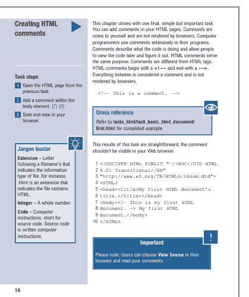

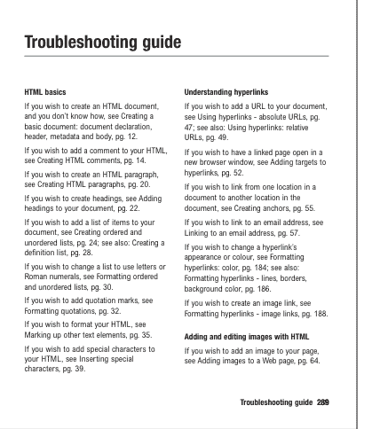

vi


## 超文本标记语言（HTML）简介

### 引言

HTML是一种标记语言。标记语言是一种向文本添加指令的语言。这些指令告诉计算机如何显示被指令包裹的文本。

```
<浏览器执行此操作>要处理的文本。</浏览器执行此操作>
```

在20世纪90年代中后期，编写HTML的唯一好方法是手工操作。你输入文本，然后添加HTML标签。然而如今，你几乎不需要了解HTML或CSS（层叠样式表）。例如，Apple的iWeb应用程序使得发布网站比以往任何时候都更容易。选择一个模板，用自己的照片替换库存图片，并添加自己的文本。很简单，不需要HTML，当然也不需要CSS。有了DreamWeaver这样的产品，几乎没有人再使用文本编辑器手工创建专业网站了。那么为什么还有这本书？为什么本地书店的书架上还有无数其他的HTML书呢？

诚然，这些工具确实使Web开发变得更容易。但假设你刚刚使用iWeb开发了你的网站，你点击、拖放，但现在你希望使用YouTube的嵌入式视频播放器将你最喜欢的YouTube播放列表添加到你的网站中。没有拖放控件可以做到这一点，该怎么办？你必须添加iWeb所称的“HTML代码片段”。HTML代码片段允许你编写一些HTML并将其直接嵌入到你的iWeb页面中。但只有一个问题。插入HTML代码片段需要了解一些HTML知识。如果你没有花时间学习基本的HTML和CSS，你可能无法顺利插入HTML代码片段。

了解HTML和CSS将使你摆脱成为工具的奴隶——让你在合适的时候使用工具，在需要时依靠文本编辑器。在本书中，我假设你只需要一个简单的文本编辑器和Web浏览器。读完本书，你将具备查看HTML源代码并在必要时自行修复它所需的HTML和CSS技能。如果你计划在读完本书后继续学习更多关于Web开发的内容，那么我建议你学习Adobe的DreamWeaver。DreamWeaver是Web开发工具中的标准。此外，如今似乎每个人都使用DreamWeaver，这是信息技术领域需求量很大的一项技能。学习的好书是史蒂夫·约翰逊的*《精通DreamWeaver》*，但在你冲出去买他的书之前，帮自己一个忙：先花时间学习基本的HTML和CSS。相信我，当面对“HTML代码片段”或类似的东西时，你会很高兴自己这么做了。

在本章中，你将为未来的练习做好准备。你还将学习基本的HTML文档结构。如果你想实际执行任务，请务必理解本章的任务。你必须有一个文本编辑器，并且必须知道如何在浏览器中加载完成的页面。这些是非常基础的任务，但非常重要。如果你只是想跟着读下去，我有个好消息。所有任务的完成示例都可以通过本书的网站获取。每个任务都引用了完成的示例，所以你只需要查看完成的示例即可。当然，如果你连这个都不想做，就像所有的“精通”系列书籍一样，步骤在支持代码和图示中都有清晰的编号。如果你已经知道如何编辑、保存和查看HTML页面，只需浏览本章即可。如果你不知道，请务必不要跳过本章。在你能够完成本书中的示例之前，你需要这些基本技能。

### 你将学到什么

- 准备工作——文本编辑器与Web浏览器
- 理解元素、标签和属性
- 查看HTML页面的基本结构
- 创建基本文档——文档声明、头部、元数据和正文
- 创建HTML注释


在开始之前，你需要确保拥有完成后续任务所需的一切。你需要确定一个HTML编辑器，创建一个文件夹来存放你的工作，选择一个网页浏览器来查看生成的HTML页面，并获取一些在线参考资料。

```
<!DOCTYPE HTML PUBLIC "-//W3C//DTD HTML 4.01 Transitional//EN" "http://www.w3.org/TR/html4/loose.dtd"> <html><head></head><body>Hello World!</body></html>
```

## 准备工作——文本编辑器与网页浏览器

## 任务步骤

1.  选择一个HTML编辑器。你首先需要一个简单的文本编辑器。如果在Windows系统上工作，使用TextPad。如果使用Mac，则使用TextEdit。

2.  创建一个文件夹来存放你的工作。

3.  确定你的浏览器。选择你通常用来上网的浏览器。我使用Safari，因此你将在本书中看到许多Safari的屏幕截图。

4.  启动你的文本编辑器，输入左侧的文本。

5.  保存文档。为其添加`.html`扩展名。

6.  **记事本用户**。保存时，点击“文件”、“另存为”，然后在“保存类型”下拉菜单中选择“所有文件”。如果不这样做，记事本会为你的文件添加`.txt`扩展名，而你的浏览器会将该文件解释为纯文本而非HTML。你必须自己添加`.html`扩展名，因此在保存时请输入`index.html`。

    **TextEdit用户**。保存前，需更改TextEdit的设置，使其将文档保存为纯文本。从**TextEdit**菜单中，选择**偏好设置**。在出现的对话框中，选择**新建文稿**标签页，并选择**纯文本**选项。在**打开和存储**标签页，确保**给纯文本文件添加".txt"扩展名**复选框未被选中。同时，确保**忽略HTML文件中的富文本命令**复选框已被选中。

    > **重要提示**
    > 请注意：HTML文档扩展名（.html）是小写字母！

7.  保存后，打开你的浏览器并打开该文件。例如，在Safari中选择“文件” – “打开文件” – 然后导航到该文件。选择文件后，你应该能在浏览器主窗口中看到“Hello World”。

8.  收藏或下载一些HTML/CSS参考资料。本书并非全面的参考手册。你可能需要在完成本书任务时查阅全面的参考资料。

9.  访问www.w3schools.org并收藏该页面。

10. 访问Web设计组（WDG）的网站 – www.htmlhelp.com – 并收藏该页面。

11. 访问万维网联盟（W3C）的网站 www.w3.org。收藏该页面。

    > **供你参考**
    > 万维网联盟，即W3C，是万维网的管理机构。虽然它没有法律权限，但它是由所有主要参与者（包括IBM、微软、苹果、惠普以及其他大公司）组成的联盟。W3C的职能是召集各方，就标准达成一致。它对各种与Web相关的语言进行研究、召开会议并发布规范。W3C制定的标准包括XML、HTML和CSS等。HTML 4.01是W3C的一项推荐标准。你可以在W3C网站 www.w3c.org 下载该规范，如果愿意的话可以查阅。阅读内容可能比较枯燥，但它是HTML的权威来源。CSS规范也在线提供于W3C网站。

    > **节省时间提示**
    > 你的计算机可能默认使用你喜爱的网页浏览器打开HTML文件。双击本次任务创建的页面（index.html），它应该会出现在你的浏览器中。如果没有，请右键点击index.html，选择“打开方式”，如果在Mac上，请务必勾选“始终使用此应用打开”。如果在Windows上，选择“打开方式”、“选择程序”，并勾选“始终使用选择的程序打开这种文件”复选框。

    > **供你参考**
    > **浏览器选择**
    > 你可以从多种浏览器中进行选择。Opera、Internet Explorer、Safari和Firefox是最流行的浏览器。如果使用Windows，很可能你已经安装了Internet Explorer。如果使用Mac，你肯定有Safari。既然你在阅读一本关于HTML和CSS的书，我愿意相信并假设你已经拥有一个浏览器并且知道如何使用它。我唯一要补充的是，如果你一直推迟将其更新到最新版本，现在是时候这么做了。本书使用HTML 4.01 Transitional和CSS 2.01。如果你的浏览器版本过旧，落后了一两个版本，那么很有可能一些示例在你的浏览器中将无法正常工作。

    > **供你参考**
    > **网站托管**
    > 如果你希望他人访问你的网站，最终你需要发布它。互联网上有许多网站托管公司，提供付费和免费服务。但在你匆忙为网络托管空间付费之前，很可能你已经作为服务提供商账户的一部分拥有了一些免费空间。英国最大的互联网服务提供商BT为其订阅者提供15兆的个人网页空间。我有一个**earthlink.net**账户，附带10兆空间用于创建我的个人网站；如果你是学生，你几乎肯定有空间来托管你的个人网站。欲了解更多信息，请咨询你的服务提供商或学校的IT部门。花点时间查查你是否有免费空间是值得的。

## 理解元素、标签和属性

一个HTML文档由元素构成。元素用于构成HTML文档的标题、段落、表格等对象。一个元素由开始标签、内容和结束标签组成。

HTML元素由标记元素开始的开始标签、一个或多个属性、一些可选内容以及一个结束标签构成。标签是指令，告诉浏览器以特定方式格式化其内容。标签被包含在两个尖括号（`<tag>`）中。例如，当你的浏览器加载一个HTML文档时，当它遇到`<body>`标签，它就知道在遇到结束标签`</body>`之前加载的所有内容都是body元素的一部分。

属性定义了元素的特性。可以把属性看作形容词。例如，图像元素包含一个`src`（源）属性。

```

```

表格元素通常包含一个`border`属性。

```
<table border="1"></table>
```

属性是名称/值对，为浏览器提供关于如何渲染元素的进一步指令。带有`border`属性的`table`标签告诉浏览器不仅要创建一个表格，还要创建一个带有边框的表格。并且，使边框宽度为一像素。属性可以具有的值因属性而异。一些属性可以接受文本，例如图像标签的`src`（源）属性。浏览器无法预先知道源的所有可能值，因此该属性不受限制。然而，表格标签的`border`值是受限制的。你不能将边框设置为'Sam'或'Frank'，只能是指定像素的整数值。其他属性也受到类似限制。某些属性只允许从几个预定义选项中选择其一。例如，`input`元素的`type`属性接受以下值：`button`、`check-box`、`file`、`hidden`、`image`、`password`、`radio`、`reset`、`submit`和`text`。

### 供你参考

很少有人费心区分元素，而是将所有东西都称为标签。例如，你会看到这样的表述：“段落标签”、“body标签”、“HTML标签”。在常见的网络术语中，标签和元素意思相同。本书也不例外，但我同时使用这两个术语是为了提醒你它们含义相同。希望这不会分散你的注意力。


一份HTML文档由两部分组成：文档头和文档体。由`<head>`标签指定的文档头包含了浏览器实际不会显示的数据。`<head>`元素是放置文档标题、描述文档的元数据以及与文档相关的其他数据的地方。`<body>`元素则是放置网页内容的地方。

HTML文档的第一行应该是文档类型定义。文档类型定义声明了HTML的版本。共有三种HTML 4.01 DTD：HTML 4.01 严格型DTD；HTML 4.01 过渡型DTD；以及HTML 4.01 框架集DTD。在本书中，我们使用HTML 4.01 过渡型。你并不需要对doctype了解太多，只需知道将其作为HTML文档的第一行是一个良好习惯即可。这一行告诉浏览器，期望处理一个符合HTML 4.01 过渡型DTD的HTML文档。

```
<!DOCTYPE HTML PUBLIC "-//W3C//DTD HTML 4.01 Transitional//EN"
"http://www.w3.org/TR/html4/loose.dtd">
```

在DTD之后，第一个元素是HTML元素。HTML元素由`<html>`开始标签和`</html>`结束标签组成。浏览器将这两个标签之间的所有内容视为一个HTML文档。

```
<!DOCTYPE HTML PUBLIC "-//W3C//DTD HTML 4.01 Transitional//EN"
"http://www.w3.org/TR/html4/loose.dtd">
<html></html>
```

HTML文档包含两个部分，由`<head>`和`<body>`元素定义。文档的`<head>`部分添加关于文档的基本信息，例如其标题、元数据、脚本、样式等。`<body>`是文档的内容。出现在`<body>`中的所有内容都会作为文档显示在浏览器的窗口中，并且是你放置内容和格式化HTML标签的地方。

## 查看HTML页面的基本结构

> 重要提示
如果你没有指定DTD，浏览器将回退到“怪异模式”，并尽其最佳猜测来渲染页面！

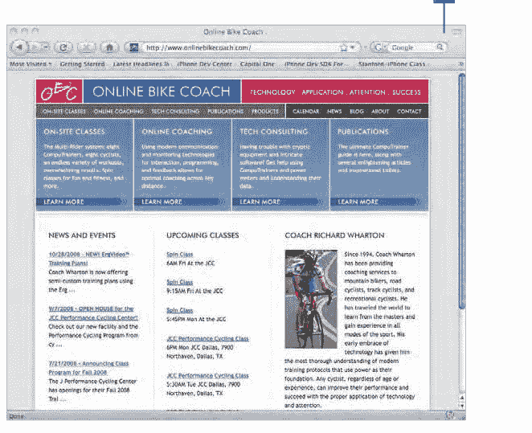

## 任务步骤

1.  打开你的浏览器，访问 **www.onlinebikecoach.com** 网站。
2.  如果使用Safari，前往菜单并选择**查看**，然后选择**查看源代码**。如果使用Firefox，选择**查看**，然后选择**页面源代码**。
3.  注意，该文档的DTD是HTML 4.01 过渡型。
4.  注意该文档由两部分组成：`<head>`和`<body>`。
5.  在`<head>`标签内，有其他几个标签。例如，注意`<title>`、`<meta>`、`<script>`和`<link>`标签。
6.  `<link>`标签尤其重要，这个元素告诉浏览器从指定的位置获取CSS样式表，并将该样式应用于文档。你将在后面了解更多关于这个元素的知识。

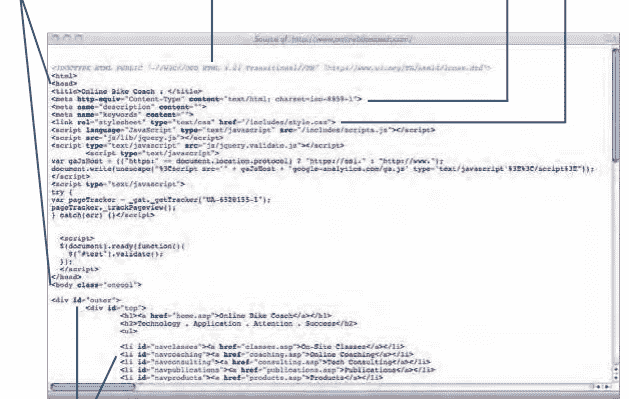

7.  `<body>`包含你在浏览器中看到的页面HTML。
8.  滚动浏览文档，查看不同的标签。如果你不理解所有内容也没关系，这个任务需要掌握的要点是文档的基本结构。

## 创建基本文档——文档声明、头部、元数据和主体

在上一个任务中，你回顾了一个HTML文档的布局。在这个任务中，你将学习如何创建一个简单的HTML文档。

## 任务步骤

| 标签 | 功能 |
| :--- | :--- |
| `<!DOCTYPE .../>` | 指定HTML文档的DTD。 |
| `<html></html>` | 指定一个HTML文档。 |
| `<head></head>` | 指定HTML文档的头部。 |
| `<title></title>` | 指定HTML文档的标题。 |
| `<meta></meta>` | 指定关于HTML文档的元数据。 |
| `<body></body>` | 指定HTML文档的主体。 |

1.  打开你的文本编辑器并创建一个新文档。
2.  趁你还没忘记，选择“另存为”并保存文档。确保给它一个.html扩展名，并且不要忘记按照本章前面的说明正确设置你的编辑器。
3.  添加一个开始`<html>`和结束`</html>`标签。(4,8)
4.  在HTML元素内，添加`<head>`元素的开始和结束标签。(5,6)
5.  在`<head>`元素下方，添加`<body>`元素。(7)
6.  在`<body>`元素内，添加一些文本。(7)
7.  在`<head>`元素内，添加一个`<title>`标题。(5,6)
8.  保存文档并在浏览器中查看。

这个任务的结果很直接。你的文档标题应该出现在浏览器的顶部。你还应该看到你输入的文本现在显示在浏览器的窗口中。

```
1 <!DOCTYPE HTML PUBLIC "-//W3C//DTD HTML
2 4.01 Transitional//EN"
3 "http://www.w3.org/TR/html4/loose.dtd">
4 <html>
5 <head><title>我的第一份HTML文档的
6 标题。</title></head>
7 <body>我的第一份HTML文档。</body>
8 </html>
```

> **重要提示**
记住：代码旁边的数字是指示符，不应包含在你的文档中！

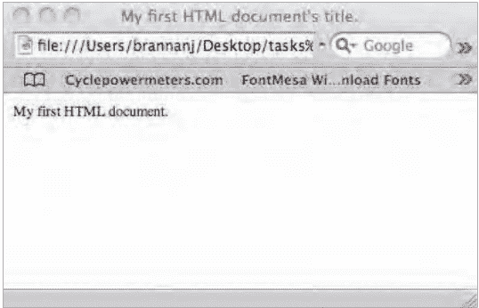

### 供你参考

创建一个信息丰富的标题。使用描述性标题，如“James Brannan的主页”，而不是“我的主页”。在Google中显示为链接的就是你的标题。当用户将你的页面加入书签时，标题是该书签的默认名称。使其具有描述性和趣味性，你的网站将获得更多访问。

### 省时提示

为本书其余部分创建一个模板，并将其另存为template.html。在后续任务中反复使用此文件作为基础文件。

```
<!DOCTYPE HTML PUBLIC "-//W3C//DTD HTML 4.01 Transitional//EN" "http://www.w3.org/TR/html4/loose.dtd ">
<html>
<head><title>在此处插入标题</title></head>
<body></body>
</html>
```

## 创建HTML注释

本章以一个最终、简单但重要的任务结束。你可以在HTML页面中添加注释。注释是给你自己的提示，浏览器不会渲染它们。计算机程序员在程序中广泛使用注释。注释描述代码的功能，并允许人们以后查看代码时能够理解它。HTML注释具有相同的目的。注释不同于HTML标签。HTML注释以`<!--`开头，以`-->`结尾。它们之间的所有内容都被视为注释，不会被浏览器渲染。

## 任务步骤

1.  打开上一个任务的HTML页面。
2.  在`<body>`元素内添加一个注释。(7) (8)
3.  保存并在浏览器中查看。

```
<!-- 这是一个注释。 -->
```

## 交叉引用

请参考 **tasks_html/task_basic_html_document/first.html** 获取完整示例。

这个任务的结果很直接，该注释在你的网页浏览器中应该不可见。

### 术语解释

**扩展名** – 跟在文件名后面的字母，表示文件的信息类型。例如，.html是一个扩展名，表示该文件包含HTML。

**整数** – 一个完整的数字。

**代码** – 计算机指令，是“源代码”的简称。源代码是编写好的计算机指令。

```
1 <!DOCTYPE HTML PUBLIC "-//W3C//DTD HTML
2 4.01 Transitional//EN"
3 "http://www.w3.org/TR/html4/loose.dtd">
4 <html>
5 <head><title>我的第一份HTML文档的
6 标题。</title></head>
7 <body><!-- 这是我的第一份HTML
8 文档。 --> 我的第一份HTML
9 文档。</body>
10 </html>
```

### 重要提示

请注意：用户可以在他们的浏览器中选择**查看源代码**并阅读你的注释。

## HTML文本布局标签

### 引言

尽管像YouTube这样的病毒式视频网站很受欢迎，但网络主要仍然是由文本组成的。网页最类似于印刷杂志。杂志是带有照片的文本。格式化杂志或网页，最基本的是格式化文本。在添加引人注目的图形之前，你必须做许多更基本的格式化任务。文本需要分成段落，长引文需要与其他文本分开，各部分需要用标题来区分。关键短语需要加粗，较短的引文需要引号，关键点应该显示为列表。这种基本的文本格式化使网页更易于导航、总结和理解。

在本章中，你将探索基本的HTML文本格式化。在将酷炫的背景、令人眼花缭乱的字体和有趣的照片应用到你的页面之前，你应该先了解基本的文本布局。不过别担心，很快，在本书的第二部分，你将学习如何使用CSS制作出色的网页。本章的任务为你提供更基础但极其重要的文本布局HTML元素。

HTML提供了几个标签来将文本标记为吸引人的段落。最基本的是段落元素。段落元素由开始标签`<p>`和结束标签`</p>`以及它们之间的任何内容组成。浏览器知道，在段落元素的开始和结束标签之间的所有文本构成一个连贯的段落。

### 你将做什么

-   创建HTML段落
-   为文档添加标题
-   创建有序和无序列表
-   创建定义列表
-   格式化有序和无序列表
-   格式化引文
-   标记其他文本元素
-   插入特殊字符


标题元素——由以下标签表示：`<h1></h1>`、`<h2></h2>`、`<h3></h3>`、`<h4></h4>`、`<h5></h5>`、`<h6></h6>`——同样至关重要。标题元素使你能够轻松地为段落添加节标题，从而将页面划分为层级主题。标题具有层级结构，其中`<h1></h1>`是最高级标题（字体最大），而`<h6></h6>`是最低级标题（字体最小）。

HTML还提供了其他几种基本的文本格式化标签。有三种标签可以创建列表。有序列表元素——使用`<ol></ol>`标签表示——使你能够轻松创建编号或有序列表；无序列表元素`<ul></ul>`创建无序列表；定义列表元素`<dl></dl>`创建定义列表。你可以使用引用元素`<q></q>`指定较短的引用，使用blockquote元素`<blockquote></blockquote>`指定较长的引用，将它们与段落区分开来。还有标签可以让文本看起来像计算机终端打印输出、强调关键词以及其他基本的格式化任务，这些功能是任何像样的文字处理或杂志排版软件都应具备的。本章将探讨这些基本标签及其在HTML页面中的使用。

> **重要提示**
> 
> 还记得第1章中关于元素与标签的讨论吗？虽然技术上含义不同，但你可以互换使用元素和标签这两个术语。元素是逻辑单元或含义。标签是物理标记，即区分元素开始和结束的开标签和闭标签。例如，段落元素由开标签`<p>`和闭标签`</p>`组成，两个标签之间的所有内容就是元素的内容。但在网络术语中，标签和元素是等价的。你可以称其为段落标签或段落元素，大多数人都能理解你指的是`<p>`标签。请记住，本书中这两个术语是互换使用的。

## 仅供参考

随着HTML 4.01规范的发布，W3C已弃用了大多数格式化方式；CSS在这方面做得更好。例如，在过去排版段落时，你可以在段落元素的开标签`<p>`中指定align属性，并赋予它left、right、centre或justify的值。例如：`<p align="right">`。这个属性会按照预期格式化段落——right将文本右对齐，centre将文本居中，left将文本左对齐，justify则两端对齐文本。

虽然大多数浏览器仍然接受align属性，但它已被弃用。不能保证align属性将来能正确显示。大多数其他基本HTML标签的格式化属性也同样已被弃用。在本章及后续章节中，我将在任务中省略已弃用的标签和属性。因此，接下来几章中的任务结果可能看起来……有点简陋。但别担心，在后续章节中，你将为它们应用CSS样式，使它们呈现为现代网页的效果。

## 创建HTML段落

段落元素由开标签`<p>`、闭标签`</p>`以及两个标签之间的任何文本组成。此元素定义段落。渲染时，段落元素内的文本将显示为一个单独的段落，段落文本前后会有额外的间距，就像Word或OpenOffice Writer中的段落一样。

HTML段落默认左对齐，且第一行不缩进。你可以使用段落的align属性来对齐段落。例如，`<p align="right">`。但请注意，这个格式化属性已被弃用，不应使用。请改用CSS。相信我，你会看到使用CSS更简单也更可靠。哦，最后一点你应该了解的是关于段落的知识。你不能按下[Return]键就指望浏览器渲染换行。Web浏览器会自动处理段落换行。要覆盖此行为，你必须使用`<br/>`标签（在后续任务中介绍）。

> **仅供参考**
> 
> 使用段落元素时，不需要使用闭标签`</p>`。浏览器会将`<p>` *一些文本* `<p>` *更多文本* 识别为两个不同的段落。但不关闭段落标签会迫使浏览器猜测段落结束的位置，可能导致不可预测的结果。而且这样做也不够整洁。为了安全和规范，始终用闭标签结束你的段落标签。

| 标签 | 功能 |
| --- | --- |
| `<p></p>` | 指定一个段落。 |

> **交叉引用**
> 
> 完成的示例请参见**tasks_html/task_html_paragraphs/paragraph.html**。

> **交叉引用**
> 
> 第12章中的任务"对齐元素"涵盖了使用CSS对齐元素的方法。

本任务的结果很简单：段落标签将文本分成了三个不同的段落。

```
1 <html>
2 <body>
3 
5 <p>SeguroImpulso Software and Consulting
6 ---snip--- consulting services.</p>
7 <p>SeguroImpulso Software and
Consulting
8 ---snip--- under development.</p>
9 <p>On this site you will find
10 information ---snip--- track racing, or
11 even cyclocross.</p>
12 </body>
13 </html>
```

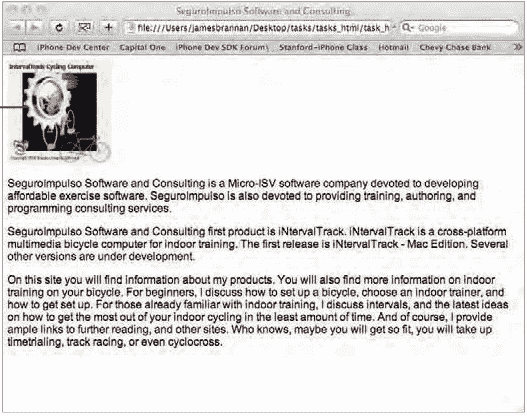

### 创建HTML段落（续）

## 任务步骤

- 1. 打开模板并以不同的名称保存。
- 2. 在body元素中添加三组**`<p></p>`**标签。（5, 7, 9）
- 3. 在所有三个段落元素中输入一些文本。
- 4. 保存并在浏览器中显示页面。

## 为文档添加标题

## 任务步骤

- 1. 打开模板并以不同的名称保存。
- 2. 在body元素中添加三组`<p></p>`标签，并在所有三个段落元素中输入一些文本。*(6, 9, 13)*
- 3. 在第一个段落上方添加`<h1></h1>`标签，并在元素中添加一些文本。*(3)*
- 4. 在`</h1>`标签之后，第一个`<p>`标签之前，输入`<h2></h2>`标签。在标签之间输入一些文本。*(8)*
- 5. 重复步骤4，只是将二级标题分别放置在第一段与第二段之间，以及第二段与第三段之间。*(12)*
- 6. 在页面底部（但在`</body>`标签之前）添加`<h3></h3>`、`<h4></h4>`、`<h5></h5>`和`<h6></h6>`标签。在每组标签之间添加适当的标题文本。*(16, 17, 18, 19)*

网页中的标题就像Word或OpenOffice Writer文档中的标题：它们允许用户浏览页面并确定哪些部分是他们感兴趣的。标题还通过提供页面内容的摘要来增强理解。HTML标题分为六个层级，每个标题层级表示递减的强调程度。标题使用以下标签：`<h1></h1>`、`<h2></h2>`、`<h3></h3>`、`<h4></h4>`、`<h5></h5>`和`<h6></h6>`。浏览器将标题渲染得比普通文本更大更粗，其中`<h1>`渲染得最大，`<h6>`最小。与段落元素一样，标题有一个可选的——但已弃用的——align属性，不应使用。

| 标签 | 功能 |
| --- | --- |
| `<h1></h1>` | 指定一级标题。 |
| `<h2></h2>` | 指定二级标题。 |
| `<h3></h3>` | 指定三级标题。 |
| `<h4></h4>` | 指定四级标题。 |
| `<h5></h5>` | 指定五级标题。 |
| `<h6></h6>` | 指定六级标题。 |

> **交叉引用**
> 
> 完成的示例请参见**tasks_html/task_html_headings/heading.html**。

与之前的任务一样，这个任务也很简单。标题标签为HTML页面添加了标题。`<h1>`添加了最大的标题文本，而`<h6>`添加了最小的。

```
1 <html>
2 <body>
3 <h1>Seguro-Impulso Software and
4 Consulting</h1>
5 <h2>Seguro-Impulso's Mission</h2>
6 <p>Seguro-Impulso Software and
7 Consulting ---snip--- services.</p>
8 <h2>SeguroImpulso's Products.</h2>
9 <p>SeguroImpulso Software and Consulting
10 first product ---snip--- under
11 development.</p>
12 <h2>What's on the Site?</h2>
13 <p>On this site you will find ---snip---
14 fit, you will take up timetrialing,
15 track racing, or even cyclocross.</p>
16 <h3>test3</h3>
17 <h4>test4</h4>
18 <h5>test5</h5>
19 <h6>test6</h6>
20 </body>
21 </html>
```

### 为文档添加标题（续）

- 7 保存你的工作并在浏览器中显示。

> **仅供参考**
> 
> 不要因为这个任务就认为标题是一种万能的格式化工具，用来让文本变大。标题实际上应该只用于真正的标题。真正的标题与段落一起，提供基本的文档结构。对于不是真正标题的文本格式化，你应该使用CSS。

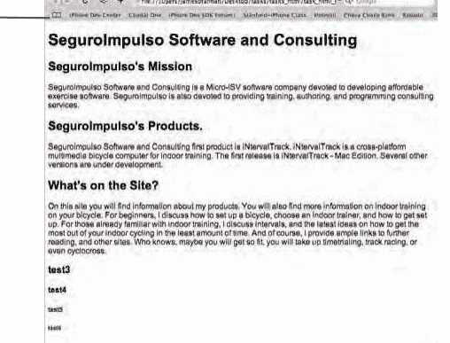


## 创建有序列表和无序列表

列表是总结信息的一种简便方式。在日常生活中，你可能广泛使用两种列表类型。当你创建一个带编号的、有层次的列表时，你就是在创建**有序列表**。当你创建一个没有编号的列表——一个项目列表——你就是在创建**无序列表**。在 HTML 中，有三种列表类型：有序列表；无序列表；以及定义列表。在这个任务中，你将学习使用有序列表和无序列表。在下一个任务中，你将学习定义列表。

有序列表用于呈现顺序很重要的数据。例如，我最喜欢的前三大自行车品牌（按顺序排列）：

1. 富士
2. 海菲
3. 赛罗塔

无序列表用于呈现顺序不重要的数据。例如，我工作中正在使用的编程语言（不分先后）：

- Java
- C
- JavaScript

你使用 `<ol></ol>` 标签来呈现编号或有序数据，使用 `<ul></ul>` 标签来创建无序列表。有序列表和无序列表中的列表元素使用 `<li></ol>` 标签插入列表中。

```
<ol><li>Fuji</li><li>Huffy</li><li>Serotta</li></ol>
<ul><li>Java</li><li>C</li><li>JavaScript</li></ul>
```

有序列表对于呈现有序的指令特别有价值，例如 *Brilliant* 系列丛书中的任务。列表元素各自占据一行并带有自己的编号。无序列表也很有用，它通过强调来区分一组项目中的每个元素。无序列表中的列表元素，与有序列表一样，也各自占据一行。

## 创建有序列表和无序列表（续）

表 2.3 本任务涉及的标签

| 标签 | 功能 |
| --- | --- |
| `<ul></ul>` | 指定一个无序（项目符号）列表。 |
| `<ol></ol>` | 指定一个有序（编号）列表。 |
| `<li></li>` | 指定一个列表元素。 |

> 交叉引用
请参阅 `tasks_html/task_html_lists/ordered_unordered.html` 获取完成的示例。

> 交叉引用
在第 3 章“使用超链接 – 绝对 URL”任务中，你将使用一个无序列表来组织指向其他网站的链接列表。

## 创建有序列表和无序列表（续）

## 任务步骤

1.  打开模板并将其另存为新文件。
2.  在 `<body>` 元素中输入一对 `<ol></ol>` 标签。(6, 32)
3.  在有序列表元素中输入三到四对 `<li></li>` 标签。在每对标签的开始和结束标签之间输入文本。(7, 10, 14, 26, 29)
4.  在一对列表元素的开始和结束标签之间输入另一对 `<ol></ol>` 标签。(16, 24)
5.  在嵌套的有序列表元素中放置几个 `<li></li>` 标签，并在每个标签中输入一些文本。(17, 19, 20, 21, 23)
6.  在最外层的 `</ol>` 标签下方，输入 `<ul></ul>` 标签。(35, 41)
7.  在无序列表元素中输入几个 `<li></li>` 标签，并在每个标签中输入一些文本。(36, 37, 39, 40)
8.  保存你的工作并在浏览器中查看它。

```
<html>
<body>
<h1>iNtervalTrack 快速入门</h1>
<h2>快速入门步骤（假设已设置传感器、DVD 播放和 M3U 播放列表）</h2>
<ol>
<li>启动 Mac DVDPlayer，导航到你希望 iNtervalTrack 开始播放的位置，然后按暂停。</li>
<li>激活 iNtervalTrack 的 DVDPlayer 插件，勾选全屏，勾选静音，然后点击“完成”按钮。</li>
<li> 配置 QuickTimePlayer 音乐播放器插件。
<ol>
<li>选择 QuickTimePlayer 音乐播放器插件。</li>
<li>选择“播放播放列表”。</li>
<li>点击“浏览”按钮。</li>
<li>选择要播放的 M3U 播放列表。</li>
<li>点击“完成”。</li>
</ol>
</li>
<li>从“窗口”菜单中，选择“水平平铺所有窗口”。将窗口移动到所需位置和大小。</li>
<li>点击“开始”，跳上你的自行车，开始蹬踏（软件会给你十秒钟的倒计时。）</li>
</ol>
<h2>运行 iNtervalTrack 快速入门的先决条件</h2>
<ul>
<li>iNtervalTrack 软件</li>
<li>SerialPort 速度和踏频传感器。</li>
<li>已创建好的 M3U 播放列表。</li>
<li>DVD 驱动器中的一张 DVD。</li>
</ul>
</body>
</html>
```

完成此任务后，你应该会看到一个编号列表。在其中一个编号列表项中，你应该会看到一个嵌套列表。此嵌套列表应是一个编号列表，从外层列表缩进。在最外层有序列表下方，你应该会看到一个无序列表。此列表中的每一行都应以一个项目符号开头。

## 创建有序列表和无序列表（续）

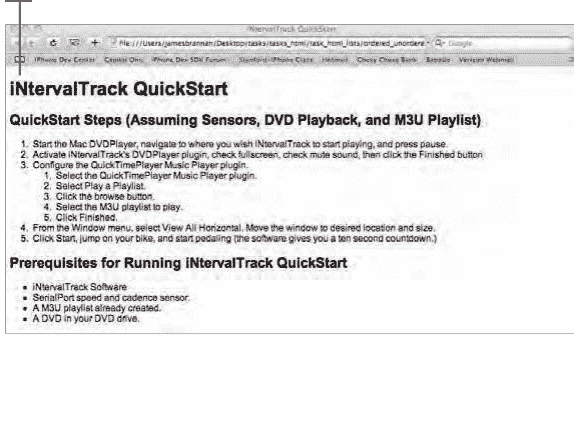

> **重要提示**
**标签重叠**
正如任务所示，你可以在其他列表中嵌套列表。任何列表类型都可以嵌套在任何其他列表类型中。但是要小心，当嵌套列表标签与包含它的列表混合时，可能会产生不可预测的结果。这种混合称为标签重叠。例如，`<h1>My Heading<p></h1>My Paragraph text</p>` 就是一个标签重叠的例子。在浏览器中，这种错误的结果是不可预测的。避免标签重叠！

## 创建定义列表

## 任务步骤

1.  打开模板并将其另存为新页面。
2.  在 `<body>` 元素中输入一对 `<dl></dl>` 标签。(5, 17)
3.  在定义列表中输入两对 `<dt></dt>` 标签。(6, 9)
4.  在每个定义术语元素中输入一个要定义的单词。
5.  就在定义术语元素下方，在每对定义列表中输入一对 `<dd></dd>` 标签。(7, 10)
6.  在对应的 `<dd></dd>` 标签对中输入每个术语的定义。
7.  保存你的工作并在浏览器中打开它。

在上一个任务中，你学习了有序和无序列表类型。在这个任务中，你将学习**定义列表**。定义列表用于呈现术语定义。例如，考虑 Serotta 的定义。定义包含一个定义术语 Serotta，以及一个实际定义：美国一家高端定制自行车的制造商。你将定义的术语包裹在 `<dt></dt>` 标签中，将术语的定义包裹在 `<dd></dd>` 标签中。使用定义列表，你可以使用 HTML 快速创建格式化的术语表。

## 交叉引用

请参阅 **tasks_html/task_html_lists/definition.html** 获取完成的示例。

此任务的结果很简单。你应该会看到两个与左边缘对齐的术语。在每个术语的下一行，你应该会看到该术语的定义缩进五个空格。请注意，具有多行定义的术语会自动换行并缩进，以与之前缩进五个空格的行对齐。

```
<html>
<body>

<h1>术语表</h1>
<dl>
<dt>Serotta</dt>
<dd>A manufacturer in the United States of high-end, custom bicycles.</dd>
<dt>计时赛</dt>
<dd>一项自行车运动，运动员与时间赛跑，以尽可能少的时间完成比赛。它可以是团体赛或个人赛。常见的计时赛类型是 40 公里公路计时赛和 1 公里场地赛——通常被称为“一公里赛”。</dd>
</dl>
</body>
</html>
```

## 创建定义列表（续）

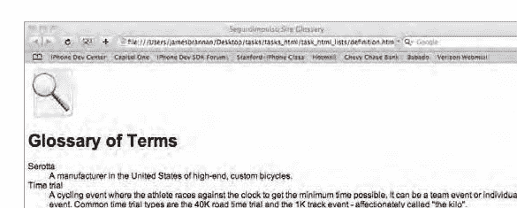

## 设置有序和无序列表的格式

违背我更好的判断，我还是要包含这个任务。就个人而言，我认为将已弃用的元素和属性视为不存在是最安全的。从来没有人因为没有使用已弃用的语言特性而导致页面渲染错误或程序无法运行。然而，设置列表格式仍然是常见的事情。例如，也许你希望使用罗马数字为列表编号。或者也许你想使用方块而不是圆形项目符号。虽然 CSS 是现在实现此类格式化的推荐方式，但你可以直接在 HTML 标签中完成。虽然它已被弃用，所以你真的不应该这样做：但你可以指定有序列表元素的值。

## 任务步骤

1.  打开模板并将其另存为新文件。
2.  添加一个包含三个列表项的有序列表。(14)
3.  在有序列表正下方添加一个标题。(16)
4.  创建另一个包含三个列表项的有序列表。只为第一个数字添加 `value` 属性并将其值设为四。(18)
5.  创建一个类型为 `square` 的无序列表。(21)
6.  保存并在浏览器中打开。

表 2.4 已弃用的有序和无序列表格式属性

**有序列表**

| 属性 | 结果 |
| --- | --- |
| `type="1"` | 1, 2, 3 ... |
| `type="a"` | a, b, c ... |
| `type="A"` | A, B, C ... |
| `type="i"` | i, ii, iii ...（小写罗马数字） |
| `type="I"` | I, II, III ...（大写罗马数字） |

**无序列表**

| 属性 | 结果 |
| --- | --- |
| `type="disc"` | 实心圆 |
| `type="circle"` | 空心圆 |
| `type="square"` | 方块 |

**交叉引用**
请参阅 `tasks_html/task_deprecated_list_formats/ordered_unordered.html` 获取完成的示例。

结果很简单。第一个有序列表应该从 1 到 3，然后第二个列表从 4 到 6。无序列表应该使用方块而不是圆形项目符号。


## 格式化有序列表和无序列表（续）

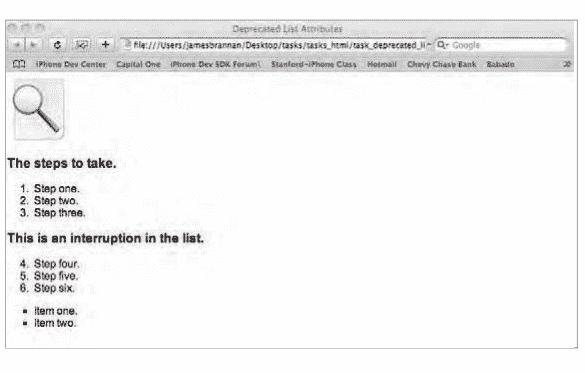

HTML 文本布局标签 29

## 格式化引用

HTML 页面中的引用就像印刷品中的引用一样。只需回想一下你在学习如何撰写学期论文时所学到的。你应该注明资料来源——当你逐字引用其他来源的文本时，必须标明出处。就像写文章一样，较短的引用显示在段落正文中，只需用双引号括起来。较长的引用则会被分隔并缩进，以区别于你的正文。

`<blockquote>` 和 `<q>` 元素用于在 HTML 页面中显示引用。你使用 `<blockquote></blockquote>` 标签来格式化大段引用。对于较短的引用，则使用 `<q></q>` 标签。最终的格式化效果正如你所料——与文字处理器或印刷页面中的预期一致。`<blockquote>` 元素是一个单独缩进的段落。`<q>` 元素是较短的引用，与其余文本内联显示，但用开头和结尾的双引号括起来。

> 重要提示
不要滥用 `<blockquote>` 元素。只应在创建正式引用时使用它，而不是用于一般的段落缩进。首先，视力障碍人士使用阅读设备来阅读网页。他们会误以为你的页面充满了大段引用。其次，CSS 在对齐段落方面做得更好。CSS 是缩进普通文本的简便且正确的方式。

### 表 2.5 本任务涉及的标签

| 标签 | 功能 |
|---|---|
| `<q></q>` | 指定一个短小的、内联的引用。 |
| `<blockquote></blockquote>` | 指定一个长的引用（一个单独的、缩进的引用）。 |

> 重要提示
Internet Explorer 不支持 `<q>` 标签。

> 交叉引用
请参阅 `tasks_html/task_html_quotations/whyrollers.html` 获取完成的示例。

## 格式化引用（续）

完成此任务后，你应该看到引用与段落文本内联显示。唯一的区别是在引用的开头和结尾添加了双引号。而 `<blockquote>` 则相反，它从自己的新行开始显示。`<blockquote>` 中的文本相对于普通段落是缩进的。

```
<html>
<body>

<h3>Rollers - The Key to Smooth
Cycling</h3>
<p>It is a well-known fact that rollers
are the quickest path to smooth bike
handling. My coach used to say,
<q>overcorrect your steering and you
fly right off the rollers, you gotta
learn to steer gently if you don't want
to fall.</q>
</p>
<p>
Wikipedia defines bicycle rollers as:
<blockquote>Bicycle rollers are a type
of bicycle trainer which makes it
possible to ride a bicycle indoors
without moving forward. ---snip---
bicycle's wheelbase. Generally, the
front roller is adjusted to be slightly
ahead of the hub of the front
wheel.</blockquote>
</p>
</body>
</html>
```

## 任务步骤

- 1. 打开模板并以新名称保存。
- 2. 在 `<body>` 元素中输入一个段落。(7)
- 3. 在段落中的某个位置，选定一个句子作为引用。
- 4. 在引用开始前，输入开头的 `<q>` 标签。在引用结束处，输入结尾的 `</q>` 标签。(10)
- 5. 在段落结束标签 `</p>` 的下方，输入一个开头的 `<blockquote>` 标签和一个结尾的 `</blockquote>` 标签。(17, 24)
- 6. 在 `<blockquote>` 元素中输入一些文本。
- 7. 保存并在浏览器中显示。

### 供你参考

你可以在另一组 `<q></q>` 标签内嵌套 `<q></q>` 标签。嵌套的引用会被渲染为单引号。至少它应该被这样渲染。不同的浏览器可能渲染方式不同。你也可以在 `<blockquote>` 元素内嵌套标准的格式化标签。

## 格式化引用（续）

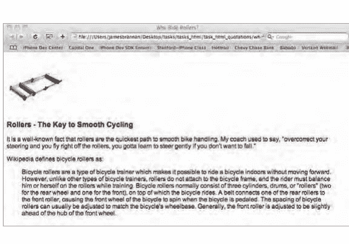

滚轮训练器——平顺骑行的关键

众所周知，滚轮训练器是实现平顺自行车操控的最快途径。我的教练过去常说，"过度修正你的转向，你就会直接从滚轮上飞出去。如果你不想摔倒，就得学会轻柔地转向。"

维基百科将自行车滚轮定义为：

> 自行车滚轮是一种自行车训练器，它使在室内骑行自行车而无需向前移动成为可能。然而，与其他类型的自行车训练器不同，滚轮不固定在自行车车架上，训练者必须在滚轮上自行保持平衡。自行车滚轮通常由三个圆柱体、滚筒或“滚轮”（两个用于后轮，一个用于前轮）组成，自行车在其上骑行。一条皮带连接一个后滚轮和前滚轮以驱动其转动。后圆柱体是驱动滚轮，通常较重以利用动量。滚轮之间的距离通常可以调节以匹配自行车的轴距。通常，前滚轮被调整到略前于前轮轮毂的位置。

> ### 供你参考

`<blockquote>` 元素有一个可选的 `cite` 属性。如果引用的来源来自另一个网站，你可以在此属性中输入 URL。你的浏览器不会显示 `cite` 属性的值，但它作为元数据很有用。

还有许多其他元素用于标记 HTML 文本。逐一介绍会为本章增加 16 个任务。但每个元素并不值得单独设一个任务，因为本任务涵盖的元素都相当容易掌握。尽管如此，本任务探讨了 16 个元素，所以请注意！注意，在本任务中我只介绍未被弃用的元素，所以不必担心你正在学习一个不相关的元素。既然 CSS 在布局方面功能强大得多，确实没有理由去学习已弃用的 HTML 格式化标签。

本任务涵盖的元素有：b, br, i, big, small, em, strong, sub, sup, del, ins, code, samp, kbd, var 和 cite 元素。

## 标记其他文本元素

## 任务步骤

- 1. 打开模板并以新名称保存。
- 2. 输入开头和结尾的 `<b></b>` 标签。在它们之间输入一些文本。(4)
- 3. 输入另一句话，并在该行中间放置一个 `<br/>` 标签。不要忘记让标签自闭合，因为换行元素没有结束标签。(7)
- 4. 输入一行文本，并在该行几个单词前放置一个开头的 `<i>` 标签，其后放置一个结尾的 `</i>` 标签。(11)
- 5. 输入一对 `<big></big>` 标签，并在它们之间输入一些文本。(14)
- 6. 输入一对 `<small></small>` 标签，并在它们之间输入一些文本。(15)
- 7. 输入一对 `<em></em>` 标签，并在它们之间输入一些文本。(16)
- 8. 输入一对 `<strong></strong>` 标签，并在它们之间放置文本。(17)
- 9. 输入一行文本，然后在一个单词周围放置一个开头的 `<del>` 和一个结尾的 `</del>` 标签。(19)

#### 表 2.6 本任务涉及的基本文本格式化标签

| 标签 | 功能 |
| --- | --- |
| `<b></b>` | 使文本加粗。 |
| `<br/>` | 在文本中放置一个换行。 |
| `<i></i>` | 使文本斜体。 |
| `<big></big>` | 放大文本。 |
| `<small></small>` | 使文本变小。 |
| `<em></em>` | 强调文本。 |
| `<strong></strong>` | 强调文本，比 `<em>` 标签强调程度更强。 |
| `<sub></sub>` | 使文本下标。 |
| `<sup></sup>` | 使文本上标。 |
| `<del></del>` | 指定包含的文本为已删除。 |
| `<ins></ins>` | 指定包含的文本为已插入。 |
| `<code></code>` | 指定包含的文本为计算机代码。 |
| `<samp></samp>` | 指定包含的文本为计算机代码示例。 |
| `<kbd></kbd>` | 指定包含的文本为键盘文本。 |
| `<var></var>` | 指定包含的文本为一个变量。 |
| `<cite></cite>` | 指定包含的文本为引用。 |

HTML 文本布局标签 33


## 标记其他文本元素（续）

在开始本任务之前，请注意我没有介绍非常重要的 `div` 元素，也省略了 `span` 元素。因为它们在讨论 CSS 时更为实用，所以我在本书的第 8 章 CSS 部分对这两个元素进行了讲解。`div` 元素在任务"对齐文本"中有所介绍，参见第 159 页；`span` 元素在任务"设置元素的字重和字号"中有所介绍，参见第 152–153 页。另外，请注意我没有介绍 `underline` 元素。该元素已被弃用，使用 CSS 实现相同效果的方法已在第 8 章任务"装饰文本和更改大小写"中介绍，参见第 157 页。最后，如果你足够细心，你会发现我没有讨论常见的 HTML 标签属性，如 `id` 或 `class`。这些属性对 CSS 布局最为有用，将在第 7 章任务"理解 CSS 规则"中讨论，参见第 128 页。

- 10. 选择另一个单词，并在其前后放置 `<ins></ins>` 标签。（20、21）
- 11. 输入一个句子，选择一个单词，并在其前后放置 `<sub></sub>` 标签。（23）
- 12. 选择句子中的另一个单词，并在其前后放置 `<sup></sup>` 标签。
- 13. 输入一些文本，并用 `<pre></pre>` 标签对将其包裹起来。（26）
- 14. 输入另一行文本，并使用 `<code></code>` 标签进行相同操作。（28）
- 15. 输入一些文本，并用 `<samp></samp>` 标签包裹其中几个单词。（31）
- 16. 再输入一些文本，并用 `<kbd></kbd>` 标签包裹起来。（33）
- 17. 输入一个字母，并用 `<var></var>` 标签将其包裹起来。（35）
- 18. 最后，输入一些文本，并用 `<cite></cite>` 标签包裹起来。（37）
- 19. 保存并在浏览器中显示此内容。

> **交叉引用**

请参阅 **tasks_html/task_html_other_text_elements/other.html** 查看完成后的示例。

`<b></b>` 标签应使其间的文本变为粗体。`<br/>` 标签应在该行中间插入一个硬换行。`<i>` 标签的文本应变为斜体，`<big>` 标签的文本应大于普通文本，`<small>` 标签的文本应小于普通文本，`<em>` 标签的文本应被强调显示（斜体和/或粗体）。`<strong>` 标签应使其文本变为粗体，而 `<del>` 标签应在其文本上画一条删除线。`<ins>` 标签应在其文本下方添加下划线，`<sub>` 标签应使其文本变为下标，`<sup>` 标签则使其文本变为上标。

`<pre>` 标签应将其文本显示为预格式化文本。大多数浏览器会将预格式化文本显示为 Courier 等宽字体。`<code>` 标签应将其文本显示为代码，通常也显示为 Courier 等宽字体。`<samp>` 标签应将其文本显示为示例文本，通常同样显示为 Courier 等宽字体。用 `<kbd></kbd>` 标签包裹的文本应显示为键盘文本，也通常显示为 Courier 等宽字体。最后，用 `<cite></cite>` 标签包裹的文本应显示为引用文本，通常显示为斜体。

```html
<html>
<body>

<b>This is bold.</b>
<p>
This sentence has a line break
here<br/>which means its on two lines.
</p>
<p>
This line of text has several
<i>italicised words</i> in it.
</p>
<p>
<big>Some big text</big> that I wish
was <small>very small</small> but I
<em>emphasise the text</em> to make a
<strong> strong point </strong> in this
contrived example. I wish to delete
these words: <del>hello world</del> and
insert these <ins>goodbye cruel
world</ins>.
</p>
<p>This is not the <sub>final</sub>
example. There are the <sup>code</sup>
and pre tags remaining.</p>
<pre>y=mX + b;</pre>
<br/>
<code>for(int i = 0; i < 20; i++)
sum(t);</code>
<br/><br/>
<samp>while(i < 100)  sum(r);</samp>
<br/><br/>
<kbd>Hello World</kbd>
<br/><br/>
<var>y</var>
<br/><br/>
<cite>The Lord of the Rings</cite>
</body>
</html>
```

## HTML 文本布局标签 35

## 标记其他文本元素（续）

### 供你参考

## 逻辑标签与物理标签

任务第八步和第九步中的标签演示了逻辑标记标签的用法。它们与物理标签（如 `<i></i>` 或 `<b></b>`）有着明显的区别。逻辑标签并非指示浏览器如何渲染文本，而是告诉浏览器标签内包含的是什么类型的文本，让浏览器自行决定如何显示该元素。逻辑标签告诉浏览器被包裹文本的含义。例如，将文本放在 `<strong></strong>` 标签中，是在告诉浏览器该文本很重要。同样，`<em></em>` 标签是告诉浏览器要强调该文本。相比之下，物理标签 `<b></b>` 只是简单地告诉浏览器该文本应显示为粗体。这是一个细微但重要的区别。`<samp></samp>` 标签本身没有任何固有属性来指示浏览器使用 Courier 等宽字体。浏览器识别到文本被 `<samp></samp>` 标签包裹后，就知道这是示例文本。通常浏览器会使用 Courier 等宽字体来显示 `<samp>` 元素中的文本，但你可以使用 CSS 样式表来更改这一行为。

某些字符，如和号（&amp;）或乘除符号，无法通过键盘轻松输入。HTML 允许你使用代码作为便捷方式。但请注意，在 HTML 中必须使用 `&amp;amp;` 代码来表示和号（`&amp;`）符号。这是因为 `&amp;` 是你在 HTML 中指定特殊字符代码的方式。

在互联网早期，你不得不使用特殊字符来输入非英语字符和特殊符号。这是因为互联网最初只支持一小部分英语 ASCII 字符。但如今，HTML 已不再局限于英语，通过一种叫做 UNICODE 的机制支持所有语言。但如果你以英语输入，偶尔仍想输入一两个外语单词或句子，请注意你仍然可以使用特殊字符来表示外语字符。表 2.7 总结了较为常用的特殊字符代码。

| 代码 | 字符 | 含义 |
| :--- | :--- | :--- |
| &amp;amp; | &amp; | 和号 |
| &amp;nbsp; |  | 不间断空格 |
| &amp;pound; | £ | 英镑符号 |
| &amp;cent; | ¢ | 分符号 |
| &amp;copy; | © | 版权符号 |
| &amp;reg; | ® | 注册商标符号 |
| &amp;deg; | ° | 度数符号 |
| &amp;plusmn; | ± | 正负号 |
| &amp;times; | × | 乘号 |
| &amp;divide; | ÷ | 除号 |
| &amp;quot; | " | 引号 |
| &amp;lt; | &lt; | 小于号 |
| &amp;gt; | &gt; | 大于号 |

本任务的结果非常直观，你应该能在浏览器中看到每个特殊字符的实际显示效果，而不是输入到 HTML 中的代码。

## 插入特殊字符

## 任务步骤

- 1. 打开模板并将其另存为新页面。
- 2. 在 `body` 标签之间，输入 `&amp;amp;`、`&amp;pound;`、`&amp;cent;`、`&amp;copy;`、`&amp;reg;`、`&amp;deg;`、`&amp;plusmn;`、`&amp;times;`、`&amp;divide;`、`&amp;quot;`、`&amp;lt;` 和 `&amp;gt;` 文本。（4–7）
- 3. 现在，在每个特殊字符代码之间输入 `&amp;nbsp;` 代码。（4–7）
- 4. 在上一步的行之后添加一个定义列表 `dl`，并输入以下定义术语：`automa&ccedil;&atilde;o`，然后输入 "Portuguese for automation." 作为定义。（8–11）
- 5. 保存并在浏览器中显示此内容。

> **交叉引用**

请参阅 `tasks_html/task_html_special_characters/special.html` 查看完成后的示例。

## 插入特殊字符（续）

```html
<html>
<body>

&amp;&nbsp;&pound;&nbsp;&cent;&nbsp;&copy;&nbsp;&reg;&nbsp;&deg;&nbsp;&plusmn;&nbsp;&times;&nbsp;&divide;&nbsp;&quot;&nbsp;&lt;&nbsp;&gt;
<dl>
<dt>automa&ccedil;&atilde;o</dt>
<dd>Portuguese for automation.</dd>
</dl>
</body>
</html>
```

> ### 供你参考

#### UNICODE 与英语以外的语言

除非你住在最偏远的地方，否则在任何一天，你都有可能听到除英语以外的一种或多种语言。这是一个多语言的世界。你很可能至少能说一点英语以外的语言。如何将计算机的默认字符集设置为英语以外的语言超出了本书的范围；但你应该注意，你可以指定页面的字符编码。更多信息请参考 W3C 网站（[www.w3c.org/International](http://www.w3c.org/International)）。

不要因为完成了这个任务就认为你必须使用特殊字符才能用英语以外的语言创建网站。你不需要这样做；特殊字符仅用于单个单词或短句。

> ### 术语解读

- **病毒式视频（Viral video）** – 通过互联网分享的视频。这种分享使该视频广为流传。
- **已弃用（Deprecated）** – 已被替换的软件功能，不应再使用。被更新的元素、属性或结构所淘汰的过时元素或属性。例如，大多数 HTML 格式化功能已被 CSS 替代，因此这些 HTML 格式化功能已被弃用。

38


## 供您参考

在 `<body>` 元素内，有两种 HTML 标签类型：块级（block-level）和内联（in-line）。块级标签用于格式化文本块，并会导致浏览器在元素的结束标签后渲染一个新行。块级元素可以包含其他块级元素和内联元素。块级元素用于容纳较大量的数据。例如，段落元素就是一个块级元素。可以将块级元素想象成您页面的构建模块。

相反，内联元素用于为较小的数据结构（如超链接、图像和其他标签）应用格式。内联元素只能包含其他内联元素，不能包含块级元素。

| 表 2.8 块级元素 |
| --- |
| `<p></p>` |
| `<h1></h1>`...`<h6></h6>` |
| `<blockquote></blockquote>` |
| `<ol></ol>` |
| `<ul></ul>` |
| `<dl></dl>` |
| `<div></div>` |
| `<form></form>` |
| `<table></table>` |
| `<fieldset></fieldset>` |

## 插入特殊字符（续）

HTML 文本布局标签 39

## 理解超链接

## 简介

我们所知的万维网建立在超链接之上。超链接是资源中的一个位置，它链接到该资源中的另一个位置，或者链接到另一个资源。当您在浏览器中点击链接时，您的浏览器通过统一资源定位符（URL）知道去哪里。URL 是标识资源的地址。通常该资源是另一个网页，尽管也可能是其他东西，例如图像或视频。

当您在浏览器中查看网页时，您实际上是在查看文本与一个或多个 URL 的混合体。在浏览器显示之前，HTML 页面由文本组成，不多不少。所有的图像、影片、声音和其他多媒体都是指向实际资源的文本超链接。当浏览器读取页面的 HTML 时，它通过使用资源的 URL 找到资源，下载它，并将资源放置在页面中的适当位置。如果资源是图像，它会显示图像。如果资源是 Flash 或其他多媒体，它会加载相应的插件并将资源加载到插件中。如果浏览器不知道如何处理该资源，通常会弹出一个对话框，要求您选择用于打开资源的应用程序，或者如果您愿意，保存资源。当您用鼠标实际点击一个超链接时，您是在指示您的浏览器查找该超链接指向的资源并加载它。如果它是一个 HTML 页面，您的浏览器会用新检索到的页面替换当前页面。

## 3

### 您将做什么

- 理解统一资源定位符（URL）
- 使用超链接 – 绝对 URL
- 使用超链接 – 相对 URL
- 为超链接添加目标
- 创建锚点
- 链接到电子邮件地址

URL 背后的技术信息超出了本书的范围。无论如何，您不需要了解所有的技术信息；如果您感兴趣，只需用谷歌搜索一下，您会找到比您想象中更多的相关信息。然而，就我们的目的而言，只需将其视为一个唯一的、全局的地址。关于 URL 的更多信息将在第一个任务中介绍。

## 供您参考

如今大多数网站都是动态的。它们并非提供静态 HTML 页面，而是有一个中间层，其中一种编程语言实际上动态地编写 HTML 页面，并将结果发送到 Web 服务器，然后由该服务器将页面传送到您的浏览器。例如，如果您访问 **ebay.co.uk** 并浏览商品列表，这些列表是动态生成的，您不会在浏览器的地址栏中看到像 **listing.html** 这样的静态页面名称。

如果您有任何浏览网页的经验，您可能已经理解了统一资源定位符（URL）。URL 是地址，就像您家的地址一样。实际上，一个更好的类比是公寓楼。公寓的主要地址——或基本地址——指向公寓楼。

127 Garden Grove Apartments

然后，公寓的地址指向该公寓在楼中的实际单元号。

Apt #27

但 URL 更进一步。一个 URL 可以指向一个房间，甚至房间内的一个位置。

Master Bedroom/left corner

所以完整的 URL 将是：

/127 Garden Grove Apartments/Apt #27/Master Bedroom/left corner

完整的 URL 以协议标识符开头。您在浏览器中输入地址时几乎从不输入协议。您通常只需输入域名，而不是协议后跟域名。例如，您通常只需输入 **uk.yahoo.com** 而不是 **http://uk.yahoo.com**。您的浏览器会猜测您指的是超文本传输协议（http）并将其前置到您的 URL。

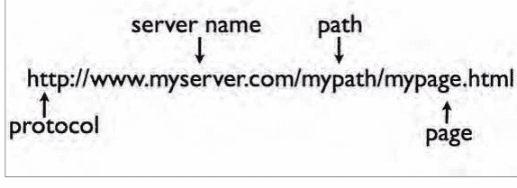

Http 是 Web 使用的主要协议。不过，对您来说它是透明的。只需知道，在幕后，http 是计算机通过头部信息理解它们正在互相发送网页的方式。协议之后是服务器名称。服务器名称指定了资源所在计算机的名称。例如，它指定了公寓楼。

在资源的服务器名称之后，是通向实际资源位置的路径。请注意，当资源位于网站的根文件夹中时，路径可以简单地为 `/`。

```
http://www.myserver.com/mypath/
```

最后，在路径之后是实际的资源。

```
http://www.myserver.com/mypath/mypage.html
```

> **供您参考**
步骤 5 说明了一个重要的最佳实践。通常，当用户导航到一个位置而未指定文件时，网站会将主页面命名为 **default.html** 或 **index.html**，此时该位置的 Web 服务器会将默认页面发送给浏览器。您也应该这样做。

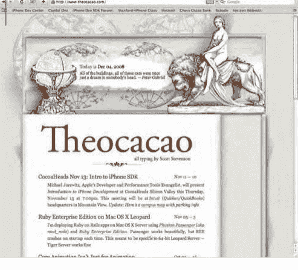

## 理解统一资源定位符（URL）

## 任务步骤

1. 在您的浏览器地址栏中输入：**www.webopedia.com** 并按下 [Return]。这会带您到在线资源：Webopedia。
2. 在地址后添加：**/TERM/d/domain_name.html** 并按下 [Return]。这会带您到静态页面 **domain_name.html**：一个域名的定义。
3. 现在在浏览器的地址栏中输入地址 **www.paypal.com** 并按下 [Return]。当您的浏览器导航到 PayPal 时，它会将协议从 http 更改为 https。https 协议在 http 上增加了一个加密层，使得黑客无法窃听发送到您浏览器的信息。

理解超链接 43

## 理解统一资源定位符（URL）（续）

最后，在浏览器的地址栏中输入：**http://theocacao.com/** 并按下 [Return]。这会带您到 Scott Stevenson 的网站。顺便说一句，这是一个关于使用 Cocoa 进行 Mac OS X 编程的绝佳资源。

输入 **uk.yahoo.com** 并按下 [Return] 以导航到 YahooUK。导航到该页面后，在结尾的斜杠后输入 **index.html**。您的浏览器会导航到同一个页面。

在上一个任务中，我介绍了 URL。URL 是您用于导航网络的方式。它们也是用户导航到您的网站以及从您的网站导航出去的方式。URL 可以是外部的或内部的。外部 URL 指向另一个网站，而内部 URL 指向您网站上的另一个资源。绝对 URL 显示了通向资源的整个路径。您使用绝对 URL 指向外部资源。相对 URL 用于在站点的不同部分之间导航。例如，在我们上一个任务的公寓楼示例中，从一个公寓楼移动到另一个需要绝对 URL……在同一个公寓楼内导航则可以使用相对 URL。

您使用锚点标签 `<a>` 来引用其他位置。这些位置可以是同一文档中的其他位置，也可以是不同文档中的位置。锚点标记任务演示了使用锚点标签链接到同一文档中的其他位置。本任务演示了使用锚点标签导航到其他文档。您使用锚点标签的 `href` 属性来指定其他文档。本任务演示了使用 `href` 通过绝对 URL 指向外部站点。下一个任务演示了使用相对 URL 的内部链接。

## 表 3.1 本任务涉及的标签

| 标签 | 功能 |
| :--- | :--- |
| `<a></a>` | 指定一个锚点。链接到文档中的另一个位置或另一个文档。 |

> **交叉引用**

完整的示例请参见 `tasks_html/task_html_links_absolute/links.html`。

## 使用超链接 – 绝对 URL

## 任务步骤

1. 打开模板并以不同的名称保存。
2. 找到两三个您希望链接到的站点并记下网址。同时，记下浏览器为这些页面显示的标题，也记下来。
3. 在 `links.html` 的 `<body>` 标签之间，创建一个无序列表，其项目数量与步骤 2 中确定的站点数量相同。（7–18）
4. 将网页标题作为列表项输入。（10, 14, 16）
5. 现在，在每个标题的开头输入 `<a>` 开始标签，并为 `href` 属性输入 URL。（8, 13, 15）
6. 在每个标题的末尾，输入结束标签 `</a>`。（12, 14, 17）
7. 保存并在浏览器中打开。


## 使用超链接 – 绝对 URL（续）

```html
<!DOCTYPE HTML PUBLIC "-//W3C//DTD HTML 4.01 Transitional//EN"
"http://www.w3.org/TR/html4/loose.dtd">
<html>
<body>

<ul>
<li><a href="http://www.cyclingnews.com">www.cyclingnews.com – 首个 WWW 自行车赛事结果与新闻网站</a></li>
<li><a href="http://www.youtube.com">YouTube – 表达自我</a></li>
<li><a href="http://www.chrishoy.com/chris_hoy_biography.html">克里斯·霍伊 | 奥运冠军自行车手</a></li>
</ul>
</body>
</html>
```

> **重要提示**
> 在 URL 中**永远不要**使用反斜杠，始终使用正斜杠。即使在 Windows 系统中也是如此。

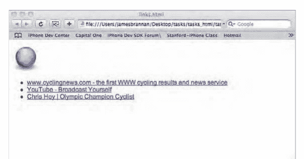

相对 URL 用于链接到你网站内部的文档。在此示例中，你将探索相对 URL。如果你按照绝对 URL 路径前往主卧室的左角：

```
127 Garden Grove Apartments/Apt#27/Master Bedroom/left corner
```

那么，要去厨房，你不会想先离开公寓楼，然后再导航回厨房：

```
127 Garden Grove Apartments/Apt#27/kitchen
```

相反，你只需回到公寓的主入口，然后导航到厨房：

```
../kitchen
```

相对 URL 允许在同一网站内进行更简单的导航。

## 使用超链接 – 相对 URL

## 任务步骤

- 1. 将模板保存两次，分别命名为 `main.html` 和 `sub.html`。
- 2. 在两个新建 HTML 页面所在的同一文件夹中，创建一个名为 **asubfolder** 的文件夹。
- 3. 在新创建的文件夹中创建一个 HTML 页面。将文件命名为 `subtwo.html`。
- 4. 打开 `main.html` 并输入一些文本。围绕部分文本创建一个链接。在 href 属性中，将其指向 `sub.html`。
- 5. 在 `main.html` 中创建另一个链接，将其指向 `asubfolder` 子文件夹中的 `subtwo.html` 页面。
- 6. 保存 `main.html` 并打开 `sub.html`。
- 7. 输入一些文本并创建一个指向 `main.html` 的超链接。
- 8. 保存并打开 `subtwo.html`。

> **重要提示**
> 你需要对使用命令行导航计算机文件路径有基本的了解，才能成功理解相对 URL。如果你使用 Windows，可以在“运行”对话框中输入 `cmd` 进入命令行提示符。例如，在 Windows XP 中，从“开始”菜单选择“运行”。在“运行”窗口的“打开”对话框中，输入 `cmd` 并按 [回车] 键。这将带你到命令提示符。要向上导航一级目录，输入 `cd` 后跟一个空格和两个点号（`cd ..`）；要向下导航一级目录，输入 `cd ./` 后跟目录名称。
>
> 在 OS X 上，进入“实用工具”并打开 `Terminal.app`。这将打开一个真正的 UNIX 命令终端（你知道 OS X 是 UNIX 的一个变体，对吧？）。如果你想查看当前目录，请输入 `pwd`。要向上导航一级目录，输入 `cd ..`；要向下导航一级目录，输入 `cd ./` 后跟目录名称。

## 使用超链接 – 相对 URL（续）

> **交叉参考**
> 请参阅 `tasks_html/task_html_links_relative/main.html` 获取完成的示例。

- 8. 保存 `subtwo.html` 并在浏览器中打开 `main.html`。通过三个页面上添加的链接进行导航。

**main.html** 中指向 **sub.html** 的链接只是简单地引用了文件，因为它们在同一文件夹中。从 **main.html** 到 **subtwo.html** 的链接包含一个 `.` 表示当前目录，一个正斜杠，子目录的名称和文件。从 **subtwo.html** 返回 **main.html** 的链接包含一个 `..`，它导航回上一级目录。最后，在 **sub.html** 中，请注意你可以将 `..` 和 `.` 组合成一个完整的路径，即使它们在逻辑上不合理，如示例所示。

```html
<!DOCTYPE HTML PUBLIC "-//W3C//DTD HTML 4.01 Transitional//EN"
"http://www.w3.org/TR/html4/loose.dtd">
<html>
<body>

<h1>关于我</h1>
我热爱自行车运动，请参阅 <a href="./asubfolder/subtwo.html">你好</a>。我也热爱编程和写作。查看我的 <a href="sub.html">在线简历</a> 以了解我的编程经验。
</body>
</html>
```

```html
<!DOCTYPE HTML PUBLIC "-//W3C//DTD HTML 4.01 Transitional//EN"
"http://www.w3.org/TR/html4/loose.dtd">
<html>
<body>

<h1>简历 - 詹姆斯·A·布兰南</h1>
<a href="./asubfolder/../asubfolder/../../main.html">用复杂的方式返回简历...</a>
</body>
```

## 使用超链接 – 相对 URL（续）

```html
</html>
<!DOCTYPE HTML PUBLIC "-//W3C//DTD HTML 4.01 Transitional//EN"
"http://www.w3.org/TR/html4/loose.dtd">
<html>
<body>

<h1>你好</h1>
<a href="../main.html">返回简历。</a>
</body>
</html>
```

> 如果你打开 **tasks_html/task_html_links_relative/asubfolder/a.html** 中的 a.html，你会注意到图像标签的源是 **Ym.png** *而非* **ym.png**。请记住，虽然在 Windows 中 URL 不区分大小写，但在 Linux 和 OS X 上它们是区分大小写的。你必须使用正确的大小写。

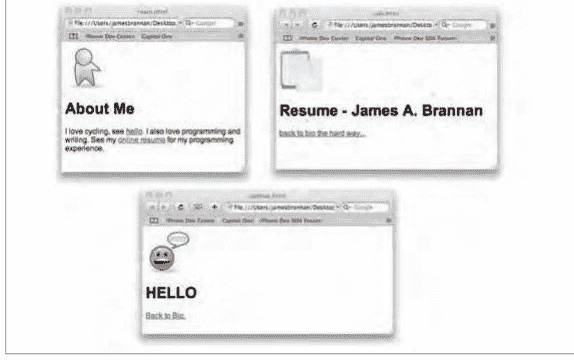

如果你愿意，你可以将内部链接设为完全限定的 URL。但对于内部链接，使用相对 URL 要容易得多。

## 为超链接添加目标

一个锚点可以拥有一个 target 属性。该属性指定锚元素所链接资源的打开位置。

| 锚元素（`<a>` 标签）的属性 | |
| :--- | :--- |
| _blank | 在新窗口或新标签页中打开资源。 |
| _parent | 在父框架中打开资源。 |
| _self | 在同一框架中打开资源。 |
| _top | 在同一窗口中打开资源。 |

## 任务步骤

- 1. 打开模板并以不同名称保存。
- 2. 添加三个指向外部站点的超链接。
- 3. 在第一个链接中，添加 target 属性并将其值设为 **_blank**。
- 4. 在另一个链接中添加一个 target，其值为 **_self**。
- 5. 在第三个链接中，添加一个 target，其值为 **_top**。
- 6. 保存，在浏览器中打开并观察这三个链接的不同行为。

target 属性在使用框架集时最有用，但如今已经没有人使用框架了。本书甚至不涵盖框架，它们已经如此过时。然而，target 仍然有一个快速简单的用途：当链接到一个资源时，你可以指定它应该在新窗口或新标签页中打开。例如，如果你链接到另一个网站，通常当用户点击链接时，浏览器加载新网站页面后会离开你的网站。当使用 **_blank** 属性时，浏览器会停留在你的网站，但会打开一个新窗口来显示资源。

> **交叉参考**
> 请参阅 **tasks_html/task_html_targets/target_blank.html** 获取完成的示例。

完成此任务后，当你点击第一个链接时，它会在新的浏览器窗口中打开。除非你使用框架，否则这是迄今为止最有用的 target 属性。它允许你链接到外部网站，当用户点击链接时，他们不会离开你的网站。相反，会打开一个新窗口。如果你曾经访问过赌博网站，或其他提供任何“免费”东西的网站——你可能已经见过太多 _blank 目标属性的使用了。

## 为超链接添加目标（续）

```html
<!DOCTYPE HTML PUBLIC "-//W3C//DTD HTML 4.01 Transitional//EN"
"http://www.w3.org/TR/html4/loose.dtd">
<html>
<body>

<p>
你可以花费数小时每天阅读 ----省略---- 。<cite>《卓越的 Mac OSX Leopard》</cite> 是一本实现这一目标的书，我在使用它。
</p>
Target=_blank: <a href="http://www.pearsoned.co.uk/Bookshop/detail.asp?item=100000000256904" target="_blank">卓越的 Mac OSX Leopard</a>
<br/>
Target=_self: <a href="http://www.pearsoned.co.uk/Bookshop/detail.asp?item=100000000256904" target="_self">卓越的 Mac OSX Leopard</a>
<br/>
Target=_top: <a href="http://www.pearsoned.co.uk/Bookshop/detail.asp?item=100000000256904" target="_top">卓越的 Mac OSX Leopard</a>
</body>
</html>
```

理解超链接 51


## 向超链接添加目标（续）

## 供您参考

### 框架与目标

根据您使用互联网的时间长短，您可能听说过框架。框架如今已很少使用，且并不美观。框架允许您将浏览器划分为不同的区域，并在每个框架中加载独立的 HTML 页面。目标曾用于辅助框架。您可以为框架集中的每个框架命名，并在任何独立页面的任何链接中指定目标。随后，URL 引用的资源将被加载到指定的目标中。

在网页术语中，“锚点”并非指锚元素。锚元素通常仅被称为链接或超链接。口语中的“锚点”特指一种特定的锚元素类型，即链接指向同一页面中的另一个位置。例如，您可能有一个长页面，顶部带有目录。目录中的每个项目都可以链接到其在页面中对应的位置。

> **交叉引用**
> 完整示例请参阅 **tasks_html/task_html_anchors/anchorexample.html**。

为获得最佳效果，您应调整浏览器窗口大小，仅显示第一段。当您点击链接时，可见文本应跳转到您定义的锚点。当您点击指向第二页的超链接时，它应加载该页面并直接导航到第二页上的锚点。

## 创建锚点

## 任务步骤

- 1. 打开模板并使用不同名称保存。
- 2. 在文档中键入一个简单段落，然后键入十个 `<br/>` 标签并输入一些简单文本。（20, 21）
- 3. 在初始段落中，选择一个词并在其周围添加链接。但是，不是指定另一个文档，而是键入 `[#]` 键后跟一个简单名称。例如 **#scroll_def**。（14）
- 4. 在 `<br>` 标签下方的文本中选择一个词并放置链接。不要添加 href 属性，而是添加 name 属性。对于 name 属性的值，键入相同的名称（不带 #），例如 **scroll_def**。（24）
- 5. 创建另一个包含约 10-15 个 `<br/>` 标签的简单 HTML 页面。在 `<br/>` 标签之后，向页面添加一个锚点。（44）

```
 1 <!DOCTYPE HTML PUBLIC "-//W3C//DTD HTML
 2 4.01 Transitional//EN"
 3 "http://www.w3.org/TR/html4/loose.dtd">
 4 <html>
 5 <head>
 6 <title>Anchor Example</title>
 7 </head>
 8 <body>
 9 
10 <p>You use anchors to link from one
11 location on a page to another. They are
12 most useful for long text pages that
13 users must
14 <a href="#scroll_def">scroll</a> as
15 they read the page.
16 </p>
17 <p>Anchors can also <a href=".
18 /anchorexampleb.html#scroll_def">link
19 to</a> an anchor on another page.
20 <br/><br/><br/><br/><br/><br/><
```


## 为您的网页添加图片

## 简介

### 你将做什么

两三年前，像这样的书籍以一大段关于为互联网优化图片的讨论来开篇是很重要的。现在，情况并非如此了。在YouTube和巴西内陆高速互联网接入的时代，图片优化不再那么关键。在不到五年的时间里，普通人从使用56K拨号连接转变为使用始终在线的电缆调制解调器或ISDN线路。你还记得那些坐着等待图片加载的日子吗？这似乎是很遥远的记忆了，不是吗？你还记得640 x 480或800 x 600的屏幕分辨率吗？嗯，今天1024 x 768是你真正需要关心的最低屏幕分辨率。而且几乎所有的电脑显示器显示的颜色都比你的图片中可能使用的颜色多得多。

-   1. 探索图片优化
-   2. 将图片添加到网页
-   3. 创建图片链接
-   4. 创建图片链接 – 缩略图
-   5. 创建图片地图

实际上，关于网络图片，你应该了解几件事。另外，如果你上传的是数码相机拍摄的照片，那么优化就很重要了。因此，本章确实以关于图片优化的简短讨论作为开始。

如今，为网络优化图片真的不需要了解太多内容。记住以下五点，你就会做得很好。

-   1. 对于照片，使用JPEG格式。
-   2. 对于艺术作品，使用PNG格式。
-   3. 尝试避免使用GIF格式，改用PNG。
-   4. 阅读你的图片软件的帮助文档！更重要的是，不要试图过度优化图片。
-   5. 保持图片尺寸合理。记住，你的相机保存的是高分辨率的TIFF或JPEG文件。它们非常大！

当今网络上的三种主要图片格式是联合图像专家组格式（JPEG）、图形交换格式（GIF）和便携式网络图形格式（PNG）。保存照片时，请使用JPEG。由于各种原因，JPEG格式适用于照片。除非创建动画GIF，否则不要使用GIF格式。而应使用PNG格式。PNG格式是一种更现代的图片格式，具有丰富的颜色支持、先进的压缩方案、24位颜色、自适应透明度以及许多其他功能，使其成为比GIF更好的选择。

> 重要提示

在Internet Explorer 7之前，某些PNG功能（如自适应透明度）并未得到完全支持。

好吧，我知道我刚才说过现在图片优化不那么关键了。总的来说这是对的，但有一个复杂因素导致我仍然需要简要讨论图片优化：数码相机。数码相机使得拍摄照片、将其上传到计算机并在互联网上分享变得比以往任何时候都容易。但数码相机拍摄的图片只有一个问题。通常，数码相机会以大型、高分辨率的TIFF或JPEG格式分享图片。这些图片对于在互联网上显示来说太大了。你必须减小图片的文件大小和尺寸。

但本章不仅仅是关于图片优化。在本章中，你还将学习如何将图片添加到你的网页中。你使用``标签将图片插入到网页中。此元素有几个属性。在本章中，我将介绍src属性、高度和宽度属性以及alt属性。

```

```

我基本上忽略了已弃用的align属性。但我仍然会简要讨论它，因为即使它已被弃用，但仍有人在使用。

这个主题确实不像以前那么关键了。艺术作品用PNG，照片用JPEG。但如果你想上传数码相机拍摄的照片并将其添加到你的网页中，那么这个任务就很重要。数码相机会保存大的、高分辨率的JPEG或TIFF文件。在将这些图片添加到你的网页之前，你应该对它们进行优化。

## 探索图片优化

你可能没有Adobe Photoshop。但如果你用的是Mac，你应该有"预览"程序。双击图片，它应该会在"预览"中打开。加载图片后，选择"工具"、"调整大小..."，然后会出现一个对话框，允许你减小图片的大小。如果你使用的是Windows，你的相机很可能随附了具有尺寸缩小功能的图片编辑软件。如果相机没有附带软件，那么网上有充足的共享软件和开源软件资源可供进行基本的图片编辑。关键功能是它允许你减小图片尺寸。我不建议修改颜色优化、降低分辨率（除非将JPEG从高分辨率改为中等分辨率）以及其他图片文件大小缩减优化，除非你的网站是为某个偏远村庄的电缆调制解调器用户准备的——即使他们也可能拥有ISDN、能显示数千种颜色的显示器以及1024 × 768的显示分辨率。

## 任务步骤

-   1. 导航到你数码相机中的图片文件夹，双击一张照片。我假设你的电脑会以该文件类型的默认程序或某种'预览'程序打开它。
-   2. 例如，当我双击一张图片时，它会在Apple Preview中打开。
-   3. 哇哦！我的照片尺寸是1600 × 1200像素，大小是815kb。这张照片太大了，我甚至无法在屏幕上看到整张照片。
-   4. 所以，我进入图片软件的图片大小选项，将图片缩小到640 × 480，并将其保存为jpeg。现在图片只有41.1 kb，并且在网页上显示效果会很好。

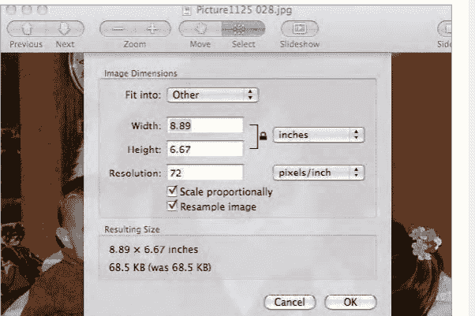

## 将图片添加到网页中

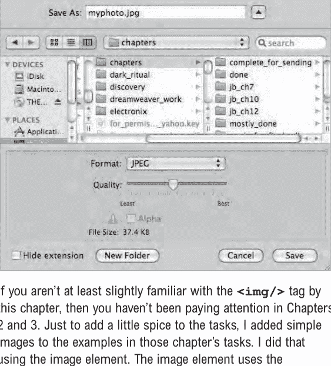

> ### 供你参考

如果保存JPEG，尝试将图片质量从*高*更改为*中*。这可以在不影响观看质量的情况下减小图片的文件大小。

如果读到本章时你对``标签还不至少稍微熟悉，那么你在第2章和第3章就没有用心学习。只是为了给任务增加一点趣味性，我在那些章节任务的示例中添加了简单的图片。我是使用image元素做到的。image元素使用``标签将图片插入网页。注意，你真正做的是为浏览器提供一个指向图片文件的URL。然后浏览器从src属性指定的位置检索图片，并将其渲染在网页上的指定位置。

> ### 重要提示

如果图片保存时没有正确的.jpg、.gif或.png扩展名，那么你的电脑将无法识别文件格式！

图片元素有几个属性，在这个任务中我将介绍alt、src以及高度和宽度属性。alt属性提供简短的图片描述。src属性指定图片的位置。浏览器使用此属性来检索图片。高度和宽度属性指定图片在页面上显示的高度和宽度。如果高度和宽度与图片的实际高度和宽度不匹配，则图片会被放大或缩小以适应给定的空间。但要注意，图片文件的实际字节大小保持不变，你的浏览器只是缩放图片以适应属性指定的大小。

**62**

完成此任务并查看结果后，你的浏览器应该会按预期显示第一张图片。第二张图片应该被拉伸，显示得比它实际尺寸大。你应该避免这样做——放大显示的图片几乎总是看起来很糟糕。第三张图片应该更小，但不会显得扭曲。你几乎总可以缩小图片而不让它看起来很糟糕，前提是保持图片的宽高比不变。第四张图片应该是所有图片中失真最严重的。它说明了不使用图片实际宽度和高度的两个危险。首先，图片放大时看起来很糟糕。其次，图片有所谓的宽高比。**freebsd.png** 的宽高比是1:1。但当你给它分配20%的高度和100%的宽度时，你实际上是在给它分配1:5的宽高比。这不是图片的宽高比，所以它看起来就扭曲了。

## 将图片添加到网页中（续）

-   1. 获取一张用于此示例的图片。最好是一张较小的图片。如果你下载了完成的示例，可以使用此示例中使用的BSD恶魔图片。在下面的说明中，我假设你使用这张图片。
-   2. 在你的页面中添加四个``标签，并让这四个标签都引用**freebsd.png**图片文件。*(7, 10, 13, 16)*
-   3. 在第一个图片元素中，为其分配图片的实际尺寸，即高72像素，宽72像素。*(8)*
-   4. 为第二个图片元素分配高200像素，宽200像素的尺寸。*(11)*
-   5. 为第三个图片元素分配高22像素，宽22像素的尺寸。*(14)*
-   6. 为第四个图片元素分配高20%，宽100%的尺寸。*(17)*
-   7. 如果你在创建图片时没有为每张图片添加alt属性，请为每个图片元素添加alt属性。
-   8. 保存并在浏览器中查看。

```
1 <!DOCTYPE HTML PUBLIC "-//W3C//DTD HTML
2 4.01 Transitional//EN"
3 "http://www.w3.org/TR/html4/loose.dtd">
4 <html>
5 <body>
6 <p>
7 实际大小: <br/>
10 放大: <br/>
13 缩小: <br/>
16 百分比:<br/>
19 </p>
20 </body>
21 </html>
```


## 向网页添加图片（续）

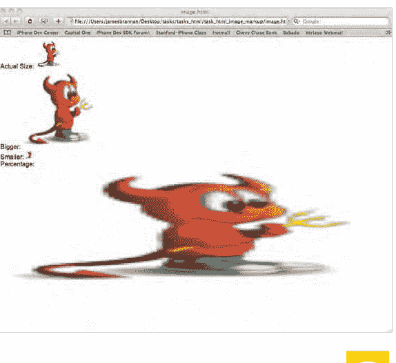

> **交叉引用**
> 完成的示例请参见 tasks_html/task_html_image_markup/image.html。

> **供您参考**
> 您可以添加的另一个属性是 title：当用户将鼠标悬停在图片上时，会显示一个带有 title 文本的工具提示。根据系统的不同，工具提示也被称为屏幕提示或悬停框。

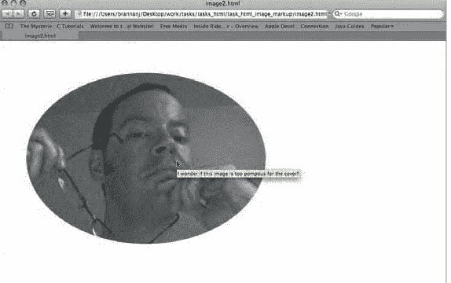

## 如何在浏览器中显示自定义图标（网站图标）

导航到 **theocacao.html**。页面加载后，注意浏览器地址栏中 URL 前面的小图标。将该网站添加到书签，同样的图标也会出现在您的书签列表中。这很酷。在网页术语中，这些被称为“网站图标”（favicons）——即收藏夹图标。

```
<head>
<meta http-equiv="Content-Type"
content="text/html;
charset=UTF-8">
<link rel="shortcut icon"
href="./favicon.ico"
type="image/x-icon"/>
<title>James's Super-Cool
WebSite</title>
</head>
```

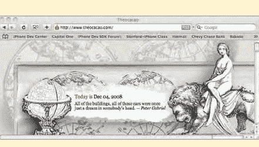

创建网站图标很容易。找一个 16 x 16 像素的小图片（记住，图标都很小）。网上有很多开源/免费的图片可以使用。例如，**www.kdelook.org** 上的 Crystal Project 和 Vista Inspirate 都有 16 x 16 的图标。获得图片后，将其保存为 **.ico** 文件。许多图像编辑程序可以将图像另存为 ico，但您也可以随时访问 **www.favicon.cc** 的网站图标创建工具，在线创建图标并下载。

网站图标在本书中不作为一项任务的原因是，除非您的页面位于 Web 服务器上，否则无法看到结果。创建一个图标，然后为本地服务页面（使用 **file://** 协议）分配一个相对路径是无法工作的。在我的电脑上，它会在 Firefox 的地址栏中显示，但在书签列表中则不会显示。在 Explorer 或 Safari 中则根本不显示图标。

向网页添加图片 65

## 创建图片链接

网页上的一种常见做法是使用图片作为超链接。这很简单，只需将 `` 标签包裹在 `<a></a>` 标签中，而不是包裹文本。这里有一个小问题，Internet Explorer 和 Firefox 会在图片周围放置一个蓝色边框。这很合理，图片是一个超链接——您的浏览器想通知读者这一事实。但通常从美观角度看，这个边框显得格格不入。移除边框相当容易。如果您不介意使用已弃用的属性，可以指定图片没有边框。

1. 将 template.html 另存为一个新名称。
2. 向页面添加六张图片。完成的示例中有六张您可以使用的图片。
3. 在所有六张图片周围添加一个锚点元素。将每个链接指向不同的网站。
4. 保存并在浏览器中显示。

```

```

但您确实应该改用 CSS。如果您使用 Safari，会注意到它不会为图片链接添加边框，除非您指定了图片有边框。

> **交叉引用**
> 在第 10 章的“格式化超链接——图片链接”任务中（见第 184 页），您将使用 CSS 指定图片没有边框。

> **交叉引用**
> 完成的示例请参阅 **tasks_html/task_html_image_links/imagelink.html**。

结果很直接：完成任务后，您应该看到六张图片，每张都有一个蓝色边框，表示它们是一个超链接。

## 创建图片链接（续）

```
1 <!DOCTYPE HTML PUBLIC "-//W3C//DTD HTML 4.01 Transitional//EN"
2 "http://www.w3.org/TR/html4/loose.dtd">
3 <html>
4 <body>
5 <a href="http://fedoraproject.org"></a>Fedora Linux<br/><br/>
8 <a href="http://www.redhat.com"></a>Redhat Linux<br/><br/>
11 <a href="http://www.freebsd.org"></a>Free BSD<br/><br/>
14 <a href="http://www.openbsd.org"></a>Open BSD<br/><br/>
17 <a href="http://www.opensuse.org"></a>SUSE Linux<br/><br/>
20 <a href="http://www.ubuntu.com"></a>Ubuntu Linux
23 </body>
24 </html>
```

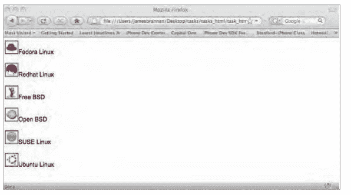

向网页添加图片 67

## 创建图片链接——缩略图

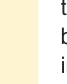

一种常见的做法是显示一个小图片，当用户点击它时，浏览器会在浏览器中加载完整尺寸的图片。例如，导航到 www.google.com，选择图片，输入搜索词，然后单击“搜索图片”按钮。返回的是一个缩略图页面。当您点击其中一个时，浏览器会加载一个框架集。顶部框架显示图片的缩略图，而底部框架则加载图片来源的原始页面。顶部框架中的缩略图是一个链接。单击它，您的浏览器就会加载原始的完整尺寸图片。

1. 打开模板并另存为一个新名称。重复操作，将一个页面命名为 fullsize.html，另一个命名为 thumbnail.html。
2. 打开 thumbnail.html 并将 `freebsd_thumb.png` 添加到页面，使其成为一个指向 fullsize.html 的图片链接。在超链接中，务必添加 target 属性并将其设置为 `_blank`。（第 6、7 行）
3. 保存 thumbnail.html 并打开 `fullsize.html`。将图片 freebsd.png 添加到页面。（第 22 行）
4. 保存并在浏览器中打开 `thumbnail.html`。

> **交叉引用**
> 完成的示例请参见 **tasks_html/task_html_image_thumbnails/thumbnail.html**。

完成测试并在浏览器中查看其结果后，您应该看到较小的图片作为一个图片链接。当您单击缩略图时，会弹出一个新的浏览器窗口，或显示一个新的标签页，其中包含完整尺寸的图片。

> **重要**
> 在前面的任务中，您通过减小其尺寸（高度和宽度）使图片变小。当您使用 image 元素的 height 和 width 属性执行此操作时，并不会使图片的字节大小变小。浏览器只是缩放图片；下载一个 500K 的图片所需的时间与其高度和宽度无关。相比之下，缩略图允许您显示较小的图片，如果用户确实有兴趣查看您可爱小狗的完整尺寸 500K 图片，他们可以单击缩略图进行下载。

68

```
1 <!DOCTYPE HTML PUBLIC "-//W3C//DTD HTML
2 4.01 Transitional//EN"
3 "http://www.w3.org/TR/html4/loose.dtd">
4 <html>
5 <body>
6 <a href="./fullsize.html"
7 target="_blank"></a><p>Mac OS X uses a
10 FreeBSD version as its base operating
11 system? The user-friendly Mac is <a
12 href="http://www.apple.com/macosx/techno
13 logy/unix.html">UNIX at its
14 core</a>!</p>
15 </body>
16 </html>
```

## 创建图片链接——缩略图（续）

```
17 <!DOCTYPE HTML PUBLIC "-//W3C//DTD HTML
18 4.01 Transitional//EN"
19 "http://www.w3.org/TR/html4/loose.dtd">
20 <html>
21 <body>
22 </a></body>
24 </html>
```

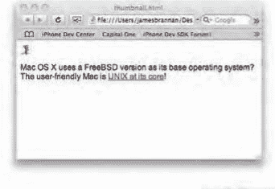

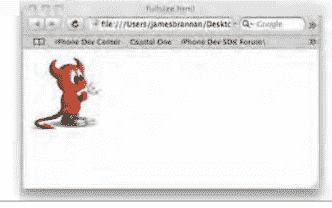

向网页添加图片 69

## 创建图片地图

图片地图包含一个带有一个或多个称为“热点”的可点击区域的图片。热点是图片上的一个位置，当被单击时，会触发一个函数的执行。在网页中，该函数通常是通过超链接导航到另一个资源。每个可点击区域都是一个指向另一个资源的超链接。该资源可以是任何通常由超链接处理的内容。

创建图片地图涉及三个步骤。首先，确定图片的像素尺寸。例如，本任务中使用的图片——clock.png——是 128 × 128 像素。其次，在纸上勾勒图片并画出要转换为热点的区域。确定每个热点的尺寸。第三，将信息添加到网页中的图片上。

1. 本示例假设您已下载了本书的示例。导航到 **task_html_image_maps** 文件夹并获取 **clock.png** 图形。它是 128 × 128 像素。
2. 将模板另存为一个新名称。
3. 在一张纸上勾勒时钟。
4. 在纸上，将图形分成四个象限。这四个区域将成为您的热点。
5. 在纸上，逆时针方向确定坐标。从 (0,0) 到 (64,64)——或从 9 点到 12 点——是区域一。从 (0,64) 到 (64,128)——或从 9 点到 6 点——是区域二。从 (64,64) 到 (128,128)——或从 6 点到 3 点——是区域三。最后，从 (64,0) 到 (128,64)——或从 3 点到 12 点——是区域四。
6. 现在您已准备好将图片转换为图片地图。如果尚未完成，请打开 template.html 并将其另存为一个新名称。

### 表 4.2 本任务涉及的标签

| 标签 | 功能 |
| :--- | :--- |
| `<map></map>` | 指定一个图片地图。 |

> **重要**
>
> 图片的左上角是 (0,0) 坐标。Y 轴正方向向下。X 轴正方向向右。

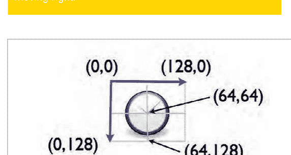


## 创建图像映射（续）

> **交叉参考**

请参阅 tasks_html/task_html_image_map/example_imagemap.html 获取完整示例。

完成此任务并在浏览器中加载结果后，如果您使用的是 Firefox 或 Explorer，首先应注意的是图像周围有一个大的蓝色边框。请记住，一旦您学会了 CSS，移除这个边框就很容易。如果您真的想的话，也可以使用已弃用的 border 属性，尽管我不建议这样做。将光标移动到图像的不同区域，您浏览器的状态栏应显示该热点链接到的 URL。尝试点击不同的热点；您的浏览器应打开一个新窗口或标签页，导航到每个区域对应的链接。

```
<!DOCTYPE html PUBLIC "-//W3C//DTD HTML
4.01 Strict//EN"
"http://www.w3.org/TR/html4/strict.dtd">
<html>
<head>
<meta http-equiv="Content-Type"
content="text/html; charset=UTF-8">
<title>Image Map Example</title>
</head>
<body>
<map name="time">
<area alt="9 o'clock to 12 o'clock"
shape="rect" coords="0,0,64,64"
href="http://uk.yahoo.com"
target="_blank" />
<area alt="9 o'clock to 6 o'clock"
shape="rect" coords="0,64,64,128"
href="http://www.google.com"
target="_blank" />
<area alt="6 o'clock to 3 o'clock"
shape="rect" coords="64,64,128,128"
href="http://www.youtube.com"
target="_blank" />
<area alt="3 o'clock to 12 o'clock"
shape="rect" coords="64,0,128,64"
href="http://www.amazon.co.uk"
target="_blank" />
</map>

</body>
</html>
```

7.  添加图像元素。(29)
8.  在图像标签正上方，输入 `<map></map>` 标签。使用其 name 属性为映射指定一个名称。(11, 28)
9.  添加第一个 `<area></area>` 标签。分配我们在第四步中确定的值。将 alt 属性的值设为 '6 o'clock to 9 o'clock'，坐标属性设为 '0,64,64,128'，href 属性设为 http://uk.yahoo.com，target 属性设为 _blank。(12)
10. 对其他三个区域重复此操作，使用第四步中确定的相应值。为每个区域分配不同的 URL。(16, 20, 24)
11. 返回到第六步添加的图像标签。添加一个 usemap 属性并分配映射的名称，但在前面加上 # 号。(30)
12. 保存您的工作，在浏览器中打开它，并点击所有四个热点以查看结果。

## 创建图像映射（续）

```
<area alt="3 o'clock to 12 o'clock"
shape="rect" coords="64,0,128,64"
href="http://www.metacafe.com"
target="_blank" />
</map>
</body>
</html>
```

> ### 供您参考
热点可以是矩形以外的形状。有效的形状有 point（点）、rectangle（矩形）、circle（圆形）和 polygon（多边形）。圆形在 coord 属性中接受三个值：中心点和半径。多边形可以接受任意数量的点，这些点连接成一个形状。例如，回到时钟，您可以定义一个 (64,64,20) 的圆形。这个区域将创建一个从时钟中心向外延伸 20 像素的圆形热点。

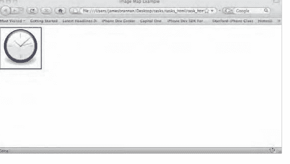

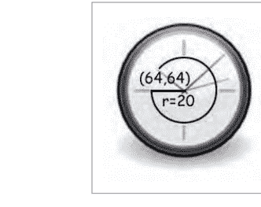

> ### 术语解释
**宽高比** – 图像的比例，表示为宽度除以高度。例如，一个 100 像素 x 100 像素的图像具有 1:1 的宽高比。一个 300 像素 x 100 像素的图像具有 3:1 的宽高比。

# HTML 表格

## 介绍

您使用 HTML 表格在网页上呈现表格数据。您也可以使用表格进行页面布局。表格允许将数据排列成行和列的数据单元格。您几乎可以在表格单元格中放入任何内容，包括图像、段落甚至其他表格。这种灵活性使得表格在页面布局和呈现表格数据方面非常有用。在本章中，您将学习如何在 HTML 文档中添加表格。

> **交叉参考**

第 13 章中的任务“使用表格创建流式布局”涵盖了使用表格进行页面布局。

您使用 `<table></table>` 标签定义表格。`<tr></tr>` 标签将表格划分为行。`<td></td>` 标签进一步将行划分为数据单元格。每一行和每一列也可以有一个标题单元格。标题单元格使用 `<th></th>` 标签。您还可以使用 `<thead></thead>`、`<tfoot></tfoot>` 和 `<tbody></tbody>` 标签将表格分为页眉、页脚和主体。并且您可以使用 `<caption></caption>` 标签为表格指定标题。

### 您将做什么

-   创建表格行和数据单元格
-   为表格单元格添加内边距和间距
-   为表格添加标题行
-   为表格添加标题
-   为表格添加边框属性
-   指定列跨和行跨
-   指定表格的页眉、主体和页脚
-   使用规则添加表格分割线

| 标签 | 功能 |
| :--- | :--- |
| `<table></table>` | 指定一个表格。 |
| `<tr></tr>` | 指定一个表格行。 |
| `<td></td>` | 指定表格数据单元格。 |
| `<th></th>` | 指定表格标题单元格。 |
| `<thead></thead>` | 指定表格标题行。 |
| `<tfoot></tfoot>` | 指定表格页脚行。 |
| `<tbody></tbody>` | 指定表格主体行。 |
| `<caption></caption>` | 指定表格标题。 |

table 元素有几个重要属性。border、cellpadding、cellspacing、frame、rules 和 width 属性都可用于格式化浏览器显示表格的方式。在本章中，您将学习如何使用这些属性。

> **供您参考**

表格也有 align 和 bgcolour 属性，但它们已被弃用，本章不会使用。

| 属性 | 功能 |
| :--- | :--- |
| `<table border="n"`... | 指定表格边框的厚度（以像素为单位）。 |
| `<table cellpadding="n"`... | 指定表格单元格的内边距。 |
| `<table cellspacing="n"` | 指定单元格之间的间距。 |
| `<table frame="value"` | 指定在表格周围放置线条的位置。有效值为：void、above、below、hsides、lhs、rhs、vsides、box 和 border。 |
| `<table rules="value"` | 指定在表格中放置分割线的位置。有效值为：none、groups、rows、cols 和 all。 |
| `<table width="n" ... or width="n%"` | 指定表格宽度，以像素（绝对值）或百分比表示。 |

表格由行组成。每一行有一个或多个数据单元格。`<tr></tr>` 标签指定表格中的一行。表格行有一个 align 属性。该属性指定行中数据单元格内元素的对齐方式。有效的 align 值包括：right、left、center、justify 和 char。表格行还有一个 valign 属性，指定行中数据单元格内元素的垂直对齐方式。有效的 valign 值包括 top、middle 和 bottom。

## 创建表格行和数据单元格

```
<tr align="center" valign="top"/>
```

## 任务步骤

表格行由一个或多个数据单元格组成。`<td></td>` 标签指定行中的一个数据单元格。与行一样，数据单元格也有一个 align 属性。因此，您可以指定表格行中的对齐方式以一次性对齐所有单元格，也可以在每个单元格中使用 align 属性。单元格的 align 属性会覆盖该单元格所属表格行的 align 属性。您还可以指定 valign 属性来覆盖表格行的 valign 属性。

1.  用新名称保存模板。
2.  添加一个带有一像素边框的表格元素。(8)
3.  添加四组 `<tr></tr>` 标签。(9, 12, 17, 20)
4.  在每个行元素中，添加三组 `<td></td>`。(9, 24)
5.  使第一个表格行居中对齐。(9)
6.  在第一行的三个数据单元格中添加数据。(9–11)
7.  在第二行的第一个数据单元格中，添加数据，后跟一个 `<br/>` 标签，再跟更多数据，然后是另一个 `<br/>` 标签，最后是更多数据。(12, 13)
8.  使第二个数据单元格垂直顶部对齐，第三个单元格垂直底部对齐。向单元格中添加一些数据。(14, 15)
9.  在第三行中，使第一个单元格右对齐。向单元格中添加一些数据。(17)
10. 为第二个单元格分配居中对齐并添加数据。(18)

| 标签 | 功能 |
| :--- | :--- |
| `<tr></tr>` | 指定表格中的一行。 |
| `<td></td>` | 指定表格中的数据单元格。 |


> **交叉参考**
请参阅 **tasks_html/task_html_table_cells/tablerow_cellsimple.html** 获取完整示例。


## 创建表格行和数据单元格（续）

你应该注意到不同单元格的数据定位方式不同。你添加了`<br/>`标签和额外的数据，使单元格的大小各不相同。想一想，如果单元格的宽度和高度相同，无论你如何对齐它们，在浏览器中的外观都会一样。因此，你使单元格的大小不同，以便观察改变对齐方式和垂直对齐方式的结果。

1. 将第三个单元格设置为左对齐，并添加数据。
2. 将第四行的第一个单元格设置为右对齐。
3. 在第四行第一个单元格中，添加一些数据，后跟一个`<br/>`标签，然后再添加一些数据。
4. 在第二个单元格中，将其设置为居中对齐和底部垂直对齐。添加一些数据。
5. 将第三个单元格设置为左对齐和顶部垂直对齐，并添加一些数据。
6. 保存并在浏览器中显示。

```
<!DOCTYPE HTML PUBLIC "-//W3C//DTD HTML
4.01 Transitional//EN"
"http://www.w3.org/TR/html4/loose.dtd">
<html>
<body>

<h4>计算成本</h4>
<table border="1">
<tr align="center"><td>&pound;33</td><td>
<td>&pound;200</td><td>
<td>&pound;300</td></tr></td>
<tr><td>&pound;400
<br/><br/></td><td>
<td valign="top">&pound;500 xxxxx</td><td>
<td valign="bottom">&pound;600 xxxxx
</td></tr></td>
<tr><td align="right">&pound;300</td><td>
<td align="center">&pound;22</td><td>
<td align="left">&pound;100</td></tr></td>
<tr><td align="right">&pound;300<br/>
xxxxxxx</td><td>
<td align="center" valign="bottom">
&pound;22</td><td>
<td align="left" valign="top">&pound;
100</td></tr></td>
</table>
</body>
</html>
```

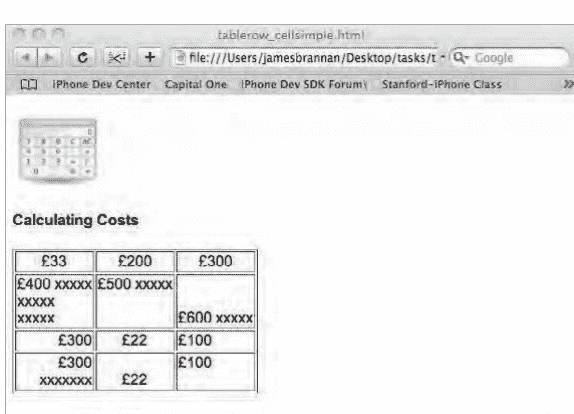

计算成本

| £33 | £200 | £300 |
|---|---|---|
| £400 xxxxx xxxxx xxxxx | £500 xxxxx | £600 xxxxx |
| £300 | £22 | £100 |
| £300 xxxxxxx | £22 | £100 |

HTML表格 77

## 为表格单元格添加内边距和间距

在上一个任务中，你为单元格分配了不同的对齐方式。你还可以指定单元格的间距和内边距。内边距是单元格内容与单元格边框之间的空间。间距是相邻单元格边框之间的空间。单元格内边距和间距可以设置为像素值或百分比。

```html
<table cellpadding="5" cellspacing="10%" />
```

## 任务步骤

百分比是间距或内边距占表格总高度或总宽度的百分比。与对齐方式不同，`cellpadding`和`cellspacing`是在`<table>`标签中设置的，只能应用于整个表格。当使用`cellpadding`和`cellspacing` HTML属性时，单个单元格不能具有不同的内边距和间距。

1. 打开模板并另存为一个不同的名称。
2. 创建三个简单的表格，每个表格有两行两列。
3. 将第二个表格的`cellpadding`设置为10。
4. 将第三个表格的`cellspacing`设置为10。
5. 保存并在浏览器中查看。

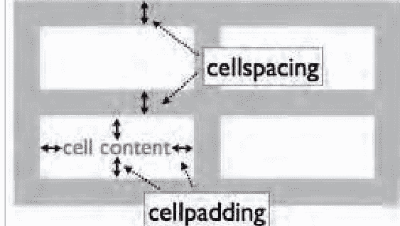

## 交叉引用

参见**tasks_html/task_html_table_various/task_html_padding_spacing.html**获取完成的示例。

### 表 5.4 cellpadding 和 cellspacing 属性

| 表格属性，cellpadding 和 cellspacing。 | |
| :--- | :--- |
| cellpadding="n"（像素）或 "n%"（百分比） | 指定单元格内容与单元格边框之间的像素空间。 |
| cellspacing="n"（像素）或 "n%"（百分比） | 指定单元格之间的像素空间。 |

## 为表格单元格添加内边距和间距（续）

完成任务并在浏览器中打开后，你应该看到第一个表格是紧凑的，没有间距或内边距。第二个表格的文本与单元格边框之间应该有大约10像素的空白。第三个表格的每个表格数据单元格边框之间应该有10像素的空间。

```html
<!DOCTYPE HTML PUBLIC "-//W3C//DTD HTML
4.01 Transitional//EN"
"http://www.w3.org/TR/html4/loose.dtd">
<html>
<body>
<table border="1"><tr><td>&pound;233
</td><td>&pound;354</td></tr>
<tr><td>&pound;343</td><td>&pound;443
</td></tr>
</table>
<br>
<table border="1" cellpadding="10">
<tr><td>&pound;151</td><td>&pound;
315</td></tr>
<tr><td>&pound;665</td><td>&pound;
867</td></tr>
</table>
<br>
<table border="1" cellspacing="10">
<tr><td>&pound;151</td><td>&pound;
315</td></tr>
<tr><td>&pound;665</td><td>&pound;
867</td></tr>
</table>
</body>
</html>
```

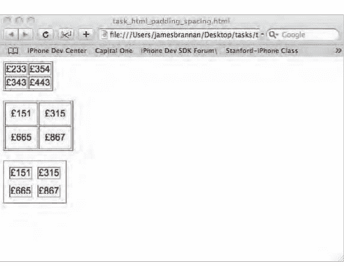

你可以使用`<th></th>`标签为行和列分配标题。表格标题中的文本通常是加粗的。要为表格的列指定标题，请将第一行的表格数据单元格替换为表格标题单元格。

```html
<tr><th>标题一</th><th>标题
    二</th></tr>
<tr><td>值一</td><td>值
    二</td></tr>
```

要为特定行指定标题，请将第一个表格数据单元格替换为表格标题单元格。

```html
<tr><th>标题</th><td>值</td></tr>
```

你可以使用`align`和`valign`属性设置表格标题的对齐方式和垂直对齐方式，与数据单元格相同。

**表 5.5 本任务涉及的标签**

| 标签 | 功能 |
|---|---|
| `<th></th>` | 指定表格中的标题单元格。 |

> **交叉引用**
参见**tasks_html/task_html_table_headings/tableheadings.html**获取完成的示例。

完成此任务并在浏览器中查看后，你应该看到一行包含加粗文本。此行是表格的列标题。你还应该在第一列看到一列加粗文本。此列是表格的行标题。

## 为表格添加标题

## 任务步骤

1. 打开模板并另存为一个不同的名称。
2. 创建一个三行三列的表格。在每个单元格中输入一些数据。
3. 在表格顶部插入一个表格行，总共四行。
4. 在顶部行中添加四个`<th></th>`标签，并为每个标签添加标题文本。
5. 在剩余的三行中，在每行的`<td></td>`标签之前，添加一组`<th></th>`标签。为每个行标题输入一个合适的标题。
6. 保存并在浏览器中查看。

## 为表格添加标题（续）

```html
<!DOCTYPE HTML PUBLIC "-//W3C//DTD HTML
4.01 Transitional//EN"
"http://www.w3.org/TR/html4/loose.dtd">
<html>
<body>
<h2>计算
成本</h2>
<table border="1">
<tr><th>&nbsp;</th><th>运费</th><th>处理费</th>
<th>营销成本</th></tr>
<tr><th>2005</th><td>&pound;33</td><td>&pound;200</td>
<td>&pound;300</td></tr>
<tr><th>2006</th><td>&pound;400</td><td>
&pound;500</td>
<td>&pound;600</td></tr>
<tr><th>2007</th><td>&nbsp;</td>
<td>&pound;22</td><td>&pound;100</td>
</tr>
</table>
</body>
</html>
```

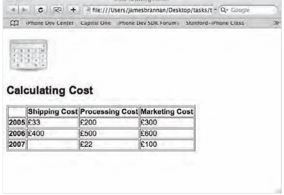

表格顶部可以有一个标题。通过将`<caption></caption>`标签放在`<table>`标签之后，可以为表格添加标题。

```html
<table><caption>这是我的
表格。</caption> ... </table>
```

每个表格应该只有一个标题，并且**`<caption>`**标签必须紧接在**`<table>`**标签之后。然后标题会居中显示在表格正上方。

### 表 5.6 本任务涉及的标签

| 标签 | 功能 |
| --- | --- |
| `<caption></caption>` | 为表格指定标题。 |

> **交叉引用**
参见**tasks_html/task_html_table_caption/tablecaption.html**获取完成的示例。

完成此任务后，你应该看到你在表格标题中输入的文本居中显示，就在表格正上方。注意，在示例中，我添加了`<sup></sup>`标签来添加脚注。为标题添加格式是合法的，尽管最好等到你学习了CSS并使用它来进行格式化。

```html
<!DOCTYPE HTML PUBLIC "-//W3C//DTD HTML
4.01 Transitional//EN"
"http://www.w3.org/TR/html4/loose.dtd">
<html>
<body>
<h2>计算
成本</h2>
<table border="1">
<caption><b>销售书籍的成本<sup>*</sup></b></caption>
```

## 为表格添加标题

## 任务步骤

1. 将上一个任务的页面以新名称保存。
2. 在开场**`<table>`**标签下方，但在第一个**`<tr>`**标签上方，添加**`<caption></caption>`**开始和结束标签。
3. 在标签之间输入一个合适的表格标题。
4. 保存并在浏览器中显示。


## 为表格添加标题（续）

```
11 <tr><th>&nbsp;</th><th>运输
12 成本</th><th>处理成本</th>
13 <th>营销成本</th></tr>
14 <tr><th>2005</th><td>&pound;33</td><td>&
pound;200</td>
16 <td>&pound;300</td></tr>
17 <tr><th>2006</th><td>&pound;400</td><td>
18 &pound;500</td>
19 <td>&pound;600</td></tr><tr><th>2007
20 </th><td>&nbsp;</td>
21 <td>&pound;22</td><td>&pound;100</td>
22 </tr>
23 </table>
24 <sup>*</sup><i>成本不包括
退货。</i>
25 </body>
26 </html>
```

在HTML的早期，表格唯一的格式是其边框。你无法指定只显示右侧边框或顶部边框。现在，可以使用 `frame` 属性来实现。`frame` 属性需与表格的 `border` 属性结合使用。它指示浏览器哪些外边框应该可见。

### 表 5.7 frame 属性值

| 属性 | 描述 |
| :--- | :--- |
| `<table frame="value"...` | 指定边框属性。 |
| `frame="void"` | 指定无边框。 |
| `frame="above"` | 仅指定表格上方显示边框线。 |
| `frame="below"` | 仅指定表格下方显示边框线。 |
| `frame="hsides"` | 指定表格上方和下方显示边框线。 |
| `frame="vsides"` | 指定表格垂直两侧显示边框线。 |
| `frame="lhs"` | 指定表格左侧显示边框线。 |
| `frame="rhs"` | 指定表格右侧显示边框线。 |
| `frame="box"` | 指定所有边框线。 |
| `frame="border"` | 指定所有边框线。 |

`frame` 属性的可能值有：`border`, `box`, `void`, `above`, `below`, `lhs`, `rhs`, `hsides` 和 `vsides`。`border` 和 `box` 会在表格周围绘制四条线，而 `void` 指定不绘制外边框。例如，如果你将 `border` 设置为一，将 `frame` 设置为 `void`，那么分隔单元格列和行的线会出现，但不会渲染外边框。`above` 在表格上方放置一条线，而 `below` 在表格下方放置一条线。`lhs` 值在表格左侧放置一条垂直线，而 `rhs` 在表格右侧放置一条垂直线。`hsides` 值在表格上方和下方放置水平线。`vsides` 值在表格的左右两侧放置垂直线。

> ### 交叉引用
请参阅 `tasks_html/task_html_table_various/task_html_frames.html` 以获取完成后的示例。

## 为表格添加 frame 属性

> ### 重要提示
使用 `frame` 属性时，切勿将表格的 `border` 属性赋值为零。如果这样做，`frame` 属性将无效。如果你不想要表格单元格边框，只需省略 `border` 属性即可。

为表格添加 frame 属性（续）

此任务的结果很直接。每次你保存并查看页面时，都应该看到不同的边框。请注意，在完成的示例中，每个 `frame` 属性值都包含一个单独的表格。为简洁起见，此处未显示所有九个表格的 HTML 代码。

## 任务步骤

- 1. 打开模板并以新名称保存。
- 2. 创建一个简单的表格，包含两行，每行两个单元格。为两个单元格添加数据。（8）
- 3. 在表格的起始标签中，添加 `frame` 属性并将其值设置为 `border`。（8）
- 4. 保存并在浏览器中查看。
- 5. 将 `border` 改为 `box`，保存并在浏览器中查看。
- 6. 对 `above`, `below`, `hsides`, `vsides`, `lhs` 和 `rhs` 值重复步骤五。
- 7. 为表格添加 `border` 属性，将其值设为一，然后将 `frame` 属性设置为 `void`。
- 8. 保存并在浏览器中查看。

```
1 <!DOCTYPE HTML PUBLIC "-//W3C//DTD HTML
2 4.01 Transitional//EN"
3 "http://www.w3.org/TR/html4/loose.dtd">
4 <html>
5 <head><title>The Frame Attribute for
6 Tables</title></head>
7 <body>
8 <table frame="border">
9 <caption>Border</caption>
10 <tr><td>&pound;300</td><td>&pound;
11 200</td></tr>
12 <tr><td>&pound;50</td> <td>&pound;
13 30</td>
14 </tr>
15 </table>
16 <br>
17 </body>
18 </html>
```

## 表格的 frame 属性

| 边框 (Border) |
|--------|
| £300 £200 |
| £50 £30 |

| 方框 (Box) |
|-----|
| £300 £200 |
| £50 £30 |

| 上方 (Above) |
|-------|
| £300 £200 |
| £50 £30 |

| 下方 (Below) |
|-------|
| £300 £200 |
| £50 £30 |

| 水平边 (Horizontal Sides) |
|------------------|
| £300 £200 |
| £50 £30 |

| 垂直边 (Vertical Sides) |
|----------------|
| £300 £200 |
| £50 £30 |

| 左侧 (Left Hand Sides) |
|-----------------|
| £300 £200 |
| £50 £30 |

| 右侧 (Right Hand Sides) |
|------------------|
| £300 £200 |
| £50 £30 |

| 无 (Void) |
|------|
| £300 £200 |
| £50 £30 |

为表格添加 frame 属性（续）

HTML 表格 87

## 指定跨列和跨行

表格单元格可以跨越多个列和/或多个行。`colspan` 属性告诉浏览器一个数据单元格应该占用多少列，而 `rowspan` 属性指定占用多少行。如果你想要创建视觉上吸引人的表格，这两个属性很重要。

| 跨2列 | | |
|---|---|---|
| 跨3行 | 跨2列，跨2行 | |
| | | |
| | | |

## 任务步骤

- 1. 以新名称保存模板。
- 2. 添加一个包含四行的表格。（6）
- 3. 在第一行，添加一个 `rowspan` 为二的表头。（10）
- 4. 在第一行添加另一个表头，但其 `colspan` 为二。（11）
- 5. 在第二行添加两个表头。（14）
- 6. 添加两个更多的表格行。在第一行添加三个单元格，在最后一行添加一个单元格。（15）
- 7. 使最后一行的单元格 `colspan` 为三。（17）
- 8. 保存并在浏览器中查看。

## 交叉引用

请参阅 `tasks_html/task_html_table_various/task_html_colspan_rowspan.html` 以获取完成后的示例。

完成任务后，第一列应为空并占用两行。第一行的第二列应占用两列——它是下一行列标题的列标题。请注意，当你指定 `colspan` 大于一时，必须为行中跨越的每一列省略一个 `<td></td>`。当跨行时，你必须为被跨越的每一行省略一个 `<td></td>`。

```
1 <!DOCTYPE HTML PUBLIC "-//W3C//DTD HTML
2 4.01 Transitional//EN"
3 "http://www.w3.org/TR/html4/loose.dtd">
4 <html>
5 <body>
6 <table frame="box" rules="all" width=
7 "75%">
```

指定跨列和跨行（续）

```
8 <caption>Cost of doing business.
9 </caption>
10 <tr><th rowspan="2">&nbsp;</th><th
11 colspan="2">Costs</th></tr>
12 <tr><!-- note omitted th here because
13 prev. row is rowspan=2 -->
14 <th>USA</th><th>UK</th></tr>
15 <tr><td>Material</td><td>&pound;455</td>
16 <td>&pound;987</td></tr>
17 <tr><td colspan="3">Total&nbsp;=&nbsp;
18 &pound;1442</td></tr>
19 </table>
20 </body>
21 </html>
```

## 指定表格的表头、主体和表尾

你可以使用 **\<thead\>\</thead\>** 标签、**\<tbody\>\</tbody\>** 标签和 **\<tfoot\>\</tfoot\>** 标签来指定表格的表头、主体和表尾。这三个标签的含义正如你可能想到的：**\<thead\>\</thead\>** 指定表头，**\<tbody\>\</tbody\>** 指定表格的主体，**\<tfoot\>\</tfoot\>** 指定表格的表尾。

## 任务步骤

| 标签 | 功能 |
| :--- | :--- |
| \<thead\>\</thead\> | 指定表头。 |
| \<tbody\>\</tbody\> | 指定表格主体。 |
| \<tfoot\>\</tfoot\> | 指定表格表尾。 |

**表 5.8 本任务涵盖的表格相关标签**

- 1. 打开之前的某个表格或创建一个新表格。
- 2. 在起始 **\<table\>** 标签和表格的第一个 **\<tr\>** 标签之间，添加 **\<tfoot\>\</tfoot\>** 标签。*(14)*
- 3. 在表格表尾中，添加一个表格行。在该行中添加一个 `colspan` 为三的单元格。为该单元格添加一些文本。*(14)*
- 4. 在表格表尾之后添加 **\<thead\>\</thead\>** 标签。添加一个表格行并插入一个 `colspan` 为三的表格数据单元格。*(20)*
- 5. 保存并在浏览器中显示。

> **交叉引用**

请参阅 **tasks_html/task_html_table_various/task_html_grouping.html** 以获取完成后的示例。

```
1 <!DOCTYPE HTML PUBLIC "-//W3C//DTD HTML
2 4.01 Transitional//EN"
3 "http://www.w3.org/TR/html4/loose.dtd">
4 <html><head><title>Tables: Footers,
5 Table Body, and Column
6 Groups</title></head>
7 <body>
8 <p>Sorry I'm so ugly, but the author
9 doesn't want to waste your time by
10 showing you deprecated HTML formatting
11 tags when you can use CSS.</p>
12 <table rules="cols" frame="border"
13 width="50%">
14 <tfoot><tr><td colspan="3"><small>
15 Illustrating a table
16 footer.</small></td></tr></tfoot>
17 <caption>Column Rules, Footer, Body, and
18 Column Grouping</caption>
```

## 使用 rules 为表格添加分隔线

通常你可能希望仅在部分表格行或列之间显示边框。HTML 表格有一个 `rules` 属性，正好可以实现这一功能。如果只想在行之间显示线条，你需要将 `rows` 值赋给 `rules` 属性。如果只想在列之间显示线条，则赋值 `cols`。如果不想要任何线条，则指定 `none` 作为值。如果想要列和行之间都有线条，则为 `rules` 属性指定 `all`。你还可以通过将 `rules` 赋值为 `groups` 来指定分隔表格主要分组（`thead`、`tfoot` 和 `tbody` 元素）的线条。

## 任务步骤

- 1. 打开上一任务中的 HTML 文档，另存为不同的文件名。
- 2. 在表格的开始标签中，添加 `rules` 属性并将其值设为 `cols`。(6)
- 3. 保存并在浏览器中查看。
- 4. 根据需要，将值分别更改为 `all`、`rows` 和 `none` 重复操作。
- 5. 查看过 `rows`、`cols` 和 `none` 的值后，在表格第一行上方添加一个新行，并在最后添加一个新行。
- 6. 在第一行中添加三个 `<th></th>` 标签并填入一些数据。(20)
- 7. 在最后一行中添加一组 `<td></td>` 标签，并将其 `colspan` 设为三。(33)
- 8. 用 `<thead></thead>` 标签包裹第一行。(19)
- 9. 用 `<tfoot></tfoot>` 标签包裹最后一行。(32)
- 10. 用 `<tbody></tbody>` 标签包裹其余各行。(24)

| 表 5.9 表格 rules 属性 |
| :--- |
| **`<table rules="value"...`** |
| rules="none" | 指定不使用分隔线。 |
| rules="groups" | 仅指定在 `</thead>`、`</tbody>`、`</tfoot>` 标签之间添加分隔线。 |
| rules="rows" | 指定在所有行之间使用分隔线。 |
| rules="cols" | 指定在所有列之间使用分隔线。 |
| rules="both" | 指定在列和行之间都使用分隔线。 |

## 交叉引用

完成示例请参见 **tasks.html/task_html_table_various/task_html_rules.html**。

在完成本任务的第一部分时，你将 `cols` 指定为 `rules` 属性的值，应该只看到列之间的线条。然后，当你指定 `rows` 时，应该看到行之间的线条。当你指定 `none` 时，应该看不到任何分隔线；当你指定 `all` 时，应该看到列和行之间都有分隔线。在最后的任务步骤中，你应该看到分隔表格的表头、表体和表尾的分隔线。

```html
<!DOCTYPE HTML PUBLIC "-//W3C//DTD HTML
4.01 Transitional//EN"
"http://www.w3.org/TR/html4/loose.dtd">
<html>
<body>
<table rules="cols" frame="border">
<caption>Column Rules</caption>
<tr><td>£300</td><td>£200</td><td>£200</td></tr>
<tr><td>£50</td><td>£30</td><td>£200</td></tr>
<tr><td>£300</td><td>£200</td><td>£200</td></tr>
</table>
<br>
---snip---
<table rules="groups" frame="border">
<caption>Groups</caption>
<thead>
<tr><td>Heading One</td><td>Heading Two</td><td>Heading Three</td></tr>
</thead>
<tbody>
<tr><td>£300</td><td>£200</td><td>£200</td></tr>
<tr><td>£50</td><td>£30</td><td>£200</td></tr>
<tr><td>£300</td><td>£200</td><td>£200</td></tr>
</tbody>
<tfoot>
<tr><td colspan="3">This is a footer.</td></tr>
</tfoot>
</table>
</body>
</html>
```

## 使用 rules 为表格添加分隔线（续）

- 11. 将 `rules` 属性的值更改为 `groups`。(17)
- 12. 保存并在浏览器中查看。

> **术语解释**
> **表格数据（Tabular data）** – 通常可以以电子表格形式表示的数据。

# HTML 表单

## 6

## 简介

### 你将要做什么

- **构建一个简单表单**
- **添加复选框**
- **添加单选按钮**
- **添加文件字段**
- **添加文本区域**
- **添加 select 元素（列表和菜单）**
- **添加 fieldset 和 legend**

表单用于从 HTML 页面中捕获用户输入。表单由复选框、单选按钮、菜单、文本框、文本区域和按钮组成。如果你曾在互联网上提交过信息，那么表单对你来说应该不陌生。首先，你需要填写表单的各个字段。填写完成后，点击提交按钮即可提交表单。然后，浏览器会将表单数据以名称/值对的形式发送到远程服务器。服务器接收表单数据，进行处理，并可选择性地返回结果。

`<form></form>` 标签用于定义表单。`<form>` 开始标签包含一个 `action` 属性。在 `action` 属性中，你需要放置处理表单的服务器脚本的 URL。服务器脚本是专门用于处理提交的表单数据的计算机程序。常见的服务器脚本语言包括 Java、PHP、ASP、.NET、C 和 Perl。服务器端的表单处理超出了本书的范围；不过，关于服务器端表单处理，网上和出版物中都有大量资源。

```html
<form name="myform" method="post"
      action="./mypath/my_script.php">
```

`<form>` 标签还包含 `name` 和 `method` 属性。`method` 属性指定表单是使用 Post 还是 Get 协议发送。与表单处理一样，对 Post 和 Get 协议的完整解释也超出了本书的范围。只需知道 Post 协议会将表单数据放入所谓的 HTTP 头中并将其发送到服务器。

```
POST ./mypath/my_script.php HTTP/1.0
Accept: www/source
Accept: text/html
---snip---
Content-type: application/x-www-form-urlencoded
field1=value1
&field2=value2
```

Get 协议则将表单数据直接放在 URL 中并提交到服务器。

```
./mypath/my_script.php?field1=value1&field2=value2
```

你需要将各种数据输入字段放在 `<form>` 和 `</form>` 标签之间。元素包括 input 元素、label、textarea 元素和 select 元素。Input 元素的类型可以是 checkbox、file、text、password、submit 或 reset。

```html
<input type="text" name="myTextBox" />
```

你使用 `<form></form>` 标签将表单添加到 HTML 页面中。两种常见的表单字段是文本字段和密码字段。这两种表单字段都是 input 元素，其中文本字段的 type 为 text，密码字段的 type 为 password。密码字段在你输入时会将字符遮盖，这样在你输入时别人就无法看到你的密码。你可以使用 `size` 属性指定任一字段的宽度，也可以通过指定 `value` 属性用默认值预填充任一字段。

```html
<input type="password" name="passOne"
size="20" value="Default Value"/>
```

你可以使用 `<label></label>` 标签为任何表单字段添加标签。你通过 `for` 属性将标签与其字段关联起来。

```html
<label for="textOne">TextOne:&nbsp;</label><input type="text"
name="textOne"/>
```

大多数表单都有提交按钮和重置按钮。提交按钮用于提交表单。重置/取消按钮将所有表单字段重置为空白或其默认值。提交按钮是 type 为 submit 的 input 元素。重置按钮是 type 为 reset 的 input 元素。你使用 `name` 属性为两个按钮分配各自的文本标签。

```html
<input type="submit" name="Submit"/>
<input type="reset" name="Cancel"/>
```

## 构建简单表单

## 任务步骤

- 1. 打开模板文件并另存为不同的文件名。
- 2. 添加一个 form 元素。(12)
- 3. 将 form 元素的 method 设为 post，action 设为 mailto: 协议。(12, 13)
- 4. 创建一个 input 元素，将其 type 设为 text。为该元素创建一个 label。
- 5. 创建另一个 input 元素，将其 type 设为 text。为其分配一个 label。(16, 17)
- 6. 创建一个 type 为 submit 的 input 和一个 type 为 reset 的 input。分别将 submit 和 cancel 作为这两个按钮的值。(24, 25)
- 7. 保存并在浏览器中显示。
- 8. 填写表单并点击提交。

## 交叉引用

完成示例请参见 **tasks_html_form_w_inputs/simple_form.html**。


## 构建一个简单的表单（续）

**表6.1 本任务中指定的表单元素**

| 标签 | 功能 |
|---|---|
| `<form></form>` | 指定一个用于用户数据输入的表单。 |
| `<input type="text" ...` | 指定一个文本框。 |
| `<input type="password" ...` | 指定一个输入文本被隐藏的文本框。 |
| `<input type="submit" ...` | 指定一个提交按钮。 |
| `<input type="reset" ...` | 指定一个取消/重置按钮。 |

> **供你参考**

在本任务及后续几个任务中，你将使用 `mailto:` 协议。这并非通常的做法。使用此协议时，当你点击提交按钮，发生的仅仅是你的默认邮件客户端会打开，并为你预填好一封待发送的邮件。表单的字段和值会以“名称/值”对的形式列在邮件正文中。这不是提交表单数据的理想方式，除非你打算手动处理所有表单提交。我在这里使用 `mailto:` 协议，是为了让你无需将表单提交到服务器，就能以“名称/值”对的形式看到你的表单提交。不要认为它在此处被广泛使用就意味着在现实世界中也很常见。

完成练习并在浏览器中加载它，然后点击提交，你的电子邮件程序应该会打开，并在邮件正文中显示表单数据。每个字段的名称和值会各自独占一行。请注意，你可以像在第三章的电子邮件超链接任务中（参见第55-57页）那样，设置主题和收件人。

```
<!DOCTYPE HTML PUBLIC "-//W3C//DTD HTML 4.01 Transitional//EN" "http://www.w3.org/TR/html4/loose.dtd">
<html>
<body>

<h2>Welcome to the Lonely-Hearts Dating Site.</h2>
<p>Please fill out contact information so a representative can contact you.</p>
<form method="post" action="mailto:jamesbrannan@earthlink.net?subject=Interest%20In%20Site" enctype="text/plain">
<label for="name">Name:</label>
<input type="text" name="name" size="20" />
<br/>
<label for="phone">Phone Number:</label>
<input type="text" name="phone" size="20" />
<br/>
<input type="submit" value="Submit" />
<input type="reset" value="Cancel"/>
</form>
</body>
</html>
```

## 构建一个简单的表单（续）

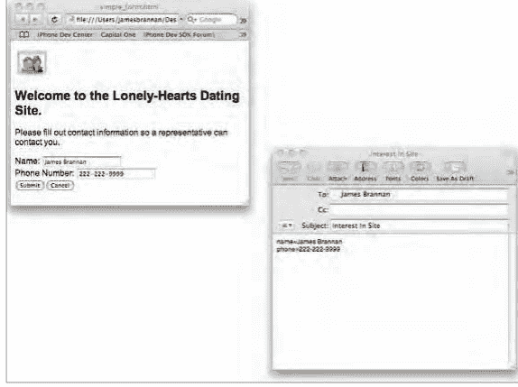

> **供你参考**

1995年，我曾为一家处理大量数据的公司工作。当时我们正试图说服公司的数据录入人员从基于DOS的应用程序切换到基于Web的应用程序。我们创建了HTML表单来替代DOS表单，但我们没有考虑表单的制表键（Tab键）顺序。碰巧的是，他们非常依赖制表键在表单字段之间移动。因此，在使用我们的表单时，用户遇到了问题，因为表单中的字段顺序不符合标准，所以点击制表键会将他们带到意想不到的字段。在我们明确指定制表顺序之前，输入速度和准确性都受到了影响。

## 构建一个简单的表单（续）

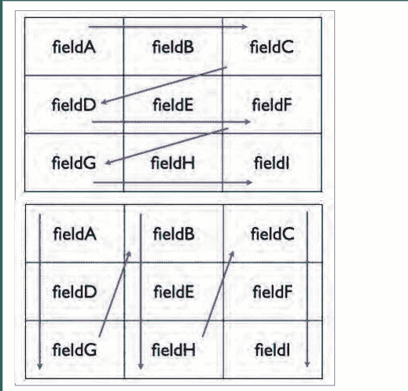

默认的制表顺序是元素在表单中出现的顺序。然而，在某些情况下，你可能需要更改制表顺序。你可以使用 `tabindex` 属性来指定制表顺序。你可以将 `tabindex` 属性与 `<input>`、`<a>`、`<textarea>`、`<select>` 和 `<button>` 标签一起使用；如果你希望某个元素不参与制表索引，则将该元素的 `tabindex` 值设置为零。

```
<form>
 First Field:<input type="text" name="field1" tabindex="1" />
 Second Field:<input type="text" name="field2" tabindex="3" />
 Third Field:<input type="text" name="field3" tabindex="2" />
</form>
```

复选框用于两种情况。当向用户提供“是”或“否”类型的问题时，复选框是最合适的字段元素。

```
<input type="checkbox" name="mailinglist" value="true"/>
```

当向用户提供一个选择，允许他们从多个选项中选择一个或多个时，复选框通常是合适的（你也可以使用 `select` 元素）。例如，你可能会询问用户喜欢什么口味的冰淇淋，给他们提供选项：巧克力、香草和草莓。他们可能一个都不选，只选巧克力，或者选择三种口味的任意组合。

```
<input type="checkbox" name="flavours" value="chocolate"/>
<input type="checkbox" name="flavours" value="vanilla"/>
<input type="checkbox" name="flavours" value="strawberry"/>
```

假设你选择了香草和巧克力。那么香草和巧克力的复选框会被提交。其他的复选框则不会。

复选框是开启或关闭的状态。当被选中时，复选框是开启的，在提交时会有一个值。当未被选中时，复选框是关闭的，在提交时不会作为表单提交的一部分发送。换句话说，当未被选中时，该复选框不会被发送到服务器。当你决定学习如何使用编程语言处理表单时，这一点很重要。如果你试图处理一个不存在的复选框，最终会遇到空指针异常。你现在不需要担心这个，只需记住这一点以备将来参考。

## 添加复选框

## 添加复选框（续）

**表6.2 本任务中指定的表单元素**

| 标签 | 功能 |
|---|---|
| `<input type="checkbox" ...` | 指定一个复选框。 |

你通过使用 `input` 元素并将其 `type` 设置为“checkbox”来创建复选框。你通过设置其 `value` 属性来为其赋值。当被选中时，复选框的值就是该属性中的值。例如：

## 任务步骤

1.  将模板另存为一个不同的名称。
2.  创建一个表单，并添加三个类型为 `checkbox` 的输入元素。为这三个元素分配相同的名称，但不同的值。(13, 16, 11)
3.  选择一个输入元素，并使其处于选中状态。(14)
4.  再创建两个类型为 `checkbox` 的输入元素。为它们分配相同的名称，但与前三个复选框的名称不同。(19, 22)
5.  添加一个提交按钮。(25)
6.  确保表单的 `action` 是 `mailto:` 协议。(7)
7.  保存并在浏览器中查看。选中另一个复选框——这样总共选中两个——然后点击提交。注意不要选中第二组复选框中的任何一个。

```
<input type="checkbox" name="signup" value="yes"/>
```

当提交时，会作为“名称/值”对

```
signup=yes
```

发送到服务器。你可以通过指定 `checked` 属性等于 `checked` 来指定复选框默认为选中状态。

```
<input type="checkbox" name="signup" value="yes" checked="checked"/>
```

> 参见 **tasks_html/task_form_checkbox/checkbox.html** 获取完整示例。

完成此任务并将结果加载到浏览器后，你应该能看到一个带有三个复选框的简单表单。中间的复选框应该是选中的。点击提交后，你的电子邮件浏览器应该会出现一个预填好的表单。这封邮件说明了一个要点：未选中的复选框在提交到服务器时是不存在的。第二组复选框没有值（假设你按照说明操作，没有选中任何一个）。第一组复选框有两个值，一个来自默认选中的框，一个来自你选中的框（同样，假设你按照说明操作）。

102

```
<!DOCTYPE HTML PUBLIC "-//W3C//DTD HTML 4.01 Transitional//EN" "http://www.w3.org/TR/html4/loose.dtd">
<html>
<body>
<form name="input" action="mailto:james@earthlink.net?subject=checkbox%20example" method="post">

<h2>Acceptable Dating Age Ranges</h2>
<br/>18-30:<input type="checkbox" name="age" value="18" />
<br />31-60:<input type="checkbox" name="age" value="31" checked="checked" />
<br />&nbsp;&nbsp;&nbsp;&nbsp;60+:<input type="checkbox" name="age" value="60" />
<br /><br />
<h2>Acceptable Weight Ranges</h2>
100 lb or less: <input type="checkbox" name="weight" value="100"/>
<br/>
101 lb or more:<input type="checkbox" name="weight" value="101"/>
<br/><br/>
<input type="submit" value="Submit" />
</form>
</body>
</html>
```

## 添加复选框（续）

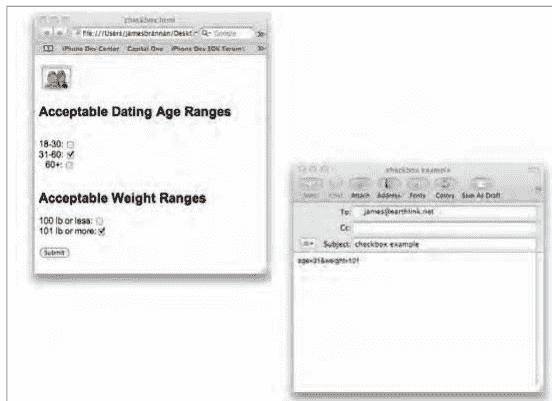


## 添加单选按钮

单选按钮是一种类型为radio的输入元素。你使用单选按钮从一组相关选项中选择一个值。例如，你可能会被要求从香草、巧克力和草莓中选择你最喜欢的冰淇淋口味。然而，与复选框不同，单选按钮只允许你从三个选项中选择一个。

## 任务步骤

- 1. 以不同的名称保存模板。
- 2. 创建一个表单元素。(6)
- 3. 添加三个类型为radio的输入元素。为它们分配相同的name，但不同的value。(11, 14, 17)
- 4. 使一个输入元素处于选中状态。(15)
- 5. 添加一个提交按钮。(20)
- 6. 保存并在浏览器中查看。提交表单。

```html
<input type="radio" name="flavour"
    value="vanilla"
    checked="checked"/>
<input type="radio" name="flavour"
    value="chocolate"/>
<input type="radio" name="flavour"
    value="strawberry"/>
```

通过设置所有单选按钮的name相同，你创建了一个互斥的单选按钮组。浏览器知道同名的单选按钮是互斥的。当点击其中一个单选按钮时，之前选中的按钮会取消选中，而点击的按钮会被选中。提交表单时，只会提交一个name/value对。

### 表 6.3 本任务指定的表单元素

| 标签 | 功能 |
|---|---|
| <input type="radio" ...> | 指定一个单选按钮。 |

> **交叉引用**
> 完成的示例请参见 **tasks_html/task_form_radio_button/radio.html**。

本任务的结果很直接。你应该看到三个单选按钮，它们只允许你选择一个。提交表单时，你会得到这三个元素的一个值。这与允许为同一字段选择多个值的复选框形成对比。

## 添加单选按钮（续）

```html
<!DOCTYPE HTML PUBLIC "-//W3C//DTD HTML
4.01 Transitional//EN"
"http://www.w3.org/TR/html4/loose.dtd">
<html>
<body>
<form name="input"
action="mailto:jamesbrannan@earthlink.
net?subject=radio" method="post">

<h2>你的年龄段是？</h2>
18-30:<input type="radio" name="age"
value="18" />
<br />
31-60: <input type="radio" name="age"
value="31" checked="checked" />
<br />&nbsp;&nbsp;&nbsp;60+:
<input type="radio" name="age"
value="60" />
<br /><br /><input type="submit"
value="提交" />
</form>
</body>
</html>
```

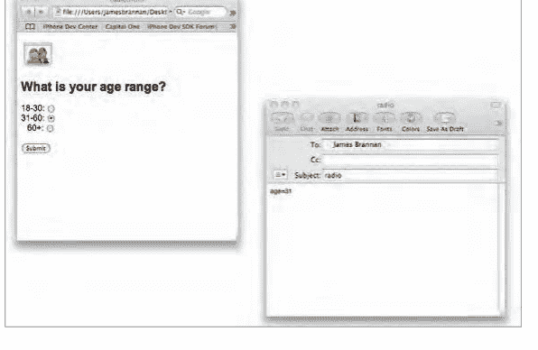

## 添加文件域

文件域是类型为file的输入元素。此字段允许用户从其计算机中选择一个文件，并在表单提交时上传。提交文件的表单必须将编码类型设置为multipart/form-data。

```html
<form name="input" action="nothing.php" method="post" enctype="multipart/form-data">
```

## 任务步骤

- 1. 以不同的名称保存模板。
- 2. 添加一个表单。(9)
- 3. 添加一个input元素，并将其type指定为file。(13)
- 4. 添加一个提交按钮。(17)
- 5. 保存并在浏览器中查看。务必点击“浏览/上传”按钮并加载一个文件。

### 表 6.4 本任务指定的表单元素

| 标签 | 功能 |
|---|---|
| <input type="file" ...> | 指定一个文件表单域。 |

你无法在此任务中使用mailto:协议，因此无法真正看到此任务的结果。但是，你可以选择一个文件，并看到文件名。请注意本任务两张图中Safari和Firefox之间的差异。

> **交叉引用**
> 完成的示例请参见 tasks_html/task_form_file_field/simple_form.html。

```html
<!DOCTYPE HTML PUBLIC "-//W3C//DTD HTML
4.01 Transitional//EN"
"http://www.w3.org/TR/html4/loose.dtd">
<html>
<body>

<h2>向世界展示你的风采。</h2>
<p>请上传你的照片...</p>
<form name="input" action="nothing.php"
method="post" enctype="multipart/form-
data">
<label for="name">文件:</label>
<input type="file" name="name"
size="20" />
<br/>
<br/>
<input type="submit" value="提交"/>
<input type="reset" value="取消"/>
</form>
</body>
</html>
```

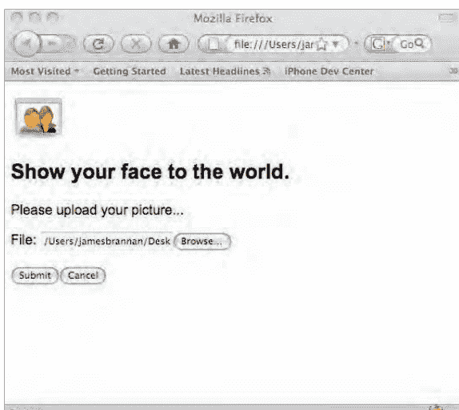

## 添加文件域（续）

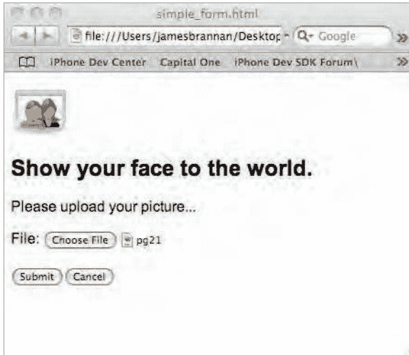

HTML 表单 107

## 添加文本区域

类型为text的输入元素只允许有限数量的字符。此外，即使你可以在文本字段中输入一整段文本，你也不会想这样做。相反，你应该使用文本区域。文本区域允许输入大量数据。你使用 **`<textarea></textarea>`** 标签来指定文本区域。文本区域具有name、cols、rows、wrap、readonly和disabled属性。cols属性指定字段的宽度（列数），而rows属性指定其高度（行数）。wrap属性告诉浏览器是否应该在字段中自动换行。readonly属性指定该字段是只读的。disabled属性使该字段被禁用。

## 任务步骤

- 1. 以不同的名称保存模板。
- 2. 添加一个表单。(8)
- 3. 添加一个textarea元素，记得分配row和column的大小。(10)
- 4. 保存并在浏览器中查看。

### 表 6.5 本任务指定的表单元素

| 标签 | 功能 |
|---|---|
| `<textarea></textarea>` | 在表单中指定一个文本区域。 |

> **交叉引用**
> 完成的示例请参见 **tasks_html/task_form_textarea/simple_form.html**。

本任务的结果很直接。你应该看到一个具有指定列数和行数的文本区域元素。

```html
<!DOCTYPE HTML PUBLIC "-//W3C//DTD HTML
4.01 Transitional//EN"
"http://www.w3.org/TR/html4/loose.dtd">
<html>
<body>

<h4>告诉我们更多关于你的信息...</h4>
<form name="input" action="nothing.php"
method="get">
<textarea rows="10" cols="20">
</textarea>
<br/>
<input type="submit" value="提交" />
<input type="reset" value="取消"/>
</form>
</body>
</html>
```

## 添加文本区域（续）

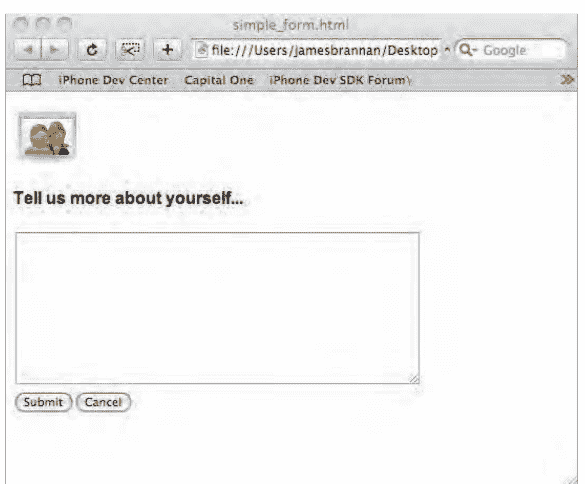

## 添加select元素（列表和菜单）

select元素允许你从一个值列表中选择一个或多个值。你使用 **`<select></select>`** 标签将select元素添加到表单中。在select元素内有一个或多个option元素。option元素指定select元素中显示的名称。option元素的文本是作为选择项显示在select元素中的内容。option元素的value是当option被选中时select元素所取的值。

## 任务步骤

```html
<select>
  <option value="1">选项一</option>
  <option value="2">选项二</option>
  <option value="3">选项三</option>
</select>
```

- 1. 打开模板并以不同的名称保存。
- 2. 添加一个select元素，使其成为多选列表。(10)
- 3. 将该元素的大小设置为四。(10)
- 4. 在列表中创建几个选项。务必为每个选项分配一个value和text。(13–17)
- 5. 使一个option处于选中状态。(13)
- 6. 在select元素后添加几个`<br/>`标签，并添加另一个select元素。(19, 22)
- 7. 为select元素添加几个选项。(23–25)
- 8. 这一次，不指定size。
- 9. 在第二个select元素后添加几个`<br/>`标签，并添加第三个select元素。(28, 31)
- 10. 在第三个select元素中添加四个option元素。将前两个option元素分组到一个optgroup元素中。(32)

select元素具有name、size和multiple属性。name属性是提交到服务器的select元素的名称。size属性是浏览器中应可见的选项数量。值为1时创建一个下拉列表（也称为菜单）。值为2或更多时创建一个列表。当未指定时，size元素的默认值为1。multiple属性为true或false，指定你是选择一个选项还是多个选项。

select元素对添加的选项数量没有限制。但是，有时你可能希望通过将相似的选择分组到类别中来使用户更方便。你使用 **`<optgroup></optgroup>`** 标签进行此分组。

```html
<select>
  <optgroup label="数字">
    <option value="1">选项一</option>
    <option value="2">选项二</option>
  </optgroup>
  <optgroup label="字母">
    <option value="a">选项A</option>
    <option value="b">选项B</option>
  </optgroup>
</select>
```


## 表 6.6 本任务中指定的表单元素

| 标签 | 功能 |
|---|---|
| `<select></select>` | 指定一个菜单/下拉列表。 |
| `<option></option>` | 指定选择元素中的一个选项。 |
| `<optgroup></optgroup>` | 指定一组选项。 |

## 添加选择元素（列表和菜单）（续）

- 11. 将后两个选项元素分组到一个 optgroup 元素中。为两个 optgroup 都分配一个标签。(40)
- 12. 保存并在浏览器中查看。

> **交叉引用**
>
> 请参阅 **html_tasks/task_form_lists_menus/forms.html** 以查看完整示例。

完成此任务并在浏览器中查看结果后，您应该看到三种不同的选择元素变体。第一个选择框是一个允许多选的列表。第二个是传统的下拉框。第三个也是传统的下拉框，但选项被分为两组。请注意 Safari 和 Firefox 渲染选择元素时的差异。

```
1 <!DOCTYPE HTML PUBLIC "-//W3C//DTD HTML
2 4.01 Transitional//EN"
3 "http://www.w3.org/TR/html4/loose.dtd">
4 <html>
5 <body>
6 
7 <form>
8 <label for="hair">What hair colors do
9 you like?&nbsp;</label>
10 <select multiple="multiple" size="4"
11 name="hair">
12 <option value="black">Brunette</option>
13 <option selected="selected"
14 value="blond">Blond</option>
15 <option value="red">Redhead</option>
16 ---snip---
17 <option value="other">All</option>
18 </select>
19 <br/><br/>
20 <label for="weight">What is your
21 salary?&nbsp;</label>
22 <select name="salary">
23 <option selected value="na">Private
24 </option>
25 <option value="25k">25K-50K</option>
26 ---snip---
27 </select>
28 <br/><br/>
29 <label for="weight">What is your
30 height?&nbsp;</label>
31 <select name="height">
32     <optgroup label="Short">
33         <option selected
34         value="short1">0ft-1ft</option>
35         <option value="short2">1ft-
36         2ft</option>
37         <option value="short3">2ft-
38         3ft</option>
39     </optgroup>
40     <optgroup label="Normal">
41         <option selected
42         value="normal1">3ft-4ft</option>
43         <option value="normal2">4ft-
44         5ft</option>
45         <option value="normal3">5ft-
46         6ft</option>
47     </optgroup>
48 </select>
49 <br/><br/>
50 <input type="submit" value="Submit"/>
51 <input type="reset" value="Cancel"/>
52 </form>
53 </body>
54 </html>
```

## 添加 fieldset 和 legend

有时您可能想将用于相似项目的表单字段分组。对类似字段进行分组有助于用户更好地理解表单。更容易理解的表单会带来更多的提交和更高的数据准确性。您可以使用 fieldset 元素对字段进行分组。fieldset 元素在其 `<fieldset>` 开始标签和 `</fieldset>` 结束标签内的表单元素周围绘制一个框。您还可以通过分配一个 legend 来为 fieldset 元素添加标签。

## 任务步骤

- 1. 以不同的名称保存您的模板。
- 2. 向页面添加一个表单。(6)
- 3. 向表单添加三个单选按钮。(13, 16, 19)
- 4. 在第一个单选按钮之前，添加 `<fieldset>` 标签。(10)
- 5. 在最后一个单选按钮之后，添加 `</fieldset>` 结束标签。(21)
- 6. 紧随 `<fieldset>` 标签之后，添加一个 legend。(11)
- 7. 保存并在浏览器中查看。

```
<fieldset>
<legend>Dairy Products</legend>
Ice Cream <input type="checkbox"/><br/>
Cream <input type="checkbox"/><br/>
Cream Cheese <input type="checkbox"/>
</fieldset>
```

### 表 6.7 本任务中指定的表单元素

| 标签 | 功能 |
| :--- | :--- |
| `<fieldset></fieldset>` | 指定在其标签内的元素周围绘制一个框。 |
| `<legend></legend>` | 指定 fieldset 的标题。 |

> **交叉引用**
> 请参阅 `tasks_html/task_forms_fieldsets/radio.html` 以查看完整示例。

## 添加 fieldset 和 legend（续）

任务的结果很直接。您应该看到三个单选按钮。在单选按钮周围，您应该看到一个带标签的框。标签的文本应与您为 legend 输入的内容匹配。

```
1 <!DOCTYPE HTML PUBLIC "-//W3C//DTD HTML
2 4.01 Transitional//EN"
3 "http://www.w3.org/TR/html4/loose.dtd">
4 <html>
5 <body>
6 <form name="input" action="nowhere.psp"
7 method="get">
8 
9 <h2>What is your age range?</h2>
10 <fieldset>
11 <legend>Age Range</legend>
12 18-30
13 <input type="radio" name="age"
14 value="18" />
15 31-60
16 <input type="radio" name="age"
17 value="31" checked="checked" />
18 60+
19 <input type="radio" name="age"
20 value="60" />
21 </fieldset>
22 <br /><br />
23 <input type="submit" value="Submit" />
24 </form>
25 </body>
26 </html>
```

## 介绍层叠样式表 (CSS)

## 介绍

层叠样式表 (CSS) 是用于为 HTML 文档应用样式的工具。CSS 文档是一个文本文件，包含一条或多条规则，用于告诉浏览器如何格式化 HTML 页面上的元素。一条规则由一个选择器（用于指定要应用样式的元素）和一个声明（用于声明要应用的样式）组成。声明由一个属性和一个值组成。您可以设置许多 CSS 属性，包括用于定位和调整元素大小的属性、用于设置元素字体和颜色的属性以及许多其他属性。

如今，不使用 CSS 样式表就无法创建专业的网站。样式表将 HTML 页面带入了图形艺术领域。像作者这样的程序员可以随意拼凑几张图片和一些混杂着 HTML 标签的文本，并称之为专业网站的日子已经一去不复返了。考虑一个网站（例如 Theocacao，第 118 页）应用和不应用 CSS 样式表时的区别。差异是惊人的。CSS 使 HTML 网页的专业程度不亚于印刷杂志的布局和设计。

### 您将做什么

- 理解 'ids' 和类名
- 理解 'div' 元素
- 理解 'span' 元素
- 理解 CSS 规则
- 指定 CSS 样式
- 添加 CSS 注释

### 重要提示

在继续之前，我必须再次建议您升级到最新的浏览器版本（如果尚未升级的话）。本书使用 CSS 2.1 – 截至 2008 年 7 月的最新 CSS 规范。如果您使用的是 Internet Explorer 6，剩余章节中的许多任务可能无法正确渲染。Internet Explorer 7 修复了许多 6 的 CSS 渲染问题。Firefox 和 Safari 用户应该不会遇到任何困难，前提是您没有使用非常旧的浏览器版本。

应用了样式表时...

未应用样式表时。

### 重要提示

这是我在剩余章节中所做的几个免责声明中的第一个。我的职业是 Web 开发人员，而不是 Web 设计师。这意味着我了解 HTML、CSS；我可以编写动态生成 HTML 的程序，也可以编写处理表单提交的程序。但是，与 20 世纪 90 年代的美好旧时光不同，今天成为一名开发人员并不等于成为 Web 设计师。将本书视为关于 HTML 和 CSS 语法的入门书籍，而不是关于使用 CSS 进行设计的书。然而，一旦您完成本书的学习，就可以继续阅读关于 CSS 设计的书籍。此外，由于您已经从本书中学到了 CSS 语法，理解样式书籍会变得更容易。当您读完本书后，去书店买一杯拿铁或茶，浏览一摞 CSS 样式书籍；这非常有趣。


## 理解 id 和类名

在理解 CSS 之前，你必须先了解 HTML 的 id 属性和 class 属性。每个 HTML 元素都可以有 id 和 class 属性。id 属性为元素分配一个唯一的名称，而 class 属性为元素分配一个类名。

```
<p id="ralph"
class="important_paragraphs"></p>
```

如果你熟悉面向对象编程，那么理解 HTML 的类会很容易。但对于不熟悉面向对象编程的人来说，类是一种对相似元素进行分组的方式。例如，想象一个基于本书的网站，重要信息总结在一个表格中。每个页面都有自己的表格，但你希望每个表格的格式都相似。这时你就使用一个类。

```
<table class="callout"> --- table info
here --- </table>
```

然而，假设你希望其中一个表格使用自己的格式。你可以为该特定表格分配一个 id。

```
<table class="callout" id="specialTable">
--- table info here---</table>
```

| 属性 | 功能 |
| :--- | :--- |
| id | 为元素指定一个唯一的 id。 |
| class | 为元素指定一个组成员资格。 |

> **交叉引用**
请参阅 **tasks/tasks_css/pastries/index.html** 以获取本任务中使用的模板。

## 任务步骤

1.  导航到 **www.freecsstemplates.org** 并下载任何一个免费的 CSS 模板。如果你不想这样做，那么从本书的示例站点中，导航到 **tasks/tasks_css/pastries** 并打开 style.css 文件。
2.  在浏览器中打开 index.html，查看一下，然后关闭。
3.  在你的文本编辑器中打开 index.html。
4.  注意所有的 HTML div 元素都有 id 或 class 赋值。
5.  同时也注意许多其他元素也有 id 或 class 赋值。

## 理解 id 和类名（续）

## 交叉引用

在本章的任务“理解 CSS 规则”中，你将查看此模板的 CSS 规则。

```
<!--
Design by Free CSS Templates
http://www.freecsstemplates.org
Released for Free under a Creative Commons Attribution 2.5 License
-->

<!--
Name : Pastries
Description : A two-column, fixed-width design with dark color scheme.
Version : 1.0
Released : 20080617
-->

<html>
<head>
 <meta http-equiv="content-type" content="text/html;charset=utf-8" />
 <title>Pastries by Free CSS Templates</title>
 <meta name="keywords" content="" />
 <meta name="description" content="" />
 <link href="style.css" rel="stylesheet" type="text/css" media="screen" />
</head>
<body>
 <div id="header">
  <div id="logo">
   <a href="#">Pastries</a>
   
   <a href="http://www.freecsstemplates.org">Free CSS Templates</a>
  </div>
  <div id="search">
   <form method="get" action="">
    <fieldset>
     <input type="text" name="s" value="Search" size="15" />
     <input type="submit" id="search-submit" value="Search" />
    </fieldset>
   </form>
  </div>
 </div>
 <!-- end #search -->
 <!-- end #header -->
</body>
</html>
```

## 理解 div 元素

div 元素是一个块级元素，用于定义 HTML 文档中的逻辑部分。CSS 使得这些逻辑部分可以被独立地格式化。将 **<div></div>** 标签视为你 HTML 页面的基本构建块。你定位和格式化这些块以实现所需的页面外观。

你应该始终为你的页面定义一个顶级分区。

## 任务步骤

```
<body><div id="outermost"></div></body>
```

然后根据需要添加嵌套的 **<div></div>** 标签以实现所需的布局。

1.  使用不同的名称保存 template.html。
2.  在 body 元素中添加一个 **<div></div>** 标签集，并为该 div 元素分配一个 id。(26)
3.  向先前添加的 div 元素中添加两个 **<div></div>** 标签集。为两者都分配一个 id。(27,33)

> **供你参考**
在本任务中，你将使用一些尚未涵盖的 CSS 格式化属性。如果你不理解这些格式，请不要担心，只需尝试理解 div 元素的用途即可。

4.  在两个嵌套 div 元素中的第一个里面，再添加两个 **<div></div>** 标签集。为两者分配相同的类名。(28, 30)
5.  为两个元素都添加内容。

**表 7.2 本任务涉及的 HTML 元素**

| 标签 | 功能 |
| --- | --- |
| <div></div> | 指定 html 文档中的一个部分。 |

6.  在两个外部 div 元素中的第二个里面，添加两个 **<div></div>** 标签集，并为两者分配与步骤 4 中使用的相同类名。(34, 44)

> **交叉引用**
请参阅 **tasks/tasks_css/task_div_span/div.html** 以获取完成的示例。

7.  为两个元素都添加内容。
8.  保存并在浏览器中查看。

任务完成后，将其加载到浏览器中。除非你从完成的示例代码中复制粘贴格式，否则除了你在嵌套 div 元素中输入的文本外，你不会看到太多其他内容。这是因为 div 元素将其他元素分组到不同的部分中。除非你对 div 应用 CSS 样式，例如边框或背景颜色，否则浏览器不会渲染 div 元素。

## 理解 div 元素（续）

```
1 <!DOCTYPE HTML PUBLIC "-//W3C//DTD HTML
2 4.01 Transitional//EN"
3 "http://www.w3.org/TR/html4/loose.dtd">
4 <html>
5 <head>
6 <title>Div</title>
7 <style type="text/css">
8 body {background-color:black;}
9 div#outermost {border-
10 style:dotted;border-color:lime;border-
11 width:3px;margin:5px;}
12 div#top {border-style:solid;border-
13 color:orange;border-
14 width:2px;background-
15 color:lime;margin:5px;}
16 div#bottom {border-style:solid;border-
17 color:lime;border-width:2px;background-
18 color:orange;margin:5px;}
19 div.nest {border-style:dotted;
20 background-color:whitesmoke; border-
21 width:2px;margin:5px;}
22 img {float:left;}
23 </style>
24 </head>
25 <body>
26 <div id="outermost">
27 <div id="top">
28 <div class="nest"><h2>nested
29 div</h2></div>
30 <div class="nest"><h2>nested</h2></div>
31 </div>
32 <div id="bottom">
33 <div class="nest"><h2>nested
34 div</h2></div>
35 <div class="nest"><h2>nested</h2></div>
36 </div>
37 </div>
38 <p>Introducing Cascading Style Sheets (CSS)</p>
39 </body>
40 </html>
```

## 理解 div 元素（续）

```
31 div</h2></div>
32 </div>
33 <div id="bottom">
34 <div class="nest"><h2>nested
36 div</h2><p>A paragraph about nothing.
37 A paragraph about nothing. A paragraph
38 about nothing. A paragraph about
39 nothing. A paragraph about nothing.
40 A paragraph about nothing. A paragraph
41 about nothing. A paragraph about
42 nothing. A paragraph about nothing.
43 </p></div>
44 <div class="nest"><h2>nested
45 div</h2></div>
46 </div>
47 </div>
48 </body>
49 </html>
```

## 理解 div 元素（续）

> 交叉引用
在第 13 章中，你将广泛使用 div 元素来使用 CSS 布局 HTML 页面。

> **重要提示**
div 元素是一个块级元素。该元素的目的是将 HTML 页面划分为逻辑部分，而不是其他块级元素。例如，你不能将 div 元素嵌套在段落或块引用中。相反，这些元素应该被嵌套在 div 元素中。将 div 元素视为页面的构建块。

## 理解 span 元素

span 元素是一个行内级元素，用于分组行内内容。它允许你为任意文本和其他行内元素指定 CSS 格式。你可以将任何行内内容包裹在 span 中，然后对其应用 CSS 格式化。

### 表 7.3 本任务涉及的 HTML 元素

| 任务 | 功能 |
| :--- | :--- |
| <span></span> | 指定 html 文档中的一个部分。 |

## 任务步骤

1.  使用不同的名称保存 template.html。
2.  向页面添加一个段落。(20)
3.  选择一些文本并在其周围放置 <span></span> 标签。为 span 元素分配一个 id。(18)
4.  选择一些文本并在其周围放置 <span></span> 标签。为其分配一个类名。(20)
5.  重复步骤三两次，但为 span 元素分配不同的 id。(22, 27)
6.  保存并在浏览器中查看。
7.  从完成的示例中，复制从开始的 <style> 标签到结束的 </style> 标签，并将其粘贴到你文档中的 <head></head> 标签内。(6–14)
8.  更改你的 span 元素 id 和类名，以与复制粘贴代码中的匹配。id 是 h、b 和 c。类名是 a。
9.  保存并在浏览器中查看。

> 交叉引用
请参阅 tasks/tasks_css/task_div_span/span.html 以获取完成的示例。

完成此任务后，你不会看到任何东西，因为 span 元素除了分组行内内容以便应用样式外，本身不会做任何事情。然而，请注意，在完成的示例中，我添加了 CSS 格式化。

你应该看到每个 span 内部的文本与周围文本的格式不同。

```
1<!DOCTYPE HTML PUBLIC "-//W3C//DTD HTML
2 4.01 Transitional//EN"
3 "http://www.w3.org/TR/html4/loose.dtd">
4 <html>
5 <head>
6 <style type="text/css">
7 span#h {color:red;font-family:cursive;}
8 span.a{font-size:xx-
9 large;color:green;border-style:solid;}
10 span#b {font-size:x-large;color:red;}
11 span#c {font-size:xx-
12 large;color:green;background-
13 color:aqua;}
14 </style>
15 </head>
16 <body>
```


## 理解 span 元素（续）

层叠样式表（CSS）入门 127

## 理解 CSS 规则

一条 CSS 规则由两部分组成：选择器和声明。

选择器决定了该规则影响哪些元素。声明则指定了要执行的操作。在指定选择器时，你可以将受影响的元素缩小到仅特定类或特定 ID 的元素。当指定特定类的元素时，你使用一个句点分隔元素和类名。

```
element.classname
```

当指定具有特定 ID 的元素时，你在元素和 ID 之间放置一个井号。

```
element#id
```

当浏览器读取选择器时，它就知道只将声明应用于选择器指定的元素。例如，

```
p {color:red;}
```

告诉浏览器，“将所有段落文本设为红色”。选择器

```
p#a1 {color:green;}
```

告诉浏览器，“将段落 a1 的文本设为绿色”。选择器

```
p.important {color:orange;}
```

告诉浏览器，“将所有重要的段落文本设为橙色”。

声明是应用于选择器的实际样式。声明由一个左花括号、属性、一个冒号、属性值和一个右花括号组成。你可以选择性地添加分号（我总是这样做）。

```
element#id {property:value}
```

或

```
element#id {property:value;}
```

如果为一个选择器指定多个声明，你需要在声明之间包含分号。

```
element#id {property1:value1;property2:value2;property3:value3}
```

你也可以为多个元素指定相同的声明。为此，在元素之间放置一个逗号。

```
element, element {property:value;}
```

> 重要
在本书中，几乎所有任务都使用 HTML 的 style 元素来设置 CSS 属性。这仅仅是为了方便，以便你可以在同一代码中看到样式和 HTML。在现实世界中，你几乎应该始终使用外部样式表。

## 理解 CSS 规则（续）

## 任务步骤

- 1. 导航至 www.freecsstemplates.org 并下载任何免费的 CSS 模板。如果你不想这样做，那么从本书的示例网站导航至 tasks/tasks_css/pastries 并打开 style.css 文件。
- 2. 在你的浏览器中打开 index.html，查看，然后关闭。
- 3. 在你的文本编辑器中打开并查看样式表 style.css。
- 4. 注意 body 元素的规则。文本 **body** 是规则，并且有五个声明，每个声明之间用分号分隔。
- 5. 注意许多规则为相同的声明指定了多个选择器。

```
/*
Design by Free CSS Templates
http://www.freecsstemplates.org
Released for free under a Creative Commons Attribution 2.5 License
*/

body {
    margin-top: 20px;
    background: #6E0911 url(images/img01.jpg) repeat left top;
    font-family: Georgia, "Times New Roman", Times, serif;
    font-size: 13px;
    color: #757890;
}

h1, h2, h3 {
    margin: 0;
    text-transform: lowercase;
    letter-spacing: -.05em;
    font-family: "Trebuchet MS", Georgia, "Times New Roman", Times, serif;
    font-weight: normal;
}

h1 {
    font-size: 1.8em;
}

h2 {
    font-size: 1.4em;
}

h3 {
    font-size: 1em;
}
```

```
#sidebar {
    float: left;
    width: 220px;
    margin-left: 25px;
    color: #7893AE;
}

#sidebar ul {
    margin: 0;
    padding: 0;
    list-style: none;
}

#sidebar li {
}

#sidebar li ul {
    padding: 10px 0 15px 15px;
}

#sidebar li li {
    padding-left: 10px;
}

#sidebar h2 {
    padding-bottom: 10px;
    padding-left: 20px;
    margin: 5px 22px;
    font-size: 1.5em;
    border-bottom: 2px solid #000000;
    background: url(images/img06.jpg) no-repeat left 35%;
    color: #FFFFFF;
}
```

- 6. 注意有些选择器以井号开头，并且只包含 ID，不包含元素。

层叠样式表（CSS）入门 131

## 理解 CSS 规则（续）

### 省时技巧

读完本书后，你将具备足够的知识来创建 HTML 页面并使用 CSS 对其进行格式化。但与其从头开始，你可能想考虑使用模板作为起点。模板是一个完成了的 HTML 页面，包含一个 CSS 样式表。然后你将模板的内容替换为你自己的内容。或者，如果你愿意，你可以将模板作为起点，并修改模板以更好地适应你想要的页面样式。

你可以获取免费 CSS 模板的一个网站是 **freeCSStemplates.org**。这个网站有超过 300 个模板可以免费下载。**freeCSStemplates.org** 网站只是众多可以找到免费 CSS 模板的网站之一；在任何搜索引擎中输入“free CSS templates”，你会找到许多其他网站。

## 指定 CSS 样式

你可以通过三种不同的方式指定 CSS 样式。首先，你可以在 HTML 页面中包含一个外部样式表。

```
<head>
<link href="mystylesheet.css"
rel="stylesheet" type="text/css"/>
</head>
```

其次，你可以在 HTML 页面的头部包含一个 style 元素，并将 CSS 格式放在 **`<style></style>`** 标签内。

```
<head>
<style>
p {border-style:solid;}
</style>
</head>
```

第三，你可以内联包含样式，直接在标签中作为属性。

```
<p style="border-style:dotted;">
```

优先级的顺序是从外部样式表中设置的样式，到 style 元素中设置的样式，再到实际 HTML 标签中设置的样式。例如，如果你在外部样式表中将一个元素的颜色设置为蓝色，

```
p {color:blue;}
```

但随后在页面的 style 元素中将同一元素的颜色设置为红色，

```
<head><style>
p{color:red;}</style></head>
```

那么来自 style 元素的值将覆盖在外部样式表中设置的样式，颜色将是红色。如果你随后在标签中将颜色设置为紫色，

```
<p style="color:purple;">
```

## 指定 CSS 样式（续）

那么内联样式将覆盖在 style �-element 中设置的样式，颜色将是紫色。

> 交叉参考
请参阅 tasks/tasks_css/task_specify/specify.html 和 tasks/tasks_css/task_specify/specify.css 以获取完成的示例。

## 任务步骤

- 1. 使用不同的名称保存 template.html。
- 2. 创建一个外部样式表；确保给文件一个 .css 扩展名。（1–2）
- 3. 在 HTML 页面中，添加四组 `<p></p>` 标签。为三个段落分配不同的 ID。我使用的 ID 是 **a**、**b** 和 **c**。为每个段落添加一些文本。（17, 19, 21, 23）
- 4. 打开样式表并将段落元素分配为绿色。（2）
- 5. 保存并关闭样式表。
- 6. 在 HTML 页面中包含该样式表。（8）
- 7. 在 HTML 页面的 head 元素中添加 `<style></style>` 标签。（10）
- 8. 将段落 **a** 分配为黄绿色，段落 **b** 为橙色。（11, 12）
- 9. 向段落 **c** 添加一个 style 属性并将其分配为蓝色。（21）
- 10. 保存并在浏览器中查看。

完成此任务后，将其加载到浏览器中。段落 **a** 应该有黄绿色文本，段落 **b** 橙色文本，段落 **c** 蓝色文本，匿名段落绿色文本。尽管你在外部样式表中将段落 **a** 的文本颜色设置为蓝色，但在 HTML 页面的 style 元素中设置的黄绿色覆盖了外部样式表。段落 **b** 的情况相同，只是实际段落元素中的 style 属性覆盖了外部样式表。

```
body {background-color:lightgray;}
p{color:green;}
```

```
<!DOCTYPE HTML PUBLIC "-//W3C//DTD HTML 4.01 Transitional//EN"
"http://www.w3.org/TR/html4/loose.dtd">
<html>
<head>
<link href="./specify.css"
rel="stylesheet" type="text/css">
<style type="text/css">
p#a {color:lime;}
p#b {color:orange;}
</style>
<title>StyleSheets</title>
</head>
<body>
<p id="a">This is first paragraph. It
should be lime.</p>
<p id="b">This is second paragraph. It
should be orange.</p>
<p id="c" style="color:blue;">This is
third paragraph. It should be blue.</p>
```


## 指定CSS样式（续）

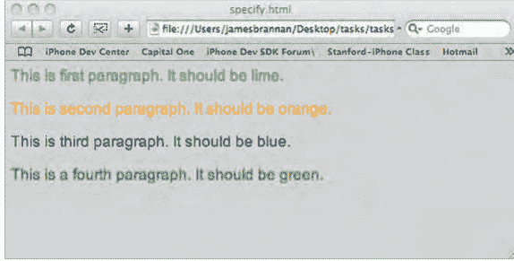

### 供你参考

大多数CSS属性都以测量单位作为值。例如，你可能想设置段落的字体大小。

```
p {font-size: value}
```

该属性的值可以是长度或百分比。有效的长度单位包括磅（pt）、派卡（pc）、厘米（cm）、英寸（in）、毫米（mm）、像素（px）、em空间（em）和ex空间（ex）。

### 表7.4 CSS测量单位

| 绝对测量单位 | | |
|---|---|---|
| 磅 | pt | 以磅定义的测量单位——每英寸72磅。 |
| 派卡 | pc | 以派卡定义的测量单位——每英寸6派卡。 |
| 厘米 | cm | 以厘米定义的测量单位。 |
| 英寸 | in | 以英寸定义的测量单位。 |
| 毫米 | mm | 以毫米定义的测量单位。 |
| **相对测量单位** | | |
| 像素 | px | 由显示器上的一个点定义的测量单位——每英寸72到90像素不等，取决于显示器。 |
| em空间 | em | 由当前字体定义的测量单位。一个em空间（1em）等于用户当前浏览器字体中字母M的宽度。 |
| ex空间 | ex | 由字体的x高度定义的测量单位。x高度通常等于字体中字母x的高度。 |
| 百分比 | % | 定义为相对于另一个元素（通常是包含的父元素）的百分比的测量单位。 |

你应该将绝对值保留用于打印。使用相对值用于显示。

CSS注释，就像HTML注释一样，用于解释你的代码。你可以通过使用一个正斜杠后跟一个星号、注释内容、然后再一个星号后跟一个正斜杠来添加CSS注释。

## 添加CSS注释

```
/* 这是一个CSS注释 */
```

> 交叉参考
请参阅 tasks/tasks_css/task_div_span/div_withcomments.html 获取完整示例。

完成此任务后，结果应该一目了然——你应该看到与上一个任务完全相同的页面。注释不会被浏览器渲染。但是，如果你查看源代码，你会在源代码中看到注释。

- 打开之前保存的带有style元素的任务。
- 添加几条注释。
- 保存并在浏览器中查看。

```
<!DOCTYPE HTML PUBLIC "-//W3C//DTD HTML
4.01 Transitional//EN"
"http://www.w3.org/TR/html4/loose.dtd">
<html>
<style type="text/css">
/* **********
* James A. Brannan
* 免责声明：这是一个
注释示例
* ********** */
body {background-color:black;} /* 我想要
黑色背景 */
div#outermost {border-
style:dotted;border-color:lime;border-
width:3px;margin:5px;}
div#top {border-style:solid;border-
color:orange;border-width:2px;
background-color:lime;margin:5px;}
div#bottom {border-style:solid;border-
color:lime;border-width:2px;background-
color:orange; /* margin:4000px; */
margin:5px;}
div.nest {border-style:dotted;
background-color:whitesmoke; border-
width:2px;margin:5px;}
</style>
<title>CSS注释</title>
<head>
<body> ---剪辑--- </body>
</html>
```

### 术语解析

**模板** - 一种模式。在本书中，HTML或CSS文档被用作你的起点，因此你不需要在每次创建新文档时都重新创建通用的HTML或CSS代码。

**面向对象编程** - 一种将构造视为对象的编程风格。

**GNU** - 一个成立于1984年的组织，旨在推广一个类似于UNIX的免费操作系统。GNU软件最终与Linux结合在一起。GNU现在存在的目的更为广泛，即推广开源软件。GNU编写了LGPL和GPL许可方案，并积极确保其他人遵守这些许可。

### 供你参考

仅仅因为你在网上看到某些东西，并不意味着你可以使用它。那张照片、字体或视频可能属于某人，他们投入了大量精力去创建它，可能不会感激别人偷走它。但是，如果你关注许可方案，有合法的方式可以获取网络上的内容。例如，请注意本书包含了来自Vista-Inspirate和Crystal Project图标集合的字体。我偷它们了吗？没有。Crystal Project是在GNU较宽松公共许可证（LGPL）下许可的。该许可证规定，我有权在开源和商业项目中自由使用和修改许可作品。Vista-Inspirate图标是在GNU通用公共许可证（GPL）下许可的。该许可证稍微严格一些。我可以自由在开源和商业项目中使用和修改许可作品，但任何衍生作品或对原始作品的修改都必须免费提供给请求者。有时许可比较棘手。例如，如果我将这些图标用作本书的插图，有人可能会认为本书应该是GPL许可的。但我没有将这些图标用于本书，我将它们用于本书的示例代码。示例代码和使用的图标通过本书的完成示例自由提供。LGPL和GPL也包含在网站中。

## 添加CSS注释（续）

从 **freecsstemplates.org** 使用的CSS模板是根据知识共享署名2.5许可证许可的。该许可证允许你分享、改编和通常重用许可作品，前提是你提供对原作者的署名。例如，在 **freecsstemplates.org**，创建者要求你保留其网站的链接。

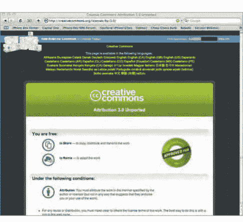

最后，请注意本书中的一些示例展示了典型的“快乐的人做快乐事”的库存照片。你可以在网上或当地零售店购买这些图片。我在1990年代中期从一家名为Hemera的德国公司购买了它们，作为Photo Objects 50,000高级图像收藏的一部分。我可以自由在商业和个人项目中使用这些图像，前提是我不得将原始图像免费提供下载。我可以在网页上使用它们，前提是我使用原始图像的较低质量派生版本。但没关系，原始图像是高质量的TIFF格式，文件大小巨大。

你必须注意许可方案。在搜索图标和剪贴画时，我发现 **www.kdelook.org** 是一个不错的起点。对于图像，我从我的Photo Objects收藏开始。但是，由于你可能没有那个收藏，作为替代，我建议使用 **www.flickr.com** 上的flickr。搜索时，你可以选择高级搜索。然后勾选“仅搜索知识共享许可内容”复选框。在决定使用CC许可图像时，仍需阅读作者的限制，你可能需要注明摄影师。

## 使用CSS格式化字体和文本

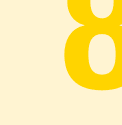

## 简介

字体是所有书面交流的基础。字体传达情感、风格，并帮助你的写作传达隐含意义。例如，如果你在聊天室聊天或给某人发电子邮件，你用全大写字母输入，网络上的常见惯例是你正在大喊大叫。

### 你将做什么

- 设置元素的字体族
- 设置元素的字体样式
- 设置元素的字体粗细和大小
- 使用font声明设置元素的字体
- 装饰文本和更改大小写
- 对齐文本

字体的含义可能很微妙。一个简单的选择，比如使用Comic Sans而不是Arial，可以传达完全不同的情绪。

欢迎来到我的网站（Comic Sans）

Comic Sans字体传达了一种轻松随意的网站氛围，而Arial则显得更正式。

欢迎来到我的网站（Arial）

Lucida Blackletter字体传达出一些来自布拉姆·斯托克《德古拉》的东西。它既不轻松随意，也不正式。它很阴森。

欢迎来到我的网站（Lucida Blackletter）

所有三种字体选择都给用户带来了对网站内容完全不同的期望。我会预期一个哥特摇滚乐队使用Lucida Blackletter，但不会预期一家在线银行公司使用它。一个为其网站使用Arial的哥特乐队会显得相当无聊；我绝对不会在使用Comic Sans的在线银行网站上办理业务。根据你想给人的印象，选择合适的字体。请仔细选择你网站的字体。


但在你过于创意，选择一种奇异的字体（比如 Lucida Blackletter）之前，请注意你应该选择在大多数操作系统上普遍存在的字体。如果你的页面指定了用户操作系统中未安装的字体，那么浏览器就会用用户浏览器中设置的默认字体来显示你的页面。你花在字体上的那些时间都是白费功夫；用户很可能会用 Times、Courier 或其他同样乏味的字体来查看你的网站。

| 表 8.1 本章涉及的 CSS 字体属性 |
| :--- |
| font-family | 指定字体族，字体族可以是特定的字体名称或通用字体族。 |
| font-style | 指定字体样式，样式可以是 normal、italic 或 oblique。 |
| font-weight | 指定字体的粗细。 |
| font-size | 指定字体的大小。 |
| font | 允许你在一行语句中设置 font-family、font-style、font-weight 和 font-size 的属性。 |

CSS 还提供了一些属性来替代已弃用的 HTML 文本格式化标签和属性，比如段落元素的 align 属性以及用于给文本添加下划线的 `<u></u>` 标签。这种格式化对页面的排版很重要，并提供了额外的格式选择。在本章中，你将学习如何使用 CSS 来给文本添加下划线、上划线、删除线，改变大小写以及让文本闪烁。你将学习如何对齐文本以及如何为文本添加间距。这些属性与 CSS 字体属性相结合，是你格式化 HTML 文本的正确方式。

## 设置元素的 font-family

你可以使用 font-family 属性来声明字体族。字体族是一组设计相似的字体。例如，Arial、Helvetica 和 Times New Roman 都是字体族的例子。你也可以使用通用字体族名称。通用字体族名称有：serif、sans-serif、cursivefantasy 和 monospace。通用字体族在所有计算机的所有浏览器上都是通用的，因此如果你想确保所有用户都能使用你指定的字体，它们是最保险的选择。

> 重要提示
font-family 属性只是元素字体的一个方面。你还必须设置它的粗细、大小和样式。在接下来的三个任务中你会学到这些；本任务仅关注字体的族。

声明字体族时，你可以列出不止一种字体。这很重要，因为如果用户的系统中没有需要的字体族，它会继续在列表中查找下一个字体族。使用 font-family 时，良好的做法是以五种通用字体族值之一来结束列表。这样就为浏览器提供了多个选项。例如，如果找不到 Arial，就用 Tahoma。如果找不到 Tahoma，那就用 serif：

```
p {font-family: arial, tahoma, serif;}
```

因为 serif 是通用字体族之一，它一定存在。

元素会从其父元素继承 font-family，并且可以覆盖其父元素的字体。指定字体的最佳方式是为 body 分配一个 font-family——这样你的页面都会共享相同的基础字体。然后，对于段落、标题和其他你希望字体不同的地方，你可以覆盖 body 元素的字体。

## 设置元素的 font-family（续）

### 表 8.2 通用字体族及示例成员字体族

| 名称 | 示例成员 |
| :--- | :--- |
| 通用字体族 | 属于通用字体族的字体族 |
| Cursive | Comic Sans MS、Apple Chancery、URW Chancery、Monotype Corsiva、Bradley Hand ITC |
| Fantasy | Impact、Papyrus、Marker Felt、Felix Titling |
| Monospace | Courier、Courier New、Lucida Console、Monaco、Free Mono |
| Sans-serif | Microsoft Sans Serif、Arial、Helvetica、Veranda、Liberation Sans |
| Serif | Palatino Linotype、Georgia、Times New Roman、Baskerville、American Typewriter |

> 交叉参考
请参阅 **tasks_css/task_css_fonts_multiple_tasks/font_family.html** 查看完整示例。

## 设置元素的 font-family（续）

这个任务的结果很直观。没有 id 的两个段落会显示你浏览器列出的标准字体。例如，我的浏览器的标准字体是 Times 12。带有 id 的段落应该是 serif。因为 serif 是通用字体族之一，你肯定会看到这段文本使用这种字体族来渲染。引文是 cursive，也是一种通用字体族。如果你的电脑有 Arial，强调文本的字体应该是 Arial，否则是 sans-serif。如果你的电脑两种字体都没有，这个段落也会显示为你浏览器的标准字体。

## 任务步骤
1. 打开 template.html 并用不同的名称保存。
2. 添加 `<q></q>` 标签。（第12行）
3. 添加三个短段落，分别用 `<p></p>` 标签包裹。使用 `<em></em>` 标签强调一些词语。（第15、17、20行）
4. 在标题中添加开始和结束 `<style>` 标签。（第17行）
5. 将引用元素的 font-family 设为 cursive。（第7行）
6. 将强调元素的 font-family 设为 Arial Black。
7. 为其中一个段落分配一个 id，例如 id="disclaimer"。（第22行）
8. 将同一段落的 font-family 设为 serif。（第9行）
9. 保存并在浏览器中查看。

```
1 <!DOCTYPE HTML PUBLIC "-//W3C//DTD HTML
2 4.01 Transitional//EN"
3 "http://www.w3.org/TR/html4/loose.dtd">
4 <html>
5 <head>
6 <title>Font-Family Example</title>
7 <style type="text/css">q{font-
8 family:cursive;}
9 p#disclaimer{font-family:serif;}</style>
10 </head>
11 <body>
12 <p><q>Which iNtervalTrack version should
13 I buy?</q></p>
14 <p>It depends upon your operating
15 system. Buy the Mac edition for <em
16 style="font-family:'arial black'">OS
17 X</em>, the Linux version for <em
18 style="font-family:'arial
18 black'">Linux</em>, and the Windows
20 version for <em style="font-
21 family:'arial black'">Windows</em>.</p>
22 <p id="disclaimer">Note that only
23 Windows XP, Ubuntu Linux, and Mac OSX
24 Leopard on an Intel, have been
25 tested</p>
26 </body>
27 </html>
```

## 设置元素的 font-family（续）

### 重要提示

使用 font-family 时，如果字体名称中包含空格，你必须用单引号或双引号将 font-family 值括起来。

```
p{font-family: "DejaVu Sans";}
```

### 供你参考

### 网络安全字体

仅仅因为你可以使用某种字体，并不意味着你就应该使用。以名为 Barbaric 的字体为例。它是 Aeryn 设计的一款巧妙的铁丝网主题字体。它是免费的，你可以从几个网站下载。假设你正在为一个纹身店的网站工作，你非得使用那种字体不可。于是你下载了它，安装到了系统字体中，并使用该字体创建了你的网站。例如，考虑下面的 HTML 页面。

```
<!DOCTYPE HTML PUBLIC "-//W3C//DTD HTML 4.01 Transitional//EN" "http://www.w3.org/TR/html4/loose.dtd"> 
<html><head><title>Font</title> 
</head> 
<body> 
<p style="font-family: Barbaric; font-size: 5em">Tattoos are cool.</p> 
</body> 
</html>
```

## 设置元素的 font-family（续）

在你的浏览器中加载这个页面，看起来很棒。

但是，你网站的访问者会看到什么呢？很可能，他们会看到自己浏览器的默认字体，而不是 Barbaric，因为他们的系统字体文件夹中没有安装这个字体。

我敢打赌你没有安装 Barbaric。如果你使用的是 Mac，请启动"字体册"应用程序。如果使用 Windows，请进入 Windows 目录下的 fonts 子文件夹。你列出的字体就是你拥有的字体。你的浏览器使用这些字体。如果你的 CSS 指定的字体族不在其中，你的浏览器就会使用其默认字体。

你可以指示用户下载并安装 Barbaric 字体以获得最佳浏览效果，但一个普通浏览者有多大的可能性会这样做呢？相反，你最好的选择是坚持使用五种通用字体族值，或者一些常见的字体，如 Courier、Times New Roman 或 Arial。如果你一定要使用一种不常见的字体，那么只将其用于标题，方法是将标题制作成带有透明背景的 png 图像。你甚至可以添加投影和其他特殊效果。有关更多信息，请参阅有关网页图形设计或 Adobe Photoshop 的书籍。


## 设置元素的字体样式

字体可以有三种样式之一。字体的样式可以是正常、斜体或倾斜。大多数字体都有粗体和斜体样式。所有字体都有正常样式，尽管正常样式不过是当省略 `font-style` 声明时字体的默认样式。`normal` 将字体设置为正常。`italic` 将字体设置为斜体，而 `oblique` 将字体设置为倾斜。请注意，斜体和倾斜之间有细微差别。斜体是将字体变为斜体，它是一种实际的字体。例如，Arial Italic 是一种系统字体。当浏览器加载此字体时，它会说，“好的，我需要加载 Arial Italic 字体”，而不是“好的，我有一个 Arial 字体，我必须将其倾斜”。相反，倾斜并非实际字体。倾斜只是简单地倾斜所选字体。虽然类似于斜体化，但两个属性值之间有时可能存在细微的视觉差异。

> 交叉引用
> 请记住，有许多 HTML 标签可以更改文本的外观。请参阅第 2 章中的“标记其他文本元素”。在许多情况下，这些标签比指定字体更合适。

表 8.3 CSS `font-style` 值

| 样式 | 值 |
|---|---|
| `font-style:normal` | 指定字体的正常样式。 |
| `font-style:italic` | 指定字体的斜体样式。 |
| `font-style:oblique` | 指示浏览器倾斜字体的正常样式字体。 |

> 交叉引用
> 请参阅 **tasks_css/task_css_fonts_multiple_tasks/font_style.html** 以获取完成的示例。

## 设置元素的字体样式（续）

完成任务并在浏览器中重新加载页面后，您应该会看到斜体在具有 id 的段落中按预期工作，但其他段落没有。发生了什么？引用的样式覆盖了父段落的样式。其开始标签中带有 `style` 属性的段落也覆盖了其在 **`<style></style>`** 标签中设置的样式。请注意，引用的倾斜样式似乎没有任何作用（至少在我的 Safari 浏览器上没有）。想一想，倾斜值告诉浏览器尝试使文本倾斜，但文本已经是倾斜的了，因为它是草书字体。

## 任务步骤

1.  打开上一个任务的 HTML 页面。
2.  使引用元素的 `font-style` 为 `oblique`。(8, 9)
3.  为段落元素添加 `font-family` 和 `font-style` 声明。(10)
4.  使具有 id 的段落具有斜体 `font-style`。(12)
5.  在其中一个没有 id 的段落中，在段落的开始标签内添加 `font-style: normal`。(19)
6.  保存并在浏览器中显示。

```html
<!DOCTYPE HTML PUBLIC "-//W3C//DTD HTML
4.01 Transitional//EN"
"http://www.w3.org/TR/html4/loose.dtd">
<html>
<head>
<title>Font Style</title>
<style type="text/css">
q{font-family:cursive; font-style:
oblique;}
p{font-family:arial,sans-serif;font-
style: normal;}
p#disclaimer{font-family:serif;font-
style:italic;}
</style>
</head>
<body>
<p><q>Which iNtervalTrack version should
I buy?</q></p>
<p style="font-style: normal;">It
depends upon your operating system. Buy
the Mac edition for <em style="font-
family:'arial black'">OS X</em>, the
Linux version for <em style="font-
family:'arial black'">Linux</em>, and
the Windows version for <em style="font-
family:'arial black'">Windows</em>.</p>
<p id="disclaimer">Note that only
Windows XP, Ubuntu Linux, and Mac OSX
Leopard on an Intel, have been
tested</p>
</body>
</html>
```

## 设置元素的字体样式（续）

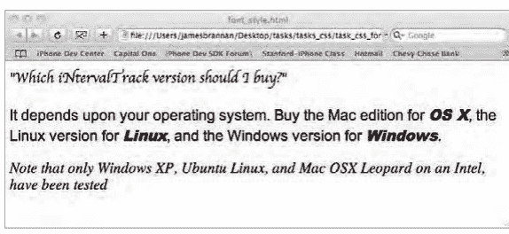

> “我应该购买哪个 iNtervalTrack 版本？”

这取决于您的操作系统。为 **OS X** 购买 Mac 版本，为 **Linux** 购买 Linux 版本，为 **Windows** 购买 Windows 版本。

> 请注意，仅测试了 Windows XP、Ubuntu Linux 和 Intel 上的 Mac OSX Leopard。

> 仅供参考
> 本章未涵盖的另外三个字体属性。`font-size-adjust` 属性允许调整字体大小，而 `font-stretch` 允许拉伸或压缩字体。`font-variant` 属性允许设置字体的变体，但只有两个变体：normal 和 small-caps。有关这三个属性的更多信息，请访问第 1 章中引用的其中一个网站。

## 设置元素的字体粗细和大小

您可以设置字体的粗细和大小。您使用 `font-weight` 属性声明字体的粗细。有效值为：`normal`、`bold`、`bolder`、`lighter` 以及 100、200、300、400、500、600、700、800 和 900，或百分比。字体的默认粗细是 `normal`。

```css
p{font-weight:bolder;} p.big1{font-weight:900} p.big2{font-weight:500%;}
```

字体的粗细是继承的。例如，将 `div` 元素的 `font-weight` 设置为 `bold` 会导致该 `div` 中的 `p` 元素也具有粗体文本。`bolder` 和 `lighter` 的值相对于元素的父级字体。该声明指示您的浏览器“将字体设置得比父级值更粗”。指定百分比值可相对于其父级设置字体。

您使用 `font-size` 属性声明字体的大小。有效值为：`xx-small`、`x-small`、`small`、`medium`、`large`、`x-large`、`larger`、`smaller`、百分比或长度。前五个值（`xx-small` 到 `x-large`）是绝对值，设置实际长度也是。`larger`、`smaller` 和百分比是相对于其父级的 `font-size`。相对长度单位是 `em`、`ex` 和 `px`。

```css
p{font-size:16px;} h1{font-size:2em;}
```

## 任务步骤

1.  打开上一个任务的页面。
2.  将 `</em>` 标签更改为 `<span></span>` 标签。(21, 24, 28)
3.  使引用的 `font-size` 为其父级 `p` 元素的 150%。(9)
4.  为 `p` 元素分配 `bold` 的 `font-weight`。(11)
5.  为具有 id 的段落分配 `lighter` 的 `font-weight` 和 `small` 的 `font-size`。(13, 14)
6.  为第一个 `span` 元素分配 `oblique` 的 `font-style`。赋予其 `xx-large` 的 `font-size`。(22)
7.  为第二个 `span` 元素分配 `normal` 的 `font-weight`。移除第二个 `span` 的 `font-family`，以便它使用其父级 `p` 的 `Arial` 字体族。(24)
8.  从第三个 `span` 移除 `style` 属性，使其没有格式。当然，它继承了其父级段落的样式。(24)

### 表 8.4 本任务涵盖的 CSS 属性

| 属性 | 功能 |
|---|---|
| `font-weight` | 指定字体的粗细。 |
| `font-size` | 指定字体的大小。 |

## 交叉引用

请参阅 **tasks_css/task_css_fonts_multiple_tasks/font_weight.html** 以获取完成的示例。

在浏览器中加载完成的任务时，您应该会看到引用比其父级段落大 50%。段落应该是粗体，第一个 `span` 是 `xx-large`，第二个 `span` 是普通文本（覆盖其父级的粗体 `font-weight`），第三个 `span` 应从其父级继承了粗体 `font-weight`。具有 id 的段落应该是小而轻的。顺便说一句，还记得上一个任务中倾斜没有效果吗？请注意，在这个任务中它有效了。第一个 `span` 中的文本应该是倾斜的。

## 设置元素的字体粗细和大小（续）

```html
<!DOCTYPE HTML PUBLIC "-//W3C//DTD HTML
4.01 Transitional//EN"
"http://www.w3.org/TR/html4/loose.dtd">
<html>
<head>
<title>Font Weight and Size</title>
<style type="text/css">
q{font-family:cursive; font-
weight:normal;font-size:150%;}
p{font-family:arial,sans-serif;font-
style:normal; font-weight: bold;}
p#disclaimer{font-family:serif;font-
style:italic;font-weight:lighter; font-
size:small;}
</style>
</head>
<body>
<p><q>Which iNtervalTrack version should
I buy?</q></p>
<p>It depends upon your operating
system. Buy the Mac edition for <span
style="font-family:arial;font-size:xx-
large;font-style:oblique;">OS X</span>,
the Linux version for <span
style="font-
weight:normal;">Linux</span>, and the
Windows version for
<span>Windows</span>.</p>
<p id="disclaimer">Note that only
Windows XP, Ubuntu Linux, and Mac OSX
Leopard on an Intel, have been
tested</p>
</body>
</html>
```

9.  保存并在浏览器中打开。


## 设置元素的字体粗细和大小（续）

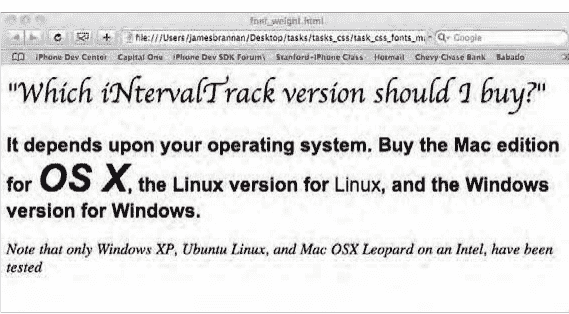

你可以使用多种不同的计量单位来指定CSS的长度和宽度。相对单位是：em、ex 和 px。固定单位是：mm、cm、pt、pc 和 in。下表列出了这些单位。在本书中，我使用 em 和 px 单位。其他单位更适用于打印文档。

| 单位 | 描述 |
|---|---|
| em | 字母“m”的高度。 |
| ex | 字母“x”的高度。 |
| px | 像素 |
| mm | 毫米 |
| cm | 厘米 |
| pt | 点 |
| pc | 派卡 |
| in | 英寸 |

你不必使用单独的声明来设置字体的所有CSS属性。CSS提供了一个便捷的字体声明。使用此声明，你可以一次性设置所有字体属性。

```
p{font: normal bold 12pt Times,serif;}
```

## 使用font声明设置元素的字体

**交叉引用**

完整的示例请参阅 **tasks_css/task_css_font/task_css_font_property/font_prop.html**。

## 任务步骤

1.  打开 template.html 并使用不同的名称保存。
2.  添加一个段落，并在其中输入一些文本。(17)
3.  向 head 元素添加 `<style></style>` 标签，然后将字体样式作为一条语句添加进去。(8–11)
4.  添加另一个段落，并为其分配一个内联字体样式。此样式将覆盖在 head 中指定的样式。(14)
5.  保存并在浏览器中查看。

完成任务后，结果显而易见，尽管它强化了一个重要的CSS概念。当你在HTML元素的起始标签中直接指定样式时，它会覆盖该元素类型已指定的样式。

```
<!DOCTYPE HTML PUBLIC "-//W3C//DTD HTML
4.01 Transitional//EN"
"http://www.w3.org/TR/html4/loose.dtd">
<html>
<head>
<title>Font Tag All In One Example</title>
<style type="text/css">
p {font:oblique normal normal xx-large sans-serif;}
</style>
</head>
<body>
<p style="font:normal normal small arial">Why am I learning HTML and CSS? Doesn't iWeb do it all for me?</p>
<p>Well, yes, you could use iWeb if you want your website to conform to iWeb's predefined templates. In fact, I have a confession. For my shareable product's website...I'm using iWeb. But note, I'm also using iWeb's HTML Snippet functionality extensively. So I still must know HTML. And if you are creative, well forget about applying
```

## 使用font声明设置元素的字体（续）

```
your own style to iWeb.</p>

</body>
</html>
```

**是的，如果你想让你的网站符合 iWeb 预定义的模板，那么你可以使用 iWeb。事实上，我得承认。对于我的共享软件产品的网站...我正在使用 iWeb。但请注意，我也在广泛地使用 iWeb 的 HTML 代码片段功能。所以我仍然必须了解 HTML。而且如果你有创造力，那么就别指望把自己的风格应用到 iWeb 上了。**

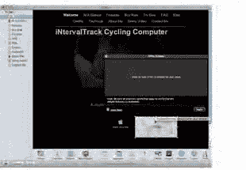

在第2章中，你学习了几个用于文本格式化的HTML标签。但大多数有用的HTML文本格式化标签，例如：下划线元素（<u></u>），都已被弃用。相反，你应该使用CSS来进行此类文本格式化。CSS具有用于下划线、删除线、将文本转换为大写或小写、使每个单词首字母大写甚至使文本闪烁的属性。

## 装饰文本和更改大小写

### 表 8.5 文本装饰和大小写属性

| 属性 | 功能 |
|---|---|
| text-decoration:underline | 指定文本带下划线。 |
| text-decoration:overline | 指定文本上方有线。 |
| text-decoration:line-through | 指定文本带删除线。 |
| text-decoration:blink | 指定文本闪烁。 |
| text-decoration:none | 指定无文本装饰。 |
| text-transform:uppercase | 指定文本为大写。 |
| text-transform:lowercase | 指定文本为小写。 |
| text-transform:capitalize | 指定每个单词的首字母大写。 |
| text-transform:none | 指定无文本转换。 |

## 任务步骤

1.  使用不同的名称保存 template.html。
2.  添加四个段落，并为每个段落添加内容。(10, 15, 19, 23)
3.  将第一个段落设置为下划线并使其大写。(10)
4.  将第二个段落设置为上划线并使其小写。(15)
5.  将第三个段落设置为删除线，并使每个单词的首字母大写。(19)
6.  使第四个段落闪烁。(23)
7.  保存并在浏览器中查看。

完成任务并在浏览器中查看后，结果显而易见。第一个段落带下划线且为大写，第二个段落带上划线且为小写，第三个段落带删除线且每个单词的首字母大写，第四个段落会闪烁。

```
<!DOCTYPE html PUBLIC "-//W3C//DTD HTML
4.01 Transitional//EN"
"http://www.w3.org/TR/html4/loose.dtd">
<html>
<head>
<title>Decoration and Case Change</title>
</head>
<body>
<p style="text-decoration:
underline;text-transform:uppercase;">This is an
underlined paragraph that is also uppercase.</p>
<p style="text-decoration:
overline;text-transform:lowercase;">THIS
IS AN OVERLINE PARAGRAPH THAT IS LOWERCASE.</p>
<p style="text-decoration: line-through;text-transform:capitalize;">This
is a line-through paragraph where every
word's first letter is capitalised.</p>
<p style="text-decoration: blink;">This
is a blinking paragraph, hey what
the...I'm not blinking in
Safari...someone call Steve Jobs!</p>
</body>
</html>
```

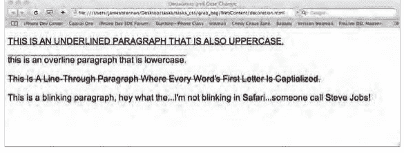

> **交叉引用**

完整的示例请参阅 **tasks/task_css/task_decoration/decoration.html**。

有时你可能希望左对齐、右对齐、居中或两端对齐你的段落。段落元素有一个对齐属性；然而，该属性已被弃用。相反，你应该使用CSS属性来对齐段落的文本。

## 对齐文本

| 属性 | 功能 |
|---|---|
| text-align:left | 指定文本左对齐。 |
| text-align:right | 指定文本右对齐。 |
| text-align:center | 指定文本居中。 |
| text-align:justify | 指定文本两端对齐。 |

1.  使用不同的名称保存 template.html。
2.  添加四个段落，并为每个段落添加足够的文本使其成为多行。(12, 21, 29, 37)
3.  将第一个段落设置为左对齐。(12)
4.  将第二个段落设置为右对齐。(21)
5.  将第三个段落设置为居中对齐。(29)
6.  将第四个段落设置为两端对齐。(37)
7.  保存并在浏览器中查看。

完成此任务后，你应该看到四个段落，每个段落的对齐方式不同。第一个段落应为左对齐，第二个段落为右对齐，第三个段落居中，第四个段落为两端对齐。

## 任务步骤

```
<!DOCTYPE html PUBLIC "-//W3C//DTD HTML
4.01 Transitional//EN"
"http://www.w3.org/TR/html4/loose.dtd">
<html>
<head>
<style type="text/css"> div {border-style:solid;margin:5px;}</style>
<title>Text alignment</title>
</head>
<body>
<div>
<p style="text-align:left;">This is a
left justified paragraph. There isn't
much to it, it's a typical paragraph.
This is just wording to make the
paragraph wrap and show the behaviour of the paragraph's alignment.</p>
</div>
<div>
<p style="text-align:right;">This is a
right justified paragraph. There isn't
much to it, it's a typical paragraph.
This is just wording to make the
paragraph wrap and show the behaviour
of the paragraph's alignment.</p>
</div>
<div>
<p style="text-align:center;">This is a
centered paragraph. There isn't much to
it, it's a typical paragraph. This is
just wording to make the paragraph wrap
and show the behaviour of the
paragraph's alignment.</p>
</div>
<div>
<p style="text-align:justify;">This is a
justified paragraph. There isn't much to
it, it's a typical paragraph. This is
just wording to make the paragraph wrap
and show the behaviour of the
paragraph's alignment.</p>
</div>
</body>
</html>
```

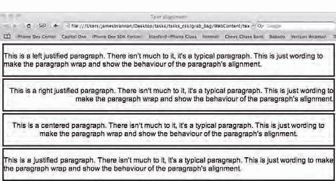

> 交叉引用

完整的示例请参阅 tasks/tasks_css/task_csstext_align/textalign.html。


有时你可能希望在单词之间或字母之间添加间距。CSS的`word-spacing`和`letter-spacing`属性允许你指定这种行为。

## 使用单词间距和字母间距格式化文本

表8.7 CSS的`word-spacing`和`letter-spacing`属性
| 属性 | 功能 |
| :--- | :--- |
| word-spacing | 指定添加在单词之间的空格。 |
| letter-spacing | 指定添加在字母之间的空格。 |

任务步骤
- 1. 使用一个不同的名称保存 `template.html`。
- 2. 添加两个包含内容的段落。(14, 16)
- 3. 为其中一个段落设置 `12px` 的单词间距。(14)
- 4. 为另一个段落设置 `5px` 的字母间距。(16)
- 5. 保存并在你的浏览器中显示。

完成此任务并在浏览器中查看结果，结果是显而易见的。你设置了12像素单词间距的段落，其单词之间应有12像素的间距。你设置了5像素字母间距的段落，其字母之间应有五像素的间距。

```html
1 <!DOCTYPE html PUBLIC "-//W3C//DTD HTML
2 4.01 Transitional//EN"
3 "http://www.w3.org/TR/html4/loose.dtd">
4 <html>
5 <head>
6 <title>WordSpacing</title>
7 <style>
8 body{background-color:whitesmoke;}
9 </style>
10 </head>
11 <body>
12 <h2>Sometimes you might want extra word
13 spacing or letter spacing.</h2>
14 <p style="word-spacing:12px;">This text
15 has extra word spacing.</p>
16 <p style="letter-spacing:5px;">This text
17 has extra letter spacing.</p>
18 </body>
19 </html>
```

使用CSS格式化字体和文本 161

## 使用单词和字母间距格式化文本（续）

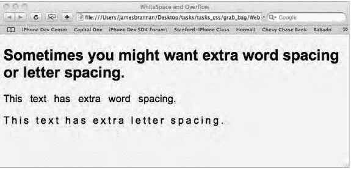

## 交叉引用

完整的示例请参见 **tasks/tasks_css/task_word_letter_spacing/word_letter_spacing.html**。

### 供你参考

你也可以使用CSS的`white-space`属性来指定段落的换行行为。有效的值为 `normal`、`pre` 和 `nowrap`。

```css
p {white-space: nowrap;}
```

指定 **pre** 会使文本保留段落中所有的空白。此属性的行为与HTML的 `<pre>` 标签相同。指定 **nowrap** 会导致文本不换行。因此，如果你有一行非常长的文本，你会迫使用户水平滚动才能阅读完整的一行。

## 使用CSS指定颜色

### 引言

选择正确的颜色与选择正确的字体同样重要。合适的颜色可以让你的网站感觉怪异、专业甚至异想天开。颜色就像字体一样，根据你的选择帮助你的网站传达不同的感觉。但随意选择颜色可能会使你的网站页面彼此不相关且显得不专业。颜色很重要；忽视它，你的网站就会受损。


在继续之前，谈谈关于风格和品味的问题。随着本书开始更多地讨论设计，我能给出的最好建议是听我的建议，但不一定照我的样子做。我是个编程呆子。我的腿上纹着自行车、珊瑚蛇、部落图案和一个裸女。我的背上纹着一条鲨鱼和我女儿的名字。我认为没有刹车的自行车非常棒。我40岁了，还在听电子音乐。我剃腿毛，但我的脸经常不刮。理解了吗？对我来说明智的事情对你来说可能看起来并不那么明智。但请放心，我不会浪费你的时间——你将学会使用CSS格式化HTML。然而，这不是一本关于设计的书。

不过，我确实包含了一个设计任务，但它是一个安全的任务——它使用了一个工具来为我做出设计选择。下一节“理解网页颜色——选择配色方案”将说明如何使用在线工具为你的网站生成令人愉悦的颜色组合。基于我在本章及后续章节中的颜色选择，我认为这是我至少能做的。但话说回来，也许你也喜欢电子音乐、纹身和没有刹车的自行车。也许你觉得Rock Racing的网站（**www.rockracing.com**）是一个出色的网页设计范例。你不得不承认，Rock Racing的网站很惊艳，即使算不上出色。

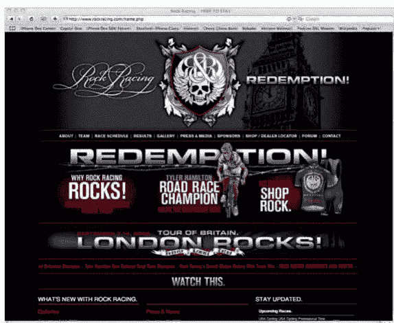

### 你将做什么

- **理解网页颜色——选择配色方案**
- **以四种不同的方式指定颜色**
- **设置背景颜色**
- **设置前景颜色**

颜色可以使用RGB、十六进制值或名称来指定。就像优化图像一样，几年前像这样的书会开篇讨论并告诫你选择网页安全色。过去，你只能指望用户拥有256种颜色。实际上，情况比这还糟。你只能依赖网景和Internet Explorer能一致地显示216种不同的颜色。如果你想让你的网站颜色在不同浏览器上看起来一样，你就得将自己限制在这些网页安全色内。

在网上，仍然有些人坚持认为你必须选择网页安全色的错误观念。这是一个误解。你可以指望用户拥有数千种，如果不是数百万种颜色；如果你不相信我，只需去 **www.thecounter.com** 查看颜色深度统计数据。所有网页用户中有74%拥有32位色。拥有256种颜色的用户不到1%。16位色提供65,536种颜色选择，而32位色提供16,777,216种颜色选择——有足够多的颜色可供选择。抛开媒体炒作不谈，即使是巴西的贫民窟也拥有高速互联网接入和能显示数千种颜色的显示器。

尽管有充足的颜色可供选择，但在选择网站颜色时有两个重要的设计考虑因素。首先，仅仅因为你可以使用数千种颜色，并不意味着你应该这样做。有些颜色放在一起好看，有些则不好看。其次，许多用户的显示器没有正确校准，因此可能无法正确显示细微的颜色差异。你可能会浪费数小时选择一种微妙、艺术化的颜色组合，但这种组合在你的大多数用户那里显示效果不佳。你的目标应该是对比度，而不是细微的颜色差异。

但对比度并不意味着你的网站必须花哨刺眼，尽管如果你和我一样，它确实如此。这就是为什么我依赖为我生成配色方案的工具。我不知道你怎么想，但对我来说，没有工具，生成一个配色方案是一项艰巨的任务。

完成这个任务的步骤很简单：输入一个基本色，然后得到一个与该颜色相配的配色方案。诚然，这个任务提倡减少一些你的创造力，我对此表示歉意。如果你有很好的品味，那就自己做——你不需要工具。但如果你像我一样在艺术方面能力不足，那就使用配色方案。不过，无论你做什么，都不要随意选择颜色。彩虹是属于雷雨后的天空的，而不是你的网站的。

## 理解网页颜色——选择配色方案

任务步骤
- 1. 打开你的网页浏览器。
- 2. 导航到 Color Schemer Online 配色方案工具（**www.colorschemer.com/online.html**）。
- 3. 输入十六进制值 #B22222 (firebrick)，然后点击 Set HEX 按钮。
- 4. 会显示一组互补色。

## 理解网页颜色——选择配色方案（续）

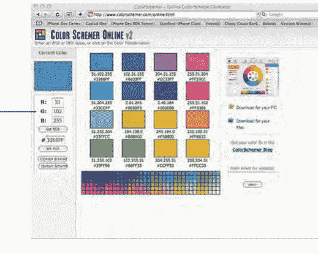

### 省时技巧

Adobe Air是网页技术的最新成果。Adobe Air允许你在桌面上使用交互式网页应用程序，而无需使用浏览器。Kuler Desktop应用程序就是一个Adobe Air应用程序。我在本章的任务中没有使用它，因为它需要你下载软件。但别担心，Kuler Desktop是由Adobe Labs制作的，下载是安全的。你可以在 **labs.adobe.com/technologies/kuler** 找到该应用程序。在页面的某处你应该能看到一个“Get the Kuler Desktop”链接。点击它，将Kuler下载到你的桌面。如果你尚未安装Adobe Air，它也会同时安装。再说一遍，别担心，Adobe Air来自带给你Adobe Flash媒体播放器的同一来源，我相信你已经安装了它。

一旦安装，你就可以在桌面上浏览无数的配色方案。当你找到一个你喜欢的，


## 理解 Web 颜色 – 选择调色板（续）

> **重要：** 当使用 Kuler Desktop 等工具时，请记住细微的颜色差异在某些显示器上往往无法很好地呈现。应尽量选择对比度更高而非更低的颜色。

右键单击色块，选择“Copy Theme Values”（复制主题值），然后将结果粘贴到文本编辑器中。你应该能看到每种颜色的十六进制值。有关 Kuler 的更多信息，请访问 **kuler.adobe.com**，但请注意，在线工具仅允许将选择保存为 Adobe Swatch Exchange 文件 (.ase)。为了方便查看十六进制值，你应该下载桌面应用程序。

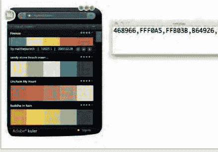

## 四种不同的颜色指定方式

你可以通过四种不同的方式之一来指定元素的颜色。如果你选择 216 种 Web 安全色之一，通常可以直接指定颜色的名称。

```
h1{color: cornflowerblue;}
```

你也可以使用十六进制值来指定颜色。该值区分大小写，因此请务必使用正确的大小写。

```
h1{color: #6495ED}
```

或者，你可以指定颜色的 RGB 值。RGB 代表红（Red）、绿（Green）、蓝（Blue），数字表示颜色中红、绿、蓝的百分比。使用 RGB 指定颜色有两种方式。一种是指定红、绿、蓝的百分比。

```
h1 {color: rgb(39%,58%,93%);}
```

另一种是直接指定 RGB 颜色值。

```
h1 {color: rgb(100,149,237);}
```

几乎没有人使用 RGB 百分比来指定颜色。然而，名称、十六进制值或 RGB 值都被广泛使用。

## 任务步骤

1. 将 template.html 另存为一个不同的文件名。
2. 在正文中添加三个不同的 `<h1></h1>` 标签。在每个标签中输入一些文本。(3, 5, 7)
3. 为本示例中每个元素的标签添加 style 属性。
4. 在第一个 `<h1>` 标签中，通过指定名称来添加颜色 firebrick。(4)
5. 在第二个 `<h1>` 标签中，通过指定 RGB 值来添加颜色。(5)
6. 在第三个 `<h1>` 标签中，通过指定十六进制值来添加颜色。(7)
7. 保存并在浏览器中查看。

| | | | |
|---|---|---|---|
| Asparagus | asparagus | rgb(123,160,91) | #7BA05B |
| Alice Blue | aliceblue | rgb(240,248,255) | #f0f8ff |
| Blanched Almond | blanchedalmond | rgb(255,235,205) | #ffebcd |
| Turquoise | turquoise | rgb(64,224,208) | #40e0d0 |

此任务的结果非常简单。你应该看到三个标题，每个标题的文本颜色都应该是 firebrick 红。

```
<html>
<body>
<h1 style="color:firebrick;">firebrick</h1>
<h1 style="color:rgb(178,34,34);">rgb value: rgb(178,34,34)</h1>
<h1 style="color:#B22222;">hexadecimal value: #B22222</h1>
</body>
</html
```


## 交叉引用

参见 tasks/tasks_css/task_css_color_3way/color3way.html

## 设置背景颜色

任何块级元素都可以具有背景颜色。CSS 通过 `background-colour` 声明使背景颜色成为可能。一个声明了背景的元素在 Web 浏览器中显示时，将具有指定的背景颜色。

**表 9.2 本任务涵盖的属性**

| 属性 | 功能 |
|---|---|
| background-colour | 指定元素的背景颜色。 |

元素的背景颜色看起来像是继承的，但实际上并不是。想一想，没有指定背景颜色的元素具有透明背景。你看到的是后面元素的背景（假设该元素指定了背景颜色）。

## 任务步骤

1. 打开 template.html 并另存为新名称。
2. 在段落元素中添加一些文本。为该段落分配一个 id。(13)
3. 创建另一个段落。在其周围放置 `<div></div>` 标签。(19, 20)
4. 在 header 中添加 style 元素。(19)
5. 为 body 元素分配米色 (beige) 背景颜色。(5)
6. 为具有 id 的段落分配白色烟雾色 (whitesmoke) 背景颜色。(6)
7. 在 `<div>` 开始标签中添加 style 属性，并为其分配青色 (cyan) 背景颜色。(19)
8. 保存工作并在浏览器中打开。

> **交叉引用：** 完整示例请参见 tasks_css/task_css_background_color/mailto_background_color.html。

完成任务并在浏览器中显示后，你应该立即注意到这个页面有多丑！body 的背景应该是棕褐色的，而段落是白色烟雾色的。div 元素的背景应该是青色的。

```
1 <html>
2 <head>
3 <title>Background Color</title>
4 <style>
5 body {background-color: beige;} p#pitch
6 {background-color: whitesmoke;}
7 </style>
8 </head>
9 <body>
10 
12 <h2>Express Your Interest</h2>
13 <p id="pitch">iNtervalTrack is a
14 multimedia bicycle computer for your
15 Mac, Windows, or even Linux computer.
16 It's easy ---snip--- more information,
17 email me and I'll send you more
18 information.</p>
19 <div style="background-color:cyan;">
20 <p>
21 <a
22 href="mailto:jamesbrannan@xxxxxx.net">
23 Please send me more information.</a>
24 </p></div></body>
25 </html
```


## 设置背景颜色（续）

### 设置背景图像

你可以使用 CSS 的 `background-image` 属性为任何块级元素指定背景图像。

```
body {background-image: url(./myimage.png); }
```

| 属性 | 功能 |
|---|---|
| background-image: url(path) | 为元素指定背景图像。 |
| background-repeat: repeat | 指定背景图像平铺。 |
| background-repeat: repeat-y | 指定背景图像垂直平铺。 |
| background-repeat: repeat-x | 指定背景图像水平平铺。 |
| background-repeat: no-repeat | 指定背景图像不重复。 |
| background-attachment: fixed | 指定背景图像不随页面滚动（固定背景）。 |
| background-attachment: scroll | 指定背景图像随页面滚动。 |
| background-position: | 指定背景图像在页面上的位置。 |

你可以让背景图像在页面上水平平铺。

```
<style>
body {background-color: blanchedalmond; background-image: url(./cyclist27b.tiff); background-repeat: repeat-x;}
</style>
```


或者，你可以让背景图像在页面上垂直平铺。

```
<style>
body {background-color:
blanchedalmond; background-image:
url(./cyclist27b.tiff); background-
repeat: repeat-y;}
</style>
```


或者如果你愿意，可以选择一张图像并将其居中显示在页面上。

```
<style>
body {background-color:
blanchedalmond; background-image:
url(./cyclist27.tiff); background-
repeat:no-repeat; background-
position: top center;}
</style>
```


顺便提一下，请注意我在这些屏幕截图中使标题脱颖而出的方法是创建了一个 span 元素，并将其背景颜色设置为白色烟雾色。

```
<span style="font-size:40px; font-
family:cursive; color:firebrick;
background-color: whitesmoke;">image
not tiled and centered</span>
```

在使用 CSS 时，为元素分配颜色（前景色）非常简单。你只需声明元素的颜色即可。

```
body {background-color: black; color: lime;}
```

`color` 属性适用于元素中的文本。这包括格式化 HTML 标签，如 `<em>`, `<strong>` 和 `<sup>`。

```
strong {color: red;}
em {color: #E3372E;}
```

任何元素都可以声明颜色；然而，为没有文本内容的元素（如水平线）设置颜色没有效果。只需记住这条经验法则：没有文本 $\rightarrow$ 没有颜色，有文本 $\rightarrow$ 有颜色。

## 设置前景色

### 表 9.4 本任务涵盖的属性

| 属性 | 功能 |
|---|---|
| color | 指定元素的文本颜色。 |

## 任务步骤

1. 打开 template.html 并另存为新名称。
2. 将 body 元素的背景声明为黑色 (black)，颜色声明为酸橙色 (lime)。(5)
3. 添加一个标题和一个段落。(14, 15)
4. 将该段落分配为橙色 (orange)。(7)
5. 在浏览器中显示并查看结果。

在此任务中，你将通过把页面 body 的背景设为黑色、颜色设为酸橙色来学习前景色。通过将某个段落的颜色设置为橙色，你可以覆盖酸橙色。与之前的任务一样，所选的颜色可能会挑战你的审美；请尽情尝试。

**交叉引用：** 完整示例请参见 tasks_css/task_css_foreground_color/foreground.html。

完成任务并在浏览器中加载后，页面应该是黑色的。标题颜色应该是酸橙色，段落文本应该是橙色。请注意，标题继承了 body 的颜色。

```
1 <html>
2 <header>
```


## 设置前景色（续）

> **重要提示**

如果你想让网站的 CSS 验证通过，必须将颜色名称限制在 17 种 CSS 颜色名称内。这些名称是：aqua（青色）、black（黑色）、blue（蓝色）、fuchsia（品红色）、gray（灰色）、green（绿色）、lime（酸橙色）、maroon（栗色）、navy（海军蓝）、olive（橄榄色）、orange（橙色）、purple（紫色）、red（红色）、silver（银色）、teal（水鸭色）、white（白色）和 yellow（黄色）。如果你不在意页面是否验证通过——即使验证不通过也不会有任何问题——那么你可以安全地使用 216 种网页安全色名称。当然，你也可以始终稳妥地使用颜色的 RGB 或十六进制值。

```
3 <title>前景色</title>
4 <style>
5 body {background-color: black; color:
6 lime;}
7 p {background-color: black; color:
8 orange}
9 </style>
10 </header>
11 <body>
12 
14 <h2>表达你的兴趣</h2>
15 <p>iNtervalTrack 是一款多媒体自行车
16 计算机，适用于你的 Mac、Windows，甚至
17 Linux 电脑。它易于使用---此处截断---
18 更多信息。</p>
19 </body>
20 </html>
```

> **术语解释**

**十六进制** – 一种以 16 为基数的编号系统，用于以更人性化的方式表示二进制数据（零和一）。在计算机科学和电子领域被广泛使用。

## 使用 CSS 格式化超链接

### 你将做什么

### 引言

- 格式化超链接 – 颜色
- 格式化超链接 – 线条、边框、背景颜色
- 格式化超链接 – 图像链接

你在第 8 章和第 9 章中应用于其他元素的格式，也可以应用于超链接。此外，你可以根据超链接的状态应用这些样式。你已经从使用网络中了解了超链接的状态。超链接可以处于五种状态之一：未访问、鼠标悬停、获得焦点或活动状态、以及已访问。在你点击链接之前，它是未访问状态。当你将鼠标移到链接上时，它是鼠标悬停状态。当你实际点击链接时，它是活动状态。或者，你可以说当链接被实际点击时，它获得了焦点。在你点击链接之后，它就是已访问状态。

通过使用所谓的伪类，CSS 允许你根据链接的状态指定其不同的外观。之所以称为伪类，是因为没有实际的类。例如，没有名为 active、hover、link 或 visited 的 HTML 超链接类。Active、hover、link、focus 和 visited 都是描述超链接类的形容词。这些术语并非真正的类，因此术语为伪类。

在本章中，你将根据链接的状态将 CSS 样式应用于超链接。在第一个任务中，你使用伪类更改链接的颜色。在第二个任务中，你将应用几种其他格式到超链接。在第三个任务中，你将重新审视第二个任务，修复格式化给图像链接带来的一些问题。

表 10.1 用于根据链接状态格式化超链接的伪类

| 伪类 | 含义 |
|---|---|
| a:link | 指未访问的超链接。 |
| a:visited | 指已访问的超链接。 |
| a:active | 指被鼠标选中并即将激活的超链接。 |
| a:hover | 指鼠标指针当前悬停的超链接。 |
| a:focus | 指被键盘选中并即将激活的超链接。 |

### 供你参考

### 省时技巧

伪类不仅限于本章讨论的字体伪类。其他伪类还有 first-child 和 lang。还有以下伪元素：first-letter、first-line、before 和 after。用法与在超链接中使用伪类相同。

为了说明伪类和伪元素的使用，考虑 first-child 伪类和 first-letter 伪元素。使用 first-child 伪类，你可以指定作为另一个元素第一个子元素的元素应用某种样式。例如，

```
p:first-child {color:orange;}
```

会使任何作为另一个元素第一个子元素的段落呈现橙色。First-letter 将样式应用于文本的第一个字母，例如，

```
p:first-letter {color:red;font-size:x-large;}
```

会使任何段落元素的第一个字母呈现红色且尺寸特大。

```
<body>
<p>测试</p><p>测试二</p>
</body>
</html>
```

表 10.2 其他伪类和伪元素

| 伪类 | |
|---|---|
| :first-child | 指定样式应用于作为任何其他元素第一个子元素的元素。 |
| :lang | 为元素指定一种语言。 |
| **伪元素** | |
| :first-letter | 指定样式应用于文本的第一个字母。 |
| :first-line | 指定样式应用于文本的第一行。 |
| :before | 指定在元素之前插入的内容。 |
| :after | 指定在元素之后插入的内容。 |

## 使用 CSS 格式化超链接

### 格式化超链接 – 颜色

你可以根据链接的状态格式化链接，使其具有不同的外观。这是通过使用 link、visited、hover 和 active 伪类来实现的。

表 10.3 使用伪类及其对超链接的影响

| 伪类 | 结果 |
|---|---|
| a:link {color:red;} | 未访问的链接是红色 |
| a:visited {color: green;} | 已访问的链接是绿色 |
| a:hover {color:orange;} | 鼠标悬停的链接是橙色 |
| a:active {color:pink;} | 被点击时，链接是粉红色 |

## 任务步骤

1. 打开 template.html 并以不同的名称保存它。
2. 添加几个指向外部站点的链接。(13, 17, 20)
3. 在 style 元素中，将链接颜色设为棕色，已访问颜色设为黑色，悬停颜色设为红色，活动颜色设为橙色。(5, 6, 7, 8)
4. 保存你的工作并在浏览器中查看。点击一个链接，将鼠标移到一个链接上，并注意链接的行为。

> 交叉引用

请参考 **tasks_css/task_css_hyperlinks/link_states.html** 获取完整示例。

完成任务并在浏览器中查看结果后，链接应该是棕色的。但是，当你将鼠标移到链接上时，链接应该变成红色。当你点击它时，链接应该是橙色的。点击链接后，链接应该变成黑色。

```
1 <html>
2 <head>
3 <title>链接状态 – CSS</title>
4 <style>
5 a:link{color: brown;}
6 a:visited{color: black;}
7 a:hover{color: red;}
8 a:active{color: orange;}
9 </style>
10 </head>
11 <body>
12 <ul>
13 <li><a href="http://www.cyclingnews.com"
14 target="_blank">www.cyclingnews.com –
15 首个提供 WWW 自行车赛事结果
16 和新闻的服务</a></li>
17 <li><a href="http://www.youtube.com"
18 target="_self">YouTube - Broadcast
19 Yourself</a></li>
20 <li><a href="http://www.chrishoy.com/
21 chris_hoy_biography.html" target="_top">
22 Chris Hoy | 奥运会
23 冠军自行车手</a></li>
24 </ul>
25 </body>
26 </html>
```

### 格式化超链接 – 颜色（续）

## 格式化超链接 – 线条、边框、背景颜色

你可以像格式化其他元素一样使用 CSS 格式化伪类。你可以根据链接的状态为其应用边框、背景颜色、字体样式和其他各种 CSS 格式。在本任务中，你设置背景颜色、分配边框并移除链接的下划线。请注意，边框直到下一章才会介绍。但使用边框非常直观，在本任务中引入它不应引起混淆。

## 任务步骤

1. 打开上一个任务中的 HTML 页面。
2. 在 style 元素中，修改 visited 使其没有文本装饰。(6)
3. 修改 hover 使其具有 khaki（黄褐色）背景颜色、1 像素实线棕色边框、大写文本转换和 2 像素内边距。(9)
4. 保存你的工作并在浏览器中查看。

> **交叉引用**

请参考 **tasks_html/task_css_defining_link_states_multiple_tasks/link_states_underline.html** 获取完整示例。

由于你已经在上一个任务中访问过这些链接，你可能需要清除浏览器缓存才能获得本任务的完整效果。特别注意将鼠标悬停在链接上时的行为。当你将鼠标移到链接上时，你的浏览器应该在链接周围绘制一个框，使文本变大并改变其颜色。

```
1 <html>
2 <head>
3 <title>链接状态 - CSS</title>
4 <style>
5 a:link{color: brown;}
6 a:visited{color: black; text-decoration:
7 none;}
8 a:hover{color: red; background-color:
9 khaki; border: 1px solid brown; text-
10 transform: uppercase; padding: 2px;}
11 a:active{color: orange;}
12 </style>
13 </head>
14 <body>
15 <ul>
16 <li><a href="http://www.cyclingnews.com"
17 target="_blank">www.cyclingnews.com -
18 首个提供 WWW 自行车赛事结果和新闻
```


```html
19 service</a></li>
20 <li><a href="http://www.youtube.com"
21 target="_self">YouTube - Broadcast
22 Yourself</a></li>
23 <li><a href="http://www.chrishoy.com/
24 chris_hoy_biography.html" target="_top">
25 Chris Hoy | Olympic Champion
26 Cyclist</a></li>
27 </ul>
28 </body>
29 </html>
```

## 格式化超链接——行、边框、背景颜色（续）


## 格式化超链接——图片链接

尽管上一个任务很有趣，但当你对网站中所有元素应用全局格式时，总会存在一些风险。上一个任务的特效对文本链接效果不错，但图片链接呢？当你指定超链接具有边框和背景颜色时，超链接中的图片会怎样？结果可能出乎你的意料。

在本任务中，你将了解如果不小心会发生什么，以及如何修复这个问题。任务分为两部分：首先，我们以错误的方式添加图片链接，然后修复问题。

## 任务步骤

- 1. 打开模板并另存为不同名称。
- 2. 将上一个任务中的链接格式添加到新页面的 `style` 元素中。
- 3. 添加图片链接。（16）
- 4. 保存并在浏览器中显示。
- 5. 为了查看差异，添加两个普通链接并为其分配一个与图片类名不同的类名。（40，42）
- 6. 修改 `style` 元素中的链接。将链接格式改为仅引用这两个新创建链接的类名。
- 7. 保存并用 Web 浏览器显示。（25–32）

> **交叉引用**
> 完成的示例请参见 **tasks_css/task_css_hyperlinks/imagelink_imagestates_incorrect.html** 和 **tasks_css/task_css_hyperlinks/imagelink_imagestates_correct.html**。

本任务完成后，将鼠标移到图片上并观察结果——完全不是你想要的效果。问题在于链接样式是为所有超链接指定的。你需要做的是使用 `class` 属性（或者，你也可以同样有效地使用 `id` 属性）为文本链接和图片链接分别定义不同的类。

```html
1 <html>
2 <head>
3 <title>Image Links The Wrong Way</title>
4 <style>
5 a:link{color: brown;}
6 a:visited{color: black; text-decoration:
7 none;}
8 a:hover{color: red; background-color:
9 khaki; border: 1px solid brown; text-
10 transform: uppercase; padding: 2px;}
11 a:active{color: orange;}
12 img {border-style: none;}
13 </style>
14 </head>
15 <body>
```

```html
<a href="http://www.freebsd.org"></a>Free BSD<br/><br/>
</body>
</html
```


当你悬停在图片上时，图片链接不应再显示卡其色方框。而两个新创建的链接则有此效果。其外观和行为符合预期。

```html
<html>
<head>
<title>Correct Image Link</title>
<style type="text/css">
a.special:link{color: brown;}
a.special:visited{color: black; text-
decoration: none;}
a.special:hover{color: red; background-
color: khaki; border: 1px solid brown;
text-transform: uppercase; padding:
2px;}
a.special: active{color: orange;}
img {border-style: none;}
</style>
</head>
<body>
<a href="http://www.freebsd.org"></a>Free BSD<br/><br/>
40 <a class="special" href="http://www.
41 freebsd.org">FreeBSD </a>
42 <a class="special" href="http://www.
43 openbsd.org">OpenBSD </a>
44 </body>
45 </html
```

> **供你参考**
> 伯克利软件发行版（BSD）和 FreeBSD 是在加州大学伯克利分校开发的类 Unix 操作系统。它是开源的，并且有许多以 BSD 为基础的衍生操作系统。FreeBSD 和 OpenBSD 都是从原始 BSD 基础代码衍生而来的。可以说，最著名的是 Mac OSX，它建立在 FreeBSD 之上。


## 使用 CSS 设置内边距、外边距和边框

### 11 引言

### 你将要做什么

CSS 提供了许多属性来格式化你的 HTML 文档。在前面的章节中，你学习了如何为元素应用字体和颜色。在本章中，你将学习 CSS 格式化属性，用于设置元素的内边距（padding）、外边距（margin）和边框（border）。你还将学习用于设置元素高度和宽度的 CSS 格式化属性。

- 设置元素内边距
- 设置元素外边距
- 设置元素边框
- 设置宽度和高度——百分比
- 设置宽度和高度——像素

理解元素的内边距、外边距和边框很简单。元素由其开始标签、结束标签以及两个标签之间的所有内容组成。盒子模型指的是将所有元素在视觉上想象为一个包含内容和内边距、具有边框和外边距的盒子。


内边距是盒子内容与其边框之间的空间。边框是盒子周围不可见或可见的线条。外边距是盒子的边框与相邻盒子的边框之间的空间，或者是盒子的边框与其父元素的边框减去父元素内边距后的空间。


### 表 11.1 本章涵盖的 CSS 盒子属性

| 属性 | 功能 |
| :--- | :--- |
| padding-left | 指定元素内容与左边框之间的空间。 |
| padding-right | 指定元素内容与右边框之间的空间。 |
| padding-top | 指定元素内容与上边框之间的空间。 |
| padding-bottom | 指定元素内容与下边框之间的空间。 |
| padding | 指定元素内容与元素边框之间的空间。 |
| **margin** | |
| margin-left | 指定元素的左侧空间缓冲。 |
| margin-right | 指定元素的右侧空间缓冲。 |
| margin-top | 指定元素的顶部空间缓冲。 |
| margin-bottom | 指定元素的底部空间缓冲。 |
| margin | 指定元素的空间缓冲。 |
| **border** | |
| border-left-style | 指定元素的左边框样式（即虚线、点线、实线等）。 |
| border-left-colour | 指定元素的左边框颜色。 |
| border-left-width | 指定元素的左边框宽度。 |
| border-right-style | 指定元素的右边框样式。 |
| border-right-colour | 指定元素的右边框颜色。 |
| border-right-width | 指定元素的右边框宽度。 |
| border-top-style | 指定元素的上边框样式。 |
| border-top-colour | 指定元素的上边框颜色。 |
| border-top-width | 指定元素的上边框宽度。 |
| border-bottom-style | 指定元素的下边框样式。 |
| border-bottom-colour | 指定元素的下边框颜色。 |
| border-bottom-width | 指定元素的下边框宽度。 |
| border-style | 指定元素的边框样式（所有边框）。 |
| border-colour | 指定元素的边框颜色。 |
| border-width | 指定元素的边框宽度。 |

`width`、`min-width`、`max-width`、`height`、`min-height` 和 `max-height` 都是盒子属性。要理解这些属性，你需要了解块级元素。行内元素是与其他内容显示在同一行上的元素。行内元素可以包含其他行内元素，但不能包含块级元素。块级元素显示在新行上。块级元素用于容纳其他块级元素和行内元素。只有块级元素才能指定 `width`、`height`、`min-width`、`min-height`、`max-width` 或 `max-height`。

| 属性 | 功能 |
| :--- | :--- |
| width | 指定块级元素的宽度。 |
| min-width | 指定块级元素的最小宽度。 |
| max-width | 指定块级元素的最大宽度。 |
| height | 指定块级元素的高度。 |
| min-height | 指定块级元素的最小高度。 |
| max-height | 指定块级元素的最大高度。 |


你可以使用 CSS padding 属性设置元素的内边距。元素内容与边框之间的间距就是元素的内边距。例如，

```
p {padding: 5px;}
```

在段落文本和边框之间设置 5 像素的内边距。


设置内边距时，你可以通过单独的声明分别指定上、下、左、右的内边距：

```
p{padding-top:2px;padding-bottom:3px;padding-left:3px;padding-right:4px;}
```

或用一条声明设置：

```
p{padding: 2px 3px 3px 4px;}
```

或者，如果四个值都相同，可以用一个值同时设置四个属性：

```
p{padding:4px;}
```

## 设置元素内边距

任务步骤

1. 将 template.html 另存为一个不同的文件名。
2. 添加两个段落。为两个段落分配不同的 id 属性值。(22, 24)
3. 添加一个 style 元素，为第一个段落设置实线、橙色、2 像素宽的边框。(8)
4. 为第二个段落设置实线、2 像素、酸橙色的边框。(11)
5. 修改第一个段落的样式，设置 5 像素的内边距。用一条语句设置四个方向的内边距。(10)
6. 修改第二个段落的样式，设置 2 像素的上内边距、20 像素的下内边距以及 5 像素的左右内边距。分别设置四个内边距属性。(12-15)
7. 添加一张图片，并——即使该属性已弃用——为其指定左对齐。(20)
8. 保存并在浏览器中打开。

## 设置元素内边距（续）

| 属性 | 功能 |
|---|---|
| padding-top | 指定元素的上内边距。 |
| padding-bottom | 指定元素的下内边距。 |
| padding-left | 指定元素的左内边距。 |
| padding-right | 指定元素的右内边距。 |
| padding | 指定元素的内边距。 |

> **交叉引用**
>
> 参见 **tasks_css/task_css_padding/padding.html** 查看完整示例。

效果也很不错，可惜图片使用了已弃用的属性。段落边框应该可以在图片后面看到，文字在图片右侧环绕。但你应该看到的重要效果是图片右侧与文字左侧之间的间距，被内边距填充了 5 像素。实际上，效果并没有那么好。正如你将在第 12 章看到的，使用 CSS 绝对定位可以轻松实现这种格式化。此外，你可以不使用已弃用的属性来实现相同的效果。

```
<html>
<header>
<title>Padding</title>
<style>
body {background-color: black; color:
lime;}
p#pitch {color: orange; font-style:
italic; border-style: solid; border-
width: 2px; border-color: orange;
padding: 5px 5px 5px 5px;}
p#easy {color: lime; line-height: 2px;
border-style: solid; border-width: 2px;
border-color: lime; padding-top: 2px;
padding-bottom: 20px; padding-left: 5px;
padding-right: 5px;}
</style>
</header>
<body>
<h2>iNtervalTrack Is Easy</h2>

<p id="pitch">iNtervalTrack is a
---snip--- cross platform.</p>
<p id="easy">It's easy to set up and
use. ---snip--- Video Playlist, etc.),
and start pedalling.</p>
</body>
</html>
```

## 设置元素内边距（续）


## 设置元素外边距

外边距是元素之间的间距。外边距是元素边框周围的间距。它是元素边框周围的缓冲区域，其他元素不能进入。例如，如果两个元素都有 5 像素的外边距，它们之间的间距将是 10 像素。


## 任务步骤

1. 将 template.html 另存为一个不同的文件名。
2. 添加四个段落和三张图片。
3. 为每个段落分配唯一的 id 属性。
4. 为图片设置 1 像素、实线、黑色的边框和 2 像素的外边距。(6)
5. 对于第一个段落，使用 margin 声明设置所有外边距。上外边距为 10 像素，右外边距为 200，下外边距为 20，左外边距为 13。(8)
6. 为第二个段落设置与第一个相同的外边距值，但这次分别声明每个外边距。(11, 12)
7. 为第三个段落设置 50% 的右外边距。(13)
8. 为第四个段落设置 25% 的左外边距。(15)
9. 为图片设置 2 像素的外边距。(6)

元素有右、左、上和下外边距。你可以分别设置外边距，也可以用一条声明一起设置。外边距的宽度可以是长度、百分比或 auto。与其他属性一样，长度是固定值，百分比是指相对于外边距的父元素。auto 让浏览器确定最佳的外边距。

### 表 11.4 CSS 外边距属性

| 属性 | 功能 |
|---|---|
| margin-right | 指定元素的右外边距。 |
| margin-left | 指定元素的左外边距。 |
| margin-top | 指定元素的上外边距。 |
| margin-bottom | 指定元素的下外边距。 |
| margin | 指定元素的外边距。 |

> **交叉引用**
>
> 参见 **tasks_css/task_css_setting_margin/margin.html** 查看完整示例。

效果很直观，每个段落的边框周围都有指定的外边距。注意外边距渲染的两种不同方式。当一个元素包含在另一个元素（其父元素）内，且同一父元素内没有相邻元素时，外边距就是该包含元素与其父元素边框之间的距离。本任务中的段落都显示在各自的行上。这是因为段落是块级元素，会被分配到新的行。而图片则是内联元素，展示了浏览器渲染外边距的另一种方式。最后一个 div 中排成一行的三张图片，其边框之间各有 4 像素的间距。这是因为每张图片都有 2 像素的外边距。每张图片与父 div 元素之间有 2 像素的上外边距。

```
1 <html>
2 <head>
3 <title>Margins</title>
4 <style>
5 div {border-style: dotted; margin:5px;}
6 img {border-style: solid; border-color:
7 black; border-width: 1px; margin: 2px;}
8 p#a {border-style: dotted; margin: 10px
9 200px 20px 13px;}
10 p#b {border-style: dotted;margin-
11 top:10px; margin-right:200px; margin-
12 bottom:20px; margin-left:13px;}
13 p#c {border-style:dotted;margin-right:
14 50%;}
15 p#d {border-style:dotted;margin-
16 left:25%;}
17 </style>
18 </head>
19 <body>
20 
22 <h2>From James's warped mind...</h2>
23 <div>
24 <p id="a">Did you know that Mac OS X
25 uses ---snip--- leverage my boring day
26 job skills when I do cool multimedia
27 programming at night.</p>
```

## 设置元素外边距（续）

10. 用 `<div></div>` 标签包裹每个段落，并为 div 元素设置虚线边框。让最底部的 div 元素也包裹图片。(23, 29, 33)
11. 保存并在浏览器中显示。

## 设置元素外边距（续）

```
28 </div>
29 <div>
30 <p id="b">Mac OS X supports ---snip---
31 Linux desktop.</p>
32 </div>
33 <div>
34 
36 <p id="c">Of course, I'd rather ---snip-
37 -- exactly a good career move for a
38 wanna-be multimedia programmer!</p>
39 <p id="d">Where the open ---snip--- And
40 that's all I have to say about that.
41 </p>
42 </div>
43 </body>
44 </html>
```


## 设置元素边框

元素都有边框。即使你没有指定边框，它也依然存在。边框将元素的内边距与其外边距分隔开来。设置元素边框时有很多选项。你可以指定边框的颜色、样式和宽度。你可以分别指定元素的右、左、上和下边框属性，也可以用一条语句设置。你还可以用一条语句指定每条边的边框。

### 表 11.5 边框 CSS 属性

| 属性 | 功能 |
|---|---|
| border-left-colour | 指定左边框的颜色。 |
| border-left-style | 指定左边框的样式。 |
| border-left-width | 指定左边框的宽度。 |
| border-left | 指定左边框的颜色、样式、宽度。 |
| （右边框、上边框和下边框同理） | |
| border-colour | 指定边框的颜色。 |
| border-style | 指定边框的样式。 |
| border-width | 指定边框的宽度。 |

## 任务步骤

1. 打开 template.html 并另存为一个不同的文件名。
2. 为了产生视觉效果，将背景设为黑色。*(5)*
3. 创建三个段落，第一个设为橙色，第二个设为酸橙色，第三个设为红色。*(7, 11, 15)*
4. 添加 5 像素的内边距。*(7, 11, 15)*
5. 为第一个段落设置橙色、实线、2 像素宽的边框。使用 border-style、border-width 和 border-colour 声明对整个边框进行设置。*(7–10)*
6. 为第二个段落设置酸橙色、虚线、2 像素宽的边框。对整个边框进行设置。*(11)*
7. 将第三个段落的右边框设为 8 像素、实线、橙色。*(15)*
8. 将第三个段落的左边框设为 2 像素、虚线、红色。*(15)*

有效的边框颜色可以是任何有效的颜色名称、RGB 颜色值或十六进制值。有效的宽度值有 thin、medium、thick 或长度值。有效的样式有 none、hidden、dotted、dashed、solid、double、groove、ridge、inset 或 outset。

> **交叉引用**
>
> 参见 **tasks_css/task_css_border/borders.html** 查看完整示例。

```
1 <html>
2 <header>
3 <title>Border Example</title>
4 <style>
5 body {background-color: black; color:
6 lime;}
```


## 设置元素边框（续）

- 9. 将第三个段落的上边框设置为1像素，样式为凹槽（grooved），颜色为橙色。(15)
- 10. 将第三个段落的下边框设置为5像素，颜色为红色，样式为凸脊（ridged）。(19)
- 11. 向HTML页面添加一个图像，并将其设为图像链接。(25–26)
- 12. 保存并在浏览器中显示。

```css
p#a {
  background-color: black;
  color: orange;
  font-style: italic;
  border-style: solid;
  border-width: 2px;
  border-color: orange;
  padding: 5px;
}
p#b {
  background-color: black;
  color: lime;
  border-style: dotted;
  border-width: 2px;
  border-color: lime;
  padding: 5px;
}
img#system {
  border-style: none;
}
p#c {
  color: red;
  border-right: 8px solid orange;
  border-left: 2px dashed red;
  border-top: 1px groove orange;
  border-bottom-width: 5px;
  border-bottom-style: ridge;
  border-bottom-color: red;
  padding: 5px;
}
```

```html
</style>
</header>
<body>
<a id="apple_link" href="http://www.apple.com">
  
</a>
<p id="a">Solid</p>
</div>
<p id="b">Dashed</p>
</body>
<p id="c">Ugly</p>
</html>
```


CSS 允许你设置元素的宽度和高度。你通过设置 `width` 属性来声明元素的宽度，通过设置 `height` 属性来声明元素的高度。这两个属性的值可以是 `auto`、长度值或百分比。

如何设置元素的宽度和高度对于确定页面布局非常重要。因此，本任务分为两部分：本任务设置相对宽度和高度，下一个任务设置固定宽度和高度。设置相对宽度和高度时，元素的大小是根据其包含的父元素来确定的。例如，如果一个 `div` 元素的宽度是页面的50%，并且该 `div` 元素包含一个宽度为50%的段落，那么该段落的宽度就是 `div` 元素的50%，即页面总宽度的25%。绝对长度值定义元素的宽高，不受其父元素的影响。此外，当你调整浏览器窗口大小时，具有相对宽度和高度的元素会根据浏览器进行相应调整；而具有固定高度和宽度的元素则不会。

> **交叉引用**
>
> 参见 `tasks_css/task_css_width_height/width_height.html` 获取完成示例。

完成任务后，在浏览器中查看。`div` 元素内的两个段落应根据 `div` 元素来调整大小。你设置宽度为50%的段落是其父 `div` 元素的50%，即页面宽度的25%。另一个段落保持其默认大小。注意图像被拉伸以占据页面的75%。

```css
body { background-color: whitesmoke; }
p#a {
  background-color: white;
  color: red;
  border-style: solid;
  border-color: red;
  border-width: 2px;
  width: 15%;
  height: 25%;
}
```

## 设置宽度和高度（百分比）

## 任务步骤

- 1. 使用新名称保存 `template.html`。
- 2. 添加三个段落。为每个段落分配一个实线边框。
- 3. 为第一个段落分配15%的宽度和25%的高度。(9)
- 4. 为第二个段落分配50%的宽度和25%的高度。(12)
- 5. 保持第三个段落不变。
- 6. 将第二个和第三个段落包裹在 `<div></div>` 标签中。(27)
- 7. 为 `div` 元素分配50%的宽度和50%的高度。为该标签设置一个2像素宽的黑色点线边框。(17)
- 8. 向页面添加一个图像。在 `style` 元素中，声明图像的宽度为75%。(20)
- 9. 保存并在浏览器中显示。多次调整浏览器窗口大小。

## 设置宽度和高度（百分比）（续）

```css
p#b {
  background-color: white;
  color: blue;
  border-style: solid;
  border-width: 2px;
  border-color: blue;
  width: 50%;
  height: 25%;
}
p#c {
  background-color: white;
  color: green;
  border-style: solid;
  border-width: 2px;
  border-color: green;
}
div#d {
  width: 50%;
  height: 50%;
  border-style: dotted;
  border-width: 2px;
  border-color: black;
}
img { width: 75%; }
```

```html
</style>
</header>
<body>

<p id="a">Blue</p>
<div id="d">
  <p id="b">Green</p>
  <p id="c">Red</p>
</div>
</body>
</html>
```


在上一个任务中，你使用百分比设置了宽度和高度。这使得元素的宽高与其父元素相关联。当页面尺寸发生变化时，由于计算基于百分比，它们也随之变化。当你使用具体度量值设置宽度和高度时，元素的宽高不再与其父元素的尺寸相关联。相反，元素的大小将被精确设定为指定的宽高，并保持不变。

## 设置宽度和高度（像素）

> **交叉引用**
>
> 参见 `tasks_css/task_css_width_height/width_height_abs.html` 获取完成示例。

## 任务步骤

- 1. 使用不同名称保存上一个任务的工作成果。
- 2. 为图像分配一个绝对宽度，该宽度应小于图像的实际宽度。(21)
- 3. 将第一个段落的宽度和高度更改为200像素乘以20像素。(8)
- 4. 将第二个段落的宽度更改为400像素。保持其高度为25%。(13)
- 5. 将 `div` 元素的宽度更改为500像素。保持其高度为50%。(18)
- 6. 保存并在浏览器中查看。

第一个段落不再随着浏览器窗口的调整而改变大小。`div` 元素和 `div` 中的第一个段落应不再水平调整大小，但应能垂直调整大小。图像现在被压缩到小于其实际宽度的尺寸，导致图像变形。

```html
<html>
<header>
<title>Width and Height Absolute</title>
<style>
body { background-color: whitesmoke; }
p#a {
  background-color: white;
  color: red;
  border-style: solid;
  border-color: red;
  border-width: 2px;
  width: 200px;
  height: 20px;
}
p#b {
  background-color: white;
  color: blue;
  border-style: solid;
  border-width: 2px;
  border-color: blue;
  width: 400px;
  height: 25%;
}
p#c {
  background-color: white;
  color: green;
  border-style: solid;
  border-width: 2px;
  border-color: green;
}
div#d {
  width: 500px;
  height: 50%;
  border-style: dotted;
  border-width: 2px;
  border-color: black;
}
img { width: 50px; }
```

使用 CSS 设置内边距、外边距和边框 201

## 设置宽度和高度（像素）（续）

```html
</style>
</header>
<body>

<p id="a">Blue</p>
<div id="d">
  <p id="b">Green</p>
  <p id="c">Red</p>
</div>
</body>
</html>
```


## 使用 CSS 定位元素

## 简介

网页浏览器通常按照 HTML 页面源代码中元素出现的顺序来定位它们。行内元素（如 `<b></b>` 标签）从左到右排列，而块级元素（如 `<p></p>` 标签）则另起一行放置。这种流动是浏览器的正常布局流，遵循我们从左到右阅读文本的自然流程——与本页的流程相同。

你可以使用 CSS 指定元素在网页上的位置，从而覆盖浏览器的正常文档流。在本章中，你将学习使用相对定位、绝对定位和固定定位来定位元素。你还将学习如何将一个元素定位在其他元素的左侧或右侧。

你已经了解到 CSS 将元素视为一个盒子，这个概念被称为盒模型。你也学到了块级元素和行内元素的区别。记住，行内元素只能包含其他行内元素，而块级元素可以包含行内元素和其他块级元素。还要记住，一个元素包含其开始标签、结束标签以及两个标签之间的所有内容。一个包含文本和 `` 标签的 `<p></p>` 标签组也包含了 `` 标签。如果 `<div></div>` 标签包裹了段落，那么 `div` 元素就包含了该段落元素。`div` 元素还包含段落元素中的所有内容；它是段落子元素的祖父元素。

### 你将做什么

- **使用浮动（float）和清除（clear）定位元素**
- **使用相对定位定位元素**
- **使用绝对定位定位元素**
- **使用固定定位定位元素**


## 使用 float 和 clear 定位元素

你使用 `float` 属性将元素在其父元素内尽可能地向右或向左移动。其他正常流动的元素会围绕浮动元素向左或向右流动。指定一个元素向右浮动，指示浏览器将其他正常流动的元素放置在该浮动元素的左侧。指定一个元素向左浮动，指示浏览器将其他正常流动的元素放置在该浮动元素的右侧。

## 任务步骤

还记得我曾告诫你不要在 `` 标签中使用 `align` 属性，因为它已弃用吗？我承诺过你会学到一种使用 CSS 的更好方法。CSS 的 `float` 就是那种更好的方法。如果你想让一个图片浮动到段落的左边，你就选择 `float:left`。如果你想让一个图片浮动到右边，你就选择 `float:right`。

- 1. 使用新名称保存 `template.html`。
- 2. 添加一个段落，并使其成为长段落。(21)
- 3. 在 `<body>` 标签正下方添加两张图片。为它们分配不同的 id。(16, 18)
- 4. 声明图片向左浮动。按照期望的格式设置图片样式。(8)
- 5. 声明第二张图片向右浮动。(10)
- 6. 声明没有元素可以浮动到该图片的左侧。(11)
- 7. 在 `<p>` 标签正下方添加三次小图片。为这些图片分配相同的类名。为每张图片分配不同的 `title` 属性值。(22–24)
- 8. 在段落中间某处添加三次相同的小图片。为这些图片分配与第 6 步相同的类名。为每张图片分配不同的 `title` 属性值。(30–35)


CSS 的 `clear` 属性的使用方式与 `<br>` 标签中的 HTML `clear` 属性相同。`clear` 属性指定一个元素不允许其左侧、右侧或两侧有另一个浮动元素。


## 使用 float 和 clear 定位元素（续）

- 1. 声明这些小图片要向右浮动。*(30–35)*
- 2. 保存并在浏览器中查看。

### 表 12.2 Float 和 clear 的可能值

| Float | 功能 |
| :--- | :--- |
| left | 指定一个元素浮动到其他正常流动元素的左侧。 |
| right | 指定一个元素浮动到其他正常流动元素的右侧。 |
| none | 指定一个元素不浮动。 |
| inherit | 指定一个元素继承其包含块祖先的 `float` 值。 |
| **Clear** | **功能** |
| both | 指定一个元素的左侧和右侧都不得有浮动元素。 |
| left | 指定一个元素的左侧不得有浮动元素。 |
| right | 指定一个元素的右侧不得有浮动元素。 |
| none | 允许其他元素浮动到此元素的左侧、右侧或两侧。 |
| inherit | 指定块级元素继承其包含块祖先的 `clear` 值。 |

## 使用 float 和 clear 定位元素（续）

> 交叉引用

完整的示例请参见 **tasks_css/css_positioning/float.html**。

最顶部的图片应该浮动到文本的左侧。第二张图片应该浮动到文本的右侧。第一张图片没有浮动到第二张图片的左侧，是因为第二张图片使用了 `clear` 属性来声明其左侧不应有任何东西浮动。因此，浏览器将第二张图片放置在第一张图片下方的第一行。那些较小的图片应该各自向右浮动。请注意，它们浮动的顺序与它们添加到页面中的顺序相反。另外，请注意，如果你垂直调整浏览器窗口大小，随着视口的缩小，小图片会浮动到新的位置。

```html
<!DOCTYPE html PUBLIC "-//W3C//DTD HTML
4.01 Strict//EN"
"http://www.w3.org/TR/html4/strict.dtd">
<html>
<head>
<title>Float Example</title>
<style>
img#a {float:left; margin:5px; border:
dotted 1px black;}
img#b {float:right; margin: 5px;
border: dotted 1px black; clear:left;}
img.tux {float:right; margin:2px;}
</style>
</head>
<body>


<p>

This is a sentence. It has no meaning.
There is no context. ----snip---- This
paragraph is not meaningful and there
is no reason to read it. 
This is a sentence. It has no meaning.
----snip---- There is no context. This
paragraph is not meaningful and there
is no reason to read it.</p>
</body>
</html>
```

## 使用 float 和 clear 定位元素（续）


## 使用 float 和 clear 定位元素（续）


## 使用相对定位定位元素

相对定位允许你相对于元素在浏览器中的正常位置来定位项目。相对定位允许你使用 `left`、`right`、`top` 和 `bottom` 偏移量，来指定元素正常位置向左、向右、向上或向下移动多少像素。例如，你可以指定一张图片在正常位置下方 15 像素、右侧 10 像素的位置。

```css
img {position:relative; left:10px; top:15px;}
```


## 任务步骤

- 1. 使用不同名称保存 `template.html`。
- 2. 添加四个 `<div></div>` 标签。为其中两个分配不同的类名，为另外两个分配相同的类名。在每个 div 元素中添加一些文本。(27, 29, 31)
- 3. 将这四个 div 标签包裹在一个外部的 div 元素中。(24)
- 4. 为一个 div 分配相对定位，并指定其距离正常左侧位置为 –50 像素。(14)
- 5. 为一个 div 分配相对定位，并指定其距离正常左侧位置为 100 像素，且在其正常位置下方 50 像素处。(18)
- 6. 为所有 div 元素设置不同的背景颜色，并为它们分配边框。(24, 27, 29, 31)
- 7. 保存并在浏览器中查看。

> **交叉引用**

完整的示例请参见 **tasks_css/css_positioning/position_relative.html**。


## 使用相对定位定位元素（续）

| 属性 | 功能 |
| :--- | :--- |
| position:relative | 指定一个元素相对于其浏览器正常定位位置进行定位。 |
| left | 指定元素位于其正常位置的右侧。 |
| right | 指定元素位于其正常位置的左侧。 |
| top | 指定元素位于其正常位置的下方。 |
| bottom | 指定元素位于其正常位置的上方。 |

*表 12.3 本任务涉及的属性及其偏移量*

你为 `left` 属性分配了 –50px 值的 div 元素，应该会出现在浏览器视图区域的左侧之外。这是因为浏览器通常会将四个块级 div 元素一个接一个地放置，每个元素都在新行上，并且左对齐。你指示浏览器将该元素从其正常位置向左移动 50 像素。你分配了 50px 和 100px 值的 div 元素，应该会位于其正常位置右侧 50 像素、下方 100 像素处。

```
<!DOCTYPE html PUBLIC "-//W3C//DTD HTML
4.01 Strict//EN"
"http://www.w3.org/TR/html4/strict.dtd">
<html>
<head>
<style type="text/css">
span {margin: 2px; padding: 5px; }
div.outer {height:50%; border: dotted
1px black; margin-bottom:10px;
background: whitesmoke;}
div.normal{border: solid 1px black;
margin: 5px; background: tan;
width:400px;}
div.left{position:relative;left:
-50px;margin: 5px;background:
yellow;border: solid 1px
black;width:400px;}
div.right{position:relative;left:100px;
top:50px;margin: 5px; border: solid 1px
black;background: khaki;width:400px;}
</style>
</head>
<body>
<div class="outer">
<span>Div elements positioned
relative</span>
<div class="normal"><span>1. Normal
position.</span></div>
<div class="left"><span>2. Moved left
of normal position.</span></div>
<div class="right"><span>3. Moved right
and down from normal
position.</span></div>
<div class="normal"><span>4. Normal
position.</span></div>
</div>
</body>
</html>
```

## 使用相对定位定位元素（续）

> 供参考
当你想稍微调整一个元素的位置时，相对定位很有用。无需指定元素的精确位置，你可以相对于其正常位置轻微移动元素。


## 使用绝对定位定位元素

这是一个漫长但重要的任务。如果你想创建出色的网站，你必须理解绝对定位。绝对定位起初可能有点令人困惑，但一旦你掌握了它，就会发现它其实很简单。对我来说，关键是思考浏览器——或者父块级元素——的四个角。当我意识到这一点后，绝对定位就变得简单了。

要将一个元素定位在屏幕上的固定位置，你需要指定它使用绝对定位。

```
img#a {position:absolute;}
```

指定一个元素使用绝对定位，会将其从正常的浏览器布局流中移除。你的浏览器会明白你希望控制该元素的定位位置。该元素的偏移值决定了其在其包含元素内的定位。但前提是该包含元素使用了绝对定位、相对定位或固定定位布局。如果包含元素使用正常布局，或者未指定布局，那么子元素将定位在其父容器层级中的下一个父容器内（假设父元素是绝对定位、相对定位或固定定位）。如果层级中没有任何父容器具有绝对定位、相对定位或固定定位，那么子元素将定位在浏览器的视口窗口内。

## 任务步骤

+   1. 将 template.html 以不同的名称保存。
2. 向页面添加五次图像。（27, 30, 33, 36, 40）
3. 将四个图像包裹在 `<div></div>` 标签中。为每个 div 元素分配一个不同的 id。（26, 29, 32, 35）
4. 为所有 div 元素添加边框。
5. 为所有四个 div 元素创建样式。为它们都分配一个绝对定位。（15, 17, 19, 21）
6. 将一个 div 元素定位在浏览器左上角右侧 5 像素、下方 250 像素处。（15）
7. 将一个 div 元素定位在浏览器右上角下方 100 像素、左侧 25 像素处。（17）
8. 将一个 div 元素定位在浏览器左下角上方 20%、左侧 30% 处。（19）


## 使用绝对定位定位元素（续）

考虑上面的图像：如果包含元素是 body 元素，那么该图像将相对于浏览器的视口进行定位。偏移量是 left、right、top 和 bottom。你要做的是指定元素距离包含元素左、右、上、边缘多少测量单位（即像素），或者父容器元素的百分比。通常你会指定 left/top、left/bottom、right/top 或 right/bottom 作为你的偏移组合。

+   9. 将一个 div 元素定位在浏览器右上角上方 10 像素、左侧 10 像素处。*(21)*
10. 在每个图像的左侧添加一些文本，用 `<span>` 标签包裹，并根据需要进行格式化。
11. 将第五个图像包裹在 `<div></div>` 标签中。为该 div 标签分配相对定位。*(35)*
12. 将第五个图像，而不是其父 div 元素，包裹在 `<span></span>` 标签中。为该 span 元素分配一个 id。*(40)*
13. 使用绝对定位定位该 span。将其从其父 div 元素向右移动 60 像素，向上移动 30 像素。*(12)*
14. 保存并在浏览器中查看。将浏览器窗口调整为几种不同的大小。

| 属性 | 功能 |
| --- | --- |
| left | 指定距离包含元素左边缘的距离。 |
| right | 指定距离包含元素右边缘的距离。 |
| bottom | 指定距离包含元素下边缘的距离。 |
| top | 指定距离包含元素上边缘的距离。 |

思考包含元素的角，以及你希望图像相对于父元素的角定位在何处。例如，如果你想将一个元素定位在左下角上方 10 像素、右侧 20 像素处，你会指定 `bottom:10px` 和 `left:20px`。你是在指定浏览器将该元素从底部向上偏移 10 像素，从左侧向右偏移 20 像素。如果你想定位一个元素

## 使用绝对定位定位元素（续）

将其定位在右上角下方 20 像素、左侧 20 像素处，你会指定 `top:20px` 和 `right:20px`。你是在指定浏览器将该元素从顶部向下偏移 20 像素，从右侧向左偏移 20 像素。

让我提供一些附带图形的例子。你可以指定一个图像距离顶部 5 像素，距离左侧 10 像素。或者，将图像定位在包含元素左上角上方 10 像素、下方 5 像素处。

```
img#a {position:absolute;left:10px; top:5px;}
```


你可以指定一个图像距离底部 5 像素，距离左侧 10 像素。或者，将图像定位在包含元素右下角上方 5 像素、左侧 10 像素处。

```
img#a {position:absolute;left:10px; bottom:5px;}
```

## 使用绝对定位定位元素（续）


你可以指定一个图像距离右侧 10 像素，距离顶部 5 像素。或者，将图像定位在包含元素右上角下方 5 像素、左侧 10 像素处。

```
img#a {position:absolute;right:10px;
     top:5px;}
```


你可以指定一个图像距离右侧 10 像素，距离底部 5 像素。或者，将图像定位在包含元素右下角上方 5 像素、左侧 10 像素处。


## 使用绝对定位定位元素（续）

```css
img#a {position:absolute;right:10; bottom:5;}
```


> **交叉引用**

请参阅 `tasks_css/css_positioning/absolute_position_a.html` 以获取完成的示例。

完成此任务后，你应该看到四个 div 元素精确地位于你指定的位置。图像和 span 各自使用常规定位在其各自的父元素内定位。请注意，其中一个 span 使用了绝对定位。我不喜欢这种 hack（span 是一个内联元素），但它说明了浏览器会自动将 span 元素转换为块级元素，以便使用你的绝对定位指令来定位该 span。

第五个图像使用 span 元素内的常规流进行定位。span 元素从内联元素转换为块级元素，并在其父 div 元素内绝对定位。父 div 元素使用相对定位；但是，没有指定偏移值。因为没有指定偏移，所以父 div 保持在其默认位置。指定相对位置，但不分配任何偏移，是一种常见的技术，用于在你希望子元素在浏览器中自然流动的父元素内布局子元素。

## 使用绝对定位定位元素（续）

```html
<!DOCTYPE html PUBLIC "-//W3C//DTD HTML 4.01 Strict//EN"
"http://www.w3.org/TR/html4/strict.dtd">
<html>
<head>
<style type="text/css">
body {background:lightblue;}
div{border-style:dotted; border-color:gray; padding:5px;}
span.b{vertical-align:top; color:red; font-weight:bold;}
span#x{position:absolute; left:60px; bottom:30px; color:purple; font-weight:bold;border-style:dotted;}
div#a{position:absolute;left:5px;top:250px;}
div#b{position:absolute; top:100px;right:25px;}
div#c{position:absolute;bottom:20%;left:30%;}
div#d{position:absolute;bottom:10px; right:10px;}
</style>
</head>
<body>
<div id="a"><span class="b">(top:5px, top:250px;)</span></div>
<div id="b"><span class="b">(top:100px, right:25px)</span></div>
<div id="c"><span class="b">(bottom:20%, left:30%)</span></div>
<div id="d"><span class="b">(top:10px, right:10px)</span></div>
<div style="position:relative;border:solid;width:50%;">
<span id="x"><span><br/><br/><br/><br/><br/><br/><br/><br/><br/><br/><br/></br></div>
</body>
</html>
```


> ### 重要

指定一个元素具有绝对定位会将该元素从浏览器的常规布局流中移除。但是，该元素内部出现的元素（嵌套元素）是由浏览器使用父元素内的常规布局流进行定位的，除非你也指定了嵌套元素的定位。定位不会被继承。

> 供你参考

你也可以为位置指定负值。
大约14年前，在 CSS 出现之前，有一家公司（我忘了名字）利用一个浏览器漏洞使自己声名鹊起，该漏洞允许它将图像定位到浏览器视口边缘之外。这个技巧帮助该公司声名鹊起，为 Land Rover 等公司创建网站，并出版了两本关于 Web 设计的成功书籍。我忘了那个技巧，但在当时它很巧妙。然而，今天，CSS 通过混合使用绝对定位和负值，使这个技巧变得容易。

```css
body  {background:black;}
img {position:absolute; left:-120px;top:5px;z-index:1;}
span{position:absolute; left:10%;top:40%;  font-size:60px; color:lime;z-index:2;}
```


如果你将图像向左浮动然后给它一个负边距，也可以达到相同的效果。

## 使用绝对定位定位元素（续）

> 重要

如果重叠元素是你想要的，那么请务必指定元素的 z-index。将元素想象成一叠卡片。z-index 属性指定元素在浏览器中从前到后的出现顺序。

## 使用固定定位定位元素

固定定位与绝对定位类似，只是定位始终相对于浏览器窗口；与父元素包含无关。无论浏览器大小如何，元素都保持在其位置。此外，滚动对元素没有影响，它保持在原地。如果你理解了绝对定位的偏移，你就理解了固定定位的偏移。唯一的区别是偏移始终与浏览器的视口相关。

## 任务步骤

- 1. 将 template.html 另存为不同的名称。
- 2. 向页面添加三个图像。（21, 22, 23）
- 3. 添加一个段落。添加足够的文本，使你的浏览器必须滚动。（16）
- 4. 为所有三个图像分配固定位置。（7, 8, 10）
- 5. 指定一个图像距离浏览器左上角向右 5 像素，向下 5 像素。（7）
- 6. 指定一个图像距离浏览器右上角向左 25 像素，向下 100 像素。（8）
- 7. 指定一个图像距离浏览器右上角向左 50%，向下 50%。（10）
- 8. 将其中一个图像移动到段落内部。
- 9. 保存并在浏览器中查看。调整窗口大小并滚动。

> **交叉引用**

请参阅 `tasks_css/css_positioning/fixed.html` 以获取完成的示例。

任务完成后，将其加载到浏览器中。三个图像的位置应保持固定。图像不受滚动影响。放置在段落元素内的图像不受放置的影响，因为固定定位始终相对于浏览器的视口定位元素。

```html
<!DOCTYPE html PUBLIC "-//W3C//DTD HTML 4.01 Strict//EN"
"http://www.w3.org/TR/html4/strict.dtd">
<html>
<head>
<style type="text/css">
img#a{position:fixed;left:5px;top:5px;}
img#b{position:fixed;top:100px;right:25px;}
img#c{position:fixed;top:50%;right:50%;}
p { position:relative; left:200px; width:50%;}
</style>
</head>
<body>
<p>This is a paragraph about nothing.
This is a paragraph about ---snip---
This is a paragraph about nothing. This is a paragraph about nothing.
</p>


</body>
</html>
```

## 使用固定定位定位元素（续）


# 使用 CSS 定位元素 223

# # 探索不同的页面布局策略

# ## 介绍

在第 12 章中，你学习了如何在网页上定位元素。本章通过探索几种流行的布局样式来扩展该知识。布局样式分为两种更大的布局策略：固定宽度和流式（或液态）。使用固定宽度布局时，你使用绝对值定义元素的宽度。元素的宽度与浏览器的视口无关。相反，使用流式布局时，你使用百分比定义所有元素的宽度。元素会根据浏览器视口大小进行扩展和收缩。

这两种布局策略最常用的元素是 div 元素或 HTML table 标签。要使用 CSS 创建流式布局，请使用 div 元素并为其宽度分配一个百分比值。你也可以设置 div 元素的高度。这允许 div 元素的大小随着浏览器视口大小的变化而扩展和收缩。

### 你将要做什么

- 使用固定宽度布局 – 单列
- 使用流式布局 – 居中单列
- 使用流式布局 – 两列
- 使用流式布局 – 三列
- 使用组合布局 – 两列流式，一列固定
- 使用 table 创建流式布局

```html
<div id="pagecontent" style="width:90%; height:90%; border-style:solid">
<p>This is a paragraph.</p>
</div>
```

要使用 CSS 创建固定宽度布局，请使用 div 其宽度分配一个固定值。这将保持 div 元素的尺寸，无论浏览器的视口大小如何。


若要使用 HTML 表格创建流式布局（liquid layout），请将表格的宽度设置为百分比。这样可以让表格随着浏览器视口（viewport）尺寸的变化而扩展或收缩。与 div 元素一样，在使用表格时你也可以指定高度。

```html
<table width="90%" height="90%"
rules="all" frame="box">
<tr><td><p>This is a
paragraph.</p></td></tr>
</table>
```

若要使用 HTML 表格创建固定宽度布局（fixed-width layout），请将表格的宽度设置为固定值。这样无论浏览器的视口尺寸如何，都能保持表格的尺寸不变。

```html
<table width="500px" height="500px"
rules="all" frame="box">
<tr><td><p>This is a
paragraph.</p></td></tr>
</table>
```

使用流式布局还是固定宽度布局取决于个人偏好。两者效果都很好，且各有优缺点。流式布局无论窗口大小如何都能填满浏览器窗口。此外，布局会随视口同步扩展和收缩。这种动态调整尺寸的特性方便了使用小显示器的用户。

在使用固定布局时，你可以将元素定位在精确的位置并赋予精确的宽度。这让你能够完全控制元素在浏览器视口中的外观。此外，当浏览器视口变得太小时，由于元素大小与视口大小无关，元素不会自动重新定位，而是会开始重叠或将其他元素挤到新行。

并没有规定必须使用某种布局策略，你可以将它们混合使用。例如，处理流式布局变得太小的一种方法是指定一个固定的最小宽度和固定高度（数值）。这样页面在达到指定的最小尺寸之前是流式的，一旦达到该尺寸，它就变成固定宽度且不再调整大小。

```html
<div id="pagecontent"
style="width:90%;min-width:500px;min-height:500px;height:90%;border-style:solid;">
<p>This is a paragraph.</p>
</div>
```

再次强调，使用哪种风格取决于个人偏好。不过，我认为可以做出两个概括性的结论。第一，在创建包含大量文本和少量图形的信息类站点时，请使用流式布局。第二，在创建包含较少文本和较多图形且需要精确布局的艺术类站点时，请使用固定宽度布局。否则，当用户调整浏览器大小时，结果有时可能并非你预期的那样。

在本章中，你将探索几种不同的布局。这些布局有固定的、流式的，或者是两种策略的结合。涵盖的涵盖的布局并非详尽无遗，而是向你展示不同布局的示例。你可以组合许多不同的 CSS 样式和元素，从而实现无穷无尽的布局组合。然而，所有布局都归纳为三种策略：固定宽度、流式或两者结合。

单列固定宽度布局非常简单，几乎不需要专门作为一个任务来讲解。使用这种布局时，你应该预先知道内容及其大致尺寸。这种布局适用于对有限量内容的精确控制。单列固定宽度布局最适合首页或任何内容不多的页面。

> **交叉引用**

查看 `tasks/task_other/fluid_fixed/onecolumnfixed.html` 以获取完成的示例。

本任务的关键是对 div 和 image 元素使用绝对定位。在此任务中只有一个 div 元素，因此对该元素进行绝对定位非常简单。图像被绝对定位，使其轻微覆盖在内容 div 元素之上。顺便提一下，请注意我对 body 使用了背景图像。此背景图像在水平和垂直方向上均呈平铺状。

```html
<!DOCTYPE HTML PUBLIC "-//W3C//DTD HTML
4.01 Transitional//EN"
"http://www.w3.org/TR/html4/loose.dtd">
<html><head>
<style>
body{ font-family:serif;font-size:14pt;}
p{margin:20px 70px 10px 20px;}
h3 {margin:10px}
h1 {margin:10px 50px 10px 10px;
color:red;}
img { position:absolute; left: 650px;
top: 20px; z-index:1;} #content
{ position:absolute; left:10px;
top:100px;
width:700px; height:580px;
background:whitesmoke;
border: 1px solid black;}
body{background-
image:url(./images/background.png);}
</style></head>
<body>

<div id="content">
<h1>Welcome to hell - The indoor
2x20</h1>
<h3>5 min warmup - 20 min work - 10 min
rest - 20 min work - 5 min
cooldown</h3>
<p>Do you want to be fast? Really fast?
Faster then you ever thought possible?
You do? Good, then maybe after doing
your first 2x20 you will come back
----snip---- methodical and measurable as
weight-lifting.</p>
</div>
</body>
</html>
```

## 使用固定宽度布局 – 单列

## 任务步骤

1. 将 template.html 另存为一个新文件名。
2. 将一张图片复制到同一个文件夹中。注意，本示例中的图片受版权保护，未在示例任务中提供。但你始终可以选择本书完成示例中提供的 128 × 128 像素图片之一。
3. 创建一个段落并添加大约五到十句话。(30)
4. 添加 `<h1></h1>` 标签。该元素是页面的页眉。(25–26)
5. 添加 `<h3></h3>` 标签。该元素是段落的标题。(27–29)
6. 将段落和两个页眉包裹在 `<div></div>` 标签中。给 div 元素赋予 id 为 content。(24)
7. 在 `<div>` 正上方添加图片。(22)
8. 在 HTML 的 head 元素中添加 `<style></style>` 标签。(5, 20)

探索不同的页面布局策略 229

## 使用固定宽度布局 – 单列（续）

9. 为段落和 h3 元素分配外边距（margins）。(6, 7)
10. 声明图片使用绝对定位：距离左侧 650 像素，距离顶部 20 像素。将图片的 z-index 设置为 1，使其成为最顶层对象。(11)
11. 声明 div 元素使用绝对定位：距离左侧 10 像素，距离顶部 100 像素，且宽度应为 700 像素。将 div 的背景色设为 whitesmoke，并为其分配一个实线黑色边框。(13–17)
12. 为 body 分配一个背景图像。你可以从本任务的完成示例文件夹中获取。(19)
13. 保存并在浏览器中显示。

在此任务中，你将创建另一个单列布局，但这次是流式的。本任务的另一个关键特性是使页面内容居中。这是一种常见的布局技巧，视觉效果很好。

## 使用流式布局 – 单列，居中

## 任务步骤

1. 使用不同的名称保存 template.html。
2. 添加 `<div></div>` 标签并为其分配一个 id。(15)
3. 向页面添加一些内容。如果愿意，可以添加一张图片。
4. 为 body 元素分配一个背景颜色。(7)
5. 为 div 元素分配边框和背景颜色。(8)
6. 将顶部和底部外边距设置为 0。将左侧和右侧外边距设置为 auto。(10)
7. 添加一张图片并使其左浮动（float left）。(16, 11)
8. 保存结果并在浏览器中显示。调整浏览器大小。

实现页面居中的最简单方法是将 body 元素中的所有其他元素包裹在 `<div></div>` 标签中，并为该 div 元素分配 0 的顶部和底部外边距，以及 auto 的左侧和右侧外边距。

```html
<body>
<div style="margin: 0 auto"> --- page content here ---></div>
</div>
</body>
```

> 交叉引用

查看 `tasks/task_other/fluid_fixed/onecol_liq_center.html` 以获取完成的示例。

## 使用流式布局 – 单列，居中（续）

本任务的结果非常直观。你应该看到一个位于页面中央的单列。当你调整浏览器大小时，该列的宽度也应随之调整。

> 供参考

流式单列布局与内容居中之间没有内在的必然联系。在页面上居中内容是一种常见的 CSS 布局技巧，它同样适用于固定宽度布局。

```html
<!DOCTYPE HTML PUBLIC "-//W3C//DTD HTML
4.01 Transitional//EN"
"http://www.w3.org/TR/html4/loose.dtd">
<html>
<head>
<style type="text/css">
body {background-color:tan;}
div#pagecontent { border-
style:solid;background-
color:khaki;width:80%;margin: 0 auto;}
img {float:left;}
</style>
</head>
<body>
<div id="pagecontent">

<p style="font-size:xx-large;">This is
an annoying under construction
message.</p>
</div>
</body>
</html>
```


## 使用流式布局——两列

通过使两个列之一向左浮动来实现此布局。添加到左侧 div 元素的内容会浮动到添加到右侧 div 元素内容的左侧。

```html
<div id="left"
style="float:left;"></div>
<div id="right_column"></div>
```

你可以根据需要调整列的宽度，只要确保使用相对宽度即可。此布局的重要特征是两个列中的一个向左浮动，并且都不使用绝对定位。你甚至可以发挥创意，使用此布局创建更多列。例如，一个四列流式布局。

```html
<div id="outer_left"
style="float:left;">
<div id="left"
style="float:left;"></div>
<div id="right_column"></div>
</div>
<div id="outer_right">
<div id="left"
style="float:left;"></div>
<div id="right_column"></div>
</div>
```

请记住，框元素的宽度不能是固定宽度。

> 交叉引用
> 完整示例请参阅 tasks/task_other/float_fixed/twocolumns.html。

此任务的结果很直观。你应该看到两列，宽度大致相同，当你调整浏览器大小时会随之伸缩。

```
1 <!DOCTYPE HTML PUBLIC "-//W3C//DTD HTML
2 4.01 Transitional//EN"
3 "http://www.w3.org/TR/html4/loose.dtd">
```

## 任务步骤

1.  用不同的名称保存 template.html。
2.  添加两个 `<div></div>` 标签集。将右侧 div 元素的 id 分配为 right，左侧 div 元素的 id 分配为 left。(17, 24)
3.  向两个 div 元素中添加一些 HTML 内容。
4.  声明左侧 div 元素向左浮动，宽度为页面的 40%。将其背景设为黄色，边框为 1 像素，实心黑色。(8)
5.  声明右侧元素向左浮动，宽度为页面的 40%。将其背景设为棕褐色，边框为 1 像素，实心黑色。(11)
6.  保存并在浏览器中查看。

## 使用流式布局——两列（续）

```html
4 <html>
5 <head>
6 <style type="text/css">
7 h2, p {margin:0px 10px 10px 10px;}
8 #left { float: left; width:40%;
9 background:yellow; border: 1px solid
10 black;margin:2px;}
11 #right{background:tan; float: left;
12 width:40%; border: 1px solid
13 black;margin:2px;}
14 </style>
15 </head>
16 <body>
17 <div id="left">
18 <h2> Left &lt;div&gt; tag</h2>
19 
20 <p>This is the page's ---snip--- complex
21 layout.
22 </p>
23 </div>
24 <div id="right"><h2> Right &lt;div&gt;
25 tag</h2>
26 <p>This is the page's ---snip---
27 layout.</p>
28 </div>
29 </body>
30 </html>
```


### 供你参考

请注意，你也可以将此两列布局与固定布局结合使用。将 div 元素的宽度从百分比改为固定宽度，即可得到一个两列固定宽度布局。

```css
#left { float: left; width:200px;
background:yellow; border: 1px solid black;}
#right{background:tan; float: left;
width:200px; border: 1px solid black;}
```

## 使用流式布局——两列（续）

## 使用流式布局——三列

此布局与两列布局类似，依赖于向左浮动。你创建三个 div 元素，每个都向左浮动。

> **交叉引用**
> 完整示例请参阅 **tasks/task_other/float_fixed/threecolumns.html**。

## 任务步骤

此任务与上一个任务类似，依赖于 div 元素向左浮动。结果很直观，你应该看到三列等宽的布局。

1.  用不同的名称保存 template.html。
2.  添加三个 `<div></div>` 标签集。将右侧 div 元素的 id 分配为 right，中间 div 元素的 id 分配为 centre，左侧 div 元素的 id 分配为 left。(22, 29, 36)
3.  向两个 div 元素中添加一些内容。
4.  声明所有三个元素向左浮动。(10, 13, 16)
5.  为所有三个 div 元素分配 30% 的宽度。(10, 13, 16)
6.  向所有三个 div 元素添加内容，并为每个 div 分配不同的背景颜色。
7.  保存并在浏览器中查看。

```html
<!DOCTYPE HTML PUBLIC "-//W3C//DTD html
4.01 Transitional//EN"
"http://www.w3.org/TR/html4/loose.dtd">
<html>
<head>
<title>Three Column Liquid Layout
(CSS)</title>
<style type="text/css">
h2, p  {margin:10px 10px 10px 10px;}
#left { float: left; width:30%;
background:yellow; border: 1px solid
black; }
#center{width:30%; float:left;
background:whitesmoke; border:1px solid
black; }
#right{width:30%; float: left;
background:tan; border: 1px solid
black;}
</style>
</head>
<body>
<div id="left"><h2> Left &lt;div&gt;
tag</h2>

<p>This is the ----snip---- complex
layout.</p>
</div>
<div id="center"><h2> Centre &lt;div&gt;
30 tag</h2>
31 
33 <p>This is the page's ---snip---
34 complex layout.</p>
35 </div>
36 <div id="right"><h2> Right &lt;div&gt;
37 tag</h2>
38 <p>This is the page's ---snip---
39 layout.</p>
40 </div>
41 </body>
42 </html>
```

## 使用流式布局——三列（续）


### 供你参考

将百分比值替换为固定宽度值，即可将此任务变为三列固定宽度布局。

```css
#left { float: left; width:200px;
background:yellow; border: 1px
solid black; }
#center{width:200px; float:left;
background:whitesmoke; border:1px
solid black; }
#right{width:200px; float: left;
background:tan; border: 1px solid
black;}
```

## 使用组合布局——两列流式，一列固定

有时你可能需要或想要一个混合布局，结合流式列和固定列。例如，也许你希望有一个固定宽度的左列和右列，中间是一个可变宽度的列。为什么你会想要这样的布局？我不知道，也许你想在左右两边放图片，中间放一段文字。发挥你的想象力。此任务的重点在于说明，一旦你理解了固定宽度和可变宽度列布局，你就可以轻松地将它们组合在同一个 HTML 页面上。

## 任务步骤

1.  使用新名称保存 template.html。
2.  添加三个 `<div></div>` 标签，并为每个标签分配不同的 id。(26, 32, 42)
3.  为左侧 div 元素分配一个绝对位置，距离左上角向右 10 像素，向下 60 像素。为该 div 分配 200 像素的宽度。(12)
4.  为右侧 div 元素分配一个绝对位置，距离右上角向左 10 像素，向下 60 像素。为该 div 分配 200 像素的宽度。(15)
5.  为中间 div 元素不分配边框和定位。(19)
6.  为了使 div 元素更容易区分，可以根据需要添加图像和格式。至少你应该为 div 元素添加边框并为每个元素分配一个外边距。
7.  保存并在浏览器中查看。

> **交叉引用**
> 完整示例请参阅 `tasks/task_other/fluid_fixed/threecolumns_twofixedonefluid.html`。

完成此任务并在浏览器中查看后，你应该会看到三列。右侧和左侧列应为固定宽度，而中间列为流式宽度。

```html
1 <!DOCTYPE HTML PUBLIC "-//W3C//DTD HTML
2 4.01 Transitional//EN"
3 "http://www.w3.org/TR/html4/loose.dtd">
4 <html>
5 <head>
6 <meta http-equiv="Content-Type"
7 content="text/html; charset=UTF-8">
8 <title>Three Columns - two static one
9 liquid (CSS)</title>
10 <style type="text/css">
11 h2, p {margin:0px 10px 10px 10px;}
12 #left {position: absolute; left:10px;
13 top:60px;width:200px;background:tan;
14 border:1px solid black; }
15 #right {position:
16 absolute;right:10px;top:60px;width:200px
17 ;background:yellow;border:1px solid
18 black;}
19 #center{background:whitesmoke;margin-
20 left: 205px; margin-
21 right:205px;margin-top:60px; border:1px
22 solid black;}
23 </style>
24 </head>
25 <body>
26 <div id="left">
27 <h2>Left div</h2>
28 <p></p>
31 </div>
32 <div id="center">
33 <h2>Center div</h2>
34 <p>
35 This is the page's content. In here you
36 place the text you wish to display.
37 Remember, because the right side is a
38 div element, you can nest more divs,
39 images, tables, whatever, to get an
40 even more complex layout.</p>
41 </div>
42 <div id="right">
43 <h2>Right div</h2>
44 <p></p>
49 </div>
50 </body>
51 </html>
```


## 使用表格创建流式布局

您并非只能使用 CSS 来进行页面布局。尽管表格被认为有些过时，它们仍然是页面布局的可行替代方案。您可以将任何内容放入表格数据单元格；利用这一事实来创建使用表格（而非 CSS 和 div 元素）提供结构的 HTML 页面。

## 任务步骤

- 1. 使用不同的名称保存 template.html。
- 2. 创建一个表格并为其分配一个 id。(18)
- 3. 创建一个表头，插入一行一列，并设置该单元格的列跨度为两列。将页面标题添加到该表格数据单元格中。(20)
- 4. 创建一个表体，插入一行两列。(29)
- 5. 将第一个单元格的宽度设为 30%，并添加一个无序列表作为内容。(30)
- 6. 向第二个单元格添加几个段落。(50)
- 7. 添加一个表尾。在表尾创建一行一列。设置该单元格的列跨度为两。(24)
- 8. 向单元格添加链接。(26)
- 9. 对页面的几个元素应用 CSS 格式。尝试将背景设为不同的颜色。

> 交叉引用
> 请参阅 tasks/task_other/fluid_fixed/tableliquid.html 获取完成后的示例。

结果很直观。该表格为网页提供了流式页面布局。

```html
1 <!DOCTYPE HTML PUBLIC "-//W3C//DTD HTML
2 4.01 Transitional//EN"
3 "http://www.w3.org/TR/html4/loose.dtd">
4 <html>
5 <head>
6 <title>Table - Liquid Layout</title>
7 <style type="text/css">
8 body {background:tan;}
9 #tux {margin:5px; float:left;}
10 #navbar, li {font-size:large; }
11 h1, p {margin:10px;}
12 table#main{ background:tan; height:100%;
13 width:100%;}
14 tfoot, thead{background:whitesmoke;}
15 </style>
16 </head>
17 <body>
18 <table id="main" frame="box"
19 rules="all">
20 <thead>
21 <tr><td colspan="2"><h1>Popular Open-
22 Source Operating Systems</h1></td></tr>
23 </thead>
24 <tfoot>
25 <tr><td colspan="2" align="center"><span
26 id="navbar">[Home | Link | Link | Link
27 | Link ]</span></td></tr>
28 </tfoot>
29 <tbody>
30 <tr><td width="30%">
31 <ul>
32 <li>Free
BSD</li>
34 <li>Open
BSD</li>
36 <li>SUSE
Linux</li>
37 <li>Ubuntu
Linux</li>
39 <li>Slackware
Linux</li>
41 <li>Fedora
Linux</li>
43 </ul></td>
44 <td><p>This is
46 the page's content. ---snip--- even
47 more complex layout.</p>
48 <p>This is the page's ---snip---
49 complex layout.</p>
50 <p>This is the page's ---snip---
51 layout.</p>
52 <p>This is the page's ---snip---
53 layout.</p></td></tr>
54 </tbody>
55 </table>
56 </body>
57 </html>
```

## 使用表格创建流式布局（续）

> ### 供您参考
> 要创建固定宽度的表格，请将表格的宽度设置为一个长度值，例如像素。


> **供您参考**
>
> 使用 CSS 的网页设计师通常不喜欢使用 HTML 布局进行设计。使用 CSS 时，所有格式规则都位于一个位置，即 CSS 样式表。使用表格时，您必须在每个页面上重复该表格。想要稍微修改一下网站的布局？您必须修改网站上的每个页面。尽管本书涵盖了使用表格进行布局的内容，但为了网站的可维护性，我推荐使用 CSS。

## 网站结构和导航

## 介绍

现在您已经了解了 HTML 和 CSS，您还需要稍微了解一点网站结构以及如何导航该结构。组织有序的简洁性是您的目标。可以将网站结构想象成一篇文章的大纲。在撰写文章大纲时，您希望每个段落都连贯并讨论一个主题。您还希望文章的章节和小节具有一致性。网站也是如此——您需要连贯性和一致性。

不过，网站还有一个额外的维度。您还必须仔细权衡哪些信息应该放在同一个页面上，哪些信息不应该。在一页上放置过多的信息，用户会感到困惑并难以消化信息。在一页上放置过少的信息——并且有大量指向子主题的链接——用户会厌倦在所有链接中导航。这是在这两个相互竞争的因素之间取得平衡的问题。

在首次创建网站时，从书面大纲开始。完成大纲后，决定哪些信息应该归组到同一页上。如何做出信息分组的决定是一个个人选择。有两类人——归纳者和细分者。如果您是归纳者，您可能会在更少的文件夹中拥有更少的页面。如果您是细分者，那么您可能会在更多的文件夹中拥有更多的页面。这两种策略同样有效。但请运用一些常识——相似的页面应该归组在同一个文件夹中。这是良好的管理，将帮助您维护网站，使其更有条理。


### 您将做什么

- 理解扁平网站结构
- 理解分层网站结构
- 查看一些网站的导航策略
- 创建全局顶部或底部菜单
- 创建左浮动网站菜单
- 创建本地菜单
- 创建面包屑导航

确定网站布局后，您应该规划网站的导航。用户在您网站中的导航与网站结构同样重要，甚至更重要。将重要信息呈现出来，使其易于找到。如果网站上最重要的信息需要点击两到三个页面才能找到，那么对用户来说它看起来就不那么重要了。与网站结构一样，没有必须遵守的固定规则。然而，您可以做一些事情来让用户更容易导航。

在每个页面上放置一个返回网站首页的链接。这为用户提供了一种在迷路时立即返回主页的方法。“创建面包屑导航”任务讨论了一种称为面包屑导航的常见技术。面包屑导航是一排链接，显示了用户当前正在查看的特定页面的导航路径。通常，层次结构中的每一步都是一个指向相关页面的单独链接。

`home/operatingsystems/bsd/freebsd/installation.html`

将主要的全局链接放在页面的顶部或底部。全局链接有三种常见策略。您可以将链接限制在网站其余部分流程之外的信息。例如，在一个由 Computers Inc. 赞助的关于计算机操作系统的网站上，您可能会在页面顶部放置关于 Computers Inc. 的链接，而只保留一个链接指向网站主题——操作系统。

`[Operating Systems | About Computer Inc. | Jobs | Contact | Links]`

另一种策略是将网站的顶级主题放在页面顶部。例如，Computers Inc. 可能会将网站的主要主题放在顶部。

`[Overview | UNIX | Linux | BSD]`

或者，Computers Inc. 可能会组合顶级主题、主题和不相关的主题。这种组合是大多数网站似乎使用的策略。

`[Overview | UNIX | Linux | BSD | About | Contact | Join | Links]`

随着网站主要主题的增长，在页面顶部的全局菜单上放置过多的链接效果不佳——链接不再合适。但对于固定数量的链接，将菜单放在页面顶部或底部确实效果很好。


> **重要提示**
>
> 我说过没有固定规则。我撒谎了。一致性。一旦您创建了导航，就坚持下去。不要在页面之间更改链接的顺序、名称或外观。您可以修改哪些链接可见，但请保持导航方案的一致性。

如果您有很多链接，要么精简您的主要主题（归纳得更多），要么将网站的导航呈现为沿网站页面左边距或右边距的菜单。此分类菜单包含网站的类别或主题和子主题，作为层次菜单。菜单可以绝对定位或浮动，取决于页面布局，它可以是简单的，也可以是精美的。同样，没有固定的规则。

一种扁平化的网站结构是最容易维护的，前提是你的网站包含的页面相对较少。所有文件都位于同一个文件夹中，并且你距离主页永远只有一次点击的距离。


> **交叉引用**
> 完成的示例请参见 **tasks_other/task_flat_site_structure/index.html**。

扁平化的网站结构直截了当，本任务的示例也不例外。请注意，所有HTML页面都在同一个文件夹中。同时也要注意，你距离index.html永远不会超过一个页面的距离。它是一个单层级的结构。相当简单。


## 理解扁平化的网站结构

## 任务步骤

1.  打开示例文件夹 task_flat_site_structure。注意所有HTML页面都在同一个文件夹中。
2.  在纸上勾勒出网站的大纲。
3.  在你的Web浏览器中打开 index.html。
4.  点击链接浏览。注意每个页面顶部的链接栏。
5.  特别注意 expensive.html。

站点结构与导航 247

## 理解扁平化的网站结构（续）


## 理解扁平化的网站结构（续）


导航同样很简单，网站链接足够少，一个顶部导航栏就能很好地工作。但这个简单的网站有一个问题。注意 index.html 中的上下文链接“expensive”。当你点击这个链接，你会进入一个完全没有任何上下文的页面。什么太贵了——苹果，我的简历？如果碰巧Google已经索引了这个页面，并且用户直接访问了该页面呢？用户完全不知道 expensive.html 上什么是“太贵”；每个页面都应该包含一些关于其内容的上下文提示。


## 理解分层的网站结构

如果你的网站有深度，扁平化结构很可能只会让事情变得一团糟。想象一下你所有的文件都堆在一起，没有文件柜。查找东西很困难，而给这堆混乱应用任何类型的整理都是更困难的，甚至不可能。如果我把所有文件都整理在文件柜里，每个主题都清晰地贴上标签，研究一个主题可能只需要几分钟而不是几小时。

## 任务步骤

1.  在纸上勾勒出你计划中的网站大纲。即使你不知道所有细节也没关系，我无意剥夺你的自发性。但你应该对你想要涵盖的主要主题有一个清晰的概念。
2.  为项目创建一个顶级文件夹，然后创建三个名为 UNIX、Linux 和 bsd 的子文件夹。在 BSD 子文件夹中添加一个名为 freeBSD 的子文件夹。
3.  将 template.html 保存为 index.html，并将该文件复制到每个子文件夹中。
4.  在 UNIX 子文件夹中，将 index.html 复制为 solaris.html、aix.html 和 hp-ux.html。
5.  在 Linux 子文件夹中，将 index.html 复制为 suse.html、ubuntu.html 和 fedora.html。
6.  在 BSD 子文件夹中，将 index.html 复制为 openbsd.html、freebsd.html 和 osx.html。

任何有深度的网站都需要比扁平化结构更多的组织。相反，它们应该被安排在一个层次结构中。分层的网站是一种层次结构，很像一篇文章的大纲。顶层主题就是顶层HTML页面。如果你有许多子主题，那就为每个子主题创建HTML页面。如果子主题下还有进一步的子主题，就为这个子主题创建一个文件夹，并将子主题的子主题放在这个文件夹里。你可以将父级子主题的HTML页面留在其父文件夹中，也可以将其移动到其子文件夹中。对每个子主题级别重复此操作。但是，你可能不应该将文件夹的层级超过两到三层深。

许多书籍都深入讨论了网站结构，但在本书中，关于这个主题我已经言尽于此。很可能你会选择适合你个性的方式。如果你是一个分类/组织者，你很可能会设计一个非常有组织、有结构、分层的网站。如果你是一个整合者，或者就是很没条理（像作者一样），那么几个子文件夹和一大堆混乱就是合适的。无论哪种方式，两种网站结构都行得通。运用你的常识是我能给出的最佳建议。

> **交叉引用**
> 完成的示例请参见 /tasks/task_other/tiered/WebContent/bsd。

这个任务没有太多成果。你只是创建了一个没有任何内容的网站骨架。在接下来的几个任务中，你将为网站添加菜单。注意每个文件夹都有一个名为 index.html 的页面。这很重要。你需要每个文件夹都有一个 default.html 或 index.html 页面。记住，如果你输入：

`http://www.mysite.com/unix`

而没有 index.html 或 default.html，你会看到一个目录列表。


目录列表可能不是你希望用户看到的，通过为每个文件夹添加 index.html，你可以确保当用户只输入指向文件夹的路径时，他们看到的是那个页面。


## 理解分层的网站结构（续）

7.  在 freeBSD 子文件夹中，将 index.html 复制为 installation.html、commands.html 和 links.html。
8.  创建一个名为 tiered.css 的样式表，并将其保存在顶级文件夹中。

站点结构与导航 251

## 理解分层的网站结构（续）


> **供你参考**
>
> 信息分块是将信息分组成离散的片段，以便信息易于理解。似乎现在没人喜欢阅读。你买这本书是有原因的：获取更多信息，减少阅读量。网络用户也一样，他们不想阅读太多信息。文本过多会让你的用户感到厌倦和困惑。信息分块试图通过将信息分组成离散的、易于消化的小片段来解决这个问题。
>
> 段落应该简短扼要。你应该尽可能使用项目符号列表和编号列表。你还应该大量使用标题和子标题。但也许最重要的是要记住，用户是从左到右、从上到下阅读你的网站的。最重要的内容应该放在顶部；标题和子标题最好放在页面的左侧。你试图做的是给读者足够的信息，让他们仅仅通过浏览页面就能理解其内容。然后，在决定阅读页面时，你试图给读者提供小的、聚焦的、易于吸收的信息块。

252

在继续本章的任务之前，让我们回顾几个网站的导航示例。具体来说，你应该关注的是全局导航、分类导航和本地导航。

1.  打开你的浏览器，访问 **www.onlinebikecoach.com** 网站。
2.  将鼠标悬停在顶部横幅的 ONLINE BIKE COACH 文本上。注意这是一个链接回网站主页的链接。
3.  点击 ONLINE COACHING。注意页面的信息组织方式。同时注意 ONLINE COACHING 链接被高亮显示为红色。
4.  点击 TECH CONSULTING。
5.  滚动到页面底部，注意右下角的小菜单。

这个网站展示了几个关键概念。你应该在每个页面上放一个链接回主页的链接，大而醒目。让链接突出显示。该网站在其横幅上使用了一个大图片链接。你应该在页面顶部使用全局菜单。该网站的全局菜单是一个简单的顶级菜单，展示了网站的主要内容。通过使用适当的分组，菜单足够短，可以放在页面的边距内。每个页面底部还有一个第二个全局菜单。

因为主题有限，该网站没有在左侧或右侧使用分类菜单。相反，它只在页面正文和本地菜单中使用了链接。

1.  导航到 **www.fixedgearfever.com** 网站。
2.  使用左侧菜单导航到网站中的任何位置。
3.  点击顶部横幅。

该网站在网站横幅下方使用了一个顶部全局菜单。横幅是一个链接到网站主页的链接。全局链接是维护性链接，与网站内容无关。该网站的主要导航位于页面左边距的分类菜单中。

## 查看一些网站的导航策略


## 查看一些网站的导航策略（续）


254

1.  导航至 **www.rockracing.com**。
2.  点击“TEAM”。

这个站点是另一个全局菜单的示例，其站点主题足够简短，可以容纳在全局菜单中。在团队页面上，请注意全局菜单下方顶部的本地菜单。这些链接是指向页面下方位置的锚点。页面右侧也有一个本地菜单，允许你直接跳转到涵盖特定车手的子页面。

## 查看一些网站的导航策略（续）


## 创建全局顶部或底部菜单

页面顶部或底部的菜单通常保留给顶层、全局站点链接。二级和三级页面通常被排除在外。顶部或底部菜单中的链接过多，无法容纳在普通的网页中，因此链接仅限于站点最重要的部分。诸如“关于我们”和“联系我们”之类的管理性链接也通常放在顶级菜单中。

## 任务步骤

> **交叉引用**

请参阅 /tasks/task\_other/tiered/WebContent/bsd 获取已完成的示例。

1.  打开在“理解分层站点结构”任务中创建的网站。
2.  创建一个名为 `shared` 的新文件夹和一个名为 `header.html` 的新页面。
3.  向页面添加适当的链接。（15–22）
4.  在页面的头部添加一个基本 URL。（9）
5.  在浏览器中测试。
6.  确保链接有效后，删除最外层 `</div>` 闭合标签下方的所有内容。
7.  将文件保存为 `header.inc`。
8.  将每个页面的顶部替换为该头部的代码。
9.  保存所有页面并浏览站点，以确保链接正常工作。

此任务的结果很简单，即使有些重复。你为站点中的每个 HTML 页面添加了一个页眉。通过创建一个包含在其他 HTML 页面中的页眉，你可以确保所有顶级菜单完全相同。请注意，菜单中仅包含站点最顶层的链接。

```
<!DOCTYPE HTML PUBLIC "-//W3C//DTD HTML
4.01 Transitional//EN"
"http://www.w3.org/TR/html4/loose.dtd">
<html>
<head>
<meta http-equiv="Content-Type"
content="text/html; charset=UTF-8">
<title>Tiered</title>
<base
href="file:///Users/brannanj/Desktop/
tasks/task_other/tiered/WebContent/">
</head>
<body>
<div id="global_nav_bar">
<span id="global_nav_span">
<!-- Top level Global Navigation -->
[&nbsp;<a
href="./bsd/index.html">BSD</a>&nbsp;|&nbsp;<a href="./unix/index.html">UNIX</a>
&nbsp;|&nbsp;<a href="./linux/index.html">Linux</a>&nbsp;]
</span>
</div>
```


## 创建全局顶部或底部菜单（续）

## 节省时间的提示

在这个任务以及本章的剩余任务中，将会有大量的重复工作。例如，在本任务中，你要为本章前面创建的分层站点中的每个页面添加一个顶部菜单。通常，你会使用动态脚本语言或 CGI 程序来完成这类重复性工作。在网页离开 Web 服务器之前，通过编程，程序会动态构建网页，然后将其返回给用户。

```
<html>
<@myscripting language
include="./mysite/myheader.inc"/>
<p>...</p>
</html>
```

当页面到达用户时，它将是 HTML 格式，所有动态添加的内容都已合并到页面中。

## 创建全局顶部或底部菜单（续）

```
<html>
<head>... content from the server-side include ...</head>
<p>...</p>
</html>
```

最常见、免费的编程语言是 PHP。使用 PHP，你可以轻松地自动包含顶级菜单和左侧菜单。


## 处理步骤

1.  用户请求一个扩展名为 `.php` 的页面。
2.  Web 服务器知道该页面是 PHP 页面，必须先进行处理。
3.  PHP 模块或 CGI 程序获取对该页面的请求，并获取 `.php` 文件。
4.  PHP 处理器将 PHP include 语句替换为顶部页眉。
5.  PHP 处理器将 PHP include 语句替换为左侧菜单。
6.  完整的 HTML 文档返回给 Web 服务器。
7.  Web 服务器将 HTML 文档返回给用户。

如果站点规模较大，页面顶部或底部的菜单通常没有足够的空间来包含所有站点链接。一种常见的导航技术是沿左边距或右边距添加另一个菜单。通过在页面侧边添加一个菜单，你有足够的空间来包含所有站点链接。创建此侧边菜单的方法有很多种；关键在于页面左侧至少有一列。在此任务中，假设采用两列浮动布局，其中左列是菜单。

此任务的结果与前一个任务类似，结果很简单，即使有些重复。现在每个页面都有一个左侧菜单。左侧菜单比顶级菜单包含更详细的内容。诚然，这个菜单很简陋；但是，由于 CSS 样式表是外部的，你可以轻松地设置列表的样式。

## 创建浮动左侧站点菜单

任务步骤

1.  打开在上一个任务中创建的网站。
2.  创建一个名为 `left_nav_menu.html` 的新页面。
3.  向页面添加适当的链接，作为无序列表；嵌套级别使用嵌入的无序列表。
4.  用 `<div></div>` 标签包裹最外层的列表。为 div 元素分配一个 id。
5.  向页面添加一个基本 URL。
6.  在浏览器中测试。
7.  确保链接有效后，删除 `<div></div>` 标签上方和下方的所有内容。
8.  将文件保存为 `left_nav_menu.inc`。
9.  打开每个页面，就在顶级菜单的 `</div>` 标签之后、页面的 `</body>` 标签之前，将 `left_nav_menu.inc` 的内容添加到页面中。
10. 保存所有页面并浏览站点，以确保链接正常工作。

```
<div id="left_nav_bar">
<span id="left_nav_span"> <!-- note:
this is incorrect, as span is inline
while ul is block but is used in future
tasks so leave as is -->
<ul id="left_nav_li">
<li><a href="./index.html">Operating
Systems</a>
<ul>
<li><a href="./bsd/index.html">BSD</a>
    <ul id="bsd_li">
      <li><a href="./bsd/freebsd.html">
        FreeBSD</a> </li>
      <li><a href="./bsd/openbsd.html">
        OpenBSD</a> </li>
      <li><a href="./bsd/osx.html">OS
        X</a></li>
    </ul>
</li>
<li><a href="./unix/index.html">UNIX</a>
    <ul id="unix_li">
      <li><a href="./unix/solaris.html">
        Solaris</a> </li>
      <li><a href="./unix/hpux.html">HP-
        UX</a></li>
      <li><a href="./unix/aix.html">AIX
        </a></li>
```

## 创建浮动左侧站点菜单（续）

```
      </ul>
  </li>
      <li><a href="./linux/index.html">
        Linux</a>
        <ul id="linux_li">
        <li><a href="./linux/fedora.html">
        Fedora</a></li>
        <li><a href="./linux/suse.html">
        SUSE</a></li>
        <li><a href="./linux/ubuntu.html">
        Ubuntu</a></li>
        </ul>
    </li>
    </ul>
    </li></ul>
    </span>
    </div>
```


## 创建本地导航菜单

根据你站点的复杂程度，你可能不想将每个链接都放在左侧导航菜单中。过多的链接可能会因选择太多而让用户感到困惑。一个常见的策略是呈现较小的本地菜单。例如，回到前几个任务的示例，假设对于 freebsd 操作系统，你希望提供详细的安装说明、每个命令的详细描述以及用于获取更多信息的一组全面链接。与其将信息放在左侧菜单中，你可能希望为 freebsd 操作系统创建一个更小的菜单。

此任务的结果很简单。一个用于 freeBSD 中链接的本地导航菜单被添加到 freeBSD 子目录内的页面中。

```
<div id="free_bsd_nav">
<ul>
<li><a href="./bsd/freebsd/installation.html">Installation</a></li>
<li><a href="./bsd/freebsd/commands.html">Commands</a></li>
<li><a href="./bsd/freebsd/links.html">Links</a></li>
</ul>
</div>
```


## 任务步骤

1.  打开上一个任务的网站。
2.  创建一个名为 `freebsd_nav.html` 的新页面。
3.  向页面添加适当的链接，作为无序列表。
4.  用 `<div></div>` 标签包裹列表。为 div 元素分配一个 id。
5.  向页面添加一个基本 URL。
6.  在浏览器中测试。
7.  确保链接有效后，删除 `<div></div>` 标签上方和下方的所有内容。
8.  将文件保存为 `freebsd_nav.inc`。
9.  打开 `freeBSD` 子文件夹中的每个页面，就在页面的 `</body>` 标签之前，将 `freebsd_nav.inc` 的内容添加到页面中。
10. 保存所有页面并浏览站点，以确保链接正常工作。


## 创建面包屑导航

与插入页眉和全局内容类似，你通常会使用 PHP 等编程语言来动态创建面包屑导航。然而，为了说明面包屑导航，在本任务中，你将手动创建一个并添加到网页中。

面包屑导航正如其名称所示：它们提供了从用户当前位置返回网站主页的路径。

除非你为菜单应用 CSS 样式，否则结果会显得简单且无条理。但它说明了概念。面包屑导航是对用户的一种友好提示，让他们始终知道自己在网站中的位置，并提供返回主页的简便方式。

## 任务步骤

1. 打开 freebsd 子目录中的 installation.html。如果你完成了前面的任务，该文件应该已经有三个菜单。
2. 在本地菜单下方，输入指向 installation.html 的路径。
3. 对于路径的每个部分，创建一个指向相应页面的超链接。
4. 将路径包裹在 `<div></div>` 标签中。为 div 元素指定一个 id。
5. 保存并在浏览器中查看。

```
<div id="breadcrumb">
<span id="bread">
<a href="./index.html">operatingsystems
</a>/
<a href="./bsd/index.html">bsd</a>/
<a href="./bsd/freebsd/index.html">
freebsd</a>/installation.html
</span>
</div>
```


## 创建面包屑导航（续）

> **供你参考**

注意，超链接链接到每个文件夹的 index.html 页面。

`<a href="./bsd/index.html">`

我让你这样做是为了让你可以从本地目录点击超链接。如果这个网站部署在 Web 服务器上，你可以省略 index.html，因为 Web 服务器会自动返回索引页面。

`<a href="./bsd">`

> **供你参考**

在本章的示例中，虽然完成的示例对结果应用了基本的 CSS 样式，但任务说明中并未提及。如果你只按照任务指令操作，你的结果可能看起来与现代网页完全不同。但没关系；你已经创建了外部样式表（tiered.css），并将所有菜单包裹在带有各自 id 的 div 标签中。因此，你可以通过修改 tiered.css 轻松地为整个网站格式化菜单。

我们本章创建的菜单的网站常见布局是倒 L 型布局。全局导航链接横跨页面顶部，有时也在页面底部。通常，网站会有一个横幅，如果链接在页面顶部，该横幅通常出现在全局导航链接上方。更深入的分类导航链接通常位于页面左侧边距。上下文链接和本地菜单通常显示在页面内容中。

## 创建面包屑导航（续）


### 省时技巧

为每个链接指定完整路径可能会很繁琐。你可以使用相对链接，但常见的包含内容（如顶部页眉）怎么办？包含的页眉可能位于网站顶层、深一级或更深嵌套。你无法使用相对超链接。当我们通过复制粘贴包含通用内容时（如本章所做的），你可以在每页修改链接。然而，这很繁琐且容易出错。相反，你可以使用 HTML base 元素。

base 元素由 `<base>` 标签指定，放置在文档的 head 元素中，为页面上的所有链接提供通用的基础 URL。例如，

```
<base href="www.mysite.com" />
```

会使浏览器将基础 URL 添加到页面中每个链接的前面。当点击相对链接时

```
/sublevel_one/mypage.html
```

浏览器将创建一个绝对 URL。

```
www.mysite.com/./sublevel_one/mypage.html
```

但实际上，你使用 base 元素的可能性很低。为什么？想想吧。如果你的页面引用了外部网站会怎样？现在，外部链接

```
www.yahoo.uk
```

会被浏览器转换为

```
www.mysite.comwww.yahoo.uk
```

这不是你想要的结果。注意，它甚至没有为你添加斜杠，而是字面意义上将基础 URL 添加到 URL 前面。

## 创建面包屑导航（续）

## 验证并发布你的网站

# 15

## 简介

如果你读完了整本书，恭喜你，你现在来到了必不可少的"检查你的工作并将你的网站通过 FTP 上传到免费 Web 托管服务"章节。每本 HTML 和 CSS 入门书都有这一章，本书也不例外。

### 你将做什么

- 验证你的 HTML 和 CSS
- 将你的网站上传到服务提供商

## 验证你的 HTML 和 CSS

编写完 HTML 和 CSS 后，你应该验证它们。毕竟，通过指定文档类型

```
<!DOCTYPE HTML PUBLIC "-//W3C//DTD HTML 4.01 Transitional//EN"
"http://www.w3.org/TR/html4/loose.dtd">
```

你的页面告诉浏览器该页面符合 HTML 4.01 Transitional DTD。

W3C 是负责 HTML 规范的标准组织，在 **http://validator.w3.org** 网站提供免费的在线 HTML 验证服务。它还在 **http://jigsaw.w3.org/css-validator/** 网站提供免费的 CSS 验证服务。

## 任务步骤

1. 导航到 **validator.w3.org** 并点击 **Validate by File Upload** 选项卡。
2. 点击 **Choose File**，然后从第 14 章创建的分层网站中选择 index.html。
3. 勾选 **Verbose Output**，然后点击 **Check** 按钮。
4. 出现错误屏幕。第 14 章的任务并不有效；如果我们的浏览器不是那么宽容，页面根本无法加载。
5. 向下滚动查看错误；ul 元素位置无效。注意列表被包裹在 `<span></span>` 标签中。


```
<span id="left_nav_span">
```

Span 元素用于内联内容；而 ul 元素是块级元素。浏览器在之前的任务中渲染此页面时，自动将 **left_nav_span** 更改为块级元素。它工作了，但这不正确，而且相当草率。

268


## 验证你的 HTML 和 CSS（续）

6. 移除 `<span></span>` 标签，保存并重新验证。页面通过。
7. 现在检查分层任务中的样式表 tiered.css。
8. 导航到 jigsaw.w3.org/css-validator/ 并点击 By file upload 选项卡。
9. 上传 tiered.css 并点击 Check 按钮。第一次就通过了。

### 供你参考

你也可以通过 By direct input 选项卡直接在验证器中输入 CSS 片段。本书中的 CSS 就是这样验证的。但请注意，本书的一些 CSS 无法验证，因为我坚持使用超过 17 个有效的颜色名称。例如，whitesmoke 不是有效的 CSS 颜色名称。

## 将你的网站上传到服务提供商

文件传输协议（FTP）是你可以将文件从本地计算机传输到 Web 主机的方式。我假设你有一个服务提供商。如果没有，请咨询你的互联网服务提供商（ISP），很可能你有分配给你的免费空间。否则，去 Google 搜索，找到众多付费 Web 主机之一并选择。在本任务中，我使用名为 Tripod 的免费 Web 托管提供商。如果你能忍受广告，你也可以免费使用这项服务。如果你不想看到广告，可以向 Tripod 付费购买空间。这是一个相当可靠的服务，自 Web 早期就存在。但在那之前，请记住，你的 ISP 的 Web 服务器上可能有免费的、无广告的空间。导航到你 ISP 的客户服务或 FAQ 部分，搜索免费 Web 托管。

## 任务步骤

1. 如果还没有，找一个 Web 主机。找出他们的 FTP 服务器名称以便进行 FTP。在本任务中，我在 Tripod 上创建了一个账户。但当你读到这本书时，我可能已经删除了那个网站。

在 Web 服务器上获得空间后，本任务说明将文件上传到你的 Web 主机是多么简单。

结果很直接，你将页面上传到了 Web 主机。使用 FTP 程序并不难。页面相当简陋，上下都有广告，导航到页面时				
	
																																																																
																																								####### 复								
																																																																
																																																																时会出现弹窗，但它	*确实*是免费的。只需少量费用，Tripod 就提供无广告的主机服务。

2. 下载 FTP 程序。在本任务中，我使用 FireFTP，一个 Firefox 附加组件。你可以通过转到工具菜单，选择附加组件，然后找到 FireFTP 来下载它。GUI FTP 程序能做的有限，所以它们都颇为相似，步骤虽然在本任务中针对 FireFTP，但适用于任何 FTP 程序。
3. 安装 FireFTP 后，从工具菜单中选择 FireFTP。FireFTP 加载后，选择 Create an account . . .


4. 为站点指定一个 Account name，将 FTP 服务器添加到 Host，添加你的用户名和密码。完成后点击 Ok 按钮。


## 将网站上传到服务提供商（续）

5 在继续之前，你需要修改上一章创建的分层网站。

6 如果你还没有这样做，请找出你网站在服务器上的基本 URL。我的是 `http://jamesabrannan.tripod.com/`，在 Tripod 上。（此站点在完成此任务后已删除。）

7 将 `base` 标签的 `href` 修改为你网站的基准 URL 加上 `/tiered/WebContent/`，对于我的网站来说，这就是 `http://jamesabrannan.tripod.com/tiered/WebContent/`

8 完成后，返回 FireFTP 并登录到 FTP 站点。

9 将文件传输到你的服务器。通常，你可以直接点击顶层文件夹，一次性传输所有文件和子文件夹。请注意，Tripod 只允许有三级子目录的网站。

10 上传后，导航到你的网站，你应该能在你的虚拟主机服务器上看到它。

### 术语解析

**长宽比** – 图像的比例，以宽度除以高度表示。例如，一个 100 像素 × 100 像素的图像长宽比为 1:1。一个 300 像素 × 100 像素的图像长宽比为 3:1。

**书签** – 你可以保存以便浏览器记住的网址。之后，你可以通过选择书签来访问收藏的页面，而不是输入页面地址。

**BSD** – 伯克利软件分发版：在加州大学开发的 UNIX 版本。

**代码** – 计算机指令，是源代码的简称。源代码是编写的计算机指令。

**已弃用** – 被替换的、不应再使用的软件功能。被更新的元素、属性或构造所取代的过时元素或属性。例如，大多数 HTML 格式化功能已被 CSS 取代，因此这些 HTML 格式化功能已被弃用。

**DreamWeaver** – 由 Adobe 维护和销售的网页开发软件。

**扩展名** – 文件名中句点后的字母，用于指示文件的信息类型。例如，`.html` 是一个扩展名，表明该文件包含 HTML。

**网站图标** – 收藏链接前的图标。在浏览器的地址栏中，地址之前显示。在收藏夹列表中，超链接之前也会显示。

**收藏夹** – 参见书签。书签也被称为收藏夹，因为用户经常将他们最喜爱的网站加入书签。

**GNU** – 通用公共许可证，一个始于 1984 年的组织，旨在推广一个类似于 Unix 的免费操作系统。GNU 软件最终与 Linux 结合。GNU 现在存在的目的更为广泛，即推广开源软件。GNU 制定了 LGPL 和 GPL 许可方案，并积极确保其他人遵守这些许可。

**谷歌一下** – 在网络术语中，“谷歌一下”指的是使用搜索引擎 Google 在线查找某事。

**十六进制** – 一种基数为 16 的编号系统，用于以更友好的方式表示二进制数据（零和一）。在计算机科学和电子领域广泛使用。

**整数** – 一个整数。

**iWeb** – 由 Apple 制作的图形化网页开发工具。iWeb 是一个非常易于使用的程序，适用于几乎没有或没有 HTML 或 CSS 经验的最终用户。

**Linux** – 由 Linus Torvalds 开发的免费类 UNIX 操作系统。

**可维护性** – 在程序中发现问题、修复程序和修改程序的难易程度。

**面向对象编程** – 一种将编程构造视为对象的编程风格。

**模板** – 一种模式。在本书中，它是用作起点的 HTML 或 CSS 文档，因此你无需在每次创建新文档时都重新创建常见的 HTML 或 CSS 代码。

**缩略图** – 图形的较小版本，旨在让你的浏览器通过下载缩略图而不是全尺寸图像来快速下载和查看图形。

**像素** – 图像中的单个点。你显示器上的所有图像都由像素组成。

**UNIX** – 由贝尔实验室在 1970 年代创建的操作系统。对于必须支持高负载使用的大型 Web 提供商或服务器，它是最流行的操作系统。

**插件** – 你可以安装在计算机上的附加程序，允许播放浏览器本身不支持的多媒体内容。例如，Adobe Flash 是一个必须与浏览器分开安装的插件。

**病毒视频** – 通过互联网分享的视频。这种分享导致该视频变得流行。

**Safari** – 所有 Apple 电脑上标配的网络浏览器。

**视口** – 浏览器的查看区域。

**表格数据** – 通常可以在电子表格中表示的数据。

**Z-index** – 用于 z 轴顺序的 CSS 属性。z 轴顺序是页面中元素的前后顺序。具有较高 z-index 的元素显示在具有较低 z 轴顺序的元素前面。

## 附录 A：本书中使用的 HTML 标签

| 元素 | 描述 |
| :--- | :--- |
| `<!--...-->` | 指定注释。 |
| `<!DOCTYPE>` | 指定文档类型。 |
| `<a></a>` | 指定锚点。 |
| `<abbr></abbr>` | 指定缩写。 |
| `<area></area>` | 指定图像映射内的区域。 |
| `<b></b>` | 指定粗体文本。 |
| `<base></base>` | 指定页面所有链接的基本 URL。 |
| `<big></big>` | 指定大文本。 |
| `<blockquote> </blockquote>` | 指定长引用。 |
| `<body></body>` | 指定 body 元素。 |
| `<br/>` | 插入单个换行符。 |
| `<caption></caption>` | 指定表格标题。 |
| `<cite></cite>` | 指定引用。 |
| `<code></code>` | 指定计算机代码文本。 |
| `<col></col>` | 指定表格列属性。 |
| `<colgroup></colgroup>` | 指定表格列组。 |
| `<dd></dd>` | 指定定义描述。 |
| `<del></del>` | 指定已删除文本。 |
| `<div></div>` | 指定文档的一部分。 |
| `<dfn></dfn>` | 指定定义术语。 |
| `<dl></dl>` | 指定定义列表。 |
| `<dt></dt>` | 指定定义术语。 |
| `<em></em>` | 指定强调文本。 |
| `<fieldset></fieldset>` | 指定字段集。 |
| `<form></form>` | 指定表单。 |
| `<h1></h1> ...` | 指定标题 1 到标题 6。 |
| `<head></head>` | 指定文档信息。 |
| `<hr/>` | 指定水平线。 |
| `<html></html>` | 指定 HTML 文档。 |
| `<i></i>` | 指定斜体文本。 |
| `` | 指定图像。 |
| `<input></input>` | 指定输入字段。 |
| `<ins></ins>` | 指定插入文本。 |
| `<kbd></kbd>` | 指定键盘文本。 |
| `<label></label>` | 指定表单控件标签。 |
| `<legend></legend>` | 指定字段集标题。 |
| `<li></li>` | 指定列表项。 |
| `<link></link>` | 指定资源引用。 |
| `<map></map>` | 指定图像映射。 |
| `<meta></meta>` | 指定元信息。 |
| `<ol></ol>` | 指定有序列表。 |
| `<optgroup></optgroup>` | 指定选项组。 |
| `<option></option>` | 指定下拉列表选项。 |
| `<p></p>` | 指定段落。 |
| `<pre></pre>` | 指定预格式化文本。 |
| `<q></q>` | 指定短引用。 |
| `<samp></samp>` | 指定示例计算机代码。 |
| `<select></select>` | 指定可选列表。 |
| `<small></small>` | 指定小文本。 |
| `<span></span>` | 指定文档部分。 |
| `<strong></strong>` | 指定强调文本。 |
| `<style></style>` | 指定样式定义。 |
| `<sub></sub>` | 指定下标文本。 |
| `<sup></sup>` | 指定上标文本。 |
| `<table></table>` | 指定表格。 |
| `<tbody></tbody>` | 指定表格主体。 |
| `<td></td>` | 指定表格单元格。 |
| `<textarea></textarea>` | 指定文本区域。 |
| `<tfoot></tfoot>` | 指定表格页脚。 |
| `<th></th>` | 指定表格标题单元格。 |
| `<thead></thead>` | 指定表格标题部分。 |
| `<title></title>` | 指定文档标题。 |
| `<tr></tr>` | 指定表格行。 |
| `<tt></tt>` | 指定打字机文本。 |
| `<ul></ul>` | 指定无序列表。 |
| `<var></var>` | 指定变量。 |


## 附录 B：本书涵盖的 CSS 属性

### 背景属性

| 属性 | 描述 | 有效值 |
| :--- | :--- | :--- |
| background | 在一个声明中指定元素的背景属性。 | background-attachment 值, background-colour 值, background-image 值, background-repeat 值, background-position 值 |
| background-attachment | 指定图像是固定的还是随页面滚动的。 | fixed, scroll |
| background-color | 指定元素的背景颜色。 | 颜色 (十六进制, 名称, rgb), transparent |
| background-image | 指定元素的背景图像。 | none, url |
| background-position | 指定背景图像的起始位置。 | top centre, top left, top right, centre left, centre centre, centre right, bottom left, bottom centre, bottom right, x% y%, x-position y-position |
| background-repeat | 指定背景图像的重复方式。 | repeat, repeat-x, repeat-y, no-repeat |

### 边框属性

| 属性 | 描述 | 有效值 |
| :--- | :--- | :--- |
| border | 在一个声明中指定元素的边框。 | border-colour 值, border-width 值, border-style 值 |
| border-bottom | 在一个声明中指定元素的底部边框属性。 | border-bottom-width 值, border-style 值, border-colour 值 |
| border-bottom-color | 指定元素底部边框的颜色。 | border-colour 值 |
| border-bottom-style | 指定元素底部边框的样式。 | border-style 值 |
| border-bottom-width | 指定元素底部边框的宽度。 | thin, medium, thick, 数值长度值 |
| border-color | 指定元素的四条边框。 | 颜色名, rgb, 十六进制 (一到四个值) |
| border-left | 指定元素左边框的属性。 | border-left-width 值, border-style 值, border-colour 值 |
| border-left-color | 指定元素左边框的颜色。 | border-colour 值 |
| border-left-style | 指定元素左边框的样式。 | border-style 值 |
| border-left-width | 指定元素左边框的宽度。 | thin, medium, thick, 数值长度值 |
| border-right | 指定元素右边框的属性。 | border-right-width 值, border-style 值, border-colour 值 |
| border-right-color | 指定元素右边框的颜色。 | border-colour 值 |
| border-right-style | 指定元素右边框的样式。 | border-style 值 |
| border-right-width | 指定元素右边框的宽度。 | thin, medium, thick, 数值长度值 |
| border-style | 指定元素的边框样式 (一到四个值)。 | none, hidden, dotted, dashed, solid, double, groove, ridge, inset, outset |
| border-top | 指定元素顶边框的属性。 | border-top-width 值, border-style 值, border-colour 值 |
| border-top-color | 指定元素顶边框的颜色。 | border-colour 值 |
| border-top-style | 指定元素顶边框的样式。 | border-style 值 |
| border-top-width | 指定元素顶边框的宽度。 | thin, medium, thick, 数值长度值 |
| border-width | 指定元素的边框宽度 (一到四个值)。 | thin, medium, thick, 数值长度值 |

### 元素尺寸属性

| 属性 | 描述 | 有效值 |
| :--- | :--- | :--- |
| height | 指定元素的高度。 | auto, 数值长度值, % |
| line-height | 指定元素行之间的距离。 | normal, 数值长度值, % |
| max-height | 指定元素的最大高度。 | none, 数值长度值, % |
| max-width | 指定元素的最大宽度。 | none, 数值长度值, % |
| min-height | 指定元素的最小高度。 | 数值长度值, % |
| min-width | 指定元素的最小宽度。 | 数值长度值, % |
| width | 指定元素的宽度。 | auto, 数值长度值, % |

### 字体属性

| 属性 | 描述 | 有效值 |
| :--- | :--- | :--- |
| font | 指定字体属性。 | font-style 值, font-variant 值, font-weight 值, font-size/line-height 值, font-family 值 |
| font-family | 指定字体族名称。 | family-name 值, generic-family 名称值 |
| font-size | 指定字体大小。 | xx-small, x-small, small, medium, large, x-large, xx-large, smaller, larger, 数值, % |
| font-style | 指定字体样式。 | normal, italic, oblique |
| font-weight | 指定字体粗细。 | normal, bold, bolder, lighter, 100, 200, 300, 400, 500, 600, 700, 800, 900 |

### 列表属性

| 属性 | 描述 | 有效值 |
| :--- | :--- | :--- |
| list-style | 指定列表属性。 | list-style-type 值, list-style-position 值, list-style-image |
| list-style-image | 指定列表项标记使用图像。 | none, url |
| list-style-position | 指定列表项标记的位置。 | inside, outside |
| list-style-type | 指定列表项标记类型。 | none, disc, circle, square, decimal, decimal-leading-zero, lower-roman, upper-roman, lower-alpha, upper-alpha, lower-greek, lower-latin, upper-latin, hebrew, armenian, georgian, cjk-ideographic, hiragana, katakana, hiragana-iroha, katakana-iroha |

### 外边距属性

| 属性 | 描述 | 有效值 |
| :--- | :--- | :--- |
| margin | 指定元素的外边距属性。 | margin-top 值, margin-right 值, margin-bottom 值, margin-left 值 |
| margin-bottom | 指定元素的底部外边距。 | auto, 数值长度值, % |
| margin-left | 指定元素的左边外边距。 | auto, 数值长度值, % |
| margin-right | 指定元素的右边外边距。 | auto, 数值长度值, % |
| margin-top | 指定元素的顶部外边距。 | auto, 数值长度值, % |

### 内边距属性

| 属性 | 描述 | 有效值 |
| :--- | :--- | :--- |
| padding | 指定元素的内边距属性。 | padding-top 值, padding-right 值, padding-bottom 值, padding-left 值 |
| padding-bottom | 指定元素的底部内边距。 | 数值长度值, % |
| padding-left | 指定元素的左边内边距。 | 数值长度值, % |
| padding-right | 指定元素的右边内边距。 | 数值长度值, % |
| padding-top | 指定元素的顶部内边距。 | 数值长度值, % |

### 定位和布局属性

| 属性 | 描述 | 有效值 |
| :--- | :--- | :--- |
| float | 指定元素是位于其他元素的左边还是右边。 | left, right, none |
| position | 指定元素的位置。 | static, relative, absolute, fixed |
| clear | 指定元素旁边不能有浮动的元素。 | left, right, both, none |
| bottom | 指定元素距离父元素底部的距离。 | auto, %, 数值长度值 |
| left | 指定元素距离父元素左边的距离。 | auto, %, 数值长度值 |
| overflow | 指定内容超出元素边界时元素的行为。 | visible, hidden, scroll, auto |
| right | 指定元素距离父元素右边的距离。 | auto, %, 数值长度值 |
| top | 指定元素距离父元素顶部的距离。 | auto, %, 数值长度值 |
| vertical-align | 指定元素的垂直对齐方式。 | baseline, sub, super, top, text-top, middle, bottom, text-bottom, 数值长度值, % |
| z-index | 指定元素在页面上的堆叠顺序。 | auto, 数值 |

### 文本属性

| 属性 | 描述 | 有效值 |
| :--- | :--- | :--- |
| color | 指定文本颜色。 | 颜色名, rgb, 十六进制 |
| letter-spacing | 指定字母之间的间距。 | normal, 数值长度值 |
| text-align | 指定元素的文本对齐方式。 | left, right, centre, justify |
| text-decoration | 指定文本装饰。 | none, underline, overline, line-through, blink |
| text-indent | 指定元素首行文本的缩进。 | 数值长度值, % |
| text-transform | 指定元素文本的转换方式。 | none, capitalise, uppercase, lowercase |
| white-space | 指定元素空白格的处理方式。 | normal, pre, nowrap |
| word-spacing | 指定单词之间的间距。 | normal, 数值长度值 |


### 伪类

| 伪类 | 用途 |
|---|---|
| :active | 指定活动元素的样式。 |
| :focus | 指定获得焦点的元素的样式。 |
| :hover | 指定鼠标悬停元素的样式。 |
| :link | 指定未访问链接的样式。 |
| :visited | 指定已访问链接的样式。 |
| :first-child | 指定作为另一个元素第一个子元素的元素的样式。 |

### 伪元素

| 伪元素 | 用途 |
|---|---|
| :first-letter | 指定文本中首字母的样式。 |
| :first-line | 指定文本中首行的样式。 |

# 附录 C：CSS 颜色名称、十六进制值和 RGB 值

| 颜色名称 | 十六进制值 | RGB 值 |
|---|---|---|
| indianred | CD 5C 5C | 205 92 92 |
| lightcoral | F0 80 80 | 240 128 128 |
| salmon | FA 80 72 | 250 128 114 |
| darksalmon | E9 96 7A | 233 150 122 |
| lightsalmon | FF A0 7A | 255 160 122 |
| crimson | DC 14 3C | 220 20 60 |
| red | FF 00 00 | 255 0 0 |
| firebrick | B2 22 22 | 178 34 34 |
| darkred | 8B 00 00 | 139 0 0 |
| pink | FF C0 CB | 255 192 203 |
| lightpink | FF B6 C1 | 255 182 193 |
| hotpink | FF 69 B4 | 255 105 180 |
| deeppink | FF 14 93 | 255 20 147 |
| mediumvioletred | C7 15 85 | 199 21 133 |
| palevioletred | DB 70 93 | 219 112 147 |
| lightsalmon | FF A0 7A | 255 160 122 |
| coral | FF 7F 50 | 255 127 80 |
| tomato | FF 63 47 | 255 99 71 |
| orangered | FF 45 00 | 255 69 0 |
| darkorange | FF 8C 00 | 255 140 0 |
| orange | FF A5 00 | 255 165 0 |
| gold | FF D7 00 | 255 215 0 |
| yellow | FF FF 00 | 255 255 0 |
| lightyellow | FF FF E0 | 255 255 224 |

| 颜色名称 | 十六进制值 | RGB 值 |
|---|---|---|
| lemonchiffon | FF FA CD | 255 250 205 |
| lightgoldenrodyellow | FA FA D2 | 250 250 210 |
| papayawhip | FF EF D5 | 255 239 213 |
| moccasin | FF E4 B5 | 255 228 181 |
| peachpuff | FF DA B9 | 255 218 185 |
| palegoldenrod | EE E8 AA | 238 232 170 |
| khaki | F0 E6 8C | 240 230 140 |
| darkkhaki | BD B7 6B | 189 183 107 |
| lavender | E6 E6 FA | 230 230 250 |
| thistle | D8 BF D8 | 216 191 216 |
| plum | DD A0 DD | 221 160 221 |
| violet | EE 82 EE | 238 130 238 |
| orchid | DA 70 D6 | 218 112 214 |
| fuchsia | FF 00 FF | 255 0 255 |
| magenta | FF 00 FF | 255 0 255 |
| mediumorchid | BA 55 D3 | 186 85 211 |
| mediumpurple | 93 70 DB | 147 112 219 |
| blueviolet | 8A 2B E2 | 138 43 226 |
| darkviolet | 94 00 D3 | 148 0 211 |
| darkorchid | 99 32 CC | 153 50 204 |
| darkmagenta | 8B 00 8B | 139 0 139 |
| purple | 80 00 80 | 128 0 128 |
| indigo | 4B 00 82 | 75 0 130 |
| slateblue | 6A 5A CD | 106 90 205 |
| darkslateblue | 48 3D 8B | 72 61 139 |
| mediumslateblue | 7B 6B EE | 123 104 238 |
| greenyellow | AD FF 2F | 175 255 47 |
| chartreuse | 7F FF 00 | 127 255 0 |
| lawngreen | 7C FC 00 | 124 252 0 |
| lime | 00 FF 00 | 0 255 0 |
| limegreen | 32 CD 32 | 50 205 50 |
| palegreen | 98 FB 98 | 152 251 152 |

| 颜色名称 | 十六进制值 | RGB 值 |
|---|---|---|
| lightgreen | 90 EE 90 | 144 238 144 |
| mediumspringgreen | 00 FA 9A | 0 250 154 |
| springgreen | 00 FF 7F | 0 255 127 |
| mediumseagreen | 3C B3 71 | 60 179 113 |
| seagreen | 2E 8B 57 | 46 139 87 |
| forestgreen | 22 8B 22 | 34 139 34 |
| green | 00 80 00 | 0 128 0 |
| darkgreen | 00 64 00 | 0 100 0 |
| yellowgreen | 9A CD 32 | 154 205 50 |
| olivedrab | 6B 8E 23 | 107 142 35 |
| olive | 80 80 00 | 128 128 0 |
| darkolivegreen | 55 6B 2F | 85 107 47 |
| mediumaquamarine | 66 CD AA | 102 205 170 |
| darkseagreen | 8F BC 8F | 143 188 143 |
| lightseagreen | 20 B2 AA | 32 178 170 |
| darkcyan | 00 8B 8B | 0 139 139 |
| teal | 00 80 80 | 0 128 128 |
| aqua | 00 FF FF | 0 255 255 |
| cyan | 00 FF FF | 0 255 255 |
| lightcyan | E0 FF FF | 224 255 255 |
| paleturquoise | AF EE EE | 175 238 238 |
| aquamarine | 7F FF D4 | 127 255 212 |
| turquoise | 40 E0 D0 | 64 224 208 |
| mediumturquoise | 48 D1 CC | 72 209 204 |
| darkturquoise | 00 CE D1 | 0 206 209 |
| cadetblue | 5F 9E A0 | 95 158 160 |
| steelblue | 46 82 B4 | 70 130 180 |
| lightsteelblue | B0 C4 DE | 176 196 222 |
| purwablue | 9B E1 FF | 155 225 255 |
| powderblue | B0 E0 E6 | 176 224 230 |
| lightblue | AD D8 E6 | 173 216 230 |
| skyblue | 87 CE EB | 135 206 235 |

| 颜色名称 | 十六进制值 | RGB 值 |
|---|---|---|
| lightskyblue | 87 CE FA | 135 206 250 |
| deepskyblue | 00 BF FF | 0 191 255 |
| dodgerblue | 1E 90 FF | 30 144 255 |
| cornflowerblue | 64 95 ED | 100 149 237 |
| royalblue | 41 69 E1 | 65 105 225 |
| blue | 00 00 FF | 0 0 255 |
| mediumblue | 00 00 CD | 0 0 205 |
| darkblue | 00 00 8B | 0 0 139 |
| navy | 00 00 80 | 0 0 128 |
| midnightblue | 19 19 70 | 25 25 112 |
| cornsilk | FF F8 DC | 255 248 220 |
| blanchedalmond | FF EB CD | 255 235 205 |
| bisque | FF E4 C4 | 255 228 196 |
| navajowhite | FF DE AD | 255 222 173 |
| wheat | F5 DE B3 | 245 222 179 |
| burlywood | DE B8 87 | 222 184 135 |
| tan | D2 B4 8C | 210 180 140 |
| rosybrown | 8F 8F 8F | 188 143 143 |
| sandybrown | F4 A4 60 | 244 164 96 |
| goldenrod | DA A5 20 | 218 165 32 |
| darkgoldenrod | B8 86 0B | 184 134 11 |
| peru | CD 85 3F | 205 133 63 |
| chocolate | D2 69 1E | 105 105 30 |
| saddlebrown | 8B 45 13 | 139 69 19 |
| sienna | A0 52 2D | 160 82 45 |
| brown | A5 2A 2A | 165 42 42 |
| maroon | 80 00 00 | 128 0 0 |
| white | FF FF FF | 255 255 255 |
| snow | FF FA FA | 255 250 250 |
| honeydew | F0 FF F0 | 240 255 240 |
| mintcream | F5 FF FA | 245 255 250 |
| azure | F0 FF FF | 240 255 255 |

| 颜色名称 | 十六进制值 | RGB 值 |
|---|---|---|
| aliceblue | F0 F8 FF | 240 248 255 |
| ghostwhite | F8 F8 FF | 248 248 255 |
| whitesmoke | F5 F5 F5 | 245 245 245 |
| seashell | FF F5 EE | 255 245 238 |
| beige | F5 F5 DC | 245 245 220 |
| oldlace | FD F5 E6 | 253 245 230 |
| floralwhite | FF FA F0 | 255 250 240 |
| ivory | FF FF F0 | 255 255 240 |
| antiquewhite | FA EB D7 | 250 235 215 |
| linen | FA F0 E6 | 250 240 230 |
| lavenderblush | FF F0 F5 | 255 240 245 |
| mistyrose | FF E4 E1 | 255 228 225 |
| gainsboro | DC DC DC | 220 220 220 |
| lightgrey | D3 D3 D3 | 211 211 211 |
| silver | C0 C0 C0 | 192 192 192 |
| darkgray | A9 A9 A9 | 169 169 169 |
| gray | 80 80 80 | 128 128 128 |
| dimgray | 69 69 69 | 105 105 105 |
| lightslategray | 77 88 99 | 119 136 153 |
| slategray | 70 80 90 | 112 128 144 |
| darkslategray | 2F 4F 4F | 47 79 79 |
| black | 00 00 00 | 0 0 0 |

288

# 故障排除指南

**HTML 基础**

如果您想创建一个 HTML 文档，但不知道如何操作，请参阅创建基本文档：文档声明、头部、元数据和正文，第 12 页。

如果您想向 HTML 中添加注释，请参阅创建 HTML 注释，第 14 页。

如果您想创建 HTML 段落，请参阅创建 HTML 段落，第 18 页。

如果您想创建标题，请参阅在文档中添加标题，第 20 页。

如果您想向文档添加项目列表，请参阅创建有序和无序列表，第 22 页；另见：创建定义列表，第 26 页。

如果您想将列表更改为使用字母或罗马数字，请参阅设置有序和无序列表的格式，第 28 页。

如果您想添加引号，请参阅设置引用的格式，第 30 页。

如果您想格式化 HTML，请参阅标记其他文本元素，第 33 页。

如果您想向 HTML 添加特殊字符，请参阅插入特殊字符，第 37 页。

**理解超链接**

如果您想向文档添加 URL，请参阅使用超链接 – 绝对 URL，第 45 页；另见：使用超链接：相对 URL，第 47 页。

如果您希望链接的页面在新浏览器窗口中打开，请参阅向超链接添加目标，第 50 页。

如果您想从文档中的一个位置链接到文档中的另一个位置，请参阅创建锚点，第 53 页。

如果您想链接到电子邮件地址，请参阅链接到电子邮件地址，第 55 页。

如果您想更改超链接的外观或颜色，请参阅设置超链接的格式：颜色，第 180 页；另见：设置超链接的格式 – 线条、边框、背景颜色，第 182 页。

如果您想创建图像链接，请参阅设置超链接的格式 – 图像链接，第 184 页。

**使用 HTML 添加和编辑图像**

如果您想向页面添加图像，请参阅向网页添加图像，第 59 页。

故障排除指南 289


如果您想为您的网站添加自定义 favicon，请参阅“如何在浏览器中显示自定义图标（favicon）”，第 65 页。

如果您想使用图像作为超链接，请参阅“创建图像链接”，第 66 页。

如果您想使用缩略图，请参阅“创建图像链接，缩略图”，第 68 页。

如果您想创建图像映射，请参阅“创建图像映射”，第 70 页。

如果您想创建图像链接，请参阅“格式化超链接 – 图像链接”，第 184 页。

如果您想在表单中添加单选按钮，请参阅“添加单选按钮”，第 104 页。

如果您想创建一个供用户上传文件的表单，请参阅“添加文件字段”，第 106 页。

如果您想创建一个允许用户输入段落文本的表单，请参阅“添加文本区域”，第 208 页。

如果您想在表单中添加下拉选择项，请参阅“添加 select 元素（列表和菜单）”，第 210 页。

如果您想为表单添加图例或对多个表单元素进行分组，请参阅“添加 fieldset 和 legend”，第 364 页。

## 表格操作

## 文本格式化

如果您想创建基础的 HTML 表格，请参阅“创建表格行和数据单元格”，第 75 页；另请参阅：“向表格单元格添加内边距和间距”，第 78 页；“向表格添加标题”，第 81 页；以及“指定列跨度和行跨度”，第 88 页。

如果您想设置元素的字体，请参阅“设置元素的字体系列”，第 144 页。

如果您想设置元素的字体大小，请参阅“设置元素的字体粗细和大小”，第 152 页。

如果您想为表格添加标题，请参阅“向表格添加标题”，第 83 页。

如果您想对齐文本，请参阅“对齐文本”，第 159 页。

如果您想为表格添加高级格式，请参阅“向表格添加框架属性”，第 85 页；另请参阅：“指定表格的页眉、正文和页脚”，第 90 页；以及“使用 rules 添加表格分隔线”，第 92 页。

如果您想更改字间距或行间距，请参阅“使用字间距和字符间距格式化文本”，第 161 页。

## 创建表单

## 颜色操作

如果您想在 HTML 页面中添加表单，请参阅“构建简单表单”，第 97 页。

如果您想为您的网站创建调色板，请参阅“理解 Web 颜色 – 选择调色板”，第 165 页。

如果您想在表单中添加复选框，请参阅“添加复选框”，第 101 页。

如果您想更改元素的颜色，请参阅“通过四种不同方式指定颜色”，第 168 页。

如果您想更改元素的背景颜色或添加背景图像，请参阅“设置背景颜色”，第 170 页。

如果您想更改元素的文本颜色，请参阅“设置前景色”，第 175 页。

如果您想更改超链接的颜色，请参阅“格式化超链接：颜色”，第 180 页。

### 边框与内边距

如果您想为元素添加内边距，请参阅“设置元素内边距”，第 191 页。

如果您想设置元素的外边距，请参阅“设置元素外边距”，第 194 页。

如果您想为元素添加边框，请参阅“设置元素边框”，第 197 页。

如果您想设置元素的宽度和高度，请参阅“设置宽度和高度（百分比）”，第 199 页；另请参阅：“设置宽度和高度（像素）”，第 201 页。

### 元素定位

如果您想在段落中定位图像，使段落环绕在图像周围，请参阅“使用 float 和 clear 定位元素”，第 206 页。

如果您想对元素进行定位，请参阅“使用相对定位放置元素”，第 211 页；另请参阅：“使用绝对定位放置元素”，第 214 页；或“使用固定定位放置元素”，第 222 页。

如果您想创建单栏页面，请参阅“使用固定宽度布局：单栏”，第 229 页；另请参阅：“使用流式布局：单栏，居中”，第 231 页。

如果您想创建双栏页面，请参阅“使用流式布局：双栏”，第 233 页。注：本主题还讨论了固定布局。

如果您想创建三栏页面，请参阅“使用流式布局：三栏”，第 236 页。注：本主题还讨论了固定布局。

### 构建网站

如果您想创建一个具有结构和导航的网站，请参阅“理解扁平化网站结构”，第 247 页；另请参阅：“理解分层网站结构”，第 250 页。

如果您想为您的网站创建菜单，请参阅“创建全局顶部或底部菜单”，第 256 页；另请参阅：“创建左侧浮动网站菜单”，第 259 页；以及“创建本地导航菜单”，第 261 页。

如果您想创建面包屑导航，请参阅“创建面包屑导航”，第 262 页。

如果您想验证网站的 HTML 或 CSS，请参阅“验证您的 HTML 和 CSS”，第 268 页。

如果您想将网站上传到服务提供商，请参阅“将您的网站上传到服务提供商”，第 270 页。
