# 精通 JavaScript

## 作者致辞

本书献给我亲爱的母亲。您传给我的鼓励、信念和“坚持到底”的态度，在我追求一个行走在不同道路上的人的崇高目标时发挥了神奇的作用。那种独立自主、按自己方式行事的态度流淌在我们的家族血脉中，我很高兴看到这种特质也深深植入了我的儿子心中。在一本计算机书中，如果不提到我的继父 Rick，那么对母亲的致敬就不完整。他从 IBM 大型机风靡的年代起就热爱计算机。在计算机流行之前，母亲和 Rick 就建议我关注计算机。那个建议从字面意义上改变了我的人生。

## 作者致谢

我非常荣幸地感谢 Prentice Hall/Pearson 团队。在我就 JavaScript 例程进行测试和微调，以使其尽可能在更多浏览器中运行时，Katy Robinson 和 Steve Temblett 保持了极大的耐心。跨浏览器问题是客户端 Web 开发的噩梦。在幕后，一群出版专业人士将把一份手稿制作成一本“卓越”书籍。这是一项多人参与且许多人并不显名的共同努力，因此我对所有参与者表示感谢，我知道你们的贡献至关重要且深受感激。

再次感谢 Neil Salkind 和 StudioB 团队。能与你们合作是我的荣幸。

## 关于作者

在从事了十年的商业管理后，Ken 在 20 世纪 90 年代初转而从事软件编写。不久之后，他开始参与网站开发——正值互联网开始为人所知并被广泛使用的时期。多年来，Ken 在许多行业和岗位上工作过——担任过数据库开发人员和 DBA，担任过项目经理和培训师，当然，也担任过一个卷起袖子埋头写代码的程序员。

在过去的几年里，Ken 主要致力于 Web 开发和设计，承接了各种规模的项目——从家庭式小店到财富 500 强公司的巨型内网应用程序。在拥抱 Web 2.0 新浪潮的同时，Ken 正忙于搭建社交网络站点。在写作、开发和日常生活义务之余，他偶尔会去徒步旅行，并追求他的音乐爱好。Ken 居住在美国宾夕法尼亚州，与他的妻子、儿子、猫以及各种蜥蜴和两栖动物生活在一起。访问 Ken 的网站：`www.kenbluttman.com`。

## 简介

欢迎阅读《精通 JavaScript》，这是一本视觉快速参考书，旨在介绍如何使用 Web 脚本语言 JavaScript 进行编程。它将为你奠定坚实的基础，教你如何使用基本的 JavaScript 编程来提升网页的功能性和设计，进行表单验证、浏览器检测、创建 Cookie 等等——为初中级用户提供的完整参考手册。

### 随时查找所需知识

你无需按特定顺序阅读本书。我们设计本书时，就是让你能够随时查阅、快速获取所需信息、然后轻松放下。要查找所需信息，只需在目录或故障排除指南中查找对应任务，翻到所列页面即可。阅读任务简介，按照附有插图的分步说明操作，任务就完成了。

### 本书如何运作

每个任务都分为两栏呈现：一栏是分步说明，另一栏是屏幕插图。这种编排方式让你能专注于单个任务，无需频繁翻页。


### 你将如何学习

- 随时查找所需知识
- 本书如何运作
- 分步说明
- 故障排除指南
- 拼写约定

## 分步说明

本书提供简洁的分步说明，指导你如何完成任务。每组说明都包含与易于阅读的步骤直接对应的插图。醒目的文本框以简明扼要的形式提供额外的实用信息，帮助你更高效地工作或学习更深入的知识。“供你参考”框提供技巧和窍门，助你更聪明地工作，而“另请参阅”交叉引用则引导你找到本书中与该任务相关的其他内容。重要信息则在“重要”框中高亮显示，确保你不会错过任何关键建议和提示。

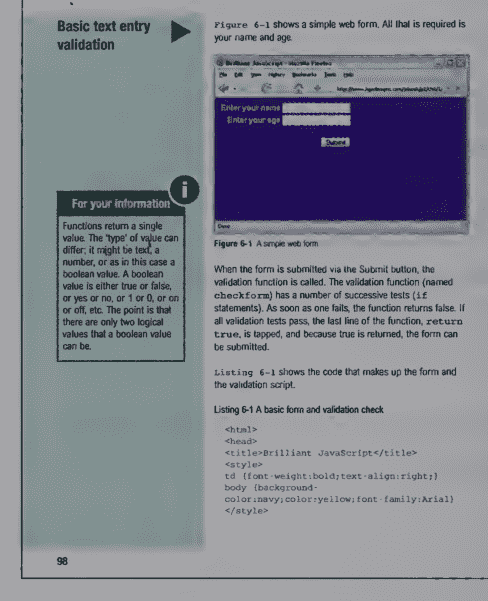

## 故障排除指南

本书提供了使用故障排除指南来诊断和解决你可能遇到的常见问题的快速便捷方法。问题按类别分组，并按字母顺序排列。

## 拼写

我们在全书中都使用了英式拼写约定。因此，你可能会注意到文本与你电脑上的软件（很可能是美国开发的）之间存在一些不一致之处。然而，对于“disk”和“program”这两个词，我们采用了美式拼写，因为它们在世界范围内已被普遍接受。

## 故障排除指南

| 操作和事件？ | 107 | Ajax | 什么是异步 JavaScript 和 XML（Ajax）？ | 229 |
|---|---:|---|---|---:|
| 什么是操作和事件？ | 108 | 异步协议和同步协议有什么区别？ | 230 |
| JavaScript 中有哪些可用的事件？ | 108 | 什么是 XML（可扩展标记语言）？ | 230 |
| 如何使用 onchange 事件？ | 110 | 如何使用 XMLHttpRequest 对象？ | 232 |
| 如何使用事件导航到新网页？ | 115 | 如何使用 innerHTML 和 responseText 属性？ | 234 |
| 如何使用 onclick 事件？ | 118 | 什么是 PHP？ | 234 |
| 如何使用 visibility 属性显示或隐藏网页的一部分？ | 118 | 数组 | 什么是数组？ | 79 |
| 如何使用 onkeyup 事件？ | 122 | 如何创建数组？ | 80 |
| 如何使用 ondblclick 事件？ | 122 | 如何处理单个数组元素？ | 82 |
| 如何使用 onfocus 和 onblur 事件？ | 127 | 如何对数组进行排序？ | 86 |
| 如何使用 setInterval 函数？ | 132 | 如何正确对数字数组进行排序？ | 89 |
| 如何使用 onmouseover 事件？ | 166 | 如何合并数组？ | 92 |
| 如何使用 setTimeout 函数？ | 151 | 什么是多维数组？ | 94 |
| 鼠标事件在图像鼠标悬停效果中如何使用？ | 166 |  |  |

## JavaScript 入门

### 简介

JavaScript 是一种客户端技术。这意味着任何 JavaScript 程序（或称为脚本）都在你的浏览器中运行。JavaScript 不在网络服务器上运行。考虑到这一点，JavaScript 是在浏览器本地执行任务的主要工具。其中最常见的是在网页上提供动画效果，以及验证输入到网页中的数据。

当然，JavaScript 还有许多其他用途，本书将展示其中许多。然而，首先要做的是，在本章中，你将学习脚本最基本的必要元素。同时，本章讨论了脚本可以放置在 HTML 代码中的各种位置。本章最后是一些任务，展示 JavaScript 如何处理两个主要的编程关注点——决策和顺序处理（或循环）。

- 学习脚本的基本元素
- 将脚本放置在 HTML 页面的 head 部分
- 使用内联脚本
- 链接到外部 JavaScript 文件
- 了解 JavaScript 中的条件编程如何工作
- 了解 JavaScript 中循环的使用
- 使用基本的调试技术

## 为什么 JavaScript 如此重要？

让网页在浏览器中显示的过程，涉及将信息从网络服务器发送到浏览器。数据类型可以包含多种内容。所有网页都有 HTML 代码，但也可以包括图形、基于小型应用程序的功能（如 Flash 影片）、小部件等等。

你在浏览器中看到的网页上发生的许多活动都依赖于 JavaScript 才能运行。换句话说，JavaScript 可以扮演帮助另一种技术工作的角色。一个常见的例子是使用 JavaScript 来检测你使用的浏览器，并调整信息的显示方式。

当信息从你的浏览器发送回网络服务器时，JavaScript 也至关重要。客户端验证是 JavaScript 的一个主要专长。JavaScript 可用于确保所有必填的表单字段都已填写，并且填写正确。当这种验证失败时，就会避免将数据发送回服务器，从而节省带宽，并且不会将任何不正确的数据放置在服务器上。

## 编写基本脚本

只有当浏览器识别出脚本并理解其内容时，脚本才能运行。`<script>` 和 `</script>` HTML 标签用于标识一个脚本块。使用这些标签是必要的，用以指示浏览器从哪里开始和停止解释 JavaScript 代码。在单个 HTML 代码页面中包含多个脚本块是完全可以接受的。这实际上提供了一种有用的方式，让脚本在网页的不同区域运行。脚本可以插入到网页的 head 或 body 部分。这些选项将在本章后面讨论。

通过利用 JavaScript 中的函数，你可以控制脚本何时运行；也就是说，你可以阻止脚本在页面加载到浏览器时运行。这种方法将在本书中多次展示。

清单 1-1 展示了一个带有 JavaScript 脚本的基本 HTML 网页。

### 清单 1-1 一个基本的 JavaScript

```html
<html>
<head>
<title>Brilliant JavaScript</title>
<style>
body {font-family:arial,helvetica,sans-
serif;font-weight:bold;background-
color:#ffffcc}
</style>
<script type="text/javascript">
  alert ("I am a basic javascript script,
and I'm loving it!");
</script>
</head>
<body>
</body>
</html>
```

> **术语表**
>
> **函数**是一个独立的编程例程。函数在需要时被调用运行。一个完美的例子是当你点击提交按钮来处理在线表单时。通常情况下，在这种情况下，当点击按钮这个动作发生时，一个验证例程就会运行。

> **重要**
>
> HTML `<script>` `</script>` 标签对可以包含其他脚本语言，例如 VBScript。但总的来说，JavaScript 是事实上的基于客户端的脚本语言。

## 编写基础脚本（续）

代码清单 1-1 中的大部分内容是 HTML。其中的基本 JavaScript 例程如下：

```javascript
<script type="text/javascript">
    alert("I am a basic javascript script,
    and I'm loving it!");
</script>
```

最少需要的有效 JavaScript 就存在于这短短的三行中。开始的 `script` 标签指定了要运行的脚本类型。当然，这个例子是 JavaScript！指定 JavaScript 的语法包含在 `type` 属性中，例如 `type="text/javascript"`。这个 `type` 属性被包含在开始的 `script` 标签内。

`alert` 命令告诉浏览器显示一个弹出消息窗口，窗口中的文本由 `alert` 命令指定。最后，脚本以结束的 `script` 标签（`</script>`）结束。图 1-1 显示了页面加载时出现的窗口消息。

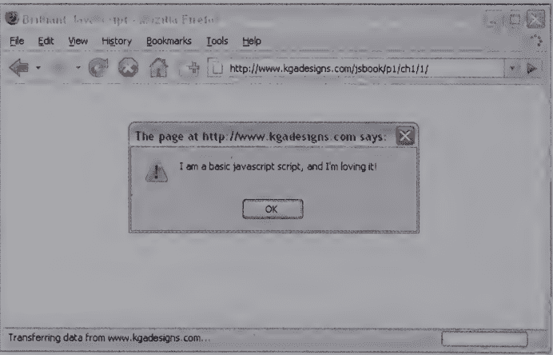

**图 1-1** 来自脚本的消息

## 编写基础脚本（续）

以下是运行这个精彩 JavaScript 示例的步骤：

1. 创建一个新的 HTML 网页，或打开一个现有的网页。
2. 在 head 部分，输入三行特定的 JavaScript 代码——开始和结束的 script 标签，以及中间的 `alert` 语句。
3. 保存 HTML 文件并在浏览器中打开它，或者如果页面已经打开，请刷新浏览器。

> **重要提示**
>
> JavaScript 以其挑剔、烦人的特性而闻名。即使是最无意的语法错误也会导致所有 JavaScript 失效。如果示例没有产生消息框，请仔细检查所有拼写是否正确，包括大小写是否一致（大写、小写）。同时检查是否有任何缺失的标点符号，例如缺少引号或括号，或者中间行末尾缺少分号。

## 将脚本放置在 head 部分

虽然脚本可以放置在网页的 head 或 body 中，但主要位置是 head。从组织的角度来看，这很有道理，特别是对于包含函数的脚本例程。函数的本质是从页面的另一个部分被调用，因此将函数放在 head 中可以将它们集中在一起，便于查看。

脚本放在 head 中的另一个方面是脚本输出的顺序和位置。将脚本放在 body 中会将脚本固定在其在 body HTML 中所在的位置运行并产生任何可见输出。相反，放在 head 中的 JavaScript 例程在页面加载时运行。这为在页面中设置图像或在浏览器中页面准备就绪时运行任何需要的处理提供了效率。

代码清单 1-2 显示了一个 HTML 页面的源代码。JavaScript 块位于 head 中。

**代码清单 1-2** 网页 head 部分中的 JavaScript 块

```html
<html>
<head>
<title>Brilliant JavaScript</title>
<style>
body {font-family:arial,helvetica,sans-serif;font-weight:bold;background-color:#ffffcc}
</style>
<script type="text/javascript">
document.write("Good Afternoon!");
</script>
</head>
<body>
<br />
<br />
Whether 'tis nobler in the mind to suffer
The slings and arrows of outrageous fortune,
Or to take arms against a sea of troubles
</body>
</html>
```

代码清单 1-2 中的代码在浏览器中显示文本。`Good Afternoon!` 是由 head 部分的 JavaScript 写入浏览器的。引用自莎士比亚《哈姆雷特》的文本是通过正常 HTML 处理呈现的纯文本。

参考图 1-2：

1. head 中的 JavaScript 块使用 `document.write` 操作在浏览器中显示文本。
2. body 中的文本根据其在 HTML 部分中的位置显示。

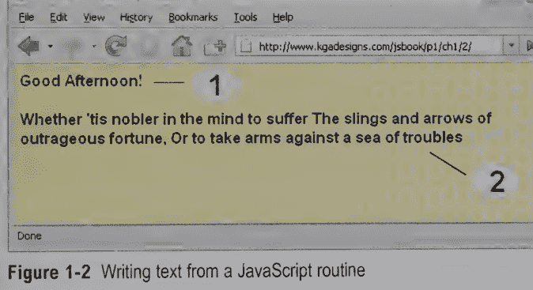

## 将脚本放置在 head 部分（续）

## 将 JavaScript 放置在网页 body 中

将 JavaScript 放置在网页的 body 中，其效果是 JavaScript 在 body 中其所在的位置串行运行。换句话说，body 部分开头的 JavaScript 例程会先于页面下方另一个 JavaScript 例程运行。

代码清单 1-3 显示了一个网页的代码，其中文本按照以下顺序写入浏览器：

1. `Good morning!` 由第一个 JavaScript 例程写入。
2. `If music be the food of love, play on` 是代码中的纯文本，并如此显示。
3. `I must be going now!` 由第二个 JavaScript 例程写入。

### 代码清单 1-3 文档正文中的多个 JavaScript 例程

> **供您参考**
>
> 此处展示的 JavaScript 例程使用 `document` 对象的 `write` 方法在浏览器中生成文本。本书将使用各种输出方法。

```html
<html>
<head>
<title>Brilliant JavaScript</title>
<style>
body {font-family:arial,helvetica,sans-serif;font-weight:bold;background-color:#ffffcc}
</style>
</head>
<body>
<script type="text/javascript">
document.write("Good morning!");
</script>
<br /><br /><br />
If music be the food of love, play on
<br /><br /><br />
<script type="text/javascript">
document.write("I must be going now!");
</script>
</body>
</html>
```

图 1-3 显示了代码清单 1-3 中代码的输出。上面提到的三个文本输出在图 1-3 中标出。文本的位置遵循 JavaScript 例程在代码中的位置。

## 将 JavaScript 放置在网页 body 中（续）

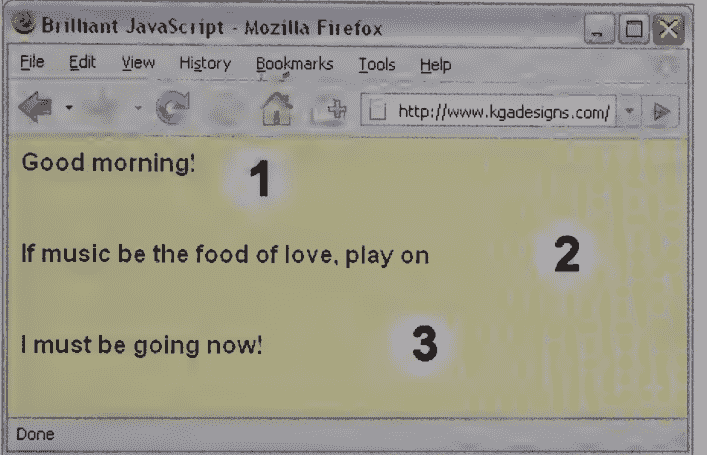

**图 1-3** JavaScript 生成的文本与纯文本的混合

## 使用外部 JavaScript 文件

编写网页时可以使用的一种强大技术是链接到外部代码文件。在可以链接的各种文件类型中，JavaScript 是主要的一种。CSS（层叠样式表）文件也经常被链接。

使用外部文件的最大优势是：假设你有几个网页都共享相同的元素，例如地址块、标志、导航栏或菜单。如果需要更改某个公共元素，将该元素链接到每个页面中，你只需在一个地方——外部文件中进行更改即可。这肯定比在每个单独的页面上进行更改要好得多。一开始，链接文件的概念可能令人困惑，但使用这种方法所花费的时间和精力很快就会显现出来。如果编写网页是你的兴趣所在，那么你最终会使用外部文件。真的，你会的。

> **供您参考**
>
> 语法创建了链接。只需使用 `src=` 构造以及外部文件名。如有必要，可以使用路径和文件名来指向外部文件。在此示例中仅提供了文件名，因此文件必须与网页在同一目录中。

那么这是如何工作的呢？代码清单 1-4 显示了一个 HTML 页面的代码。引用了两个链接的文件，在以下两行中：

```html
<script type="text/javascript"
src="makedate.js"></script>
<script type="text/javascript"
src="writetext.js"></script>
```

代码清单 1-4 显示了 HTML 页面的完整代码。代码清单 1-5 显示了 `makedate.js` 中包含的代码，代码清单 1-6 显示了 `writetext.js` 中包含的代码。

### 代码清单 1-4 引用了外部 JavaScript 文件的网页


```html
<html>
<head>
<title>Brilliant JavaScript</title>
<style>
body {font-family:arial,helvetica,sans-serif;font-weight:bold;background-color:#ffffcc}
</style>
<script type="text/javascript"
src="makedate.js"></script>
<script type="text/javascript"
src="writetext.js"></script>
</head>
<body>
<br /><br /><br />
A horse! A horse! My kingdom for a horse!
<br /><br /><br />
<form>
<input type="button" value="Click me"
onclick="writetext()" />
</form>
<div id="placeonpage"></div>
</body>
</html>
```

## 使用外部 JavaScript 文件（续）

### 代码清单 1-5 makedate.js 文件的内容

```javascript
var d=new Date();
var month=new Array(12);
month[0]="1";
month[1]="2";
month[2]="3";
month[3]="4";
month[4]="5";
month[5]="6";
month[6]="7";
month[7]="8";
month[8]="9";
month[9]="10";
month[10]="11";
month[11]="12";
document.write(month[d.getMonth()] + "/" +
d.getDate() + "/" + d.getFullYear());
```

### 代码清单 1-6 writetext.js 文件的内容

```javascript
function writetext() {
var placeonpage=document.getElementById
("placeonpage");
placeonpage.innerHTML="A Pie! A Pie! My
kingdom for a pie!";
}
```

## 使用外部 JavaScript 文件（续）

本示例中发生了一些关键事件。当页面加载时，`makedate.js` 文件中包含的 JavaScript 代码会运行。如清单 1-5 所示，`makedate.js` 的内容当然是 JavaScript，但没有任何代码包含在函数中。因此，代码会在浏览器加载页面时运行。图 1-4 展示了页面加载时的样子。

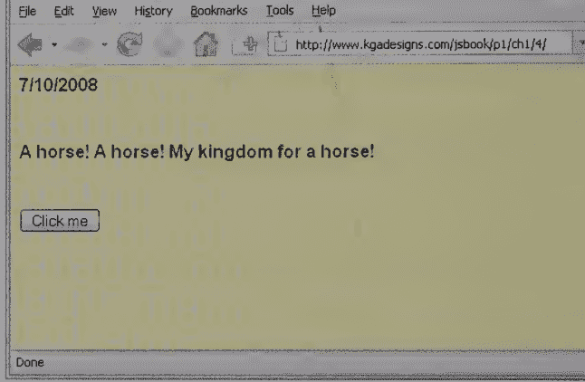

**图 1-4** 网页显示外部 `makedate.js` 文件的输出

`writetext.js` 文件不会在没有用户交互操作的情况下运行——即需要点击一个按钮才能让代码运行。如图 1-4 所示，网页加载时带有一个按钮。页面顶部的日期是由 `makedate.js` 文件中的脚本编写的，而文本则是来自网页本身的纯文本。点击按钮会运行 `writetext.js` 文件中的脚本。如清单 1-6 所示，`writetext.js` 包含一个 JavaScript 函数。函数在某些操作调用它时才会运行。本例中，按钮点击就是那个操作。显示按钮的代码行也包含了对外部文件的调用：

```html
<input type="button" value="Click me"
onclick="writetext()" />
```

`onclick` 操作调用了 `writetext()` 函数。该函数向页面写入了一行额外的文本，如图 1-5 所示。

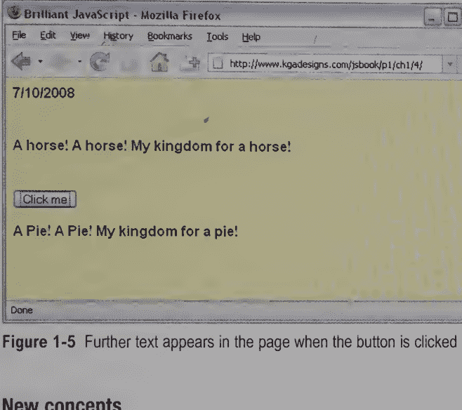

**图 1-5** 点击按钮后页面中出现更多文本

## 新概念

本示例中引入了一些关键的代码构造，因此这里快速概述一下：

- 外部 JavaScript 文件具有 `.js` 扩展名。
- HTML 的 `src` 标签用于将外部文件链接到页面。
- 包含在函数中的 JavaScript 代码，除非有操作或事件触发，否则不会运行。
- 调用函数运行的一种方式是使用（按钮的）`onclick` 事件。
- 使用 `getElementById` 将文本放置在特定位置（在 HTML 的 `<div></div>` 标签集中）（参见第 7 章）。

## 测试条件以确定输出


条件处理是编程的一个必要原则。所有编程语言都包含条件测试，本质上就是根据测试条件的结果采取一种或另一种行动。例如，如果页面加载时是一天中的早晨，则显示“早上好”；如果不是早晨，则显示不同的消息或执行其他操作。

条件测试可以简单到只需判断一个条件是真还是假（例如——10年或以上：是或否）。复杂的条件测试会测试一系列级联或嵌套的条件，并在找到正确结果时采取相应行动。

在 JavaScript 中有两种条件测试方法。一种方法使用 `if` 语句，以及其他关键字如 `else` 和 `else if`。使用 `if` 语句可以创建强大的代码，但编写代码以实现正确意图可能颇具挑战。另一种条件测试方法是 `switch` 语句。`switch` 语句易于理解。它列出了一系列可能的操作，并在满足某个条件时执行其中一个。

清单 1-7 展示了同时包含这两种类型条件测试的代码。此外，`if` 风格的测试以简单和复杂两种形式呈现。因此，总共进行了三种测试。

**清单 1-7 条件测试**

```html
<html>
<head>
<title>Brilliant JavaScript</title>
<style>
body {font-family:arial,helvetica,sans-serif;font-weight:bold;background-color:#ffffcc}
</style>
<script type="text/javascript">
var theday = new Date();
var thedayofweek = theday.getDay();
if (thedayofweek==6) {
document.write ("Today is Saturday");
} else {
    document.write ("Today is not Saturday");
}
document.write ("<br /><br />");
var thetime = theday.getHours();
if (thetime < 12) {
    document.write ("Good Morning!");
} else if (thetime > 11 && thetime < 18) {
    document.write ("Good Afternoon!");
} else {
    document.write ("Good Evening!");
}
document.write ("<br /><br />");
var themonth = theday.getMonth();
switch (themonth) {
    case 0:
        document.write ("The month is January");
        break;
    case 1:
        document.write ("The month is February");
        break;
    case 2:
        document.write ("The month is March");
        break;
    case 3:
        document.write ("The month is April");
        break;
    case 4:
        document.write ("The month is May");
        break;
    case 5:
        document.write ("The month is June");
        break;
    case 6:
        document.write ("The month is July");
        break;
    case 7:
        document.write ("The month is August");
        break;
    case 8:
        document.write ("The month is September");
        break;
    case 9:
        document.write ("The month is October");
        break;
    case 10:
        document.write ("The month is November");
        break;
    case 11:
        document.write ("The month is December");
        break;
    default:
        document.write ("Can't determine the month");
}
</script>
</head>
<body>
</body>
</html>
```

在清单 1-7 中，第一个测试用于简单的“是”或“否”条件：今天是星期六吗？

```javascript
if (thedayofweek==6) {
    document.write ("Today is Saturday");
} else {
    document.write ("Today is not Saturday");
}
```

第二个测试扩展了简单测试，以检查三种可能的结果：

```javascript
if (thetime < 12) {
  document.write("Good Morning!");
} else if (thetime > 11 && thetime < 18) {
  document.write("Good Afternoon!");
} else {
  document.write("Good Evening!");
}
```

在清单 1-7 中，`switch` 语句以 `switch (themonth)` 测试开始，然后列出一系列可能的情况。每个被测试的条件以 `case` 关键字开始，以 `break` 语句结束。最后，使用 `default` 关键字包含了一个选项，用于在前面的 `case` 块都不为真时提供要执行的操作。是否必须使用 `default` 作为默认选项取决于测试的内容。本例中测试的是当前月份的编号，并且数字月份的所有可能性都已列出。因此，在本例中，`default` 块永远不会被使用，但我将其放在这里以作说明。

图 1-6 展示了我的浏览器中的输出。显然，我截取这个屏幕时不是在星期六，也不是在早晨，并且是在七月。

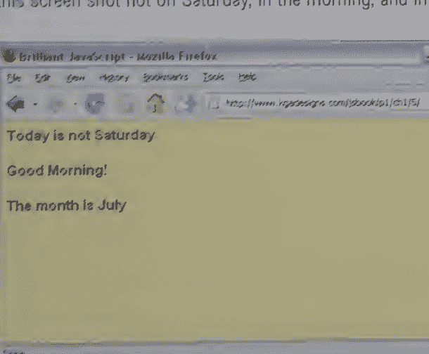

**图 1-6** 浏览器中的输出根据日期、时间和月份而变化

## 如何使用条件测试

- 决定使用哪种测试类型：`if` 或 `switch`。这是一个主观决定。一个很好的指导原则是，如果你有超过几种可能的结果，请使用 `switch` 语句。
- 使用 `if` 时，测试放在圆括号内，后面紧跟一个左花括号。右花括号结束 `if` 块。如果使用了 `else` 关键字，其周围也使用花括号。参见上面的示例。
- 使用 `switch` 时，同样要注意花括号，并且 `break` 语句以分号（`break;`）结束。
- 多个 `if` 语句可以嵌套或顺序排列使用。一组顺序的 `if` 语句与 `switch` 语句的工作方式非常相似。

## 循环入门

从语法上讲，循环的结构如下：

- `for` 语句将一个变量初始化为给定值，测试变量的值以确定是否继续循环，最后增加（或在需要时减少）变量的值。`for` 块如下所示：

```text
for (初始变量值; 变量的测试; 变量的值变化) {
    操作放在这里
}
```

- `while` 语句的结构是：初始化变量

```text
while (变量的测试) {
    操作放在这里
    递增或递减变量的值
}
```

- `do while` 循环的结构是：初始化变量

```text
do {
    操作放在这里，包括变量的递增或递减
}
while (测试变量)
```

## 使用循环运行重复操作

抱怨那些平凡琐碎的事情吧。毫无疑问，一个过程越重复，就越枯燥。幸运的是，我们有计算机来完成这些工作！与任何编程语言一样，循环执行代码的能力是 JavaScript 的核心特性。循环是通过 `for` 语句或 `while` 语句，或者使用所谓的 `do while` 循环来实现的。

`while` 循环和 `do while` 循环之间有一个简洁的区别。区别在于测试执行的位置，是在循环的开始还是在循环的结束。这为如何应用被测试变量的值提供了选择。例如，当变量测试结果为 false 时，不再进行迭代（测试在循环开始处）；或者完成包含使测试结果为 false 的变量的那次迭代（测试在循环结束处）。如果这让你感到困惑，那么正常，因为它确实很绕！无论你在开始还是结束处进行测试其实并不重要，因为你总是可以改变变量被测试的方式。`while` 循环的这两种变体之所以存在，可能是因为大多数其他编程语言中也存在这些变体。无论如何，`for` 循环要受欢迎得多。示例 1-8 包含了一个使用这三种循环类型的网页代码。

### 示例 1-8 一个充满循环方法的页面

```html
<html>
<head>
<title>Brilliant JavaScript</title>
<style>
body {font-family:arial,helvetica,sans-serif;font-weight:bold;background-color:#ffffcc}
</style>
<script type="text/javascript">
for (i=2;i<=1024;i=i*2) {
    document.write (i + " ");
}
document.write ("<br /><br />");
var i=3;
while (i<=1000) {
    document.write (i + "&nbsp;&nbsp;&nbsp;&nbsp;");
    i = i * 3;
}
document.write ("<br /><br />");
loopcount=1;
document.write("<br />12 Numbers in the Fibonacci Sequence");
x=0;
y=1;
do {
    loopcount=loopcount + 1;
    z = y + x;
    x=y;
    y=z;
    document.write("<br />" + z);
}
while (loopcount<13)
</script>
</head>
<body>
<br>
</body>
</html>
```

仔细观察 `for` 循环，很明显变量被用于向浏览器写入的操作中。只要 `i` 等于或小于 1024，就写入 `i` 的值及其后跟一个空格：

```javascript
for (i=2;i<=1024;i=i*2) {
  document.write (i + " ");
}
```

**图 1-7** 浏览器中列出 2 的幂、3 的幂以及斐波那契数列前 12 个数字的输出结果

这两个 `while` 循环的使用方式类似。图 1-7 显示了该页面在浏览器中的输出方式。

循环将重复一个过程，直到达到固定的迭代次数或满足预期条件。一种良好的编程方法是在发生意外情况时采取适当的操作。例如，假设一个循环正在遍历许多员工记录以计算他们的周薪。公式是时薪乘以工作小时数。一名工人误输入了负数的工作小时数。这是错误的数据。处理这种情况的一种方法是停止循环处理并报告错误。

## 跳出循环

示例 1-9 显示了一个计算六名员工周薪的脚本。为了简单起见，他们的时薪均为 20 英镑。这个数字在脚本中是硬编码的。

**供参考**

此脚本使用了数组。数组是相似信息片段的集合。例如，`employees` 数组包含员工的名字。第 5 章将讨论并应用数组。

### 示例 1-9 使用循环计算员工周薪金额


```html
<html>
<head>
<title>Brilliant JavaScript</title>
<style>
body {font-family:arial,helvetica,sans-serif;font-weight:bold;background-color:#ffffcc}
</style>
<script type="text/javascript">
var employees = new Array("Aaron", "Amy", "Bill", "Betsy", "Craig", "Cindy");
var hours = new Array(36, 32, 24, 28, -32, 24);
var count = employees.length;
for (i=0;i<count;i++) {
  week_income= hours[i] * 20;
  document.write (employees[i] + " earned &#163;" + week_income + ".");
  document.write ("<br />");
}
</script>
</head>
<body>
</body>
</html>
```

图 1-8 显示了示例 1-9 中脚本的输出。如可见，Craig 被报告赚到了 -640 英镑。Craig 对此不会感到高兴！更严重的问题是，雇主需要知道该过程可能会返回错误的数据。

现在使用 `if` 语句来测试错误结果。在 `if` 语句内部是一个 `break` 语句，如果 `if` 语句中测试的条件满足（如果计算出的金额小于零），它将强制处理过程退出循环。示例 1-10 是示例 1-9 中程序的更新版本，`if` 语句被嵌套在循环内部。

### 示例 1-10 如果计算出错误结果则跳出循环

```html
<html>
<head>
<title>Brilliant JavaScript</title>
<style>
body {font-family:arial,helvetica,sans-serif;font-weight:bold;background-color:#ffffcc}
</style>
<script type="text/javascript">
var employees = new Array("Aaron", "Amy", "Bill", "Betsy", "Craig", "Cindy");
var hours = new Array(36, 32, 24, 28, -24, 24);
var count = employees.length;
for (i=0;i<count;i++) {
  week_income= hours[i] * 20;
  if (week_income<0 || isNaN(week_income))
  {
    document.write("<br />");
    document.write("Error while processing the salary for " + employees[i]);
    break;
  }
  document.write ( employees[i] + " earned &#163;" + week_income + ".<br />");
}
</script>
</head>
<body>
</body>
</html>
```

如图 1-9 所示，程序捕获了错误的数据计算，停止了循环，并将错误信息写入浏览器窗口。

**图 1-9** 捕获错误并报告

**供参考**

示例 1-10 中的脚本包含一个奇怪的函数——`isNaN`——它的意思是 “is not a number”（不是一个数字）。

## 调试 JavaScript

逻辑错误和错误结果的捕获由你的代码处理。但语法错误怎么办？这些是编码本身的问题，例如关键字拼写错误、漏掉闭合花括号等等。

正如许多 JavaScript 开发人员所证明的，调试语法和不正确的编码结构是出了名的令人沮丧。由于 JavaScript 在浏览器中运行，因此必须在浏览器中使用任何可用的调试工具。由于有许多浏览器可用，因此没有统一的调试平台标准。在本节中，我将向您展示几种技巧，以及在两种不同流行浏览器中可以期待的结果。

首先，示例 1-11 显示了一个带有错误的脚本。有些东西缺失了，你的眼睛可能捕捉不到它。

### 示例 1-11 此脚本包含语法错误

```html
<script type="text/javascript">
var theday = new Date();
var dayofweek = theday.getDay();

switch (dayofweek) {
    case 0:
        dd="Sunday";
        break;
    case 1:
        dd="Monday";
        break;
    case 2:
        dd="Tuesday";
        break;
    case 3:
        dd="Wednesday";
        break;
    case 4:
        dd="Thursday";
        break;
    case 5:
        dd="Friday";
        break;
    case 6:
        dd="Saturday";
        break;
    default:
        document.write ("Can't determine the day of the week");
}
document.write("Today is " + dd);
</script>
```

如果还不清楚哪里出错了，那么在浏览器中运行时显示错误会有所帮助，如图 1-10 所示。

图 1-10 调试帮助

图 1-10 上方显示的是 Firefox 2，下方显示的是 Internet Explorer 6。每个浏览器的顶部都是一个错误报告窗口。每条错误消息都正确地识别了出错的行，即在以下行中 `Today` 一词之前缺少一个引号：

```javascript
document.write(Today is " + dd);
```

## 调试 JavaScript（续）

有时你会遇到一些错误，它们并非源于错误的语法，而是源于不正确但形式上合法的语法。清单 1-12 展示了一段验证脚本的部分内容。

### 清单 1-12 没有语法错误，但仍然无法工作

```javascript
function checkform(f) {
  if (f.elements["txtFirstName"].value.
  replace(/\s/g, "")=="") {
    alert ("Please fill in your first name");
    f.elements["txtFirstName"].focus();
    return false;
  }
  if (f.elements["txtLastName"].
  value.replace(/\s/g, "")=="")仁 {
    alert ("Please fill in your last name");
    f.elements["txtLastName"].focus();
    return false;
  }
}
```

这段代码用于检测网页上的名字和姓氏输入框是否已填写。在实际使用中，姓氏验证确实会弹出提示信息警告未填写姓氏的用户，但名字却可以留空并通过验证。

所有代码在语法上都是正确的。在这种情况下，一种方法是在代码行间插入 `alert` 消息，看看哪些会显示。清单 1-13 展示了修改后的代码。

### 清单 1-13 使用 alert 语句诊断问题

```javascript
function checkform(f) {
  alert ("1");
  if (f.elements["txtFirstName"].value.
  replace(/\s/g, "")=="") {
    alert ("Please fill in your first name");
    f.elements["txtFirstName"].focus();
    alert ("2");
    return false;
    alert ("3");
  }
  alert ("4");
  if (f.elements["txtLastName"].value.
  replace(/\s/g, "")=="") {
    alert ("Please fill in your last name");
    f.elements["txtLastName"].focus();
    return false;
  }
}
```

编号后的 `alert` 语句被放置在可疑的问题区域各处。再次运行这个示例时，会依次显示 `alert 1` 和 `alert 4`。由于 `alert 2` 和 `alert 3` 从未出现，很容易得出检测名字的那整块代码都没有被执行的结论。这使得注意力可以集中到这行代码块的开头部分，问题很快便被识别出来。不知出于什么原因，测试输入的那一行没有正确工作。经检查发现，行末的 `=="")` 应该是 `=="");`，就像姓氏测试中的那样。这个测试被设置成了赋值而非比较。

> **你知道吗？**
>
> ### 理解比较与赋值的区别
>
> 学习 JavaScript 时一个较难理解的概念是等号的使用。一个等号用于赋值。例如 `A=B` 表示将 `B` 设为与 `A` 相等。使用两个等号时，是比较两个值并返回 `true` 或 `false` 的结果。因此如果 `A=10` 且 `B=10`，那么 `A==B` 为 `true`。顺便一提，要测试两个变量是否不相等，请使用 `!=` 运算符。

## 文本处理

### 简介

学习如何操作文本可以为你的网页提供丰富的方法应用。你可以让 JavaScript 返回简单的字符计数，或者做一些更复杂的事情，比如打乱单词顺序、制作变位词。

从技术角度来说，JavaScript 有一个专门的 `String` 对象。对象具有属性和方法。例如，`length` 是文本字符串的一个属性。它说明了文本的相关信息。方法则是对文本字符串执行某种操作。`replace` 方法用于将某些字符替换为其他字符。`concat` 方法将文本字符串连接成一个。在本章中，你将学习如何使用这些属性和方法。

### 你将做什么

- 计算单词或短语的长度
- 提取文本字符串的一部分——子字符串
- 去除首尾空格
- 测试文本字符串是否存在于更大的文本字符串中
- 替换文本
- 组合文本
- 将文本字符串拆分为更小的字符串

## 典型的文本应用

拆分文本、更改文本以及执行其他操作通常是必需的步骤。最基本的属性——`length`——可用于确保单词或短语的字符数正确。电话号码、邮政编码等都需要符合特定的长度。

一些关键方法包括：

- `concat`——连接字符串
- `split`——拆分字符串
- `replace`——将一段文本替换为另一段文本
- `substr`——提取字符串的一部分

> ### 术语解释
>
> **字符串（string）**与**文本（text）**同义。这两个词可以互换使用，但也可以作为一个单一实体来指代——文本字符串（text string）。

检查字符数量有多种原因。检查数量的典型场景是在提交网页表单时。字符计数是验证的重要组成部分，例如：

- 检查必填字段的字符数不为 0
- 检查某些类型的数据是否符合预期长度
- 检查输入的文本字符串是否超过合理的 `perceived` 长度

上述最后一点有助于避免恶意行为。一些狡猾的黑客或身份盗窃者可能试图通过表单的输入框发送数据库查询，试图让服务器返回敏感信息。因此，将名字等字段允许输入的字符数限制为 25 个字符左右，可以让验证检查拒绝任何超过该长度的输入。大多数数据库查询都必须比这更长。

`length` 属性返回文本字符串的字符数。图 2-1 展示了一个简单的表单来演示这一点。

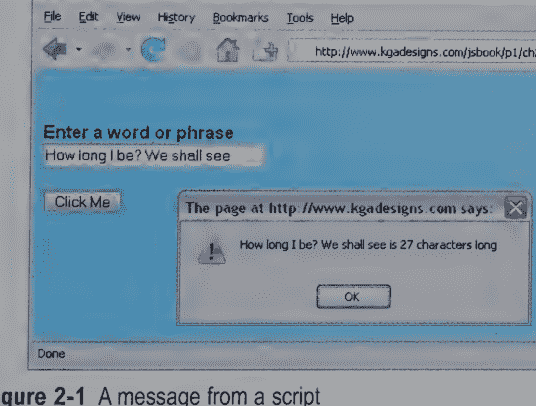

在这个例子中，输入一个单词或短语并点击按钮。弹出消息会显示字符数。清单 2-1 包含了构成这个精彩演示的 HTML 和 JavaScript。

## 计算文本字符串中的字符数

### 清单 2-1 字符计数

```html
<html>
<head>
<title>Brilliant JavaScript</title>
<style>
body {font-family:arial,helvetica,sans-serif;font-weight:bold;
      background-color:#aaddff}
</style>
<script type="text/javascript">
function countme() {
  t=document.getElementById("text1").value;
  alert (t + " is " + t.length + " characters long");
}
</script>
</head>
<body>
<br /><br />
<form name="form1" onSubmit="countme()">
Enter a word or phrase<br />
<input type="text" id="text1" size="30" />
<br /><br />
<input type="submit" value="Click Me" />
</form>
</body>
</html>
```

这个例子的核心在于 `countme` 函数。在这个函数中，变量 `t` 被设置为输入框中的文本，然后使用 `alert` 显示字符数，通过 `length` 属性实现：

```javascript
t=document.getElementById("text1").value;
alert (t + " is " + t.length + " characters long");
```

由于这发生在一个函数中，需要某些动作来调用该函数以触发计数。调用动作发生在点击按钮时。这会提交表单；在 `form` 标签中，`onsubmit` 事件就是调用该函数的触发点：

```html
<form name="form1" onSubmit="countme()">
```

> ### 供你参考
>
> #### 值得考虑的事项
>
> `length` 属性计算字母、数字、标点和空格。空格可能是个问题。如果在表单中输入了 10 个空格，字符计数会是 10，即使看起来什么都没有。许多编程语言都有 `trim` 函数，用于去除文本字符串开头和/或结尾的空格。JavaScript 没有 `trim` 函数。不过，使用 `substring` 方法稍加巧妙处理就可以实现。接下来 ...

## 计算文本字符串中的字符数（续）

## 获取文本字符串的一部分

有两种类似的方法用于提取文本字符串的一部分：

- `substr`——从给定的起始位置提取指定数量的字符
- `substring`——提取给定起始和停止位置之间的字符。

清单 2-2 展示了这两种方法的实际应用。这里的输出在点击按钮后写入页面。“Click Me”按钮的点击事件目标是 `extract()` JavaScript 函数。输入文本框中的短语有两个部分会显示在页面上。第一行 “A rose” 使用 `substr` 方法放置，“is a rose”则使用 `substring` 方法从短语中提取。

这五行 %% 的提取函数的内容：

```javascript
mytext=document.getElementById("text1").
value;
va铭 place1=document.getElementById
("place1");
va铭 place2=document.getElementById
("place2");
place1.innerHTML=mytext.substr(0,6);
place2.innerHTML=mytext.substring(17,40);
```

逐行说明如下：

1. 将文本框中的文本存储在名为 `mytext` 的变量中。
2. 将变量 `place1` 设置为表示同名的 `div` 部分（参见第 7 章）。
3. 将变量 `place2` 设置为表示同名的 `div` 部分。
4. 使用 `substr` 方法提取前 6 个字符，将 `place1` 的 `innerHTML` 属性设置为 “A rose”。
5. 使用 `substring` 方法提取从第 18 个位置到字符串末尾的所有字符，将 `place2` 的 `innerHTML` 属性设置为 “is a rose”。

> **供你参考**
>
> 通常，涉及定位的方法使用基于零的索引系统。因此 `substr` 中的第一个字符从 0 位置开始。`substring` 方法中的第一个数字也是基于零索引的，所以位置 17 对应第 18 个字符。`substring` 方法中的第二个数字被设置为高于字符总数的值。这是一种快速提取到字符串末尾所有字符的方法。

### 清单 2-2 隔离文本字符串的部分内容


```html
<html>
<head>
<title>Brilliant JavaScript</title>
<style>
body {font-family:arial,helvetica,sans-serif;font-weight:bold;
        background-color:#bbddaa}
</style>
<script type="text/javascript">
function extract() {
   mytext=document.getElementById
   ("text1").value;
   var place1=document.getElementById
   ("place1");
   var place2=document.getElementById
   ("place2");
   place1.innerHTML=mytext.substr(0,6);
   place2.innerHTML=mytext.substring (17,40);
}
</script>
</head>
<body>
<br />
<form name="form1" >
Enter a word or phrase<br />
<input type="text" id="text1" value="A rose
is a rose is a rose" size="30" />
<br /><br />
<input type="button" value="Click Me"
onclick="extract()" />
</form>
<hr />
<div id="place1"></div>
<br />
<div id="place2"></div>
</body>
</html>
```

## 获取文本字符串的一部分（续）

图 2-2 展示了生成的网页。

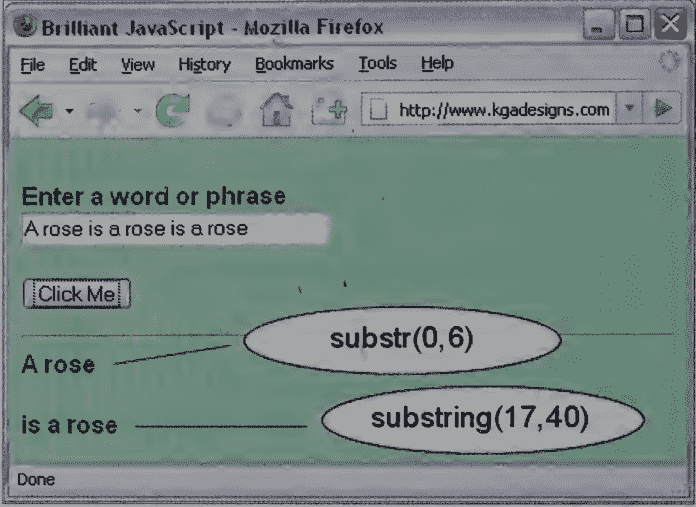

图 2-2 在网页上放置文本片段

## 创建自定义 `trim` 方法

清单 2-3 包含一个 JavaScript 函数 `trim`，该函数会移除输入文本开头和/或末尾的空格。这里使用了两个 `while` 循环。第一个移除前导空格，第二个移除尾随空格。

## 清单 2-3 获取一个 `trim`

```html
<html>
<head>
<title>Brilliant JavaScript</title>
<style>
body {font-family:arial,helvetica,sans-serif;font-weight:bold;
    background-color:#bbddaa}
</style>
<script type="text/javascript">
function trim(mytext) {
  mytext=document.getElementById
  ("text1").value;
  startlength=mytext.length
  var result=document.getElementById("result");
  // repeat as long as the first position is a space
  while (mytext.substring(0,1) == ' ') {
    // the first character (a space) is removed
    mytext = mytext.substring(1, mytext.length);
  }
  // repeat as long as the last position is a space
  while (mytext.substring(mytext.length-1, mytext.length) == ' ') {
    // the last character (a space) is removed
    mytext = mytext.substring(0,mytext.length-1);
  }
  result.innerHTML=mytext + " had " + startlength + " characters and now has " + mytext.length;
}
</script>
</head>
<body>
<br />
<form name="form1" >
Enter a word or phrase<br />
<input type="text" id="text1" size="30" />
<br /><br />
<input type="button" value="Click Me" onclick="trim()" />
</form>
<hr />
<div id="result"></div>
</body>
</html>
```

## 获取文本字符串的一部分（续）

图 2-3 展示了输入的文本具有前导空格（尾随空格也有，但你看不到）。按钮已被点击，运行了该函数——该函数报告了处理前后的字符数。

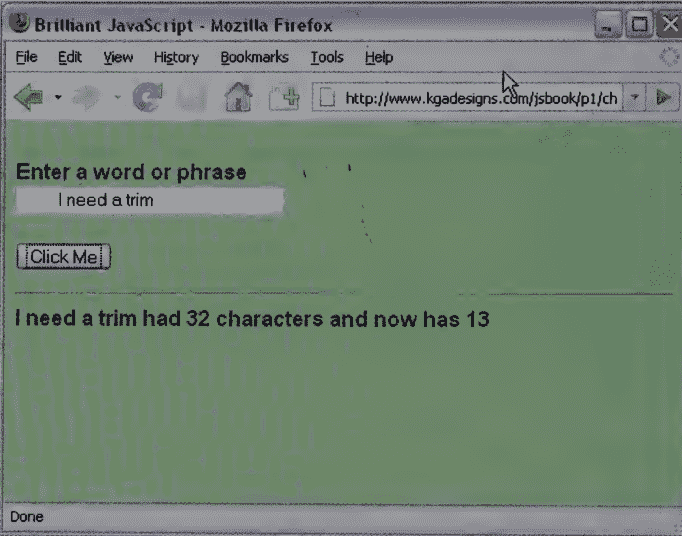

图 2-3 去除空格

在某些应用中，有必要查看一个文本字符串是否存在于另一个文本字符串中。此外，如果在一个较大的字符串中找到了一个较小的字符串，那么它在较大字符串中的起始位置是哪里？

例如，库存和会计系统以使用字母数字字符串作为重要数据的容器而闻名。例如，`MMW672D22R` 这个字符串中可能包含一个零件识别码。

清单 2-4 包含一个 JavaScript 例程，它测试较大的字符串中是否包含两个零件编号 `D24` 和 `D22`。这里使用了 `indexOf` 方法。如果较小的字符串存在于较大的字符串中，`indexOf` 将返回其起始位置（基于零的索引）。如果未找到该字符串，则该方法返回 `-1`。在脚本中，`if` 语句测试这些零件编号，并将相应结果写入页面。

## 查找字符串在较大字符串中的起始位置

处理文本 39

## 查找字符串在较大字符串中的起始位置（续）

```html
<html>
<head>
<title>Brilliant JavaScript</title>
<style>
body {font-family:arial,helvetica,sans-serif;font-weight:bold;background-color:#eeffee}
</style>
<script type="text/javascript">
var biglongstring="MMW672D22R";
startpos=biglongstring.indexOf("D24");
if (startpos==-1) {
    document.write ("<br />Part D24 not found");
} else {
    document.write ("<br />Part D24 starts at position " + (startpos + 1));
}
startpos=biglongstring.indexOf("D22");
if (startpos==-1) {
    document.write ("<br />Part D22 not found");
} else {
    document.write ("<br />Part D22 starts at position " + (startpos + 1));
}
</script>
</head>
<body>
</body>
</html>
```

这个较大的字符串被赋值给一个恰如其名的变量 `biglongstring`。下一行包含使用 `indexOf` 的测试，其结构是作为较大字符串的一个方法，括号内是待搜索的字符串：

```javascript
var biglongstring="MMW672D22R";
startpos=biglongstring.indexOf("D24");
```

图 2-4 展示了输出结果。由于该脚本不是一个函数，它在页面加载时运行。

> **供您参考**
>
> 由两个单词连接而成的 JavaScript 语句，例如 `index` 和 `of`，通常采用首字母小写、第二个单词首字母大写的驼峰式结构；因此我们有：`indexOf`。JavaScript 是一种区分大小写的语言。

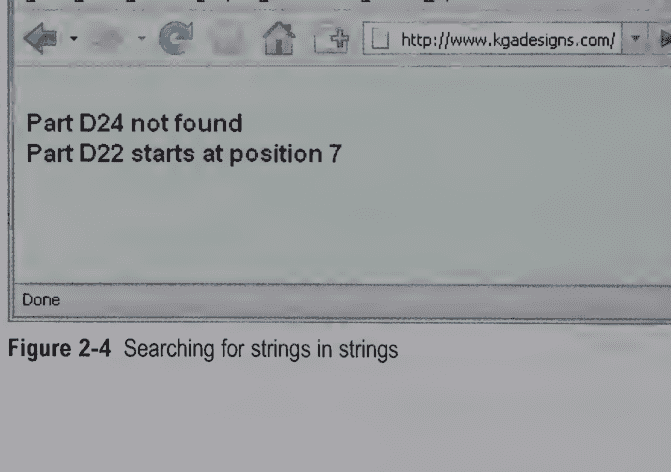

图 2-4 在字符串中搜索字符串

JavaScript 字符串对象包含一个 `replace` 方法。在很多情况下，替换文本都很有用。我马上想到一个例子——更改个人信息。一个人结婚了，需要更改姓氏。某人搬家了，地址需要更新，等等。

清单 2-5 提供了一个关于 `replace` 方法的简单示例。该例程将 `'Jack and Jill went for a jog'` 替换为 `'Walter and Wendy went for a walk'`。

## 清单 2-5 替换文本

```html
<html>
<head>
<title>Brilliant JavaScript</title>
<style>
body {font-family:arial,helvetica,sans-serif;font-weight:bold;background-color:#cceeee}
</style>
<script type="text/javascript">
var output=" ";
mytext="Jack and Jill went for a jog";
output=output + mytext + "<br /><br />";
mytext=mytext.replace("Jack","Walter");
mytext=mytext.replace("Jill","Wendy");
mytext=mytext.replace("jog","walk");
output=output + mytext + "<br /><br />";
document.write (output);
</script>
</head>
<body>
</body>
</html>
```

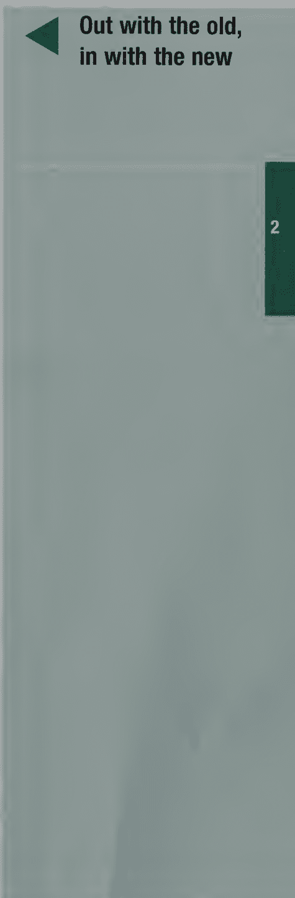

## 辞旧迎新（续）

图 2-5 展示了处理前后的文本字符串。

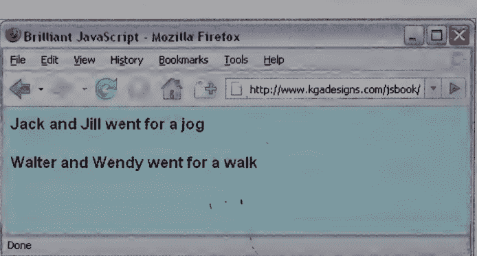

图 2-5 文本已替换

`replace` 方法是区分大小写的。在清单 2-5 的代码中，`walk` 替换了 `jog`，如下所示：

```javascript
mytext=mytext.replace("jog","walk");
```

如果碰巧代码中的 `jog` 写成了 `Jog` 或 `JOG`，替换就不会发生。不过，大小写敏感性可以被覆盖。要应用大小写不敏感性，需要给待替换的字符串加上一个开关 `i`。此外，字符串不用引号括起来，而是夹在斜杠之间：

```javascript
mytext=mytext.replace(/JOG/i,"walk");
```

由于 `JOG` 在斜杠内，并且第二个斜杠后面有一个小写的 `i`，替换仍然会生效。

任意数量的文本字符串都可以组合成一个更长的字符串。有两种方法可以实现。一种是使用连接运算符 `+` 来连接它们——加号用于数学运算，但不适用于单词！这个简短的脚本演示了使用连接运算符：

```javascript
<script type="text/javascript">
    text1="Putting";
    text2="words";
    text3="together";
    document.write(text1 + " " + text2 + " " + text3)
</script>
```

此脚本的输出为 `'Putting words together'`。

另一种方法是使用 `concat` 方法。使用一次 `concat` 可以将多个字符串连接在一起。清单 2-6 包含一个脚本，该脚本使用 `concat` 方法组合各个字符串。为了强调考虑两个单词之间的空格本身也是一个字符串的重要性，该脚本显示了两个连续的弹出窗口。第一个单词之间没有空格，第二个则有空格。

## 清单 2-6 组合文本字符串

```html
<html>
<head>
<title>Brilliant JavaScript</title>
<style>
body {font-family:arial,helvetica,sans-serif;font-weight:bold;
    background-color:#cceeee}
</style>
<script type="text/javascript">
    text1="Putting";
    text2="words";
    text3="together";
alert (text1.concat(text2, text3));
alert (text1.concat(" ",text2," ", text3));
</script>
</head>
</html>
```

## 合并文本（续）

```html
<body>
</body>
</html>
```

`concat` 方法作为第一个字符串的成员被调用，然后在该方法内部列出其他字符串：

```javascript
text1.concat(" ",text2," ", text3)
```

图 2-6 展示了连续的两个警报弹窗。显然，第二个在可读性方面要好得多。

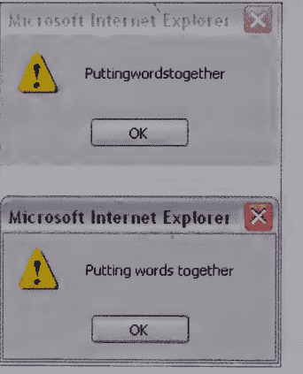

如上所示，文本字符串可以用 `concat` 方法合并。相反的操作则通过 `split` 方法完成。需要注意的是，使用 `split` 时，你必须选择哪个字符用作拆分字符串的标记。

想象一个用逗号分隔但没有空格的名字列表：

`Zak,Yvette,Xavier,Woodrow,Vernon,Usher,Terry-Ann`

将它们分开很容易，因为逗号就是用于将名字拆分成独立字符串的字符。为了增加一点趣味性，本示例将字符串拆分开，并将分离的名字填充到一个数组中。请参见清单 2-7。

## 清单 2-7 用拆分字符串填充数组

```html
<html>
<head>
<title>Brilliant JavaScript</title>
<style>
body {font-family:arial,helvetica,sans-serif;font-weight:bold;
    background-color:#ffff00}
</style>
<script type="text/javascript">
var friends="Zak,Yvette,Xavier,
Woodrow,Vernon,Usher,Terry-Ann";
var friend_array = new Array;
friend_array=friends.split(",");
for ($i=0;$i<friend_array.length;$i++) {
    document.write (friend_array[$i] + "<br />");
}
</script>
</head>
<body>
</body>
</html>
```

## 分解很简单（续）

`friend_array` 被赋予了朋友们的名字，然后使用 `for` 循环逐行显示它们：

```javascript
friend_array=friends.split(",");
for ($i=0;$i<friend_array.length;$i++) {
    document.write (friend_array[$i] + "<br />");
}
```

输出如图 2-7 所示。

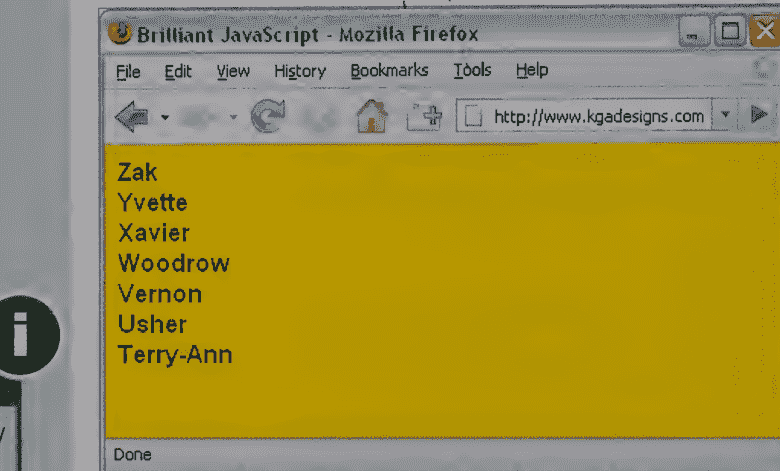

> **供你参考**
>
> 如果你选择使用空字符串（`""`）作为分隔符，那么字符串将被拆分成所有单个字符。

> **术语解释**
>
> 分隔符也称为**定界符**。常见的定界符包括逗号、分号、空格和制表符，但只要在整个较大字符串中保持一致，任何字符都可以用作定界符。

# 处理数字和数学运算

## 介绍

计算无处不在，所有应用程序中都充满了计算，网页也不例外。HTML 本身不具备操作、计算或汇总数据的能力。但想想网络上所有的计算器、投票、图表以及其他基于数字的界面。这一切背后肯定有数学在进行！

实际上，数学运算发生在两个地方：服务器端和浏览器端。基于浏览器的计算由 JavaScript 管理。JavaScript 有专门的 `Number` 和 `Math` 对象。借助这两个强大的工具，浏览器可以提供相当丰富的数字处理能力。

- 复习数学运算符及其优先级
- 学习各种舍入方法
- 计算数字的幂
- 使用随机数

## 操作运算符

乘法、除法、加法和减法使用标准运算符：`*`、`/`、`+`、`-`。

除此之外，进一步的数学运算符和操作在不同的编程语言中可能有所不同，因此这里总结了 JavaScript 如何处理一些常见的数值项：

- `%` 是取模运算符（返回除法运算的小数部分）
- `++` 使数字递增
- `--` 使数字递减
- `PI` 返回圆周率的值
- `sqrt(x)` 返回 `x` 的平方根
- `pow(x, y)` 返回 `x` 的 `y` 次幂

## 基本数学运算

JavaScript 中的四种主要数学运算与你桌上计算器的运算一样标准。这里没有意外。话虽如此，清单 3-1 展示了一个运行基本数学运算的脚本。

## 清单 3-1 基本数学运算


```html
<html>
<head>
<title>Brilliant JavaScript</title>
<style>
body {font-family:arial;font-weight:bold;background-color:#ffffcc}
</style>
<script type="text/javascript">
x=5;
y=10;
z=20;
document.write("x=" + x + " y=" + y + " z=" + z + "<br /><br /><br />");
document.write("x + y + z = " + (x + y + z) + "<br /><br />");
document.write("x * y * z = " + (x * y * z) + "<br /><br />");
document.write("(x + y) * z = " + ((x + y) * z) + "<br /><br />");
document.write("(z - x) * z = " + ((z - x) * z) + "<br /><br />");
document.write("(x + y + z) / (x * x) = " + ((x + y + z) / (x * x)) + "<br /><br />");
document.write("(y * y / z) / (x-z/x) + x = " + ((y * y / z) / (x-z/x) + x) + "<br /><br />");
</script>
</head>
<body>
</body>
</html>
```

> **重要**
>
> 在此示例中，`document.write` 行将文本与计算出的数值结果组合在一起。为了使数字被当作数字而非文本字符处理，需要在整个数学公式外加上额外的一组括号。
>
> 如果你愿意，可以用计算器复核一下答案。记住要遵循括号的顺序！

## 基本数学运算（续）

图 3-1 显示了清单 3-1 中脚本的输出。

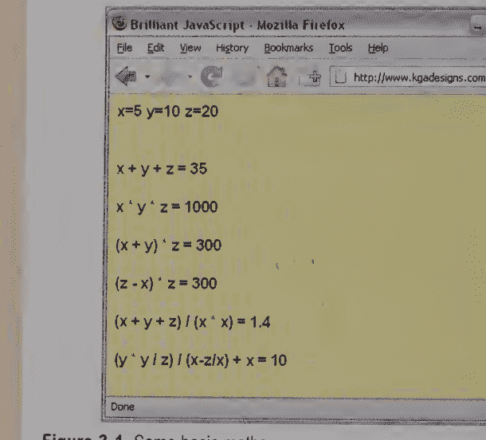

## 遵循运算符顺序

这是一个快速复习数学中括号在公式中如何使用的好时机。括号的优先级高于数学运算符，这意味着带有括号的计算会首先被求值。一些例子：

`2 * 3 + 4 = 10`

`(2 * 3) + 4 = 10`（在这种情况下，括号没有改变计算的顺序）

`2 * (3 + 4) = 14`

`5 + 6 / 8 + 9 = 14.75`

`(5 + 6) / 8 + 9 = 10.375`

`(5 + 6) / (8 + 9) = 0.647`

## 舍入处理

舍入数字对于展示很有用。例如，说“我口袋里有55磅”比说实际上你有“55磅10便士”要好。这就是一个向下舍入的例子。舍入可以通过多种方式进行。以下是一些例子：

- 55.10 向下舍入等于 55
- 55.10 向上舍入等于 56
- 55.10 截断等于 55（这里截断是指去掉数字的小数部分）
- 55.1839 舍入到三位小数等于 55.184
- 55.1839 舍入到两位小数等于 55.18

在 JavaScript 中，以下函数用于舍入：`floor`、`ceil`、`round` 和 `toFixed`。

图 3-2 展示了这两个值如何用这些函数处理。

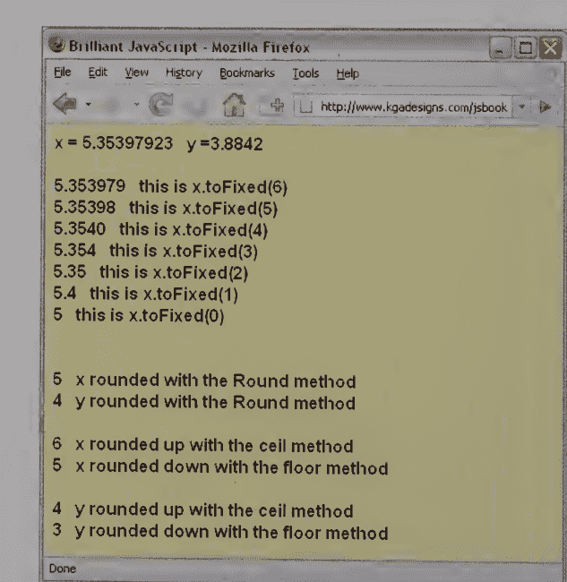

图 3-2 中 x 的值被故意设置为第一个小数位（3）较低的数字，y 的值被故意设置为第一个小数位（8）较高的数字。`round` 方法简单地将数字四舍五入到最近的整数，而不管小数位数是多少。这对于快速将带有多位小数的数字更改为最接近的整数很有用。为了更精细的控制，`ceil` 方法将小数向上提升到下一个更高的整数，而 `floor` 方法将小数降低到下一个更低的整数。`ceil` 和 `floor` 方法给你更多的控制权，因为像 x 这样的数字可以向上舍入到 6，而像 y 这样的数字可以向下舍入到 3。如果使用 `round` 方法，这些数字将分别变成 5 和 4，没有选择的余地。

## 舍入处理（续）

清单 3-2 包含了创建图 3-2 输出的脚本。

## 清单 3-2 应用舍入技术


> **术语解释**
>
> **整数** 是没有小数或分数部分的数字。5 是一个整数；5.02 不是整数。**实数** 是可以有小数部分的数字。5.02 是一个实数，但普通的 5 也是一个实数。可以把它想象成 5.00。从另一个角度来看，5 既可以用于整数计算，也可以用于实数计算。这实际上更多地与数据库如何存储数字有关，但这些知识在你的 JavaScript 学习中可能会有所帮助。

```javascript
<script type="text/javascript">
    x=5.35397923;
    y=3.8842;
    document.write ("x = " + x +
    "&nbsp;&nbsp;&nbsp;y =" + y + "<br /><br />");
    document.write(x.toFixed(6) +
    "&nbsp;&nbsp;&nbsp;这是
    x.toFixed(6)<br />");
    document.write(x.toFixed(5) +
    "&nbsp;&nbsp;&nbsp;这是
    x.toFixed(5)<br />");
    document.write(x.toFixed(4) +
    "&nbsp;&nbsp;&nbsp;这是
    x.toFixed(4)<br />");
    document.write(x.toFixed(3) +
    "&nbsp;&nbsp;&nbsp;这是
    x.toFixed(3)<br />");
    document.write(x.toFixed(2) +
    "&nbsp;&nbsp;&nbsp;这是
    x.toFixed(2)<br />");
    document.write(x.toFixed(1) +
```

## 补充说明

> **供您参考**
>
> 清单 3-2 中出现的 `&nbsp;` 到底是什么？实际上，这是 HTML 中的空格代码，具体来说是“不间断空格”（因此得名缩写）。在 HTML 中，任何连续的空格都会被视为一个空格。为了获得最佳格式，可以使用连续的 HTML 编码空格来创建多个空格的字符串，所以 `&nbsp;&nbsp;&nbsp;` 就是一个由三个空格组成的字符串。我在这里使用它们是为了在浏览器中获得更好的呈现效果。

```javascript
"&nbsp;&nbsp;&nbsp;this is x.toFixed(1)<br />");
document.write(x.toFixed(0) + "&nbsp;&nbsp;&nbsp;this is x.toFixed(0)<br />");
document.write("<br /><br />");
document.write(Math.round(x) + "&nbsp;&nbsp;&nbsp;x rounded with the Round method<br />");
document.write(Math.round(y) + "&nbsp;&nbsp;&nbsp;y rounded with the Round method<br />");
document.write("<br />");
document.write(Math.ceil(x) + "&nbsp;&nbsp;&nbsp;x rounded up with the ceil method<br />");
document.write(Math.floor(x) + "&nbsp;&nbsp;&nbsp;x rounded down with the floor method<br />");
document.write("<br />");
document.write(Math.ceil(y) + "&nbsp;&nbsp;&nbsp;y rounded up with the ceil method<br />");
document.write(Math.floor(y) + "&nbsp;&nbsp;&nbsp;y rounded down with the floor method<br />");
</script>
```

这里使用的方法是：

- `toFixed(x)` – 将数字四舍五入到指定的小数位数
- `Math.round(x)` – 四舍五入到最接近的整数
- `Math.ceil(x)` – 向上舍入到下一个更大的整数
- `Math.floor(x)` – 向下舍入到下一个更小的整数。

谁获得了最好成绩？一升汽油找到的最低价格是多少？我们哪天顾客最多？

这类问题经常被问到。本质上，这是一个关于最高数字或最低数字的问题。JavaScript 的 `Math` 对象有两个方法 – `min` 和 `max` – 它们比较两个值并返回相应的最小或最大数字。其语法结构如下：

`Math.min(x, y)` 和 `Math.max(x, y)`。这些方法仅在评估具有可变值的变量时才有用。如果您能想到可以创建这样的代码行，这一点就显而易见了：

```javascript
document.write(Math.min(4,5));
```

在这种情况下，您已经知道 4 小于 5！

清单 3-3 包含一个使用 `min` 和 `max` 的程序，同时也展示了如何评估任意数量的值以找到最小值和最大值。

### 清单 3-3 查找最低值和最高值

```html
<html>
<head>
<title>Brilliant JavaScript</title>
<style>
body {font-family:arial;font-weight:bold;background-color:#ffffcc}
</style>
<script type="text/javascript">
x=4;
y=6;
document.write(Math.min(x,y) + "<br />");
document.write(Math.max(x,y) + "<br />");
// here is how to look for low and high values
// among multiple numbers
var nums=new Array(12, 7, 1, 8, 22, 10);
highnum=nums[0];
lownum=nums[0];
```

## 查找最低和最高值

```javascript
for (var i=0; i<nums.length; i++) {
  if (nums[i]>highnum) {
    highnum=nums[i];
  }
  if (nums[i]<lownum) {
    lownum=nums[i];
  }
}
document.write("<br /><br />The highest number is " + highnum);
document.write("<br /><br />The lowest number is " + lownum);
</script>
</head>
<body>
</body>
</html>
```

在清单 3-3 中，创建了一个数组并填充了多个数字。初始的最低值和最高值被设置为数组中的第一个数字。然后一个 `for` 循环遍历数组，测试当前数组值是否更高或更低。如果/当这些条件为真时，占位符的高值和低值会被覆盖。在循环结束时，`highnum` 和 `lownum` 变量包含了最高值和最低值。真棒！

```javascript
var nums=new Array(12, 7, 1, 8, 22, 10);
highnum=nums[0];
lownum=nums[0];
for (var i=0; i<nums.length; i++) {
  if (nums[i]>highnum) {
    highnum=nums[i];
  }
  if (nums[i]<lownum) {
    lownum=nums[i];
  }
}
```

图 3-3 显示了输出结果。

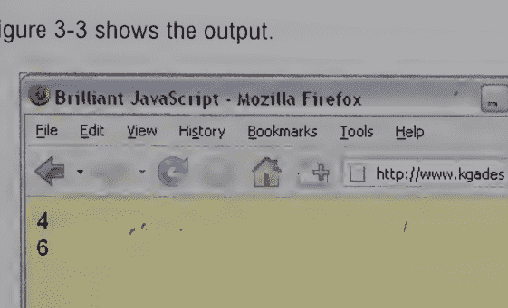

**图 3-3** 查找最高值和最低值

## 提升能力

快速回顾一下。将一个数提升到给定的幂，相当于将该数自身相乘多次以匹配幂次指示的次数。因此，2 的四次方（`$2^4$`），等同于计算 `2 * 2 * 2 * 2`。无论哪种计算方式，答案都是 16。

创建一个数字自身相乘的长等式会变得笨拙。以 2 的 12 次方为例，您需要输入 `2 * 2 * 2 * 2 * 2 * 2 * 2 * 2 * 2 * 2 * 2 * 2` 才能得到答案。

一个巧妙的解决方法是使用 `Math` 对象的 `pow` 方法。计算 2 的 12 次方可以轻松地写成 `Math.pow(2,12)`。

清单 3-4 展示了使用 `pow` 方法返回的一些结果。

### 清单 3-4 数字求幂

```html
<html>
<head>
<title>Brilliant JavaScript</title>
<style>
body {font-family:arial;font-weight:bold;background-color:#eeffcc}
</style>
<script type="text/javascript">
document.write("2 raised to the twelfth power equals " + Math.pow(2,12) + "<br />");
document.write("5 raised to the ninth power equals " + Math.pow(5,9) + "<br />");
document.write("1 raised to the 1000th power equals " + Math.pow(1,1000) + "<br />");
</script>
</head>
<body>
</body>
</html>
```

图 3-4 显示了使用 `pow` 的结果。最后一个计算是作为思考题；数字 1 自身相乘任意次，结果总是 1。

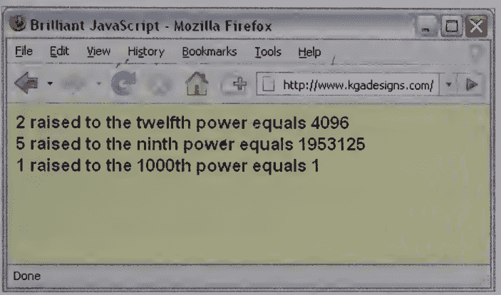

**图 3-4** 数字求幂

> **重要提示**
>
> 任何数字提升到 1 次幂都等于该数字本身。任何数字提升到 0 次幂都等于 1。举例说明：`Math.pow(15,1)` 等于 15；`Math.pow(15,0)` 等于 1。

## 生成随机数


生成随机数的能力为“假设分析”场景提供了有用的素材。一些应用程序是为评估某些未来事件的风险而创建的；一些游戏应用程序需要随机数生成来模拟掷骰子、转轮盘等。

`Math` 对象的 `random` 方法提供了一个介于 0 和 1 之间的随机数。生成的数字有若干位小数，以确保在重复调用该方法时的随机性。语法很简单，就是 `Math.random()`。

清单 3-5 展示了连续五次调用 `random` 方法。每次都会向浏览器写入一个介于 0 和 1 之间的数字。

### 清单 3-5 生成随机数

```html
<html>
<head>
<title>Brilliant JavaScript</title>
<style>
body {font-family:arial;font-weight:bold;background-color:#eeeeff}
</style>
<script type="text/javascript">
document.write(Math.random() + "<br />");
document.write(Math.random() + "<br />");
document.write(Math.random() + "<br />");
document.write(Math.random() + "<br />");
document.write(Math.random() + "<br />");
</script>
</head>
<body>
</body>
</html>
```

图 3-5 显示了其外观。请记住，每次打开或刷新此页面时，都会出现一组不同的数字。

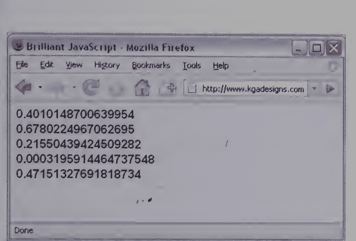

**图 3-5** 查看随机数

`random` 返回一个介于 0 和 1 之间的小数，这一事实本身并不太有用。通过对该数字进行一些数学运算，可以创建有用的随机数。例如，如果您需要 20 到 70 之间的随机年龄，随机数需要不小于 20 且不大于 70，由于这些是年龄，数字应该是整数。以下是实现此目的的公式：

```javascript
document.write(Math.round(Math.random() * (70 - 20) + 20))
```

简而言之，`random` 方法乘以一个范围，该范围的下限是所需的最低值（本例中为 20）。然后使用 `round` 方法将结果截断为整数。

## 计算日期和时间

### 简介

使用日期和时间计算可以让你做一些很酷的事情，比如倒数某个活动还有多少天、查看自从上次换机油以来已经过去了多少天，或者找出你的生日将会是星期几。`Date` 对象提供了处理日期和时间的方法。在本章中，你将学习如何独立地处理日期或时间。前几章学过的一些方法，比如舍入方法，在计算与时间相关的问题时也很有帮助。

> **供你参考**


> 1970 年 1 月 1 日被称为纪元。这一时刻是计算日期和时间问题的基准。需要明确的是，这一天是 Unix/Linux/Mac OS X/基于 Java 的系统开始计数的日子。而且计数一直在继续。

### 你将学会

- 返回当前日期和时间
- 处理 `Date` 对象的日、月和年组成部分
- 处理 `Date` 对象的小时、分钟和秒组成部分
- 使用毫秒来计时
- 计算一段日期范围内的天数

## 现在是哪一天、什么时间？

`Date` 方法返回当前日期和时间，它当然每秒都在变化。将 `Date` 方法放在脚本中并定期刷新页面，会返回一个新的日期/时间——随着秒针的跳动。清单 4-1 包含一个非常基础的脚本，简单地输出当前日期和时间。

**清单 4-1** 当前日期和时间

```html
<html>
<head>
<title>Brilliant JavaScript</title>
<style>
body {font-family:arial;font-weight:bold;background-color:#eeeeff}
</style>
<script type="text/javascript">
var d = new Date();
document.write(d + "<br />");
</script>
</head>
<body>
</body>
</html>
```

首先，一个变量，本例中的 `d`，被设置为 `Date` 对象的实例。然后将变量的值写入浏览器。图 4-1 显示了输出结果。显示了完整的日期和时间，也许包含的信息比需要的稍多一些。GMT -0400 的值表示我比格林尼治标准时间晚 4 小时。GMT 是一个时间基准，其他时间和时区都与之比较。

看着图 4-1 中的输出，很明显我是在当天的第 23 小时第 23 分钟截取的屏幕截图（忽略 35 秒的标记）——接近午夜。

## 现在是哪一天、什么时间？（续）

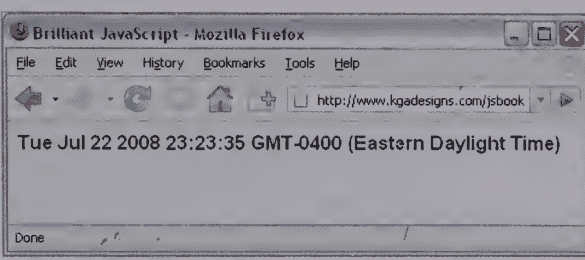

**图 4-1** 当前日期和时间

> **术语解释**
>
> `Date()` 可能被称为方法，但它被当作对象来处理。它是一个方法，因为它执行某些操作——获取当前日期和时间。但它像对象一样被实例化，并且方法可以与之配合使用。看起来像对象，表现得像对象。那它就是对象。

## 处理月、日和年

通过分离当前日期的各个部分，可以实现有意义的、可读的输出。一些方法提供了获取所需日期部分的途径：

- `getDate` 返回数字日期值（1–31）
- `getMonth` 返回月份值（0–11）
- `getFullYear` 返回四位年份值
- `getDay` 返回星期几（0–6，其中 0 是星期日）

与图 4-1 相比，图 4-2 展示了更易读的日期输出。

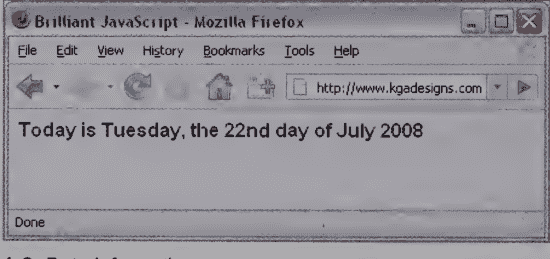

**图 4-2** 日期信息

虽然图 4-2 中关于星期和日期的信息看起来简洁明了，但组装这样一条消息的脚本有一定复杂性。清单 4-2 展示了脚本代码。

**清单 4-2** 返回友好的日期表示

```html
<html>
<head>
<title>Brilliant JavaScript</title>
<style>
body {font-family:arial;font-weight:bold;background-color:#eeeeee}
</style>
<script type="text/javascript">
var d = new Date();
var dd = d.getDate();
var days = new Array ("Sunday", "Monday",
"Tuesday", "Wednesday",
"Thursday", "Friday", "Saturday");
var months = new Array ("January","February", "March", "April", "May","June", "July", "August", "September","October", "November", "December");
message="Today is " + days[d.getDay()] + ",";
ddstr=dd.toString();
switch (ddstr.substr(ddstr.length-1)) {
case "1":
if ((ddstr.length==2) && (ddstr.substring(ddstr.length-2,1)==1)) {
message=message + "the " + dd + "th day of ";
} else {
message=message + "the " + dd + "st day of ";
}
break;
case "2":
if ((ddstr.length==2) && (ddstr.substring(ddstr.length-2,1)==1)) {
message=message + "the " + dd + "th day of ";
} else {
message=message + "the " + dd + "nd day of ";
}
break;
default:
message=message + "the " + dd + "th day of ";
}
message=message + months[d.getMonth()];
message=message + " " + d.getFullYear();
document.write(message);
</script>
</head>
<body>
</body>
</html>
```

## 处理月、日和年（续）

在清单 4-2 中，创建了两个数组：`days` 和 `months`。它们分别用于将 `getDay` 和 `getMonth` 方法返回的数值转换为对应的字符串。例如，`getMonth` 对七月返回 6，而 `months` 数组中的第六个位置是 July。将 `getMonth` 方法直接嵌入作为数组索引，使得代码简洁优雅：

`months[d.getMonth()]`。

`switch` 结构用于为具体的日期添加正确的语法。首先，将月份的数字日期值转换为字符串。作为字符串，测试其最后一个字符（这里是数字）以确定它是否为 1、2 或 3。这里的逻辑是，任何以 1、2 或 3 结尾的数字分别表示为，例如，21st、22nd 或 23rd。这些数字的后缀分别是 'st'、'nd' 和 'rd'。例外情况处理在 `if...then` 部分，即每月的 11 日、12 日和 13 日。所有其他数字日期的文本等价形式都获得 'th' 后缀，例如 18th 或 25th。

```javascript
ddstr=dd.toString();
switch (ddstr.substr(ddstr.length-1)) {
    case "1";
        if ((ddstr.length == 2) && (ddstr.
        substring(ddstr.length-2,1)==1)) {
            message=message + "the " + dd + "th day of ";
        } else {
            message=message + "the " + dd + "st day of ";
        }
        break;
```

在清单 4-2 的整个脚本中，一条用户友好的消息被组装起来，这就是图 4-2 中出现的内容。

> **另见**
>
> 数组将在下一章中解释。

时间总是在变化，但至少在 JavaScript 中你可以捕获它。使用 `getHours`、`getMinutes` 和 `getSeconds` 方法，你可以分离 `Date` 对象的那些部分。记住 `Date` 也包含时间组件。

使用 `Date` 提供了高度的精确性——返回的值实际上是毫秒。24 小时内有 86,400,000 毫秒。如果你需要精确到这种程度，JavaScript 有一个 `getMilliseconds` 方法。

清单 4-3 使用适当的方法分离小时、分钟和秒。从方法返回的值相对于午夜时刻。这些值被组合成一条消息并写入浏览器。

另一个方法——`getTimezoneOffset`——返回结果展示的浏览器与 GMT（格林尼治标准时间）相差的时区数，单位为分钟。这也被写入浏览器。结果首先除以 60 转换为小时。

**清单 4-3** 返回友好的时间表示

```html
<html>
<head>
<title>Brilliant JavaScript</title>
<style>
body {font-family:arial;font-weight:bold;background-color:#eeeeff}
</style>
<script type="text/javascript">
var d = new Date();
var m = d.getMinutes();
var h = d.getHours();
var s = d.getSeconds();
message="Since midnight  " + h + hours, " + m +
         " minutes, and " + s + " seconds have passed";
document.write(message);
</script>
</head>
<body>
</body>
</html>
```

## 准时准点

> **重要提示**
>
> 计算与 GMT 的偏移量可能返回不正确的值。该计算基于你所使用计算机的时钟设置。如果时钟未设置为正确的时间，那么计算将不会返回正确的 GMT 偏移量。此外，夏令时的处理可能会改变真实的偏移量。

## 准时到达（续）

```html
message=" This is a " +
(d.getTimezoneOffset()/60) + " hour offset
from Greenwich Mean Time";
document.write("<br /><br />" + message);
</script>
</head>
<body>
</body>
</html>
```

图 4-3 展示了输出结果。

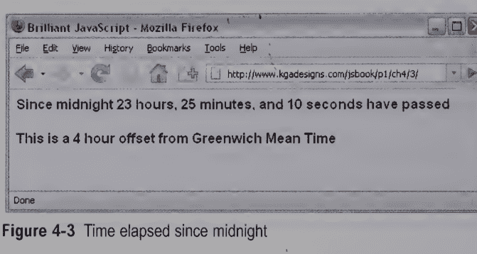

在计算时间流逝的能力基础上，这里引入了毫秒的概念。图 4-4 展示了三个涉及毫秒的消息：

## 以毫秒为单位进行精细计算

- 自午夜起经过的时间，现在包含毫秒
- 自午夜起经过的时间，仅以毫秒表示
- 自纪元（1970 年 1 月 1 日）起经过的时间，以总毫秒数表示

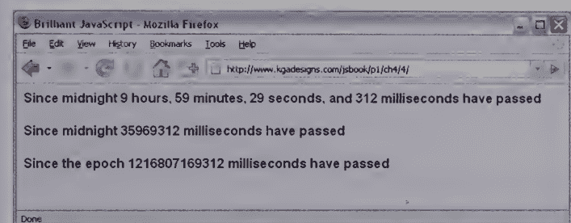

**图 4-4** 以毫秒为单位报告流逝的时间

将结果转换到毫秒级别需要一些有趣的数学等式。

在图 4-4 的第一行中，毫秒值就是使用 `getMilliseconds` 方法的结果：`var ms=d.getMilliseconds();`

将自午夜起经过的时间转换为总毫秒数，需要将小时、分钟和秒乘以特定的值。

- 要将秒转换为毫秒，请将秒数乘以 1000。
- 要将分钟转换为毫秒，请将分钟数乘以 60,000。
- 要将小时转换为毫秒，请将小时数乘以 3,600,000。

## 以毫秒为单位进行精细计算（续）

在此示例中，将这些计算结果相加可提供自午夜起的总毫秒数，但仅精确到秒。毫秒部分也被添加进来，这个总和就是自午夜起至“此刻”的毫秒数：

```javascript
var mstoday = ((h * 3600000) + (m * 60000) +
(s * 1000)) + ms;
```

要计算自纪元起的总毫秒数，需要将从午夜到“此刻”的总毫秒数加到从纪元开始到今天开始（上午 12:00:00）的总毫秒数上。

今天的总毫秒数已存储在 `mstoday` 变量中。`UTC` 方法用于获取从纪元到今天开始所经过的毫秒数。`UTC` 返回从纪元到输入到 `UTC` 方法的日期的毫秒数。在 `UTC` 方法中放入“今天”即可提供从纪元到今天开始的毫秒数。`UTC` 方法需要输入的日期格式为（年，月，日），并使用 `getFullYear`、`getMonth` 和 `getDay` 方法来获取这些值：

```javascript
var totalms = Date.UTC(d.getFullYear(),
d.getMonth(), d.getDate());
```

脚本中的进一步操作是将 `mstoday` 和 `totalms` 值相加，得到直至“此刻”的总毫秒数：

```javascript
(totalms + mstoday)
```

清单 4-4 包含了完整的脚本。

### 清单 4-4 将时间细化到毫秒

```html
<html>
<head>
<title>Brilliant JavaScript</title>
<style>
body {font-family:arial;font-
weight:bold;background-color:#eeeeff}
</style>
<script type="text/javascript">
var d = new Date();
var m = d.getMinutes();
var h = d.getHours();
var s= d.getSeconds();
var ms=d.getMilliseconds();
var mstoday=((h * 3600000) +
(m * 60000) +
(s *1000)) + ms;
var totalms=Date.UTC(d.getFullYear(),
d.getMonth(), d.getDate());
message="Since midnight " + h + " hours, "
+ m +
" minutes, " + s + " seconds, and
" + ms +
" milliseconds have passed";
document.write(message);
message="Since midnight " + mstoday
+ " milliseconds have passed";
document.write("<br /><br />" + message);
document.write("<br /><br />Since the epoch
" +
(totalms + mstoday) + "
milliseconds have passed");
</script>
</head>
<body>
</body>
</html>
```

## 计算流逝的天数

许多基于时间的计算都在毫秒级别进行，计算天数也不例外。此示例计算从给定日期到“今天”经过了多少天。在此脚本中，开始日期是硬编码的。日期之间的差值——字面意思是结束日期（今天）减去开始日期——返回一个以毫秒为单位的答案。然后，将该答案除以 86,400,000（一天中的毫秒数）以将答案转换为天数。

在清单 4-5 中，2008 年 6 月 18 日这一固定日期被硬编码为开始日期。

> **术语解释**
>
> **硬编码**一个值意味着将该值原样嵌入程序代码中，而不是用一个变量来表示该值。硬编码的值不会改变。

### 清单 4-5 计算两个日期之间的天数

```html
<html>
<head>
<title>Brilliant JavaScript</title>
<style>
body {font-family:arial;font-weight:bold;background-color:#eeeeff}
</style>
<script type="text/javascript">
var date1= new Date("6/18/2008")
var date2 = new Date();
var months = new Array("January",
    "February", "March", "April", "May",
    "June", "July",
    "August",
    "September",
    "October",
    "November",
    "December");

// 86400000 = 24 hours * 60 minutes * 60
// seconds * 1000
// 86400000 is the number of milliseconds
// in a day
diff=(date2 - date1) /86400000;
if (diff<2) {
    document.write (Math.floor(diff) +
    " day has passed since " +
    months[date1.getMonth()] +
    " " + date1.getDate());
}
else {
  document.write (Math.floor(diff) +
    " days have passed since " +
    months[date1.getMonth()] +
    " " + date1.getDate());
}
</script>
</head>
<body>
</body>
</html>
```

## 计算流逝的天数（续）

由于日期差计算返回的是一个小数，因此使用 `floor` 方法以完整天数呈现答案，而不是包含部分天数。图 4-5 显示了流逝天数计算的结果。

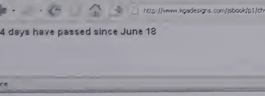

**图 4-5** 计算流逝了多少天

4

计算日期和时间 75

## 计算距未来某个日期的天数

倒计时计算经常用于重要事件，例如生日、假期等。在此示例中，计算了今天与未来某个日期之间的天数。这与前一个示例非常相似，只是使用日期的顺序相反。清单 4-6 显示了用于计算天数的脚本。

### 清单 4-6 计算距未来事件的天数


```html
<html>
<head>
<title>Brilliant JavaScript</title>
<style>
body {font-family:arial;font-
weight:bold;background-color:#eeeeff}
</style>
<script type="text/javascript">
var date1 = new Date();
var date2= new Date("10/12/2008")
var months = new Array("January",
"February", "March", "April", "May",
"June", "July",
"August", "September", "October",
"November",
"December");
if (date2 < date1) {
document.write("The dates are not in the
correct order!");
} else {
// 86400000 = 24 hours * 60 minutes * 60
seconds * 1000
// 86400000 is the number of milliseconds
in a day
diff=(date2 - date1) /86400000;
document.write (Math.ceil(diff) +
" day(s) until " +
months[date2.getMonth()] +
" " + date2.getDate());
}
</script>
</head>
<body>
</body>
</html>
```

图4-6显示了输出。在此示例中，计算返回从今天到硬编码的2008年10月12日之间的剩余天数。

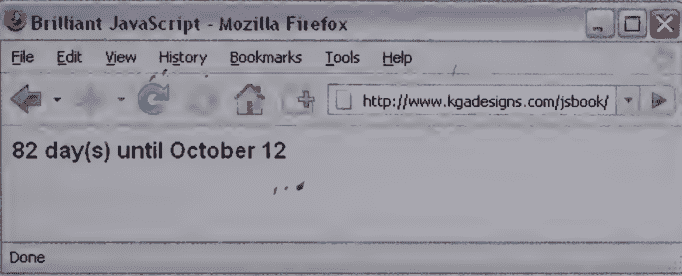

图4-6 剩余天数

## 计算距未来某个日期的天数（续）


## 使用数组进行组织

### 简介

数组是相似项目的集合。也就是说，数组通常用于将相似的数据保存在一个易于访问的结构中，尽管没有严格的规则要求数据元素必须有什么共同点。一年的月份可以保存在一个数组中。你最喜欢的橄榄球员的名字可以保存在一个数组中。你的客户列表可以保存在一个数组中。当你需要使用数组的一个、一些或全部元素时，它的用处就显现出来了。

> ### 术语解释
>
> 数组的各个项目称为**元素**。作为基本性质的体现，元素是数组的单个部分。

## 你将学到什么

- 学习如何创建数组
- 管理单个数组元素
- 对数组进行排序
- 合并数组

## 创建数组

数组是一种对象，因此需要被实例化（这是一种花哨的说法，意思是使用数组对象的副本）。数组的声明方式是，使用你决定的名称，然后将其设置为`new Array`。非常基础。一个例子是`var veggies = new Array;`。

一个数组可以为空，没有任何元素，但这有什么意义呢？相反，数组会被填充信息。每条信息就是一个元素。元素的数量没有限制。代码清单5-1演示了创建两个数组：一个用于水果，一个用于蔬菜。这两个数组使用`new Array`以相同的方式创建，但填充方式不同。`fruits`数组在创建它的同一行代码中填充。`veggies`数组是先创建，然后一次填充一个元素。

### 代码清单5-1 创建数组

```html
<html>
<head>
<title>Brilliant JavaScript</title>
<style>
body {font-family:arial;font-weight:bold;background-color:#eeeeff}
</style>
<script type="text/javascript">
var fruits = new Array("apples",
                       "bananas", "cherries",
                       "dragonfruit","elderberry",
                       "fig", "gooseberry",
                       "huckleberry");
var veggies = new Array;
veggies[0]="zucchini";
veggies[1]="yam";
veggies[2]="wild leek";
document.write("There are " + fruits.length
+ " fruits and " +
  veggies.length + " vegetables");
</script>
</head>
<body>
</body>
</html>
```

## 创建数组（续）

`fruits`数组在一步中创建并填充。在`Array`关键字后的括号中，用逗号分隔的列表包含数组元素，即可创建并填充数组：

```javascript
var fruits = new Array("apples",
        "bananas", "cherries",
        "dragonfruit", "elderberry",
        "fig", "gooseberry",
        "huckleberry");
```

代码清单5-1中的脚本创建了两个数组，并通过访问`length`属性简单地报告了每个数组有多少个元素。图5-1显示了输出结果。

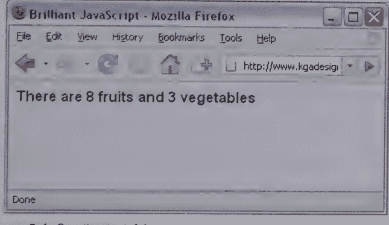

## 供你参考

> 数组元素使用方括号来寻址。因此，第一个水果apples可以通过语法结构`fruits[0]`来访问。与许多JavaScript中带编号的项目一样，数组是从零开始索引的。第一个元素是0，最后一个元素是`length`属性返回值减1。

## 处理数组元素

数组非常适合存储数据，但它们真正的用处体现在你可以处理单个元素时。通过提供索引号可以轻松使用一个元素，例如`veggies[2]`。这个例子展示了如何关注单个元素、添加额外元素、移除元素以及重新排序。让我们开始吧！

图5-2报告了关于`fruits`数组的各种信息。每一行都说明了数组当前状态的某些情况。

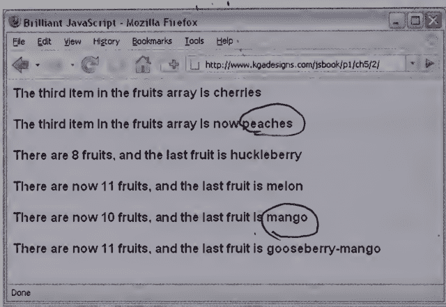

**图5-2** 对水果数组进行更改

图5-2中显示的每一行都讲述了数组中已经发生的变化。代码清单5-2包含了操作数组并将各行输出到浏览器的脚本。

### 代码清单5-2 进行有效的数组更改

```html
<html>
<head>
<title>Brilliant JavaScript</title>
<style>
body {font-family:arial;font-weight:bold;background-color:#eeeeff}
</style>
<script type="text/javascript">
var fruits = new Array("apples", "bananas",
                   "cherries", "dragonfruit",
                   "elderberry", "fig",
                   "gooseberry", "huckleberry");
//return a single element
document.write("The third item in the fruits array is '" + fruits[2] + "<br /><br />");
//change the value of an element
fruits[2]="peaches";
document.write("The third item in the fruits array is now " + fruits[2] + "<br /><br />");
// how many elements right now?
document.write("There are " + fruits.length + " fruits, and the last fruit is " + fruits[fruits.length-1] + "<br /><br />");
//add new elements, a new fruit!
fruits.push("lemon","mango","melon");
document.write("There are now " + fruits.length + " fruits, and the last fruit is " + fruits[fruits.length-1] + "<br /><br />");
fruits.pop();
document.write("There are now " + fruits.length + " fruits, and the last fruit is " + fruits[fruits.length-1] + "<br /><br />");
fruits.push(fruits[6] + "-" + fruits[9]);
document.write("There are now " + fruits.length + " fruits, and the last fruit is " + fruits[fruits.length-1] + "<br /><br />");
</script>
</head>
<body>
</body>
</html>
```

## 处理数组元素（续）

该数组是用八个元素创建的：

```javascript
var fruits = new Array("apples", "bananas",
"cherries", "dragonfruit",
"elderberry", "fig",
"gooseberry", "huckleberry");
```

第一行输出列出了元素数量。

下一行返回关于单个元素的信息。通过使用方括号和索引位置，选择了单个水果用于输出行：

```javascript
document.write("The third item in the fruits
array is " + fruits[2]
```

由于是从零开始索引，第三个元素由数字2表示（到这里的元素位置为0、1、2）。Cherries（樱桃）是第三个水果。

通过简单地赋值来更改一个元素。这里，第三个元素被更改为peaches（桃子）。樱桃不好吃，但是啊，桃子很棒！

```javascript
fruits[2]="peaches";
document.write("The third item in the fruits
array is now " + fruits[2]
```

此时数组中仍然有八个元素。`push`方法向数组末尾追加新元素。`push`方法包含任意数量的要追加的元素，这里是三个：

```javascript
fruits.push("lemon","mango","melon");
```

`pop`方法移除最后一个元素：

```javascript
fruits.pop();
```

浏览器中的行现在报告了使用`push`和`pop`方法后的新元素数量。

最后，通过组合两个其他元素创建了一个新元素。`push`方法将此新元素放在数组末尾。组成新元素的两个元素不会被更改。换句话说，它们不会仅仅因为在其他地方被使用而被移除。新元素独立于用于创建它的两个元素：

```javascript
fruits.push(fruits[6] + "-" + fruits[9]);
document.write("There are now " +
fruits.length + " fruits, and the last
fruit is " + fruits[fruits.length-1] + "<br
/><br />");
```


## 对数组排序

数组元素可以以任何顺序输入到数组中。当需要对元素进行排序时，可以将它们排序为升序或降序。这里使用了`sort`和`reverse`方法。

代码清单5-3中的脚本创建了一个蔬菜数组，对该数组进行排序（`veggies.sort()`），然后反转顺序（`veggies.reverse()`）。

### 代码清单5-3 对数组排序

```html
<html>
<head>
<title>Brilliant JavaScript</title>
<style>
body {font-family:arial;font-weight:bold;background-color:#eeeeff}
</style>
<script type="text/javascript">
var veggies = new Array;
veggies[0]="zucchini";
veggies[1]="peas";
veggies[2]="corn";
veggies[3]="potatoes";
veggies[4]="asparagus";
veggies[5]="broccoli";
for (i=0;i<veggies.length;i++) {
  document.write("&nbsp;&nbsp;" + veggies[i]);
}
document.write("<br /><br />");
veggies.sort();
for (i=0;i<veggies.length;i++) {
  document.write("&nbsp;&nbsp;" + veggies[i]);
}
document.write("<br /><br />");
veggies.reverse();
for (i=0;i<veggies.length;i++) {
  document.write("&nbsp;&nbsp;" + veggies[i]);
}
</script>
</head>
<body>
</body>
</html>
```

图5-3显示了数组在排序前、排序后以及排序反转后的输出。

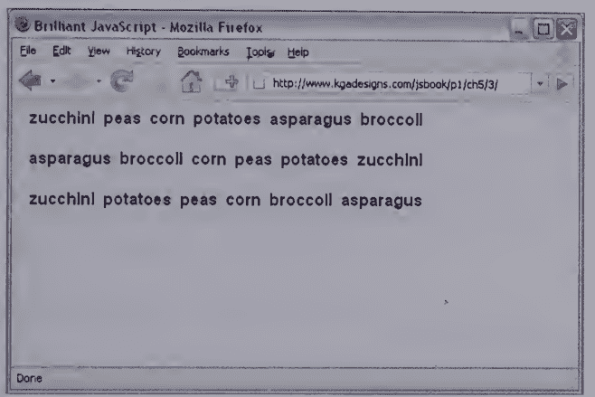

**图5-3** 对数组应用排序技术

请注意，`reverse`方法反转的是排序后的数组，而不是排序前的数组。从语法上看，这可能会产生误导，因为`reverse`方法只是应用于该数组。它应用于数组的最新状态：

```javascript
veggies.reverse();
```

因此，当使用`sort`方法时，`veggies`数组实际上失去了其原始的未排序顺序。如果你需要将数组恢复到原始状态怎么办？这里适用一种后备方法，即在数组创建后立即将其复制，从而本质上创建一个数组的备份。

## 在排序前备份数组

为此，创建第二个数组，并使用`for`循环将元素复制到新数组中。

## 对数组排序（续）

## 数组排序（续）

在脚本的最后，通过遍历第二个数组来写入原始顺序。清单5-4展示了更新后的脚本。

**清单5-4** 在对数组排序前保存其副本

```html
<script type="text/javascript">
var veggies = new Array;
veggies[0]="zucchini";
veggies[1]="peas";
veggies[2]="corn";
veggies[3]="potatoes";
veggies[4]="asparagus";
veggies[5]="broccoli";
var veggies2 = new Array
for (i=0;i<veggies.length;i++) {
    veggies2[i]=veggies[i];
}
for (i=0;i<veggies.length;i++) {
    document.write("&nbsp;&nbsp;" +
    veggies[i]);
}
document.write("<br /><br />");
veggies.sort();
for (i=0;i<veggies.length;i++) {
    document.write("&nbsp;&nbsp;" +
    veggies[i]);
}
document.write("<br /><br />");
veggies.reverse();
for (i=0;i<veggies.length;i++) {
    document.write("&nbsp;&nbsp;" +
    veggies[i]);
}
document.write("<br /><br />&nbsp;&nbsp;The original order is:<br />");
veggies.reverse();
for (i=0;i<veggies2.length;i++) {
    document.write("&nbsp;&nbsp;" +
    veggies2[i]);
}
</script>
```

图5-4显示了输出结果，其中原始顺序在排序后被写入。

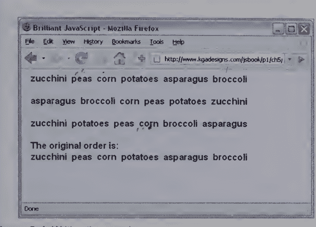

## 数字排序

`sort`方法将数组元素视为文本。这对于排序单词非常完美，但对于排序数字则不然。虽然`sort`方法会排序数字，但结果是按文本顺序排列的。换句话说，30会排在4之前，因为作为文本，3在4之前。

在清单5-5中，创建了一个名为`Lottery`的数组，并填充了一组无序的数字。当使用`sort`方法时，排序是不正确的。这在后面的图5-5中可以看到。解决方法是在`sort`方法中嵌入一个函数调用，如下所示：

```javascript
lottery.sort(bynumber);
```

`bynumber`函数并没有返回数组使用的值，而是函数内部运行的数学方程式本身，使得排序方法将这些值视为真正的数字。该函数很简单：


```javascript
function bynumber(a,b) {
  return a-b;
}
```

函数声明中期望的参数并未被实际传递，但`a-b`的计算技巧性地让`sort`方法知道必须将数组值作为数字处理。

**清单5-5 对数字数组进行排序**

```html
<html>
<head>
<title>Brilliant JavaScript</title>
<style>
body {font-family:arial;font-weight:bold;background-color:#eeeeff}
</style>
<script type="text/javascript">
var lottery = new Array(23,12,8,36,3,21);
for (i=0;i<lottery.length;i++) {
    document.write("&nbsp;&nbsp;" + lottery[i]);
}
document.write("<br /><br />");
lottery.sort();
for (i=0;i<lottery.length;i++) {
    document.write("&nbsp;&nbsp;" + lottery[i]);
}
document.write("<br /><br />");
lottery.sort(bynumber);
for (i=0;i<lottery.length;i++) {
    document.write("&nbsp;&nbsp;" + lottery[i]);
}
function bynumber(a,b) {
    return a-b;
}
</script>
</head>
<body>
</body>
</html>
```

图5-5展示了数组的原始顺序，接着是标准排序，然后是修改后的排序。

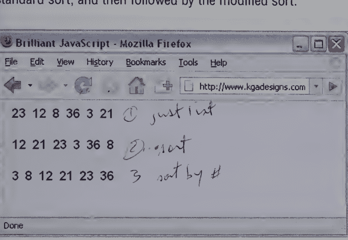

## 合并数组

数组可以被组合成更大的数组。`concat`方法将一个数组附加到另一个数组。该方法可以附加多个数组。清单5-6中的脚本创建了三个数组，然后演示了以不同方式组合它们的过程。其中一步是通过连接两个数组来创建一个新数组。

**清单5-6 组合并连接数组**

```html
<html>
<head>
<title>Brilliant JavaScript</title>
<style>
body {font-family:arial;font-weight:bold;background-color:#eeeeff}
</style>
<script type="text/javascript">
var classroom_A = new Array("Amy","Bob","Carolyn","Dave","Erin","Fred");
var classroom_B = new Array("Grace","Harry","India","Jack","Karen");
var classroom_C = new Array("Lenny","Mary","Nick","Opal","Pete");
document.write(classroom_A.concat(classroom_B));
document.write("<br /><br />");
document.write(classroom_A.concat(classroom_B,classroom_C));
document.write("<br /><br />");
var classroom_D = new Array(classroom_C.concat(classroom_A));
document.write(classroom_D);
</script>
</head>
<body>
</body>
</html>
```

图5-6显示了清单5-6中脚本的输出。

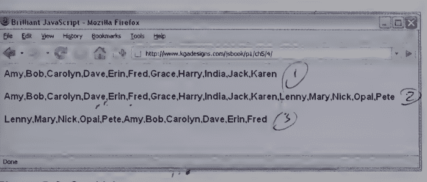

## 多维数组

数组元素本身可以是数组，并拥有自己的元素。这种结构被称为多维数组。数组内部可以嵌套的数组数量没有限制，但层次过多将难以处理。

此处演示创建一个包含元素和数组——该数组自身又包含一个数组——的数组：

```javascript
var continents = new Array("Europe","Africa","Asia");
continents[0] = new Array("France","Germany","Italy","England");
continents[0][3] = new Array("London", "Liverpool", "Essex")
```

这种结构有利于组织，比如这里我们有大洲、国家和城市。

```javascript
continents[2] 返回 Asia;
continents[0][2] 返回 Italy;
continents[0][3][2] 返回 Essex。
```

# 验证

## 介绍

验证绝对是`JavaScript`的主要用途之一。结合在线表单，在浏览器端运行的验证可以在数据发送到服务器之前捕获并处理含有错误的条目。其优势在于使服务器免于不必要的处理，从而节省性能开销。浏览器级别的验证也减少了带宽使用。

在本章中，一个基于网络的表单将经历验证的考验。每一节将增加一种验证类型。

## 你将学到什么

- 验证基本文本条目
- 验证数字
- 验证电子邮件地址
- 验证通过单选按钮和复选框进行的选择

## 基本文本条目验证

图6-1显示了一个简单的网页表单。只需要你的姓名和年龄。

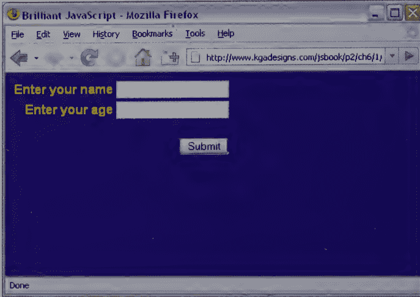

当通过“提交”按钮提交表单时，会调用验证函数。验证函数（名为`checkform`）包含一系列连续的测试（`if`语句）。一旦有一个测试失败，函数就返回`false`。如果所有验证测试都通过，函数最后一行`return true`被执行，由于返回了`true`，表单就可以被提交。

**清单6-1 基本表单和验证检查**

> 供你参考：函数返回一个单一的值。值的“类型”可能不同；它可能是文本、数字，或者像本例中是布尔值。布尔值要么是`true`或`false`，要么是`yes`或`no`，要么是`1`或`0`，要么是`on`或`off`，等等。关键在于布尔值只能有两种逻辑值。

```html
<html>
<head>
<title>Brilliant JavaScript</title>
<style>
td {font-weight:bold;text-align:right;}
body {background-color:navy;color:yellow;font-family:Arial}
</style>
<script type="text/javascript">
function checkform() {
  if (document.getElementById("txtName").value=="") {
    alert ("Must enter your name");
    return false;
  }
  if (document.getElementById("txtAge").value=="") {
    alert ("Must enter your age");
    return false;
  }
  if (isNaN(document.getElementById("txtAge").value)) {
    alert ("Only numbers can be entered in the age box");
    return false;
  }
  return true;
}
</script>
</head>
<body>
<form id="myform" action="" onsubmit="return checkform()">
<table>
<tr><td>Enter your name</td><td><input type="text" id="txtName" /></td></tr>
<tr><td>Enter your age</td><td><input type="text" id="txtAge" /></td></tr>
<tr><td>&nbsp;</td><td><br /><input type="submit" id="submit" value="Submit" /></td></tr>
</table>
</form>
</body>
</html>
```

详细检查验证过程，首先测试姓名是否存在。这是通过使用`getElementById`方法来识别文本框，然后测试条目的长度来完成的。如果它是一个空字符串（`""`），则会在警报弹出窗口中显示相应消息，并且函数返回`false`。

## 基本文本输入验证（续）

```javascript
function checkform() {
  if (document.getElementById("txtName").value=="") {
    alert("Must enter your name");
    return false;
  }
}
```

图6-2展示了在未输入姓名时提交表单会发生什么。

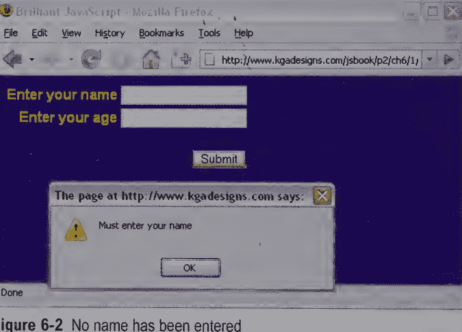

**图6-2** 未输入姓名

当输入姓名后，姓名测试通过，程序继续进行下一项测试。此处测试输入的年龄：

```javascript
if (document.getElementById("txtAge").value=="") {
  alert("Must enter your age");
  return false;
}
```

图6-3展示了在未输入年龄时提交表单会发生什么。

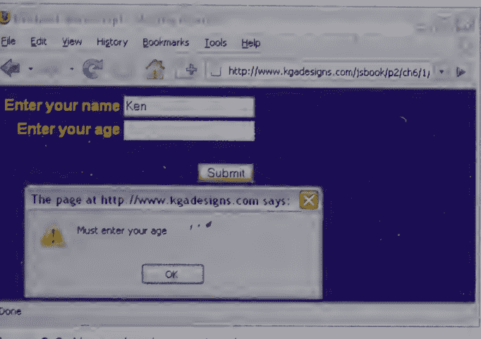

**图6-3** 未输入年龄

我输入了年龄“十”。这样可以吗？不行，因为下一项测试是检查年龄输入是否为数字。这项测试使用`isNaN`（非数字）函数完成。按照逻辑，当值不是数字时条件为真，则返回`false`：

```javascript
if (isNaN(document.getElementById("txtAge").value)) {
  alert("Only numbers can be entered in the age box");
  return false;
}
```

图6-4显示了提醒用户年龄栏只能输入实数的警报框。输入“十”并不能欺骗`isNaN`函数将其视为10。

假设我输入了一个真实数字，比如185，所有测试都通过，函数返回`true`值。当返回此值时，表单将提交并遵循`action`属性（尽管这里的`form`标签中未指定）。

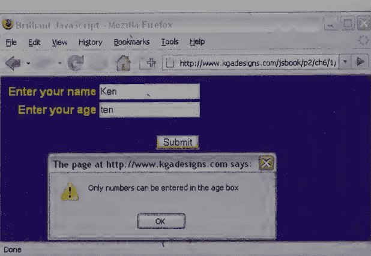

嗯，这看起来很好；我输入了姓名和年龄185岁，验证没有发现任何问题。然而，这里存在一个问题：我不可能185岁。这种认识导致需要更多的验证。特别是，添加一项测试确保年龄在1到100之间，如下所示：

```javascript
the_age = document.getElementById("txtAge").value;
if (the_age < 1 || the_age > 100) {
    alert("The age must be between 1 and 100");
    return false;
}
```

图6-5显示了我假装185岁时被识破的情况。

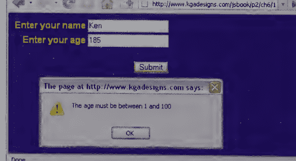

电子邮件地址有几个特征可以使其被识别为有效：包含且仅包含一个`@`符号；至少包含一个点；如果要求更严格，还需确保首尾字符不是`@`符号或点。

因此，电子邮件验证是一系列小型验证的集合。虽然你可以编写一些冗长的单行验证代码，但使用一系列连续的验证更易于管理。这是在上一节中验证年龄时采用的方法。清单6-2包含了验证电子邮件地址的新`JavaScript`代码。

### 清单6-2 验证电子邮件地址

```javascript
if (document.getElementById("txtEmail").value=="") {
    alert("Must enter your email address");
    return false;
}
the_email = document.getElementById("txtEmail").value;
at_count = 0;
dot_count = 0;
for (i = 0; i < the_email.length; i++) {
    if (the_email.substr(i, 1) == "@") {
        at_count = at_count + 1;
    }
    if (the_email.substr(i, 1) == ".") {
        dot_count = dot_count + 1;
    }
}
if (at_count != 1) {
    alert("There must be one @ sign in the email address");
    return false;
}
if (dot_count < 1) {
    alert("There must be at least one dot (.) in the email address");
    return false;
}
```

## 验证电子邮件地址

```javascript
if (the_email.substr(0, 1) == "@" ||
    the_email.substr(the_email.length-1, 1) == "@" ||
    the_email.substr(0, 1) == "." ||
    the_email.substr(the_email.length-1, 1) == ".") {
    alert("The first and last characters cannot be @ or a dot(.)");
    return false;
}
```

电子邮件验证：

- 检查长度是否大于0
- 遍历电子邮件地址并统计`@`符号和点（`.`）的出现次数——验证确保只能有一个`@`符号且至少有一个点
- 检查首尾字符，确保它们既不是`@`符号也不是点。

图6-6显示了一个提醒，提示`@`符号缺失或存在多个。

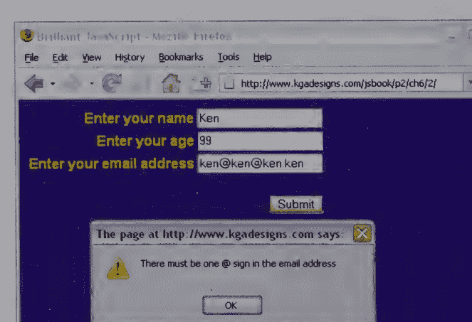

**图6-6** 验证电子邮件地址

## 验证单选按钮和复选框

单选按钮和复选框都是布尔指示器。按钮或复选框要么被选中，要么未被选中。两者的区别在于，单选按钮用于互斥答案，这意味着在一组单选按钮中，只能有一个被选中。如果每个单选按钮具有相同的`name`或`id`，那么点击一个将清除其他选项。需要注意的是，表单打开时可能没有任何单选按钮被选中。验证可以测试这一点并发送警报要求做出选择。

复选框是独立的。一个复选框是否被选中或清除对另一个复选框没有意义。其可能具有意义的地方在于，从人类视角看信息需要如何处理。很可能由于“业务规则”，只能选中一个复选框。需要验证来救场！

清单6-3是添加到验证函数中测试单选按钮和复选框的部分。表单上现在有一个关于驾驶的问题和一个关于茶的问题。驾驶问题使用单选按钮回答，茶的问题使用复选框回答。

### 清单6-3 验证单选按钮和复选框

```javascript
drivecheck = -1;
for (i = myform.drive.length-1; i > -1; i--) {
    if (myform.drive[i].checked) {
        drivecheck = i; i = -1;
    }
}
if (drivecheck == -1) {
    alert("Must select that you do or do not drive");
    return false;
}
if (myform.teaplain.checked && myform.teamilk.checked) {
    alert("Cannot check both plain tea and tea with milk");
    return false;
}
```

图6-7显示了包含新驾驶和茶问题的表单。验证测试单选按钮是否有一个被选中——当表单打开时，两个单选按钮都未被选中。验证还确保你不能同时回答喝清茶和喝奶茶。这两个选项不可能同时成立，至少不能在同一时间。图6-7中显示了茶选择的消息。

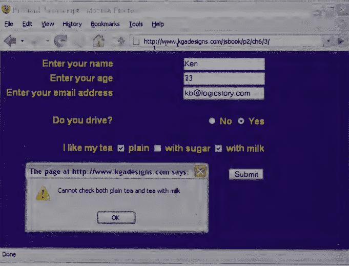

**图6-7** 验证单选按钮和复选框选择

## 验证日期

`JavaScript`没有专门用于日期验证的方法。有许多变通方法。有些使用`Date`对象的操作，有些使用正则表达式（一种模式匹配语言），还有一些只是冗长的代码例程，试图涵盖日期组件的每种变体。

一个合理的方法是让用户从下拉菜单中选择月份、日期和年份。通过这种方式，日期是可控的，并且能够根据另一个下拉菜单中的选择更新一个下拉菜单的列表，日期验证变得容易得多，因为用户无法选择不正确的值。这将在第7章中讨论。

## 进一步的验证问题

验证的长度和复杂性可以根据你的需求而定。本章未讨论的一些验证需求包括：

- 确保正确的长度，例如电话号码。
- 验证数字是否在可接受的值范围内。这已在年龄验证中演示；然而，可能存在更复杂的需求，例如只允许年龄在10到20岁之间，以及在40到50岁之间。
- 基于业务规则的验证。本章对此有简要介绍，但可能有许多规则需要考虑。例如，在肯辛顿办公室工作的任何人不能被分配到市场部；或者如果你选择不开车，那么你必须选择一种公共交通方式。

# 应用 JavaScript 操作

## 引言


与大多数现代语言一样，JavaScript 是事件驱动的。这意味着，应用程序并非遵循一套固定的指令或步骤，而是由用户的决定来驱动。这种情况已经存在了很长时间，以至于人们甚至不再思考它。但请花点时间想一想。除非特别修改，否则网页会一直等待你做些什么——点击这里、导航到那里、从列表中选择某项。所有“操作”都由屏幕前的人视情况而定。每个执行的操作都会触发一个事件。

事件本质上只是一个外壳，你（作为程序员）可以在其中决定应该发生什么。举一个具体的例子：网页上有一个下拉列表。你决定从中选择一个项目。此操作会触发`onchange`事件。然而，可能会也可能不会发生任何功能。事件可以被触发，但如果事件没有附加任何代码，那么什么也不会发生。

事件有很多种类型，每种事件都可以在特定操作下发生，这些操作对于该事件是有意义的。例如，有一个`onclick`事件。当存在可点击的内容时（并且假设被点击的项目能识别到它被点击了），就可以使用此事件。事实上的点击事件是附加到页面按钮上的那个。最重要的是，按钮的主要目的是被点击。

- 了解事件以及如何触发它们
- 使用`onchange`事件来更新和更改网页
- 创建自动建议功能
- 使用`onfocus`和`onblur`事件提供便捷的视觉辅助

> **术语解释**
>
> 一个事件可能被称为，例如`onclick`事件，或者直接叫点击事件。这些术语可以互换使用。

## 事件总在发生

许多事件的发生具有浏览器处理的自然且预期的行为。其中之一是`load`事件。每次新页面出现在浏览器中，或者现有页面被刷新时，页面的`load`事件就会运行。这并不意味着除了页面加载到浏览器之外还会发生其他事情；但是，如果有理由这样做，`load`事件可以用来执行其他活动。事件是被调用的——也就是说，它们在 HTML 中通过名称被标记，并调用一个 JavaScript 例程或函数。例如，`load`事件在 HTML 的`<body>`标签中被调用，像这样：

```html
<body onload="my_custom_action()">
```

根据这种编码结构，大概有一个名为`my_custom_action`的 JavaScript 函数。该函数中发生什么取决于你将什么功能编码到该事件中。

另一个事件一直在进行，尽管你未必会注意到它：`onmousemove`。在电脑前工作时，鼠标会反复移动。但如果事件中没有放置自定义程序，那么该事件就不会被注意到。

以下是事件摘要。每个事件都适用于一个或多个对象，遵循一定的逻辑。显然，任何基于鼠标的事件只能用于鼠标活动。相比之下，`onchange`事件可以在下拉列表中的选项被更改时使用，也可以在文本输入框中的文本被更改时使用。

### 事件

- `onabort`：当图像加载被中断时触发
- `onblur`：当元素失去焦点时触发（例如，按 Tab 键跳出文本框）
- `onchange`：当下拉选择或文本被更改时触发
- `onclick`：当某些对象被点击时触发（按钮、单选按钮、复选框等）
- `ondblclick`：当对象被双击时触发
- `onkeydown`：当键被按下时触发
- `onkeypress`：当键被按下或按住时触发
- `onkeyup`：当键被释放时触发
- `onload`：当页面或图像加载完成时触发
- `onmousedown`：当鼠标按钮被按下时触发
- `onmouseup`：当鼠标按钮被释放时触发
- `onmousemove`：当鼠标被移动时触发
- `onmouseover`：当鼠标指针悬停在某个屏幕对象上时触发
- `onmouseout`：当鼠标指针移出某个屏幕对象时触发
- `onreset`：当特殊的重置按钮被点击时触发
- `onresize`：当浏览器窗口被调整大小时触发

### 事件（续）

- `onselect`：当文本被选中时触发
- `onsubmit`：当提交按钮被点击时触发
- `onunload`：当页面被卸载时触发（例如，当页面被退出时）

## 基于不同下拉列表的选择更新一个下拉列表

> **供您参考**
>
> 此示例演示了`onchange`事件。
>
> **术语解释**
>
> `select`是更常见的“下拉列表”的正式 HTML 术语。这些术语可以互换使用。

第 6 章讨论了如何最好地使用下拉列表来控制日期验证。此示例表明，从下拉列表中选择日期可以确保提供有效的日期。清单 7-1 展示了一个在下拉列表中做出选择时运行的脚本。当页面加载时，`months`下拉列表（select）中填充了月份的名称，尽管在下拉列表中看到的第一项是“选择月份”的文本提示。

第二个下拉列表用于月份中的天数，这个下拉列表开始时为空，但每次选择不同的月份时，它会根据所选月份填充正确的天数。图 7-1 显示了表单的初始状态——`dates`下拉列表为空。

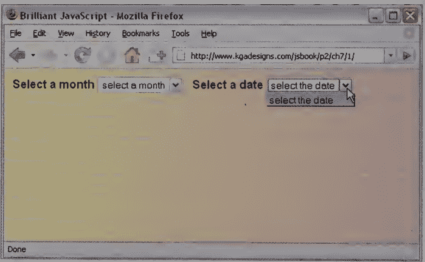

在图 7-1 中，可以清楚地看到`dates`下拉列表没有日期。这是因为页面刚刚加载，还没有选择任何月份。图 7-2 显示了选择月份后的不同之处。`dates`下拉列表已填充了日期。

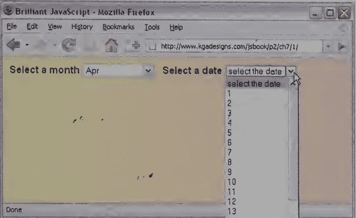

图 7-2 选择了月份，月份中的天数随之出现

月份下拉列表使用`onchange`事件来更新日期下拉列表。也就是说，一个下拉列表的变化被用来更新另一个下拉列表的内容。非常方便！`updatedays`函数使用月份下拉列表的值来确定所选月份中有多少天，具体代码见清单 7-1。

### 清单 7-1 根据月份选择填充月份中的天数

```html
<html>
<head>
<title>Brilliant JavaScript</title>
<style>
td {font-weight:bold;text-align:right;}
body {background-image:url('smoothback1.jpg');color:black;font-family:Arial}
</style>
<script type="text/javascript">
function updatedays() {
  dd=document.getElementById("dates");
  dd.options.length=0;
  dd.options[0]= new Option("select the date", 0)
  switch (document.getElementById("months").value) {
    case "Jan":
    case "Mar":
    case "May":
    case "Jul":
    case "Aug":
    case "Oct":
    case "Dec":
        for (i=1;i<=31;i++) {
            dd.options[i] = new Option(i,i);
        }
        break;
    case "Apr":
    case "Jun":
    case "Sep":
    case "Nov":
        for (i=1;i<=30;i++) {
            dd.options[i] = new Option(i,i);
        }
        break;
    default:
        for (i=1;i<=28;i++) {
            dd.options[i] = new Option(i,i);
        }
        d = new Date();
        y = d.getFullYear();
        if (y==2008 || y==2012) {
            dd.options[29] = new Option(29,29);
        }
  }
}
</script>
</head>
<body>
<form id="myform" action="#">
<table>
<tr><td>Select a month</td><td>
<select id="months" onchange="updatedays()">
<option value="none">select a month</option>
<option value="Jan">Jan</option>
<option value="Feb">Feb</option>
<option value="Mar">Mar</option>
<option value="Apr">Apr</option>
<option value="May">May</option>
<option value="Jun">Jun</option>
<option value="Jul">Jul</option>
<option value="Aug">Aug</option>
<option value="Sep">Sep</option>
<option value="Oct">Oct</option>
<option value="Nov">Nov</option>
<option value="Dec">Dec</option>
</select>
</td>
<td>&nbsp;</td>
<td>Select a date</td><td>
<select id="dates">
<option value="none">select the date</option>
</select>
</td></tr>
</table>
</form>
</body>
</html>
```

`months`下拉列表有`onchange`事件来调用该函数：

```html
<select id="months" onchange="updatedays()">
```

该函数首先清除`dates`下拉列表，并设置第一个选项为“选择日期”：

```javascript
function updatedays() {
  dd=document.getElementById("dates");
  dd.options.length=0;
  dd.options[0]= new Option("select the date", 0)
}
```

> **重要提示**
>
> 每当有脚本要重新填充一个 select 列表时，必须先清除该列表。否则，当前的列表项会保留，新的项目将被追加到末尾。这不是应该呈现回页面上的样子。

## 根据一个下拉列表中的选项更新另一个下拉列表（续）

> **供您参考**
>
> 此示例展示了两个下拉菜单，分别用于选择月份和月份中的日期。页面上也可以有第三个下拉菜单用于选择年份。在这种情况下，检查闰年的负担将落在年份下拉菜单的`change`事件上。

使用`switch`语句来确定月份中的天数。由于除二月外的所有月份都有固定天数，`switch`语句被设置为将多个月份组合在一起以接收相同的天数。例如，当选择四月、六月、九月或十一月时，日期下拉菜单将获得 30 天：

```javascript
case "Apr":
case "Jun":
case "Sep":
case "Nov":
  for (i=1; i<=30; i++) {
    dd.options[i] = new Option(i, i);
  }
```

这 30 天是通过一个运行 30 次迭代的循环填充的。其他月份的循环为 31 次迭代，二月除外。二月的处理方式因闰年而略有不同。首先运行一个 28 次迭代的循环。然后，通过测试是否为闰年来确定是否追加一个额外的项目（第 29 天）。还要注意，二月是在`switch`语句的`default`部分处理的。由于其他 11 个月份都已被考虑到，这是可行的。二月是唯一可能进入`default`分支的月份。

```javascript
default:
  for (i=1; i<=28; i++) {
    dd.options[i] = new Option(i, i);
  }
  d = new Date();
  y = d.getFullYear();
  if (y==2008 || y==2012) {
    dd.options[29] = new Option(29, 29);
  }
}
```

大多数从一个网页到另一个网页的导航都是通过点击超链接完成的。另一种方法是通过从下拉列表中选择一个选项来导航到网页或另一个网站。清单 7-2 展示了一个脚本，它使用下拉菜单中选定的项目作为要导航到的页面。当下拉菜单中项目的值是实际的网络地址（URL）时，这显然是可行的。

### 清单 7-2 使用下拉选择进行网页导航

```html
<html>
<head>
<title>Brilliant JavaScript</title>
<style>
body {background-image:url('back1.jpg');color:black;font-family:Arial;font-weight:bold;}
</style>
<script type="text/javascript">
function go_somewhere() {
    var URL = document.getElementById("sitelist").value;
    window.location.href = URL;
}
</script>
</head>
<body>
<form id="myform" action="#">
  Select a web site to visit:
  <select id="sitelist" size=1 onchange="go_somewhere()">
    <option value="">Go to....</option>
    <option value="http://www.kgadesigns.com">KGA Designs</option>
    <option value="http://www.shakespearesplayground.com">Shakespeare's Playground</option>
    <option value="http://www.healingheartsandsouls.com">Healing Hearts and Souls</option>
    <option value="http://www.logicstory.com">Logic Story</option>
  </select>
</form>
</body>
</html>
```

## 通过列表选择导航到另一个网站

> **供您参考**
>
> 此示例演示了`onchange`事件。


当在下拉菜单中做出选择时，`onchange`事件会调用`go_somewhere`函数：

```javascript
function go_somewhere() {
    var URL = document.getElementById("sitelist").value;
    window.location.href = URL;
}
```

URL 从所选下拉菜单项的值中获取，并且使用`window.location.href`构造将浏览器指向新站点。在导航时，可以选择让新页面加载到当前页面所在的窗口中，或者让新页面在新窗口中打开。

代码的一个小改动可以告诉函数在新窗口中显示新页面。在这种情况下，函数的代码将如下所示：

```javascript
function go_somewhere() {
    var URL = document.getElementById("sitelist").value;
    window.open(URL);
}
```

唯一的区别是，这里使用`window.open(URL)`而不是`window.location.href`进行导航。这个指令只是说打开一个窗口并加载该 URL。图 7-3 展示了两个窗口打开的情况：一个窗口显示带有下拉菜单的页面，另一个新窗口显示所选的 URL。

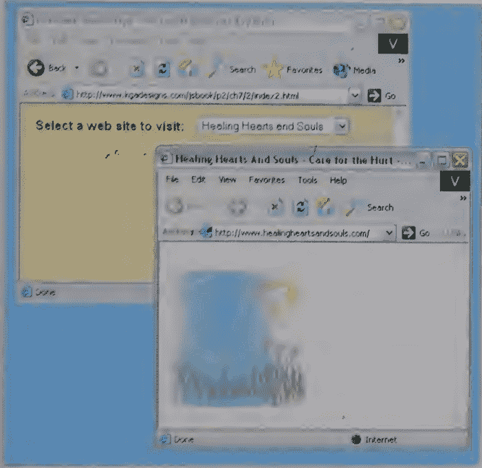

图 7-3 使用新窗口显示所选 URL

## 显示或隐藏页面的一部分

在你的脚本工具箱中，一个非常有用的技巧是隐藏或显示网页的某个部分。将此功能整合到网页中有许多很好的理由：

- 仅在填写完第一部分后，才显示表单的第二部分
- 根据在最初可见部分中所做的选择来显示页面的特定部分（次要部分在做出选择之前是隐藏的）
- 根据登录用户的身份来隐藏或显示部分
- 如果页面呈现测试题或其他问答内容，在问题完成后显示“答案”部分

> **供您参考**
>
> 此示例演示了`onclick`事件。

显示部分的标准方法是首先确保这些部分是内置在 HTML 中的。这些部分由`<div></div>`标签界定；也就是说，一个`div`定义一个部分（这里的“部分”是一个宽泛的说法）。图 7-4 展示了一个所有部分都可见的页面。页面上有按钮来切换两个不同`div`部分的可见性。

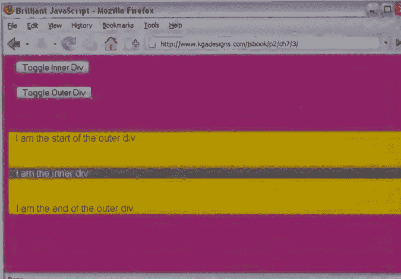

图 7-4 包含 div 部分的页面

为了增加趣味性，这些`div`是嵌套的。有一个内部`div`，它是外部`div`的一部分。通过以不同的顺序使用这些按钮，可以显示任意组合的可见性。两个`div`都可以可见，外部可见而内部不可见，内部可见而外部不可见，或者两者都隐藏。清单 7-3 展示了代码。


### 清单 7-3 一个包含 HTML div 和控制其可见性的 JavaScript 的页面

```html
<html>
<head>
<title>Brilliant JavaScript</title>
<style>
td {font-weight:bold;text-align:right;}
body {background-color:fuchsia;color:black;font-family:Arial}
</style>
<script type="text/javascript">
function toggle_innerdiv(){
    var innerdiv=document.getElementById("innerdiv");
    if (innerdiv.style.visibility=="visible") {
        innerdiv.style.visibility="hidden";
    } else {
        innerdiv.style.visibility="visible";
    }
}
function toggle_outerdiv(){
    var outerdiv=document.getElementById("outerdiv");
    if (outerdiv.style.visibility=="visible") {
        outerdiv.style.visibility="hidden";
    } else {
        outerdiv.style.visibility="visible";
    }
}
</script>
</head>
<body>
<form id="myform" action="#">
    <input type="button" id="inner" value="Toggle Inner Div" onclick="toggle_innerdiv()" />
    <br /><br />
    <input type="button" id="outer" value="Toggle Outer Div" onclick="toggle_outerdiv()" />
</form>
<br /><br />
<div id="outerdiv" style="background-color:yellow;">
    I am the start of the outer div
    <br /><br /><br />
    <div id="innerdiv" style="background-color:gray;color:white">
        I am the inner div
    </div>
    <br /><br />
    I am the end of the outer div
</div>
</body>
</html>
```


每个按钮都有一个`onclick`事件，该事件调用两个函数中的一个。这是用于内部`div`的那个：

```html
<input type="button" id="inner" value="Toggle Inner Div" onclick="toggle_innerdiv()" />
```

该函数测试`div`当前的可见性。可能性是`visible`或`hidden`；这两种状态属于`visibility`属性。无论当前处于哪种状态，都会被替换为另一种状态——可见性被切换：

```javascript
function toggle_innerdiv(){
    var innerdiv=document.getElementById("innerdiv");
    if (innerdiv.style.visibility=="visible") {
        innerdiv.style.visibility= "hidden";
    } else {
        innerdiv.style.visibility= "visible";
    }
}
```

图 7-5 展示了可见性属性变化的一个示例。外部`div`被设为隐藏，而内部`div`被设为可见。

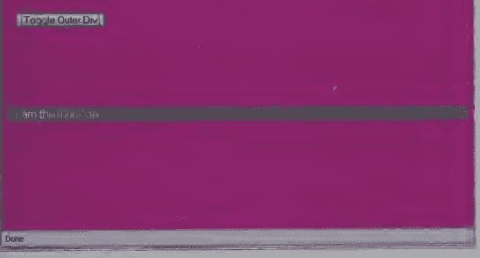

## 智能输入

自动填充、自动建议、智能感知：这些都是指在文本框中输入时，从可用词语中进行选择建议的功能术语。本示例使用国家名称作为数据源。当进行输入时，每次按键——在键位弹起时（`onkeyup`事件）——会运行一个函数，根据输入框中的内容查找匹配的国家名称。随着逐个字母的输入，建议列表会逐渐缩小，如果无法找到匹配项，列表最终可能变为空。

> 供您参考

本示例演示了`onkeyup`和`ondblclick`事件。

考虑到国家数量众多，本示例将选择范围限制在仅以 A、B 或 C 开头的国家。图 7-6 显示了一个带有文本框的网页。目前已输入一个字母 B，下方的`textarea`中填充了以 B 开头的建议国家。

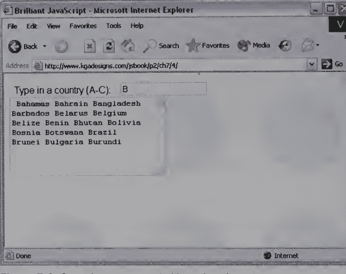

**图 7-6** 基于输入的国家建议

当输入另一个字母时，建议列表会相应地调整，如图 7-7 所示。

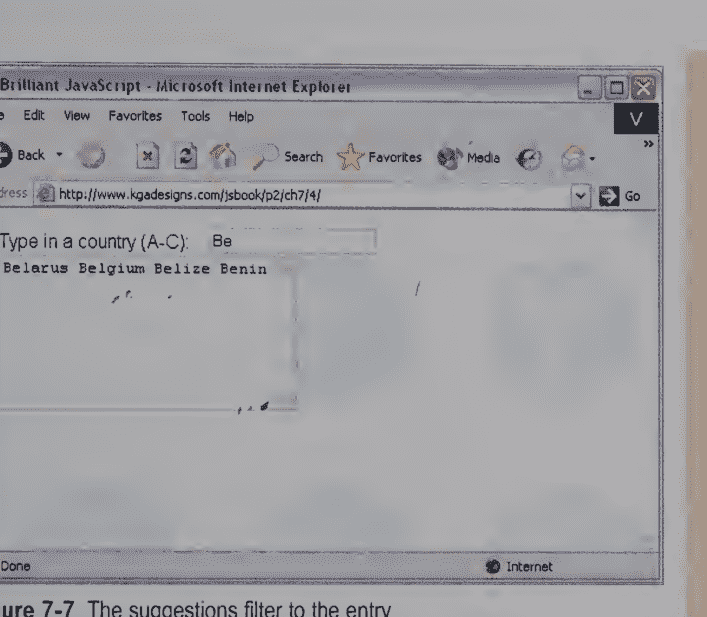

**图 7-7** 建议列表根据输入进行过滤

建议列表在输入每个字母时都会更新。这是因为`onkeyup`事件调用了`get_list`函数。该函数将输入内容与存储在数组中的国家列表进行比较。匹配测试在一个循环中进行，该循环将输入内容与完整的国家列表进行比较。所有匹配项都会传递给一个更大的框——名为`countrylist`的`textarea`——的`value`属性。该框首先总是会被清空。清单 7-4 展示了完整代码。

### 清单 7-4 基于输入的建议

```html
<html>
<head>
<title>Brilliant JavaScript</title>
<style>
td {font-weight:bold;text-align:right;}
body {background-image:url('globe1.jpg');color:black;font-family:Arial}
</style>
<script type="text/javascript">
function clear() {
  document.getElementById("countrylist").value="";
  document.getElementById("txtEntry").value="";
}
function get_list() {
  entrybox=document.getElementById("txtEntry");
  entry_value=entrybox.value.toUpperCase();
  list=document.getElementById("countrylist");
  list.value="";
  var countries = new Array("Afghanistan","Albania","Algeria","Andorra","Angola","Antigua","Argentina","Armenia","Australia","Austria","Azerbaijan","Bahamas","Bahrain","Bangladesh","Barbados","Belarus","Belgium","Belize","Benin","Bhutan","Bolivia","Bosnia","Botswana","Brazil","Brunei","Bulgaria","Burundi","Cambodia","Cameroon","Canada","Cape_Verde","Chad","Chile","China","Colombia","Comoros","Congo","Costa_Rica","Croatia","Cuba","Cyprus","Czech_Republic");
  for (i=0;i<countries.length;i++) {
    if (countries[i].toUpperCase().indexOf(entry_value,0)==0) {
      list.value=list.value + " " + countries[i];
    }
  }
}
function fill_box() {
  var txt = '';
  if (window.getSelection) {
    txt = window.getSelection().toString();
  }
  else if (document.getSelection) {
    txt = document.getSelection();
  }
  else if (document.selection) {
    txt = document.selection.createRange().text;
  }
  else return;
  entrybox=document.getElementById("txtEntry");
  entrybox.value=txt;
}
</script>
</head>
<body onload="clear()">
<form id="myform" action="#">
  输入一个国家 (A-C):
  <input type="text" id="txtEntry" onkeyup="get_list()" />
  <br />
  <textarea rows="8" cols="30" id="countrylist" ondblclick="fill_box()"></textarea>
</form>
</body>
</html>
```

本示例包含两个函数：`get_list`函数根据输入填充`textarea`框中的建议；`fill_box`函数将`textarea`框中双击的任何国家名称填入文本输入框。换句话说，在标准文本框中输入，较大的`textarea`会更新建议列表。一旦找到所需的建议，双击它就会将其放入文本框，从而有效地完成输入。

> 供您参考

`toUpperCase`方法应用于输入内容和循环遍历中的国家列表。这种技巧消除了大小写敏感性。所有比较都在相同的大写形式下进行。


图 7-8 显示双击了“Belgium”并将其放入文本框。

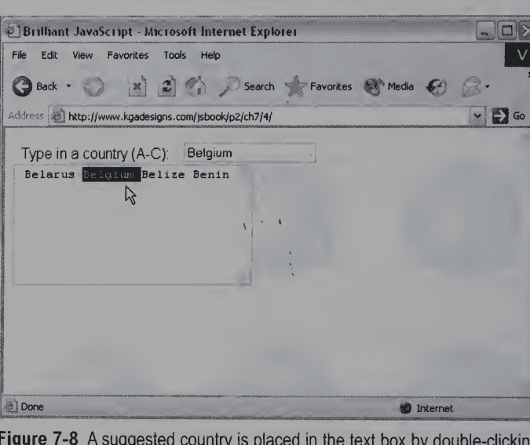

**图 7-8** 通过双击将建议的国家放入文本框

> **供您参考**

此技术有更高效的变体。这里展示的方式是为了同时演示`onkeyup`和`ondblclick`事件。

通过 Tab 键切换表单是很常见的。通常很难看清表单中的哪个框、按钮、菜单等具有焦点。现在不同了。本示例展示了如何高亮显示具有焦点的文本框。与此同步，也有必要从不再具有焦点的文本框中移除高亮显示。为此，使用了两个互补的事件——`onfocus`和`onblur`。

## 高亮显示输入位置

图 7-9 显示了一个包含三个框的输入表单。当通过 Tab 键切换或点击进入每个框时，左侧的标签会变红。在图 7-9 中，正在输入名字，标签指示该文本框具有焦点。

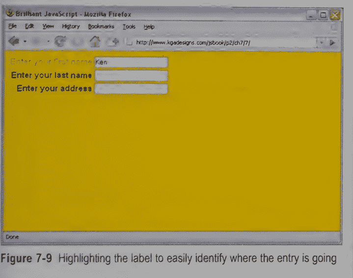

**图 7-9** 高亮显示标签以便轻松识别输入位置

> **供您参考**

本示例演示了`onfocus`和`onblur`事件。

> **术语解释**

`onblur`事件与视觉上变得模糊无关。它只是获得焦点事件的互补对立面。明白了吗？希望如此。我最初学习这个时，总是期待看到某些图像变得模糊！

每个标签都在`<span></span>`标签中。当进入每个文本框时，`onfocus`事件调用`highlight_on`函数——传递特定`span`标签的`id`。该函数更改`span`的样式，使文本变为红色。相反，当退出文本框时，`onblur`事件调用`highlight_off`函数，该函数将标签的文本颜色恢复为黑色。

清单 7-5 展示了本示例的脚本。请注意，在 HTML 部分，标签位于`span`标签内，每个`span`标签都有一个唯一的`id`，用于事件调用。

### 清单 7-5 获取焦点，失去焦点

```html
<html>
<head>
<title>Brilliant JavaScript</title>
<style>
td {font-weight:bold;text-align:right;}
body {background-color:yellow;color:black;font-family:Arial}
</style>
<script type="text/javascript">
function highlight_on(spanname) {
  var s= document.getElementById (spanname)
  s.style.color="red";
}
function highlight_off(spanname) {
  var s= document.getElementById (spanname)
  s.style.color="black";
}
</script>
</head>
<body>
<form id="myform" action="" onsubmit="return checkform()">
<table>
<tr><td><span id="firstname">请输入您的名字</span></td>
<td><input type="text" id="First"
onfocus='highlight_on("firstname")'
onblur='highlight_off("firstname")'
/></td></tr>
<tr><td><span id="lastname">请输入您的姓氏</span></td>
<td><input type="text" id="Last"
onfocus='highlight_on("lastname")'
onblur='highlight_off("lastname")'
/></td></tr>
<tr><td><span id="address">请输入您的地址</span></td>
<td><input type="text" id="Addr"
onfocus='highlight_on("address")'
onblur='highlight_off("address")'
/></td></tr>
</table>
</form>
</body>
</html>
```

## 增强网页效果

### 简介

添加一点趣味和些许光彩，将使您的网页使用起来更有趣。在搜索引擎优化和网站使用分析报告的世界里，一点“粘性”是有帮助的。也就是说，如果网页引人入胜，访客可能会停留更长时间；统计数据就会上升。还有什么比这更好的呢？

> **你知道吗？**

### 个性化

倾向于熟悉的事物是人的本性。在网页世界中，个性化可以通过几种不同的方式处理。最全面的个性化能力是当用户偏好存储在数据库中时。那么，每当用户访问该网站（并假定已登录），用户指示的所有喜好都可以呈现在页面上。

下一种方法是将偏好数据保存在`cookie`中。这有其优点，但也有点风险。用户随时可以关闭`cookie`，或者更可能的是，清理计算机中的`cookie`和临时文件。此外，如果用户使用不同的计算机，`cookie`不会跟随用户。如果您有多台计算机，您可能有过这样的经历：当您使用一台计算机时，网页“记得您”，但另一台则不会。

本章不深入探讨这些方法的细节，但仍提供了一些定制技术来增强体验。

### 您将学到什么

- 追踪页面已打开多长时间
- 使用快速打印按钮
- 纳入字体大小选择器
- 从隐藏的调色板中选择文本和背景颜色

## 追踪网页上的停留时间

在网页上显示时钟是很常见的做法。将时间直接呈现在眼前，可以让你时刻意识到自己盯着页面上的内容看了多久。更好的做法是使用一个计数器来显示你停留在页面上的时间，这样就无需猜测了。使用时钟的话，你必须记住开始的时间；而有了已用时间计数器，你就能清楚自己在网页上停留了多长时间。

图 8-1 展示了一个网页，其中显示了开始时间以及自那时起经过了多少分钟。开始时间不会改变；分钟计数每秒更新一次。在实际使用中，这可能不会在页面上显得如此突兀，但为了演示目的，这里显示得比较醒目。

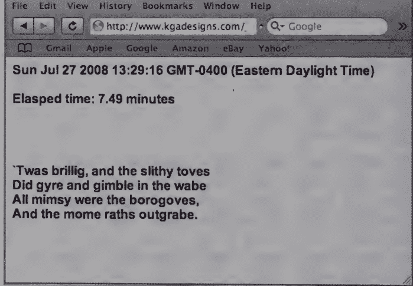

**图 8-1** 计算页面已打开的已用时间

计数器在页面加载或刷新时启动。因此，任何刷新页面的操作都会重新开始计数，并显示新的开始时间。

计数器不断更新的事实意味着某处必然有一个定时器函数在运行。`setInterval`函数负责计数器的更新，每秒执行一次。该函数接受两个参数：一个要调用的函数，以及调用该函数的频率。频率以毫秒为单位，因此设置为 1000 等于一秒。代码清单 8-1 列出了完整的代码及其后的事件序列说明。

### 代码清单 8-1 使用计时函数追踪已用时间


```html
<html>
<head>
<title>Brilliant JavaScript</title>
<style>
body {background-
image:url('back5.jpg');color:black;font-
family:Arial;font-weight:bold;}
</style>
<script type="text/javascript">
function start_time() {
  var start = new Date();
  document.getElementById("st").innerHTML=
  start;
}
function what_time() {
  var start=document.getElementById
  ("st").innerHTML;
  var counter=document.getElementById
  ("counter");
  var d2=Date.parse(start)
  var d= new Date();
  elapsed=((d-d2)/1000);
  counter.innerHTML="Elapsed time: " +
  (elapsed/60).toFixed(2) + " minutes";
}
setInterval("what_time()",1000);
</script>
</head>
<body onload="start_time()">
<div id="st">
</div>
<br />
<div id="counter">
</div>
<br /><br /><br /><br />
`Twas brillig, and the slithy toves<br />
Did gyre and gimble in the wabe<br />
All mimsy were the borogoves,<br />
And the mome raths outgrabe.<br />
</body>
</html>
```

## 追踪网页上的停留时间（续）

脚本块中包含两个函数：`start_time` 和 `what_time`。由于这些是函数，它们在页面加载时不会自动运行。`start_time` 函数确实在页面加载时执行，因为它在 load 事件中被调用：

```html
<body onload="start_time();">
```

此外，在脚本底部有一行代码，由于它不在任何函数内部，因此也会在加载时运行：

```javascript
setInterval("what_time()",1000);
```

那么当页面加载时发生的事情是：`start_time` 函数只运行一次，将开始时间填充到 body 中的 `st` div 中。这个值保持不变，不会被更新。`setInterval` 函数设置了一个每秒触发的定时器事件，它所做的就是运行 `what_time` 函数。在这个函数中，一个变量 `start` 从 `st` div 中获取固定的开始时间。另一个变量 `counter` 被赋予"当前时刻"的日期/时间。`parse` 方法用于将文本形式的开始时间转换为实际的时间变量。已用时间的计算很简单，就是用新时间减去开始时间。由于这种基于时间的数学运算返回的是毫秒数，因此需要将时间差除以 1000 转换为秒：

```javascript
var start=document.getElementById("st").
  innerHTML;
var counter=document.getElementById
  ("counter");
var d2=Date.parse(start)
var d= new Date();
elapsed=((d-d2)/1000);
```

### 供你参考

那些数学思维敏锐的人可能已经得出结论：已用分钟的小数部分会在 .99 之前重置为 0，然后分钟数加 1。小数部分显示的不是秒数，而是分钟的百分比。

最后，`counter` div 被更新为新的已用时间计数，通过除以 60 转换为分钟：

```javascript
counter.innerHTML="Elapsed time: " +
(elapsed/60).toFixed(2) + " minutes";
```

显示的已用时间以分钟为单位，四舍五入保留两位小数。这样你就能够追踪自己在某个页面上花费的时间了。

这里展示的技术在某些情况下非常实用。例如，在工作场所中，某人屏幕上可能显示着敏感信息。如果他们因故离开座位，可以检测计时器是否已达到某个已用时间——比如 5 分钟——然后关闭浏览器。

## 提供打印按钮

在网页上添加打印按钮一直被视为一种用户友好的增强功能。你点击按钮，然后打印对话框就会出现，准备让你打印网页。涉及的步骤与使用浏览器中的"文件...打印"菜单项完全相同。然而，这种效果让人感觉好像做了什么特别的事情。我们是不是可以称之为网页心理学的力量呢？

事实上，从技术上来说，让打印机在不先显示打印对话框的情况下直接打印是不可能的，而且这可能还会引发安全问题。想象一下，如果点击页面上的按钮后打印机就直接打印而不进行任何干预，那么由于意外操作（屏幕上的按钮处于启用状态，而回车键被压在了一叠纸下面）就可能导致打印机无限打印。

使用按钮来呈现打印对话框只需要一行代码。只需将这行代码放在按钮的标签内，点击按钮就会显示打印对话框：

```javascript
onClick="javascript:window.print()"
```

哎呀，忘了戴眼镜了。糟糕，现在看不到屏幕了。没关系，你还是能看到的！为访问你网站的用户提供一个很实用的功能，就是让他们可以根据自己的喜好调整字体大小。图 8-2 展示了一个包含名言的网页。下方（虽然使用 CSS 可以将这些链接放在任何位置）有四个链接，每个链接调整文本的大小。

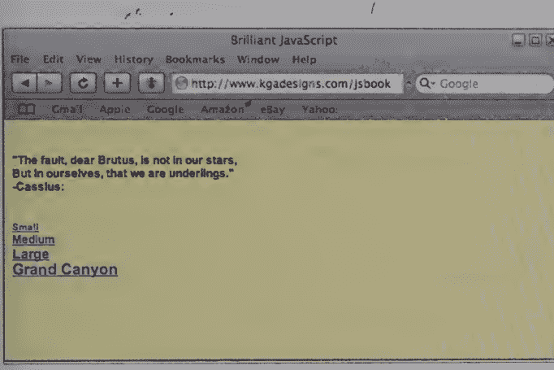

**图 8-2** 文本可以调整大小

在图 8-2 中，显示的字体大小为 12 点。这是一个中等大小，对大多数人来说都很舒适。点击"Medium"链接会将文本设置为 12 点。然而，当涉及到在电脑屏幕上查看任何内容时，在一台电脑上看起来合适的内容在另一台电脑上可能就不是这样了，即使使用相同的设置也是如此。有几个因素会影响显示效果：

- 电脑屏幕的分辨率
- 显示器的大小
- 文本（及任何图形）的密度，以及对比度和配色方案
- 人与电脑屏幕之间的距离
- 人的视力状况

文字处理软件和其他桌面应用程序都有缩放功能，这并不令人意外。缩放设置有助于解决在屏幕上查看内容的问题。浏览器也有类似的缩放功能。在大多数浏览器的"视图"菜单下，都有放大或缩小文本的方式，类似于本例。然而，自己构建的优势在于可以获得更好的控制。

### 提供字体大小调整

图 8-3 展示了通过点击"Small"链接将文本设置为 10 点时页面的显示效果。


请注意，虽然文本大小发生了变化，但文本链接的大小并没有改变。这些值在包裹链接的 `span` 标签中是固定的。代码清单 8-2 展示了脚本，以及控制文本大小的文本和链接。

### 代码清单 8-2 调整文本大小的脚本

```html
<html>
<head>
<title>Brilliant JavaScript</title>
<style>
body {font-family:arial;font-
weight:bold;background-color:#ffffcc}
</style>
<script type="text/javascript">
function resizetext(size) {
  switch (size) {
    case "10":
```

## 提供字体大小调整（续）

这项技术的关键在于对页面的某个部分应用样式更改。在此例中，更改应用于`body`标签，从而改变其中的所有文本。`body`标签有一个 id：`alltext`：

```html
<body id="alltext">
```

每个链接都调用`resizetext`函数，并将一个大小作为参数传递给它：

```html
<span style="font-size:12px;">
<a href="#" onclick="resizetext('12');return false;">Medium</a>
</span>
```

请注意，链接位于一个`span`标签内，该标签将链接文本保持为 12 点大小。这可以防止链接受到整体文本大小调整的影响。`resizetext`函数只是将新的文本大小应用于`body`。

```javascript
case "14":
    alltext.style.fontSize = "14px";
    break;
```

图 8-4 展示了大峡谷设置，以此命名来传达**大号**文本。


**图 8-4** 大峡谷尺寸的文本

## 比浏览器做得更好

如前所述，浏览器内置了文本大小调整功能。即便如此，利用迄今为止介绍的技术，你仍然可以在需要的范围内控制文本大小（甚至其他属性——字体、颜色等）。现在介绍一种浏览器无法比拟的技术。

使用此技术时，不是将其应用于整个`body`，而是应用于某个部分。假设你的 HTML 代码中有一个`div`部分，该函数可以被指定仅在该`div`上工作。浏览器无法匹配此功能，因为浏览器无法自定义其文本大小调整方式。

图 8-5 描绘了这种效果。用于调整大小的链接仍在页面上，但仅控制某个部分（本例中是一个名为`weather`的`div`）的大小。


代码与清单 8-2 中的相同，除了两点。首先，页面中有一个带有 id——`weather`——的`div`部分，其中包含天气预报：

```html
<div id="weather">
Today will be like yesterday, just warmer.
Tonight will be like today, just cooler.
There is a 50% chance of precipitation, so whether it rains or not, I was right. Tomorrow will be light during the day and not so light at night. Clouds could roll in and make the stars hard to see, or not.
</div>
```

其次，该函数将大小调整应用于`weather` div：

```javascript
function resizetext(size) {
  switch (size) {
    case "10":
      weather.style.fontSize = "10px";
      break;
    case "12":
      weather.style.fontSize = "12px";
      break;
    case "14":
      weather.style.fontSize = "14px";
      break;
    case "16":
      weather.style.fontSize = "18px";
      break;
  }
}
```

## 控制页面颜色

与应用主题类似，此示例展示了如何应用配色方案。在这个简单版本中，只有页面背景色和正文文本颜色是可变的。图 8-6 展示了用于测试配色方案的页面。最初它很简单，包含一些说明和一个左上角的链接——“更改颜色”。


**图 8-6** 一个简单的起始页面

点击`change colors`链接会切换`palette` div 的可见性。在这个 div 内部是两个调色板：一个用于背景，一个用于文本。图 8-7 展示了`palette` div 可见时的页面。

> 另请参阅

切换`div`部分在第 7 章中解释。


**图 8-7** 调色板

调色板由 HTML 表格构成，每个`<td>`标签都有一个`onmouseover`事件，该事件调用`backcolor`或`textcolor`函数。清单 8-3 展示了脚本。

### 清单 8-3 从调色板中选择颜色


```html
<html>
<head>
<title>Brilliant Javascript</title>
<style>
td {width:4%;}
</style>
<script type="text/javascript">
function backcolor(color) {
    document.body.style.backgroundColor = color;
}
function textcolor(color) {
    document.getElementById("alltext").style.color = color;
}
function toggle_palette(){
    var colors=document.getElementById("colors");
    if (colors.style.visibility== "visible") {
        colors.style.visibility="hidden";
    } else {
        colors.style.visibility="visible";
    }
}
function initial_colors() {
    document.getElementById("colors").style.visibility="hidden";
}
</script>
</head>
<body id="alltext" onload="initial_colors()">
<span style="font-size:10px;"><a href="#" onclick="toggle_palette();return false;">change colors</a></span>
<br /><br />
This page can be used to experiment mixing different background and text colors. The <i>change colors</i> link at the top left opens up an area with two palettes. One is for selecting the background, the other for selecting the text. Just move the mouse over the colors and then move the mouse off the palette to keep the selected color.

<br />
<br />
<div id="colors">
<table>
<tr><td colspan="16">background color</td></tr>
<tr>
<td style="background-color:aqua" onmouseover="backcolor('aqua')">&nbsp; </td>
<td style="background-color:black" onmouseover="backcolor('black')">&nbsp;</td>
<td style="background-color:blue" onmouseover="backcolor('blue')">&nbsp; </td>
<td style="background-color:fuchsia" onmouseover="backcolor('fuchsia')">&nbsp;</td>
<td style="background-color:gray" onmouseover="backcolor('gray')">&nbsp; </td>
<td style="background-color:green" onmouseover="backcolor('green')">&nbsp;</td>
<td style="background-color:lime" onmouseover="backcolor('lime')">&nbsp; </td>
<td style="background-color:maroon" onmouseover="backcolor('maroon')">&nbsp;</td>
<td style="background-color:navy" onmouseover="backcolor('navy')">&nbsp; </td>
<td style="background-color:olive" onmouseover="backcolor('olive')">&nbsp;</td>
<td style="background-color:purple" onmouseover="backcolor('purple')">&nbsp;</td>
<td style="background-color:red" onmouseover="backcolor('red')">&nbsp; </td>
<td style="background-color:silver" onmouseover="backcolor('silver')">&nbsp;</td>
<td style="background-color:teal" onmouseover="backcolor('teal')">&nbsp; </td>
<td style="background-color:white" onmouseover="backcolor('white')">&nbsp;</td>
<td style="background-color:yellow" onmouseover="backcolor('yellow')">&nbsp;</td>
</tr>
<tr><td colspan="16">&nbsp;</td></tr>
<tr><td colspan="16">text color</td></tr>
<tr>
<td style="background-color:aqua" onmouseover="textcolor('aqua')">&nbsp; </td>
<td style="background-color:black" onmouseover="textcolor('black')">&nbsp;</td>
<td style="background-color:blue" onmouseover="textcolor('blue')">&nbsp; </td>
<td style="background-color:fuchsia" onmouseover="textcolor('fuchsia')">&nbsp;</td>
<td style="background-color:gray" onmouseover="textcolor('gray')">&nbsp; </td>
<td style="background-color:green" onmouseover="textcolor('green')">&nbsp;</td>
<td style="background-color:lime" onmouseover="textcolor('lime')">&nbsp; </td>
<td style="background-color:maroon" onmouseover="textcolor('maroon')">&nbsp;</td>
<td style="background-color:navy" onmouseover="textcolor('navy')">&nbsp; </td>
<td style="background-color:olive" onmouseover="textcolor('olive')">&nbsp;</td>
```

增强网页 143

## 控制页面颜色（续）

```html
<td style="background-color:purple" onmouseover="textcolor('purple')">&nbsp;</td>
<td style="background-color:red" onmouseover="textcolor('red')">&nbsp;</td>
<td style="background-color:silver" onmouseover="textcolor('silver')">&nbsp;</td>
<td style="background-color:teal" onmouseover="textcolor('teal')">&nbsp;</td>
<td style="background-color:white" onmouseover="textcolor('white')">&nbsp;</td>
<td style="background-color:yellow" onmouseover="textcolor('yellow')">&nbsp;</td>
</tr>
</table>
</div>
</body>
</html>
```

`backcolor` 和 `textcolor` 函数负责将传入的颜色应用到 `body` 的背景色，或应用到 ID 为 `alltext` 的 `body` 标签（即文字颜色）：

```javascript
function backcolor(color) {
    document.body.style.backgroundColor = color;
}

function textcolor(color) {
    document.getElementById("alltext").style.color = color;
}
```

增强网页 147

## 控制页面颜色（续）

图 8.8 展示了在做出颜色选择后页面的显示效果。


图 8-8 应用了选定配色方案的页面

> **供您参考**
>
> 调色板中呈现的颜色只是众多可用颜色中的一小部分。颜色有数百万种，但无法实际呈现如此庞大的数量。传统上存在一组“网页安全色”——共 216 种。这些颜色在计算机显卡只能处理有限色彩种类的年代是安全的。如今的技术发展已使网页安全色的需求变得过时。

## 处理文字效果

# 9

## 简介

网页只能显示两样东西：文本和图像。无论是查看一个普通页面、一个高度风格化的页面，还是通过 Flash 或其他插件查看的页面，你所看到的终究只是文字和图像。本章展示一些你可以用文字实现的技巧。本章中的技巧自动态浏览器诞生之初就已存在，并且多年来被广泛使用和滥用。然而，如果在整体设计中谨慎应用，它们可以非常有效。一个布满移动文字、仅仅为了看起来酷炫的页面，现在已不再显得酷炫。相反，在页面上定义一个区域来应用其中一些技巧效果更好。这些示例并不指导你如何以及在哪里应用它们。那将是你的设计工作的一部分。这些示例确实向你展示了如何实现它们。

- 创建文字拉伸与收缩效果
- 文字滚动
- 显示打字机文字
- 生成随机文字信息

## 拉伸与收缩文字

看着文字扩张和收缩无疑非常引人注目。这种效果仅通过增加或减少字母或单词之间的间距即可实现。更大的间距将字母相互推开——即拉伸。收缩则相反——即移除间距。

图 9-1 显示了一条信息在页面上拉伸。显然，这种效果无法在静态图片中显示，但图 9-2 显示了该程序在收缩阶段的文字以供比较，即文字回缩自身——换句话说，就是收缩。


**图 9-1** 文字正在被拉伸


**图 9-2** 文字正在收缩

150

## 拉伸与收缩文字（续）

那么，这是如何实现的呢？首先设置一个数组，其中包含从 -8 到 8、步长为 2 的像素尺寸。负数用于收缩，正数用于拉伸。一个名为 `animate` 的函数从 `setTimeout` 函数中被周期性调用。频率由一个名为 `delay` 的变量控制，页面加载时初始设置为 50。这个值可以更改。数值越大，效果越慢。

在 `animate` 函数中，一系列测试确定当前的间距因子，并相应地调整到下一个因子。最后，使用 `letterSpacing` 属性应用下一个间距的像素值。清单 9-1 包含完整的脚本。请注意，在这个示例中，脚本位于页面的 `body` 部分，在包含文本的 `<p>` 标签之后。这是必要的，以便在程序开始时能识别出 ID 为 `stretch` 的 `<p>` 标签。程序在页面加载时开始，因为 `animate` 在加载期间被调用。

### 清单 9-1 拉伸与收缩文字

```html
<html>
<head>
<title>Brilliant JavaScript</title>
<style>
body {font-family:arial;font-weight:bold;background-color:#eeeeff}
</style>
</head>
<body>
<br /><br /><br />
<p style="text-align:center;font-size:26px;"
id="stretch">Stretching is good for the
body</p>
<script type="text/javascript">
delay=50;
var space = new Array("-8px","-4px",
"-2px","-1px","0px", "1px", "2px", "4px",
"8px");
space.pos = 0;
function animate() {
var stretch = document.getElementById(
"stretch");
```

## 拉伸与收缩文字（续）

```javascript
if (stretch.direction==null) {
    stretch.direction = 1;
}
else if ((space.pos > space.length-2) ||
    (space.pos==0)) {
        stretch.direction *= -1;
}
stretch.style.letterSpacing =
space[space.pos += stretch.direction];
setTimeout('animate()',delay);
}
animate();
</script>
</body>
</html>
```

所有浏览器都会在标题栏中显示一条信息。标题栏是浏览器的顶部——位于任何菜单和工具栏之上。如果未指定其他内容，显示的信息通常会显示浏览器的名称。在标题栏中放置有用信息最常用的方法是在 HTML 页面代码中设置一个 `<title></title>` 标签。标题标签中的任何内容都会显示在浏览器标题栏中。浏览本书中的示例，你会注意到整个过程中，措辞——“Brilliant JavaScript”——始终显示，因为每个示例的标题标签中都包含它。

这是一个该信息被覆盖的示例。在清单 9-2 中，你可以看到 HTML 标题仍然是“Brilliant JavaScript”，但脚本用“所有美好的事物终将到来”的信息覆盖了它。嗯，也许这本书是部分 JavaScript，部分励志。

### 清单 9-2 在标题栏中滚动显示信息

```html
<html>
<head>
<title>Brilliant JavaScript</title>
<style>
body {font-family:arial;font-weight:bold;background-color:#eeeeff}
</style>
<script type="text/javascript">
var scrll = " All good things will come in time ";
function scroller() {
  scrll = scrll.substring(1, scrll.length) + scrll.substring(0, 1);
  document.title = scrll;
  setTimeout("scroller()", 100);
}
</script>
</head>
<body onload="scroller()">
<br /><br />
Title bar scroll example
</body>
</html>
```

### 在标题栏中滚动文字


## 状态栏滚动怎么了？

要显示的信息被设置到一个变量中：

```javascript
var scrll = " All good things will come in time ";
```

`scroller` 函数以 `setTimeout` 函数中使用的时间间隔为速度旋转文字。信息被放置在文档的 `title` 属性中。

```javascript
function scroller() {
    scrll = scrll.substring(1, scrll.length) + scrll.substring(0, 1);
    document.title = scrll;
    setTimeout("scroller()", 100);
}
```

> **你知道吗？**
>
> 状态栏滚动功能怎么了？
>
> 状态栏是浏览器底部的信息反馈区域。较旧的浏览器也提供了在此处滚动文字的方法。较新的浏览器则没有。这个决定是出于实用性的考虑。状态栏的作用是传递重要信息，例如错误、页面加载问题等。因此，状态栏应始终保留以供浏览器使用。
>
> 自从这项技术出现以来很久，当浏览器开始支持多标签界面时，出现了一个有趣的变化。现在滚动发生在标题栏和标签页标题中，如图 9-3 所示。


图 9-3 滚动文字出现在标题栏和标签页标题中

## 按钮上的滚动文本


一个引人注目的效果是让按钮上的文本滚动。这可以作为引导观众采取行动的辅助手段。在销售和市场营销方面，关键目标是诱使客户采取行动。这对于你的网页可能合适，也可能不合适，但它仍然是你编码工具箱中的另一种技巧。

图9-4展示了一个页面上的按钮，该按钮带有滚动文本。文本在页面加载时滚动，因此滚动是实时的，无需用户干预。采用这种方法，所谓的“行动号召”在观众采取任何行动之前就已设置好。


当按钮被点击时，滚动停止，如图9-5所示。


## 按钮上的滚动文本（续）

代码清单9-3展示了脚本。脚本块中包含两个函数：`button_scroll` 和 `button_clicked`。`button_scroll` 函数在页面加载时被调用。它启动滚动，并且 `button_scroll` 函数内部的 `setTimeout` 函数以固定的时间间隔调用 `button_scroll` 函数：

```
timeoutID = setTimeout("button_scroll()", scroll_speed);
```

请注意，变量 `timeoutID` 被设置为 `setTimeout` 函数的返回值。当按钮被点击时，按钮的 `onclick` 事件调用 `button_clicked` 函数；正是在这个函数中使用了 `timeoutID` 变量。

`button_clicked` 函数使用 `clearTimeout` 函数来停止滚动的重复。这是可能的，因为 `timeoutID` 变量在 `clearTimeout` 函数中被使用。通过将该变量传递给 `clearTimeout` 函数，滚动停止。然后按钮上的文本更改为“我已被点击”：

```
function button_clicked() {
    window.clearTimeout(timeoutID);
    document.getElementById("mybutton").
    value="I have been clicked";
}
```

### 代码清单9-3 按钮中的滚动文本

```
<html>
<head>
<title>Brilliant JavaScript</title>
<style>
body {font-family:arial;font-weight:bold;background-color:#eeeeff}
</style>
</head>
<body>
<form>
<input type="button" id="mybutton"
value="Click me, please"
onclick="button_clicked()" />
</form>
<script type="text/javascript">
var scroll_text = " Click me, please ";
var scroll_speed = 100;
var scroll_count = 0;
function button_scroll() {
    var btn = document.getElementById("mybutton");
    scroll_text = scroll_text.substring(1, scroll_text.length) + scroll_text.substring(0, 1);
    btn.value = scroll_text;
    timeoutID = setTimeout("button_scroll()", scroll_speed);
}
function button_clicked() {
    window.clearTimeout(timeoutID);
    document.getElementById("mybutton").
    value = "I have been clicked";
}
button_scroll();
</script>
</body>
</html>
```

## 按钮上的滚动文本（续）


> **供你参考**

在这个例子中，脚本块被放置在 `body` 中，位于HTML代码中按钮引用之后。由于滚动立即开始，按钮必须在任何代码尝试操作它之前，就已经是页面上渲染好的元素。

停止滚动的 `button_clicked` 函数可以且应该做更多事情。目前，这仅演示了按钮点击被捕捉到并且滚动停止。但然后呢？在你的应用中，这才是启动相关活动的地方。


## 打字机风格显示文本

一个页面在浏览器中渲染，文本一次性全部出现，然后你开始阅读。或者，如本章前面所示，文本可能会滚动以达到引人注目的效果。这个例子展示了另一种效果，非正式地称为打字机效果：以某人打字的速度逐个字符地显示文本。

图9-6展示了一个页面，其中正在以打字机风格填充一个 `textarea` 文本框。当你等待查看接下来会出现什么时，这个效果非常吸引人，尤其是当源文本未知时。许多新闻报道网站使用这种技术来展示最新故事。


**图9-6** 一个文本框被缓慢地填满文本

### 代码清单9-4 打字机效果

```
<html>
<head>
<title>Brilliant JavaScript</title>
<style>
body {font-family:arial;font-weight:bold;background-color:#ffeeff}
</style>
<script type="text/javascript">
var pos = 0
var poem = "There is another sky, Ever serene and fair," +
    "And there is another sunshine, Though it be darkness there; " +
    "Never mind faded forests, Austin, Never mind silent fields - " +
    "Here is a little forest, Whose leaf is ever green;"
function typewriter() {
    var poem_length = poem.length;
    document.myform.mytextarea.value =
        document.myform.mytextarea.value + poem.charAt(pos);
    pos++;
    var timeID = setTimeout("typewriter()", 80);
    if (pos >= poem_length) {
        clearTimeout(timeID); pos = 0;
    }
}
</script>
</head>
<body onLoad="typewriter()">
<form name="myform">
<textarea rows="6" cols="57"
name="mytextarea"></textarea>
</form>
</body>
</html>
```

变量 `pos` 用于记录下一个要显示的字符在文本中的位置。文本被写入到 `mytextarea` 文本区域中。

## 打字机风格显示文本（续）

> **供你参考**

在本书的大部分内容中，都使用了 `getElementById` 方法来获取屏幕元素的句柄。在这个例子中，使用了另一种方法来聚焦于 `textarea` 控件。这种结构遵循 `document.form.control` 语法，在这个例子中表现为 `document.myform.mytextarea`。

## 生成随机文本

随机文本生成就像一个菜谱。创建一个随机数；创建一个文本字符串数组。将两者混合在一起，结果就是一个随机的文本字符串。

代码清单9-5展示了提供随机消息的脚本。创建了一个数组来存放这些消息，并使用一个不大于数组元素数量的随机数作为元素索引号，来选择输出哪个文本。每次页面加载或刷新时，随机数都会刷新为一个未知数，从而确保以特定的顺序显示各种消息。

### 代码清单9-5 随机智慧语录

```
<html>
<head>
<title>Brilliant JavaScript</title>
<style>
body {font-family:arial;font-weight:bold;background-color:#ffeeff}
</style>
<script type="text/javascript">
var wisdom = new Array;
wisdom[0] = "The secret of success is to do common things uncommonly well.";
wisdom[1] = "Every man dies; not every man really lives";
wisdom[2] = "Go out on a limb, you might like the view";
wisdom[3] = "The saddest moment in a person's life comes but once";
wisdom[4] = "A wolf in sheep's clothing needs professional help";
wisdom[5] = "Never cut what you can untie";
wisdom[6] = "There are too many sad things in this world. Don't walk away from the happy ones";
wisdom[7] = "The first step in getting out of a hole, is to stop digging";
wisdom[8] = "Why is the time of day with the slowest traffic called rush hour?";
wisdom[9] = "Worry gives a small thing a big shadow";
wisdom[10] = "One of the advantages of being disorderly is that one is constantly making exciting discoveries";
wisdom[11] = "Falsehood is easy, truth so difficult";
wisdom[12] = "You can observe a lot just by watching.";
wisdom_count = wisdom.length - 1;
document.write(wisdom[Math.round(Math.random() * (wisdom_count))]);
</script>
</head>
<body>
</body>
</html>
```

## 生成随机文本（续）

图9-7展示了浏览器中显示的一条随机消息。


**图9-7** 随机智慧语录

## 使用图像

### 简介

不可否认，图像与我们访问的网站紧密交织在一起。当网站用来吸引你的空间还比不上一个小型电视机的尺寸时，图片确实能传达千言万语。而即便是一台小型电视机也能提供动态画面。因此，网页在图形处理方面投入了大量功能也就不足为奇了。

### 10

- **预加载图像并创建图像悬停效果**

- **使用可滚动的照片走马灯**

- **使用一种快速放大图像并恢复原始大小的技术**

## 预加载图像

从一开始，网页图形的管理就可以在你看到它们之前进行！这种称为预加载的技术，以最快、最高效的方式将图像文件从 Web 服务器获取到浏览器中。这并不复杂。预加载的作用是在页面渲染到浏览器之前，将图像放入浏览器的缓存中。关键在于，当页面显示时，图像会随页面的其余部分一起瞬间出现。

> **术语解释**

> **缓存**（cache，发音为"cash"）是一个临时的内存位置。

浏览器利用缓存来存储不会改变的页面元素。因此，当页面再次加载时，浏览器可以设置为首先检查缓存以呈现页面。是否使用缓存取决于选项或偏好设置，其中通常会有某种关于是否始终查找网页最新版本的问题——是或否。当选择"否"时，浏览器尝试从内存中显示页面。这通常是一个糟糕的选择，因为网络是动态的。例如，假设你在周六导航到你最喜欢的新闻网站，却看到的是上周四的新闻？这可不好。因此，大多数浏览器都设置为每次加载页面时始终获取完整的全新页面。实际上，还有一个折中方案。浏览器会从缓存中工作，并只更新新的项目。

通过预加载，图像是被放置在缓存中，以便与页面的其余部分一起就绪呈现。但这不会自动发生。这是通过代码实现的。

> 操作很简单。创建一个新的图像对象，并向其传递图像的路径（或 URL）。脚本必须放在 `head` 部分，因为它必须在 HTML 主体的任何部分渲染之前运行。清单 10-1 展示了这是如何编码的。

**清单 10-1 预加载图像**

```html
<script type="text/javascript">
    fruit_on = new Image(120,120);
    fruit_on.src = "apples.jpg";
    fruit_off = new Image(120,120);
    fruit_off.src = "oranges.jpg";
    animal_on = new Image(120,120);
    animal_on.src="dog.jpg";
    animal_off= new Image(120,120);
    animal_off.src="cat.jpg";
</script>
```

## 预加载图像（续）

预加载图像通常与图像悬停效果结合使用，这将在下面讨论。考虑到这一点，上面的代码片段是预加载两组图像的结构。预加载了四幅图像：两幅水果图像和两幅动物图像。以一幅图像为例，`fruit_on` 是一个被赋值为 `Image` 对象实例的变量。此外，在实例化过程中，建立了图像的尺寸（120 × 120）。此时 `fruit_on` 变量是一个占位符，什么都不包含。下一行为该变量设置了一个真实的图像：`fruit_on.src="apples.jpg"`；

在这个例子中，`apples.jpg` 必须与网页本身位于同一目录中，因为文件名前面没有路径。

悬停效果涉及两幅图像，一幅"开启"图像和一幅"关闭"图像。因此，图像是成对预加载的。

## 图像悬停效果

图像悬停效果与鼠标移动配合工作。最初显示"关闭"图像，因为最初鼠标不在图像上。当鼠标悬停在图像上时，显示"开启"图像。图 10-1 显示了加载后页面的初始状态。显示了两幅图像，都是"关闭"图像。


**图 10-1** 显示当鼠标不在图片上时出现的图像的页面

橙子和猫分别是"关闭"图像。当鼠标移到橙子上方时，图像被替换为一幅苹果的图像，如图 10-2 所示。


**图 10-2** 苹果替换橙子

清单 10-2 包含完整的页面和脚本代码。清单 10-1 只展示了脚本。完整的代码页面提供了对图像如何变化的更清晰理解。

### 清单 10-2 图像悬停功能

```html
<html>
<head>
<title>Brilliant JavaScript</title>
<style>
body {font-family:arial;font-weight:bold;background-color:#eeeeff}
</style>
<script type="text/javascript">
    fruit_on= new Image(120,120);
    fruit_on.src="apples.jpg";
    fruit_off= new Image(120,120);
    fruit_off.src="oranges.jpg";
    animal_on= new Image(120,120);
    animal_on.src="dog.jpg";
    animal_off= new Image(120,120);
    animal_off.src="cat.jpg";
</script>
</head>
<body>
<a href="#" onmouseover="javascript:document.fruit.src='apples.jpg'"
   onmouseout="javascript:document.fruit.src='oranges.jpg'">
</a>
&nbsp;&nbsp;
<a href="#" onmouseover="javascript:document.animal.src='dog.jpg'"
   onmouseout="javascript:document.animal.src='cat.jpg'">
</a>
</body>
</html>
```

## 图像悬停效果（续）

每个悬停动作都在一个长锚点标签 `<a></a>` 中处理：


```html
<a href="#" onmouseover="javascript:document.animal.src='dog.jpg'"
onmouseout="javascript:document.animal.src='cat.jpg'">
</a>
```

锚点标签包含典型的`href`来创建超链接。这不是必须的——悬停的图像不必是超链接，但通常会是。在这个例子中，链接被设置为仅保持显示同一页面，因此为`href="#"`。

锚点标签的最后部分显示初始图像。在这里，通过``标签，`src`属性被设置为"关闭"图像`cat.jpg`。当鼠标移到图像上方时，`onmouseover`事件调用内联 JavaScript 程序将图像更改为`dog.jpg`。这是通过使用`document`对象和命名子部分`animal`来完成的。注意，`animal`是最初在显示猫图像的``标签中使用的名称。在`onmouseover`事件之后，`onmouseout`事件使用 JavaScript 将图像恢复为猫——即"关闭"图像。

> **供你参考**
>
> 可以实现三图像过程。初始图像在任何鼠标活动之前呈现。图像恢复为猫图像，因为那是`onmouseout`事件中引用的图像文件。此事件可以引用不同的图像。那么效果就是页面加载时显示一幅初始图像，一旦鼠标移到其上就再也看不到了——因为当鼠标移开时，会显示次要的"关闭"图像。

总结一下，图 10-3 显示了当鼠标移到猫图像上方时出现的狗。狗、猫、老鼠——一起工作——只有在计算机世界里才会这样。

## 图像悬停效果（续）


**图 10-3** 用狗替换猫

## 在走马灯中展示照片

相册作为保存记忆的最佳方式已经来去匆匆。如果你看看那些泛黄的老照片，然后将它们与当今的数字照片进行比较——哪一种呈现效果更好？

数字照片的显著优点是你可以将它们放在网页上。嗯，这没什么新鲜的。这已经是司空见惯的事了。

让一系列照片以动画方式移动则是另一回事。通过自定义照片走马灯，你可以向世界展示你最好的照片。在这个演示中，我收集了几张多年来收集的彩虹照片。有些是天空中常见的典型彩虹，还有一些是尼亚加拉大瀑布永远存在的彩虹。图 10-4 是这些珍宝滚动时截取的屏幕截图。


**图 10-4** 移动的照片，字面意义和比喻意义上都是

执行这种类幻灯片展示的代码有点长。清单 10-3 显示了完整的页面和 JavaScript 代码，随后是一些使其运作的要点。

**清单 10-3 它是幻灯片展示，它是走马灯，它很酷，随你怎么称呼它**

```html
<html>
<head>
<title>Brilliant JavaScript</title>
<style>
```

## 在跑马灯中展示照片（续）

```html
<body {font-family:arial;font-weight:bold;background-color:#eeeeff}
</style>
<script type="text/javascript">
var images = new Array;
function image_link(name, width, link){
    this.name = name
    this.width = width
    this.link = link
}
images[0] = new image_link('rainbow1.jpg',200,'rainbow1.jpg');
images[1] = new image_link('rainbow2.jpg',200,'rainbow2.jpg');
images[2] = new image_link('rainbow3.jpg',200,'rainbow3.jpg');
images[3] = new image_link('rainbow4.jpg',200,'rainbow4.jpg');
images[4] = new image_link('rainbow5.jpg',200,'rainbow5.jpg');
images[5] = new image_link('rainbow6.jpg',200,'rainbow6.jpg');
images[6] = new image_link('rainbow7.jpg',200,'rainbow7.jpg');
images[7] = new image_link('rainbow8.jpg',200,'rainbow8.jpg');
var speed = 20
var image_count = images.length
var interval
var imgArray = new Array(image_count)
var shuffle = new Array(image_count)
for (i=0;i<image_count;i++){
imgArray[i] = new Image()
imgArray[i].src = images[i].name
imgArray[i].width = images[i].width
a=0
for (b=0;b<i;b++){
    a=a+images[b].width
}
shuffle[i] = a
}
function startScrolling(){
    window.clearInterval(pause)
}
interval = setInterval("autoScroll()",speed)
}
function autoScroll(){
  for (i=0;i<image_count;i++){
    shuffle[i] = shuffle[i] - 1
    if (shuffle[i] == -(images[i].width)){
      a = 0
      for (b=0;b<image_count;b++){
        if (b!=i){
          a = a + images[b].width
        }
      }
      shuffle[i] = a
    }
    document.images[i].style.left = shuffle[i]
  }
}
function stop(){
  window.clearInterval(interval)
}
function go(){
  interval = setInterval("autoScroll()",speed)
}
pause = setInterval("startScrolling()",1000)
</script>
<body bgcolor='#eeffff'>
<script>
for (i=0;i<image_count;i++){
  document.write('<a href = ' + images[i].link +' target="_blank" ></a>')
}
</script>
</body>
</html>
```

回顾要点，名为`images`的图片数组中的每个元素，都包含一个结构体实例，该结构体保存了三部分信息：图片文件的名称、在跑马灯中显示的宽度，以及当图片被点击时将在新窗口中显示的文件。毫不意外，被显示的文件和将在新窗口显示的文件是同一个。当在新窗口中显示时，尺寸限制将不再生效，因此，如果原始尺寸大于尺寸限制，将会显示更大的图片：

```javascript
images[2] = new image_link('rainbow3.jpg',200,'rainbow3.jpg');
```

跑马灯的移动速度在这一行设置。数值越小，跑马灯移动越快：`var speed = 20`。

另外两个数组`imgArray`和`shuffle`，用于在图片滚动出视野后，方便地将其重新定位回原位。函数`stop`将停止滚动，并在单独的窗口中显示被点击的图片。名为`go`的函数则重新开始滚动。

最后，在页面的`body`中，有一个用于显示跑马灯的脚本块。`document.write`方法被用来将图片设置为超链接。`onmouseover`和`onmouseout`事件分别调用`stop`和`go`函数。

## 在跑马灯中展示照片（续）

图 10-5 展示了点击照片并在一个单独窗口中按原始大小显示的结果。


**图 10-5** 从跑马灯中单独显示一张照片

在第 8 章中，展示了一种增大和/或减小字体大小的技术。本示例中展示的技术则是用于增大图片的尺寸。通常实现此目的的方法是，点击一个较小的图片，然后在新窗口中打开同一图片的较大文件版本。

这种技术则没那么繁琐。网页上包含几个图形。只需点击它们，就能放大其尺寸。图 10-6 展示了该页面。


**图 10-6** 可缩放的图片

在代码中，变量`zoom_factor`存储了图片放大的倍率。值为 2 则尺寸加倍。代码清单 10-4 展示了该脚本。

**代码清单 10-4 使用缩放功能查看所有细节**

```html
<html>
<head>
<title>Brilliant JavaScript</title>
<style>
body {text-align:center;font-
family:arial;font-weight:bold;background-
color:#eeecee}
</style>
<script type="text/javascript">
var zoom_factor = 2;
//width and height
var w;
var h;
// the original width and height
var start_width;
var start_height;
var clicks=0;
function zoom_in(img) {
  // curr_Img = this_Img;
  clicks++;
  if (clicks == 1) {
    start_width = img.width;
    start_height = img.height;
  }
  w = img.width;
  h = img.height;
  img.width = w * zoom_factor;
  img.height = h * zoom_factor;
}
function back_to_size(img) {
  if (clicks != 0) {
    img.width = start_width;
    img.height = start_height;
    clicks = 0;
  }
}
</script>
<body>
<h2>Zoom Demonstration</h2>


<br /><br />Click on an image to zoom in.
<br /><br />Move the mouse off the image to
return to the original size</p>
</body>
</html>
```

## 图片缩放（续）

原始宽度和高度存储在`start_width`和`start_height`变量中。同时也会跟踪鼠标点击次数。每次点击图片，图片尺寸都会再次按`zoom_factor`增大。点击几次，你就能得到一张非常大的图片！

有两个函数控制这一切：`zoom_in`和`back_to_size`。缩放函数通过鼠标点击图片触发，从而能够跟踪点击次数。`back_to_size`函数在鼠标移开图片时通过`onmouseout`事件触发。

图 10-7 展示了一张放大的图片。请注意，鼠标指针停留在图片上以保持其放大状态。


**图 10-7** 放大后的图片

## 窗口、页面、弹窗和提示框

### 11. 引言

本章是关于盒子的。外层的盒子，以及嵌套的盒子。还有那些在你强制关闭前不会消失的盒子。我们来看看具体名称。有浏览器窗口、页面、屏幕、弹窗、警告框、确认框和提示框。通常来说，浏览器就是一个窗口，它可以打开其他窗口。页面位于浏览器中。屏幕是包含浏览器的载体。弹窗是一个窗口，通常设计为位于所有内容之上。警告框和提示框也位于顶部，并在关闭前一直控制着你的浏览器。

- 将文本和 HTML 标签写入浏览器
- 了解警告框、确认框和提示框的工作原理
- 在现有网址上打开新窗口
- 打开一个空白新窗口并向其写入内容
- 根据浏览器宽度动态调整图片大小

> **你知道吗？**
>
> **弹窗的问题**
>
> 弹窗（popup）本身是一个通用术语，如今已成为不良网络行为的同义词。弹窗包含广告，令人烦恼，弹出得过于频繁；它们甚至会弹出到底部。也就是说，它们会隐藏在浏览器下方，当你关闭浏览器时——砰，弹窗就出现了。现在的许多病毒软件会阻止显示弹窗。我对此问题不提供任何解决方案，只是指出来。

## 向浏览器写入内容

将内容放入浏览器窗口的基本方法是使用`document`对象的`write`方法。本书中已经多次使用这个方法——它是经过时间检验的、可靠的输出工具。

`document.write`的有趣之处在于，由于它输出到浏览器窗口，而窗口能识别 HTML 代码，因此`document.write`可以输出格式化内容、链接、图片等。

另一种使用的方法是，对于具有`innerHTML`属性的标签（如`div`和段落`<p>`），将文本设置到该属性上。


**图 11-1** 简单输出

让我们从基本输出开始。图 11-1 展示了 (1) 普通文本、(2) 图片和 (3) 格式化文本的输出。

输出是通过`document.write`构造函数创建的。代码清单 11-1 展示了如何实现。

**代码清单 11-1 基本文本与 HTML 标签输出**

```html
<html>
<head>
<title>Brilliant JavaScript</title>
<style>
body {font-family:arial;font-weight:bold;background-color:#ff ddee}
</style>
<script type="text/javascript">
document.write ("Hello, I am regular old text, but I think a cat is following me!");
document.write ("<br /><br />");
document.write("");
document.write ("<br /><br />");
document.write ("<h2>I am inside a heading tag, do I look any larger?</h2>");
</script>
</head>
<body>
<p id="paragraph1"></p>
</body>
</html>
```

第一行文本只是以纯文本形式写入。图像及其下方的文字则是以 HTML 形式写入。例如，`
<head>
<title>Brilliant JavaScript</title>
<style>
body {font-family:arial;font-weight:bold;background-color:#ffddee}
</style>
<script type="text/javascript">
document.write ("Hello, I am regular old text, but I think a cat is following me!");
document.write ("<br /><br />");
document.write("");
document.write ("<br /><br />");
document.write ("<h2>I am inside a heading tag, do I look any larger?</h2>");
document.write ("<br /><br />");
document.getElementById("paragraph1").innerHTML="I am the first paragraph";
</script>
</head>
<body>
<p id="paragraph1"></p>
</body>
</html>
```

这一行代码旨在使用`innerHTML`写入内容：

```javascript
document.getElementById("paragraph1").innerHTML="I am the first paragraph";
```

这看起来很简单，却产生了如图 11-2 所示的错误。

## 向浏览器写入内容（续）


**图 11-2** 输出错误

为什么会出现这个错误？处理`innerHTML`的代码行本身没有问题。问题在于该代码行所处的位置。当页面渲染到浏览器时，这行有问题的代码试图按顺序写入段落元素；但渲染过程尚未创建该段落。错误是因为尝试向一个尚不存在的元素输出内容而导致的。

代码清单 11-3 展示了一种不同的代码安排。处理`innerHTML`属性的代码行现在位于主体部分，在段落渲染之后。

代码清单 11-3 另一种尝试向段落的`innerHTML`属性写入的方式

```html
<html>
<head>
<title>Brilliant JavaScript</title>
<style>
body {font-family:arial;font-weight:bold;background-color:#ffddce}
</style>
<script type="text/javascript">
document.write ("Hello, I am regular old text, but I think a cat is following me!");
document.write ("<br /><br />");
document.write("");
</script>
<head>
<body>
</body>
</html>
```

## 向浏览器写入内容（续）

```html
document.write ("<br /><br />");
document.write ("<h2>I am inside a heading
tag, do I look any larger?</h2>");
</script>
</head>
<body>
<p id="paragraph1"></p>
<script>
document.getElementById("paragraph1").innerHTML="I am the first paragraph";
</script>
</body>
</html>
```

图 11-3 展示了更正后的输出。现在，屏幕上的元素是由头部脚本和主体脚本共同创建的。多么灵活！


图 11-3 输出已更正

需要记住的是页面加载时元素渲染的顺序。除非页面中已存在某个元素，否则无法在不引起错误的情况下对其进行操作。接下来的几行代码是代码清单 11-3 中代码的另一种组织方式：

```javascript
document.write ("<p id='paragraph1'></p>");
document.getElementById("paragraph1").innerHTML="I am the first paragraph";
</script>
</head>
<body>
</body>
</html>
```

区别在于`paragraph1`现在并非固定在主体中，而是被动态写入，且就在处理其`innerHTML`属性的代码行之前。这样是可行的；其输出与代码清单 11-3 产生的输出完全相同。顺序是正确的。

代码清单 11-4 更进一步。现在主体部分中有一个表格。JavaScript 被用来改变表格中的文本颜色。这是可行的，因为处理表格文本颜色的脚本出现在主体中表格的后面。

代码清单 11-4 使用 JavaScript 更改表格中所有单元格的文本颜色

```html
<html>
<head>
<title>Brilliant JavaScript</title>
<style>
body {font-family:arial;font-weight:bold;background-color:#ffddee}
</style>
<script type="text/javascript">
document.write ("Hello, I am regular old text, but I think a cat is following me!");
document.write ("<br /><br />");
document.write("");
```

## 向浏览器写入内容（续）

```html
document.write ("<br /><br />");
document.write ("<h2>I am inside a heading tag, do I look any larger?</h2>");
document.write ("<p id='paragraph1'></p>");
document.getElementById("paragraph1").innerHTML="I am the first paragraph";
</script>
</head>
<body>
<table>
<tr><td>Cell 1</td><td>Cell 2</td></tr>
<tr><td>Cell 3</td><td>Cell 4</td></tr>
</table>
<script>
var cells= document.getElementsByTagName("td");
for (i=0;i<cells.length;i++) {
cells[i].style.color="maroon";
}
</script>
</body>
</html>
```

### 省时技巧

当需要访问所有给定类型的元素时，`getElementsByTagName`是将这些元素收集到单个数组中的即时方法。各个元素的 id 和/或名称并不重要。

一个有用的方法`getElementsByTagName`允许一次性访问所有给定类型的元素。在这个例子中，`<td>`标签创建了表格中的单元格，并被收集到名为`cells`的数组中。遍历该数组，并将颜色属性更改为栗色。

图 11-4 展示了最终的页面输出。表格靠近底部，没有边框使其突出，但单元格中的文本可见，并且与页面其余文本颜色不同。

## 向浏览器写入内容（续）


**图 11-4** 表格单元格在一个数组中被一同访问

## 警报、提示和确认

在任何基于计算机的应用程序中，沟通通过屏幕进行，但也通过对话框提供支持。有些对话框提供信息，有些也接受输入。就 JavaScript 而言：

- `alert`显示一条消息。
- `prompt`请求输入，用户可以选择输入或不输入，然后仍能关闭该框。
- `confirm`提供一个选择性回复，确定或取消。这两个选择被宽泛地用于收集是或否、真或假等回复。虽然“确定”和“取消”这些实际词语无法更改，但其目的可以通过`confirm`框中出现的消息来阐明。

代码清单 11-5 展示了一段代码，演示了使用这些对话框类型的序列。

代码清单 11-5 提示、警报、问题、选择

```html
<html>
<head>
<title>Brilliant JavaScript</title>
<style>
body {font-family:arial;font-weight:bold;background-color:#eeeeff}
</style>
<script type="text/javascript">
var name= prompt("What is your name?","");
if (name!= null) {
alert("Your name is " + name);
} else {
alert ("No name was entered");
}
var doglover = confirm("Do you like dogs?");
if (doglover== true) {
alert("Me too!");
} else {
alert ("Dogs do tend to yap a lot");
}
</script>
</head>
```

```html
<body>
</body>
</html>
```

## 警报、提示和确认（续）

首先出现的是一个提示，询问姓名。图 11-5 展示了该提示。


**图 11-5** 询问姓名的提示

使用提示时，可能出现多种结果：

- 输入一个名字，然后点击确定按钮。
- 输入一个名字，然后点击取消按钮。
- 未输入任何内容，直接点击取消按钮。
- 未输入任何内容，直接点击确定按钮。

为所有可能性编写代码是最佳实践。在此示例中，代码会测试点击了哪个按钮。当点击取消时，即使有输入，也会返回`null`。相反，即使没有输入条目，点击确定也不会返回`null`。在此示例中，没有针对空条目点击确定进行测试。但这没关系。唯一会发生的就是警报会告诉你你的名字是空的：

```javascript
if (name != null) {
    alert("Your name is " + name);
} else {
    alert ("No name was entered");
}
```

图 11-6 显示了在提示关闭后显示的警报框。我被告知我的名字是 Ken。此示例让警报显示提示的结果。在实际应用中这并不实用。这仅仅是提醒用户他们刚刚输入的内容。希望他们的注意力持续时间能比这更长一些！

## 警报、提示与确认（续）


图 11-6 是的，我的名字就是我的名字

接下来会出现一个确认框。无论其中编码了什么问题，选项都是“确定”或“取消”。像“你喜欢狗吗？”这样的问题实际上是一个是或否的问题，但显示的是“确定”和“取消”。如果点击“确定”，会出现一个警报，显示消息“我也是！”如果点击“取消”，消息则是“狗确实倾向于叫个不停”。嗯，至少我的狗是这样——我过去常常能隔着整个街区听到它的叫声。

## 打开窗口

`window`对象的`open`方法用于打开一个新的浏览器窗口。影响其工作方式的因素多种多样。不同的浏览器处理某些命令的方式不同。此外，由于现在的浏览器都采用标签页设计，打开的可能是一个新的浏览器窗口，或者是当前浏览器中的一个新标签页。然而，选择是新浏览器还是新标签页并非唾手可得。这取决于浏览器的设置。不同浏览器之间的一致性并不好。关于这一点就说这么多。图 11-7 显示了一个包含三个按钮的页面。为了方便，脚本中每个按钮调用的操作都写在相应按钮的旁边。具体来说，点击一个按钮会调用一个 JavaScript 函数，该函数中包含了显示在按钮旁边的确切代码行。


图 11-7 窗口打开选项

首先，`open`方法的基本语法是`window.open(URL, 窗口名称, 可选参数)`。

URL 条目正如其名——是应出现在新窗口中的网页地址。窗口名称没有明显的用途。它不会出现在新窗口中或新窗口上。可选参数列在表 11-1 中。

## 打开窗口（续）

表 11-1 `open`方法的可选参数

| 选项 | 描述 |
| :--- | :--- |
| `directories` | 指示是否在新窗口中显示书签工具栏 |
| `height` | 新窗口的高度，以像素为单位 |
| `left` | 新窗口将放置在距离屏幕左侧的距离，以像素为单位 |
| `location` | 指示是否在新窗口中显示地址栏 |
| `menubar` | 指示是否在新窗口中显示菜单栏 |
| `resizable` | 指示是否可以调整新窗口的大小 |
| `scrollbars` | 指示新窗口是否可以有滚动条 |
| `status` | 指示新窗口是否将有状态栏 |
| `toolbar` | 指示新窗口是否将有工具栏 |
| `top` | 新窗口将放置在距离屏幕顶部的距离，以像素为单位 |
| `width` | 新窗口的宽度，以像素为单位 |

使用这些选项需要仔细考虑。你可能使用它们是为了让观众的体验更简单，但移除菜单栏或工具栏，或者使窗口不可调整大小，可能会显得相当烦人。调整窗口大小并移除滚动条会使观众难以看到窗口可见部分之外的任何信息。因此请谨慎使用这些选项。在不同分辨率的屏幕上，在不同的浏览器中测试这些选项。如果这些都无法做到，我建议你宁可保守一点，不要使用太多这些选项。

在图 11-7 所示的按钮中，点击第一个按钮确实在一个单独的窗口中打开了我的博客，并且该窗口可以调整大小——见图 11-8。

## 打开窗口（续）


**图 11-8** 一个设置为现有 URL 的新窗口

## 打开一个新的空白窗口

打开新窗口的一个优点是可以拥有一个空白窗口。也就是说，它没有设置为现有的 URL。这可以通过将`open`方法中的 URL 设置留为空字符串（“”）来简单实现。然后，你可以使用`write`方法在新窗口中创建内容，如清单 11-6 所示。

清单 11-6 创建一个带有内容的新窗口

```javascript
<html>
<head>
<title>Brilliant JavaScript</title>
<style>
body {font-family:arial;font-weight:normal;background-color:#ee9eff}
</style>
<script type="text/javascript">
function window1() {
    var new_window=window.open("","A new window","");
    new_window.document.write("<html><head><title>new</title></head>");
    new_window.document.write("<body style='background-color:lightblue'>");
    new_window.document.write("HELLO JUPITER!</body></html>");
    new_window.document.close();
}
</script>
</head>
<body>
<form>
<button id="button1" onclick="window1()">Window 1</button>
</form>
</body>
</html>
```

一个非常有用且受人赞赏的功能是让你的应用程序提供适合观众窗口的内容。屏幕尺寸和分辨率掌握在观众手中，但幸运的是，JavaScript 可以读取屏幕以及更重要的浏览器的尺寸信息。

图 11-9 显示了一张图片。该图片的尺寸按宽度设置为浏览器的一半，无论浏览器是最大化还是缩小。图片的宽度始终是浏览器宽度的一半。

## 为不同屏幕尺寸做规划


**图 11-9** 图片宽度从不超过浏览器宽度的一半

该技术很简单：读取浏览器的宽度，除以 2，然后将图像宽度设置为该数字，如清单 11-7 所示。

清单 11-7 计算动态宽度

```javascript
<html>
<head>
<title>Brilliant JavaScript</title>
<style>
body {font-family:arial;font-weight:bold;background-color:#eeeeff}
</style>
</head>
```

## 为不同屏幕尺寸做规划（续）


```
<body>
</body>
<script type="text/javascript">
if (window.innerWidth) {
  var w= window.innerWidth;
} else {
  w=document.body.clientWidth;
}
document.write("");
</script>
</html>
```

Internet Explorer 以不同的方式报告浏览器宽度，此代码段兼顾了 Internet Explorer 和其他浏览器：

```
if (window.innerWidth) {
  var w= window.innerWidth;
} else {
  w=document.body.clientWidth;
}
```

一旦变量`w`获得了浏览器的宽度，就使用`write`方法动态放置一个` **重要**

此技术仅在 Internet Explorer 中有效。

图 12-1 显示了一个正在进行的过渡。一个页面正在被另一个页面替换，但不是干净的切换，而是新页面通过过渡效果进入。


**图 12-1** 网页之间的过渡

图 12-1 中显示的页面更改是“盒状收缩”过渡。过渡通过使用一个`meta`标签来实现。语法如下：

## 页面过渡（续）

```
<meta http-equiv="Page-Enter" content="RevealTrans(Duration=4,Transition=3)">
```

该`meta`标签行放置在页面的`head`部分。

请注意，这发生在页面进入（page enter）事件上（与加载 load 事件不同）。过渡必须发生在两个页面之间；即新页面正在被进入。因此，当从历史对象中的前一个页面返回，或在地址栏输入 URL 进入时，该效果才会生效。当浏览器刷新时，该效果*不会*出现，因为从技术上讲，此时你并不是在进入页面，而是在更新页面。

图 12-2 展示了过渡完成后的新页面。


**图 12-2** 过渡完成

在撰写本书时，共有 25 种过渡效果，列在表 12-1 中。

## 页面过渡（续）

**表 12-1 Internet Explorer 中可用的过渡效果**

| 过渡名称 | Meta 标签代码 |
|---|---|
| Blend in | `<meta http-equiv="Page-Enter" content="blendTrans(Duration=4.0)">` |
| Box in | `<meta http-equiv="Page-Enter" content="RevealTrans(Duration=4,Transition=0)">` |
| Box out | `<meta http-equiv="Page-Enter" content="RevealTrans(Duration=4,Transition=1)">` |
| Circle in | `<meta http-equiv="Page-Enter" content="RevealTrans(Duration=4,Transition=2)">` |
| Circle out | `<meta http-equiv="Page-Enter" content="RevealTrans(Duration=4,Transition=3)">` |
| Wipe up | `<meta http-equiv="Page-Enter" content="RevealTrans(Duration=4,Transition=4)">` |
| Wipe down | `<meta http-equiv="Page-Enter" content="RevealTrans(Duration=4,Transition=5)">` |
| Wipe right | `<meta http-equiv="Page-Enter" content="RevealTrans(Duration=4,Transition=6)">` |
| Wipe left | `<meta http-equiv="Page-Enter" content="RevealTrans(Duration=4,Transition=7)">` |
| Vertical blinds | `<meta http-equiv="Page-Enter" content="RevealTrans(Duration=4,Transition=8)">` |
| Horizontal blinds | `<meta http-equiv="Page-Enter" content="RevealTrans(Duration=4,Transition=9)">` |
| Checkerboard across | `<meta http-equiv="Page-Enter" content="RevealTrans(Duration=4,Transition=10)">` |
| Checkerboard down | `<meta http-equiv="Page-Enter" content="RevealTrans(Duration=4,Transition=11)">` |
| Random dissolve | `<meta http-equiv="Page-Enter" content="RevealTrans(Duration=4,Transition=12)">` |
| Split vertical in | `<meta http-equiv="Page-Enter" content="RevealTrans(Duration=4,Transition=13)">` |
| Split vertical out | `<meta http-equiv="Page-Enter" content="RevealTrans(Duration=4,Transition=14)">` |
| Split horizontal in | `<meta http-equiv="Page-Enter" content="RevealTrans(Duration=4,Transition=15)">` |
| Split horizontal out | `<meta http-equiv="Page-Enter" content="RevealTrans(Duration=4,Transition=16)">` |
| Strips left down | `<meta http-equiv="Page-Enter" content="RevealTrans(Duration=4,Transition=17)">` |
| Strips left up | `<meta http-equiv="Page-Enter" content="RevealTrans(Duration=4,Transition=18)">` |
| Strips right down | `<meta http-equiv="Page-Enter" content="RevealTrans(Duration=4,Transition=19)">` |
| Strips right up | `<meta http-equiv="Page-Enter" content="RevealTrans(Duration=4,Transition=20)">` |
| Random bars horizontal | `<meta http-equiv="Page-Enter" content="RevealTrans(Duration=4,Transition=21)">` |
| Random bars vertical | `<meta http-equiv="Page-Enter" content="RevealTrans(Duration=4,Transition=22)">` |
| Random | `<meta http-equiv="Page-Enter" content="RevealTrans(Duration=4,Transition=23)">` |

## 鼠标拖尾

鼠标拖尾是在屏幕上跟随鼠标指针移动的后像。这种效果有许多变体。大多数鼠标拖尾在鼠标停止移动时会消失。该效果的其他应用则是在鼠标不移动时，在鼠标指针周围显示旋转动画。

这里展示的版本使用单个图形作为拖尾图像，并将其应用于一系列图像，且尺寸逐渐变化。换句话说，单张图像变成了多张。如果需要，也可以使用其他图像。例如，可以为每颗行星使用一张图像，这样整个太阳系就会跟随鼠标移动。在这里，它是一个简单的星形，如图 12-3 所示。


**图 12-3** 用作鼠标拖尾的简单图形

拖尾图像跟随鼠标的速度以及每张图像之间的距离是由代码中的设置决定的，并且可以更改。代码清单 12-1 展示了该脚本。

**代码清单 12-1** 使用定时函数来跟踪经过的时间

```html
<html>
<head>
<title>Brilliant JavaScript</title>
<style>
body {font-family:arial;font-weight:bold;background-color:#eeeeff}
</style>
<script type="text/javascript">
layered=document.layers;
trails=new Array("star.gif",28,26,
"star.gif",22,22,"star.gif",18,18,
     "star.gif",14,14,"star.gif",
     10,10,"star.gif",6,6)
var offsetx=15
var offsety=15
pageX=0;
pagey=0;
img_factor=parseInt(trails.length/3)
rate=30 //speed that mouse trails follow
mouse - lower number is faster
rightedge=window.innerWidth-trails[1]-20
bottomedge=window.pageYOffset+window.innerHe
ight-trails[2]
for (i=0;i<img_factor;i++){
createTrailBox("myDiv"+i,i*10,i*10,i*3+1,i*3
+2,"",
     "")
}
function createTrailBox(divname,x_pos,y_
pos,w,h,a,b,c,s){
 with (document){
  write("<div id='" + divname + "'"+"
  style='position:absolute;left:" +
     x_pos + "; top:" + y_pos + "; width:"+
     w +"; height:"+ h + "; ");
  write("'>")
  write(b);
  if (!c)
    write("</div>")
    write("</div>")
  }
}
function get_x_pos(divname){
  return parseInt(document.getElementBy
  Id(divname).style.left)
}
function get_y_pos(divname) {
    return parseInt(document.getElementById(divname).style.top)
}

function moveTrailBox(divname, DX, DY) {
    ddiv = document.getElementById(divname).style;
    rightedge = window.innerWidth - trails[1] - 20;
    bottomedge = window.pageYOffset + window.innerHeight - trails[2];
    ddiv.left = Math.min(rightedge, DX + offsetx);
    ddiv.top = Math.min(bottomedge, DY + offsety);
}

function cycle() {
    for (i = 0; i < (img_factor - 1); i++) {
        moveTrailBox("myDiv" + i, get_x_pos("myDiv" + (i + 1)),
            get_y_pos("myDiv" + (i + 1)))
    }
}

function newPos(e) {
    moveTrailBox("myDiv" + (img_factor - 1), e.pageX + 2, e.pageY + 2)
}

document.onmousemove = newPos

setInterval("cycle()", rate)
</script>
</head>
<body>
<div id="startdiv"></div>
</body>
</html>
```

以下是代码清单 12-1 中脚本的一些重点。创建了一个包含星形图像的数组，多次引用该图像，但使用了不同的高度和宽度设置：

```javascript
trails = new Array("star.gif", 28, 26, "star.gif", 22, 22, "star.gif", 18, 18,
    "star.gif", 14, 14, "star.gif", 10, 10,
    "star.gif", 6, 6)
```

拖尾图像在水平和垂直方向上距离鼠标指针的距离为：

```javascript
var offsetx=15
var offsety=15
```

下一行计算将显示多少张图像。该等式中没有固定的正确数值，因为数组中的图像数量是一个变量。末尾的数字（本例中为 3）可以更改以实现不同的效果。其用途在于你可以控制在鼠标指针之后出现多少张图像。如果需要，修改这个数字可以让显示的图像少于整个数组：

```javascript
img_factor=parseInt(trails.length/3)
```

接下来的这个数字决定了拖尾跟随鼠标指针的速度。数值越低，速度越快：

```javascript
rate=30
```

脚本的其余部分包含一组函数和数学公式，用于根据其他选择计算拖尾的位置。图 12-4 显示了被星形拖尾跟随的鼠标。


**图 12-4** 被一串星形拖尾跟随的鼠标指针

华丽且有趣的动画 205

## 弹跳的小球

在这个示例中，一个小球在一个矩形边界内来回弹跳。许多因素可以调整：速度、弹跳程度、弹跳方向、起始点等等。图12-5展示了运动中小球的快照。当然，你无法从截图中看到动画效果，因此我将在代码中解释这些参数。


**图 12-5 弹跳的小球**

从图12-5中，至少你可以看到一个蓝色的小球被限制在一个黄色矩形内。代码清单12-2展示了脚本及其详细说明。

### 代码清单 12-2 小球弹跳的实现方式


```html
<html>
<head>
<title>Brilliant JavaScript</title>
<style>
body {font-family:arial;font-weight:bold;background-color:#eeeeff}
</style>
<script type="text/javascript">
var y_axis=10;// top start
var x_axis=20; // left start
var y_inc=80; // initial horizontal bounciness
var x_inc=80; // initial vertical bounciness
var floortension=.1; // how hard is the floor
var rightwalltension=.1;// how hard is the right wall
var rooftension=.1;// how hard is the roof
var leftwalltension=.1;// how hard is the left wall
var resistance=.95; // air resistance
function bounce() {
    y_inc=y_inc*resistance;
    x_inc=x_inc*resistance;
    if (y_axis<292) {
        y_inc=y_inc+1;
    }
    if (y_axis+y_inc>292) {
        y_axis=292;
        y_inc=floortension*y_inc-y_inc+1;
        x_inc=x_inc*1.05-floortension*x_inc;
    }
    if (y_axis+y_inc<0) {
        y_axis=0;
        y_inc=rooftension*y_inc-y_inc;
    }
    y_axis=y_axis+y_inc;
    ball.style.top=y_axis;
    if (x_axis+x_inc>492) {
        x_axis=492;
        x_inc=rightwalltension*x_inc-x_inc;
    }
    x_axis=x_axis+x_inc;
    ball.style.left=x_axis;
    if (x_axis+x_inc<0) {
        x_axis=0;
        x_inc=leftwalltension*x_inc-x_inc;
    }
    x_axis=x_axis+x_inc;
    ball.style.left=x_axis;
}
bouncing=setInterval(bounce,5);
</script>
</head>
<body style="margin:0;" onkeypress="key()">
<span id="canvas"
style="position:absolute;background-
color:#ffff80;height:310;width:500;top:0;left:0"></span>
</img>
</body>
</html>
```

以下变量定义了起始位置、方向以及弹跳活动的活跃度：

```javascript
var y_axis=10;// top start
var x_axis=20; // left start
var y_inc=80; // initial horizontal bounciness
var x_inc=80; // initial vertical bounciness
var floortension=.1; // how hard is the floor
var rightwalltension=.1;// how hard is the right wall
var rooftension=.1;// how hard is the roof
var leftwalltension=.1;// how hard is the left wall
var resistance=.95; // air resistance
```

`y_axis` 和 `x_axis` 是垂直和水平坐标。如果两者都为0，小球将从左上角落下。`y_inc` 和 `x_inc` 变量共同决定了弹跳开始时的方向和力度。如果它们相等，则弹跳角度为45度。例如，如果 `x_inc=0` 且 `y_inc` 是一个大于0的数字，小球将垂直下落。这些数值也设定了弹跳的力度。例如，设置为10和10，小球将以45度角弹起，并相当快地停下来。设置为90和90则会产生活泼的弹跳。

四个张力设置也会影响弹跳。这些设置值介于0和1之间。数字越大，表示表面越硬，因此弹跳越少。将这些张力全部设为.9，小球在一两次弹跳后就会停止。将这些张力设为.1则效果相反——“房间”弹性十足。设置为1则完全没有“弹跳能力”。

（空气）阻力设置的工作原理是，较低的设置值代表较大的阻力。例如，设置为.15会使房间几乎没有弹跳。设置为1表示无阻力，小球将花很长时间才会停止弹跳。将阻力设置大于1，小球将无限弹跳下去。

### 供你参考

> 这个示例，虽然几乎得不到任何工程师或科学家的青睐，但它为物理提供了一个有趣的入门介绍。

## 结合过渡效果和鼠标悬停效果

鼠标悬停翻转效果在第10章已介绍过。本章前面回顾了Internet Explorer中可用的过渡技术。这里将两者结合起来。过渡效果被应用于鼠标悬停翻转的图像。当鼠标移过时，第二张图像不是瞬间出现，而是以过渡方式显现出来。图12-6显示了页面上的两张图像。这些是“关闭”状态的图像——即通常显示直到鼠标移至其上的图像。

> **重要提示**

此技术仅适用于Internet Explorer。


**图 12-6** 我的猫最喜欢的打盹地方，还有一些水仙花

图12-7显示了猫图片的过渡效果。鼠标在图片上方，过渡正在进行中。它可能看起来不太清晰，但请注意图像中的小矩形框。这是棋盘格过渡效果正在运行。


**图 12-7** 过渡中的我的猫

图12-8显示了水仙花的过渡效果。同样的棋盘格图案。


### 代码清单 12-3 结合悬停效果和过渡效果

```html
<html>
<head>
<title>Brilliant JavaScript</title>
<style>
body {font-family:arial;font-weight:bold;background-color:#eeeeff}
</style>
<script type="text/javascript">
document.write('<STYLE
TYPE="text/css">.imgTrans{
filter:revealTrans(duration=0.8,transition=1
0) }</STYLE>');
var onImages=new Array();
function img_roll(img_name, imgSrc)
{
    onImages[img_name] = new Image();
    onImages[img_name].src = imgSrc;
}
function turnOn(img_name){
    if(document.images[img_name].filters !=
        null)
    document.images[img_name].
    filters[0].apply();
    document.images[img_name].offSrc =
    document.images[img_name].src;
    document.images[img_name].src =
    onImages[img_name].src;
    if (document.images[img_name].filters !=
    null)
        document.images[img_name].filters
        [0].play();
}
function turnOff(img_name){
    if(document.images[img_name].filters !=
    null)
        document.images[img_name].filters
        [0].stop();
    document.images[img_name].src =
    document.images[img_name].offSrc;
}
img_roll("cat", "cat2.jpg");
img_roll("flowers", "daffodils2.jpg");
</script>
</head>
<body>
<a href = "#" onmouseover="turnOn('cat');"
 onmouseout="turnOff('cat');">
    </a>
<a href = "#"
 onmouseover="turnOn('flowers');"
 onmouseout="turnOff('flowers');">
    </a><br>
</body>
</html>
```

`revealTrans` 结构被写入页面，这次是以样式而非元标签的形式：

```javascript
document.write('<STYLE
TYPE="text/css">
.imgTrans{
filter:revealTrans(duration=0.8,transition=1
0)}</STYLE>');
```

大部分内部工作涉及将过渡作为滤镜应用：

```javascript
if(document.images[img_name].filters !=
null)
    document.images[img_name].filters
    [0].apply();
```

在文档的 `body` 中，初始图像、开启图像和关闭图像的标准结构与第10章介绍的一样保持不变：

```html
<body>
<a href = "#" onmouseover="turnOn('cat');"
onmouseout="turnOff('cat');">
    </a>
<a href = "#"
 onmouseover="turnOn('flowers');"
 onmouseout="turnOff('flowers');">
     </a><br>
</body>
```

## 结合过渡与翻滚效果（续）

这些图像同时也是超链接，但仅指向自身：`href = "#"`. 然而，在代码中保留这个“占位符”链接，便于在需要时轻松使用。图12-9展示了水仙花完全过渡到“开启”状态的图像。这张图恰好是同一水仙花，并添加了艺术效果。


**图 12-9** 水仙花已完全过渡

## 了解DOM（文档对象模型）

### 简介

HTML、XHTML、DHTML、XML以及其他标记语言都基于标准的结构和命名规范。`DOM`——文档对象模型——正是这些标记语言所依据的结构。其中有几个关键概念和术语。有些概念在HTML中比较宽松，在基于DTD（文档类型定义）时则更严格，而当语法书写不完美时则完全不宽容——有点像JavaScript！

主要的构建块是**元素**。一个元素本身可能有属性，也可能有子元素。子元素可以有自己的**属性**和自己的**子元素**。沿着家族树向上看，一个子元素的孩子对于主元素来说就是孙辈。DOM非常注重家族关系。

为了聚焦于熟悉的部分，一个**文档**（父级）可能包含一个**表单**（子级）。表单当然有某种类型的输入——文本框、复选框、选择下拉菜单等。这些是表单的子元素，也是文档的孙元素。

属性是元素的属性；例如，一个文本框的尺寸是30。元素是文本框，而属性是尺寸。一个文本框可能有多个属性——`name`、`id`、`maxsize`、`color`等等。

- 了解DOM的概述
- 学习DOM如何计算元素
- 使用DOM在网页上交换图像

元素被分组到**集合**中。可能存在一个文本框的集合。也可能有一个更大的、属于某个表单的元素集合。也就是说，表单的子元素是一个可能包含不止文本框的子元素集合。

**节点**可以是任何元素或属性，从顶层的DOM对象——文档——一直向下延伸到假设中的文档的曾曾孙辈。

为了更好地理解：

- **文档**是顶层对象——它包含任何和所有其他的DOM对象。
- **元素**是对象。
- **属性**是元素的属性。
- 元素之间存在基于家族的结构。
- **节点**可以是元素或属性。

> ### 重要提示

DOM的实现在不同浏览器之间并不一致。本章中的示例是使用Firefox 2.0开发的。

文档对象模型相当庞大，对DOM的全面详细描述足以单独成书。由于这里无法做到，本示例将展示DOM的一部分。图13-1显示了一个包含表单的网页。考虑到表单的布局，很明显表单内部有一个表格——用于对齐标签和文本框。


图 13-1 带有表单的网页

此示例将展示图13-1所示页面的DOM相关事实。一系列警报消息报告了DOM的各个方面。清单13-1包含了该页面的代码。请记住，文档是顶层对象，紧接其下的层次结构中是`head`和`body`元素——文档的两个子元素。

### 清单 13-1 带有图像的基本页面

```html
<html>
<head>
<title>Brilliant JavaScript</title>
<style>
td {font-weight:bold;text-align:right;}
body {background-color:yellow;color:navy;font-family:Arial}
</style>
```

## DOM 略窥（续）

```javascript
<script type="text/javascript">
function domreport() {
    a = window.document.documentElement.
        childNodes.length;
    msg="There are, " + a + " children nodes of
        the document object. These are ";
    for (i=0;i<a;i++) {
        msg=msg + window.document.document
            Element.childNodes[i].nodeName;
        msg=msg +" ";
    }
    alert (msg);
    b=window.document.documentElement.child
        Nodes[1];
    c=b.childNodes.length;
    msg="The BODY element has " + c + " child
        elements. They are ";
    for (i=0;i<c;i++) {
        msg=msg + b.childNodes[i].nodeName;
        msg=msg +" ";
    }
    alert (msg);
    d=b.childNodes[1].nodeName;
    e=b.childNodes[1].length;
    msg="The " + d +" element has " + e + "
        child elements.";
    alert (msg);
}
</script>
</head>
<body>
<form id="myform">
<input type="button" value="Click for DOM
    overview" onclick="domreport()" />
<br /><br /><br />
<table>
<tr><td>Enter your name</td><td><input
    type="text" id="txtName" /></td></tr>
<tr><td>Enter your age</td><td><input
    type="text" id="txtAge" /></td></tr>
<tr><td>Enter your email
    address</td><td><input type="text"
    id="txtEmail" /></td></tr>
```

## DOM 略窥（续）


```html
<tr><td>&nbsp;</td><td><br /><input type="submit" id="submit" value="Submit" /></td></tr>
</table>
</form>
</body>
</html>
```

页面上有一个“Click for DOM overview”按钮。这个按钮调用`domreport`函数，该函数计算DOM的事实并将其报告在一系列警报中。图13-2显示了第一个警报，毫不意外地报告了文档的两个子对象。


图 13-2 文档有两个子元素

已知`body`是第二个子元素（在从零开始的索引中引用为`1`），接下来的代码假设`body`元素位于`head`之后的第二位：

```javascript
b=window.document.documentElement.childNodes[1];
c=b.childNodes.length;
msg="The BODY element has " + c + " child
```

## DOM 略窥（续）

```javascript
elements. They are ";
for (i=0;i<c;i++) {
    msg=msg + b.childNodes[i].nodeName;
    msg=msg +" ";
}
alert (msg);
```

变量`b`被设置为`body`元素——文档的第二个子元素。变量`c`包含`body`元素的子元素数量。这不是一个假定的数字。`length`属性返回计数。请记住，`body`元素的任何子元素都是文档的孙元素。

一个`for`循环组装一条消息来报告`body`子元素的名称。图13-3显示了警报框中报告的内容。


图 13-3 显示了一条有点奇怪的消息。什么是`#text`？为什么报告了一个`SCRIPT`元素？`#text`指示符来源于`body`元素中的文本。这很可能来自`<body>`和`</body>`标签本身。顺便提一下——在Safari中运行相同的代码会报告有7个元素，其中5个是`#text`。`nodeName`属性的规范规定对于文本节点返回`#text`。但当两个浏览器以不同的方式报告此内容时，这显然有待解释。

`SCRIPT`元素是另一个奇怪之处。在`body`的开始和结束标签内没有`SCRIPT`元素；然而，表单中的按钮调用了一个脚本。这导致`SCRIPT`被认为是`body`元素的一部分。是的，这似乎有点倒退，而且令人困惑。然而，`FORM`子元素显然是正确的。

继续观察，图13-4显示了最后一个警报，它报告了属于`form`元素的子元素数量。


图 13-4 form元素的子元素计数

总结一下，本示例中显示的层次结构是：文档 – `body` – `form` – `form`的子元素。从文档对象的角度来看，`form`的子元素是它的曾孙辈。

## 理解元素之间的关系

图13-5显示了一个包含两个表格的表单。这很清楚，因为`border`属性被设置为一个可见的值。


图 13-5 包含两个表格的表单

我知道有两个表格。你知道有两个表格。DOM有不同的观点，如图13-6所示。


图 13-6 计数表格并不简单

如清单13-2所示的页面代码将揭示其中的差异。

## 清单13-2 在焦点层级计数表格

```html
<html>
<head>
<title>Brilliant JavaScript</title>
<style>
td {font-weight:bold;text-align:right;}
body {background-color:yellow;color:navy;font-family:Arial}
</style>
<script type="text/javascript">
function domreport() {
  //BODY
  a=window.document.documentElement.childNodes[1];
  b=a.childNodes.length;
  tablecount=0;
  for (i=0;i<b;i++) {
    if (a.childNodes[i].nodeName== "TABLE")
    {
      tablecount=tablecount + 1;
    }
  }
  alert ("The table count is " + tablecount);
}
</script>
</head>
<body>
<form id="myform">
<input type="button" value="Click for DOM overview" onclick="domreport()" />
<br /><br />
<table border="1">
<tr><td>Enter your name</td><td><input type="text" id="txtName" /></td></tr>
<tr><td>Enter your age</td><td><input type="text" id="txtAge" /></td></tr>
<tr><td>Enter your email address</td><td><input type="text"
id="txtEmail" /></td></tr>
<tr><td>&nbsp;</td><td><br /><input
type="submit" id="submit" value="Submit"
/></td></tr>
</table>
</form>
<table border="1">
<tr><td>East</td><td>West</td></tr>
<tr><td>North</td><td>South</td></tr>
</table>
</body>
</html>
```

## 理解元素之间的关系（续）

仔细检查，会测试`body`的每个子元素，看它是否是表格。如果是，则计数器递增：

```javascript
//BODY
a=window.document.documentElement.
    childNodes[1];
b=a.childNodes.length;
tablecount=0;
for (i=0;i<b;i++) {
    if (a.childNodes[i].nodeName== "TABLE")
    {
        tablecount=tablecount + 1;
    }
}
```

此循环和测试返回了正确的表格计数——一个。也就是说，`body`元素只有一个子元素是表格。另一个表格是`form`元素的子元素。这使得第二个表格成为`body`元素的孙元素，因此不计入子元素中。

DOM提供的一个相当有用的功能是能够更改元素或元素的属性，从而对网页进行更改。图13-7显示了一个包含两张图片的页面。

## 使用DOM更改元素


图13-7 即将交换的图片

单击“交换图片”按钮将反转图片。清单13-3显示了实现此功能的脚本。

### 清单13-3 使用DOM访问属性并重新应用它们

```html
<html>
<head>
<title>Brilliant JavaScript</title>
<style>
td {font-weight:bold;text-align:right;}
body {background-color:yellow;color:navy;font-family:Arial}
</style>
<script type="text/javascript">
function swap_images() {
  images=document.getElementsByTagName("img");
  images0=images[0].attributes[0].nodeValue;
  images1=images[1].attributes[0].nodeValue;
  images[1].attributes[0].nodeValue=images0;
  images[0].attributes[0].nodeValue=images1;
}
</script>
</head>
<body>
<form id="myform">
<input type="button" value="Swap images" onclick="swap_images()" />
</form>
<br /><br />
&nbsp;&nbsp;&nbsp;&nbsp;
</body>
</html>
```

每张图片都通过`img`标签显示在页面上。`img`元素的一个属性是源（`src`）。脚本使用`getElementsByTagName`方法将图片收集到一个数组中。然后，将每个`img`标签的源属性应用于另一个，从而完成交换。页面上的`img`标签位置没有改变，但源属性改变了，正是源属性指明了图像文件：

> **供你参考**
>
> `getElementsByTagName`、`getElementById`方法是属于DOM的方法。

```javascript
images=document.getElementsByTagName("img");
images0=images[0].attributes[0].nodeValue;
images1=images[1].attributes[0].nodeValue;
images[1].attributes[0].nodeValue=images0;
images[0].attributes[0].nodeValue=images1;
```

对于每张图片，索引为零的属性是源属性。两个变量——`images0`和`images1`——存储源属性的值，然后简单地将图片设置为另一个源。图13-8显示了交换后的图片。


**图13-8** 图片已交换

## 使用Ajax进行快速服务器交互

### 简介

### 你将做什么

- 回顾Ajax的工作原理
- 了解Ajax如何启动服务器程序
- 回顾Ajax程序的一个变体

异步JavaScript和XML（Ajax）不是一项新技术，而是现有技术的融合。

在标准网页场景中，每次有需要从服务器交付的“请求”时，都必须重新加载整个页面。这可能看起来接近瞬时，也可能不是。页面上的项目数量及其固有的字节大小会影响页面重新加载的速度。包含大量图片的页面加载时间会更长。整个页面重新加载的另一个不可避免的问题是，如果页面加载事件附加了任何例程——它们会再次运行。

Ajax是这个问题的解决方案。Ajax使用基于HTTP的对象直接与服务器交互，然后仅根据Ajax调用的详细信息刷新需要更新的页面部分。

这里有一个假设的（实际上是真实的、常用的）场景。许多新闻网站显示本地交通状况。假设交通信息每五分钟更新一次，并且交通信息显示在网页的一个角落，那么页面的交通部分每五分钟更新一次（通过计时器功能），而页面的其余部分不会更新。如果有人正盯着页面上的交通报告，它可能会看起来瞬间改变。

另一个例子是用户驱动的请求信息。这里，想象一下下拉列表、一组复选框或一组按钮中呈现的一组选项。无论使用哪种特定的页面元素，一旦激活（`onclick`或`onchange`），就会调用一个Ajax脚本，获取信息并将其放置在页面的适当部分。

> **术语解释**
>
> **Ajax**是异步JavaScript和XML的缩写。有两种通信协议——同步和异步。两者都移动数据。同步数据交换要求发送方和接收方首先同步——通过协调一些初步信息位来建立。异步数据只是发送，接收方可以解释它，因为在异步数据中有起始位和停止位。
>
> **XML**是可扩展标记语言的缩写。虽然这听起来像是它能像编程语言一样做事，但XML只是一种结构化的数据存储标准。XML本身什么都不做。相反，XML中的数据会应用方法。

要描述这种技术的工作原理，最好参考一页代码，这里是清单14-1。

### 清单14-1 使用Ajax的网页

```html
<html>
<head>
<title>Brilliant JavaScript</title>
<style>
body {font-family:arial;font-weight:bold;background-color:#eeeeff}
</style>
<script type="text/javascript">
var XMLHttpRequestObject = false;
try {
    XMLHttpRequestObject = new
    ActiveXObject("MSXML2.XMLHTTP");
} catch (exception1) {
    try {
        XMLHttpRequestObject = new
        ActiveXObject("Microsoft.XMLHTTP");
    } catch (exception2) {
        XMLHttpRequestObject = false;
    }
}
if (!XMLHttpRequestObject &&
    window.XMLHttpRequest) {
    XMLHttpRequestObject = new
    XMLHttpRequest();
}
function getData (dataSource, divID) {
    if (XMLHttpRequestObject) {
        var obj = document.getElementById
        (divID);
        XMLHttpRequestObject.open ("GET",
        dataSource);
        XMLHttpRequestObject.onreadystatechange = function() {
        if (XMLHttpRequestObject.readyState
        == 4 && XMLHttpRequestObject.status ==
        200) {
            obj.innerHTML = XMLHttpRequestObject
            .responseText;
        }
    }
```

### 使用Ajax节省页面更新时间（续）

```html
}

XMLHttpRequestObject.send(null);

}

}

</script>

</head>

<body>

<br /><br />

<center>

<form id="alphabet">

<input type="button" value=" List the animals " onclick="getData('dataget.php','animals')" />

</form>

<hr />

<div id="animals"></div>

</center>

</body>

</html>
```

在执行Ajax操作之前，必须先实例化`XMLHttpRequestObject`。正如浏览器领域的典型情况一样，不同浏览器实例化该对象的方式并不统一。因此，以下整段代码仅用于根据你的特定浏览器来建立该对象：

```javascript
var XMLHttpRequestObject = false;

try {

    XMLHttpRequestObject = new ActiveXObject("MSXML2.XMLHTTP");

} catch (exception1) {

    try {

        XMLHttpRequestObject = new ActiveXObject("Microsoft.XMLHTTP");

    } catch (exception2) {

        XMLHttpRequestObject = false;

    }

}

if (!XMLHttpRequestObject && window.XMLHttpRequest) {

    XMLHttpRequestObject = new XMLHttpRequest();

}
```

页面的HTML部分中有一个`form`元素。

## 清单15-1 一个包含图片的基本页面

```html
<html>

<head>

<title>Brilliant JavaScript</title>

<style>

body {font-family:arial;font-weight:bold;background-color:#eeeeff}

</style>

</head>

<body>

<br /><br />

<center>


</center>

</body>

</html>
```

要禁用图像上的右键单击，一小段代码可以捕获点击事件并取消它。这行代码来自清单15-1——包含`img`标签的那一行——但现在给`oncontextmenu`事件附加了一个处理程序：

```html

```


禁用上下文菜单的效果已附加到图像上。这可以添加到页面中的所有图像标签上。另一种方法是将上下文菜单禁用附加到整个页面。这可以通过将代码片段添加到`body`标签来实现，如下所示：

```html
<body oncontextmenu="return false;">
```

这将阻止上下文菜单在页面的任何位置出现。

## 禁用鼠标右键（续）

### 诡计有多巧妙？

看起来，无论你保护某样东西有多好，只要有足够的努力，总会有人找到漏洞。在浏览器的情况下，实际上非常容易覆盖示例中展示的技术。只需使用文件菜单的“保存”或“另存为”功能，就可以将整个页面连同所有图像保存到你选择的本地计算机上的位置。一个可能的解决方法是，将存储图像的网页服务器目录设置为只读保护。这听起来比实际好，因为这样的设置很可能会阻止页面显示照片。因此，要处理这种情况，需要一些服务器代码来切换目录权限。这种在修复之上再打补丁的做法，最终会导致一套难以管理的变通方法。

一些更有效的变通方法是只显示缩略图，而要访问全尺寸照片则需要购买并签订许可协议。许多网站从事这项业务，一个流行的例子是`www.istockphoto.com`。

另一种选择是给所有图像添加水印。根据图像的用途，这可能很有效。水印意味着在图像内放置一个半透明的信息，覆盖足够多的部分，使得那些想“借用”它的人无法使用。

> **供你参考**

一种可选的隐藏部分源代码的方法是将它们保存在单独的文件中。这在第 1 章中作为将 JavaScript 引入页面的一种方法被讨论过。引用的外部文件在页面的源代码中显示为引用，而不会泄露外部文件中的代码。

JavaScript 中内置的同源策略，阻止了一个网站的脚本读取或写入另一个网站文档属性的能力。也就是说，只有源自同一域名的 JavaScript 才能完全访问该域名中页面的文档对象模型。允许的 JavaScript 可以是嵌入页面中的代码，也可以来自物理上位于该域名网页空间内的外部文件。

任何源自另一个域名/网页空间的脚本都无法对文档进行更改。完全可以在给定页面中使用来自另一个域名的 JavaScript 代码，这是通过将其作为外部文件引用来实现的。来自被引用域名的代码将不具备与同域 JavaScript 相同的功能。

同源策略的目的很简单：浏览器不应信任来自其自身域名之外的加载内容。此安全模型中的“域名”一词具有特定含义，指域名-协议-端口。表 15-1 总结了哪些被视为同域、哪些不是的示例。

**表 15-1 理解同源策略**

| URL | 同域？ | 原因 |
| :--- | :--- | :--- |
| `http://www.somesite.com/page.html` | 用于比较的基准域 | |
| `http://www.somesite.com/dir2/page.html` | 是 | 同域名和协议 |
| `http://www.somesite.com:81/dir2/page.html` | 否 | 同域名和协议，但端口不同 |
| `https://www.somesite.com/page.html` | 否 | 协议不同（`https`） |
| `http://somesite.com/page.html` | 否 | 主机不同（非 `www`） |
| `http://www.anothersite.com/page.html` | 否 | 域名不同 |

## 同源策略（续）

同源策略不仅适用于引用的外部脚本。例如，使用不同“域名”打开新窗口（`window.open`）会强制执行同源策略。

一些网页是使用框架创建的。网页被分成若干部分，由 HTML 的`frameset`标签决定。`frameset`标签定义页面中独立的框架，然后每个框架加载不同的页面或 URL。

## 防止你的网站被其他网站嵌入框架

一个框架可以加载另一个网站的 URL，而那个网站可能是你的！但为什么这是一件坏事呢？嗯，如果你知道并批准你的网站被展示的位置，它可能不是坏事。否则你不知道，你的网站可能会出现在一个可疑性质的网站上。图 15-2 展示了一个基于框架的页面示例，其中两个框架显示了来自其他网站的页面。


总结一下，在图 15-2 中，一个位于域名`www.kgadesigns.com`的页面被分割成两个框架。一个显示来自`www.kenbluttman.com`的页面，另一个显示来自`www.healingheartsandsouls.com`的页面。这是可以的，因为这些都是我注册的域名，因此我知道这些框架的存在。清单 15-2 展示了创建图 15-2 中页面的代码。

### 清单 15-2 使用框架

```html
<html>
<head>
<title>Brilliant JavaScript</title>
</head>
<frameset cols="50%,50%" frameborder="0" border="0" framespacing="0">
<frame name="menu"
src="http://kenbluttman.com/blog"
marginheight="0" marginwidth="0"
scrolling="auto" noresize>
<frame name="content"
src="http://healingheartsandsouls.com"
marginheight="0" marginwidth="0"
scrolling="auto" noresize>
<noframes>
<p>Frameless, but not shameless</p>
</noframes>
</frameset>
</html>
```

现在想象这样一个情况：一个网站在框架中展示了另一个网站。也许那个包含框架页面的网站不是一个值得尊敬的网站，而框架中的网站的关联可能会损害该网站的声誉。要明确一点——任何 URL 都可以放入框架中，没有任何限制性规定。图 15-3 展示了另一个框架示例。KGA Designs 正在显示一个来自 Shakespeare's Playground 的页面（南瓜）。清单 15-3 清楚地说明了这一点。

### 清单 15-3 使用框架显示一个可能不想被显示的网站

```html
<html>
<head>
<title>Brilliant JavaScript</title>
</head>
<frameset cols="200,*" frameborder="0" border="0" framespacing="0">
<frame name="menu" src="content.html"
marginheight="0" marginwidth="0"
scrolling="auto" noresize>
<frame name="content"
src="http://www.shakespearesplayground.com/jsbook/pumpkin.html" marginheight="0"
marginwidth="0" scrolling="auto" noresize>
<noframes>
<p>Frameless, but not shameless</p>
</noframes>
</frameset>
</html>
```

Shakespeare's Playground 可能完全不知道自己被 KGA Designs 展示了。如果 Shakespeare's Playground 的所有者不想这样被展示在框架中呢？幸运的是，有一个解决方法。在任何页面中放入一小段代码，就可以阻止它被显示在框架中。实际上发生的情况是，渲染在框架中的页面会测试它是否在自己的窗口中加载。如果不是，它会将框架页面转换为显示自身的单页面。这是代码；它完全在`body`标签中：

```html
<body onLoad="if (self != top) top.location = self.location">
```

这个在加载事件期间发生的简单测试，会将某个网站上的框架页面变成另一个网站的完整页面。浏览器现在将指向原本在框架中的网站——你的网站。想想好处吧——任何将你的页面放入他们框架的网站，最终都会为你的网站带来流量。统计数字上升了！

## 防止您的网站被其他网站嵌入（续）


图 15-3 别让任何人偷走您的南瓜

## 让您的代码无法阅读

可以对您的代码进行加密，同时让浏览器能够识别并运行它。这种**代码混淆**技术在互联网上许多网站上很容易获得。搜索“压缩 JavaScript”会找到众多提供此服务的网站。

第6章演示了一个表单验证例程。此处将其再次列出，见代码清单15-4。

### 代码清单 15-4 一个表单验证脚本

> **术语解释**
**混淆**（Obfuscation）是指使事物变得模糊或不清晰。

```javascript
function checkform() {
  if (document.getElementById("txtName").value=="" ) {
    alert ("Must enter your name");
    return false;
  }
  if (document.getElementById("txtAge").
      value=="" ) {
    alert ("Must enter your age");
    return false;
  }
  if (isNaN(document.getElementById
      ("txtAge").value)) {
    alert ("Only numbers can be entered in the age box");
    return false;
  }
  the_age=document.getElementById
      ("txtAge").value;
  if (the_age < 1 || the_age > 100) {
    alert ("The age must be between 1 and 100");
    return false;
  }
  if (document.getElementById
      ("txtEmail").value=="" ) {
    alert ("Must enter your Email address");
    return false;
  }
  the_email=document.getElementById
      ("txtEmail").value;
  at_count=0;
  dot_count=0;
  for (i=0;i<the_email.length;i++) {
    if (the_email.substr(i,1)=="@"){
      at_count=at_count + 1;
    }
    if (the_email.substr(i,1)=="."){
      dot_count=dot_count + 1;
    }
  }
  if (at_count!=1) {
    alert ("There must be one @ sign in the email address");
    return false;
  }
  if (dot_count < 1) {
    alert ("There must be at least one dot (.) in the email address");
    return false;
  }
  if (the_email.substr(0,1)=="@" || the_email.substr(the_email.length-1,1)=="@" || the_email.substr(0,1)=="." || the_email.substr(the_email.length-1,1)==".") {
    alert ("The first and last character cannot be @ or a dot(.)");
    return false;
  }
  return true;
}
```

使用混淆服务后，代码清单15-4中的代码被转换为：

```javascript
eval(function(p,a,c,k,e,r){e=function(c){return(c<a?'':e(parseInt(c/a)))+((c=c%a)>35?String.fromCharCode(c+29):c.toString(36))};if(!''.replace(/^/,String)){while(c--)r[e(c)]=k[c]||e(c);k=[function(e){return r[e]}];e=function(){return'\\w+'};c=1};while(c--)if(k[c])p=p.replace(new RegExp('\b'+e(c)+'\b','g'),k[c]);return p}('T G(){2(8.b("A").7==""){5("k h 1 D");4 6}2(8.b("q").7==""){5("k h 1 p");4 6}2(P(8.b("q").7)){5("M L J c I m j p C");4 6}o=8.b("q").7;2(o<1||o>s){5("r p g c S 1 y s");4 6}2(8.b("x").7==""){5("k h 1 R n");4 6}3=8.b("x").7;e=0;d=0;K(i=0;i<3.f;i++){2(3.9(i,1)=="@",{e=e+1}2(3.9(i,1)=="."){d=d+1}}2(e!=1){5("w g c v @ H m j u n");4 6}2(d<1){5("w g c F E v t (.) m j u n");4 6}2(3.9(0,1)=="@"||3.9(3.f-1,1)=="@"||3.9(0,1)=="."||3.9(3.f-1,1)=="."){5("r N y O B Q c @ z a t(.)");4 6}4 U}',57,57,'||if|the_email|return|alert|false|value|document|substr||getElementById|be|do t_count|at_count|length|must|enter||the|Must|your|in|address|the_age|age|txtAge|The|100|dot|email|one|There|txtEmail|and|or|txtName|character|box|name|least|at|checkform|sign|e ntered|can|for|numbers|Only|first|last|isNaN|cannot|Email|between|function|true'.split('|'),0,{}))
```


有各种方法可以对代码进行加密，同时让浏览器仍然能够使用它。一种方法，也就是这里使用的方法，是`Base62`编码。当您搜索压缩例程时可能会看到这个术语。

> **术语解释**
>
> 什么是`Base62`？它是一种数字系统。您很可能从学生时代的数学课上记得，数字可以用任何进制来表示。人们使用十进制（`base 10`）。计算机使用二进制数据（`base 2`）、八进制（`base 8`）和十六进制（`base 16`）。自然地，将2翻倍会得到64。但使用62是基于有62个字母数字字符这一惯例。数字62本身没有特殊含义；它成为标准仅仅是因为字母数字字符的关联性。

**重要提示**

在使用此技术之前，请务必备份您的代码。如果由于某种原因代码在加密后无法使用，您仍然可以使用原始代码。

## 16. 高级技术总结

### 引言

### 您将做什么

`JavaScript`是一种功能全面且丰富的语言。它曾被视为其他网页编程关注点的小跟班，那个时代已经一去不复返了。与服务器端语言（如`ASP`、`CGI`、`Perl`、`PHP`）相比，在Web开发的早期，`JavaScript`被视为事后考虑的内容。`JavaScript`常常被放在Web开发项目清单的末尾，主要用于验证。

- 返回关于浏览器和屏幕的信息
- 实现图像映射的创造性使用
- 了解`Try-Catch-Finally`异常处理
- 创建可复用的函数库

呼！那些日子已经过去。`JavaScript`现在被公认为整个网页创建领域中的一个强大组件。随着新的`JavaScript`应用方式，如`Ajax`和可复用库，`JavaScript`现在是并且将继续是Web开发中的一个主要因素。

话虽如此，本章最后将以一些额外的技术收尾，这些技术在与您的网页工作整合时将对您大有裨益。

### 获取关于浏览器和屏幕的信息

在创建网页时存在一个潜在的问题：它在别人的电脑上会是什么样子？网页中可以包含精美的艺术作品、色彩、华丽的文字处理等等，但页面可能不会按计划呈现。例如，页面在您拥有的17英寸显示器上看起来很棒，而您的朋友在她的15英寸显示器上打开该页面时，页面右侧的一张图片就看不到了！

> 供您参考
> `CSS`（层叠样式表）常被用来使显示器尺寸成为无关紧要的问题，但如果未应用`CSS`，那么问题仍然存在。

最佳行动方案是检测查看者的计算机和浏览器设置——然后可以使用条件语句来让页面根据需要进行调整。让我们从如何获取这些信息开始。

图16-1显示了从`navigator`对象中获取的信息，该对象是`JavaScript`中的一个顶层对象。


图 16-1 关于浏览器的信息

`navigator`对象的关键用途是确定正在使用哪种浏览器，以便根据浏览器做出决策。在第12章中展示了页面过渡技术，并指出它仅在`Internet Explorer`中有效。这正是浏览器测试有用的场景。在图16-1中，尽管名称显示为`Netscape`，但浏览器实际上是`Firefox`。`Netscape`浏览器是`Firefox`的前身。

图16-2显示了`Internet Explorer 6`的报告信息。


**图 16-2** 浏览器是`Internet Explorer`

### 获取关于浏览器和屏幕的信息（续）

如图16-2所示，信息可能会令人困惑。版本号显示为`4.0`，但随后又用更多信息进行了限定：*Browser Version: 4.0 (compatible; MSIE 6.0 ...*

代码清单16-1展示了如何使用`navigator`对象报告浏览器信息。

代码清单 16-1 获取浏览器信息

```html
<html>
<head>
<title>Brilliant JavaScript</title>
<style>
body {font-family:arial;font-weight:bold;background-color:#eeeeff}
</style>
<script type="text/javascript">
//information from the Navigator object
document.write("<br />Information from the Navigator object<br /><br /><br /><br />");
document.write ("Browser Type: " + navigator.appCodeName + "<br /><br />");
```

## 获取浏览器和屏幕的信息（续）

```javascript
document.write("Browser Name: " + navigator.appName + "<br /><br />");
document.write("Browser Version: " + navigator.appVersion + "<br /><br />");
```

列表 16-2 展示了使用浏览器信息的一个实际应用。在列表 16-2 中，测试了`appName`属性，浏览器会报告它是否是`Internet Explorer`。

### 列表 16-2 基于浏览器做出判断

```html
<html>
<head>
<title>Brilliant JavaScript</title>
<style>
body {font-family:arial;font-weight:bold;background-color:#eeeeff}
</style>
<script type="text/javascript">
var br=navigator.appName.toLowerCase();
if (br.search("internet explorer")>-1) {
    document.write("This is Internet Explorer");
} else {
    document.write("This is NOT Internet Explorer");
}
</script>
</head>
<body>
</body>
</html>
```

图 16-3 显示了`Firefox`、`Safari`和`Internet Explorer`都运行了列表 16-2 中的脚本。显而易见，返回了正确的信息。利用这类信息，你可以编写出根据浏览器不同而正确执行的功能变体。


## 关于屏幕的信息

`screen`对象返回关于用户所使用的显示器的信息。这类信息包括尺寸、分辨率、颜色深度等。这对于规划，例如，不同的屏幕尺寸很有用。如今由于`CSS`的发展，这已不那么成问题，但如果有必要，仍可以或应该加以利用。测试和调整的方法与列表 16-2 中所示的相同，只是测试的对象不是浏览器而是屏幕。图 16-4 显示了返回的屏幕信息。这些信息通过访问`screen`对象获得。


## 获取浏览器和屏幕的信息（续）

列表 16-3 展示了使用`screen`对象的脚本。

### 列表 16-3 从`screen`对象返回的信息

```html
<html>
<head>
<title>Brilliant JavaScript</title>
<style>
body {font-family:arial;font-weight:bold;background-color:#eeeeff}
</style>
<script type="text/javascript">
//information from the Screen object
document.write("<br />Information from the Screen object<br /><br /><br />");
document.write("Screen Width in pixels: " + screen.width + "<br /><br />");
document.write("Screen Height in pixels: " + screen.height + "<br /><br />");
document.write("Available viewing width in pixels: " + screen.availWidth + "<br /><br />");
document.write("Available viewing height in pixels: " + screen.availHeight + "<br /><br />");
document.write("Color Resolution (doesn't work in IE): " + screen.pixelDepth + "<br /><br />");
document.write("Color Depth: " + screen.colorDepth + "<br /><br />");
</script>
</head>
<body>
</body>
</html>
```

## 使用图像映射控制页面可见性

这项技术结合了使用图像映射和`visibility`属性。

图像映射通过`HTML`标签构建。基本上，屏幕上的一个图像被分配给一个映射，使用`usemap`属性：

```html

```

图像是`fruit.jpg`；`usemap`属性将一个名为`4fruits`的映射分配给图像以添加热点。映射构造本身如下所示：

> **图像映射**是一个具有“热点”的图像——图像内被点击时可以导致不同操作的区域。

```html
<map name="4fruits">
    <area href='javascript:show_detail("apple")' shape=rect coords="1,1,100,100" />
    <area href='javascript:show_detail("strawberry")' shape=rect coords="100,1,200,100" />
    <area href='javascript:show_detail("banana")' shape=rect coords="1,100,100,200" />
    <area href='javascript:show_detail("watermelon")' shape=rect coords="100,100,200,200" />
</map>
```

该映射包含由坐标定义的区域——`coords`属性设置了坐标。注意，四个区域的坐标在图像标签中设置的尺寸属性范围内。图像尺寸设置为`200 × 200`像素，每个区域被定义为一个象限。`coords`属性中的四个参数分别是左、上、右和下。列表 16-4 展示了完整的页面代码。

### 列表 16-4 将`JavaScript`与图像映射结合使用

```html
<html>
<head>
<title>Brilliant JavaScript</title>
<style>
body {font-family:arial;font-weight:bold;background-color:#eeeeff}
</style>
<script type="text/javascript">
function show_detail(fruit) {
    var d= document.getElementsByTagName("div");
    for (i=0;i<d.length;i++) {
        d[i].style.visibility="hidden";
    }
    document.getElementById(fruit).style.visibility="visible";
}
</script>
</head>
<body>
<br /><br />
<center>

</center>
<map name="4fruits">
    <area href='javascript:show_detail("apple")' shape=rect coords="1,1,100,100" />
    <area href='javascript:show_detail("strawberry")' shape=rect coords="100,1,200,100" />
    <area href='javascript:show_detail("banana")' shape=rect coords="1,100,100,200" />
    <area href='javascript:show_detail("watermelon")' shape=rect coords="100,100,200,200" />
</map>
<div id="apple" style="visibility:hidden">
    Apples come in different colours
</div>
<div id="strawberry" style="visibility:hidden">
    Strawberries are red
</div>
<div id="banana" style="visibility:hidden">
    Bananas are yellow
</div>
<div id="watermelon" style="visibility:hidden">
    Watermelons are green on the outside
</div>
</body>
</html>
```

图像映射的典型用法是，当点击一个热点时，`href`属性被设置为另一个`URL`（网页）。换句话说，点击映射的一部分，就会出现一个新页面。在一个水果图像中，你可能预期点击草莓会显示一个关于草莓的页面。图 16-5 显示了页面首次出现的样子。


在这个图像映射的变体中，点击一个图像会切换一个`div`元素的可见性。当页面加载时，所有`div`元素都被设置为隐藏，就像这个关于苹果的`div`：

```html
<div id="apple" style="visibility:hidden">
    Apples come in different colours
</div>
```

当点击一个水果时，首先所有`div`元素都被设置为隐藏，然后被点击的那个被设置为可见：

```javascript
function show_detail(fruit) {
    var d= document.getElementsByTagName("div");
    for (i=0; i<d.length; i++) {
        d[i].style.visibility="hidden";
    }
    document.getElementById(fruit).style.visibility="visible";
}
```

图 16-6 显示了点击香蕉的结果。香蕉`div`是可见的，上面有一个关于香蕉的重要事实。


`JavaScript`拥有一种与其他现代语言同等水平的异常处理机制。在当今的现代开发中，`Try-Catch-Finally`块是处理错误的惯用方法。

## 捕获错误

这背后的理念是优雅地处理错误，以便 (1) 用户不会被技术术语的吓人消息吓跑，以及 (2) 程序可以继续运行。

列表 16-5 展示了如何实现`Try-Catch`。`Finally`部分是可选的。

### 列表 16-5 使用`Try-Catch`块避免程序中断

```html
<html>
<head>
<title>Brilliant JavaScript</title>
<style>
body {font-family:arial;font-weight:bold;background-color:#eeeeff}
</style>
<script type="text/javascript">
function trycatch() {
    try {
        document.write("Good morning");
    }
    catch(e) {
        alert("An error occurred writing to the page");
    }
}
</script>
</head>
<body>
<center>
<input type="button" value="Click Me" onclick="trycatch()" />
</center>
</body>
</html>
```

在列表 16-5 中有一行有问题的代码：

```javascript
document.write("Good morning");
```


## 捕获错误（续）

`document`拼写成了`docment`，字母有误。虽然看起来很像，但 JavaScript 毫不通融。这会产生一个错误。如果没有某种形式的错误捕获，可能会显示一条不友好的错误信息，或者什么都不会显示。在后一种情况下，错误会被忽略，这实际上比显示一条信息更糟糕。

为了避免这种情况，在该行代码外面放置了一个`try`语句。想想看，除非你预期可能会发生错误，否则你不会在代码外面放一个`try`语句。在这个例子中，错误是故意设置的，用以演示陷阱的工作方式：

```
try {
    docment.write("Good morning");
}
catch(e) {
    alert("An error occurred writing to the page");
}
```

这里可以看到，`try`语句放在了可疑代码之前，并通过花括号`{ }`将其包裹。`catch`语句紧跟在`try`之后，功能正如其名——捕获错误并对其进行处理。在本例中，会显示一条`alert`消息。

错误在按钮被点击之前不会触发，因为错误位于点击事件调用的函数内部。图 16-7 展示了显示的"友好"消息。

消息文本基于`catch`语句中的代码。换句话说，程序员决定了错误信息应该显示什么，而不是让浏览器来陈述该消息，或者干脆不显示任何消息。


图 16-7 一种友好的错误报告方式

图 16-8 展示了一种变体的显示消息。这里使用了浏览器生成的实际错误信息，但加入了一些通俗易懂的表述。


图 16-8 另一种友好的错误报告方式

代码中的一个区别在于`catch`语句中的那一行：

```
catch (e) {
    alert("This error has occurred: " + e.message);
}
```

这里显示的是实际的错误信息，它来源于错误对象自身的`message`属性（`e.message`），并带有一个前缀。

> **供你参考**

**那么 finally 呢？**
`finally`语句并不总是使用，使用时需要有合理的理由。`finally`语句无论是否发生错误都会执行。所以如果省略`finally`，`catch`语句之后的任何语句都会正常运行。因此，`finally`最有用的场景是在出现错误时，通常用于提供替代方案或撤销导致错误的操作。

当你编写代码的时间足够长，你会意识到你编写的很多代码与之前编写的内容完全相同或非常相似。函数是优化重复代码的首选。当在同一应用程序中多次使用相同的处理过程时，就会使用函数。更进一步，有些函数在许多应用程序中以相同的方式使用。

## 使用 JavaScript 库

当这类函数被识别出来后，可以将它们放在一个单独的文件中。这个文件就像第 1 章讨论的外部 JavaScript 文件一样。在这种情况下，外部文件可以并且会包含许多函数。这就是一个代码库。

图 16-9 展示了一个网页，其内容基于三个不同函数的使用。第一个不太明显——它是顶部显示的日期。该日期由一个函数确定。


**图 16-9** 一个使用函数的网页

清单 16-6 展示了图 16-9 网页的代码。

**清单 16-6 调用外部函数**

```
<html>
<head>
<title>Brilliant JavaScript</title>
<style>
body {font-family:arial;font-weight:bold}
</style>
<script type="text/javascript"
src="library.js">
</script>
</head>
<body onload="return_date()">
<div id="thedate"></div>
<br /><br />
<form>
Enter three numbers,<br />
then click the button to multiply them
and return an absolute rounded number
<br />
<input type="text" id="num1" size="6" />&nbsp;&nbsp;&nbsp;
<input type="text" id="num2" size="6" />&nbsp;&nbsp;&nbsp;
<input type="text" id="num3" size="6" />&nbsp;&nbsp;&nbsp;
<input type="button" value="Click to
multiply" onclick="multiply(num1, num2,
num3, 'answer1')"/>
<br /><br />
<div id="answer1"></div>
<br /><br /><br />
Input a word, and it will be reversed
<input type="text" id="word" size="10" />
<input type="button" value="Reverse the
word" onclick="reverse_string(word,
'reversed')"/>
<br /><br />
<div id="reversed"></div>
</form>
</body>
</html>
```

首先，在以下代码中引用了一个外部 JavaScript 文件：

```
<script type="text/javascript"
src="library.js">
</script>
```

然后在页面的下方调用了库文件中的一些函数。例如，这里是对反转单词函数的调用：

```
onclick="reverse_string(word, 'reversed')" />
```

图 16-10 展示了为`multiply`函数输入数字以及为`reverse_string`函数输入单词后的结果。


**图 16-10** 外部函数返回的答案

清单 16-7 展示了`library.js`文件的内容。该文件中包含多个可供按需调用的函数。

**清单 16-7 库文件的内容**

```
function return_date() {
    var d=new Date();
    var month=new Array(12);
    month[0]="1";
    month[1]="2";
    month[2]="3";
    month[3]="4";
    month[4]="5";
    month[5]="6";
    month[6]="7";
    month[7]="8";
    month[8]="9";
    month[9]="10";
    month[10]="11";
    month[11]="12";
    fulldate=month[d.getMonth()] + "/" + d.getDate() + "/" + d.getFullYear();
    document.getElementById("thedate").innerHTML="Today is " + fulldate;
}

function square_root(number) {
    document.write(Math.sqrl(number));
}

function reverse_string(string,div) {
    string=string.value;
    var sLength=string.length;
    var reversed="";
    for (i=sLength;i>0;i--) {
        reversed=reversed + string.substr(i-1,1);
    }
    document.getElementById(div).innerHTML=reversed;
}

function multiply(num1, num2, num3, div) {
    answer=Math.abs(num1.value * num2.value * num3.value).toFixed(0);
    document.getElementById(div).innerHTML=answer;
}
```


本例网页中使用的三个函数都在库文件中。还有一个第四个函数`square_root`未被使用。然而，这正是拥有库的意义所在。所有有用的函数都保存在其中，根据当前应用程序的需要调用所需的函数，并非所有函数都必须使用。

## 术语解析

- **Ajax** – Asynchronous JavaScript And XML 的缩写。有两种通信协议——同步和异步。它们都用于传输数据。同步数据交换要求发送方和接收方首先同步——通过协调一些初步信息来建立。异步数据则直接发送，接收方之所以能解释它，是因为异步数据中包含了起始位和停止位。
- **Base62** – 一种编号系统。数字可以使用任何进制。人们使用十进制（base 10）。计算机使用二进制数据（base 2）、八进制（8）和十六进制（16）。以 2 倍递增的自然延伸会得到 64。但 62 没有特殊含义；它之所以成为标准，仅仅基于字母数字的关联。
- **Cache** – 一个临时内存位置。
- **Delimiter** – 与分隔符同义。常见的分隔符有逗号、分号、空格和制表符，但任何字符都可以用作分隔符，只要在整个字符串中保持一致即可。
- **Elements** – 数组中的各个项。
- **Event** – 事件可能被称为例如`onclick`事件，或简称为 click 事件；这两个术语可以互换使用。
- **Function** – 一个独立的编程例程。函数在需要时被调用运行。一个完美的例子是当你点击提交按钮来处理在线表单时。通常会运行一个验证例程，在本例中是在点击按钮这一操作触发时运行。
- **Hard coding** – 将值直接嵌入编程代码中，而不是用一个变量来表示该值。硬编码的值不会改变。
- **Image map** – 一个带有“热点”的图像——图像中的区域在被点击时可以触发不同的操作。
- **Integer** – 没有小数或分数部分的数字，例如 5 是整数，但 5.02 不是整数。
- **Obfuscation** – 使其模糊或不清晰。
- **Object** – `Date()`可能被称为方法，但它被当作对象来处理。它是一个方法，因为它执行某种操作——获取当前日期和时间。但它是像对象一样实例化的，并且可以与之配合使用方法。
- **Onblur** – `onblur`事件与视觉上的模糊毫无关系。它仅仅是获得焦点事件的互补对立面。
- **实数** – 可以包含小数部分的数字，例如 5.02 是一个实数，但简单的 5 也是一个实数（可以把它理解为 5.00）。
- **选择框** – `select`是其更常用的“下拉列表”一词的正式 HTML 术语；两者可以互换使用。
- **字符串** – 与文本同义。这两个词可以互换使用，但也可以指代一个单一的实体——一个文本字符串。
- **XML** – 可扩展标记语言的首字母缩写词。虽然这听起来好像是它像编程语言一样能执行某种操作，但 XML 只是一种结构化数据存储标准。XML 本身不执行任何操作。相反，XML 中的数据会被应用相应的方法。

## 故障排除指南

### 操作与事件？
- 什么是操作和事件？ 107
- JavaScript 中有哪些可用事件 108
- 如何使用`onchange`事件？ 110
- 如何使用事件导航到新的网页？ 115
- 如何使用`onclick`事件？ 118
- 如何使用`visibility`属性来显示或隐藏网页的一部分？ 118
- 如何使用`onkeyup`事件？ 122
- 如何使用`ondblclick`事件？ 122
- 如何使用`onfocus`和`onblur`事件？ 127
- `setInterval`函数如何使用？ 132
- `onmouseover`事件如何使用？ 166
- `setTimeout`函数如何使用？ 151
- 鼠标事件在图片翻转效果中如何使用？ 166

### Ajax
- 什么是异步 JavaScript 和 XML (Ajax)？ 229
- 异步协议和同步协议有什么区别？ 230
- 什么是 XML（可扩展标记语言）？ 230
- `XMLHttpRequest`对象如何使用？ 232
- `innerHTML`和`responseText`属性如何使用？ 234
- 什么是 PHP？ 234

### 数组
- 什么是数组？ 79
- 如何创建数组？ 80
- 如何处理单个数组元素？ 82
- 如何对数组进行排序？ 86
- 如何正确对数字数组进行排序？ 89
- 如何合并数组？ 92
- 什么是多维数组？ 94

### 日期和时间
- 什么是纪元（epoch）？ 63
- 如何获取当前日期和时间？ 64
- 如何只获取年份、月份、日期或星期几？ 66
- 如何只获取小时、分钟或秒？ 69
- 如何使用毫秒来计算经过的时间？ 71
- 如何计算自某个特定日期以来过去了多少天？ 74
- 如何计算距离某个未来日期还有多少天？ 76
- 如何跟踪网页已打开了多长时间？ 132

### DOM
- 什么是文档对象模型（DOM）？ 215
- 什么是元素和属性？ 216
- 什么是节点？ 216
- 元素之间如何关联？ 222
- 为什么以及如何更改元素或属性？ 225
- `getElementsByTagName`方法如何使用？ 186

### 表单与验证
- 为什么需要表单验证？ 95
- 如何验证文本输入？ 96
- 如何验证数字？ 99
- 如何验证一个数字是否在特定范围内？ 100
- 如何验证电子邮件地址？ 101
- 如何验证单选按钮？ 103
- 如何验证复选框？ 103
- 如何验证日期？ 105
- 如何根据另一个下拉列表的选择来更改一个下拉列表？ 110
- 如何在表单中包含自动建议功能？ 122
- 如何高亮输入框以显示下一个输入位置？ 127

### 图形与动画
- 如何在打开的网页上调整文本大小？ 137
- 如何更改打开网页上使用的颜色？ 143
- 什么是网页安全色？ 147
- 如何拉伸或收缩文本？ 150
- 如何在标题栏中滚动文本？ 153
- 如何在按钮上滚动文本？ 155
- 打字机效果如何使用？ 158
- 如何预加载图片？ 164
- 什么是缓存？ 164
- 如何创建图片翻转效果？ 166
- 如何创建移动图片库？ 170
- 如何更改图片的大小？ 175
- 如何调整图片大小以始终匹配浏览器窗口大小？ 195
- 如何应用页面之间的过渡效果？ 198
- 如何创建鼠标拖尾效果？ 202
- 如何让小球在浏览器窗口内弹跳？ 206
- 过渡效果和翻转效果如何结合使用？ 210
- 如何防止图片被复制？ 240
- 什么是图片地图以及如何使用？ 259
- 什么是弹出窗口？ 179
- 如何打开新的浏览器窗口？ 191

### HTML 与网页
- 如何打开一个新的空白窗口并写入文本？ 194
- `&nbsp;`符号是什么？ 53
- 如何查明正在使用哪种浏览器？ 254
- 如何显示或隐藏网页的一部分？ 118
- 如何获取屏幕宽度和颜色深度？ 257
- 如何使用`<div>`标签？ 118
- 什么是图片地图以及它有什么用？ 259
- 如何在表单中包含自动建议功能？ 122

### JavaScript
- 什么是个性化网页？ 131
- 如何编写一个基本的脚本？ 03
- 如何跟踪网页已打开了多长时间？ 132
- 什么是函数？ 03
- 如何在网页上添加打印按钮？ 136
- 如何将脚本放置在网页的 head 部分？ 06
- 如何在打开的网页上调整文本大小？ 137
- 如何将脚本放置在网页的 body 部分？ 08
- 如何更改打开网页上使用的颜色？ 143
- 为什么以及如何使用外部 JavaScript 文件？ 10
- 如何显示 Prompt 对话框？ 188
- 如何显示 Confirm 对话框？ 188
- 如何打开一个显示另一个网页的新浏览器窗口？ 191
- 如何打开一个新的空白窗口并写入文本？ 194
- 错误捕获如何使用？ 263
- 如何创建和使用 JavaScript 函数库？ 267

### 编程流程
- 如何在脚本中使用条件测试？ 14
- 如何在脚本中编写循环？ 19
- 如何在循环自然结束之前跳出循环？ 21
- 如何调试脚本？ 24

### 文本处理
- 什么是文本字符串？ 30
- 如何计算文本字符串中的字符数？ 31
- 如何提取文本字符串的一部分？ 34
- 如何确定一个字符串在另一个字符串中的起始位置？ 39
- 如何替换文本？ 41
- 如何合并文本？ 43
- 如何将一个字符串拆分成一组更小的字符串？ 45
- 什么是分隔符？ 46
- 如何拉伸或收缩文本？ 150
- 如何在标题栏中滚动文本？ 153
- 如何在按钮上滚动文本？ 155
- 打字机效果如何使用？ 158
- 如何生成随机文本？ 160
- 如何将文本写入浏览器窗口？ 180

### 安全性
- 如何禁用鼠标右键按钮？ 240
- 什么是同源策略？ 243
- 如何加密我的 JavaScript 代码？ 249
- 什么是 Base62？ 251

### 数字与数学运算
- 如何找出一组数字中的最小值？ 55
- 如何找出一组数字中的最大值？ 55
- 如何将数字提升到某个幂次？ 58
- 如何生成一个随机数？ 60
- 如何生成一个在特定范围内的随机数？ 61
- 如何确保随机数是整数？ 61
- 比较和赋值有什么区别？ 27
- 增量或减量的简写方法是什么？ 48
- 如何使用四个基本数学函数？ 49

## 你需要知道什么以及如何做

*Brilliant* 系列指南让你能够轻松无扰地找到所需信息。采用高度直观、循序渐进的方法，*Brilliant* 系列图书将解决你的技术问题，指导你完成关键任务，为你提供在真正需要时恰好的所需知识。

## 通过简单的 JavaScript 编程循序渐进方法，减少阅读时间，增加实践时间

## 精通 JavaScript

*Brilliant JavaScript* 提供你所需的、快速易得的信息...

- 全书采用易于理解的全彩设计
- 实用任务在一两页内呈现
- 编号步骤引导你完成每项任务或问题
- 大量截图说明每个步骤
- “另见...”框指向书中相关的任务和信息
- “你知道吗？...”部分提醒你相关的专家提示、技巧和建议
- 故障排除指南帮助你解决最常见的问题和疑问

*Brilliant JavaScript* 将为你打下坚实的基础，让你学会如何使用基本的 JavaScript 编程来提升网页的功能性和设计，向你展示如何...

- 编写和测试基本脚本
- 入门文本和字符串
- 处理数字和运算符
- 计算网页上的日期和时间
- 创建、排序和合并数组
- 理解并运用验证技术
- 应用 JavaScript 操作
- 增强和个性化你的网页
- 掌握文本效果
- 处理图片和翻转效果
- 使用窗口、页面、弹出窗口和提示框

**Ken Bluttman** 是一位经验丰富的程序员和技术作家，曾先后担任数据库开发人员和 DBA、项目经理和培训师，当然，也是一位挽起袖子、埋头写代码的程序员。
