# 免费网站构建指南

## 关于作者

Mark Bell 是印第安纳大学的博士生。他研究媒体及其对社会关系的影响。在重返校园之前，Mark 在软件行业担任了 15 年的技术作家、培训师和开发人员。他在 1993 年创立了第一家网页设计公司，从那时起一直致力于制作页面和管理网站。他是 8 岁男孩 Jackson 的父亲，也是 Sarah “Intellagirl” Robbins 的丈夫。Mark 在`blog.markwbell.com`撰写博客。您可以在 Twitter、Facebook 和 LinkedIn 上找到他。

## 献词

献给三个人：

献给我的妻子 Sarah，因为她相信我的力量和决心，从而激励了我。她给予我能量、生命和爱。能找到她我真是太幸运了。

献给我的儿子 Jackson，他是我快乐和灵感的永恒源泉。他每天用他的温暖和聪明令我惊讶。儿子，我将我最好的一切都给你。

献给我的朋友 Davin，无论发生什么他总是支持我并爱我。他是一位真正的朋友，从一开始就在客厅里拿着一台 Timex Sinclair 1000 电脑，陪我一起开启这段数字旅程。

# 致谢

这本书由一人执笔，但通过 Twitter.com 和 Facebook 从网络上汇聚了成千上万人的贡献。它也离不开我的妻子莎拉以及精神上的合作者特拉维斯、吉姆和尼克的帮助。若没有这些杰出的头脑在我身边，我将一事无成。

特别感谢马特与我合作这本书，他查找了疏漏和粗糙之处，并截取了屏幕截图。与你共事是我的荣幸。

特别感谢印第安纳大学和我的导师哈米特·索姆尼，他理解我需要通过“其他”项目来赚钱。感谢约翰·戴利，他让我得以向一位大师学习如何教授网络知识。

感谢蒂姆·伯纳斯-李创建了万维网，感谢理查德·斯托曼成为开源之父，也感谢所有开源开发者投入了数百万小时的工作，让我们所有人都能共享令人惊叹的免费软件。

感谢我的高中计算机老师托德夫人和库珀先生，他们让我在数字乐园中自由驰骋。

献给我的母亲、兄弟、姐妹以及他们所有的家人。

最特别的感谢献给我的朋友和家人，他们对我写作的日程安排耐心十足。

xviii 免费构建网站

# 我们希望听到您的声音！

作为本书的读者，您是我们最重要的评论家和意见提供者。我们重视您的意见，并想知道我们做对了什么，哪些地方可以做得更好，您希望我们出版哪些方面的内容，以及您愿意传递给我们的任何其他真知灼见。

作为 Que Publishing 的副出版人，我欢迎您的评论。您可以通过电子邮件或直接写信给我，告诉我您喜欢或不喜欢本书的哪些地方——以及我们可以做些什么来让我们的书籍变得更好。

请注意，我无法帮助您解决与本书主题相关的技术问题。不过，我们确实有一个用户服务组，我会将与本书相关的具体技术问题转交给他们。

来信时，请务必包含本书的书名和作者，以及您的姓名、电子邮件地址和电话号码。我会仔细审阅您的评论，并与参与本书工作的作者和编辑分享。

电子邮件：`feedback@quepublishing.com`

邮件地址：

Greg Wiegand

副出版人

Que Publishing

800 East 96th Street

Indianapolis, IN 46240 USA

# 读者服务

访问我们的网站并在`quepublishing.com/register`注册本书，即可方便地获取本书的任何更新、下载内容或勘误信息。

# 引言

那么，您想免费构建一个网站？

如果您正在阅读这本书，您可能想构建一个网站（即使您可能并不确切知道那是什么），并且您想免费完成它。如果您完全不知道网站到底是什么，需要一些基本信息，您将在引言的后续部分了解到。如果您知道网站是什么，您可能对“免费”部分更感兴趣。我在本书中讨论的所有软件和工具都是免费的。如果可能的话，我会选择比商业软件更好的免费替代品。

在过去的十年里，互联网，尤其是万维网，已经取得了长足的发展。现在互联网上有数百万个网站，涵盖各种主题，从家庭和商业到教育和娱乐。有些网站经久不衰且非常有用（如`Yahoo.com`和`Google.com`），而另一些网站则来去匆匆。您可能计划创建一个希望有数百万人访问的网站，或者您的网站目的可能只是与家人保持联系。

## 本引言包含

- 为什么是这本书？
- 真的免费吗？
- 我真的能做到吗……真的吗？
- 关于第二版的说明
- 如何使用本书
- 网络101
- 什么是网站？
- 什么是网络浏览器？

**2** 免费构建网站

# 为什么是这本书？

您选择这本书，可能是因为您脑海里有个想法——一个您想以网站的形式在万维网上分享的想法。您可能有一个完整成型的想法，或者只是一个想法的雏形，但您有了一个起点。也许您被委派了创建网站的任务，却不知从何下手，或者您可能有强烈的愿望与他人建立联系。

无论您创建网站的原因是什么，本书都将帮助您理解这些想法如何变成一个网站的过程，然后指导您为特定目的创建五个不同的网站。这些网站包括一个基础网站、一个博客、一个内容管理系统、一个维基和一个多媒体网站。您可能不知道或不关心所有这些，但本书将向您展示如何免费构建它们。本书涵盖如何规划、设计、构建和维护网站，并且是使用免费工具来完成的。通过简单的分步说明，您将在不知不觉中启动并在万维网上运行。

# 真的免费吗？

您可能想知道这要花多少钱。书名写着“免费”，但您可能从不相信有什么东西是真正免费的。本书是独一无二的。

不同的人和网站会向您承诺网站工具、托管和制作方面的最低价格。传统观念认为天下没有免费的午餐。通常，您在一个项目上投入越多，您的选择就越多。然而，在过去五年里，开源和免费软件已经充斥着万维网，让人们能够以非常低的成本创建有趣、动态的网页。本书尝试尽可能多地使用免费软件。如果人们提供高质量的软件，您就应该使用它。

# 开源软件

在上一节中，我提到了“开源软件”这个术语，您可能想知道这到底是什么。大多数软件，包括您的操作系统、文字处理器和网络浏览器，很可能都是根据传统软件模型开发的。传统上，软件是由一群经营软件公司的人创建的，而公司是靠钱运作的。经营公司的人付钱给程序员来编写和测试软件，并雇佣营销和销售人员将产品卖给您，消费者。自 20 世纪 80 年代中期以来，大多数软件都是以这种方式开发的。

互联网处于不断变化的状态。有些人称之为革命，有些人则认为只是一时的潮流，但实际上，开源将长期存在。开源软件是由团队成员免费创建的，并且免费提供给任何人。更重要的是，开源项目还免费提供了组成软件的部分，即“源代码”，而传统公司会对此保密。其背后的理论是，编程、编辑和使用开源软件的人越多，它就变得越好。此外，当工作分布在成千上万的人之间（其中大多数人永远不会见面），每个人的负担就大大减少了。别告诉传统软件行业，但他们的程序员在为他们工作，然后晚上回家也在为开源做同样的事！

在本书中，我们将尽可能使用开源软件，因为它通常是免费的，而且令人惊讶的是，它是可用的最高质量的东西之一。有开源的操作系统、网络浏览器、图形应用程序，甚至网站管理工具。本书涵盖了所有这些内容。

对于我推荐的每一款软件，我都会列出在哪里可以找到最新版本以及主要功能是什么。

# 这合法吗？

您的下一个问题可能是：“如果我免费得到这些东西，那不是偷窃吗？”我并非提倡或推荐任何人偷窃或盗版软件。我推荐的所有软件都是免费提供的。软件行业充满了勤奋工作的人，他们理应为自己的工作获得报酬。如果有软件价格，我会告诉您。如果有成本，我会提供免费替代品，并让您了解它们之间的区别。

# 我真的能做到吗……真的吗？

在我多年在企业和学术界教授软件的过程中，我听到人们说，由于这样或那样的原因，他们无法完成某些他们需要或想要做的计算机任务。有些人说他们害怕计算机或“就是搞不懂”，有些人归咎于硬件，有些人则说他们无法理解这些疯狂的东西。本书旨在让即使是

## 免费构建网站

即使是最忧心忡忡、毫无特殊资质或知识的网站开发新手，也能迅速上手并运行起来。我会用简单易懂的说明，向你解释每项任务。

## 第二版说明

任何关于网络或互联网的书籍，一旦完成就已过时。万维网持续加速变革，本书也不例外。因此，我推出新版以更新内容。作为修订的一部分，所有链接都已核对，并新增了部分链接。此外，移动网络的使用量和市场份额已爆发式增长。平板电脑市场看似有望成为下一个热点，因此我特别增加了关于 iPad 的内容。

## 如何使用本书

通读全书，你会发现一些特别的提示小注，助你一臂之力。

## 提示与注意事项

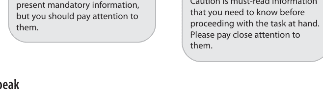

## 极客术语

计算机世界及其周边文化充满了行话。缩写和技术术语几乎成了软件业的“燃料”。当书中出现专业术语时，“极客术语”部分会为你解读这些行话，并用通俗易懂的语言解释其含义。

### 极客术语

这些注释就像进入计算机极客世界的迷你翻译器。

当一行代码太长无法在一行中显示时，我们会将其拆分，并使用代码续行箭头表示延续：

```html
<param name="movie" value="http://www.youtube.com/v/-xL7YSsEy0s?fs=1&amp;hl=en_US"></param>
```

## 网络入门

本书旨在让你以尽可能简单、低成本的方式创建网站。为此，必须涵盖一些基础知识，包括互联网和网络的工作原理。你可能每天都在使用互联网，却不知其本质。对我而言，理解网络的基本构成，有助于构建更好的网站。

如果你已经了解互联网的工作原理，以及网页和网站的概念，请直接跳到第 1 章“万事开头难”。但如果你想快速复习一些基本的互联网知识，请在继续阅读本书其余部分之前，先阅读本节。

## 什么是互联网？

你还记得互联网诞生之前的时代吗？答案可能因年龄而异，但我们当初究竟是如何没有它而生活的？想想在互联网出现之前，想寻找一家新餐厅有多麻烦。你必须翻阅黄页的餐厅版块，用地图找到餐厅所在的街道，然后自己规划路线。有了互联网，你不仅能一键完成大部分事情，还能查看菜单、浏览室内图片，甚至在线预订——这一切足不出户、无需打电话。但这个我们称之为“互联网”的极其有用的东西，究竟是*什么*？

互联网实际上就是现存最大的计算机网络。所有这些计算机使用相似的语言，轻松共享信息。就是这样。你无需了解其背后的历史或技术。当你的调制解调器将你连接到互联网时，你的计算机就成了被称为互联网的计算机网络的一部分。你可能在工作或家庭中有一个本地网络，但这个本地网络也连接到了互联网。

## 什么是万维网？

人们谈论网络和互联网时，仿佛它们是同一回事。它们并非如此。如前所述，互联网是计算机网络。万维网是查看这些联网计算机上信息的一种方法。万维网是计算机网络中特定计算机上特定文件的集合。这些文件包含的信息，合称为*万维网*（参见图 I.1）。

> ### 极客术语
>
> **www**
>
> 是否好奇为何许多网页以“www”开头？这些字母只是技术缩写，用于告诉你的网络浏览器你正在寻找万维网上的内容。实际上，`www`并非必需。无论你是否输入`www`，大多数网络浏览器都能找到该网站。

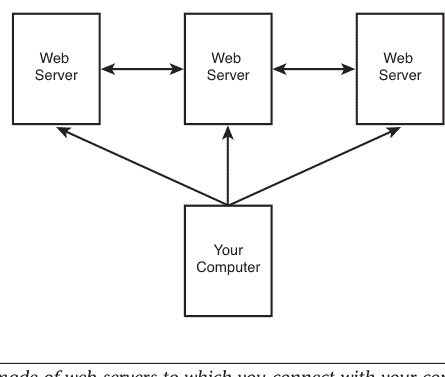

## 什么是网页？

万维网由网页构成。网页是一种信息文件，可以在你的计算机上访问和显示。当你访问该文件时，它会被下载到你的计算机。当你访问亚马逊网站时，你是在访问亚马逊计算机上的一个文件，该文件被下载，其中的信息便显示在你的计算机上。当你在网上冲浪时，你正在连接大量不同的计算机，它们都在向你的计算机传输文件。

## 什么是网站？

基本上，网站是存储在特定计算机（称为网络服务器）上并由外部计算机访问的网页集合（参见图 1.2）。网站创建者将文件放在网络服务器上。网络服务器只是一台装有特殊软件的计算机，允许他人在访问网络服务器地址时查看你的网页。当你访问`cnn.com`时，你会看到由美国有线电视新闻网（CNN）电视网网站组成的系列页面。

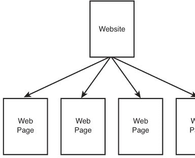

**图 1.2**

*网站由网页构成。*

## 什么是网络浏览器？

网络浏览器是你计算机或移动设备上的一种软件，用于访问网站上的网页。所有台式计算机都至少预装了一个网络浏览器。网络浏览器是你查看网站的工具，并且现在越来越多地成为帮助你创建网站的工具。

所有浏览器的工作原理基本相同。你在浏览器中输入网站地址或点击链接。这会告诉浏览器前往该互联网地址，并将文件（图像、文本、视频）下载到你的计算机或移动设备。然后，这些文件以美观（希望如此）且允许你与之交互的方式显示出来。

有几种浏览器可供你选择。优秀的网站开发者（也就是你）应该熟悉所有主要类型，并且很可能在用于测试的计算机上安装了它们。越来越多的人使用移动浏览器浏览网络。你的手机可能内置了网络浏览器。请注意，Mac 上的 Safari 与 iPhone 上的 Safari 并不相同。如果你认真从事网站开发，就需要在你的计算机上获取并保持最新的浏览器软件。同时，你还需要了解每个浏览器的独特功能和局限性。最常见的浏览器如下：

- Internet Explorer（微软）—`http://www.microsoft.com/ie/`
- Chrome（谷歌）—`http://chrome.google.com`
- Firefox（Mozilla）—`http://www.firefox.com`
- Safari（苹果）—`http://www.apple.com/safari/`
- Opera（Opera）—`http://www.opera.com/`
- Flock（Flock）—`http://flock.com/`

# 第一部分

## 基础知识

1. 万事开头难
2. 为你的网站选择地址

# 第 1 章

## 万事开头难

在开始构建网站之前，对最终成果有个概念很重要。可以这样想：如果你去度假，你需要选择目的地、交通方式、路线和时间表。缺少任何一项，你的假期可能都不尽如人意。各部分也相互关联。如果你计划乘飞机但没有目的地，你就无法确定时间表。构建网站也是类似的过程。人们常常急于尽快建成网站，但就像旅行一样，如果你上路时不清楚目的地，很快就会迷失方向。此外，项目的各部分也有其顺序。在确定游乐园的位置之前，你无法前往。同样，了解和遵循这些相互关联的步骤顺序，才能让计划成功。

**本章要点**

- 网站创建流程

本章我们将以简明但根本的方式，概览从规划到维护的整个网站创建流程步骤。别因为这只是概述就急于跳到下一章。这些步骤是创建最佳网站过程中的基础构件。

## 网站创建流程

流程的每个部分将在后文进行更详细的介绍，但在开始之前，对整个流程有个概览会很有帮助。

本书中，网站的创建和维护被分解为一个流程，你应该尽可能严格地遵循这个流程。这个流程是我从构建自己的网站以及与成功网页设计师的数小时讨论中获得的知识的结晶。随着流程的推进，遵循这些步骤将对你大有裨益。网站创建和维护的所有步骤都需要付出努力和思考，但它们不一定涉及计算机或任何技术。这些步骤在图 1.1 中概述，并在本书后面的章节中详述。

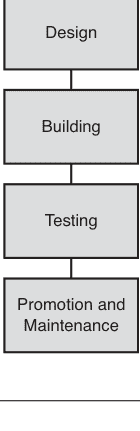

**图 1.1**

*网站创建流程。*

## 1. 规划

所有努力都应从规划阶段开始。你必须规划完成项目所需的步骤。在我看来，像创建网站这样的项目是由小步骤组成的，只要正确执行，就能带来成功的项目。

这可能是最容易被跳过的部分，但它与其他任何部分一样重要，甚至可能更重要。通过提前制定计划和决策，你会发现后续步骤更容易，感觉更有方向。

以下是你在开始前需要决定的一些事项：

- 我为什么要建立这个网站？
- 我希望这个网站如何运作？
- 我对网站有什么目标？
- 这是一个我期望人们只访问一次还是经常回来的网站？
- 谁将设计、构建、测试和维护该网站？
- 将使用什么工具来构建该网站？
- 我的网站预算是多少？
- 我希望谁来访问我的网站？

> 关于规划以及你需要规划的内容，**请参阅第 3 章“规划你的网站”。**

## 2. 设计

设计网站的方法多种多样，就像关于内容和构建这些网站的设计师的想法一样多。当我谈到网页设计时，我指的不仅仅是网站的外观。设计不仅仅是图形。它还包括页面的组织方式（网站结构）、使网站访问者能够到达这些页面的按钮或链接（导航元素），以及技术细节，例如如何使用编程语言以及将采用哪些应用技术。当我设计一个网站时，我会用白板画出页面的样子。

每个人都希望拥有一个独特的网站，因此在规划和设计自己的网站之前，尽可能多地查看各种网站非常重要。这将让你洞察到看起来新鲜、新颖的趋势，以及需要避免的过时的网页陈规。

创建优秀网站的关键在于将你独特的内容与优秀的设计相匹配。第 4 章“设计你的网站”涵盖了你必须做出的许多设计决策，以及一些具有持久品质的网站趋势。

> 关于网页设计的更多信息，**请参阅第 4 章。**

## 3. 构建

人们常常在没有进行创建成功网站所需的规划和设计的情况下，就开始了这个阶段。构建是实际创建页面、编辑图形、制作链接、管理多媒体以及向服务器添加脚本和其他元素的工作。

过去，网站需要手工创建。这意味着开发人员必须手动输入构成网站的每个文件。对你来说幸运的是，情况已不再如此。构建部分涵盖了网页创建工具、图形工具和其他实用程序，使你无需编写一行代码就能快速创建单个页面或整个网站。这些实用程序和工具大多数是免费的或非常便宜。

如果你已经完成了规划和设计，请翻到第 7 章“网站的元素”开始构建你的网站。一旦开始构建你的网站，请参阅第 6 章“将文件上传到互联网”，将文件移动到你的网络服务器上。

> 关于构建网站的更多信息，**请参阅第 III 部分“网站构建基础”。**

## 4. 测试

测试？没人告诉你要考试。我所说的测试是指确保你网站上的所有功能都正常工作。你应该测试的一些内容包括导航（在网站中从一个页面移动到另一个页面）、图形和内容（确保页面中没有信息缺失）。你还需要养成每次更改后测试和重新测试网站的习惯，即使在你的网站上线运行之后。有一些免费工具可以帮助你做到这一点。

> 关于测试网站的更多信息，**请参阅第 16 章“测试你的网站”。**

## 5. 推广和维护

在规划、设计、构建和测试了你的网站之后，你就可以将它推向世界了。不过，这并不是故事的结束。你需要向他人推广你的网站，确保它出现在*搜索引擎*上，并向你不认识的人推广。然而，做所有这些仍然不够。你需要维护和更新你的网站，让人们有理由回访。

关于如何推广和持续运营网站的详细信息，请参阅第 17 章和第 18 章。

# 术语解释

## 搜索引擎

搜索引擎是一个允许你搜索其他网站的网站。

# 第 2 章


# 为你的网站选择位置

## 虚拟主机

人们在着手创建网站时，最常见的问题之一是网站应该托管在哪里。

请记住，网站是网页、图形、脚本文件以及与网站相关的任何其他内容的集合。这些文件需要存储在一台可供其他人访问的计算机上。这台其他人可以访问的计算机也称为服务器或主机。当服务器存储你的文件并允许其他人访问它们时，可以说它正在托管你的网站。决定将网站文件托管在哪里极其重要，应该像流程的其他任何部分一样进行规划和调研。

**本章内容**

- 虚拟主机
- 什么是网络服务器？
- 确定你的网络托管需求
- 托管选项
- 哪种方案最适合你？
- 与不同类型的托管服务合作

> **注意：** 本节包含大量术语解释。我在整章中解释了技术术语，以便你理解技术，从而做出正确的网络托管选择。

## 什么是网络服务器？

网络服务器是一台存储和共享网络文件的计算机。其他人通过他们的网络浏览器访问这些网络文件。

每次你访问任何网页时，都是在访问服务器。你输入服务器的地址，它会将其硬盘上存储的网络文件版本发送给你，于是，你就看到了网页。网络服务器有三个基本功能：

- **存储**——网络服务器将网络文件存储在硬盘上。每个网页、图形和脚本都需要存储在网络服务器上。
- **共享文件**——根据网络服务器收到的请求，它通过互联网向访问者的浏览器提供文件。
- **分析**——一个好的网络服务器会跟踪所有访问网站文件的人员，并收集有关他们的数据。这可能非常有用，第18章“维护你的网站”中将对此进行更多讨论。

当你将网站文件放到服务器上时，拥有这些服务器的公司就是在“托管”你的网站。

你可能有多种不同的服务器选项可供选择（见图2.1）。本节的其余部分涵盖了在决定网站托管时需要注意的事项。在规划阶段这样做很重要，因为托管选择的功能或限制可能在构建网站时影响你的网站。

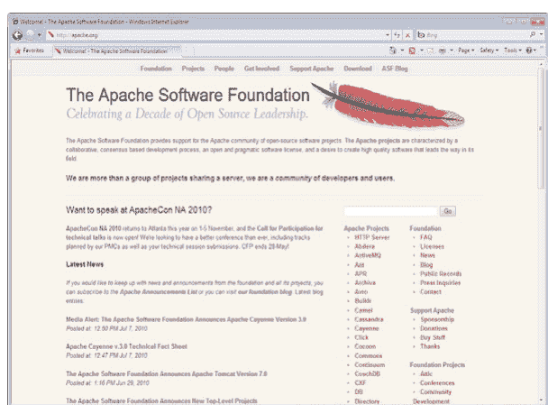

## 确定你的网络托管需求

在决定适合你的托管选项之前，最好评估一下你对该托管公司的需求。以下各节讨论了你可能需要考虑的一些事项。

### 成本

托管网站文件并使其可供他人访问可能需要花钱。与许多其他考量一样，价格范围很广，从接近免费到每月超过抵押贷款付款不等。不过，不要认为任何网络托管是完全免费的。即使你自己在家里托管网络服务器，你仍然需要购买设备并支付电费、租金和你自己的费用。

尝试确定一个你可以长期支付的预算来托管你的网站。对我来说，一点月费可以解决很多问题并提供很多机会，非常值得。

### 所需技术知识

不同的托管选项提供不同的功能，并要求你拥有不同程度的技术技能。在选择托管选项之前，请诚实评估你的技术技能以及你愿意投入时间使用这些技能的程度。

### 维护需求

了解谁在维护你的网络服务器很重要。如果是你自己，你需要自己执行几个定期的维护任务。这包括确保服务器正在运行、其他人可以访问它以及安装了最新的软件。如果你使用的是托管服务，可能由别人为你做这些，但可能要收费。你需要评估你能花多少时间维护网络服务器，或者你愿意花多少钱。

### 存储空间

你的网络文件占用数字空间。你需要知道有多少可用空间来存储备份你的文件。除非你是网络服务器上的唯一网站，否则你需要弄清楚你在该服务器上有多少可用空间，以及何时、是否进行备份。

### 可访问性

将文件上传到网络服务器并访问它们有多容易？你是否可以远程访问服务器？换句话说，你可以从任何其他电脑连接到服务器，还是必须物理接触到它？如果你的访问受到任何限制，这可能造成巨大的差异。此外，出于安全考虑，你应该了解需要向网络托管服务提供哪些安全要求（例如个人信息）。

### 带宽需求

带宽决定了在一段时间内可以传输多少信息。每次你的网站被访问，都会消耗网络服务器分配给它的一些带宽。一种理解方式是你的网站文件可以被下载多少次。一些网络托管服务对你网站所需的带宽量设定了限制。

有些托管选项的带宽几乎是无限的，而另一些则是受限的。如果你预计会有大量访问者访问你的网站，请务必仔细关注网络托管服务的带宽限制。

### 域名服务

*域名*是互联网上的一个地址。它指向一个存储特定网站的服务器。关于域名的进一步解释，请参阅“极客术语”侧边栏。

你需要了解你的托管选项是否会处理域名服务，如果会，费用是多少。域名服务包括注册和托管你的域名，以便互联网上的其他计算机在输入你的网址时知道连接到你的网络托管服务器。

域名也用于电子邮件地址。请检查互联网服务提供商是否也为域名提供电子邮件地址。

> ### 极客术语：域名
>
> 域名只是指代用作网站地址的词语的一种花哨说法。互联网上有许多计算机负责管理所有的域名。这些计算机会把你输入浏览器中的域名解析到正确的网络服务器。托管服务通常会收集注册你的域名所需的信息。

## 托管选项

在你对托管选项的需求有了大致了解后，你应该四处查看并研究可用的选项。有几种选项，因此需要仔细地将你的网络托管需求与合适的托管选项相匹配。以下部分描述了一些托管选项。

### 家庭托管

在家托管自己的网络服务器是可能的。至少你需要一台专用的网络服务器、一条专用的始终在线的高速互联网连接、服务器软件，以及安装、配置和维护自己的服务器（更不用说确保其安全）所需的技术知识和时间。觉得累了吗？这个选项通常是为铁杆极客准备的，但是没错，你确实可以在自己家里托管网络服务器。

> **提示：** 要了解如何设置家庭网络服务器的详细说明，请访问`http://lifehacker.com/software/feature/how-to-set-up-a-personal-home-web-server-124212.php`或`www.diywebserver.com/`

### 免费在线托管

一些网站托管服务，如 Google Sites，允许免费托管网站。它们能够提供免费服务，是因为它们限制了你可以在其网站上存储的存储空间、页面和文件数量。例如，Google Sites 提供免费托管，但不允许使用域名服务，并且只允许非常有限的内容。如果你不想处理网络托管的麻烦，而且技术需求较低，这可能是适合你的选项。

### 在线托管服务

几家公司以合理的费用（每月 10 到 20 美元，外加设置费）提供网络托管。这些服务负责管理服务器，并让你拥有广泛的网站可能性。它们通常提供多种不同的托管计划，基于你在域名和其他技术服务（如物理维护网络服务器和安装新软件版本）方面的需求。

这就是我为自己网站使用的托管类型。

### 专业托管

如果你预计有巨大的托管量和高度的技术定制需求，你可能需要考虑专业托管。支付一大笔钱，托管公司会为你租赁并维护你自己的服务器。这给你提供了巨大的可能性，但非常昂贵。

### 商业托管

如果你为公司创建网站，你的公司内部可能有人可以托管和维护你的网络服务器。如果你的老板要求你创建一个网站，试着了解一下是否已有现成的网站托管系统。

### 那么，什么最适合你？

为了帮助你选择适合你需求的托管选项，我将本章描述的可能需求总结成一个易于使用的参考表，如表 2.1 所示。你可能找不到完美的解决方案（完美方案即所有功能和服务都免费），但你可以尽可能地匹配需求和选项。

**表 2.1**

| 托管选项 | 成本 | 所需技术知识 | 维护 | 存储空间 | 可访问性 | 带宽需求 | 域名服务 |
| :--- | :--- | :--- | :--- | :--- | :--- | :--- | :--- |
| 家庭托管 | 低–中 | 高 | 高 | 低–高 | 高 | 低 | 中 |
| 免费在线托管 | 低 | 低 | 低 | 低 | 低 | 高 | 低 |
| 在线托管服务 | 低–中 | 低–中 | 低 | 中–高 | 中 | 高 | 高 |
| 专业托管 | 高 | 低–中 | 低 | 高 | 中 | 高 | 高 |
| 商业托管 | 低–高 | 低–高 | 低–中 | 中–高 | 高 | 中–高 | 中–高 |

## 使用不同类型的托管服务

在你选择了想要的托管类型后，你的工作可能并未完成。事实上，你花在研究可用服务上的时间可能和你选择托管类型的时间一样多。

### 免费服务

互联网上存在几种免费托管服务。我在这里介绍几种，但这绝不是一个完整的列表，而且每天都可能出现新的网站托管服务。在注册之前，请查看该网站的功能和服务条款与使用条件，阅读该服务的评论，如果可能的话，看看使用该免费托管服务的网站。请记住，尽管所有这些网站都会免费托管你的网站，但它们都有局限性。以下部分描述了一些最好的免费网络托管服务。

就像在学校一样，我根据易用性和功能为这些网站打了字母等级。A 级是优秀。B 级是良好。C 级是满意，D 级是不满意。

### Google Sites（`sites.google.com`）

- **易用性：** A
- **功能：** B

Google Sites 使其服务像其搜索引擎一样免费且易于使用。Google 对 Google Sites 的重点是尽可能轻松地将人们连接成团队。如果你对 Google Sites 感兴趣，务必观看介绍教程。

Google Sites（见图 2.2）提供便捷的文本编辑、附件和评论功能。页面创建工具支持轻松添加链接、图片和创建新页面。它提供了带有预设编程的常用页面模板。如果你与团队协作，Google 还允许其他人修改你的网站。

你可以轻松自定义页面，无需 HTML 知识。如果你喜欢 Google Sites，它还提供按月付费的扩展服务。

> 关于 Google Sites 的更多信息，请参见第 9 章 “网页服务”。

**图 2.2**

Google Sites 让创建网站变得快速、简单且低成本。

### Bravenet Hosting（`www.bravenet.com/webhosting/hosting.php`）

- **易用性：** B
- **功能：** D

Bravenet 提供有限的免费托管服务。这更像是其付费服务的介绍，但如果你迫切需要免费托管，它可能在紧急情况下有用。设置相当简单，但它为你的网站提供的功能极少，并且存储空间和带宽有限。

为了提供免费服务，Bravenet 会在你的页面上放置广告。如果你不希望在你的网站上出现广告，Bravenet 提供无广告的网站托管服务，需付费，同时也包含更多功能。

### Windows Live Spaces（`home.spaces.live.com`）

- **易用性：** A
- **功能：** D

微软的 Windows Live Spaces（见图 2.3）为 MSN 或 Microsoft Live 用户提供了一个存储照片、列表和博客条目的空间。它的功能有限，但易于使用。从本质上讲，它并不真正托管任何类型的网站，但如果你想要一个简单的网络存在，它确实能提供。

**图 2.3** 微软的免费页面包含其称为小工具的应用程序。

### JustFree（`www.justfree.com/`）

- **易用性：** B
- **功能：** A

JustFree 为你提供一个托管网站文件的场所。它还提供更多技术功能，例如运行`PHP`脚本和连接`MySQL`数据库。如果你不知道这些是什么，别担心——你不需要了解。这里的思路是，你需要一些技术知识才能使用本网站的高级功能。

JustFree 对文件数量和可用带宽有限制，但对于一个简单网站来说，这些限制已经绰绰有余。如果你有一些技术技能但没有资金，这可能就是适合你的选择。

## 低成本商业网站

如果你要做任何超出基础范围的事情，你可能应该花钱使用一家低成本的商业网络托管公司。如果你打算为你的网站花点钱，我会建议你把这里作为第一站。一家好的托管公司可以在功能、空间和安心方面给你带来很多，使得低廉的月费物有所值。

以下是一些较知名的低成本商业网站。它们都拥有海量功能，让搭建一个出色的网站变得更加容易。

- DreamHost（`www.dreamhost.com`）
- Go Daddy（`www.godaddy.com`）
- Host Gator（`www.hostgator.com/`）
- A Small Orange（`www.asmallorange.com`）
- Blue Host（`www.bluehost.com`）

## 其他资源

我在本书中反复强调的一点是，人们正在以前所未有的方式利用网络发布和收集信息。在决定使用哪种网络托管服务时，花点时间阅读人们对该服务的评价。通过研究该服务来证实每个服务所做的声明。

你可能会发现，某些听起来好得不像真的的网络服务，实际上会在你的计算机或网站上添加病毒或其他有害软件。此外，新的网络托管服务不断在互联网上出现。要跟踪所有这些服务是不可能的，所以让别人为你做这件事吧。网络托管站点总是在被评测，以下是一些评测这些服务的网站：

- Free Web Hosting（`www.free-webhosts.com`）——一个免费网络托管服务的评级网站
- FreeWebspace.net（`www.freewebspace.net`）——一个可搜索的免费网络托管指南
- FindMyHost（`http://findmyhost.com`）——网络托管服务的评测和评级
- Webhosting Geeks（`http://webhostinggeeks.com`）——从更技术性的角度进行的网络托管评测

# 第二部分：规划与准备

1. 规划你的网站
2. 设计你的网站
3. 收集你的工具
4. 将文件传输到互联网及从互联网下载

## 第三章：规划你的网站

### 本章内容

- 你想构建哪种类型的网站？
- 从你访问的网站中学习
- 网站目标
- 组织网站
- 网站组织的最佳实践

在开始任何网站项目之前，你需要回答的核心问题是“你为什么要建立一个网站？”有时答案可能很简单——老板要求你创建一个网站，你想和老同学联系，或者你想推广你的家庭业务。通过提出这个问题，你可以开始弄清楚你正在构建的网站的最佳结构。例如，如果你为你的家庭业务制作一个网站，你希望你的产品和服务放在单独的页面上。你还应该确保业务联系信息出现在每个页面上。

本节接下来的内容是你在规划网站结构时应该问的一些问题。你应该尽可能多地回答这些问题，因为它们将帮助你为你的网站做出重要决定。不要只是阅读问题然后思考答案；要做笔记并制定一个正式的计划。如果你是为别人构建这个网站，那个人可能想看到你的行动计划。这个行动计划将包括列出网站的目标、网站和页面的大致计划，以及你计划完成工作的时间表。

## 你想构建哪种类型的网站？

众所周知，互联网上有如此多的网站，以至于不可能跟踪所有网站。我们使用网站来预订机票、与朋友交谈以及获取昨晚比赛的比分。当你在思考为什么创建一个网站时，你还需要弄清楚它将是什么类型的网站。熟悉网站类型的最佳方式是在网络上浏览。通常你带着特定的目标上网，例如租车或发送电子邮件。这个目的有时会让你忽略你正在访问的网站的结构和目的。重新审视一些你最喜欢的网站，并密切关注这些网站的结构和目的。你会对所学到的东西感到惊讶。

### 网站类型

新型网站每天都在出现，其种类仅受创造它们的人的想象力的限制。这里列出了一些高级类型。如果你的网站属于这些类别之一，请阅读列表并访问示例网站，密切关注每个网站的结构和设计。

- **商业**——在网络早期，公司和企业曾掀起一股虚拟的淘金热，涌入网络，认为可以一夜暴富。当然，只有少数公司做到了这一点，但在过去的十年里，企业逐渐开始弄清楚如何赚钱、吸引新客户以及找到可行的商业模式。事实上，如今几乎不可能想到一个没有网站的企业，从大公司到街角的夫妻小店都是如此。

  示例：

  - Amazon.com
  - Kodak.com（见图 3.1）
  - Bloomingfoods：`www.bloomingfoods.coop/`

  **图 3.1** Kodak.com 是一个优秀的商业网站。

- **个人**——在商业入侵万维网之前，人们就在创建个人网站了。这包括家庭网站、粉丝网站以及像博客这样的日记网站。这实际上是万维网最伟大的文化影响之一。每个人现在都可以在网络上发出自己的声音。你不需要花一百万美元就能拥有一个吸引大量关注的优秀网站。从富人名人到街角的普通人，人们都在制作个人网站。

  示例：

  - `www.stephenfry.com`
  - `blog.markwbell.com`
  - `wonkette.com`

- **社交**——自从计算机相互连接以来，它们就成为了社交互动的工具。它们使得人们通过社交网站和电子邮件网站在线交流变得简单。网络正日益社交化。互联网不再仅仅是怪咖的避难所，现在几乎每个人都将社交联系作为网络上最主要的力量之一。

  示例：

  - Facebook.com（见图 3.2）
  - Gmail.com
  - Blogger.com

  **图 3.2** 你今天上 Facebook 了吗？

- **信息**——互联网是一个信息宝库。有些网站的存在纯粹是为了给你提供免费信息。这些信息极其有用，每天都在改变知识和教育。网络每天增加数太字节的信息——多到你永远无法全部跟上。

  示例：

  - `www.wikipedia.org`（见图 3.3）
  - `www.imdb.com`

  **图 3.3** 维基百科是有史以来最大的开源参考工具。

## 从你访问的网站中学习

正如我之前提到的，你可能需要尝试一种新的视角来看待网络，关注其结构而不仅仅是内容。以下练习迫使你进入这种视角，并让你以新的方式看待你访问的网站：

1. 打开你的浏览器，查看你的网页历史记录，这是一个你最近访问过的网站列表。它通常位于菜单项中。在 Internet Explorer 或 Firefox 中，使用`Ctrl+Shift+H`（见图 3.4）。
2. 打开你过去访问的几个网站。
3. 当你浏览每个网站时，问自己：
   - 这是什么类型的网站？
   - 网站的各个组成部分是什么？
   - 你如何在页面之间移动？
   - 是什么让你觉得这个网站是一个完整的、与其他网站不同的网站？

**图 3.4**

打开历史记录的资源管理器。

你甚至可以在这些网站上做笔记。是什么让这些网站如此成功？或者更妙的是，如果你发现一个糟糕的网站，找出它糟糕的原因，避免重蹈覆辙。你能在纸上画出这个网站的结构图吗？

## 网站目标

在开始设计或构建网站之前，你需要明确希望用它实现什么。你希望达成的目标将帮助你在后续过程中做出决策。


你的目标就是你希望通过网站完成的事情。这些可能包括赚钱、吸引关注或表达某种观点。你应该为网站本身及其内容设定目标（见图 3.5）。同时，你还应该考虑网站的短期和长期目标。首先审视一些你最喜欢的网站，确定这些网站的目标。

问问自己：

- 这个网站的总体目标是什么？
- 网站的哪些部分体现了这个目标？
- 我的网站会类似于这个网站还是与它有所不同？

**图 3.5**

*福特汽车公司网站的目标是提供产品信息并销售车辆。*

## 组织网站

在规划网站结构时，你需要同时考虑网站整体和每个页面。请记住，网站只是一系列网页的集合。你创建的内容应该具有统一性。这种统一性应体现在网站本身以及每个页面上。

例如，如果你创建一个家庭网站，为每个家庭成员（妈妈、爸爸、儿子和女儿）都设有页面，那么每个页面的外观都应该与其他页面相似。它们应该看起来像一个统一的整体。如果每个页面都不同，网站访客可能会感到困惑。你可以从审视整个网站开始，也可以只看单个页面。

### 组织网站

当我开始规划一个新网站时，我会在一张白纸上以如下方式绘制网站草图：

1. 在一张白纸上，画一个中心方框，在里面写上“主页”。
2. 在“主页”方框周围，为你想要在网站上涵盖的子主题画出单独的方框。
3. 如果这些子主题需要进一步细分，则使用额外的方框将这些主题添加到图中。
4. 确定哪些内容值得单独创建页面。一个网页应该有自己独特的内容，并且内容量应与其他页面大致相当。
5. 画出连接这些页面与“主页”方框的线条。
6. 从每个页面的子主题画出指向该页面本身的线条。

> **极客术语：主页**
>
> *主页*是人们访问你的网站时看到的第一个页面。当人们输入你的域名地址时，加载的就是这个页面。请记住，人们在任何网站上停留的时间都不会很长——通常只有几秒钟——所以这里是他们获得第一印象的地方。

现在，你对网站的内容就有了一个粗略的规划图。请参见图 3.6 的示例。

**图 3.6**

网站草图。

### 组织页面

与组织网站类似，我从手绘模板开始组织每个网页。我会尽可能保持模板的简洁和通用，以便之后让每个页面看起来都像是网站中一个统一的页面。以下是我使用的方法：

1. 在另一张白纸上，画一个宽度大于高度、几乎占满整张纸的长方形。这个长方形代表一个在典型屏幕和浏览器中显示的网页。
2. 在这个页面的顶部，向下约 15% 的位置画一条横跨页面的水平线。这就是你的页眉。
3. 在这个页面的底部，向上约 15% 的位置画另一条横跨页面的水平线。这就是你的页脚。
4. 粗略勾勒出你希望内容在页面上的呈现方式。你可能希望使用分栏或表格。花些时间发挥你的创造力。图 3.7 为你提供了网站页面的通用布局思路。

> **极客术语：页眉和页脚**
>
> 页眉和页脚区域在所有页面中都是相同的。通常你会在页眉和页脚中找到指向其他页面的链接以及联系信息。查看其他网页，你会发现很多都有页眉和页脚。

你的整个网站可能采用相同的组织结构，也可能为不同部分采用几种不同的结构。这本质上是一个纸质模板。模板可以让你在多个页面之间保持一致性。让内容来定义结构。

**图 3.7**

网页示意图。

## 网站组织最佳实践

在组织网站时，你应该记住一些通用规则或最佳实践。这些规则不是铁律，但可以帮助你避免常见错误。

### 保持网站简洁

首先，尤其是在规划网站的初始阶段，尽量保持一切简单。避免一开始就让你的网站过于复杂。你总可以以后再添加内容。简单的网站能让你的信息被清晰理解，目标更容易实现（见图 3.8）。如果你过快地变得过于复杂，访客会感到困惑。

**图 3.8**

*flickr 是一个简洁而有条理的网站。*

### 保持网站一致性

尽量让你的网站成为一个统一的整体。这会让它看起来更专业，并有助于你信息的传达。一个充满不一致页面的网站会显得杂乱无章，使访客望而却步。

一个从页面到页面都统一且一致的网站，传达出网站创建者投入了大量时间来呈现一个精心打造和构思的网站，其目的是为了让用户享受。保持你的页面整洁有序。在页面上使用一致的结构（如页眉和页脚），这样访客就能轻松了解你的网站主题，而不会迷失在杂乱无章的文字和链接中。

### 保持网站易于维护

组织良好、设计精良的网站易于维护和改进。如果你的网站杂乱无章，从长远来看，这会给你带来更多的工作。如果你有一个复杂的网站，你需要大量时间来确保所有部分协同工作。从简单开始并努力保持这种简单，从长远来看会很有帮助。

---

# 第四章：设计你的网站

如果你花了很多时间上网，你可能已经注意到有些网站设计精良，而有些则不是。网站的设计很重要，因为它为你的内容搭建了舞台，并有可能防止访客过快离开你的网站，吸引他们再次访问。这有时被称为“粘性内容”，因为它能让访客粘在你的网站上。设计涉及颜色、字体、图像和布局。

本章将向你展示如何做出有效设计的决策，以及在哪里可以找到能激发你设计创意的想法。

## 本章内容

- 我做不出那么好看的网站！
- 内容先于设计
- 整体设计
  - 颜色
  - 字体
  - 图像
- 层叠样式表
- 设计最佳实践

## 我做不出那么好看的网站！

如果你正在读这本书，你可能不是专业的网页设计师。我也不是。但你不需要成为专业人士才能创建一个设计精良的网站。你可以从他人的作品中学习——那些才华横溢、能力出众，创造出真正艺术作品的人（见图 4.1）。

**图 4.1**

*cork'd 是一个设计精良的品酒网站。*

大多数美丽而设计精良的网站都是由训练有素、薪资优厚的团队创建的。与这些网站相比，你的网站可能看起来不够精致和专业。然而，重要的是要记住这是一个学习过程，而你的预算可能是零，所以要正确看待这一点。从那些做得好的网站中学习，最重要的是，不要气馁！享受乐趣，发挥创意。

## 内容先于设计

如果说有一个核心原则指导着我所有的网站设计，那就是内容先于设计。这意味着先收集网站的内容，然后让内容来指导和塑造你的设计。

例如，如果你正在构建一个为你的保龄球队建立网站时，首先要考虑内容。你的团队希望有成员简介、赛程、过往比赛成绩和队徽。让这些内容来指导你设计网站。

## 整体设计

首先，让我们考虑网站的整体设计。你希望网站唤起什么样的感觉——是想让它**有趣明亮**还是**深沉阴郁**？也许你自己也不确定。最好的起点是看看那些设计精良的网站。

### 设计灵感

我总是在寻找设计灵感。当我发现一个设计精良的网站时，我会*收藏*它，这样当我开始新设计时，可以回顾它以获取自己网站的灵感。

我还会查看设计奖项的获奖者和网页设计师的网站。因为这些网站设计精良，你可以从中学到很多。

以下是一些可供参考的：

- [Webby Awards](http://www.webbyawards.com/)
- [LevelTen Interactive](http://www.leveltendesign.com/)
- [Avenue A/Razorfish](http://www.avenuea-razorfish.com/)

> ### 极客说
>
> **收藏**
>
> 大多数浏览器都允许你收藏网站，这意味着你可以记录某个特定网站的地址，以便日后访问。请查看你的浏览器文档，了解如何使用你的浏览器进行收藏。

### 中心图像设计

设计网站的一种方法是使用一个中心图像，并以此为基础确定配色方案和其他图像。如果你有一个标志或照片可以作为起点，这种方法效果尤其好。

## 颜色

网络是一种视觉媒介，所以颜色很重要。它能唤起情绪，能使一个网站充满活力且有趣，而使另一个网站平淡无趣。有数百万种颜色可供你选择，所以让你的创造力和个人风格来指引你。

### 四种神奇的颜色

如果你去当地的报刊亭看看杂志上使用的颜色，你很可能会看到以下主要颜色：

- 红色
- 黄色
- 黑色
- 白色

这些是广告中的神奇颜色。如果你不确定使用什么颜色，可以先从这些颜色中的一种开始。另一方面，如果你在寻找与众不同的东西，并且想要一种能匹配你网站特定图像或其他设计元素的颜色，你有无数种选择。

### 十六进制颜色

当你在互联网上处理颜色时，你需要理解玫瑰不是“红色”，而是`#FF0000`。这被称为十六进制颜色，当你在网络上使用颜色时，你必须习惯它。这种奇怪的符号实际上是三组数字：FF，00，和 00。（FF 在这种情况下实际上是一个数字。）

每个两位数都是一个十六进制值，代表一个更大的数字。十六进制代码中的三组数字分别代表红色、绿色和蓝色（通常称为 RGB）。HTML 标签使用十六进制数来定义颜色。

每种颜色（红色、绿色和蓝色）有 256 个可能的值，三者组合起来构成了所有其他颜色。要确定一个数字的十六进制值，你需要使用科学计算器。对于 Windows 系统，请按照以下步骤操作：

1. 按下 Windows 键和 R 键。
2. 在运行框中，键入`calc.exe`，然后单击确定。
3. 从“查看”菜单中，选择“科学型”（参见图 4.2）。
4. 键入 214，然后单击“十六进制”选项。
5. 214 的十六进制值（即 D6）将显示出来。许多 HTML 标签和其他应用程序使用十六进制数来描述颜色。

**图 4.2**

*科学型计算器。*

作为练习，找出你最喜欢的颜色的 RGB 值，并将它们转换为十六进制。

### 配色方案

一组相互补充的颜色称为配色方案。这些颜色在一起看起来很和谐，并且很可能包含四种神奇颜色中的一种。网络上有一些工具可以帮助你搭配颜色。

- **[Color Combos](http://www.colorcombos.com/)** ——这个网站专注于为网络创建颜色组合（参见图 4.3）。你可以使用它来挑选现有的颜色组合，测试组合，并浏览它们的颜色组合库。
- **[Color Palette Generator](http://www.degraeve.com/color-palette/)** ——如果你有一个中心图像，并希望围绕它来构建你的网站，你只需要将它加载到这个网站中，该工具就会确定图片中使用的颜色（参见图 4.4）。
- **[ColorBlender](http://colorblender.com/)** ——这个工具使你能够创建匹配的颜色和基于你选择的颜色的配色方案。如果你知道你想使用的中心颜色，这个网站会给你提供搭配选项。

> **注意** 如果你在网上找到了完美的图片，比如在 flickr 上，并且想在你的网站上使用它，请记得获得所有者的许可。

**图 4.3**

*Color Combos 是一个拥有许多颜色工具的网站。*

**图 4.4**

*Color Palette Generator 找出图像中使用的配色方案。*

- **[colrpickr](http://www.krazydad.com/colrpickr/)** ——这个网站在 flickr 上查找与你选择的颜色相匹配的图片。
- **[COLOURlovers](http://www.colourlovers.com/)** ——这是一个致力于网站颜色的网站和社区（参见图 4.5）。这些人认真对待颜色，并乐在其中。他们也追随网络颜色的趋势。你可以在这个网站上找到一些好的颜色建议。

**图 4.5**

*COLOURlovers 是一个多彩的社区。*

## 色盲

处理颜色时需要警惕的一点是，有一部分人口是色盲，他们看到的网站颜色可能和你看到的不一样。这尤其与红色、绿色和蓝色相关。尽量不要混合使用红、蓝、绿色的文字和红、蓝、绿色的背景。这样的文字和背景可能会完全阻止色盲人士看到文字。

如果你是色盲，请确保让一个非色盲人士检查你网站上的颜色。

色盲网页过滤器（`http://colorfilter.wickline.org/`）可以向你展示你的网站在色盲人士眼中是什么样子，所以花点时间用这个过滤器检查一下你的页面。如果你在一些流行的网站如`cnn.com`和`huffingtonpost.com`上使用这个工具，你会看到网站仍然易于阅读和使用。

## 字体

网页上通常有一定数量的文本。有些页面文本很少，而有些则有大量文本。这些文本可以是实际的文本，也可以是看起来像文本的图像。首先，我将把文本作为文本来处理，然后讨论作为图像的文本。

### 系统字体

在网站上使用文本时，你可能倾向于使用某种花哨的字体。如果可能的话，尽量避免这样做。已经创建了几种系统字体以便在网页上良好显示。如果你使用了一种特殊字体，而查看你页面的人电脑上没有该字体，你的文本会恢复为系统字体。此外，Windows 和苹果电脑上的系统字体是不同的。（有些事情永远都不简单！）

以下是 Windows 系统上的默认系统字体：

- `Arial`
- `Book Antiqua`
- `Calisto MT`
- `Century Gothic`
- `Comic Sans MS`
- `Copperplate Gothic Bold`
- `Copperplate Gothic Light`
- `Courier`
- `Courier New`
- `Fixedsys`
- `Georgia`
- `Impact`
- `Lucida Console`
- `Lucida Handwriting Italic`
- `Lucida Sans Italic`
- `Lucida Sans Unicode`
- `Marlett`
- `Matisse ITC`
- `Modern`
- `MS Serif`
- `MS Sans Serif`
- `News Gothic MT`
- `OCR A Extended`
- `Small Fonts`
- `Symbol`
- `System`
- `Tempus Sans ITC`
- `Terminal`
- `Times New Roman`
- `Verdana`
- `Webdings`
- `Westminster`
- `Wingdings`

以下是苹果系统上的默认系统字体：

- `AmericanTypewriter`
- `Andale Mono`
- `Apple Chancery`
- `Apple Symbols`
- `Arial`
- `Baskerville`
- `BigCaslon`
- `Brush Script`
- `Chalkboard`
- `Charcoal`
- `Cochin`
- `Comic Sans MS`
- `Copperplate`
- `Courier`
- `Courier New`
- `Didot`
- `Futura`
- `Gadget`
- `Geneva`
- `Georgia`
- `Gill Sans`
- `Helvetica`
- `Helvetica Neue`
- `Herculaneum`
- `Hoefler Text`
- `Impact`
- `Marker Felt`
- `Optima`
- `Papyrus`
- `Skia`
- `Symbol`
- `Times New Roman`
- `Trebuchet MS`
- `Verdana`
- `Webdings`
- `Zapf Dingbats`
- `Zapfino`

关于字体的一条经验法则是，除非必要，否则不要指定字体。如果必须使用字体，请确保它是系统字体。最后，如果需要使用你知道不是系统字体的字体，请将文本转换为图像。

### 字体作为图像

在必要时，你可以将特定类型的文本保存为图像（参见图 4.6）。这样做的问题是文本不再可选，并且搜索引擎无法找到它。此外，这些图像会减慢页面的加载时间。

## 图 4.6

图像中使用的字体示例。

### 字体与颜色

你还可以为网页上的文本添加颜色。

处理文本时，尽量使用白底黑字。彩色文本和彩色背景会增加阅读难度。最好避免使用彩色文本和背景，但至少要让文本颜色与背景颜色形成足够的对比，以确保易于阅读。一些可行的例子是黑底绿字或白底蓝字。

## 图像

图像可能成为你所创建设计的重要组成部分。不过，最好不要在网页中包含过多图像，因为它们可能会减慢页面下载速度，并在视觉上使页面显得杂乱。尽量寻找一些能很好支持内容的优质图像。关于图像及其处理方法，我将在第 11 章“处理图像”中进行讲解。

## 层叠样式表

保持网页设计一致性的最佳方式是使用层叠样式表（CSS）。它可以作为指南，指导你的网页以特定方式格式化某些元素。如果你想让所有链接都显示为红色并带下划线，可以在 CSS 中设置一个元素来控制所有链接的格式。

> 关于如何设置和使用 CSS，我将在第 13 章“使用 HTML 构建网站”中进行讲解。

## 设计最佳实践

网页设计没有一成不变的规则，但有一些最佳实践可以帮助你避免常见错误。请记住保持设计简洁一致，你的网站就会看起来很棒。

### 内容为王

最重要的是，让你的内容引导网站设计。如果你试图销售摩托车头盔，但网站上没有头盔图片或人们佩戴头盔的图片，就不会有人再次访问你的网站。

### 将新内容置于显眼位置

初级网页设计师的一个常见错误是让网站上的新内容不易被访客找到。将任何新内容置于显眼位置。同时，告知访客这是新内容，你的网站是最新的。这样才能吸引访客再次光临。

### 保持简单

尽可能保持设计简洁。你不希望一个视觉上混乱或复杂的网站让访客感到困惑或不知所措。

### 不要使用引人注目的元素

避免使用霓虹色、闪烁文本等引人注目的设计元素。就像时代广场灯火辉煌一样，这些元素可能会让访客感到不适。

### 保持一致

保持颜色、字体和图像的一致性。例如，如果网站某个页面使用了特定颜色，其他页面也应使用相同颜色。此外，如果你的组织已有既定的标志或配色方案，请保持与已有或公认设计的一致性。你不希望让访客感到困惑。

# 第 5 章：收集你的工具

无论做什么，拥有合适的工具都至关重要。在本章中，我将向你介绍一些完全免费的最佳网页开发工具。这里所说的工具，指的是你可以用来帮助创建网站的软件实用程序或程序。

当然，你可能会认为免费的东西不会那么好。但我会向你展示一系列图形程序，它们与商业软件一样出色甚至更好，而且 100% 免费！这些都是社区开发的开源、共享软件，最重要的是，它们是免费的。

网页开发工具种类繁多。有些是你下载到电脑上的程序，有些则是你通过浏览器访问并使用的在线网站。

## 本章内容

- 为工作寻找合适的工具
- 工具网站与评测
- 下载新软件
- 基本工具


- 操作系统
- 网页浏览器
- 办公套件
- 免费网页工具的未来

## 为工作寻找合适的工具

你可能想知道在哪里可以找到所有这些奇妙的免费工具。我将向你展示一些网站，你可以在那里找到并下载优秀的开源实用程序。

首先，最好的方法是使用搜索引擎来寻找你所需工具的免费或开源替代品。例如，如果我在谷歌搜索“Photoshop 开源替代品”，我会得到几个选项，包括名为 GIMP 的开源图形编辑器。在本章中，我为你做了一些准备工作，并分享了一些我的信息来源和推荐程序。

## 工具网站与评测

以下列出了一些优秀的网站，它们列出了开源软件程序。这些网站是查找最新、最优秀的开源软件程序的绝佳场所。它们将实用程序分类，并提供简短的软件描述，方便你轻松找到所需内容。你几乎可以在这里找到任何东西，特别是其他程序的免费替代品。不过，不要只关注替代品；有时开源社区创造的程序是主流软件公司尚未想到的，例如播客和点对点实用工具。这些网站提供链接，直接指向这些实用程序的最新版本，供你下载。

- Open Source Windows—`www.opensourcewindows.org/`
- Open Source Mac—`www.opensourcemac.org/`
- Open Source as Alternative—`www.osalt.com/`
- The Top 50 Proprietary Programs That Drive You Crazy—and Their Open Source Alternatives—`http://whdb.com/2008/the-top-50-proprietary-programs-that-drive-you-crazy-and-their-open-source-alternatives/`

## 下载新软件

软件工具和实用程序分为两类：下载后安装在计算机上的程序，以及存储在网站上、通过浏览器访问的程序。下载软件对你来说可能是一个新过程，因此以下说明将引导你如何操作：

1. 找到包含你要下载和安装文件的网站。

   当你访问一个开源实用程序网站时，你会看到有关该程序的信息和下载软件的链接。请确保找到适合你操作系统的最新稳定版本的软件下载链接。

2. 点击下载链接。将文件下载到计算机时，通常会附带安装说明。请花时间阅读这些说明，因为它们可以提供关于如何安装和运行程序的有价值信息。

3. 下载文件后，按照说明安装程序。

> ### 极客术语
>
> **稳定版或发布版**
>
> 软件的稳定版是经过测试并准备好有限发布的版本。换句话说，该程序有望完成其预期的大部分功能。你可能会看到软件被标记为“测试版”或“内测版”。这仅仅意味着该软件目前仍在开发中。你遇到的几乎所有开源软件都处于某个开发过程中。本质上，它在不断更新和修改。内测版和测试版标识了软件稳定性的不同级别。内测版软件处于开发早期，测试版则更进一步。你可以预期内测版软件会有一些问题，测试版软件的问题则较少。
>
> **注意** 从互联网下载任何软件到你的计算机时，都有可能发生问题。软件可能安装不正确，或者更糟的是，影响计算机上的现有文件。另一方面，开源社区在自我监管方面做得很好，下载和安装开源软件通常是一个轻松的过程。

## 基本工具

要创建网站，你需要某些工具。以下各节列出的所有软件都是免费且开源的。每种工具都为你的网站执行重要任务，或者使你能够创建网页和其他内容。

### 操作系统

首先，你可以使用开源软件来运行整个计算机。通常，你会让苹果或微软（Windows）操作系统在你的计算机上运行，但也有开源替代方案。开源操作系统的优势在于

## 第二部分 规划与准备

开源操作系统自由且可定制，但稳定性可能较差，且缺乏足够的支持。使用开源操作系统可能存在风险。并非所有程序都能在开源操作系统上运行，而且开源系统可能会导致你的整台电脑不稳定。话虽如此，开源操作系统非常有趣，能够解决其他操作系统存在的一些问题（尤其是成本问题）。我通常会在一台较旧的电脑上运行一个或多个开源操作系统，看看其稳定性如何，然后再将其安装到我较新的电脑上。

- `Linux`（`www.linux.org/`）——开源操作系统的鼻祖
- `Ubuntu`（`www.ubuntu.com/`）——另一款功能强大且稳定的开源操作系统
- `Qimo`（`www.qimo4kids.com/`））——一款有趣的儿童操作系统，几乎可以在任何电脑上运行

### 网页浏览器

拥有一个好的浏览器是网页设计中最基本的工具之一。你必须熟悉人们查看你网页的所有方式。以下是网络上最稳定、最强大的开源应用程序，它们是你工具箱中不可或缺的一部分。

- `Firefox`（`www.firefox.com/`）——最好、最受欢迎的开源浏览器。
- `Google Chrome`（`www.google.com/chrome`）——谷歌的浏览器经过长足发展，已成为网页浏览器市场中的真正竞争者。

### 办公套件

虽然与网页设计没有直接关系，但办公套件是功能强大的程序集合，可帮助进行通信、记录和计算信息。下面列出了一些 Microsoft Office 的开源替代品。

- `OpenOffice`——`www.openoffice.org`
- `NeoOffice`——`www.neooffice.org`

### 文件传输协议（FTP）程序

FTP 是 File Transfer Protocol（文件传输协议）的缩写，是用于通过互联网在机器之间轻松传输文件的软件的花哨名称。当你将网站文件上传到 Web 服务器时，你需要一个 FTP 客户端——即为你完成此操作的程序。更高级的功能包括将多个文件排队、保存连接信息和传输报告。

以下是一些建议：

- FileZilla（Windows、Linux 和 Mac）（`http://filezilla-project.org/`）——这款开源 FTP 客户端（参见图 5.1）提供了全套功能（而且运行一个名字里带"zilla"的应用程序也很有趣）。

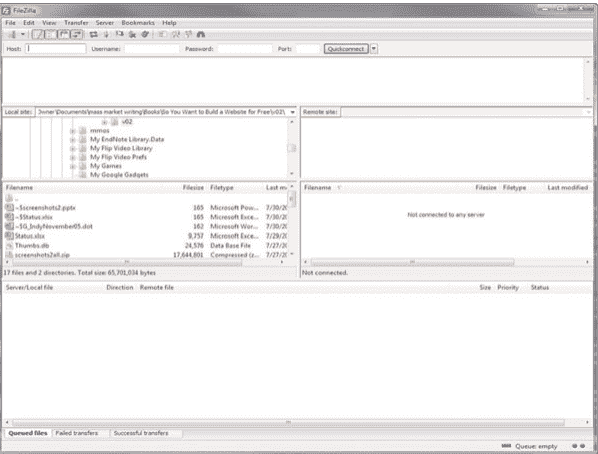

**图 5.1**

FileZilla 可以让你在互联网上传输文件。

- Fetch（Mac）（`http://fetchsoftworks.com/`）——这款 FTP 客户端可免费下载，还有一个超可爱的小狗吉祥物。它是 Mac 用户的最爱。
- Cyberduck（Mac）（`http://cyberduck.ch/`）——一款出色的小型多功能免费开源 FTP 客户端，支持多种语言。
- OneButton FTP（Mac）（`http://onebutton.org/`）——一款简单的免费 FTP 程序，专为技术水平较低的 Mac 用户设计，旨在让文件传输尽可能简单。
- Net2ftp（`www.net2ftp.com/`）——一款免费的网站 FTP 客户端，无需下载到你的电脑，可在多个平台的不同浏览器上使用。

### 文本编辑器

构建网站时，你必须能够编辑文本文件，包括超文本标记语言（HTML）文件或脚本文件。文本文件就是只包含文字和数字而没有格式的文件。以下是一些较好的文本编辑器：

- Notepad（Windows）——所有 Windows 版本自带的标准文本编辑器
- Notepad ++（Windows、Linux）（`http://notepad-plus.sourceforge.net/uk/site.htm`）——一款优秀的免费 Notepad 替代品，具有许多出色的功能，如行号显示和文本检查（参见图 5.2）

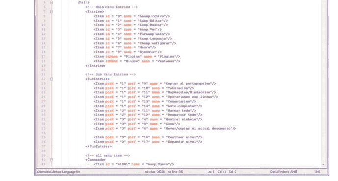

**图 5.2**

在编辑文本文件时，Notepad ++ 这类程序是必不可少的。

- TextWrangler（Mac）（`www.barebones.com/products/textwrangler/index.shtml`）——一款优秀的 Mac 文本编辑器
- XEmacs（Windows、Linux、UNIX）（`www.xemacs.org/index.html`）——一款更偏技术导向的文本编辑器，具有一些高级功能

### 图形编辑器

图形编辑器可以让你创建、编辑和格式化图形文件。这个工具对于让你的网站看起来更出色至关重要，它通过让你处理照片、绘画或计算机艺术来实现。你可能想要修改现有的图形或创建新的内容。这个工具提供了无限的创作空间。此外，图形编辑器还可以更改图形的大小和文件类型，使你的网页能够快速高效地加载。

以下是一些建议的图形编辑器：

- GIMP（Windows、Mac、Linux）（`www.gimp.org/`）——这是最好、最受欢迎的开源图像处理工具。它功能丰富、使用方便，而且价格无可匹敌（免费！）。
- Inkscape（Windows、Mac、Linux）（`http://inkscape.org/`）——这是一款免费的开源绘图程序。当你的艺术灵感涌现时，运行这个程序将你的创意变为数字现实。它类似于 Adobe Illustrator。
- Paint.Net（Windows）（`www.getpaint.net/`）——这是一款最初由学生设计的开源照片编辑软件包。它已发展成为大型开源软件项目。
- Seashore（Mac OS X）（`http://seashore.sourceforge.net/`）——这是 GIMP 针对特定版本 Mac OS X 操作系统的版本。

### HTML 编辑器

HTML 编辑器用于创建和编辑网页。其中一些使用图形用户界面（GUI），另一些则更简单，只允许你编辑 HTML 文件的文本内容。

如果你需要编辑网页的外观或其背后的代码，请使用 HTML 编辑器。编辑器为你提供快捷方式（如预格式化标签和自动闭合标签），并为你格式化页面，让你的工作轻松得多。

以下是一些建议的 HTML 编辑器：

- `KompoZer`（Windows、Mac、Linux）（`www.kompozer.net/`）——一款功能齐全的多平台所见即所得（WYSIWYG）编辑器，用于网页和网站管理。该程序易于安装和使用。
- `Quanta Plus`（Windows、Linux）（`http://quanta.kdewebdev.org/`）——一款功能丰富的 HTML 编辑器。它功能众多，新用户可能会感到应接不暇，因此更适合有一定技术基础的用户。
- `Bluefish`（Windows、Mac、Linux）（`http://bluefish.openoffice.nl/`）——一款不错的 HTML 编辑器，能够用多种语言编写网站和脚本。
- `SeaMonkey`（Windows、Mac、Linux）（`www.seamonkey-project.org/`）——这个工具有些不同。除了可以用于电子邮件、阅读新闻组、聊天和网页浏览外，它还是一个功能齐全的 HTML 编辑工具（参见图 5.3）。由制作 Firefox 的团队为你带来，这是一个实用的工具。
- `WaveMaker`（Mac）（`www.wavemaker.com/downloads/`）——一款用于 Web 和云应用的开发工具。

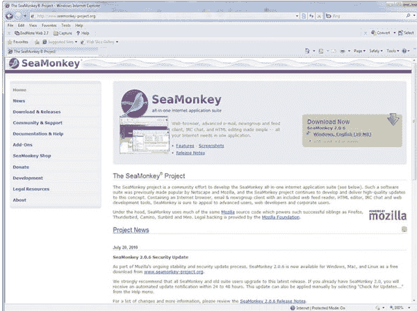

**图 5.3**

*SeaMonkey 是一款多功能工具。*

- `OpenLaszlo`（Windows、Mac、Linux）（`www.openlaszlo.org/`）——这个工具用于高级 Web 应用开发。用它为你的网站添加一些编程和交互功能，而不仅仅是提供信息。它不适合所有人，但值得一看。
- `CSSED`（Windows、Linux）（`http://cssed.sourceforge.net/`）——一款功能齐全且可扩展的级联样式表（CSS）编辑工具。（有关如何使用 CSS 的更多信息，请参阅第 4 章"设计你的网站"。）这更适合技术导向的网站开发者。如果你已经掌握了其他工具，你可能想试试这个。

### 录音工具

如果你想在网站上使用音频，你可能需要一个录音程序。以下是一款流行的录音工具供你参考：

- `Audacity`（Windows、Mac、Linux）（`http://audacity.sourceforge.net/`）——如果你的网站需要声音，而你需要编辑一些原始音频文件，这个工具可以让你录制、播放和编辑音频文件。

### 视频编辑

互联网上的视频内容每天都在不断增加。几年前，在网站上添加视频还很困难、缓慢且昂贵。如今视频遍布网络。随着越来越多的人使用宽带，视频在网站上已十分常见。以下工具可以帮助你捕获、编辑和渲染视频：

- `Blender`（Windows、Mac、Linux）（`www.blender.org/`）——首屈一指的开源视频编辑工具。
- `Cinelerra-CV`（Linux）（`http://cinelerra.org/`）——一款出色的工具，但只能在 Linux 操作系统上使用。

### 高级工具

如果你认为自己具备使用更高级网页开发工具的能力，请继续阅读。功能更多的程序在学习、安装和使用方面也更为复杂。以下是一些建议：

- `NvuDev`（Windows、Mac、Linux）（`http://nvudev.com/index.php`）——一款更复杂、尚未完全成熟的 KompoZer 版本。这是刚刚发布的新版本，因此可能比本文列出的其他一些选项存在更多问题。

## 免费网页工具的未来

本章讨论的所有工具都是免费的。在过去十五年半的时间里，我们看到越来越多的免费软件可以在网上获取。在此期间，这些软件的质量也在不断提高。这使得在项目中使用免费网络软件成为一个可行的选择。

开源软件正被越来越多地使用。具有更新更好功能的新工具不断涌现。最好的工具是你甚至不知道自己需要的那种，而某个开源开发者正在开发它。继续寻找吧，享受这么多人劳动的成果。

## 在电脑与互联网之间传输文件

许多人在开始建立自己的网站时最常见的一个问题就是如何将文件传输到互联网上。本章将向你展示这比你想像的要简单。

理解将文件放到互联网上的最简单方法是认识到你所做的只是将文件从一台计算机移动到另一台计算机。如果你曾在家里或工作中的计算机之间移动过文件，那么你已经基本掌握了将文件移动到互联网上所需做的一切。

- 存储你的文件
- 将文件上传到互联网
- 从 FTP 服务器下载文件

将文件从互联网移动到你的计算机称为下载。当你将文件从你的计算机移动到互联网时，你正在上传它们。

在互联网上来回传输文件的最佳方式是使用文件传输协议（FTP）。第五章“收集你的工具”中介绍了几个 FTP 程序。FTP 程序使你能够连接到互联网上允许 FTP 连接的服务器。当你连接到 FTP 服务器时，你可以来回移动该服务器上的文件。本章将告诉你如何使用这些程序来实际移动你的文件。

## 存储你的文件

在你开始考虑在互联网上来回移动文件之前，花些时间整理你自己计算机上的文件是很重要的。保持有序将使查找文件更容易，并确保在移动文件时出错更少。本节介绍文件存储的一些最佳实践，并向你介绍一种更高效的文件存储方式。

新网页开发人员的一个常见问题是他们经常错误地引用文件。这可能会导致各种问题，如果你不整理文件，这可能会让你抓狂。一个常见的例子是，当你在网页上引用你计算机上的图片而不是 Web 服务器上的图片时。如果你查看 HTML 代码并看到类似`C:\users\Tom\Webpagepics\cat.jpg`的引用，Web 服务器找不到该文件，因此会返回错误。

## 命名文件

当你创建要在网站上使用的文件时，你可能会问一个问题：“我应该给这个文件起什么名字？”你真的可以给文件起任何名字，但这里有一些简单的规则你应该遵循。

### 让名字简单

尽量让你的名字尽可能简单，并尽可能描述性强。描述可能包括文件的用途和尺寸。例如，与其将图形文件命名为`picture01.jpg`，不如尝试`logo125x125.jpg`。这样你就知道该文件是一个标志，而且你知道它的大小，甚至无需打开它。

### 始终使用小写

对于某些服务器和 Web 主机，你引用的文件的大小写需要非常具体。如果服务器上的文件名为大写的`LOGO.gif`，而你在 HTML 中引用该文件时使用了小写`logo.gif`，服务器可能不会知道你说的是同一个文件。

通过将所有文件名保持小写，你可以确保始终拥有清晰的引用。

### 不要使用空格

在文件名中使用空格不是一个好主意。当浏览器在 HTML 文件名中遇到空格时，它会用`%20`填充。所以，

`www.bobshouseofpancakes.com/our menu.html`

变成

`www.bobshouseofpancakes.com/our%20menu.html`

因为这不是你页面的确切名称，以这种方式引用它会使你的浏览器无法找到该页面。如果你的文件名没有空格，你就不会有这个问题。

如果你需要使用空格，一种解决方案是使用下划线，即在大多数计算机上减号/连字符（`-`）上方的字符。通常，你同时按下减号/连字符键和 Shift 键。这将文件名`reallylongconfusingfilename.html`变为`really_long_confusing_file_name.html`。文件名更容易阅读，而且没有空格，你就不会面临糟糕的 HTML 地址的风险。

### 将所有网页文件放在一个地方

这似乎是一件简单的事情，但将文件存储在硬盘上的一个位置经常被忽视。将 HTML 文件、图像和脚本在你的计算机上整理清楚，从长远来看会让你的生活轻松得多。如果你同时处理多个网站，这一点尤其重要。

### 建立组织结构

将所有文件放在一个地方后，接下来你要做的是组织它们。这使你可以更轻松地查找所需内容并存储新文件。你可以用多种方式做到这一点，但当我处理多个网站时，我会使用文件夹将所有网站相关文件存储在一个位置（见图 6.1）。在网站文件夹中，我有 HTML 文件、图形和多媒体脚本的文件夹。通过每次创建相同的目录结构，我发现内容更容易找到，代码中的引用错误也更少。

- 网站文件夹
  - 图像文件夹
  - 脚本文件夹
  - 多媒体文件夹
- HTML 文件


**图 6.1**

*文件存储结构示例。*

### 使用版本控制系统


如果你正在构建多个网站或正在与许多人合作一个网站，你可能需要考虑版本控制系统。这些系统存储、跟踪和监控谁正在使用你项目的文件，并确保你不会意外覆盖其他人所做的更改。`Subversion`是一个免费的开源版本控制系统，成千上万的软件开发者都在使用。

如果你感兴趣，可以通过以下网站了解更多：

- [版本控制可视化指南](http://betterexplained.com/articles/a-visual-guide-to-version-control)—`http://betterexplained.com/articles/a-visual-guide-to-version-control`
- [修订控制](http://en.wikipedia.org/wiki/Revision_control)—`http://en.wikipedia.org/wiki/Revision_control`
- [`Subversion`](http://subversion.apache.org)—`http://subversion.apache.org`

## 将文件上传到互联网

你的网站完成后准备上线时，你需要将文件移动到你已连接到互联网的计算机（你的 Web 服务器）上。为此，你需要连接到一个允许`FTP`连接的服务器。通常，你的 Web 服务器会允许`FTP`连接。

为此，你需要一个`FTP`程序，如第五章所述。我在这些示例中将使用`Filezilla`，但任何`FTP`程序都应该能够将文件传输到你的`FTP`服务器或从服务器传输文件。

### 登录

在开始之前，你需要一些你的主机提供商会给你的信息，包括你要连接的`FTP`服务器的名称、用户名和密码。你在注册托管服务时可能不得不定义你的用户名和密码，但你可能需要与他们确认以确认相同的用户名和密码是否用于你的`FTP`登录信息。

获得此信息后，登录到服务器。`FTP`程序窗口有两面。一面显示你计算机上的文件，另一面显示 Web 主机计算机上的文件。

要登录到`FTP`服务器，请执行以下操作：

1. 在**主机**字段中，输入你的主机名。
2. 在相应的字段中输入你的用户名和密码。
3. 除非你的主机提供商告诉你使用特定端口，否则将**端口**字段留空。
4. 单击**快速连接**按钮。

你现在已连接到主机的`FTP`服务器（见图 6.2）。

### 添加新文件

连接到`FTP`服务器后，你所要做的就是将文件从你的计算机拖到服务器上。这不会从你的计算机中删除文件，但会将副本放在`FTP`服务器上。

### 更改现有文件

如果你尝试复制`FTP`服务器上已存在的文件，`FTP`程序会提醒你这一点。你可以选择覆盖文件或取消传输请求（见图 6.3）。执行此操作时要小心，因为你不希望覆盖错误的文件。

如有疑问，取消覆盖文件的更改。这样你就不会意外覆盖某些内容。

68 第二部分 计划与准备

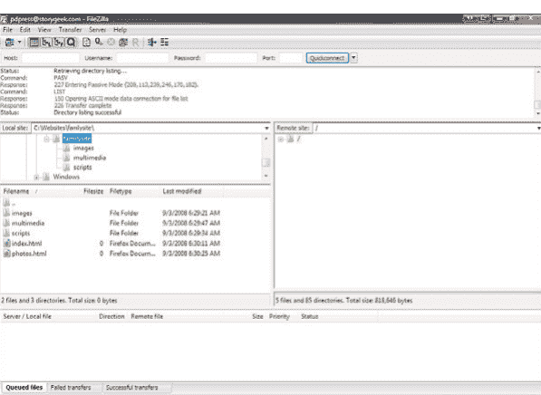

图 6.2

`FileZilla`连接到服务器。

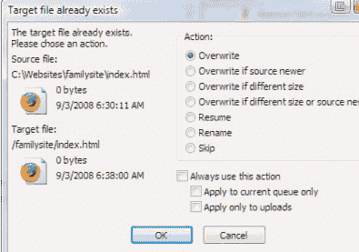

图 6.3

此窗口允许你覆盖文件或取消传输。

## 从 FTP 服务器下载文件

如果你在网上发现一个文件并想下载它，该怎么办？如果你拥有存储该文件的服务器的`FTP`访问权限，你只需连接到该服务器并执行上传过程的反向操作即可。

## 单个文件或多个文件

当你从互联网下载文件时，有时你可能只下载一个文件，而有时可能是一组打包成一个压缩包的文件。两种类型的下载方式相同，但当你下载一组文件时，可能需要进行一些额外操作，例如运行它们或解压缩它们，以便将各个文件解包到你的计算机上。下一节将介绍针对不同文件类型需要执行的操作。

## 从浏览器下载

大多数浏览器让下载文件变得很简单；只需点击文件的超链接或使用子菜单（例如右键菜单）即可下载。这与`FTP`类似，都是将文件的副本下载到你的计算机上。从互联网下载文件不会影响互联网上的原始文件。

## 下载文件的类型

根据文件和你的操作系统，下载的文件有几种不同的类型。其中一些文件易于处理，而另一些则需要特殊程序。

文件通常由两部分组成：文件名和作为文件扩展名的后缀。文件扩展名位于文件名中的句点（`.`）之后。文件扩展名告诉你文件的类型。它还告诉操作系统默认使用哪个程序来打开它。因此，例如，`logo.bmp` 是一个名为“logo”的文件，其类型为“BMP”或位图类型。

以下部分描述了一些常见的文件类型及其用途。

> **注意**：如果你要下载的文件没有扩展名，或者你不熟悉该文件扩展名，请采取安全路径，在将文件下载到计算机之前先调查该文件扩展名。此网站按字母顺序列出了数百个文件扩展名：`http://fileext.com/alphalist.php?extstart=^A`

## 图像文件（GIF、JPG、TIFF、BMP）

图形文件在下载后不需要进行任何特殊处理，但你必须拥有图形程序才能查看和编辑它们。如今，大多数操作系统都可以处理这些文件并显示给你，但你可能会遇到无法立即打开的文件。开源图形程序`GIMP`（`www.gimp.org/`）应该可以打开你需要的任何文件。

## EXE（Windows）

这是用于自包含可执行文件的扩展名，这些文件在被点击时会自行运行。在 Windows 中，你只需双击下载的文件，它就会开始运行。

> **警告**：小心这些文件——可能存储在可执行文件中的有害文件可能会损害你的机器。仅运行你从可信来源下载的文件。

## ZIP

`zip`文件将一个或多个文件压缩成一个更小的文件。这个新的、更小的文件包含这些文件，并在解压缩时保持文件结构。大多数操作系统允许你双击这些文件来打开它们（参见图 6.4）。

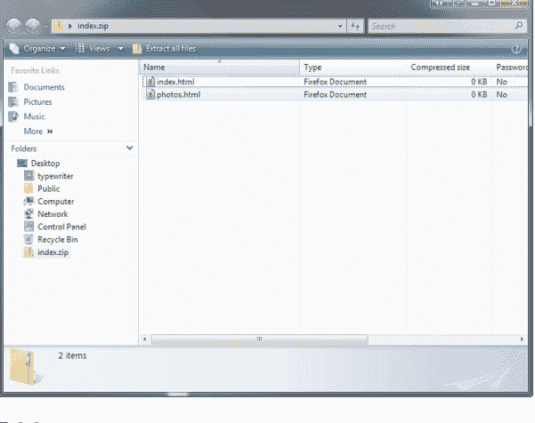

图 6.4

`zip`文件的内容。

## DMG（Mac）

这基本上是 Mac 版本的可执行文件。当你在 Mac 上下载这样的文件时，只需双击它即可运行。

## ISO

这是一种特殊类型的压缩文件，它将整个 CD 或 DVD 的内容放入一个文件中。你需要一个特殊的程序来解压缩这些大文件，并允许你与内容进行交互。

## 下载文件的最佳实践

就像你用来构建网站的文件一样，保持下载内容的井然有序至关重要。组织有序可以让你找到所需的文件并节省空间。以下是一些下载文件的最佳实践：

- **对所有下载使用病毒扫描程序**——互联网上充满了优秀、美妙的人，但也有少数坏苹果。确保在打开任何下载文件之前扫描其是否含有病毒。
- **将所有下载内容保存在一个地方**——当你下载大量文件时，需要将它们保存在一个地方，以便下载后能够找到它们。我使用一个名为“Downloads”的文件夹，我所有的浏览器都将下载内容放入其中。
- **不要下载到你的桌面**——你不应该下载文件的一个地方是你的桌面。这只会弄乱你的桌面，让你难以找到任何东西。
- **解压缩大型包文件后删除它们**——如果你下载的是大型文件，例如`ISO`文件，你应该在解压缩后删除该文件。你不想用只使用一次的文件耗尽硬盘空间。

此页有意留白

# 第三部分：网站构建基础

- 7 网站的要素
- 8 使用现有网站
- 9 网页服务
- 10 HTML 入门
- 11 处理图像
- 12 处理多媒体
- 13 使用 HTML 构建网站
- 14 他们是怎么做到的？
- 15 让你的网站适配移动端

此页有意留白

## 第 7 章：网站的要素

在开始构建网站之前，你需要了解它的组成部分。我在本书前面已经介绍了网页和网站的定义，但如果我们讨论构建网页和网站的要素，这些定义需要进行扩展。

本章涵盖什么构成了良好的网站内容、网页的组成部分以及网站的组成部分。最后，它涵盖了网络广告以及它是否在你的网站上有一席之地。

### 本章内容

- 内容
- 网页的组成部分
- 网站的组成部分
- 网络广告

## 内容

内容是你网站的核心，也是人们访问它的原因。如果你没有优秀、独特的内容，人们就没有理由输入你的`URL`或点击指向你网站的链接。

本节涵盖了一些开发网站内容的最佳实践。

### 内容最佳实践

你的内容主题实际上取决于你，但任何内容都有一些最佳实践。

- **内容应聚焦**——你的网页内容应该有一个重点，并专注于该重点。没有什么比不聚焦的内容更让访客反感了。一个古董打字机网站不应该在首页放你家小狗新出生的幼崽的照片。定义你将要在网站上讨论的内容，并坚持下去。
- **内容应个性化**——如果可能，让你的内容个性化。你有个性，至少我对你想说的话很感兴趣。事实上，很多人都会对你想说的话感兴趣。没有人有过与你相同的经历，所以你的内容是独特的。如果你的网站是一个商业网站，请将企业的个性注入你的内容。一个派对小丑公司的网站看起来应该与财务顾问的网站不同。
- **内容应高质量**——为你发布的内容感到自豪。确保你的内容写得好且没有错误。为你的访客提供你能提供的最好的网站。
- **内容应独特**——不要只是一个复述者；要成为一个创新者。即使你是转发别人发布的内容，也要告诉我们你对它的看法；给我们你的观点。互联网电影数据库（参见图 7.1）因其独特的内容而取得成功。
- **内容应适合受众**——在创建内容时要考虑你的受众。你的受众期望并希望从你的网站内容中得到什么？如果你正在为学龄前儿童创建一个网站，你不会使用大学水平的语言。

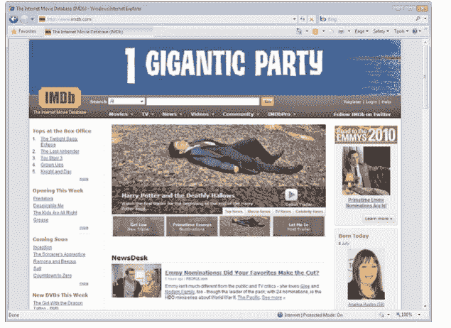

图 7.1

*互联网电影数据库拥有一些互联网上最好的内容。*

## 内容标准

你无法控制谁会访问你的网站。可能是你的老板、你的祖母，或者住在街对面的八岁小孩。这些人对何为合适的标准可能与你不同。我不会告诉你审查你的内容，但要注意它可以被各种各样的人看到。如果你的网站有一些更成人化的“风险”内容（比如语言、笑话或图片）——那种你不希望你祖母看到的内容——你可能需要考虑清晰地标注该内容，以警告那些会被冒犯的人。

> ## 极客术语
>
> ### NSFW
>
> 你可能会在电子邮件或博客中听到人们将内容称为`NSFW`。这代表 Not Safe For Work。意思是这类内容不适合在工作时查看，最好在家查看。这将包括成人图像或内容。如果你不确定你的内容是否属于此范畴，你可能需要将其标记为`NSFW`。

## 网页的组成部分

本节介绍网页设计中一些标准组成部分。这些部分不同于内容，它们为你的内容提供容器。并非每个网页都包含所有这些元素，但一个优秀的网页应该包含其中大部分。

### 标题

网页的标题会显示在浏览器的标题栏中。它看似不起眼，但却很重要。当访问者在任务栏或仪表盘中浏览应用程序标题时，这是你的页面被识别的方式。当浏览器最小化或你的网页显示在标签页中时，标题会出现在标签页或 Windows 程序栏中（参见图 7.2）。

标题由代码中的`HTML`标签定义。有关使用`title`标签的更多信息，请参阅第 10 章“HTML 入门”。

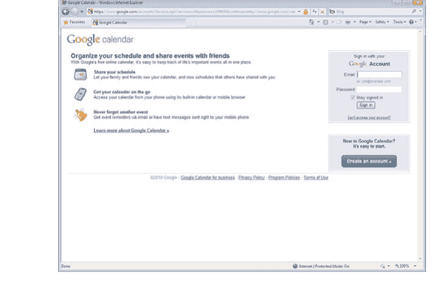

### 页眉

网页的页眉是横跨页面顶部的区域。它没有固定的大小，但按照常见惯例，页眉不应超过页面总长度的四分之一，并且横跨页面的宽度。页眉可以包含网站标题信息和导航元素（参见图 7.3）。页眉还可以在每个页面上重复使用，以提高网站的一致性。如果你为所有页面使用一个统一的页眉文件，只需更改该文件一次即可更新整个网站。

### 正文

正文是网页的主要部分。你的大部分内容都放在页面的正文中。网页的正文没有真正的标准，但请记住，你的内容在视觉上应该易于阅读（参见图 7.4）。例如，如果网页的正文横跨整个浏览器宽度，在某些显示器上可能会更难阅读。

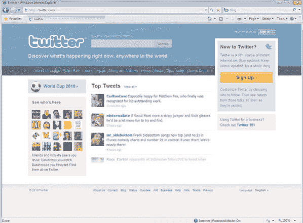

**图 7.3**

*Twitter.com 页面的页眉部分。*

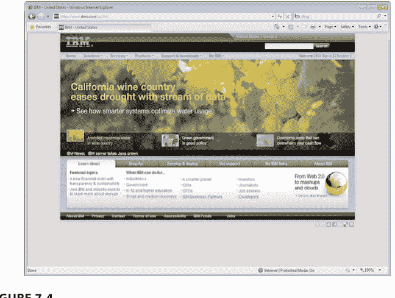

**图 7.4**

*IBM 网站的正文部分。*

### 页脚

与页眉相对应的是页脚。它横跨页面的底部，同样可以用于信息或导航元素（参见图 7.5）。此外，与页眉一样，最好在网站的每个页面上复制页脚以保持一致性。如果你为所有页面使用一个统一的页脚文件，只需更改该文件一次即可更新整个网站。这也是放置联系信息的常用区域。

### 侧边栏

在正文内容区域的两侧，你可能想要添加侧边栏。这些是高度大于宽度的网站内容列。与页眉和页脚一样，这些侧边栏几乎可以包含任何内容，但它们非常适合放置搜索框和导航元素（参见图 7.6）。

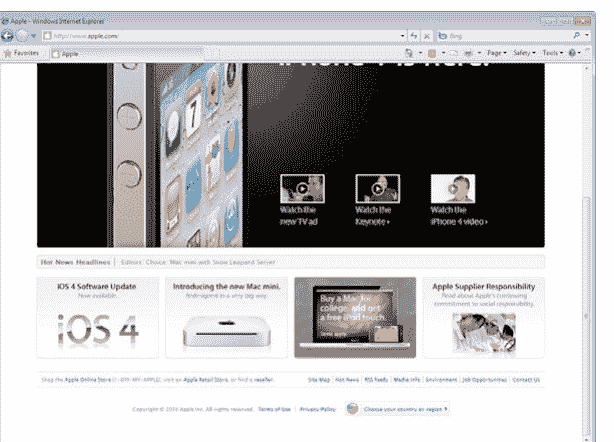

**图 7.5**

Apple.com 网站的页脚。

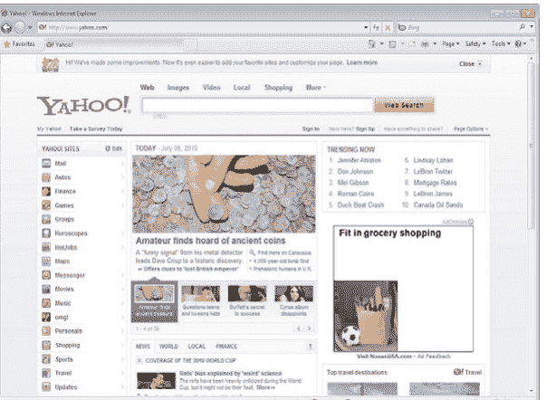

**图 7.6**

该网站在正文内容的两侧都有侧边栏。

### 导航元素

网页的不同部分可能包含导航元素。这些是需要放在每个网页上的重要内容。导航元素是指向网站上其他页面的链接。没有导航元素，访问你网站的访客就无法浏览和访问你的所有内容。

导航元素可以是文本、按钮或菜单。导航元素的外观没有固定格式，但它们应该完整且一致（参见图 7.7）。以下是导航元素的基本要求：

- **完整性**——确保你网站上的所有页面都可以从其他所有页面访问。每个网站的导航元素集合中，都应该包含指向每个页面的导航链接。
- **一致性**——导航元素应在每个页面的相同位置出现，并包含相同的链接。如果你选择禁用某个页面的链接，请确保在每个页面上都保持一致。
- **易读性**——你使用的导航元素应易于阅读和理解。没有人喜欢点击一个链接后只能祈祷它指向想要的内容。
- **易找性**——不要将导航元素隐藏在网页中。它们应该易于找到，并且位于每个页面的相同位置。

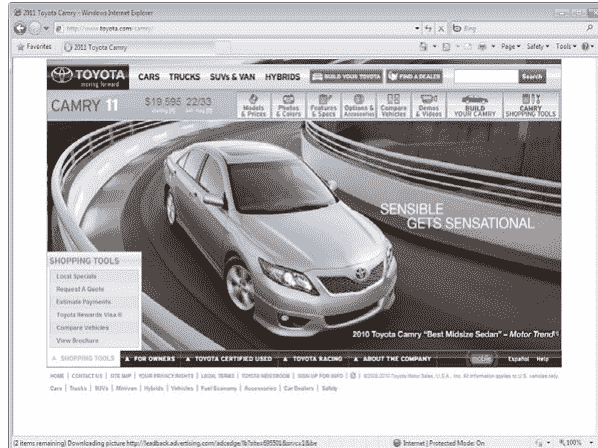

**图 7.7**

该网站有出色的导航元素。

## 网站的组成部分

正如网页有组成部分一样，网站也有组成部分。并非每个网站都包含所有这些部分，但你应该了解它们，并确定你的网站是否需要。

### 主页

这是你网站最重要的部分。我怎么强调都不为过。主页是在任何浏览器中输入你的网站网址后首先加载的页面。

当在浏览器中输入你的网址时，浏览器会连接到你的 Web 服务器并请求你的主页。默认情况下，Web 服务器会将`index.htm`或`index.html`页面发送给浏览器。这是使网络如此良好运作的惯例之一。

主页是你给访客留下第一印象的地方，所以请确保你展现出最好的一面。主页还应该是你网站的中心。把你最好和最新的内容放在主页上（参见图 7.8）。除非你把主页做到最好，否则人们不会在你的网站上逗留。

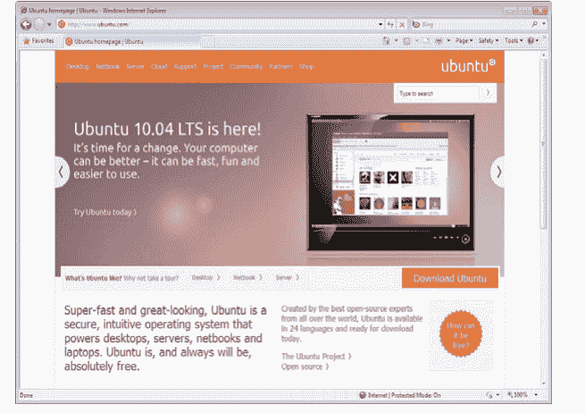

**图 7.8**

主页示例。

### 内容页面

你的网站将包含自己独特的内容页面（产品页面、图片页面等），但这里我列举几个标准内容页面的示例。

### 关于我页面

这个页面从标题来看不言自明。你应该介绍你是谁以及为什么创建这个网站。确保信息清晰、完整且是最新的。

### 常见问题

这是关于你网站目的或内容的常见问题与解答列表（`FAQ`）（参见图 7.9）。该列表应包含关于你的产品或服务的问题与解答，或者任何你认为访客会经常询问的内容。这个列表可以让人们以快速且有条理的方式找到所需信息。请保持你的`FAQ`更新，并经常添加新内容。

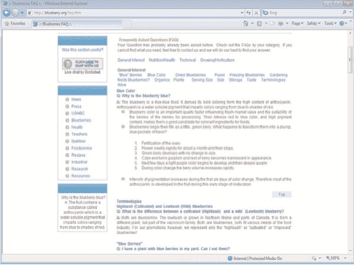

**图 7.9**

一个优秀网站`FAQ`的示例。

### 联系信息

在你的网站上添加联系信息，可以让人们就网站相关意见和问题与你取得联系。这可能包括你的姓名、地址、电话号码和电子邮件地址。

### 注意

请注意，垃圾邮件发送者可能会找到并使用你的联系信息。一种解决方法是用文字书写你的电子邮件地址，这样垃圾邮件机器人就无法识别。例如，不要使用`mark@markwbell.com`，而是使用 mark at markwbell dot com。

## 网络广告

你可以通过出售广告位来补贴你的网站。首先，这不是快速致富的途径。通过网络广告获得任何利润都很困难且不太可能实现，但你也许能够补贴部分网站费用。

在你开始为网站寻找广告商之前，最好把时间和精力花在把网站做到最好上，以此来吸引广告商。

### 提示

这是对网络广告的简要概述。如果你与他人建立了任何商业关系（尤其是在互联网上），请务必进行尽职调查。

### 横幅广告

横幅广告是显示在网站不同位置的广告，允许人们点击广告并跳转到广告商的网站。你本质上是通过提供指向另一个网站的链接来获取报酬。

### 动画广告

在过去几年中，网站广告出现了一种趋势，即创建动画或交互式广告以吸引网站访客的注意力。不幸的是，这些广告往往适得其反，只会让访客感到厌烦。我建议你走正道，不要在你的网站上使用这些广告。

## Google AdSense

在您的网站上使用广告的较新选项之一是使用 Google AdSense 服务（`https://www.google.com/adsense/`；参见图 7.10）。此服务会根据您的内容在您的网站上放置文字广告，并为此支付您一笔非常微薄的费用。

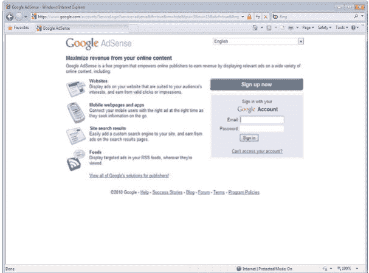

**图 7.10**

*Google AdSense 网页。*

这些广告比引人注目的动画横幅广告侵扰性更小，但您无法控制显示的内容或时间。假设您有一个基于集邮爱好的网站。Google AdSense 会扫描您的页面以查找关键字，并根据这些关键字显示广告（参见图 7.11）。Google 对 AdSense 有特定的规则和条例，因此在注册该服务之前，请务必仔细阅读细则。

## 第 7 章：网站的要素

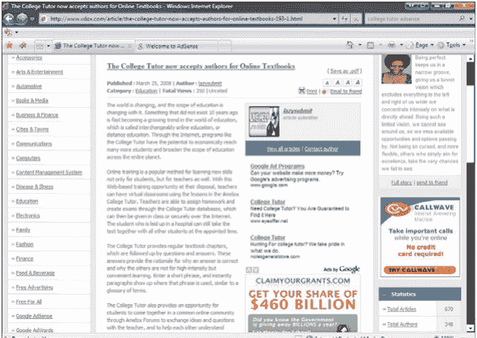

图 7.11

网站上正在使用 Google AdSense。

*此页有意留白*

## 第 8 章：使用现有网站


您拿起这本书，大多数人是因为想建立自己的网站。但有些人只是想在网络上建立形象，对构建整个网站不感兴趣。如果您属于后者，那么您很幸运。有一些网站（`MySpace.com`、`Facebook.com`、`Flickr.com`）允许您创建个人资料、结识他人、分享图片和获取信息——所有这些都不必费心于网站规划、网络服务器、超文本标记语言（`HTML`）或导航。

在这些网站最成熟的形式中，它们提供博客、相册、电子邮件功能和即时通讯工具，所有这些都整合在一个网站之下。

如果您在这些网站中已有账户但需要更多功能，您可能需要自己的网站。如果您不确定，可以注册这些网站，看看它们是否满足您的需求。

这类网站的好处之一是它允许您向其他人推广您的网站。我是所有这些网站的会员，当我发布新的博客文章或进行演讲活动时，我都会使用这些网站来推广这些活动。

## 本章内容

- 社交网络站点
- 其他 Web 2.0 站点

## 社交网络站点

社交网络自人类诞生以来就已存在。社交网络网站于 2002 年开始在互联网上涌现。自出现以来，社交网络站点已成为一种主导类型的网站，甚至登上了《时代》杂志的封面。大多数人都听说过这些网站，数百万人拥有它们的账户。

社交网络站点使您能够创建个人资料、与他人联系并分享您的图片和观点。

社交网络个人资料就像是一个关于您的主页。它包含关于您的信息（您提供的多少或少），并作为其他社交网络站点功能的中心点。

社交网络可能被视为年轻人的东西，但越来越多不同年龄和背景的人正在使用社交网络。

本节涵盖三大社交网络，并解释如何注册、创建个人资料以及与他人联系。如果您已经是这些网站中的任何一个会员，您应该回顾该特定部分，以确保您充分利用社交网络体验。

> **注意** 这些站点的说明和功能可能会在没有太多通知的情况下发生变化，因此您可能会发现屏幕上看到的内容与您在此处阅读的内容之间存在一些差异。

### MySpace

`MySpace`（`www.myspace.com`）成立于 2003 年，是从一家名为 `eUniverse` 的早期互联网公司发展而来。`MySpace` 拥有社交网络站点的所有标准功能，以及一些与允许您构建网站的站点类似的功能。它拥有数百万用户，是互联网上最受欢迎的网站之一。到 2005 年，`MySpace` 已变得如此受欢迎，以至于媒体集团新闻集团以 5.8 亿美元收购了它。

本节介绍使用 `MySpace` 的基础知识及其一些更像网站的功能。

> **注意** 与任何账户信息一样，请保密。共享此信息会使知道它的人能够对您的 `MySpace` 账户进行更改。

#### 创建账户

在创建您的 `MySpace` 个人资料之前，您必须拥有一个 `MySpace` 账户。这允许您登录并验证您的身份。

1. 打开浏览器并访问 `MySpace.com`（参见图 8.1）。

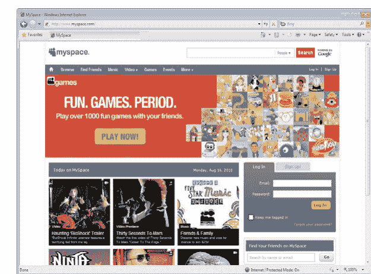

图 8.1 MySpace.com 网站。

2. 点击“注册”按钮。这会带您进入 `MySpace.com` 的“在此处加入 MySpace”页面（参见图 8.2）。此页面要求您输入有关自己的信息，以便 `MySpace` 为您创建账户。

> **注意** 如果您是音乐家、喜剧演员或电影制作人，`MySpace.com` 有专门的注册区域。在此页面上，您将找到指向这些账户创建页面的链接。

3. 在必填字段中输入您的信息。除非您允许，否则此信息不会显示在您的个人资料中。

4. 点击“使用条款”链接并仔细阅读服务条款（如果您没有更好的事情可做）。

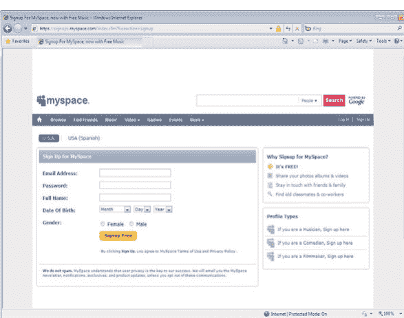

**图 8.2**

*MySpace 账户创建页面。*

5. 点击“注册”按钮。您的账户创建后，`MySpace` 允许您邀请一些朋友。

6. 点击您收到的电子邮件中的确认链接。

7. 添加您可能喜欢的任何乐队和艺术家到您的好友列表。添加完成后，点击“继续”。

8. 为您的个人资料上传一张图片（参见图 8.3）。

9. 如果您希望关联您的学校以便与同学联系，请点击“继续”。

10. 然后将显示您的个人资料（参见图 8.4）。

> **注意** 不要成为那种向你几乎不认识的人发送大量邀请的人。这些人一点也不有趣，也从不被邀请参加聚会。如果您希望某人出现在您的社交网络页面上，请确保您非常了解那个人。

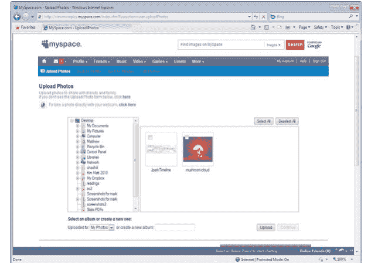

图 8.3

*上传照片页面。*

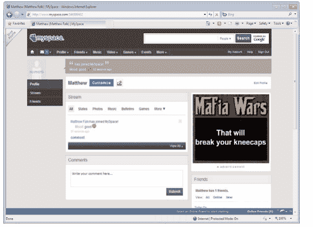

图 8.4

*您在 MySpace.com 上的个人资料。*

#### 自定义您的个人资料

创建个人资料后，您可以添加各种关于自己的信息。请记住，任何在 `MySpace` 上查找您的人都可以看到这些信息，因此请勿包含您的地址和电话号码等个人信息。

1. 要编辑您的个人资料，请点击您个人资料上的“编辑个人资料”链接。这将显示“编辑个人资料”页面（参见图 8.5）。

2. 编辑完您的个人资料后，点击“保存更改”按钮。

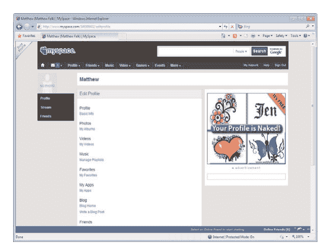

**图 8.5**

*MySpace.com 上的“编辑个人资料”页面。*

#### 与其他用户联系

`MySpace` 为您提供了多种与其他用户联系的方式。您可以搜索用户、给他们发电子邮件，甚至可以在 `MySpace.com` 上给其他人发送即时消息。

- **搜索和浏览** — `MySpace` 使您能够按姓名、电子邮件地址、年龄、性别、地点、教育程度或兴趣级别搜索和浏览（参见图 8.6）其他用户。

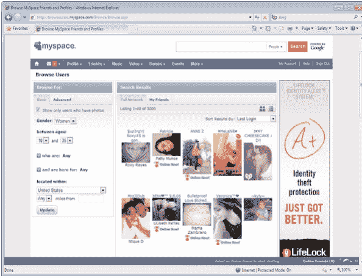

**图 8.6**

*MySpace.com 上的“浏览用户”页面。*

- **电子邮件** — `MySpace` 提供了一个功能齐全的内部电子邮件系统，还可以管理您的消息、好友请求和其他联系。
- **即时消息** — `MySpace` 使您能够下载一个即时通讯程序，该程序会列出您所有的 `MySpace` 好友，而无需您登录 `MySpace`。

## 网站功能

`MySpace` 具有几种类似网站的功能（博客、图片页面、日历和论坛），这些可能就是您所需要的。您可能已经在使用 `MySpace`，但并未充分利用所有这些功能。尝试其中一些；它们可能会非常有趣！

- **评论** — 如果您喜欢某人的个人资料或想给某人发送公共消息，您可以在该人的个人资料上发表评论。请记住，任何访问该人个人资料页面的人都可以看到这些评论。
- **博客** — 您可以在 `MySpace` 上建立自己的博客，并发布包含文本、图片和视频的条目。您也可以注册关注其他人的博客。
- **照片库** — `MySpace` 上满是图片。你的账户可以拥有数百张图片，可供公众或仅限好友查看。这些图片也可以整理到相册中，以便更好地组织管理。
- **应用程序** — `MySpace` 现在允许你创建应用程序并将其附加到你的个人资料页。有关 `MySpace` 应用程序的更多信息，请查阅 `MySpace` 开发者平台社区网站（参见图 8.7）（`http://developer.myspace.com/community/`）。
- **日历** — 如果你在 `MySpace` 上关注的人正在举办活动，日历功能可以让你随时掌握动态。

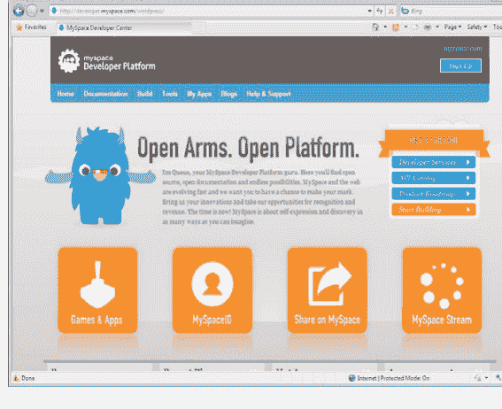

**图 8.7**

`MySpace` 开发者平台社区网站。

## Facebook

马克·扎克伯格于 2004 年创建了 `Facebook`，最初是为了方便与哈佛大学宿舍的同学联系。它迅速扩展到其他大学和高中。最初，你必须拥有与教育机构关联的电子邮件地址才能使用 `Facebook`，但到了 2006 年，`Facebook` 向所有用户开放，并自此稳步增长。与 `MySpace` 一样，`Facebook` 也拥有数百万用户。

本节将介绍使用 `Facebook` 的基础知识以及一些更类似网站的功能。

### 创建账户

> **注意** 与任何账户信息一样，请妥善保管。泄露这些信息会使他人能够修改你的 `Facebook` 账户。

在创建 `Facebook` 个人资料页之前，你必须先拥有一个 `Facebook` 账户。这使你能够登录并验证身份。

1. 打开浏览器，访问 `www.facebook.com`（参见图 8.8）。

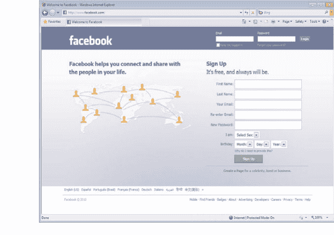

2. 输入创建 `Facebook` 账户所需的信息。
3. 点击“注册”。
4. 确认你的电子邮件地址。
5. 搜索你的电子邮件联系人，查找其他 `Facebook` 用户并邀请他们加入 `Facebook`（参见图 8.9）。
6. 输入你的 `Facebook` 个人资料信息。

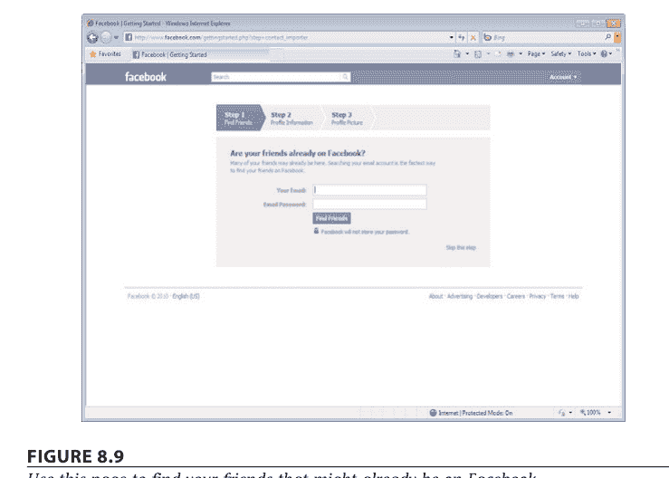

**图 8.9** 使用此页面查找可能已在 `Facebook` 上的朋友。

7. 然后，你的 `Facebook` 页面将显示出来（参见图 8.10）。

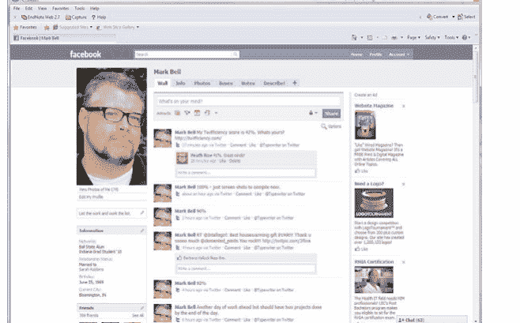

**图 8.10** 我在 `Facebook` 上的个人资料页。

### 自定义你的个人资料

创建个人资料页后，你可以添加各种关于自己的信息。请记住：任何访问 `Facebook` 查找你的人都可以看到这些信息，因此请勿包含个人敏感信息。

1. 要编辑你的个人资料，请点击个人资料页上的“编辑个人资料”链接。这将显示个人资料编辑页面。
2. 点击“编辑信息”按钮来编辑你的个人资料（参见图 8.11）。
3. 编辑完成后，点击“保存更改”按钮。

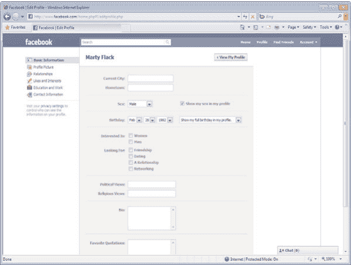

**图 8.11**

*Facebook 上的“编辑个人资料”页面。*

### 与其他用户建立联系

`Facebook` 提供多种方式让你与其他用户建立联系。你可以向用户发送电子邮件、与他们聊天或加入群组。

- **电子邮件** — `Facebook` 提供功能完善的内部电子邮件系统，同时管理你的消息、好友请求和其他联系。
- **Facebook 聊天** — `Facebook` 允许你从 `Facebook` 页面与其他用户聊天（参见图 8.12）。

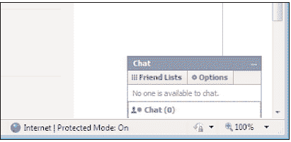

**图 8.12**

*使用 Facebook 聊天。*

- **Facebook 群组** — `Facebook` 让你能与兴趣相投的人建立联系。请记住：当你加入一个群组时，该群组会对你在 `Facebook` 上的其他用户可见。

## 网站功能

`Facebook` 拥有一些很酷的、类似网站的功能。如果你还没用过，不妨试试！

- **公共主页** — 如果你喜欢某人的个人资料页或想向某人发送公开信息，你可以在该用户的公共主页上留言。请注意，公共主页是公开可见的；请勿发布过于私人的内容。
- **Notes** — `Facebook` 允许你在个人资料页上创建类似博客条目的 `Notes`。你可以在这些笔记中发布网站链接或视频。
- **照片库** — `Facebook` 让你在页面上拥有数百张可供公众查看的图片。你可以对这些图片添加注释，并将它们整理到相册中。
- **应用程序** — `Facebook` 开创了应用程序热潮，`MySpace` 随之效仿。有关 `Facebook` 应用程序的更多信息，请访问 `Facebook` 开发者网站 `http://developers.facebook.com/`。参见图 8.13。

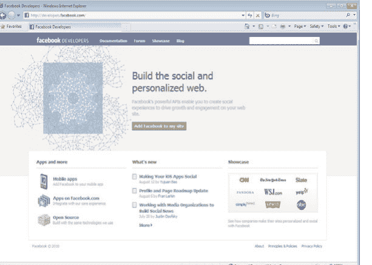

**图 8.13**

`Facebook` 开发者网站。

## 其他 Web 2.0 网站

Web 2.0 是一个花哨的名字，指的是允许你通过网络浏览器与他人互动的网站。`Facebook` 和 `MySpace` 让你与朋友建立联系。其他网站则让你通过照片和网站链接建立联系。本节介绍一些 Web 2.0 网站的例子。

社交网络并非互联网上唯一对网站开发或推广有用的网站。其他 Web 2.0 网站使你能够分享图片、链接和微博。（你稍后会读到相关内容。）本节将介绍其中几个。

### Flickr

`Flickr`（`www.flickr.com`）是世界上最大的图片分享网站（参见图 8.14）。它允许你创建个人资料页、存储图片、查看所有人的公开图片、将个人图片设为仅限家人和朋友查看，并与其他人分享图片。该网站充满了奇妙有趣的功能，所以请四处看看，尽情玩乐吧！

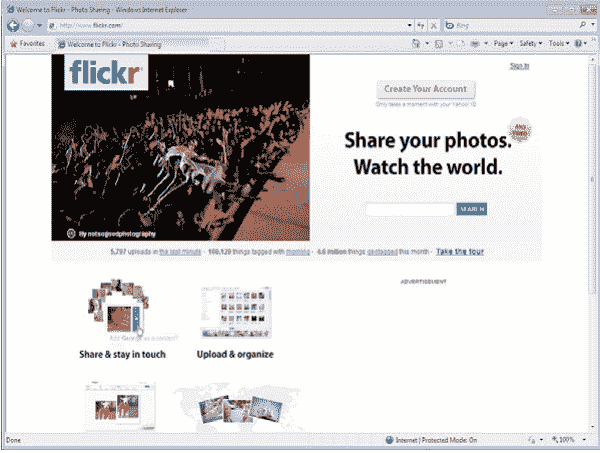

**图 8.14**

*Flickr.com 拥有一些互联网上最棒的照片。*

### Twitter

你可能刚刚搞懂什么是博客，然后又冒出了*微博客*。这是融合了聊天室、博客和持续新闻推送元素，仅限 140 个字符的微型博客。虽然并非适合所有人（你可能不关心朋友何时去杂货店），但它可能会让人非常上瘾。`Twitter`（`Twitter.com`）是目前最受欢迎的微博客网站。我用它来推广我的博客文章和演讲活动，并分享我发现的有趣内容。

自 2009 年《免费建立网站》第一版出版以来，`Twitter` 确实腾飞了。它已成为国际事件、名人文化以及全球数百万人日常生活的一部分。最近，`Twitter` 推出了推文按钮（参见图 8.15）。此按钮允许你在网站上放置代码，访客按下后即可自动发布关于你网站的推文。

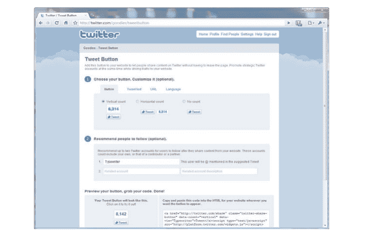

**图 8.15**

新的 `Twitter` 按钮页面，包含将其添加到网站所需的所有信息。

### Delicious.com

这个网站（`www.delicious.com`）乍一看可能很简单，但它提供了一种存储和组织书签（通过标签）的方式，并允许你与他人分享，从而创造出你可能从未想过的联系。对于任何在网络上进行研究或丢失了某个精彩网站地址的人来说，这都是必备工具。

# 第九章：网页服务

## 本章内容

- `Google Sites`
- `Wetpaint`
- `Netvibes`

也许你仍然不确定是否需要一个拥有自己网络服务器的完整网站，但你知道自己想要的不仅仅是前几章涵盖的那些网站所能提供的功能。

幸运的是，有很多像你一样的人，他们想要网站的大部分功能，却不想处理高级功能、维护复杂性和技术知识不足的麻烦。有一种专为这类人群设计的网站创建工具，通常被称为网页服务。

这些服务使用户能够仅使用网络浏览器来创建网站（参见图 9.1）。这些网站具有独立网站的许多功能（页面、图片、链接、小部件），但不需要你设置网络服务器或为托管服务付费。如果你有兴趣创建一个成本尽可能低且流量不大的网站，这绝对是一个选择。它不会拥有所有花哨的功能，但它将完全满足你的需求。

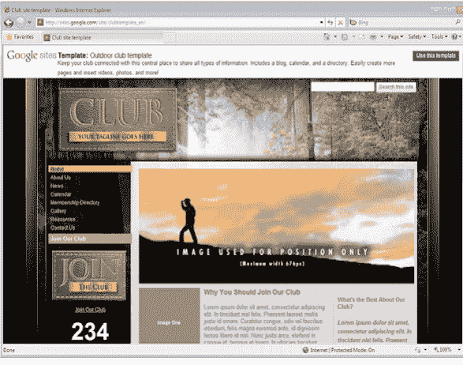

## 图 9.1

来自 Google 的户外俱乐部模板。

本章涵盖了如何注册并构建使用这些网页服务的站点，并讨论了其中每个站点的功能和限制。它们都是免费的，但每个站点的功能各不相同，因此在做出选择之前请全部尝试一下。

> **注意** 这些网页服务一直在更新和改进，因此本书中的指令和图像可能与您计算机屏幕上的显示略有不同。

## Google Sites

我们都知道 `Google.com` 几乎是网络搜索引擎的标准，但您知道它还提供网页服务吗？这项网页服务被称为 `Google Sites`，于 2008 年发布。`Google Sites` 实际上是基于 Google 收购的一家名为 `Jotspot` 的公司的网页服务。本节涵盖了如何注册 `Google Sites`、定义网站地址、创建页面以及应用主题。

### 注册 Google Sites

`Google Sites` 使用现有的 Google 账户或允许您创建新账户。如果您已经拥有 Google 账户（用于 `Gmail`、`Google Reader` 或 `Google Groups`），您只需为 `Google Sites` 使用相同的电子邮件和密码即可。如果您已有 Google 账户，请跳过本节，直接阅读本章后面出现的“创建 Google 站点”。

> **提示** 如果您现在在网上进行任何工作，拥有一个 Google 账户至关重要。它允许您访问 Google 的所有站点，而且是免费的！

要注册一个新的 Google 账户，请从 `Google Sites` 主页开始。

1. 打开浏览器并输入 `http://sites.google.com/`。这将打开 `Google Sites` 主页（见图 9.2）。

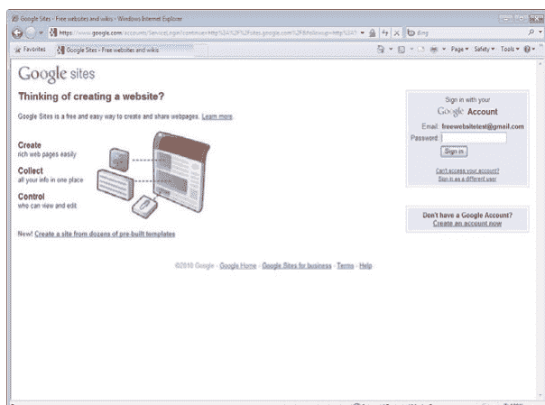

## 图 9.2

*Google Sites 主页。*

2. 点击“Sign Up For Sites”（注册站点）链接。这将带您进入“Create an Account”（创建账户）页面（见图 9.3）。
3. 在“Required Information for Google Account”（Google 账户所需信息）部分，输入当前的电子邮件地址和密码，然后再次输入密码。
4. 在接下来的“Get Started with Google Sites”（开始使用 Google Sites）部分，您可以选择输入您的位置。此外还有单词验证，您还可以阅读 `Google Sites` 的服务条款。

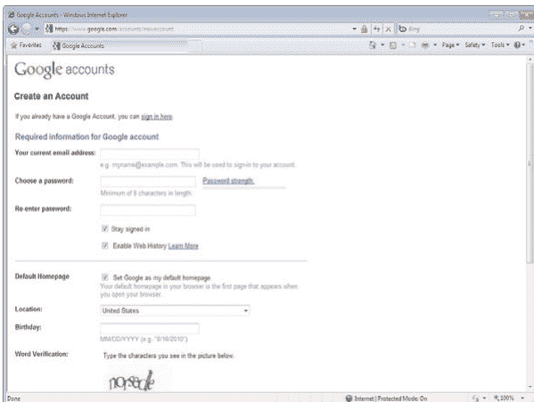

## 图 9.3

创建账户页面。

5. 在“Word Verification”（单词验证）字段中输入您在图片中看到的单词。
6. 在阅读完又一份令人兴奋的服务条款后，点击“I Accept. Create My Account”（我接受。创建我的账户）按钮。


7. 一封包含验证您账户信息的电子邮件将发送到您提供的电子邮件账户中。阅读该邮件并按照指令操作。

8. 登录后，返回 Google Sites 主页（`sites.google.com`）。

## 创建 Google 站点

登录 Google 账户后，返回 Google Sites 主页，以便开始构建您的第一个 Google 站点。

1. 在浏览器中打开 `http://sites.google.com/`，并点击“Create a Site from Dozens of Pre-Built Templates”（从数十个预设模板创建站点）按钮。这将打开“Create New Site”（创建新站点）页面（见图 9.4）。此页面将引导您完成设置 Google 站点的初步步骤。

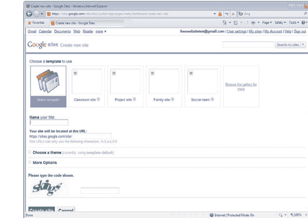

### 图 9.4

*创建新站点页面。*

2. Google Sites 要求您做的第一件事是选择一个模板。模板会让您的工作轻松很多，因此在选择之前请花时间浏览一下。

3. 在“Site Name”（站点名称）字段中，输入您的 Google 站点名称。这可以是任何您想要的名称，但请确保它能很好地代表您的内容。

4. 定义您的站点统一资源定位符（URL）。这就是人们查找您站点的方式。Google Sites 会根据您的站点标题建议一个 URL，但您可以更改它。URL 可以包含数字或字母（无论大小写），但不能有空格。它位于 `http://sites.google.com/site/` 的末尾。

5. Google Sites 预装了“Site Themes”（站点主题）。这些主题为您的网站赋予色彩和个性。目前大约有二十多个主题，但 Google 会不断添加更多。

> **注意** 您不能在 Google Sites 中拥有自己的独立域名。您的站点必须存在于 Google Sites 的体系之下。如果您想要自己的域名，这项及其他类似的网页服务可能不适合您。

6. 点击“More Options”（更多选项）旁边的加号，输入站点描述。如果有人搜索您的站点，这里的内容将被显示。它还能帮助您在心中为自己的网站下一个清晰的定义。

7. 选择将您的网站设为私有或公开。私有站点仅允许您指定的人员（拥有 Google 账户）访问。将站点公开意味着任何人都可以看到并搜索到它。

默认情况下，Google Sites 会为您设置两个页面。第一个页面是主页；第二个是站点地图，它会自动创建您网站上的页面列表以及它们之间的连接方式。

8. 如果您的站点包含或可能包含成人内容（成人图形、文本或声音），请勾选“Mature Content”（成人内容）框。

9. 输入显示的文本代码以验证您是真实的人。

10. 点击“Create Site”（创建站点）。这将创建站点的基础结构，带您进入 Google Site 网页编辑器并打开主页。您可以使用 Google Sites 页面查看器（见图 9.5）来创建您的站点。

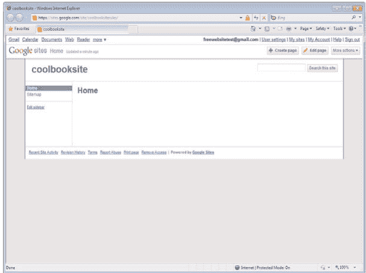

### 图 9.5

Google Sites 页面查看器。

## 编辑页面

您可以分别编辑 Google 站点中的每个页面。您可以添加多种元素、输入和格式化文本、添加表格或更改页面布局。

请按照以下步骤操作：

1. 打开 `sites.google.com`，并在“My Sites”（我的站点）列表中选择您的站点。

2. 从导航列表中选择“Home”（主页）。

3. 点击“Edit Page”（编辑页面）按钮。这将打开“Edit Page”编辑工具（见图 9.6）。使用此工具编辑页面上的文本，包括标题和正文文本。

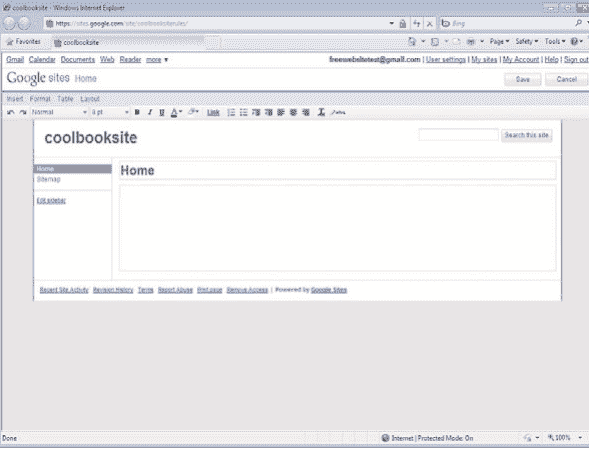

### 图 9.6

*Google Sites 页面编辑器。*

4. 如果您想更改网页标题，请点击标题区域并编辑文本。

5. 要在网页正文中添加或编辑文本，请点击正文区域并输入文本。您可以使用文本格式化工具栏来设置字体类型、大小、**粗体**、*斜体*、下划线、颜色或高亮。您还可以使用此工具栏查看和编辑页面的超文本标记语言（HTML）。

## 第三部分 网站构建基础

6. 如果您想为网页添加一些特殊功能，请使用“Insert”（插入）下拉菜单。每个可用对象在不同情况下都很有用，因此请尽情尝试。您可以向网站添加以下内容：

- 图像
- 链接
- 目录
- 子页面列表
- 水平线
- Google AdSense 对象
- Google 日历对象
- Google 文档对象
- Google 地图对象
- Picasa 照片
- Picasa 网络幻灯片
- Google 演示文稿对象
- Google 电子表格对象
- Google 电子表格表单对象
- Google 视频对象（Google 视频或 YouTube 视频）
- 最近发布小工具
- 最近更新文件小工具
- 最近列表项小工具
- 文本框小工具
- 更多（点击查看最新的 Google 小工具）

7. 如果您想以文本格式化栏中未提供的方式格式化文本，请选择文本，然后使用“Format”（格式）下拉菜单。

8. 如果您想插入表格或编辑现有表格，请使用“Table”（表格）下拉菜单。

9. 如果您想更改页面布局，可以使用“Layout”（布局）下拉菜单选择单列或双列布局。

10. 完成后，点击“Save”（保存）按钮。您的页面现在将显示更改后的内容。

## 创建页面

您的 Google 站点从主页开始，但您可以随意添加更多页面。要添加新页面，请按照以下步骤操作：

1. 点击“Create Page”（创建页面）按钮，向您的 Google 站点添加一个新网页。这将打开“Create a New Page”（创建新页面）屏幕（见图 9.7）。

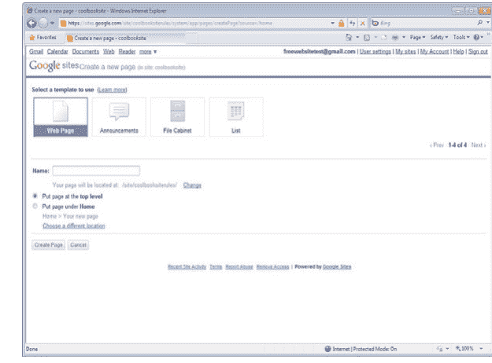

### 图 9.7

*创建新页面屏幕。*

2. 选择您希望添加的页面类型：Web Page（网页）、Announcements（公告）、File Cabinet（文件柜）或 List（列表）。

3. 在“Name”（名称）字段中，输入页面的标题。

4. 如果您希望该页面与主页处于同一层级，请选择“Put Page at the Top Level”（将页面置于顶级）。如果您希望新网页位于主页之下，请选择第二个选项。

5. 点击“Create Page”（创建页面）。这将添加该页面并以编辑模式打开它。

## 移动页面

随着你创建的页面越来越多，你可能需要移动页面。要移动页面，请执行以下操作：

1. 在“更多操作”菜单中，点击“移动”。“移动页面”屏幕将打开（见图 9.8）。你可以使用此屏幕将页面拖动到想要的位置。

2. 点击“移动”。

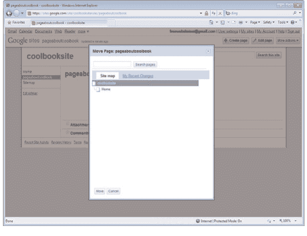

**图 9.8** “移动页面”屏幕。

## 删除页面

你可能创建了一个之后不再需要的页面。要删除页面，请执行以下操作：

1. 在“更多操作”菜单中，点击“删除”。Google 站点会确认你是否要删除该生抽页面。

2. 点击“删除页面”。该页面将被删除。

## 编辑页面设置

每个页面都有自己的设置。这些设置包括：在导航栏中显示页面、显示页面标题和指向其他页面的链接，以及允许评论。你还可以更改页面网址。要编辑页面设置，请按以下步骤操作：

1. 在“更多操作”菜单中，点击“页面设置”。“页面设置”屏幕将打开（见图 9.9）。

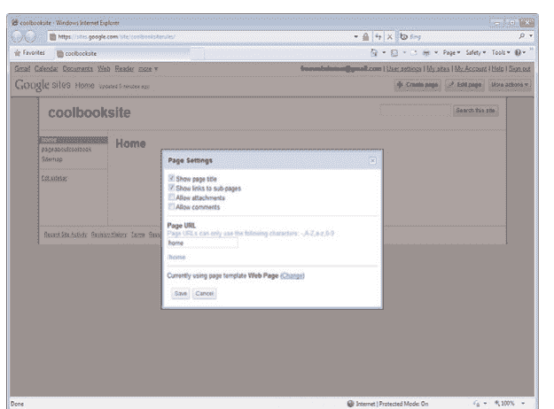

**图 9.9** “页面设置”屏幕。

2. 编辑你想要的设置。

3. 点击“保存”。

## 编辑站点设置

与每个页面类似，你可以更改许多 Google 站点设置。这些设置包括：

- 站点共享
- 外观
- 其他设置，例如你创建站点时设置的选项

你可以通过点击“更多操作”按钮并选择“管理站点”来访问所有这些设置。

## Google 站点的功能与限制

在决定坚持使用 Google 站点之前，你需要了解一些功能和限制。

### 功能

- 单击即可创建页面
- 无需 HTML
- 10 GB 存储空间
- 主题
- 页面共享

### 限制

- 无法使用域名
- 必须使用 Google 主题
- 结构有限
- 无法复制站点的部分

## Wetpaint

如果你想建立一个简单的社交网络或 Wiki，可以考虑 Wetpaint。该服务于 2005 年启动，专为各种乐队、电视节目、电影或名人创建粉丝网站而设计。本节介绍如何注册该服务以及编辑页面。

### 注册 Wetpaint

要使用 Wetpaint，你需要注册一个 Wetpaint 账户。从 Wetpaint 主页开始：

1. 打开浏览器并输入 `http://www.wetpaint.com/`。这将打开 Wetpaint 主页（见图 9.10）。

2. 点击页面顶部的“Go”按钮。这将带你进入“注册”页面（见图 9.11）。

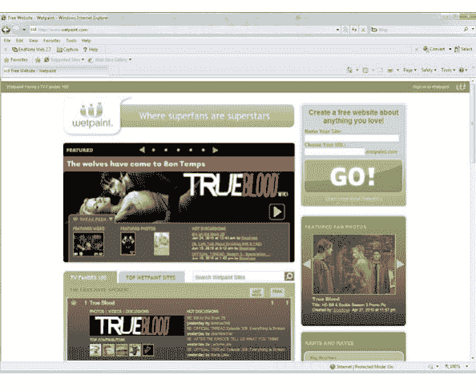

**图 9.10** Wetpaint 主页。

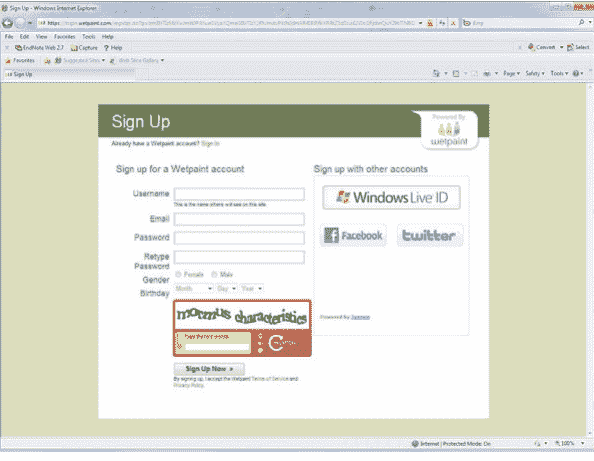

**图 9.11** “注册”页面。

3. 输入你的用户名、电子邮件、密码（两次）、性别、出生日期以及页面上显示的验证码。

4. 点击“立即注册”按钮。

### 在 Wetpaint 上创建站点

创建 Wetpaint 账户后，你就可以开始构建你的第一个 Wetpaint 站点了（见图 9.12）：

1. 输入你的站点名称、网址、描述和类别。

2. 选择谁可以查看你的站点。可以是任何人、专门加入你站点的用户，或仅站点创建者。

3. 点击“继续到第 2 步：有趣的部分”按钮。

4. 为你的网站选择一种样式，然后点击“继续到第 3 步”按钮。

5. 最后，输入图片中出现的文字以证明你是人类。

6. 站点创建完成后，点击“前往我的站点”按钮。

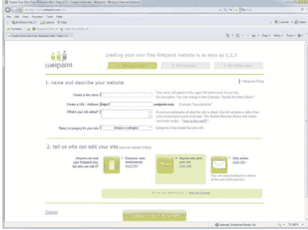

**图 9.12** 站点创建页面。

## 编辑页面

你可以单独编辑 Wetpaint 站点中的每个页面。你可以添加多种元素、输入和设置文本格式，或更改页面布局。要编辑页面，请按以下步骤操作：

1. 打开 `www.wetpaint.com`，并点击页面顶部的“我的 Wetpaint 站点”。选择你要编辑的站点。

2. 点击“Easy Edit”按钮。这将打开页面编辑工具（见图 9.13）。它看起来与你的页面一样，但所有文本都是可编辑的。使用此工具编辑页面上的文本，包括标题和正文。

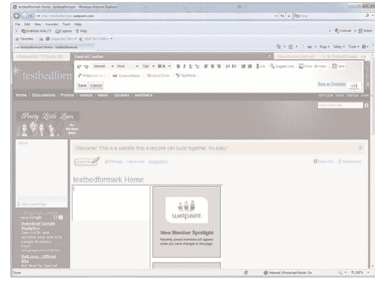

**图 9.13** Wetpaint 页面编辑器。

3. 完成后，点击“保存”按钮。你的页面现在会显示你所做的更改。

### Wetpaint 的功能与限制

在决定坚持使用 Wetpaint 之前，你应该了解一些功能和限制。

#### 功能

- 简洁优雅的界面
- 主题
- 照片

#### 限制

- 不允许使用 HTML
- 无法使用域名
- 必须使用 Wetpaint 主题
- 只能创建一个站点
- 无法复制站点的部分

## Netvibes

Netvibes 是一种不同类型的网页创建服务。它使你能够创建一个起始页面，其中包含指向你喜爱的资讯源、待办事项列表、天气、Facebook、Flickr、Craigslist、Digg、eBay 等的链接。它本质上将整个网络汇集到一个页面中。该服务还允许你对该页面进行设置并与其他人共享，使其成为团队项目主页。本节介绍如何设置你的 Netvibes 账户、运行起始向导、添加内容以及公开你的页面。

### 注册 Netvibes

要获得 Netvibes 的全部功能，你需要注册一个账户。这使 Netvibes 能够记住你所有的设置。要注册 Netvibes，请按照以下说明操作：

1. 打开浏览器并访问 `www.netvibes.com/`。这将打开默认的 Netvibes 起始页面（见图 9.14）。Netvibes 有一些出色的默认功能（如新闻、天气和股票市场信息）。

2. 点击右上角的“登录”。这将打开登录窗口。

3. 要创建新账户，点击“注册”。这将打开“注册”窗口（见图 9.15）。

4. 输入你的电子邮件和密码，然后确认密码。

5. 阅读（或不阅读）后，同意服务条款。


**图 9.14** Netvibes 起始页面。


**图 9.15** Netvibes “注册”页面。

6. 点击“注册”。一封确认电子邮件将发送给你以验证你的电子邮件地址。按照说明完成 Netvibes 账户的设置。

### 个性化你的 Netvibes 页面

确认电子邮件地址后，你将进入 Netvibes 主页。该页面已经为你加载了一些有用的小部件。按照以下步骤个性化你的页面：

1. 点击屏幕左上角选项卡中“常规”旁边的“编辑”。这使你可以选择所用小部件的布局方式。当你对页面外观满意时，点击右侧的红色 X 关闭编辑视图。

2. 你现在可以使用位于小部件右上角的“编辑”链接来编辑任何单个部件。

3. 你可以通过点击小部件右上角的（X）按钮删除任何不需要的小部件。

4. 要添加新的小部件，点击屏幕左上方的绿色“添加内容”按钮。然后选择你想要的选项，并点击下方的（添加）按钮。完成添加小部件后，点击右侧的红色（X）按钮。

# 第 10 章

## HTML 101

HTML 是网络的通用语言。它是互联网上每个网页的编程语言。要在网上做任何事情，你需要对 HTML 的工作原理以及其他人如何使用它有扎实的了解。

**本章内容**

- HTML 的结构
- 常见的 HTML 标签
- 免费 HTML 编辑器
- 资源
- 最新版本的 HTML

HTML 代表超文本标记语言（Hypertext Markup Language）。“超文本”意味着文档之间以及文档内部存在相互连接的链接。链接的页面使网络能够不断扩展并变得更加互联。标记语言使用标签来“标记”文本，以应用格式和结构。标签本质上是一个文本标记，表示某种特定格式的开始和结束。

HTML 于 1991 年由蒂姆·伯纳斯-李（Tim Berners-Lee）创建，他是位于瑞士的科学智库 CERN 的研究员。蒂姆希望创建一个简单的文档组织系统，既能保持简洁性又能够实现交叉引用。当其他人开始使用 HTML 时，它迅速发展，我们所知的网络由此诞生。

如果你从未接触过任何编程，你可能会认为仅在一章内学会 HTML 太难了（见图 10.1）。相反，如果你能理解基础并保持简洁，HTML 其实很容易。我的背景并非数学或工程。与数百万其他人一样，我是通过阅读和实践来学习 HTML 的。HTML 是一个学习事物的绝佳沙盒。


**图 10.1**

*一个复杂的 HTML 页面。*

本章涵盖 HTML 的工作原理基础、常用 HTML 标签以及 HTML 编辑器。所有这些都可以帮助你创建网页，并理解其他人创建的内容。

HTML 也处于不断的变化之中。因此，我添加了关于最新版本 HTML 的信息，以及它对初级 Web 开发者的意义。

## HTML 的结构

你第一次看到网页的底层代码时可能会感到困惑。为什么？因为如果不了解 HTML 的工作原理，就很难理解发生了什么。所以，搞清楚这一切的第一步是学习 HTML 的基本组成部分。

如前所述，HTML 是一种标记语言。你使用标签来“标记”文本。然后浏览器会解释这些标签，正确的格式和结构就会显示在网页上。Web 浏览器不会显示代码，而是根据你创建的 HTML 显示经过编码的内容。

### 标签的结构

标签是应用于文本块的文本标签。一个标签有三个部分：

- **开始标签**——标签的开始用 `<` 符号表示。随后是标签名称和 `>`。例如，`<bold>`。
- **受标签影响的文本**——标签内包含的任何内容都会应用格式或结构。
- **结束标签**——这标志着影响文本的标签结束。它由 `<` 和 `/` 表示关闭，接着是标签名称，然后是 `>`。例如，`</bold>`。

例如，看这段文本：

> The quick brown fox jumped over the lazy dog.

这只是普通文本。加上标签后，它看起来像这样：

> The `<bold>quick</bold>` brown fox jumped over the lazy dog.

在浏览器中查看时，文本变为：

> The **quick** brown fox jumped over the lazy dog.

标签可以相互嵌套。例如：

> The `<italics><bold>quick</bold>` brown fox`</italics>` jumped over the lazy dog.

产生的文本看起来像这样：

> The ***quick brown fox*** jumped over the lazy dog.

`</italics>` 标签应用于标签内的所有文本，包括粗体文本。

任何标签或一组标签都是如此。标签之间的内容会应用该标签的格式。

下一节介绍最常用的标签——它们的作用以及如何使用它们。


> **提示** 注意标签如何不会向显示的文本添加空格。就好像它们不存在一样。在创建 HTML 时要记住这一点。

## 常用 HTML 标签

熟悉一些常用的 HTML 标签很重要。以下列表包含这些常用的 HTML 标签，按类别组织。每个标签都附带有描述、代码示例以及适当的结果示例。

### HTML 结构标签

以下部分描述构成网页结构和框架的标签。

**HTML `<html></html>`**

所有其他 HTML 标签必须包含在此标签中。这应该是文档中的第一个和最后一个标签。

**头部 `<head></head>`**

此标签定义 HTML 文档头部的结构。它不会出现在浏览器中，但包含标题信息、脚本和其他格式信息。

**标题 `<title></title>`**

这是网页标题。此文本出现在浏览器的标题栏上。它应该出现在头部标签内。

**主体 `<body></body>`**

这是网页的全部主体。你想在页面上显示的任何内容都必须包含在主体标签中。

**注释 `<!-- -->`**

此标签使你可以记录你的代码。记录是指在你的代码中添加注释，解释代码的不同部分做什么。开发人员使用它来与阅读其代码的人交流，或作为自己参考的笔记。这使得理解大型 HTML 文档变得容易。尽可能多地记录你的代码。注释永远不会显示在你的网页上，但有助于编辑过程。例如：

```html
<!-- This is the body section of my web page -->
```

**分区 `<div></div>`**

此标签为网页主体分配分区。然后你可以对这些分区应用格式。`<div>` 标签不会显示在浏览器中，但其效果会。用它来对网页的不同分区应用格式。有关 `<div>` 标签的更多信息，请参阅第 13 章"使用 HTML 构建网站"。

## 文本标签

这些标签影响页面主体中的文本。

> **注意** 不要在此标签中使用你电脑上任何旧的字体。它可能在你的机器上正常工作，但你不知道访问者的机器上有什么。如果字体不在访问者的机器上，浏览器会显示浏览器的默认字体，页面可能不会按你预期的那样显示。

**字体 `<font></font>`**

此标签定义标签内文本的大小、颜色和字体。每个具体细节都在开始标签中定义。例如，如果你想要 Arial 文本，大小为 8，红色，标签将是：

```html
<font face="arial" color="red" size="8"></font>
```

**粗体 `<bold></bold>`**

此标签将文本加粗。它使文本比普通文本更暗且稍大。

例如，`The <bold>quick</bold> brown fox.` 产生：

The **quick** brown fox.

**斜体 `<italic></italic>`**

此标签将文本斜体化。它使文本向右倾斜。

例如，`The <italic>quick</italic> brown fox.` 产生：

The *quick* brown fox.

**删除线 `<strike></strike>`**

此标签创建删除线文本，这意味着有一条线穿过文本。

例如，`The <strike>quick</strike> brown fox.` 产生：

The ~~quick~~ brown fox.

**下划线 `<u></u>`**

此标签为文本添加下划线。所有文本下方会出现一条线。

例如，`The <u>quick</u> brown fox.` 产生：

The <u>quick</u> brown fox.

**下标 `<sub></sub>`**

此标签创建出现在其他文本线下方的文本。

例如，`The <sub>quick</sub> brown fox.` 产生：

The <sub>quick</sub> brown fox.

**上标 `<sup></sup>`**

此标签使文本出现在其他文本线的上方。

例如，`The <sup>quick</sup> brown fox.` 产生：

The <sup>quick</sup> brown fox.

**居中 `<center></center>`**

此标签将文本居中。

例如，`<center>The quick brown fox.</center>` 产生：

The quick brown fox. (居中)

**标题 `<h#></h#>`（# 为 1–6 的数字）**

此标签将标签内的文本格式化为六种标题之一。这些标题以与典型文档中相同的方式组织你的文本。标题对应于层次级别；因此，H1 比 H2 更大更显眼，H2 比 H3 更显眼，依此类推。

例如，`<h1>The</h1><h2>quick</h2>brown<h3>fox.</h3>` 产生：

The quick brown fox.

**段落 `<p></p>`**

此标签定义一个段落，并包含段落的格式和间距。

例如，`<p>The quick brown fox jumps over the lazy dog.</p>` 产生：

The quick brown fox jumps over the lazy dog.

**水平线 `<hr>`**

一条水平线横跨页面。

例如，`The quick brown fox. <hr>` 产生：

The quick brown fox.

***

**换行 `<br>`**

此标签断开一行文本。你可能想使用它让文本按你想要的方式排列和断开，而不是让浏览器默认断开。

例如，`The quick<br>brown fox.` 产生：

The quick

brown fox.

**不间断空格 `&nbsp;`**

此标签在需要的地方插入一个空格。例如，`The&nbsp;quick` 在单词 *the* 和 *quick* 之间添加一个空格。

## 列表

HTML 中的列表有两种形式：无序列表（即，带项目符号）或有序列表（即，带数字）。你需要做的第一件事是将文本定义为列表，然后定义该列表的元素。每个元素都有自己的标签，与其他标签一起工作来创建列表。首先，我将介绍标签，然后展示如何将它们组合在一起。

**有序列表 `<ol></ol>`**

这将创建一个为每个列表项编号的列表。

**无序列表 `<ul></ul>`**

此标签会创建一个列表，其中每个列表项前都带有项目符号。

**列表项 `<li></li>`**

此标签定义一个列表项。

那么，列表的 HTML 代码看起来像这样：

```html
<ol>
<li>Item </li>
<li>Item </li>
<li>Item </li>
</ol>
<ul>
<li>Item </li>
<li>Item </li>
<li>Item </li>
</ul>
```

以下是列表在网页上的显示效果：

1. Item
2. Item
3. Item

■ Item  
■ Item  
■ Item

## 表格

表格类似于列表。它们组合多个标签来构成一个表格，就像多个标签构成一个列表一样。表格由行和列组成。表格也可以有一个作为标题行的页眉行。我将先描述表格标签，然后将它们组合在代码中。

**表格 `<table></table>`**

此标签包围表格并定义其边界。表格的属性（如边框、对齐方式和宽度）也在此标签内定义。

### 表格行 `<tr></tr>`

此标签定义表格中的一行。

### 表格单元格 `<td></td>`

此标签定义表格行中的每个单元格。

### 表格标题 `<th></th>`

此标签将一行定义为标题行，并以粗体显示。

因此，要创建一个包含三行两列的表格，HTML 代码应如下所示：

```html
<table border="1">
    <tr>
        <th>Cell 1</th>
        <th>Cell 2</th>
    </tr>
    <tr>
        <td>Cell 3</td>
        <td>Cell 4</td>
    </tr>
    <tr>
        <td>Cell 5</td>
        <td>Cell 6</td>
    </tr>
</table>
```

这将创建一个显示如下的表格：

| Cell 1 | Cell 2 |
| --- | --- |
| Cell 3 | Cell 4 |
| Cell 5 | Cell 6 |

> ### 极客术语
>
> **嵌套**
>
> 嵌套表格意味着一个表格包含在另一个表格的单元格内。这允许您创建页面格式化所需的复杂结构。

表格可以比这复杂得多。您可以将表格*嵌套*在表格中，以创建用于显示信息的复杂结构。

第三部分 网站构建基础 132

## 超链接

超链接在 HTML 中被定义为锚点和引用。锚点是超链接文本或图形，引用是您点击超链接后跳转的位置。文本和图形都可以作为锚点。引用可以位于 HTML 文档内部或指向另一个文档。超链接由以下部分组成：一个锚点标签、一个引用以及被超链接的文本或图像。例如：

```html
Follow this <a href="http://www.flickr.com">link</a>
```

这会为单词`link`创建一个指向`http://www.flickr.com`的超链接。要在新窗口中打开链接，请在锚点标签中添加`target`属性：

```html
Follow this <a href="http://www.flickr.com" target="_blank">link</a>
```

现在该链接会在新窗口中打开。在浏览器中，默认情况下超链接文本显示为蓝色并带下划线。如果是图像，则会显示蓝色边框。当您将鼠标悬停在超链接上时，光标会从箭头变为小手形状。

## 图像

图像本身不会出现在 HTML 代码中。出现的是对文件的引用。这些引用可能位于本地 Web 服务器或网络上的其他位置。例如：

```html

```

如果文件与 HTML 文件在同一目录中，这将显示图像文件`angry.gif`。

## 免费 HTML 编辑器

现在您已经了解了 HTML 的基础知识，您将想要开始创建和编辑 HTML 代码。您可以使用许多免费的 HTML 编辑器，它们分为两类：文本编辑器和 WYSIWYG（所见即所得）编辑器。文本编辑器直接编辑 HTML 代码；WYSIWYG 编辑器为您构建 HTML 代码。

> **提示** 不要引用硬盘驱动器上的文件。当您使用 WYSIWYG 编辑器时，有时会发生这种情况。始终相对于您所在的页面来引用图像文件位置。如果图像在同一目录中，只需使用文件名。请注意您所做的引用。引用是常见的错误来源，请仔细检查。


## 文本编辑器

文本编辑器使您能够直接在 HTML 代码中工作。这使您能够轻松搜索文本文档，准确找到所需内容，并快速进行编辑。使用 WYSIWYG 编辑器时，您想要更改的代码可能很难找到。我更喜欢使用文本编辑器编辑 HTML 代码。以下是一些常见的文本编辑器：

- **Notepad** (Windows) — 随 Windows 操作系统标准附带。
- **Notepad ++** (Windows, Linux) — `http://notepad-plus.sourceforge.net/uk/site.htm`。目前最好的文本编辑器。
- **TextWrangler** (Mac) — `www.barebones.com/products/textwrangler/index.shtml` (见图 10.2)。一款不错的 Mac 文本编辑器。


**图 10.2**

*一款优秀的 Mac 文本编辑器。*

- **XEmacs** (Windows, Linux, UNIX) — `www.xemacs.org/index.html`。另一款优秀的文本编辑器。

## WYSIWYG 编辑器

这些编辑器以图形方式构建网页，并为您生成代码。您按照在浏览器中看到的方式构建网页，而 WYSIWYG 浏览器会为您创建代码。这些编辑器使得创建复杂表格等任务变得极其简单。不幸的是，它们也可能在您的 HTML 中添加不必要的标签，但它们非常适合初学者。以下是一些主要的编辑器：

- **KompoZer** (Windows, Mac, Linux) — `www.kompozer.net` (见图 10.3)


**图 10.3**

*一款开源的图形化 HTML 编辑器。*

- **Quanta Plus** (Windows, Linux) — `http://quanta.kdewebdev.org`
- **Bluefish** (Windows, Mac, Linux) — `http://bluefish.openoffice.nl`
- **OpenLaszlo** (Windows, Mac, Linux) — `www.openlaszlo.org`

## 资源

本章仅涉及 HTML 的皮毛。还有更多内容需要学习，您学得越多，就能在网站上实现更多功能。

以下是一些帮助您进一步理解 HTML 的资源：

- **W3Schools (`www.w3schools.com`)** — 可能是互联网上最好、最简洁的 HTML 教学工具（见图 10.4）。请收藏此网站，因为您会经常访问它。


**图 10.4**

*W3Schools 是互联网上最好的 HTML 资源之一。*

- **Webmonkey HTML Cheat Sheet (`www.webmonkey.com/2010/02/html_cheatsheet`)** — 这是另一个适合初学者的优秀资源。
- **If you know nothing about HTML, this is where you start (`www.htmlgoodies.com/primers/html/article.php/3478131`)** — 标题说明了一切。这是一个优秀的 HTML 入门教程集合。
- **HTML Basic Tutor (`www.htmlbasictutor.ca`)** — 这个网站就像拥有您自己的 HTML 家教一样。

## HTML 的最新版本

就像软件程序一样，HTML 也有不同的版本，最新版本正在开发中，即 HTML5。每个新版本都会引入新的功能、标签和浏览器兼容性问题。HTML5 仍在开发中，但即使是最新的 Web 开发人员也应该了解其动态。HTML5 的目标是更好地将多媒体集成到网站中。在将 HTML5 内容添加到您的网站之前，请确保在尽可能多的浏览器上进行测试。为了帮助您，我已在附录 A“最常用 HTML 标签列表”中添加了一些新标签。我还在下方添加了一些 HTML5 参考资料。

- **W3C HTML5 Reference** (`http://dev.w3.org/html5/html-author`) — 这是关于 HTML5 最完整、最新的信息。
- **HTML5 Unleashed: Tips, Tricks, and Techniques** (`www.w3avenue.com/2010/05/07/html5-unleashed-tips-tricks-and-techniques`) — 用通俗语言很好地概述了 HTML5 功能。
- **HTML5 Quick Reference Guide** (`http://veign.com/reference/html5-guide.php`) — 面向 HTML5 开发者的快速参考指南。
- **THE HTML5 TEST** (`http://html5test.com/`) — 使用此站点测试您浏览器的 HTML5 能力。

它详细列出了所有新的 HTML5 功能，并告知您的浏览器是否能够使用它们。

> **注意** HTML5 是全新的软件，随时可能发生变化。使用其任何代码时请务必小心。

## 第 11 章：使用图像

信不信由你，在 1993 年之前，互联网主要是基于文本的。对你们中的一些人来说，这似乎几乎难以置信。从那时起，互联网已经变成了一个充满色彩和生动图像的视觉化场所。

本章涵盖不同类型的图像、您可以配合使用的程序、如何在网页上使用它们以及在哪里找到它们。

在我们开始之前，您应该理解一些术语：

- **像素** — 就像构成物质的原子一样，像素构成了数字图像。像素是数字图像中最小的信息单元，且只有一种颜色。每张图像都可以描述为具有特定高度像素数和特定宽度像素数（见图 11.1）。


**图 11.1**

*这张图像高 150 像素，宽 300 像素。*

- **分辨率**——图像的分辨率是指每平方英寸所包含的像素数量。分辨率越高，文件大小就越大。最常见的分辨率是每英寸 72 像素。
- **RGB**——红、绿、蓝。这是一种通过按特定比例混合红、绿、蓝三种颜色来创建颜色的模式。三种颜色的值各为 0 到 255。使用这种方法，你可以获得超过 1600 万种颜色。有关颜色的更多信息，请参阅第 4 章"设计你的网站"。
- **十六进制**——一种将三位数的 RGB 数字转换为 HTML 能够识别的两位数数字的方法。

## Web 图形

网上使用的图像文件类型几乎和网页的数量一样多。本节介绍排名前三的文件格式。除非你在做一些完全非同寻常的事情，否则你应该坚持使用这些格式。

## 有损和无损压缩

我建议你始终尽量保持文件体积小。一个包含 100 个单词的 HTML 文件可以小到 8,192 字节，而一个 100 像素 × 100 像素（大约邮票大小）的小图像文件可以几乎达到这个字节数的一半。图像压缩试图在保持质量的同时使文件尽可能小。有损压缩会稍微降低图像质量以减小文件大小。无损压缩不会降低质量，因此通常文件大小的缩减不如有损压缩那么明显。以下是最常见的文件类型列表：


# 图像格式

- **图形交换格式（.gif）**——这是一种在网页上常见的无损文件格式。这些文件最多只能保存256种颜色，因此它更适合用于图形而非照片（参见图11.2）。你可以将`.gif`文件中的某一种颜色设为透明（背景可以透过来），并且你可以制作`.gif`动画文件。动画`.gif`将在本章后面介绍。

- **便携式网络图形（.png）**——这种无损图像格式正在取代`.gif`，变得在网页上越来越常见。和`.gif`一样，`.png`可以是透明的。它的文件大小可能比`.gif`或`.jpg`更大。

- **联合图像专家小组（.jpg或.jpeg）**——这是一种有损文件格式，但这并不意味着它不好。它只是使用数学方法来确定模式，以便你可以减小图像大小。不过，更多的压缩意味着更低的图像质量。`.jpg`可以一次显示数百万种颜色。这种格式主要用于照片。它是网页上最常用的文件格式。我在圣安东尼奥拍摄的一张照片，如图11.3所示，就是保存为`.jpg`格式的图像示例。


## 图像标签

要将图像添加到网页中，请使用HTML标签`IMG`。此标签有多个属性。属性是定义图像显示方式的东西。下表列出了一些比较常用的属性。

| 属性 | 描述 | 备注 | 示例 |
|------|------|------|------|
| `src` | 一个必需属性，指定要显示的图像的文件位置和完整名称。 | 这需要是相对于服务器上HTML文件的文件确切位置。 | `` |
| `alt` | 图像无法显示时显示的替代文本。 | | `` |
| `align` | 指定图像相对于文本的放置方式。值可以是`top`、`bottom`、`middle`、`left`和`right`。 | 使文本环绕图像。 | `` |
| `border` | 图像周围边框的像素宽度。 | 边框始终为黑色。 | `` |
| `height` | 将图像的高度更改为指定的像素数或原始图像的百分比。 | 这会将图像拉伸或缩小到指定的像素大小，而不按比例缩放宽度，因此图像可能会变形。尽可能不要使用。 | `` |
| `width` | 将图像的宽度更改为指定的像素数或原始图像的百分比。 | 这会将图像拉伸或缩小到指定的像素大小，而不按比例缩放高度，因此图像可能会变形。尽可能不要使用。 | `` |
| `ismap` | 将图像指定为服务器端图像映射。 | 有关图像映射的更多信息，请参阅本章“图像映射”部分。 | |
| `usemap` | 将图像指定为客户端图像映射。 | 有关图像映射的更多信息，请参阅本章“图像映射”部分。 | |
| `longdesc` | 指向包含图像长描述的URL的链接。 | 很少使用。 | `` |
| `hspace` | 定义图像周围水平方向的间距（以像素为单位）。 | 这会在图像两侧添加边距空间。 | `` |
| `vspace` | 定义图像周围垂直方向的间距（以像素为单位）。 | 这会在图像上下添加边距空间。 | `` |

查看不同网站上的图像（通过查看网站源代码），看看它们如何使用图像标签。以下是一个来自新闻网站的图像标签示例：

```

```

# 背景图像

你可以将图像用作整个页面的背景。背景图像使用`BODY`标签和`background`属性。尽管该属性刚推出时非常流行，但现在被认为是过时或俗气的。如果你要使用背景图像，请使用CSS。有关使用层叠样式表（CSS）的更多信息，请参阅第13章“使用HTML构建网站”。

# 图像映射

图像映射是一种HTML结构，允许你在图像上指定与超链接相关联的坐标。图像映射可以是服务器端的（即服务器上存有用于辅助图像映射的文件），也可以是客户端的（图像映射的所有信息都存储在HTML文件中）。

客户端图像映射使用HTML代码中的`MAP`和`AREA`标签来定义点击图像特定区域时执行的操作。

你甚至可以在网上找到帮助构建图像映射的工具。在线图像映射生成器（www.maschek.hu/imagemap/imgmap），如图11.4所示，可以让你轻松定义客户端图像映射并为你生成代码。

# 动画GIF

动画`gif`是保存在一个较大的`.gif`文件中的一系列`.gif`文件，在加载到网页浏览器时会播放动画。请尽量少用甚至不用，因为它们可能是很大的文件，会减慢页面的加载时间，而且被认为是俗气的吸引注意力的手段。如果你需要添加动画`.gif`，可以使用免费的在线动画`.gif`创建工具，如gickr（http://gickr.com/）。


图11.4

在线图像映射编辑器。

# 优化图像

正如我之前所说的，你的网站应该使用文件体积最小的最佳图像。归根结底，这是一种权衡。有时候，拥有数百万种颜色的高分辨率照片能让你的网站看起来更出色、更壮观，但有时候拥有尽可能快的加载速度更为重要。

# 调整图像大小

不要在HTML中调整图像大小。前面提到的`height`和`width`标签永远不应该使用。如果你使用这些属性来更改图像大小，整个原始图像会被加载，然后再被调整大小，因此使用这些属性没有任何好处。

# 何时使用不同的文件类型

如前所述，尽可能使用最高级别的压缩和最少的颜色数量。照片应该是`.jpg`格式，图形应该是`.gif`格式。

## 切割图像

较大的图像可以切割成较小的图像，以便更快地加载。当大面积中某些部分不是设计的核心时，这当然很有效。当你切割图像时，请确保图像在完全加载后能对齐。

## 查找图像

在网上查找图像时，你可能会像走进糖果店的孩子一样兴奋。找到图像当然很容易，但在未获得图像所有者许可的情况下使用它们既不合法也不道德。人们不断将图像上传到网页上，却没有意识到有人会在未经询问的情况下拿走这些图像。让我明确一点：使用你未获得许可的图像是违法的。

## 免费图像

有一些网站提供免费图像。这很好，因为你可以免费使用这些图像并获得所有者许可。问题在于，它们通常不是最好的图像，而且可能出现在其他网站上。如果你打算使用免费图像，你需要花不少功夫才能找到你想要的图像，但这个价格是无可比拟的。

使用这些网站上的图像时，记得阅读所有规则和细则以保护自己。以下是一些较好的免费图像网站：

- **知识共享**（http://search.creativecommons.org）——知识共享是一个致力于改变版权和所有权的组织。这个网站让你可以搜索知识共享许可的内容。

- **Kave Wall**（www.kavewall.com）——一个提供免费背景和纹理的好网站。

- **freestockphotography**（www.adigitaldreamer.com/gallery/index.php）——免费且免版税的图像。

- **visipix.com**（http://visipix.dynalias.com/index_hidden.htm）——具有免费版权的高分辨率图像，可用于个人和商业用途。

## 他人的图像

如果你在网上找到一张你想使用的图像，请联系图像的所有者，说明你是谁、你想使用哪张图像、什么

## 使用您自己的图片

为网站寻找图片的一个解决方案是拍摄自己的照片或制作自己的图形。这当然更容易让您为图片创作者署名，但正如我之前所说，有人可能会盗用您的图片。如果图片对您很重要，请小心放置它们的位置。

# 第12章

# 处理多媒体

众所周知，网络远不止文本和图片；它还是多媒体。多媒体是多种*数字化*媒体形式的组合，包括视频和音频文件。例如，乐队网站上的一首歌曲和一部独立电影的预告片（见图12.1）都是多媒体形式。使用得当，多媒体能提升用户体验。使用不当，多媒体会毁掉一个网站。本章将向您展示如何为网站准备多媒体对象。

处理多媒体文件时，一个重要的考虑因素是文件大小。多媒体文件通常很大，在保持文件体积小和维持高质量之间存在着持续的博弈。尽管宽带接入已变得普遍，但仍有大量用户使用较慢的互联网连接。不要假设所有人都能闪电般快速地下载您的大电影文件。

- 数字音频文件
- 数字视频文件

# 网站构建基础


另一个考虑因素是媒体文件可能特定于某些操作系统。如果网页试图播放一个在大多数操作系统上都无法运行的文件，只会惹恼部分访客。在做选择时，请确保考虑不同的操作系统，并选择能在尽可能多的操作系统上运行的文件类型。

> **数字化的**
> 任何用于网络的多媒体都需要经过数字化处理，这意味着它需要以计算机能理解的文件格式存储在计算机中。

此外，并非所有访问您网站的访客都拥有能有效使用多媒体的硬件。他们可能没有扬声器或能有效播放所有多媒体的显卡。不要将这些用户排除在外。让多媒体成为您网站的增强功能，而不是必需品。

最后，多媒体文件可以是下载的或流式传输的。下载的多媒体文件会被传输到计算机上，然后由媒体播放器播放。流式媒体文件则在下载的同时播放，通常是通过浏览器。您使用哪种方式取决于多媒体文件的大小和内容。

本章涵盖了您可以在网页中使用的多媒体对象。包括如何为网站创建、数字化、上传、编辑和使用多媒体对象。在第21章“构建多媒体网站”中，这些元素将被整合到一个网站上。

## 数字音频文件

正确使用音频可以提升网站的氛围。恰当放置的一段音频能吸引您的受众，将他们带入网络体验。糟糕的音频则适得其反，甚至更糟。如果音频太响或具有侵入性，会让访客反感。如果音频重复乏味或与网站内容不相关、不合逻辑，则会惹恼您的访客，而非欢迎他们。

有些人使用音频为页面添加音乐（如配乐），但如今网络上音频最常见的用途是播客。播客本质上是创建不同主题的音频节目并在网络上分发。第21章将介绍如何在您的页面中添加播客。

本节讨论可用的音频文件类型、如何播放它们以及如何将它们数字化。

## 音频格式

如前所述，音频文件有多种不同类型。这些文件类型适用于某些操作系统，但不适用于其他系统。您希望的是在尽可能多的操作系统上运行的、尽可能小的文件。与图形文件类似，音频文件可以应用不同类型的压缩。此外，音频文件可以有不同级别的音频质量。有关文件压缩的更多信息，请参阅第11章“处理图像”。以下是最常见的文件类型：

- `.wav`——这是Windows默认的音频文件类型。尽管它是Windows的默认格式，但您可以在大多数操作系统上使用它。它是未压缩的，因此可能导致文件体积较大，但它保持了卓越的音质。

- `.mp3`——这是目前最常见的文件格式。它几乎可以在任何连接到互联网的计算机上运行，并且是压缩的（因此文件体积小），同时能产生高质量的输出。

- `.wma`——Windows Media Audio。这种专有的Windows格式质量高且压缩性好，但并非在所有系统上都能播放。

这绝不是一份详尽的列表，但您遇到并想使用的大多数文件都将是这些格式。如果您选择其他格式，请务必在使用前研究其优点和局限性。

您可以在 www.fileinfo.net/filetypes/audio 找到更全面的音频文件格式列表。

## 音频播放器

一旦您选择了要使用的音频格式，就需要在您的计算机上安装一个播放器。播放器是您机器上的一段软件（可能内置于浏览器中），用于播放音频文件。现在大多数操作系统都内置了音频播放器，但一些开源免费音频播放器具有一些不同的特性：

- Songbird (http://getsongbird.com/)——这款高质量的开源音频播放器使用的是运行Firefox浏览器的相同软件（图12.2）。


图12.2

Songbird是一款出色的音乐播放器。

- Winamp (www.winamp.com/)——这款功能齐全的媒体播放器拥有强大的开发者社区和海量的功能。

## 音频数字化

要开始为网站使用音频，您需要将一些音频数字化。您可以通过多种方式完成此操作：

> 注意 显然，关于音频文件及其所有者存在版权法规。这里有一个简单的规则：不要在您的网站上抓取并使用您不拥有版权的音乐。除非您是艾尔顿·约翰，否则不要使用他的音乐。

- **自行录制**——通过将麦克风或乐器连接到计算机，您可以录制自己的声音文件并在网站上使用。

- **抓取CD**——大多数音频和媒体播放器允许您“抓取”CD。这意味着您将CD中的音频提取到计算机上。

- **使用免版税音乐**——免版税音频有不同的来源，既可以是网络，也可以是CD。免版税音频可以免费用于任何方式。在网上搜索您想要的免版税音频类型。

## 音频编辑

在将音频数字化后，您可能需要修剪开头或结尾，清理一些噪音，或添加一些效果。为此，您需要一个音频编辑程序。当然，市面上有许多昂贵的高端音频编辑器，但也有一些是免费且开源的。其中一个编辑器是Audacity (http://audacity.sourceforge.net/)。它是最受欢迎的开源音频录制和编辑器。它功能丰富，可在Windows、Mac和Linux上运行（图12.3）。

编辑好音频文件后，您需要将其保存为最适合您目的的格式。有关如何在网页上使用音频文件的说明，请参阅第21章。


图12.3

*Audacity是多媒体网站开发者们的最爱。*

## 音频资源

网络上充满了极其有用的音频资源。音频专家们拥抱技术，并乐于分享他们的知识和技能。以下是一些有用的链接：

- 如何为网络录制音频 (www.j-learning.org/present_it/page/how_to_record_audio_for_the_web/)——关于如何为网络录制音频的良好概述。

- 播客录制问题 (www.jellycast.com/help-recording.html)——关于播客的优秀入门介绍。

- 用简单的英语解释播客 (http://commoncraft.com/podcasting)——一个描述播客基础知识的精彩视频。

## 数字视频文件

如今，似乎每个人都在制作视频播客。它们现在在网络上无处不在。除此之外，人们还开始拍摄自己、朋友和宠物的视频——这让我们所有人都感到有趣——并将这些视频发布到网络上。

过去，拍摄和编辑影片的过程非常复杂。但现在不同了。如今人们可以录制高清数字视频，使用专业级工具进行编辑，并将其发布在YouTube上供数百万人观看。与音频一样，视频也有其自身独特的问题——比如质量差和加载时间长。在第21章，我将介绍如何为你的页面添加视频。

本节将介绍可用的视频文件类型、如何播放它们以及如何将其数字化。

## 视频格式

与音频类似，视频也有多种格式，你选择的格式会影响文件大小和输出质量。没有人愿意观看一个模糊、卡顿的小视频，也不想因为文件巨大而等待15分钟才观看你制作的视频。选择正确的文件类型至关重要。以下是一些最常见的视频文件类型：

- `.avi`—一种常见的视频格式，可用于Windows。它可以在压缩时不会损失太多质量。

- `.mov`—由苹果公司创建的QuickTime电影格式。标准的（免费的）QuickTime播放器可用于在Mac或Windows上播放这些高度压缩的文件。

- `.mpeg`—一种与操作系统无关的视频格式，提供较小的文件大小和出色的视频质量。

- `.wmv`—一种Windows视频格式，正变得越来越普遍，且压缩效果极佳。

请记住，你应该使用对大多数访客友好的文件格式。如果选择其他格式，请务必在使用前研究其优点和局限性。

如需更全面的视频文件格式列表，请访问 www.fileinfo.net/filetypes/video。

## 视频播放器

如今大多数操作系统都内置了视频播放器。Windows Vista 有 Media Center，Mac 有 iTunes。你可能还想尝试一些具有不同功能的开源视频播放器：

- VideoLAN (www.videolan.org/) —— 一个跨平台的开源视频播放器，可播放多种视频格式（见图12.4）。


**图 12.4**

*可在此处下载 VideoLAN。*

- **Miro (www.getmiro.com/)** —— 这是一个开源媒体播放器，可播放视频文件，并拥有数千个可供观看的频道内容，就像你的电视机一样。

- **Kaltura (http://corp.kaltura.com/technology/video_player)** —— 这是一个很酷的工具，不仅可以播放视频，还允许你对其进行注释并与他人分享这些注释。

> **极客术语**
> **跨平台 (cross-platform)**
> 跨平台意味着它可以在多个操作系统（操作系统有时称为“平台”）上运行。因此，如果一个程序可以在 Windows 和 Mac 上运行，它就是跨平台的。

## 视频数字化

如今，将视频数字化变得很容易。过去需要数月时间和大量金钱的工作，现在相对便宜且只需几分钟。视频数字化背后的技术已经取得了长足进步。以下是将数字化视频传输到计算机上的一些方法：

**使用数码摄像机——** 如今，购买一台可以直接在*SD卡*等数字媒体上录制的摄像机既便宜又方便。

**录制视频并导入计算机——** 如今大多数视频采集卡都配有音频和视频输入，以帮助你将视频数字化。

**使用网络摄像头——** 如今你可以购买直接插入计算机的摄像头，并在录制的同时进行数字化。


**将模拟视频数字化**——在摄像机上录制并存储在磁带上的视频很可能是模拟内容。要捕获这些数据，请使用模拟转换器，如`Dazzle` (www.pinnaclesys.com/PublicSite/us/Products/Consumer+Products/Dazzle/)。

> **极客术语**

> **SD卡**

> `SD卡`是一种小型的存储介质磁盘，用于存储数据，包括图片和视频。如今大多数计算机都配有`SD卡`读卡器，因此你可以将数据从相机传输到另一台计算机。

> **注意** 视频会占用大量的磁盘空间，因此你可能需要考虑购买外置硬盘来扩展存储容量。

## 视频编辑

如果你对影片或视频有所了解，就会知道使用原始视频片段从来不是明智之举。你需要添加标题、重新排列镜头、添加音乐并检查音频。市面上有很多昂贵的视频编辑器，但对于免费就能获得的东西，你永远不应付费。以下是一些免费的开源视频编辑器：

- **Cinefx:Jahshaka** (http://cinefx.org/) —— 这是一个跨平台（Mac、Windows、Linux）的视频编辑器，提供编辑、特效和音频集成功能（见图12.5）。

- **Avidemux** (www.avidemux.org/) —— 这是一个简单的跨平台视频编辑软件。`Avidemux`的功能比`Jahshaka`少，但更易于使用。


**图 12.5**

*使用`Cinefx:Jahshaka`编辑视频。*

如果你想尝试新事物，`YouTube`现在提供了一个简单的视频编辑器 (www.youtube.com/editor)。该网站允许你通过简单的拖放界面来组合片段和添加音频。在使用此页面之前，我会备份我的所有多媒体文件；不过，这个网站很有趣且易于使用。希望在不久的将来，我们能看到该产品提供更多功能。

编辑好视频文件后，你需要将其保存为最适合你用途的格式。

## 视频托管网站

当你的视频准备好后，你可以使用视频托管网站来分享它。这些网站在过去几年中如雨后春笋般涌现，并已成为互联网上最受欢迎的网站之一。以下是几个最好的视频分享网站：

- **YouTube** (http://YouTube.com) —— 这是当今网络上最知名的视频托管网站。它使你能够上传视频、与他人分享并与观众交流。

- **Ustream.tv** (www.ustream.tv/) —— 一个让你分享视频或从你的计算机直播视频的网站（见图12.6）。

- **Vimeo** (http://vimeo.com/) —— 另一个让你与观众建立联系的视频分享网站。


**图 12.6** 你可以在`Ustream`上播放和直播视频。

## 视频资源

正如我所解释的，视频背后的技术已经变得更加简单易用，不再需要像过去那样多的技术知识。然而，仍然有一些东西需要学习，因此我建议你阅读相关主题的资料。你了解得越多，你的视频就越好。有许多网站提供了大量来自经验丰富的专业人士的视频技术信息。以下是一些供参考的网站：

- 视频文件与编辑教程——www.fluffbucket.com/othettutorials/video/format.htm

- 网络多媒体教程——www.w3schools.com/media/default.asp

- 网络视频教程——www.webvideozone.com/public/department22.cfm

---

## 第 13 章

## 使用 HTML 构建网站

既然你已经完成了网页的所有准备工作，现在就可以使用超文本标记语言 (`HTML`) 来构建网站了。

- 网页的工作原理

- 层叠样式表

- 脚本

- 使用模板

虽然如今只使用`HTML`来创建网站可能很少见，但这对于网站创建的基本功是一个很好的练习。学习这些基础知识有助于你了解如何编辑博客文章或家庭网站背后的`HTML`。使用`HTML`仍然是创建简单网页的最佳方式之一，理解其工作原理有助于你进行编辑以获得期望的结果。

本章介绍在`HTML`中创建网页和网站的一些基础知识。你将看到用`HTML`编码的页面背后的源代码。

> **注意** 在你开始使用`HTML`构建页面之前，你应该熟悉`HTML`的基础知识。本章假设你已经阅读了第 10 章，“HTML 101”。

- 网页的工作原理

- 层叠样式表

- 脚本

- 使用模板

---

## 网页的工作原理

互联网上的每个网页背后至少都有一些`HTML`。即使是使用`Flash`等技术的网站，其外部也包裹着一个`HTML`外壳。

要真正理解网络，你需要了解网页如何工作，页面由哪些部分组成，以及这些部分如何协同工作。

> ### 极客术语

> **外壳 (wrapper)**

> 外壳是围绕其他事物的东西。当你买一条巧克力棒时，它外面包裹着一层包装纸。`HTML`外壳的工作原理相同。它围绕着某些东西，例如`HTML`代码中的`Flash`对象，以便网页浏览器可以识别它。

## 页面文件

每个网页都是一个文件。它可能引用其他文件，但它仍然是一个单独的文件。网页只是包含`HTML`命令的文本文件。这个文件很小，这就是为什么它加载得如此之快。

## 扩展名

网页和大多数计算机文件一样，有扩展名。（有关扩展名的更多信息，请参见第 5 章，“收集你的工具”）。网页的扩展名是`.htm`或`.html`。两者都可以，但你应该为你的网站选择一个并坚持使用，这样可以让你更容易理清引用关系。当你创建超链接时，你需要使用正确的文件名和扩展名，因此坚持使用一个扩展名会更容易。

这些扩展名告诉网页浏览器该文件包含`HTML`，应显示为网页。

## 创建网页的工具

你可以使用几种不同类型的工具来创建`HTML`。这些包括文本编辑器和所见即所得 (`WYSIWYG`) 编辑器。大多数网站开发者会结合使用这些工具。例如，快速的页面修复通常只使用文本编辑器，而创建表格则最好使用`WYSIWYG`编辑器。理解每种编辑器提供的独特优势非常重要，这样你才能轻松决定哪种工具最适合你当前的工作。有关编辑器的更多信息，请参见第 10 章。

- 文本编辑器——文本编辑器是创建`HTML`文件最简单的工具。你所要做的就是输入`HTML`，保存它，然后你就...好了。在过去的几年里，文本编辑器已经变得更加复杂。例如，`Notepad++`有一个内置的`HTML`插件，它能为标签着色并进行一些文本格式化，使创建网页变得更加容易（参见图 13.1）。


**图 13.1**

在`Notepad++`中看到的网页。

- **所见即所得编辑器**——这类编辑器使你能够直接通过操作页面本身来创建网页，而无需费心处理`HTML`代码。你的屏幕显示效果与浏览器中看到的一致，编辑器会为你构建`HTML`。所见即所得编辑器（参见图 13.2）可以大大节省时间，但也可能导致页面包含专有标签或在所有浏览器中无法正确显示。

## 页面的组成部分

那么，我们来看看构成网页格式的标签和结构。理解页面的各个部分对于创建自己的网页以及从他人的网页代码中学习是极其宝贵的。本节涵盖这些基本标签以及几种`HTML`页面可以采用的其他结构方式（`<div>`标签、表格、框架和层）。

## 基本部分

每个网页都必须包含一些标签：

- `<html></html>`——此标签表明这是一个`HTML`文档。它至关重要，出现在`HTML`文档的开头和结尾。

- `<head></head>`——此标签用于`HTML`文件的头部部分。出现在`<head>`标签中的内容不会在你的网页主体中显示。

- `<title></title>`——此标签定义网站的标题，该标题显示在浏览器的标题栏中。`<title>`标签位于`<head>`标签内，因此其文本不会出现在网页主体中。

- `<body></body>`——这是你网页的主体部分。这里的所有内容都会在网页浏览器中显示。

因此，正确组合起来，`HTML`代码看起来像这样：

```html
<html>
    <head>
        <title>This is the title of this web page.</title>
    </head>
    <body>
        This is the body of the HTML document.
    </body>
</html>
```


**图 13.2**

*`KompoZer`是一个开源的所见即所得编辑器。*

## 使用注释为代码添加文档

一个好的网页开发者会为他的代码添加文档。在开发简单页面时，所有内容都很容易理清，但随着你的页面变得越来越复杂，你需要在代码中添加注释，以帮助你记住为什么做了某些事情。此外，如果你与其他人在网页上协作，注释可以让其他人在查看你的代码时（即使你不在场）了解你做了什么。要添加注释，请使用注释标签。注释标签采用以下形式：

```html
<!--This is a comment-->
```

这些文本永远不会在网页上显示，仅作为给网页开发者的注释。

## 表格

表格不仅对于存储信息有用，也是设计中的一种结构化工具。通常，表格会创建一个像这样的信息网格：

| 水果   | 销售额 |

|--------|--------|

| 苹果   | $15    |

| 橙子   | $10    |

不过，表格并不总是这么简单。一些网页开发者使用表格来构建他们的网页结构。事实上，表格对于正确设置网站上的元素间距可能至关重要。表格可以包含文本、图像和其他元素，并且可以相互嵌套。让我们看一些简单的例子。

首先，根据本章前面描述的网页结构（页眉、页脚、页脚和侧边栏），可以使用表格来创建一个网页。以下`HTML`代码生成了一个使用表格的简单网页：

```html
<html>
<head>
<title>Sample Page using Tables</title>
</head>
<body>
<table border=1 cellspacing=0 cellpadding=0>
<tr>
<td width=73 valign=top>
<br/>
</td>
<td width=168 valign=top>
<br/>Header
</td>
<td width=84 valign=top>
<br/>
</td>
</tr>
<tr>
<td width=73 valign=top>
<br/>Sidebar 1
</td>
<td width=168 valign=top>
<br/>Body
</td>
<td width=84 valign=top>
<br/>Sidebar 2
</td>
</tr>
<tr>
<td width=73 valign=top>
<br/>
</td>
<td width=168 valign=top>
<br/>Footer
</td>
<td width=84 valign=top>
<br/>
</td>
</tr>
</table>
</body>
</html>
```

这个表格生成了一个结构简单的网页（参见图 13.3）。


**图 13.3**

*一个使用简单表格构建结构的页面。*

如果你添加更多内容，同时保留初始的表格结构，你的内容就能保持在原位。嵌套表格就是一种实现方式。`HTML`允许你创建嵌套在其他表格内的表格。这些表格中的表格可以让你对内容有更大的控制权。因此，例如，在图 13.3 所示的页面中，你可以在大表格的正文部分内嵌套另一个表格，以在表格的正文部分内创建结构。

嵌套表格很难手动编码，真的应该留给`HTML`大师级表格专家来处理。你最好的选择是使用所见即所得编辑器来帮助你创建表格，这样你就不用费心去处理`HTML`代码了。

如果你足够勇敢，并想了解更多关于编码表格的知识，请参考以下网站：

- `W3Schools`——`HTML`表格，www.w3schools.com/html/html_tables.asp

- `HTML`代码教程——www.htmlcodetutorial.com/tables

- `Quackit.com`——`HTML`表格教程，www.quackit.com/html/html_table_tutorial.cfm

## `<div>`标签

一个常用于构建网页结构的标签是`<div>`。该标签充当你网页各部分的分割符。这些分割的部分可以应用特定的格式化，从而让你对细微的格式化问题有更大的控制权。例如，此代码使用`<div>`标签进行格式化：

```html
<html>
    <head>
        <title>Sample Page using DIV tags</title>
    </head>
    <body>
        <div style="text-align:center;">
            <h1>This is centered heading 1</h1>
            <p>This is a centered paragraph</p>
        </div>
    </body>
</html>
```

此代码将`<div>`标签内的所有文本（无论是标题还是普通文本）都与浏览器中心对齐。上述代码生成的网页如图 13.4 所示。


**图 13.4**

*这是使用`<div>`标签的代码所生成的网页。*

关于`<div>`标签最清晰、最完整的信息，请参考 www.w3schools.com/tags/tag_DIV.asp。

> **注意** 从理论上讲，框架听起来像是创建网页的理想方式；然而，事实证明它们存在问题，并且如今通常被认为是糟糕的设计和结构。请使用表格、`<div>`标签和层叠样式表（或`CSS`——接下来会详细讨论）来获得更好的效果。无论如何，你应该了解框架，因为其他开发者会使用它们，但请记住，有更好的方法来构建页面结构。

## 框架

框架是在页面上创建结构的另一种方式。框架本质上是在一个网页内显示多个网页。正如表格包含内容单元格一样，使用框架的网页也以类似方式划分，但每个单元格都充当一个独立的网页。

要使用框架，你需要创建几个网页，并在一个页面上使用一组标签来创建一个使用框架的网站。以下说明将指导你如何创建几个页面，然后创建一个`HTML`文档来同时显示它们。要创建使用框架的示例网页，请按照以下步骤操作：

1. 创建一个包含以下代码的网页：

```html
<html>
    <head>
        <title>Frame1</title>
    </head>
    <body>
        This is frame 1
    </body>
</html>
```

2. 将此页面另存为`frameone.html`。

3. 创建一个包含以下代码的网页：

```html
<html>
    <head>
        <title>Frame2</title>
    </head>
    <body>
        This is frame 2
    </body>
</html>
```

4. 将此页面另存为`frametwo.html`，并放在与`frameone.html`相同的位置。

5. 创建一个名为`frames.html`的网页，包含以下代码：

```html
<html>
    <frameset cols="90,*">
        <frame src="frameone.html" />
        <frame src="frametwo.html" />
    </frameset>
</html>
```

6. 将此页面另存为`frames.html`，并放在与`frameone.html`和`frametwo.html`相同的位置。

7. 在浏览器中查看`frames.html`（参见图 13.5）。


**图 13.5**

*这个示例网页使用了框架。*

## 层

`<layers>`标签可以创建网页元素的层次结构，这些元素可以动态显示并相互堆叠。可以将图层想象成你桌面上堆叠的图片和文件。顶层会遮盖下面的图层。虽然这听起来是个好主意，就像框架一样，但`<layers>`标签并非在所有浏览器中都能正常工作。这会导致问题，因为你无法确定访问你网站的用户会使用什么浏览器。

## 层叠样式表

`CSS`是一个包含`HTML`元素在引用它的任何网页上显示格式的文件。`CSS`是一个位于`Web`服务器上并包含这些信息的文件。`CSS`能让你的网站保持有序、一致，并且更易于维护。

“层叠”这个词可能会让你困惑，但它的意思只是样式表可以从一个地方控制整个文档的格式。使用`CSS`意味着你可以在详细级别上完全控制格式，或者你也可以让`CSS`来处理。例如，如果你想让所有正文文本都使用常规文本，你可以让`CSS`来定义；但如果你有一个单词需要设置为斜体，你仍然可以通过在文本周围使用标签来实现。格式化有优先级，这意味着最接近代码的格式优先于离代码最远的格式。以下列表展示了格式的优先级：

1. 浏览器默认设置

2. 外部样式表 (`CSS`)

3. 内部格式（在`<head>`标签内）

4. 特定应用的格式

因此，在上面的列表中，由于斜体是特定应用的（4），它会覆盖所有其他格式（1、2、3）。

## 样式表的格式

外部样式表（独立文件）或内部样式表（包含在`HTML`文件中）的格式是相同的。这可以放在独立的样式表中，也可以放在特定网页的`<head>`标签中。格式很简单：

```
tag {property: value}
```

这些是不同的部分：


- **标签 (Tag)** — 这是你要应用样式的 HTML 标签。
- **属性 (Property)** — 这是你想要应用到标签上的文本属性（文本颜色、大小或特殊格式）。
- **值 (Value)** — 这是你想要应用到标签上的属性值（红色、粗体、下划线）。

例如，如果你想让所有`<H1>`标签显示为红色：
- **标签 (Tag)** — `h1`
- **属性 (Property)** — `color`
- **值 (Value)** — `red`

将它们组合到代码中，看起来像这样：

```
h1 {color: red}
```

这会将你所有的`<H1>`标签更改为红色文本。如果你想将颜色改为蓝色，只需将引用更改为：

```
h1 {color: blue}
```

你所有的`<H1>`标题现在都是蓝色的了。

## 创建和链接样式表

本节介绍如何在 HTML 文档中创建文件和链接以使用 CSS。链接样式表使你能够从一个集中的地方控制多个文档的格式。如果你使用 CSS 控制多个页面的格式，并且想一次性更改所有页面，你只需更改 CSS 文件即可。

要链接到外部样式表，你需要在网页的`<head>`区域放置一个链接。该链接采用以下结构：

```
<link rel="stylesheet" type="text/css" href="site.css" />
```

在这种情况下，链接到一个（类型为`text/css`）名为`site.css`的文件，它就是你的 CSS 文件。

要练习创建 CSS，请按照以下步骤操作：

1. 创建一个包含以下代码的文本文件：

    ```
    h1 {
        color:red;
    }
    h2 {
        color:blue;
    }
    h3 {
        color:green;
    }
    ```

2. 将此页面保存为`site.css`。
3. 创建一个名为`example.html`的网页，包含以下代码：

    ```
    <html>
        <head>
            <title>CSS Example</title>
            <link rel="stylesheet" type="text/css" href="site.css" />
        </head>
        <body>
            <h1>This is heading 1.</h1>
            <h2>This is heading 2.</h2>
            <h3>This is heading 3.</h3>
        </body>
    </html>
    ```

4. 将此页面保存为`example.html`，与`site.css`放在同一位置。
5. 在浏览器中打开`example.html`，你将看到彩色文本。

## 关于 CSS 的更多信息

这只是 CSS 工作方式的一点入门。你可以在以下网站获取更多关于格式化和构建复杂网页的信息：
- **W3C School (`www.w3schools.com/css/default.asp`)** — 这是互联网上最好的教程网站之一。你不仅可以在这里找到出色的 CSS 教程，还有许多其他教程，包括 HTML 和 JavaScript。请收藏此网站！
- **The CSS Tutorial (`www.csstutorial.net/`)** — 这是一个清晰、简单的 CSS 教程。
- **CSS Tutorial (`www.echoecho.com/css.htm`)** — 这是一个编写良好且完整的 CSS 教程。

## 脚本

脚本是由几行文本组成的小段代码。脚本编写就是将这些编程代码添加到网站中。脚本比 HTML 标签更复杂。一些例子包括 JavaScript、VBScript 和 Perl。对某些人来说，脚本这个词可能听起来很吓人。你可能会对自己说：“我不会编程。” 在 HTML 中使用脚本绝非易事，但也并非不可能。网络上使用了许多不同的脚本语言（JavaScript、Perl、VBScript），它们可以让你的网页变得非常有趣和互动。在尝试编写脚本时，关键是做好研究、备份你的工作，并尽可能多地进行测试。

以下是一些互联网上的基本脚本资源：
- **tizag.com** — 该网站有许多面向初学者的教程。你可以学习 JavaScript、PHP、Perl、Ajax、ASP 和 VBScript 脚本。
- **Web-Wise-Wizard.com** — 该网站有一个易于理解的 JavaScript 教程。
- **webmonkey.com** — 如前所述，这是一个由 *Wired* 杂志提供的优秀初学者网站，拥有出色的脚本教程。

## 使用模板

既然你已经了解了如何用 HTML 创建网页，你可能会惊讶地发现一些网站提供免费的网站模板，页面完整且包含 CSS。我建议从这些模板开始，然后应用你在本章中学到的知识来增强你的网站。网络模板可以为你节省大量时间（和金钱），但它们也可能引入你不需要的复杂性，例如你不喜欢的格式或图像。

> **caution**: 永远不要为网站模板付费。互联网上有很多提供免费网站模板的网站。

## 第 14 章：他们是怎么做到的？

你可能在互联网上看到过一些令人难以置信的网站，并想知道网页开发者是如何创建网站的特定元素的。本章介绍当你在别人的网站上发现一些很酷的东西并想使用它时该怎么办。

本章不是关于窃取他人作品的指南。人们努力工作来构建令人惊叹的网站，窃取他们的作品并声称是自己的是不道德的。但是，有一些方法可以了解网页开发者是如何创建这些内容的，通过学习他们的方法，你可以创建自己的精彩内容。
- 查看其他网站的代码
- Firefox 浏览器开发附加组件
- 徽章
- 模板
- 开发者网络和站点

## 查看其他网站的代码

如果你发现一个网站上有你喜欢的东西，你总是可以查看该网站的代码。这没有任何违法或不道德之处。实际上，这就像打开汽车的引擎盖查看引擎是如何工作的一样。

互联网上的任何网站都允许你查看源代码。要查看页面的源代码，请按照以下步骤操作：

1. 在浏览器中打开一个页面。
2. 从“查看”菜单中，选择“页面源代码”。会出现一个类似于图 14.1 所示的页面。


**图 14.1** *网页的源代码视图。*

这将显示整个页面的文本，如果你想查看整个页面是如何构建的，这很有用。如果你只对页面的一部分感兴趣，本章后面介绍的工具可以帮助你。

## Firefox 浏览器开发附加组件

Firefox 浏览器的一个巨大优势是可以使用附加组件。有几种适用于网页开发的 Firefox 附加组件。其中 Firefox 浏览器已被网络开发社区所广泛采用，该社区已经并将继续为 Firefox 创建各种有趣的附加组件。这些附加组件能帮助你了解其他人的网站是如何运作的。

要了解附加组件的工作原理，请查看 Firefox 附加组件页面的网络开发部分（`https://addons.mozilla.org/en-US/firefox/browse/type:1/cat:4`），如图 14.2 所示。该页面列出了最新最优秀的网络开发附加组件。


**图 14.2** Firefox 附加组件网站的网络开发部分。

## 推荐的 Firefox 网络开发附加组件

以下是我推荐的一些 Firefox 附加组件。在你开发自己的网站时，它们会派上用场：
- **Web Developer（`https://addons.mozilla.org/en-US/firefox/addon/60`）**——这是我最喜欢的附加组件之一。由 Chris Pederick 开发，它为你的 Firefox 添加了许多有用的网络开发功能（见图 14.3）。这些功能包括访问有关网页、表单和图像的信息。该附加组件还具有多种验证功能和查看源代码选项。安装该插件后，你可以通过 Firefox 浏览器上出现的新工具栏和菜单来访问这些功能。


**图 14.3** Web Developer 附加组件的一个实用功能是高亮显示网页上的所有标题。

- **Page Validator（`https://addons.mozilla.org/en-US/firefox/addon/2250`）**——该附加组件根据万维网联盟（W3C）标准来验证你的网页。
- **Firebug（`https://addons.mozilla.org/en-US/firefox/addon/1843`）**——Firebug 将脚本查看器集成到你的 Firefox 窗口中（见图 14.4）。这使你可以在同一个浏览器中查看网页的同时查看其源代码。当你在代码中高亮显示元素时，它们也会在网页视图中高亮显示。你可以查看 HTML 代码和 CSS 代码，以及其他更高级的视图（脚本、DOM）。
- **IE Tab（`https://addons.mozilla.org/en-US/firefox/addon/1419`）**——该附加组件使你可以在 Firefox 浏览器中显示 Internet Explorer 选项卡（见图 14.5）。借助它，你可以在 Firefox 内部查看你的页面在两大主流浏览器中的显示效果。
- **Screengrab!（`https://addons.mozilla.org/en-US/firefox/addon/1146`）**——如果你想获取整个网页的截图，这个附加组件可以满足你的需求。

## # 第 14 章 他们是怎么做到的？ 175


**图 14.4** Firebug 使你可以同时查看脚本和页面。


**图 14.5** 使用此附加组件，你可以在 Firefox 中查看页面的 IE 版本。

176 第三部分 网站构建基础

- **ColorZilla（`https://addons.mozilla.org/en-US/firefox/addon/271`）**——设计网站时需要做的一件事是定义你的配色方案。如图 14.6 所示，ColorZilla 可以识别相互搭配且与你的信息内容相得益彰的颜色。ColorZilla 使你可以点击任何网页上的颜色项，获取其颜色信息及其互补色（与之搭配良好的颜色）。


**图 14.6** 使用 ColorZilla 左下角的吸管工具来确定这张图片的精确颜色。

- **YSlow（`https://addons.mozilla.org/en-US/firefox/addon/5369`）**——雅虎（Yahoo!）有一套高性能网站的规则（`http://developer.yahoo.com/performance/index.html#rules`）。该附加组件会根据这些标准来验证你的页面。
- **MeasureIt（`https://addons.mozilla.org/en-US/firefox/addon/539`）**——如果你曾好奇网页上某个元素的尺寸是多少，该附加组件可以让你以像素为单位查看元素的精确大小（见图 14.7）。
- **CSSViewer（`https://addons.mozilla.org/en-US/firefox/addon/2104`）**——该附加组件使你可以查看网站的层叠样式表。

## 推荐的 Chrome 网络开发附加组件

谷歌的 Chrome 浏览器在过去两年中日益流行。它速度快、可靠性强，且具有可扩展性。由于比 Firefox 起步较晚，Chrome 的附加组件相对较少。以下是一些较为优秀的：
- **Extensions for Web Developers（`https://chrome.google.com/extensions/featured/web_dev`）**——这是谷歌为网络开发人员提供的附加组件列表。其中虽然没有像 Firebug 那样出色的工具，但也有不少不错的选择。


**图 14.7** *使用 MeasureIt 可以查看此图像的尺寸。*

- **Speed Tracer（`https://chrome.google.com/extensions/detail/ognampngfcbddbfemdapfohjiobgbd`）**——该附加组件可以显示你的网站加载速度，包括 HTML、图像、脚本以及任何高级功能。
- **Chrome Editor（`https://chrome.google.com/extensions/detail/nglgdmkkiemejlladcdjegcllaieoe`）**——该附加组件允许你编辑超文本标记语言（HTML）脚本（包括 HTML 4 和 5）、Adobe Flash 对象以及你的层叠样式表（CSS）。

## # 推荐的 Safari 网络开发附加组件

苹果电脑是专业网络开发人员最常用的选择。Safari 浏览器预装在所有苹果操作系统中，因此你可能正在使用 Safari 作为主要的网络浏览器之一。以下是一些最佳附加组件：
- **Safari Dev Center（`http://developer.apple.com/safari/`）**——该页面提供苹果最新的 Safari 开发工具。它还包括有用的视频、示例代码和一个精巧的参考库。这无疑是获取苹果官方开发信息的首选之地。
- **Safari Reference Library（`http://developer.apple.com/safari/library/documentation/AppleApplications/Conceptual/Safari_Developer_Guide/1Introduction/Introduction.html`）**——这是上述参考库的开发者工具部分。它包含了使用 Safari 浏览器进行开发的清晰完整的信息。
- **Mac Developer Tips（`http://macdevelopertips.com/`）**——正如其名，这个博客为在 Mac 上工作的开发人员提供技巧、工具和代码。

## 徽章

当我听到“徽章”这个词时，我立刻想到了童子军。作为一名童子军，我曾以近乎狂热的执着努力获取尽可能多的徽章。网站也可以有徽章。网站徽章其实就是一段小型的代码和图形，放在你的网站上以展示与其他网站的关联。它就像一个小型的图形超链接。

网上的徽章种类繁多，数以千计。你可以从原始网站获取它们，也可以从徽章网站获取，例如 Zwahlen Design（`www.zwahlendesign.ch/en/node/19`），它不仅提供数百个徽章，还教你如何制作自己的徽章（见图 14.8）。


**图 14.8** Zwahlen Design 网站上的部分徽章。

你在网站上添加徽章是为了展示关联。所以如果你有一个 WordPress 网站或使用 MySQL，为这些工具添加相应的徽章是一件不错的事情。关于徽章有两点需要注意。首先，不要用花哨或过大的徽章让你的网站显得杂乱不堪。这就像佩戴夸张的珠宝一样。其次，不要用大量的徽章让你的访客应接不暇。网站上的徽章过多，就像房子上挂了太多的圣诞灯饰。不要成为那样的房子，也不要成为那样的网站。

在 Web 2.0 网站中，出现了一种实际包含内容的新型徽章。例如，如果你有一个 Twitter 账号，你可能想在你的网站上添加 Twitter 徽章（见图 14.9）。Twitter 是一个微博客网站，让你每次可以发布 140 个字符的内容。如果你有 Twitter 徽章，当你在 Twitter 上发布内容时，内容会自动显示在你的 Twitter 徽章上。


**图 14.9** 通过网站的这个部分（`http://twitter.com/badges`）添加 Twitter 徽章。

大多数 Web 2.0 网站都会告诉你如何添加这些更复杂的徽章。

## 模板

你也可以在互联网上找到网站和网页模板。这些是预先设计好的网页，你可以通过填充自己的内容来进行自定义。同样，互联网上有数以百万计的此类模板，涵盖了广泛的配色方案和内容类型。免费网页模板通常分为两类：通用模板和特定应用程序模板。

通用模板是指你可以使用任何网站创建工具来运行的网站或网页模板（见图 14.10）。它们通常仅包含基础的 HTML 文件和一些基础图形。寻找这些模板最简单的方法是在 Google 中搜索 **free web page template** 或 **free website template**。

> **caution** 在任何情况下，都不要为在互联网上找到的网页模板付费。首先，有数以百万计的免费模板可以下载并在你的站点上使用。其次，请相信你自己的创造力。通过修改现有的免费模板，你可能能够创造出完全符合你网站需求的页面。


**图 14.10** 该网站提供免费的网页模板。

如果你正在使用某个特定程序来创建网页，你可能希望在互联网上搜索适用于该程序的特定模板。只需在前一段提到的搜索词中加入你的应用程序名称，即可找到特定应用程序的模板。


> **注意**：在本书的很大一部分篇幅中，我都在告诉你可以在网上免费获得多少优秀资源。你绝对可以在互联网上免费找到高质量的模板，但你必须在大量内容中筛选才能找到你想要的。请保持耐心；你可能无法立刻找到理想的模板。

## 开发者网络与站点

既然互联网上有数以百万计的网站，那么一定有大量的人在开发这些网站。这些人喜欢互相交流。这种社交活动不仅仅是为了结交朋友，它对于获取关于网站开发的创意和信息的网络连接也非常出色。

开发者网络站点是你寻找关于网页开发的问题或疑问之解决方案的地方。你可以确信，一定会有人愿意与你分享他们的解决方案或想法。在这些社区中与其他网页开发者建立联系，使你能够分享自己的经验。这些人显然与你有共同点（他们也在开发网站），所以请尽你的职责，同样分享你的知识。以下是一些最佳的网页开发者网络：

- **Webmonkey (www.webmonkey.com/)**——Webmonkey 是最早且最优秀的致力于网页开发者并建立社区的网站之一（见图 14.11）。它由为你带来 *Wired* 杂志的人员于 1999 年推出，但在短短三年后关闭。但等等——Webmonkey 回来了！该站点于 2008 年重新上线，包含出色的教程、参考资料和代码库。这个站点有一种趣味感和社区感，它继续成为网页开发者的宝贵资源。

- **Yahoo! Developer Network (http://developer.yahoo.com/)**——该站点面向使用 Yahoo! 技术开发网站和其他应用程序的人员。虽然它可能不会对你的网站产生直接影响，但如果你在做任何与 Yahoo! 相关的事情，你可能想查看一下。

- **Google Groups (http://groups.google.com/)**——Google Groups 是基于兴趣的社交连接。其范围可以从赛车到网页开发的任何内容。在这个站点上找找网页开发者小组吧。

182 第三部分 网站构建基础


**图 14.11**

*重新上线的 Webmonkey.com。*

其他开发者站点和小组——如果你在网上从事任何工作，或者使用特定程序进行网页开发，网上可能就有针对该类开发形式的社区。

# 第 15 章

## 让你的站点支持移动端

“移动”意味着你可以远离家中或办公室，使用计算机、手机或 PDA，在无需连接线缆的情况下访问互联网。移动访问是网页开发中增长最快的领域。如果你曾用手机查询路线，那么你就是使用了移动网络。无线技术的普及率在提高，因为运行无线技术所需的硬件变得更小、更快。现在使用手机和其他设备访问移动网络的人数比以往任何时候都多。作为一名网页设计师，你需要了解移动网络是如何工作的，以及你的网站可能需要做出哪些更改才能在移动网络上使用。

本章介绍了最常见的移动网页设备和软件。然后讨论在移动网络上能做什么和不能做什么，最后介绍如何使你的网站与移动端兼容。

### 本章内容

- 为什么你应该关注移动网络？

- 成为一名移动网络用户

- 移动网络的局限性

- 使你的网站支持移动端

- 在手机上测试你的站点

## 为什么你应该关注移动网络？

走在街上或开车的人会对你网站上提供的信息感兴趣吗？你可能认为不会，但请考虑以下情况：

- 一个人站在针织店里，试图决定买哪种针，可以访问一个针织网站查看其推荐。

- 一个人试图在当地商店中定位某个特定商品，可以通过销售该商品的站点在线找到该商品的图片，并使用手机或 PDA 展示给店员看。

- 一个喜欢 cannoli（意式奶油甜馅煎饼）的人可以使用手机或 PDA 搜索发布了菜单且提供 cannoli 的当地意大利餐厅。

如这些示例所示，迎合移动市场的网站将看到流量的增加。

## 人们如何访问移动网络

如果你想使用移动网络，首先需要一个提供互联网连接的设备。手机、PDA 或无线笔记本电脑都可以。然后，你使用设备内置的浏览器访问一个地址，这与你在计算机上使用浏览器访问互联网类似。

移动网络设备几乎可以访问任何网页，但有些页面是专门为移动网络用户设计的。这些页面在移动设备上的显示效果更好，加载速度更快。

## 成为一名移动网络用户

要成为一名高效的、能够开发可由移动网络设备访问的网站的开发者，你自己应该首先成为一名移动网络用户。

检查你的手机或个人数字助理 (PDA) 是否可以访问移动网络。如果你没有，请尝试获取一个，这样你就能看到网站在这些设备上的样子。如果你正在构建专门为移动网络访问而设计的站点，拥有一个用于测试网站的移动网络设备至关重要。

更多信息，请参阅以下网站：

- **Mobile Web Wikipedia Entry**—http://en.wikipedia.org/wiki/Mobile_Web

## 移动网络设备 (MWD)

曾几何时，计算机需要占据整个房间。它们使用真空管和打孔卡来运行复杂的计算，帮助预订机票和制造原子弹。情况已经改变。如今，手机和 PDA 等设备的运行速度快了许多倍，而且体积小得多。为了了解如何利用移动网络使你的网站获得优势，了解可用工具至关重要。让我们探索一下这些设备及其工作原理。

## 智能手机

我们绝对可以看到电话领域时代在改变。电话不再需要通过从你家到中央交换局的线缆连接到电话网络。去大学校园走走，只需数数你能看到的手机数量即可。我们不再被办公桌上的电话所束缚。

我们使用手机做的事情比以往任何时候都多，它们正变得不可或缺。我们可以听音乐、拍照，甚至连接到移动网络。不要忽略这个快速增长的市场，因为通过智能手机连接网络的人数已经超过了使用计算机的人数。

## PDA

随着手机的兴起，20 世纪 90 年代初出现了手持数据设备。你周围的空气中充满了在 PDA 之间发送的数据。你认识拥有 BlackBerry 等便携式电子邮件设备的人吗？使用这类设备就涉及连接到移动网络。

## 平板电脑和电子阅读器

一个新的移动网络市场涉及平板电脑和电子阅读器。Apple iPad 和 Amazon Kindle 是最成功的，但每个硬件制造商都在开发这类设备。

## 其他设备

移动设备并不仅限于您口袋里能随身携带的那些。还有一些小型移动设备，用户会随身携带或在车内使用。而且，我们越来越多地会在从未预料过的事物上看到网页访问功能。现在，连冰箱都可以配备屏幕了。如果它能拥有屏幕，您或许就可以用它来访问移动网络。

## 移动操作系统

正如您的台式机或笔记本电脑拥有操作系统（Windows、OSX、Linux 等）一样，大多数移动网络设备也拥有自己的操作系统。您应该熟悉以下几个主要系统：

- **Apple iOS (www.apple.com/iphone/ios4/)**——iPhone 和 iPad 使用的就是这款操作系统。如同所有 Apple 操作系统一样，Apple iOS 易于使用且稳健可靠。但它也是封闭的，难以进行定制修改。

- **Microsoft Windows Mobile (www.microsoft.com/windowsmobile/)**——这是专为移动设备设计的 Microsoft Windows 版本（参见图 15.1）。它允许您访问 Microsoft Word 和 Microsoft Excel 等熟悉的程序。它还内置了 Microsoft Internet Explorer 版本。


- **Symbian (www.symbian.org/)**——这是一款开源移动操作系统，用于富士通、LG、三菱、摩托罗拉、诺基亚、三星、夏普和索尼爱立信等品牌的手机。Symbian 使用 Opera 开源移动浏览器来访问移动网络。

- **Android (http://code.google.com/android/)**——Android 是 Google 推出的移动设备新操作系统（参见图 15.2）。与其他 Google 项目一样，Android 是一款用于手机的开源操作系统和开发平台。Android 使用自有的嵌入式浏览器，但鼓励现有浏览器开发者为支持 Android 的设备开发其网页浏览器的版本。


FIGURE 15.2 Google Android。

## 移动浏览器

正如您的台式机或笔记本电脑使用网页浏览器（Internet Explorer、Firefox、Safari 等）访问互联网一样，移动设备也使用类似的浏览器来访问移动网络。但这些浏览器是不同的，可能与您见过的任何浏览器都不一样：

- **Windows Internet Explorer Mobile** (www.microsoft.com/windowsmobile/en-us/downloads/microsoft/internet-explorer-mobile.mspx)——这是与 Windows 移动设备一起安装的网页浏览器。它有多种查看选项，并且您可以将"收藏夹"列表与 PC 同步。

- **Safari** (www.apple.com/iphone/features/safari.html)——这是安装在 Apple iPhone 上的 Safari 浏览器版本（参见图 15.3）。它允许同时打开八个窗口，并与 iPhone 操作系统的其他部分完全集成。如果您在 iPhone 上收到包含网址的短信，只需触摸屏幕，Safari 浏览器就会显示该页面。


**FIGURE 15.3**

*iPhone 的 Safari 浏览器。*

- **Opera** (www.opera.com/products/mobile/)——移动版 Opera 浏览器是一款适用于智能手机（包括 iPhone）和 PDA 的开源浏览器。自推出以来，它已在数百万部手机上安装并运行。它是 Symbian 移动操作系统的默认浏览器。

- **Skyfire (www.skyfire.com)**——移动浏览器市场的另一个竞争者是 Skyfire。目前，它有 Windows mobile、Android 和 Symbian 版本。它支持播放 Flash 视频，并提供内容推荐和社交共享选项。

如需了解更多最新信息，请查看 Wikipedia 上关于移动浏览器的条目：http://en.wikipedia.org/wiki/Mobile_browser。

## 移动网络的局限性

移动网络让您能够随时随地使用小巧轻便的设备访问互联网。毫无疑问：移动网络可能是自切片面包以来最好的发明。但在为移动网络创建或修改网站之前，您必须了解它的一些局限性：

- **速度**——移动网络的速度无法与传统连接方式相提并论。即使是最快的 Wi-Fi 连接，某些移动设备的处理器和图形引擎也比典型的台式机或笔记本电脑慢。尽管移动宽带运营商希望用其 3G 和 4G 网络的速度给您留下深刻印象，但它们仍然比家用 PC 连接慢得多。

- **屏幕尺寸和分辨率**——移动设备的屏幕小、分辨率低，且宽高比有限。

- **缺乏网络应用程序**——并非所有能在网络上运行的事物都能在移动网络上运行。大多数移动网络浏览器无法运行 JavaScript 或 Flash 应用程序，这使得某些内容无法访问。

- **页面尺寸**——如果您的网站采用固定宽度或长度设计，可能在移动网络上无法正确显示。如果您在考虑制作移动网站，请密切关注您的页面尺寸。

## 让您的网站支持移动设备

我将向您展示如何创建最适合移动网络的网页，以及如何测试这些网站。与任何网站一样，您应该遵循规划、设计、构建，然后测试的步骤。本节涵盖了移动网络特有的相关主题。

## 移动浏览器检测

当人们使用移动网络设备访问您的网站时，您可能希望将他们引导到网站的特定部分。检测移动网络用户可能并不像看起来那么简单。有一些使用 PHP 等语言编写的脚本可以检测移动网络浏览器，并将访问者引导到您网站上更适合移动设备访问的部分。如果您认真实行移动用户检测和重定向，请查看以下资源：

- 如何将手机等手持设备重定向到您的移动网站——www.stepforth.com/resources/web-marketing-knowledge-base/redirect-mobile-iphone-visitors-mobile-content/

- 检测移动浏览器——www.brainhandles.com/techno-thoughts/detecting-mobile-browsers

- 检测并自动重定向网站访问者——http://studiohyperset.wordpress.com/2006/10/06/detecting-and-automatically-redirecting-website-visitors-who-visit-a-standard-webpage-website-on-mobile-handheld-wireless-pda-or-cel-cell-phone-devices-browsers-to-a-mobile-version-of-the-webpage-or-w/

## 域名和子域名

您可能不想让整个网站都能通过移动网络访问，或者您可能想专门为移动网络创建一个网站。如果您正在为移动网络用户创建网站，您可能希望创建一个特定的域名或子域名。以下是一些移动网络专用域名的示例：

- **m. 前缀**——如果您访问移动网站，它可能带有 m. 的子域名前缀。例如，Google 的移动版本是 m.google.com，cnn.com 的移动版本是 m.cnn.com。由于大多数主机提供商不收取新子域名的费用，这通常是一个免费选项。

- **.mobi**——现在有一个专为手机设立的高级域名，即 .mobi。该域名是专门为移动网络内容而设立的。它由主要电信和软件公司赞助设立，以将自己的网站与其他域名区分开来。

## 使用正确的代码

您可以使用 HTML 创建移动网站，但您可能希望使用其他专门为使移动网页尽可能易于使用而设计的语言。以下是几个选项：

- **Wireless Markup Language**——专为移动设备设计的早期语言版本

- **XHTML**——一种标记语言（类似于 HTML），可使网页在某些移动网络浏览器上更好地工作

## 页面尺寸

移动网络浏览器的屏幕很小，您希望在屏幕上提供尽可能多的信息。不要在页面顶部放置过大的图片或标题文字，否则您就是在让用户立即向下滚动。

## 界面

在为移动网络浏览器设计网页时，请记住，界面设计可能与常规网页完全不同：

- **快捷方式**——确保使用大量快捷方式。在移动设备上，选择快捷方式比滚动要容易得多。

- **垂直滚动**——这对某些移动网络设备来说并非易事。尽量减少垂直滚动。

- **水平滚动**——应不惜一切代价避免横向滚动。某些浏览器甚至不提供此功能。

- **图片**——图片是占用大量文件空间的元素，会引发布局问题，因此尽量减少图片。如果必须添加图片，尽量控制在 100×100 像素以内。

- **文字**——尽量保持文字和文字大小最小化。请记住，某些移动网络用户可能需要付费下载您的页面。

第三部分 网站建设基础

## 应避免的事项

某些在标准网页上可能使用的东西，在移动网页上应绝对避免。这些东西可能导致页面显示不正确或根本无法显示。如果可能的话，请避免以下这些网页特性：

- 表格

- 框架

- 弹出窗口

## 移动网络工具与网站

在线移动网络开发者社区正在不断壮大。如果你要开发移动网站，我建议你访问这些网站并参与社区：

- **移动网页开发入门指南** (http://mobiforge.com/starting/story/a-beginners-guide-mobile-web-development)——这是学习移动网页开发的绝佳起点。

- **移动网页最佳实践 1.0** (www.w3.org/TR/2005/WD-mobile-bp-20051220/)——W3C 不仅制定普通网站的标准，还发布移动网页最佳实践。如果你要进行更多移动网页开发，请熟悉这些最佳实践。

- **移动网站构建工具** (www.site.mobi & www.mobisitegalore.com/)——这些网站使你能够创建符合移动标准的简单移动网站。

- **mobiForge** (http://mobiforge.com/)——一个移动网页开发者网站，提供设计、开发和测试资源（见图 15.4）。

- **W3C 移动网页倡议** (www.w3.org/Mobile/)——W3C 的移动网页开发主页。

- **为 iPad 准备你的网页内容** (http://developer.apple.com/safari/library/technotes/tn2010/tn2262/index.html)——该页面涵盖了苹果 iPad 上的 Safari 浏览器。

- **iPad 网页开发技巧** (www.nczonline.net/blog/2010/04/06/ipad-web-development-tips/)——该页面涵盖了 iPad 特定的编码实践。

**图 15.4**

mobiForge 是一个优秀的移动网页开发网站。

## 在手机上测试你的网站

移动网页开发的独特功能之一是在不同设备上测试你的网页。好消息是你不必出去购买所有能找到的移动设备并在上面检查你的页面。有一些网站可以评估你的移动网站并模拟它在不同移动设备上的显示效果。以下是一些值得考虑的选择：

- **mobiReady (http://ready.mobi/)**——这是一个移动网站评估工具，可以检查特定页面或整个网站在移动设备上的运行效果。这个网站是测试移动网页的必备工具。

- **移动模拟器 (http://mtld.mobi/emulator.php)**——该网站测试你的网页在不同移动设备上的运行效果。

- **使用模拟器在移动设备上进行测试 (www.klauskomenda.com/archives/2008/03/17/testing-on-mobile-devices-using-emulators/)**——一篇涵盖模拟器流程并链接到一些优秀模拟器的精彩文章。

## 第四部分

## 网站测试与维护

- 16 测试你的网站


- 17 推广你的网站
- 18 维护你的网站

## 第16章

## 测试你的网站

到现在，你可能已经在你的网站上花费了数小时。你让创意尽情流淌，现在迫不及待地想要与他人分享这个网站。于是你骄傲地将统一资源定位符（URL）发送给朋友，她却只看到网站上损坏的链接和缺失的图片，并对此进行了评论。你本期待她会称赞你的作品有多酷，但她却只注意到你哪里做错了。这绝对不是你所期望的反应。为了防止这种情况发生，你需要在向其他人展示之前先测试你的网站。

当你测试网站时，你只需检查你所做的工作并确保其正确无误。测试可以涉及简单的事情，比如确保你的链接有效，到更复杂的事情，比如优化你的 HTML 代码。本章将为你提供一些关于测试内容的指导方针，以及一些可以免费使用的资源和工具。

- 为什么测试很重要
- 制定测试计划
- 测试之后
- 测试工具

## 为什么测试很重要

> ### 极客说法
> #### 可怕的 404 错误
> 当网络浏览器无法找到链接所指向的页面时，浏览器会显示错误页面。这是 HTTP 错误代码 404——找不到文件，有时被称为死链接（见图 16.1）。
> 这个错误是测试不充分的结果。

没有什么比访问一个网站却发现链接无法使用或图片缺失更令人沮丧的了。你有多少次点击链接后却遭遇了*可怕的 404 错误*？

损坏的链接在很大程度上反映了一个网页设计师的工作水平。当你在网站上遇到 404 错误时，你可能会想到以下任何一点：

- 这个网站已经陈旧、被人遗忘了。
- 这个网页设计师不在乎损坏的链接。
- 这个网页设计师没有检查他的工作。
- 这个网页设计师不知道自己在做什么。

你不希望人们对你或你的网站有这些看法。你希望人们为了内容而来访你的站点，发现在网上有与他人的共享的朋友。没有什么比有人通过电子邮件告诉你网站有问题更尴尬的了。更糟的是，根本没有人告诉你这个错误。

如果你正在为一家企业或组织开发网站，彻底测试网站尤为重要，以免让企业或组织声誉受损。

一个经过良好测试的网站能让所有相关人员都看起来专业可靠。当所有链接都有效、图片都能正常显示、网站在多个浏览器中都能正确加载时，你可以欣慰地知道你的访客将获得出色的体验。

## 制定测试计划

测试计划是你在发布网站之前要测试的事项清单。它可能只是你在 Word 文件中为自己创建的列表，也可能是你的老板或客户想要看到的更详细的文档。如果你为别人建设网站，撰写一份正式的测试计划是必不可少的。

在创建测试计划时，你需要考虑几件事。"我的所有链接都能正确工作吗？"这只是在众多待测试项目中可能令人不知所措的一个问题。你的测试计划可能会经历一些变化。在开发网站时保留一份待测试事项清单，这样在测试时更容易记住所有内容。

## 从结尾开始

我总是从定义网站在发布前必须能够正常工作的核心功能开始。从结尾开始，决定什么必须有效，然后倒推。把它想象成开始一段旅程——你需要先知道目的地，才能决定如何到达。例如，页面必须在主要浏览器中正确加载。如果还做不到这一点，你的开发工作就没有完成。如果页面加载正确，你可以将这一项从清单上划掉并继续下一个测试。在宣布网站完成之前，明确定义最低的必要条件，这能帮助你清楚何时可以发布它。

## 测试基本功能

任何网站要被称为完成，都必须具备一定的基本功能。这包括简单的事情，比如确保文本看起来正确且拼写无误，到确保你的超文本标记语言（HTML）表单和超文本预处理器（PHP）脚本能正确工作。

基本上，所有应该能工作的东西真的都能工作吗？至少，这些是你在网站上需要检查的事项：

### 功能

- 所有链接都指向正确的页面
  - 内部链接
  - 外部链接（指向其他网站的链接）
  - 电子邮件链接
  - 无 404 错误

所有表单都能正确工作
  - 表单捕获正确的数据
  - 表单隐藏密码
  - 表单按钮功能正常
  - 表单结果存储正确

页面在所有主要浏览器中正确显示
  - 在不同分辨率下检查主要浏览器（参见后面标题为"测试浏览器"的部分）

所有图形文件正确显示
  - 无缺失的图形图标
  - 图形在不同分辨率和色彩深度下都看起来良好

### 内容

- 文字和图形清晰可读
- 文字拼写正确且语法无误
- 最重要的文字最为突出

## 测试 HTML

HTML 是一种改变了在线世界的神奇语言。HTML 的一大优点是，大体上它在所有浏览器中的工作方式相同。这要归功于万维网联盟（W3C）。这是一个旨在充分发挥网络潜力并充当 HTML 变更守护者的团体。W3C 提供了许多有用的工具来帮助你验证 HTML。这些工具很棒，但 W3C 的标准极高。很难找到 W3C 的工具挑不出问题的网站。别担心：使用 W3C 的验证工具来发现明显的问题，不必为极小的问题过于纠结。

要使用 HTML 验证器，请按照以下步骤操作：

1. 访问`http://validator.w3.org/`（参见图 16.2）。


**图 16.2** W3C 标记验证服务网页是一个实用且免费的工具。

2. 在地址字段中输入你的网站地址。
3. 点击"Check"。

验证器随后会检查你的网页，并返回一份包含错误或警告的报告。如前所述，验证器可能会发现你页面中大量"错误"。请仔细阅读报告，评估这些错误和警告是否真的重要。有些错误是严重的，例如你可能未曾发现的 HTML 问题，而另一些则是次要的。请查看结果，并在对网站进行重大修改后再次使用验证器。

## 测试浏览器

并非所有人都使用相同的浏览器访问网页。每当某种浏览器在市场上占据主导地位时，就会有另一种浏览器出现。在 90 年代初期，这对网页开发者来说成了一个大问题，因为所有浏览器都开始使用自己的 HTML 标签，并以不同的方式解释标准标签。这意味着，如果你认真对待网站测试，就需要在主要浏览器上进行测试。

要在不同浏览器上测试你的网站，你应该安装以下浏览器的最新版本，以便在它们上面检查你的网站：

- Mozilla Firefox
- Chrome
- Microsoft Internet Explorer
- Safari
- Opera
- Flock

请记住，某些浏览器读取 HTML 的方式与其他浏览器不同。在检查其他浏览器时，你应该始终注意以下几个方面。（它们在过去都曾引发过问题。）

- 表格
- 列表
- 表单
- 脚本

> **极客用语**
> 分辨率
> 屏幕分辨率是指屏幕的宽度或高度有多少像素。你的屏幕大小不会改变，但显示的像素数量可以改变。例如，你的分辨率可能是 1024 像素×768 像素，而我的是 1680×1250。我的屏幕分辨率更高。你的网站在我的屏幕上看起来会和在你的屏幕上有所不同。

## 测试分辨率

仅因为你的计算机设置为某个分辨率，并不意味着所有人都使用相同的分辨率。在不同分辨率下测试你的网站，可以让你了解其他人如何看到你的网站。

不要只以自己的分辨率为标准进行设计。新手网站设计者常犯的一个错误，就是认为所有人的分辨率设置都与开发者计算机上的相同。事实远非如此。在互联网早期，你可以指望人们使用 800×600 或 1024×768 的分辨率，但现在有了华丽的等离子宽屏显示器，使用的分辨率种类已经大大增加。图形、文本和表格在不同分辨率下看起来可能会有很大差异。

你可以通过以下几种方式测试分辨率：

- **更改你自己的分辨率**——了解其他人在不同分辨率下如何查看你网站的一种方法，是更改显示器的分辨率然后查看你的网站。这种方法很有效，但会变得很繁琐。
- **使用网页工具**——一些网站可以帮助你在不同浏览器上查看分辨率。其中最好的工具叫做 Browser Shots (`http://browsershots.org/`)。只需几分钟，你就可以获得一个网站在数十种浏览器上、几乎同样多种分辨率和色深下的截图（参见图 16.3）。Browser Shots 只显示图片，但查看图片可以指出可能在其他浏览器上出现的问题区域。


**图 16.3** Browser Shows 显示了同一个网页在不同浏览器上的多种视图。

## 测试打印

如果你网站的某个特定部分需要打印——比如地图或表单——请确保在多台打印机上测试，以查看打印页面的效果。

## 测试导航

访客如何在你的网站页面间浏览是其可用性的一部分。你需要清晰的标记来指示访客当前在网站中的位置；他们可以去哪里；以及每个页面上标准、易于理解的导航元素。所有页面都具有一致的元素非常重要，这样你的访客才不会在混乱的不一致网页中迷失（参见图 16.4）。


**图 16.4** *像这样的菜单就是网站上的导航元素。*

## 测试设计一致性

除了保持导航元素的一致性外，你还需要确保网站在视觉上保持一致。每个页面都应该与其他页面看起来相似。这并不意味着你所有的页面都需要完全相同，但它们应该共享视觉元素，如字体、颜色和布局。

你可能会考虑做的一件事是为每个页面创建一个模板。模板只是每个页面的外观和设计模型，你只需在其中填充不同的内容。模板可以是复杂的，也可以是简单的。要了解如何为你的网站使用模板，请参阅第 13 章"使用 HTML 构建网站"。

对于更高级的网页设计者来说，测试设计一致性意味着测试你的层叠样式表（CSS）是否正常工作，以及样式是否应用于相应的文本。有关使用 CSS 的更多信息，请参阅第 13 章。

## 测试安全

网站的安全性值得你关注。你可能只是为家庭照片创建了一个简单的网站，认为没有什么值得担心的，但网络破坏者可能会入侵你的网站并将其毁掉，或者更糟的是，利用你的网站作为基地来破坏其他网站或入侵你的个人计算机。

检查安全的最佳起点是你的托管服务提供商。你可能需要询问服务器提供商是否提供 128 位安全加密、垃圾邮件防护、防火墙防护，或类似 ModSecurity (`www.modsecurity.org/`) 这样的开源 Web 应用程序防火墙。

如果你使用的是类似 Google Sites 的平台，你网站的安全性由网络上最优秀的安全措施来处理，因此你需要更多担心的是垃圾邮件而非高安全风险。但如果你经营的是一个收集信用卡信息的商业网站，你就需要特别关注安全性。请向你的托管服务提供商咨询它如何确保你网站的安全。

接下来，阅读有关网站安全测试的内容。以下是一些优秀的网站可以帮助你：

- 开放 Web 应用程序安全项目（OWASP）——`www.w3.org`
- 万维网安全常见问题——`www.w3.org/Security/Faq`
- W3C 安全资源——`www.w3.org/Security/security-resource`

## 测试移动 Web

如前一章所述，在移动设备上测试你的网站非常重要。即使你没有考虑过移动设备访问你的网站，人们也会尝试使用移动浏览器连接它。以下是一些可以帮助你测试移动网站的站点和工具：

- **使用 Firefox 测试移动网站** (`http://mobiforge.com/testing/story/testing-mobile-web-sites-using-firefox`)——一个关于使用 Firefox 浏览器测试移动网站的优秀资源。
- **W3C mobileOK 检查器** (`http://validator.w3.org/mobile/`)——WC3 也提供了用于移动网站的检查工具。请记住该工具会返回大量错误。在修改网站之前，请务必仔细阅读报告详情。
- **mobiReady** (`http://ready.mobi/launch.jsp?locale=en_EN`)——mobi 提供了一个移动测试工具，检查你的网站是否符合移动就绪标准并遵循最佳实践。

## 测试无障碍访问

除非你是为视力受损的人群专门创建网站，否则你可能不会关心网站对残障人士的可访问性。美国盲人联合会提出了改善网站无障碍访问性的方法，例如以下这些：

- 为图形和图片添加标签
- 为链接添加标签
- 不使用图形查看你的网站

（来源：`www.afb.org/Section.asp?SectionID=57&TopicID=167&DocumentID=2176`。）

此外，你可能还需要确保你的网站对色盲用户友好。有关如何使网站支持色盲访问的更多信息，请参阅第 11 章"使用图像"。

## 测试之后

测试是一个你永远无法真正完成的持续过程，但你会达到一个节点，觉得可以让其他人看看你的作品了。请记住，你永远不可能在所有情况下修复所有错误。尽可能快地修复能修复的问题，然后继续前进。不要让一个错误拖垮你的整个网站项目。

另外，从错误中吸取教训。找出问题所在，然后将其应用到你正在处理的其他网站上。

## 测试工具

你可以使用多种工具来测试你的网站，范围从本章前面已经提到的简单工具到以下更复杂的工具：

- **HTML Tidy**——这是 W3C 团队提供的又一个优秀工具。HTML Tidy 提供了确保你的 HTML 尽可能干净高效的方法。该工具会检查你的所有 HTML 代码并提出建议。它会检查配对标签和孤立代码。
  - **HTML Tidy 网站**——`www.w3.org/People/Raggett/tidy/`
  - **HTML Tidy 在线版本工具**——`http://infohound.net/tidy/`

## 第16章 测试你的网站

- **UITest.com 网站开发工具**——这是一套帮助你自动测试网站的工具。它涵盖了可访问性、浏览器兼容性、颜色配色以及站点检查。
  - UITest.com 网站开发工具网站——`http://uitest.com/`
- **Dead-Links.com 免费断链检查器**——该网站可以检查你网站中的断开链接。它是一个快速、好用的断链检查工具。
  - Dead-Links.com 网站——`www.dead-links.com/`

## 推广你的网站

无论你的网站是一个小型公司网站还是一个全国性慈善机构，你都应该推广它以增加流量。访问你网站的人越多，就有越多人听到你的信息。问题在于，互联网上有数百万个网站。你必须采取一些措施来推广你的网站。

### 本章内容

- 自我推广
- 搜索引擎如何工作
- 针对搜索引擎优化你的网站

推广你的网站可以很简单，也可以很复杂。如果你资金雄厚，你可以雇佣广告公司，把你的网址贴满世界各地的广告牌。我猜如果你买了这本书，你很可能是希望将成本控制在最低限度。

本章分为两部分。第一部分介绍你可以采取的推广自己网站的方法。这包括宣传你的网址以及与其他网站建立联系的方式。第二部分将介绍什么是搜索引擎及其工作原理。然后，我将告诉你如何优化你的网站以获得最佳的搜索引擎排名结果。

## 自我推广

当你推广自己的网站时，你实际上是在扮演自己的广告公司。除非你告诉别人，否则他们不会知道你的网站。无论你是举着广告牌在街上来回走，还是把网址印在名片上，推广你的网站都能增加你的曝光度，确保更多人访问你的站点。在本节中，我想给你提供一些免费推广网站网址的思路。

> **注意** 小心那些江湖骗子！一旦你的网站受到足够多人的关注，你可能会开始遇到一些人向你建议如何推广你的网站，并向你兜售营销服务或声称能为你的网站带来流量的方案。不要上当。你可以在网上找到所有关于免费推广网站的信息。

## 拥有优质且独特的内容

确保网站获得稳定流量的最重要方法是拥有最高质量、独一无二的内容。你必须让你的网站从数百万个其他网站中脱颖而出。最简单的方法就是相信自己的声音，用你感兴趣的东西来填充你的网站。

如果你有一个关于制作体育运动主题的儿童剪贴簿的网站，那就尽你所能把它做成最好的网站。这可以包括展示你能找到的最佳范例、评测产品或提供教程。另一方面，一个只是简单重复、枯燥乏味，或者最糟糕的是，完全缺乏内容的网站，将无法吸引访客（参见图17.1）。尽量不要让你的网站只关于你自己以及你有多棒。人们想要发现新事物，而不仅仅是关于你。

## 更新内容

拥有优质内容是更新内容过程的第一部分。这一点我再怎么强调都不为过。确保你的网站上有新鲜有趣的内容是这个过程的第二部分。当你更新内容时，要给那些已经访问过你网站的访客一个再次光临的理由。如果人们再次访问你的网站时发现什么都没改变，你就没有给他们一个回来的理由。

尽可能经常地更新内容，但不要用任何地方都能找到的废话或内容来填充你的网站。相反，要在新内容中注入你的个性和见解。


**图 17.1** *世界上最无聊的网页。*

## 宣传你的网址

让你的网站广为人知的最简单方法就是宣传你的网址。这意味着以一种能让人们想要访问你网站的方式，让你的网站地址出现在人们面前。

推广网站的一个简单方法是将网址包含在你发出的任何材料中。假设你为你的咖啡馆创建了一个网站。请将网址印在菜单和你发出的任何优惠券上。将网址添加到你的标志中。如果你发送电子邮件，请将网址添加到你的*签名文件*中。

另外，如果你的内容和网站有此必要，你可能需要创建一份定期通讯，宣布内容更新和其他重要信息。如果你决定这样做，请只向那些要求接收的人发送电子邮件，这样你就不会被指控发送垃圾邮件。

> **极客术语**
> **签名文件**
> 签名文件是自动添加到你电子邮件末尾的一小段文本。它通常包括你的姓名、联系信息和关联网站。一个好的签名文件的关键是简洁，所以只包含重要信息。你可以查看你正在使用的电子邮件程序，了解如何在邮件中添加签名文件。

如果你选择一个简短、易记的网址，你会从中受益，这样它就不会让访客感到困惑，也不会占据你海报的太多空间。

## 与他人建立联系

你也可以通过与其他网站建立联系来推广你的网站。增加你在线上和线下的联系，可以使你与更多的人分享你的成果。记住，你并不认识你朋友认识的所有人，所以当你结识和联系其他人时，得到你信息的人数就会增长。

> **注意** 宣传你的网址并不意味着要用它来砸别人的头。它也不意味着开着车，架着喇叭，向任何愿意听的人尖叫你的网址。要努力宣传你的信息，但不要强迫或压倒他人。

## 链接到其他网站


利用你的网站交友最简单的方法是链接到其他网站。本质上，你就是在自己的网站上放置一个指向他人网站的链接。这会将你的网站与其他网站连接起来，使其成为他们网络的一部分。当我链接到一个新网站时，我通常会给该网站发一封电子邮件，告诉对方我很欣赏他所做的事情，并且我已经链接了他。我从不要求网站所有者链接回我的网站，但我确实会邀请他访问我的网站看看。

## 请求链接

请求链接意味着要求某人在他的网站上放置一个指向你网站的链接。因为这涉及到要求一个完全陌生的人做某事，我倾向于不去做。在特殊情况下这可能是可行的，但这种情况并不常见。一个特殊的情况是，你的网站属于某个专业社区。比如说，你有一个桌游网站。你可能想要与其他桌游网站建立联系，并请它们链接你。只要保持礼貌和诚实。最后，最好的建议是链接到别人的网站，反过来，别人也会自然而然地链接到你的网站。

## 留下评论

如果你遇到一篇博客文章或新闻报道，想要添加评论，我鼓励你在回复中添加你的网址。不要做赤裸裸的广告，但如果可以留下你的网站地址，那就留下吧。你永远不知道谁会读到你的评论并认同你。那个人可能会花时间去访问你的网站。只要记住，你的评论应该与新闻报道或博客文章相关，而不仅仅是一个自我推广的借口。

## 将网站提交到网站目录

你可能会找到一些与你的网站内容相关的网站列表或目录。如果你能找到这些网站（参见图17.2），可以通过与运营这些列表的人沟通，了解如何将你的网站列入其中。


**图 17.2**

`AY's Knitting`博客列表。

## 利用社交媒体的力量

社交媒体涉及人们与他们认为重要的人分享信息。一些网站，如`Digg.com`、`Reddit.com`和`Stumbleupon.com`，就是以这种方式运作的。探索这些网站，找到你可能感兴趣的网站链接，并用它们来推广你自己的网站。

你可能已经注意到，许多新闻报道或博客文章的底部都有一些符号（参见图17.3）。这些符号是链接，允许读者通过`Digg.com`、`Facebook.com`、`Delicious.com`等社交分享网站与他人分享你的文章或博客文章。如果你在文章中添加了这些分享按钮，当有人点击它们时，你的内容就会被分享给数百万其他社交媒体用户。这是一举两得的事：如果你发现了喜欢的内容，一定要与他人分享。


`Twitter`、`MySpace`和`Facebook`等网站也为你提供了一个推广网站的平台。例如，你可以使用这些网站中的任何一个，让好友列表中的人知道你的网站上有新内容。比如，在`Facebook`上，你可以创建笔记来推广网站。何不推广你自己的网站呢？

## 搜索引擎

最后，你需要确保搜索引擎正确地收录和找到你的网站。本章下一节将介绍这个话题。

## 搜索引擎的工作原理

你可能每次上网都会使用搜索引擎。搜索引擎其实就是帮助你在互联网上查找所需内容的工具。如果你想寻找收藏级打字机色带盒，你会前往`Google.com`这样的搜索引擎，输入*收藏级打字机色带盒*。搜索引擎会显示一系列相关搜索结果，最相关的页面出现在列表顶部（参见图 17.4）。这些是大多数人首先点击的链接。因此，你需要让你的网页尽可能出现在列表中靠前的位置。


**图 17.4**

你需要让你的网站在`Google`排名中名列前茅。

为了更好地了解如何为网站做好准备以充分利用搜索引擎，你需要了解搜索引擎的工作原理：

1. 你将网站添加到互联网上。起初，当你的网站被添加后，没有任何搜索引擎知道它的存在。

2. 爬虫发现你的页面。搜索引擎使用称为爬虫的机器人程序。这些爬虫沿着互联网上的每一个链接进行爬行，收集它们发现的每个页面的信息，然后向搜索引擎汇报页面内容。爬虫还会统计你页面上使用的词语频率，从而大致了解你的页面主题。

3. 搜索引擎汇总信息。搜索引擎汇总来自所有爬虫的信息，并根据各自的内部逻辑确定页面的排名方式。每个搜索引擎的排名方式都略有不同。

4. 访客发起搜索并找到你的页面。当人们使用搜索引擎，输入与你网站上相匹配的词语时，他们就能找到你的网站。

如果你去搜索引擎搜索自己的网站，你会找到什么？如果你输入自己的`URL`，你的网站很可能会出现在列表的靠前位置（你希望在顶部），但人们可能不知道你网站的`URL`。你需要为他们提供一种通过关键词找到你网站的方式。

## 为搜索引擎优化你的网站

仅仅因为你的网站被收录在某个网站上，并不意味着你会获得数百万的访问量。你的网站可能被收录了，但排在列表中很靠后的位置。搜索引擎优化可以帮助你的网站提升排名。以下几节将讨论一些搜索优化技巧。

### 关键词

关键词就是描述你网站并且出现在网站上的词语或短语。例如，如果你的网站是关于编织的，你可能经常在网站上使用许多词语，如*针*、*规格*或*纱线*。这些就是搜索引擎用来将你的网站编入索引的词语。

### 元标签

搜索引擎爬虫会爬行你的网站，并找到代表你网站的大部分词语。你可以在超文本标记语言（`HTML`）的元标签中添加词语，这些标签会被网络爬虫专门编入索引（参见图 17.5）。请记住，这是对搜索引擎的一种辅助手段，而不是保证在结果页面上获得高排名的万能法宝。以下是`HTML`元标签：

- **Description（描述）**——此标签允许你用自己的话编写一段描述，某些网络爬虫会将其编入索引。这让你可以一定程度上控制页面排名中显示的描述内容。

- **Keywords（关键词）**——此标签允许你指定想要强调但可能未出现在页面上的关键词。


**图 17.5**

在`HTML`代码中使用元标签。

要将元标签添加到你的页面，请按照以下步骤操作：

1. 在`HTML`编辑器中打开你的网页。

2. 在`<head>`标签中插入一个新行。

3. 输入以下内容：

```
<META name="description" content ="The description of your website">
<META name="keywords" content="Keywords for your website">
```

**注意**

虽然你想增加网站流量，但不要试图通过添加你认为会热门的搜索词来"操纵系统"。这种做法被视为不良行为，而且如果人们来到你的网站期望看到某种内容却发现了完全不同的东西，他们很可能不会再来。让你的描述和关键词专注于网站的实际内容，这样更容易被找到，也能让访客获得更好的体验。

本页有意留白

# 第 18 章

## 维护你的网站

## 什么？我还没完？

一个网站永远没有完成的时候。把它想象成一个需要持续照料的花园。维护你的网站可以让你有机会把它变成一个更有趣、更吸引访客的地方。你需要定期执行一些关键任务，就像你定期除草和检查植物是否有虫害一样。

- 本章内容

  - 什么？我还没完？

  - 定期维护

  - 分析工具的威力

  - 根据分析数据调整你的网站

但与花园不同的是，这个过程不会在冬天来临时停止。你永远不会真正完成一个网站。互联网上到处都是无人维护的网站。不要让你的网站成为网络垃圾。

## 定期维护

网站维护涉及某些需要每周、每月和每年执行的任务。尽量制定一个定期计划，以免忘记重要任务。我甚至会在日历上为最琐碎的任务做笔记，以免遗忘。

### 每周任务

尽量每周完成一次这些任务。选择固定的时间和日期，然后执行。把它变成你日程安排的一部分。

- **检查邮件链接**——确保所有邮件链接正常工作，并且你能收到链接发送的邮件。

- **测试表单**——测试你的表单，确保正确的数据被记录，正确的信息被反馈给访客。

### 每月任务

尽量每月至少执行一次这些维护任务。选择每月的某一天并坚持执行。

- **验证链接**——每月至少检查一次所有链接，可以手动检查或使用链接检查工具。特别注意外部链接，因为它们可能会更改或失效。

- **检查搜索引擎排名**——你还应该根据关键词偶尔检查一下自己在搜索引擎中的排名。

### 每年任务

- **续订域名**——你必须每年续订一次域名。托管服务通常会提醒你完成这个简单的任务。

- **检查浏览器兼容性**——新浏览器和新版本不断推出。我通常在新版本发布时测试我的网站，但如果你每年做一次浏览器测试，应该就没问题。

- **备份文件**——即使你在一年内没有对网站做重大修改，仍然应该备份文件。备份永远不嫌多，但你至少每年要做一次。

- **检查 SSL 证书**——如果你的网站使用了安全套接层（`SSL`）加密，你可能需要每年续订一次证书。

## 分析工具的威力

人们关于网站的一个常见问题是："我如何追踪有多少人访问了我的网站？"这不是一个容易回答的问题。如果你的妈妈一天内访问了你的网站 15 次，这算 1 个访客还是 15 个？另外，如果你能获取有关访客数量的信息，你还能获取哪些其他信息？

这些信息通常被称为分析数据。网站开发者可以利用这些信息了解网站的使用情况，并据此进行更改和维护。

大多数服务器都有默认的自动数据捕获和数据收集功能。这意味着每当有访客访问该网络服务器时，服务器就会捕获关于该访客的一些数据。这些数据不仅仅是统计谁访问了网站，还包含诸如不同访客的访问时间、哪些网站引导他们来到你的网站、他们使用的浏览器以及操作系统等信息。

## 常见分析指标及其含义

分析数据提供统计数据，可以帮助你做出改善网站的决策。市面上有一些优秀的分析程序可以帮助你查看网站的所有数据，并让你捕获更多数据。

大多数网络服务器都会追踪这类数据，但你可能无法访问你的服务器。询问你的服务提供商是否可以访问分析数据。如果不行，你可能需要尝试一些免费服务，比如`Google Analytics`，本章稍后会进行讨论。以下是网络服务器收集的最常见分析指标及其含义：

- **访问量（Hits）**——这是你的网络服务器向访客浏览器发送的单个文件数量。这意味着如果你的网页上有六张图片，一个访客访问该网站就会记录六次访问量。如果同一访客刷新页面，又会记录六次访问量。这种膨胀就是为什么访问量不是衡量网站访客数量的可靠指标。

- **页面浏览量（Page views）**——此统计数据是下载的页面数量，无论该页面由多少个文件组成。因此，一个访客访问一个页面算一次，如果该访客刷新页面，则再记录一次页面浏览量。

## 网站测试与维护

- **独立访客数** — 这是指访问您网站的唯一互联网协议（`IP`）地址的数量。这更能代表访客的实际人数，但如果许多人共用学校或图书馆的同一台电脑，数据可能会不准确。

- **下载次数** — 这是您网站上希望被下载的文件的下载计数。例如，如果您有一份表格的`PDF`文件，这个数字会告诉您访客下载了它多少次。

- **入口页面** — 这些是访客进入您网站的页面。大多数情况下，您希望人们访问您的主页，但有时有人会链接到您网站的特定页面。这个数据告诉您访客访问您的网站是想寻找什么。

- **出口页面** — 这些是访客离开您网站的页面。很容易猜测他们为何离开，但原因可能五花八门。例如，一个包含其他网站链接的页面可能是大量访客离开您网站的地方。

- **来源网站** — 这些是包含指向您网站链接的网站，人们点击这些链接后到达您的网站。请密切关注这些网站，看看是否有新的人在引用您，并看看他们说了什么。如果他们因某些内容推荐您的网站，不妨发封邮件感谢他们。

- **搜索词** — 这些是人们用来查找您网站的搜索词。它们有助于确保搜索引擎能正确找到您的网站。

- **网站平均停留时间** — 这是指访客从进入网站到离开网站的平均停留时间。如果这个数字很低，请不要沮丧；您自己在大多数网站上停留的时间也不会很长。

- **新访客** — 这些是首次访问您网站的访客。

- **使用的浏览器** — 这会告诉您访客使用了哪些浏览器和版本。这有助于您在针对不同浏览器测试网站时，知道需要检查哪些浏览器。

## 使用 Google Analytics

分析网站中最好的就是`Google Analytics`。您只需在`Google Analytics`上注册您的网站，在网站中添加一些代码，然后访问`Google Analytics`网站查看谁访问了您的网站。

`Google Analytics`为您提供了海量数据——几乎涵盖了您想了解的关于网站访客的任何信息。以下是一些要点：

- 访问次数

- 页面浏览量

- 每次访问页数

- 网站平均停留时间

- 新访客百分比

`Google Analytics`还提供基于流量来源和内容的多种统计信息。

## 开始使用 Google Analytics

如果您没有`Google`账户，创建账户的说明请参见第 9 章“网页服务”。如果您已有`Google`账户，请登录。

1. 访问`www.google.com/analytics/`。`Google Analytics`（见图 18.1）允许您访问网站的分析数据。


**图 18.1** — `Google Analytics`网站。

2. 点击“访问分析”按钮。

3. 首次访问`Google Analytics`后，系统会要求您注册该服务（见图 18.2）。


**图 18.2** — `Google Analytics`注册页面。

## 设置新账户

登录`Google Analytics`后，请按照以下步骤设置新账户（见图 18.3）：

1. 选择您想用`Google Analytics`跟踪的网站。

2. 输入网站的统一资源定位符（`URL`）。

3. 输入一个名称，用于在查看网站分析数据时显示。

4. 从下拉列表中选择时区国家和时区。

5. 点击“继续”。

6. 在姓名框中输入您的名字和姓氏，如果需要，可填写电话号码。

7. 从下拉列表中选择您的国家。

8. 点击“继续”。

9. 阅读`Google Analytics`服务条款。


**图 18.3** — 在此页面注册新账户。

10. 勾选“是”复选框。

11. 点击“创建新账户”。

12. 然后会显示跟踪代码（见图 18.4）。


**图 18.4** — 此跟踪代码是`Google Analytics`监控您网站的方式。

## 应用跟踪代码

跟踪代码是`JavaScript`代码，您需要将其添加到每个想要跟踪的页面的`</body>`标签之前。

> **提示：** 如果您使用的是博客等网站，该网站有一个页脚文件，您只需将跟踪代码放在该文件中，即可将其链接到每个页面。

1. 从“跟踪代码”框中复制脚本。

2. 将此代码粘贴到每个要跟踪的页面中。

将代码添加到网站后，请返回分析页面。您的“分析设置”现在会显示您正在跟踪的页面以及信息收集的状态（见图 18.5）。


**图 18.5** — `Google Analytics`需要几个小时才能开始收集数据。

## 查看报告

将您的网站添加到`Google Analytics`后，必须给它一些时间来收集数据。我知道您可能想立即看到结果，但`Google Analytics`监控着成千上万的网站，因此数据需要几个小时才能逐渐汇入。以下是查看`Google Analytics`报告的方法：

1. 登录`Google Analytics`。

2. 点击“查看报告”链接。

网站的报告将显示出来（见图 18.6）。


**图 18.6** — 基本的`Google Analytics`报告。

这只是使用`Google Analytics`的开始。四处看看，查看所有可用的统计数据。

## 其他分析网站

互联网上还有其他分析网站，但其中大多数只提供一组简单的功能，额外功能需要付费。以下是一些示例：

- `Piwik` — `http://piwik.org/`

- `Clicky Web Analytics` — `www.getclicky.com/`

- `MyBlogLog` — `www.mybloglog.com/`

## 根据分析数据调整您的网站

收集到大量分析数据后，您会想要查看它们，并决定如何更改您的网站。例如，如果某个页面的流量很大，请确保该页面位于您网站的显眼位置。另外，如果您发现访客不会访问网站上的其他页面，您可能需要做出一些调整。

做出这些更改后，请继续关注分析数据，看看这些更改是否产生了效果。

# 第五部分

# 网站工作坊

19. 使用`WordPress`构建博客

20. 使用内容管理系统构建商业网站

21. 构建多媒体网站

22. 使用`Wiki`构建网站

# 第 19 章

## 使用 WordPress 构建博客

博客（`Blogging`）是过去几年您可能听说过的东西。它最初是在线个人日记，现在已经扩展到改变了新闻、政治和商业领域的沟通方式。本项目将介绍博客是什么，以及如何使用名为`WordPress`的开源软件构建自己的博客。`WordPress`运行在一个网站上，允许您创建由`WordPress`托管的博客。此外，要运行和管理自己的博客，您可以下载`WordPress`软件并将其安装在自己的网络主机上。

**本章内容**

- 什么是博客？

- 我为什么应该写博客？


- 博客发布
- 内容聚合
- 什么是 WordPress？
- 使用 WordPress.com 构建博客
- 使用 WordPress 软件搭建自己的博客
- 安装软件前的准备
- 下载并安装 WordPress
- WordPress 的定制
- WordPress 的个性化设置
- 持续关注

## 什么是博客？

博客其实就是一本网络日志或日记。“博客”（`blog`）一词是“网络日志”（`web log`）的缩写。只要有文字存在，人们就在写日志和日记。博客就是这些文字书写的电子化延伸。

简单地说，博客就是一个按日期排列的条目列表，最新条目位于网页顶部。

主题可以是任何东西——我指的是任何东西。有关于食物、编织、政治以及任何能激发你写作欲望的东西的博客。我写博客，我妻子也写博客，她母亲写了三个博客。（我一直知道我岳母有很多话要说，现在别人也都这么认为了。）你可以写任何东西。最好的建议是写你热爱的东西。你甚至不必是专家。

## 我为什么应该写博客？

当你告诉某些人你写博客或询问他们关于博客的事情时，他们无法想象为什么有人会想写博客。他们会说，“我没什么可说的，”或者“谁会对我说的感兴趣呢？”老实说，我认为每个人都有话可说，而且，就算只有一个人读你的博客又有什么关系呢？

实际上，你会惊讶于谁在听你说话。博客是一种廉价且简便的方式，可以与他人分享你对任何感兴趣事物的看法。

## 博客发布

网络的一项创新就是发布博客等内容变得非常容易。在互联网出现之前，你必须拥有印刷机或说服出版商印刷你写的东西。互联网消除了中间人，使任何人都能轻松发布内容。博客出现之初，博客只是一个网页。该网页必须用 HTML 创建，工作量相当大。因此，要添加一篇新的博客文章，早期的博客作者需要编写超文本标记语言（HTML）代码。这至少可以说是一件麻烦事。随着时间的推移，专门为博客作者设计的网站开始出现。其中之一是 `LiveJournal.com`。`LiveJournal` 让写博客变得容易。你注册一个账户，就可以立即开始写你想写的任何东西。问题在于，对某些人来说，`LiveJournal` 限制太多。博客作者无法按照他们的设想完全创建自己的 `LiveJournal`。人们想要更多的控制权。

## 辛迪加（Syndication）

你是否曾觉得自己在错过某些正在发生的事情，也许是网络上的某些动态？可能是一条股票提示，一个重大新闻，或者是关于你 Winona 姨妈的好消息。辛迪加（Syndication，指内容分发）可以帮你解决这个问题。通过博客和其他网站，尤其是博客，辛迪加能让网站在有更新时提醒你。

## 什么是 WordPress？

WordPress 是一家提供两种服务的公司，这两项服务通过两个网站运行：`WordPress.com` 和 `WordPress.org`。`WordPress.com` 允许你在他们的网站上设置和创建博客。`WordPress.org`（由同一批人运行）则允许你下载 WordPress 软件并将其安装在你自己的托管服务器上。如果你是博客新手，可以尝试从 `WordPress.com` 开始。

`WordPress.com` 是全球最大的博客网站之一。它托管了超过 300 万个博客和数十万篇文章。该网站既是一个托管平台，也是 WordPress 软件开源版本的家园。你不仅可以在几分钟内建立一个博客，还可以搜索其他博客并与同样使用 `WordPress.com` 的用户交流。使用 `WordPress.com` 是 100% 免费的。

如果你愿意尝试一些更有挑战性的事情，并且想要更多的自由度，可以学习如何在自己的 Web 托管服务器上安装 WordPress 软件，这将在本章的第二部分中介绍。

## 软件版本

像大多数软件一样，WordPress 也有版本。版本号是软件用户和开发人员确保他们在使用和讨论相同对象的一种简单方式。在本章中，我将讨论 WordPress 2.6 版本。你可能会使用更高版本，因此软件的工作方式可能会有细微变化。经验之谈是，你应该使用最新版本的软件。

## 使用 WordPress.com 托管博客的五个理由

- 你是博客新手——`WordPress.com` 让你可以快速上手并运行，同时将你连接到一个由更多经验丰富的博主组成的更庞大社区。
- 你的技术能力较低——`WordPress.com` 是一种便捷且简单的方式，让你在无需担心技术细节的情况下利用一些复杂的技术。
- 你不想为博客花钱——`WordPress.com` 博客是免费的。没有比这更省钱的了！
- 你不在意繁琐的功能——如果你想要一个简单、运行良好且健壮的博客，而不在意最新的小玩意或插件，`WordPress.com` 非常适合你。
- 你不需要自己的域名——所有 `WordPress.com` 博客都托管在 `WordPress.com` 域名下。如果你觉得没有自己的域名不是问题，`WordPress.com` 可能是个好选择。

## 使用 WordPress 软件创建博客的五个理由

- 你有自己的域名——如果你想要一个特定的域名，没问题。WordPress 软件没有域名限制。
- 你想要一个非默认的主题——你在互联网上可以找到数以千计的 WordPress 主题。运行你自己的 WordPress 软件版本使你能够使用它们。
- 你在意繁琐的功能——如果你想要所有的插件以及控制 WordPress 博客每个细节的能力，你可能需要下载该软件。
- 你具备良好的技术知识——安装、配置和使用 WordPress 软件需要一些技术知识。
- 你的托管服务提供 WordPress 一键安装——我的托管服务允许我自动安装 WordPress。这让我兼顾了两者的优点。

## 使用 WordPress.com 构建博客

让我们想象一下人们如何使用博客。Bill 是一名木工，他热爱工作室里锯末的味道。他去木材厂挑选材料，把它们带回家，为妻子制作放置家庭瓷器的橱柜。他为自己的作品感到自豪，并享受访客对他的赞美。有一天，Bill 从朋友那里听说互联网上有木工博客。过去，Bill 使用互联网只是为了查询地址或电影时间；他从未想过寻找关于木工的信息。在家里，他开始研究他对木材的热情，并发现了数百个木工博客。人们写了关于图纸、木工作坊设计、材料选择以及所有与木工相关事物的博客文章。

Bill 喜欢阅读关于其他人进行木工项目的内容。他也喜欢看施工期间和完工后的照片。在阅读了许多博客后，Bill 决定自己尝试一下。让我们为 Bill 构建他自己的木工博客。

本章的这一部分涵盖了如何在 `WordPress.com` 上启动并运行博客。如果你对运行自己的 WordPress 版本并将其托管在其他地方感兴趣，你应该直接跳到本章的“使用 WordPress 软件设置你自己的博客”部分。

在开始使用 `WordPress.com` 之前，你需要准备好以下内容：

- 一个博客创意
- 一个博客名称
- 一个电子邮件地址

## 注册 WordPress.com

在开始使用 `WordPress.com` 之前，你需要注册该服务。不用担心——它是免费的，并能让你访问 `WordPress.com` 软件以及整个使用它的用户社区。

> **caution** 由于 `WordPress.com` 是一个不断更新的网站，这些指令可能与你看到的情况有所不同。

1. 打开你的 Web 浏览器并导航到 `www.WordPress.com`。这是 `WordPress.com` 的首页，也是你注册博客托管服务的地方（见图 19.1）。
2. 点击 `Sign Up Now` 按钮。注册页面会出现（见图 19.2）。在此页面上，输入在 `WordPress.com` 服务器上设置博客所需的所有信息。
3. 在 `Username`（用户名）字段中，输入你的 `WordPress.com` 账户用户名。选择用户名时，要确保它是唯一的且易于记忆。例如，Bill 可能会选择像 `woodworkingbill` 这样的名字。`WordPress.com` 要求用户名至少四个字符长，且只能包含小写字母和数字。

# 第五部分 网站工作坊


**图 19.1**

*WordPress.com 首页。*


**图 19.2**

*WordPress.com 注册页面。*

4. 接下来，在 `Password`（密码）字段中，输入你将用作密码的词组。当你输入密码时，`WordPress.com` 会评估该密码是否足够安全。选择密码时，要确保它是唯一且易于记忆的。尝试使用字母和数字的组合。字母的大小写也很重要，因此请使用大写和小写的组合。`WordPress.com` 还允许你在密码中使用字符 `!"£$%^&()`。
5. 在 `Confirm`（确认）字段中，再次输入你的密码。`WordPress.com` 要求你确认密码，以确保两次输入的是同一个密码。
6. 在 `Email Address`（电子邮件地址）字段中，输入你的电子邮件地址。这使 `WordPress.com` 能够发送信息和管理通知。请确保其正确无误。
7. 在 `Legal Flotsam`（法律琐事）复选框旁边，点击 `Fascinating Terms of Service`（迷人的服务条款）。这将打开服务条款页面（见图 19.3）。“服务条款”是关于使用 `WordPress.com` 网站的一堆法律信息的一个体面标题。如果你有时间且有耐心，应该阅读一遍。


**图 19.3**

*只有律师才会觉得服务条款页面有趣。*

8. 完成服务条款页面后，点击浏览器的返回按钮。你将返回到 `WordPress.com` 注册页面。
9. 返回注册页面后，`Legal Flotsam` 复选框应该是被勾选的。如果没有，请现在勾选它。
10. 接下来，因为你是来创建博客的，点击 `Gimme a Blog`（给我一个博客）按钮。
11. 点击 `Next`（下一步）。这将打开博客信息页面（见图 19.4）。你可以在此页面提供关于你要启动的博客的基本信息。


**图 19.4**

*这是关于你在 `WordPress.com` 上博客的信息。*

12. `Blog Domain`（博客域名）字段会填充 `WordPress.com` 认为你可能想要的博客域名地址。这是 `WordPress.com` 域名的一个*子域名*，因此你不需要支付域名费用或进行注册。你只能编辑一次博客域名，所以请谨慎选择。你只能使用字母和数字（不能使用符号），且至少需要四个字符。

> **caution** 在你点击页面底部的 `Signup`（注册）之后，你将无法更改博客域名。在继续之前请仔细检查。

13. “博客标题”字段中填入的是 `WordPress.com` 认为您可能想要的博客标题地址。您可以随时更改此内容。请确保该名称能够代表您想在博客中讨论的内容。比尔选择了“Bill's Wood Working Weblog”。
14. 选择您希望博客和配置页面使用的语言。您的博客包含若干内容：导航、配置和帮助页面，它们将以特定的语言显示。
15. 选择您的隐私设置。如果您希望您的博客被 Google 和 Technorati 等搜索引擎以及 `WordPress.com` 的公开列表中列出，请点击“隐私”旁边的复选框。如果您希望保持博客的私密性，请确保不勾选此“隐私”框。
16. 点击“注册”。您现在已在 `WordPress.com` 注册并拥有了自己的博客。接下来，您需要激活您的账户。

> **极客术语**
>
> **子域名 (subdomain)**
>
> 子域名是现有域名下的一个域名。输入 `blog1.domain.com` 或 `blog2.domain.com` 会指向同一个域名但不同的子域名。一个域名下可以拥有无限个子域名。

## 激活您的账户

在注册 `WordPress.com` 之后，您需要激活您的账户。`WordPress.com` 是一个公共网站，坏人可能会将其用于不法之徒。这些坏人想将 `WordPress.com` 的服务器用于恶意目的。为了将不良行为降至最低，`WordPress.com` 要求您激活账户。

`WordPress.com` 会向您注册时提供的地址发送一封电子邮件。网站告知您收到邮件最多可能需要半小时，但通常是即时的。收到电子邮件后，请阅读邮件并按照邮件中的指示操作，其中包括一个激活博客的链接。您需要点击这个链接来激活博客。

在您点击链接激活博客后，`WordPress.com` 会告知您站点已激活，并提供您的用户名和密码。现在您准备好登录博客或查看它了（见图 19.5）。

请注意，这里已经有一篇博客条目了。`WordPress.com` 创建了一篇博客条目，以便您查看其外观。该条目的标题为“Hello World”，正文欢迎您使用 `WordPress.com` 开启博客之旅。

**图 19.5**

*这就是您的博客！*

## 登录您的博客

当您在 `WordPress.com` 上拥有一个博客时，您拥有一个公共界面和一个幕后界面。公共界面是人们访问您的博客域名时看到的内容。`WordPress.com` 将幕后界面称为“仪表盘 (Dashboard)”。您在这里撰写和管理条目、更改博客外观以及执行其他管理任务。登录博客后，您将获得进入仪表盘的权限。您可以通过以下方式登录 `WordPress.com` 博客：

- 访问 `http://USERNAME.wordpress.com/wp-login.php`。
- 在您的博客上，在 *Meta 菜单* 下选择“登录”。
- 访问 `WordPress.com` 并在“Already Hip”下登录。然后在“您的博客”下选择您的博客。

通过以上任何方法登录 `WordPress.com` 都会将您带到同一个地方——您的 `WordPress.com` 仪表盘（见图 19.6）。

> ### 极客术语
>
> **Meta 菜单**
>
> Meta 菜单是您博客上的一个菜单，允许您访问管理页面。它本质上就是指向特殊页面的链接。


**图 19.6**

*这是您博客的仪表盘。*

`WordPress.com` 仪表盘是一组允许您执行以下操作的页面：

- 撰写博客文章
- 管理博客文章
- 更改博客设计
- 管理博客评论

本项目的下一节将涵盖所有这些活动。

## 撰写博客文章

现在您已经创建了博客，接下来要做什么？当然，您需要用博客条目来填充它！您可以通过撰写一篇新的博客条目来实现。

1. 在仪表盘上，点击页面顶部的“新文章”按钮。这将打开“撰写文章”界面。这是您向博客添加新文章的页面（见图 19.7）。发布博客条目分为两个步骤：
   1. **保存 (Saving)**——当您保存文章时，它被存储在您的博客中。
   2. **发布 (Publishing)**——当您发布博客文章时，浏览您博客的人才能看到它。


**图 19.7**

*这是您撰写博客条目的地方。*

2. 在“标题”字段中为您的博客文章输入标题。标题出现在博客条目的顶部，并充当指向该条目的超链接。您的博客可以被视为所有条目的集合，也可以一次查看一个条目。当您点击博客条目标题时，将仅显示该条目。
3. 在“文章”字段中输入博客正文，这是一个特殊的文本框。当您在框中输入时，文本看起来就像它在博客上显示的样子。这有时被称为 WYSIWYG（所见即所得）。

您可以将文本设为**粗体**、*斜体*，或使其显示删除线。文本还有许多其他格式选项，包括页边距、项目符号和自动编号。这是博客条目的核心部分。在撰写博客的这个环节大胆尝试，如果合适，可以添加图片或其他多媒体元素。参考其他博客，看看它们包含了什么，如果您喜欢某个功能，就将其添加到您的博客中。

> ## 极客术语
>
> **WYSIWYG**
>
> WYSIWYG 代表 “what you see is what you get”（所见即所得）。发音为 *whizzy-wig*，意思是您在创建文本和图形时，它们的样子与在最终文档中显示的样子完全一致。

4. 编辑完文章后，点击“保存”。文章现在已保存到您的博客中。
5. 当您准备好让其他人看到您的文章时，点击“发布”。现在，任何访问您博客的人都能看到您的博客文章。不用担心：如果您愿意，您可以取消发布该文章。
6. 访问您的博客并查看您的新条目。

## 管理博客文章

在创建了一些博客条目后，您可能需要管理它们。管理功能包括：

- 查看文章的当前状态
- 编辑现有条目
- 查看文章统计数据

在仪表盘上，点击页面顶部的“管理”选项卡。这将打开“管理文章”界面（见图 19.8）。这是您用来管理博客文章的页面。它列出了当前保存在博客上的所有文章，最新的文章位于列表顶部。它还会向您显示谁撰写了文章以及其当前状态。


**图 19.8**

*这是您用来管理博客条目的页面。*

要编辑博客文章，请点击“标题”或“编辑”。

要查看文章的统计数据，请点击每篇条目末尾的状态图标。

要搜索文章，在“搜索”字段中输入您要查找的内容，然后点击“搜索文章”。

## 更改博客设计

博客的设计是指它在访问者面前的呈现方式。`WordPress.com` 提供了被称为“主题 (themes)”的设计模板。

在注册博客时，您可以从许多预加载的主题中进行选择，这些主题涵盖了各种外观和功能。同样，尽情探索您博客的不同外观吧。

以下是如何更改 Weblog 主题的方法：

1. 在仪表盘上，点击左侧的“外观”。


## 选择一个主题并点击它

您也可以通过点击缩略图下方的链接来预览或激活主题。此时会显示应用于您博客的主题预览（见图 19.9）。


**图 19.9** 显示了主题选择后的博客。

要将主题应用于您的博客，请点击右上角的“激活”。

要返回原始设计，请点击左角的 X（关闭图标）。

请经常检查您的“设计”页面，因为有时会增加新设计，而新东西可能更符合您的喜好。

## 管理博客评论

阅读您博客的人可能会对您的文章发表看法。评论是对博客条目的文本补充。如果人们阅读您的文章并觉得必须留下回复，WordPress.com 为他们提供了简单的方法。WordPress.com 还允许您审核评论。这意味着您可以决定哪些评论在您的博客上可见。

> ## 极客术语
> 
> **垃圾邮件 (spam)**
> 
> 就像您的电子邮箱一样，您的博客也可能会被添加垃圾评论。Spam 一词是指发送到您的电子邮件或博客的不请自来的推销信息。很多人会尝试用垃圾评论填满您的博客，但 WordPress.com 会帮助您将其降至最低。

使用 WordPress.com，您可以批准、标记为*垃圾邮件*、取消批准或删除评论。

在仪表盘上，点击页面顶部的“管理”选项卡。这将打开“管理评论”界面，您可以在这里管理博客上的评论。

- 要批准评论，将鼠标悬停在列表项上并点击“批准”。这将使其对任何阅读您博客的人可见。
- 如果您发现垃圾评论，请勾选其旁边的复选框并点击“标记为垃圾邮件”。这将把该评论的来源向 WordPress.com 报告为垃圾邮件，以努力降低所有人博客上的垃圾评论数量。
- 要移除之前批准的评论，请勾选其旁边的复选框并点击“取消批准”。这将使评论对任何阅读您博客的人不可见。
- 要永久删除评论，请勾选其旁边的复选框并点击“删除”。这将从您的博客中移除该评论。

## 使用 WordPress 软件搭建你自己的博客

假设你已经尝试过 WordPress.com 的解决方案并且对它感到满意，但你想要扩展博客的功能或增强其外观和感觉？或者也许你更偏向技术极客，想要 WordPress.com 无法提供的更多功能。如果是这样，这里就是你一直期待的“等等，还有更多”的内容。

如果你想对你的博客网站拥有更多控制权，并且具备安装、配置和维护它所需的技术知识，那么从 WordPress.org 下载 WordPress 软件可能就是你的解决方案。使用 WordPress 软件搭建博客使你能够添加自己的插件、设计自己的主题，并控制软件更新的时机。

## 开始前你需要了解的信息

在你安装自己的 WordPress 软件之前，你需要做一些事情，例如备份你的文件。

> **注意：** 当你自行安装软件时，你正涉足新的、未知的领域。事情可能不会像预期的那样顺利。在开始这个过程之前，请备份所有重要文件。别担心！在安装过程中很难搞坏事情。享受这个过程吧。

## WordPress 软件如何工作

正如你所想象的，WordPress 软件的后台运行着相当多的内容。了解涉及哪些部分以及它们如何协同工作非常重要。有许多部分共同协作以确保你的博客正确运行。当你使用 WordPress.com 时（如本章前一部分所述），所有这些都会为你处理好。当你使用 WordPress 软件时，你只能依靠自己，因此你需要理解 WordPress 博客的架构（参见图 19.10）。


**图 19.10** WordPress 博客的架构。

### WordPress 软件

这是创建和运行你博客的软件，包括网站页面、主题和附加组件。

### PHP 软件和脚本

PHP 是一种脚本语言，它帮助你使用 WordPress 软件创建动态网页。PHP 脚本还与 MySQL 数据库通信，以收集数据并构建动态页面。

### MySQL 数据库

这个数据库存储了构成你博客的所有信息。所有的条目和配置设置都存储在这个数据库中。在大多数情况下，你不需要知道这是如何工作的，但了解一下你博客的信息存储在哪里是很有好处的。

## 这一切需要花费多少？

你可能想知道这将花费你多少钱。答案是：免费。运行 WordPress 所需的所有软件都是免费的。这不是那种使用一段时间后就需要付费的试用软件。这个软件是免费赠送的。用它做些了不起的事情吧。

## 在安装软件之前

在开始安装 WordPress 软件之前，你需要对你的托管服务进行一些简单的操作并获取一些工具。

如果你需要帮助寻找主机，请参阅第 2 章“为你的网站选择一个位置”。

## 确认你的服务器上已安装了正确的软件

要运行 WordPress 2.6，你的网络托管服务必须提供以下内容：

- PHP 版本 4.3 或更高
- MySQL 版本 4.0 或更高
- （可选）Apache mod_rewrite 模块（用于干净的、被称为永久链接 [Permalinks] 的统一资源标识符 [URIs]）

> **极客术语：架构**
> 
> 当你第一次听到“架构”这个词时，你可能会想到坐在绘图桌后面设计建筑的人。我在这里指的是计算机架构。架构只是描述不同软件和硬件之间关系的一个花哨术语。一个系统的架构描述了涉及哪些计算机以及运行在它们上面的软件。它还描述了这些计算机之间如何传输数据。

> **注意：** 如果你的网络服务器无法访问 PHP 和 MySQL，你就无法运行 WordPress 软件。如果缺少其中任何一个组件，你需要使用 WordPress.com 或寻找其他博客解决方案。

## 获取一个文本编辑器

你可能需要编辑一些文本文件才能让 WordPress 安装运行起来。文本文件就是一个只包含文字和数字而不包含格式的文件。

TextWrangler 是一款出色的 Mac 文本编辑器。你可以在 `www.barebones.com/products/textwrangler/index.shtml` 找到它。

## 获取一个 FTP 客户端

FTP 代表文件传输协议（File Transfer Protocol），是允许你轻松地在计算机之间传输文件的软件的一个花哨名称。当你安装 WordPress 这样的软件时，你需要轻松地在计算机之间移动文件。FTP 客户端就是帮助你完成这项工作的程序。

## 选择一个用户名和密码

一个好的经验法则是，在开始之前选择一个用户名和密码。确保它们是唯一的，并且包含字母和数字。

## 下载并安装 WordPress

本节介绍如何从 WordPress.org 下载并安装开源软件。仔细阅读说明，并记得备份所有重要文件。

### 下载 WordPress 软件

搭建你自己的 WordPress 软件的第一步是下载它。按照以下步骤下载 WordPress 软件：

1. 访问 `http://wordpress.org/download/`。
2. 点击“Download WordPress 3.0.1”按钮。一个 *zip 文件* 会被下载到你的计算机上。
3. 下载完成后，双击 zip 文件将其打开。
4. 将此文件解压到你的硬盘驱动器。

对于后续步骤，你需要查阅 WordPress 文档。不同的主机以及你安装和配置 WordPress 的方式会影响你应该采取的行动。以下是一些可以帮助你安装的文档来源：

- **安装 WordPress** — `http://codex.wordpress.org/Installing_WordPress`
- **在 Tiger 上安装 WordPress** — `http://maczealots.com/tutorials/wordpress/`
- **在 Fedora Linux 上本地安装 WordPress** — `http://techiecat.catsgarden.net/archives/3`
- **在 Ubuntu 上使用 LAMP 安装 WordPress** — `www.supriyadisw.net/2006/12/wordpress-installation-on-ubuntu-with-lamp`

这绝不是一个快速简单的过程。慢慢来，彻底阅读说明。

## WordPress 的自定义

有很多方法可以自定义你的 WordPress 博客。主要的两种方式是添加新主题和插件。主题改变你博客的外观，而插件则增加功能。

### 添加主题

许多人正在制作超越 WordPress 软件自带的主题。主题只是一组文本和图形文件，它告诉 WordPress 如何显示你的博客信息。添加新主题很容易，它们为你的博客提供各种令人兴奋的外观。

有几个优秀的网站提供 WordPress 主题。你可以搜索“WordPress themes”或访问以下网站：

- **WordPress.org 官方主题目录** — `http://wordpress.org/extend/themes/`
- **最佳 WordPress 主题** — `www.bestwpthemes.com/`
- **Kate 的主题查看器** — `http://themes.rock-kitty.net`

> **极客术语：zip 文件**
> 
> Zip 文件是将多个文件压缩成一个文件的集合。当你解压文件时，它会将压缩的文件展开并存储在你的硬盘驱动器上。

要安装新主题，请按照以下步骤操作：

1. 从刚才列出的某个位置下载主题的 zip 文件。
2. 将 zip 文件解压到你的硬盘驱动器。zip 文件会展开成一个文件夹。保持这个文件夹解压后的原样。
3. 打开你的 FTP 客户端并连接到你的主机服务器。
4. 导航到 `wp-content/themes` 目录。
5. 将完整的主题文件夹移动到 `themes` 目录中。
6. 按照前面“更改博客设计”部分所述选择主题。

> **注意：** 不要为付费主题花钱。确实有成千上万个免费的优秀 WordPress 主题，所以不要浪费你的钱！

### 添加插件

增加功能的最好方式是通过插件。插件是一组编程文件，它们告诉 WordPress 要添加哪些新功能。插件在 WordPress 内部运行，使你能够扩展网站的功能。也许你想添加一个日历，或者通过博客连接到 Facebook、Twitter 或其他 Web 2.0 网站。

有几个优秀的网站拥有 WordPress 插件。你可以搜索“WordPress plug-ins”或访问以下网站：

- **官方 WordPress 插件库** — `http://wordpress.org/extend/plugins`
- **WordPress 插件数据库** — `http://wp-plugins.net/beta`

要下载新插件，请按照以下步骤操作：

1. 从刚才列出的某个位置下载插件的 zip 文件。
2. 将 zip 文件解压到你的硬盘驱动器。zip 文件会展开成一个文件夹。保持这个文件夹解压后的原样。
3. 打开你的 FTP 客户端并连接到你的主机服务器。
4. 导航到 `wp-content/plugins` 目录。

> **注意：** 不要为付费插件花钱。确实有成千上万个免费的优秀 WordPress 插件，所以不要浪费你的钱！

5. 将完整的插件文件夹移动到主题目录中。
6. 登录博客的管理员界面。
7. 点击界面右上方的“插件”。
8. 在你的博客上，进入管理面板中的插件管理面板。
9. 在列表中找到你刚刚安装的插件。
10. 点击“激活”。

> **caution** 除非你熟悉 HTML 和 PHP，否则不要这样做，否则可能会搞乱整个博客。务必像往常一样备份你的文件。

## WordPress 个性化设置

在自定义了你自己的 WordPress 站点后，你可能想要更进一步。太好了！现在你会希望让你的 WordPress 博客与众不同。常见的个性化操作包括创建或修改主题、创建插件，甚至用 iPhone 撰写博客文章。在进行这些操作之前，请记得备份你的博客。这意味着在另一台计算机上存储博客的安全工作副本。

## 修改主题

下载并安装了一个主题，并不意味着你只能使用它。如果你具备技术能力，WordPress 允许你从管理界面访问插件文件并进行编辑。

1. 登录博客的管理员界面。
2. 点击页面左侧的“外观”。
3. 点击左侧“外观”下方的“编辑器”。主题编辑器（见图 19.11）允许你编辑构成当前使用主题的文件。
4. 在右侧的“主题文件”下选择一个文件。

> **caution** 除非你非常熟悉 HTML 和 PHP，否则不要这样做。

> **note** 这些步骤仅更改服务器上的主题版本。如果你做了不喜欢的操作或导致博客出错，只需重新下载主题并覆盖服务器上的文件即可。

5. 在文本框中编辑文件。
6. 点击“更新文件”。


**图 19.11** 主题编辑器允许你编辑当前主题。

## 创建主题

在使用现有主题一段时间后，你可能想要创建自己的主题。创建自己的主题可以帮助你根据个人需求自定义级联样式表（CSS）、HTML/XHTML 和 PHP。

创建主题的过程在以下网站中有介绍：

- **主题开发** — `http://codex.wordpress.org/Theme_Development`
- **模板** — `http://codex.wordpress.org/Templates`
- **制作你自己的 WordPress 主题** — `www.cypherhackz.net/archives/2006/12/13/make-your-own-wordpress-theme-part-1/`
- **WordPress 主题剖析** — `http://boren.nu/archives/2004/11/10/anatomy-of-a-wordpress-theme/`

## 创建插件

创建插件是更具挑战性的任务。在尝试这项壮举之前，你真正需要了解 WordPress 的内部工作原理。创建插件需要相当长的时间，并涉及大量的测试和问题解决，但当你创建的插件成功运行时，那种成就感令人振奋。

- **编写插件** — `http://codex.wordpress.org/Writing_a_Plugin`
- **插件 API** — `http://codex.wordpress.org/Plugin_API`
- **你的第一个 WP 插件（视频）** — `http://markjaquith.wordpress.com/2006/03/04/wp-tutorial-your-first-wp-plugin`

## 用 iPhone 写博客

使用 WordPress 可以做的最新事情之一就是直接用 iPhone 写博客。WordPress 有一个 iPhone 应用程序，允许你撰写博客、添加图片和预览文章。你甚至可以直接在 iPhone 上编辑现有的文章。如果你没有 iPhone，可以忽略这一节，让我们这些幸运少数人在屏幕上敲字吧。

1. 从 Apple App Store 安装 WordPress 应用程序。
2. 输入你的博客信息。
3. 在 iPhone 上写博客。只是开车时不要这样做！

更多信息请参阅 WordPress iPhone 页面，`http://iphone.wordpress.org/`。

## 关注动态

WordPress 是令人兴奋的博客软件，它一直在变化和改进。密切关注你的博客和 WordPress 软件公告。参与 WordPress 社区，尽情博客，最重要的是，享受其中的乐趣！

# 使用内容管理系统构建商务网站

内容管理系统（CMS）是一组可编辑的网页，使你能够通过基于 Web 的界面来组织、分类和管理内容。因此，你无需使用 HTML 构建页面，然后使用 FTP 客户端将文件传输到 Web 服务器，只需登录网页并通过浏览器进行内容更改即可。CMS 可以有多种形式。例如，Facebook 就是一个 CMS，允许你通过 Web 浏览器添加、编辑和管理关于你自己的信息（见图 20.1）。CMS 还允许多人编辑这些页面。

在本章的第一部分，你将使用一个 CMS（SocialGO）来建立你自己的社交网络。SocialGO 让你只需几分钟就能建立一个社交网络，无需折腾 Web 服务器。本章的第二部分介绍开源 CMS——Joomla。Joomla 被广泛应用于商业、教育和其他行业。如果你不确定是使用 SocialGO 还是 Joomla，以下列表可以帮助你决定哪个程序适合你。

### 本章内容

- 选择 SocialGO 作为 CMS 的五大理由
- 选择 Joomla 作为 CMS 的五大理由
- 什么是 SocialGO？
- 使用 SocialGO 构建社交网络
- 使用 Joomla 构建网站
- 安装 Joomla 软件之前的准备工作
- 下载并安装 Joomla
- 模块、插件和模板
- 关注动态

256 第五部分 网站工坊


**图 20.1** Facebook.com 是一个 CMS。

## 选择 SocialGO 作为 CMS 的五大理由

- 你想创建一个社交网络——如果你有一群人，想要在自己的社交网络中与他们建立联系，并且希望比使用 Facebook 或其他社交网络网站对社交网络网站的外观和内容有更大的控制权，SocialGO 适合你。
- 你是内容管理系统的新手——SocialGO 使你可以轻松快速地上手，并将你连接到更大的、经验更丰富的社交网络创建者社区。
- 你的技术能力有限——SocialGO 让你轻松创建功能齐全的社交网络。
- 你不想为 CMS 花钱——基础版 SocialGO 网络是免费的。没有比这更省钱的了！
- 你不需要自己的域名——SocialGO 的网络托管在 `Socialgo.com` 域名下，因此无需费心创建和购买自己的域名。

## 选择 Joomla 作为 CMS 的五大理由

- **你想创建的不仅仅是社交网络**——SocialGO 是创建简单社交网络的好工具，但 Joomla 具有更强大的功能。
- **你有自己的域名**——如果你想要特定的域名，Joomla 软件没有域名限制。
- **你有一定的技术知识**——安装、配置和使用 Joomla 软件需要一定的技术知识。
- **你注重功能和细节**——Joomla 允许你控制 CMS 的每一个细节。


- **你的托管服务提供 Joomla 安装**——一些托管服务允许你自动安装 Joomla。这为你提供了更多控制权，并提供了简单的安装方式。

## 什么是 SocialGO？

`SocialGO`（见图 20.2）是一个 CMS，使你能够创建自己的社交网络，类似于 `Facebook.com`。你可以拥有自己的社交网络，与朋友、同事、家人或其他志同道合的人建立联系。`SocialGO` 于 2007 年推出，试图填补 `ning.com` 变为付费网站后留下的空白。


**图 20.2** *SocialGO 主页。*

## 使用 SocialGO 构建社交网络

`SocialGO` 提供了一个免费版本，会显示一些 `SocialGO` 的推广链接，提供 1GB 存储空间和 10GB 带宽。这是一个很好的起点。`SocialGO` 让你可以轻松快速地搭建社交网络网站。

在开始使用 `SocialGO` 之前，你需要准备以下内容：

- 你的社交网络名称
- 你的社交网络地址（URL，即统一资源定位符）
- 一个电子邮件地址

> caution 由于 `SocialGO.com` 是一个不断更新的网站，这些说明可能与你看到的有所不同。

### 注册 SocialGO

在开始使用 `SocialGO` 之前，你需要注册该服务。基础服务是免费的，允许你访问软件以及使用 `SocialGO` 的整个社区。以下是注册 `SocialGO` 的方法：

1. 打开你的 Web 浏览器，导航到 `www.socialgo.com`。这将打开 `SocialGO.com` 的主页，你可以在那里注册该服务。
2. 在“创建网络”框中输入你的社交网络名称。
3. 在“选择地址”框中输入你的社交网络地址。该地址需要六个字母，只能包含数字和字母。
4. 点击“It's FREE! Click Here”按钮。将出现“选择你的 SocialGO 账户类型”页面（见图 20.3）。在此页面上，你可以选择想要的 `SocialGO.com` 账户类型。
5. 点击“免费”列底部的“继续”按钮。将显示网络详细信息页面。
6. 在字段中输入你的网络名称。如果地址尚未显示，请添加你的地址。
7. 从下拉列表中选择你的网络配置类型。`SocialGO` 提供多种网络配置，为你提供不同的功能集。
8. 接下来，选择你的网络设计模板。`SocialGO` 提供许多精美的模板和功能。选择模板后，点击“继续”按钮。这将带你进入“账户详细信息”屏幕。

## 图 20.3

*“准备开始免费试用吗？”页面。*

9. 在“您的姓名”字段中，输入您的姓名。
10. 在“电子邮件地址”和“确认电子邮件地址”字段中，输入您的电子邮件地址。提供您的电子邮件地址允许 `SocialGO` 与您沟通信息和管理通知。请确保地址正确。
11. 在“密码”字段中，输入您将用作密码的单词或短语。选择密码时，请使其独特且易于记忆。尝试混合使用字母和数字。字母的大小写也很重要，请混合使用大小写字母。
12. 在“确认密码”字段中，再次输入您的密码。
13. 在空白框右侧的框中输入显示的验证码。阅读服务条款后，点击服务条款复选框。
14. 点击“继续”按钮。这将打开您的社交网络（参见图 20.4）。一段视频将引导您完成自定义社交网络的步骤。


## 图 20.4

您的新社交网络。

## 邀请好友

现在您有了一个社交网站，需要邀请一些好友。您的好友将添加内容并参与您的社交网络。要邀请好友加入您的社交网络，请按照以下步骤操作：

1. 在社交网络主页上，点击“邀请联系人”按钮。这将打开“联系人导入器”窗口（参见图 20.5），您可以从不同的电子邮件服务添加联系人，将其作为您希望加入社交网络的好友，或者直接输入好友的电子邮件地址。
2. 在“电子邮件地址”框中输入您好友的电子邮件地址。如果有多个电子邮件，请用逗号分隔。
3. 点击“邀请联系人”。这将向您的好友发送包含说明的电子邮件邀请。


## 图 20.5

*“联系人导入器”窗口。*

## 添加照片和视频

您可以向社交网络添加照片或视频，为新成员提供可供浏览或观看的内容。要添加照片或视频，请遵循以下两个步骤：

1. 在社交网络主页上，点击“添加照片”或“添加视频”按钮。这将打开“添加照片”窗口（参见图 20.6）或“添加视频”窗口。
2. 使用“浏览”按钮定位照片或视频，然后点击“添加”。您的照片或视频将被添加到社交网络中。

## 第五部分 网站工坊


## 图 20.6

“添加照片”窗口。

## 启动管理中心

社交网络的一个重要组成部分是管理中心。您使用管理中心来配置您的 `SocialGO.com` 社交网络。

1. 在社交网络主页上，点击“启动管理”按钮。这将打开管理中心页面（参见图 20.7）。
2. 输入您的凭证并登录。这将打开管理中心（参见图 20.8）。


**图 20.7** *管理中心窗口。*


**图 20.8** *管理中心页面。*

## 使用 Joomla 构建网站

`Joomla` 是目前最好的开源 CMS 软件程序之一，因为它易于使用并且具有一些最好的功能（参见图 20.9）。它也是免费的。与 `SocialGO` 不同，`Joomla` 让您完全控制网站的配置。


**图 20.9** *Joomla 主页。*

`Joomla` 可用于运行社交网络、博客，甚至更复杂的信息结构。它不像 `SocialGO` 那样强制使用方式，因此您可以将该软件用于多种类型的网站。

`Joomla` 还有一个强大的开发者社区，您可以通过该社区获取有关扩展 `Joomla` 安装或解决可能遇到的问题的信息。

在安装 `Joomla` 软件之前，您需要做一些事情。请继续阅读。

> **caution** 自行安装软件时，可能会出现问题，可能无法按预期工作。在开始此过程之前，备份所有重要文件非常重要，以防万一。

## 在安装 Joomla 软件之前

在开始安装 `Joomla` 软件之前，您需要通过托管服务完成一些简单的操作，并且需要一些工具。

1. 检查以确保您的服务器上安装了正确的软件。要运行 `Joomla 1.5.x`，您的虚拟主机服务必须提供以下内容：
   - `PHP` 版本 5.0 或更高（建议使用 5.1.x）
   - `MySQL` 版本 5.0 或更高
2. 获取一个文本编辑器。您可能需要编辑一些文本文件才能让 `Joomla` 安装并运行起来。有关优秀文本编辑器的更多信息，请参阅第 5 章“收集您的工具”。
3. 获取一个 FTP 客户端。当您安装 `Joomla` 等软件时，您需要一个 FTP 客户端在计算机之间移动文件。有关 FTP 客户端的更多信息，请参阅第 5 章。
4. 选择一个唯一且包含字母和数字的用户名和密码。

> **note** 如果您的网络服务器没有 `PHP` 和 `MySQL` 访问权限，您将无法运行 `Joomla` 软件。如果缺少其中任何一个组件，您需要使用 `SocialGO.com` 或寻找其他 CMS 解决方案。

## 下载并安装 Joomla

要开始使用 `Joomla`，您需要下载该软件并将其安装在您的网络服务器上。要下载 `Joomla` 软件，请访问 `http://joomlacode.org`（参见图 20.10）。这是 `Joomla` 代码的主要来源。您需要在下载 `Joomla` 代码之前进行注册。

根据您的主机，从此处开始安装和配置 `Joomla` 可能会比较棘手，因此如果您有任何问题，请查阅 `Joomla` 文档。根据您的服务器，您甚至可能能够使用简单的浏览器版本进行安装。以下是一些可以帮助您完成安装的文档来源。

- `Joomla! 1.5` 安装手册—`http://downloads.joomlacode.org/docmanfileversion/1/7/4/17471/1.5_Installation_Manual_version_0.5.pdf`
- `Joomla` 浏览器安装—`http://help.joomla.org/content/view/39/132`
- 如何安装 `Joomla!`—`http://battractive.com/Joomla/Joomla-Install-small.pdf`


## 图 20.10

*Joomla 下载页面。*

下载并安装 `Joomla` 后，您会注意到其操作方式与 `SocialGO` 类似。例如，您可以像在 `SocialGO` 中一样添加页面、内容和讨论，但 `Joomla` 为您提供了高级功能，如用户管理、模块、插件和模板，并且不限制大小。

就像使用 `WordPress` 软件一样，网站有一个公开可见的前台部分和一个受密码保护的区域，您可以在该区域管理您的 `Joomla` 安装。在网站的管理部分，您可以添加文章、管理用户以及应用模块、插件和模板。

## 添加文章

文章就像您添加到 `Joomla` 网站中的故事或帖子。当您添加文章时，它会像博客条目一样出现在首页上。请按照以下说明添加文章：

1. 将浏览器指向 `http://您的域名/administrator/index.php?option=com_login`。
2. 使用您在 `Joomla` 安装期间提供的凭证登录 `Joomla!` 管理界面。这将打开 `Joomla` 网站的管理区域（参见图 20.11）。


3. 点击“添加新文章”按钮。这将打开“新文章”编辑器（参见图 20.12）。


**图 20.12** *Joomla 新文章页面。*

4. 输入文章内容，并在“首页”单选按钮上点击“是”。
5. 点击“保存”。您的文章现在将出现在首页上。

## 管理用户

`Joomla` 具有强大的用户管理功能，这意味着您可以添加新用户并授予他们特定的能力（例如创建、编辑和访问网站的某些部分）。您可以从管理界面访问用户管理器（参见图 20.13）。

## 图 20.13

*Joomla 用户管理器。*

## 模块、插件和模板

模块、插件和模板是您可以添加到 `Joomla` 安装中的自定义内容。它们允许实现一系列功能，如日历、投票、图像幻灯片以及对其他网站的其他扩展。以下是一些模块、插件和模板资源：

- **Joomla Extensions (`http://extensions.joomla.org`)** —— 该网站包含大量适用于您 `Joomla` 站点的模块和插件。
- **Joomla Hacks (`www.joomlahacks.com`)** —— 这是一个关于 `Joomla` 所有事务的技术专家资源库。

以下是一些额外的 `Joomla` 资源：

- **什么是 Joomla？** —— `www.joomla.org/about-joomla.html`
- **Joomla 教程** —— `www.joomlatutorials.com`
- **Joomla! 社区门户** —— `http://community.joomla.org`

## 密切关注动态

`Joomla` 是一款动态的 CMS 软件程序，一直在不断变化和改进。请密切关注您的 `Joomla` 软件公告，参与 `Joomla` 社区，并尽情使用本章讨论的资源！

# 第 21 章

## 构建多媒体网站

优秀的网站不仅需要优秀的内容，还需要优秀的多媒体。无论您是为公司展示产品的多媒体演示，还是为您的乐队展示音乐，使用多媒体都是阐述这些内容的最佳方式。关于多媒体使用的绝佳示例，请参考 `Blendtec`，它利用多媒体和幽默感来提升其高端搅拌机的销量（见图 21.1）。

第 12 章“处理多媒体”涵盖了如何准备在网站上使用的多媒体元素。本项目涵盖了如何在网站上使用一些常见类型的多媒体文件：播客、音频文件、视频文件和 Flash 文件。通过在本项目中学习的技巧，您将能够创建一个动态、充满活力的网站，看起来就像您花费了大笔资金打造的一样。

### 本章内容

- 多媒体最佳实践
- 使用多媒体
- 高级多媒体选项
- 高级开源多媒体

## 多媒体最佳实践

在构建多媒体网站时，您应该牢记一些最佳实践。这些技巧将帮助您避免人们在网站上使用多媒体时常犯的错误。如果您花时间浏览过网页，可能已经见过许多犯了这些错误。

- **不要让多媒体元素自动播放** —— 这是一个大忌。当你访问一个网站，它立即向你播放嘈杂的音乐或视频时，你不讨厌吗？尤其是在你工作的时候。这相当于邀请某人进屋，然后在他们到达时对着他们大喊大叫。请将播放多媒体文件的决定权交给访问者。
- **为多媒体元素添加 Meta 标签** —— 如果您在多媒体中使用 meta 标签（见第 17 章“推广您的网站”），搜索引擎会抓取您的内容。
- **链接到浏览器插件站点** —— 如果您的多媒体文件需要浏览器插件才能播放，请添加一个链接，让人们可以下载该插件。


**图 21.1** *“Will It Blend?” 是一个受欢迎的多媒体网站。*

- **如果文件较大，请提醒用户** —— 如果您的任何多媒体文件是可下载的，请就大文件向用户发出警告。更好的是，告知他们文件的大小。没有人喜欢开始下载一个多媒体文件，结果却发现要下载一整夜。您可能还想添加预计的下载时间。
- **并非每个网站都需要多媒体元素** —— 诚实地评估您计划的多媒体元素是否真的能让访问者受益。我访问过许多带有不必要多媒体的网站。
- **不要假设每个人都有超级计算机和高速连接** —— 仅仅因为您有快速的计算机，不要假设其他人也有。保持多媒体元素的简单，以便计算机速度较慢和下载速度较慢的人仍然可以享受您的站点。
- **选择标准格式** —— 如果可能，请坚持使用第 12 章中提到的格式。这些文件格式可在最大数量的计算机上运行，并为您的访问者带来最少的问题。如果可以，为您的多媒体文件提供多种格式，让访问者选择最适合他们的格式。
- **绝不要依赖多媒体来传递您的信息** —— 始终用文本备份多媒体中的重要信息。这样，如果多媒体无法正常工作，访问者仍然可以获取多媒体文件中包含的重要信息。
- **清晰地标记成人内容** —— 如果您的多媒体文件包含可能不适合所有人的图像或音频，标记这些内容是一个好主意。没有人希望在工作时，扬声器里传出不恰当的内容。
- **测试，测试，再测试** —— 正如第 16 章“测试您的网站”中所提到的，测试对您的网站至关重要。测试多媒体网站则更为重要。

## 使用多媒体

如第 12 章所述，您可以提供两种类型多媒体：可下载的和流媒体。

对于可下载文件，您将多媒体文件保存在 Web 服务器上，然后在其中一个网页上放置一个链接。当有人访问您的站点并点击链接时，文件会被下载到访问者的计算机中。随后，访问者使用媒体播放器播放该 Web 文件。使用可下载文件的缺点是，访问者必须离开您的网站才能体验您的多媒体文件。此外，在文件下载后，您就失去了对其的控制权。下载您多媒体文件的用户现在拥有了自己的副本。如果您依赖这些多媒体文件谋生，您可能不想与每个人共享它们。

对于流媒体文件，网站访问者点击多媒体链接，一个媒体播放器在他们的浏览器中运行（通常是一个浏览器插件）来播放多媒体文件。流媒体文件的设置比可下载文件更困难，但其优势在于能将访问者留在您的站点，并防止他们下载您的多媒体文件。您还可以采用像 `YouTube.com` 这样使用另一个服务器的方法（见图 21.2）。


**图 21.2** *YouTube.com 上有数百万个视频。*

## 存储多媒体文件

您可以将多媒体文件存储在两个位置之一：在您的服务器上或在其他人的服务器上。您选择的位置取决于您的需求和资源。如果您将多媒体文件存储在自己的服务器上，首先必须确保您有足够的空间和带宽来存储这些文件。多媒体文件可能非常大，而大文件需要大量的带宽。

您也可以将多媒体文件存储在他人的服务器上。例如，当您将视频文件上传到 `YouTube` 时，您是将该文件存储在 `YouTube` 的 Web 服务器上。这样做有一定的优缺点。如果您使用 `YouTube` 发布视频文件，该站点丰富的服务器空间和带宽使该文件易于获取，但它可能也有限制文件大小的政策。无论您将文件发布在何处，您始终受限于服务器，服务器可能会宕机一段时间，导致您的文件无法访问。

现在您已经了解如何使用和存储多媒体文件，让我们来探讨如何下载和流传它们。最好熟悉使用可下载文件和流媒体文件两种方式，因此接下来的章节将详细解释每种方法。第一节解释如何链接到多媒体文件，第二节解释如何使用浏览器中的嵌入式播放器来播放您的多媒体文件。

## 下载音频和视频文件

要允许人们下载文件，您需要创建指向该文件的链接，并允许访问者将其保存到计算机中，或者立即在与该文件类型关联的播放器中播放。首先要做的就是创建一个音频文件并将其放置在您的 Web 服务器上。然后创建一个链接到该文件的网页。当有人访问您的页面并点击链接时，浏览器会询问访问者是要保存文件还是播放文件。如果他们选择“下载”，文件将保存在访问者的硬盘上，并且可以使用任何兼容的播放器播放。如果访问者选择播放文件，浏览器将启动关联的应用程序，访问者在文件下载后即可听到音频。

要创建指向音频文件的链接，请执行以下步骤：


1. 创建您的音频文件并将其保存到硬盘上。
2. 将该音频文件移动到您的 Web 服务器。
3. 创建一个包含以下代码的页面：
4. 将 HTML 代码保存为`audio.html`，放在与音频文件相同的文件夹中（见图 21.3）。
5. 测试！

```
<html>
<title>Link To Audio File</title>
<body>
    Use this <A href="audio.wav">link</A> to download an audio file.
</body>
</html>
```

## 图 21.3

一个简单的音频下载链接页面。

如你所见，下载音频和视频很简单。

## 流式音频和视频

流式音频和视频需要多做一些工作。创建流式音频或视频链接时，你需要嵌入播放器并链接到文件。

流式音频和视频需要一些编程，并且需要创建到其他网站的复杂链接，以便远程播放你的音频或视频文件。这里有一些资源可以帮助你：

- XSPF 网页音乐播放器——`http://musicplayer.sourceforge.net`
- iLike——`www.ilike.com/garageband`
- Streamalot——`www.streamalot.com/wm-embed.shtml`
- 嵌入式 MP3 音频播放器——`www.macloo.com/examples/audio_player`

与其自己完成所有工作，现在也有视频托管网站，允许你播放和引用你的视频。最棒的是，视频托管网站（如`YouTube.com`）已为你简化了流媒体播放。以下是步骤：

1. 创建你的视频文件并将其保存到硬盘。
2. 访问`YouTube.com`并创建一个账户：`www.youtube.com/signup?next=`。创建账户后你就可以上传视频（见图 21.4）。
3. 拥有`YouTube.com`账户后，登录并点击“上传”按钮。这会打开视频上传界面。
4. 输入你视频的相应信息并上传文件。YouTube 允许你上传多种视频类型，但请注意文件需要小于 1GB 且时长少于 10 分钟（除非你拥有特殊的 YouTube 账户）。
5. 视频上传后，你会注意到在视频页面上有一个名为“嵌入”的区域，如图 21.5 所示。此区域包含你需要将此 YouTube 视频添加到任何网页上的代码。

**图 21.4**

*YouTube 账户注册页面。*

**图 21.5**

*注意视频底部的“嵌入”链接。*

6. 创建一个空白网页，并将嵌入文本添加到页面的主体中。例如：

```
<html>
<head>
<title>Party Video</title>
</head>
<body>
    <object width="640" height="385">
        <param name="movie" value="http://www.youtube.com/v/-xL7YSsEy0s?fs=1&amp;hl=en_US"></param>
        <param name="allowFullScreen" value="true"></param>
        <param name="allowscriptaccess" value="always"></param>
        <embed src="http://www.youtube.com/v/-xL7YSsEy0s?fs=1&amp;hl=en_US" type="application/x-shockwave-flash" allowscriptaccess="always" allowfullscreen="true" width="640" height="385"></embed>
    </object>
</body>
</html>
```

7. 保存你的网页，查看它，你就会看到视频（见图 21.6）。

**图 21.6**

一个嵌入了 YouTube 视频的页面。

## 高级多媒体选项

音频和视频使你的网站栩栩如生，现在你无需花钱或学习编程语言就能为你的网站创建交互式多媒体元素。

这个领域现在有点像淘金热。许多公司正试图通过制作易于使用的多媒体应用和小部件来赚尽可能多的钱。仍然有一些很好的免费选择，但需要花些心思去寻找。

在本书的前一个版本中，我介绍了 Sprout Builder，它现在是一项具有不同功能的付费服务。现在我将向你介绍几个提供多媒体功能的网站，你可以将它们用于你的网站。

> 注意：这个领域在不断变化，网站会毫无预警地出现和消失。另外，与 Sprout Builder 一样，网站可能会突然开始对其服务收费。

## Wix.com (`www.wix.com`)

Wix.com 允许你创建一个免费的、基于 Flash 的多媒体网站。Wix 编辑器使得创建带有多媒体小部件的简洁、干净的网站变得容易。他们的模板很专业，界面也易于使用。

## Webtrends Apps (`www.transpond.com/`)

Webtrends 提供一系列最新的应用。这些包括多媒体、社交和对话应用。每个应用都有一个示例，然后逐步引导你完成构建过程。这个选项技术性稍强，但仍然不如编程那么复杂。

## 高级开源多媒体

如果你需要比 Sprout 所允许的更复杂的功能，有一个开源的替代方案，可以替代昂贵的程序，如 Macromedia Flash。OpenLaszlo (`www.openlaszlo.org`, 见图 21.7) 是一个开源程序，允许你开发高级、强大的多媒体网站。这个程序不适合初学者，但它可以帮助你构建令人惊叹的多媒体网站。它需要脚本、编程和图形技能。

**图 21.7**

OpenLaszlo 主页。

## 第 22 章

## 使用 Wiki 构建网站

Wiki 是一组可编辑的网页，使用户能够协作创建一个组织信息的网站。*wiki* 这个词是夏威夷语，意思是“快速”。其理念是任何人都可以快速更改 Wiki 页面。沃德·坎宁安于 1994 年创建了第一个 Wiki，但直到 2001 年维基百科创建后，Wiki 才真正开始兴起。

Wiki 的主题可以是任何东西——我的意思确实是任何东西。有关于露营旅行、电视节目、在线游戏和赛车比赛的 Wiki，仅举几例。任何时候人们需要协作创建信息源时，Wiki 都是一个绝佳的选择。

本章介绍如何使用名为 PBworks 的网站和名为 MediaWiki 的开源软件来构建你自己的 Wiki。PBworks 是一个允许你创建 Wiki 的网站，而 MediaWiki 软件则安装在你自己的网络主机上，使你能够运行和管理自己的 Wiki。

- 使用 PBworks 托管你的 Wiki 的五个理由
- 为你的 Wiki 使用 MediaWiki 的五个理由
- 什么是 PBworks？
- 使用 PBworks 构建 Wiki
- 使用 MediaWiki 软件设置你自己的 Wiki
- 持续关注动态

> 维基百科（见图 22.1）是世界上最著名的 Wiki。它是世界上有史以来最大的开源知识项目。它有超过 250 万篇英文文章，以及数百万的忠实用户。

**图 22.1**

*维基百科是互联网上最著名的 Wiki。*

PBworks 和 MediaWiki 之间存在显著差异。为了帮助你决定哪个最适合你，我列出了使用每种方式的理由。这些列表将帮助你确定优先事项，并决定你应该阅读本章的哪个部分。

## 使用 PBworks 托管你的 Wiki 的五个理由

- 你是 Wiki 新手——PBworks 使你能够快速轻松地启动和运行，同时将你连接到由经验更丰富的 Wiki 创建者组成的更大社区。
- 你的技术能力有限——PBworks 是一种利用一些复杂技术的简单易用方式，而你完全不必为此担心。
- 你不想要为 Wiki 花钱——PBworks 的基础 Wiki 对于三个或更少用户是免费的。你无法找到比这更省钱的方案了！
- 你不关心花哨的功能——如果你想要一个简单、运行良好、功能强大的 Wiki，并且不关心最新的小工具或插件，那么 PBworks 适合你。
- 你不需要自己的域名——PBworks 的 Wiki 托管在`PBworks.com`域名下。如果你不介意没有自己的域名，PBworks 是你的不错选择。

## 为你的 Wiki 使用 MediaWiki 的五个理由

- 你有自己的域名——如果你想要一个特定的域名，请使用 MediaWiki，因为它的软件没有域名限制。
- 你希望很多人编辑你的 Wiki——MediaWiki 对可以编辑你 Wiki 的人数没有限制。
- 你关心花哨的功能——如果你想控制 Wiki 的每一个细节，你可能需要下载 MediaWiki 软件。
- 你有技术知识——安装、配置和使用 MediaWiki 软件需要一些技术知识。
- 你的主机服务提供 MediaWiki 安装——你的主机服务允许你自动安装 MediaWiki。这使你既能掌控又能轻松安装。

## 什么是 PBworks？

PBworks（原名 PBwiki）是一个提供教育和商业协作空间托管的网站。原名意指在 PBwiki 网站上创建 Wiki 就像制作花生酱三明治一样简单，但该公司此后将其产品品牌化为协作工作区。PBworks 上存在超过 50 万个 Wiki（见图 22.2）。该网站允许快速创建和使用 Wiki，而无需你在自己的主机上运行 Wiki 软件。你也可以浏览其博客列表，了解还有谁在使用该网站。

PBworks 为个人和教育用户提供免费的 Wiki（或协作工作区）。如果你需要为营利目的创建 Wiki，则必须付费购买服务或选择其他替代方案。

## 图 22.2

*PBworks 主页。*

## 使用 PBworks 构建 Wiki

如果您想使用基础版本的 Wiki，并希望由他人处理所有的托管需求，那么`PBworks.com`是一个不错的解决方案。本节将介绍如何在`PBworks.com`上搭建并运行一个 Wiki。

在开始使用`PBworks.com`之前，您需要准备以下内容：

- 一个关于 Wiki 的想法
- 一个 Wiki 名称
- 一个电子邮箱地址

## 注册 PBworks

要开始使用`PBworks.com`，您需要注册该服务。对于个人和教育用户，该服务是 100% 免费的（但仅限用户数少于三个的情况），并且可以让您访问其软件以及整个`PBworks.com`用户社区。

### 注意

由于`PBworks.com`是一个不断更新的网站，这些说明可能与您实际看到的内容有所不同。

1. 打开 Web 浏览器并访问`www.PBworks.com`。这将打开 PBworks 的主页，您可以在此处注册 Wiki 托管服务。
2. 点击 For Personal 链接。页面将显示“PBworks 个人使用”信息页。仔细阅读该页面，然后点击 Sign Up Now 按钮。随后会出现注册页面（见图 22.3）。在该页面上，您需要输入在 PBworks 服务器上设置 Wiki 所需的所有信息。

## 图 22.3

*注册页面。*

3. 在 Choose Your Address 字段中，输入您希望用于工作空间的地址。
4. 同意将工作空间用于非商业用途，例如个人或教育用途。
5. 在 Your Name 字段中，输入您的姓名。
6. 在 Your Email Address 字段中，输入您的电子邮箱地址。PBworks 将使用您的邮箱发送信息和管理通知。请确保填写正确。
7. 在 Enter Password 字段中，输入一个单词或短语。请确保您的密码唯一且易于记忆，并尝试混合使用字母和数字。字母的大小写同样重要，因此请混合使用大写和小写字母。
8. 在 Confirm Password 字段中，再次输入您的密码。选择一个 Wiki 名称，并将其输入在 Wiki Name 字段中。这同时也将成为您 Wiki 的 URL，因此不能包含空格，且应仅由字母和数字组成。
9. 点击 Next 按钮。
10. 检查您的电子邮箱以获取确认邮件，并仔细按照指令操作。

## 激活您的账户

注册 PBworks 后，您需要激活账户。PBworks 会向您注册时提供的邮箱发送一封邮件。收到邮件后，请阅读并遵循邮件中的指令。这包括点击一个链接来激活您的 Wiki。完成后，PBworks 会要求您在开始使用 Wiki 前建立安全设置。请按照以下步骤操作：

1. 选择谁可以查看您的工作空间（任何人，或仅限您邀请或批准的人员）。
2. 选择谁可以编辑您的工作空间（任何人，或仅限您邀请或批准的人员）。
3. 花时间阅读一套极其令人兴奋的服务条款（Terms of Service）。
4. 勾选同意 PBworks 服务条款的复选框。
5. 点击 Take Me to My Workspace 按钮。您的新工作空间将显示出来（见图 22.4）。首先，系统会显示工作空间的首页。就像您 Wiki 上的任何页面一样，此页面也可以由您编辑。因为您是注册用户且是该 Wiki 的所有者，所以右侧会显示一些选项——例如添加新页面和上传文件。

## 图 22.4

您的新 PBworks 工作空间。

## 编辑页面

Wiki 的强大之处在于您可以编辑页面，从而与所有访问者共享信息。编辑 PBworks 页面非常简单。在为 Wiki 页面开启 Edit（编辑）模式后，您将获得该页面的 WYSIWYG（所见即所得）编辑器。请按照以下步骤开启编辑模式：

1. 点击页面顶部的 Edit 选项卡，以编辑模式打开页面（见图 22.5）。编辑模式允许您修改 PBworks 页面。
2. 现在您可以编辑页面上的所有文本。编辑区域的顶部有一个格式化工具栏，可用于格式化文本。
3. 完成后，点击 Save 按钮。您所做的修改现在已生效。

## 图 22.5

Wiki 页面的编辑模式。

## 添加页面

PBworks 还允许您轻松添加页面。这些页面有助于您组织信息并扩展您的 PBworks。请按照以下步骤添加页面：

1. 点击页面右上角的 Create Page 按钮。这将打开一个页面，您可以在其中为新的 Wiki 页面命名（见图 22.6）。
2. 输入页面名称，然后点击 Create Page。随后您将看到一个带有标题的空白页面。按照前一节的说明编辑并保存新页面。

## 图 22.6

使用此页面添加新页面的名称。

## 链接页面

当您拥有多个页面后，您会希望创建指向多个页面的链接。您需要在编辑模式下完成此操作。请按照以下步骤添加链接：

1. 以编辑模式打开一个页面。
2. 输入超链接的文本。
3. 点击格式化工具栏中的 Link 按钮。这将打开 Create Link 窗口（见图 22.7）。
4. 点击 Browse Pages & Files 链接，并在 Link Type 列表中选择 PBworks page。
5. 在 Page Name 框中，选择您想要链接的页面。如果是新页面，可以在 Name 字段中输入名称。
6. 点击 OK。您的新链接已创建。

## 图 22.7

使用此窗口添加链接。

## 查看页面历史记录

Wiki 最强大的功能之一就是页面历史记录。这意味着 Wiki 页面的每个版本都会被保存副本，并且可以将任何版本与该页面的其他版本进行比较。例如，如果您对 Wiki 页面进行了一次修改，几小时后回来发现它又被改变了，Wiki 页面历史记录可以告诉您具体做了哪些修改、是谁修改的以及何时修改的。您还可以将页面还原到之前的任何一个版本。如果您有时间，可以查看 Wikipedia 页面的历史记录，您会发现创建它实际上投入了多少工作。要查看页面的历史记录，请点击页面顶部的 View History 按钮。随后将显示页面历史记录（见图 22.8）。

## 图 22.8

*这是一个 PBworks 页面的历史记录。*

## 使用 MediaWiki 软件搭建您自己的 Wiki

如果您已经尝试了 PBworks 方案，但希望扩展 Wiki 的功能、外观或感觉，或者您是一名技术极客，想要比 PBworks 提供的东西更多，那么 MediaWiki 正适合您。

MediaWiki 允许您安装和配置自己的 Wiki（见图 22.9）。目前有许多不同的开源 Wiki 软件程序——例如 MediaWiki、TikiWiki 和 FlexWiki。我将重点介绍 MediaWiki，因为它是运行 Wikipedia 的同一款软件，也是 Wiki 的一个绝佳范例。

> **注意** 在自行安装软件时，可能会出现出错或运行结果不符合预期的情况。在开始此过程之前，务必备份所有重要内容，以防万一。

## 图 22.9

MediaWiki 主页。

## 开始前需要了解的信息

在决定安装自己的 MediaWiki 软件后，在正式开始前您需要做几件事。

## MediaWiki 软件架构

与第 19 章“使用 WordPress 构建博客”中讨论的 WordPress 软件一样，MediaWiki 软件使用用 PHP 编写的脚本，并使用 MySQL 作为数据库。有关此架构的高层级视图及其组成部分的解释，请参阅第 19 章。

## 安装 MediaWiki 软件之前

在开始安装 MediaWiki 软件之前，您需要一些工具，并需要对您的托管服务进行一些简单的操作。

> **注意** 如果您的 Web 服务器无法访问 PHP 和 MySQL，则无法运行 MediaWiki 软件。如果缺失其中任何一项，您需要使用 PBworks 或寻找其他 Wiki 解决方案。

如果你需要帮助寻找主机，请参阅第2章“为你的网站选择一个位置。”在安装 MediaWiki 软件之前，你需要做以下准备：

1. 检查你的服务器上是否安装了正确的软件。要运行 MediaWiki 1.13.2，你的网络托管服务必须提供以下条件：
   - PHP 5.0或更高版本（推荐5.1.x）
   - MySQL 4.0或更高版本
2. 准备一个文本编辑器。你可能需要编辑一些文本文件来让 MediaWiki 安装并运行起来。文本文件就是只包含文字和数字、不含格式信息的文件。有关优秀文本编辑器的更多信息，请参阅第5章“收集你的工具。”


3. 获取一个FTP客户端。`FTP`代表文件传输协议（File Transfer Protocol），是允许你在机器之间轻松传输文件的软件的一个花哨名称。当你安装像`MediaWiki`这样的软件时，你需要能够在机器之间轻松移动文件。`FTP`客户端就是帮助你完成此操作的程序。有关优秀`FTP`客户端的更多信息，请参阅第5章。

4. 选择一个包含字母和数字且唯一的用户名和密码。

## 下载并安装MediaWiki

与我们之前介绍的较复杂软件（`Joomla`和`WordPress`）类似，你需要将`MediaWiki`软件下载到你的计算机上，然后安装到你的Web服务器上。请按照以下步骤操作：

1. 下载`MediaWiki`软件。访问`www.mediawiki.org/wiki/Download`（见图22.10）。

2. 点击下载`MediaWiki 1.16.0`或最新版本。

3. 导航到正确的版本目录（`1.13.2`）。

4. 一个`tar.gz`文件将下载到你的计算机。

5. 将此文件解压到你的硬盘驱动器。

> ### 极客术语
> **tar.gz文件**
> `tar.gz`文件是一种特殊类型的压缩文件。你需要一个可以打开压缩文件的程序，例如`WinZip`或`7zip`。更多信息请查阅第5章。


**图22.10** MediaWiki下载页面。

从这里开始，你可以参考`MediaWiki`的安装文档来安装和配置`MediaWiki`。以下是一些额外的文档资源，可以帮助你完成安装：

- `MediaWiki`手册：安装指南——`www.mediawiki.org/wiki/Manual:Installation`
- 安装`MediaWiki`比说明文档所暗示的简单得多——我的`MediaWiki`安装10步快速教程——`www.idratherberwriting.com/2007/06/14/installing-mediawiki-is-much-easier-than-the-instructions-suggest-my-quick-10-step-tutorial-for-installing-mediawiki`
- 创建和发布网页——`www.washington.edu/computing/web/publishing/mediawiki.html`

在你下载并安装`MediaWiki`之后，其操作方式与`PBwiki`类似，但增加了许多功能，且没有大小或用户数量限制。以下是一些额外的`MediaWiki`资源：

- `MediaWiki`帮助：目录——`www.mediawiki.org/wiki/Help:Contents`
- 使用`MediaWiki`——`www.deakin.edu.au/dls/dso/guides/gg-mediawiki-userguide.html`
- `MediaWiki`用户指南——`http://en.wikibooks.org/wiki/MediaWiki_User_Guide`

## 持续关注

`MediaWiki`是一款不断变化和改进的动态wiki软件。请密切关注`MediaWiki`软件的公告。积极参与`MediaWiki`社区，尽情使用wiki，最重要的是，享受其中的乐趣！

# 第六部分

## 附录

- A 常用HTML标签列表
- B 免费和开源软件网站

## 常用HTML标签列表

这是一些最常用HTML标签的列表。记住，你应该按照第10章"HTML 101"中所示的方式打开和关闭标签。这里的标签按字母顺序排列，方便你查找所需内容。

在本版中，我添加了一些HTML5标签。如前所述，HTML5仍在开发中，因此可能会有变化，但我想让你提前了解一些新标签。此外，HTML5在所有浏览器中的工作方式并不相同，因此如果使用HTML5，请格外注意在尽可能多的浏览器中进行检查。

**300** **第六部分** **附录**

| 标签 | 用法 |
| :--- | :--- |
| `&nbsp;` | 不间断空格的编码 |
| `<!-- -->` | 注释 |
| `<a href="index.html">` | 创建链接 |
| `<b></b>` | 粗体文本（HTML5将不再支持） |
| `<basefont size= 1> </basefont>` | 设置基础字体大小，从1到7 |
| `<blockquote></blockquote>` | 分隔文本 |
| `<body></body>` | HTML正文 |
| `<br></br>` | 换行 |
| `<button ...></button>` | 添加按钮 |
| `<caption></caption>` | 添加表格标题 |
| `<center></center>` | 文本居中（HTML5将不再支持） |
| `<div></div>` | 代码分区 |
| `<em></em>` | 添加强调或加粗 |
| `<font></font>` | 选择字体 |
| `<frameset></frameset>` | 框架起始 |
| `<h1></h1>` | 标题1，最大的标题尺寸；通常用于标题 |
| `<h2></h2>` | 标题2 |
| `<h3></h3>` | 标题3 |
| `<h4></h4>` | 标题4 |
| `<h5></h5>` | 标题5 |
| `<h6></h6>` | 标题6 |
| `<head></head>` | HTML文档头部 |
| `<hr></hr>` | 水平线 |
| `<html></html>` | 任何HTML文档的起始 |
| `<i></i>` | 斜体 |
| `<iframe></iframe>` | 内联框架 |
| `` | 图片源 |
| `<input name></input>` | 输入表单 |
| `<li></li>` | 列表项 |
| `<meta name= > </meta>` | 元信息 |
| `<ol></ol>` | 有序列表 |
| `<option value="list"></option>` | 选项表单 |
| `<p></p>` | 新段落 |
| `<param></param>` | 为元素设置参数 |
| `<q></q>` | 引用 |
| `<select name></select>` | 选择表单 |
| `<strike></strike>` | 删除线文本（HTML5将不再支持） |
| `<style></style>` | 样式表定义 |
| `<sub></sub>` | 下标文本 |
| `<sup></sup>` | 上标文本 |
| `<table></table>` | 表格定义 |
| `<td></td>` | 数据单元格定义 |
| `<th></th>` | 表格表头单元格 |
| `<title></title>` | 文档标题 |
| `<tr></tr>` | 表格行 |
| `<ul></ul>` | 无序列表 |

### 表A.2 HTML5标签

| 标签 | 用法 |
| :--- | :--- |
| `<article></article>` | 文章正文的语义标签 |
| `<footer></footer>` | 页面页脚的语义标签 |
| `<header></header>` | 页面页头的语义标签 |
| `<nav></nav>` | 导航元素的语义标签 |
| `<section></section>` | 各部分的语义标签 |

## 附录B

### 免费和开源软件网站

> 我创建这个附录是为了给你提供一个查找开源网站的地方。这些链接包括涵盖开源历史、新闻和开源工具的网站。
> 这绝不是一个完整的列表——每天都有新网站出现——但希望这些网站能作为一个优秀的起点。
> **注意** 互联网是一个动态的地方，其中一些链接可能已经更改。如果链接不正确，请在Google中搜索标题，并给我发一条消息告知新链接。

304 第六部分 附录

### 开源历史

- 开源维基百科条目——`http://en.wikipedia.org/wiki/Open_source`
- 自由软件历史维基百科页面——`http://en.wikipedia.org/wiki/History_of_free_software`
- 开源简史——`http://www.netc.org/openoptions/background/history.html`

### 开源新闻

- **Linux.com**——`http://www.linux.com/`
- 雅虎！Linux/开源新闻——`http://news.yahoo.com/technology/linux-open-source`
- **TecTonic**——`http://www.tectonic.co.za/`

### 综合开源网站

- 开源Windows——`http://www.opensourcewindows.org/`
- 开源Mac——`http://www.opensourcemac.org/`
- 开源替代方案——`http://www.osalt.com/`
- 让你抓狂的50大专有软件——及其开源替代方案——`http://whdb.com/2008/the-top-50-proprietary-programs-that-drive-you-crazy-and-their-open-source-alternatives/`

## 操作系统

- Linux——`http://www.linux.org/`
- Ubuntu——`http://www.ubuntu.com/`
- Qimo——`http://www.qimo4kids.com/`

## 网页浏览器

- Firefox——`http://www.firefox.com/`
- Google Chrome——`http://www.google.com/chrome`

## 办公套件

- OpenOffice—`http://www.openoffice.org/`
- NeoOffice—`http://www.neoffice.org/`

# 文件传输工具

- FileZilla（Windows、Linux 和 Mac）—`http://filezilla-project.org/`
- Fetch（Mac）—`http://fetchsoftworks.com/`
- Cyberduck（Mac）—`http://cyberduck.ch/`
- OneButton FTP（Mac）—`http://onebutton.org/`
- Net2ftp—`http://www.net2ftp.com/`

## 文本编辑器

- Notepad ++（Windows、Linux）—`http://notepad-plus.sourceforge.net/`
- TextWrangler（Mac）—`http://www.barebones.com/products/textwrangler/index.shtml`
- XEmacs（Windows、Linux、UNIX）—`http://www.xemacs.org/index.html`

## 图形编辑器

- Gimp（Windows、Mac、Linux）—`http://www.gimp.org/`
- Inkscape（Windows、Mac、Linux）—`http://inkscape.org/`
- Paint.Net（Windows）—`http://www.getpaint.net/`
- Seashore（Mac OS X）—`http://seashore.sourceforge.net/`

## HTML 编辑器

- KompoZer（Windows、Mac、Linux）—`http://www.kompozer.net/`
- Quanta Plus（Windows、Linux）—`http://quanta.kdewebdev.org/`
- Bluefish（Windows、Mac、Linux）—`http://bluefish.openoffice.nl/`
- SeaMonkey（Windows、Mac、Linux）—`http://www.seamonkey-project.org/`

# 第六部分 附录

- OpenLaszlo（Windows、Mac、Linux）—`http://www.openlaszlo.org/`
- CSSSED（Windows、Linux）—`http://csssed.sourceforge.net/`
- NVU（Windows、Mac、Linux）—`http://nvudev.com/index.php`

# 视频编辑器

- Avidemux—`http://fixounet.free.fr/avidemux/`
- Blender—`http://www.blender.org/`
- Cinefx—`http://www.cinefx.org/`
- Cinelerra—`http://cinelerra.org`

# 录音

- Audacity（Windows、Mac、Linux）—`http://audacity.sourceforge.net/`

# 网络服务器

- Apache 软件基金会—`http://www.apache.org/`
- Savant 网络服务器—`http://savant.sourceforge.net/`
- Roxen 网络服务器—`http://www.roxen.com/products/cms/webserver/`

# 数据库工具

- phpMyAdmin（Web 工具）—`http://www.phpmyadmin.net/`
- MySQL—`http://www.mysql.com/`

# 博客软件

- WordPress.com—`http://wordpress.com/`
- LifeType—`http://lifetype.net/`
- Movable Type—`http://www.movabletype.com/`

# CMS 软件

- Drupal—`http://drupal.org/`
- Joomla!—`http://www.joomla.org/`
- OpensourceCMS—`http://opensourcecms.com/`
- Liferay—`http://www.liferay.com`

# Wiki 软件

- Media Wiki—`http://MediaWiki.org`
- TWiki—`http://twiki.org/`
- PBWorks—`http://pbwiki.com/`
- Wetpaint—`http://www.wetpaint.com/`

# 脚本工具

- EasyPHP（Web 工具）—`http://www.easyphp.org/`

# # 索引

## 符号

- `<!-- -->` 标签, 126, 300
- `&nbsp;` 标签, 129, 300
- 404—文件未找到错误, 198

## A

- `<a href=>` 标签, 300
- `<a>` 标签, 132
- 关于我页面, 84
- 无障碍访问, 206
- 访问
  - 移动网络, 184
  - 网络服务器, 20
- 帐户
  - Facebook 帐户
    - 应用程序, 100
    - 聊天, 99
    - 创建, 97
    - 自定义个人资料, 99
    - 电子邮件, 99
    - 群组, 100
    - 便条, 100
    - 照片库, 100
    - 墙, 100
  - Google Analytics 帐户, 224-225
  - Google Sites 帐户
    - *创建帐户*, 106-108
    - *创建页面*, 108-110, 113
    - *删除页面*, 114
    - *编辑页面*, 111-115
    - *编辑网站设置*, 115
    - *功能和限制*, 116
    - *移动页面*, 114
  - MySpace 帐户
    - *应用程序*, 96
    - *博客*, 95
    - *日历*, 96
    - *评论*, 95
    - *创建*, 91-93
    - *电子邮件*, 95
    - *即时消息*, 95
    - *照片库*, 96
    - *个人资料*, 94
    - *搜索和浏览*, 94
  - Netvibes 帐户, 120-122
  - PBworks 帐户
    - *激活*, 286
    - *添加页面*, 288
    - *创建*, 284-286
    - *编辑页面*, 287
    - *链接页面*, 289
    - *查看页面历史记录*, 290
  - SocialGO 帐户
    - *添加照片/视频*, 261
    - *创建*, 258-259
    - *邀请朋友*, 260
    - *启动管理中心*, 262
  - Wetpaint 帐户
    - *创建帐户*, 116-118
    - *创建页面*, 118
    - *编辑页面*, 119
    - *功能和限制*, 119-120
  - WordPress.com 帐户
    - *激活*, 239
    - *更改博客设计*, 244-245
    - *创建*, 235-239
    - *登录*, 240-241
    - *管理博客评论*, 245
    - *管理博客文章*, 243-244
    - *撰写博客文章*, 241-243
- 激活
  - *PBworks 帐户*, 286
  - *WordPress.com 帐户*, 239
- 添加视频窗口 (SocialGO), 261
- 附加组件, 172-173
  - *适用于 Chrome*, 176-177
  - *适用于 Firefox*, 173-176
  - *适用于 Joomla*, 269


- 适用于*Safari*，177-178
- 管理中心（`SocialGO`），262
- `AdSense`（`Google`），86-87
- 高级多媒体选项，279
- 高级开源多媒体，279-280
- 广告
  - *动画广告*，85
  - *横幅广告*，85
  - *Google AdSense*，86-87
- `align`属性（``标签），140
- `alpha`软件，55
- `alt`属性（``标签），140
- 分析
  - *平均网站停留时间*，222
  - *使用的浏览器*，222
  - *下载量*，222
  - *入口页面*，222
  - *出口页面*，222
  - *解释*，221
  - *Google Analytics*，222-223
    - *帐户设置*，224-225
    - *启动*，223-224
    - *跟踪代码*，226
    - *查看报告*，226-227
  - *访问量*，221
  - *新访客*，222
  - *页面浏览量*，221
  - *引荐来源*，222
  - *搜索词*，222
  - *基于分析调整网站*，228
  - *独立访客*，222
- `WordPress`主题剖析，252
- 锚点，132
- `Android`，187
- 动画广告，85
- 动画`GIF`，141
- 年度维护任务，220
- `Apache`软件基金会，306
- `Apple`
  - *Safari*，8，177-178
  - *系统字体*，49
- `Apple iOS`，186
- 应用程序。*参见软件*
- `<article>`标签，301
- 文章，在`Joomla`上添加，267-268
- 避免使用引人注目的设计元素，51
- `Audacity`，61，149
- 音频
  - *音频播放器*，148
  - *版权法*，149
  - *数字化*，149
  - *下载*，275-276
  - *编辑*，149
  - *文件格式*，147-148
  - *开源软件*，306
  - *录制*，149
  - *资源*，150
  - *流媒体*，276-278
- `Avenue A/Razorfish`，43
- 平均网站停留时间，222
- `.avi`格式，151
- `Avidemux`，153，306

## B

- `<b>`标签，300
- 背景图像，141
- 备份文件，220
- 徽章，178-179
- 带宽，20
- 横幅广告，85
- `<basefont>`标签，300
- 移动网络开发初学者指南，192
- 最佳实践
  - *内容*，76
  - *设计*，51-52
  - *下载文件*，71
  - *多媒体*，272-273
- 最佳`WordPress`主题，249
- `beta`软件，55
- `Blender`，61，306
- `<blockquote>`标签，300
- 博客信息页面（`WordPress.com`），238
- 博客
  - *博客软件*，306
  - *定义*，232
  - *目标*，232
  - *微博客*，102
  - *在 MySpace 上*，95
  - *发布*，232
  - *联合发布*，233
  - `WordPress`软件
    - *优势*，234
    - *在 iPhone 上写博客*，253
    - *下载*，248-249
    - *解释*，246-247
    - *插件*，250-253
    - *准备安装*，247-248
    - *主题*，249-252
  - `WordPress.com`网站
    - *激活帐户*，239
    - *优势*，233-234
    - *更改博客设计*，244-245
    - *解释*，233
    - *登录*，240-241
    - *管理博客评论*，245
    - *管理博客文章*，243-244
    - *注册*，235-239
    - *软件版本*，233
    - *撰写博客文章*，241-243
- `Blue Host`，26
- `Bluefish`，60，134，305
- `BMP`文件，下载，69
- 网页主体，79-80
- `<body>`标签，126，160，300
- `<bold>`标签，127
- 书签，43
- `border`属性（``标签），140
- `<br>`标签，129，300
- `Bravenet`，24
- 开源简史，304
- `Browser Shots`，203
- 浏览器，移动，187-189
  - 检测，190
  - `Opera`，188
  - `Safari`，188
  - `Skyfire`，189
  - `Windows Internet Explorer Mobile`，188
- 商业网站，30-31
- `<button>`标签，300

## C

- 日历（`MySpace`），96
- `<caption>`标签，300
- 层叠样式表。*参见 CSS*
- `CD`，翻录，149
- 单元格（表格），131
- `<center>`标签，128，300
- 中央图像设计，43
- 更改博客设计，244-245
- 聊天，99
- 选择您的`SocialGO`帐户类型页面，258
- `Chrome`，8，56，176-177，304
- `Cinefx:Jahshaka`，153，306
- `Cinelerra`，306
- `Cinelerra-CV`，61
- `Clicky Web Analytics`，227
- `CMS`（内容管理系统）
  - 解释，255
  - `Joomla`
    - 添加文章，267-268
    - 优势，257
    - 下载，265-266
    - 解释，264
    - 扩展，269
    - 安装，265-266
    - 管理用户，268-269
    - 在线资源，269
    - 准备安装，265
  - 开源网站，307
  - `SocialGO`
    - 添加照片/视频，261
    - 优势，256
    - 解释，257-258
    - 邀请朋友，260
    - 注册，258-259
    - 启动管理中心，262
- 色盲，47-48
- `Color Combos`，45
- `Color Palette Generator`，45
- `ColorBlender`，45
- `Colorblind Web Page filter`，47
- 颜色，43
  - 色盲，47-48
  - 配色方案，45-47
  - 广告中的主色，44
  - 字体颜色，50
  - 十六进制颜色，44-45
- `CSS`（层叠样式表），51
  - 创建，168-169
  - 解释，167
  - 格式，167-168
  - 链接，168-169
  - 在线资源，169
- `ColorZilla`，176
- `COLOURlovers`，47
- `colrpickr`，47
- 评论，95，161，212，245
- 商业托管，22
- 压缩，138-139
- 连接到`FTP`服务器，67
- 网站设计的一致性，39，52，204
- 联系人导入窗口（`SocialGO`），260
- 联系信息，添加到网页，85
- 内容
  - 最佳实践，76
  - 重要性，210
  - 标准，77
  - 更新，210
  - 与设计的对比，42，51
- 内容管理系统。*参见 CMS*
- 版权法，149
- 网络托管成本，19
- 创建新页面屏幕（`Google Sites`），113
- 创建帐户页面（`Google Sites`），107
- 创建链接窗口（`PBworks`），289
- 创建页面按钮（`Google Sites`），113
- 创建和发布网页，294
- 知识共享，143
- 跨平台，152
- `CSS`教程，169
- `CSSSED`，61，306
- `CSSViewer`，176
- 自定义
  - `Facebook`个人资料，99
  - `MySpace`个人资料，94
- `Cyberduck`，57，305

## D

- 仪表盘（`WordPress`），240-241
- 数据库
  - 数据库工具，306
  - `MySQL`，247
- `Dead-Links.com`，207
- 删除`Google Sites`页面，114
- `Delicious.com`，103
- 设计
  - 避免引人注目的设计元素，51
  - 最佳实践，51-52
  - 博客设计，244-245
  - 中央图像设计，43
  - 颜色，43
    - *色盲*，47-48
    - *配色方案*，45-47
    - *广告中的主色*，44
    - *字体颜色*，50
    - *十六进制颜色*，44-45
  - 一致性，52，204
  - 内容优先于设计，42，51
  - 解释，13，42
  - 寻找设计灵感，43
  - 字体
    - *颜色*，50
    - *字体作为图像*，49-50
    - *系统字体*，48-49
  - 图像，50
  - 新内容，51
  - 简洁性，51
- 开发者网络和站点，181-182
- 数字音频。*参见音频*
- 数字视频。*参见视频*
- `<div>`标签，127，164，300
- 用于网页分区的分割线，164
- 下载`DMG`文件，70
- 域名
  - 域名，20，220
  - 移动网络特定域名，190
- 下载，68-69，222，273
  - 最佳实践，71
  - 使用浏览器，69
  - `DMG`文件，70
  - `EXE`文件，70
  - 图像文件，69
  - `ISO`文件，71
  - `Joomla`，265-266
  - `MediaWiki`，293-295
  - 多媒体文件，275-276
  - 软件，54-55
  - `WordPress`软件，248-249
  - `ZIP`文件，70
- `DreamHost`，26
- `Drupal`，307

## E

- 电子阅读器，185
- 轻松编辑按钮（`Wetpaint`），119
- `EasyPHP`，62，307
- 编辑页面编辑工具（`Google Sites`），111
- 编辑
  - 音频，149
  - `Google Sites`页面，111-115
  - `Google Sites`设置，115
  - `PBworks`页面，287
  - 视频，153-154
  - `Wetpaint`页面，119
- 编辑器
  - 图形编辑器，59
  - `HTML`编辑器，59-61，133-134
  - 文本编辑器，58-59，158，248
  - 视频编辑器，61
  - 所见即所得编辑器，159
- `<em>`标签，300
- 电子邮件
  - `Facebook`，99
  - `MySpace`，95
  - 签名文件，211
  - 垃圾邮件，245
- 嵌入式`MP3`音频播放器，276
- 入口页面，222
- 必备工具，55
- 下载`EXE`文件，70
- 退出页面，222
- 扩展。*参见插件*
- `Web`开发人员扩展，176

## F

- `Facebook`
  - 应用程序，100
  - 聊天，99
  - 创建帐户，97
  - 电子邮件，99
  - 解释，96-97
  - 群组，100
  - 日记，100
  - 相册，100
  - 个人资料，99
  - 墙，100
- 常见问题解答（`FAQ`）
  - 页面，84
- `Fetch`，57，305
- 文件传输协议。*参见 FTP*
- 文件传输工具，305
- 文件。*另见具体文件类型*
  - 音频格式，147-148
  - 备份，220
  - 下载，68-71，273-276
  - 文件传输工具，305
  - 命名，64-65
  - 组织，65-66
  - 页面文件，158
  - 签名文件，211
  - 存储，274-275
    - 位置，65
    - 命名约定，64-65
    - 组织结构，65-66
    - 版本控制系统，66
  - 流媒体，274-278
  - 上传，66-67
  - 视频格式，151
- `FileZilla`，57，305
- 查找
  - 图像，143-144
  - `Web`开发工具，53-54
- `FindMyHost`，26
- `Firebug`，174
- `Firefox`，8，56，173-176，304
- `Flickr`，101
- `Flock`，8
- `<font>`标签，127，300
- 字体
  - 颜色，50
  - 字体作为图像，49-50
  - 系统字体，48-49
- `<footer>`标签，301
- 页脚，37，80-81
- 表单，测试，220
- 框架，164-166
- `<frameset>`标签，300
- 免费在线托管，21-23
  - `Bravenet`，24
  - `Google Sites`，23-24
  - `JustFree`，25
  - `Windows Live Spaces`，24-25
- `Free Web Hosting`网站，26
- `freestockphotography`，143
- 常见问题解答（`FAQ`）
  - 页面，84
- 朋友，在`SocialGO`上邀请，260
- `FTP`（文件传输协议），57-58，293
  - 客户端，248
  - 服务器
    - 连接到，67
    - 从其下载文件，68-71
    - 覆盖其上的现有文件，67
    - 向其上传文件，67

## G

- 通用开源网站，304
- `GIF`文件，138
  - 动画`GIF`，141
  - 下载，69
- `GIMP`，59
- `Go Daddy`，26
- 目标，设定，34-35
- `Google AdSense`，86-87
- `Google Analytics`，222-223
  - 帐户设置，224-225
  - 开始使用，223-224
  - 跟踪代码，226
  - 查看报告，226-227
- `Google Chrome`，8，56，176-177，304
- `Google Groups`，181
- `Google Sites`，23-24
  - 创建帐户，106-108
  - 创建页面，108-110，113
  - 删除页面，114
  - 编辑页面，111-115
  - 编辑站点设置，115
  - 功能和限制，116
  - 移动页面，114
- 图形编辑器，59，305
- 图形交换格式。*参见 GIF 文件*
- 图形。*参见图像*
- 群组
  - `Facebook`，100
  - `Google Groups`，181

## H

- `<h#>`标签
- `<head>`标签，126，160，300
- `<header>`标签，301
- 页眉，37，79，131
- 高度属性（``标签），140
- 十六进制颜色，44-45
- 十六进制，138
- 自由软件历史维基页面，304
- 开源历史，304
- 点击量，221
- 家庭托管，21
- 主页，36，83
- `Host Gator`，26
- 网站托管。*另见 Web 服务器*
  - 选择网络托管选项，22
  - 商业托管，22
  - 确定网络托管需求，19-20
  - 解释，17
  - 免费在线托管，21-23
    - *Bravenet*，24
    - *Google Sites*，23-24
    - *JustFree*，25
    - *Windows Live Spaces*，24-25
  - 家庭托管，21
  - 在线托管服务，21，25-26
  - 专业托管，22
  - 网络托管服务评论，26
  - 视频托管网站，154-155
- 如何安装`Joomla!`，266
- 如何录制网络音频，150
- `<hr>`标签，129，300
- 水平间距属性（``标签），140
- `HTML`（超文本标记语言）
  - 编辑器，59-61，133-134，305-306
  - `HTML5`，136
  - 概述，123-124
  - 页面文件，158
  - 资源，135
  - 标签。*参见具体标签*
  - 测试，200-201
  - 包装器，158
- `HTML`基础教程，135
- `.htm`扩展名，158
- `.html`扩展名，158
- `<html>`标签，126，160，300
- `HTML Tidy`，206
- `HTML5`，136，301
- `HTML5`快速参考指南，136
- `THE HTML5 TEST`，136
- `HTML5 Unleashed: Tips, Tricks, and Techniques`，136
- 超链接，132
- 超文本标记语言。*参见 HTML*
- `<i>`标签，300
- `IE Tab`插件，174
- 如果你对`HTML`一无所知，这就是你的起点（网站），135
- `<iframe>`标签，300
- `iLike`，276
- 图像映射，141
- 图像
  - 动画`GIF`，141


- 背景图像，141
- 创建自己的图像，144
- 设计问题，50
- 下载，69
- 查找，143-144
- 字体作为图像，49-50
- 免费图像，143
- 十六进制，138
- HTML标记，132
- 图像映射，141
- ``标签，132，140-141，300
- 有损和无损压缩，138-139
- 优化，142-143
- 像素，137
- 调整大小，142
- 分辨率，138
- RGB（红、绿、蓝），138
- 切片，143

``标签，132，140-141，300

信息网站，规划，32

Inkscape，59，305

`<input>`标签，300

**安装**
- Joomla，265-266
- MediaWiki，293-295

安装Mediawiki比说明简单得多——我的10步快速教程，294

安装WordPress，249

在Fedora Linux上本地安装WordPress，249

在Tiger上安装WordPress，249

在带有LAMP的Ubuntu上安装WordPress，249

## I
- 即时通讯，95

### 互联网
- 下载文件，68-71
- 解释说明，5-6
- 上传文件至，66-67
- Internet Explorer，8
- Internet Explorer Mobile，188
- 在 SocialGO 上邀请好友，260
- iPad Web 开发技巧（网站），192
- iPhone，进行博客写作，253
- `ismap` 属性（`` 标签），140
- ISO 文件，下载，71
- `<italic>` 标签，127
- iTunes，151

## J
- 联合图像专家组，139

### Joomla
- 添加文章，267-268
- 优势，257
- 下载，265-266
- 解释说明，264
- 扩展组件，269
- 安装，265-266
- 管理用户，268-269
- 在线资源，269
- 安装准备，265
- Joomla Hacks，269
- Joomla Tutorials，269
- Joomla! 1.5 安装手册，265
- Joomla! 社区门户，269
- JPG 文件，下载，69
- JustFree，25

## K
- Kaltura，152
- Kate's Theme Viewer，249
- Kave Wall，143
- 关键词，216-217
- KompoZer，60, 134, 160, 305

## L
- 图层，167
- `<layers>` 标签，167
- LevelTen Interactive，43
- `<li>` 标签，130, 300
- Liferay，307
- LifeType，306

### 链接
- CSS（层叠样式表），168-169
- 页面，289

### 链接
- 链接到其他网站，212
- 请求链接，212
- 验证链接，220

### Linux
- Linux.com，304

### 列表
- 列表项，130
- 有序列表，129
- 无序列表，130

### 登录
- 登录 FTP 服务器，67
- 登录 WordPress.com 博客，240-241
- `longdesc` 属性（`` 标签），140
- 无损压缩，138-139
- 有损压缩，138-139

## M
- m. 前缀，190
- Mac Developer Tips 博客，178

### 维护
- 年度任务，220
- 解释说明，14-15, 219
- 月度任务，220
- 规划维护需求，39
- Web 服务器，19
- 每周任务，220
- Make Your Own WordPress Theme，252

### 管理
- 博客评论，245
- 博客文章，243-244
- MeasureIt，176
- Media Center，151

### MediaWiki
- 优势，283
- 下载，293-295
- 解释说明，291-292, 307
- 安装，293-295
- 安装准备，292-293
- 软件架构，292
- MediaWiki Help: Contents，294
- MediaWiki Manual: Installation Guide，294
- MediaWiki User Guide，295
- `<meta>` 标签，216-217, 301
- 微型博客，102

### Microsoft
- Internet Explorer，8
- Windows Live Spaces，24-25
- Windows Mobile，186
- Miro，152
- `.mobi` 域名，190
- mobiForge，192

### 移动浏览器
- 检测，190
- Opera，188
- Safari，188
- Skyfire，189
- Windows Internet Explorer Mobile，188
- Mobile Emulator，193

### 移动操作系统
- 移动操作系统，186-187

### 移动 Web
- 访问，184
- 创建移动网站
  - 域名和子域名，190
  - 界面设计，191
  - 标记语言，191
  - 移动浏览器检测，190
  - 移动 Web 工具和网站，192
  - 页面大小，191
  - 测试，193
  - 需要避免的事项，192
- 解释说明，183-184
- 局限性，189
- 移动浏览器，187-189
  - 检测，190
  - Opera，188
  - Safari，188
  - Skyfire，189
  - Windows Internet Explorer Mobile，188
- 移动操作系统，186-187
- MWD（移动 Web 设备），185
- 资源，184
- 测试，205
- Mobile Web Best Practices 1.0，185, 192
- 移动 Web 设备（MWD），185
- Mobile Web Site Builders，192
- Mobile Web Wikipedia 词条，184
- mobiReady，193, 205
- 每月维护任务，220
- mov 格式，151
- Movable Type，306
- Move Page 屏幕（Google Sites），114
- 移动 Google Sites 页面，114
- Mozilla Firefox，8, 173-174, 176
- `.mp3` 格式，147
- `.mpeg` 格式，151

### 多媒体
- 高级开源多媒体，279-280
- 高级选项，279
- 音频
  - 音频播放器，148
  - 版权法，149
  - 数字化，149
  - 编辑，149
  - 文件格式，147-148
  - 资源，150
- 最佳实践，272-273
- 可下载文件，273
- 下载，275-276
- 解释说明，145-147, 271
- 存储文件，274-275
- 流媒体，274-278
- 视频，150-151
  - 数字化，152-153
  - 编辑，153-154
  - 文件格式，151
  - 资源，155
  - 视频托管网站，154-155
  - 视频播放器，151-152
- 音乐。参见音频
- MWD（移动 Web 设备），185
- MyBlogLog，227

#### MySpace
- 应用程序，96
- 博客，95
- 日历，96
- 评论，95
- 创建账户，91-93
- 自定义个人资料，94
- 电子邮件，95
- 解释说明，90
- 即时通讯，95
- 照片库，96
- 搜索和浏览，94
- MySQL，247, 306

## N
### 名称
- 域名，20
- 文件名，64-65
- 为 WordPress 选择用户名，248
- `<nav>` 标签，301

### 导航
- 导航元素，82
- 测试，203-204
- `&nbsp;` 标签，129, 300
- NeoOffice，56, 305
- Net2ftp，58, 305
- Netvibes，120-122
- New Article 编辑器（Joomla），267-268
- 新访客，222
- 新闻集团，90
- 工作不安全（NSFW），77
- 记事本，58, 133
- Notepad++，58, 133, 305
- `notes`（Facebook），100
- NSFW（工作不安全），77
- NVU，306
- Nvudev，61
- 录音软件，306
- 文本编辑器，305
- 视频编辑器，306
- Web 浏览器，304
- Web 服务器，306
- Wiki 软件，307
- Open Source Wikipedia 词条，304
- Open Source Windows，54, 304
- 开放式 Web 应用安全项目（OWASP），205
- OpenLaszlo，61, 279-280, 306
- OpenOffice，56, 305
- OpensourceCMS，307
- Opera，8, 188

## O
- 办公套件，56, 305
- `<ol>` 标签，129, 301
- OneButton FTP，58, 305
- 在线托管服务，21, 25-26
- Open Source as Alternative，54, 304
- Open Source Mac，54, 304

## 操作系统
- 移动操作系统，186-187
- 开源网站，304

# 开源软件
- 高级开源多媒体，279-280
- 音频编辑器，149
- 音频播放器，148
- 解释说明，2-3
- 开源新闻网站，304
- 视频播放器，151-152
- 网站
  - 博客软件，306
  - CMS 软件，307
  - 数据库工具，306
  - 文件传输工具，305
  - 通用开源网站，304
  - 图形编辑器，305
  - 开源历史，304
  - HTML 编辑器，305-306
  - 办公套件，305
  - 开源新闻，304
  - 操作系统，304
  - 脚本工具，307

### 优化
- 图像，142-143
- 为搜索引擎优化，216-217
- `<option>` 标签，301
- 有序列表，129

### 组织
- 文件，65-66
- 网页，37
- 网站，36
- 在 FTP 服务器上覆写文件，67
- OWASP（开放式 Web 应用安全项目），205

## P
- `<p>` 标签，129, 301
- 页面文件，158
- Page Settings 屏幕（Google Sites），115
- Page Source 命令（视图菜单），172
- Page Validator，174
- 页面浏览量，221
- 页面。*参见网页*
- Paint.Net，59, 305
- `<param>` 标签，301
- 为 WordPress 选择密码，248
- PBworks，307
  - 激活账户，286
  - 添加页面，288
  - 优势，282-283
  - 编辑页面，287
  - 解释说明，283
  - 链接页面，289
  - 注册，284-286
  - 查看页面历史，290
- PDA，185
- 个人网站，规划，31

### 照片库
- 在 Facebook 上，100
- 在 MySpace 上，96
- 照片，添加到 SocialGO，261
- PHP，247
- phpMyAdmin，62, 306
- Piwik，227
- 像素，137

### 规划
- 商业网站，30-31
- 一致性，39
- 解释说明，12-13, 30
- 目标，34-35
- 信息类网站，32
- 借鉴其他网站，33-34
- 维护需求，39
- 页面组织，37
- 个人网站，31
- 简洁性，38-39
- 站点组织，36
- 社交网站，31-32

### 插件
- 添加到 WordPress 软件，250-251
- 为 WordPress 软件创建插件，253
- Plugin API，253
- `png`（便携式网络图形），138
- Podcast Recording Questions 网站，150
- Podcasting in Plain English 网站，150
- 便携式网络图形（`png`），138
- Preparing Your Web Content for iPad，192
- 打印，203
- 专业托管，22

### 个人资料
- Facebook，99
- MySpace，94

### 推广
- 解释说明，14-15
- 自我推广
  - 创建高质量内容，210
  - 发表评论，212
  - 链接，212
  - 宣传 URL，211-212
  - 社交媒体，213-214
  - 将网站提交到网页目录，213
  - 更新内容，210
- 宣传 URL，211-212
- 发布博客，232

# Q
- `<q>` 标签，301
- Qimo，56，304
- Quanta Plus，60，134，305
- QuickTime 影片格式，141

# R
- 录制音频，61，149
- 来源网站，222
- 续订域名，220
- 报告（Google Analytics），226-227
- 请求链接，212
- 调整图像大小，142
- 分辨率，138，202-203
- RGB（红、绿、蓝），138
- 翻录 CD，149
- 行（表格），131
- Roxen WebServer，306
- 免版税音乐，149

# S
- Safari，8，177-178，188
  - Safari 开发者中心附加组件，177
  - Safari 参考资料库附加组件，178
- Savant Web Server，306
- Screengrab!，174
- 脚本工具，307
- 脚本，170
- SD 卡，153
- SeaMonkey，60，305
- 搜索引擎
  - 定义，14
  - 解释，214-216
  - 针对搜索引擎优化网站，216-217
- 搜索字符串，222
- Seashore，59，305
- `<section>` 标签，301
- 安全性，205
- `<select>` 标签，301
- 服务器
  - FTP 服务器
    - 连接到，67
    - 从其下载文件，68-71
    - 覆盖其上的现有文件，67
    - 向其上传文件，67
  - Web 服务器，参见 Web 服务器
- 侧边栏，80-81
- 注册站点链接（Google Sites），107
- 注册页面
  - Netvibes，120
  - Wetpaint，116
  - WordPress.com，235
- 签名文件，211
- 网站设计的简洁性，38-39，51
- Sites（Google），23-24
- Skyfire，189
- 切割图像，143
- A Small Orange，26
- 智能手机，185
- 社交网络站点
  - 解释，90，213-214
  - Facebook
    - 应用程序，100
    - 聊天，99
    - 创建账户，97
    - 电子邮件，99
    - 解释，96-97
    - 群组，100
    - 备注，100
    - 照片库，100
    - 个人资料，99
    - 墙，100
  - MySpace
    - 应用程序，96
    - 博客，95
    - 日历，96
    - 评论，95
    - 创建账户，91-93
    - 电子邮件，95
    - 解释，90
    - 即时通讯，95
    - 照片库，96
    - 个人资料，94
    - 搜索和浏览，94
- 社交网站，规划，31-32
- SocialGO
  - 添加照片/视频，261
  - 优势，256
  - 解释，257-258
  - 邀请朋友，260
  - 注册，258-259
  - 启动管理中心，262
- 软件。另见特定软件
  - 高级工具，61-62
  - alpha 软件，55
  - beta 软件，55
  - 下载，54-55
  - 基本工具，55
  - 寻找，54
  - FTP（文件传输协议）程序，57-58
  - 免费网络工具的未来，62
  - 图形编辑器，59
  - HTML 编辑器，59-61
  - 办公套件，56
  - 开源。参见开源软件
  - 操作系统，55-56
  - 录音设备，61
  - 稳定版本，55
  - 文本编辑器，58-59
  - 工具站点和评论，54
  - 视频编辑器，61
  - 网络浏览器，56
- Songbird，148
- 录音设备，61
- 查看网站源代码，172
- 垃圾邮件，245
- Speed Tracer，177
- Sprout Builder，279
- `src` 属性（`` 标签），140
- SSL 证书，220
- 稳定版本，55
- 在线内容标准，77
- 启动 Google Analytics，223-224
- 存储空间，19
- 存储文件
  - 位置，65
  - 多媒体文件，274-275
  - 命名约定，64-65


- 组织结构，65-66
- 版本控制系统，66
- `Streamalot`，276
- 流式传输多媒体，274-287
- `<strike>` 标签，127，301
- `<style>` 标签，301
- `<sub>` 标签，128，301
- 子域名，190
- 提交站点到网络目录，213
- `<sup>` 标签，128，301
- `Symbian`，187
- 聚合，233
- 系统字体，48-49

# T

- `<table>` 标签，130，301
- 表格，130-131，161-164
- 平板电脑，185
- 标签。参见特定标签
- `tar.gz` 文件，293
- `<td>` 标签，131，301
- `TecTonic`，304
- 模板，170，180-181
- 服务条款页面（`WordPress.com`），237
- 测试
  - 可访问性，206
  - 基本功能，199-200
  - 浏览器，201-202
  - 设计的一致性，204
  - 解释，14
  - 表单，220
  - `HTML`，200-201
  - 重要性，198-199
  - 移动网络，205
  - 导航，203-204
  - 打印，203
  - 分辨率，202-203
  - 安全性，205
  - 从末尾开始，199
  - 工具，206-207
  - 手机上的网站，193
- 使用 `Firefox` 测试移动网站，205
- 使用模拟器在移动设备上测试，193
- 文本编辑器，58-59，133，158，248，305
- 文本标签，127-129
- `TextWrangler`，59，133，305
- `<th>` 标签，131，301
- 主题开发，252
- 主题（`WordPress`）
  - 添加，249-250
  - 创建，252
  - 修改，251-252
- 下载 `TIFF` 文件，69
- `<title>` 标签，126，160，301
- 标题，78
- `tizag.com`，170
- 工具。另见特定工具
  - 高级工具，61-62
  - `alpha` 软件，55
  - `beta` 软件，55
  - 下载，54-55
  - 基本工具，55
  - 寻找，53-54
  - `FTP`（文件传输协议）程序，57-58
  - 免费网络工具的未来，62
  - 图形编辑器，59
  - `HTML` 编辑器，59-61
  - 办公套件，56
  - 操作系统，55-56
  - 录音设备，61
  - 稳定版本，55
  - 文本编辑器，58-59
  - 工具站点和评论，54
  - 视频编辑器，61
  - 网络浏览器，56
- `The Top 50 Proprietary Programs That Drive You Crazy—and Their Open Source Alternatives`，54
- `<tr>` 标签，131，301
- 跟踪代码（`Google Analytics`），226
- `Tweet` 按钮，102
- `TWiki`，307
- `Twitter`，102-103
- `Twitter` 徽章，179

# U

- `<u>` 标签，128
- `Ubuntu`，56，304
- `UITest.com`，207
- `<ul>` 标签，130，301
- 独立访客，222
- 无序列表，130
- 更新内容，210
- 上传文件，66-67
- 推广 `URL`，211-212
- 用户管理器（`Joomla`），268
- `usemap` 属性（`` 标签），140
- 用户
  - 在 `Joomla` 上管理，268-269
  - `WordPress` 用户名，248
- `Using MediaWiki`，294
- `Ustream.tv`，155
- 实用程序。参见工具

# V

- 验证链接，220
- 版本控制系统，66
- 视频，150-151
  - 添加到 `SocialGO`，261
  - 下载，275-276
  - 文件格式，151
  - 资源，155
  - 流式传输，276-278
- 视频编辑器，61，306
- 视频托管站点，154-155
- 视频播放器，151-152
- `Video Files & Editing Tutorial`，155
- `VideoLAN`，151
- 查看菜单命令，页面源代码，172
- 查看
  - `Google Analytics` 报告，226-227
  - 页面历史记录，290
  - 其他网站的源代码，172
- `Vimeo`，155
- `visipix.com`，143
- `vspace` 属性（`` 标签），140

# W

- `W3C` 移动网络倡议，185，192
- `W3C mobileOK` 检查器，205
- `W3C` 安全资源，205
- `W3Schools`，135，169
- `Wall`（`Facebook`），100
- `.wav` 格式，147
- `WaveMaker`，60
- `WC3 HTML5` 参考，136
- `Web 2.0` 网站
  - `Delicious.com`，103
  - 解释，101
  - `Flickr`，101
  - `Twitter`，102-103
- 存储空间，19
- 技术知识需求，19
- 解释，17
- 免费在线托管，21-23
  - `Bravenet`，24
  - `Google Sites`，23-24
  - `JustFree`，25
  - `Windows Live Spaces`，24-25
- 家庭托管，21
- 在线托管服务，21，25-26
- 专业托管，22
- `Web` 托管服务评论，26
- 视频托管站点，154-155
- 网络广告，85-87
- 网络浏览器，56
  - `Apple Safari`，8，177-178，188
  - 使用其下载文件，69
  - 检查，220
  - 解释，7-8
  - `Firefox`，8，56，173-176，304
  - `Google Chrome`，8，56，176-177，304
  - 开源网站，304
  - 测试，201-202
- `Web Multimedia Tutorial` 网站，155
- 网页服务
  - 解释，105-106
  - `Google Sites`
    - 创建账户，106-108
    - 创建页面，108-110，113
    - 删除页面，114
    - 编辑页面，111-115
    - 编辑站点设置，115
    - 功能和限制，116
    - 移动页面，114
  - `Netvibes`，120-122
  - `Wetpaint`
    - 创建账户，116-118
    - 创建页面，118
    - 编辑页面，119
    - 功能和限制，119-120
- `Web Developer`，173
- 网络开发附加组件，172-173
  - 用于 `Chrome`，176-177
  - 用于 `Firefox`，173-176
  - 用于 `Safari`，177-178
- 提交站点到网络目录，213
- 网络图形。参见图像
- 网络托管。另见 `Web` 服务器
  - 选择网络托管选项，22
  - 商业托管，22
  - 确定网络托管需求
    - 可访问性，20
    - 带宽需求，20
    - 成本，19
    - 域名服务，20
    - 维护需求，19
- 网页。另见网站
  - 关于我页面，84
  - 主体，79-80
  - 评论，161
  - 联系信息，85
  - 为移动网络创建
    - 域名和子域名，190
    - 界面设计，191
    - 标记语言，191
    - 移动浏览器检测，190
    - 移动网络工具和站点，192
    - 页面大小，191
    - 测试，193
    - 需要避免的事项，192
  - 定义，7
  - 划分部分，164
  - 常见问题（`FAQ`）页面，84
  - 页脚，37，80-81
  - 框架，164-166
  - 页眉，37，79
  - 主页，83
  - `.htm`/`.html` 扩展名，158
  - 层，167
  - 导航元素，82
  - 组织，37
  - 页面文件，158
  - 脚本，170
  - 侧边栏，80-81
  - 结构，160-161
  - 表格，161-164
  - 模板，170，180-181
  - 标题，78
  - 创建工具，158-159
  - `Wiki`。参见 `Wiki`
  - 包装器，158
- `Web` 服务器
  - 访问，20
  - 定义，7
  - 解释，18
  - 维护，19
  - 开源网站，306
- `Web Video Tutorials` 网站，155
- `Web-Wise-Wizard.com`，170
- `Webby Awards`，43
- `Webhosting Geeks`，26
- `Webmonkey HTML` 速查表，135
- `webmonkey.com`，170，181
- 网站。另见特定站点；网页
  - 关于我页面，84
  - 分析
    - 网站平均停留时间，222
    - 使用的浏览器，222
    - 下载量，222
    - 入口页面，222
    - 出口页面，222
    - 解释，221
    - `Google Analytics`，222-227
    - 点击量，221
    - 新访客，222
    - 页面浏览量，221
    - 来源网站，222
    - 搜索字符串，222
    - 基于此调整网站，228
    - 独立访客，222
  - 徽章，178-179
  - 博客，232-233
  - 联系信息，85
  - 内容，76-77
  - 为移动网络创建
    - 域名和子域名，190
    - 界面设计，191
    - 标记语言，191
    - 移动浏览器检测，190
    - 移动网络工具和站点，192

## CSS（层叠样式表）

- 创建，168-169
- 解释，167
- 格式，167-168
- 链接，168-169
- 在线资源，169

## 设计

- 避免使用引人注目的设计元素，51
- 最佳实践，51-52
- 中心图像设计，43
- 颜色，43-45，47-48
- 一致性，52
- 内容先于设计，42，51
- `CSS`（层叠样式表），51
- 解释，13，42
- 寻找设计灵感，43
- 字体，48-50
- 图像，50
- 新内容，51
- 简洁性，51

## 常见问题解答

- 页面，84

## 维护

- 年度任务，220
- 解释，14-15，219
- 月度任务，220
- 规划维护需求，39
- 每周任务，220

## 规划

- 商业网站，30-31
- 一致性，39
- 解释，12-13，30
- 目标，34-35
- 信息性网站，32
- 从其他网站学习，33-34
- 维护需求，39
- 页面组织，37
- 个人网站，31
- 简洁性，38-39
- 网站组织，36
- 社交网站，31-32

## 推广

- 解释，14-15
- 为搜索引擎优化，216-217
- 自我推广，210-214

## 社交网站

- 解释，90
- `Facebook`，96-100
- `MySpace`，90-96

## 测试

- 可访问性，206
- 基本功能，199-200
- 浏览器，201-202
- 设计一致性，204
- 解释，14
- `HTML`，200-201
- 重要性，198-199
- 移动网络，205
- 导航，203-204
- 打印，203
- 分辨率，202-203
- 安全性，205
- 从终点开始，199
- 工具，206-207
- 查看源代码，172

## 网站

- `Web 2.0` 网站
  - `Delicious.com`，103
  - 解释，101
  - `Flickr`，101
  - `Twitter`，102-103
- 网页服务
  - 解释，105-106
  - `Google Sites`，106-116
  - `Netvibes`，120-122
  - `Wetpaint`，116-120，307
- 维基。参见维基
- `Webtrends`，279
- 每周维护任务，220
- `Wetpaint`，307
  - 创建账户，116-118
  - 创建页面，118
  - 编辑页面，119
  - 功能和限制，119-120
- 什么是 `Joomla`?，269
- `Wikipedia`，281
- 维基
  - 解释，281-282
  - `MediaWiki`
    - 优势，283
    - 下载，293-295
    - 解释，291-292
    - 安装，293-295
    - 准备安装，292-293
    - 软件架构，292
  - 开源软件，307
- `PBworks`
  - 激活账户，286
  - 添加页面，288
  - 优势，282-283
  - 编辑页面，287
  - 解释，283
  - 链接页面，289
  - 注册，284-286
  - 查看页面历史，290
- `Wikipedia`，281
- `Winamp`，148
- `Windows Internet Explorer Mobile`，188
- `Windows Live Spaces`，24-25
- `Windows Media Audio`，147
- `Windows Mobile`，186
- `Windows` 系统字体，48
- 无线标记语言，191
- `Wix.com`，279
- `.wma` 格式，147
- `.wmv` 格式，151
- `WordPress` 软件
  - 优势，234
  - 在 `iPhone` 上写博客，253
  - 下载，248-249
  - 解释，246-247
  - 插件，250-253
  - 准备安装，247-248
  - 主题，249-252
- `WordPress.com`
  - 激活账户，239
  - 优势，233-234
  - 更改博客设计，244-245
  - 解释，233，306
  - 登录，240-241
  - 管理博客评论，245
  - 管理博客文章，243-244
  - 注册，235-239
  - 软件版本，233
  - 撰写博客文章，241-243
- `WordPress.org` 官方主题目录，249
- 万维网，6
- 万维网安全常见问题解答，205
- 包装器，158
- 撰写文章页面（`WordPress`），241
- 撰写博客文章，241-243
- 编写插件，253
- 所见即所得，134，159，242

## X

- `XEmacs`，59，133，305
- `XHTML`，191
- `XSPF` 网页音乐播放器，276

## Y

- `Yahoo!` 开发者网络，181
- `Yahoo! Linux/开源新闻`，304
- 你的第一个 `WP` 插件（视频），253
- `YouTube`，154，276-278
- `YSlow`，176

## Z

- `ZIP` 文件，下载，70
- 扎克伯格，马克，96
- `Zwahlen Design`，178
