# 免费构建网站指南 第2版


## 关于作者

**Mark Bell** 是印第安纳大学的博士研究生，研究媒体及其对社会关系的影响。在重返校园之前，Mark 在软件行业工作了 15 年，担任技术作家、培训师和开发人员。他于 1993 年创办了自己的第一家网页设计公司，此后一直从事网页制作和网站管理工作。他是 8 岁男孩 Jackson 的父亲，也是 Sarah "Intellagirl" Robbins 的丈夫。Mark 的博客地址是 blog.markwbell.com。你可以在 Twitter、Facebook 和 LinkedIn 上找到他。

## 献辞

献给三个人：

献给我的妻子 Sarah，她相信我的力量和决心，并因此不断激发这两样东西。她赋予我能量、生命和爱。能遇到她，是我莫大的幸运。

献给我的儿子 Jackson，他是我无尽的快乐和灵感之源。他每天都用温暖和智慧让我感到惊喜。儿子，我把我最好的都给你。

献给我的朋友 Davin，他始终站在我身边，无论怎样都爱护着我。他是一个真正的朋友，从他客厅里的那台 Timex Sinclair 1000 开始，就与我一起踏上了这段数字之旅。

## 致谢

这本书由我一个人撰写，但通过 Twitter.com 和 Facebook 获得了来自网络上数千人的贡献。同时也要感谢我的妻子 Sarah，以及我的精神合作者 Travis、Jim 和 Nick。如果没有这些优秀的头脑在我身边，我永远无法取得任何成就。

特别感谢 Matt 与我合作完成这本书，找出其中的漏洞和不足之处，并截取屏幕截图。与你共事是一种荣幸。

特别感谢印第安纳大学以及我的导师 Harmeet Sawhney，感谢他理解我需要通过"其他"项目来赚钱。感谢 John Dailey，让我有机会向一位大师学习如何教授网络知识。

感谢 Tim Berners-Lee 创建了万维网，感谢 Richard Stallman 成为开源运动之父，感谢所有开源开发者投入了数百万小时的心血，使我们所有人都能分享到优秀的免费软件。

感谢我的高中计算机老师 Todd 夫人和 Cooper 先生，他们让我在数字游乐场中自由探索。

感谢我的母亲、兄弟姐妹以及他们所有的家人。

最特别的感谢献给我的朋友和家人，感谢他们对我的写作日程的耐心。

## 我们期待你的反馈！

作为本书的读者，你是我们最重要的评论者和意见提供者。我们重视你的想法，想知道我们做得好的地方、哪些地方可以改进、你希望我们出版哪些领域的书籍，以及你愿意分享的任何其他宝贵建议。

作为 Que Publishing 的副出版人，我欢迎你的评论。你可以通过电子邮件或写信直接告诉我你喜欢或不喜欢这本书的哪些方面，以及我们可以如何改进我们的书籍。

请注意，我无法帮助你解决与本书主题相关的技术问题。不过，我们设有用户服务团队，我会将与本书相关的具体技术问题转交给他们处理。

来信时，请务必注明本书的书名和作者，以及你的姓名、电子邮件地址和电话号码。我会仔细审阅你的评论，并将其分享给参与本书工作的作者和编辑。

**电子邮件：** feedback@quepublishing.com
**邮寄地址：**
Greg Wiegand
Associate Publisher
Que Publishing
800 East 96th Street
Indianapolis, IN 46240 USA

## 读者服务

请访问我们的网站并在 quepublishing.com/register 注册本书，以便方便地获取本书的任何更新、下载或勘误信息。


## 引言

所以你想免费建立一个网站？

如果你正在阅读这本书，你可能想要建立一个网站（即使你可能不完全清楚那是什么），而且你想免费做到这一点。如果你完全不了解什么是网站，需要一些基本信息，你会在引言后面的部分学到。如果你知道什么是网站，你可能更关心“免费”这部分。我在本书中讨论的所有软件和工具都是免费的。如果可能的话，我选择的是替代商业软件的最佳免费方案。

在过去的十年里，互联网，尤其是万维网，已经显著增长。现在互联网上有数百万个网站，涵盖各种主题，从家庭和商业到教育和娱乐。有些网站经久不衰且有用（如 Yahoo.com 和 Google.com），而另一些网站则来去匆匆。你可能计划创建一个希望有数百万人访问的网站，或者你的网站目的可能只是为了与家人保持联系。

### 本引言内容

- 为什么选择这本书？
- 真的免费吗？
- 我真的能做到吗……？
- 关于第二版的说明
- 如何使用本书
- Web 101
- 什么是网站？
- 什么是网页浏览器？

免费建立网站

## 为什么选择这本书？

你选择这本书，可能是因为你心中有个想法——一个你想以网站形式在万维网分享的想法。你可能有一个完整的构想，或者只是一个想法的雏形，但你有一个起点。也许你被赋予了创建网站的工作，却不知从何入手，或者你可能有着与他人建立联系的强烈愿望。

无论你创建网站的原因是什么，本书将帮助你理解这些想法如何变成网站的过程，然后指导你创建五个针对特定目的的网站。这些网站包括一个基础网站、一个博客、一个内容管理系统、一个维基百科和一个多媒体网站。你可能不了解或不关心所有这些，但本书将向你展示如何免费构建它们。本书涵盖了如何规划、设计、构建和维护网站，并且使用免费工具完成。通过简单的分步指导，你会在不知不觉中就能够在万维网上运行起来。

## 真的免费吗？

你可能想知道这要花多少钱。书名写着“免费”，但你可能从不相信有什么东西是真正免费的。本书与众不同。

不同的人和网站会向你承诺网站工具、托管和创建方面的最低价格。传统观念认为没有什么是免费的。通常，你在项目上投入越多，选择就越多。

然而，在过去的五年里，开源和免费软件已经席卷万维网，让人们能够以极少的费用创建有趣、动态的网页。本书将尽可能使用免费软件。如果有人提供高质量的软件，你就应该使用它。

## 开源软件

在前一节中，我提到了“开源软件”这个术语，你可能想知道这到底是什么。

大多数软件，包括你的操作系统、文字处理器和网页浏览器，很可能是按照传统软件模型开发的。传统上，软件是由一群运营软件公司的人创造的，而公司运营需要资金。公司负责人付钱给程序员编写和测试软件，并雇佣营销和销售人员将产品卖给消费者你。自 20 世纪 80 年代中期以来，大多数软件都是以这种方式开发的。

互联网处于不断变化的状态。有些人称之为革命，有些人则认为只是一时的风尚，但事实上，开源将长久存在。开源软件是由团队免费创建的，并免费提供给任何人。更重要的是，开源项目还公开了构成软件的“源代码”，而传统公司对此保密。其背后的理论是，参与编程、编辑和使用开源软件的人越多，软件就变得越好。此外，当工作分布在成千上万互不相识的人身上时，人均工作量会大大减少。别告诉传统软件行业，他们的程序员白天为他们工作，晚上却在免费做同样的事！

在本书中，我们将尽可能使用开源软件，因为它通常是免费的，而且令人惊讶的是，它是一些质量最高的产品。有开源操作系统、网页浏览器、图形应用程序，甚至网站管理工具。本书将涵盖所有这些内容。

对于我推荐的每一款软件，我都会列出在哪里可以找到最新版本以及其主要功能是什么。

## 这合法吗？

你下一个问题可能是，“如果我免费得到这些东西，那不是偷窃吗？”我并不主张或推荐任何人偷窃或盗版软件。我推荐的所有软件都是免费提供的。软件行业充满了辛勤工作的人，他们理应获得报酬。如果软件有价格，我会告诉你。如果有成本，我会提供一个免费替代方案，并告知你其中的差异。

## 我真的能做到吗……？

在我多年于企业和学术界教授软件的经验中，我听到人们说，因为这样或那样的原因，他们无法完成他们需要或想要做的某些计算机任务。有些人说他们害怕计算机或者“就是搞不懂”，有些人归咎于硬件，还有些人干脆说他们无法理解这些疯狂的东西。本书旨在让那些最犹豫不决、没有特殊资格或知识的准网站开发者也能迅速上手。我用易于理解的说明向你解释每一项任务。

## 关于第二版的说明

任何关于网络或互联网的书，一旦完成，就可能已经过时了。万维网继续以加速的速度变化。本书也不例外。因此，我创建了一个新版本来更新文本。作为修订的一部分，所有链接都已检查并添加了新的链接。此外，移动网络的使用率和市场份额爆炸式增长。平板电脑市场看起来像是下一个热点的有力竞争者，因此我也增加了关于 iPad 的部分。

## 如何使用本书

在本书中，你会发现一些特殊的小提示，以帮助你学习。

### 提示与注意事项

提示 包含一些额外的知识，可以为你节省时间或金钱。它们不包含强制性信息，但你应该关注它们。

注意事项 则相反，是需要关注的重要信息。注意事项是必读信息，你需要在继续手头任务之前了解。请务必密切关注它们。

### 极客术语

计算机世界及其周边文化充满了行话。缩写词和深奥的术语几乎像是软件行业运作的燃料。当书中的术语变得技术性时，“极客术语”部分会为你解读这些行话，并用通俗易懂的词语解释正在发生的事情。

> **极客术语**
>
> 这些提示相当于进入计算机极客世界的迷你翻译。

当一行代码太长无法在一行打印时，我们会将其拆分，并使用代码续行箭头表示延续：

```
<param name="movie" value="http://www.youtube.com/v/
➡-xL7YSsEyOs?fs=1&amp;hl=en_US"></param>
```

## Web 101

本书旨在让你创建网站的过程尽可能简单和便宜。为确保这一点，涵盖一些基础知识很重要，包括互联网和网络的工作原理。你可能每天使用互联网，但并不知道它到底是什么。对我来说，理解网络的基本构建模块有助于我构建更好的网站。

如果你已经了解互联网的工作原理，以及网页和网站是什么，请跳到第 1 章“事情的顺序”。但如果你想快速复习一些基本的互联网知识，请在阅读本书其余部分之前先阅读本节。

### 什么是互联网？

你还能记得互联网出现之前的时代吗？根据你的年龄，答案可能不同，但我们以前没有它是如何生活的？想想在互联网出现之前找一家新餐厅的情景。你必须在黄页的餐厅部分查找，用地图找到餐厅所在的街道，然后自己设计路线去那里。有了互联网，你不仅可以一键完成大部分这些事情，还可以查看菜单、看室内照片，甚至可能预订座位——所有这些都无需离开家或拿起电话。但我们称之为互联网的这个极其有用的东西，它到底*是*什么？


## 免费构建网站

互联网本质上是现存最大的计算机网络。所有这些计算机使用相似的语言并轻松共享信息。就这么简单。你不需要了解其背后的历史或技术。当你的调制解调器将你连接到互联网时，你的计算机就成为名为互联网的计算机网络的一部分。你可能在工作或家中有一个局域网，但该局域网与互联网相连。

## 什么是万维网？

人们谈论网络和互联网时，仿佛它们是同一件事。其实不然。如前所述，互联网是计算机的网络。万维网则是一种查看这些联网计算机上信息的方法。万维网是计算机网络中特定计算机上某些文件的集合。这些文件包含的信息，当统称为*万维网*（见图 I.1）。

> 极客语言
**www**
有没有想过为什么这么多网页以“www”开头？这些字母只是技术缩写，用于告诉你的网络浏览器你正在寻找万维网上的某些内容。不过，www 并非必须输入。无论你是否输入 www，大多数网络浏览器都能找到该网站。

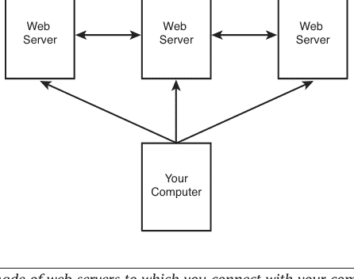

## 什么是网页？

万维网由网页组成。网页是一个信息文件，可以在你的计算机上访问和显示。当你访问该文件时，它会被下载到你的计算机。当你访问 Amazon.com 时，你访问的是亚马逊计算机上的一个文件，它被下载，其中的信息显示在你的计算机上。当你在网上冲浪时，你连接的是一堆不同的计算机，它们都在将文件传输到你的计算机。

## 什么是网站？

基本上，网站是网页的集合（见图 I.2），存储在特定计算机（称为 Web 服务器）上，并由外部计算机访问。网站创建者将文件放在 Web 服务器上。Web 服务器只是一台装有特殊软件的计算机，允许其他人在访问 Web 服务器地址时查看你的网页。当你访问 cnn.com 时，有一组页面构成了 CNN 电视网络的网站。

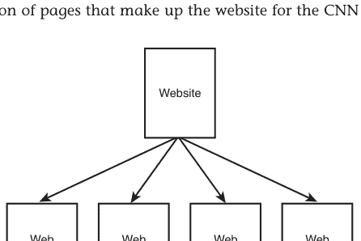

**图 I.2**
*网站由网页组成。*

## 什么是网页浏览器？

网页浏览器是你计算机或移动设备上的一段软件，用于访问网站上的网页。所有台式计算机都至少预装了一个网页浏览器。网页浏览器是你用来查看网站的工具，而且越来越频繁地，它也是帮助你创建网站的工具。

所有浏览器的工作原理基本相同。你在浏览器中输入网站地址或点击链接。这会告诉浏览器前往该互联网地址并将文件（图像、文本、视频）下载到你的计算机或移动设备。然后这些文件会以一种（希望是）看起来不错的方式显示出来，并允许你与之交互。

有几种浏览器可供你选择。一个好的网站开发者（也就是你）应该熟悉所有主要类型，并且很可能在用于测试的计算机上安装了它们。比以往任何时候都更普遍的是，人们使用移动浏览器来浏览网页。你的手机里可能就有浏览器。请记住，Mac 上的 Safari 与 iPhone 上的 Safari 并不相同。如果你认真对待网站开发，你需要获取并保持计算机上最新版本的浏览器软件。你还需要了解每个浏览器独特的特点和限制。最常见的浏览器如下：

-   Internet Explorer (Microsoft) — http://www.microsoft.com/ie/
-   Chrome (Google) — http://chrome.google.com
-   Firefox (Mozilla) — http://www.firefox.com
-   Safari (Apple) — http://www.apple.com/safari/
-   Opera (Opera) — http://www.opera.com/
-   Flock (Flock) — http://flock.com/

# 第一部分

## 基础知识

1.  事情的顺序

2.  为你的网站选择位置

# 第一章

## 事情的顺序

在开始构建网站之前，对最终完成的项目有个大致概念是很重要的。这样想：如果你要去度假，你会选择目的地、旅行方式、路线和时间表。缺少其中任何一项，你的假期可能都不会太愉快。各个部分也是相互关联的。如果你计划乘飞机但没有目的地，你就无法制定时间表。构建网站也是一个类似的过程。人们常常忍不住想尽快构建自己的网站，但就像旅行一样，如果你在不清楚目的地的情况下就上路，你很快就会迷路。此外，项目的各个部分有其顺序。在规划出目的地之前，你无法去游乐园。同样，了解并遵循这些相互关联的步骤顺序，可以使你的计划取得成功。

在本章中，我们将以简要但根本的方式，概览整个网站创建过程，从规划到维护。不要因为这是一个概述就忍不住跳到下一章。这些步骤是你创建最佳网站过程中的基础构建块。

-   网站创建过程

过程的每个部分将在后面更详细地介绍，但在开始之前对整个过程有一个概览会有所帮助。

## 网站创建过程

在本书中，网站的创建和维护被分解为一个过程，你应该尽可能严格地遵循它。这个过程是我在构建自己网站的过程中获得的知识以及与成功的网页设计师进行数小时讨论的结果。遵循这些步骤将在过程继续时极大地帮助你。网站创建和维护的所有步骤都需要工作和思考，但它们不一定涉及计算机或任何技术。这些步骤在图 1.1 中概述，并在本书后面的章节中详细说明。

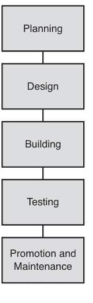

**图 1.1**
*网站创建过程。*

### 1. 规划

所有工作都应从规划阶段开始。你必须规划完成项目所需的步骤。我的想法是，创建网站这样的项目由许多小步骤组成，如果正确执行，就能带来成功的项目。

这可能是最容易跳过的部分，但它肯定与其他任何部分同样重要，甚至可能更重要。通过尽早制定计划和决策，你将发现过程的后续步骤更容易，也似乎更有指引性。

以下是你在开始前需要决定的一些事情：

-   我为什么要构建这个网站？
-   我希望这个网站如何运作？
-   我对这个网站有什么目标？
-   这是一个我期望人们访问一次就走，还是会经常回来的网站？
-   谁将设计、构建、测试和维护这个网站？
-   将使用什么工具来构建网站？
-   我的网站预算是多少？
-   我希望谁来访问我的网站？

> 关于规划及需要规划的事项的更多信息，请参见**第 3 章，“规划你的网站”。**

### 2. 设计

设计网站的方式与内容创意和构建这些网站的设计师一样多。当我谈论网页设计时，我指的不仅仅是网站的外观。设计不仅仅是图形。它还包括页面的组织方式（网站结构）、使网站访问者能够到达这些页面的按钮或链接（导航元素），以及技术细节，例如如何使用编程语言以及将采用哪些应用技术。当我设计网站时，我会用白板画出页面的样子。

每个人都想要一个独特的网站，因此在规划和设计你自己的网站之前，尽可能多地查看各种网站是很重要的。这将让你了解哪些趋势看起来清新新颖，以及哪些过时的网络陈词滥调需要避免。

创建优秀网站的关键是将你独特的内容与出色的设计相匹配。第 4 章“设计你的网站”涵盖了你必须做出的许多设计决策，以及一些具有持久品质的网站趋势。

> 关于网页设计的更多信息，请参见**第 4 章**。


3.  构建

太多人在未进行规划和设计的情况下就开始了这一阶段，而这对于创建一个成功的网站是必不可少的。构建是实际创建页面、编辑图形、制作链接、管理多媒体以及向服务器添加脚本和其他元素的工作。

过去，网站需要手动创建。这意味着开发者必须手动输入构成网站的每个文件。幸运的是，如今情况已大不相同。构建部分涵盖了网页创建工具、图形工具和其他实用程序，使您无需编写一行代码即可快速创建单个页面或整个网站。这些实用程序和工具大多免费或非常便宜。

如果您已完成规划和设计，请转到第7章“网站元素”开始构建您的网站。一旦开始构建网站，请参阅第6章“将文件传输到互联网及从互联网获取文件”将文件上传到您的网络服务器。

→ 有关构建网站的更多信息，**请参见**第三部分“网站构建基础”。

4.  测试

测试？没人告诉过你会有测试。我所说的测试是指确保网站上的所有功能正常工作。您应该测试的一些项目包括导航（在网站中从一个页面移动到另一个页面）、图形和内容（确保页面中没有遗漏任何信息）。您还需要养成习惯，对网站进行的每一次更改都进行测试和反复测试，即使在网站上线运行之后也是如此。有免费的工具可以帮助您完成此操作。

→ 有关测试网站的更多信息，**请参见**第16章“测试您的网站”。

5.  推广与维护

在您规划、设计、构建并测试完网站后，就准备好将其发布到世界面前了。然而，这并非故事的结尾。您需要向他人推广您的网站，确保其出现在*搜索引擎*上，并向不认识的人宣传它。但是，仅做这些仍然不够。您需要维护和更新您的网站，让人们有理由再次访问。

有关如何推广和持续改进网站的详细信息，请参见第17章和第18章。

> **技术术语**
> **搜索引擎**
>
> 搜索引擎是一个允许您搜索其他网站的网站。

## 第2章

## 为您的网站选择位置

### 网络托管

人们在着手创建网站时最常问的问题之一就是将其托管在哪里。

请记住，网站是网页、图形、脚本文件以及与网站相关的所有其他内容的集合。这些文件需要存储在一台可供其他人访问的计算机上。这台其他人可以访问的计算机也称为服务器或主机。当服务器存储您的文件并允许其他人访问时，可以说它正在托管您的网站。决定将网站文件托管在何处极为重要，应像流程的任何其他部分一样进行规划和研究。

- 网络托管
- 什么是网络服务器？
- 确定您的网络托管需求
- 托管选项
- 那么什么最适合您？
- 使用不同类型的托管服务

> **注意：** 本部分包含大量技术术语。我在整章中都解释了这些技术术语，以便您理解相关技术，从而做出正确的网络托管选择。

### 什么是网络服务器？

网络服务器是一台存储和共享网络文件的计算机。其他人通过网络浏览器访问这些网络文件。

每次访问任何网页时，您都在访问服务器。您输入服务器的地址，它将其存储在硬盘上的网页文件版本发送给您，看——您就看到了网页。网络服务器有三个基本功能：

- **存储** —— 网络服务器将网络文件存储在硬盘驱动器上。每个网页、图形和脚本都需要存储在服务器上。
- **共享文件** —— 根据收到的请求，网络服务器通过互联网向访问者的浏览器提供文件。
- **分析** —— 一个好的网络服务器会跟踪所有访问网站文件的人并捕获相关数据。这非常有用，在第18章“维护您的网站”中有更多讨论。

当您将网站文件放到服务器上时，拥有这些服务器的公司就在“托管”您的网站。

您可能会有多种不同的服务器选项可供选择（见图2.1）。本节的其余部分介绍了在决定托管网站时需要考虑的事项。在规划阶段就进行此操作非常重要，因为托管选择的功能或限制可能在构建网站时产生影响。

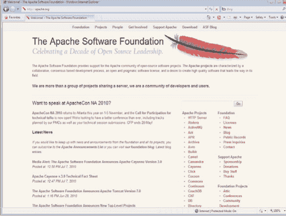

图 2.1
Apache 是一个免费网络服务器的示例。您可以在 www.apache.org 上找到相关信息。

### 确定您的网络托管需求

在为您选择合适的托管选项之前，最好评估您对该托管公司的需求。以下部分讨论了您可能需要考虑的一些事项。

#### 成本

托管网站文件并使其可供其他人访问可能会产生费用。与许多此类考虑因素一样，价格范围广泛，从接近免费到每月超过按揭贷款付款。但不要认为任何网络托管是完全免费的。即使您在家里运行自己的网络服务器，您仍然需要购买设备并支付电费、租金和您的报酬。

尝试确定一个可以持续用于网站托管的预算。就我而言，每月支付一点费用能解决这么多问题并提供如此多的机会，这非常值得。

#### 所需技术知识

不同的托管选项提供不同的功能，并且比其他选项要求您具备更高的技术水平。在选择托管选项之前，请诚实评估您的技术水平以及您愿意花费时间使用这些技能的程度。

#### 维护需求

了解谁在维护您的网络服务器很重要。如果是您自己维护，您需要自己执行一些定期维护任务。这包括确保服务器正在运行、可被其他人访问以及安装了最新的软件。如果您使用托管服务，可能有其他人会为您完成这些工作，但可能需要付费。您需要评估自己可以花多少时间维护网络服务器，或者愿意为此花费多少钱。

#### 存储空间

您的网络文件占用数字空间。您需要知道可用于存储备份文件的空间量。除非您是网络服务器上唯一的网站，否则您需要了解该服务器上有多少可用空间，以及何时/是否进行备份。

#### 可访问性

上传和访问网络服务器上的文件有多容易？您可以远程访问服务器吗？换句话说，您可以从任何其他计算机连接到它，还是需要物理访问？如果您的访问受到任何限制，这可能会产生巨大差异。此外，出于安全原因，您应该知道需要向网络托管服务提供哪些安全要求（例如个人信息）。

#### 带宽需求

带宽决定了在一段时间内可以传输多少信息。每次您的网站被下载时，都会消耗一部分分配给您的网络服务器带宽。一种理解方式是您的网站文件可以被下载多少次。一些网络托管服务对您的网站所需带宽量有限制。

对于某些托管选项，带宽几乎是无限的，而对于其他选项则受限。如果您预计会有很多人访问您的网站，请密切关注网络托管的带宽限制。

#### 域名服务

域名是互联网上的一个地址。它引用存储网站的特定服务器。有关域名的进一步解释，请参见“技术术语”侧边栏。

您需要知道您的托管选项是否会处理域名服务，如果是，费用是多少。域名服务包括注册和托管您的域名，以便互联网上的其他计算机在输入您的URL时知道访问您的网络主机。

域名也用于电子邮件地址。检查服务提供商是否也为域名提供电子邮件地址。

> **技术术语**
> **域名**
>
> 域名只是充当网站地址的词语的一种特殊表示方式。互联网上有许多计算机负责管理所有的域名。这些计算机获取您在浏览器中输入的域名，并找到正确的网络服务器。托管服务通常会收集注册域名所需的信息。


## 托管选项

在你对托管选项有了一些初步想法后，你应该四处看看并研究可用的服务。有多种选择，因此请仔细将你的网站托管需求与合适的托管选项相匹配。以下部分将介绍一些托管选项。

### 家庭托管

在家托管自己的网站服务器是可能的。至少你需要一台专用的Web服务器、一条专用的高速常在线互联网连接、服务器软件，以及安装、配置和维护你自己服务器的技术知识和时间，更不用说确保其安全性了。觉得累了吗？这个选项通常适合硬核极客，但没错，确实可以从自己家托管Web服务器。

> 提示 关于如何搭建家庭Web服务器的优秀指南，请参阅 http://lifehacker.com/software/feature/how-to-set-up-a-personal-home-web-server-124212.php www.diywebserver.com/

### 免费在线托管

一些网站托管站点，如 Google Sites，允许免费托管网站。他们能够提供此项服务是因为他们限制了你可以在其站点上存储的容量、页面和文件。例如，Google Sites 提供免费的托管服务，但不提供任何域名服务，并且允许的内容量非常有限。如果你不想处理任何网站托管的麻烦，并且技术需求较低，这可能是适合你的选择。

### 在线托管服务

有几家公司提供价格合理的网站托管服务（每月10到20美元美元，外加设置费）。这些服务负责管理服务器，并为你提供广泛的网站可能性。它们通常提供多种不同的托管计划，具体取决于你在域名和其他技术服务方面的需求（例如物理维护Web服务器和安装新软件版本）。

我用于自己网站的就是这种托管方式。

### 专业托管

如果你预计会有巨大的托管量和高度的技术定制需求，你可能需要考虑专业托管。需要支付一大笔费用，托管公司会为你租用并维护你自己的服务器。这为你提供了巨大的可能性，但成本很高。

### 商业托管

如果你在为公司创建网站，你的公司内部可能有人能够托管和维护你的Web服务器。如果老板要求你创建一个网站，尽量弄清楚公司是否已有现成的网站托管系统。

### 那么哪种最适合你？

为了帮助你选择符合需求的托管选项，我在表2.1中以易于使用的参考表格形式总结了本章描述的可能需求。你可能找不到完美的解决方案（完美方案是指所有功能和服务都免费），但你可以尽可能紧密地匹配需求和选项。

表2.1 网站托管选项
| 托管选项 | 成本 | 所需技术知识 | 维护工作 | 存储空间 | 可访问性 | 带宽需求 | 域名服务 |
|---|---|---|---|---|---|---|---|
| 家庭托管 | 低–中 | 高 | 高 | 低–高 | 高 | 低 | 中 |
| 免费在线 | 低 | 低 | 低 | 低 | 低 | 高 | 低 |
| 在线托管服务 | 低–中 | 低–中 | 低 | 中–高 | 中 | 高 | 高 |
| 专业托管 | 高 | 低–中 | 低 | 高 | 中 | 高 | 高 |
| 商业托管 | 低–高 | 低–高 | 低–中 | 中–高 | 高 | 中–高 | 中–高 |

## 使用不同类型的托管服务

选择了所需的托管类型后，你的工作可能并未完成。事实上，你花在研究可用服务上的时间可能和选择托管类型一样多。

### 免费服务

互联网上存在一些免费托管服务。我在这里介绍其中几个，但这绝不是一个完整的列表，新的网站托管服务每天都在出现。在注册之前，请查看该网站的功能以及服务条款和使用条款，阅读该服务的评价，如果可能的话，查看使用该免费托管服务的网站。请记住，虽然所有这些网站都将免费托管你的网站，但它们确实存在限制。以下部分介绍了一些最好的网站免费托管服务。

就像在学校一样，我根据易用性和功能为这些网站打了等级评分。A级为优秀。B级为良好。C级为满意，D级为不满意。

#### Google Sites (sites.google.com)

**易用性：A**
**功能：B**

Google Sites 使其服务像其搜索引擎一样免费且易于使用。Google 在 Google Sites 上的重点是尽可能轻松地将人们联系在一起。如果你对 Google Sites 感兴趣，请务必观看入门教程。

Google Sites（见图2.2）允许轻松编辑文本、添加附件和评论。页面创建工具允许轻松创建链接、添加图片和创建新页面。它提供了常用页面的模板，其中已包含编程。Google 还允许你在团队协作时让其他人修改你的网站。

你可以轻松自定义页面，无需HTML。如果你喜欢 Google Sites，它还提供按月付费的扩展服务。

$\rightarrow$ 关于 Google Sites 的更多信息，**请参阅**第9章“网页服务”。

图2.2 Google Sites 让网站的创建变得快速、简单且廉价。

#### Bravenet Hosting (www.bravenet.com/webhosting/hosting.php)

**易用性：B**
**功能：D**

Bravenet 提供有限的免费托管服务。这更像是其付费服务的介绍，但如果你急需免费托管，在紧急情况下它或许能用。设置相当简单，但它几乎不允许任何网站功能，并且空间和带宽有限。

为了提供免费服务，Bravenet 会在你的页面上放置广告。如果你不希望在网站上出现广告，Bravenet 提供无广告的网站托管服务，需要付费，同时还包含更多功能。

#### Windows Live Spaces (home.spaces.live.com)

**易用性：A**
**功能：D**

微软的 Windows Live Spaces（见图2.3）为MSN或Microsoft Live用户提供了一个存储照片、列表和博客文章的空间。它的功能有限，但使用简单。本质上，它并不真正托管任何类型的网站，但如果你想要一个简单的网络存在，它确实能给你提供。

图2.3 微软的免费页面包含其称为小工具的应用程序。

#### JustFree (www.justfree.com/)

**易用性：B**
**功能：A**

JustFree 为你提供托管网站文件的空间。它还提供更多技术功能，例如运行PHP脚本和连接MySQL数据库。如果你不知道这些是什么，别担心——你不需要知道。这里的意思是，你需要一些技术知识才能使用该网站的高级功能。

JustFree 限制了你可以使用的文件数量和带宽量，但这些限制对于一个简单的网站来说绰绰有余。如果你有一些技术技能但没有资金，这可能是适合你的选择。

### 低成本商业网站

如果你要做的不止是基础工作，你可能应该在低成本的商业网站托管公司上花点钱。如果你打算为网站花点钱，我会建议你从这里开始。一个好的托管公司在功能、空间和安心方面能给你带来很多，使得低廉的月费非常值得。

以下是几家比较知名的低成本商业网站。它们都拥有海量功能，让建立一个优秀的网站变得更加容易。

- DreamHost (www.dreamhost.com)
- Go Daddy (www.godaddy.com)
- Host Gator (www.hostgator.com/)
- A Small Orange (www.asmallorange.com)
- Blue Host (www.bluehost.com)

### 其他资源

我在本书中反复强调的一点是，人们正在以前所未有的方式使用网络来发布和收集信息。在决定使用哪个网站托管服务时，花时间阅读人们对该服务的评价。通过研究该服务来证实每个服务所做的承诺。

你可能会发现，某些听起来好得不像真的的网络服务，实际上会在你的计算机或网站中添加病毒或其他有害软件。此外，新的网站托管服务不断出现在互联网上。跟踪所有这些服务是不可能的，所以让别人为你做这件事吧。网站托管站点总是在被评测，以下是评测这些服务的一些网站：

- **Free Web Hosting** (www.free-webhosts.com)——一个免费网站托管服务的评级网站
- **FreeWebspace.net** (www.freewebspace.net)——一个可搜索的免费网站托管指南
- **FindMyHost** (http://findmyhost.com)——网站托管服务的评论和评级
- **Webhosting Geeks** (http://webhostinggeeks.com)——从更技术性的角度进行网站托管评测


# 第二部分

## 规划与准备

- 3 规划你的网站
- 4 设计你的网站
- 5 收集你的工具
- 6 在互联网上传输文件

# 3 规划你的网站

在开始任何网站项目之前，你需要回答的核心问题是“你为什么想建立一个网站？”有时答案可以很简单——老板要你创建一个网站，你想联系老同学，或者你想推广你的家庭业务。通过提出这个问题，你可以开始构思你正在构建的网站的最佳结构。例如，如果你在为你的家庭业务制作网站，你希望你的产品和服务单独成页。你还应该确保业务联系信息出现在每一个页面上。

本节接下来的内容是一些你在规划网站结构时应该问的问题。你应该尽可能多地回答它们，因为这将帮助你对你的网站做出重要决定。不要只是读这些问题然后思考答案；要做笔记并制定一个正式的计划。如果你是为别人构建这个网站，那个人可能想看看你的行动计划。这个行动计划应包括列出网站的目标、网站和页面的粗略计划，以及你计划完成工作的时间线。

### 本章内容

- 你想建立什么类型的网站？
- 向你访问过的网站学习
- 网站目标
- 组织网站
- 网站组织的最佳实践

## 你想建立什么类型的网站？

众所周知，互联网上有如此多的网站，根本无法追踪到所有。我们使用网站来预订机票、与朋友交谈以及查看昨晚比赛的比分。当你思考为什么创建一个网站时，你还需要弄清楚它将是什么类型的网站。熟悉网站类型的最好方法是在网络上四处浏览。通常你上网时是带着特定的目标，例如租车或发送电子邮件。这个目的有时会让你忽略你正在查看的网站的结构和目的。重新看看你最喜欢的一些网站，并密切关注这些网站的结构和目的。你会对你学到的东西感到惊讶。

### 网站类型

新型网站每天都在出现，其种类仅受创建者想象力的限制。这里列出一些高级类型。如果你的网站属于这些类别之一，请阅读相关说明并访问示例网站，密切关注每个网站的结构和设计。

- **商业**——在互联网的早期，公司和企业曾蜂拥而至，以为可以一夜暴富。当然，只有少数公司做到了，但在过去十年里，企业逐渐摸索出如何赚钱、吸引新客户以及找到可行的商业模式。事实上，如今几乎很难想象有哪个企业没有网站，从大公司到街边的家庭网店都是如此。

  示例：
  - Amazon.com
  - Kodak.com（见图3.1）
  - Bloomingfoods：www.bloomingfoods.coop/

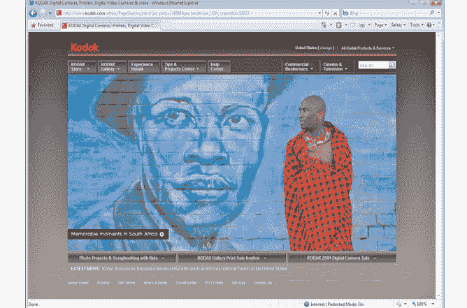

**图3.1**
*Kodak.com是一个优秀的商业网站。*

- **个人**——在商业入侵万维网之前，人们就在创建个人网站了。这些包括家庭网站、粉丝网站和博客等日记网站。这实际上是万维网最大文化影响的一部分。现在每个人都可以在网络上发出自己的声音。你不需要有百万美元才能拥有一个吸引大量关注的优秀网站。从富人和名人到街边的家庭主妇，人们都在制作个人网站。
  示例：
  - www.stephenfry.com
  - blog.markwbell.com
  - wonkette.com

- **社交**——自从计算机相互连接以来，它们就成为了社交互动的工具。它们使人们通过社交网络和电子邮件网站在线交谈变得简单。网络正变得越来越社交化。互联网不再仅仅是极客的避难所，现在几乎每个人都将社交联系视为网络上最主要的力量之一。

  示例：
  - Facebook.com（见图3.2）
  - Gmail.com
  - Blogger.com

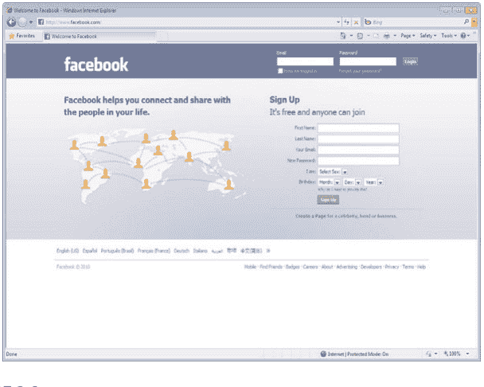

**图3.2**
你今天上Facebook了吗？

- **信息类**——互联网是一个信息仓库。有些网站纯粹是为了向你提供免费信息。这些信息非常有帮助，以至于它每天都在改变知识和教育。网络每天都会增加数太字节的信息——多到你永远无法跟上所有信息。

  示例：
  - www.wikipedia.org（见图3.3）
  - www.imdb.com

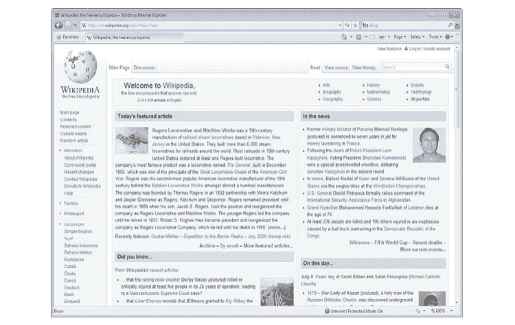

**图3.3**
Wikipedia是有史以来最大的开源参考作品。

## 向你访问过的网站学习

正如我之前提到的，你可能需要尝试一种新的视角，去观察网络的结构而不仅仅是其内容。以下练习迫使你进入那种视角，让你以新的方式看待你访问过的网站：

1. 打开浏览器，查看你的网络历史记录，这是你最近访问过的网站列表。它通常在菜单项中。在Internet Explorer或Firefox中，使用Ctrl+Shift+H（见图3.4）。
2. 打开你最近访问过的几个网站。
3. 当你浏览每个网站时，问自己
   - 这是什么类型的网站？
   - 这个网站的各个部分是由什么组成的？
   - 你如何在页面之间导航？
   - 是什么让你感觉这个网站是一个完整的网站，并且与互联网上的其他网站不同？

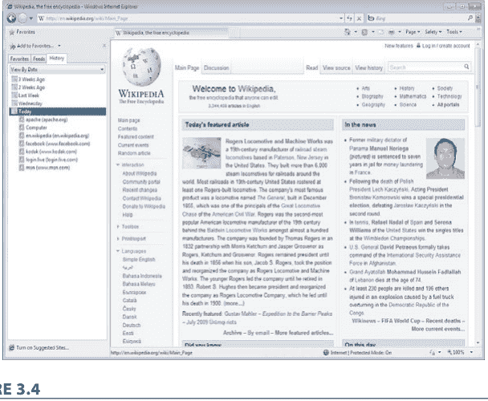

**图3.4**
打开了历史记录的Explorer。

你甚至可以对这些网站做笔记。是什么让这些网站运作良好？或者更好的是，如果你发现一个糟糕的网站，弄清楚它为什么糟糕，并且不要犯同样的错误。你能在纸上画出网站的结构图吗？

## 网站目标

在你开始设计或构建网站之前，你需要知道你希望通过它实现什么。你希望实现的目标将帮助你在未来做出决策。
你的目标就是你希望通过你的网站完成的事情。这些可能是赚钱、吸引注意力或表达某种观点。你应该为你的网站本身及其内容设定目标（见图3.5）。你还应该考虑网站的短期和长期目标。首先审视一些你最喜欢的网站，并确定这些网站的目标。
问自己

- 这个网站的整体目标是什么？
- 网站的哪些部分向我展示了这个目标？
- 我的网站会类似于还是不同于这个网站？

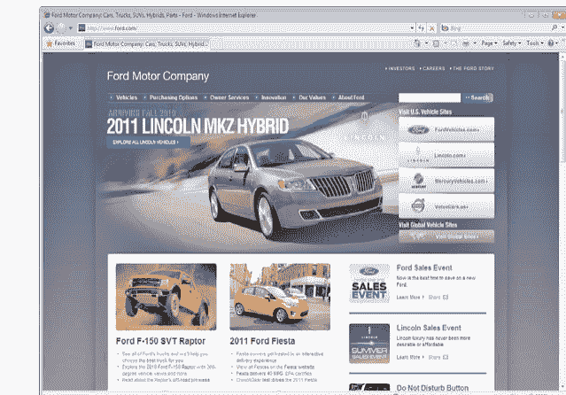

**图3.5**
*福特汽车公司网站的目标是提供其产品信息并销售车辆。*

## 组织网站

当你弄清楚网站的结构时，你需要同时考虑整个网站和每个页面。记住，一个网站只是网页的集合。你创建的内容应该具有统一性。这种统一性应该在网站本身和每个页面上都显而易见。例如，如果你创建一个家庭网站，并为每个家庭成员（妈妈、爸爸、儿子和女儿）设置页面，那么每个页面都应该看起来与其他页面相似。它们应该看起来像一个统一的整体。如果每个页面都不同，网站访客可能会迷失方向。你可以从查看整个网站开始，或者只看一个页面。


## 组织网站

当我开始规划一个新网站时，我会从一张白纸开始，按照以下方式绘制网站草图：

1.  在一张白纸中央画一个方框，并在其中写上“主页”。
2.  在“主页”方框周围为网站上想要涵盖的各个子主题画出单独的方框。
3.  如果这些子主题需要进一步细分，则使用额外的方框将这些主题添加到图中。
4.  确定哪些内容值得拥有单独的页面。每个网页都应有其独特的内容，且内容量应与其他页面大致相当。
5.  画线将这些页面连接到“主页”方框。
6.  为每个页面的子主题画线连接到该页面本身。

现在，你就得到了一张关于网站内容的粗略地图。示例请参见图 3.6。

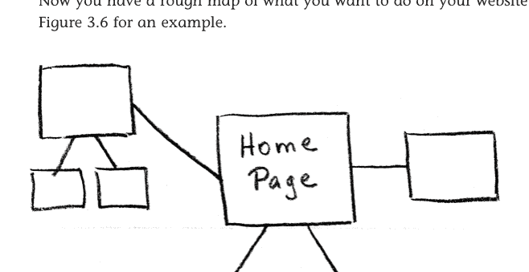

> **极客术语**

#### 主页
*主页*是用户访问你网站时看到的第一个页面。这是用户输入你的域名地址后加载的页面。请记住，用户在任何网站停留的时间都很短——通常只有几秒钟——因此这里是他们形成第一印象的地方。

## 组织页面

与组织网站类似，我从手绘模板开始组织每个网页。我尽可能保持其简单和通用，以便随后能让每个页面看起来像网站中风格统一的一部分。以下是我使用的方法：

1.  在另一张白纸上，画一个长大于宽、占据页面大部分区域的矩形。这个矩形代表一个在典型屏幕上的典型浏览器中查看的网页。
2.  在此页面的顶部，画一条横贯页面的水平线，大约位于页面向下 15% 的位置。这是你的*页眉*。
3.  在此页面的底部，画另一条横贯页面的水平线，大约位于页面向上 15% 的位置。这是你的*页脚*。
4.  粗略勾勒出你希望内容在网站上的呈现方式。你可能需要设计分栏或表格。花些时间发挥你的创造力。图 3.7 可以让你对网站的大致样貌有个概念。

> **极客术语**

### 页眉和页脚
每个页面的页眉和页脚部分都是相同的。通常，你会在页眉和页脚中找到指向其他页面的链接和联系信息。观察其他网页，你会看到很多都有页眉和页脚。

你可能为整个网站使用相同的组织结构，或者为不同部分使用几个不同的结构。这本质上就是一个纸质模板。模板让你能够在多个页面之间保持一致性。让你的内容来定义结构。

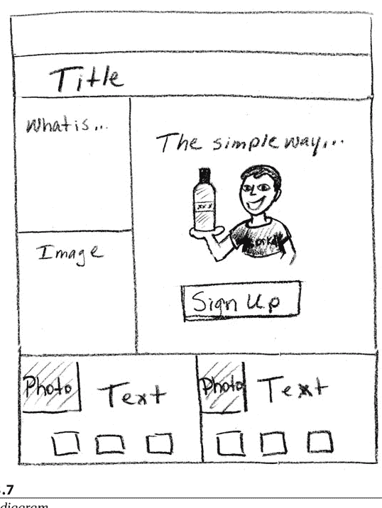

**图 3.7**
网页示意图。

## 网站组织的最佳实践

在组织网站时，有一些通用的规则或最佳实践需要你记住。这些规则并非铁律，但能帮助你避免常见错误。

## 保持网站简洁

首要原则，尤其是在网站规划初期，要保持一切尽可能简单。尽量不要一开始就让你的网站过于复杂。你总可以稍后添加内容。简单的网站能让你的信息被清晰理解，目标更容易实现（见图 3.8）。如果你过快地变得过于复杂，访问者会感到困惑。

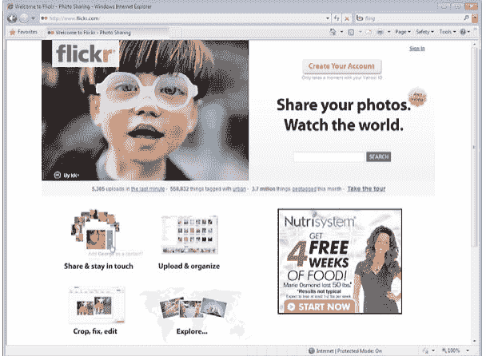

**图 3.8** *flickr 是一个简洁且组织良好的网站。*

## 保持网站一致性

努力让你的网站成为一个统一的整体。这能使其看起来更专业，并有助于信息的传达。一个充满不一致页面的网站会显得混乱，从而赶走访问者。一个从页面到页面都统一、一致的网站，传达了网站创建者投入了大量时间来呈现一个精心制作、构思周全的网站，其目的是让你享受其中。保持页面整洁有序。在页面上使用一致的结构（例如页眉和页脚），以便访问者能轻松了解你的网站主题，而不会迷失在一堆杂乱无章的文本和链接中。

## 保持网站易于维护

组织良好、设计精良的网站易于维护和改进。如果你的网站杂乱无章，从长远来看，这会给你带来更多工作。而且，如果你有一个复杂的网站，你需要花很多时间确保所有部分协同工作。从简单开始并努力保持这种简单，从长远来看会很有帮助。

# 第四章

## 设计你的网站

如果你花了很多时间上网冲浪，你可能注意到有些网站设计精良，而有些则不然。网站的设计很重要，因为它为你的内容搭建了舞台，并有可能防止访问者过快离开你的网站，并吸引他们再次访问。这有时被称为“粘性内容”，因为它能将访问者粘在你的网站上。设计涉及颜色、字体、图片和布局。

本章将向你展示如何就开发有效的设计做出决策，以及在哪里可以找到一些能激发你设计灵感的想法。

**本章内容**
- 我做不出那么好看的网站！
- 内容优先于设计
- 整体设计
- 颜色
- 字体
- 图片
- 层叠样式表
- 设计最佳实践

## 我做不出那么好看的网站！

如果你正在阅读这本书，你可能不是专业的网页设计师。我也不是。但你并不需要成为专业人士才能创建一个设计良好的网站。你可以向他人的作品学习——那些拥有卓越才华和能力、创造出真正艺术品的人学习（见图 4.1）。

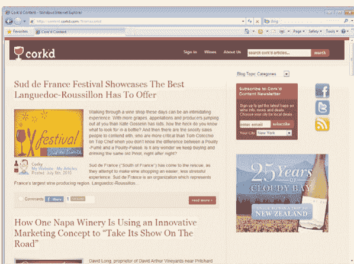

**图 4.1**
*cork'd 是一个设计精良的品酒网站。*

网上大多数精美、设计良好的网站都是由训练有素、薪资优厚的团队创建的。与这些网站相比，你的网站可能显得不够精致和专业。然而，重要的是要记住这是一个学习过程，而你的预算可能为零，因此要客观看待。向那些做得好的网站学习，最重要的是，不要灰心！享受乐趣并发挥创造力。

## 内容优先于设计

如果说有一条核心原则指导着我所有的网站设计，那就是内容优先于设计。这意味着先收集网站的内容，然后让这些内容来指导和影响你的设计。例如，如果你正在为你的保龄球队建立一个网站，请首先考虑内容。你的球队需要队员简介、日程安排、过去比赛的成绩以及球队标志。让这些内容来指导你设计网站。

## 整体设计

首先，让我们考虑网站的整体设计。你希望你的网站唤起什么样的情绪——是希望它有趣明亮，还是阴郁深沉？也许你甚至不知道。最好的起点是看看那些设计精良的网站。

### 设计灵感

我总是在寻找设计灵感。当我发现一个设计精良的网站时，我会将其加入书签，这样当我开始新设计时，我可以回顾它，为我的网站获取灵感。

我也会查看设计奖项的获奖者和网页设计师的网站。因为这些网站设计精良，你可以从中学到很多。

以下是一些可供参考的例子：

- Webby Awards (www.webbyawards.com)
- LevelTen Interactive (www.leveltendesign.com)
- Avenue A/Razorfish (www.avenuea-razorfish.com)

> **极客术语**

### 书签
大多数浏览器都允许你为网站添加书签，这意味着你保存了一个特定网站的记录，以便稍后可以再次访问。查阅你的浏览器文档，了解如何使用浏览器添加书签。

### 中心图像设计

设计网站的一种方法是使用一个中心图像，并据此确定你的配色方案和其他图像。如果你有像标志或照片这样的素材可以使用，这种方法尤其有效。

## 颜色

网络是一种视觉媒介，因此颜色很重要。它能唤起情绪，可以使一个网站充满活力且有趣，而另一个则平淡乏味。数百万种颜色可供你选择，因此让你的创造力和个人风格成为你的向导。


## 神奇四色

如果你去当地的报刊亭看看杂志使用的颜色，你最有可能看到以下主导色：

- Red（红）
- Yellow（黄）
- Black（黑）
- White（白）

这些是广告中的神奇色彩。如果你不确定使用什么颜色，就从这些颜色中选一个开始。另一方面，如果你想寻找不同的颜色，想要一种能与网站上的某些图片或其他设计元素搭配的颜色，你有大量的选择。

## 十六进制颜色

当你在互联网上处理颜色时，你需要明白玫瑰不是"红色"，而是"#FF0000"。这称为十六进制颜色，在网上使用颜色时你必须习惯它。这种奇怪的记法实际上是三组数字：FF、00 和 00。（在这种情况下，FF 实际上是一个数字。）

每个两位数字都是一个更大的数字的十六进制值。十六进制代码中的三组数字分别代表红色、绿色和蓝色（通常称为 RGB）。HTML 标签使用十六进制数字来定义颜色。

每种颜色（红、绿、蓝）都有 256 个可能的值，它们三个组合在一起就形成了所有其他颜色。要确定某个数字的十六进制值，你需要使用科学计算器。对于 Windows，请按以下步骤操作：

1. 按下 Windows 键和 R 键。
2. 在"运行"框中，输入 `calc.exe`，然后点击"确定"。
3. 从"查看"菜单中，选择"科学型"（见图 4.2）。
4. 输入 214，然后点击"十六进制"选项。
5. 显示 214 的十六进制值，即 D6。许多 HTML 标签和其他应用程序使用十六进制来描述颜色。

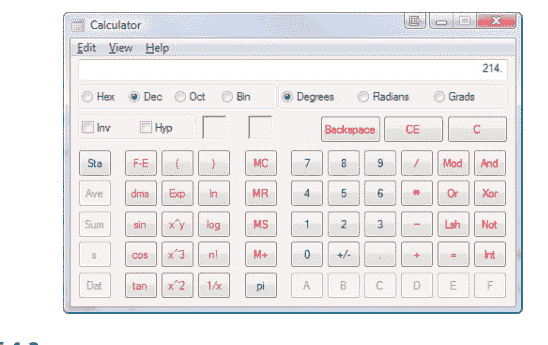
**图 4.2**
*科学计算器。*

作为练习，找出你最喜欢的颜色的 RGB 数值，并将它们转换为十六进制。

## 配色方案

一组相互补充的颜色称为配色方案。这些颜色搭配在一起看起来很好，可能包含四种神奇颜色之一。网上有一些工具可以帮助你搭配颜色。

- **Color Combos (www.colorcombos.com/)**——这个网站专注于为网页创建颜色组合（见图 4.3）。你可以用它选择现有的颜色组合、测试组合，以及浏览他们的颜色组合库。
- **Color Palette Generator (www.degraeve.com/color-palette/)**——如果你有一张核心图片，想围绕它构建网站，只需将图片上传到这个网站，该工具就能识别图片中使用的颜色（见图 4.4）。
- **ColorBlender (http://colorblender.com/)**——这个工具能让你基于选定的颜色创建匹配的颜色和调色板。如果你知道想要使用的核心颜色，这个网站会给你提供搭配选项。

> **注意** 如果你在网上找到完美的图片，比如在 flickr 上，想在你的网站上使用，记得要获得图片所有者的许可。

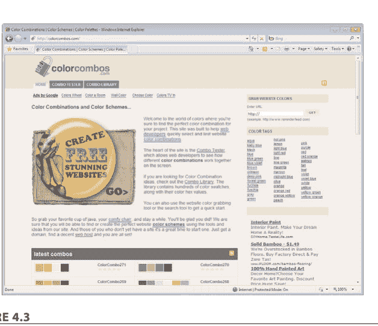

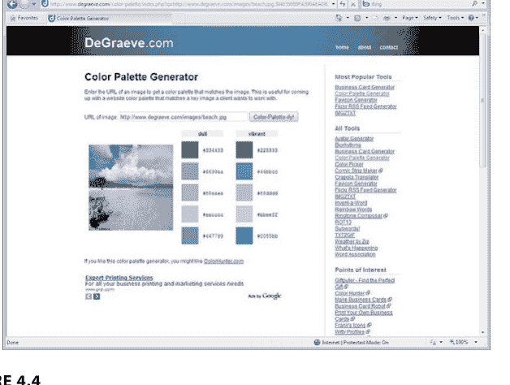


- colrpickr (www.krazydad.com/colrpickr/)——这个网站可以在 flickr 上查找与你选择的颜色匹配的图片。
- COLOURlovers (www.colourlovers.com/)——这是一个致力于网站颜色的网站和社区（见图 4.5）。这些人认真对待颜色，并从中获得很多乐趣。他们还关注网页颜色的趋势。你可以在这个网站上找到一些很好的颜色建议。

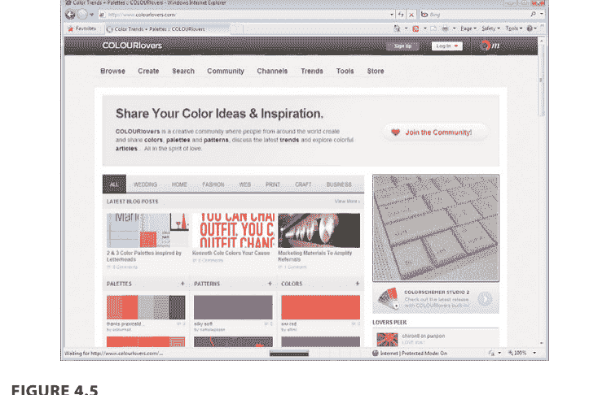
图 4.5
*COLOURlovers 是一个多彩的社区。*

## 色盲

使用颜色时需要注意的一点是，一部分人口是色盲的，他们可能无法像你一样看到网站的颜色。这与红色、绿色和蓝色尤其相关。尽量不要混用红、蓝、绿文字和红、蓝、绿背景。这样的文字和背景可能会让色盲人士完全看不到文字。

如果你是色盲人士，请确保让非色盲人士检查你网站上的颜色。

Colorblind Web Page filter (http://colorfilter.wickline.org/) 可以向你展示你的网站在色盲人士眼中是什么样子的，所以请花时间让你的页面通过该滤镜。如果你在 cnn.com 和 huffingtonpost.com 等热门网站上使用这个工具，你会发现这些网站仍然易于阅读和使用。

## 字体

网页上通常有一定数量的文字。有些页面文字很少，有些页面则有大量文字。这些文字可以是实际文字，也可以是显示为文字的图形。首先，我将讨论作为文字的文字，然后再讨论作为图像的文字。

### 系统字体

在网站上使用文字时，你可能倾向于使用某种花哨的字体。如果可能的话，请避免这样做。有几种系统字体是为了在网页上良好显示而创建的。如果你使用特殊字体，而查看你页面的人电脑上没有该字体，你的文字就会恢复为系统字体。此外，Windows 和 Apple 电脑的系统字体是不同的。（有些事情从来就不容易！）

以下是 Windows 系统的默认系统字体：

- Arial
- Book Antiqua
- Calisto MT
- Century Gothic
- Comic Sans MS
- Copperplate Gothic Bold
- Copperplate Gothic Light
- Courier
- Courier New
- Fixedsys
- Georgia
- Impact
- Lucida Console
- Lucida Handwriting Italic
- Lucida Sans Italic
- Lucida Sans Unicode
- Marlett
- Matisse ITC
- Modern
- MS Serif
- MS Sans Serif
- News Gothic MT
- OCR A Extended
- Small Fonts
- Symbol
- System
- Tempus Sans ITC
- Terminal
- Times New Roman
- Verdana
- Webdings
- Westminster
- Wingdings

以下是 Apple 系统的默认系统字体：

- AmericanTypewriter
- Andale Mono
- Apple Chancery
- Apple Symbols
- Arial
- Baskerville
- BigCaslon
- Brush Script
- Chalkboard
- Charcoal
- Cochin
- Comic Sans MS
- Copperplate
- Courier
- Courier New
- Didot
- Futura
- Gadget
- Geneva
- Georgia
- Gill Sans
- Helvetica
- Helvetica Neue
- Herculaneum
- Hoefler Text
- Impact
- Marker Felt
- Optima
- Papyrus
- Skia
- Symbol
- Times New Roman
- Trebuchet MS
- Verdana
- Webdings
- Zapf Dingbats
- Zapfino

关于字体的一个好建议是，除非必要，否则不要指定字体。如果你必须使用字体，请确保它是系统字体。最后，如果你需要使用已知不是系统字体的字体，请将文字转换为图像。

### 图像字体

必要时，你可以将特定类型的文字保存为图像（见图 4.6）。这样做的问题是文字不再可选中，搜索引擎也无法找到它。此外，这些图像会减慢页面的加载速度。


图 4.6
图像中使用的字体示例。

### 字体和颜色

你也可以为网页上的文字着色。处理文字时，尽量使用白色背景上的黑色文字。彩色文字和彩色背景会使阅读变得困难。最好避免使用彩色文字和背景，但至少要让文字颜色和背景颜色形成对比，以便易于阅读。一些还可以接受的例子是黑色背景上的绿色文字，或白色背景上的蓝色文字。

#### 图像

图像可能是你创建的任何设计的重要组成部分。然而，最好不要在网页中包含太多图像，因为它们会减慢页面的下载速度，并在视觉上让页面显得过于繁杂。尽量找到几张能很好支持你内容的强力图像。我在第 11 章"处理图像"中介绍了图像及其处理方法。

### 层叠样式表

保持网页设计一致的最佳方法是使用层叠样式表（CSS）。它作为网页的指南，以特定方式格式化某些元素。如果你想让所有链接都是红色带下划线的，你可以在 CSS 中设置一个元素，控制所有链接的格式。

> 我在第 13 章"使用 HTML 构建网站"中介绍了如何设置和使用 CSS。

## 设计最佳实践

创建网页设计没有硬性规定，但有一些最佳实践可以帮助你避免常见错误。记住保持设计简单一致，你的网站就会看起来很棒。

### 内容为王

最重要的是，让你的内容来指导你设计网站。如果你试图销售摩托车头盔，而你的网站上没有你的头盔图片或戴着你头盔的人的照片，没有人会再次访问你的网站。

### 把新内容放在最显眼的位置

新手网页设计师的一个常见错误是让网站上的新内容难以被访问者找到。把任何新内容放在最显眼的位置。同时，告诉你的访问者这是新的，你的网站是最新的。这样你的网站才能创造回访者。

### 保持简洁

让你的设计尽可能简洁。你不希望一个视觉上令人困惑或复杂的网站让访问者迷失或不知所措。

### 不要使用夺人眼球的元素

抵制使用夺人眼球的设计元素（如霓虹色和闪烁文字）的冲动。就像时代广场灯火通明一样，夺人眼球的元素可能会让访问者感到不知所措和反感。


## 保持一致性

保持你的颜色、字体和图像的一致性。例如，如果你在网站的某个页面上使用了某些颜色，那么在其他页面上也使用相同的颜色。此外，如果你的组织有既定的标志或配色方案，请遵循已被证明或广泛接受的设计保持一致。你不会想让访客感到困惑。

## 收集你的工具

无论你做什么，拥有合适的工具来完成工作总是很重要的。在本章中，我要向你展示你能免费获得的最佳网络开发工具。这里的工具，我指的是软件实用程序或程序，你可以用它们来帮助创建你的网站。

现在，我确信你在想天下没有免费的午餐。那么，我将向你展示一系列与商业软件一样好甚至更好的图形程序，而且它们是100%免费的！这些是社区开发的开源、共享软件，最重要的是，免费。

网络开发工具种类繁多。有些是你下载到计算机上的程序，有些是你访问并用作程序的网站。

### 本章内容

- 找到适合工作的正确工具
- 工具网站和评测
- 下载新软件
- 基本工具
- 操作系统
- 网页浏览器
- 办公软件套件
- 免费网络工具的未来

### 找到适合工作的正确工具

你可能想知道在哪里可以找到所有这些奇妙的免费工具。我将向你展示一些网站，在那里你可以找到并下载优秀的开源实用程序。

首先，最好的做法是使用搜索引擎来寻找你试图找到的东西的免费或开源替代品。例如，如果我在谷歌上搜索“Photoshop 开源替代品”，我会得到几个选择，包括一个名为GIMP的开源图形编辑器。在本章中，我为你做了一些初步工作，并提供了一些我的信息来源和推荐的程序。

### 工具网站和评测

以下列出了一些优秀的网站，这些网站列出了开源软件程序。这些网站是找到最新、最优秀版本的开源软件程序的绝佳场所。他们将实用程序分类，并提供软件的简短描述，以便你可以轻松找到所需的内容。你几乎可以在这里找到任何东西，特别是其他程序的免费替代品。不过，不要只看替代品；有时开源创造出的程序是主流软件公司尚未想到的，例如播客和点对点实用程序。然后，这些网站会给你直接链接到这些实用程序的最新版本，你可以下载它们。

- Open Source Windows—www.opensourcewindows.org/
- Open Source Mac—www.opensourcemac.org/
- Open Source as Alternative—www.osalt.com/
- The Top 50 Proprietary Programs That Drive You Crazy—and Their Open Source Alternatives—http://whdb.com/2008/the-top-50-proprietary-programs-that-drive-you-crazy-and-their-open-source-alternatives/

### 下载新软件

软件工具和实用程序分为两类：你下载然后安装在计算机上的程序，以及驻留在你可以通过浏览器访问的网站上的程序。下载软件对你来说可能是一个新的过程，因此以下说明将引导你完成此操作：

1.  找到包含你要下载和安装的文件的网站。
    当你访问一个开源实用程序网站时，你会看到关于该程序的信息和一个下载软件的链接。确保你找到适合你的操作系统、可下载最新稳定版本软件的链接。

2.  单击下载链接。当你将文件下载到计算机时，它们通常包含如何安装的说明。花时间阅读这些说明，因为它们可以提供关于如何安装和运行程序的有价值信息。

3.  下载文件后，按照说明安装程序。

> ## 极客行话
> ### 稳定版或发布版
> 软件的稳定版是已经过测试并准备好有限发布的版本。换句话说，该程序预期能完成其大部分预期功能。你可能会看到软件被标识为“测试版”或“预览版”。这仅仅意味着该软件目前正在开发中。你遇到的几乎所有开源软件都将处于某个开发过程中。本质上，它在不断更新和更改。术语“预览版”和“测试版”标识了某些稳定级别。预览版软件处于开发的早期阶段，测试版则稍靠后一些。你可以预期预览版软件会有一些问题，而测试版软件的问题会少一些。

### 基本工具

要创建一个网站，你需要某些工具。以下各节中列出的所有软件都是免费且开源的。每个工具都为你的网站执行重要任务，或者使你能够创建网页和其他内容。

> ## 注意
> 从互联网向你的计算机下载任何软件时，都有可能发生不好的事情。软件可能安装不正确，或者更糟，影响计算机上的现有文件。另一方面，开源社区在自我监管方面做得很好，下载和安装开源软件通常是一个轻松的过程。

### 操作系统

首先，你可以使用开源软件来运行你的整个计算机。通常，你会让苹果或微软（Windows）操作系统在计算机上运行，但也有开源替代品。开源操作系统的好处是免费且可定制，但稳定性可能较差且支持较少。使用开源操作系统可能有风险。并非所有程序都适用于开源操作系统，开源可能会使你的整个计算机变得不稳定。话虽如此，开源操作系统非常有趣，并且解决了其他操作系统的一些问题（尤其是成本问题）。我通常在较旧的计算机上运行一个或多个开源操作系统，以测试其稳定性，然后再将其加载到较新的计算机上。

- Linux (www.linux.org/)——开源操作系统的元老
- Ubuntu (www.ubuntu.com/)——另一个强大稳定的开源操作系统
- Qimo (www.qimo4kids.com/)——一个有趣的儿童操作系统，你可以在几乎任何计算机上运行

### 网页浏览器

拥有一个好的浏览器是网页设计中最基本的工具之一。你必须熟悉人们查看你的网页的所有方式。以下是网络上一些最稳定、最强大的开源应用程序，它们是你的工具箱中不可或缺的部分。

- Firefox (www.firefox.com/)——最好且最受欢迎的开源浏览器。
- Google Chrome (www.google.com/chrome)——谷歌的浏览器已经走了很长一段路，成为网络浏览器市场的真正竞争者。

### 办公软件套件

虽然与网页设计没有直接关系，但办公软件套件是帮助沟通、记录和计算信息的强大程序集合。此处列出了一些微软Office的开源替代品。

- OpenOffice—www.openoffice.org
- NeoOffice—www.neooffice.org

### 文件传输协议（FTP）程序

FTP代表文件传输协议，是用于让你通过互联网在机器之间轻松传输文件的软件的花哨名称。当你将网站文件上传到网络服务器时，你需要一个FTP客户端——为你执行此操作的程序。更高级的功能包括将多个文件加入队列、保存连接信息以及传输报告。

以下是一些建议：

- FileZilla（Windows、Linux和Mac）(http://filezilla-project.org/)——这个开源FTP客户端（参见图5.1）提供了全面的功能（并且运行一个名称中带有“zilla”的应用程序很有趣）。
- Fetch（Mac）(http://fetchsoftworks.com/)——这个FTP客户端是免费下载的，有一个非常可爱的小狗吉祥物。它是Mac用户的最爱。
- Cyberduck（Mac）(http://cyberduck.ch/)——一个出色的小型多功能、免费、开源FTP客户端，有多种语言版本。

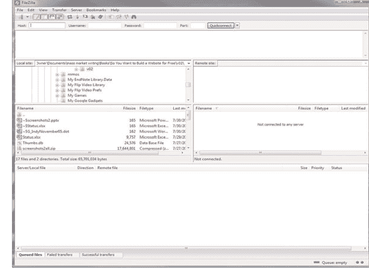

图5.1
FileZilla使你能够在互联网上移动文件。


## 第二部分：计划与准备

-   - **OneButton FTP (Mac)**（http://onebutton.org/）—一款简单易用的免费FTP程序，专为技术能力有限的Mac用户设计，让你尽可能轻松地传输文件。
- **Net2ftp**（www.net2ftp.com/）—一款免费的网页FTP客户端，无需下载安装到本地，支持多种平台和不同浏览器。

### 文本编辑器

构建网站时，你必须能够编辑文本文件，包括超文本标记语言（HTML）文件或脚本文件。文本文件就是只包含文字和数字、不含任何格式的文件。以下是一些较优秀的文本编辑器：

-   - **Notepad（Windows）**—所有Windows版本自带的标准文本编辑器
- **Notepad++（Windows, Linux）**（http://notepad-plus.sourceforge.net/uk/site.htm）—一款优秀的免费Notepad替代品，具有许多出色的功能，如行号显示和文本检查（参见图5.2）

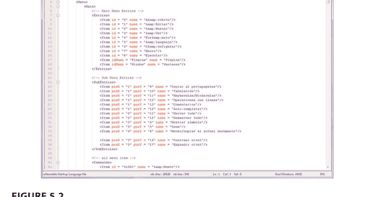

**图5.2**
像Notepad++这样的程序在编辑文本文件时必不可少。

-   - TextWrangler (Mac)（www.barebones.com/products/textwrangler/index.shtml）—一款优秀的Mac文本编辑器
- XEmacs (Windows, Linux, UNIX)（www.xemacs.org/index.html）—一款偏向技术型的文本编辑器，具有一些高级功能

### 图形编辑器

图形编辑器可以让你创建、编辑和格式化图形文件。这个工具对于让你的网站看起来更出色至关重要，它能帮你处理照片、绘画或计算机图形。你可能想修改现有的图形或创建新的作品。这个工具提供了无限的创作空间。此外，图形编辑器还可以改变图形的大小和文件类型，使你的网页加载更加快速高效。
以下是一些推荐的图形编辑器：

-   - GIMP (Windows, Mac, Linux)（www.gimp.org/）—这是最好且最受欢迎的开源图像处理工具。它功能丰富，易于使用，而且价格无可匹敌（免费！）。
- Inkscape (Windows, Mac, Linux)（http://inkscape.org/）—一款免费的开源绘图程序。当你灵感涌现时，运行这个程序就能将你的创意变为数字现实。它类似于Adobe Illustrator。
- Paint.Net (Windows)（www.getpaint.net/）—一款由学生最初设计的开源照片编辑软件。如今已发展成为大规模的开源软件项目。
- Seashore (Mac OS X)（http://seashore.sourceforge.net/）—这是一款针对特定版本Mac OS X操作系统的GIMP版本。

### HTML编辑器

HTML编辑器用于创建和编辑网页。其中一些使用图形用户界面（GUI），另一些则更简单，只允许你编辑HTML文件的文本内容。
如果你需要编辑网页的外观或其背后的代码，请使用HTML编辑器。编辑器为你提供快捷方式（如预格式化标签和自动闭合标签），并自动格式化页面，让你的工作轻松许多。
以下是一些推荐的HTML编辑器：

-   - **KompoZer (Windows, Mac, Linux)**（www.kompozer.net/）—一款功能齐全的多平台所见即所得（WYSIWYG）网页编辑器，可用于网页和网站管理。该程序安装和使用都很简单。
- **Quanta Plus (Windows, Linux)**（http://quanta.kdewebdev.org/）—一款功能丰富的HTML编辑器。它的功能非常全面，对新用户来说可能会有些应接不暇，因此更适合有技术基础的用户。
- **Bluefish (Windows, Mac, Linux)**（http://bluefish.openoffice.nl/）—一款不错的HTML编辑器，能够用多种语言编写网站和脚本。
- **SeaMonkey (Windows, Mac, Linux)**（www.seamonkey-project.org/）—这款工具与众不同。它除了是收发邮件、阅读新闻组、聊天和浏览网页的工具外，还是一个功能齐全的HTML编辑工具（参见图5.3）。由制作Firefox的团队开发，是一款实用的工具。
- **WaveMaker (Mac)**（www.wavemaker.com/downloads/）—一款用于Web和云计算应用的开发工具。

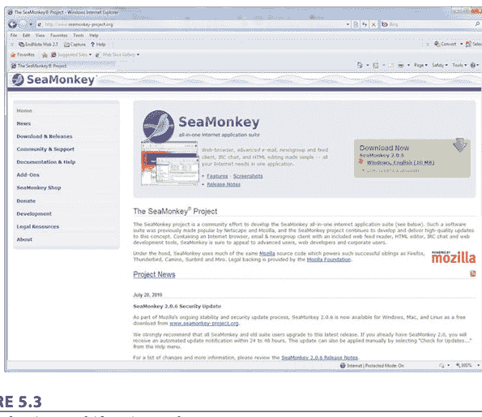

**图5.3**
*SeaMonkey是一款多功能工具。*

OpenLaszlo (Windows, Mac, Linux)（www.openlaszlo.org/）—这款工具用于Web应用程序的高级开发。用它为你的网站添加一些编程和交互功能，而不仅仅是展示信息。它并非适合所有人，但值得一试。

CSSSED (Windows, Linux)（http://csssed.sourceforge.net/）—一款功能齐全且可扩展的层叠样式表（CSS）编辑工具。（关于如何使用CSS的更多信息，请参阅第4章"设计你的网站"。）适合更具技术背景的网站开发者。如果你已经掌握了其他工具，可能想尝试一下这个。

### 录音工具

如果你想在网站上使用音频，可能需要一个录音程序。这里推荐一个流行的工具：

Audacity (Windows, Mac, Linux)（http://audacity.sourceforge.net/）—如果你的网站需要声音，且你需要编辑一些原始音频文件，这个工具可以让你录制、播放和编辑声音文件。

### 视频编辑

网络上的视频内容与日俱增。几年前，在网站上添加视频还是件困难、缓慢且昂贵的事情。如今视频在网络上随处可见。随着越来越多人使用宽带，视频在网站中已十分普遍。以下工具可帮助你捕获、编辑和渲染视频：

Blender (Windows, Mac, Linux)（www.blender.org/）—顶级的开源视频编辑工具。

Cinelerra-CV (Linux)（http://cinelerra.org/）—一款优秀的工具，但仅适用于Linux操作系统。

### 高级工具

如果你认为自己掌握了更高级的Web开发工具的技能，请继续阅读。功能更多的程序学习、安装和使用起来也更困难。以下是一些建议：

Nvudev (Windows, Mac, Linux)（http://nvudev.com/index.php）—KompoZer的一个更复杂、还不够完善的版本。它刚刚发布，因此可能比这里列出的其他一些选项存在更多bug。

-   - **phpMyAdmin（Web工具）**（www.phpmyadmin.net/）—如果你使用MySQL数据库，就必须用到这个工具。它是目前功能最齐全、最易用的MySQL数据库前端工具。
- **EasyPHP（Web工具）**（www.easyphp.org/）—一款用于开发和维护动态生成网页的PHP脚本的优秀工具。

### 免费Web工具的未来

本章讨论的所有工具都是免费的。在过去的十五年中，我们看到越来越多的免费软件在网上发布。在此期间，这些软件的质量也在不断提升。这使得使用免费Web软件来完成你的项目成为一种可行的选择。

开源软件的使用日益普及。拥有更新更好功能的新工具不断涌现。而最棒的工具，或许是某个开源开发者正在开发的、你还不知道自己需要的那个。请持续关注，享受众多人的劳动成果吧。

# 第6章：在互联网上传输文件

人们在开始构建自己的网站时，最常问的问题之一是如何将文件传输到互联网上。本章会告诉你，这比你想象的要简单得多。

理解将文件放到互联网上的最简单方式是：你所做的不过是从一台计算机将文件移动到另一台计算机。如果你曾在家庭或工作场所的计算机之间传输过文件，那么你基本上已经完成了将文件传到互联网上所需做的一切。

将文件从互联网传到你的计算机称为下载。当你将文件从你的计算机传到互联网时，你正在上传它们。

在互联网上传输文件的最佳方式是使用文件传输协议（FTP）。第5章"收集你的工具"中概述了几款FTP程序。FTP程序可以让你连接到互联网上允许FTP连接的服务器。当你连接到FTP服务器后，就可以在该服务器上传输文件。本章将告诉你如何使用这些程序来实际传输你的文件。

-   - 存储你的文件
- 将文件上传到互联网
- 从FTP服务器下载文件


### 存储你的文件

在你开始考虑将文件上传和下载到互联网之前，花时间整理自己计算机上的文件非常重要。保持文件有序能让查找更轻松，并确保在移动文件时减少错误。本节将介绍一些文件存储的最佳实践，并向你介绍一种更高效的文件存储方式。

新手网页开发者常遇到的一个问题是，他们经常错误地引用文件。这可能导致各种各样的问题，如果文件没有整理好，可能会让你抓狂。一个常见的例子是，当你的网页中引用的是你计算机上的图片，而不是网页服务器上的图片。如果你查看 HTML 代码，看到类似 `C:\users\Tom\Webpagepics\cat.jpg` 这样的引用，网页服务器找不到该文件，因此会返回错误。

### 命名文件

当你创建用于网站的文件时，可能会问：“我应该给这个文件取什么名字？” 你的文件几乎可以随意命名，但这里有几个你应该遵循的简单规则。

#### 保持名称简单

尽量使你的文件名尽可能简单，并尽可能具有描述性。描述可以是文件的用途和尺寸。例如，与其将图形文件命名为 `picture01.jpg`，不如尝试 `logo125x125.jpg`。这样你就知道这是一个标志（logo），并且无需打开文件就能知道其尺寸。

#### 始终使用小写字母

对于某些服务器和网络主机，你引用的文件的名称大小写需要非常明确。如果服务器上的文件名为大写 `LOGO.gif`，而你在 HTML 中引用该文件时使用的是小写 `logo.gif`，服务器可能不会识别这是同一个文件。

通过将所有文件名保持为小写，你可以确保始终拥有清晰的引用。

#### 不要使用空格

在文件名中使用空格不是一个好主意。当浏览器在 HTML 文件名中遇到空格时，它会将其填充为 `%20`。因此，`www.bobshouseofpancakes.com/our menu.html` 会变成 `www.bobshouseofpancakes.com/our%20menu.html`。由于这不是你页面的确切名称，这样引用会导致浏览器无法找到该页面。如果你的文件名没有空格，就不会有这个问题。

如果你需要使用空格，一个解决方案是使用下划线，它是大多数计算机上减号/连字符（`-`）上方的字符。通常，你同时按下减号/连字符键和 Shift 键。这会将文件名 `reallylongconfusingfilename.html` 变为 `really_long_confusing_file_name.html`。文件名更易读，并且没有空格，你就不会有生成无效 HTML 地址的风险。

#### 将所有网络文件放在一个地方

这看起来可能很简单，但在硬盘驱动器的一个地方存储文件常常被忽视。将你的 HTML 文件、图像和脚本在计算机上整理好，从长远来看会让你的生活轻松得多。如果你同时处理多个网站，这一点尤其重要。

#### 建立组织结构

将所有文件放在一个地方后，接下来要做的是整理它们。这使你更容易找到所需内容，并便于存储新文件。你可以用多种方式做到这一点，但当我在处理多个网站时，我会使用文件夹将一个网站的所有部分存储在一个地方（参见图 6.1）。在网站文件夹内，我为 HTML 文件、图形和多媒体脚本分别设置文件夹。通过每次都创建相同的目录结构，我能更容易地找到东西，并且代码中的引用错误也更少。

- 网站文件夹
- 图片文件夹
- 脚本文件夹
- 多媒体文件夹
- HTML 文件

## 66 第二部分 计划与准备

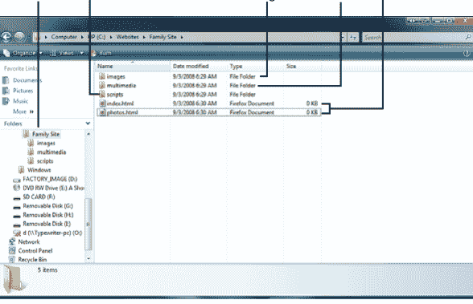

**图 6.1**

文件存储结构示例。

### 使用版本控制系统

如果你正在构建多个网站，或者与许多人合作开发一个网站，你可能需要考虑版本控制系统。这些系统存储、跟踪并监控谁在使用你项目的文件，并确保你不会意外覆盖其他人所做的更改。Subversion 是一个免费的开源版本控制系统，成千上万的软件开发者在使用。

如果你感兴趣，可以在以下网站了解更多：

- 版本控制可视化指南——http://betterexplained.com/articles/a-visual-guide-to-version-control
- 修订控制——http://en.wikipedia.org/wiki/Revision_control
- Subversion——http://subversion.apache.org

### 将文件上传到互联网

网站完成并准备上线后，你需要将文件移动到一台连接到互联网的计算机（你的网页服务器）上。为此，你需要连接到一个允许 FTP 连接的服务器。通常，你的网页服务器会允许 FTP 连接。

为此，你需要一个 FTP 程序，如第 5 章所述。在这些示例中，我将使用 Filezilla，但任何 FTP 程序都应该能够将文件移动到 FTP 服务器或从 FTP 服务器移动文件。

#### 登录

在开始之前，你需要主机提供商提供的一些信息，包括你想要连接的 FTP 服务器名称、用户名和密码。当你注册主机服务时，可能已经定义了用户名和密码，但你可能需要向他们确认，确保用于 FTP 登录信息的用户名和密码相同。

获得这些信息后，登录服务器。FTP 程序窗口有两侧。一侧显示你计算机上的文件，另一侧显示网络主机计算机上的文件。

要登录 FTP 服务器，请执行以下操作：

1. 在“主机”字段中，输入你的主机名。
2. 在相应的字段中输入你的用户名和密码。
3. 除非你的主机提供商告诉你使用特定端口，否则将“端口”字段留空。
4. 点击“快速连接”按钮。

你现在已连接到主机上的 FTP 服务器（参见图 6.2）。

#### 添加新文件

连接到 FTP 服务器后，你只需将文件从计算机拖动到服务器。这不会从你的计算机中删除文件，而是在 FTP 服务器上放置一个副本。

#### 更改现有文件

如果你尝试复制一个已存在于 FTP 服务器上的文件，FTP 程序会提醒你。你可以选择覆盖该文件或取消传输请求（参见图 6.3）。执行此操作时要小心，因为你不想覆盖错误的文件。

> 注意
> 如有疑问，取消覆盖文件的更改。这样你就不会意外覆盖某些内容。

68 第二部分 计划与准备

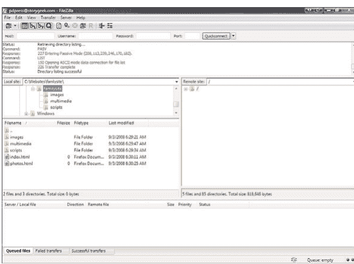

**图 6.2**

FileZilla 连接到服务器。

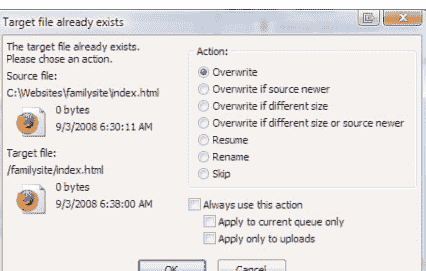

**图 6.3**

此窗口允许你覆盖文件或取消传输。

#### 从 FTP 服务器下载文件

如果你在互联网上找到一个文件并想下载它，会发生什么？如果你有对存储该文件的服务器的 FTP 访问权限，只需连接到服务器并执行与上传相反的过程。

### 单个文件还是多个文件

当你从互联网下载文件时，有时你可能只下载一个文件，而有时可能是一堆文件合并成一个。两种类型的下载方式相同，但当你下载一组文件时，你可能需要做一些额外的事情，例如运行它们或解压缩它们，以将各个文件解包到你的计算机中。不同文件类型需要执行的操作将在下一节中介绍。

### 从浏览器下载

大多数浏览器使你可以轻松下载文件；只需点击文件的超链接或使用子菜单（例如右键单击菜单）下载即可。这与 FTP 类似，都是将文件的副本下载到你的计算机上。从互联网下载文件不会影响互联网上的文件。

### 下载文件的类型

根据文件和你的操作系统，下载的文件有几种不同的类型。其中一些文件易于处理，而另一些则需要特殊程序。

> 注意
> 如果你要下载的文件没有扩展名，或者你不熟悉该文件扩展名，请采取安全路线，在下载到计算机之前先调查该文件扩展名。此站点按字母顺序列出了数百个文件扩展名：http://filext.com/alphalist.php?extstart=^A

文件通常由两部分组成：文件名和作为文件扩展名的后缀。文件扩展名位于文件名中的句点（`.`）之后。文件扩展名告诉你文件的类型。它还告诉操作系统默认使用哪个程序打开它。所以，例如，`logo.bmp` 是一个名为 “logo” 的文件，属于 “BMP” 或位图类型。

以下部分描述了一些常见的文件类型及其用途。

#### 图像文件（GIF、JPG、TIFF、BMP）

图形文件下载后不需要任何特殊处理，但你必须有图形程序才能查看和编辑它们。如今，大多数操作系统都可以处理这些文件并向你展示它们，但你可能会遇到无法立即打开的文件。开源图形程序 GIMP（www.gimp.org/）应该能打开你需要的任何文件。


#### EXE（Windows）

这是用于自包含可执行文件的扩展格式，也就是双击即可运行的文件。在 Windows 中，你只需双击下载的文件，它就会开始运行。

> caution 小心使用这些文件——可执行文件中可能包含会损害你机器的有害文件。仅运行你从可信来源下载的文件。

#### ZIP

zip 文件将一个或多个文件压缩成一个更小的文件。这个新的、更小的文件包含原始文件，并在解压后保持文件结构。大多数操作系统允许你双击这些文件来打开它们（参见图 6.4）。

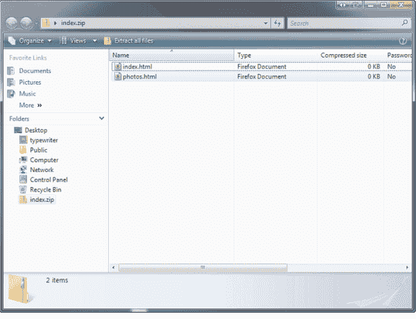

图 6.4
*zip 文件的内容。*

#### DMG（Mac）

这基本上就是 Mac 版的可执行文件。当你在 Mac 上下载这样的文件时，只需双击即可运行。

#### ISO

这是一种特殊类型的压缩文件，它将整张 CD 或 DVD 的内容放入一个文件中。你需要一个特殊的程序来解压这些大文件并与其中的内容进行交互。

### 下载文件的最佳实践

就像用于构建网站的文件一样，保持下载文件的组织性至关重要。良好的组织可以帮助你找到所需的文件并节省空间。以下是一些下载文件的最佳实践：

- 对所有下载内容使用病毒扫描程序——互联网上充满了优秀友善的人，但也有一些害群之马。确保在打开任何下载文件之前对其进行病毒扫描。
- 将所有下载内容保存在一个地方——当你下载大量文件时，需要将它们放在一个统一的位置，以便在下载后能够找到它们。我会使用一个名为 Downloads 的文件夹来存放所有浏览器的下载内容。
- 不要下载到桌面——你不应该下载文件到桌面。这只会让你的桌面变得杂乱，难以找到任何东西。
- 解压后删除大型打包文件——如果你下载了大文件（如 ISO 文件），应在解压后删除该文件。你不希望仅使用一次的文件占用所有硬盘空间。

第三部分

# 网站构建基础

7 网站的元素
8 使用现有网站
9 网页服务
10 HTML 入门
11 使用图片
12 使用多媒体
13 使用 HTML 构建网站
14 他们是怎么做到的？
15 让你的网站适配移动端

## 第 7 章

### 网站的元素

在开始构建网站之前，你需要了解它的各个组成部分。我在本书前面已经介绍了网页和网站的定义，但如果我们要讨论网页和网站的构建元素，就需要对这些定义进行扩展。

本章涵盖网站内容的要素、网页的组成部分以及网站的组成部分。最后，讨论网络广告及其是否适合放在你的网站上。

- 内容
- 网页的组成部分
- 网站的组成部分
- 网络广告

#### 内容

内容是网站的核心，也是用户访问网站的原因。如果你没有优质、独特的内容，用户就没有理由输入你的 URL 或点击指向你网站的链接。

本节介绍开发网站内容的一些最佳实践。

### 内容最佳实践

内容的主题实际上由你决定，但任何内容都有一些通用的最佳实践。

- **内容应聚焦**——你的网页内容应有明确的主题并围绕该主题展开。没有什么比内容杂乱无章更让访客反感的了。古董打字机网站不应该在首页放你家小狗新照片的图片。明确你网站要讨论的内容，并坚持这个方向。
- **内容应具有个人特色**——尽可能让你的内容具有个人特色。你有自己的个性，至少我对你想说的内容很感兴趣。事实上，很多人都会对你想说的内容感兴趣。没有人拥有和你完全相同的经历，所以你的内容是独一无二的。如果你的网站是商业网站，请将企业的个性融入内容中。派对公司小丑的网站应该与财务顾问的网站看起来不同。
- **内容应高质量**——为你发布的内容感到自豪。确保你的内容文笔流畅、没有错误。为访客提供你能做到的最好的网站。
- **内容应独特**——不要只做转载者；要做创新者。即使你是转发别人发布的内容，也要告诉我们你的看法；给出你的观点。互联网电影数据库（参见图 7.1）正是因为其独特的内容而取得了成功。
- **内容应适合目标受众**——创建内容时要考虑你的受众。你的受众期望从网站内容中获得什么？如果你是为学龄前儿童创建网站，就不应该使用大学级别的语言。

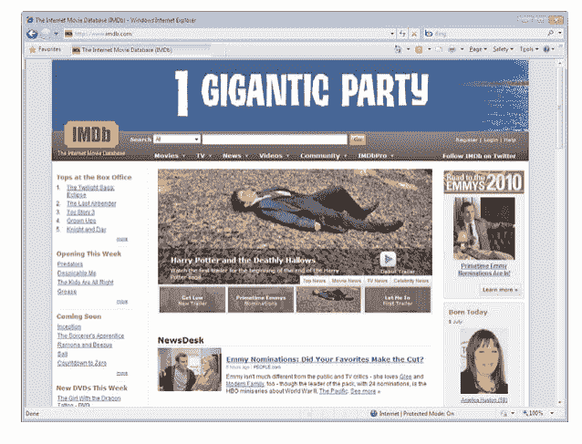

图 7.1
*互联网电影数据库拥有互联网上最优质的内容之一。*

### 内容标准

你无法控制谁访问你的网站。可能是你的老板、你的祖母，或者是住在街对面的八岁小孩。这些人对内容的适当性标准可能与你不同。我不会要求你审查自己的内容，但要注意，它可能会被各种各样的人看到。如果你的网站有一些"有风险"的、较为成熟的内容（如语言、笑话或图片）——那些你不希望祖母看到的内容——你可能需要考虑明确标注这些内容，以提醒可能被冒犯的人。

> **极客术语**
> **NSFW**
> 你可能在邮件或博客中听到人们将内容称为 NSFW。这代表"Not Safe For Work"（不适合在工作场所浏览）。意思是这类内容不适合在工作时查看，更适合在家浏览。这包括成人图片或内容。如果你不确定你的内容是否属于这一类别，最好将其标注为 NSFW。

### 网页的组成部分

本节介绍网页设计的一些标准组成部分。这些部分不同于内容，它们为内容提供容器。并非每个网页都包含所有这些元素，但一个好的网页应包含其中大部分。

#### 标题

网页的标题出现在显示该网页的浏览器的标题栏中。这看起来可能是一个容易被忽视的细节，但它很重要。当访客在任务栏或仪表板中浏览应用程序标题时，这就是你页面被识别的方式。当浏览器最小化或你的网页显示在标签页中时，标题会出现在标签页或你的 Windows 程序栏中（参见图 7.2）。

标题由代码中的 HTML 标签定义。有关使用 title 标签的更多信息，请参阅第 10 章"HTML 入门"。

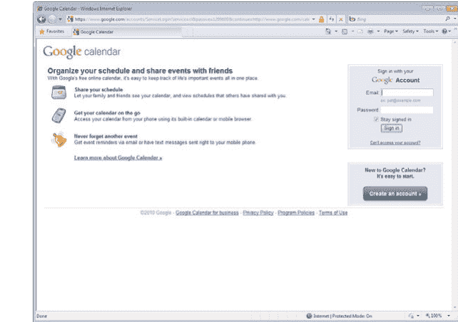

#### 页头

网页的页头是横跨页面顶部的区域。它没有固定的尺寸，但按照惯例，页头不应超过页面总长度的四分之一，并横跨页面的整个宽度。页头可以包含网站标题信息和导航元素（参见图 7.3）。页头还可以在每个页面上重复使用，以提高网站的一致性。如果你的所有页面使用同一个统一的页头文件，只需更改该文件一次即可更新整个网站。

#### 主体

主体是网页的主要部分。你的大部分内容都放在页面的主体中。网页的主体没有严格的规范，但请记住，你的内容在视觉上应易于阅读（参见图 7.4）。例如，如果网页的主体横跨整个浏览器宽度，在某些显示器上可能会更难阅读。

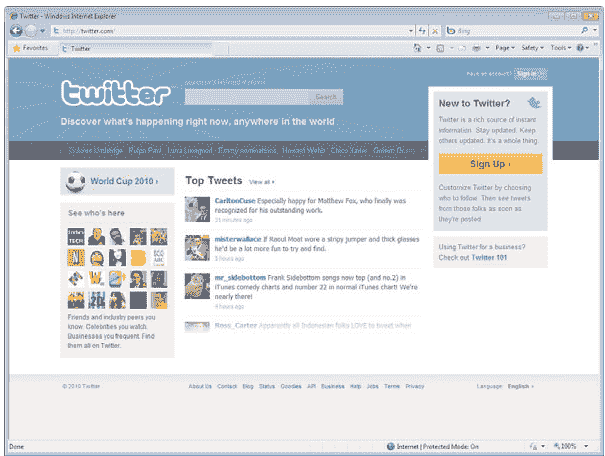

图 7.3
*Twitter.com 页面的页头部分。*


## 图 7.4

IBM 网站的主体部分。

#### 页脚

页脚与页头相对应，位于页面底部，同样可用于展示信息或导航元素（参见图 7.5）。此外，与页头一样，最好在网站的每个页面上都使用统一的页脚以保持一致性。如果你为所有页面使用一个统一的页脚文件，那么只需修改该文件一次即可更新整个网站。这也是放置联系信息的常见区域。

#### 侧边栏

在主体内容区域的两侧，你可能希望添加侧边栏。这些是网站内容的列，其高度大于宽度。与页头和页脚类似，这些侧边栏几乎可以容纳任何内容，但它们特别适合放置搜索框和导航元素（参见图 7.6）。

**图 7.5** *Apple.com 网站的页脚。*

**图 7.6** *该网站在主体内容两侧设有侧边栏。*

第三部分    网站构建基础

### 导航元素

网页的不同部分可能包含导航元素。这些是每个网页上都应放置的重要组件。导航元素是通往网站其他页面的链接。没有导航元素，访问你网站的访客将无法自由浏览并访问你的所有内容。

你的导航元素可以是文本、按钮或菜单。导航元素的外观没有固定格式，但它们应当完整且一致（参见图 7.7）。以下是导航元素的基本要求：

- **完整性**— 确保你网站上的所有页面都可以从其他任何页面访问。每个页面上出现的导航元素集合中，应包含指向所有页面的链接。
- **一致性**— 导航元素应在每个页面上出现在相同位置，并包含相同的链接。如果你选择禁用某个页面的链接，请确保在每个页面上都一致地执行此操作。
- **易于阅读**— 你使用的导航元素应易于阅读和理解。没人喜欢点击一个链接后只能祈祷它能导向所需内容。
- **易于发现**— 不要将导航元素隐藏在你的网页中。它们应该易于发现，并且在每个页面上的位置相同。

**图 7.7** *该网站拥有出色的导航元素。*

### 网站的组成部分

正如网页有组成部分一样，网站也有其组成部分。并非每个网站都包含所有这些部分，但你应该了解它们，并确定你的网站是否需要它们。

#### 主页

这是你网站最重要的部分。我怎么强调都不为过。主页是在任何浏览器中输入你的网站 URL 时首先加载的页面。

当你在浏览器中输入你的 URL 时，浏览器会连接到你的网络服务器并请求你的主页。默认情况下，网络服务器会向浏览器发送 index.htm 或 index.html 页面。这是使网络如此高效运作的惯例之一。

主页是你给访客留下第一印象的地方，因此请确保你展现出最好的一面。主页也应是你网站的中心。将你最好、最新的内容放在主页上（参见图 7.8）。除非你把主页做成最好的部分，否则人们不会在你的网站上逗留。

**图 7.8** *一个主页示例。*

#### 内容页面

你的网站将包含其独特的内容页面（产品页面、图片页面等），但我在此列出几个标准内容页面的示例。

#### 关于我页面

从标题看，这个页面相当不言自明。你应该介绍你是谁以及你为何创建该网站。确保信息清晰、完整且最新。

#### 常见问题解答

这是一个关于你网站目的或内容的常见问题与解答列表（FAQ）（参见图 7.9）。该列表应包含关于你的产品或服务，或任何你认为访客会经常询问的问题。这个列表能让人们以快速、有条理的方式找到所需信息。请保持你的 FAQ 为最新状态，并经常添加新内容。

**图 7.9** *一个优秀的网站 FAQ 示例。*

#### 联系信息

在你的网站上添加联系信息，可以让人们就你的网站向你发表评论或提出问题。这可能包括你的姓名、地址、电话号码和电子邮件地址。

> **注意**

请注意，垃圾邮件发送者可能会发现并使用你的联系方式。一种解决方法是将你的电子邮件地址用文字表示，这样垃圾邮件机器人就无法找到它。例如，不要使用 mark@markwbell.com，而是尝试使用 mark at markwbell dot com。

### 网络广告

你补贴网站费用的一种方式是在网站上出售广告位。首先，这不是一条快速致富的捷径。通过网络广告赚取任何利润都很困难且不太可能发生，但你或许能够补贴部分网站开支。

在你开始为网站寻找广告主之前，你可能想把时间和精力花在让你的网站尽可能出色上，以此来吸引广告主。

> **注意**

这只是网络广告的简单概述。如果你与他人建立任何商业关系（尤其是在互联网上），请务必进行尽职调查。

#### 横幅广告

横幅广告是出现在你网站不同位置的广告，允许人们点击广告并跳转到广告主的网站。你实质上是因提供指向另一个网站的链接而获得报酬。

#### 动画广告

在过去几年里，网站广告的一个趋势是创建动画或交互式广告以吸引网站访客的注意力。不幸的是，这往往适得其反，只会让访客感到厌烦。我的建议是采取更稳妥的方式，不要在你的网站上使用这些广告。

#### Google AdSense

在你的网站上使用广告的一个较新选项是使用 Google AdSense 服务 (https://www.google.com/adsense/; 参见图 7.10)。该服务根据你的网站内容在你的网站上放置文本广告，并为此支付给你非常少量的报酬。

**图 7.10** *Google AdSense 网页。*

这些广告比引人注目的动画横幅广告干扰性更小，但你无法控制显示的内容或时间。假设你有一个基于你集邮爱好的网站。Google AdSense 会扫描你的页面寻找关键词，并根据这些关键词显示广告（参见图 7.11）。Google 对 AdSense 有具体的规则和条款，因此在注册该服务前务必阅读细则。

## 第 7 章 网站的组成部分

**图 7.11** 在一个网站上使用 Google AdSense。

7

此页有意留白

## 第 8 章

### 使用现有网站

你们大多数人拿起这本书是因为想要构建自己的网站。但你们中有些人只是想在网络上有一个存在感，而对构建整个网站不感兴趣。如果你属于后者，那么你很幸运。有一些网站（MySpace.com、Facebook.com、Flickr.com）允许你创建个人资料、结识他人、分享图片和获取信息——所有这些都无需涉及网站规划、网络服务器、超文本标记语言（HTML）或导航。

在其最完善的形式中，这些网站提供博客、相册、电子邮件功能和即时通讯工具，全部整合在一个网站之下。

如果你在其中一个网站上已有账户但需要更多功能，你可能需要自己的网站。如果你不确定，可以注册这些网站，看看它们是否满足你的需求。

这类网站的一个好处是它允许你向其他人推广你的网站。我是所有这些网站的成员，当我发布新的博客条目或进行演讲活动时，我会使用这些网站来推广这些活动。

- 社交网站
- 其他 Web 2.0 网站


## 第三部分 建站基础知识

### 社交网站

社交网络自人类诞生之初便已存在。社交网络网站于2002年开始在互联网上涌现。自诞生以来，社交网络网站已成为主导型网站类别，甚至登上过《*时代*》杂志封面。大多数人听说过这些网站，数百万人拥有其账户。

社交网络网站让你能够创建个人资料、与他人建立联系并分享你的图片和观点。

社交网络个人资料就像一个关于你的主页。它包含关于你的信息（根据你提供的多少而定），并作为社交网络网站其他功能的中心枢纽。

社交网络可能被视为年轻人的专属，但越来越多各年龄段、各背景的人们都在使用社交网络。

> **caution** 这些网站的说明和功能可能会在几乎不通知的情况下发生更改，因此你可能会发现屏幕上看到的内容与此处阅读的内容存在一些差异。

本节涵盖三大社交网络，并解释如何注册、创建个人资料以及与他人建立联系。如果你已是这些网站的成员，应查阅特定部分，以确保你能充分利用社交网络体验。

#### MySpace

MySpace（www.myspace.com）始于2003年，由一家名为eUniverse的早期互联网公司发展而来。MySpace拥有社交网络网站的所有标准功能，以及一些类似于允许你建站网站的其他功能。它拥有数百万用户，是互联网上最受欢迎的网站之一。到2005年，MySpace已变得如此受欢迎，以至于媒体集团新闻集团以5.8亿美元将其收购。

> **caution** 与任何账户信息一样，请保密。泄露这些信息会使知道它的人能够更改你的MySpace账户。

本节介绍使用MySpace的基础知识及其一些更类似网站的功能。

##### 创建账户

在创建MySpace个人资料之前，你必须拥有一个MySpace账户。这使你能够登录并验证身份。

1.  打开浏览器并访问MySpace.com（参见图8.1）。

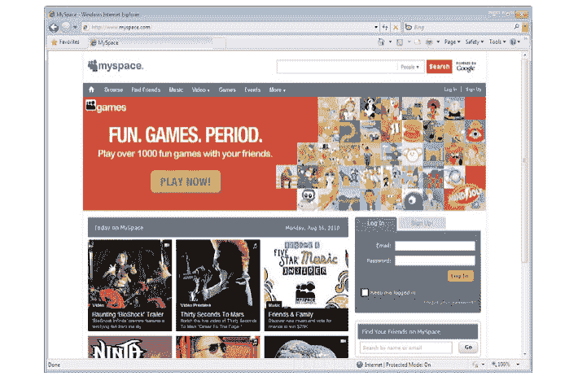

**图8.1**
MySpace.com网站。

2.  点击“注册”按钮。这会带你到MySpace.com的“在此加入MySpace”页面（参见图8.2）。此页面要求你输入个人信息，以便MySpace为你创建账户。

> **note** 如果你是音乐人、喜剧演员或电影制作人，MySpace.com有专门的注册区域。在此页面上，你会找到指向这些账户创建页面的链接。

3.  在必填字段中输入你的信息。除非你允许，否则此信息不会显示在你的个人资料中。

4.  点击“使用条款”链接，并仔细阅读服务条款（如果你没什么更好的事可做的话）。

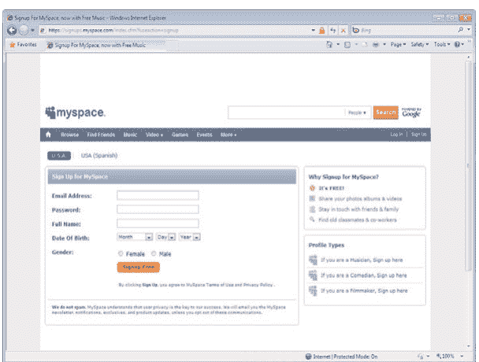

**图8.2**
MySpace账户创建页面。

5.  点击“注册”按钮。账户创建后，MySpace允许你邀请一些朋友。
6.  点击你收到的电子邮件中的确认链接。
7.  添加你可能喜欢的任何乐队和艺人到你的好友列表。添加完成后，点击“继续”。
8.  为你的个人资料上传一张图片（参见图8.3）。
9.  如果你希望关联你的学校以便与同学联系，请点击“继续”。
10. 然后会显示你的个人资料（参见图8.4）。

> **note** 不要做那个向几乎不认识的人发送大量邀请的人。那些人一点也不有趣，也永远不会被邀请参加聚会。如果你想让某人出现在你的社交网络页面上，请确保你非常了解那个人。

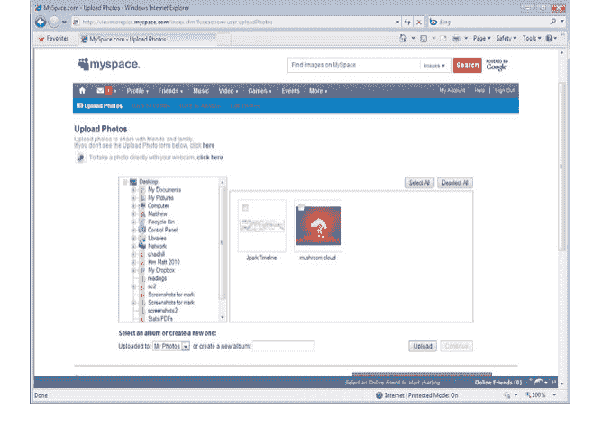

**图8.3**
上传照片页面。

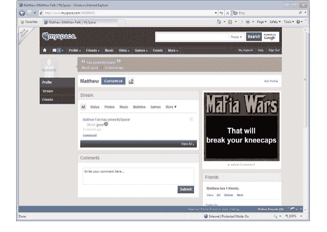

**图8.4**
你在MySpace.com上的个人资料。

##### 自定义个人资料

创建个人资料后，你可以添加各种关于自己的信息。请记住，任何在MySpace上寻找你的人都可以看到这些信息，因此不要包含诸如地址和电话号码之类的个人信息。

1.  要编辑你的个人资料，请点击个人资料上的“编辑个人资料”链接。这会显示“编辑个人资料”页面（参见图8.5）。
2.  编辑完个人资料后，点击“保存更改”按钮。

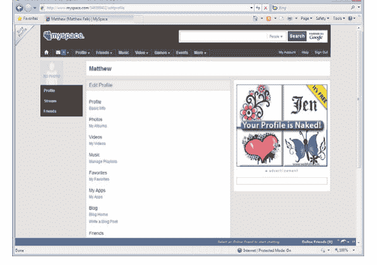

**图8.5**
MySpace.com上的“编辑个人资料”页面。

##### 与其他用户建立联系

MySpace为你提供了多种与其他用户建立联系的方式。你可以搜索用户、给他们发电子邮件，甚至在MySpace.com上给其他人发即时消息。

- **搜索和浏览**—MySpace使你能够通过姓名、电子邮件地址、年龄、性别、所在地、教育程度或兴趣程度来搜索和浏览（参见图8.6）其他用户。

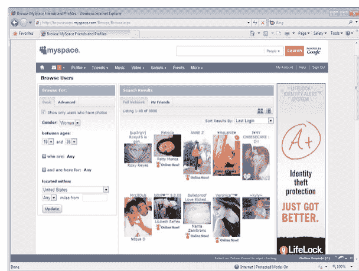

**图8.6**
*MySpace.com上的浏览用户页面。*

- **电子邮件**—MySpace提供功能齐全的内部电子邮件系统，同时管理你的消息、好友请求和其他联系。
- **即时消息**—MySpace使你能够下载一个即时消息程序，该程序列出了你所有的MySpace好友，无需你登录MySpace。

##### 网站功能

MySpace具有多项类网站功能（博客、图片页面、日历和论坛），这些可能就是你所需要的全部。你可能已经在使用MySpace，但尚未充分利用所有这些功能。尝试其中一些；它们会非常有趣！

- **评论**—如果你喜欢某人的个人资料或想给某人发送公开消息，你可以在该人的个人资料上留言评论。请记住，任何访问该人个人资料页面的人都可以看到这些评论。
- **博客**—你可以在MySpace上建立自己的博客，并发布包含文本、图片和视频的条目。你也可以注册关注其他人的博客。
- **相册**—MySpace充满了图片。你的账户上可以有数百张图片，可供公众或仅你的朋友查看。这些图片还可以收集到相册中以保持条理。
- **应用程序**—MySpace现在允许你创建应用程序并将其附加到你的个人资料中。有关MySpace应用程序的更多信息，请查阅MySpace开发者平台社区网站（参见图8.7）（http://developer.myspace.com/community/）。
- **日历**—如果你在MySpace上关注的人正在举办活动，日历功能可以让你跟踪正在发生的事情。

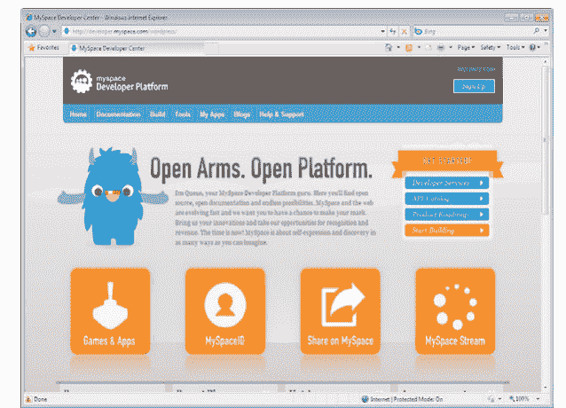

**图8.7**
*MySpace开发者平台社区网站。*

#### Facebook

马克·扎克伯格于2004年创建了Facebook，作为与哈佛大学宿舍同学联系的一种方式。它迅速扩展到其他大学和高中。最初，你必须拥有与教育机构关联的电子邮件地址才能使用Facebook，但2006年Facebook向所有用户开放，此后用户数量稳步增长。与MySpace一样，Facebook拥有数百万用户。

本节涵盖使用Facebook的基础知识及其一些更类似网站的功能。

##### 创建账户

在创建你的Facebook个人资料之前，你必须拥有一个Facebook账户。这使你能够登录并验证身份。

> **caution** 与任何账户信息一样，请保密。泄露这些信息会使知道它的人能够更改你的Facebook账户。

1.  打开浏览器并访问www.facebook.com（参见图8.8）。

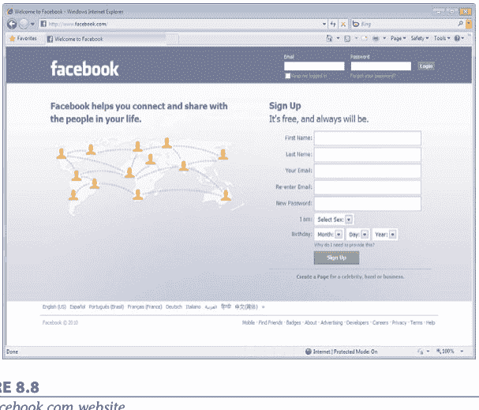

2.  输入在Facebook上创建账户所需的信息。

3.  点击“注册”。

4.  确认你的电子邮件地址。

5.  搜索你的电子邮件联系人中的其他Facebook用户，并邀请人们加入Facebook（参见图8.9）。

6.  输入你的Facebook个人资料信息。


## 第三部分 建站基础

图 8.9
使用此页面查找可能已在使用 Facebook 的朋友。

7.  随后会显示你的 Facebook 页面（见图 8.10）。

图 8.10
我在 Facebook 上的个人资料。

##### 自定义你的个人资料

创建个人资料后，你可以添加各种关于自己的信息。请记住：任何在 Facebook 上寻找你的人都能看到这些信息，因此请勿包含个人隐私信息。

1.  要编辑你的个人资料，请点击你个人资料页面上的“编辑个人资料”链接。这将显示个人资料页面。
2.  点击“编辑信息”按钮来编辑你的个人资料（见图 8.11）。
3.  编辑完个人资料后，点击“保存更改”按钮。

**图 8.11**
*Facebook 上的“编辑个人资料”页面。*

##### 与其他用户建立联系

Facebook 提供了多种方式让你与其他用户建立联系。你可以给用户发邮件、与他们聊天，以及加入群组。

- **电子邮件** — Facebook 提供了一个功能完备的内部邮件系统，同时还管理你的消息、好友请求和其他联系。
- **Facebook 聊天** — Facebook 使你可以在 Facebook 页面上与其他用户聊天（见图 8.12）。
- **Facebook 群组** — Facebook 使你能与志趣相投的人建立联系。请记住：当你加入一个群组时，其他 Facebook 用户也可以看到这一点。

##### 网站功能

Facebook 拥有一些类似网站的很酷的功能。如果你还没有使用过它们，不妨试试！

- **个人主页（Wall）** — 如果你喜欢某人的个人资料或想给某人发送公开信息，你可以在那个人的个人主页（Wall）上留言。请记住，个人主页（Wall）是公开可见的；不要发布过于私人的内容。
- **笔记** — Facebook 允许你在个人资料上创建类似博客条目的笔记。你可以在这些笔记中发布网站链接或视频。
- **相册** — Facebook 允许你在页面上存放数百张可供公众查看的图片。你可以为这些图片添加注释，并将它们整理到相册中。
- **应用程序** — Facebook 开创了应用程序热潮，MySpace 随后跟风。有关 Facebook 应用程序的更多信息，请访问 Facebook 开发者网站 http://developers.facebook.com/。见图 8.13。

**图 8.13**
*Facebook 开发者网站。*

### 其他 Web 2.0 网站

Web 2.0 是一个花哨的名字，指的是那些允许你通过网络浏览器与他人互动的网站。Facebook 和 MySpace 让你与朋友建立联系。其他网站则允许你通过照片和网站链接建立联系。本节将介绍一些 Web 2.0 网站的例子。

社交网络并非互联网上唯一对网站开发或推广有用的网站。其他 Web 2.0 网站使你能够分享图片、链接和微博（你稍后会读到相关内容）。本节将介绍其中几个。

#### Flickr

Flickr (www.flickr.com) 是世界上最大的照片分享网站（见图 8.14）。它允许你创建个人资料、存储你的图片、查看其他人的公开图片、将你的私人图片仅限家人和朋友查看，以及与特定群体分享你的图片。该网站充满了令人惊叹和有趣的功能，所以尽管去探索和玩乐吧！

**图 8.14**
*Flickr.com 上有一些互联网上最好的照片。*

#### Twitter

你可能刚刚搞懂什么是博客，这时 *微博* 就来了。这是一种混合了聊天室、博客和持续新闻源的微型博客，每条仅限 140 个字符。虽然并非适合所有人（你可能并不关心朋友何时去杂货店），但它会变得令人极其上瘾。Twitter (Twitter.com) 是目前最受欢迎的微博网站。我用它来推广我的博客文章、我的演讲活动，并分享我发现的喜欢的东西。

自 2009 年第一版《免费建站》出版以来，Twitter 真的起飞了。它已成为全球数百万人国际事件、名人文化和日常生活的一部分。最近，Twitter 推出了一个推文按钮（见图 8.15）。这个按钮允许你在你的网站上添加一段代码，当访客按下它时，就可以自动在 Twitter 上分享关于你网站的内容。

**图 8.15**
*新的 Twitter 按钮页面，包含将按钮添加到你网站所需的一切。*

#### Delicious.com

这个网站 (www.delicious.com) 一开始可能看起来很简单，但它提供了一种存储和组织书签（通过标签）的方式，并允许你与他人分享，从而建立你可能从未想过的联系。对于任何在网络上进行研究的人，或者对于任何丢失了那个很棒的网站地址的人来说，它都是必备工具。

## 第 9 章

#### 网页服务

也许你仍然不确定是否需要一个拥有自己网络服务器的、功能齐全的网站，但你知道你想要的远不止上一章介绍的那些网站所能提供的功能。

幸运的是，有很多像你一样的人，他们想要网站的大部分功能，但不想要高级功能带来的麻烦和维护的复杂性，并且缺乏必要的技术知识。有一种网站创建工具正是为这类人群准备的，通常被称为网页服务。

- 本章内容
  - Google Sites
  - Wetpaint
  - Netvibes

这些服务使用户可以仅使用网络浏览器来创建网站（见图 9.1）。这些网站具有独立网站的许多功能（页面、图片、链接、小部件），但不需要你设置网络服务器或为托管付费。如果你有兴趣创建一个尽可能便宜且流量不会太大的网站，这绝对是一个选择。它不会有所有花哨的功能，但它会完全满足你的需求。

图 9.1
Google 提供的户外俱乐部模板。

本章将介绍如何注册和构建使用这些网页服务的网站，并讨论每个网站的功能和限制。它们都是免费的，但各有不同的功能，因此在做出选择之前，请全面探索它们。

> 注意 这些网页服务总是在更新和改进，因此本书中的说明和图片可能看起来与你的计算机屏幕上显示的略有不同。

#### Google Sites

我们都知道 Google.com 几乎是网络搜索引擎的标准，但你知道它也有一个网页服务吗？这个网页服务叫做 Google Sites，于 2008 年发布。Google Sites 实际上基于 Google 收购的一家名为 Jotspot 的公司的网页服务。本节将介绍如何注册 Google Sites、定义网站地址、创建页面以及应用主题。

##### 注册 Google Sites

Google Sites 使用现有的 Google 帐户，或者允许你创建一个新的帐户。

如果你已经有一个 Google 帐户（用于 Gmail、Google Reader 或 Google Groups），你只需要为 Google Sites 使用相同的电子邮件和密码即可。如果你有一个 Google 帐户，请跳过本节，继续阅读本章后面出现的“创建 Google 站点”。

要注册一个新的 Google 帐户，请从 Google Sites 主页开始。

> 提示

如今，如果你在做任何网络工作，拥有一个 Google 帐户是必不可少的。它允许你访问 Google 的所有站点，而且是免费的！

1.  打开浏览器并输入 http://sites.google.com/。这将打开 Google Sites 主页（见图 9.2）。

**图 9.2**
*Google Sites 主页。*

2.  点击“注册站点”链接。这将带你到“创建帐户”页面（见图 9.3）。
3.  在“Google 帐户所需信息”部分，输入一个有效的电子邮件地址和密码，然后重新输入密码。
4.  在下一部分“开始使用 Google Sites”中，你可以选择输入你的位置。还有一个文字验证，你可以阅读 Google Sites 服务条款。


## 第三部分 网站构建基础

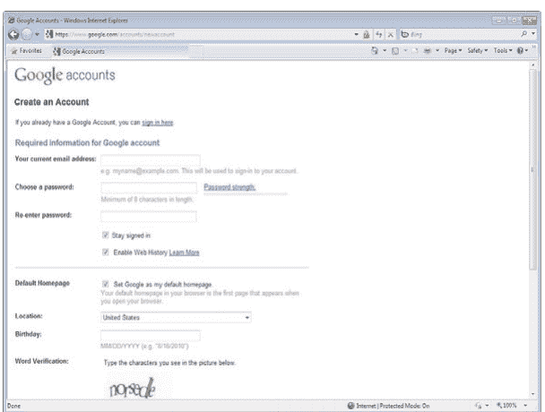

**图 9.3**

*创建账户页面。*

5. 在“文字验证”（Word Verification）字段中输入图片中显示的单词。
6. 阅读完另一份激动人心的服务条款后，点击“我接受，创建我的账户”（I Accept, Create My Account）按钮。
7. 一封包含验证账户信息的邮件会发送到你提供的电子邮箱。阅读该邮件并按照说明操作。
8. 登录后，返回 Google Sites 主页（sites.google.com）。

##### 创建 Google 网站

登录 Google 账户后，返回 Google Sites 主页，以便开始构建你的第一个 Google 网站。

1. 在浏览器中打开 http://sites.google.com/，然后点击“从数十个预建模板创建网站”（Create a Site from Dozens of Pre-Built Templates）按钮。这将打开“创建新网站”页面（见图 9.4）。该页面将引导你完成设置 Google 网站的初始步骤。

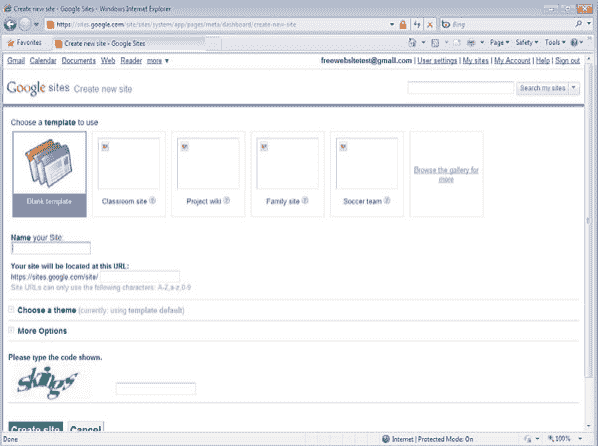

**图 9.4**

*创建新网站页面。*

2. Google Sites 首先要求你选择模板。模板会让你的工作轻松许多，所以在选择之前请花时间浏览一下。

3. 在“网站名称”（Site Name）字段中，输入你的 Google 网站名称。这可以是你想要的任何名称，但要确保它能很好地代表你的内容。

4. 定义你的网站统一资源定位符（URL）。这是人们找到你网站的方式。Google Sites 会根据你的网站标题提供一个 URL 建议，但你可以更改。URL 可以包含数字或字母（小写和大写均可），但不能有空格。它位于 http://sites.google.com/site/ 的末尾。

> **注意** 你无法在 Google Sites 中使用自己的域名。

你的网站必须存在于 Google Sites 的平台之下。如果你想要使用自己的域名，这项服务以及其他网页服务可能不适合你。

5. Google Sites 预装了网站主题（Site Themes）。这些主题为你的网站赋予色彩和个性。目前约有二十多种主题，但 Google 会不断添加更多。

6. 点击“更多选项”（More Options）旁边的加号，并输入网站描述。这是当有人搜索你的网站时显示的内容。它也有助于你自己在脑海中清晰地定义你的网站。

7. 选择将你的网站设为私有或公开。私有网站只允许你指定的人（拥有 Google 账户）访问你的网站。将网站设为公开则意味着任何人都可以查看和搜索你的网站。

> **注意** 默认情况下，Google Sites 会为你设置两个页面。第一个页面是主页；第二个是网站地图，它会自动创建你网站上的页面列表以及它们的链接方式。

8. 如果你的网站包含或可能包含成人内容（成人图片、文字或声音），请勾选“成人内容”（Mature Content）复选框。

9. 输入显示的文字验证码，以验证你是真实的人。

10. 点击“创建网站”（Create Site）。这会创建你网站的基础架构，带你进入 Google 网站页面编辑器，并打开主页。Google Sites 页面查看器（见图 9.5）就是你用来创建网站的工具。

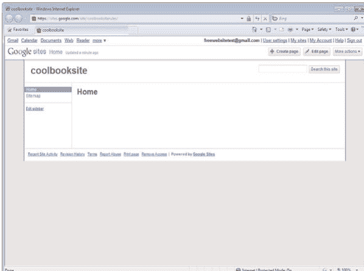

**图 9.5**

Google Sites 页面查看器。

#### 编辑页面

你可以单独编辑 Google 网站中的每个页面。你可以添加多种元素、输入和格式化文本、添加表格或更改页面布局。只需按照以下步骤操作：

1. 打开 sites.google.com，在“我的网站”（My Sites）列表下选择你的网站。
2. 从导航列表中选择“主页”（Home）。
3. 点击“编辑页面”（Edit Page）按钮。这将打开“编辑页面”工具（见图 9.6）。使用此工具编辑页面上的文本，包括标题和正文文本。

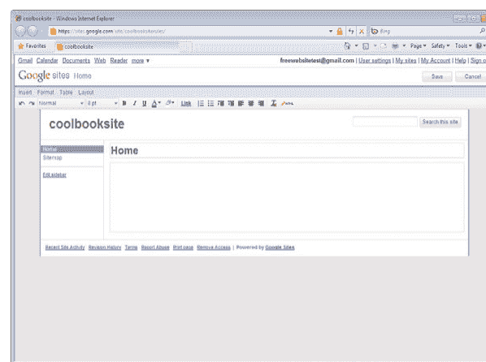

**图 9.6**

Google Sites 页面编辑器。

4. 如果你想更改网页标题，点击标题区域并编辑文本。
5. 要向网页正文添加或编辑文本，点击正文区域并输入文本。你可以使用文本格式工具栏来设置字体类型、大小、**粗体**、*斜体*、下划线、颜色或高亮。你还可以使用此工具栏查看和编辑页面的超文本标记语言（HTML）。
6. 如果你想为网页添加一些特殊功能，请使用“插入”（Insert）下拉菜单。每个可用的对象在不同情况下都很有用，所以尽情尝试吧。你可以向网站添加以下内容：
    - 图片（Image）
    - 链接（Link）
    - 目录（Table of contents）
    - 子页面列表（Subpage listing）
    - 水平线（Horizontal line）
    - Google AdSense 对象
    - Google 日历对象
    - Google 文档对象
    - Google 地图对象
    - Picasa 照片
    - Picasa 网络幻灯片
    - Google 演示文稿对象
    - Google 电子表格对象
    - Google 电子表格表单对象
    - Google 视频对象（Google 视频或 YouTube 视频）
    - 最新文章小工具（Recent Post gadget）
    - 最近更新文件小工具（Recently Updated Files gadget）
    - 最近列表项目小工具（Recent List Items gadget）
    - 文本框小工具（Text Box gadget）
    - 更多（点击查看最新 Google 小工具）
7. 如果你想以文本格式工具栏上不可用方式设置文本格式，请选择文本，然后使用“格式”（Format）下拉菜单。
8. 如果你想插入表格或编辑现有表格，请使用“表格”（Table）下拉菜单。
9. 如果你想更改页面布局，可以使用“布局”（Layout）下拉菜单选择单栏或双栏布局。
10. 完成后，点击“保存”（Save）按钮。你的页面现在会显示你所做的更改。

##### 创建页面

你的 Google 网站从主页开始，但你可以自由添加更多页面。要添加新页面，请按照以下步骤操作：

1. 点击“创建页面”（Create Page）按钮，向你的 Google 网站添加一个新网页。这将打开“创建新页面”界面（见图 9.7）。

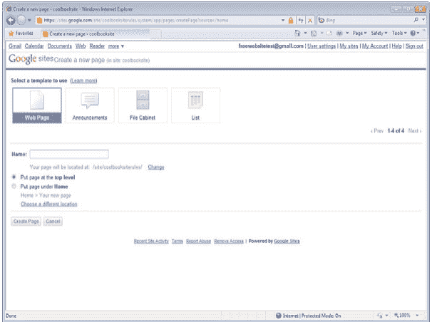

**图 9.7**

*创建新页面界面。*

2. 选择你要添加的页面类型：网页（Web Page）、公告（Announcements）、文件柜（File Cabinet）或列表（List）。
3. 在“名称”（Name）字段中，输入页面标题。
4. 如果你想让该页面与主页处于同一层级，请选择“将页面置于顶层”（Put Page at the Top Level）。如果你想让新网页位于主页之下，请选择第二个选项。
5. 点击“创建页面”（Create Page）。这会添加该页面并在编辑模式下打开它。

##### 移动页面

当你创建更多页面时，可能需要调整页面位置。要移动页面，请执行以下操作：

1. 从“更多操作”（More Actions）菜单中，点击“移动”（Move）。“移动页面”界面将打开（见图 9.8）。你可以使用此界面将页面拖动到想要的位置。
2. 点击“移动”（Move）。

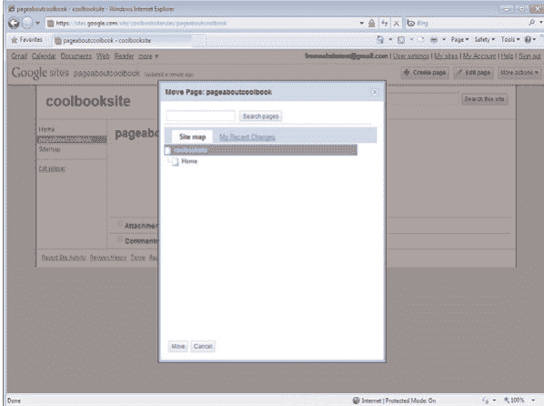

###### 删除页面

你可能会创建一个后来不再需要的页面。要删除页面，请执行以下操作：

1. 从“更多操作”（More Actions）菜单中，点击“删除”（Delete）。Google Sites 会确认你是否要删除该页面。
2. 点击“删除页面”（Delete Page）。该页面将被删除。

###### 编辑页面设置

每个页面都有自己的设置。这些设置包括是否在导航栏中显示页面、显示页面标题和指向其他页面的链接，以及允许评论。

你还可以更改页面 URL。要编辑页面设置，请按照以下步骤操作：

1. 从“更多操作”（More Actions）菜单中，点击“页面设置”（Page Settings）。“页面设置”界面将打开（见图 9.9）。

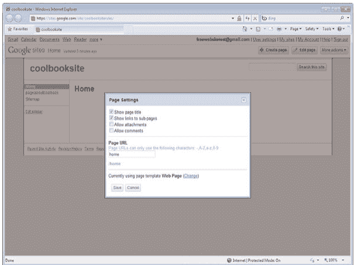

**图 9.9**

*页面设置界面。*

2. 编辑你想要的设置。
3. 点击“保存”（Save）。

##### 编辑网站设置

与每个页面一样，你可以更改许多 Google 网站设置。这些包括：

- 网站共享（Site sharing）
- 外观（Appearance）
- 其他设置，例如你设置网站时选择的选项

你可以通过“更多操作”（More Actions）按钮，选择“管理网站”（Manage Site）来访问所有这些设置。

##### Google Sites 的功能与限制

在决定坚持使用 Google Sites 之前，你需要了解它的一些功能和限制。

#### 功能

- 单击即可创建页面
- 无需 HTML
- 10 GB 存储空间
- 主题
- 页面共享

###### 限制

- 无法使用自有域名
- 必须使用 Google 主题
- 结构有限
- 无法复制网站部分内容

#### Wetpaint

如果你想搭建一个简单的社交网络或维基，可以考虑 Wetpaint。这项服务于 2005 年推出，专门用于为各种乐队、电视节目、电影或名人创建粉丝网站。本节介绍如何注册该服务以及编辑页面。

##### 注册 Wetpaint

要使用 Wetpaint，你需要注册一个 Wetpaint 账户。从 Wetpaint 主页开始：

1. 打开浏览器，输入 http://www.wetpaint.com/。这将打开 Wetpaint 主页（见图 9.10）。
2. 点击页面顶部的“开始”（Go）按钮。这将带你进入注册页面（见图 9.11）。


## 图 9.10

Wetpaint 主页。

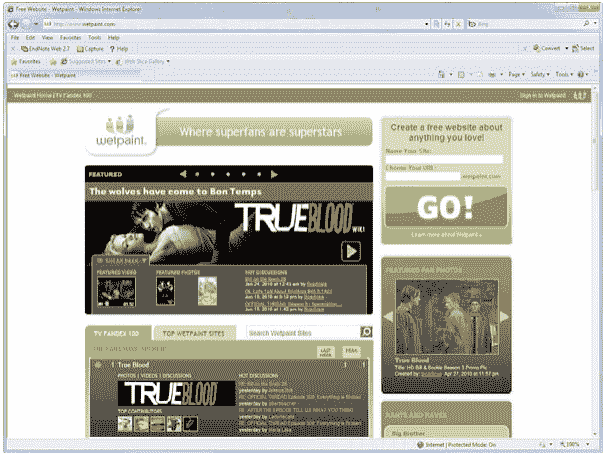

## 图 9.11

注册页面。

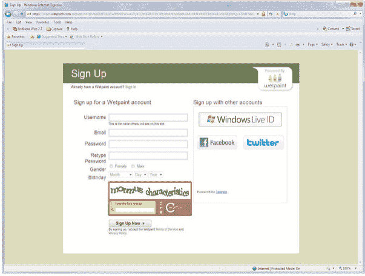

3. 输入你的用户名、电子邮件、密码（两次）、性别、出生日期以及页面显示的验证码。

4. 点击"立即注册"按钮。

##### 在 Wetpaint 上创建站点

创建 Wetpaint 账户后，你就可以开始构建你的第一个 Wetpaint 站点了（参见图 9.12）：

1. 输入你的站点名称、网址、描述和类别。
2. 选择谁可以查看你的站点。可以是任何人、专门加入你站点的人，或者仅站点创建者。
3. 点击"继续到第 2 步：有趣的部分"按钮。
4. 为你的网站选择一种样式，然后点击"继续到第 3 步"按钮。
5. 最后，输入图片中出现的文字以证明你是人类。
6. 站点创建完成后，点击"前往我的站点"按钮。

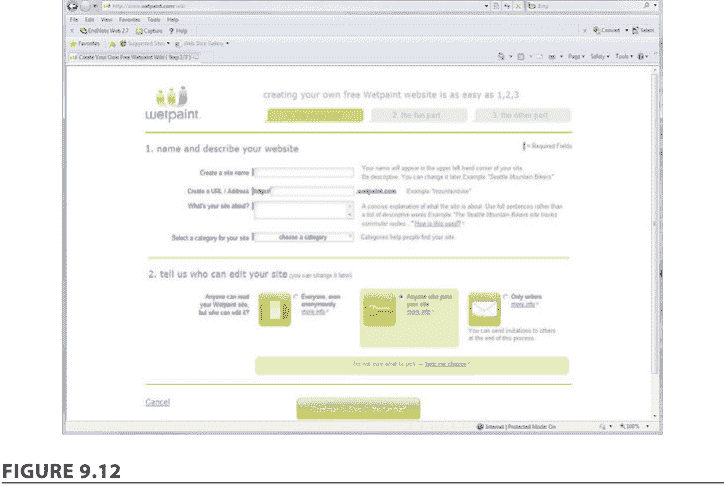

**图 9.12**
站点创建页面。

#### 编辑页面

你可以分别编辑 Wetpaint 站点中的每个页面。你可以添加多种元素、输入并格式化文本，或更改页面布局。要编辑页面，请按以下步骤操作：

1. 打开 www.wetpaint.com，点击页面顶部的"我的 Wetpaint 站点"。选择你要编辑的站点。
2. 点击"轻松编辑"按钮。这将打开页面编辑工具（参见图 9.13）。这看起来和你的页面一样，但所有文本都是可编辑的。使用此工具编辑页面上的文本，包括标题和正文。

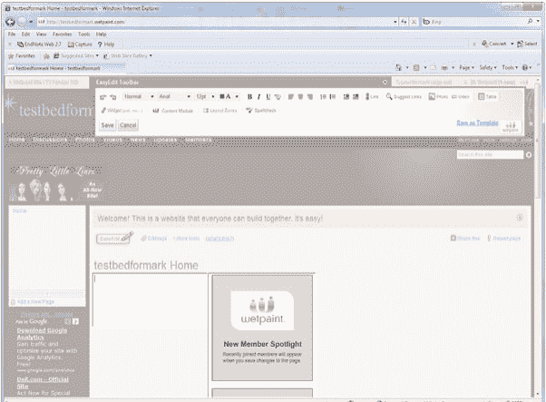

**图 9.13**
*Wetpaint 页面编辑器。*

3. 完成后，点击"保存"按钮。你的页面现在会显示你所做的更改。

##### Wetpaint 的功能与限制

在决定继续使用 Wetpaint 之前，你应该了解一些 Wetpaint 的功能和限制。

# 第三部分 网站建设基础

#### 功能

- 简洁优雅的界面
- 主题
- 照片

###### 限制

- 不允许使用 HTML
- 不能使用域名
- 必须使用 Wetpaint 主题
- 只能创建一个站点
- 无法复制站点部分内容

#### Netvibes

Netvibes 是一种不同类型的网页创建服务。它可以让你创建一个起始页，其中包含指向你最喜欢的新闻源、待办事项列表、天气、Facebook、Flickr、Craigslist、Digg、eBay 等的链接。它本质上将整个网络汇集在一个页面中。该服务还允许你与他人共享该页面，使其成为团队项目主页。本节介绍如何设置你的 Netvibes 账户、运行起始向导、添加内容以及将页面设为公开。

##### 注册 Netvibes

要获得 Netvibes 的全部功能，你需要注册一个账户。这使 Netvibes 能够记住你的所有设置。要注册 Netvibes，请按以下说明操作：

1. 打开浏览器并访问 www.netvibes.com/。这将打开默认的 Netvibes 起始页（参见图 9.14）。Netvibes 有一些出色的默认功能（如新闻、天气和股市信息）。
2. 点击右上角的"登录"。这将打开登录窗口。
3. 要创建新账户，点击"注册"。这将打开注册窗口（参见图 9.15）。
4. 输入你的电子邮件和密码，然后确认密码。
5. 阅读（或不阅读）后，同意服务条款。

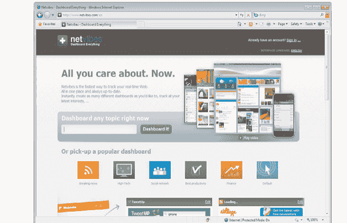

**图 9.14**
Netvibes 起始页。

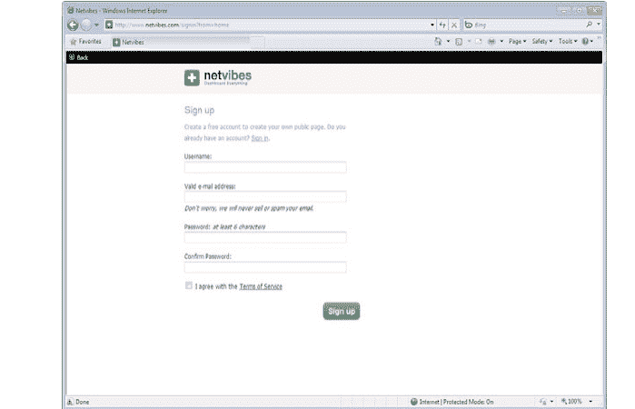

**图 9.15**
Netvibes 注册页面。

6. 点击"注册"。系统会向你发送一封电子邮件以确认你的电子邮件地址。按照说明完成 Netvibes 账户的设置。

##### 个性化你的 Netvibes 页面

确认电子邮件地址后，你将进入 Netvibes 主页。该页面已经为你加载了一些有用的小组件。按照以下步骤个性化你的页面：

1. 点击屏幕左上方标签中"常规"旁边的"编辑"。这允许你选择所使用小组件的方向。当你对页面外观满意时，点击右侧的红色 X 关闭编辑视图。
2. 你现在可以使用小组件右上角的"编辑"链接来编辑任何单个小组件。
3. 你可以通过点击小组件右上角的 (X) 按钮删除任何不喜欢的小组件。
4. 要添加新小组件，点击屏幕左上方的绿色"添加内容"按钮。然后选择你想要的选项，点击下方的 (添加) 按钮。完成添加小组件后，点击右侧的红色 (X) 按钮。

# 第 10 章

## HTML 入门

HTML 是网络的通用语言。它是互联网上每个网页的编程语言。要在网上做任何事情，你需要扎实掌握 HTML 的工作原理以及其他人如何使用它。

HTML 代表超文本标记语言（Hypertext Markup Language）。"超文本"是指文档之间以及文档内部存在相互连接的链接。链接的页面使网络能够不断扩展并变得更加互联互通。标记语言使用标签来"标记"文本，以应用格式和结构。标签本质上是一个文本标记，表示特定类型格式的开始和结束。

HTML 于 1991 年由蒂姆·伯纳斯-李（Tim Berners-Lee）创建，他是位于瑞士的科学研究机构 CERN 的研究员。蒂姆希望创建一个简单的文档组织系统，既能保持简洁性又能实现交叉引用。当其他人开始使用 HTML 时，它迅速发展起来，我们所熟知的网络就此诞生。

**本章内容**
* HTML 的结构
* 常用 HTML 标签
* 免费 HTML 编辑器
* 资源
* HTML 的最新版本

如果你从未做过任何编程，你可能会认为在一章之内掌握它太难了（参见图 10.1）。恰恰相反，如果你理解基础并保持简单，HTML 是很容易的。我的背景不是数学或工程。和数百万其他人一样，我通过阅读和实验来学习 HTML。HTML 是一个很好的学习沙盒。

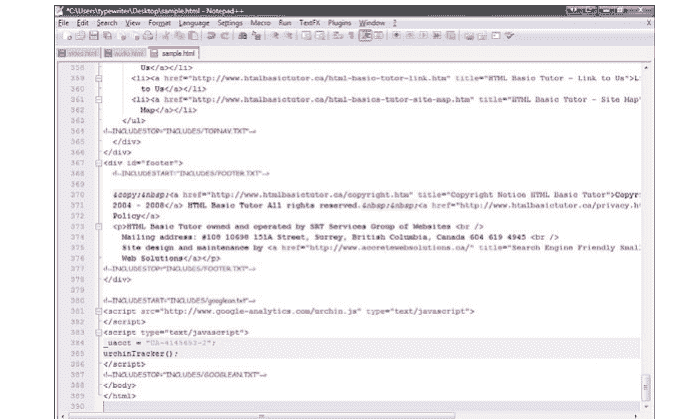

**图 10.1**
一个复杂的 HTML 页面。

本章介绍 HTML 的工作原理基础、常用 HTML 标签以及 HTML 编辑器。所有这些都可以帮助你创建网页并理解其他人创建的内容。

HTML 也处于不断变化的状态。因此，我添加了关于 HTML 最新版本的信息，以及它对初学 Web 开发者的意义。

### HTML 的结构

第一次查看网页的底层代码可能会令人困惑。为什么？因为如果不了解 HTML 的工作原理，很难理解发生了什么。所以，弄清楚这一切的第一步是学习 HTML 的基本组成部分。

如前所述，HTML 是一种标记语言。你使用标签来"标记"文本。然后浏览器解释这些标签，正确的格式和结构会显示在网页上。Web 浏览器不显示代码，而是根据你创建的 HTML 显示编码后的内容。

### 标签的结构

标签是应用于文本块的文本标签。标签有三个部分：

- **开始标签**——标签的开头用 `<` 符号表示。随后是标签名称和 `>`。例如，`<b>`。
- **受标签影响的文本**——标签内包含的任何内容都会应用相应的格式或结构。
- **结束标签**——这结束对文本有影响的标签。它由 `<` 和表示关闭的 `/` 组成，然后是标签名称和 `>`。例如，`</b>`。

例如，取这段文本：

The quick brown fox jumped over the lazy dog.

这只是纯文本。添加标签后，它看起来像这样：

```
The `<b>`quick`</b>` brown fox jumped over the lazy dog.
```

> **提示** 注意标签如何不会向显示的文本添加空格。就好像它们不存在一样。创建 HTML 时请牢记这一点。

在浏览器中查看时，文本变为

The **quick** brown fox jumped over the lazy dog.

标签可以相互嵌套。例如，

```
The `<i><b>`quick`</b>` brown fox`</i>` jumped over the lazy dog.
```

产生看起来像这样的文本：

The *quick brown fox jumped over the lazy dog.*

`</i>` 标签应用于标签内的所有文本，包括粗体文本。

这对任何标签或一组标签都是如此。标签之间的内容会应用该标签的格式。

下一节介绍最常用的标签——它们的作用以及如何使用它们。


### 常用 HTML 标签

熟悉一些常用 HTML 标签非常重要。以下列表按类别组织了这些常用标签。每个标签都附有描述、代码示例，并在适当的情况下提供了结果示例。

### HTML 结构标签

以下部分描述了构成网页结构和框架的标签。

#### HTML `<html></html>`

所有其他 HTML 标签必须包含在此标签内。这应该是文档中的第一个和最后一个标签。

#### 头部 `<head></head>`

此标签定义 HTML 文档头部的结构。它从不出现在浏览器中，但包含标题信息、脚本和其他格式信息。

#### 标题 `<title></title>`

这是网页标题。此文本出现在浏览器的标题栏上。它应出现在头部标签内。

#### 主体 `<body></body>`

这是整个网页的主体。你希望在页面上显示的任何内容都必须包含在主体标签中。

#### 注释 `<!-- -->`

此标签允许你为代码添加文档。文档化意味着在代码中添加注释，解释代码不同部分的功能。开发者使用此功能与阅读代码的人交流，或作为自己的参考笔记。这使得理解大型 HTML 文档变得容易。尽可能多地为你的代码添加文档。注释永远不会显示在你的网页上，但有助于编辑过程。例如，

```
<!-- This is the body section of my web page -->
```

#### 分区 `<div></div>`

此标签将网页主体划分成区域。然后你可以对这些区域应用格式。`<div>` 标签不会在浏览器中显示，但其效果会显示出来。使用它来为网页的不同区域应用格式。有关 `<div>` 标签的更多信息，请查阅第 13 章 "使用 HTML 构建网站"。

### 文本标签

这些标签影响页面主体中的文本。

> **注意** 不要在此标签中使用你计算机上的任何旧字体。它可能在你的机器上正常工作，但你不知道访问者的机器上有什么字体。如果访问者的机器上没有该字体，浏览器将显示浏览器的默认字体，页面可能无法按你的预期显示。

#### 字体 `<font></font>`

此标签定义标签中包含的大小、颜色和字体。每个具体细节都在开始标签内定义。例如，如果你想要 Arial 字体、大小 8 和红色，标签将是

```
<font face="arial" color="red" size="8"></font>
```

#### 加粗 `<bold></bold>`

此标签将文本加粗。它使文本看起来比普通文本更黑、稍大。

例如，The `<bold>quick</bold>` brown fox. 产生

The **quick** brown fox.

#### 斜体 `<italic></italic>`

此标签使文本倾斜。它使文本看起来向右倾斜。

例如，The `<italic>quick</italic>` brown fox. 产生

The *quick* brown fox.

#### 删除线 `<strike></strike>`

此标签创建删除线文本，即有一条线穿过文本。

例如，The `<strike>quick</strike>` brown fox. 产生

The ~~quick~~ brown fox.

#### 下划线 `<u></u>`

此标签为文本添加下划线。一条线出现在所有文本下方。

例如，The `<u>quick</u>` brown fox. 产生

The <u>quick</u> brown fox.

#### 下标 `<sub></sub>`

此标签创建出现在其他文本行下方的文本。

例如，The `<sub>quick</sub>` brown fox. 产生

The <sub>quick</sub> brown fox.

#### 上标 `<sup></sup>`

此标签使文本出现在其他文本行上方。

例如，The `<sup>quick</sup>` brown fox. 产生

The <sup>quick</sup> brown fox.

#### 居中 `<center></center>`

此标签使文本居中。

例如，`<center>The quick brown fox. </center>` 产生

<center>The quick brown fox.</center>

#### 标题 `<h#></h#>` (# 是 1 到 6 之间的数字)

此标签将标签内的文本格式化为六级标题之一。这些标题以典型文档中的方式组织你的文本。标题对应层级；因此，H1 比 H2 更大、更突出，H2 比 H3 更突出，依此类推。

例如，`<h1>The</h1><h2>quick</h2>brown<h3>fox.</h3>` 产生

# The

## quick

brown

### fox.

### 段落 `<p></p>`

此标签定义一个段落，并包括段落的格式和间距。

例如，`<p>The quick brown fox jumps over the lazy dog.</p>` 产生
The quick brown fox jumps over the lazy dog.

### 水平线 `<hr>`

水平线横跨页面。

例如，The quick brown fox. `<hr>` 产生
The quick brown fox.

### 换行 `<br>`

此标签中断一行文本。你可能希望使用此标签使文本按你想要的方式换行，而不是让浏览器默认断行。

例如，The quick `<br>`brown fox. 产生
The quick
brown fox.

### 不间断空格 `&nbsp;`

此标签在你需要的位置插入空格。例如，The `&nbsp;` quick 在 *the* 和 *quick* 单词之间添加了一个空格。

#### 列表

HTML 列表有两种类型：无序列表（即带项目符号）或有序列表（即带数字）。你需要做的第一件事是将文本定义为列表，然后定义该列表的元素。每个元素都有自己的标签，与其他标签一起创建列表。首先，我将介绍标签，然后展示如何将它们组合起来。

#### 有序列表 `<ol></ol>`

此标签创建一个每个列表项都有数字的列表。

#### 无序列表 `<ul></ul>`

此标签创建一个每个列表项都有项目符号的列表。

#### 列表项 `<li></li>`

此标签定义一个列表项。

因此，列表的 HTML 代码如下所示：

```
<ol>
<li>Item </li>
<li>Item </li>
<li>Item </li>
</ol>
<ul>
<li>Item </li>
<li>Item </li>
<li>Item </li>
</ul>
```

以下是列表在网页上的显示方式：

1. Item
2. Item
3. Item

- Item
- Item
- Item

### 表格

表格类似于列表。它们组合几个标签来构成一个表格，就像几个标签构成一个列表一样。表格由行和列组成。表格也可以有一个作为标题行的标题行。同样，我将先描述表格标签，然后在代码中将它们组合起来。

#### 表格 `<table></table>`

此标签包围表格并定义其边界。表格的属性也在此标签内定义——如边框、对齐方式和宽度。

#### 表格行 `<tr></tr>`

此标签定义表格的一行。

#### 表格单元格 `<td></td>`

此标签定义表格行中的每个单元格。

#### 表格标题 `<th></th>`

此标签将一行定义为标题行，并以粗体显示。

因此，要创建一个有三行两列的表格，HTML 代码如下所示：

```
<table border="1">
  <tr>
    <th>Cell 1</th>
    <th>Cell 2</th>
  </tr>
  <tr>
    <td>Cell 3</td>
    <td>Cell 4</td>
  </tr>
  <tr>
    <td>Cell 5</td>
    <td>Cell 6</td>
  </tr>
</table>
```

这将创建一个如下所示的表格：

| Cell 1 | Cell 2 |
| :--- | :--- |
| Cell 3 | Cell 4 |
| Cell 5 | Cell 6 |

> **极客术语**
>
> 嵌套表格意味着一个表格包含在另一个表格的单元格中。这使你能够创建页面格式化所需的复杂结构。

表格可以比这复杂得多。你可以在表格中*嵌套*表格，以创建用于显示信息的复杂结构。

### 超链接

超链接在 HTML 中被定义为锚点和引用。锚点是超链接文本或图形，引用是你点击超链接时跳转到的位置。文本和图形都可以作为锚点。引用可以是 HTML 文档内部或指向另一个文档。超链接由这些部分组成：锚点标签、引用以及被超链接的文本或图像。例如：

```
Follow this <a href="http://www.flickr.com">link</a>
```

这为单词 *link* 创建了一个指向 http://www.flickr.com 的超链接。要在新窗口中打开链接，请在锚点标签中添加 target 属性：

```
Follow this <a href="http://www.flickr.com" target="_blank">link</a>
```

链接现在将在新窗口中打开。在浏览器中，超链接文本默认显示为蓝色并带下划线。如果是图像，则会显示蓝色轮廓。当你的鼠标悬停在超链接上时，它会从箭头变为小手。

#### 图像

图像不会出现在 HTML 代码中。出现的是对文件的引用。这些引用可能在本地 Web 服务器上，也可能在网络上的其他地方。例如：

```

```

如果文件 angry.gif 与 HTML 文件在同一目录中，此代码将显示该图像文件。

### 免费 HTML 编辑器

既然你了解了 HTML 的基础知识，你将开始创建和编辑 HTML 代码。你可以使用多种免费的 HTML 编辑器，它们分为两类：文本编辑器和 WYSIWYG（所见即所得）编辑器。文本编辑器直接编辑 HTML 代码；WYSIWYG 编辑器为你构建 HTML 代码。

> **提示** 不要引用你硬盘驱动器上的文件。使用 WYSIWYG 编辑器时有时会发生这种情况。始终根据你所在的页面引用图像文件位置。如果图像在同一目录中，只需使用文件名。注意你所做的引用。引用是常见的错误来源，因此请仔细检查。


### 文本编辑器

文本编辑器允许你直接在HTML代码中工作。这让你能够轻松地搜索文本文档，准确找到所需内容，并快速进行编辑。使用所见即所得编辑器时，你想要修改的代码可能难以找到。我更喜欢使用文本编辑器来编辑HTML代码。以下是一些常见的文本编辑器：

-   记事本（Windows）—Windows操作系统自带。
-   Notepad++（Windows, Linux）—http://notepad-plus.sourceforge.net/uk/site.htm。最好的文本编辑器。
-   TextWrangler（Mac）—www.barebones.com/products/textwrangler/index.shtml（参见图10.2）。一款优秀的Mac文本编辑器。

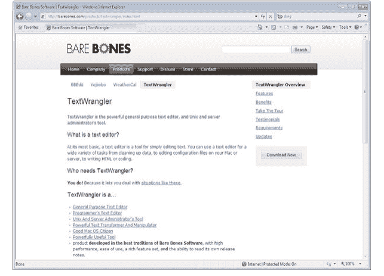

**图 10.2**
一款出色的Mac文本编辑器。

-   XEmacs（Windows, Linux, UNIX）—www.xemacs.org/index.html。另一款优秀的文本编辑器。

### 所见即所得编辑器

这类编辑器以图形方式构建网页并为你生成代码。你可以按照网页在浏览器中的最终呈现效果来构建它，而所见即所得编辑器会为你生成相应的代码。这些编辑器使得诸如创建复杂表格之类的工作变得极其简单。不幸的是，它们也可能在你的HTML中添加不必要的标签，但它们对初学者来说非常理想。以下是一些主要的编辑器：

-   KompoZer（Windows, Mac, Linux）—www.kompozer.net（参见图10.3）


**图 10.3**
一款开源的图形化HTML编辑器。

-   Quanta Plus（Windows, Linux）—http://quanta.kdewebdev.org
-   Bluefish（Windows, Mac, Linux）—http://bluefish.openoffice.nl
-   OpenLaszlo（Windows, Mac, Linux）—www.openlaszlo.org

### 资源

本章仅仅触及了HTML的皮毛。还有更多的知识需要学习，你学得越多，就能让你的网站实现更多功能。

以下是一些有助于你进一步理解HTML的资源：

-   W3Schools (www.w3schools.com)—可能是互联网上最好、最简洁的HTML教学工具（参见图10.4）。收藏此网站，因为你将经常访问。


**图 10.4** *W3Schools是互联网上最好的HTML资源之一。*

-   Webmonkey HTML 速查表 (www.webmonkey.com/2010/02/html_cheatsheet)—这是另一个适合初学者的优秀资源。
-   如果你对HTML一无所知，那就从这里开始 (www.htmlgoodies.com/primers/html/article.php/3478131)—标题已说明一切。这是一份优秀的HTML入门教程合集。
-   HTML基础教程 (www.htmlbasictutor.ca)—这个网站就像拥有你自己的HTML家教。

### HTML最新版本

就像软件程序一样，HTML也有不同的版本，最新的版本HTML5正在开发中。每个版本都会引入新的功能、标签和浏览器兼容性问题。HTML5仍在开发中，但即使是最新的网络开发者也应该了解其动态。HTML5的目标是将多媒体更好地集成到网站中。在将HTML5内容添加到你的网站之前，请确保在尽可能多的浏览器上进行测试。为了帮助你，我已在附录A“最常用HTML标签列表”中添加了一些新标签。我还在下方添加了一些HTML5参考资料。

-   W3C HTML5 参考手册 (http://dev.w3.org/html5/html-author)—这是关于HTML5最完整、最新的信息。
-   HTML5 解密：技巧、窍门与技术 (www.w3avenue.com/2010/05/07/html5-unleashed-tips-tricks-and-techniques)—以平实的语言很好地概述了HTML5的特性。
-   HTML5 快速参考指南 (http://veign.com/reference/html5-guide.php)—为HTML5开发者准备的快速参考指南。
-   THE HTML5 TEST (http://html5test.com/)—使用此网站测试你的浏览器的HTML5功能。它详细列出了所有新的HTML5特性，并告诉你浏览器是否支持它们。

> **注意**
>
> HTML5是全新的软件，可能随时发生变化。请谨慎使用其中的任何代码。

# 第11章

## 处理图像

信不信由你，在1993年之前，互联网主要是基于文本的。对你们中的一些人来说，这可能看起来几乎难以置信。从那时起，互联网变成了一个充满色彩和生动图像的视觉化世界。

本章介绍不同类型的图像、可以使用的相关程序、如何在网页上使用它们，以及在哪里可以找到它们。

在开始之前，你应该了解一些术语：

-   像素—就像组成物质的原子一样，像素构成了数字图像。像素是数字图像中最小的信息单位，代表一种颜色。每张图像都可以描述为一定数量的像素高和一定数量的像素宽（参见图11.1）。


**图 11.1**
*这张图像高150像素，宽300像素。*

### 本章内容

-   网页图形
-   优化图像
-   查找图像
-   使用你自己的图像

-   **分辨率**—图像的分辨率是指构成一平方英寸的像素数量。分辨率越高，文件大小就越大。最常见的分辨率是每英寸72像素。
-   **RGB**—红、绿、蓝。这是一种通过按特定比例混合红、绿、蓝三色来创建颜色的模式。每种颜色的值从0到255不等。使用这种方法，你可以获得超过1600万种颜色。有关颜色的更多信息，请参阅第4章“设计你的网站”。
-   **十六进制**—一种将三位数的RGB数字转换成HTML能够理解的两位数的方法。

### 网页图形

网页上使用的图像文件类型几乎和网页本身一样多。本节介绍最常见的三种文件格式。除非你正在做一些完全非同寻常的事情，否则应该坚持使用这些格式。

### 有损与无损压缩

我建议你始终尽量保持文件大小较小。一个100字的HTML文件可以小到8,192字节，而一个100像素乘100像素（大约邮票大小）的小图像文件却几乎有它一半的字节数。图像压缩旨在尽可能减小文件大小，同时保持质量。有损压缩会轻微降低图像质量以减小文件大小。无损压缩不会降低质量，因此通常文件大小的缩减不如有损压缩明显。以下是最常见的文件类型列表：

-   **图形交换格式 (.gif)**—这是一种无损文件格式，在网络上很常见。这些文件最多只能保存256种颜色，因此它更适合图形而不是照片（参见图11.2）。你可以让.gif中的某一种颜色变得透明（背景会显示出来），并且可以制作.gif动画文件。动画.gif将在本章后面介绍。
-   **便携式网络图形 (.png)**—这种无损图像格式正在取代.gif，并在网络上变得越来越普遍。和.gif一样，.png也可以是透明的。它的文件可能比.gif或.jpg更大。


**图 11.2**
一张最好保存为.gif格式的图形示例。

-   **联合图像专家组格式 (.jpg 或 .jpeg)**—这是一种有损文件格式，但这并不意味着它不好。它只是利用数学来识别模式，从而减小图像大小。然而，更高的压缩率意味着更低的图像质量。.jpg可以一次显示数百万种颜色。这种格式主要用于照片。它是网络上最常用的文件格式。我在圣安东尼奥拍摄的一张照片（如图11.3所示）就是保存为.jpg格式的图形示例。


**图 11.3**
一张最好保存为.jpg格式的图形示例。

### 图像标签

要在网页上添加图像，请使用HTML标签 `IMG`。此标签有几个属性（或称特性）。属性用于定义图像的显示方式。下表列出了一些更常见的属性。

| 属性 | 描述 | 备注 | 示例 |
|---|---|---|---|
| src | 必需属性，指定要显示图像的文件位置和完整名称。 | 需要指定相对于服务器上HTML文件的精确文件位置。 | `` |
| alt | 如果图像未显示时显示的替代文本。 | | `` |
| align | 指定图像相对于文本的放置方式。值可以是 top, bottom, middle, left, 和 right。 | 文本环绕图像。 | `` |
| border | 图像周围边框的像素宽度。 | 边框始终为黑色。 | `` |
| height | 将图像的高度更改为指定的像素数或原始图像的百分比。 | 这会拉伸或压缩图像到指定像素高度，而不会缩放宽度，因此图像可能会变形。尽可能不要使用。 | `` |
| width | 将图像的宽度更改为指定的像素数或原始图像的百分比。 | 这会拉伸或压缩图像到指定像素宽度，而不会缩放高度，因此图像可能会变形。尽可能不要使用。 | `` |
| ismap | 指定图像为服务器端图像映射。 | 有关图像映射的更多信息，请参阅本章“图像映射”部分。 | |
| usemap | 指定图像为客户端图像映射。 | 有关图像映射的更多信息，请参阅本章“图像映射”部分。 | |
| longdesc | 指向包含图像长描述的URL链接。 | 很少使用。 | `` |
| hspace | 定义图像周围的水平间距（以像素为单位）。 | 这会在图像两侧添加边距空间。 | `` |
| vspace | 定义图像周围的垂直间距（以像素为单位）。 | 这会在图像上下添加边距空间。 | `` |


### 背景图片

你可以将图片用作整个页面的背景。背景图片使用 BODY 标签和 background 属性。虽然该属性在引入时曾风靡一时，但现在被视为过时或俗气。如果你打算使用背景图片，请使用 CSS。有关如何使用层叠样式表 (CSS) 的更多信息，请参阅第 13 章 "使用 HTML 构建网站"。

### 图像映射

图像映射是一种 HTML 结构，允许你在图像上指定与超链接相关联的坐标。图像映射可以是服务器端的（即，服务器上存储有协助图像映射的文件），也可以是客户端的（图像映射的所有信息都存储在 HTML 文件中）。

客户端图像映射在 HTML 代码中使用 MAP 和 AREA 标签来定义在图像特定区域点击时执行的操作。

你甚至可以在网上找到帮助构建图像映射的网站。如图 11.4 所示，在线图像映射生成器 (www.maschek.hu/imagemap/imgmap) 使你能够轻松定义客户端图像映射，并为你生成代码。

### 动画 GIF

动画 GIF 是一系列 .gif 文件保存在一个较大的 .gif 文件中，在加载到网页浏览器时会播放动画。应谨慎使用，如果可能的话，最好不用，因为它们可能是文件较大的文件，会减慢页面的加载时间，并且被认为是俗气的吸引注意力的手段。如果需要添加动画 .gif，请使用免费的在线动画 .gif 创建器，如 gickr (http://gickr.com/)。


**图 11.4**
*在线图像映射编辑器。*

### 优化图片

正如我之前所说，你的网站应该拥有最佳质量且文件大小最小的图片。归根结底，这是一种权衡。有时，那张拥有数百万种颜色的高分辨率照片能让您的网站看起来浑然一体、惊艳夺目，但其他时候，拥有加载速度最快的网站才是最重要的。

#### 调整图片尺寸

不要在 HTML 中调整图片尺寸。前面提到的 `height` 和 `width` 标签永远不应使用。如果你使用这些属性来更改图像的大小，整个原始图像会被加载，然后进行缩放，因此使用这些属性没有任何好处。

#### 何时使用不同的文件类型

如前所述，尽可能使用最高级别的压缩和最少的颜色。照片应该是 `.jpg` 格式，图形应该是 `.gif` 格式。

### 图片切片

较大的图像可以被切片成较小的图像，以便它们加载得更快。当大面积区域的某些部分对于你的设计并非核心时，这当然是有效的。当你切片图像时，请确保图像在完全加载时能够对齐。

### 查找图片

在网上查找图片时，你可能会感觉像是一个走进糖果店的孩子。找到图片当然很容易，但未经所有者许可就使用它们既不合法也不道德。人们不断地将图片上传到网上，却不知道有人未经询问就拿走了它们。让我明确一点：使用未获得许可的图片是违法的。

#### 免费图片

有些网站提供免费图片。这很好，因为你可以免费使用这些图片并获得所有者许可。问题在于，它们通常不是最好的图片，并且可能会出现在其他网站上。如果你计划使用免费图片，你需要花大量时间去寻找你想要的，但价格是无可比拟的。

使用这些网站的图片时，请记住阅读所有规则和细则以保护自己。以下是一些比较好的免费图片网站：

- **知识共享** (http://search.creativecommons.org)——知识共享是一个致力于改变版权和所有权的组织。这个网站让你可以搜索知识共享许可的内容。
- **Kave Wall** (www.kavewall.com)——一个很棒的免费背景和纹理网站。
- **freestockphotography** (www.adigitaldreamer.com/gallery/index.php)——免费且免版税的图片。
- **visipix.com** (http://visipix.dynalias.com/index_hidden.htm)——高分辨率图片，免费版权可用于私人和商业用途。

#### 他人的图片

如果你在网上发现一张你想使用的图片，请联系图片的所有者，并解释你是谁、你想使用哪张图片、你的网站是关于什么的，以及为什么你想使用那张图片。如果获得许可，请务必注明图片来源。如果你没有得到许可或没有得到回应，不要擅自使用图片。

#### 使用你自己的图片

为网站寻找图片的一个解决方案是拍摄你自己的照片或制作你自己的图形。这当然更容易让你注明图片的创作者，但正如我之前所说，有人可能会拿走你的图片。如果图片对你很重要，请小心放置它们。

# 第 12 章 处理多媒体

- 数字音频文件
- 数字视频文件

众所周知，网络不仅仅是文本和图片；它还是多媒体。多媒体是多种形式的 *数字化* 媒体的组合，包括视频和音频文件。例如，来自乐队网站的歌曲和独立电影的预告片（见图 12.1）都是多媒体的形式。使用得当，多媒体可以提升用户体验。使用不当，多媒体会毁掉一个网站。本章向你展示如何为网站准备多媒体对象。

处理多媒体文件时一个重要的考虑因素是文件大小。多媒体文件通常相当大，在保持文件大小较小和维持高质量之间存在着持续的斗争。尽管宽带接入变得普遍，但仍有大量使用较慢互联网连接的人。不要假设每个人都会有闪电般快的连接来下载你大的电影文件。


**图 12.1** QuickTime.com 在使用多媒体方面做得非常出色。

另一个考虑因素是，媒体文件可能针对特定的操作系统。一个试图播放在大多数操作系统上无法运行的文件的网页只会让你的一些访客感到厌烦。在做出选择时，请确保考虑不同的操作系统，并选择可以在大多数操作系统上运行的文件类型。

此外，并非所有访问你网站的访客都可能拥有有效使用多媒体的硬件。他们可能没有扬声器或允许所有多媒体有效播放的显卡。不要把这些访客排除在外。让多媒体成为你网站上的一个增强功能，而不是一个必需品。

最后，多媒体文件可以用于下载或流媒体播放。下载的多媒体文件被传输到计算机上，然后由媒体播放器播放。流媒体文件在下载的同时播放，通常通过浏览器。你使用什么取决于多媒体文件的大小和内容。

> 极客词汇
数字化
网络上使用的任何多媒体都需要数字化，这意味着它需要被放入计算机文件中，并采用计算机能理解的文件格式。

本章涵盖了你可以在网页中使用的多媒体对象。这包括如何为你的网站创建、数字化、上传、编辑和使用多媒体对象。在第 21 章 "构建多媒体网站"中，这些元素将被整合到一个网站上。

### 数字音频文件

使用得当，音频可以增强网站的氛围。一段恰到好处的音频能吸引你的受众，将他们带入网络体验。糟糕的音频则会适得其反，甚至更糟。如果音频太响或太突兀，会让访客反感。如果音频重复或与网站没有合理的关联，它会惹恼访客而不是欢迎他们。

有些人使用音频为他们的页面添加音乐（如配乐），但如今网络上最常见的音频使用方式是播客。播客本质上是创建关于不同主题的音频节目并在网络上分发。第 21 章涵盖了如何向你的页面添加播客。

本节讨论有哪些类型的音频文件可用，如何播放它们，以及如何将它们数字化。

#### 音频格式

如前所述，音频文件有多种不同的类型。这些文件类型适用于某些操作系统，但不适用于其他操作系统。你想要的是尽可能小的文件大小，同时能在尽可能多的操作系统上运行。与图形文件一样，音频文件可以应用不同类型的压缩。此外，音频文件可以具有不同级别的音频质量。有关文件压缩的更多信息，请参阅第 11 章 "处理图片"。以下是最常见的文件类型：

- .wav — 这是 Windows 的默认音频文件类型。尽管它是 Windows 的默认格式，但你可以在大多数操作系统上使用它。它是未压缩的，因此可能导致文件大小较大，但它保持了极佳的质量。
- .mp3 — 这是目前最常见的文件格式。它几乎可以在任何连接到互联网的计算机上运行，并且是压缩的（因此文件较小），同时产生高质量的输出。
- .wma — Windows Media Audio。这种专有的 Windows 格式具有高质量和良好的压缩性，但并非在所有系统上都能播放。


这绝不是一个完整的列表，但你遇到并想要使用的大多数文件都是这些格式。如果你选择另一种格式，请务必在使用之前研究其优点和局限性。
你可以在 www.fileinfo.net/filetypes/audio 上找到更全面的音频文件格式列表。

### 音频播放器

一旦你为要使用的音频选定了格式，就需要在你的机器上安装一个播放器。播放器是你机器上的一段软件，可能在浏览器内，也可能不在，用来播放音频文件。现在大多数操作系统都内置了音频播放器，但一些开源免费音频播放器有一些不同的功能：

- **Songbird (http://getsongbird.com/)** — 这款高质量的开源音频播放器使用的是与 Firefox 浏览器相同的软件（图 12.2）。


**图 12.2**
*Songbird 是一款优秀的音乐播放器。*

- **Winamp (www.winamp.com/)** — 这款功能齐全的媒体播放器拥有庞大的开发者社区和海量的功能。

### 数字化音频

要开始为你的网站使用音频，你需要将一些音频数字化。你可以通过多种方式实现：

- **自己录制** — 通过将麦克风或乐器连接到电脑上，你可以录制自己的音频文件并将其用于你的网站。

- **从 CD 抓取** — 大多数音频和媒体播放器都允许你"抓取"CD。这意味着你从 CD 中提取音频并将其放到你的电脑上。

- **使用免版税音乐** — 免版税音频有不同的来源，既可以在网上找到，也可以通过 CD 获取。免版税音频可以免费用于任何用途。在网上搜索你想要的免版税音频类型。

> **注意** 关于音频文件及其所有权显然有版权法律。这里有一个简单的规则：不要抓取和使用你不拥有权利的音乐在你的网站上。除非你是埃尔顿·约翰，否则不要在你的网站上使用他的音乐。

### 音频编辑

将音频数字化之后，你可能想要裁剪开头或结尾、清理一些噪音，或者添加一些效果。为此，你需要一个音频编辑程序。当然，市面上有许多昂贵的高端音频编辑器，但有些是免费和开源的。其中之一就是 Audacity (http://audacity.sourceforge.net/)。它是最流行的开源音频录制器和编辑器。它拥有大量功能，可在 Windows、Mac 和 Linux 上运行（图 12.3）。

编辑好音频文件后，你需要将其保存为最适合你目的的格式。有关如何在网页上使用音频文件的说明，请查看第 21 章。


**图 12.3**
*Audacity 是多媒体网页开发者的最爱。*

### 音频资源

网络上充满了非常有用的音频资源。音频专家们已经拥抱了这项技术，并乐于分享他们的知识和技能。以下是一些有用的链接：

- **如何为网络录制音频** (www.j-learning.org/present_it/page/how_to_record_audio_for_the_web/_) — 关于如何为网络录制音频的良好概述。
- **播客录制问题** (www.jellycast.com/help-recording.html) — 关于播客制作的精彩入门介绍。
- **用简单英语讲播客** (http://commoncraft.com/podcasting) — 一段精彩描述播客基础知识的视频。

### 数字视频文件

如今，似乎每个人都在制作视频播客。它们现在在互联网上无处不在。除此之外，人们还开始拍摄自己、朋友和宠物的视频——给所有人带来欢乐——并将这些视频发布到网络上。

过去，拍摄和编辑影片是一个复杂的过程。现在不再如此。如今，人们可以录制高清数字视频，使用专业级别的工具进行编辑，然后发布到 YouTube 上供数百万人观看。和音频一样，视频也有其独特的问题——比如质量差和加载时间长。在第 21 章中，我将介绍如何在页面上添加视频。

本节涵盖有哪些类型的视频文件可用、如何播放它们以及如何将它们数字化。

#### 视频格式

与音频一样，视频也有多种格式，你选择的格式会影响文件的大小和输出的质量。没有人想看一个模糊且卡顿的小视频，也没有人愿意因为文件过大而等 15 分钟来观看你的自制视频。选择正确的文件类型来做到这一点非常重要。以下是一些最常见的视频文件类型：

- **.avi** — 一种可在 Windows 上使用的常见视频格式。它可以在不损失太多质量的情况下进行压缩。
- **.mov** — 由 Apple 创建的 QuickTime 影片格式。标准（且免费的）QuickTime 播放器用于在 Mac 或 Windows 上播放这些高度压缩的文件。
- **.mpeg** — 一种与操作系统无关的视频格式，文件体积小且质量出色。
- **.wmv** — 一种 Windows 视频格式，正变得越来越常见，且压缩性能出色。

请记住，你会希望使用对大多数访客友好的文件格式。如果你选择另一种格式，请务必在使用之前研究其优点和局限性。

有关更全面的视频文件格式列表，请访问 www.fileinfo.net/filetypes/video。

### 视频播放器

现在大多数操作系统都自带内置视频播放器。Windows Vista 有 Media Center，Mac 有 iTunes。你可能还想试用一些具有不同功能的开源视频播放器：

- **VideoLAN** (www.videolan.org/) — 一款*跨平台*的开源视频播放器，可播放多种视频格式（见图 12.4）。


**图 12.4**
*从这里下载 VideoLAN。*

- **Miro** (www.getmiro.com/) — 这是一款开源媒体播放器，可以播放视频文件，并拥有数千个可观看的内容频道，就像你的电视机一样。
- **Kaltura** (http://corp.kaltura.com/technology/video_player) — 这是一款很酷的工具，不仅能播放视频，还允许你对视频进行注释并与他人分享这些注释。

> **极客说**
>
> **跨平台**
>
> 跨平台意味着它可以在不止一个操作系统上运行（操作系统有时被称为"平台"）。所以如果一个程序可以在 Windows 机器和 Mac 上运行，它就是跨平台的。

### 数字化视频

如今数字化视频非常容易。过去需要数月和大量资金的事情，现在相对便宜且只需几分钟。数字化视频背后的技术已经取得了长足的进步。以下是一些将数字化视频传到你电脑上的方法：

- 使用数字摄像机 — 如今，购买一台直接在 SD 卡等数字媒体上录制的摄像机既便宜又容易。
- 录制视频并导入电脑 — 如今大多数视频卡都有音频和视频输入，帮助你将视频数字化。
- 使用网络摄像头 — 如今你可以购买一台直接插入电脑的摄像头，边录制边进行数字化。
- 数字化模拟视频 — 在摄像机上拍摄并存储在磁带上的视频很可能是模拟内容。要捕获这些数据，请使用模拟转换器，如 Pinnacle 的 Dazzle (www.pinnaclesys.com/PublicSite/us/Products/Consumer+Products/Dazzle/)。

> **极客说**
>
> **SD 卡**
>
> SD 卡是一种小型介质磁盘，用于存储数据，包括图片和视频。如今大多数电脑都配有 SD 卡读卡器，因此你可以将数据从相机传输到其他电脑。

> **注意** 视频占用大量磁盘空间，因此你可能需要考虑购买外部硬盘来扩展存储容量。

### 视频编辑

如果你对电影或视频有所了解，你就知道使用原始视频素材从来都不是明智之举。你需要添加标题、重新排列镜头、添加音乐以及检查音频。市面上有许多高成本的视频编辑器，但你不应该为可以免费获得的东西付费。以下是一些免费的开源视频编辑器：

- **Cinefx:Jahshaka** (http://cinefx.org/) — 这是一款跨平台（Mac、Windows、Linux）视频编辑器，提供编辑、特效和音频集成功能（见图 12.5）。
- **Avidemux** (www.avidemux.org/) — 这是一款简单的跨平台视频编辑软件。Avidemux 的功能比 Jahshaka 少，但更容易使用。


## 154 第三部分 网站构建基础


**图 12.5**
使用 Cinefx: Jahshaka 编辑视频。

如果你想尝试新东西，YouTube 现在提供了一个简单的视频编辑器 (www.youtube.com/editor)。该网站允许你通过简单的拖放界面组合片段并添加音频。在使用此页面进行任何操作之前，我会备份所有多媒体文件；但是，这个网站很有趣且易于使用。希望在不久的将来，我们会看到该产品有更多功能。

视频文件编辑好后，你需要将其保存为最适合你目的的格式。

### 视频托管网站

视频准备好后，你可以使用视频托管网站来分享它。这些网站在过去几年中如雨后般涌现，并已成为互联网上最受欢迎的网站之一。这里有一些最好的视频分享网站：

- **YouTube** (http://YouTube.com)—这是当今网络上最知名的视频托管网站。它允许你上传视频，与他人分享，并与观众交流。
- **Ustream.tv** (www.ustream.tv/)—一个让你分享视频或从你的计算机实时流式传输视频的网站（见图 12.6）。
- **vimeo** (http://vimeo.com/)—另一个让你与观众建立联系的视频分享网站。


**图 12.6**
你可以在 Ustream 上播放和流式传输视频。

### 视频资源

正如我所解释的，视频背后的技术已经变得更加简单易用，并且不像以前那样需要那么多技术知识。尽管如此，仍然有一些东西需要学习，所以我建议你阅读相关主题。你知道得越多，你的视频就越好。有无数网站提供了来自经验丰富的人士的关于视频技术的大量信息。这里有几个值得考虑的：

- **视频文件与编辑教程**—www.fluffbucket.com/othettutorials/video/format.htm
- **Web 多媒体教程**—www.w3schools.com/media/default.asp
- **网络视频教程**—www.webvideozone.com/public/department22.cfm

此页有意留白

## 第 13 章

### 使用 HTML 构建网站

现在你已经完成了网页的所有准备工作，你可以用超文本标记语言 (HTML) 来构建一个网站了。

尽管现在只使用 HTML 来创建网站可能很少见，但这是网站创建基础的一个很好的练习。学习这些基础知识有助于你理解如何编辑博客文章或家庭网站背后的 HTML。使用 HTML 仍然是创建简单网页的最佳方式之一，理解它的工作原理有助于你进行编辑以获得你想要的结果。

本章涵盖了使用 HTML 创建网页和网站的一些基础知识。你将看到一个用 HTML 编码的页面背后的源代码。

### 本章内容

- 网页如何工作
- 层叠样式表
- 脚本
- 使用模板

> **注意** 在开始用 HTML 构建页面之前，你应该熟悉 HTML 的基础知识。本章假设你已经阅读了第 10 章 “HTML 101”。

## 第三部分 网站构建基础

### 网页如何工作

互联网上的每个网页下至少都有一些 HTML。即使是一个使用 Flash 之类技术的网站，它周围也有一个 HTML 包装器。
要真正理解网络，你需要了解网页如何工作，网页由哪些部分组成，以及这些部分如何协同工作。

> ### 极客术语
**wrapper (包装器)**
包装器是包围其他东西的东西。当你买一块巧克力时，它外面覆盖着一个包装器。HTML 包装器的工作方式相同。它包围着某些东西，例如 HTML 代码中的 Flash 对象，以便网络浏览器可以识别它。

#### 页面文件

每个网页都是一个文件。它可能引用其他文件，但它仍然是一个单独的文件。网页只是一个包含 HTML 命令的文本文件。这个文件很小，这就是为什么它加载得这么快。

#### 扩展名 (Extensions)

像大多数计算机文件一样，网页有一个扩展名。（有关扩展名的更多信息，请参见第 5 章 “收集你的工具”）。网页的扩展名是 `.htm` 或 `.html`。两者都可以，但你应该为你的网站选择一个并坚持使用它，以便于你保持引用的一致性。当你创建超链接时，你需要使用正确的文件名和扩展名，因此坚持使用一个扩展名会使操作更容易。
这些扩展名告诉网页浏览器该文件包含 HTML，应将其显示为网页。

#### 创建网页的工具

你可以使用几种不同类型的工具来创建 HTML。这些工具包括文本编辑器和 WYSIWYG（所见即所得）编辑器。大多数网络开发人员使用这些工具的组合。例如，快速的页面修复通常只用文本编辑器完成，而创建表格则最好用 WYSIWYG 编辑器。理解每种编辑器提供的独特优势很重要，这样你就可以轻松决定哪种工具最适合你正在做的特定工作。有关编辑器的更多信息，请查阅第 10 章。

- **文本编辑器**—文本编辑器是创建 HTML 文件最简单的工具。你所要做的就是输入 HTML，保存它，然后你就完成了。在过去几年里，文本编辑器变得更加复杂。例如，Notepad++ 有一个内置的 HTML 插件，它可以为你的标签着色，并进行一些文本格式化，以使创建页面更容易（见图 13.1）。


**图 13.1** 在 Notepad++ 中看到的网页。

- **WYSIWYG 编辑器**—这些编辑器使你可以通过直接在页面上工作来创建网页，而无需费心处理 HTML 代码。你的屏幕显示与浏览器中相同，编辑器会为你构建 HTML。WYSIWYG 编辑器（见图 13.2）可以节省大量时间，但它们也可能导致页面包含专有标签或在每个浏览器中无法正确显示的页面。

### 页面的组成部分

那么，让我们看看构成网页格式的标签和结构。了解页面的各个部分对于创建自己的页面和学习其他人的网页代码非常宝贵。本节涵盖了这些基本标签以及 HTML 页面可以构建的其他几种方式（`<div>` 标签、表格、框架和层）。


**图 13.2**
KompoZer 是一个开源的 WYSIWYG 编辑器。

#### 基本组成部分

有一些标签是每个网页都必须有的：

- `<html></html>`—这个标签表明这是一个 HTML 文档。它是必不可少的，出现在 HTML 文档的开头和结尾。
- `<head></head>`—这个标签用于 HTML 文件的头部。`<head>` 标签中的任何内容都不会出现在网页的正文中。
- `<title></title>`—这个标签定义了网站标题栏中显示的网站标题。`<title>` 标签出现在 `<head>` 标签内，因此文本不会出现在网页的正文中。
- `<body></body>`—这是你网页的主要部分。这里的所有内容都会显示在网络浏览器中。

因此，正确组合后，HTML 代码如下所示：

```html
<html>
    <head>
        <title>这是这个网页的标题。</title>
    </head>
    <body>
        这是 HTML 文档的主体。
    </body>
</html>
```

### 使用注释记录代码

一个好的网络开发人员会记录他的代码。在开发简单页面时，关于它的一切都很容易掌握，但随着你的页面变得越来越复杂，你需要在代码中添加注释，以帮助你记住为什么要做某些事情。此外，如果你与其他人一起开发网页，注释可以让其他人知道你做了什么，如果他们查看你的代码而你不在场。要添加注释，请使用注释标签。注释标签采用以下形式：

```html
<!--This is a comment-->
```

此文本将永远不会在网页上显示，仅作为网络开发人员的注释。

### 表格

表格不仅用于存储信息，还可用作设计的结构工具。通常，表格会创建像这样的信息网格：

| 水果 | 销售额 |
| --- | --- |
| 苹果 | $15 |
| 橙子 | $10 |

然而，表格并不总是这么简单。一些网络开发人员使用表格来构建他们的网页。事实上，表格对于正确设置网站上的元素间距至关重要。表格可以包含文本、图像和其他元素，并且可以相互嵌套。让我们看一些简单的例子。


根据本章前面描述的网页结构（页眉、正文、页脚和侧边栏），可以使用表格来创建网页。以下 HTML 代码生成一个使用表格的简单网页：

```html
<html>
    <head>
        <title>Sample Page using Tables</title>
    </head>
    <body>
        <table border=1 cellspacing=0 cellpadding=0>
            <tr>
                <td width=73 valign=top>
                    <br/>
                </td>
                <td width=168 valign=top>
                    <br/>Header
                </td>
                <td width=84 valign=top>
                    <br/>
                </td>
            </tr>
            <tr>
                <td width=73 valign=top>
                    <br/>Sidebar 1
                </td>
                <td width=168 valign=top>
                    <br/>Body
                </td>
                <td width=84 valign=top>
                    <br/>Sidebar 2
                </td>
            </tr>
            <tr>
                <td width=73 valign=top>
                    <br/>
                </td>
                <td width=168 valign=top>
                    <br/>Footer
                </td>
                <td width=84 valign=top>
                    <br/>
                </td>
            </tr>
        </table>
    </body>
</html>
```

该表格生成一个结构简单的网页（见图 13.3）。


## 图 13.3
*使用简单表格构建的页面。*

如果添加更多内容，你可以保持初始表格结构不变，内容也会留在原位。嵌套表格就是实现这一点的一种方式。HTML 允许你创建嵌套在其他表格中的表格。这些表格中的表格可以让你对内容有更强的控制力。例如，在图 13.3 所示的页面中，你可以在较大表格的正文区域中嵌套另一个表格，从而在表格的正文部分创建结构。

嵌套表格很难手工编写代码，真的应该交给 HTML 表格大师们来处理。你最好的选择是使用所见即所得（WYSIWYG）编辑器来帮助你创建表格，这样你就不用去折腾 HTML 代码了。

如果你有足够的勇气并想了解更多关于表格编码的知识，请参考以下网站：

- **W3Schools**——HTML Tables，www.w3schools.com/html/html_tables.asp
- **HTML Code Tutorial**——www.htmlcodetutorial.com/tables
- **Quackit.com**——HTML Table Tutorial，www.quackit.com/html/html_table_tutorial.cfm

### `<div>` 标签

用于构建网页的一个常用标签是 `<div>`。此标签用作网页各部分的分隔符。这些分隔后的部分可以应用特定的格式，从而让你更精细地控制格式问题。例如，以下代码使用 `<div>` 标签进行格式化：

```html
<html>
    <head>
        <title>Sample Page using DIV tags</title>
    </head>
    <body>
        <div style="text-align:center;">
        <h1>This is centered heading 1</h1>
        <p>This is a centered paragraph</p>
        </div>
    </body>
</html>
```

此代码会将 `<div>` 标签内的所有文本在浏览器中居中对齐，无论文本是标题还是普通文本。上述代码生成的网页如图 13.4 所示。

要获取关于 `<div>` 标签最清晰和最完整的信息，请访问 www.w3schools.com/tags/tag_DIV.asp。

> **注意** 理论上，框架听起来像是创建网页的理想方式；然而，它们已被证明存在问题，如今通常被视为不良的设计和结构。请使用表格、`<div>` 标签和层叠样式表（或 CSS——稍后会详细介绍）来获得更好的效果。尽管如此，你仍应该了解框架，因为其他开发者会使用它们，但请记住，有更好的方式来构建页面。

### 框架

框架是创建页面结构的另一种方式。框架本质上创建多个网页并显示在一个网页中。就像表格包含内容单元格一样，使用框架的网页也以类似方式划分，但每个单元格都作为一个独立的网页运行。


**图 13.4**
*这是使用 `<div>` 标签的代码所生成的网页。*

要使用框架，你需要创建多个网页，并在其中一个页面上使用一组标签来创建使用框架的站点。以下步骤向你展示如何创建几个页面，然后创建一个 HTML 文档来同时显示它们。要创建使用框架的示例网页，请按照以下步骤操作：

1. 创建一个包含以下代码的网页：

```html
<html>
    <head>
        <title>Frame1</title>
    </head>
    <body>
        This is frame 1
    </body>
</html>
```

2. 将此页面保存为 `frameone.html`。

3. 创建一个包含以下代码的网页：

```html
<html>
    <head>
        <title>Frame2</title>
    </head>
    <body>
        This is frame 2
    </body>
</html>
```

4. 将此页面保存为 `frametwo.html`，位置与 `frameone.html` 相同。

5. 创建一个名为 `frames.html` 的网页，包含以下代码：

```html
<html>
    <frameset cols="90,*">
        <frame src="frameone.html" />
        <frame src="frametwo.html" />
    </frameset>
</html>
```

6. 将此页面保存为 `frames.html`，位置与 `frameone.html` 和 `frametwo.html` 相同。

7. 在浏览器中查看 `frames.html`（见图 13.5）。


**图 13.5**
*这个示例网页使用了框架。*

### 图层

`<layers>` 标签可以创建网页元素的图层，这些图层可以动态显示并相互堆叠。可以将图层想象成你办公桌上堆叠的图片和文档。最顶层会遮挡下面的图层。和框架一样，这看起来是个好主意，但 `<layers>` 标签并非在所有浏览器中都能正常工作。这会导致问题，因为你不知道访问你网站的人会使用什么浏览器。

### 层叠样式表

CSS 是一个文件，其中包含 HTML 元素在引用它的任何网页上的显示格式。CSS 是存放在 Web 服务器上并包含这些信息的文件。CSS 让你的网站保持有序、一致，并且更容易维护。

*cascading*（层叠）这个词可能会让你困惑，但它其实只是意味着样式表可以从一个地方控制整个文档的格式。使用 CSS 意味着你可以在细节层面完全控制格式，也可以让 CSS 来处理。例如，如果你希望所有正文文本都是普通文本，你可以让 CSS 来定义；但如果你有一个单独的单词想设置为斜体，你仍然可以在文本周围使用标签来实现。格式化有一个优先级规则，这意味着最接近代码的层级的格式优先于最远离代码的层级的格式。以下列表显示了格式化的优先级：

1. 浏览器默认值
2. 外部样式表（CSS）
3. 内部格式（在 `<head>` 标签中）
4. 特定应用的格式

因此，在上面的列表中，由于斜体是特定应用的（4），它会覆盖所有其他格式（1、2、3）。

#### 样式表的格式

外部样式表（单独文件）或内部样式表（包含在 HTML 文件中）的格式是相同的。它可以放在单独的样式表中，也可以放在特定网页的 `<head>` 标签中。格式很简单：

```
tag {property: value}
```

以下是各部分的含义：

- **Tag**——这是你要应用样式的 HTML 标签。
- **Property**——这是你要应用于该标签的文本属性（文本颜色、大小或特殊格式）。
- **Value**——这是你要应用于该标签的属性值（红色、粗体、下划线）。

例如，如果你希望所有 `<H1>` 标签都显示为红色，

- **Tag**——h1
- **Property**——color
- **Value**——red

在代码中写出来如下：

```css
h1 {color: red}
```

这会将所有 `<H1>` 标签的文本改为红色。如果你想将颜色改为蓝色，只需将引用改为：

```css
h1 {color: blue}
```

你所有的 `<H1>` 标题现在都变成蓝色了。

#### 创建和链接样式表

本节介绍如何在 HTML 文档中创建文件和链接以使用 CSS。链接样式表使你能够从一个集中的位置控制多个文档的格式。如果你使用 CSS 来控制多个页面的格式，并且想一次性更改所有页面，你只需要更改 CSS。

要链接外部样式表，你需要在网页的 `<head>` 区域中添加一个链接。此链接采用以下结构：

```html
<link rel="stylesheet" type="text/css" href="site.css" />
```

在这种情况下，链接到一个名为 `site.css` 的文件（类型为 `text/css`），它就是你的 CSS 文件名。

要练习创建 CSS，请按照以下步骤操作：

1. 创建一个包含以下代码的文本文件：

```css
h1 {
color:red;
}
```


 ```markdown
h2 {
color:blue;
}

h3 {
color:green;
}
```

2. 将此页面保存为 site.css。

3. 创建一个名为 example.html 的网页，包含以下代码：

```
<html>
    <head>
        <title>CSS Example</title>
        <link rel="stylesheet" type="text/css" href="site.css" />
    </head>
    <body>
        <h1>This is heading 1.</h1>
        <h2>This is heading 2.</h2>
        <h3>This is heading 3.</h3>
    </body>
</html>
```

4. 将此页面保存为 example.html，位置与 site.css 相同。

5. 在浏览器中打开 example.html，你会看到彩色文本。

#### 更多 CSS 信息

这只是 CSS 工作原理的简要介绍。你可以在以下网站找到更多关于格式化和构建复杂网页的信息：

- **W3C School (www.w3schools.com/css/default.asp)**——这是互联网上最好的教程网站之一。你不仅可以在这里找到精彩的 CSS 教程，还有许多其他教程，包括 HTML 和 JavaScript。收藏这个网站！
- **The CSS Tutorial (www.csstutorial.net/)**——这是一个清晰、简单的 CSS 教程。
- **CSS Tutorial (www.echoecho.com/css.htm)**——这是一个编写精良且内容完整的 CSS 教程。

### 脚本

脚本是由几行文本组成的小型代码片段。脚本编写是将这些编程代码添加到网站的过程。脚本编写比 HTML 标签更复杂。一些例子包括 JavaScript、VBScript 和 Perl。对一些人来说，脚本这个词可能听起来可怕。你可能会对自己说："我不知道如何编程。"在 HTML 中使用脚本绝非易事，但也并非不可能。网络上使用着各种不同的脚本语言（JavaScript、Perl、VBScript），它们可以让你的网页变得非常互动和有趣。尝试脚本编写时的关键是做好研究、备份你的工作，并尽可能多地测试。

以下是互联网上一些基本的脚本资源：

- **tizag.com**——这个网站有许多面向初学者的教程。你可以学习 JavaScript、PHP、Perl、Ajax、ASP 和 VBScript 脚本编写。
- **Web-Wise-Wizard.com**——这个网站有一个易于遵循的 JavaScript 教程。
- **webmonkey.com**——如前所述，这是由 *Wired* 杂志推出的一个优秀的初学者网站，有出色的脚本教程。

### 使用模板

既然你已经了解了如何用 HTML 创建网页，你可能会惊讶地发现有些网站免费提供网站模板，包含完整的页面和 CSS。我建议从这些模板开始，然后将本章所学的知识应用到增强你的网站上。网页模板可以为你节省大量时间（和金钱），但它们也可能引入你不必要的复杂问题，比如你不喜欢的格式或图片。

> **注意** 永远不要为网站模板付费。互联网上到处都是免费赠送网站模板的网站。

# 第 14 章

## 他们是怎么做到的？

你可能在网上见过一些令人惊叹的网站，并想知道网页开发者是如何创建网站的某个特定元素的。本章介绍当你在别人网站上发现很酷的东西并想要使用它时该怎么做。

本章不是教你窃取他人作品的指南。人们辛勤工作来构建令人惊叹的网站，你窃取他们的作品并声称是自己的，这是不道德的。但有一些方法可以学习网页开发者是如何创建内容的，通过学习他们的方法，你可以创建自己的精彩内容。

- **本章内容**
- 查看其他网站的代码
- Web 开发 Firefox 附加组件
- 徽章
- 模板
- 开发者网络和网站

### 查看其他网站的代码

如果你发现一个网站上有你喜欢的东西，你总是可以查看该网站的代码。这既不违法也不违反道德。事实上，这就像打开汽车引擎盖看看引擎是如何工作的一样。互联网上的任何网站都允许你查看源代码。要查看页面的源代码，请按照以下步骤操作：

1. 在浏览器中打开一个页面。
2. 从"查看"菜单中选择"页面源代码"。会出现一个类似于图 14.1 所示的页面。


**图 14.1**
*网页的源代码视图。*

这显示了整个页面的文本，如果你想了解整个页面是如何构建的，这很有用。如果你只对页面的一部分感兴趣，本章稍后会介绍一些工具来帮助你。

### Web 开发 Firefox 附加组件

Firefox 浏览器的一大优势是可以使用附加组件。有几个适用于 Web 开发的 Firefox 附加组件。Firefox 浏览器受到了 Web 开发社区的欢迎，该社区已经创建并将继续创建有趣的 Firefox 附加组件。这些附加组件帮助你弄清楚其他人的网站是如何工作的。

要了解附加组件的工作原理，请查看 Firefox 附加组件页面的 Web 开发部分（https://addons.mozilla.org/en-US/firefox/browse/type:1/cat:4），如图 14.2 所示。此页面列出了最新最棒的 Web 开发附加组件。


**图 14.2**
Firefox 附加组件网站的 Web 开发部分。

#### 推荐的 Firefox Web 开发附加组件

- **Web Developer (https://addons.mozilla.org/en-US/firefox/addon/60)**——这是我最喜欢的附加组件之一。由 Chris Pederick 开发，它为 Firefox 添加了许多有用的 Web 开发功能（见图 14.3）。这些功能包括允许访问 web 页面、表单和图像的信息。该附加组件还有几个验证功能和查看源代码选项。安装插件后，你可以通过 Firefox 浏览器上显示的新工具栏和菜单访问这些功能。


**图 14.3**
Web Developer 附加组件的一个不错的功能是突出显示网页上的所有标题。

- **Page Validator (https://addons.mozilla.org/en-US/firefox/addon/2250)**——此附加组件根据万维网联盟（W3C）标准验证你的网页。
- **Firebug (https://addons.mozilla.org/en-US/firefox/addon/1843)**——Firebug 将一个脚本查看器集成到你的 Firefox 窗口中（见图 14.4）。这使你可以在查看网页的同时查看网页的源代码。当你在代码中高亮元素时，它们在网页视图中也会高亮显示。你可以查看 HTML 代码和 CSS 代码，以及其他更高级的视图（脚本、DOM）。
- **IE Tab (https://addons.mozilla.org/en-US/firefox/addon/1419)**——此附加组件使你可以在 Firefox 浏览器中显示 Internet Explorer 标签页（见图 14.5）。有了它，你可以在 Firefox 内部查看你的页面在两个主要浏览器中的显示效果。
- **Screengrab! (https://addons.mozilla.org/en-US/firefox/addon/1146)**——如果你想截取整个网页的屏幕截图，此附加组件允许你这样做。


**图 14.4**
Firebug 使你能够同时查看脚本和页面。


**图 14.5**
使用此附加组件，你可以在 Firefox 内部查看页面的 IE 版本。

## 第三部分 网站建设基础

- **ColorZilla (https://addons.mozilla.org/en-US/firefox/addon/271)**——设计网站时，你需要做的一件事是定义你的配色方案。ColorZilla 如图 14.6 所示，可以识别相互补充且与你的信息相配的颜色。ColorZilla 使你可以点击任何网页上的颜色项目，获取其颜色信息和颜色互补色（与什么颜色搭配得好）。


- **YSlow (https://addons.mozilla.org/en-US/firefox/addon/5369)**——Yahoo! 有高性能网站的规则（http://developer.yahoo.com/performance/index.html#rules）。此附加组件根据这些标准验证你的页面。

- **MeasureIt (https://addons.mozilla.org/en-US/firefox/addon/539)**——如果你曾经想知道网页上某个元素的大小，此附加组件使你能够看到元素的精确像素大小（见图 14.7）。

- **CSSViewer (https://addons.mozilla.org/en-US/firefox/addon/2104)**——此附加组件使你可以查看网站的层叠样式表。

### 推荐的 Chrome Web 开发附加组件

Google 的 Chrome 浏览器在过去两年中越来越受欢迎。它快速、可靠且可扩展。作为比 Firefox 更新的浏览器，Chrome 的附加组件较少。以下是一些较好的：

- **Extensions for Web Developers (https://chrome.google.com/extensions/featured/web_dev)**——这是 Google 为 Web 开发者提供的附加组件列表。这里没有 Firebug 那么出色的工具，但有一些不错的选择。
```


### 推荐的 Safari 浏览器网页开发附加组件

Apple 电脑是专业网页开发者最常用的选择。Safari 浏览器预装在任何 Apple 操作系统中，因此你可能正将 Safari 用作主要的网页浏览器之一。以下是一些最佳的附加组件：

- Speed Tracer (https://chrome.google.com/extensions/detail/ognampngfcbddbemdapefohjiobgdl) —— 此附加组件可向你展示网站加载速度，包括 HTML、图像、脚本和所有高级功能。
- Chrome Editor (https://chrome.google.com/extensions/detail/nglgdmkkiejemegillacdjegcllaieegoe) —— 此附加组件允许你编辑超文本标记语言 (HTML) 脚本（包括 HTML 4 和 5）、Adobe Flash 对象以及你的层叠样式表 (CSS)。
- Safari Dev Center (http://developer.apple.com/safari/) —— 此页面托管 Apple 最新的 Safari 开发工具。它还包含有用的视频、示例代码和一个很棒的参考库。这无疑是获取 Apple 官方开发信息的地方。
- Safari Reference Library (http://developer.apple.com/safari/library/documentation/AppleApplications/Conceptual/Safari_Developer_Guide/1Introduction/Introduction.html) —— 这是上述参考库的开发者工具部分。它包含了关于使用 Safari 浏览器进行开发的清晰完整的信息。
- Mac Developer Tips (http://macdevelopertips.com/) —— 这个博客名副其实，为 Mac 上的开发者提供技巧、工具和代码。

### 徽章

当我听到“徽章”这个词时，我立刻想到了童子军。作为一名童子军，我曾近乎狂热地努力获取尽可能多的徽章。网站也可以有徽章。网站徽章只是一段小代码和图形，你将其放在你的网站上，以显示与另一个网站的关联。它就像一个小型的、图形化的超链接。

实际上有成千上万的网络徽章。你可以从原始网站获取它们，也可以从徽章网站获取，例如 Zwahlen Design (www.zwahlen design.ch/en/node/19)，它不仅为你提供数百个徽章，还教你如何制作自己的徽章（见图 14.8）。


你添加徽章到网站是为了显示关联。因此，如果你有一个 WordPress 网站或使用 MySQL，为这些添加徽章是一件不错的事情。关于徽章有两件事需要记住。首先，不要用华丽或过大的徽章淹没你的网站。这等同于佩戴浮夸的珠宝。其次，不要用大量的徽章让你的访客感到不知所措。在网站上放置太多徽章就像在房子上挂太多圣诞灯饰。不要成为那样的房子，也不要成为那样的网站。

对于 Web 2.0 网站，有新型的徽章实际上包含内容。例如，如果你有一个 Twitter 账户，你可能想在你的网站上添加 Twitter 徽章（见图 14.9）。Twitter 是一个微博客网站，允许你一次记录 140 个字符。如果你有 Twitter 徽章，当你发布 Twitter 时，内容会自动显示在你的 Twitter 徽章上。


## **图 14.9**

通过网站的此部分 (http://twitter.com/badges) 添加 Twitter 徽章。

大多数 Web 2.0 网站会告诉你如何添加这些更复杂的徽章。

### 模板

你也可以在互联网上找到网站和网页模板。这些是预先设计好的网页，你可以用你自己的内容进行自定义。同样，互联网上有数百万这样的模板，涵盖广泛的配色方案和内容类型。免费的网页模板通常分为两类：通用模板和特定应用程序模板。

通用模板是你可以与任何网站创建工具一起使用的网站或网页模板（见图 14.10）。它们通常只包含基本的 HTML 文件和一些基本图形。找到这些模板最简单的方法是搜索 **免费网页模板** 或 **免费网站模板**。

> **注意**
>
> 无论如何，不要为你在网上找到的网页模板付费。首先，有数百万免费模板可以下载并用于你的网站。其次，相信你自己的创造力。通过修改现有的免费模板，你或许能够创建出你的网站所需的东西。


如果你正在使用特定的程序来创建网页，你可能想在互联网上搜索特定于你应用程序的模板。只需在前面段落提到的搜索词中加上你的应用程序名称，即可找到特定于该应用程序的模板。

> **注** 我确实在本书中花了相当一部分内容告诉你，你可以在网上免费获得多少很棒的东西。你绝对可以在互联网上免费找到高质量的模板，但你需要筛选大量内容才能找到你想要的。耐心点；你可能无法立即找到你想要的东西。

### 开发者网络和网站

如果互联网上有数百万个网站，那么一定有很多人在开发这些网站。这些人喜欢互相交流。这种社交活动不仅仅是为了找朋友。它对于交流网站开发相关的想法和信息也非常有益。

开发者网络网站是你可以找到关于网页开发可能遇到的问题或疑问解决方案的地方。你可以确信，你会找到愿意与你分享他们解决方案或想法的人。在这些社区中与其他网页开发者联系，可以让你分享你的经验。这些人显然与你有共同点（他们也在开发网站），所以尽你的一份力，分享你的知识。以下是一些最好的网页开发者网络：

- **Webmonkey (www.webmonkey.com/)** —— Webmonkey 是最早也是最好的专门面向网站开发者并建立社区的网站之一（见图 14.11）。它于 1999 年由带来 Wired 杂志的人们推出，但在短短三年后关闭了。但是等等——Webmonkey 回归了！该网站于 2008 年重新推出，包含优秀的教程、参考资料和代码库。这个网站有一种趣味和社区感，并且继续成为网页开发者的宝贵资源。
- **Yahoo! Developer Network (http://developer.yahoo.com/)** —— 此站点面向使用 Yahoo! 技术来开发网站和其他应用程序的人。虽然它可能不会直接影响你的网站，但如果你正在做任何与 Yahoo! 相关的事情，你可能会想看看它。
- **Google Groups (http://groups.google.com/)** —— Google 群组是基于兴趣的社交连接。这可以是从赛车到网页开发的任何事情。浏览此网站以查找网页开发者群组。
- 其他开发者网站和群组 —— 如果你正在网上做任何事情或使用特定的程序进行网页开发，可能有一个针对那种类型的开发的网络社区。


## **图 14.11**

*重新上线的 Webmonkey.com。*

# 第 15 章

## 让你的网站适配移动端

移动端意味着你可以离开家庭或办公室，使用计算机、手机或 PDA 访问互联网，并且无需使用有线连接。移动访问是网页开发领域增长最快的部分。如果你曾用手机查找方向，你就使用了移动网络。无线技术之所以日益普及，是因为运行无线技术所需的硬件变得更小、更快。比以往任何时候都有更多的人使用他们的手机和其他设备来访问移动网络。作为网页设计师，你需要了解移动网络的工作原理，以及你的网站可能需要做出哪些改变以适应移动网络。

本章涵盖一些最常见的移动网络设备和软件。然后，它涵盖了在移动网络上什么可以做，什么不能做，最后，是如何让你的网站兼容移动端。

### 本章内容

- 为什么你应该关注移动网络？
- 成为移动网络用户
- 移动网络的局限性
- 让你的网站适配移动端
- 在手机上测试你的网站


**第184页 第三部分 网站构建基础**

### 为什么你应该关注移动互联网？

走在街上的人或开车的人会对您网站提供的信息感兴趣吗？您可能不这么认为，但请考虑以下情况：

-   有人站在针织店里，试图决定买哪根针，可以访问一个针织网站来查看其推荐内容。
-   有人试图在当地商店找到特定商品，可以通过销售该商品的网站在线查找该商品的图片，然后用手机或PDA向店员展示。
-   有人喜欢奶油甜馅煎饼卷，可以使用手机或PDA搜索已将菜单发布到网上并提供这种甜点的当地意大利餐厅。

正如这些例子所示，迎合移动市场的网站流量将会增加。

### 人们如何访问移动互联网

如果您想使用移动互联网，首先需要一台能提供互联网连接的设备。手机、PDA或无线笔记本电脑都可以。然后，您使用设备内置的浏览器访问一个地址，这与您在电脑上使用浏览器访问互联网类似。

移动网络设备可以访问几乎任何网页，但有些网页是专门为移动网络用户设计的。这些页面在移动设备上显示效果更好，加载速度更快。

### 成为移动网络用户

为了成为能有效开发供移动网络设备访问的网站的开发者，您自己应该先成为一名移动网络用户。

检查您的手机或个人数字助理（PDA）是否能访问移动互联网。如果您没有，试着获取一台，以便了解这些设备上的网站是什么样子。如果您正在构建专门为移动网络访问而设计的网站，拥有一台移动网络设备来测试您的网站非常重要。

欲了解更多信息，请参阅以下网站：

-   移动互联网维基百科条目——http://en.wikipedia.org/wiki/Mobile_Web
-   W3C移动互联网倡议——www.w3.org/Mobile/
-   移动互联网最佳实践1.0——www.w3.org/TR/mobile-bp/

### 移动网络设备（MWD）

曾经，计算机需要占用整个房间。它们使用真空管和打孔卡来运行复杂的计算，这些计算帮助预订航空旅行并制造了原子弹。时代变了。如今，手机和PDA等设备速度快了许多倍，也小了很多很多。要了解如何利用移动互联网为您的网站带来优势，了解可用的工具很重要。让我们探索其中一些设备及其工作原理。

#### 智能手机

我们确实可以看到手机领域正在发生变化。电话不再需要通过从您家到中央交换局的电线连接到电话网络。去大学校园看看，数数能看到多少部手机。我们不再被办公桌上的电话束缚了。

我们比以往任何时候都更多地使用手机，它们正变得不可或缺。我们可以听音乐、拍照，甚至连接到移动互联网。不要忽视这个快速增长的市场，因为通过智能手机连接到网络的人比通过电脑连接的人更多。

#### PDA

随着手机的兴起，20世纪90年代初引入了手持数据设备。您周围的空气中充满了在PDA之间来回传输的数据。您认识使用便携式电子邮件设备（如黑莓）的人吗？使用其中之一就涉及连接到移动互联网。

#### 平板电脑和电子阅读器

一个新兴的移动网络市场涉及平板电脑和电子阅读器。苹果iPad和亚马逊Kindle是最成功的，但每个硬件制造商都在开发其中一种设备。

#### 其他设备

移动设备不限于您可以放在口袋里携带的东西。有些小型移动设备可以随身携带或在汽车中使用。越来越多地，我们将在从未预料到的东西上看到网络访问。现在冰箱也可以有屏幕。如果它有屏幕，您或许可以用它来访问移动互联网。

### 移动操作系统

就像您的台式机或笔记本电脑有操作系统（Windows、OSX、Linux等）一样，大多数移动网络设备也有自己的操作系统。您应该熟悉几个主要的操作系统：

-   **苹果iOS**（www.apple.com/iphone/ios4/）——iPhone和iPad使用此操作系统。像所有苹果操作系统一样，苹果iOS易于使用且功能强大。它也是封闭的且难以修改。
-   **微软Windows Mobile**（www.microsoft.com/windowsmobile/）——这是专为在移动设备上运行而设计的微软Windows版本（见图15.1）。它允许您访问熟悉的程序，如Microsoft Word和Microsoft Excel。它还标配了微软Internet Explorer的一个版本。


**图15.1**
Windows Mobile用于手机。

-   **Symbian**（www.symbian.org/）——这是一个开源移动操作系统，用于富士通、LG、三菱、摩托罗拉、诺基亚、三星、夏普和索尼爱立信的手机。Symbian使用Opera开源移动浏览器访问移动互联网。
-   **Android**（http://code.google.com/android/）——Android是谷歌新的移动设备操作系统（见图15.2）。与其他谷歌项目一样，Android是一个用于手机的开源操作系统和开发平台。Android使用其自己的内置浏览器，但鼓励现有的浏览器开发者为支持Android的设备开发其网络浏览器的版本。


**图15.2**
*谷歌Android。*

### 移动浏览器

就像您的台式机或笔记本电脑使用网络浏览器（Internet Explorer、Firefox、Safari等）访问互联网一样，移动设备使用类似的浏览器访问移动互联网。不过，这些浏览器有所不同，可能看起来不像您以前见过的任何浏览器：

**Windows Internet Explorer Mobile**（www.microsoft.com/windowsmobile/en-us/downloads/microsoft/internet-explorer-mobile.mspx）——这是随Windows移动设备安装的网络浏览器。它有多种查看选项，并且可以将您的收藏夹列表与PC同步。

**Safari**（www.apple.com/iphone/features/safari.html）——这是随苹果iPhone安装的Safari浏览器版本（见图15.3）。它允许同时打开八个窗口，并且完全集成到iPhone操作系统的其余部分中。如果您在iPhone上收到一条包含网址的短信，触摸屏幕时，Safari浏览器就会显示该页面。


**图15.3**
iPhone的Safari浏览器。

**Opera**（www.opera.com/products/mobile/）——移动Opera浏览器是一款适用于智能手机（包括iPhone）和PDA的开源浏览器。自创建以来，它已被安装并运行在数百万部手机上。它是Symbian移动操作系统的默认浏览器。

**Skyfire**（www.skyfire.com）——移动浏览器市场的另一个竞争者是Skyfire。目前，有Windows Mobile、Android和Symbian版本。它可以播放Flash视频，并提供内容推荐和社交分享选项。

欲了解最新信息，请查看关于移动浏览器的维基百科条目：http://en.wikipedia.org/wiki/Mobile_browser。

### 移动互联网的局限性

移动互联网允许使用小巧轻便的设备从任何地方访问互联网。毫无疑问：移动互联网可能是自切片面包以来最伟大的发明。但在您为移动互联网创建或修改网站之前，必须了解移动互联网的一些局限性：

-   **速度**——移动互联网的速度与传统连接方式不同。即使使用最快的Wi-Fi连接，一些移动设备的处理器和图形引擎也比典型的台式机或笔记本电脑慢。尽管移动宽带运营商想用其3G和4G网络的速度给您留下深刻印象，但它们仍然比家用PC连接慢得多。
-   **屏幕尺寸和分辨率**——移动设备屏幕小，分辨率低，宽高比有限。
-   **缺乏网络应用**——并非所有能在网络上运行的应用都能在移动网络上运行。大多数移动网络浏览器无法运行JavaScript或Flash应用程序，使得一些内容无法访问。
-   **页面尺寸**——如果您的网站设计有固定的宽度或长度，在移动互联网上可能无法正确显示。如果您正在考虑移动网站，请密切关注页面尺寸。

### 让您的网站适应移动互联网

我将向您展示如何创建最适合移动互联网的网页，以及如何测试这些网站。与任何网站一样，您应该遵循规划、设计、构建然后测试的步骤。本节涵盖那些专门针对移动网络的领域主题。


#### 移动浏览器检测

当人们使用移动网页设备访问你的网站时，你可能希望将他们引导到网站的特定部分。检测移动网页用户可能并不像看起来那么简单。有一些用PHP等语言编写的脚本可以检测移动网页浏览器，并将访问者重定向到你网站更适配移动端的部分。如果你认真对待检测和重定向移动用户的问题，请参考以下资源：

- 如何将手机和手持设备重定向到你的移动网站——www.stepforth.com/resources/web-marketing-knowledge-base/redirect-mobile-iphone-visitors-mobile-content/
- 检测移动浏览器——www.brainhandles.com/techno-thoughts/detecting-mobile-browsers
- 检测并自动重定向网站访客——http://studiohyperset.wordpress.com/2006/10/06/detecting-and-automatically-redirecting-website-visitors-who-visit-a-standard-webpage-website-on-mobile-handheld-wireless-pda-or-cel-cell-phone-devices-browsers-to-a-mobile-version-of-the-webpage-or-w/

#### 域名和子域名

你可能不希望你的整个网站都能被移动网页访问，或者你可能想专门为移动网页创建一个网站。如果你正在为移动网页用户专门创建一个网站，你可能想创建一个特定的域名或子域名。以下是一些移动网页专用域名的示例：

- m. 前缀——如果你访问一个移动网站，它可能有一个后缀为m.的子域名。例如，谷歌的移动版本是m.google.com，cnn.com的移动版本是m.cnn.com。由于大多数主机提供商不收取新子域名的费用，这通常是一个免费的选择。
- .mobi——现在有一个专为手机设计的顶级域名，称为.mobi。这个域名的设立就是专门用于移动网页内容的。这个域名由主要的电信和软件公司赞助，旨在将其网站与其他域名区分开来。

#### 使用正确的代码

你可以使用HTML来创建移动网站，但你可能想使用专门为使移动网页尽可能易于使用而设计的其他语言。以下是一些选择：

- 无线标记语言——一种专门为移动设备设计的早期版本的语言
- XHTML——一种标记语言（类似HTML），允许网页在某些移动网页浏览器上更好地工作

#### 页面大小

移动网页浏览器屏幕较小，你需要在那个屏幕上提供尽可能多的信息。不要在页面顶部放置巨大的图片或标题文本，否则就是要求人们立即向下滚动。

#### 界面

在为移动网页浏览器设计网页时，请记住界面设计可能与普通网页完全不同：

- 快捷方式——确保使用大量快捷方式。在移动设备上，选择快捷方式比滚动更容易。
- 垂直滚动——这对于某些移动网页设备来说不是最容易的事情。将垂直滚动保持在最低限度。
- 水平滚动——应不惜一切代价避免横向滚动屏幕。一些浏览器甚至不允许这个功能。
- 图片——图片是大的文件，会引入显示问题，因此请将图片保持在最低限度。如果必须添加图片，请尝试将其保持在100×100像素以下。
- 文本——将你的文本和文本大小保持得尽可能小。请记住，一些移动网页用户可能需要付费下载你的页面。

#### 应避免的事项

一些你可能在标准网页上使用的东西，在移动网页上应不惜一切代价避免。这些东西可能导致页面显示不正确或根本无法显示。如果可能的话，请避免使用这些网页功能：

- 表格
- 框架
- 弹出窗口

### 移动网页工具和网站

在线移动网页开发者的社区正在不断壮大。如果你打算开发移动网站，我建议你访问这些网站并参与社区：

- 移动网页开发入门指南 (http://mobiforge.com/starting/story/a-beginners-guide-mobile-web-development)——开始学习移动网页开发的绝佳起点。
- 移动网页最佳实践 1.0 (www.w3.org/TR/2005/WD-mobile-bp-20051220/)——W3C不仅为普通网站制定标准，还发布了移动网页最佳实践。如果你打算进行更多移动网页开发，请熟悉这些内容。
- 移动网站构建器 (www.site.mobi & www.mobisitegalore.com/)——这些网站使你能够创建符合移动标准的简单移动网站。
- mobiForge (http://mobiforge.com/)——一个移动网页开发者的网站，提供设计、开发和测试资源（见图15.4）。
- W3C移动网页倡议 (www.w3.org/Mobile/)——W3C的移动网页开发主页。
- 为iPad准备你的网页内容 (http://developer.apple.com/safari/library/technotes/tn2010/tn2262/index.html)——该页面涵盖了iPad上的苹果Safari浏览器。
- iPad网页开发技巧 (www.nczonline.net/blog/2010/04/06/ipad-web-development-tips/)——此页面涵盖了针对iPad的特定编码实践。


**图 15.4**
*mobiForge是一个出色的移动网页开发网站。*

### 在手机上测试你的网站

为移动网页开发的一个独特特点是在不同设备上测试你的网页。好消息是，你不必出去购买你能找到的所有移动设备来检查你的页面。有一些网站可以评估你的移动网站，并模拟它在不同移动设备上的样子。以下是一些值得考虑的：

- mobiReady (http://ready.mobi/)——这是一个移动网站的评估工具，可以检查特定页面或整个网站在移动设备上的运行情况。这个网站是测试你移动网页页面的必备工具。
- 移动模拟器 (http://mtld.mobi/emulator.php)——这个网站测试你的网页在不同移动设备上的功能表现。
- 使用模拟器在移动设备上进行测试 (www.klauskomenda.com/archives/2008/03/17/testing-on-mobile-devices-using-emulators/)——一篇很好的文章，涵盖了模拟器流程，并链接到一些优秀的模拟器。

# 第四部分

## 网站测试与维护

1. 16 测试你的网站
2. 17 推广你的网站
3. 18 维护你的网站

# 第16章

## 测试你的网站

到目前为止，你可能已经在你的网站上花费了数小时。你让创造力自由流淌，现在你迫不及待地想与某人分享这个网站。于是你自豪地将你的统一资源定位符（URL）发送给一位朋友，她看了网站，却只评论了那些失效的链接和缺失的图片。你原本期待她说你的作品有多酷，但她却只注意到了你的错误。这绝对不是你想要的反应。为了阻止这种情况发生，你需要在将网站展示给其他人之前进行测试。

**本章内容**

- 为什么测试很重要
- 构建测试计划
- 测试之后
- 测试工具

当你测试你的网站时，你只需检查你所做的工作，确保它是正确的。测试可能涉及简单的事情，例如确保你的链接有效，也可能涉及更复杂的事情，例如优化你的HTML代码。本章为你提供一些关于测试什么内容的指导方针，以及一些你可以使用的免费资源和工具。

### 为什么测试很重要

没有什么比访问一个网站却发现链接失效或图片缺失更令人沮丧的了。你有多少次点击一个链接，却遇到了可怕的404错误？

失效的链接在很大程度上反映了网页设计师的工作质量。当你在网站上遇到404错误时，你可能会想到以下任何一点：

- 这个网站很旧，被遗忘了。
- 这个网页设计师不关心失效的链接。
- 这个网页设计师没有检查他的工作。
- 这个网页设计师不知道自己在做什么。

> **极客话语**
>
> **可怕的404错误**
>
> 当网页浏览器找不到链接所指向的页面时，浏览器会显示一个错误页面。这是HTTP错误代码404——文件未找到，有时被称为死链接（见图16.1）。这个错误是测试不充分的结果。


**图 16.1**
*这是一个404——文件未找到错误的示例。*

你不希望人们对你或你的网站产生这些想法。你希望他们为了内容而来，而不是让错误或失效的链接成为障碍。没有什么比当有人


### 制定测试计划

测试计划是你在发布网站之前要测试的事项清单。它可能只是你在 Word 文件中为自己创建的一个列表，也可能是你的老板或客户希望看到的更详细的内容。如果你是为他人构建网站，编写一份正式的测试计划是必不可少的。

在制定测试计划时，你需要考虑几件事。"我所有的链接都正常工作吗？"这只是可能堆积如山的待测事项中的一个问题。你的测试计划可能会经历一些修改。在开发网站的过程中，持续记录待测事项，这样在测试时你就更容易记住所有内容。

### 从终点开始

我总是先确定网站在发布前必须实现的功能。从终点开始，先确定必须实现什么，然后反向推导。可以把它想象成开始一段旅程——你需要先知道目的地，才能决定如何到达。例如，网页必须在主流浏览器中正确加载。如果做不到这一点，网站就没有开发完成。如果网页能正确加载，你就可以将此项从清单中划掉，继续下一项测试。在宣布网站完成之前，定义好必须达到的最低标准，这能帮你判断何时可以发布。

### 测试基本功能

一个网站要被称为完成，必须具备一定程度的基本功能。这包括简单的事项，比如确保文本显示正常且拼写正确，以及确保你的超文本标记语言（HTML）表单和超文本预处理器（PHP）脚本能正常工作。

基本上，所有应该正常运行的功能是否都能正常运行？至少，以下是你需要在网站上检查的内容：

#### 功能

- 所有链接指向正确的页面
  - 内部链接
  - 外部链接（指向其他网站的链接）
  - 电子邮件链接
  - 无 404 错误
- 所有表单正常工作
  - 表单捕获正确的数据
  - 表单隐藏密码
  - 表单按钮功能正常
  - 表单结果正确存储
- 页面在所有主流浏览器中正常显示
  - 在不同分辨率下检查主流浏览器（参见后面标题为"测试浏览器"的部分）
- 所有图形文件正常显示
  - 无缺失的图形图标
  - 图形在不同分辨率和色深下显示良好

#### 内容

- 文本和图形清晰可读
- 文本拼写正确，语法无误
- 最重要的文本最为醒目

### 测试 HTML

HTML 是一种令人惊叹的语言，它改变了互联网世界。HTML 的一大优点是，它在所有浏览器中的表现基本一致。这要归功于万维网联盟（W3C）。这个组织的目标是充分发挥互联网的潜力，并作为 HTML 变更的守门人。W3C 提供了许多有用的工具来帮助你验证 HTML。这些工具很好，但 W3C 的标准极高。要找到一个 W3C 工具挑不出毛病的网站，即使不是不可能，也十分困难。别担心：使用 W3C 的验证工具来捕获明显的问题，不必为那些极其细微的小问题烦恼。

要使用 HTML 验证器，请按照以下步骤操作：

1. 访问 http://validator.w3.org/（参见图 16.2）。
2. 在 Address 字段中输入你的网站地址。
3. 点击 Check。

验证器随后会检查你的网页，并返回一份包含错误或警告的报告。正如我之前所说，验证器很可能会发现你的网页中大量"问题"。请仔细阅读报告，并评估这些错误和警告是否真的重要。有些错误是主要的，比如你可能没有发现的 HTML 问题，而有些则是次要的。审查结果，并在对网站进行重大修改后再次使用验证器。

### 测试浏览器

互联网上的用户并非都使用同一个浏览器。每当某个浏览器在市场上占据主导地位时，另一个浏览器就会出现。在 90 年代初，这对网页开发者来说是一个大问题，因为所有浏览器都开始使用自己的 HTML 标签，并以不同的方式解释标准标签。这意味着，如果你认真对待网站测试，就需要在主流浏览器上进行测试。

要在不同浏览器上测试网站，你应该安装以下浏览器的最新版本，以便在上面检查你的网站：

- Mozilla Firefox
- Chrome
- Microsoft Internet Explorer
- Safari
- Opera
- Flock

> **极客术语**
> **分辨率**
>
> 你的屏幕分辨率是指屏幕的宽度或高度有多少像素。你的屏幕尺寸无法改变，但显示的像素数量可以变化。例如，你的分辨率可能是 1024 像素×768 像素，而我的是 1680×1250。我的屏幕分辨率更高。你的网站在我的屏幕上看起来会与在你的屏幕上有所不同。

请记住，不同浏览器对 HTML 的解析方式有所不同。在检查其他浏览器时，你应该始终注意以下几个方面。（它们在过去都曾引起过问题。）

- 表格
- 列表
- 表单
- 脚本

### 测试分辨率

你的计算机设置为某个分辨率，并不意味着其他人也使用相同的分辨率。在不同分辨率下测试网站，可以让你了解其他人看到的网站效果。

不要只以你自己的分辨率来设计。新网页设计师常犯的一个错误是，认为每个人的分辨率设置都和开发者电脑上的一样。事实远非如此。在互联网早期，你可以指望人们使用 800×600 或 1024×768 的分辨率，但如今随着华丽的等离子宽屏显示器的出现，使用的分辨率种类已大幅增加。图形、文本和表格在不同分辨率下看起来可能差异很大。

你可以通过以下几种方式测试分辨率：

- **更改你自己的分辨率**——了解其他人以不同分辨率查看网站效果的一种方法是，更改你显示器的分辨率然后查看网站。这种方法效果不错，但会变得很繁琐。
- **使用网络工具**——有多个网站可以帮助你在不同浏览器上查看分辨率。其中最好的一个叫做 Browser Shots（http://browsershots.org/）。只需几分钟，你就能获得一个网站在数十种浏览器上、几乎同样多种分辨率和色深下的截图（参见图 16.3）。Browser Shots 只展示图片，但查看图片可以指出在其他浏览器上可能出现的问题区域。

**图 16.3** Browser Shots 展示了同一网页在不同浏览器上的多种不同视图。

### 测试打印

如果你网站的某个特定部分需要打印——比如地图或表单——请确保在多台打印机上进行测试，以查看打印效果。

### 测试导航

访客如何在网站的各个页面之间浏览是其可用性的一部分。你需要有清晰的标记来表明访客当前在网站中的位置、可以前往的地方，以及每个页面上标准、易于理解的导航元素。所有页面具有一致的元素非常重要，这样访客才不会在一堆杂乱不一致的网页中迷失（参见图 16.4）。

**图 16.4**
像这样的菜单是网站上的导航元素。

### 测试设计一致性

除了导航元素的一致性之外，你还需要确保网站的视觉设计一致。每个页面应该与其他页面风格相似。这并不意味着所有页面都必须一模一样，但它们应该共享视觉元素，比如字体、颜色和布局。

你可以考虑为每个页面制作一个模板。模板只是每个页面外观和设计的模型，你只需填入不同的内容即可。模板可以是复杂的，也可以是简单的。要了解如何为你的网站使用模板，请参阅第 13 章"使用 HTML 构建网站"。

对于更高级的网页设计师来说，测试设计一致性意味着测试你的层叠样式表（CSS）是否正常工作，以及样式是否正确应用于相应的文本。有关使用 CSS 的更多信息，请参阅第 13 章。


### 安全性测试

你网站的安全性值得担忧。你可能为家人照片创建了一个简单的网站，认为没什么值得担心的，但网络破坏者可能会访问你的网站并将其毁掉，或者更糟，利用你的网站作为基地来破坏其他网站或访问你的个人电脑。

开始检查安全性的最佳地点是你的托管服务提供商。你可能需要询问服务器提供商是否提供128位加密、垃圾邮件防护、防火墙保护，或类似ModSecurity（www.modsecurity.org/）这样的东西，这是一个开源的Web应用防火墙。

如果你使用的是类似Google Sites这样的平台，你网站的安全性由网络上最好的安全措施来处理，因此你更需要担心垃圾邮件而非高安全风险，但如果你运营的是一个收集信用卡信息的商业网站，你就需要特别关注安全性。向你的托管服务提供商咨询他们如何确保你网站的安全性。

接下来，阅读有关网站安全测试的资料。有几个优秀的网站可以提供帮助，包括这些：

-   开放网络应用安全项目（OWASP）——www.owasp.org
-   万维网安全常见问题解答——www.w3.org/Security/Faq
-   W3C安全资源——www.w3.org/Security/security-resource

### 移动网络测试

如前一章所述，在移动设备上测试你的网站非常重要。即使你还没有考虑过移动端访问你的网站，人们也会尝试使用移动浏览器访问它。以下是一些帮助你测试移动网站的网站和工具：

-   **使用Firefox测试移动网站** (http://mobiforge.com/testing/story/testing-mobile-web-sites-using-firefox)——关于使用Firefox浏览器测试移动网站的优秀资源。
-   **W3C mobileOK Checker** (http://validator.w3.org/mobile/)——W3C也提供了一个用于移动网站的网站检查器。请记住，这个工具会给你提供大量错误信息。在修改网站前，请务必阅读报告详情。
-   **mobiReady** (http://ready.mobi/launch.jsp?locale=en_EN)——mobi提供了一个移动测试工具，检查你的网站是否符合移动就绪标准并遵循最佳实践。

### 无障碍访问测试

除非你是为视力障碍人士创建一个特别的网站，否则你可能不会关心网站对残障人士的可访问性。美国盲人协会建议了一些提高网站可访问性的方法，例如：

-   为图形和图像添加标签
-   为链接添加标签
-   在不显示图形的情况下查看你的网站

（来源：www.afb.org/Section.asp?SectionID=57&TopicID=167&DocumentID=2176。）

此外，你可能希望确保你的网站对色盲用户也是可访问的。有关使你的网站对色盲友好的更多信息，请参阅第11章，“使用图像”。

### 测试之后

测试是一个持续的过程，你永远无法彻底完成，但你可以达到一个节点，在那里你会考虑让其他人看看你的作品。记住，你永远不可能一次性修复所有错误。尽快修复你能修复的问题，然后继续前进。不要让单个错误阻碍你的网站项目。

同时，从错误中学习。找出问题出在哪里，然后将其应用到你正在处理的其余网站上。

### 测试工具

你可以使用多种工具来测试你的网站，范围从本章前面提到的简单工具到以下更复杂的工具：

-   **HTML Tidy**——这是W3C团队提供的另一个优秀工具。HTML Tidy为你提供了确保HTML尽可能干净和高效的方法。该工具会检查你所有的HTML代码并给出建议。它检查配对标签和孤立代码。
    -   HTML Tidy网站——www.w3.org/People/Raggett/tidy/
    -   HTML Tidy在线版本工具——http://infohound.net/tidy/
-   **UITest.com 网页开发工具**——这是一套帮助你自动测试网站的工具。这包括无障碍访问、浏览器兼容性、颜色显示和站点检查。
    -   UITest.com 网页开发工具网站——http://uitest.com/
-   **Dead-Links.com 免费死链接检查器**——这个网站可以检查你网站中的死链接。它是一个快速检查死链接的好工具。
    -   Dead-Links.com 网站——www.dead-links.com/

# 第 17 章

## 推广你的网站

无论你的网站是一个小型公司网站还是一个全国性的慈善机构，你都应该推广它以增加流量。访问你网站的人越多，就有越多的人听到你的信息。问题在于，网络上有数以百万计的网站。你必须做些工作来推广你的网站。

推广你的网站可以是简单的，也可以是复杂的。如果你不差钱，你可以聘请一家广告公司，在世界各地的广告牌上贴满你的URL。我猜如果你拿起这本书，你很可能希望将成本降到最低。

本章分为两部分。第一部分介绍你可以自己为推广网站做的事情。这包括宣传你的URL和与他人建立联系的方法。第二部分介绍搜索引擎是什么以及它是如何工作的。然后我会告诉你如何优化你的网站以获得最佳的搜索结果。

### 本章内容

-   自我推广
-   搜索引擎工作原理
-   为搜索引擎优化你的网站

### 自我推广

当你推广你的网站时，你就是在扮演自己的广告公司。除非你告诉人们，否则他们不会知道你的网站。无论你是举着广告牌在街上走来走去，还是把URL印在名片上，推广你的网站都能提高你的曝光率，并确保更多的人访问你的网站。在本节中，我想给你一些关于如何免费推广网站URL的建议。

> **注意** 小心那些江湖骗子！一旦你的网站被足够多的人注意到，可能会有人告诉你如何推广你的网站，并向你推销他们保证能为你网站带来流量的营销服务或文档。不要上当。你可以在网上找到所有关于免费推广网站的信息。

#### 拥有优秀独特的内容

确保网站定期访问的最重要的方式是拥有最高质量、独特的内容。你必须让你的网站在数百万网站中脱颖而出。最简单的方法是相信自己的声音，在你的网站上充满你感兴趣的内容。
如果你有一个关于制作体育儿童剪贴簿的网站，就尽你所能把它做成最好的网站。这可以包括展示你能找到的最佳示例、产品评论或提供操作教程。
另一方面，一个只是重复、无聊、乏味的材料，或者最糟糕的是完全没有内容的网站，将无法吸引访客（见图17.1）。尽量不要让你的网站只关于你以及你有多棒。人们想了解新事物，而不仅仅是关于你。

#### 更新内容

拥有优秀的内容是更新内容过程的第一部分。我再怎么强调也不为过。确保你的网站上有新鲜有趣的内容是过程的第二部分。当你更新内容时，要给那些已经访问过你网站的访客一个再次光顾的理由。如果人们回到你的网站发现没有任何变化，你就没有给他们一个再次访问的理由。
尽可能多地更新你的内容，但不要用到处都能找到的废话或内容来填充你的网站。相反，要将你的个性和投入注入新内容中。


#### 宣传你的URL

让你网站消息传开的最简单方法是宣传你的URL。这意味着让你的网站地址以让人们想访问你网站的方式被人看到。

推广网站的一个简单方法是在你发出的任何材料上包含URL。假设你为你的咖啡馆创建了一个网站。把URL放在菜单和任何发出的优惠券上。把URL加到你的标志中。如果你发送电子邮件，把你的URL加到你的*签名档*中。

另外，如果你的内容和网站内容允许，你可能想创建一个定期通讯，宣布内容更改和其他重要细节。如果你决定这样做，只向那些要求的人发送电子邮件，这样你就不会被指控发送垃圾邮件。

> ### 极客术语
> **签名档**
> 签名档是一小段文本，会自动添加到你的电子邮件中。它通常包括你的姓名、联系信息和关联网站。一个好的签名档的关键是简洁，所以只包含重要的事情。你可以查看你正在使用的电子邮件程序，了解如何在电子邮件中包含签名档。


212 第四部分 网站测试与维护

在这里，如果你选择一个简短易记的URL，你将受益匪浅，因为它不会让访客感到困惑，也不会覆盖你的海报。

### 与他人建立联系

你也可以通过与他人建立联系来推广你的网站。增加你在线上和线下的联系人数量，能让你与许多其他人分享你已完成的工作。记住，你并不认识你朋友所认识的所有人，因此，随着你与更多人见面和联系，能接收到你信息的人数也会随之增长。

> **注意** 公开你的URL并不意味着要强行向别人推销。它也不意味着开着装有扬声器的车到处向愿意听的人尖叫你的URL。要尝试宣传，但不要用你的信息去欺凌或压倒别人。

#### 链接到他人

使用网站交友的最简单方法就是链接到其他网站。本质上，就是在你自己的网站上放置指向他人网站的链接。这会将你的网站与其他网站连接起来，使其成为他们网络的一部分。当我链接到一个新网站时，我通常会给那个网站发一封电子邮件，让对方知道我很欣赏他所做的工作，并且我已经链接了他。我从不要求网站所有者链接回我，但我确实会请他访问我的网站，四处看看。

#### 请求链接

请求链接意味着要求某人在他的网站上放置一个指向你网站的链接。因为它涉及请求一个完全陌生的人做某事，所以我倾向于不去做。在特殊情况下这可能可行，但这种情况并不常见。一个特殊情况的例子是在一个专业社区内的网站。假设你有一个桌游网站。你可能想与其他桌游网站建立联系，并要求他们链接到你。只要保持礼貌和诚实即可。最终，最好的建议是链接到其他人的网站，反过来，其他人也会在自己的网站上链接到你。

#### 留下评论

如果你遇到一篇想要添加评论的博客文章或新闻报道，我鼓励你在回复中添加你的URL。不要做露骨的广告，但如果能留下你的网站地址，那就留下吧。你永远不知道谁会读到你的评论并同意你的观点。那个人可能就会花时间访问你的网站。只要记住，你的评论应该与新闻故事或博客文章相关，而不仅仅是推销自己的借口。

### 将你的网站提交到网络目录

你可能会发现一些与你网站内容相同的网站列表或目录。如果你能找到这些网站（参见图17.2），请通过与运营该列表的人沟通来了解如何将你的网站列在那里。


图 17.2
AY的编织博客列表。

### 利用社交媒体的力量

社交媒体涉及人们与他们认为重要的其他人分享信息。一些网站，如 Digg.com、Reddit.com 和 Stumbleupon.com，就是以这种方式运作的。探索这些网站，找到你可能感兴趣的网站链接，并利用它们来推广你自己的网站。你可能已经注意到新闻故事或博客文章底部出现的许多符号（参见图17.3）。这些符号是链接，允许读者在 Digg.com、Facebook.com、Delicious.com 等社交分享网站上与其他人分享你的文章或博客文章。如果你在文章中添加了这些链接，并且有人点击了它们，你的内容就会与数百万其他社交媒体用户分享。这是双向的：如果你发现了喜欢的东西，一定要与他人分享。


**图 17.3**
*网站分享的示例。*

像 Twitter、MySpace 和 Facebook 这样的网站也为你提供了一个推广网站的平台。例如，你可以使用这些网站中的任何一个，让你的朋友列表上的人知道你的网站有新内容。例如，在 Facebook 上，你可以创建笔记来推广网站。为什么不推广你自己的呢？

### 搜索引擎

最后，你需要确保搜索引擎正确地收录和找到你的网站。本章下一节将涵盖这个主题。

#### 搜索引擎如何工作

你可能每次上网都会使用搜索引擎。搜索引擎只是帮助你在互联网上找到你想要的东西的一种方式。如果你正在寻找收藏品打字机色带罐，你会去像 Google.com 这样的搜索引擎，输入"收藏品打字机色带罐"。搜索引擎会显示相关的搜索结果列表，最相关的页面出现在列表顶部（参见图17.4）。这些是大多数人首先点击的链接。因此，你希望你的网页尽可能高的出现在列表中。


**图 17.4**
*你希望你的网站在Google排名中名列前茅。*

为了更好地理解如何为网站做好准备，以从搜索引擎中获得最大收益，你需要了解搜索引擎的工作原理：

1.  你将网站添加到互联网。起初，当你的网站被添加后，没有搜索引擎知道你的网站的存在。
2.  一个爬虫发现了你的页面。搜索引擎使用称为蜘蛛的机器人程序。这些蜘蛛在互联网上爬行，沿着每一个链接，收集它们找到的每一个页面的信息，然后向搜索引擎报告内容。蜘蛛还会统计你页面上使用的单词频率，以大致了解你的页面是关于什么的。
3.  搜索引擎编译信息。搜索引擎然后编译来自所有蜘蛛的所有信息，并根据其各自的逻辑确定如何对页面进行排名。每个搜索引擎都略有不同。
4.  访客发起搜索并找到你的页面。当人们使用搜索引擎并输入与你网站上单词匹配的关键词时，他们就会找到你的网站。

如果你去搜索引擎查找你的网站，你会发现什么？如果你输入你的URL，你的网站很可能会在列表中排名靠前（你希望在顶部），但人们可能不知道你网站的URL。你需要给他们一种基于关键词找到你网站的方法。

#### 为搜索引擎优化你的网站

仅仅因为你的网站列在一个网站上并不意味着你会获得数百万的访问量。你的网站可能被列出了，但在网站列表中排名很低。搜索引擎优化可以帮助你的网站在列表中提升位置。以下部分讨论一些搜索优化技术。

##### 关键词

关键词就是描述你网站并出现在其上的单词或短语。例如，如果你的网站是关于编织的，你可能会在网站上经常使用许多单词，如针、针距或纱线。这些是搜索引擎用来编目你网站的单词。

##### 元标签

搜索引擎蜘蛛会爬取你的网站，并找到大部分代表你网站的单词。你可以在超文本标记语言（HTML）的元标签中添加单词，该标签专门由网络蜘蛛编目（参见图17.5）。请记住，这是对搜索引擎的辅助，而不是保证在结果页面上获得高排名。以下是HTML元标签：

-   描述（Description）— 此标签允许你用自己的话编写描述，一些网络爬虫会对此进行编目。这让你可以控制在页面排名中显示为描述的内容。
-   关键词（Keywords）— 此标签允许你指定你想要强调的关键词，这些关键词可能不会出现在你的页面中。


**图 17.5**
*在HTML代码中使用元标签。*

要将元标签添加到页面，请按照以下步骤操作：

1.  在HTML编辑器中打开你的网页。
2.  在 `<head>` 标签中，插入一个新行。
3.  输入以下内容：

`<META name="description" content ="你的网站描述">`

`<META name="keywords" content="你的网站关键词">`

注意

虽然你想增加网站流量，但不要试图通过添加你认为会流行的搜索词来“游戏系统”。这是不好的做法，如果人们来到你的网站期待看到某样东西却发现了别的东西，他们很可能不会再回来。专注于你的描述和关键词，使其真正反映网站内容，这样会让你的网站更容易被找到，对访问者来说也更愉快。


### 维护你的网站

#### 什么？我还没完成？

- 什么？我还没完成？
- 定期维护
- 分析工具的力量
- 根据分析调整你的网站

一个网站永远不会完成。把它想象成一个需要持续照料的花园。维护你的网站让你有机会为访客打造一个更有趣、更有吸引力的场所。你需要定期执行一些关键任务，就像你定期为花园除草、检查植物是否有虫害一样。

然而，与花园不同的是，这个过程在冬天来临时也不会停止。你永远不会真正完成一个网站。网络上充斥着无人维护的网站。别让你的网站成为网络垃圾。

### 定期维护

网站维护涉及每周、每月和每年需要执行的任务。尝试建立一个定期的日程安排，以免忘记重要任务。我会在日历上记录即使是最琐碎的任务，以免遗忘。

#### 每周任务

尽量每周完成这些任务。选个时间和日期，然后执行它。让它成为你日程的一部分。

- **检查电子邮件链接**——确保所有电子邮件链接都能正常工作，并且你能收到链接发送的邮件。
- **测试表单**——测试你的表单，确保正确的数据被记录，并且正确的信息被反馈给访客。

#### 每月任务

尝试每月至少完成一次这些维护任务。每月选一天并坚持执行。

- **验证链接**——每月至少检查一次所有链接，可以手动检查或使用链接检查工具。特别注意外部链接，因为它们可能会更改或失效。
- **检查搜索引擎排名**——你还应该偶尔根据关键词检查你在搜索引擎中的排名。

#### 年度任务

- **续订域名**——你必须每年续订一次你的域名。你的托管服务通常会提醒你完成这个简单的任务。
- **检查浏览器**——新浏览器和新版本不断推出。我通常在新版本发布时测试我的网站，但如果你每年进行一次浏览器兼容性测试，应该也没问题。
- **备份文件**——即使你一年内没有对网站进行重大更改，也应该备份文件。备份永远不嫌多，但你至少每年要做一次。
- **检查你的SSL证书**——如果你的网站使用安全套接层（SSL）安全，你可能需要每年续订一次证书。

### 分析工具的力量

人们关于他们的网站常问的一个问题是：“我如何追踪有多少人访问我的网站？”这不是一个容易回答的问题。如果你妈妈一天内访问你的网站15次，这算作1位访客还是15位？另外，如果你能获得访客数量的信息，你还能获得哪些其他信息？

这些信息通常被称为分析数据。网站开发人员可以使用这些信息来了解他们的网站是如何被使用的，并据此进行更改和维护。

大多数服务器都有自动进行数据捕获和收集的默认级别。这意味着每当有访客访问该Web服务器时，服务器都会捕获一些关于该访客的数据。这些数据不仅仅是统计谁访问了网站。它包含诸如不同人的访问时间、哪些网站将他们引导至你的网站、他们使用的浏览器及其操作系统等信息。

#### 常见分析指标及其含义

分析数据提供了统计数据，可以帮助你决定如何改进网站。有一些优秀的分析程序可以帮助你查看关于网站的所有数据，并让你捕获更多数据。

大多数Web服务器都会跟踪这类数据，但你可能无法访问你的服务器。询问你的服务商是否可以访问分析数据。如果不行，你可能想尝试免费服务，例如Google Analytics，本章后面会讨论。以下是Web服务器收集的最常见分析指标及其含义：

- **点击次数（Hits）**——这些是你的Web服务器发送给访客浏览器的单个文件。这意味着，如果你有一个包含六个图片的网页，一个访问该网站的访客会产生六次点击。如果同一个访客刷新页面，会再记录六次点击。这种膨胀是点击次数不可靠的原因，不适合用来衡量有多少人访问你的网站。
- **页面浏览量（Page views）**——这个统计数据是下载的页面数量，无论该页面由多少文件组成。因此，一个访问页面的访客算作一次，如果该访客刷新了页面，会再记录一次页面浏览量。
- **独立访客（Unique visitors）**——这是访问你网站的不同互联网协议（IP）地址的数量。这更能代表访客数量，但如果许多人使用学校或图书馆的同一台计算机，数字可能不准确。
- **下载次数（Downloads）**——这是你希望被下载的文件的下载次数。例如，如果你有一个PDF格式的表格，这个数字告诉你访客下载了多少次。
- **入口页面（Entry pages）**——这些是人们进入你网站的页面。大多数时候，你希望人们访问你的主页，但有时有人会链接到你网站的特定页面。这告诉你人们访问你的网站希望找到什么。
- **退出页面（Exit pages）**——这些是人们离开你网站的页面。很容易猜测他们为什么离开，但原因可能多种多样。例如，一个包含其他网站链接的页面可能是许多人离开你网站的地方。
- **引荐来源（Referrers）**——这些是在其网站上链接到你的网站，人们点击后到达你的网站的网站。留意这些来源，看看是否有新网站在引用你，并查看他们说了什么。如果他们因为某些内容推荐你的网站，给他们发条信息表示感谢。
- **搜索关键词（Search strings）**——这些是人们用来找到你网站的搜索词。它们帮助你确保搜索引擎正确找到了你。
- **网站平均停留时间（Avg. time on site）**——这是从进入到离开，一个人在你网站上花费的平均时间。如果这个数字很低，别太沮丧；你在大多数网站上停留的时间也不长。
- **新访客（New visitors）**——这些是第一次访问你网站的访客。
- **使用的浏览器（Browsers used）**——这告诉你访客使用的浏览器和版本。这有助于你在用不同浏览器测试网站时知道需要检查哪些浏览器。

#### 使用Google Analytics

最好的分析网站是Google Analytics。你需要做的就是在Google Analytics注册你的网站，向你的网站添加一些代码，然后访问Google Analytics网站查看谁访问了你的网站。

Google Analytics为你提供大量数据——几乎涵盖了你想知道的关于访问你网站的人的任何信息。以下是一些主要信息：

- 访问次数
- 页面浏览量
- 每次访问的页面数
- 网站平均停留时间
- 新访客百分比

Google Analytics还提供基于流量来源和内容的多种统计数据。

##### 启动Google Analytics

如果你没有Google账户，创建账户的说明在第9章“网页服务”中。如果你有Google账户，请登录。

1. 访问 www.google.com/analytics/。Google Analytics（见图18.1）允许你访问网站的分析数据。


图18.1
Google Analytics网站。

2. 点击“Access Analytics”按钮。

3. 首次访问Google Analytics后，系统会要求你注册服务（见图18.2）。


##### 设置新账户

登录Google Analytics后，按照以下步骤设置新账户（见图18.3）：

1. 选择你想要用Google Analytics跟踪的网站。
2. 输入网站的统一资源定位符（URL）。
3. 输入一个名称，以便在查看网站分析数据时显示。
4. 从下拉列表中选择时区国家和时区。
5. 点击“Continue”。
6. 在姓名框中输入你的名字和姓氏，如果愿意，可以输入电话号码。
7. 从下拉列表中选择你的国家。
8. 点击“Continue”。
9. 阅读Google Analytics服务条款。


## 第18章 维护你的网站


**图 18.3**
在此页面注册新账户。

1. 勾选"Yes"复选框。
2. 点击"Create New Account"。
3. 随后会显示跟踪代码（见图 18.4）。


**图 18.4**
此跟踪代码是 Google Analytics 监控你网站的方式。

##### 应用跟踪代码

跟踪代码是 JavaScript 代码，你需要将其添加到想要跟踪的每个页面中，放在 `</body>` 标签之前。

1. 从"Tracking Code"框中复制脚本。
2. 将此代码粘贴到每个你想要跟踪的页面中。

> **提示** 如果你使用的是带有页脚文件的网站（如博客），你只需在该文件中放置跟踪代码，即可将其链接到每个页面。

将代码添加到你的网站后，返回分析页面。你的"Analytics Settings"现在会显示你正在跟踪的页面以及信息收集状态（见图 18.5）。


**图 18.5** Google Analytics 需要几个小时才能开始收集数据。

##### 查看报告

将你的网站添加到 Google Analytics 后，你需要给它一些时间来收集数据。我知道你会想要立即看到结果，但 Google Analytics 监控着成千上万个网站，因此数据需要几个小时才能逐步进入。以下是如何查看你的 Google Analytics 报告：

1. 登录 Google Analytics。
2. 点击"View Reports"链接。

网站的基本报告将会显示（见图 18.6）。


**图 18.6**
*Google Analytics 基本报告。*

这只是使用 Google Analytics 的开端。四处看看，查看所有可用的统计数据。

### 其他分析网站

互联网上还有其他分析网站，但大多数只提供一组简单的功能，额外功能需要付费。以下是一些例子：

- Piwik—http://piwik.org/
- Clicky Web Analytics—www.getclicky.com/
- MyBlogLog—www.mybloglog.com/

### 根据分析调整你的网站

在收集了一些分析数据后，你需要查看这些数据并决定如何更改你的网站。例如，如果某个页面的流量很大，请确保该页面位于你网站的首页。此外，如果有访客访问你的网站后不浏览其他页面，你可能需要调整一下。

做出这些更改后，持续关注分析数据，看看这些更改是否产生了效果。

## 第五部分 网站实践工作坊

1. 第19章 使用 WordPress 搭建博客
2. 第20章 使用内容管理系统搭建商业网站
3. 第21章 搭建多媒体网站
4. 第22章 使用 Wiki 搭建网站

## 第19章 使用 WordPress 搭建博客

博客可能是你在过去几年里听说过的某种事物。它最初只是网上的个人日记，后来逐渐扩展，改变了新闻业、政治和商业界的沟通方式。本项目将介绍什么是博客，以及如何使用名为 WordPress 的开源软件来搭建你自己的博客。WordPress 运行在允许你创建由 WordPress 托管的博客的网站上。此外，为了运行和管理你自己的博客，你可以下载 WordPress 软件并将其安装在你自己的网络主机上。

### 本章内容

- 什么是博客？
- 我为什么要写博客？
- 博客发布
- 内容聚合
- 什么是 WordPress？
- 使用 WordPress.com 搭建博客
- 使用 WordPress 软件搭建你自己的博客
- 安装软件之前
- 下载并安装 WordPress
- WordPress 自定义设置
- WordPress 个性化设置
- 关注动态

### 什么是博客？

博客简单来说就是网络日志或日记。*blog* 一词只是 *web log* 的缩写形式。自从有文字以来，人们就一直在写日志和日记。博客是这些文字记录的电子化延伸。

简单来说，博客是一个按日期排列的条目列表，最新的条目显示在网页顶部。

主题内容可以是任何东西——我的确是这个意思。有关于美食、编织、政治以及任何激发你写作欲望的主题的博客。我写博客，我的妻子写博客，她的母亲写三个博客。（我一直知道我的岳母有很多话要说，现在其他人也知道了。）你可以写任何内容。最好的建议是写你热爱的事物。你甚至不必是专家。

### 我为什么要写博客？

当你告诉一些人你写博客或问他们关于博客的事时，他们无法想象为什么有人想要写博客。他们会说"我没有什么可说的"，或者"谁会对我说的话感兴趣？"说实话，我认为每个人都有话要说，而且如果只有一个人阅读你的博客，那又怎样呢？

实际上，你会惊讶地发现确实有人在听你讲。博客是一种廉价且简单的方式，可以分享你对任何感兴趣事物的想法。

### 博客发布

网络的创新之一就是让博客等内容的发布变得容易。在互联网出现之前，你必须拥有印刷机或说服出版商印刷你写的东西。互联网 eliminates the middle man，让任何人都能轻松发布。博客刚出现时，博客只是一个网页。该页面必须用 HTML 创建，工作量很大。因此要添加新的博客条目，早期的博主需要编写超文本标记语言（HTML）代码。毫不客气地说，这很麻烦。随着时间的推移，专门为博主设计的网站开始出现。其中之一是 LiveJournal.com。LiveJournal 让写博客变得简单。你注册一个账户，很快就能想写什么就写什么。问题是，对一些人来说，LiveJournal 限制太多。博主无法完全按照他们设想的方式创建自己的 live journals。人们想要更多的控制权。

### 内容聚合

你有没有过这样的感觉：你错过了正在发生的某件事，可能是网上的某件事？它可能是一个股票提示、一则重大新闻，或是关于你姨妈 Winona 的好消息。内容聚合可以帮助你解决这个问题。对于博客和其他网站，但主要是博客，内容聚合让你能够在网站更新时收到提醒。

### 什么是 WordPress？

WordPress 是一家提供两种服务的公司，分别通过两个网站运营：WordPress.com 和 WordPress.org。WordPress.com 让你能够在他们的网站上创建博客。WordPress.org（由同一团队运营）让你能够下载 WordPress 软件并在自己的托管网站上安装。如果你是博客界的新手，建议从 WordPress.com 开始。

WordPress.com 是世界上最大的博客网站之一。它托管着超过 300 万个博客和数十万篇文章。该网站既是托管网站，也是 WordPress 开源软件的家园。你不仅可以在几分钟内建立一个博客，还可以搜索其他博客并与使用 WordPress.com 的其他用户交流。使用 WordPress.com 是 100% 免费的。

如果你愿意尝试一些更具挑战性的东西，并且想要更多的自由，可以学习如何在自己的网络主机上安装 WordPress 软件，这将在本章后半部分介绍。

#### 软件版本

与大多数软件一样，WordPress 也有版本。版本号是使用和开发该软件的人们确保他们在使用和讨论同一事物的简单方式。在本章中，我将讨论 WordPress 2.6 版本。你可能会使用更新的版本，因此软件的工作方式可能会有细微变化。作为一般规则，你应该使用最新版本的软件。

### 使用 WordPress.com 托管博客的五个理由

- **你完全是个博客新手**——WordPress.com 让你能够快速上手，同时将你与更大、更有经验的博主社区连接起来。


### 使用 WordPress 软件创建博客的五个理由

-   你的技术能力有限——WordPress.com 提供了一种便捷易用的方式，让你无需为复杂的技术细节操心。
-   你不想为博客花钱——WordPress.com 的博客是免费的。没有比这更省钱的选择了！
-   你不追求花哨的功能——如果你只想要一个简洁、稳定、运行良好的博客，对最新的小工具或附加组件不感兴趣，那么 WordPress.com 正适合你。
-   你不需要自己的域名——所有 WordPress.com 博客都托管在 WordPress.com 域名下。如果你不在意是否拥有自己的域名，WordPress.com 可能是你的理想选择。

-   你拥有自己的域名——如果你想使用特定的域名，没问题。WordPress 软件对域名没有限制。
-   你想要一个不同于默认主题的外观——你可以在互联网上找到成千上万的 WordPress 主题。运行自己的 WordPress 软件版本使你能够使用它们。
-   你追求丰富的功能和自定义选项——如果你希望拥有所有附加组件，并能完全控制博客的每个细节，你可能需要下载该软件。
-   你具备良好的技术知识——安装、配置和使用 WordPress 软件需要掌握一定的技术知识。
-   你的托管服务提供 WordPress 安装——我的托管服务允许我自动安装 WordPress。这让我两全其美。

### 使用 WordPress.com 搭建博客

让我们设想一下人们可能会如何使用博客。比尔是一位木匠，他热爱工坊里木屑的气味。他去木材场挑选材料，带回家，为妻子制作橱柜来存放家里的瓷器。他为自己的作品感到自豪，并享受来访者对他的称赞。一天，比尔从朋友那里听说互联网上有木工博客。过去，比尔只用互联网来查找地址或电影放映时间；他从未想过要寻找关于木工的信息。回到家后，他开始在互联网上搜索自己热爱的木工相关资料，发现了数百个木工博客。人们撰写了关于图纸、车间设计、材料选择以及所有与木工相关事宜的博客文章。

比尔喜欢阅读其他人进行木工项目的文章。他也喜欢查看施工过程中和完工后拍摄的照片。阅读了一些博客后，比尔决定自己也想尝试一下。让我们为比尔搭建他自己的木工博客吧。

本章的这一节将介绍如何在 WordPress.com 上建立并运行一个博客。如果你有兴趣运行自己的 WordPress 版本并在其他地方托管它，请直接跳到本章的“使用 WordPress 软件设置自己的博客”部分。

在 WordPress.com 开始之前，你需要准备以下内容：

-   一个博客创意
-   一个博客名称
-   一个电子邮件地址

#### 注册 WordPress.com

在使用 WordPress.com 之前，你需要注册该服务。别担心——这是免费的，并且可以让你使用 WordPress.com 软件以及庞大的用户社区。

> **注意** 由于 WordPress.com 是一个持续更新的网站，这些说明可能与你看到的实际情况有所不同。

1.  打开你的网络浏览器并导航到 www.WordPress.com。这是 WordPress.com 的主页，也是你注册博客托管服务的地方（参见图 19.1）。
2.  点击 "Sign Up Now" 按钮。注册页面出现（参见图 19.2）。在此页面上，输入在 WordPress.com 服务器上设置博客所需的所有信息。
3.  在 "Username"（用户名）字段中，为你的 WordPress.com 账户输入一个用户名。选择用户名时，要使其独特且容易记住。例如，比尔可以选择类似“woodworkingbill”这样的名字。WordPress.com 要求用户名至少四个字符长，并且只能包含小写字母和数字。
4.  接下来，在 "Password"（密码）字段中，输入你将用作密码的单词或短语。在你输入密码时，WordPress.com 会评估其强度。选择密码时，要使其独特且容易记住。尽量使用字母和数字的组合。字母的大小写也很重要，所以请混合使用大小写字母。WordPress.com 还允许你在密码中使用字符 !"£$%^&（。
5.  在 "Confirm"（确认）字段中，再次输入你的密码。WordPress.com 要求你确认密码，以确保两次输入相同。
6.  在 "Email Address"（电子邮件地址）字段中，输入你的电子邮件地址。这使 WordPress.com 能够发送信息和管理通知。请确保地址正确无误。
7.  在 "Legal Flotsam"（法律信息）框旁边，点击 "Fascinating Terms of Service"（引人入胜的服务条款）。这将打开服务条款页面（参见图 19.3）。服务条款是一个关于使用 WordPress.com 网站的一系列法律信息的很好标题。如果你有时间和耐心，应该阅读一下。
8.  阅读完服务条款页面后，点击浏览器上的 "Back"（返回）按钮。你将返回到 WordPress.com 注册页面。
9.  返回到注册页面时，"Legal Flotsam" 框应该已被勾选。如果未勾选，请立即勾选。
10. 接下来，因为你在这里是为了创建一个博客，请点击 "Gimme a Blog"（给我一个博客）按钮。
11. 点击 "Next"（下一步）。这将打开博客信息页面（参见图 19.4）。你使用此页面提供关于你即将开始的博客的基本信息。
12. "Blog Domain"（博客域名）字段已根据 WordPress.com 认为你可能想要的博客域名地址预先填写。这是 WordPress.com 域名的一个*子域名*，因此你无需支付域名费用或注册它。你只能编辑一次博客域名，所以请明智选择。你只能使用字母和数字（不能使用符号），并且至少需要四个字符。

> **注意** 点击页面底部的 "Signup"（注册）后，你将无法更改博客域名。请在继续操作前仔细检查。

13. "Blog Title"（博客标题）字段已根据 WordPress.com 认为你可能想要的博客标题地址预先填写。你可以随时更改此项。让标题体现你想在博客中谈论的内容。比尔选择了“比尔的木工博客”（Bill's Wood Working Weblog）。
14. 选择你希望博客和配置页面使用的语言。你的博客包含以下内容：导航、配置和帮助页面，这些页面将以特定语言显示。
15. 选择你的隐私设置。如果你希望你的博客被 Google 和 Technorati 等搜索引擎以及 WordPress.com 上的公共列表收录，请点击 "Privacy"（隐私）旁边的复选框。如果你更希望保持博客的私密性，请确保此 "Privacy"（隐私）框未被勾选。
16. 点击 "Signup"（注册）。你现在已在 WordPress.com 注册并拥有了自己的博客。接下来，你需要激活你的账户。

##### 极客术语：子域名 (subdomain)
子域名是现有域名之下的一个域名。输入 blog1.domain.com 或 blog2.domain.com 会指向同一域名下的不同子域名。一个域名下可以拥有无限个子域名。

#### 激活你的账户

在注册 WordPress.com 之后，你需要激活你的账户。WordPress.com 是一个公共网站，不良分子可能会利用它做坏事。这些不良分子想利用 WordPress.com 的服务器进行恶意目的。为了将不良行为降至最低，WordPress.com 要求你激活你的账户。

WordPress.com 会向你注册时提供的电子邮件地址发送一封邮件。网站提示你可能需要长达半小时才能收到邮件，但通常是即时的。当你收到邮件后，阅读它并按照邮件中的说明操作。说明中包含一个激活你博客的链接。

点击链接激活你的博客后，WordPress.com 会告诉你你的网站已激活，并提供你的用户名和密码。现在你就可以登录你的博客或查看它了（参见图 19.5）。

注意这里已经有一篇博客文章了。WordPress.com 创建了一篇博客文章，以便你了解它的样子。文章的标题是“Hello World”，正文欢迎你使用 WordPress.com 开始博客之旅。


### 网站工作坊


### 图 19.5
*这是你的博客！*

#### 登录你的博客

当您在 WordPress.com 上拥有一个博客时，您就拥有一个公开的部分和一个幕后的部分。公开部分是世界访问您博客域名时看到的内容。WordPress.com 将幕后部分称为仪表盘。这是您撰写和管理文章、更改博客外观以及执行其他管理任务的地方。当您登录博客时，就可以访问仪表盘。您可以通过以下方式登录您的 WordPress.com 博客：

-   访问 http://USERNAME.wordpress.com/wp-login.php。
-   在您的博客上，从 *Meta 菜单* 下选择“登录”。
-   访问 WordPress.com 并在“Already Hip”下登录。然后在“您的博客”下选择您的博客。

通过以上任何一种方式登录 WordPress.com 都会将您带到同一个地方——您的 WordPress.com 仪表盘（参见图 19.6）。

> **极客术语**
> **Meta 菜单**
> Meta 菜单是您博客上允许您访问管理页面的菜单。它不过是指向特殊页面的链接。


**图 19.6**
*这是您博客的仪表盘。*

WordPress.com 仪表盘是一组页面，使您能够执行以下操作：

-   撰写博客文章
-   管理博客文章
-   更改博客的设计
-   管理博客的评论

本项目的下一节将涵盖所有这些活动。

### 撰写博客文章

既然您已经创建了博客，下一步是什么？嗯，您需要用博客条目来填充它！您通过撰写新的博客条目来完成此操作。

1.  在仪表盘上，点击页面顶部的“新建文章”按钮。这将打开“撰写文章”界面。这是您用来向博客添加新文章的页面（参见图 19.7）。发布博客条目有两个步骤：
    1.  **保存** - 当您保存文章时，它会存储在您的博客中。
    2.  **发布** - 当您发布博客文章时，它就会对浏览您博客的人可见。

242 第五部分 网站工作坊


**图 19.7** 这是您撰写博客条目的地方。

2.  在“标题”字段中为您的博客文章输入一个标题。标题显示在博客条目的顶部，并充当其超链接。您的博客可以显示为所有条目或一次一个条目。当您点击博客条目标题时，仅显示该条目。

3.  在“文章”字段中输入博客文章，这是一个特殊类型的文本框。当您在框中键入时，文本看起来将像在博客上显示的一样。这有时被称为 WYSIWYG（所见即所得）。

    您可以加粗、斜体和使文本显示为删除线。还有许多其他文本格式选项，包括边距、项目符号和自动编号。这是您博客条目的核心。尝试博客撰写的这一部分，并在适当时添加图片或其他多媒体元素。查看其他博客，看看它们包含了什么，如果您喜欢某个功能，就将其添加到您的博客中。

    > ### 极客术语
    > **WYSIWYG**
    > WYSIWYG 代表 What You See Is What You Get（所见即所得）。发音为 *whizzy-wig*，它意味着文本和图形在创建时就以它们在最终文档中出现的方式显示。

4.  编辑完文章后，点击“保存”。文章现已保存到您的博客。
5.  当您准备好让其他人查看您的文章时，点击“发布”。现在，您的博客文章对任何访问您博客的人都可见。别担心：如果您愿意，您可以取消发布该文章。
6.  访问您的博客并查看您的新条目。

### 管理博客文章

创建了一些博客条目后，您可能需要管理它们。管理功能包括

-   查看文章的当前状态
-   编辑现有条目
-   查看文章的统计信息

在仪表盘上，点击页面顶部的“管理”选项卡。这将打开“管理文章”界面（参见图 19.8）。这是您用来管理博客文章的页面。它列出了当前保存在博客上的所有文章，最近的文章位于列表顶部。它还向您显示谁撰写了文章以及其当前状态。


**图 19.8**
*这是您用来管理博客条目的页面。*

-   要编辑博客文章，请点击“标题”或“编辑”。
-   要查看文章的统计信息，请点击每篇文章条目末尾的状态图标。
-   要搜索文章，请在“搜索”字段中输入您要查找的内容，然后点击“搜索文章”。

### 更改博客的设计

博客的设计是指它在博客观众面前的呈现方式。WordPress.com 提供了称为主题的设计模板。

注册博客时，您可以从多个预加载的主题中选择，这些主题涵盖了各种外观和功能。再次强调，请尽情探索博客的不同外观。

以下是更改博客主题的方法：

1.  在仪表盘上，点击左侧的“外观”。
2.  选择一个主题并点击它。您也可以通过点击缩略图下方的链接来预览或激活主题。将出现应用到您博客的主题预览（参见图 19.9）。


3.  要将主题应用到您的博客，请点击右上角的“激活”。要返回到您原始的设计，请点击左上角的 X（关闭图标）。

请定期查看您的“设计”页面，因为有时会添加新的设计，更新的内容可能更符合您的喜好。

### 管理博客评论

阅读您博客的人可能对您的文章有话要说。评论是对博客条目的文字补充。如果人们阅读了您的文章并感到有必要留下回复，WordPress.com 为您提供了简单的方法来做到这一点。WordPress.com 还使您能够审核评论。这意味着您可以决定哪些评论在您的博客上可见。

> ### 极客术语
> **垃圾评论**
>
> 就像您的邮箱一样，您的博客也可能被添加垃圾评论。该术语指的是您电子邮件或博客收到的不需要的推销信息。许多人会试图用垃圾评论来填充您的博客，但 WordPress.com 可以帮助您将其控制在最低限度。

使用 WordPress.com，您可以批准、标记为垃圾评论、取消批准或删除评论。

在仪表盘上，点击页面顶部的“管理”选项卡。这将打开“管理评论”界面，您可以在其中管理博客上的评论。

-   要批准评论，请将鼠标悬停在列表项上，然后点击“批准”。这会使任何阅读您博客的人都能看到它。
-   如果您发现垃圾评论，请选中它旁边的复选框，然后点击“标记为垃圾评论”。这会将评论的来源作为垃圾评论报告给 WordPress.com，以努力减少每个人博客上的垃圾评论数量。
-   要移除您之前批准的评论，请选中它旁边的复选框，然后点击“取消批准”。这会使任何阅读您博客的人都看不到该评论。
-   要永久删除评论，请选中它旁边的复选框，然后点击“删除”。这会将评论从您的博客中移除。

### 使用 WordPress 软件设置您自己的博客

如果您已经尝试过 WordPress.com 方案并感到满意，但您想扩展博客的功能或增强其外观和感觉呢？或者也许您更像一个技术极客，您想要 WordPress.com 提供之外更多的东西。如果是这样，这就是您一直期待的“等等，还有更多”。

如果您希望对博客站点有更多控制权，并且具备安装、配置和维护所需的技术知识，那么从 WordPress.org 下载 WordPress 软件可能就是您的解决方案。使用 WordPress 软件设置您的博客使您可以添加自己的插件、设计自己的主题，并控制软件何时更新。

#### 开始之前需要了解的信息

在安装自己的 WordPress 软件之前，您需要做一些事情，例如备份文件。

> 自行安装软件时，您正进入新的、未知的领域。事情可能无法按预期工作。在开始此过程之前，请备份所有重要文件。别担心！在安装过程中很难损坏东西。请享受这个过程。

#### WordPress 软件如何工作

可以想象，WordPress 软件的后台正在进行相当多的工作。了解涉及哪些部分以及它们如何协同工作非常重要。有许多部分共同工作，使您的博客正常运行。当您使用 WordPress.com（如本章前面部分所述）时，所有这些都由我们为您处理。当您使用 WordPress 软件时，您只能依靠自己，因此您需要了解 WordPress 博客的架构（参见图 19.10）。


**图 19.10** WordPress 博客的架构。


##### WordPress 软件

这是用于创建和运行你博客的软件，包括网站页面、主题和附加组件。

##### PHP 软件与脚本

PHP 是一种脚本语言，它能帮助你使用 WordPress 软件创建动态网页。PHP 脚本还会与 MySQL 数据库通信，以收集数据并构建动态页面。

##### MySQL 数据库

这个数据库存储了构成你博客的所有信息。所有的条目和配置设置都存储在此数据库中。在大多数情况下，你无需了解它的工作原理，但知道博客的信息存储在哪里总是好的。

#### 这一切需要花费多少？

你可能在想这会花你多少钱。答案是：不用花钱。运行 WordPress 所需的所有软件都是免费的。这不是你试用一段时间后就必须付费的软件。这些软件是免费赠送的。用它来做些了不起的事情吧。

> ### 极客术语
> **架构**
> 当你第一次听到“架构”这个术语时，你可能想到的是坐在绘图桌后设计建筑的人。我在这里指的是计算机架构。架构只是描述不同软件和硬件之间关系的一个专业术语。系统的架构描述了涉及哪些计算机以及运行在它们上面的软件。它还描述了这些计算机之间如何传输数据。

### 安装软件之前

在开始安装 WordPress 软件之前，你需要与你的托管服务进行一些简单的设置，并获取一些工具。

如果你需要帮助来寻找主机，请参阅第 2 章，“为你的网站选择位置”。

### 确认服务器上安装了正确的软件

要运行 WordPress 2.6，你的网络托管服务必须提供以下条件：

- PHP 版本 4.3 或更高
- MySQL 版本 4.0 或更高
- （可选）Apache mod_rewrite 模块（用于实现整洁的统一资源标识符 [URIs]，即永久链接）

> **注意**
> 如果你的网络服务器无法访问 PHP 和 MySQL，你就无法运行 WordPress 软件。如果缺少其中一项，你需要使用 WordPress.com 或寻找其他博客解决方案。

### 获取文本编辑器

你可能需要编辑一些文本文档才能让 WordPress 安装并运行起来。文本文档就是只包含文字和数字、没有格式信息的文件。TextWrangler 是一款出色的 Mac 文本编辑器。你可以在 www.barebones.com/products/textwrangler/index.shtml 找到它。

### 获取 FTP 客户端

FTP 代表文件传输协议（File Transfer Protocol），它是对允许你在计算机之间轻松传输文件的软件的一个花哨称呼。当你在安装像 WordPress 这样的软件时，你需要在计算机之间轻松地移动文件。FTP 客户端就是帮助你完成此操作的程序。

### 选择用户名和密码

一个好的经验法则是，在开始之前先选好用户名和密码。确保它们是唯一的，并且包含字母和数字。

### 下载并安装 WordPress

本节介绍如何从 WordPress.org 下载并安装这个开源软件。请仔细阅读说明，并记得备份任何重要文件。

#### 下载 WordPress 软件

设置你自己的 WordPress 软件的第一步是下载它。请按照以下步骤下载 WordPress 软件：

1.  访问 http://wordpress.org/download/。
2.  点击“Download WordPress 3.0.1”按钮。一个 zip 文件将被下载到你的计算机。
3.  下载完成后，双击该 zip 文件以打开它。
4.  将此文件解压到你的硬盘驱动器。

对于接下来的步骤，你需要查阅 WordPress 文档。不同的主机以及你安装和配置 WordPress 的方式会影响你应该采取的操作。以下是一些可以帮助你安装的文档来源：

-   安装 WordPress——http://codex.wordpress.org/Installing_WordPress
-   在 Tiger 上安装 WordPress——http://maczealots.com/tutorials/wordpress/
-   在 Fedora Linux 上本地安装 WordPress——http://techiecat.catsgarden.net/archives/3
-   在 Ubuntu 上使用 LAMP 安装 WordPress——www.supriyadisw.net/2006/12/wordpress-installation-on-ubuntu-with-lamp

这绝不是一个快速简单的过程。请慢慢来，并彻底阅读说明。

> ### 极客术语
> **zip 文件**
> Zip 文件是将多个文件压缩成一个文件的集合。当你解压文件时，它会展开这些压缩文件并将其存储在你的硬盘驱动器上。

### WordPress 的自定义

有很多方法可以自定义你的 WordPress 博客。两种主要方式是添加新主题和插件。主题改变博客的外观，而插件则增加功能。

#### 添加主题

许多人正在制作比 WordPress 软件自带的更多的主题。主题只是一些文本和图形文件的集合，它告诉 WordPress 如何显示你的博客信息。添加新主题很容易，它们为你的博客提供了各种令人兴奋的外观。

有几个优秀的网站提供 WordPress 主题。你可以搜索“WordPress 主题”，或者访问以下网站：

-   WordPress.org 官方主题目录——http://wordpress.org/extend/themes/
-   最佳 WordPress 主题——www.bestwpthemes.com/
-   Kate's 主题查看器——http://themes.rock-kitty.net

# 第五部分 网站工作坊

要安装新主题，请按照以下步骤操作：

1.  从刚才列出的位置之一下载主题 zip 文件。
2.  将 zip 文件解压到你的硬盘驱动器。zip 文件会展开为一个文件夹。保持此文件夹解压后的原样。
3.  打开你的 FTP 客户端并连接到你的主机服务器。
4.  导航到 wp-content/themes 目录。
5.  将完整的主题文件夹移动到 themes 目录中。
6.  如前面“更改博客设计”部分所述，选择该主题。

> **注意**
> 不要为付费主题。实际上有成千上万的优秀免费 WordPress 主题，所以不要浪费你的钱！

#### 添加插件

添加功能的最佳方式是通过插件。插件是一组编程文件，它告诉 WordPress 要添加什么新功能。插件在 WordPress 内部运行，使你能够扩展网站的功能。也许你想添加日历，或者通过博客连接到 Facebook、 Twitter 或其他 Web 2.0 网站。

有几个优秀的网站提供 WordPress 插件。你可以搜索“WordPress 插件”，或者访问以下网站：

-   WordPress 官方插件库——http://wordpress.org/extend/plugins
-   WordPress 插件数据库——http://wp-plugins.net/beta

要下载新插件，请按照以下步骤操作：

1.  从刚才列出的位置之一下载插件 zip 文件。
2.  将 zip 文件解压到你的硬盘驱动器。zip 文件会展开为一个文件夹。保持此文件夹解压后的原样。
3.  打开你的 FTP 客户端并连接到你的主机服务器。
4.  导航到 wp-content/plugins 目录。
5.  将完整的插件文件夹移动到 themes 目录中。
6.  登录到你的博客的管理界面。
7.  点击界面右上角的“Plug-Ins”。
8.  在你的博客上，进入管理面板中的插件管理面板。
9.  在列表中，找到你刚刚安装的插件。
10. 点击“Activate”。

> **注意**
> 不要为付费插件。实际上有成千上万的优秀免费 WordPress 插件，所以不要浪费你的钱！

> **注意**
> 除非你熟悉 HTML 和 PHP，否则不要这样做，否则你可能会把整个博客搞砸。请务必像往常一样备份你的文件。

### WordPress 个性化

在自定义你自己的 WordPress 网站之后，你可能想更进一步。太好了！现在你会想让你的 WordPress 博客独一无二。常见的个性化操作包括创建或修改主题、创建插件，甚至通过 iPhone 撰写博客文章。在操作前请记得备份你的博客。这意味着在另一台计算机上存储博客的安全工作副本。

#### 修改主题

仅仅因为你下载并安装了一个主题，并不意味着你必须一直使用它。如果你有技术能力，WordPress 允许你从管理界面访问插件文件并编辑它们。

1.  登录到你的博客的管理界面。
2.  点击页面左侧的“Appearance”。
3.  在“Appearance”下方，点击左侧的“Editor”。主题编辑器（见图 19.11）使你能够编辑构成当前使用主题的文件。
4.  在右侧“Theme Files”下选择一个文件。

> **注意**
> 除非你非常熟悉 HTML 和 PHP，否则不要这样做。

> **注意**
> 这些步骤只会更改服务器上的主题版本。如果你做了不喜欢的操作或导致博客崩溃（ACK!），只需重新下载主题并覆盖服务器上的文件即可。


 ## 第20章

### 使用内容管理系统搭建商业网站

- 本章内容
- 使用 SocialGO 作为 CMS 的五大理由
- 使用 Joomla 作为 CMS 的五大理由
- 什么是 SocialGO？
- 使用 SocialGO 构建社交网络
- 使用 Joomla 搭建网站
- 安装 Joomla 软件之前的准备
- 下载并安装 Joomla
- 模块、插件和模板
- 持续关注动态

内容管理系统（CMS）是一套可编辑的网页集合，让你能够通过基于网络的界面来组织、分类和管理内容。因此，你无需用 HTML 构建页面，再通过 FTP 客户端将文件上传到网络服务器，只需登录到某个网页，通过浏览器即可修改内容。CMS 可以有多种形式。例如，Facebook 就是一个 CMS，它允许你通过 Web 浏览器添加、编辑和管理关于你自己的信息（见图 20.1）。CMS 还允许多人编辑这些页面。

在本章的第一部分，你将使用一个 CMS（SocialGO）来搭建属于自己的社交网络。SocialGO 让你在几分钟内就能搭建好社交网络，无需去折腾网络服务器。本章的第二部分将介绍开源 CMS —— Joomla。Joomla 正被应用于商业、教育及其他行业。如果你不确定该用 SocialGO 还是 Joomla，下面的列表可以帮你决定哪个程序更适合你。

---

5. 在文本框中编辑文件。
6. 点击“更新文件”。

## 图 19.11
主题编辑器使你能够编辑当前主题。

#### 创建主题

在使用现有主题一段时间之后，你可能想要创建自己的主题。创建自己的主题可以帮助你根据个人需求定制层叠样式表（CSS）、HTML/XHTML 和 PHP。

创建主题的过程在以下网站上有详细介绍：

- Theme Development—http://codex.wordpress.org/Theme_Development
- Templates—http://codex.wordpress.org/Templates
- Make Your Own WordPress Theme—www.cypherhackz.net/archives/2006/12/13/make-your-own-wordpress-theme-part-1/
- Anatomy of a WordPress Theme—http://boren.nu/archives/2004/11/10/an和大卫-cheng-anatomy-of-a-wordpress-theme/

#### 创建插件

创建插件是一项更具野心的任务。在尝试这项壮举之前，你真的需要里里外外都了解 WordPress 是如何工作的。创建插件需要相当长的时间，涉及大量的测试和解决问题，但当你创建的插件成功运行时，那种成就感会非常棒。

以下是一些插件创建资源：

- **Writing a Plugin**—http://codex.wordpress.org/Writing_a_Plugin
- **Plugin API**—http://codex.wordpress.org/Plugin_API
- **Your First WP Plugin (video)**—http://markjaquith.wordpress.com/2006/03/04/wp-tutorial-your-first-wp-plugin

### 在你的 iPhone 上写博客

使用 WordPress 能做的最新奇的事情之一，就是直接从你的 iPhone 上写博客。WordPress 有一款 iPhone 应用程序，让你可以写博客、添加图片以及预览文章。你甚至可以直接从 iPhone 上编辑现有文章。如果你没有 iPhone，那就忽略这部分吧，让我们这些少数幸运儿去戳屏幕好了。

1. 从 Apple App Store 安装 WordPress 应用程序。
2. 输入你的博客信息。
3. 在你的 iPhone 上写博客。只是开车的时候别这么干！

更多信息请参见 WordPress iPhone 页面，http://iphone.wordpress.org/。

### 持续关注动态

WordPress 是一款令人兴奋的博客软件，它总是在不断变化和改进。密切关注你的博客以及 WordPress 软件的公告。参与 WordPress 社区，尽情写博客，最重要的是，要玩得开心！

---

256 第五部分 网站工坊


**图 20.1** Facebook.com 就是一个 CMS。

### 使用 SocialGO 作为 CMS 的五大理由

- **你想创建一个社交网络**——如果你有一群想要在自己的社交网络中连接的人，并且希望比 Facebook 或其他社交网络站点拥有对社交网络站点外观和内容更大的控制权，SocialGO 就是适合你的选择。
- **你是内容管理系统的新手**——SocialGO 让你能够快速轻松地开始使用，并把你与更大社区中更有经验的社交网络创建者连接起来。
- **你的技术能力较低**——SocialGO 让你能够轻松创建功能齐全的社交网络。
- **你不想为 CMS 花钱**——SocialGO 的基础版本是免费的。没有比这更省钱的了！
- **你不需要自己的域名**——SocialGO 的社交网络托管在 Socialgo.com 域名下，所以无需费心去创建和付费购买自己的域名。

### 使用 Joomla 作为 CMS 的五大理由

- **你想创建的不仅仅是社交网络**——SocialGO 是创建简单社交网络的好工具，但 Joomla 具有更强大的功能。
- **你拥有自己的域名**——如果你想要特定的域名，Joomla 软件没有域名限制。
- **你具备一定的技术知识**——安装、配置和使用 Joomla 软件需要一些技术知识。
- **你在意花哨的功能**——Joomla 让你能够控制 CMS 的每一个细节。
- **你的托管服务提供 Joomla 安装**——一些托管服务允许你自动安装 Joomla。这让你拥有更多控制权，并且安装过程也很简单。

### 什么是 SocialGO？

SocialGO（见图 20.2）是一个 CMS，让你能够创建自己的社交网络，类似于 Facebook.com。你可以拥有属于自己的社交网络，与朋友、同事、家人或其他志同道合的人建立联系。SocialGO 于 2007 年推出，试图填补 ning.com 成为付费网站后留下的空白。


**图 20.2**
*SocialGO 主页。*

### 使用 SocialGO 构建社交网络

SocialGO 提供免费版本，会显示一些 SocialGO 推广链接，包含 1GB 存储空间和 10GB 带宽。这是一个很好的起点。SocialGO 让你能够在短时间内轻松启动并运行一个社交网络站点。

在 SocialGO 开始之前，你需要准备以下内容：

- 社交网络名称
- 社交网络的地址（URL，即统一资源定位符）
- 电子邮箱地址

> **注意** 由于 SocialGO.com 是一个持续更新的网站，这些说明可能与你实际看到的界面有所不同。

#### 注册 SocialGO

在开始使用 SocialGO 之前，你需要注册其服务。基础服务是免费的，让你能够访问该软件以及整个使用 SocialGO 的社区。以下是注册 SocialGO 的方法：

1. 打开你的网络浏览器，访问 www.socialgo.com。这将打开 SocialGO.com 的主页，你可以在这里注册服务。
2. 在“创建网络”框中输入你的社交网络名称。
3. 在“选择地址”框中输入你的社交网络地址。该地址需要六个字母，只能包含数字和字母。
4. 点击“免费！点击这里”按钮。此时会出现“选择你的 SocialGO 账户类型”页面（见图 20.3）。在该页面上，你选择想要在 SocialGO.com 上使用的账户类型。
5. 点击免费列底部的“继续”。此时会显示网络详情页面。
6. 在字段中输入你的网络名称。如果地址尚未显示，请输入你的地址。
7. 从下拉列表中选择你的网络配置类型。SocialGO 提供一系列网络配置，为你提供不同的功能组合。
8. 接下来，选择你的网络设计模板。SocialGO 提供了许多不错的模板和功能。选择模板后，点击“继续”按钮。这将带你进入账户详情页面。


第20章 **使用内容管理系统构建商业网站**


## 图 20.3
*准备开始免费试用？页面。*

9.  在“您的姓名”字段中，输入您的姓名。
10. 在“电子邮件地址”和“确认电子邮件地址”字段中，输入您的电子邮件地址。提供电子邮件地址以便 SocialGO 发送信息和管理通知。请确保其正确无误。
11. 在“密码”字段中，输入您将用作密码的单词或短语。选择密码时，应使其独特且易于记忆。尽量混合使用字母和数字。字母的大小写也很重要，请混合使用大小写字母。
12. 在“确认密码”字段中，再次输入您的密码。
13. 在右侧空框旁边的框中输入显示的代码。阅读服务条款后，点击“服务条款”复选框。
14. 点击“继续”按钮。这将打开您的社交网络（参见图 20.4）。一段视频将引导您完成自定义社交网络的步骤。


#### 邀请朋友

现在您已拥有一个社交网络站点，需要邀请一些朋友。您的朋友将添加内容并参与您的社交网络。要邀请朋友加入您的社交网络，请按照以下步骤操作：

1.  在您社交网络的主页上，点击“邀请联系人”按钮。这将打开“联系人导入器”窗口（参见图 20.5），您可以在其中从不同的电子邮件服务中添加联系人，将您希望加入社交网络的朋友添加为好友，或者直接输入朋友的电子邮件地址。
2.  在“电子邮件地址”框中输入您朋友的电子邮件地址。如果有多个电子邮件地址，请使用逗号分隔。
3.  点击“邀请联系人”。这将向您的朋友发送包含说明的电子邮件邀请，邀请他们加入您的社交网络。


## 图 20.5
*联系人导入器窗口。*

#### 添加照片和视频

您可以为社交网络添加照片或视频，为新成员提供可查看或观看的内容。要添加照片或视频，请遵循以下两个步骤：

1.  在您社交网络的主页上，点击“添加照片”或“添加视频”按钮。这将打开“添加照片”窗口（参见图 20.6）或“添加视频”窗口。
2.  使用“浏览”按钮定位照片或视频，然后点击“添加”。您的照片或视频将被添加到您的社交网络中。


## 图 20.6
*添加照片窗口。*

#### 启动管理中心

社交网络的一个重要组成部分是管理中心。您可以使用管理中心来配置您的 SocialGO.com 社交网络。

1.  在您社交网络的主页上，点击“启动管理”按钮。这将打开管理中心页面（参见图 20.7）。
2.  输入您的凭据并登录。这将打开管理中心（参见图 20.8）。


## 图 20.7
*管理中心窗口。*


## 图 20.8
*管理中心页面。*

### 使用 Joomla 构建网站

Joomla 是目前可用的最优秀的开源 CMS 软件之一，因为它易于使用，并且拥有许多最佳功能（参见图 20.9）。而且它是免费的。与 SocialGO 不同，Joomla 让您完全控制网站的配置。


## 图 20.9
*Joomla 主页。*

Joomla 可用于运行社交网络、博客，甚至更复杂的信息结构。它不像 SocialGO 那样强制特定用途，因此您可以将该软件用于多种类型的网站。

Joomla 还拥有一个强大的开发者社区，您可以通过它获取有关扩展 Joomla 安装或解决可能遇到的问题的信息。

> **caution** 自行安装软件时，有可能出现问题或无法按预期工作。在开始此过程之前，务必备份所有重要文件，以防万一。

在安装 Joomla 软件之前，您需要做一些准备工作。请继续阅读。

#### 安装 Joomla 软件之前

在开始安装 Joomla 软件之前，您需要在主机服务上做一些简单的操作，并且需要一些工具。

1.  检查以确保服务器上安装了正确的软件。要运行 Joomla 1.5.x，您的网络主机服务必须提供以下内容：
    - PHP 版本 5.0 或更高（推荐 5.1.x）
    - MySQL 版本 5.0 或更高
2.  获取一个文本编辑器。您可能需要编辑一些文本文件才能使 Joomla 安装正常运行。有关优秀文本编辑器的更多信息，请参阅第 5 章“收集您的工具”。

> **note** 如果您的网络服务器上没有 PHP 和 MySQL，您将无法运行 Joomla 软件。如果缺少其中任何一个，您需要使用 SocialGO.com 或寻找其他 CMS 解决方案。

3.  获取一个 FTP 客户端。安装 Joomla 等软件时，您需要一个 FTP 客户端来在机器之间传输文件。有关 FTP 客户端的更多信息，请参阅第 5 章。
4.  选择一个包含字母和数字且唯一的用户名和密码。

#### 下载并安装 Joomla

要开始使用 Joomla，您需要下载该软件并将其安装到您的网络服务器上。要下载 Joomla 软件，请访问 http://joomlacode.org（参见图 20.10）。这是 Joomla 代码的主要来源。下载 Joomla 代码之前，您需要注册。

根据您的主机，从此处开始安装和配置 Joomla 可能比较棘手，因此如有任何疑问，请查阅 Joomla 文档。根据您的服务器，可能还有一个简单的浏览器版本安装程序可供使用。以下是一些可帮助您完成安装的文档来源。

- **Joomla! 1.5 安装手册** — http://downloads.joomlacode.org/docmanfileversion/1/7/4/17471/1.5_Installation_Manual_version_0.5.pdf
- **Joomla 浏览器安装** — http://help.joomla.org/content/view/39/132
- **如何安装 Joomla!** — http://battractive.com/Joomla/Joomla-Install-small.pdf


## 图 20.10
*Joomla 下载页面。*

下载并安装 Joomla 后，您会注意到其操作方式与 SocialGO 类似。例如，您可以像在 SocialGO 中那样添加页面、内容和讨论，但 Joomla 提供了高级功能，如用户管理、模块、插件和模板，并且对大小没有限制。

与使用 WordPress 软件类似，网站有一个公开可查看的前台部分和一个需要密码保护的后台区域，您可以在其中管理 Joomla 安装。在网站的管理区域，您可以添加文章、管理用户，并应用模块、插件和模板。

#### 添加文章

文章就像您添加到 Joomla 网站的故事或帖子。当您添加文章时，它会像博客条目一样出现在首页上。请按照以下说明添加文章：

1.  将浏览器指向 http://yourdomain.com/administrator/index.php?option=com_login。
2.  使用您在 Joomla 安装过程中提供的凭据登录 Joomla! 管理后台。这将打开您 Joomla 网站的管理区域（参见图 20.11）。


3.  点击“添加新文章”按钮。这将打开“新建文章”编辑器（参见图 20.12）。


## 图 20.12
*Joomla 新建文章页面。*

4.  输入文章的内容，并在“首页”单选按钮上选择“是”。
5.  点击“保存”。您的文章现在将显示在首页上。

#### 管理用户

Joomla 拥有强大的用户管理功能，这意味着您可以添加新用户并赋予他们特定的权限（例如创建、编辑和访问网站的某些部分）。您可以通过管理界面访问“用户管理器”（参见图 20.13）。


## 图 20.13

Joomla 用户管理器。

#### 模块、插件和模板

模块、插件和模板是你可以添加到 Joomla 安装中的自定义项。它们提供了一系列功能，例如日历、投票、图片幻灯片以及与其他网站的扩展。以下是一些模块、插件和模板的资源：

-   Joomla 扩展 (http://extensions.joomla.org)—该站点包含大量适用于你的 Joomla 站点的模块和插件。
-   Joomla 技巧 (www.joomlahacks.com)—这是一个关于 Joomla 各种技术的资源站。

这里还有一些额外的 Joomla 资源：

-   什么是 Joomla？—www.joomla.org/about-joomla.html
-   Joomla 教程—www.joomlatutorials.com
-   Joomla! 社区门户—http://community.joomla.org

### 保持关注

Joomla 是一个动态的 CMS 软件程序，它始终在变化和改进。请密切关注你的 Joomla 软件公告，参与 Joomla 社区，并享受使用本章中讨论的这些资源！

# 第 21 章
## 构建多媒体网站

优秀的网站不仅需要优秀的内容，还需要优秀的多媒体。无论你是在为公司展示产品的多媒体演示，还是为乐队展示音乐，使用多媒体都是展示这些内容的最佳方式。一个使用多媒体的绝佳示例是 Blendtec，它利用多媒体和幽默感来提高其高端搅拌机的销量（参见图 21.1）。

第 12 章，“处理多媒体”涵盖了如何为网站准备多媒体元素。本项目涵盖如何在网站上使用一些常见类型的多媒体文件：播客、音频文件、视频文件和 Flash 文件。通过掌握本项目中学到的技能，你将能够创建一个充满活力的动态网站，看起来就像你投入了大量资金一样。

### 本章内容

-   多媒体最佳实践
-   使用多媒体
-   高级多媒体选项
-   高级开源多媒体

### 多媒体最佳实践

在构建你的多媒体网站时，你应该牢记一些最佳实践。这些建议将帮助你避免人们在网站上使用多媒体时常犯的错误。如果你曾花时间浏览网页，你可能已经看到很多网站犯了这些错误。

-   **不要让多媒体元素自动播放**——这是一个大忌。你是否讨厌访问一个网站时，它立刻向你播放大声的音乐或视频，尤其是在你工作的时候？这就像邀请某人到你家，然后在他们到达时对他们大吼大叫。应该让访问者自行选择播放多媒体文件。
-   **为你的多媒体元素添加元标签**——如果你在多媒体中使用元标签（参见第 17 章，“推广你的网站”），搜索引擎会抓取你的内容。
-   **链接到浏览器插件站点**——如果你的多媒体文件需要使用浏览器插件来播放，请添加一个链接，指向人们可以下载该插件的网站。
-   如果文件较大，请提醒人们——如果你的任何多媒体文件是可下载的，请提醒人们那些较大的文件。更好的做法是告诉他们文件的大小。没有人喜欢开始下载一个多媒体文件，结果发现需要花费一整晚的时间。你可能想要添加预计的下载时间。
-   不是每个网站都需要多媒体元素——诚实地评估你计划添加的多媒体元素是否真的对访问者有益。我访问过许多带有不必要多媒体的网站。
-   不要假设每个人都拥有超级计算机和高速连接——不要因为你自己有台快速的电脑，就假设其他人也有。让你的多媒体元素保持简单，以便那些使用较慢计算机和较慢下载速度的人仍然可以享受你的网站。
-   选择标准格式——如果可能，请坚持使用第 12 章中提到的格式。这些文件格式在最多数量的计算机上运行，并为你的访问者带来最少的问题。如果可以，为你的多媒体文件提供不止一种格式，并让访问者选择最适合他们的格式。
-   永远不要依赖多媒体来传达你的信息——始终用文字备份多媒体中的重要信息。这样，如果多媒体不能正常工作，访问者仍然可以访问多媒体文件中包含的重要信息。
-   清晰标记成人内容——如果你的多媒体文件包含可能不适合所有人的图像或音频，最好标记这些内容。没有人希望在工作时从扬声器里传出不合适的内容。
-   测试，测试，再测试——如第 16 章，“测试你的网站”中所述，测试对你的网站很重要。测试一个多媒体网站更为重要。

## 图 21.1

*会搅拌吗？* 是一个流行的多媒体网站。

### 使用多媒体

如第 12 章所述，你可以提供两种类型的多媒体：可下载的和流式的。

对于可下载的文件，你将多媒体文件保存到你的 Web 服务器，然后在你的一个网页上放置一个链接。当有人访问你的网站并点击该链接时，文件就会下载到访问者的计算机上。然后访问者使用媒体播放器来播放该 Web 文件。使用可下载文件的缺点是访问者必须离开你的网站才能体验你的多媒体文件。此外，文件下载后，你就失去了对它的控制。下载你的多媒体文件的用户现在拥有了自己的副本。如果你是靠这些多媒体文件谋生，你可能不想与所有人共享它们。

对于流式文件，你网站的访问者点击一个多媒体链接，然后一个媒体播放器在他们的浏览器内运行（通常是一个浏览器插件）来播放多媒体文件。流式文件比可下载文件更难设置，但它们的优点是让访问者留在你的网站，并防止他们下载你的多媒体文件。你也可以使用另一种服务器，许多视频网站（如 YouTube.com）都采用这种方法（参见图 21.2）。

**图 21.2**
*YouTube.com 上有数百万个视频。*

### 存储多媒体文件

你可以将你的多媒体文件存储在两个地方之一：你自己的服务器或其他人的服务器。你选择的位置取决于你的需求和资源。如果你将多媒体文件存储在你自己的服务器上，你首先必须确保你有足够的空间和带宽来存储这些文件。多媒体文件可能相当大，而大文件需要大量的带宽。

你也可以将多媒体文件存储在其他人的服务器上。例如，当你将视频文件上传到 YouTube 时，你就是在将该文件存储在 YouTube 的 Web 服务器上。这样做有某些优点和缺点。如果你使用 YouTube 发布视频文件，该站点丰富的服务器空间和带宽使得该文件易于访问，但它也可能有文件大小限制的政策。无论你将文件发布在哪里，你总是要受服务器的支配，而服务器可能会宕机一段时间，使你的文件无法访问。

既然你已经了解了如何使用和存储多媒体文件，让我们来探索如何下载和流式传输它们。最好熟悉使用可下载文件和流式文件，因此以下各节将详细解释每种方法。第一部分解释如何链接到多媒体文件，第二部分解释如何在浏览器中使用嵌入式播放器来播放你的多媒体文件。

### 下载音频和视频文件

要允许人们下载文件，你需要创建一个指向该文件的链接，并允许访问者将其保存到他们的计算机上，或立即在与该文件类型关联的播放器中播放。首先要创建一个音频文件并将其放在你的 Web 服务器上。然后创建一个链接到该文件的网页。当有人访问你的页面然后点击该链接时，浏览器会询问访问者是保存文件还是播放文件。如果他们选择下载，文件就会保存在访问者的硬盘上，任何兼容的播放器都可以用来播放它。如果访问者选择播放该文件，浏览器会启动相关的应用程序，访问者在文件下载完成后就能听到音频。

要创建指向音频文件的链接，请按照以下步骤操作：

1.  创建你的音频文件并将其保存到你的硬盘。
2.  将该音频文件移动到你的 Web 服务器。
3.  创建一个包含以下代码的页面：
4.  将 HTML 代码保存为 audio.html，放在与音频文件相同的文件夹中（参见图 21.3）。
5.  测试！

```html
<html>
<title>Link To Audio File</title>
<body>
    Use this <A href="audio.wav">link</A> to download an audio file.
</body>
</html>
```


## 第五部分 网站工作坊


**图 21.3**
一个简单的音频下载链接页面。

如你所见，下载音视频非常简单。

### 流式音频和视频

流式音频和视频需要做更多的工作。在创建流式音频或视频链接时，你需要嵌入播放器并链接到文件。流式音频和视频需要一些编程，并且需要创建复杂的链接到能够远程播放你的音视频文件的其他站点。以下是一些资源，可以帮助你：

- XSPF Web Music Player—http://musicplayer.sourceforge.net
- iLike—www.ilike.com/garageband
- Streamalot—www.streamalot.com/wm-embed.shtml
- Embedded MP3 Audio Player—www.macloo.com/examples/audio_player

如今，除了你自己完成所有工作，还有一些视频托管网站允许你播放和引用你的视频。最棒的是，视频托管网站（如 YouTube.com）已经为你简化了流媒体播放。以下是步骤：

1.  创建你的视频文件并保存到硬盘。
2.  前往 YouTube.com 并创建一个账户：www.youtube.com/signup?next=。创建账户后，你就可以上传视频（参见图 21.4）。
3.  拥有 YouTube.com 账户后，登录并点击“上传”按钮。这将打开视频上传界面。
4.  输入你视频的相应信息，然后上传文件。YouTube 允许你上传多种类型的视频，但请注意文件大小需要小于 1GB，时长小于 10 分钟（除非你拥有特殊的 YouTube 账户）。
5.  视频上传后，你会注意到视频页面上有一个名为“嵌入”的区域，如图 21.5 所示。该区域包含你需要在任何网页上添加此 YouTube 视频的代码。

# 第 21 章 构建多媒体网站


**图 21.4**
YouTube 账户注册页面。


**图 21.5**
注意视频底部的“嵌入”链接。

6.  创建一个空白网页，并将嵌入代码添加到页面的主体中。例如：

```html
<html>
<head>
<title>Party Video</title>
</head>
<body>
    <object width="640" height="385">
        <param name="movie" value="http://www.youtube.com/v/-xL7YSsEyOs?fs=1&amp;hl=en_US"></param>
        <param name="allowFullScreen" value="true"></param>
        <param name="allowscriptaccess" value="always"></param>
        <embed src="http://www.youtube.com/v/-xL7YSsEyOs?fs=1&amp;hl=en_US" type="application/x-shockwave-flash" allowscriptaccess="always" allowfullscreen="true" width="640" height="385"></embed>
    </object>
</body>
</html>
```

7.  保存你的网页，查看它，你将看到视频（参见图 21.6）。


**图 21.6**
一个嵌入了 YouTube 视频的页面。

### 高级多媒体选项

音频和视频让你的网站栩栩如生，现在你可以为你的网站创建交互式多媒体元素，无需花钱或学习编程语言。

这个领域现在有点像淘金热。许多公司正试图通过制作易于使用的多媒体应用和小部件来尽可能多地赚钱。仍然有一些不错的免费选择，但需要花些心思去寻找。

> **注意：** 这个领域不断变化，网站来来去去，几乎没有太多预兆。此外，像 Sprout Builder 一样，网站可能突然开始对其服务收费。

在本书的前一版中，我介绍了 Sprout Builder，它现在是一项具有不同功能的付费服务。现在我将向你介绍一些提供多媒体功能的网站，你可以将它们用于你的网站。

#### Wix.com (www.wix.com)

Wix.com 允许你创建一个免费的基于 Flash 的多媒体网站。Wix 编辑器使得创建带有简单、整洁和多媒体小部件的网站变得容易。他们的模板很专业，界面易于使用。

#### Webtrends Apps (www.transpond.com/)

Webtrends 提供一系列最新的应用。这些包括多媒体、社交和会话应用。每个应用都有一个示例，然后逐步指导你构建它。这个选项技术性稍强，但仍然不像编程那么复杂。

### 高级开源多媒体

如果你需要比 Sprout 允许的更复杂的东西，有一些开源的替代方案可以替代昂贵的程序，例如 Macromedia Flash。OpenLaszlo (www.openlaszlo.org，参见图 21.7) 是一个开源程序，允许你开发高级、功能强大的多媒体网站。这个程序不适合初学者，但它可以帮助你构建令人惊叹的多媒体网站。它需要脚本、编程和图形技能。

# 第 22 章 使用 Wiki 构建站点

Wiki 是一套可编辑的网页，允许用户协作创建一个组织信息的站点。Wiki 这个词是夏威夷语，意为“快”。其理念是任何人都可以快速更改 wiki 页面。Ward Cunningham 在 1994 年创建了第一个 wiki，但 wiki 真正开始兴起是在 2001 年维基百科创建之后。

Wiki 的主题可以是任何东西——我指的是任何东西。有关于露营旅行、电视节目、在线游戏和赛车的 wiki，仅举几例。任何时候人们需要协作创建信息来源时，wiki 都是一个绝佳的选择。

本章介绍如何使用名为 PBworks 的网站和名为 MediaWiki 的开源软件来构建你自己的 wiki。PBworks 是一个允许你创建 wiki 的网站，而 MediaWiki 软件可以安装在你自己的网络主机上，使你能够运行和管理自己的 wiki。

> **注意：** 维基百科（参见图 22.1）是世界上最著名的 wiki。它是世界上有史以来最大的开源知识项目。它拥有超过 250 万篇英文文章和数百万忠实用户。

**本章内容**
- 使用 PBworks 托管你的 Wiki 的五个理由
- 使用 MediaWiki 作为你的 Wiki 的五个理由
- 什么是 PBworks？
- 使用 PBworks 构建 Wiki
- 使用 MediaWiki 软件设置你自己的 Wiki
- 关注动态

PBWorks 和 MediaWiki 之间有明显的区别。为了帮助你决定哪个最适合你，我创建了使用每个平台的理由列表。这些列表将帮助你确定优先事项，并决定你应该阅读本章的哪个部分。


**图 22.1**
维基百科是互联网上最著名的 wiki。

### 使用 PBWorks 托管你的 Wiki 的五个理由

-   你是 wiki 新手——PBWorks 使你能够轻松快速地上手，并与更多经验丰富的 wiki 创建者社区建立联系。
-   你的技术能力有限——PBWorks 是一种很好且简单的方法，可以利用一些你永远不必担心的复杂技术。
-   你不希望为 wiki 花钱——一个基础的 PBworks wiki 对三个或更少的用户是免费的。你不可能找到比这更省钱的方式了！
-   **你不在乎花哨的功能**——如果你想要一个简单、运行良好、功能强大的 wiki，并且不在乎最新的小工具或附加组件，PBworks 适合你。
-   **你不需要自己的域名**——PBworks 的 wiki 托管在 PBworks.com 域名下。如果你不介意没有自己的域名，PBworks 对你来说是一个不错的选择。

### 使用 MediaWiki 作为你的 Wiki 的五个理由

-   **你拥有自己的域名**——如果你想要一个特定的域名，请使用 MediaWiki，因为它的软件没有域名限制。
-   **你希望很多人编辑你的 wiki**——MediaWiki 对可以编辑你的 wiki 的人数没有限制。
-   **你在乎花哨的功能**——如果你想控制你的 wiki 的每一个细节，你可能需要下载 MediaWiki 软件。
-   **你拥有技术知识**——安装、配置和使用 MediaWiki 软件需要一些技术知识。
-   **你的托管服务提供 MediaWiki 安装**——你的托管服务可以让你自动安装 MediaWiki。这让你拥有控制权并易于安装。

### 什么是 PBworks？

PBworks（前身为 PBwiki）是一个提供教育和商业协作空间托管的网站。其原名意在暗示在 PBWiki 网站上创建 wiki 就像制作花生酱三明治一样简单，但该公司随后将其产品品牌定位为协作工作空间。PBworks 上存在超过五十万个 wiki（参见图 22.2）。该网站允许快速创建和使用 wiki，无需你自己运行 wiki 软件。你还可以浏览其博客列表，看看还有谁在使用该网站。

PBworks 为个人和教育用户提供免费的 wiki（或协作工作空间）。如果你需要为营利目的创建 wiki，你必须为服务付费或选择其他替代方案。


 284 第五部分 网站工作坊

22


**图 22.2**
*PBworks 主页。*

### 使用 PBworks 构建 Wiki

如果你想使用一个基础版本的 wiki，并且希望由他人处理所有的托管需求，PBworks.com 是一个很好的解决方案。本节将介绍如何在 PBworks.com 上搭建并运行一个 wiki。

在开始使用 PBworks.com 之前，你需要准备以下内容：

- 一个关于 wiki 的构思
- 一个 wiki 的名称
- 一个电子邮件地址

#### 注册 PBworks

要开始使用 PBworks.com，你需要注册该服务。对于个人和教育用户，该服务是 100% 免费的（但前提是用户数少于三个），并允许你访问其软件以及整个 PBworks.com 用户社区。

1. 打开 Web 浏览器并导航至 www.PBworks.com。这将打开 PBworks 的主页，你可以在这里注册 wiki 托管服务。

> **caution** 由于 PBworks.com 是一个不断更新的网站，这些指令可能与你看到的内容有所不同。

2. 点击 For Personal 链接。随后将显示“PBworks 个人使用”信息页面。仔细阅读该页面，然后点击 Sign Up Now 按钮。注册页面将出现（见图 22.3）。在该页面上，输入在 PBworks 服务器上设置 wiki 所需的所有信息。


**图 22.3**
*注册页面。*

3. 在 Choose Your Address 字段中输入你希望为工作区使用的地址。
4. 同意将工作区用于非商业用途，例如个人或教育用途均可。
5. 在 Your Name 字段中输入你的姓名。
6. 在 Your Email Address 字段中输入你的电子邮件地址。PBworks 使用你的电子邮件地址来传达信息和管理通知。请确保其正确无误。
7. 在 Enter Password 字段中输入一个单词或短语。确保你的密码独特且易于记忆，并尽量混合使用字母和数字。字母的大小写同样重要，因此请混合使用大写和小写字母。
8. 在 Confirm Password 字段中再次输入你的密码。选择一个 wiki 名称，并将其输入到 Wiki Name 字段中。这也将成为你 wiki 的 URL，因此不能包含空格，且应仅包含字母和数字。
9. 点击 Next 按钮。
10. 检查你的电子邮件以获取确认函，并仔细遵循其中的指示。

#### 激活你的账户

注册 PBworks 后，你需要激活你的账户。PBworks 会向你在注册时提供的地址发送一封电子邮件。收到邮件后，阅读邮件并按照其中的指示操作。这包括点击一个链接来激活你的 wiki。完成此操作后，PBworks 会要求你在使用 wiki 之前建立安全设置。请遵循以下步骤：

1. 选择谁可以查看你的工作区（任何人，或仅限你邀请或批准的人）。
2. 选择谁可以编辑你的工作区（任何人，或仅限你邀请或批准的人）。
3. 花时间阅读一套极其令人兴奋的服务条款（Terms of Service）。
4. 勾选表示你同意 PBworks 服务条款的复选框。
5. 点击 Take Me to My Workspace 按钮。你的新工作区将显示（见图 22.4）。首先显示的是工作区首页。这个页面与 wiki 上的任何页面一样，都可以由你编辑。因为你是注册用户且是该 wiki 的所有者，所以在右侧有各种选项——例如添加新页面和上传文件。


**图 22.4**
*你的新 PBworks 工作区。*

#### 编辑页面

wiki 的强大之处在于你可以编辑页面以与所有访问者共享信息。编辑 PBworks 页面非常简单。在你为 wiki 页面开启编辑模式后，你会获得一个该页面的 WYSIWYG（所见即所得）编辑器。请遵循以下步骤开启编辑模式：

1. 点击页面顶部的 Edit 选项卡，以编辑模式打开页面（见图 22.5）。编辑模式允许你编辑 PBworks 页面。
2. 现在你可以编辑页面上的所有文本。在编辑区域的顶部有一个格式工具栏，可用于格式化文本。
3. 完成后，点击 Save 按钮。你所做的编辑现在已生效。


**图 22.5**
*wiki 页面的编辑模式。*

#### 添加页面

PBworks 还允许你轻松添加页面。这些页面有助于你组织信息并扩展你的 PBworks。请遵循以下步骤添加页面：

1. 点击页面右上角的 Create Page 按钮。这将打开一个页面，让你为新的 wiki 页面命名（见图 22.6）。
2. 输入页面名称，然后点击 Create Page。随后你会看到一个带有你所起标题的空白页面。按照前一节的说明编辑并保存新页面。


**图 22.6**
*使用此页面添加新页面的名称。*

#### 链接页面

当你拥有多个页面后，你会希望创建指向多个页面的链接。这在编辑模式下完成。请遵循以下步骤添加链接：

1. 在编辑模式下打开一个页面。
2. 为超链接输入一些文本。
3. 点击格式工具栏中的 Link 按钮。这将打开 Create Link 窗口（见图 22.7）。
4. 点击 Browse Pages & Files 链接，并从 Link Type 列表中选择 PBworks page。
5. 在 Page Name 框中，选择你想要链接的页面。如果是新页面，可以在 Name 字段中输入名称。
6. 点击 OK。你的新链接已创建。


**图 22.7**
*使用此窗口添加链接。*

#### 查看页面历史

wiki 最强大的功能之一就是页面历史。这意味着 wiki 页面的每个版本都会被保存副本，并且可以与该页面的任何其他版本进行比较。例如，如果你对 wiki 页面进行了更改，然后在几小时后回来发现它再次发生了变化，wiki 页面历史可以告诉你具体做了哪些更改、是谁做的以及何时做的。你还可以恢复到之前的任何一个版本。如果你有时间，可以查看 Wikipedia 页面的历史记录，你就会发现创建它实际上投入了多少工作。要查看页面的历史记录，请点击页面顶部的 View History 按钮。随后将向你展示页面历史（见图 22.8）。


**图 22.8**
*这是 PBworks 页面的历史记录。*

### 使用 MediaWiki 软件搭建自己的 Wiki

如果你已经尝试过 PBworks 方案，但想扩展 wiki 的功能、外观或感觉，或者你更像是一个技术极客，想要 PBworks 无法提供的东西，那么 MediaWiki 正适合你。

> **caution** 在自行安装软件时，可能会出现问题或运行结果不符合预期。在开始此过程之前，务必备份所有重要数据，以防万一。

MediaWiki 允许你安装和配置自己的 wiki（见图 22.9）。目前有许多不同的开源 wiki 软件程序——例如 MediaWiki、TikiWiki 和 FlexWiki。我将介绍 MediaWiki，因为它是运行 Wikipedia 的相同软件，且是一个极其优秀的 wiki 示例。


**图 22.9**
*MediaWiki 主页。*

#### 开始前需要的信息

在你决定安装自己的 MediaWiki 软件后，在开始之前需要做几件事。

#### MediaWiki 软件架构

与第 19 章“使用 WordPress 构建博客”中讨论的 WordPress 软件一样，MediaWiki 软件使用 PHP 编写的脚本以及 MySQL 数据库。关于该架构的高层视图及其组成部分的详细解释，请参阅第 19 章。

#### 安装 MediaWiki 软件之前

在开始安装 MediaWiki 软件之前，你需要一些工具，并且需要对你的托管服务进行一些简单的设置。

> **note** 如果你的 Web 服务器无法访问 PHP 和 MySQL，你将无法运行 MediaWiki 软件。如果缺少其中任何一项，你需要使用 PBworks 或寻找另一种 wiki 解决方案。


#### 下载与安装 MediaWiki

如果你需要帮助寻找主机，请参阅第 2 章"为你的网站选择一个位置。"在安装 MediaWiki 软件之前，你需要完成以下事项：

1.  检查你的服务器是否安装了正确的软件。要运行 MediaWiki 1.13.2，你的虚拟主机服务必须提供以下条件：
    - PHP 5.0 或更高版本（推荐 5.1.x）
    - MySQL 4.0 或更高版本
2.  准备一个文本编辑器。你可能需要编辑一些文本文件才能让你的 MediaWiki 安装正常运行。文本文件就是仅包含文字和数字、不含格式的文件。关于优秀文本编辑器的更多信息，请参阅第 5 章"收集你的工具。"
3.  准备一个 FTP 客户端。FTP 代表文件传输协议（File Transfer Protocol），是用于在计算机之间轻松传输文件的软件的花哨名称。当你安装 MediaWiki 等软件时，你需要能够在计算机之间轻松移动文件。FTP 客户端就是帮助你完成此操作的程序。关于优秀 FTP 客户端的更多信息，请参阅第 5 章。
4.  选择一个包含字母和数字的唯一用户名和密码。

与我们之前介绍过的较复杂软件（Joomla 和 WordPress）类似，你需要将 MediaWiki 软件下载到你的计算机上，然后安装到你的 Web 服务器上。请按照以下步骤操作：

1.  下载 MediaWiki 软件。访问 www.mediawiki.org/wiki/Download（参见图 22.10）。
2.  点击下载 MediaWiki 1.16.0 或最新版本。
3.  导航到正确的版本目录（1.13.2）。
4.  一个 `tar.gz` 文件将下载到你的计算机上。
5.  将此文件解压到你的硬盘上。

> **极客术语**
> **tar.gz 文件**
> tar.gz 文件是一种特殊类型的压缩文件。你需要一个能够打开压缩文件的程序，例如 WinZip 或 7zip。更多信息请查阅第 5 章。


**图 22.10**
*MediaWiki 下载页面。*

从这里开始，你可以参考 MediaWiki 安装文档来安装和配置 MediaWiki。以下是一些额外的文档来源，可帮助你完成安装：

- **MediaWiki 手册：安装指南**——www.mediawiki.org/wiki/Manual:Installation
- **安装 MediaWiki 比说明文档简单得多**——我的 10 步快速 MediaWiki 安装教程——www.idratherbewriting.com/2007/06/14/installing-mediawiki-is-much-easier-than-the-instructions-suggest-my-quick-10-step-tutorial-for-installing-mediawiki
- **创建和发布网页**——www.washington.edu/computing/web/publishing/mediawiki.html

下载并安装 MediaWiki 后，其操作方式与 PBwiki 类似，但增加了许多功能，且不受大小或用户数量限制。以下是一些额外的 MediaWiki 资源：

- **MediaWiki 帮助：目录**——www.mediawiki.org/wiki/Help:Contents
- **使用 MediaWiki**——www.deakin.edu.au/itl/dso/guides/qq-mediawiki-userguide.html
- MediaWiki 用户指南——http://en.wikibooks.org/wiki/MediaWiki_User_Guide

#### 持续关注

MediaWiki 是一个动态的 wiki 软件程序，不断变化和改进。密切关注你的 MediaWiki 软件公告。参与 MediaWiki 社区，尽情使用 wiki，最重要的是玩得开心！

# 第六部分

## 附录

A 最常用 HTML 标签列表

B 免费和开源软件网站

# 附录 A

## 最常用 HTML 标签列表

这是一些最常用 HTML 标签的列表。请记住，你应该按照第 10 章"HTML 101"所示的方式打开和关闭标签。此处标签按字母顺序排列，方便你查找所需内容。

在本版中，我添加了一些 HTML5 标签。如前所述，HTML5 仍在开发中，因此可能会有变化，但我想让你提前了解一些新标签。此外，HTML5 在所有浏览器中的表现并不完全相同，因此如果使用 HTML5，请格外注意尽可能在多种浏览器中进行检查。

### 表 A.1 常用 HTML 标签

| 标签 | 用途 |
| :--- | :--- |
| `&nbsp;` | 不间断空格的代码 |
| `<!-- ... -->` | 注释 |
| `<a href="index.html">` | 创建链接 |
| `<b></b>` | 粗体文本（HTML5 将不支持此标签） |
| `<basefont size= 1> getType </basefont>` | 设置基本字体大小，范围从 1 到 7 |
| `<blockquote></blockquote>` | 分隔文本 |
| `<body></body>` | HTML 的主体 |
| `<br></br>` | 换行 |
| `<button> ... </button>` | 添加按钮 |
| `<caption></caption>` | 添加表格标题 |
| `<center></center>` | 文本居中（HTML5 将不支持此标签） |
| `<div></div>` | 代码分区 |
| `<em></em>` | 添加强调或加粗 |
| `<font></font>` | 选择字体 |
| `<frameset></frameset>` | 框架集的开始 |
| `<h1></h1>` | 标题 1，是最大的标题大小；通常用于标题 |
| `<h2></h2>` | 标题 2 |
| `<h3></h3>` | 标题 3 |
| `<h4></h4>` | 标题 4 |
| `<h5></h5>` | 标题 5 |
| `<h6></h6>` | 标题 6 |
| `<head></head>` | HTML 文档的头部 |
| `<hr></hr>` | 水平线 |
| `<html></html>` | 任何 HTML 文档的开始 |
| `<i></i>` | 斜体 |
| `<iframe></iframe>` | 内联框架 |
| `</img>` | 图像源 |
| `<input name></input>` | 输入表单 |
| `<li></li>` | 列表项 |
| `<meta name= />` | 元信息 |
| `<ol></ol>` | 有序列表 |
| `<option value="list"></option>` | 选项表单 |
| `<p></p>` | 新段落 |
| `<param></param>` | 设置元素上的参数 |
| `<q></q>` | 引用 |
| `<select name></select>` | 选择表单 |
| `<strike></strike>` | 删除线文本（HTML5 将不支持此标签） |
| `<style></style>` | 样式表定义 |
| `<sub></sub>` | 下标文本 |
| `<sup></sup>` | 上标文本 |
| `<table></table>` | 表格定义 |
| `<td></td>` | 数据单元格定义 |
| `<th></th>` | 表格的标题单元格 |
| `<title></title>` | 文档标题 |
| `<tr></tr>` | 表格行 |
| `<ul></ul>` | 无序列表 |

### 表 A.2 HTML5 标签

| 标签 | 用途 |
| :--- | :--- |
| `<article></article>` | 文章主体的语义标签 |
| `<footer></footer>` | 页面页脚的语义标签 |
| `<header></header>` | 页面页眉的语义标签 |
| `<nav></nav>` | 导航元素的语义标签 |
| `<section></section>` | 节区的语义标签 |

# 附录 B

## 免费和开源软件网站

我创建此附录是为了给你提供一个查找开源网站的集中位置。这些链接包括涵盖开源历史、新闻和开源工具的网站。
这绝不是一个完整的列表——新的网站每天都在涌现——但希望这些网站能成为一个绝佳的起点。

> 互联网是一个不断变化的地方，其中一些链接可能已经变更。如果链接不正确，请在 Google 中搜索标题，并将新链接发送给我。

### 开源历史

- 开源维基百科词条——http://en.wikipedia.org/wiki/Open_source
- 自由软件历史维基百科页面——http://en.wikipedia.org/wiki/History_of_free_software
- 开源简史——http://www.netc.org/openoptions/background/history.html

### 开源新闻

- Linux.com——http://www.linux.com/
- Yahoo! Linux/开源新闻——http://news.yahoo.com/technology/linux-open-source
- TecTonic——http://www.tectonic.co.za/

### 综合开源网站

- Open Source Windows——http://www.opensourcewindows.org/
- Open Source Mac——http://www.opensourcemac.org/
- Open Source as Alternative——http://www.osalt.com/
- 让你抓狂的 50 大商业软件——及其开源替代方案——http://whdb.com/2008/the-top-50-proprietary-programs-that-drive-you-crazy-and-their-open-source-alternatives/

### 操作系统

- Linux——http://www.linux.org/
- Ubuntu——http://www.ubuntu.com/
- Qimo——http://www.qimo4kids.com/

### 网页浏览器

- Firefox——http://www.firefox.com/
- Google Chrome——http://www.google.com/chrome


### 办公软件套件

- OpenOffice—http://www.openoffice.org/
- NeoOffice—http://www.neoffice.org/

### 文件传输工具

- FileZilla (Windows, Linux 和 Mac)—http://filezilla-project.org/
- Fetch (Mac)—http://fetchsoftworks.com/
- Cyberduck (Mac)—http://cyberduck.ch/
- OneButton FTP (Mac)—http://onebutton.org/
- Net2ftp—http://www.net2ftp.com/

### 文本编辑器

- Notepad ++ (Windows, Linux)—http://notepad-plus.sourceforge.net/uk/site.htm
- TextWrangler (Mac)—http://www.barebones.com/products/textwrangler/index.shtml
- XEmacs (Windows, Linux, UNIX)—http://www.xemacs.org/index.html

### 图形编辑器

- Gimp (Windows, Mac, Linux)—http://www.gimp.org/
- Inkscape (Windows, Mac, Linux)—http://inkscape.org/
- Paint.Net (Windows)—http://www.getpaint.net/
- Seashore (Mac OS X)—http://seashore.sourceforge.net/

### HTML 编辑器

- KompoZer (Windows, Mac, Linux)—http://www.kompozer.net/
- Quanta Plus (Windows, Linux)—http://quanta.kdewebdev.org/
- Bluefish (Windows, Mac, Linux)—http://bluefish.openoffice.nl/
- SeaMonkey (Windows, Mac, Linux)—http://www.seamonkey-project.org/
- OpenLaszlo (Windows, Mac, Linux)—http://www.openlaszlo.org/
- CSSSED (Windows, Linux)—http://cssed.sourceforge.net/
- NVU (Windows, Mac, Linux)—http://nvudev.com/index.php

### 视频编辑器

- Avidemux—http://fixounet.free.fr/avidemux/
- Blender—http://www.blender.org/
- Cinefx—http://www.cinefx.org/
- Cinelerra—http://cinelerra.org

### 录音工具

- Audacity (Windows, Mac, Linux)—http://audacity.sourceforge.net/

### Web 服务器

- Apache 软件基金会—http://www.apache.org/
- Savant Web Server—http://savant.sourceforge.net/
- Roxen WebServer—http://www.roxen.com/products/cms/webserver/

### 数据库工具

- phpMyAdmin (Web 实用程序)—http://www.phpmyadmin.net/
- MySQL—http://www.mysql.com/

### 博客软件

- WordPress.com—http://wordpress.com/
- LifeType—http://lifetype.net/
- Movable Type—http://www.movabletype.com/

### 内容管理系统软件

- Drupal—http://drupal.org/
- Joomla!—http://www.joomla.org/
- OpensourceCMS—http://opensourcecms.com/
- Liferay—http://www.liferay.com/

### Wiki 软件

- Media Wiki—http://MediaWiki.org
- TWiki—http://twiki.org/
- PBWorks—http://pbwiki.com/
- Wetpaint—http://www.wetpaint.com/

### 脚本工具

- EasyPHP (Web 实用程序)—http://www.easyphp.org/

本页有意留白

# 索引

### 符号

- <!-- --> 标签，126，300
- &nbsp; 标签，129，300
- 404—文件未找到错误，198

### A

- <a href=> 标签，300
- <a> 标签，132
- 关于我页面，84
- 无障碍访问，206
- 访问
  - 移动网络，184
  - Web 服务器，20
- 帐户
  - Facebook 帐户
    - 应用程序，100
    - 聊天，99
    - 创建，97
    - 自定义个人资料，99
    - 电子邮件，99
    - 群组，100
    - 笔记，100
    - 照片画廊，100
    - 墙，100
  - Google Analytics 帐户，224-225
  - Google Sites 帐户
    - 创建帐户，106-108
    - 创建页面，108-110，113
    - 删除页面，114
    - 编辑页面，111-115
    - 编辑网站设置，115
    - 功能和限制，116
    - 移动页面，114
  - MySpace 帐户
    - 应用程序，96
    - 博客，95
    - 日历，96
    - 评论，95
    - 创建，91-93
    - 电子邮件，95
    - 即时消息，95
    - 照片画廊，96
    - 个人资料，94
    - 搜索和浏览，94
  - Netvibes 帐户，120-122
  - PBworks 帐户
    - 激活，286
    - 添加页面，288
    - 创建，284-286
    - 编辑页面，287
    - 链接页面，289
    - 查看页面历史记录，290
  - SocialGO 帐户
    - 添加照片/视频，261
    - 创建，258-259
    - 邀请朋友，260
    - 启动管理中心，262
  - Wetpaint 帐户
    - 创建帐户，116-118
    - 创建页面，118
    - 编辑页面，119
    - 功能和限制，119-120
  - WordPress.com 帐户
    - 激活，239
    - 更改博客设计，244-245
    - 创建，235-239
    - 登录，240-241
    - 管理博客评论，245
    - 管理博客文章，243-244
    - 撰写博客文章，241-243
- 激活
  - PBworks 帐户，286
  - WordPress.com 帐户，239
- 添加视频窗口 (SocialGO)，261
- 附加组件，172-173
  - 用于 Chrome，176-177
  - 用于 Firefox，173-176
  - 用于 Joomla!，269
  - 用于 Safari，177-178
- 管理中心 (SocialGO)，262
- AdSense (Google)，86-87
- 高级多媒体选项，279
- 高级开源多媒体，279-280
- 广告
  - 动画广告，85
  - 横幅广告，85
  - Google AdSense，86-87
- align 属性 (** 标签)，140
- alpha 软件，55
- alt 属性 (** 标签)，140
- 分析
  - 平均网站停留时间，222
  - 使用的浏览器，222
  - 下载量，222
  - 着陆页，222
  - 退出页，222
  - 解释，221
  - Google Analytics，222-223
    - 帐户设置，224-225
    - 开始使用，223-224
    - 跟踪代码，226
    - 查看报告，226-227
  - 点击量，221
  - 新访客，222
  - 页面浏览量，221
  - 来源，222
  - 搜索词，222
  - 基于分析调整网站，228
  - 独立访客数，222
- WordPress 主题解析，252
- 锚点，132
- Android，187
- 动画广告，85
- 动画 GIF，141
- 年度维护任务，220
- Apache 软件基金会，306
- Apple
  - Safari，8，177-178
  - 系统字体，49
  - Apple iOS，186
- 应用程序。参见 软件
- <article> 标签，301
- 文章，在 Joomla 上添加，267-268
- 避免使用分散注意力的设计元素，51
- Audacity，61，149
- 音频
  - 音频播放器，148
  - 版权法，149
  - 数字化，149
  - 下载，275-276
  - 编辑，149
  - 文件格式，147-148
  - 开源软件，306
  - 录制，149
  - 资源，150
  - 流媒体，276-278
- Avenue A/Razorfish，43
- 平均网站停留时间，222
- .avi 格式，151
- Avidemux，153，306

### B

- <b> 标签，300
- 背景图像，141
- 备份文件，220
- 徽章，178-179
- 带宽，20
- 横幅广告，85
- <basefont> 标签，300
- 移动网络开发入门指南，192
- 最佳实践
  - 内容，76
  - 设计，51-52
  - 下载文件，71
  - 多媒体，272-273
- 最佳 WordPress 主题，249
- beta 软件，55
- Blender，61，306
- <blockquote> 标签，300
- 博客信息页面 (WordPress.com)，238
- 博客
  - 博客软件，306
  - 定义，232
  - 目标，232
  - 微博客，102
  - 在 MySpace 上，95
  - 发布，232
  - 聚合，233
  - WordPress 软件
    - 优势，234
    - 在 iPhone 上写博客，253
    - 下载，248-249
    - 解释，246-247
    - 插件，250-253
    - 准备安装，247-248
    - 主题，249-252
  - WordPress.com 网站
    - 激活帐户，239
    - 优势，233-234
    - 更改博客设计，244-245
    - 解释，233
    - 登录，240-241
    - 管理博客评论，245
    - 管理博客文章，243-244
    - 注册，235-239
    - 软件版本，233
    - 撰写博客文章，241-243
- Blue Host，26
- Bluefish，60，134，305
- BMP 文件，下载，69
- 网页主体，79-80
- <body> 标签，126，160，300
- <bold> 标签，127
- 书签，43
- border 属性 ( 标签)，140
- <br> 标签，129，300
- Bravenet，24
- 开源简史，304
- Browser Shots，203
- 浏览器，移动浏览器，187-189
  - 检测，190
  - Opera，188
  - Safari，188
  - Skyfire，189
  - Windows Internet Explorer Mobile，188
- 商业网站，30-31
- <button> 标签，300

### C

- 日历 (MySpace)，96
- <caption> 标签，300
- 级联样式表。参见 CSS
- CD，翻录，149
- 单元格 (表格)，131
- <center> 标签，128，300
- 中心图像设计，43
- 更改博客设计，244-245
- 聊天，99
- 选择您的 SocialGO 帐户类型页面，258
- Chrome，8，56，176-177，304
- Cinefx:Jahshaka，153，306
- Cinelerra，306
- Cinelerra-CV，61
- Clicky Web Analytics，227
- 内容管理系统解释，255
- Joomla
  - 添加文章，267-268
  - 优势，257
  - 下载，265-266
  - 解释，264
  - 扩展，269
  - 安装，265-266
  - 管理用户，268-269
  - 在线资源，269
  - 准备安装，265
- 开源网站，307
- SocialGO
  - 添加照片/视频，261
  - 优势，256
  - 解释，257-258
  - 邀请朋友，260
  - 注册，258-259
  - 启动管理中心，262
- 色盲，47-48
- Color Combos，45
- Color Palette Generator，45
- ColorBlender，45
- Colorblind Web Page filter，47
- 颜色，43
  - 色盲，47-48
  - 配色方案，45-47


### D

### 314 设计

### E

-   内容先于设计, 42, 51
    解释, 13, 42
    寻找设计灵感, 43
    字体
        颜色, 50
        作为图像的字体, 49-50
        系统字体, 48-49
    图像, 50
    新内容, 51
    简洁性, 51

-   电子阅读器, 185
    Easy Edit 按钮 (Wetpaint), 119
    EasyPHP, 62, 307
    编辑页面工具 (Google Sites), 111
    编辑
        音频, 149
        Google Sites 页面, 111-115
        Google Sites 设置, 115
        PBworks 页面, 287
        视频, 153-154
        Wetpaint 页面, 119
    编辑器
        图形编辑器, 59
        HTML 编辑器, 59-61, 133-134
        文本编辑器, 58-59, 158, 248
        视频编辑器, 61
        所见即所得编辑器, 159

-   开发者网络和站点, 181-182
    数字音频。参见 audio
    数字视频。参见 video
    `<div>` 标签, 127, 164, 300
    网页区域分隔线, 164
    DMG 文件, 下载, 70
    域名
        域名, 20, 220
        移动网络专用域名, 190

-   `<em>` 标签, 300
    电子邮件
        Facebook, 99
        MySpace, 95
        签名文件, 211
        垃圾邮件, 245
    嵌入式 MP3 音频播放器, 276
    入口页面, 222
    基本工具, 55
    EXE 文件, 下载, 70
    出口页面, 222
    扩展。参见 add-ons
    面向 Web 开发人员的扩展, 176

-   下载, 68-69, 222, 273
    最佳实践, 71
    使用浏览器, 69
    DMG 文件, 70
    EXE 文件, 70
    图像文件, 69
    ISO 文件, 71
    Joomla, 265-266
    MediaWiki, 293-295
    多媒体文件, 275-276
    软件, 54-55
    WordPress 软件, 248-249
    ZIP 文件, 70
    DreamHost, 26
    Drupal, 307

### F

-   **Facebook**
    - 应用程序, 100
    - 聊天, 99
    - 创建账户, 97
    - 电子邮件, 99
    - 解释, 96-97
    - 群组, 100
    - 笔记, 100
    - 相册, 100
    - 个人资料, 99
    - 涂鸦墙, 100

-   **查找**
    - 图像, 143-144
    - Web 开发工具, 53-54

-   **FindMyHost**, 26

-   **Firebug**, 174

-   **Firefox**, 8, 56, 173-176, 304

-   **Flickr**, 101

-   **Flock**, 8

-   **\<font\> 标签**, 127, 300

-   **字体**
    - 颜色, 50
    - 作为图像的字体, 49-50
    - 系统字体, 48-49

-   **\<footer\> 标签**, 301

-   **页脚**, 37, 80-81

-   **表单**, 测试, 220

-   **框架**, 164-166

-   **\<frameset\> 标签**, 300

-   **免费在线托管**, 21-23
    - Bravenet, 24
    - Google Sites, 23-24
    - JustFree, 25
    - Windows Live Spaces, 24-25

-   **Free Web Hosting 网站**, 26

-   **freestockphotography**, 143

-   **FAQ（常见问题）页面**, 84

-   **Fetch**, 57, 305

-   **文件传输协议**。参见 **FTP**

-   **文件传输工具**, 305

-   **文件**。参见特定文件类型
    - 音频格式, 147-148
    - 备份, 220
    - 下载, 68-71, 273-276
    - 文件传输工具, 305
    - 命名, 64-65
    - 组织, 65-66
    - 页面文件, 158
    - 签名文件, 211
    - 存储, 274-275
        - 位置, 65
        - 命名约定, 64-65
        - 组织结构, 65-66
        - 版本控制系统, 66
    - 流式传输, 274-278
    - 上传, 66-67
    - 视频格式, 151

-   **FileZilla**, 57, 305

-   **frequently asked question (FAQ) 页面**, 84

-   **好友**, 在 **SocialGO** 上邀请, 260

-   **FTP（文件传输协议）**, 57-58, 293
    - 客户端, 248
    - 服务器
        - 连接, 67
        - 从服务器下载文件, 68-71
        - 覆盖服务器上的现有文件, 67
        - 上传文件到服务器, 67

### G

-   通用开源网站, 304
-   GIF 文件, 138
    - 动画 GIF, 141
    - 下载, 69
-   GIMP, 59
-   Go Daddy, 26
-   目标, 设定, 34-35
-   Google AdSense, 86-87
-   Google Analytics, 222-223
    - 账户设置, 224-225
    - 启动, 223-224
    - 跟踪代码, 226
    - 查看报告, 226-227
-   Google Chrome, 8, 56, 176-177, 304
-   Google Groups, 181
-   Google Sites, 23-24
    - 创建账户, 106-108
    - 创建页面, 108-110, 113
    - 删除页面, 114
    - 编辑页面, 111-115
    - 编辑站点设置, 115
    - 功能和限制, 116
    - 移动页面, 114
-   图形编辑器, 59, 305
-   图形交换格式。参见 GIF 文件
-   图形。参见 images
-   群组
    - Facebook, 100
    - Google Groups, 181

### H

-   `<h#>` 标签
-   `<head>` 标签, 126, 160, 300
-   `<header>` 标签, 301
-   页眉, 37, 79, 131
-   height 属性（`` 标签）, 140
-   十六进制颜色, 44-45
-   十六进制, 138
-   自由软件历史 Wikipedia 页面, 304
-   开源历史, 304
-   点击数, 221
-   家庭托管, 21
-   主页, 36, 83
-   Host Gator, 26
-   托管网站。参见 web servers
    - 选择 Web 托管选项, 22
    - 商业托管, 22
    - 确定 Web 托管需求, 19-20
    - 解释, 17
    - 免费在线托管, 21-23
        - *Bravenet*, 24
        - *Google Sites*, 23-24
        - *JustFree*, 25
        - *Windows Live Spaces*, 24-25
    - 家庭托管, 21
    - 在线托管服务, 21, 25-26
    - 专业托管, 22
    - Web 托管服务评论, 26
    - 视频托管网站, 154-155
-   如何安装 Joomla!, 266
-   如何为 Web 录制音频, 150
-   `<hr>` 标签, 129, 300
-   hspace 属性（`` 标签）, 140

#### HTML（超文本标记语言）

-   编辑器, 59-61, 133-134, 305-306
-   HTML5, 136
-   概述, 123-124
-   页面文件, 158
-   资源, 135
-   标签。参见特定标签
-   测试, 200-201
-   包装器, 158

-   创建自己的图像, 144
-   设计问题, 50
-   下载, 69
-   查找, 143-144
-   作为图像的字体, 49-50
-   免费图像, 143
-   十六进制, 138
-   HTML 标记, 132
-   图像映射, 141

HTML Basic Tutor, 135

.htm 扩展名, 158

.html 扩展名, 158

`<html>` 标签, 126, 160, 300

HTML Tidy, 206

HTML5, 136, 301

HTML5 Quick Reference Guide, 136

THE HTML5 TEST, 136

#### HTML5 Unleashed: Tips, Tricks, and Techniques, 136

超链接, 132

超文本标记语言。参见 HTML

-   `` 标签, 132, 140-141, 300
-   有损和无损压缩, 138-139
-   优化, 142-143
-   像素, 137
-   调整大小, 142
-   分辨率, 138
-   RGB（红、绿、蓝）, 138
-   切片, 143

`` 标签, 132, 140-141, 300

信息类网站, 规划, 32

Inkscape, 59, 305

`<input>` 标签, 300

#### 安装

-   Joomla, 265-266
-   MediaWiki, 293-295

`<i>` 标签, 300

IE Tab 附加组件, 174

If you know nothing about HTML, this is where you start (website), 135

`<iframe>` 标签, 300

iLike, 276

图像映射, 141

#### Installing Mediawiki Is Much Easier Than the Instructions Suggest—My Quick 10 Step Tutorial for Installing Mediawiki, 294

#### 图像

-   动画 GIF, 141
-   背景图像, 141

Installing WordPress, 249

Installing WordPress Locally on Fedora Linux, 249

Installing WordPress on Tiger, 249

Installing WordPress on Ubuntu with LAMP, 249

**318** **即时通讯**

即时通讯, 95

#### Internet

-   下载文件, 68-71
-   解释, 5-6
-   上传文件, 66-67

#### Internet Explorer, 8

#### Internet Explorer Mobile, 188

#### 在 SocialGO 上邀请好友, 260

#### iPad Web Development Tips (website), 192

#### iPhone, 博客, 253

#### ismap 属性（`` 标签）, 140

#### ISO 文件, 下载, 71

#### `<italic>` 标签, 127

#### iTunes, 151

### J

#### Joint Photographic Experts Group, 139

#### Joomla, 307

-   添加文章, 267-268
-   优势, 257
-   下载, 265-266
-   解释, 264
-   扩展, 269
-   安装, 265-266
-   管理用户, 268-269
-   在线资源, 269
-   准备安装, 265

#### Joomla Hacks, 269

#### Joomla Tutorials, 269

#### Joomla! 1.5 Installation Manual, 265

#### Joomla! Community Portal, 269

#### JPG 文件, 下载, 69

#### JustFree, 25

### K

#### Kaltura, 152

#### Kate's Theme Viewer, 249

#### Kave Wall, 143

#### 关键词, 216-217

#### KompoZer, 60, 134, 160, 305

### L

#### 图层, 167

#### `<layers>` 标签, 167

#### LevelTen Interactive, 43

#### `<li>` 标签, 130, 300

#### Liferay, 307

#### LifeType, 306

#### 链接

-   CSS（层叠样式表）, 168-169
-   页面, 289

#### 链接, 132

-    Montessori 到其他网站, 212
-   请求链接, 212
-   验证链接, 220

#### Linux, 56, 304

#### Linux.com, 304

#### 列表

-   列表项, 130
-   有序列表, 129
-   无序列表, 130

#### 登录

-   FTP 服务器, 67
-   WordPress.com 博客, 240-241

#### longdesc 属性（`` 标签）, 140

#### 无损压缩, 138-139

#### 有损压缩, 138-139


移动网络最佳实践 1.0 319

### M

- m. 前缀, 190
- Mac 开发者技巧博客, 178
- 维护
  - 年度任务, 220
  - 解释说明, 14-15, 219
  - 月度任务, 220
  - 规划维护要求, 39
  - Web 服务器, 19
  - 每周任务, 220
- 自制 WordPress 主题, 252
- 管理
  - 博客评论, 245
  - 博客文章, 243-244
- MeasureIt, 176
- Media Center, 151
- MediaWiki
  - 优势, 283
  - 下载, 293-295
  - 解释说明, 291-292, 307
  - 安装, 293-295
  - 安装准备, 292-293
  - 软件架构, 292
- MediaWiki Help: Contents, 294
- MediaWiki Manual: Installation Guide, 294
- MediaWiki User Guide, 295
- `<meta>` 标签, 216-217, 301
- 微博, 102
- Microsoft
  - Internet Explorer, 8
  - Windows Live Spaces, 24-25
  - Windows Mobile, 186
- Miro, 152
- .mobi 域名, 190
- mobiForge, 192
- 移动浏览器, 187-189
  - 检测, 190
  - Opera, 188
  - Safari, 188
  - Skyfire, 189
  - Windows Internet Explorer Mobile, 188
- Mobile Emulator, 193
- 移动操作系统, 186-187
- 移动网络
  - 访问, 184
  - 为移动网络创建网站
    - 域名和子域名, 190
    - 界面设计, 191
    - 标记语言, 191
    - 移动浏览器检测, 190
    - 移动网络工具和站点, 192
    - 页面大小, 191
    - 测试, 193
    - 注意事项, 192
  - 解释说明, 183-184
  - 局限性, 189
  - 移动浏览器, 187-189
    - 检测, 190
    - Opera, 188
    - Safari, 188
    - Skyfire, 189
    - Windows Internet Explorer Mobile, 188
  - 移动操作系统, 186-187
  - MWD (移动网络设备), 185
  - 资源, 184
  - 测试, 205
- 移动网络最佳实践 1.0, 185, 192
- 移动网络设备 (MWD), 185
- 移动网站构建器, 192
- 移动网络维基百科条目, 184
- mobiReady, 193, 205
- 每月维护任务, 220
- mov 格式, 151
- Movable Type, 306
- 移动页面屏幕 (Google Sites), 114
- 移动 Google Sites 页面, 114
- Mozilla Firefox, 8, 173-174, 176
- .mp3 格式, 147
- .mpeg 格式, 151
- 音乐. 参见音频
- MWD (移动网络设备), 185
- MyBlogLog, 227
- MySpace
  - 应用程序, 96
  - 博客, 95
  - 日历, 96
  - 评论, 95
  - 创建账户, 91-93
  - 自定义个人资料, 94
  - 电子邮件, 95
  - 解释说明, 90
  - 即时通讯, 95
  - 照片库, 96
  - 搜索和浏览, 94
- MySQL, 247, 306
- 多媒体
  - 高级开源多媒体, 279-280
  - 高级选项, 279
  - 音频
    - 音频播放器, 148
    - 版权法, 149
    - 数字化, 149
    - 编辑, 149
    - 文件格式, 147-148
    - 资源, 150
  - 最佳实践, 272-273
  - 可下载文件, 273
  - 下载, 275-276
  - 解释说明, 145-147, 271
  - 存储文件, 274-275
  - 流媒体, 274-278
  - 视频, 150-151
    - 数字化, 152-153
    - 编辑, 153-154
    - 文件格式, 151
    - 资源, 155
    - 视频托管站点, 154-155
    - 视频播放器, 151-152

### N

- 名称
  - 域名, 20
  - 文件名, 64-65
  - 用户名，为 WordPress 选择, 248
- `<nav>` 标签, 301
- 导航
  - 导航元素, 82
  - 测试, 203-204
- `&nbsp;` 标签, 129, 300
- NeoOffice, 56, 305
- Net2ftp, 58, 305
- Netvibes, 120-122
- 新建文章编辑器 (Joomla), 267-268
- 新访客, 222
- 新闻集团, 90
- Not Safe For Work (NSFW), 77
- Notepad, 58, 133
- Notepad++, 58, 133, 305
- 便签 (Facebook), 100
- NSFW (Not Safe For Work), 77
- NVU, 306
- NvuDev, 61

### O

- 办公套件, 56, 305
- `<ol>` 标签, 129, 301
- OneButton FTP, 58, 305
- 在线托管服务, 21, 25-26
- 开源作为替代方案, 54, 304
- 开源 Mac, 54, 304
- **开源软件**
  - 高级开源多媒体, 279-280
  - 音频编辑器, 149
  - 音频播放器, 148
  - 解释说明, 2-3
  - 开源新闻网站, 304
  - 视频播放器, 151-152
  - 网站
    - *博客软件*, 306
    - *CMS 软件*, 307
    - *数据库工具*, 306
    - *文件传输工具*, 305
    - *通用开源站点*, 304
    - *图形编辑器*, 305
    - *开源历史*, 304
    - *HTML 编辑器*, 305-306
    - *办公套件*, 305
    - *开源新闻*, 304
    - *操作系统*, 304
    - *脚本工具*, 307
    - *录音*, 306
    - *文本编辑器*, 305
    - *视频编辑器*, 306
    - *网络浏览器*, 304
    - *Web 服务器*, 306
    - *Wiki 软件*, 307
- 开源维基百科条目, 304
- 开源 Windows, 54, 304
- 开放网络应用安全项目 (OWASP), 205
- OpenLaszlo, 61, 279-280, 306
- OpenOffice, 56, 305
- OpensourceCMS, 307
- Opera, 8, 188
- **操作系统**, 55-56
  - 移动操作系统, 186-187
  - 开源网站, 304
- **优化**
  - 图像, 142-143
  - 针对搜索引擎, 216-217
- `<option>` 标签, 301
- 有序列表, 129
- **组织**
  - 文件, 65-66
  - 网页, 37
  - 网站, 36
- 在 FTP 服务器上覆盖文件, 67
- OWASP (开放网络应用安全项目), 205

### P

- `<p>` 标签, 129, 301
- 页面文件, 158
- 页面设置屏幕 (Google Sites), 115
- **页面源代码命令 (视图菜单),** 172
- **页面验证器,** 174
- **页面浏览量,** 221
- **页面。** *参见* **网页**
- **Paint.Net,** 59, 305
- **`<param>` 标签,** 301
- **密码，为 WordPress 选择,** 248
- **PBworks,** 307
  - 激活账户, 286
  - 添加页面, 288
  - 优势, 282-283
  - 编辑页面, 287
  - 解释说明, 283
  - 链接页面, 289
  - 注册, 284-286
  - 查看页面历史, 290
- **PDA,** 185
- **个人网站，规划,** 31
- **照片库**
  - 在 Facebook 上, 100
  - 在 MySpace 上, 96
- **照片，添加到 SocialGO,** 261
- **PHP,** 247
- **phpMyAdmin,** 62, 306
- **Piwik,** 227
- **像素,** 137
- **规划**
  - 商业网站, 30-31
  - 一致性, 39
  - 解释说明, 12-13, 30
  - 目标, 34-35
  - 信息网站, 32
  - 向其他网站学习, 33-34
  - 维护要求, 39
  - 页面组织, 37
  - 个人网站, 31
  - 简洁性, 38-39
  - 站点组织, 36
  - 社交网站, 31-32
- **插件**
  - 添加到 WordPress 软件, 250-251
  - 为 WordPress 软件创建, 253
- **Plugin API,** 253
- **png (便携式网络图形),** 138
- **播客录制问题** 网站, 150
- **简明播客** 网站, 150
- **便携式网络图形 (png),** 138
- **为 iPad 准备网页内容,** 192
- **打印,** 203
- **专业托管,** 22
- **个人资料**
  - Facebook, 99
  - MySpace, 94
- **推广**
  - 解释说明, 14-15
  - 自我推广
    - 创建优质内容, 210
    - 留下评论, 212
    - 链接, 212
    - 宣传网址, 211-212
    - 社交媒体, 213-214
    - 将网站提交到网络目录, 213
    - 更新内容, 210
- **宣传网址,** 211-212
- **发布博客,** 232

### Q

- `<q>` 标签, 301
- Qimo, 56, 304
- Quanta Plus, 60, 134, 305
- QuickTime 电影格式, 151

### R

- 录音, 61, 149
- 来源网站, 222
- 续订域名, 220
- 报告 (Google Analytics), 226-227
- 请求链接, 212
- 调整图像大小, 142
- 分辨率, 138, 202-203
- RGB (红、绿、蓝), 138
- 翻录 CD, 149
- 行 (表格), 131
- Roxen WebServer, 306
- 免版税音乐, 149

### S

- Safari, 8, 177-178, 188
- Safari Dev Center 附加组件, 177
- Safari Reference Library 附加组件, 178
- Savant Web Server, 306
- Screengrab!, 174
- 脚本工具, 307
- 脚本, 170
- SD 卡, 153
- SeaMonkey, 60, 305
- **搜索引擎**
  - 定义, 14
  - 解释说明, 214-216
  - 针对搜索引擎优化网站, 216-217
- 搜索字符串, 222
- Seashore, 59, 305
- `<section>` 标签, 301
- 安全, 205
- `<select>` 标签, 301
- **服务器**
  - FTP 服务器
    - 连接到, 67
    - 从中下载文件, 68-71
    - 覆盖现有文件, 67
    - 上传文件到, 67
  - Web 服务器. 参见 Web 服务器
- 侧边栏, 80-81
- 注册站点链接 (Google Sites), 107
- 注册页面
  - Netvibes, 120
  - Wetpaint, 116
  - WordPress.com, 235
- 签名文件, 211
- 网站设计中的简洁性, 38-39, 51
- Sites (Google), 23-24
- Skyfire, 189
- 切割图像, 143
- A Small Orange, 26
- 智能手机, 185
- **社交网站**
  - 解释说明, 90, 213-214
  - Facebook
    - 应用程序, 100
    - 聊天, 99
    - 创建账户, 97
    - 电子邮件, 99
    - 解释说明, 96-97
    - 群组, 100
    - 便签, 100
    - 照片库, 100
    - 个人资料, 99
    - 留言板, 100
  - MySpace
    - 应用程序, 96
    - 博客, 95
    - 日历, 96
    - 评论, 95
    - 创建账户, 91-93
    - 电子邮件, 95
    - 解释说明, 90
    - 即时通讯, 95
    - 照片库, 96
    - 个人资料, 94
    - 搜索和浏览, 94
- **社交网站，规划,** 31-32
- **SocialGO**
  - 添加照片/视频, 261
  - 优势, 256
  - 解释说明, 257-258
  - 邀请朋友, 260
  - 注册, 258-259
  - 启动管理后台, 262
- ***软件*。*另请参见特定软件***
  - 高级工具, 61-62
  - Alpha 软件, 55
  - Beta 软件, 55
  - 下载, 54-55
  - 基本工具, 55
  - 寻找, 54
  - FTP (文件传输协议) 程序, 57-58
  - 免费网络工具的未来, 62
  - 图形编辑器, 59
  - HTML 编辑器, 59-61
  - 办公套件, 56
  - 开源。*参见开源软件*
  - 操作系统, 55-56
  - 录音设备, 61
  - 稳定版本, 55
  - 文本编辑器, 58-59
  - 工具站点和评测, 54
  - 视频编辑器, 61
  - 网络浏览器, 56
- Songbird, 148
- 录音设备, 61
- 查看网站源代码, 172
- 垃圾信息, 245
- Speed Tracer, 177
- Sprout Builder, 279
- src 属性 (`` 标签), 140
- SSL 证书, 220
- 稳定版本, 55
- 在线内容标准, 77
- 启动 Google Analytics, 223-224
- 存储空间, 19
- **存储文件**
  - 位置, 65
  - 多媒体文件, 274-275
  - 命名约定, 64-65
  - 组织结构, 65-66
  - 版本控制系统, 66
- Streamalot, 276
- 流媒体多媒体, 274-278


### T

+   `<strike>` 标签，127，301
    `<style>` 标签，301
    `<sub>` 标签，128，301
    子域名，190
    将网站提交到网络目录，213
    `<sup>` 标签，128，301
    Symbian，187
    聚合，233
    系统字体，48-49

    +   分辨率，202-203
        安全性，205
        从终点开始，199
        工具，206-207
        手机上的网站，193

    使用 Firefox 测试移动网站，205

    使用模拟器在移动设备上测试，193

    +   文本编辑器，58-59，133，158，248，305
        文本标签，127-129
        TextWrangler，59，133，305

        `<th>` 标签，131，301

        主题开发，252

        +   主题 (WordPress)
            - 添加，249-250
            - 创建，252
            - 修改，251-252

        TIFF 文件，下载，69

        `<title>` 标签，126，160，301

        标题，78

        tizag.com，170

+   `<table>` 标签，130，301
    表格，130-131，161-164
    平板电脑，185
    标签。参见特定标签
    tar.gz 文件，293
    `<td>` 标签，131，301
    TecTonic，304
    模板，170，180-181
    服务条款页面 (WordPress.com)，237

    +   测试
        - 可访问性，206
        - 基本功能，199-200
        - 浏览器，201-202
        - 设计一致性，204
        - 说明，14
        - 表单，220
        - HTML，200-201
        - 重要性，198-199
        - 移动网络，205
        - 导航，203-204
        - 打印，203

    +   工具。另见特定工具
        - 高级工具，61-62
        - Alpha 版软件，55
        - Beta 版软件，55
        - 下载，54-55
        - 基础工具，55
        - 寻找，53-54
        - FTP（文件传输协议）程序，57-58
        - 免费网络工具的未来，62
        - 图形编辑器，59
        - HTML 编辑器，59-61
        - 办公套件，56
        - 操作系统，55-56
        - 录音机，61
        - 稳定版本，55
        - 文本编辑器，58-59
        - 工具网站和评论，54
        - 视频编辑器，61
        - 网络浏览器，56

    令你抓狂的 50 大专有程序及其开源替代品，54

    `<tr>` 标签，131，301

    跟踪代码 (Google Analytics)，226

    Tweet 按钮，102

    TWiki，307

    Twitter，102-103

    Twitter 徽章，179

### U

使用 MediaWiki，294

Ustream.tv，155

实用程序。参见工具

### V

验证链接，220

版本控制系统，66

视频，150-151

- 添加到 SocialGO，261
- 下载，275-276
- 文件格式，151
- 资源，155
- 流媒体，276-278
- 视频编辑器，61，306
- 视频托管网站，154-155
- 视频播放器，115-152

视频文件与编辑教程，155

VideoLAN，151

查看菜单命令，页面源代码，172

查看

- Google Analytics 报告，226-227
- 页面历史记录，290
- 其他网站的源代码，172

vimeo，155

visipix.com，143

vspace 属性 (`` 标签)，140

`<u>` 标签，128

Ubuntu，56，304

UITest.com，207

`<ul>` 标签，130，301

独立访客数，222

无序列表，130

更新内容，210

上传文件，66-67

推广 URL，211-212

用户管理器 (Joomla)，268

usemap 属性 (`` 标签)，140

用户

- 在 Joomla 上管理，268-269
- WordPress 用户名，248

### W

W3C 移动网络倡议，185，192

W3C mobileOK 检查器，205

W3C 安全资源，205

W3Schools，135，169

#### 网页

墙 (Facebook)，100

.wav 格式，147

WaveMaker，60

WC3 HTML5 参考，136

+   - Web 2.0 网站
    - Delicious.com，103
    - 说明，101
    - Flickr，101
    - Twitter，102-103

    网络广告，85-87

    +   - 网络浏览器，56
        - Apple Safari，8，177-178，188
        - 用其下载文件，69
        - 检查，220
        - 说明，7-8
        - Firefox，8，56，173-176，304
        - Google Chrome，8，56，176-177，304
        - 开源网站，304
        - 测试，201-202

    Web Developer，173

    +   - 网络开发附加组件，172-173
        - 适用于 Chrome，176-177
        - 适用于 Firefox，173-176
        - 适用于 Safari，177-178

    网络目录，提交网站到，213

    网络图形。参见图像

    +   - 网络托管。另见网络服务器
        - 选择网络托管选项，22
        - 商业托管，22
        - 确定网络托管需求
            - 可访问性，20
            - 带宽需求，20
            - 成本，19
            - 域名服务，20
            - 维护需求，19
            - 存储空间，19
            - 技术知识需求，19
        - 说明，17
        - 免费在线托管，21-23
            - Bravenet，24
            - Google Sites，23-24
            - JustFree，25
            - Windows Live Spaces，24-25
        - 家庭托管，21
        - 在线托管服务，21，25-26
        - 专业托管，22
        - 网络托管服务评论，26
        - 视频托管网站，154-155

    Web Multimedia Tutorial 网站，155

    +   - 网页服务
        - 说明，105-106
        - Google Sites
            - 创建账户，106-108
            - 创建页面，108-110，113
            - 删除页面，114
            - 编辑页面，111-115
            - 编辑网站设置，115
            - 功能与限制，116
            - 移动页面，114
        - Netvibes，120-122
        - Wetpaint
            - 创建账户，116-118
            - 创建页面，118
            - 编辑页面，119
            - 功能与限制，119-120

    +   - 网页。另见网站
        - 关于我页面，84
        - 正文，79-80
        - 评论，161
        - 联系信息，85
        - 为移动网络创建
            - 域名和子域名，190
            - 界面设计，191
            - 标记语言，191
            - 移动浏览器检测，190
            - 移动网络工具和网站，192
            - 页面大小，191
            - 测试，193
            - 注意事项，192
        - 定义，7
        - 划分的部分，164
        - FAQ（常见问题解答）页面，84
        - 页脚，37，80-81
        - 框架，164-166
        - 页眉，37，79
        - 主页，83
        - .htm/.html 扩展名，158
        - 层，167
        - 导航元素，82
        - 组织，37
        - 页面文件，158
        - 脚本，170
        - 侧边栏，80-81
        - 结构，160-161
        - 表格，161-164
        - 模板，170，180-181
        - 标题，78
        - 创建工具，158-159
        - 维基。参见维基
        - 包装器，158

    +   - 维护，19
    - 开源网站，306
    - **Web Video Tutorials 网站**，155
    - **Web-Wise-Wizard.com**，170
    - **Webby Awards**，43
    - **Webhosting Geeks**，26
    - **Webmonkey HTML 备忘单**，135
    - **webmonkey.com**，170，181
    - **网站。** *另见特定网站；网页*
        - 关于我页面，84
        - 分析
            - 平均访问时长，222
            - 使用的浏览器，222
            - 下载量，222
            - 进入页面，222
            - 退出页面，222
            - 说明，221
            - Google Analytics，222-227
            - 访问次数，221
            - 新访客，222
            - 页面浏览量，221
            - 来源，222
            - 搜索字符串，222
            - 根据分析调整网站，228
            - 独立访客数，222
        - 徽章，178-179
        - 博客，232-233
        - 联系信息，85
        - 内容，76-77
        - 为移动网络创建
            - 域名和子域名，190
            - 界面设计，191
            - 标记语言，191
            - 移动浏览器检测，190
            - 移动网络工具和网站，192
            - 页面大小，191
            - 测试，193
            - 注意事项，192
        - CSS（层叠样式表）
            - 创建，168-169
            - 说明，167
            - 格式，167-168
            - 链接，168-169
            - 在线资源，169
        - 定义，7
        - 设计
            - 避免使用引人注目的设计元素，51
            - 最佳实践，51-52
            - 中央图像设计，43
            - 颜色，43-45，47-48
            - 一致性，52
            - 内容优先于设计，42，51
            - CSS（层叠样式表），51
            - 说明，13，42
            - 寻找设计灵感，43
            - 字体，48-50
            - 图像，50
            - 新内容，51
            - 简洁性，51
        - 开发者网络和网站，181-182
        - FAQ（常见问题解答）
            - 页面，84
        - 主页，36，83
        - 维护
            - 年度任务，220
            - 说明，14-15，219
            - 月度任务，220
            - 规划维护
                - 需求，39
            - 每周任务，220
        - 多媒体网站。参见多媒体
        - 组织，36
        - 规划
            - 商业网站，30-31
            - 一致性，39
            - 说明，12-13，30
            - 目标，34-35
            - 信息网站，32
            - 借鉴其他网站，33-34
            - 维护需求，39
            - 页面组织，37
            - 个人网站，31
            - 简洁性，38-39
            - 网站组织，36
            - 社交网站，31-32
        - 推广
            - 说明，14-15
            - 针对搜索引擎优化，216-217
            - 自我推广，210-214
        - 社交网络网站
            - 说明，90
            - Facebook，96-100
            - MySpace，90-96
        - 模板，180-181
        - 测试
            - 可访问性，206
            - 基本功能，199-200
            - 浏览器，201-202
            - 设计一致性，204
            - 说明，14
            - HTML，200-201
            - 重要性，198-199
            - 移动网络，205
            - 导航，203-204
            - 打印，203

#### 网络服务器

- 访问，20
- 定义，7
- 说明，18


#### 330个网站

-   解决方案，202-203
-   安全，205
-   从终点开始，199
-   工具，206-207
-   查看源代码，172

#### PBworks

-   激活账户，286
-   添加页面，288
-   优点，282-283
-   编辑页面，287
-   解释，283
-   链接页面，289
-   注册，284-286
-   查看页面历史记录，290

#### Web 2.0网站

-   Delicious.com，103
-   解释，101
-   Flickr，101
-   Twitter，102-103

#### 网页服务

-   解释，105-106
-   Google Sites，106-116
-   Netvibes，120-122
-   Wetpaint，116-120, 307

-   维基百科，281
-   wiki。请参阅 wikis

#### Webtrends, 279

#### 每周维护任务, 220

#### Winamp, 148

#### Windows Internet Explorer Mobile, 188

#### Windows Live Spaces, 24-25

#### Windows Media Audio, 147

#### Windows Mobile, 186

#### Wetpaint, 307

-   创建账户，116-118
-   创建页面，118
-   编辑页面，119
-   功能与限制，119-120

#### Windows系统字体, 48

#### 无线标记语言, 191

#### Wix.com, 279

#### .wma格式, 147

#### .wmv格式, 151

#### 什么是Joomla?，269

#### WordPress软件

-   优点，234
-   在iPhone上博客，253
-   下载，248-249
-   解释，246-247
-   插件，250-253
-   准备安装，247-248
-   主题，249-252

#### 维基百科, 281

#### wikis

-   解释，281-282
-   MediaWiki
    -   优点，283
    -   下载，293-295
    -   解释，291-292
    -   安装，293-295
    -   准备安装，292-293
    -   软件架构，292
    -   开源软件，307

#### WordPress.com

-   激活账户，239
-   优点，233-234
-   更改博客设计，244-245
-   解释，233, 306
-   登录，240-241
-   管理博客评论，245
-   管理博客文章，243-244
-   注册，235-239
-   软件版本，233
-   撰写博客文章，241-243

#### WordPress.org官方主题目录, 249

#### 万维网, 6

#### 万维网安全常见问题解答, 205

#### 包装器, 158

#### 撰写文章页面（WordPress），241

#### 撰写博客文章, 241-243

#### 编写插件, 253

#### 所见即所得, 134, 159, 242

### X

#### XEmacs, 59, 133, 305

#### XHTML, 191

#### XSPF网页音乐播放器, 276

### Y

#### Yahoo!开发者网络, 181

#### Yahoo! Linux/开源新闻, 304

#### 你的第一个WP插件（视频），253

#### YouTube, 154, 276-278

#### YSlow, 176

### Z

#### ZIP文件，下载, 70

#### 扎克伯格，马克, 96

#### Zwahlen Design, 178
