# HTML5 游戏构建指南：CSS 和 JavaScript 开发者指南


x 详细目录


## 6 在 Canvas 中渲染精灵图

- 检测 Canvas 支持 ... 106
- 绘制到 Canvas ... 106
- 图像渲染 ... 108
=forcc翻译：
## 6 渲染 Canvas 精灵

- 检测 Presenting Canvas 支持 ... 106
- 绘制到 Canvas ... 106
- 图像渲染 ... 108
  - canvas 元素 ... 108
  - 旋转 Canvas ... 110
- 精灵渲染 ... 113
- 定义和维护状态 ... 114
  - 准备状态机 ... 114
  - 实现状态 ... 116
- 精灵图与 Canvas ... 120
- Canvas 渲染器 ... 126
- 在 Canvas 上移动精灵 ... 129
- 为 Canvas 精灵帧添加动画 ... 132
- 小结 ... 134
- 进阶练习 ... 135

## 7 关卡、音效与更多内容

- 多关卡与高分 ... 138
  - 新游戏状态变量 ... 138
  - 显示关卡与分数 ... 139
- 高效结束关卡 ... 149
- 使用 Web Storage 持久化高分 ... 151
  - Web Storage 与 Cookie 的对比 ... 151
  - 向 Web Storage 添加数据 ... 152
- 使用 requestAnimationFrame 平滑动画 ... 155
  - 帧更新的新视角 ... 155
  - 使用 Polyfills 实现代码兼容 ... 156
- 使用 HTML5 添加音效 ... 159
  - HTML5 Audio API ... 160
  - 戳破泡泡：配以完整音效 ... 161
- 小结 ... 163
- 进阶练习 ... 163

## 8 HTML5 后续进阶

- 保存和获取数据 ... 165
  - AJAX ... 166
  - WebSockets ... 167
  - Web Workers ... 168
- WebGL ... 169
- 部署 HTML5 游戏 ... 171
  - 在桌面浏览器中全屏运行 ... 171
  - 在移动浏览器中运行 ... 172
  - 作为原生应用部署 ... 175
- 优化 ... 176
  - 内存管理 ... 176
  - 速度优化 ... 178
- 安全 ... 180
  - 不要相信任何人 ... 180
  - 代码混淆 ... 180
  - 使用私有变量 ... 182
  - 使用校验和验证 ... 182
- 小结 ... 183
- 进阶练习 ... 184

# 后记

- 改进泡泡龙 ... 186
- 创造全新的游戏 ... 186
  - 三消游戏 ... 186
  - 纸牌接龙 ... 186
  - 平台游戏 ... 187
  - 简单物理游戏 ... 187
- 加入游戏开发团队 ... 187

# 索引

## 前言

即使在经验丰富的 Web 开发者中，我也经常听到这样的问题："HTML5 到底是什么？" 这个问题很难回答，部分原因是技术进步的速度意味着答案可能每周都在变化。HTML5 这个词也常被用来捆绑一系列技术，而这些技术往往以其最终效果而非创造它们的技术来评判。

由于 HTML5 这个词的不确定性，HTML5 游戏程序员这个标签便带上了一层神秘色彩，仿佛从 Web 开发者转型为游戏程序员需要超能力一般。这正是本书存在的原因：揭开从构建网页到构建网页游戏的神秘面纱。

撰写 Web 技术书籍的挑战在于，数字世界的变化速度远快于物理世界。时尚和做法在书籍从初稿到出版的过程中不断改变，技术以如此快的速度进步，以至于一本书从出版之日起就有过时的风险

它已正式发布。值得庆幸的是，HTML5的发展路径已由万维网联盟（W3C）在主流浏览器厂商的支持下铺就，因此我的挑战更多不是在于猜测该包含哪些HTML5特性，而在于考量这些特性何时能为主流用户所普遍使用。我渴望以教程的形式，编写一份实用的、从第一天起就能在实际项目中运用技巧的“操作指南”。我很欣慰，当初在初稿中还属于前沿的特性，如今已获得大多数网络浏览器的支持。

## 致谢

一路走来，No Starch Press团队的宝贵意见对于塑造本书的内容至关重要。感谢最初联系并建议我开始写作的Keith Fancher；感谢在我那份杂乱无章的初稿后，为我指明正确方向的Tyler Ortman；感谢推动整个过程顺利进行的Alison Law；尤其要感谢我的编辑Jennifer Griffith-Delgado，没有她，这本书的篇幅会加倍，而可读性却会减半。我还要感谢我的技术审阅者Patrick Lauke，他在识别初稿到定稿期间技术发生变革的领域方面，提供了极具价值的帮助。

我还要感谢许多前同事和上司，他们容忍了——甚至还经常鼓励——我在本该做有偿项目的时候去捣鼓那些有趣的特效。最后，我要感谢我的伴侣Ann，她不断催促我，问我书写完了没，正是这份“激励”让我没有彻底放弃。

## 引言

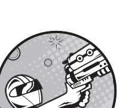

游戏无处不在，并且越来越多地通过互联的网络设备以及桌面和移动浏览器环境来玩。随着基于浏览器的游戏越来越受欢迎，玩家们转向Facebook等网站，去发现那些无需光盘或大量前期安装即可游玩的简单、休闲游戏。游戏只是另一个需要点击的链接。

在过去十年中，Adobe Flash插件的改进促成了网络浏览器作为游戏平台的发展。大多数浏览器支持Flash，这使得游戏开发者能够访问一个强大的平台，接近于实现“一次编写，随处运行”的梦想。基于HTML的游戏也存在了同样长的时间，你甚至可能玩过一些（或许都没注意到）。然而，直到最近，由于图形、声音和速度方面的限制，将HTML和JavaScript用作游戏平台，一直处于Flash的“配角”地位。但浏览器和移动游戏平台已经有了巨大改进，现状正在改变。移动操作系统已经放弃了对Flash插件的支持，因此，游戏开发者需要能提供类似性能和灵活性的工具，同时保留Flash曾有的普及性。

在过去的几年里，浏览器的图形和声音功能也得到了快速提升。HTML能力的增强反映了市场对于一个能提供丰富游戏体验并获得多个平台提供商支持的平台日益增长的需求。一个得到良好支持的开放平台，被认为不太可能受制于商业控制和“围墙花园”心态，而HTML5正是这样一个平台。

然而，根据我的经验，许多游戏开发者转向HTML5，是希望构建他们过去用Flash制作的那种类型的游戏。HTML5无疑是最优选项之一：它拥有庞大的用户群（任何拥有现代网络浏览器的人），并且HTML5和Flash在功能和限制上有很多相似之处。尽管存在这种相似性，但将HTML5视为Flash的替代品，很可能导致令人失望的产品发布和错失良机。这是因为一方的优势并不能直接对应另一方的优势。此外，HTML5仍处于相对较早的开发阶段。该平台正在快速推进，要跟上每月新支持的特性，有时会很困难。

就像构建一个优秀的网络应用程序一样，制作成功游戏的关键在于理解平台的能力和限制。你必须设计和构建能够最大化平台潜力，同时避免或最小化其局限性的游戏。本书旨在作为理解JavaScript、HTML和CSS能实现什么，以及介绍如何实现这些目标的第一步。

## 为何要构建HTML5游戏？

在深入探讨本书的具体内容之前，让我们退一步，思考一下你为何首先想要在HTML5平台上创建游戏。

### 运用你已有的技能

精通JavaScript和CSS的网络开发者，在进入HTML5游戏开发领域时会更有信心。部署HTML和JavaScript文件也是熟悉的过程，你可以使用与网络开发重叠的服务端语言来构建在线组件。

但如果你一头扎进学习C++或Objective-C，那么结合一门新语言、一个新开发环境以及游戏开发所需的新思维方式，学习曲线可能会非常陡峭。简而言之，从网络开发转向HTML5游戏开发所需的概念跨越，相比于转向其他游戏技术，是相对较小的。

### 多环境开发

许多平台都曾承诺“一次编写，随处运行”的能力，在我看来，HTML5是最接近实现这一承诺的技术。无论你是为桌面浏览器还是打包的移动应用开发，你的编码风格不会有太大变化，用于在屏幕上表示对象并让用户与之交互的基础技术也不会有太大变化。当然，总会存在一些环境特定的差异，特别是如果代码要利用某个环境相对于另一个环境可能提供的特性和优势的话。

尽管如此，用HTML5和JavaScript编写的游戏，很有可能只需最少的修改就能在多个操作系统上运行。这支持同步发布和单一开发团队，而不是每个系统都需要一个团队。即使最终环境不同，你也可以在桌面浏览器中编码和测试。

### 快速改进的平台

HTML5正在不断且快速地改进。JavaScript的处理速度也在提高，复杂的解释器在某些操作上正接近原生速度。鉴于过去10年CPU速度的提升，用JavaScript编写的游戏，其性能可能优于几年前用原生代码编写的许多游戏。

随着浏览器厂商和硬件制造商的努力，这种改进趋势将持续下去，毫无疑问，HTML5作为一个可行的游戏平台正在成长。无论HTML5游戏开发是作为移动或桌面浏览器上沉浸式3D游戏的快速开发环境而增长，还是作为休闲游戏开发者的快速原型设计环境，甚至通过Android或其他设备进入主机环境，现在都是成为一名JavaScript程序员的激动人心的时刻。现在正是你运用将在本书中获得的知识，将HTML5和JavaScript作为开放游戏开发平台进行实验的时候。

## 关于本书

本书无法展示所有可能的HTML5游戏类型，因此未能充分探索HTML5和JavaScript的全部能力。相反，我专注于创建一个单一的休闲游戏，就像多年来许多开发者用Adobe Flash制作的那些游戏一样。这些游戏通常是二维的、单人的，游戏循环相对较短。3D能力的进步，例如WebGL，意味着大型、复杂、沉浸式的多人游戏现在已可能实现或即将成为现实，但休闲游戏项目是游戏开发者更自然的起点。简单的项目也更容易说明构建游戏所涉及的基本原理。


## 本书适用人群

本书面向熟悉 HTML、CSS 和 JavaScript 的 Web 开发人员，旨在帮助他们将现有技能转化为游戏开发能力。至少，你需要具备编程知识，理想情况下，你应该了解 JavaScript 基础。此外，你需要拥有或能够自行搭建一个 Web 服务器和开发环境。

如果你对 Web 或游戏技术有一定背景知识，想了解 HTML5 能实现哪些功能，并且具备学习和实验的热情，那么你应该能够顺利学习本书。读完本书，你将对如何着手 HTML5 游戏开发项目有清晰的思路，并对游戏开发的核心流程有全面的了解。

## 内容概览

在本书中，你将开发一个可在浏览器中运行的简单泡泡消除游戏。每章都会通过实践引入新概念。

**第一部分：使用 HTML、CSS 和 JavaScript 构建游戏**（包含本书前四章）将指导你使用 HTML、CSS 和 JavaScript 构建一个完整游戏。

- **第 1 章：准备与设置** 介绍所需工具，包括 jQuery 和 Modernizr 脚本库、调试方法以及游戏文件结构的搭建。
- **第 2 章：使用 jQuery 和 CSS 实现精灵动画** 描述如何通过鼠标点击响应来移动屏幕上的 HTML 元素。在游戏语境中，这意味着将图像从起始位置发射到玩家点击的坐标。
- **第 3 章：游戏逻辑** 你将绘制游戏界面并设置大部分游戏逻辑，包括发射泡泡和碰撞检测。
- **第 4 章：将游戏状态变化转换为显示** 教你如何让游戏响应第 3 章中检测到的碰撞，并添加更多游戏逻辑来消除成组的泡泡。这通过消除效果引入了对象内的基本动画。

**第二部分：使用 HTML5 和 Canvas 进行增强**，你将利用 HTML5 和 Canvas 的特性来改进第一部分创建的游戏。

- **第 5 章：CSS 过渡和变换** 展示如何使用 CSS3 实现之前章节中使用 jQuery 达成的一些效果。
- **第 6 章：渲染 Canvas 精灵** 展示如何在 HTML5 Canvas 中完全渲染游戏，包括在屏幕上移动对象和动画效果。
- **第 7 章：关卡、音效及更多** 完善游戏逻辑中的一些疏漏，介绍更平滑的动画技术，并展示如何实现音效和保存玩家得分。
- **第 8 章：HTML5 的下一步** 讨论一些在开发休闲游戏中未使用的实用技术。它推荐了未来的阅读方向，如用于 3D 游戏的 Web Workers 和 WebGL，并讨论了内存管理和速度优化等重要问题。
- 最后，**后记** 提供了一些提升 HTML5 游戏编程技能的建议。例如，你可以继续改进在本书中构建的游戏，或者开始开发自己的游戏创意。

本书中创建的所有代码均可从 http://buildanhtml5game.com/ 下载，你也可以在该网站看到你将要构建的游戏版本的实际运行效果。每章末尾，我都包含了一些练习，以测试你的技能并激发改进 *泡泡射击* 游戏的灵感。

## 内容深度

由于本书专注于休闲游戏开发，我不会详细介绍 WebGL、三维建模、着色器、纹理、光照以及其他与第一人称动作射击游戏或大型多人在线角色扮演游戏（MMORPG）等更复杂游戏相关的技术。这些主题本身足以单独成书。然而，你会发现构建休闲游戏的大多数原则在技术要求更高的情况下也很有用。我建议让最初的项目保持可实现性，在完成几次发布后再尝试更复杂的项目。一旦你使用 HTML、CSS 和 Canvas 完成了几个项目，如果你想深入 WebGL，你将具备学习更多相关知识的基础；不过，你可能会发现休闲游戏领域本身就有足够的开发机会。

本书为你介绍了游戏开发技术，但它并非你将使用的应用程序编程接口（API）的详尽参考。它也不是 HTML5 的完整指南：仅涵盖了与游戏开发最相关的功能。互联网上充满了提供更详细信息并随浏览器环境变化而不断更新的资料。我会在适当的时候突出介绍有用的资源和文档。

同样，这不是一本关于游戏设计的书。我将教你 *如何* 构建，而不是 *构建什么*。你所学的技能将为你提供一个起点，让你能够实现自己的想法或开始参与他人设计的项目。

## 如何使用本书

在本书中，我将帮助你创建构成 *泡泡射击* 游戏的 HTML、CSS 和 JavaScript 文件。在学习教程时，你应该始终至少在一个浏览器中打开文件 *index.html*（在第 1 章创建）。这样，你可以刷新页面，查看对代码的修改如何改变游戏效果。

我鼓励你在本地开发 Web 服务器上运行 *泡泡射击*，而不是从文件系统查看，以便你能像真实用户一样访问它，并查看它在移动设备上的显示效果。

> 注意：*如果你不想输入示例代码，只需下载源代码（从 http://buildanhtml5game.com/）并直接使用你所阅读章节的游戏文件即可。*

一旦决定了如何加载 *泡泡射击* 文件进行测试，就立即跳转到第 1 章，开始制作你的第一个游戏吧！

# 第一部分

## 使用 HTML、CSS 和 JavaScript 构建游戏

# 第 1 章

## 准备与设置

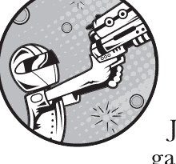

在本章中，我们将开始使用 HTML、CSS 和 JavaScript 开发一个完整的游戏。我们的简单泡泡射击游戏将演示一系列开发技术，但它不需要复杂的逻辑来控制机制。*游戏逻辑* 包括游戏元素之间的交互系统、玩家操作引发的事件、角色人工智能模拟等。开发复杂的游戏逻辑可能非常耗时，因此出于学习目的，我们将坚持使用基本原则，例如如何渲染图形和动画、响应用户输入以及播放声音。

我们将从用户界面和页面布局开始，然后加载脚本，最后添加一些基本交互。在开发过程中，我们还将探索一些对调试特别有帮助的浏览器工具，以及 Modernizr 和 jQuery 这两个能够加速开发的主要库。我们将使用 Modernizr 来加载脚本和检测用户浏览器是否支持特定功能，并在处理 HTML 和 JavaScript 协同工作时使用 jQuery。

如果你在使用 HTML、CSS、JavaScript 和 jQuery 进行 Web 应用程序开发方面有经验，本章中的许多代码对你来说会很熟悉。我的目标是展示如何用相对较少的代码实现丰富的功能，以及创建基本交互元素是多么容易。

### 游戏玩法

如果你玩过 *泡泡龙*、*魔法气泡*、*Snood* 或任何其他众多的手机泡泡射击游戏，你已经了解了泡泡射击游戏的基本机制。图 1-1 显示了完成游戏的截图。

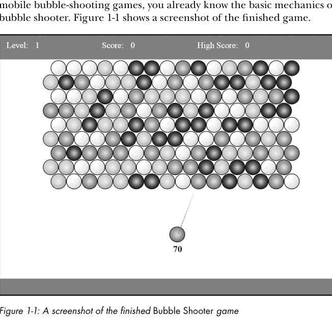

游戏的目标是清除悬挂在屏幕顶部的所有泡泡。玩家使用鼠标瞄准并点击，从屏幕底部发射一个泡泡，射向顶部的泡泡，希望能形成三个或更多相同颜色的泡泡组。一旦形成至少三个相同颜色的泡泡组，组内的所有泡泡都会爆裂，如图 1-2 所示。

如果发射的泡泡未能形成颜色匹配的组，它将被添加到显示中，如图 1-3 所示。


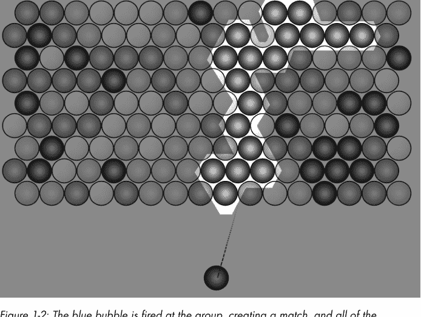

图 1-2：蓝色泡泡被射向泡泡群，形成匹配，所有高亮显示的泡泡都将弹出。

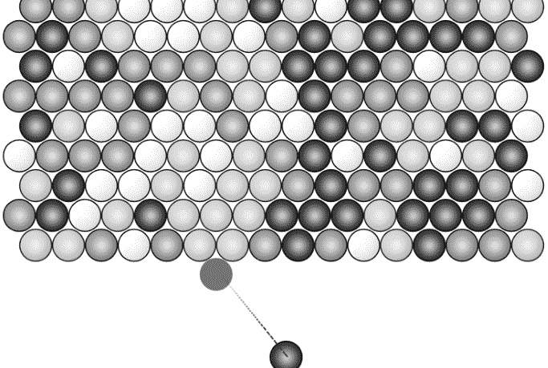

图 1-3：此处射出的蓝色泡泡不会导致其上方的绿色泡泡群弹出。相反，它将被添加到游戏板上。

未形成三个或更多匹配泡泡群的射出泡泡会附着在泡泡网格中。因为泡泡的表现形式就像它们都挂在顶行一样，如果一组泡泡在匹配颜色组被创建和移除后无法追溯到顶行的连接，我们就需要将这些“孤立的”泡泡从屏幕上移除。图 1-4 显示了一个孤立泡泡的例子。

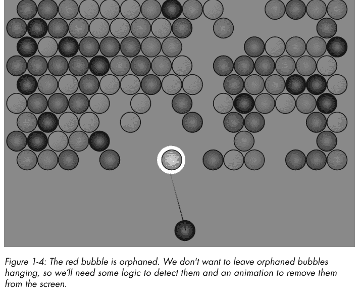

*图 1-4：红色泡泡是孤立的。我们不希望孤立的泡泡悬在那里，因此需要一些逻辑来检测它们，并需要一个动画将它们从屏幕上移除。*

玩家只能发射有限数量的泡泡（图 1-1 显示为 70 个），并且必须在用完所有可发射的泡泡之前清除游戏板。在每个关卡结束时，玩家因弹出泡泡而得分，并进入下一关卡。如果玩家未能清除一个关卡，游戏结束。

除了我们稍后会添加的几个增强功能外，这就是游戏的主要流程。

我们将使用 HTML、CSS 和 JavaScript 构建游戏机制——这些核心工具非常适合创建许多简单的游戏，尤其是不需要详细像素操作的二维游戏。在 *泡泡射击* 中，我们本质上是将一个圆（泡泡）射入一个由其他圆（泡泡）组成的网格中，然后要么像图 1-2 那样弹出一组泡泡，要么像图 1-3 那样将泡泡添加到游戏板上。游戏布局的需求相当简单，我们可以使用 CSS 和 JavaScript 来执行所需的所有动画。

我们将使用 HTML 和 CSS 构建用户界面，因为和大多数 HTML 游戏一样，*泡泡射击* 将利用浏览器能够良好执行的任务，例如布局文本和渲染简单图形。在后面的章节中，我们将探索使用 canvas 元素来显示游戏区域，但我将首先演示使用常规文档对象模型（DOM）开发可以实现的效果。

## 构建游戏

既然我们已经了解了想要创建的游戏，让我们将其分解为可管理的任务。我们需要解决一些高层次的挑战来创建 *泡泡射击*。具体来说，我们需要做以下事情：

- **随机化和渲染游戏板**：对于每个新关卡，泡泡网格必须随机生成并绘制在屏幕上。
- **计算泡泡的发射角度和停止点**：玩家将通过点击屏幕来发射泡泡。我们将计算发射泡泡的角度，使其沿该路径移动，并在碰到某物时停止或让它继续前进。
- **解决碰撞问题**：当射出的泡泡碰到另一个泡泡且未形成三个或更多匹配组时，它将自己添加到游戏板上。否则，当它确实形成一个至少包含三个相同颜色泡泡的组时，它将弹出所有与其撞击泡泡相邻的相同颜色泡泡。如果射出的泡泡确实弹出了一些泡泡，我们将检查是否创建了任何孤立的泡泡，如图 1-4 所示。
- **跟踪得分和关卡**：当所有泡泡被清除时，游戏结束。因为玩家只有有限数量的泡泡可以发射，我们将跟踪已发射的泡泡数量。我们还将添加一个评分系统，给玩家一个再次游玩的理由（例如，为了打破高分记录）。
- **处理游戏结束和新关卡**：如果玩家完成了一个关卡，我们将指示这一点（使用某些界面元素），并给玩家一个选择进入下一关卡。更换关卡会清除游戏板并整理内部游戏状态，然后游戏重新开始。

## 开发和测试环境

让我们设置我们的开发环境，并确保我们拥有完成游戏所需的正确工具。要开始为 Web 开发游戏，你需要能够访问各种浏览器进行测试，以及允许你编辑代码的软件。你还需要设置一个 Web 服务器来查看开发中的游戏。尽管你可以在本地运行 *泡泡射击*（只需打开它的 *index.html* 文件），但你应该定期在尽可能接近最终用户实际环境的情况下测试你的游戏。

> 设置服务器的过程因操作系统而异。Apache Web 服务器（可在 http://httpd.apache.org/ 获取）为大多数系统配置提供了良好的安装包和安装说明。

## Web 浏览器测试

Web 开发的一条规则是在你预期的目标受众使用的所有浏览器上进行测试。虽然这对已发布的软件至关重要，但在开发过程中，你通常可以使用一个稍小的浏览器子集来识别大多数潜在问题。你需要测试的浏览器列表不断变化，但当你在 Web 上发布游戏时，接下来讨论的这些是必不可少的。

### 桌面浏览器

台式机或笔记本电脑的用户最终可能在任何操作系统的各种浏览器中玩你的游戏，因此请确保至少测试最新版本的 Internet Explorer (IE)、Firefox、Chrome 和 Safari（适用于 Windows 和 OS X）。根据你的目标受众，你可能还需要测试早期版本的浏览器。

并非所有人都会更新他们的 Web 浏览器，因此在为大众 Web 受众编写代码时，请确保不要忽略可能使用早期版本的用户。某些版本的 IE 在同一操作系统上无法良好共存（由于 IE 与 Windows 的紧密集成），因此在测试时，你需要多个 Windows 安装环境，可以在不同的 PC 上或在虚拟机上。我强烈建议你安装和使用虚拟机软件，例如 VMWare (http://www.vmware.com/)、VirtualBox (http://www.virtualbox.org/) 或 Virtual PC (http://www.microsoft.com/download/; 在下载中心搜索)。虚拟机允许你在常规操作系统内运行操作系统，本质上是从你的桌面模拟整个系统。可以从 http://www.modern.ie/en-us/virtualization-tools/ 下载预装了不同版本 IE 的虚拟机。

由于 Firefox 现在定期更新，你应该能够安全地在最新版本上测试你的游戏。早期版本对 HTML5 的支持参差不齐，但后续版本通常不会从一个版本到下一个版本发生重大变化。Chrome 也会自动定期更新，所以你不需要担心版本；只需确保你运行的是最新版本。

当然，你还应该在至少一个版本的 Safari 上在 Mac 上测试你的游戏。也可以在 Windows 内运行 OS X 虚拟机，尽管设置比在 Windows 内运行 Windows 或在 OS X 内运行 Windows 稍微复杂一些。可以在网上找到教程，指导如何在前面列出的虚拟机应用程序中实现此设置。

### 移动浏览器

如果你在移动设备或平板电脑上部署，那么在各种设备（iOS、Android 和 Windows 移动版）和多种浏览器上进行测试比以往任何时候都更加重要。对于基本的移动开发，拥有一台 iOS 设备和一台 Android 设备进行测试可能就足够了，但当你考虑更广泛的分发时，情况就变得复杂了。Apple 的 iOS 版本行为各异，而 Android 则有如此多的版本、如此多的设备、不同的屏幕分辨率和硬件配置，你应该拥有多种设备（或许通过一个有限的测试小组）进行测试。我们不会将 *泡泡射击* 打包发布到 Apple App Store 或 Google Play Store，但通过使用 HTML5 和 JavaScript 编写游戏，我们将生成一个可在移动设备上玩而无需额外编码的应用程序。

最终，由于 Android 平台的碎片化，单个开发者不可能在每个设备上进行测试；因此，你可能会发现使用第三方测试服务更可行。在 iOS 设备上测试稍微简单一些，因为 Apple 控制着其操作系统和设备规范，但 iPhone 和 iPad 可能成本高昂。当你加入 Windows 平板电脑，并考虑可以运行 Web 浏览器的平板电脑和其他便携式设备日益增长的种类时，你就会意识到移动测试这场战役很难打赢。

## 在 Web 浏览器中调试

设置好测试浏览器后，你可以使用多种开发工具来简化调试。每个浏览器都有自己的开发工具集，但幸运的是，它们的操作方式相似，都提供了检查页面上 HTML 元素以及向 JavaScript 添加断点和日志的方法。学习如何访问你的浏览器的开发工具并进行实验，以熟悉它们的功能。

所有浏览器调试工具都很有用，但在开发过程中你最常用的是 JavaScript 控制台。你将通过两种主要方式与控制台交互来与你的代码进行交互：

**使用 console.log 命令记录日志到控制台**：调用 **console.log** 函数，控制台应显示你传入函数的内容。例如，`console.log("Hello")` 应显示字符串 `Hello`。更好的是，使用 JavaScript 对象或数组调用 `console.log`，你将获得该对象内容的有限列表，可用于探索整个对象树。

**运行临时代码来查询变量状态**：你可以在控制台中输入 JavaScript 代码以立即求值。在控制台中输入 `alert(1)` 看看它是如何工作的。如果你的游戏代码公开了对象属性，你可以使用此功能来检查属性或触发方法。你甚至可以粘贴多行代码来创建并在页面上下文中运行整个函数。


既然我们已经拥有了一些必需的工具，让我们开始构建这个游戏。我们将从设置基本代码和实现开始屏幕用户界面着手。

## 规划游戏画面

在编写动画和游戏玩法这些有趣的部分之前，我们需要先布局用户界面。我们将使用 HTML 和 CSS 来放置主要界面元素；游戏画面将由三个主要区域组成，如图 1-5 所示。

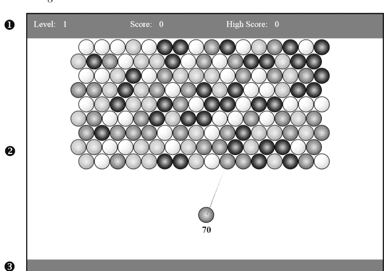

图 1-5：游戏画面的各个区域

在游戏画面的顶部，你可以看到状态栏 ①，它将显示分数和关卡信息。接下来（也是最大的）区域是游戏区域 ②，其中包含所有的泡泡。游戏区域也是实际进行游戏的地方。游戏画面底部的页脚 ③ 框定了游戏区域。

现在，让我们布置这三个*泡泡射击*组件。

## 使用 HTML 和 CSS 创建面板

使用直接的 HTML 和 CSS 来布局游戏画面，是创建这三个面板并定义动作发生位置的最简单方法。这里使用的方法和技巧与构建常规网站或 Web 应用程序时完全相同。

我们首先创建一个包裹整个页面的 div。由于 div 标签不具备语义含义，我们用它来表示页面上的一个分区。在 Web 服务器的根目录中新建一个文件夹来构建游戏，并将其命名为 *bubbleshoot*。运行游戏所需的每个文件都将存储在此文件夹中或其子目录中。接下来，创建一个名为 *index.html* 的新文件，并添加以下代码：

```
<!DOCTYPE HTML>
<html lang="en-US">
  <head>
    <meta charset="utf8">
    <title>Bubble Shooter</title>
  </head>
  <body>
    <div id="page">
    </div>
  </body>
</html>
```

整个游戏将在这个单一的 HTML 页面中运行，而 "page" div <span style="background-color: black; color: white; border-radius: 50%; padding: 2px 6px; font-size: 10px;">1</span> 将限制游戏发生的区域。如果我们需要居中显示游戏或调整其位置以适应不寻常的屏幕纵横比，只需更改包装元素的位置即可。

> 注意：与版本 3 到 4 以及 XHTML 的相对严格性相比，许多 HTML 标签在版本 5 中已得到简化。例如，文档类型声明现在已大幅简化，因为许多标签都被分配了默认类型。`<script>` 标签在 HTML5 中实际上默认就是 JavaScript，因此我们不需要在页面中指定 `type="text/javascript"` 或 `language="javascript"`。

接下来，我们将创建三个新的 div 元素，每个页面区域各一个，并将它们放置在我们的 page div 内部：

```
<div id="page">
  <div id="top_bar"></div>
  <div id="game"></div>
  <div id="footer_bar"></div>
</div>
```

现在，我们需要为页面以及刚刚添加的三个区域分配一些 CSS。

在游戏文件夹中创建一个名为 **css** 的文件夹，用于存放我们将在游戏中使用的所有样式表。在 **css** 文件夹中，创建一个名为 **main.css** 的新文件，包含以下代码：

```
body
{
    margin: 0;
}
#page
{
    position: absolute;
    left: 0;
    top: 0;
    width: 1000px;
    height: 738px;
}
#top_bar
{
    position: absolute;
    left: 0;
    top: 0;
    width: 1000px;
    height: 70px;
    background-color: #369;
    color: #fff;
}
#game
{
    position: absolute;
    left: 0px;
    top: 70px;
    width: 1000px;
    height: 620px;
    background-color: #fff;
    clip: auto;
    overflow: hidden;
}
#footer_bar
{
    position: absolute;
    left: 0;
    top: 690px;
    width: 1000px;
    height: 48px;
    background-color: #369;
}
```

我们将顶部的横幅设为 70 像素高 **②**，底部设为 48 像素高 **⑤**。我们希望游戏能适配标准显示器尺寸，因此将游戏区域的总高度设置为 620 像素 **③**，从而总页面高度为 738 像素 **①**，这应该能在 1024×768 的显示器内容纳，甚至还能为浏览器任务栏留出空间。

> **尺寸：流式 vs. 固定**

为了保持游戏简单，我在 CSS 中使用了固定的 1000 像素宽度，这应该能提供足够大的屏幕区域，以适应大多数桌面和移动显示器。通常情况下，屏幕尺寸的情况要复杂得多；尤其是移动设备，其像素尺寸和纵横比范围很广。然而，我们希望专注于开发原则而非设计决策，而且 1000 像素对于原型游戏来说应该能很好地工作。

这些值设置了整个可用显示区域的大小和位置。另外，请注意 game 的 overflow 设置为 hidden **④**，这意味着游戏中的泡泡不会意外显示到页眉或页脚上方。

为了链接 CSS 文件，我们将在 HTML 头部为 *main.css* 添加文件链接：

```
index.html
<head>
  <meta charset="utf8">
  <title>Bubble Shooter</title>
  <link href="_css/main.css" rel="stylesheet">
</head>
```

既然我们已使用 HTML 和 CSS 创建好了*泡泡射击*的基本结构，请在浏览器中加载该页面并保持打开状态。目前还没有交互功能，因此在我们着手游戏逻辑之前，接下来会添加一些基本交互功能，例如*开始游戏*对话框。第一步是设置代码结构。

## 代码结构

让我们从高层视角来了解游戏和界面的主要概念，这将指导我们如何构建代码。由于有相当多的重要元素需要实现，我们将采用一种类似于你可能是从 Web 应用程序开发中熟悉的 模型/视图/控制器（MVC）原则的方式来构建代码。如果 MVC 对你来说是新内容，以下是基本设置：

- **模型**由数据组成，并维护应用程序的状态。在 Web 应用程序中，这可能是用户详细信息或购物车内容等。
- **视图**渲染屏幕上的内容并拦截用户输入。对于 Web 应用程序，这通常是 HTML 输出。例如，视图可能从*模型*中读取在线购物车的内容，然后将这些项目以列表形式显示出来。
- **控制器**管理逻辑和处理。例如，在*视图*中点击某个项目会向*控制器*发送消息，以向购物车*模型*中添加新项目。

经过一些调整后，这个 MVC 原则将适用于构建*泡泡射击*的结构。

## 游戏控制器

游戏控制器将跟踪游戏状态，并充当导演角色，以确定对用户操作作出响应时的结果。

游戏控制器类似于 MVC 系统中的控制器；它将运行游戏并管理所有功能。在更复杂的游戏中，单个控制器会变得过于庞大和复杂，无法处理每个任务，因为会有太多代码集中在了一处，而且一套代码承担太多职责，使得代码更容易出现错误，并且更难发现。在这种情况下，我们可能需要进一步细分任务。幸运的是，由于*泡泡射击*很简单，使用一个控制器来管理所有任务应该能很好地工作。

## 用户界面代码

游戏需要为用户显示各种信息，包括分数更新、关卡结束画面等。游戏控制器不会亲自处理这些任务，而是会指示一组用户界面函数来控制用户界面元素的出现和消失方式。

你可以将大部分 UI 代码放入游戏控制器中，但你往往会编写与游戏逻辑同样多的动画和 UI 代码，因此最好将代码分开以提高可读性。一般来说，如果你并没有以某种方式改变游戏状态，而是在管理显示中的某个功能，那么你应该在 UI 代码中完成。

## 将游戏元素作为对象

我们将一些游戏元素编码为对象，包括泡泡和游戏板。原因是它们会拥有属性——例如泡泡的 *x* 和 *y* 坐标——以及需要应用的方法，例如泡泡被戳破。按照面向对象编程的惯例，我们将这些对象分成独立的类，使代码结构映射到制作游戏时涉及的概念元素。

游戏的对象也将与 MVC Web 模式中的模型概念紧密契合。对象将拥有属性和状态，但它们实在不应该与显示交互或做出重大游戏决策。

## 添加首批脚本

我们将使用 *Modernizr*（一个 JavaScript 库）来加载游戏所需的所有 JavaScript 文件，例如前面提到的游戏控制器和 UI 类。与使用传统的 `<script>` 标签相比，使用 Modernizr 有一些优势，我将在本章稍后解释这些优势。Modernizr 还有其他有用的功能，但我们将从加载所需的脚本文件开始。


## Modernizr 与 jQuery 库

为了简化游戏开发过程中的一些常见任务，我们将严重依赖两个库。这两个库都解决了许多跨浏览器问题，并提供了一套简单且一致的高级函数指令集。

Modernizr 用于加载脚本并检测浏览器是否支持特定功能。例如，我们来编写一些代码来检测是否支持 canvas 元素。如果手动编写代码，你需要在 DOM 中创建一个 canvas 节点，然后检查它是否支持给定的方法。在这个例子中，我们将使用 canvas 元素的 `getContext` 方法，该方法在所有支持 canvas 的地方都受支持，当然你也可以尝试任何你喜欢的 canvas 方法：

```
var element = document.createElement("canvas");
var canvasSupported = !!element.getContext;
```

使用 Modernizr，我们就不必做那么多工作了。我们可以简单地写：

```
var canvasSupported = Modernizr.canvas;
```

Modernizr 对象包含一组属性，其值在加载时根据浏览器是否支持特定功能而设置为 true 或 false。因此，变量 `canvasSupported` 现在应该包含 true 或 false，具体取决于 `Modernizr.canvas` 的值。使用 Modernizr 来检测功能很有帮助，因为如果浏览器更改了其对某功能的实现方式，Modernizr 很可能会比你更快地在代码库中检测到并实现这些变化。

jQuery 也提供了有用的简写函数，但这些主要涉及检测和响应事件、发出异步 JavaScript 和 XML (AJAX) 请求以与服务器通信，或者访问和操作浏览器 DOM 中的 HTML 元素。

DOM 是浏览器对 HTML 文档的内部组织，我们将主要使用 jQuery 的 DOM 访问方法来简化许多动画代码。DOM 通过将 HTML 中的每个元素暴露为 DOM 节点，为你提供了一种操作 HTML 结构的方法。要操作 DOM，我们首先使用 JavaScript 选择一个节点。然后我们可以更改它的一个或多个属性，这在常规 JavaScript 中是可能且相对简单的。但使用 jQuery 可以使代码更有可能按预期工作，而无需编写代码来处理那些单独实现功能的浏览器。

jQuery 实现的最基本示例是选择一个具有 ID 的 DOM 节点，例如我们创建的 `game` div。在传统 JavaScript 中，我们会这样写：

```
var element = document.getElementById("game");
```

这行代码检索一个 DOM 元素，该元素具有各种属性，例如其 CSS 格式以及允许对其进行查询的方法。例如，`element.getAttribute("id")` 将返回字符串 `game`。

jQuery 提供了一种将此功能以及更多功能包装在更简单、更紧凑的语法中的方式。要使用 jQuery 实现与前面代码行相同的结果，我们使用 jQuery 选择器。*选择器* 是选择 DOM 中一个或多个节点的语法，其格式——包括点表示法和使用 # 来选择唯一元素——借用了 CSS 选择器。jQuery 选择器返回的值不是 DOM 节点，而是包含对 DOM 节点引用并添加了一系列其他方法的自定义对象。使用 jQuery 选择器，`document.getElementById("game").getAttribute("id")` 的等效写法是 `$("#game").attr("id")`。

选择器是 jQuery 的核心概念，在本书结束时，你将非常熟悉它们的使用。几乎所有 jQuery 都用于操作 DOM 元素，因此对 jQuery 的调用几乎总是指定应更改哪个元素或哪些元素，这就是选择器的用武之地。它们允许你使用多种因素来选择 HTML 节点集，例如：

- 用于选择单个元素的唯一 ID
- 用于选择具有该类的所有 DOM 元素的 CSS 类
- 定义节点的标签（div、img、span 等），这允许你，例如，选择页面上的所有图像
- 许多其他选项，包括前面列表中各项的组合、元素在列表中的位置、父子关系或几乎任何其他遍历 DOM 的方式

调用 `$` 返回的 jQuery 对象使你能够操作 DOM 对象。因此，在 jQuery 中，`document.getElementById` 调用被缩短为：

```
var element = jQuery("#game").get(0);
```

我们需要 `.get(0)` 函数调用从 jQuery 对象中检索 DOM 对象，尽管通常使用 jQuery 对象比直接使用 DOM 对象更有用。这可以进一步缩短为：

```
var element = $("#game").get(0);
```

`$` 的值被定义为 jQuery 函数的别名，该函数根据传入的内容执行以下几项任务之一。对于选择器，我们向 jQuery 传递一个字符串值（在这种情况下，是 "#game"）。与 CSS 一样，井号告诉 jQuery 我们希望按 ID 选择单个元素。`$("#game")` 的值返回包含对 DOM 节点引用的 jQuery 对象。

你可以使用 jQuery 选择器检索多个 DOM 节点，这些节点在内部存储为数组。如果你想访问 DOM 节点，可以通过在 jQuery 对象上调用 `.get(n)` 来检索查询返回的 *第 n 个* 元素。因为我们只有一个 ID 为 `game` 的元素，所以我们需要第一个（零索引）元素，我们可以通过在 `$("#game")` 末尾添加 `.get(0)` 来检索它。

在这个简单案例中，我们节省的编码量不多，但更重要的是，我们可以使用 jQuery 从选择查询返回的对象，配合跨浏览器的方法，抽象掉许多 DOM 操作的艰苦工作。

jQuery 对象让我们可以查询 DOM 节点的各种 CSS 属性，如这些示例所示：

```
var top = $("#game").css("top");
var width = $("#game").width();
var divs = $("div");
```

前两行分别查询 game div 的 top 位置和宽度，最后一行是一个选择器，返回一个包含页面上所有 div 标签的 jQuery 对象。jQuery 是一个强大的库，虽然我们将在游戏中使用它的许多功能，但详细涵盖它超出了本书的范围。位于 <http://api.jquery.com/> 的 jQuery 文档提供了对其工作原理的深入探讨。

## 添加 Modernizr 库

要开始使用 Modernizr，请从其官方网站（<http://modernizr.com/download/>）下载它。Modernizr 允许你选择要下载的单个功能，这样你就不会将带宽浪费在永远不会使用的代码上。我们需要几个特定的功能，因此请确保在下载页面上选择以下框以包含它们：

- CSS Transitions（在 CSS3 下）
- Canvas and HTML5 Audio（在 HTML5 下）
- Modernizr.load（在 Extra 下）
- Modernizr.prefixed（在 Extensibility 下）

然后，点击 **Generate** 和 **Download**。

在游戏文件夹中创建一个名为 `_js` 的新文件夹，并将文件保存在那里，命名为 `modernizr.js`。同时将该文件添加到 HTML 文档中，如下所示：

```
<head>
    <meta charset="utf8">
    <title>Bubble Shooter</title>
    <link href="_css/main.css" rel="stylesheet">
    <script src="_js/modernizr.js"></script>
</head>
```

现在我们已经通过 `<script>` 标签添加了 Modernizr，我们将用它来加载其余的 JavaScript 游戏文件。

## 使用 Modernizr 加载脚本

我们使用 Modernizr 加载脚本而不是仅仅在文档中添加 `<script>` 标签，主要有两个原因。首先，我们可以在脚本加载后立即触发函数运行，而不是等到整个页面（包括 HTML 和图像）加载完毕。其次，Modernizr 允许我们有条件地加载脚本（例如，*如果满足此条件，则加载此脚本*），而无需编写太多代码来实现。

> 注意：Modernizr 实际上使用另一个名为 yepnope.js 的库来实现其脚本加载功能。你可以在 [http://yepnopejs.com/](http://yepnopejs.com/) 了解更多关于该库的信息。

一个简单的例子是从谷歌的内容分发网络 (CDN) 加载 jQuery，以加快加载时间。使用第三方 CDN 的一个潜在缺陷是 CDN 可能会宕机或无法访问，或者更可能的情况是，你自己的服务器可能不可用。然而，依赖你无法控制的服务从来都不是一个好主意。幸运的是，Modernizr 允许你在加载过程中添加一个测试，如果该测试失败，则调用一个备份函数。因此，我们可以尝试从 CDN 加载文件，如果不行，则改为加载本地版本。

> 为什么使用谷歌托管的 jQuery？

虽然依赖别人的服务器来获取关键文件可能看起来很奇怪，但使用谷歌版本的 jQuery 有几个优势，我指的不仅仅是省钱或者在你创建了一个热门游戏时使用别人的带宽。

一个优势是，因为文件来自谷歌的内容分发网络，用户几乎总是从离他们比你的服务器更近的服务器下载它。

另一个优势是，因为文件来自不同于你游戏所托管服务器的另一个服务器，用户实际上可以更快地下载它。浏览器通常会限制它们与单个服务器建立的连接数量，因此即使有大量可用带宽，文件也会排队等待下载。通过在不同的服务器上托管文件，你可以增加并行下载的文件数量，并减少下载时间。

额外的优势是，其他网站也使用同一份 jQuery 拷贝；因此，如果用户最近访问过其中任何一个，他们很可能在浏览器缓存中有一份该文件，根本不需要再次下载！


从 http://jquery.com/download/ 下载最新的 jQuery 构建版本，并将其放入 `_js` 文件夹中。然后在闭合 `</head>` 标签之前添加以下加粗显示的代码块。务必修改 URL 中的 jQuery 版本，使其与你下载的版本相匹配。

```
index.html

<head>
  <meta charset="utf8">
  <title>Bubble Shooter</title>
  <link href="_css/main.css" rel="stylesheet">
  <script src="_js/modernizr.js"></script>
  <script>
    Modernizr.load({
      load: "//ajax.googleapis.com/ajax/libs/jquery/1.8.2/jquery.js",
      complete: function () {
        if(!window.jQuery){
          Modernizr.load("_js/jquery-1.8.2.min.js");
        }
      }
    });
  </script>
</head>
```

这个示例展示了 Modernizr 提供的简洁脚本加载方式。简而言之，它首先尝试从 Google CDN 加载 jQuery ➊。当加载完成后 ➋（无论是文件加载成功还是加载失败返回），`complete` 属性中的函数会检查 `window.jQuery` 是否存在 ➌，如果该对象不存在，则从本地文件夹加载 jQuery 库 ❹。

Modernizr.load 被调用时传入两组不同参数的原因是，该文件可以接受以下类型的参数：单个文件（以字符串形式）、包含名称/值对的对象，或者包含一组字符串或对象的数组。因此，我们可以通过一次 Modernizr.load 调用加载多个文件。在第一次调用 ➊ 中，我们传入了一个包含 `load` 和 `complete` 属性的对象。（Modernizr 网站文档记录了其他可用的属性。）在第二次调用 ❹ 中，我们只传入了一个字符串。

这行代码

```
Modernizr.load("_js/jquery-1.8.2.min.js");
```

等同于

```
Modernizr.load({load : "_js/jquery-1.8.2.min.js"});
```

第一种形式使用文件名字符串作为简便的简写方式，仅加载该文件而不附带任何其他配置选项。

我们还想通过 Modernizr 加载游戏脚本。在 `_js` 文件夹中创建一个名为 *game.js* 的新文件。要将新文件添加到 `.load` 中，将第一个 Modernizr.load 调用用数组括号包裹起来，并添加一个新条目，如下加粗所示：

```
Modernizr.load([{
    load: "//ajax.googleapis.com/ajax/libs/jquery/1.8.2/jquery.js",
    complete: function () {
      if(!window.jQuery){
        Modernizr.load("_js/jquery-1.8.2.min.js");
      }
    },
},
{
    load: "_js/game.js"
}]);
```

我们可以在加载 *game.js* 之前的任何时候，将新文件作为数组中的新元素继续添加到 Modernizr.load 调用中。
Modernizr 将加载 *game.js*，但该文件目前还不包含任何代码。接下来的任务是设置主游戏控制器类，并在加载完成后运行它。

## 模块化 JavaScript

为了最小化全局变量以及避免潜在的重复变量名冲突，我们将对 JavaScript 代码采用模块化方式。使用 *模块* 是将游戏中所有对象和变量封装在单个包含命名空间中的方法。该命名空间将被称为 *BubbleShoot*。一个名为 Game 的类将包含在模块 `BubbleShoot.Game` 中，可以在应用程序的任何其他地方通过编写 `BubbleShoot.Game` 来访问。这个命名空间是一种保护措施：如果我们在开发后期添加了另一个同样有名为 Game 的变量的 JavaScript 库，两者可以同时存在而不会产生冲突。
我们将从游戏模块开始，它将运行游戏的大部分功能。在 *game.js* 中输入以下代码：

```
var BubbleShoot = window.BubbleShoot || {};
BubbleShoot.Game = (function($){
    var Game = function(){};
    return Game;
})(jQuery);
```

首先，我们检查对象 `BubbleShoot` 是否存在 ❶。将我们的代码命名为 `BubbleShoot.Game` 大致相当于在 Java 或 C# 等语言中使用命名空间。所有的类都将是 `BubbleShoot` 对象的属性。在像 *Bubble Shooter* 这样的小游戏中不太可能发生命名冲突，但在较大的项目中可能会成为问题。如果 `window.BubbleShoot` 不存在，它将被创建为空对象。我们将在每个类文件的顶部包含这一行代码，这样就不必考虑脚本的加载顺序。

下一行代码定义了 *BubbleShoot.Game* ❷。这种结构——括号内的函数——如果你不熟悉它，可能会看起来很奇怪，但它是编写 JavaScript 模块时常用的方法。
该结构使用了*立即调用函数表达式（IIFE）*，它是一段创建函数并立即运行它的代码。通常，你会将返回的结果赋值给一个变量。其好处是函数块在 JavaScript 中创建了一个变量作用域，意味着在其中创建的任何变量都不会污染全局作用域。
变量声明包含一个函数定义，后面跟着括号 ❸。该函数被创建、运行，并立即销毁，但在销毁之前会返回其内容 ❹，即在 ❶ 处创建的 Game 对象。用括号包裹的函数调用 ❷ 位于新的作用域内。一旦该函数运行完毕，我们就可以从全局作用域以 *BubbleShoot.Game* 的形式访问 Game 类。

现在我们有了一个类的框架，需要添加一些有用的代码来运行。让我们从连接"新游戏"按钮开始。在 *index.html* 的 page div 内添加以下内容：

```
index.html
<div id="page">
  <div id="top_bar"></div>
  <div id="game"></div>
  <div id="footer_bar"></div>
  ❶   <div id="start_game" class="dialog">
  ❷     <div id="start_game_message">
          <h2>Start a new game</h2>
        </div>
  ❸     <div class="but_start_game button">
          New Game
        </div>
      </div>
    </div>
```

新的 div 元素将创建一个对话框，在玩家开始游戏之前显示信息 ❶。对话框将包含一个带有消息的标题 ❷ 和一个"新游戏"按钮 ❸。我们还需要在 *main.css* 的末尾为它们添加一些样式，现在就来做这件事。

```
main.css
.dialog
{
  position: absolute;
  left: 300px;
  top: 110px;
  height: 460px;
  width: 320px;
  background-color: #369;
  border-radius: 30px;
  border: 2px solid #99f;
  padding: 20px 50px;
  color: #fff;
  text-align: center;
  display: none;
}
.dialog h2
{
    font-size: 28px;
    color: #fff;
    margin: 20px 0 20px;
}
.but_start_game
{
    position: absolute;
    left: 100px;
    top: 360px;
    height: 60px;
    width: 200px;
    background-color: #f00;
    cursor: pointer;
    border-radius: 15px;
    border: 2px solid #f66;
    font-size: 28px;
    line-height: 60px;
    font-weight: bold;
    text-shadow: 0px 1px 1px #f99;
}
.but_start_game:hover
{
    background-color: #f33;
}
#start_game
{
    display: block;
}
```

在 `main.css` 中设置好这些样式后，重新加载页面即可看到对话框。但请注意，目前玩家还没有办法关闭它。这将在 `Game` 类中实现。

接下来，我们需要在页面加载完成后运行一些代码，以便为"新游戏"按钮附加事件处理程序。一个函数将在页面加载后初始化对象并设置游戏，另一个函数将在每次开始新游戏时运行。对 `game.js` 进行以下更改：

```
game.js
BubbleShoot.Game = (function($){
    var Game = function(){
        this.init = function(){
            $(".but_start_game").bind("click",startGame);
        };
        var startGame = function(){
        };
    };
    return Game;
})(jQuery);
```

1. this.init = function(){
2. $(".but_start_game").bind("click",startGame);
3. var startGame = function(){

这段新代码设置了一个公共方法，名为 init ❶，以及一个私有方法，名为 startGame ❸。init 方法是公共的，因为它作为 Game 对象的属性被附加。在 init 内部，我们为"新游戏"按钮添加了一个名为 bind 的 jQuery 事件处理程序 ❷，每当按钮被点击时，它就会调用 startGame 函数。

我们知道 IIFE 的生命周期很短，不会作为任何对象的属性被附加，然而 startGame 函数却可以在这里被调用。原因在于 JavaScript 的一个特性，称为*闭包*。闭包意味着一个变量存在于定义它的代码块中，并且在该代码块内持续存在。因此，startGame 函数可以在 Game 内的其他函数（包括 init）中使用，但不能被此作用域之外的任何 JavaScript 访问。

我们希望在页面加载完成后调用 init，所以在 *index.html* 中，我们将在 *game.js* 加载完成后在 Modernizr.load 中添加一个 complete 调用：

```
Modernizr.load([{
    load: "//ajax.googleapis.com/ajax/libs/jquery/1.8.2/jquery.js",
    complete: function(){
        if(!window.jQuery){
            Modernizr.load("_js/jquery-1.8.2.min.js");
        }
    }
},
{
    load: "_js/game.js",
    complete: function(){
        $(function(){
            var game = new BubbleShoot.Game();
            game.init();
        })
    }
}]);
```

index.html

❶
❷
❸

回顾一下，`$` 函数 ❶ 是 jQuery 函数的简写形式，它可以根据传入的参数执行多种任务之一。之前我们传入了一个字符串（`#game`），jQuery 将其解释为选择器。在这种情况下，我们传入了一个函数，jQuery 会将其存储起来，等待 DOM 准备就绪可以操作时再运行。

这段 jQuery 功能非常有用，特别是对于游戏来说，因为从这一刻起，我们就可以安全地使用 JavaScript 操作 DOM，即使游戏的其他所有资源（如图片和声音）尚未加载完毕。传统上，客户端交互是通过在 JavaScript 中等待 `window.onload` 事件触发来启动的，该事件表示 HTML 已加载、DOM 已就绪且所有图片都已加载完毕。然而，等待图片加载可能会导致

准备和设置 23


## 用户界面与显示脚本

让我们创建一个类来处理用户界面和一些其他的页面显示功能。在 `_js` 文件夹中创建一个名为 `ui.js` 的新文件，并添加以下代码：

```javascript
var BubbleShoot = window.BubbleShoot || {};
BubbleShoot.ui = (function($){
  var ui = {
    init : function(){
    },
    hideDialog : function(){
      $(".dialog").fadeOut(300);
    }
  };
  return ui;
})(jQuery);
```

尽管这段代码内容不多，但请注意 UI 对象遵循了与之前 Game 类相同的模式。`hideDialog` 函数包含了一小段 jQuery 代码，用于淡出任何具有 CSS 类 `dialog` 的 HTML 元素。`ui` 与 Game 类模式在结构上的区别在于，我们不是创建一个 `ui` 类，而是直接创建一个单独的对象并向其附加方法。这种结构类似于其他语言中静态类的使用方式。

`fadeOut` 调用接受一个参数，该参数指定淡出对话框所需的毫秒数。我们使用 300 的值，这个速度足够快，不会拖慢用户，但又不至于快得让人注意不到。`fadeOut` 方法是 jQuery 内置的，但还有其他方法可以结合选择器和操作 DOM 元素。现在，让我们快速了解一下 jQuery 在 `fadeOut` 调用中实际做了什么：

-   将 CSS 不透明度减少一个很小的固定量，并在 300 毫秒内循环重复此操作。到此时间结束时，不透明度应为零。
-   将元素的 CSS `display` 属性设置为 `none`。

我们本可以通过串联一些 `setTimeout` 调用来手动创建这种效果，但 jQuery 用 `fadeOut` 为我们处理了它。使用 jQuery 在这里为我们节省了大量代码，因为与许多 CSS 属性一样，跨浏览器操作不透明度并不简单（例如，早期版本的 IE 使用 `filter` 而不是 `opacity` 属性）。

请注意，目前我们并没有特别处理 CSS3 或 HTML5。我们使用的是旧的 HTML 标签，并通过 JavaScript 循环操作相对旧的 CSS 属性。在本书的后面，你将学习是否应该以更现代的方式来做这件事，但目前，代码工作得很好。在你开发游戏时，你会意识到很多代码在早期浏览器和后期浏览器上都能同样良好地运行，并且，除非你专门渲染到 canvas，否则你的 HTML5 游戏看起来与常规 Web 应用程序相似。

现在我们需要将新创建的 UI 文件加载到 `index.html` 中，方法是将其添加到 `Modernizr.load` 调用中：

```javascript
Modernizr.load([{
    load: "//ajax.googleapis.com/ajax/libs/jquery/1.8.2/jquery.js",
    complete: function(){
        if(!window.jQuery){
            Modernizr.load("_js/jquery-1.8.2.min.js");
        }
    }
},
"_js/ui.js",
{
    load: "_js/game.js",
    complete: function(){
        $(function(){
            var game = new BubbleShoot.Game();
            game.init();
        })
    }
}
]);
```

要向 load 调用中添加一个新的 .js 文件，只需在 `ui.js` 之后、加载 `game.js` 之前，将脚本文件的 URL 作为额外的数组项添加即可。我们需要将创建的每个新脚本文件都添加到 `index.html` 中，所以请记住这个过程。

要在点击“新游戏”按钮时调用 `hideDialog`，请在 `game.js` 中添加以下加粗的行：

```javascript
game.js BubbleShoot.Game = (function($){
  var Game = function(){
    this.init = function(){
      $(".but_start_game").bind("click",startGame);
    };
    var startGame = function(){
      $(".but_start_game").unbind("click");
      BubbleShoot.ui.hideDialog();
    };
  };
  return Game;
})(jQuery);
```

在 jQuery 中使用 `bind` 方法是一种跨浏览器的添加事件处理程序的方式。此方法将一个函数绑定到一个对象，当事件发生时触发该函数。在此游戏应用程序中，触发事件发生在用户点击“新游戏”按钮时，该操作会调用 `startGame` 函数。

请注意，当按钮被点击时，我们取消了事件的绑定，以防止在按钮淡出并试图启动两次游戏时记录双击事件。如果你重新加载页面并点击“新游戏”按钮，对话框应该会由于 `hideDialog` 函数而消失。

泡泡射击游戏仍然做不了太多事情，但至少现在我们有了一些可以添加代码的结构。

## 总结

我们现在有了开始构建游戏的基础。Modernizr 正在加载文件，当我们创建更多的类和函数时，可以轻松地添加到这个任务中。Game 类的一个实例在 DOM 加载完成时创建，点击一个按钮开始游戏。

在下一章中，我们将为泡泡对象创建我们的第一个精灵，形成游戏的核心，你将学习如何在屏幕上为这些精灵制作动画。

## 进一步实践

1.  对话框正在使用 jQuery 的 `fadeOut` 函数隐藏，但你可以应用其他效果来将对话框从屏幕上移除。尝试使用 `slideUp` 或 `hide` 代替 `fadeOut`。或者，将对话框设置在屏幕外，然后使用 `animate` 调用将其移入到位。
2.  对话框以及页眉和页脚的颜色和样式相当简单。更改这些区域的颜色（甚至尝试使用图形），直到你找到喜欢的组合。
3.  学习如何使用浏览器的调试工具。你很可能可以使用断点、监视变量和变量堆栈，因此请阅读并尝试使用它们。现在熟悉这些工具可以在以后调试时节省大量时间。尝试在 `game.js` 中的 `init` 和 `startGame` 函数内添加断点，并在代码运行时进行跟踪。

## 2

## 使用 JQUERY 和 CSS 实现精灵动画

在本章中，我们将深入探讨如何让精灵在屏幕上移动。动画是游戏开发中最常见的任务之一，你在动画制作中学到的原理适用于大多数游戏类型。

尽管围绕 HTML5 游戏的大部分讨论都集中在 canvas 元素上，但你完全可以用更传统的 HTML、CSS 和 JavaScript 技术来实现许多游戏，而这正是本章的重点。它们本身就是有用的游戏开发课程，而且在我们后续学习使用 canvas 元素时也会大有裨益。使用 HTML、JavaScript 和 CSS 技术开发的游戏通常被称为*基于 DOM 的游戏*，它们还具有更广泛的浏览器兼容性。一些仍在使用的老式浏览器不支持 canvas，也不太可能支持 CSS3 变换和过渡效果；因此，我们将使用较早的 CSS 特性。

*泡泡射击*游戏的核心机制当然是射击泡泡，玩家发射的泡泡会触发每个泡泡的爆破效果。我们将从根据用户输入（鼠标点击）来移动发射的泡泡开始。

首先，我们需要一种方法让泡泡从起始点 A 移动到终止点 B，而且泡泡需要以恒定速度沿直线移动。其次，我们需要准确确定 A 点和 B 点的位置。因为玩家总是从同一位置发射泡泡，所以每个新泡泡的起始坐标（A 点）都是相同的。B 点是用户点击发射泡泡时的鼠标坐标，因此我们必须获取这些坐标。首先，我们将实现从 A 到 B 的移动。

在最终的游戏中，泡泡到达点击坐标后不会停止，而是继续移动，直到与其他泡泡碰撞或移出屏幕边缘。我们将在更全面地开发游戏界面时再处理碰撞问题。

当我们实现了点到点的移动后，就可以推算出泡泡在用户点击点之后的路径，并继续沿相同方向移动泡泡。要找到这条路径，我们需要根据 A 点和 B 点的相对位置计算发射角度，如图 2-1 所示。

给定发射角度，我们就可以将泡泡沿特定方向发射到所需的距离。稍后，我们可以通过检测碰撞来计算需要移动多远。目前，我们将*所需的距离*定义为足以让泡泡移出屏幕的某个点。

## CSS 精灵的原理

*精灵*是一种二维游戏元素，它是更大场景的一部分，但可以独立移动而不影响背景数据。目前，A 点处的泡泡是唯一的精灵。

在这种基于 DOM 的方法中，精灵最简单的形式就是应用了 CSS 样式的 HTML 块（通常是一组 div 标签）。由于浏览器渲染 HTML 的方式，移动一个精灵而不改变屏幕其余部分是很容易实现的。一个通过 CSS 绝对定位的 HTML 元素会独立于周围的 HTML 元素进行渲染。浏览器将所有对象绘制到屏幕上，并处理分层和重叠。如果我们移除一个对象，浏览器知道需要显示其下方的内容。这种 HTML 和 CSS 精灵操作特性在 canvas 开发中并不是免费提供的，但正如我们将在第 6 章更深入地学习 canvas 元素时所看到的，它正是使 DOM 游戏开发成为理想起点和快速原型制作利器的特性之一。

## 创建游戏面板

在*泡泡射击*游戏中，所有泡泡都将是精灵，这样我们就可以将它们作为独立的元素在屏幕上移动。我们很快将通过创建显示区域中的一个泡泡来创建第一个精灵。但首先，我们需要在所有泡泡活动发生的区域内创建一个游戏面板的容器。我们将这个容器放在一个名为 "board" 的 div 中，因此请将新的 div 添加到 *index.html* 中：

```
index.html
<div id="game">
  <div id="board"></div>
</div>
```

接下来，我们将用 CSS 定位面板。游戏面板将在固定宽度的显示区域中居中，因此我们将创建一个 760 像素宽的面板，并将其定位在距离游戏 div 左边缘 120 像素的位置，而游戏 div 则定位在窗口左侧。在 *main.css* 中 #game 定义之后添加 #board 的定义：

```
main.css
body
{
  margin: 0;
}
--snip--
#game
{
}
#board
{
    position: absolute;
    left: 120px;
    top: 0;
    width: 760px;
    height: 620px;
}
```

我们还需要一些 CSS 来描述泡泡的起始位置、宽度和高度。玩家当前的泡泡将放置在游戏区域底部中央，大小为 50 像素见方。我们将为用户当前准备发射的泡泡分配 CSS 类 `cur_bubble`，并在样式表中定义其定位和外观。我们将游戏元素放在自己的 CSS 文件中，以便于与各种用户界面元素（如对话框和按钮）区分开来。

在 `_css` 目录中创建一个新文件，命名为 `game.css`，并在其中放入以下代码：

```
game.css

.bubble
{
    position: absolute;
    width: 50px;
    height: 50px;
}
.cur_bubble
{
    left: 360px;
    top: 470px;
}
```

每个泡泡将位于一个 50 像素见方的区域内。我们可以用泡泡完全填满游戏区域，但诀窍在于提供一个大的游戏面板，同时又不让游戏持续时间过长。经过反复试验，我选择了使用 16 个泡泡，这样应该能适应游戏区域的宽度，并且还能留出一点边框。

我们还需要在 HTML 头部将 `game.css` 链接到样式表文件中，因此在 `index.html` 中 `main.css` 的链接之后添加该链接：

```
index.html

<head>
    <meta charset="UTF-8" />
    <title>Bubble Shooter</title>
    <link href="_css/main.css" rel="stylesheet" />
    <link href="_css/game.css" rel="stylesheet" />
```

我们想要发射的泡泡还没有显示在屏幕上，因此让我们向文件系统中添加一张图片，然后使用一些 CSS 来显示它。

## 添加精灵

图 2-2 展示了单个泡泡的外观（未着色）。泡泡的外观将作为 board div 元素中的背景图像进行渲染。

我们将使用四种不同的泡泡颜色，因此让我们同时制作所有四种颜色的泡泡。任何四种颜色都可以，只要它们有足够的区分度即可。与其他资源（通常是图像和声音文件）一样，我们将着色泡泡存储在以下划线开头的文件夹中。我们将其命名为 `_img`。

为了加快加载速度并保持文件管理的简单性，我们将所有四种泡泡类型的图像放在一个 PNG 文件中。你可以在图 2-3 中看到完整的图像。

*图 2-3：包含四种泡泡类型所有动画状态的单个图像文件*

PNG 文件（`bubble_sprite_sheet.png`）不仅包含四种泡泡的基础状态，还包含我们稍后将使用的泡泡爆破过程的动画。标准泡泡图像显示在左列；三个爆破动画阶段分别显示在第二、第三和第四列。由于我们有四种不同的泡泡，我们将创建 CSS 定义，通过上下移动背景图像的位置来显示我们想要的颜色。使用单个图像渲染多个精灵的能力正是我们使用 CSS 背景图像而不是将 `` 标签直接放入 DOM 的原因；因此，浏览器只需下载一个图像文件，这加快了初始化时间。此外，爆破的动画帧已经预加载，因此我们在游戏后期加载图像时应该不会遇到恼人的停顿。

尽管我们使用了四种泡泡颜色，但游戏不需要知道具体颜色——我们以后甚至可能会更改颜色选择——但它需要一种引用这些泡泡的方式。我们将泡泡类型从零到三编号，以代表四种颜色。

我们可以使用 `.bubble` 基础 CSS 类来设置所有泡泡共有的属性，并在需要指定泡泡类型（即设置其颜色）时为 HTML 元素添加额外的类。按如下方式修改 `game.css`：

```
game.css
.bubble
{
    position: absolute;
    width: 50px;
    height: 50px;
    background-image: url("../_img/bubble_sprite_sheet.png");
}
.cur_bubble
{
    left: 360px;
    top: 470px;
}
.bubble_0
{
    background-position: 0 0;
}
.bubble_1
{
    background-position: 0 -50px;
}
.bubble_2
{
    background-position: 0 -100px;
}
.bubble_3
{
    background-position: 0 -150px;
}
```

现在，当我们想要渲染四种泡泡时，只需为 `div` 元素添加正确的类，`background-position` 属性就会显示相应的图像。如果我们想要在 DOM 中硬编码一个最后类型的泡泡，可以添加以下代码：

```
<div class="bubble bubble_3"></div>
```

第一种类型的泡泡则是

```
<div class="bubble bubble_0"></div>
```


尽管我们目前在CSS中为气泡定义了样式，但还没有HTML元素来在屏幕上显示它。我们不会硬编码气泡，而是通过JavaScript来动态生成。不过，在开始制作气泡动画之前，我们需要先创建并渲染一个气泡，这也是下一节的重点。

## 动画与Bubble类

由于气泡是游戏的主要元素之一，我们将为它创建一个单独的JavaScript类。目前我们还不完全清楚这个类可能需要哪些属性，但为了能在代码中操控每个气泡对象，屏幕上都需要有一个对应的显示元素。因此，我们将创建一个属性来引用它。我们称之为sprite属性，它将存储用于操作DOM元素的jQuery对象的引用。

将以下代码放入`_js`文件夹中一个名为`bubble.js`的独立文件，并在`index.html`的Modernizr.load调用中，在`ui.js`之后添加这个新文件：

```javascript
var BubbleShoot = window.BubbleShoot || {};
BubbleShoot.Bubble = (function($){
  var Bubble = function(sprite){
    var that = this;
    this.getSprite = function(){ return sprite;};
  };
  Bubble.create = function(){
    var sprite = $(document.createElement("div"));
    sprite.addClass("bubble");
    sprite.addClass("bubble_0");
    var bubble = new Bubble(sprite);
    return bubble;
  };
  return Bubble;
})(jQuery);
```

构造函数只需传入一个参数，即指向jQuery精灵对象的引用，该对象将在`Bubble.create`函数内部创建❷。由于当前为精灵分配了`bubble_0` CSS类，该函数目前只创建一种类型的精灵。目前，类定义中只有一个方法❶，它返回精灵对象。当我们想要创建一个气泡时，我们不会直接调用`BubbleShoot.Bubble`，而是调用`BubbleShoot.Bubble.create`。这样一来，我们就能确保所有气泡组件都被正确地实例化，并最大限度地减少代码重复。

现在我们可以创建`Bubble`对象了，文档元素也会同时创建。然而，气泡仍然不会出现在可见的DOM中，因为它还没有被插入到文档里。为了解决这个问题，我们将在`Game`中创建一个函数来生成新的气泡，并为新创建的DOM元素添加`cur_bubble` CSS类。

在游戏中的任何时候，屏幕上只能有一个准备让玩家发射的气泡，所以我们将在`Game`的一个变量中保持对它的引用，名为`curBubble`。为了完成气泡创建这一步，请在*game.js*中添加以下加粗的代码行：

```javascript
var BubbleShoot = window.BubbleShoot || {};
BubbleShoot.Game = (function($){
  var Game = function(){
    var curBubble;
    this.init = function(){
      $(".but_start_game").bind("click",startGame);
    };
    var startGame = function(){
      $(".but_start_game").unbind("click");
      BubbleShoot.ui.hideDialog();
      curBubble = getNextBubble();
    };
    var getNextBubble = function(){
      var bubble = BubbleShoot.Bubble.create();
      bubble.getSprite().addClass("cur_bubble");
      $("#board").append(bubble.getSprite());
      return bubble;
    };
  };
  return Game;
})(jQuery);
```

在`Game`定义的顶部，我们定义了`curBubble`❶，它将仅存在于`Game`对象的范围内。这个空变量在此处声明，并在用户点击“New Game”按钮时设置，该按钮会调用`startGame`。在这里，`curBubble`被设置为`getNextBubble`函数返回的值❷。`getNextBubble`函数❸调用`BubbleShoot.Bubble.create`❹，它返回一个`Bubble`类的实例，然后为DOM元素添加CSS类`cur_bubble`❺。最后，将DOM元素追加到`board` div元素❻中。

重新加载页面并点击**New Game**。在屏幕底部中央你应该会看到一个气泡出现。气泡还不能移动到任何地方，但我们将在下一节添加一些简单动画时改变这一点。

## 计算角度与方向

要确定将气泡朝哪个方向发射，我们需要找出用户点击瞬间鼠标的位置。我们可以通过检查由点击事件触发的事件对象来实现。`Game`控制器需要知道发射气泡的角度以及游戏显示应呈现的结果。为了避免在控制器中添加界面代码，`ui`对象将处理移动过程，该过程将遵循以下步骤：

1.  找到鼠标点击的坐标。
2.  计算从气泡起点到点击点的向量。
3.  将该向量延长足够的长度，以使气泡移出游戏屏幕。
4.  将气泡移动到向量的终点。

气泡轨迹的示例如图2-1（第33页）所示。此时，移动过程假设气泡不会与任何东西碰撞，这是我们首先要处理的功能。

在`Game`函数定义中，创建`clickGameScreen`函数（紧跟在`getNextBubble`函数之后），并向`startGame`添加事件绑定，如下所示：

```javascript
var BubbleShoot = window.BubbleShoot || {};
BubbleShoot.Game = (function($){
    var Game = function(){
        var curBubble;
        // --snip--
        var startGame = function(){
            $(".but_start_game").unbind("click");
            BubbleShoot.ui.hideDialog();
            curBubble = getNextBubble();
            $("#game").bind("click",clickGameScreen);
        };
        // --snip--
        var clickGameScreen = function(e){
            var angle = BubbleShoot.ui.getBubbleAngle(curBubble.getSprite(),e);
        };
    };
    return Game;
})(jQuery);
```

`clickGameScreen`函数❶将在用户点击屏幕时被调用。作为jQuery事件处理的一部分，它将接收一个事件对象`e`，其中包含关于被点击对象的有用数据，包括点击的坐标。该函数还调用了`BubbleShoot.ui.getBubbleAngle`，它将使用事件对象的点击坐标计算气泡的发射角度。返回的值将是一个以弧度为单位的角度，位于气泡垂直中心线的左侧或右侧。

现在让我们编写这段代码。在`ui.js`中，在`ui`对象顶部添加以下常量，并在`hideDialog`之后添加新的方法：

```javascript
var BubbleShoot = window.BubbleShoot || {};
BubbleShoot.ui = (function($){
    var ui = {
        BUBBLE_DIMS : 44,
        init : function(){
        },
        hideDialog : function (){
            $(".dialog").fadeOut(300);
        },
        getMouseCoords : function(e){
            var coords = {x : e.pageX, y : e.pageY};
            return coords;
        },
        getBubbleCoords : function(bubble){
            var bubbleCoords = bubble.position();
            bubbleCoords.left += ui.BUBBLE_DIMS/2;
            bubbleCoords.top += ui.BUBBLE_DIMS/2;
            return bubbleCoords;
        },
        getBubbleAngle : function(bubble,e){
            var mouseCoords = ui.getMouseCoords(e);
            var bubbleCoords = ui.getBubbleCoords(bubble);
            var gameCoords = $("#game").position();
            var boardLeft = 120;
            var angle = Math.atan((mouseCoords.x - bubbleCoords.left - boardLeft)
                / (bubbleCoords.top + gameCoords.top - mouseCoords.y));
            if(mouseCoords.y > bubbleCoords.top + gameCoords.top){
                angle += Math.PI;
            }
            return angle;
        }
    };
    return ui;
})(jQuery);
```

`BUBBLE_DIMS`❶是DOM中气泡精灵的宽度（和高度）。这个常量使我们能够计算到元素中心的偏移量，这意味着我们可以转换为CSS使用的（top, left）坐标。在游戏编程中，当你改变物体位置时，你通常需要处理它的中心坐标，而在渲染时，你会使用（top, left）坐标。

这段新代码通过获取jQuery随事件对象`e`传递给我们的两个属性来获取玩家鼠标点击的坐标❷。我们还需要起始气泡的坐标，因此下一个方法❸将使用另一个jQuery方法来完成这项工作。当我们拥有这两对坐标后，我们就可以计算它们之间的相对x/y偏移量❹。现在，我们可以使用正切三角函数❺根据x/y偏移量来计算角度。然后，如果点击位于气泡中心线下方❻，我们将向角度添加π（即180度，但JavaScript三角函数始终使用弧度），以便描述一个完整的圆。

为了计算角度，我们使用了一些三角函数。如果你还不熟悉，在构建游戏的过程中你会变得更加熟悉。`Math.atan`方法检索与垂直线有偏移的角度，正数在垂直线右侧，负数在垂直线左侧。返回的角度将以弧度为单位，范围从负π到正π。

## 发射与动画化气泡

现在我们知道了发射气泡的角度，就可以将它送出屏幕了。我们假设以1000像素的距离发射——这足以使其移出游戏区域——然后看看实际效果。


## 快速三角函数复习

我们可以利用反正切函数进行一些三角函数运算，从而计算出希望发射气泡的角度。在图2-4中，我们通过取向量x和y分量的反正切值来计算角度。

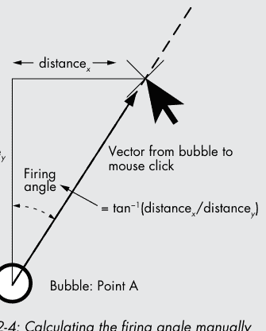

请在 `game.js` 文件的 `clickGameScreen` 函数中添加以下代码：

```
game.js
var BubbleShoot = window.BubbleShoot || {};
BubbleShoot.Game = (function($){
    var Game = function(){
        --snip--
        var clickGameScreen = function(e){
            var angle = BubbleShoot.ui.getBubbleAngle(curBubble.getSprite(),e);
            var duration = 750;
            var distance = 1000;
            var distX = Math.sin(angle) * distance;
            var distY = Math.cos(angle) * distance;
            var bubbleCoords = BubbleShoot.ui.getBubbleCoords(curBubble.
                getSprite());
            var coords = {
                x : bubbleCoords.left + distX,
                y : bubbleCoords.top - distY
            };
            BubbleShoot.ui.fireBubble(curBubble,coords,duration);
        };
    };
    return Game;
})(jQuery);
```

新代码设定了持续时间和总距离，然后计算沿x轴和y轴的距离，以得到一个坐标（coords），该坐标距离起点1000像素，方向为鼠标点击的方向。

接下来，我们需要编写 `fireBubble` 函数，该函数接受气泡对象、发射目标坐标和持续时间作为参数。我们将把这个函数放在 ui 类中，因为它只处理屏幕上的移动，不会影响游戏状态。

请在 `ui.js` 文件中 `getBubbleAngle` 方法之后添加一个新方法：

```
var BubbleShoot = window.BubbleShoot || {};
BubbleShoot.ui = (function($){
    var ui = {
        --snip--
        getBubbleAngle : function(bubble,e){
            --snip--
        },
        fireBubble : function(bubble,coords,duration){
            bubble.getSprite().animate({
                left : coords.x - ui.BUBBLE_DIMS/2,
                top : coords.y - ui.BUBBLE_DIMS/2
            },
            {
                duration : duration,
                easing : "linear"
            });
        }
    };
    return ui;
})(jQuery);
```

`fireBubble` 方法是一个jQuery调用，它使用jQuery的animate方法来移动气泡。传入函数的坐标代表了气泡需要停止的中心点。为了确保气泡到达正确的（top, left）坐标，`fireBubble` 首先将它接收到的坐标转换为对象的左上角坐标，这也是CSS定位元素的方式。

在屏幕上移动精灵的最简单的动画形式需要两个步骤：（1）将精灵放置在固定位置，（2）短时间后将其移动到新位置。重复第二步，直到精灵到达目的地。通过DOM操作，我们只需要在每次移动时更改元素的top和left CSS属性，然后就可以让浏览器来处理后续事宜。

我们可以通过两种方式实现这种动画。一种是使用JavaScript动画，这需要我们手动让精灵沿着路径的每一步移动；另一种是使用CSS3过渡，无需我们代码在每一帧进行输入就能移动精灵。本章我们将重点关注JavaScript方法；稍后我们将演示一个CSS3的实现。

与我们想在JavaScript和CSS中实现的许多效果一样，我们可以让jQuery为我们完成大部分工作。animate方法提供了一种为数值型CSS属性（如left和top坐标）制作动画的方式。它计算起始值和结束值之间的差异，并在多个步骤中将属性值从起始值更改为结束值。

> 此方法不适用于非数值型CSS属性，因为无法轻易计算从起始状态到结束状态的方式。例如，你不能使用animate来过渡背景颜色，因为起始值和结束值是十六进制颜色对，而两种颜色之间的插值计算并不简单。

animate方法接受多个参数，包括以下这些：

**CSS属性** 指定要制作动画的属性。最常见的是定位属性，如 *top* 和 *left*，但也可以是任何可以用单个整数维度（像素为单位）定义的属性，包括font-size、width、height，甚至是border-width或margin-left。（注意，margin的简写定义，例如 `margin: 0 10px 20px 10px`，包含四个不同的值，因此在不拆分为margin-top、margin-right、margin-bottom和margin-left这四个组成部分的情况下，它无法与animate一起使用。）

**持续时间** 定义动画持续的长度，单位为毫秒。这里的持续时间固定为1秒（1000毫秒），对应速度为每秒1000像素。气泡移动的距离将取决于游戏状态，特别是气泡可能碰撞到的任何物体。但我们目前设定的持续时间对于发射到屏幕外的气泡应该是正确的。

**缓动** 定义对象如何从起始状态过渡到结束状态。缓动通常用于改变运动路径上的加速和减速。对于移动，linear（线性）导致从开始到结束的恒定速度，而swing（摆动）则添加了开始的加速和结束的减速。

你还可以向animate传递其他选项，值得查阅jQuery文档以了解该函数的全部潜力。要发射气泡，我们只需要前面提到的参数。

重新加载页面，然后在气泡上方的一个位置点击。气泡应该会朝着那个方向飞出。这只能工作一次。你需要刷新页面才能再次看到它，但这确实是一个开始。

## 总结

在本章中，你学习了如何使用jQuery、HTML和CSS技术执行简单的动画。现在我们已经有了基本代码，可以响应鼠标点击来移动屏幕上的气泡，是时候开始充实游戏了。

在第3章中，我们将重点讲解绘制游戏棋盘、检测碰撞以及弹出气泡组。

## 进一步练习

- 如果你在游戏区域第二次点击，气泡会重新出现在屏幕上。你将如何禁用这个点击事件以防止它发生？
- 在 `.animate` 调用中，我们指定了 `easing : "linear"`。尝试使用 "swing"，并思考为什么这对于 *泡泡射击* 可能不合适，但对于其他游戏可能是更好的动画方法。然后查看 http://api.jqueryui.com/easings/ 上的更多缓动设置，看看你是否能将其中任何一种融入到代码中。

# 第3章：游戏逻辑

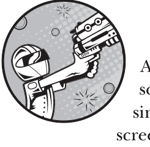

到目前为止，我们已经创建了一个带有“新游戏”按钮的介绍屏幕和一个玩家可以发射出屏幕的单个气泡。在本章中，我们将把 *泡泡射击* 变成一个更完整的游戏。你将学习如何绘制游戏棋盘并向玩家显示关卡，然后学习碰撞检测。

*碰撞* 是许多游戏的核心，当精灵接触时发生。一旦你能检测到碰撞，你就可以编写代码让精灵对此作出反应。在 *泡泡射击* 中，当发射的气泡撞击到游戏网格中的气泡时，就会发生碰撞。我们将实现两种反应：如果发射的气泡没有形成三个或更多气泡的颜色组，它将粘在棋盘上；否则，它将导致一个有效的组从棋盘上落下。

但在我们能计算碰撞之前，我们需要有一个供气泡碰撞的对象。本章的第一部分讨论绘制初始棋盘和设置游戏状态。为此，我们需要遵循一个包含多个步骤的过程，如图3-1所示。

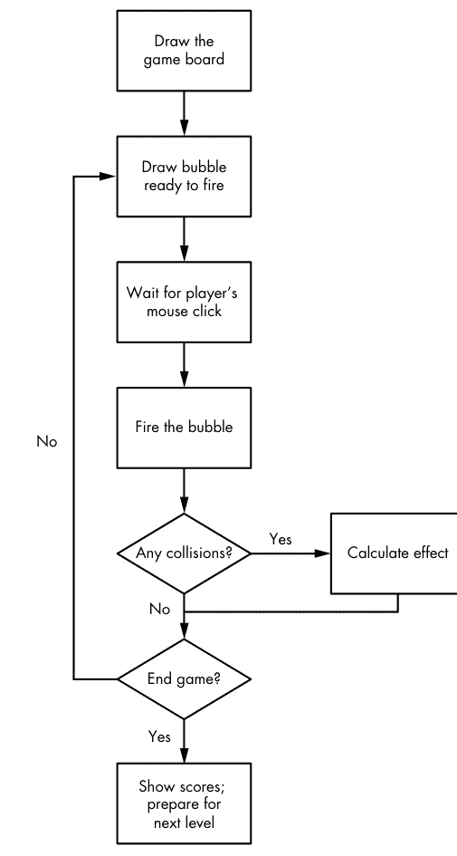

图3-1：游戏循环从绘制棋盘开始，以显示分数结束。

我们将首先绘制游戏棋盘，然后为已发射的气泡添加碰撞检测。在下一章中，我们将实现基于颜色匹配来弹出气泡组的机制。让我们逐步完成这些步骤，并将其转化为代码。


## 绘制游戏面板

每个关卡的游戏面板结构相似，每个面板包含多行不同颜色的泡泡。奇数行和偶数行分别包含奇数个或偶数个泡泡，这取决于该行是奇数行还是偶数行。我们将所有这些状态信息存储在一个 Board 对象中，并将当前面板存储为 Game 对象中的一个变量。

你选择的对象结构应该根据游戏设计而有所不同，但目标应与决定如何在 Web 应用程序中组织代码时一致：将执行相似操作的对象分组，并在公共函数的抽象程度上取得平衡。不要定义几个包含很少代码的类，也不要创建过少的类以至于代码冗长、难以阅读和理解。游戏开发人员通常根据直觉、经验以及严格的规则来做出初始结构决策。如果你认为最初的决定不再有效，请随时准备重构代码。

构成面板的行将是一个 Bubble 对象的数组。我们将在实例化 Board 对象时创建这个数组。之后，我们将把面板元素的绘制工作从 ui.js 中转移到 DOM 操作中。在一个 Game 类中堆积大量代码很容易但并不可取；因此，只要有机会就应将职责交给其他类，尤其是在将对象渲染到屏幕时。

在 game.js 中，我们需要创建一个变量来保存面板，以及一个 Board 对象的新实例。当点击"新游戏"按钮时生成面板。向 game.js 中添加以下新代码：

```javascript
var BubbleShoot = window.BubbleShoot || {};
BubbleShoot.Game = (function($){
    var Game = function(){
        var curBubble;
        var board;
        // --snip--
        var startGame = function(){
            $(".but_start_game").unbind("click");
            BubbleShoot.ui.hideDialog();
            curBubble = getNextBubble();
            board = new BubbleShoot.Board();
            BubbleShoot.ui.drawBoard(board);
            $("#game").bind("click",clickGameScreen);
        };
        // --snip--
    };
    return Game;
})(jQuery);
```

Board 是我们需要创建的新构造函数。创建一个名为 board.js 的新文件，并将其添加到 index.html 中 Modernizr.load 的文件加载列表中。向新文件中添加以下代码：

```javascript
var BubbleShoot = window.BubbleShoot || {};
BubbleShoot.Board = (function($){
    var NUM_ROWS = 9;
    var NUM_COLS = 32;
    var Board = function(){
        var that = this;
        var rows = createLayout();
        this.getRows = function(){ return rows;};
        return this;
    };
    var createLayout = function(){
        var rows = [];
        for(var i=0;i<NUM_ROWS;i++){
            var row = [];
            var startCol = i%2 == 0 ? 1 : 0;
            for(var j=startCol;j<NUM_COLS;j+=2){
                var bubble = BubbleShoot.Bubble.create(i,j);
                row[j] = bubble;
            };
            rows.push(row);
        };
        return rows;
    };
    return Board;
})(jQuery);
```

`NUM_ROWS` 和 `NUM_COLS` 是常量，用于确定泡泡面板网格的行数和列数。列数可能看起来偏高，因为一行中肯定不会有 32 个泡泡。之所以使用如此大的列数值，是因为我们将在每个半泡泡宽度处创建一个网格条目，因为奇数行和偶数行在游戏面板上是交错偏移的。这种设计决策使得布局在视觉上更加美观，看起来就像泡泡彼此堆叠在一起。它还为玩家创造了更有趣的射击角度。

第一行以及每个后续奇数行上的所有泡泡都将具有奇数 y 坐标，而偶数行上的泡泡将具有偶数 y 坐标。行以整数步长递增，但我们使用的数组从索引零开始：第一行位于索引 0，第二行位于索引 1，依此类推。因此，泡泡的坐标 (x, y) 从泡泡面板的左上角开始，将按图 3-2 所示标注。以这种方式指定坐标并使用半填充的网格，可以避免处理半值和小数点。此外，我们可以将面板的布局存储在以整数为索引的数组中。使用整数而非小数不会改变我们计算碰撞的过程，但确实使代码更具可读性。

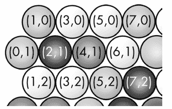

*图 3-2：游戏网格中泡泡的坐标*

在代码中，我们现在将调用 `createLayout` 函数，该函数返回一个包含行和列的二维数组。我们在下一行中提供了对该数组的公共访问。一旦我们有了 Board 对象，我们就可以检索任何特定行列位置的泡泡。例如，要访问坐标 (4,1) 处的泡泡，我们将这样写：

```javascript
var rows = board.getRows();
var row = rows[1];
var bubble = row[4];
```

泡泡的访问方式是先获取行，然后获取列号。首先，我们通过 `board.getRows` 获取所有行，然后将面板中的第一行存储为 `row`。接下来，我们通过列号访问 `row` 中的第四个泡泡。因为 `row` 数组只填充了一半，所以在偶数索引行（从零开始）中所有奇数条目，以及奇数行中所有偶数条目都将为 null。

`createLayout` 函数包含一个循环。对于我们要创建的每一行，`startCol` 根据该行是奇数行还是偶数行，分别计算从列 1 还是列 0 开始。然后另一个循环递增到最大列数，创建一个新的 `Bubble` 对象，并将其添加到行数组中，完成后返回该数组。

为了让这个函数正常工作，我们需要调整 `Bubble` 类以接受行和列的输入坐标，并且需要修改 `Bubble.create` 方法。此外，如果一个 `Bubble` 对象通过存储其坐标来知道其在网格中的位置，那么当我们需要计算要消除的泡泡组时，这些信息将非常有用。当我们知道一个泡泡的位置时，我们可以访问该泡泡，因为它存储在 Board 对象中。然后给定一个泡泡，我们可以查询它来确定其位置。每个泡泡将有一个 `type` 属性，对应于它的颜色，该属性将在创建时确定。

当你开始编写自己的游戏创意时，关于在哪里存储数据以及如何访问数据的决策至关重要。你的解决方案将取决于你正在构建的游戏类型。在*泡泡射击*中，我们将相对少量的泡泡存储在一个 Board 对象中。要查找特定泡泡的信息，我们可以通过从 `rows` 数组中检索数据来访问 Board 存储的数据。

根据我们需要如何使用这些泡泡数据，这种方法可能不是最优雅的解决方案。例如，假设我们想找到游戏中所有的红色泡泡。目前，我们必须遍历面板上的每个位置，检查泡泡是否为红色，然后存储结果。游戏网格很小，所以现代处理器可以快速执行此操作。只要我们每秒不运行太多次颜色检查，当前的代码结构就应该可以正常工作。

但现在想象屏幕上有*成千上万*个泡泡。仅仅为了找到红色泡泡就遍历所有泡泡将消耗太多的处理能力。相反，我们可能希望将泡泡存储在多个数组中——一个用于所有红色泡泡，一个用于所有绿色泡泡，依此类推——以便即时访问每种颜色的所有泡泡。然而，仍然会有权衡：要检查面板上的某个位置是否被泡泡占据，无论颜色如何，我们都必须查看多个数组。

当你只对处理器运行操作的速度有一个大致了解时，最好让你的代码清晰简洁。如果你的游戏可以运行并且速度足够快，你就不需要尝试不同的数据访问方式。或者，如果你发现了瓶颈，那么你就必须重构某些部分以提高它们的速度。游戏开发是一个迭代的过程；你会像编写新代码一样频繁地重新审视已有的代码行。

你如何设计对象以及在哪里存储它们的数据会因游戏而异。但请记住：如果 Game 对象需要使用这些数据，你必须以某种方式允许该对象访问它。无论数据是直接存储在变量中，还是存储在 Game 内部的数组中，还是通过 Game 可以访问的中间对象（如*泡泡射击*中的 Board 对象）来访问，如果代码需要对该对象做出决策，就需要访问该对象的状态。

为了支持泡泡存储其在面板上的位置和颜色，请按如下方式修改 *bubble.js*：

```javascript
var BubbleShoot = window.BubbleShoot || {};
BubbleShoot.Bubble = (function($){
    var Bubble = function(row,col,type,sprite){
        var that = this;
        this.getType = function(){ return type;};
        this.getSprite = function(){ return sprite;};
        this.getCol = function(){ return col;};
        this.getRow = function(){ return row;};
    };
    Bubble.create = function(rowNum,colNum,type){
        if(type === undefined){
            type = Math.floor(Math.random() * 4);
        };
        var sprite = $(document.createElement("div"));
        sprite.addClass("bubble");
        sprite.addClass("bubble_" + type);
        var bubble = new Bubble(rowNum,colNum,type,sprite);
        return bubble;
    };
};
```


```
return Bubble;
})(jQuery);
```

Bubble 现在接收网格坐标和一个泡泡类型，以及精灵对象 ❶，其中 type 对应于在 game.css 中指定的颜色。Bubble.create 方法接受相同的参数 ❷；如果未传递 type ❸，则会随机选择四种类型（颜色）之一 ❹。

现在我们有了一个 Board 对象、大量的泡泡，以及它们的类型和位置。但所有这些信息完全在内存中，存储在 Board 对象的 rows 属性中。接下来，我们将使用这些信息来渲染关卡，让玩家能够看到游戏板。

## 渲染关卡

绘制关卡是 ui 类的完美任务，因为 ui 代表游戏状态但不会影响该状态。

将计算对象位置的代码与将该对象渲染到屏幕的代码分离，是你应该在所有游戏创意中应用的一个原则。这不仅将渲染代码与游戏逻辑分离，从而提高可读性，还让你能更轻松地改变对象的渲染方式。例如，如果泡泡射击游戏板更大，无法完全显示在屏幕上，但我们想实现缩放或平移功能，我们可以更改渲染游戏板的代码，要么偏移渲染位置，要么放大或缩小以绘制不同尺寸的游戏板。当我们从基于 DOM 的精灵切换到第 6 章中的 HTML canvas 元素绘制时，渲染与游戏逻辑分离的强大之处将变得显而易见。

因为创建泡泡对象涉及创建一个 DOM 精灵元素，渲染过程需要将此元素放置在文档中并正确定位。接下来的简单步骤如下：

- 1. 遍历所有行和列，提取每个泡泡对象。
- 2. 将泡泡的 HTML 写入 DOM。
- 3. 将泡泡定位在正确的位置。

你将添加的下一段代码将应用这些步骤。打开 ui.js，在 fireBubble 之后添加一个新方法（drawBoard），然后在文件顶部添加一个新的 ROW_HEIGHT 常量：

```
ui.js
var BubbleShoot = window.BubbleShoot || {};
BubbleShoot.ui = (function($){
    var ui = {
        BUBBLE_DIMS : 44,
        ROW_HEIGHT : 40,
        init : function(){
        },
        fireBubble : function(bubble,coords,duration){
            --snip--
        },
        drawBoard : function(board){
```

```
var rows = board.getRows();
var gameArea = $("#board");
for(var i=0;i<rows.length;i++){
    var row = rows[i];
    for(var j=0;j<row.length;j++){
        var bubble = row[j];
        if(bubble){
            var sprite = bubble.getSprite();
            gameArea.append(sprite);
            var left = j * ui.BUBBLE_DIMS/2;
            var top = i * ui.ROW_HEIGHT;
            sprite.css({
                left : left,
                top : top
            });
        };
    };
}
};
return ui;
})(jQuery);
```

drawBoard 方法获取游戏板的行和列 ① 并遍历它们 ②。如果存在一个泡泡 ③（回想一下，由于稀疏网格系统，每个其他 x 坐标位置为 null），drawBoard 会获取精灵对象 ④，将其附加到游戏板 ⑤，然后在设置其位置之前计算其坐标 ⑥。

为了确定泡泡的位置，drawBoard 首先计算左坐标，即泡泡的列号乘以其宽度的一半。为了计算上坐标，我们将使用一个略小于 BUBBLE_DIMS 高度的值。奇数行和偶数行是交错排列的，我们希望泡泡看起来彼此契合。为了创建堆叠效果，垂直间距将略小于水平距离。在 ui.js 的顶部，ROW_HEIGHT 已设置为 40，这比高度小 4 像素。这个值是通过反复试验而非几何计算确定的：调整数字直到泡泡网格看起来让你满意。

重新加载并点击 **新游戏**；你应该能看到一个渲染良好的游戏板。你甚至可以向游戏板的其他部分发射一个泡泡；不幸的是，它应该会直接穿过而不碰到任何东西，并像之前一样飞出屏幕。

因为我们只有一个泡泡，所以我们需要刷新以重试此过程。在我们开始处理碰撞检测之前，我们将确保可以连续发射一个又一个的泡泡。

## 泡泡队列

虽然玩家只有有限数量的泡泡可以发射，但游戏需要以持续不断的流提供这些泡泡。因此，我们需要添加一个函数，该函数创建一个新的泡泡，将其添加到 DOM 中，并在用户发射第一个泡泡后立即将下一个泡泡加入队列。

在 `game.js` 中，添加以下变量和函数，并将 `curBubble` 的初始化更改为调用一个新的 `getNextBubble` 函数：

### game.js

```
var BubbleShoot = window.BubbleShoot || {};
BubbleShoot.Game = (function($){
    var Game = function(){
        var curBubble;
        var board;
        var numBubbles;
        var MAX_BUBBLES = 70;
        this.init = function(){
            $(".but_start_game").bind("click",startGame);
        };
        var startGame = function(){
            $(".but_start_game").unbind("click");
            numBubbles = MAX_BUBBLES;
            BubbleShoot.ui.hideDialog();
            curBubble = getNextBubble();
            board = new BubbleShoot.Board();
            BubbleShoot.ui.drawBoard(board);
            $("#game").bind("click",clickGameScreen);
        };
        var getNextBubble = function(){
            var bubble = BubbleShoot.Bubble.create();
            bubble.getSprite().addClass("cur_bubble");
            $("#board").append(bubble.getSprite());
            BubbleShoot.ui.drawBubblesRemaining(numBubbles);
            numBubbles--;
            return bubble;
        };
        var clickGameScreen = function(e){
            var angle = BubbleShoot.ui.getBubbleAngle(curBubble .getSprite(),e);
            var duration = 750;
            var distance = 1000;
            var distX = Math.sin(angle) * distance;
            var distY = Math.cos(angle) * distance;
            var bubbleCoords = BubbleShoot.ui.getBubbleCoords(curBubble .getSprite());
            var coords = {
                x : bubbleCoords.left + distX,
                y : bubbleCoords.top - distY
            };
            BubbleShoot.ui.fireBubble(curBubble,coords,duration);
            curBubble = getNextBubble();
        };
        return Game;
    };
})(jQuery);
```

新代码首先创建一个变量 ① 来存储玩家已发射的泡泡数量。因为发射的泡泡数量是一个整数——一种基本数据类型——我们将它作为变量存储在 `Game` 中。例如，如果我们有一个关卡必须在时间限制内完成，我们可能会创建一个对象来存储剩余时间和剩余泡泡数量，而不是继续在 `Game` 中创建变量。就目前而言，这个变量符合我们的目的。

代码还为玩家可以发射的最大泡泡数量设置了一个常量 ②。当开始一个关卡时，它将剩余泡泡数量设置为 `MAX_BUBBLES` 的值 ③，并调用 `ui.js` 中的一个新函数在屏幕上显示剩余泡泡数量 ④。最后，每次发射一个泡泡时，代码都会调用 `getNextBubble` ⑤ 来准备一个新的泡泡。

我们还想向玩家显示一个关卡内可用的剩余泡泡数量，因此在 `ui.js` 中创建 `drawBubblesRemaining` 方法，将这个新函数附加到 ui 对象：

```
var BubbleShoot = window.BubbleShoot || {};
BubbleShoot.ui = (function($){
  var ui = {
    BUBBLE_DIMS : 44,
    ROW_HEIGHT : 40,
    --snip--
    drawBoard : function(board){
      --snip--
    },
    drawBubblesRemaining : function(numBubbles){
      $("#bubbles_remaining").text(numBubbles);
    }
  };
  return ui;
})(jQuery);
```

此外，我们需要显示剩余泡泡的数量，所以在 `index.html` 中添加一个新元素：

```
<div id="game">
  <div id="board"></div>
  <div id="bubbles_remaining"></div>
</div>
```

在 `main.css` 中为 `bubbles_remaining` div 添加一些样式：

```
#bubbles_remaining
{
  position: absolute;
  left: 479px;
  top: 520px;
  width: 50px;
  font-size: 26px;
  font-weight: bold;
  color: #000;
  text-align: center;
}
```

现在刷新游戏。你应该能够向远处发射泡泡，在第一个泡泡发射后立即获得一个新的（直到你用完了 70 个泡泡，或者你为 `MAX_BUBBLES` 设置的任何值），并能够立即发射这个新泡泡。
```


通常，你可以将游戏分解为一个重复的*回合循环*。循环通常由玩家动作发起，并在该动作解决后结束。在《泡泡射击》中，循环在玩家点击屏幕发射泡泡时开始，并在下一个泡泡准备好发射时完成。至此，我们有了基本的回合循环，但要创建游戏，我们需要充实循环的中间部分，以计算泡泡的停止位置以及是否要弹出泡泡。

## 检测碰撞

尽管你现在可以发射泡泡，但它们会直接穿过棋盘，而不影响泡泡网格。游戏设计要求它们与棋盘碰撞，并要么成为棋盘的一部分，要么导致相同颜色的泡泡组弹出。下一个任务是找出碰撞发生的位置。

我们可以通过两种方式计算碰撞：

- 每帧将精灵向前移动几个像素，然后尝试检测与其他精灵的任何重叠。如果有重叠，我们就知道撞到了另一个泡泡。
- 在精灵开始移动之前，使用几何方法计算它可能与其他泡泡碰撞的位置。

在快节奏的街机游戏中，你可能会选择第一种方法，只要物体不会在没有检测到碰撞的情况下相互穿过。当物体高速移动且碰撞检查发生在物体自上次检查以来已移动多个像素之后时，可能会发生这些穿透现象。例如，在一个你向一英尺厚的墙壁射击子弹的游戏中，只有当你每英尺检查一次碰撞时，才能保证子弹与墙壁碰撞。如果你改为每两英尺检查一次碰撞，你可能会在子弹应该撞击之前检查一次，并发现没有墙壁。然后，当你在两英尺后再次检查时，子弹已经穿过了墙壁，再次导致没有碰撞。

为了解决快速移动物体的问题，我们可以确保步长始终足够小，以至于永远不会发生穿透；然而，这需要更多的计算，如果没有强大的计算能力，可能无法实现。这个问题在浏览器环境中更容易出现：因为我们永远不知道最终用户的计算机规格，所以我们不能想当然地认为有足够的处理能力。

第二种选择，使用几何方法，在可行的情况下更为准确。幸运的是，我们的游戏设计具有相当简单的几何属性。不幸的是，对于精灵具有更复杂形状的游戏，此选项不可行。在这种情况下，你必须逐帧检查像素是否重叠，并进行彻底测试以确保没有副作用。对于《泡泡射击》，我们将采用几何方法，因为我们有以下优势：

- 游戏位于规则的网格上。
- 所有对象（泡泡）都是相同的。
- 我们仅在二维空间中工作。
- 玩家只移动一个对象。
- 所有对象都是简单的几何形状（圆形），因此计算边缘相交的位置很容易。

这些条件使得碰撞的几何计算相对直接。因为游戏开发经常涉及大量几何知识，所以具备扎实的三角学和向量知识至关重要。下一节将讨论本游戏涉及的几何知识。然后我们将把这些几何知识转化为代码。

## 碰撞几何

当你需要计算碰撞时，在编写检测代码之前，先在纸上绘制几何图形。这样你就能将需要计算的数值可视化，如图3-3所示。

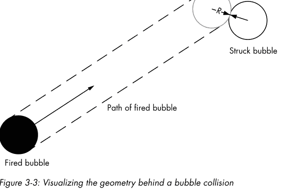

当发射的泡泡的中心经过另一个泡泡中心的*2R*（其中*R*是泡泡的半径）范围内时，应该发生碰撞，这意味着两个周长相切。因为交点将始终垂直（90度）于碰撞泡泡的边缘和被击中泡泡的边缘，所以我们只需要检查移动泡泡的中心路径是否经过另一个泡泡中心的*2R*范围内。

为了确定碰撞发生的位置，我们需要检查棋盘上的每个其他泡泡，以确定发射泡泡的路径是否穿过它。如果它与多个泡泡重叠，如图3-4所示，我们需要确保选择的被击泡泡是发生的第一个碰撞，即发射泡泡移动距离最短的那个。

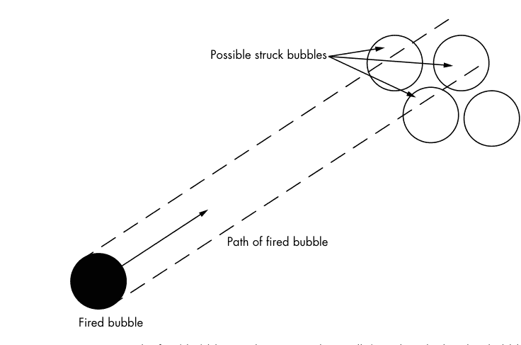

图3-4：*发射的泡泡可能与多个其他泡泡发生碰撞。*

检测碰撞等同于检测从我们发射泡泡的中心线绘制的向量与一个半径是我们的泡泡两倍的圆相交的时刻。这将被称为泡泡的*碰撞箱*。图3-5展示了我们如何重新绘制这个概念，以一种更容易计算的方式帮助我们思考。

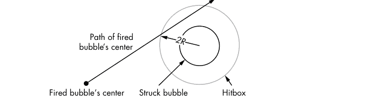

图3-5：*如果发射泡泡的路径与静止泡泡的圆形碰撞箱相交，则发生碰撞。*

在此图中，小实心圆标记了正在发射的泡泡的中心。它将与之碰撞的泡泡是内圆，与泡泡碰撞箱（箭头标记的点2R，即泡泡半径的两倍）的交点是泡泡将停止的位置。

将图表转换为数学公式意味着使用向量。与其在展示任何代码之前进行数学推导，让我们直接进入必要的JavaScript代码，其中包含解释性注释。

### 简化碰撞箱

因为我们处理的是圆形，所以创建碰撞箱比处理例如平台游戏中奔跑和跳跃的人物可能更简单。在这种情况下，你可能不想仅仅通过检查像素是否重叠来检测碰撞，因为可能存在性能问题；相反，你可以简化主角的几何形状，并创建一个矩形碰撞箱进行检测。并非所有游戏都适合这种方法。然而，如果你能将复杂的角色轮廓简化为简单的几何形状，你就可以以比检查像素重叠更高的精度和更少的处理能力来检测碰撞。始终寻找创造性的、高效的解决方案，以避免占用大量资源的蛮力技术。

计算是一个包含特定函数的大型代码块，因此我们将把它放在自己的文件中。创建一个名为`collision-detector.js`的文件，并将其添加到`index.html`中的`Modernizr.load`调用中。输入以下内容：

```javascript
var BubbleShoot = window.BubbleShoot || {};
BubbleShoot.CollisionDetector = (function($){
	var CollisionDetector = {
		findIntersection : function(curBubble,board,angle){
			var rows = board.getRows();
			var collision = null;
			var pos = curBubble.getSprite().position();
			var start = {
				left : pos.left + BubbleShoot.ui.BUBBLE_DIMS/2,
				top : pos.top + BubbleShoot.ui.BUBBLE_DIMS/2
			};
			var dx = Math.sin(angle);
			var dy = -Math.cos(angle);
			for(var i=0;i<rows.length;i++){
				var row = rows[i];
				for(var j=0;j<row.length;j++){
					var bubble = row[j];
					if(bubble){
						var coords = bubble.getCoords();
						var distToBubble = {
							x : start.left - coords.left,
							y : start.top - coords.top
						};
						var t = dx * distToBubble.x + dy * distToBubble.y;
						var ex = -t * dx + start.left;
						var ey = -t * dy + start.top;
						var distEC = Math.sqrt((ex - coords.left) * (ex - coords.left) + (ey - coords.top) * (ey - coords.top));
						if(distEC<BubbleShoot.ui.BUBBLE_DIMS * .75){
							var dt = Math.sqrt(BubbleShoot.ui.BUBBLE_DIMS * BubbleShoot.ui.BUBBLE_DIMS - distEC * distEC);
							var offset1 = {
								x : (t - dt) * dx,
								y : -(t - dt) * dy
							};
							var offset2 = {
								x : (t + dt) * dx,
								y : -(t + dt) * dy
							};
							var distToCollision1 = Math.sqrt(offset1.x * offset1.x +
								offset1.y * offset1.y);
							var distToCollision2 = Math.sqrt(offset2.x * offset2.x +
								offset2.y * offset2.y);
							if(distToCollision1 < distToCollision2){
								var distToCollision = distToCollision1;
								var dest = {
									x : offset1.x + start.left,
									y : offset1.y + start.top
								};
							}else{
								var distToCollision = distToCollision2;
								var dest = {
									x : -offset2.x + start.left,
									y : offset2.y + start.top
								};
							}
							if(!collision || collision.distToCollision>distToCollision){
								collision = {
									bubble : bubble,
									distToCollision : distToCollision,
									coords : dest
								};
							}
						}
					}
				}
			}
			return collision;
		}
	};
	return CollisionDetector;
})(jQuery);
```

稍后我将分解*collision-detector.js*中的代码。但首先，请注意*bubble.js*中调用了一个名为getCoords的新方法，它根据泡泡在行/列层次结构中的位置返回泡泡的中心(x,y)坐标。你需要修改泡泡类以添加新方法：

```javascript
var BubbleShoot = window.BubbleShoot || {};
BubbleShoot.Bubble = (function($){
    var Bubble = function(row,col,type,sprite){
        var that = this;
        this.getType = function(){ return type;};
        this.getSprite = function(){ return sprite;};
        this.getCol = function(){ return col;};
```


```
this.getRow = function(){ return row;};
this.getCoords = function(){
  var coords = {
    left : that.getCol() * BubbleShoot.ui.BUBBLE_DIMS/2 + BubbleShoot.ui.BUBBLE_DIMS/2,
    top : that.getRow() * BubbleShoot.ui.ROW_HEIGHT + BubbleShoot.ui.BUBBLE_DIMS/2
  };
  return coords;
}
};
Bubble.create = function(rowNum,colNum,type){
  --snip--
};
return Bubble;
})(jQuery);
```

气泡的游戏坐标计算起来很简单：首先找到每个气泡的左上角坐标。x 坐标（left）等于列号 ❶ 乘以气泡精灵宽度的一半 ❷。y 坐标（top）等于行号 ❸ 乘以行高 ❹，行高略小于气泡的完整高度。要找到气泡的中心，只需将气泡尺寸的一半 ❺ 分别加到 x 和 y 上即可。

在开发游戏逻辑时，对象的中心坐标通常是关注的重点；而用于渲染时，你通常会指定左上角以及宽度和高度。在对象中内置一个便捷方法，将两种坐标相互转换，可以省去每次需要切换时重复书写计算逻辑的麻烦。

## 碰撞检测逻辑

现在让我们逐块分析 `CollisionDetector.js` 中完整的 `findIntersection` 例程。如果你现在不想深入研究数学部分，可以跳过这段解析——它纯粹是碰撞检测的数学运算，不涉及任何新的 HTML5 或游戏开发概念。但要记住，在你编写的几乎每个游戏中，你都需要将对象之间复杂的交互分解为一个可以用相对简单的数学来操控的模型。

## 起始位置与方向向量

添加到 `collision-detector.js` 中的第一部分是标准的库初始化代码：

```
var BubbleShoot = window.BubbleShoot || {};
BubbleShoot.CollisionDetector = (function($){
  var CollisionDetector = {
```

我们创建了一个名为 `CollisionDetector` 的对象。现在来看该对象上的第一个方法：

```
findIntersection : function(curBubble,board,angle){
```

调用 `CollisionDetector` 时，你会使用 `BubbleShoot.CollisionDetector.findIntersection`。它接受参数 `curBubble`（Bubble 类的实例）、`board` 变量（Board 的实例），以及气泡被发射时的角度，为函数提供关于起始情况的所有必要信息。

现在，检查 `findIntersection` 内部的第一个变量：

```
var rows = board.getRows();
var collision = null;
```

我们将遍历每一行来检测碰撞，因此先把棋盘的行数据获取到局部变量中。默认假设没有碰撞发生，如果没有任何交叉碰撞，这将是函数返回的状态。因此，如果发射的气泡没有击中其他气泡，它将继续向前移动。

`collision` 的初始值是 `null` 而非 `false`，因为如果发生交叉碰撞，它将持有被碰撞的气泡以及一些其他信息，而不仅仅是一个布尔值来指示是否发生了碰撞。我们需要知道碰撞已经发生（即"true"或"false"的结果），但更重要的是，我们需要返回关于与什么发生了碰撞以及碰撞发生位置的信息：

```
var pos = curBubble.getSprite().position();
var start = {
  left : pos.left + BubbleShoot.ui.BUBBLE_DIMS/2,
  top : pos.top + BubbleShoot.ui.BUBBLE_DIMS/2
};
```

接下来的一对变量以包含 `top` 和 `left` 属性的对象形式获取气泡的起始位置（在屏幕上）：

```
var dx = Math.sin(angle);
var dy = -Math.cos(angle);
```

最后，`dx` 和 `dy` 定义了气泡相对于总移动距离在左右方向（`dx`）或上下方向（`dy`）的移动比例。定义好这些变量后，我们就可以遍历游戏棋盘的行和列了：

```
for(var i=0;i<rows.length;i++){
  var row = rows[i];
  for(var j=0;j<row.length;j++){
    var bubble = row[j];
    if(bubble){
```

我们将从游戏棋盘的左上角开始，逐行向下、向右扫描。因为我们只向上发射气泡，所以气泡永远不会与游戏棋盘上方的气泡发生碰撞。我们还知道，如果气泡路径上存在多个碰撞候选对象，我们希望选取气泡移动距离最短的那个——即最先发生的碰撞。请记住，由于列是稀疏填充的（每隔一个条目为 null），在尝试操作之前，我们还需要确保确实在查看一个气泡——因此有了 `if(bubble)` 的检查。

## 计算碰撞

接下来我们需要使用一些几何知识来检查发射气泡的碰撞箱是否与其他气泡发生了碰撞。我们将确定由 (dx,dy) 定义的向量（起始于发射气泡的中心）与图 3-4 中所绘制圆的交点。先从圆的方程开始：

$(x-c_x)^2 + (y-c_y)^2 = r^2$

其中，*x* 和 *y* 是圆周上的点，$c_x$ 和 $c_y$ 是圆心坐标，*r* 是圆的半径。我们需要这些点来计算到起始气泡的距离。

```
var coords = bubble.getCoords();
var distToBubble = {
    x : start.left - coords.left,
    y : start.top - coords.top
};
```

循环的这一部分包含一个需要检测碰撞的气泡，因此我们获取 $c_x$ 和 $c_y$（即前面代码中的 coords），即气泡的中心坐标，并计算该点与发射气泡坐标之间的距离。此时我们尚不知道是否会发生碰撞。

发射气泡遵循以下方程定义的一组坐标：

$p_x = e_x + td_x$

$p_y = e_y + td_y$

其中 $p_x$ 和 $p_y$ 是气泡中心点轨迹上的点。$p_x$ 和 $p_y$ 的计算发生在 jQuery 的 animate 方法中，这是沿直线移动点的标准方程。接下来，我们将计算这条线上距离被检测气泡中心最近的点对应的 *t* 值：

```
var t = dx * distToBubble.x + dy * distToBubble.y;
```

这一行告诉我们，在发射气泡总移动距离的哪个比例处，它会最接近候选气泡的中心。由此，我们可以计算出该位置的屏幕坐标：

```
var ex = -t * dx + start.left;
var ey = -t * dy + start.top;
```

有了这些坐标，我们可以求出 *e*（发射气泡中心线上距离候选气泡中心最近的点）到候选气泡中心的距离：

```
var distEC = Math.sqrt((ex - coords.left) * (ex - coords.left) + (ey - coords.top) * (ey - coords.top));
```

如果距离 distEC 小于候选气泡半径的两倍，则发生碰撞。否则，发射气泡将不会与此候选气泡碰撞。

> **试错与计算**
>
> 请注意，虽然 `BubbleShoot.ui.BUBBLE_DIMS` 给出了精灵的宽度和高度，但我们实际检查的 distEC 对应的是一个略小的气泡图像。将 `BUBBLE_DIMS` 的值乘以 0.75（通过一定的试错得出）可以得到游戏中实际适用的气泡直径。

我们可以通过测量气泡的宽度来得出更精确的 distEC 值——本书图片中气泡宽度为 44 像素。除以 `BUBBLE_DIMS` 的 50 像素，结果是 0.88 的乘数。虽然这个较大的值可能更精确，但它要求玩家在尝试将气泡射入间隙时更加精确。因此，0.75 对玩家来说感觉更好，因为它给了玩家更多机会完成那些如果数学计算精确的话会觉得非常困难的射击。

在游戏开发中，你经常会基于试错而非纯粹的计算来做决策。在这种情况下，使用一个略小的值可以让玩家有机会将气泡射入游戏棋盘中的小间隙。玩家不会注意到物理定律的放宽执行，他们会更享受游戏的乐趣。

如果 distEC 小于气泡精灵宽度的四分之三，我们就知道发射气泡的行进路径在某个点与候选气泡的碰撞箱相交：

```
if(distEC < BubbleShoot.ui.BUBBLE_DIMS * .75){
```

很可能还会出现第二个交叉点，即射线离开碰撞箱的位置（参见图 3-5，图中显示发射气泡的中心线在两个点上穿过碰撞箱），但我们只需要第一个。两次计算将确保我们得到正确的交点。让我们来看第一次计算：

```
var dt = Math.sqrt(BubbleShoot.ui.BUBBLE_DIMS * BubbleShoot.ui.BUBBLE_DIMS - distEC * distEC);
```


在这里，我们找到被击中泡泡的中心点与发射泡泡路径上最近点之间的距离。第二次计算如下：

```javascript
var offset1 = {
  x : (t - dt) * dx,
  y : -(t - dt) * dy
};
var offset2 = {
  x : (t + dt) * dx,
  y : -(t + dt) * dy
};
```

这里计算的是，在点t处，发射泡泡路径与静止泡泡中心交叉点的偏移量。

## 寻找正确的碰撞点

现在我们想选择哪个交点会先遇到——也就是说，哪个点离我们发射curBubble的位置最近——因此我们需要计算到每个潜在碰撞点的距离：

```javascript
var distToCenter1 = Math.sqrt(offset1.x * offset1.x + offset1.y * offset1.y);
var distToCenter2 = Math.sqrt(offset2.x * offset2.x + offset2.y * offset2.y);
```

接下来，我们将选择正确的碰撞点，并通过将起始坐标重新加回系统来计算curBubble需要停止的位置：

```javascript
if(distToCollision1 < distToCollision2){
  var distToCollision = distToCollision1;
  var dest = {
    x : offset1.x + start.left,
    y : offset1.y + start.top
  };
}else{
  var distToCollision = distToCollision2;
  var dest = {
    x : -offset2.x + start.left,
    y : offset2.y + start.top
  };
}
```

大多数情况下，如果被发射泡泡的中心与另一个泡泡的边缘碰撞，它会穿过两次：一次在进入时，一次在退出时。在少数只擦过而只发生单次碰撞的情况下，我们会得到两个相同的结果，所以选择哪个都无关紧要。

此时，该函数将遍历显示中的每个泡泡并检查碰撞；然而，我们不想知道*每一个*碰撞——只想知道curBubble移动路径上*最早*发生的*最近*碰撞。为了存储当前最佳匹配的碰撞，我们使用collision变量，它在循环开始前被设置为null。然后，每次找到碰撞时，我们检查新的碰撞是否比之前的最佳碰撞更近。如果没有之前的碰撞，我们找到的第一个碰撞将是最佳碰撞。collision对象存储了一个引用，指向被发射泡泡碰撞到的静止泡泡、碰撞距离以及发生的坐标：

```javascript
if(!collision || collision.distToCollision > distToCollision){
    collision = {
        bubble : bubble,
        distToCollision : distToCollision,
        coords : dest
    };
};
```

现在，如果找到碰撞，*findIntersection*函数将返回一个包含我们所需所有数据的对象；如果没有发生碰撞，则返回null。所有这些计算都发生在泡泡甚至开始移动之前。

## 响应碰撞

我们现在需要在*game.js*中修改后的clickGameScreen函数中使用我们拥有的碰撞坐标，以便我们可以发射和停止泡泡。我们已经完成了检测碰撞的第一步，即解析泡泡碰撞到了什么（可能是*什么都没有！*）。现在，Game需要决定如何响应这些信息。首先，我们检查碰撞。如果发生碰撞，我们将泡泡移动到碰撞发生的位置。如果没有发生碰撞，我们将泡泡发射到屏幕外。将*game.js*中现有的clickGameScreen函数更改为以下内容：

```javascript
var clickGameScreen = function(e){
    var angle = getBubbleAngle(e);
    var bubble = $("#bubble");
    var duration = 750;
    var distance = 1000;
    var collision = BubbleShoot.CollisionDetector.findIntersection(curBubble,
        board,angle);
    if(collision){
        var coords = collision.coords;
        duration = Math.round(duration * collision.distToCollision / distance);
    } else {
        var distX = Math.sin(angle) * distance;
        var distY = Math.cos(angle) * distance;
        var bubbleCoords = BubbleShoot.ui.getBubbleCoords(curBubble.getSprite());
        var coords = {
            x : bubbleCoords.left + distX,
            y : bubbleCoords.top - distY
        };
    };
    BubbleShoot.ui.fireBubble(curBubble, coords, duration);
    curBubble = getNextBubble();
};
```

如果泡泡移动的距离因碰撞而改变，它到达那里所需的时间也应该改变，这样所有泡泡的发射速度都相同。我们将使用碰撞数据重新计算该持续时间。

重新加载游戏并发射一个泡泡。泡泡应该在碰到主泡泡群时停止。但它看起来仍然不太对。泡泡停止了，但它没有融入棋盘。它只是粘在它撞到的地方。此外，如果你发射更多的泡泡，它们只是堆叠在一起；新泡泡不会与之前发射的泡泡碰撞。问题在于棋盘状态没有改变以同步显示状态，所以我们分两步纠正这个问题：

1.  将发射的泡泡添加到棋盘状态中正确的行和列。
2.  当发射的泡泡停止时，将其锁定到整齐的网格位置。

第二步将使用第一步的信息。

## 将bubble对象添加到棋盘

泡泡对象curBubble在DOM中，并且最终应该位于屏幕上正确的位置附近，因此当我们知道它应该适合放在哪里时，就可以将其添加到棋盘的行/列数组中。为了计算行号，我们将y坐标除以行的高度并对结果向下取整。计算列号类似，除了我们需要对齐到偶数行（包括零）的奇数列号，或对齐到奇数行的偶数列号。最后，我们可以将泡泡添加到Board对象的rows属性中，因为Board是我们存储所有泡泡位置信息的地方。

添加发射泡泡的函数很简单，所以我们将把它放在board.js中。在board类的定义中，getRows方法之后，添加以下内容：

**board.js**

```javascript
var BubbleShoot = window.BubbleShoot || {};
BubbleShoot.Board = (function($){
    var NUM_ROWS = 9;
    var NUM_COLS = 32;
    var Board = function(){
        var that = this;
        var rows = createLayout();
        this.getRows = function() { return rows; };
        this.addBubble = function(bubble, coords) {
            var rowNum = Math.floor(coords.y / BubbleShoot.ui.ROW_HEIGHT);
            var colNum = coords.x / BubbleShoot.ui.BUBBLE_DIMS * 2;
            if (rowNum % 2 == 1) {
                colNum -= 1;
            } else {
                colNum = Math.round(colNum / 2) * 2;
                colNum -= 1;
            }
            if (!rows[rowNum]) {
                rows[rowNum] = [];
            }
            rows[rowNum][colNum] = bubble;
            bubble.setRow(rowNum);
            bubble.setCol(colNum);
        };
        return this;
    };
    var createLayout = function() {
        --snip--
    };
    return Board;
})(jQuery);
```

请注意，除了将泡泡添加到rows[][]中正确的位置外，我们还将计算出的行号和列号传递给泡泡对象，以便它知道相对于其他泡泡的位置。我们还没有这些方法调用，所以现在在`bubble.js`中的Bubble类定义中创建它们：

**bubble.js**

```javascript
var Bubble = function(row, col, type, sprite) {
    var that = this;
    this.getType = function() { return type; };
    this.getSprite = function() { return sprite; };
    this.getCol = function() { return col; };
    this.setCol = function(colIn) { col = colIn; };
    this.getRow = function() { return row; };
    this.setRow = function(rowIn) { row = rowIn; };
    this.getCoords = function() {
        --snip--
    };
};
```

接下来，修改`game.js`以在clickGameScreen中调用这个新方法：

**game.js**

```javascript
var clickGameScreen = function(e) {
    var angle = BubbleShoot.ui.getBubbleAngle(curBubble.getSprite(), e);
    var duration = 750;
    var distance = 1000;
    var collision = BubbleShoot.CollisionDetector.findIntersection(curBubble, board, angle);
    if (collision) {
        var coords = collision.coords;
        duration = Math.round(duration * collision.distToCollision / distance);
        board.addBubble(curBubble, coords);
    } else {
        var distX = Math.sin(angle) * distance;
        var distY = Math.cos(angle) * distance;
        var bubbleCoords = BubbleShoot.ui.getBubbleCoords(curBubble.getSprite());
        var coords = {
            x : bubbleCoords.left + distX,
            y : bubbleCoords.top - distY
        };
    };
    BubbleShoot.ui.fireBubble(curBubble, coords, duration);
    curBubble = getNextBubble();
};
```

重新加载游戏并发射几个泡泡。它们应该开始堆叠起来，尽管有些可能仍然重叠，因为它们还没有完全正确地嵌入网格。这是一个进展，但我们希望泡泡在碰撞时能整齐排列——这就是我们接下来要做的。

## 将bubble对象锁定到网格

当发射的泡泡与棋盘的其余部分碰撞时，我们希望将它们锁定在位置上，而不是让它们停在撞击的地方。当前的移动效果很好，但我们需要添加另一个步骤，在泡泡到达目的地时将其锁定到位。在运行board.addBubble之后，泡泡对象知道它位于哪一行哪一列；因此，调用它的getCoords方法（基于行和列计算）将检索它应该所在的坐标，而不是它实际停止的坐标。为了将它推到正确位置，我们将添加一个complete函数，该函数可以设置为jQuery animate调用的一部分，并利用泡泡已有的信息。这样，我们就可以发射泡泡然后忘记它，而不需要创建一个过程来在泡泡落地时整理它们。jQuery的complete回调函数是放置需要在动画完成时运行的代码的有用位置。例如，在一个有爆炸效果的游戏中，动画帧可以运行，当动画结束时，构成爆炸的DOM元素可以从屏幕上移除。

complete属性在动画结束时被调用。在ui.js中修改fireBubble如下：

```javascript
fireBubble : function(bubble, coords, duration){
    bubble.getSprite().animate({
        left : coords.x - ui.BUBBLE_DIMS/2,
        top : coords.y - ui.BUBBLE_DIMS/2
    },
    {
        duration : duration,
        easing : "linear",
        complete : function(){
            if(bubble.getRow() !== null){
```

**ui.js**


```
bubble.getSprite().css({
    left : bubble.getCoords().left - ui.BUBBLE_DIMS/2,
    top : bubble.getCoords().top - ui.BUBBLE_DIMS/2
});
});
}
});
},
```

当你重新加载时，你发射的气泡应该会稳定地嵌入网格系统中。请注意，我们使用 `getRow` 来检查是否发生了碰撞，因为对于未与其他气泡碰撞并移出屏幕的气泡，`getRow` 应该返回 `null`。

## 总结

现在，发射出的气泡会与棋盘上的其他气泡碰撞，《泡泡龙》游戏开始更像一个游戏了。我们使用 jQuery 在屏幕上移动精灵，让游戏对玩家的输入做出反应，并设置了一些基本的游戏逻辑。然而，目前还没有办法戳破气泡，没有这个功能，它算不上一个真正意义上的游戏。戳破的逻辑和动画显示将是下一章的主题。

## 进一步练习

- 1. 游戏棋盘的每一行都偏移以形成交错图案。更改 `createLayout` 中的代码，使气泡形成规则的网格。这将如何改变游戏？
- 2. 既然你已经可以让 `createLayout` 构建不同的网格模式，编写代码来生成一个全新的布局。例如，你可以只绘制每隔一列，或者构建一个更具创意的布局。
- 3. 《泡泡龙》有一个简单的对象结构，包含一个 Game、一个 Board 和一组 Bubbles。如果你正在构建一个像《愤怒的小鸟》、《宝石迷阵》或《糖果传奇》这样的游戏，你需要什么样的对象？

# 4

## 将游戏状态变化转换为显示

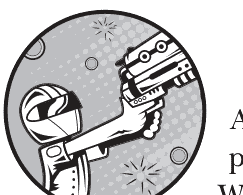

动画是一种强大的视觉提示，可以向玩家展示他们的操作如何影响游戏。每当玩家导致游戏状态发生变化时，你都需要显示结果。在本章中，你将添加代码来检测和移除气泡组，进一步了解如何为 CSS 精灵制作动画，并在 jQuery 中实现一个巧妙的爆炸效果。

此时，玩家可以向游戏棋盘发射气泡，并且这些气泡将成为气泡网格的一部分。现在，我们需要在玩家向匹配的气泡组发射正确颜色的气泡时，戳破这些气泡组。当 `curBubble` 发射到另一个气泡上并形成三个或更多匹配气泡的组时，该组中的所有气泡都应显示一个戳破的动画，然后从显示和 `Board` 对象中移除。

我们还需要检测和处理因戳破气泡而引起的任何级联效应。例如，当我们戳破一组气泡时，如果另一组气泡与主组断开连接，我们应该以不同的方式销毁这些断开连接的气泡。

## 计算气泡组

Board 对象包含网格中每个气泡的行和列信息，并将确定发射的气泡着陆时是否形成三个或更多气泡的组。我们将向 *board.js* 添加一个函数，该函数返回给定（行，列）位置周围的所有气泡。然后，我们将按颜色对它们进行分组，并计算出哪些气泡需要被戳破。

## 获取气泡

首先，我们需要从棋盘的 `rows` 变量中检索指定坐标周围的气泡集。在 *board.js* 中 `addBubble` 方法之后添加以下方法：

```
board.js
var Board = function(){
  var that = this;
  var rows = createLayout();
  this.getRows = function(){ return rows;};
  this.addBubble = function(bubble,coords){
    --snip--
  };
  ❶ this.getBubbleAt = function(rowNum,colNum){
    if(!this.getRows()[rowNum])
      return null;
    return this.getRows()[rowNum][colNum];
  };
  ❷ this.getBubblesAround = function(curRow,curCol){
    var bubbles = [];
    for(var rowNum = curRow - 1;rowNum <= curRow+1; rowNum++){
      for(var colNum = ❸curCol-2; colNum <= ❹curCol+2; colNum++){
        var bubbleAt = that.getBubbleAt(rowNum,colNum);
        if(bubbleAt && !(colNum == curCol && rowNum == curRow))
          ❺ bubbles.push(bubbleAt);
      };
    };
    return bubbles;
  };
  return this;
}
```

`getBubbleAt` 方法 ❶ 接受一个输入行和列坐标，并返回该位置的气泡。如果该位置不存在气泡，它返回 `null`。`getBubblesAround` 方法 ❷ 循环遍历三个相关行——当前行、上面一行和下面一行——然后检查周围的列，为每个位置调用 `getBubbleAt`。注意，由于半填充的行数组，`getBubbleAt` 会为每隔一列的条目返回 `null`。因此，我们查看当前气泡左侧两个条目 ❸ (`curCol-2`) 和右侧两个条目 ❹ (`curCol+2`)。无论我们是从奇数行还是偶数行开始，这个方法都应该有效。我们还需要检查我们正在检查的坐标处是否存在气泡，并且不要添加我们正在检查周围的那个气泡 ❺。

任何围绕发射气泡的气泡都会被推入 `bubbles` 数组，并由 `getBubblesAround` 返回。每个气泡都存储自己的坐标，因此我们不需要对数组排序或单独存储位置信息。

## 创建匹配的颜色组

接下来，我们将编写一个更实质性的函数 `getGroup`，该函数返回与第一个气泡颜色相同并连接到该气泡的组。这个递归函数将接受两个参数：一个气泡，用于设置起始坐标和颜色（类型）定义；以及一个对象，用于存储属于该组的气泡。该对象将把找到的气泡存储在作为属性添加的两个数组中：首先是一个线性数组，此外还有一个按行和列索引的数组。第二个数组允许我们轻松检查是否已经将气泡添加到匹配集中，以避免添加重复项。两个数组都作为对象的属性添加，这样我们在调用该方法时可以返回两者。图 4-1 中的流程图概述了此过程。我们将添加到 Board 类的函数如下所示：

```
var Board = function(){
  var that = this;
  var rows = createLayout();
  this.getRows = function(){ return rows;};
  this.addBubble = function(bubble,coords){
    --snip--
  };
  this.getBubbleAt = function(rowNum,colNum){
    --snip--
  };
  this.getBubblesAround = function(curRow,curCol){
    --snip--
  };
  this.getGroup = function(bubble,found){
    var curRow = bubble.getRow();
    if(!found[curRow])
      found[curRow] = {};
    if(!found.list)
      found.list = [];
    if(found[curRow][bubble.getCol()]){
      return found;
    }
    found[curRow][bubble.getCol()] = bubble;
    found.list.push(bubble);
    var curCol = bubble.getCol();
    var surrounding = that.getBubblesAround(curRow,curCol);
    for(var i=0;i<surrounding.length;i++){
      var bubbleAt = surrounding[i];
      if(bubbleAt.getType() == bubble.getType()){
        found = that.getGroup(bubbleAt,found);
      };
    };
  };
}
```

board.js

```
return found;
};
return this;
};
```

让我们分解一下这个新函数并逐步讲解逻辑。在传递气泡对象和 `found` 对象后，`getGroup` 首先检查这个气泡是否已经被找到过。

```
var curRow = bubble.getRow();
if(!found[curRow])
    found[curRow] = {};
if(!found.list)
    found.list = [];
if(found[curRow][bubble.getCol()]){
    return found;
}
found[curRow][bubble.getCol()] = bubble;
found.list.push(bubble);
```

如果气泡已经被找到，`getGroup` 应该返回当前未更改的数据并停止。如果 `found` 对象没有当前行的条目，我们需要创建一个空数组。然后，如果 `list` 属性不存在，则需要创建它，但仅在函数的初始调用时创建。如果此气泡之前已被检测到，我们返回 `found` 对象而不再次添加该气泡。否则，我们跟踪我们已经检查过这个位置，并将气泡存储在 `found` 列表中。

接下来，我们检索周围的气泡。

```
var curCol = bubble.getCol();
var surrounding = that.getBubblesAround(curRow,curCol);
```

最多应该有六个，然后我们需要检查每个气泡是否颜色匹配：

```
for(var i=0;i<surrounding.length;i++){
    var bubbleAt = surrounding[i];
    if(bubbleAt.getType() == bubble.getType()){
        found = that.getGroup(bubbleAt,found);
    };
};
return found;
```

如果一个气泡与发射气泡的颜色匹配，该函数将调用自身；`getGroup` 将检查过的气泡添加到扁平数组中，并标记其坐标已被检查。该函数再次调用自身，传入新找到的气泡和当前数据状态（包含 `found` 列表）。无论结果如何，我们都将返回 `found` 的最终值。
```


现在我们需要在气泡发射时调用这个方法。在*game.js*中，添加到clickGameScreen例程中：

```
var clickGameScreen = function(e){
    var angle = BubbleShoot.ui.getBubbleAngle(curBubble.getSprite(),e);
    var duration = 750;
    var distance = 1000;
    var collision = BubbleShoot.CollisionDetector.findIntersection(curBubble,
        board,angle);
    if(collision){
        var coords = {
            x : bubbleCoords.left + distX,
            y : bubbleCoords.top - distY
        };
        duration = Math.round(duration * collision.distToCollision / distance);
        board.addBubble(curBubble,coords);
        var group = board.getGroup(curBubble,{});
        if(group.list.length >= 3){
            popBubbles(group.list,duration);
        }
    }else{
        --snip--
    };
    BubbleShoot.ui.fireBubble(curBubble,coords,duration);
    curBubble = getNextBubble();
};
```

当我们通过`board.getGroup`获取一组气泡❶时，可能会得到一个包含少于三个气泡的组。由于我们只需要处理三个或更多气泡的组，因此会跳过任何更小的组❷。现在我们只需要编写消除气泡的例程❸！

## 消除气泡

我们需要游戏判断一组气泡是否包含三个或更多气泡，如果是，则移除这些气泡。在本节中，你将实现JavaScript函数来移除气泡组，并使用CSS添加有趣的消除动画。

## 使用JavaScript移除气泡组

我们首先计算一组气泡被消除后棋盘应该是什么样子。计算完成后，我们就可以更新显示并将已消除的气泡从视图中移除。只要游戏状态被正确计算，你之后就可以添加动画。先更新游戏状态，然后编写单独的代码来显示新状态，这是贯穿整个游戏开发过程的有用方法。

在clickGameScreen之后添加一个新函数popBubbles：

```
var BubbleShoot = window.BubbleShoot || {};
BubbleShoot.Game = (function($){
  var Game = function(){
    --snip--
    var clickGameScreen = function(e){
      --snip--
    };
    var popBubbles = function(bubbles,delay){
      $.each(bubbles,function(){
        var bubble = this;
        board.popBubbleAt(this.getRow(),this.getCol());
        setTimeout(function(){
          bubble.getSprite().remove();
        },delay + 200);
      });
    };
  };
  return Game;
})(jQuery);
```

popBubbles函数遍历我们传入的数组中的每个气泡对象❶，并告诉棋盘通过调用popBubbleAt（我们接下来会编写）来移除气泡❷。然后等待delay + 200毫秒后从DOM中移除气泡，以便让发射气泡的动画有时间运行。这样，用户就能在屏幕更新之前看到发生了什么。delay的初始值从发射气泡的持续时间传入——即气泡从起点飞行所用的时间——因此气泡总是会在分组发生后200毫秒消失。

最后一段代码在board.js中，我们需要定义popBubbleAt。在getGroup方法的结束括号之后添加以下方法：

```
var Board = function(){
  --snip--
  this.getGroup = function(bubble,found){
    --snip--
  };
  this.popBubbleAt = function(rowNum,colNum){
    var row = rows[rowNum];
    delete row[colNum];
  };
  return this;
};
```

popBubbleAt方法简单地从行/列数组中移除你传入的条目。

重新加载游戏并发射一个气泡。当你组成三个或更多气泡的组合时，它们应该从视图中消失。终于，*泡泡龙*开始更像一个游戏了！

## 使用CSS制作消除动画

通过CSS在屏幕上移动精灵是一种动画方式，但现在是时候用不同的方式来让精灵动起来并改变它们的*外观*了。这将为玩家呈现一个视觉上令人满足的消除动画，它将使用我们在本书开头创建的其他精灵帧。

让精灵图形产生动画效果的最佳方式是改变其背景图片的位置。回想一下，`bubble_sprite_sheet.png`（为方便起见在图4-2中再次展示）不仅包含四种气泡类型，还包含每种颜色的四种不同状态。

我们可以通过连续显示四个帧来展示消除动画，具体做法是每次将背景图片向左移动50像素。

游戏只消除成组的气泡，但如果一组中的所有气泡同时消失，消除效果就不太有趣了。为了使效果更有趣，我们将逐个消除气泡，而不是同时全部消除。这样做需要对我们刚刚添加到`game.js`中的`popBubbles`方法做一点小改动：

```
var popBubbles = function(bubbles,delay){
  $.each(bubbles,function(){
    var bubble = this;
    setTimeout(function(){
      bubble.animatePop();
    },delay);
    board.popBubbleAt(bubble.getRow(),bubble.getCol());
    setTimeout(function(){
      bubble.getSprite().remove();
    },delay + 200);
    delay += 60;
  });
};
```

在这里，我们调用animatePop❶，这是一个我们将添加到Bubble中的新方法，用于改变气泡的背景图片位置。第一个气泡的消除动画应该在发射的气泡与其碰撞时立即开始。但后续的消除应该通过递增delay❷来延迟60毫秒。将animatePop添加到bubble.js中。

```
var Bubble = function(row,col,type,sprite){
  --snip--
  this.getCoords = function(){
    --snip--
  };
  this.animatePop = function(){
    ❶ var top = type * that.getSprite().height();
    ❷ this.getSprite().css(Modernizr.prefixed("transform"),"rotate(" + (Math.random() * 360) + "deg)");
    ❸ setTimeout(function(){
      that.getSprite().css("background-position","-50px -" + top + "px");
    },125);
    setTimeout(function(){
      that.getSprite().css("background-position","-100px -" + top + "px");
    },150);
    setTimeout(function(){
      that.getSprite().css("background-position","-150px -" + top + "px");
    },175);
    ❹ setTimeout(function(){
      that.getSprite().remove();
    },200);
  };
};
```

根据气泡的类型，animatePop计算❶代表气泡background-position属性顶部的值。type值告诉我们气泡应该是什么颜色；我们将用它来选择适当的消除动画图片行。接下来，使用基本的CSS变换，我们通过将气泡精灵旋转一个随机角度来为动画添加一些视觉变化❷，以防止所有消除动画看起来完全相同。你将在第5章中看到更多CSS变换的示例。为了错开每个消除动画的开始时间，函数进行了三次延迟调用❸，每次将background-position向左移动50像素。

> **注意** 这种硬编码动画的方式不太适合扩展，但泡泡龙只有一个精灵和三帧需要显示。因此，我们可以避免编写通用函数，这就是我们使用一系列setTimeout调用的原因。当我们使用canvas渲染实现相同的动画时，你将看到一个更可复用的动画编码示例。

最后，animatePop在动画完成后移除精灵的DOM元素❹。从DOM中移除节点有助于内存管理，这在有更多屏幕对象的游戏中会更加重要。在大约每秒20帧的情况下，生成的动画帧率相当低。专业的游戏应该拥有三倍于此的帧率。但通过移动背景图片来创建动画的原理是相同的。

当你重新加载页面并发射一个气泡组成匹配组时，你应该能看到一个令人愉悦的消除动画。然而，在消除大量气泡之后，你可能会看到我们需要修复的移除气泡的副作用：被消除的组可能是唯一将一组不同颜色的气泡固定在主棋盘上的元素。目前，这些气泡悬挂在空中，看起来有些奇怪。因为游戏设计规定这些气泡也需要被移除，所以我们接下来就来做这件事。

## 孤立组

与棋盘其余部分断开连接的气泡组被称为*孤立组*。例如，在图4-3中，消除方框中的气泡组将留下四个孤立的气泡悬挂在半空中。孤立的气泡组也需要被发射的气泡消除。但我们不会让它们以与被消除的组相同的方式消除，而是会添加不同的动画。孤立组将从屏幕上掉落，看起来就像是悬挂在空中然后支撑被切断一样。玩家不仅能识别出发生了不同的事情，我们还能尝试不同的动画类型。目前，检测孤立组不在代码中；因此，在我们对它们进行动画处理之前，我们需要先找到它们。

## 识别孤立气泡

我们将检查每个气泡并确定它是否属于与顶部行中任何气泡相连的组。因为顶部行被认为是

要永久附着，任何无法回溯至顶行的气泡将被识别为孤立组的一部分。

回溯此路径看似是我们尚未遇到的问题；然而，我们实际上可以非常简单地使用已编写的 `getGroup` 方法来查找孤立集合。图 4-4 展示了检查一组气泡是否属于孤立集合的过程。

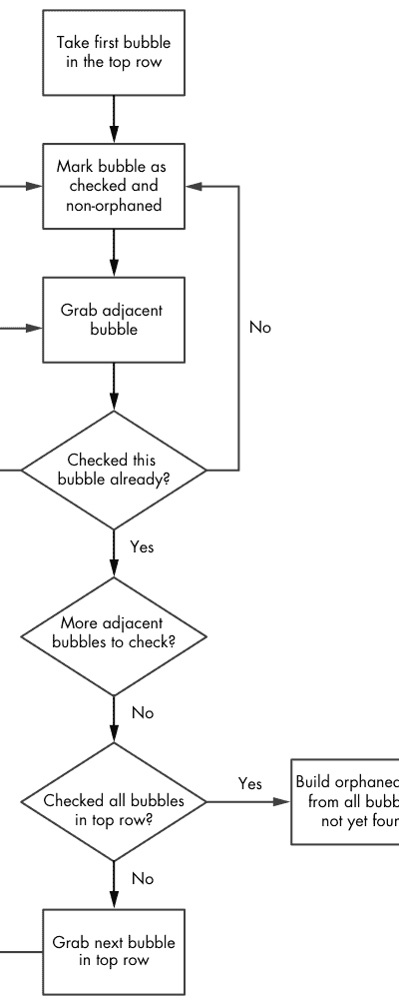

*图 4-4：确定孤立气泡集合的逻辑流程*

利用此逻辑，我们可以在第2步中重用 `getGroup` 函数。但为此，我们需要修改标准，即形成一组的气泡不必是相同颜色。
让我们修改 `getGroup`，使其接受一个参数，允许选择颜色不匹配的组：

```
var Board = function(){
--snip--
this.getGroup = function(bubble,found,differentColor){
    var curRow = bubble.getRow();
    if(!found[curRow])
        found[curRow] = {};
    if(!found.list)
        found.list = [];
    if(found[curRow][bubble.getCol()]){
        return found;
    }
    found[curRow][bubble.getCol()] = bubble;
    found.list.push(bubble);
    var curCol = bubble.getCol();
    var surrounding = that.getBubblesAround(curRow,curCol);
    for(var i=0;i<surrounding.length;i++){
        var bubbleAt = surrounding[i];
        if(bubbleAt.getType() == bubble.getType() || differentColor){
            found = that.getGroup(bubbleAt,found,differentColor);
        };
    };
    return found;
};
}
```

函数定义现在接受一个额外的参数 ❶。在递归调用 `getGroup` 的地方，如果该值设置为 `true`，则应忽略类型检查 ❷，并将输入参数传递到递归链中。通过这些简单的更改，调用 `getGroup(bubble,{},true)` 应该返回与传入气泡相连的所有气泡，无论颜色如何。调用 `getGroup(bubble,{},false)` 或仅调用 `getGroup(bubble,{})` 应与以前的操作方式相同。
`findOrphans` 函数将是 `Board` 类中的一个方法，它将检查顶行中的每个气泡，找到每个气泡连接到的气泡组。（最初，除了待发射的气泡外，棋盘上的每个气泡都将在一个大的组中。）一个包含 (行，列) 值的数组将填充 `false` 值，每次找到一个气泡，该位置的 (行，列) 条目将被设置为 `true`。在过程结束时，坐标包含气泡但在返回数组中值设置为 `false` 的位置将是孤立的，并将从游戏中移除。

在 `popBubbleAt` 之后向 `board.js` 添加以下代码：

```
var Board = function(){
    --snip--
    this.popBubbleAt = function(rowNum,colNum){
        --snip--
    };
    this.findOrphans = function(){
        var connected = [];
        var groups = [];
        var rows = that.getRows();
        for(var i=0;i<rows.length;i++){
            connected[i] = [];
        };
        for(var i=0;i<rows[0].length;i++){
            var bubble = that.getBubbleAt(0,i);
            if(bubble && !connected[0][i]){
                var group = that.getGroup(bubble,{},true);
                $.each(group.list,function(){
                    connected[this.getRow()][this.getCol()] = true;
                });
            };
        };
        var orphaned = [];
        for(var i=0;i<rows.length;i++){
            for(var j=0;j<rows[i].length;j++){
                var bubble = that.getBubbleAt(i,j);
                if(bubble && !connected[i][j]){
                    orphaned.push(bubble);
                };
            };
        };
        return orphaned;
    };
    return this;
};
```

让我们更仔细地分析 `findOrphans` 函数。首先，我们设置查找孤立组所需的数组。

1.  `var connected = [];
2.  `var groups = [];
`var rows = that.getRows();
for(var i=0;i<rows.length;i++){
    connected[i] = [];
};

`connected` 数组 ① 是一个行和列的二维数组；它标记了相连气泡的位置。`groups` 数组 ② 将包含所有找到的组的集合，如果整个棋盘是连通的，这将是一个单一的组。接下来，我们检查顶行中的每个气泡。

```
for(var i=0;i<rows[0].length;i++){
  var bubble = that.getBubbleAt(0,i);
```

这里，因为我们只对连接到顶行的气泡感兴趣，所以我们只循环顶行并获取气泡进行检查。当我们有一个气泡时，我们可以开始创建组。

```
if(bubble && !connected[0][i]){
  var group = that.getGroup(bubble,{},true);
```

如果存在气泡且该位置尚未标记为已连接，我们构建一个组。对 `getGroup` 的调用将 `true` 作为第三个参数（`differentColor`）传递，因为我们不希望按颜色限制连接的气泡。

```
$.each(group.list,function(){
  connected[this.getRow()][this.getCol()] = true;
});
};
};
```

因为被检查的气泡通过第一行连接，所以整个组都是连接的；因此，我们在 `connected` 数组中将每个条目标记为 `true` 标志。
调用 `findOrphans` 后，我们应该有一个包含已连接行列条目的数组。孤立气泡的列表是我们想要的最终输出，所以我们需要创建另一个空数组来保存该列表。一维数组就足够了，因为气泡存储了它们自己的坐标：

```
var orphaned = [];
for(var i=0;i<rows.length;i++){
  for(var j=0;j<rows[i].length;j++){
    var bubble = that.getBubbleAt(i,j);
    if(bubble && !connected[i][j]){
      orphaned.push(bubble);
    };
  };
};
return orphaned;
```

使用这个新数组，我们检查棋盘上的所有行和列，检查每个空间是否存在气泡。如果存在气泡但 `connected` 网格中没有条目，则它是孤立的。然后我们通过调用 `orphaned.push(bubble)` 将其添加到孤立列表中。最后，`findOrphans` 返回孤立气泡的数组，如果不存在孤立气泡，该数组应为空。

## 移除孤立的气泡

现在我们可以找到将被孤立的气泡组，我们需要调用该函数并移除任何已识别的孤立气泡。我们不希望使用 `pop`，而是希望孤立的气泡在 `pop` 动画完成后掉落，使用一个动画。内部游戏状态仍然会立即更新，因为我们在玩家发射气泡后立即计算结果。我们添加延迟不仅是为了提供更戏剧化的效果，也是为了让玩家能够在屏幕上跟踪其操作的结果。如果我们一知道孤立组会孤立就立即动画化它们，效果可能会丧失。此外，玩家可能会困惑于为什么不同颜色的气泡消失了。

在这种情况下，将游戏状态与显示状态分离的好处显而易见。我们立即更新游戏状态，玩家几乎可以立即发射下一个气泡，而无需等待完成的动画，游戏感觉响应迅速。但在显示状态中，我们大肆强调这种游戏状态的变化——为了效果，并为了向玩家传达他们的操作如何导致最终结果。动画方式在很大程度上是游戏设计决策，而非编码决策，但我们编码游戏的方式允许灵活性。

在 `game.js` 中，在 `popBubbles` 调用之后添加以下内容：

```
var Game = function(){
  --snip--
  var clickGameScreen = function(e){
    --snip--
    if(collision){
      --snip--
      if(group.list.length >= 3){
        popBubbles(group.list,duration);
        var orphans = board.findOrphans();
        var delay = duration + 200 + 30 * group.list.length;
        dropBubbles(orphans,delay);
      };
    }else{
      --snip--
    };
    BubbleShoot.ui.fireBubble(curBubble,coords,duration);
    curBubble = getNextBubble();
  };
};
```

我们仅在气泡被移除后 ❶ 才需要检查新的孤立组，因为这就是孤立组形成的方式。只有在创建了三个或更多匹配的组时才会移除气泡，因此如果 `group.list` 大于

或更大，我们需要寻找孤立的气泡。在找回这些孤立气泡②时，我们会计算一个延迟③，以便在所有气泡破裂完成后让气泡下落。为了实现动画效果，我们需要编写`dropBubbles`函数④。

`dropBubbles`方法将使气泡移出屏幕。请在*game.js*文件的`popBubbles`函数结束后添加以下代码：

```
var Game = function(){
  --snip--
  var popBubbles = function(bubbles,delay){
    --snip--
  };
  var dropBubbles = function(bubbles,delay){
    $.each(bubbles,function(){
      var bubble = this;
      board.popBubbleAt(bubble.getRow(),bubble.getCol());
      setTimeout(function(){
        bubble.getSprite().animate({
          top : 1000
        },1000);
      },delay);
    });
  };
};
```

`dropBubbles`函数接受要下落的气泡①（我们将传入`findOrphans`返回的气泡数组）和一个延迟时间作为参数。它会从游戏板中移除这些气泡②，然后在它们移出屏幕时播放下落动画③。

刷新游戏并点击几组气泡。当你形成一个孤立组时，气泡应该会移出屏幕，而不是破裂。

## 使用 jQuery 插件爆炸气泡

虽然让气泡下落是一种动画，但它并不十分引人注目。让我们来点更刺激的，创造一种爆炸效果！我们将编写一个 jQuery 插件来控制这个动画，并将其从游戏系统中抽象出来。

为了使孤立气泡的动画更具震撼力，我们将让气泡在下落前向外爆裂。我们将通过为每个气泡分配一个初始动量，然后用一些模拟的重力来调整其速度来实现这一点。

虽然将所有代码直接写在`dropBubbles`函数内部是可行的，但这会开始让`Game`类混杂显示逻辑。然而，这个动画是 jQuery 插件的理想候选案例，其优势在于我们可以在未来的项目中重用这些代码。

> **注意** 在本例中，我将只涵盖编写 jQuery 插件的最基本原则。你可以在 http://learn.jquery.com/plugins/basic-plugin-creation/ 深入探讨插件开发。

在*js*文件夹中创建一个名为*jquery.kaboom.js*的新文件，并将其添加到`Modernizr.load`调用中。文件命名约定可以让你的*scripts*文件夹的浏览者一眼就知道这是一个 jQuery 插件；他们甚至不需要查看代码。

首先，我们使用 jQuery 的插件格式注册这个方法——我们将其命名为*kaboom*：

```
jquery.kaboom.js

(function(jQuery){
    jQuery.fn.kaboom = function(settings)
    {
    };
})(jQuery);
```

我们稍后会充实这段代码；现在它什么也不做。这个函数定义是向 jQuery 注册新插件的标准方式。其结构支持形如*$(…).kaboom()*的调用，包括传递一个可选的设置参数。

*kaboom*的调用将放在*dropBubbles*内部，因此让我们将这个调用添加到*dropBubbles*中，并移除*animate*调用：

```
game.js
var Game = function(){
    --snip--
    var popBubbles = function(bubbles,delay){
        --snip--
    };
    var dropBubbles = function(bubbles,delay){
        $.each(bubbles,function(){
            var bubble = this;
            board.popBubbleAt(bubble.getRow(),bubble.getCol());
            setTimeout(function(){
                bubble.getSprite().kaboom();
            },delay);
        });
        return;
    };
};
```

*kaboom*方法将为每个对象调用一次。该方法也只操作 jQuery 对象；作为一个 jQuery 插件，它不会知道游戏对象，只与 DOM 元素一起工作，这使得该插件可以在未来的游戏中重用。

在`jQuery.fn.kaboom`内部，我们将使用一个数组来存储所有当前正在爆炸的对象。每次我们调用*kaboom*时，我们将调用该方法的对象添加到该数组中。当气泡完成移动后，它应该将自身从列表中移除。通过将所有需要移动的对象存储在一个数组中，我们可以运行一个单独的*setTimeout*循环，并同时更新所有下落气泡的位置。因此，我们将避免多个*setTimeouts*争夺处理能力，并且动画应该运行得更加流畅。

我们还将添加两个额外的组件：一些重力和气泡被视为移出屏幕（从而不再属于函数的一部分）所需下落距离的默认参数。

```
jquery.kaboom.js

(function(jQuery){
    var defaults = {
        gravity : 1.3,
        maxY : 800
    };
    var toMove = [];
    jQuery.fn.kaboom = function(settings){
    }
})(jQuery);
```

默认值是重力和maxY ❶，而`toMove` ❷将保存下落的 jQuery 对象。

目前，调用`kaboom`时什么也不会发生。完整的`jquery.kaboom`插件如下：

```
jquery.kaboom.js

(function(jQuery){
    var defaults = {
        gravity : 1.3,
        maxY : 800
    };
    var toMove = [];
    jQuery.fn.kaboom = function(settings){
        var config = $.extend({}, defaults, settings);
        if(toMove.length == 0){
            setTimeout(moveAll,40);
        };
        var dx = Math.round(Math.random() * 10) - 5;
        var dy = Math.round(Math.random() * 5) + 5;
        toMove.push({
            elm : this,
            dx : dx,
            dy : dy,
            x : this.position().left,
            y : this.position().top,
            config : config
        });
    };
    var moveAll = function(){
        var frameProportion = 1;
        var stillToMove = [];
        for(var i=0;i<toMove.length;i++){
            var obj = toMove[i];
            obj.x += obj.dx * frameProportion;
            obj.y -= obj.dy * frameProportion;
            obj.dy -= obj.config.gravity * frameProportion;
            if(obj.y < obj.config.maxY){
                obj.elm.css({
                    top : Math.round(obj.y),
                    left : Math.round(obj.x)
                });
                stillToMove.push(obj);
            }else if(obj.config.callback){
                obj.config.callback();
            }
        };
        toMove = stillToMove;
        if(toMove.length > 0)
            setTimeout(moveAll,40);
    };
})(jQuery);
```

这个插件有两个主循环：`jQuery.fn.kaboom` ❶，它向动画队列添加新元素；以及`moveAll` ❷，它处理动画。

让我们先更详细地看看`jQuery.fn.kaboom`：

```
jQuery.fn.kaboom = function(settings){
    var config = $.extend({}, defaults, settings);
    if(toMove.length == 0){
        setTimeout(moveAll,40);
    };
    var dx = Math.round(Math.random() * 10) - 5;
    var dy = Math.round(Math.random() * 5) + 5;
    toMove.push({
        elm : $(this),
        dx : dx,
        dy : dy,
        x : $(this).position().left,
        y : $(this).position().top,
        config : config
    });
};
```

这个函数启动动画过程，并且每个对象只调用一次（也就是说，它不是作为动画循环的一部分运行的）。该函数然后为这次`kaboom`调用设置配置选项❶。这种语法创建一个对象，其默认值设置在父级定义（`defaults`变量）中，并使用传入对象中找到的任何设置覆盖这些设置。它还将任何新的名称/值对添加到`kaboom`将操作的对象中。

我们查看`toMove`数组，如果该数组为空❷，就设置一个超时调用来运行动画。接下来，在`dx`和`dy`中设置初始的x和y速度值❸。这些值在水平方向上介于-5和5像素之间，在垂直方向上（向上）介于5和10像素之间；两者的单位都是像素/秒。然后我们向`toMove`数组添加一个新对象❹。新对象包含jQuery元素、其新创建的速度信息、当前屏幕位置以及在此调用中指定的配置选项。

每当进行`$(…).kaboom`调用时，`jQuery.fn.kaboom`函数就会运行。如果至少有一个对象正在爆炸，一个包含`moveAll`的超时就会运行。让我们看看`moveAll`函数做了什么：

```
var moveAll = function(){
  var frameProportion = 1;
  var stillToMove = [];
  for(var i=0;i<toMove.length;i++){
    var obj = toMove[i];
    obj.x += obj.dx * frameProportion;
    obj.y -= obj.dy * frameProportion;
    obj.dy -= obj.config.gravity * frameProportion;
    if(obj.y < obj.config.maxY){
      obj.elm.css({
        top : Math.round(obj.y),
        left : Math.round(obj.x)
      });
      stillToMove.push(obj);
    }else if(obj.config.callback){
      obj.config.callback();
    }
  };
  toMove = stillToMove;
  if(toMove.length > 0)
    setTimeout(moveAll,40);
};
```

我们假设`setTimeout`确实在每40毫秒运行一次，因为这是我们指定的值❾；因此，我们将帧速率计为每秒25帧❶。如果计算机性能不足（或者只是忙于使用CPU周期处理其他操作），且帧之间的延迟远慢于40毫秒，这个假设可能会导致动画质量不佳。稍后，你将学习如何生成无论处理器性能如何都能以恒定速度运行的动画，但当前的解决方案在旧版浏览器中提供了最佳兼容性。

在设置好帧速率后，`moveAll`创建一个空数组❷，用于存储在动画帧结束时y坐标未超过最大值的对象。这里产生的结果值将成为`toMove`在下一帧中移动的新值。

设置工作完成后，`moveAll`循环❸遍历`toMove`数组中的每个元素（即所有当前处于爆炸状态的对象；我们在`jQuery.fn.kaboom`中填充了该数组），并在`obj`变量中引用每一个对象，`obj`是一个具有以下属性的对象：

- `obj.elm` 指向 jQuery 对象
- `dx` 和 `dy` 速度值
- `x` 和 `y` 坐标存储当前位置


在循环内部，我们根据对象的x和y速度值，按比例更新其x和y坐标❹。这暂时不会影响气泡在屏幕上的位置，因为我们尚未操作DOM元素。该函数还会将配置的重力值添加到对象的垂直速度❺中。水平速度在整个爆炸效果中应保持不变，但对象会向下加速以模拟下落。接下来，我们检查❻对象的y值是否超过了我们在defaults中配置的最大值或在kaboom调用中覆盖的值。如果没有超过，则将屏幕元素的位置设置为当前坐标存储的值，并将该对象添加到stillToMove数组中。另一方面，如果对象*已经*超过了最大y值，并且原始kaboom调用中传递了回调函数，那么moveAll会执行❼该函数。将函数传递到动画中，并让该函数在动画完成时运行，这是很有用的。

最后，我们将toMove❽的新值设置为stillToMove的内容（即所有仍在下落的对象），如果数组至少包含一个元素，我们就设置一个超时，在40毫秒后再次调用同一个函数❾。

现在，当你重新加载游戏并创建一组孤立的对象时，kaboom插件应该会让气泡从屏幕上掉下来。虽然它在我们的游戏环境中有效，但你也可以使用任何有效的jQuery选择器调用它，并产生类似的结果。请保存好这段代码，以便在未来的游戏中重用这个效果！

## 总结

*泡泡射击游戏*现在已经有了相当多的功能。我们可以发射气泡，它们要么嵌入网格，要么炸开一组气泡，并且我们可以检测孤立的气泡组并将它们移出屏幕。然而，棋盘上可能会堆积未爆破的气泡，这仍然是我们需要解决的问题。目前，也没有办法开始另一个关卡或记录你的得分；这两者对于此类游戏都是重要的元素。但在我们完成一些其他游戏功能之前，我们将深入了解一些已经编写的动画的HTML5和CSS实现。

到目前为止，我们已经使用一些相当传统的HTML、CSS和JavaScript技术实现了所需的功能。在大多数情况下，游戏应该能在大多数计算机上流畅运行。在下一章中，我们将通过将部分动画工作从JavaScript转移到CSS来提高性能。这种转变将让我们在可能的情况下利用硬件加速，我们甚至会使用一些纯HTML5特性来实现更流畅的动画。我们还将使用canvas渲染而不是DOM和CSS来实现整个游戏，揭示使用这种方法的优势和带来的挑战。

## 进一步练习

1. 在第3章的练习中，你修改了createLayout以生成替代的网格模式。现在用弹出和孤立气泡下落代码测试你的布局。代码能正常工作吗？你的图案如何影响游戏的体验？

2. 气泡动画目前由四帧组成。创建你自己的图像版本，并尝试添加更多帧。使用for循环生成额外的setTimeout调用，而不是复制粘贴新行。尝试不同的超时延迟值来加快和减慢动画速度，看看哪些值能产生最佳效果。

3. kaboom jQuery插件会将气泡从屏幕底部移除，但如果你让气泡在触底时反弹会发生什么？修改jquery.kaboom.js，使气泡反弹而不是从屏幕上掉落。你需要反转它们的dy值，并在每次反弹时按比例缩小，以模拟部分反弹能量被吸收；否则，它们只会弹回到相同的高度。只有当气泡从屏幕的左边缘或右边缘反弹出去时，才应从DOM中移除它们，因此你还需要确保dx的值不能接近零，否则它们永远不会消失。

# 第2部分

## 使用HTML5和Canvas进行增强

# 5

## CSS过渡和变换

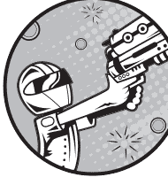

到目前为止，我们已经使用HTML、CSS和JavaScript创建了一个基础游戏：我们可以发射和炸开气泡，并且用户界面感觉响应迅速。我们是通过借助大量的jQuery来操作文档对象模型（DOM）实现的。

在本章中，我们将探讨CSS过渡和变换，它们可以提升游戏性能，并让你创建更广泛的效果，例如旋转和缩放元素。

## CSS的优势

CSS提供了一套变换和过渡属性，你可以用它们来制作CSS属性变化的动画，例如元素的left或top坐标。与其像我们之前做的那样使用JavaScript逐帧处理动画，CSS过渡是在样式表中指定的，或者作为附加到DOM元素的样式。然后，通过单个CSS属性的更改来启动动画，而不是像JavaScript动画那样需要对属性进行许多增量更改。

CSS动画由浏览器的渲染引擎处理，而不是由JavaScript解释器处理，这为运行其他JavaScript代码释放了CPU时间，并确保在设备上实现尽可能平滑的动画。在带有图形处理器的系统上，效果通常完全由图形处理器处理，这意味着你运行的JavaScript代码工作更少，并可以进一步减轻CPU的负载，从而实现更高的帧率。因此，动画将在其显示的设备上以可能的最高帧率运行。

我们将使用CSS为用户界面元素添加一些简单的过渡，然后用变换替换我们的jQuery动画，同时保持我们迄今实现的跨浏览器兼容性。

## 基本CSS过渡

我们首先要关注的CSS动画是过渡。*过渡*定义了一个对象的样式属性应如何从一个状态变更为新状态。例如，如果我们把一个DOM元素的left属性从50像素改为500像素，它在屏幕上的位置会立即改变。但如果我们指定了一个过渡效果，我们就可以让它逐渐移动到屏幕的另一位置。CSS过渡指定了要动画化的属性或属性、动画应如何进行以及动画应持续多长时间。

过渡通常适用于任何具有数值的CSS属性。例如，可以对前面提到的left属性进行动画化，因为可以计算起始值和结束值之间的中间值。其他属性更改，例如在visibility: hidden和visibility: visible之间变化，不是有效的过渡属性，因为无法计算中间值。但是，我们可以通过将opacity属性从0动画化到1来使元素淡入。

颜色也是有效的可动画化属性，因为十六进制值也是数字（每个包含三对，每对代表红色、绿色或蓝色），可以逐渐从一个值更改为另一个值。你可以在https://developer.mozilla.org/en-US/docs/Web/CSS/CSS_animated_properties/找到所有可以用过渡进行动画化的属性列表。

## 如何编写过渡

要使用过渡为div添加动画，请为其添加一个CSS过渡属性。过渡属性包括以下内容：

- **要应用过渡的CSS属性** 这些可以是任何你想动画化的有效CSS属性，例如top、left、font-size，或者all，它对所有有效的属性更改应用过渡。
- **持续时间** 过渡将花费多长时间（以秒为单位）。
- **缓动** 告诉属性在过渡持续时间内变化的速度。例如，一个元素可能以平滑的速度从一个点移动到另一个点，或者它可能在开始时加速，然后在结束时减速，如图5-1所示。你也可以将缓动应用于你想更改的其他属性，包括颜色。

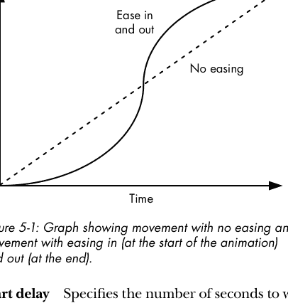

图5-1：显示无缓动移动和带缓动（在动画开始时）缓入、（在动画结束时）缓出移动的图表。

- **开始延迟** 指定开始过渡前要等待的秒数。最常见的值是0（或空），这意味着立即开始。

我们将像编写任何其他CSS规则一样编写过渡定义，当我们想让过渡发生时，我们将对想要动画化的CSS属性进行更改。要使div或其他HTML元素在屏幕上平滑移动，我们设置top和left坐标为新值：

```
transition: top 1s, left 2s (等)
```

举个例子，我们将使“新游戏”按钮在屏幕上向下移动。将以下内容添加到main.css：

```
main.css
.button
{
    transition: ❶all ❷.8s ❸ease-in-out ❹1s;
    -moz-transition: all .8s ease-in-out 1s;
    -webkit-transition: all .8s ease-in-out 1s;
    -ms-transition: all .8s ease-in-out 1s;
}
```

过渡定义的第一个值❶指定了过渡应用于哪个属性（或哪些属性）。使用all将过渡应用于每个属性；可以将其视为通配符。第二个值❷是过渡的持续时间（以秒为单位）。第三个值❸是缓动方式：ease-in-out产生平滑的过渡，具有初始加速和结束减速。最后，我们添加了一个❹1秒的延迟，然后动画才开始运行。接下来


## CSS 基本变换

我们要介绍的 CSS 第二个强大功能是变换。*变换（Transformations）*允许你操控对象的形状。在大多数浏览器中，可以对对象进行二维或三维变换，并通过三维矩阵对其进行倾斜、扭曲和旋转。你可以通过过渡来动画化变换效果，或者让它们单独存在；例如，要以一定角度显示按钮，你可以让观众观看它旋转，或者只是将按钮渲染为倾斜状态。

## 如何编写变换

一些简单的 CSS 变换包括：

- 通过 $(x,y)$ 或三维中的 $(x,y,z)$ 坐标进行平移
- 沿 *x*、*y* 和 *z* 轴按尺寸进行缩放
- 沿 *x*、*y* 或 *z* 轴中的任意一轴按角度原地旋转
- 沿 *x* 或 *y* 轴倾斜
- 添加 3D 透视效果

你可以通过二维甚至三维矩阵来进行变换。使用矩阵进行变换涉及一些数学计算。如果你想更深入地探索，网上有一些参考资料可供使用，例如 *https://developer.mozilla.org/en-US/docs/Web/CSS/transform/*。

## 缩放按钮

在本节中，我们将在现有颜色变化的基础上，为"新游戏"按钮添加放大效果，使其更具动态感。请在 *main.css* 中的 `.button:hover` 定义中添加以下内容：

```css
.button:hover
{
    background-color: #900;
    transform: scale(1.1);
    -moz-transform: scale(1.1);
    -webkit-transform: scale(1.1);
    -ms-transform: scale(1.1);
}
```

整个变换主要包含在一行 `transform` 中。变换被指定为缩放系数 1.1——即大小增加 10%。接下来的三行执行相同的操作，但使用了与过渡定义中相同的供应商特定前缀。

我们只想缩放"新游戏"按钮，所以请重新加载页面，然后将鼠标悬停在按钮上。缩放效果应该会生效，但不会是平滑的动画。虽然颜色仍然会因鼠标悬停而逐渐变化，但按钮的大小会一步到位地跳变。我们将修改过渡定义，使其同时应用于变换和背景颜色。

要实现此任务，我们可以简单地将 `.button` 定义更改为过渡属性影响所有 CSS 属性：

```css
transition: all .3s ease-in-out;
```

此定义将 ease-in-out 效果应用于按钮所有可以应用过渡的 CSS 属性。现在，如果在 DOM 渲染后其中任何属性发生变化，按钮将在该属性上应用 300 毫秒的过渡动画效果。但如果不希望所有按钮动画都以相同的速率发生呢？

在这种情况下，可以通过添加逗号分隔的定义来指定多个属性：

```css
transition: background-color .2s ease-in-out, transform 0.2s ease-in-out;
```

此解决方案还可以最大程度地减少副作用，以防我们想要即时更改其他任何 CSS 属性而不让它们自动动画化。

当你将过渡应用于 CSS 中的单个 `transform` 属性时，仍需要在每个过渡定义中指定供应商特定版本。因此，完整的按钮定义需要是这样：

```css
.button
{
    transition: background-color .3s ease-in-out, transform .2s ease-in-out;
    -moz-transition: background-color .3s ease-in-out, -moz-transform .2s ease-in-out;
    -webkit-transition: background-color .3s ease-in-out, -webkit-transform .2s ease-in-out;
    -ms-transition: background *-color .3s ease-in-out, -ms-transform .2s ease-in-out;
}
```

## 变色按钮

让我们应用过渡来活跃我们的用户界面！我们将制作一个按钮动画，而无需编写一行 JavaScript；相反，我们将使用过渡定义和你可能已经熟悉的 hover 伪类来创建滚动按钮效果。

首先，我们将通过 CSS 修改为"新游戏"按钮添加滚动状态。现在请将以下内容添加到 *main.css* 中：

```css
.button
{
    transition: background-color .3s ease-in-out;
    -moz-transition: background-color .3s ease-in-out;
    -webkit-transition: background-color .3s ease-in-out;
    -ms-transition: background-color .3s ease-in-out;
}
.button:hover
{
    background-color: #900;
}
```

过渡定义的第一个值说明过渡应用于哪个（或哪些）属性。我们将其应用于 `background-color` 属性，其写法与标准 CSS 规则中的写法完全一致。第二个值是过渡的持续时间，以秒为单位。第三个值同样是缓动效果，设置为 `ease-in-out`。

其他类型的缓动效果包括 `ease`、`linear`，或仅仅是 `ease-in` 或 `ease-out`。但所有这些简写描述实际上都是 `cubic-bezier` 的特定定义的别名，你可以用它来表示任何你喜欢的过渡曲线。`cubic-bezier` 缓动函数接受四个十进制数来定义一个图形；例如，

```css
transition: background-color .3s ease-in-out;
```

等同于

```css
transition: background-color .3s cubic-bezier(0.42, 0, 0.58, 1.0)
```

贝塞尔曲线通过指定形成曲线起点和终点部分切线的两个点的坐标来描述。这些点在图 5-2 中显示为 P1 和 P2。

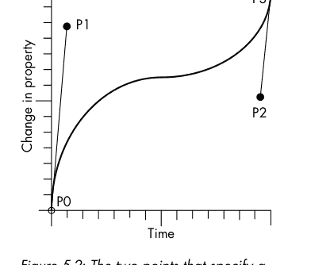

CSS 中指定的值是 P1 和 P2 的坐标，它们始终在 0 和 1 之间。你不会指定 P0 和 P3，因为它们始终分别是原点 (0,0) 和 (1,1)。P1 和 P2 与垂直轴的夹角决定了曲线的斜率，而 P0 到 P1 以及 P2 到 P3 的线段长度决定了曲率的明显程度。

除非你想要特定的缓动效果，`ease-in-out` 或 `linear` 通常就足够了。但对于更复杂的过渡，有一些在线工具可以帮助你基于可视化图形和输入值创建 `cubic-bezier` 曲线。其中一个网站是 http://cubic-bezier.com/，它允许你调整数值并观看动画，以了解数字如何转化为运动过渡。

从初始过渡定义开始的三行是供应商特定的过渡定义，我确保包含它们以便过渡在不同浏览器中正常工作。CSS 标准仍被认为是进行中的工作，浏览器制造商采用了自己的前缀，以避免在标准最终确定时与实现方式产生潜在 whethe冲突。

到目前为止我使用的单行格式是指定过渡的最简洁方式，但你也可以单独指定属性：

```css
transition-property: background-color;
transition-duration: .3s;
transition-timing-function: ease-in-out;
```

我建议大部分时间坚持采用简洁的方法。否则，你需要所有 CSS 标准行加上每个标准行的三个供应商特定副本，这会很快让你的样式表变得杂乱。

重新加载页面并将鼠标悬停在"新游戏"按钮上。你应该会看到从浅红色到深红色的柔和变化。这是一个不错的效果，而且你没有编写任何 JavaScript！但仅使用 CSS 你还可以做更多的事情来添加效果。

从第 5 行开始的三行提供了相同的规范，但带有供应商特定前缀以实现跨浏览器支持。这些对于旧浏览器是必需的；新浏览器在标签定义被认为是稳定的之后使用无前缀版本。

为了保证你的游戏在某个特定浏览器上运行，始终要包含正确的供应商特定前缀。只需确保每当你更改过渡属性时，也要在每个浏览器的过渡定义中进行更改。

幸运的是，规则很简单：过渡的浏览器特定版本只是常规版本的副本，并带有以下前缀之一：

- `-moz-` 用于 Mozilla 浏览器，如 Firefox
- `-webkit-` 用于 Webkit 浏览器，如 Chrome 和 Safari
- `-ms-` 用于 Microsoft Internet Explorer

重新加载页面，然后在 JavaScript 控制台中输入以下内容：

```javascript
$(".but_start_game").css("top",100)
```

你应该会看到暂停一下，然后按钮会平滑地向上滑动到屏幕上。该效果与 animate 调用或多或少相同，但我们只更改了 CSS 值。

现在删除 `.button` 的 CSS 定义，因为我们要应用一个更有用的效果。

在 `main.css` 中做出此更改，重新加载页面，然后再次将鼠标悬停在按钮上。现在，背景色和缩放都应平滑过渡。

CSS 过渡和变换对于简单的动画非常有用，尤其是对于用户界面元素（如按钮）的鼠标悬停效果。然而，它们的用途远不止为用户界面增添一点光彩：我们也可以用它们来制作精灵动画，包括游戏中发射的气泡。

## 用 CSS 过渡替代 jQuery animate

现在，当玩家发射一个气泡时，它会从发射点出发，沿直线向其目标移动。任何发射的气泡所遵循的路径都很简单，CSS 过渡可以轻松处理该动画，进行切换将减轻 JavaScript 的一些负担。

我们为按钮悬停效果使用的硬编码 CSS 过渡（即在样式表中定义过渡）将不适用于气泡移动，因为过渡持续时间需要根据气泡需要移动的距离而变化。目前，气泡以每秒 1,000 像素的速度移动。因此，例如，如果我们希望一个气泡移动 200 像素，持续时间需要设置为 200 毫秒。为了处理这个可变的持续时间，我们不会在样式表中指定 CSS 过渡，而是将在运行时用 JavaScript 应用它们。

使用 jQuery 设置 CSS 过渡的语法与设置任何其他 CSS 属性相同，但我们需要为属性名称添加浏览器前缀。幸运的是，对于这个任务，我们不必为同一个过渡编写四个版本。Modernizr 可以帮我们处理这些前缀，这实际上使得在 JavaScript 中创建 CSS 过渡比在样式表中更容易！

然而，并非所有较旧的浏览器都支持过渡，因此在 `ui.js` 中，我们首先检查是否支持 CSS 动画，如果不支持，则回退到 jQuery 动画。除非你确定你所有目标浏览器都支持 CSS 过渡，否则最好内置一个后备选项。

此 CSS 动画的代码涉及三个步骤：

1.  为元素添加过渡 CSS 属性，以告诉它移动的速度以及将过渡应用于哪个属性。
2.  将 `top` 和 `left` 属性更改为气泡将停止的坐标。
3.  一旦气泡到达其目标，就移除 CSS 过渡定义。

## 在 ui.js 中修改 fireBubble 如下：

```javascript
var BubbleShoot = window.BubbleShoot || {};
BubbleShoot.ui = (function($){
    var ui = {
        --snip--
        fireBubble : function(bubble,coords,duration){
            var complete = function(){
                if(bubble.getRow() !== null){
                    bubble.getSprite().css(Modernizr.prefixed("transition"),"");
                    bubble.getSprite().css({
                        left : bubble.getCoords().left - ui.BUBBLE_DIMS/2,
                        top : bubble.getCoords().top - ui.BUBBLE_DIMS/2
                    });
                };
            };
            if(Modernizr.csstransitions){
                bubble.getSprite().css(Modernizr.prefixed("transition"),"all " + 
                                        (duration/1000) + "s linear");
                bubble.getSprite().css({
                    left : coords.x - ui.BUBBLE_DIMS/2,
                    top : coords.y - ui.BUBBLE_DIMS/2
                });
                setTimeout(complete,duration);
            }else{
                bubble.getSprite().animate({
                    left : coords.x - ui.BUBBLE_DIMS/2,
                    top : coords.y - ui.BUBBLE_DIMS/2
                },
                {
                    duration : duration,
                    easing : "linear",
                    complete : complete
                });
            }
        },
        --snip--
    };
    return ui;
} )(jQuery);
```

我们将动画后函数（即我们希望 jQuery 在 animate 调用完成后调用的那个函数）通过赋值给一个变量，移到了它自己的命名定义 ❶ 中。此函数确保如果气泡尚未从屏幕上消失，它最终会被放置在棋盘网格内。此函数与之前的版本相同，我们首先检查气泡是否有行定义 ❷。如果行定义为空，气泡错过了棋盘或导致了弹出事件。否则，气泡需要成为主棋盘的一部分。在这种情况下，我们还移除 ❸ 过渡定义并将气泡移动到其最终位置。因此，如果将来我们对气泡应用任何 CSS 更改，就不会有不必要的过渡被应用到它们。

当调用 fireBubble 时，我们使用 Modernizr ❹ 检查是否支持 CSS 过渡。如果支持，我们可以向气泡元素添加过渡 CSS ❺。过渡定义的形式将是

```css
transform: all [duration]s linear
```

`Modernizr.prefixed("transition")` 会添加任何必要的供应商特定前缀。我们将过渡持续时间设置为与传入的持续时间相同，但除以一千以将毫秒转换为秒 ❺。

最后，如果我们确实添加了过渡，我们会设置一个超时 ❻ 在该过渡结束时调用 `complete`。如果浏览器不支持 CSS，我们不需要 `setTimeout` 调用，因为在这种情况下，我们将使用 jQuery 的 `animate` 函数，该函数接受一个动画完成后运行的回调函数。我们需要将 `complete` 函数作为参数添加到该 `animate` 调用 ❼ 中，但本质上，jQuery 版本的动画与之前相同。

刷新页面，发射一个气泡，很可能你会看到游戏与上次测试时相比没有变化。但这只是意味着你的设备能够以足够高的帧率显示我们之前要求的 jQuery 动画，使其与 CSS 版本无法区分。在幕后，如果您的设备有图形处理器，该动画现在将被交给它处理，因此 JavaScript 无需处理处理负载。在包含大量移动元素的游戏中，你刚刚进行的更改可能会带来显著的性能提升。

## CSS 过渡的缺点

如果 JavaScript 必须做大量工作来逐帧制作元素动画，为什么不尽可能使用 CSS 过渡？尽管 CSS 过渡提供了许多好处，尤其是在平滑动画方面，但它们在游戏中的实用性通常受限于缺乏控制。

随着你为单个元素添加更多动画，CSS 过渡的编写会变得更加繁琐。例如，如果你想让一个元素在 1 秒内移动 100 像素，同时又在 2 秒内将其大小调整 10 像素，你需要为每个 CSS 属性指定一个不同的过渡。更重要的是，在移动过渡结束时，你需要保留 CSS 定义，以便调整大小的动画继续，如果你需要再次移动元素，这将尤其困难。

过渡的第二个缺点是，尽管缓动可以改变动画的表现方式，但移动必须是直线的。沿着曲线的移动，比如角色跳过某物的动画，可以通过在许多小直线段上进行动画来生成。但在这种情况下，你也可以直接使用 JavaScript 进行动画。

一旦启动，CSS 过渡就无法被查询和更改。浏览器会处理过渡，并在你设置 CSS 值后立即更新元素的位置。由于过渡，元素可能已渲染到其目标的一半，但 DOM 会报告它已完成移动。因此，无法查询元素

直到动画结束前，它将保持在当前的位置。如果你想改变方向，就需要重新计算并重写你的 CSS 过渡。

例如，如果你告诉一个元素在 2 秒内将其左侧位置从 50 像素更改为 250 像素，但在 1 秒后需要将其移动到不同的屏幕位置，你首先需要计算它在 1 秒后在屏幕上的位置。DOM 会报告其左侧位置为 250 像素，但我们知道它处于动画的中点，在*大多数*情况下，这会将其置于 150 像素处。但如果你指定了沿三次贝塞尔曲线的缓动，该元素不太可能处于中点，实际上可能离中点相当远。你需要编写一个方程式来计算当前的左侧坐标。这个例子比大多数情况更简单，因为我们在中途停止了元素，但如果应用了任何类型的缓动，并且在动画路径上的几乎所有其他点上，计算元素可能在屏幕上的绘制位置都不是一项简单的任务。

将这个例子与使用 jQuery 进行动画进行比较，在 jQuery 中，你可以在 1000 毫秒后调用 `.stop` 方法，使元素立即停止在其轨迹上。使用 jQuery，你甚至可以应用一个新的 `.animate` 方法，将精灵设置在一个完全新的路径上，而无需等待之前的动画完成。CSS 变换和过渡对于用户界面操作或相对简单的直线移动效果很好，但它们无法为许多游戏中的动作提供我们所需的灵活性。

## 总结

你已经看到了 CSS 过渡是多么简单和强大，但也看到了它们在游戏动作中的有用性可能受到限制。你还简要了解了 CSS 变换，它可以与过渡结合使用，为按钮或其他 HTML 元素添加特效。

CSS 过渡相对于 JavaScript 动画的一个主要优势是它们的渲染速度，但不幸的是，除了最简单的动画之外，它们并不容易处理。在下一章中，我们将看看 canvas 元素，并了解如何以比基于 DOM 的开发所能提供的更快的速度和更强的控制力来制作游戏动画。

## 进一步练习

- 1. 使用我们为“新游戏”按钮制作动画的 CSS 过渡示例，尝试一些贝塞尔曲线缓动。思考不同的值在游戏动画中可能如何有用。
- 2. 创建一个变换矩阵，将元素从左到右翻转，使其看起来像镜像。
- 3. 常见的 2D CSS 变换包括平移、旋转、缩放和倾斜。其中哪些你可以用矩阵变换复制，哪些你不能复制？

# 6

## 渲染 Canvas 精灵

到目前为止，我们通过基于 DOM 的方法构建了 *Bubble Shooter*，使用 HTML 元素作为游戏对象，这些对象由 CSS 设置样式和定位，并由 JavaScript 操作。在本章中，我们将重新设计 *Bubble Shooter*，使大部分游戏区域渲染到 canvas 上，而不是使用 DOM。我们游戏的对话框将保留在 HTML 和 CSS 中。

Canvas 渲染使我们能够实现基于 DOM 的开发通常无法实现的图形效果，并且通常可以提供更快的渲染速度。为了在 *Bubble Shooter* 中使用 canvas 渲染，我们需要学习如何将整个场景渲染到 canvas 上、维护状态以及执行逐帧动画。

我们将在不支持 canvas 元素的设备上保留现有的 DOM 渲染代码，并为更现代的浏览器提供向 canvas 的渐进式增强。我们将这样做是为了演示为基于 canvas 和 DOM 的动画编码所涉及的原理，并强调两种方法之间的差异。

## 检测 Canvas 支持

Modernizr 可以帮助我们检测 canvas 功能，这样我们就不必记住多种跨浏览器情况。我们将仅为 canvas 版本加载几个额外的 JavaScript 文件，并且不会删除任何文件。为了检测 canvas 并加载正确的文件，我们需要在 *index.html* 的 Modernizr.load 中添加一个额外的节点，该节点将检查 canvas 支持，如果存在，则从数组加载 JavaScript 文件。在加载 *game.js* 之前添加以下内容：

```
},
{
    test: Modernizr.canvas,
    yep: ["_js/renderer.js","_js/sprite.js"]
},
{
    load: "_js/game.js",
    complete: function(){
        $(function(){
            var game = new BubbleShoot.Game();
            game.init();
        })
    }
}]);
```

`test` 寻找的参数 `Modernizr.canvas` 的值将是 `true` 或 `false`。如果是 `true`，则会加载 `yep` 中列出的两个文件；如果是 `false`，则不会发生任何新操作。

在 `_js` 文件夹中为 *renderer.js* 和 *sprite.js* 创建空文件。`Renderer` 对象将在每一帧绘制游戏状态，而 `Sprite` 类将执行我们至今为止一直使用 jQuery 完成的许多操作。我们希望 `Renderer` 负责在 canvas 上绘制像素，而不是将游戏逻辑与之混为一谈；同样，我们会尝试将状态信息保持在相关对象内部。这种方法使得根据我们认为最适合游戏的方式，在使用 canvas 或 DOM 渲染之间切换变得容易得多。

## 绘制到 Canvas

借助 HTML5 的 canvas 功能，你可以构建复杂程度与 Flash 游戏甚至本地应用程序相当的游戏。你像放置其他元素（如 `<div>` 或 ``）一样将 canvas 元素放入文档中，但处理它的方式使其与众不同。在 canvas 内部，你可以进行像素级控制，可以绘制到单个像素、读取它们的值并操作它们。你可以编写 JavaScript 代码来生成街机射击游戏甚至是基于 DOM 的方法难以复制的 3D 游戏。

## DOM 与 Canvas

> HTML 主要是一种信息格式；CSS 作为格式化该信息的一种方式而引入。使用这两种技术创建游戏实际上是一种误用，而像 Bubble Shooter 这样的游戏之所以可行，很大程度上是因为浏览器供应商努力提高了性能。许多在文档排版中不可或缺的过程，例如确保文本区域不重叠或文本环绕图像，在游戏布局中并不需要。作为游戏开发者，我们负责确保屏幕布局良好，但不幸的是，浏览器仍然在后台运行所有这些检查。

例如，在 DOM 中添加或删除元素在处理能力方面可能是一个相对昂贵的操作。原因是，如果我们添加或删除某些内容，浏览器需要检查它，以确保此更改不会对文档流的其余部分产生连锁反应。如果我们正在处理，比如说，网站上的一个展开菜单，当我们向其中添加更多元素时，我们可能希望浏览器将导航区域向下推。然而，在游戏中，我们更可能使用 `position: absolute`，并且我们绝对不希望添加或删除新元素会迫使周围的所有元素重新定位。

相比之下，当浏览器看到一个 canvas 元素时，它看到的只是一张图像。如果我们更改 canvas 的内容，只有内容会改变。浏览器不需要考虑此更改是否会对文档的其余部分产生连锁反应。

与 CSS 和 HTML 不同，canvas 不允许你依赖浏览器来跟踪屏幕上对象的位置。当精灵移动到背景之上时，没有任何东西自动处理分层或渲染背景，因为 canvas 输出的是一张供浏览器显示的平面图像。如果使用 CSS 的精灵动画和移动就像在布告墙上移动纸张，那么 canvas 动画更像是在白板上工作：如果你想更改某些内容或移动它，你必须擦除一个区域并重新绘制它。

Canvas 渲染也与 CSS 布局不同，因为元素的定位不能卸载给浏览器。例如，在我们现有的基于 DOM 的系统中，我们可以使用 CSS 过渡将气泡从其发射位置视觉移动到我们希望它在棋盘布局中结束的任何位置。这样做只需要几行代码。


另一方面，Canvas 渲染要求我们以类似于 jQuery 内部工作原理的方式逐帧进行动画。每当帧更新发生时，我们必须计算气泡沿其路径移动了多远，并将其绘制在该位置。

仅使用 JavaScript 在 canvas 上进行动画，其难度并不比在没有 jQuery 或 CSS 过渡作为后备方案的情况下使用 DOM 进行 JavaScript 动画更大，但这个过程因为以下事实而变得更加复杂：如果我们想更改 canvas 的内容，就需要删除像素并重新绘制它们。虽然存在优化重绘过程的方法，但基本方法是为每个动画帧完全重绘整个 canvas。这意味着，如果我们想在 canvas 上移动一个对象，不仅需要渲染我们想要移动的对象，还可能需要渲染场景中的每个对象。

我们将使用 canvas 绘制游戏棋盘和当前气泡，但某些组件（例如对话框）最好保留为 DOM 元素。用户界面组件作为 DOM 元素通常更容易更新，而且浏览器通常使用 HTML 渲染文本比在 canvas 元素中渲染文本更精确。

既然我们已经决定使用 canvas 系统来渲染游戏，那么让我们来看看这将涉及哪些内容。关键任务是渲染图像并维护每个气泡的状态，以便我们知道哪些气泡是静止的，哪些是移动的，以及哪些处于被弹出的各个阶段。

## 图像渲染

任何你想绘制到 canvas 的图像都必须预加载，以便它可以被绘制；否则，什么都不会出现。为此，我们将在 JavaScript 中创建一个内存中的 Image 对象，将图像源设置为精灵表，并为其附加一个 onload 事件处理程序，以便我们知道它何时完成加载。目前，游戏在 *game.js* 中的 init 函数运行并且"新游戏"按钮将 startGame 函数附加到其 click 事件后即可玩：

```
$(".but_start_game").bind("click",startGame);
```

我们仍然希望这样做，但不希望在精灵表图像加载完成之前发生。这将是我们要处理的第一项任务。

## Canvas 元素

接下来，我们需要知道如何将图像绘制到 canvas 上。canvas 元素就像任何其他 HTML 元素一样：它可以被插入到 DOM 中，可以应用 CSS 样式，并且其行为与图像非常相似。例如，要创建一个 canvas 元素，我们在 *index.html* 中添加以下内容：

```
<canvas id="game_canvas" width="1000" height="620"></canvas>
```

这将创建一个尺寸为 1000 像素宽乘 620 像素高的 canvas 元素。这些尺寸很重要，因为它们确立了组成 canvas 的像素数量。但是，我们还应该在 CSS 中设置这些尺寸，以确立 canvas 在页面上显示时的大小：

```
#game_canvas
{
    width: 1000px;
    height: 620px;
}
```

就像图像可以按比例渲染一样，canvas 元素也可以被缩放。通过将 CSS 尺寸设置为与 HTML 属性相同的值，我们确保以 1:1 的比例绘制 canvas。如果我们省略了 CSS，canvas 将按属性中指定的宽度和高度进行渲染，但在样式表中指定布局尺寸是一种良好的实践。这不仅有助于提高代码可读性，而且还确保了如果 canvas 的内部尺寸发生更改，页面布局不会被打乱。

要使用 JavaScript 将图像绘制到 canvas 上，我们首先需要使用 `getContext` 方法获取一个 *context*，即用于操作 canvas 内容的对象。context 告诉浏览器我们是在二维空间还是三维空间中工作。你会写类似这样的代码来表示你想在二维空间而不是三维空间中工作：

```
document.getElementById("game_canvas").getContext("2d");
```

或者使用 jQuery 来编写：

```
$("#game_canvas").get(0).getContext("2d");
```

请注意，context 是 DOM 节点的属性，而不是 jQuery 对象的属性，因为我们使用 `get(0)` 调用检索 jQuery 集合中的第一个对象。我们需要 DOM 节点，因为基本 jQuery 库不包含任何用于处理 canvas 元素的特殊函数。

现在，要将图像绘制到 canvas 上，我们使用 context 对象的 `drawImage` 方法：

```
document.getElementById("game_canvas").getContext("2d").drawImage(imageObject,x,y);
```

或者再次使用 jQuery 来编写：

```
$("#game_canvas").get(0).getContext("2d").drawImage(imageObject,x,y);
```

传递给 `drawImage` 的参数是 `Image` 对象，然后是绘制图像的 x 和 y 坐标。这些坐标是相对于 canvas 上下文原点的像素。默认情况下，(0,0) 是 canvas 的左上角。

我们还可以使用 `clearRect` 方法从 canvas 清除像素：

```
$("#game_canvas").get(0).getContext("2d").clearRect(0, 0, 1000, 620);
```

`clearRect` 命令从左上角（前两个参数）到右下角（最后两个参数）移除所有 canvas 像素。虽然你可以只清除要更改的 canvas 矩形区域，但通常更容易的是清除整个 canvas 并在每帧重绘。同样，坐标是相对于上下文原点的。

context 维护着许多关于 canvas 的状态属性，例如当前的线条粗细、线条颜色和字体属性。对于绘制精灵最重要的是，它还维护着上下文原点的坐标和旋转角度。实际上，你可以通过两种方式在 canvas 上的指定位置绘制图像：

- 将 x 和 y 坐标传递给 `drawImage` 函数。
- 移动上下文原点并在原点处绘制图像。

实际上，你会看到两种方法得到相同的结果，但通常最好移动（或 *平移*）上下文原点是有原因的。如果你想以某个角度将图像绘制到 canvas 上，旋转的不是图像，而是绘制图像之前的 canvas 上下文被旋转了。

## 旋转 Canvas

canvas 总是围绕其原点旋转。如果你想让图像围绕其中心旋转，首先将 canvas 原点平移到图像中心的新原点。然后将 canvas 旋转你希望图像旋转的角度 *但方向相反*。然后照常绘制图像，将 canvas 围绕其新原点旋转回零度，最后将 canvas 平移回其初始原点。图 6-1 展示了这是如何工作的。

例如，要绘制一个宽度为 100 像素、坐标为 (100,100) 的图像，并围绕其中心旋转 30 度，你可以编写以下代码：

```
var canvas = $("#game_canvas").get(0);
var context = canvas.getContext("2d");
context.clearRect(0, 0, canvas.width, canvas.height);
context.translate(150, 150);
context.rotate(Math.PI/6);
context.drawImage(imageObject, -50, -50);
context.rotate(-Math.PI/6);
context.translate(-150, -150);
```

这段代码获取 canvas ❶ 和 context ❷，然后清除 canvas 以便准备绘制 ❸。接下来，我们将原点平移到我们想要绘制图像的坐标 ❹，但我们也需要将图像宽度的一半和高度的一半添加到平移值中，因为我们将把图像的中心绘制在新原点处。

下一步是添加旋转 ❺，但请记住我们旋转的是 context，而不是图像。角度也是用弧度而不是度来指定的。图像绘制在 (-50,-50) ❻，这意味着图像的中心被绘制在 context 原点处，然后 context 被旋转回 ❼，然后平移回 ❽。最后两个步骤很重要，因为 context 维护着状态，所以在 canvas 上执行的下一个操作将基于旋转后的坐标。通过逆转旋转和平移，我们将 canvas 恢复到了我们最初找到它的状态。

如果你不想记住将 canvas 旋转和平移回其原点，你可以通过在更改图像之前存储 context 并在之后重置 context 来简化整个过程：

```
var canvas = $("#game_canvas").get(0);
var context = canvas.getContext("2d");
context.clearRect(0, 0, canvas.width, canvas.height);
context.save();
context.translate(150, 150);
context.rotate(Math.PI/6);
context.drawImage(imageObject, -50, -50);
context.restore();
```


调用 `context.save` ❶ 可保存画布的当前状态，但重要的是，它不会保存画布内的像素数据。随后，`context.restore` ❷ 将画布恢复至此保存状态。

这些原则足以让我们将完整图像绘制到画布上并再次移除。但要绘制气泡，我们需要一次只绘制精灵表的一小部分。

## 画布的宽度与高度

画布有自身的宽度和高度设置，在创建 `<canvas>` 元素时明确指定这些值至关重要。你可以使用 CSS 来确定画布在屏幕上显示的尺寸，但这可能与画布内部设置的渲染像素数不匹配。在我们的例子中，我们会将两者设为相同，这样在画布上绘制一个像素，屏幕上就会显示一个像素。

如果我们把画布元素的宽度和高度设为现在的两倍，由于 CSS 定义的存在，DOM 元素在页面上占据的空间仍然相同。画布与 CSS 的交互方式与图像类似：宽度和高度在样式表中指定，但画布（或图像）本身可能更大或更小。结果就是，我们绘制的图像只占据画布的左上四分之一，并且看起来只有原始尺寸的四分之一。这是因为画布像素在渲染时被缩放为屏幕像素。尝试将 `index.html` 中的画布定义改为以下内容，看看会发生什么：

```
<canvas id="game_canvas" width="2000" height="1240"></canvas>
```

由于 CSS 规则，画布元素在屏幕上并不会显得更大。相反，CSS 定义的每个像素都将由画布上的 4 个像素来表示。在大多数桌面浏览器中，1 个 CSS 像素等于 1 个屏幕像素，因此将画布尺寸设置为大于 CSS 中的值几乎没有好处。然而，现代设备，特别是手机，在渲染方面变得非常复杂，并具有所谓的更高像素密度。这使得设备能够渲染更高分辨率的图像。你可以在 http://www.html5rocks.com/en/tutorials/canvas/hidpi/ 上了解更多关于像素密度的信息。

当你同时使用画布和 CSS 时，需要记住你是在哪个尺度下工作。如果你在画布内部工作，重要的是其 HTML 属性指定的画布尺寸。当使用画布周围——甚至可能覆盖在画布上——的 CSS 元素时，你将使用 CSS 像素尺寸。例如，要在宽度为 2000 像素、高度为 1240 像素的画布右下角绘制一幅图像，你可以使用类似这样的代码：

```
$("#game_canvas").get(0).getContext("2d").drawImage(imageObject, 2000, 1240);
```

> 但要将一个 DOM 元素放置在右下角，你需要使用坐标 (1000, 620)，例如在以下 CSS 中：

```css
{
  left: 1000px;
  top: 620px;
}
```

如果可能，通常最简单的方法是保持屏幕显示画布尺寸（在 CSS 中设置）和画布的宽度、高度定义相同，这样画布渲染器就不必尝试缩放像素。但如果你的目标是具有高像素密度的设备（如 Apple Retina 显示屏），你可以通过尝试增加画布中的像素数量来提高图形质量。

## 精灵图渲染

我们不能像在基于 DOM 的系统中那样，使用背景图像和位置偏移量来渲染气泡精灵。相反，我们需要将气泡精灵作为图像绘制到画布上。请记住，精灵图像文件包含了所有四种颜色的气泡在静止和爆裂状态下的图像。例如，在图 6-2 所示的精灵图像中，如果我们想在游戏板上绘制一个蓝色气泡，我们只对虚线框起来的那部分图像感兴趣。为了只选择图像的这一部分，我们将使用可以传递给画布上下文 `drawImage` 方法的裁剪参数。

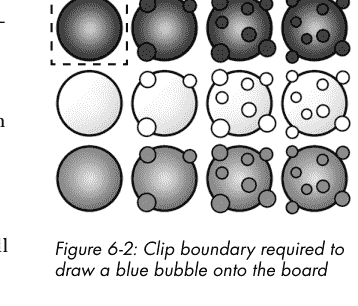

如果我们想绘制气泡在爆裂第一阶段的样子，我们需要将裁剪区域向右移动。这类似于我们在 DOM 版本中显示气泡的方式，不同之处在于，我们不再让 div 元素的边界来定义裁剪边界，而是在 JavaScript 中指定它们。

要绘制裁剪后的图像到画布，需要给 `drawImage` 方法添加更多参数。之前，我们只使用了三个参数（图像对象和 x、y 坐标），但我们可以传递更多参数来裁剪图像。`drawImage` 接受的全部参数如下：

```
context.drawImage(img, sx, sy, swidth, sheight, x, y, width, height);
```

各参数含义如下：

**img** 图像对象。

**sx 和 sy** 相对于图像原点的裁剪起始 x 和 y 坐标。对于非爆裂状态的蓝色气泡，这些值应分别为 0 和 50。

**swidth 和 sheight** 裁剪区域的宽度和高度。对于我们这张气泡精灵表，这两个值都是 50。

**x 和 y** 相对于画布上下文原点的绘制目标 x 和 y 坐标。

**width 和 height** 要绘制的图像的宽度和高度。我们可以使用这些参数来缩放图像，或者如果希望图像按 1:1 绘制，可以省略它们。

例如，要在画布上坐标 (200, 150) 处绘制图 6-2 中高亮显示的蓝色气泡，我们将使用以下代码：

```
$("#canvas").get(0).getContext("2d").drawImage(spriteSheet, 0, 50, 50, 50, 200, 150, 50, 50);
```

这行代码假设精灵图像对象名为 `spriteSheet`，且精灵尺寸为宽 50 像素、高 50 像素。

## 定义与维护状态

在游戏代码的 DOM 版本中，我们不必考虑气泡的状态；我们只需通过超时和动画/回调链来排队事件。一旦气泡在固定位置绘制到屏幕上，除非需要更改，否则我们保持原样。在告诉浏览器对其执行其他操作之前，气泡将一直绘制在同一位置。

但当我们切换到画布渲染时，需要在每帧重绘时，为每个气泡使用正确的精灵进行渲染。我们的代码必须跟踪屏幕上所有气泡的状态，无论它们是正在移动、爆裂、下落还是静止。每个气泡对象将跟踪其当前状态以及在该状态下持续的时间。我们需要这个持续时间来绘制爆裂动画的帧。目前，`Board` 对象负责跟踪主布局中的气泡，我们需要对其进行扩展，以便也能跟踪那些正在爆裂、下落或发射的气泡。

### 准备状态机

为了维护气泡状态，我们首先将创建一组常量来表示气泡的不同状态。这被称为使用状态机，随着游戏复杂度的增加，你会发现它越来越有用。使用状态机的基本原则，与此游戏相关，如下所示：

- 一个气泡可以处于多种状态之一，例如移动中、爆裂中或下落中。
- 气泡在游戏中的反应方式将取决于它所处的状态。例如，我们不希望正在发射的气泡与正在爆裂的气泡发生碰撞。
- 气泡的显示方式可能取决于其状态，尤其是在爆裂时。
- 气泡一次只能处于一种状态；它不能同时处于“已爆裂”和“正在爆裂”状态，或者“正在爆裂”和“正在下落”状态。

一旦我们建立好状态机，我们就知道在任何给定情况下需要对气泡执行什么操作。有些状态变化是用户操作的结果，例如发射气泡时，但我们也会存储气泡进入某个状态的时间戳。因此，我们可以确定何时应自动将气泡从一个状态移动到另一个状态，例如在碰撞后对其进行爆裂处理时。

> 一般来说，即使你认为你的游戏会相对简单，也值得使用状态机作为一种管理复杂性的方式，这些复杂性可能是你尚未考虑到的。

在 *bubble.js* 中添加以下内容：

```javascript
var BubbleShoot = window.BubbleShoot || {};
BubbleShoot.Bubble = (function($){
  BubbleShoot.BubbleState = {
    CURRENT : 1,
    ON_BOARD : 2,
    FIRING : 3,
    POPPING : 4,
    FALLING : 5,
    POPPED : 6,
    FIRED : 7,
    FALLEN : 8
  };
  var Bubble = function(row,col,type,sprite){
    var that = this;
    var state;
    var stateStart = Date.now();
    this.getState = function(){ return state;};
    this.setState = function(stateIn){
      state = stateIn;
      stateStart = Date.now();
    };
    this.getTimeInState = function(){
      return Date.now() - stateStart;
    };
    --snip--
  };
  Bubble.create = function(rowNum,colNum,type){
    --snip--
  };
  return Bubble;
})(jQuery);
```


这些扩展功能使我们能够存储和检索泡泡的当前状态，该状态将是类顶部的八种状态之一。每当改变一个泡泡的状态时，我们也记录它进入该状态的时间戳。一旦确定泡泡在当前状态停留了多长时间，我们就能计算出该绘制什么内容。例如，泡泡在`POPPING`状态停留的时间决定了应播放弹出动画序列的哪一帧。

## 实现状态

每个泡泡可以处于以下状态之一，这些状态都需要实现：

-   CURRENT：等待发射。
-   ON_BOARD：已成为棋盘显示的一部分。
-   FIRING：正在移向棋盘或移出屏幕。
-   POPPING：正在被弹出。这将显示弹出动画的一帧。
-   FALLING：一个孤立的泡泡正从屏幕上掉落。
-   POPPED：弹出完成。已弹出的泡泡不需要渲染。
-   FIRED：在FIRING后错过了棋盘显示。已发射的泡泡不需要渲染。
-   FALLEN：从屏幕上掉落完成。已掉落的泡泡不需要渲染。

关卡开始时棋盘中显示的泡泡初始状态为`ON_BOARD`，但所有其他泡泡将以`CURRENT`状态开始，并转移到其他状态之一，如图6-3所示。

我们将在`Game`中添加几个数组来跟踪这些状态。在类的顶部添加：

```javascript
var BubbleShoot = window.BubbleShoot || {};
BubbleShoot.Game = (function($){
  var Game = function(){
    var curBubble;
    var board;
    var numBubbles;
    var bubbles = [];
    var MAX_BUBBLES = 70;
    this.init = function(){
      --snip--
    };
    var startGame = function(){
      $(".but_start_game").unbind("click");
      numBubbles = MAX_BUBBLES
      BubbleShoot.ui.hideDialog();
      board = new BubbleShoot.Board();
      bubbles = board.getBubbles();
      curBubble = getNextBubble();
      BubbleShoot.ui.drawBoard(board);
      $("#game").bind("click",clickGameScreen);
    };
    var getNextBubble = function(){
      var bubble = BubbleShoot.Bubble.create();
      bubbles.push(bubble);
      bubble.setState(BubbleShoot.BubbleState.CURRENT);
      bubble.getSprite().addClass("cur_bubble");
      $("#board").append(bubble.getSprite());
      BubbleShoot.ui.drawBubblesRemaining(numBubbles);
      numBubbles--;
      return bubble;
    };
    --snip--
  };
  return Game;
})(jQuery);
```

这个新数组将包含游戏中所有泡泡，无论它们是否在棋盘布局中。最初，每个泡泡都是棋盘的一部分，因此棋盘内容可用于填充数组。每次调用`getNextBubble`时，需要将准备发射的泡泡添加进去，并将其状态设置为`CURRENT`。

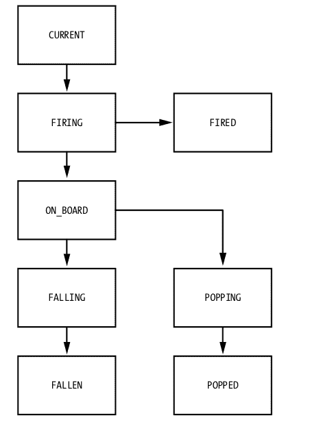

`board.getBubbles`是一个新方法，它将棋盘中所有行和列的泡泡作为单个扁平数组返回，因此将其添加到`board.js`中：

```javascript
var BubbleShoot = window.BubbleShoot || {};
BubbleShoot.Board = (function($){
    var NUM_ROWS = 9;
    var NUM_COLS = 32;
    var Board = function(){
        var that = this;
        --snip--
        this.getBubbles = function(){
            var bubbles = [];
            var rows = this.getRows();
            for(var i=0;i<rows.length;i++){
                var row = rows[i];
                for(var j=0;j<row.length;j++){
                    var bubble = row[j];
                    if(bubble){
                        bubbles.push(bubble);
                    }
                };
            };
            return bubbles;
        };
        return this;
    };
    --snip--
    return Board;
})(jQuery);
```

我们还需要将棋盘上的泡泡状态设置为`ON_BOARD`，因此对同一文件中的`createLayout`函数进行如下修改：

```javascript
var BubbleShoot = window.BubbleShoot || {};
BubbleShoot.Board = (function($){
    var NUM_ROWS = 9;
    var NUM_COLS = 32;
    var Board = function(){
        --snip--
    };
    var createLayout = function(){
        var rows = [];
        for(var i=0;i<NUM_ROWS;i++){
            var row = [];
            var startCol = i%2 == 0 ? 1 : 0;
            for(var j=startCol;j<NUM_COLS;j+=2){
                var bubble = BubbleShoot.Bubble.create(i,j);
                bubble.setState(BubbleShoot.BubbleState.ON_BOARD);
                row[j] = bubble;
            };
            rows.push(row);
        };
        return rows;
    };
    return Board;
})(jQuery);
```

`bubble.setState`处理设置，其中包含`CURRENT`和`ON_BOARD`状态，但我们也需要能够更改泡泡的状态。`FIRING`和`FIRED`两种状态将在`ui.js`的`fireBubble`内设置。按如下方式修改该函数：

```javascript
var BubbleShoot = window.BubbleShoot || {};
BubbleShoot.ui = (function(){
  var ui = {
    --snip--
    fireBubble: function(bubble, coords, duration){
      bubble.setState(BubbleShoot.BubbleState.FIRING);
      var complete = function(){
        if(typeof(bubble.getRow()) !== undefined){
          bubble.getSprite().css(Modernizr.prefixed("transition",""),"");
          bubble.getSprite().css({
            left: bubble.getCoords().left - ui.BUBBLE_DIMS/2,
            top: bubble.getCoords().top - ui.BUBBLE_DIMS/2
          });
          bubble.setState(BubbleShoot.BubbleState.ON_BOARD);
        }else{
          bubble.setState(BubbleShoot.BubbleState.FIRED);
        }
      };
      --snip--
    },
    --snip--
  };
  return ui;
})(jQuery);
```

当泡泡最初发射时，我们将其状态设置为`FIRING`。如果泡泡到达棋盘，我们将其设置为`ON_BOARD`，但如果它没有落入行和列中，那就意味着它错过了棋盘，此时它变为`FIRED`。其他状态将在`game.js`中设置：

```javascript
var Game = function(){
  --snip--
  var popBubbles = function(bubbles, delay){
    $.each(bubbles, function(){
      var bubble = this;
      setTimeout(function(){
        bubble.setState(BubbleShoot.BubbleState.POPPING);
        bubble.animatePop();
      }, delay);
      setTimeout(function(){
        bubble.setState(BubbleShoot.BubbleState.POPPED);
      }, 200);
    });
    board.popBubbleAt(bubble.getRow(), bubble.getCol());
    delay += 60;
  };
};
```

```javascript
var dropBubbles = function(bubbles,delay){
	$.each(bubbles,function(){
		var bubble = this;
		board.popBubbleAt(bubble.getRow(),bubble.getCol());
		setTimeout(function(){
			bubble.setState(BubbleShoot.BubbleState.FALLING);
			bubble.getSprite().kaboom({
				callback : function(){
					bubble.getSprite().remove();
					bubble.setState(BubbleShoot.BubbleState.FALLEN);
				}
			})
		},delay);
	});
};
```

在`popBubbles`中，我们将每个泡泡设置为`POPPING`，然后在200毫秒后，当弹出动画完成时，将其设置为`POPPED`。在`dropBubbles`中，我们将其设置为`FALLING`，然后当它们在kaboom过程结束时完成掉落，它们变为`FALLEN`。

现在泡泡知道在游戏中的任何时刻处于哪种状态，我们可以开始将它们渲染到画布上。

## 精灵表和画布

在绘制到画布时，我们可以使用游戏CSS版本中现有的精灵表PNG（`bubble_sprite_sheet.png`），尽管我们需要以不同的方式处理它。我们将绘制显示正确泡泡在正确动画状态下的图像部分，而不是像背景图像那样移动精灵表。我们的加载序列也会改变，因为我们需要确保在开始游戏之前加载精灵图像。

我们将创建一个名为`Renderer`的新对象来处理绘制到画布，我们会给它自己的`init`方法，该方法将预加载精灵表，并在`game.init`中调用该方法。

将`game.js`中的`init`方法更改为以下内容：

```javascript
var BubbleShoot = window.BubbleShoot || {};
BubbleShoot.Game = (function($){
	var Game = function(){
		--snip--
		this.init = function(){
			if(BubbleShoot.Renderer){
				BubbleShoot.Renderer.init(function(){
					$(".but_start_game").click("click",startGame);
				});
			}else{
				$(".but_start_game").click("click",startGame);
			};
			--snip--
```


};
return Game;
})(jQuery);

首先，我们检查 BubbleShoot.Renderer 是否存在 ❶。如果在加载脚本时 Modernizr.canvas 测试通过，该对象就会存在；如果 canvas 不被支持，则该对象将不存在。
然后我们调用 Renderer.init 方法，并向其传入一个函数作为唯一参数 ❷。这个函数的作用是将 startGame 绑定到 New Game 按钮上 ❸。
现在我们需要编写 Renderer 对象。在空白的 renderer.js 文件中，添加以下代码：

```
renderer.js  var BubbleShoot = window.BubbleShoot || {};
BubbleShoot.Renderer = (function($){
❶   var canvas;
  var context;
  var Renderer = {
❷    init : function(callback){
❸      canvas = document.createElement("canvas");
      $(canvas).addClass("game_canvas");
❹      $("#game").prepend(canvas);
❺      $(canvas).attr("width",$(canvas).width());
      $(canvas).attr("height",$(canvas).height());
      context = canvas.getContext("2d");
      callback();
    }
  };
  return Renderer;
})(jQuery);
```

我们首先创建变量来保存用于渲染游戏区域的 canvas ❶ 以及对其渲染上下文的引用，这样我们就不用每次都调用 canvas.getContext("2d")。
在 init 方法中，我们接受回调函数作为参数 ❷，创建 canvas DOM 元素 ❸，然后将其前置插入到 game div 中 ❹。我们还显式地设置了 canvas 的 width 和 height 属性 ❺。请记住，这些属性定义了 canvas 内部的像素数量和边界，因此为了简单起见，我们将它们设置为与屏幕上渲染的尺寸相同的值。
这将为我们创建 canvas 元素，并准备好可供绘制的上下文。我们需要设置 game_canvas 的宽度和高度，因此在 main.css 中添加以下内容：

```
main.css  .game_canvas
{
  width: 1000px;
  height: 620px;
}
```

DOM 渲染版本使用 jQuery 在屏幕上移动对象，但在 canvas 内部我们没有可操作的 DOM 元素，jQuery 无从施展。因此，我们需要用新代码来跟踪屏幕上每个气泡的位置。这主要将在我们创建的新文件 `sprite.js` 中实现。

## 多种渲染方式：两种方法

如果需要支持不同的渲染方式（正如我们这里所做的），可以采用两种方法。第一种是为每种渲染方式创建一个类，并提供相同的方法和属性集合，以便它们可以互换使用。这就是我们在 *Bubble Shooter* 中采用的方式。

第二种是为两种渲染方式创建一个单一的类，然后在该类内部根据所支持的渲染方式进行分支处理。新类可以仅作为不同渲染方式类的包装器。例如，对于 *Bubble Shooter*，我们可以创建类似以下的伪代码：

```
BubbleShoot.SpriteWrapper = (function(){
	var SpriteWrapper = function(id){
		var wrappedObject;
		if(BubbleShoot.Renderer()){
			wrappedObject = getSpriteObject(id);
		}else{
			wrappedObject = getJQueryObject(id);
		};
		this.position = function(){
			return wrappedObject.position();
		};
	};
	return SpriteWrapper;
})(jQuery);
```

在这里，我们会向对象构造函数传入某种标识符 ❶，然后根据游戏的渲染方式来分支处理代码 ❷。我们需要新的函数来返回 `Sprite` ❸ 或 `jQuery` 对象，它们将存储在类中的 `wrappedObject` 中。

从那时起，如果我们想找到对象的位置，我们只需调用 position 方法 ❹，无论该对象是通过 DOM 渲染还是在 canvas 上渲染，我们都能获得正确的数据。

我们没有在 *Bubble Shooter* 中采用这种方法的主要原因是，我们只有一种类型的精灵——屏幕上的气泡。`Bubble` 类已经足以很好地表示它们，而且它本身就是一个包装器。不过，如果我们需要处理许多不同种类的精灵，可能就需要更明确地拆分结构。

我们将编写 *sprite.js*，使得 canvas 精灵可以使用与 jQuery 精灵相同的方法来调用。我们一直在调用的主要方法有 position、width、height 和 css，如果我们在 *sprite.js* 中创建了这些方法的实现，那么在代码的其余部分看来，Sprite 类就会像一个 jQuery 对象。

在 *sprite.js* 中添加以下内容：

```
var BubbleShoot = window.BubbleShoot || {};
BubbleShoot.Sprite = (function($){
    var Sprite = function(){
        var that = this;
        var left;
        var top;
        this.position = function(){
            return {
                left : left,
                top : top
            };
        };
        this.setPosition = function(args){
            if(arguments.length > 1){
                return;
            };
            if(args.left !== null)
                left = args.left;
            if(args.top !== null)
                top = args.top;
        };
        this.css = this.setPosition;
        return this;
    };
    Sprite.prototype.width = function(){
        return BubbleShoot.ui.BUBBLE_DIMS;
    };
    Sprite.prototype.height = function(){
        return BubbleShoot.ui.BUBBLE_DIMS;
    };
    Sprite.prototype.removeClass = function(){};
    Sprite.prototype.addClass = function(){};
    Sprite.prototype.remove = function(){};
    Sprite.prototype.kaboom = function(){
        jQuery.fn.kaboom.apply(this);
    };
    return Sprite;
})(jQuery);
```

在这里，我们创建了一个实现了许多 jQuery 对象方法的对象。我们有 left 和 top 坐标 ❶ 以及一个 position 方法 ❷，该方法以与调用 jQuery 的 position 方法相同的方式返回这些坐标。setPosition 方法可以设置 top 和 left 坐标 ❸，如果传入其他值则不做任何操作。

在我们基于 DOM 的游戏版本中，我们调用 css 方法来设置对象的屏幕坐标。setPosition 被设计为接受与 css 方法相同的参数，为了不必在任何调用 css 方法的地方重写代码并为 canvas 版本使用 setPosition，我们可以创建 Sprite 的 css 方法并将其别名为 setPosition ❹。

width ❺ 和 height ❻ 方法返回在 *ui.js* 中定义的气泡尺寸值。最后，我们为 removeClass、addClass 和 remove 定义了空方法，以保持与现有代码的兼容性 ❼。任何调用这些方法的地方都不会影响显示，也不会抛出错误。

当创建气泡时，我们需要决定是创建 jQuery 对象还是 Sprite 实例，这取决于我们是使用 DOM 还是 canvas 进行渲染。我们将在 *bubble.js* 的气泡创建过程中完成此操作：

```
var BubbleShoot = window.BubbleShoot || {};
BubbleShoot.Bubble = (function($){
  --snip--
  var Bubble = function(row,col,type,sprite){
    --snip--
  };
  Bubble.create = function(rowNum,colNum,type){
    if(!type){
      type = Math.floor(Math.random() * 4);
    };
    if(!BubbleShoot.Renderer){
      var sprite = $(document.createElement("div"));
      sprite.addClass("bubble");
      sprite.addClass("bubble_" + type);
    }else{
      var sprite = new BubbleShoot.Sprite();
    }
    var bubble = new Bubble(rowNum,colNum,type,sprite);
    return bubble;
  };
  return Bubble;
})(jQuery);
```

这段代码再次检查 Renderer 对象是否已加载 ❶（如果 canvas 启用则会加载），如果没有，则继续基于 DOM 的路径。否则，我们创建一个新的 Sprite 对象 ❷。有了这个机制，无论我们是使用 jQuery 配合 CSS 还是纯 canvas 方式，调用 curBubble.getSprite 都会返回一个有效的对象。

初始化 Sprite 对象的最后一步是确保它们具有正确的屏幕坐标。在游戏的 DOM 版本中，我们在 CSS 中设置这些值，但对于 canvas，我们必须在 JavaScript 代码中设置。这些将在 board.js 的 createLayout 函数中设置：

```
var BubbleShoot = window.BubbleShoot || {};
BubbleShoot.Board = (function($){
    var NUM_ROWS = 9;
    var NUM_COLS = 32;
    var Board = function(){
        --snip--
        return this;
    };
    var createLayout = function(){
        var rows = [];
        for(var i=0;i<NUM_ROWS;i++){
            var row = [];
            var startCol = i%2 == 0 ? 1 : 0;
            for(var j=startCol;j<NUM_COLS;j+=2){
                var bubble = BubbleShoot.Bubble.create(i,j);
                bubble.setState(BubbleShoot.BubbleState.ON_BOARD);
                if(BubbleShoot.Renderer){
                    var left = j * BubbleShoot.ui.BUBBLE_DIMS/2;
                    var top = i * BubbleShoot.ui.ROW_HEIGHT;
                    bubble.getSprite().setPosition({
                        left : left,
                        top : top
                    });
                }
                row[j] = bubble;
            }
            rows.push(row);
        }
        return rows;
    };
    return Board;
})(jQuery);
```

如果渲染器存在 ①，我们计算气泡应显示位置的 left 和 top 坐标 ②，然后将这些值设置为精灵的属性 ③。

当前气泡也需要设置其位置，这将在 game.js 的 getNextBubble 中完成：

```
var BubbleShoot = window.BubbleShoot || {};
BubbleShoot.Game = (function($){
    var Game = function(){
        --snip--
    }
    var getNextBubble = function(){
        var bubble = BubbleShoot.Bubble.create();
```

现在我们已经追踪了所有气泡的位置，并随时了解它们的状态。我们也可以操作精灵的表示，但屏幕上暂时还不会显示任何东西。在下一节中，我们将把精灵渲染到画布上。

## 画布渲染器

要在画布上制作任何动画，我们需要在每次重绘前清除像素。为了渲染游戏，我们将使用 `setTimeout` 和定时器，逐帧重绘每个气泡的位置和状态。这个过程对于你构建的几乎任何游戏都是相同的，当然，对于任何需要持续更新显示的游戏也是如此。理论上，我们只需要在屏幕上的信息发生变化时重绘画布；实际上，判断何时有新信息要显示可能很困难。幸运的是，画布渲染非常快，所以通常没有理由不尽可能频繁地更新显示。

我们将存储 `setTimeout` 返回的超时 ID 值，以便知道帧计数器是否正在运行。这将在 `game.js` 文件顶部的一个名为 `requestAnimationID` 的新变量中发生，我们还会存储上次动画发生的时间戳：

```
var BubbleShoot = window.BubbleShoot || {};
var Game = function(){
    var curBubble;
    var board;
    var numBubbles;
    var bubbles = [];
    var MAX_BUBBLES = 70;
    var requestAnimationID;
    this.init = function(){
    };
--snip--
```

game.js

```
var startGame = function(){
  $(".but_start_game").unbind("click");
  $("#board .bubble").remove();
  numBubbles = MAX_BUBBLES;
  BubbleShoot.ui.hideDialog();
  board = new BubbleShoot.Board();
  bubbles = board.getBubbles();
  if(BubbleShoot.Renderer)
  {
    if(!requestAnimationID)
      requestAnimationID = setTimeout(renderFrame,40);
  }else{
    BubbleShoot.ui.drawBoard(board);
  };
  curBubble = getNextBubble(board);
  $("#game").bind("click",clickGameScreen);
};
  };
  return Game;
})(jQuery);
```

我们添加了这两个变量 ❶，如果 Renderer 对象存在 ❷，我们就启动超时来绘制第一个动画帧 ❸。

我们还没有编写 *renderFrame*，但在此之前，我们将在 *renderer.js* 中编写一个绘制所有气泡的方法。该方法将接受一个气泡对象数组作为输入。

首先，我们需要在 *renderer.js* 中加载气泡图像：

```
var BubbleShoot = window.BubbleShoot || {};
BubbleShoot.Renderer = (function($){
  var canvas;
  var context;
  ❶ var spriteSheet;
  ❷ var BUBBLE_IMAGE_DIM = 50;
  var Renderer = {
    init : function(callback){
      canvas = document.createElement("canvas");
      $(canvas).addClass("game_canvas");
      $("#game").prepend(canvas);
      $(canvas).attr("width",$(canvas).width());
      $(canvas).attr("height",$(canvas).height());
      context = canvas.getContext("2d");
      spriteSheet = new Image();
      ❸ spriteSheet.src = "_img/bubble_sprite_sheet.png";
      ❹ spriteSheet.onload = function() {
        callback();
      };
    }
  };
  return Renderer;
})(jQuery);
```

我们创建了一个变量来保存图像数据 ❶，并定义了另一个变量用于每个气泡图像的宽度和高度 ❷。这些尺寸将告诉我们如何在精灵表中裁剪每个图像。然后我们加载图像文件 ❸，并且在图像加载完成后，传递给 init 的回调函数会被触发 ❹。

接下来，我们将创建将精灵绘制到画布上的函数。

```
var BubbleShoot = window.BubbleShoot || {};
BubbleShoot.Renderer = (function($){
--snip--
  var Renderer = {
    init : function(callback){
      --snip--
    },
    render : function(bubbles){
      context.clearRect(0,0,canvas.width,canvas.height);
      context.translate(120,0);
      $.each(bubbles,function(){
        var bubble = this;
        var clip = {
          top : bubble.getType() * BUBBLE_IMAGE_DIM,
          left : 0
        };
        Renderer.drawSprite(bubble.getSprite(),clip);
      });
      context.translate(-120,0);
    },
    drawSprite : function(sprite,clip){
      context.translate(sprite.position().left + sprite.width()/2,sprite.position().top + sprite.height()/2);
      context.drawImage(spriteSheet,clip.left,clip.top,BUBBLE_IMAGE_DIM,BUBBLE_IMAGE_DIM,-sprite.width()/2,-sprite.height()/2,BUBBLE_IMAGE_DIM,BUBBLE_IMAGE_DIM);
      context.translate(-sprite.position().left - sprite.width()/2,-sprite.position().top - sprite.height()/2);
    }
  };
  return Renderer;
})(jQuery);
```

首先，我们创建一个 render 方法，它接受一个 Bubble 对象数组 ❶。然后我们清除画布，并将上下文偏移 120 像素，以便将棋盘显示在屏幕中央。代码接着循环遍历数组中的每个气泡 ❷，并定义一个 (x,y) 坐标，用于从图像中提取该气泡的精灵 ❸。在添加消除动画帧之前，x 坐标始终从零开始，而 y 坐标是气泡类型（0 到 3）乘以气泡图像的高度（50 像素）。在重置上下文位置之前，我们将此信息连同气泡的 Sprite 对象一起传递给另一个名为 drawSprite 的新方法 ❹。

在 drawSprite 内部，我们根据精灵的坐标平移上下文 ⑤，记得将 (top,left) 坐标偏移 (width,height) 的一半以获取图像中心，然后绘制图像 ⑥。通常，最好平移画布上下文，使其原点位于任何被绘制图像的中心，因为上下文的 rotate 方法是围绕上下文原点执行旋转的。这意味着如果我们想围绕图像中心旋转图像，上下文已经设置好了。

最后，在调用 drawImage 之后，我们将上下文平移回原点 ⑦。要看到棋盘渲染到画布上，我们只需要在 game.js 中加入 renderFrame：

```
var BubbleShoot = window.BubbleShoot || {};
var Game = function(){
  --snip--
  var renderFrame = function(){
    BubbleShoot.Renderer.render(bubbles);
    requestAnimationID = setTimeout(renderFrame,40);
  };
  };
  return Game;
})(jQuery);
```

在浏览器中重新加载页面以再次开始游戏。点击“新游戏”后，你应该能看到棋盘以其初始状态渲染。但是，发射气泡不会产生任何动画，消除、掉落或其他任何操作也不会产生动画。在下一节中，我们将让气泡发射重新工作，并让气泡消除产生动画。如果你在不支持画布的浏览器中打开游戏，游戏仍然会像以前一样工作，因为我们保留了 DOM 版本。接下来，我们将为画布版本添加动画。

## 在画布上移动精灵

对于 CSS 版本的游戏，我们使用 jQuery 的 `animate` 方法来移动屏幕上的对象。对于画布动画，我们需要手动计算和更新移动过程。

在画布上制作动画的过程与 jQuery 的内部过程相同，我们将为 Sprite 添加一个 animate 方法，以便我们可以继续使用现有的代码。animate 方法将执行以下操作：

1.  接受气泡的目标坐标和移动持续时间。
2.  将对象向这些坐标移动一小段距离，移动距离与自上一帧以来经过的时间成比例。
3.  重复步骤 2，直到气泡到达其目的地。

这个过程与使用 jQuery 的 `animate` 方法时发生的过程相同，并且在你想在屏幕上移动对象时几乎都会用到它。

`renderFrame` 方法在每一帧都会被调用，它将运行整个动画过程。在气泡精灵计算出它们自己的坐标后，`renderFrame` 将触发绘制过程。我们将向 `Sprite` 对象添加一个 `animate` 方法，这样我们现有的游戏逻辑就能继续工作，而无需重写代码。请记住，当我们在 `ui.js` 中调用 `animate` 时，我们传入两个参数：

-   一个指定 left 和 top 位置坐标的对象
-   一个指定 duration（持续时间）、callback function（回调函数）和 easing（缓动）的对象

通过构造 `Sprite` 的 `animate` 方法接受相同的参数，我们可以避免对 `ui.js` 中的调用进行任何更改。将以下内容添加到 `sprite.js`：

```
var BubbleShoot = window.BubbleShoot || {};
BubbleShoot.Sprite = (function($){
    var Sprite = function(){
        --snip--
        this.css = function(args){
            --snip--
        };
        this.animate = function(destination,config){
            var duration = config.duration;
            var animationStart = Date.now();
            var startPosition = that.position();
            that.updateFrame = function(){
                var elapsed = Date.now() - animationStart;
                var proportion = elapsed/duration;
                if(proportion > 1)
                    proportion = 1;
                var posLeft = startPosition.left + (destination.left - startPosition.left) * proportion;
                var posTop = startPosition.top + (destination.top - startPosition.top) * proportion;
                that.css({
                    left : posLeft,
                    top : posTop
                });
            };
            setTimeout(function(){
                that.updateFrame = null;
                if(config.complete)
                    config.complete();
            },duration);
        };
        return this;
    };
    --snip--
    return Sprite;
})(jQuery);
```


传入 `animate` 的目标参数表示精灵的目标坐标，该坐标包含在如下所示的对象中：

```
{top: 100, left: 100}
```

我们还传入一个配置对象，该对象包含一个 `duration` 属性，以及一个可选的动画结束后执行的回调函数。

接下来，我们为动画设置开始时间并存储起始位置。这两者都将用于计算气泡在任意时刻的位置。

我们动态地将 `updateFrame` 方法添加到 `Sprite` 对象上，以便每帧调用它来重新计算气泡的位置。在 `updateFrame` 内部，我们计算动画已完成的比例。为了防止最后一个超时调用在动画完成后才触发，我们确保该比例永远不会大于 1，这样气泡就不会移动到目标位置之外。新坐标通过以下公式计算：

当前 x = 起始 x + (最终 x – 起始 x) × 已过比例

当前 y = 起始 y + (最终 y – 起始 y) × 已过比例

一旦我们有了新的 `top` 和 `left` 坐标，就通过调用精灵的 `css` 方法来更新其位置。当对象移动结束后，我们不需要 `updateFrame` 继续运行，因此设置一个超时调用在 `duration` 时间后移除该方法，此时动画也将完成。同时，这也会调用配置变量中作为回调属性传入的任何动画后函数。

现在我们可以计算气泡的新坐标了，在 `game.js` 中添加对 `updateFrame` 的调用：

```
var BubbleShoot = window.BubbleShoot || {};
var Game = function(){
  --snip--
  var renderFrame = function(){
    $.each(bubbles, function(){
      if(this.getSprite().updateFrame)
        this.getSprite().updateFrame();
    });
    BubbleShoot.Renderer.render(bubbles);
    requestAnimationFrame = setTimeout(renderFrame, 40);
  };
  return Game;
}(jQuery);
```

每次对气泡调用 `renderFrame` 时，如果 `updateFrame` 方法已定义，我们就调用该方法。

我们还需要在 `ui.js` 的 `fireBubble` 中通过再次检查 `BubbleShoot.Renderer` 是否存在来调用 `animate`。我们知道 `BubbleShoot.Renderer` 仅在支持 canvas 时才会存在，并且如果支持 canvas，我们就想用它进行渲染。结果就是，CSS 过渡动画只会在同时满足 CSS 过渡受支持*且* canvas 渲染不受支持时才会用于动画气泡。

```
ui.js
var BubbleShoot = window.BubbleShoot || {};
BubbleShoot.ui = (function($){
  var ui = {
    --snip--
    fireBubble : function(bubble,coords,duration){
      --snip--
      if(Modernizr.csstransitions && !BubbleShoot.Renderer){
        --snip--
      }else{
        --snip--
      }
    },
    --snip--
  };
  return ui;
})(jQuery);
```

重新加载游戏并开始发射吧！你现在应该又有了一个可以玩的游戏，但这次所有的图像都渲染到了 canvas 上。不过现在没有破裂动画，因为我们没有在显示中处理气泡状态的变化。游戏状态在内部是正确的，但屏幕并未完全同步，因为我们从未看到气泡破裂。以正确的状态渲染气泡是下一节的重点。

## 为 Canvas 精灵帧添加动画

目前，每个气泡无论是在棋盘上、正在破裂、新发射的还是其他状态，都以相同的视觉状态渲染。气泡在破裂后仍然留在屏幕上，我们错过了破裂动画！这是因为气泡从未从 Game 的 `bubbles` 数组中删除，所以即使它们已从 Board 对象中删除，仍然会被渲染。

我们已经知道气泡处于哪种状态，并且精灵表图像已加载到内存中以便访问所有动画状态。绘制正确的状态需要确保 Renderer 的 `drawSprite` 方法在气泡可见时以正确的状态被调用，或者对于已破裂或掉出屏幕的气泡则完全跳过。我们需要实现的气泡外观变化按状态列于表 6-1 中。

### 表 6-1：基于气泡状态的视觉变化

| 代码中的气泡状态 | 向玩家展示的视觉内容 |
| :--- | :--- |
| CURRENT_BUBBLE | 无变化 |
| ON_BOARD | 无变化 |
| FIRING | 无变化 |
| POPPING | 渲染四个气泡帧之一，取决于气泡处于 POPPING 状态的时长 |
| FALLING | 无变化 |
| POPPED | 跳过渲染 |
| FALLEN | 跳过渲染 |
| FIRED | 跳过渲染 |

这些变化将发生在 `Renderer.render` 内部。我们将遍历整个气泡数组，要么跳过渲染阶段，要么调整坐标以裁剪精灵表中破裂动画的正确阶段。对 `renderer.js` 进行以下更改：

```
var BubbleShoot = window.BubbleShoot || {};
BubbleShoot.Renderer = (function($){
  --snip--
  var Renderer = {
    init : function(callback){
      --snip--
    },
    render : function(bubbles){
      bubbles.each(function(){
        var bubble = this;
        var clip = {
          top : bubble.getType() * BUBBLE_IMAGE_DIM,
          left : 0
        };
        switch(bubble.getState()){
          case BubbleShoot.BubbleState.POPPING:
            var timeInState = bubble.getTimeInState();
            if(timeInState < 80){
              clip.left = BUBBLE_IMAGE_DIM;
            }else if(timeInState < 140){
              clip.left = BUBBLE_IMAGE_DIM*2;
            }else{
              clip.left = BUBBLE_IMAGE_DIM*3;
            };
            break;
          case BubbleShoot.BubbleState.POPPED:
            return;
          case BubbleShoot.BubbleState.FIRED:
            return;
          case BubbleShoot.BubbleState.FALLEN:
            return;
        }
      });
    }
  };
  return Renderer;
})(jQuery);
```

renderer.js

```
Renderer.drawSprite(bubble.getSprite(),clip);
        });
    },
    drawSprite : function(sprite,clip){
        --snip--
    }
};
return Renderer;
})(jQuery);
```

首先，我们想查看气泡处于哪个状态 ❶。为此，我们将使用 `switch` 语句。状态机通常使用 `switch/case` 语句而不是多个 `if/else` 语句来编写。使用这种结构不仅使未来添加任何状态更容易，也向未来阅读代码的人提供了一个线索，表明他们正在查看一个状态机。

如果气泡正在破裂，我们想知道它处于该状态多久了 ❷。该时间决定了要获取哪个动画帧。我们对前 80 毫秒使用未破裂状态 ❸，接下来的 60 毫秒使用第一帧 ❹，从那时起到 POPPING 状态清除则使用最终破裂帧 ❺。

如果气泡处于 POPPED ❻、FIRED ❼ 或 FALLEN ❽ 状态，我们直接返回并完全跳过渲染。否则，我们像以前一样调用 `drawSprite` ❾。

现在，如果你重新加载游戏，它应该完全可玩了。在没有进行重大更改的情况下，我们已将整个游戏区域重构为根据浏览器兼容性使用 canvas 或基于 DOM 的渲染。你用来加载游戏的浏览器以及该浏览器支持的功能将决定泡泡龙游戏的呈现方式：

- 如果你的浏览器支持 `canvas` 元素，你将看到 canvas 版本。
- 如果你的浏览器支持 CSS 过渡但不支持 `canvas` 元素，你将看到 CSS 过渡版本。
- 如果以上两者都不支持，你将看到使用 jQuery 动画的 DOM 版本。

## 总结

这涵盖了绘制 HTML5 游戏图形元素的大部分核心内容，无论你是使用 HTML 和 CSS 还是完全基于 canvas 的方法。但这并不意味着我们已经完成了游戏！我们没有声音，只有一种关卡存在，并且计分系统会很不错。在下一章中，我们将实现这些元素并探索 HTML5 的更多特性，包括用于保存游戏状态的本地存储、用于更平滑动画的 `requestAnimationFrame`，以及如何让声音可靠地工作。


## 进一步练习

1.  当气泡爆破时，动画对每个气泡的播放方式完全相同。尝试调整时序，使部分气泡动画播放得更快，部分则更慢。同时，尝试在气泡绘制到画布上时为其添加一些旋转效果。这只需很少的努力就能让爆破动画的体验更加丰富。

2.  当孤立的气泡下落时，它们仍保持默认的精灵图。修改 *renderer.js*，使气泡在下落过程中爆破。

## 关卡、音效及其他

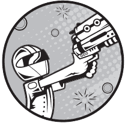

在本章中，我们将为 *泡泡射击游戏* 增加一些最后的润色，并介绍更多 HTML5 的特性。目前，泡泡网格可能很快就会填满整个页面，导致玩家没有空间发射泡泡。为防止这种情况发生，如果玩家在网格底部增加了超过两行泡泡，游戏将结束。我们还将使用本地存储 API 实现多个关卡和高分记录，通过 `requestAnimationFrame` 使动画更加流畅，并使用 HTML5 为游戏添加音效。让我们从添加多个关卡和高分记录开始。

### 多个关卡和高分记录

可以通过清除所有泡泡来完成一个关卡，但之后如果想再次游戏，必须刷新浏览器。显然，这对于游戏来说是不够令人满意的，并且还缺少一些游戏流程元素：

- 有限的泡泡供应（否则，玩家可以无限发射泡泡，导致泡泡计数器显示负数！）
- 计分系统
- 关卡结束条件
- 更多关卡

游戏将为每个被消除的泡泡奖励分数，这些分数将累加到玩家的总分中。我们已经有需要的信息来限制玩家的泡泡供应，因为我们会计算泡泡数量，尽管我们的计数可能变为负数。为了增加难度递增的多个关卡，我们将在每个关卡为玩家提供更少的泡泡。

### 新的游戏状态变量

我们需要采取的第一步是整合泡泡计数器并创建其他游戏状态变量。我们可以创建一个新对象来存储所有游戏状态参数，例如玩家的分数、剩余泡泡数量、关卡编号等。或者，我们可以将这些作为变量存储在 Game 对象内部。我选择后者，因为只有三个值需要跟踪。如果需要跟踪更多信息，或者跟踪的信息更复杂，最好将数据存储在自己的对象中，以保持 game.js 尽可能小且易于阅读。

让我们在 Game 类的顶部添加一些新变量，并根据关卡编号为玩家提供不同数量的泡泡来完成关卡：

```javascript
var BubbleShoot = window.BubbleShoot || {};
BubbleShoot.Game = (function($){
var Game = function(){
var curBubble;
var board;
var numBubbles;
var bubbles = [];
var MAX_BUBBLES = 70;
var POINTS_PER_BUBBLE = 50;
var level = 0;
var score = 0;
var highScore = 0;
var requestAnimationID;
this.init = function(){
  --snip--
};
var startGame = function(){
  $(".but_start_game").unbind("click");
  BubbleShoot.ui.hideDialog();
  numBubbles = MAX_BUBBLES - level * 5;
  board = new BubbleShoot.Board();
  bubbles = board.getBubbles();
  if(BubbleShoot.Renderer)
  {
    if(!requestAnimationID)
      requestAnimationID = setTimeout(renderFrame,40);
  }else{
    BubbleShoot.ui.drawBoard(board);
  };
  curBubble = getNextBubble();
  $("#game").bind("click",clickGameScreen);
};
--snip--
};
return Game;
})(jQuery);
```

我们创建了新变量来存储每个泡泡奖励的分数 ❶、玩家当前关卡 ❷、当前分数 ❸ 和高分 ❹。当游戏开始时，我们根据玩家已完成的关卡数减少5个泡泡 ❺。在第一关，玩家获得70个泡泡，第二关则为65个，以此类推。

> 你可能会注意到我们计算可用泡泡数量的方式存在一些问题。首先，第14关是不可能完成的，因为此时玩家将获得零个泡泡。其次，在此之前的关卡将极其困难。很难想象仅用20或30个泡泡就能完成一个关卡，更不用说只有10或15个了！我将把这个问题的解决方案留作本章末尾的练习。

### 显示关卡和分数

我们还没有地方显示分数，所以我们将为 index.html 添加一个 DOM 元素，以及显示当前关卡和高分的地方。屏幕顶部的栏是显示这些信息的好位置。图7-1顶部显示了新元素。

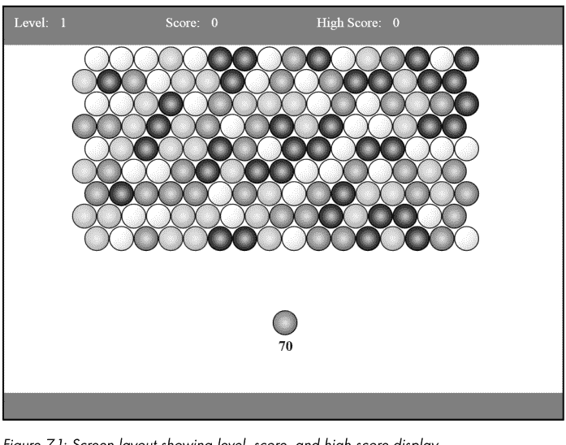

图7-1：显示关卡、分数和高分的屏幕布局

index.html

```html
<!DOCTYPE HTML>
<html lang="en-US">
<head>
  --snip--
</head>
<body>
<div id="page">
  <div id="top_bar">
    <div id="top_level_box" class="top_bar_box">
      <div id="top_level_label">Level:</div>
      <div id="level">1</div>
    </div>
    <div class="top_bar_box">
      <div id="top_score_label">Score:</div>
      <div id="score">0</div>
    </div>
    <div class="top_bar_box">
      <div id="top_score_label">High Score:</div>
      <div id="high_score">0</div>
    </div>
  </div>
  --snip--
</div>
</body>
</html>
```

添加了三个新的 <div> 元素：分别用于显示关卡编号 ❶、当前游戏分数 ❷ 和高分 ❸。每个 <div> 都有一个元素来显示标签和数值。

这些也需要在 `main.css` 中定义样式：

```css
body
{
  margin: 0;
}
#page
{
  position: absolute;
  left: 0;
  top: 0;
  width: 1000px;
  height: 738px;
}
#top_bar
{
  position: absolute;
  left: 0;
  top: 0;
  width: 1000px;
  height: 70px;
  background-color: #369;
  color: #fff;
}
❶ .top_bar_box
{
  font-size: 24px;
  line-height: 60px;
  float: left;
  margin-left:20px;
  width: 250px;
}
❷ .top_bar_box div
{
  float: left;
  margin-right: 20px;
}
--snip--
```

我没有单独为这三个元素设置样式；而是给了它们一个共同的类 `top_bar_box` ❶。基本的 CSS 样式为每个元素设置宽度为250像素并向左浮动，因此元素在屏幕顶部的 `top_bar` 内形成一行。每个元素显示的标签和数值都在 `<div>` 内，因此该样式在不创建新 CSS 类的情况下应用 ❷。

现在让我们为玩家奖励分数并显示他们的分数和关卡。当气泡被消除或孤立时，需要奖励并显示分数，并且在游戏开始时应显示分数和关卡值。首先，我们需要在 ui.js 中创建将数值绘制到屏幕的函数。我们将它们放在 ui.js 中，以继续使 game.js 免于显示代码：

ui.js

```javascript
var BubbleShoot = window.BubbleShoot || {};
BubbleShoot.ui = (function($){
    --snip--
    var ui = {
        --snip--
        drawScore : function(score){
            $("#score").text(score);
        },
        drawHighScore : function(highScore){
            $("#high_score").text(highScore);
        },
        drawLevel : function(level){
            $("#level").text(level+1);
        }
    };
    --snip--
    return ui;
} )(jQuery);
```

drawScore ① 和 drawHighScore ② 接受分数值并将其绘制到屏幕上相关的 <div> 中。drawLevel 写入关卡编号，但先加1，因为内部关卡状态从零开始 ③。尽管这三个函数都只包含一行代码，但为它们创建单独的函数是一个好主意，例如，每次更新分数值时编写 ui.drawScore(score) 而不是 $("#score").text(score)。然后，如果你想为任何元素添加视觉效果，你可以在一个函数中完成，而无需追踪分数更新的每个实例。如果你希望分数每次增加时都闪烁，那么你只需要在一个地方进行更改。

现在我们在 startGame 和 clickScreen 中添加对这些函数的调用到 game.js：

game.js

```javascript
var BubbleShoot = window.BubbleShoot || {};
    BubbleShoot.Game = (function($){
    var Game = function(){
        --snip--
        var startGame = function(){
            $(".but_start_game").unbind("click");
            BubbleShoot.ui.hideDialog();
            numBubbles = MAX_BUBBLES;
            board = new BubbleShoot.Board();
            bubbles = board.getBubbles();
            if(BubbleShoot.Renderer)
            {
                if(!requestAnimationID)
                    requestAnimationID = setTimeout(renderFrame,40);
```


```javascript
}else{
    BubbleShoot.ui.drawBoard(board);
};
curBubble = getNextBubble();
$("#game").bind("click",clickGameScreen);
BubbleShoot.ui.drawScore(score);
BubbleShoot.ui.drawLevel(level);
};
var clickGameScreen = function(e){
    var angle = BubbleShoot.ui.getBubbleAngle(curBubble.getSprite(),e,board.calculateTop());
    var duration = 750;
    var distance = 1000;
    var collision = BubbleShoot.CollisionDetector.findIntersection(curBubble,
        board,angle);
    if(collision){
        var coords = collision.coords;
        duration = Math.round(duration * collision.distToCollision / distance);
        board.addBubble(curBubble,coords);
        var group = board.getGroup(curBubble,{});
        if(group.list.length >= 3){
            popBubbles(group.list,duration);
            var orphans = board.findOrphans();
            var delay = duration + 200 + 30 * group.list.length;
            dropBubbles(orphans,delay);
            var popped = [].concat(group.list,orphans);
            var points = popped.length * POINTS_PER_BUBBLE;
            score += points;
            setTimeout(function(){
                BubbleShoot.ui.drawScore(score);
            },delay);
        };
    }else{
        --snip--
    };
    --snip--
};
--snip--
};
return Game;
})(jQuery);
```

我们会在游戏开始时绘制分数和等级 ❶。当气泡被消除时，我们首先想创建一个包含所有被消除且孤立的气泡的集合。这是通过连接两个数组——被消除列表和孤立列表 ❷——然后将 `POINTS_PER_BUBBLE` 乘以新数组的长度来完成的 ❸。然后我们在内部递增分数 ❹，但我们只会在气泡发射完毕并经过延迟后更新显示 ❺。如果你重新加载并开始游戏，你的分数现在应该会递增。

接下来，我们将检查游戏结束的条件。有两种状态可能导致游戏结束：玩家可能没有气泡可以发射，或者玩家可能清除了游戏板上所有的气泡。如果是前者，我们希望向玩家显示最终分数，并让他们在第一关开始新游戏。如果是后者，我们希望清除游戏板，增加关卡数，并提示开始下一关。我们知道游戏状态只会因玩家发射气泡而改变，因此我们唯一需要检查可能的游戏结束条件的地方是在计算任何碰撞结果之后。我们将在气泡发射后立即进行此检查，这发生在 Game 的 `clickGameScreen` 函数内部。如果玩家用完气泡或游戏板已清空，我们将结束游戏；否则，我们将给玩家下一个要发射的气泡。对 *game.js* 进行以下更改：

```javascript
// game.js
var BubbleShoot = window.BubbleShoot || {};
BubbleShoot.Game = (function($){
    var Game = function(){
        --snip--
        var clickGameScreen = function(e){
            --snip--
            BubbleShoot.ui.fireBubble(curBubble,coords,duration);
            ❶ if(numBubbles == 0){
                endGame(false);
            ❷ }else if(board.isEmpty()){
                endGame(true);
            ❸ }else{
                curBubble = getNextBubble(board);
            }
        };
        --snip--
    };
    return Game;
})(jQuery);
```

我们首先检查玩家是否用完了气泡 ❶，然后检查游戏板是否清空了气泡 ❷。如果两者都不是，我们照常获取下一个气泡 ❸。一个名为 `endGame` 的新函数使用布尔值来确定玩家是赢了还是输了这一关：`false` 表示玩家输了（因为用完了气泡），`true` 表示玩家赢了（因为清除了游戏板）。

请注意对 `board.isEmpty` 的调用，这是我们尚未编写的方法。现在让我们通过在 *board.js* 类中添加以下内容来实现它：

```javascript
// board.js
var BubbleShoot = window.BubbleShoot || {};
BubbleShoot.Board = (function($){
    var NUM_ROWS = 9;
    var NUM_COLS = 32;
    var Board = function(){
        var that = this;
        --snip--
        this.isEmpty = function(){
            return this.getBubbles().length == 0;
        };
        return this;
    };
    --snip--
    return Board;
})(jQuery);
```

`isEmpty` 函数检查对 `getBubbles` 方法的调用是否返回任何对象。如果数组长度为零，则所有气泡都已被消除。

第二个可能的游戏结束条件是玩家在游戏板底部添加了超过两行新行。我们已经有了一个函数 `getRows` 来返回行的数组，所以我们只需要检查其长度是否大于我们允许的最大行数，即 11。

```javascript
// game.js
var BubbleShoot = window.BubbleShoot || {};
BubbleShoot.Game = (function($){
    var Game = function(){
        var curBubble;
        var board;
        var numBubbles;
        var bubbles = [];
        var MAX_BUBBLES = 70;
        var POINTS_PER_BUBBLE = 50;
        var MAX_ROWS = 11; ①
        --snip--
        var clickGameScreen = function(e){
            --snip--
            BubbleShoot.ui.fireBubble(curBubble,coords,duration);
            if(board.getRows().length > MAX_ROWS)②{
                endGame(false);
            }else if(numBubbles == 0){
                endGame(false);
            }else if(board.isEmpty()){
                endGame(true);
            }else{
                curBubble = getNextBubble(board);
            }
        }
    };
    --snip--
    return Game;
})(jQuery);
```

为了使代码易于阅读，我们将允许的最大行数存储在名为 `MAX_ROWS` 的变量中 ①，然后我们将检查游戏板的行数是否大于此数字 ②；如果是，我们将结束游戏。

我们还需要向玩家显示消息，指示胜利或失败、分数等。如果我们需要显示大量不同的消息，我们可能会创建一些 JavaScript 代码来动态创建和显示对话框。但我们只有几种变体，所以我们将它们硬编码到 HTML 中。我们将显示的对话框将与开始游戏的对话框相同，但包含更多信息，如图 7-2 所示。

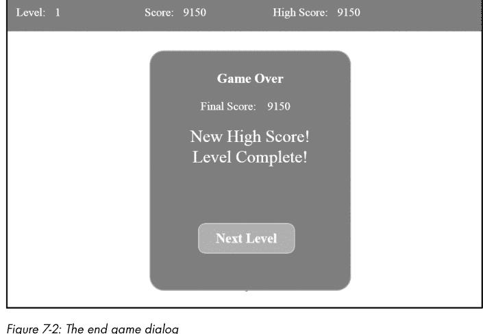

图 7-2：游戏结束对话框

现在让我们将结构添加到 *index.html*：

```html
<!-- index.html -->
<!DOCTYPE HTML>
<html lang="en-US">
<head>
    --snip--
</head>
<body>
    <div id="page">
        --snip--
        <div id="start_game" class="dialog">
            <div id="start_game_message">
                <h2>开始新游戏</h2>
            </div>
            <div class="but_start_game button">
                新游戏
            </div>
        </div>
        <div id="end_game" class="dialog">
            <div id="end_game_message">
                <h2>游戏结束</h2>
                <div id="final_score">
                    <span>最终分数：</span>
                    <span id="final_score_value"></span>
                </div>
                <div id="new_high_score">新最高分！</div>
                <div id="level_failed" class="level_failed">关卡失败！</div>
                <div id="level_complete" class="level_complete">关卡完成！</div>
            </div>
            <div class="but_start_game button">
                <span class="level_complete">下一关</span>
                <span class="level_failed">新游戏</span>
            </div>
        </div>
    </div>
</body>
</html>
```

我们的游戏只会显示一个对话框 ①，其中包含最终分数 ①、关卡是完成还是失败的消息。如果玩家达到新的最高分，我们将显示该消息 ①。根据情况，将显示关卡失败！① 或关卡完成！① 消息。最后，一个按钮将启用下一个游戏的开始 ①，这将导致下一关 ① 或全新的游戏 ①。我们可以在点击按钮后确定游戏是重新开始还是继续，因为我们将知道当前关卡数。

当我们显示 `end_game` 对话框时，我们将根据情况显示或隐藏 `level_complete` 或 `level_failed` 类，以显示正确的消息。请注意，`level_complete` 类附加在关卡完成！消息 ① 和下一关按钮 ① 上，而 `level_failed` 类附加在关卡失败！消息 ① 和新游戏按钮 ① 上。这将使我们能够，例如，通过一次 jQuery 调用隐藏所有 `level_failed` 元素：

```javascript
$(".level_failed").hide();
```

这是使用 HTML 和 CSS 构建用户界面的优势之一，并且之所以可能是因为 *Bubble Shooter* 是一个相对简单的游戏。但即使你需要在对话框中显示更大范围的消息，你仍然可以使用 jQuery 创建 DOM 元素并使用 CSS 为其设置样式。

对话框将从 `dialog` 类定义继承一些样式，但我们需要在 *main.css* 中添加更多定义：

```css
#final_score
{
    margin: 26px 0;
}
#end_game_message span
{
    margin-right: 20px;
    font-size: 24px;
}
```

## CSS样式

```
#level_complete,#level_failed,#new_high_score
{
    font-size: 36px;
    color: #fff;
}
```

现在，我们需要在*game.js*中创建`endGame`函数。此函数将显示游戏结束对话框，并附上相应的胜利或失败消息，然后允许玩家选择玩下一关或开始新游戏：

```
var BubbleShoot = window.BubbleShoot || {};
BubbleShoot.Game = (function($){
    var Game = function(){
        --snip--
        var renderFrame = function(){
            --snip--
        };
        var endGame = function(hasWon){
            if(score > highScore){
                highScore = score;
                $("#new_high_score").show();
                BubbleShoot.ui.drawHighScore(highScore);
            }else{
                $("#new_high_score").hide();
            };
            if(hasWon){
                level++;
            }else{
                score = 0;
                level = 0;
            };
            $(".but_start_game").click("click",startGame);
            $("#board .bubble").remove();
            BubbleShoot.ui.endGame(hasWon,score);
        };
    };
    return Game;
})(jQuery);
```

首先，我们检查玩家的分数是否高于`highScore`的值（`highScore`初始为零）❶。如果是，则更新`highScore`❷，并在游戏完成对话框中显示`new_high_score`元素❸。然后调用`ui.drawHighScore`（这是我们之前在更新游戏内得分显示时创建的）❹。如果没有新的最高分，则隐藏该消息❺。

接下来的分支检查玩家是否获胜，如果获胜❻，则将`level`加1。如果玩家失败，则将`score`和`level`重置为零❼。然后，我们需要通过将`click`事件绑定到`startGame`按钮来重新启用它❽，清除显示区域剩余的泡泡❾，并调用*ui.js*中的一个新方法来显示游戏结束对话框。

请注意，无论玩家是在玩第一关还是第五十关，这都无关紧要，因为`startGame`只是绘制当前关卡并开始游戏；因此，我们不需要创建一个新函数来处理新关卡。

但游戏结束时需要做出反应的不仅仅是显示部分。玩家也不应该再能够发射泡泡了！让我们也在*ui.js*中创建一个名为`endGame`的函数。*game.js*中的`endGame`处理的是完成一关的游戏逻辑方面，而*ui.js*中的代码将处理结束游戏的视觉方面，例如显示对话框并填入玩家的得分：

```
ui.js  var BubbleShoot = window.BubbleShoot || {};
BubbleShoot.ui = (function($){
    --snip--
    var ui = {
        --snip--
        endGame : function(hasWon,score){
            $("#game").unbind("click");
            BubbleShoot.ui.drawBubblesRemaining(0);
            if(hasWon){
                $(".level_complete").show();
                $(".level_failed").hide();
            }else{
                $(".level_complete").hide();
                $(".level_failed").show();
            };
            $("#end_game").fadeIn(500);
            $("#final_score_value").text(score);
        }
    };
    --snip--
    return ui;
} )(jQuery);
```

当游戏结束时，`endGame`方法确保游戏区域的点击❶不再触发`clickGameScreen`函数，因为我们不希望玩家在游戏结束时还能发射泡泡。它还将剩余泡泡的显示更新为零❷，并在对话框中显示正确的胜利/失败消息❸。然后我们显示对话框，其中包含“关卡完成！”或“关卡失败！”的消息❹。

## 结束关卡

目前，《泡泡射击》的游戏结束可能有点繁琐：玩家需要继续发射泡泡，直到它们形成足够大的群体才能消除。如果泡泡没有以正确的颜色组合出现，这也会带来问题。例如，如果棋盘上唯一的泡泡是蓝色的，而随机生成器只产生红色泡泡，玩家可能会因为并非自身过错而在关卡中失败！与其期望玩家清除每一个泡泡，我们将在他们清除顶行最后五个泡泡时给一个快速结束。当这种情况发生时，剩余的顶行泡泡将消除，其他所有泡泡都将像孤立组一样掉落（使用`koom`例程）。

> **预见并缓解玩家的挫折感**
>
> 总要提前思考你的游戏可能如何变得令人沮丧，并预先解决问题。通过这样做，你将改进游戏并让玩家持续回来游玩。在《泡泡射击》中，一个关卡可能无法完成，因为泡泡没有按正确的顺序出现。这种情况是一个完美的例子，说明当一种可能的结果（在这种情况下，棋盘上留下*单个*泡泡且无法消除）在原始游戏设计中没有被考虑到时会发生什么。游戏编程几乎总是迭代的，你的第一个版本很少会是最终版本。

在计算要消除的当前组之后，我们将在玩家每次消除泡泡时检查还剩多少泡泡。如果玩家完成发射后棋盘上剩余五个或更少的泡泡，我们将免费消除它们，并直接将玩家带到游戏结束。

判断关卡是否即将完成的检查将位于*game.js*的`clickGameScreen`函数中：

```
game.js   var BubbleShoot = window.BubbleShoot || {};
            BubbleShoot.Game = (function($){
              var Game = function(){
                --snip--
                var clickGameScreen = function(e){
                  --snip--
                  if(collision){
                    var coords = collision.coords;
                    duration = Math.round(duration * collision.distToCollision / distance);
                    board.addBubble(curBubble,coords);
                    var group = board.getGroup(curBubble,{});
                    if(group.list.length >= 3){
                      popBubbles(group.list,duration);
                      var topRow = board.getRows()[0];
                      var topRowBubbles = [];
                      for(var i=0;i<topRow.length;i++){
                        if(topRow[i])
                          topRowBubbles.push(topRow[i]);
                      };
                      if(topRowBubbles.length <= 5){
                        popBubbles(topRowBubbles,duration);
                        group.list.concat(topRowBubbles);
                      };
                };
```

```
var orphans = board.findOrphans();
var delay = duration + 200 + 30 * group.list.length;
dropBubbles(orphans, delay);
var popped = [].concat(group.list, orphans);
var points = popped.length * POINTS_PER_BUBBLE;
score += points;
setTimeout(function(){
    BubbleShoot.ui.drawScore(score);
}, delay);
};
} else {
    --snip--
};
--snip--
};
--snip--
};
return Game;
})(jQuery);
```

首先，我们获取顶行❶，然后遍历它，计算泡泡的数量❷。如果顶行存在五个或更少的泡泡❸，我们将消除顶行所有的泡泡❹，并将它们添加到已消除泡泡的列表中❺，以便它们能为玩家的得分做贡献❻。

现在，你应该能够玩通整个游戏关卡，清除棋盘，并看到开始下一关的提示。恭喜！你刚刚完成了你的第一个完全可玩的游戏。

但在你将《泡泡射击》展示给其他玩家之前，让我们使最高分在多次会话之间保持不变，而不是每次关闭浏览器窗口时都重置。毕竟，如果你以后无法回来挑战，最高分又有什么意义呢？

## 高分存储

尽管《泡泡射击》没有服务器端组件来保存最高分，但我们可以使用HTML5自带的Web Storage系统将它们保存到本地机器上。使用同一浏览器再次游玩的玩家将看到之前的最高分，这为他们提供了一个要超越的目标。

《泡泡射击》是一款休闲游戏：用户会打开它，玩几关直到失败，然后关闭浏览器标签页。记住最高分是个好主意，但我们不需要保留任何其他数据。无论如何，即使你存储的信息量更大得多，使用Web Storage将数据从一次游戏会话持久化到下一次游戏会话的原理也是一样的。

## Web Storage 与 Cookies

在客户端，Web Storage的行为方式与cookies类似，但实现细节（和优势）非常不同。Web Storage比cookies更容易访问，因为数据存储在名称/值对中。与cookies不同，服务器端无法访问其内容

Web Storage，因为数据不会作为HTTP请求的一部分进行传输。存储内容受域名限制，因此不同的子域名拥有不同的存储空间。我们可以将最高分存储在Cookie中，但没有这样做的必要，而且Cookie的存储格式以及每次请求时向服务器传输数据的额外开销，使其成为比Web Storage更差的选择。尝试在Cookie中存储大量数据（例如当前棋盘的布局）也可能导致性能问题，因为每次请求时这些数据都会被传输到服务器。例如，当浏览器试图下载一个仅几KB的图像文件时，它可能还需要向服务器发送大量无关数据。

另一方面，Web Storage提供了比Cookie更大的空间，尽管具体容量并未在HTML规范中明确定义，而是由浏览器厂商各自设定。目前主流网络浏览器之间最低的通用值是5MB；该限制适用于某个域名下存储的所有数据。Google Chrome、Firefox和桌面版的Internet Explorer 9都提供多达10MB的空间，但手机和平板设备上的Android浏览器则可能少至2MB。与Cookie的最大存储量（最多300个Cookie，每个4KB）相比，你可以看到即使在较低的限制下，Web Storage也提供了大得多的存储空间。

由于浏览器限制可能会经常变化，如果你计划在Web Storage中存放大量数据，没有比在特定设备上测试更好的替代方法；然而，对于像*泡泡射击*中最高分这样的小元素来说，空间限制是无关紧要的。

## 向Web Storage添加数据

Web Storage分为两部分：Session Storage和Local Storage。我们只关注Local Storage，它最适合跨会话持久化数据。Session Storage存储和访问数据的原则基本相同，尽管持久性和安全性略有不同。顾名思义，Session Storage仅在浏览器会话期间持续存在。当用户关闭浏览器窗口时，数据就会消失。这种存储类型可能对需要在页面之间持久化数据的多页Web应用程序有用，但显然不适合存储最高分。一旦你熟悉了Local Storage，如果需要，你将能够适应使用Session Storage。

向localStorage添加数据的格式如下：

```
localStorage.setItem(key, value);
```

键是一个字符串，例如"high_score"，值也是一个字符串，或者可以自动转换为字符串的数字或其他对象。请注意，如果你尝试传入一个复杂对象，例如数组，转换为字符串可能会导致生成对象的名称（即Array）而不是你想要存储的数据。因此，如有疑问，请自行进行转换。对于更复杂的数据，你可以使用JSON.stringify来保存对象，使用JSON.parse来检索它们。

要检索数据，你只需要键：

```
var value = localStorage.getItem(key);
```

localStorage.getItem总是以字符串形式返回值，因此你需要使用parseInt或parseFloat将它们转换为数字数据。

如果游戏更复杂或游戏时间更长，你可能需要保存更多数据，例如当前关卡以及最高分。在这种情况下，我们可以继续添加字符串：

```
localStorage.setItem("high_score",highScore);
localStorage.setItem("level",level);
```

或者我们可以创建一个对象并对其进行JSON编码：

```
var gameData = {high_score : highScore, level : level};
localStorage.setItem("bubbleshoot_data",JSON.stringify(gameData));
```

然后，当我们想要检索数据时，我们将使用：

```
var gameData = JSON.parse(localStorage.getItem("bubbleshoot_data"));
```

一般原则是，如果你能将数据转换为字符串，并在想要检索时从字符串解码，你就可以将其保存到Local Storage中。

在*泡泡射击*中，为了保存最高分，Local Storage条目将被命名为high_score。在游戏初始化时，我们希望检查是否存储了现有值，如果有，则用其替代当前硬编码为零的值。当玩家创下新纪录时，我们将Local Storage值设置为新的最高分。

在*game.js*中，我们将对init和endGame进行补充以检索和设置最高分：

```
var BubbleShoot = window.BubbleShoot || {};
BubbleShoot.Game = (function($){
var Game = function(){
--snip--
this.init = function(){
if(BubbleShoot.Renderer){
BubbleShoot.Renderer.init(function(){
$(".but_start_game").click("click",startGame);
});
}else{
$(".but_start_game").click("click",startGame);
};
① if(window.localStorage && localStorage.getItem("high_score")){
    highScore = parseInt(localStorage.getItem("high_score"));
}
② BubbleShoot.ui.drawHighScore(highScore);
};
--snip--
var endGame = function(hasWon){
    if(score > highScore){
        highScore = score;
        $("#new_high_score").show();
        BubbleShoot.ui.drawHighScore(highScore);
③         if(window.localStorage){
④             localStorage.setItem("high_score",highScore);
        }
    }else{
        $("#new_high_score").hide();
    };
    if(hasWon){
        level++;
    }else{
        score = 0;
        level = 0;
    };
    $(".but_start_game").click("click",startGame);
    $("#board .bubble").remove();
    BubbleShoot.ui.endGame(hasWon,score);
};
};
return Game;
})(jQuery);
```

首先，我们通过使用另一个Modernizr检测器来检查浏览器是否支持localStorage，以及是否存在high_score的值①。如果存在最高分，我们将highScore设置为存储中的内容②。我们确保用parseInt包装该值，因为存储中的值是以字符串形式返回的，而我们想要处理整数。然后我们显示最高分③。要保存分数，我们在endGame中添加一行以检查是否支持localStorage④，然后将其保存到其中⑤。

重新加载浏览器并玩一局游戏。起初，你得到的任何分数都应该成为新的最高分。但如果你关闭浏览器并重新加载游戏，最高分应该会填充为你之前的值。

你也可以使用Web Storage来保存语言偏好、玩家资料或游戏进度状态等信息。只需注意你存储的内容，因为存储系统中的值对JavaScript控制台的调用是开放的。这意味着没有什么可以阻止技术特别娴熟的玩家自己更新数据！在下一章中，我们将简要讨论HTML5游戏中的安全问题，但现在我们可以依靠这样一个事实：真的没有什么动机去设置一个不可能的高分来试图击败。

**154** 第7章

## 使用requestAnimationFrame平滑动画

我们在jquery.kaboom.js中使用setTimeout来计时动画，并在触发泡泡射击的canvas版本中的帧更新时使用它。setTimeout具有跨浏览器兼容性且相对简单：将超时值设置为40毫秒，你可以预期每秒25帧。

然而，使用setTimeout有其缺点。主要问题是，如果浏览器正忙于其他事情，下一次迭代可能不会在超过40毫秒后被调用。在某些情况下，它可能需要更长时间，用户会开始注意到。

我们可以重新编码移动，使对象移动的距离与自上次更新以来经过的时间成比例，从而有效地忽略40毫秒这个数字。但我们仍然必须接受这样一个事实：无论我们将超时延迟设置为何值，对于某些设置来说都太低，这些显示将无法跟上。在能够处理更快更新速度的系统上，我们可以显示更平滑的动画，但如果我们将超时值设置为10毫秒以处理这些情况，较慢的系统将受到不利影响。

幸运的是，HTML5引入了requestAnimationFrame，这是setTimeout的一个更适合动画的替代方案。浏览器在准备好绘制新更新时调用传递给requestAnimationFrame的函数，而不是让程序员猜测什么样的帧率*可能*有效。更新之间的间隔可能比40毫秒快得多（或慢得多！），但至少我们知道自己既不会使处理瓶颈恶化，也不会在可以花费额外周期平滑动画时让系统空闲。

## 对帧更新的新视角

当切换到requestAnimationFrame时，我们必须对帧更新有不同的思考方式。目前，在setTimeout运行*之前*，我们告诉浏览器等待多长时间。我们假设经过的时间就是我们预期经过的时间。例如，在jquery.kaboom.js的moveAll中，我们设置了40毫秒的超时：

```
setTimeout(moveAll,40);
```

然后我们更新气泡的位置，假设已经过去了40毫秒——1/25秒。然而，使用requestAnimationFrame，我们并不指定帧率。在jquery.kaboom.js的moveAll函数中，如果requestAnimationFrame恰好每40毫秒运行此例程一次，我们就不需要更改任何内容。但如果它每，比如说，20毫秒运行一次，我们就不能保持dx和dy的相同值，否则我们的整个动画将运行得快得多——实际上是两倍快，因为它将更频繁地添加dx和dy。

相反，我们需要找出已经过去了多少毫秒，然后调整我们的动画步长大小。我们甚至可以将相同的数学技术应用于setTimeout动画，以在较旧的浏览器上获得更好的结果，这些浏览器不支持requestAnimationFrame。这通常被称为基于时间的动画，涉及将增量乘以自上次更新以来经过的时间。


不支持 `requestAnimationFrame`。如图 7-3 所示，距离气泡上次绘制的时间越短，我们需要沿路径移动它的距离就越小。

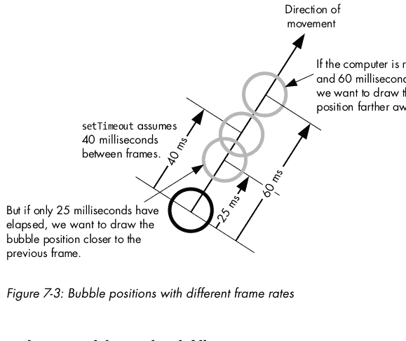

图 7-3：不同帧率下的气泡位置

## 代码兼容性与 Polyfill

Modernizr 将帮助我们构建 `setTimeout` 的回退方案。`requestAnimationFrame` 仍被许多浏览器视为非标准 API，因此 Webkit、Mozilla 等浏览器提供了带前缀的版本，Modernizr 可以为我们自动填充这些版本。在 *game.js* 中添加以下代码：

```
var BubbleShoot = window.BubbleShoot || {};
BubbleShoot.Game = (function($){
var Game = function(){
  --snip--
};
window.requestAnimationFrame = Modernizr.prefixed("requestAnimationFrame",
  window) || function(callback){
  window.setTimeout(function(){
    callback();
  }, 40);
};
return Game;
})(jQuery);
```

这行新代码的含义是：如果 `requestAnimationFrame`（包括厂商前缀版本）已定义，则将 `window.requestAnimationFrame` 设置为 `requestAnimationFrame` 的内容。如果 `requestAnimationFrame` 未定义，则我们创建一个新函数，该函数接受一个回调函数作为参数，并使用 `setTimeout` 在 40 毫秒后调用该函数。

这种技术被称为 *polyfill*。Polyfill 尝试在浏览器不原生支持新功能的情况下模拟或修补该功能，使你可以在代码中使用新技术，而不必总是担心分支处理或自己提供回退方案。该名称来源于填补材料 Polyfilla，因为这项技术涉及填补浏览器支持中的"裂缝"。

Polyfill 被编写用来支持旧浏览器中的各种功能。例如，为了存储玩家的最高分，我们正在使用 Local Storage API。这在旧浏览器中不可用，但我们可以通过将数据存储在 cookie 中来实现相同的效果。有两种方法可以实现：一种是在每次访问 Local Storage 时编写一个 if/else 语句来检查它是否存在，如果不存在，则分支执行一些 cookie 代码。另一种是我们可以创建一个名为 `localStorage` 的对象，并添加 `getItem` 和 `setItem` 方法，使用 cookie 来保存和检索数据。

Polyfill 很少是完美的解决方案：`setTimeout` 和 `requestAnimationFrame` 的运行方式可能非常相似，但有时差异可能很重要。在 Local Storage 的示例中，我们也许可以完全像使用 Local Storage 一样使用 cookie，但如果我们试图存储大量数据，就会遇到问题。Polyfill 可以在不需要大量代码的情况下增强浏览器兼容性，但了解所使用任何 polyfill 的局限性非常重要。

一旦我们有了 `requestAnimationFrame` 的 polyfill，就代码的其余部分而言，`requestAnimationFrame` 已被支持，我们可以不考虑浏览器而使用它。我们知道实际上是一个 `setTimeout` 调用在幕后运行，有时动画不会像使用原生支持的 `requestAnimationFrame` 方法那样流畅。但就调用它的代码而言，该函数的行为方式是相同的。

现在我们有了一个可用的 `requestAnimationFrame` polyfill，我们可以将 *game.js* 中对 `setTimeout` 的调用替换为新函数的调用，分别用于 `startGame` 和 `renderFrame`：

```
var BubbleShoot = window.BubbleShoot || {};
BubbleShoot.Game = (function($){
  var Game = function(){
    --snip--
    var startGame = function(){
      --snip--
      if(BubbleShoot.Renderer)
      {
        if(!requestAnimationID)
          requestAnimationID = requestAnimationFrame(renderFrame);
      }else{
        BubbleShoot.ui.drawBoard(board);
      };
      --snip--
    };
    --snip--
    var renderFrame = function(){
      $.each(bubbles,function(){
        if(this.getSprite().updateFrame)
            this.getSprite().updateFrame();
      });
      BubbleShoot.Renderer.render(bubbles,board.calculateTop());
      requestAnimationID = requestAnimationFrame(renderFrame);
    };
    --snip--
  };
  --snip--
  return Game;
})(jQuery);
```

我们必须在 `jquery.kaboom.js` 中进行类似的更改，使用 `requestAnimationFrame` 而不是 `setTimeout`。kaboom 函数内部假定帧与帧之间经过 40 毫秒，帧率为每秒 25 帧，但正如我们所知，使用 `requestAnimationFrame` 时，经过的时间可能会有所不同。同样，我们需要计算经过的时间并按比例计算移动量：

```
jquery.kaboom.js
(function(jQuery){
    var defaults = {
        gravity : 1.3,
        maxY : 800
    };
    var toMove = [];
    ❶ var prevTime;
    var moveAll = function(){
        ❷ var newTime = Date.now();
        ❸ var elapsed = newTime - prevTime;
        ❹ var frameProportion = elapsed / 25;
        ❺ prevTime = newTime;
        var stillToMove = [];
        for(var i=0;i<toMove.length;i++){
            var obj = toMove[i];
            obj.x += obj.dx * frameProportion;
            obj.y -= obj.dy * frameProportion;
            obj.dy -= obj.config.gravity * frameProportion;
            if(obj.y < obj.config.maxY){
                obj.elm.css({
                    top : Math.round(obj.y),
                    left : Math.round(obj.x)
                });
                stillToMove.push(obj);
            }else if(obj.config.callback){
                obj.config.callback();
            }
        };
        toMove = stillToMove;
        if(toMove.length > 0)
            ❻ requestAnimationFrame(moveAll);
    };
    jQuery.fn.kaboom = function(settings)
    {
        var elm = this;
        var config = $.extend({}, defaults, settings);
        if(toMove.length == 0){
            prevTime = Date.now();
            requestAnimationFrame(moveAll);
        };
        var dx = Math.round(Math.random() * 10) - 5;
        var dy = Math.round(Math.random() * 5) + 5;
        toMove.push({
            elm : this,
            dx : dx,
            dy : dy,
            x : this.position().left,
            y : this.position().top,
            config : config
        });
    };
})(jQuery);
```

首先，我们定义一个名为 `prevTime` 的空变量，用于存储上一帧渲染的时间戳，初始值为 null。每次调用 `moveAll` 时，我们获取当前时间戳并计算自上一帧以来经过的时间。我们最初的计算基于经过 40 毫秒的假设，因此为了计算正确的位置，我们按比例缩放帧经过的比例。如果只经过了 8 毫秒，`frameProportion` 将为 0.2，动画将以更小但更频繁的步骤更新。如果经过了 80 毫秒，`frameProportion` 将为 2，动画将以更大的步骤更新。最终效果是，无论帧率如何，气泡从屏幕上掉落所需的时间是相同的。为了准备下一帧，我们将 `prevTime` 更新为当前时间戳。

此外，`setTimeout` 在两个地方被替换为 `requestAnimationFrame`：一处是在动画启动时，另一处是在每一帧的循环中。

重新加载游戏并再次运行，确保它正常工作。除非你的浏览器配置特别慢，否则你可能看不到性能上的差异。然而，现在你可以确信，每个玩 *Bubble Shooter* 的人都会看到气泡以相同的速度移动和掉落，即使设备之间的帧更新速率不同。

## 使用 HTML5 添加声音

没有声音的游戏永远不像个游戏！HTML5 提供了越来越强大的选项来处理和播放音频。我之所以说 *越来越强大*，是因为浏览器的支持一直在改进。你可以逐字节操作 wave 文件、从麦克风录音、进行动态混音，以及利用 HTML 在不久前还提供的那可怜的音频选项之外的大量功能。让我们来看看 HTML5 音频的基本特性。

## HTML5 Audio API

在历史上，HTML 对音频的实现一直很差，没有提供可靠的方式来在网页中嵌入和控制声音。HTML5 改变了这一切，你可以使用一个简单的标签将声音直接嵌入页面，例如：

```
<audio src="sounds.mp3" autoplay></audio>
```

单凭这一点，对于一个我们希望通过程序来启动和停止声音以响应气泡弹出等事件的游戏来说，并没有太大帮助。幸运的是，HTML5 还提供了一种通过 JavaScript API 播放音频的方式，完全不需要使用 HTML 标签。前面那段 HTML 代码片段（仅仅嵌入并播放单个文件）的 JavaScript 等效写法如下：

```
var sound = new Audio("sounds.mp3");
sound.play();
```

你可以使用任何拥有的 MP3 文件来尝试。传入 `new Audio` 调用的参数是声音文件的 URL。如果将其放在 *bubbleshoot* 文件夹中并将参数更改为文件名，你可以在 JavaScript 控制台中运行前面的命令，声音应该会播放。声音会在结束时自然停止，你可以在播放过程中的任何时候使用 `stop` 方法来终止声音：

```
sound.stop()
```

这些是我们唯一需要的命令，但请花时间查阅 audio API 规范，了解浏览器中声音交付日益增长的潜力。除了影响音频基本播放的方法和属性（如改变音量或跳转到文件中的特定位置）之外，还有从输入设备录音、混音、改变声道甚至 3D 声音定位的功能，以及对声音进行后处理以添加回声等效果的方式。这些功能在 Google Chrome 和 Firefox 等主流浏览器中正得到越来越多的支持，每个新版本都会带来改进。如果你想同时播放多个声音，必须创建多个 Audio 对象。例如：

```
var sound1 = new Audio("sounds.mp3");
var sound2 = new Audio("sounds.mp3");
sound1.play();
sound2.play();
```

如果只是想依次播放不同的声音，你可以通过更改对象的 `src` 属性来重用一个 Audio 对象。但要同时播放多个声音，你需要创建与声音数量一样多的对象

计划同时播放。正如你在 *泡泡射击* 中所看到的，这意味着如果我们想消除一组20个泡泡，就需要20个声音对象来同时播放20个消除音效。

## 消除泡泡：配以完整音效

我们将使用音频 API 为 *泡泡射击* 添加 HTML5 声音支持，以便每次消除泡泡时都能播放音效。请从 *http://www.buildanhtml5game.com/* 获取 *pop.mp3* 文件，并将其放入游戏文件夹内一个名为 *\_mp3* 的新文件夹中。

首先，创建一个播放音效的类。我们将把 HTML5 音频功能封装在自己的代码中，以防止在不支持 HTML5 音频的浏览器中抛出错误。在 *\_js* 文件夹中创建一个新文件 *sounds.js*，然后在 *index.html* 中添加该文件的加载。声音处理，如同渲染和用户界面一样，是另一种最好尽可能与游戏逻辑分离的功能。通过创建一个单独的文件来处理播放，我们可以将所有声音处理代码集中在一个地方。

我们将重用 Audio 对象，因此将在代码初始化时创建它们。然后，每当需要播放声音时，我们会取出队列中的下一个对象，将 `src` 更改为要播放的文件，然后播放它。我们将设置一个上限，即最多同时播放10个声音，这个数字虽然不多，但即使在极少数情况下玩家同时消除超过10个泡泡，也没有必要播放超过10个声音。

```
var BubbleShoot = window.BubbleShoot || {};
BubbleShoot.Sounds = (function(){
    var soundObjects = [];
    for(var i=0;i<10;i++){
        soundObjects.push(new Audio());
    }
    var curSoundNum = 0;
    var Sounds = {
        play : function(url,volume){
            if(Modernizr.audio){
                var sound = soundObjects[curSoundNum];
                sound.src = url;
                sound.volume = volume;
                sound.play();
                curSoundNum++
                if(curSoundNum >= soundObjects.length){
                    curSoundNum = curSoundNum % soundObjects.length;
                }
            }
        }
    };
    return Sounds;
})();
```

一个名为 `BubbleShoot.Sounds` 的新对象包含数组 `soundObjects` ❶，我们将用它来存储十个 Audio 对象。这些对象在代码加载后立即初始化 ❷。我们还使用变量 `curSoundNum` ❸ 来跟踪当前使用哪个对象。

接下来，我们创建播放声音的对象 ❹，其中包含一个播放声音的单一方法 ❺。它将接受两个参数：要播放的声音文件的 URL 和播放声音的音量（一个介于 0（静音）和 1（最大音量）之间的小数）。

我们使用 Modernizr 来检查是否支持 HTML5 音频，如果支持，我们就从 `soundObjects` 数组中获取当前的 Audio 对象 ❻，将其 `src` 属性设置为要播放文件的 URL ❼，设置其音量 ❽，然后播放它 ❾。如果不支持音频，该方法将不会执行任何操作，但由于我们检查了 `Modernizr.audio`，因此不会抛出错误。

最后，我们递增 `curSoundNum` 的值 ❿，以便下次调用播放时，我们将获取队列中的下一个对象。然后，我们确保 `curSoundNum` 的值永远不会大于 `soundObjects` 数组中的声音对象数量。

如果我们想播放更多声音，可以将更多 Audio 对象推入 `soundObjects` 数组。目前，如果我们尝试同时播放超过10个声音，只有最后10个声音会被播放。

声音控制将在 `game.js` 中通过调用 `BubbleShoot.Sounds.play` 函数来实现：

```
var BubbleShoot = window.BubbleShoot || {};
BubbleShoot.Game = (function($){
  var popBubbles = function(bubbles,delay){
    $.each(bubbles,function(){
      var bubble = this;
      setTimeout(function(){
        bubble.setState(BubbleShoot.BubbleState.POPPING);
        bubble.animatePop();
        setTimeout(function(){
          bubble.setState(BubbleShoot.BubbleState.POPPED);
        },200);
        BubbleShoot.Sounds.play("_mp3/pop.mp3",Math.random()*.5 + .5); ❶
      },delay);
      board.popBubbleAt(bubble.getRow(),bubble.getCol());
      setTimeout(function(){
        bubble.getSprite().remove();
      },delay + 200);
      delay += 60;
    });
  };
  --snip--
  };
  --snip--
  return Game;
})(jQuery);
```

我们希望播放的声音数量与要消除的泡泡数量相同，并且我们也希望声音与动画同时开始 ①。我们向 Sounds 的播放方法传递两个参数：要播放的 MP3 文件的相对 URL ❷ 和一个音量值（一个介于 0.5 和 1 之间的随机数）❸。

> **用多样化增强沉浸感**

为什么传递一个随机的音量级别？尝试传入值 1 并消除一些泡泡。然后将此效果与随机值的效果进行比较。这只是一个小变化，但音量的变化为每个声音提供了足够的区分度，使其听起来不那么机械。我们可以做其他事情来使效果更加自然，例如使用一组声音而不是仅仅一个 MP3 文件，这样并非每个泡泡听起来都一样，或者改变消除之间的时机，使它们不是均匀间隔。尝试创造最身临其境的体验，并以最小的努力完成，这些任务将随着你开发更多游戏而变得更加熟练。

## 总结

既然我们有了一个简单的音效来增添一些氛围，你就完成了 *泡泡射击* 的构建！该游戏应在较旧的浏览器上也能运行，使用 CSS 进行定位和动画，并且它在支持 canvas 元素的较新浏览器上也能良好运行。我们拥有持久的高分记录和音频，并且我们开发的动画无论玩家的系统速度如何，都应该表现良好。

在下一章中，我们将探讨 HTML5 的一些与你刚构建的游戏没有直接关系的其他部分。你将学到一些关于如何将游戏部署到 Web 和移动环境的要点，并将了解 HTML5 的未来发展方向。

## 进一步练习

-   1. 在每关接近尾声时，玩家在棋盘上可能只剩下一种、两种或三种颜色的泡泡。给他们一个与这些颜色都不匹配的泡泡，会导致玩家浪费一次射击，并使游戏更难完成。修改泡泡生成算法，使其只给玩家可以潜在匹配的颜色的泡泡。例如，如果只剩下红色和蓝色泡泡，发射的泡泡应该是红色或蓝色。你需要修改 `game.js` 中的 `getNextBubble`，并从 Board 对象中现有的类型中选择泡泡类型。

-   2. 如第138页“多关卡与高分”中所述，游戏在几关之后将变得无法进行，因为允许的泡泡数量变得太少。不要每关减少五个泡泡，而是创建一个算法，使关卡逐渐变难，但又能够完成一关。也许玩家完成一关所需的最少发射泡泡数是30，我们希望他们在第15关达到这个难度。在此之前，从第1关到第2关的步进可能是，比如说，减少五个泡泡，但从第14关到第15关的步进可能只减少一个。编写一个方程或其他方法，以这种方式减少允许的泡泡数量并增加难度。

-   3. 给予玩家重复挑战关卡的激励，为完成等级授予星级评价，而不是目前存在的通过或失败条件。你可以在玩家通关时授予一颗星，如果他们通关时剩余泡泡超过关卡泡泡分配量的25%，则授予两颗星，如果他们只发射了分配泡泡数量的一半就完成关卡，则授予三颗星。在关卡完成对话框中添加信息，向玩家显示他们获得了多少颗星。

-   4. 一旦你添加了前面的星级系统，创建一种方法来存储玩家在每个关卡获得的星星数量。然后你不仅可以显示他们获得的星星数量，还可以在他们打破之前的最佳记录时显示一条消息。目前，我们在 Game 中作为变量存储剩余的泡泡数量、玩家的分数和当前关卡编号。但现在更好的方法可能是创建一个对象来存储每个关卡并记录星星数量。将此数据保存到本地存储中，以便玩家返回游戏时使用。

-   5. 编写一个 polyfill，使用 cookies 为旧浏览器添加本地存储支持。如果 `window.localStorage` 对象不存在，你需要创建它，并创建 `getItem` 和 `setItem` 方法。


## 8

## HTML5的下一步

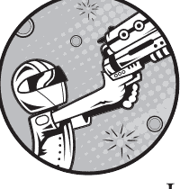

除了图形方面的进步，HTML5还拥有一系列其他特性，使其成为一个强大的游戏开发环境。在本章中，我将讨论其中的一些特性，以便您了解有哪些功能可用，并为您提供一些有用的资源以供进一步阅读。

其中一些特性，如WebGL，是值得专门著书论述的主题，而其他一些则仅对某些类型的游戏有用。因此，我将只在这里介绍基本概念，更深入的探索则留给您自己完成。

### 保存和检索数据

人们玩像《泡泡射击》这样的游戏通常是短时间会话，几乎没有持久化数据；事实上，我们的游戏只保存了从一个会话到下一个会话的最高分。目前，最高分存储在Web Storage中，因此它是特定于运行游戏的浏览器的。要保存一个全局最高分并显示一个高分榜，我们需要编写一个服务器端组件，将分数发送到服务器并检索高分列表。

具有更复杂状态的游戏也应该有服务器端访问。当您将状态存储在服务器上时，玩家可以从多个设备返回到同一个游戏中。就我们的目的而言，我们将使用两种主要方式在服务器上保存和检索数据：AJAX和WebSockets。

### AJAX

AJAX（异步JavaScript和XML）提供了一种向服务器发送请求并接收响应的技术。AJAX不是单一技术，而是一种方法，通过组合多个经过验证的浏览器特性来进行服务器端调用并管理响应。所有主要浏览器都已经支持AJAX多年。

尽管X代表XML，但您可以使用AJAX来检索HTML数据、字符串数据和可解析解释的JSON字符串。进行AJAX调用的代码文档齐全，并且有多种库可供选择，因此您不必手动编写调用。例如，以下是如何使用jQuery中的`$.ajax`调用向服务器发送AJAX请求：

```javascript
$.ajax({
    url: "save_data.php",
    data: "high_score =" + highScore,
    type: "POST",
    complete: function(data){
        console.log(data);
    }
});
```

这个`$.ajax`调用向相对URL `save_data.php`发送POST请求，将`highScore`中的值以`high_score`的名称发送到服务器，并将服务器的响应记录到控制台。我设置了请求的目标URL ❶、要发送的数据 ❷、请求类型 ❸以及在请求完成后运行的函数 ❹，但您还可以设置许多其他属性，包括在出错时运行的函数、超时设置等。这些都在jQuery文档 http://api.jquery.com/ 中列出。

> 注意 AJAX中的A代表异步，因为在服务器处理数据和发送响应的同时，其他JavaScript操作将继续执行。这意味着您无法确定`complete`函数何时会运行：它会在响应返回时执行，但用户界面在此期间会保持响应。虽然可以进行同步调用，但这会有效冻结整个页面直到请求完成，用户体验通常很差，因此这被认为是不良实践。

### WebSockets

大多数现代浏览器还提供了WebSockets来进行客户端到服务器的调用。WebSockets是一种相对较新的技术，已纳入HTML5规范。如果您想从比本章描述的更低层次了解它们的工作原理，一个好的起点是Mozilla开发者网络文档：<https://developer.mozilla.org/en/docs/WebSockets/>。

WebSockets类似于AJAX，但AJAX在客户端和服务器之间建立的是请求-响应关系，而WebSockets则维持它们之间的持久连接。客户端在响应到来时处理它们，JavaScript代码可以持续监听进一步的响应。服务器在套接字打开时也持续监听；因此，当客户端和服务器之间的对话涉及大量小数据事务时，WebSockets比AJAX好得多。

持久连接在多人游戏环境中尤其有用。在WebSockets出现之前，更新多个客户端共享的游戏状态元素（如环境中的玩家头像）的主要方式是不断用AJAX轮询服务器并检查更新。这会被编码为每几秒钟发生一次，这对于实时游戏来说显然不够。人们尝试了各种变通方法——例如一种称为*长轮询*的技术，它有效地欺骗客户端维持与服务器的连接——以改进流程，但这些方法在服务器资源方面往往效率低下。现在，您可以只需保持一个WebSocket打开，每当一个客户端更新游戏状态时，服务器可以立即更新所有其他客户端的信息，而无需等待下一个更新周期。

主流浏览器对WebSockets的支持不断改进，与AJAX一样，我建议使用库来消除打开连接、发送和监听数据以及处理错误的一些繁琐细节。库通常还会提供AJAX或其他服务器通信方法的后备方案，以应对WebSockets不受支持的情况；然而，这些后备方案可能无法复制您最初使用WebSockets的性能特性，因此请记住它们并非万能解决方案。

Socket.IO (<http://socket.io/>)是最受欢迎的WebSocket库之一。以下是如何使用它进行调用：

```javascript
var socket = io.connect("http://localhost");
    socket.emit("new_high_score", {
        high_score : highScore
    });
});
```

此代码使用对库的`io.connect`调用打开一个新的WebSocket，然后`socket.emit`将`highScore`值作为名为`new_high_score`的事件发送。

WebSockets和像Socket.IO这样的库具有比AJAX更强大的功能，但使其易于使用的库通常假定了特定的服务器端环境。如果您计划使用WebSockets，请检查您计划使用的库是否具有与您的服务器环境匹配的后端组件。适用于大多数平台的库都很容易获得，无论您使用的是Node.js、.NET还是Java。

除了向服务器发送和接收数据之外，您可能还想在主游戏程序之外处理某些数据。这就是Web Workers的用武之地。

### Web Workers

浏览器中的JavaScript通常被认为是*单线程*环境，这意味着一次只能运行一个脚本。这在大多数情况下不会造成问题，但如果一个特别大的计算过程阻止了处理器进行动画、响应用户输入和执行其他重要任务，这就会成为一个问题。

例如，假设处理游戏级别数据需要浏览器1到2秒，并且这大约每30秒发生一次。总体负载可能不高，但您不能每30秒就暂停游戏一次！在这种情况下，可以考虑使用Web Worker。

Web Workers (https://developer.mozilla.org/en/docs/Web/API/Worker/) 允许您在单独的线程中运行代码，而不会阻塞您的主要JavaScript操作。它们被称为“工作者”，因为您基本上可以交给它们一项任务，并在它们完成时让它们报告回来。浏览器会确定分配给它们多少CPU时间，以避免过度干扰其他进程。Worker可以是专用的或共享的，但通常会发现专用Worker最有用，尤其是在浏览器对Web Workers的支持还在开发中时。

Web Workers遵循几个与普通JavaScript不同的规则。最重要的是，它们无法访问DOM、浏览器文档或浏览器窗口。Worker也在自己的作用域内操作，因此您需要显式传递数据，并在完成时检索结果。我将通过以下示例说明它们的工作原理。

通过将要加载的脚本名称传递给`new Worker`命令来初始化Worker：

```javascript
var worker = new Worker("work.js");
```

这将启动一个新的Worker，该Worker将运行`work.js`中的脚本。

当您通过`postMessage`向Worker发送消息时，它就会运行：

```javascript
worker.postMessage();
```

`postMessage`命令可以包含一个JavaScript对象，也可以为空。


你可以通过在调用脚本中为工作者添加事件监听器来处理响应——工作者完成任务时返回的值：

```
worker.addEventListener("message", function(e) {
  console.log(e.data);
}, false);
```

此处，`e`包含工作者发回的数据。要监听的事件标记为"message"，可以是任何有效字符串。因此，工作者可以在不同情况下发送不同的响应，或者它可以持续工作并发送消息。

在工作者内部，事件监听器的模型类似，工作者通过`this`或`self`指代自身。例如，*work.js*可能包含以下代码来返回消息：

```
self.addEventListener("message", function(e) {
  self.postMessage({
    message : "I'm done now"
  });
}, false);
```

此代码监听标记为"message"的事件，收到后立即以对象形式发送响应。

目前，并非所有主流浏览器都对Web Workers有足够好的支持以确保其可靠性。Web Workers确实存在兼容方案，但如果一个你以为不会阻塞的长时间运行进程突然让游戏卡顿几秒钟，这些方案通常会对用户体验产生负面影响。不过情况在不断改善，希望Web Workers很快能被视为HTML5游戏开发者工具箱中的核心部分。

但更有效地管理数据只是让游戏更有趣的起点。外观同样重要，对于图形升级，你可以通过WebGL实现3D效果，甚至用它来增强2D游戏的渲染能力。

## WebGL

在*泡泡射击*的canvas版本中，我们使用了2D渲染上下文，通过类似以下调用访问：

```
var context = canvas.getContext("2d");
```

正如我在第6章提到的，"2d"规格意味着还有其他选项可用，有时根据浏览器支持情况确实如此。第三维度通过WebGL访问，这是一个API，提供了一系列3D操作函数，用于创建场景、添加光照和纹理、定位摄像机等，充分利用现代显卡提供的加速功能。（访问https://www.khronos.org/registry/webgl/specs/1.0/以更详细地了解WebGL。）要开始使用WebGL，我们首先实例化一个3D上下文：

```
var context = canvas.getContext("webgl");
```

这有时被检索为"experimental-webgl"，因此最兼容的调用方式是：

```
var context = canvas.getContext("webgl")
    || canvas.getContext("experimental-webgl");
```

经过加速的WebGL功能强大，足以显示媲美原生游戏的完整渲染3D场景。缺点是，在三维空间中工作、操作和创建场景需要大量数学知识和涉及直接向图形处理器编写程序的大量底层代码。概念与用原生代码（如C++）创建3D游戏相同，需要3D建模的底层知识来描述物体形状；纹理来定义表面图案；以及着色器，描述光线照射表面时的渲染方式。因此，我强烈建议使用现有库来处理模型渲染、任何物理需求，以及基本上所有你能现成获得的功能。Babylon.js (http://www.babylonjs.com/) 和 PlayCanvas (https://playcanvas.com/) 是两个让在浏览器中使用Web变得更加简单的库。

使用WebGL还引出了如何将对象和纹理导入3D场景的问题。通常，你在3D Studio或Maya等建模软件中创建模型，然后导出为通用支持的格式。WebGL库通常不直接支持这些格式，因此你通常需要使用另一套工具（如3DS Max到Babylon.js导出器 (https://github.com/BabylonJS/Babylon.js/tree/master/Exporters/3ds%20Max)）将原始3D建模文件格式转换为JSON，该导出器可以从Autodesk的3D Studio产品导出到Babylon.js。

创建和转换3D模型本身就是一项庞大任务，使得WebGL游戏开发迅速成为开发团队和设计团队的项目，而非单独开发者所能完成；不过，许多令人印象深刻的演示完全由个人完成，Babylon.js网站有一系列精彩的展示案例。

WebGL上下文的另一个优势是，你可以用它渲染2D场景，从而利用GPU加速提供的巨大速度。加速WebGL中的粒子效果和渲染大量屏幕元素的性能远超在canvas中执行相同任务。

我建议你寻找能启用WebGL中2D渲染的现成库。其中一个库是Pixi.js (http://www.pixijs.com/)，它还提供了到canvas的回退方案。

浏览器对WebGL的支持正在增长，包括最新版本的Chrome、Firefox和Internet Explorer，尽管旧版本的Internet Explorer在撰写本文时不兼容。因此，WebGL尚未被视为适合大众市场开发，但情况在不断改善。

构建一款精美的游戏固然很好，但没有玩家的游戏毫无意义。要触及玩家，你需要将游戏部署到公开可访问的平台。根据部署位置，你应考虑进行一些改动以提升玩家体验。

## 部署HTML5游戏

在本节中，我将简要概述在桌面和移动浏览器中运行游戏背后的部署过程，并解释如何将HTML5应用程序包装为原生移动应用程序。

### 在桌面浏览器中全屏运行

部署HTML5游戏的一种方式是创建网站并上传。事实上，只需将*泡泡射击*上传到网络，即可让任何访问*index.html*文件的人访问。将HTML5游戏部署到网络与部署任何其他网站没有区别；然而，玩家经常抱怨在浏览器中运行游戏时缺乏沉浸感，因为很容易被显示Facebook通知、电子邮件、即时消息等标签页分散注意力。HTML5工具箱有一个解决这些干扰的技巧：全屏API。

在支持的浏览器中，全屏API允许网页填满屏幕的整个宽度和高度，移除地址栏和其他浏览器框架元素。你可以通过运行以下JavaScript代码来实现全屏功能。出于安全原因，你需要在用户生成的事件处理程序中运行此代码；也就是说，你通常会制作一个按钮供玩家点击或指定一个按键让他们按下来激活全屏模式。

```
if(document.body.requestFullScreen) {
    document.body.requestFullScreen();
} else if(document.body.mozRequestFullScreen) {
    document.body.mozRequestFullScreen();
} else if(document.body.webkitRequestFullScreen) {
    document.body.webkitRequestFullScreen();
} else if(document.body.msRequestFullScreen){
    document.body.msRequestFullScreen();
}
```

注意*requestFullScreen* API实现过程中的浏览器厂商前缀使用（Firefox用*mozRequestFullScreen*，Chrome用*webkitRequestFullScreen*，等等）。当你调用*requestFullScreen*时，用户应该会看到浏览器的对话框，询问是否允许你的游戏全屏。如果玩家允许全屏，按ESC键应让他们返回常规视图。

你也可以将全屏模式应用于DOM中的单个元素。例如，如果你的游戏在一个包含导航到其他页面的网站内运行，你可能想这样做。然后，玩家可以进入全屏模式，移除导航栏和其他页面杂乱的干扰。你甚至可以将全屏模式应用于*泡泡射击*。只需添加一个新的工具栏按钮，当玩家点击该按钮时运行以下代码：

```
if(document.body.requestFullScreen) {
  $("#page").get(0).requestFullScreen();
}else if(document.body.mozRequestFullScreen) {
  $("#page").get(0).mozRequestFullScreen();
}else if(document.body.webkitRequestFullScreen) {
  $("#page").get(0).webkitRequestFullScreen();
}else if(document.body.msRequestFullScreen){
  $("#page").get(0).msRequestFullScreen();
}
```

我将这个实现留作你的练习，建议你将其添加到*ui.js*中，与其他用户界面代码放在一起。但如果你不想部署到自己的网站，可以尝试托管服务。你可以在Facebook上设置一个应用程序，或者将游戏上传到专门的游戏网站，如Kongregate。

当然，跨平台开发和部署的承诺是HTML5最大的吸引力之一，由于大多数桌面浏览器功能已移植到移动浏览器，*泡泡射击*在两者上都应运行良好。然而，平台之间的行为并不完全相同，我接下来将讨论这些差异。

### 在移动浏览器中运行

即使你仍然在本地或开发Web服务器上运行*泡泡射击*，你也应该能在移动浏览器中加载并玩这个游戏。它应该与在桌面浏览器中一样运行良好。恭喜，你刚刚制作了你的第一款移动游戏！

> 注意：万一你还没有部署游戏，你也可以在 http://buildanhtml5game.com/bubbleshooter/ 上玩它。

为移动设备开发游戏时，你更可能需要进行易用性和界面改动而非技术改动，但这并不意味着你可以完全忽略实现改动。了解行为上的细微差异以及如何为移动用户优化体验将对你有益，那么我们开始吧。


### 触摸事件

首先，触摸屏设备上的浏览器会实现触摸屏专用的事件。其中两个事件是touchstart和touchend，它们分别大致等同于mousedown和mouseup。然而，点击事件在触摸屏环境中略有不同。移动浏览器会等待几百毫秒，以确定用户是否双击（这是一种缩放操作），从而确保用户确实打算进行单次点击。这在*泡泡射击*游戏中不会造成太大影响，但对于需要快速反应的游戏，这几百毫秒会让玩家察觉到。

你可以使用移动设备特定的事件，这些事件在没有触摸屏的桌面设备上会被忽略，不过在大多数情况下，使用mousedown的效果与touchstart相同，mouseup则等同于touchend。例如，在*泡泡射击*游戏中，我们可以使用mousedown而不是click来检测玩家何时想要发射泡泡，这会将*game.js*中的这行代码：

```
$("#game").bind("click",clickGameScreen);
```

改为这行代码：

```
$("#game").bind("mousedown",clickGameScreen);
```

唯一的效果是，泡泡会在用户按下鼠标按钮或触摸屏幕时发射，而不是等待鼠标按钮释放或手指离开屏幕。

> 仅使用鼠标和触摸事件会移除键盘访问功能，如果你的游戏可能通过键盘控制的话。在某些游戏中，你可能希望继续使用click事件，这样玩家仍然可以，例如，使用键盘或其他输入设备来操作菜单系统。

如果你知道你的游戏只会在移动设备上运行，你也可以使用touchstart：

```
$("#game").bind("touchstart",clickGameScreen);
```

这应该与mousedown的工作方式相同。

你可能会想，既然touchstart和touchend与mousedown和mouseup几乎等同，为什么它们还存在。答案是，在大多数情况下，你可以将它们视为概念上等同，但如果你想同时检测多个触摸点，触摸事件会很有用。用户通常只有一个鼠标指针，但可以在触摸屏上同时进行多点接触。如果你正在构建需要这种输入的游戏，那么应该使用触摸事件，但你需要找到一种方法让它们在鼠标环境中也能工作。

### 缩放

另一个交互差异体现在缩放上。你可能根本不想让玩家缩放游戏区域，无论他们是否双击。幸运的是，你可以通过在HTML头部添加<meta>标签来限制这一点：

```
<meta name="viewport" content="user-scalable=no, initial-scale=1, maximum-scale=1, minimum-scale=1, width=device-width, height=device-height" />
```

这个示例告诉浏览器以1:1的比例渲染页面，并将视口宽度设置为设备的默认值。这个<meta>标签的内容指定了显示大小并限制（或允许）缩放。苹果公司最初引入了这个<meta>标签，其他浏览器也以此为基础来定义自己的行为。因此，苹果自己的文档（*https://developer.apple.com/library/ios/documentation/AppleApplications/Reference/SafariWebContent/UsingtheViewport/UsingtheViewport.html*）是查找各种选项说明的最佳位置。然而，使用这个标签很大程度上需要查阅在特定移动浏览器上预期会发生什么，然后测试以查看其实际工作方式。目前正在进行标准化视口尺寸的工作，使用CSS（*http://www.w3.org/TR/css-device-adapt/*），尽管目前浏览器支持还很有限。

你在<meta>标签中最常用的选项是`user-scalable=no`，它简单地阻止用户缩放。但更改<meta>标签中的其他值也会极大地影响浏览器显示你游戏的方式。这个<meta>标签中的设置如下：

- **`user-scalable`** 可以是yes或no。允许或禁用缩放。
- **`initial-scale`** 一个十进制数，指定绘制视口的缩放因子。
- **`maximum-scale`** 一个十进制数，表示允许用户缩放到的最大缩放比例。
- **`minimum-scale`** 一个十进制数，表示允许用户缩放到的最小缩放比例。
- **`width`** 以像素为单位指定，或使用device-width。
- **`height`** 以像素为单位指定，或使用device-height。

如果游戏设计宽度为，例如760像素，你可以将width设置为760，浏览器将保持该页面宽度，并消除两侧任何额外的像素间距。不幸的是，通过缩放视口，你几乎肯定需要解决图像缩放和纵横比的问题；试图在1024像素宽的屏幕上绘制760像素宽的内容意味着需要进行一些抗锯齿处理。

移动设备之间的纵横比差异也比桌面屏幕大得多。例如，iPad 1和2的分辨率为1024×768，iPad 3为2048×1536，iPhone 6为750×1334，iPhone 6 Plus为1080×1920，而Android设备的分辨率几乎和设备数量一样多。不幸的是，没有简单的解决方案。请务必在各种设备上持续测试，并尝试结合使用<meta>属性和CSS布局，以确保你的游戏在各种屏幕尺寸和纵横比下都能呈现良好。

当然，即使你解决了纵横比问题，如果用户仍然通过移动浏览器玩你的游戏，他们可能无法在离线时玩游戏。要真正将HTML5游戏放入设备中，你需要将代码打包成本地应用程序。当你的游戏是一个本地应用程序时，除非你的游戏确实需要互联网连接，否则用户应该能够在线或离线时玩游戏。接下来，让我们看看使用打包服务。

### 作为本地应用程序部署

你有两种主要方式将HTML5游戏部署为本地Web应用程序。你可以使用Objective-C、Java或目标平台所需的任何语言编写一个打包器，或者你可以使用现有的打包服务。除非你非常精通本地移动编码，我强烈建议你考虑使用打包服务。

打包服务，例如PhoneGap/Cordova（http://cordova.apache.org/）和Ludei（https://www.ludei.com/），给予你较少的控制权，但它们通常提供对本地功能的访问，如加速度计和应用内购买。有时它们甚至提供加速的图形功能和定制的API。它们所需的时间和精力也更少，这使得它们成为构建测试部署的绝佳方式，以便你可以快速看到你的游戏在设备上运行。除非你有非常好的理由不这样做，我建议使用打包服务。

使用第三方打包通常涉及通过在线服务上传你的HTML5代码，然后为每种设备下载编译后的版本。这些服务实际上做了与自定义打包器相同的工作，但它们经过多次迭代的优化，通常支持多个平台。它们还持续添加对新型手机和操作系统的支持，而你自己要跟上这方面的进展是非常耗时的。此外，通常有一个社区在编写插件以提供额外的功能，例如提供应用内购买或访问设备的摄像头。

请记住，无论你决定如何打包你的HTML5应用程序，所有文件都将在本地环境中运行；也就是说，你的游戏不需要通过网络或从服务器下载资源。因此，即使没有网络连接，你的游戏也可以玩。如果你正在开发一款多人游戏，它需要互联网连接才能活跃，但即使如此，你的游戏也会受益于更快的启动时间，并且（如果你的游戏很受欢迎）它将节省带宽成本。一如既往，进行持续的迭代测试，在问题变成重大问题之前拦截它们。

我的移动之旅到此结束，但在桌面浏览器上，*泡泡射击*游戏足够简单，除非你在非常低功耗的机器上玩，否则不应该遇到性能问题。但在某些时候，随着你开发更复杂的游戏，你会发现某些代码运行得比预期慢，那时你就需要优化该代码。


### 优化

优化游戏时，你主要需要关注两个领域：内存管理和速度。具体来说，你应该确保你的游戏不会随着运行时间的延长而消耗越来越多的系统资源，并且你希望充分利用可用的硬件和编码技巧来提升速度。

无论你是否遇到可见的问题，比如动画变慢，持续检查游戏性能都是一个好习惯。你通常只会因为特定问题而需要进行速度优化，但在所有情况下，关注内存使用情况都是有益的。例如，一个游戏在你玩五分钟时可能运行良好，但如果你将其在浏览器标签页中打开数小时，你可能会回来发现你漂亮的动画循环因为内存泄漏而占用数十或数百兆的内存。对于性能较弱的移动设备，这可能是一个真正的问题。

幸运的是，浏览器工具可以帮助识别和诊断问题，你可以采用编码技术来修复这些问题或将其发生的风险降至最低。良好的内存管理尤为重要，因此在进入速度优化之前，我们先来探讨一下内存管理。

### 内存管理

你可能想不到一个小型 JavaScript 游戏会在能轻松运行大型 3D 游戏的系统上遇到内存问题，但内存管理实际上是 HTML5 游戏开发者面临的一个紧迫问题。问题与其说是内存耗尽（尽管确实有可能消耗掉大量内存），不如说是 JavaScript 分配内存以及随后释放内存的方式。浏览器不是不断地分配和释放内存，而是通过定期的清除操作来回收内存，这可能导致动画卡顿、界面无响应以及游戏流程的整体中断。

以最小化内存使用的方式编写 JavaScript 是一个宏大的课题，浏览器厂商经常发布关于如何从其系统中获得最佳性能的论文。例如，查看 Mozilla 关于内存管理的文档：*https://developer.mozilla.org/en-US/docs/Web/JavaScript/Memory_Management/*。你也可以阅读由 Chrome 工程师之一 Addy Osmani 撰写的关于内存高效 JavaScript 的优秀入门文章：*http://www.smashingmagazine.com/2012/11/05/writing-fast-memory-efficient-javascript/*。

处理内存问题的关键是首先识别它们。你可能怀疑有问题，但你需要知道问题出在哪里。主流桌面浏览器都有工具可以帮助。这些工具在不断发展，所以我不会深入讨论它们。但搜索每个浏览器的文档应该能找到相关的文档和教程，比如 Chrome 的这个：*https://developer.chrome.com/devtools/docs/javascript-memory-profiling/*。

以下是三大主流浏览器的入门方法：

- 在 Chrome 中，打开开发者工具并点击 **Profiles**。选择 **Take Heap Snapshot** 并点击 **Take Snapshot** 来检查内存中的对象，包括 DOM 元素。图 8-1 展示了 *Bubble Shooter* 游戏的这种视图。
- 在 Firefox 中，你可以使用 Firebug 和其他插件来检查内存中的对象。你也可以在地址栏中输入 **about:memory** 来查看浏览器当前内存状态的快照。
- 在 Internet Explorer 11 中，打开开发者工具并选择 **Memory** 工具。

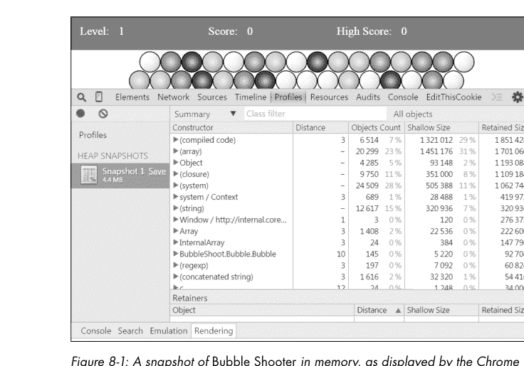

另一个有用的工具是可视化垃圾回收何时发生。它表现为一个随时间变化的图表，你可以看到你的游戏占用的内存范围。图 8-2 显示了 *Bubble Shooter* 随时间变化的内存使用情况。

锯齿线代表对象创建时使用的内存。线条上升，然后在垃圾回收发生时急剧下降。尽管我们没有创建和销毁很多对象，但明确的迹象表明，如果我们发现动画运行不流畅的问题，我们可以考虑使用更多的对象池。

保持动画快速的关键是测试和迭代。在开发移动设备应用时尤其如此，因为调试工具通常更难访问，并且内存和处理能力通常也更少。如果你注意到难以复现的间歇性减速和动画冻结，很可能你有一个需要识别和解决的内存问题。

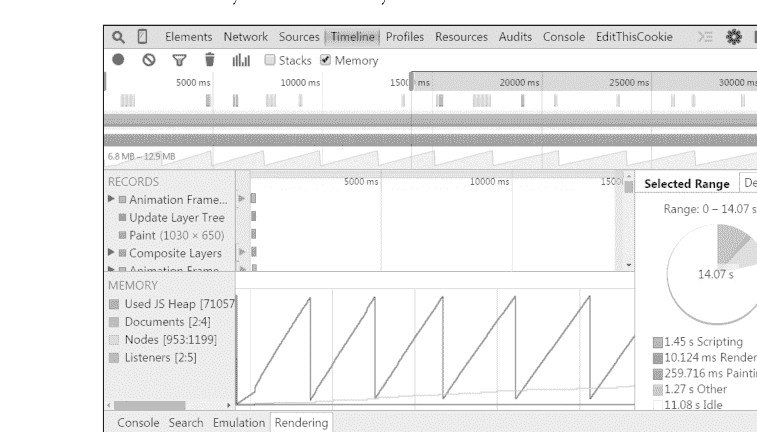

### 速度优化

内存可能是一个问题，也可能不是，这取决于你的游戏的需求，内存修复有时需要一些与编写可读、可复用代码有些冲突的编码技巧。然而，通过遵循一般最佳实践，作为其附带效果来优化速度则更容易实现。

JavaScript 引擎的速度一直在提高，浏览器的渲染引擎也是如此（尤其是在加入 WebGL 之后）。但是，就像垃圾回收一样，你仍然应该意识到痛点。浏览器厂商不会为你解决所有的性能问题。实际上，JavaScript 解释器的速度已经变得非常快，以至于速度问题更可能出现在渲染过程中，而不是其他任何地方；然而，编码技术可以使 JavaScript 和机器代码之间的转换更高效，并加速诸如将图像数据传递给渲染引擎等操作。

每次你在 DOM 中添加或更改一个元素时，浏览器都必须计算出要绘制什么以及在哪里绘制。HTML 文档最初被设计为基于文本的流动文档，浏览器会假设你发送的内容应该像任何其他网页一样进行布局。

但导致浏览器重绘显示的操作，比如向屏幕添加新元素或更改元素的坐标，在游戏中非常常见。在 *Bubble Shooter* 中，我们可以随意添加和删除元素，因为屏幕上的元素相对较少。将屏幕上的项目数量乘以 10 或 100，你就会开始看到问题。记住，垃圾回收器需要清除从场景中删除的任何元素，而 DOM 元素往往很复杂。

相比之下，canvas 可以在没有昂贵的绘制操作的情况下处理图形添加，因为 canvas 元素内部不会发生重排流。浏览器将 canvas 元素视为图像，图像只是从内存到屏幕的像素流。

> **注意** *更改 canvas 元素的属性（如其位置或透明度），而不是其内部的像素，与更改任何其他 DOM 元素的代价一样昂贵。*

你可以通过在 Chrome 桌面浏览器中加载 *Bubble Shooter*，按 F12 打开开发者工具，然后导航到 Timeline 标签页来查看浏览器在绘制场景上花费了多少时间。点击底部控制栏中的 **Record**，重新加载游戏，然后点击顶部的 **Events** 栏，即可看到类似图 8-3 的视图。

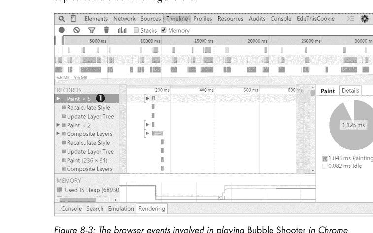

所有的绘制事件 ❶，如图 8-3 所示，在你的屏幕上应该显示为绿色。在游戏的 canvas 版本中，一旦关卡加载完成，只会发生少量的绘制调用，而在 CSS 版本中，这种调用则持续不断。

你可以使用 Timeline 工具来识别绘制事件何时发生，并将其最小化以加快游戏的渲染速度。请记住，不同的浏览器可能在不同的时间重绘场景。一如既往，使用可用的工具，但也要在目标平台和设备上进行测试，作为性能的主要指导。

总的来说，最小化 DOM 操作是减少绘制操作的关键。搜索有关最小化浏览器重排和浏览器绘制操作的文章，以获取关于渲染引擎内部工作机制的更详细和最新的信息。

### 安全性

如果你的游戏有任何类型的计分或进度系统，总会有人试图作弊。但关键是评估作弊行为滑入系统的后果，并决定这些后果是否关键。对于 *Bubble Shooter*，这不是问题：如果有人想在他们的本地机器上设定高分，那是他们的事情。然而，对于具有在线竞争元素或购买增益道具是收入来源的游戏，你需要确保作弊行为难以甚至不可能发生。

我们可以通过几种方式尝试解决 HTML5 游戏的安全性问题。

#### 不要信任任何人

对于任何在客户端运行的游戏，无论是使用 HTML5、Flash 还是原生代码构建的，其简单的安全方法就是不要信任客户端发送到服务器的任何内容。向服务器发送的 POST 请求，例如一个高分值（正如我们在 AJAX 和 WebSocket 示例中使用的那样），很容易被伪造。分数可能是有效的，POST 可能是伪造的，或者有人甚至可能在游戏运行时使用调试工具更改高分。服务器在接收到数据时只看到数据，无法区分真正的 POST 和作弊的 POST。

不幸的是，不信任客户端通常是正确的做法：无法完全保证运行在客户端的代码的安全性。使游戏安全的唯一方法是让服务器处理所有游戏逻辑。为了完全保护 *Bubble Shooter* 的安全，我们需要将鼠标点击传递给服务器，在服务器上运行碰撞和消除逻辑，然后将结果传回客户端进行动画处理。这使得开发和测试更加困难，并且用户需要持续（且快速的）互联网连接才能玩游戏。

#### 混淆

当游戏涉及金融交易时，服务器端方法是必不可少的，但对于许多游戏来说，混淆就足够了。混淆背后的原理是让作弊尽可能困难，本质上使付出的努力大于回报。例如，如果高分值作为编码值发布到服务器，并与校验和一起传递，

而破解过程需要花费数小时来通读代码，以理解其创建方式，因此作弊者不太可能付出如此大的努力只为登上高分榜的榜首。

当然，代码混淆通常会以牺牲你和黑客的代码可读性为代价。但有许多方法可以使代码难以阅读，你甚至可以在构建后的流程中应用其中一些。

最简单的选项是在将代码打包用于生产环境之前，通过压缩工具处理代码。压缩工具会缩短代码中所有较长的变量名，并消除空白字符。例如，如下代码：

```
var highScore = 0;
highScore += 20;
```

经过压缩后会变成类似这样：

```
var highScore=0;highScore+=20;
```

实际上，压缩去除了空白字符，并将所有内容放到一行。这样的压缩代码很快就会变得难以阅读。你可以轻松地恢复换行符。许多压缩工具还会重命名函数内部的变量。例如，这个函数：

```
var highScore = (function(){
  var highScore = 0;
  highScore += 20;
  return highScore;
});
```

可能会变得更小：

```
var highScore=function(){var a=0;return a+=20};
```

如果你在代码中一直调用的 highScore 属性现在被命名为 a，那么它就会变得非常难以查找！

> 压缩代码还有一个额外的优势，即生成更小的代码，从而可能加载更快，这在部署到 Web 环境时是一个重要的考虑因素。事实上，你应该考虑在所有 Web 应用程序中压缩你的 JavaScript 代码。

Google 发布了一个名为 Closure Compiler 的工具，它既可以作为压缩工具，又提供了许多其他好处。它试图优化代码，甚至在某些地方重写代码，并输出比原始版本更小、有时甚至更快的代码。该编译器生成 JavaScript、分析你的代码并报告错误。声明变量、跟踪作用域以及其他良好实践会在你使用像 Closure Compiler 这样的压缩工具时带来回报，因为你的编码结构越清晰、越简单，编译器提供的收益就越大。

你可以在线使用 Closure Compiler，也可以从 https://developers.google.com/closure/compiler/ 下载并运行 Java 应用程序。一旦可以使用它，将你想要编译的 JavaScript 代码粘贴到 Closure Compiler 中，然后复制输出结果。建议你保留原始代码的副本，因为如果需要进一步修改，编译器的输出内容非常难以处理。

#### 使用私有变量

除了构建后的流程，你还可以采用一些编码方式，使作弊者更难跟踪代码并实时修改它。例如，私有变量使在控制台操作内部值变得更加困难。以下代码有一个用于 highScore 的私有变量：

```
var Game = function(){
  var highScore = 0;
  var getHighScore = function(){ return highScore;};
  return this;
};
```

这个变量被认为是私有的，因为它只存在于 Game 对象的作用域内。我们本可以如下方式将变量设为公共的：

```
var Game = function(){
  this.highScore = 0;
  var getHighScore = function(){ return this.highScore;};
  return this;
};
```

这将允许通过改变 Game 对象的 highScore 属性值来更改 highScore 的值。然而，在私有版本中，从对象外部无法访问 highScore 的值。

如果 highScore 是私有的，作弊者将很难在不使用 Firebug 等程序在对象内设置断点的情况下更改其值。如果代码被压缩和混淆，他们将更加困难。highScore 实际上被标记为 "a"，甚至很难找到高分最初是在哪里更新的。

通过几个相对简单的步骤（将一些变量设为私有并压缩我们的代码），我们已经将潜在作弊者的范围从那些了解少量 JavaScript 的人缩小到那些非常了解并且愿意花时间逆向工程我们代码的人。现在，让我们看看另一种防止作弊的方法。

#### 使用校验和进行验证

你还可以通过使用校验和来验证传递的变量，从而保护传递到服务器的信息。最简单的技术只是对值进行编码，以便至少有一些检查来确保数字是正确的。这不会消除作弊，校验和也不需要非常复杂，但它将确保任何想要作弊的人都需要先阅读并理解你的 JavaScript 代码。例如，如果我们向服务器传递 highScore，我们可以发布类似这样的内容：

```
{
    highScore : 9825,
    check : 21
}
```

值 21 是 9825 对 129 取模的结果（代码中是 highScore%129），其中 129 是我选择的一个足够大的数字，可以创建一个检查值的范围，同时也是一个比可能的高分要小的因子。这个几乎微不足道的检查实际上增加了安全性，因为现在发布虚假高分的障碍不仅要知道如何 POST，还要能够跟踪代码到创建检查值的那部分。一个经验丰富的 JavaScript 程序员可能会觉得这些步骤很简单，但一般的捣蛋玩家可能不会。

前面的例子可能对你来说过于简单了，你可以使用任何你喜欢的流程来生成校验和。常见的方法包括使用哈希函数，如 MD5、SHA 或 CRC32，尽管这些的缺点是程序员通常能够很好地识别其结构，从而知道他们看到的是一个标准的哈希函数。

原则上，你创建的任何能够生成一系列检查值的流程都将大大减慢甚至阻止大量潜在作弊者。

当然，无论你做什么，你可能仍然会遇到一些作弊者，因为一些黑客更享受打败程序员的挑战，而不是打败游戏的挑战。你可以尽可能地混淆代码，最终可能会得到几乎无法阅读的代码。但请记住，你永远无法保证客户端代码的安全性，也永远不能完全信任从客户端传递到服务器的信息。

## 总结

正如你可能从本章中了解到的，浏览器对 HTML5 的支持是一个不断变化的领域。好消息是，浏览器通常正在趋同于相同的标准，而不是添加各自的功能。此外，对 HTML5 的支持一直在改进。

考虑到变化的速度，了解哪些浏览器功能已准备好用于主流使用以及哪些功能即将出现非常重要。无论是在改进性能、内存管理、声音还是 3D 功能方面，HTML5 游戏的能力都在不断发展。

## 进一步实践

- 1. 在桌面浏览器中为 *Bubble Shooter* 添加全屏功能。为了使切换尽可能简单，在顶部栏添加一个按钮，该按钮仅在支持全屏模式时才可见。更改 CSS，使页面以全屏显示时，游戏居中显示。

- 2. 编写一个例程，使用 jQuery 的 `ajax` 方法将玩家的分数发布到虚构的服务器地址。在每个关卡结束时发布分数，并编写一个校验和函数，使用你选择的方法添加基本安全性。

- 3. 查找并测试一些在线的压缩和混淆服务。将输出代码的文件大小与原始源代码的大小进行比较。

# 后记

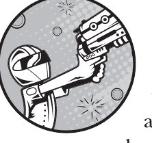

希望通读本书让你了解了使用 HTML5 和 JavaScript 开发游戏可以如此简单，并让你对这些技术的潜力有了一些见解。下一个问题是：接下来该怎么办？答案是：去制作更多游戏吧！

凭借你的新技能以及互联网上的 HTML5、CSS 和 JavaScript 参考资料，你应该能够应对任何可以用 HTML5 实现的游戏类型，尽管我建议你的下一个项目相对较小且可实现。大多数开发者的未完成项目列表都比已完成的列表长，所以从一个能让你在正确的一列打上勾的游戏开始吧。

如果你已经有一些游戏创意并且认为你可以构建它们，那么尽管放手去做！如果你想知道从何处着手，这里有一些建议，可以帮助你磨练技能并建立作品集。


# 改进泡泡射击游戏

*泡泡射击游戏*本身已经相当出色，但我们都知道它可以做得更好。任何游戏总有改进空间！以下是一些建议：

-   添加增强道具和额外积分，在泡泡被消除时掉落，需要用户点击收集。
-   在后续关卡中增加更多泡泡颜色。
-   创建不同尺寸和布局的网格图案。
-   实现侧壁，使玩家可以将发射的泡泡从两侧反弹回来。

你无需编写一个全新的游戏来添加这些功能。鉴于*泡泡射击游戏*的核心已经成型，你可以专注于打磨这些特性。融入一些你自己的创意想法，就能打造一个让人停不下来的游戏！

# 创造一个全新的游戏

通过打磨*泡泡射击游戏*这样的游戏，你可以学到很多东西。但要建立作为游戏开发者的信心，没有什么比尽可能多地制作游戏更好的了。你可以创造自己的新游戏创意，或者为了快速进入编程流程，尝试分析现有游戏的制作方式。我将介绍几个基础游戏点子的建议，你可以用新学到的技能来构建它们。

## 三消游戏

三消游戏，例如*宝石迷阵*和*糖果粉碎传奇*，似乎永不过时。它们既提出了明确的技术挑战，也提出了对用户界面的高要求。思考一下宝石爆炸并掉落的问题，这又会引发更多宝石的掉落和爆炸，如此循环。构思处理这种级联效应的算法，并考虑如果用户在此过程中尝试交换宝石会发生什么。你会允许玩家这样做吗？尝试构建你能做到的最好版本的这类游戏。然后，在你让它运行起来之后，去玩*宝石迷阵*或其他流行的同类游戏，找出你认为让体验有趣的特性，并尝试为你的游戏添加类似的打磨效果。微妙而有效的细节真的能带来天壤之别。

## 纸牌游戏

纸牌游戏在图形方面比其他游戏简单，但它们在用户界面和游戏逻辑方面提出了足够的挑战，值得深入研究。一旦游戏逻辑到位，你可以为用户提供自定义的牌背和动画，赋予你的游戏个性。务必混淆你的代码，以便玩家在游戏过程中无法偷看牌局状态！

## 平台游戏

平台游戏比前面提到的游戏类型向前迈进了一大步。你需要为主角实现一些基本的物理效果（尽管我不会尝试为整个游戏实现真实的物理效果），以及某种滚动方式，可以是仅横向滚动，也可能是双向滚动。关卡设计可以保持简单：定义一个入口点和一个出口点，让玩家在两者之间穿越。最终，你会开始更多地考虑为未来的游戏重用代码，并且你将解决诸如为移动角色制作动画之类的挑战。

## 简单的物理游戏

《愤怒的小鸟》大获成功，这使得其基本机制如此容易复现这一点更加令人惊讶。《愤怒的小鸟》使用了一个名为Box2D的物理引擎，有一个名为Box2DWeb的免费JavaScript版本。你可以在`https://code.google.com/p/box2dweb/`找到代码和文档。你会发现网上的示例并不总是易于理解，为游戏添加物理效果也具有挑战性。我推荐Seth Ladd的教程，它提供了关于该库的分步介绍：`http://blog.sethladd.com/2011/08/box2d-orientation-for-javascript.html`。

## 加入游戏开发团队

如果以上讨论的点子都没有激发你的想象力，而你又难以构思自己的游戏概念，可以考虑寻找一位希望有人帮助实现其创意的游戏设计师。像Meetup (`http://meetup.com/`) 这样的网站是寻找游戏开发小组的好地方。你可以与成熟的和有抱负的游戏开发者会面，并可能进行合作。

借助HTML5，个人或小团队可以比以往更容易地创建大众玩家能在桌面和移动设备上玩的游戏。抓住机会——放手去制作游戏吧！

# 索引

注意：*斜体*页码指的是图示。

# 数字和符号

-   $（jQuery选择器），16–17，23–24。另见jQuery
-   $.ajax，166
-   #（jQuery选择器），16–17
-   2d canvas上下文，109–114，121，127，169
-   3D，107，169–171
-   3DS Max-to-Babylon.js，170
-   3D Studio (3DS)，170

# D

-   减速，41，95
-   延迟，95
-   掉落，83–84，114–120
-   持续时间，41，64，75，94–95，100–102，129
-   缓动。见缓动
-   帧率，94，102，155–159，156
-   重力，84，86，89
-   JavaScript，6，40–41，93–94，102–103
-   jQuery，6，40–41，93–94，102–103
-   性能，49，56，77，102，105，107，168–169，176–180
-   爆炸，33，33，69，75–78，76，128，132–134
-   精灵，40，76–78
-   速度，64，87–89

# A

-   about:memory，177
-   绝对定位，31
-   加速
    -   动画化，41，95
    -   图形处理速度，170，175
-   加速度计，175
-   可访问性，173
-   AJAX（异步JavaScript和XML），15，166–168
    -   浏览器支持，166
    -   库，166
    -   安全性，180
-   alert，9
-   走样，174
-   Android，9，152，174
-   愤怒的小鸟（游戏），187
-   动画
    -   complete属性，66，130
    -   jQuery的方法，40–41，60，66，84，96，100–103
    -   Sprite的方法，129–132
-   动画，35–41，69，74，76–78，155–159
    -   加速度，41，95
    -   泡泡。见泡泡，动画化
    -   canvas，107，129–134
    -   CSS，6，29，40–41，76–78，93–103
-   Apache web服务器，7
-   Apple
    -   App Store，9
    -   iPad和iPhone，9，174
    -   OS X，8
    -   viewport meta标签，174
-   宽高比，11，174
-   异步JavaScript和XML (AJAX)。见AJAX
-   Audio API，160–163。另见声音
    -   HTML标签，160
    -   播放声音，160
    -   复用，160–161
-   Autodesk，170

# B

-   Babylon.js，170
-   background-color属性，12，21–22，96–100
-   background-image属性，34，76–78，113，120
-   background-position属性，34，77
-   带宽，18，175
-   宝石迷阵（游戏），186
-   Bézier曲线，97，97，103
-   bind方法，22–24，27，37，108，173
-   棋盘
    -   清除，148
    -   列，46–47，64–65，70，80，82
    -   绘制，*44*，45–49
    -   网格，46，47
    -   渲染，31–32，*44*，45–49，126–129
    -   行，45–47，59，64–65，70，79–80，82，101，145，150–151
    -   状态，64
-   `Board.addBubble`方法，65–66
-   `Board`类，45–47，64，70–71，75，80–81，116，118，125，144
    -   `createLayout`方法，46–47，118，124
-   `Board.getBubbleAt`方法，70，81–82
-   `Board.getBubblesAround`方法，70–72，80
-   `Board.getBubbles`方法，116，118，145
-   `Board.getGroup`方法，71–75，79–82
-   `Board.popBubbleAt`方法，75–76，84
-   Box2D库，187
-   断点，9，182
-   浏览器
    -   缓存，18
    -   桌面，8
    -   功能支持。见浏览器支持
    -   旧版，88
    -   内存分析，176–177，*177*
    -   移动，9，174–175
    -   绘制事件，179，*179*
    -   测试，7–8
-   浏览器支持，8，29，183
    -   AJAX，166
    -   Audio API，159–162
    -   canvas元素，15，29，106，121–122，129，132，134
    -   CSS过渡，96，100，102，132，134
    -   CSS viewport尺寸调整，174
    -   功能检测，15，102，106，121，162
    -   Fullscreen API，171
    -   `localStorage`，154
    -   polyfills，156–159，169
    -   `requestAnimationFrame`，156–157
    -   viewport尺寸调整，174
    -   WebGL，169，171
    -   WebSockets，167
    -   Web Workers，168–169
-   泡泡
    -   添加到棋盘，4，5，64
    -   动画化
        -   掉落，78，83–89
        -   发射，30，*30*，38–41，100–102，129–132，155–156，*156*
        -   爆炸，*33*，*33*，69，75–78，*76*，128，132–134
    -   外观，*33*，*33*
    -   清除，148
    -   颜色，*33*，33–34，113
    -   坐标，30，38，40，46，*47*，57–58，66，71，80，82
    -   创建，35–36
    -   碰撞检测，7，30，43–44，*44*，53–63，*54*，*55*
    -   显示，*10*，32，35，127–134
    -   掉落，83–84，114–120
    -   爆炸，84–89
    -   已发射的，43，51，54，*54*，*55*，58，115
    -   发射，4，*5*，*30*，38–41，43，54，*54*，100–102
    -   发射角度，*30*，30–31，36–37，*39*，59
        -   计算，36–38
    -   网格，6–7，46，*47*，66–67，101
    -   群组，4，*5*，6–7，43，47，69–74，*73*，*76*，80
    -   高度，32，128
    -   剩余数量，7，*52*，138，144，149–151
    -   孤立泡泡，*6*，6–7，78–84，*78*，*79*，140–141
    -   爆炸，*5*，*6*
        -   动画，*33*，*33*，69，75–78，*76*，128，132–134
        -   游戏机制，30，69，78，141–143
        -   游戏状态，74–75，114–120
        -   得分，141–143
        -   声音，161–163
    -   位置，32，47，49，131
    -   队列，50–52，144
    -   精灵，31–32，*33*，35，113，*113*，120–130
    -   状态，114–120，*117*，133，*133*
    -   类型，33–35，71，77
    -   宽度，32，128
-   `Bubble`类，35–36，45，47–49，57–68，115，124
    -   `animatePop`方法，76–77
    -   `create`方法，35–36，47–49，124

[content]

# 索引

B

getCol 方法, 48, 58, 71–72, 75, 81–82, 84
getCoords 方法, 56–58, 60, 66–97, 101
getRow 方法, 48, 58, 66–67, 71–72, 75, 81–82, 84, 101
getSprite 方法, 35–37, 39–40, 50, 56, 59, 75–77, 84–85, 101, 122, 124–126, 128, 131
getState 方法, 115, 133
getTimeInState 方法, 115, 133
getType 方法, 48, 71–72, 128
rows 属性, 49
setCol 方法, 65
setRow 方法, 65
setState 方法, 115, 117–120
type 属性, 47

height 属性, 109, 112–113, 121
图像, 108–114, 111, 113, 120, 129
原点, 110–111, 111
与 WebGL 的性能比较, 170
与像素的关系, 109–110, 112–113, 121
重绘, 108, 110, 114, 126
渲染游戏, 120–134, 155
旋转, 110–112, 111, 129
缩放, 109
尺寸, 108–109, 112–113, 121
精灵渲染, 31, 105–134
状态属性, 109–111
样式, 109
平移, 110–112, 111, 129
透明度, 179
width 属性, 109, 112–113, 121

BUBBLE_DIMS 常量, 37–38, 40, 49–50, 56, 58–59, 61, 65, 67, 101, 123, 125–126

CDN（内容分发网络）, 18–19

*泡泡射击*（游戏）, 4, 4–7, 5, 6. *另请参见* 游戏开发任务, 7
改进, 166
布局, 10, 10, 11–13, 139–140, 140
关卡, 7, 137–151. *另请参见* 关卡

作弊, 180–183
校验和, 180–183
Chrome 浏览器, 8, 96, 152, 160, 171
开发者工具, 177
内存分析, 176–177, 177
绘制操作, 179

*bubble_sprite_sheet.png*, 33, 33, 120
BubbleState 对象, 115–120, 133
按钮，新游戏, 21–24, 27, 43, 96–100, 108, 121, 147–148

类（JavaScript）, 14. *另请参见* Board 类, Bubble 类, Game 类, Sounds 类, Sprite 类

click 事件, 22, 27, 36–38, 108, 116, 120, 148–149, 173
clickGameScreen 函数, 37, 39, 63–64, 65–66, 74, 143–145, 149–151, 173

# C

C++, 170
计算角度, 36–38
摄像头, 169

闭包, 23–25
Closure Compiler, 181–182
代码结构, 13–14

*Candy Crush*（游戏）, 186
canvas 元素, 7, 29, 31, 108–109, 112–113
通过 jQuery 访问, 109
与动画的关系, 107, 129–134
浏览器支持, 15, 29, 106, 132
清除, 126, 128
裁剪图像, 113, 113–114
与 DOM 的比较, 107, 179
上下文. *参见* 上下文（canvas 的）
坐标, 110–112
从画布删除, 108, 110, 126
通过 Modernizr 检测, 15, 17, 106
尺寸, 108–109, 112–113
getContext 方法, 15, 109–112, 114, 121, 169–170

CollisionDetector.findIntersection 方法, 56–64
CollisionDetector 对象, 56–64
碰撞, 7, 43
计算效果, 44
坐标, 61–62
检测, 43–44, 44, 53–63, 54, 55
查找最近的, 63
几何关系, 54–58, 54, 55
碰撞箱, 55, 55–56, 60–61
对碰撞做出反应, 63–64
颜色, 94–95
列, 46–47, 64–65, 70, 80, 82
编译 HTML5
生成原生代码, 175
优化, 181

191

animate 的 complete 属性, 66, 130
控制台, 9, 154, 160, 166
console.log, 9, 166, 169
内容分发网络（CDN）, 18–19
上下文（canvas 的）, 109–113, 121
2d, 109–114, 169–170
clearRect 方法, 110
裁剪图像, 113, 113–114
drawImage 方法, 109–114, 128–129
getContext 方法, 15, 109–112, 114, 121, 169–170
原点, 110–111, 111
恢复, 111–112
rotate 方法, 110–111, 111
旋转, 110–112, 129
保存, 111–112
状态, 109–111
translate 方法, 110–111, 128
平移, 110–112, 111, 129
控制器（MVC 中）, 13–14
cookies, 151–152, 157
坐标
气泡坐标, 30, 38, 40, 46, 47, 57–58, 66, 71, 80, 82
鼠标点击坐标, 30, 36–38, 40
CPU 时间, 94
CRC32 哈希函数, 183
createLayout 方法, 46–47, 118, 124
跨浏览器开发, 15, 17, 24, 29, 94, 106
跨平台开发, 172
CSS, 6, 26, 107, 147
动画, 6, 29, 40–41, 76–78, 93–103
canvas 格式化, 109, 112–113, 121
尺寸, 13
display 属性, 21–22, 26
filter 属性, 26
布局, 10–13
移动端, 175
opacity 属性, 26, 94
选择器, 16
精灵, 31, 33–34. *另请参见* sprite
css 方法, 17, 50, 67, 77, 87–88, 124
CSS 变换, 77, 93–103
扭曲, 98
矩阵, 98
透视, 98
旋转, 98
缩放, 98–99
倾斜, 98
支持, 29
平移, 98
CSS 过渡, 40, 93–103, 107–108
通过 jQuery 创建, 100–102
曲线, 96
缺点, 102–103
持续时间, 94–95, 100–102
缓动, 95, 102
支持, 29, 101–102, 132
有效属性, 94
cubic-bezier 值, 97, 97
CURRENT 气泡状态, 115–119, 117, 133, 133
自定义包装器, 175

192

# D

数据事务, 167
调试, 9, 178
减速, 41, 95
专用 worker, 168–169
延迟（动画中）, 95
删除像素（canvas）, 108, 110, 126
桌面显示, 13, 174
检测
碰撞, 43–44, 44, 53–63, 54, 55
游戏结束, 6, 44
开发者工具, 9
开发环境, 7–9
device-height 属性值, 174
device-width 属性值, 174
对话框, 21–22, 25–27, 108, 146, 146–149
requestFullScreen, 171–172
display 属性, 21–22, 26
显示状态, 83
扭曲变换, 98
doctype 声明, 11
文档流, 107
DOM（文档对象模型）, 105–108
向其追加元素, 35–36, 45, 50, 107, 178–179
与 canvas 的比较, 107, 179
操作, 15–16, 26, 35–36, 40, 66, 75, 85, 89
节点, 15–16
前置元素, 121
ready, 23–24
移除元素, 66, 75, 107, 178–179
精灵, 31, 33, 35, 49, 77, 122. *另请参见* sprite
遍历, 16
Web Workers, 168
域, 152
双击, 173–174
dropBubbles 函数, 83–85, 120
下落气泡, 83–84
动画持续时间, 41, 64, 75, 94–95, 100–102, 129

193

# E

缓动, 41–42, 95, 95, 103, 130
cubic-bezier 值, 97, 97
ease-in-out 值, 95
ease-in 值, 95
ease-out 值, 95
ease 值, 97
linear 值, 40–41, 97
swing 值, 41
endGame 函数, 144–145, 148–149, 153–154
结束关卡, 138, 143–151, 146
环境, 7–9
事件处理器, 22–23, 26–27, 37–38
触发 FullScreen API, 171
Web Workers, 169
event 对象, 36–38
Web Workers, 169
事件
click, 22, 27, 36–38, 108, 116, 120, 148–149, 173
mousedown, 173
mouseup, 173
touchend, 173
touchstart, 173
experimental-webgl 上下文, 170
爆炸气泡, 84–89

# F

Facebook, 172
fadeIn 方法, 149
fadeOut 方法, 25–26
FALLEN 气泡状态, 115–120, 117, 133, 133–134
FALLING 气泡状态, 115–120, 117, 133, 133
快速移动物体问题, 53
特性检测, 15
filter 属性, 26
Firebug, 177, 182
发射的气泡, 43, 51, 54, 58
FIRED 气泡状态, 115–119, 117, 133, 133–134
Firefox 浏览器, 8, 96, 152, 160, 171
内存分析, 177
发射角度, 30, 30–31, 36–37, 39
FIRING 气泡状态, 115–119, 117, 133, 133
固定布局, 13
Flash, xv–xvi
流式布局, 13
文件夹, 11, 33
font-size 属性, 22, 41, 52, 94, 141, 147
帧率, 94, 102, 155–159, 156
全屏 API, 171–172

# G

游戏. *另请参见* 泡泡射击（游戏）
棋盘渲染, 31–32, 44, 45–49, 126–129
控制器, 14, 20
检测结束, 6, 44
网格, 6–7, 46, 47, 66–67, 101
布局, 10–13, 10
逻辑, 3, 13–14, 43–67, 161, 180
循环, 44
机制, 6
通过 canvas 渲染, 120–134, 155
计分, 44. *另请参见* 分数
状态. *参见* 游戏状态
Game 类, 45
clickGameScreen 函数, 37, 39, 63–64, 65–66, 74, 143–145, 149–151, 173
dropBubbles 函数, 83–85, 120
endGame 函数, 144–145, 148–149, 153–154
getNextBubble 函数, 36–37, 51–52, 117, 125–127
popBubbles 函数, 74–76, 83–85, 119–120, 150, 162
renderFrame 函数, 127–131, 157–158
startGame 函数, 22–24, 27, 36–37, 45, 51, 108, 116, 120–121, 127, 139, 142–143, 148–149, 157
Game.init 方法, 22–24, 26–27, 108, 120–121, 153–154
游戏状态
气泡状态机, 114–120, 117
显示, 74, 83, 106, 116, 142–144
维护, 7, 14, 45, 138–139
保存, 154
建立, 43–44
更新, 74, 83, 167
垃圾回收, 176–177
getAttribute 方法, 16
getContext 方法, 15, 109–112, 114, 121, 169–170
getElementById 方法, 15–16, 109
getNextBubble 函数, 36–37, 51–52, 117, 125–127
全局作用域, 21
Google Closure Compiler, 181–182
Google Play Store, 9
图形处理器, 94, 102, 170
模拟重力, 84, 86, 89
网格, 6–7, 43, 46, 47, 66–67, 101, 137

195

# H

手机, 175
哈希函数, 183
堆快照, 177
height 方法, 77, 121, 123, 124, 128
十六进制代码, 94
最高分, 137–149, 140
保存, 151–154, 165–168
安全性, 180–183
碰撞箱, 55, 55–56, 60–61
:hover 伪类, 22, 96, 99
HTML, 6, 26, 107
布局, 10–13, 147
移动开发, 9
精灵, 31
HTML5, 11
编译, 175
部署游戏, 171
HTML5 Audio, 17, 160–163
HTTP 请求, 152

# I

ID（DOM 节点的）, 16
IIFE（立即调用函数表达式）, 21, 23
Image 对象, 108, 110, 113–114
加载图像, 23–24, 33–34, 108, 120, 124
立即调用函数表达式（IIFE）, 21, 23
应用内购买, 175
initial-scale 属性值, 174
交互, 3, 13
网络连接, 175
Internet Explorer, 8, 96, 152, 171
内存分析, 177
iOS, 9
iPad 和 iPhone, 9, 174

# J

Java, 168, 175
JavaScript, 26
AJAX, 166
动画, 6, 40–41, 93–94, 102–103
断点, 9
控制台, 9, 154, 160, 166
event 对象, 36–38
解释器, 94, 178
加载, 11, 14–15, 18–20, 27, 106
日志, 9
模块, 20–21
命名空间, 20
节点选择, 15
对象, 14, 25
公共变量, 9
作用域, 24–25, 36, 168–169, 182
安全性, 154
Web Workers, 168–169
JavaScript 对象表示法（JSON）, 166, 170
jQuery, 15–17, 122
$（选择器）, 16–17, 23–24
添加, 19
AJAX, 15
animate 方法, 40–41, 60, 66, 84, 96, 100–103
bind 方法, 27
canvas 元素, 109
animate 的 complete 属性, 66, 130
文档, 17, 41
DOM 操作, 15–16, 75, 147
DOM 遍历, 16
下载, 19
事件处理器, 22–23, 26–27, 37–38
event 对象, 36–38
fadeOut 方法, 26

194 索引


# K

- 键盘可访问性，173
- Kongregate，172

# L

- 布局，10，*10*，11–13，139–140，*140*
- left 属性，40–41，93–95，100，123，130–131
- 旧版浏览器，88
- 等级，7，137–151
    - 结束，138，143–151，*146*
    - 渲染，10，*10*，14，49–50
    - 存储，153
- 灯光，169–170
- 线性值，40–41，97
- 加载脚本，18–20
- 加载页面，18，22–24
- 本地存储，152–154，157
- localStorage.getItem 方法，153–154，157
- localStorage.setItem 方法，152–154，157
- 日志记录，9
- 逻辑，3，13–14，43–67，161，180
- 长轮询，167
- 循环，*44*

# M

- Mac OS X，8
- 三消游戏，186
- Math.atan 方法，38
- 矩阵变换，98
- MAX_BUBBLES 常量，51–52，139
- maximum-scale 属性值，174
- MAX_ROWS 常量，145
- MD5 哈希函数，183
- 内存管理，77，176–178，177，178
- 元标签，11，174–175
- 压缩，181–182
- minimum-scale 属性值，174
- 移动浏览器，9
- 移动端
    - 浏览器，9，174–175
    - 设备，9
    - 显示，13
    - 运行 *Bubble Shooter*，172
    - 测试，9
    - 封装服务，175
- MVC 中的模型，13–14
- 建模软件，170
- 模型/视图/控制器 (MVC)，13–14
- Modernizr，14–20
    - 添加，17
    - 下载，17
    - 功能检测，15，154，162
    - 脚本加载，14–15，18–20，27
- Modernizr.audio 属性，161–162
- Modernizr.canvas 属性，15，106，121
- Modernizr.load 方法，17–20，23，26，35，46，56，85，106
- Modernizr.prefixed，17，77，101–102，156
- 模块化 JavaScript，20–21
- 模块，20–21
- 动量，84
- 显示器尺寸，12
- 鼠标点击，30，*30*，37–38，*39*，40，*44*
- mousedown 事件，173
- mouseup 事件，173
- Mozilla 浏览器，96，156。*另见* Firefox
- Mozilla 开发者网络，167
- -moz- 前缀，95–96
- mozRequestFullScreen，171–172
- MP3 文件，160–163
- -ms- 前缀，95–96
- msRequestFullScreen，171–172
- 开发多人游戏，175
- MVC (模型/视图/控制器)，13–14

# N

- 命名空间，20
- 原生应用，106，170，175，180
- .NET，168
- 新游戏按钮，21–24，27，96–100，108，121，147–148
- Node.js，168
- NUM_COLS 常量，46
- NUM_ROWS 常量，46

# O

- 代码混淆，180–182
- Objective-C，175
- 面向对象编程，14
- 对象 (JavaScript)，14，25
- ON_BOARD 气泡状态，115–119，117，133，133–134
- onload 事件，108
- opacity 属性，26，94
- 优化，176–180
- 孤立气泡，6–7，6，78–84，78，79
- OS X，8

# P

- 页面，加载，18，22–24
- 绘制操作，179，179
- parseFloat，153
- parseInt，153–154
- 粒子效果，170
- 性能，56，77，102，105，107，168–169，176–180
- 持久连接，167
- 透视变换，98
- 物理，187
- 圆周率，38
- 像素尺寸，13，112–113
- 像素操作，6，107
- Pixi.js，170
- 平台游戏，187
- PlayCanvas 库，170
- 插件
    - jQuery，84–89
    - 移动端封装，175
- PNG 文件，在 Bubble Shooter (游戏) 中，33，33，120
- POINTS_PER_BUBBLE 常量，138，143
- Polyfill，156–157，169
- popBubbles 函数，74–76，83–85，119–120，150，162
- pop.mp3 文件，161
- POPPED 气泡状态，115–120，117，133，133–134
- 消除动画，33，33，69，75–78，76，128，132–134
- 消除气泡。*参见* 气泡，消除
- POPPING 气泡状态，115–119，117，133，133
- position 方法，38，86，122–123，128，130，159
- position 属性，12，21–22，32，52，107
- POST 请求，166，180，183
- 构建后流程，181
- 预加载图像，34，108
- 私有变量，182
- 处理能力，48，53，56，85，94，107，168–169，178
- 公共方法，23–24
- 公共变量，9
- 应用内购买，175

# R

- 弧度，37–39，111
- 可读性，14，46，49，109，138，178，181
- 重绘画布，108，110，114，126
- remove 方法，75–77，148，154
- Renderer.drawSprite 方法，128，134
- Renderer.init 方法，120–121
- Renderer 对象，120–122，124–125，127–129，132–133
- Renderer.render 方法，129，131，133
- renderFrame 函数，127–131，157–158
- 渲染速度，105，178–179
- requestAnimationFrame 方法，155–159
    - 与 polyfill 一起使用，164
- requestFullScreen 方法，171–172
- 分辨率，9，13，112–113
- 检索数据，165–168
- 旋转变换，98
- 行，45–47，59，64–65，70，79–80，82，101，145，150–151
- ROW_HEIGHT 常量，49–50，58，65，125

# S

- Safari，8，96
- 保存数据，165–168
- 缩放变换，98–99
- 缩放 (视口)，174
- 场景，169–170
- 作用域 (JavaScript)，21，24–25，168–169，182
- 得分，6–7，138–139
    - 显示，10，14，44，139–144，140，146–149
    - 最高分。*参见* 最高分
- 安全性，180–183
- 屏幕宽高比，11，13
- 屏幕分辨率，9，13，112–113
- 脚本加载，11，14–15，18–20，27
    - Web Workers，168
- 脚本标签，11，14，17–19
- 选择器 (jQuery)，16，89
- 服务器
    - 带宽，18，175
    - 通信，15，151–152，165–168，180–182
    - 目录结构，11
    - 维护连接，167
    - POST 请求，166，180，183
    - 请求，166
    - 响应，166
    - 设置，7–8
- 会话存储，152
- setTimeout 函数，24–26，75–77，84–88，101–102，126–127，129–130，143，155–159，*156*
- SHA1 哈希函数，183
- 着色器，170
- 共享工作者，168
- 单线程环境，168
- 倾斜变换，98
- Socket.IO 库，167–168
- 纸牌游戏，186–187
- 声音，159–163。*另见* Audio API
    - 3D 定位，160
    - 浏览器支持，159–160
    - 操作，159
    - 混音，159–160
    - 多声道，160–162
    - 播放，159–163
    - 处理，159–160
    - 录制，159–160
    - 跳跃，160
    - 音量，160，162
- Sounds 类，161–163
- Sounds.play 方法，161–163
- 精灵
    - 动画，40，76–78
    - 画布，31，105–134
    - CSS，31，33–34
    - 定义，31
    - DOM，49，77
    - 帧动画，33，*76*，76–78，132–134
    - 图像，*33*，33–34，*76*
- Sprite.addClass 方法，123
- Sprite.animate 方法，130
- Sprite 类，123–124
- Sprite.css 方法，123，130
- Sprite.height 方法，123
- Sprite.kaboom 方法 AIM，123
- Sprite.position 方法，123，130
- Sprite.removeClass 方法，123
- Sprite.remove 方法，123
- Sprite.setPosition 方法，123
- 精灵表，*33*，33–34，108，113，*113*，120
- Sprite.width 方法，123
- startGame 函数，22–24，27，36–37，45，51，108，116，120–121，127，139，142–143，148–149，157
- 启动时间，175
- 状态机，114–120，*117*
- 静态类，25
- 状态栏，10
- 停止方法
    - Audio API，160
    - jQuery，103
- 代码结构，13–14
- 样式表，12，93–94，112
- 子目录，11
- 子域名，152
- 表面，纹理和光照，170
- 摆动值，41

# T

- 平板电脑，9
- 目标受众，8
- 测试，7–9
- 文本渲染，108
- 纹理，169
- 文本换行，107
- 线程，168
- Timeline 工具，179–180
- top 属性，12，17，21–22，32，34，40–41，52，93–96，100，113，123，130–131
- touchend 事件，173
- 触摸事件，173
- 触摸屏，173
- touchstart 事件，173
- 变换。*参见* CSS 变换
- 过渡。*参见* CSS 过渡
- 平移变换，98
- 试错，61
- 三角学，38–39
- 回合循环，53

# U

- UI (用户界面)，6，10，147
    - 响应式，166
    - 脚本，25–26
- ui.drawBoard 方法，45，49–50
- ui.drawBubblesRemaining 方法，51–52，149
- ui.drawHighScore 方法，148，154
- ui.drawLevel 方法，142–143
- ui.drawScore 方法，142–143
- ui.endGame 方法，148–149
- ui.fireBubble 方法，39–41，66–67，101–102，119，132
- ui.getBubbleAngle 方法，37–39
- ui.getBubbleCoords 方法，38–39
- ui.getMouseCoords 方法，37–38
- ui.init 方法，25，153
- ui 对象，25–27，37–38，40，49–50，52，66–67，101，119，132，142，149
- unbind 方法，27
- 用户输入，3，30。*另见* 鼠标点击，触摸事件，用户界面
- 用户界面 (UI)，6，10，147
    - 响应式，166
    - 脚本，25–26
- user-scalable 属性值，174

# V

- 变量
    - 私有，182
    - 作用域，21，24–25，168–169，182
    - 状态，9
- 向量，30，36–37，39，55，58，60
- 速度，64，87–89
- 浏览器厂商前缀，96，98，100
- MVC 中的视图，13–14
- 视口，174
- 虚拟机，8–9
- visibility 属性，94
- 音量 (声音)，160

# W

- Web 应用，11，13，152
- WebGL，169–171，178
- webgl 上下文，170
- Webkit，96，156
    - -webkit- 前缀，95–96
- webkitRequestFullScreen，171–172
- Web 服务器，7–8，11，15，18
- WebSockets，167–168
    - 安全性，180
    - Socket.IO 库，167–168
- Web Storage，151–154
- Web Workers，168–169
- 空白符，181
- 宽度
    - canvas 元素属性，108–109，112–113，121
    - 方法，17，121，123–124，126，128
    - 视口属性值，174
- window.onload 方法，23
- Windows，8
- Windows Mobile，9
- 工作者，168–169
- 封装服务，175

# X

- XHTML，11
- XML，166

# Y

- yepnope.js，18。*另见* Modernizr.load 方法

# Z

- 缩放，174


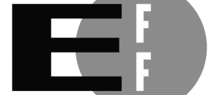

**电子前沿基金会** 是在数字世界捍卫公民自由的领先组织。我们捍卫互联网上的言论自由，反对非法监控，倡导创新者开发新数字技术的权利，并致力于确保随着我们对技术的使用不断增长，我们所享有的权利和自由得到加强——而不是被侵蚀。


# EFF.ORG

**电子前沿基金会**
在电子前沿保护权利、促进自由

# 更新

访问 http://nostarch.com/html5game/ 获取更新、勘误和其他信息。

NO STARCH PRESS 出版的更多实用书籍

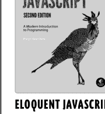

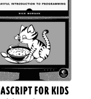

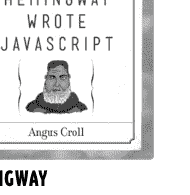

**《JavaScript语言精粹（第2版）》**
现代编程入门
作者：MARIJN HAVERBEKE
2014年12月，472页，39.95美元
ISBN 978-1-59327-584-6

**《JavaScript趣味编程》**
轻松有趣的编程入门
作者：NICK MORGAN
2014年12月，336页，34.95美元
ISBN 978-1-59327-408-5
全彩印刷

**《假如海明威写JavaScript》**
作者：ANGUS CROLL
2014年10月，192页，19.95美元
ISBN 978-1-59327-585-3

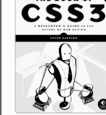

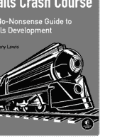

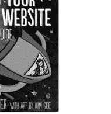

**《CSS3权威指南》**
面向开发者的Web设计未来指南
作者：PETER GASSTON
2014年11月，304页，34.95美元
ISBN 978-1-59327-580-8

**《Rails敏捷开发》**
Rails开发实用指南
作者：ANTHONY LEWIS
2014年10月，296页，34.95美元
ISBN 978-1-59327-572-3

**《自己动手做网站》**
HTML、CSS和WordPress漫画指南
作者：NATE COOPER，插画：KIM GEE
2014年9月，264页，19.95美元
ISBN 978-1-59327-522-8

| 电话： | 邮箱： |
| --- | --- |
| 800.420.7240 或 | SALES@NOSTARCH.COM |
| 415.863.9900 | 网站： |
| | WWW.NOSTARCH.COM |
