# 你的第一个以太坊 DApp 构建指南


## 关于 SitePoint

SitePoint 专注于为网络专业人士出版有趣、实用且易于理解的内容。访问 [`www.sitepoint.com/`](http://www.sitepoint.com/) 可查看我们的博客、书籍、新闻通讯、文章和社区论坛。您将找到大量关于 JavaScript、PHP、设计等方面的信息。

# 前言

在本书中，我们将逐步创建一个基于以太坊平台的完整分布式应用（DApp）。我们将构建一个名为 *永无止境的故事* 的众包式“选择你自己的冒险”故事，并具备众包策展和社区审查功能。

## 谁应该阅读本书？

本书适合所有对使用以太坊平台进行开发感兴趣的人。如果你不熟悉区块链技术，建议在阅读本书之前先阅读《以太坊开发者指南》。

## 使用的约定

### 代码示例

本书中的代码使用等宽字体显示，如下所示：

```
 <h1>A Perfect Summer's Day</h1>
<p>It was a lovely day for a walk in the park.
The birds were singing and the kids were all back at school.</p> 
```

当需要现有代码作为上下文时，为避免重复全部代码，将使用 ⋮ 表示：

```
 function animate() {
    ⋮
new_variable = "Hello";
}
```

某些代码行本应在一行内输入，但由于页面限制我们进行了换行。➥ 表示仅出于格式考虑而存在的换行，应忽略：

```
 URL.open("http://www.sitepoint.com/responsive-web-
➥design-real-user-testing/?responsive1");
```

你会注意到我们在本书中使用了某些布局样式来表示不同类型的信息。请注意以下项目。

### 提示、注释和警告

#### 嘿，注意！

提示提供有用的小建议。

#### 嗯，打扰一下……

注释是与当前主题相关但不关键的补充说明。可以将其视为额外的信息片段。

#### 请务必……

……注意这些重要要点。

#### 当心！

警告突出显示可能让你在过程中遇到麻烦的任何陷阱。

# 第 1 章：应用规则与区块链设置

**这是关于使用 [以太坊](https://www.sitepoint.com/ethereum-introduction) 区块链构建去中心化应用系列的第一部分。**

我们将构建 3 个东西：

1.  一个自定义代币
2.  一个使用该代币作为投票权的 DAO
3.  一个用于与智能合约交互的原型 Web 界面

按照本书中的说明操作后，你将能够构建自己的自定义以太坊代币，并可选择是否附带 DAO 和应用。

## 我们将构建什么

我们正在构建的项目名为 *永无止境的故事*（TNS）。完整项目可在 [storydao.bitfalls.com](http://storydao.bitfalls.com) 找到。其完整代码位于 [GitHub](https://github.com/bitfalls/storydao)。

永无止境的故事是一个带有输入字段（文本和图像）的 Web 应用程序，安装了 [MetaMask](https://bitfalls.com/2018/02/16/metamask-send-receive-ether/) 的用户可以根据特定条件提交一段文本或一张图片。（图片每 50 段出现一次，且只能是 URL。）

完整的故事会显示在输入字段旁边。故事中的条目越多，提交条目的费用就越高。提交条目是每个支付费用、被列入白名单且至少拥有一个 TNS 代币的用户都可以执行的操作。

操作类型：

1.  **提交条目**：要求发送者至少拥有 1 个 TNS 代币，并且位于白名单中（见下文）。费用为 `0.0001 ether * 当前章节的条目数`（见下面的“章节”部分）。每 50 个文本条目可包含一次图片，且只能是 URL。否则为文本。无代码，纯文本。无论哪种情况，文本字段大小限制为 256 个字符。
2.  **转移所有权 [仅限所有者]**：可以将所有权转移到新地址。
3.  **降低费用 [仅限所有者]**：所有者可以降低提交条目的费用（见下面的“费用”部分），无需投票。
4.  **购买 TNS 代币**：向 DAO 发送以太币，自动按比例获得相应数量的 TNS 代币。如果 DAO 中没有足够的 TNS 代币，则必须从交易所获取。
5.  **检查代币余额**：只读操作，检查 DAO 中有多少 TNS 代币。
6.  **白名单**：当以太币发送到 DAO 地址时，此功能会自动调用。它将发送者记录在白名单数组中，以备将来参考，以防止获得大量 TNS 的人将其分发给多个账户。
7.  **结束章节**：触发章节结束流程，用于分配以太币分红并重置条目费用。
8.  **提款**：当利益相关者想要提取分红时调用。
9.  **所有者提款 [仅限所有者]**：由所有者调用，提取费用收益。

利益相关者（TNS 代币持有者）可以对提案进行投票，任何获得“赞成”票数多于“反对”票数的提案都将获得批准。票数多少不重要，比例才重要。提案需要在特定时间段内开放投票，具体取决于提案类型。

提案类型：

1.  **移除条目**：经投票确认后，目标条目被移除。投票时间：**48 小时**。
2.  **紧急移除条目 [仅限所有者]**：只能由所有者触发。经投票确认后，目标条目被移除。投票时间：**12 小时**。
3.  **紧急移除图片 [仅限所有者]**：仅适用于图片条目。只能由所有者触发。经投票确认后，目标条目被移除。投票时间：**4 小时**。

之后，我们可以使用相同的方法添加其他类型的提案。

**提案** 当然都需要在 UI 中明确列出，以便人们知道需要他们的投票。投票者只需拥有一个 TNS 代币即可投票，但拥有的代币越多，投票权重越大。

### 投票期间代币被锁定

用户的代币在投票期间被**锁定**。这可以防止大型 TNS 持有者压倒所有活跃投票。投票者需要将他们的投票权分配给他们关心的提案上。

### 章节

在达到 1000 个条目或三周时间后，任何用户都可以调用章节结束。然后 DAO 将收集到的以太币按比例分配给所有 TNS 持有者，分配比例基于其余额。持有者无需在 DAO 中列入白名单即可获得分红以太币。他们只需在分配时刻持有 TNS 代币即可。


该分发机制是一种拉取机制：持有者需要调用 DAO 的 `withdraw` 函数才能获取他们的以太币，而不会自动调用。提现窗口为 72 小时。未领取的以太币中，50% 归所有者所有，另外 50% 进入下一章节的分红池。

### 费用

每笔提交的入场费中有 1% 归当前所有者所有。剩余部分放入一个池中，在每个章节结束后按 TNS 持有比例分配给所有 TNS 持有者。

所有者的费用会进入一个独立的余额账户，他们可以随时从中定期提取。

要获得白名单资格，用户必须向 DAO 发送 0.01 以太币。此后所有代币的购买价格都会低得多。0.01 以太币的入场费是为了防止[女巫攻击](https://bitfalls.com/glossary/#sybil-attack)。如果用户首次发送超过 0.01 以太币，则 0.01 用于白名单注册，剩余部分将用于计算用户额外获得的 TNS 数量。所有代币将一次性返还给用户。

简而言之，可以将这个项目视为一个由众包驱动的“选择你自己的冒险”故事，并带有群体策展和社区审查功能。一个故事型 DAO。

## 引导启动：PoA 私有区块链

我们将进行两种引导启动流程：这一种将专注于在本地运行我们自己的真实以太坊区块链。它将使用[权威证明](https://www.sitepoint.com/proof-of-stake-vs-proof-of-work)作为共识机制，并像任何真实的以太坊[测试网](https://bitfalls.com/2018/02/08/what-is-an-ethereum-testnet-and-how-is-it-used/)一样运行。

*   下载并安装 [Virtualbox](https://www.virtualbox.org/)。
*   下载并安装 [Vagrant](https://www.vagrantup.com/)。如果你不确定什么是虚拟机，请参阅[这篇文章](http://www.sitepoint.com/re-introducing-vagrant-right-way-start-php/)。
*   从[这里](https://ethereum.github.io/go-ethereum/downloads/)下载 Geth。请务必向下滚动并下载“Geth & Tools”，而不仅仅是“Geth”。如果你使用的是 macOS，也可以使用 Homebrew 并通过 `brew install ethereum` 安装。
*   Mist 可以从[这里](https://github.com/ethereum/mist/releases)下载。请务必下载“Mist”，而不是“Ethereum Wallet”。Mist 是以太坊的“浏览器”，可以打开各种 DApp。Ethereum Wallet 是同样的东西，但锁定在钱包模式下，因此无法用它打开其他应用。这是为了防止非技术用户访问恶意 DApp。

我们需要 VirtualBox 和 Vagrant，因为我们将使用[这种方法](http://www.sitepoint.com/quick-tip-get-homestead-vagrant-vm-running/)启动两台虚拟机，我们的节点将在其上运行，模拟两台运行以太坊节点的计算机。

接下来，按照[这篇文章](https://www.sitepoint.com/puppeth-introduction)中的说明设置一个 PoA 私有区块链。

最终你将得到两个正在运行的节点。每个节点都将挖矿到自己的地址。记下这些地址。我的地址是：

*   Node1: `0x4b61dc81fe382068e459444e8beed1aab9940e3b`
*   Node2: `0x97e01610f1c4f4367c326ed1e9c41896b4378458`

## 引导启动：Ganache CLI

我们可以采用的第二种引导启动方式（这对于测试合约特别有用）是 Ganache CLI，以前称为 Testrpc。

[Ganache](http://truffleframework.com/ganache/) 是一个基于 JavaScript 的区块链模拟器，在本地运行。每次我们运行测试或重新启动应用时，它都会从头开始重新运行区块链。这有助于我们快速测试边缘情况，但不适合对长期运行的合约进行长期测试。

首先，使用 `npm install -g ganache-cli` 安装 Ganache。

然后，只需运行 `ganache-cli` 即可。你应该会看到类似如下的输出：

```
$ ganache-cli
Ganache CLI v6.1.0 (ganache-core: 2.1.0)
(node:40584) ExperimentalWarning: The fs.promises API is experimental

Available Accounts
==================
(0) 0xa0b7139a36ecda5ffda66b9cf97cb9de36e63f2f
(1) 0x1f5546797a0ff7efe42ecafaeebd5c932f1a0143
(2) 0x0eacbad38a642db2204574ad01b2b51c82ff7080
(3) 0x77f40a8add69b0e0806c0c506208e5783b89076d
(4) 0x1ea41547984ecb949c2b2df311bffe0fdeae4632
(5) 0xa1ad154fd5fd11ebe5410c992e5e97b461c516a2
(6) 0x34da52fd90c015a41bcc383ba3d804f7cebbc84e
(7) 0xddd5232788c1f1192d6ac5e82e74ca80945e119e
(8) 0x7ebc838124a676eac57f9b6275cd29b1a1c63d4d
(9) 0x6feed7913319ffb1b01f767960dd843ea7f96181

Private Keys
==================
(0) 62727ad35a288eb34f268cffb1ce620ef3ee80910138aed0e81f24d912fd8a49
(1) a6c76b382c655dcc66dd92428e3e0a0f14b7458162ad8e5cbbbcc64d3362d28c
(2) eef05f81fd995329c80d8875d5cb62b81f8f28c39951665b4b15688dc48b4c47
(3) 5ae06fc34da5d47a64a814ee088f7c6f0d1cae3c63d7ad2d6b71b8128bce1764
(4) 8cc43f28054f90243dea496263bd9a45f33db44ea3956ab8d0e8704e15d0787e
(5) dcf37436237105ea2f5b1be608b6aa1fe6fb7ca80b8b23ce01ff96930a2a3045
(6) f896b6f0ee11ea272c1567ec1950f7ff610df79193cbb7b668ae0ea11f6ec825
(7) 877b5868dca9a2f5c7d9546647171c9825f1b02922442f18dd4e90d108b9e54d
(8) 7f1f3515d71d348a78ae85a755e02df49be4e0b374447b822abe5a6481fe0c58
(9) 20d50b28c8b051406edc6aa61becc3443e430d7d68925a108958f8abecd55ed3

HD Wallet
==================
Mnemonic:      soda tower talk dynamic swim tattoo edit cook pair bid glance beauty
Base HD Path:  m/44'/60'/0'/0/{account_index}

Listening on localhost:8545
```

Ganache 在这里所做的是启动一个私有区块链，几乎没有挖矿时间，也没有节点。它会在交易到达时立即执行。它还会生成 10 个预先加载了大量虚拟以太币的地址，并输出它们的私钥，以便你可以将它们导入到各种工具中，例如 [MetaMask](https://bitfalls.com/2018/02/16/metamask-send-receive-ether/)、[MyEtherWallet](https://www.sitepoint.com/myetherwallet-introduction) 或之前下载的 Mist。

我们将根据需求混合使用这种方法与上述方法，因此请确保两者都已设置好。

### Ganache UI

最好（或者作为替代方案）使用 [Ganache UI 工具](http://truffleframework.com/ganache/) 来获得管理 Ganache 区块链的可视化界面。

## 结论

使用[本指南](https://bitfalls.com/2018/03/26/connecting-myetherwallet-mist-metamask-private-blockchain/)通过 [MetaMask](https://bitfalls.com/2018/02/16/metamask-send-receive-ether/)、[MyEtherWallet](https://www.sitepoint.com/myetherwallet-introduction) 或之前下载的 Mist 等工具连接到私有区块链（任一版本）。两种引导启动选项在运行时默认都监听 `localhost:8545`，因此连接它们的过程是相同的。

现在，我们已经制定了应用的规则和功能，设置好了私有区块链并且可以连接到它，接下来让我们关注工具、包和依赖项。

# 第 2 章：创建和部署 TNS 代币

**在本系列关于使用以太坊构建 DApp 教程的第 1 部分中，我们引导启动了两种用于开发的本地区块链版本：一个 Ganache 版本和一个完整的私有 PoA 版本。**

在这一部分中，我们将直接深入，构建并部署我们的 TNS 代币——用户将使用该代币在 Story DAO 中对提案进行投票。

## 前提条件

按照上一部分所述，启动并运行一个 Ganache 版本。或者，如果你没有从第一部分开始跟随，也可以运行任何本地版本的区块链，但请确保你可以[使用我们需要的工具连接到它](https://bitfalls.com/2018/03/26/connecting-myetherwallet-mist-metamask-private-blockchain/)。

我们假设你已经拥有一个可用的私有区块链，并且能够通过终端应用（或在 Windows 上通过 Git Bash、Console、CMD Prompt、Powershell 等应用）向其控制台和操作系统终端输入命令。

## 基本依赖项


为了开发我们的应用程序，我们可以使用几个可用的框架和入门套件之一：[Dapp](http://dapp.readthedocs.io/en/latest/)、[eth-utils](https://github.com/ethersphere/eth-utils)、[Populus](https://populus.readthedocs.io/en/latest/quickstart.html)、[Embark](https://github.com/embark-framework/embark)……等等。但我们将选择当前生态系统中的王者——[Truffle](http://truffleframework.com/)。

通过以下命令安装它：

```
npm install -g truffle
```

这将使 `truffle` 命令在任何地方都可用。现在我们可以使用 `truffle init` 启动项目。

## 启动代币

让我们直接开始构建我们的代币。它将是一个有点标准的、千篇一律的 ERC20 代币，但带有一个小变化。（你会在本文后面看到这个变化是什么。）首先，我们将引入一些依赖项。OpenZeppelin 库是经过实战检验的高质量 Solidity 合约，可用于扩展和构建合约。

```
npm install openzeppelin-solidity
```

接下来，让我们创建一个新的代币文件：

```
truffle create contract TNSToken
```

Truffle 生成的默认模板有点过时了，所以让我们更新它：

```
pragma solidity ⁰.4.24;

contract TNStoken {
    constructor() public {

    }
}
```

到目前为止，代币合约的构造函数本应与合约本身同名，但为了清晰起见，它被改成了 `constructor`。它还应该始终有一个修饰符，告诉编译器谁被允许部署和与此合约交互（`public` 意味着所有人）。

## SafeMath

在这种情况下，我们将使用的唯一 Zeppelin 合约是它们的 `SafeMath` 合约。在 Solidity 中，我们使用 `import` 关键字导入合约，而编译器通常不需要完整路径，只需要相对路径，如下所示：

```
pragma solidity ⁰.4.24;

import "../node_modules/openzeppelin-solidity/contracts/math/SafeMath.sol";

contract TNStoken {
    using SafeMath for uint256;
    constructor() public {

    }
}
```

那么，什么是 `SafeMath`？很久以前，由于代码中的数学问题，曾出现过[1840 亿比特币被凭空创造](https://bitfalls.com/2018/01/14/curious-case-184-billion-bitcoin/)的问题。为了防止出现哪怕只是类似的问题（尽管在以太坊中不太可能发生这种特定情况），SafeMath 库应运而生。当两个数字达到 `MAX_INT` 大小（即操作系统中可能的最大数字）时，将它们相加会导致值“回绕”到零，就像汽车里程表在达到 999999 公里后重置为 0 一样。因此，SafeMath 库具有如下函数：

```
/**
* @dev 将两个数相加，溢出时抛出异常。
*/
function add(uint256 a, uint256 b) internal pure returns (uint256 c) {
  c = a + b;
  assert(c >= a);
  return c;
}
```

这个函数可以防止这个问题：它检查两个数的和是否仍然大于两个操作数中的每一个。

虽然在编写 Solidity 合约时不太容易犯这种愚蠢的错误，但安全总比后悔好。

通过 `using SafeMath for uint256`，我们将 Solidity 中的标准 `uint256` 数字（256 位无符号——即仅正数——整数）替换为这些“安全”版本。我们不再像这样求和：`sum = someBigNumber + someBiggerNumber`，而是像这样求和：`sum = someBigNumber.add(someBiggerNumber)`，从而确保计算安全。

## 从零开始实现 ERC20

在确保数学运算安全后，我们可以创建自己的代币了。

ERC20 是一个具有明确定义接口的标准，因此作为参考，让我们将其添加到合约中。阅读[关于代币标准的内容](https://medium.freecodecamp.org/lets-talk-about-the-ethereum-token-standards-you-need-to-know-8af9fcb7e54b)。

因此，ERC20 代币应具有的函数如下：

```
pragma solidity ⁰.4.24;

import "../node_modules/openzeppelin-solidity/contracts/math/SafeMath.sol";

contract ERC20 {
    function totalSupply() public view returns (uint256);
    function balanceOf(address who) public view returns (uint256);
    function transfer(address to, uint256 value) public returns (bool);
    event Transfer(address indexed from, address indexed to, uint256 value);
    function allowance(address owner, address spender) public view returns (uint256);
    function transferFrom(address from, address to, uint256 value) public returns (bool);
    function approve(address spender, uint256 value) public returns (bool);
    event Approval(address indexed owner, address indexed spender, uint256 value);
}

contract TNStoken {

    using SafeMath for uint256;

    constructor() public {

    }
}
```

这看起来可能很复杂，但实际上非常简单。这是我们的代币需要拥有的函数“目录”，我们将逐一构建它们，并解释每个函数的含义。将上述内容视为我们代币的一个*接口*。当我们创建 Story DAO 应用程序时，我们将看到这如何以及为什么有用。

### 基本余额

让我们开始。一个**代币**实际上只是以太坊区块链中的一个“电子表格”，如下所示：

```
| 姓名 | 数量 |
|:--|:--|
| Bruno | 4000 |
| Joe | 5000 |
| Anne | 0 |
| Mike | 300 |
```

因此，让我们创建一个 `mapping`，它本质上与合约中的电子表格完全一样：

```
mapping(address => uint256) balances;
```

根据上面的接口，这需要附带一个 `balanceOf` 函数，该函数可以读取这个表格：

```
function balanceOf(address _owner) public view returns (uint256) {
    return balances[_owner];
}
```

函数 `balanceOf` 接受一个参数：`_owner` 是公开的（任何人都可以使用），是一个 `view` 函数（意味着它是免费的——不需要交易），并返回一个 `uint256` 数字，即传入地址所有者的余额。每个人的代币余额都是公开可读的。

### 总供应量

了解代币的总供应量对其用户和代币追踪应用程序很重要，因此让我们定义一个合约属性（变量）来跟踪这一点，以及另一个用于读取该值的免费函数：

```
uint256 totalSupply_;
function totalSupply() public view returns (uint256) {
    return totalSupply_;
}
```

### 发送代币

接下来，让我们确保一定数量代币的所有者可以将它们转移给其他人。我们还希望知道何时发生了转移，因此我们也将定义一个 Transfer 事件。**Transfer 事件**让我们可以通过 JavaScript 监听区块链中的转移，这样我们的应用程序就能知道这些事件何时被触发，而无需不断手动检查是否发生了转移。事件与合约中的变量一起声明，并使用 `emit` 关键字触发。现在让我们将以下内容添加到合约中：

```
event Transfer(address indexed from, address indexed to, uint256 value);

function transfer(address _to, uint256 _value) public returns (bool) {
    require(_to != address(0));
    require(_value <= balances[msg.sender]);

    balances[msg.sender] = balances[msg.sender].sub(_value);
    balances[_to] = balances[_to].add(_value);
    emit Transfer(msg.sender, _to, _value);
    return true;
}
```

这个函数接受两个参数：`_to`，即接收代币的目标地址，以及 `value`，即代币的数量。重要的是要记住，`value` 是代币最小单位的数量，而不是整个单位。因此，如果一个代币声明有 10 位小数，那么要发送一个代币，你需要发送 10000000000。这种粒度级别使我们能够交易极小数量。

该函数是公开的，意味着任何人都可以使用它——包括其他合约和用户——如果操作成功，则返回 `true`。


该函数随后进行一些合理性检查。首先，它检查目标地址是否为空地址。换句话说，代币不能被发送到虚无之中。接着，它通过比较发送者的余额（`balances[msg.sender]`）与传入的发送数量，来检查发送者是否有权限发送这么多代币。如果任何一项检查失败，该函数将拒绝交易并失败。它会退还已发送的任何代币，但执行到该点所消耗的 gas 将已被花费。

接下来的两行从发送者的余额中减去代币数量，并将该数量添加到目标余额中。然后使用 `emit` 触发事件，并传入一些值：发送者、接收者和数量。任何订阅了此合约上 `Transfer` 事件的客户端现在都会收到此事件的通知。

好了，现在我们的代币持有者可以四处发送代币了。信不信由你，这就是一个基础代币所需的全部功能。但我们还要更进一步，添加更多功能。

### 授权额度

有时，第三方可能被授权从另一个账户的余额中提取代币。这对于可能促进游戏内购买、去中心化交易所等的游戏非常有用。我们通过构建一个名为 `allowance` 的多维 `mapping` 来实现这一点，它存储了所有此类权限。让我们添加以下内容：

```
mapping (address => mapping (address => uint256)) internal allowed;
event Approval(address indexed owner, address indexed spender, uint256 value);
```

该事件的存在是为了让监听的应用程序能够知道何时有人预先批准了他人花费其余额——这是一个有用的功能，也是[标准](https://github.com/ethereum/EIPs/issues/20)的一部分。

该映射将地址与另一个映射结合起来，而后者将地址与数字结合起来。它基本上形成了一个类似这样的电子表格：

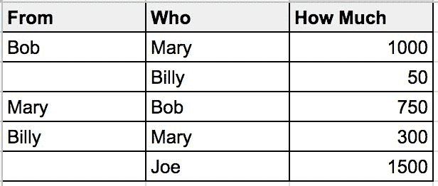

因此，Bob 的余额可以被 Mary 最多花费 1000 个代币，被 Billy 最多花费 50 个代币。Mary 的余额可以被 Bob 最多花费 750 个代币。Billy 的余额可以被 Mary 最多花费 300 个代币，被 Joe 最多花费 1500 个代币。

鉴于这个映射是 `internal` 的，它只能被本合约中的函数以及以本合约为基类的合约使用。

要批准他人从你的账户中花费代币，你需要调用 `approve` 函数，传入被允许花费你代币的人的地址以及允许他们花费的金额，并在函数中触发一个 `Approval` 事件：

```
function approve(address _spender, uint256 _value) public returns (bool) {
  allowed[msg.sender][_spender] = _value;
  emit Approval(msg.sender, _spender, _value);
  return true;
}
```

我们还需要一种方法来读取一个用户可以从另一个用户账户中花费多少：

```
function allowance(address _owner, address _spender) public view returns (uint256) {
    return allowed[_owner][_spender];
}
```

所以这是另一个 `read only` 函数（`view`），这意味着它是免费执行的。它只是读取剩余的可提取余额。

那么如何代表他人发送呢？通过一个新的 `transferFrom` 函数：

```
function transferFrom(address _from, address _to, uint256 _value) public returns (bool) {
    require(_to != address(0));
    require(_value <= balances[_from]);
    require(_value <= allowed[_from][msg.sender]);

    balances[_from] = balances[_from].sub(_value);
    balances[_to] = balances[_to].add(_value);
    allowed[_from][msg.sender] = allowed[_from][msg.sender].sub(_value);
    emit Transfer(_from, _to, _value);
    return true;
}
```

和之前一样，有一些合理性检查：目标地址不能是空地址，因此不能将代币发送到黑洞。被转移的数量不仅需要小于或等于被转出账户的当前余额，还需要小于或等于消息发送者（发起此交易的地址）仍然被允许为其花费的余额。

接下来，余额被更新，并且允许的余额与之同步，然后触发关于 `Transfer` 的事件。

#### 在没有 `allowed` 的情况下花费代币

代币持有者有可能在不更新 `allowed` 映射的情况下花费代币。如果代币持有者手动使用 `transfer` 发送代币，就可能发生这种情况。在这种情况下，持有者的代币数量可能会少于授权额度所规定的第三方可以为其花费的数量。

有了批准和授权额度，我们还可以创建函数，让代币持有者增加或减少某人的授权额度，而不是完全覆盖该值。尝试将其作为练习，然后参考下面的源代码获取解决方案。

```
function increaseApproval(address _spender, uint _addedValue) public returns (bool) {
    allowed[msg.sender][_spender] = (
    allowed[msg.sender][_spender].add(_addedValue));
    emit Approval(msg.sender, _spender, allowed[msg.sender][_spender]);
    return true;
}

function decreaseApproval(address _spender, uint _subtractedValue) public returns (bool) {
    uint oldValue = allowed[msg.sender][_spender];
    if (_subtractedValue > oldValue) {
        allowed[msg.sender][_spender] = 0;
    } else {
        allowed[msg.sender][_spender] = oldValue.sub(_subtractedValue);
    }
    emit Approval(msg.sender, _spender, allowed[msg.sender][_spender]);
    return true;
}
```

## 构造函数

到目前为止，我们只是构建了一个代币“合约”。但这个代币是什么？它叫什么名字？它有多少位小数？我们如何使用它？

在最开始，我们定义了一个 `constructor` 函数。现在，让我们完成它的主体并添加属性 `name`、`symbol` 和 `decimals`：

```
string public name;
string public symbol;
uint8 public decimals;

constructor(string _name, string _symbol, uint8 _decimals, uint256 _totalSupply) public {
    name = _name;
    symbol = _symbol;
    decimals = _decimals;
    totalSupply_ = _totalSupply;
}
```

这样做可以让我们以后为其他相同类型的代币重用该合约。但鉴于我们确切知道我们在构建什么，让我们硬编码这些值：

```
string public name;
string public symbol;
uint8 public decimals;

constructor() public {
    name = "The Neverending Story Token";
    symbol = "TNS";
    decimals = 18;
    totalSupply_ = 100 * 10**6 * 10**18;
}
```

这些细节会被各种以太坊工具和平台在显示代币信息时读取。构造函数在合约部署到以太坊网络时自动调用，因此这些值将在部署时自动配置。

关于 `totalSupply_ = 100 * 10**6 * 10**18;` 的一点说明：这只是为了让人类更容易阅读这个数字。由于以太坊中的所有转账都是以以太或代币的最小单位（包括小数）进行的，最小单位是小数点后 18 位。这就是为什么一个 TNS 代币是 `1 * 10**18`。此外，我们想要 1 亿个，所以是 `100 * 10**6` 或 `100*10*10*10*10*10*10`。这使得数字比 `100000000000000000000000000` 更易读。

## 替代开发流程

或者，我们可以直接扩展 Zeppelin 合约，修改一些属性，然后我们就得到了自己的代币。这是大多数人的做法，但在处理可能处理数百万他人资金的软件时，我个人倾向于*确切地*知道我在代码中放了什么，因此在我个人情况下，盲目代码复用是最少的。


```
pragma solidity ⁰.4.24;

import "../node_modules/openzeppelin-solidity/contracts/math/SafeMath.sol";
import "../node_modules/openzeppelin-solidity/contracts/token/ERC827/ERC20Token.sol";

contract TNStoken is ERC20Token {
    using SafeMath for uint256;

    string public name;
    string public symbol;
    uint8 public decimals;
    uint256 totalSupply_;

    constructor() public {
        name = "The Neverending Story Token";
        symbol = "TNS";
        decimals = 18;
        totalSupply_ = 100 * 10**6 * 10**18;
    }
}
```

在这种情况下，我们使用 `is` 符号来声明我们的代币 `is ERC20Token`。这使得我们的代币 *扩展* 了 `ERC20` 合约，而该合约又扩展了 `StandardToken`，以此类推……

无论如何，我们的代币现在已经准备好了。但是，最初谁获得多少代币以及如何获得呢？

## 初始余额

让我们将所有的代币都赋予合约的创建者。否则，代币将无法发送给任何人。通过将以下行添加到 `constructor` 的末尾来更新它：

```
balances[msg.sender] = totalSupply_;
```

## 代币锁定

鉴于我们打算将代币用作投票权（即，你在投票期间锁定的代币数量代表你投票的权重），我们需要一种方法来防止用户在投票后转移代币，否则我们的 DAO 将容易受到 **女巫攻击** —— 一个拥有百万代币的人可以注册 100 个地址，并通过将代币发送到不同地址并用新地址重新投票，从而获得一亿代币的投票权。因此，我们将阻止转移一个人已投入投票的恰好数量的代币，累计每个提案的每次投票。这就是我们在本文开头提到的转折点。让我们将以下事件添加到我们的合约中：

```
event Locked(address indexed owner, uint256 indexed amount);
```

然后让我们添加锁定方法：

```
function increaseLockedAmount(address _owner, uint256 _amount) onlyOwner public returns (uint256) {
    uint256 lockingAmount = locked[_owner].add(_amount);
    require(balanceOf(_owner) >= lockingAmount, "Locking amount must not exceed balance");
    locked[_owner] = lockingAmount;
    emit Locked(_owner, lockingAmount);
    return lockingAmount;
}

function decreaseLockedAmount(address _owner, uint256 _amount) onlyOwner public returns (uint256) {
    uint256 amt = _amount;
    require(locked[_owner] > 0, "Cannot go negative. Already at 0 locked tokens.");
    if (amt > locked[_owner]) {
        amt = locked[_owner];
    }
    uint256 lockingAmount = locked[_owner].sub(amt);
    locked[_owner] = lockingAmount;
    emit Locked(_owner, lockingAmount);
    return lockingAmount;
}
```

每个方法都确保不能锁定或解锁非法数量，然后在更改给定地址的锁定数量后发出一个事件。每个函数还返回该用户现在锁定的新数量。但这仍然不能防止发送。让我们修改 `transfer` 和 `transferFrom`：

```
function transfer(address _to, uint256 _value) public returns (bool) {
    require(_to != address(0));
    require(_value <= balances[msg.sender] - locked[msg.sender]); // <-- THIS LINE IS DIFFERENT
    // ...

function transferFrom(address _from, address _to, uint256 _value) public returns (bool) {
    require(_to != address(0));
    require(_value <= balances[_from] - locked[_from]);
    require(_value <= allowed[_from][msg.sender] - locked[_from]); // <-- THIS LINE IS DIFFERENT
    // ...
```

最后，我们需要知道用户有多少代币被锁定或解锁：

```
function getLockedAmount(address _owner) view public returns (uint256) {
    return locked[_owner];
}

function getUnlockedAmount(address _owner) view public returns (uint256) {
    return balances[_owner].sub(locked[_owner]);
}
```

就是这样：我们的代币现在可以从外部锁定，但只能由代币合约的所有者（这将是我们在接下来的教程中构建的 Story DAO）进行。让我们使代币合约成为 `Ownable` —— 即允许它有一个所有者。使用 `import "../node_modules/openzeppelin-solidity/contracts/ownership/Ownable.sol";` 导入 `Ownable` 合约，然后更改这一行：

```
contract StoryDao {
```

……改为这样：

```
contract StoryDao is Ownable {
```

## 完整代码

此时带有自定义函数注释的代币完整代码如下所示：


```
pragma solidity ⁰.4.24;

import "../node_modules/openzeppelin-solidity/contracts/math/SafeMath.sol";
import "../node_modules/openzeppelin-solidity/contracts/ownership/Ownable.sol";

contract TNStoken is Ownable {

    using SafeMath for uint256;

    mapping(address => uint256) balances;
    mapping(address => uint256) locked;
    mapping (address => mapping (address => uint256)) internal allowed;
    uint256 totalSupply_;

    event Transfer(address indexed from, address indexed to, uint256 value);
    event Approval(address indexed owner, address indexed spender, uint256 value);
    event Locked(address indexed owner, uint256 indexed amount);

    string public name;
    string public symbol;
    uint8 public decimals;

    constructor() public {
        name = "The Neverending Story Token";
        symbol = "TNS";
        decimals = 18;
        totalSupply_ = 100 * 10**6 * 10**18;
        balances[msg.sender] = totalSupply_;
    }

    /**
    @dev _owner will be prevented from sending _amount of tokens. Anything
beyond this amount will be spendable.
    */
    function increaseLockedAmount(address _owner, uint256 _amount) public onlyOwner returns (uint256) {
        uint256 lockingAmount = locked[_owner].add(_amount);
        require(balanceOf(_owner) >= lockingAmount, "Locking amount must not exceed balance");
        locked[_owner] = lockingAmount;
        emit Locked(_owner, lockingAmount);
        return lockingAmount;
    }

    /**
    @dev _owner will be allowed to send _amount of tokens again. Anything
remaining locked will still not be spendable. If the _amount is greater
than the locked amount, the locked amount is zeroed out. Cannot be neg.
    */
    function decreaseLockedAmount(address _owner, uint256 _amount) public onlyOwner returns (uint256) {
        uint256 amt = _amount;
        require(locked[_owner] > 0, "Cannot go negative. Already at 0 locked tokens.");
        if (amt > locked[_owner]) {
            amt = locked[_owner];
        }
        uint256 lockingAmount = locked[_owner].sub(amt);
        locked[_owner] = lockingAmount;
        emit Locked(_owner, lockingAmount);
        return lockingAmount;
    }

    function transfer(address _to, uint256 _value) public returns (bool) {
        require(_to != address(0));
        require(_value <= balances[msg.sender] - locked[msg.sender]);

        balances[msg.sender] = balances[msg.sender].sub(_value);
        balances[_to] = balances[_to].add(_value);
        emit Transfer(msg.sender, _to, _value);
        return true;
    }

    function approve(address _spender, uint256 _value) public returns (bool) {
        allowed[msg.sender][_spender] = _value;
        emit Approval(msg.sender, _spender, _value);
        return true;
    }

    function transferFrom(address _from, address _to, uint256 _value) public returns (bool) {
        require(_to != address(0));
        require(_value <= balances[_from] - locked[_from]);
        require(_value <= allowed[_from][msg.sender] - locked[_from]);

        balances[_from] = balances[_from].sub(_value);
        balances[_to] = balances[_to].add(_value);
        allowed[_from][msg.sender] = allowed[_from][msg.sender].sub(_value);
        emit Transfer(_from, _to, _value);
        return true;
    }

    function increaseApproval(address _spender, uint _addedValue) public returns (bool) {
        allowed[msg.sender][_spender] = (
        allowed[msg.sender][_spender].add(_addedValue));
        emit Approval(msg.sender, _spender, allowed[msg.sender][_spender]);
        return true;
    }

    function decreaseApproval(address _spender, uint _subtractedValue) public returns (bool) {
        uint oldValue = allowed[msg.sender][_spender];
        if (_subtractedValue > oldValue) {
            allowed[msg.sender][_spender] = 0;
        } else {
            allowed[msg.sender][_spender] = oldValue.sub(_subtractedValue);
        }
        emit Approval(msg.sender, _spender, allowed[msg.sender][_spender]);
        return true;
    }

    /**
    @dev Returns number of tokens the address is still prevented from using
    */
    function getLockedAmount(address _owner) public view returns (uint256) {
        return locked[_owner];
    }

    /**
    @dev Returns number of tokens the address is allowed to send
    */
    function getUnlockedAmount(address _owner) public view returns (uint256) {
        return balances[_owner].sub(locked[_owner]);
    }

    function balanceOf(address _owner) public view returns (uint256) {
        return balances[_owner];
    }

    function totalSupply() public view returns (uint256) {
        return totalSupply_;
    }

    function allowance(address _owner, address _spender) public view returns (uint256) {
        return allowed[_owner][_spender];
    }

}
```

## 结论

这一部分帮助我们构建了一个基础代币，我们将把它用作《永不结束的故事》中的参与/股份代币。虽然该代币具有*实用性*，但根据其定义，它是一种控制更大主体决策的资产，因此是一种*证券*代币。请注意[两者的区别](https://bitfalls.com/2018/02/20/switzerland-publishes-ico-regulations-crypto-token-classifications/)。

在本系列的下一部分中，我们将学习如何编译、部署和测试这个代币。

# 第 3 章：以太坊 DApp：编译、部署、测试 TNS 代币

**在本教程系列关于使用以太坊构建 DApp 的第 2 部分中，我们编写了 TNS 代币的代码。但我们还没有编译、部署、测试或验证它。让我们在这一部分完成所有这些工作，为接下来的内容做好准备。**

## 编译

此时，我们有一个包含一些 Solidity 代码的文件。但为了让以太坊虚拟机理解它，我们需要将其转换为机器码。此外，为了从 Web 应用程序与之通信，我们需要一个 ABI（应用程序二进制接口），它是某个智能合约（无论是代币还是更复杂的东西）中存在的函数的通用可读描述。我们可以通过使用 Truffle 的编译器同时为 EVM 和 ABI 创建机器码。

在项目文件夹中，运行：

```
truffle compile
```

此命令将查看`contracts`子文件夹，编译所有合约，并将编译后的版本放入`build`子文件夹。请注意，如果您使用了上一部分中的替代开发流程，那么我们的`TNSToken`合约继承功能的所有父合约也将被逐一编译，每个合约都有自己的文件。

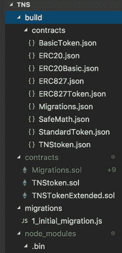

请随意检查生成的 JSON 文件的内容。我们的`TNSToken`应该有超过 10000 行 JSON 代码。

## 部署到 Ganache

现在让我们看看是否可以将此代币部署到我们模拟的 Ganache 区块链上。如果 Ganache 尚未在终端标签页或操作系统应用程序中运行，请使用以下命令运行它：

```
ganache-cli
```

或者运行应用程序以获得如下屏幕：

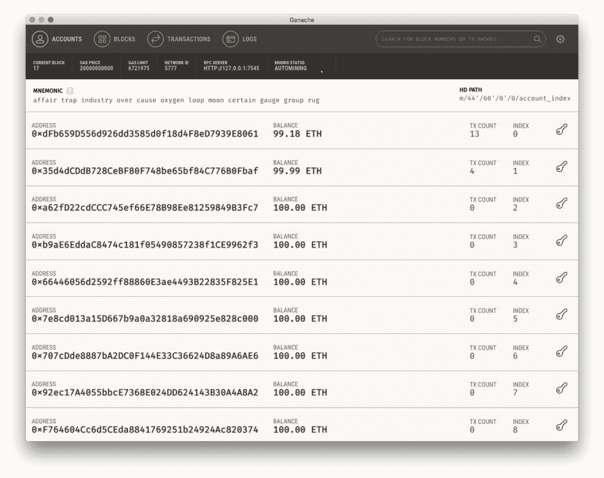

然后，回到我们刚刚编译合约的文件夹，我们需要添加一个迁移。创建文件`migrations/2_deploy_tnstoken.js`。如果您不熟悉 Truffle 生态系统中的迁移，请参阅[本指南](https://www.sitepoint.com/truffle-migrations-explained/)。

让我们将以下内容放入该文件：

```
var Migrations = artifacts.require("./Migrations.sol");
var TNSToken = artifacts.require("./TNSToken.sol");

module.exports = function(deployer, network, accounts) {
  deployer.deploy(TNSToken, {from: accounts[0]});
};
```


首先，通过请求 `Migrations.sol` 导入执行迁移的能力。这是每次迁移所必需的。接下来，部署代币意味着我们需要导入其 Solidity 代码，我们通过引入 `TNSToken.sol`（即我们在上一部分编写的代码）来实现这一点。最后，这是一个模板化的迁移，只有 `function(deployer, network, accounts) {` 和最后一个 `}` 之间的部分会发生变化。

在这种情况下，我们告诉部署器部署 TNSToken，并传入 `from` 参数以设置初始代币持有者。这里使用的地址是 Ganache 生成的随机地址，但通过使用自动传递给部署器的 `accounts` 数组，我们确保能够访问运行节点（无论是实时的 Geth 节点还是 Ganache）中的账户列表。在我的具体示例中，`account[0]` 地址是 `0xdFb659D556d926dd3585d0f18d4F8eD7939E8061`，这在上面的截图中也很明显。

我们也不要忘记在 `truffle.js` 中配置开发环境：

```
module.exports = {
  networks: {
    development: {
      host: "127.0.0.1",
      port: 7545,
      network_id: "*"
    }
  }
};
```

### 咳咳，打扰一下……

请注意端口和 IP；你的可能不同！

最后，在项目文件夹中运行 `truffle migrate`。你应该会看到类似这样的内容：

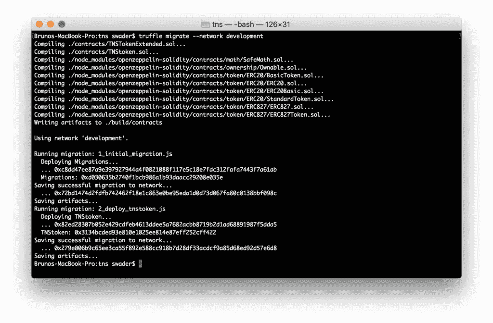

注意 `TNStoken` 旁边的以太坊地址：`0x3134bcded93e810e1025ee814e87eff252cff422`。这就是我们的代币部署的位置。现在让我们看看它的实际运行情况。

## 测试代币

在这种情况下，自动化测试并非必需。代币合约高度标准化且经过实战检验。如果我们使用了超出传统代币范围的功能，那么自动化测试就会派上用场。不过，就目前而言，通过在不同地址之间发送代币来进行测试已经足够了。

打开一个钱包 UI，比如 [MyEtherWallet](https://bitfalls.com/2018/02/19/first-ethereum-address-learning-use-myetherwallet/)，然后在右上角的菜单中选择自定义网络。在对话框中，输入你的私有区块链提供的信息——无论是 Ganache 还是实际的 PoA 区块链，取决于你基于本教程系列[第 1 部分](https://www.sitepoint.com/building-ethereum-dapps-app-rules-blockchain-setup)运行的是哪个。在我的示例中，地址是 `127.0.0.1`，端口是 `7545`。

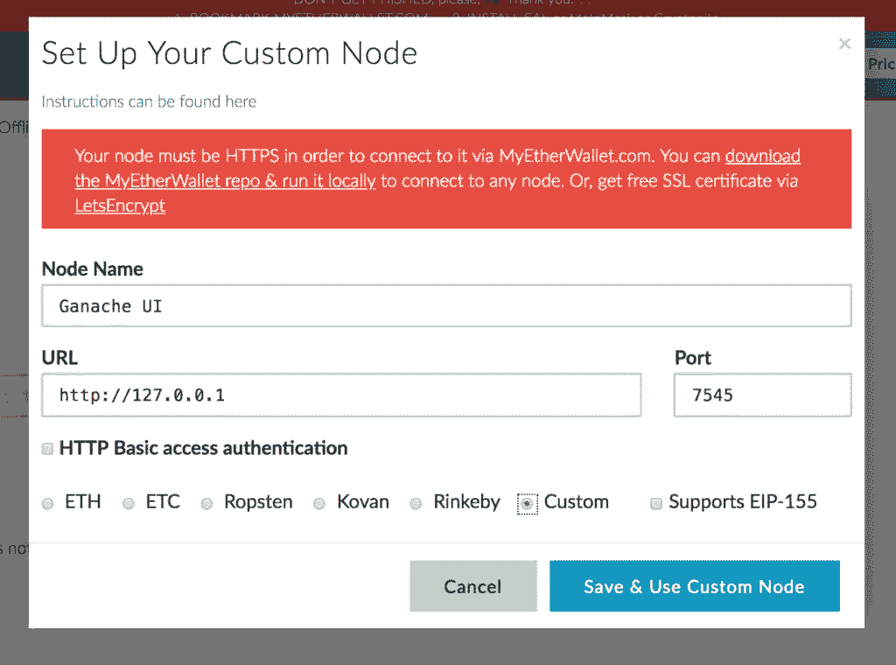

打开你在部署脚本中设置为 `from` 值的钱包。如果你使用的是 Ganache，你会在 Ganache 界面或终端中的 Ganache 输出中看到它的私钥。

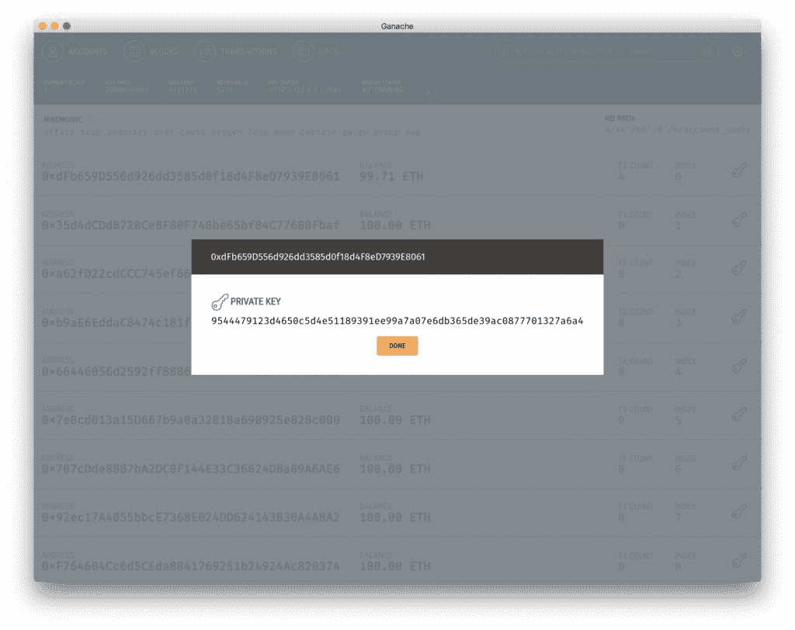

最后，需要告诉 MEW 这个代币的存在。我们通过添加一个自定义代币来实现这一点。

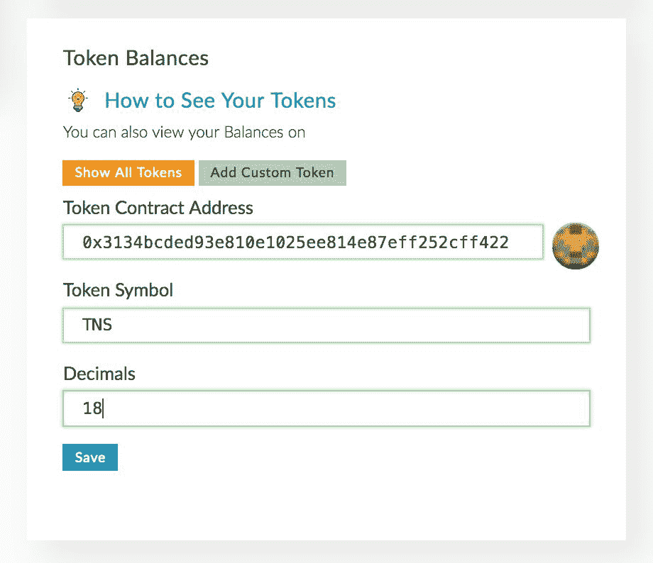

添加代币后，你会立即注意到该账户现在拥有 1 亿个代币的余额，并且可以在货币下拉选择菜单中发送它们。让我们尝试向另一个地址发送一些代币。

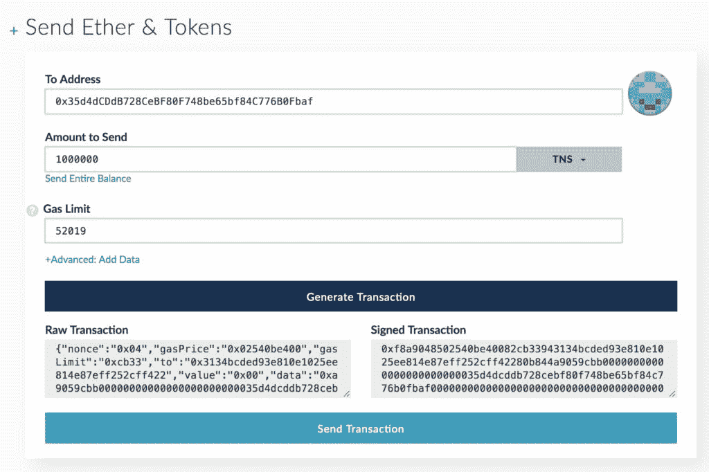

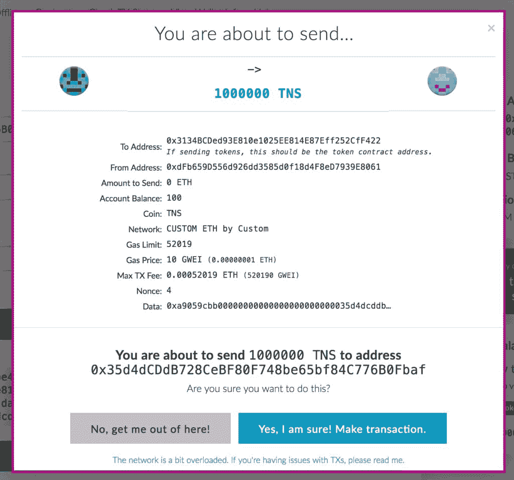

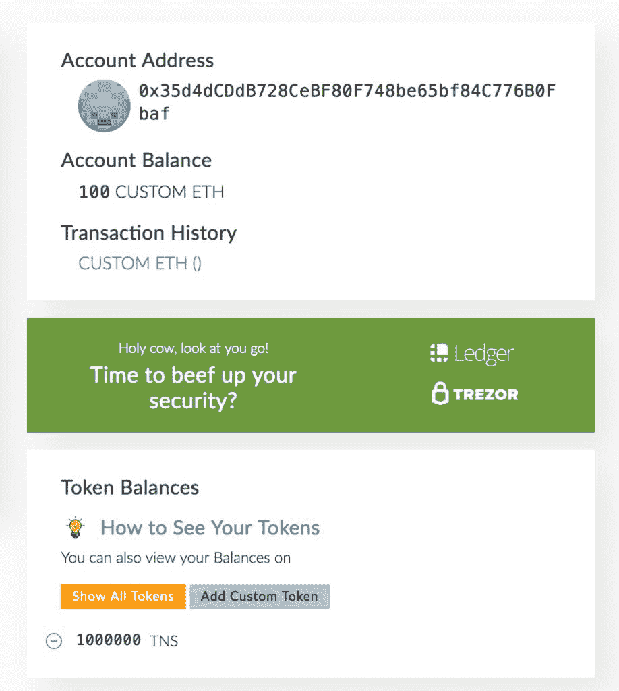

现在继续将这些代币发送回去，使原始账户余额恢复到 1 亿。我们刚刚确认了代币的基本功能按预期工作。

## 部署到实时网络

如果不将代币部署到实时网络上，这就算不上真正的代币测试。不过，我们不要使用主网，而是使用像 Rinkeby 这样的[测试网](https://bitfalls.com/hr/2018/02/08/what-is-an-ethereum-testnet-and-how-is-it-used/)。

在 `truffle.js` 中，让我们添加一个新网络——`rinkeby`——这样我们的文件看起来像这样：

```
require('dotenv').config();
const WalletProvider = require("truffle-wallet-provider");
const Wallet = require('ethereumjs-wallet');
const Web3 = require("web3");
const w3 = new Web3();

const PRIVKEY = process.env["PRIVKEY"];
const INFURAKEY = process.env["INFURAKEY"];

module.exports = {
  networks: {
    development: {
      host: "127.0.0.1",
      port: 7545,
      network_id: "*"
    },
    rinkeby: {
      provider: function() {
        return new WalletProvider(
          Wallet.fromPrivateKey(
            Buffer.from(PRIVKEY, "hex")), "https://rinkeby.infura.io/"+INFURAKEY

        );
      },
      gas: 4600000,
      gasPrice: w3.utils.toWei("50", "gwei"),
      network_id: "3",
    },
  }
};
```

哎呀！这些都是什么？

让我们逐行处理。

前几行导入了一些节点模块，以便我们可以在下面使用这些函数。如果其中任何一个出现缺少模块的消息，只需运行 `npm install web3-wallet-provider truffle-wallet-provider web3 dotenv --save` 即可解决问题。

接下来，我们从项目文件夹根目录下的 `.env` 文件中加载运行合约的钱包的私钥（即将要获得 1 亿代币的钱包；这里我们不能使用 `from` 值）。如果该文件不存在，请创建它。同一个文件还包含一个 Infura.io 访问密钥，这是一个托管以太坊节点并允许应用程序连接它们的网站，这样开发者就不需要在他们的计算机上运行完整的以太坊节点。

`.env` 文件默认是隐藏的，并且可以在 `.gitignore` 中被忽略，这样你的私钥就不会有泄露的风险——这是一个非常重要的预防措施！该文件包含以下内容：

```
PRIVKEY="YOUR_PRIVATE_KEY";
INFURAKEY="YOUR_INFURA_ACCESS_KEY";
```

你可以通过[在此注册](https://infura.io/signup)来获取你的 Infura 密钥。如果你安装了 [Metamask](https://bitfalls.com/2018/02/16/metamask-send-receive-ether/)，将其切换到 Rinkeby，然后转到“导出私钥”，就可以轻松获得私钥。不过任何方法都可以，所以选择你喜欢的。你也可以使用 Ganache 的私钥。一个私钥可以在所有以太坊网络上解锁同一个钱包——测试网、Rinkeby、主网，等等。

回到我们的配置文件。我们有一个新的 `network` 条目：`rinkeby`。这是我们将要部署到的以太坊测试网的名称，provider 内部的代码基本上是模板化的复制粘贴，告诉 Truffle“获取我的私钥，进行十六进制编码，将其变成一个解锁的钱包，然后通过它与 Infura 通信”。

最后，我们定义了执行此合约想要花费的 Gas 上限（460 万足够了，如果需要可以更改）、Gas 的价格（50 Gwei 实际上[相当昂贵](https://bitfalls.com/2017/12/05/ethereum-gas-and-transaction-fees-explained/)，但我们使用的以太币是模拟的，所以没关系），并将网络 ID 设置为 4，因为 Rinkeby 测试网就是这样[标记的](https://ethereum.stackexchange.com/questions/17051/how-to-select-a-network-id-or-is-there-a-list-of-network-ids)。

还有一件事我们需要做。我们之前编写的迁移文件指定了一个 `from` 地址，但 Rinkeby 的地址不同。这是否意味着我们需要根据网络更改部署脚本？当然不是！让我们将 `2_deploy_tnstoken.js` 文件修改为如下所示：

```
var Migrations = artifacts.require("./Migrations.sol");
var TNSToken = artifacts.require("./TNSToken.sol");

module.exports = function(deployer, network, accounts) {
  if (network == "development") {
    deployer.deploy(TNSToken, {from: accounts0});
  } else {
    deployer.deploy(TNSToken);
  }
};
```

如你所见，部署脚本是简单的 JavaScript，传递给部署器的第二个参数始终是网络名称——我们可以用它来区分不同的网络。

如果我们现在尝试使用 `truffle migrate --network rinkeby` 运行迁移，如果我们使用的地址是新的，它将会失败：

 申请一些即可。这是免费的。

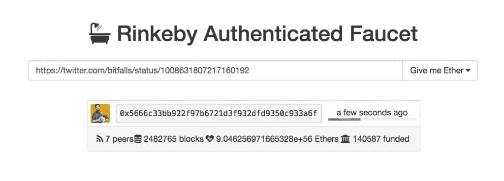

现在重新运行迁移，代币合约将部署到 Rinkeby 网络上。它可以像上面 Ganache 用例一样进行测试。一切应该完全相同，只不过现在你还可以与朋友和同事一起测试。进展顺利！

## 附加内容：验证与 ENS

为了增加信任度，建议你在 Etherscan 上验证代币，并为其注册一个 ENS 域名。

### 验证

**验证** 是指将代币的源代码提交给 Etherscan，以便其与网络上部署的代码进行比较，从而确认没有后门。这可以在代币地址的 *Code* 标签页中完成。由于我们的代币使用了某些第三方代码，而这些代码无法轻松导入到 *Verify* 界面的代码窗口中，因此我们需要 *展平* 合约。为此，我们将使用一个名为 `truffle-flattener` 的工具：

```
npm install --global truffle-flattener
```

该工具会将所有依赖项和代币的源代码复制到一个文件中。我们可以这样运行它：

```
truffle-flattener contracts/TNSToken.sol >> ./contracts/TNSTokenFlat.sol
```

现在，`contracts` 文件夹中应该会出现一个新文件，其内容与我们的源代码几乎相同，但粘贴了依赖代码（例如，`SafeMath.sol` 会被粘贴到文件顶部）。

将该新文件的内容粘贴到 *Verify* 界面的代码窗口中，将编译器设置为运行 `truffle version` 得到的版本，并将 *Optimization* 设置为 *No*。点击 *Verify* 和 *Publish*，一旦过程完成，你的代币地址页面将出现新标签页：*Read Contract* 和 *Write Contract*，而 *Code* 标签页将显示一个绿色对勾，表示代码已验证通过。这将为你赢得社区的额外信任。

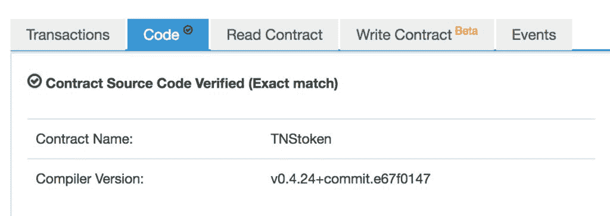

### ENS

ENS 是以太坊名称系统。它用于为以太坊地址赋予人类可读的名称，这样你就不必记住 `0xmumbojumbo` 这样的字符串，而是可以记住像 `bitfalls.eth` 这样的地址。你甚至可以注册子域名，例如 `token.bitfalls.eth`。注册 ENS 域名的过程并不简单，且需要时间，因此如果你想这样做，建议你阅读 [本指南](https://ens.domains/) 并按照 [此处](https://www.myetherwallet.com/#ens) 的说明操作。

## 结论

在本部分中，我们完成了自定义代币的编译和部署。该代币与所有交易所兼容，并且可以作为常规 ERC20 代币使用。

# 第 4 章：白名单与测试 Story DAO

**在 第 3 部分 的《使用以太坊构建 DApp》系列教程中，我们构建并部署了代币到以太坊测试网 Rinkeby。在本部分中，我们将开始编写 Story DAO 代码。**

我们将使用 第一章 中列出的条件作为指导。

## 合约大纲

让我们创建一个新合约 `StoryDao.sol`，其骨架如下：

```
pragma solidity ⁰.4.24;

import "../node_modules/openzeppelin-solidity/contracts/math/SafeMath.sol";
import "../node_modules/openzeppelin-solidity/contracts/ownership/Ownable.sol";

contract StoryDao is Ownable {
    using SafeMath for uint256;

    mapping(address => bool) whitelist;
    uint256 public whitelistedNumber = 0;
    mapping(address => bool) blacklist;
    event Whitelisted(address addr, bool status);
    event Blacklisted(address addr, bool status);

    uint256 public daofee = 100; // hundredths of a percent, i.e. 100 is 1%
    uint256 public whitelistfee = 10000000000000000; // in Wei, this is 0.01 ether

    event SubmissionCommissionChanged(uint256 newFee);
    event WhitelistFeeChanged(uint256 newFee);

    uint256 public durationDays = 21; // duration of story's chapter in days
    uint256 public durationSubmissions = 1000; // duration of story's chapter in entries

    function changedaofee(uint256 _fee) onlyOwner external {
        require(_fee < daofee, "New fee must be lower than old fee.");
        daofee = _fee;
        emit SubmissionCommissionChanged(_fee);
    }

    function changewhitelistfee(uint256 _fee) onlyOwner external {
        require(_fee < whitelistfee, "New fee must be lower than old fee.");
        whitelistfee = _fee;
        emit WhitelistFeeChanged(_fee);
    }

    function lowerSubmissionFee(uint256 _fee) onlyOwner external {
        require(_fee < submissionZeroFee, "New fee must be lower than old fee.");
        submissionZeroFee = _fee;
        emit SubmissionFeeChanged(_fee);
    }

    function changeDurationDays(uint256 _days) onlyOwner external {
        require(_days >= 1);
        durationDays = _days;
    }

    function changeDurationSubmissions(uint256 _subs) onlyOwner external {
        require(_subs > 99);
        durationSubmissions = _subs;
    }
}
```

我们导入了 `SafeMath` 以再次进行安全计算，但这次我们还使用了 Zeppelin 的 `Ownable` 合约，它允许某人“拥有”故事并执行某些仅限管理员的功能。只需声明 `StoryDao is Ownable` 即可；你可以自行检查该合约以了解其工作原理。

我们还使用了该合约中的 `onlyOwner` 修饰符。函数修饰符本质上是函数的扩展或插件。`onlyOwner` 修饰符如下所示：

```
modifier onlyOwner() {
  require(msg.sender == owner);
  _;
}
```

当 `onlyOwner` 被添加到函数中时，该函数的函数体会被 *粘贴* 到 `_;` 所在的位置，并且其前面的代码会先执行。因此，通过使用此修饰符，函数会自动检查消息发送者是否也是合约的所有者，如果是，则继续正常执行；如果不是，则崩溃。

通过在对故事 DAO 的费用和其他参数进行更改的函数上使用 `onlyOwner` 修饰符，我们确保只有管理员才能进行这些更改。

### 测试

让我们测试初始函数。

如果 `test` 文件夹不存在，请创建它。然后在其中创建文件 `TestStoryDao.sol` 和 `TestStoryDao.js`。由于 Truffle 中没有原生方法来测试异常，还需要创建 `helpers/expectThrow.js`，内容如下：

```
export default async promise => {
    try {
      await promise;
    } catch (error) {
      const invalidOpcode = error.message.search('invalid opcode') >= 0;
      const outOfGas = error.message.search('out of gas') >= 0;
      const revert = error.message.search('revert') >= 0;
      assert(
        invalidOpcode || outOfGas || revert,
        'Expected throw, got \'' + error + '\' instead',
      );
      return;
    }
    assert.fail('Expected throw not received');
  };
```

#### Solidity 测试与 JS 测试

Solidity 测试通常用于测试底层、基于合约的函数，即智能合约的内部逻辑。JS 测试通常用于测试合约是否可以从外部正确交互，而这正是我们的最终用户将要进行的操作。

在 `TestStoryDao.sol` 中，放入以下内容：


```solidity
pragma solidity ⁰.4.24;

import "truffle/Assert.sol";
import "truffle/DeployedAddresses.sol";
import "../contracts/StoryDao.sol";

contract TestStoryDao {

    function testDeploymentIsFine() public {
        StoryDao sd = StoryDao(DeployedAddresses.StoryDao());

        uint256 daofee = 100; // 百分之一，即 100 表示 1%
        uint256 whitelistfee = 10000000000000000; // 以 Wei 为单位，即 0.01 以太币

        uint256 durationDays = 21; // 故事章节的持续时间（天）
        uint256 durationSubmissions = 1000; // 故事章节的提交数量限制

        Assert.equal(sd.daofee(), daofee, "初始 DAO 费用应为 100");
        Assert.equal(sd.whitelistfee(), whitelistfee, "初始白名单费用应为 0.01 以太币");
        Assert.equal(sd.durationDays(), durationDays, "初始天数持续时间应设为 3 周");
        Assert.equal(sd.durationSubmissions(), durationSubmissions, "初始提交持续时间应设为 1000 条");
    }
}
```

这段代码检查`StoryDao`合约是否以正确的费用和持续时间参数成功部署。第一行通过从已部署地址列表中读取合约来确保其已部署，最后一部分执行了一些`assertions`——检查某个断言是否为真。在我们的例子中，我们将数值与已部署合约的初始值进行比较。当结果为“真”时，`Assert.equals`部分会触发一个“True”事件，这正是 Truffle 在测试时监听的内容。

在`TestStoryDao.js`中，放入以下内容：

```javascript
import expectThrow from './helpers/expectThrow';

const StoryDao = artifacts.require("StoryDao");

contract('StoryDao Test', async (accounts) => {

    it("应通过检查前 3 个账户余额超过 20 以太币来确认环境正常", async () =>{
        assert.equal(web3.eth.getBalance(accounts[0]).toNumber() > 2e+19, true, "账户 0 余额超过 20 以太币");
        assert.equal(web3.eth.getBalance(accounts[1]).toNumber() > 2e+19, true, "账户 1 余额超过 20 以太币");
        assert.equal(web3.eth.getBalance(accounts[2]).toNumber() > 2e+19, true, "账户 2 余额超过 20 以太币");
    });

    it("应使部署者成为合约所有者", async () => {
        let instance = await StoryDao.deployed();
        assert.equal(await instance.owner(), accounts[0]);
    });

    it("应允许所有者更改费用和持续时间", async () => {
        let instance = await StoryDao.deployed();

        let newDaoFee = 50;
        let newWhitelistFee = 1e+10; // 1 以太币
        let newDayDuration = 42;
        let newSubsDuration = 1500;

        instance.changedaofee(newDaoFee, {from: accounts[0]});
        instance.changewhitelistfee(newWhitelistFee, {from: accounts[0]});
        instance.changedurationdays(newDayDuration, {from: accounts[0]});
        instance.changedurationsubmissions(newSubsDuration, {from: accounts[0]});

        assert.equal(await instance.daofee(), newDaoFee);
        assert.equal(await instance.whitelistfee(), newWhitelistFee);
        assert.equal(await instance.durationDays(), newDayDuration);
        assert.equal(await instance.durationSubmissions(), newSubsDuration);
    });

    it("应禁止非所有者更改费用和持续时间", async () => {
        let instance = await StoryDao.deployed();

        let newDaoFee = 50;
        let newWhitelistFee = 1e+10; // 1 以太币
        let newDayDuration = 42;
        let newSubsDuration = 1500;

        await expectThrow(instance.changedaofee(newDaoFee, {from: accounts[1]}));
        await expectThrow(instance.changewhitelistfee(newWhitelistFee, {from: accounts[1]}));
        await expectThrow(instance.changedurationdays(newDayDuration, {from: accounts[1]}));
        await expectThrow(instance.changedurationsubmissions(newSubsDuration, {from: accounts[1]}));
    });

    it("应确保所有者只能将费用和持续时间更改为有效值", async () =>{
        let instance = await StoryDao.deployed();

        let invalidDaoFee = 20000;
        let invalidDayDuration = 0;
        let invalidSubsDuration = 98;

        await expectThrow(instance.changedaofee(invalidDaoFee, {from: accounts[0]}));
        await expectThrow(instance.changedurationdays(invalidDayDuration, {from: accounts[0]}));
        await expectThrow(instance.changedurationsubmissions(invalidSubsDuration, {from: accounts[0]}));
    })
});
```

为了让测试成功运行，我们还需要告诉 Truffle 我们希望部署`StoryDao`——因为它不会自动为我们部署。因此，让我们在`migrations`目录中创建`3_deploy_storydao.js`，其内容与我们之前编写的迁移文件几乎相同：

```javascript
var Migrations = artifacts.require("./Migrations.sol");
var StoryDao = artifacts.require("./StoryDao.sol");

module.exports = function(deployer, network, accounts) {
  if (network == "development") {
    deployer.deploy(StoryDao, {from: accounts[0]});
  } else {
    deployer.deploy(StoryDao);
  }
};
```

此时，我们还应该在项目根目录下更新（如果不存在则创建）一个`package.json`文件，其中包含到目前为止以及近期可能需要的依赖项：

```json
{
  "name": "storydao",
  "devDependencies": {
    "babel-preset-es2015": "⁶.18.0",
    "babel-preset-stage-2": "⁶.24.1",
    "babel-preset-stage-3": "⁶.17.0",
    "babel-polyfill": "⁶.26.0",
    "babel-register": "⁶.23.0",
    "dotenv": "⁶.0.0",
    "truffle": "⁴.1.12",
    "openzeppelin-solidity": "¹.10.0",
    "openzeppelin-solidity-metadata": "¹.2.0",
    "openzeppelin-zos": "",
    "truffle-wallet-provider": "⁰.0.5",
    "ethereumjs-wallet": "⁰.6.0",
    "web3": "¹.0.0-beta.34",
    "truffle-assertions": "⁰.3.1"
  }
}
```

以及一个包含以下内容的`.babelrc`文件：

```json
{
  "presets": ["es2015", "stage-2", "stage-3"]
}
```

我们还需要在 Truffle 配置中引入 Babel，以便它在编译测试时知道使用它。

#### Babel

Babel 是 NodeJS 的一个附加组件，它允许我们在当前版本的 NodeJS 中使用下一代 JavaScript 语法，例如编写`import`等。如果你不理解这些，只需忽略并直接粘贴即可。按照这种方式安装后，你可能再也不需要处理这个问题了。

```javascript
require('dotenv').config();

================== 添加以下两行 ================
require('babel-register');
require('babel-polyfill');
=======================================================

const WalletProvider = require("truffle-wallet-provider");
const Wallet = require('ethereumjs-wallet');

// ...
```

现在，**终于**可以运行`truffle test`了。输出应该类似于下图：

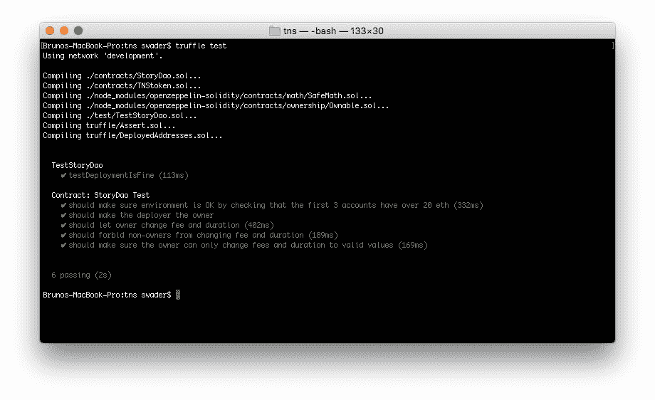

有关测试的更多信息，请参阅[本教程](https://www.sitepoint.com/truffle-testing-smart-contracts/)，我们专门为覆盖智能合约测试而准备了它。

在本课程的后续部分，我们将跳过测试，因为逐一编写会使教程过于冗长，但请参考项目的最终源代码以查看所有测试。我们刚刚完成的过程已经设置了测试环境，因此你可以直接编写测试，无需进一步配置。

## 白名单

现在让我们构建白名单机制，它允许用户参与故事创作。在`StoryDao.sol`中添加以下函数骨架：

```solidity
function whitelistAddress(address _add) public payable {
    // 如果发送了足够的资金，则将发送者加入白名单
}

function() external payable {
    // 如果未加入白名单，且支付足够，则加入白名单
    // 如果已加入白名单，则以指定价格购买 X 个代币
}
```


未命名的函数 `function()` 被称为 `fallback 函数`，当向该合约发送资金且没有附带特定指令（即没有专门调用其他函数）时，就会调用这个函数。这使得人们只需向 DAO 发送以太币即可加入 StoryDao，并根据他们是否已被列入白名单，要么立即获得白名单资格，要么购买代币。

`whitelistSender` 函数用于白名单操作，可以直接调用，但我们会确保 fallback 函数在收到以太币时，如果发送者尚未被列入白名单，则自动调用它。`whitelistAddress` 函数被声明为 `public`，因为它也应该能被其他合约调用，而 fallback 函数是 `external` 的，因为资金只会从外部地址发送到该地址。调用此合约的合约可以轻松直接调用所需的函数。

我们先处理 fallback 函数。

```
function() external payable {

    if (!whitelist[msg.sender]) {
        whitelistAddress(msg.sender);
    } else {
        // buyTokens(msg.sender, msg.value);
    }
}
```

我们检查发送者是否尚未被列入白名单，并将调用委托给 `whitelistAddress` 函数。注意，我们注释掉了 `buyTokens` 函数，因为我们还没有实现它。

接下来，处理白名单操作。

```
function whitelistAddress(address _add) public payable {
    require(!whitelist[_add], "候选地址不能已被列入白名单。");
    require(!blacklist[_add], "候选地址不能已被列入黑名单。");
    require(msg.value >= whitelistfee, "发送者必须发送足够的以太币以支付白名单费用。");

    whitelist[_add] = true;
    whitelistedNumber++;
    emit Whitelisted(_add, true);

    if (msg.value > whitelistfee) {
        // buyTokens(_add, msg.value.sub(whitelistfee));
    }
}
```

注意，这个函数接受地址作为参数，而不是从消息（交易）中提取地址。这样做还有一个额外的好处：如果某人无法负担加入 DAO 的费用，其他人可以为其进行白名单操作。

我们以一些合理性检查开始函数：发送者不能已被列入白名单或黑名单（禁止），并且必须发送足够的以太币以覆盖费用。如果这些条件满足，地址将被添加到白名单中，触发 `Whitelisted` 事件，最后，如果发送的以太币数量大于所需的白名单费用，剩余部分将用于购买代币。

### `sub`

我们使用 `sub` 而不是 `-` 进行减法，因为这是用于安全计算的 `SafeMath` 函数。

现在，用户只需向 StoryDao 合约发送 0.01 以太币或更多，即可为自己或他人获得白名单资格。

## 结论

在本教程中，我们构建了 DAO 的初始部分，但还有很多工作要做。敬请期待：在下一部分中，我们将处理向故事添加内容！

# 第 5 章：跨合约通信与代币销售

**在本系列关于使用以太坊构建 DApp 的教程的第 4 部分中，我们开始构建和测试我们的 DAO 合约。现在，让我们更进一步，根据我们的[介绍](https://www.sitepoint.com/building-ethereum-dapps-app-rules-blockchain-setup)，处理向故事添加内容和代币。**

## 添加代币

要使一个合约能够与另一个合约交互，它需要知道那个合约的接口——即可用的函数。由于我们的 TNS 代币具有相当简单的接口，我们可以将其包含在 DAO 合约中，放在 `contract StoryDao` 声明之上和我们的 `import` 语句之下：

```
contract LockableToken is Ownable {
    function totalSupply() public view returns (uint256);
    function balanceOf(address who) public view returns (uint256);
    function transfer(address to, uint256 value) public returns (bool);
    event Transfer(address indexed from, address indexed to, uint256 value);
    function allowance(address owner, address spender) public view returns (uint256);
    function transferFrom(address from, address to, uint256 value) public returns (bool);
    function approve(address spender, uint256 value) public returns (bool);
    event Approval(address indexed owner, address indexed spender, uint256 value);
    function approveAndCall(address _spender, uint256 _value, bytes _data) public payable returns (bool);
    function transferAndCall(address _to, uint256 _value, bytes _data) public payable returns (bool);
    function transferFromAndCall(address _from, address _to, uint256 _value, bytes _data) public payable returns (bool);

    function increaseLockedAmount(address _owner, uint256 _amount) public returns (uint256);
    function decreaseLockedAmount(address _owner, uint256 _amount) public returns (uint256);
    function getLockedAmount(address _owner) view public returns (uint256);
    function getUnlockedAmount(address _owner) view public returns (uint256);
}
```

注意，我们不需要粘贴函数的“实质内容”，只需要它们的签名（骨架）。这就是合约间交互所需的全部内容。

现在，我们可以在 DAO 合约中使用这些函数。计划如下：

*   部署代币（我们已经完成）
*   从同一地址部署 DAO
*   将所有代币从代币部署者发送到 DAO，然后将合约的所有权转移给 DAO 本身
*   此时，DAO 拥有所有代币，可以使用 `transfer` 函数将其出售给用户，或者使用 `approve` 函数预留代币用于支出（在投票期间有用），等等。

但 DAO 如何知道代币部署在哪个地址？我们告诉它。

首先，我们在 DAO 合约顶部添加一个新变量：

```
LockableToken public token;
```

然后，添加一些函数：

```
constructor(address _token) public {
    require(_token != address(0), "代币地址不能为空地址");
    token = LockableToken(_token);
}
```

构造函数是在合约部署时自动调用的函数。它用于初始化链接合约、默认值等值。在我们的例子中，我们将使用它来接收并保存 TNS 代币的地址。`require` 检查用于确保代币地址有效。

趁此机会，让我们添加一个函数，让用户可以检查 DAO 中还有多少代币可供出售，以及当出现问题时能够更换为其他代币（如果需要）。这种更改也应该触发一个事件，所以我们也添加它。

```
event TokenAddressChange(address token);

function daoTokenBalance() public view returns (uint256) {
    return token.balanceOf(address(this));
}

function changeTokenAddress(address _token) onlyOwner public {
    require(_token != address(0), "代币地址不能为空地址");
    token = LockableToken(_token);
    emit TokenAddressChange(_token);
}
```

第一个函数被设置为 `view`，因为它不改变区块链的状态；它不改变任何值。这意味着这是一个对区块链的免费只读函数调用：它不需要付费交易。它还返回代币余额作为数字，因此需要在函数签名中声明 `returns (uint256)`。代币有一个 `balanceOf` 函数（参见我们上面粘贴的接口），它接受一个参数——要检查余额的地址。我们检查我们（这个）DAO 的余额，所以使用“this”，并通过 `address()` 将“this”转换为地址。

代币地址更改函数允许所有者（管理员）更改代币合约。其逻辑与构造函数相同。

现在让我们看看如何让用户购买代币。

### 购买代币

根据本系列的前一部分，用户可以通过以下方式购买代币：


*   如果已经列入白名单，则使用回退函数。换句话说，只需向 DAO 合约发送以太币。
*   通过发送超过白名单所需费用的金额来使用 `whitelistAddress` 函数。
*   直接调用 `buyTokens` 函数。

然而，有一个注意事项。当有人从外部调用 `buyTokens` 函数时，如果 DAO 中没有足够的代币可出售，我们希望它失败。但是，当有人通过白名单函数在首次白名单尝试中发送过多以太币来购买代币时，我们不希望它失败，因为那样的话，白名单过程会因为所有操作同时失败而被取消。以太坊中的交易是原子性的：要么全部成功，要么全部失败。因此，我们将创建两个 `buyTokens` 函数。

```
// 这放在合约顶部，与其他属性一起
uint256 public tokenToWeiRatio = 10000;

function buyTokensThrow(address _buyer, uint256 _wei) external {

    require(whitelist[_buyer], "候选人必须已被列入白名单。");
    require(!blacklist[_buyer], "候选人不得被列入黑名单。");

    uint256 tokens = _wei * tokenToWeiRatio;
    require(daoTokenBalance() >= tokens, "DAO 必须有足够的代币用于出售");
    token.transfer(_buyer, tokens);
}

function buyTokensInternal(address _buyer, uint256 _wei) internal {
    require(!blacklist[_buyer], "候选人不得被列入黑名单。");
    uint256 tokens = _wei * tokenToWeiRatio;
    if (daoTokenBalance() < tokens) {
        msg.sender.transfer(_wei);
    } else {
        token.transfer(_buyer, tokens);
    }
}
```

因此，存在 1 亿个 TNS 代币。如果我们设定每 1 个以太币兑换 10000 个代币的价格，那么每个代币大约价值 4-5 美分，这是可以接受的。

这些函数在对被封禁用户和其他因素进行合理性检查后执行一些计算，并立即将代币发送给买家，买家可以按自己的意愿使用它们——无论是用于投票，还是在交易所出售。如果 DAO 中的代币少于买家试图购买的数量，则买家将获得退款。

`token.transfer(_buyer, tokens)` 这部分是我们使用 TNS 代币合约，从*当前*位置（DAO）向目标 `_buyer` 发起转账，转账金额为 `tokens`。

现在我们已经知道人们可以获取代币，接下来看看我们能否实现提交功能。

## 结构体与提交

根据我们的介绍文章，提交一个条目将花费 0.0001 以太币乘以故事中已有的条目数量。我们只需要统计未删除的提交（因为提交可以被删除），所以让我们添加所需的属性以及一个辅助方法。

```
uint256 public submissionZeroFee = 0.0001 ether;
uint256 public nonDeletedSubmissions = 0;

function calculateSubmissionFee() view internal returns (uint256) {
    return submissionZeroFee * nonDeletedSubmissions;
}
```

### Solidity 的内置单位

Solidity 内置了时间和以太币单位。更多信息请阅读[此处](http://solidity.readthedocs.io/en/develop/units-and-global-variables.html#ether-units)。

此费用只能由所有者更改，且只能降低。如需提高，则需要投票。让我们编写降低费用的函数：

```
function lowerSubmissionFee(uint256 _fee) onlyOwner external {
    require(_fee < submissionZeroFee, "新费用必须低于旧费用。");
    submissionZeroFee = _fee;
    emit SubmissionFeeChanged(_fee);
}
```

我们正在触发一个事件，以通知所有观察客户端费用已更改，因此让我们声明该事件：

```
event SubmissionFeeChanged(uint256 newFee);
```

一个提交可以是最多 256 个字符的文本，图片也适用相同的限制。只是它们的类型不同。这是自定义结构体的绝佳用例。让我们定义一个新的数据类型。

```
struct Submission {
    bytes content;
    bool image;
    uint256 index;
    address submitter;
    bool exists;
}
```

这类似于我们智能合约中的“对象类型”。该对象具有不同类型的属性。`content` 是一个 [`bytes` 类型值](https://medium.com/@cryptopusco/bytes-and-strings-in-solidity-f2cd4e53f388)。`image` 属性是一个布尔值，表示是否为图片（true/false）。`index` 是一个数字，等于提交的普通序号；即它在所有提交列表中的索引（0, 1, 2, 3 …）。`submitter` 是提交条目的账户地址，而 `exists` 标志的存在是因为在映射中，所有键的值都被初始化为默认值（false），即使键尚不存在。

换句话说，当你有一个 `address => bool` 的映射时，该映射已经将世界上*所有*地址都设置为“false”。这就是以太坊的工作方式。因此，通过检查某个哈希值处是否存在提交，我们会得到“是”，而实际上该提交可能根本不存在。`exists` 标志有助于解决这个问题。它让我们能够检查提交是否存在*并且*是真实存在的——即已被提交，而不是由 EVM 隐式添加的。此外，它使得后续“删除”条目变得更加容易。

### 呃，不好意思……

严格来说，我们还可以检查提交者的地址是否不是零地址。

趁此机会，让我们定义两个事件：一个用于删除条目，一个用于创建条目。

```
event SubmissionCreated(uint256 index, bytes content, bool image, address submitter);
event SubmissionDeleted(uint256 index, bytes content, bool image, address submitter);
```

不过，有一个问题。以太坊中的映射是不可迭代的：我们无法在不进行[大量黑客操作](https://github.com/chriseth/solidity-examples/blob/master/iterable_mapping.sol)的情况下遍历它们。

为了遍历所有提交，我们将为这些提交创建一个标识符数组，其中数组的键是提交的索引，而值则是我们为每个提交生成的唯一哈希值。Solidity 为我们提供了 `keccak256` 哈希算法，用于从任意值生成哈希值，我们可以将其与当前区块号结合使用，以确保同一区块中不会出现重复条目，并为每个条目获得一定程度的唯一性。我们这样使用它：`keccak256(abi.encodePacked(_content, block.number));`。我们需要对传递给算法的变量进行 `encodePacked` 操作，因为它需要一个单一参数。这就是该函数的作用。

我们还需要将提交存储在某处，因此让我们再定义两个合约变量。

```
mapping (bytes32 => Submission) public submissions;
bytes32[] public submissionIndex;
```

好的，现在让我们尝试构建 `createSubmission` 函数。

```
function createSubmission(bytes _content, bool _image) external payable {

    uint256 fee = calculateSubmissionFee();
    require(msg.value >= fee, "提交条目的费用必须充足。");

    bytes32 hash = keccak256(abi.encodePacked(_content, block.number));
    require(!submissions[hash].exists, "同一区块中不得已存在该提交！");

    submissions[hash] = Submission(
        _content,
        _image,
        submissionIndex.push(hash),
        msg.sender,
        true
    );

    emit SubmissionCreated(
        submissions[hash].index,
        submissions[hash].content,
        submissions[hash].image,
        submissions[hash].submitter
    );

    nonDeletedSubmissions += 1;
}
```

让我们逐行分析：

```
function createSubmission(bytes _content, bool _image) external payable {
```

该函数接受字节类型的内容（bytes 是动态大小的字节数组，适用于存储任意数量的数据）和一个布尔标志，用于指示此输入是否为图片。该函数只能从外部调用，并且是 payable 的，这意味着它可以在交易调用时接收以太币。

```
uint256 fee = calculateSubmissionFee();
require(msg.value >= fee, "提交条目的费用必须充足。");
```


接下来，我们计算提交一个新条目需要多少费用，然后检查交易附带的价值是否等于或大于该费用。

```
bytes32 hash = keccak256(abi.encodePacked(_content, block.number));
require(!submissions[hash].exists, "Submission must not already exist in same block!");
```

然后我们计算该条目的哈希值（`bytes32` 是一个固定大小为 32 字节的数组，即 32 个字符，这也是 `keccak256` 输出的长度）。我们使用这个哈希值来检查是否已存在具有该哈希值的提交，如果存在则取消所有操作。

```
submissions[hash] = Submission(
    _content,
    _image,
    submissionIndex.push(hash),
    msg.sender,
    true
);
```

这部分在 `submissions` 映射中的哈希位置创建了一个新的提交。它通过合约中上面定义的新结构体直接传入值。请注意，虽然你可能习惯其他语言中的 `new` 关键字，但这里不需要（也不允许）使用它。然后我们触发事件（不言自明），最后是 `nonDeletedSubmissions += 1;`：这增加了下一个提交的费用（参见 `calculateSubmissionFee`）。

但这里缺少很多逻辑。我们还需要：

*   处理图片，以及
*   检查提交账户的白名单/黑名单状态以及是否拥有 1 个 TNS 代币。

我们先处理图片。我们最初的计划是每 50 条文本才能提交一张图片。我们需要再添加两个合约属性：

```
uint256 public imageGapMin = 50;
uint256 public imageGap = 0;
```

想必你已经能猜到我们要如何处理了？让我们在 `createSubmission` 方法中，在 `submissions[hash] = ...` 创建新提交之前，添加以下代码：

```
if (_image) {
    require(imageGap >= imageGapMin, "Image can only be submitted if more than {imageGapMin} texts precede it.");
    imageGap = 0;
} else {
    imageGap += 1;
}
```

非常简单：如果条目是图片，则先检查图片之间的间隔是否大于 49，如果是则将其重置为 0。否则，间隔加 1。就这样，每第 50 次（或更多）提交现在可以是图片。

最后，我们进行访问检查。我们可以将此代码放在费用计算*之前*，紧接在函数入口之后，因为访问检查应该首先进行。

```
require(token.balanceOf(msg.sender) >= 10**token.decimals());
require(whitelist[msg.sender], "Must be whitelisted");
require(!blacklist[msg.sender], "Must not be blacklisted");
```

第一行检查消息发送者拥有的代币数量是否大于 10 的（代币合约中小数位数）次方（因为我们可以更改代币地址，所以以后可能会有其他代币取代我们的代币，而那个代币可能没有 18 位小数！）。换句话说，在我们的例子中，`10**token.decimals` 就是 `10**18`，即 `1 000 000 000 000 000 000`，也就是 1 后面跟 18 个零。如果我们的代币有 18 位小数，那就是 `1.000000000000000000`，即一个（1）TNS 代币。请注意，你的编译器或 linter 在分析此代码时可能会给出一些警告。这是因为代币的 `decimals` 属性是公开的，因此其 getter 函数是自动生成的（`decimals()`），但它并未明确列在合约顶部我们列出的代币接口中。为了解决这个问题，我们可以通过添加以下行来更改接口：

```
function decimals() public view returns (uint256);
```

还有一件事：由于使用合约的所有者费用当前设置为 1%，让我们将所有者可以提取的金额单独存放，其余部分保留在 DAO 中。最简单的方法是跟踪所有者可以提取的金额，并在每次提交创建后增加该数字。让我们向合约添加一个新属性：

```
uint256 public withdrawableByOwner = 0;
```

然后将其添加到 `createSubmission` 函数的末尾：

```
withdrawableByOwner += fee.div(daofee);
```

我们可以通过如下函数让所有者提取资金：

```
function withdrawToOwner() public {
    owner.transfer(withdrawableByOwner);
    withdrawableByOwner = 0;
}
```

这将允许的金额发送给所有者，并将计数器重置为 0。如果所有者不想提取全部金额，我们可以为这种边缘情况添加另一个函数：

```
function withdrawAmountToOwner(uint256 _amount) public {
    uint256 withdraw = _amount;
    if (withdraw > withdrawableByOwner) {
        withdraw = withdrawableByOwner;
    }
    owner.transfer(withdraw);
    withdrawableByOwner = withdrawableByOwner.sub(withdraw);
}
```

由于我们经常需要通过哈希值引用提交，让我们编写一个函数来检查提交是否存在，以便我们可以用其替换 `submissions[hash].exists` 检查：

```
function submissionExists(bytes32 hash) public view returns (bool) {
    return submissions[hash].exists;
}
```

还需要一些其他辅助函数来读取提交：

```
function getSubmission(bytes32 hash) public view returns (bytes content, bool image, address submitter) {
    return (submissions[hash].content, submissions[hash].image, submissions[hash].submitter);
}

function getAllSubmissionHashes() public view returns (bytes32[]) {
    return submissionIndex;
}

function getSubmissionCount() public view returns (uint256) {
    return submissionIndex.length;
}
```

这些不言自明。`getSubmission` 获取提交数据，`getAllSubmissionHashes` 获取系统中所有唯一的哈希值，`getSubmissionCount` 列出总共有多少提交（包括已删除的）。我们在客户端（UI 中）使用这些函数的组合来获取内容。

完整的 `createSubmission` 函数现在如下所示：

```
function createSubmission(bytes _content, bool _image) storyActive external payable {

    require(token.balanceOf(msg.sender) >= 10**token.decimals());
    require(whitelist[msg.sender], "Must be whitelisted");
    require(!blacklist[msg.sender], "Must not be blacklisted");

    uint256 fee = calculateSubmissionFee();
    require(msg.value >= fee, "Fee for submitting an entry must be sufficient.");

    bytes32 hash = keccak256(abi.encodePacked(_content, block.number));
    require(!submissionExists(hash), "Submission must not already exist in same block!");

    if (_image) {
        require(imageGap >= imageGapMin, "Image can only be submitted if more than {imageGapMin} texts precede it.");
        imageGap = 0;
    } else {
        imageGap += 1;
    }

    submissions[hash] = Submission(
        _content,
        _image,
        submissionIndex.push(hash),
        msg.sender,
        true
    );

    emit SubmissionCreated(
        submissions[hash].index,
        submissions[hash].content,
        submissions[hash].image,
        submissions[hash].submitter
    );

    nonDeletedSubmissions += 1;
    withdrawableByOwner += fee.div(daofee);
}
```

### 删除

那么删除提交呢？这很简单：我们只需将 `exists` 标志切换为 `false`！

```
function deleteSubmission(bytes32 hash) internal {
    require(submissionExists(hash), "Submission must exist to be deletable.");
    Submission storage sub = submissions[hash];

    sub.exists = false;
    deletions[submissions[hash].submitter] += 1;

    emit SubmissionDeleted(
        sub.index,
        sub.content,
        sub.image,
        sub.submitter
    );

    nonDeletedSubmissions -= 1;
}
```

首先，我们确保提交存在且尚未被删除；然后从存储中检索它。接下来，我们将其 `exists` 标志设置为 false，将该地址在 DAO 中的删除次数增加 1（这在以后跟踪用户有多少条目被删除时很有用；这可能导致黑名单！），并触发一个删除事件。


最后，我们通过减少系统中未删除的提交数量来降低新提交的创建费用。别忘了还要给我们的合约添加一个新属性——用来追踪这些删除操作：

```
mapping (address => uint256) public deletions;
```

## 部署变得更加复杂

既然我们在另一个合约中使用了代币，就需要更新部署脚本（`3_deploy_storydao`），将代币地址传入 `StoryDao` 的构造函数，如下所示：

```
var Migrations = artifacts.require("./Migrations.sol");
var StoryDao = artifacts.require("./StoryDao.sol");
var TNSToken = artifacts.require("./TNSToken.sol");

module.exports = function(deployer, network, accounts) {
if (network == "development") {
    deployer.deploy(StoryDao, TNSToken.address, {from: accounts[0]});
} else {
    deployer.deploy(StoryDao, TNSToken.address);
}
};
```

更多关于配置部署的信息，请阅读[此处](https://truffleframework.com/docs/getting_started/migrations)。

## 结论

在这一部分中，我们为参与者增加了从 DAO 购买代币以及向故事中添加提交内容的能力。DAO 合约的另一部分仍然存在：投票和民主化。这将是我们在下一部分中处理的内容。

# 第 6 章：使用自定义代币进行投票

**在本系列关于使用以太坊构建 DApp 的教程的第 5 部分中，我们处理了向故事中添加内容的问题，探讨了如何让参与者从 DAO 购买代币以及向故事中添加提交内容。现在是时候让 DAO 呈现最终形态了：投票、黑名单/取消黑名单、分红发放与提取。我们还会额外添加一些辅助函数以备不时之需。**

如果你在这个过程中迷失了方向，完整的源代码可以在[这个仓库](https://github.com/bitfalls/storydao)中找到。

## Github

如果你在这个过程中迷失了方向，完整的源代码可以在[这个仓库](https://github.com/bitfalls/storydao)中找到。

## 投票与提案

我们将发布 `Proposal`（提案）并使用 `Vote`（投票）进行表决。我们需要两个新的结构体：

```
struct Proposal {
    string description;
    bool executed;
    int256 currentResult;
    uint8 typeFlag; // 1 = 删除
    bytes32 target; // 提案目标的 ID。例如，flag 1，目标 XXXXXX（哈希）表示删除 submissions[hash] 的提案
    uint256 creationDate;
    uint256 deadline;
    mapping (address => bool) voters;
    Vote[] votes;
    address submitter;
}

Proposal[] public proposals;
uint256 proposalCount = 0;
event ProposalAdded(uint256 id, uint8 typeFlag, bytes32 hash, string description, address submitter);
event ProposalExecuted(uint256 id);
event Voted(address voter, bool vote, uint256 power, string justification);

struct Vote {
    bool inSupport;
    address voter;
    string justification;
    uint256 power;
}
```

一个 `Proposal` 会有一个投票者映射，以防止有人对同一个提案投两次票，以及其他一些不言自明的元数据。`Vote` 要么是赞成票，要么是反对票，它会记录投票者及其投票理由，以及投票权重——即他们愿意为这个提案投入的代币数量。我们还添加了一个 `Proposal` 数组，以便将它们存储起来，以及一个用于统计提案数量的计数器。

现在我们来构建它们对应的函数，先从投票函数开始：

```
modifier tokenHoldersOnly() {
    require(token.balanceOf(msg.sender) >= 10**token.decimals());
    _;
}

function vote(uint256 _proposalId, bool _vote, string _description, uint256 _votePower) tokenHoldersOnly public returns (int256) {

    require(_votePower > 0, "投票必须赋予至少一定的权重。");
    require(uint256(_votePower) <= token.balanceOf(msg.sender), "投票者必须拥有足够的代币来覆盖投票权重。");

    Proposal storage p = proposals[_proposalId];

    require(p.executed == false, "提案不能已经被执行。");
    require(p.deadline > now, "提案不能已经过期。");
    require(p.voters[msg.sender] == false, "用户不能已经投过票。");

    uint256 voteid = p.votes.length++;
    Vote storage pvote = p.votes[voteid];
    pvote.inSupport = _vote;
    pvote.justification = _description;
    pvote.voter = msg.sender;
    pvote.power = _votePower;

    p.voters[msg.sender] = true;

    p.currentResult = (_vote) ? p.currentResult + int256(_votePower) : p.currentResult - int256(_votePower);
    token.increaseLockedAmount(msg.sender, _votePower);

    emit Voted(msg.sender, _vote, _votePower, _description);
    return p.currentResult;
}
```

注意这个函数修饰符：通过将这个修饰符添加到我们的合约中，我们可以将其附加到任何未来的函数上，确保只有代币持有者才能执行该函数。这是一个可复用的安全检查！

`vote` 函数进行了一些合理性检查，比如投票权重必须为正数、投票者必须拥有足够的代币来实际投票等。然后我们从存储中获取提案，并确保它既没有过期也没有被执行。对一个已经完成的提案进行投票是没有意义的。我们还需要确保这个人还没有投过票。我们可以允许更改投票权重，但这会使 DAO 面临一些漏洞，比如人们在最后一刻撤回投票等。也许这是未来版本可以考虑的功能？

然后我们在提案中注册一个新的 `Vote`，更新当前结果以便于快速查看分数，最后触发 `Voted` 事件。但 `token.increaseLockedAmount` 是什么？

这段逻辑增加了用户的锁定代币数量。该函数只能由代币合约的所有者（此时希望是 DAO）执行，并且会阻止用户发送超过其账户中注册的锁定代币数量的代币。这个锁定会在提案失败或执行后解除。

现在我们来编写用于提议删除条目的函数。

## 投票删除与黑名单

正如本系列[第 1 部分](https://www.sitepoint.com/building-ethereum-dapps-app-rules-blockchain-setup)中所确定的，我们计划了三种条目删除函数：

1.  **移除条目**：经投票确认后，目标条目被移除。投票时间：**48 小时**。

2.  **紧急移除条目 [仅限所有者]**：只能由所有者触发。经投票确认后，目标条目被移除。投票时间：**24 小时**。

3.  **紧急移除图片 [仅限所有者]**：仅适用于图片条目。只能由所有者触发。经投票确认后，目标条目被移除。投票时间：**4 小时**。

某个地址的条目被删除五次后，该地址将被列入黑名单。

现在让我们看看如何实现这一点。首先是删除函数：


```
modifier memberOnly() {
    require(whitelist[msg.sender]);
    require(!blacklist[msg.sender]);
    _;
}

function proposeDeletion(bytes32 _hash, string _description) memberOnly public {

    require(submissionExists(_hash), "Submission must exist to be deletable");

    uint256 proposalId = proposals.length++;
    Proposal storage p = proposals[proposalId];
    p.description = _description;
    p.executed = false;
    p.creationDate = now;
    p.submitter = msg.sender;
    p.typeFlag = 1;
    p.target = _hash;

    p.deadline = now + 2 days;

    emit ProposalAdded(proposalId, 1, _hash, _description, msg.sender);
    proposalCount = proposalId + 1;
}

function proposeDeletionUrgent(bytes32 _hash, string _description) onlyOwner public {

    require(submissionExists(_hash), "Submission must exist to be deletable");

    uint256 proposalId = proposals.length++;
    Proposal storage p = proposals[proposalId];
    p.description = _description;
    p.executed = false;
    p.creationDate = now;
    p.submitter = msg.sender;
    p.typeFlag = 1;
    p.target = _hash;

    p.deadline = now + 12 hours;

    emit ProposalAdded(proposalId, 1, _hash, _description, msg.sender);
    proposalCount = proposalId + 1;
}    

function proposeDeletionUrgentImage(bytes32 _hash, string _description) onlyOwner public {

    require(submissions[_hash].image == true, "Submission must be existing image");

    uint256 proposalId = proposals.length++;
    Proposal storage p = proposals[proposalId];
    p.description = _description;
    p.executed = false;
    p.creationDate = now;
    p.submitter = msg.sender;
    p.typeFlag = 1;
    p.target = _hash;

    p.deadline = now + 4 hours;

    emit ProposalAdded(proposalId, 1, _hash, _description, msg.sender);
    proposalCount = proposalId + 1;
}
```

一旦提出，提案就会被添加到提案列表中，并记录通过条目哈希定位的目标条目。描述被保存并添加一些默认值，同时根据提案类型计算截止日期。提案添加事件被触发，提案总数增加。

接下来，我们看看如何执行提案。要能够执行，提案必须获得足够的票数，并且必须超过其截止日期。执行函数将接受要执行的提案的 ID。没有简单的方法让 EVM 一次性执行所有待处理的提案。可能待执行的提案太多，它们会对 DAO 中的数据做出重大更改，这可能会超出以太坊区块的 gas 限制，从而导致交易失败。更简单的方法是构建一个任何人都可以调用的手动执行函数，并定义明确的规则，这样社区就可以关注需要执行的提案。

```
function executeProposal(uint256 _id) public {
    Proposal storage p = proposals[_id];
    require(now >= p.deadline && !p.executed);

    if (p.typeFlag == 1 && p.currentResult > 0) {
        assert(deleteSubmission(p.target));
    }

    uint256 len = p.votes.length;
    for (uint i = 0; i < len; i++) {
        token.decreaseLockedAmount(p.votes[i].voter, p.votes[i].power);
    }

    p.executed = true;
    emit ProposalExecuted(_id);
}
```

我们通过 ID 获取提案，检查它是否满足未执行且截止日期已过的要求，然后如果提案类型是删除提案且投票结果为正，则使用已编写的删除函数，最后触发我们添加的新事件（将其添加到合约顶部）。`assert`调用的作用与`require`语句相同：`assert`通常用于“断言”结果为真。`require`用于前置条件。它们在功能上是相同的，区别在于`assert`语句在失败时不能接受消息参数。函数最后解锁该提案中所有投票的代币。

我们可以使用相同的方法添加其他类型的提案，但首先，让我们更新`deleteSubmission`函数，以封禁那些账户上有五次或更多删除记录的用户：这意味着他们一直在提交社区投票反对的内容。让我们更新`deleteSubmission`函数：

```
function deleteSubmission(bytes32 hash) internal returns (bool) {
    require(submissionExists(hash), "Submission must exist to be deletable.");
    Submission storage sub = submissions[hash];

    sub.exists = false;
    deletions[submissions[hash].submitter] += 1;
    if (deletions[submissions[hash].submitter] >= 5) {
        blacklistAddress(submissions[hash].submitter);
    }

    emit SubmissionDeleted(
        sub.index,
        sub.content,
        sub.image,
        sub.submitter
    );

    nonDeletedSubmissions -= 1;
    return true;
}
```

这样更好。五次删除后自动加入黑名单。不过，不给被列入黑名单的地址一个改过自新的机会是不公平的。我们还需要定义黑名单函数本身。让我们同时完成这两件事，并将解除黑名单的费用设置为，例如，0.05 以太币。

```
function blacklistAddress(address _offender) internal {
    require(blacklist[_offender] == false, "Can't blacklist a blacklisted user :/");
    blacklist[_offender] == true;
    token.increaseLockedAmount(_offender, token.getUnlockedAmount(_offender));
    emit Blacklisted(_offender, true);
}

function unblacklistMe() payable public {
    unblacklistAddress(msg.sender);
}

function unblacklistAddress(address _offender) payable public {
    require(msg.value >= 0.05 ether, "Unblacklisting fee");
    require(blacklist[_offender] == true, "Can't unblacklist a non-blacklisted user :/");
    require(notVoting(_offender), "Offender must not be involved in a vote.");
    withdrawableByOwner = withdrawableByOwner.add(msg.value);
    blacklist[_offender] = false;
    token.decreaseLockedAmount(_offender, token.balanceOf(_offender));
    emit Blacklisted(_offender, false);
}

function notVoting(address _voter) internal view returns (bool) {
    for (uint256 i = 0; i < proposalCount; i++) {
        if (proposals[i].executed == false && proposals[i].voters[_voter] == true) {
            return false;
        }
    }
    return true;
}
```

注意，被列入黑名单的账户的代币会被锁定，直到他们支付解除黑名单的费用。

## 其他类型的投票

借鉴我们上面编写的函数的思路，尝试编写其他提案。如果想看剧透，请查看该项目的[GitHub 仓库](https://github.com/bitfalls/storydao)，并从那里复制最终代码。为简洁起见，让我们继续讨论 DAO 中剩下的其他函数。

## 章节结束

当故事的时间或章节限制达到时，就该为故事画上句号了。任何人都可以在该日期之后调用结束函数，该函数将允许提取分红。首先，我们需要一个新的 StoryDAO 属性和一个事件：

```
bool public active = true;
event StoryEnded();
```

然后，让我们构建这个函数：

```
function endStory() storyActive external {
    withdrawToOwner();
    active = false;
    emit StoryEnded();
}
```

很简单：它在将收取的费用发送给所有者后停用故事，并触发事件。但实际上，这并没有改变 DAO 的整体情况：其他函数不会对故事结束做出反应。所以让我们构建另一个修饰器：

```
modifier storyActive() {
    require(active == true);
    _;
}
```

然后，我们将这个修饰器添加到除`withdrawToOwner`之外的所有函数中，如下所示：

```
function whitelistAddress(address _add) storyActive public payable {
```

如果 DAO 中还有剩余代币，让我们将它们收回并接管这些代币的所有权，以便以后能在另一个故事中使用它们：


```
function withdrawLeftoverTokens() external onlyOwner {
    require(active == false);
    token.transfer(msg.sender, token.balanceOf(address(this)));
    token.transferOwnership(msg.sender);
}

function unlockMyTokens() external {
    require(active == false);
    require(token.getLockedAmount(msg.sender) > 0);

    token.decreaseLockedAmount(msg.sender, token.getLockedAmount(msg.sender));
}
```

`unlockMyTokens` 函数用于解锁所有锁定的代币，以防某些代币对特定用户保持锁定状态。这种情况本不应发生，并且该函数应通过大量测试被移除。

## 股息分配与提取

故事结束后，为提交而收取的费用需要分配给所有代币持有者。我们可以重用白名单来标记每个已提取费用的人：

```
function withdrawDividend() memberOnly external {
    require(active == false);
    uint256 owed = address(this).balance.div(whitelistedNumber);
    msg.sender.transfer(owed);
    whitelist[msg.sender] = false;
    whitelistedNumber--;
}
```

如果这些股息未在特定时间内提取，所有者可以拿走剩余部分：

```
function withdrawEverythingPostDeadline() external onlyOwner {
    require(active == false);
    require(now > deadline + 14 days);
    owner.transfer(address(this).balance);
}
```

作为作业，思考一下重用这个已部署的智能合约、清除其数据、保留池中的代币并无需重新部署即可重新开始另一章节的难易程度。尝试自己操作，并关注仓库中本教程系列的后续更新！同时思考额外的激励机制：也许账户中的代币数量会影响他们从故事结局中获得的股息？你的想象力是无限的！

## 部署问题

鉴于我们的合约现在相当庞大，部署和/或测试它可能会超出以太坊区块的 gas 限制。这正是限制大型应用在以太坊网络上部署的原因。为了无论如何都能部署它，请尝试在编译期间使用代码优化器，通过修改 `truffle.js` 文件来包含 `solc` 优化设置，如下所示：

```
// ...

module.exports = {
  solc: {
    optimizer: {
      enabled: true,
      runs: 200
    }
  },
  networks: {
    development: {
// ...
```

这将在代码上运行优化器 200 次，以找到可以在部署前进行精简、移除或抽象的区域，从而显著降低部署成本。

## 结论

至此，我们详尽的 DAO 开发告一段落——但课程尚未结束！我们仍需为这个故事构建并部署 UI。幸运的是，后端完全托管在区块链上，构建前端要简单得多。让我们在本系列的倒数第二部分中探讨这一点。

# 第 7 章：为 DAO 合约构建 Web3 UI

**在本系列关于使用以太坊构建 DApp 的第 6 部分中，我们通过添加投票、黑名单/取消黑名单、股息分配与提取，以及一些额外的辅助函数，使 DAO 趋于完善。在本教程中，我们将构建一个用于与故事交互的 Web 界面，否则我们无法指望任何用户参与。因此，这是我们将故事发布到现实世界之前的最后一部分。**

由于这不是一个 Web 应用教程，我们将保持一切极其简单。以下代码并非生产就绪，仅作为如何将 JavaScript 连接到区块链的概念验证。但首先，让我们添加一个新的迁移。

## 自动化转账

目前，当我们部署代币和 DAO 时，它们位于区块链上但并未交互。为了测试我们构建的内容，我们需要手动将代币所有权和余额转移到 DAO，这在测试过程中可能很繁琐。

让我们编写一个新的迁移来自动完成此操作。创建文件 `4_configure_relationship.js` 并放入以下内容：

```
var Migrations = artifacts.require("./Migrations.sol");
var StoryDao = artifacts.require("./StoryDao.sol");
var TNSToken = artifacts.require("./TNSToken.sol");

var storyInstance, tokenInstance;

module.exports = function (deployer, network, accounts) {

    deployer.then(function () {
            return TNSToken.deployed();
        }).then(function (tIns) {
            tokenInstance = tIns;
            return StoryDao.deployed();
        }).then(function (sIns) {
            storyInstance = sIns;
            return balance = tokenInstance.totalSupply();
        }).then(function (bal) {
            return tokenInstance.transfer(storyInstance.address, bal);
        })
        .then(function (something) {
            return tokenInstance.transferOwnership(storyInstance.address);
        });
}
```

以下是这段代码的作用。首先，你会注意到它是基于 Promise 的，充满了 `then` 调用。这是因为我们在调用下一个函数之前依赖于某个函数返回的数据。所有合约调用都是基于 Promise 的，这意味着它们不会立即返回数据，因为 Truffle 需要向节点请求信息，因此会做出一个*在未来某个时间返回数据的承诺*。我们通过使用 `then` 并为所有 `then` 调用提供回调函数来强制代码等待这些数据，当数据最终返回时，这些回调函数会被调用。

因此，按顺序：

*   首先，向节点请求已部署代币的地址并返回它
*   然后，接受此数据，将其保存到全局变量中，并请求已部署 DAO 的地址并返回它
*   然后，接受此数据，将其保存到全局变量中，并请求代币合约所有者账户中的余额，这实际上是总供应量，并返回此数据
*   然后，一旦获得此余额，使用它调用代币的 `transfer` 函数，将代币发送到 DAO 的地址，并返回结果
*   然后，忽略返回的结果——我们只想知道何时完成——最后将代币的所有权转移到 DAO 的地址，返回数据但不丢弃它。

运行 `truffle migrate --reset` 现在应该产生如下输出：

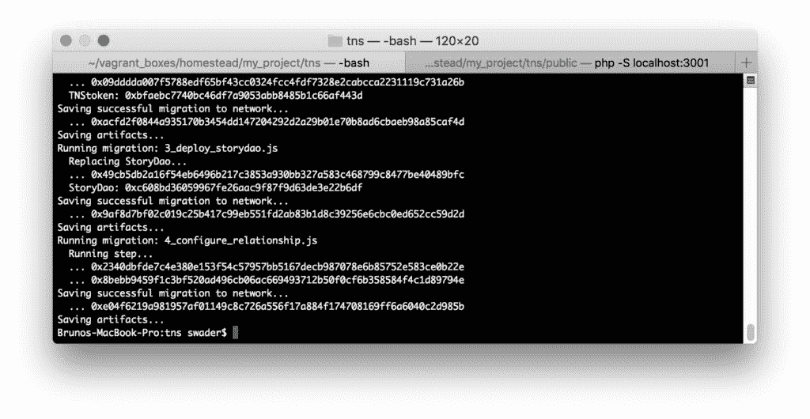

## 前端

前端是一个普通的静态 HTML 页面，包含一些用于与区块链通信的 JavaScript 和一些用于美化外观的 CSS。

让我们在子文件夹 `public` 中创建一个文件 `index.html`，并赋予以下内容：


```
<!DOCTYPE HTML>

<html lang="en">
<head>
    <title>The Neverending Story</title>
    <meta charset="utf-8"/>
    <meta name="viewport" content="width=device-width, initial-scale=1"/>
    <meta name="description" content="The Neverending Story is an community curated and moderated Ethereum dapp-story">
    <link rel="stylesheet" href="assets/css/main.css"/>
</head>
<body>

    <div class="grid-container">
        <div class="header container">
            <h1>The Neverending Story</h1>
            <p>A story on the Ethereum blockchain, community curated and moderated through a Decentralized Autonomous Organization (DAO)</p>
        </div>
        <div class="content container">
            <div class="intro">
                <h3>Chapter 0</h3>
                <p class="intro">It's a rainy night in central London.</p>
            </div>
            <hr>
            <div class="content-submissions">
                <div class="submission">
                    <div class="submission-body">This is an example submission. A proposal for its deletion has been submitted.</div>
                    <div class="submission-submitter">0xbE2B28F870336B4eAA0aCc73cE02757fcC428dC9</div>
                    <div class="submission-actions">
                        <div class="deletionproposed" data-votes="3024" data-deadline="1531607200"></div>
                    </div>
                </div>
                <div class="submission">
                        <div class="submission-body">This is a long submission. It has over 244 characters, just we can see what it looks like when rendered in the UI. We need to make sure it doesn't break anything and the layout also needs to be maintained, not clashing with actions/buttons etc.</div>
                        <div class="submission-submitter">0xbE2B28F870336B4eAA0aCc73cE02757fcC428dC9</div>
                        <div class="submission-actions">
                            <div class="delete"></div>
                        </div>
                </div>
                <div class="submission">
                        <div class="submission-body">This is an example submission. A proposal for its deletion has been submitted but is looking like it'll be rejected.</div>
                        <div class="submission-submitter">0xbE2B28F870336B4eAA0aCc73cE02757fcC428dC9</div>
                        <div class="submission-actions">
                            <div class="deletionproposed" data-votes="-790024" data-deadline="1531607200"></div>
                        </div>
                </div>
            </div>    
        </div>
        <div class="events container">
            <h3>Latest Events</h3>
            <ul class="eventlist">

            </ul>
        </div>
        <div class="information container">
            <p>Logged in / out</p>
            <div class="avatar">
                
            </div>
            <dl>
                <dt>Contributions</dt>
                <dd>0</dd>
                <dt>Deletions</dt>
                <dd>0</dd>
                <dt>Tokens</dt>
                <dd>0</dd>
                <dt>Proposals submitted</dt>
                <dd>0</dd>
                <dt>Proposals voted on</dt>
                <dd>0</dd>
            </dl>
        </div>
    </div>

<script src="assets/js/web3.min.js"></script>
<script src="assets/js/app.js"></script>
<script src="assets/js/main.js"></script>

</body>
</html>
```

## 只是一个骨架……

这只是一个非常基础的骨架，用于演示集成。请不要依赖它作为最终产品！

你可能在 `web3` 文件夹中缺少 `dist` 文件夹。该软件仍处于测试阶段，因此那里仍可能出现小错误。要解决此问题并安装带有 `dist` 文件夹的 web3，请运行 `npm install ethereum/web3.js --save`。

对于 CSS，我们将一些基础内容放入 `public/assets/css/main.css`：

```
@supports (grid-area: auto) {
    .grid-container{
      display: grid;
      grid-template-columns: 6fr 5fr 4fr;
      grid-template-rows: 10rem ;
      grid-column-gap: 0.5rem;
      grid-row-gap: 0.5rem;
      justify-items: stretch;
      align-items: stretch;
      grid-template-areas:
      "header header information"
      "content events information";
      height: 100vh;
    }
    .events {
      grid-area: events;
    }
    .content {
      grid-area: content;
    }
    .information {
      grid-area: information;
    }
    .header {
      grid-area: header;
      text-align: center;
    }

    .container {
        border: 1px solid black;
        padding: 15px;
        overflow-y: scroll;
    }

    p {
        margin: 0;
    }
  }

body {
    padding: 0;
    margin: 0;
    font-family: sans-serif;
}
```

然后，对于 JS，我们从 `public/assets/js/app.js` 中的以下内容开始：

```
var Web3 = require('web3');

var web3 = new Web3(web3.currentProvider);
console.log(web3);
```

这是怎么回事？

由于我们约定假设所有用户都已安装 [MetaMask](https://bitfalls.com/2018/02/16/metamask-send-receive-ether/)，并且 MetaMask 会将其自身的 `Web3` 实例注入到任何访问页面的 DOM 中，因此我们基本上可以在网站中直接访问 MetaMask 的“钱包提供者”。确实，如果在页面打开时登录 MetaMask，我们会在控制台中看到：

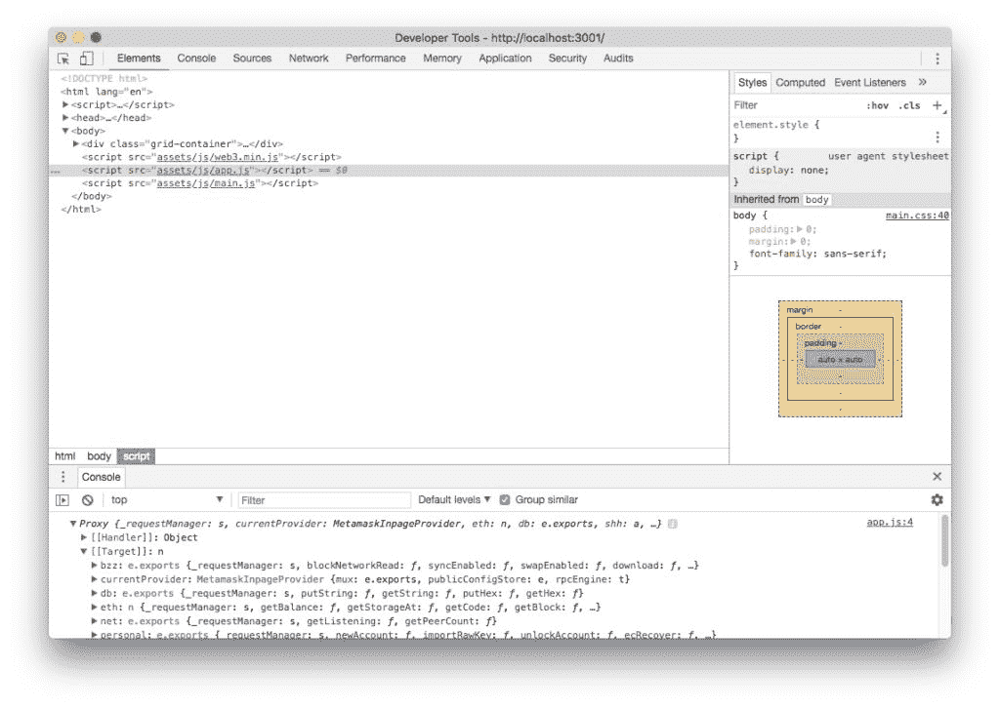

注意 `MetamaskInpageProvider` 已激活。实际上，如果在控制台中输入 `web3.eth.accounts`，所有通过 MetaMask 可访问的账户都会被打印出来：

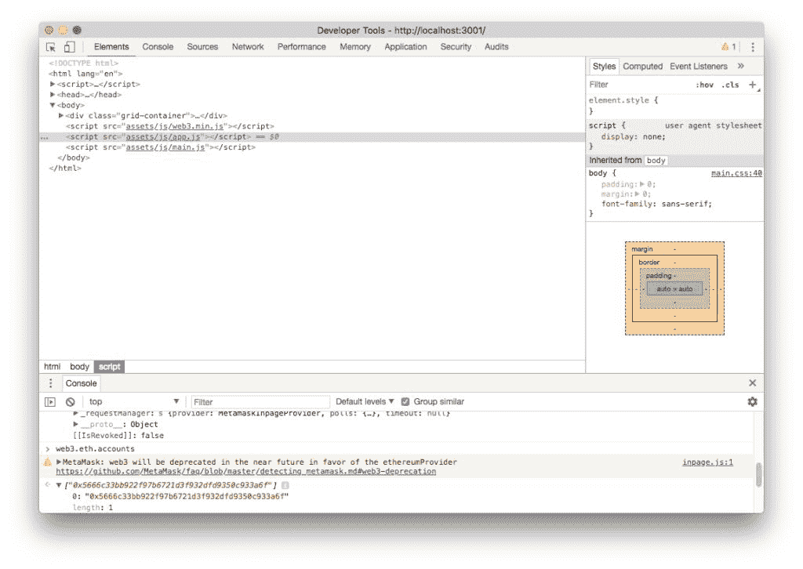

然而，这个特定账户是默认添加到我的个人 MetaMask 中的，因此余额为 0 ETH。它不属于我们正在运行的 Ganache 或 PoA 链：

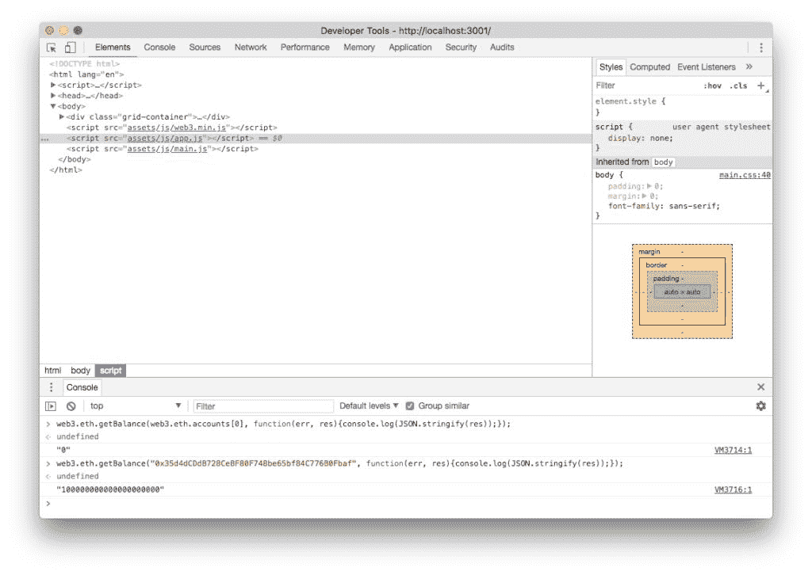

注意，查询当前（MetaMask）账户余额返回 0，而查询我们的私有区块链账户余额则返回 100 ETH（在我的例子中是 Ganache，因此所有账户初始化为 100 ETH）。

### 关于语法

你会注意到这些调用的语法看起来有点奇怪：

```
web3.eth.getBalance("0x35d4dCDdB728CeBF80F748be65bf84C776B0Fbaf", function(err, res){console.log(JSON.stringify(res));});
```

为了读取区块链数据，大多数 MetaMask 用户不会在本地运行节点，而是通过 Infura 或其他远程节点请求数据。因此，我们几乎可以预料到延迟。正因如此，[同步方法通常不被支持](https://github.com/MetaMask/faq/blob/master/DEVELOPERS.md#dizzy-all-async---think-of-metamask-as-a-light-client)。相反，所有操作都通过 Promise 或回调函数完成——就像本文开头的部署步骤一样。这是否意味着你需要非常熟悉 Promise 才能为以太坊开发 JS？不。这意味着：在 DOM 中执行 JS 调用时……

*   始终将回调函数作为所调用函数的最后一个参数
*   假设其返回值有两部分：首先是 `error`，然后是 `result`。

所以，基本上，将其视为延迟响应。当节点返回数据时，你定义的回调函数将被 JavaScript 调用。**是的，这意味着你不能期望代码按书写顺序逐行执行！**

有关 Promise、回调以及所有异步内容的更多信息，请参阅[这篇文章](https://www.sitepoint.com/overview-javascript-promises/)。

## 账户信息

如果我们打开上面展示的网站骨架，会得到类似这样的结果：

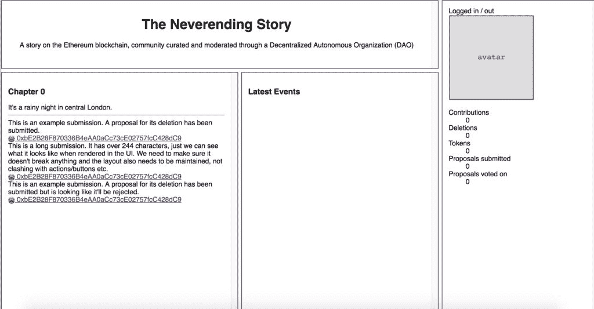

让我们用*真实*数据填充最右侧的账户信息列。

### 会话


当用户未登录其 MetaMask 扩展时，账户列表将为空。如果甚至没有安装 MetaMask，则提供者将为空（`undefined`）。当用户登录 MetaMask 时，提供者将可用，并提供账户信息以及与已连接的以太坊节点（实时节点、Ganache 或其他）的交互。

#### 测试

为了测试，你可以点击右上角的头像图标，然后选择“注销”来退出 MetaMask。如果 UI 看起来与下方截图不同，你可能需要打开菜单并点击“尝试 Beta 版”来激活 Beta 版 UI。

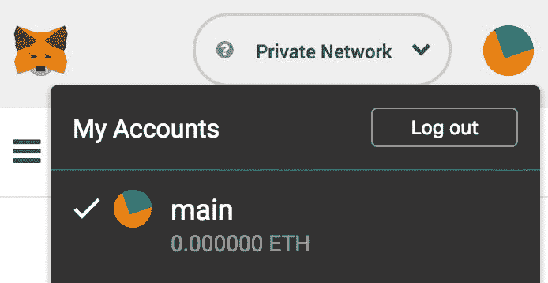

首先，如果用户已注销，我们将右侧状态列的所有内容替换为一条消息：

```
<div class="information container">
    <div class="logged out">
        <p>您似乎已退出 MetaMask 或未安装 MetaMask。请登录 MetaMask - 了解更多信息，请参阅
            <a href="https://bitfalls.com/2018/02/16/metamask-send-receive-ether/">本教程</a>。</p>
    </div>
    <div class="logged in" style="display: none">
        <p>您已登录！</p>
    </div>
</div>
```

处理此功能的 JS 代码如下（位于 `public/assets/js/main.js` 中）：

```
var loggedIn;

(function () {

    loggedIn = setLoggedIn(web3.currentProvider !== undefined && web3.eth.accounts.length > 0);

})();

function setLoggedIn(isLoggedIn) {
    let loggedInEl = document.querySelector('div.logged.in');
    let loggedOutEl = document.querySelector('div.logged.out');

    if (isLoggedIn) {
        loggedInEl.style.display = "block";
        loggedOutEl.style.display = "none";
    } else {
        loggedInEl.style.display = "none";
        loggedOutEl.style.display = "block";
    }

    return isLoggedIn;
}
```

第一部分——`(function () {`——包装了一段逻辑，该逻辑将在网站加载时执行。因此，其中的任何内容都会在页面准备就绪时立即执行。调用了一个函数 `setLoggedIn`，并向其传递了一个条件。该条件是：

1.  `web3` 对象的 `currentProvider` 已设置（即网站中存在 web3 客户端）。

2.  存在非零数量的可用账户，即通过此 web3 提供者至少有一个账户可供使用。换句话说，我们已登录至少一个账户。

如果这些条件同时评估为 `true`，则 `setLoggedIn` 函数会使“已注销”消息不可见，并使“已登录”消息可见。

这样做还有一个额外的好处，即也可以使用任何其他 web3 提供者。如果将来出现 MetaMask 的替代品，它将立即与此代码兼容，因为我们没有在任何地方显式地期望 MetaMask。

### 账户头像

由于每个以太坊钱包的私钥都是唯一的，因此可以用它来生成唯一的图像。这就是你在 MetaMask 右上角或使用 MyEtherWallet 时看到的彩色头像的来源，尽管 Mist、MyEtherWallet 和 MetaMask 都使用了不同的方法。让我们为已登录的用户生成一个并显示出来。

[Mist](https://www.sitepoint.com/mist-introduction/) 中的图标是使用 Blockies 库生成的——但这是一个定制版本，因为原始版本的随机数生成器有缺陷，可能会为不同的密钥生成相同的图像。因此，要安装此版本，请将[此文件](https://github.com/ethereum/blockies/blob/master/blockies.min.js)下载到你的 `assets/js` 文件夹中。然后，在 `index.html` 中，我们在 `main.js` 之前引入它：

```
 <script src="assets/js/app.js"></script>
    <script src="assets/js/blockies.min.js"></script>
    <script src="assets/js/main.js"></script>

</body>
```

我们还应该升级 `logged.in` 容器：

```
<div class="logged in" style="display: none">
    <p>您已登录！</p>
    <div class="avatar">

    </div>
</div>
```

在 `main.js` 中，我们启动该函数。

```
 if (isLoggedIn) {
      loggedInEl.style.display = "block";
      loggedOutEl.style.display = "none";

      var icon = blockies.create({ // 所有选项都是可选的
          seed: web3.eth.accounts[0], // 用于生成图标数据的种子，默认：随机
          size: 20, // 图标的宽度/高度（以块为单位），默认：8
          scale: 8, // 每个块的宽度/高度（以像素为单位），默认：4
      });

      document.querySelector("div.avatar").appendChild(icon);
```

因此，我们升级了 JS 代码的已登录部分，以生成图标并将其粘贴到头像区域。在渲染之前，我们应该用 CSS 稍微对齐一下：

```
div.avatar {
    width: 100%;
    text-align: center;
    margin: 10px 0;
}
```

现在，如果我们在登录 MetaMask 时刷新页面，应该会看到生成的头像图标。

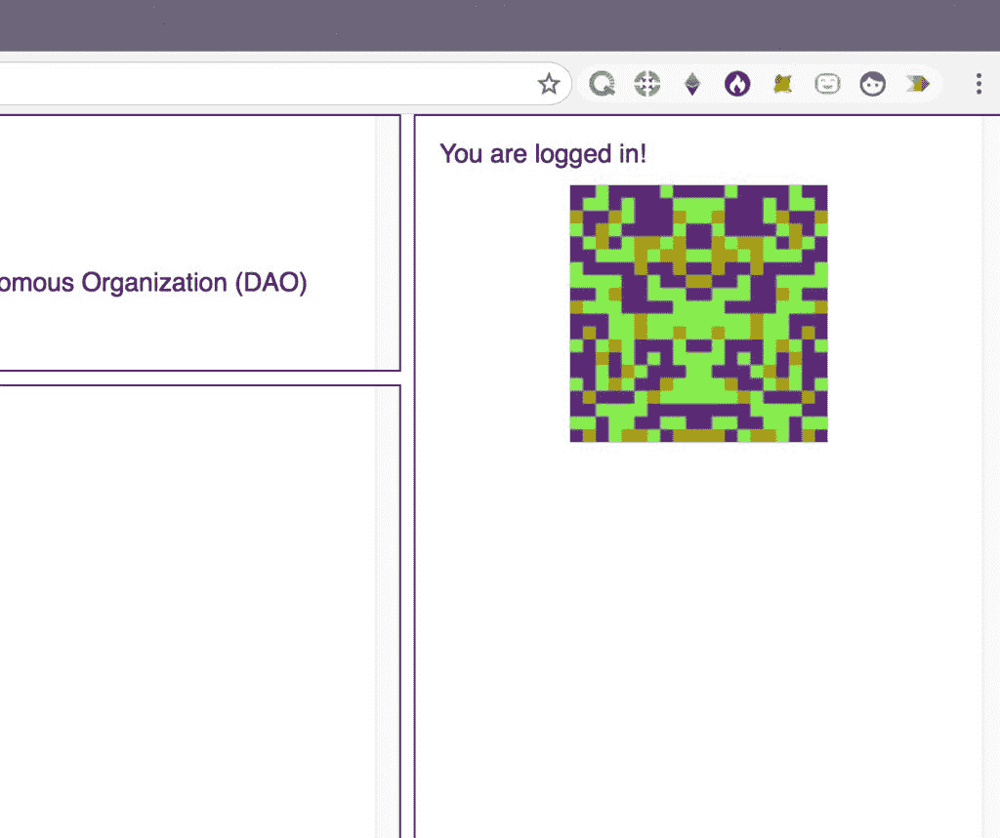

### 账户余额

现在让我们输出一些账户余额信息。

我们有一系列专门为此目的开发的只读函数可供使用。因此，让我们查询区块链并请求一些信息。为此，我们需要通过以下步骤[调用智能合约函数](https://bitfalls.com/2018/04/08/how-to-call-ethereum-smart-contract-functions/)。

#### 1. ABI

获取我们要调用其函数的合约的 ABI。ABI 包含函数签名，因此我们的 JS 代码知道如何调用它们。在此处了解更多关于 ABI 的信息：[此处](https://www.sitepoint.com/compiling-smart-contracts-abi/)。

你可以通过打开编译后项目文件夹中的 `build/TNSToken.json` 和 `build/StoryDao.json` 文件，并*仅*选择 `abi` 部分——即方括号 `[` 和 `]` 之间的部分——来获取 TNS 代币和 StoryDAO 的 ABI：

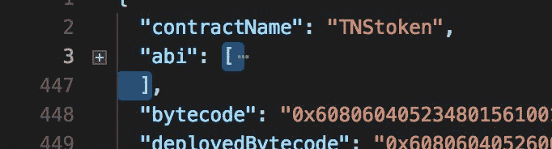

我们将把这个 ABI 放在 JavaScript 代码的顶部，放入 `main.js` 中，如下所示：

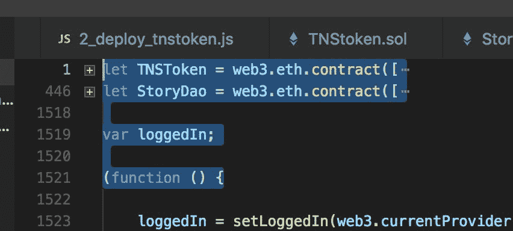

#### 一个缩写说明

请注意，上面的截图显示了缩写插入，由我的代码编辑器（Microsoft Visual Code）折叠。如果你查看行号，会发现代币的 ABI 有 400 行代码，而 DAO 的 ABI 又有 1000 行，因此将其粘贴到本书中没有意义。

#### 2. 实例化代币

```
if (loggedIn) {

    var token = TNSToken.at('0x3134bcded93e810e1025ee814e87eff252cff422');
    var story = StoryDao.at('0x729400828808bc907f68d9ffdeb317c23d2034d5');
    token.balanceOf(web3.eth.accounts[0], function(error, result) {console.log(JSON.stringify(result))});
    story.getSubmissionCount(function(error, result) {console.log(JSON.stringify(result))});
//...
```

我们使用 Truffle 提供的地址调用每个合约，并为每个合约创建一个实例——分别是 `token` 和 `story`。然后，我们简单地调用这些函数（像之前一样异步）。控制台给出了两个零，因为 MetaMask 中的账户有 0 个代币，并且目前故事中有 0 个提交。

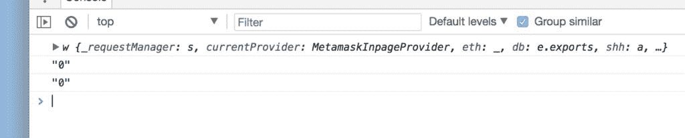

#### 3. 读取并输出数据

最后，我们可以用已有的信息填充用户的个人资料数据。

让我们更新 JavaScript：


```
var loggedIn;

(function () {

    loggedIn = setLoggedIn(web3.currentProvider !== undefined && web3.eth.accounts.length > 0);

    if (loggedIn) {

        var token = TNSToken.at('0x3134bcded93e810e1025ee814e87eff252cff422');
        var story = StoryDao.at('0x729400828808bc907f68d9ffdeb317c23d2034d5');

        token.balanceOf(web3.eth.accounts[0], function(error, result) {console.log(JSON.stringify(result))});
        story.getSubmissionCount(function(error, result) {console.log(JSON.stringify(result))});

        readUserStats().then(User => renderUserInfo(User));
    }

})();

async function readUserStats(address) {
    if (address === undefined) {
        address = web3.eth.accounts[0];
    }
    var User = {
        numberOfSubmissions: await getSubmissionsCountForUser(address),
        numberOfDeletions: await getDeletionsCountForUser(address),
        isWhitelisted: await isWhitelisted(address),
        isBlacklisted: await isBlacklisted(address),
        numberOfProposals: await getProposalCountForUser(address),
        numberOfVotes: await getVotesCountForUser(address)
    }
    return User;
}

function renderUserInfo(User) {
    console.log(User);

    document.querySelector('#user_submissions').innerHTML = User.numberOfSubmissions;
    document.querySelector('#user_deletions').innerHTML = User.numberOfDeletions;
    document.querySelector('#user_proposals').innerHTML = User.numberOfProposals;
    document.querySelector('#user_votes').innerHTML = User.numberOfVotes;
    document.querySelector('dd.user_blacklisted').style.display = User.isBlacklisted ? 'inline-block' : 'none';
    document.querySelector('dt.user_blacklisted').style.display = User.isBlacklisted ? 'inline-block' : 'none';
    document.querySelector('dt.user_whitelisted').style.display = User.isWhitelisted ? 'inline-block' : 'none';
    document.querySelector('dd.user_whitelisted').style.display = User.isWhitelisted ? 'inline-block' : 'none';
}

async function getSubmissionsCountForUser(address) {
    if (address === undefined) {
        address = web3.eth.accounts[0];
    }
    return new Promise(function (resolve, reject) {
        resolve(0);
    });
}
async function getDeletionsCountForUser(address) {
    if (address === undefined) {
        address = web3.eth.accounts[0];
    }
    return new Promise(function (resolve, reject) {
        resolve(0);
    });
}
async function getProposalCountForUser(address) {
    if (address === undefined) {
        address = web3.eth.accounts[0];
    }
    return new Promise(function (resolve, reject) {
        resolve(0);
    });
}
async function getVotesCountForUser(address) {
    if (address === undefined) {
        address = web3.eth.accounts[0];
    }
    return new Promise(function (resolve, reject) {
        resolve(0);
    });
}
async function isWhitelisted(address) {
    if (address === undefined) {
        address = web3.eth.accounts[0];
    }
    return new Promise(function (resolve, reject) {
        resolve(false);
    });
}
async function isBlacklisted(address) {
    if (address === undefined) {
        address = web3.eth.accounts[0];
    }
    return new Promise(function (resolve, reject) {
        resolve(false);
    });
}
```

接下来，我们来修改个人资料信息部分：

```
<div class="logged in" style="display: none">
    <p>您已登录！</p>
    <div class="avatar">

    </div>
    <dl>
        <dt>提交数</dt>
        <dd id="user_submissions"></dd>
        <dt>提案数</dt>
        <dd id="user_proposals"></dd>
        <dt>投票数</dt>
        <dd id="user_votes"></dd>
        <dt>删除数</dt>
        <dd id="user_deletions"></dd>
        <dt class="user_whitelisted">白名单</dt>
        <dd class="user_whitelisted">是</dd>
        <dt class="user_blacklisted">黑名单</dt>
        <dd class="user_blacklisted">是</dd>
    </dl>
</div>
```

你会注意到我们在获取数据时使用了 Promise，尽管当前这些函数只是模拟函数：它们立即返回扁平数据。这是因为每个函数获取所需数据的时间不同，所以我们需要*等待*它们全部完成，然后填充 `User` 对象，再将其传递给渲染函数，从而更新屏幕上的信息。

如果你不熟悉 JS 的 Promise 并想了解更多，请参阅[这篇文章](https://medium.freecodecamp.org/javascript-from-callbacks-to-async-await-1cc090ddad99)。

目前，所有函数都是模拟的；我们需要先进行一些写入操作，然后才能读取数据。但首先，我们需要准备好监听这些写入操作！

### 监听事件

为了能够跟踪合约发出的事件，我们需要监听它们——否则我们在代码中放置的所有 `emit` 语句就白费了。我们构建的模拟 UI 的中间部分就是用来显示这些事件的。

以下是如何监听区块链发出的事件：

```
// 事件

var WhitelistedEvent = story.Whitelisted(function(error, result) {
    if (!error) {
        console.log(result);
    }
});
```

这里我们在 `StoryDao` 合约的 `story` 实例上调用了 `Whitelisted` 函数，并传入了一个回调函数。每当这个特定事件被触发时，该回调函数会自动被调用。因此，当用户被列入白名单时，代码会自动将事件输出记录到控制台。

然而，这只会获取网络挖出的最后一个区块的最后一个事件。因此，如果从区块 1 到 10 触发了多个 `Whitelisted` 事件，它只会显示区块 10 中的事件（如果有的话）。更好的方法是使用以下方式：

```
story.Whitelisted({}, { fromBlock: 0, toBlock: 'latest' }).get((error, eventResult) => {
  if (error) {
    console.log('myEvent 事件处理程序出错: ' + error);
  } else {  
    // eventResult 包含事件列表！
    console.log('事件: ' + JSON.stringify(eventResult[0].args));
  }
});
```

#### 嗯，打扰一下……

将上述代码放入 JS 文件底部的一个独立部分中，专门用于处理事件。

这里我们使用了 `get` 函数，它允许我们定义获取事件的区块范围。我们使用 0 到 latest，意味着可以获取该类型的所有事件（从开始到现在）。但这会带来与上述监视方法冲突的问题。监视方法输出最后一个区块的事件，而 `get` 方法输出所有事件。我们需要一种方法让 JS 忽略重复事件，不要重复写入已经从历史中获取的事件。我们稍后会处理这个问题，但现在先来处理白名单。

### 账户白名单

最后，我们来处理一些写入操作。

第一个也是最简单的一个是获取白名单资格。记住，要获得白名单资格，账户需要向 DAO 地址发送至少 0.01 以太币。部署时会得到这个地址。如果你的 Ganache/PoA 链在本课程中间重启过，没关系，只需使用 `truffle migrate --reset` 重新运行迁移，你就会得到代币和 DAO 的新地址。在我的例子中，DAO 的地址是 `0x729400828808bc907f68d9ffdeb317c23d2034d5`，代币地址是 `0x3134bcded93e810e1025ee814e87eff252cff422`。

完成上述设置后，让我们尝试向 DAO 地址发送一定数量的以太币。为了好玩，我们试试发送 0.05 以太币，这样我们也能看看 DAO 是否会因为超额支付而额外计算代币。

#### 自定义 Gas 数量

不要忘记自定义 Gas 数量——只需在 21000 限制的基础上再加一个零——使用红色标记的图标。为什么需要这样做？因为简单的以太币发送所触发的函数（回退函数）会执行额外的逻辑，这超出了 21000 的限制（该限制仅适用于简单发送）。所以我们需要提高限制。别担心：超出限制的部分会立即退还。关于 Gas 如何工作的入门介绍，请参见[此处](https://www.sitepoint.com/ethereum-transaction-costs)。

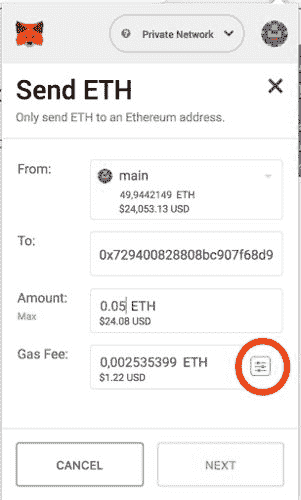


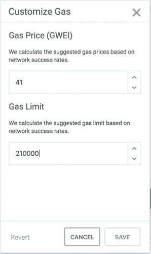

交易确认后（在 MetaMask 中会显示为“已确认”），我们就可以在 MetaMask 账户中查看代币数量了。我们需要先将自定义代币添加到 MetaMask 中，以便它能够追踪这些代币。操作步骤如下：选择 MetaMask 菜单，向下滚动到 *添加代币*，选择 *自定义代币*，粘贴 Truffle 在迁移时提供给您的代币地址，点击 *下一步*，确认余额无误，然后选择 *添加代币*。

对于 0.05 ETH，我们应该获得 40 万个代币，实际也确实如此。

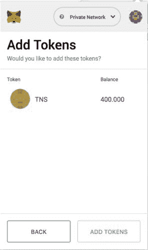

不过，事件呢？我们是否收到了这个白名单添加的通知？让我们看看控制台。

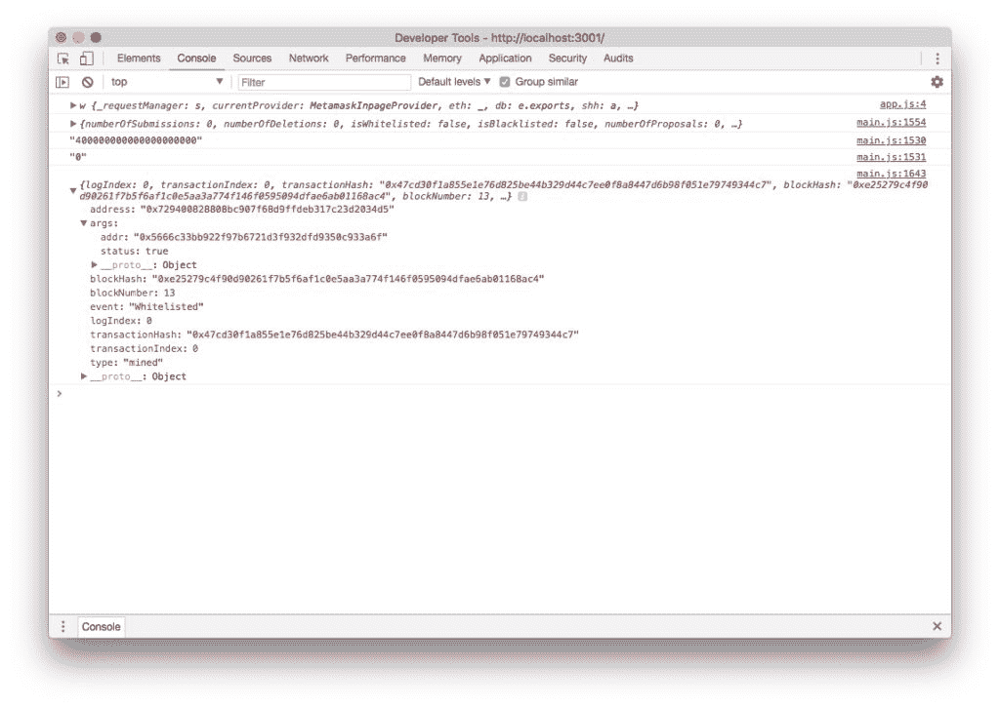

确实，完整的数据集就在那里——触发事件的地址、该交易被挖出的区块编号和哈希值等等。其中包含 `args` 对象，它告诉我们事件数据：`addr` 是被加入白名单的地址，`status` 表示该地址是被添加到白名单还是从白名单中移除。成功！

如果我们现在刷新页面，事件会再次出现在控制台中。但这是为什么呢？我们并没有添加任何新的白名单地址。为什么事件会触发？EVM 中的事件与 JavaScript 中的一次性事件不同。当然，它们包含任意数据并仅作为输出，但由于触发它们的事务也永久记录在区块链中，因此它们的输出也永久记录在区块链中。所以事件在触发后会一直存在，这让我们无需将它们存储在其他地方，也无需在页面刷新时重新获取！

现在，让我们将其添加到 UI 的事件屏幕中！按如下方式编辑 JavaScript 文件中的 Events 部分：

```
// Events

var highestBlock = 0;
var WhitelistedEvent = story.Whitelisted({}, { fromBlock: 0, toBlock: "latest" });

WhitelistedEvent.get((error, eventResult) => {
  if (error) {
    console.log('Error in Whitelisted event handler: ' + error);
  } else {  
    console.log(eventResult);
    let len = eventResult.length;
    for (let i = 0; i < len; i++) {
      console.log(eventResult[i]);
      highestBlock = highestBlock < eventResult[i].blockNumber ? eventResult[i].blockNumber : highestBlock;
      printEvent("Whitelisted", eventResult[i]);
    }
  }
});

WhitelistedEvent.watch(function(error, result) {
  if (!error && result.blockNumber > highestBlock) {
    printEvent("Whitelisted", result);
  }
});

function printEvent(type, object) {
  switch (type) {
    case "Whitelisted":
      let el;
      if (object.args.status === true) {
          el = "<li>Whitelisted address "+ object.args.addr +"</li>";
      } else {
          el = "<li>Removed address "+ object.args.addr +" from whitelist!</li>";
      }
      document.querySelector("ul.eventlist").innerHTML += el;
    break;
    default:
    break;
  }
}
```

哇，事件突然变得复杂了，对吧？别担心，我们会解释清楚。

`highestBlock` 变量会记住从历史记录中获取的最新区块。我们创建了一个事件实例，并为其附加了两个监听器。一个是 `get`，它获取所有历史事件并记住最新区块。另一个是 `watch`，它“实时”监听事件，并在最新区块中出现新事件时触发。观察者仅在刚到达的区块大于我们记住的最高区块时触发，从而确保只有新事件被追加到事件列表中。

我们还添加了一个 `printEvent` 函数来简化操作；我们也可以将其重用于其他事件类型！

现在测试一下，确实，事件被很好地打印出来了。

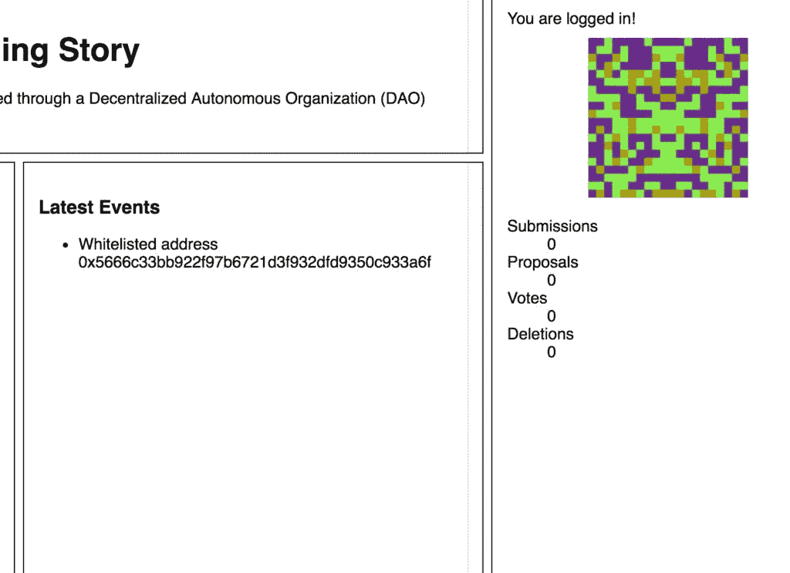

现在，请尝试为我们的故事可以发出的所有其他事件自行完成此操作！看看你是否能找出一次性处理所有事件的方法，而不是为每个事件都编写这段逻辑。（提示：将它们的名称定义在一个数组中，然后遍历这些名称并动态注册事件！）

#### 手动检查

您还可以通过 MyEtherWallet 打开 StoryDAO 并调用其 `whitelist` 函数，手动检查白名单和所有其他公共参数。

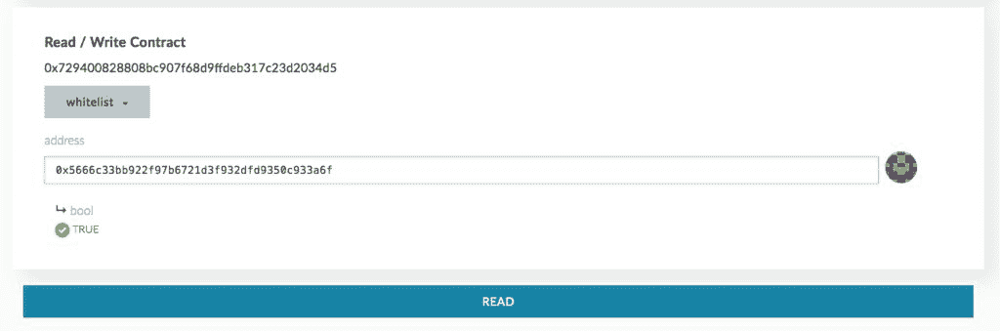

您会注意到，如果我们检查刚刚发送白名单金额的账户，会返回 `true`，表明该账户确实存在于 `whitelist` 映射中。

在将这些函数添加到 Web UI 之前，请使用相同的函数菜单来试验其他函数。

### 提交条目

终于，让我们从 UI 中进行一次真正的写入函数调用。这次，我们将向故事中提交一个条目。首先，我们需要清除一开始放入的示例条目。将 HTML 编辑为以下内容：

```
<div class="content container">
    <div class="intro">
        <h3>Chapter 0</h3>
        <p class="intro">It's a rainy night in central London.</p>
    </div>
    <hr>
    <div class="submission_input">
        <textarea name="submission-body" id="submission-body-input" rows="5"></textarea>
        <button id="submission-body-btn">Submit</button>
    </div>
    ...
```

以及一些基本的 CSS：

```
.submission_input textarea {
  width: 100%;
}
```

我们添加了一个非常简单的文本区域，用户可以通过它提交新条目。

现在来处理 JS 部分。

首先，让我们通过添加一个新事件并修改 `printEvent` 函数来准备接受这个事件。我们还可以稍微重构整个事件部分，使其更具可重用性。

```
// Events

var highestBlock = 0;
var WhitelistedEvent = story.Whitelisted({}, { fromBlock: 0, toBlock: "latest" });
var SubmissionCreatedEvent = story.SubmissionCreated({}, { fromBlock: 0, toBlock: "latest" });

var events = [WhitelistedEvent, SubmissionCreatedEvent];
for (let i = 0; i < events.length; i++) {
  events[i].get(historyCallback);
  events[i].watch(watchCallback);
}

function watchCallback(error, result) {
  if (!error && result.blockNumber > highestBlock) {
    printEvent(result.event, result);
  }
}

function historyCallback(error, eventResult) {
  if (error) {
    console.log('Error in event handler: ' + error);
  } else {  
    console.log(eventResult);
    let len = eventResult.length;
    for (let i = 0; i < len; i++) {
      console.log(eventResult[i]);
      highestBlock = highestBlock < eventResult[i].blockNumber ? eventResult[i].blockNumber : highestBlock;
      printEvent(eventResult[i].event, eventResult[i]);
    }
  }
}

function printEvent(type, object) {
  let el;
  switch (type) {
    case "Whitelisted":
      if (object.args.status === true) {
          el = "<li>Whitelisted address "+ object.args.addr +"</li>";
      } else {
          el = "<li>Removed address "+ object.args.addr +" from whitelist!</li>";
      }
      document.querySelector("ul.eventlist").innerHTML += el;
    break;
    case "SubmissionCreated":
      el = "<li>User " + object.args.submitter + " created a"+ ((object.args.image) ? "n image" : " text") +" entry: #" + object.args.index + " of content " + object.args.content+"</li>";
      document.querySelector("ul.eventlist").innerHTML += el;
    break;
    default:
    break;
  }
}
```

现在，要添加一个全新的事件，我们只需要实例化它，然后为其定义一个 `case` 即可。

接下来，让我们实现提交功能。

```
document.getElementById("submission-body-btn").addEventListener("click", function(e) {
    if (!loggedIn) {
        return false;
    }

    var text = document.getElementById("submission-body-input").value;
    text = web3.toHex(text);

    story.createSubmission(text, false, {value: 0, gas: 400000}, function(error, result) {
        refreshSubmissions();
    });
});

function refreshSubmissions() {
    story.getAllSubmissionHashes(function(error, result){
        console.log(result);
    });
}
```


这里我们为提交表单添加了一个事件监听器，一旦提交，首先会拒绝所有未登录用户的操作，然后获取内容并将其转换为十六进制格式（这是我们将值存储为 `bytes` 所需的格式）。

最后，它通过调用 `createSubmission` 函数并传入两个参数来创建一笔交易：条目文本和 `false` 标志（表示不是图片）。第三个参数是交易设置：`value` 表示要发送的以太币数量，`gas` 表示你希望默认使用的 gas 限额。这些可以在客户端（MetaMask）中手动更改，但这是一个确保我们不会触及限额的良好起点。最后一个参数是我们已经熟悉的回调函数，该回调会调用一个刷新函数，加载故事的所有提交内容。目前，这个刷新函数只加载故事哈希并将其输出到控制台，以便我们检查一切是否正常。

#### 为什么是零？

以太币数量为 0，因为第一个条目是免费的。后续条目需要添加以太币。我们将这个动态计算留作你的家庭作业。提示：我们的 DAO 中有一个 `calculateSubmissionFee` 函数正是为此目的。

此时，我们需要修改 JavaScript 顶部在页面加载时自动执行的函数：

```
if (loggedIn) {

    token.balanceOf(web3.eth.accounts[0], function(error, result) {console.log(JSON.stringify(result))});
    story.getSubmissionCount(function(error, result) {console.log(JSON.stringify(result))});

    web3.eth.defaultAccount = web3.eth.accounts[0]; // CHANGE

    readUserStats().then(User => renderUserInfo(User));
    refreshSubmissions(); // CHANGE
} else {
    document.getElementById("submission-body-btn").disabled = "disabled";
}
```

修改处用 `// CHANGE` 标记：第一个修改让我们设置执行交易的默认账户。这可能会在 Web3 的未来版本中成为默认行为。第二个修改在页面加载时刷新提交内容，这样当网站打开时，我们就能获得完整加载的故事。

如果你现在尝试提交一个条目，一旦你点击 *提交*，MetaMask 应该会打开并要求你确认提交。

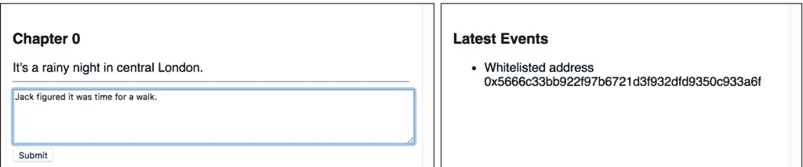

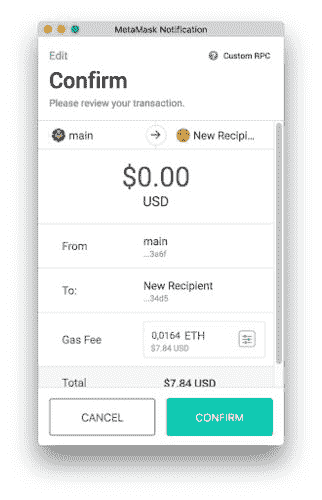

你还应该看到事件在事件部分打印出来。

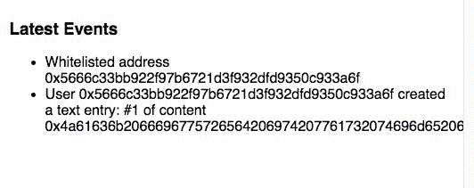

控制台应该会输出这个新条目的哈希。

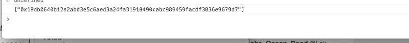

#### MetaMask 和 Nonce

MetaMask 目前存在私有网络和 nonce 的问题。问题描述见[此处](https://ethereum.stackexchange.com/questions/30921/tx-doesnt-have-the-correct-nonce-metamask)，这个问题很快会修复，但如果你在提交条目时在 JavaScript 控制台中遇到 `nonce` 错误，目前的临时解决方案是重新安装 MetaMask（禁用再启用无效）。请记住先备份你的助记词：你需要它来重新导入你的 MetaMask 账户！

最后，让我们获取这些条目并显示它们。先从一些 CSS 开始：

```
.content-submissions .submission-submitter {
  font-size: small;
}
```

现在更新 `refreshSubmissions` 函数：

```
function refreshSubmissions() {
  story.getAllSubmissionHashes(function (error, result) {
    var entries = [];
    for (var i = 0; i < result.length; i++) {
      story.getSubmission(result[i], (err, res) => {

        if (res[2] === web3.eth.accounts[0]) {
          res[2] = 'you';
        }
        let el = "";
        el += '<div class="submission">';
        el += '<div class="submission-body">' + web3.toAscii(res[0]) + '</div>';
        el += '<div class="submission-submitter">by: ' + res[2] + '</div>';
        el += '</div>';
        el += '</div>';
        document.querySelector('.content-submissions').innerHTML += el;
      });
    }
  });
}
```

我们遍历所有提交内容，获取它们的哈希，逐一获取并输出到屏幕上。如果提交者与登录用户相同，则显示“you”而不是地址。

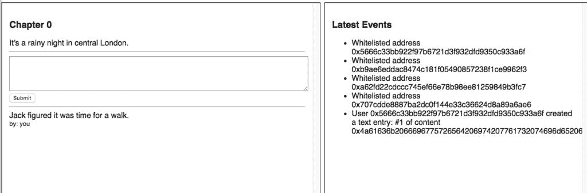

让我们再添加一个条目来测试。

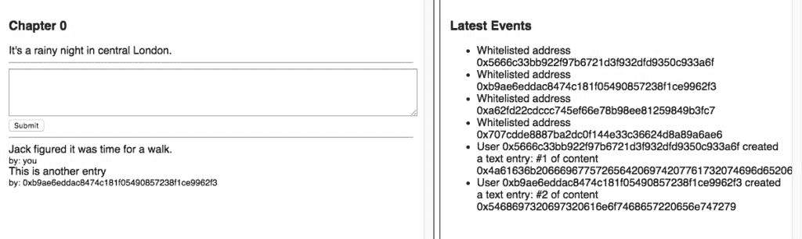

## 结论

在这一部分中，我们为 DApp 开发了一个基本前端的基础。

由于开发完整的前端应用程序本身就可以是一门课程，我们将进一步的开发留作你的家庭作业。只需按照演示的方式调用函数，将它们集成到常规的 JavaScript 流程中（通过 VueJS 这样的框架，或者像我们上面那样使用普通的 jQuery 或原生 JS），然后将所有内容绑定在一起。这实际上就像与标准服务器 API 通信一样。如果你遇到困难，可以查看项目仓库中的代码！

你可以做的其他升级包括：

*   检测 web3 提供者何时更改或可用账户数量何时变化，以指示登录或登出事件并自动重新加载页面

*   除非用户已登录，否则阻止渲染提交表单

*   除非用户至少拥有 1 个代币，否则阻止渲染投票和删除按钮等

*   允许用户提交并渲染 Markdown！

*   按时间（区块编号）而不是按类型对事件进行排序！

*   让事件更美观、更易读：不显示十六进制内容，而是将其转换为 ASCII 并截断为 30 个字符左右

*   使用像 VueJS 这样的合适 JS 框架，让你的项目更具可重用性，并拥有更结构化的代码。

在下一部分也是最后一部分中，我们将专注于将项目部署到实时互联网上。敬请期待！

# 第 8 章：启动 StoryDao

**在本系列关于使用以太坊构建 DApp 教程的第 7 部分中，我们展示了如何构建应用的前端，为我们一直在开发的故事设置并部署 UI。**

现在是时候进行一些部署并编写一些最终函数了。

## 自毁

某些事情可能会非常非常糟糕，整个 DAO 可能会被摧毁——要么是由于糟糕且仓促编写的代码被黑客攻击，要么是由于参与者太多导致无法执行长循环。（提案上的投票者太多可能会破坏系统；我们确实没有为此采取任何预防措施！）以防万一，拥有一个相当于“大红按钮”的东西可能会很有用。首先，让我们升级我们的 StoryDao：

```
function bigRedButton() onlyOwner external {
    active = false;
    withdrawToOwner();
    token.unlockForAll();
}
```

然后，让我们在 Token 合约中实现一次性解锁所有代币的功能：

```
/**
@dev 解锁每个曾经被锁定过代币的用户的所有代币
*/
function unlockForAll() public onlyOwner {
    uint256 len = touchedByLock.length;
    for (uint256 i = 0; i < len; i++) {
        locked[touchedByLock[i]] = 0;
    }
}
```

自然，我们需要将这个新的地址列表添加到合约中：

```
address[] touchedByLock;
```

并且我们需要升级 `increaseLockedAmount` 函数，将地址添加到此列表中：

```
/**
@dev _owner 将被阻止发送 _amount 数量的代币。超出此数量的代币将可花费。
*/
function increaseLockedAmount(address _owner, uint256 _amount) public onlyOwner returns (uint256) {
    uint256 lockingAmount = locked[_owner].add(_amount);
    require(balanceOf(_owner) >= lockingAmount, "锁定金额不得超过余额");
    locked[_owner] = lockingAmount;
    touchedByLock.push(_owner);
    emit Locked(_owner, lockingAmount);
    return lockingAmount;
}
```

我们还应该更新 StoryDao 合约中所需的代币接口，以包含这个新函数的签名：

```
// ...
    function getUnlockedAmount(address _owner) view public returns (uint256);
    function unlockForAll() public;
}
```


通过我们之前添加的`active-story`块（除非故事的`active`标志为真，否则无法运行某些函数），这应该能解决问题。其他人将无法通过向合约发送以太币来浪费资金，而且每个人的代币都会被解锁。

所有者不会得到人们提交的以太币。相反，提款功能会变得可用，这样人们就可以取回自己的以太币，每个人都得到了妥善处理。

现在我们的合约终于可以部署了。

### 关于 `selfdestruct`？

有一个名为`selfdestruct`的函数，它可以销毁合约。它看起来像这样：

```
selfdestruct(address);
```

调用它会禁用该合约，将其代码从区块链状态中移除，并禁用所有功能，同时将该地址中的以太币发送到提供的地址。在我们的案例中，这不是一个好主意：我们仍然希望人们能够提取他们的以太币；我们不想从他们那里拿走。此外，任何直接发送到已销毁合约地址的以太币都将永远丢失（被销毁），因为无法取回。

## 部署合约

要完全部署智能合约，我们需要执行以下操作：

1.  部署到主网
2.  将代币发送到`StoryDAO`地址
3.  将`Token`合约的所有权转移给`StoryDao`。

开始吧。

### 主网部署

要部署到主网，我们需要在`truffle.js`文件中添加一个新网络：

```
mainnet: {
  provider: function() {
    return new WalletProvider(
      Wallet.fromPrivateKey(
        Buffer.from(PRIVKEY, "hex")), "https://mainnet.infura.io/"+INFURAKEY
    );
  },
  gasPrice: w3.utils.toWei("20", "gwei"),
  network_id: "1",
},
```

幸运的是，这非常简单。它实际上与 Rinkeby 部署相同；我们只需要移除 gas 数量（让它自己计算）并更改 gas 价格。我们还应该将网络 ID 改为 1，因为那是主网 ID。

我们这样使用它：

```
truffle migrate --network mainnet
```

这里有一个注意事项。如果你在之前部署过的网络上进行部署（即使你只是将代币部署到主网，然后想稍后部署`StoryDao`），你可能会遇到这个错误：

```
Attempting to run transaction which calls a contract function, but recipient address XXX is not a contract address
```

发生这种情况是因为 Truffle 会记住它已经部署过的合约的位置，以便在后续迁移中重用它们，避免重新部署。但如果你的网络重启了（例如 Ganache），或者你做了一些不兼容的更改，它保存的地址可能实际上不再包含这些代码，因此它会报错。你可以通过重置迁移来解决这个问题：

```
truffle migrate --network mainnet --reset
```

### 将代币发送到`StoryDao`地址

从部署过程中获取代币的地址和`StoryDao`的地址。

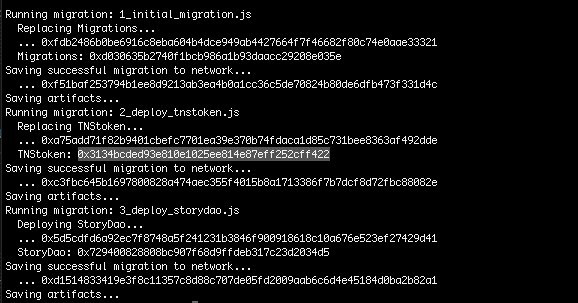

然后按照之前描述的方法使用 MEW 发送代币。

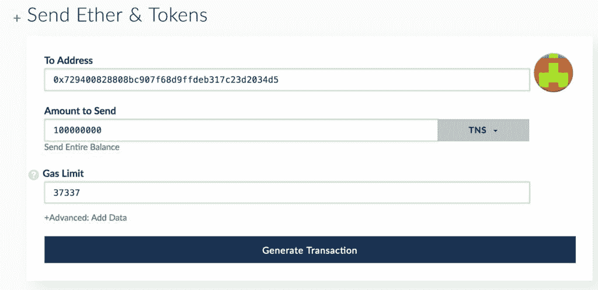

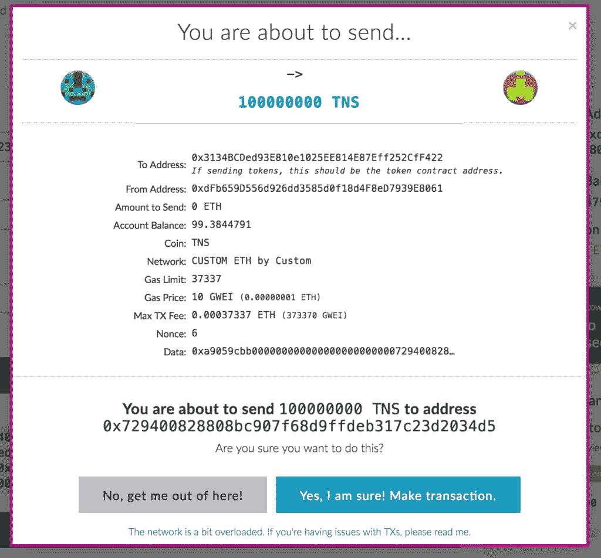

如果遇到 Gas 不足的错误，只需增加 gas 限制。记住：未使用的 gas 总是会退还，所以不用担心损失超过交易成本（发送代币应该低于 40000 gas）。

### 将代币所有权转移给`StoryDao`

要转移所有权，我们需要在代币上调用`transferOwnership`函数。让我们将代币加载到 MEW 中。在`Contracts`界面，我们输入地址和合约的 ABI（从`/build`文件夹中获取）。点击*Access*后，我们将能够在一个菜单中访问该合约的函数，从中选择`transferOwnership`。

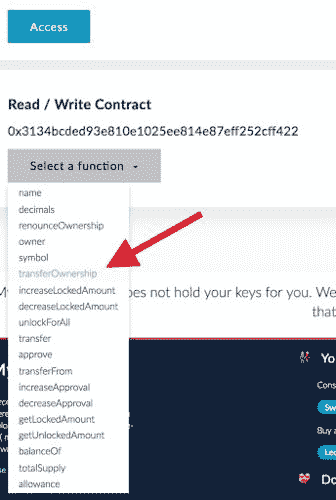

#### 你只需要将要调用的函数的 ABI

只包含你打算调用的函数的 ABI 就足够了：不必是整个代币的 ABI！你可以只包含`transferOwnership`函数的 ABI，这样就可以了！

然后我们选择新的所有者（已部署的`StoryDao`的地址），并解锁当前所有者的钱包（我们之前发送代币的同一个钱包）。

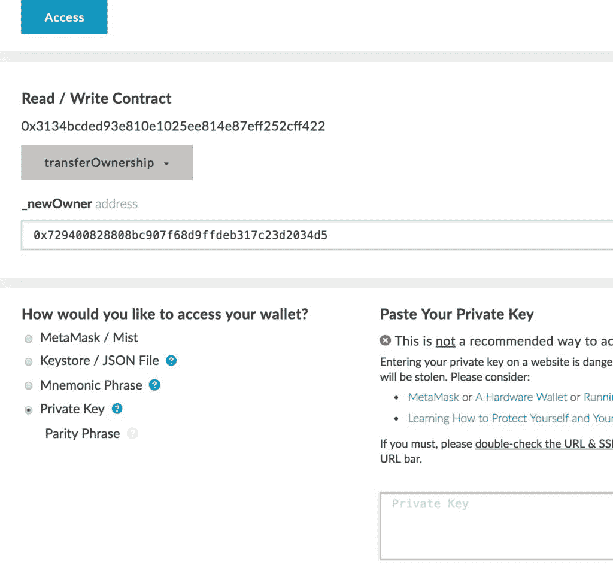

写入此更改后，我们可以检查代币合约中的只读函数`owner`（与`transferOwnership`相同的菜单）。它现在应该显示新的所有者。

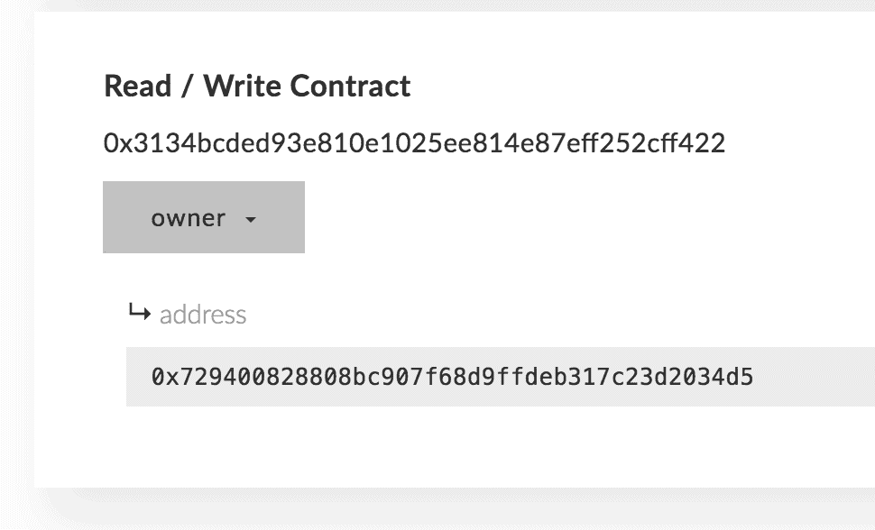

为了确保`StoryDao`地址确实拥有代币，我们可以选择`balanceOf`函数，将`StoryDao`的地址输入到`_owner`字段，然后点击*Read*：

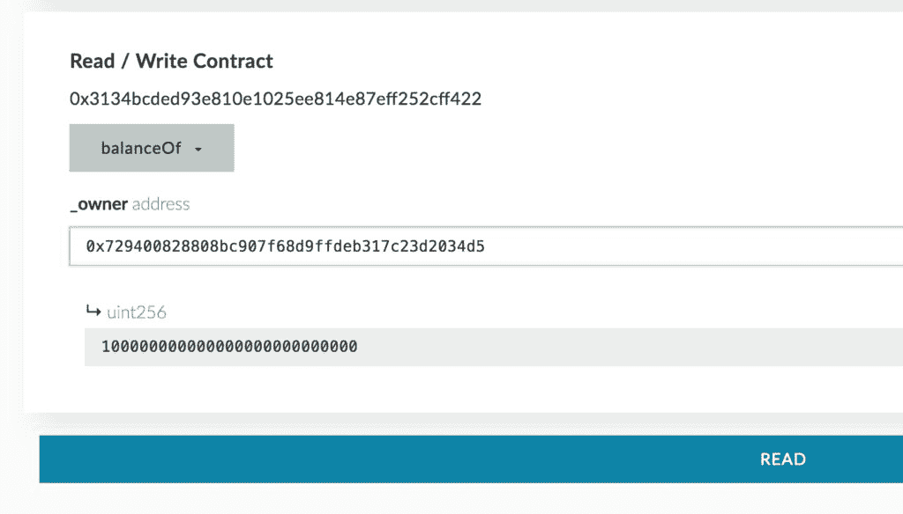

确实，1 亿个代币在`StoryDao`地址中。

#### 本可以在部署时完成

我们本可以将代币发送和所有权转移作为部署步骤的一部分。尝试在测试环境中找出如何实现。

## 验证

根据本系列[第 3 部分](https://www.sitepoint.com/ethereum-dapps-compiling-deploying-testing-tns-tokens)的内容，在 Etherscan 上验证 DAO 和 Token 的合约对我们非常有益。那个绿色勾号可以起到很大作用。

按照该部分的说明来验证你的合约。请注意，在验证步骤中，你现在必须将优化器标记为活动状态，因为我们正在优化代码以降低部署成本！

## 部署到 Web

要部署`StoryDao`的 Web 界面，请遵循“常规”Web 开发世界的说明。由于在这种情况下，所有代码都是静态的，你甚至可以在 GitHub Pages 或类似平台上托管它。

阅读一些选项[这里](https://www.sitepoint.com/tag/deploy/)和[这里](https://developer.mozilla.org/en-US/docs/Learn/Getting_started_with_the_web/Publishing_your_website)。

一旦页面启动，配置 UI 以使用我们从迁移步骤中获得的合约地址。或者，为代币和`StoryDao`注册 ENS 名称，你可以保持 Web UI 静态固定，硬编码地址，然后只更改这些 ENS 名称指向的以太坊地址。

## 结论

至此，DAO 教程结束。我们希望它帮助你认识到 Solidity 开发的复杂性，但我们也希望它让一些事情变得更清晰，并让你更加好奇。

一如既往，最好的学习方式就是实践。尝试、犯错、重启和重建。这种类型的区块链开发需求很高，而且只会越来越受欢迎，所以你有机会从底层开始参与。

祝你好运！

*附：如果你喜欢本教程，欢迎[在 Twitter 上联系作者](https://twitter.com/bitfalls?lang=en)。如果你有投诉、建议、想法等，请将它们提交到 GitHub 上的仓库中！*
