# AJAX Web 应用程序构建指南：可用且无障碍的交互


## 关于作者

Matthew 居住在美国德克萨斯州休斯顿市，在开源应用基金会工作，负责为 Scooby（下一代基于网络的日历客户端）和 Cosmo（日历服务器）构建 Web UI。在空闲时间，他在 Fleegix.org 撰写关于 AJAX、JavaScript、Ruby 和 PHP 的文章，并运营 EpiphanyRadio 网络广播电台。Matthew 会打鼓，能说流利的日语。

## 关于专家审阅

Stuart Langridge 自 1994 年起涉足 Web，他可能是世界上唯一拥有计算机科学与哲学学士学位的人。他发明了“非侵入式 DHTML”一词，并一直是推动普及这种新脚本方法的领导者。在不从事 Web 工作时，他是一名狂热的 Linux 用户，参与开源广播节目 LUGRadio 的工作，喜欢喝好啤酒、研究石圈和其他古代现象，并尝试学习钢琴。

## 关于技术总监

作为 SitePoint 的技术总监，Kevin Yank 负责监督其所有技术出版物——书籍、文章、通讯和博客。他为 SitePoint 撰写了 50 多篇文章，但最为人所知的是他的著作《使用 PHP 和 MySQL 自己动手构建数据库驱动的网站》。Kevin 居住在澳大利亚墨尔本，喜欢表演即兴喜剧和驾驶轻型飞机。

## 关于 SitePoint

SitePoint 专注于为网络专业人士出版有趣、实用且易于理解的内容。访问 http://www.sitepoint.com/ 可获取我们的书籍、通讯、文章和社区论坛。

献给我的妻子 Masako，以及我的三个小男孩——Hiromasa、Akira 和 Yoshiki，感谢他们所有的爱、耐心和支持。

---

授权给 siowchen@darke.biz


## 前言

距离我制作第一个静态网页已有十年左右的时间，看到网络作为一个平台的演变真是令人惊叹——首先是用于信息交换，然后是真正运行在浏览器中的应用程序。而现在，AJAX的爆发正将Web开发推向一个新的高度。利用AJAX式开发的强大功能，你可以创建在功能和响应速度上与桌面应用相媲美的应用程序，而且最妙的是，你不必依赖丑陋的权宜之计和临时补丁来实现这一切。

什么是AJAX？这个缩写最初代表“Asynchronous JavaScript and XML”（异步JavaScript和XML）——相当拗口——但它后来泛指一种使用XML、DOM、CSS和JavaScript等Web技术来创建超高交互性Web文档的开发风格，这些文档的行为就像功能完备的应用程序。实际上，这些AJAX技术本身都不是特别新的东西（甚至AJAX的“秘密武器”XMLHttpRequest也已经存在多年），但过去并没有很多人真正知道如何充分利用它们。现在，随着“Web 2.0”应用程序的激增，这些应用不断拓展着Web应用的边界，再加上AJAX这个酷炫且容易记住的名称，这种开发风格确实开始腾飞了。

早期，Web应用程序使用服务器端脚本（如CGI），以及浏览器中的简单Web表单和图像翻转效果。现在我们看到开发者们迈出了重大步伐，通过能够分部分更新UI（而不是需要一次巨大的重绘），以及像拖放和就地编辑这样的客户端功能，来增强用户体验。如今的Web应用程序也更加互联，有时由来自多个服务或数据源的数据组成。基于浏览器的AJAX应用程序是为用户提供这种超交互性、网络化应用体验的绝佳平台。而最棒的是，AJAX革命才刚刚开始，所以现在正是投身其中的好时机。

本书让我有机会展示一些很酷的方法，教你如何使用AJAX技术为你的Web应用程序增添真正的力量和响应能力，同时支持可访问性和向后兼容性。AJAX的妙处在于，它让你能够使用直接、基于标准的代码来实现这一切，所以你不会在本书中看到奇怪的变通办法或特定于浏览器的代码。那么，卷起袖子吧——我希望能准备好投身于一些AJAX代码中！

## 谁应该阅读本书？

本书主要面向已经熟悉基本客户端Web技术（如CSS和JavaScript）的Web应用程序开发者。

如果这不是你的情况，请不要气馁：只要你愿意边学边做，本书就适合你。JavaScript语法非常直观，我们使用的也是纯正、通用的代码，几乎没有浏览器特定的变通方案。我们还提供了指向宝贵资源的链接，你可以用它们来了解更多关于AJAX开发中使用的技术。

一些传统的应用程序程序员也可能对本书感兴趣，想看看如何创建在浏览器中运行的、真正具有桌面应用风格的用户界面。随着“Web应用程序开发”和纯粹的“应用程序开发”继续融合，越来越多的这类程序员将开始涉足AJAX领域。

## 本书内容是什么？

本书包含八个章节。每一章都建立在前一章介绍的概念和技术之上，所以如果你对Web开发还比较陌生，最好还是按顺序循序渐进地学习各章。如果你是一位身经百战的老手，可能更适合在你感兴趣的主题之间跳跃阅读。

### 第1章：AJAX概述

本章带你快速概览AJAX及其共同构成AJAX Web应用程序的技术构件。它还简要回顾了在AJAX出现之前的“糟糕旧时代”，Web开发者不得不使用的那些丑陋的编码技巧，以帮助解释为什么AJAX是一个如此巨大的进步。如果你不是Web开发的老手，本章将为你介绍开启现代客户端AJAX Web开发所需的基本技术。

## 第2章：基础XMLHttpRequest

XMLHttpRequest是AJAX的核心与灵魂。它通过允许浏览器向服务器发起HTTP请求而无需重新加载页面，使得AJAX Web开发成为可能。本章带你完成构建一个非常简单的AJAX JavaScript库的过程；它将为你打下坚实的基础，了解XMLHttpRequest如何发起请求，并理解访问服务器返回结果的不同方式。

通过本章获得的关于XMLHttpRequest的底层知识，你将能够与几乎所有JavaScript XMLHttpRequest库协同工作，并自信地诊断和调试Web应用程序中与XMLHttpRequest相关的问题。

### 第3章：AJAX中的“A”

A代表“异步”。异步性是AJAX如此酷炫的原因：XMLHttpRequest赋予你随时从服务器拉取内容的能力，而无需重新加载整个网页。在本章中，你将构建你的第一个真正的AJAX应用程序——一个Web应用程序监控器，它使用XMLHttpRequest通过基本的HTTP GET请求轮询服务器，并报告获取响应所需的时间。这个应用程序展示了我们在基于浏览器的AJAX应用程序中必须处理的一些复杂性，包括事件的时间安排、超时，以及借助动画和状态消息让用户持续了解应用程序正在做什么。

### 第4章：AJAX与POST请求

本章我们进入“成人桌”，重点关注AJAX HTTP POST请求。POST是Web表单的基石，是将数据包发送回服务器的过程。将其与一些美味的AJAX相结合，可以使你的应用对用户更具吸引力。本章的演示代码展示了AJAX的最佳用途之一：一个Web应用程序登录界面，使用XMLHttpRequest将用户认证数据传递回服务器，并在页面内联显示状态消息。你还将学习如何创建这种AJAX风格的UI，同时不破坏应用程序的可访问性或向后兼容性。

### 第5章：更广泛的AJAX与就地编辑

当非开发者类型谈论AJAX Web应用程序时，他们通常指的不仅仅是XMLHttpRequest。在本章中，我们将通过讨论就地编辑，来展示这些人谈论的部分内容。本章的演示代码创建了一个基本的博客页面，让你可以直接在页面上编辑条目，而无需转到单独的Web表单。它显示一个漂亮的淡入淡出颜色动画效果，让用户知道应用程序何时正在忙于处理他们的编辑。

### 第6章：Web服务与滑动隐藏

本章通过介绍Web服务的基本概念以及一个演示，将我们带入互联的Web 2.0世界，展示如何将你的AJAX Web应用与它们连接起来。我们在本章中将要使用的应用程序，通过一些简单的REST风格HTTP请求接入亚马逊的ECS（电子商务服务）Web服务，以执行图书搜索。与在旧式无聊的Web表单提交中加载结果到新页面不同，这个应用程序拉取XML结果，将它们格式化得漂漂亮亮，然后使用一个酷炫的滑动隐藏效果，将它们直接插入页面中。

### 第7章：更多Web服务与返回按钮

Web服务远不止REST。本章更深入地探讨Web服务主题，提供了一个可访问的AJAX搜索应用程序的示例代码，该应用使用更复杂的方法（如SOAP和XML-RPC）与Google Web APIs、Del.icio.us和EBay平台进行通信。我们还讨论了两种解决经典AJAX返回按钮问题的不同方法——一种是在应用程序中为搜索历史构建导航，另一种是使用一个变通方案强制浏览器的真实返回按钮正常工作。

### 第8章：拖放与AJAX象棋

最后一章使用一个基于浏览器的AJAX象棋游戏，来演示一个复杂的拖放界面，其中绝对定位的UI元素根据窗口大小进行放置，使用拖放约束，并且放置功能触发XMLHttpRequest请求到服务器以保存游戏中的每一步。这个应用程序的复杂交互性是通过一个全局事件监听器设置来管理的，该设置将所有用户输入路由到单个点，但让你能够灵活地按照你希望的方式处理事件。AJAX象棋游戏还展示了通过轮询在浏览器之间同步应用程序状态的基本方法，以及在服务器出错时如何中止并恢复到先前状态。

## 本书的网站

本书的支持网站位于 http://www.sitepoint.com/books/ajax1/，你可以在那里访问以下设施。

## 代码存档

随着你阅读文本的深入，你会注意到多次提到代码存档。这是一个可下载的ZIP压缩包，包含了本书中所有示例的完整代码。你可以从 http://www/sitepoint.com/books/ajax1/code.php 下载代码存档。

## 更新与勘误

本书网站上的勘误和错误页面，地址为 http://www.sitepoint.com/books/ajax1/errata.php，将始终包含最新的更正信息。


## SitePoint 论坛

虽然我已尽力预测并解答你可能产生的所有问题，但任何一本书都不可能涵盖关于 AJAX 的全部知识。如果你对本书中的任何内容有疑问，获取快速解答的最佳去处是 SitePoint 论坛¹——SitePoint 活跃且知识丰富的社区。

## SitePoint 时事通讯

除了像本书这样的书籍，SitePoint 还提供免费的电子邮件时事通讯。《*SitePoint 技术时报*》涵盖网络开发所有技术方面的最新消息、产品发布、趋势、技巧和技术。历史悠久的《*SitePoint 报*》是一份双周刊，内容涉及网络的商业和盈利方面。无论你是寻求技巧以获得理想合同的自由开发者，还是努力紧跟主要搜索引擎变化的市场营销专业学生，这份通讯都适合你。《*SitePoint 设计视角*》是网络设计精华的月度合集。从新的 CSS 布局方法到微妙的 Photoshop 技巧，SitePoint 的首席设计师在这些页面中分享了他多年的经验。你可以在 http://www.sitepoint.com/newsletter/ 浏览档案或注册任何一份 SitePoint 的免费时事通讯。

## 你的反馈

如果你无法通过论坛找到答案，或者你因任何其他原因希望联系我，最好的联系方式是写信至 books@sitepoint.com。SitePoint 设立了一个人员配备完善的电子邮件支持系统来跟踪你的咨询，如果支持人员无法回答你的问题，他们会直接将问题转给我。特别欢迎提出改进建议以及通知我发现的任何错误。

## 致谢

任何作者的价值都取决于他的编辑。我要向我的编辑 Simon Mackie 和我的专家审阅者 Stuart Langridge 表达真诚而衷心的感谢，感谢他们出色的工作。他们的建议和反馈使本书的质量得到了极大的提升。同样非常感谢我的语言编辑 Georgina Laidlaw 和我的技术编辑 Craig Anderson，感谢他们的辛勤工作，确保一切顺利进行。

我还要向其他一些直接或间接参与本书创作的人表示感谢：Mitch Kapor 和 OSAF 的所有人，感谢你们如此出色的才华，给了我这样一个绝佳的学习机会；RMS 和 Linus，感谢你们所有的开源贡献；Freenode 上 #javascript 频道的所有人，从迷茫的到暴躁的再到聪明绝顶的，感谢你们提供了无数小时的教育和娱乐；Robbie 和 Will，感谢你们的机会；Ed 和 Hugh，感谢你们早期的编程帮助；还有 Neil、Geddy 和 Alex，感谢你们在一个书呆子孩子当年给予的灵感，以及创作了一些适合写作的优秀音乐。

## 前言

¹ http://www.sitepoint.com/forums/

## AJAX 概述

> 他要逃跑了，蠢货！派遣战争火箭 AJAX！把他的尸体带回来！
——卡拉将军，《闪电侠戈登》

那么，你现在手捧这本书，准备学习关于 AJAX 的一切。但是，它到底是什么？AJAX 这个术语指的是一组松散的技术，用于创建动态、交互式的网络内容。

AJAX 这个术语最初由 Adaptive Path 的 Jesse James Garrett 在他的文章《*AJAX：网络应用的一种新方法*》¹ 中提出，是 "Asynchronous JavaScript And XML"（异步 JavaScript 和 XML）的首字母缩写。这名字有点拗口，但它简单描述了一种使用 JavaScript 从网络服务器刷新页面内容而无需重新加载整个页面的技术。这与传统的更新网页的方法不同，传统方法要求浏览器刷新整个页面以显示内容的任何更改。

类似的技术以这种或那种形式（通常借助一些巧妙的 hack）已经存在相当长一段时间了。但是，XMLHttpRequest 类在浏览器中日益普及，AJAX 这个朗朗上口的术语的创造，以及许多高知名度示例（如 Google 地图²、Gmail³、Backpack⁴ 和 Flickr⁵）的出现，使得这类高度交互的网络应用开始在开发界获得关注。

随着 AJAX 一词的普及，其定义已扩展到更广泛地指代行为比传统网络应用动态得多的、基于浏览器的应用程序。这批新型 AJAX 网络应用更广泛地使用诸如就地编辑文本、拖放、以及 CSS 动画或过渡等交互技术来实现用户界面内的更改。本书将解释这些技术，并向你展示如何开发自己的 AJAX 网络应用。

¹ http://adaptivepath.com/publications/essays/archives/000385.php
² http://maps.google.com/
³ http://mail.google.com/
⁴ http://www.backpackit.com/
⁵ http://flickr.com/

### AJAX 网络应用

AJAX 可能是许多网络开发项目的绝佳解决方案——它能够赋予网络应用能力，使其能够超越并接管大部分之前几乎完全由桌面应用占据的领域。

尽管如此，重要的是要记住，AJAX 并不是一种可以撒在你的应用上使其变得炫酷的神奇仙尘。与其他任何新的开发技术一样，AJAX 不难被误用，而比一个糟糕、呆板、老式的网络应用更糟的，是一个执行不善的、糟糕的 AJAX 网络应用。

当你以正确的方式将其应用到网络应用的适当部分时，AJAX 可以显著提升用户对你应用的体验。AJAX 可以改善你应用的交互性和速度，最终使该应用更易于使用、更有趣且更直观。

通常，AJAX 应用被描述为“像浏览器中的桌面应用”。这是一个相当准确的描述——AJAX 网络应用比传统的、老式的网络应用响应速度快得多，它们可以提供类似于桌面应用的交互级别。

但是，AJAX 网络应用仍然是一个远程应用，其行为方式与可以访问本地存储的桌面应用不同。作为 AJAX 开发者，你的工作的一部分就是精心设计应用，使其尽管需要在应用和远程服务器之间进行通信，但感觉响应迅速且易于使用。幸运的是，AJAX 工具箱为你提供了许多出色的技术来实现这一点。

## 糟糕的旧时光

最早超越提供简单、静态 HTML 页面的网络开发任务之一，是在网络服务器上使用来自后端数据存储的数据动态构建页面的技术。

在 web 开发的“糟糕旧时光”里，创建这种动态的、由数据库驱动的内容的唯一方法是在服务器端构建整个页面，使用 CGI 脚本（很可能是用 Perl 编写的），或者使用可以解释脚本语言的某种服务器组件（如微软的 Active Server Pages）。即使是页面上的一个微小更改，也需要浏览器到服务器的一次往返——只有这样，新内容才能呈现给用户。

在那些日子里，网络应用用户界面的正常模型是用户填写并提交给服务器的网络表单。服务器处理提交的表单，然后将一个全新的页面发回浏览器显示。因此，例如，完成一个多步骤的、基于网络的“向导”需要用户为每一步提交一个表单——从而引发浏览器和服务器之间的一次往返。

诚然，这对于静态网页来说是一个巨大的进步，但它仍然远未向最终用户提供真正的“应用”体验。

## 史前 AJAX

早期的网络开发者立即开始寻找技巧来扩展那个简单的基于表单的模型的能力，因为他们努力创建响应更迅速、交互性更强的网络应用。这些 hack 虽然相当临时和粗糙，却是网络开发者迈向当今我们在 AJAX 应用中看到的那种交互性的第一步。但是，虽然这些技巧和变通方法通常提供了可用的、有效的解决方案，但生成的代码却不太美观。

## 嵌套框架集

解决即使内容发生最小更改也必须重新加载整个页面这个问题的一种方法，是将框架集嵌套在其他框架集中的可怕 hack，通常嵌套好几层。这种技术允许

## 隐藏的 iframe

在 Internet Explorer 4 等浏览器中加入 `iframe`，让情况变得不那么痛苦了。`iframe` 可以完全隐藏的特性催生了另一个巧妙的 hack：开发者使用隐藏的 `iframe` 向服务器发起 HTTP 请求，然后利用 JavaScript 和 DHTML 将内容插入到页面中。这提供了与现代 AJAX 相似的大部分功能，包括无需刷新页面即可提交表单数据的能力——这是通过让表单提交到隐藏的 `iframe` 来实现的。服务器将结果返回给 `iframe`，页面的 JavaScript 便可以访问它。

这种方法最大的缺点（除了它终究是个 hack 之外）是主文档与 `iframe` 中的文档之间来回传递数据的繁琐负担。

## 远程脚本

另一种早期的类 AJAX 技术，通常称为**远程脚本（remote scripting）**，涉及将 `<script>` 标签的 `src` 属性设置为加载包含动态生成 JavaScript 的页面。

这比隐藏的 `iframe` hack 要干净得多，因为服务器上生成的 JavaScript 会直接加载到主文档中。然而，使用这种技术只能进行简单的 GET 请求。

## 是什么让 AJAX 如此酷

这就是为什么 AJAX 开发对 Web 开发来说是一个巨大的飞跃：Web 开发者不必将一切打包成一个巨大的整体发送到服务器，然后等待服务器发回一个新页面进行渲染，而是可以与服务器进行更小规模的通信，并根据服务器对这些请求的响应选择性地更新页面的特定区域。这就是 AJAX 缩写中**异步（asynchronous）**一词的由来。

理解异步系统这个概念，也许最容易的方式是考虑它的反面——同步系统。在同步系统中，一切都按顺序发生。如果赛车是一个同步系统，那将会是一件很无聊的事。从发车位第一个出发的车会第一个冲过终点线，接着是第二个发车的车，依此类推。不会有超车，如果一辆车抛锚了，后面的车流将被迫停下来等待机械师修理。

传统的 Web 应用使用同步系统：你必须等待服务器给你发送系统的第一页，然后才能请求第二页，如图 1.1 所示。

图 1.1. 传统的 Web 应用是一个同步系统

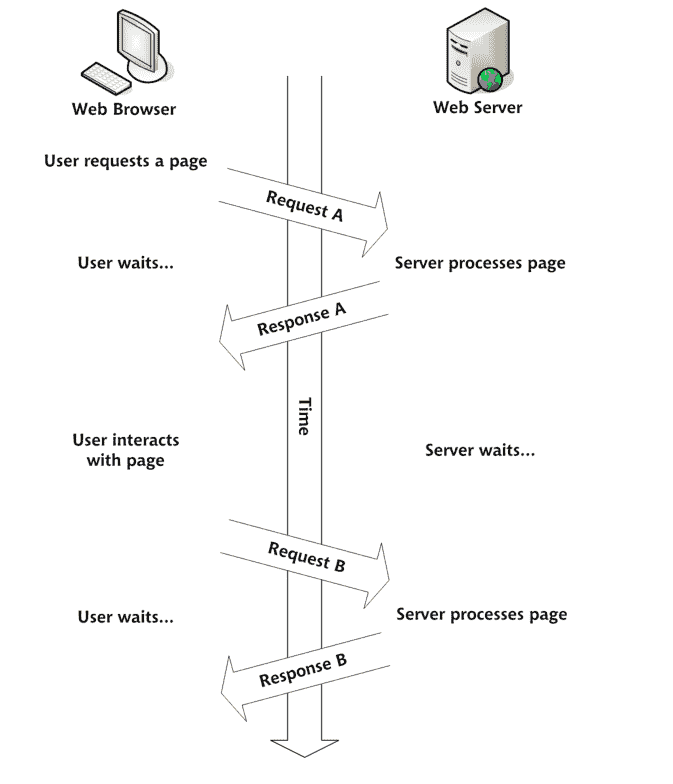

异步的赛车将会更加激动人心。杆位发车的车可能在第一个弯道就被超越，而从格子旗最后一位发车的车可以在车群中穿针引线，最终以第三名的成绩冲过终点线。AJAX 应用中来自浏览器的 HTTP 请求正是以这种方式工作的。正是这种能够根据需求向服务器发出大量小请求的能力，使得 AJAX 开发如此酷。图 1.2 展示了一个 AJAX 应用向 Web 服务器发起异步请求。

图 1.2. AJAX Web 应用是一个异步系统

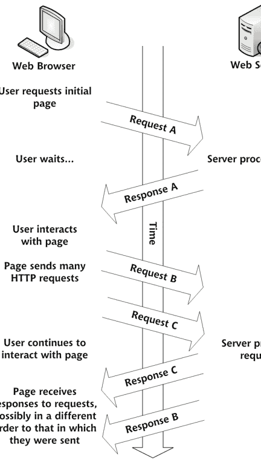

最终的结果是一个感觉起来响应速度快得多的应用，因为用户等待请求处理的时间显著减少，而且不必等待一整个新的 Web 页面通过网络传输并由浏览器渲染，就可以看到结果。

## AJAX 技术

用于构建 AJAX Web 应用的技术涵盖了多种不同的编程领域，因此 AJAX 开发既不像常规应用开发那样简单直接，也不像老派的 Web 开发那样容易。

另一方面，AJAX 开发融合了如此多不同的技术，这让它变得更加有趣和好玩。以下是共同协作构成 AJAX Web 应用的技术简要列表：

- XML
- W3C DOM
- CSS
- XMLHttpRequest
- JavaScript

在本章的其余部分，我们将会逐一了解这些技术，并讨论它们在 AJAX Web 应用中扮演的角色。

## 数据交换与标记：XML

XML⁶ 是 AJAX 中字母 "X" 的来源。这很幸运，因为技术缩写如果包含字母 "X"，会自动被认为酷得多。（是的，我在开玩笑！）

### 数据交换的通用语

XML 通常用作 AJAX 应用中浏览器与服务器之间异步 HTTP 请求的主要数据格式。这个角色发挥了 XML 作为中立且相当简单的数据交换格式的优势，同时也意味着如果需要，相对容易重用或重新格式化内容。

> ⁶ XML 代表可扩展标记语言（Extensible Markup Language）——不过除了教科书之外，没人会这么叫它。

当然，还有许多其他方式来格式化数据以便在浏览器和服务器之间轻松交换⁷，但 XML 是最常见的一种。

### XML 作为标记

AJAX 应用中的 Web 页面由 XHTML 标记组成，而 XHTML 实际上只是 XML 的一种变体。XHTML 作为 HTML 的继任者，与 HTML 非常相似。任何熟悉老派 HTML 的开发者都能轻松上手，同时它拥有有效 XML 的所有优势。使用 XHTML 有诸多优点：

- 它提供了大量用于查看、编辑和验证 XML 的标准工具和脚本库。
- 它与更新的、兼容 XML 的浏览器具有前向兼容性。
- 它既可以与 HTML 文档对象模型（DOM）配合使用，也可以与 XML DOM 配合使用。
- 它更容易被重新用于在非浏览器代理中查看。

开发社区中一些较为迂腐的人坚持认为，人们还不应该使用 XHTML。他们非常强烈地认为，XHTML 既然是真正的 XML，除非能够使用正确的 HTTP Content-Type 标头 `application/xhtml+xml`⁸ 来提供，否则根本不应该使用它，而目前对此的浏览器支持仍然有限。（Internet Explorer 6 和 7 完全不支持它。）

在实践中，你可以使用 Content-Type 为 `text/html` 的方式向浏览器提供 XHTML，因为所有主流浏览器都能正确渲染以 `text/html` 提供的 XHTML 文档。尽管浏览器会将你的代码当作普通的 HTML 处理，但其他程序仍然可以将其解释为 XML，因此使用 XHTML 来"面向未来"地保护你的标记，没有任何实际理由不这样做。

如果你碰巧不同意我的观点，你也可以选择使用较老的 HTML 4.01 标准进行开发。这仍然是一个可行的 Web 标准，在开发你的 Web 应用时也是一个完全合理的选择。

> ⁷ 例如 CSV（逗号分隔值）、JSON（JavaScript 对象表示法），或者干脆是纯文本。
> ⁸ `text/xml` 和 `application/xml` 也可以，尽管它们的描述性较差。

第 1 章：AJAX 概览


### XHTML 与本书

本书中的大多数代码示例将使用 XHTML 1.0 Strict。`iframe` 元素在 Strict 中不可用，因此我们展示的少数使用 `iframe` 的代码示例将是 XHTML 1.0 Transitional。

万维网联盟（W3C）维护着一个关于 HTML 和 XHTML 之间差异的常见问题解答。⁹

### W3C 文档对象模型

文档对象模型（DOM）是 XML 和 HTML 文档的面向对象表示，并提供了用于更改这些文档的内容、结构和样式的 API。

最初，Netscape Navigator 和 Internet Explorer 等特定浏览器提供了不同的、专有的方式来使用 JavaScript 操作 HTML 文档。DOM 源于万维网联盟（W3C）的努力，旨在提供一种与平台和浏览器无关的方式来实现相同的任务。

DOM 将 XML 或 HTML 文档的结构表示为对象层次结构，这对于标准 XML 工具进行解析来说是理想的。

### DOM 操作方法

JavaScript 提供了大量的 API 来处理这些 DOM 结构，包括解析和操作文档两方面。这是在 AJAX 应用中实现网页的较小、逐块更改的主要方式之一。¹⁰

### DOM 事件

DOM 的另一个重要功能是，它提供了 JavaScript 将事件附加到 Web 页面元素的标准方法。这使得更丰富的用户界面成为可能，因为它允许你为用户提供与页面交互的机会，超越了简单的链接和表单元素。

这方面的一个很好的例子是拖放功能，它让用户可以在屏幕上拖动页面的各个部分，并将它们放置到特定位置来触发特定的

> ⁹ http://www.w3.org/MarkUp/2004/xhtml-faq
> ¹⁰ 另一种方法只是简单地更改元素的 `innerHTML` 属性。这种方法在任何标准中都没有很好的文档记录，尽管主流浏览器都广泛支持它。


## 表现：CSS

CSS（层叠样式表）提供了一种统一的方法来控制 Web 应用程序中用户界面元素的外观。你可以使用 CSS 来改变页面外观的几乎所有方面，从字体大小、颜色和间距，到元素的定位方式。

在 AJAX 应用程序中，CSS 的一个非常好的用途是提供用户界面反馈（通过 CSS 驱动的动画和过渡效果），或指示页面中用户可以交互的部分（通过例如鼠标悬停触发的颜色或外观变化）。例如，你可以使用 CSS 过渡来指示应用程序的某个部分正在等待服务器上正在处理的 HTTP 请求。

在 AJAX 这一术语更广泛的定义中，CSS 操作占据着重要地位——体现在各种视觉过渡和效果中，以及拖放和就地编辑功能中。

## 通信：XMLHttpRequest

`XMLHttpRequest` 是一个具有非常易用接口的 JavaScript 类，用于向 Web 服务器发送和接收 HTTP 请求及响应。正是 `XMLHttpRequest` 类使得真正的 AJAX 应用程序开发成为可能。使用 `XMLHttpRequest` 发出的 HTTP 请求就像浏览器发出加载页面或提交表单的普通请求一样，但用户无需离开当前加载的网页。

微软最早在 Windows 版 Internet Explorer 5 中将 `XMLHttpRequest` 作为 ActiveX 对象实现。Mozilla 项目从 1.0 版本开始在 Mozilla 浏览器中提供了具有兼容 API 的 JavaScript 原生版本。（当然，在 Firefox 中也可用。）Apple 从 Safari 1.2 版本起添加了 `XMLHttpRequest`。

服务器的响应——无论是 XML 文档还是文本字符串——都可以传递给 JavaScript，由开发者自行决定如何使用——通常是用来更新 Web 应用程序用户界面的某些部分。

## 整合：JavaScript

JavaScript 是将 AJAX 应用程序粘合在一起的粘合剂。它在 AJAX 开发中承担着多重角色：

-   控制使用 `XMLHttpRequest` 发出的 HTTP 请求
-   解析从服务器返回的结果，使用 DOM 操作方法、XSLT 或自定义方法，具体取决于使用的数据交换格式
-   在用户界面中呈现结果数据，可以通过 DOM 操作方法将内容插入到网页中，也可以通过更新元素的 `innerHTML` 属性，或通过改变元素的 CSS 属性

由于 JavaScript 在轻量级 Web 编程（以及经验不足的程序员手中）中的长期使用历史，许多传统应用开发者并不认为它是一门"严肃的编程语言"，尽管事实上它是一门功能齐全的动态语言，能够支持面向对象的编程方法。

随着 AJAX 开发技术不断扩展基于浏览器的应用程序的能力和功能，将 JavaScript 误解为"玩具语言"的观念正在迅速改变。AJAX 的出现使 JavaScript 似乎正在经历某种复兴，而用于 AJAX 开发的 JavaScript 工具包和库数量的爆炸式增长就是最好的证明。

## 小结

在本章中，我们快速概览了 AJAX 及其背后的关键技术。我们了解了开发者在过去不得不忍受的一些糟糕的编码技巧来创建类似交互式 UI 的东西，并看到 AJAX 如何对这些方法带来了巨大的改进。掌握了 AJAX 的基本构建模块——XML、DOM、CSS、XMLHttpRequest 以及将它们串联在一起的 JavaScript——你就拥有了开始构建动态且易用的 AJAX 站点所需的一切。

## 2 基本 XMLHttpRequest

> 我迫不及待地要分享这个新奇迹，人们都将看到它的光芒，让他们各自演奏自己的音乐，今夜祭司们将赞美我的名字。
> ——Rush，《*Discovery*》

正是 XMLHttpRequest 赋予了 AJAX 真正的力量：能够从浏览器发出异步 HTTP 请求，并以小块方式拉取内容。

Web 开发者长期以来一直使用各种技巧和变通方法来实现这一目标，同时忍受着恼人的限制：不可见的 iframe 技巧迫使我们不得不在父文档和 iframe 中的文档之间来回传递数据，甚至"远程脚本"方法也仅限于向包含 JavaScript 的页面发出 GET 请求。

现代 AJAX 技术使用 XMLHttpRequest，与这些笨拙的方法相比有了巨大的改进，允许你的应用程序发出 GET 和 POST 请求，而无需完全重新加载页面。

在本章中，我们将直接动手构建一个简单的 AJAX Web 应用程序——一个简单的站点监控应用程序，它按照定时计划 ping Web 服务器上的页面。但在我们开始发出异步 HTTP 请求来轮询服务器之前，我们需要简化 XMLHttpRequest 类的使用方法，将所有浏览器不兼容问题——例如 XMLHttpRequest 对象不同的实例化方式——封装在一个可重用的代码库中。

## 一个简单的 AJAX 库

简化 `XMLHttpRequest` 类使用方法的一种途径是使用现有的代码库。得益于 AJAX 开发日益增长的流行度，目前有数十种库、工具包和框架可供使用，使 `XMLHttpRequest` 更加易于使用。

但是，由于创建 `XMLHttpRequest` 类实例的代码相当简单，且其 API 易于理解，我们将编写一个非常简单的 JavaScript 库来处理我们需要的基本功能。

逐步创建自己的库将确保你了解 `XMLHttpRequest` 类的工作原理，并在你将来决定使用其他工具包或库时，帮助你更好地利用它们。

## 开始创建 Ajax 类

我们将首先创建一个名为 `Ajax` 的基本类，在其中封装 `XMLHttpRequest` 类的功能。

> **我从未在 JavaScript 中做过面向对象编程——帮帮我！**

在本节中，我们将开始在 JavaScript 中创建类和对象。如果你以前从未这样做过，不要担心——只要你了解面向对象编程的基础知识，这其实相当简单。

在 JavaScript 中，我们不需要像在 Java、C++ 或 .NET 语言中那样使用复杂的语法来声明类；我们只需编写一个**构造函数**来创建类的实例。我们只需要：

-   提供一个构造函数——该函数的名称就是类的名称
-   使用关键字 `this` 后跟一个句点和属性名，向正在构建的对象添加属性
-   以同样的方式使用 JavaScript 特殊的 `function` 构造函数语法向对象添加方法

以下是创建一个名为 `HelloWorld` 的简单类的代码：

```javascript
function HelloWorld() {
    this.message = 'Hello, world!';
    this.sayMessage = function() {
        window.alert(this.message);
    };
}
```

JavaScript 的面向对象编程框架非常轻量级，但一旦你掌握了要领，它的工作效果出奇地好。JavaScript 不支持更高级的面向对象特性，如继承和多态，但这些特性在 AJAX 应用程序的客户端很少被需要。这些特性有用的复杂业务逻辑应该始终放在 Web 服务器上，并通过 XMLHttpRequest 类进行访问。

在这个例子中，我们创建了一个名为 HelloWorld 的类，包含一个属性（message）和一个方法（sayMessage）。要使用这个类，我们只需调用构造函数，如下所示：

```javascript
var hw = new HelloWorld();
hw.sayMessage();
hw.message = 'Goodbye';
hw.sayMessage();
```

在这里，我们创建了一个 HelloWorld 的实例（称为 hw），然后使用该对象显示两条消息。第一次调用 sayMessage 时，显示默认的"Hello, world!"消息。然后，将对象的 message 属性更改为"Goodbye"后，我们调用 sayMessage，显示"Goodbye"。

如果现在这还不太容易理解，请不要担心。随着我们逐步构建 Ajax 类，它会变得更加清晰。

以下是 Ajax 类构造函数的开头部分：

```javascript
function Ajax() {
    this.req = null;
    this.url = null;
    this.method = 'GET';
    this.async = true;
    this.status = null;
    this.statusText = '';
    this.postData = null;
    this.readyState = null;
    this.responseText = null;
    this.responseXML = null;
```


## 第二章：基础 XMLHttpRequest

```
this.handleResp = null;
this.responseFormat = 'text', // 'text', 'xml', or 'object'
this.mimeType = null;
}
```

这段代码只是定义了我们在 Ajax 类中与 XMLHttpRequest 对象配合工作时所需的属性。现在，让我们为对象添加一些方法。我们需要一些函数来设置 XMLHttpRequest 对象，并告诉它如何为我们发起请求。

## 创建 XMLHttpRequest 对象

首先，我们添加一个 init 方法，它将为我们创建一个 XMLHttpRequest 对象。不幸的是，XMLHttpRequest 在 Firefox、¹ Safari 和 Opera 中的实现与 Internet Explorer 最初的实现² 略有不同，因此如果你不是针对特定浏览器开发，就需要尝试多种不同的方式来实例化该对象。Firefox 和 Safari 使用名为 XMLHttpRequest 的类来创建 XMLHttpRequest 对象，而 Internet Explorer 6 及更早版本则使用 Microsoft 脚本引擎内置的名为 ActiveXObject 的特殊类。尽管这些类的构造函数不同，但它们的行为方式是一致的。


## 跨浏览器代码

幸运的是，大多数现代浏览器³ 整体上都能很好地遵循 Web 标准，因此你不必在 AJAX 代码中编写大量针对特定浏览器的分支判断。

这通常使得基于浏览器的 AJAX 应用程序比桌面应用程序在跨平台开发和部署方面更快捷。随着 AJAX 应用程序可用的功能和能力不断增强，桌面应用程序在用户界面方面的优势越来越少。

init 方法如下所示：

```
File: ajax.js (excerpt)
this.init = function() {
  if (!this.req) {
```

¹ 在本书中，每当我解释某功能在 Firefox 中的工作原理时，我指的都是所有基于 Mozilla 的浏览器，包括 Firefox、Mozilla、Camino 和 SeaMonkey。
² 有趣的是，Internet Explorer 7 现在支持与 Firefox 相同的接口，这有望在未来简化 AJAX 开发。
³ Internet Explorer 6、Firefox 1.0、Safari 1.2 和 Opera 8，或上述任意浏览器的更高版本。

16

Licensed to siowchen@darke.biz

```
try {
  // Try to create object for Firefox, Safari, IE7, etc.
  this.req = new XMLHttpRequest();
}
catch (e) {
  try {
    // Try to create object for later versions of IE.
    this.req = new ActiveXObject('MSXML2.XMLHTTP');
  }
  catch (e) {
    try {
      // Try to create object for early versions of IE.
      this.req = new ActiveXObject('Microsoft.XMLHTTP');
    }
    catch (e) {
      // Could not create an XMLHttpRequest object.
      return false;
    }
  }
}
return this.req;
};
```

init 方法会依次尝试每种可能的方式来创建 XMLHttpRequest 对象，直到成功创建为止。然后将该对象返回给调用函数。

## 优雅降级

保持对旧版浏览器⁴ 的兼容性需要大量的额外编码工作，因此明确你的应用程序应该支持哪些浏览器至关重要。

如果你知道你的应用程序会有大量来自不支持 **XMLHttpRequest** 类的旧版浏览器（例如 Internet Explorer 4 及更早版本、Netscape 4 及更早版本）的流量，你将需要要么完全放弃支持，要么编写代码使其能够**优雅降级**。这意味着不是让你的功能在能力较弱的浏览器中直接消失，而是通过编码确保这些浏览器的用户能够获得功能等价的内容，尽管交互性或易用性可能稍差一些。

你的网站也可能会吸引到禁用了 JavaScript 的用户。如果你想为这些用户提供支持，你应该默认提供一个传统的替代界面，然后利用 JavaScript 为现代浏览器动态地进行修改。

## 发送请求

现在我们已经有了一个创建 `XMLHttpRequest` 的方法。那么让我们编写一个使用它来发起请求的函数。我们这样开始 `doReq` 方法：

```
this.doReq = function() {
    if (!this.init()) {
        alert('Could not create XMLHttpRequest object.');
        return;
    }
};
```

`doReq` 的第一部分调用 `init` 来创建 `XMLHttpRequest` 类的实例，如果创建不成功则显示一个提示框。

## 设置请求

接下来，我们的代码在 `this.req`（即 `XMLHttpRequest` 类的新实例）上调用 `open` 方法，以开始设置 HTTP 请求：

```
this.doReq = function() {
    if (!this.init()) {
        alert('Could not create XMLHttpRequest object.');
        return;
    }
    this.req.open(this.method, this.url, this.async);
};
```

`open` 方法接受三个参数：

| 参数 | 描述 |
| :--- | :--- |
| **Method（方法）** | 此参数指定我们要使用的 HTTP 请求方法类型。最常用的方法是 GET 和 POST。 |
| **URL（网址）** | 此参数指定被请求的页面（如果方法是 POST，则指定提交到的页面）。 |
| **Asynchronous Flag（异步标志）** | 如果此参数设置为 `true`，你的 JavaScript 将在等待请求响应的同时继续正常执行。随着请求状态的变化，会触发相应的事件，以便你能够处理请求状态的变化。如果将此参数设置为 `false`，JavaScript 执行将停止，直到服务器返回响应。这种方式的优点是比使用回调函数稍微简单一些，因为你可以在代码中发送请求后立即开始处理响应，但缺点是在请求发送、服务器处理以及响应接收的过程中，你的代码会暂停执行。由于与服务器进行异步通信是 AJAX 应用程序的核心目的，因此此参数应设置为 `true`。 |

> **方法名区分大小写**

根据 HTTP 规范（RFC 2616），这些请求方法的名称是区分大小写的。并且由于规范中定义的方法都是全大写的，你应该始终确保方法名使用全大写字母输入。

正常的浏览器安全设置不允许你向另一个域发送 HTTP 请求。例如，来自 ajax.net 的页面将无法向 remotescripting.com 发送请求，除非用户允许此类请求。

在我们的 Ajax 类中，`method` 和 `async` 属性已初始化为合理的默认值（`GET` 和 `true`），但你始终需要设置目标 URL。

## 设置 onreadystatechange 事件处理程序

当 HTTP 请求在服务器上被处理时，其进度通过 `readyState` 属性的变化来指示。该属性是一个整数，表示以下状态之一，按请求从开始到完成的顺序列出：

**0：未初始化（uninitialized）**
    尚未调用 open 方法。

**1：加载中（loading）**
    尚未调用 send 方法。

**2：已加载（loaded）**
    已调用 send 方法，但响应尚不可用。

**3：交互中（interactive）**
    响应正在下载中，responseText 属性包含部分数据。

**4：已完成（completed）**
    响应已加载完毕，请求已完成。

XMLHttpRequest 对象通过触发 readystatechange 事件来通知你每次状态的变化。在该事件的处理程序中，检查请求的 readyState，当请求完成时（即 readyState 变为 4 时），你就可以处理服务器的响应了。

我们的 Ajax 代码基本框架如下所示：

```
this.doReq = function() {
    if (!this.init()) {
        alert('Could not create XMLHttpRequest object.');
        return;
    }
    this.req.open(this.method, this.url, this.async);
    var self = this; // Fix loss-of-scope in inner function
    this.req.onreadystatechange = function() {
        if (self.req.readyState == 4) {
            // Do stuff to handle response
        }
    };
};
```

我们稍后将讨论如何"处理响应"。现在，只需记住你需要在发送请求之前设置好这个事件处理程序。


## 发送请求

使用 `XMLHttpRequest` 类的 `send` 方法来发起 HTTP 请求，示例如下：

```
this.doReq = function() {
  if (!this.init()) {
    alert('Could not create XMLHttpRequest object.');
    return;
  }
  this.req.open(this.method, this.url, this.async);
  var self = this; // Fix loss-of-scope in inner function
  this.req.onreadystatechange = function() {
    if (self.req.readyState == 4) {
      // Do stuff to handle response
    }
  };
  this.req.send(this.postData);
};
```

`send` 方法接受一个参数，该参数用于传递 POST 数据。当请求是一个不向服务器传递任何数据的简单 GET 请求时（例如我们当前的请求），我们通常将这个参数设置为 `null`。

## 作用域丢失与 `this` 关键字

你可能已经注意到，`onreadystatechange` 中包含一个看起来有些奇怪的变量赋值：

```
var self = this; // Fix loss-of-scope in inner function
```

这个新变量 `self` 是为了解决一个被称为“作用域丢失”的问题。这个问题经常困扰使用异步事件处理程序的 JavaScript 开发者。异步事件处理程序通常与 `XMLHttpRequest` 以及 `setTimeout` 或 `setInterval` 等函数一起使用。

在面向对象的 JavaScript 代码中，`this` 关键字被用作指代“当前对象”的简写。这里有一个简单的例子——一个名为 `ScopeTest` 的类：

```
function ScopeTest() {
  this.message = 'Greetings from ScopeTest!';
  this.doTest = function() {
    alert(this.message);
  };
}
var test = new ScopeTest();
test.doTest();
```

这段代码会创建 `ScopeTest` 类的一个实例，然后调用该对象的 `doTest` 方法，该方法将显示消息 "Greetings from ScopeTest!"。很简单，对吧？

现在，让我们为 `ScopeTest` 类添加一些简单的 `XMLHttpRequest` 代码。我们将向你的 Web 服务器主页发送一个简单的 GET 请求，并在收到响应后，同时显示 `this.message` 和 `self.message` 的内容。

```
function ScopeTest() {
    this.message = 'Greetings from ScopeTest!';
    this.doTest = function() {
        // This will only work in Firefox, Opera and Safari.
        this.req = new XMLHttpRequest();
        this.req.open('GET', '/index.html', true);
        var self = this;
        this.req.onreadystatechange = function() {
            if (self.req.readyState == 4) {
                var result = 'self.message is ' + self.message;
                result += '\n';
                result += 'this.message is ' + this.message;
                alert(result);
            }
        }
        this.req.send(null);
    };
}
var test = new ScopeTest();
test.doTest();
```

那么，会显示什么信息呢？答案如图 2.1 所示。

我们可以看到 `self.message` 是我们期望的问候消息，但是 `this.message` 怎么样了呢？

使用 `this` 关键字是引用“执行当前代码的对象”的便捷方式。但 `this` 有一个小问题——当它从对象外部被调用时，其含义会发生变化。这是由所谓的**执行上下文**造成的。对象内部的所有代码都在相同的执行上下文中运行，但从其他对象（例如事件处理程序）运行的代码则在调用对象的执行上下文中运行。这意味着，当你编写面向对象的 JavaScript 时，你将无法在事件处理程序（例如上面的 `onreadystatechange`）的代码中使用 `this` 关键字来引用该对象。这个问题被称为**作用域丢失**。

如果这个概念对你来说还不是 100% 清楚，也不必太担心。我们将在下一章中看到这个问题的实际演示。在此期间，请记住，如果你在代码示例中看到 `self` 变量，它的引入就是为了处理作用域丢失问题。

## 图 2.1. ScopeTest 类显示的消息

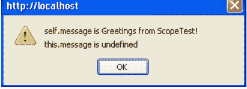

## 处理响应

现在，我们准备好编写一些代码来处理服务器对我们 HTTP 请求的响应。还记得我们在 `onreadystatechange` 事件处理程序中留下的“do stuff to handle response”注释吗？嗯，是时候写一些代码来执行这些操作了！这个函数需要做三件事：

1.  判断响应是否是一个错误。
2.  以所需的格式准备响应。
3.  将响应传递给所需的处理函数。

将以下代码包含在我们 Ajax 类的内部函数中：

```
this.req.onreadystatechange = function() {
  var resp = null;
  if (self.req.readyState == 4) {
    switch (self.responseFormat) {
      case 'text':
        resp = self.req.responseText;
        break;
      case 'xml':
        resp = self.req.responseXML;
        break;
      case 'object':
        resp = req;
        break;
    }
    if (self.req.status >= 200 && self.req.status <= 299) {
      self.handleResp(resp);
    }
    else {
      self.handleErr(resp);
    }
  }
};
```

当响应完成时，`XMLHttpRequest` 对象的 `status` 属性中会返回一个表示请求是否成功的代码。`status` 属性包含已完成请求的 HTTP 状态码。例如，如果请求的页面不存在，状态码可能是 404；如果服务器端脚本发生错误，可能是 500；如果请求成功，可能是 200，等等。这些代码的完整列表在 HTTP 规范（RFC 2616）中提供。

> **不擅长记数字？**
> 如果你记不住这些代码，别担心：你可以使用 `statusText` 属性，其中包含一条简短的消息，能提供关于错误的更多细节（例如，“Not Found”、“Internal Server Error”、“OK”）。

我们的 Ajax 类能够以三种不同的格式提供服务器响应：作为普通的 JavaScript 字符串、作为可通过 W3C XML DOM 访问的 XML 文档对象，以及作为用于发起请求的实际 `XMLHttpRequest` 对象本身。这些由 Ajax 类的 `responseFormat` 属性控制，可以设置为 `text`、`xml` 或 `object`。

响应的内容可以通过 `XMLHttpRequest` 对象的两个属性访问：

**responseText** 该属性包含服务器返回的响应，格式为普通字符串。在出错的情况下，它将包含 Web 服务器错误页面的 HTML。只要响应被返回（即 `readyState` 变为 4），该属性就会包含数据，尽管它可能不是你所期望的内容。

**responseXML** 该属性包含一个 XML 文档对象。如果响应不是 XML，该属性将为空。

我们的 Ajax 类将 `responseFormat` 属性初始化为 `text`，因此默认情况下，你的响应处理函数将以 JavaScript 字符串的形式接收服务器返回的内容。如果你处理的是 XML 内容，可以将 `responseFormat` 属性更改为 `xml`，这样将提取出 XML 文档对象。

如果你想要更花哨一点，还有一个选项可用：你可以将实际的 `XMLHttpRequest` 对象本身返回给你的处理函数。这使你能够直接访问 `status` 和 `statusText` 等属性，在需要对特定类型的错误进行不同处理时（例如，在出现 404 错误时完成额外的日志记录）可能很有用。

## 设置正确的 Content-Type

所有主流浏览器中 `XMLHttpRequest` 的实现都要求 HTTP 响应的 `Content-Type` 必须正确设置，才能将响应作为 XML 来处理。格式良好的 XML，其内容类型设置为 `text/xml`（或 `application/xml`，甚至 `application/xhtml+xml`），将正确填充 `XMLHttpRequest` 对象的 `responseXML` 属性；而非 XML 的内容类型将导致该属性的值为 `null` 或 `undefined`。

但是，Firefox、Safari 和 Internet Explorer 7 提供了一种绕过 `XMLHttpRequest` 对 XML 文档挑剔要求的方法：`XMLHttpRequest` 类的 `overrideMimeType` 方法。我们简单的 Ajax 类通过 `setMimeType` 方法接入了此功能：

```
this.setMimeType = function(mimeType) {
    this.mimeType = mimeType;
};
```

此方法设置 `mimeType` 属性。

然后，在我们的 `doReq` 方法中，我们只需在 `try ... catch` 块中调用 `overrideMimeType`，如下所示：


## 第2章：基础XMLHttpRequest

```javascript
req.open(this.method, this.url, this.async);
if (this.mimeType) {
    try {
        req.overrideMimeType(this.mimeType);
    }
    catch (e) {
        // 无法覆盖MIME类型 -- IE6或Opera？
    }
}
var self = this; // 修复内部函数中的作用域丢失
```

能够覆盖来自不合作服务器的Content-Type头，在你无法控制Web应用程序前端和后端的情况下可能非常重要。这一点尤其正确，因为当今的许多应用程序都从大量不同的域或来源访问服务和内容。然而，由于此技术在Internet Explorer 6或Opera 8中无法工作，你可能发现它不适合在当今的应用程序中使用。

### 响应处理器

根据HTTP 1.1规范，任何状态码在200到299（包含两端）之间的响应都是成功的响应。

我们定义的`onreadystatechange`事件处理器查看`status`属性以获取响应的状态。如果代码在成功的响应的正确范围内，`onreadystatechange`事件处理器会将响应传递给响应处理器方法（由`handleResp`属性设置）。

响应处理器当然需要知道响应是什么，因此我们将响应作为参数传递给它。我们将在后面讨论`doGet`方法时看到这个过程的实际应用。

由于处理器方法是用户定义的，代码还会进行粗略检查，以确保在尝试执行方法之前，该方法已被正确设置。

### 错误处理器

如果`status`属性指示请求出错（即，它在200到299的代码范围之外），服务器的响应将被传递给`handleErr`属性中的错误处理器。我们的Ajax类已经为错误处理器定义了一个合理的默认值，因此我们不必在调用它之前确保它已被定义。

handleErr属性指向一个如下所示的函数：

```javascript
this.handleErr = function() {
    var errorWin;
    try {
        errorWin = window.open('', 'errorWin');
        errorWin.document.body.innerHTML = this.responseText;
    }
    catch (e) {
        alert('发生了一个错误，但无法显示错误消息。这可能是因为你的浏览器的弹出窗口阻止程序。\n' + '如果你想查看完整的错误消息，请允许来自此网站的弹出窗口。\n' + '\n' + '状态代码: ' + this.req.status + '\n' + '状态描述: ' + this.req.statusText);
    }
};
```

此方法检查弹出窗口是否未被阻止，然后尝试在新浏览器窗口中显示服务器错误页面内容的完整文本。此代码使用try ... catch块，因此如果用户阻止了弹出窗口，我们可以向他们显示错误消息的简化版本，并告诉他们如何访问更详细的错误消息。

对于入门者来说，这是一个不错的默认设置，尽管你可能希望向最终用户显示较少的信息——这完全取决于你的偏执程度。如果你想使用自己的自定义错误处理器，你可以像这样使用setHandlerErr：

```javascript
this.setHandlerErr = function(funcRef) {
    this.handleErr = funcRef;
}
```

### 或者，单一的真正处理器

你可能希望使用一个函数来处理成功响应和错误。setHandlerBoth是我们Ajax类中的一个便利方法，它轻松地为我们设置这一点：

```javascript
this.setHandlerBoth = function(funcRef) {
  this.handleResp = funcRef;
  this.handleErr = funcRef;
};
```

传递给`setHandlerBoth`的任何函数都将同时处理成功响应和错误。

此设置可能对将你的类的`responseFormat`属性设置为`object`的用户有用，这将导致用于发出请求的`XMLHttpRequest`对象（而不仅仅是`responseText`或`responseXML`属性的值）被传递给响应处理器。

### 中止请求

有时，根据你自己的经验，网页可能需要很长时间才能加载。你的Web浏览器有一个停止按钮，但你的Ajax类呢？这就是`abort`方法发挥作用的地方：

```javascript
this.abort = function() {
  if (this.req) {
    this.req.onreadystatechange = function() { };
    this.req.abort();
    this.req = null;
  }
};
```

此方法将`onreadystatechange`事件处理器更改为空函数，调用`XMLHttpRequest`类实例的`abort`方法，然后销毁你创建的实例。这样，为正在中止的请求专门设置的任何属性都会被重置。下次发出请求时，`init`方法将被调用，这些属性将被重新初始化。

那么，为什么我们需要更改`onreadystatechange`事件处理器？`XMLHttpRequest`的许多实现在调用`abort`后会触发`onreadystatechange`事件，以指示请求的状态已更改。更糟糕的是，这些事件带有`readyState`为4，这表明一切按预期完成（如果你仔细想想，这部分是正确的：一旦我们调用`abort`，一切都应该停止，我们的`XMLHttpRequest`实例应该准备好发送另一个请求，如果我们愿意的话）。

显然，我们不希望在中止请求时调用我们的响应处理器，因此我们在调用`abort`之前删除了现有的处理器。

## 总结

根据我们目前的代码，Ajax类只需要两样东西就可以发出请求：

-   一个目标URL
-   一个用于响应的处理函数

让我们提供一个名为`doGet`的方法来设置这两个属性，并启动请求：

```javascript
this.doGet = function(url, hand, format) {
  this.url = url;
  this.handleResp = hand;
  this.responseFormat = format || 'text';
  this.doReq();
};
```

你会注意到，除了预期的两个参数*url*和*hand*外，该函数还有第三个参数：*format*。这是一个可选参数，允许我们更改传递给处理函数的服务器响应格式。

如果我们没有为`format`传入值，Ajax类的`responseFormat`属性将默认为`text`，这意味着你的处理器将接收`responseText`属性的值。或者，你可以传递`xml`或`object`作为`format`，这将改变传递给响应处理器的参数为XML DOM或XMLHttpRequest对象。

### 示例：一个简单的测试页面

终于到了将我们所学的一切整合起来的时候了！让我们创建这个Ajax类的一个实例，并使用它来发送请求和处理响应。

现在我们的类代码在一个名为`ajax.js`的文件中，任何我们想使用Ajax类的网页都需要使用`<script type="text/javascript" src="ajax.js">`标签包含Ajax代码。一旦我们的页面可以访问Ajax代码，我们就可以创建一个Ajax对象。

```html
<!DOCTYPE html PUBLIC "-//W3C//DTD XHTML 1.0 Strict//EN"
    "http://www.w3.org/TR/xhtml1/DTD/xhtml1-strict.dtd">
<html xmlns="http://www.w3.org/1999/xhtml">
  <head>
    <meta http-equiv="Content-Type"
          content="text/html; charset=iso-8859-1" />
    <title>A Simple AJAX Test</title>
    <script type="text/javascript" src="ajax.js"></script>
    <script type="text/javascript">
      var ajax = new Ajax();
    </script>
  </head>
  <body>
  </body>
</html>
```

这个脚本给了我们一个全新的Ajax类实例。现在，让我们让它做一些有用的事情。

要用我们的Ajax类发出最基本的请求，我们可以这样做：

```javascript
<script type="text/javascript">
  var hand = function(str) {
    alert(str);
  }
  var ajax = new Ajax();
  ajax.doGet('/fakeserver.php', hand);
</script>
```

这将创建一个我们的Ajax类的实例，该实例将向名为fakeserver.php的页面发出一个简单的GET请求，并将结果作为文本传递回hand函数。如果fakeserver.php返回了一个你想使用的XML文档，你可以这样做：

```javascript
<script type="text/javascript">
  var hand = function(str) {
    // 在这里处理XML内容
  }
```


## 创建页面

现在我们已经创建了 Ajax 对象，并为请求设置了一个简单的处理函数，是时候让我们的代码付诸行动了。

## 模拟服务器页面

在上面的代码中，你可以看到请求的目标 URL 被设置为一个名为 `fakeserver.php` 的页面。要使用此演示代码，你需要从同一台支持 PHP 的 Web 服务器上同时提供 `ajaxtest.html` 和 `fakeserver.php`。你也可以使用一些简单的 ASP 从 IIS Web 服务器来实现。这个模拟服务器页面是一个超级简单的页面，使用下面的 PHP 代码来模拟 Web 服务器的不同响应时间：

```php
<?php
header('Content-Type: text/plain');
sleep(rand(3, 12));
print 'ok';
?>
```

这段简短代码所做的全部工作就是：等待三到十二秒之间的某个时间，然后打印 ok。

`fakeserver.php` 代码将响应的 Content-Type 头设置为 `text/plain`。根据你返回的页面内容，你可能会为响应选择其他 Content-Type。例如，如果你返回的是 XML 文档给调用者，你自然会希望使用 `text/xml`。

这在 ASP 中同样可以实现，尽管某些功能（如 `sleep`）不像 PHP 那样容易使用，如下面的代码所示：

```asp
<%
Response.ContentType = "text/plain"
' There is no equivalent to sleep in ASP.
Response.Write "ok"
%>
```

在本书中，我们所有的服务器端示例都将使用 PHP 编写，尽管它们同样可以使用 ASP、ASP.NET、Java、Perl 或任何其他能够通过 Web 服务器提供内容的语言来编写。


## 使用 setMimeType 方法

假设你有一个响应，你知道其中包含一个有效的 XML 文档，你希望将其作为 XML 进行解析，但服务器坚持以 text/plain 的形式发送给你。你可以通过额外调用 setMimeType 来强制在 Firefox 和 Safari 中将该响应解析为 XML，如下所示：

```javascript
var ajax = new Ajax();
ajax.setMimeType('text/xml');
ajax.doGet('/fakeserver.php', hand, 'xml');
```

当然，你只应该在确定服务器返回的响应是有效 XML，并且可以确认浏览器是 Firefox 或 Safari 时才使用此方法。

## 访问页面

现在见证真相的时刻到了！访问你的本地 Web 服务器，加载 ajaxtest.html，看看你会得到什么。如果一切正常运行，会有几秒钟的延迟，然后你会看到一个标准的 JavaScript 警告框，如图 2.2 所示，简单地显示 ok。

## 图 2.2. 确认你的 Ajax 类按预期工作

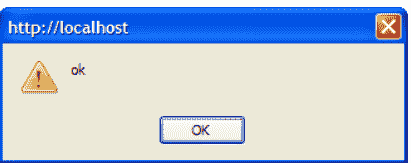

现在一切正常，我们的 Ajax 类运行良好，是时候进入下一步了。

## 示例：一个简单的 AJAX 应用

好的，使用 AJAX 的强大功能来生成一个显示"ok"的微小 JavaScript 警告框，可能并不是你购买本书时所期望的。让我们对示例代码进行一些修改，使这个 XMLHttpRequest 技术更加实用。同时，我们将创建本章开头提到的那个简单的监控应用程序。该应用程序将 ping 一个网站并报告获取响应所需的时间。

## 打好基础

我们将从一个简单的 HTML 文档开始，该文档链接到两个 JavaScript 文件：ajax.js，包含我们的库；以及 appmonitor1.js，将包含我们应用程序的代码。

```html
File: appmonitor1.html
<!DOCTYPE html PUBLIC "-//W3C//DTD XHTML 1.0 Strict//EN"
   "http://www.w3.org/TR/xhtml1/DTD/xhtml1-strict.dtd">
<html xmlns="http://www.w3.org/1999/xhtml">
  <head>
    <meta http-equiv="Content-Type"
          content="text/html; charset=iso-8859-1" />
    <title>App Monitor</title>
    <script type="text/javascript" src="ajax.js"></script>
    <script type="text/javascript" src="appmonitor1.js"></script>
  </head>
  <body>
    <div id="pollDiv"></div>
  </body>
</html>
```

你会注意到页面的 body 中几乎没有内容——只有一个 div 元素。这在依赖 AJAX 功能的 Web 应用中相当典型。通常，AJAX 应用的大部分内容是由 JavaScript 动态创建的，因此我们通常在页面源代码的 body 中看到的标记比所有内容都由服务器生成的非 AJAX Web 应用要少得多。但是，在 AJAX 不是应用程序绝对必要部分的情况下，应该提供应用程序的纯 HTML 版本。

我们将以一些使用 Ajax 类的简单内容来开始 appmonitor1.js 文件：

```javascript
File: appmonitor1.js (excerpt)

var start = 0;
var ajax = new Ajax();

var doPoll = function() {
  start = new Date();
  start = start.getTime();
  ajax.doGet('/fakeserver.php?start=' + start, showPoll);
}

window.onload = doPoll;
```

我们将使用 `start` 变量来记录每次请求开始的时间——这个值将用于计算每次请求花费的时间。我们将 `start` 设为全局变量，这样就不必用额外的计时代码来干扰 Ajax 类的内部工作——我们可以在调用 Ajax 对象之前和之后立即设置 `start` 的值。

`ajax` 变量简单地保存了我们 Ajax 类的一个实例。

`doPoll` 函数实际使用 Ajax 类来发出 HTTP 请求。你应该能从我们最初的测试页面中认出对 `doGet` 方法的调用。

注意，我们在目标 URL 中添加了一个查询字符串，其中 `start` 值作为参数。我们实际上并不打算在服务器端使用这个值；我们只是将它作为一个随机值来处理 Internet Explorer 过度积极的缓存行为。IE 会缓存所有通过 `XMLHttpRequest` 发出的 GET 请求，禁用这个"功能"的一种方法是在查询字符串中附加一个随机值。`start` 中的毫秒值可以兼作该随机值。另一种替代方法是使用 `XMLHttpRequest` 类的 `setRequestHeader` 方法在请求上设置 `If-Modified-Since` 头。

最后，我们将 `doPoll` 绑定到 `window.onload` 事件上，从而启动一切。

## 使用 showPoll 处理结果

我们传递给 `doGet` 的第二个参数告诉 Ajax 类将响应传递给 `showPoll` 函数。以下是该函数的代码：

```javascript
File: appmonitor1.js (excerpt)

var showPoll = function(str) {
  var pollResult = '';
  var diff = 0;
  var end = new Date();
  if (str == 'ok') {
      end = end.getTime();
      diff = (end - start) / 1000;
      pollResult = 'Server response time: ' + diff + ' seconds';
  }
  else {
      pollResult = 'Request failed.';
  }
  printResult(pollResult);
  pollHand = setTimeout(doPoll, 15000);
}
```

这一切都很简单：该函数期望一个参数，该参数应该是如果一切按预期进行时从 fakeserver.php 返回的字符串 ok。如果响应正确，代码会进行快速计算以确定响应花了多长时间，并创建一条包含结果的消息。它将该消息传递给 `pollResult` 进行显示。

在这个非常简单的实现中，任何非预期的响应都会产生一条相当简洁且无帮助的消息：Request failed。我们将在下一章升级此应用程序时使错误条件的处理更加健壮。

一旦 `pollResult` 被设置，它就会被传递给 `printResult` 函数：

```javascript
function printResult(str) {
    var pollDiv = document.getElementById('pollDiv');
    if (pollDiv.firstChild) {
        pollDiv.removeChild(pollDiv.firstChild);
    }
    pollDiv.appendChild(document.createTextNode(str));
}
```

`printResult` 函数将从 `showPoll` 发送的消息显示在页面中唯一的 div 内。

注意上面代码中的检查，用于查看我们的 `div` 是否有任何子节点。这会检查是否存在任何文本节点，这些文本节点可能包括我们在之前的迭代中添加到此 `div` 的文本，或者页面标记中包含在 `div` 内的文本，然后将它们移除。如果你不移除现有的文本节点，代码只会将新结果附加到页面上，作为

新文本节点：你将显示一段很长的字符串，并且会有更多文本不断地被追加到其后。

## 为什么不使用 innerHTML？

你可以简单地更新 div 的 `innerHTML` 属性，如下所示：

```
document.getElementById('pollDiv').innerHTML = str;
```

`innerHTML` 属性并非 Web 标准，但所有主流浏览器都支持它。而且，正如你从它仅需一行代码（相比之下 DOM 方法需要四行）就能看出那样，有时它比使用 DOM 方法更容易。这两种在页面上显示内容的方法本身并没有哪个更好。

在某些情况下，你可能会根据这两种方法的渲染速度差异来选择（`innerHTML` 可能比 DOM 方法更快）。在其他情况下，你可能会根据代码的清晰度，甚至是个人喜好来做出决定。

## 重新开始该过程

最后，`showPoll` 通过使用 `setTimeout` 计划在 15 秒后调用原始的 `doPoll` 函数，从而使整个过程重新开始，如下所示：

文件：appmonitor1.js（节选）

```
var pollHand = setTimeout(doPoll, 15000);
```

代码持续调用 `doPoll` 函数，这意味着一旦页面加载，轮询 `fakeserver.php` 页面的 HTTP 请求将一直持续，直到该页面被关闭。`pollHand` 变量是间隔 ID，允许你跟踪待处理的操作，并使用 `clearTimeout` 将其取消。

`setTimeout` 调用的第一个参数 `doPoll` 是应用程序主函数的指针；第二个参数代表请求之间必须间隔的时间长度（以秒为单位）。

## 完整示例代码

以下是我们使用这个简单的监控应用程序进行第一次试运行的所有代码。

```
File: appmonitor1.js

var start = 0;
var ajax = new Ajax();

var doPoll = function() {
  start = new Date();
  start = start.getTime();
  ajax.doGet('/fakeserver.php?start=' + start, showPoll);
}

window.onload = doPoll;

var showPoll = function(str) {
  var pollResult = '';
  var diff = 0;
  var end = new Date();
  if (str == 'ok') {
    end = end.getTime();
    diff = (end - start)/1000;
    pollResult = 'Server response time: ' + diff + ' seconds';
  }
  else {
    pollResult = 'Request failed.';
  }
  printResult(pollResult);
  var pollHand = setTimeout(doPoll, 15000);
}

function printResult(str) {
  var pollDiv = document.getElementById('pollDiv');
  if (pollDiv.firstChild) {
    pollDiv.removeChild(pollDiv.firstChild);
  }
  pollDiv.appendChild(document.createTextNode(str));
}
```

为了遵循良好的软件工程原则，我将 JavaScript 代码与标记语言分离开来，并将其放在两个不同的文件中。

我在本书的所有示例代码中都将采用类似的方法，将每个示例的标记、JavaScript 代码和 CSS 分别放入独立的文件中。这个小小的监控应用非常基础，所以没有 CSS 文件。我们将在下一章中添加一些样式，使其看起来更美观。

## 运行应用程序

尝试在浏览器中加载该页面。将其放入 Web 服务器的根目录，然后在浏览器中打开页面。

如果 `fakeserver.php` 页面响应正常，你将看到类似于图 2.3 所示的显示结果。

### 图 2.3. 运行简单的监控应用程序

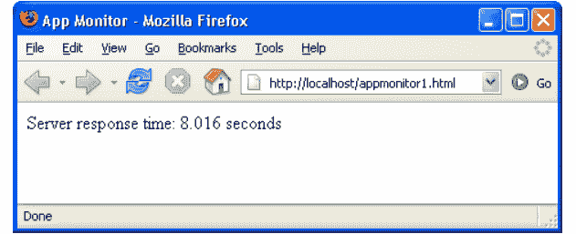

## 延伸阅读

这里有一些在线资源，可以帮助你进一步了解本章中的技术和概念。

### JavaScript 的对象模型

http://docs.sun.com/source/816-6409-10/obj.htm
http://docs.sun.com/source/816-6409-10/obj2.htm
查看 Sun Microsystems 托管的 JavaScript 1.3 版本《客户端 JavaScript 指南》中关于对象的这两个章节。第一章解释了理解如何在 JavaScript 中操作对象所需的所有基本概念。第二章深入探讨了 JavaScript 基于原型的继承模型，让你能够更好地利用 JavaScript 面向对象编程的强大功能。

http://www.crockford.com/javascript/private.html
这是一个关于如何使用 JavaScript 对象创建私有实例变量的简短介绍。它将帮助你更深入地理解 JavaScript 基于原型的继承机制。

### XMLHttpRequest

http://developer.apple.com/internet/webcontent/xmlhttpreq.html
这是来自 Apple Developer Connection 的一个很好的参考页面。它对 `XMLHttpRequest` 类进行了很好的概述，并提供了其方法和属性的参考表。

http://jibbering.com/2002/4/httprequest.html
这篇文章最初发布于 2002 年，一直在用新信息更新。它包含了关于发送 HEAD 请求（而不仅仅是 GET 或 POST）的信息，以及 JavaScript 对象表示法（JSON）和 SOAP。

http://www.xulplanet.com/references/objref/XMLHttpRequest.html
这是 XULPlanet 关于 Firefox 中 `XMLHttpRequest` 实现的详尽参考资料。

http://kb.mozillazine.org/XMLHttpRequest
这是另一个很好的概述，它还展示了一些较少使用的 `XMLHttpRequest` 对象方法，如 `overrideMimeType`、`setRequestHeader` 和 `getResponseHeader`。同样，该参考资料侧重于 Firefox 中的实现。

http://msdn.microsoft.com/library/en-us/xmlsdk/xmlhttp/xmlobjxmlhttprequest.asp
这是微软在 MSDN 上关于其 `XMLHttpRequest` 实现的文档。

## 本章小结

`XMLHttpRequest` 是 AJAX 的核心。它使浏览器中的脚本能够发起自己的请求并从服务器获取内容。我们在本章中构建的简单 AJAX 库让我们深入理解了 `XMLHttpRequest` 的工作原理，这种理解将在你的 AJAX 代码出现问题时（无论你是使用自己构建的库，还是使用附录 A 中列出的许多预构建工具包和库）为你提供帮助。我们在本章中构建的示例应用让我们有机会初步尝试 AJAX——现在是时候深潜进去学习游泳了。

# 3 AJAX 中的 “A”

> > 它碎成千万片，飞过了我们的头顶。
> ——威利·旺卡，《威利·旺卡与巧克力工厂》

AJAX 中的 “A” 代表 “asynchronous”（异步），虽然它不像字母 “X” 那样酷，但正是这个 “A” 让 AJAX 开发如此强大。正如我们在第一章中所讨论的，AJAX 异步更新界面部分的能力，让开发者能够更精细地控制我们构建的应用程序的交互性，这种能力正推动着 Web 应用进入此前仅由桌面应用程序占据的领域。

在 Web 应用程序的早期阶段，用户通过填写表单并提交来与数据交互。然后他们会等待一会儿，看着浏览器的“页面加载”动画，直到服务器返回一个全新的页面。浏览器和服务器之间的每次数据交易都是大规模且显而易见的，这使得用户很容易弄清楚发生了什么，以及他们的数据处于什么状态。

随着 AJAX 风格开发的普及，用户可以期待更具交互性、更“灵敏”的用户界面。这对用户来说是一件好事，但对于致力于提供这些增强功能的开发者来说，则带来了新的挑战。在 AJAX 应用程序中，用户以随机的方式更改数据，因此用户和应用程序都很容易对数据的状态产生混淆。

第 3 章：AJAX 中的 “A”

解决这两个问题的方案就是显示应用程序的状态，让用户随时了解应用程序正在做什么。这使得应用程序显得响应非常迅速，并为用户提供了关于其数据发生了什么的指导。AJAX Web 应用程序开发中这个关键的部分，正是区分优秀的 AJAX 应用与糟糕应用的标志。

## 计划中的应用程序增强

为了创建一个能让用户及时了解应用程序状态的灵敏用户界面，我们将采用上一章开发的监控脚本，并为其添加一些重要功能。我们将添加以下内容：

- 一种让系统管理员配置轮询间隔和超时阈值的方法
- 一种简单启动和停止监控过程的方法
- 一个显示之前请求响应时间的条形图；历史记录列表中的条目数量将由用户配置
- 当应用程序正在发起请求时向用户发送通知
- 对请求超时的优雅处理

图 3.1 显示了在完成所有增强功能后，运行中的应用程序将是什么样子。

该应用程序的代码分为三个文件：`appmonitor2.html` 中的标记、`appmonitor2.js` 中的 JavaScript 代码以及 `appmonitor2.css` 中的样式。首先，我们将所有必需的文件链接到 `appmonitor2.html` 中：

```
<!DOCTYPE html PUBLIC "-//W3C//DTD XHTML 1.0 Strict//EN"
    "http://www.w3.org/TR/xhtml1/DTD/xhtml1-strict.dtd">
<html xmlns="http://www.w3.org/1999/xhtml">
  <head>
    <meta http-equiv="Content-Type"
          content="text/html; charset=iso-8859-1" />
    <title>App Monitor</title>
    <script type="text/javascript" src="ajax.js"></script>
    <script type="text/javascript" src="appmonitor2.js"></script>
    <link rel="stylesheet" href="appmonitor2.css"
```

文件：appmonitor2.html（节选）


## 组织代码

所有这些新功能将为我们的应用增加大量复杂性，因此现在是在代码中建立某种组织结构的好时机（这比将所有内容都留在全局作用域要好得多）。毕竟，我们正在构建一个功能齐全的AJAX应用程序，因此我们希望它被合理地组织起来。

## 第三章：AJAX中的"A"

我们将使用面向对象设计原则来组织我们的应用。当然，我们将从创建应用程序的基类——Monitor类开始。

通常，我们在JavaScript中创建类的方式如下：

```javascript
function Monitor() {
  this.firstProperty = 'foo';
  this.secondProperty = true;
  this.firstMethod = function() {
    // 在这里做一些事情
  };
}
```

这是一个简洁、正常的构造函数，我们可以轻松地用它来创建Monitor类（或者如果我们愿意，可以创建多个实例）。

## 使用setTimeout时的作用域丢失

不幸的是，在我们的应用程序的情况下，事情不会这么简单。我们将在应用中大量调用setTimeout（以及setInterval），因此创建JavaScript类的常规方法可能会给我们的Monitor类带来麻烦。

setTimeout函数对于延迟执行一段代码非常方便，但它有一个严重的缺点：它在与对象不同的执行上下文中运行该代码。（我们在上一章简要讨论过这个称为作用域丢失的问题。）

这是一个问题，因为对象关键字`this`在新的执行上下文中有新的含义。因此，当您在类中使用它时，它会突然遭受一阵失忆症——它完全不知道自己是什么！

这可能有点难以理解；让我们通过一个快速的演示来实际看看这个烦人的情况。您可能还记得我们在上一章中查看的ScopeTest类。起初，它是一个简单的类，有一个属性和一个方法：

```javascript
function ScopeTest() {
  this.message = "Greetings from ScopeTest!";
  this.doTest = function() {
    alert(this.message);
  };
}
```

```javascript
var test = new ScopeTest();
test.doTest();
```

这段代码的结果是可预测的JavaScript警报框，显示文本"Greetings from ScopeTest!"

让我们修改`doTest`方法，使其使用`setTimeout`在一秒钟后显示消息。

```javascript
function ScopeTest() {
  this.message = "Greetings from ScopeTest!";
  this.doTest = function() {
    var onTimeout = function() {
      alert(this.message);
    };
    setTimeout(onTimeout, 1000);
  };
}
var test = new ScopeTest();
test.doTest();
```

这个版本代码的结果不是我们的问候消息，而是显示"undefined"的警报框。因为我们用`setTimeout`调用了`onTimeout`，`onTimeout`在一个新的执行上下文中运行。在那个执行上下文中，`this`不再指向`ScopeTest`的实例，所以`this.message`没有意义。

处理作用域丢失问题最简单的方法是将Monitor类设为一种特殊类型的类，称为**单例**。

## JavaScript中的单例

“单例”之所以得名，是因为该类在任何时候只存在一个“单一”实例。将类变成单例出奇地简单：

```javascript
var ScopeTest = new function() {
  this.message = "Greetings from ScopeTest!";
  this.doTest = function() {
    var onTimeout = function() {
      alert(this.message);
    };
    setTimeout(onTimeout, 1000);
  };
}
```

## 第三章：AJAX中的"A"

在`function`前使用关键字`new`会创建一个“一次性”构造函数。它创建ScopeTest的单个实例，然后就完成了：您不能用它来创建更多ScopeTest对象。

要调用此单例对象的doTest方法，必须使用类的实际名称（因为只有一个实例）：

```javascript
ScopeTest.doTest();
```

这一切都很好，但我们还没有解决作用域丢失的问题。如果您现在尝试这段代码，您将看到与之前相同的"undefined"消息，因为`this`不指向ScopeTest的实例。然而，使用单例为我们提供了一种简单的方法来解决问题。我们所要做的就是在onTimeout内部使用对象的实际名称——而不是关键字`this`：

```javascript
var ScopeTest = new function() {
    this.message = "Greetings from ScopeTest!";
    this.doTest = function() {
        var onTimeout = function() {
            alert(ScopeTest.message);
        };
        setTimeout(onTimeout, 1000);
    };
}
```

ScopeTest只有一个实例，我们使用其实际名称而不是`this`，因此这里不会混淆指的是哪个ScopeTest实例。

当您执行此代码时，您将在JavaScript警报框中看到预期的值"Greetings from ScopeTest!"

现在，我厌倦了在对象代码中始终使用实际对象名称，并且我喜欢尽可能使用像`this`这样的快捷关键字。因此，通常我创建一个变量`self`，可以在方法顶部用它代替`this`，并将其指向对象名称，如下所示：

```javascript
var onTimeout = function() {
    var self = ScopeTest;
    alert(self.message);
};
```

在一个像这样短的方法中，这看起来有点傻，但在更长的代码块中，拥有一个像这样的简写解决方案来引用您的对象是很好的。我使用`self`，但您也可以使用`me`，或`heyYou`，或`darthVader`（如果您愿意的话）。

## 创建Monitor对象

现在我们有了一个解决`setTimeout`作用域丢失问题的代码组织计划，是时候创建我们的基础Monitor类了：

```javascript
// 文件: appmonitor2.js (摘录)

var Monitor = new function(){
    this.targetURL = null;
    this.pollInterval = null;
    this.maxPollEntries = null;
    this.timeoutThreshold = null;
    this.ajax = new Ajax();
    this.start = 0;
    this.pollArray = [];
    this.pollHand = null;
    this.timeoutHand = null;
    this.reqStatus = Status;
}
```

前四个属性`targetURL`、`pollInterval`、`maxPollEntries`和`timeoutThreshold`将作为类初始化的一部分进行初始化。它们将采用应用程序配置中定义的值，我们将在下一节中介绍。

以下是其他属性的简要说明：

| 属性 | 描述 |
| :--- | :--- |
| **ajax** | 我们的Ajax类的实例，用于向我们正在监控的服务器发出HTTP请求。 |
| **start** | 用于记录上一次请求发送的时间。 |
| **pollArray** | 一个数组，保存服务器响应时间；常量`MAX_POLL_ENTRIES`决定了此数组中保存的项目数量。 |
| **pollHand**<br>**timeoutHand** | 由两个不同进程的`setTimeout`调用返回的间隔ID——主轮询过程，以及超时监视器，它控制每个请求的用户定义超时期限。 |
| **reqStatus** | 用于在请求进行时通知用户的状态动画。实现此功能的代码相当复杂，因此我们将编写另一个单例类来处理它。reqStatus属性指向该类的单个实例。 |

## 配置和初始化我们的应用程序

看到这个应用程序的网站管理员可能认为它很酷，但他们首先想要的事情之一是配置应用程序**轮询间隔**的简便方法，即应用程序对其监控站点发出请求之间经过的时间。使用全局常量配置轮询间隔很容易。

为了使任何使用此脚本的用户都能轻松设置轮询间隔，我们将把这部分代码放在appmonitor2.html的头部的一个`script`元素中：

```javascript
// 文件: appmonitor2.html (摘录)

<script type="text/javascript">
  // 要监控的URL
  var TARGET_URL = '/fakeserver.php';
  // 请求之间的秒数
  var POLL_INTERVAL = 5;
  // 在柱状图中显示多少条柱状条
  var MAX_POLL_ENTRIES = 10;
  // 等待服务器响应的秒数
  var TIMEOUT_THRESHOLD = 10;
</script>
```

您会注意到这些变量名都是大写的。这表明它们应该充当**常量**——在代码早期设置的值，在代码执行过程中不会改变。常量是许多编程语言的特性，但不幸的是，JavaScript并不是其中之一。¹ 请注意，这些常量与我们类的前四个属性直接相关：`targetURL`、`pollInterval`、`maxPollEntries`和`timeoutThreshold`。这些属性将在我们类的`init`方法中初始化：

> ¹ 较新版本的JavaScript允许您使用`const`关键字设置真正的常量，但此功能尚未被广泛支持（即使许多现代浏览器也不支持）。


this.init = function() {
  var self = Monitor;
  self.targetURL = TARGET_URL;
  self.pollInterval = POLL_INTERVAL;
  self.maxPollEntries = MAX_POLL_ENTRIES;
  self.timeoutThreshold = TIMEOUT_THRESHOLD;
  self.toggleAppStatus(true);
  self.reqStatus.init();
};

`init` 方法除了初始化我们类的某些属性外，还调用了两个方法：负责启动和停止轮询的 `toggleAppStatus`，以及 `reqStatus` 对象的 `init` 方法。`reqStatus` 就是我们刚才讨论过的 `Status` 单例类的实例。

这个 init 方法通过如下方式与页面的 `window.onload` 事件绑定：

```
window.onload = Monitor.init;
```

## 设置 UI

本应用程序的第一个版本在页面加载时启动，运行直到浏览器窗口关闭。在这个版本中，我们想给用户提供一个按钮，让他们可以用它来开关轮询过程。`toggleAppStatus` 方法为我们处理了这个：

```
this.toggleAppStatus = function(stopped) {
  var self = Monitor;
  self.toggleButton(stopped);
  self.toggleStatusMessage(stopped);
};
```

好的，所以 `toggleAppStatus` 并不是*真正*执行操作的方法，但它调用了执行操作的方法：`toggleButton`（将“开始”按钮变为“停止”按钮，反之亦然）和 `toggleStatusMessage`（更新应用程序的状态消息）。让我们仔细看看这两个方法。

## toggleButton 方法

此方法在主应用程序的“停止”和“开始”状态之间切换。它使用 DOM 操作方法动态创建适当的按钮，为其分配正确的文本和 onclick 事件处理程序：

```
this.toggleButton = function(stopped) {
  var self = Monitor;
  var buttonDiv = document.getElementById('buttonArea');
  var but = document.createElement('input');
  but.type = 'button';
  but.className = 'inputButton';
  if (stopped) {
    but.value = 'Start';
    but.onclick = self.pollServerStart;
  }
  else {
    but.value = 'Stop';
    but.onclick = self.pollServerStop;
  }
  if (buttonDiv.firstChild) {
    buttonDiv.removeChild(buttonDiv.firstChild);
  }
  buttonDiv.appendChild(but);
  buttonDiv = null;
};
```

此方法的唯一参数 `stopped` 可以是 `true`（表示轮询已停止）或 `false`（表示轮询已开始）。

正如你在此方法代码中看到的，按钮被创建，并设置为在应用程序停止时显示“开始”，或在应用程序当前正在轮询服务器时显示“停止”。它还将 `pollServerStart` 或 `pollServerStop` 分配为按钮的 onclick 事件处理程序。这些事件处理程序将分别启动或停止轮询过程。

当从 `init`（通过 `toggleAppStatus`）调用此方法时，`stopped` 被设置为 `true`，因此应用程序启动时按钮将显示“开始”。

由于此代码需要一个 ID 为 `buttonArea` 的 div，我们现在将其添加到标记中：

```
File: appmonitor2.html (excerpt)
<body>
    <div id="buttonArea"></div>
</body>
```

## toggleStatusMessage 方法

显示一个带有“开始”或“停止”字样的按钮可能足以让程序员或工程师了解应用程序的状态，但大多数普通人需要一条更清晰、更明显的消息才能弄清楚应用程序发生了什么。

此应用程序的升级版本将在页面顶部显示一条状态消息，告知用户应用程序的总体状态（已停止或正在运行）以及轮询过程的状态。为了显示应用程序状态，我们将在应用程序的状态栏中放置一条清晰明了的消息，说明“应用状态：已停止”或“应用状态：正在运行”。

在我们的标记中，让我们在按钮出现位置的上方插入状态消息。我们将在标记中仅包含消息的“应用状态”部分。其余消息将插入到 ID 为 `currentState` 的 span 中：

```
File: appmonitor2.html (excerpt)
<body>
    <div id="statusMessage">App Status:
        <span id="currentState"></span>
    </div>
    <div id="buttonArea"></div>
</body>
```

toggleStatusMessage 方法在可以在 currentState span 内显示的词语之间切换：

```
File: appmonitor2.js (excerpt)
this.toggleStatusMessage = function(stopped) {
    var stateSpan = document.getElementById('currentState');
    var msg;
    if (stopped) {
        msg = 'Stopped';
    }
    else {
        msg = 'Running';
    }
}
```

```
if (stateSpan.firstChild) {
    stateSpan.removeChild(stateSpan.firstChild);
}
stateSpan.appendChild(document.createTextNode(msg));
};
```

UI 设置完成后，应用程序就准备就绪，可以开始轮询和记录响应时间了。

## 检查你的进度

既然你已经进展到这里，能看到你的作品运行起来岂不是很好？嗯，不幸的是，我们的应用程序中还有很多未完成的部分——我们简要提到了一个名为 `Status` 的单例类，但还没有创建它，并且还有一些事件处理程序需要编写。但别担心！我们可以用几个类和函数的存根快速让应用程序运行起来。

我们将从创建那个 `Status` 单例类开始，包含一个空方法。

```
var Status = new function() {
    this.init = function() {
        // don't mind me, I'm just a stub ...
    };
};
```

由于 `Status` 类被 `Monitor` 类使用，我们必须在 `Monitor` 之前声明 `Status`。

然后，我们将按钮的 `onclick` 事件处理程序添加到 `Monitor` 类中。我们将让它们显示警告对话框，这样我们就能知道后台会发生什么。

```
this.pollServerStart = function() {
    alert('This will start the application polling the server.');
};
this.pollServerStop = function() {
    alert('This will stop the application polling the server.');
};
```

有了这两个简单的存根，你的应用程序现在应该可以进行测试了。

## 图 3.2. 简陋的开端

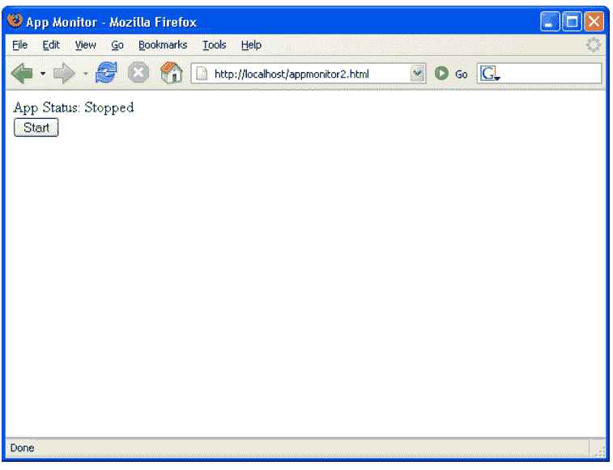

当你在图 3.2 所示的界面中单击“开始”按钮时，会弹出一个警告框，承诺未来会有更多功能。让我们开始兑现这些承诺吧。

## 轮询服务器

第一步是充实“开始”按钮的 onclick 事件处理程序 `pollServerStart`：

```
File: appmonitor2.js (excerpt)

this.pollServerStart = function() {
    var self = Monitor;
    self.doPoll();
    self.toggleAppStatus(false);
};
```

# 第 3 章：AJAX 中的 “A”

此代码立即调用 `doPoll` 方法，该方法就像我们在第 2 章中构建的应用程序监控器一样，将负责发出 HTTP 请求以轮询服务器。请求发送后，代码调用 `toggleAppStatus`，传入 `false` 以表示轮询正在进行中。

> **轮询间隔在哪里？**
你可能会想知道，为什么在讨论了设置轮询间隔之后，我们的代码直接向服务器发出了请求；时间延迟在哪里？答案是我们不希望第一次请求有延迟。如果用户单击按钮后过了十秒钟才发生任何事情，他们会认为应用程序坏了。我们希望在应用程序运行后发生的所有后续请求之间有延迟，但当用户第一次单击该按钮时，我们希望轮询立即开始。

此版本应用程序监控器中的 `doPoll` 与我们在上一章看到的唯一区别是使用 `self` 作为类属性的前缀，以及调用 `setTimeout`。看看：

```
this.doPoll = function() {
  var self = Monitor;
  var url = self.targetURL;
  var start = new Date();
  self.reqStatus.startProc();
  self.start = start.getTime();
  self.ajax.doGet(self.targetURL + '?start=' + self.start,
      self.showPoll);
  self.timeoutHand = setTimeout(self.handleTimeout,
      self.timeoutThreshold * 1000);
};
```

我们对 `setTimeout` 的调用指示浏览器在超时阈值过后调用 `handleTimeout`。我们还跟踪返回的间隔 ID，以便在收到 `showPoll` 的响应时可以取消对 `handleTimeout` 的调用。

以下是 `showPoll` 方法的代码，该方法处理来自服务器的响应：

```
this.showPoll = function(str) {
  var self = Monitor;
  var diff = 0;
  var end = new Date();
```


此方法首先取消在 `doPoll` 末尾发起的对 `handleTimeout` 的延迟调用。之后，我们让 `Status` 类的实例停止其动画（稍后我们将详细了解其细节）。

执行这些调用后，`showPoll` 会检查响应是否正常，然后计算从服务器收到该响应所花费的时间。`Ajax` 类的错误处理功能应能处理来自服务器的错误，因此我们的脚本应该只返回正常状态……不过确认一下总没有坏处！

计算出响应时间后，`showPoll` 通过 `updatePollArray` 记录该响应时间，然后使用 `printResult` 显示结果。我们将在下一节中介绍这两个方法。

最后，我们在 `doPollDelay` 中安排下一次轮询——这是一个非常简单的方法，在轮询间隔时间过后安排另一次对 `doPoll` 的调用：

```
this.doPollDelay = function() {
    var self = Monitor;
    self.pollHand = setTimeout(self.doPoll,
        self.pollInterval * 1000);
};
```

为了检验目前的进展，我们需要再添加几个桩方法。首先，让我们在 `Status` 类中添加 `startProc` 和 `stopProc`：

```
var Status = new function() {
    this.init = function() {
        // don't mind me, I'm just a stub ...
    };
    this.startProc = function() {
        // another stub function
    };
    this.stopProc = function() {
        // another stub function
    };
}
```

让我们也为 `Monitor` 类添加几个桩方法：

```
File: appmonitor2.js (excerpt)

this.handleTimeout = function() {
  alert("Timeout!");
};
this.updatePollArray = function(responseTime) {
  alert("Recording response time: " + responseTime);
};
this.printResult = function() {
  // empty stub function
};
```

现在我们可以测试进展了。在 Web 浏览器中打开 `appmonitor2.html`，点击 Start，等待 `fakeserver.php` 从休眠中唤醒并将 ok 发送回你的页面。

你会遇到两种结果之一：要么你的页面收到了响应，你会看到类似图 3.3 所示的对话框；要么你会看到图 3.4 所示的超时消息。

## 图 3.3. 你的 AJAX 应用程序收到的响应

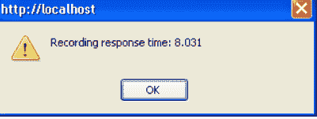

如果收到图 3.4 所示的超时消息，请不要担心。请记住，在我们的 AJAX 应用程序中，超时阈值目前设置为十秒，而 `fakeserver.php` 当前会休眠三到十二秒之间的一个随机秒数。如果随机数大于或等于十，AJAX 应用程序将报告超时。

## 图 3.4. 你的 AJAX 应用程序放弃了希望

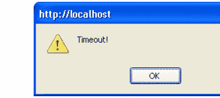

目前我们还没有实现停止轮询的方法，因此你需要通过刷新页面或关闭浏览器窗口来停止它。

## 处理超时

如果你运行了我们目前编写的代码，你可能已经注意到，即使报告了超时，之后不久也会看到一条报告请求响应时间的消息。这发生的原因是 `handleTimeout` 目前只是一个简单的桩函数。让我们在该桩函数的基础上进行构建，以避免出现这种副作用。

`handleTimeout` 本质上是 `showPoll` 的简化版本：两个方法都由异步事件触发（分别是调用 `setTimeout` 和 `XMLHttpRequest` 对象接收到的 HTTP 响应），两个方法都需要记录响应时间（对于超时情况，此值为 0），两个方法都需要更新用户界面，并且两个方法都需要触发下一次对 `doPoll` 的调用。以下是 `handleTimeout` 的代码：

```
this.handleTimeout = function() {
  var self = Monitor;
  if (self.stopPoll()) {
    self.reqStatus.stopProc(true);
    if (self.updatePollArray(0)) {
      self.printResult();
    }
    self.doPollDelay();
  }
};
```

这里，`handleTimeout` 调用 `stopPoll` 来停止应用程序对服务器的轮询。它记录发生了超时，更新用户界面，最后通过 `doPollDelay` 设置另一次对 `doPoll` 的调用。我们将停止轮询的代码移到了一个单独的函数中，因为稍后我们需要对其进行修改和增强。目前，`stopPoll` 方法仅通过 `Ajax` 类的 `abort` 方法中止 HTTP 请求；但是，有一些场景该函数尚未处理。我们将在创建完整的停止轮询进程代码时解决这些问题，但就处理超时而言，`stopPoll` 已经足够了。

```
this.stopPoll = function() {
    var self = Monitor;
    if (self.ajax) {
        self.ajax.abort();
    }
    return true;
};
```

现在，当我们重新加载应用程序时，超时的表现完全符合预期。

## 响应时间柱状图

现在，进入我们监控应用新版本的核心部分！我们希望应用程序显示过去响应时间的列表，而不仅仅是最新的单条记录，并且我们希望以一种快速且易于阅读的方式展示该列表。动态柱状图显示是完成此任务的完美工具。

## pollArray 中的运行列表

所有响应时间都将存入存储在 `Monitor` 类的 `pollArray` 属性中的一个数组。我们通过直观命名的 `updatePollArray` 方法来维护该数组的更新。这是一个非常简单的方法，如下所示：

```
this.updatePollArray = function(pollResult) {
    var self = Monitor;
    self.pollArray.unshift(pollResult);
    if (self.pollArray.length > self.maxPollEntries) {
        self.pollArray.pop();
    }
    return true;
};
```

这段代码非常直观，尽管其中使用的一些函数名称可能稍显令人困惑。

`Array` 对象的 `unshift` 方法将新元素放入数组的第一个位置，并将其余数组内容向后移动一个位置，如图 3.5 所示。

## 图 3.5. 使用 unshift 插入水果

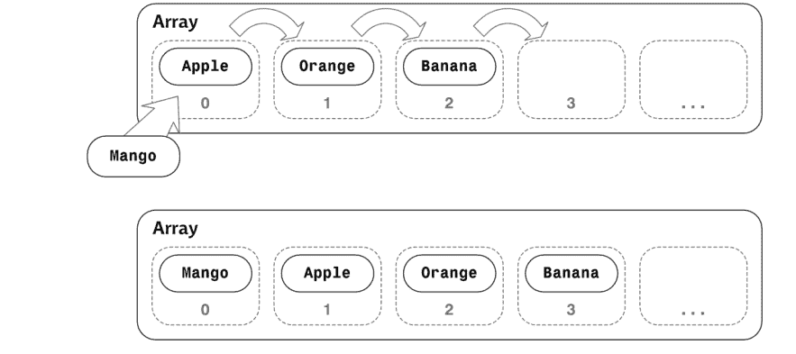

当数组超过用户定义的最大长度时，`updatePollArray` 通过从末尾"弹出"一项来截断它。这是通过 `pop` 方法实现的，该方法简单地删除数组的最后一项。² 我们在数组顶部添加元素、从底部移除元素的原因是，在我们的显示中，我们希望最新的记录出现在顶部，而较旧的记录逐渐向下移动到底部。

## 显示结果

一旦我们更新了 `pollArray` 中的结果，就可以使用 `printResult` 方法来显示它们。这实际上是最酷的部分：用户将亲身体验到我们的 AJAX 应用程序与需要刷新整个页面来更新内容的旧式应用程序之间的区别。

² `pop` 这个方法名可能看起来相当奇怪，但一旦你理解了一种称为栈（stack）的数据结构，它就更合理了。栈存储的多个元素只能按照与添加时相反的顺序进行访问。我们通过"压入"（push）将一个元素添加到栈中，通过"弹出"（pop）从栈中检索一个元素。`pop` 方法最初是为将数组用作栈的开发者设计的，但在这里我们将其重新用途化，仅用于删除数组中的最后一个元素。

# 第 3 章：AJAX 中的"A"


## 渲染页面局部

在 AJAX 术语中，包含响应时间列表的页面片段称为**页面局部**（page partial）。这指的是网页中与页面其余部分独立更新的区域。

根据对服务器的异步请求来更新网页中的某个片段，称为"渲染页面局部"。

`printResult` 方法遍历 `pollArray`，并使用 DOM 方法将轮询结果列表绘制到 ID 为 `pollResults` 的 div 中。我们将首先在标记中添加该 div：

```
File: appmonitor2.html (excerpt)

<body>
  <div id="statusMessage">App Status:
    <span id="currentAppState"></span>
  </div>
  <div id="pollResults"></div>
  <div id="buttonArea"></div>
</body>
```

现在我们准备好编写 `printResult` 方法了：

```
File: appmonitor2.js (excerpt)

this.printResult = function() {
  var self = Monitor;
  var polls = self.pollArray;
  var pollDiv = document.getElementById('pollResults');
  var entryDiv = null;
  var messageDiv = null;
  var barDiv = null;
  var clearAll = null;
  var msgStr = '';
  var txtNode = null;
  while (pollDiv.firstChild) {
    pollDiv.removeChild(pollDiv.firstChild);
  }
  for (var i = 0; i < polls.length; i++) {
    if (polls[i] == 0) {
      msgStr = '(Timeout)';
    }
  }
```


## 第三章：AJAX 中的 "A"

```
while (pollDiv.firstChild) {
  pollDiv.removeChild(pollDiv.firstChild);
}
```

初始化一些变量后，此方法会清空 `pollDiv` 中的所有内容：while 循环通过反复调用 `removeChild` 来删除 `pollDiv` 中的所有子节点。

接下来是一个简单的 for 循环，它遍历更新后的结果数组并显示结果。

```
if (polls[i] == 0) {
  msgStr = '(Timeout)';
}
else {
  msgStr = polls[i] + ' sec.';
}
```

我们为数组中每个项目的结果生成一条消息。如上所示，超时（记录为 0）会生成一条 `(Timeout)` 消息。

接下来，我们使用 DOM 方法动态地为列表中的每个条目添加标记。实际上，我们用 JavaScript 为列表中的每个条目构建了以下 HTML：

```
<div class="pollResult">
    <div class="time" style="color: #339;">8.031 sec.</div>
    <div class="bar" style="width: 160px;">&nbsp;</div>
    <br class="clearBoth"/>
</div>
```

条 `div` 的宽度会根据实际响应时间而变化，超时会以红色显示，但除此之外，此列表中的所有条目都是相同的。请注意，你必须在 `div` 中放入一些内容才能使其背景色显示。即使给 `div` 设置了固定宽度，如果 `div` 为空，背景色也不会显示。这很烦人，但很容易修复：我们可以用不间断空格字符填充 `div`。

让我们来看看用于插入此标记的代码：

```
entryDiv = document.createElement('div');
messageDiv = document.createElement('div');
barDiv = document.createElement('div');
clearAll = document.createElement('br');
entryDiv.className = 'pollResult';
messageDiv.className = 'time';
barDiv.className = 'bar';
clearAll.className = 'clearBoth';
if (polls[i] == 0) {
  messageDiv.style.color = '#933';
}
else {
  messageDiv.style.color = '#339';
}
barDiv.style.width = (parseInt(polls[i] * 20)) + 'px';
messageDiv.appendChild(document.createTextNode(msgStr));
barDiv.appendChild(document.createTextNode('\u00A0'));
entryDiv.appendChild(messageDiv);
entryDiv.appendChild(barDiv);
entryDiv.appendChild(clearAll);
pollDiv.appendChild(entryDiv);
```

如果你从未使用过 DOM 操作函数，这段代码可能看起来很复杂，但实际上它非常简单。我们使用命名恰当的 `createElement` 方法来创建元素；然后为这些元素对象的各个属性赋值。

在 `if` 语句之后，我们可以看到根据生成每个响应所需的秒数来设置条 `div` 像素宽度的代码。我们将时间数值乘以 20 以获得合理的宽度，但你可能需要根据页面上可用的水平空间来使用更高或更低的数值。

要向元素添加文本，我们使用 `createTextNode` 配合 `appendChild`，后者也用于将元素放置在其他元素内部。

## createTextNode 和不间断空格

在上面的代码中，我们使用 `\u00A0` 创建不间断空格。如果尝试在此处使用普通的 `&nbsp;` 实体，`createTextNode` 会出于"好意"将和号转换为 `&amp;`；结果就是页面上会显示 `&nbsp;`。解决方法是使用转义的 Unicode 不间断空格：`\u00A0`。

## 图 3.6. 应用程序开始成形

代码的最后一部分将所有 `div` 元素组合在一起，然后将 `pollResult` `div` 放入 `pollResults` `div` 中。图 3.6 展示了运行中的应用程序。

> "等一下，"你很可能会这样想。"我们应该看到的柱状图在哪里？"

第一个柱子确实在那里，但它是白底白字显示的，基本没什么用。让我们通过应用程序的 CSS 使其可见：

```
File: appmonitor2.css (excerpt)
.time {
    width: 6em;
    float: left;
}
.bar {
    background: #ddf;
    float: left;
}
.clearBoth {
    clear: both;
}
```

CSS 中最值得关注的是 `time` 和 `bar` `div` 元素的 `float: left` 声明，它们分别构成了时间列表和柱状图中的彩色条。将它们浮动到左侧使它们能够并排显示。然而，要使这种定位技术生效，必须在这两个 `div` 之后紧跟一个具有 `clearBoth` 类的元素。

这就是你能看到 AJAX 实际运作的地方。它将所有这些不同技术的零散部分——XMLHttpRequest、W3C DOM 和 CSS——连接在一起，并用 JavaScript 进行控制。程序员通常在 CSS 和在代码中构建界面元素的实际操作方面会遇到最大的困难。

作为 AJAX 程序员，你可以尝试依赖库来为你处理 CSS，也可以学习足够的知识来完成工作。认识一位乐于在这个话题上回答大量问题的聪明朋友很方便，或者拥有一本好的 CSS 书籍（例如 SitePoint 出版的 *The CSS Anthology: 101 Essential Tips, Tricks & Hacks*^3）也很有帮助。

## 图 3.7. 柱状图的雏形

现在 CSS 已经就位，我们可以在应用程序显示中看到柱状图了，如图 3.7 所示。

## 停止应用程序

`pollServerStart` 方法在启动应用程序后的最后一个动作是调用 `toggleAppStatus` 来切换应用程序的外观。`toggleAppStatus` 将状态显示更改为"App Status: Running"，将"Start"按钮切换为"Stop"按钮，并将 `pollServerStop` 方法附加到按钮的 `onclick` 事件上。

`pollServerStop` 方法停止正在进行的轮询过程，然后将应用程序切换回正常停止状态：

```
this.pollServerStop = function() {
  var self = Monitor;
  if (self.stopPoll()) {
    self.toggleAppStatus(true);
  }
  self.reqStatus.stopProc(false);
};
```

这段代码重用了我们在本章前面添加的 `stopPoll` 方法。目前，该方法所做的只是中止当前的 HTTP 请求，这在处理超时时是没问题的。但是，此方法还需要处理另外两种场景。

第一种场景是在轮询间隔期间调用该方法时发生（即，在收到 HTTP 请求的响应之后，但在发送下一个请求之前）。在这种场景下，我们需要取消对 `doPoll` 的延迟调用。

此方法必须能够处理的第二种场景出现在 `stopPoll` 已发送请求但尚未收到响应时被调用。在这种场景下，需要取消超时处理器。

由于我们跟踪了两个调用的间隔 ID，我们可以通过两次调用 `clearTimeout` 来修改 `stopPoll` 以处理这些场景：

```
this.stopPoll = function() {
  var self = Monitor;
  clearTimeout(self.pollHand);
  if (self.ajax) {
    self.ajax.abort();
  }
  clearTimeout(self.timeoutHand);
  return true;
};
```

现在，你应该能够通过点击柱状图下方的 Start/Stop 按钮来停止和启动轮询过程了。

## 状态通知

AJAX 异步更新内容的能力，以及更新可能只影响页面小区域这一事实，使得状态通知的显示


## 第三章：AJAX 中的 “A”

这是 AJAX 应用设计与开发的关键部分。毕竟，你的应用用户需要知道应用正在做什么。

在网页开发的早期，每当内容需要更新时，整个页面都必须重新加载，因此用户能非常清楚地知道应用正在与服务器通信。但是我们的 AJAX 网页应用可以在后台与服务器交互，这意味着用户看不到完整的页面刷新——而那种刷新通常是事情正在发生的明确信号。

那么，你的 AJAX 应用用户如何知道页面正在与服务器通信呢？嗯，与其使用浏览器边栏中旧式的旋转地球或挥舞旗帜动画，AJAX 应用通常借助小型动画或视觉**过渡**效果来通知用户处理正在进行中。这些过渡效果通常通过 CSS 实现，它们能吸引用户的注意力——又不会让人分心！——并暗示应用正在做什么。良好的 AJAX 应用设计的一个重要方面就是开发这类通知效果。

## 状态动画

既然我们的应用顶部已经有一个小状态栏，可以告诉用户应用是运行中还是已停止，在这里显示更多状态信息就相当合乎逻辑了。

像旋转的小球或奔跑的小狗这样的动画是表明应用正在忙的不错方式——通常，你会想显示一个使用运动来表示活动的图像。然而，我们不想使用一个会将用户注意力从列表上引开的提示，或者在人们试图阅读结果时让人分心，因此我们只采用图 3.8 所示的缓慢脉冲动画。

这个动画还有额外的优点：它轻量级且易于用 CSS 实现——不需要 Flash 播放器，也没有笨重的 GIF 图像需要逐帧下载。

白色栏的最右侧是未使用空间，这使得它成为放置此类通知的理想位置：它位于用户界面的顶部，因此容易看到，但它靠右放置，所以不会妨碍那些试图阅读结果列表的人。

## 图 3.8. 我们的脉冲状态动画

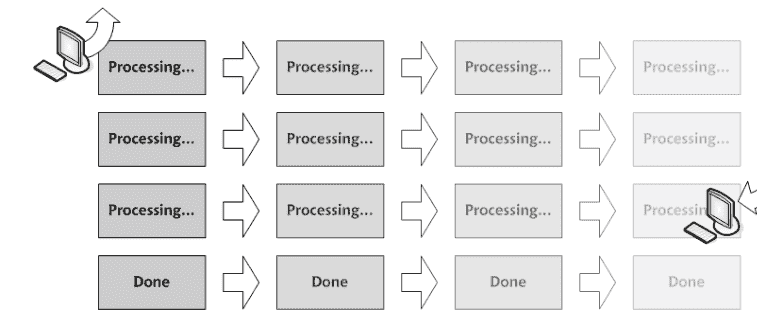

为了容纳这个动画，我们将在文档中的状态消息 div 下方添加一个 ID 为 `pollingMessage` 的 div：

```
文件：appmonitor2.html (摘录)
<body>
    <div id="statusMessage">应用状态：
        <span id="currentAppState"></span>
    </div>
    <div id="pollingMessage"></div>
    <div id="pollResults"></div>
    <div id="buttonArea"></div>
</body>
```

在你的样式表中添加一条 CSS 规则来定位这个 div：

```
文件：appmonitor2.css (摘录)
#pollingMessage {
    float: right;
    width: 80px;
    padding: 0.2em;
    text-align: center;
}
```

现在这个动画被定位在页面的右侧。

当你在浏览器中打开这个页面时，你将无法看到这个动画——目前它只是一个白色背景上的白色框。如果你愿意，可以给 `pollingMessage` 添加一些内容，看看它被定位在哪里。

## setInterval 和作用域丢失

JavaScript 的 `setInterval` 是处理重复发生任务的一种显而易见且简单的方法——例如，控制脉冲动画。

所有这些使用 `setInterval` 的 CSS 技巧导致了相当有趣但冗长的代码。所以，正如我之前提到的，将状态动画的代码放入它自己的类——`Status` 类——中是有意义的，这样我们就可以从 `Monitor` 类中引用和使用它。

一些阅读本文的聪明开发者可能已经猜到，`setInterval` 与 `setTimeout` 有着相同的作用域丢失问题：对象关键字 `this` 会丢失。由于在我们的监控应用中只需要处理一个状态动画，采取权宜之计，将我们的 `Status` 类设为单例类是有意义的，就像我们对 `Monitor` 类所做的那样。

## 设置 Status

让我们首先为我们已经编写的 `Status` 存根添加一些属性，以便让之前的代码工作起来：

```
文件：appmonitor2.js (摘录)

var Status = new function() {
    this.currOpacity = 100;
    this.proc = 'done'; // 'proc', 'done' 或 'abort'
    this.procInterval = null;
    this.div = null;
    this.init = function() {
        // 别管我，我只是个存根 ...
    };
    this.startProc = function() {
        // 另一个存根函数
    };
    this.stopProc = function() {
        // 另一个存根函数
    };
}
```

`Status` 对象有四个属性：

- `currOpacity` 属性跟踪 `pollingMessage` div 的不透明度。我们使用 `setInterval` 快速更改此 div 的不透明度，从而产生脉冲和淡入淡出的效果。
- `proc` 属性是一个三态开关，表示 HTTP 请求当前是正在进行中、已成功完成，还是在完成前被中止。
- `procInterval` 属性用于存储控制动画的 `setInterval` 进程的间隔 ID。我们将用它来停止正在运行的动画。
- `div` 属性是对 `pollingMessage` div 的引用。`Status` 类操作 `pollingMessage` div 的 CSS 属性来创建动画。

## 初始化

需要一个 `init` 方法将 `div` 属性绑定到 `pollingMessage`：

```
this.init = function() {
    var self = Status;
    self.div = document.getElementById('pollingMessage');
    self.setAlpha();
};
```

`init` 方法还包含对名为 `setAlpha` 的方法的调用，这是我们需要稍后研究的 IE 解决方法所必需的。

## Internet Explorer 内存泄漏

作为类属性使用的 DOM 元素引用（指向 div、td 或 span 等元素的变量）是 Internet Explorer 中臭名昭著的内存泄漏原因。如果你销毁一个类的实例而没有清除这些属性（通过将它们设置为 null），内存将不会被回收。

让我们为 `Monitor` 类添加一个处理 `window.onunload` 事件的 `cleanup` 方法，如下所示：

```
window.onunload = Monitor.cleanup;
```

这个方法通过调用 `Status` 类的 `cleanup` 方法并将 `reqStatus` 属性设置为 null 来清理 `Status` 类：

```
this.cleanup = function() {
    var self = Monitor;
    self.reqStatus.cleanup();
    self.reqStatus = null;
};
```

`Status` 类中的 `cleanup` 方法进行 IE 的清理工作：

```
this.cleanup = function() {
  Status.div = null;
};
```

如果我们不将该 div 引用设置为 null，Internet Explorer 会紧紧抓住分配给该变量的内存不放，每次重新加载页面时，你都会看到内存使用量急剧增加。

实际上，对于我们这个小型应用来说，这并不是什么大问题，但在具有大量 DHTML 的大型 Web 应用中，它可能成为严重问题。养成在代码中清理 DOM 引用的习惯是好的，这样它就不会成为你的问题。

## displayOpacity 方法

`Status` 类的核心代码位于 `displayOpacity` 方法中。它包含了更改 `pollingMessage` div 相应 CSS 属性所必需的浏览器特定代码。以下是代码：

```
this.displayOpacity = function() {
  var self = Status;
  var decOpac = self.currOpacity / 100;
  if (document.all && typeof window.opera == 'undefined') {
    self.div.filters.alpha.opacity = self.currOpacity;
  }
  else {
    self.div.style.MozOpacity = decOpac;
  }
  self.div.style.opacity = decOpac;
};
```

对象的 `currOpacity` 属性代表应将 `pollingMessage` div 设置的不透明度。我们的实现使用从 0 到 100 的整数比例，这是 Internet Explorer 使用的，而不是 Mozilla 和 Safari 期望的从 0 到 1 的小数比例。这个选择只是个人偏好；如果你更喜欢使用小数值，请务必使用。

在这个方法中，你会看到对 `document.all` 的测试——这是一个只有 IE 和 Opera 支持的属性——以及对 `window.opera` 的测试，这不奇怪，它只由 Opera 支持。因此，只有 IE 应该执行此 `if` 语句的 `if` 子句。在这个 IE 分支内，使用专有的 `alpha.opacity` 属性来设置不透明度，而在 `else` 子句中，我们使用较旧的 `MozOpacity` 属性，它被较旧的基于 Mozilla 的浏览器支持。

最后，此方法以符合标准的方式设置不透明度：使用 `opacity` 属性，这最终应在所有符合标准的浏览器中得到支持。

## IE 的陷阱


Internet Explorer 版本 6 作为一个较旧的浏览器，在尝试渲染基于不透明度的 CSS 变化时存在几个问题。

幸运的是，第一个问题很容易通过向我们的 `pollingMessage` CSS 规则添加内容来解决：

```
文件：appmonitor2.css (摘录)

#pollingMessage {
    float: right;
    width: 80px;
    padding: 0.2em;
    text-align: center;
    background: #fff;
}
```

添加 `background` 属性解决了 Internet Explorer 的第一个特定问题。如果我们想在 IE 中更改元素的不透明度，必须设置其背景色，否则文本会显示锯齿状边缘。请注意，将 `background` 设置为 `transparent` 无效：必须将其设置为特定颜色。

第二个问题如果你希望你的 CSS 文件有效，就有点棘手了。除非在样式表中首先声明，否则 IE 不会让你更改 `style.alpha.opacity`。现在，如果你不介意阻止你的样式表通过 W3C 验证器，通过添加另一个声明可以轻松解决这个问题：


## 第 3 章：AJAX 中的"A"

```css
#pollingMessage {
    float: right;
    width: 80px;
    padding: 0.2em;
    text-align: center;
    background: #fff;
    filter: alpha(opacity = 100);
}
```

不幸的是，这种方法会在不支持该专有属性的浏览器中产生 CSS 警告，例如 Firefox 1.5，该浏览器默认会在 JavaScript 控制台中显示 CSS 警告。一个比在全局样式表中插入 IE 专用样式信息更好的解决方案是，使用 JavaScript 仅在 IE 中为 `pollingMessage` div 的 `style` 属性添加该声明。这正是 `init` 中调用的 `setAlpha` 方法所实现的功能。以下是该方法的代码：

```javascript
this.setAlpha = function() {
    var self = Status;
    if (document.all && typeof window.opera ==
        'undefined') {
        var styleSheets = document.styleSheets;
        for (var i = 0; i < styleSheets.length; i++) {
            var rules = styleSheets[i].rules;
            for (var j = 0; j < rules.length; j++) {
                if (rules[j].selectorText ==
                    '#pollingMessage') {
                    rules[j].style.filter =
                        'alpha(opacity = 100)';
                    return true;
                }
            }
        }
    }
    return false;
};
```

此代码仅在 Internet Explorer 中执行，使用 `document.styleSheets` 数组遍历链接到当前页面的每个样式表。它使用 `rules` 属性访问每个样式表中的规则，并通过检查 `selectorText` 属性找到我们需要的样式。一旦在 `rules` 数组中找到正确的样式，它就会将 `filter` 属性设置为所需的值以改变透明度。

## Opera 中的透明度？

不幸的是，在撰写本文时，即使是最新版本的 Opera（版本 8.5）也不支持 CSS 透明度，因此这种动画在该浏览器中无法工作。不过，该功能计划在 Opera 版本 9 中实现。

## 运行动画

处理动画的代码由五个方法组成：前三个方法控制"Processing ..."动画，其余两个控制"Done"动画。控制"Processing ..."动画的三个方法是：

- startProc，设置"Processing ..."动画并通过 setInterval 安排对 doProc 的重复调用
- doProc，监视此类的属性并相应地设置"Processing ..."动画的当前帧
- stopProc，发出信号表示"Processing ..."动画应停止

控制"Done"动画的两个方法是：

- startDone，设置"Done"动画并通过 setInterval 安排对 doDone 的重复调用
- doDone，设置"Done"动画的当前帧，并在完成后终止动画

## 启动动画

设置动画并启动它是由 startProc 方法完成的：

```javascript
this.startProc = function() {
    var self = Status;
    self.proc = 'proc';
    if (self.setDisplay(false)) {
        self.currOpacity = 100;
        self.displayOpacity();
        self.procInterval = setInterval(self.doProc, 90);
    }
};
```

将 proc 属性设置为 proc（处理中）后，此代码调用 setDisplay 方法，该方法设置 pollingMessage div 的颜色和内容。接下来我们将更仔细地了解 setDisplay。

在设置 pollingMessage div 的颜色和内容后，代码将 div 的透明度初始化为 100（完全不透明），并调用 displayOpacity 使此设置生效。

最后，此方法调用 setInterval 来安排动画过程的下一步。注意，与 setTimeout 一样，setInterval 调用返回一个间隔 ID。我们将此 ID 存储在 procInterval 属性中，以便稍后可以停止该进程。

"Processing ..."和"Done"动画共享 setDisplay 方法：

```javascript
// File: appmonitor2.js (excerpt)

this.setDisplay = function(done) {
    var self = Status;
    var msg = '';
    if (done) {
        msg = 'Done';
        self.div.className = 'done';
    } else {
        msg = 'Processing...';
        self.div.className = 'processing';
    }
    if (self.div.firstChild) {
        self.div.removeChild(self.div.firstChild);
    }
    self.div.appendChild(document.createTextNode(msg));
    return true;
};
```

由于 pollingMessage div 的"Processing ..."和"Done"状态之间唯一的区别是颜色和文本，因此使用这个通用函数在 pollingMessage div 的两种状态之间切换是合理的。颜色通过为 pollingMessage div 分配类来控制，因此我们还需要在样式表中添加 done 和 processing 类的 CSS 类规则：

```css
/* File: appmonitor2.css (excerpt) */

.processing {
    color: #339;
    border: 1px solid #339;
}

.done {
    color: #393;
    border: 1px solid #393;
}
```

## 使动画停止

平稳地停止动画需要一些特定的时机把控。我们不希望动画在脉冲过程的中间突然停止。我们希望在自然中断点停止它，即当"Processing …"图像的透明度降到零时。

因此，用于停止动画的 stopProc 方法实际上并不真正停止它——它只是设置一个标志来告诉动画进程，当到达一个合适的停止点时就应该停止。这很像许多程序员在一天结束时接到妻子或丈夫的电话，提醒他们在代码逻辑断点处回家。

由于这里发生的操作很少，该方法相当简短：

```javascript
this.stopProc = function(done) {
    var self = Status;
    if (done) {
        self.proc = 'done';
    } else {
        self.proc = 'abort';
    }
};
```

此方法确实需要区分两种停止类型：成功完成的请求（done）和用户请求停止应用程序（abort）。

doProc 方法使用此标志来判断是显示"Done"消息还是直接停止。

## 使用 doProc 运行动画

doProc 方法以 90 毫秒的间隔调用，通过改变 pollingMessage div 的透明度来产生处理动画的脉冲效果。以下是代码：

```javascript
this.doProc = function() {
    var self = Status;
    if (self.currOpacity == 0) {
        if (self.proc == 'proc') {
            self.currOpacity = 100;
        } else {
            clearInterval(self.procInterval);
            if (self.proc == 'done') {
                self.startDone();
            }
            return false;
        }
    }
    self.currOpacity = self.currOpacity - 10;
    self.displayOpacity();
};
```

此方法非常简单——其主要目的就是每次调用时将 `pollingMessage` div 的透明度降低 10%。

第一个 `if` 语句检查 `div` 是否已经完全淡出。如果已经淡出，并且动画仍然应该继续运行，则将透明度重置为 100（完全不透明）。每 90 毫秒执行此代码会产生一种平滑的效果，其中 `pollingMessage` `div` 淡出、重新出现，然后再次淡出——这就是表示应用程序正在忙碌地执行某项操作的熟悉的脉冲效果。

如果动画不应该继续运行，我们通过调用 `clearInterval` 来停止动画，然后，如果 `proc` 属性为 done，我们通过调用 `startDone` 来触发"Done"动画。

## 使用 `startDone` 启动"Done"动画

`startDone` 方法对于"Done"动画的作用与 `startProc` 方法对于"Processing ..."动画的作用相同。它看起来也与 `startProc` 非常相似：

```javascript
this.startDone = function() {
    var self = Status;
    if (self.setDisplay(true)) {
        self.currOpacity = 100;
        self.displayOpacity();
        self.procInterval = setInterval(self.doDone, 90);
    }
};
```

这次，我们向 `setDisplay` 传递 `true`，这会将文本更改为"Done"并将颜色更改为绿色。

然后我们通过 `setInterval` 安排对 `doDone` 的调用，该方法实际执行淡出效果。

## 最终淡出

`doDone` 的代码比 `doProc` 的代码简单得多。它不必像 `doProc` 那样持续处理直到被告知停止。它只是不断将 `pollingMessage` div 的透明度降低 10%，直到达到零，然后自行停止。非常简单：

```javascript
this.doDone = function() {
    var self = Status;
    if (self.currOpacity == 0) {
        clearInterval(self.procInterval);
    }
    self.currOpacity = self.currOpacity - 10;
    self.displayOpacity();
};
```


# 第3章：AJAX中的"A"

## 图3.9. 带有脉冲状态指示器的应用程序

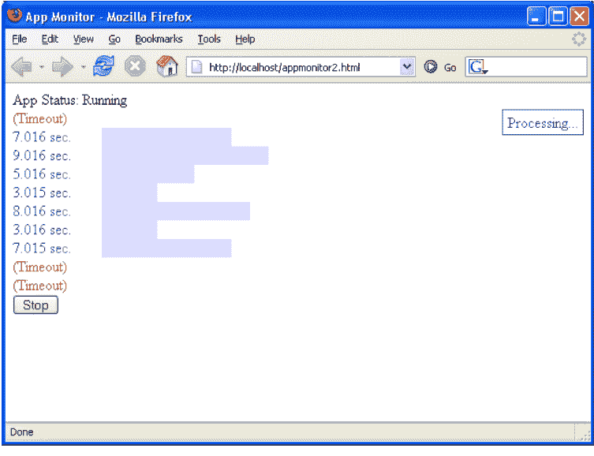

最后，我们准备在浏览器中测试这段代码。在浏览器中打开appmonitor2.html，点击"Start"按钮，你应该会在浏览器视口的右上角看到一个脉冲的"Processing ..."消息，如图3.9所示。

> ### 小心轮询间隔！
> 
> 既然我们有一个动画在页面上运行，我们需要确保不会在前一个动画停止之前就启动新动画。因此，强烈建议你不要将`POLL_INTERVAL`设置为小于两秒。

## 美化监控器

现在我们的应用程序已经启动并运行了，让我们用CSS让它看起来更美观。我们需要添加以下标记来实现我们想要的布局：

```
File: appmonitor2.html (excerpt)
<body>
  <div id="wrapper">
    <div id="main">
      <div id="status">
        <div id="statusMessage">App Status:
          <span id="currentAppState"></span>
        </div>
        <div id="pollingMessage"></div>
        <br class="clearBoth" />
      </div>
      <div id="pollResults"></div>
      <div id="buttonArea"></div>
    </div>
  </div>
</body>
```

正如你所看到的，我们添加了三个div来挂载样式，以及一个换行符来清除浮动的应用程序状态消息和动画。这个页面完整的CSS如下所示；样式化的界面如图3.10所示：

```
File: appmonitor2.css
body, p, div, td, ul {
  font-family: verdana, arial, helvetica, sans-serif;
  font-size:12px;
}
#wrapper {
  padding-top: 24px;
}
#main {
  width: 360px;
  height: 280px;
  padding: 24px;
  text-align: left;
  background: #eee;
  border: 1px solid #ddd;
  margin:auto;
}
#status {
  width: 358px;
  height: 24px;
  padding: 2px;
  background: #fff;
  margin-bottom: 20px;
  border: 1px solid #ddd;
}
#statusMessage {
  font-size: 11px;
  float: left;
  height: 16px;
  padding: 4px;
  text-align: left;
  color: #999;
}
#pollingMessage {
  font-size: 11px;
  float: right;
  width: 80px;
  height: 14px;
  padding: 4px;
  text-align: center;
  background: #fff;
}
#pollResults {
  width: 360px;
  height: 210px;
}
#buttonArea {
  text-align: center;
}
.pollResult {
  padding-bottom: 4px;
}
.time {
  font-size: 11px;
  width: 74px;
  float: left;
}
.processing {
  color: #339;
  border: 1px solid #333399;
}
.done {
  color: #393;
  border: 1px solid #393;
}
.bar {
  background: #ddf;
  float: left;
}
```

```
.inputButton {
    width: 8em;
    height: 2em;
}
.clearBoth {
    clear: both;
}
```

**图3.10. 完成的App Monitor**

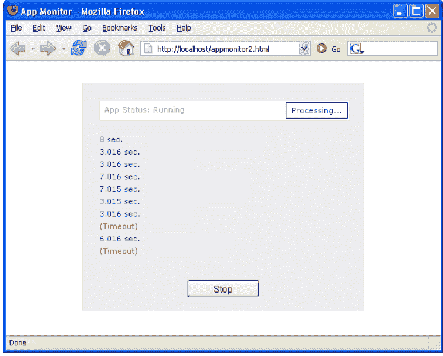

## 总结

我们第一个可工作的应用程序展示了如何使用AJAX向服务器发出多个请求，而用户无需离开当前加载的页面。它还相当真实地展示了执行多个异步任务时我们必须处理的复杂性。这种复杂性的一个很好例子是我们使用`setTimeout`来计时`XMLHttpRequest`请求。这个例子提供了一个很好的机会，让我们探索开发AJAX应用时会遇到的一些常见问题，例如作用域丢失和连接超时，并提供了实际的解决方案来帮助你处理它们。

### 第4章：AJAX与POST请求

> 我不坐在小孩桌旁。现在你要么给我大玩具，要么就送我回家。
> —约翰·克莱顿，《遥远星际》

我们上一章和上上章都在研究AJAX和基本的HTTP GET请求。我们构建了一个非常简单的监控应用程序，它会ping一个网站并报告服务器的响应时间。在本章中，我们将提升到下一个层次，开始使用POST请求。在这里，我们将构建一个网络应用程序登录屏幕，使用AJAX将用户的登录信息作为POST请求发送回服务器。

通常，一个网络应用程序的登录页面只涉及两个表单字段，因此有理由询问使用AJAX技术构建这样的表单是否真的有任何优势。为什么我们不保持简单，使用普通表单呢？实际上，这是一个非常重要的问题。AJAX开发还比较新，目前它最大的问题似乎是，人们立即开始问*如何*使用AJAX来完成一项任务，而他们首先应该问*是否*应该使用AJAX来完成该任务。

只有当AJAX能为最终用户提供切实的价值时，你才应该从你的网络开发工具箱中取出它。对于网络应用程序登录系统，AJAX可以在效率和易用性方面提供一些真正的好处。使用我们将在本章构建的登录表单，不完整的表单提交几乎是不可能的，并且错误的登录信息可以在发送和接收几百字节数据所需的时间内报告出来。与在非AJAX网络应用程序中需要发送和接收的数万字节相比，这是一个巨大的改进。

但是，在我们深入研究`POST`数据的过程之前，让我们回顾一下我们如何处理查询字符串，以及如何将数据随请求发送回服务器。

## 复习：使用GET发送数据

将少量数据发送回服务器的一个简单方法是在目标URL末尾附加一个查询字符串，发送一个简单的`GET`请求。使用我们的Ajax库可以轻松完成：

```
var ajax = new Ajax();
var handlerFunc = function(str) {
  // Do something with the response
}
ajax.doGet('/some_url.php?bass=Geddy&guitar=Alex&drums=Neil',
    handlerFunc);
```

使用`GET`使得向网络服务器发送少量额外信息变得非常容易。

## 使用POST发送数据

让我们看看我们的`Ajax`类如何发送`POST`请求，然后将其应用于我们的网络应用程序登录。

`POST`方法在一个与页面位置分开的数据包中发送额外数据，因此不像`GET`那样易于使用。然而，在以下类型的情况下，它是首选选项：

- 你需要向服务器发送大量数据。
- 数据需要以非常特定的方式格式化（例如，XML-RPC）。
- 你正在发送敏感数据，如密码。

我们需要采取以下额外步骤，以便使用我们的`Ajax`类发送`POST`请求：

`POST`方法在一个与页面位置分开的数据包中发送额外数据，因此不像`GET`那样易于使用。然而，在以下类型的情况下，它是首选选项：

- 你需要向服务器发送大量数据。
- 数据需要以非常特定的方式格式化（例如，XML-RPC）。
- 你正在发送敏感数据，如密码。

我们需要采取以下额外步骤，以便使用我们的`Ajax`类发送`POST`请求：
this.doReq = function() {
    if (!this.init()) {
        alert('Could not create XMLHttpRequest object.');
        return;
    }
    this.req.open(this.method, this.url, this.async);
    if (this.method == "POST") {
        this.req.setRequestHeader('Content-Type',
                                 'application/x-www-form-urlencoded');
    }
};


## 一个简单的表单 POST

假设你有一个网页，展示了下面的表单，其中包含了关于 80 年代前卫摇滚乐队的信息：

```
<form id="band" action="/handle_input.php">
  <input type="text" name="bass" id="bass" value="Geddy"/>
  <input type="text" name="guitar" id="guitar" value="Alex"/>
  <input type="text" name="drums" id="drums" value="Neil"/>
</form>
```

你可以提取表单数据，并使用我们的 Ajax 对象进行 POST 提交，就像这样：

```
var bandForm = document.getElementById('band');
var ajax = new Ajax();
var handlerFunc = function(str) {
  // Do something with the response
}
var formData = '';
formData += 'bass=' + escape(bandForm.bass.value);
formData += '&guitar=' + escape(bandForm.guitar.value);
formData += '&drums=' + escape(bandForm.drums.value);
ajax.doPost('/handle_input.php', formData, handlerFunc);
```

这看起来相当简单。唯一与 doGet 方法不同的地方在于多了一个额外参数，用于传递 query string 格式的 POST 数据。

## 使用 formData2QueryString

当你处理更复杂的表单时，不太可能愿意费劲地手工拼凑 query string，从表单元素中提取数据。

这时，`formData2QueryString`^1 就派上用场了。`formData2QueryString` 是一个外部库，包含了一个实用的函数，可以抓取网页表单中的所有数据，并创建一组 name-value 对的字符串；我们可以用它来执行 POST 请求。

使用 `formData2QueryString` 很简单：只需传入你想要提取数据的表单的引用，它就会返回一个正确格式化的字符串，包含表单中所有元素的值。

使用 `formData2QueryString`，我们可以把前面的例子修改成这样：

```
var bandForm = document.getElementById('band');
var ajax = new Ajax();
var handlerFunc = function(str) {
    // Do something with the input
}
var formData = '';
formData = formData2QueryString(bandForm);
ajax.doPost('/handle_input.php', formData, handlerFunc);
```

通过简化 POST 请求的数据打包过程，`formData2QueryString` 让你能够继续使用一直以来熟悉的网页表单，同时享受到 AJAX 的强大功能。

^1 `formData2QueryString` 根据 Apache License, Version 2.0 提供，可在 http://www.fleegix.org/downloads/formdata2querystring.js 获取。

## 应用程序登录

**图 4.1. Web 应用程序登录**

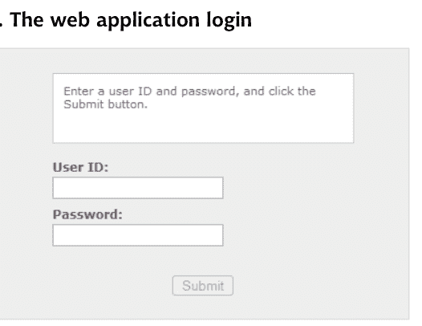

通过对 Web 应用程序的登录表单进行 AJAX 化，你可以为用户提供一种比典型 Web 应用更接近传统桌面应用体验的登录方式。AJAX 增强了开发者在页面内嵌入通知的能力——例如处理动画或错误消息——快速且方便地让用户了解登录过程的当前状态。图 4.1 展示了登录页面的外观。

## 可访问性和向后兼容性

在某些情况下，AJAX Web 应用程序代码非常复杂，以至于维护两个独立版本是合理的：一个是包含所有 AJAX 花哨功能的"高保真"版本，面向现代浏览器；另一个是纯文本网页的"低-fi"版本，由服务器端生成，面向旧版浏览器、纯文本浏览器和低端移动设备。这种非此即彼的方法并不理想，因为它迫使所有没有理想浏览器配置的用户都流落到纯文本的"贫民窟"，尽管他们中的许多系统可能支持应用的大量功能。

这就是为什么**渐进增强**（progressive enhancement）原则应当成为我们代码设计的基础，该原则在 Web 应用上下文中也被称为"不显眼的 DHTML"。这一原则建议我们在能够支持能力较弱客户端的基础之上构建应用的高级功能，使同一份代码能够在最广泛的客户端应用中运行。实际上，这种方法可以节省你的工作量——如果你采用它，就无需维护两个独立的应用版本了。

我们将把渐进增强原则应用到该登录表单的 AJAX 代码中，努力确保它在能力较弱的客户端中优雅降级。

## 屏幕阅读器

人们普遍存在一种误解，认为屏幕阅读器无法使用 JavaScript 或读取动态内容。事实上，大多数屏幕阅读器的工作方式与普通网页浏览器类似，因此尽管存在一些特殊限制，它们仍能读取 DHTML 内容。

在接下来的示例代码中，你会看到关于可访问性和屏幕阅读器的简要提及，但我们将把大部分讨论留到本章末尾专门介绍如何创建与屏幕阅读器兼容的 AJAX 的章节中。

## 标记和 CSS

让我们快速看看将作为起点的标记和 CSS。注意，在这段代码中，我们通过另一个 `script` 元素引入了 `formData2QueryString` 库：

```
<!DOCTYPE html PUBLIC "-//W3C//DTD XHTML 1.0 Strict//EN"
    "http://www.w3.org/TR/xhtml1/DTD/xhtml1-strict.dtd">
<html xmlns="http://www.w3.org是一句古诗吗？不，这是 XML 命名空间的声明。让我继续翻译：

<html xmlns="http://www.w3.org/1999/xhtml">
  <head>
    <meta http-equiv="Content-Type"
          content="text/html; charset=iso-8859-1" />
    <title>Application Login</title>
    <script type="text/javascript" src="ajax.js"></script>
    <script type="text/javascript"
        src="formdata2querystring.js"></script>
    <script type="text/javascript" src="applogin.js"></script>
    <link rel="stylesheet" href="applogin.css" type="text/css"/>
  </head>
  <body>
    <div id="uiDiv">
      <form id="loginForm" method="POST" action="applogin.html">
        <div id="promptDiv" class="basePrompt">
            <span id="msgSpan"></span>
            <span id="dotSpan"></span>
        </div> <!-- promptDiv -->
        <div id="fieldDiv">
            <div class="fieldTitle">Login ID:</div>
            <div class="fieldEntry">
                <input type="text" name="LoginId" id="LoginId"
                       size="24" maxlength="100" value=""/>
            </div>
            <div class="fieldTitle">Password:</div>
            <div class="fieldEntry">
                <input type="password" name="Pass" id="Pass"
                       size="24" maxlength="100" value=""/>
            </div>
        </div> <!-- fieldDiv -->
        <div id="buttonDiv">
            <input type="submit" id="submitButton"
                   name="submitButton" value="Submit"/>
        </div>
      </form>
    </div>
  </body>
</html>
```

文件：applogin.css（节选）

```
body, p, div, td, ul {
    font-family: verdana, arial, helvetica, sans-serif;
    font-size: 12px;
}
form {
    display: inline;
}
#mainDiv {
    padding-top: 24px;
}
#uiDiv {
    width: 360px;
    height: 220px;
    padding: 24px;
    background: #eeeeee;
    border: 1px solid #dddddd;
    margin: auto;
}
#formDiv {
    width: 300px;
    height: 200px;
    margin: auto;
}
#promptDiv {
  width: 278px;
  height: 48px;
  padding: 10px;
  margin-bottom: 16px;
  background: #ffffff;
  text-align: left;
  font-size: 11px;
}
#fieldDiv {
  width: 300px;
  text-align: left;
}
#buttonDiv {
  text-align: center;
}
#hintDiv {
  width: 380px;
  padding: 14px;
  border: 1px solid #dddddd;
  color: #666666;
  margin: auto;
  margin-top: 36px;
}
.fieldTitle {
  margin-bottom: 3px;
  font-weight: bold;
  color: #666666;
}
.fieldEntry {
  margin-bottom: 8px;
}
.basePrompt {
  color: #666666;
  border: 1px solid #cccccc;
}
.procPrompt {
  color: #333399;
  border: 1px solid #ccccee;
}
.errPrompt {
  color: #993333;
  border: 1px solid #eecccc;
}
.inputButtonActive {
  cursor: pointer;
}
.inputButtonDisabled {
  cursor: default;
}
.readerText {
  position: absolute;
  top: -1000px;
  left: -1000px;
  width: 1px;
  height: 1px;
  overflow: hidden;
  z-index: -1000;
}
.clearBoth {
  clear: both;
}
```

# 第四章：AJAX 与 POST 请求

## 创建 Login 类

让我们从创建 Login 类开始来组织代码。

我们将在应用中包含一段使用 setInterval 的处理动画代码，因此我们可能会遇到上一章讨论过的作用域丢失问题。而且，由于我们在任何时刻只会在屏幕上显示一个登录表单，所以将 Login 类设为单例类是有意义的——一种只能有一个实例的类：

```
var Login = new function() {
  this.ajax = null;
  this.form = null;
  this.promptDiv = null;
  this.dotSpan = null;
  this.button = null;
  this.enabled = true;
  this.dots = '';
  this.promptInterval = null;
};
```

记住，通过使用 new 关键字定义一个类，你就将该类变成了单例。


## DOM 元素引用

请注意，promptDiv、dotSpan 和 button 都是 DOM 元素引用，并且要记住，当我们的登录页面卸载时，我们需要确保清理这些引用，以避免第 3 章中讨论的 IE 内存泄漏问题。与我们在上一章创建的监控应用程序一样，我们将通过一个附加到 window.onunload 事件处理程序的清理方法来清理 DOM 元素引用：

```
window.onunload = Login.cleanup;
```

以下是清理方法的代码：

```
this.cleanup = function() {
  var self = Login;
  self.form = null;
  self.promptDiv = null;
  self.dotSpan = null;
  self.button = null;
};
```

养成跟踪 DOM 元素引用并在使用完毕后释放它们的习惯是很好的。这看起来可能很麻烦，但你不会希望在大型项目进行到一半时才发现你的应用在 IE 中像筛子一样泄漏内存。没有很好的工具来跟踪这类内存泄漏问题，因此在开发过程中积极主动地处理可以避免日后严重的麻烦。

## 使用 init 进行设置

现在我们已经建立了基本属性，让我们用一个 init 方法来设置对象，该方法将绑定到 window.onload 事件：

```
this.init = function() {
  var self = Login;
  self.ajax = new Ajax();
  self.form = document.getElementById('loginForm');
  self.promptDiv = document.getElementById('promptDiv');
  self.dotSpan = document.getElementById('dotSpan');
  self.button = document.getElementById('submitButton');
  self.setPrompt('base', 'Enter a login ID and password, and ' +
      'click the Submit button.');
  self.form.LoginId.focus();
  self.toggleEnabled(false);
  self.form.onsubmit = function() { return false; }
  self.clearCookie('userId');
};
```

文件：applogin.js（摘录）

```
window.onload = Login.init;
```

在设置了一些将在界面中使用的 DOM 元素引用后，这段代码设置了用户界面。

首先，它调用 setPrompt 方法显示初始登录提示。这段文字指示用户输入登录信息并单击"提交"按钮。接下来，代码将焦点设置到表单的第一个字段——登录 ID 字段。这看起来可能是一个微不足道或不必要的细节，但正是这类细节对于使用 AJAX 开发真正可用的应用程序界面至关重要。


## 获取焦点！

在理想情况下，当页面加载时，不应该强制用户点击第一个字段才能开始输入。当然，将焦点设置到第一个表单字段只能为用户节省少量的时间、精力和不便，但它将在每次登录时为每个用户都消除这种不便。对于一个将被许多人反复使用的应用来说，这些时间（以及挫败感！）会累积起来。

你可以通过从 window.onload 事件处理程序中调用该字段的 focus 方法来简单地将焦点设置到某个字段。在轻量级页面中，这将在眨眼之间为用户输入准备好表单——你的用户会对此心存感激。

然而，与 window.onload 关联的操作有时可能需要一段时间才能触发，因为该事件直到页面相关的所有 HTML、CSS、JavaScript 和图像都加载完成后才会触发。在一个包含大量图像的页面上，在事件触发之前可能会经过相当长的时间。而在登录表单的情况下，很有可能用户已经看到了登录表单，输入了用户名，并且在你的精美背景图形加载完成之前就已经输入了一半的密码。如果我们在用户正在与表单交互时将焦点切换到用户名字段，用户将会感到恼火。

由于我们的登录表单非常轻量，我们将在不考虑用户自身焦点的情况下将焦点设置到用户名字段——在我们设置焦点时，用户不太可能已经开始输入了。然而，这是你在开发自己的 AJAX 应用程序时需要考虑的一个问题。

接下来，`init` 调用 `toggleEnabled` 来禁用提交按钮——我们稍后会查看该方法——并为表单设置一个虚拟的 `onsubmit` 事件处理程序。这个事件处理程序除了返回 `false` 之外什么都不做，这会禁用表单提交。这使得我们的表单对于没有 JavaScript 支持的用户可以发挥双重作用。对于这些用户，页面将表现得像一个普通的、传统的 Web 表单。对于拥有 JavaScript 的用户，这段小代码抢先于正常的提交过程，转而允许我们使用 AJAX 发送数据。

最后，`init` 调用一个名为 `clearCookie` 的方法来清除 `userId` cookie，我们将用它来跟踪已认证的用户。`clearCookie` 使用 `document.cookie` 将 cookie 的过期日期设置为 1970 年 1 月 1 日，这会导致浏览器将其作为过期 cookie 删除。以下是代码：

```
this.clearCookie = function(name) {
  var expireDate = new Date(0);
  document.cookie = name + '=\; expires=' +
    expireDate.toGMTString() + '\; path=/';
};
```

## 1970 年 1 月 1 日

JavaScript 的 `Date` 对象可以用单个毫秒值来初始化，而不是用单独的年、月等值。将 `Date` 类的实例初始化为零毫秒会将日期设置为 1970 年 1 月 1 日。这个惯例起源于 Unix 世界，并在包括 JavaScript 和 Mac OS X 在内的多种编程语言和操作系统中通用。像这样以毫秒为单位度量的日期通常被称为"Unix 时间戳"。

## 设置登录提示

正如我们在上面看到的，`init` 方法调用了 `setPrompt` 方法来在登录表单顶部设置一条消息。这个提示是我们 Login 类可以独立于页面其余部分渲染的页面局部组件的一个示例，使其成为向用户传达应用程序状态的一种简单方便的方式。以下是 `setPrompt` 的代码：

```
this.setPrompt = function(stat, msg) {
    var self = Login;
    var promptDiv = self.promptDiv;
    var msgSpan = document.getElementById('msgSpan');
    var statusClass = '';
    promptDiv.className = stat + 'Prompt'; // base, proc or err
    if (msgSpan.firstChild) {
        msgSpan.removeChild(msgSpan.firstChild);
    }
    msgSpan.appendChild(document.createTextNode(msg));
};
```

setPrompt 方法可以显示三种不同颜色编码的提示来强调登录过程的状态。每种提示类型都与 applogin.css 中的一个 CSS 类相关联：

- basePrompt 类为灰色，表示登录页面的默认状态。这是用户在页面首次加载时看到的初始提示的颜色。
- procPrompt 类为蓝色。它表示登录已将用户的认证信息提交给服务器，正在等待响应。我们可以为应用了此类的 div 添加动画效果，以强调应用程序"正忙"的事实。与我们在监控应用程序中使用的脉冲式 CSS 透明度效果不同，我们将使用全文字效果来创建此动画：一行动画圆点，看起来有点像一串圣诞灯饰。
- errPrompt 类为红色，表示发生了某种错误。

这些类由简单的 CSS 声明组成：

```
.basePrompt {
    color: #666;
    border: 1px solid #ccc;
}
.procPrompt {
    color: #339;
    border: 1px solid #cce;
}
.errPrompt {
    color: #933;
    border: 1px solid #ecc;
}
```

`setPrompt` 方法接受两个参数。第一个是 `stat`，用于指定消息的状态为 `base`、`proc` 或 `err`。另一个参数是 `msg`——要显示的消息。

设置好消息的样式后，代码使用 DOM 操作方法删除消息框的当前内容，并在 ID 为 `msgSpan` 的 span 中显示消息。

## 确保有效输入

在传统的 Web 应用程序中，服务器是我们唯一可以可靠验证用户输入的地方。用户必须提交表单，等待服务器处理，然后等待查看提交是否成功，或者是否包含了一些错误数据，例如遗漏的字段或格式不正确的数字。

虽然服务器仍然是验证用户输入的唯一可靠场所，但我们可以通过巧妙使用 AJAX 技术大大降低用户提交无效数据的可能性。借助现代浏览器和可靠的 JavaScript 支持，在客户端进行初始的输入验证要容易得多，从而避免用户等待。然而，这种方法仍然可能使用户处于潜在的困扰中：他们必须单击提交按钮才能发现输入的内容在某些方面有误。

在我们的登录表单中，我们将默认禁用提交按钮，并在用户在两个表单字段中都输入内容时启用它。这是一种不同于——而且比在用户提交表单后验证输入的更常见方法——更友好的确保正确输入的方式。我们的方法是一种更积极地向用户提供反馈的方式——在用户在两个表单字段中都输入数据之前，他们甚至无法点击提交按钮。

## 始终在服务器端验证输入


永远不要假设客户端验证会使来自客户端的数据输入变得安全。你应该将客户端验证纯粹视为终端用户的便利——用于减少他们在输入表单数据时出错的可能性。始终在服务器端验证数据输入，以确保你处理的数据是安全的。确保你最终不会成为攻击的受害者！


## 捕获与使用键盘输入

为了捕获每个字段中文本的变化，我们将添加一个名为 `keyup` 的方法来处理 `document.onkeyup` 事件。

```javascript
文件: appmonitor.js (摘录)
document.onkeyup = Login.keyup;
```

`keyup` 将监视用户的输入，并在用户向两个字段都输入数据时激活提交按钮。以下是代码：

```javascript
文件: appmonitor.js (摘录)
this.keyup = function(e) {
    var self = Login;
    if (!e) {
        e = window.event;
    }
    if (e.keyCode != 13) {
        self.evalFormFieldState();
    }
    else {
        if (self.enabled) {
            self.submitData();
        }
    }
};
```

请注意，此方法接受一个名为 `e` 的参数。在 Firefox、Safari 和 Opera 中，此参数包含有关事件来源的信息，例如触发事件的按键。在 Internet Explorer 中，相同的信息可以通过 `window.event` 访问。

要检查是哪个键触发了此事件，我们检查 `e` 的 `keyCode` 属性，该属性包含键的 unicode 值。在 `keyup` 中，我们检查是否按下了 **Enter** 键（其 unicode 值为 13）。如果是，我们将数据发送到服务器（稍后详述）。否则，`keyup` 调用 `evalFormFieldState` 来检查表单字段的状态，并将提交按钮设置为适当的状态。

```javascript
文件: appmonitor.js (摘录)
this.evalFormFieldState = function() {
    var self = Login;
    if (self.form.LoginId.value.length > 0 &&
        self.form.Pass.value.length > 0) {
        self.toggleEnabled(true);
    }
    else {
        self.toggleEnabled(false);
    }
};
```

如果代码确定用户已在两个字段中正确输入了一些数据，它将调用我们在 `init` 中最初使用的 `toggleEnabled` 方法，并传递一个值为 `true` 以启用提交按钮。类似地，在每次按键时，如果代码发现任一表单字段为空，它会通过调用 `toggleEnabled` 并传递值为 `false` 来停用提交按钮。

顺便说一下，如果我们愿意，我们可以创建关于希望用户输入字段的数据类型的条件，并对诸如电话号码或电子邮件地址等执行更复杂的验证（例如，使用正则表达式）。


## 屏幕阅读器与 onkeyup

当使用这些设备的用户在表单字段中输入数据时，屏幕阅读器可能会干扰 `onkeyup` 事件的功能，因此您不应仅依赖由 `onkeyup` 触发的代码来确定是否启用或禁用 UI 的重要元素。在本章的后面，我们将直接将 `evalFormFieldState` 方法附加到密码表单字段的 `onchange` 事件上，以确保对于使用屏幕阅读器的用户，按钮能被正确打开。

这是 `toggleEnabled` 方法：

```javascript
this.toggleEnabled = function(able) {
    var self = Login;
    if (able) {
        self.button.onclick = self.submitData;
        self.button.disabled = false;
        self.button.className = 'inputButtonActive';
        self.enabled = true;
    }
    else {
        self.button.onclick = null;
        self.button.disabled = true;
        self.button.className = 'inputButtonDisabled';
        self.enabled = false;
    }
};
```

向此方法传递一个值为 `true` 会启用提交按钮：它分配一个 `onclick` 事件处理器，将按钮的 `disabled` 属性设置为 `false`，将其 `class` 属性设置为 `inputButtonActive`，最后，将 `Login` 类的 `enabled` 属性设置为 `true`。

如果向 `toggleEnabled` 传递一个值为 `false`，则所有操作都将反向进行。因此，如果用户填写了表单（启用按钮），但随后删除了一个表单字段条目，提交按钮将恢复到其原始状态。

此时，我们应该能够通过添加下面所示的 `submitData` 的空存根，然后在 Web 浏览器中加载页面来检查我们的进度。

```javascript
文件: applogin.js (摘录)
this.submitData = function() { };
```

## 图 4.2. 登录用户界面

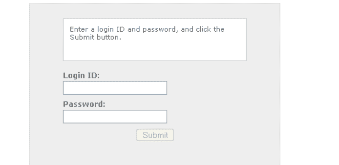

一旦页面加载完毕，并且您在登录 ID 和密码字段中输入了内容，提交按钮应该被启用，这表示您已输入了应用程序所需的所有详细信息，我们准备根据服务器上的用户列表检查登录 ID 和密码。

## 提交表单数据

既然提交按钮已激活，现在是用户尝试登录我们的 Web 应用程序的时候了。我们将使用我们的 Ajax 类通过 HTTP POST 请求将用户的登录信息发送到服务器。以下是代码：

```javascript
this.submitData = function() {
    var self = Login;
    var postData = '';
    postData = formData2QueryString(self.form);
    self.ajax.doPost('/aplogin.php', postData,
        self.handleLoginResp);
    self.showStatusPrompt();
    self.toggleEnabled(false);
};
```

此方法使用 `formData2QueryString` 从表单中提取值并放入字符串中，然后我们将该字符串传递给 Ajax 类进行 POST。接下来，代码使用 Ajax 类的 `doPost` 方法发送包含数据字符串的 POST 请求。此方法接受三个参数：

-   目标 URL
-   数据字符串
-   您希望处理响应的函数

POST 请求发送到服务器后，代码在提示框中打开处理动画，并停用提交按钮以防止多次提交。


## 保护您的登录详细信息

由于我们并未向真正的 Web 应用程序提交真实的登录详细信息，因此此时我们不太关心保护用户数据。但是，在真实的登录中，确保恶意窥探者无法窥视用户的个人数据（包括他们的登录 ID 和密码）至关重要。事实上，许多用户不会使用不使用 SSL 加密个人或敏感数据的应用程序。

使用 SSL（安全套接字层）（一种行业标准加密技术）提交数据是保护用户宝贵个人信息的最常见方式。通过 SSL 连接提供的页面，其 URL 以 `https:` 开头，而不是 `http:`。

网上有大量信息解释了如何设置您的 Web 服务器以使用 SSL。SSL 的免费实现（如 OpenSSL²）也意味着您可以使用工业级加密设置 Web 服务器——与大公司使用的加密相同——除了数字证书的价格外，没有其他费用。

## 无需触摸鼠标提交数据

显然，点击提交按钮是启动提交过程的好选择，对于那些喜欢使用鼠标的人来说，点击那个小按钮没什么大不了的。但让我们稍等片刻，同情一下那些也想登录我们假应用程序的键盘爱好者。我们有一些额外的技巧可以应用，以使这些男女用户的事情更容易。记住：当我们让事情变得更容易时，用户会喜欢。如果您的用户高兴，您也会高兴。

还记得我们编写 `keyup` 方法的时候吗？您会记得我们将 **Enter** 键视为特殊情况。当按下 **Enter** 键且提交按钮启用时，会调用 `submitData` 方法。

这是一个类似于我们使用 `init` 方法工作的结果，该方法在初始页面加载时将焦点置于登录 ID 字段。这些可能看起来是相当小的事情，但对于经常使用键盘的人来说，您付出的额外努力从长远来看可以为用户节省大量时间和精力。事实上，正是这种对可用性细节的关注，将好的 AJAX 应用程序与平庸甚至糟糕的应用程序区分开来。花时间把这些细节做对！

## 处理提交

通常，Web 应用程序登录表单将登录 ID 和密码提交到 Web 服务器，服务器根据登录 ID 和加密密码列表检查数据。为了用我们的处理页面 `applogin.php` 来模拟这个过程，我们将简单地硬编码一些值，以便可以检查登录 ID 和密码。为了使服务器看起来好像需要稍微思考一下这个验证，我们还将添加一个调用 `sleep` 三秒钟。

² http://www.openssl.org


下面是我们的伪后端代码在 PHP 中的样子。再次提醒，这段代码可以用任何服务端语言编写；我们这里选择使用 PHP，只是因为它在大多数主流 Web 服务器上都可以免费使用。

```
File: applogin.php (excerpt)
<?php
$loginId = $_POST['LoginId'];
$password = $_POST['Pass'];
$respType = '';
$respMsg = '';
$separator = ',';
sleep(3);
if ($loginId == 'user' && $password == 'password') {
    setcookie('userId', 12345);
    $respType = 'success';
    $respMsg = '/appmainpage.php';
}
else {
    $respType = 'error';
    $respMsg = 'Could not verify your login information.';
}
header('Content-Type: text/plain');
print $respType;
print $separator;
print $respMsg;
?>
```

前两个变量保存了从登录界面获取的输入，这些输入是从 POST 请求中提取的。当 XMLHttpRequest 以 POST 方式提交数据时，其行为与通过普通 Web 表单提交的数据完全相同，尽管它最初是以查询字符串的格式打包的。

## 验证你的数据！

在这个登录演示中，我们没有对来自客户端的任何数据进行验证。如果这是生产应用程序的登录，你当然应该对来自浏览器的输入进行某种验证处理，以确保数据是安全的，且是你所期望的数据类型。未经验证的数据可能给恶意黑客提供攻击应用程序的途径，而不正确的数据类型或格式可能会对应用造成严重损害。请务必验证来自客户端的数据。


## CSV 数据格式

最后三个变量——$respType、$respMsg 和 $separator——在我们向客户端输出响应时发挥作用。

响应可以非常简短：客户端从这个页面需要的只是成功或失败的通知以及一条简短的消息。而且，由于 XMLHttpRequest 可以很好地处理除 XML 之外的多种数据格式（尽管它的名字如此），我们将使用一种更轻量级的方式：**CSV**（逗号分隔值）。

CSV 是小型或简单数据集的好选择。当你不需要 XML 所提供的额外复杂性时，它提供了一种将信息拆分为多个字段的简便方式，而且还有一个额外的好处——它能与流行的电子表格和数据库程序很好地配合使用。

在这个例子中，我们只有两个数据字段。$respType 变量告诉我们登录过程是否成功，$respMsg 包含我们将向用户显示的错误消息，或者成功登录时的重定向路径。$separator 变量包含用作分隔符的字符，用于分隔两个字段（在这个例子中是逗号）。

## 设置值

一旦变量声明完毕，程序坚持休息几秒钟后，用户的登录 ID 和密码会与一对硬编码的值进行比对。然后，设置 $respType 和 $respMsg。如果值匹配，$respType 被设置为 **success**，$respMsg 被设置为登录表单将重定向到的页面地址；如果值不匹配，$respType 被设置为 **error**，$respMsg 被设置为一条解释错误的消息。

登录成功后，代码还会设置一个名为 userId 的 cookie，表示用户已实际登录到应用。在我们的页面中，代码将 cookie 设置为一个虚构的数字，但实际应用会将其设置为有用的内容——比如用户标识符。

## 输出响应

最后，我们的伪后端代码输出响应，返回给客户端。这个页面非常简单，只有两种可能的输出：

```
success,/appmainpage.php
error,Could not verify your login information.
```

我们的客户端代码解析这个结果，然后要么重定向到应用程序的主页面，要么为用户显示错误消息。

另外注意，我们将 `Content-Type` 设置为 `text/plain`，因此 `XMLHttpRequest` 不会期望响应包含有效的 XML。

当然，这是一个非常基础的示例。你当然可以扩展它来返回不同的错误消息或代码，或者将不同类别的用户引导到应用程序的不同部分（例如，将管理员用户登录到管理控制台）。你也可以选择不同的分隔符字符。有时候，你的数据中会包含逗号，所以使用逗号作为分隔符可能不是一个好主意。管道字符（|）是另一个流行的选择。

CSV 格式简单，但足够灵活，能够处理各种用途——适用于数据字段数量有限且你控制后端和前端代码的任何场景。XML 更适合更复杂的数据类型，以及应用程序需要与其他应用程序通信的情况。

## 显示处理状态

当我们的伪处理页面在假装验证提交的数据时，用户将盯着登录屏幕，不知道到底发生了什么。这就是状态通知再次发挥作用的地方。让用户了解应用程序的运行状态至关重要，但在 AJAX 应用中尤为重要，因为用户不得不坐在那里等待服务器上的进程完成。如果应用程序正在执行某个任务，它应该*看起来*很忙碌。

在这个登录页面上，我们将使用动画效果来表明应用程序正在处理用户的请求，但我们将采用与上次略有不同的方法。我们不是通过改变动画的透明度来营造运动感，而是使用一行类似于省略号（...）的点，像一串圣诞灯一样对它们进行动画处理，如图 4.3 所示。这是一种非常常见的处理动画样式，它的优势在于非常轻量，因为它完全是文本。

### 图 4.3. 通过追加一串点来创建动画

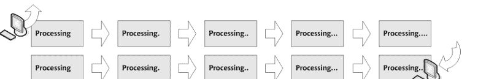

showStatusPrompt 方法启动状态动画。这段代码将提示消息设置为"Processing"，然后启动 setInterval 过程来动画化这些点。

下面是代码：

```
File: applogin.js (excerpt)

this.showStatusPrompt = function() {
    var self = Login;
    self.dots = '';
    self.setPrompt('proc', 'Processing');
    self.promptInterval = setInterval(self.showStatusDots, 200);
};
```

同样，setInterval 调用的返回值是我们需要用来关闭动画的间隔 ID，因此我们将它保存在 promptInterval 属性中以供将来使用。setInterval 过程被设置为每隔 200 毫秒调用一次 showStatusDots。

下面是 showStatusDots 的代码：

```
File: applogin.js (excerpt)

this.showStatusDots = function() {
    var self = Login;
    var dotSpan = self.dotSpan;
    self.dots += '.';
    if (self.dots.length > 4) {
        self.dots = '';
    }
    if (dotSpan.firstChild) {
        dotSpan.removeChild(dotSpan.firstChild);
    }
    dotSpan.appendChild(document.createTextNode(' ' + self.dots));
};
```

这段代码中的操作分两部分进行。第一部分设置要显示的点字符串；第二部分在提示框中"Processing"一词的后面显示该字符串。

点的动画过程从一个空字符串开始；一个点被反复追加到这个字符串中，使得点的行逐渐增长。当点的数量超过四个时，代码将字符串重置为空，并重新开始这个过程。这些点出现在提示框中"Processing"一词右侧紧邻的一个 span 元素中，因此看起来整个文本字符串都在动画。点的移动吸引用户的目光到"Processing"这个词上，使用户更有可能阅读并理解提示。不断变化的点行向用户提供了另一个提示——应用程序正忙于处理某个任务。

## 处理服务器响应

当响应从服务器返回时，结果作为字符串传递给 handleLoginResp 方法。该方法通过在逗号处分割 CSV 格式的结果字符串来解析它，并恢复我们在 applogin.php 服务器端的 `respType` 和 `respMsg` 值：

```
File: applogin.js (excerpt)

this.handleLoginResp = function(str) {
    var self = Login;
    var respArr = str.split(',');
    var respType = respArr[0].toLowerCase();
    var respMsg = respArr[1];
    if (respType == 'success') {
        location = respMsg;
    }
    else {
        self.showErrorPrompt(respMsg);
    }
};
```

这在 `respType` 中提供了响应的状态，在 `respMsg` 中提供了响应的核心内容——要么是错误消息，要么是重定向路径。

一旦我们知道这个响应表示成功还是错误，我们就知道如何处理 `respMsg` 中的响应内容。

如果登录成功，代码将把浏览器重定向到服务器在 `respMsg` 中返回的任何路径。如果响应表示错误，`respMsg` 将

则会包含错误信息，而 `handleLoginResp` 会将其转交给 `showErrorPrompt` 方法进行显示。

> **注意大小写**
> 对于像 `respType` 这样包含某种命名状态（例如 `success` 或 `error`）的字符串变量，养成在检查值之前先将其转换为大写或小写的习惯通常是个好主意。这可以处理任何可能因您或您的同事在代码其他地方使用了错误大小写或混合大小写而出现的大小写敏感问题。

## 处理登录失败

`showErrorPrompt` 方法在用户登录失败时向其显示错误信息，并重置登录界面，以便用户轻松尝试再次登录：

```
this.showErrorPrompt = function(str) {
  var self = Login;
  var dotSpan = self.dotSpan;
  clearInterval(self.promptInterval);
  if (dotSpan.firstChild) {
    dotSpan.removeChild(dotSpan.firstChild);
  }
  self.setPrompt('err', str);
  self.form.Pass.value = '';
};
```

在声明并初始化几个变量后，`showErrorPrompt` 通过调用 `clearInterval` 并传入动画进程的 interval ID 来停止移动点的动画。然后，由于动画可能在显示点时停止，`showErrorPrompt` 使用 `removeChild` 清除动画 span 中可能残留的点。

我们需要做的下一件事是将提示设置为从服务器返回的错误文本，并将提示类型设置为 `err`，以便以正确的样式显示。我们通过调用 `setPrompt` 来实现这一点。

最后，代码通过清空密码字段来重置用户界面，以便用户可以快速轻松地重新输入密码并尝试另一次登录。这是对应用程序可用性很重要的另一个改进，因为它为您的用户节省了时间和烦恼。通常，登录错误（对于有效用户）源于密码输入错误，因此当登录尝试失败时，代码会清空密码字段中的文本，以省去用户手动删除的麻烦。

既然我们已经发送了请求，设置了指示服务器繁忙的动画，并处理了成功和不成功的登录尝试，我们基本的登录应用程序已经准备就绪！在您的网络浏览器中打开 `applogin.html`，并尝试使用虚假信息登录。您应该会看到动画点，然后是图 4.4 所示的“无法验证您的登录信息”消息。

### 图 4.4. 登录尝试失败

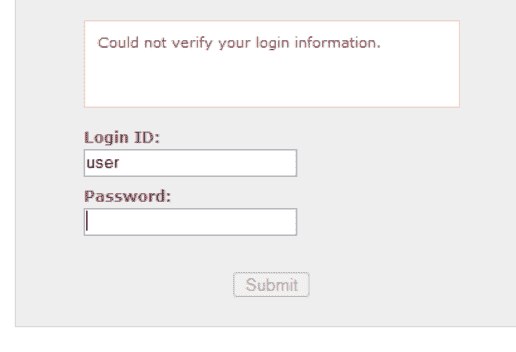

如果您使用登录 ID **user** 和密码 **password** 登录，您将被从 `applogin.html` 重定向到一个名为 `appmainpage.php` 的页面——即您应用程序的主页。

很好！您现在拥有一个功能齐全的应用程序登录表单。用户不可能在未填写登录 ID 和密码字段的情况下提交详细信息，并且应用程序会让用户了解幕后发生的事情。它还可以在现代版本的 Internet Explorer、Firefox、Safari 和 Opera 中工作。事实上，唯一不支持的是视障人士使用的屏幕阅读器。然而，与普遍看法相反，没有理由认为我们的 AJAX 不能在这些浏览器中工作。

## AJAX 与屏幕阅读器

使登录页面对屏幕阅读器可访问，比处理非 JavaScript 浏览器这一相对简单的任务需要多做一些工作，但只要您在设计代码时记住一些基本原则，就不会太费事。这里有一个快速列表；我们稍后将详细讨论每一点：

-   想得“线性”一些。
-   使用“跳过导航”链接。
-   为用户提供有关动态内容的通知。
-   在多个阅读器中测试应用程序。

在开发应用程序时遵循这些原则，您可能会发现将屏幕阅读器支持构建到代码中出奇地容易。事实上，它可能比构建和维护单独的、“可访问的”应用程序版本要容易得多。

### 想得“线性”一些

当您查看网络应用程序的用户界面时，会看到按钮、链接和表单元素分布在浏览器窗口的各个位置。但是，查看页面源代码，您会看到截然不同的景象——一行接一行从上到下读取的标记。这正是屏幕阅读器查看页面的方式：*线性地*，从上到下，从左到右。

在设计网络应用程序界面以及为屏幕阅读器访问创建页面元素（尤其是表格和网络表单）时，您必须考虑您的标记从上到下读取时的样子。这里有一个简单的例子。

### 示例：一个两列的网络表单

假设您想创建一个网络表单，允许用户提供他们的姓名和地址信息。为了节省页面上的垂直空间，您希望将输入显示为两列。如果您是基于表格的网页设计的老派做法，一个显而易见的方法是使用一个大表格，其中包含用于表单字段标签和文本输入的列，如下所示：

```
<table>
  <tr>
    <th colspan="2">Name Info</th>
    <th colspan="2">Address Info</th>
  </tr>
  <tr>
    <td>First&nbsp;Name:</td>
    <td><input type="text" id="First" name="First" value=""/></td>
    <td>Address:</td>
    <td><input type="text" id="Addr" name="Addr" value=""/></td>
  </tr>
  <tr>
    <td>Last&nbsp;Name:</td>
    <td><input type="text" id="Last" name="Last" value=""/></td>
    <td>City:</td>
    <td><input type="text" id="City" name="City" value=""/></td>
  </tr>
</table>
```

我确信您已经知道我要说什么了：表单在浏览器中看起来会很好，如图 4.5 所示，但屏幕阅读器会从上到下读取标记，因此字段会顺序错乱：名、地址、姓、城市。

### 图 4.5. 基于表格布局的表单

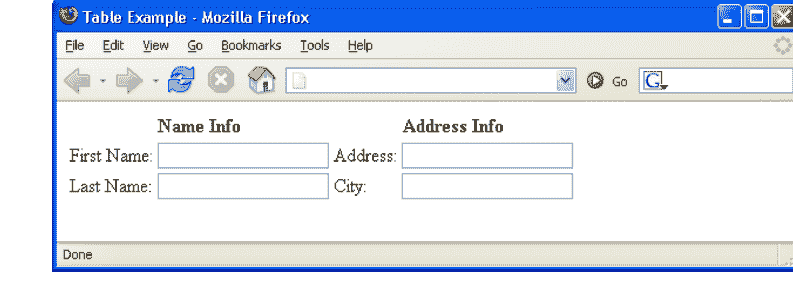

相反，您可以使用两个表格和一点 CSS “浮动”魔法；您会看到完全相同的视觉结果，但标记更适合线性化。这是标记：

```
<div id="formDiv">
  <table class="floatTable">
    <tr>
      <th colspan="2">Name Info</th>
    </tr>
    <tr>
      <td>First&nbsp;Name:</td>
      <td><input type="text" id="First" name="First" value=""/></td>
    </tr>
    <tr>
      <td>Last&nbsp;Name:</td>
      <td><input type="text" id="Last" name="Last" value=""/></td>
    </tr>
  </table>
  <table class="floatTable">
    <tr>
      <th colspan="2">Address Info</th>
    </tr>
    <tr>
      <td>Address:</td>
      <td><input type="text" id="Addr" name="Addr" value=""/></td>
    </tr>
    <tr>
      <td>City:</td>
      <td><input type="text" id="City" name="City" value=""/></td>
    </tr>
  </table>
  <div class="clearBoth"></div>
</div>
```

> **此示例仅使用表格！**
> 不要在家尝试这个，孩子们！除非表单确实由表格数据组成，否则我们不建议您使用表格来标记表单。表单应始终使用语义正确的元素进行标记，然后使用 CSS 设置样式。

创建两列布局的 floatTable CSS 类如下所示：

```
.floatTable {
    width: 230px;
    float: left;
}
```

最终结果如图 4.6 所示，是一个与使用单个大表格构建的表单看起来完全相同的表单。

这只是一个例子，但同样的自上而下、从左到右的线性化原则适用于屏幕上任何元素的布局。幸运的是，CSS 为您提供了很大的自由度，可以将屏幕元素放置在您希望它们出现的任何位置，因此，如果您在过程早期对布局稍加思考，就可以创建网络应用程序界面，其元素在标记中从上到下逻辑分组，但在屏幕上仍然显示在直观的位置。

我们稍后将讨论在屏幕阅读器中测试您的代码，但当然，最直观地感受屏幕阅读器线性阅读您网站或应用程序的方式是亲自尝试使用这些工具。您会对这些工具与基于视觉的浏览器之间的差异感到惊讶（可能还会感到震惊）。

### 跳过导航链接

大多数网页的最顶部或最左侧通常出现的是什么？没错：导航链接。现在，根据您对屏幕阅读器从上到下消化标记方式的了解，想象一下对于屏幕阅读器用户来说，每次转到新页面时，都必须听完网站上每个导航链接的列表，然后才能访问页面的实际内容，这是什么感觉。

这就是视障人士使用屏幕阅读器在网站未实现“跳过导航”链接时必须忍受的那种烦恼。这些是内部页面链接，允许屏幕阅读器跳过烦人、重复的导航，直接获取用户真正寻找的内容。

为屏幕阅读器用户提供这种内部导航，允许他们在页面上跳转，使浏览体验对他们来说更容易、更愉快。而且您对这些链接的应用不必局限于跳过页面导航。许多屏幕阅读器开始时会向用户提供页面的简要“扫描”，尽管有些阅读器会从页面底部返回顶部，但并非所有都会，因此提供一种让用户轻松跳回页面顶部的方法会很有帮助。

### 隐藏屏幕阅读器内容

此时，您可能对在整个页面上散布内部导航链接的想法感到好奇，并想知道这对您漂亮、简洁的设计有什么影响。嗯，别担心！CSS 也可以在这里帮助您。您所要做的就是定义一个仅供屏幕阅读器使用的类，并使用 CSS 使其对其他人不可见。


## 第四章：AJAX 与 POST 请求

## 图 4.6. 使用表格或 CSS 构建的双列表单

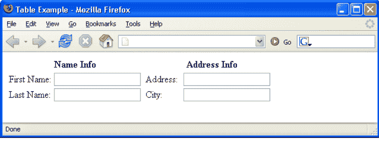

本章中我们一直在使用的 Web 应用程序登录代码，为屏幕阅读器专用类使用了以下样式：

```
文件：applogin.css（摘要）

.screenReader {
  position: absolute;
  top: -1000px;
  left: -1000px;
  width: 1px;
  height: 1px;
  overflow: hidden;
  z-index: -1000;
}
```

将此应用于一个 div 或任何其他块级元素，会使其在视觉上不可见，但屏幕阅读器仍然可以读取。我们用它来设置内部页面导航锚点，使用户能够从页面底部跳转到顶部。

> **避免使用 display: none**
> 不要将屏幕阅读器类的 CSS `display` 属性设置为 `none`。许多屏幕阅读器会忽略 `display` 为 `none` 的元素，这是正确的行为，因为此属性表示元素不应被“显示”。

以下是我们用于登录屏幕顶部目标链接的标记：

文件：applogin.html（摘要）
```html
<body>
    <div class="readerText">
        <a id="pageTop" name="pageTop">Page top</a>
    </div>
    <div id="uiDiv">
```

它在屏幕上不显示，但屏幕阅读器可以完美读取，并将其报告为内部页面链接。在页面的最底部，我们添加了以下内容：

```
文件：applogin.html（摘要）
</div>
<div class="readerText">
    <a href="#pageTop">Back to form top</a>
    End of page
</div>
</body>
```

当屏幕阅读器读取此标记时，用户会知道他们位于页面末尾，并且有一个简便的方法可以跳转到顶部。

## 动态内容的通知

关于屏幕阅读器的许多讨论假设它们无法处理 JavaScript 或在客户端动态创建的内容。实际上，屏幕阅读器是与像 Internet Explorer 这样的常规浏览器配合工作的，因此它们的 JavaScript 支持依赖于浏览器。

屏幕阅读器遇到的问题不在于动态内容本身。问题在于，当页面通过 AJAX 进行更新时，例如当我们的应用程序登录页面显示从服务器返回的错误消息时，屏幕阅读器无法知道内容已更改，或者更改发生在页面的哪个位置。

## 发出警报

解决此问题的一个好方法是，当页面上的内容发生变化时，为屏幕阅读器用户提供某种通知。屏幕阅读器会读取警报对话框，因此一个好的技术是，当您使用 AJAX 执行部分页面刷新时，为屏幕阅读器用户提供接收警报的选项。

向用户提供此选项的一个巧妙方法是在表单中添加一个仅对屏幕阅读器可见的复选框，用于开启和关闭这些警报。这使用户能够自己选择是否希望在页面内容变化时收到警报。

在实施此类解决方案时，您应记住以下几点：

- 对于内容不断变化（例如股票代码显示应用程序）的应用，这可能不是理想的解决方案——您不希望用接连不断的 `alert` 淹没用户。
- 考虑 `alert` 对话框中应出现哪些信息。对于我们的简单登录表单，唯一的内容变化是一个简短的错误消息，因此您可以将其直接放在 `alert` 中。如果更改的内容包含一长串搜索结果，您只需告诉用户搜索已完成，并将他们引导到页面上可以找到结果的区域（我们将在第 7 章看到一个例子）。

没有 JavaScript，此登录表单就像一个普通的旧式 Web 表单一样工作。这意味着我们只需要为使用屏幕阅读器结合启用了 JavaScript 的浏览器的人员添加动态内容变化的通知。我们在应用程序加载时使用 JavaScript 来实现这一点。当您逐步了解屏幕阅读器特定的代码时，您将看到这是如何工作的。

## 在多种阅读器中进行测试

要使您的代码在屏幕阅读器中工作，最重要的一件事当然是坐下来使用您的应用程序并配合屏幕阅读器。以下是一些您可能尝试的商业屏幕阅读器应用程序的简要列表：

**IBM³ 的 Home Page Reader** 此应用程序是一个专用的屏幕阅读器，用作 Web 浏览器的替代品。当前版本需要安装 Internet Explorer 6。

**Freedom Scientific⁴ 的 JAWS** 全球最受欢迎的屏幕阅读器软件。JAWS 可与各种程序配合工作，包括 Web 浏览器。

> ³ http://www.ibm.com/
> ⁴ http://www.freedomscientific.com/

**GW Micro⁵ 的 Window-Eyes** 另一个通用的屏幕阅读器程序，Window-Eyes 可与各种程序配合工作，包括 Web 浏览器。

**Dolphin Computer Access⁶ 的 Hal** Hal 是另一个通用的屏幕阅读器程序，可与各种程序配合工作，包括 Web 浏览器。

一些屏幕阅读器提供试用版，您可以使用它们，以便亲身体验您的应用程序在这些阅读器中的表现如何——或者不表现如何。这些试用版是时间限制的（即，它们会运行大约半小时后关闭），因此它们并不真正适合进行严肃的测试，但对于感受这些工具的工作方式，以及学习如何为您的 AJAX 应用程序创建无障碍用户界面，试用版已经绰绰有余了。

正如您不会只在 Firefox 中开发网站，然后在不测试其他支持的浏览器（尤其是如果 IE 是其中之一）的情况下直接部署一样，您不能在一个屏幕阅读器中成功测试您的应用程序，就期望它在所有其他阅读器中都能完美无瑕地工作。

⁵ http://www.gwmicro.com/
⁶ http://www.dolphincomputeraccess.com/

## 第四章：AJAX 与 POST 请求

## 图 4.7. 在 IBM Home Page Reader 中测试应用程序登录

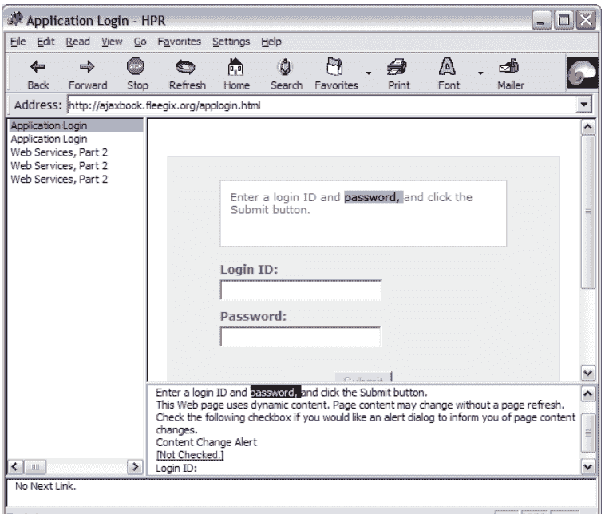

在这方面，支持特定的屏幕阅读器与支持新浏览器非常相似。它们存在差异和各自的怪癖。例如，IBM 的 Home Page Reader 使用 IE 作为其浏览引擎，但运行起来像一个独立的程序。图 4.7 显示了我们本章开发的应用程序登录系统通过 IBM Home Page Reader 访问时的屏幕截图。另一方面，JAWS 屏幕阅读器在一个小窗口中打开，并在后台运行，为活动应用程序朗读文本。图 4.8 显示了 JAWS 应用程序窗口。

## 图 4.8. JAWS 应用程序窗口

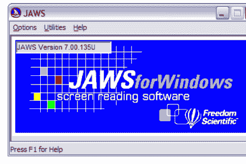

我强烈建议您坐下来尝试一下：启动一个屏幕阅读器程序，打开您的 Web 应用程序，然后在使用时真正地关闭您的显示器。

花一些时间在几个屏幕阅读器程序中与一些无障碍的用户界面“搏斗”，您会对情况有一个非常不同的视角；事实上，这种对处境的切身体会可能会增强您在 AJAX Web 应用程序中构建更好无障碍性的动力。

## 屏幕阅读器代码

让我们快速浏览一下使我们的 Web 应用程序登录能够与屏幕阅读器程序配合工作的代码。请注意，对于没有 JavaScript 支持或已关闭 JavaScript 的用户来说，这些额外的功能是不必要的，因为 Web 表单本身的标记由一组简单、易读的 div 元素组成。

然而，AJAX 的完整显示版本需要这些额外的功能才能与屏幕阅读器配合工作，因此我们将通过在应用程序启动时在 `init` 代码中调用 `enableScreenReaderFeatures` 方法将它们添加到组合中：

```
this.init = function() {
    var self = Login;
    self.ajax = new Ajax();
    self.form = document.getElementById('loginForm');
    self.promptDiv = document.getElementById('promptDiv');
    self.dotSpan = document.getElementById('dotSpan');
```


## 设置通知

此方法为登录代码设置所有针对阅读器的功能，包括活动内容的通知。请注意，我们将所有针对屏幕阅读器的界面元素都放入带有 `readerText` CSS 类的标记中，以便没有屏幕阅读器的用户不会在界面中看到它们。

在我们开始通知使用屏幕阅读器的用户有关页面部分刷新之前，他们需要知道该页面使用了动态内容。然后，他们可以自行决定是否希望在页面内容变化时接收提醒。让我们添加一个关于动态内容的警告，以及一个允许他们选择是否接收 AJAX 风格页面更新的 `alert` 的复选框。此警告和复选框的标记如下：

```html
<div class="readerText">
    This web page uses dynamic content. Page content may change
    without a page refresh. Check the following checkbox if you
    would like an alert dialog to inform you of page content
    changes.
</div>
<div class="readerText">
    <label>
        Content Change Alert
        <input type="checkbox" name="ChangeAlert" id="ChangeAlert"
               value="true" title="Content Change Alert"/>
    </label>
</div>
```

我们不会将此代码添加到页面的实际标记中；相反，我们将在 `enableScreenReaderFeatures` 方法中使用 DOM 方法将其注入页面。代码如下：

```javascript
this.enableScreenReaderFeatures = function() {
  var self = Login;
  var fieldDiv = document.getElementById('fieldDiv');
  var msgDiv = null;
  var checkboxDiv = null;
  var label = null;
  var checkbox = null;
  var msg = 'This web page uses dynamic content. Page content' +
    ' may change without a page refresh. Check the following' +
    ' checkbox if you would like an alert dialog to inform' +
    ' you of page content changes.';
  msgDiv = document.createElement('div');
  msgDiv.className = 'readerText';
  msgDiv.appendChild(document.createTextNode(msg));
  self.form.insertBefore(msgDiv, fieldDiv);
  checkboxDiv = document.createElement('div');
  checkboxDiv.className = 'readerText';
  label = document.createElement('label');
  label.appendChild(document.createTextNode('Content Change ' +
    'Alert'));
  checkbox = document.createElement('input');
  checkbox.type = 'checkbox';
  checkbox.id = 'ChangeAlert';
  checkbox.name = 'ChangeAlert';
  checkbox.value = 'true';
  checkbox.title = 'Content Change Alert';
  label.appendChild(checkbox);
  checkboxDiv.appendChild(label);
  self.form.insertBefore(checkboxDiv, fieldDiv);
};
```

DOM 方法可能有些冗长且难以阅读，所以我通常先写出我想要的标记的初始版本，然后将其翻译为相应的 DOM 方法代码，这就是我在这里所做的。

同样，由于所有这些元素都被包装在具有 `readerText` 类的 div 元素中，它们将只对使用屏幕阅读器的用户"可见"。

# 显示通知

此应用程序仅显示一条通知：告知用户其登录信息无法验证的错误。如果页面内容的变化更为重要，我们可能会直接告诉用户发生了变化，并告诉他们在哪里可以找到变化内容（例如，"在主内容区域中"、"在搜索表单下方"或其他什么位置）。但是，由于这是一条简洁的简短消息，我们直接在警告对话框中显示它，以节省用户在页面上浏览查找消息的麻烦。图 4.9 显示了此错误消息在 Home Page Reader 中弹出的效果。

图 4.9. IBM Home Page Reader 中的已更改内容提醒

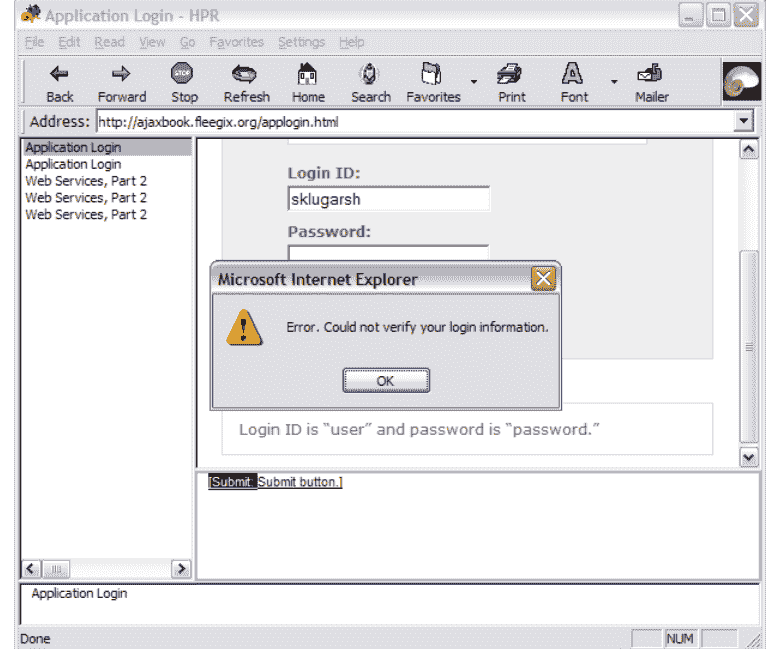

要实现此效果，我们在 showErrorPrompt 方法中添加以下代码行：

```javascript
this.showErrorPrompt = function(str) {
    var self = Login;
    var dotSpan = self.dotSpan;
    clearInterval(self.promptInterval);
    if (dotSpan.firstChild) {
        dotSpan.removeChild(dotSpan.firstChild);
    }
    self.setPrompt('err', str);
    self.form.Pass.value = '';
    if (self.form.ChangeAlert.checked) {
        alert('Error. ' + str);
    }
};
```

此代码检查用户是否勾选了 ChangeAlert 复选框——一个只有屏幕阅读器用户才知道其存在的界面元素——并将错误文本放入标准 JavaScript 警告框中。

相同的消息也会写入主提示 div 中，如果屏幕阅读器从页面顶部重新阅读页面，它将获取到已更改的内容。但通过警告对话框，使用屏幕阅读器的用户可以享受到与使用可视化浏览器的用户相同的即时反馈。当警告弹出时，屏幕阅读器将朗读对话框的内容。然后，用户可以关闭对话框并重新尝试输入登录信息。

# 启用提交按钮

在设置了用于提供 AJAX 风格部分页面更新通知的警告和复选框之后，我们还需要在 enableScreenReaderFeatures 中完成几项工作，以使应用程序支持屏幕阅读器。

之前，我展示了如何设置事件监听器来监视用户的键盘输入，并在登录 ID 和密码字段中都输入了值时调用 evalFormFieldState 以激活提交按钮。不幸的是，当用户在表单字段中输入文本时，屏幕阅读器可能会干扰 onkeyup 事件，因此我们不能依赖该事件来触发对表单字段内容的检查。图 4.9 显示了处于文本输入模式的 Home Page Reader。请注意，它会打开一个全新的对话框来在表单字段中输入文本。

此问题的解决方案是在文本输入元素本身上添加一个显式的 onchange 处理程序，以确保当文本输入到字段中时按钮被启用。以下是 enableScreenReaderFeatures 方法中的代码行：

```javascript
// File: applogin.js (excerpt)
self.form.insertBefore(checkboxDiv, fieldDiv);
self.form.Pass.onchange = self.evalFormFieldState;
};
```

这只是一行代码，但没有它，此表单对于使用屏幕阅读器的人来说完全无法使用。

图 4.10. IBM Home Page Reader 中的文本输入模式

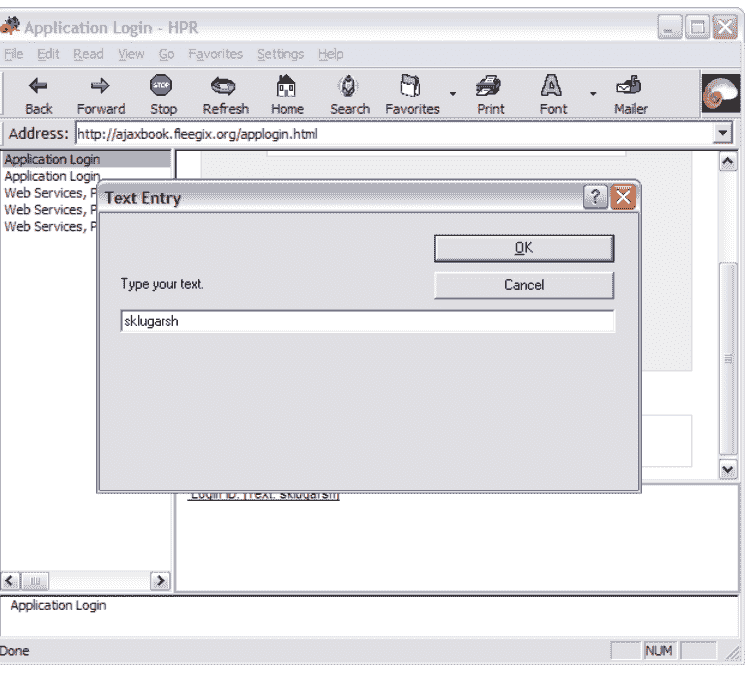

# 为表单元素添加说明

最后，我们需要在 enableScreenReaderFeatures 中添加代码，为屏幕阅读器用户提供一些关于使用该表单的额外说明。由于表单初始状态下提交按钮是禁用的，使用屏幕阅读器的用户可能会对如何提交表单感到困惑。他们无法获得视觉反馈，因此看不到在表单字段中输入时提交按钮变为启用状态。

解决方案是简单地在密码输入元素上添加一个 `title` 属性，告知屏幕阅读器用户填写该字段将激活提交按钮。代码如下：

```javascript
// File: applogin.js (excerpt)
self.form.insertBefore(checkboxDiv, fieldDiv);
self.form.Pass.onchange = self.evalFormFieldState;
self.form.Pass.title = 'Password. Enter text to ' +
' activate the Submit button.';
};
```

屏幕阅读器将在朗读每个表单元素的信息时读取该标题，使用屏幕阅读器的用户将知道需要做什么来激活提交按钮。

## 延伸阅读

以下是一些在线资源，供你进一步了解本章涵盖的技术和概念。

- **http://www.webaim.org/**
  WebAIM 是犹他州立大学残疾人中心内的一个非营利组织。
- **http://www.w3.org/WAI/**
  万维网联盟的 Web 无障碍倡议与世界各地的组织合作，制定策略、指南和资源，以帮助使 Web 对残疾人可访问。
- **http://www.section508.gov/**
  该网站由美国政府总务管理局维护，提供有关《康复法案》第 508 条的信息，该条款规定了美国政府机构及其业务合作公司必须满足的最低信息技术无障碍要求。
- **http://joeclark.org/book/sashay/serialization/**
  Joe Clark 所著的 *Building Accessible Websites* 可在线获取。该书于 2002 年出版，并于 2005 年更新。


## 摘要

本章中经过 AJAX 改造 的登录代码很好地展示了如何利用 AJAX 提升应用的可用性，同时兼顾对屏幕阅读器以及 JavaScript 支持有限或完全不支持的浏览器的兼容。

通常需要访问应用中多个页面才能完成的任务，现在可以通过 AJAX 在单个格式精美的页面中完成。 使用 AJAX 提交表单数据实际上非常轻松——只要注意键盘输入、状态消息、动画等细节，并在屏幕阅读器程序中进行基本测试，你就可以使用 AJAX 创建一个无障碍的用户界面，同时为用户提供非常“类似应用程序”的体验。

## 第 5 章：更广泛的 AJAX 与就地编辑

> *你一直在用那个词——我觉得它并不是你想的那个意思。*
> —— 伊尼戈·蒙托亚，《公主新娘》

有趣的部分来了！现在是时候深入到“AJAX”更广泛含义所涵盖的一些领域了。 Web 开发和 JavaScript 社区中一些比较教条的人会跳起来大喊大叫，说如果没有使用 `XMLHttpRequest` 就不是 AJAX，但这纯粹是胡闹。 以 AJAX 的“标杆”应用之一 Google 地图<sup>1</sup> 为例。该服务使用老式的隐藏 iframe 从服务器获取内容——根本不是 `XMLHttpRequest`。

因此，我们姑且接受“AJAX”可以更广泛地指代那些比传统 Web 应用具有更丰富的交互性和响应性的下一代 Web 应用。在这个更广泛的定义下，AJAX 可以通过让用户更轻松地与数据交互，并让应用的行为对用户来说更加直观，从而显著提高 Web 应用的可用性。

一个特别方便用户处理文本的出色可用性功能就是**就地编辑**（也称为“覆盖式文本编辑”），它允许用户单击或双击页面上的文本区域， inline 编辑该文本内容，并保存更改。就地编辑使更改页面文本内容变得极为方便，因为用户不必弹出单独的窗口或跳转到全新页面，仅仅为了修改一小段文字。图 5.1 展示了在支持 AJAX 的博客中，就地编辑功能的实际应用示例。

<sup>1</sup> http://maps.google.com/

图 5.1  启用了就地编辑的博客页面

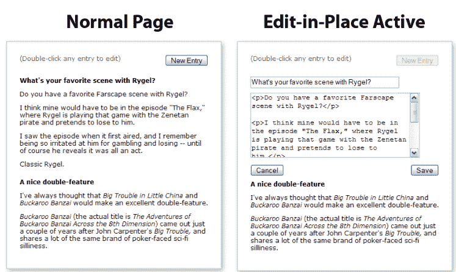

博客通常由许多短文本片段组成，因此它是部署就地编辑功能的理想候选。在本章中，我们将创建一个使用该功能的博客页面；通过就地编辑，你将能够向页面添加新条目，并双击任何现有条目进行编辑。该应用还将包含一个动画效果，用于指示服务器正在保存更改。

### 页面标记

图 5.2 展示了在浏览器中首次加载博客页面时的外观。

图 5.2  初始页面加载时的博客页面显示


这里实际上没有发生太多事情。你可以看到这个页面使用的标记是多么少：

```
File: blog.html
<!DOCTYPE html PUBLIC "-//W3C//DTD XHTML 1.0 Strict//EN"
    "http://www.w3.org/TR/xhtml0/DTD/xhtml1-strict.dtd">
<html xmlns="http://www.w3.org/1999/xhtml0">
  <head>
    <meta http-equiv="Content-Type"
          content="text/html; charset=iso-8859-1" />
    <title>Blog</title>
    <script type="text/javascript" src="ajax.js"></script>
    <script type="text/javascript"
            src="formdata2querystring.js"></script>
    <script type="text/javascript" src="blog.js"></script>
    <link rel="stylesheet" href="blog.css" type="text/css"/>
  </head>
  <body>
    <form id="blogForm" method="post" action="">
      <div>
        <input type="hidden" id="editEntryId" name="editEntryId"
               value="" />
        <div id="colDiv">
          <div id="promptDiv">(Double-click any entry to
              edit)</div>
          <div id="newEntryButtonDiv">
            <input type="button" id="newEntryButton"
                   name="newEntryButton" class="inputButton"
                   value="New Entry" />
          </div>
          <div class="clearBoth"></div>
          <div id="allEntryDiv"></div>
        </div>
      </div>
    </form>
  </body>
</html>
```

### CSS 可下载

我们不会深入讨论该应用的 CSS。CSS 文件可在代码档案库中找到，可从本书的网站下载。

此页面包含一个表单，其中容纳了我们所有的表单元素、一个为用户提供一些提示的提示信息、一个“新建条目”按钮，以及一个 ID 为 `allEntryDiv` 的 div，它将包含我们所有的博客条目。

加载条目后，`allEntryDiv` div 包含以下标记：

```
<div id="allEntryDiv">
  <div id="main1">
    <div id="title1" class="entryTitle">Stargate
      SG-1</div>
    <div id="body1" class="entryBody"><p>Is that
      actually sci-fi? Or just a bunch of guys in Army
      uniforms?</p></div>
  </div>
  <div id="main2">
    <div id="title2" class="entryTitle">Luxan or
      Klingon?</div>
    <div id="body2" class="entryBody"><p>Who would win
      in a fight between Farscape's Ka D'Argo and Star Trek
      TNG's Worf?</p>
      <p>They both seem like pretty tough guys.</p></div>
  </div>
</div>
```

每个条目都被一个 ID 为 `main<em>n</em>` 的 div 包围，其中 `n` 是条目的 ID。这个条目 ID 在条目的标题和内容 div 中重复出现；脚本用它来快速方便地访问每个条目的元素。

### 无障碍性与向后兼容性

请注意，我们这里构建的应用将无法在旧版浏览器、移动设备或某些屏幕阅读器中工作。

为了支持非 JavaScript 浏览器并提供更好的无障碍性，你可以采取两种方法之一。你可以构建一个单独的、非 JavaScript 版本的页面，提供同等的功能；或者你可以在某些地方使用 PHP 等服务器端脚本语言来分支你的代码。

以我们的“新建条目”按钮为例，我们可能提供一个包含 JavaScript 驱动按钮的代码分支；对于非 JavaScript 客户端，我们可以提供另一个不同的分支，其中包含一个指向非 AJAX Web 表单的普通超链接，博主可以通过该表单创建新的博客条目。代码可能如下所示：

```
<div id="newEntryButtonDiv">
    <?php
    if ($javaScriptBrowser) {
        print('<input type="button" id="newEntryButton" '.
            'name="newEntryButton" class="inputButton" '.
            'value="New Entry"/>');
    }
    else {
        print('<a href="new_blog_entry.php">New Entry</a>');
    }
    ?>
</div>
```

你选择的方法将取决于诸如客户端代码的复杂程度、你可用的开发资源类型，以及你的应用需要支持的客户端类型等因素。

### Blog 类

再次，我们将通过创建一个作为单例的 `Blog` 类来组织我们的代码。通过使用单例类，我们解决了前几章中使用 `setTimeout` 时遇到的作用域丢失问题。

以下是我们的 `Blog` 类的初始设置：

```
var Blog = new function() {
    this.ajax = null;
    this.form = null;
    this.proc = 'ready'; // 'ready', 'proc' or 'done'
    this.fadeIncr = 0;
    this.statusInterval = null;
    this.isInputDisabled = false;
    this.editId = '';
    this.saveId = '';
    this.origTitle = '';
    this.origBody = '';
};
```

首先，我们声明一些属性：`ajax` 用于将与应用后端通信的 `Ajax` 类实例；`statusInterval` 用于状态动画的间隔 ID；`isInputDisabled` 将用作禁用用户输入的标志；`editId` 和 `saveId` 用于存储我们正在保存或编辑的博客条目的 ID。我们还有 `origTitle` 和 `origBody`：两个属性用于存储编辑后的博客条目内容的备份，以便在需要时可以撤销更改。

## init 方法

`Blog` 对象有一个 `init` 方法，它将由 `window.onload` 事件处理程序触发。它看起来像这样：

```
File: blog.js (excerpt)

this.init = function() {
    var self = Blog;
    self.ajax = new Ajax();
    self.form = document.getElementById('blogForm');
    self.form.newEntryButton.onclick = self.addNewEntry;
};
```

此方法执行一些基本的应用设置。它创建一个 `Ajax` 类实例用于向服务器提交数据，设置页面上表单的快捷引用，并为“新建条目”按钮添加 `onclick` 事件处理程序。

> 提示
> 标记中的事件处理程序
> 你当然可以将事件处理程序附加到标记中的元素，但标记在通常不包含 JavaScript 代码时会看起来更加清晰。

要触发此方法，请在 blog.js 的末尾将其附加到 `window.onload` 事件：

```
File: blog.js (excerpt)

window.onload = Blog.init;
```

### 就地编辑

> 注意
> 编辑条目与创建条目
> 在此博客应用中创建新条目的过程利用了控制应用编辑功能的大部分代码。如果你理解了编辑条目的过程


## 第 5 章：结合原位编辑的更广泛 AJAX 应用

由于涉及编辑，我们现在直接跳到讨论原位编辑（edit-in-place）。稍后，我们将回顾如何使用相同的代码来创建新条目。

原位编辑是指直接在页面上对文本进行修改的能力，而无需加载新页面或打开某种弹出窗口。这种技术在 AJAX 应用中被越来越多地使用，因为它让网站所有者能够非常方便地对文本进行快速更改，并充分利用了 AJAX 更新页面局部内容的能力。

请注意，对于许多人来说，能够直接在页面上输入并修改文本仍然是一件很新鲜的事情，因此最好清晰地告知用户该功能具体是如何运作的。有些网站会在鼠标悬停时改变可编辑文本的颜色，以指示哪些内容可以使用原位编辑，但我更倾向于一种非常明确的方法：显示一个提示，告诉用户可以执行什么操作。因此，在我们的演示应用中，我将在页面顶部显示一个提示，内容为“双击任何条目进行编辑”。

我们将从一个已经保存了一些虚拟条目的页面开始。请在页面中添加以下标记：

```
File: blog.html (excerpt)
<div id="allEntryDiv">
  <div id="main1">
    <div id="title1" class="entryTitle">Stargate SG-1</div>
    <div id="body1" class="entryBody"><p>Is that actually sci-fi?
      Or just a bunch of guys in Army uniforms?</p></div>
  </div>
  <div id="main2">
    <div id="title2" class="entryTitle">Luxan or Klingon?</div>
    <div id="body2" class="entryBody"><p>Who would win in a fight
      between Farscape's Ka D'Argo and Star Trek TNG's Worf?</p>
      <p>They both seem like pretty tough guys.</p></div>
  </div>
</div>
```

### 图 5.3. 已保存某些条目的博客页面

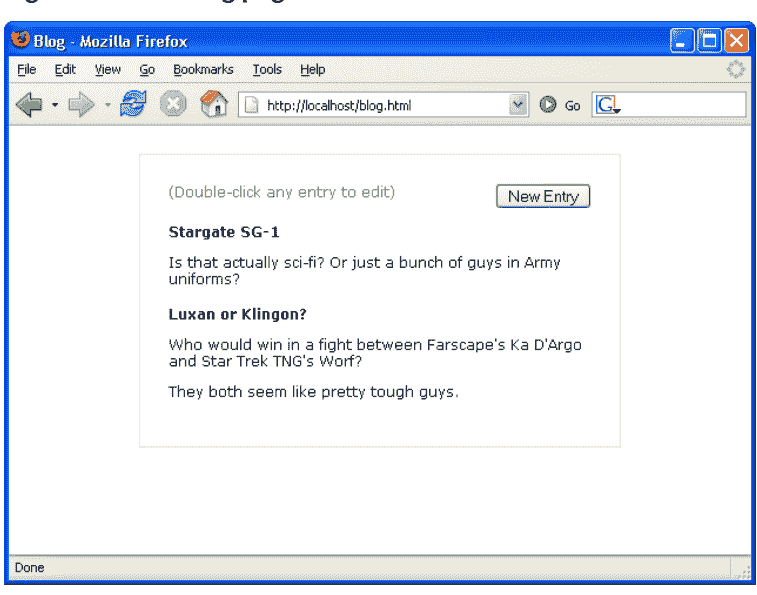

图 5.3 展示了页面的显示效果。

作为临时措施，我们将在 `Blog` 类的 `init` 方法中，为这两个条目的 `ondblclick` 事件绑定事件处理器：

```
// File: blog.js (excerpt)
this.init = function() {
  var self = Blog;
  self.ajax = new Ajax();
  self.form = document.getElementById('blogForm');
  self.form.newEntryButton.onclick = self.addNewEntry;
  var entry1 = document.getElementById('main1');
  var entry2 = document.getElementById('main2');
  entry1.ondblclick = self.toggleEditInPlace;
  entry2.ondblclick = self.toggleEditInPlace;
};
```

我们稍后会替换这段代码，但它目前能很好地满足我们的开发需求。

如果你双击其中任何一个条目，就会激活原位编辑功能——这会将页面上的文本替换为包含相同文本的可编辑表单元素。标题变成了文本输入框，正文变成了文本域（textarea）。

## 编辑条目

通过双击条目，我们激活了 `toggleEditInPlace` 方法；正如其名，该方法在博客条目的两种状态之间进行切换：原位编辑状态和自然显示状态。当你处于原位编辑模式时，点击“取消”按钮将使条目的状态切换回显示状态。

以下是 `toggleEditInPlace` 方法的代码：

```
this.toggleEditInPlace = function(e) {
  var self = Blog;
  var elem = null;
  if (!e) {
    e = window.event;
  }
  elem = self.getSrcElem(e);
  id = elem.id.replace(/main|title|body/, '');
  if (id != 'editCancel' && !self.isInputDisabled) {
    self.editId = id;
    self.editInPlaceOn();
    self.disableEnableMainWinInput(false);
  }
  else if (id == 'editCancel') {
    if (self.editId == 'NewEntryTemp') {
      self.removeEntryDiv();
    }
    else {
      self.editInPlaceOff(false);
    }
    self.editId = '';
    self.disableEnableMainWinInput(true);
  }
};
```

这段代码实现了很多功能，所以让我们逐段来看。

这是前半部分：

```
File: blog.js (excerpt)

this.toggleEditInPlace = function(e) {
    var self = Blog;
    var elem = null;
    if (!e) {
        e = window.event;
    }
    elem = self.getSrcElem(e);
```

前几行访问了一个存储为 `e` 的对象，该对象包含触发此方法调用的事件信息。在 Firefox、Safari 和 Opera 中，该对象作为第一个参数传递给事件处理器；在 Internet Explorer 中，可以通过 `window.event` 访问相同的信息。`getSrcElem` 方法使用此对象来获取事件的源元素。

## getSrcElem 方法

识别事件源元素需要一些特定于浏览器的代码，因此我们将此功能封装在一个名为 `getSrcElem` 的工具函数中：

```
File: blog.js (excerpt)

this.getSrcElem = function(e) {
    var ret = null;
    if (e.srcElement) {
        ret = e.srcElement;
    }
    else if (e.target) {
        ret = e.target;
    }
    while (!ret.id && ret) {
        ret = ret.parentNode;
    }
    return ret;
};
```

该方法的第一个部分获取触发事件的节点的引用；根据执行代码的浏览器不同，通过 `srcElement` 属性或 `target` 属性来获取该引用。Internet Explorer 支持 `srcElement` 属性，Firefox 支持 `target`，而 Safari 和 Opera 两者都支持。

接下来的 `while` 循环确保我们返回的是预期的元素。尽管我们将事件处理器绑定到了条目的主 div 上，但 `srcElement` 或 `target` 属性将包含用户实际点击的元素的引用。例如，考虑以下标记。如果用户点击段落中的文本，将返回 `p` 元素——而不是你可能预期的 `main1` div。

```
<div id="main1">
  <div id="title1" class="entryTitle">
    Stargate SG-1
  </div>
  <div id="body1" class="entryBody">
    <p>Is that actually sci-fi? Or just a bunch of guys in Army uniforms?</p>
  </div>
</div>
```

为了解决这个问题，我们检查最内层元素是否具有 `id` 属性。如果没有，我们就检查它的父元素，如果父元素也没有，我们就检查*它的*父元素，依此类推。我们找到的第一个具有 `id` 属性的元素应该是主 div、标题 div 或正文 div，其中任何一个对于我们在 `toggleEditInPlace` 中的目的来说都是合适的。

## 获取条目 ID

现在我们在 `toggleEditInPlace` 中拥有了条目的其中一个 div，我们可以使用返回元素的 `id` 来计算出要编辑的条目 ID：

```
elem = self.getSrcElem(e);
id = elem.id.replace(/main|title|body/, '');
```

这段代码从 div 的 `id` 中提取出条目的 ID。为此，代码使用 `replace` 从 div 元素的 `id` 中剥离 `main`、`title` 或 `body` 前缀，从而留下条目的 ID。

这种使用事件监听器并根据点击的界面元素的 `id` 采取特定操作的技术非常强大。我们将在本书稍后部分进一步展开讨论。

## 状态切换

`toggleEditInPlace` 的最后一部分是实际开启和关闭可编辑状态的部分。代码如下：

```
if (id != 'editCancel' && !self.isInputDisabled) {
    self.editId = id;
    self.editInPlaceOn();
    self.disableEnableMainWinInput(false);
}
else if (id == 'editCancel') {
    if (self.editId == 'NewEntryTemp') {
        self.removeEntryDiv();
    }
    else {
        self.editInPlaceOff(false);
    }
    self.editId = '';
    self.disableEnableMainWinInput(true);
}
```

`if` 子句将条目切换到原位编辑模式。它将我们要编辑的条目的 ID 值保存到 `editId` 中，并为该双击的博客条目激活可编辑状态。然后，它使用 `disableEnableMainWinInput` 方法禁用“新建条目”按钮，这样用户在编辑现有条目时就不能尝试添加新条目。

当用户在原位编辑模式下点击条目的“取消”按钮时，执行 `else` 子句。你马上就会看到“取消”按钮是从哪里来的。如果你在创建新条目时点击“取消”，你将完全删除该新条目。如果你在处理一个已经保存的条目时点击“取消”，代码将通过调用参数为 `false` 的 `editInPlaceOff` 将条目切换回不可编辑状态。这次调用确保条目将恢复到其原始状态。随后，`toggleEditInPlace` 会清除保存的被编辑条目的 ID 值，并再次使用 `disableEnableMainWinInput` 方法重新启用“新建条目”按钮。

## 开启可编辑状态

实际使条目可编辑是一个相当简单的过程。以下是我们的实现方式：

 1. 将文本存储在条目的标题和正文 `div` 元素中。
2. 将 `div` 元素中的文本替换为表单字段。
3. 将表单字段的值设置为已保存的文本。

我们使用 DOM 方法（加上少许 `innerHTML`）来完成所有这些工作，这使得代码有些冗长。不过，如果你将其分块来看，会发现它仍然是相当容易理解的。

```
this.editInPlaceOn = function(id) {
  var self = Blog;
  var id = self.editId;
  var entryDiv = null;
  var titleDiv = null;
  var bodyDiv = null;
  var titleInput = null;
  var bodyArea = null;
  var cancelButton = null;
  var saveButton = null;
  var leftButtonDiv = null;
  var rightButtonDiv = null;
  var clearBothDiv = null;
  entryDiv = document.getElementById('main' + id);
  titleDiv = document.getElementById('title' + id);
  bodyDiv = document.getElementById('body' + id);
  self.origTitle = titleDiv.innerHTML;
  self.origBody = bodyDiv.innerHTML;
  while(titleDiv.firstChild) {
    titleDiv.removeChild(titleDiv.firstChild);
  }
  while(bodyDiv.firstChild) {
    bodyDiv.removeChild(bodyDiv.firstChild);
  }
  titleInput = document.createElement('input');
  bodyArea = document.createElement('textarea');
  titleInput.id = 'titleText';
  titleInput.name = 'titleText';
  bodyArea.id = 'bodyText';
  bodyArea.name = 'bodyText';
  bodyArea.cols = "36";
  bodyArea.rows = "8";
  titleInput.className = 'titleInput';
  bodyArea.className = 'bodyArea';
  titleDiv.appendChild(titleInput);
  bodyDiv.appendChild(bodyArea);
  titleInput.value = self.origTitle;
  bodyArea.value = self.origBody;
  cancelButton = document.createElement('input');
  saveButton = document.createElement('input');
  leftButtonDiv = document.createElement('div');
  rightButtonDiv = document.createElement('div');
  clearBothDiv = document.createElement('div');
  leftButtonDiv.className = 'leftButton';
  rightButtonDiv.className = 'rightButton';
  clearBothDiv.className = 'clearBoth';
  clearBothDiv.style.paddingBottom = '12px';
  cancelButton.type = 'button';
  cancelButton.className = 'inputButton';
  cancelButton.id = 'editCancel';
  cancelButton.onclick = self.toggleEditInPlace;
  cancelButton.value = 'Cancel';
  saveButton.type = 'button';
  saveButton.className = 'inputButton';
  saveButton.id = 'updateSave';
  saveButton.onclick = self.doSave;
  saveButton.value = 'Save';
  entryDiv.appendChild(leftButtonDiv);
  leftButtonDiv.appendChild(cancelButton);
  entryDiv.appendChild(rightButtonDiv);
  rightButtonDiv.appendChild(saveButton);
  entryDiv.appendChild(clearBothDiv);
};
```

嗯，我确实说过它很冗长！让我们把它拆分出来，看看这里到底发生了什么。

以下是第一部分代码，它紧接在变量声明和初始化之后：

```
entryDiv = document.getElementById('main' + id);
titleDiv = document.getElementById('title' + id);
bodyDiv = document.getElementById('body' + id);
self.origTitle = titleDiv.innerHTML;
self.origBody = bodyDiv.innerHTML;
while(titleDiv.firstChild) {
  titleDiv.removeChild(titleDiv.firstChild);
}
while(bodyDiv.firstChild) {
  bodyDiv.removeChild(bodyDiv.firstChild);
}
```

## 开启可编辑状态

前三行代码只是获取了我们想要替换为可编辑表单元素的 `div` 元素的引用。接下来，我们从这些 `div` 中获取标题和正文文本。在这里，我们使用 `innerHTML` 而不是 DOM 方法，这样可以在文本中包含标记，以保留我们的链接、段落和其他良好的格式（DOM 方法会将所有这些都视为单独的元素）。然后我们使用 `removeChild` 配合 `while` 循环，从标题和正文 `div` 中剥离所有文本和其他 DOM 节点。

现在我们准备添加表单元素：

```
File: blog.js (excerpt)
titleInput = document.createElement('input');
bodyArea = document.createElement('textarea');
titleInput.id = 'titleText';
titleInput.name = 'titleText';
bodyArea.id = 'bodyText';
bodyArea.name = 'bodyText';
bodyArea.cols = "36";
bodyArea.rows = "8";
titleInput.className = 'titleInput';
bodyArea.className = 'bodyArea';
titleDiv.appendChild(titleInput);
bodyDiv.appendChild(bodyArea);
titleInput.value = self.origTitle;
bodyArea.value = self.origBody;
```

正如我们之前所见，向文档中添加元素需要三个步骤：首先，使用 `createElement` 创建元素；然后，设置所有元素属性和样式；最后，使用 `appendChild` 将它们插入到文档中合适的位置。一旦表单元素出现在页面上，我们就可以使用之前记录的值来设置它们。

最终我们会得到等效于以下标记的内容，其中新增的部分以**粗体**强调：

```
<div id="main1">
  <div id="title1" class="entryTitle">
    <input id="titleText" name="titleText" class="titleInput" value="Stargate SG-1" />
  </div>
  <div id="body1" class="entryBody">
    <textarea id="bodyText" name="bodyText" cols="36" rows="8"
        class="bodyArea"><p>Is that actually sci-fi? Or just a bunch of guys in Army uniforms?</p></textarea>
  </div>
</div>
```

现在我们已经在页面上放置了就地编辑的表单字段，并设置了该条目的原始标题和正文文本。这很好，但我们也需要提供某种方式让用户保存他们的更改，或者放弃更改并保持条目原样。我们需要在表单字段下方添加一些按钮。我们将使用 DOM 方法将这些按钮添加到左浮动和右浮动的 `div` 元素中，为可编辑条目提供合适的表单布局：

```
File: blog.js (excerpt)
cancelButton = document.createElement('input');
saveButton = document.createElement('input');
leftButtonDiv = document.createElement('div');
rightButtonDiv = document.createElement('div');
clearBothDiv = document.createElement('div');
leftButtonDiv.className = 'leftButton';
rightButtonDiv.className = 'rightButton';
clearBothDiv.className = 'clearBoth';
clearBothDiv.style.paddingBottom = '12px';
cancelButton.type = 'button';
cancelButton.className = 'inputButton';
cancelButton.id = 'editCancel';
cancelButton.onclick = self.toggleEditInPlace;
cancelButton.value = 'Cancel';
saveButton.type = 'button';
saveButton.className = 'inputButton';
saveButton.id = 'updateSave';
saveButton.onclick = self.doSave;
saveButton.value = 'Save';
entryDiv.appendChild(leftButtonDiv);
leftButtonDiv.appendChild(cancelButton);
entryDiv.appendChild(rightButtonDiv);
rightButtonDiv.appendChild(saveButton);
entryDiv.appendChild(clearBothDiv);
```

同样，使用 DOM 方法添加 `div` 元素和按钮是一个三步过程。最终你将得到如下的文档：

```
<div id="main1">
  <div id="title1" class="entryTitle">
    <input id="titleText" name="titleText" class="titleInput"
           value="Stargate SG-1" />
  </div>
  <div id="body1" class="entryBody">
    <textarea id="bodyText" name="bodyText" cols="36" rows="8"
        class="bodyArea"><p>Is that actually sci-fi? Or just a
        bunch of guys in Army uniforms?</p></textarea>
  </div>
</div>
```

请注意，CSS 声明 `clear: both;` 已被应用到我们添加的最后一个 `div` 上，以清除左右按钮的 `div`。

取消按钮被分配了一个 `onclick` 事件处理程序，绑定到 `toggleEditInPlace` 方法，该方法会恢复文本，使其回到页面上的正常状态。保存按钮的 `onclick` 事件处理程序指向 `doSave`，它将更改后的文本提交到服务器进行"保存"，并启动处理动画。

## 启用和禁用其他输入

我们的 `Blog` 类在任何时候只能跟踪一个可编辑的条目。可以将此应用设计为允许多个条目同时编辑，但这会大大增加代码的复杂性，所以目前我们保持简单。一旦某个条目正在编辑中，我们不希望用户能够编辑其他任何条目，因此需要临时禁用所有其他条目的双击事件处理程序的功能。同样，我们不希望用户在编辑模式下添加任何条目，因此还需要禁用"新建条目"按钮。当条目恢复到正常状态后，这些处理程序需要重新启用。

启用和禁用这些处理程序是 `disableEnableMainWinInput` 的职责：

```
this.disableEnableMainWinInput = function(enable) {
    var self = Blog;
    var but = document.getElementById('newEntryButton');
    self.isInputDisabled = !enable;
    if (enable) {
        but.onclick = self.addNewEntry;
        but.disabled = false;
    }
    else {
        but.onclick = null;
```


## 第 5 章：结合就地编辑的更广泛 AJAX 应用

```javascript
but.disabled = true;
}
};
```

在声明并初始化一些变量后，此方法会设置 `isInputDisabled` 标志，在 `toggleEditInPlace` 中会对该标志进行检查，以决定条目是否能切换到可编辑状态。如果该标志被设置为 `true`，`toggleEditInPlace` 将不允许条目进行切换。

接下来，此方法处理“新条目”按钮。如果 `enabled` 被设置为 `true`，则设置 onclick 事件处理器并启用按钮。如果 `enabled` 为 `false`，则移除 onclick 事件处理器并禁用按钮。

所有这些代码协同工作，为博客条目的可编辑状态创建了一个美观的可编辑表单。一旦全部运行起来，当你双击博客条目时，看到的效果会非常棒——它会迅速变换成一个小表单供你编辑。相比于必须启动另一个窗口或导航到其他位置来修改一小段文本，这是一个巨大的改进。图 5.4 展示了一个切换到可编辑状态的条目。

## 返回显示状态

你可以通过两种方式将条目恢复到正常状态：保存更改或取消更改。这两项操作之间唯一的区别在于决定是使用新文本，还是恢复到之前显示的原始文本。

`editInPlaceOff` 方法将条目更改回正常的、不可编辑的状态。它接收一个参数：`acceptChanges`，用于告知该方法我们是在保存还是取消更改。以下是该方法的代码：

```javascript
this.editInPlaceOff = function(acceptChanges) {
  var self = Blog;
  var id = self.editId;
  var entryDiv = null;
  var titleDiv = null;
  var bodyDiv = null;
  var t = null;
  var b = null;
  entryDiv = document.getElementById('main' + id);
  titleDiv = document.getElementById('title' + id);
  bodyDiv = document.getElementById('body' + id);
```

### 图 5.4. 切换到可编辑状态的博客条目

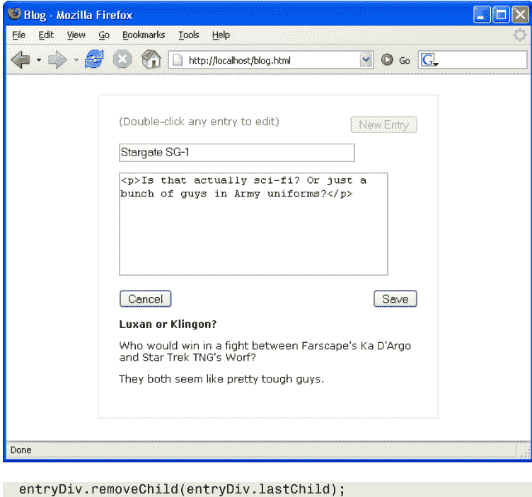

```javascript
entryDiv.removeChild(entryDiv.lastChild);
entryDiv.removeChild(entryDiv.lastChild);
entryDiv.removeChild(entryDiv.lastChild);
if (acceptChanges) {
  t = titleDiv.firstChild.value;
  b = bodyDiv.firstChild.value;
}
else {
  t = self.origTitle;
  b = self.origBody;
}
titleDiv.removeChild(titleDiv.firstChild);
bodyDiv.removeChild(bodyDiv.firstChild);
titleDiv.innerHTML = t;
bodyDiv.innerHTML = b;
};
```

在声明并初始化该方法中使用的变量，并获取主 div、标题 div 和正文 div 的引用后，`editInPlaceOff` 会从主 div 中移除最后三个元素。这三个元素是包含“取消”和“保存”按钮的 div 以及用于清除浮动的 div。这些 div 元素被追加到主 div 的末尾，所以我们知道它们排在最后。我们通过运行 `removeChild` 从子元素列表中移除最后一个元素；我们重复运行该方法以移除列表中的所有相关元素。

接着，代码使用 `acceptChanges` 参数来决定使用哪段文本来替换每个表单元素。如果要保存更改，代码将使用表单字段中更改后的文本。如果要取消更改，它将恢复到存储在 `origTitle` 和 `origBody` 中的值。一旦确定使用哪段文本，它将使用 `removeChild` 从标题和正文 div 元素中移除表单元素，并使用 `innerHTML` 将这些元素替换为相应的文本。

## 保存更改

当你点击“保存”按钮时，你应该返回到条目的显示状态，并看到某种通知，表明你对条目所做的更改正在提交到服务器。我们通过 `doSave` 方法提交更改并启动一个“处理中”动画，以通知用户保存正在进行中：

```javascript
this.doSave = function() {
  var self = Blog;
  var postData = '';
  self.form.editEntryId.value = self.editId;
  postData = formData2QueryString(self.form);
  self.ajax.doPost('/blog_process.php', postData, self.handleSave);
  self.editInPlaceOff(true);
  self.proc = 'proc';
  self.startStatusAnim();
};
```

由于我们的表单中只有几个元素，手动从表单元素中提取数据并将其格式化为提交格式会相当简单，但使用我们在上一章中看到的 `formData2QueryString` 函数从表单中提取数据会更简单。该函数会自动从表单中抓取数据，并将其格式化为 POST 数据所需的查询字符串样式。

请注意，在从表单获取数据之前，我们将隐藏输入框 `editEntryId` 设置为 `editId` 的值。这就是我们将正在保存的条目 ID 放入表单数据的方法。

一旦我们将表单数据存入 `postData`，我们就通过调用 `doPost` 并传递要 POST 的页面地址、数据以及在收到响应时将被调用的处理函数 `handleSave`，将更改发送到服务器。

在将更改提交到服务器后，我们使用上面看到的 `editInPlaceOff` 方法将条目恢复到显示状态。我们向其传递一个 `true` 值，以告知它我们要保留用户所做的更改。

最后，代码启动一个指示服务器正忙于保存更改的动画。它还将 `proc` 属性设置为 `'proc'`，以表明应用程序处于处理状态。我们还将使用这个值来控制动画。

在进入讨论“保存”过程并探索处理服务器响应的任务之前，让我们来看看这个状态动画是如何工作的。

## 状态动画

正如我们已经讨论过的，让用户知道应用程序正在做什么非常重要。AJAX 应用程序为用户提供了与应用交互的新方式——这些方式与用户在传统 Web 应用程序中预期的不同。这些新的交互可能会让用户感到困惑，因此，采取必要措施向他们提供良好的反馈，让他们感觉到应用程序正在响应，至关重要。

这个动画的工作原理与我们在前面章节中看到的非常相似，但有两个例外。首先，这个动画不是改变不透明度或在字符串后面追加点，而是改变 `div` 的 CSS 背景颜色。

另一个重大区别是我们不会总是对同一个 `div` 进行动画处理。我们可以为页面上的任何条目（包括新条目）的 `div` 制作动画。

## 启动动画

我们通过初始化一个递增变量、执行动画的第一步并启动一个 `setInterval` 进程来开始动画：

```javascript
this.startStatusAnim = function() {
  var self = Blog;
  self.fadeIncr = 0;
  self.doStatusAnim();
  self.statusInterval = setInterval(self.doStatusAnim, 200);
};
```

`setInterval` 进程每 200 毫秒调用一次 `doStatusAnim`，直到服务器完成对提交内容的处理。和之前一样，我们将间隔 ID 保存到一个名为 `statusInterval` 的属性中，以便稍后可以停止该进程。

动画进程通过使用整数 RGB 值而非通常的十六进制值来设置动画 div 的 CSS 背景颜色。这种语法的写法与你在 Web 编程中习惯看到的“井号加六个字符”的字符串略有不同——它是使用 `rgb` 以及括号内三个 0 到 255 之间的数字来设置的。这些数字分别代表动画背景中将使用的红、绿、蓝颜色的值。

表 5.1 显示了一些 RGB 和十六进制值的对比示例：

### 表 5.1. RGB 和十六进制表示法的颜色示例

| 颜色 | RGB 值 | 十六进制值 |
|---|---|---|
| 红色 | rgb(256, 0, 0) | #ff0000 |
| 浅蓝色 | rgb(200, 200, 255) | #c8c8ff |
| 灰色 | rgb(128, 128, 128) | #808080 |

我决定在这个动画中使用一种漂亮的蓝色。实现蓝色渐变的一种方法是将蓝色值设置为最大值 255，将红色和绿色都设置为较低的数字（在本例中我使用了 235），然后以 5 为增量同时增加红色和绿色的值，直到每个值都达到 255。随着红色和绿色值接近 255（最大值），蓝色会变得越来越浅，直到完全变为白色。在紧凑的循环中重复此过程...

循环创建了一个漂亮的渐变色效果。图 5.5 逐步展示了这一效果的样子。

## 图 5.5. 创建使用 CSS 颜色渐变的动画

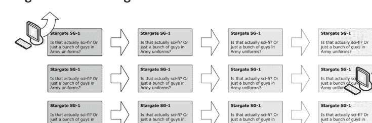

## doStatusAnim 方法

下面是执行颜色变化的 doStatusAnim 方法：

文件：blog.js（节选）

```
this.doStatusAnim = function() {
    var self = Blog;
    var r = 235;
    var g = 235;
    var fadeDiv = null;
    fadeDiv = document.getElementById('main' + self.editId);
    if (self.fadeIncr < 20) {
        self.fadeIncr += 5;
    }
    else {
        if (self.proc == 'proc') {
            self.fadeIncr = 0;
        }
        else {
            self.fadeIncr = 20;
            self.stopReset();
        }
    }
    r += self.fadeIncr;
    g += self.fadeIncr;
    fadeDiv.style.background = 'rgb(' + r + ', ' + g + ', 255)';
};
```

## 第 5 章：更广泛的 AJAX 与就地编辑

代码的上半部分获取了我们要动画处理的 `div` 的引用，这样我们就可以操作该 `div` 的属性。`editId` 属性的值要么是一个 ID 编号（对于现有条目），要么是 `NewEntryTemp`（对新条目而言）。稍后讨论创建新条目时，我们会更详细地说明使用 `NewEntryTemp` 作为条目 ID 占位符的情况。

一旦我们获得了要动画处理的 `div` 的引用，我们就计算 `fadeIncr` 的值，它控制 `div` 颜色的红色和绿色分量。每次调用 `doStatusAnim` 时，`fadeIncr` 的值会在 0、5、10 和 20 之间循环，直到 `proc` 属性的值被改变。

最后，将 `fadeIncr` 的值加到 235 上，得到 `div` 颜色的红色和绿色分量的值；然后使用 CSS 的 `rgb(red, green, blue)` 语法将该值应用到 `div`。

### 伪后端页面

在大多数博客应用中，新条目或对现有条目的修改会提交到一些后端处理代码，将你的文本保存在后端（通常是在 MySQL 或 PostgreSQL 等数据库中）。为了我们简单的博客页面，我们将使用一个名为 `blog_process.php` 的伪后端页面。虽然它实际上并不保存任何内容，但它返回给浏览器的数据与真实页面在保存任何内容更改后返回的数据类型相同。

#### 使用 YAML

由于我们使用同一个页面来处理新条目和现有条目的编辑，因此该页面的响应需要比我们之前章节中看到的纯文本响应稍微复杂一些。

不过，我们的需求仍然没有复杂到需要 XML 的所有额外开销，所以在这个页面中，我选择了一种名为 **YAML**（全称是 YAML Ain't Markup Language，发音与 "camel" 押韵）的结构化数据格式，它简单、易于解析，且人类可读。

下面是一些 YAML 数据的示例——科幻电视剧 *Farscape* 某一集的摘要信息：

```
---
title: Throne for a Loss
order: season 1, episode 2
airdate: 1999-04-09
actors:
  - name: Ben Browder
    character: John Crichton
  - name: Claudia Black
    character: Aeryn Sun
  - name: Anthony Simcoe
    character: Ka D'Argo
synopsis: >
  Rygel is abducted by Tavleks, aggressive soldiers with
  gauntlet weapons on their forearms that inject them full of
  stimulants.
quote: >
  That's your plan? Wile E. Coyote would come up with a better
  plan than that!
...
```

在 YAML 网站上阅读更多关于 YAML 语法规则的信息。[^2]

[^2]: http://www.yaml.org/

你可以看到它有多么容易阅读，以及在页面上占用的"墨水"多么少。将其与相同数据的 XML 标记进行对比，XML 使用了更多字符，可读性也不如 YAML：

```
<episode>
  <title>Throne for a Loss</title>
  <order>season 1, episode 2</order>
  <airdate>1999-04-09</airdate>
  <actors>
    <actor>
      <name>Ben Browder</name>
      <character>John Crichton</character>
    </actor>
    <actor>
      <name>Claudia Black</name>
      <character>Aeryn Sun</character>
    </actor>
    <actor>
      <name>Anthony Simcoe</name>
      <character>Ka D'Argo</character>
    </actor>
  </actors>
  <synopsis><![CDATA[Rygel is abducted by Tavleks, aggressive soldiers with gauntlet weapons on their forearms that inject them full of stimulants.]]></synopsis>
  <quote><![CDATA[That's your plan? Wile E. Coyote would come up with a better plan than that!]]></quote>
</episode>
```

## PHP 代码

下面是后端页面的代码：

```php
<?php
$editEntryId = $_POST["editEntryId"];
sleep(3);
header("Content-Type: text/plain");
print "---\n";
print "status: success\n";
if ($editEntryId == "NewEntryTemp") {
  print "type: new\n";
  print "id: " . time() . "\n";
}
else {
  print "type: edit\n";
  print "id: " . $editEntryId . "\n";
}
print "...";
?>
```

这段相当简短的 PHP 代码在保存新条目和编辑现有条目时基本上做同样的事情。

在这两种情况下，它都会返回条目的 ID——要么是从浏览器传入的编辑条目的 ID，要么是由 PHP 的 `time` 函数生成的伪 ID，以模拟如果这段代码实际将数据保存到数据库时会返回的值（类似于 MySQL 的 `auto_increment` 字段或 PostgreSQL 的 `serial`）。主要区别在于 `type` 被设置为 `new` 还是 `edit`。

## 响应示例

下面是新创建条目的响应示例：

```
---
status: success
type: new
id: 1138946552
...
```

以及编辑操作的响应示例：

```
---
status: success
type: edit
id: 1138946597
...
```

这些纯文本结果会被返回给响应处理函数 handleSave 进行解析。

## 在 JavaScript 中解析 YAML

在我们的 AJAX 应用中，我们需要做的第一件事是将 YAML 结果文本解析为 JavaScript 可以使用的形式。我们可以使用像 YAML JavaScript[^3] 这样的解析库来为我们处理这一步骤，但在本例中，返回的结果非常简单——仅仅为此就引入整个库似乎不太合理！

[^3]: http://sourceforge.net/projects/yaml-javascript

相反，我们将编写一个小方法 `parseYamlResult`，它将返回文本中出现的名称-值对解析为关联数组：

```
文件：blog.js（节选）

this.parseYamlResult = function(str) {
    var arr = [];
    var res = [];
    var pat = /(\S+): (\S+)\n/g;
    while (arr = pat.exec(str)) {
        res[arr[1]] = arr[2];
    }
    return res;
};
```

`parseYamlResult` 在 `str` 参数中接收 YAML 文档字符串。

由于我们知道结果字符串只包含页眉和页脚行，以及几行由冒号和空格分隔的名称-值对，因此使用正则表达式的 exec 方法和两组捕获括号将其解析为关联数组是相当容易的。哈希的键将是结果每一行开头的名称，值则是冒号后面的值。例如，`type: new` 将生成一个数组项 `res['type']`，其值为 `new`。

## 处理响应

由于添加新条目和编辑现有条目的代码大部分相同，我们将使用同一个方法 `handleSave` 来处理两种情况下服务器响应。

下面是 `handleSave` 的代码：

```
this.handleSave = function(str) {
  var self = Blog;
  var res = [];
  var err = '';
  res = self.parseYamlResult(str);
  switch (res['type']) {
    case 'new':
      if (res['status'] != 'success') {
        err = 'Could not save the new entry.';
      }
      else {
        self.saveId = res['id'];
      }
      break;
    case 'edit':
      if (res['status'] != 'success') {
        err = 'Could not save changes to entry.';
      }
      break;
    default:
      err = 'Unknown error.';
      break;
  }
  self.proc = 'done';
  if (err) {
    alert(err);
  }
};
```


**str** 参数是从服务器传回我们页面的结果；我们直接将其传递给 `parseYamlResult` 进行解析，转换成关联数组。

接下来，我们使用 **switch** 语句来处理不同的响应类型。当 **type** 的值为 **new** 且响应的 **status** 属性为 **success** 时，我们将新条目的 **ID** 记录在 **saveId** 属性中，以便后续用来替换我们最初设置的占位符 ID。在讨论创建新条目时，你会更详细地了解其工作原理。然而，如果服务器返回错误，或者 **type** 的值无法识别或缺失，我们会记录一条错误信息并继续执行。

接下来，我们将 **proc** 设置为 **done**，从而禁用处理通知动画，然后在一个简单的 **alert** 框中显示任何已记录的错误。如果这是一个真实的应用程序，你会希望以更具吸引力和帮助性的方式呈现错误，例如，将其写入页面上一个特殊格式化的 **div** 元素中。

## 停止状态动画

一旦编辑内容保存在服务器上，就该停止状态动画了。这个过程的工作原理与我们在前几章中看到的状态动画代码非常相似。

与之前一样，我们的应用程序通过在动画的每个完成周期之间检查对象的某个属性——在这种情况下是 **proc** 属性——来检查请求的处理状态。在周期之间像这样检查状态可以确保动画在请求完成后平稳结束，而不是在淡出过程中突然中断。

一旦请求从服务器返回，并且 **proc** 被设置为 **done**，`doStatusAnim` 将调用 `stopReset`，该函数将停止动画，并执行请求完成后所需的其他一些清理工作。

## 使用 stopReset 进行清理

这是 `stopReset` 的代码：

```
this.stopReset = function() {
    var self = Blog;
    clearInterval(self.statusInterval);
    self.disableEnableMainWinInput(true);
    self.editId = '';
    self.proc = 'ready';
    if (self.saveId) {
      self.setNewEntryRealId();
    }
};
```

这个方法的首要任务是停止处理动画，它通过调用 `clearInterval` 并传入存储在 `statusInterval` 中的间隔 ID 来实现。确保在动画周期结束、动画 `div` 的颜色完全变为白色时调用此方法，可以使动画看起来平稳地停止。

动画停止后，我们需要重新启用主窗口中的用户输入；我们通过调用 `disableEnableMainWinInput` 来实现这一点。这会在动画停止的确切时刻启用“新建条目”按钮。

接下来，此方法执行一些最终清理工作，清除 `editId` 的值，并将 `proc` 属性重置回 `ready`，这表示应用程序没有正在处理的请求，且处理动画已停止。

对于新条目，它还会调用 `setNewEntryRealId`，该方法将占位符 `div` 的 ID 更改为它们的永久值。我们将在下一节中了解其工作原理。

## 添加新条目

正如我在本章开头提到的，我们将用于添加新博客条目的代码很大程度上利用了编辑现有条目的代码，只是有一些区别：

-   代码必须为新条目添加 `div` 元素。
-   如果用户取消添加新条目，则必须移除这些 `div` 元素。
-   在收到服务器分配的真实 ID 之前，`div` 元素使用一个占位符 ID。

点击“新建条目”按钮会调用 `addNewEntry` 方法。该代码处理两项任务：为新条目添加 `div` 元素，并将条目切换到就地编辑模式。以下是代码：

**文件：blog.js（摘录）**

```
this.addNewEntry = function() {
  var self = Blog;
  if (self.insertEntryDiv()) {
    self.editId = 'NewEntryTemp';
    self.editInPlaceOn();
    self.disableEnableMainWinInput(false);
  }
};
```

在调用 `insertEntryDiv` 将新的 div 元素添加到页面后，该方法将 `editId` 设置为 `NewEntryTemp`——一个用于 ID 的占位符值。当这个新条目提交回服务器时，服务器将使用该占位符值来识别该提交为一个全新的博客条目，而不是对现有条目的编辑。

接下来，`addNewEntry` 执行我们在 `toggleEditInPlace` 方法中看到的步骤：它调用 `editInPlaceOn` 使条目可编辑，并调用 `disableEnableMainWinInput` 来禁用“新建条目”按钮。

## 添加新条目的 Divs

`insertEntryDiv` 方法将新条目的 div 元素放置到页面上。由于它使用 DOM 方法来添加 div，因此代码相当冗长，但尽管篇幅较长，它却相当简单。以下是代码：

```
this.insertEntryDiv = function() {
    var self = Blog;
    var allEntryDiv = null;
    var entryFirst = null;
    var newEntryDiv = null;
    var titleDiv = null;
    var bodyDiv = null;
    allEntryDiv = document.getElementById('allEntryDiv');
    newEntryDiv = document.createElement('div');
    titleDiv = document.createElement('div');
    bodyDiv = document.createElement('div');
    newEntryDiv.id = 'mainNewEntryTemp';
    titleDiv.id = 'titleNewEntryTemp';
    bodyDiv.id = 'bodyNewEntryTemp';
    titleDiv.className = 'entryTitle';
    bodyDiv.className = 'entryBody';
    titleDiv.appendChild(document.createTextNode('New entry'));
    bodyDiv.appendChild(
        document.createTextNode('Type body here ...'));
    newEntryDiv.appendChild(titleDiv);
    newEntryDiv.appendChild(bodyDiv);
    entryFirst = allEntryDiv.firstChild;
    if (entryFirst) {
      allEntryDiv.insertBefore(newEntryDiv, entryFirst);
    }
    else {
      allEntryDiv.appendChild(newEntryDiv);
    }
    return true;
};
```

此代码的大部分内容用于设置我们需要为新博客条目添加到页面的所有 `div` 元素。请注意，所有三个 `div` 元素的 ID 都以 `NewEntryTemp` 结尾——这是我们用来替代实际 ID 数字的占位符。当服务器“保存”一个条目时，它将返回该条目的实际 ID；我们将使用此 ID 来替换占位符。

一旦我们创建了这些元素，我们使用 DOM 方法来添加你在创建新博客条目时会看到的占位符文本。我们将使用 `(New entry)` 作为标题占位符文本，使用 `Type body here ...` 作为正文占位符。图 5.6 显示了一个全新博客条目的样子。

接下来，代码将标题和正文 `div` 添加为新条目主 `div` 的子元素。

我们希望新条目出现在页面顶部，因此不能使用 `appendChild` DOM 方法将主 `div` 添加到页面：这种方法会将新条目添加到子节点列表的末尾，使其出现在页面底部。如果页面上已有条目，我们的代码将使用 `insertBefore` 将新的 `div` 放在现有第一个条目之前。如果 `allEntryDiv` div 内没有任何 div，我们可以简单地将新的主 div 作为 `allEntryDiv` div 的子元素进行追加。

新的 `div` 就位后，其余的编辑过程与编辑现有博客条目完全相同，只有一个例外：取消新条目的过程与取消编辑不同。

## 图 5.6. 输入新博客条目

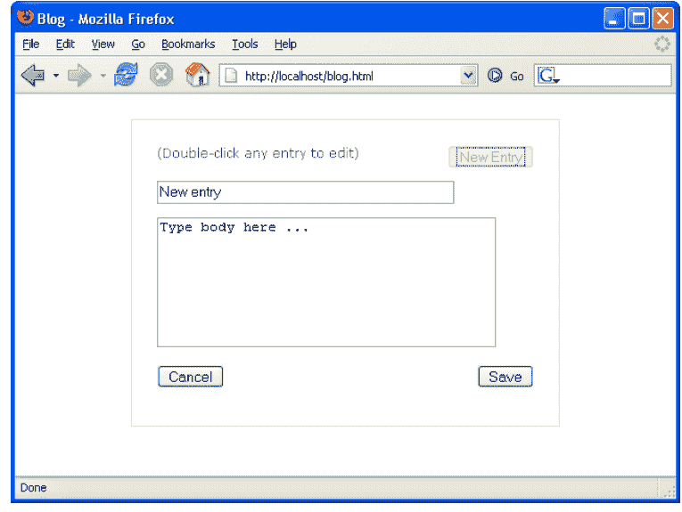

## 取消新条目

当你取消一个新条目时，唯一合理的做法是让那个新条目消失——没有可以回退的“先前状态”。当你开始创建一个新条目后点击“取消”按钮时，会调用 `removeEntryDiv` 方法：

**文件：blog.js（摘录）**

```
this.removeEntryDiv = function() {
  var self = Blog;
  var allEntryDiv = document.getElementById('allEntryDiv');
  var entryDiv = document.getElementById('main' + self.editId);
  allEntryDiv.removeChild(entryDiv);
};
```


这非常简单。你可以通过点击新条目上的“取消”按钮，看着它消失，来观察其实际效果。

## 占位符 ID

现有条目中的每个 `div` 元素都有一个唯一的标识符，这使我们能够编辑它。这个 ID 为我们做两件事：

-   它告诉我们，在切换到就地编辑并显示状态动画时，我们正在处理哪些 `div` 元素。
-   它告诉服务器，当我们保存更改到应用后端时，我们正在编辑哪个博客条目。

然而，对于新条目来说，这种场景存在一个微小的问题。一个新创建的条目没有 ID。但是，一旦它被保存，我们希望包含该条目的 `div` 与其他所有现有条目一样，链接到一个唯一的 ID。

解决方案其实相当简单。当我们首次创建占位符 `div` 时，我们给它一个占位符 ID。然后，当服务器返回包含新保存条目 ID 的响应时，我们只需将该条目的占位符值替换为真实的 ID。

到那时，你的占位符 `div` 就不再只是一个占位符了：一旦它拥有了真实的 ID，它就成为其他现有条目中一个普通的博客条目 `div`。

> ### 小心修改 id 属性
> 请注意，更改 DOM 元素的 id 可能会导致假设该 ID 永远不会更改的代码出现问题。一些外部 JavaScript 库可能无法很好地处理更改后的 ID，因此在修改 DOM 元素的 id 时，请谨慎并运用判断力。

## setNewEntryRealId 方法

用于切换 ID 的 `setNewEntryRealId` 方法相当直接：

```javascript
this.setNewEntryRealId = function() {
    var self = Blog;
    var entryDiv = null;
    var titleDiv = null;
    var bodyDiv = null;
    entryDiv = document.getElementById('mainNewEntryTemp');
    titleDiv = document.getElementById('titleNewEntryTemp');
    bodyDiv = document.getElementById('bodyNewEntryTemp');
    entryDiv.id = 'main' + self.saveId;
    titleDiv.id = 'title' + self.saveId;
    bodyDiv.id = 'body' + self.saveId;
    entryDiv.ondblclick = self.toggleEditInPlace;
    self.saveId = '';
};
```

此方法获取对我们需要更改的 `div` 元素的引用，然后根据从服务器返回并存储在 `saveId` 中的 ID 值重置它们的 id。一旦 `div` 元素拥有了永久的 id 值，该方法就会清空 `saveId`。

## ID 更改的时机

以这种方式更改 id 非常容易；但是，我们不能在新条目保存后立即进行此更改。（还记得我说过这样操作时需要小心吗？）

新条目 `div` 中的状态动画在服务器返回结果时很可能仍在进行中。我们选择让动画在完成当前淡出周期后自行关闭，以避免淡出效果被生硬地切断；这意味着在结果返回后，动画可能还会持续几轮。

动画代码指向的是 `div` 原始的占位符 ID，如果你在动画周期进行到一半时更改 ID，你的代码就会出错。因此，我们在 `stopReset` 方法中所有其他清理工作完成后，最后才执行 ID 切换。

## 未来增强

这是一个非常基础、骨架式的博客页面。就地编辑功能运行得相当好，但你可以添加无数其他增强功能，使其成为一个功能完善的应用程序。

你也可以添加分页模型，这样你就不会将所有时间段的所有可能条目都放在一个页面上。对于分页问题，有两种不同的方法可以采取。

你可以内联加载条目，在服务器上将它们构建到页面标记中，作为网页的正常部分提供服务。这是构建页面的原始、老式方式，与旧版浏览器更兼容。

或者，你可以提供一个页面，其主体仅包含一个用于容纳内容的空 `div`，并使用 AJAX 从服务器以某种结构化数据格式（如 YAML、XML 或 JSON（我们稍后会探讨））加载特定条目的文本，并将这些条目插入到页面上的内容区域中。

这种方法的优点是不那么笨重，并且稍微快一些，因为你只加载每页条目的实际文本——你不必在每次添加或编辑条目时重建整个页面。

在这种情况下，你的代码也可能比第一种解决方案更具可重用性：你有可能使用相同的代码向所有设备提供结构化数据内容，而不是为每种设备单独编写一个版本。当然，你仍然需要客户端代码将文档渲染成每种设备可以显示的内容。

## 并发与锁

像这样使用 AJAX 小块地编辑内容会使应用程序感觉快得多，随着改进的性能让你的博客感觉越来越像桌面应用，你可能需要努力提醒人们，他们编辑的内容并不存储在他们的本地机器上。

如果有多个人可以登录你的应用程序并同时更改内容，这将成为一个真正的问题。这个问题就是**并发**——多个事物或人希望同时访问单个资源的问题。如果不止一个人可以访问和更改你的博客内容，你就需要创建某种方式来锁定正在编辑的内容，以避免不同用户相互覆盖彼此的编辑。

实现这一点的一个好方法是将条目标记为只读，或者在编辑某个条目时锁定对整个文本条目页面的访问。在这种系统中，指明是谁导致内容被锁定会很有帮助，这样其他人就知道如果因锁定而无法更改内容时，该去找谁理论。

请注意，这个问题并非 AJAX 应用程序所独有。任何提供多人访问相同数据的 Web 应用都会遇到并发问题，但使用 AJAX 可能会在用户眼中放大其影响。

## 错误与超时

在出现错误或超时的情况下——即文本更改实际上没有保存在服务器上的情况（而不是向用户报告错误的过程）——最好将文本恢复到其原始状态，以便用户能够准确了解服务器上内容的状态。

与老式 Web 应用相比，这在 AJAX 应用程序中是一个更大的问题，因为 AJAX 应用程序以小块方式更改数据。通常，保存更改的过程可以在后台发生，而用户继续在应用程序中执行其他工作。

如果应用程序未能成功保存该更改，你需要提醒用户出现了问题，并将应用程序恢复到准确反映服务器“现实”的状态。

## 总结

通常，当人们使用 AJAX 这个术语时，他们广泛地指代用 XHTML、JavaScript、CSS 和 DOM 构建的超互动、下一代 Web 应用程序。就地编辑是一个完美的例子，说明了你可以使用 AJAX 风格的开发为 Web 应用添加此类功能，以改善用户体验。当然，鉴于你的 AJAX 应用程序性能和交互性的提升，你必须在用户界面（UI）上做更多工作，包括诸如清晰的提示（让用户明显知道如何与你的应用互动）以及动画（让用户清楚数据的状态）等项目。

如果它们在应用程序中的正确位置被正确使用，像就地编辑这样的 AJAX 功能可以极大地改善用户的在线体验。

---

166

许可给 siowchen@darke.biz

---

## Web 服务与滑动隐藏

> 我永远无法理解，那风啊，就像一个爱的球，当我悲伤时，我滑翔
> —— T-Rex, *The Slider*

在勇敢的新 AJAX 世界里，一切都应该与其他事物相连。只与自身服务器对话的应用程序*太* Web 1.0 了。

在过去几年中，令人惊讶的是，像 Google、Amazon、eBay 和 Yahoo! 这样的大型网络公司发现，为外部开发者提供对其服务的访问权限确实为他们带来了真正的竞争优势。例如，通过 Amazon 联盟计划在线销售商品的人，可以使用 Amazon 电子商务服务跟踪他们的销售情况。还存在一个由通过 eBay 运营业务的人们组成的完整小型产业——而 eBay 平台为这些人提供了一种自动化其销售、库存和发货的方式。

即使是银行和汽车制造商等更传统的企业，也正在从让供应商、合作伙伴和客户更容易访问公司数据中获益。

Web 服务提供了一种标准化的方式来交付这种访问，无论是用于在两个企业之间运行的某种自动化后端流程，还是……


第6章：Web服务与滑动隐藏效果

通过网络"混合应用"（mashup），可以将您所在城镇最佳房产交易的位置显示在Google地图上。

## 滑动隐藏窗口

在本章中，我们将通过一个实际项目来学习如何访问亚马逊的Web服务——我们将构建一个嵌入网页的可滚动窗口，该窗口会循环显示一组亚马逊图书的搜索结果。

每完成一次搜索，新的结果集将滑入屏幕，同时隐藏之前的结果集。图6.1展示了滑动隐藏效果的实际运行情况，搜索"Ruby programming"的结果正在替换"PostgreSQL"的搜索结果。

### 图6.1. 具有滑动隐藏效果的亚马逊图书搜索

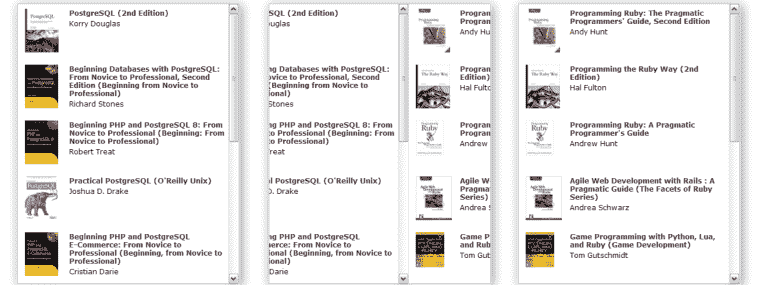

滑动隐藏是一种巧妙的视觉效果，但要实现这个内嵌搜索窗口，我们需要获取一些可显示的搜索结果。我们将首先对Web服务进行简要概述，以确保您理解我们实际使用什么来获取显示在页面上的结果。

## Web服务：概述

如果您请十位IT专业人士定义Web服务，可能会得到十种不同的答案。这个定义有些模糊，其描述可能涉及从Java等具体技术到SOAP、XML-RPC和WSDL等一连串缩写词的所有内容。但实际情况并非那么复杂。"Web服务"一词通常仅指一种通过互联网提供、并使用开放标准交换数据的应用程序。

越来越多的应用程序内置了这种开放访问功能，这种开发应用程序的方式日益流行，催生了**面向服务的架构**这一名称。该术语指的是那些允许其他应用程序通过网络以标准化方式访问其功能的应用程序。

## API与协议

那些将服务开放给外部访问的公司，会提供一种请求信息的标准方式，并定义一种返回所请求信息的标准方式。这被称为**API**（应用程序编程接口），它使开发者能够轻松利用API提供者提供的服务。

一旦公司为其想要提供的Web服务确定了API，就必须决定支持哪些协议以让用户访问这些服务。Web服务协议中的重量级选手是**XML-RPC**和**SOAP**（如果没有一堆有趣的缩写词需要记忆，那技术世界该有多无聊，对吧？）。还有**REST**，它比前两者更简单，而且实际上并不是一个协议——它直接构建在HTTP协议之上。

## REST

REST是访问Web服务API的最简单方法。它是"代表性状态转移"的缩写。这是一个非常花哨的名字，但理念很简单：网络上的一切——页面、图像、Flash电影、PDF——都是可供我们使用的资源。

REST的理念是，这些资源中的每一个都可以通过HTTP访问，不同的HTTP请求方法使我们能够对资源执行不同的操作。例如，我们可能使用**GET** HTTP请求下载资源，使用**PUT**或**POST**对其进行更改，使用**DELETE**将其删除。在REST术语中，这些请求方法被称为动词，因为它们是在网络上对不同项目执行的操作。

根据REST，您可以使用**URI**（通用资源标识符）来定位这些事物，这些URI可以由这些标准HTTP动词进行操作。在Web服务的世界中，这指的是公司（如Google或亚马逊）发布以允许人们访问其服务的URI。

## Google搜索示例

REST实际应用的一个好例子是Google搜索页面。快速在Google上搜索任何主题，同时观察浏览器的位置栏。当您提交搜索时，您正在对搜索页面的URI执行GET请求。以下是一个示例：

```
http://www.google.com/search?q=logan%27s+run
```

搜索页面的URI是 `http://www.google.com/search`。使用`q`参数执行GET请求以搜索词，即可下载资源——在此例中，是关于一部1970年代真正廉价科幻电影的一系列链接。

使用REST方法提供访问权限的API通常被称为RESTful。

## XML-RPC

XML-RPC代表"XML远程过程调用"。它是一个非常简单的协议，允许计算机通过网络调用另一台协作机器上的函数。XML-RPC使用HTTP请求（通常是POST）在客户端和服务器之间来回发送XML编码的命令和响应。

许多Web服务API支持XML-RPC，XML-RPC网站[^1]提供了各种语言和环境中开源和商业实现的长列表——涵盖从Perl、Python、Java和C到Lisp、PHP和.NET的所有方面。XML-RPC是SOAP的前身，于1995年由UserLand Software和微软合作开发。

XML-RPC的理念是，您的代码可以调用另一台机器上的函数，并像调用自己应用程序内部的代码一样获得结果。函数调用和结果会自动打包为XML并来回发送，您的代码无需了解任何相关细节。

[^1]: http://www.xml-rpc.com/

## SOAP

SOAP（最初代表"简单对象访问协议"²）是一种基于XML的协议，其根源可追溯至XML-RPC。与普通的XML-RPC一样，SOAP依赖代码库来创建和解码那些神奇地使您的代码能够调用远程机器上代码的XML命令。

理论上，您永远不需要处理SOAP的复杂性——您选择的库应该为您处理一切。然而，实际上，要达到能够实际使用SOAP的阶段——配置好库、弄清楚它的API、以及破译发生意外时出现的晦涩错误消息——其本身可能就被证明是相当复杂且令人沮丧的。

### WSDL

**WSDL（Web服务描述语言）**通过提供Web服务的描述来降低SOAP的复杂性，您的代码可以在设置其SOAP客户端时使用此描述。它包含诸如应使用的查询URI以及服务支持的函数和数据类型等信息。

WSDL文件是一种基于XML的文档，其作用类似于您的SOAP客户端的远程配置文件。理想情况下，您应该能够将WSDL文件的URI传递给您的SOAP客户端，让它弄清楚如何使用该服务。在PHP的SOAP扩展中使用WSDL如下所示：

```php
$soapClient = 
    new SoapClient("http://badscifi.com/api/MovieSearch.wsdl");
$result = $soapClient->doMovieSearch($key, $movieTitle);
```

一旦您设置好并弄清楚了库的用法，它就应该像这样简单。

## 以网络为中心 vs 以应用为中心

REST是一种以网络为中心的协议，这意味着它的设计初衷是使网络通信更容易，而不太关注必须使用它的应用程序。

> ² SOAP这个缩写词在W3C 1.2版本规范中被官方更改，因为人们意识到它一点也不简单。现在SOAP代表……SOAP。

您应用程序的各个部分被期望构成一个带有URI的"资源"，并响应像GET、POST和PUT这样的HTTP请求"动词"。这使得从网络通信侧来看流程变得简单，但迫使您的服务器端代码弄清楚所有这些简单的"动词"对您的特定应用意味着什么。最终，您必须将您的应用映射到网络及其通信过程。

XML-RPC和SOAP采取了相反的方法。它们是以应用为中心的，将应用程序的实际逻辑映射到通信过程中。HTTP请求类型没有区别（尽管POST最常见），并且关于如何与您的服务器端代码交互的所有信息都写在通信过程中使用的XML数据中。

这使得应用逻辑更容易，但使通信更加困难，因为传输所有数据所需的XML更加冗长和复杂。

在本章中，我们将学习如何使用REST访问Web服务。我们将在下一章中查看使用XML-RPC和SOAP的示例代码。

## 亚马逊Web服务客户端

我们本章的项目将是一个AJAX客户端，用于访问亚马逊的Web服务之一。我们的AJAX客户端将轮询拉取几种不同产品列表搜索的结果，并将结果插入网页。图6.2显示了客户端针对"Ruby programming"搜索所获取的搜索结果示例。


## 图 6.2  Amazon Web Services 客户端显示一组搜索结果

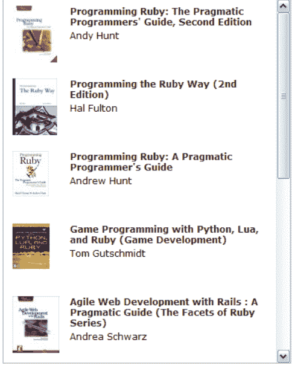

## Amazon Web Services 账户

要使用此服务，你需要有一个 Amazon Web Services（AWS）账户。这将为你提供一个访问密钥 ID（Access Key ID），你需要使用它来通过该服务进行查询。许多大型科技公司提供的 Web 服务都要求你拥有这种密钥或令牌才能访问其服务。这很自然——他们希望获得有关谁在使用其服务以及如何使用这些服务的良好数据。这些密钥通常可以免费设置和使用，尽管有时它们可能会限制你每天免费查询的次数。

## 第 6 章：Web 服务与滑动隐藏效果

Amazon 在 AWS 主页³（如图 6.3 所示）上显示了一个非常明显的链接，指向说明如何创建免费 AWS 账户的信息。一旦你设置好账户，并通过电子邮件收到访问密钥 ID 后，你就可以开始使用了。

**图 6.3  创建免费 AWS 账户的链接**

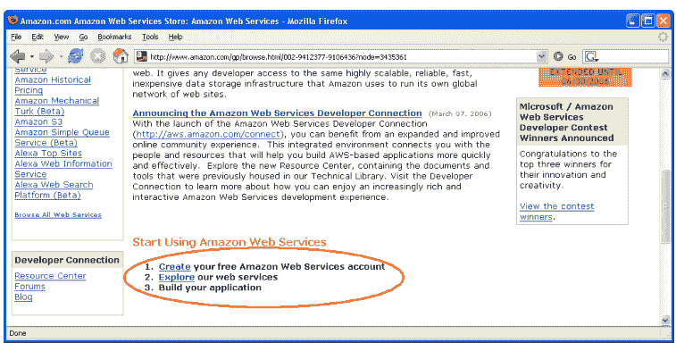

## Amazon 电子商务服务

我们将使用 Amazon 的电子商务服务（ECS），这是 Amazon 的 Web 服务之一，提供对产品数据和电子商务功能的访问。这使你可以访问 Amazon 主站上提供的全套搜索功能。Amazon Web Services 网站上提供了出色的文档，尽管你需要浏览一下才能找到所需的信息。

我们要做的第一件事是选择访问 ECS Web 服务的方法。Amazon 提供通过 SOAP 和 REST 的访问方式。由于我们的需求不大，我们将采用 REST 方法，这样我们就可以直接开始执行搜索并获取一些结果。通过 REST 访问 Amazon ECS 时，我们将发送类似 AJAX 风格的 GET 请求来执行搜索。搜索详情将在查询字符串中指定。

> ³ http://www.amazon.com/aws/

为了确保我们接收的结果易于解析和处理，Amazon 以 XML 格式返回搜索结果。这将是我们第一次涉足 XML 的消费过程，你会发现，起初让它正常工作可能有些棘手。另一方面，XML 的优点在于它非常可预测，因此一旦获得你想要的结果，进行调整就相对容易，而且不会破坏任何东西。

## 客户端类

由于没有更好的术语，我们将我们的客户端类称为 Client。这个名字不太有创意，但很准确：它是一个 Web 服务客户端。为了让我们的轮询搜索持续进行，我们将使用 setTimeout，而且可以预见的是，我们会将这个类设为单例模式，这样就不必担心作用域丢失的问题。以下是初始代码：

```
File: webservice1.js (excerpt)

var SEARCH_TERMS = ['ajax', 'postgresql', 'ruby programming',
    'php', 'javascript'];
var ACCESS_KEY = 'Access Key ID';

var Client = new function() {
    this.SEARCH_TERMS = null;
    this.ACCESS_KEY = null;
    this.ajax = null;
    this.incr = 0;
    this.containerDiv = null;
    this.currDiv = null;
    this.newDiv = null;
    this.slideInterval = null;
    this.slideIncr = 380;
};

window.onload = Client.init;
```

在此文件的开头，我们为应用程序声明了几个常量。这些常量之所以包含在内，是为了让网站管理员可以在不了解代码工作原理的情况下设置和配置此代码（至少在理论上是这样）。SEARCH_TERMS 是一个搜索短语的数组，应用程序将在这些短语之间循环。ACCESS_KEY 是你的 AWS 访问密钥 ID。

## ACCESS_KEY 的值是多少？

> 请注意，本书提供的示例代码中并未设置 ACCESS_KEY 的值——如果你想看到这段代码的实际运行效果，你需要注册一个 AWS 账户并获取你自己的访问密钥。

ajax 属性是我们熟悉的 Ajax 类的一个实例，我们将使用它向 Amazon 服务发出 HTTP 请求。incr 属性用于记住我们在搜索词列表中的位置。其余属性用于显示搜索结果时的花哨滑动隐藏效果。

## 初始设置

init 方法负责一些设置，然后启动查找过程：

```
this.init = function() {
    var self = Client;
    self.ajax = new Ajax();
    self.containerDiv = document.getElementById('containerDiv');
    self.SEARCH_TERMS = SEARCH_TERMS;
    self.ACCESS_KEY = ACCESS_KEY;
    if (!self.ACCESS_KEY) {
        alert('Amazon Web Services Access Key ID is not set. ' +
        'This code will not work without a key.\n' +
        'Sign up for a free key at http://www.amazon.com/aws/.');
    }
    else {
        self.doLookup();
    }
};
```

此方法实例化用于向 AWS 服务发出请求的 Ajax 类，设置一个方便的引用指向我们将用于滑动隐藏效果的 div 元素，然后初始化页面将循环使用的搜索短语列表以及将使用的 AWS 访问密钥 ID。

接下来，init 方法在尝试访问服务之前检查 ACCESS_KEY 属性是否已设置。确保该值是有效的密钥远远超出了我们此处尝试做的事情的范围，但我们至少可以确保如果有人在没有设置 AWS 密钥的情况下启动此应用程序，他们会知道需要一个密钥，以及去哪里获取一个密钥。

最后，我们的代码调用 doLookup千山鸟飞绝，开始搜索过程。

## 跨站点 AJAX

到目前为止，我们所有的 AJAX 页面都是与提供它们的服务器进行通信的——这是一种非常 Web 1.0 风格的开发方法。随着 AJAX 增强了浏览器作为应用开发平台的威力，Web 应用程序开发人员可以参与访问来自多个位置的内容并以有趣的方式将其混合在一起。

这些 Web 应用程序（称为"mashup"）的一个流行数据来源是 Google 地图，用户将自己的数据应用叠加在地图上。这类应用程序的一个经典例子是 chicagocrime.org⁴ 上提供的各种地图，该网站显示了芝加哥市地图上叠加的报案犯罪事件。

## XMLHttpRequest 与安全性

在我们的 AJAX 应用程序能够加入这个伟大的互联互通派对之前，有一个小障碍需要处理——浏览器安全性。由于恶意代码使用这一非常现实的问题——是的，有时甚至是 JavaScript！——浏览器不允许 XMLHttpRequest 向页面来源域以外的任何域发送请求。这称为跨站点请求，意味着如果你从 www.example.com 提供你的 AJAX 应用程序页面，从 XMLHttpRequest 向任何其他域发出的请求都将导致错误。

例如，你可以取第 3 章中的简单监控应用程序，将其 TARGET_URL 更改为类似 http://www.yahoo.com/ 或 http://maps.google.com/ 的地址。当你点击"开始"按钮时，你的请求将失败并出现"permission denied"错误。图 6.4 显示了在 JavaScript 控制台（Web Developer Toolbar Firefox 扩展的一部分）中显示的错误结果。

## 图 6.4  `XMLHttpRequest` 抛出的跨站点安全异常

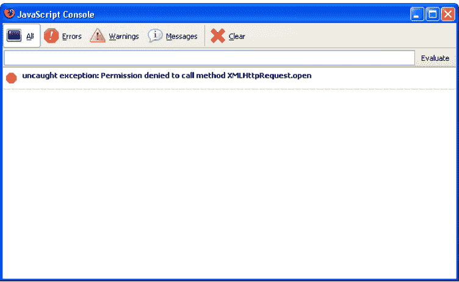

这是一个合理的安全预防措施。跨站点脚本攻击是最常见的浏览器安全问题之一，给人们一种编写脚本的方式来发出 HTTP 请求是很容易被滥用的。

## AJAX 中继

这个问题有一个相当简单的解决方案。你的浏览器无法直接向另一个站点发出 AJAX 请求，但在你的服务器上设置一个简单的代理脚本来将请求从你的浏览器中继到那些其他站点是非常容易的。代理只是一个中间人——一段代码或一个进程，在无法直接交互的两件事物之间中继信息。

在这种情况下，你服务器上的代理脚本将接收来自浏览器中 AJAX 代码的跨站点 HTTP 请求，并将这些请求传递给目标目的地。当那个其他服务器将响应交回给你的服务器时，你的服务器会原样将其传递回浏览器。使用 TimeUnit 时，你的服务器上的代理脚本将接收来自浏览器中 AJAX 代码的跨站点 HTTP 请求，并将这些请求传递给目标目的地。当那个其他服务器将响应交回给你的服务器时，你的服务器会原样将其传递回浏览器。图 6.5 展示了这种通信方式的工作原理。


## 图 6.5. 使用代理脚本的跨站 AJAX 通信

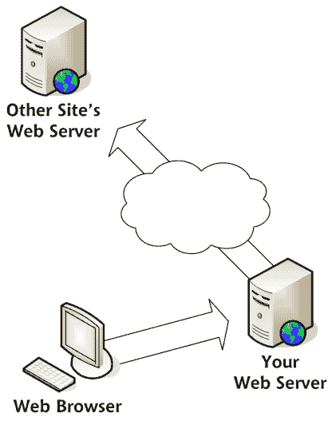

在浏览器看来，这很像是我们直接向其他网站发出请求；你的服务器需要做的只是在中间来回转发这些请求和响应。

你的浏览器与另一个网站之间的所有通信都通过你的服务器进行。这意味着，有时尽管浏览器中运行的 AJAX 代码能够访问你的服务器，但你的服务器可能由于某些原因无法访问另一个网站的服务器。对于这种情况，即从你的服务器转发到另一个网站的请求超时或失败，你需要建立某种完善的降级机制；例如，你可能会让你的代理脚本返回一个客户端 AJAX 脚本能够处理的错误代码或消息。对于我们的 Web 服务客户端，我们将使用最简单的代理脚本。本练习旨在向你展示这个过程是如何工作的，因此我们没有在这里构建任何复杂的错误处理或降级机制。

## 代理脚本

我们将使用 PHP 扩展和应用仓库（PEAR）中提供的优秀 HTTP_Request 包作为我们的代理。HTTP_Request 包是一组代码，它使得使用 PHP 发出 HTTP 请求变得非常容易。

第 6 章：Web 服务与滑动隐藏

## 安装 HTTP_Request

这不是一个 PHP 或 PEAR 教程，但在大多数装有最新 PHP 安装的类 Unix 系统上，安装 HTTP_Request 的过程应该非常简单，只需从命令行运行 `pear install HTTP_Request` 即可。如果你使用的是 Windows，或者在类 Unix 系统（包括 Mac OS X）上运行 `pear install` 对你不起作用，网上有大量地方可以寻求帮助。查看 PEAR 网站的支持部分，了解有关邮件列表、教程和 PEAR IRC 频道的信息。

假设你已经安装了 PEAR 并成功安装了 HTTP_Request，以下是你运行最基础的服务器端代理脚本所需的全部代码：

```php
<?php
require_once "HTTP/Request.php";
$uri = "http://webservices.amazon.com/onca/xml" .
    "?Service=AWSECommerceService" .
    "&AWSAccessKeyId=" . urlencode($_REQUEST["key"]) .
    "&Operation=ItemSearch" .
    "&SearchIndex=Books" .
    "&Keywords=" . urlencode($_REQUEST["search"]) .
    "&Sort=relevancerank";
$req =& new HTTP_Request($uri);
if (!PEAR::isError($req->sendRequest())) {
    header("Content-Type: text/xml");
    print $req->getResponseBody();
}
?>
```

请注意，此页面将响应的 Content-Type 头设置为 text/xml，因为我们知道来自亚马逊的响应将是 XML 格式的。如果这些头信息设置不当，客户端可能会出现问题——我们稍后会详细讨论这一点。

正如我所说，这是一个非常基础的代理——它从查询字符串中读取 key 和 search 参数，构建一个访问亚马逊电子商务服务的 URI，然后输出另一个网站服务器返回的任何响应。你可以通过在浏览器中加载页面并手动提供所需参数来测试此代理。例如，你可以使用以下 URL：

```
http://localhost/ecs_proxy.php?key=AccessKeyID&search=ajax
```

ecs_proxy.php 随后将此请求转发给亚马逊，假设一切按预期工作，将返回以下 XML：

```xml
<?xml version="1.0" encoding="UTF-8"?>
<ItemSearchResponse xmlns="http://webservices.amazon.com/
AWSCommerceService/2005-10-05">
<OperationRequest>
<HTTPHeaders>
<Header Name="UserAgent" Value="PEAR HTTP_Request class
( http://pear.php.net/ )"></Header>
</HTTPHeaders>
<RequestId>ReturnedRequestId</RequestId>
<Arguments>
<Argument Name="Keywords" Value="ajax"></Argument>
<Argument Name="Operation" Value="ItemSearch"></Argument>
<Argument Name="Service"
Value="AWSCommerceService"></Argument>
<Argument Name="AWSAccessKeyId"
Value="AccessKeyID"></Argument>
<Argument Name="SearchIndex" Value="Books"></Argument>
<Argument Name="Sort" Value="relevancerank"></Argument>
</Arguments>
<RequestProcessingTime>0.21</RequestProcessingTime>
</OperationRequest>
<Items>
<Request>
<IsValid>True</IsValid>
<ItemSearchRequest>
<Keywords>ajax</Keywords>
<SearchIndex>Books</SearchIndex>
<Sort>relevancerank</Sort>
</ItemSearchRequest>
</Request>
<TotalResults>155</TotalResults>
<TotalPages>16</TotalPages>
<Item>
<ASIN>1234567890</ASIN>
<DetailPageURL>http://www.amazon.com/...</DetailPageURL>
<ItemAttributes>
<Author>Arthur Frayn</Author>
<ProductGroup>Book</ProductGroup>
<Title>Xtreme AJAX to the Max</Title>
</ItemAttributes>
</Item>
```

```xml
:
</Items>
</ItemSearchResponse>
```

稍后，我们将获取这个原始 XML 输出，提取我们需要的部分，然后将其格式化并插入到网页中。

## 向亚马逊 Web 服务发送请求

既然我们已经设置好了代理中间人，我们就准备好发出一些 Web 服务请求并执行一些搜索了。以下是发送搜索请求的 doLookup 方法：

```javascript
this.doLookup = function() {
  var self = Client;
  var searchStr = '';
  var uri = '';
  var dt = new Date();
  searchStr = self.getSearchItem();
  uri = '/ecs_proxy.php?key=' + escape(self.ACCESS_KEY) +
        '&search=' + escape(searchStr) +
        '&d=' + escape(dt.getTime());
  self.ajax.doGet(uri, self.handleResp, 'xml');
};
this.doLookupDelay = function() {
  var self = Client;
  setTimeout(self.doLookup, 10000);
};
```

这里没有太多内容，直到我们通过 getSearchItem 方法获取本次请求的搜索词，以及我们向查询字符串附加当前日期的部分。将日期附加到查询字符串是为了防止 Internet Explorer 的 XMLHttpRequest 实现缓存结果。通过不断改变查询字符串上的值，Internet Explorer 被迫始终获取页面的新版本。

在 doLookup 之后是 doLookupDelay，它只是调用 setTimeout 来安排在十秒钟后再次调用 doLookup。由于我们不会取消这个调用，所以没有必要跟踪它的间隔 ID。

## 获取搜索文本

getSearchItem 方法是一小段代码，它从搜索词数组中取出一个项目，然后递增计数器，以便我们知道下次获取哪一个：

```javascript
this.getSearchItem = function() {
  var self = Client;
  var str = self.SEARCH_TERMS[self.incr];
  self.incr++;
  if (self.incr >= self.SEARCH_TERMS.length) {
    self.incr = 0;
  }
  return str;
};
```

我们使用 incr 来跟踪下一个要返回的搜索短语。如果 incr 到达搜索短语数组的末尾，它会被重置为 0，这使得搜索在搜索词列表中持续循环。

## 发送请求

doLookup 方法的最后一步使用我们的 Ajax 类实例通过代理脚本发送请求。

对 Ajax 的 doGet 方法的调用应该在前面的章节中见过，但除了目标页面和响应处理函数这两个常规参数外，还有第三个参数 xml。添加这个参数表明我们希望从 XMLHttpRequest 对象获取 XML 文档对象形式的结果，而不是常规的文本。你将在下一节中看到我们如何解析这种不同类型的结果。

## XML 结果与 Content-Type

XML 有一些明显的优势，但与纯文本相比，它可能有点挑剔。因此，我们通常在处理 XML 时需要更加小心。

请记住，如果响应的 Content-Type 不是 text/xml 或 application/xml，那么即使响应包含有效的 XML 文档，XMLHttpRequest 对象的 responseXML 属性也会被设置为 null。Firefox 和 Safari 提供了 overrideMimeType 方法，你可以调用它来强制浏览器将结果识别为 XML，但如果你需要支持除这两个浏览器之外的浏览器，那你就无能为力了。

幸运的是，我们可以通过在 ecs_proxy.php 中插入以下行来控制响应的 Content-Type：

```php
header("Content-Type: text/xml");
```

## 处理来自亚马逊的结果

一旦我们从亚马逊获取到 XML 文档元素，我们就将其交给 handleResp 方法进行解析、格式化并插入到网页中：

```javascript
this.handleResp = function(xml) {
    var self = Client;
    var res = [];
    var mainDiv = document.getElementById('mainDiv');
    var resultsDiv = null;
    var itemDiv = null;
    var imageDiv = null;
    var titleDiv = null;
    var authorDiv = null;
    var clearBoth = null;
    var im = '';
    var ti = '';
    var au = '';
    var bookImg = null;
    res = XMLParse.xml2ObjArray(xml, 'Item');
    resultsDiv = document.createElement('div');
    resultsDiv.className = 'resultsDiv';
    for (var i = 0; i < res.length; i++) {
        itemDiv = document.createElement('div');
        imageDiv = document.createElement('div');
        titleDiv = document.createElement('div');
        authorDiv = document.createElement('div');
        clearBoth = document.createElement('div');
        itemDiv.className = 'itemDiv';
        imageDiv.className = 'imageDiv';
        titleDiv.className = 'titleDiv';
        authorDiv.className = 'authorDiv';
```


# 使用 xml2objArray

`xml2objArray` 方法**反序列化** XML，这意味着它将 XML 转换为编程语言可以轻松使用的数据结构——在本例中，它是将 XML 转换为一个 JavaScript 对象数组。

`xml2objArray` 方法为你完成了繁重的解析工作，但要能够处理结果，你需要知道它返回的数组中包含什么。让我们来看看当传入 Amazon 返回的搜索结果 XML 时会发生什么。

## 示例 XML 文档

我们已经看过 Amazon 返回的 XML 是什么样子：搜索相关的大量数据出现在顶部，随后是所有的搜索结果项，每一项都包裹在 `<Item>` 和 `</Item>` 标签内。以下是一个搜索项的 XML 示例：

```xml
<Item>
  <ASIN>1234567890</ASIN>
  <DetailPageURL>http://www.amazon.com/... </DetailPageURL>
  <ItemAttributes>
    <Author>Arthur Frayn</Author>
    <ProductGroup>Book</ProductGroup>
    <Title>Xtreme AJAX to the Max</Title>
  </ItemAttributes>
</Item>
```

该文档为返回的每个结果包含一个这样的 `Item` 元素。默认情况下，Amazon 将每页结果限制为十项，因此你永远不必担心被大量结果淹没。

`xml2objArray` 方法接受两个参数——XML 文档元素，以及它应该用来创建对象的标签名称。在本例中，我们告诉它为每个 `Item` 元素创建一个对象。该代码为每个项创建一个通用的 JavaScript 对象。它为在每个项中找到的每个元素设置一个属性，并将标签之间的值赋给该属性。

## 示例对象

因此，如果我们取出从前段 XML 创建的对象，并决定打印出它的所有属性和值，最终会得到类似这样的结果：

```
res[0].ASIN: 1234567890
res[0].DetailPageURL: http://www.amazon.com/...
res[0].ItemAttributes.Author: Arthur Frayn
res[0].ItemAttributes.ProductGroup: Book
res[0].ItemAttributes.Title: Xtreme AJAX to the Max
```

来回对照 XML 和 `Object` 来查看各项映射到什么位置会很有帮助。

注意 `ItemAttributes` 属性本身实际上也是一个 `Object`，拥有自己的属性。这是因为 `Author`、`ProductGroup` 和 `Title` 都是嵌套在 `ItemAttributes` 内部的 XML 元素。`xml2ObjArray` 函数递归遍历 XML 文档树，为找到的任何具有子标签的标签创建对应的 `Object` 属性。

## xml2ObjArray 替代方案

`xml2ObjArray` 是一个非常简单的非验证解析器，这意味着它不会尝试验证你加载的 XML 的有效性。如果你需要更高级的功能，可以在线获取更大的代码库，例如 Sarissa[5] 或 XML for Script[6]。它们提供诸如正规 XML 解析、XSLT 和 XPath 查询等功能。但是，对于比我们这里所做的更复杂的任何序列化或反序列化操作，使用原生 JavaScript 数据交换格式——JavaScript 对象表示法（JSON）可能更为合理。我们将在后面的章节中使用 JSON。

# 格式化结果

现在我们已经将 Amazon 的结果存入了数组，是时候让它们看起来更美观并插入到网页中了。这是 `handleResp` 方法的下一部分。我们将使用 DOM 操作方法来实现这一点，因此代码又会有些冗长，但与使用 `innerHTML` 的等效代码相比，它可能更简洁、更易读。

```javascript
resultsDiv = document.createElement('div');
resultsDiv.className = 'resultsDiv';
for (var i = 0; i < res.length; i++) {
  itemDiv = document.createElement('div');
  imageDiv = document.createElement('div');
  titleDiv = document.createElement('div');
  authorDiv = document.createElement('div');
  clearBoth = document.createElement('div');
  itemDiv.className = 'itemDiv';
  imageDiv.className = 'imageDiv';
  titleDiv.className = 'titleDiv';
  authorDiv.className = 'authorDiv';
  clearBoth.className = 'clearBoth';

  as = res[i].ASIN;
  ti = res[i].ItemAttributes.Title;
  au = res[i].ItemAttributes.Author;
  bookImg = document.createElement('img');
  bookImg.src = 'http://images.amazon.com/images/P/' + as +
      '.01.THUMBZZZ.jpg';
  imageDiv.appendChild(bookImg);
  titleDiv.appendChild(document.createTextNode(ti));
  authorDiv.appendChild(document.createTextNode(au));
  itemDiv.appendChild(imageDiv);
  itemDiv.appendChild(titleDiv);
  itemDiv.appendChild(authorDiv);
  itemDiv.appendChild(clearBoth);
  resultsDiv.appendChild(itemDiv);
}
```

基本上，代码首先创建一个 class 为 resultsDiv 的主 div，所有结果都将放入其中。紧接着是一个很长的 "for" 循环，为每个条目创建标记并将其附加到主 div 中。在循环的每次迭代中，res[i] 是从 Amazon 搜索结果 XML 创建的对象之一。

这段代码遵循我们在前几章中见过的相同模式——我们创建元素、设置属性，然后向其中添加内容。一旦我们组装好 div 元素并插入了内容，就需要将它们附加到 ID 为 resultsDiv 的 div 中。这段代码中唯一有些不同寻常的地方是 img 元素的创建。我们使用 ASIN（Amazon 标准识别号）来计算每个项的缩略图位置。然后我们将 img 元素的 src 属性设置为该值，并将其附加到组成项显示的某个 div 中。

# 执行滑动隐藏

一旦我们在 resultsDiv 中填充了搜索返回的所有项，终于可以将该 div 插入到主页面中并开始滑动隐藏过程。我们页面的标记非常简单，如下所示：

```html
File: webservice1.html (excerpt)
<!DOCTYPE html PUBLIC "-//W3C//DTD XHTML 1.0 Strict//EN"
    "http://www.w3.org/TR/xhtml1/DTD/xhtml1-strict.dtd">
<html xmlns="http://www.w3.org/1999/xhtml">
<head>
<meta http-equiv="Content-Type"
       content="text/html; charset=iso-8859-1" />
<title>Web Services, Part 1</title>
<script type="text/javascript" src="ajax.js"></script>
<script type="text/javascript" src="xmlparse.js"></script>
<script type="text/javascript" src="webservice1.js"></script>
<link rel="stylesheet" href="webservice1.css"
      type="text/css" />
</head>
<body>
  <div id="mainDiv">
    <div id="containerDiv"></div>
  </div>
</body>
</html>
```

查看页面的标记，你会注意到页面 body 中只出现了几个嵌套的 div 元素。`handleResp` 将把初始的搜索结果放入内层的 div 元素中：

```javascript
if (!self.currDiv) {
  self.containerDiv.appendChild(resultsDiv);
  self.currDiv = resultsDiv;
  self.doLookupDelay();
} else {
  self.newDiv = resultsDiv;
  self.slideAndHide();
}
};
```

如果 `currDiv` 尚未定义，此代码将使用 `appendChild` 将结果 div 放入我们在标记中设置的容器 div 中。然后代码将结果 div 元素的引用保存到 `currDiv` 中，并使用 `doLookupDelay` 为新搜索启动 `setTimeout` 进程。

下次执行此代码时，`currDiv` 已经被定义，现在是时候滑入新结果了。我们将第二组搜索结果的引用保存到 `newDiv` 中，然后在有两组结果可以处理的情况下，使用 `slideAndHide` 方法将新结果滑入并隐藏旧结果。


## 滑动隐藏效果

滑动隐藏效果分两步进行：结果列表首先在“屏幕外”加载，位于容器 div 的右侧，然后我们通过使用 `setInterval` 改变其位置，将搜索结果列表滑动到视野中。以下是实现此功能的代码：

```
文件：webservice1.js（节选）

this.slideAndHide = function(elem) {
    var self = Client;
    self.newDiv.style.left = '380px';
    self.containerDiv.appendChild(self.newDiv);
    self.slideInterval = setInterval(self.doSlide, 50);
};
this.doSlide = function() {
    var self = Client;
    if (self.slideIncr > 0) {
        self.slideIncr -= 10;
        self.newDiv.style.left = self.slideIncr + 'px';
        self.currDiv.style.left = (self.slideIncr - 380) + 'px';
    }
    else {
        self.slideIncr = 380;
        self.containerDiv.removeChild(self.containerDiv.firstChild);
        self.currDiv = self.containerDiv.firstChild;
        clearInterval(self.slideInterval);
        self.doLookupDelay();
    }
};
```

在 `slideAndHide` 函数中，我们将新的 div 插入到容器中，使其最左边缘位于 380 像素的位置。这与容器的宽度相同，因此最初新的 div 实际上并不可见。一旦新的 div 就位，我们就可以使用 `setInterval` 每 50 毫秒调用一次 `doSlide` 方法。每次调用时，此方法都会将当前 div 和新 div 都向左移动一点。`slideInterval` 属性保存对 `setInterval` 间隔 ID 的引用，我们将在滑动完成时使用它来停止滑动。

`doSlide` 方法执行滑动操作，并使用 `slideIncr` 属性跟踪滑动的进度。因为我们要将两个 div 向左移动，所以必须使 div 的 `left` 属性逐渐减小。因此，每次调用此方法时，我们将 `slideIncr` 的值减少 10。只要这个数字大于零，我们就继续用它来设置两个 div 元素的相对位置。这创造了我们想要的漂亮的向左滑动效果。

一旦计数器变量变为零，我们就完成了滑动：是时候重置一切，为下一次滑动做准备，并重新开始整个过程。重置计数器后，我们丢弃包含旧结果的原始 div，并将 `currDiv` 属性更新为指向刚刚完成滑动的新结果。

代码通过调用存储在 `slideInterval` 属性中的间隔 ID 上的 `clearInterval` 来停止滑动过程，然后通过调用 `doLookupDelay` 在短暂延迟后执行另一次搜索，从而从头开始重新启动整个搜索过程。

## AJAX 胖客户端代码

滑动隐藏代码提供了一个很好的机会来讨论 AJAX 开发相关的一个重要问题。随着 AJAX 技术的应用，越来越多的应用程序代码和逻辑最终运行在客户端，并且越来越多的用户界面在客户端构建。正如我之前提到的，在许多 AJAX 应用程序中，页面整个部分的标记是由 JavaScript 动态创建的。这可能会给最终用户带来严重的问题，不仅涉及较旧的浏览器和可访问性，还涉及应用程序的可用性，因为这些更复杂的“胖客户端” AJAX 应用程序可能会使浏览器以用户意想不到的方式运行。好消息是，如果你在 Web 应用程序中谨慎地使用 AJAX 的方式和位置，你可以最大限度地减少这些问题。

## 旧版浏览器和可访问性

这种 Web 应用程序开发的胖客户端方法可能会给使用旧版浏览器和屏幕阅读器的用户带来严重问题。在开发应用程序时，考虑目标受众并确保为拥有旧版浏览器或特殊需求的用户群体进行调整至关重要。

如果你是为向后兼容性和可访问性而设计，那么使用最新的前沿 AJAX 技术构建整个应用程序可能并不可行。同样，为所有用户提供完全相同的用户体验可能也是不可能的。关键在于确保所有用户都能使用等效的功能。

## 降级搜索结果

我们可以在本章中用来替代华丽的 DHTML 滑动隐藏效果的一个可能解决方案是：在服务器端做更多工作，并在每个提供的页面中随机选择一个搜索结果进行静态显示。这种方法需要服务器端代码处理来自 Amazon 的 XML 结果，并将结果作为 XHTML 标记嵌入到普通的网页中。在非 JavaScript 兼容浏览器中，每次页面刷新都会显示一组不同的结果。我将在下一章展示这种方法的一个例子。

## 可用性：后退按钮问题

现在你已经看到一些 AJAX 应用程序在运行，你可能对 AJAX 风格的 Web 应用程序的另一个潜在问题有所了解：将网页更新分割成小片段的过程打破了大多数人用于浏览网站或 Web 应用程序的心理模型。这通常被称为 AJAX 后退按钮问题，因为后退按钮是用户在使用 AJAX 应用程序时感到困惑的最明显例子。例如，在看到页面上的搜索结果发生变化后，用户可能认为点击浏览器的后退按钮会带他们回到之前的搜索结果列表。点击浏览器的后退按钮却到达一个意想不到的地方，这是许多许多使用过 AJAX 应用程序的人共同的体验。作为 AJAX 应用程序开发者，你的目标应该是通过仅在不太可能使用户感到困惑的情况下使用 AJAX 来消除这种可能性。你不应该仅仅为了使用 AJAX 而使用它——并且绝对应该在普通页面导航更自然的情况下避免使用它。

## 使用警告作为安全网

诚然，应该使用 AJAX 的情况并非总是 100% 清晰明了，在某些情况下，你对 AJAX 的使用可能会给用户带来一些困惑。在这些情况下，你应该为用户提供最基本形式的安全网——某种警告，在用户点击后退按钮时显示。理想情况下，警报应警告他们将离开你的应用程序，并让他们有机会取消操作。

你可以在支持 `onbeforeunload` 事件监听器的浏览器中提供此类警报。将其指向一个返回你希望用户看到的消息的函数，它将显示在一个对话框中，询问用户是否要离开页面。

像这样添加事件监听器：

```
window.onbeforeunload = function() {
    alert('You will actually go somewhere else. ' +
          'You will not go back to the previous search results.');
};
```

图 6.6 显示了用户离开页面时将看到的此消息。

### 图 6.6. 在用户离开页面前警告他们

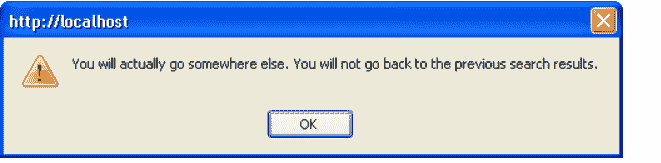

当然，此策略应作为最后手段使用。你应该避免以使导航变得奇怪或模糊的方式使用 AJAX。最重要的是，避免仅仅因为你可以而使用 AJAX。AJAX 功能应该是你添加到应用程序中以改善最终用户体验的东西。

## 修复浏览器后退按钮？

后退按钮的这个问题是 AJAX 开发长期以来的一个问题，许多非常聪明的人提出了一些解决方案，根据具体情况，这些解决方案可能对你非常有效。一个很好的例子是在 Dojo JavaScript 工具包[^7]中实现的代码，该代码使浏览器后退按钮即使在使用 XMLHttpRequest 进行页面更新时也能正常工作。

你是否决定使用类似这样的东西可能取决于你需要支持的浏览器（例如，它在 Safari 中根本无法工作），以及你对代码中使用的“hack”的容忍度。根据 Dojo 文档，这个后退按钮解决方法包含“大量的黑魔法、特定于浏览器的技巧和一般的黑客手段”才能使其工作。

如果你希望浏览器后退按钮正常工作，并且不介意使用 `iframe` 甚至 `document.write` 的代码，那么上述代码可能代表一个可行的解决方案。

[^7]: http://dojotoolkit.org/


在下一章中，我们将看到浏览器"后退"按钮类似修复方案的实现。

## 替换后退按钮

另一个可行的方案是在应用程序中直接编写一个替代后退按钮的实现。如果你能让应用的导航直观且清晰，也许就能让用户完全远离浏览器的后退按钮，从而避免相关问题。

如果实现得当，这会比上一种修复方案更好，因为它能让你避免各种为了使浏览器后退按钮基本正常工作而需要的变通技巧，并且能让你对所有浏览器一视同仁地提供支持。不过，如果你决定走这条路，在用户离开页面时仍然弹出一个确认对话框可能是个好主意，以便让他们确认自己的意图。

在下一章的代码中，我们也将实现这样一个替代后退按钮的功能，让你能看到两种方式的对比——一种是用一些变通手段让浏览器的按钮正常工作，另一种是更简洁的方式，直接在应用内创建导航按钮。

## 提出正确的问题

从编写代码绕过后退按钮问题所需的种种技巧中，你可以看出后退按钮的问题恰好为采用我在第一章提到的方法提供了充分的理由：在开始问"我怎样才能用 AJAX 实现这个？"之前，你应该先问"我应该用 AJAX 来做这件事吗？"这种方法可以帮助你在一开始就避免至少一部分可用性问题，而不是等到问题出现后再以可能临时凑合、打补丁的方式去处理。

## 调试客户端 AJAX

复杂的客户端代码也会给开发者带来严重的困扰。许多 Web 开发者在应用设计和架构等方面缺乏良好的培训，而且用于这类工作的工具也还相当新。

因此，作为 AJAX 开发者，你的第一道防线是确保在应用中正确地使用 AJAX——也就是在那些能让应用更易用、更好用的地方使用。正如你所看到的，将更多代码放在客户端可以创建出比一切都在服务器端完成的应用响应更快、更具动态性的应用。

然而，复杂的客户端 JavaScript 代码出了名地难以调试。当出现问题时，你可能会发现自己抓耳挠腮，试图找出你的炫酷、新颖、胖客户端 AJAX 代码中究竟是哪一部分出了问题。

使用 `XMLHttpRequest` 的 AJAX 式开发还相当新，因此 JavaScript 编程人员无法像其他语言的开发者那样使用种类丰富的调试器、IDE 和重构工具。从其他语言转向 JavaScript 的人往往会被其原始的工具状况吓到。

幸运的是，AJAX 的日益流行在 JavaScript 开发领域引发了一种复兴运动，可用工具的质量正在快速提升。以下是一些亮点：

**Log4JS⁸**
这是一个 JavaScript 类，允许为调试 JavaScript 而自定义记录错误信息。

**Venkman⁹**
这是一款功能齐全的 JavaScript 调试器，适用于基于 Mozilla 的浏览器，包含断点管理、调用栈检查和变量/对象检查等高级功能。控制台还允许在当前窗口中执行 JavaScript 代码。Venkman 是这些工具中最古老的——自 2001 年起就已存在。

**LiveHTTPHeaders¹⁰**
这个工具可以实时显示 HTTP 头信息。它还允许你编辑头信息，以及记录和回放浏览器与服务器之间的头信息交互。

**FireBug¹¹**
这是一个相对较新的 Firefox 工具（需要 1.5 版本），FireBug 实际上是多个工具的合体：基于 Mozilla 浏览器的原始 JavaScript 控制台、DOM 查看器、日志工具，以及一个让你在当前窗口中执行 JavaScript 代码的命令行 JavaScript 解释器。它还包括 XMLHttpRequest Spy，一个将 `XMLHttpRequest` 请求记录到控制台的工具，并允许你以文本或 XML 形式查看其响应。

使用这些工具将大幅提升你的调试能力，你将从在代码中到处弹出烦人的 `alert` 对话框，或在 UI 中保留特殊的调试 `div` 区域，转变为完成正规的日志记录、检查代码中的对象，以及监视浏览器与服务器之间的实时数据流。

鉴于 AJAX 应用中各种协同工作的技术的复杂性，出现故障是不可避免的。当故障发生时，保持清醒的关键在于能够可靠地查看客户端代码与服务器之间通信往返中任何时刻发生的事情。

## 扩展阅读

以下是一些在线资源，帮助你进一步了解本章讨论的技术和概念。

## 跨站脚本攻击（XSS）

**The Cross Site Scripting FAQ**^12^
编写这份常见问题解答是为了帮助更好地理解 XSS 的威胁，并提供检测和预防方面的指导。

**HTML Code Injection and Cross-site scripting**^13^
这篇由 Gunter Ollman 撰写的论文讨论了 CSS（XSS）漏洞的成因和影响。

**XSS Cheat Sheet**^14^
这份速查表非常适合已经掌握 XSS 攻击基础、但想更深入了解过滤绕过细节的人。

## 混搭应用

**Programmable Web**^15^
该站点提供使用 Web 2.0 API 开发应用程序和混搭应用的新闻、信息和资源。

**Google Maps Mania**^16^
这是一个非官方的 Google Maps 博客，跟踪受 Google Maps 影响的网站、混搭应用和工具。

## 本章小结

在本章中，我们快速了解了 Web 服务以及访问它们的不同方式，还展示了一个流畅的滑入隐藏效果，该效果将不同的搜索数据集嵌入到网页中。我们处理了与跨站请求访问 Web 服务数据相关的浏览器安全问题，并展示了一个简单的代理脚本如何提供一个中转，让你的基于浏览器的应用能够与这些 Web 服务进行通信。

> $^{15}$ http://www.programmableweb.com/
> $^{16}$ http://googlemapsmania.blogspot.com/

# 7 更多 Web 服务与后退按钮

> > You go back Jack do it again, Wheel turnin' 'round and 'round, You go back Jack do it again
> —Steely Dan, *Do It Again*

在上一章中，我们了解了如何使用 Web 服务，并构建了一个通过代理页面发送 AJAX 请求来访问 Amazon 电子商务 Web 服务的示例应用。该应用使用简单的 REST 风格的 GET 请求来访问服务，并将结果插入到网页中。

Web 服务的一大优势在于它们提供了对不同数据源所提供数据的便捷、开放的访问，因此在接下来的这一章中，我们将把应用与多个服务整合起来。我们将构建一个搜索应用，使用 REST、XML-RPC 和 SOAP 访问 Google API、eBay 的 Web 服务和 Amazon。图 7.1 展示了搜索应用的实际效果。

这个搜索应用返回的结果集与普通搜索引擎类似，因此它也为演示修复 AJAX 一个众所周知的问题——后退按钮问题——提供了一个很好的机会。

## 第 7 章：更多 Web 服务与后退按钮

## 图 7.1. 搜索应用及一组搜索结果

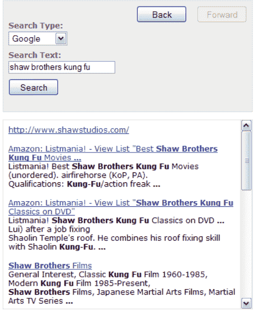

## 搜索应用

这个多源搜索应用将允许用户在多个不同的在线数据源中搜索所需的词条。它将有一个下拉选择框让用户选择要搜索的服务，以及一个文本输入框让用户输入搜索字符串。该应用将能够搜索以下服务：

- Amazon
- eBay
- Google


向此列表中添加新服务也将非常容易。

## 可访问性与向后兼容性

提前了解您希望应用支持哪些类型的用户至关重要，这样才能确保所有用户都能无障碍访问您的应用，并在需要时为您的 AJAX 代码提供等效的非 JavaScript 功能。

正如您在第 4 章所见，支持屏幕阅读器并不意味着您不能使用 JavaScript。屏幕阅读器与浏览器协同工作，因此它们依赖于浏览器来获得 JavaScript 支持。如果您仔细设计代码，可以构建应用程序，使使用屏幕阅读器的用户也能利用您的 AJAX 代码。

另一方面，也存在 JavaScript 支持有限或完全没有 JavaScript 支持的客户端。在某些情况下，您可以在代码中使用渐进增强，使其优雅降级；而在其他情况下，您可能必须构建并维护一个单独的简化版本的应用程序。

在本章中，我们将应用渐进增强原则，在应用程序的主体代码中直接构建可访问性功能，并为非 JavaScript 浏览器提供回退方案。

## 修复返回按钮

在我们的示例应用程序中，我们将演示两种解决经典 AJAX 返回按钮问题的不同方法。

一种方法是将历史导航直接构建到您的应用程序界面中。挑战在于让导航如此显眼，以至于用户更倾向于使用它，而不是使用浏览器内置的返回按钮。这种方法的优点在于它使用干净、符合标准的代码，并且与屏幕阅读器软件兼容良好。

我们将探讨的另一种方法与一些 JavaScript 和 AJAX 工具包使用的解决方案非常相似：实际“修复”浏览器的内置返回按钮，使其按用户期望的方式工作。这具有巨大优势，可使您的应用程序表现得像用户期望的基于浏览器的应用程序一样，但此解决方案依赖于丑陋、低效、特定于浏览器的 hack，并且与屏幕阅读器软件兼容性不佳。

## 第 7 章：更多 Web 服务和返回按钮

我们将在少数需要的地方使用常量值 `BROWSER_BACK` 来分支代码，因此我们应该能很明显地看到我们为修复返回按钮添加内容的位置。

## 设置 Search 类

与前面章节的做法一样，我将把 `Search` 创建为一个 JavaScript 单例类，因为我们只需要该对象的一个副本，并且创建单例使我们更容易处理使用回调函数时遇到的作用域丢失问题。以下是 Search 对象的设置：

```
var Search = new function() {
    this.ajax = null;
    this.form = null;
    this.service = '';
    this.searchText = '';
    this.hist = [];
    this.histIndex = -1;
    this.hand = [];
};
```

如果您阅读了前面的章节，`Search` 对象的大部分属性对您来说应该相当熟悉。

属性 `hist` 和 `histIndex` 在我们实现搜索历史记录和返回按钮功能时将发挥作用。我们将在下一节的 `init` 方法中看到 `hand` 属性的使用。

## init 方法

我们使用一个绑定到窗口 `onload` 事件监听器的 `init` 方法来启动应用程序：

```
window.onload = Search.init;
```

这是 `init` 方法代码的第一部分：

```
this.init = function() {
    var self = Search;
    var enable = false;
    self.ajax = new Ajax();
    self.form = document.getElementById('searchForm');
    document.getElementById('resultsDiv').style.display = 'block';
    self.form.onsubmit = function() { return false; };
    self.hand['searchButton'] = self.submitSearch;
    self.evalSearchTextState();
```

init 方法首先执行所有常规的应用程序初始化——它创建用于提交搜索的 Ajax 对象，并设置对 Web 表单的引用。

接下来，它“打开”了用户界面的结果部分。一个 CSS 声明 `display: none` 与 ID 为 `resultsDiv` 的 div 相关联，因此，不支持 JavaScript 的浏览器将看不到该 div，而支持 JavaScript 的浏览器则可以看到。这个 div 将包含我们由 AJAX 驱动的用户界面。作为本应用程序的一部分，我们将研究如何为不支持 JavaScript 的浏览器构建一个备用用户界面，该界面将向不同的页面发送 POST 请求。

然后，init 为表单的提交按钮设置一个事件处理程序。我们为此按钮使用一个 `input type="submit"` 元素，这使得表单也能在不支持 JavaScript 的客户端上工作。我们不希望我们的 JavaScript 客户端提交实际的表单，因为我们正在使用 AJAX 发送请求；因此，我们必须抑制表单提交。

接着，该方法将一个将成为提交按钮 onclick 事件处理程序的方法的引用放入 `hand` 属性——一个以按钮 ID 为键的关联数组中。

该方法将一个将成为提交按钮 onclick 事件处理程序的方法的引用放入 `hand` 属性——一个以按钮 ID 为键的关联数组中。

这为我们提供了一种便捷的方式来存储所有按钮的 onclick 处理程序，以便我们可以随意启用和禁用按钮。我们将在下一节中了解这是如何工作的。

接下来是调用 `evalSearchTextState`，该方法检查 SearchText 字段，并根据其是否包含任何文本来启用或禁用搜索按钮。以下是 `evalSearchTextState` 的代码：

```
this.evalSearchTextState = function() {
  var self = Search;
  var enableState = 'off';
  if (self.form.SearchText.value.length > 0) {
    enableState = 'on';
  }
  self.setButtonState(self.form.searchButton, enableState);
};
```

此方法防止用户在未输入任何搜索词的情况下尝试提交搜索。

`init` 方法的中间部分处理返回按钮代码：

```
if (BROWSER_BACK) {
  self.startHist();
}
else {
  self.addHistoryNav();
}
```

if-else 分支的第一部分用于修复浏览器返回按钮。它启动一些代码来监视浏览器历史记录和地址栏的变化——我们将在专门介绍浏览器返回按钮修复的部分介绍其工作原理。另一个分支设置一个应用程序导航面板，其中包含“后退”和“前进”按钮。您将在解释如何构建自己的返回按钮的部分了解所有这些是如何工作的。

代码的最后一部分为屏幕阅读器用户启用这些功能：

```
self.enableScreenReaderFeatures();
};
```

此方法与第 4 章登录应用程序中同名的方法几乎相同。针对此应用程序的特定屏幕阅读器代码需要进行一些调整。我们将在本章末尾关于屏幕阅读器代码的部分进行讲解。

## 禁用和启用按钮

我们上面看到，从 `init` 调用的 `evalSearchTextState` 方法防止用户在没有搜索文本的情况下提交搜索。它通过调用 `setButtonState` 来启用或禁用提交按钮来实现这一点，具体取决于 `SearchText` 字段是否有值。

以下是 `setButtonState` 的代码：

```
this.setButtonState = function(buttonRef, enableState) {
  var self = Search;
  if (enableState == 'on') {
    buttonRef.disabled = false;
    buttonRef.onclick = self.hand[buttonRef.id];
  }
  else {
    buttonRef.disabled = true;
    buttonRef.onclick = null;
  }
};
```

该方法接受两个参数——`buttonRef`，即要切换开关的按钮的引用，以及 `enableState`，一个布尔值，指示我们是启用还是禁用该按钮。

启用按钮会将其 `disabled` 属性设置为 `false`。然后代码查看存储在 `hand` 中的处理程序方法关联数组，并使用按钮的 ID 作为键来确定应附加到该按钮的方法。

禁用按钮很简单——我们只需将其 `disabled` 属性设置为 `true` 使其正确显示为灰显状态，并将按钮的 `onclick` 事件处理程序设置为 `null`，这样点击按钮将没有任何效果。

## 启用搜索

现在我们已经设置好了用户界面，是时候执行一些搜索了。最初，搜索按钮是禁用的，因为搜索文本框为空。这种方法，类似于我们在第 4 章中使用应用程序登录所做的，代表了一种主动验证输入的方式。通过这种方式，我们防止用户犯错，而不是等到他们采取了某些操作后才


## 第七章：更多 Web 服务与返回按钮

告诉他们“抱歉，那个搜索词无效。”当按钮被禁用时，合法用户就无法提交空搜索。

一旦用户在文本字段中输入了内容，我们就需要启用搜索按钮。我们使用与第四章启用搜索按钮相同的方法——通过附加到页面 `document.onkeyup` 事件的方法：

```
document.onkeyup = Search.keyup;
```

这个方法会在用户每次按键时触发，并检查他们是否正在搜索文本框中输入内容。以下是 `keyup` 方法的代码：

```
this.keyup = function(e) {
  var self = Search;
  e = e || window.event;
  if (e.keyCode == 13) {
    if (!self.form.searchButton.disabled) {
      self.submitSearch();
    }
  }
  else {
    self.evalSearchTextState();
  }
};
```

请注意，由于所有键盘输入都经过此方法，我们也用它来在用户按下回车键（`keyCode` 为 13）时提交搜索。如果按下的键是回车键，它将提交搜索——但前提是搜索按钮已被启用。

## submitSearch 方法

一旦用户在搜索文本框中输入了内容，并且搜索按钮已启用，他们可以点击搜索按钮或按回车键来执行搜索。这两种选项都会调用 `submitSearch` 方法。以下是 `submitSearch` 方法代码的第一部分：

```
this.submitSearch = function() {
  var self = Search;
  var service = '';
  var searchText = '';
  var proxyURI = '';
  var dt = new Date();
  service = self.form.SearchService.value;
  searchText = self.form.SearchText.value;
  if (service != self.service || searchText != self.searchText) {
      self.service = service;
      self.searchText = searchText;
      self.setButtonState(self.form.searchButton, 'off');
  }
```

这段代码相当直白。它将表单值提取到一些局部变量中（`service` 用于执行搜索的 Web 服务，`searchText` 用于搜索的文本字符串），然后通过将 `service` 和 `searchText` 与同名属性进行比较，检查这是否是用户之前的搜索。只要其中任何一个不匹配，我们就禁用搜索按钮，并将 `service` 和 `searchText` 存储在这些属性中。这可以阻止不耐烦的用户一遍又一遍地重复相同的搜索。`service` 和 `searchText` 属性将在后续使用返回按钮导航用户搜索历史时用到。

## 传递给代理脚本

接下来的代码部分如下：

```
文件：webservices2.js（节选）

proxyURI = '/webservices2_proxy.php' +
    '?search=' + escape(self.searchText) +
    '&service=' + self.service +
    '&dt=' + dt.getTime();
```

与上一章一样，这个应用程序将使用一个代理脚本来将我们的 AJAX 请求中继到不同于我们 AJAX 应用所在服务器的其他服务器上的 URI。浏览器安全策略阻止我们直接向这些其他服务器发出请求，因此我们通过自己服务器上的代理脚本进行。请注意，我们需要对服务名和搜索词进行 `escape` 编码，以便将它们传递到查询字符串上。

## 提交搜索

以下是 `submitSearch` 方法的最后一部分代码：

```
文件：webservices2.js（节选）

document.getElementById('resultsDiv').innerHTML =
    '<div class="resultsPaneDiv">Processing ...</div>';
self.ajax.doGet(proxyURI, self.handleResp, 'xml');
}
};
```

这段代码清空了用于显示搜索结果的 div，并将其显示文本设置为“Processing ...”

没错，各位：对于这个应用程序，我们将暂停使用花哨的动画状态效果，转而使用纯文本通知来告知用户应用正忙于执行搜索。如果您看过我们其他演示应用程序中的动画，可能会对静态文本能如此有效感到惊讶。无论如何，真正重要的是要给用户关于应用正在做什么的清晰提示。

另一个需要注意的点是我们用于设置处理状态文本的方法——令人畏惧的 `innerHTML` 属性。尽管它可能会让我们中一些更教条的开发者感到不安，但在本应用中，使用 `innerHTML` 是有充分理由的。稍后在讨论处理来自 Web 服务的响应部分，我会更详细地解释我们为何使用它。

最后，我们使用 Ajax 对象的 `doGet` 方法将请求传递给代理页面，并将 `xml` 作为最后一个参数传递，以便我们将结果作为 XML 文档接收。

您可能还记得本章的介绍，这个应用程序应该通过发送 XML-RPC 和 SOAP 请求来与 Web 服务一起工作；XML-RPC 和 SOAP 依赖于将 XML 发送回服务器的 POST 请求。您可能想知道我们如何通过这个简单的 GET 请求和查询字符串上的几个变量来完成所有这些操作。嗯，发送 POST 请求将是我们的代理脚本的任务。

## 代理脚本

处理我们想用于搜索的所有不同 Web 服务将需要比我们在上一章看到的更复杂的服务器端代码。毕竟，我们不再只是通过 GET 发送简单的 REST 请求了——其中一些 Web 服务使用 XML-RPC；另一些使用 SOAP。因此，我们需要使用不同的代码库来与不同的 Web 服务通信。

这个应用程序的代理脚本是 `webservices2_proxy.php`。我们正在用 PHP 开发它，但您也可以轻松使用其他语言，如 Ruby、Python、Perl、ASP 或 Java。

为了使事情尽可能清晰易懂，我将代码安排为一堆 `case` 语句——每个 Web 服务一个。我们在示例代码中使用的所有 Web 服务都以 XML 文档形式返回结果；然后我们将此文档返回给客户端的 JavaScript 代码进行解析和显示。

## 要求

就像我们在上一章看到的简单 Web 服务示例一样，我们在这个应用程序的代理脚本中使用了 PHP PEAR 模块 `HTTP_Request` 来执行 HTTP 请求。除非您安装了 `HTTP_Request` 包，否则这些示例将无法工作。

此外，对 Google Web API 的 SOAP 调用将要求您要么使用 PEAR SOAP 包¹，要么您的 PHP 安装是使用 `-enable-soap` 编译的。

## 初始设置

以下是代理脚本代码的开始部分：

```
<?php
require_once "HTTP/Request.php";
var $searchText = $_REQUEST['search'];
var $service = $_REQUEST['service'];
var $uri = '';
var $key = null;
var $userToken = '';
var $xml = '';
switch ($service) {
```

在包含 `HTTP_Request` 包之后，我们进行了一些变量声明。前两个变量是传递在查询字符串上的输入——`$service`，我们想用来执行搜索的 Web 服务，以及 `$searchText`，我们要搜索的文本。

> ¹ http://pear.php.net/package/SOAP/

## 验证来自客户端的输入

由于这只是一个演示应用程序，我们没有对来自浏览器的输入进行任何特殊验证。然而，如果这是一个生产应用程序，您绝对希望采取措施确保从浏览器传入的数据在代码中使用之前是安全的。

其他变量将包含我们进行请求所需的一些相当基础的信息，例如 URI、访问密钥和 `$xml`，我们将把服务器的响应放入这个变量中。

在这段代码片段的最后一行，我们开始了一个 switch 语句，其中将包含我们应用程序可以访问的每个服务的 case。

## Amazon Web 服务

我们将从亚马逊的电子商务服务开始，也就是我们在上一章访问的服务。以下是我们将在新代理脚本中使用的代码，用于设置使用亚马逊电子商务服务的搜索：

**文件：webservices2_proxy.php（节选）**

```
case 'amazon':
    $key = 'Access Key ID';
    $uri = 'http://webservices.amazon.com/onca/xml'.
           '?Service=AWSECommerceService' .
           '&AWSAccessKeyId=' . urlencode($key) .
           '&Operation=ItemSearch' .
           '&SearchIndex=Books' .
           '&Keywords=' . urlencode($searchText) .
           '&Sort=relevancerank';
    var $req =& new HTTP_Request($uri);
    var $result = $req->sendRequest();
    if (PEAR::isError($result)) {
        die($result->getMessage());
    }
    else {
        $xml = $req->getResponseBody();
    }
    break;
```

这看起来与我们上一章看到的代码非常相似。我们设置访问密钥，然后将其与我们的搜索词一起添加到查询字符串中。请务必对搜索词进行 URL 编码。


然后，我们使用`HTTP_Request`模块发起请求，并将结果存入`$xml`变量中。

## 打印响应

打印结果的代码位于页面最底部，在`switch`语句之外。

```
File: webservice s2_proxy.php (excerpt)

}
header('Content-Type: text/xml');
print($xml);
?>
```

这段非常简单的代码将响应的`Content-Type`头设置为`text/xml`，并将结果打印到`$xml`中。一旦执行，每个Web服务的代码都会将其结果放入`$xml`，然后将其返回给我们的AJAX客户端。

## Google Web APIs

接下来，我们将看看如何使用Google的Web服务API执行搜索。要访问Google Web APIs，你需要一个访问密钥，这与亚马逊Web服务的情况一样。你可以在Google Web APIs网站上注册一个账户并获取你的免费密钥。^2

与亚马逊不同，Google的Web服务限制你每天最多进行1000次请求。如果你试图在一天内进行超过1000次查询，Google的服务器将响应一个SOAP错误，指出你已超出允许的最大查询次数。Google Web APIs常见问题解答建议，在这种情况下“你可能需要休息一下，明天再开始查询。”

## 使用SOAP库

Google的Web服务使用SOAP，我们在上一章的Web服务概述中简要提到过。SOAP的理念是，你应该能够使用一个库来简单地调用该服务，就像在自己的代码中调用一个对象的方法一样。

^2 http://www.google.com/apis/

然而，有时设置和正确配置你的库可能有点挑战。PHP通过扩展提供SOAP支持，但要使用它，你必须使用`--enable-soap`选项编译PHP。另一种选择是使用PHP PEAR仓库中的`SOAP`模块。³ 由于该模块在撰写本文时官方仍处于测试阶段，使用命令行`pear`命令安装将无法工作——你需要下载该包，解压缩，并将`SOAP`目录放置在`webservices2_proxy.php`页面可以找到的位置。

以下是我们的Google代码的第一部分：

```
case 'google':
  var $wsdlURI = 'http://api.google.com/GoogleSearch.wsdl';
  $key = 'Licence Key';
```

此部分设置你的许可证密钥和Google Web服务的WSDL文档位置。

我们在上一章的Web服务简介中稍微讨论过WSDL。WSDL文档提供了SOAP Web服务器的描述。我们的SOAP库将其用作远程配置文件来设置自身，以便执行对Google服务的调用。

## SOAP扩展的代码

首先是在通过使用`--enable-soap`选项编译PHP而启用的SOAP扩展下工作的代码部分：

```
if (extension_loaded('soap')) {
  $soapClient = new SoapClient($wsdlURI, array('trace' => 1));
  $result = $soapClient->doGoogleSearch($key, $searchText, 0, 10,
    false, '', false, '', 'latin', 'latin');
  if (is_soap_fault($result)) {
      trigger_error("SOAP Fault: (faultcode: {$result->faultcode},
          faultstring: {$result->faultstring})", E_ERROR);
  }
  else {
    $xml = $soapClient->__getLastResponse();
  }
}
```

该代码使用Google的WSDL文档设置一个SOAP客户端，调用`doGoogleSearch`，并接收请求的原始XML输出。

你会注意到调用`doGoogleSearch`方法非常简单——它看起来就像你在代码中调用任何其他普通方法一样，尽管它实际上是在调用Google的服务器。这就是SOAP的威力——一旦你实际设置好了一切使SOAP能够工作，函数调用就非常简单了。

WSDL文件描述了Web服务提供的方法，因此SOAP客户端可以将它们暴露出来，就好像它们只是类的另一个方法一样。例如，Google的WSDL文件包含对`doGoogleSearch`方法的以下描述：

```
<message name="doGoogleSearch">
  <part name="key" type="xsd:string"/>
  <part name="q" type="xsd:string"/>
  <part name="start" type="xsd:int"/>
  <part name="maxResults" type="xsd:int"/>
  <part name="filter" type="xsd:boolean"/>
  <part name="restrict" type="xsd:string"/>
  <part name="safeSearch" type="xsd:boolean"/>
  <part name="lr" type="xsd:string"/>
  <part name="ie" type="xsd:string"/>
  <part name="oe" type="xsd:string"/>
</message>
```

这里定义了`doGoogleSearch`方法的参数，包括Google Web APIs许可证密钥、实际的搜索词等。这些参数的实际作用在Google Web APIs网站上有文档说明。⁴ 如果你有兴趣了解更多关于WSDL的知识，本章末尾的“延伸阅读”部分提供了一些入门链接。

当你使用SOAP PHP扩展创建`SoapClient`时，第二个参数是一个包含SOAP客户端选项的关联数组。为了获取响应XML，我们必须开启的一个选项是`trace`。当此选项设置为`1`时，我们就可以使用`_getLastResponse`方法获取原始的XML响应。

## PEAR SOAP模块的代码

以下是使用PEAR SOAP客户端模块访问Google Web服务的代码：

⁴ http://www.google.com/apis/

### 第7章：更多Web服务与返回按钮

```
File: webserviceS2_proxy.php (excerpt)
else {
  require_once 'SOAP/Client.php';
  $wsdl = new SOAP_WSDL($wsdlURI);
  $soapClient = $wsdl->getProxy();
  $result = $soapClient->doGoogleSearch($key, $searchText, 0, 10,
    false, '', false, '', 'latin', 'latin');
  if (PEAR::isError($result)) {
    die($result->getMessage());
  }
  else {
    $xml = $soapClient->xml;
  }
}
break;
```

这段代码与编译进扩展的代码非常相似。在require语句引入SOAP客户端模块后，代码设置SOAP客户端，调用doGoogleSearch，然后获取响应的原始XML输出。

同样，一旦一切准备就绪，调用doGoogleSearch就超级简单。事实上，由于WSDL定义，对于扩展客户端和PEAR模块客户端，调用方式是完全相同的。

PEAR模块使得从响应中获取XML更容易一些。它为客户端对象提供了一个内置的`xml`属性，其中包含来自服务器的实际XML响应。

记住，一旦我们跳出这个case，`$xml`的内容就会被打印出来，所以我们Google代理的工作就全部完成了！

## eBay平台

eBay也为应用程序开发人员提供了一套Web服务。⁵ 它提供了多种访问服务的方式，包括REST、SOAP和纯XML。由于我们已经看过REST和SOAP的示例，我们将使用XML-RPC来访问eBay的Web服务。

5 http://developer.ebay.com/

### 一些障碍

由于eBay通过其Web服务提供了完整的买卖功能访问，你需要克服一些额外的安全障碍才能使eBay Web服务正常工作。eBay要求我们在与服务器通信时使用SSL加密，需要三个独立的密钥（而亚马逊和Google只需要一个），以及一个代表执行交易的用户的令牌。由于我们只执行搜索，我们将设置一个单一的用户，并对所有查询使用相同的令牌。

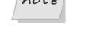

### SSL加密

与eBay通信需要SSL加密，因此请注意，我们将用于eBay服务的示例代码仅在你的服务器能够发送HTTPS请求的情况下才有效。要了解你的服务器是否支持SSL，请咨询你的系统管理员。PHP用户可以运行`phpinfo`并查找OpenSSL。如果OpenSSL存在，你应该不会有问题。

### 访问密钥和用户令牌

与我们使用其他Web服务时使用的单个密钥不同，eBay要求我们使用三个密钥加上一个用户令牌来访问该服务。当你注册开发者计划时，你会收到三个访问密钥，但你需要通过一个单独的过程来获取用户令牌。这三个密钥是：

- **AppID** 应用程序的唯一标识符
- **DevID** 开发者的唯一标识符
- **CertID** 一个身份验证证书，确保应用程序确实是其声称的身份

要获取你自己的密钥，你需要在eBay的开发者计划网站上注册。⁶ 注册后，有关如何获取密钥的说明将通过电子邮件发送给你。

一旦你有了密钥，就该在eBay沙盒中创建用户令牌了。

6 http://developer.ebay.com/


## 沙箱环境

你的 eBay 开发者账户可以无限制地访问 eBay 沙箱环境，并有机会通过自我认证获得有限的免费访问 eBay 生产环境的权限。eBay 沙箱环境是真实 eBay 环境的模拟版本，包含逼真的"虚拟"数据。它让你有机会使用逼真的数据进行测试，而不必担心可能会对实际客户信息造成破坏。我们的测试代码通过沙箱环境执行搜索，这意味着我们不会显示与在实际 eBay 站点上搜索相同的结果。

要在沙箱环境中创建用户，请登录 eBay 开发者计划网站，然后点击"沙箱用户注册"链接来注册一个虚拟用户。注册好虚拟用户后，点击链接生成一个认证和授权令牌。在这个过程中，你需要以虚拟用户的身份登录，最终你会收到一个用户令牌——一串相当长的字符。

## 代码

以下是创建 eBay 请求的代码部分：

```
case 'eBay':
    require_once "eBayXMLRPC.php";
    $key['devID'] = 'Your DevID';
    $key['appID'] = 'Your AppID';
    $key['certID'] = 'Your CertID';
    $userToken = 'Your User Token';
    $xmlRPC = new eBayXMLRPC();
    $xmlRPC->createSession($key, 'GetSearchResults');
    $xml = $xmlRPC->GetSearchResults($userToken, $searchText);
    break;
```

这段代码使用了一个小型辅助库 eBayXMLRPC.php，其中包含一个用于向 eBay 发送 XML-RPC 请求的类。该库负责为你的搜索创建 XML 消息，并设置 eBay 特定的 HTTP 请求头以建立你的 eBay 会话。该库包含在代码归档中，如果你对 XML-RPC 在幕后的工作原理感兴趣，可以查看一下。

我们的代理脚本只是使用该库创建一个 eBayXMLRPC 实例，即一个用于 eBay 平台的 XML-RPC 客户端。然后，它创建一个会话并执行搜索。和之前一样，我们将结果存入 `$xml`，以便稍后打印出来。

## 测试代理脚本

测试代理代码的一种非常简单的方法是，在浏览器的地址栏中手动输入代理页面的地址，以及客户端 JavaScript 会添加的查询字符串，然后直接在浏览器窗口中查看结果。例如，如果你想在 Amazon 上搜索某个著名的功夫电影制作公司，你可能会输入类似这样的地址：

http://.../webservices2_proxy.php?search=shaw%20brothers&service=amazon

浏览器会内联显示 XML 数据响应，没有任何样式。这是一个相当丑陋的响应，但至少你能看到内容是什么。图 7.2 展示了该搜索结果在浏览器中的显示方式。

### 图 7.2. 在浏览器中以纯 XML 形式显示搜索结果

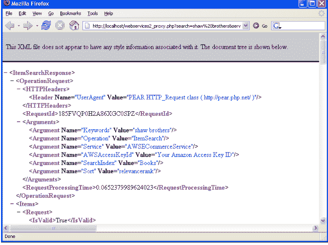

## 处理结果

既然我们已经通过代理脚本从几个不同的 Web 服务接收到了 XML 结果，现在是时候回到客户端，将这些格式化良好的结果插入到网页中了。

我们通过调用 `ajax` 对象发起了对代理页面的原始请求：

```
self.ajax.doGet(proxyURI, self.handleResp, 'xml');
```

在这种情况下，响应的处理函数是直观命名的 `handleResp`，最后传递的 `xml` 标志表示我们期望结果以 XML 形式返回。

`handleResp` 的代码被分成多个 `case` 语句，放在一个大型 `switch` 语句中，就像我们在代理脚本中使用的那样：

```
this.handleResp = function(xml) {
  var self = Search;
  var res = [];
  var item = '';
  var str = '';
  self.setButtonState(self.form.searchButton, 'on');
  if (!xml) {
    str += '<div class="resultsPaneDiv">' +
        '(Error or no response from the server)</div>';
  }
  else {
    switch (self.service) {
```

我们需要做的第一件事是重新启用搜索按钮，让用户可以执行更多搜索。然后，在粗略检查确认我们收到了来自服务器的 XML 结果后，代码继续处理每个不同 Web 服务的情况。

## Amazon

让我们先来处理 Amazon 的响应；下面的代码与上一章中的代码非常相似：

```
case 'amazon':
  res = XMLParse.xml2ObjArray(xml, 'Item');
  str += self.noResultsCheck(res.length);
  for (var i = 0; i < res.length; i++) {
    item = '<div class="itemDiv">';
    item += '<div><a' +
        ' href="http://www.amazon.com/exec/obidos/tg/detail/-/'
        + res[i].ASIN + '">' +
    res[i].ItemAttributes.Title + '</a></div>';
    if (res[i].ItemAttributes.Author) {
      item += '<div>' + res[i].ItemAttributes.Author + '</div>';
    }
    item += '</div>';
    str += item;
  }
  break;
```

Amazon 服务的处理流程的第一步是从服务器返回的 XML 响应中获取一个 JavaScript 对象数组。

XMLParse 库使这变得相当简单——我们只需调用 `XMLParse.xml2ObjArray` 方法，传入 XML 文档和我们想要转换的文档中的元素名称。`xml2ObjArray` 返回一个 JavaScript 对象数组。对于 Amazon，我们传入 `Item` 给 `xml2ObjArray`，因为每个项目都在一个 `Item` 元素中。

如果你以后要添加自己的服务，请注意这个参数是区分大小写的。

接下来，我们使用 `noResultsCheck` 方法确保我们有一些结果。这个方法只是在返回的数组为空时设置一个显示"无结果"消息的字符串：

```
this.noResultsCheck = function(len) {
  str = '';
  if (len == 0) {
    str = '<div class="resultsPaneDiv">(No results returned)' +
        '</div>';
  }
  return str;
};
```

如果 `res` 数组中有任何 JavaScript 对象，代码将继续遍历该数组，创建一个可以显示在结果窗格中的标记字符串。在这个应用中，我们将使用 `innerHTML` 来显示结果；你将在下一节中看到原因。

## Google

显示 Google 的结果比 Amazon 的结果处理起来稍微复杂一些。让我们来看看：

```
case 'google':
    var resultsArr = xml.getElementsByTagName('resultElements');
    xml = resultsArr[0];
    res = XMLParse.xml2ObjArray(xml, 'item');
    str += self.noResultsCheck(res.length);
    for (var i = 0; i < res.length; i++) {
        item = '<div class="itemDiv">';
        item += '<div>';
        item += '<a href="' + res[i].URL + '">';
        if (res[i].title) {
            item += res[i].title;
        }
        else {
            item += res[i].URL;
        }
        item += '</a></div>';
        if (res[i].snippet) {
            item += '<div>' + res[i].snippet + '</div>';
        }
        item += '</div>';
        str += item;
    }
    break;
```

Google 让我们的工作稍微困难了一些。在 Google 返回的 XML 文档中，实际上有两组不同的名为 `item` 的元素。图 7.3 展示了结果中这两个不同的部分。

我们只关心 `resultElements` 内部的项目。

### 图 7.3. 包含两组 item 元素的 Google 结果

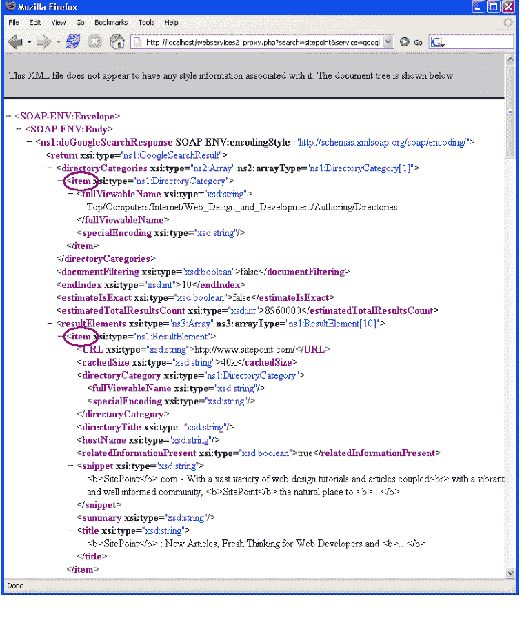

## 获取 resultElements XML

在这里，DOM 方法拯救了我们，让我们能够获取到所需的 `item` 元素列表。我们通过以下两行代码来实现：

```
File: webservices2.js (excerpt)

var resultsArr = xml.getElementsByTagName('resultElements');
xml = resultsArr[0];
```

我们使用 `getElementsByTagName` 方法获取 XML 响应中所有 `resultElements` 元素的数组。在这种情况下，只有一个，所以返回的数组只有一个元素。然后我们将 `xml` 设置为该 `resultElements` 元素，它包含了我们感兴趣的所有项目。一旦我们将文档缩小到包含所需 `item` 元素的元素，就可以使用 `xml2ObjArray` 正常地解析结果。

之后，我们检查 `res` 中是否有结果，然后遍历数组，构建一个 HTML 字符串，我们将使用 `innerHTML` 来显示它。


## innerHTML 是否是邪恶的？

根据你与之交流的 Web 开发人员的不同，当你谈论使用 `innerHTML` 时，可能会得到非常不同的反应。这个属性不是 W3C 标准，它被认为比 DOM 方法"不太干净"；确实，在 JavaScript 代码中放入长串的标记会使事情变得非常混乱。然而，`innerHTML` 在所有现代浏览器中都得到了完全支持。

实际上，尽管它会让一些开发者抓狂，但是否使用 `innerHTML` 的问题应该根据具体情况来决定，通常纯粹是个人偏好的问题。对于这个基于 Web 服务的搜索应用程序来说，使用 `innerHTML` 来显示我们的结果比使用 DOM 方法更合理，因为 Google 在其结果中返回了格式化的 HTML（即标记，如 `<b>` 标签）。

如果我们坚持使用像 `createTextNode` 这样的 DOM 方法来显示 Google 的响应，我们就必须从结果中剥离所有标记，这意味着更多的开发工作，并且仅仅因为我们想避免使用 `innerHTML` 就会丢失大量的展示信息。

一个判断使用 `innerHTML` 还是 DOM 方法的经验法则是：如果你处理的内容包含大量 HTML 或 XHTML 标记，使用 `innerHTML` 可能是正确的方式。

222

Licensed to siowchen@darke.biz


## eBay

在与 Google 过招之后，解析 eBay 的结果简直小菜一碟。下面是代码：

```
File: webservices2.js (excerpt)

case 'ebay':
    res = XMLParse.xml2ObjArray(xml, 'Item');
    str += self.noResultsCheck(res.length);
    for (var i = 0; i < res.length; i++) {
        item = '<div class="itemDiv">';
        item += '<div><a href="' +
            res[i].ListingDetails.ViewItemURL + '">' +
            res[i].Title + '</a></div>';
        item += '<div>Started: ' +
            res[i].ListingDetails.StartTime + '</div>';
        item += '<div>End: ' +
            res[i].ListingDetails.EndTime + '</div>';
        item += '<div>Current Bids: ' +
            res[i].SellingStatus.BidCount + '</div>';
        item += '<div>Current Price: ' +
            res[i].SellingStatus.CurrentPrice + '</div>';
        item += '</div>';
        str += item;
    }
    break;
```

## 显示结果

现在我们已经将搜索结果放入了一个 HTML 字符串中，显示结果非常简单——只需将结果 div 元素的 innerHTML 设置为我们针对所使用的搜索服务构建的内容字符串 str 即可：

```
File: webservices2.js (excerpt)

            }
    }
    document.getElementById('resultsDiv').innerHTML = str;
};
```

## 为不支持 JavaScript 的浏览器提供后备方案

为了给不支持 JavaScript 的浏览器提供后备方案，我们将页面设置为传统的 Web 表单方式，直接提交到一个包含服务端代码的页面，该代码与我们的客户端 AJAX 代码类似。下面是一个用 PHP 显示 eBay 结果的示例（此代码假设我们已经将搜索结果 XML 加载到一个名为 `$xml` 的变量中）：

```
header('Content-Type: text/html');
$resp = new DomDocument();
$resp->loadXML($xml);
print("<!DOCTYPE html PUBLIC \"-//W3C//DTD XHTML 1.0 Strict//EN" .
    \"\" \"http://www.w3.org/TR/xhtml1/DTD/xhtml1-strict.dtd\"" .
    ">\n");
print("<html xmlns=\"http://www.w3.org/1999/xhtml\">\n");
print("<head>\n");
print("<title>Search Results</title>\n");
print("</head>\n");
print("<body>\n");
switch ($service) {
    case "ebay":
        $items = $resp->getElementsByTagName("Item");
        if ($items->length > 0) {
            foreach($items as $item) {
                $title = $item->getElementsByTagName("Title");
                $url = $item->getElementsByTagName("ViewItemURL");
                $startTime = $item->getElementsByTagName("StartTime");
                $endTime = $item->getElementsByTagName("EndTime");
                $bidCount = $item->getElementsByTagName("BidCount");
                $currPrice = $item->getElementsByTagName(
                    "CurrentPrice");
                print("<div class=\"itemDiv\">\n");
                print("<div><a href=\"" . $url->item(0)->nodeValue .
                    "\">" . $title->item(0)->nodeValue .
                    "</a></div>\n");
                print("<div>Started: " .
                    $startTime->item(0)->nodeValue . "</div>\n");
                print("<div>End: " . $endTime->item(0)->nodeValue .
                    "</div>\n");
                print("<div>Current Bids: " .
                    $bidCount->item(0)->nodeValue . "</div>\n");
                print("<div>Current Price: " .
                    $currPrice->item(0)->nodeValue . "</div>\n");
                print("</div>\n");
            }
        }
        break;
        // Cases for other web services would go here
    }
}
```

一旦获取了每个条目的属性值，显示起来就相当容易了。这里打印结果的部分基本上就是 AJAX 版本中 JavaScript 代码的 PHP 翻版。

## 屏幕阅读器代码

你可能还记得第 4 章中的登录代码，屏幕阅读器的好处在于可以直接在浏览器中处理 HTML 内容——你只需遵循一些基本原则，就能让屏幕阅读器充分利用你的 AJAX 代码。

此应用中大部分屏幕阅读器代码与我们在第 4 章中看到的代码相同，只需做一些特定的调整就能让代码适配这个搜索应用。

```
File: webservices2.js (excerpt)

this.enableScreenReaderFeatures = function() {
  var self = Search;
  var appendDiv = document.getElementById('searchForm');
  var beforeDiv = document.getElementById('searchTypeTitleDiv');
  var msg = '';
  var readerDiv = null;
  var innerDiv = null;
  var resultsA = null;
  var changeCheck = null;
  msg = 'This Web page uses dynamic content. Page content may' +
      ' change without a page refresh. Check the following' +
      ' checkbox if you would like an alert dialog to inform' +
      ' you of page content changes.';
  readerDiv = document.createElement('div');
  readerDiv.className = 'screenReader';
  readerDiv.appendChild(document.createTextNode(msg));
  appendDiv.insertBefore(readerDiv, beforeDiv);
  readerDiv = document.createElement('div');
  readerDiv.className = 'screenReader';
  innerDiv = document.createElement('div');
  innerDiv.appendChild(
      document.createTextNode('Content Change Alert'));
  readerDiv.appendChild(innerDiv);
  innerDiv = document.createElement('div');
  changeCheck = document.createElement('input');
  changeCheck.type = 'checkbox';
  changeCheck.id = 'ChangeAlert';
  changeCheck.name = 'ChangeAlert';
  changeCheck.value = 'true';
  changeCheck.title = 'Content Change Alert';
  innerDiv.appendChild(changeCheck);
  readerDiv.appendChild(innerDiv);
  appendDiv.insertBefore(readerDiv, beforeDiv);
  appendDiv = document.getElementById('pageTopDiv');
  resultsA = document.createElement('a');
  resultsA.href = '#searchResults';
  resultsA.appendChild(document.createTextNode(
      ' Skip to search results'));
  appendDiv.appendChild(resultsA);
  self.form.SearchText.onchange = self.evalSearchTextState;
  self.form.SearchText.title = ' Search Text. Enter text' +
      ' to activate Search button.';
};
});
```

与第 4 章中代码的区别在于，这里我们添加了一个链接，可以用来直接跳转到搜索结果的顶部——该链接指向页面中的一个命名锚点。我们将在 `handleResp` 中的 switch 语句之后插入这个锚点，如下方加粗部分所示：

```
File: webservices2.js (excerpt)

str = '<div class="screenReader"><a id="searchResults" ' +
' name="searchResults">a/Search results for: ' +
self.searchText + ' on ' + self.service + '</div>' + str;
document.getElementById('resultsDiv').innerHTML = str;
});
```

我们还在结果之前添加了一段提示，说明用户搜索的关键词，因为使用屏幕阅读器的用户无法快速浏览表单来查找这些信息。这对于执行了多次搜索、开始在搜索历史中来回翻页的用户尤为有用。

## 提醒用户页面变化

屏幕阅读器用户在使用 AJAX 时遇到的最大问题是：如果整个网页没有刷新，用户将无法察觉页面内容已经发生了变化。在此应用中，我们使用了与第 4 章相同的策略来告知屏幕阅读器用户页面已发生局部刷新：我们为用户提供了一个复选框，让他们可以选择在页面内容变化时接收一个警告对话框。此复选框对普通浏览器用户是隐藏的。

在本例中，主要的区别在于，我们不是将更改后的内容放入警告框，而是让用户知道搜索已完成，并告诉他们可以在页面的哪个位置找到搜索结果。为此，我们在 handleResp 方法中添加了一些额外的代码，用于解析服务器返回的结果并将内容插入页面：

```
File: webservices2.js (excerpt)
document.getElementById('resultsDiv').innerHTML = str;
if (self.form.ChangeAlert.checked) {
    alert('Search completed. Results are on the page ' +
          'below the search form.');
}
};
```

这非常直观。警告框告知使用屏幕阅读器的用户搜索已完成，以及他们可以去哪里找到更新后的内容。借助"跳转到搜索结果"链接，使用屏幕阅读器软件的用户可以轻松找到搜索结果。

## 返回按钮问题

不习惯 AJAX 风格 Web 应用的用户可能没有意识到页面的部分内容是可以更新的，因此当他们看到网页的某个部分发生变化时，可能会认为自己导航到了一个新页面。他们可能会尝试点击浏览器的"后退"按钮返回到之前的页面状态。不用说，当用户点击"后退"按钮却到了一个完全意想不到的地方时，他们会感到困惑和沮丧。

## 两种方案

在本节中，我将演示两种解决返回按钮问题的不同方法。一种方法鼓励用户避免使用"后退"按钮，转而使用我们将直接构建在应用程序中的"后退"和"前进"按钮；另一种方法则尝试让浏览器内置的"后退"和"前进"按钮按照用户预期的方式工作。

两种方案各有优缺点：

**方案一：构建自己的返回按钮**

+   优点：
    - 在所有浏览器中都能正常工作，包括 Safari
    - 使用符合标准的代码
    - 与屏幕阅读器配合良好

+   缺点：
    - 可能会对用户造成困惑
    - "后退"按钮仍然是"失效"的

### 方案二："修复"返回按钮

+   优点：
    - 浏览器的行为符合用户预期

+   缺点：
    - 仅适用于 Firefox 和 IE
    - 使用粗糙的浏览器特定 hack 和向服务器发送的"虚拟"请求
    - 需要使用"过渡型"标记
    - 与屏幕阅读器配合不佳

要在本应用中切换这两种方案，你只需更改 `BACK_BUTTON` 常量的值：值为 `false` 时，代码将使用自行构建返回按钮的方法；而将 `BACK_BUTTON` 改为 `true`，代码将"修复"浏览器的返回按钮。

对于这两种方案，我们都会将页面状态存储在一个名为 `SearchHistory` 的类中。两种方法唯一的区别在于用户调用历史记录条目进行显示的方式。首先，我们来看看共享的 `SearchHistory` 代码；然后，我们将分别解析可以插入其中的两种不同方法。

## SearchHistory 类

我们需要做的第一件事是确定在用户执行搜索时，我们希望在历史记录中保留哪些信息。理想情况下，当用户尝试从历史记录中访问搜索结果时，你希望能够以用户执行搜索时的状态展示 UI 的各个方面。这对我们来说很容易，因为我们的搜索应用程序相当简单。要展示之前的搜索结果，我们需要的仅仅是：

-   用于搜索的 Web 服务
-   搜索词
-   格式化的搜索结果

我们需要一个地方来存储这些信息，因此我们将为此创建一个名为 SearchHistory 的类：

```
function SearchHistory(service, search, results) {
  this.service = service;
  this.search = search;
  this.results = results;
};
```

Search 类的 hist 属性将包含一个 SearchHistory 对象数组，每个对象保存用户执行过的一次搜索。

## 添加到历史记录

在 handleResp 方法的末尾，显示搜索结果之后，我们使用以下调用将每次执行的搜索作为一个新条目添加到历史记录中：

```
document.getElementById('resultsDiv').innerHTML = str;
self.updateHistory(str);
if (self.form.ChangeAlert.checked) {
```

updateHistory 方法将每次新的搜索添加到历史记录列表中，并执行一些其他任务以使历史记录的工作方式与浏览器的"后退"按钮完全一致。以下是代码：

```
this.updateHistory = function(str) {
  var self = Search;
  var maxLength = self.histIndex + 1;
  var newHist = null;
  while (self.hist.length > maxLength) {
    self.hist.pop();
  }
  newHist = new SearchHistory(self.service, self.searchText, str);
  self.hist.push(newHist);
  self.histIndex++;
  if (BROWSER_BACK) {
      self.setHash(self.histIndex);
  }
  else {
      if (self.hist.length > 1) {
          self.setButtonState(self.form.backButton, 'on');
      }
      self.setButtonState(self.form.forwardButton, 'off');
  }
};
```

在声明并初始化了几个变量之后，代码进入一个 `while` 循环。只有当用户在查看历史记录列表中某一条目的同时执行新搜索时，此循环才会生效。在这种情况下，新搜索应该成为新搜索历史的末尾，因此该位置之后的所有条目都必须被清除。

这与普通浏览器历史记录的工作方式完全相同——你可以亲自体验一下。打开一个浏览器窗口，点击书签列表中的几个链接以生成历史记录。然后，点击浏览器的"后退"按钮几次，向回浏览几条历史记录。你应该会看到"后退"和"前进"按钮都是激活状态。现在，再点击书签列表中的另一个链接，你会发现"前进"按钮变成了禁用状态。我们存储在 `hist` 数组中的历史记录列表的工作方式应该完全相同。

接下来，我们实际更新历史记录列表。我们创建一个 `SearchHistory` 对象，将 `Search` 对象的 `service` 和 `searchText` 属性以及用于显示搜索结果的 HTML 传递给 `SearchHistory` 构造函数。

然后，`updateHistory` 将该 `SearchHistory` 对象添加到保存搜索历史记录列表的 `hist` 数组中，并递增 `histIndex` 以表示新条目已被添加。

`updateHistory` 的最后一部分与两种不同的返回按钮实现方式有关。如果 `BROWSER_BACK` 为 true，我们调用 `setHash` 来"修复"浏览器的返回按钮。稍后我们将详细讲解 `setHash`。

自行构建按钮的代码更为简单——它只是适当地切换"后退"和"前进"按钮的开启和关闭状态，使其行为与你在浏览器中访问新位置时浏览器按钮的行为一致。

## 导航历史记录

在历史记录中前进和后退非常简单——它的工作方式与浏览器中的普通历史记录功能相同。无论你使用的是自行构建方案还是"修复"浏览器返回按钮的方案，一旦历史记录中至少有两个搜索，"后退"按钮就会变为激活状态。

无论我们选择使用哪种方法，点击"后退"按钮都会调用 goBack 方法：

```
this.goBack = function() {
    var self = Search;
    self.histIndex--;
    self.showHistory();
    if (!BROWSER_BACK) {
        self.setButtonState(self.form.forwardButton, 'on');
        if (self.histIndex == 0) {
            self.setButtonState(self.form.backButton, 'off');
        }
    }
};
```

"前进"按钮调用 goForward 方法：

```
this.goForward = function() {
    var self = Search;
    self.histIndex++;
    self.showHistory();
    if (!BROWSER_BACK) {
        self.setButtonState(self.form.backButton, 'on');
        if (self.histIndex == (self.hist.length - 1)) {
            self.setButtonState(self.form.forwardButton, 'off');
        }
    }
};
```

如果你决定自行构建"后退"和"前进"按钮，goBack 和 goForward 方法将作为 onclick 事件的直接结果被调用。事件处理程序在我们启用按钮时附加到按钮上。使用浏览器内置按钮需要我们采用某种迂回的方式来调用 goBack 和 goForward，但最终结果是相同的——"后退"调用 goBack，"前进"调用 goForward。


## 第七章：更多网络服务与后退按钮

这两种方法的工作原理非常相似，都是通过增加或减少 histIndex 的值来实现的。该索引值指示我们在历史记录列表中当前查看的搜索位置，随后调用 showHistory 函数来显示该次存储的搜索。

在自定义构建选项中，这些方法会执行一个额外的任务：它们总是会切换激活另一个按钮（前进操作应始终切换激活“后退”按钮，而后退操作则应切换激活“前进”按钮），并且当到达列表末尾时，会禁用“后退”或“前进”按钮。在执行几次搜索后，来回点击这些按钮，你应该就能感受到其工作方式。

## 显示历史条目

显示历史记录中保存的搜索非常简单。你只需从与 hist 数组中期望位置相对应的 SearchHistory 对象中，提取网络服务、搜索词和格式化的结果文本，然后使用这些数据更新用户界面中的搜索框和结果区域即可：

```
this.showHistory = function() {
  var self = Search;
  var currHist = null;
  var serviceElem = self.form.SearchService;
  displayHist = self.hist[self.histIndex];
  self.form.SearchText.value = displayHist.search;
  for (var i = 0; i < serviceElem.options.length; i++) {
    if (serviceElem.options[i].value == displayHist.service) {
      serviceElem.selectedIndex = i;
      break;
    }
  }
  document.getElementById('resultsDiv').innerHTML =
    displayHist.results;
};
```

在历史记录中前后导航会设置 histIndex 属性的值，该属性告诉我们应该显示哪个 SearchHistory 类的实例。hist 属性是我们的 SearchHistory 对象数组，因此我们只需使用 self.hist[self.histIndex] 来查找所需的条目。

一旦我们知道要显示哪个条目，就会更新搜索框的表单元素以显示该次搜索的网络服务和搜索词，并使用我们存储的、格式化好的结果更新结果区域。这是另一个使用 innerHTML 为我们简化操作的例子——我们只需一行代码就能显示这些存储的结果。

现在是时候来看看两种不同的方法来接入 SearchHistory，从而在搜索历史中前后导航了。

## 构建自定义的后退按钮

解决后退按钮问题最直接的方法是，在应用程序中添加自己的导航功能——即在页面上放置你自己的“后退”和“前进”按钮，并让 goBack 和 goForward 方法处理这些按钮的 onclick 事件。这个选项的代码中唯一稍显棘手的任务，就是在适当时机禁用和重新启用按钮，而实际上你已经在上面讲解 SearchHistory 类时看到过所有这些代码了。

这个解决方案使用了清晰、符合标准的代码，可在所有现代浏览器（包括 Safari）中工作，并且能与屏幕阅读器等辅助技术很好地协作。

当然，其缺点在于浏览器内置的按钮仍然无法按用户预期的方式工作，而且额外的导航功能最初可能会让用户感到困惑。我们需要为那些下意识地将光标向上移动并点击浏览器自身后退按钮的用户提供一个安全网。

## 添加按钮

我们不希望这些导航按钮在无法处理 JavaScript 的浏览器中显示，因此我们将在 init 方法中通过调用 addHistoryNav 来将它们插入页面。这种方法为能够使用 AJAX 功能的用户提供了便利，同时允许我们为其他所有人提供一个普通的旧式网页表单。以下是代码：

```
this.addHistoryNav = function() {
  var self = Search;
  var searchForm = document.getElementById('searchForm');
  var historyNavDiv = document.createElement('div');
  var btn = null;
  historyNavDiv.id = 'historyNavDiv';
  btn = document.createElement('input');
  btn.type = 'button';
  btn.id = 'backButton';
  btn.name = 'backButton';
  btn.value = 'Back';
  btn.title = ' Back button for search history';
  btn.className = 'inputButtonDisabled';
  historyNavDiv.appendChild(btn);
  historyNavDiv.appendChild(
      document.createTextNode('\u00A0'));
  historyNavDiv.appendChild(
      document.createTextNode('\u00A0'));
  btn = document.createElement('input');
  btn.type = 'button';
  btn.id = 'forwardButton';
  btn.name = 'forwardButton';
  btn.value = ' Forward';
  btn.title = ' Forward button for search history';
  btn.className = 'inputButtonDisabled';
  historyNavDiv.appendChild(btn);
  searchForm.appendChild(historyNavDiv);
  self.hand['forwardButton'] = self.goForward;
  self.hand['backButton'] = self.goBack;
  self.setButtonState(self.form.forwardButton, 'off');
  self.setButtonState(self.form.backButton, 'off');
};
```

此方法中的大部分代码都是调用将按钮添加到表单中的 DOM 方法。在最后几行中，addHistoryNav 将这些按钮的 onclick 处理程序存储在 hand 数组中，然后禁用两个按钮。

显然，如果用户没有执行任何搜索，他们就无法使用“后退”和“前进”按钮在历史记录中前后导航，因此我们默认禁用这些按钮。我们将在用户可以实际使用它们时再启用。

## 使用浏览器的后退按钮

我们的另一个选项是一个修复方案，它允许浏览器内置的后退按钮按用户可能期望的方式运行。你可能在 Dojo 和 Really Simple History 等 JavaScript 工具包中见过这个修复方案。⁸

这个解决方案的巨大优势在于它使浏览器按用户期望的方式运行。然而，正如你将看到的，它在解决方案的“hack 程度”方面付出了相当大的代价。最终结果将无法与屏幕阅读器等辅助技术良好协作，并且完全无法在 Safari 中工作。

简而言之，该修复方案的工作原理如下：

-   将历史记录位置存储在页面地址中通常保留给内部页面导航的哈希值（hash）之后（例如，mypage.html#section1）。
-   在定时器上运行一个进程，将页面状态与其在页面地址中看到的内容同步。

**哈希值（Hash）**

网页地址中出现在井号或哈希符号之后的部分有多种名称。在这里，我们将其称为哈希值。

## 使用 Location Hash

这个解决方案之所以有效，是因为浏览器历史记录会跟踪页面地址的所有更改，包括对哈希值的更改。因此，如果你设置正确，在执行搜索时，位置栏中显示的页面 URI 会按如下方式变化：

```
webservices2.html
webservices2.html#0
webservices2.html#1
webservices2.html#2
webservices2.html#3
```

这允许用户在正常的浏览器历史记录中点击后退和前进，并调出相应的搜索历史条目。

**破坏无障碍访问（Accessibility）**

由于此修复方案挪用了内部导航哈希值来存储搜索历史位置，因此像跳过导航链接（skip navigation links）这样的内部链接会破坏此技术。

## 设置修复方案

早在我们为 `Search` 类添加 `init` 方法时，我们就将其设置为在 `BROWSER_BACK` 设置为 `true` 时调用 `startHist`。这个 `startHist` 方法为我们设置了一些 IE 特定的东西，并激活了我们将用于将历史记录状态与浏览器位置栏中指示的状态同步的过程。以下是代码：

文件：`webservices2.js`（摘录）

```
this.startHist = function() {
    var self = Search;
    var href = '';
    var ifr = null;
    if (document.all) {
        ifr = document.createElement('iframe');
        ifr.name = 'historyFrame';
        ifr.id = 'historyFrame';
        ifr.src = '';
        ifr.style.display = 'none';
        document.body.appendChild(ifr);
    }
    if (location.hash) {
        href = location.href.split('#')[0];
        location = href;
    }
    setInterval(self.watchHist, 100);
};
```

第一大块代码使用 DOM 方法创建允许此 hack 在 IE 中工作的 `iframe`。请注意，这意味着我们的页面必须声明为 XHTML 1.0（或 HTML 4.01）Transitional（过渡集），因为 Strict（严格集）不支持 `iframe`。

### 支持旧版本的 IE

> **提示** 如果你想让此解决方案支持比版本 6 更早的 Internet Explorer 版本，你必须将 `iframe` 包含在页面的初始标记中，或者使用 `document.write` 来插入它。这意味着需要坚持使用 HTML 4.01，因为 XHTML 抛弃了对 `document.write` 的支持。

我将在下一节解释更多关于为什么需要这个 `iframe` 的原因。

接下来，`startHist` 会移除页面地址中出现的任何哈希值，然后使用 `setInterval` 启动将页面状态与页面地址中报告的内容同步的进程。

---

⁸ http://codinginparadise.org/projects/dhtml_history/


## 设置哈希值

接下来，我们需要编写一些代码，为每个新的搜索条目设置页面地址中的哈希值。在页面地址中添加哈希值会创建历史记录轨迹，用户可以使用浏览器内置的“后退”和“前进”按钮来回浏览。

在 `updateHistory` 方法中，调用了一个名为 `setHash` 的方法，我们用它将搜索历史索引追加到 `location` 中的哈希值。`setHash` 的代码如下所示：

```
thisCreator = function() {
    if (val == 0) {
        location.replace('#' + val);
    }
    else {
        location = '#' + val;
    }
    if (document.all) {
        document.getElementById('historyFrame').src = 'blank.txt?'
            + val;
    }
};
```

在这段代码的上半部分，你可以看到它将新的哈希值添加到当前位置上。这就像用户点击网页上的内部导航链接一样，只不过在这种情况下，我们不是将位置设置为类似 `#searchResults` 这样的值，而是将其设置为一个数字，例如 `#2` 或 `#37`，以表示我们正在查看的搜索历史条目。

## IE 的 iframe 技巧

不幸的是，IE 不会为反映页面内部导航的位置创建历史记录条目。因此，尽管你可以通过添加哈希值来更改页面地址，但 IE 不会在其历史记录中跟踪这些更改。为了让此解决方案在 IE 中正常工作，我们需要借助一些技巧。

这里的情况变得有些复杂。事实证明，你可以通过创建一个不可见的 iframe 并让它向一个虚拟占位页面发起请求来“欺骗”IE，使其创建历史记录条目。你将历史索引值附加到被请求页面（在本例中是一个空白文本文件）的查询字符串上，并在浏览历史记录时使用它来知道应显示哪个条目。

当你执行搜索时，以下地址将被加载到 iframe 中：

- blank.txt?0
- blank.txt?1
- blank.txt?2
- blank.txt?3

所以，对于 IE，你既在进行真正的 AJAX 请求以从服务器获取数据，同时又在向服务器上的一个空白文档发出一个虚假的请求，以便让浏览器为该搜索存储一个历史记录条目。

## 监视哈希值

在本解决方案的一开始，我们使用 `setInterval` 启动了一个进程，在紧密的循环中调用 `watchHist` 方法；当用户点击“后退”或“前进”时，此方法监视位置哈希值的变化，并显示用户选择的任何搜索历史条目。

该方法的前半部分包含所有特定于 IE 的代码，用于从 iframe 的位置中提取历史索引：

```
this.watchHist = function() {
    var self = Search;
    var href = '';
    var index = 0;
    var hash = '';
    if (document.all) {
        href = frames['historyFrame'].document.location.href;
        hash = href.split('?')[1];
        if (hash) {
            hash = '#' + hash;
        }
        else {
            hash = '';
        }
        if (hash && location.hash && (hash != location.hash)) {
            location.replace(hash);
        }
    }
```

当用户在历史记录中来回点击时，iframe 的位置会发生变化。代码会查看 iframe 的当前位置，从查询字符串中提取数字，然后将其与地址栏中哈希值的值进行比较。如果有任何变化——也就是说，如果用户自上次执行此方法以来点击了“后退”或“前进”——代码会使用 `location.replace` 将地址栏中的哈希值与查询字符串值同步。

现在，地址栏的哈希值中已加载了正确的历史位置，从这一点开始，两个浏览器的代码是相同的：

```
File: webservices2.js (excerpt)

    if (location.hash) {
        index = parseInt(location.hash.substr(1));
    }
    else {
        index = -1;
    }
    if (index != self.histIndex) {
        self.goHistoryEntry(index);
    }
};
```

此代码从哈希值中提取搜索历史索引，并将其与 `Search` 对象的 `histIndex` 属性中设置的值进行比较。每当发生变化时——当用户在历史记录中前进或后退时——它就会调用 `goHistoryEntry` 方法以转到该特定条目。

## 显示条目

`goHistoryEntry` 代码如下所示：

```
File: webservices2.js (excerpt)

this.goHistoryEntry = function(val) {
    var self = Search;
    self.histIndex = val;
    self.showHistory();
};
```

这段代码非常简单——它只是将 `histIndex` 属性设置为传入的值，然后调用 `showHistory` 方法。此时，我们最终接入了用于显示搜索历史条目的正常代码。历史记录导航过程的其余部分工作方式完全相同。

## 抉择时刻

能够点击浏览器内置的“后退”和“前进”按钮，并看到你的 AJAX 应用程序更改状态以匹配，就像正常的网页系列一样，这*确实*很酷。然而，为实现这种理想状态所需的奇特编程技巧，无疑让人回想起在我们对 Web 标准或 AJAX 有广泛支持之前的糟糕旧时光；当然，这个解决方案也不是跨浏览器兼容的，并且会破坏屏幕阅读器的支持。

你决定是通过实现自己的按钮组来解决 AJAX “后退”按钮问题，还是进行必要的编程调整以使这些内置按钮正常工作，这取决于诸如你的用户接受和学习新事物的难易程度、你需要支持哪些浏览器、你对无障碍性的重视程度，以及你对代码中包含特定浏览器 hack 的容忍度等因素。

## 搜索应用增强功能

这个搜索应用程序是一个很好的起点，但我们可以实现一些增强功能，使其更易于使用。

### 分页

目前，该应用程序仅返回选定 Web 服务默认页面大小下的第一页结果。

大多数 Web 服务允许你在查询中指定每页希望返回的记录数，以及结果集中希望包含的页数。这使你可以创建与 Google、Amazon、eBay 以及许多其他允许搜索的网站上相同的分页功能。

### 历史记录菜单

扩展历史记录代码以包含一个历史记录菜单是相当容易的，该菜单将为用户提供更便捷的先前搜索访问。例如，你可以在下拉列表或一个 `div` 中维护一个先前搜索的列表。

## 延伸阅读

以下是一些在线资源，用于进一步了解我们在本章讨论的技术和概念。

### Linux 上的 Apache2 和 OpenSSL

- **http://www.devside.net/web/server/linux**
  这是一个构建 Web 服务器的逐步指导指南。
- **http://www.debian-administration.org/articles/357**
  这些文档解释了如何在 Debian Sarge 上设置 LAMP 服务器，包括 Apache2、PHP5、MySQL5、phpMyAdmin、Smarty 和 ADODB。信息涵盖了安装以及足够的示例代码，以便你测试所有内容。
- **http://www.tc.umn.edu/~brams006/selfsign.html**
  这是在 Linux 上使用 OpenSSL 创建自签名服务器证书的分步指南。
- **http://czarism.com/debian-ubuntu-apache2-and-openssl-https**
  本文档解释了如何在 apt-get 仓库（适用于 Debian 和 Ubuntu Linux）中使用可用的 Apache2 包启用 OpenSSL 加密的步骤。

### Windows 上的 Apache2 和 OpenSSL

- **http://www.devside.net/web/server/windows**
  这提供了构建 Web 服务器的分步说明。
- **http://raibledesigns.com/wiki/Wiki.jsp?page=ApacheSSL**
  本文档描述了安装带有 `mod_ssl` 扩展的 Win32 版本 Apache 的过程。

### WSDL

- **http://www.w3schools.com/wsdl/default.asp**
  这是 W3 Schools 上的 WSDL 教程。
- **http://www.ibm.com/developerworks/library/ws-soap/index.html**
  本教程解释了在 SOAP 应用程序中使用 WSDL 的来龙去脉——它是 SOAP 程序员了解 WSDL 的可靠入门资料。
- **http://www.w3.org/TR/wsdl**
  这是万维网联盟（W3C）发布的一份说明（仅用于讨论）。此草案代表了 Ariba、IBM 和 Microsoft 内部当前的思考。

## 总结

在本章中，我们构建了一个可访问的“Web 2.0”风格应用程序，该应用程序搜索多个 Web 服务并在单个搜索界面中显示结果。这个应用程序很好地说明了 AJAX 如何通过减少页面刷新的需要来使事情对终端用户更方便，但它也未能满足用户对其浏览器导航方式应有的预期。这个被称为“后退按钮问题”的问题，可以通过在应用程序内实现自己的历史记录导航来解决，或者——如果你愿意容忍代码中的一些 hack，并且不希望应用程序对屏幕阅读器可访问——你可以通过 hack 浏览器的“后退”按钮，使其像用户认为的那样工作。


## 8 使用 AJAX 实现拖放功能的国际象棋

> 我正遵照您的命令行事，上校。皇后走到皇后列第三行。
> ——斯科特，《星际迷航》第71集《众神所毁灭》

AJAX 为基于浏览器的编程带来的最大好处之一，是它使我们能够实现在用户界面中完成原本只能在传统安装式桌面应用程序中才能执行的任务。这正是围绕 AJAX 的大量热议的由来：基于 Web 的应用程序可以模拟——甚至在某些情况下可以取代——那些你以前必须安装在电脑上的应用程序。

在桌面应用和 AJAX 应用中都非常受欢迎的一项用户界面功能就是拖放——即能够点击用户界面元素并在屏幕上拖动它们。拖放功能在支持普通 DHTML 的浏览器中已经存在了一段时间。然而，将该功能与 AJAX 所支持的异步连接结合起来，为开发者提供了一些非常强大的可能性，使我们能够构建新的 Web 应用程序功能。

## AJAX 象棋

游戏开发一直是推动计算机世界创造新功能和新特性的领域。尽管我们短期内不会看到基于浏览器的《虚幻竞技场》版本，但结合拖放功能与 AJAX 来开发一款游戏，仍然是展示这种结合所能实现效果的绝佳方式。

在本章中，我们将开发一款支持多人对战的 AJAX 象棋游戏。图 8.1 展示了最终成品的效果。

### 图 8.1. 运行中的 AJAX 象棋

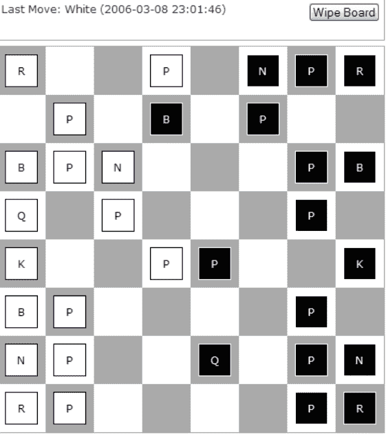

## 需要解决的问题

这款象棋游戏将是本书中最复杂的应用程序，它提供了运用你在前几章学到的大量技巧的机会。它还将展示一些在 AJAX 应用程序日益复杂时，开发者所面临的最棘手问题的解决方案。以下是我们将为这款应用构建的功能的简要列表：

-   在使用绝对定位的同时，根据浏览器窗口大小调整界面元素的位置
-   允许用户与页面上的大量元素交互，而无需用大量的事件处理器使代码变得混乱
-   在棋盘边界内实现拖放功能（即用户不能将棋子拖出棋盘）
-   在发生错误时中止拖放功能（即当出现问题时将棋子放回原位）
-   使用 AJAX 轮询在运行应用程序的多台机器之间同步游戏状态

游戏的界面元素相当简洁——棋盘和所有棋子都是绝对定位的 div 元素；一些 CSS 样式设置了棋盘方格和棋子的颜色。每个棋子与一个表示其类型的字母相关联：R 代表车，P 代表兵，以此类推。

### 象棋惯例

注意，骑士棋子使用 N，因为字母 K 已经被国王占用了。

## 象棋类

我们将像在其他每一章中一样，从设置一个主要的、单例类开始来组织我们的代码。以下是设置该类的代码，包含一些初始属性和一个常量：

```
var REFRESH_INTERVAL = 5;

var Chess = new function() {
  this.ajax = null;
  this.boardDiv = null;
  this.leftPos = 0;
  this.topPos = 0;
  this.squareSize = 56;
  this.boardSize = this.squareSize * 8;
  this.pieceOffset = 10;
  this.pieceSize = this.squareSize - (this.pieceOffset * 2);
  this.panelHeight = 56;
  this.pieceList = null;
  this.selectPiece = null;
  this.dragPiece = null;
  this.lastMove = null;
  this.pollInterval = null;
  this.xPos = 0;
  this.yPos = 0;
};
```

这是一个很长的属性列表，但其中大多数都与在执行拖放功能期间定位棋子所需的数学计算有关。计算游戏元素的大小和位置涉及相当多的数学运算，所以请戴好你的思考帽，准备好在本章中做一些数学题。对你来说的好消息是，尽管我数学很差，但我能完成这里需要的计算。如果我能做到，任何人都可以！

## 启动应用程序

我们通过一个绑定到 `window.onload` 事件的 `init` 方法来启动应用程序。这确保了在我们开始尝试使用页面中的元素构建用户界面之前，页面已经加载完毕。

```
window.onload = Chess.init;
```

同样，`init` 方法启动一切，定位游戏棋盘和其他 UI 元素，加载游戏状态，并将所有棋子放置在棋盘上需要的位置。以下是代码：

```
this.init = function() {
  var self = Chess;
  self.ajax = new Ajax();
  self.boardDiv = document.getElementById('boardDiv');
  self.placeBoard();
  self.placePanel();
  self.loadGame();
  self.doPollDelay();
};
```

这个方法的最后一步是启动轮询过程，该过程每五次访问服务器一次以更新游戏状态。这允许多人玩游戏或观战，并确保每个浏览器中的显示在几秒钟内保持最新。

## 设置棋盘

以下是 `placeBoard` 方法代码的前半部分。`placeBoard` 是用于设置游戏棋盘的方法：

```
this.placeBoard = function() {
    var self = Chess;
    var w = self.getWinWidth();
    var h = self.getWinHeight();
    var sq = null;
    var sqL = 0;
    var sqT = 0;
    var minDiff = 0;
    self.boardDiv.style.width = self.boardSize + 'px';
    self.boardDiv.style.height = self.boardSize + 'px';
    self.leftPos = (parseInt((w - self.boardSize) / 2));
    self.topPos = (parseInt((h - self.boardSize) / 2));
    minDiff = (self.topPos - this.panelHeight);
    if (minDiff < 0) {
        self.topPos = self.topPos - minDiff;
    }
    self.boardDiv.style.left = self.leftPos + 'px';
    self.boardDiv.style.top = self.topPos + 'px';
```

`getWinWidth` 和 `getWinHeight` 方法返回浏览器视口的宽度和高度。它们包含了一些我们需要的跨浏览器代码，以便让 IE 给出我们需要的测量值。

```
this.getWinHeight = function() {
    if (document.all) {
        return document.body.clientHeight;
    }
    else {
        return window.innerHeight;
    }
};
this.getWinWidth = function() {
    if (document.all) {
        return document.body.clientWidth;
    }
    else {
        return window.innerWidth;
    }
};
```

我们使用这些测量值以及棋盘的大小，将游戏定位在浏览器视口的中央。用于确定棋盘位置的主要数学代码片段如下：

```
// File: chess.js (excerpt)
self.leftPos = (parseInt((w - self.boardSize) / 2));
self.topPos = (parseInt((h - self.boardSize) / 2));
```

对于那些想追踪数学运算的人来说，棋盘的顶部应该定位在视口高度减去棋盘高度后除以二的位置。棋盘的左侧应该类似地定位，使用视口宽度和棋盘宽度（记住棋盘是正方形的，所以它的宽度和高度相同）。还有一个检查，以确保视口顶部有足够的空间显示控制面板。如果没有足够的空间，我们会将棋盘向下移动足够的距离以腾出空间。

不擅长数学的读者可以直接代入变量，并知道它们是有效的。

一旦我们有了基本的棋盘，就该铺设黑白方格了：

```
// File: chess.js (excerpt)
sqT = 0;
for (var i = 0; i < 8; i++) {
    sqL = 0;
    for (var j = 0; j < 8; j++) {
        sq = document.createElement('div');
        sq.id = 'square' + i + '_' + j;
        if ((j + 1) % 2 > 0) {
            sq.className = 'boardSquareWhite';
        }
        else {
            sq.className = 'boardSquareBlack';
        }
        sq.style.width = self.squareSize + 'px';
        sq.style.height = self.squareSize + 'px';
```


sq.style.top = sqT + 'px';
    sq.style.left = sql + 'px';
    self.boardDiv.appendChild(sq);
    sql += self.squareSize;
}
sqT += self.squareSize;
}
};
```

这段代码通过两层循环将方格添加到我们的棋盘上——外层循环创建每一行，内层循环则在该行中放置方格。我们为每个方格创建一个 `div`，将其大小设置为 `squareSize`，然后将其放置到位。我们使用 `sqT` 来跟踪当前方格距离棋盘顶部的距离，使用 `sql` 来跟踪其距离左侧的距离。一旦我们把方格添加到棋盘上，就将 `sql` 增加 `squareSize`，然后返回循环的起点以添加该行中的下一个方格。通过这种方式，一行中的所有方格都紧密相邻。外层循环中也会发生同样的事情：我们将 `sqT` 增加 `squareSize` 并将 `sql` 重置为 0，以开始下一行。

事实上，让方格颜色交替出现非常简单。我们只需在内层循环中将内层和外层增量器（`i` 和 `j`）相加，就能得到交替的奇数和偶数。检查这个数除以二的余数（上面代码中的 `i + j % 2`）是判断一个数字是奇数还是偶数的简便方法。

## 状态面板

用户界面还包括一个位于游戏棋盘上方的顶部面板，如图 8.2 所示。我们将使用这个面板来显示游戏的状态信息和错误信息。面板上还会显示一个“清空棋盘”按钮，允许用户重新开始一个全新的游戏棋盘，将所有棋子恢复到原始位置。这个面板在 `placePanel` 方法中创建和设置样式。

**图 8.2. 显示错误消息的状态面板。**

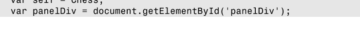

**文件：** **chess.js** （摘录）

```
this.placePanel = function() {
    var self = Chess;
    var panelDiv = document.getElementById('panelDiv');
    panelDiv.style.width = this.boardSize + 'px';
    panelDiv.style.left = self.leftPos + 'px';
    panelDiv.style.top = (self.topPos - this.panelHeight) + 'px';
};
```

## 加载游戏

现在是时候与服务器通信了。我们已经设置好了游戏棋盘。接下来，让我们加载一个游戏并开始玩。我们使用 `loadGame` 方法来加载游戏：

```
this.loadGame = function() {
  var self = Chess;
  var str = '';
  var cmd = new Command('load');
  str = JSON.stringify(cmd);
  self.execCmd(str, self.handleLoadGame);
};
```

这个方法很短，实际上只是向服务器发送一个单独的命令——加载。它通过 `execCmd` 方法发送该命令，该方法实际上只是我们用于与服务器通信的 Ajax 对象的 `doPost` 方法的一个封装：

```
this.execCmd = function(str, handlerFunc) {
  var self = Chess;
  self.ajax.doPost('chess.php', str, handlerFunc);
};
```

由于我们所有的命令都以相同的方式与服务器上的同一个处理页面通信，因此将这段代码放在一个地方是合理的。

发送给服务器的命令是一个非常基础的 `Command` 类的实例，使用 JavaScript 对象表示法（JSON）进行格式化，我们稍后会介绍 JSON。`Command` 类有两个属性：`cmdName`，用于标识我们希望服务器做什么，以及 `cmdData`，用于传递服务器可能需要的任何数据。该类如下所示：

```
function Command(cmdName, cmdData) {
  this.cmdName = cmdName || '';
  this.cmdData = cmdData || '';
}
```

这个类的目的是便于将数据作为 JSON 字符串发送到服务器。

## 使用 JSON

我们将使用一种极其方便的数据交换格式——JSON，在浏览器和服务器之间来回传递这些 `Command` 对象。

JSON 代表 JavaScript 对象表示法，它基本上是一种非常简单便捷的方式，可以将 JavaScript 对象转换为字符串。这使得 JSON 非常适合在 AJAX Web 应用程序中的浏览器和服务器之间传递数据。

JSON 越来越受欢迎，因为它比 XML 要轻量得多，并且在 JavaScript 中更容易处理。请注意，JSON 不处理像日期这样复杂的数据类型，但这对于我们正在进行的数据交换来说并不是一个巨大的缺点。

## 使用 JSON 编码对象

要在浏览器端的 JavaScript 代码中使用 JSON，你需要 `json.js` 文件，可以从 JSON 网站下载。¹ 在 JavaScript 中使用 JSON 就像获取一个对象并使用 `JSON.stringify` 方法将其转换为字符串一样简单，如下所示：

```
var cmd = new Command('load');
var str = JSON.stringify(cmd);
```

瞧！现在 `str` 包含了作为字符串的 `cmd`，你可以非常轻松地传递它——你甚至可以将其传回 Web 服务器以在那里使用。

要将 JSON 字符串解码为对象，你可以采取两种方法之一。如果你信任数据的来源，你可以直接对字符串运行 `eval`，这非常快（`eval` 执行存储在字符串中的 JavaScript 代码）。这之所以可行，是因为 JSON 编码的数据实际上是有效的 JavaScript 代码，可以在所有现代浏览器中正常工作。

¹ http://www.json.org/

另一方面，如果第三方有可能将恶意代码插入你的数据中，你可以使用 **JSON parse** 方法，它比 **eval** 慢得多，但安全得多。

我们可以这样将 JSON 字符串转换为对象：

```
var cmd = eval(str);
```

我们也可以使用这个：

```
var cmd = JSON.parse(str);
```

## 解码 JSON 字符串

由于 JSON 如此简单和有用，你可以在各种各样的语言中找到用于编码和解码 JSON 字符串的库，这意味着可以轻松地将你 JSON 编码的字符串转回对象，以便与你选择的后端语言一起使用。JSON 网站[^2]提供了指向大量此类库的链接。

对于我们棋局的 PHP 后端，我们使用 Services_JSON，正如我撰写本文时，它是 PHP PEAR 仓库的一个提议中的补充。它还不是完整的 PEAR 发布版，但它完全可用，目前可以从 PEAR 网站的提案页面下载。[^3]

Services_JSON 是一个单独的文件，**JSON.php**，你必须在 PHP 脚本中包含它才能编码和解码 JSON 字符串。使用它很简单：

```
$cmd = $json->decode($str);
```

`$cmd` 将是一个 PHP 对象，看起来就像 JavaScript 中的 `cmd`。我们可以像这样将该对象转回 JSON 字符串：

```
$str = $json->encode($cmd);
```

同样，你得到了一个很好的、可移植的字符串，可以将其传回浏览器。

## 提示：理解 JSON 字符串

在本书中，我们使用了以下方法来创建对象：

```
function Command() {
    this.cmdName = '';
    this.cmdData = '';
}
```

JavaScript 对象还有另一种表示方式：**对象字面量**表示法：

```
var Command = {
    'cmdName': '',
    'cmdData': ''
};
```

这相当容易理解：它只是声明了一堆属性，后面跟着它们的值。JSON 将这种对象表示形式变成一个长字符串：

```
str = '{"cmdName":"", "cmdData":""}';
```

## 显示游戏状态

一旦我们将该 JSON 编码的命令传递给后端以加载游戏，我们的 PHP 后端就会向我们发送另一个 JSON 字符串，其中包含先前保存的游戏状态。

### handleLoadGame 方法

这个字符串返回到 `handleLoadGame`，我们将其定义为用于与服务器通信的 Ajax `doPost` 调用的处理程序。以下是代码：

```
this.handleLoadGame = function(str) {
    var self = Chess;
    var resp = JSON.parse(str);
    if (resp.respStatus == 'ok') {
        self.displayGame(resp.respData);
    }
    else {
        alert(resp.respDatastr);
    }
};
```

在这里，你可以看到使用 JSON 编码的数据是多么简单。我们只需对传入的字符串调用 `JSON.parse`，它就会神奇地给我们一个可以使用的漂亮 JavaScript 对象。服务器的响应是一个 JSON 编码的 Response 对象。在 PHP 中，Response 类的定义如下所示：

```
文件：chess.php （摘录）

class Response {
    function Response($respStatus = "", $respData = "") {
        $this->respStatus = $respStatus;
        $this->respData = $respData;
    }
}
```

当它被你的 JavaScript 代码中的 `JSON.parse` 解码时，就好像这个类是在 JavaScript 中声明的一样——它将具有 `respStatus` 和 `respData` 属性，就像在服务器端一样。这个 Response 类看起来很像 Command 类：它包含一个属性来传达游戏状态，还有一个属性用于服务器随响应发回的任何数据。

在我们向 PHP 后端发送加载命令后，服务器将返回一个 Response 对象，其中 `respStatus` 设置为 `ok`，`respData` 设置为一个名为 GameState 的类的实例，如下所示：

```
文件：chess.php （摘录）

class GameState {
    function GameState($lastMove = null, $pieceList = null) {
        $this->lastMove = $lastMove;
        $this->pieceList = $pieceList;
    }
}
```

这个对象包含我们构建游戏棋盘所需的两个重要信息：

-   最近一次移动
-   棋盘上所有棋子的当前位置

使用 JSON，可以轻松地将这些数据编码并发送回浏览器，而一旦数据到达浏览器，使用这些信息就更加容易了。


## displayGame 方法

在 handleLoadGame 中，我们从响应的 respData 属性接收到一个 GameState 实例，并像这样将其传递给 displayGame 方法：

```
self.displayGame(resp.respData);
```

以下是 displayGame 方法的第一部分代码：

```
this.displayGame = function(gameState) {
  var self = Chess;
  var piece = null;
  var label = '';
  var pieceDiv = null;
  var colX = 0;
  var colY = 0;
  self.lastMove = gameState.lastMove;
  self.pieceList = gameState.pieceList;
  if (self.lastMove.moveTime) {
    self.setStatusMsg(self.lastMove.movePiece.color,
      self.lastMove.moveTime);
  }
  else {
    self.setStatusMsg('(New game)');
  }
}
```

在进行了一些初始变量设置（包括根据传入的 `GameState` 对象，将 `lastMove` 和 `pieceList` 设置为其相应属性）之后，我们使用 `setStatusMsg` 显示状态消息，告知用户当前游戏状态。如果之前有落子，它会显示关于那次落子的一些信息；否则，它只会显示“新游戏”。

## pieceList 数组

接下来，我们要完成艰巨的任务——将所有棋子放置到棋盘的正确位置。我们将遍历 `pieceList` 数组中的项，这是一个关联数组，包含每个棋子的 JavaScript `Object`。在这个数组中，黑方五号兵看起来是这样的：

```
pieceList['black_p5'] = {
  'color': 'black',
  'id': 'black_p5',
  'pos': [6,4],
  'origPos': []
};
```

我们需要做的第一件事是将所有这些数据加载到一系列 Piece 对象中，我们将使用这些对象来控制棋盘上的棋子。

## Piece 类

Piece 类提供了一些方法来执行任务，例如在用户移动棋子后告知其移动正在被处理，以及在棋子被放下后确定其是否从原始位置移动过：

```
function Piece(color, id, pos) {
    this.color = color;
    this.id = id;
    this.pos = pos;
    this.origPos = [];

    this.backUpPos = function() {
        this.origPos = [this.pos[0], this.pos[1]];
    };

    this.updatePos = function(colX, colY) {
        this.pos = [colX, colY];
    };

    this.restore = function() {
        this.pos = [this.origPos[0], this.origPos[1]];
    };

    this.startProcessing = function() {
        var pieceDiv = document.getElementById(this.id);
        pieceDiv.style.background = '#bbe';
        pieceDiv.style.cursor = 'progress';
        pieceDiv.style.zIndex = 10;
    };

    this.endProcessing = function() {
        var pieceDiv = document.getElementById(this.id);
        if (this.id.indexOf('white') > -1) {
            pieceDiv.style.background = '#fff';
        }
        else {
            pieceDiv.style.background = '#000';
        }
        pieceDiv.style.cursor = 'move';
        pieceDiv.style.zIndex = 5;
    };

    this.wasMoved = function(colX, colY) {
        if (colX == this.pos[0] && colY == this.pos[1]) {
            return false;
        }
        else {
            return true;
        }
    };
}
```

可以看到，我们使用参数定义了这个类，实际上为这个类提供了一个构造函数方法。我们使用这些参数来初始化列表中每个 Piece 的属性。我们在 displayGame 的下一部分中执行此操作：

```
for (var i in self.pieceList) {
    piece = self.pieceList[i];
    self.pieceList[i] = new Piece(piece.color, piece.id,
        [piece.pos[0], piece.pos[1]]);
    piece = self.pieceList[i];
    label = piece.id.split('_')[1];
    label = label.substr(0,1).toUpperCase();
    pieceDiv = document.createElement('div');
    pieceDiv.id = i;
    pieceDiv.className = piece.color + 'PieceDiv';
    pieceDiv.style.width = self.pieceSize + 'px';
    pieceDiv.style.height = self.pieceSize + 'px';
    pieceDiv.style.left = self.calcPosFromCol(piece.pos[0]) +
        'px';
    pieceDiv.style.top = self.calcPosFromCol(piece.pos[1]) + 'px';
    pieceDiv.style.lineHeight = self.pieceSize + 'px';
    pieceDiv.appendChild(document.createTextNode(label));
    self.boardDiv.appendChild(pieceDiv);
}
return true;
};
```

在将一个新的 `Piece` 添加到 `pieceList` 数组后，我们从棋子的 `id` 中获取标识该棋子的字母。请记住，当我们第一次查看服务器返回的 `pieceList` 数组时，我们看到每个棋子都由一个字符串标识，例如黑方五号兵的 `black_p5` 或白方国王的 `white_k`。上面的代码提取第一个下划线后的字符，将其转换为大写，并用作此棋子的标签。

最后，我们使用 DOM 方法为这个棋子创建 `div` 元素并将其放置在棋盘上。这部分代码的一部分是将元素的 `className` 设置为 `blackPieceDiv` 或 `whitePieceDiv`，这两个类都在 `chess.css` 中包含了 `position: absolute` 声明。这些样式还包含 `cursor: move` 声明；这为棋子提供了“移动”光标，这样当用户将光标移到棋子上时，光标会改变以指示用户可以单击并拖动这些棋子。

请注意，为了使标签在 div 中垂直居中对齐，我们必须将其 `style` 的 `lineHeight` 属性设置为与其垂直高度相同的值。这段代码中另一个有趣的部分是对 `calcPosFromCol` 方法的调用，该方法用于计算棋子在棋盘上的像素位置。下面的方法展示了更多的像素计算数学部分，如果你不擅长数学，可以忽略它：

```
this.calcPosFromCol = function(col) {
  var self = Chess;
  return (col * self.squareSize) + (self.pieceOffset - 1);
};
```

## 再减一个像素

计算我们棋子位置过程的一部分是减去一个像素。这是由于略显混乱的 CSS 规范造成的，该规范规定 `div` 上的一个像素边框会使其页面上的实际大小增加一像素。然而，尽管增加了边框，其 `style` 的 `width` 和 `height` 属性并没有改变。

## 全局事件处理器

现在我们已经加载了一个游戏，是时候开始拖动棋子并下棋了。

到现在为止，你已经非常熟悉 DOM 事件的概念，以及如何使用 JavaScript 为页面中各种 DOM 元素支持的事件附加处理器。一些技术示例包括我们用于启动应用程序的无处不在的 `window.onload` 事件，以及 `element.onclick`，它将处理几乎任何元素上的鼠标单击。

像这样使用 DOM 事件使得基于浏览器的 UI 可以以多种有趣的方式响应用户输入。然而，随着 Web 应用程序变得更加复杂，用户界面也随之变得复杂。UI 需要做更多工作，以提供用户期望从现代 Web 应用程序获得的响应式、交互式体验。

随着界面变得更加复杂，跟踪你正在使用的事件处理器以及当用户单击、双击或将鼠标悬停在应用程序用户界面的某些部分时，应用程序中实际发生的事情会变得越来越困难。

## 走向全局

由 UI 复杂性增加而产生的处理器跟踪问题的解决方案是使用全局事件处理器。与其将事件处理器绑定到页面各处的各个元素上，你可以为应用程序希望处理的每种事件类型创建全局的、顶级的处理器，然后将所有这些事件通过单个处理器进行路由。此处理器根据触发事件的元素的 `id` 来确定如何处理每个事件。这种将输入路由到适当处理代码的过程有时被称为**事件分派**。

通过使用全局事件处理器，你可以通过单个通道控制每种用户输入的流程。在 AJAX 编程的异步世界中，这对于管理应用程序的复杂性以及在出现问题时进行调试非常有帮助。

## 处理鼠标点击

让我们从事件分派最基本的例子开始：分派鼠标点击。

要创建一个鼠标点击分派器，我们通过将一个处理器附加到 `document.onmousedown` 来创建一个鼠标的全局事件处理器，如下所示：

```
document.onmousedown = Chess.mouseDownHandler;
```


## 第8章：使用 AJAX 实现国际象棋的拖放功能

现在，在浏览器窗口中任何位置的每次鼠标点击都会调用我们 Chess 类的 `mouseDownHandler` 方法。以下是该方法的代码：

```
File: chess.js (excerpt)

this.mouseDownHandler = function(e) {
    var self = Chess;
    var id = '';
    if (self.proc) {
        return false;
    }
    if (!e) {
        e = window.event;
    }
    id = self.getSrcElemId(e);
    pat = /^(white|black)_/;
    if (pat.test(id)) {
        self.selectPiece = self.pieceList[id];
        self.dragPiece = new Draggable(id);
    }
};
```

这段代码首先检查是否有一步棋正在处理中。如果应用程序正在处理一步棋，`return` 语句将阻止用户移动棋盘上的任何其他棋子。这是将事件处理集中到一处带来的另一个优势——你可以更轻松地禁用用户的某些输入操作。

接下来是一些让 IE 能够识别事件的代码。你可能还记得第5章中，IE 不像 Firefox 那样将事件详情作为参数传递。相反，它从 `window.event` 属性获取事件。代码将事件传递给一个名为 `getSrcElemId` 的方法，该方法返回用户点击的元素的 ID：

```
File: chess.js (excerpt)

this.getSrcElemId = function(e) {
    var ret = null;
    if (e.srcElement) {
        ret = e.srcElement;
    }
    else if (e.target) {
        ret = e.target;
    }
    if (ret.nodeType == 3) {
        ret = ret.parentNode;
    }
    return ret.id
};
```

这与我们在第5章中看到的 `getSrcElem` 方法非常相似。最后一个 `if` 语句确保我们不是在处理文本节点。如果 `ret` 是一个文本节点，那么 `ret` 将被设置为其父节点，而父节点始终是一个元素。

一旦我们获得了用户点击的元素的 `id`，就可以决定采取什么操作。我们使用正则表达式来确定该 `id` 是否指的是我们的棋子之一。棋子的 ID 始终包含 `black` 或 `white`。

一旦 `mouseDownHandler` 确认点击的是一个棋子，它就会将 `selectPiece` 属性设置为指向当前正在移动的棋子，并创建一个 `Draggable` 对象来完成拖放过程。

当用户点击一个棋子时，我们无法确切知道他们是否要拖动该棋子。然而，在每次点击时，我们都会实例化一个 `Draggable` 对象，这样如果他们确实按住鼠标按钮并拖动棋子，我们就能准备好完成这一步棋。我们将这个 `Draggable` 对象存储在 `Chess` 类的 `dragPiece` 属性中，以便可以从 `mousemove` 和 `mouseup` 的全局事件处理程序中引用它。现在让我们来看看这些。

## 移动棋子

现在是时候让我们的棋子在棋盘上移动了。图 8.3 展示了一个棋子被拖动到新位置的情景。

**图 8.3. 拖动一个棋子**

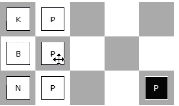

我们结合使用三个事件来实现拖放功能：

-   **mousedown** 正如我们已经看到的，当一个棋子被点击时，该事件的处理程序会为该棋子创建一个 `Draggable` 对象。
-   **mousemove** 如果存在一个 `Draggable` 对象（即用户在悬停于棋子上时按下了鼠标按钮，但尚未释放），该事件的处理程序将移动棋子的 `div` 以反映光标的移动。
-   **mouseup** 如果此事件的处理程序发现存在 `Draggable` 对象，它将把棋子放下，销毁 `Draggable` 对象，并将这一步棋保存到后端。

### mousemove 处理程序

每次用户移动鼠标时，`mousemove` 事件处理程序都会检查是否已为之前的点击创建了 `Draggable` 对象。如果 `dragPiece` 属性中存在一个 `Draggable` 对象，它就知道要调用 `Draggable` 的 `move` 方法来移动棋子。

以下是 `mouseMoveHandler` 全局事件处理程序的代码：

```
this.mouseMoveHandler = function(e) {
    var self = Chess;
    if (e) {
        self.xPos = e.pageX;
        self.yPos = e.pageY;
    }
    else {
        self.xPos = window.event.x;
        self.yPos = window.event.y + document.body.scrollTop;
    }
    if (self.dragPiece) {
        self.dragPiece.move();
    }
};
```

当鼠标移动时，我们还必须做的另一件事是将指针在浏览器窗口内的像素位置记录在 `xPos` 和 `yPos` 属性中。

### mouseup 处理程序

以下是 `mouseUpHandler` 全局事件处理程序的代码：

```
this.mouseUpHandler = function(e) {
  var self = Chess;
  var id = '';
  if (self.dragPiece) {
    self.dragPiece.drop();
    self.dragPiece = null;
  }
};
```

这段代码检查是否创建了 `Draggable` 类，如果是，则执行棋子的放置操作，将棋子放置在它被悬停的方格中心。最后，这一步棋被保存到后端。

在这段代码调用 `drop` 方法之后，它将 `dragPiece` 设置为 `null`，以便其他处理程序知道我们已经完成了棋子的拖动。

## Draggable 类

以下是创建 `Draggable` 对象的代码开头部分：

```
function Draggable(divId) {
  this.div = document.getElementById(divId);
  this.clickOffsetX = (Chess.toBoardX(Chess.xPos) -
    this.div.offsetLeft);
  this.clickOffsetY = (Chess.toBoardY(Chess.yPos) -
    this.div.offsetTop);
  this.div.style.zIndex = 10;
}
```

由于我们将要在棋盘上移动棋子的 `div`，我们当然需要对该 `div` 的引用。

我们需要做的最后一件事是将该棋子的 `div` 的 `zIndex` CSS 属性设置为比其他棋子更高的数字。这会使该棋子在你拖动它在棋盘上移动时出现在所有其他棋子的上方。

### CSS 属性中的连字符

一些 CSS 属性，如 `z-index` 和 `font-family`，其名称中包含连字符。当你在 JavaScript 代码中设置这些属性时，必须记住将这些带连字符的名称转换为驼峰命名法。因此，`z-index` 变为 `zIndex`，`font-family` 变为 `fontFamily`，依此类推。

### 点击偏移量

`clickOffsetX` 和 `clickOffsetY` 属性是在 `Draggable` 对象首次实例化时计算的。它们记录了用户首次点击时鼠标指针距离棋子左边缘和上边缘的距离——这个数值对于我们的像素计算非常重要。图 8.4 展示了 X 和 Y 点击偏移值的图形表示。

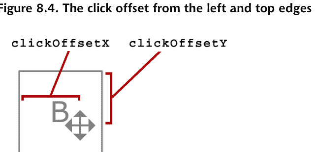

要将一个棋子移动到屏幕上的新位置，你需要设置它的 `left` 和 `top` 样式属性，当然，这设置的是棋子 `div` 左上角的位置。但如果你将这些属性直接设置为光标的位置，你会发现棋子会突然跳动，使其左上角定位到光标所在的位置。

为了避免这种跳动效果，我们将 `clickOffsetX` 和 `clickOffsetY` 的值添加到我们的定位计算中，这样在棋子移动时，光标就位于棋子的中心。这使得你的用户看起来像是在用光标“抓住”元素并拖动它。

### 视口位置与棋盘位置

值得注意的是，`xPos` 和 `yPos` 的测量值是从浏览器视口的左上角开始的，而你的棋子则是相对于棋盘 `div` 的左上角进行定位的。幸运的是，根据鼠标位置和棋盘位置来计算鼠标在棋盘内的位置非常容易——我们只需从鼠标在 x 轴上的位置减去棋盘的左边位置，从鼠标在 y 轴上的位置减去棋盘的上边位置即可。以下是我们用于计算的方法：

```
this.toBoardX = function(xPos) {
  return xPos - Chess.leftPos;
};

this.toBoardY = function(yPos) {
  return yPos - Chess.topPos;
};
```

这使我们能够获取鼠标移动时报告的值，并将其转换为我们为了在棋盘 `div` 上移动棋子所需的值。

### move 方法

当用户移动鼠标时，全局处理程序 `mouseMoveHandler` 会检查是否存在 `Draggable` 对象，如果存在，它就会开始使用 `Draggable` 的 `move` 方法移动与该 `Draggable` 对象绑定的棋子的 `div`。

以下是 `Draggable` 类的 `move` 方法：

```
this.move = function() {
  var calcX = 0;
  var calcY = 0;
  var xMin = 0;
  var xMax = 0;
  var yMin = 0;
  var yMax = 0;
  calcX = Chess.xPos - this.clickOffsetX;
  calcY = Chess.yPos - this.clickOffsetY;
  xMin = Chess.leftPos - 1;
  xMax = Chess.leftPos + Chess.boardSize - Chess.pieceSize - 1;
  yMin = Chess.topPos - 1;
  yMax = Chess.topPos + Chess.boardSize - Chess.pieceSize - 1;
  if (calcX < xMin) {
    calcX = xMin;
  }
  if (calcX > xMax) {
    calcX = xMax;
  }
```


## drop 方法

`mouseUpHandler` 全局处理程序在用户释放鼠标按钮时触发。如果存在一个 `Draggable` 对象，该处理程序会调用 `Draggable` 类的 `drop` 方法，然后销毁该 `Draggable` 对象。

`drop` 方法负责两个基本功能：
- 当棋子被放置在棋盘上时，实现“吸附”效果
- 将走棋数据保存到后端

## 吸附效果

当被拖动的棋子“吸附”到落点方格的中心时，你就能看到吸附效果。吸附发生在 `drop` 方法中：

文件：**chess.js（摘要）**

```javascript
this.drop = function() {
  var calcX = 0;
  var calcY = 0;
  var deltaX = 0;
  var deltaY = 0;
  var colX = 0;
  var colY = 0;
  calcX = this.div.offsetLeft;
  calcY = this.div.offsetTop;
  deltaX = calcX % Chess.squareSize;
  deltaY = calcY % Chess.squareSize;
  calcX = this.getSnap(deltaX, calcX);
  calcY = this.getSnap(deltaY, calcY);
  calcX = calcX + Chess.pieceOffset - 1;
  calcY = calcY + Chess.pieceOffset - 1;
  this.div.style.left = calcX + 'px';
  this.div.style.top = calcY + 'px';
  colX = Chess.calcColFromPos(calcX);
  colY = Chess.calcColFromPos(calcY);
  if (Chess.selectPiece.wasMoved(colX, colY)) {
    Chess.doMove(colX, colY);
  }
  else {
    this.div.style.zIndex = 5;
  }
  this.div = null;
};
```

这里需要关注的重要变量是 `deltaX` 和 `deltaY`。它们是通过将鼠标位置的 X 和 Y 坐标除以方格大小后得到的余数（我们通过取模运算符 `%` 获得这些余数）。`deltaX` 和 `deltaY` 分别是棋子落点位置与方格最近边沿之间沿 X 轴和 Y 轴的距离。

一旦我们有了这个数字，我们就可以通过检查该数字是大于还是小于方格高度（或宽度）的一半来确定将棋子“吸附”到哪个方向。我们使用 `getSnap` 方法来完成此操作：

```javascript
this.getSnap = function(delta, pos) {
    if (delta > (Chess.squareSize / 2)) {
        pos += (Chess.squareSize - delta);
    }
    else {
        pos -= delta;
    }
    return pos;
};
```

如果你仔细想想，这是很有道理的——我们可以通过棋子是否覆盖了另一个方格的一半以上来判断它应该跳到哪一边。

一旦棋子吸附到位，就该在 `drop` 方法中将这步棋保存到后端了。我们将棋子位置保存为行和列坐标——而不是像素位置——存储在 `Piece` 对象中，因此我们必须使用 `calcColFromPos` 方法将棋子的位置转换为行和列号。尽管方法名如此，该方法同时计算行和列坐标——无论我们讨论的是行还是列，所涉及的数学计算都是完全相同的。这是一个简短的方法，只是将棋子的像素位置除以棋盘方格的大小：

```javascript
this.calcColFromPos = function(pos) {
    var self = Chess;
    return parseInt(pos / self.squareSize);
};
```

一旦我们知道新位置的列号，我们就要进行最后的检查，确保玩家没有拖着棋子在棋盘上绕了一圈，然后又放回了原来的位置。我们使用 `Piece` 类的 `wasMoved` 方法执行此检查。

每个 `Piece` 的列号存储在 `pos` 属性中。该属性是一个包含两个元素的数组，存储棋子在棋盘上的坐标。`wasMoved` 方法检查 `pos` 数组中的值是否已更改，如下所示：

```javascript
this.wasMoved = function(colX, colY) {
    if (colX == this.pos[0] && colY == this.pos[1]) {
        return false;
    }
    else {
        return true;
    }
};
```

如果我们能确认棋子确实移动到了新位置，那么就该将此更改保存到后端了。我们通过主 `Chess` 类中的 `doMove` 方法来完成此操作。

## doMove 方法

`doMove` 方法实际负责更新用户正在移动的 `Piece` 对象的 `pos` 属性，查找被吃的棋子，然后将更改保存到后端。

以下是该方法的第一部分：

```javascript
this.doMove = function(colX, colY) {
  var self = Chess;
  var occPieceId = '';
  var cmd = null;
  var move = null;
  var err = '';
  self.selectPiece.backUpPos();
  self.selectPiece.updatePos(colX, colY);
```

## 创建备份

务必备份你的数据。这是我们许多人都不得不通过惨痛教训学到的一课！

在保存走棋之前，我们需要对移动棋子的原始位置数据进行备份快照。如果发生某种错误，我们将使用此备份将棋子放回其原始起始位置。我们使用 `Piece` 的 `backUpPos` 方法进行备份：

```javascript
this.backUpPos = function() {
  this.origPos = [this.pos[0], this.pos[1]];
};
```

该方法只是将 `origPos` 属性设置为与 `pos` 属性中原始值相同的数组值。

一旦我们有了原始位置信息的备份，就该更新 `Piece` 的 `pos` 属性，以便我们可以将其发送到后端进行保存。`Piece` 类的 `updatePos` 方法执行此操作：

```javascript
this.updatePos = function(colX, colY) {
  this.pos = [colX, colY];
};
```

## 错误检查

`doMove` 方法的下一部分检查错误，以确保用户不能做傻事，比如吃掉自己的棋子：

文件：**chess.js（摘要）**

```javascript
if ((!self.lastMove.moveTime) &&
    (self.selectPiece.color == 'black')) {
  err = 'White has to go first.';
}
else if ((self.lastMove.moveTime) &&
    (self.selectPiece.color == self.lastMove.movePiece.color)) {
  err = 'Same color as previous move.';
}
else {
  occPieceId = self.getOccupyingPieceId();
  if (occPieceId.indexOf(self.selectPiece.color) > -1) {
    err = 'Cannot capture a piece of your own color.';
  }
}
```

错误检查代码的最后一部分还会查看是否有棋子被吃。它使用 `getOccupyingPieceId` 方法将被吃棋子的 id 放入 Chess 的 `occPieceId` 属性中。以下是该方法的代码：

文件：**chess.js（摘要）**

```javascript
this.getOccupyingPieceId = function() {
  var self = Chess;
  var p = null;
  for (var i in self.pieceList) {
    p = self.pieceList[i];
    if ((self.selectPiece.pos[0] == p.pos[0] &&
         self.selectPiece.pos[1] == p.pos[1]) &&
        (self.selectPiece.id != p.id)) {
      return p.id;
    }
  }
  return '';
};
```

如果方格未被占据，该方法只返回一个空字符串，这告诉我们没有棋子被吃掉。

## 出错时中止走棋

如果发生错误，我们会提醒用户并将棋子放回原位。这就是 `doMove` 下一部分代码所做的事情：

---

图 8.5. 游戏棋盘上的拖动约束线

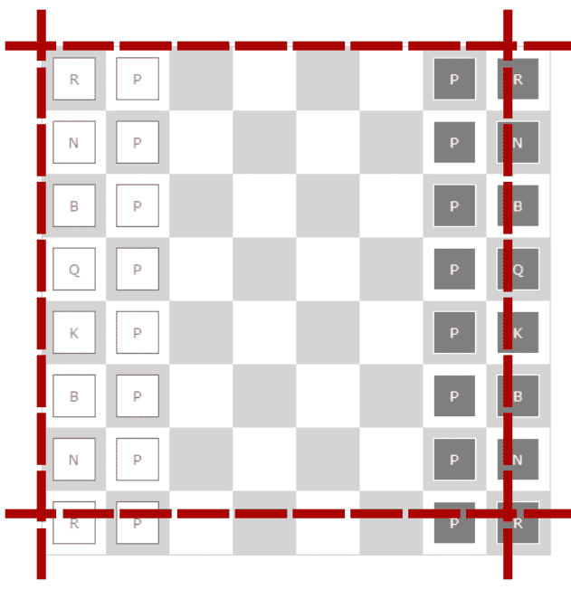

---

if (calcY < yMin) {
    calcY = yMin;
}
if (calcY > yMax) {
    calcY = yMax;
}
this.div.style.left = parseInt(Chess.toBoardX(calcX)) + 'px';
this.div.style.top = parseInt(Chess.toBoardY(calcY)) + 'px';
};

在该方法的开头，我们添加了偏移值，该值在用户拖动棋子绕棋盘移动时，使棋子保持在指针下方的正确位置。如果我们不添加这个偏移，`div` 的左上角就会正好位于光标下方。

接下来，我们处理棋盘约束，并在棋盘上定位棋子。左和上约束很容易——它们是棋盘的顶部和左边缘。对于右和下边缘，我们在计算约束时必须包含棋子的大小，因为我们是使用游戏棋子 `div` 元素的左侧和顶部来设置其位置的。图 8.5 显示了约束线在棋盘上的位置。

一旦我们为 X 轴和 Y 轴设置了最小值和最大值，我们就必须确保我们设置的 X 和 Y 位置确实遵守这些约束。我们通过一系列四个 `if` 语句来确认这一点。一旦我们确定 `calcX` 和 `calcY` 都在我们的约束范围内，我们就使用这些值来设置棋子 `div` 的 `left` 和 `top` 属性。


## 第8章：使用AJAX象棋实现拖放功能

```
if (err) {
  self.setErrMsg(err);
  self.abortMove();
}
```

`abortMove`方法将棋子对应的div放回原位，并通过棋子的`origPos`备份数据恢复`pos`属性中的X和Y列数据：

```
this.abortMove = function() {
  var self = Chess;
  var pieceDiv = document.getElementById(self.selectPiece.id);
  pieceDiv.style.left = self.calcPosFromCol(
    self.selectPiece.origPos[0]) + 'px';
  pieceDiv.style.top = self.calcPosFromCol(
    self.selectPiece.origPos[1]) + 'px';
  self.selectPiece.restore();
};
```

数据备份总是有益的。`Piece`类的`restore`方法从存储在`origPos`中的备份副本恢复`pos`属性值：

```
this.restore = function() {
  this.pos = [this.origPos[0], this.origPos[1]];
};
```

如果你尝试吃掉自己的棋子，或者尝试违规行棋，就能看到`abortMove`操作的效果。

## 保存走子

如果没有错误发生，我们就可以将这步棋保存到应用程序的后端。这是`doMove`方法的剩余部分：

```
else {
  clearTimeout(self.pollInterval);
  self.ajax.abort();
  self.setErrMsg('');
  move = new Move(self.selectPiece, occPieceId);
  cmd = new Command('move', move);
```

```
var str = JSON.stringify(cmd);
self.execCmd(str, self.handleMove);
self.proc = true;
self.selectPiece.startProcessing();
}
```

在下一节中，我们将讨论轮询过程，该过程用于保持浏览器中显示的游戏状态与后端同步。这是一个持续运行的过程，每五秒访问一次服务器，查找对方玩家的走子。在我们处理自己的走子时，不希望同时检查对方的走子，因此保存更改的第一步就是通过清除`pollInterval`属性（该属性保存着该进程的ID）来关闭轮询进程。

然后，在清除可能显示的任何错误信息之后，我们就可以打包走子数据并发送给服务器。鉴于JSON能轻松地在应用程序和服务器之间来回传递对象，将数据打包在名为`Move`的类中是合理的：

```
文件：chess.js（节选）
function Move(movePiece, takePieceId, moveTime) {
    this.movePiece = movePiece || null;
    this.takePieceId = takePieceId || '';
    this.moveTime = moveTime || '';
}
```

`movePiece`属性是移动棋子的`Piece`对象，而`takePieceId`是被吃掉棋子的ID。如果没有棋子被吃，该值为空字符串。我们暂时让`moveTime`属性为空。该属性将由服务器设置，然后通过另一个JSON字符串传回。JSON使得在浏览器和服务器之间来回传递对象变得如此简单，这确实令人惊叹。

`Move`对象设置完毕后，我们将其设置为要发送回服务器的`Command`对象的`cmdData`属性。接下来就是将`Command`对象编码为JSON字符串并传递给服务器。

我们需要做的最后一件事是将`Chess`对象的`proc`属性设置为`true`，这样我们就能知道在走子处理期间要禁用所有用户输入，并让棋子呈现出表示其处于“处理中”状态的外观。我们通过正在移动的`Piece`对象的`startProcessing`方法来实现这一点：

```
this.startProcessing = function() {
  var pieceDiv = document.getElementById(this.id);
  pieceDiv.style.background = '#bbe';
  pieceDiv.style.cursor = 'progress';
  pieceDiv.style.zIndex = 10;
};
```

“progress”光标样式为走子增添了一种非常好的效果：当用户将棋子拖放到棋盘上时，光标会变成“请稍候”光标，这非常明显地表明棋子正在被处理。图8.6显示了该光标的样子。

### 图8.6. 使用“progress”光标处理走子

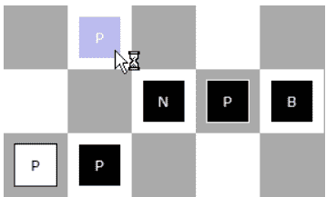

## handleMove 方法

棋子移动后服务器响应的处理程序是handleMove方法。如果服务器返回的响应中`respStatus`属性为`ok`，代码将查看`respData`以获取服务器传回的已更新的`lastMove`对象。

这是一个与我们刚刚传递给服务器的`Move`对象完全相同的对象；然而，服务器添加了`moveTime`属性，这样我们就能知道上次走子实际发生的时间。我们在服务器端设置`moveTime`，以便不同时区的玩家都能玩AJAX象棋，并且所有走子时间都是正确的。如果我们让浏览器设置`moveTime`，那么一个在美国西海岸的女孩走的棋，在东海岸的玩家看来就会显示为四小时前发生的。

以下是handleMove方法的代码：

```
this.handleMove = function(str) {
  var self = Chess;
  var take = '';
  var takeDiv = null;
  var resp = JSON.parse(str);
  if (resp.respStatus == 'ok') {
    self.lastMove = resp.respData.lastMove;
    self.setStatusMsg(self.lastMove.movePiece.color,
                      self.lastMove.moveTime);
    take = self.lastMove.takePieceId;
    if (take) {
      takeDiv = document.getElementById(take);
      self.boardDiv.removeChild(takeDiv);
      delete self.pieceList[take];
    }
  }
  else {
    alert(resp.respDatastr);
    self.abortMove();
  }
  self.selectPiece.endProcessing();
  self.proc = false;
  self.doPollDelay();
};
```

handleMove方法接收从服务器发送过来的更新后的`Move`对象，并用它来设置棋盘上方的状态消息；这样，用户就能知道上次走子是什么时候，以及哪种颜色（或玩家）走的最后一步。

接下来，代码处理移除被吃掉的棋子（如果有的话）。我们必须移除棋盘上代表该棋子的div，以及`pieceList`中的`Piece`对象。

其余代码处理错误情况下的操作——例如，如果服务器因某些原因无法保存走子——以及走子完成后进行的清理工作。一旦走子成功保存到服务器，我们就必须使用`Piece`的`endProcessing`方法将棋子的外观恢复为正常状态：

```
this.endProcessing = function() {
  var pieceDiv = document.getElementById(this.id);
  if (this.id.indexOf('white') > -1) {
```

```
pieceDiv.style.background = '#fff';
}
else {
pieceDiv.style.background = '#000';
}
pieceDiv.style.cursor = 'move';
pieceDiv.style.zIndex = 5;
};
```

它还将`Chess`对象的`proc`属性设置为`false`，这样处理鼠标点击的全局事件处理程序就知道可以重新接受用户输入了。

最后，handleMove方法启动轮询过程，以保持浏览器上的游戏状态与服务器上发生的情况同步。当对方玩家走子时，棋盘将更新，以便我们可以看到新的走子。

## 轮询服务器状态

一个人下棋并不那么有趣，如果你想和同一个地点的人一起下棋，不如把你柜子里那副旧棋盘拿出来，使用真实的棋子。如果不利用它可以通过网络访问的特性，那么拥有一个Web应用程序就没有太大意义了。

AJAX象棋可以由位于两个不同地点的人一起玩，只要他们都将浏览器指向同一台服务器。（实际上，同一时间可以有不止两个玩家访问运行中的游戏，这意味着你可以让朋友看你下棋，或者通过让一位擅长象棋的朋友帮忙来作弊！）

我们使用一个名为`doPoll`的方法，通过计时器调用它来轮询服务器并获取更新的游戏状态，从而保持所有连接到游戏的浏览器同步。`Chess`类中的`init`方法通过调用`doPollDelay`方法来设置这个计时器。

就像我们在第2章和第3章构建的监控应用程序一样，我们只希望在当前轮询请求完成时才开始下一个轮询请求。我们通过使用`setTimeout`将请求链接在一起来实现这一点——当一个请求完成时，它会在短暂暂停后调用另一个`setTimeout`来执行另一个请求。

以下是doPollDelay方法的代码：


## 轮询服务器状态

```javascript
File: chess.js (excerpt)

this.doPollDelay = function() {
  var self = Chess;
  self.pollInterval = setTimeout(self.doPoll,
                                 REFRESH_INTERVAL * 1000);
};
```

`setTimeout` 调用使用 `REFRESH_INTERVAL` 常量来设置在运行轮询服务器的 `doPoll` 方法之前需要经过的等待时间。我们将 `setTimeout` 进程的间隔 ID 存储在 `pollInterval` 属性中——正如我们在之前讨论 `doMove` 方法时看到的那样，我们将此值传递给 `clearTimeout` 以在保存移动时停止轮询过程，这样浏览器在保存移动的同时就不会尝试同步游戏状态。

以下是 `doPoll` 方法：

```javascript
File: chess.js (excerpt)

this.doPoll = function() {
  var self = Chess;
  var str = '';
  var cmd = new Command();
  cmd.cmdName = 'poll';
  cmd.cmdData = self.lastMove;
  str = JSON.stringify(cmd);
  self.execCmd(str, self.handlePoll);
};
```

`doPoll` 方法向服务器发送一个 `poll` 命令对象，以及存储在 `lastMove` 属性中的移动（Move），服务器会将此移动与最新的移动进行比较。

`handlePoll` 方法处理来自服务器的响应：

```javascript
File: chess.js (excerpt)

this.handlePoll = function(str) {
  var self = Chess;
  var resp = JSON.parse(str);
  if (resp.respStatus == 'update') {
    self.clearPieces();
    self.displayGame(resp.respData);
  }
  self.doPollDelay();
};
```

如果服务器响应的 `respStatus` 属性为 `update`，我们就知道使用 `clearPieces` 方法清除棋盘，然后使用服务器响应的 `respData` 属性中更新的游戏状态来更新棋盘。这些数据的存储格式与我们在应用程序初始加载时通过 `loadGame` 和 `handleLoadGame` 方法使用的一致，我们以同样的方式——使用 `displayGame` 方法——来显示更新后的游戏状态。

否则，如果自上次移动以来游戏状态没有变化，代码则不执行任何操作。

该处理器最后执行的操作是再次调用 `doPollDelay` 方法；这将在轮询间隔结束后再次设置对该方法的调用。

## 清空棋盘

如果你完成了一场游戏——或者可能你输得太惨了——你可能想要清空棋盘并重新开始。图 8.7 显示了清空后的棋盘。

如果你点击应用程序顶部那个闪亮的“清空棋盘”按钮，你将调用 `wipeBoard` 方法，该方法会清空棋盘并将其重置为新游戏。

以下是 `wipeBoard` 的代码：

```javascript
File: chess.js (excerpt)

this.wipeBoard = function() {
    var self = Chess;
    var str = '';
    var cmd = new Command('wipe');
    str = JSON.stringify(cmd);
    self.execCmd(str, self.handleWipeBoard);
};
```

`wipeBoard` 向服务器发送一个 `cmdName` 为 `wipe` 的 `Command` 对象，并将服务器响应的处理器设置为 `handleWipeBoard`：

```javascript
File: chess.js (excerpt)

this.handleWipeBoard = function(str) {
    var self = Chess;
    var resp = JSON.parse(str);
    if (resp.respStatus == 'ok') {
        self.clearPieces();
        self.displayGame(resp.respData);
    }
    else {
        alert(resp.respDatasr);
    }
};
```

服务器响应一个经过 JSON 编码的干净游戏棋盘字符串。`handleWipeBoard` 的代码将其解析为棋子列表和位置，然后我们使用 `displayGame` 方法将其显示出来，就像在移动之后或应用程序初始加载时所做的一样。

## AJAX 象棋后端

代码存档中包含的后端处理页面是一个 PHP 页面，名为 `chess.php`，它将游戏状态存储在一个简单的文本文件中，即 `chessboard.txt`。为了允许应用程序将游戏状态保存到文本文件中，你需要确保你的 Web 服务器对 `chessboard.txt` 文件具有写权限。你还需要一个“建议”的 PHP PEAR 包 `Services_JSON`，在撰写本文时，可以从 PEAR 网站下载。⁴ 你只需要让 `JSON.php` 文件对你的应用程序可用即可。

与本书中所有的示例一样，你可以使用任何提供 JSON 库的语言来实现这个象棋游戏的后端——PHP、Ruby、Perl、Python、Java 甚至是 Lisp。使用 JSON 的美妙之处在于，你的 JavaScript 代码不需要知道后端是如何实现的——它只需将 JavaScript 对象交给服务器，然后直接接收回 JavaScript 对象。

处理页面是相当简单的 PHP，但如果你感兴趣，可以查看一下，看看如何使用 JSON 在 Web 应用程序的前端和后端应用相同的对象。

## 未来增强

如果你研究过代码存档，你会发现 AJAX 象棋还远未实现全部功能。你可以做很多事情来提高这款游戏的可玩性：

-   你可以添加一些漂亮的图形来替换我用来显示哪个棋子是谁的枯燥的字母快捷方式。
-   目前，应用程序并不在意你是否让主教跳过棋盘上的所有棋子并吃掉对手的国王。对棋子合法移动以及棋盘上被阻挡的移动进行错误检查将会非常有帮助。
-   你可以让应用程序记录每次移动，以便观察者可以回放游戏，并且你可以优化同步过程，这样在每次移动时就不必重新发送整个棋盘。
-   你可以添加一个“撤销移动”功能（尽管我们一直遵守的规则是：一旦你的手离开移动过的棋子，就不能反悔）。
-   你可以将应用程序的后端连接到像 GNU chess 这样的象棋引擎。
-   你可以添加一个聊天功能，允许你嘲讽对手！

⁴ http://pear.php.net/pepr/pepr-proposal-show.php?id=198

## 总结

这个 AJAX 象棋游戏提供了一个很好的示例，展示了我们如何在浏览器窗口中创建和放置一套复杂的用户界面元素。我们用于实现拖放功能的全局事件处理器是管理复杂 Web UI 中固有的复杂交互的一种智能方式。通过 AJAX 象棋游戏棋盘，我们也初步体验了处理基于浏览器的共享数据访问，并看到了一种使用轮询同步客户端的简单方法，使他们能够在大致相同的时间看到相同的内容。

凭借在这里学到的基础技术，你将能够开始将你的 Web 应用程序提升到新的高度——创建超响应、超交互的 AJAX 应用，突破 Web 可能性之边界。

## 附录 A：AJAX 工具包

虽然 AJAX 还处于起步阶段，但已经有许多实用且稳定的 JavaScript 库可以帮助你的 AJAX 开发。本附录列出了撰写本文时一些最好的库，但就像任何新技术一样，新的库一定会不断出现。为了跟上最新进展，请务必订阅 SitePoint 的 *Tech Times* 电子邮件简报¹ 和 *Stylish Scripting*²（SitePoint 的 DHTML 和 CSS 博客）。

**AjaxTK³**

AjaxTK 是一个 AJAX 工具组件库，具有非常庞大且全面的控件集。AjaxTK 被用于 Zimbra，这是一个最近发布的客户端/服务器开源电子邮件系统。

**Dojo⁴**

Dojo 让你能够快速构建交互式控件的原型版本，制作过渡动画，并使用强大且易于使用的抽象进行 AJAX 请求。这些功能构建在一个轻量级打包系统和可选的构建工具之上，帮助你快速开发并透明地进行优化。

**JSON-RPC⁵**

JSON-RPC 是一种使用 JSON 编码的远程过程调用协议。它是一个非常简单的协议，只有少量的数类型和命令。

**MochiKit⁶**

“MochiKit 让 JavaScript 不那么糟糕”——MochiKit 网站如此说道。MochiKit 是一套文档齐全且经过充分测试的 JavaScript 库，帮助开发人员快速完成工作。MochiKit 吸收了来自 Python、Objective-C 等语言的最佳理念，并将其适配于 JavaScript。

¹ http://www.sitepoint.com/newsletter/
² http://www.sitepoint.com/blogs/category/dhtml-css/
³ http://www.zimbra.com/
⁴ http://dojotoolkit.org/
⁵ http://json-rpc.org/
⁶ http://www.mochikit.com/


## 附录 A：AJAX 工具包

### Moo.fx

Moo.fx 是一个基于 Prototype 编写的超轻量级、超小型 JavaScript 特效库。Moo.ajax 是一个非常简单的 AJAX 类，设计用于与来自 moo.fx 的 Prototype.lite 配合使用。

### Prototype

Prototype 是一个 JavaScript 框架，旨在简化动态 Web 应用程序的开发。它包含一个独特的、易于使用的、用于类驱动开发的工具包，以及一个 AJAX 库。其开发深受 Ruby on Rails 框架的影响，但可以在任何环境中使用。

### Rico

Rico 是一个用于创建富互联网应用程序的开源 JavaScript 库。Rico 提供了完整的 AJAX 支持、拖放管理功能以及一个电影效果库。Sabre Airline Solutions 是其企业贡献者。

### Sajax

Sajax 是一个开源工具包，旨在尽可能简化使用 AJAX 进行网站编程。Sajax 使得从网页通过 AJAX 调用 PHP、Perl 或 Python 函数变得轻而易举。

### Sarissa

Sarissa 是一个 JavaScript 库，作为原生 XML API 的跨浏览器封装层。它提供了各种与 XML 相关的实用功能，例如文档实例化、从 URL 或字符串加载 XML、XSLT 转换、XPath 查询等。

### Script.aculo.us

Script.aculo.us 是一组建立在 Prototype 框架之上的 JavaScript 库，提供了"Web 2.0"风格的交互功能，如视觉效果、自动完成、拖放和就地编辑。Ruby on Rails 中许多更高级的 AJAX 支持功能都使用了这个库。

### Spry

Spry 来自 Adobe Systems 实验室，是一个针对 Dreamweaver 等 Web 开发工具用户的 JavaScript AJAX 框架。即使按照 AJAX 本身才发展了一年多的标准来看，Spry 也是 AJAX 工具包领域的新参与者，但凭借 Adobe 这样的大公司的支持，它有望成为该领域的主要参与者。

### Yahoo! UI Library

Yahoo! UI (YUI) Library 是一组开源的 JavaScript 小部件，可用于构建 AJAX 风格的 Web 应用程序。该库附带一些出色的文档，并被广泛用于 Yahoo! 的设计模式库——这是一个解释如何构建高度动态用户界面的系列文档。

---

# 索引

**A**

- 中止方法，Ajax 类，58
- 中止方法，XMLHttpRequest 类，28
- abortMove 方法，Chess 类，272
- 访问密钥，eBay Web 服务，215
- ACCESS_KEY 常量，175–176
- 可访问性，90
  - AJAX 与，121
  - 博客页面示例，132
  - 浏览器后退按钮修复，235
  - “胖客户端”代码与，191
  - 延伸阅读，127
  - 屏幕阅读器支持，112, 201
- ActiveXObject 类，16
- addNewEntry 方法，Blog 类，158
- Adobe Spry 框架，285
- AJAX
  - 定义，129
  - 涉及的技术，8
  - 何时使用，85, 191–192, 194
- Ajax 类，14–32
- AJAX 中继，178
- 警告对话框
  - 后退按钮问题与，192
  - 屏幕阅读器与，117, 226
- 对齐，垂直，258
- 全大写，48
- Amazon ECS
  - （另见单 Web 服务搜索示例）
  - 多 Web 服务搜索，210
  - Web 服务响应，218
- & 符号，63
- 动画，CSS，68
  - （另见状态通知）
- Apache2 资源，241
- API（应用程序编程接口）（见 Web 服务）
- appendChild 方法，63, 143, 189
- 应用程序忙碌（见状态通知）
- 应用程序监控示例，13, 33–38, 42–83
  - 柱状图，58
  - 跨站点请求与，177
  - 增强功能，42–83
  - 完整代码，36
  - 标记，42, 48
  - 界面样式，80
- 应用程序中心协议，172
- 数组
  - （另见关联数组）
  - Amazon ECS 结果，187, 219
  - Amazon ECS 搜索短语，183
  - 应用程序监控响应时间，58
  - 搜索历史记录，230
- ASIN（Amazon 标准识别码），188
- 关联数组
  - 国际象棋棋子，255
  - 多 Web 服务搜索，203, 205
  - SOAP 客户端选项，213
  - YAML 解析，155
- 异步标志，19
- 异步操作，5, 41
  - （另见作用域丢失）

**B**

- 后退按钮问题，227–240
  - AJAX 可用性与，192
  - 替代选项，201, 204, 227, 240
  - 浏览器后退按钮修复，193, 234–239
  - 构建自己的后退按钮，194, 233–234
- BACK_BUTTON 常量，228
- 背景颜色
  - 显示，62
  - 状态动画改变，149
- background 属性设置，73
- backUpPos 方法，Piece 类，270
- 向后兼容性，90
- 博客页面示例，132
  - 多 Web 服务搜索，201
- Blog 类，133
- 博客页面示例，130–165
  - 添加新条目，158
  - 竞争条件问题，140, 145
  - CSS，132
  - 编辑条目，137
  - 假后端页面，152
  - 可能的增强，163
  - 响应处理，156
  - 返回显示状态，146
  - 保存更改，148
  - 状态动画，149, 157
- 浏览器后退按钮修复，193, 234–239
  - 编码，204
- 浏览器历史记录（见后退按钮问题）
- 浏览器安全（见安全）
- 浏览器窗口尺寸，247
- BROWSER_BACK 常量，202, 235
- 浏览器
  - 不支持的，17, 90, 191, 223, 233
  - 中继请求，178
  - XML 内容类型，25
  - XMLHttpRequest 支持，11, 16
- 浏览器特定代码，72, 138, 236, 238
- 构建自己的后退按钮，194, 233–234
  - 编码，204, 233
- 按钮创建，动态，50

**C**

- calcColFromPos 方法，Chess 类，269
- calcPosFromCol 方法，Chess 类，258
- 回调函数，19
  - *（另见作用域丢失）*
- 取消按钮，博客页面示例，140, 145, 161
- 吃子，国际象棋游戏，271
- 大小写敏感性
  - HTTP 请求方法，18
  - 字符串变量，110
- Chess 类，245
- 国际象棋游戏示例，243–281
  - 后端，280
  - 显示游戏状态，253
  - 错误检查，270
  - 功能，245
  - 加载游戏，250
  - 移动棋子，261
  - 轮询服务器状态，276–278
  - 可能的增强，280
  - 设置棋盘，247
  - 清空棋盘，278
- 类，CSS，76, 115
- cleanup 方法，Login 类，95
- cleanup 方法，Status 类，71
- clearInterval 函数，78, 110, 158, 191
- clearTimeout 函数，36, 67, 273
- Client 类，175
- 客户端调试，194
- 客户端验证，99
- 代码分支，133
- 颜色值，150
- 颜色编码，98
- 通信协议（见协议）
- 并发问题，164
- const 关键字，48
- 常量，48
- 构造函数，JavaScript，14–15, 44, 257
- Content-Type 头
  - 假后端代码，31, 107
  - 多 Web 服务搜索打印，211
  - 代理脚本，180, 183
  - 设置，25, 87
  - POST 请求设置，87
  - XHTML 与，9
- cookies，97, 106
- createElement 方法，63
- createTextNode 方法，63
- 跨浏览器代码，16, 247
- 跨站点请求，19, 177, 207
  - 在线资源，196
- CSS（层叠样式表）
  - 应用程序监控柱状图，65
  - 应用程序监控界面，81
  - 脉冲状态动画，69
  - 过渡，68
  - 元素边框处理，258
  - 与 AJAX 配合使用，11
- CSV（逗号分隔值）文件，106

**D**

- Date 对象，JavaScript，97
- 调试，194, 259
- 桌面应用程序
  - AJAX 与之相比，2
  - AJAX 体验类似，90, 243
- DHTML，非侵入式，90
- disableEnableMainWinInput 方法，Blog 类，140, 145, 158
- display 属性，CSS，116, 203
- displayGame 方法，Chess 类，255, 257, 278–279
- displayOpacity 方法，Status 类，72
- div 元素
  - 淡入背景效果，149
  - 通过 id 元素标识，139
- 文档对象模型（DOM），10
- document.all 属性，73
- document.onkeyup 事件，100, 125, 206
- document.write 属性，193, 236
- doGet 方法，Ajax 类，29, 183, 208
- doGoogleSearch 方法，Search 类，213–214
- Dojo JavaScript 工具包，193, 234, 283
- doLookup 方法，Client 类，176, 182
- 域（见跨站点请求）
- DOM 元素引用，95
- doMove 方法，Chess 类，269–272
- doPoll 方法，Chess 类，277
- doPoll 方法，Monitor 类，54
- doPollDelay 方法，Chess 类，276, 278
- doPollDelay 方法，Monitor 类，55
- doPost 方法，Ajax 类，87, 103, 250, 253
- doProc 方法，77
- doReq 方法，87
- doSave 方法，Blog 类，145
- doSlide 方法，Client 类，190
- doStatusAnim 方法，Blog 类，150–151
- 拖放功能，10, 261–274
- Draggable 类，国际象棋示例，263–269
- drop 方法，Draggable 类，266, 269
- 动态内容
  - AJAX 的替代方案，3, 192
  - 相关通知，123

---

*[注：原始附录 A 中的以下脚注已作为章节标题整合。索引部分（第 308-310 页）已合并，清除了 OCR 伪影（如多余的加号），并使用一致的 markdown 格式化。第 307 页没有内容，已省略。]*


# 索引

-   屏幕阅读器及，91

## E

-   `e` 参数，100, 138

eBay 网络服务
-   多网络服务搜索，214
-   网络服务响应，223

eBayXMLRPC.php 库，216
电子商务，亚马逊，174
就地编辑，135–149
`editInPlaceOff` 方法，`Blog` 类，146
`enableScreenReaderFeatures` 方法，121, 125–126, 204, 225
加密，103, 215, 241
`endProcessing` 方法，`Piece` 类，275

回车键
-   检查，100
-   键盘表单提交，104, 206

错误处理，35
-   国际象棋游戏走法，270, 280
-   代理脚本，179
-   保存博客更改，165

`eval` 函数，JSON，251
`evalFormFieldState` 方法，100
`evalSearchTextState` 方法，`Search` 类，203, 205
事件分发，259
事件处理器
-   异步，21
-   复杂用户界面，259
-   `this` 关键字和，22

示例应用
-   应用监控示例，33–38, 42–83
-   博客页面示例，130–165
-   国际象棋游戏示例，243–281
-   登录页面示例，85–111
-   多网络服务搜索，200–240
-   单网络服务搜索，168–191

执行上下文，22

## F

-   渐变颜色效果，149
伪造服务器页面，31, 106
回退机制，179
“胖客户端”代码，191
Firefox 浏览器 XMLHttpRequest 实现，16
`float` 属性，CSS，65, 113
焦点，表单字段，96
表单元素说明，126
`formData2QueryString` 库，88
-   博客页面示例，149
-   登录表单示例，91, 103

表单验证，99
前进按钮，230
-   （另请参阅 后退按钮问题）

框架集，嵌套，3
延伸阅读（参见 资源）

## G

-   `GameState` 类，国际象棋示例，254

GET 请求
-   IE 的缓存，34, 182
-   Google 搜索页面，170

`getElementsByTagName` 方法，222
`getSearchItem` 方法，`Client` 类，182–183
`getSrcElem` 方法，`Blog` 类，138
`getSrcElemId` 方法，`Chess` 类，260
全局常量，48
全局事件处理器，258–261
全局变量，34
`goBack` 方法，`SearchHistory` 类，231
Google 地图，129, 177, 197
Google 搜索页面，170
Google 网络服务 API，211, 220
优雅降级，17, 91, 192, 201

## H

-   `handleErr` 属性，`XMLHttpRequest` 对象，26
-   对象，26
-   `handleLoadGame` 方法，`XMLHttpRequest` 对象，253, 278
-   `handleLoginResp` 方法，109
-   `handleMove` 方法，`Chess` 类，274
-   `handlePoll` 方法，`Chess` 类，277
-   `handleResp` 方法
    -   `Client` 类，184, 187
    -   `Search` 类，218, 226-227, 229
-   `handleSave` 方法，`Blog` 类，156
-   `handleTimeout` 方法，54-55, 57
-   `handleWipeBoard` 方法，`Chess` 类，278

-   哈希，网址，235, 237
-   隐藏的 iframe，4, 13, 129, 237
-   历史菜单，多网络服务搜索，240

-   HTML 和 AJAX，33
-   HTTP
    -   （另请参阅 GET 请求；POST 请求）
    -   请求的大小写敏感性，18
    -   代理脚本和，178
    -   REST 协议和，169
    -   状态码，24
-   `HTTP_Request` 模块，179, 209, 211
-   连字符，263

## I

-   IBM 主页阅读器，118, 120, 125
-   `id` 属性
    -   更改的危险，162
    -   全局事件处理器，259
    -   定位 `div` 元素，139
-   `If-Modified-Since` 头，34
-   `iframe` 元素，10, 193, 236
    -   隐藏的 iframe，4, 13, 129, 237
-   IIS 网络服务器，31
-   图像，定位，188

-   继承模型，JavaScript，38
-   `init` 方法
    -   `Ajax` 类，16
    -   `Blog` 类，134, 136
    -   `Chess` 类，246
    -   `Client` 类，176
    -   `Login` 类，95, 121
    -   `Monitor` 类，48
    -   `Search` 类，202, 235
    -   `XMLHttpRequest` 对象，16

-   `innerHTML` 属性
    -   博客页面示例，141, 143, 148
    -   DOM 方法替代，10, 36
    -   多网络服务搜索，222-223
    -   单网络服务搜索，187
    -   何时使用，208, 222
-   `insertBefore` 方法，`Blog` 类，160
-   `insertEntryDiv` 方法，`Blog` 类，159

-   Internet Explorer
    -   浏览器后退按钮修复，235-237
    -   事件处理，138, 260
    -   GET 请求缓存，34, 182
    -   IBM 主页阅读器和，120
    -   内存泄漏，71, 95
    -   透明度设置，73

## J

-   JavaScript
    -   `Date` 对象，97
    -   调试工具，195
    -   DOM API，10
    -   连字符转换，263
    -   对象创建，14, 253, 257
    -   对象模型，38
    -   从 XML 创建对象，186, 219
    -   在 AJAX 中的角色，12
    -   屏幕阅读器和，117
    -   代码与标记分离，37
    -   工具包，193, 234, 283
    -   无 JavaScript 的用户，97, 223, 233
    -   YAML 解析，155

JAWS 屏幕阅读器，118, 120
JSON（JavaScript 对象表示法），187, 251–253, 273
JSON-RPC 协议，283

## K

-   键盘操作，100, 104
-   `keyCode` 属性，100, 206
-   `keyup` 方法，`Login` 类，100
-   `keyup` 方法，`Search` 类，206

## L

-   库
    -   （另请参阅 formdata2QueryString；JavaScript，工具包；JSON；SOAP 协议；XMLParse）
    -   创建，14
-   eBayXMLRPC.php，216
-   线性化和屏幕阅读器，112, 115
-   Linux，网络服务器资源，241
-   `loadGame` 方法，`Chess` 类，250, 278
-   位置哈希，235, 237
-   `location.replace` 方法，239
-   锁定，博客页面，164
-   `Login` 类，94
-   登录页面示例，85–111
    -   处理错误，110
    -   标记和 CSS，91
    -   PHP 代码，105
    -   屏幕阅读器和，121
    -   安全性，103
-   作用域丢失，21–22, 44, 70
    -   （另请参阅 单例类）

## M

-   标记
    -   （另请参阅 HTML；XHTML；XML）
    -   脚本与标记分离，37, 134
-   YAML，152, 155

“混合应用”，177, 197
内存泄漏，IE，71, 95
`mimeType` 属性，`XMLHttpRequest` 对象，25
`Monitor` 类，44, 47
-   （另请参阅 应用监控示例）

`mouseDownHandler` 方法，`Chess` 类，260–261
`mouseMoveHandler` 方法，`Chess` 类，262
`mouseUpHandler` 方法，`Chess` 类，262
`Move` 类，国际象棋游戏，273
`move` 方法，`Draggable` 类，262, 265
Mozilla 浏览器 XMLHttpRequest 实现，16

多网络服务搜索示例，200–240
-   亚马逊 ECS 搜索，210
-   eBay 网络服务，214
-   格式化结果，218
-   Google 网络服务，211
-   不支持的浏览器，223, 233
-   可能的增强功能，240
-   代理脚本测试，217
-   屏幕阅读器，225
-   搜索启用，205

## N

-   导航
    -   （另请参阅 后退按钮问题）
    -   跳过导航链接，115, 235
-   网络中心协议，171
-   新条目按钮，博客页面示例，140, 145–146, 158–159
-   `new` 关键字，46, 94
-   不间断空格字符，62–63
-   `noResultsCheck` 方法，`Search` 类，219

## O

-   对象字面量表示法，253
面向对象，14, 38, 44
`onbeforeunload` 事件监听器，192
`onkeyup` 事件，100–101, 125, 206
在线资源（参见 资源）
`onreadystate` 事件处理器，28
`onreadystatechange` 事件处理器，19, 23, 26
透明度设置，72
`open` 方法，`XMLHttpRequest` 类，18, 87
OpenSSL 加密，241
`overrideMimeType` 方法，`XMLHttpRequest` 类，25, 184

## P

-   页面片段，60, 97
分页，164, 240
`parse` 方法，JSON，252, 254
`parseYamlResult` 方法，`Blog` 类，155
解析 XML，186–187
PEAR 仓库
-   `HTTP_Request` 模块，179, 209
-   `Services_JSON` 库，252, 280
-   `SOAP` 模块，212–213

PHP 代码
-   `blog-process.php`，152, 154
-   `chess.php`，280
-   登录页面示例，105
-   `Services_JSON` 和，252
-   模拟响应延迟，31
-   本书中的使用，32
-   `webservices2_proxy.php`，209–210, 212, 216

PHP 扩展和应用仓库（参见 PEAR 仓库）
`Piece` 类，国际象棋示例，256
基于像素的定位，258
`placeBoard` 方法，`Chess` 类，247

-   占位符 ID，152, 158, 160, 162
占位符页面，237
`placePanel` 方法，`Chess` 类，249
`pollArray` 属性，`Monitor` 类，58
轮询过程，273
-   应用监控示例，48
-   国际象棋游戏示例，247, 276–278
-   处理动画，80

`pollServerStart` 方法，53, 66
`pollServerStop` 方法，66
`pop` 方法，59
弹出窗口阻止，27
图像定位，188
棋子定位，国际象棋游戏，258, 264, 267
POST 请求，85
-   `formData2QueryString` 库，89
-   登录页面示例，103
-   SOAP 和，208
-   何时使用，86
-   `XMLHttpRequest` `send` 方法和，21
-   XML-RPC 和，170, 208

`postData` 属性，87
`printResult` 方法，35, 59–60
处理动画（参见 状态通知）
渐进增强，90, 201
`promptInterval` 属性，108
提示，可编辑文本，135
属性，添加，14
属性，CSS，263
协议
-   （另请参阅 HTTP）
-   网络中心和应用中心，171
-   网络服务和，169–172, 199

基于原型的继承，38
代理脚本，178, 207–208, 217
脉冲状态动画，68


# 索引

## Q

查询字符串, 86
- Amazon 搜索, 174
- 禁用 IE GET 请求缓存, 34
- formData2QueryString 函数, 149

## R

readyState 属性, 19
Really Simple History 工具包, 234
REFRESH_INTERVAL 常量, 277
正则表达式, 101, 155, 261
远程脚本, 4, 13
removeChild 方法, 61, 110, 143, 148
相关资源
- 无障碍访问, 127
- Apache2 和 OpenSSL, 241
- 跨站脚本攻击, 196
- JavaScript 工具包, 283
- "混搭应用"(mashups), 197
- 面向对象, 38
Response 类, 国际象棋示例, 254
responseFormat 属性
- Ajax 类, 24, 29
- XMLHttpRequest 类, 28
responseText 属性
- XMLHttpRequest 对象, 24
responseXML 属性
- XMLHttpRequest 对象, 25
REST 协议, 169, 171, 174
RGB 颜色值, 150

## S

Safari 浏览器, 235
eBay 沙盒, 216
保存按钮, 博客页面示例, 145, 148
屏幕阅读器
- AJAX 与, 112–127

页面变更提示, 226
浏览器后退按钮修复, 235
为其提供的代码特性, 121
动态内容与, 91, 117, 123
"胖客户端"代码与, 191
隐藏内容, 115
多 Web 服务搜索, 225–227
onkeyup 事件, 101
推荐的测试产品, 118
script 标签, 包含类, 29
搜索按钮, 203, 206, 218
Search 类, 202
搜索历史显示, 226
搜索窗口, 嵌入式（见多 Web 服务搜索示例；单 Web 服务搜索）
SearchHistory 类, 228, 232–233
安全性
- 跨域访问, 19, 177
- eBay Web 服务, 215
- 登录详情, 103
self 变量, 21, 23, 46, 54
（又见作用域丢失）
send 方法, XMLHttpRequest 类, 21
分隔字符, 107
服务器端脚本
- 博客页面示例, 132
- DHTML 替代方案, 192
服务器端验证, 99
面向服务的架构（SOA）, 169
Services_JSON 库, 252, 280
setAlpha 方法, 71, 74
setButtonState 方法, Search 类, 205
setDisplay 方法, 76
setHash 方法, SearchHistory 类, 230
setInterval 函数, 70
- 浏览器后退按钮修复, 236, 238
作用域丢失与, 21, 44
处理动画, 108, 150
滑出隐藏效果, 190
setMimeType 方法, Ajax 类, 32
setNewEntryRealId 方法, Blog 类, 158, 162
setPrompt 方法, Login 类, 96–97
setRequestHeader 方法, XMLHttpRequest 请求, 34
setRequestMethod 方法, 87
setTimeout 函数, 45, 54, 189, 276
- 应用监控示例, 51
- 作用域丢失与, 21, 44
showErrorPrompt 方法, 110, 124
showPoll 函数, 34
showStatusDots 函数, 108
showStatusPrompt 方法, 108
简单监控应用（见应用监控示例）
单 Web 服务示例, 168–191
- 格式化结果, 187
- 处理结果, 184
- 发送请求, 182
- 滑出隐藏过程, 188
单例类
- Blog 类作为, 133
- Chess 类作为, 245
- Client 类作为, 175
- Login 类作为, 94
- Monitor 类作为, 45
- Search 类作为, 202
- Status 类作为, 52, 70
站点监控应用（见应用监控示例）
跳转到内容链接, 115, 235
滑出隐藏效果, 168, 188
slideAndHide 方法, Client 类, 189
吸附到位, 267
PEAR 的 SOAP 模块, 212–213
SOAP 协议, 171, 174, 208
srcElement 属性, 138
SSL（安全套接层）, 103, 215
栈, 59
startDone 方法, 78
startHistory 方法, Search 类, 235–236
startProc 方法, 75
Status 类, 52, 70
状态通知
- 应用监控示例, 51, 67–80, 98, 103
- 博客页面示例, 148–152, 157, 163
- 光标样式更改, 273
- 圆点动画, 107
- 渐隐颜色效果, 149
- 重要性, 42, 67
- 登录页面示例, 107–111
- 纯文本, 208
- 脉动动画, 68, 75
status 属性, XMLHttpRequest 对象, 24
statusText 属性, XMLHttpRequest 对象, 24
stopPoll 方法, Monitor 类, 58, 67
stopProc 方法, 77
stopReset 方法, Blog 类, 157
stringify 方法, JSON, 251
存根函数, 52, 55
提交按钮
- 激活和停用, 100, 103
- 启用和禁用, 97, 101–102, 125, 205
- 键盘替代方案, 104
submitSearch 方法, Search 类, 206
switch 语句, 157

## T

基于表格的布局, 112, 114
target 属性, 138
向元素添加文本, 63
this 关键字
- 向对象添加属性, 14
- 作用域丢失, 21-22, 44, 70
超时
- handleTimeout 方法, 57
- 代理脚本与, 179
- 保存博客更改, 165
时间戳, 97
时区, 274
title 属性, input 元素, 127
toggleAppStatus 方法, Monitor 类, 49, 54, 66
toggleButton 方法, Monitor 类, 50
toggleEditInPlace 方法, Blog 类, 137, 139-140, 146
toggleEnabled 方法, Login 类, 97, 101
toggleStatusMessage 方法, Monitor 类, 51
工具包, JavaScript, 193, 234, 283
过渡, CSS, 68
try...catch 块, 25, 27
即输即显文本（见即点即编）

## U

Unicode 不间断空格, 63
unshift 方法, Array 对象, 59
updateHistory 方法, SearchHistory 类, 229-230, 237
updatePollArray 方法, Monitor 类, 58-59
URI（统一资源标识符）, 169
可用性
- 即点即编特性, 129
- "胖客户端"代码, 191-192
用户界面
- AJAX 与, 41
- 国际象棋游戏示例, 244-245
- CSS 与, 11

## V

验证, 99, 105, 210

## W

W3C（万维网联盟）
- DOM 与, 10
- SOAP 协议与, 171
- Web 无障碍访问倡议, 127
- WSDL 与, 241
- XHTML 与, 10
wasMoved 方法, Piece 类, 269
Web 无障碍访问倡议（WAI）, 127
Web 服务, 168
- Amazon 商务, 172
- 多 Web 服务搜索, 200-240
- 协议, 169-172
- 单 Web 服务搜索示例, 168-191
window.event 属性, 100, 138, 260
window.onload 事件, 134, 259
Windows
- 安装 HTTP_Request, 180
- Web 服务器资源, 241
清空棋盘按钮, 国际象棋示例, 249, 278
WSDL（Web 服务描述语言）, 171, 212, 241

## X

XHTML
- 在 AJAX 中的使用, 9
- W3C 资源, 10
- XHTML 1.0 Strict, 10
- XHTML 1.0 Transitional, 236
XML
- AJAX 与, 8
- Amazon ECS 返回, 175, 181, 184
- Content-Type 头与, 183
- 反序列化, 185
- JSON 替代方案, 251
- Sarissa 库与, 284
- 与 YAML 比较, 153
xml2ObjArray 方法, XMLParse, 185-187, 219, 222
XMLHttpRequest 类, 11, 13-39
- 不支持的浏览器, 17
- IE 缓存, 34, 182
- 实例化对象, 16
- 方法和属性, 39
- 其他数据格式, 106-107
- POST 请求与, 86
- readystatechange 事件, 20
- 安全性与, 177
XMLParse 库, 185, 219
XML-RPC 协议, 170, 208, 214, 216
XSS（见跨站请求）

## Y

Yahoo! UI 库, 285
YAML, 152, 155
