# 构建你自己的高级 WordPress 主题：创建真正畅销的多功能 WordPress 主题！


打造真正畅销的多功能 WordPress 主题！


**项目总监：** Andrew Tetlaw
**索引编制：** Fred Brown
**技术编辑：** Louis Simoneau
**编辑：** Kelly Steele
**首席技术官：** Kevin Yank
**封面设计：** Alex Walker

**印刷历史：**
第一版：2010年8月

邮箱：business@sitepoint.com


## 关于 Allan Cole

Allan Cole 是一位来自纽约布鲁克林的网页设计师和开发者。他专注于前端用户体验和 WordPress 定制。Allan 目前正在经营一家名为 fthrwght（Feather Weight，http://fthrwght.com/）的小型公司，专注于 WordPress 定制设计与开发。你可以在以下网站找到他：他的作品集网站（http://temp.fthrwght.com/）和他的 WordPress 博客（http://allancole.com/wordpress/）。

## 关于 Raena Jackson Ar diarrhea

Raena Jackson Armitage 是一位澳大利亚网页开发者，拥有内容管理、公共演讲和培训方面的背景。当她不思考互联网的时候，她喜欢编织、游戏、全天供应的早餐和骑自行车。Raena 的个人网站是 http://raena.net。

## 关于 Brandon R. Jones

来自阳光明媚的南加利福尼亚，Brandon Jones 在过去几年里一直在设计、绘图、摄影和编程中探索周围的世界。他不满足于选择一种媒体并固守其中，而是拥有广泛的才能，使他能够参与从粗犷数字艺术套件到财富 500 强软件原型设计的各种项目。

凭借扎实的平面设计、数字插画和用户界面设计背景（以及零星的前端编程语言知识），Brandon 在他年轻的职业生涯中 enjoy 与多家获奖工作室合作。他拥有加州州立大学波莫纳分校的平面设计学位，但认为自己主要是一位自学成才、自我激励的设计师，渴望在设计社区中发挥更大的作用。他的个人网站可以在 http://makedesignnotwar.com/ 找到。

## 关于 Jeffrey Way

Jeffrey Way 就职于 Envato，管理着一个名为 CodeCanyon 的代码市场，并运营着一个广受欢迎的网页开发教程网站 Nettuts+。他在业余时间大量写作，最近出版了 *Photoshop to HTML*（http://rockablepress.com/books/photoshop-to-html/）。除了代码，Jeffrey 还喜欢弹吉他，并在电影院前摇下车窗大声播放 Steel Dragon 的歌曲，以此让他"准妻子" Allie 感到尴尬。你可以访问他的网站 www.jeffrey-way.com 跟他打个招呼。

## 关于技术编辑

Louis Simoneau 于 2009 年加入 SitePoint，此前他从家乡蒙特利尔辗转至卡尔加里、台北，最终来到墨尔本。如今他可以整天学习酷炫的网页技术，而这项活动此前只能 relegated 到夜晚和周末。他喜欢嘻哈、辛辣食物和一切极客相关的事物。他的个人网站是 http://louissimoneau.com/，他最近的博客项目是 http://growbuycookeat.com/。

## 关于首席技术官

作为 SitePoint 的首席技术官，Kevin Yank 始终关注着网页技术领域中所有新颖 exciting 的事物。他最为人所知的是其著作 *Build Your Own Database Driven Web Site Using PHP & MySQL*，此外他还与 Cameron Adams 合著了 *Simply JavaScript*，与 Rachel Andrew 合著了 *Everything You Know About CSS Is Wrong!*。除此之外，Kevin 还主持 *SitePoint Podcast*，并联合撰写 *SitePoint Tech Times*，这是一份免费电子邮件周刊，面向全球超过 24 万名订阅者发行。

Kevin 居住在澳大利亚墨尔本， enjoy 在会议上演讲，以及探访在加拿大和或地区的亲友。他还热衷于与 Impro Melbourne（http://www.impromelbourne.com.au/）一起表演即兴喜剧，并驾驶轻型飞机。Kevin 的个人博客是 *Yes, I'm Canadian*（http://yesimcanadian.com/）。

## 关于 SitePoint

SitePoint 专注于为互联网专业人士出版有趣、实用、通俗易懂的内容。请访问 http://www.sitepoint.com/ 浏览我们的博客、书籍、通讯、文章和社区论坛。


## 第5章 高级主题构建

- 模板如何工作 99
- 快速参考：模板层级 100
- 模板层级与子主题 102
- Thematic 的模板 103
- 构建杂志风格的首页 104
- 去掉那个侧边栏 105
- 包含文件 107
- 修改页脚 108
- 钩子与过滤器 112
- 添加网站图标 114
- Thematic 的钩子 115
- 整合所有内容 116
- 休息一下 119
- 美化你的子主题 119
- 为你的文章添加社交媒体按钮 119
- 在文章中显示作者简介 121
- 带摘要的文章 122
- 给主题开发者的热门技巧 129
- 评论，评论，评论！ 129
- 万物皆有其位，各就其位 129
- 一个身份混淆的案例 129
- 持续探索 130

## 第6章 小工具

- 理解小工具和小工具就绪区域 131
- 默认小工具 132
- Thematic 的小工具就绪区域 133
- 小工具标记 134
- 为你的主题添加自定义小工具就绪区域 136
- 注册小工具就绪区域 136
- 显示小工具就绪区域 138
- 移除小工具就绪区域 139
- 添加自定义小工具 140
- 小工具 API 介绍 140


## 第7章 主题选项

- 创建小部件 ···································································· 141
- 总结 ··············································································· 148

## 第7章 主题选项

- 创建选项面板 ··································································· 149
  - 奠定基础 ······································································· 150
  - 添加管理面板 ··································································· 154
  - 选项表单 ······································································· 156
- 在主题中使用选项 ····························································· 160
  - 修改 CSS ········································································ 161
  - 修改标记代码 ··································································· 162
  - 修改功能 ········································································ 163
- 添加颜色变体 ··································································· 164
  - 选项表单 ······································································· 165
  - 添加样式表 ····································································· 166
- 自定义页面模板 ··································································· 167
- 短代码 ·········································································· 170
  - 构建自己的短代码 ································································ 172
- 可自定义的菜单 ··································································· 174
- 权力越大 ········································································ 175

## 第8章 销售你的主题

- 理解 GPL ······································································· 177
- 你不只是在卖主题 ······························································· 179
  - 支持服务 ······································································· 179
  - 文档 ············································································ 179
  - 视频教程 ······································································· 180
  - 便捷性 ········································································· 180
- 双重许可 ········································································ 181
- 什么使主题畅销？ ······························································· 182
  - 多种配色方案 ···································································· 182
  - 自定义配置选项 ··································································· 184
  - 免费赠品 ······································································· 184
- 拥抱最新技术 ····································································· 185
- 保持简单，同学 ··································································· 188
- 收紧缰绳，解决问题 ····························································· 190
- 测试，测试，再测试 ····························································· 190
  - 浏览器测试 ····································································· 190
  - 插件测试 ······································································· 191
- 教育社区 ········································································ 191
- 三条销售主题的途径 ····························································· 192
  - 每个主题一个网站 ································································ 192
  - 你自己的市场平台 ································································ 193
  - 选择现有的、信誉良好的市场平台 ··············································· 194
- 融会贯通 ········································································ 194


································································································· 195

## 前言

WordPress 毫无疑问是互联网上使用最广泛的博客平台。更令人印象深刻的是，它仅仅用了六年就达到了这一成就——不过公平地说，在网络世界中这已经是一段很长的时间了！得益于一个蓬勃而充满活力的社区，WordPress 从一个名为 b2 的旧博客平台的分支，发展成了一个易于使用、频繁更新且高度可扩展的框架。

虽然几年前花费数百美元购买一个强大的内容管理系统并不少见，但 WordPress 对所有人来说是完全免费的。更重要的是，它是开源的，以 GNU 通用公共许可证（GPL）授权。

你会很高兴地了解到，只要对 PHP 有一定的了解，构建你的第一个 WordPress 主题实际上非常简单——事实上简单到令人愉悦！正因为如此简单，人们可能会错误地认为 WordPress 提供的灵活性或功能不够强大。幸运的是，事实远非如此。虽然 WordPress 最初可能是专门为博客应用而创建的，但它的强大功能已经被才华横溢的设计师和开发人员所利用，构建了从论坛到电子商务应用的各种东西。WordPress 只受我们的想象力和技能的限制，这要归功于其强大而灵活的插件架构。

对于网页设计师来说，学习如何为 WordPress 开发提供了巨大的机会。一方面，你将能够为客户提供动态网站，这些网站功能强大且易于更新，成本仅为企业内容管理系统（CMS）的一小部分。另一方面，你还将具备开发通用主题并在网上销售的技能。近年来，现成 WordPress 主题的市场已经爆发式增长，所以何不参与其中呢？

### 谁应该阅读本书

本书面向前端网页设计师，他们希望从构建静态网站或简单的 PHP 项目扩展到 WordPress 主题开发领域。

你应该已经至少具备 HTML 和 CSS 的中级知识，因为这些技术对于 WordPress 主题的重要性与它们对静态网站的重要性一样。我们还会假设你对 PHP 有一定的了解；虽然不要求你成为编程高手，但你应该至少理解诸如 if 语句、循环、函数和变量等概念，以及 PHP 生成 HTML 输出的方式。虽然你当然可以在不使用任何 PHP 的情况下自定义主题，但本书后半部分展示的更高级功能需要对这些基础知识有一定了解。

### 本书内容

读完本书，你将能够构建美观、多功能且强大的 WordPress 主题。你还将深入了解什么使一个主题获得成功，以及如何有效地推广你的主题。

本书包含以下八章。你可以从头到尾阅读以全面了解相关主题，也可以根据需要跳到特定章节进行复习。

- **第1章：*WordPress 简介***：在深入学习设计和构建主题的所有细节之前，我们将快速了解 WordPress 到底是什么以及它的组成。我们还将介绍为什么你首先要成为一名主题设计师。

- **第2章：*规划你的主题***：要构建一个真正有效的主题，你必须了解将使用它的人的需求：包括访问网站的人和发布内容的人。Brandon R. Jones 是网上几款最畅销主题的开发者，他将带你了解在开始设计之前应该考虑的事项。

- **第3章：*主题设计入门***：基于前一章的内容，Brandon 现在将带你正式进入设计阶段。他将展示你在设计中需要考虑的 WordPress 主题的各个方面，并提供来自网络的最佳示例画廊作为灵感。

- **第4章：*主题框架***：近年来，WordPress 主题框架横空出世；它们现在被认为是快速构建强大主题的最佳方式，无需一遍又一遍地重写相同的模板文件。在本章中，WordPress 狂热爱好者 Raena Jackson Armitage 将介绍你应该使用框架的所有理由，带你了解一些最受欢迎的选项，并向你介绍我们将在本书其余部分使用的框架：Thematic。

- **第5章：*高级主题构建***：WordPress 主题的伟大之处不仅仅在于表面。在本章中，Raena 将带你超越简单的 CSS 换肤，教你如何借助 Thematic 的一系列钩子、过滤器和模板来随心所欲地控制 WordPress 的标记代码。

- **第6章：*小部件***：WordPress 的杀手级功能之一是其小部件功能，它使用户能够轻松地将动态内容添加到网站的各个区域。在本章中，Thematic 专家 Allan Cole 将向你展示如何使你的主题支持小部件，以及如何创建自己的自定义小部件并将其打包随主题一起发布。


 **第 7 章：*主题选项***

市场上最成功的主题都允许用户进行充分的自定义，以适应网站的用途。无论是创建自定义选项页面以允许用户修改主题行为，添加颜色和布局变体，提供备用页面模板，还是开发自己的自定义短代码，Allan 都将向你展示如何将你的主题变成一个真正的“变色龙”。

**第 8 章：*销售你的主题***

作为全球最大的 WordPress 主题市场经理，Jeffrey Way 非常了解是什么让 WordPress 主题在（虚拟的）货架上被抢购一空。在本章中，他将为你揭秘帮助你的主题登上排行榜顶端的方法。

### 在哪里寻找帮助

SitePoint 拥有一个充满活力的 Web 设计师和开发人员社区，如果你遇到麻烦，他们随时准备为你提供帮助。我们还为本书维护了一份已知勘误表，你可以查阅以获取最新更新；详情如下。

#### SitePoint 论坛

SitePoint 论坛^1 是讨论论坛，你可以在这里询问任何与 Web 开发相关的问题。当然，你也可以回答问题。这就是讨论论坛的运作方式——有些人提问，有些人回答，大多数人两者兼顾。分享你的知识不仅能造福他人，还能增强社区的力量。那里有很多有趣且经验丰富的 Web 设计师和开发人员出没。这是学习新知识、快速获得答案并享受乐趣的好方法。

#### 本书网站

支持本书的网站位于 http://www.sitepoint.com/books/wordpress1/，你可以在该网站访问以下设施。

###### 代码存档

随着本书的深入，你会注意到多次提到代码存档。这是一个可下载的 ZIP 压缩包，包含了本书中印出的每一行示例源代码以及其他支持文档。如果你想走捷径（或者为了避免患上腕管综合症），请尽管下载该存档。^2

1. http://www.sitepoint.com/forums/
2. http://www.sitepoint.com/books/wordpress1/code.php

### 更新与勘误

没有一本书是完美的，我们预计细心的读者在读完本书之前至少能发现一两个错误。本书网站上的勘误页面<sup>3</sup>将始终提供关于已知排版和代码错误的最新信息。

### SitePoint 通讯

除了像本书这样的书籍外，SitePoint 还出版免费的电子邮件通讯，例如 *SitePoint Tech Times*、*SitePoint Tribune* 和 *SitePoint Design View* 等。在这些通讯中，你将读到关于 Web 开发各方面的最新消息、产品发布、趋势、技巧和技术。请在 http://www.sitepoint.com/newsletter/ 订阅一个或多个 SitePoint 通讯。

### SitePoint 播客

加入 SitePoint 播客团队，获取面向 Web 开发人员和设计师的新闻、访谈、观点和新鲜思考。我们讨论最新的 Web 行业话题，邀请客座演讲者，并采访行业内一些最顶尖的人才。你可以在 http://www.sitepoint.com/podcast/ 浏览最新和之前的播客，或通过 iTunes 订阅。

### 你的反馈

如果你无法通过论坛找到答案，或者出于任何其他原因希望联系我们，最佳的写信地址是 **books@sitepoint.com**。我们建立了一套配备充足人员的电子邮件支持系统来跟踪你的咨询，如果我们的支持团队成员无法回答你的问题，他们会直接将其发送给我们。我们特别欢迎改进建议以及你可能发现的任何错误通知。

## 致谢

### Raena Jackson Armitage

首先，感谢 SitePoint 的每一个人——特别是 Andrew、Louis、Kelly、Georgina 和 Shayne，他们都尽其所能地将我的内容打磨成型，使其听起来更专业。感谢 Lukas、Cindy 以及 Jarrett Street 上的每一个人；感谢 Mathew 和 Tim 的鼓励；感谢 Avi、Beth、Dan、Donna、Ed、Karl、Dr. Mike，以及所有鼓励一个好奇、胆小的姑娘将 IT 作为职业认真对待的人。

<sup>3</sup> http://www.sitepoint.com/books/wordpress1/errata.php

### Allan Cole

首先，我想感谢 Louis Simoneau 和 SitePoint 的其他同事在截止日期问题上的耐心与理解。我知道协调并整合所有这些内容一定很辛苦。我想感谢我的朋友 Adria Richards，她激励我走出舒适区，尝试一些常规之外的事情。她在早期还帮我进行了一些校对工作，对此我深表感激。感谢 Ashley Moore-Motte 和 Sabrina Smith 在短时间内高效写作方面提供的技巧。同样感谢 Ian Stewart 为像我这样的 WordPress 极客提供了一种简单的方式来学习并与社区分享代码。最后，由衷感谢我的父母 Jeff 和 Rese Cole；Darien Birks、Lawrence Atoigue 以及我在布鲁克林和马里兰/华盛顿的所有家人对我所有努力的持续支持。

### Brandon R. Jones

感谢 WordPress 核心开发小组：如果没有你们，这一切根本不可能实现。感谢 Jeffrey Way 和全体 Envato 员工；ThemeForest 上优秀的作者们；Nettuts；WooThemes；Shane & Peter Inc. 团队；所有作品被收录在本书中的优秀设计师和开发人员；以及所有致力于让 Web 成为一个开放且美妙的工作场所的人。

### Jeffrey Way

如果不是因为 2008 年被 Envato 雇佣后接受的大量培训，我永远不会拥有为 SitePoint 写作的技能，更不用说机会了。我将永远感激 Collis Ta'eed, Cyan Ta'eed, Skellie 和 Jason Ellis 对我的教导。其次，我从 ThemeForest.net 上大量优秀的 Web 设计师身上学到了很多，他们教会了我成为一名成功且获利的 WordPress 编程人员究竟需要什么。他们的许多技巧和技术已融入本书的最后一章。

## 本书使用的约定

你会注意到，我们在整本书中使用了特定的排版和布局样式来表示不同类型的信息。请留意以下项目。

### 代码示例

书中的代码将使用等宽字体显示，如下所示：

```
<h1>A Perfect Summer's Day</h1>
<p>It was a lovely day for a walk in the park. The birds were singing and the kids were all back at school.</p>
```

如果代码可以在本书的代码存档中找到，文件名将出现在程序列表的顶部，如下所示：

```
example.css

.footer {
    background-color: #CCC;
    border-top: 1px solid #333;
}
```

如果仅显示文件的部分内容，将用 *excerpt*（摘录）一词表示：

```
example.css (excerpt)

border-top: 1px solid #333;
```

如果要将额外代码插入到现有示例中，新代码将以粗体显示：

```
function animate() {
    **new_variable = "Hello";**
}
```

在需要现有代码作为上下文但不想重复所有代码的地方，将显示垂直省略号：

```
function animate() {
    .
    .
    .
    return new_variable;
}
```

某些代码行本应输入在同一行中，但由于页面限制，我们不得不对其进行折行。↩ 符号表示仅出于格式目的而存在的换行符，应予以忽略：

```
URL.open("http://www.sitepoint.com/blogs/2007/05/28/user-style-sheets-come-of-age/");
```

### 提示、笔记与警告

**嘿，你！**
提示将为你提供实用的指引。

**嗯哼，打扰一下...**
笔记是与当前主题相关但非关键的有用补充。可以将它们视为额外的资讯片段。

**请务必...**
... 注意这些重要事项。

**小心！**
警告将突出显示在过程中可能会让你陷入困境的陷阱。


# 第一章

## WordPress 简介

作者：**Jeffrey Way**

那么，你已经在网站上折腾了一段时间，现在决定深入学习如何为 WordPress 设计主题。也许你本身就是一名博主，想要重新设计自己的网站以迈出新的一步；又或者，你听说现成的 WordPress 主题市场前景广阔，想要抢占先机。你可能已经迫不及待想要开始构建你的第一个 WordPress 主题了，但在我们动手之前，先思考一下我们为什么在这里，以及我们是如何走到这一步的，这将是个不错的主意。本章将为你介绍 WordPress 的概况，以及 WordPress 主题的相关背景。

在接下来的两章中，Brandon 将带你了解主题的规划和设计过程；然后 Raena 将接手，向你介绍 WordPress 主题背后的代码以及 Thematic 框架，这将使你的开发者生活更加轻松愉快。之后，Allan 将带你了解小部件和自定义主题选项等稍微高级一些的话题；最后，又是我，Jeffrey，回来为你提供一些关于如何销售你的主题并从中获利的见解。

我们开始吧！

### WordPress 简史

很多人可能不知道，WordPress 是基于一个采用率平平的博客平台——仅有几千个安装量——于 2001 年中期构建的，名为 b2。¹ 其开发者 Michel Valdrighi 大约持续维护开发了两年的时间，之后平台用户开始注意到他似乎已经放弃了这个项目。对于成千上万忠实的 WordPress 用户来说幸运的是，有一位特别的 b2 粉丝，他就是 WordPress 的创始人 **Matt Mullenweg**。

得益于在线存档的便利，我们可以将 WordPress 的诞生追溯到一篇单独的博客文章，² 由 Mullenweg 于 2003 年 1 月 24 日发布：

> [……] 我的日志软件 [b2] 已经好几个月没有更新了，主要开发者也消失了，我只能希望他还安好。
>
> 怎么办呢？嗯，Textpattern 看起来拥有我想要的一切，但似乎不会采用我在政治上能够认同的许可证。幸运的是，b2/cafelog 是 GPL 的，这意味着我可以使用现有的代码库创建一个分支，整合 Michel 如果还在的话正在开发的所有酷功能。这项工作永远不会丢失，即使一年后我从地球上消失了，我所写的任何代码都将免费献给世界，如果其他人想要接手，他们也可以。我已经决定这是我想要走的方向，现在我只需要一个名字。它应该做什么呢？嗯，要是能有 MovableType（原文如此）的灵活性、TextPattern（原文如此）的解析能力、b2 的可拓展性，以及 Blogger 的易搭建性，那就好了。总有一天，对吧？
>
> ——*Matt Mullenweg*

这一天标志着 WordPress 的诞生——至少事后看来是如此！在那篇简短的两段文章《博客软件困境》中，Matt 播下了一颗种子，一个最终成长为 WordPress 的想法。在 2003 年期间，Mike Little 与 Matt 一起，确实对 b2 进行了分支，并准备了 WordPress 的首次发布，最终于 12 月 26 日正式宣布。

### WordPress 今日

如果我们快进六年，WordPress 的安装量已经超过 2200 万次，轻松成为全球最受欢迎的博客平台。由于其可扩展性， literally 有成千上万的插件构建在该框架之上，提供了更加丰富的功能，包括求职板、维基网站等的搭建。而对我们来说最重要的是，成千上万的主题被开发出来，赋予 WordPress 几乎任何你能想象到的外观。

¹ http://www.cafelog.com
² http://ma.tt/2003/01/the-blogging-software-dilemma/

Matt 随后成立了 Automattic——WordPress 的母公司——并被 *PC World* 评为**网络上最重要的 50 人**之一。³

WordPress 目前由大约十几名核心开发者维护，以及社区中众多活跃的贡献者，其中包括 b2 的创造者 Michel Valdrighi。

### 为什么选择 WordPress？

尽管说了这么多好话，为什么要选择 WordPress，而不是网络上其他优秀的博客平台和 CMS，比如 Movable Type 和 Blogger 呢？ surely 他们也有同样数量惊人的数据可以炫耀，对吧？嗯，你可能会出于多种原因选择 WordPress：

- 它是免费的。无论你是想搭建一个简单的个人博客，还是为财富 500 强企业构建一个高水平的企业网站，使用 WordPress 都不会花费你一分钱。
- 原始的 b2 框架采用 **GPL**（通用公共许可证）授权，WordPress 也是如此。GPL 赋予开发者修改和重新分发软件的自由，前提是你向他人提供同样的自由。这带来了诸多优势，包括 WordPress 由其社区以及核心团队共同积极开发。
- 它以极其简单的 5 分钟安装闻名。⁴
- 网络中有大量 WordPress 资源可用，包括免费主题以及众多的文字和视频教程。
- WordPress 的文档——称为 Codex⁵——首屈一指。
- WordPress 已经存在七年了，所以我们可以放心，它会一直存续下去，并在未来多年继续积极发展。
- WordPress 团队组织社区聚会，以及名为 WordCamp 的会议。聚会性质较为轻松，通常由团队成员和社区成员讨论从最新版本 WordPress 的新功能到技巧诀窍等各种话题。WordCamp 则由核心开发者和社区成员进行演讲。想了解更多，请访问 http://central.wordcamp.org/。

与任何技术选择一样，使用 WordPress 的决定最终取决于个人偏好。但有了这么多理由，以及一个 popularity 不断增长的平台，这实际上更像是"为什么*不*使用 WordPress？"

### WordPress.com 与 WordPress.org

如果你完全是个 WordPress 新手，wordpress.org 和 wordpress.com 之间的区别可能一开始会让你有点困惑。第一个网站 wordpress.org 是免费开源 WordPress 软件平台的大本营。如果你打算开发自定义主题并在自己的服务器上托管 CMS，wordpress.org 是唯一的选择。

与此同时，WordPress.com 是由 Automattic 运营的商业实体，提供基于 WordPress 平台的托管博客服务。它免费使用，不过有许多高级功能需要付费。

以下是两者各自的优缺点：

**WordPress.org 优点**

- 可访问成千上万的自定义主题
- 可使用自定义小部件和插件
- 100% 保留对标记的控制权
- 可访问 MySQL 数据库，以便在需要时进行修订或创建新表

**WordPress.org 缺点**

- 需要自行购买托管服务，需付费
- 需要手动安装软件
- 需要下载必要的插件来防止垃圾评论（通常是 Automattic 广受欢迎的 Akismet 插件）

**WordPress.com 优点**

- 由 Automattic 免费托管和管理
- 托管在数百台服务器上，实现 virtually 99% 的正常运行时间
- 免费自动完成设置、评论垃圾过滤和数据库备份

**WordPress.com 缺点**

- 主题访问受限（约 100 个），且不允许使用自定义主题
- 无法修改底层 PHP 代码
- 无法使用自定义插件
- 最初被列为 wordpress.com 的子域名，例如 mysite.wordpress.com，不过可以将你自己的域名映射到该 URL

就本书而言，你需要使用从 wordpress.org 下载的软件，并将其安装在你的桌面电脑、网络服务器或虚拟机上。前往 wordpress.org

然后下载最新版本<sup>6</sup>（写作时为 3.0），随后按照 Codex 上的说明进行安装。<sup>7</sup>

## 什么是主题？

不要将内容（页面和文章）与主题混淆；它们是无关的。事实上，这种分离正是 WordPress 及其主题机制如此强大的原因！

WordPress 是一个框架，提供了 RSS、评论、搜索、查询数据库、显示文章、创建页面等所有功能。而主题则是“皮肤”：它决定了外观、设计布局、CSS、附加功能以及图像。由于每个主题都以相同的方式挂载到 WordPress 的核心函数和过滤器中，因此您可以点击一个按钮就在不同主题之间切换。任何由 WordPress 驱动的网站都可以瞬间换上您的主题，展现出全新的面貌。

每个主题都位于 WordPress 安装目录下的一个名为 **themes** 的子目录中。如果某个新主题（比如我们在第 5 章开始构建的那个）名为 "Wicked"，它可以在 **wp-content/themes/wicked** 中找到。这种将表现层与系统文件分离的设计极其有用；它使得 WordPress 框架的未来更新变得简单，因为您可以在不更改主题的情况下更新 WordPress 核心文件。

主题基本上分为三个组件：

- **表现层（Presentation）**：一个名为 **style.css** 的文件包含了将应用于主题的所有样式规则。
- **内容（Content）**：模板文件描述了 WordPress 每个页面应输出什么内容：文章列表、单篇文章、搜索结果等等。
- **逻辑（Logic）**：一个名为 **functions.php** 的文件包含了主题为了能够 *运行*（function）而需要的任何额外逻辑。正如我们在后续章节中将看到的，这里就是您在主题中加入类似插件功能的地方：例如新的自定义小工具，或者一个用于自定义配色方案和布局的主题专用管理面板。

该文件在 WordPress 初始化期间立即加载，也可以通过修改它来定义整个主题中使用的公共函数。

当您下载并安装 WordPress 时，您会看到基础框架以及默认主题 Twenty Ten（如图 1.1 所示）。

<sup>6</sup> http://wordpress.org/download/

<sup>7</sup> http://codex.wordpress.org/Installing_WordPress

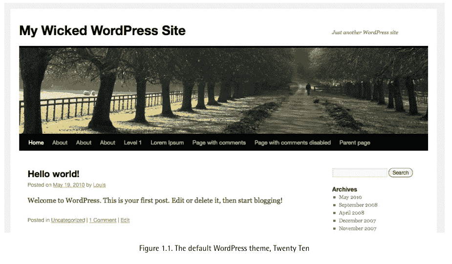

图 1.1. WordPress 默认主题 Twenty Ten

访问您站点的主题管理页面（从仪表盘点击 **外观**，然后点击 **主题**），您将看到所有已安装主题的选择列表——如果您尚未安装任何主题，则仅显示默认主题——您可以通过点击 **启用** 链接来激活其中任何一个。为了测试几种不同的主题并感受它们如何修改站点外观，请选择 **安装主题** 选项卡并获取一些新主题。您将看到它们能如何彻底改变博客的外观，但您可能也会开始思考如何改进它们，或者您想构建什么样的主题。太棒了！

## 为什么要成为 WordPress 主题设计师？

嗯，既然您已经购买了这本书，那么不用说您想成为一名设计师了！不过，如果您还在犹豫，问问自己可能会有帮助：“我想从 WordPress 中获得什么？”您是否厌倦了在自己的网站上使用其他设计师的主题？您是否发现目前可用的主题都没有一个能满足您博客或业务的需求？这些都是学习构建自定义主题的绝佳理由。其他原因可能包括能够：

- 定制现有主题
- 将您自己的网站设计转换为 WordPress 模板
- 出售您的主题设计以获利
- 将 WordPress 主题设计添加到您代理公司的服务中
- 通过独特的设计回馈社区

如果您认同其中任何一个原因，那么全身心地投入到 WordPress 主题设计中是非常合理的。幸运的是，学习曲线相当平缓。

如果您的最终目标是将此转化为一项业务，只要策略得当，这可以是一门利润丰厚的生意。在 ThemeForest⁸（我管理的主题市场网站）上，一些主题作者每月收入超过 25,000 美元！当然，建立自己的作品集需要时间，但一旦完成，自动化和销售多个主题的复利效应将带来回报，因为每天都会有销售额入账，而无需您额外付出努力。

## 最后 ...

超过 2000 万人安装 WordPress 是有原因的：它简单、免费、可扩展、可主题化、有利可图，而且最重要的是，使用起来很有趣。作为一名网页设计师，您已经拥有了构建属于自己的出色 WordPress 主题所需的许多技能。那么，让我们开始吧！

---

# 规划您的主题

作者：Brandon R. Jones

在您启动 Photoshop 或您最喜欢的代码编辑器之前，为将要构建的 WordPress 主题定义一些目标至关重要。它将为访问者提供什么样的功能？它应该如何协助使用它的内容作者或发布者？尽早回答这些问题将在长远看来节省时间、精力和金钱。

本章将帮助您将对主题的愿景细化为一套精简、高效且专注的指令，成为您设计过程中的个人路线图（我们将在下一章进入设计阶段）。

一旦您设计好一个 WordPress 主题，很多事情将超出您的控制。不同的作者将以不可预测的方式使用您的主题。访问者会要求您从未考虑过的新功能，或者会对您认为很有用的功能感到困惑。当然，您可以发布主题更新来采纳这些请求和建议，但提前为主题制定策略，至少能为您提供一套关于主题应该尝试实现什么的基准规则。

在某种程度上，这正是设计 WordPress 主题的独特挑战和兴奋之处。您能做的最好方案就是对主题的预期形成一个清晰的愿景，并围绕这个理想进行设计。同时，您应该始终记住，您构建的是一个工具，其他人会根据自己的目的对其进行适配和调整。

## 从哪里开始？

在开始规划您的自定义 WordPress 主题之前，熟悉 WordPress 站点的默认结构和层级是一个好主意。通过熟悉所有组件，您将能够更好地决定如何在主题中组织它们，从而使其与原生安装有所区别。如果您过去使用过 WordPress 并且已经熟悉其组成部分，您很可能可以跳过本节，直接进入名为“定义成功”的部分。

从核心来看，WordPress 是一个博客引擎，因此默认首页显示最近文章的列表。从那里，用户可以导航到按分类、标签（我们稍后将讲解标签和分类的区别）或月份列出文章的页面（这些按月列出的页面在 WordPress 中被称为 **存档**）。您还可以点击文章标题进入其详情页，那里包含评论列表和发布新评论的表单。WordPress 还支持可以存在于层级结构中的静态页面；例如，一个网站可能有“关于”页面，其子页面为“联系我们”和“我们的员工”。

当然，这种默认结构可以被无限定制，但通过了解起始状态，您将知道哪些需要更改，哪些应该保留。

让我们更详细地探讨这些组件。

### 页面与文章

页面（Pages）和文章（Posts）是您在 WordPress 主题中发现的两种主要内容类型。

**文章（Posts）** 是 WordPress 主题的核心。您可以创建任意数量的文章，它们通常按时间反序排列在博客列表页上。通常，文章定期发布，用于任何具有时效性的内容，如新闻条目、博客日记、播客剧集、故事等等。

WordPress **页面（Pages）** 与文章不同，它们是静态的且不具有日期敏感性。作者通常将页面用于“关于”信息或“联系我们”等内容。一个主题可以拥有作者希望的任意数量的页面，发布者甚至可以使用子页面来建立页面层级；然而，大多数网站最多只使用少数几个顶层页面。例外情况是将 WordPress 作为 CMS（内容管理系统）而非博客引擎的商业网站。

### 媒体与链接

除了页面和博客文章，WordPress 还允许发布者创建另外两种形式的内容：媒体和链接。**链接（Links）** 正如其名：指向互联网上其他页面的超链接。传统上，此功能用于让博主维护一个 **博客滚动列表（blogroll）**——即他们喜爱的其他博客列表。


**媒体**指的是上传到WordPress站点的任何类型的图片、音频文件和视频文件，这些文件随后可在页面或博客文章中使用。

对于许多网站来说，媒体和链接的默认处理方式已经相当令人满意。然而，当您进入设计阶段时，就需要考虑不同类型的媒体如何显示，并使其与主题其余部分的视觉风格保持一致。

### 自定义字段

WordPress还允许作者为其文章添加**自定义字段**。例如，在一个电影评论网站上，内容发布者可能会在评论本身之外为每部电影分配一个评分。然后，发布者在创建文章时，只需在自定义字段中输入一个键（"评分"）和一个值（"3星"）即可。

您的主题可能不会严重依赖自定义字段，但为了设计一致性，您至少需要考虑到它们可能的存在。也就是说，如果您正在设计一个特殊用途的主题，您可以使用自定义字段来实现特定功能。

### 分类和标签

文章是大多数WordPress网站的主要内容类型，通常数量众多。因此，WordPress包含一些功能来帮助发布者组织文章，使读者更容易找到内容。

**分类**是组织网站文章的一种层次化方法。例如，如果您有一个提供汽车评论的网站，您的分类可能包括"轿车"、"卡车"、"摩托车"和"休闲车"。您还可以有子分类；因此，在"轿车"下，您可能有"轿车"、"豪华车"、"跑车"和"混合动力车"。作者可以将一篇文章分配到任意数量的分类中。

**标签**是为博客文章附加关键词的一种方式。与分类不同，标签不组织成任何层次结构。本质上，它们允许您对内容进行更细粒度的分类。使用前面的例子，一篇文章可以归类为"轿车"分类，然后打上"蓝色"、"天窗"和"V8"等标签。

一般经验法则是：分类*组织*内容，而标签*标记*内容。

任何WordPress主题都应使内容发布者能够使用任一组织方法，并应在主题设计中为两者都留出空间。

### 评论

大多数博客的一个关键组成部分是评论系统，供访客就他们查看的文章留言。通常，包含单篇文章的页面会显示已发布评论的列表和一个评论表单。在多篇文章页面（如主页、分类或存档列表）上，通常显示的是文章收到的评论数量。

评论也可以是**分层**的，这意味着一条评论可以*回复*之前的评论。这通常通过将回复缩进在它所回复的评论下方来直观地表示，但您也可以设计自己的表示方式。

### 小工具

WordPress还允许发布者使用**小工具**轻松添加和安排侧边栏内容。最新版本的WordPress包括拖放界面，允许作者轻松配置每个侧边栏中应显示的不同类型的内容。让我们来看看WordPress 3.0中的这个界面是什么样子，如图2.1所示。

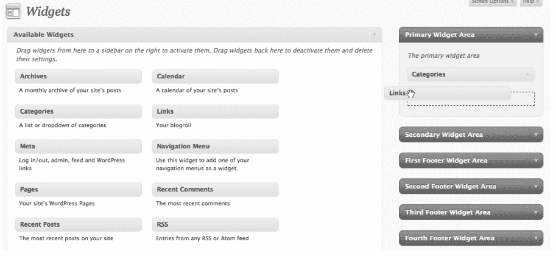

一个好的WordPress主题应使发布者能够使用任意数量的小工具，并将其包含在网站的多个区域中，而不会破坏主题的样式或布局。这提供了更大的灵活性，并增加了博主从主题中获得的价值。我们将在第6章中更详细地介绍如何包含自定义小工具以及为小工具准备主题的某些部分；目前，只需记住页面的某些部分应保留用于放置小工具。

### 循环

主题中显示博客文章的页面——例如，列出特定分类中所有文章或某个月份发布的所有文章的页面——依赖于WordPress的一个称为**循环**的功能。它是模板最重要的部分之一——事实上非常重要，以至于WordPress爱好者喜欢将其名称大写。我们将在第5章中更详细地介绍这一点；现在，您只需知道，默认情况下，文章始终使用此机制以基本相同的方式显示。当然，这是无限可定制的，但默认行为就是这么简单。它被称为循环，是因为WordPress循环遍历所有要显示的博客文章，并以相同的方式渲染每一篇。

### 菜单

WordPress 3.0增加了对用户定义菜单的支持，使WordPress作为CMS更加强大。用户可以创建自己的菜单，由页面、分类或任何他们想要的链接组成。他们还可以随意重新排列菜单项。您的主题甚至可以包含多个不同的菜单位置，就像可以包含多个小工具区域一样，让用户对网站的导航有更多控制。

Allan将在第7章向您展示如何在主题中利用自定义菜单，但值得注意的是，用户将可能完全控制网站的导航。这意味着您无法依赖固定数量的链接或菜单项，因此您的设计必须灵活。

既然您已经了解了WordPress主题包含什么，现在是时候开始思考*您的*主题，以及您希望它如何外观和运行。

### 定义成功

WordPress是一个极其灵活的设计平台。作为主题设计师和开发者，您有一系列可用选项：您可以包含各种JavaScript技巧，花时间在排版细节上，或者为您的用户提供一系列自定义选项。因此，设计WordPress主题既关乎决定包含什么，也关乎决定不包含什么。如果您对使用您主题的网站为其访客服务的目的缺乏清晰的愿景，这可能很难做到。

因此，作为主题设计师，您的首要任务是思考您希望您的主题实现什么。您的主题要取得成功需要什么？您完成后的主题应具备哪些特征？

定义成功可以像陈述您对主题的意图一样简单。它可能看起来像以下任何一种：

- “我的主题将专注于为以文本驱动的内容的博客提供全新且令人兴奋的布局。”
- “我想构建一个主题，让摄影师能够以流畅、简约的设计展示他们的图片。”
- “我们的目标是开发一个基于视频的网站主题，内置一套强大的分享工具。”
- “这个主题的目的是为小型企业网站提供一个简单的模板。”

对于您特定的WordPress主题，成功的定义是什么？如果您无法用一句简短的话解释您主题的目标，设计过程就会像在黑暗中投掷飞镖。

为您的WordPress主题声明使命宣言的美妙之处在于，当您后来面临困难的设计决策时，您总是可以回到该声明来帮助您。

例如，想象一下您正在决定是否为主题包含一个很酷的新图片轮播。如果您的使命宣言是我之前列出的第一个，那么很可能没有必要，除非您能证明人们会需要它。大多数使用您主题的博主可能更感兴趣的是让访客更容易找到他们想要的内容。此外，由于这些文章不太可能包含图片，将您的设计和开发时间投入到这样一个功能上是一个糟糕的主意。

无论您的设计或编码挑战在后期阶段变得多么复杂，您的使命宣言都应是指引一切的明灯。

#### 规划里程碑

您主题的使命宣言是什么？

## 让内容引领方向

选择您的主题将关注的内容类型并非一个肤浅的决定；它将在您做出的设计决策以及您选择包含的功能中发挥重要作用。在大多数情况下，您可以让你的内容为您工作。规划一组与您的内容互补的功能就像让内容闪耀一样简单。

内容类型多种多样，存在的混合形式更是数不胜数。使用我们在上一节中概述的四个示例使命宣言，以下是每个宣言主要服务的内容类型：

### 博客主题

WordPress所基于的经典博客原型是围绕频繁更新的文本内容构建的。访问此类网站的访客希望轻松访问他们想要的内容。这可能是文章、教程、日记、评论或任何其他主要使用文本进行交流的形式。作者会选择基于文本的主题，因为它使他们易于发布自己的作品，也使他们的读者易于找到他们想要的内容。


在这种主题下，排版本身就成为了一个关键特性：**大而清晰、易于阅读的文本**不仅仅是奢侈——它对于主题满足用户需求的成功至关重要。文本驱动的主题通常也承载大量博客文章，因此值得考虑各种方法让用户能轻松找到相关内容。我们将在本章后半部分更深入地探讨内容组织。

### 图像中心主题

摄影师、设计工作室、插画师以及图像丰富的杂志，只是众多希望发布以图像为中心的内容的商业类型中的一部分。访问者很可能为了**大幅、吸引人的图像**以及方便浏览这些图像的工具而访问这些网站。作者通常会选择迎合这类内容的主题，并在布局中突出图像。

图像中心主题需要考虑主内容栏的宽度，因为这决定了图像的最大宽度。同时，仔细考虑与图像相关的功能也很重要，例如灯箱、图像画廊模板、自定义缩略图以及首页的图像轮播。

### 视频网站主题

视频在网页上作为内容传播媒介正日益流行。在许多方面，视频主题的设计目标和约束与图像中心主题相似，但你将受益于更统一的内容尺寸和形状来设计。典型的网站访客会欣赏能轻松与朋友分享视频的功能，而发布者则寻求对多种流行嵌入式视频播放器的便捷支持。

视频博客需要定制化的布局和功能集，以适应视频内容的需求。布局必须使观看视频的活动尽可能简单。思考视频播放器（或多个播放器）在布局中的位置。允许访客轻松浏览相似视频将是一个极好的功能。社交媒体分享链接也应易于访问，以便访客能直接与朋友分享视频。

### 商业网站主题

尽管最初是作为博客平台开发的，WordPress也非常适合作为商业或其他推广网站的内容管理系统。随着企业认识到将强大的内容管理和社交媒体工具集成到其网站中的重要性，这类基于WordPress的网站将只会越来越普遍。这类网站的内容将包括“关于我们”和“联系我们”页面，但也应提供对博客或新闻内容的良好支持。

当涉及到这种形式的主题时，**易于定制和品牌化**至关重要，因为公司会希望确保网站反映其专业形象。关键功能通常包括高度可定制的颜色、首页上为醒目的使命宣言预留的空间，以及大量将公司核心业务内容组织成更接近印刷宣传册而非标准文本博客的形式的方法。

当然，大多数客户会希望发布混合类型的内容。例如，一个小型摄影工作室可能希望找到一个主题，使其不仅能轻松创建吸引人的静态页面，还能包含图像中心主题的常见功能，如画廊或轮播。博主通常希望能够在帖子中轻松加入图片或视频，而许多企业则希望在其网站上拥有博客内容。鉴于这些差异，清楚了解你的主题旨在提供的**主要内容类型**，将使你能够给予此类内容特殊突出，并在选择主题功能时简化你的工作。

在这四个例子中，要记住的关键点是：我们让**内容来为我们做规划**。你总可以在后期根据你对原型的独特见解添加或移除功能。在规划过程的这个阶段，你应该首先创建一份针对内容类型和使命陈述**不可或缺**的功能清单。

#### 规划里程碑

- 你的主题的主要内容类型是什么？
- 你是否需要为其他混合内容类型进行规划？
- 提供主题核心内容需要哪些关键功能？
- 整体设计布局会是什么样子？

## 进行调研

艺术史学家喜欢说：“伟大的艺术家站在前人的肩膀上。”这对WordPress主题创作者同样适用。最优秀的主题创作者选择不从零开始。他们研究已有的成果，然后融入自己独特的创新。因此，进行一些侦察（军事术语，指勘察战场）是设计过程中至关重要的部分，原因如下：

- 它会告诉你这个领域已经有哪些现成成果。没人愿意花费数天打造一个专业主题，最后却发现已有类似产品存在。
- 你会了解市场上的空白。发现一种新的细分主题类型或尚未被构建（或尚未被*良好*构建）的功能，往往能成就一款轰动之作。
- 它会告诉你哪些有效，哪些无效。通常，主题会附带讨论板，你可以阅读用户的反馈。为什么要等到你的主题完成之后才开始收集人们将如何使用它的信息？

既然你明白了为什么要做调研，让我们更深入地探讨一下。

### 主题调研

使用WordPress的魅力之一在于已有数千种主题存在：有些很棒，有些则不然。花些时间在网上浏览与你目标相似的主题。如果你正在构建一个热门的视频主题，去看看那些专注于视频的主题系列。很有可能你能够列出一份你喜欢的功能清单——以及你讨厌的功能清单——以及任何你想在你自己的视频主题中做出的改变。

WordPress主题库¹ 提供了很多选择，但你也应该关注更广泛的范围。一些最好的主题是在外部网站上展示的付费主题。打开你最喜欢的搜索引擎，开始寻找与你主题目标市场相同的主题。一旦你对你的特定细分领域的状况有了很好的把握，你就可以开始制定一份有依据的功能和设计元素清单，进入设计阶段。

### 插件调研

插件是使用WordPress比其他在线发布平台体验更好的另一个原因。仅官方插件目录就有超过一万个插件，很难想出一个尚未以某种形式实现的想法。通常要求作者在你的主题中使用外部插件是个坏主意，因为它使你的主题依赖于第三方；在许多情况下，你可以复制插件背后的功能，将其转变为你的主题中完全受支持的部分。花时间研究任何相关插件，将为你提供关于现有可用功能的速成课程。这项练习还提供了大量真实的反馈，因为大多数插件都显示用户的评分和评论。

让我们看一个研究插件以帮助你规划主题的例子。如果你正在构建一个摄影主题，理所当然地，你会搜索处理与图像相关功能（如灯箱和画廊）的现有插件。以下是使用主题调研的三种假设方式：

- 你遇到一些值得纳入你自己定制主题的想法。通过花费短短时间搜索灯箱插件，你就能够精确规划出你自己的主题中灯箱所需的功能。
- 你发现目前没有插件能实现你心中的某个特定功能——因此你计划直接将其构建到你的主题中。这使你能够解决WordPress用户可能正在寻求的功能。稍后你可以利用这个独特功能来推广你的主题。

¹ http://wordpress.org/extend/themes/


你发现准备使用的图片库系统让许多发布者感到厌烦。通过根据这些用户反馈进行一些调整，你可以让它对发布者更有帮助。

### 脚本研究

最后，在寻找实现主题目标的新方法时，搜索 JavaScript 世界的最新动态通常是一项有价值的练习。在大多数情况下，无需成为任何特定脚本语言的专家也能在主题中使用脚本。大多数脚本采用 GPL 许可（这意味着你可以将它们分发在你的主题文件中²），并且大多数都有详尽的文档，因此安装和使用它们只需遵循提供的指令即可。

此时，你还应该思考你的主题将使用哪些 JavaScript 库（例如，jQuery 或 Prototype），或者是否需要使用。取决于你的 JavaScript 精通程度，库可以让开发自定义功能和华丽小工具的任务变得简单得多。

脚本研究可能非常有意思，因为庞大的编程社区在不断开发新鲜且花哨的效果和功能。虽然你需要确保包含的脚本在所有主流浏览器上都能运行，但在大多数情况下，脚本作者已经为你完成了测试。

### 持续探索

显而易见，在现有主题、插件和脚本的范围之外，还有大量的研究工作可以开展。你也可以在其他平台上寻找功能的示例，在其他媒介中寻找巧妙设计的模型（印刷品、电影甚至建筑都可以成为灵感来源）。这项练习背后的基本原理很简单：既然你已经明确了主题的主要目标，那么就去看看是否有比你之前预想的更好的实现方式。

#### 规划里程碑

在网上搜寻新想法。列一份你喜欢的脚本、插件和主题清单；然后回到之前的功能列表中，根据需要进行修订。

## 避免功能臃肿

你可能会想，“为什么不直接设计一个能处理所有想象中的内容类型的主题呢？” 就像一辆试图同时兼任直升机、喷气快艇和商业客机的汽车一样，这种“瑞士军刀”式的全能主题想法是非常危险的。通过堆砌你能想象到的每一个功能和设计元素，你最终创造出的是个“弗兰肯斯坦的怪物”；你的主题非但不能在所有方面取得成功，反而最终在任何方面都做不到出色。

² 关于 GPL 及其与 WordPress 主题的关系，请参阅第 8 章中名为“理解 GPL”的章节。

这种**功能臃肿 (feature bloat)** 可能会在 WordPress 主题中导致一系列问题：

- 内容可能变得混乱，导致用户难以找到他们想要的东西。
- 功能可能会与其他插件产生冲突，导致频繁出现 Bug 或布局不可靠。
- 华丽的工具可能会主导设计，使得发布者难以将注意力吸引到其内容上。
- 过多的自定义选项可能会增加发布者的使用难度。

请记住，WordPress 应该是为了让作者和访问者的生活变得更轻松。如果一个主题包含太多功能，经常使用它们会变得很繁琐。

事实是，选择一种你的主题能够擅长的内容类型并坚持下去通常更简单。如果你遇到绝对必须添加新功能的情况，你可以根据主题的任务陈述，逐案做出决定。做出例外处理总有充分的理由，但在创建最终功能集时坚持主题的主要目标，从长远来看将能够防止功能臃肿。

### 基于内容设计与支持内容的不同之处

这里需要注意的一点是，虽然你应该避免设计一个专注于所有想象中的内容类型的主题，但*支持所有类型的内容*却非常重要。这看起来似乎矛盾，但我向你保证我并不是在钻牛角尖。为所有类型的内容*设计*主题会分散注意力；而*支持*所有类型的内容则是良好的实践。如果一个纯文本博客的作者决定在文章中加入视频或图片，而你的主题样式看起来损坏或显示不正确——那么你的主题就失败了。没必要为每一种内容类型都提供自定义模板；只要确保最常见的媒体形式至少有最基本的样式支持即可。

#### 规划里程碑

- 在不削弱主题主要目标的前提下，你的主题还应包含哪些额外功能来增强访问者的体验？

## 为受众规划

访问使用你主题的网站的人，最终就是你的受众。虽然无法准确预测什么样的用户会使用你主题上的内容，但花一些时间思考理想的访问者体验是值得的。

这听起来可能很显而易见，但你会惊讶地发现，很少有主题作者真正思考访问者实际上将如何与他们的主题互动。以下是一些预判了访问者行为并利用深思熟虑的功能提前进行规划的网站示例：

**Nettuts+ (http://net.tutsplus.com/)**

该网站通过提供分步教程来服务于 Web 开发人员。因此，该网站包含大量代码示例，教程中的代码实际显示在博客文章内部。在预判用户行为方面，Nettuts+ 将内联代码示例放在方框中，这不仅使文本看起来像代码（带有语法高亮），还包含将脚本复制到用户剪贴板的按钮；这使得学习教程成为一种无缝体验。图 2.2 显示了来自 Nettuts+ 的代码片段示例。

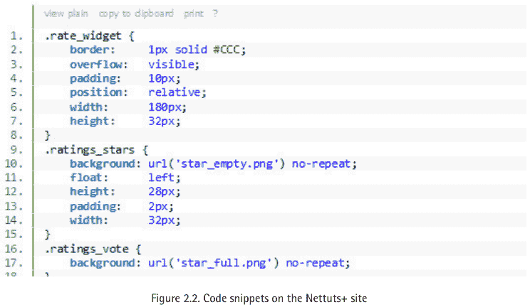

**WineLibraryTV (http://tv.winelibrary.com/)**

该网站以一种既幽默又具有教育意义的风格提供葡萄酒评论。视频通常花费 20 到 30 分钟来评论几款葡萄酒；然而，主持人通常只在每款特定葡萄酒上花费几分钟。因此，用户通常喜欢直接跳到视频中评论他们感兴趣的那款葡萄酒的部分。作为良好规划的体现，WineLibraryTV 使用了一个允许在视频中设置书签的播放器，使访问者能够立即找到他们要寻找的内容，如图 2.3 所示。

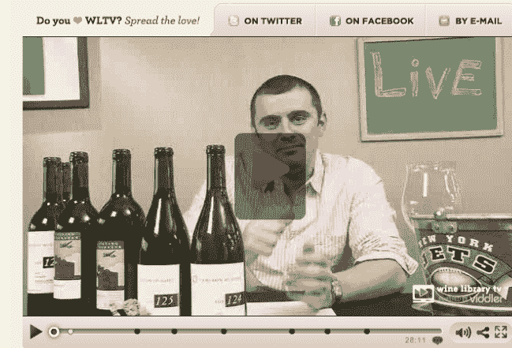

### Psdtuts+

该网站拥有大量服务于 Web 和平面设计师的内容。因为受众精通网络，许多访问者渴望在他们使用的社交网络上分享其内容。作为另一个准备充分的绝佳例子，网站所有者在文章底部内置了一个社交媒体栏，使信息分享尽可能简单。如图 2.4 所示，这个例子获得了加分，因为它还包含一个帮助用户寻找进一步内容的板块。

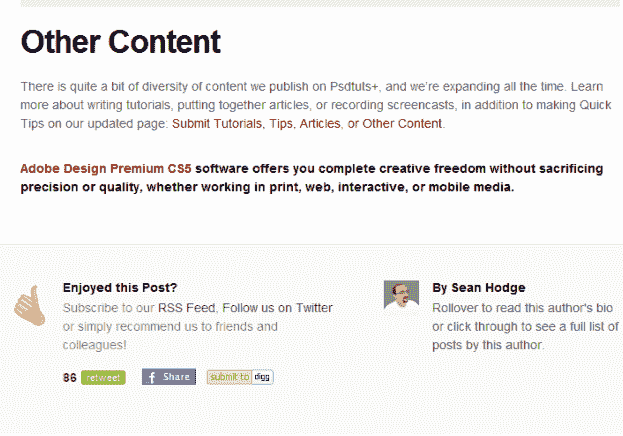

为受众规划不仅仅涉及预判他们寻求的内容类型；它还包括为了实现尽可能流畅的用户体验而积极提前准备。你的目标应该是预判访问者的任务，然后使这些任务尽可能容易完成。当然，这意味着在主题设计方面会有不同的具体实现方案。通过研究那些你认为实现了与你类似目标的网站类型，你可以提前弄清楚什么对受众有效。

#### 规划里程碑

- 使用该主题的理想站点访问过程会是什么样的？列出访问者可能想要完成的几个任务。

## 为发布者规划

现在你已经思考了由你的主题驱动的站点的访问者体验，是时候考虑你主题的直接用户了：发布者。WordPress 主要是一个发布平台。为那些将使用你的主题发布内容的作者进行规划，对于你主题的成功来说与考虑站点访问者一样至关重要，甚至更加关键。

与你的目标受众一样，无法准确锁定使用你主题的作者类型。即使在特定群体（例如，业余摄影师）中，也会有一系列经验水平不同的作者。例如，一些摄影师在博客文章中填写几个自定义字段会感到很舒服，因为他们拥有多年使用自定义 HTML 和 CSS 的经验。然而，另一些人可能很难弄清楚如何发布一篇简单的文章。

作为一般原则，你应该为经验最少的用户规划主题——当然，在合理范围内。如果你在规划一个摄影主题，可以合理假设大多数作者在某种程度上理解数字图像的工作原理（例如，缩略图与全尺寸图不同的基本概念）。但是，最好不要认为普通摄影师懂得如何让缩略图触发 JavaScript 灯箱以显示更大图像。因此，如果你包含此类功能，使其易于使用并并在你的主题包中包含清晰的指令是非常重要的（指令材料的主题将在第 8 章中详细讨论）。

花时间调查你认为使用你主题的作者会想要的功能。思考他们可能会被什么样的设计所吸引。并且，尽可能地用研究来支持这种头脑风暴；例如，询问你认识的符合目标作者画像的人，他们希望在主题中看到什么。

#### 规划里程碑

- 你可以合理地预期你的主题发布者对运行网站了解多少？
- 你是否计划包含一些可能超出普通作者能力范围的功能？


## 组织结构与层级规划

在规划过程的这个阶段，你应该已经相当清楚你的主题擅长呈现的内容，以及最能衬托内容的设计和功能。你也花时间思考过如何最好地服务于主题的受众及其用户。最后，你已经研究了目前市场上的主题、插件和脚本，将那些设计想法精炼成一个更统一的愿景，最好还有一个明确的功能清单。

这些信息最终将汇聚成一个功能集，使你的主题区别于其他任何主题。现在，是时候思考如何将这个功能集转化为设计过程中有组织的线框图了。

让我们从阐述几个可用的 WordPress 主题的基本原则开始。无论你的原型是什么，这些内容准则都适用。你的内容应遵循以下原则：

-   **易于导航**
    无论你的主题是用于内容庞杂的多作者博客，还是小型的五页商业网站，核心内容都必须易于查找和导航。访客应在到达网站的几秒钟内就能轻松理解如何浏览。每个页面上的内容应具有清晰的视觉层次，网站的页面应在逻辑组织结构中相互链接。

-   **易于参与**
    仔细考虑你希望包含哪些交互功能，例如评论、社交媒体分享链接以及任何其他有助于访客与网站内容互动的功能。

-   **易于组织**
    规划如何有效使用和展示分类、标签以及搜索功能。访客应该能够在不使用 Google 的情况下，在你的主题中找到特定的博客文章或页面。

组织就是关于你如何切分和组合内容。在这个规划阶段，你应该回顾我们在“从哪里开始？”一节中看到的 WordPress 主题组件分解，并决定如何将这些部分组合起来形成一个功能性的站点主题。为此，你需要开始绘制一个站点地图，展示各个页面如何连接，以及线框图，展示每个页面上呈现哪些内容。在整个过程中，请将这三个组织原则牢记在心，并使用它们（连同你主题的任务说明）来指导你做出任何决策。

### 主题站点地图与线框图

为 WordPress 主题创建站点地图和线框图与为标准网站设计它们略有不同，因为在 WordPress 主题中，最终内容是未知的。无法预料需要容纳多少页面、子页面或博客文章，你也无法规划特定页面或页面特定区域的确切内容。然而，你仍然必须绘制出你主题的核心内容结构，并提前规划各个内容片段将在每个页面的何处展示。这两项任务分别属于站点地图和线框图的范畴。

#### 站点地图

大多数 WordPress 站点地图看起来非常相似，但你如何组织内容将是你主题的独特之处。显然，你需要规划个别发布者将为你的主题带来的变化。记住，他们将能够添加任意数量的分类中的任意数量的文章，更不用说任意数量的页面和子页面。

你需要考虑的一些问题是：

-   你的首页上会有博客文章吗？博客文章将以全文、摘要还是仅标题列表的形式呈现？
-   用户将如何从首页导航到每个页面或博客文章？他们将如何在文章之间移动？
-   你的功能清单中是否有任何自定义功能需要包含在站点地图中？例如，你可能既需要首页的特色文章位置，也需要一个自定义分类循环。如果某个功能影响了内容的组织方式，请在站点地图上注明。

站点地图也是开始记录你希望包含哪些自定义页面模板的好地方。一些例子可能包括一个自定义的图片画廊页面模板、一个全宽模板（无侧边栏）或另一种形式的专用内容布局。

接近你主题站点地图的方式有几乎无限多种，但为了突出差异，让我们在图 2.5 和图 2.6 中看两个例子。

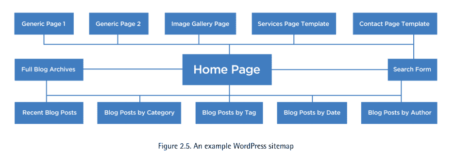

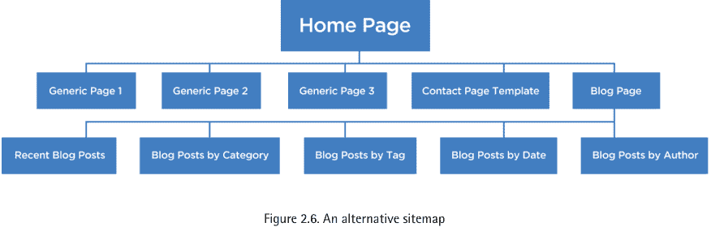

图 2.6. 另一种站点地图

在这两个站点地图示例中，请注意用户到达博客内容的方式有何不同。在图 2.5 所示的站点地图中，首页作为所有博客内容的中心枢纽。相反，在图 2.6 的站点地图中，所有博客内容都隐藏在一个博客部分中，通过点击首页上的链接即可到达。你自己的站点地图最终将取决于你希望如何引导用户浏览你的主题。

#### 线框图

在为 WordPress 主题构建线框图时，你需要勾勒出为特定类型内容预留的布局部分。这将直接影响你设计阶段的第一步，因此要尽可能准确。你可以随意先进，但根据我的经验，在开始设计之前，你至少需要绘制出四个线框图，分别用于：

-   首页
-   默认页面视图
-   单篇文章视图
-   文章列表（例如，归档页面、搜索结果或分类或标签页面）

在这四个核心线框图（如图 2.7 至图 2.10 所示）中，请注意核心布局几乎没有变化。通常，从一个线框图到下一个线框图，唯一改变的方面是主栏内内容的结构。

26 构建你自己的酷炫 WordPress 主题

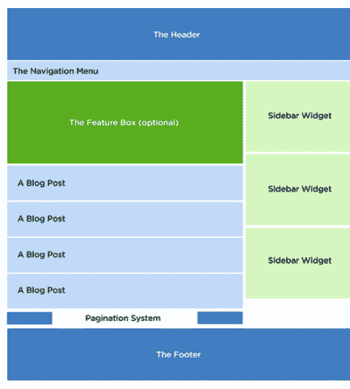

图 2.7. 首页线框图

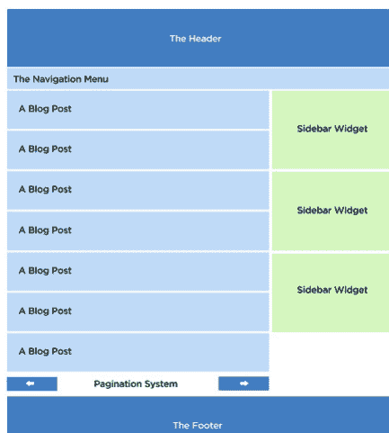

图 2.8. 文章列表页线框图

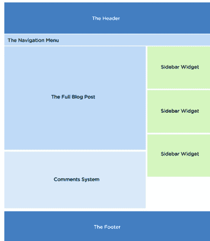

图 2.9. 单篇文章页线框图

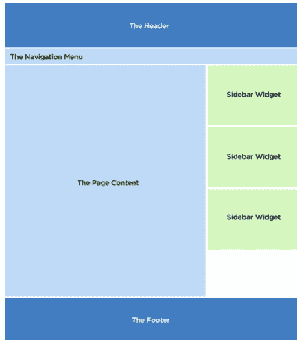

图 2.10. WordPress 页面线框图

除了可能需要的任何自定义功能（例如灯箱或画廊）的布局草图外，你还可以为你希望包含的每个自定义页面模板创建线框图。

为了说明线框图可以多么简单（以及两个独特的线框图可以看起来多么不同），让我们看几个不同的首页线框图。我们将在图 2.11 中看一个文本密集型博客的线框图，在图 2.12 中看另一个照片博客的线框图。

请注意，虽然两个线框图都非常简单，但每个都展示了独特的布局，以应对每个博客将要专注的内容类型。我们将在下一章中专注于主题创建过程的设计阶段，因此此时你的线框图可以尽可能简单和直接。如果此时觉得缺少什么，不必担心：接下来我们将深入探讨构成 WordPress 主题的细节！

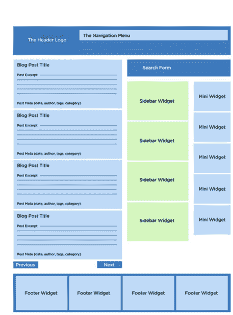

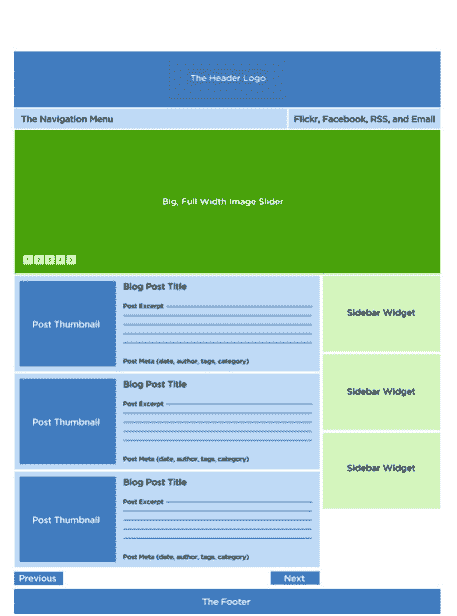

## 回顾总结...

使用这个过程来规划你的主题，是在开始设计阶段之前澄清其主要元素的一种宝贵方式。规划不需要特别冗长，甚至不需要以任何正式的方式组织——一个记事本、文本编辑器或餐巾纸就足够了——但你至少应该写下你的计划。如果你是初次制作自定义主题，这一点尤其重要。坦白说，有些人的规划仅限于在健身房跑步机上进行头脑风暴。就个人而言，我仍然会进行大量


-   [费曼学习法](https://wiki.example.org/feynmans_learning_method)的灵感源于诺贝尔物理奖获得者**理查德·费曼**。

1.  运用费曼技巧，你只需花上`20 min`就能深入理解知识点，而且记忆深刻，*难以遗忘*。

```
if (condVar > someVal) {console.log("xxx")}
```


# 品牌标识

如果你正在设计一个将被广泛使用的主题，那么考虑品牌标识所扮演的角色就显得尤为重要。

标志有各种尺寸、颜色和格式。请确保你的设计允许发布者使用自己的标志（或者在他们没有图片时，为网站标题添加文字）。这听起来像是常识性的建议，但这里需要考虑的是，主题的标志区域应能适应各种可能性。

许多网站所有者希望在其博客或公司的主页上突出显示一个醒目的标语或使命宣言（大约一到两句话）。在构建设计时，请务必为这个需求做好规划。

此外，你可能需要考虑不同的字体栈，以允许发布者通过选择替代字体来改变其网站的风格。

## 排版

由于WordPress网站通常使用大量文本，你应该认真思考主题的排版。虽然通过CSS字体样式可以实现成千上万种独特的视觉组合，但有几个要点需要考虑。

### 统一性

无论你选择哪种字体，在整个主题中保持字体处理方式的一致性都很重要。使用多种字体会使你的主题显得杂乱无章和不专业，也可能让发布者在何种情况下使用何种字体感到困惑。最佳的排版系统使用一种或两种字体，在每个页面上构建精致且易读的文本块。

### 层级性

利用字体的大小和样式，在每个主题模板中建立层级结构。传统的印刷设计是一个理想的灵感来源。考虑一份报纸：头版会醒目地展示主要标题，次要文章会使用较小但依然清晰的标题，而正文则始终小而统一，各篇文章之间保持一致。

像全球大多数报纸出版商一样，《纽约时报》将其印刷出版物的排版层级延续到了其网站上，如图3.4所示。注意这里有三种不同的故事标题字体大小：一种用于特写故事，另一种用于第一评论栏中的次要故事和图片亮点，第三种用于头版的所有其他摘要。

另外，看看排版如何在最左侧菜单的分类列表中建立层级结构：你一眼就能看出，“书籍”和“电影”是“艺术”下的子类别。

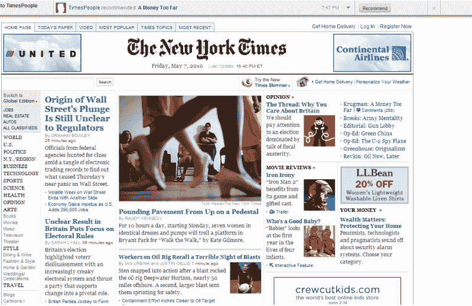

让我们把这个比喻应用到你的WordPress主题上。主题的首页模板应立即让用户知道他们身处何处以及网站的主要内容是什么。文章和页面标题应易于查找、阅读和点击。副标题应不那么突出，依此类推，直到你为正文设置样式，正文应简洁、易读，并在网站的所有部分保持一致。

当然，你也可以使用其他视觉设计元素来组织页面内容，但要意识到字体在传达信息层级方面的力量。尤其是在WordPress主题中，这是确保内容清晰传达的一种有力方式——即使你不确定内容会是什么。

### 行长、字间距和行高

这些设计元素常常被忽视，因为浏览器默认值通常被认为是“足够好”的。但密切关注这些小细节如何衬托主题的布局和视觉风格，往往是优秀设计与卓越设计之间的区别。

文本应有足够的呼吸空间，行文应避免过长，以免眼睛难以回扫到下一行的开头。第二点对于灵活宽度的布局尤为重要：考虑一下如果网站在非常宽的显示器上查看，文本会如何伸展。

### 字体替换

网络排版最近正经历一场复兴。此前，设计师仅限于依赖用户安装的字体进行CSS样式设置，或将文本替换为图片或（令人担忧的）Flash电影；现在，许多新的字体替换和嵌入技术已经出现，只要你使用的是任何字体，只要其许可条款允许。

你应该避免在正文中使用字体替换；相反，将其限制在标题、标头、引用块等处。自定义字体可以赋予你的主题独特的个性。以下是一些经验法则（打破它们风险自负）：

-   避免使用难以阅读的字体。
-   除非有充分的理由，否则不要使用超过一种字体作为字体替换。
-   确保当字体替换未发生时，浏览器仍能渲染出易读的字体。这意味着要注意行高、字体颜色和字间距。主排版部分讨论的相同规则也适用于字体替换。
-   考虑在非英语网站上使用特定字体的影响。如果你的主题可能用于需要该字体缺少字符的语言，你需要规划一个备用或替代字体。

让我们看几个巧妙使用字体替换的网站。图3.5是一个很好的例子：两种不同的标题字体相得益彰，并为网站的视觉风格做出贡献。

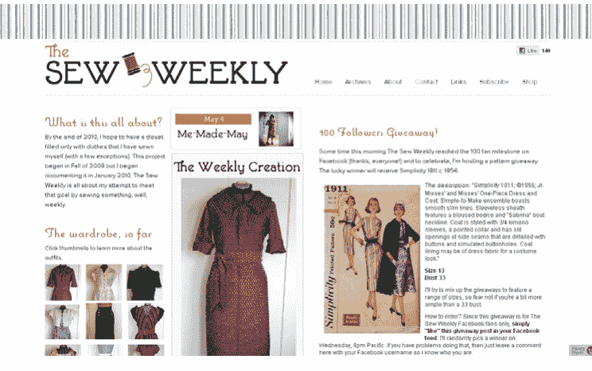

图3.6所示的网站也使用了一些精心挑选的自定义字体来增添设计的感觉和风格。

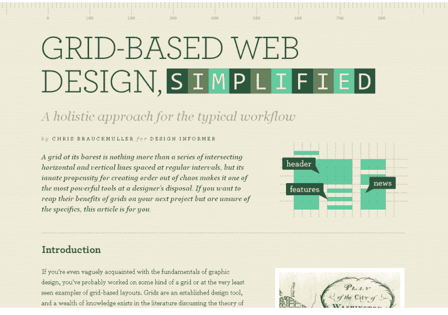

## 视觉风格

颜色、排版和纹理相结合，为你的主题创造独特的视觉风格。从一开始就对你想要实现的目标有清晰的想法，将使你能够更好地将各个独特的部分组合成一个连贯的整体。

在确定视觉风格时，思考你试图传达的基调和语境。图3.7和图3.8展示了两种不同的视觉风格。在不阅读页面上任何文字的情况下，思考每种风格传达的信息。

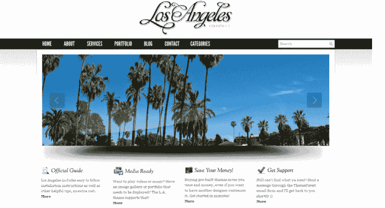

图3.7. Los Angeles主题

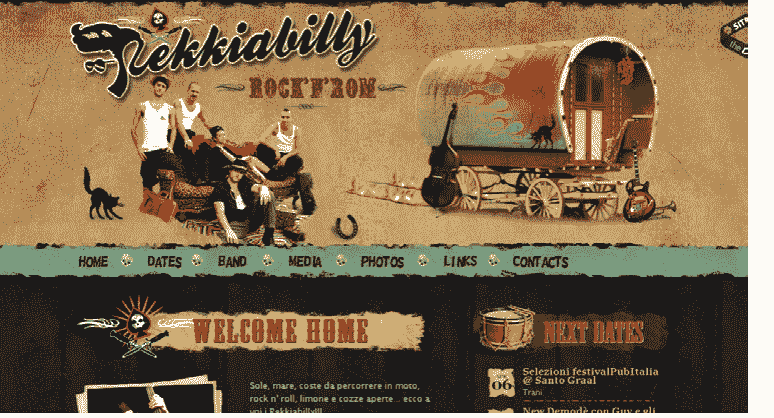

图3.8. www.rekkiabilly.com

如图所示，你主题的视觉风格可以从简洁极简到大胆插图化（以及介于两者之间的一切）。如果你正在设计一个会被广泛使用的主题，你应该将视觉风格限制在简单、不张扬的元素上，因为这些更容易定制。相反，如果你正在为一个特定的细分市场设计主题，你将会有更多的操作空间。

### 布局与构图

在第2章的末尾，我讨论了绘制线框图的重要性，它勾勒出主题每一页所包含的内容以及这些内容将如何组织。既然我们已经进入了设计阶段，是时候更详细地规划主题的布局了。选择主题的布局是设计过程中最关键的决策之一。

### 黄金比例

**黄金比例**可以追溯到文艺复兴时期的艺术时期，它只是一个在自然界中广泛存在的数学比例，并且往往使构图具有令人愉悦的审美平衡。从油画到网页设计，任何东西都可以使用这个比例。这个比例非常接近（但并非完全）三分之二与三分之一的分割，如图3.9所示。

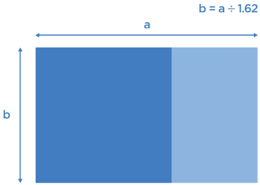

图3.9. 黄金比例

在WordPress主题中，黄金比例通常表现为主内容栏与边栏栏目的比例；它也可以应用于子栏目，或应用于页眉或页脚中元素的高度。让我们看一个实际的例子，看看这对你的主题布局意味着什么。图3.10显示了一个典型的网站布局。


## 图 3.10. 将黄金比例应用于网站布局

这个线框图实际上运用了黄金比例来指导其列与行的比例。470px 的列与 270px 的列相互平衡，270px 的列又与 160px 的列相互平衡。在页头部分，两个区域同样符合黄金比例。请注意这个布局在视觉上多么令人愉悦。每一列和每一行都与模板中的其他元素和谐配合，营造出一个既平衡又有趣的视觉结构。

### 固定宽度还是流式宽度

由于网页需要在各种屏幕尺寸和分辨率下浏览，因此有必要考虑主题如何适应所有不同的选项。大多数桌面屏幕的尺寸在 1000px 宽、600px 高以上（去除浏览器和操作系统界面元素后）。移动浏览器的屏幕空间自然要小得多，不过有些浏览器——如 iPhone——通过缩小整个页面以适应屏幕来弥补这一不足。

你的主题可以采用流式宽度——即自适应浏览器窗口的大小——也可以采用固定宽度。两种方式各有利弊，不过随着超宽显示器越来越普及，固定宽度设计似乎越来越受欢迎。它们在编码上也稍微容易一些：不再需要担心布局在某个特定窗口尺寸下会出问题。

但是，与所有与主题相关的设计决策一样，你选择的布局取决于你主题的目标和使命宣言。

### 布局选项

在抽象地考虑了布局之后，你需要为主题选择具体的尺寸。在大多数情况下，建议最大宽度设为 960px，因为它能在大多数屏幕尺寸上正常显示：你的主题在 1024x768px 分辨率的显示器上可以正常查看，而不会出现讨厌的水平滚动条。即使你选择了流式宽度的主题，仍然应该在设计阶段心中设定一组尺寸，以便确定各种元素的默认比例。

在考虑布局时，有几个传统的选项可供选择。最常见的就是普通的两栏布局和三栏布局，它们能很好地适应多种用途；不过对于简单网站来说，单栏布局也可以很有效。这些布局的示例（按数字顺序排列）如图 3.11、图 3.12 和图 3.13 所示。

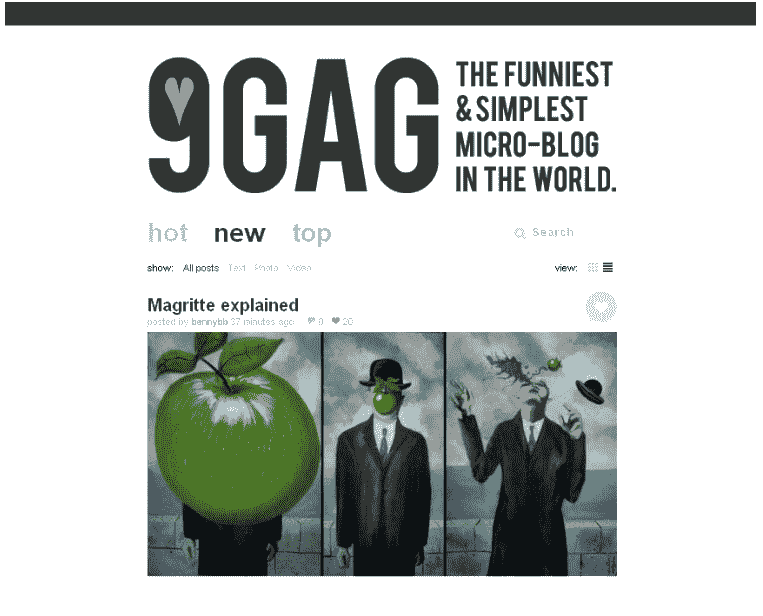

## 图 3.11. 单栏布局

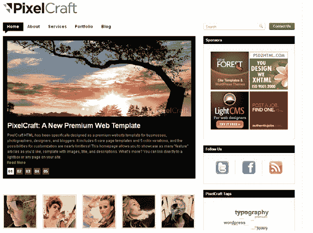

## 图 3.12. 两栏布局

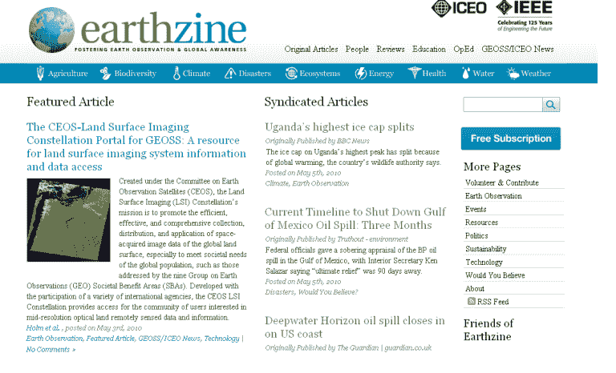

## 图 3.13. 三栏布局

这些传统布局既美观又实用。然而，没有必要局限于传统！有许多较新的 WordPress 主题真正超出了大多数人对 WordPress 主题的认知。图 3.14 和图 3.15 是使用原创和非常规布局的 WordPress 主题示例。

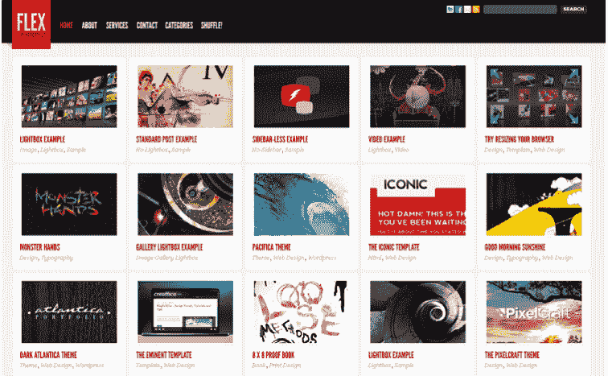

## 图 3.14. Flex 主题采用灵活的网格布局

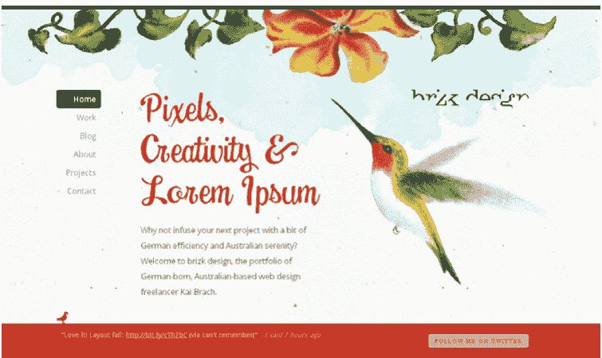

## 图 3.15. Brizk Design 的网站使用固定导航和垂直滚动的主体部分

考虑到可定制性，你可能还想规划多种布局，允许用户选择他们喜欢的布局。你还可以提供一些自定义页面布局，供用户应用于网站上的特定页面（这将在第 7 章进一步讨论）。

## WordPress 主题的结构剖析

在第 2 章中，我们经历了主题规划过程，最终得到了站点地图和一些线框图。现在，借助本章到目前为止介绍的设计原则，我们将把你的线框图转化为构成 WordPress 主题的实际组件。

但这些组件到底是什么呢？与许多其他内容管理平台一样，WordPress 以非常模块化的方式处理大多数页面和文章。这意味着一个页面上的侧边栏几乎总是与另一个页面上的侧边栏外观一致。页头、页脚和其他元素也是如此。有若干这样的模块组合在一起形成一个完整的 WordPress 主题，在设计阶段理解并处理每个模块非常重要。此外，几乎每个网站都需要一些特定的页面，这些也应该纳入你的主题中：例如 404 错误页面和搜索结果页面。

如果你留有一个或多个组件未做设计，那么在开始编写 CSS 时你将不得不临时想出它们的外观；这往往会导致这些元素的视觉风格定义不清，或者与你设计的其余部分不协调。通过在设计阶段处理好每个组件，你将确保你的主题具有一致的、精致且专业的风格。

标准 WordPress 首页模板的几个核心组件如图 3.16 所示。

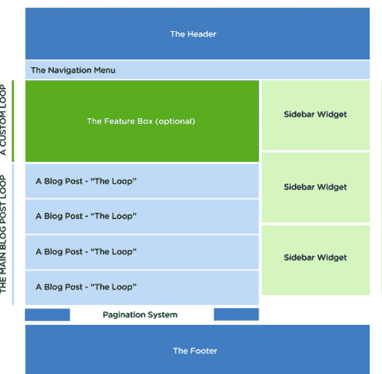

接下来我们将逐一介绍每个组件，并展示一些优秀的设计示例，以激发你关于如何在主题中实现它们的灵感。之后，我们将介绍站点地图中每种页面类型的设计。在本节结束时，你将充满各种想法，并且应该迫不及待地想要开始自己主题的设计了。

### 页头

第一印象很重要。作为访问者到达网站时看到的第一个元素，页头对于确立网站的基调和传达信息至关重要。简洁、不杂乱的页头是一个安全的选择，但绝不是唯一的选择，我们很快就会看到。

页头几乎总会包含网站的品牌标识、Logo，可能还有使命宣言。根据网站的布局，页头还可能包含导航菜单、搜索栏，或者其他元素，如 RSS 订阅链接、社交媒体链接、登录注册链接，以及横幅广告位。

图 3.17 到图 3.23 展示了网站页头的多样化。

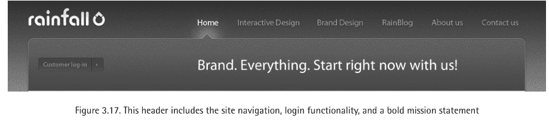

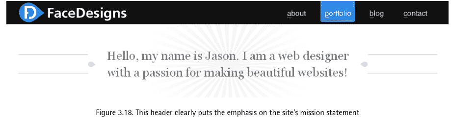

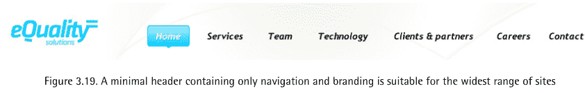

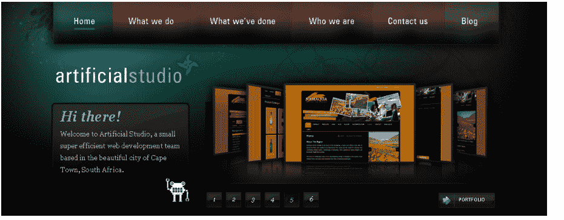

## 图 3.20. 一个更大的页头，包含使命宣言和特色内容轮播

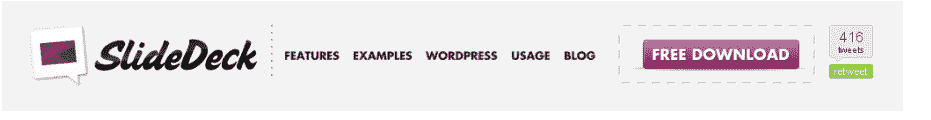

## 图 3.21. 一个更加目标导向的页头示例，包含两个明确的行动号召

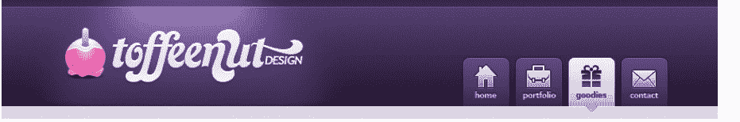

## 图 3.22. 这个页头运用颜色和品牌元素来建立网站的个性

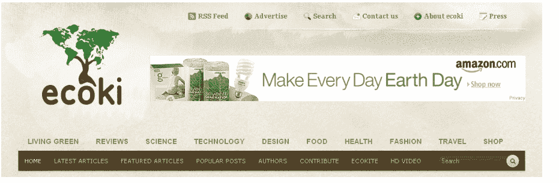

## 图 3.23. 一个更复杂的页头，包含多级导航和横幅广告位

花一点时间来注意这些示例中每个页头的区别。页头的目标仅仅是为网站设定设计基调和风格吗？传达网站的使命宣言？还是鼓励用户执行特定的任务，比如索取报价或与朋友分享网站？

诀窍在于利用页头来突出对你的主题目标重要的内容。确保它与你整个主题的使命宣言和谐配合。记住，作为设计师，你的职责是帮助引导用户找到最相关的内容。一个成功的页头能立即告诉用户他们身处何处以及将在网站上找到什么样的内容；同时还应该让用户能轻松找到最重要的内容。如果你的页头设计达成了这些目标，其余的就只是锦上添花了。

### 导航菜单

本章前面展示的所有页头都包含了网站的主导航。由于导航是网站不可或缺的一部分，让我们花一些时间专门来讨论导航菜单。传统上，导航菜单出现在页面顶部——水平排列——但你的主题可以采用任何数量的导航展示方式，从垂直排列的侧边栏到鼠标悬停时才显示的花式菜单。请记住，除了顶级链接之外，你还需要为子页面和子子页面设计导航。下拉菜单通常是这些嵌套层级结构的完美解决方案；一些示例如图 3.24 和图 3.25 所示。

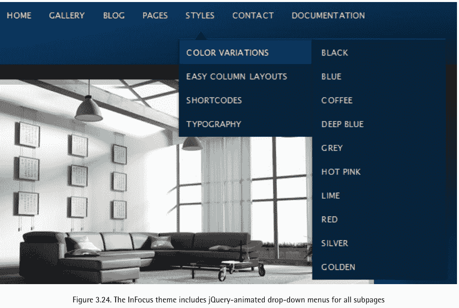


导航菜单也可以包含额外的内容，例如分类（如图 3.26 所示）、博客链接或任何你认为对访客有用的其他链接。虽然避免你的网站主菜单充斥过多选项很重要，但没有必要将自己限制在仅使用页面。

你如何处理导航的视觉样式也是一个重要的考量点。通常，视觉提示有助于用户定位，使其清楚当前所在的页面。图 3.27 展示了一个使用标签页实现此目的的清晰示例。即使标签页或按钮不适合你主题的风格或布局，确保你的导航易于查找、阅读和使用也是至关重要的。

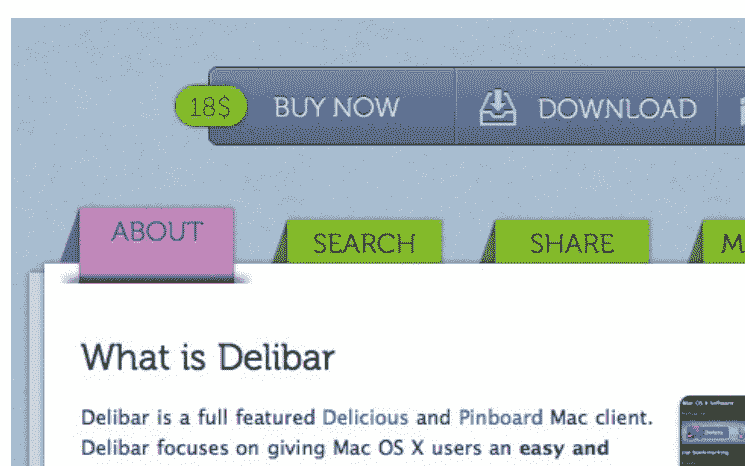

图 3.27. delibarapp.com 使用标签页赋予网站导航一种实体感

### 主循环

这可以说是整个 WordPress 主题中最重要的部分。主循环是 WordPress 用于显示文章（无论是在首页、列表页还是单篇文章页）的元素。主循环通常包含文章的标题、其内容（或摘要），以及一些元数据，如标签、分类、作者姓名和文章发布日期。

图 3.28 展示了 WordPress 3.0 默认主题 Twenty Ten 中主循环的样式。它相当基础，但包含了所有元素，因此是你设计的一个良好起点。

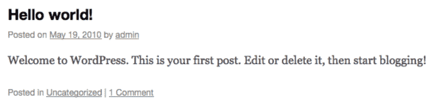

图 3.28. Twenty Ten 主题首页中的主循环

在一个普通的原生主题中，主循环中的所有文章看起来都一样。但生活并非平淡无奇，你的 WordPress 主循环也无需如此。你可以为不同类型的内容创建主循环的自定义设计；例如，为文本文章和视频文章使用不同的布局，或者为每个分类使用不同的样式。

在为你的主循环设计时，回到你的主题使命陈述，确定哪些内容与你的主题成功息息相关。如果你正在设计一个图片博客，你可能会选择显示缩略图、标题和一些标签。或者，如果你正在为一个主要由文本内容组成的主题设计主循环，那么额外的元数据，如文章日期、作者、分类和标签，对于寻求与其兴趣相关内容的用户会很有帮助。图 3.29 至图 3.30 中的示例展示了你可以如何利用主循环。

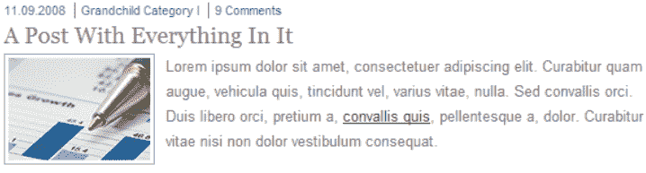

图 3.29. 包含文章缩略图的主循环

 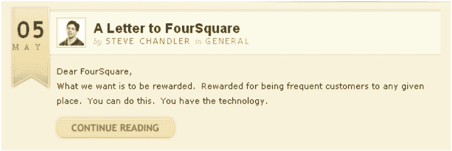

图 3.30. 醒目的日期和**继续阅读**按钮是更实用的功能

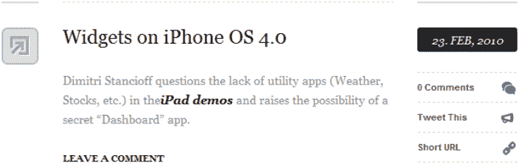

图 3.31. 为了便于分享，此处的主循环包含了“Tweet This”和“Short URL”链接

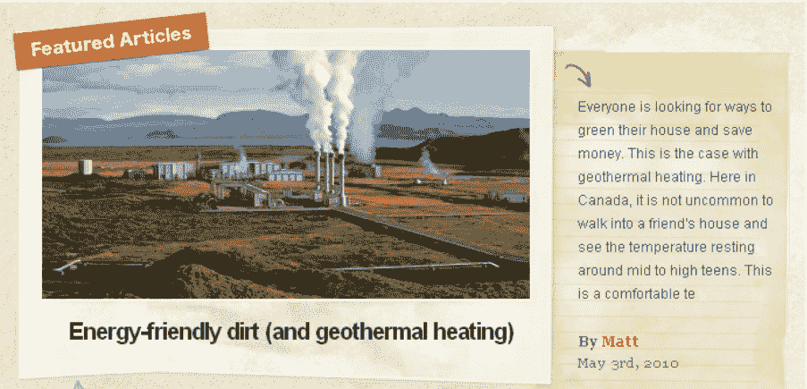

图 3.32. 更进一步的设计可能性包括大型特色图片和纹理背景

### 分页

在任何列出文章的地方，如果文章数量超过设定值，WordPress 会自动将列表分成多个页面。分页控件是允许用户在这些列表页之间来回导航的链接。分页控件通常放置在页面底部，在主循环之后，但也常常同时出现在顶部和底部。它可以由“下一页”和“上一页”链接组成，如图 3.33 所示，或者由带编号的页面列表组成，如图 3.34 所示。

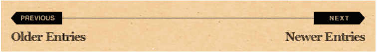

图 3.33. 简单的“下一页/上一页”分页控件

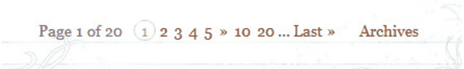

图 3.34. 更复杂的分页系统

这些示例强调，你需要考虑的不仅仅是分页控件的外观：你还需要思考它们将如何工作。标准的“下一页/上一页”链接对于简单网站效果很好，并保持设计整洁，但当你有大量内容时，建议给用户提供一种更直接的方式来查找较旧的内容，而不是连续点击**上一页**按钮20次。

### 评论

WordPress 的评论系统对发布者来说是一个巨大的吸引力，因此你绝对应该在主题的这一部分多加注意！对于许多网站来说，这将是网站与读者之间主要的互动点，因此值得多花一点时间来设计它。

评论系统有两个组成部分需要在主题中处理。第一个是访客用来发表评论的表单，包含姓名、电子邮件地址、网站 URL，当然还有评论文本字段。

图 3.35 至图 3.38 中的示例展示了表单设计的方法，范围从极其简单到相对复杂。

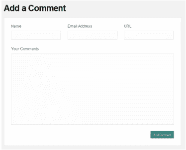

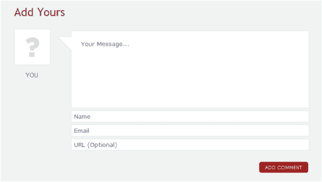

图 3.35. 简单且布局清晰的评论表单

图 3.36. 现在采用更个性化的风格

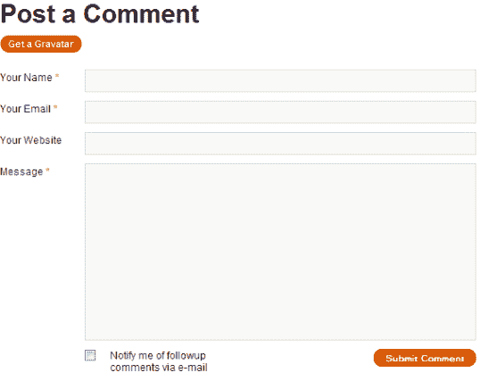

图 3.37. 注意此表单的电子邮件通知复选框和必填字段

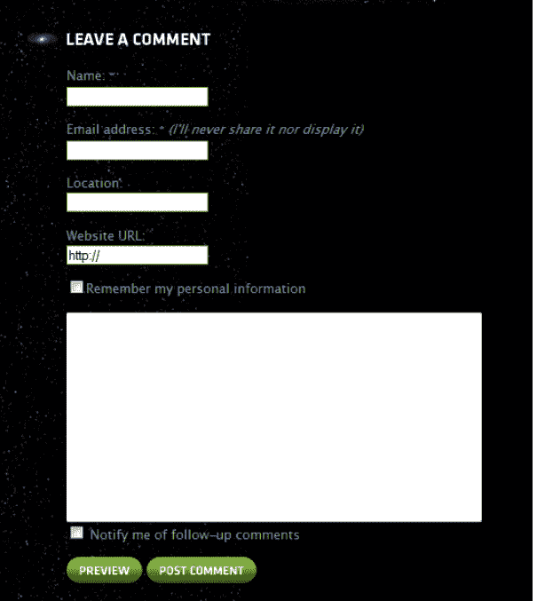

图 3.38. 在这里，用户能够提前预览他们的帖子，并且可以被记住

正如后几个示例所证明的，确实有一些额外的功能可以用来美化普通的评论表单。你需要意识到，使用你主题的发布者可能希望采用这些功能，并在设计阶段就为其做好计划。例如，Subscribe to Comments 插件^3^ 就是一个非常流行的例子，它在上面的图 3.37 和图 3.38 中添加了 **“通知我后续评论”** 复选框。还有一些插件提供评论预览功能，因此也值得整合这个便捷的功能。

WordPress 评论系统的第二个主要组成部分当然是评论本身。每条评论都应显示评论者的姓名——通常链接回他们提供的网站 URL——以及评论发布的日期和实际的评论文本。WordPress 默认使用 Gravatar^4^ 作者头像服务，因此你应该计划在评论中显示头像。

> ^3^ http://wordpress.org/extend/plugins/subscribe-to-comments/
^4^ http://en.gravatar.com/

### 嵌套评论

嵌套评论是 WordPress 的一个相对较新的功能，允许访客回复之前的评论。因此，回复通常会显示在“父”评论下方并缩进，而不是按时间顺序对齐排列。强烈建议你的主题至少*支持*嵌套评论：个别发布者可能会选择关闭此功能，但既然它是 WordPress 的标准功能，你需要确保它对于选择允许该功能的发布者能正常工作。

让我们在图 3.39、图 3.40 和图 3.41 中看一些设计良好的评论列表。你会注意到评论之间的清晰分隔，以及作者头像和醒目的回复按钮。

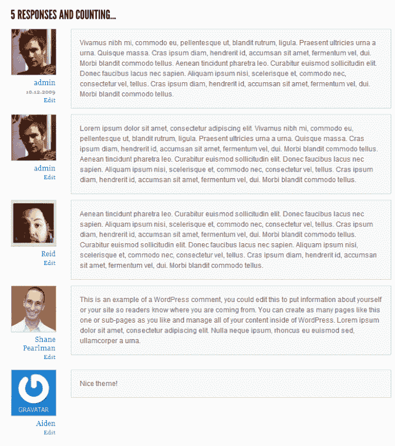

图 3.39. 清晰易读的评论设计

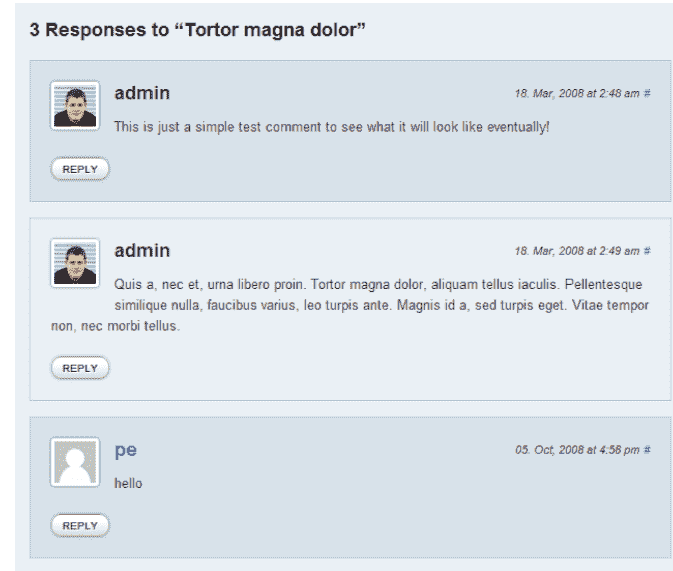

图 3.40. 此评论列表在帖子之间采用交替的背景颜色，并设有大型**回复**按钮

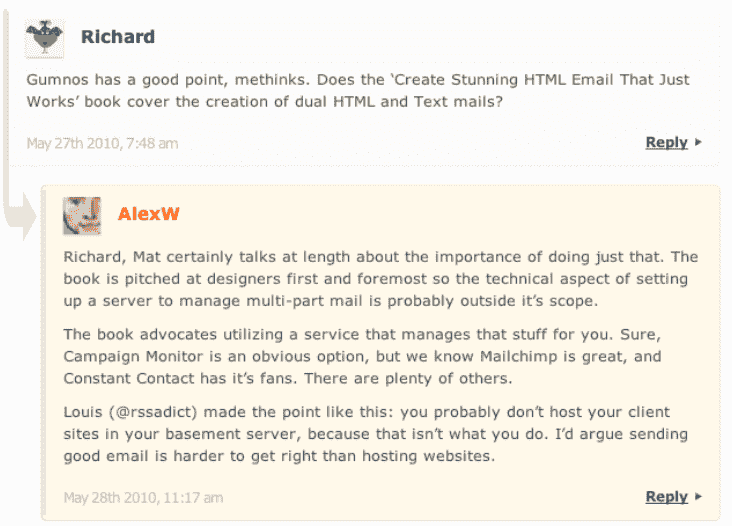

图 3.41. SitePoint 博客使用箭头来显示嵌套评论

通常，正在被评论的文章作者的评论会与其他评论样式不同，以使其突出，如最后一个示例所示。这是一个非常常见的功能，许多发布者都在寻找，因此值得研究将其包含在你的主题中。

### 侧边栏和小工具

术语**侧边栏**在 WordPress 中有特殊含义：它并非特指页面一侧的栏目，而实际上是布局中一个可以包含用户指定小工具的区域。侧边栏是一个极其灵活的区域，因此值得花时间进行设计。整体外观应与布局的其余部分保持一致，但单个小工具可以比 WordPress 默认处理中更突出一些。

首先，为了让你理解 WordPress 侧边栏包含什么内容，让我们看一下图 3.42 中突出显示的最基本的侧边栏版本。

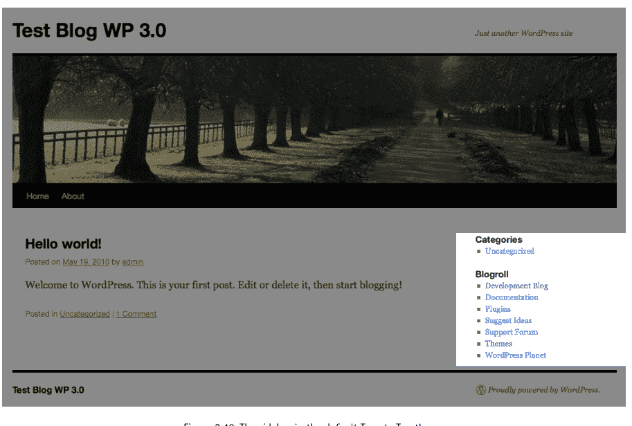

请注意，侧边栏包含两个元素：小工具标题和小工具内容。记住这两个基本元素，当我们看图 3.43 至图 3.48 中的其他侧边栏样式时。


### 页脚

顾名思义，WordPress 主题的页脚会出现在每个页面的底部，在内容之后。对于某些网站来说，一个传统的带有版权信息和几个链接的彩色条可能就足够了，但这仅仅是页脚功能的一小部分；它可以为访客提供一些独特的内容，或者提供其他方式来导航网站。页脚就像是给那些一路浏览到页面底部的用户准备的惊喜奖励，是对他们关注网站的回报。既然他们已经看到了这里，为什么不提供一些有趣又实用的链接呢？

我们先来看看那些偏向简洁、传统风格的页脚。图 3.49、图 3.51 和图 3.50 都取自热门主题网站 WooThemes.com。⁵

这些页脚展示了版权信息、网站品牌的提醒，其中一个还有一个小工具区域。它们简单而低调，与它们所属主题的视觉风格保持一致。

现在来看光谱的另一端，我们将从图 3.52 到图 3.56 看到一些更加华丽的页脚设计实例。

⁵ http://woothemes.com/

图 3.52. 这个富有灵感的页脚设计为访客提供了更多与网站互动的方式。

图 3.53. Oval Cube 的页脚提供了指向文章、新闻和 Twitter 更新的链接。

## 主题设计入门

### 我的一些技能

-   在紧迫的截止日期前交付高度创意的项目
-   在预算内成功开发符合客户简报的解决方案
-   手工编码、符合标准的 XHTML 和 CSS
-   创建 / 开发品牌标识
-   使用 Ruby on Rails
-   集成高级 Javascript 库

更多关于我所做工作的信息 >

### 我的作品集

查看我的作品集 >

### 联系我

**有一个项目想和我聊聊吗？**

我很乐意倾听你的想法或我能如何帮助你，只需给我发电子邮件、填写咨询表单或直接联系我。

+44 (0)141 563 5221

andy@ascreativedesign.com

使用我的咨询表单 >

### 网站地图

-   首页
-   作品集
-   关于
-   联系

需要快速访问我所有的页面？

网站地图 >

### 在 flickr 上查看我的照片

### 打个招呼

**有一个项目想聊聊吗？**

我很乐意倾听你的想法或我能如何帮助你，只需给我发电子邮件、填写咨询表单或直接联系我。

**电子邮件：** andy@ascreativedesign.com
**电话：** +44(0)141 563 5221

咨询表单 >

返回顶部

### 热门项目

### 热门文章

-   CafePress 的 SKGG 瓶子获奖者公布！
-   生态新闻 iPhone 应用程序
-   通过 cafe press 赢得一件有机 T 恤
-   素食主义与地球
-   Be Love 获奖者公布！
-   ecokit 获奖者公布！
-   要想衣物最洁净，请尝试肥皂果
-   养一只绿色狗：面向狗主人的生态资源

### 精选文章

-   素食圣帕特里克节食谱
-   给他的四大生态情人节礼物创意
-   给她的四大生态情人节礼物创意
-   土拨鼠日是否让我们停滞不前？
-   参加贵尔夫有机会议
-   十七个可持续的万圣节小贴士
-   雨林联盟赢得全球视野奖
-   海洋驱动能源备受关注

### 资源

### 我们的网络

-   使用橡胶覆盖物橡胶循环走向绿色
-   戒毒康复计划
-   北面
-   节能三星 LED 电视价格
-   最佳餐厅评论
-   药物和酒精康复中心
-   网页模板
-   母亲珠宝
-   Medifast 优惠券
-   无需医生就诊即可订购血液检测
-   Yodle

### 快速链接

-   绿色生活
-   评论
-   科学
-   技术
-   设计
-   美食
-   健康
-   时尚
-   旅行
-   商店

朋友与推荐

图 3.56. Sawyer Hollenshead 的网站页脚结合了小工具和链接，为感兴趣的用户服务。

前面介绍的更高级的页脚，不仅极具创意，还提供了补充网站内容的功能。这些功能可以用于将用户重定向到他们感兴趣的其他内容或互动工具——这些用户可能原本正准备离开网站。

## 首页

现在我们已经涵盖了 WordPress 主题页面的所有组件，是时候看看构成主题的所有页面了。让我们从头开始，好吗？

首页、主页、落地页、引导页——随你怎么称呼它，它是你的主题称为“家”的页面，是访客通过前门访问你的主题时看到的第一个地方。你设计首页的方式与你想要传达的信息息息相关。首先展示你最好的特色，用户就会立刻明白为什么他们想要留下来。如果你的主题将专注于图像，就展示它们。如果你的主题将集中于视频，就在首页包含一个视频播放器。如果你计划提供文字密集的内容，让你的页面易于浏览。

首页的设计也将为你的其他模板定下基调和结构，因此密切关注这里的细节将会得到回报，图 3.57、图 3.58 和图 3.59 证明了这一点。

图 3.57. 醒目、大胆的图像迎接访问 Unite 主题首页的访客。

图 3.58. WooTube 主题在首页设有一个相当大的视频播放器。


# 标准页面模板

标准或默认页面模板是用于主题页面内容（如“关于”页面）的布局。大多数主题对默认页面模板的处理比较保守，因为内容本身相当静态，任何特殊的样式设计都可能分散注意力。传统的页面模板包含与主页相同的页头、侧边栏和页脚。

如图3.60和图3.61分别所示的Aspire主题和Concept主题，都展示了精心设计的页面模板。所有主要元素都得到了妥善处理：统一的页头、侧边栏、页脚（图中未显示）以及页面内容区域。请注意对小标题、图片、列表等外观的特别关注。发布者可以轻松地在页面中使用这些元素，使其与网站的其他部分无缝融合。

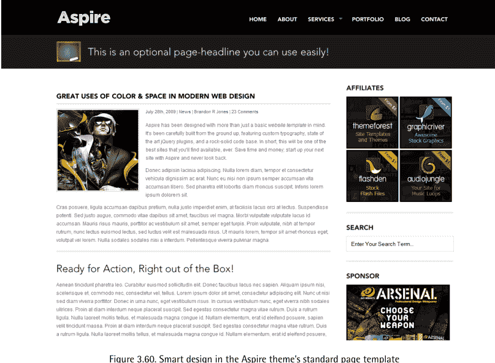
图3.60. Aspire主题标准页面模板中的巧妙设计


图3.61. Concept主题的默认页面模板

## 文章详情模板

文章详情模板用于完整显示单篇博客文章。页面模板通常只显示页面内容，而文章详情模板则通常会显示与文章相关的许多元数据，例如标签、分类、引用通告（一种链接回馈）、评论等。

请记住，虽然“循环”在你的列表页面上通常只显示文章的摘要，但文章详情模板将显示全文。你可以实施的一些自定义操作可能包括自定义文章图片、单独样式的引文、相关文章列表以及针对不同类型或类别文章的独特模板。让我们看一下图3.62中的完整博客文章模板示例。这个文章详情模板的示例来自WooThemes的Spectrum主题。<sup>6</sup>


图3.62. 众多文章详情主题设计中的一例

<sup>6</sup> http://woothemes.com

## 归档、作者、分类和标签页面模板

WordPress 使用这些模板来显示根据某些标准筛选的文章列表；这些标准可以是分类、标签、作者或日期。正如你将在第5章“快速简易模板层次参考”一节中看到的，如果你的主题缺少分类、作者或标签模板，标准的基于日期的归档模板将用于显示这些页面。这通常就足够了，因为所有这些页面类型的需求非常相似。然而，你可能希望为一个或多个模板赋予特定样式，而 WordPress 让你可以灵活地实现这一点。

这些模板非常灵活，你可以使用多种方式来展示文章。图3.63展示了一种可能性，来自SitePoint博客。


图3.63. SitePoint博客上的分类归档显示每篇文章的摘要

## 搜索结果页面

此模板负责处理用户输入搜索查询后返回结果的任务。别担心：你不需要了解任何搜索算法——WordPress会为你完成这项繁重的工作！你只需要决定如何展示结果。此页面的设计可能与归档模板相似——毕竟，你是在展示文章列表——但你也需要考虑可能返回的任何其他形式的内容，例如作者、分类或页面。

考虑一些自定义设置是值得的，通过显示可能与搜索查询相关的额外内容，使搜索页面对用户更有帮助。例如，让我们看看图3.64中ThemeShaper网站的搜索结果页面。请注意，侧边栏包含一堆推荐文章，以防搜索者没有找到他们想要的内容。


图3.64. ThemeShaper的搜索结果页面

#### 404 页面

WordPress 提供了内置的“页面未找到”（404）错误处理。一个有效的404页面不仅仅只是将用户送回他们来的地方，而是会通过包含一个搜索表单来帮助用户查找他们寻求的内容，并建议他们如果通过内部链接到达此页面该如何报告问题。你可能还会考虑使用此页面来显示网站上的热门内容——毕竟，没有理由让他们立刻离开网站！

图3.65和图3.66展示了一些设计巧妙的404错误页面。


图3.65. WooThemes的404错误页面


图3.66. The Bold Italic的风格化404页面<sup>7</sup>

<sup>7</sup> http://thebolditalic.com/

## HTML 元素的标准样式

在设计阶段，一个经常被忽视但至关重要的 WordPress 主题结构部分是一个标准的HTML测试页面。这只是一个普通的WordPress页面，其目的是测试所有常用HTML元素的样式：标题、段落、表单元素、列表、图片、链接、引用块等，以确保它们不会破坏布局，并且样式与主题的其余部分保持一致。

WooThemes的Canvas主题有一个非常详尽的测试页面，如图3.67所示。请注意，设计者细心地包含了有序列表和无序列表，以及每个级别的标题；这就是你应该追求的细节水平。


图3.67. WooThemes的Canvas主题中的HTML元素测试页面

## 额外功能

在设计阶段值得考虑更多额外功能。将传统的WordPress主题想象成一个解剖结构正确的身体，而这些额外功能则是很酷的机械部件。不可能列出所有现有的附加功能，但这里有一些比较流行的。

### 特色轮播

**特色轮播**也称为动态横幅、图片滑块、轮播、内容旋转器、特色框，可能还有上千个其他名字。无论你选择怎么称呼它，它的目的都是突出展示精选内容。它通常出现在网站页头下方的显眼位置，循环展示特色项目，通常利用JavaScript驱动的特效。

有几种设计这种功能的方法；图3.68和图3.69重点展示了两种。


图3.68. SlideDeck网站中的滑动面板特色框


图3.69. Atlantica Portfolio主题中的图片滑块

### 自定义页面模板

在为WordPress主题设计时，没有必要仅限于一个标准页面模板。你可以包含一些额外的页面模板供发布者选择，如果他们希望让页面之间看起来略有不同。全宽模板、图片画廊模板和产品模板是一些常见的例子。

图3.70和图3.71展示了同一主题的两个替代页面模板（作为比较，我们在图3.60中看到了该主题的默认页面）。


图3.70. （图片未显示，但上下文暗示是另一种页面模板）


图3.71. Aspire主题中的全宽模板（无侧边栏）

### 广告位

广告位仅仅是在你的主题布局中预定义的一个空间，用于广告或推广。它非常适合想要将网站变现的发布者，但对于标准博客作者来说，广告位同样适用于他们自己的推广。

图3.72显示了放置在侧边栏和文章内容上方的多个广告位。


图3.72. Psdtuts+在其网站模板中展示了几个自定义广告位


### 灯箱

**灯箱**本质上是一个 JavaScript 插件，允许用户在一个悬浮容器中加载大图片。这一功能在摄影及其他依赖图片的网站中日益流行。在设计主题时，你应该考虑灯箱对用户是否合适。如果确定它会有所帮助，那么接下来就要选择它以何种形式呈现；这时候你在上一章所做的脚本调研就派上用场了。

灯箱的一个标准示例如图 3.73 所示。prettyPhoto 3.0 插件使用 jQuery 以图库格式展示图片。注意底部的缩略图以及箭头导航。


### 社交媒体附加组件

有大量的免费插件可以让用户轻松地在 WordPress 网站中添加社交媒体链接。你也可以将这些功能直接内置到主题中，从而完全无需使用插件。侧边栏小工具以及位于文章底部或顶部的社交媒体按钮列表——如 Twitter、Facebook、Digg、Delicious 等——是添加此类功能最常见的方式，但你也可以将它们集成到主题的页头或页脚中。

图 3.74 和图 3.75 展示了两种你可能考虑的功能示例；两者均取自 SitePoint 博客。


### 不要遗漏任何内容！

你应当从本章中收获以下要点：WordPress 有固定数量的组成部分，你必须为它们进行设计。为了拥有一个健壮、可用的主题，你需要考虑到*所有*这些部分。即使你不打算在自己版本的主题中使用每一个文本元素、表单或小工具，使用你主题的发布者可能希望使用——因此忽略对它们的设计只会促使那些发布者另寻他处，因为你未能提供他们所需的东西。

与静态网站不同，在静态网站中你确切地知道你正在为哪些元素进行设计，而在 WordPress 主题中考虑到所有内容至关重要。在原型设计阶段，务必查看所有常见的 HTML 元素、WordPress 小工具和页面模板。

## 综合运用

现在我们已经回顾了影响 WordPress 主题的设计核心原则，以及主题不可或缺的基本元素，是时候着手你自己的设计了。本书工作流程的下一步将引导你实际构建主题，但我希望你在读完本章后，对 WordPress 主题的结构和设计方式有了更清晰的认识。从本质上讲，WordPress 主题与其他任何网站设计非常相似。遵循本章讨论的基础知识，你应该很快就能打造出自己的出色主题！

# 第 4 章

## 主题框架

作者：Raena Jackson Armitage

当你对博客的外观有了大致想法后，就可以开始着手主题开发了。通常，一个 WordPress 主题需要若干核心文件才能运行——索引页面、单篇文章、静态页面以及其中所有的组件文件，如评论和侧边栏等。WordPress 的核心主题 Twenty Ten 总共包含 22 个文件，这还不包括图片。这里面的工作量确实不小！

精明的开发者深知重新发明轮子是愚蠢的，当你想从一开始就走上正轨时，基于框架开发往往更快更容易。PHP 开发者有 CakePHP 或 CodeIgniter 这样的框架；Ruby 极客有 Ruby on Rails；.NET 开发者有 ASP.NET。WordPress 主题社区也不例外——主题开发框架应运而生，旨在让你更轻松地创建自己的主题。

WordPress 主题开发框架看起来就像普通主题——我们甚至可以说，可能还有一点点无聊——但在其朴素的外表下隐藏着强大的功能，充当你自身主题开发的脚手架。在本章中，我们将探讨为什么框架是一个绝佳的选择，如何为你选择最佳主题框架，以及如何用我们自己的个性化样式和自定义功能来增强该框架。

### 为什么要使用框架？

我敢说你很忙，对吧？你可能也迫不及待地想尽快开始主题开发。而且随着你在主题开发领域的不断成长，你会感激任何能帮你节省时间的东西。主题开发框架正是来让的生活轻松许多的。

框架提供标记代码、功能元素以及通常的一些基础 CSS，所有这些都可以作为你自己主题的基础。对于初级主题开发者来说，使用框架意味着你可以花更少的时间拼凑代码，而将更多时间专注于设计。这也是了解 WordPress 主题如何构建的好方法，尤其是如果你对 PHP 还不太熟悉的话。

在你成为世界知名的 WordPress 主题达人之后，你会发现使用框架能为你节省时间：你花在每个主题都必须做的重复性工作上的时间会减少，而将更多时间投入到最新杰作的精雕细琢上。

### 子主题：基于框架开发的明智方式

在过去那个年代，如果你想修改 WordPress 主题的输出，就必须直接编辑主题本身。在不更改模板文件的情况下，几乎没有机会修改主题的标记或功能。如果你所使用的主题进行了升级，你就不得不花时间小心翼翼地将你的修改整合到新更新的原始主题中——这简直是对时间最浪费的利用方式。

WordPress 2.7 改变了这一切，它引入了**子主题**的概念——一种扩展另一个主题能力的主题。至少，子主题只需要在其自身目录中包含一个样式表（**style.css**），并指定另一个主题作为父主题。当 WordPress 构建页面时，它会从子主题中获取样式表，从父主题中获取模板。

但对于更喜欢折腾的开发者来说，子主题可以帮助你走得更远，有两种方式可以覆盖父主题的行为。还有一个额外的文件 **functions.php**，可用于向主题添加你自己的代码。更重要的是，存储在子主题目录中的模板文件将覆盖父主题的对应文件。这意味着如果你想修改父主题的标记或功能，你只需编写一个自定义函数，或创建相关模板的自己版本——就这样，完全掌控。

最妙的是：虽然 WordPress 社区已经开发了一些功能丰富的专门框架，但任何主题都可以充当父主题。如果你喜爱的主题在其许可协议中允许修改，你完全可以自由地将其作为框架来构建你美妙的新主题，而无需以任何方式编辑原始主题。

没有任何东西阻止你直接修改主题框架，如果你喜欢这样做的话，但聪明的做法是尽可能使用子主题。每当你的父主题开发者对其主题进行更新时，更新你的主题就像安装父主题的新版本一样简单。你的子主题会同时立即更新，这意味着你无需花费太多时间担心如何整合你的修改。

在本章中，我们将牢记一条非常重要的准则：不要触碰父主题！这是基于现有主题构建并避免自找麻烦的最干净、最简单的方式。

### 如何选择优秀的框架？

正如我在本章前面提到的，你可以使用任何主题作为框架——当然，前提是其许可协议允许你这样做。这通常意味着付费主题对于那些希望免费分发自己主题的人来说不是一个好选择。以下是一些重要的考察要点。

-   **简洁、语义化的 HTML**

    > 一个具有有效、语义化 HTML 的主题意味着你可以轻松地用自己的 CSS 来为其添加样式。如果你的候选主题有演示页面，请将其通过 W3C 验证器<sup>1</sup>检验，看看会出什么问题。你还应该留意是否提供了大量的 class 钩子供你挂载 CSS，因为这会在创建子主题时大大减轻你的工作量。

-   **CSS 示例**

    > 一个好的框架理想情况下会附带一些基础 CSS，你可以将其作为自己样式的起点。一个优秀的框架会有多种布局供你选择；理想情况下，它还会将不同的样式关注点（如排版、颜色和布局）放在单独的文件中，让你可以轻松地从默认值中进行取舍。

-   **SEO 优势**

    > 如果你曾梦想看到你的主题出现在成千上万的热门博客上，那么可以肯定 SEO 是这些博主最关心的事情之一；它同样应该是你最关注的。你的框架标记应该遵循良好的 SEO 实践，例如合理使用标题和语义元素、描述性的 `title` 元素，以及良好的 `meta` 元素使用。

-   **支持小工具**

    > 你的框架应该为 WordPress 小工具提供充足的位置。如果你的主题只允许在侧边栏中使用小工具，你的用户不会太满意。挑剔的博主会寻找支持在文章上方和下方、页头和页脚中使用小工具的主题，以及任何他们能塞入心仪小工具的地方。


#### 与插件的良好兼容性

理想情况下，你选择的框架应能与流行的插件良好协作。一些框架已经为最受欢迎的插件内置了CSS样式，至少，框架开发者应该在安装了大量插件的博客上测试过该主题。

#### 文档与支持

一个优秀的主题框架应提供文档和支持渠道，无论是论坛、维信、邮件列表，还是支持工单系统。四处看看，了解一下社区氛围——他们是乐于助人的天使，还是脾气暴躁的矮人？尤其当你购买付费主题时更应如此；为何要为糟糕或不存在的支持支付那么多钱？

#### 值得一探的框架

虽然任何主题理论上都可以用作框架，但有些著名的例子是专门为这一目的设计的。我们现在就来了解这些框架，以及一些基于它们创建的子主题。

#### 免费主题

这里只介绍几个优秀的免费框架。

##### Thematic

Ian Stewart的Thematic（如图4.1所示）是最知名的主题框架之一，原因充分：它拥有数千用户，经数十个流行插件测试，并提供大量免费的社区支持。你可以从ThemeShaper获取Thematic，²该网站还提供了大量关于构建子主题以及创建自己框架的教程集合。


图4.1. 一个使用默认样式的Thematic普通演示

> ² http://www.themeshaper.com/

Thematic子主题非常丰富：图4.2、图4.3和图4.4展示了该框架的灵活性。


³ http://www.cozmoslabs.com/2009/04/07/green-anyone-try-commune-thematic-child-theme/


图4.4. 由合著者Allan Cole设计的Neutica+子主题

##### Hybrid

Justin Tadlock的Hybrid（如图4.5所示）拥有丰富的文档和支持，并且免费开源。你还可以找到一系列语言翻译、大量可供下载和尝试的子主题，以及专门用于增强这个优秀免费主题使用体验的Hybrid插件。访问广泛的深度教程和论坛集锦需要支付合理的25美元费用。


图4.5. 正在运行的Hybrid

你可以从Theme Hybrid下载Hybrid。⁵ 访问时，请看看Justin设计的一些可爱子主题示例；其中两个的截图见图4.6和图4.7。


图4.6. 用Life Collage与世界分享你的想法


图4.7. 有趣、时髦、充满怀旧风

⁵ http://themehybrid.com/

##### Carrington

CrowdFavorite的Carrington框架是开源的，提供四种版本：一种带有一些图形设计（图4.8）、一种完全不带标记、一种专为移动设备设计，以及普通的原生版本。提供官方和社区支持，并为好奇的程序员准备了丰富的文档。


图4.8. 对博主和开发者友好的Carrington Blog

#### 付费框架

这些付费框架附带大量功能、强大的企业级和SEO导向，以及高级支持。

##### Thesis

DIY Themes的Thesis框架承诺终结你所有的SEO烦恼，为最终用户和专业主题开发者提供大量选项。在Thesis中，你直接在主题内修改自定义CSS和函数文件，而不是使用上述子主题方法，但它仍然是一个极其稳固的框架。在撰写本文时，Thesis个人使用价格为87美元，开发者版为164美元，并且有一个繁荣的Thesis皮肤市场。默认的Thesis皮肤如图4.9所示。


Thesis驱动着许多流行博客；查看下面图4.10和图4.11中的一些知名用户。


## 86 构建你自己的超赞WordPress主题


##### Genesis

StudioPress的Genesis框架⁹提供了一个简洁实用的主题，包含众多布局，只需稍加CSS修饰就能大放异彩。一些Genesis专用小工具能帮助你将这个主题扩展到远超其他产品的程度。个人使用价格为59.95美元，并且有一个官方的Genesis主题市场用于销售你的子主题。图4.12和图4.13展示了你可以通过Genesis框架实现的一些很酷的变体。


⁹ http://www.studiopress.com/


图4.13. 这个Genesis子主题真正具有企业级水准

#### 那么，哪个框架最好？

拜托，SitePoint，直接告诉我们哪个最好吧！

好吧，最适合你的主题框架当然完全取决于你和你的需求。事实上，你可能会发现它们都不适合你，而宁愿自己动手构建。只要适合你，怎么做都行！

对我们来说，我们将在接下来的四章中使用免费的Thematic框架进行讲解。它生成了一些出色的标记代码，充满了语义化类，可以帮助你用CSS创造奇迹，具有SEO友好的呈现方式，并提供了大量添加自定义代码的可能性。它是专门为我们在本书中推荐的子主题方法创建的，其设计考虑了主题开发者的需求。它也是免费的，这使得你能够轻松地在家跟随本章的示例进行实践。

## 构建一个简单的子主题

理论部分已经够了——我敢打赌你已经迫不及待想开始构建你的主题了。让我们来制作一个简单的子主题。

### 准备你的画布

首先，我们假设你已经按照第1章的建议，获取了一份WordPress副本用于主题开发和测试。我们还假设你已经为你的开发博客填充了一些虚拟内容。

### 这些虚拟内容是干什么用的？

用多样化的内容对你的主题进行路测非常重要。当然，如果你有自己的WordPress博客，你可以将博客内容导出为WordPress导出文件（通过 **工具 > 导出**），然后导入到你的开发博客（导航到 **工具 > 导入**，然后点击 **WordPress** 链接）。另一个选择是手动创建测试内容，确保包含大量不同类型的内容：大小图片、有序和无序列表、引用块、分页文章等等。

但最快的方法是获取一些虚拟内容并导入。一个好方法是使用WordPress自身的主题单元测试文件，你可以从Codex¹⁰获取——它会用各种大小和类型的帖子、页面、标签、分类，甚至一些附件来填充你的博客。你也可以尝试WP Dummy Content插件¹¹，只需点击几下按钮就能轻松添加和删除大量帖子。

从Thematic的下载页面¹²获取其副本，或使用你WordPress安装中的主题浏览器，将其安装到你的WordPress `wp-content/themes` 目录中。你现在就可以激活它作为你的主题——这是了解默认Thematic主题外观和工作原理的好机会。

查看你博客主页的源代码，你就会明白Thematic的标记为何出色：它充满了有用的 `class` 名、ID、微格式等。以下是我的测试博客的 `body` 元素：

```
<body class="wordpress y2010 m05 d01 h14 home blog not-singular loggedin mac firefox ff3">
```

这是包裹页面第一篇文章的 `div` 元素的一个例子：

```
<div id="post-86" class="hentry p1 post publish author-raena category-uncategorized untagged comments-open pings-open y2008 m04 d01 h11 alt slug-test-post">
```

嘿，我们警告过你它内容丰富！我敢打赌你在想这些类都是干什么用的，我很高兴你问了。Thematic的HTML输出对主题制作者如此有用的原因在于，通常对于你能想到的任何目的都有一个 `class`，这意味着你无需修改模板就能实现许多很酷的效果。想象一下，你想在每次使用标签"love"时，用一个小爱心装饰文章标题。这很容易，因为Thematic会为每个标签创建一个 `class` 并将其放在文章的 `div` 上。

¹⁰ http://codex.wordpress.org/Theme_Development_Checklist#Theme_Unit_Test
¹¹ http://wordpress.org/extend/plugins/wp-dummy-content/
¹² http://themeshaper.com/thematic/


### 创建你的子主题

将 **thematicsamplechildtheme** 目录备份到 **wp-content/themes** 目录，并为其赋予一个新名称。我计划将我的新子主题命名为"Wicked"，因此我相应地命名了这个文件夹：**wicked**。

接下来，我们需要对主题信息进行一些更改，所有信息都存储在主题的 **style.css** 文件中。在你最喜欢的文本编辑器中打开它，看看里面有什么：

```
/*
Theme Name: A Thematic Child Theme
Theme URI: 
Description: Use this theme to start your Thematic Child Theme development.
Author: Ian Stewart
Author URI: http://themeshaper.com/
Template: thematic
Version: 1.0
Tags: Thematic
.
Thematic is © Ian Stewart http://themeshaper.com/
.
*/
```

这里发生了什么？文件开头的这个大注释块执行着一项非常重要的工作：它定义了主题的标题、作者、URI、描述、标签和版本号。这些信息会显示在你 WordPress 安装的**外观 > 主题**面板中每个主题的旁边，如图 4.14 所示。

然而，管理主题面板中缺少两个项目。以 **Template:** 开头的行告诉 WordPress Thematic 是我们的父主题，因此它默认应该使用 Thematic 的模板。另一行包含版权声明的内容也从 WordPress 管理区域中排除了；这是一个放置注释、说明，甚至是俏皮话的地方——任何你喜欢的内容。

让我们现在个性化这个主题的信息。如果你还没有决定名称或描述也没关系；我们可以随时回来修改，但目前至少定义一个名称是个好的开始：

```
/*
Theme Name: Wicked Theme
Theme URI: http://example.com/themes/wicked
Description: A Thematic child theme that's just for kicks.
Author: Raena Jackson Armitage
Author URI: http://example.com/themes
Template: thematic
Version: 0.1
Tags: Thematic, three-columns, blue, grey, gray
.
This theme is © 2010 Raena Jackson Armitage.
.
*/
```

> **保持紧凑！**

换行符对 WordPress 很重要，这些项目应该各占一行。如果你的描述太长需要换行，你可能需要考虑编辑它。

现在我们已经为我们的主题命名，让我们再次查看管理主题面板。如果你已正确执行了这些步骤中的每一步，你将看到你的主题与其他已安装的主题并列显示，并附有你的名称、描述和附加信息，如图 4.15 所示。

这里一切似乎都井然有序。让我们激活我们的主题并开始为其设计样式吧！

### 打造时尚外观

目前，我们将首先调整 CSS 以更好地适应我们的设计。Thematic 贴心地提供了一系列巧妙的重置样式、预打包的布局、排版和其他 CSS 辅助工具；如果你在 **style.css** 文件中继续向下看，你会看到它们已经被导入到我们的示例子主题中。以下是主题 **style.css** 其余部分的样子：

```
/* Reset browser defaults */
@import url('.../thematic/library/styles/reset.css');

/* Apply basic typography styles */
@import url('.../thematic/library/styles/typography.css');

/* Apply a basic layout */
@import url('.../thematic/library/layouts/2c-r-fixed.css');

/* Apply basic image styles */
@import url('.../thematic/library/styles/images.css');

/* Apply default theme styles and colors */
/* It's better to actually copy over default.css into this file
(or link to a copy in your child theme) if you're going to do
anything outrageous */
@import url('.../thematic/library/styles/default.css');

/* Prepare theme for plugins */
@import url('.../thematic/library/styles/plugins.css');
```

> **别担心样式表！**

如何使用 CSS 的细节超出了本书的范围——我们推测，如果你对 WordPress 主题感兴趣，你已经对如何使用 CSS 有了一定的了解。要了解这个狂野而混乱的样式表世界，很难超越《使用 HTML 和 CSS 以正确方式构建你自己的网站》第二版（墨尔本：SitePoint，2008）以及便捷的在线参考文本 SitePoint CSS 参考。¹³

虽然 Thematic 提供的基本设计……嗯，不错，但在魅力方面肯定有所欠缺。让我们对排版、颜色和布局进行一些更改。

第一个更改很简单：目前这个主题将侧边栏放在右侧，但我更希望它在左侧。Thematic 的 **library/layouts** 文件夹提供了一系列我们可以应用于我们主题的布局：左侧两栏（**2c-l-fixed.css**）或右侧两栏（**2c-r-fixed.css**），主内容两侧都有侧边栏的三栏布局（**3c-fixed.css**），或者两个侧边栏都在右侧的三栏布局（**3c-r-fixed.css** 和 **3c-r-fixed-primary.css**，它们在侧边栏的顺序上有所不同）。

更改默认值就像选择我们想要的那一个一样简单，并在我们的 **style.css** 文件中更改对其的引用。在这种情况下，我想要 **2c-r-fixed.css** 将我的侧边栏移到左侧：

¹³ http://reference.sitepoint.com/css/

```
chapter_04/v3/wicked/style.css (excerpt)
/* Apply a basic layout */
@import url('../thematic/library/layouts/2c-l-fixed.css');
```

感觉有点束手束脚？
当然，如果这些导入的样式都不符合你的想法，你可以自由地删除 @import 语句并构建你自己的布局、排版或默认重置样式表。记住，由你做主！

接下来，让我们考虑一下颜色。你注意到上面代码示例中关于 **default.css** 的有用小注释了吗？它提醒我们，如果我们计划做任何"离谱"的事情，就将 **default.css** 文件复制到我们自己的主题中。

我们即将做的事情算不上离谱，但复制文件的建议是可靠的：我们现在就这样做，并更改我们的 @import 语句以反映其新位置。将 **default.css** 文件从 **thematic** 目录复制到你的子主题目录，然后相应地更改 @import。随意更改它的文件名；你可能想给自己留个注释，提醒自己这是原始文件的副本。为了我的 Wicked 主题，我已将文件重命名为 **newstyles.css**：

```
chapter_04/v3/wicked/style.css (excerpt)
/* Apply default theme styles and colors
-- This is a copy of the Thematic default.css */
@import url('newstyles.css');
```

Thematic 的 CSS 和 GPL
Thematic 在通用公共许可证下发布；如果你复制其 CSS 用于你的子主题，你的 CSS 也将受此许可证条款的约束。虽然这可能对你来说不成问题（许多成功的商业主题都是 GPL 许可的），但如果你打算分发你的主题，并且更愿意为你的客户选择一个限制性更强的许可证（参见第 8 章中的"双重许可"部分），你需要从头开始编写自己的样式表。

这个文件很大——太长无法在本书中重现——但这里有一个摘录。花点时间仔细看看它；你会看到选择器是按用途分组的，并且几乎为你可能使用的任何元素都提供了样式。我们将首先给主题的标题添加一点色彩；我们正在寻找一个被清晰标记为 =Header 的部分。以下是我们在那里找到的内容：

```
#header {
    z-index:2;
}
```

对于我们上面的示例文章，我们有一个未标记的类，因为文章没有附加任何标签，但对于有标签的文章，你会看到类似 tag-tagname 的类。因此我们想要定位带有 tag-love 类的文章：

```
.post .tag-love .entry-title {
    background: url(heart.gif) center left no-repeat
}
```

你需要主页上的第一篇文章有更大的文字吗？很简单！Thematic 给每篇文章分配了一个文章编号类，并且当你在查看主页时，body 标签上有一个 home 类。所以我们想这样做：

```
body.home .p1 { font-size: 1.5em }
```

特定页面的标题应该更高吗？Thematic 为每篇文章或页面的 ID 显示了一个类，所以这很容易：

```
body.pageid-14 #header { height: 500px; }
```

正在遭受 IE6 的糟糕困扰吗？收起那些可疑的 hack 吧；Thematic 的浏览器、版本和平台类已经为你准备好了：

```
body.ie6 #branding {
    /* 在这里做一些 IE 6 特定的事情 */
}
```

花些时间浏览 Thematic 的标记，了解它提供的一些有用的类。很可能 Thematic 的动态 ID 和类将允许你进行一些非常具体的样式更改，而无需修改标记。

此时，也值得查看 thematic 目录内部，看看它的工作原理。让我们检查一下：我们看到一些 PHP 模板文件、一些目录、一个 readme 文件，当然，还有这个主题的 CSS。大多数文件名应该是相当不言自明的：header.php 文件处理标题逻辑，post.php 与文章的显示方式有关，依此类推。在 library 文件夹内，你会发现一系列方便的辅助工具——更多的 CSS、JavaScript 和 PHP 文件——Thematic 用来施展其魔法。我们稍后会发现它们很有用，但如果你是好奇型，可以随意探究一下驱动这个主题的一些代码。

嘿，那底部是什么？Thematic 甚至提供了自己的示例子主题来帮助我们正确起步，方便地命名为 thematicsamplechildtheme。在里面，有一个 style.css 文件、一个 functions.php 文件和一个方便的 readme，邀请我们用这些文件快速启动我们的子主题。我想我们就这么做吧！


```
#branding {
    padding:88px 0 44px 0;
}

#blog-title {
    font-family:Arial,sans-serif;
    font-size:34px;
    font-weight:bold;
    line-height:40px;
}

#blog-title a {
    color:#000;
    text-decoration:none;
}

#blog-title a:active,
#blog-title a:hover {
    color: #FF4B33;
}

#blog-description {
    color:#666;
    font-size:13px;
    font-style:italic;
}
```

更改颜色很简单：我为背景选择了深蓝色，这意味着文本和链接的颜色也需要随之改变：

```
#header {
    z-index:2;
    background: #07426c;
}

#blog-title a {
    color:#fff;
    text-decoration:none;
}

#blog-title a:active,
#blog-title a:hover {
    color: #f47920;
}

#blog-description {
    color:#eee;
    font-size:13px;
    font-style:italic;
}
```

效果如何？我们来看看：结果如图 4.16 所示。


图 4.16. 看起来很酷

随着我添加和调整更多样式，我的主题开始成形。本书将省略所有繁琐的细节，但如果你好奇我最终的设计成果，可以随意查看代码档案库¹⁴，研究我的 CSS。

### 持续调整这些样式

看起来相当直接，对吧？这只是一个检查主题标记，并运用你精湛的 CSS 技能来实现设计的过程。通过一些敏锐的 CSS 调整，加上几个小时的摸索、测试和刷新，你应该就能拥有一个外观出色的模板。你可以通过仅更改 CSS 来查看我在图 4.17 中实现的效果。你可以查阅本章代码档案库中 v4 文件夹里我所使用的样式。¹⁵

> ¹⁴ 从 http://sitepoint.com/books/wordpress1/code.php 获取档案库。
>
> ¹⁵ 头部图像由 Flickr 用户 Seo2 根据知识共享许可协议 [http://creativecommons.org/licenses/by-sa/2.0/] 授权使用。 [http://www.flickr.com/photos/seo2/]


**关于**

这是一个 WordPress 页面示例，你可以编辑它来放入关于你或你的网站的信息，以便读者了解你的背景。你可以根据需要创建任意多个此类页面或子页面，并在 WordPress 中管理所有内容。

**搜索**

要搜索，输入内容并按回车键。

**页面**

- *关于*
- *带评论的页面*
- *已禁用评论的页面*
- *父页面*
    - *子页面 1*
        - *子页面 2*

图 4.17. 棒极了！

### 可供使用的框架

我们已经了解了使用主题框架来提升主题开发效率是多么容易——使用框架将为我们节省大量繁琐的设置时间，让我们能够自由地投入到让一切看起来更美观的有趣部分。

许多主题开发者会发现，仅仅修改 CSS 就足以创建一个漂亮、独特的子主题。但如果你想更进一步呢？在下一章，我们将探讨如何为一个主题添加更多功能。

# 第五章：高级主题构建

作者：Raena Jackson Armitage

在前一章中，我们探索了如何使用几个文件和一些 CSS 技巧，从 Thematic 框架创建一个新的子主题。现在你可能想知道如何让那个子主题更努力地为你工作，并打上你自己的印记。如果是这样，那么这一章就是为你准备的！

然而，在开始摆弄代码之前，有必要重申我们在第四章学到的内容：远离父主题！即使你绝对讨厌父主题某个部分的工作方式，并且迫切想要改变它，最好避免对父主题的核心代码进行大刀阔斧的修改。我们有安全、简单的方法来修改它。

理解如何做到这一点，首先需要对 WordPress 如何处理你的模板有一些解释——这是背景故事。

## 模板的工作原理

模板文件是 HTML 和 PHP 的混合体，可以包含你自己的代码，以及对 WordPress 核心功能的调用。在开发主题时，你的主要任务之一将是查看父主题的模板，并找到你要修改的标记生成的位置。为此，你需要了解一些关于 WordPress 模板如何工作的背景知识，所以我们从这里开始。

当 WordPress 渲染一个页面时，它会在活动主题的目录中检查，为将要显示的内容类型寻找合适的模板。它如何知道选择哪个模板文件？这取决于当时正在渲染的页面类型，以及有哪些可用的模板。

WordPress 会按照非常特定的顺序，查找具有非常特定名称的模板文件，最后才会回退到 **index.php**；这可以作为在未定义特定模板时渲染页面的一种备用方案。

### 快速参考：模板层次结构

以下是 WordPress 渲染每种页面类型时查找的文件名的快速参考。

#### 主页

在 WordPress 3.0 中，博客管理员可以指定是显示最新文章还是一个静态页面作为博客主页。WordPress 按顺序查找的模板是：

1.  **front-page.php**
2.  **page.php** 或 **home.php**，取决于博客设置中选择的内容
3.  **index.php**

WordPress 2.x 缺少此功能，因此顺序将是：

1.  **home.php**
2.  **index.php**

#### 单篇文章

1.  **single-posttype.php**，其中 **posttype** 代表 WordPress 3.0 的文章类型之一。例如，如果你的博客是关于食谱的，并且你有一个名为“Recipes”的文章类型，WordPress 将查找名为 **single-recipes.php** 的模板。
2.  **single.php**
3.  **index.php**

#### 单个页面

1.  WordPress 将首先查找在页面模板设置中指定的模板——稍后详述。
2.  **page-slug.php**，其中 **slug** 是页面上指定的别名。例如，如果你有一个名为“About”的页面，WordPress 将首先查找 **page-about.php**。
3.  **page-id.php**，即页面的数字 ID。如果你的“About”页面 ID 为 2，那么 WordPress 将查找的模板是 **page-2.php**。
4.  **page.php**
5.  **index.php**

#### 附件

1.  **MIMEtype.php**，其中 **MIMEtype** 代表附件的大致类型——例如 **audio.php**、**image.php**、**text.php** 或 **video.php**。
2.  **attachment.php**
3.  **index.php**

> **WordPress 中的 MIME 是什么？**
>
> 在互联网上，数据的格式（如文档或网页）由称为 MIME 类型的头信息指定。MIME 代表**多用途互联网邮件扩展**，尽管 MIME 头信息不仅用于邮件。常见文档的常见 MIME 类型包括用于 HTML 文档的 `text/html`、用于 ZIP 文档的 `application/zip`、用于 GIF 图像的 `image/gif` 等等。

#### 分类目录存档

1.  **category-slug.php**，其中 slug 是分类目录的别名。
2.  **category-id.php**，其中 id 是分类目录的数字 ID。
3.  **category.php**
4.  **archive.php**
5.  **index.php**

#### 标签存档

1.  **tag-slug.php**，其中 slug 是标签的别名。
2.  **tag-id.php**，其中 id 是标签的数字 ID。
3.  **tag.php**
4.  **archive.php**
5.  **index.php**

#### 分类法存档

自定义分类法是 WordPress 3 的新功能，因此 WordPress 2 永远不会调用这些模板。

1.  **taxonomy-taxonomyname-term.php**，其中 taxonomyname 代表自定义分类法的别名，term 代表该项的别名。如果你的分类法名为“Cheeses”，你的项名为“Brie”，那么当列出该项的条目时，WordPress 将查找 **taxonomy-cheese-brie.php**。
2.  **taxonomy-taxonomyname.php**，与上面类似，但不包含 term。
3.  **taxonomy.php**
4.  **archive.php**
5.  **index.php**

#### 作者存档

1.  `author-nicename.php`，其中 `nicename` 是作者适合 URL 的用户名——全部小写，空格转换为连字符。如果作者的用户名是“Kelly Steele”，那么 WordPress 将查找的模板是 `author-kelly-steele.php`（WP3）。
2.  `author-id.php`，其中 `id` 是作者 ID。如果 Kelly 的 ID 是 3，那么 WordPress 将选择 `author-3.php` 作为模板（WP3）。
3.  `author.php`
4.  `archive.php`
5.  `index.php`

#### 基于日期的存档

1.  `date.php`
2.  `archive.php`
3.  `index.php`

#### 搜索页面

1.  `search.php`
2.  `index.php`

#### 404 页面

1.  `404.php`
2.  `index.php`

这确实有很多东西要记。幸运的是，来自 wp-tricks¹ 的 Rami 制作了一个简洁的图表²，可以直观地解释模板层次结构。你可能喜欢打印出来作为速查表！

**未来总是在变动中**

WordPress 新版本大约每三到四个月发布一次，任何即将发布的版本都可能添加新的模板名称。请查看 WordPress Codex 模板层次结构页面³以获取最新信息。


### 模板层次结构与子主题

当你使用子主题时，模板层次结构会变得稍微复杂一些。WordPress 会首先在你的子主题中查找最具体的模板，然后到父主题，再回到

> ¹ http://www.wp-tricks.co.il/
>
> ² http://codex.wordpress.org/images/1/18/Template_Hierarchy.png
>
> ³ http://codex.wordpress.org/Template_Hierarchy
```


然后在子主题，接着是下一个最具体的模板，然后再次回到父主题——如此循环往复，直到最后回退到父主题的 **index.php** 文件。你的头晕了吗？这里有一个例子。

假设你有一个 FAQ 页面，其别名（slug）为 faq，ID 为 12。WordPress 将首先检查你是否在页面设置中指定了模板；如果没有，它将按以下顺序检查文件：

1. 子主题的 **page-faq.php**
2. 父主题的 **page-faq.php**
3. 再次检查子主题的 **page-12.php**
4. 父主题的 **page-12.php**
5. 子主题的 **page.php**（发现规律了吗？）
6. 父主题的 **page.php**
7. 子主题的 **index.php**
8. 最后，父主题的 **index.php**

当然，WordPress 在眨眼之间就能完成这一切。

### Thematic 的模板

正如我们在第 4 章中所学到的，Thematic 是一个出色的框架，因为它充满了酷炫的功能。为了更好地理解如何基于其模板进行构建，我们应该花一些时间研究它们是如何组合在一起的。

让我们再次看看 Thematic 的目录；你会看到一大堆模板文件，如果你密切关注前一节的内容，其中许多文件你应该已经很熟悉了：

- 404.php
- archive.php
- archives.php
- attachment.php
- author.php
- category.php
- comments.php
- footer.php
- functions.php
- header.php
- index.php
- links.php
- page.php
- search.php
- searchform.php
- sidebar-index-bottom.php
- sidebar-index-insert.php
- sidebar-index-top.php
- sidebar-page-bottom.php
- sidebar-page-top.php
- sidebar-single-bottom.php
- sidebar-single-insert.php
- sidebar-single-top.php
- sidebar-subsidiary.php
- sidebar.php
- single.php
- tag.php

还有一个看起来很奇怪的目录 **library**，里面充满了存放样式、语言、脚本等的目录。其中最有趣的子目录是 **extensions**——它包含了让 Thematic 实现其神奇功能的所有核心代码。这里是它的内部文件：

- comments-extensions.php
- content-extensions.php
- discussion.php
- dynamic-classes.php
- footer-extensions.php
- header-extensions.php
- helpers.php
- shortcodes.php
- sidebar-extensions.php
- theme-options.php
- widgets-extensions.php
- widgets.php

这些文件的名称应该能给你提供关于它们处理内容的线索：**footer-extensions.php** 显然与页脚相关，**comments-extensions.php** 与评论相关，依此类推。

### 构建杂志风格的首页

现在我们对 WordPress 如何处理模板有了一定的了解，让我们将这些知识付诸实践，开始定制我们的主题。

Thematic 的默认外观和行为，怎么说呢，有点像传统的博客——请注意，我并不是反对博客，但我们希望我们的主题能更有活力。在本章接下来的内容中，我们将通过舍弃侧边栏、创建一个用于列出近期几篇帖子摘要和缩略图的区域，以及添加一个重复页面列表的首页专用页脚元素来修改首页。我们还将在每篇帖子（无论显示在何处）中添加社交媒体链接和作者简介。

### 舍弃侧边栏

当你使用主题框架时，构建自定义主题模板的最简单方法是从父主题复制相关文件并将其放入子主题中。正如我们刚刚看到的，当 WordPress 渲染页面时，它会首先检查子主题，因此我们放入子主题的任何模板都会覆盖 Thematic 中对应的模板。我们的第一个技巧是想从首页删除侧边栏。当 WordPress 想要渲染首页时，它会首先检查设置，看博客管理员是否指定了一个页面作为首页；否则，它将寻找 **home.php** 模板。

Thematic 缺乏一个可供复制的 **home.php** 文件，但 **index.php** 非常适合我们的目的，因为它目前包含了我们想要的所有页面元素以及近期帖子列表。将其从 Thematic 复制，放入子主题，并将其重命名为 **home.php**。以下是完整的全新模板：

```
chapter_05/v1/wicked/home.php

<?php
    // calling the header.php
    get_header();

    // action hook for placing content above #container
    thematic_abovecontainer();
?>

    <div id="container">
        <?php thematic_abovecontent(); ?>
        <div id="content">
            <?php

    // create the navigation above the content
    thematic_navigation_above();

    // calling the widget area 'index-top'
    get_sidebar('index-top');

    // action hook for placing content above the index loop
    thematic_above_indexloop();

    // action hook creating the index loop
    thematic_indexloop();
```

```
// action hook for placing content below the index loop
thematic_below_indexloop();

// calling the widget area 'index-bottom'
wfget_sidebar('index-bottom');

// create the navigation below the content
thematic_navigation_below();

?>

</div><!-- #content -->

<?php thematic_belowcontent(); ?>

</div><!-- #container -->

<?php

// action hook for placing content below #container
thematic_belowcontainer();

// calling the standard sidebar
thematic_sidebar();

// calling footer.php
get_footer();

?>
```

你是不是在期待一大堆 HTML、花括号和乱七八糟的 if 语句？这里我们只有一个孤零零的 div 元素和大量的 PHP 函数调用。

原因是 Thematic 的模板极具模块化——我们之前注意到的 **extensions** 文件夹才是大部分实际操作发生的地方。我们将在本章稍后深入研究所有这些函数的作用以及如何理解这类模板。现在，让我们专注于完成第一个任务。

看着我们新复制的模板，很容易看出侧边栏是从哪里来的：

```
// calling the standard sidebar
thematic_sidebar();
```

当然，删除它就像删除对 **thematic_sidebar** 的调用一样简单：你可以随意删除或**注释掉** ⁴ 这两行。

> ⁴ 意味着用注释包裹起来，以便在暂时禁用的同时保留轻松恢复的能力。

由于我们希望内容现在能够横跨整个页面的宽度，我们需要修改应用于主内容列的 CSS。在我们的示例中，我们导入了 Thematic 的样式表，因此有两个选择器应用于这两个 div：`#container` 和 `#content`，每个都指定了宽度。我们还在第 4 章中了解到，Thematic 在 body 元素上加载了一系列类，其中一个类会告诉我们当前处于首页。

你们这些 CSS 高手肯定已经想到了：我们可以修改子主题中的 CSS，使得当 `#container` 和 `#content` 位于类名为 home 的 body 之下时，具有更大的宽度。为此，只需将以下样式插入到你的 **style.css** 文件中：

```
/* =Homepage specific styles
------------------------------------------------------- */
body.home #container {
	float: none;
	margin: 0;
	width: 960px;
}
body.home #content {
	width: 900px;
	overflow: hidden;
	margin: 0 0 0 10px;
}
body.home .hentry {
	width: inherit;
}
```

现在，打开浏览器查看你的网站首页——你会发现内容占据了页面的整个宽度，完全没有侧边栏的痕迹。而且，如果你导航到任何其他页面，你会看到侧边栏重新出现，而主内容列恢复到之前的比例。

很简单，对吧？但我们刚刚发现的一点很重要：我们看到了在不触动父主题模板任何一部分的情况下，关闭整个 Thematic 区域是多么简单。

### 包含文件

既然你已经了解了模板层级的工作原理以及如何利用它，现在是时候学习 WordPress 主题的另一个关键特性了。如果你密切关注之前的 Thematic 模板文件列表，你已经看到了这一点。其中一些文件（如 **header.php**）并不是针对网站上的特定页面或页面类型的。那么它们在何时以及如何被使用呢？事实是，WordPress 提供了一组函数，用于包含各种常见的页面组件：

 - `get_header` 抓取 **header.php**
- `get_footer` 抓取 **footer.php**
- `get_sidebar` 抓取 **sidebar.php**
- `get_searchform` 抓取 **searchform.php**——如果该文件缺失，WordPress 将直接渲染一个默认的搜索表单
- `comments_template` 抓取 **comments.php**

此外，WordPress 还为你提供了两种更实用的方法来包含这些组件。首先，你可以选择在这些函数中使用参数来指定名称：例如，`get_header('custom')` 将抓取一个名为 **header-custom.php** 的文件。另外，如果你想包含不符合上述任何格式的其他类型文件，可以使用 `get_template_part('partname')`，它会抓取一个名为 **partname.php** 的模板。

你们之中比较擅长 PHP 的人可能会好奇，既然 PHP 已经有了非常完美的 `include` 方法，为什么 WordPress 还要提供这些函数。很高兴你问到了这一点。选择使用 `get_` 函数而不是 `include` 的原因是，它们内置了一些非常巧妙的“防呆”机制。假设你的模板需要使用一个名为 **footer-foobar.php** 的文件，你会这样调用它：

```
get_footer('foobar');
```

再假设某个笨拙但心怀好意用户删除了 **footer-foobar.php**。如果你使用的是 `include`，任何调用它的页面都会显示几个 PHP 错误，告诉每个访问者不存在这样的文件或目录，这会让你的主题用户显得很业余。然而，使用 `get_footer` 时，WordPress 会首先检查 **footer-foobar.php**，如果找不到，则尝试包含 **footer.php** 作为备选方案。如果 **footer.php** 也缺失了，WordPress 会安静地放弃，从而保护你可怜的用户声誉。太棒了！

如果你确实需要使用传统的 PHP include，WordPress 还为你提供了名为 `STYLESHEETPATH` 和 `TEMPLATEPATH` 的常量，以便在常规 PHP `include` 语句中轻松使用。`TEMPLATEPATH` 用于独立主题，而 `STYLESHEETPATH` 用于子主题。你可以这样使用它们：

```
include(STYLESHEETPATH . '/extrastuff/somefile.php');
```

### 修改页脚

我们自定义主页布局的下一步是修改页脚，使其包含一个博客顶级页面的列表。我们现在知道 `get_footer` 会寻找名为 **footer.php** 的文件并将其包含进来。但如果你在调用时传入参数，如 `get_footer('homepage')`，它反而会拉取 **footer-homepage.php**。在 **home.php** 的底部附近，你会看到 **home.php** 调用 `get_footer` 的地方：

```
chapter_05/v1/wicked/home.php (excerpt)

// calling footer.php
get_footer();
```

若要改而调用另一个文件，请为其提供一个参数：

```
chapter_05/v2/wicked/home.php (excerpt)

// calling footer.php
get_footer('homepage');
```

当然，这在目前起不到什么作用——我们需要创建 **footer-homepage.php**。同样，从父主题复制是一个好主意。我们将从 Thematic 复制 **footer.php**，将其放入我们的子主题中，并重命名为 **footer-homepage.php**。它看起来像这样：

```
chapter_05/v2/wicked/footer-homepage.php

</div><!-- #main -->

<?php

// action hook for placing content above the footer
thematic_abovefooter();

?>

<div id="footer">

<?php

// action hook creating the footer
thematic_footer();

?>

</div><!-- #footer -->

<?php

// action hook for placing content below the footer
thematic_belowfooter();

if (apply_filters('thematic_close_wrapper', true)) {
    echo '</div><!-- #wrapper .hfeed -->';
}

<?php
```

```
// calling WordPress's footer action hook
wp_footer();

// action hook for placing content before closing the BODY tag
thematic_after();

?>

</body>
</html>
```

在第 13 行左右，出现了 `thematic_footer`：它控制页脚文本的显示，你可以在 Thematic 为 WordPress 管理区域提供的选项面板中进行设置。我们将在第 7 章中详细学习自定义选项面板以及如何为你的子主题创建这样一个面板。

现在，来放入页面列表：WordPress 的 `wp_list_pages`⁵ 函数恰好能实现这一点。大多数时候，当你发现想要在主题中包含一些额外内容时，WordPress 都会有一个准备好的函数来提供你所需的信息。只需浏览一下 Codex：大多数函数的名称都能清晰地揭示它们的功能。

我们可以直接把 `wp_list_pages` 扔在新的主页页脚模板中，这样也能正常工作。但为了保持良好的代码习惯，更好的做法是将其存储在 **functions.php** 文件中。**functions.php** 倾向于作为你添加到子主题的自定义功能的“大杂烩”。通过将页面列表生成器存储在那里，我们可以确保如果以后需要在模板的其他部分调用它，能够轻松找到并以简单的方式引用。打开那个 **functions.php** 文件，写下你的第一个自定义函数：

```
chapter_05/v2/wicked/functions.php

<?php
function wicked_footer_pagelinks() {
    echo '<ul id="simplepages">';
    wp_list_pages('depth=1&sort_column=menu_order&title_li=');
    echo '</ul>';
}
?>
```

这相当简单：我们使用 PHP 的 `echo` 函数输出一个包裹页面列表的 `ul` 元素，并带有一个 `id`，以便我们在 CSS 中轻松定位。唯一棘手的部分是传递给 `wp_list_pages` 的参数字符串。

一如既往，理解如何使用 WordPress 函数的最终参考资料是 Codex，但我将为你分解这里使用的参数。*depth* 指定了 WordPress 应该在网站页面层级中挖掘多深。通过指定 1，我们告诉 WordPress 我们只需要顶级

> ⁵ http://codex.wordpress.org/Template_Tags/wp_list_pages

页面。*sort_column* 指定页面的排序方式。这里可以提供许多不同的选项：你可以按 ID、名称、作者、修改日期等排序。*menu_order* 是用户在管理区域对页面进行排序的方式，因此是一个合理的选择。*title_li* 用于设置显示在列表顶部的标题。通过传递 ''（空字符串），我们告诉 WordPress 省略标题，并且不要将页面包裹在 `ul` 中（因为我们自己已经提供了）。

同样，所有这些参数（以及其他几个）都在 `wp_list_pages` 的 Codex 页面上有所描述，因此你应该阅读该页面，或者阅读你打算使用的任何 WordPress 函数的页面。

既然我们已经在 **functions.php** 中创建了函数，回到页脚，我们可以这样调用该函数：

```
chapter_05/v2/wicked/footer-homepage.php (excerpt)

<div id="footer">
    <?php
        wicked_footer_pagelinks();
        // action hook creating the footer
        thematic_footer();
    ?>
</div><!-- #footer -->
```

保存所有更改，跳到浏览器，前往你的子主题主页。如果一切顺利，你的页面列表将在底部等待你。现在你只需要添加一些 CSS 来让它们变得美观，就可以准备大显身手了！这里有一些基础样式，可以让项目水平显示并去掉那些讨厌的圆点：

```
chapter_05/v2/wicked/newstyles.css (excerpt)

body.home ul#simplepages {
    width: 940px;
    margin: 0 auto;
}

body.home ul#simplepages li {
    list-style-type: none;
    display: inline;
    margin-right: 30px;
}
```

我们在这里学到的是如何使用 WordPress 的模板标签插入新内容，以及如何利用 WordPress 的自定义模板包含机制。这很棒，但关于 WordPress 和 Thematic 拼图还有一个巨大的片段需要你掌握：钩子（hooks）和过滤器（filters）。

### 钩子与过滤器

在上面的示例中，我们将标记生成放在了 **functions.php** 文件的函数内部，但我们仍然需要编辑模板文件来插入对该函数的调用。这可行，但事实证明我们可以用一种更简洁的方式来实现：WordPress 暴露了两种不同类型的**钩子（hooks）**，之所以这样命名，是因为附加在钩子上的代码就像魔术贴一样抓住 WordPress 的功能。我们可以在 **functions.php** 中创建新函数，将它们附加到这些钩子上，从而在不触碰任何模板文件的情况下修改主题输出的部分内容。

**动作钩子（Action hooks）** 为事件提供，例如在显示文章或渲染页面页脚时。当你想要将编写的函数附加到某个特定活动时（例如，当 WordPress 显示评论或小工具时），通常会使用动作钩子。

**过滤器钩子（Filter hooks）** 允许你将内容传递给一个函数，然后将其返回给 WordPress——通常，这些用于修改文本。例如，如果你想在文章内容中突出显示某些词汇，或者在链接后附加一个特殊的图标图像，你就会对文章内容使用过滤器钩子。

在这两种情况下，你都需要先编写函数，然后编写一行简单的代码将你的钩子注册到 WordPress。然后，当 WordPress 想要显示内容或执行触发其中一个钩子的操作时，它会寻找任何注册到该钩子上的函数并执行它们。如果现在觉得困惑也不用担心：一旦你看了几个实际例子，一切都会变得非常清晰。

这本书太薄了，无法解释 WordPress 中的每一个钩子——它们有 1,100 多个！你可以在 WordPress Codex 动作参考（Action Reference）中找到所有可用动作的列表。<sup>6</sup> 对于过滤器，请查看 WordPress Codex 过滤器参考（Filter Reference）。<sup>7</sup> 另一个极好的参考是 Adam R. Brown 的 WordPress 钩子数据库（WordPress Hooks Database），<sup>8</sup> 其中包含了每个 WordPress 版本中添加或删除了哪些钩子和过滤器的信息；如果你开发的主题需要向下兼容旧版本的 WordPress，你会发现这些信息绝对至关重要。

> **等等……一千 *多个* 钩子？！**

没错，WordPress 确实提供了大量的钩子。没关系——其中许多钩子是关于发布文章或 pingback 之类的事情，这些更适合插件。对于主题开发者来说，最有用的是那些与显示标记和内容相关的钩子。

钩子的使用足够简单——编写你的函数，然后告诉 WordPress 你打算钩入其中。奇怪的是，添加动作或过滤器钩子是通过名为 `add_action` 和 `add_filter` 的函数完成的：

<sup>6</sup> http://codex.wordpress.org/Plugin_API/Action_Reference
<sup>7</sup> http://codex.wordpress.org/Plugin_API/Filter_Reference
<sup>8</sup> http://adambrown.info/p/wp_hooks/


### 添加 Favicon

让我们来看一个如何使用 hook 来修改主题的简单示例。Favicon（网站图标）就是你在浏览器的标签页、标题、书签和历史记录区域看到的那些小图标。为什么不给你的主题添加一个呢？既然在做了，你可能还想为 iPhone、iPad 和 iPod touch 添加一个更大的图标。

首先，创建你的 favicon——网上有很多资源可以帮到你<sup>9</sup>。将你的图标命名为 **favicon.ico**，并将其上传到你的主题目录下。

接下来，在 **functions.php** 中，我们将创建一个简单的函数，用于构建指向 favicon 所在位置的链接。主题文件的 URL 由 WordPress 的 `get_bloginfo`<sup>10</sup> 函数提供，而 URL 的其余部分由我们自行指定：

```
chapter_05/v3/wicked/functions.php (excerpt)

function wicked_favicon() {
    echo '<link rel="shortcut icon" href="'
        . get_bloginfo('stylesheet_directory')
        . '/images/favicon.ico"/>';
}
```

请注意，在上面的代码中，我们假设你的 favicon 存放在名为 **images** 的目录中——如果你将其放在其他地方，请务必在函数中相应地修改。

现在，我们需要将该动作添加到主题的 head 中。幸运的是，WordPress 有一个在构建 head 元素时触发的动作 hook：它被称为 `wp_head`。因此，按照我们之前看到的 `add_action` 的使用格式，我们只需要写：

```
chapter_05/v3/wicked/functions.php (excerpt)

add_action('wp_head', 'wicked_favicon');
```

由于 head 中链接的顺序对我们来说无关紧要，因此无需担心指定优先级；我们的 `wicked_favicon` 函数不接受任何参数，因此也没有必要指定 `$accepted_args`。这样我们就只剩下想要挂载的 action 和想要附加的函数。

同样的技术也适用于包含额外的样式表或 JavaScript 文件——任何应该放在 head 中的内容都可以添加到 `wp_head` 中。

<sup>9</sup> http://www.sitepoint.com/blogs/2009/02/27/88-outstanding-favicons-and-6-resources-to-help-you-create-your-own/

<sup>10</sup> http://codex.wordpress.org/Function_Reference/get_bloginfo

### Thematic 的 Hooks

当然，向主题的 head 元素添加标记相当无趣：大多数时候，你可能想在网站的 body 内部操作标记。幸运的是，Thematic 提供了许多自己的 hook，我们可以使用它们在页面的各个点添加、删除或调整代码。其中大多数 hook 是根据它们在模板中的位置或功能命名的；以下是你作为主题开发者会发现最有用的一些 hook：

- `thematic_before`
- `thematic_aboveheader`
- `thematic_header`——这构建了整个 header div，并且还包含以下动作：
  - `thematic_brandingopen`
  - `thematic_blogtitle`
  - `thematic_blogdescription`
  - `thematic_brandingclose`
  - `thematic_access`——这构建了菜单和一个“跳至内容”的链接
- `thematic_belowheader`
- `thematic_abovecontent`
- `thematic_abovepost`
- `thematic_belowpost`
- `thematic_abovecomments`
- `thematic_belowcomments`
- `thematic_abovecommentslist`
- `thematic_belowcommentslist`
- `thematic_abovetrackbackslist`
- `thematic_belowtrackbackslist`
- `thematic_abovecommentsform`
- `thematic_belowcommentsform`
- `thematic_show_subscription_checkbox`
- `thematic_show_manual_subscription_form`
- `thematic_aboveminasides`——asides 是 Thematic 对其小工具区域的称呼
- `thematic_betweenminasides`
- `thematic_belowminasides`
- `thematic_abovefooter`
- `thematic_after`

如果你是视觉型学习者，可以看看由 ThemeShaper 论坛成员 dwenaus 制作的这个精巧的线框图<sup>11</sup>。它展示了在模板中出现的所有小工具区域、主要的标记块以及最实用的 hook。

<sup>11</sup> http://bluemandala.com/thematic/thematic-structure.html

不过，除非你的记忆力比我好得多，否则你可能永远无法记住所有可用的 hook 和函数，因此试图死记硬背它们是没有意义的。相反，你应该专注于学习寻找所需内容的*过程*。深入研究模板和 Thematic 的扩展文件，当你遇到属于 WordPress 核心功能的函数时，请查阅 WordPress Codex。为了让你了解如何操作，让我们从头到尾分析一个例子。

### 综合实践

在我们进入更复杂的主题修改之前，我想向你展示一个例子，说明所有这些模板文件和 hook 是如何协同工作，从而在你用浏览器加载网站时创建出所见标记的。**single.php** 是一个很好的起点；它控制单个文章的显示。用你最喜欢的文本编辑器打开它并窥视一下：

```
<?php
    // calling the header.php
    get_header();
    // action hook for placing content above #container
    thematic_abovecontainer();
?>
    <div id="container">
        <?php thematic_abovecontent(); ?>
        <div id="content">
            <?php
            the_post();
            // create the navigation above the content
            thematic_navigation_above();
            // calling the widget area 'single-top'
            get_sidebar('single-top');
            // action hook creating the single post
            thematic_singlepost();
            // calling the widget area 'single-insert'
            get_sidebar('single-insert');

            // create the navigation below the content
            thematic_navigation_below();

            // calling the comments template
            thematic_comments_template();

            // calling the widget area 'single-bottom'
            get_sidebar('single-bottom');

            ?>
        </div><!-- #content -->

        <?php thematic_belowcontent(); ?>
    </div><!-- #container -->

    <?php
    // action hook for placing content below #container
    thematic_belowcontainer();

    // calling the standard sidebar
    thematic_sidebar();

    // calling footer.php
    get_footer();
    ?>
```

正如我们在查看 `home.php` 和 `footer.php` 时看到的那样，这个文件中几乎没有实际的标记。如果我们想找出文章的标题、作者行和正文是如何组合在一起的，我们将不得不深入挖掘。

> **这里像个迷宫一样**

Thematic 的扩展文件注释得很详细，但通常非常长。你很快就会和文本编辑器中的搜索功能成为好朋友。如果你的编辑器具有项目范围的搜索功能，允许你在工作目录的多个文件中搜索字符串，那么现在就熟悉它绝对是个好主意。

如果你最喜欢的编辑器缺乏此功能，另一种选择是在 Google Code 上搜索 Thematic 的源代码（它托管在那里）。只需点击 **Source** 选项卡，然后搜索你要寻找的函数或 hook。Google Code 将向你展示 Thematic 整个代码库中该文本的所有出现位置，并附带上下文和行号。

<sup>12</sup> http://code.google.com/p/thematic/


`thematic_singlepost` 是用于加载文章本身的函数。在整个 **thematic** 目录中搜索“thematic_singlepost”，会发现该函数声明位于 **library/extensions/content-extensions.php** 中：

```php
// Located in single.php
// The Post
function thematic_singlepost() {
  do_action('thematic_singlepost');
} //end thematic_singlepost
```

`do_action` 是一种告诉 WordPress 正在发生某个操作的方式，因此它应该执行任何已挂接到该操作的函数。这是一个重要的概念，可能会有点令人困惑，所以我们来分解一下：

1.  当 WordPress 渲染 **single.php** 模板时，它会遇到对 `thematic_singlepost()` 函数的调用。
2.  当它运行该函数时，Thematic 告诉 WordPress 触发 `thematic_singlepost` **操作**。
3.  此时，任何已通过我们上面看到的 **add_action** 挂接到该钩子的函数都将被执行。

因此，为了找出 Thematic 接下来到底做了什么，我们只需找到挂接到该操作的函数。让我们搜索字符串“thematic_singlepost”的下一个实例，结果发现它在同一文件的更下方：

```php
add_action('thematic_singlepost', 'thematic_single_post');
```

啊哈！这就是我们的 **add_action** 调用。它告诉 WordPress，当 `thematic_singlepost` 事件发生时，我们希望执行 `thematic_single_post` 函数（注意多了一个下划线）中的内容。我们离目标更近了！幸运的是，该函数就位于 `add_action` 调用的上方：

```php
function thematic_single_post() { ?>
<div id="post-<?php the_ID(); ?>" class="<?php thematic_post_class(); ?>">
  <?php thematic_postheader(); ?>
  <div class="entry-content">
    <?php thematic_content(); ?>
    <?php wp_link_pages('before=<div class="page-link">' .
__('Pages:', 'thematic') . '&after=</div>') ?>
</div>
<?php thematic_postfooter(); ?>
</div><!-- .post -->
<?php
}
```

找到了！嗯，基本上找到了——这段代码中很多部分仍然在调用我们尚未发现的其他函数。其中一些，如 `thematic_content`，是 Thematic 库中的其他函数。另一些，如 `wp_link_pages`，是 WordPress 的内置功能。然而，尽管有这些其他函数调用，这段代码确实与我们认为一篇文章应该包含的内容相似。有一个带有类和 ID 的 div，一个文章标题函数，另一个包含内容的 div，分页，以及一个文章页脚函数。

要找出一个小组件的工作方式，这可真是费了不少功夫。你可能会问，为什么所有东西都藏在一个又一个函数里？虽然这看起来像是在做很多无用功，但实际上这对你有益——将所有功能元素分解成小块意味着我们可以针对模板的特定部分，在我们自己的工作中重用很多 Thematic 函数，并且通常能灵活地进行更改。

### 休息一下

信息量很大，而我们还没有进行太多实际的模板修改！请放心，这一切都很重要：你对 WordPress 主题引擎理解得越深入，就越有能力制作出一些真正出色的（wicked）主题。随着你熟悉 WordPress 和 Thematic，你会发现对所有这些部分的良好理解将使你更容易对现有模板进行精确修改，甚至构建全新的模板。

不过现在，可能是时候去拿点零食或美味的饮料了。当你回来时，我们将开始充分利用那一大堆知识。

### 改造你的子主题

已经回来了？太好了！我们准备开始修改那些有趣的模板了。我们将进行三次更复杂的更改：首先，我们将在每篇文章上添加社交媒体分享按钮；然后，我们将在文章底部添加作者简介；最后，我们将通过一个全宽特色文章和几篇摘要来完成我们的杂志风格首页布局。

### 为你的文章添加社交媒体按钮

我们到目前为止所做的所有修改都依赖于操作钩子。让我们尝试一个使用过滤器钩子的，好吗？与操作不同，过滤器会从 WordPress 接收一些内容，对其进行修改，然后必须传递出去，以便优先级较低的过滤器可以对其执行操作，并且可以输出。这意味着你的过滤器函数应该接受一个参数（初始内容），并在完成后返回修改后的内容（输出）。

# 120 构建你自己的出色 WordPress 主题

在这个示例中，我们将在每篇文章的末尾添加一个社交媒体分享按钮。我们将从 AddThis 获取一个漂亮的组合分享按钮，<sup>13</sup> 不过你也可以使用任何你喜欢的分享按钮或它们的组合。前往 AddThis.com 获取一个按钮（在 **Select your service** 中选择 **Website**，因为 **WordPress** 选项提供的是插件而非代码片段）。在过程结束时，你将获得一些 HTML 代码，可以复制粘贴到你的模板中。我们将在函数中使用它：

```php
function wicked_linklove($content) {
    if(is_single()) {
        $content .= '<div class="linklove">
            Did you love this post? Tell everyone you know, right now!
            <Paste the markup you received from AddThis here.>
        </div>';
    }
    return $content;
}
```

请注意，与我们之前编写的操作钩子函数不同，这个函数接受一个参数：`$content`。该参数将包含 WordPress 正在应用过滤器的任何内容。我们获取该变量，将新的 `.linklove` div 附加到它后面，然后返回它，供后续过滤器使用或进行显示（如果我们的过滤器是最后一个）。

> **传递下去**
>
> 如果你在过滤器末尾忘记返回内容，你的过滤器就会像黑洞一样：WordPress 会传入内容，但什么也不会出来。这将导致我们所有文章的全部内容消失！

我们还使用了一个快速的 `if` 语句来检查文章是否在它自己的页面上显示：我们只想在完整视图中显示分享链接，而不是在摘要中。这通过 WordPress 的 `is_page` 函数来实现。WordPress 提供了大量此类条件标签，<sup>14</sup> 允许你根据当前页面满足的条件显示内容；值得熟悉它们。

现在告诉 WordPress 将此过滤器应用于每篇文章的内容。Thematic 通过一个名为 `thematic_post` 的过滤器方便地传递每篇文章的全部内容，所以让我们尝试使用它：

```php
add_filter('thematic_post', 'wicked_linklove', 90);
```

我们使用了优先级 90，以确保我们的过滤器会在任何修改相同内容的其他过滤器之后执行；优先级参数完全是相对于其他过滤器而言的，所以如果它出现在错误的位置，只需尝试将数字调高或调低。在你的浏览器中加载它：立刻拥有社交媒体摇滚明星般的待遇！

## 在文章上显示作者简介

许多博客通常在文章底部包含作者的小传记。以下是如何在文章末尾添加作者简介框。我们将使用上面用过的 `thematic_post` 过滤器。

首先，让我们编写我们的函数——这个模式现在对你来说应该越来越熟悉了！第一个 `if` 语句检查我们是在单篇文章还是页面上（因为我们只想在完整视图中显示作者简介，而不是在文章列表中）。假设这些条件之一为真，我们的函数接着会构建一个 div，一个用于作者姓名的标题，一个大小为 50 像素的作者 Gravatar 头像，以及来自作者 WordPress 个人资料中的简介。然后我们返回附加了新 div 的文章内容。这是我们的函数：

```php
// chapter_05/v5/wicked/functions.php (excerpt)
function wicked_showbio($content) {
    if (is_single()) {
        $content .= '<div id="authorbio">';
        $content .= '<h3>About ' . get_the_author() . '</h3>';
        $content .= '<p>' . get_avatar(get_the_author_meta("user_email"), "50");
        $content .= get_the_author_description() . '</p></div>';
    }
    return $content;
}
```

你会看到我们使用了一些以“get”开头的函数——`get_the_author`、`get_avatar`、`get_the_author_meta` 和 `get_the_author_description`。这些是 WordPress 提供的用于检索作者信息和头像的函数。


## 这里有回声吗？

通常，以 `the_` 开头的 WordPress 函数包含 `echo` 语句，而以 `get_the_` 开头的则不包含。例如，WordPress 同时包含了 `the_author`<sup>15</sup> 和 `get_the_author`<sup>16</sup> 方法。两者都检索相同的信息，但 `get_the_author` 会返回信息供你在 PHP 代码中使用，而 `the_author` 则会直接使用 `echo` 输出信息。

因此：

```php
<?php the_author ?>
```

与以下代码完全相同：

```php
<?php echo get_the_author ?>
```

如果你在 `wicked_showbio` 函数中错误地使用了 `the_author`，结果会一团糟：一旦你调用 `the_author`，PHP 就会立即输出作者姓名，这远在你将 `$content` 返回给过滤器之前。这会导致作者姓名显示在文章顶部，而不是你期望的位置。

在 **functions.php** 中，一个针对 `thematic_post` 的过滤器将负责将我们的函数附加到文章内容的末尾：

```php
// chapter_05/v5/wicked/functions.php (节选)
add_filter('thematic_post', 'wicked_showbio', '70');
```

记得在你的主题中添加一些 CSS，让那个新的 div 看起来更漂亮。

## 带摘要的文章

作为我们的最后一个技巧，我们将采取一些更激进的措施：移除首页默认的文章列表，用我们自己制作的列表取而代之。我们将获取最近的四篇文章：最新的一篇将放在一个大的特色区域，并显示其文章缩略图，接下来的三篇按时间顺序排列在其下方。想象一个类似于图 5.1 的布局。

### 最近的标题

Lorem ipsum dolor sit amet, consectetuer adipiscing elit. Aenean commodo ligula eget dolor. Aenean massa. Cum sociis natoque penatibus et magnis dis parturient montes, nascetur ridiculus mus. Donec quam felis, ultricies nec, pellentesque eu, pretium quis, sem.

### 另一个最近的项目

Lorem ipsum dolor sit amet, consectetuer adipiscing elit. Aenean commodo ligula eget dolor. Aenean massa. Cum sociis natoque penatibus et

[阅读更多...](#)

### 还有一个

Lorem ipsum dolor sit amet, consectetuer adipiscing elit. Aenean commodo ligula eget dolor. Aenean massa. Cum sociis natoque penatibus et

[阅读更多...](#)

### 再来一个

Lorem ipsum dolor sit amet, consectetuer adipiscing elit. Aenean commodo ligula eget dolor. Aenean massa. Cum sociis natoque penatibus et

[阅读更多...](#)


## 设置文章缩略图

首先，我们需要为我们的主题包含文章缩略图支持。文章缩略图在 WordPress 2.9 版本中引入，允许你在创建文章时附加一张特色图片。你的主题可以为此功能提供支持，定义多种缩略图尺寸，并在不同的列表中使用不同版本的缩略图。例如，你可能希望在搜索结果和归档列表中使用小型、方形的缩略图，在首页使用中等方形的，而在单篇文章中使用大型、全宽的。

为了在我们的主题中启用缩略图支持，让我们将以下代码添加到 `functions.php`：

```php
// (节选)
add_theme_support('post-thumbnails');
```

`set_post_thumbnail_size` 是 WordPress 用于指定默认图片尺寸的函数，而 `add_image_size` 则定义其他缩略图尺寸。我们的首页可能是唯一一个我们想要这种尺寸的方形图片的地方；如果我们想在模板的其他部分添加缩略图，比如单篇文章模板，它们几乎肯定会是不同的尺寸。因此，让我们将默认尺寸设置得大一些，并为首页图片选择一个中等尺寸：

```php
// (节选)
set_post_thumbnail_size(540, 300, true);
add_image_size('homepage-thumbnail', 300, 200, true);
```

这两个函数都接受相同的三个参数：缩略图的宽度、高度，以及一个布尔选项，告诉 WordPress 是否对图片进行**硬裁剪**。如果你将此设置为 `false` 或省略它，图片将被缩放以*适应给定尺寸的方框*，同时保持其比例；如果你将其设置为 `true`，图片将被*裁剪到完全符合这些尺寸*——如果你想的话，可以称之为硬裁剪。从现在起，每当主题用户附加新的特色图片时，WordPress 都会为我们创建这两种尺寸。搞定！

## 构建主循环

我们的下一个任务是创建一个构建新循环的函数。正如布兰登在第 2 章中提到的，循环是一个抓取一篇或多篇文章的过程，它用于任何需要显示文章信息的地方。循环内部的任何代码都会为列表中的每篇文章显示。你可以在 WordPress Codex 上阅读关于循环的所有内容。^[17]^

在博客的首页，循环会抓取最近博客文章的列表。它为列表页面检索的文章数量在 WordPress 设置中的**阅读**下定义。我们只希望首页有四篇文章，所以如果想偷懒，我们可以让我们的用户在该字段中输入 4。但这是不切实际的；该设置也将用于搜索结果、分类和标签页面，以及每月归档。相反，我们应该礼貌地仅针对我们的首页覆盖该行为。

首先，我们将使用 WordPress 的检索文章列表函数：`query_posts`。这样我们就可以选择哪些类型的文章应该出现在列表中，以什么顺序，以及数量。我们的需求很简单：我们只想要最近的四篇文章。我们将创建一个新函数 `wicked_indexloop`，并这样调用 `query_posts`：

> 17 http://codex.wordpress.org/The_Loop

```php
// chapter_05/v6/wicked/functions.php (节选)
function wicked_indexloop() {
    query_posts("posts_per_page=4");
}
```

这将抓取前四篇文章显示在首页。接下来，我们将在函数中包含循环——抱歉，是 The Loop：

```php
// chapter_05/v6/wicked/functions.php (节选)
function wicked_indexloop() {
    query_posts("posts_per_page=4");
    if (have_posts()) : while (have_posts()) : the_post(); ?> ❶
        : we'll do some stuff here
    <?php endwhile; else: ?> ❷
        : if there are no posts, we'll display an error
    <?php endif;
    wp_reset_query(); ❸
}
```

- ❶ 这些语句检查我们是否有文章；对于每篇文章，我们将显示一些内容，尽管我们暂时不需要担心这个。
- ❷ 如果查询没有找到任何文章，我们将显示一条消息。
- ❸ 最后，我们使用 `wp_reset_query` 清理循环，它销毁了我们开始的查询——未能这样做可能会干扰页面后面的条件标签。

> **循环是你新的好朋友**
> 随着你成为更熟练的主题开发者，你会发现 `query_posts`¹⁸ 和 The Loop¹⁹ 将成为你最喜欢的工具之一。当你玩完这些示例后，花时间查看每个的 Codex 条目是非常值得的。

> **高级查询**
> `query_posts` 会替换页面上的活动循环。如果将来你想在默认循环*之外*显示你的自定义循环，或者如果你想有多个自定义循环，你需要深入研究 `WP_Query`²⁰ 类的文档——一种更灵活地使用循环的方式。这超出了我们这里的范围，但随着你对 WordPress 经验的增加，你可能想熟悉它。

¹⁸ http://codex.wordpress.org/Function_Reference/query_posts
¹⁹ http://codex.wordpress.org/The_Loop
²⁰ http://codex.wordpress.org/Function_Reference/WP_Query

我们现在准备好开始插入代码，使我们的文章得以显示。还记得本章早些时候我们寻找函数 `thematic_single_post` 吗？让我们自定义的循环仍然拥有所有那些强大的 Thematic 功能会很棒，因此我们将重用在那里找到的一些函数：`thematic_post_class`，它生成我们在每篇文章上看到的那个大类集合；以及 `thematic_postheader`，它构建标题、署名行、日期和编辑链接。

我们还需要仅为第一项包含文章的缩略图，因此我们将使用一个计数器来确定我们当前处理的是哪篇文章。如果计数器为 1，我们将使用 WordPress 模板标签 `the_post_thumbnail` 包含文章的首页缩略图。在循环结束时，我们将计数器加 1。以下是循环的第一部分：

```php
// chapter_05/v6/wicked/functions.php (节选)
query_posts("posts_per_page=4");
$counter = 1;
if (have_posts()) : while (have_posts()) : the_post(); ?>
  <div id="post-<?php the_ID() ?>" class="<?php thematic_post_class() ?>">
    <?php thematic_postheader();
    if ($counter == 1 && has_post_thumbnail()) {
      the_post_thumbnail('homepage-thumbnail');
    } ?>
    <div class="entry-content">
      <?php the_excerpt(); ?>
      <a href="<?php the_permalink(); ?>" class="more"><?php echo more_text() ?>
      →</a>
      <?php $counter++; ?>
    </div>
  </div><!-- .post -->
<?php endwhile; else: ?>
```

这里唯一使用的新函数是 `more_text`：它是一个 Thematic 方法，显示一个经过过滤器处理的“阅读更多”链接，因此很容易在网站范围内进行修改。

我们的最后一个小小任务是定义一个消息，以便在查询没有检索到文章时显示：

```php
// chapter_05/v6/wicked/functions.php (节选)
<?php endwhile; else: ?>
  <h2>Eek</h2>
  <p>There are no posts to show!</p>
<?php endif;
```

以下是整个函数的完整代码：


## # 给主题开发者的热门技巧

随着本章的推进，你已经看到了三种修改子主题的不同方法：通过创建和修改模板文件、利用 WordPress 的文件包含功能，或者通过在你的 **functions.php** 文件中挂载到动作（action）和过滤器（filter）。我们也看到了不少如何利用这三种技巧来让 WordPress 和 Thematic 按照你的意愿行事的例子。

我想在本章结尾分享一些提示和技巧，帮助你成为最优秀的主题开发者。

## # 注释，注释，注释！

你有没有发现自己迷失在陌生的代码迷宫中，寻找着任何关于它是做什么的、为什么在那里的迹象？更糟糕的是，那代码还是你自己写的？当然，现在你可能对自己的代码了如指掌，但三个月或六个月后你想更新它的时候呢？而如果你要把主题发布给公众呢？

通过在代码中留下详尽的注释，来为你自己和你的用户省去一些麻烦。比特*不*值钱！

## # 万物各得其所

如果你的 **functions.php** 文件中有不止几个自定义函数，那可能是时候开始把它们组织到单独的文件中了。

例如，你可能想把所有的内容过滤器移到自己的文件中。这样做的时候，把它们从 functions 文件中抽出来，粘贴到一个新文件中——我们称之为 **functions-contentfilters.php**。为了更加整洁，在你的主题目录中新建一个子目录，并给它起个有用的名字——比如 **library**。

接下来，在你的 **functions.php** 文件中，像这样包含它：

```
include('library/functions-contentfilters.php');
```

按用途分离函数意味着你和你的主题用户以后能超级轻松地找到你的作品。

## # 身份误认事件

记住，你的主题只是网站的一部分。WordPress、插件和你的主题协同工作。如果你的任何函数名称与某个插件或 WordPress 本身的函数名称冲突，就会产生大量的混乱和 bug。最好用相当独特的字符串作为所有函数名的前缀——WordPress 社区中普遍的最佳实践是使用你的主题名称的缩写形式，正如我们在本章中对我们的 Wicked 主题所做的那样。

> **名字里有什么？**

用 **wp**（代表 WordPress）或 **theme**（因为它就是一个主题，对吧？）开头来命名你的所有函数可能很诱人，但这些字符串通常被 WordPress 本身使用，很可能会导致冲突。说真的，坚持使用主题名称吧。

## 继续探索

在本章中，我们学习了如何用自己的代码覆盖 Thematic 的模板：我们研究了如何通过一点点摸索和调整，为我们的子主题创建一个全新的主页，以及如何通过钩子（hook）和过滤器添加新功能。

我们在这里看到的只是管中窥豹：是时候走出去，探索并想出一些精妙的新方法来增强你的主题了。

顺便说一句，你在为主题添加函数时学到的许多技能，如果你打算成为插件开发者，也会让你受益匪浅：方法论基本相同。额外收获！

# 第六章

## 小工具（Widgets）

作者：Allan Cole

当你像我们在上一章那样修改模板代码时，不妨问问自己能否将改动实现为一个新的小工具区域，或者一个自定义小工具。例如，在上一章中，我们看到了如何在网站页脚添加页面列表。为什么不直接在网站页脚添加一个新的小工具区域，并创建一个只显示顶级页面的自定义小工具呢？这样，如果用户愿意，就可以在那里显示页面列表，但也可以选择什么都不显示，或者显示完全不同的内容。

在本章中，你将学习如何通过添加支持小工具的区域来定制你的主题，以及如何创建自己的自定义小工具与你的主题打包。

### 理解小工具和支持小工具的区域

Brandon 在你学习规划和设计主题时已经向你介绍了不少关于小工具的知识，但现在正是快速回顾一下的好时机。小工具让用户可以轻松地将各种内容插入到许多不同的网站区域。如果用户想在侧边栏显示网站分类列表，他们只需将"分类"小工具拖到一个侧边栏小工具区域上，瞧！立刻达成心愿。WordPress 默认包含大约十几种不同的小工具，但插件和主题可以添加新的小工具，所以实际上你的主题用户能接触到的小工具数量和种类是无限的。

在你的用户能够利用小工具提供的功能之前，你需要在你的主题中为他们提供一个放置这些小工具的地方。在标准的 WordPress 主题中，你至少会找到一个**支持小工具的区域**（也称为侧边栏或侧栏）。支持小工具的区域根据主题的不同而有各种形状和大小，但它们的功能都是一样的：它们是空的容器，WordPress 用户可以将小工具放入其中。事实上，WordPress.org 要求在其目录中的每个主题都必须至少有一个支持小工具的区域。

许多主题开发者将这些支持小工具的区域称为侧边栏。对许多设计师来说，侧边栏意味着传统的两栏博客布局，但小工具实际上可以在任何地方使用，让你的用户在主题的任何位置都能使用这一强大的功能。小工具化的区域的常见示例包括顶部横幅、内联广告位和附加的页脚内容。

Thematic 主题框架使用**侧栏（asides）**一词来描述其支持小工具的区域，这其实非常贴切。Thematic 拥有 13 个这样的侧栏，让你对网站的设计和布局有细致的控制。

### 默认小工具

为了避免重复造轮子，让我们看看 WordPress 开箱即用的默认小工具：

- **归档**：显示指向所有文章月度归档的链接。
- **日历**：显示日历，让访客可以浏览之前的文章。
- **分类**：显示网站分类的列表或下拉菜单；它们可以平铺显示，也可以嵌套层级显示，还可以选择在每个分类中显示文章数量。
- **自定义菜单**：仅从 WordPress 3.0 起可用，允许用户在支持小工具的区域显示他们的一个自定义菜单。
- **链接**：显示链接列表（例如，友情链接）。
- **元数据**：网站的登录和登出链接。
- **页面**：网站页面列表。
- **近期文章**：列出最新的文章。


- **近期评论**
  网站上最新的评论

- **RSS**
  用于显示来自任何 RSS 或 Atom 订阅源的条目；可以是来自其他博客的条目，或来自任何提供 RSS 订阅源的服务更新

- **RSS 链接**
  指向网站主要 RSS 订阅源和评论 RSS 订阅源的链接

- **标签云**
  显示网站的标签，其字体大小由它们所关联的文章数量决定

- **文本**
  最通用的小部件，允许用户插入任意文本或 HTML（例如，可用于显示来自提供嵌入代码的第三方网站的视频、广告或简短使命宣言）

- **搜索**
  网站的搜索表单

### Thematic 的小部件就绪区域

在欢快地向你的子主题添加小部件区域之前，值得看看 Thematic 现有的旁白区域，看看是否有哪个能满足你的目的。

我相信你会发现它们相当不言自明：

- **主旁白**
  两个主要旁白区域之一，在标记中位于所有页面的内容容器之后，通常显示为侧边栏

- **次旁白**
  另一个主要旁白区域，位于主旁白之后，也通常显示为侧边栏

- **附属旁白 (3)**
  出现在页脚中的三个小部件就绪区域

- **索引顶部**
  出现在索引页面顶部的旁白区域

- **索引插入**
  此区域在索引页面中一定数量的文章之后插入；数量可以在 WordPress 管理后台的 Thematic 选项页面中设置

- **索引底部**
  出现在索引页面底部的区域

- **单篇文章顶部**
  出现在单篇文章页面顶部的小部件区域

- **单篇文章插入**
  出现在单篇文章页面中，位于文章内容和评论之间的小部件区域

- **单篇文章底部**
  出现在单篇文章页面底部的区域

- **页面顶部**
  插入在页面模板顶部的小部件区域

- **页面底部**
  放置在页面模板底部的小部件区域

所有这些旁白区域都具有 Thematic 通常丰富的 class 属性，因此它们非常容易使用 CSS 进行移动和样式设置。

### 小部件标记

很快我们将学习如何向主题添加一个新的小部件就绪区域，但首先让我们看看活动小部件将生成的标记类型。WordPress 将小部件就绪区域输出为一个无序列表，其中每个包含的小部件对应一个列表项。此外，使用 Thematic 时，每个小部件区域都将被包裹在一个具有 `aside` class 和与小部件 ID 对应的 ID 的 div 中（我们很快将看到如何设置）。

以下是 Thematic 主旁白的标记：

```
<div id="primary" class="aside main-aside">
	<ul class="xoxo">
		<li id="linkcat-2" class="widgetcontainer widget_links">
			<h3 class="widgettitle">Blogroll</h3>
			<ul class="xoxo blogroll">
				<li><a href="#">Link #1</a></li>
				<li><a href="#">Link #2</a></li>
				<li><a href="#">Link #3</a></li>
			</ul>
		</li>
	</ul><!-- END #xoxo -->
</div><!-- END #first -->
```

这里高亮显示的区域代表实际使用的小部件——在这个例子中是 WordPress 内置的链接小部件。Thematic 有过滤器，允许你修改组成小部件和小部件就绪区域的标记元素：

- **thematic_before_widget_area**
  开始的 `<div>` 标签

- **thematic_after_widget_area**
  结束的 `</div>` 标签

- **thematic_before_widget**
  每个小部件之前的开始 `<li>` 标签；默认值是：

```
<li id="%1$s" class="widgetcontainer %2$s">
```

那些看起来奇怪的 `%1$s` 和 `%2$s` 部分允许 WordPress 为添加的每个小部件生成一个带编号的 id 和一个 class，例如前面代码示例中的 `linkcat-2` 和 `widget_links`。

- **thematic_after_widget**
  结束的 `</li>` 标签

- **thematic_before_title**
  每个小部件标题之前的开始 h3 标签

- **thematic_after_title**
  每个小部件标题之后的结束 h3 标签

让我们看一个快速使用这些过滤器的例子。假设你希望小部件标题被包裹在 h4 元素中，而不是 h3 中。很简单：

```
chapter_06/v1/wicked/functions.php (节选)

function wicked_before_title($content) {
    $content = '<h4 class="widgettitle">';
    return $content;
}
function wicked_after_title($content) {
    $content = '</h4>';
    return $content;
}
add_filter('thematic_before_title', 'wicked_before_title');
add_filter('thematic_after_title', 'wicked_after_title');
```

这与我们上一章使用过滤器的方式略有不同：我们不是修改 `$content` 变量，而是直接覆盖它。这可能看起来很奇怪，但完全没问题，而且非常简单。

### 向你的主题添加自定义小部件就绪区域

我们已经看到 Thematic 在页脚中包含了三个小部件就绪区域，称为附属旁白。所有这三个都包裹在一个 id 为 `subsidiary` 的容器 div 中。

在我们的示例中，我们将在该容器上方添加另一个小部件区域，该区域可以设置为全宽，以替换我们在第 5 章添加的硬编码页面列表。

#### 注册小部件就绪区域

向你的主题添加新小部件就绪区域的第一步是在 WordPress 中注册它，以便它会出现在小部件管理界面中。

为了保持 **functions.php** 文件的整洁，让我们在子主题的 **library** 目录中创建一个新文件；我们将其命名为 **widget-areas.php** 并按如下方式包含在 **functions.php** 中：

```
include('library/widget-areas.php');
```

在这个文件中，我们将放置注册和显示新小部件就绪区域所需的所有代码。要注册它，我们需要调用 WordPress 的 `register_sidebar` 函数。它接受一个定义新旁白区域的选项数组：

```
<?php

// Register the extra Footer Aside
function wicked_footer_aside() {
    register_sidebar(array(
        'name' => 'Main Footer Aside',
        'id' => 'footer-aside',
        'description' => __('A widget area in the footer, above the subsidiary asides.', 'thematic'),
        'before_widget' => thematic_before_widget(),
        'after_widget' => thematic_after_widget(),
        'before_title' => thematic_before_title(),
        'after_title' => thematic_after_title(), 
    ));
}
add_action('init', 'wicked_footer_aside');

?>
```

传递给 `register_sidebar` 的数组需要包含以下值：

- **name**
  在后端显示的小部件名称。该名称也用于我之前提到的 CSS class 中。我们将新的小部件就绪区域命名为 "Main Footer Aside"。

- **id**
  这用于设置 WordPress 的 ID，在将小部件就绪区域添加到模板时需要使用。它也在前端用作 `div` 元素的 `id`。我们在这里使用 `footer-aside`。

- **description**
  顾名思义，这应该描述旁白区域的预期用途或位置。它仅在后端界面中显示。我们的描述是 "A widget area in the footer, above the subsidiary asides."。有关那个看起来奇怪的 `__()` 代码的详情，请参见下面的本地化说明。

- **before_widget**、**after_widget**、**before_title** 和 **after_title**
  在这里你将指定在每个小部件和小部件标题之前和之后插入的标记。幸运的是，Thematic 已经有函数可以为你生成此标记，这些函数通过我们之前看到的过滤器传递内容。如果你的旁白区域需要与其他小部件就绪区域不同的标记，你可以在这里更改它；目前我们将使用 Thematic 的函数，以便它们与主题中的其他小部件就绪区域保持一致。

> **本地化**
>
> 上面示例中使用的 `__()` 函数是一个翻译函数。在编写要分发的主题或插件时，最佳实践是将任何文本通过此函数运行，以便最终用户可以轻松翻译。他们不必深入挖掘你的 PHP 文件来翻译主题文本，而是可以简单地上传一个翻译文件，其中包含主题使用的所有消息的本地化变体。当 WordPress 遇到 `__()` 方法时，它会寻找用户选择语言中该消息的翻译。如果找到，它将替换它。传递给函数的额外 *'thematic'* 参数称为一个域；它用于在相同消息可能需要在不同上下文中以不同方式翻译的情况下。
>
> 不要完全理解 WordPress 本地化的压力；只需记住将主题界面中的任何文本包装在翻译函数中，你就完成了你的工作。
>
> 有关如何使用 `register_sidebar` 的更多信息，你猜对了：[查看 WordPress Codex。](http://codex.wordpress.org/Function_Reference/register_sidebar)<sup>1</sup>

<sup>1</sup> http://codex.wordpress.org/Function_Reference/register_sidebar


既然小工具就绪区域已注册，它将出现在后台界面中，你可以向其中添加小工具。但是，我们还没有在任何模板中调用它，因此按照目前的情况，这些小工具永远不会显示。现在让我们来解决这个问题。

#### 显示小工具就绪区域

我们已经注册了新的小工具就绪区域，但目前它只存在于后台界面中，前端没有任何地方显示它。我们现在需要将其插入模板中才能使其显示。当我们在第 5 章中将页面列表添加到 `footer-homepage.php` 模板时，我们将其放在了调用 `thematic_footer` 之前。现在我们已经了解了钩子，我们只需将函数添加到该动作钩子中就可以了。将此代码添加到你的 `widget-areas.php` 文件中：

```php
// Add footer Sidebar Area
function add_wicked_footer_aside() {
    if (is_sidebar_active('footer-aside')) {
        echo thematic_before_widget_area('footer-aside');
        dynamic_sidebar('footer-aside');
        echo thematic_after_widget_area('footer-aside');
    }
}

add_action('thematic_footer', 'add_wicked_footer_aside', 10);
```

我们在这里做的是创建了一个名为 `add_wicked_footer_aside` 的函数，并用它来获取我们新注册的侧边栏 `footer-aside`，然后将其添加到 Thematic 页脚的顶部。其中有一个条件语句——`if (is_sidebar_active('footer-aside'))`——用于检查侧边栏是否处于激活状态；换句话说，是否有小工具添加到其中。这告诉主题仅在用户添加了小工具时才显示小工具区域。接下来是三行关键代码，用于输出我们小工具就绪区域的实际标记：

- 1. 这会添加小工具就绪区域的起始标记；默认情况下，这是一个 div 元素，尽管可以通过我们之前看到的 `thematic_before_widget_area` 过滤器进行修改。
- 2. 这是 WordPress 函数，用于显示侧边栏中包含的所有小工具。你只需传入侧边栏的 ID，WordPress 会处理其余的工作。
- 3. 这会输出小工具就绪区域的结束标记。如上所述，你可以使用 `thematic_after_widget_area` 进行过滤。如果你过滤了其中一个，你也应该过滤另一个，以确保 HTML 标签能够正确匹配。

每当你想要输出一个小工具就绪区域并利用 Thematic 额外的标记和过滤器时，你都需要使用这相同的三行代码，所以请牢记它们。

此时，如果你向新的 Main Footer Aside 中添加几个小工具，你应该会看到它们显示在网站上附属 aside 的上方。该 aside 只需要一些快速的样式设置，使其宽度与主内容区域相同：

```css
/* chapter_06/v2/wicked/newstyles.css (excerpt) */

#footer-aside {
    width: 940px;
    margin: 0 auto;
}
```

大功告成！

#### 移除小工具就绪区域

在开发主题时，始终要考虑发布者将如何使用它。Thematic 内置的 13 个小工具就绪区域确实让你在显示针对性内容方面大有可为。然而，根据你的设计，你可能只需要一两个侧边栏。特别是在面向 WordPress 新手的终端用户时，你希望将主题管理体验保持得尽可能简单。

如果你正在设计一个基于 Thematic 的主题，并且对某个给定的小工具区域没有特定用途或计划，你应该将其移除。这样做可以保持后台界面更加整洁，使其更有条理，并可能减少你自己和任何使用你的主题的人的困惑。只需几行简单的代码就可以轻松完成。

举个例子，让我们移除 Thematic 的一个内置小工具区域。在上一章中，我们在首页用自定义 Loop 替换了标准 Loop。这样做带来的一个后果是，`index-insert` 小工具区域在模板中不再存在。因此，它应该被移除，以防止用户感到困惑；目前，添加到其中的任何小工具都不会在任何地方显示。

要移除该区域，我们只需调用 WordPress 的 `unregister_sidebar` 方法。我们将其添加到 `init` 钩子上，优先级设为 20，因为我们希望确保它在最初添加侧边栏的 `register_sidebar` 调用之后运行：

```php
/* chapter_06/v3/wicked/functions.php (excerpt) */

// remove index insert aside
function wicked_remove_index_insert() {
    unregister_sidebar('index-insert');
}
add_action('init', 'wicked_remove_index_insert', 20);
```

就是这样！如果你现在刷新小工具管理页面，`index-insert` 框将会消失。

### 添加自定义小工具

WordPress 插件目录中有大量的插件和小工具；然而，在某些时候你需要想出自己的自定义小工具来解决特定问题。拥有内置小工具的主题是一个非常好的卖点，特别是当它们利用了仅你的主题才有的特定功能时。

传统上，有两种方式可以添加自定义小工具。第一种是简单地向你的 **functions.php** 文件中添加一个函数，这就是我们目前为止为自定义主题功能所做的。但这很快就会变得相当繁琐，不过如果有良好的注释和文件分离，它仍然是可控的。第二种方式是为每个新小工具创建一个 WordPress 插件。这往往也会有问题，因为插件将独立于你的主题存在，从而在安装过程中增加一些额外的管理步骤。你希望你的主题尽可能易于使用，所以最好避免这种方式。

幸运的是，Thematic 附带了一个相当创新的内置小工具解决方案，使小工具的创建和管理变得极其简单。有一个核心 Thematic 函数会在你的子主题文件夹中寻找一个名为 **widgets** 的文件夹，并自动添加其中的任何小工具，无需你进行任何额外操作。此功能还意味着你的小工具将随子主题一起移动，因此如果你正在创建用于分发的特定主题小工具，通过移除任何额外的插件安装/激活步骤，你可以让用户的事情变得更简单。使用 **widgets** 文件夹的另一个好处是，你可以将每个小工具创建为一个单独的 PHP 文件，这有助于你保持条理。

在第 5 章中，我们编写了一个函数来在每篇文章末尾添加作者信息。为了让这个功能更加灵活，为什么不把它变成一个仅在单篇文章页面上显示的小工具呢？这样，你的用户可以选择将其显示在侧边栏中，或在其他位置，或者根本不显示。

> **面向对象编程（OOP）**
> 以下代码使用了 PHP 的面向对象编程（OOP）特性。如果你不熟悉面向对象编程，不用担心：我会尽可能简单地解释一切。这只是一个警告，如果你一直以过程式（或非面向对象）的方式使用 PHP，这段代码中的一些内容可能看起来有点陌生。

#### 介绍小工具 API

要在 WordPress 中创建新的小工具，你需要扩展 `WP_Widget` 类。如果这看起来有点超出你的掌握范围，不用担心：在开发 WordPress 小工具时，没有必要过多地考虑对象和类。每个小工具类内部都有相同的四个函数，因此你只需为每个小工具编写这四个函数——而且每次创建新小工具时，你只需复制粘贴类的基本结构即可。你需要的四个函数是构造函数（始终与类本身同名）、`widget`、`update` 和 `form`。

让我们先看一下一个新小工具的空壳：

```php
class My_Widget extends WP_Widget {
    function My_Widget() {
        // this is a constructor, where each new instance of your widget gets built
    }

    function form($instance) {
        // this generates the widget options form which you see
        // in the widgets section in the admin
    }

    function update($new_instance, $old_instance) {
        // this handles the submission of the options form to
        // update the widget options
    }

    function widget($args, $instance) {
        // the most important function: this one handles actually outputting
        // the widget's content to the theme
    }
}
```

假设你已经用所需的功能填充了每个函数，那么只剩下一个步骤了。就像小工具就绪区域一样，新小工具需要向 WordPress 注册：

```php
register_widget('My_Widget');
```

在最基本的层面上，`form` 和 `update` 函数只需要为你的用户提供输入小工具显示标题的选项。这意味着除非你需要更详细的选项，否则你可以为你开发的每个小工具重用这两个函数的相同代码。

#### 创建小工具

要创建我们的第一个自定义小工具，我们首先在子主题文件夹内创建一个 `widgets` 文件夹，并向其中添加一个新的 PHP 文件。我们将其命名为 `author-data.php`。让我们从声明 Author_Data_Widget 类开始，加上四个必需的函数和 `register_widget` 调用：

```php
/* chapter_06/v4/wicked/widgets/author-data.php (excerpt) */

<?php

class Author_Data_Widget extends WP_Widget {
    function Author_Data_Widget() {

    }
}
```


```php
function form($instance) {

}

function update($new_instance, $old_instance) {

}

function widget($args, $instance) {

}
}
register_widget('Author_Data_Widget');
?>
```

我们的第一个任务是编写构造函数。在最基本的形式中，它由以下内容组成：

```php
function My_Widget() {
  $this->WP_Widget($id, $name, $widget_ops, $control_ops);
}
```

这一个函数（`$this->WP_Widget`）就是 WordPress 用来创建每个小部件实例的方法，因此这里只需要它就足够了。`$id` 参数在内部用于引用你的小部件，而 `$name` 是在小部件管理界面中显示的名称。`$widget_ops` 参数是一个数组，其中包含要在管理区域显示的小部件描述。`$control_ops` 是可选的，大多数小部件不需要它，所以目前你可以先不管它。

让我们尝试为我们的作者数据小部件编写这个函数：

```php
// chapter_06/v4/wicked/widgets/author-data.php (excerpt)

function Author_Data_Widget() {
  $widget_ops = array(
    'description' => 'A widget that displays author info on single posts.'
  );
  $this->WP_Widget('author_data', 'Author Data', $widget_ops);
}
```

即便只实现了这一个函数，我们已经在后台界面中看到我们的小部件了，如图 6.1 所示。


图 6.1. 我们的自定义小部件在 WordPress 管理区域中的样子

然而，如果你将小部件拖到其中一个支持小部件的区域，你会发现它缺乏任何可自定义的选项，如图 6.2 所示。


图 6.2. 我们新定义的小部件没有选项

我们希望用户至少能够为小部件设置一个自定义标题，因此我们应该填写 `form` 和 `update` 函数，以便为我们提供一个选项表单。让我们从 `form` 方法开始。

幸运的是，WordPress 处理了表单元素的创建；你唯一需要做的是编写针对你的选项的标签（label）和输入（input）元素。为了能正确工作，必须为它们分配特定的 `id` 和 `name` 属性，但同样地，WordPress 为你准备好了：你的小部件拥有名为 `get_field_id` 和 `get_field_name` 的函数来满足这一目的。下面是我们简单的表单样子：

```php
// chapter_06/v4/wicked/widgets/author-data.php (excerpt)

function form($instance) {
    $title = esc_attr($instance['title']);
?>
    <p>
        <label for="<?php echo $this->get_field_id('title'); ?>">Title:</label>
        <input class="widefat"
            id="<?php echo $this->get_field_id('title'); ?>"
            name="<?php echo $this->get_field_name('title'); ?>"
            type="text"
            value="<?php echo attribute_escape($title); ?>" />
        </label>
    </p>
<?php
}
```

该函数接收一个 `$instance` 变量，代表当前的小部件，其中将包含当前设置的选项。因此，为了确保表单显示标题的当前值，我们首先从 `$instance` 中提取 `$title` 变量。

然后我们构建表单字段，使用 `$this->get_field_id` 和 `$this->get_field_name` 来设置字段的 id 和 name 属性。除此之外，这只是相当简单的 HTML。如果你希望表单拥有多个字段，只需在这里添加它们，并适当设置它们的属性即可。

当表单提交时，WordPress 将使用你的 `update` 函数来保存用户输入的内容。接下来我们来看看这个函数：

```php
// chapter_06/v4/wicked/widgets/author-data.php (excerpt)

function update($new_instance, $old_instance) {
    $instance = $old_instance;
    $instance['title'] = strip_tags($new_instance['title']);

    return $instance;
}
```

`update` 函数的工作方式略有不同：它接收两个参数，分别持有包含表单提交的新选项的全新小部件，以及持有之前选项的旧小部件。因此，我们需要从 `$new_instance` 中获取标题——注意要剥离任何 HTML 和 PHP 标签——并用它来设置我们实例的标题。为了避免混淆，我们将 `$old_instance` 放入一个简单名为 `$instance` 的新变量中，并在那里设置新标题。然后我们返回 `$instance`，WordPress 处理剩余的工作，使用我们设置的选项更新小部件。

如果你的表单有多个字段，只需为每个需要设置的选项重复此过程。你可以在 `update` 中加入任何你想要的逻辑。如果你想（根据某些条件）舍弃新选项，只需返回 `false`，小部件将不会被更新。

现在我们有了选项表单，测试一下吧：回到你的小部件管理页面，将作者数据小部件拖到其中一个小部件区域。你应该能看到新的标题表单，如图 6.3 所示。


四个函数中已经定义了三个：我们有了构造函数，以及用于处理小部件选项表单的 `form` 和 `update` 方法。现在唯一要做的是告诉 WordPress 如何显示这个小部件！

该函数看起来像这样：

```php
// chapter_06/v4/wicked/widgets/author-data.php (excerpt)

function widget($args, $instance) {
  extract($args, EXTR_SKIP);

  if (is_single()) {

    echo $before_widget;
    $title = apply_filters('widget_title', $instance['title']);

    if ( !empty( $title ) ) { echo $before_title . $title . $after_title; };
    echo '<div class="author-data">';
    echo get_avatar(get_the_author_meta('user_email'), 150);
    echo '<h4>' . the_author_meta('display_name') . '</h4>';
    // Is there an author description?
    if (get_the_author_meta('description')) {
      echo '<div class="description"><p>'
        . get_the_author_meta('description')
        . '</p></div>';
    }
    echo '</div>';
    echo $after_widget;
  }
}
```

你的函数接收两个参数：第一个是 `$args`，这是一个包含提供给主题中所有小部件的参数数组。它们对你来说应该很熟悉：`before_title`、`after_title`、`before_widget` 和 `after_widget`。第二个参数是我们老朋友 `$instance`，它包含了你在小部件上设置的所有选项。在我们的例子中，只有标题。

以下是内部运行机制的详细分析：

- 1. 首先，我们使用 PHP 方便的 `extract` 函数将 `$args` 数组拆分为单独的变量。因此，从现在起，我们不需要输入 `$args['before_title']`，而可以直接使用 `$before_title`。你可以随意地将这一行复制粘贴到你所有的小部件中，或者如果你更喜欢显式的 `$args['before_title']` 风格，也可以将其删除。
- 2. 我们只想在单个文章页面（single post pages）上显示我们的小部件：这才是唯一有意义的地方！
- 3. 我们输出标准的 `before_widget` 字符串：如果你一直跟进本章的其余部分，你应该已经猜到这应该是 Thematic 标准的开头 `<div>` 标签。
- 4. 我们将用户提供的标题 (`$instance['title']`) 通过主题或任何插件应用于 `widget_title` 的任何过滤器。
- 5. 只要标题中有内容，我们就输出它以及 `$before_title` 和 `$after_title` 的值。
- 6. 我们多次使用 `get_the_author_meta` 函数来获取我们想要显示的作者信息。在这种情况下，我们检索作者的电子邮件并传递给 `get_avatar`。
- 7. 最后，我们输出 `after_widget` 的值。

现在你已经编写了小部件所需的所有函数，它应该能在单篇文章页面上正确显示作者信息。试一试吧！

以下是完整的 **author-data.php** 文件：

```php
// chapter_06/v4/wicked/widgets/author-data.php (excerpt)

<?php

class Author_Data_Widget extends WP_Widget {
    function Author_Data_Widget() {
        $widget_ops = array(
            'description' => 'A widget that displays author info on single posts.'
        );
        $this->WP_Widget('author_data', 'Author Data', $widget_ops);
    }

    function form($instance) {
        $title = esc_attr($instance['title']);
        ?>
        <p>
            <label for="<?php echo $this->get_field_id('title'); ?>">Title:
            <input class="widefat"
                   id="<?php echo $this->get_field_id('title'); ?>"
                   name="<?php echo $this->get_field_name('title'); ?>"
                   type="text"
                   value="<?php echo attribute_escape($title); ?>" />
            </label>
        </p>
        <?php
    }

    function update($new_instance, $old_instance) {
        $instance = $old_instance;
        $instance['title'] = strip_tags($new_instance['title']);

        return $instance;
    }

    function widget($args, $instance) {
        extract($args, EXTR_SKIP);

        if (is_single()) {

            echo $before_widget;
            $title = apply_filters('widget_title', $instance['title']);

            if (!empty($title)) { echo $before_title . $title . $after_title; };
            echo '<div class="author-data">';
            echo get_avatar(get_the_author_meta('user_email'), 150);
            echo '<h4>' . the_author_meta('display_name') . '</h4>';

            // Is there an author description?
            if (get_the_author_meta('description')) {
                echo '<div class="description"><p>'
                    . get_the_author_meta('description')
                    . '</p></div>';
            }
            echo '</div>';
            echo $after_widget;
        }
    }
}
```


### 总结

一个准备充分、精心布置了支持小挂件区域的主题，并且恰当地利用自定义小挂件来突出其特色，往往能够超越竞争对手。我们已经看到了一些你可以创建的小挂件的简单示例，但实际上你能做的没有限制：尽情发挥你的想象力吧。

以下是一些最后的提示：

- 不要仅仅将支持挂件的区域视为侧边栏，从而限制主题设计的灵活性。挂件化区域可以用在你认为用户可能想要显示自定义内容的任何网站设计位置。
- 利用 Thematic 和 WordPress 提供的辅助功能。在构建支持挂件的区域或自定义小挂件时，不需要在标记、钩子或过滤器方面重复造轮子。
- 通过移除对主题而言不必要的冗余杂乱，让后端对你自己、你的用户或你的客户保持简洁：如果你尚未使用或充分设置某个挂件化区域的样式，请取消注册它。

坚持这里概述的理念，你很快就会成为小挂件大师！

# 第7章

## 主题选项

作者：Allan Cole

当你开始分发你的主题时，在发布后的一周内，你很可能会收到一封这样的邮件："你好，我非常喜欢你的主题！对细节和颜色的关注简直令人惊叹。不过我有一个问题：我该如何更改X？"起初，你可能会有点恼火。你会忍不住问自己：如果这个用户觉得我的主题这么好，为什么他们还想改呢？答案很简单——个性化。

每个人、每家企业都是不同的。因此，网站应当反映所有者的个性和风格，这完全是自然而然的。在本章中，我们将探讨多种方法，让你的主题尽可能可定制，这样那些用户就不必去编辑你精心制作的模板文件了——而你也可以避免这场潜在的支持噩梦。

正如 Jeffrey 在第8章中将告诉你的，选项可能是主题最重要的卖点。毕竟，如果你在为自己的生意挑选两个主题，但其中一个承诺能够自定义颜色、字体和布局，你会选择哪一个？

### 创建选项面板

在创建选项面板之前，我们应该先确定主题中哪些部分是我们希望用户能够控制的。为了便于说明，我挑选了以下三项：

- **链接颜色**
    一个简单的文本字段，允许用户以标准的十六进制格式（例如，#FF3366）定义主题正文文本中链接的颜色
- **自定义页头图片**
    一个复选框，用于为我们的主题添加或移除自定义页头背景
- **精选分类**
    一个下拉选择菜单，让用户可以选择他们网站的一个分类；该分类的最新文章将用于填充首页上的精选文章位置

这些不仅是你在主题中可能想要添加的最常见自定义选项类型，而且它们展示了三种不同的表单元素。深入研究这三个示例将为你提供所需的所有知识，以开发你能想到的任何类型的自定义选项。

好消息是，你无需担心从 WordPress 数据库读取或写入数据。WordPress 开发人员已经考虑到主题和插件开发人员可能希望让他们的用户访问特定设置，因此他们提供了一组三种方法来帮助你：`update_option`、`get_option` 和 `delete_option`。第一个将自定义设置添加到数据库，第二个检索它，第三个—— unsurprisingly ——删除它。

结合一些用于生成和处理设置表单本身的代码，这三种方法将允许我们为主题开发一个功能完整的设置表单。

#### 奠定基础

首先，我们将在 **library** 目录中创建一个名为 **options.php** 的新文件。我们的自定义选项表单和相关函数将存放于此。在继续其他操作之前，让我们在 **functions.php** 中引入它：

```
chapter_07/v1/wicked/functions.php (excerpt)

// include theme options
include('library/options.php');
```

我们将从设置一些主题特定的变量开始，稍后我们会引用它们。这主要是为了方便你将代码适配到你自己的主题：

```
chapter_07/v1/wicked/library/options.php (excerpt)

<?php

// Set some theme specific variables for the options panel
$childthemename = "Wicked Theme";
$childshortname = "wt";
$childoptions = array();
```

`$childthemename` 当然就是你的主题名称。任何时候我们想显示主题的名称，无论是在链接中还是在管理面板页面上，我们都会使用这个变量。因为它是一个名称，而且每种语言中都一样，所以不需要本地化函数。

`$childshortname` 是你的主题名称的缩写版本。我们会用它以避免我们存储的任何设置或数据与 WordPress 创建的其他类似名称选项，或任何可能正在使用的插件发生冲突。我们会将它附加到像 `$shortname . "_text_color"` 这样的变量上。

`$childoptions` 是选项本身将要存储的地方。目前它是一个空数组，但很快就会填充内容。

接下来我们将创建一个名为 `childtheme_options` 的函数，它将定义我们的选项以及它们在后端管理界面中的显示方式。在该函数内部，我们有两个任务要完成：我们将使用 global 关键字引入我们的变量，然后我们将用所有选项所需的信息填充 `$childoptions` 数组。

让我们从较简单的任务开始：

```
chapter_07/v1/wicked/library/options.php (excerpt)

function childtheme_options() {
    global $childthemename, $childshortname, $childoptions;
}
```

很好！现在我们可以访问我们的变量了。

> **超出范围**

PHP 中变量作用域的概念超出了本书的，呃，范围。既然这是我们唯一会用到它的地方，只要在你的函数中包含那一行，就没问题了。

接下来我们需要定义所有选项。`$childoptions` 是一个包含许多其他数组的数组：你的主题想要的每个选项都有一个。而这些数组中的每一个，又应该包含以下值：

- **name**
    选项的名称
- **desc**
    包含选项的描述以及任何使用说明；名称和描述都会显示在你的选项面板上
- **id**
    用于在数据库中保存和更新选项；我们将在这里使用 `$childshortname` 变量，以便我们的字段是唯一的
- **std**
    保存选项的默认设置；我们的表单也会有一个重置按钮，允许用户将所有选项恢复到我们在此处声明的值
- **type**
    定义你打算使用的表单元素类型；你可以在 text、select、textarea、radio 和 checkbox 之间选择
- **options（仅适用于 select 和 radio 类型）**
    用户在 select 和 radio 按钮列表中能够选择的所有选项的数组

让我们从链接颜色选项开始：

```
chapter_07/v1/wicked/library/options.php (excerpt)

function childtheme_options() {
    :
    $childoptions = array (
        array("name" => __('Link Color','thematic'),
               "desc" => __('Change the color of links by entering a HEX
color number. (e.g.: 003333)', 'thematic'),
               "id" => "wicked_link_color",
               "std" => "999999",
               "type" => "text"),
        :
    );
}
```

这相当简单直接，对吧？我们在名称和描述周围使用 `__()` 本地化函数，并设置一个唯一的 id。因为需要用户输入一个值，我们将 type 设置为 text：这将输出一个文本框。

页头图片复选框的数组会非常相似，但精选分类选择框则更复杂一些：我们需要提供一个 options 值，包含网站上所有不同的分类。显然这些会因网站而异，所以我们需要从 WordPress 检索它们。幸运的是，有一个 `get_categories¹` 方法可以完成这个任务：

function childtheme_options() {

    global $childthemename, $childshortname, $childoptions;

    // 创建一个数组，用于存储在下拉选择框中使用的分类
    $categories_obj = get_categories('hide_empty=0');
    $categories = array();
    foreach ($categories_obj as $cat) {
        $categories[$cat->cat_ID] = $cat->cat_name;
    }

    $childoptions = array (

        array("name" => __('链接颜色','thematic'),
              "desc" => __('通过输入十六进制颜色代码来更改链接的颜色。(例如：003333)','thematic'),
              "id" => "wicked_link_color",
              "std" => "999999",
              "type" => "text"
        ),
        array( "name" => __('显示页眉图像','thematic'),
              "desc" => __('在页眉中显示一个图像。将 /wicked/images/ 文件夹中的 header.png 文件替换为您自己的图像。','thematic'),
              "id" => "wicked_show_logo",
              "std" => "false",
              "type" => "checkbox"
        ),
        array( "name" => __('特色分类','thematic'),
              "desc" => __('要在首页上展示的文章分类。','thematic'),
              "id" => "wicked_feature_cat",
              "std" => $default_cat,
              "type" => "select",
              "options" => $categories
        )
    );
}

`get_categories` 以包含多个不同值的数组形式返回分类信息。为了填充我们的选择框，我们需要一个包含分类 ID 和名称的数组，因此我们使用一个简单的 `foreach` 循环来获取它们。

现在我们有了一个分类数组，就可以在 `$childoptions` 数组中使用它了；同时我们还可以添加复选框。

定义完所有选项后，您需要将此函数挂接到 WordPress 的 `init` 动作钩子。这样做可以确保我们的设置在 WordPress 加载之后、但在任何依赖于这些设置的页眉或其他进程加载之前被定义。这一点现在您应该已经熟悉了：

`chapter_07/v1/wicked/library/options.php (摘录)`

```php
add_action('init', 'childtheme_options');
```

#### 添加管理面板

既然我们的选项已经定义好了，在拥有一个功能正常的选项页面之前，我们还需要完成两个步骤。首先，我们需要在 WordPress 管理菜单中添加一个页面来包含我们的设置表单。之后，我们将创建一个函数来输出表单本身。

首先是新的菜单项。这个过程对于您创建的任何选项页面都是相同的，因此我不会详细介绍；假设您使用的是我们目前一直在使用的相同变量 `$childthemename`、`$childshortname` 和 `$childoptions`，您只需稍作修改即可直接重用它：

`chapter_07/v1/wicked/library/options.php (摘录)`

```php
//    创建一个主题选项页面
function childtheme_add_admin() {
    global $childthemename, $childshortname, $childoptions;

    if ( $_GET['page'] == basename(__FILE__) ) {

        if ( 'save' == $_REQUEST['action'] ) {
            // 防止请求伪造
            check_admin_referer('childtheme-save');

            // 保存选项
            foreach ($childoptions as $value) {
                if( isset( $_REQUEST[ $value['id'] ] ) ) {
                    update_option( $value['id'], $_REQUEST[ $value['id'] ] );
                } else {
                    delete_option( $value['id'] );
                }
            }

            header("Location: themes.php?page=options.php&saved=true");
            die;

        } else if ( 'reset' == $_REQUEST['action'] ) {
            // 防止请求伪造
            check_admin_referer('childtheme-reset');
            // 删除选项
            foreach ($childoptions as $value) {
                delete_option( $value['id'] );
            }

            header("Location: themes.php?page=options.php&reset=true");
            die;
        }
    }
    add_theme_page($childthemename." Options", "$childthemename Options",
        'edit_themes', basename(__FILE__), 'childtheme_admin');
}
add_action('admin_menu' , 'childtheme_add_admin');
```

这段代码处理选项表单的提交。如果表单是通过点击 **Save changes** 按钮提交的，则将选项保存到数据库；如果是通过点击 **Reset** 按钮提交的，则重置选项。

正如我所说，大部分代码可以直接使用而无需修改。编号的行可能需要根据您的设置进行如下调整：

1.  此行在选项保存后将页面重定向回选项页面。为了使其正常工作，它需要包含对您创建自定义选项的 PHP 文件的引用：在我们这里是 **options.php**。如果您的自定义选项功能包含在其他文件中，您需要更改此行的高亮部分。
2.  与上面相同：将 **options.php** 替换为您定义自定义选项的文件名。
3.  此行是将菜单项添加到 WordPress 仪表盘的地方，允许用户访问您的主题设置表单。高亮显示的参数是输出表单本身的函数的名称。我们马上就会编写它；请记住，如果您给它起了不同的名称，您需要更改此处。

最后一行是调用我们的老朋友 `add_action`，它将确保在 WordPress 构建其管理菜单时调用我们的新函数。

此时，如果您加载站点的仪表盘，您应该能在“外观”菜单中看到指向您的 Wicked Theme Options 页面的链接，就在 Thematic Options 链接的正上方，如图 7.1 所示。


单击该链接会导致错误。这是正常的：我们已经告诉 WordPress 我们的选项页面将包含 `wicked_admin` 函数的输出，但我们还没有编写它！我们现在就来做。

#### 选项表单

主题选项拼图的最后一块是一个表单，它将允许您的用户选择或输入他们想要的选项。下面的代码是一个通用的表单构建器，我称之为选项表单工具包。它将遍历您的 `$childoptions` 数组，并为每个选项构建一个相应的表单元素，并使用保存的值（如果存在）或 `$childoptions` 中提供的默认值（如果不存在）预填充它。

这是一个很大的函数，但这里并没有什么特别复杂的地方。因为它基本上可以无需修改地使用，所以我将跳过对每一行功能的解释：

`chapter_07/v1/wicked/library/options.php (摘录)`

```php
function childtheme_admin() {

    global $childthemenames, $childshortname, $childoptions;

    // 已保存或已更新的消息
    if ( $_REQUEST['saved'] ) echo '<div id="message" class="updated fade">
<p><strong>'.$childthemename.' 设置已保存。</strong></p></div>';
    if ( $_REQUEST['reset'] ) echo '<div id="message" class="updated fade">
<p><strong>'.$childthemename.' 设置已重置。</strong></p></div>';

// 表单
?>

<div class="wrap">
<h2><?php echo $childthemename; ?> 选项</h2>

<form method="post">

<?php wp_nonce_field('childtheme-save'); ?>
<table class="form-table">

<?php foreach ($childoptions as $value) {

    // 输出相应的表单元素
    switch ( $value['type'] ) {

        case 'text':
        ?>
        <tr valign="top">
            <th scope="row"><?php echo $value['name']; ?>:</th>
            <td>
                <input name="<?php echo $value['id']; ?>"
                       id="<?php echo $value['id']; ?>"
                       type="text"
                       value="<?php echo stripslashes(get_option( $value['id'], $value['std'] )); ?>"
                />
                <?php echo $value['desc']; ?>
            </td>
        </tr>
        <?php
        break;

        case 'select':
        ?>
        <tr valign="top">
            <th scope="row"><?php echo $value['name']; ?></th>
            <td>
                <select name="<?php echo $value['id']; ?>"
                       id="<?php echo $value['id']; ?>">
                <option value="">---</option>
                <?php foreach ($value['options'] as $key=>$option) {
                    if ($key == get_option($value['id'], $value['std']) ) {
                        $selected = "selected=\"selected\"";
                    } else {
```


```php
$selected = "";
}
?>
<option value="<?php echo $key ?>" <?php echo $selected ?>>
<?php echo $option; ?></option>
<?php } ?>
</select>
<?php echo $value['desc']; ?>
</td>
</tr>
<?php
break;

case 'textarea':
$ta_options = $value['options'];
?>
<tr valign="top">
<th scope="row"><?php echo $value['name']; ?>:</th>
<td>
<?php echo $value['desc']; ?>
<textarea name="<?php echo $value['id']; ?>"
id="<?php echo $value['id']; ?>"
cols="<?php echo $ta_options['cols']; ?>"
rows="<?php echo $ta_options['rows']; ?>" <?php
echo stripsonsmethod(get_option($value['id'], $value['std']));
?></textarea>
</td>
</tr>
<?php
break;

case "radio":
?>
<tr valign="top">
<th scope="row"><?php echo $value['name']; ?>:</th>
<td>
<?php foreach ($value['options'] as $key=>$option) {
if ($key == get_option($value['id'], $value['std']) ) {
$checked = "checked=\"checked\"";
} else {
$checked = "";
}
?>
<input type="radio"
name="<?php echo $value['id']; ?>"
value="<?php echo $key; ?>"
<?php echo $checked; ?>
/><?php echo $option; ?>
<br />
<?php } ?>
<?php echo $value['desc']; ?>
</td>
</tr>
<?php
break;

case "checkbox":
?>
<tr valign="top">
  <th scope="row"><?php echo $value['name']; ?></th>
  <td>
    <?php
    if(get_option($value['id'])){
      $checked = "checked=\"checked\"";
    } else {
      $checked = "";
    }
    ?>
    <input type="checkbox"
           name="<?php echo $value['id']; ?>"
           id="<?php echo $value['id']; ?>"
           value="true"
           <?php echo $checked; ?>
    />
    <?php echo $value['desc']; ?>
  </td>
</tr>
<?php
break;

default:
break;
}
}
?>

</table>

<p class="submit">
  <input name="save" type="submit" value="Save changes"
         class="button-primary" />
  <input type="hidden" name="action" value="save" />
</p>

</form>

<form method="post">
  <?php wp_nonce_field('childtheme-reset'); ?>
  <p class="submit">
    <input name="reset" type="submit" value="Reset" />
    <input type="hidden" name="action" value="reset" />
</p>
</form>

<p><?php _e('For more information ... ', 'thematic'); ?></p>

<?php
} // end function
```

代码片段底部附近有一段可以编辑的段落，用于添加关于您主题的一些信息，包括指向文档页面的链接。

有了这段代码，我们的主题选项页面现在可以无错误加载了；我们会看到一个包含`$childoptions`数组中所有选项的表单，如图7.2所示。


图 7.2 最终的主题选项页面

多亏了这个工具包，向主题添加新选项只需将其添加到`$childoptions`数组中即可。表单的构建以及与WordPress数据库的所有交互都会被透明地处理。去试试吧：向你的`$childoptions`数组添加一个新选项，然后看着它出现在表单中，附带保存和重置功能。

这个选项表单工具包还接入到了默认的WordPress样式中，因此我们的选项页面与WordPress控制台的其余部分完美融合。

### 在主题中使用选项

这需要做不少工作，但回报是值得的：我们现在拥有了一个灵活的选项页面代码基线，可以随时调整以适应我们开发的任何主题上的任何类型的选项。但我们如何使用这些设置来修改主题的行为呢？幸运的是，这部分要容易得多。

#### 修改CSS

在我们之前创建的选项面板中，我们定义了三个选项：一个用于链接颜色，一个用于添加自定义头部图像，第三个用于选择精选分类。

在这三个选项中，前两个只需要简单的CSS更改，所以我们从它们开始。我们的**options.php**文件已经变得相当庞大，而且到目前为止仍然只服务于一个目的：定义我们的自定义选项表单。为了保持主题代码的条理性，让我们将依赖选项的CSS代码放到一个单独的文件中，我们称之为**style-options.php**，并在**functions.php**中引用它，如下所示：

```php
chapter_07/v1/wicked/functions.php（摘录）
// 包含样式选项
include('library/style-options.php');
```

该文件中的首要任务是加载保存的选项，如果尚未保存则加载默认值。我们将开始一个新函数，并正是这样做的：

```php
chapter_07/v1/wicked/library/style-options.php（摘录）
function wicked_load_custom_styles() {
    // 加载自定义选项
    global $childoptions;
    foreach ($childoptions as $value) {
        $$value['id'] = get_option($value['id'], $value['std']);
    }
}
```

这是更多的样板代码：每当你想从数据库加载主题选项时都可以复用。它将每个选项转储到一个以选项ID命名的变量中，因此我们的wicked_link_color设置现在将存放在`$wicked_link_color`变量中。

该函数的其余部分只需要输出相关的CSS：

```php
chapter_07/v1/wicked/library/style-options.php（摘录）
// 输出包含选项的样式表
?>

<style type="text/css">
    /* <![CDATA[ */
    /* 颜色选项 */
    a, a:link, a:visited,
    #content a,
    #content a:link,
    #content a:visited {color:#<?php echo $wicked_link_color; ?>;}

    <?php if ($wicked_show_logo  == 'true') { ?>
#blog-title {
    background: transparent url('<?php echo get_bloginfo('stylesheet_directory') ?>/images/header.png') left top no-repeat;
    padding-left: 120px;
    height: 100px;
}

<?php } ?>

/* ]]> */
</style>

<?php
} // end function
```

这部分函数会输出一个`<style>`标签，其中方便地包含了我们的选项：我们在规则中回显了`$wicked_link_color`的值，并检测`$wicked_show_logo`以确定是否显示**header.jpg**图像。

要将这个`<style>`标签插入到我们的主题中，我们只需要将函数挂接到`wp_head`动作上：

```php
add_action('wp_head', 'wicked_load_custom_styles');
```

有了这一设置，我们函数的输出将被注入到文档的头部，正好将样式放在需要的位置。此时，你应该已经能够更改主题的链接颜色和头部图像了（假设你在**images**目录中有一个**header.jpg**文件）。很酷吧？

#### 修改标记

上面的例子只使用了选项来修改CSS。同样的思路可以应用于更改标记。得益于Thematic出色的钩子和过滤器，根据选项表单中定义的设置来更改主题输出是非常简单的。例如，假设当我们开启显示头部选项时，我们想向博客标题div添加一个`class`属性。

这里是你如何实现这一点的方法：

```php
function remove_thematic_blogtitle() {
    remove_action('thematic_header', 'thematic_blogtitle', 3);
}
add_action('init', 'remove_thematic_blogtitle');

// 在header div中
function wicked_blogtitle() {
  // 加载自定义选项
  global $childoptions;
  foreach ($childoptions as $value) {
    $$value['id'] = get_option($value['id'], $value['std']);
  }

  if('true' == $wicked_show_logo) { ?>
    <div id="blog-title" class="header-image">
      <span><a href="<?php bloginfo('url') ?>/"
               title="<?php bloginfo('name') ?>"
               rel="home"><?php bloginfo('name') ?></a></span>
    </div>
  <?php } else {
    thematic_blogtitle();
  }
}
add_action('thematic_header', 'wicked_blogtitle', 3);
```

以下是代码中发生的事情的分解：

- 1. 首先，我们将从头部移除Thematic默认的`thematic_blogtitle`函数。像往常一样，这需要一个挂接到`init`的函数。
- 2. 这几行代码与我们一直用来将自定义选项加载为单个变量的代码相同。它们现在应该看起来很熟悉了！
- 3. 如果设置了`$wicked_show_logo`，我们将输出一些自定义标记。这是从我们正在替换的`thematic_blogtitle`函数复制过来的，以保持一致性。区别是我们向div添加了`class="header-image"`。
- 4. 另一方面，如果*没有*设置`$wicked_show_logo`，我们将回退到标准的`thematic_blogtitle`函数。
- 5. 最后，我们将自定义标题函数添加到头部，优先级与我们移除的Thematic函数相同，以确保它在同一位置。

这是一个简单的例子，但你可以看到如何应用这个原则来根据用户定义的设置更改主题标记的任何方面。

#### 修改功能

现在来说精选分类。回到第4章，Raena向您展示了如何自定义首页以杂志式布局仅显示四个最新的文章。那么，现在我们允许用户选择一个精选分类，就让我们只从精选分类中挑选四篇文章吧。

这其实很简单。在**functions.php**中，我们有一个名为wicked_indexloop的函数，它的作用是显示自定义首页Loop。在该函数的开头，首先添加加载自定义选项的标准代码：

```
chapter_07/v2/wicked/functions.php (excerpt)

function wicked_indexloop() {

    // load the custom options
    global $childoptions;
    foreach ($childoptions as $value) {
        $$value['id'] = get_option($value['id'], $value['std']);
    }

    query_posts("posts_per_page=4");

    :
```

现在只需修改query_posts调用，加入一个分类参数即可：

```
chapter_07/v2/wicked/functions.php (excerpt)

function wicked_indexloop() {

    // load the custom options
    global $childoptions;
    foreach ($childoptions as $value) {
        $$value['id'] = get_option($value['id'], $value['std']);
    }

    query_posts("posts_per_page=4&cat=" . $wicked_feature_cat);
```

现在，只要你在选项页面中选择一个分类，首页就会只显示该分类的文章。非常棒。

### 添加颜色变体

我们已经了解了如何让用户为主题输入自定义颜色，这适用于一些基本的背景色或高亮色。但如果你想用多种不同的颜色完全更换主题外观，或者使用装饰性图片和多种深浅不同的色调呢？

这个过程大致相似，只不过这次我们需要为每个变体编写完整的样式表，并有选择性地将它们添加到页面中。让我们先在主题文件夹中创建一个新目录，名为**skins**。在其中创建三个文件夹，分别为**red**、**yellow**和**blue**。每个文件夹中包含一个**skin.css**文件和一个**header.png**文件。

为了便于说明，我们的样式表将尽可能简单，只包含上面用到的那几条颜色规则。当然，你在变体样式表中可以自由发挥，没有上限。以下是我们**blue.css**文件的内容：

```
/chapter_07/v3/wicked/skins/blue/skin.css

a, a:link, a:visited {
    color:#0033FF;
}
#blog-title {
    background:transparent url('header.png') left top no-repeat;
}
```

红色和黄色的样式表类似：

```
/chapter_07/v3/wicked/skins/red/skin.css

a, a:link, a:visited {
    color:#FF0000;
}
#blog-title {
    background:transparent url('header.png') left top no-repeat;
}
```

```
/chapter_07/v3/wicked/skins/yellow/skin.css

a, a:link, a:visited {
    color:#FFFF00;
}
#blog-title {
    background:transparent url('header.png') left top no-repeat;
}
```

#### 选项表单

现在我们需要修改主题选项表单，使其显示颜色变体的选择。为此，我们只需在**options.php**文件中更新 `$childoptions` 数组，将之前的链接颜色和头部图片选项替换为一个新的颜色变体选项数组：

```
chapter_07/v3/wicked/library/options.php (excerpt)

function childtheme_options() {
    global $childthemename, $childshortname, $childoptions;

    :

    // the color variants array
    $color_variants = array(
        "blue" => "blue",
        "red" => "red",
        "yellow" => "yellow"
    );

    $childoptions = array (

    array( "name" => __('Color Variant','thematic'),
           "desc" => __('Select which color scheme or variant you would like to use.','thematic'),
           "id" => "wicked_color_variant",
           "std" => 'blue',
           "type" => "radio",
           "options" => $color_variants),
    :
```

这将在主题选项页面上创建一个表单，外观如图7.3所示。


#### 添加样式表

接下来，你需要将选中的样式表添加到head中，这样样式才会在网站上生效。

WordPress提供了一个动态添加样式表的函数，名为 `wp_enqueue_style`。它允许你管理版本号、指定加载顺序和依赖关系。之所以叫 `wp_enqueue_style`，是因为它会将样式表放入队列中，然后再添加到文档里，从而完成所有额外的处理。以下是一个添加蓝色样式表的示例：

```
wp_enqueue_style(
    'wicked-blue', // Style ID
    get_bloginfo('stylesheet_directory') . '/skins/blue.css', // Path to stylesheet
    '', // dependencies (empty)
    '', // version (empty)
    'all' // media attribute
);
```

现在我们只需更新 `library/style-options.php` 中的 `wicked_load_custom_styles` 函数，根据所选选项将对应的样式表加入队列。将该函数中的 `<style>` 标签输出替换为 `wp_enqueue_style` 调用，使其如下所示：

```
chapter_07/v3/wicked/library/style-options.php (excerpt)

function wicked_load_custom_styles() {
    // load the custom options
    global $childoptions;
    foreach ($childoptions as $value) {
        $$value['id'] = get_option($value['id'], $value['std']);
    }

    wp_enqueue_style('wicked-skin', get_bloginfo('stylesheet_directory') . '/skins/' . $wicked_color_variant . '/skin.css', '', '', 'all');
} // end function
```

非常简单：我们只是将 `$wicked_color_variant` 选项插入到样式表路径字符串中。

我们的样式表必须在文档head渲染*之前*加入队列，因此无法像之前那样钩入 `wp_head`。幸运的是，WordPress提供了一个名为 `wp_print_styles` 的动作钩子，专门用于此目的：

```
chapter_07/v3/wicked/library/style-options.php (excerpt)

add_action('wp_print_styles', 'wicked_load_custom_styles');
```

有了这个设置，你就可以选择颜色变体，并在前端加载相应的样式表了。现在你只需用自己编写的精美CSS来充实这些皮肤！

### 自定义页面模板

在WordPress中创建页面时，你可以在编辑界面中为其指定一个自定义模板。这个模板将完全覆盖WordPress默认的页面模板层级。

为什么要使用特定的模板呢？也许你想让网站拥有几个着陆页，省略那些容易分散注意力的博客元素，比如侧边栏、菜单或页脚。你可能想创建一种特殊的归档显示方式，或者展示所有博客链接的列表。对于那些计划将主题公开发布的人来说，提供一些常见用途的模板无疑是一个很大的加分项。

要构建自定义页面模板，你首先需要在子主题的根目录中创建一个新文件。假设我们想创建一个专门用于公司展示其使命宣言的页面模板。我们将文件命名为**mission-statement.php**。

页面模板必须以一个单独的注释开头，注释中需要包含 `Template Name:` 字样，如下所示：

```
chapter_07/v4/wicked/mission-statement.php (excerpt)
<?php
/*

Template name: Mission Statement

*/
:
```

仅凭这行注释，我们的模板就已经会出现在编辑页面时的"页面属性"面板中，如图7.4所示。


当然，由于我们的模板文件是空的，查看设置了该模板的页面时只会显示一个空白页。

模板文件中放什么完全由你决定，但你可能应该包含页面内容，以免让用户感到困惑！由于许多插件依赖 `wp_head` 和 `wp_footer` 动作钩子，你应当确保也包含它们。在Thematic中，它们分别在 **header.php** 和 **footer.php** 中被调用，因此通过 `get_header` 和 `get_footer` 引入这些文件是一个好办法。除此之外，你还可以随意添加任何小工具区域、标记和Loop。

Thematic在其默认的 **page.php** 文件之外，还包含两个自定义页面模板：**archives.php**（归档页面模板）和**links.php**（链接页面模板）。可以看看这三个文件，考虑以其中一个作为自己页面模板的起点。

对于我们的使命宣言模板，我基于Thematic的 **page.php** 文件进行修改，不同之处在于我注释掉了对 `thematic_sidebar` 的调用；这样页面将更加整洁，使命宣言得以独立呈现。我还移除了 `thematic_postheader`，这样页面标题就不会显示——只有使命宣言本身会出现：

```
chapter_07/v4/wicked/mission-statement.php (excerpt)

// creating the post header
//thematic_postheader();

:

// calling the standard sidebar
//thematic_sidebar();
```

为了使内容占满页面的整个宽度——以弥补缺少侧边栏的空缺——我们回顾一下第5章中首页样式的内容：

```
body.home #container {
    float: none;
    margin: 0;
    width:960px;
}
body.home #content {
    width:900px;
    overflow:hidden;
    margin: 0 0 0 10px;
}
body.home .hentry {
    width: inherit;
}
```

正如你可能已经预料到的，Thematic会根据页面使用的模板提供一个方便的 `body` 类。查看页面源代码即可看到它的实际效果：

```
<body class="wordpress blogid-1 y2010 m06 d22 h03 singular
    slug-about page pageid-2 page-author-admin page-comments-open
    page-pings-open page-template page-template-mission-statement-php
    loggedin mac firefox ff3">
```

复制你的首页样式并修改它以引用该 `class`。趁此机会，把文本设置得漂亮又大号：

```
/* =Mission statement template styles
----------------------------------- */
body.page-template-mission-statement-php #content {
    width:900px;
    overflow:hidden;
    margin: 0 0 0 10px;
}
body.page-template-mission-statement-php .entry-content {
    font-size: 1.8em;
    line-height: 1.2em;
}
body.page-template-mission-statement-php .hentry {
    width: inherit;
}
```

有了这些，你的用户就能访问一个专门制作的页面模板来展示他们的使命宣言。一如既往，大部分价值来自于你对页面自定义 CSS 的关注，所以尽情发挥吧！

### 短代码

另一种简单而强大的方式，让你的用户对主题拥有更多控制权，是通过 WordPress 所称的 **短代码** 技术。短代码类似于小工具，不同之处在于它们可以直接使用预定义的代码添加到文章内容中。如果你使用过 WordPress 2.9 及更高版本内置的图库或视频嵌入代码，那么你可能已经有了使用 WordPress 短代码的经验。

例如，图 7.5 展示了如何将图库短代码嵌入文章中，图 7.6 展示了图库在网站上的显示效果（当然，这假设图片已添加到文章的图片库中）。


图 7.5. 文章中的图库短代码

这篇文章附加了九张图片。这是一个图库：


这是图库标签最简单的形式。所有图片均来自公共域网站 burningwell.org。

图 7.6. 图库的最终显示效果

短代码的主要好处在于，它们允许你的用户添加具有特定样式和标记的内容，而这些内容可能超出了他们自身的能力范围。如果你有一个简单的短代码可以产生预期的效果，你只需要给他们几个使用示例即可。

#### 构建你自己的短代码

WordPress 提供了一个短代码 API，使得构建你自己的短代码变得极其快速和简单。在这个示例中，我们将创建一个用于制作引用块的短代码。WordPress 的富文本编辑器已经包含了引用块功能，但我们会对其做一些增强：它将允许用户选择性地定义宽度并注明引用作者——所有这些只需几行代码。

以下是我们 HTML 中标记的样式：

```
<blockquote class="pull-quote">
  <p>Maecenas ante nisi, placerat ... </p>
  <cite class="author"> &mdash; Allan Cole</cite>
</blockquote>
```

从技术上讲，用户可以在 WordPress 后台使用 HTML 编辑器自行插入此标记。然而，想象一下每次手动编码标记会有多麻烦，更不用说不断出错地添加正确的类了。短代码有助于使这个过程变得快速——这对通常害怕代码的普通用户来说是一个重大优势。

我们希望用户能够输入以下内容来代替：

```
[pullquote width="400" author="Allan Cole"]Maecenas ... [/pullquote]
```

与 HTML 类似，WordPress 短代码可以有开始标签和结束标签：这些标签允许你以有趣的方式操作标签之间的内容。

要添加我们的自定义短代码，我们只需创建一个接受两个参数的函数：`$atts`，即提供给短代码的选项，以及 `$content`，即开始和结束短代码标签之间的内容。

我们首先从 `$atts` 中提取属性，并提供一些默认值；然后返回所需的输出，包括所提供的内容和所需的属性：

```
function pull_quote_sc($atts, $content = null) {
  extract(shortcode_atts(array(
    'width' => '600',
    'author' => '',
  ), $atts));
  if (!$author == '') {
    $authorname = '<cite><em>' . esc_attr($author) . '</em></cite>';
  } else {
    $authorname = null;
  }
  return '<blockquote class="pull-quote" style="width=' . esc_attr($width) . '">
    <p>' . $content . '</p>' . $authorname . '</blockquote>';
}
```

最后一步是调用 WordPress 的 add_shortcode 函数，传入我们的短代码名称以及我们希望提供短代码内容的函数：

```
add_shortcode("pullquote", "pull_quote_sc");
```

最后一步是为引用块定义一些 CSS。我们在 blockquote 元素上添加了一个名为 pullquote 的类，这样我们就可以专门为它设置样式，并与可能已存在于内容中的默认引用块区分开来。

以下是一些基础样式供参考：

```
blockquote.pull-quote {
  border-left: 1px dotted #CCC;
  padding: 5px 0 5px 20px;
}

blockquote.pull-quote cite {
  display: block;
  text-align: right;
}

blockquote.pull-quote cite:before {
  content: "—";
}

blockquote.pull-quote p {
  font-size: 1.5em;
  line-height: 1.1em;
}
```

短代码的最终输出如图 7.7 所示。

> Maecenas ante nisi, placerat vel viverra a,
> pretium vitae nunc. Donec laoreet mollis
> mauris, quis vehicula dui vehicula id!
> —Allan Cole

图 7.7. 在前端完整显示样式的引用块

### 可自定义菜单

WordPress 3.0 以 wp_nav_menu 函数的形式引入了强大的功能。这个函数——Brandon 在第 2 章中曾简要提及——允许最终用户使用 WordPress 仪表盘中的一个简单工具来自定义其网站的菜单。Thematic 的最新版本已更新以利用此功能，不过它默认并未启用；如果启用了，可能会破坏基于传统页面列表菜单开发的旧版子主题。

要在 Thematic 子主题中启用可自定义菜单，我们只需为 thematic_menu_type 钩子添加一个过滤器，并返回 'wp_nav_menu'：

```
chapter_07/v6/wicked/functions.php (摘录)

function wicked_change_menu_type() {
    return 'wp_nav_menu';
}
add_filter('thematic_menu_type', 'wicked_change_menu_type');
```

有了这段代码，你现在可以在仪表盘的 **外观 > 菜单** 页面中创建一个自定义菜单，然后在 **主菜单** 下拉菜单中选择它，使其替代页面列表菜单显示。这赋予用户完全自定义其网站导航菜单的能力，可以任意选择分类、页面或他们想要的任何其他链接。考虑到设置此功能所需的代码量很少，这绝对是一个你应该考虑添加到主题中的功能。

你甚至可以为你的主题添加额外的菜单，这样用户就能分别自定义每个菜单。让我们尝试一下。需要两个步骤：首先我们需要注册菜单，然后将其添加到模板中。

注册菜单很简单——只需调用 `register_nav_menus` 并传入一个包含菜单 ID 和名称的数组即可：

```
chapter_07/v6/wicked/functions.php (摘录)

register_nav_menus(array('secondary' => __('Secondary Menu')));
```

现在，当你在仪表盘中查看菜单管理区域时，你将有一个用于次要菜单的额外下拉选项。但是，由于我们还没有将其添加到任何模板中，用户添加到其中的任何菜单都不会显示。为了解决这个问题，我们只需在模板中调用 `wp_nav_menu`。让我们将其添加到主侧边栏上方：

```
chapter_07/v6/wicked/functions.php (摘录)

function wicked_secondary_menu() {
  wp_nav_menu(array('theme_location' => 'secondary','fallback_cb'=> ''));
}

add_action('thematic_abovemainasides', 'wicked_secondary_menu');
```

我们现在有了另一个菜单位置，添加到其中的任何链接都将显示在侧边栏上方。太棒了！

### 能力越大……

既然你已经很好地掌握了可以添加到主题中的各种可选功能，你应该仔细考虑你希望这些选项如何被使用——尤其是在分发主题时。

以下几点值得考虑：

- 当用户添加需要与自定义选项交互的内容时，我的用户的工作流程是怎样的？该过程是否简单明了？
- WordPress 或 Thematic 中是否已有类似的内置选项？我如何利用该选项以避免重复功能？
- 如果发布者错误使用了我的某个功能会怎样？它会破坏主题、显示错误信息，还是毫无反应？

这里的经验法则是始终考虑用户将如何与你的主题互动。虽然你的首要目标是使选项强大而可靠，但让它们简单易用同样至关重要。


# 第 8 章

## 销售你的主题

作者：Jeffrey Way

现在，你已经构建了一个华丽、实用、稳健且可定制的主题。接下来做什么？是时候将其推向市场了！作为设计师和开发人员，要转变心态成为自己所构建产品的销售人员可能会比较困难，因此本章旨在为你提供一份进入 WordPress 主题销售世界的指南。

人们普遍存在一个误区，认为由于 WordPress（以及随后在其之上开发的所有主题）都受通用公共许可证（GPL）的约束，设计师无法通过销售它们来获利。幸运的是，事实远非如此——我相信从本章的存在你就已经猜到了。

我们将首先拆解这个迷思，接着讨论你可以采取哪些措施让你的主题对买家更具吸引力，最后触及销售主题的具体机制。

### 理解 GPL

GPL，即通用公共许可证（General Public License），是 WordPress 分发时所采用的许可证。Thematic 同样采用 GPL 许可，你主题中可能包含的许多 JavaScript 库（如 jQuery）也是如此。GPL 的完整副本位于你的 WordPress 安装目录中的 **license.txt** 文件中。它看起来有点令人生畏——一个充斥着法律术语的大文件——但如果你有兴趣深入了解许可证条款，它值得一读。

对于法律意识不那么强的人，我将提供一个快速分析。根据自由软件基金会[^1]（一个推广自由和开源软件的非营利组织）的定义，GPL 允许四项自由：

- 出于任何目的运行该软件的自由
- 根据你的需求修改软件的自由
- 将软件分享给朋友和邻居的自由
- 分享你所做修改的自由

> “当一个程序向用户提供所有这些自由时，我们称之为自由软件。”

——自由软件基金会[^2]

自由软件？这就是最令主题设计师困惑的地方。幸运的是，在这种情况下，“自由”（free）并不意味着“免费”（free），至少不是你想象的那种意思。在自由软件的语境中，“自由”指的是*自由（freedom）*，而不是价格。GPL 中没有任何条款禁止我对我的软件收费。作为一名 WordPress 主题开发人员，我有权为我的模板收费。也就是说，我的主题买家也必须获得 GPL 赋予的自由，可以修改并重新分发这项相同的工作——如果他们愿意，可以免费分发。

> 如果没有像 GPL 这样许可证所提供的自由，WordPress 本身就不会存在。

——Matt Mullenweg

让我们用一个容易理解的例子来分解这个概念。Bindy 是一位 WordPress 主题设计师，他希望开始从他的设计中获利。然而，他在一篇博客文章中读到，WordPress 主题应该受通用公共许可证的约束。经过简单的 Google 搜索，他发现了许多段落称，他的主题的任何潜在买家也将获得以他们希望的任何方式修改和/或分享该主题的自由。因此，Bindy 将“自由”一词与“免费”联系起来，最终决定追求其他事业。

这种经历太普遍了，我每周都会收到关于此事的电子邮件。然而，Bindy 的思维链条完全可以理解：许可证条款确实令人困惑——尤其是对于我们这些右脑主导、不需要说明书的设计师来说！

如果 Bindy 多做一点研究，他绝对会发现大量的市场平台在提供高级 WordPress 主题，价格从 25 美元到几百美元不等。

[^1]: http://www.fsf.org/
[^2]: http://www.gnu.org/licenses/quick-guide-gplv3.html

那么这怎么可能呢？当买家在技术上拥有随心所欲地重新分发模板的自由时，像 Bindy 这样的设计师如何能够销售同一款 WordPress 主题的多份副本？这个问题的答案是多方面的。

### 你销售的不止是主题

当你完成一个功能齐全且令人赞叹的 WordPress 模板时，很容易忘记一点：一旦它被列入你最喜欢的市场平台，你销售的不仅仅是主题文件。

### 支持

无论你是否喜欢，当你销售高级主题时，你销售的东西之一是知识，或者买家可能会称之为：支持（support）！事实上，支持往往是免费 WordPress 主题与付费产品之间的关键区别。对于此时已经成为高技能主题开发者的你来说，这乍一看似乎是多余的，但请记住，你的目标受众并不是由编程人员组成的——恰恰相反。很大一部分用户将由企业主、摄影师、乐队，或者可能是被电影《朱莉与朱莉亚》激励得过于热情的博主组成。我向你保证，对于这些人来说，高质量的支持绝非多余。

在提供主题的同时，你也在销售你的专业知识。如果一个小企业主可以支付 30 美元并确保在遇到任何问题时，作者（以及解决方案）只需发送一封邮件就能联系到，他们为什么还要下载免费模板？不要低估这个卖点的重要性。

### 文档

事实上，假设你的模板表现相当不错，你可能会发现提供支持是一项全职工作。正因为如此，尽可能地实现自动化就变得至关重要。

准备开始销售模板时，你的第一步是为其准备必要的文档。虽然这确实很枯燥，但如果你在开始时没有这样做，你将注定要一遍又一遍地回答同样的问题。因此，帮你自己一个忙，在文档中涵盖所有内容。

一旦文档准备就绪，下一步就是假设你的买家一个字都不会读。玩笑之余，遗憾的是，这种情况往往确实如此。考虑为你的买家准备电子邮件表单自动回复；请注意，这将涉及设置一个专门用于支持的电子邮件账户，例如 support@mysite.com。这样，当你收到支持请求时，系统会自动向买家发送一封电子邮件，通知他们你会尽快与他们联系，但同时也附上了一组常见问题解答（FAQ）以方便他们参考。

如果你觉得这太不正式，你至少应该准备一些电子邮件模板，用于回复支持请求。即使你每次回复时都对其进行微调，也能让你免于患上重复性压力损伤综合征（RSI）！

### 视频教程

为了给买家增加另一层便捷和支持，许多模板作者甚至会创建短视频教程，为那些更喜欢“手把手”教学的人提供额外的服务。像 Screenr[^3] 这样的在线服务使得录制短屏录视频变得极其简单。

Screenr 成立于 2009 年，是一个与 Twitter 集成的屏幕录制和托管网站。相比 YouTube 等其他托管平台，它的优势在于不需要屏幕录制软件，它是内置的。你只需要登录，按下录制，Screenr 就会完成剩下的工作！请注意，在撰写本文时，视频长度限制在五分钟以内。

### 便捷性

小时候，我最喜欢学校野外旅行的部分就是每个孩子在午餐时间收到的盒装午餐。并没有哪个特定的食物成分特别出众；相反，我收到一个小包裹这个简单的事实总是让我兴奋。我认为这对大多数人都适用。我们已经确定，销售 WordPress 主题不仅仅是关于产品本身，因此我们必须考虑额外的卖点。一个典型的例子就是：便捷性。

任何服务的目标都是提供一个逻辑清晰且更重要的——简单的购买体验。企业的生死存亡取决于他们对这一理念的执行情况。

在准备你的主题时，一种变现选择是在你自己的网站上销售——也许是你的作品集或博客。这其实很常见。既然你可以独吞 100% 的利润，为什么要给某个市场平台支付每笔销售的百分比呢？问问你自己：“这符合我提出的理念吗？”对于一个小企业主来说，必须访问你的个人网站并遵循你自定义的购买指南是否便捷？更好的是，问问你自己：“作为买家，是从设计师的个人网站购买模板更方便，还是从一个可能提供更低价格的信誉良好的主题市场购买更方便？”最终，问题在于：什么能给买家提供最大的便捷？

考虑到这一点，如果你不考虑选择一个高质量的市场平台作为你产品的总部，那就是你的失职。请记住，你的手艺是设计，而不是营销。虽然每笔销售的百分比将交给市场平台，但你的模板将获得的额外曝光应该远超利润的损失。最重要的是，当买家可以访问一个成熟的市场，并确信他们的购买经过审核且符合 Web 最高标准时，这对他们来说是非常便捷的。便捷性是关键。

[^3]: http://screenr.com/


### 双重许可

让我们坦诚地说：任何语言和框架的模板，只要取得了一定的成功，都可以在某个地方免费获取，很可能通过 BitTorrent。无论你为付费客户提供了多少额外服务，盗版都是必须纳入考量的成本。虽然向 RapidShare 这样的网站发送删除通知确实有所帮助，但你永远无法赢得这场战斗。

然而，当涉及 WordPress 时，你需要问自己这是否真的是一场你愿意打的仗。如果你禁止这些自由，你是否遵守了 GPL 的条款？记住自由 #3："与朋友和邻居分享软件的自由。"

了解了我们主题所继承的许可后，无论是否被"盗版"都变得无关紧要，因为这种分发是许可条款明确允许的。正因为这个原因，一些主题市场从不发送删除通知：在他们看来，这违背了 GPL 的初衷。

尽管如此，一些主题市场确实会发送删除通知，比如我管理了两年的网站 ThemeForest。那么他们在技术上是如何做到这一点的呢？

ThemeForest 上的 WordPress 主题以双重许可的方式出售。这是可行的，因为虽然所有调用 WordPress 函数的 PHP 代码本质上必须受 GPL 约束，但 CSS 和 JavaScript 却不一定如此。

> 所以一个主题——CSS、图片和 JavaScript——可能是独立的，但实际生成主题的 PHP 代码使用了 WordPress 函数……所以主题 PHP 需要遵循 GPL。

—Matt Mullenweg

因此，在 ThemeForest 上，每个 WordPress 模板都附带两个许可证出售：

- 一个用于 WordPress 代码——即所有的 PHP
- 另一个专有许可证用于 JavaScript 和 CSS 文件

事实上，普通买家不会花时间去理解许可条款。虽然这可能一开始让人感到不安，但实际上大可不必。大多数小企业主或博主没有兴趣在网上重新分发你的文件，甚至不知道该怎么做。他们的主要目标是创建一个能正常运行的动态网站——仅此而已。然而，对于那些希望重新分发主题的人来说，双重许可只允许他们分发 WordPress 代码。由于主题总是以完整形式分发的，这就赋予了市场向这些网站发送删除通知的合法权利。

需要注意的是，每个 WordPress 市场都以自己独特的方式处理许可。在选择你的根据地时，你需要自行研究每个市场的条款。你还应该花些时间考虑自己最感到安心的方式。这可能是 100% 采用 GPL，并相信客户会被从你这里购买的便利性和附加好处所吸引；也可能是一种更严格的双重许可方案。

无论你决定采用哪种许可选项，你仍然面临着鼓励买家选择你的主题这一挑战。本章的其余部分将重点讨论如何有效地营销你的主题。

### 什么让一个主题畅销？

你已经使用 WordPress 开发了一个漂亮的博客主题，并希望将其提升到更高的水平，从你的工作中获利。以下是残酷的现实：除了偶尔的一两笔销售之外，漂亮的通用 WordPress 博客主题的市场非常有限。此类主题在网上广泛免费提供。然而，一些主题创作者凭借他们的 WordPress 设计过着非常优渥的生活。要成功准备一个优质模板，你首先必须研究是什么让某些主题脱颖而出。否则，你会发现自己随波逐流，而在这个高度竞争的市场中，这必须不惜一切代价去避免。

#### 多种配色方案

在其他条件相同的情况下，有什么动力让潜在买家选择一个只提供一种配色方案的模板，而不是提供十种配色方案的类似模板？答案当然是没有。Allan 在上一章中向你展示了如何提供配色方案选项；这可能很繁琐（毕竟，你本质上是在设计同一个主题五到十次），但对买家来说很方便，这往往就是几笔销售和几百笔销售之间的区别。

Brandon 在 ThemeForest 上以用户名 epicera⁴ 出售他的主题，他将颜色选项作为其设计的主要卖点，并取得了显著的成功。他的 Flex 主题的各种配色方案如图 8.1 所示。通过为买家增加这额外的便利层，他的模板始终比同行的更畅销。不过，他并不安于现状，每个模板还包含了大量的功能，包括自定义字体和一个功能丰富的管理面板。

与 Brandon 类似，ThemeForest 用户 Webtreats⁵ 在其成功的 inFocus 模板中提供了令人印象深刻的十种颜色选项。该主题取得了巨大成功，在短短两个月内就创下了超过 50,000 美元的销售额。正如生活的方方面面一样，正是这些小细节产生了最大的差异。虽然一个具备一定 CSS 知识的买家完全可以在一小时左右自行创建已购买主题的颜色变体，但他们为什么要这么做呢？你是设计师；让买家的生活尽可能轻松是你的职责。

⁴ http://themeforest.net/user/epicera
⁵ http://themeforest.net/user/webtreats


图 8.1. Brandon 的 Flex 主题⁶ 提供了令人印象深刻的 12 种不同配色方案

#### 自定义配置选项

有些作者期望买家在需要简单修改时手动编辑 PHP 文件。例如，"如何用我的公司 Logo 替换默认 Logo？"或"如何切换到蓝色配色方案？"大多数时候，这是错误的做法。一个好的经验法则是始终为最低共同技能水平而设计。

永远不要假设买家甚至理解 PHP 是什么，更不用说如何编辑代码并将其上传到服务器了。这就是你在第 7 章中学习的自定义主题选项发挥作用的地方。

WooThemes 自定义管理框架使配置每个主题变得轻而易举。仪表板（如图 8.2 所示）允许用户选择他们喜欢的样式表、添加自定义 Logo 以及设置横幅图片等。通过投入时间为买家构建一个有用的框架，WooThemes 进一步巩固了自己作为一个出色市场的地位。


#### 免费赠品

谁说天下没有免费的午餐？才华横溢的设计师 Dany Duchaine⁷ 免费提供他各种主题的源 Photoshop（PSD）文件。通过这种方式，他获得了认可并建立了自己的品牌，同时也将销售引导到他的主题的编码 HTML 和 WordPress 版本。他的网站如图 8.3 所示。

⁷ http://freepsdtheme.com/


图 8.3. Dany Duchaine 的网站 FreePSDTheme

最聪明的模板作者不会只是把他们的主题扔到网络空间然后等着销售进来。他们每天都在积极且创造性地推广自己的作品。这对他们来说是一份全职工作。

#### 拥抱最新技术

最好的模板设计师乐于迅速接受最新的技术和技巧，无论它们是以新的 jQuery 滑块还是 WordPress 框架本身最新添加的功能形式出现。这意味着他们每天阅读大量的 RSS 订阅，并且是第一批测试 WordPress 最新版本 Beta 版的人。通过这样做，他们能够迅速推出搭载最新功能的新模板。

##### 图片滑块

Web 模板设计师深知最新的趋势——而这些趋势来得快去得也快！2009 年底，一个名为 CU3ER⁸ 的出色 Flash 滑块横空出世，并在模板社区引起了相当大的关注。我们都是小花栗鼠：如果它闪闪发光、花里胡哨，我们自然会发出"哦哦！"的惊叹。

在这个 Flash 滑块发布后不久，非常有才华的 Christian Budschedl（在网络上也被称为 Kriesi⁹）发布了他的最新主题，恰好就采用了 CU3ER。这个名为 Display¹⁰ 的主题（如图 8.4 所示）后来成为 ThemeForest 上最畅销的 WordPress 主题之一。


图 8.4. Christian Budschedl 的 Display 主题，采用了 CU3ER 滑块

如今 CU3ER 在模板社区中的使用已不如从前广泛，这是由于 2010 年初的一些许可变更限制了再分发权利。因此，许多设计师最近已经转向了出色的 Nivo¹¹ 替代方案。

Nivo 尤其令人喜爱，因为它模拟了 CU3ER 和其他类似 Flash 滑块中的滑动效果，但它是用 jQuery 实现的！

在采用任何新功能和技术时，首先要确定你是在真正拥抱新技术，还是仅仅在追随一个很快就会失去吸引力的趋势，这一点非常重要。

⁸ http://www.progressivered.com/cu3er/
⁹ http://themeforest.net/user/Kriesi
¹⁰ http://themeforest.net/item/display-3-in-1-business-portfolio-wordpress-/74542
¹¹ http://nivo.dev7studios.com/


##### 自定义字体

就在不久之前，设计师在设计网站或模板时只能从少数几种网页字体中进行选择。虽然你可以在 WordPress 主题中使用 Arial 或 Georgia——在某些情况下它们可能是最合适的工具——但至关重要的是，你要充分利用最新的工具和技巧。

现在回想起来几乎令人发笑，但仅仅两年前，我们还在使用 Flash（sIFR）来显示自定义字体……Flash！但公平地说，它确实是当时最好的选择，我们也对此心存感激。幸运的是，得益于 cufón、¹² @font-face 以及其他技术和服务，集成一款精美的字体现在已变得简单许多。

以 Google 字体目录为例；从目录中选择一款字体后，¹³ 你只需要链接到 Google 托管的样式表，并相应地设置你的 CSS font-family 即可。就这么简单！

例如，以下代码将产生如图 8.5 所示的输出：

```
<!DOCTYPE html>
<html lang="en">
<head>
  <meta charset="utf-8">
  <title>Custom Fonts in 30 Seconds</title>
  <link href="http://fonts.googleapis.com/css?family=Lobster"
rel="stylesheet">
  <style>
    body { font-family: 'Lobster', serif; }
  </style>
</head>
<body>
Hello World
</body>
</html>
```


图 8.5. Google 字体目录中的 Lobster 字体

在撰写本文时，Google 的字体目录仅提供约十二款精选自定义字体。虽然这个数量肯定会随时间增长，但如果你需要一款尚未提供的独特字体，只需额外花一点时间自己编写 `@font-face` 规则即可。

话虽如此，字体授权是一个棘手且令人困惑的问题。你常常会发现自己翻阅了一页又一页的文档，试图弄清楚你找到的精美字体是否可以随你的主题一起分发。在这些情况下，我发现直接使用 Font Squirrel<sup>14</sup> 这个优秀网站提供的 `@font-face` 套件要容易得多。

Font Squirrel 提供 `@font-face` "套件"，其中包含你立即使用字体所需的一切内容，而且他们做了充分的功课：那里的字体都是免费的，并且获得了在商业项目中使用的授权。请记住，该服务当然无法 100% 保证每款字体的授权条款都被正确解读。话虽如此，如果他们确实犯了错误，很快就会收到通知。

##### 移动浏览

随着移动浏览的日益普及，你可能还需要考虑提供一个针对移动设备优化的样式表。这样做不仅为用户提供了更多便利，还能为你的功能列表增加一个新的卖点。

Mobify<sup>15</sup> 让你可以轻松创建一个专为移动浏览器设计的新样式表。虽然这项任务也可以手动完成，但 Mobify 大大简化了这一过程。

另一个你可能想研究的方向是 David Kaneda 出色的 jQuery 插件 jQTouch，<sup>16</sup>它允许网站利用 iPhone 和 iPod Touch 的功能——例如滑动操作或方向变化。该插件在社区中取得了相当大的成功；事实上，2010 年在旧金山举办的 jQuery 大会就使用了 jQTouch 来构建其网站的移动版本。

#### 保持简单，同学

整洁、专业、简洁是 WordPress 主题设计的关键。看看图 8.6 中的这个主题。

这个模板在大约十个月内就创造了超过 45,000 美元的销售额。虽然设计在视觉上相当简洁，但正是细节使其成为畅销之作：多种配色方案、众多小部件化区域、子主题、为流行插件定制的 CSS、自定义字体，等等。通过保持设计简洁并吸引大众，作者 vfxdude 获得了相当大的成功。

<sup>14</sup> http://www.fontsquirrel.com/
<sup>15</sup> http://mobify.me/
<sup>16</sup> http://www.jqtouch.com/


##### 主题介绍

2009年6月18日 | 文档，常规，视频 | 6条评论

BigFeature 是一个基于内容设计的灵活主题。CBD（内容基础设计）是指文章本身改变网站的外观，通过特色图片和大标题来呈现。这个主题另一个使其成为真正 CBD 设计的重要特点在于，其余的设计简洁干净，没有分散注意力的元素来削弱内容的焦点。在元素之间增加大量留白对于推动 CBD 设计走向下一代也至关重要。

► 阅读更多

**关于**

这是一个 WordPress 页面的示例，你可以编辑此页面来放置关于你自己或你的网站的信息，这样读者就能了解你的背景。你可以像这样创建任意多个页面或子页面，并在 WordPress 中管理所有内容。

**广告**


##### Vimeo 视频测试

2009年11月5日 | 视频 | 无评论

从 1.3 版本开始，视频可以像默认图片一样添加到文章中……甚至会自动生成缩略图。支持的外部视频网站包括 Vimeo、Youtube、Google Video、Dailymotion、MySpace、Veoh、Youku 以及上传的视频文件。► 阅读更多

**精选文章**


**更新日志**

2010/01/04 • BigFeature 新版本的功能改进和错误修复列于此处。版本 1.3.4（刚刚发布）改进了 bfthumbs **更多**

图 8.6. 由 vfxdude 开发的 BigFeature¹⁷ 主题

#### 收起缰绳，解决问题

视觉上令人惊艳的主题并不能保证销量飙升；最畅销的模板*解决问题*。

你可以打造一个精致的摩托车风格模板，尽可能多地堆砌镀铬纹理，但如果它无法吸引广泛的人群——它确实会如此——何必费这个劲呢？无论好坏，当为市场设计时，稍稍收起设计的缰绳，去吸引大众；当销量开始滚滚而来时，你会感激当初的选择！

管理 ThemeForest 期间，我经常收到电子邮件，询问为什么我的市场上缺少更多专业化的模板。例如，为什么没有为保龄球馆量身定制的主题？当然，答案是没有任何东西阻止作者提交这类主题；但作为主题设计师，你为什么要投入大量时间来打造一个只吸引极小部分人群的模板呢？高度专业化的主题确实有市场，但这类设计可能更适合以自由职业者的身份按客户需求来制作。

#### 测试，测试，测试

不言而喻，发布你的第一个商业 WordPress 主题是令人兴奋的！但不要让这种兴奋掩盖了彻底测试的必要性。如果你胆大到将未经测试的主题发布给公众，你只会损害自己的声誉，使后续销售变得困难。

##### 浏览器测试

该主题在最流行的浏览器中能否正确显示？截至 2010 年 6 月，StatCounter Global Stats 报告了以下使用统计数据：<sup>18</sup>

| **浏览器** | **使用率** |
|---|---|
| **Firefox** | 31.1% |
| **Internet Explorer 8** | 27.7% |
| **Internet Explorer 7** | 15.6% |
| **Internet Explorer 6** | 9.6% |
| **Google Chrome** | 8.8% |
| **Safari** | 3.0% |
| **Opera** | 1.6% |

如果你在编写代码时考虑了网页标准，浏览器兼容性通常只是一个小问题——至少对于现代浏览器而言是如此。如果一个主题在 Google Chrome 中正确显示，你可以放心它在 Firefox 和 Safari 中也很可能呈现类似的效果。然而，Internet Explorer 7 就是另一种情况了，而 IE6 则完全是另一回事。

你是否应该为 Internet Explorer 6 做适配？它占据 10% 的市场份额且仍在下降，这值得你花时间吗？这个问题没有确定的答案。你在构建什么类型的模板？它是否有明确的——可能更年轻的——目标受众（比如为乐队设计的主题）？如果是这样，你很可能不需要担心 IE6。另一方面，如果你在构建一个更通用的主题，这些访客对你的潜在买家来说有多重要？我敢打赌"非常重要！"做好你的功课，在这个问题上自己做决定；不过，我建议你多花几个小时来支持这款已有十年历史的浏览器。对于个人项目，我对 IE6 敬而远之。但对于商业主题，我们只能挽起袖子、捏着鼻子去做了。

##### 插件测试

用一些最广泛使用的 WordPress 插件来测试每个新开发的主题是明智的做法。虽然市面上有成千上万的插件可用，但有几个插件太受欢迎了，不容忽视：

- All in One SEO Pack：http://wordpress.org/extend/plugins/all-in-one-seo-pack/
- Google XML Sitemaps：http://wordpress.org/extend/plugins/google-sitemap-generator/
- Contact Form 7：http://wordpress.org/extend/plugins/contact-form-7/
- NextGEN Gallery：http://wordpress.org/extend/plugins/nextgen-gallery/

一旦你开始为每个新主题开发自己的定制基线，这一步骤会变得更加快速，因为你将更熟悉潜在的问题；不过，至少在开始阶段，要稳妥行事——花几分钟时间测试安装这些插件。

##### 教育社区

关于从你的设计中获取利润，有趣的是这个过程远比你最初想象的要复杂得多。虽然购买横幅广告和 Google AdSense 关键词是明智的做法，但这不是一个你可以简单地设定为自动运行、然后向各种广告渠道投入资金的生意——你也不应该这样做！你必须是一个积极的参与者。

考虑回馈 WordPress 社区，无论是以参与论坛讨论的形式，还是为各种教程网站撰写文章。你可以获得文章本身的报酬，而且

在确定销售主题的地点和方式时，你应该进行大量的研究；这是一个极其重要的决定，不可轻率。

虽然推广自己和你的作品集有多种方式，但当涉及到从你的模板中实际创收时，你通常有三个选择。

你将获得链接回你网站的好处，以及作为WordPress设计师声誉的提升。

读完上一段后，你的第一个想法可能是“嘿——我是设计师，不是作家。”也许确实如此，但你同时也是自己领域的专家——或者至少正在成为专家的路上！这具有经济价值。你不必成为一名完美的技术型撰稿人——那是编辑的工作。只要你写得还算合理，并将自己视为教育者，就不必担心。

虽然撰写教程不会直接为你的主题带来流量，但如果定期进行，可以极大地提升你在社区中的知名度。此外，你可以在教程中偶尔使用你的主题作为示例。这样，你就能在教育社区并提供服务的同时，推广你的作品集和你的名字。只是在提及你自己的设计时，请表现出一点谦逊！

### 销售主题的三条途径

在确定销售主题的地点和方式时，你应该进行大量的研究；这是一个极其重要的决定，不可轻率。

虽然推广自己和你的作品集有多种方式，但当涉及到从你的模板中实际创收时，你通常有三个选择。

#### 一个主题一个网站

这可能是三个选项中最传统的一种，专门为销售单个主题而建立一个网站并不少见。虽然这仍然是销售主题非常流行的方式，但它也是最耗时的，并且可能给买家带来不便。

问问自己，“我多久会构建一个新的WordPress主题？”如果你希望将其发展成一项业务，请考虑为每个新主题量身定制网站的后果：

- 当你推出第二个主题时，你将如何进行交叉推广？
- 每个新主题是否都会获得一个定制网站，还是你会使用同一套皮肤？如果是前者，这是否是对你时间的良好利用？这些时间是否更适合用于新的设计？
- 一旦你成功构建了大约一打模板，这会如何影响你的业务？到那时，建立一个完整的市场是否更明智？

虽然最初采用“一个主题一个网站”的方式可能更快，但请思考你一年后希望达到的位置，并让这一目标指引你。

#### 你自己的市场

下一个合乎逻辑的步骤是推出你自己的市场，类似于WooThemes、RocketTheme、Elegant Themes以及其他许多类似平台。

这些网站中有许多是基于订阅的，这意味着买家并非专门支付某个模板的费用。相反，年度订阅授予他们访问目录中所有模板的权限。

重要的是要注意，一般来说，基于订阅的模式对自由编码员的吸引力会大于那些只需要为公司寻找一个吸引人的商业模板的人。在后一种情况下，“订阅”这个词的卖点较弱，甚至可能会吓跑他们。毕竟，他们已经需要为网络托管支付月费；为什么他们还想支付订阅费只是为了使用一个主题呢？

如果你选择单独销售主题——这是最常见的方法——则必须考虑几个因素。

##### 授权

你将选择什么样的授权结构？GPL？100%专有（马特·穆伦韦格经常称之为“邪恶的”）？或者如之前讨论的那样，两者结合？我个人建议不要采用专有授权，因为这确实违背了WordPress的精神。

##### 主题将如何被使用？

同样重要的是考虑你的主题将如何被使用。这会影响你的收费吗？例如，考虑两位买家：约翰和简。约翰只是想为他的博客换一个新皮肤。而简则打算在她每月的网络杂志出版物中将该主题作为免费赠品重新分发。

了解这一点后，让约翰和简支付相同的金额是否公平？根据你的授权选择，也许不公平。如果你的主题是完全GPL授权的，那么讨论就毫无意义了，因为你无法限制任何买家重新分发你主题的权利。另一方面，如果你的主题是双重授权的，你可能会考虑同时提供单次使用授权和更昂贵的扩展授权。

- **单次使用授权**
  - 顾名思义，单次使用授权应授予买家一次使用你的主题的权利，用于一个项目。这本质上意味着他们可以为客户的X项目使用你的主题，但如果他们下个月需要这个主题——甚至是修改过的版本——用于客户Y，那么买家就需要从你这里购买额外的授权。
- **扩展使用授权，也称为开发者授权**
  - 有时买家需要比单次使用授权允许的更多灵活性。这就是为什么提供扩展协议选项也很重要的原因；尽管它应该伴随着显著的价格上涨。虽然你可以自由调整这个比例，但在社区中最常见的比例是50:1左右，或者可能是25:1。所以，如果买家购买了一个50美元的主题，但选择了扩展授权，他们将支付大约1250美元到2500美元之间的费用。一些市场为扩展授权提供额外激励。这可能包括高级支持，或者用于让开发者更容易进行修改的源PSD文件。

什么时候会购买这样的授权？想象一下，如果一个开发新内容管理系统的团队想要购买你的主题并将其调整为适配他们的CMS。然后他们打算将其作为免费主题提供给他们的社区。在这种情况下，他们社区的任何成员都可能下载并使用你的主题。

扩展授权条款因市场而异，并且最终可以根据你的需求和偏好进行调整。考虑到这种变化性和潜在的复杂性，最佳实践通常是提供常见问题解答或指南来向买家解释授权条款。如果这些东西让你感到困惑，想象一下对于普通的小企业主来说会有多么令人费解！

如果买家错误地假设购买扩展授权赋予他们几乎可以随心所欲使用你主题的权利，可能会产生混淆。通常情况并非如此。一般来说，扩展授权仍然会基于每个项目。回顾我们上面的CMS示例，如果制造商选择在一年后构建一个不同的CMS，他们将没有权限继续将你的主题用于第二个项目。大多数扩展授权只允许对*一个*项目进行实施和/或重新分发主题。

#### 选择现有、信誉良好的市场

你可能也会发现你对销售主题的商业方面并不那么感兴趣。毕竟，你是设计师，不是营销人员。如果你属于这一类，最好专注于设计，而将具体细节——支付网关、推广、审核——交给像ThemeForest这样的第三方市场。

## 吸收所有

归根结底，以WordPress主题设计师为生是一份全职工作——但是，是一份回报丰厚的工作！你在社区中的地位会提高，利润是自动化的并且每天都会到账，也许最重要的是，你能够以自己热爱的事情为生！还有什么比这更好的呢？

# 索引

**符号**

- 404页面
  - 关于, 69
  - 模板, 102
- `__()` 函数, 137

**A**

- 操作钩子, 112
- 附加组件, 社交媒体附加组件, 74
- 管理面板, 添加, 154–156
- Adobe Photoshop, 31
- 广告块, 73
- API, 小工具 API, 140
- 归档模板, 67
- 旁白, 定义, 132
- 附件页面模板, 100
- 受众, 规划, 20
- 作者归档页面模板, 102
- 作者简介, 在文章中显示, 121
- 作者模板, 67

**B**

- 简介, 在文章中显示, 121
- 块, 广告块, 73
- 博客主题, 14
- 博客链接, 定义, 10
- 品牌, 34
- 浏览器
  - 移动浏览, 188
  - 测试, 190
- 商业网站主题, 15
- 按钮, 社交媒体, 119

**C**

- 轮播图, 71
- Carrington 框架, 84
- 层叠样式表 (*参见 CSS*)
- 分类
  - 关于, 11
  - 模板, 67, 101
- 子主题
  - 关于, 78
  - 框架, 78, 87–96
  - 模板, 102, 119–128
- 颜色
  - 关于, 32
  - 多色方案, 182
  - 样式表, 166
  - 主题, 164–167
- 评论
  - 关于, 11, 52–56
  - 使用, 129
- 构图, 39–43
- 配置, 选项, 184
- 常量, STYLESHEETPATH 和 TEMPLATEPATH, 108
- 构造函数, 142
- 内容
  - 定义, 5
  - 基于内容设计与支持内容设计, 19
  - 占位符内容, 88
  - 使用页眉突出显示, 47
  - 规划, 14
- 内容轮换器, 71
- 便利性因素, 销售主题, 180
- CSS (层叠样式表)
  - 子主题, 92–96
  - 框架, 79, 92–96
  - 在主题中使用选项, 161
- 自定义字段, 11
- 自定义字体, 销售主题, 187
- 自定义页面模板, 72, 167–170
- 定制化, 为定制化设计, 32


## D

- 基于日期的归档页面模板，102
- 删除 widget 就绪区域，139
- 设计
  - 基于内容与辅助内容的设计，19
  - 自定义，32
  - 销售主题中的简洁性，188
  - 可用性，23
- 开发者许可证，193
- 显示 widget 就绪区域，138
- 文档
  - 关于，179
  - 框架与文档，80
- 双重许可，销售主题，181
- 虚拟内容，88
- 动态排行榜，71

## E

- 元素，HTML，70
- 摘要，带摘要的文章，122–128

## F

- 网站图标，添加，114
- 功能盒子，71
- 功能轮播，71
- 功能特性
  - 规划与功能膨胀，18
  - 销售主题，182–190
- 字段，自定义字段，11
- 文件
  - 包含文件，107–111
  - 将自定义函数组织到文件中，129
  - 模板文件，99
  - Thematic 框架，105
  - 文件类型，77
- 过滤钩子，112
- 过滤器
  - 关于，112–116
  - Thematic 框架，135
- 固定宽度与流式宽度，40
- Font Squirrel，188
- 字体
  - 销售主题，187
  - 排版，34
- 页脚
  - 关于，59–62
  - 修改，108–111
- 表单函数，143
- 表单
  - 评论表单，52
  - 选项表单，156–160, 165
  - 侧边栏与表单，56
- 框架，77–97
  - 子主题，78, 87–96
  - 选择框架，79
  - CSS，92–96
  - 免费框架，80
  - 付费框架，84
- 免费软件，178
- 免费资源
  - 框架，80
  - 销售主题，184
- 前置页面，62
- 函数
  - _() 函数，137
  - 构造函数，142
  - 表单函数，143
  - 组织自定义函数，129
  - PHP 与 WordPress 函数，108
  - register_sidebar 函数，136
  - remove_action 函数，113
  - remove_filter 函数，113
  - 更新函数，144
  - widgets API，140–148
  - wp_enqueue_style 函数，166
  - wp_list_pages 函数，110

## G

- Genesis 框架，86
- 黄金比例，39

## GPL

GPL（通用公共许可证）
- 双重许可，181
- 销售主题，177
- Thematic 框架，94
- 行长，排版，36
- 链接，10
- 本地化，137
- 逻辑，定义，5
- 标志设计，34
- 循环
  - 关于，12, 49
  - 带摘要的文章，124–128

## H

- 页头，45
- 层级结构
  - 规划，23
  - 模板，100–103
  - 排版，35
- 历史，WordPress，1
- 首页
  - 杂志风格，104–107
  - 模板，44, 100
- 钩子
  - 关于，112–116
  - 示例，116–119
- HTML 元素，标准样式，70
- HTML 测试页面，70
- Hybrid 框架，82

## I

- 图片轮播
  - 关于，71
  - 销售主题，186
- 以图片为主的主题，15
- 图片，灯箱效果，74
- 包含文件，107–111

## L

- 布局，39–43
- 字间距，排版，36
- 库，WordPress 主题库，17
- 许可
  - 销售主题，181
  - 自有市场，193
- 灯箱效果，74
- 换行符，92
- 行高，排版，36

## M

- 杂志风格首页，104–107
- 市场
  - 自有市场，193
  - 测试，194
- 标记
  - *（另见 CSS）*
  - 在主题中使用选项，162
  - widgets，134
- 媒体，10
- 菜单
  - 关于，13
  - 可自定义菜单，174–175
- 使命宣言，34
- Mobify，188
- 移动浏览，销售主题，188
- Mullenweg, Matt，关于 WordPress 的必要性，2

## N

- 命名约定，129
- 导航
  - 关于，23
  - 导航菜单，47
- Nettuts+，20
- 《纽约时报》网站，排版，35
- Notify me of follow-up comments 插件，53

## O

- OOP（面向对象编程），140
- 选项，149–175
  - 配置，184
  - 选项面板，149–160
  - 选项表单，156–160, 165
  - 主题中的选项，160–164
- 组织
  - 关于，23
  - 规划，23

## P

- 页面
  - 404 页面，69
  - 关于，10
  - 归档、作者、分类和标签页面模板，67
  - 自定义页面模板，72, 167–170
  - 前置页面，62
  - 首页，100, 104
  - HTML 测试页面，70
  - 搜索结果页面，68
  - 单篇文章模板，66
  - 标准页面模板，64
- 分页，51
- 付费框架，84
- 面板
  - 管理面板，154–156
  - 选项面板，149–160
- Photoshop，31
- PHP
  - OOP，140
  - 与 WordPress 函数，108
- 规划，9–29
  - *（另见页面；文章）*
  - 受众，20
  - 内容，14
  - 定义成功，13
  - 功能特性，18
  - 组织与层级结构，23
  - 发布者，22
  - 调研，16–18
  - 站点地图与线框图，23
  - WordPress 站点的结构与层级，10–13
- 插件
  - 评论插件，53
  - 框架与插件，80
  - 调研插件，17
  - 社交媒体插件，74
  - 与 widgets 的对比，140
- 文章
  - 关于，10
  - 添加社交媒体按钮，119
  - 作者简介，121
  - 带摘要的文章，122–128
- 表现层，定义，5
- prettyPhoto 3.0 插件，74
- 主侧边栏
  - 定义，133
  - Thematic 框架，134
- Psdtuts+，21
- 发布者，规划，22

## R

- register_sidebar 函数，136
- 注册 widget 就绪区域，136
- remove_action 函数，113
- remove_filter 函数，113
- 移除 widget 就绪区域，139
- 调研，16–18
  - 插件，17
  - 脚本，18
  - 主题，17

## S

- 视频教程，180
- Screenr，180
- 脚本，调研，18
- 搜索引擎优化 *（参见 SEO）*
- 搜索页面模板，102
- 搜索结果页面，68
- 辅助侧边栏，定义，133
- 销售主题，177–194
  - 社区教育，191
  - 便利性因素，180
  - 文档，179
  - 双重许可，181
  - 功能特性，182–190
  - GPL，177
  - 解决问题的益处，190
  - 销售渠道，192–194
  - 设计的简洁性，188
  - 技术支持，179
  - 技术，185–188
  - 测试主题，190
  - 视频教程，180
- SEO（搜索引擎优化）
  - 框架与 SEO，79
  - Thesis 框架，84
- 简码，170–174
- 侧边栏
  - 关于，56–58
  - 杂志风格首页，105–107
- 单页模板，100
- 单篇文章模板，66, 100
- 单次使用许可，193
- 站点地图，规划，23
- 外观样式，Thesis 外观样式，84
- 社交媒体
  - 在文章中添加按钮，119
  - 附加组件，74
- 字间距，排版，36
- 标准页面模板，64
- 样式表
  - *（另见 CSS）*
  - 颜色，166
  - Thematic 框架，107
- STYLESHEETPATH 常量，108
- 样式，HTML 元素
  - *（另见 CSS）*
- 子页面与子子页面，导航，47
- 成功，定义，13
- 技术支持
  - 关于，179
  - 框架与技术支持，80

## T

- 标签归档页面模板，101
- 标签页面模板，67
- 标语，34
- 标签，11
- 分类归档页面模板，101
- TEMPLATEPATH 常量，108
- 模板，99–104
  - 归档、作者、分类和标签页面模板，67
  - 子主题，102, 119–128
  - 自定义页面模板，72
  - 示例，116–119
  - 层级结构，100–103
  - 首页模板，44, 100
  - 页面模板，167–170
  - 单篇文章模板，66
  - 标准页面模板，64
  - Thematic 框架，103, 106
  - 线框图，26
- 测试
  - HTML 测试页面，70
  - 插件，191
  - 主题，190
- The Loop，12, 49, 124–128
- Thematic 框架，94
  - 关于，80
  - 文件，105
  - 过滤器，135
  - 钩子，115
  - 页面模板，169
  - 主侧边栏，134
  - 样式表，107
  - 模板，103, 106
  - widget 就绪区域，133, 139
  - widgets，140
- 主题设计师，WordPress，6
- 主题
  - 构建，99–130
  - 设计，31–75
  - 框架，77–97
  - 选项，149–175
  - 规划，9–29
  - 销售，177–194
  - widgets，131–148
  - WordPress 中的主题，5
- ThemeShaper 框架，80
- Thesis 框架，84
- 嵌套评论，12, 54
- 缩略图，文章，123
- 教程，视频教程，180
- 排版
  - 关于，34–37
  - 使用自定义字体销售主题，187

## U

- 统一性，排版，35
- 更新函数，144
- 可用性，主题设计，23

## V

- 视频站点主题，15
- 视频教程，180
- 视觉风格，38

## W

- 网站，用于销售主题，192
- widget 就绪区域
  - 关于，132
  - 在主题中添加，136
  - Thematic 框架，133
- widgets，131–148
  - 关于，12, 58, 131
  - API，140
  - 自定义 widgets，140–148
  - 默认 widgets，132
  - 框架与 widgets，79
  - 标记，134
  - widget 就绪区域，133, 136–139
- 宽度，固定宽度与流式宽度，40
- WineLibraryTV，20
- 线框图
  - 黄金比例，40
  - 规划，23, 25
- WooThemes，184
- WordPress，1–7
  - 关于，10
  - 优势，3
  - 历史，1
  - 主题设计师，6
  - 主题与 WordPress，5
- WordPress.com 与 WordPress.org，4
- WordPress 主题库，17
- wp_enqueue_style 函数，166
- wp_list_pages 函数，110
- wp_nav_menu 函数，174–175

# 接下来该做什么？

那么，你已经掌握了构建 WordPress 主题的精湛技艺。接下来该学习什么呢？

何不拓宽视野，不再依赖 WordPress 预置的 widgets 和插件？

通过 **jQuery: Novice to Ninja**，你将学习从零开始构建所需的功能——从自定义 widgets 到交互式表单，再到动态菜单等更多内容！


## 为什么选择 jQuery: Novice to Ninja？


- 大量开箱即用的解决方案。
- 适合所有水平的 jQuery 用户
- 4 种优质格式（纸质版、epub、mobi、pdf）
- 随任意一本书免费赠送
- 100% 退款保证

为什么选择 jQuery？当 Google、Amazon、Digg 和 WordPress 坐下来挑选 JavaScript 框架时，他们不约而同地选择了 jQuery。还有比这更好的推荐吗？

通过此链接订购，立即节省 10%：

http://www.sitepoint.com/launch/jqueryoffer

## 100% 满意保证

我们希望你能像我们一样对这本书充满信心，因此你有整整 30 天的试读期。如果在此期间这本书未能达到预期，只需将其寄回，我们将立即全额退款（扣除运费和手续费）。


不，光盘没有丢失。
本书中使用的所有文件均可从以下网址下载：
http://www.sitepoint.com/books/wordpress1/code.php

所有代码均可下载

# 每天有数百万人使用 WordPress
## 抓住这个蓬勃发展的市场机遇！

《打造你自己的炫酷 WordPress 主题》是帮助你一头扎进 WordPress 主题开发领域的完美书籍。

使用世界上最受欢迎的 WordPress 框架之一——Thematic，你可以在短时间内让你的第一个主题投入运行。深入开发你自己的自定义小工具、颜色变体、页面模板和主题选项页面。

无论你是想为单个客户构建高度专业化的主题，还是旨在设计高级主题以进行销售，**《打造你自己的炫酷 WordPress 主题》**都是适合你的书籍。

- 有效使用设计元素来创建惊人的主题
- 利用 Thematic 框架的强大功能
- 创建颜色变体和自定义小工具
- 应用你现有的 CSS 技能来为你的主题“换肤”
- 推广和销售你的主题以实现利润最大化
- 以及更多...

# WordPress 向导

| 图片 | 姓名 | 描述 |
| :---: | :--- | :--- |
|  | **ALLAN COLE**<br>allancole.com | Allan Cole 是一位常驻纽约布鲁克林的网页设计师和开发者，被广泛认为是 Thematic 框架专家。他专攻前端用户体验和 WordPress 定制化。 |
|  | **RAENA JACKSON ARMITAGE**<br>raena.net | Raena Jackson Armitage 是一位澳大利亚网页开发者，拥有内容管理和培训背景。她曾是 SitePoint 的技术编辑，你会在一些较受欢迎的极客会议上看到她演讲。 |
|  | **BRANDON R. JONES**<br>erpicastudio.com | Brandon R. Jones 开发了一些网络上最畅销的 WordPress 主题。他拥有平面设计、数字插图和用户界面设计方面的深厚背景。 |
|  | **JEFFREY WAY**<br>jeffrey-way.com | Jeffrey Way 管理着在线代码市场 CodeCanyon 以及流行的网络开发教程网站 Nettuts。他还曾运营了两年最大的买卖 WordPress 主题的在线市场——Theme Forest。 |

# SITEPOINT 书籍

- 倡导 **最佳实践** 技术
- 通过 **实践** 示例引导你
- 为你的网站提供 **可运行的代码**
- 让学习变得 **轻松** 且 **有趣**

访问我们的网站 **sitepoint.com**，销售与支持请发送邮件至 **books@sitepoint.com**
