# Ajax 网站构建指南

1249 Eighth Street  
Berkeley, CA 94710  
510/524-2178  
510/524-2221 (fax)  

在网上访问我们：`www.peachpit.com`  
报告错误，请发送邮件至：`errata@peachpit.com`  

Peachpit Press 是 Pearson Education 的一个部门。  

编辑：Rebecca Gulick  
文字编辑：Liz Welch  
制作编辑：Lisa Brazieal 和 Tracey Croom  
排版员：Roberta Great  
索引员：Ron Strauss 和 Ann Rogers  
技术审校：Arpad Ray  
封面照片：Quigley Photography/iStockphoto.com  

致 Zoe Isabella 和 Sam Atticus  

## 特别感谢...

Rebecca Gulick，这个领域最出色的编辑，没有她，这本书就不会存在。  
Peachpit Press 的每一位帮助将“书稿”变成真正书籍的人：Lisa Brazieal, Tracey Croom, Roberta Great, Liz Welch, Glenn Bisignani, Ron Strauss, 和 Ann Rogers。  
Arpad Ray，他进行了顶尖的技术审校。  
Jessica，感谢你所做的一切，一切，以及一切。  
Nicole，感谢你帮忙照顾孩子，这样我才能真正完成一些工作（即使我当时并不想做）。

# 引言

你手中的这本 Visual QuickProject 指南提供了一种学习新技术的独特方式。本指南不会让你淹没在理论可能性和冗长的解释中，而是采用大量的插图结合清晰、简明的逐步操作指令，向你展示如何在几个小时内完成一个具体的项目。

Visual QuickProject 系列中的这本书将教你如何“亲手打造”一个支持 Ajax 的应用程序。具体的示例将涉及一个公司中员工的管理，按部门组织成一种类似于地址簿的形式。但实际的示例次于所教授的技术和理念。在读完本书后，你将拥有一个精美且可运行的示例、大量可用的代码，以及一套可应用于你自己的项目的 Ajax 知识。

# Ajax 如何工作

通常，当客户端（用户及其 Web 浏览器）请求一个 Web 页面时，服务器处理该请求并将数据发回给客户端。客户端加载数据，并用请求的页面重新绘制浏览器。对于每一次请求，这个过程都会重复一遍。

Ajax 是创建富互联网应用程序 (Rich Internet Applications, RIAs) 的一种方式：这类网站的行为更像桌面应用程序。在支持 Ajax 的应用程序中，在页面初次加载之后，随后的请求可以在后台处理。然后 Web 浏览器可以更新，而用户无需意识到服务器请求、数据下载等过程。简而言之，Ajax 为最终用户提供了更好的体验。

# 你将学到什么

Ajax 并非一个独立存在的“东西”，而是多种技术的结合。在本书中，这些技术包括 (X)HTML、CSS、JavaScript、XML、PHP、MySQL 和 SQL。Ajax 应用程序的核心是 JavaScript，尤其是一个被称为 `XMLHttpRequest` 对象的小东西。`XMLHttpRequest` 对象封装了规避传统客户端-服务器流程所需的所有功能。

然而，本书不仅教你如何创建一个支持 Ajax 的应用程序。你还将学习如何创建一个对于那些无法利用 Ajax 的用户（因为其浏览器不支持 JavaScript 和 `XMLHttpRequest`）同样有效的网站。创建一个在非 Ajax 浏览器中仍能运行的 Ajax 应用程序是一个两步走的过程。

在其中一个章节中，你将为某个功能创建非 Ajax 版本。非 Ajax 版本适用于任何用户，并向你（开发人员）展示该网站部分的功能逻辑。

第二步是在非 Ajax 版本之上添加 Ajax 层。Ajax 层的意图与非 Ajax 层相同，但所有的步骤将以一种对最终用户而言更先进的方式进行。

## 本书的使用方法

每个章节的**标题**说明了该页所涵盖的概念。

**代码块**展示了应放入各种 HTML、CSS、JavaScript 和 PHP 文件中的内容。**有时代码会以粗体显示，以表明它正在被添加到现有代码中。**

**说明**解释了你正在做什么以及为什么这么做。

**编号步骤**表示某些事情必须发生的顺序。

**屏幕截图**展示了代码的外观或执行后的效果。

代码块中的**省略号 (...)**表示还有更多代码未显示。通常，省略的代码已在前面几页生成。

重要的代码片段，如变量、函数和命令，以及概念，都会被**强调**。

每章末尾的**额外提示**部分包含你可能想了解的各种技巧和窍门。每组提示的**标题**与章节标题相匹配。标题旁的**页码**可以方便你找到这些提示所属的章节。

## 额外提示（续）

### 准备表单数据 _第 65 页_

- 当使用 GET 方法提交表单时，你会在 URL 中看到表单数据，语法为 `page.php?this_item=this_value&that_item=that_value`。这与 POST 发送的数据相同，但数据不会显示在 URL 中，也不需要问号。
- 所有表单数据都需要通过 `encodeURIComponent()` 函数处理，以确保安全发送到服务器。对于表单数据，你可以单独对每个值应用该函数，但使用 `for` 循环遍历表单元素数组，可以用更少的代码实现同样的效果。
- JavaScript 中的**加号**用于执行**连接**操作——将一个字符串追加到另一个字符串末尾。在 PHP 中，句点（`.`）有同样的作用。
- 如果你想向 PHP 脚本发送 XML 数据，需要将 Content-Type 设置为 `text/xml`。

### 完成函数 _第 66 页_

- 使用 GET 方法时，调用 `send()` 时只需使用 `null` 作为唯一参数。通过 GET 发送的任何数据都会附加到 URL 本身。使用 POST 时，你需要在调用 `send()` 时提供数据，因为数据不会通过 URL 发送。

### 准备 XML _第 67 页_

- PHP 脚本以 XML 数据（而非普通网页）的形式发送响应。PHP 输出的所有内容都将是该 XML 的一部分。
- 正在创建的 XML 数据实际上类似于 HTML 页面中的数据，其中有一个根元素和任意数量的嵌套子元素。在这个例子中，根元素将命名为 `data`，并有两个子元素。可以有零个或多个名为 `error` 的元素，并且始终会有一个名为 `result` 的元素。相比之下，HTML 页面有一个名为 `html` 的根元素、两个名为 `head` 和 `body` 的子元素，以及更多嵌套在这些元素中的子元素。

## 所需工具

本书涵盖了 Ajax 的基础知识，但不涉及 Web 开发的基础。我们假定你已经拥有并知道如何使用某些工具和技术。

**文本编辑器、集成开发环境**（IDE）或**所见即所得**（WYSIWYG）编辑器是必须的。这可能是 Macintosh 上的 BBEdit（我个人最喜欢的文本编辑器）、Windows 上的记事本、Eclipse（一个流行的开源 IDE）或 Dreamweaver（一个流行的商业 WYSIWYG 应用程序）。只要是可以用来创建和编辑纯文本文件的工具，具体使用什么并不重要。

第二个要求是**网页浏览器**，但如果你有一台电脑，你肯定有一个。由于 Ajax 可能存在浏览器特定的问题，如果可能的话，你最好在不同的操作系统上安装**多种不同的浏览器**。我在 Windows（XP）上的 Internet Explorer 和 Firefox 以及 Mac OS X 上的 Safari、Firefox 和 Opera 中测试了本书的示例。

我强烈建议你使用 **Firefox** 进行开发和初始测试，因为它比 Internet Explorer 稳定得多，并且有许多很棒的调试工具。

最高级的要求是**支持 PHP 的 Web 服务器**。你需要通过 Apache、Microsoft 的 Internet Information Server 或其他 Web 服务器运行 PHP。这可以是你自己的计算机或托管服务器。如果你不知道 PHP 是什么，在打开这本书之前，你可能应该先查看我的一本 PHP 书籍（参见“下一步”中的推荐）。

## 所需工具（续）

如果你使用的是托管服务器，你需要一个 **FTP**（文件传输协议）应用程序或类似的选项，用于将文件从你的计算机上传到服务器。

最后，你需要 **MySQL** 或其他数据库应用程序。它应该与 PHP 在同一台计算机上。如果你不知道 MySQL 是什么，同样请参阅“下一步”来查看我的一本 MySQL 书籍。如果你想使用不同的数据库应用程序，你需要相应地修改一些 PHP 代码，可能还需要修改 SQL 命令。

## 配套网站

本书的配套网站可以在 `www.DMCInsights.com/ajax/` 找到。

前往 **downloads** 区域获取本书的所有代码，这样你就不用手动输入了。

阅读本书后，请查看 **extras** 部分以获取更多信息、示例的其他版本等。

如果你有问题或需要任何帮助，请前往 **forum**。

## 下一步

本书的重点是创建一个非常好且可用的支持 Ajax 的应用程序。其中涉及多种技术，最重要的是 JavaScript。

如需更多关于 PHP、MySQL、SQL 和 XML 的讨论，请参阅我的其他一些书籍。我的 **PHP for the World Wide Web, 2nd Edition: Visual QuickStart Guide**（ISBN 0-321-24565-2）提供了 PHP 的基础入门。我在 **MySQL, Second Edition: Visual QuickStart Guide**（ISBN 0-321-37573-4）中全面介绍了 SQL 和 MySQL。所有这些信息以及更多内容都汇编在我的 **PHP and MySQL for Dynamic Web Sites, Second Edition: Visual QuickPro Guide**（ISBN 0-321-33657-7）中。我在 **PHP 5 Advanced: Visual QuickPro Guide**（ISBN 0-321-37601-3）的一章中讨论了 XML。

有关 (X)HTML 和 CSS 的更多信息，请参阅 Elizabeth Castro 的优秀著作 **HTML, XHTML, and CSS, Sixth Edition: Visual QuickStart Guide**（ISBN 0-321-43084-0）。

# 1. 创建数据库

我们将在本书中创建的支持 Ajax 的网站使用服务器上的**数据库**来存储所有内容：员工列表以及他们的一些相关示例信息。首先，我们需要创建并填充这个数据库。在本例中，我将使用 **MySQL**，一个流行的开源数据库应用程序。

本章涵盖了创建数据库所需的知识，但假定你可以访问 MySQL 安装。我将使用两种不同的界面演示本章的步骤：**命令行 mysql 客户端**和**基于 Web 的 phpMyAdmin**。如果你对本章的说明有任何疑问或问题，请参阅我的 **MySQL, Second Edition: Visual QuickStart Guide**（ISBN 0-321-37573-4）或在网上搜索。

## 访问 MySQL

如果你在自己的计算机上运行 MySQL，或者可以通过命令行访问服务器，请**登录到 mysql 客户端**。你需要**输入用户名和密码组合**。这些值必须已经预先在 MySQL 中设置好才能工作。（参见第 9 页的**额外提示**。）

```
> /usr/local/mysql/bin/mysql -u root -p
Enter password:
Welcome to the MySQL monitor.  Commands end with ; or \g.
Your MySQL connection id is 81 to server version: 5.0.21-max

Type 'help;' or '\h' for help. Type '\c' to clear the buffer.

mysql> 
```

如果你在远程服务器上运行 MySQL，或者只是不想使用命令行，可以在 Web 浏览器中**使用 phpMyAdmin**。它必须已经预先配置好才能访问 MySQL。

### 创建数据库

1. 在命令行中，使用 **mysql 客户端**，输入 `CREATE DATABASE ajax`，然后加上一个**分号 (`;`)**，接着按回车键。如果你以拥有创建数据库权限的用户身份登录 MySQL，你会看到一条消息，说明查询成功且影响了一行。

2. 输入 `USE ajax`，然后加上一个**分号**，再按回车键。

### 创建数据库（续）

1. 如果你使用 **phpMyAdmin**，请在**创建新数据库**框中输入数据库名称（我使用名称 `ajax`），然后点击**创建**。（你可以忽略排序规则菜单；相关内容请参见第 9 页的**补充说明**。）

2. 结果页面应显示数据库已创建。

3. 如果 phpMyAdmin 没有自动为你选中新数据库，请使用左侧的下拉菜单进行选择。（phpMyAdmin 很可能已经为你选中了该数据库。）

### 创建表

如果你使用命令行 mysql 客户端，请通过运行两个 `CREATE TABLE` 命令在数据库中创建表。（相关内容请参见第 10 页的**补充说明**。）

```
CREATE TABLE departments (
  department_id TINYINT UNSIGNED NOT NULL AUTO_INCREMENT PRIMARY KEY,
  department VARCHAR(30) NOT NULL,
  UNIQUE (department)
);
```


# 1. 创建数据库

```sql
CREATE TABLE employees (
  employee_id INT UNSIGNED NOT NULL AUTO_INCREMENT PRIMARY KEY,
 (OCR 截断遗漏)
```

- **访问 MySQL（第 2 页）** `mysql` 客户端可能比较棘手。如果你遇到问题，请查阅 MySQL 手册、一本关于 MySQL 的书，或本书的支持网站 `www.dmcinsights.com/ajax/`。许多人发现本章也使用的 `phpMyAdmin` 是一个更简单的选择。

- **创建数据库（第 4 页）** 如果你在托管网站上使用 MySQL，你的主机很可能会为你提供 `phpMyAdmin` 访问权限。不过，他们可能会也可能不会让你创建数据库。如果不可以，就使用你已有的数据库（假设它没有名为 `departments` 和 `employees` 的表）。数据库的**排序规则**是指数据库将支持的语言字符类型。如果你不指定排序规则，将使用 MySQL 的默认排序规则。这通常没问题。

- **创建表（第 5 页）** 两个表都以极简的方式定义。你可以根据需要添加列，但需要相应地更改（本章后面的）`INSERT` 命令。本章以及本书所有代码中的 SQL 命令都可以从 `www.dmcinsights.com/ajax/` 下载。`departments` 表在 `department` 列上有一个唯一索引，确保每个部门只列出一次。两个表之间存在一对多关系。每个员工只能属于一个部门，但每个部门可以有多个员工。这种关系由同时存在于两个表中的 `department_id` 列表示。你可以在 `phpMyAdmin` 中使用示例所示的任一 SQL 文本区域，或使用创建表提示来创建表。要使用提示，请向 `phpMyAdmin` 提供表名和字段数量，它会创建一个表单，你可以在其中输入所有列定义。

- **填充表（第 7 页）** 插入的数据并不重要，只要你用一些信息填充表即可。你可以编造你自己的记录，或从本书对应的网站 `www.dmcinsights.com/ajax/` 下载 SQL 命令。每位员工的 `department_id` 值必须对应于 `departments` 表中实际的 `department_id`。

# 2. 浏览员工

本书的示例包含三个方面：按部门浏览员工、添加员工以及按姓氏搜索员工。对于每个部分，我们将先创建一个非 Ajax 版本，然后在其上应用 Ajax 元素。在本章中，我们将创建一个用于浏览员工的非 Ajax 方法。为此，我们将创建**一个 HTML 页面**、**两个 PHP 脚本**和一个 **CSS 样式表**。

非 Ajax 页面可以作为 Ajax 层应该如何工作的模型，更重要的是，如果访问此站点的任何人无法使用启用 Ajax 的页面，该站点对他们来说仍然完全可用。此外，本章生成的两个文件——一个 PHP 脚本和一个 CSS 文档——将被本书的所有示例（包括 Ajax 和非 Ajax）使用。

你可能会发现最简单的方法是先从本书对应的网站 (`www.dmcinsights.com/ajax/`) 下载所有代码。

## 我们将做什么

1. **首先，在第 13-14 页，我们将创建一个简单的 HTML 表单。** 该 HTML 表单将有一个**列出部门的下拉菜单。** 这些值将与第 1 章“创建数据库”中插入数据库的值相匹配。

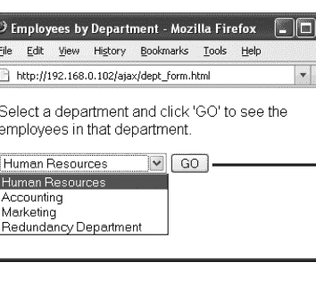

当用户点击 `GO` 时，表单将提交给一个 PHP 脚本。

2. **在第 15-17 页，将编写处理 HTML 表单的 PHP 脚本。** 该**脚本显示**在 HTML 表单中选定部门的员工。这些员工来自第 1 章创建的数据库。

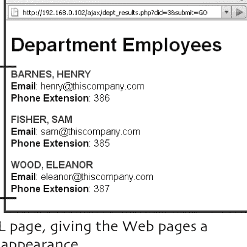

3. **因为 PHP 页面的结果来自数据库，所以将在第 18 页编写一个专门用于连接数据库的特殊 PHP 脚本。**

4. **在第 19-20 页，将制作一个非常简单的样式表并将其添加到 HTML 页面，使网页看起来稍微（但只是稍微）更具吸引力。**

5. **作为最后一步，我们将测试我们构建的内容，以确保一切正常工作。**

在本章末尾的**补充说明**部分，你可以找到关于所有这些步骤的更多信息、提示和建议。

### 创建 HTML 页面

Ajax 应用的第一步是创建一个基本的 HTML 表单。使用任意文本编辑应用新建一个 HTML 文档。（参见第 22 页的**补充说明**。）

```html
<!DOCTYPE html PUBLIC "-//W3C//DTD XHTML 1.0 Strict//EN"
"http://www.w3.org/TR/xhtml1/DTD/xhtml1-strict.dtd">
<html xmlns="http://www.w3.org/1999/xhtml" xml:
lang="en" lang="en">
<head>
<meta http-equiv="content-type" content="text/html;
charset=utf-8" />
<title>按部门划分的员工</title>
</head>
<body>
<!-- dept_form.html -->
</body>
</html>
```

所有这些看似杂乱的字符只是 HTML 页面的框架。这里唯一对终端用户可见的文本是 `<title>` 的值，它会显示在用户 Web 浏览器的顶部（参见第 12 页的图示）。

将此文件保存为 `dept_form.html`，并将其放置在 Web 服务器的某个目录中。

### 添加 HTML 表单

在表单之前，**为用户添加说明**。
表单的 `action` 属性值应该是处理此表单的 PHP 脚本的名称。将 `method` 设置为 `get`。为表单赋予一个有意义的 `id` 值。（参见第 22 页的**补充说明**。）

```html
<body>
<!-- dept_form.html -->
<p>选择一个部门并点击“GO”以查看该部门的员工。</p>
<form action="dept_results.php" method="get" id="dept_form">
    <p>
        <select id="did" name="did">
            <option value="1">人力资源部</option>
            <option value="2">会计部</option>
            <option value="3">市场部</option>
            <option value="4">冗员部</option>
        </select>
        <input name="go" type="submit" value="GO" />
    </p>
</form>
</body>
```

该表单包含一个**下拉选择菜单**，列出了各个部门。每个选项的值是来自数据库的部门编号。此表单元素的 `name` 和 `id` 必须是 `did`（部门 ID 的缩写）。
表单还需要一个**提交按钮**。

### 开始创建 PHP 页面

主要的 PHP 页面处理表单提交。它也应该是一个有效的 HTML 文档，因此从那些标签开始。（参见第 22 页的**补充说明**。）

```php
<!DOCTYPE html PUBLIC "-//W3C//DTD XHTML 1.0 Strict//EN"
"http://www.w3.org/TR/xhtml1/DTD/xhtml1-strict.dtd">
<html xmlns="http://www.w3.org/1999/xhtml" xml:
lang="en" lang="en">
<head>
  <meta http-equiv="content-type" content="text/html;
charset=utf-8" />
  <title>按部门划分的员工</title>
</head>
<body>
<h1>部门员工</h1>
<?php # dept_results.php
?>
</body>
</html>
```

页面的所有功能都将置于 PHP 标签之间。
此文件必须保存为 `dept_results.php`，并放置在与 `dept_form.html` 相同的目录中。

### 打印员工信息

1. 在 PHP 标签内，首先确保接收到了一个**有效的部门 ID**。部门 ID 必须是一个**大于 0 的整数**。（参见第 23 页的**补充说明**。）

```php
...
<?php # dept_results.php
$did = 0;
if (isset($_GET['did'])) {
    $did = (int) $_GET['did'];
}
if ($did > 0) {
    require_once('mysql.inc.php');
    $q = "SELECT * FROM employees WHERE department_
id=$did ORDER BY last_name, first_name";
    $r = mysql_query($q, $dbc);
    if (mysql_num_rows($r) > 0) {
        while ($row = mysql_fetch_array($r, MYSQL_ASSOC))
        {
            echo "<p><span class=\"name\">{$row['last_
name']}, {$row['first_name']}</span><br />
<strong>电子邮件</strong>: {$row['email']}<br />
<strong>电话分机</strong>: {$row['phone_
ext']}
</p>\n";
        }
    }
}
```

2. 然后**包含数据库连接脚本**（接下来编写）。
3. 查询**数据库**，寻找指定部门中的员工。
4. **获取返回的任何记录并打印出来**，并应用一些 HTML 和 CSS 格式。

### 报告任何错误

PHP 脚本应在发生错误时通知用户。**完成在前几步中创建的两个 IF 条件语句**。

```php
...
</p>\n";
  }
} else {
  echo '<p class="error">指定部门没有列出任何员工。</p>';
  }
} else {
  echo '<p class="error">请从下拉菜单中选择一个有效的部门以查看其员工。</p>';
}
?>
```

1. 第一个 `else` 子句将在数据库查询**未返回任何结果**时应用。
2. 第二个 `else` 子句将在 PHP 脚本**未接收到有效的部门 ID** 时应用。

### 连接到数据库

创建一个新的、空白的 PHP 脚本用于连接数据库。此脚本不需要基本的 HTML 标签。（参见第 23 页的**补充说明**。）

1. 脚本首先尝试**连接到 MySQL**。**用户名**和**密码**值必须与现有的 MySQL 用户匹配。请**更改此代码中的这些值**，以匹配你的 MySQL 服务器的相应用户。
2. 脚本随后尝试**选择 ajax 数据库**。这是第 1 章中创建的数据库的名称。

```php
<?php # mysql.inc.php
$dbc = @mysql_connect ('localhost', 'username',
'password');
if (!$dbc OR !mysql_select_db ('ajax')) {
  echo '<p class="error">该站点目前遇到技术问题。
我们对造成的不便深表歉意。</p>';
  exit();
}
?>
```

3. 如果任一尝试失败，将打印错误消息。如果发生这种情况，脚本随后将终止，因为没有数据库连接就无法继续。
4. 将此文件保存为 `mysql.inc.php`，并将其放置在与 `dept_form.html` 相同的 Web 服务器目录中。

### 创建样式表

CSS 样式表是一个单独的文档，它规定了页面的外观。在你的测试编辑器或 IDE 中创建一个新文件，包含以下代码。（参见第 24 页的**补充说明**。）

```css
body {
    font-family: sans-serif;
}
.name {
    font-weight: bold;
    text-transform: uppercase;
    color: #009;
}
.error {
    font-weight: bold;
    color: #C00
}
#results {
    border: medium solid #390;
    display: none;
    padding-left: 10px;
    width: 300px;
}
```

`body` 部分设置了整个 HTML 页面的默认字体。

第二部分格式化 `class` 值为 `name` 的文本。那将是 `dept_results.php` 中结果列表里的员工姓名。

第三部分为**任何错误**应用一些格式化（这些错误将具有 `class` 值 `error`），就像两个 PHP 脚本中创建的那些错误一样。

最后一部分应用于任何 `id` 值为 `results` 的块。你将在下一章添加 Ajax 层时使用它。

将此文件保存为 `style.css`，并将其放置在与所有其他文件相同的 Web 服务器目录中。

### 使用样式表

要使用样式表，必须在 HTML 和 PHP 页面中引用它。通过在两个文件的 `<head>` 部分添加一行来完成此操作：

```html
...
<title>按部门划分的员工</title>
<style type="text/css" media="all">@import "style.css";</style>
</head>
<body>
...
```


样式表主要是为了美观。非 Ajax 层在没有它的情况下也能完美运行，但看起来不会那么漂亮。

### 测试页面

1. 在你的 Web 浏览器中加载 **HTML 页面**，以测试我们目前创建的内容。

地址**必须以 `http://` 开头**才能正常工作。（参见第 24 页的**补充说明**。）

2. 选择一个部门并点击 **GO**。
3. PHP 页面应该显示结果。

### 补充说明

### 创建 HTML 页面 p. 13

- HTML、JavaScript、CSS 和 PHP 几乎可以在任何应用中编写。我更喜欢使用简单的文本编辑器（具体来说，是 Mac OS X 上的 BBEdit），但请使用你喜欢的工具。专注于 Web 开发的人通常喜欢像 Dreamweaver 这样的 WYSIWYG（所见即所得）工具。PHP 开发者有时倾向于使用像 Eclipse、NuSphere 的 PhpED 或 Zend Studio 这样的 IDE（集成开发环境）。
- 对于本书中的 HTML，我将使用 **XHTML 1.0 Strict** 标准。有关此标准的更多信息，请参阅专门的 HTML 资源，例如 Elizabeth Castro 所著的优秀书籍《HTML, XHTML, & CSS: Visual QuickStart Guide, Sixth Edition》（ISBN-13: 978-0321430847）。
- 本示例的 Ajax 和非 Ajax 版本都使用 PHP，这意味着**你必须拥有一个支持 PHP 的 Web 服务器**才能测试这些示例。这可以是你自己的计算机（如果你安装了 PHP），或者是一个远程托管的网站（如果你有这样的网站）。
- 为了简单起见，本书中创建的每个文件都将放在服务器上的同一个文件夹中。

### 添加 HTML 表单 p. 14

- 在处理 HTML 表单时，**action** 和 **method** 是两个最重要的考虑因素。**action** 告诉浏览器表单数据应发送到哪个页面。**method** 告诉浏览器应如何发送这些数据。**get** 方法在 URL 中发送数据。
- 通常，我会让 PHP 动态生成与数据库表对应的任何下拉菜单。我在这里省略了这一步。

### 开始创建 PHP 页面 p. 15

- PHP 是一种服务器端语言，用于动态生成 HTML 代码（以及其他用途）。PHP 标签 `<?php` 和 `?>` 内的任何内容都将被视为 PHP 代码。这些标签外的任何内容将立即发送到 Web 浏览器并被视为 HTML。

### 浏览员工

## 打印出员工信息 p. 16

- 当需要测试网站的这一部分时，如果你在这个页面上遇到问题，你需要采用一些标准的 PHP 数据库调试技巧。首先打印出正在运行的查询（在创建查询后添加 `echo $q;`）。然后使用其他接口来运行该查询，比如命令行 **mysql client** 或基于 Web 的 **phpMyAdmin**。这两个步骤将确认查询的结果是什么。

- 另一个对任何 PHP 脚本都有用的调试技巧是在你的 Web 浏览器中查看动态生成的 HTML 源代码。有时问题可能隐藏在那里。

- 有关 PHP 以及 PHP-MySQL 交互的更多信息，请参阅我的著作 **PHP and MySQL for Dynamic Web Sites: Visual QuickPro Guide, Second Edition**（ISBN-13: 978-0321336576）或在互联网上搜索。

### 连接到数据库 p. 18

- 由于本应用程序中的许多 PHP 脚本都会使用数据库，最好创建一个脚本来建立该连接。每个需要数据库连接的页面随后都将包含此文件。

- **mysql.inc.php** 脚本可能是导致问题的常见原因。为了确保在测试网站时它能正常工作，请确保你使用的**用户名和密码组合**有权访问 **ajax** 数据库。如果你遇到任何问题，请查看 MySQL 手册、MySQL 相关的书籍（如我的 **MySQL, Second Edition: Visual QuickStart Guide**（ISBN-13: 978-0321375735）），或本书的支持网站 www.dmcinsights.com/ajax/。

### 额外知识点（续）

### 创建样式表 p. 19

- 我在本书中仅最低限度地使用 CSS（层叠样式表），但 CSS 绝对是富互联网应用（RIA）的一部分，就像正在创建的这一个。有关此主题的更多信息，请在网上搜索，或查阅 Elizabeth Castro 的 *HTML, XHTML, & CSS: Visual QuickStart Guide, Sixth Edition*（ISBN-13: 978-0321430847）。

- 最有趣的样式定义是用于 **id 值为 results** 的元素的定义。这类元素在页面首次加载时不会显示。然后，在适当的时候，JavaScript 会用结果填充该部分并使其可见。所有这些都在 Ajax 层中进行，这将在下一章创建。

### 测试页面 p. 21

- 所有 PHP 页面必须通过 URL 运行才能工作。因此，HTML 表单也必须通过 URL 运行（地址必须以 **http://** 开头）。如果地址以 **file://** 开头，处理该表单的 PHP 脚本将无法正常工作。

- 让这三个组件正常工作是为 Ajax 功能层打下的完美基础。调试这些页面比加入 JavaScript 和其他技术后要容易得多。

- 调试 PHP 可能是初学者最难学的技能——不幸的是，初学者最终将进行最多的调试（这是一种"火中取栗"的情况）。如果你在让这些页面正常工作时遇到问题，请参阅本书的网站 **www.dmcinsights.com/ajax/** 获取帮助。

24

浏览员工信息

# 3. 使用 Ajax 浏览

在上一章中，我们创建了员工浏览页面的非 Ajax 部分。虽然本书的重点是 Ajax，但为那些无法使用出色的 Ajax 界面的用户准备好可用的非 Ajax 组件是非常重要的。在本章中，我们将在现有基础上添加 Ajax 层。

Ajax 组件由三个文件组成：**一个 JavaScript 文件**，提供**通用的、浏览器兼容的 Ajax 功能**；**另一个 JavaScript 文件**，提供**页面特定的功能**；以及**一个 PHP 脚本**，处理 Ajax 层的**服务器端需求**。作为最后一步，主 **HTML 表单**将进行**轻微修改**以使这些新增功能生效。

## 我们将要做什么

1. 首先，在第 27-28 页，我们将创建一个 **JavaScript 文件**，用于生成特定浏览器支持的 Ajax 对象。该对象将供任何需要 Ajax 功能的页面使用。

2. 在第 29-31 页，将开始编写**第二个 JavaScript 文件**，定义与示例中员工浏览方面相关的功能。

3. 在第 32-34 页，将编写**一个新的 PHP 脚本**。该脚本将把 Ajax 请求的结果返回给 JavaScript。

4. 在第 35 和 36 页，**第二个 JavaScript 页面将被完成**，处理 PHP 请求并更新 HTML 页面。

5. 接下来，在第 37 页修改 **HTML 页面**以包含 Ajax 层。

6. 作为最后一步，在第 38 页我们将**测试**我们所构建的内容，以确保一切正常。

在本章末尾的 **额外知识点** 部分，你将找到有关所有这些步骤的更多信息、建议和推荐。

### 创建一个函数

一个 JavaScript 文件将包含用于建立通用 Ajax 功能的所有代码。使用任何文本编辑应用程序来创建一个新的 JavaScript 文档。（请参阅第 39 页的 **额外知识点**。）

```
function getXMLHttpRequestObject() {

    var ajax = false;

}
```

1. 该 JavaScript 函数名为 **getXMLHttpRequestObject()**（名字很长但描述性很强）。此函数创建一个特定浏览器的 XMLHttpRequest 对象，存储在变量 **ajax** 中。

2. 该函数起初假设没有 Ajax 支持（**ajax** 变量用布尔值 **false** 初始化）。在函数的其余部分中，浏览器需要"证明"它们可以利用 Ajax 功能。

### 检查 Ajax 支持

在函数内部，检查浏览器支持哪种类型的 XMLHttpRequest 对象。如果浏览器支持特定类型的 XMLHttpRequest 对象，则将 **ajax** 变量设为该类型的对象。（请参阅第 39 页的 **额外知识点**。）

1. 大多数 Web 浏览器——Apple 的 Safari 1.2 及更高版本、Mozilla 和 Firefox、Opera 8 及更高版本，以及较新版本的 Internet Explorer——应满足这第一个条件。

```
function getXMLHttpRequestObject() {

  var ajax = false;

  if (window.XMLHttpRequest) {

    ajax = new XMLHttpRequest();

  } else if (window.ActiveXObject) {

    try {

      ajax = new ActiveXObject("Msxml2.XMLHTTP");

    } catch (e) {

      try {

        ajax = new ActiveXObject("Microsoft.XMLHTTP");

      } catch (e) { }

    }

  }

  return ajax;

}
```

2. 较旧版本的 Internet Explorer（启用了 ActiveX 的）应通过这两行代码之一获取 XMLHttpRequest 对象。

3. 最后，此函数返回 **ajax** 变量。

4. 将此文件保存为 **ajax.js**，并将其放在 Web 服务器上与其他所有文件相同的目录中。

### 调用该函数

**ajax.js** 文件定义了一个创建 **XMLHttpRequest** 对象的函数，但它实际上并没有使用该对象。另一个 JavaScript 文件将为每个特定实例执行此操作，例如已经创建的 HTML 表单。使用任何文本编辑应用程序来创建一个新的 JavaScript 文档。（请参阅第 40 页的 **额外知识点**。）

1. 第一行告诉 Web 浏览器在加载整个页面后运行 **init()** 函数。**init()** 函数设置所有 Ajax 活动。

```
window.onload = init;

function init() {

    var ajax = getXMLHttpRequestObject();

    if (ajax) {

    } // End of ajax IF.

} // End of init() function.
```

2. **init()** 函数调用 **getXMLHttpRequestObject()** 函数以获取有效的、特定于浏览器的对象。

3. **init()** 函数然后检查 **ajax** 变量是否具有有效值。在支持的浏览器中，**ajax** 将是一个 **XMLHttpRequest** 对象。在不支持的浏览器中，**ajax** 的值将为 **false**，此条件将为假。

### 设置 Ajax

现在，JavaScript 应该告诉浏览器在发生某些事件时应采取什么行动。（请参阅第 40 页的 **额外知识点**。）

**1** `init()` 函数接下来检查浏览器是否支持 **文档对象模型（DOM）**，特别是页面是否有一个 **id** 为 **results** 的元素。

```
... if (ajax) {

    if (document.getElementById('results')) {

        document.getElementById('dept_form').onsubmit = function() {

            var did = document.getElementById('did').value;
```

**2** 如果浏览器支持，则会为表单（其 **id** 值为 **dept_form**）附加一个 `onsubmit()` 事件。换句话说，当表单提交时，执行以下操作...

**3** 为 **ajax** 对象提供应向其发送请求的页面名称。这里是 **dept_results_ajax.php**，稍后会编写。该请求将使用 **get** 方法进行。

**4** 作为该请求的一部分，部门 ID 值（来自表单）将通过 URL 传递。

```
ajax.open('get', 'dept_results_ajax.php?did=' + encodeURIComponent(did));

ajax.onreadystatechange = function() {

    handleResponse(ajax);

}
```

**5** 当 **ajax** 对象的 **readyState** 值发生变化时，应调用 **handleResponse()** 函数，并将同一个 **ajax** 对象传递给该函数。

**6** 然后发出实际的 Ajax 请求。

```
ajax.send(null);

return false;

} // 匿名函数结束。

} // DOM检查结束。

} // Ajax IF结束。

...
```

**7** 最后，函数返回 **false** 值，告诉 Web 浏览器不要实际提交表单（因为 Ajax 正在处理表单提交）。

**8** 将此文件保存为 **dept.js**，并将其放在 Web 服务器上与其他文件相同的目录中。

### 开始 PHP 页面

一个新的 PHP 脚本将处理 Ajax 请求。它的工作方式与 **dept_results.php**（我们在上一章中创建的）完全相同，只是它不需要打印开始和结束的 HTML 标签。使用任何文本编辑应用程序创建一个新的 PHP 文档。

1. 页面首先确保它从 URL 中接收到了有效的部门 ID。出于安全目的，假设我们没有有效的部门 ID。

2. 如果 URL 中传递了部门 ID 到此页面，则对其进行**类型转换**（强制其为整数）。

```
<?php # dept_results_ajax.php

$did = 0;

if (isset($_GET['did'])) {

    $did = (int) $_GET['did'];

}

if ($did > 0) {

} else { // 无效的部门 ID！

    echo '<p class="error">请从下拉菜单中选择一个有效的部门以查看其员工。</p>';

}

?>
```

3. 如果结果是正整数，我们可以继续查询数据库。

4. 如果结果不是正整数，则打印错误消息。

### 打印员工信息

PHP 页面打印给定部门中的员工列表。为此，需要进行数据库查询。（参见第 41 页的**额外内容**。）

```
...

if ($did > 0) {

    require_once('mysql.inc.php');

    $q = "SELECT * FROM employees WHERE department_id=$did ORDER BY last_name, first_name";

    $r = mysql_query($q, $dbc);

}
```

1. **包含数据库连接脚本**（在上一章中编写）。

2. **查询数据库**，查找给定部门中的员工。

```
while ($row = mysql_fetch_array($r, MYSQL_ASSOC)) {

    echo "<p><span class=\"name\">{$row['last_name']}, {$row['first_name']}</span><br />

    <strong>电子邮件</strong>: {$row['email']}<br />

    <strong>电话分机</strong>: {$row['phone_ext']}

    </p>\n";

} // WHILE循环结束。
```

3. **获取任何返回的记录并打印它们**，带有一些 HTML 和 CSS 格式。

### 打印员工信息（续）

4. 如果在给定部门中未找到员工，则打印错误信息。

```
} else { // 没有员工。

    echo '<p class="error">给定部门没有列出任何员工。</p>';

}

mysql_close($dbc);

} else { // 无效的部门 ID！

    ...

```

5. 关闭数据库连接。

6. 将此文件保存为 **dept_results_ajax.php**，并将其放在 Web 服务器上与其他文件相同的目录中。

### 处理响应

PHP 页面打印出员工信息，但由于使用了 Ajax，此打印输出实际上将返回给原始 JavaScript。将此新函数添加到 **dept.js** JavaScript 文件中。（参见第 41 页的**额外内容**。）

1. 当 **ajax** 对象的 **readyState** 值发生变化时（参见 **init()** 函数），会调用此 JavaScript 函数。调用时，该函数接收 Ajax 对象。

2. 在 **readyState** 的值为 4 之前，该函数不应执行任何操作，这意味着 Ajax 事务已完成。

```
function handleResponse(ajax) {

    if (ajax.readyState == 4) {

        if ((ajax.status == 200) || (ajax.status == 304) )

        {

        } else {

            document.getElementById('dept_form').submit();

        }

    }

}
```


### 处理响应

3. 如果**状态代码**等于`200`或`304`，则返回的结果应该可以正常使用。

4. 如果我们没有从Ajax请求获得有效的状态代码，我们应该正式提交表单到处理PHP页面（就好像Ajax层根本不存在一样）。

### 显示结果

Ajax过程的最后一步是通过将PHP页面返回的内容放到HTML页面上来显示结果。此代码完成了`handleResponse()`函数。（参见第41页的**额外内容**。）

> 1. `results`变量现在指的是HTML页面DOM中的一个特定区域。

```
if ((ajax.status == 200) || (ajax.status == 304) ) {

    var results = document.getElementById('results');

    results.innerHTML = ajax.responseText;

    results.style.display = 'block';

} else {
```

> 2. `results`区域中的文本被设置为从Ajax请求返回的响应。在本例中，就是PHP页面打印出的任何内容。

> 3. HTML页面的`results`区域最初不显示，因此需要更改其`display`样式。

### 修改HTML

最后一步是修改HTML表单页面，以便JavaScript能够工作。

```
...

<title>按部门显示员工</title>

<script src="ajax.js" type="text/javascript"></script>

<script src="dept.js" type="text/javascript"></script>

<style type="text/css" media="all">@import "style.css";</style>

</form>

...
```

- 1. 在此页面中包含两个JavaScript页面。

```
...

</form>

<div id="results"></div>

</body>

</html>
```

- 2. 创建一个`id`为`results`的`div`部分。Ajax请求返回的结果将放在这里。

### 测试Ajax层

现在所有工作都已完成，是时候看看结果如何了。（参见第42页的**额外内容**。）

**1** 在Web浏览器中加载**HTML页面**。

要使此功能正常工作，地址**必须以`http://`开头**。

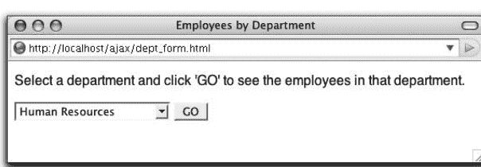

**2** 选择一个部门并点击GO。

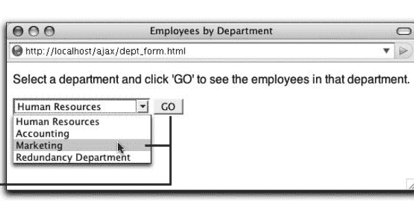

**3** HTML页面应显示结果，而无需跳转到新页面或重新加载此页面。

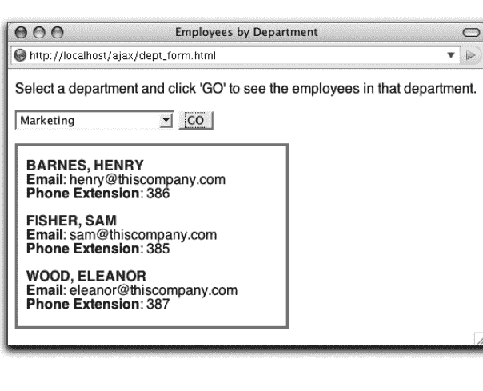

### 额外内容

### 创建函数（第27页）

- JavaScript与大多数语言一样，允许您定义自己的函数。以单词`function`开头，后跟函数名，后跟括号。函数体放在花括号之间。函数名只能包含字母、数字和下划线。它不能以数字开头，也不能与JavaScript中的现有关键字相同。

- 在函数中使用关键字`var`声明的变量对于该函数是**局部**的。也就是说，这些变量仅存在于该函数内部。

- 如果函数接受**参数**——调用时传递给函数的值——这些参数将放在括号之间。

### 检查Ajax支持（第28页）

- `ajax.js`文件定义了`getXMLHttpRequestObject()`函数，是任何Ajax应用程序中最重要的脚本。该函数返回一个有效的、浏览器安全的`XMLHttpRequest`对象，或`false`值。如果返回对象，则该对象包含执行Ajax事务所需的所有功能。

- 大多数浏览器的最新版本都支持`XMLHttpRequest对象`。由于其日益普及，这种情况应该会持续下去，即使在撰写本文时它还不属于任何标准的一部分。

- Internet Explorer 5和6版本不支持JavaScript `XMLHttpRequest`对象。相反，它们支持`XMLHTTP`类型的`ActiveX`对象。不幸的是，如果使用这些版本Internet Explorer的用户禁用了ActiveX支持（启用它存在安全风险），他们就无法使用像这样的支持Ajax的应用程序。

使用Ajax进行浏览

39

### 补充说明（续）

- **调用函数** 第29页
  - `window.onload`属性告诉JavaScript在页面完全加载后要调用的函数名称。在本例中，这个函数是`init`，即`initialize`（初始化，即设置环境）的缩写。
  - 以这种方式（而不是直接调用）调用初始化函数的好处是，Web浏览器在下载和绘制页面时，不必等待JavaScript执行其操作。在某种程度上，这能带来更好的用户体验。

- **设置Ajax** 第30页
  - JavaScript引用**文档对象模型**来访问HTML页面中的元素。DOM是浏览器文档中每个项目的映射。它可以通过无限的方式被使用和操纵。
  - `getElementById()`函数允许你通过引用其`ID`值来访问DOM元素。因此，一个ID为`dept_form`的表单可以通过`document.getElementById('dept_form')`访问。
  - 请记住，`ajax`变量是一个`XMLHttpRequest`类型的对象。它的函数之一是`open()`。为这个函数提供应发送请求的页面名称以及应使用的方法。
  - 由于处理请求的PHP脚本期望在URL中接收到一个部门ID，因此必须在请求中传递HTML表单中选定的值。你可以使用DOM来访问该值。
  - `encodeURIComponent()`函数确保选定的表单值可以安全地在URL中发送。
  - 在此JavaScript代码中有**两个匿名函数**。这些是在定义时未给出名称的函数。当需要封装一段代码但不需要像标准函数那样调用该代码时，会使用匿名函数。
  - XMLHttpRequest的`readyState`值存储当前Ajax事务的状态，范围从0到4。其中最重要的是4，表示事务已完成。

### 打印员工信息 第33页

这个PHP脚本与第2章的`dept_results.php`几乎完全相同。主要区别在于它不包含开头和结尾的`<html>`、`<head>`和`<body>`标签，也不包含这些标签内的大部分内容。原因在于本页面的所有结果都将通过JavaScript插入到HTML页面中。而该页面已经有了正确的HTML标签。

### 处理响应 第35页

- 在`init()`函数中，我们告诉JavaScript在`readyState`值发生变化时调用一个名为`handleResponse()`的函数。在Ajax请求期间，此值会发生多次变化，因此该函数将被多次调用。
- `XMLHttpRequest status`属性存储服务器端页面返回的**HTTP状态码**。状态码有几十种，从表示一切正常的`200`，到通常表示服务器错误的500以上的值。状态码`304`表示页面已找到，但自某个日期和时间以来未被修改。

在这些示例的背景下，我们将假设它表示响应正常。

- 通过引用文档对象模型，我们可以强制提交表单。`document.getElementById('dept_form')`代码引用了该表单（其`id`值为`dept_form`）。代码中的`.submit()`部分会提交它。

### 显示结果 第36页

- 再次强调，文档对象模型允许你轻松访问页面中的各个元素。代码`document.getElementById('results')`引用HTML页面中一个`id`为`results`的`div`。
- 层叠样式表`style.css`将`id`为`results`的项目的`display`属性设置为`none`。最终效果是，当页面首次加载时，此类元素不可见。这是期望的行为，因为这些项目周围有纯绿色的边框，在实际检索结果之前看到它会让人分心。

使用Ajax浏览 41

### 补充说明（续）

- 使用CSS和JavaScript隐藏然后显示结果区域的过程，旨在使HTML页面更新时更加明显。
- 引用元素的`innerHTML`值是在页面上放置新文本的快速方法。另一种方法是向DOM添加**节点**。你将在第7章“启用Ajax搜索”中看到这一点。

### 测试Ajax层 第38页

- 调试Ajax应用程序可能特别棘手，因为涉及的技术太多：HTML、DOM、CSS、JavaScript、PHP、SQL和MySQL。有关调试技巧，请参阅附录A“从这里到哪里去”。
- 你需要在尽可能多的操作系统上的尽可能多的Web浏览器中测试任何Ajax应用程序。通过了解应用程序在多种设置下的行为，你可以尽力避免排斥任何用户。
- 在我看来，Firefox是测试Ajax应用程序的最佳浏览器。它有一个JavaScript控制台，在另一个窗口中打开以显示JavaScript错误。仅此一点就能提供很大帮助。

# 4. 添加记录

在第一章中，我们为这个员工列表网站创建了数据库结构。在前两章中，我们开发了一种Ajax和非Ajax的方法，用于按部门浏览员工。在本章中，让我们创建一种向数据库添加员工的方法。自然，为了通用的可访问性，我们将从非Ajax版本开始，然后在下一章添加启用Ajax的版本。

首先，我们将创建一个**HTML表单**来获取所有必需的数据。然后，我们将编写一个以非Ajax方式处理表单提交的**PHP脚本**。这将是相当基础的PHP表单处理。

## 我们将要做什么

1. 首先，在第45-48页，我们将创建一个**带有表单的HTML页面**。
   表单包含代表数据库中为每个员工存储的所有数据的元素。
   在未启用Ajax的浏览器上，当用户单击**“添加”**时，表单将提交给一个PHP脚本。

2. 在第49-54页，将编写处理HTML表单的**PHP脚本**。该**脚本验证表单数据**并报告结果。
   如果任何字段填写不正确，PHP脚本会打印一条错误消息。

3. 自然，我们将**测试**我们构建的内容，以确保一切正常。
   在本章末尾的**“补充说明”**部分，你将找到有关所有这些步骤的更多信息、提示和建议。

在下一章中，我们将为这些页面添加Ajax层。

### 开始创建HTML页面

首先在你的HTML编辑器中创建一个**新的HTML页面**。

```html
<!DOCTYPE html PUBLIC "-//W3C//DTD XHTML 1.0 Strict//EN"

"http://www.w3.org/TR/xhtml1/DTD/xhtml1-strict.dtd">

<html xmlns="http://www.w3.org/1999/xhtml" xml:

lang="en" lang="en">

<head>

    <meta http-equiv="content-type" content="text/html;

charset=utf-8" />

    <title>Add an Employee</title>

    <style type="text/css" media="all">@import "style.css";</style>

</head>

<body>

</body>

</html>
```

**标题**将反映此页面的用途。

**样式表**将使此页面与站点中的其他页面具有相同的外观。

**添加记录**

### 添加表单

1. **添加一条消息**，说明表单的用途以及如何使用它。

```html
...

<body>

<p>Use this form to add an employee (all fields are required):</p>

<form action="add_employee.php" method="post" id="emp_form">

</form>

</body>

...
```

2. 对于未启用Ajax的浏览器，表单将提交到`add_employee.php`，该脚本将在接下来编写。

3. 表单使用`POST`方法，而不是`GET`。（参见第57页的**“补充说明”**。）

4. 对于Ajax层，表单的id值`emp_form`将很重要。

### 添加表单元素

**1 文本输入框**接收员工的名字、姓氏和电子邮件地址。

```html
...

<form action="add_employee.php" method="post" id="emp_form">

<p><label class="title" id="first_name_label">First Name

<input type="text" id="first_name" name="first_name"

/></label> </p>

<p><label class="title" id="last_name_label">Last Name

<input type="text" id="last_name" name="last_name" /></

label> </p>

<p><label class="title" id="email_label">Email Address

<input type="text" id="email" name="email" /></label>

</p>
```

### 添加表单元素

2. 一个**下拉菜单**将允许用户选择员工的部门。

```
<p><label class="title" id="department_id_label">Department <select id="department_id" name="department_id">

<option value="1">Human Resources</option>

<option value="2">Accounting</option>

<option value="3">Marketing</option>

<option value="4">Redundancy Department</option>

</select></label> </p>
```

3. 另一个**文本输入框**用于填写员工的电话分机号。

```
<p><label class="title" id="phone_ext_label">Phone Extension <input type="text" id="phone_ext" name="phone_ext" /></label> </p>

<p><input name="add" type="submit" value="Add" /></p>

</form>

...
```

4. **标签**被添加以指明每个元素的用途。（参见第57页的**附加说明**。）

5. **提交按钮**的值为`Add`。

6. 将此文件保存为`add_employee.html`，并将其与所有其他网站页面放在同一目录中。

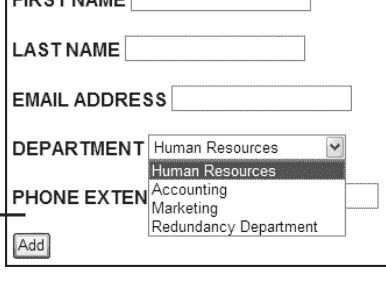

### 创建PHP页面

第一个PHP页面处理非Ajax的表单提交。它也应该是一个有效的HTML文档，因此以这些标签开始。

```
<!DOCTYPE html PUBLIC "-//W3C//DTD XHTML 1.0 Strict//EN"

"http://www.w3.org/TR/xhtml1/DTD/xhtml1-strict.dtd">

<html xmlns="http://www.w3.org/1999/xhtml" xml:lang="en"

lang="en">

<head>

    <meta http-equiv="content-type" content="text/html;

    charset=utf-8" />

    <title>Add an Employee</title>

    <style type="text/css" media="all">@import "style.css";</style>

</head>

<body>

<h1>Add an Employee</h1>

<?php # add_employee.php

require_once('mysql.inc.php');

mysql_close($dbc);

?>

</body>

</html>
```

页面的所有功能都将放在PHP标签之间。

此页面需要与MySQL通信，因此必须包含`mysql.inc.php`脚本。

MySQL连接在脚本终止前关闭。

此文件必须保存为`add_employee.php`，并放置在与`add_employee.html`相同的目录中。

### 验证表单数据

表单数据在查询中使用前必须经过验证。将此代码添加到PHP页面：

```
...

require_once('mysql.inc.php');

$errors = array();

if (!empty($_POST['first_name'])) {

    $fn = mysql_real_escape_string($_POST['first_name'], $dbc);

} else {
```


`$errors[] = 'first name';`

1. **$errors 数组**将存储在验证表单时遇到的任何错误。

2. 文本输入框将通过**确认其不为空**来进行验证。（参见第 57 页的**附加说明**。）

```
if (!empty($_POST['last_name'])) {
    $ln = mysql_real_escape_string($_POST['last_name'], $dbc);
} else {
    $errors[] = 'last name';
}
```

```
if (!empty($_POST['email'])) {
    $e = mysql_real_escape_string($_POST['email'], $dbc);
} else {
    $errors[] = 'email address';
}
```

3. 为确保数据在查询中安全使用，文本输入框需通过`mysql_real_escape_string()`函数处理。

### 验证表单数据（续）

```
if (isset($_POST['department_id']) && is_numeric($_POST['department_id']) && ($_POST['department_id'] > 0)) {
    $did = (int) $_POST['department_id'];
} else {
    $errors[] = 'department';
}
```

4. **数值**（如部门 ID 和电话分机号）**必须是正数**。

```
if (isset($_POST['phone_ext']) && is_numeric($_POST['phone_ext']) && ($_POST['phone_ext'] > 0)) {
    $ext = (int) $_POST['phone_ext'];
} else {
    $errors[] = 'phone extension';
}

mysql_close($dbc);
...
```

5. 为确保它们在查询中安全使用，**数值被类型转换**为整数。

6. 任何失败的验证例程都会导致一个元素被添加到`$errors`数组中。

### 更新数据库

假设表单数据通过了所有验证例程，则应运行 **INSERT** 查询。

1. 如果没有错误，此条件将为真（因为`$errors`变量将为空）。

```
...
$errors[] = 'phone extension';
}

if (!$errors) {
  $q = "INSERT INTO employees VALUES (NULL, $did, '$fn', '$ln', '$e', $ext)";
  $r = mysql_query($q, $dbc);

  if (mysql_affected_rows($dbc) == 1) {
    echo '<p><strong>The employee has been added.</strong></p>';
    mysql_close($dbc);
  }
  ...
}
```

2. **INSERT** 查询使用来自验证例程的净化数据将新员工添加到数据库。（参见第 58 页的**附加说明**。）

3. `mysql_affected_rows()`函数返回受影响的行数。对于此脚本的查询，受影响的行数应为 1，因为应添加一条新记录。

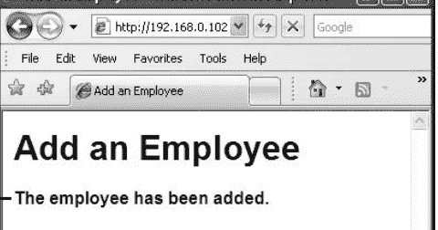

4. 将结果报告给用户。

### 报告任何错误

最后，如果适用，向用户指明发生了什么问题。

1. 第一个 **else** 子句适用于查询未导致一行受影响的情况。这通常是语法错误的结果。（参见第 58 页的**附加说明**。）

```
...
echo '<p><strong>The employee has been added.</strong></p>';
} else { // Query failure.
    echo '<p class="error">The employee could not be added due to a system error.</p>';
}
} else { // Errors!
    echo '<p>The following errors occurred:</p><ul class="error">';
    foreach ($errors as $e) {
        echo "<li>Please enter a valid $e.</li>\n";
    }
    echo '</ul>';
}

mysql_close($dbc);
...
```

2. 第二个 **else** 子句适用于数据未通过所有验证测试的情况。

### 添加员工

发生以下错误：

- 请输入有效的名字。
- 请输入有效的姓氏。
- 请输入有效的电子邮件地址。
- 请输入有效的电话分机号。

3. 由于错误存储在数组中，遍历它们是访问所有错误的最简单方法。

### 测试非 Ajax 版本

1. 在 Web 浏览器中加载 **HTML 页面**，以测试我们目前创建的内容。

地址**必须以 http://** 开头才能正常工作。

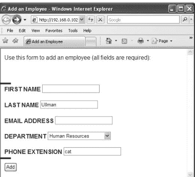

2. **不完全**填写表单，然后点击 **Add**。

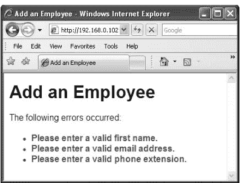

3. PHP 页面应显示结果。

### 测试非 Ajax 版本（续）

4. 返回表单，完整填写，然后点击 **Add**。

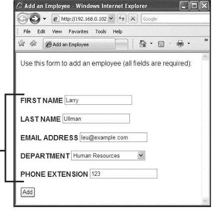

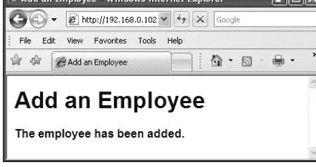

5. 同样，PHP 页面显示结果。

### 附加说明

### 添加表单 第 46 页

- 当表单的提交应对网站产生影响时，通常应使用 POST 方法。例如，使用“添加员工”表单会向数据库添加另一条记录。
- 当请求信息时，通常应使用 GET 方法。例如，当请求特定部门的员工时，应应用此方法。

### 添加表单元素 第 47 页

- 表单的标签将有两个用途。首先，它们向用户指明每个表单元素的用途。其次，它们将通过 JavaScript 进行修改，以在启用 Ajax 的表单版本中指示错误。

### 验证表单数据 第 50 页

- 如何验证表单数据取决于数据的类型（数字、字符串等）和预期值（正数、电子邮件地址等）。对于验证人名，通常只需确保输入了某个值即可。
- 对电子邮件地址进行更彻底的验证是确认其匹配**正则表达式模式**。与姓名相比，你可以对电子邮件地址执行此操作，因为它们必须遵守严格的规则。
- 通过对文本输入应用 PHP 的`strip_tags()`函数，可以提高此系统的安全性。该函数有助于防止跨站脚本攻击（XSS）。
- `mysql_real_escape_string()`函数为查询中使用的文本提供特定语言的保护。

### 更新数据库 第 53 页

- 编写 INSERT 查询更精确的方式是使用指定相关列的语法。对于此查询，将是`INSERT INTO employees (department_id, first_name, last_name, email, phone_ext) VALUES ($did, '$fn', '$ln', '$e', $ext)`。

### 报告任何错误 第 54 页

- 要调试任何 PHP-MySQL 问题，你需要打印出查询以检查其语法。你还应该调用`mysql_error()`函数以查看数据库报告的问题。
- 正式上线的网站绝不应提供详细的幕后错误，例如正在运行的查询或 MySQL 错误。将这些信息用于调试目的，然后在正式版本中隐藏这些信息（我们希望该版本不会遇到此类错误）。

# 5. 通过 Ajax 添加记录

在上一章中，我们创建了一种将员工添加到数据库的方法。该流程需要一个 HTML 表单和一个处理该表单的 PHP 脚本。这一切都运行良好，但采用的是传统的、客户端-服务器端模式。

在本章中，我们将在这些脚本之上添加一层 Ajax，使得支持 Ajax 的浏览器中，我们的员工添加表单可以表现得更像桌面应用程序。为此，我们需要**对 HTML 页面进行少量修改**。然后，我们将创建**一个 JavaScript 文件**，其中包含页面专用的 Ajax 功能。最后，将编写**一个新的 PHP 脚本**来处理 Ajax 请求。

本示例还将引入两项新技术：**使用 POST 方法**发送 Ajax 请求以及**处理 XML 数据**。这个 Ajax 示例比前一个稍微复杂一些，但在本章结束时，一切都应该能说得通。

## 我们将要做的事情

1. 首先，在第 62 页，我们将**修改 HTML 页面**，添加必要的 Ajax 代码片段。
2. 在支持 Ajax 的浏览器上，当用户点击**添加**按钮时，页面专用的 JavaScript 将读取所有表单数据并提交到一个新的 PHP 脚本。在第 63-66 页，我们将开始编写**JavaScript 文件**来启动这个流程。
3. 在第 67-74 页编写的 **PHP 脚本**将验证所有数据并报告结果。其响应将以 XML 形式返回。
4. JavaScript 将获取 **PHP 脚本返回的 XML** 并使用它来更新 HTML 页面。我们将在第 75-79 页完成此文件。
5. 当然，我们将**测试**我们构建的内容，确保一切正常。
6. 在本章末尾的**补充说明**部分，你会找到关于所有这些步骤的更多信息、提示和建议。

### 添加 Ajax 元素

1. 在 HTML 的 head 中添加相应的代码来引入**通用 Ajax JavaScript 文件**。（参见第 82 页的**补充说明**。）

```html
...
<title>Add an Employee</title>
<script src="ajax.js" type="text/javascript"></script>
<script src="add_employee.js" type="text/javascript"></script>
<style type="text/css" media="all">@import "style.css";</style>
...
```

2. 在 HTML 的 head 中添加相应的代码来引入**页面专用的 Ajax JavaScript 文件**。我们接下来将开始编写这个脚本。

3. 在 HTML 页面中添加一个 **DIV** 来显示结果。

```html
...
<p>Use this form to add an employee (all fields are required):</p>
<div id="results"></div>
<form action="add_employee.php" method="post" id="emp_form">
...
```

4. 保存文件（文件将继续使用`add_employee.html`这个名称）。

### 应用 Ajax 层

创建一个新的 JavaScript 文件，以以下代码开头（参见第 82 页的**补充说明**）：

1. 第一行告诉 Web 浏览器在加载完整个页面后运行`init()`函数。`init()`函数设置所有的 Ajax 活动。

```javascript
window.onload = init;

function init() {
    var ajax = getXMLHttpRequestObject();
```

2. 该函数调用`getXMLHttpRequestObject()`函数以获取一个有效的、浏览器特定的对象。此函数在`ajax.js`中定义，HTML 页面已经包含了该文件。

3. 然后该函数检查`ajax`变量是否具有有效值。在支持的浏览器中，`ajax`将是一个 **XMLHttpRequest** 对象。在不支持的浏览器中，`ajax`的值将为`false`，此条件判断将为假。

```javascript
if (ajax) {
    if (document.getElementById('results')) {
        document.getElementById('emp_form').onsubmit =
function() {
```

4. 接下来，该函数检查浏览器是否支持**文档对象模型（DOM）**，具体来说，检查页面中是否存在`id`为 **results** 的元素。

5. 最后，将一个`onsubmit()`事件附加到表单上（该表单的`id`值为 **emp_form**）。换句话说，当表单被提交时，执行以下操作....

### 设置 Ajax

```javascript
...
document.getElementById('emp_form').onsubmit = function() {
    ajax.open('post', 'add_employee_xml.php');
    ajax.onreadystatechange = function() {
        handleResponse(ajax);
    }
}
```

1. 告诉 **ajax** 对象你想使用 **POST** 方法。（参见第 82 页的**补充说明**。）

2. 向 **ajax** 对象提供应接收请求的页面名称。此页面为`add_employee_xml.php`，接下来将进行编写。

3. 当 **ajax** 对象的 **readyState** 值发生变化时，应调用`handleResponse()`函数，并将此对象作为参数传递给该函数。

### 准备表单数据

1. **fields** 变量是一个数组，包含其值需要发送到 PHP 页面的表单元素。

2. 遍历数组中的每个元素。

3. 在循环中，每个数组元素将被转换为 **name=value** 格式的字符串。因此，第一个数组元素 **first_name** 将被转换为类似 **first_name=Larry** 的形式。（参见第 83 页的**补充说明**。）

```javascript
...
  handleResponse(ajax);
}

var fields = ['first_name', 'last_name', 'email',
  'department_id','phone_ext'];

for (var i = 0; i < fields.length; i++) {
  fields[i] = fields[i] + '=' +
    encodeURIComponent(document.getElementById(fields[i]).
    value);
}

var values = fields.join('&');

ajax.setRequestHeader('Content-Type', 'application/x-www-form-urlencoded');
```

4. 在循环中，每个表单元素的值通过文档对象模型获取。为了安全起见，该值会经过`encodeURIComponent()`函数处理。

5. 在循环之外，所有数组元素（**name=value** 对）用和号连接在一起。最终结果是一个类似 **first_name=Larry&last_name=Ullman&…** 的字符串。

6. **Content-Type** 头部表明即将发送什么类型的信息。**application/x-www-form-urlencoded** 这个值表示内容是经过编码的表单数据。

### 完成函数

1. 在所有数据处理之后，发出实际的 Ajax 请求。由变量 **values** 表示的表单数据作为`send()`方法的唯一参数。（参见第 83 页的**补充说明**。）

```javascript
...
    ajax.setRequestHeader('Content-Type',
        'application/x-www-form-urlencoded');
    ajax.send(values);
    return false;
  } // 匿名函数结束。
 } // DOM 检查结束。
} // ajax IF 判断结束。
} // init() 函数结束。
```


- 2. 最后，函数返回`false`值，告诉 Web 浏览器不要实际提交表单（因为 Ajax 正在处理表单提交）。

将此文件保存为`add_employee.js`，并将其放在 Web 服务器上与其他所有文件相同的目录中。

## 准备 XML

一个新的 PHP 脚本将执行与`add_employee.php`相同的功能，只是它将所有结果以 XML 数据的形式返回。这些数据将由 Web 浏览器中的 JavaScript 处理。在你的文本编辑应用程序中开始编写一个新的 PHP 脚本。

- 1. 此 PHP 页面不会在 Web 浏览器中显示，因此它以 PHP 开始标签开头，而不是 HTML。（参见第 83 页的**补充说明**。）
- 2. `header()`函数用于发送元信息（即非实际数据）。此处`header()`函数发送`Content-Type`为`text/xml`。通俗地说，这是在表示接下来应该是 XML 数据。

```php
<?php # add_employee_xml.php

header("Content-Type: text/xml");

echo '<?xml version="1.0" encoding="utf-8"

standalone="yes" ?>

<response>

';
```

- 3. XML 数据以**声明**开头。
- 4. 所有 XML 文档都有**一个根元素**。这可以是一个自定义的值，比如这里的`response`。

### 验证表单数据

在将表单数据用于查询之前，必须对其进行验证。将以下代码添加到 PHP 页面中。

1. `$error`变量将作为一个标志，指示是否发生了错误。

```php
...
<response>

';

require_once('mysql.inc.php');

$error = false;

if (!empty($_POST['first_name'])) {
```

2. 文本输入将通过确认其不为空来验证。（参见第 84 页的补充说明。）

3. 为了确保数据在查询中安全使用，文本输入会经过`mysql_real_escape_string()`函数处理。

```php
  $fn = mysql_real_escape_string($_POST['first_name'],

$dbc);

} else {

  $error = true;

  echo '<error>first_name</error>

';

}

if (!empty($_POST['last_name'])) {

  $ln = mysql_real_escape_string($_POST['last_name'],
```

### 验证表单数据 (续)

```php
} else {

    $error = true;

    echo '<error>last_name</error>';

}

if (!empty($_POST['email'])) {

    $e = mysql_real_escape_string($_POST['email'], $dbc);

} else {

    $error = true;

    echo '<error>email</error>';

}
```

4. **数值**，如部门 ID 和电话分机号，**必须是正数**。

5. 为了使它们在查询中安全使用，**数值会被转换为**整数类型。

```php
if (isset($_POST['department_id']) && is_numeric($_POST['department_id']) && ($_POST['department_id'] > 0)) {

    $did = (int) $_POST['department_id'];

} else {

    $error = true;

    echo '<error>department_id</error>';

}

if (isset($_POST['phone_ext']) && is_numeric($_POST['phone_ext']) && ($_POST['phone_ext'] > 0)) {

    $ext = (int) $_POST['phone_ext'];

} else {

    $error = true;

    echo '<error>phone_ext</error>';

}
```

6. 任何验证例程失败都会导致`$error`变量被设置为`true`。

7. 为了将错误报告给 JavaScript，会创建一个名为`error`的 XML 元素。该 XML 元素的值是填写不正确的表单元素的名称。

### 更新数据库

假设表单数据通过了所有验证例程，应运行一个`INSERT`查询。

1. 如果没有错误，那么这个条件将为真（因为`$error`变量将为假）。
2. `INSERT`查询使用验证例程净化后的数据将新员工添加到数据库中。
3. `mysql_affected_rows()`函数返回受影响的行数。这应该是 1，因为应该添加一条新记录。
4. 结果被添加到 XML 输出中，使用`result`作为元素名。

```php
echo '<error>phone_ext</error>

';

}

if (!$error) {

    $q = "INSERT INTO employees VALUES (NULL, $did, '$fn', '$ln', '$e', $ext)";

    $r = mysql_query($q, $dbc);

    if (mysql_affected_rows($dbc) == 1) {

        echo '<result>The employee has been added.</result>';
```

> <response>
    <result>The employee has been added.</result>
</response>

### 完成 XML

1. 第一个`else`子句适用于查询未导致一行受影响的情况。通常语法错误是原因。（参见第 84 页**extra bits**。）

2. 第二个`else`子句适用于数据未通过所有验证测试的情况。

```php
...
    echo '<result>The employee has been added.</result>';

    } else { // Query failure.

        echo '<result>The employee could not be added due to a system error.</result>';

    }

} else { // Errors!

    echo '<result>Please correct problems with the highlighted field(s) below.</result>';

}
```

### 完成 XML (续)

```php
mysql_close($dbc);

echo '</response>';

?>
```

3. 对于两个`else`子句，相应的描述性消息都包含在名为`result`的 XML 输出元素中。

4. 关闭根 XML 元素以完成 XML 输出。无需使用 HTML 闭合标签！

### 处理响应

PHP 页面会发回 XML 数据，必须由 JavaScript 处理。将这个新函数添加到`add_employee.js` JavaScript 文件中。（参见第 85 页**extra bits**。）

**1** 当`ajax`对象的`readyState`值改变时（参见`init()`函数），会调用这个 JavaScript 函数。调用时函数接收`ajax`对象。

```javascript
function handleResponse(ajax) {

  if (ajax.readyState == 4) {

    if ((ajax.status == 200) || (ajax.status == 304) ) {

    }

  }

}
```

**2** 直到`readyState`的值为 4（意味着 Ajax 事务完成），该函数才应执行任何操作。

**3** 如果`status`代码等于 200 或 304，我们就可以使用返回的结果。

### 准备页面

`results`变量现在指向 HTML 页面 DOM（文档对象模型）中的特定区域。

```javascript
...
if ((ajax.status == 200) || (ajax.status == 304)) {

  var results = document.getElementById('results');

  document.getElementById('first_name_label').className = 'title';

  document.getElementById('last_name_label').className = 'title';

  document.getElementById('email_label').className = 'title';

  document.getElementById('department_id_label').className = 'title';

  document.getElementById('phone_ext_label').className = 'title';
```

表单的每个标签的 class 都应重置为默认类`title`。（参见第 85 页**extra bits**。）

### 处理 XML

1. PHP 脚本返回的 XML 数据可以通过`ajax.responseXML`访问，我们将其赋值给名为`data`的变量。（参见第 86 页**extra bits**。）

2. 变量`message`将指向标签名为`result`的 XML 元素。

```javascript
...
document.getElementById('phone_ext_label').className = 'title';

var data = ajax.responseXML;

var message = data.getElementsByTagName('result');

var errors = data.getElementsByTagName('error');

var temp = false;
```

3. 变量`errors`将指向每个标签名为`error`的 XML 元素。

### 处理 XML (续)

4. 循环遍历`errors`数组以访问每一个。

```javascript
for (var i = 0; i < errors.length; i++) {

  temp = errors[i].firstChild.nodeValue;

  document.getElementById(temp + '_label').className = 'error';

}
```

5. 一个临时变量将被赋值为 XML 数据中的错误值。

6. 错误值用于更改相应表单标签的 class。

### 显示结果

Ajax 过程的最后一步是通过将结果显示消息放置在 HTML 页面上来显示结果。这段代码完成了`handleResponse()`函数。（参见第 86 页**extra bits**。）

**1** `results`区域的文本被设置为 Ajax 请求返回的响应。

```javascript
...
document.getElementById(temp + '_label').className = 

    'error';

}

results.innerHTML = message[0].firstChild.

    nodeValue;

results.style.display = 'block';

} else {

    document.getElementById('emp_form').submit();

}

} // End of readyState IF.

} // End of handleResponse() function.
```


## 测试 Ajax 层

**2** 因为`results`区域最初是不可见的，现在既然我们有结果要显示，就需要使其可见。

**3** 如果我们没有从 Ajax 请求获得有效的状态代码，我们应该正式地将表单提交到处理 PHP 页面（就好像 Ajax 层根本不存在一样）。

### 测试 Ajax 层

**1** 在 Web 浏览器中加载 HTML 页面。

地址**必须以`http://`开头**才能正常工作。

**2** **不完整**或**不正确**地填写表单，然后点击添加。

**3** HTML 页面应在不重新加载页面或跳转到新页面的情况下显示结果。

**4** 完整填写表单并点击**添加**。

**5** 同样，HTML 页面显示结果（extra bits

### 添加 Ajax 元素 p. 62

- `ajax.js`文件在第 3 章“使用 Ajax 浏览”中编写，定义了一个返回**浏览器特定 XMLHttpRequest 对象**的函数。执行任何 Ajax 操作的页面都需要此文件。
- 因为将用于报告结果的**DIV**的`id`值为`results`，它将根据`style.css`中规定的规则进行格式化。这与`dept_form.html`中的`results` DIV相同。一开始，当页面首次查看时，该 DIV 将是隐藏的。

### 应用 Ajax 层 p. 63

- 这段代码大部分与`dept.js`中的代码完全相同。你会发现，对于一个好的 Ajax 基础（比如我们在本书中开发的那个），情况就是如此。这段代码中唯一的改变是对`emp_form`的引用。真正的巨大差异在于其余代码——当表单提交时应该做什么。

### 设置 Ajax p. 64

- 当表单的提交应该对网站产生影响时，通常应使用**POST**方法。例如，使用添加员工表单会在数据库中添加另一条记录。
- 当请求信息时（例如，请求特定部门中的员工），通常应使用**GET**方法。

### 准备表单数据 p. 65

- 当使用**GET**方法提交表单时，你将在 URL 中看到表单数据，语法格式为`page.php?this_item=this_value&that_item=that_value`。**POST**方法使用相同的语法，但数据不会在 URL 中发送，也不需要问号。
- 所有表单数据都需要通过`encodeURIComponent()`函数处理，以便安全地发送到 PHP 页面。与其单独对每个值应用该函数，不如使用**for**循环遍历表单元素数组，这样可以用更少的代码实现相同的功能。
- **JavaScript 中的加号**用于执行**连接**：将一个字符串附加到另一个字符串。在 PHP 中，句点号执行相同的功能。
- 如果你想将 XML 数据发送到 PHP 脚本，应将**Content-Type**设置为`text/xml`。

### 完成函数 p. 66

- 使用**GET**方法时，在调用`send()`时，使用`null`作为唯一参数。通过 GET 发送的所有数据都附加到 URL 本身。使用**POST**时，你需要在调用`send()`时提供数据，因为它不会在 URL 中发送。

### 准备 XML p. 67

- PHP 脚本将其响应作为 XML 数据发送，而不是普通的网页。PHP 将打印的所有内容都将成为此 XML 的一部分。
- 创建的 XML 数据实际上类似于 HTML 页面中的数据，有一个根元素和任意数量的嵌套子元素。在此示例中，根元素将称为`response`，并包含两个子元素。可以有零个或多个名为`error`的元素，但始终恰好有一个名为`result`的元素。相比之下，HTML 页面有一个名为`html`的根元素，两个名为`head`和`body`的子元素，以及其中的更多子元素。

**通过 Ajax 添加记录**

### 额外内容（续）

- 如果 PHP 页面不使用`header()`函数设置**Content-Type**，接收此响应的 JavaScript 将无法将其识别为 XML。
- 要完成此示例或通常使用 XML，你无需完全理解 XML。但如果你希望更好地理解该主题，可以搜索网络获取更多信息。

### 验证表单数据 p. 68

- 有关表单验证例程的更多信息，请参见第 4 章“添加记录”的额外内容部分。
- XML 数据将包含零个或多个名为`error`的元素。任何验证失败都将导致另一个`error`元素，其值与相应表单字段的名称匹配。此 XML 数据的目的是指示哪些表单字段未正确填写。如果所有验证测试都通过，则不会有这些元素。

### 完成 XML p. 73

- 要调试任何 PHP-MySQL 问题，你需要**打印出查询**以检查其语法。你还应该调用`mysql_error()`函数，查看数据库报告了哪些问题。
- 处理 XML 数据时，一个有用的调试技巧是验证你的 PHP 脚本是否返回了有效的 XML。要查看 PHP 页面的结果，可以使用 JavaScript 访问`ajax.responseText`（在`handleResponse()`函数中），或者直接将表单提交到 PHP 页面（不使用 JavaScript）。
- 要在 Web 浏览器中直接查看 XML，你需要使用支持该格式的浏览器。在撰写本文时，这包括 Internet Explorer 和 Firefox 的最新版本，但不包括 Safari。

**通过 Ajax 添加记录**

### 处理响应 p. 75

- 在`init()`函数中，我们告诉 JavaScript，每当`readyState`值改变时，就调用名为`handleResponse()`的函数。此值在 Ajax 请求期间会多次更改，因此此函数将被多次调用。
- XMLHttpRequest`status`属性存储服务器端页面返回的**HTTP 状态码**。有几十种状态码——从`200`（表示一切正常）到超过 500 的值（通常是服务器错误）。状态码`304`表示页面已找到，但自某个日期和时间以来未被修改。

### 准备页面 p. 76

- 本章示例中的一个新技巧是，表单元素的标签将被更改为指示错误。具体来说，任何有问题的字段，其标签类将从默认的`title`切换为`error`。在重新提交表单后，标签的类值应被重置，以便它们可以反映新的结果。

**通过 Ajax 添加记录**

### 额外内容（续）

### 处理 XML p. 77

- 服务器的响应在 XMLHttpRequest 对象的两个属性中可用。它可以在`responseText`中以纯文本形式找到，也可以在`responseXML`中以 XML 数据形式找到。
- XML 数据可以像 HTML 页面一样使用文档对象模型访问。因此，`data.getElementsByTagName('error')`指的是 XML 数据中所有名为 error 的项。
- **for**循环的语法是访问数组中找到的每个项的常用方式。在循环内，通过`arrayname[i]`访问特定的数组项。
- XML 数据中的 error 元素将有问题的表单元素的名称作为其值。要访问这些值，可以引用 error 元素（在循环中为`errors[i]`），后跟`.firstChild.nodeValue`。这是一种相当复杂的语法，但它有效。有关**子节点**和**节点**的更多信息可在第 7 章“启用 Ajax 搜索”中找到。

- 要指示表单元素存在问题，其对应标签的类将从`title`更改为`error`。使用文档对象模型，`document.getElementById(temp + '_label')`将引用标签（其中`temp`存储表单元素的名称）。然后`.className`允许你更改其类。

### 显示结果 p. 79

- **message**变量指的是所有名为`result`的 XML 元素（参见函数中前面的代码）。即使 XML 数据中永远只有一个这样的元素，仍会返回一个数组。因此，文本本身通过冗长的`message[0].firstChild.nodeValue`访问。
- 与之前的 Ajax 示例一样，`innerHTML`属性用于在`results` DIV中放置消息。

# 6. 创建搜索

到目前为止，本书已经构建了员工目录网站的两个方面。首先，我们创建了一种按部门浏览员工的方法。然后，我们实现了将员工添加到数据库的功能。让我们添加最后一个逻辑功能：按姓氏搜索员工的能力。

根据本书的方法，本章我们将从非 Ajax 版本开始。这些文件将适用于所有用户，并让我们了解该过程应包含什么。要创建搜索，我们只需要将两个文件组合在一起：**一个 HTML 表单**和一个处理表单的**PHP 脚本**。这应该很简单！

## 我们将要做什么

1  首先，在第 89-91 页，我们将创建一个**带有表单的 HTML 页面。**

表单只有一个输入：一个文本框，可以输入员工的姓氏或其部分。

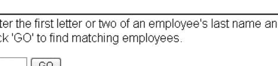

在非 Ajax 浏览器上，当用户点击**GO**时，表单将提交到一个 PHP 脚本。

2  在第 92-95 页，将编写处理 HTML 表单的**PHP 脚本**。该脚本使用表单数据在数据库上执行搜索，并打印结果。


如果没有员工与搜索条件匹配，PHP 脚本将打印相应的消息。


当然，我们将**测试**构建的内容以确保一切正常工作。

在本章末尾的**额外内容**部分，你将找到有关所有这些步骤的更多信息、提示和建议。

在下一章中，我们将为这些页面添加 Ajax 层。

### 开始 HTML 页面

首先，在文本编辑器中创建一个**新的 HTML 页面**。

```
<!DOCTYPE html PUBLIC "-//W3C//DTD XHTML 1.0 Strict//EN"

"http://www.w3.org/TR/xhtml1/DTD/xhtml1-strict.dtd">

<html xmlns="http://www.w3.org/1999/xhtml" xml:lang="en" lang="en">

<head>

  <meta http-equiv="content-type" content="text/html; charset=utf-8" />

  <title>Search for Employees by Name</title>

  <style type="text/css" media="all">@import "style.css";</style>

</head>

<body>

<!-- search_form.html -->

</body>

</html>
```

**标题**反映了此页面的用途。

**样式表**将使此页面与网站中的其他页面具有相同的外观。

### 创建 HTML 页面（续）

将页面保存为`search_form.html`，并将其放置在与本书所有其他文件相同的目录中。

### 添加表单

+   1. 添加一个**消息**，说明表单的用途和使用方法。（参见第 97 页的**补充说明**。）

```
<!-- search_form.html -->

<p>请输入员工姓氏的前一个或两个字母，然后点击 'GO' 来查找匹配的员工。</p>
```

+   2. 对于不支持 Ajax 的浏览器，表单将提交到`search_results.php`，该文件将在接下来创建。

+   3. 表单使用**GET 方法**，与`dept_form.html`类似。

```
<form action="search_results.php" method="get"

id="search_form">

<p><input name="last_name" id="last_name" type="text"

size="5" maxlength="30" />

<input name="go" type="submit" value="GO" />

</p>

</form>

</body>

</html>
```

+   4. 对于 Ajax 层，表单的`id`值`search_form`将至关重要。

### 开始 PHP 页面

**第一个 PHP 页面**处理非 Ajax 的表单提交。它也应是一个有效的 HTML 文档，因此以这些标签开始。

```
<!DOCTYPE html PUBLIC "-//W3C//DTD XHTML 1.0 Strict//EN"

"http://www.w3.org/TR/xhtml1/DTD/xhtml1-strict.dtd">

<html xmlns="http://www.w3.org/1999/xhtml" xml:lang="en" lang="en">

<head>

  <meta http-equiv="content-type" content="text/html; charset=utf-8" />

  <title>按姓名搜索员工</title>

  <style type="text/css" media="all">@import "style.css";</style>

</head>

<body>

<h1>员工搜索结果</h1>

<?php # search_results.php

?>

</body>

</html>
```

页面的所有功能都将包含在 PHP 标签之间。

此文件必须保存为`search_results.php`，并放置在与`search_form.html`相同的目录中。

## 查询数据库

1 我们确保为姓氏提交了某个值，否则就没有必要查询数据库。

2 包含**MySQL 连接**脚本。

```
...

<?php # search_results.php

if (!empty($_GET['last_name'])) {

	require_once('mysql.inc.php');

	$q = "SELECT CONCAT(last_name, ', ', first_name),

	email, department FROM employees LEFT JOIN departments

	USING (department_id) WHERE last_name LIKE '" . mysql_

	real_escape_string($_GET['last_name']) . "%' ORDER BY

	last_name, first_name";

	$r = mysql_query($q, $dbc);

?>

...
```

3 查询将返回所有姓氏以提交的字母开头的员工的**姓名、电子邮件地址**和**部门**。（参见第 97 页的**补充说明**。）

4 `mysql_real_escape_string()`函数确保在查询中使用提交的值是安全的。

### 打印结果

+   1. 检查是否返回了**至少一条记录**。

```
...

$r = mysql_query($q, $dbc);

if (mysql_num_rows($r) > 0) {

    while ($row = mysql_fetch_array($r, MYSQL_NUM)) {

        echo "<p><span class=\"name\">$row[0]</span><br />

        <strong>Department</strong>: $row[2]<br />

        <a href=\"mailto:$row[1]\">$row[1]</a>

        </p>\n";

    } // WHILE 循环结束。

}

?>

...
```

+   2. 获取**所有记录**并将它们打印出来。

+   3. 员工的**姓名**将使用 CSS 类进行**格式化**。

+   4. 员工的**电子邮件地址**将被**链接**，以便单击时可以开始向该人发送电子邮件。

```
<h1>员工搜索结果</h1>

<p><span class="name">Gray, Gideon</span><br />

    <strong>Department</strong>: Accounting<br />

    <a href="mailto:g.gray@thiscompany.com">g.gray@thiscompany.com</a>

</p>

<p><span class="name">Green, Laverne</span><br />

    <strong>Department</strong>: Human Resources<br />

    <a href="mailto:l.green@thiscompany.com">l.green@thiscompany.com</a>

</p>

</body>
```

### 报告任何错误

+   1. 第一个`else`子句适用于查询运行正常但未返回任何结果的情况。

```
} // WHILE 循环结束。

} else { // 没有员工。

  echo '<p class="error">没有匹配的员工。</p>';

}

mysql_close($dbc);

} else { // 无效的表单数据！

  echo '<p class="error">请在员工姓氏中输入至少几个字符。</p>';
```


}

?>

...

```

+   2. 关闭 **MySQL 连接**。

+   3. 第二个 `else` 子句适用于表单填写不正确的情况。

### 员工搜索结果

请在员工姓氏中输入至少几个字符。

### 创建搜索

### 测试非 Ajax 版本

1. 在您的 Web 浏览器中加载 HTML 页面，以测试我们到目前为止创建的内容。地址 **必须以 `http://`** 开头才能正常工作。

2. 输入一两个字母，然后点击 GO。

3. PHP 页面应该显示 **结果**。

4. 返回表单，重复步骤 2 和 3，直到您满意为止。

### 补充说明

+   ## 添加表单（第 91 页）
- 在这个例子中，我建议用户只输入几个字母，因为数据库中只有 20 条记录。使用第 1 章“创建数据库”中输入的员工，输入 `"Gr"` 会返回两条记录，但输入 `"Gre"` 只返回一条。如果您的数据库中有更多姓名，输入更长的值会更合适。
- **GET** 方法通常用于搜索。下次您使用 Google 或其他搜索引擎时，请注意搜索词是通过 URL 传递的。

+   ## 查询数据库（第 93 页）
- 这是本书中最复杂的查询。它对两个表 `employees` 和 `departments` 执行 **连接**，这两个表通过 `department_id` 列连接。搜索功能得益于一个 **LIKE** 子句，该子句请求员工姓氏以表单中输入的任何字母开头的记录。
- 通过另一个接口（如图像中的 **mysql 客户端**）运行动态生成的查询是一种很好的调试技术。这样做将确认查询是什么、它是否有效以及它的结果是什么。

# 7. 启用 Ajax 搜索

作为本书项目的最后一部分，让我们将上一章创建的搜索进行 Ajax 改造。与其他章节一样，我们将在已创建内容的基础上添加一个 Ajax 层。支持 Ajax 的浏览器将无需重新加载页面即可查看搜索结果；其他所有浏览器将使用已有的系统。

要完成此操作，需要 **修改 HTML 页面**。然后我们需要创建一个包含此特定示例所有功能的 **新 JavaScript 文件**。并将编写一个 **新的 PHP 脚本**，以 XML 格式将搜索结果返回给 JavaScript。与本书中的其他 Ajax 示例不同，我们不会在 JavaScript 中使用 `innerHTML` 属性来更新网页。在这里，我们将通过向 **文档对象模型** 添加 **节点** 来操纵页面内容。

## 我们将做什么

1. 首先，在第 102 页，我们将 **修改 HTML 页面** 以包含必要的 Ajax 部分。

2. 用户输入员工姓氏的前几个字母并点击 **GO**。（参见第 124 页的 **补充说明**。）

3. 在支持 Ajax 的浏览器上，特定于页面的 JavaScript 将读取用户输入的内容，并将其提交到一个新的 PHP 脚本。在第 103-106 页，我们将开始编写启动此过程的 **JavaScript 文件**。

4. 在第 107-110 页编写的 **PHP 脚本** 将在数据库中搜索姓名以提供的字母开头的员工。它将把任何匹配的记录作为 **XML 数据** 返回。

5. JavaScript 将获取 **PHP 脚本返回的 XML** 并使用它来更新 HTML 页面。我们将在第 111-122 页完成此 JavaScript 文件。

6. 自然，我们将在第 123 页 **测试** 我们构建的内容，以确保一切正常。

7. 本章末尾的 **补充说明** 部分将提供更多关于所有这些步骤的信息、提示和建议。

### 启用 Ajax 搜索

### 添加 Ajax 元素

1. 在 HTML head 中添加相应的代码，引入**通用 Ajax JavaScript 文件**。（参见第 124 页的**补充内容**。）

```html
...
<title>Search for Employees by Name</title>
<script src="ajax.js" type="text/javascript"></script>
<script src="search.js" type="text/javascript"></script>
<style type="text/css" media="all">@import "style.css";</style>
...
```

2. 在 HTML head 中添加相应的代码，引入**特定页面的 Ajax JavaScript 文件**。我们接下来将开始编写这个脚本。

```html
...
</form>
<div id="results"></div>
</body>
...
```

3. 在 HTML 页面中添加一个 **DIV**，用于显示查询结果。

4. 保存文件（文件名仍为 `search_form.html`）。

### 应用 Ajax 层

创建一个新的 JavaScript 文件，以如下代码开头（参见第 124 页的**补充内容**）：

1. 第一行代码告诉 Web 浏览器在加载完整个页面后运行 `init()` 函数。`init()` 函数用于设置所有 Ajax 活动。

```javascript
window.onload = init;

function init() {
  var ajax = getXMLHttpRequestObject();
  if (ajax) {
```

2. 该函数调用 `getXMLHttpRequestObject()` 函数来获取一个有效的、与浏览器对应的对象。此函数定义在 `ajax.js` 中，该文件已被 HTML 页面引入。

3. 然后该函数检查 `ajax` 变量是否具有有效值。对于支持的浏览器，`ajax` 将是一个 **XMLHttpRequest** 对象。对于不支持的浏览器，`ajax` 的值将为 `false`，此条件判断将为 false。

### 应用 Ajax 层（续）

4. 接下来，该函数检查浏览器是否支持文档对象模型（DOM），具体来说，检查页面中是否存在 id 为 `results` 的元素。

```javascript
if (document.getElementById('results')) {
  document.getElementById('search_form').onsubmit
  = function() {
```

5. 最后，将 `onsubmit()` 事件附加到表单（其 id 值为 `search_form`）上。换句话说，当表单被提交时，执行以下操作……

### 设置 Ajax

1. 为 `ajax` 对象提供应发送请求的页面名称。该页面为 `search_results_xml.php`，接下来将进行编写。请求将使用 `get` 方法发起。

```javascript
...
document.getElementById('search_form').onsubmit = function() {
    var last_name = document.getElementById('last_name').value;
    ajax.open('get', 'search_results_xml.php?last_name=' + encodeURIComponent(last_name));
    ajax.onreadystatechange = function() {
        handleResponse(ajax);
    }
}
```

2. 作为该请求的一部分，`last_name` 的值（用户在表单中输入的字母）将通过 URL 传递。（参见第 124 页的**补充内容**。）

3. 当 `ajax` 对象的 `readyState` 值发生变化时，应调用 `handleResponse()` 函数，并将该对象作为参数传入。

### 完成函数

1. 发起实际的 Ajax 请求。

2. 最后，函数返回 `false` 值，告诉 Web 浏览器不要实际提交表单（因为 Ajax 正在处理表单提交）。

```javascript
...
    handleResponse(ajax);
}
ajax.send(null);
return false;
} // 匿名函数结束。
} // DOM 检查结束。
} // ajax IF 语句结束。
} // init() 函数结束。
```

将此文件保存为 `search.js`，并将其放在 Web 服务器上与其他所有文件相同的目录中。

## 准备 XML

一个新的 PHP 脚本将完成与 `search_results.php` 相同的功能，但会将所有结果以 XML 数据形式返回。这些数据将由 Web 浏览器中的 JavaScript 处理。在你的文本编辑器或 IDE 中开始编写一个新的 PHP 脚本。

1. 此 PHP 页面不会在 Web 浏览器中直接查看，因此它以 PHP 开始标签开头，而不是任何 HTML。（参见第 125 页的**补充内容**。）

2. `header()` 函数用于发送元信息（即非实际数据）。这里 `header()` 函数发送了 `Content-Type` 为 `text/xml`。通俗地说，这是在告知后续内容将是 XML 数据。

```php
<?php # search_results_xml.php
header("Content-Type: text/xml");
echo '<?xml version="1.0" encoding="utf-8" standalone="yes" ?>
<employees>
';
```

3. XML 数据以声明开头。

4. 所有 XML 文档都有一个根元素。这可以是一个自定义值，比如这里的 `employees`。

## 查询数据库

1. 我们确保为 **姓氏** 提交了**某个值**，否则无需查询数据库。

2. 引入 **MySQL 连接脚本**。

```php
...
<employees>';
if (!empty($_GET['last_name'])) {
  require_once('mysql.inc.php');
  $q = "SELECT CONCAT(last_name, ', ', first_name), email, department FROM employees LEFT JOIN departments USING (department_id) WHERE last_name LIKE '" . mysql_real_escape_string($_GET['last_name']) . "%' ORDER BY last_name, first_name";
  $r = mysql_query($q, $dbc);
```

3. 该查询将返回所有姓氏以提交字母开头的员工的**姓名**、**电子邮件**、**地址**和**部门**。（参见第 125 页的**补充内容**。）

4. `mysql_real_escape_string()` 函数确保提交的值可以安全地用于查询中。

### 获取结果

1. 检查是否返回了**至少一条记录**。

2. **获取所有记录**并以 XML 数据形式打印输出。

```php
...
$r = mysql_query($q, $dbc);
if (mysql_num_rows($r) > 0) {
    while ($row = mysql_fetch_array($r, MYSQL_NUM)) {
        echo "<employee>\n<name>$row[0]</name>\n<department>$row[2]</department>\n<email>$row[1]</email>\n</employee>\n";
    } // WHILE 循环结束。
} // IF 语句结束。
```

3. **换行符**（`\n`）确保接下来打印的内容将在下一行显示（就像在键盘上按下回车键一样）。

```xml
<employees>
  <employee>
    <name>Gray, Gideon</name>
    <department>Accounting</department>
    <email>g.gray@thiscompany.com</email>
  </employee>
  <employee>
    <name>Green, Laverne</name>
    <department>Human Resources</department>
    <email>l.green@thiscompany.com</email>
  </employee>
</employees>
```

### 完成 PHP

1. 关闭数据库连接（非必须，但属于良好实践）。

```php
...
  } // IF 语句结束。
  mysql_close($dbc);
} // $_GET['last_name'] IF 语句结束。

// 完成 XML 文档。
echo '</employees>';
?>
```

2. 关闭根 XML 元素以完成 XML 输出。无需使用 HTML 闭合标签！

3. 将此文件保存为 `search_results_xml.php`，并将其放在（你猜对了）与其他所有文件相同的目录中。

### 处理响应

PHP 页面返回 XML 数据，必须由 JavaScript 进行处理。将这个新函数添加到 `search.js` JavaScript 文件中。（参见第 126 页的**补充内容**。）

1. 当 `ajax` 对象的 `readyState` 值发生变化时（参见 `init()` 函数），将调用此 JavaScript 函数。函数被调用时会接收到 `ajax` 对象。

```javascript
function handleResponse(ajax) {
    if (ajax.readyState == 4) {
        if ((ajax.status == 200) || (ajax.status == 304) ) {
```

2. 该函数在 `readyState` 的值为 4 之前不应执行任何操作，这意味着 Ajax 事务已完成。

3. 如果 `status` 状态码等于 200 或 304，则一切正常，我们可以使用返回的结果。

### 准备页面

1. `results` 变量现在指向 HTML 页面 DOM 中的特定区域。

```javascript
...
if ((ajax.status == 200) || (ajax.status == 304) ) {
    var results = document.getElementById('results');
    results.style.display = 'block';
    while (results.hasChildNodes()) {
        results.removeChild(results.lastChild);
    }
}
```

2. HTML 页面的 `results` 区域最初是不可见的，因此需要将其设为可见。

3. 我们移除 `results` 中可能存在的每个**节点**。（参见第 126 页的**补充内容**。）

### 处理 XML

**1** `data` 变量现在存储了 PHP 页面的响应，即 XML 格式的数据。（参见第 126 页的**补充信息**。）

**2** `names` 变量现在是一个数组，包含了 XML 数据中所有标签名为 `name` 的元素。如果返回了四个名字，那么 `names` 数组中现在就会有四个元素。

```javascript
...
    results.removeChild(results.lastChild);
}
var data = ajax.responseXML;
var names = data.getElementsByTagName('name');
var departments = data.getElementsByTagName('department');
var emails = data.getElementsByTagName('email');
```

**3** `departments` 变量现在是一个数组，包含了 XML 结果中所有标签名为 `department` 的元素。由于 PHP 脚本生成 XML 数据的方式，应该每个名字都对应一个部门。

**4** `emails` 变量现在是一个数组，包含了 XML 结果中所有标签名为 `email` 的元素。同样，每个名字都对应一个电子邮件地址。

### 显示结果

结果显示方式应与非 Ajax 版本相同。这是来自该页面的生成 HTML，需要复制其结构。（参见第 127 页的**补充信息**。）

```html
<p><span class="name">Gray, Gideon</span><br />
    <strong>Department</strong>: Accounting<br />
    <a href="mailto:g.gray@thiscompany.com">g.gray@thiscompany.com</a>
</p>
<p><span class="name">Green, Laverne</span><br />
    <strong>Department</strong>: Human Resources<br />
    <a href="mailto:l.green@thiscompany.com">l.green@thiscompany.com</a>
</p>
```


1. 在尝试打印员工信息之前，我们应该确认 PHP 页面确实返回了数据。如果 XML 数据中至少返回了一个员工，那么`names`数组中的元素数量就会大于 0。你可以通过引用数组的`length`属性来计算其元素数量。
2. 我们需要一系列变量来将这些值添加到 DOM 中。

```javascript
var emails = data.getElementsByTagName('email');

if (names.length > 0) {

  var employee, span, name_node, dept_node, dept_label, br, strong, a, email;
```

3. `for`循环将访问`names`数组中的每一项。它从 0（数组中的第一项索引为 0）开始计数，直到数组项数减一。每次循环迭代，计数器`i`都​​会递增。

```javascript
for (var i = 0; i < names.length; i++) {

    employee = document.createElement('p');
```

4. PHP 页面返回的每个员工将被放入一个 HTML 段落中（参见上一页的 HTML 源代码）。因此，在循环内部，第一步是创建一个类型为`p`的新元素。此步骤会向 DOM 中添加一个段落，尽管该段落目前还没有任何内容，也尚未放置到页面上。

### 处理姓名

员工的姓名应放在一个`class`属性为`name`的`span`元素内。其后应跟一个换行符。

```html
<span class="name">Actual Name</span><br />
```

1. 创建一个类型为`span`的新元素。（参见第 127 页的补充信息。）
2. 为该`span`的`class`属性赋值为`name`。因此，放在`span`内的文本（见接下来的两个步骤）将被格式化为`name`样式。
3. 创建一个不同类型的节点，即一个文本节点。文本节点的值（也就是实际的文本）将是 XML 数据中返回的`name`的值。
4. 该文本节点成为`span`节点的子节点。因此，文本节点（即员工的姓名）就位于`span`内部。
5. 将`span`附加到作为`employee`的段落上。
6. 向段落添加一个换行符元素，以便后续内容将从下一行开始。

```javascript
employee = document.createElement('p');

span = document.createElement('span');

span.setAttribute('class', 'name');

name_node = document.createTextNode(names[i].firstChild.nodeValue);

span.appendChild(name_node);

employee.appendChild(span);

br = document.createElement('br');

employee.appendChild(br);
```

### 处理部门

部门的格式稍复杂一些。它以加粗强调的单词`Department`开始，后跟一个冒号和实际的部门名称。最后还有一个换行符。

```html
<strong>Department</strong>: Department Name<br />
```

1. 创建一个类型为`strong`的新元素。
2. 创建一个值为`Department`的文本节点。

```javascript
...

employee.appendChild(br);

strong = document.createElement('strong');

department_label = document.createTextNode('Department');

strong.appendChild(department_label);

employee.appendChild(strong);
```

3. 该文本节点成为`strong`节点的子节点。这将文本`Department`放置在`strong`标签之间。
4. 生成另一个文本节点，其值为冒号，后跟一个空格，再后跟来自 XML 数据的部门名称。
5. 将这个最新的文本节点附加到段落上，即`employee`。

```javascript
dept_node = document.createTextNode(': ' +

departments[i].firstChild.nodeValue);

employee.appendChild(dept_node);

br = document.createElement('br');

employee.appendChild(br);
```

6. 向段落添加一个换行符元素，以便后续内容将从下一行开始。

### 处理电子邮件

电子邮件地址的处理比较复杂，因为它应该是一个链接，这样点击电子邮件地址就能为该人创建邮件。

```html
<a href="mailto:address@example.com">address@example.com</a>
```

1. 创建一个类型为`a`的新元素。这种元素类型用于任何链接。
2. 为`a`元素的`href`属性赋值为`mailto:`加上来自 XML 数据的该人员的电子邮件地址。

```javascript
...

    employee.appendChild(br);

    a = document.createElement('a');

    a.setAttribute('href', 'mailto:' + emails[i].firstChild.nodeValue);
```

3. 创建一个文本节点，其值为来自 XML 数据的员工电子邮件地址。
4. 该文本节点成为`a`节点的子节点。因此，文本节点（即员工的电子邮件地址）就位于`a`元素内部。

```javascript
email = document.createTextNode(emails[i].firstChild.nodeValue);

a.appendChild(email);

employee.appendChild(a);

results.appendChild(employee);

} // End of FOR loop.
```

5. 将`a`元素附加到段落上。
6. 代表所有员工数据的整个段落成为`results` DIV 的子节点。（参见第 128 页的补充信息。）

### 显示无结果

如果 PHP 页面没有返回结果，应该显示一条相应的消息。


1. 创建一个类型为`p`的新元素。
2. 为段落的`class`属性赋值为`error`。
3. 创建一个值为“未找到匹配的员工”的文本节点。
4. 该文本节点成为段落节点的子节点。
5. 该段落成为`results DIV`的子节点，从而将其放置到页面上。

```javascript
...

} // End of FOR loop.

} else { // No employees, print a message.

var node1 = document.createElement('p');

node1.setAttribute('class', 'error');

var node2 = document.createTextNode('No employees were a match.');

node1.appendChild(node2);

results.appendChild(node1);

}
```

### 完成函数

如果我们没有从 Ajax 请求中收到有效的状态码，我们应该正式将表单提交到处理页面的 PHP 脚本（就好像 Ajax 层根本不存在一样）。

```javascript
...

    results.appendChild(node1);

}

} else { // Bad status code, submit the form.

    document.getElementById('search_form').submit();

}

} // End of readyState IF.

} // End of handleResponse() function.
```


### 测试 Ajax 层

1. 在你的 Web 浏览器中加载 `HTML 页面`。地址必须以 `http://` 开头才能正常工作。

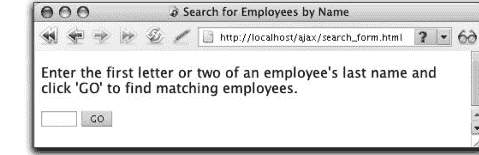

2. 输入一两个字母，然后点击 `GO`。

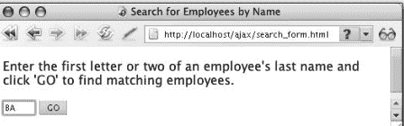

3. HTML 页面应显示结果，而无需重新加载页面或跳转到新页面。

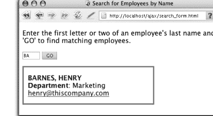

4. 输入无效的字母并点击 `GO`，查看当数据库中没有员工匹配搜索词时的结果。

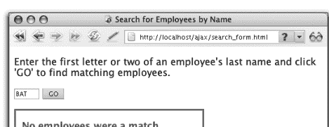

# 补充内容

## 我们将要做什么 第 100 页

- 在这个示例中，我建议用户只输入几个字母，因为数据库中只有 20 条记录。在第 1 章“创建数据库”中录入的员工信息基础上，输入 `Gr` 会返回两条记录，而 `Gre` 只会返回一条。如果你的数据库中有更多姓名，输入更长的值会更合适。

## 添加 Ajax 元素 第 102 页

- 第 3 章“使用 Ajax 进行浏览”中编写的 `ajax.js` 文件定义了一个返回特定浏览器的 `XMLHttpRequest` 对象的函数。任何执行 Ajax 操作的页面都需要此文件。
- 由于用于显示结果的 `DIV` 的 `id` 值为 `results`，它将根据 `style.css` 中定义的规则进行格式化。这与 `dept_form.html` 和 `add_employee.html` 中的 `results DIV` 相同。首先，当页面首次加载时，该 `DIV` 将是不可见的。

## 应用 Ajax 层 第 103 页

- 这段代码的大部分内容与 `dept.js` 和 `add_employee.js` 中的代码完全相同。起初最大的区别在于被引用的表单名称。真正的重大差异存在于其余代码中——即当表单提交时应该执行的操作。

## 设置 Ajax 第 105 页

- `encodeURIComponent()` 函数使得在 URL 中传递用户在表单中输入的任何值变得安全。
- 通过在 URL 中传递表单数据，我们确保 Ajax 请求将发送到 `search_results_xml.php?last_name=XXX`，其中 `XXX` 代表用户在文本框中输入的内容。

启用 Ajax 搜索

## 准备 XML

- PHP 脚本以 XML 数据而非普通网页的形式发送其响应。PHP 输出的所有内容都将成为该 XML 的一部分，不会有 HTML 输出。
- 创建的 XML 数据实际上类似于 HTML 页面中的数据，有一个根元素和任意数量的嵌套子元素。在本示例中，根元素将被称为 `employees`，并且会有零个或多个名为 `employee` 的子元素。
- 如果 PHP 页面未使用 `header()` 函数设置 `Content-Type`，接收到此响应的 JavaScript 将无法将其识别为 XML。

## 查询数据库

- 要调试任何 PHP-MySQL 问题，你需要打印出查询语句以检查其语法。你还应该调用 `mysql_error()` 函数来查看数据库报告的错误。
- 处理 XML 数据时一个有用的调试技巧是验证你的 PHP 脚本是否返回了有效的 XML。要查看 PHP 页面的结果，可以使用 JavaScript 访问 `ajax.responseText`（在 `handleResponse()` 函数中），或者直接将表单提交到 PHP 页面（不使用 JavaScript）。
- 要在网页浏览器中直接查看 XML，你需要使用支持该格式的浏览器。在撰写本文时，这包括 Internet Explorer 和 Firefox 的较新版本，但不包括 Safari。

启用 Ajax 搜索

## 补充内容（续）

### 处理响应 第 111 页

- 在 `init()` 函数中，我们让 JavaScript 在 `readyState` 值发生变化时调用一个名为 `handleResponse()` 的函数。此值在 Ajax 请求期间会发生多次变化，因此该函数将被多次调用。
- `XMLHttpRequest` 的 `status` 属性存储服务器端页面返回的 `HTTP 状态码`。状态码有几十种，从表示一切正常的 `200` 到超过 500 的值（通常是服务器错误）。状态码 `304` 表示页面已找到但自某个日期和时间以来未被修改。

### 准备页面 第 112 页

- 这个特定示例中的新技巧是使用节点作为操作页面内容的方式。如果你将文档对象模型想象为一棵树，那么节点就是那棵树上的一个分支；每个分支都有一个父级（可以是另一个分支或树干），有些分支还有子级（更多的分支）。要将内容放置在页面上，我们需要向 `results` 部分添加分支。因此，为了将页面准备好接收 XML 数据，我们需要清除 `results` 中所有现有的节点。我们通过对 `results` 应用 `removeChild()` 函数，逐个移除最后一个节点，直到没有剩余节点为止。

### 处理 XML 第 113 页

- 服务器的响应在 `XMLHttpRequest` 对象的两个属性中可用。它可以在 `responseText` 中以纯文本形式找到，也可以在 `responseXML` 中以 XML 数据形式找到。
- XML 数据可以像 HTML 页面上的元素一样，使用文档对象模型进行访问。因此 `data.getElementsByTagName('name')` 指的是 XML 数据中每个名为 `name` 的项。

## 显示结果 第 114 页

- 这个示例同时使用了 DOM 中的节点和来自 PHP 的 XML 数据，是本书中最复杂的示例。但其思路很简单：获取非 Ajax PHP 脚本生成的 HTML 代码，然后使用 Ajax 来复制它。因此，本章后半部分的所有内容都只是使用节点、DOM 和 XML 来实现这一目标。
- 声明了如此多的 JavaScript 变量，是因为在 DOM 中创建节点是一个多步骤的过程，你将在本章中看到。而且由于每位员工的记录包含多个元素——一个段落、一个 `span`、两个换行、一个链接、一个 `strong`，加上三段文本（姓名、部门和电子邮件地址）——使用多个不同的变量会最容易跟踪。
- `for` 循环的语法是访问数组中每个元素的常见方式。在循环内部，通过 `arrayname[i]` 访问特定的数组元素。
- `createElement()` 函数是向 DOM 添加节点最重要的函数。它创建元素，但之后你必须使用 `appendChild()` 将其添加到页面中。

## 处理姓名 第 116 页

- `setAttribute()` 函数接受两个参数：要设置的属性名称和应赋予的值。
- 要从 XML 数据中获取值，请引用 `arrayname[i].firstChild.nodeValue`。`arrayname[i]` 指的是数组中的特定元素；`firstChild` 指的是该元素的第一个分支（我们知道这是每个元素唯一拥有的节点）；`nodeValue` 指的是在其中找到的实际内容（即文本）。
- `appendChild()` 函数将括号中的元素添加到点号前面命名的元素中。

## 补充内容（续）

### 处理电子邮件 第 120 页

- 直到 `employee` 元素及其所有子元素（或节点）被添加到 `results DIV` 中，员工数据才会出现在 HTML 页面上。
- 如果 PHP 脚本返回五条员工记录，那么 `results DIV` 最终将包含五个子节点。每个节点都是一个段落元素，其中包含姓名的 `span`、`strong` 元素和其他部门文本、电子邮件地址的 `a` 元素以及两个换行符。

# 附录

## 接下来该往哪里走

本书提供了将 Ajax 功能添加到网站所需的所有代码和知识。但是，与大多数事物一样，还有很多东西需要学习。本附录将引导你了解其他有用的方向，并不时提供代码片段作为本书其他地方所用代码的替代方案。

## Ajax 的问题

Ajax 是一项出色的技术，可以极大地增强用户的网页体验，但它并不完美。具体来说，你应该了解以下局限性：

1. 如果用户的浏览器不支持 `JavaScript`，Ajax 将毫无用处。（参见第 146 页的补充内容。）
2. 启用 Ajax 的页面的结果无法被收藏，除非采取额外步骤。
3. 用户无法使用后退按钮或浏览器的历史记录来查看之前的结果（同样需要额外步骤）。
4. 搜索引擎无法索引 Ajax 页面。
5. Ajax 应用可能对浏览器有更高的要求。
6. 由于 Ajax 页面改变了标准的客户端-服务器关系，它们的使用可能会让最终用户感到困惑。
7. Ajax 要求用户全程保持在线。

## Ajax 替代方案

在关于 Ajax 的书中讨论其他选项似乎很奇怪，但通过了解替代方案，你可以更深入地理解一个事物。通过 Ajax 能够实现的功能，使用以下方式也可能实现：

1. `iFrames`：虽然没有 Ajax 那么强大，但 iFrames 得到了大多数浏览器的良好支持。iFrames 通常仍会使用 JavaScript；因此，它们可能会遇到与 Ajax 相同的一些问题。
2. `Flash`：这是一项极其有用的技术，但要求用户在浏览器中安装 Flash 插件。
3. `Java applets`：与 Flash 类似，Java applets 具有广泛的用途和能力，但需要安装浏览器支持。

## JSON 简介

`JSON`（JavaScript Simple Object Notation）为数据传输提供了一种替代 XML 的方案。这里有一些来自第 7 章“启用 Ajax 搜索”的示例 XML 数据：

```xml
<employees>
    <employee>
        <name>Gray, Gideon</name>
        <department>Accounting</department>
        <email>g.gray@thiscompany.com</email>
    </employee>
    <employee>
        <name>Green, Laverne</name>
        <department>Human Resources</department>
        <email>l.green@thiscompany.com</email>
    </employee>
</employees>
```

同样的数据以 JSON 格式呈现如下（实际上，所有数据都会在一行中，没有空格，但为了清晰起见，我将其分行排列）：

```json
[
    {"name":"Gray, Gideon","department":"Accounting","email":"g.gray@thiscompany.com"},
    {"name":"Green, Laverne","department":"Human Resources","email":"l.green@thiscompany.com"}
]
```

因为 `JSON` 数据就是 JavaScript，所以可以说它比 XML 更容易处理。而且同样的数据，JSON 格式可能比 XML 格式更小（这意味着从服务器到客户端的传输量更小）。关于为什么不应该使用 JSON，请参阅第 146 页的额外补充（Extra Bits）。

## 发送 JSON

以下是将第 7 章中的 `search_results_xml.php` 脚本重写为发送 JSON 数据而非 XML 的方式：

```php
<?php # search_results_json.php

header("Content-type: application/json");

if (!empty($_GET['last_name'])) {

    require_once('mysql.inc.php');

    $q = "SELECT CONCAT(last_name, ', ', first_name),

    email, department FROM employees LEFT JOIN departments

    USING (department_id) WHERE last_name LIKE '" . mysql_

    real_escape_string($_GET['last_name']) . "%' ORDER BY

    last_name, first_name";

    $r = mysql_query($q, $dbc);

    if (mysql_num_rows($r) > 0) {
```

1. `content-type` 响应头指示该脚本正在发送什么类型的数据。

2. 初始化一个用于存储结果的数组。

```php
$data = array();

while ($row = mysql_fetch_array($r, MYSQL_NUM)) {

    $data[] = array ('name' => $row[0],

                     'department' => $row[2],

                     'email' => $row[1]);

} // End of WHILE loop.

echo json_encode($data) . "\n";

}

mysql_close($dbc);

} // End of $_GET['last_name'] IF.

?>
```

3. 将每条记录作为新项添加到 `$data` 数组中。

4. 使用库将数组转换为 JSON 格式，并打印结果。（参阅第 146 页的额外补充（Extra Bits）。）

## 访问 JSON 数据

为了完成将第 7 章中的搜索改为使用 JSON，你必须修改 `search.js` 文件。所有相关的更改都位于 `handleResponse()` 函数中（不过，如果你重命名了文件，你还需要修改 JavaScript 文件前面部分对 `search_results_xml.php` 脚本的引用）：

1. 从 `ajax.responseText` 中获取数据。
2. 使用 `eval()` 将数据转换为对象。

```javascript
...

while (results.hasChildNodes()) {

  results.removeChild(results.lastChild);

}

var data = eval('(' + ajax.responseText + ')');

if (data.length > 0) {

  ...
```

3. 通过检查数组的大小来确认是否返回了某些记录。

## 使用 JSON 数据

要使用 JSON 数据更新 DOM，请完成对 `handleResponse()` 函数的修改：

1. 使用循环访问每一条返回的记录。

```javascript
...

if (data.length > 0) {

    var employee, span, name_node, dept_node, dept_

    label, br, strong, a, email;

    for (var i = 0; i < data.length; i++) {

        employee = document.createElement('p');

        span = document.createElement('span');

        span.setAttribute('class', 'name');
```

## 使用 JSON 数据（续）

2. 使用点号语法访问单个元素。

```javascript
name_node = document.createTextNode(data[i].name);

span.appendChild(name_node);

employee.appendChild(span);

br = document.createElement('br');

employee.appendChild(br);

strong = document.createElement('strong');

dept_label = document.createTextNode('Department');

strong.appendChild(dept_label);

employee.appendChild(strong);

dept_node = document.createTextNode(': ' +

data[i].department);

employee.appendChild(dept_node);

br = document.createElement('br');

employee.appendChild(br);

a = document.createElement('a');

a.setAttribute('href', 'mailto:' + data[i].email);

email = document.createTextNode(data[i].email);

a.appendChild(email);

employee.appendChild(a);

results.appendChild(employee);

} // End of FOR loop.

} else { // No employees, print a message.

...
```


## 网络资源

除了接下来的页面中列出的框架网站外，你可能会发现这些 Ajax 专用网站值得花时间研究（我将数百个 Ajax 网站精简到了几个不错的入门站点）：

1. **Ajax Patterns**（[`www.ajaxpatterns.org`](http://www.ajaxpatterns.org)）拥有大量的 Ajax 资源（在编程中，模式（pattern）是解决问题的最佳实践）。
2. **AJAX Matters**（[`www.ajaxmatters.com`](http://www.ajaxmatters.com)）有许多关于各种 Ajax 相关主题的文章。
3. **Ajaxian**（[`www.ajaxian.com`](http://www.ajaxian.com)）自 Ajax 出现之初就一直存在，涵盖了各种基于 Ajax 的主题文章。
4. **Douglas Crockford's Wrrrld Wide Web**（[`www.crockford.com`](http://www.crockford.com)）虽然装饰简单，但实用价值极高。Crockford 是一位著名的 JavaScript 开发人员，也是 JSON 的创建者之一。
5. 你可以在 [`http://adaptivepath.com/publications/essays/archives/000385.php`](http://adaptivepath.com/publications/essays/archives/000385.php) 找到“Ajax”这个词的首次定义。

## JavaScript 框架

框架（framework）是一个成熟的代码库，可以用来更轻松地完成那些你原本需要手动编程实现的功能（就像我在本书中所做的那样）。这里列出了几十个可用框架中的几个。（参阅第 147 页的额外补充（Extra Bits）。）

| 名称 | URL |
|---|---|
| Prototype | [`www.prototypejs.org`](http://www.prototypejs.org) |
| Rico | [`www.openrico.org`](http://www.openrico.org) |
| Dojo Toolkit | [`www.dojotoolkit.org`](http://www.dojotoolkit.org) |
| jQuery | [`http://jquery.com`](http://jquery.com) |
| Sarissa | [`http://dev.abiss.gr/sarissa/`](http://dev.abiss.gr/sarissa/) |
| script.aculo.us | [`http://script.aculo.us`](http://script.aculo.us) |
| MooTools | [`www.mootools.net`](http://www.mootools.net) |
| Yahoo! User Interface Library | [`http://developer.yahoo.com/yui/`](http://developer.yahoo.com/yui/) |
| Spry | [`http://labs.adobe.com/technologies/spry/`](http://labs.adobe.com/technologies/spry/) |

## PHP-Ajax 框架

除了使用 JavaScript 专用框架，你还可以使用一个同时支持 JavaScript 和 PHP 的框架。最流行的两个是：

1. SAJAX（Simple Ajax Toolkit）：[`www.modernmethod.com/sajax/`](http://www.modernmethod.com/sajax/)
2. xajax：[`www.xajaxproject.org`](http://www.xajaxproject.org)
3. PEAR::HTML_AJAX：[`http://pear.php.net/package/HTML_AJAX`](http://pear.php.net/package/HTML_AJAX)

## 调试 JavaScript

在使用任何编程语言时，掌握调试艺术都至关重要，Ajax/JavaScript 也不例外。我可以为此写一整本书，或者至少是一个完整的章节，但你会发现这个简短的最佳工具和技术清单非常有帮助：

1. **JavaScript 控制台**：Firefox 内置了 JavaScript 控制台。它会打印错误和其他必要的消息以辅助调试。如果 Ajax 页面运行不如预期，这里是你应该首先查看的地方。
2. **JavaScript 警告框（alerts）**：我建议使用 `alert` 来确认哪些函数被执行了以及变量的值是多少。

```javascript
alert('Inside the handleResponse() function.');

alert(ajax.responseText);
```


## 调试 JavaScript（续）

3. **DOM 检查器**：由于大多数 Ajax 应用程序会动态更改页面内容，因此仅查看页面源代码将无济于事。相反，应使用 DOM 检查器来查看修改后的页面内容。Firefox 内置了一个检查器（在 Windows 上，您需要自定义安装 Firefox 才能添加该检查器）。您也可以找到并安装适用于 Internet Explorer 和 Safari 的 DOM 检查器，但既然 Firefox 已经自带了，又何必多此一举呢？

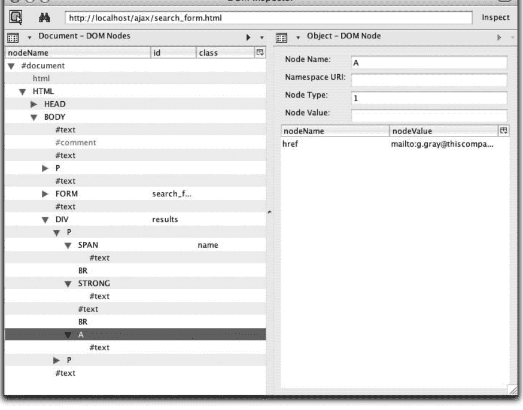

4. **Venkman JavaScript 调试器** (www.mozilla.org/projects/venkman)：这是一个功能强大的 JavaScript 调试器，可通过 Firefox 使用。
5. **JSLint** (www.jslint.com)：此程序对 JavaScript 执行基本语法检查。只需将您的 JavaScript 代码粘贴到 JSLint 网站上的框中，然后单击 JSLint 按钮即可。
6. **Firebug** (www.getfirebug.com)：这个 Firefox 扩展提供了丰富的调试工具，涵盖 HTML、CSS、JavaScript 和 DOM。
7. **Firefox Firefox Firefox**：如果从这个列表中还不清楚（Firefox 被单独提及了四次），那么很明显，Firefox 是调试 Ajax 应用程序的最佳浏览器（它甚至可能是最好的浏览器）。您需要在其他浏览器上测试您的 Ajax 脚本以验证支持，但就调试而言，请优先使用 Firefox！

## 额外说明

### Ajax 问题 第 130 页

- 使用本书中的代码，无论用户的浏览器是否支持 Ajax，每个示例都能正常工作。示例都是特意这样设计的，这样即使友好的 Ajax 层不起作用，用户也不会被落下。您应该尽可能保持这种做法。
- Ajax 页面无法被添加书签、记录在浏览器历史记录中，或列在搜索引擎中，因为更改不会反映在 URL 中。通过采取一些额外步骤，有可能克服其中一些限制。请搜索网络查找相关技术。
- 当某事正在发生或已经发生时，向用户提供明显的提示非常重要。在本书中，我对 Ajax 结果使用了明显的格式设置，以使更改显而易见。

### 介绍 JSON 第 132-133 页

- 使用 JSON 最大的担忧是它涉及一些**安全风险**。`eval()`函数实际上是将接收到的文本作为 JavaScript 代码运行，这意味着如果数据可以被操纵，Ajax 过程可能会被黑客攻击。请搜索网络以获取有关此主题的更多信息以及可能的防护措施。
- JSON 的另一个问题是语法**非常、非常严格**，比 XML 严格得多。使用库来创建 JSON 数据将获得更可靠的结果。

### 发送 JSON 第 134-135 页

- 与其尝试以编程方式创建精确的 JSON 语法，我认为最好使用一个可以为您完成此操作的外部库。在此脚本中，我利用了 **PECL JSON** 类（必须安装；参见 `http://pecl.php.net`——从 PHP 5.2 起默认启用）。
- 或者，参阅官方 JSON 网站 (`www.json.org`) 获取可包含的 PHP 库，这些库可以执行将数组转换为 JSON 的操作。

## JavaScript 框架

使用框架有三个主要缺点。第一是它们需要**花一些精力学习**如何使用它们。第二是它们通常会大大**增加用户必须从您的站点下载的数据量**（也就是说，框架几乎天生就是臃肿的）。最后，您必须关注框架的新版本，因为它们可能会**修补安全漏洞**。

在选择框架时，请考虑**它支持多少种浏览器以及支持哪些浏览器**、**它的大小**（以用户最终需要下载的文件大小衡量）以及**文档完善程度**。

*此页有意留白*

# 索引

### 符号

- `$error`变量, 68, 71, 72
- `$errors`数组, 50, 52
- ...（省略号），在代码块中, xii
- `\n`（换行符）, 109
- `+`（加号），在 JavaScript 中, 83
- `<title>`值, 13

### A

- 添加员工, 43–58
  - 创建 HTML 页面, 44, 45–48
  - 创建 PHP 脚本, 44, 49–54
  - 测试, 54–56
- 添加员工（使用 Ajax）, 59–86
  - 设置 Ajax, 64, 82
  - 更新数据库, 72
  - 准备表单数据, 65–66, 83
  - 验证表单数据, 68–71, 84
  - 修改 HTML 页面, 62, 82
  - 更新 HTML 页面, 75–79, 85
  - 创建 JavaScript 文件, 62–63, 83
  - 概述, 60–61
  - 新的 PHP 脚本, 67, 83
  - 测试, 80–81
  - 完成 XML, 73–74
- Ajax
  - 应用 Ajax 层, 63, 103–104
  - 替代方案, 131
  - 基础知识, x–xi
  - 检查支持情况, 28
  - 添加元素, 62, 102
  - 列出的框架, 141
  - Ajax 页面索引, 130
  - 局限性, 130, 146
  - 设置, 30, 64, 105
  - 测试, 与 Firefox, 42
- 警告，JavaScript, 143
- `appendChild()`函数, 127

### B

- 后退按钮, 130
- 添加书签, 130, 146
- 浏览员工, 11–24
  - CSS 样式表, 12, 19–20, 24
  - 连接数据库, 12, 18, 23
  - 创建 HTML 页面, 12, 13–14, 22
  - 编写 PHP 脚本, 12, 15–17, 22–23
  - 测试页面, 12, 21, 24
- 浏览员工（使用 Ajax）, 25–42
  - 调用函数, 29–31, 35–36, 40, 41–42
  - 创建函数, 27–28, 39
  - 修改 HTML 页面, 37
  - 编写 PHP 脚本, 32–34, 41
  - 测试, 38, 42

### C

- Castro, Elizabeth, xviii, 22, 24
- 本书中的代码
  - 下载, xii
  - JSON 替代 XML, 134–138
- 排序（数据库），定义, 9
- 列
  - 向表中添加, 9
  - 列定义, 10
  - INSERT 查询和, 58
- 连接，定义, 83
- `createElement()`函数, 127
- CSS 样式表
  - 创建, 12, 19–20, 24
  - 页面外观, 45, 89
  - 使用, 20
- MySQL 客户端和, 97
- PHP 脚本和, 23, 24
- PHP-MySQL, 58, 84, 125
- 运行 mysql 客户端和, 97
- Venkman JavaScript 调试器, 145
- XML, 84, 125
- 部门
  - department 列, 9
  - 部门 ID 和 PHP 页面, 15, 16
  - `department_id`值, 10
  - departments 表, 9, 10
  - departments 变量, 113
  - 下拉列表, 12, 48
  - GET 方法和, 57, 82
  - 在搜索中, 117–118
  - 选择菜单, 14
- 文档对象模型 (DOM)
  - 检查器, 144
  - 点语法，JSON, 138

### D

- 数据库
  - 向数据库添加记录, 53
  - 排序，定义, 9
  - 连接, 12, 18, 23
  - 查询, 108
  - 更新, 72
- 创建数据库, 1–10
  - 基础知识, 3–4, 9
  - 访问 MySQL, 2, 9
  - 创建表, 5–6, 9
- 向表填充数据, 7–8, 10
- 调试
  - Ajax 应用程序, 42
  - Firebug 和, 145
  - Firefox 和, 15, 145
- JavaScript, 142–145

### E

- 省略号 (…)，在代码块中, xii
- else 子句
  - 添加记录时, 54, 73, 74
  - 浏览时, 17
  - 搜索时, 95
- 电子邮件地址
  - 查询, 93, 108
  - 搜索和, 94, 119–120, 128
  - 验证, 57
- emails 变量, 113
- 员工
  - 信息, 108
  - 打印列表, 16
  - 添加员工, 43–58
    - 创建 HTML 页面, 44, 45–48
    - 创建 PHP 脚本, 44, 49–54
    - 测试, 54–56
  - 添加员工（使用 Ajax）, 59–86
    - 设置 Ajax, 64, 82
    - 更新数据库, 72
    - 准备表单数据, 65–66, 83
    - 验证表单数据, 68–71, 84
    - 修改 HTML 页面, 62, 82
    - 更新 HTML 页面, 75–79, 85
    - 创建 JavaScript 文件, 62–63, 83
    - 概述, 60–61
    - 新的 PHP 脚本, 67, 83
    - 测试, 80–81
    - 完成 XML, 73–74
  - 浏览员工, 11–24
    - CSS 样式表, 12, 19–20, 24
    - 连接数据库, 12, 18, 23
    - 创建 HTML 页面, 12, 13–14, 22
    - 编写 PHP 脚本, 12, 15–17, 22–23
    - 测试页面, 12, 21, 24
  - 浏览员工（使用 Ajax）, 25–42
    - 调用函数, 29–31, 35–36, 40, 41–42
    - 创建函数, 27–28, 39
    - 修改 HTML 页面, 37
    - 编写 PHP 脚本, 32–34, 41
    - 测试, 38, 42
  - 搜索员工, 87–97
    - 创建 HTML 页面, 88, 89–91, 97
    - 编写 PHP 脚本, 88, 92–95, 97
    - 测试, 96
  - 搜索员工（启用 Ajax）, 99–128
    - 添加 Ajax 元素, 102, 124
    - 显示无结果, 121
    - 员工信息, 116–120, 127–128
    - 生成的 HTML, 114–115, 127
    - 向 JavaScript 文件添加函数, 111, 126
    - 创建 JavaScript 文件, 103–106, 124
    - 概述, 100–101, 124
    - 编写 PHP 脚本, 107–110, 125
    - 测试, 123
    - 处理 XML, 113, 126
- `encodeURIComponent()`函数
  - 添加记录时, 83
  - 搜索时, 124
- 错误
  - 连接数据库和, 18
  - error 元素, 84
  - 报告, 17, 54
- errors 变量, 77
- `eval()`函数, 146

### F

- Firebug, 145
- Firefox
  - 调试和, 15, 145
  - JavaScript 和, 142
  - 作为必需工具, xiv–xv
  - 测试 Ajax 应用程序和, 42
  - 查看 XML 和, 84, 125
- Flash, 131
- for 循环, 115, 127

索引

151

# 索引

表单数据
准备，65–66，83
验证，50–52，57，68–71，84
表单。**另见** HTML 页面
元素，添加，47–48，57
表单的 action 值，14
框架
JavaScript，140，147
PHP-Ajax，141
函数
调用，35–36，40
创建，27–28，39

### G

GET 方法
添加记录时，57，82，83
浏览时，22
搜索时，91，97，105
`getXMLHttpRequestObject()`函数
添加记录时，63
浏览时，27，28，29，39
搜索时，103

### H

`handleResponse()`函数
JSON 与，136，137
添加记录时，64，79，84
搜索时，105，111，125
`header()`函数
准备 XML 与，67，84
搜索时，107，125
href 属性，119

HTML
搜索时生成，114–115
与 Ajax 的关系，xi
**HTML, XHTML, and CSS, Sixth Edition: Visual QuickStart Guide**，xviii，24

HTML 页面。**另见** 测试
创建，22，24
添加记录时创建，45–48
浏览时创建，12，13–14，22
搜索时创建，88，89–91，97
添加记录时修改，62，82
浏览时修改，37
搜索时修改，102
样式表与，20
添加记录时测试，54–56，80–81
浏览时测试，21，24，38
搜索时测试，96，123
HTTP 状态码，126

### I

IDE（集成开发环境），xiv
iFrames，131
Ajax 页面索引，130
`init()`函数
添加记录与，63，75，85
搜索时，126
`innerHTML`，99

### J

Java 小程序，131
JavaScript
向文件添加函数，111
Ajax 功能与，27，39
警报，143
浏览器支持与，130
调试，142–145
文件，创建，62–63，103–106
Firefox 与，142
框架，140，147
其中的加号（+），83
与 Ajax 的关系，xi
JSON（JavaScript Simple Object Notation），132–138，146

### L

标签，48，57，76，78，85
层（Ajax），应用，63，103–104
LIKE 子句，97
登录，mysql 客户端，2

### M

MySQL。*另见* mysql 客户端
访问，2，9
连接脚本，108
创建数据库与，1，3
**MySQL, Second Edition: Visual QuickStart Guide**，xviii，1，23

mysql 客户端
调试与，97
登录，2
使用其创建表，5–6，9
使用其填充表，7–8

`mysql_affected_rows()`函数，53
`mysql_error()`函数，58，84，125
`mysql_real_escape_string()`函数
添加记录时，51，57，69–70
搜索时，93，108

### N

name class 属性，116
搜索中的名称，116，127
names 变量，113，114
换行符（`\n`），109
节点
用于操作内容，112，126
strong 节点，117
文本节点，116，120
向表单添加数值，52，71

### O

message 变量，86

修改 HTML 页面
添加记录时，62，82
浏览时，37
搜索时，102

`onsubmit()`事件，104

### P

页面，添加书签，130，146
密码，PHP 脚本与，23
PECL JSON 类，146
电话分机，添加，48，52，71

### PHP

- 定义，22
- 列出的框架，141
- 库的网站，146

**PHP 5 Advanced: Visual QuickPro Guide**，xviii
**PHP and MySQL for Dynamic Web Sites, Second Edition: Visual QuickPro Guide**，xviii，23
**PHP for the World Wide Web, Second Edition: Visual QuickStart Guide**，xviii

PHP 脚本
- 使用其连接数据库，18
- PHP 定义，22
- 样式表与，20
- 编写，添加记录时，44，49–54，67–74，83–84
- 编写，浏览时，12，15–17，22–23，32–34
- 编写，搜索时，88，92–95，107–110

phpMyAdmin，1，4，8，10
PHP-MySQL，调试，58，84
加号（+），JavaScript 中，83
POST 方法，46，57，64，82，83
打印员工列表，16

### R

记录，添加。**参见** 添加员工；添加员工（使用 Ajax）
`removeChild()`函数，126
`responseText`，126
`responseXML`，126
富互联网应用程序（RIA），x

### S

搜索员工，87–97
- HTML 页面，创建，88，89–91，97
- PHP 脚本，编写，88，92–95，97
- 测试，96

搜索员工（启用 Ajax），99–128
- Ajax 元素，添加，102，124
- 显示无结果，121
- 员工信息，116–120，127–128
- 生成的 HTML，114–115，127
- JavaScript 文件，添加函数，111，126
- JavaScript 文件，创建，103–106，124
- 概述，100–101，124
- PHP 脚本，编写，107–110，125
- 测试，123
- XML，处理，113，126

安全性
- 框架与，147
- JSON 的风险，146

`send()`方法，66，83
`setAttribute()`函数，127
span 节点，116

### T

表
创建，5–6，9
填充，7–8，10

测试
添加时，54–56，80–81
浏览时，21，24，38
搜索时，96，123

文本编辑器
HTML 页面与，22
其必要性，xiv

文本节点，116，120
`<title>`值，13

### U

用户名，PHP 脚本与，23

### V

验证表单数据，50–52，57，68–70，84

值
`<title>`值，13
向表单添加数值，52

Venkman JavaScript 调试器，145

### W

Web 浏览器
Ajax 基础与，x，13
本书中的示例与，xiv
测试 Ajax 与，42
使用 phpMyAdmin 与，2
XML 支持与，84，125
XMLHttpRequest 对象与，28

Web 资源
本书的配套网站，xvii
获取更多信息，139
JSON 网站，146
PECL JSON 类，146
PHP 库，146
所见即所得（WYSIWYG），xiv

### X

XML
添加记录时完成，73–74，84
调试，84，125
Firefox 与，84，125
添加记录时处理，77
搜索时处理，113
`header()`函数与，67，84
JSON 作为其替代方案，132–138
添加记录时准备，67，83
搜索时准备，107

XMLHttpRequest 对象
浏览器特定的，82
其在 Ajax 中的重要性，xi
添加记录时，44
搜索时，103，124
