# HTML、CSS 和 JavaScript Android App 构建指南


献给 Erica 和 Cooper

# 前言

多亏了手机，我们已经从几乎没有人能获取信息的时代，发展到了几乎每个人都能获取海量 Web 资源的时代。这可以说是我们这一代人最重要的成就。尽管意义如此重大，但移动计算仍处于起步阶段。技术、资金和政治力量造成了前所未有的平台碎片化，而且在好转之前会变得更糟。

需要接触大量多样化用户群体的开发者面临着一个看似不可能的挑战："我们如何以可行、经济且能覆盖最多参与者的方式来实现我们的移动愿景？"在很多情况下，答案就是 Web 技术。HTML5 和移动设备的进步相结合，创造了一个即使是新手开发者也能构建在全球范围内改善人们生活的移动应用的环境。

Google 的 Android 操作系统是移动计算领域的一个引人注目的新成员。秉承 Google 的一贯风格，该平台开放、免费且具有高度的互操作性。开发工具功能齐全且强大，虽然有些 geek 风格，并且可以在多种平台上运行。

运营商和手机制造商纷纷加入了 Android 的阵营。市场上开始充斥各种形状和尺寸的 Android 设备。这对开发者来说是一把双刃剑。一方面，更多的设备意味着更大的市场。另一方面，更多的设备意味着更多的碎片化问题。与整个移动市场的碎片化一样，Android 上的碎片化通常可以通过使用 HTML、CSS 和 JavaScript 构建应用来解决。

我首先承认并非所有应用都适合使用 Web 技术来开发。话虽如此，我看到很多使用原生代码编写的应用，其实同样可以轻松地用 HTML 来实现。当与不确定该采用哪种方式的开发者交流时，我会这样说：

> 如果你能用 HTML、CSS 和 JavaScript 构建你的应用，那你就应该这样做。


使用开源的、基于标准的 Web 技术能为你带来最大的灵活性、最广泛的覆盖范围和最低的成本。你可以轻松地将其作为 Web 应用发布，然后在数千名真实用户的负载下进行调试和测试。当你准备就绪后，可以使用 PhoneGap 将你的 Web 应用转换为原生 Android 应用，根据需要添加一些特定于设备的功能，然后提交到 Android Market——或者直接从你的网站提供下载。听起来不错，对吧？

## 谁应该阅读本书

我假设你在阅读和编写 HTML、CSS 和 JavaScript（尤其是 jQuery）方面有一些基本经验。[第 5 章](#)包含一些基本的 SQL 代码，因此对 SQL 语法有初步了解会有所帮助，但并非必需。

## 使用本书的条件

本书会尽可能避免使用 Android SDK。要跟上绝大多数示例，你只需要一个文本编辑器和最新版本的 Google Chrome（一款前沿的网页浏览器，Mac 和 Windows 均可使用，下载地址为 [http://www.google.com/chrome](http://www.google.com/chrome)）。但[第 7 章](#)中关于 PhoneGap 的内容确实需要 Android SDK，在该章中我将介绍如何将你的 Web 应用转换为可以提交到 Android Market 的原生应用。

## 本书使用的排版惯例

本书使用了以下排版惯例：

*斜体*
表示新术语、URL、电子邮件地址、文件名和文件扩展名。

**等宽字体**
用于程序清单，以及在段落中引用程序元素（如变量或函数名、数据库、数据类型、环境变量、语句和关键字）。

**等宽粗体**
表示用户应原样输入的命令或其他文本。

*等宽斜体*
表示应替换为用户提供的值或由上下文确定的值的文本。

此图标表示提示、建议或一般说明。

此图标表示警告或注意事项。

## 使用代码示例

本书旨在帮助你完成工作。通常情况下，你可以在自己的程序和文档中使用本书中的代码。除非你正在复制大部分代码，否则无需联系我们获取许可。例如，编写一个使用本书中若干代码片段的程序不需要获得许可。但销售或分发包含 O'Reilly 书籍示例的 CD-ROM 则需要获得许可。通过引用本书并引用示例代码来回答问题不需要获得许可。将大量示例代码纳入产品文档中则需要获得许可。

我们欢迎但不强制要求注明出处。注明出处通常包括书名、作者、出版社和 ISBN。例如："*Building Android Apps with HTML, CSS, and JavaScript, 2nd edition* by Jonathan Stark (O'Reilly). Copyright 2012 Jonathan Stark, 978-1-4493-1641-9."

如果你认为自己对代码示例的使用超出了合理使用范围或上述许可范围，请随时通过 permissions@oreilly.com 联系我们。

## Safari® Books Online

Safari Books Online 是一个按需数字图书馆，让你可以轻松搜索超过 7,500 本技术和创意参考书籍及视频，快速找到所需答案。

通过订阅，你可以在线阅读图书馆中的任何页面、观看任何视频。在手机和移动设备上阅读书籍。在新书印刷出版前即可获取电子版，并获得开发中手稿的独家访问权及向作者反馈的机会。复制粘贴代码示例、整理收藏、下载章节、标记关键章节、创建笔记、打印页面，以及享受众多其他节省时间的功能。

O'Reilly Media 已将本书上传至 Safari Books Online 服务。要完整数字访问本书以及 O'Reilly 和其他出版社的类似主题书籍，请在 http://my.safaribooksonline.com 免费注册。

## 如何联系我们

请将有关本书的意见和问题发送至出版社：

    O'Reilly Media, Inc.
    1005 Gravenstein Highway North
    Sebastopol, CA 95472
    800-998-9938（美国或加拿大）
    707-829-0515（国际或本地）
    707-829-0104（传真）

我们为本书设有一个网页，列出了勘误、示例和任何其他信息。你可以通过以下地址访问该页面：

    http://shop.oreilly.com/product/0636920022886.do

要对本书发表评论或提出技术问题，请发送电子邮件至：

    bookquestions@oreilly.com

如需了解更多关于我们的书籍、会议、资源中心和 O'Reilly Network 的信息，请访问我们的网站：

    http://www.oreilly.com

## 致谢

写书是团队合作的成果。我衷心感谢以下人士的慷慨贡献。

Tim O'Reilly、Brian Jepson 以及 ORM 的其他成员，感谢他们让撰写本书的过程如此充实且富有教育意义。

David Kaneda 对完美之美的执着追求令人赞叹。无论是还是一段代码还是一段用户界面动画，他不做到完美绝不罢休，我非常欣赏这一点。

Nitobi 团队创建了 PhoneGap 并持续为其提供支持。

Brian Fling 让我对移动领域的视野超越了最新最强的硬件。Brian 深谙移动领域的发展历史；他是一位出色的作家，此外还是一个非常慷慨的人。

PPK、John Gruber、John Allsopp 和 John Resig，感谢他们对使本书成为可能的底层技术所做的贡献和支持。

Joe Bowser、Brian LeRoux、Sara Czyzewicz 以及在 OFPS 本书页面上慷慨发表评论和问题的众多朋友们。你们的反馈非常有帮助，深表感谢。

我亲爱的家人、朋友和客户，感谢你们在我埋头键盘时的理解和支持。

xii | 前言

最后，还有 Erica。你让一切成为可能。我爱你！

# 第 1 章 入门

在我们深入探讨之前，我想先快速搭建好舞台。在本章中，我将定义关键术语，比较两种最常见开发方式的优缺点，并对本书中使用的三种核心 Web 技术进行速成讲解。

## Web 应用与原生应用

首先，我想定义我所说的 *Web 应用* 和 *原生应用* 的含义，并分析它们的优缺点。

### 什么是 Web 应用？

在我看来，Web 应用基本上是专门为智能手机优化使用的网站。网站内容可以是任何东西，从标准的小型企业展示网站到抵押贷款计算器，再到每日卡路里追踪器——内容并不重要。Web 应用的定义特征是：用户界面（UI）使用 Web 标准技术构建，可通过 URL 访问（公开的、私有的，或者可能需要登录），并且针对移动设备的特性进行了优化。Web 应用不会安装在手机上，不会出现在 Android Market 中，也不是用 Java 编写的。

### 什么是原生应用？

相比之下，原生应用安装在 Android 手机上，可以访问硬件（扬声器、加速度计、摄像头等），并且使用 Java 编写。然而，原生应用的定义特征是它可以在 Android Market 中获取——这个特性吸引了全球大批软件创业者的目光，我自己也不例外。

### 优缺点

不同的应用有不同的需求。有些应用比其他应用更适合使用 Web 技术。了解每种方式的优缺点将帮助你做出更好的决策，选择适合你情况的路径。

以下是原生应用开发的优点：

- 数百万注册信用卡用户只需点击一下即可购买
- 你可以访问设备的所有酷炫硬件功能

以下是原生应用开发的缺点：

- 你需要付费才能成为 Android 开发者
- 你的应用只能在 Android 手机上运行
- 你必须使用 Java 进行开发
- 开发周期较长（开发、编译、部署、重复）

以下是 Web 应用开发的优点：

- Web 开发者可以使用他们现有的创作工具
- 你可以使用现有的 Web 设计和开发技能
- 你的应用可以在任何具有 Web 浏览器的设备上运行
- 你可以实时修复 Bug
- 开发周期短

以下是 Web 应用开发的缺点：

- 你无法访问手机的所有酷炫硬件功能
- 如果你想对应用收费，必须自己搭建支付系统
- 实现精细复杂的 UI 效果可能比较困难

### 哪种方式适合你？

这才是最令人兴奋的地方。Android 手机始终在线的特性创造了一种环境，使得 Web 应用和原生应用之间的界限变得模糊。Android Web 浏览器甚至有一些鲜为人知的功能（见第 6 章），允许你在需要时将 Web 应用设为离线使用。此外，还有几个第三方项目——其中 PhoneGap 最为知名——正在积极开发解决方案，让 Web 开发者能够将 Web 应用打包为 Android 和其他移动平台的原生应用。


对我来说，这是完美的结合。我可以使用自己偏好的语言进行编写，将产品作为纯 Web 应用发布（适用于 Android 和任何其他具有现代浏览器的设备），并使用相同的代码库来创建一个增强的原生版本，使其能够访问设备硬件，并有可能在 Android Market 上销售。这是一种为你的应用创建"免费增值"模式的绝佳方式——允许免费访问 Web 应用，同时对功能更丰富的原生版本收费。

## Web 编程速成课程

我们将用来构建 Web 应用的三种主要技术是 HTML、CSS 和 JavaScript。在深入学习高级内容之前，我们会快速介绍这三者，以确保大家处于同一认知水平。

## HTML 简介

当你浏览网页时，你看到的页面其实就是存储在别人计算机上的文本文档。典型网页中的文本被包裹在 HTML 标签中，这些标签告诉浏览器文档的结构。有了这些信息，浏览器就能决定如何以合理的方式显示内容。

请看示例 1-1 中的网页片段。第一行中，字符串 "Hi there!" 被一对 `h1` 标签包裹。注意开标签和闭标签略有不同：闭标签的第二个字符是斜杠（/），而开标签没有斜杠。

将文本包裹在 `h1` 标签中会告诉浏览器这些文字是一个标题，这将使其以大号粗体文字单独显示在一行上。还有 `h2`、`h3`、`h4`、`h5` 和 `h6` 标题标签。数字越小，标题越重要，因此包裹在 `h6` 标签中的文本会比包裹在 `h3` 标签中的文本更小（即看起来没那么重要）。

在示例 1-1 的 `h1` 标签之后，有两行被 `p` 标签包裹。这些被称为段落标签。浏览器会将每个段落单独显示在一行上。如果段落过长超过浏览器窗口的宽度，文本会换行并继续显示在下一行。无论哪种情况，段落之后都会插入一个空行，以将其与页面上的下一个元素分隔开。

示例 1-1. HTML 片段
```html
<h1>Hi there!</h1>
<p>Thanks for visiting my web page.</p>
<p>I hope you like it.</p>
```

你还可以将 HTML 标签放在其他 HTML 标签内部。示例 1-2 展示了一个无序列表（`ul`）标签，其中包含三个列表项（`li`）。在浏览器中，这会显示为一个带项目符号的列表，每个项目各占一行。当一个或多个标签位于另一个标签内部时，内部标签被称为外部标签的*子元素*，即子级。因此在这个示例中，`li` 标签是 `ul` 父级的子级。

示例 1-2. 无序列表
```html
<ul>
    <li>Pizza</li>
    <li>Beer</li>
    <li>Dogs</li>
</ul>
```

到目前为止介绍的标签都是*块级标签*。块级标签的定义特征是它们独占一行，左右没有任何元素。这就是为什么标题、段落和列表项是沿页面向下排列，而不是横向排列。块级标签的对立面是*行内标签*，顾名思义，它可以出现在一行文字中。强调标签（`em`）就是行内标签的一个例子，它的写法如下：

```html
<p>I <em>really</em> hope you like it.</p>
```

行内标签的鼻祖——也可以说是 HTML 最酷的特性——是 `a` 标签。"a" 代表锚点（anchor），但有时我也会称其为链接或超链接。被锚点标签包裹的文本是可点击的，点击它会使浏览器加载一个新的 HTML 页面。

要告诉浏览器加载哪个新页面，我们必须在标签中添加所谓的*属性*。属性是插入到开标签中的命名值。在锚点标签中，你使用 `href` 属性来指定目标页面的位置。这是一个指向 Google 主页的链接：

```html
<a href="http://www.google.com/">Google</a>
```

如果你不习惯阅读 HTML，这看起来可能有点乱，但你应该能够从中找出 Google 主页的 URL。你将在本书中大量看到 `a` 标签和 `href` 属性，所以如果一开始不太理解，花点时间消化一下。

> 关于属性有几点需要注意。不同的 HTML 标签允许不同的属性。你可以通过空格分隔向开标签添加多个属性。永远不要在闭标签上添加属性。属性和标签有数百种可能的组合，但不必担心——在这整本书中我们只需要关注十几种左右。

我们一直查看的 HTML 片段通常会位于完整 HTML 文档的 `body` 部分。HTML 文档由两部分组成：`head` 和 `body`。body 是你放置所有希望用户看到的内容的地方。head 包含关于页面的信息，其中大部分对用户不可见。

body 和 head 始终被包裹在一个 `html` 元素中。示例 1-3 展示了该片段在一个规范 HTML 文档中的上下文。目前 head 部分包含一个 **title** 元素，它告诉浏览器在窗口的标题栏中显示什么文本。

示例 1-3. 一个规范的 HTML 文档
```html
<html>
    <head>
        <title>My Awesome Page</title>
    </head>
    <body>
        <h1>Hi there!</h1>
        <p>Thanks for visiting my web page.</p>
        <p>I hope you like it.</p>
        <ul>
            <li>Pizza</li>
            <li>Beer</li>
            <li>Dogs</li>
        </ul>
    </body>
</html>
```

通常，当你使用浏览器时，你正在查看的是托管在互联网上的页面。然而，浏览器同样能很好地显示本地计算机上的 HTML 文档。为了向你展示我的意思，我建议你打开一个文本编辑器，输入示例 1-3 中的代码。

### 选择合适的文本编辑器

有些文本编辑器不适合编写 HTML。特别是，你要避免使用支持富文本编辑的编辑器，如 Microsoft WordPad（Windows）或 TextEdit（Mac OS X）。这类编辑器可以将文件保存为纯文本以外的格式，这会破坏你的 HTML。如果必须使用 TextEdit，请选择"格式" → "制作纯文本"来保存为纯文本格式。在 Windows 中，请使用 Notepad 而不是 WordPad。

如果你正在寻找一个好的文本编辑器，我在 Mac 上推荐 TextMate。在 Windows 上，E Text Editor 和 Sublime Text 都很出色。

如果你追求免费，可以在 Mac 上下载 Text Wrangler。在 Windows 上，Notepad2 和 Notepad++ 备受好评。Linux 自带多种文本编辑器，如 vi、nano、emacs 和 gedit。

输入完示例 1-3 中的代码后，将其保存到桌面，命名为 *test.html*，然后通过将文件拖到 Chrome 应用图标上，或者打开 Chrome 并选择"文件" → "打开文件"来用 Chrome 打开它。双击 *test.html* 也可以，但根据你的设置，它可能会在你的文本编辑器或其他浏览器中打开。

即使 Chrome 不是你最喜欢的浏览器，在桌面浏览器上测试 Android Web 应用时你也应该使用它，因为 Chrome 是与 Android 移动浏览器最接近的桌面浏览器。Chrome 可在 http://google.com/chrome 上下载，支持 Mac 和 Windows。

## CSS 简介

正如你所看到的，浏览器会为某些 HTML 元素应用独特的样式进行渲染（例如，标题是大号粗体，段落后面跟着一个空行，等等）。这些样式非常基础，主要目的是帮助读者理解文档的结构和含义。

要超越这种简单的基于结构的渲染，你需要使用层叠样式表（CSS）。CSS 是一种样式表语言，用于定义 HTML 文档的视觉呈现。你可以使用 CSS 来定义简单的内容，如文本颜色、大小和样式（粗体、斜体等），或者复杂的内容，如页面布局、渐变、不透明度等等。

示例 1-4 展示了一条 CSS 规则，它指示浏览器以红色显示 body 元素中的任何文本。在这个示例中，`body` 是*选择器*（它指定了该规则影响的对象），花括号内包含的是*声明*（即规则本身）。声明包含一组*属性*及其*值*。在这个示例中，`color` 是属性，`red` 是 `color` 属性的值。

示例 1-4. 一条简单的 CSS 规则
```css
body { color: red; }
```

属性名称在 CSS 规范中是预定义的，这意味着你不能随意编造它们。每个属性都期望一个适当的值，对于给定的属性，可能有很多适当的值和值格式。

例如，你可以使用预定义关键字如 `red` 来指定颜色，或者使用 HTML 颜色代码表示法，它使用十六进制表示法：一个井号（#）后跟三对十六进制数字（0–F），从左到右分别代表红色、绿色和蓝色值（红色表示为 `#FF0000`）。接受测量值的属性可以接受如 `10px`、`75%` 和 `1em` 这样的值。示例 1-5 展示了一些常见的声明。`background-color` 所显示的颜色代码对应 CSS 中的"灰色"。

示例 1-5. 一些常见的 CSS 声明
```css
body {
    color: red;
    background-color: #808080;
    font-size: 12px;
    font-style: italic;
}
```


选择器有多种类型。如果你想让所有超链接（`a`元素）显示为斜体，请在样式表中添加以下内容：

```css
a { font-style: italic; }
```

如果你想更精确一些，仅将包含在某个`h1`标签内的超链接设为斜体，请在样式表中添加以下内容：

```css
h1 a { font-style: italic; }
```

你还可以通过在HTML标签中添加`id`和/或`class`属性来定义自定义选择器。看看以下HTML代码片段：

```html
<h1 class="loud">Hi there!</h1>
<p id="highlight"> Thanks for visiting my web page.</p>
<p>I hope you like it.</p>
<ul>
    <li class="loud">Pizza</li>
    <li>Beer</li>
    <li>Dogs</li>
</ul>
```

如果我们在这段HTML的CSS中添加`.loud { font-style: italic; }`，"Hi there!"和"Pizza"将显示为斜体，因为它们都有`loud`类。`.loud`选择器前面的点很重要——它告诉CSS去查找具有`loud`类的HTML标签。如果你省略了这个点，CSS就会去查找一个`loud`标签，而这个标签在此片段中并不存在（实际上在HTML中也不存在）。

通过`id`应用CSS的方式类似。要为highlight段落标签添加黄色背景填充，请使用以下规则：

```css
#highlight { background-color: yellow; }
```

这里的`#`符号告诉CSS去查找具有ID为`highlight`的HTML标签。

总结一下，你可以选择按标签名（如`body`、`h1`、`p`）、按类名（如`.loud`、`.subtle`、`.error`）或按ID（如`#highlight`、`#login`、`#promo`）来选择元素。而且，你可以通过将选择器链接在一起来变得更加精确（如`h1 a`、`body ul .loud`）。

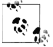

class和id之间是有区别的。当页面上有多个具有相同class值的元素时，应使用class属性。相反，id值在一个页面中必须是唯一的。

当我刚开始学习的时候，我想干脆一直使用class属性，这样就不用担心是否重复使用了某个id值。然而，通过id选择元素比通过class快得多，因此过度使用class选择器会影响性能。

## 应用样式表

现在你已经了解了CSS的基础知识，但如何将样式表应用到HTML页面呢？其实非常简单！首先，将CSS保存在服务器上的某个位置（通常与HTML文件放在同一目录中，但也可以放在子目录中）。然后，在HTML文档的`head`中链接到该样式表，如示例1-6所示。此示例中的`href`属性是一个相对路径，它指向与HTML页面同一目录下的名为*screen.css*的文本文件。你也可以指定绝对链接，如下所示：

```
http://example.com/screen.css
```

> 如果你将HTML文件保存在本地计算机上，最好保持简单：将CSS文件与HTML文件放在同一目录中，并使用相对路径，如示例1-6所示。

### 示例1-6. 链接到CSS样式表

```html
<html>
    <head>
        <title>My Awesome Page</title>
        <link rel="stylesheet" href="screen.css" type="text/css" />
    </head>
    <body>
        <h1 class="loud">Hi there!</h1>
        <p id="highlight"> Thanks for visiting my web page.</p>
        <p>I hope you like it.</p>
        <ul>
            <li class="loud">Pizza</li>
            <li>Beer</li>
            <li>Dogs</li>
        </ul>
    </body>
</html>
```

### 示例1-7. 一个简单的样式表

```css
body {
    font-size: 12px;
    font-weight: bold;
    font-family: Arial;
}

a { font-style: italic; }
h1 a { font-style: italic; }

.loud { font-style: italic; }
#highlight { background-color: yellow; }
``>

> 值得一提的是，你可以链接到托管在其他域名上的样式表。但是，在未经许可的情况下链接到他人的样式表是非常不礼貌的行为，所以请只链接你自己的样式表。

关于CSS的快速而全面的速成课程，我强烈推荐Eric Meyer（O'Reilly出版）的*CSS Pocket Reference: Visual Presentation for the Web*。Meyer在CSS领域是公认的权威，而且这本书篇幅简短，完全可以在早晨拼车的途中读完（除非你是开车的那个人，那可能要花更长时间——我刚才是不是说了"速成"课程？）。

## JavaScript简介

到目前为止，你已经知道如何用HTML构建文档，以及如何用CSS修改文档的视觉呈现。现在我将向你展示如何用JavaScript让网页实现交互功能。

JavaScript是一种脚本语言，你可以将它添加到HTML页面中，使其更具交互性，为用户提供更便捷的体验。例如，你可以编写一些JavaScript来检查表单中输入的值，确保它们是有效的。或者，你可以让JavaScript根据用户点击的位置来显示或隐藏页面元素。JavaScript甚至可以与Web服务器通信来执行数据库更改，而无需刷新当前页面。

与任何现代脚本语言一样，JavaScript也有变量、数组、对象和所有典型的控制结构（如`if`、`while`、`for`）。示例1-8展示了一段JavaScript代码片段，说明了该语言的许多核心概念（现在先不要急着把它放进你的HTML文件；稍后我会向你展示如何将HTML和JavaScript结合在一起）。

### 示例1-8. 基本JavaScript语法

```javascript
var foods = ['Apples', 'Bananas', 'Oranges'];
for (var i=0; i<foods.length; i++) {
  if (foods[i] == 'Apples') {
    alert(foods[i] + ' are my favorite!');
  } else {
    alert(foods[i] + ' are okay.');
  }
}
```

以下是这段代码的解释：

1. 定义一个名为**foods**的*数组*（一个值的列表），包含三个元素。
2. 开启一个典型的**for**循环，将一个名为**i**的变量初始化为0，并指定退出条件——在本例中，当**i**大于**foods**数组的长度时退出，每次循环将**i**递增1（`i++`是"将i的当前值加1"的简写）。
3. 一个普通的`if`语句，检查数组的当前元素是否等于`Apples`。
4. 当数组的当前元素等于`Apples`时显示。
5. 当数组的当前元素不等于`Apples`时显示。

以下是关于JavaScript语法的一些值得注意的要点：

- 语句以分号（`;`）结尾
- 代码块用花括号（`{}`）括起来
- 变量使用`var`关键字声明
- 数组元素可以通过方括号表示法（`[]`）访问
- 数组索引从0开始
- 单等号（`=`）是赋值运算符（将一个值赋给变量）
- 双等号（`==`）是等价逻辑运算符（比较两个值，如果相等则结果为true）
- 加号（`+`）是字符串连接运算符（将两个字符串组合在一起）

对于我们的目的来说，JavaScript最重要的特性是它能与HTML页面的元素进行交互（酷炫的小伙伴们称之为"操作DOM"）。示例1-9展示了一段简单的JavaScript，当用户点击`h1`时，页面上的一些文本会发生变化。在文本编辑器中创建一个新文件，将其保存为`onclick.html`，然后在浏览器中打开该文档。点击标注为"Click me!"的文本，看看它的变化。

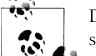

> DOM代表Document Object Model（文档对象模型），在此上下文中它表示浏览器对HTML页面的理解。你可以在以下链接了解更多关于DOM的信息：http://en.wikipedia.org/wiki/Document_Object_Model。

### 示例1-9. 简单的onclick处理程序

```html
<html>
    <head>
        <title>My Awesome Page</title>
        <script type="text/javascript" charset="utf-8">
            function sayHello() {
                document.getElementById('foo').innerHTML = 'Hi there!';
            }
        </script>
    </head>
    <body>
        <h1 id="foo" onclick="sayHello()">Click me!</h1>
    </body>
</html>
```

以下是解释：

1.  位于HTML文档头部的脚本块。
2.  这行在脚本块内定义了一个名为 `sayHello()` 的JavaScript函数。
3.  `sayHello()` 函数包含一条语句，该语句指示浏览器在文档中查找ID为 `foo` 的元素，并将其内部HTML内容设置为“Hi there!”。在浏览器中，当用户点击h1元素时，这会将文本“Click me!”替换为“Hi there!”。
4.  `sayHello()` 函数结束。
5.  脚本块结束。
6.  h1元素的 `onclick` 属性告诉浏览器，当用户点击h1元素时执行某个操作，即运行 `sayHello()` 函数。

在Web开发的早期糟糕岁月里，不同浏览器对JavaScript的支持各不相同。这意味着你的代码可能在Safari 2中可以运行，但在Internet Explorer 6中却不行。你不得不费尽心思测试每个浏览器（甚至是同一浏览器的不同版本），以确保你的代码对所有人都有效。随着浏览器和浏览器版本数量的增长，要为每个环境测试和维护你的JavaScript代码变得不可能。那时候，使用JavaScript进行网页编程简直是地狱。

于是，jQuery登场了。jQuery是一个相对小巧的JavaScript库，它允许你以一种在多种浏览器中都能相同工作的方式来编写JavaScript代码。更重要的是，它极大地简化了许多常见的Web开发任务。出于这些原因，我在大多数Web开发工作中都会使用jQuery，并且在本书的JavaScript示例中也会使用它。示例1-10是示例1-9的jQuery重写版本。在你的文本编辑器中创建一个新文件，将这段代码清单复制进去，并将其保存为 `jquerytest.html`。接下来，将 `jquery.js` 下载到同一目录中。然后在你的网页浏览器中打开该文件并尝试。

> jQuery的下载、文档和教程可在 http://jquery.com 获取。要像示例1-9那样使用jQuery，你需要从那里下载它，将下载的文件（例如 `jquery-1.4.2.min.js`）重命名为 `jquery.js`，并将副本放在与你的HTML文档相同的目录中。

示例1-10. jQuery onclick 处理器

```
<html>
    <head>
        <title>My Awesome Page</title>
        <script type="text/javascript" src="jquery.js"></script> ①
        <script type="text/javascript" charset="utf-8">
function sayHello() {
    $('#foo').text('Hi全心全意为社区服务');
}
</script>
</head>
<body>
    <h1 id="foo" onclick="sayHello()">Click me!</h1>
</body>
</html>
```

① 这行代码包含了jquery.js库。它使用了相对路径，意味着该文件与使用它的页面位于同一目录中（除非jQuery库jquery.js在那里，否则此示例将无法正确运行）。不过，你也可以直接从它可用的多种地方包含它。

② 注意我们为替换h1元素中的文本所需编写的代码量大大减少。在这个简单的例子中，这似乎不是什么大事，但我可以向你保证，在复杂的解决方案中，这绝对是个救星。

我们稍后会看到很多真实的jQuery示例，所以现在就先到这里。

## 第 2 章

## 基本样式

最终，我们将使用HTML、CSS和JavaScript来构建一个原生的Android应用。这段旅程的第一步是熟悉如何为HTML添加样式，使其看起来像一个移动应用。在本章中，我将向你展示如何将CSS样式应用到一组现有的HTML页面上，使它们在Android手机上易于导航。因此，除了更接近构建原生应用外，你还将学习一项实用的（并且有价值的）技能，可以立即使用。

## 没有网站？

如果你一直只在个人电脑上本地测试所有网页，那么在没有设置服务器的情况下，你将无法在Android手机上查看它们。你有几个选择：

-   将你的网页托管在Web服务器上，并从你的Android手机连接到该服务器。你的互联网服务提供商很可能提供免费的网站托管服务，但通常只支持HTML等基本功能。等到第6章时，我们将需要使用PHP（一种在Web服务器上运行的脚本语言），所以你应该考虑使用一个价格实惠的托管服务。许多公司，如Laughing Squid，提供低于每月10美元的入门级托管，支持PHP。
-   将它们托管在你计算机上运行的Web服务器上，并从你的Android手机连接到你计算机上运行的Web服务器。这仅在你的Android手机和计算机位于同一WiFi网络时才有效。

本章的设计是为了让你在阅读过程中能够尝试示例。因此，无论你选择哪种方式查看网页，每次向其中一个示例添加新内容时，都尝试在浏览器中重新加载它们（最好是Android浏览器）。但是，请务必在浏览器中重新加载之前，在文本编辑器中保存你的文件，否则你将看不到更改。

## 在本地运行Web服务器

Linux、Windows和Mac OS X都包含某种Web服务器。在Mac OS X上，打开“系统偏好设置”，选择“共享”，并启用“Web共享”。启动“Web共享”后，“Web共享”偏好设置将显示你的个人网站的URL（这包括你放在主目录的*Sites*目录中的所有内容）。其形式将是 `http://local-hostname/~your-username`。启动“Web共享”后，尝试将你在第1章创建的 *test.html* 文件放入主目录的 *Sites* 目录中。点击“Web共享”偏好设置窗格中显示的链接（可能类似于 *http://10.0.1.29/~your-username/*），然后在URL后添加 `test.html`（得到类似 *http://10.0.1.29/~your-username/test.html* 的地址），然后加载该页面。

在Windows上，打开“控制面板”，选择“程序”，然后点击“启用或关闭Windows功能”。勾选标记为“Internet Information Services”的复选框，然后点击其左侧的+号；继续深入到“World Wide Web Services”→“应用程序开发功能”，然后勾选以启用CGI（你需要CGI功能才能在第6章安装PHP）。点击“确定”。完成此操作后，你可以将你的Web文档放在IIS文档根目录中，该目录通常位于 *C:\inetpub\wwwroot*。尝试使用你在第1章创建的 *test.html* 文件；你应该能够通过在浏览器中访问 *http://localhost/test.html* 来加载该文件。

你每次将文件放入该文件夹时可能都需要进行身份验证。要解决这个问题，你可以使用IIS管理器（开始→控制面板→系统和安全→管理工具）在你可以修改的文件夹中添加一个新的虚拟目录，或者你可以将自己设置为 *C:\inetpub\wwwroot* 的所有者（右键单击该文件夹，选择“属性”→“安全”，然后点击“编辑”→“添加”，输入你的用户名，点击“确定”，然后允许“完全控制”并点击“确定”）。如果你想连接到你的Windows Web服务器，即使是在本地网络内，你也需要进入“控制面板”→“系统和安全”→“Windows防火墙”→“允许程序或功能通过Windows防火墙”，并启用“World Wide Web Services”。

如果你更愿意在Windows上运行Apache，请查看像EasyPHP这样的预打包解决方案，或者查看关于此主题的维基百科页面：*http://en.wikipedia.org/wiki/Comparison_of_WAMPs*。

在某些版本的Linux（如Ubuntu）上，你需要执行一些额外的步骤来安装和启用Web服务器。例如，在Ubuntu上，你可以在命令行使用 `sudo apt-get install apache2` 安装Apache。接下来，使用 `sudo a2enmod userdir` 启用用户目录模块。完成后，使用此命令重启Apache：`sudo /etc/init.d/apache2 restart`。完成后，你可以在主目录中创建一个名为 *public_html* 的目录，并通过类似 `http://local-hostname/~your-username` 的URL访问其中的任何文件。


# 初步上手

理论固然很棒，但我更喜欢"眼见为实"的方式，所以让我们直接动手吧。
假设你有一个网站想要"移动化"（图 2-1）。在这种情况下，你可以做很多简单的事情来为 Android 优化网站。本章将逐一介绍你的选择。示例 2-1 展示了图 2-2 所示网站的简化版本。这就是你将在本章中使用的 HTML。
图 2-2 展示了这个简化版网页在 Android 手机上的显示效果，图 2-3 则展示了桌面版 Chrome 浏览器中的效果作为对比。它勉强可用，但远未针对 Android 进行优化。

> 如果你想在学习本章的过程中尝试为这个示例添加样式，可以从本书网站下载 HTML 及相关文件（参见第 xii 页的"如何联系我们"）。桌面样式表（*screen.css*）未在本书中展示，因为它不是必需的，但如果你想有一些可以动手尝试的东西，可以使用上一章的样式表。

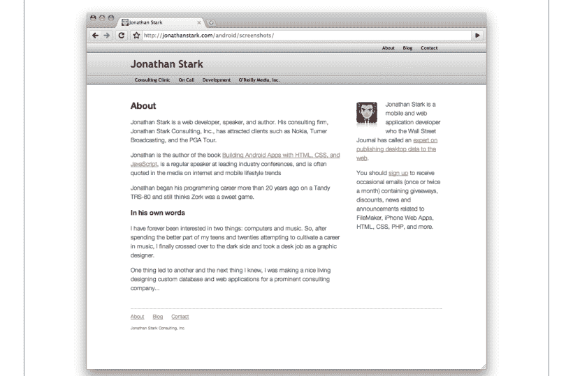

图 2-1. 典型网站的桌面版本在大屏幕上看起来不错

示例 2-1. 我们将要添加样式的 HTML 文档

```html
<html>
<head>
    <link rel="stylesheet" href="screen.css" type="text/css" />
    <title>Jonathan Stark</title>
</head>
<body>
    <div id="container">
        <div id="header">
            <h1><a href="./">Jonathan Stark</a></h1>
            <div id="utility">
                <ul>
                    <li><a href="about.html">About</a></li>
                    <li><a href="blog.html">Blog</a></li>
                    <li><a href="contact.html">Contact</a></li>
                </ul>
            </div>
            <div id="nav">
                <ul>
                    <li><a href="consulting-clinic.html">Consulting Clinic</a></li>
                    <li><a href="on-call.html">On Call</a></li>
                    <li><a href="development.html">Development</a></li>
                    <li><a href="http://www.oreilly.com">O'Reilly Media, Inc.</a></li>
                </ul>
            </div>
        </div>
        <div id="content">
            <h2>About</h2>
            <p>Jonathan Stark is a web developer, speaker, and author. His
consulting firm, Jonathan Stark Consulting, Inc., has attracted
clients such as Staples, Turner Broadcasting, and the PGA Tour.
                ...</p>
        </div>
        <div id="sidebar">
            
            <p>Jonathan Stark is a mobile and web application developer who the
Wall Street Journal has called an expert on publishing desktop
data to the web.</p>
        </div>
        <div id="footer">
            <ul>
                <li><a href="services.html">Services</a></li>
                <li><a href="about.html">About</a></li>
                <li><a href="blog.html">Blog</a></li>
            </ul>
            <p class="subtle">Jonathan Stark Consulting, Inc.</p>
        </div>
    </div>
</body>
</html>
```

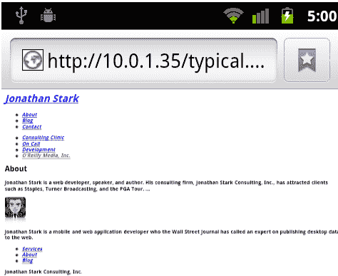

图 2-2. 典型网站的桌面版本在 Android 手机上看起来还行，但我们完全可以做得更好

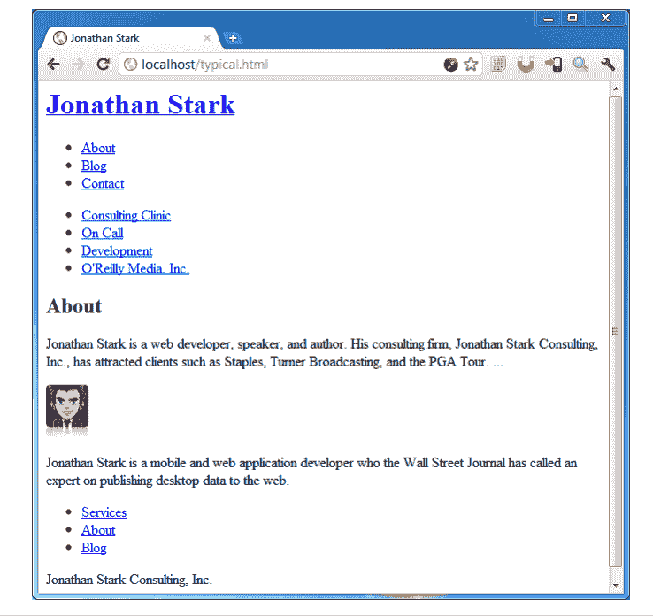

## 图 2-3. 简化版网页在 Chrome 浏览器中的桌面版本

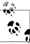

多年来，网页开发者一直使用表格来以网格方式布局元素。CSS 和 HTML 的进步不仅使这种方式过时，而且使其不再可取。如今，我们主要使用 div 元素（配合各种属性）来实现同样的效果，但拥有更多的控制能力。虽然对基于 div 的布局的完整讲解远远超出了本书的范围，但你在阅读本书时会看到大量的相关示例。如需深入了解，请参阅 Jeffrey Zeldman 所著的 *Designing with Web Standards*（New Rider Press 出版），该书对此问题进行了更详细的阐述。

## 准备独立的 Android 样式表

我和大家一样遵循 DRY 原则，但为了清晰起见，我将在桌面浏览器样式表和 Android 样式表之间做一个明确的划分。这种方法与响应式网页设计的理念相悖，根据不同的因素，它可能适合也可能不适合你的网站（或 Web 应用）。对响应式网页设计的深入讨论超出了本书的范围，但如果你从事移动端开发，应该花一些时间熟悉相关概念。Ethan Marcotte 在 A List Apart 上发表了权威文章（[http://www.alistapart.com/articles/responsive-web-design/](http://www.alistapart.com/articles/responsive-web-design/)）。

> DRY 代表"Don't Repeat Yourself"（不要重复自己），这是一条软件开发原则，其内容是："系统的每一条信息都必须有且仅有一个明确的、权威的表示。"该术语由 Andrew Hunt 和 David Thomas 在他们的著作 *The Pragmatic Programmer*（Addison-Wesley Professional 出版）中提出。

要指定专门用于 Android（以及其他类似的小型设备，如 iPhone 或 Windows Phone）的样式表，请将示例 HTML 文档中的样式表链接标签替换为使用以下表达式的标签：

```html
<link rel="stylesheet" type="text/css"
     href="android.css" media="only screen and (max-width: 600px)" />
<link rel="stylesheet" type="text/css"
     href="desktop.css" media="screen and (min-width: 601px)" />
```

> 我在这里特意使用了 `max-width` 和 `min-width`，这样你就可以通过调整桌面浏览器窗口大小来查看页面的移动版本。

> 无线通用资源文件（WURFL）包含可用于识别大量无线设备（包括 Android 设备）的信息。如果你需要检测宽度大于 600px 的 Android 设备（如平板电脑），或者你不想在用户将浏览器窗口缩小到 600px 以下时显示网站的移动版本，可以使用 WURFL 的 PHP API 来精确检测特定浏览器。有关 WURFL 的更多信息，请参阅[附录](#)。

其中，`desktop.css` 指的是你现有的桌面样式表，而 `android.css` 是一个新文件，我们稍后将对其进行详细讨论。`desktop.css` 文件不是必需的，但如果你想的话可以使用上一章的样式表。

如果你正在使用示例 2-1 中所示的示例 HTML 文档进行练习，你需要将 screen.css 重命名为 desktop.css，但既然我们专注于 Android 样式表，你可以完全忽略桌面样式表。如果它加载失败，你的浏览器也不会有任何问题。

不过，如果你想使用 Chrome 来测试针对 Android 优化的网站版本，你应该将对 desktop.css 的引用替换为对 android.css 的引用。这样，无论你是从手机还是桌面浏览器加载网站，都能运行 Android 版本。

遗憾的是，Internet Explorer 无法理解这些表达式，因此我们必须添加一个条件注释（以粗体显示）来链接桌面版本的 CSS：

```html
<link rel="stylesheet" type="text/css"
     href="android.css" media="only screen and (max-width: 600px)" />
<link rel="stylesheet" type="text/css"
     href="desktop.css" media="screen and (min-width: 601px)" />
<!--[if IE]>
<link rel="stylesheet" type="text/css" href="desktop.css" media="all" />
<![endif]-->
```

现在是时候编辑 HTML 文档了（如果你还没有在练习过程中完成编辑的话）——删除现有的指向 screen.css 文件的链接，并替换为刚才展示的内容。这样，你就为本章的 Android 专用 CSS 打下了一个干净的基础。

## 控制页面缩放

除非你另行指定，Android 浏览器会假定你的页面宽度为 980px（你可以在图 2-2 中看到这一点）。在大多数情况下，这运行得很好。但是，你将针对 Android 手机的较小尺寸来格式化内容，因此必须让移动浏览器知道这一点，方法是在 HTML 文档的 head 元素中添加一个 viewport meta 标签：

```html
<meta name="viewport" content="user-scalable=no, width=device-width" />
```

桌面浏览器会忽略 viewport meta 标签，因此你可以在不担心桌面版本的情况下包含它。

仅仅通过禁用桌面样式表和配置 viewport，你就已经为 Android 用户提供了增强的体验（参见图 2-4）。要真正给他们留下深刻印象，让我们开始构建 android.css 样式表吧。


## 乔纳森·斯塔克

- [关于](http://10.0.1.35/typical....)
- [博客](http://10.0.1.35/typical....)
- [联系](http://10.0.1.35/typical....)

- [咨询诊所](http://10.0.1.35/typical....)
- [随叫随到](http://10.0.1.35/typical....)
- [开发](http://10.0.1.35/typical....)
- [奥莱利媒体公司](http://10.0.1.35/typical....)

## 关于

乔纳森·斯塔克是一位网络开发者、演讲者和作家。他的咨询公司，乔纳森·斯塔克咨询有限公司，吸引了史泰博、特纳广播和PGA巡回赛等客户。...

图 2-4. 将视口宽度设置为设备宽度，可使你的页面在安卓设备上更易读

如果不设置视口宽度，页面首次加载时会被缩小显示。很难确切地说缩放级别会是多少，因为安卓浏览器包含一个允许用户设置默认缩放的选项。选项有：远、中（默认）和近。即使你设置了视口宽度，这些用户定义的设置也会影响你应用的缩放级别。

## 添加安卓 CSS

有许多 UI 约定能让安卓应用看起来像安卓应用。在下一节中，我们将添加标志性的标题栏、带圆角的列表、看起来像光泽按钮的触控友好型链接等。使用你选择的文本编辑器，创建一个名为 `android.css` 的文件，并将示例 2-2 中所示的代码添加到其中，然后将该文件保存在与 HTML 文档相同的目录中。

示例 2-2. 在 HTML body 元素上设置一些通用的全站样式

```
body {
    background-color: #ddd; /* 背景颜色 */
    color: #222;            /* 用于文本的前景色 */
    font-family: Helvetica;
    font-size: 14px;
    margin: 0;               /* body 外部周围的留白量 */
    padding: 0;              /* body 内部周围的留白量 */
}
```

安卓上的所有文本都使用名为 Droid 的自定义字体渲染（从安卓 4.0 起，Droid 已被新字体 Roboto 取代）。Droid 字体系列专为移动设备构建，具有出色的字符集支持，并包含三种变体：Droid Sans、Droid Sans Mono 和 Droid Serif。因此，像我们这里这样指定 Helvetica 字体系列，只会影响安卓以外的设备。

现在让我们来处理包含主导航链接（即 Logo 链接）以及主要和次要站点导航的头部 `div`。第一步是将 Logo 链接格式化为可点击的标题栏。将以下内容添加到 `android.css` 文件中：

```
#header h1 {
    margin: 0;
    padding: 0;
}
#header h1 a {
    background-color: #ccc;
    border-bottom: 1px solid #666;
    color: #222;
    display: block;
    font-size: 20px;
    font-weight: bold;
    padding: 10px 0;
    text-align: center;
    text-decoration: none;
}
```

我们将以相同方式格式化主要和次要导航 ul 块，因此我们可以只使用通用的标签选择器（即 `#header ul`），而不是标签 ID（即 `#header ul#utility`、`#header ul#nav`）：

```
#header ul {
    list-style: none;
    margin: 10px;
    padding: 0;
}
#header ul li a {
    background-color: #FFFFFF;
    border: 1px solid #999999;
    color: #222222;
    display: block;
    font-size: 17px;
    font-weight: bold;
    margin-bottom: -1px;
    padding: 12px 10px;
    text-decoration: none;
}
```

到目前为止相当简单，对吧？通过这点 CSS，我们已经极大地改善了安卓页面设计（图 2-5）。接下来，为内容和侧边栏 div 添加一些内边距，使文本与屏幕边缘有一点缩进（图 2-6）：

```
#content, #sidebar {
    padding: 10px;
}
```

> 你可能想知道为什么我们要为内容和侧边栏元素添加内边距，而不是在 body 元素本身上全局设置。原因是，元素紧贴边缘显示（如此示例中的头部）是非常常见的情况。因此，应用于 body 或其他包裹大量子元素的元素的内边距，可能会变得弊大于利。

此页面页脚中的内容基本上是页面顶部导航元素（ID 为 `nav` 的 ul 元素）的重复，因此你可以通过将 `display` 设置为 `none` 来从安卓版本的页面中移除页脚，如下所示：

```
#footer {
    display: none;
}
```

图 2-5. 少量的 CSS 就能极大地提升安卓应用的可用性

奥莱利媒体公司。

## 关于

乔纳森·斯塔克是一位网络开发者、演讲者和作家。他的咨询公司，乔纳森·斯塔克咨询有限公司，吸引了史泰博、特纳广播和PGA巡回赛等客户。...

乔纳森·斯塔克是一位移动和 Web 应用开发者，《华尔街日报》称他为将桌面数据发布到网络的专家。

- [服务](link)
- [关于](link)
- [博客](link)

乔纳森·斯塔克咨询有限公司。

## 添加安卓外观和感觉

是时候来点更花哨的了。从页面顶部开始，为头部文本添加 1 像素的白色投影，并为背景添加 CSS 渐变：

```
#header h1 a {
    text-shadow: 0px 1px 1px #fff;
    background-image: -webkit-gradient(linear, left top, left bottom,
                                       from(#ccc), to(#999));
}
```

在 `text-shadow` 声明中，从左到右的参数是：水平偏移、垂直偏移、模糊半径和颜色。大多数时候，你会将这里显示的确切值应用于你的文本，因为这在安卓上通常效果很好，但实验 `text-shadow` 是很有趣的，因为它可以为你的设计增添微妙而精致的感觉。

> 在大多数浏览器上，将模糊半径指定为 0px 是可以的。但是，安卓要求你指定至少 1px 的模糊半径。如果你指定的模糊值为 0，文本阴影在安卓设备上将不会显示。

`-webkit-gradient` 这一行值得特别注意。它指示浏览器动态生成一个渐变图像。因此，你可以在通常指定 `url()` 的任何地方（例如，背景图像、列表样式图像）使用 CSS 渐变。从左到右的参数如下：渐变类型（可以是 `linear` 或 `radial`），渐变的起点（可以是 `left top`、`left bottom`、`right top` 或 `right bottom`），渐变的终点，起始颜色和结束颜色。

> 你不能颠倒四个渐变起止点常量（即 `left top`、`left bottom`、`right top` 或 `right bottom`）的水平和垂直部分。换句话说，`top left`、`bottom left`、`top right` 和 `bottom right` 是无效值。

下一步是为导航菜单添加传统的圆角：

```
#header ul li:first-child a {
    -webkit-border-top-left-radius: 8px;
    -webkit-border-top-right-radius: 8px;
}
#header ul li:last-child a {
    -webkit-border-bottom-left-radius: 8px;
    -webkit-border-bottom-right-radius: 8px;
}
```

如你所见，我们使用 `-webkit-border-radius` 属性的角特定版本，将 8 像素的半径应用于第一个列表项的顶部两个角和最后一个列表项的底部两个角（图 2-7）。

图 2-7. 渐变、文本阴影和圆角开始将你的网页转变为外观原生的安卓应用

如果可以直接将边框半径应用于包围的 ul 会很酷，但这行不通。如果你尝试这样做，你会看到子列表项的方角会溢出 ul 的圆角，从而抵消效果。

从技术上讲，我们可以通过将圆角应用于 ul，并将其子元素的背景设置为透明，来实现圆角列表效果。然而，当用户点击第一个或最后一个项目时，

在列表中，点击高亮效果会显示为方形，看起来非常糟糕。最佳方案是像我这里演示的那样，将圆角样式直接应用到`a`标签上。

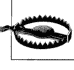

上面提到的`:first-child`和`:last-child`被称为*伪类*。伪类是一种特殊的CSS选择器，允许你定位满足特定隐式上下文条件的元素。换句话说，你可以根据元素特征（例如在列表中的位置、是否有光标焦点或是否被点击过）来设置样式，而无需手动更新标记代码。例如，`li:first-child`会选择其`ul`父元素下的第一个`li`元素。如果没有这个伪类，我们就必须手动为第一个`li`添加一个类，以让浏览器知道它是第一个。

## 使用jQuery添加基本行为

下一步是在页面中添加一些JavaScript，以支持一些基本的动态行为。具体来说，我们将允许用户显示和隐藏页眉中那个巨大的导航部分，这样他们只在需要时才看到它。为此，我们将编写一些新的CSS，并使用JavaScript将这些新CSS应用到现有的HTML上。

首先，让我们看看新的CSS。第一步是隐藏页眉中的`ul`元素，这样用户在首次加载页面时就看不到它们。如果你正在跟着操作，请打开你的`android.css`文件并添加以下内容：

```
#header ul.hide {
    display: none;
}
```

在你将`hide`类添加到`ul`元素之前（你很快就会通过一些JavaScript来做到这一点），这实际上不会隐藏任何东西。接下来，定义用于显示和隐藏菜单的按钮的样式。我们还没有为这个按钮创建HTML。供你参考，它的代码将如下所示：

```
<div class="leftButton" onclick="toggleMenu()">Menu</div>
```

我将在第30页的["使用jQuery添加基本行为"章节](#)中详细描述这个按钮的HTML，所以请不要将前面这行代码添加到你的HTML文件中。需要理解的重要一点是，它是一个带有`leftButton`类的`div`，并且它将位于页眉中。

以下是该按钮的CSS样式（你可以直接将其添加到`android.css`文件中）：

```
#header div.leftButton {
    position: absolute;❶
    top: 7px;
    left: 6px;
    height: 30px;❷
    font-weight: bold;❸
}
```

```
text-align: center;
color: white;
text-shadow: rgba(0,0,0,0.6) 0px -1px 1px;
line-height: 28px;
border-width: 0 8px 0 8px;
-webkit-border-image: url(images/button.png) 0 8 0 8;
}
```

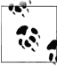

关于本章使用的图形，你可以从本书的目录页（参见第xii页的["如何联系我们"章节](https://example.com)）下载示例文件，并从*images*目录中复制它们。将这些副本放入包含HTML文档的目录下的*images*子目录中（你可能需要创建*images*目录）。我们将在[第4章](https://example.com)中详细讨论jQTouch。

- 1. 从顶部开始，将position设置为absolute，以将`div`从文档流中移除。这允许你设置其top和left的像素坐标。
- 2. 将height设置为30px，使其足够大，便于点击。
- 3. 将文本设置为粗体、白色并带有轻微的阴影，并居中显示在框内。
- 4. 在CSS中，`rgb`函数是通常用于指定颜色的十六进制表示法（例如#FFFFFF）的替代方案。`rgb(255, 255, 255)`和`rgb(100%, 100%, 100%)`都与#FFFFFF相同。更近一些时候，引入了`rgba()`函数，它允许你指定第四个参数，该参数定义颜色的*alpha值*（即不透明度）。允许的取值范围是0到1，其中0是完全透明，1是完全不透明；0到1之间的小数值将呈现为半透明。
- 5. `line-height`声明将文本在框中垂直向下移动，使其不与顶部边框齐平。
- 6. `border-width`和`-webkit-border-image`这两行需要一些解释。这两个属性结合使用，允许你将单个图像的不同部分分配给元素的边框区域。如果由于文本增减导致框的大小调整，边框图像会相应地拉伸以适应。这确实是一件很棒的事情，因为它意味着更少的图像、更少的工作量、更少的带宽和更短的加载时间。

`border-width`行告诉浏览器：在顶部应用宽度为0的边框，在右侧应用宽度为8px的边框，在底部应用宽度为0的边框，在左侧应用宽度为8px的边框（即，四个参数从框的顶部开始顺时针排列）。你不需要为边框指定颜色或样式。

- 7. 在设置了边框宽度后，你就可以应用边框图像了。从左到右的五个参数分别是：图像的URL、顶部宽度、右侧宽度、底部宽度和左侧宽度（同样，从顶部开始顺时针排列）。URL可以是绝对路径（http://example.com/myBorderImage.png）或相对路径。相对路径是基于样式表的位置，而不是包含该样式表的HTML页面。

当我第一次遇到**border-image**属性时，我觉得很奇怪，为什么在已经用**border-width**属性指定了边框宽度之后，还必须在**border-image**中再次指定。经过一番痛苦的试验和错误，我发现**border-image**属性中的宽度并不是边框宽度；而是从图像中*切割*的宽度。以右边框为例，我是告诉浏览器取图像的左侧8px部分，并将其应用到右侧边框上，而该边框恰好也有8px宽。

做一些不合理的事情是可能的，比如将图像的右侧4像素应用到宽度为20px的边框上。要使其正常工作，你必须使用**webkit-border-image**的可选参数来指示图像如何处理切割出的部分以填充可用的边框空间（重复、拉伸、圆角等）。在三年的尝试中，我未能找到任何合理的理由这样做，因此我不会在这里浪费篇幅来描述这个令人困惑且不实用的选项，尽管它本身是一个很棒的功能。

好了，是时候添加一些JavaScript了。在编写JavaScript之前，你需要更新HTML文档以包含*jquery.js*和*android.js*。将以下几行添加到HTML文档的head部分：

```
<script type="text/javascript" src="jquery.js"></script>
<script type="text/javascript" src="android.js"></script>
```

jQuery的下载、文档和教程可在[http://jquery.com](http://jquery.com)获取。要使用jQuery，你需要从该网站下载它，将下载的文件（例如*jquery-1.7.1.min.js*）重命名为*jquery.js*，并将副本放入与HTML文档相同的目录中。

*android.js*中JavaScript的主要职责是允许用户显示和隐藏导航菜单。将以下JavaScript复制到名为*android.js*的文件中，并将其保存在与HTML文件相同的文件夹中：

```
if (window.innerWidth && window.innerWidth <= 600) {
    $(document).ready(function(){
        $('#header ul').addClass('hide');
        $('#header').append(
            '<div class="leftButton" onclick="toggleMenu()">Menu</div>');
    });
    function toggleMenu() {
        $('#header ul').toggleClass('hide');
        $('#header .leftButton').toggleClass('pressed');
    }
}
```

- 1. 整个代码块被包裹在一个`if`语句中，该语句检查`window`对象的`innerWidth`属性是否存在（在某些版本的Internet Explorer中不存在），并且宽度小于或等于600px（对于大多数手机来说是一个合理的最大宽度）。通过添加这一行，我们确保代码仅在用户使用典型的Android手机或其他类似尺寸的设备浏览页面时才执行。

> 如果你按照第13页**“没有网站？”**部分所述，使用桌面版Chrome测试Android网页，那么如果你的浏览器窗口宽度太大，这里的`if`语句求值结果将为false。请手动调整窗口大小使其尽可能窄，然后刷新页面。

- 2. 这里是我们所谓的`document ready`函数。如果你是jQuery新手，这可能会有点吓人，我承认我花了一些时间才记住这个语法。然而，值得花时间将其记住，因为你将经常使用它。`document ready`函数基本上是说：“当文档准备就绪时，运行这段代码。”稍后会详细解释为什么这很重要。

- 3. 这是典型的jQuery代码，它首先选择页眉中的`ul`元素，并将`hide` CSS类添加到它们上面。记住，`hide`是我们在上面CSS中使用的类选择器。执行这行代码的最终效果是“隐藏”页眉`ul`元素。

> 如果我们没有将这行代码包裹在`document ready`函数中，它很可能会在`ul`元素甚至还没加载完成之前就执行了。这意味着JavaScript会加载，而这行代码会失败，因为`ul`还不存在。然后，页面会继续加载，`ul`会显示出来，而你会挠着头（或者砸着键盘），不明白为什么JavaScript不工作。

- 4. 这里我们向页眉追加一个按钮，该按钮将允许用户显示和隐藏菜单（图2-8）。它有一个类，对应于我们之前为`.leftButton`编写的CSS，并且它有一个`onclick`处理程序，调用接下来的`toggleMenu()`函数。

- 5. `toggleMenu()`函数使用jQuery的`toggleClass()`函数为选定的对象添加或移除指定的类。在这一行，我们在页眉的`ul`上切换`hide`类。

- 6. 这里，我们在页眉的`leftButton`上切换`pressed`类。

想一想，我们还没有为`pressed`类编写CSS，所以我们现在就来做。回到`android.css`并插入以下内容：

```
#header div.pressed {
    -webkit-border-image: url(images/button_clicked.png) 0 8 0 8;
}
```


## 你学到了什么

在本章中，我们涵盖了将现有网页转换为更适合 Android 的格式的基础知识。我们甚至使用了一点动态 HTML 来显示和隐藏导航面板。在下一章中，我们将基于这些示例，探索一些更高级的 JavaScript 概念；特别是，一些美味的 Ajax 妙用。

## 高级样式

在我们尝试构建无需 Java 的 Android 应用程序的过程中，我们讨论了如何使用 CSS 为一组 HTML 页面设置样式，使其*看起来*像 Android 应用程序。在本章中，我们将奠定基础，使这些页面*表现得*像 Android 应用程序。具体来说，我们将讨论：

- 使用 Ajax 将一个完整的网站变成一个单页应用。
- 使用 JavaScript 创建一个带有历史记录的返回按钮。
- 将应用程序保存为主屏幕上的图标。

### 添加一点 Ajax

术语 Ajax（异步 JavaScript 和 XML）已经成为一个流行词，以至于我甚至不确定我是否还知道它的含义。就本书而言，我将使用术语 Ajax 来指代使用 JavaScript 在不重新加载当前页面的情况下向 Web 服务器发送请求（例如，检索一些 HTML，提交表单）的技术。这种方法可以带来非常流畅的用户体验，但确实要求你重新发明很多轮子。

例如，如果你正在动态加载外部页面，浏览器不会向用户显示任何进度或错误指示。此外，除非你费心支持它，否则“后退”按钮将无法按预期工作。换句话说，你必须做大量的工作才能制作出一个出色的 Ajax 应用程序。话虽如此，额外的努力确实可以得到回报，因为 Ajax 允许你创造更丰富的用户体验。

### 交通警察

对于接下来的一系列示例，我们将编写一个名为 *android.html* 的单页，它将位于所有其他页面的前面。其工作原理如下：

1. 首次加载时，*android.html* 将向用户展示一个格式良好的网站导航版本。
2. 然后，我们将使用 jQuery 来“劫持”导航链接的 *onclick* 操作，这样当用户单击链接时，浏览器页面*不会*导航到目标链接。相反，jQuery 将从远程页面加载一部分 HTML，并通过更新当前页面将数据传递给用户。

我们将从代码最基本的功能版本开始，并在进行过程中对其进行改进。如果你仍然有来自第 2 章的示例文件，请将它们移开，或者在 Web 服务器上设置一个新的空子目录，以便在浏览本章时使用。

*android.html* 包装页面的 HTML 非常简单（参见示例 3-1）。在 head 部分，设置 *title* 和 *viewport* 选项，并包含指向样式表（*android.css*）和两个 JavaScript 文件的链接：*jquery.js* 和一个名为 *android.js* 的自定义 JavaScript 文件。

>  你必须将 *jquery.js* 的副本放在与 HTML 文件相同的目录中。有关获取 *jquery.js* 以及如何处理它的更多信息，请参见第 11 页的“JavaScript 简介”。在继续之前，你现在应该执行此操作。

正文只有两个 *div* 容器：一个带有初始标题的 *h1* 标签的头部分，以及一个空的 *div* 容器，该容器最终将包含从其他页面检索到的 HTML 片段。

*示例 3-1. 这个简单的 HTML 包装标记将位于网站其他页面的前面*

```
<html>
<head>
    <title>Jonathan Stark</title>
    <meta name="viewport" content="user-scalable=no, width=device-width" />
    <link rel="stylesheet" href="android.css" type="text/css" media="screen" />
    <script type="text/javascript" src="jquery.js"></script>
    <script type="text/javascript" src="android.js"></script>
</head>
<body>
    <div id="header"><h1>Jonathan Stark</h1></div>
    <div id="container"></div>
</body>
</html>
```

让我们继续讨论 *android.css* 文件。如示例 3-2 所示，我们将重新排列第 2 章中之前示例的一些属性（例如，一些 #header h1 属性已移至 #header），但总体而言，一切应该看起来很熟悉（如果不熟悉，请复习第 2 章）。

*示例 3-2. 页面的基础 CSS 只是之前示例的一个稍微调整过的版本*

```
body {
    background-color: #ddd;
    color: #222;
    font-family: Helvetica;
    font-size: 14px;
    margin: 0;
    padding: 0;
}
#header {
    background-color: #ccc;
    background-image: -webkit-gradient(linear, left top, left bottom,
        from(#ccc), to(#999));
    border-color: #666;
    border-style: solid;
    border-width: 0 0 1px 0;
}
#header h1 {
    color: #222;
    font-size: 20px;
    font-weight: bold;
    margin: 0 auto;
    padding: 10px 0;
    text-align: center;
    text-shadow: 0px 1px 1px #fff;
}
ul {
    list-style: none;
    margin: 10px;
    padding: 0;
}
ul li a {
    background-color: #FFF;
    border: 1px solid #999;
    color: #222;
    display: block;
    font-size: 17px;
    font-weight: bold;
    margin-bottom: -1px;
    padding: 12px 10px;
    text-decoration: none;
}
ul li:first-child a {
    -webkit-border-top-left-radius: 8px;
    -webkit-border-top-right-radius: 8px;
}
ul li:last-child a {
    -webkit-border-bottom-left-radius: 8px;
    -webkit-border-bottom-right-radius: 8px;
}
```

```
ul li a:active,ul li a:hover {
    background-color:blue;
    color:white;
}
#content {
    padding: 10px;
    text-shadow: 0px 1px 1px #fff;
}
#content a {
    color: blue;
}
```

## 设置一些要处理的内容

这段 JavaScript 加载一个名为 *index.html* 的文档，没有它将无法工作。在继续之前，请将 [示例 2-1](Example 2-1) 中的 HTML 文件复制到与 *android.html* 相同的目录中，并将其重命名为 *index.html*。但是，其中的任何链接都不会起作用，除非链接的目标实际存在。你可以自己创建这些文件，或从本书网站下载示例代码（请参见第 xii 页的[“如何联系我们”](“如何联系我们”)）。

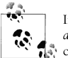

如果你想有一些可用的链接来测试，你可以创建 *about.html*、*blog.html* 和 *consulting-clinic.html*。为此，只需复制几次 *index.html* 并将每个副本的文件名更改为与相关链接匹配。为了增加效果，你可以更改每个文件中 h2 标签的内容以匹配文件名。例如，*blog.html* 中的 h2 将是 `<h2>Blog</h2>`。

此时，你的工作目录中应该有以下文件：

- *android.html*
  你在 [示例 3-1](Example 3-1) 中创建了这个。
- *android.css*
  你在 [示例 3-2](Example 3-2) 中创建了这个。
- *index.html*
  [示例 2-1](Example 2-1) 中 HTML 文件的副本。
- *about.html*
  *index.html* 的副本，其中 h2 设置为“About”。
- *blog.html*
  *index.html* 的副本，其中 h2 设置为“Blog”。
- *consulting-clinic.html*
  *index.html* 的副本，其中 h2 设置为“Consulting Clinic”。

## 使用 JavaScript 路由请求

`android.js` 中的 JavaScript 是本例中所有魔法发生的地方。在与 `android.html` 文件相同的目录中创建此文件。当我们逐行浏览时，请参考示例 3-3。

*示例 3-3. `android.js` 中的这段 JavaScript 将页面上的链接转换为 Ajax 请求*

```
$(document).ready(function(){
    loadPage();
});
function loadPage(url) {
    if (url == undefined) {
        $('#container').load('index.html #header ul', hijackLinks);
    } else {
        $('#container').load(url + ' #content', hijackLinks);
    }
}
function hijackLinks() {
    $('#container a').click(function(e){
        e.preventDefault();
        loadPage(e.target.href);
    });
}
```

1 这里我们使用 jQuery 的 `document` `ready` 函数，让浏览器在完成页面构建后运行 `loadPage()` 函数。

2 `loadPage()` 函数接受一个名为 `url` 的参数，然后（在下一行）检查是否发送了值。

3 如果没有向函数发送值（当它首次从 `document` `ready` 函数调用时就是这种情况），`url` 将是 `undefined`，并且将执行此行。此行及下一行是 jQuery `load()` 函数的示例。`load()` 函数非常适合为页面添加快速而粗糙的 Ajax 功能。如果将此行翻译成英语，它将读取：“从 `index.html` 的 `#header` 元素中获取所有 `ul` 元素，并将它们插入当前页面的 `#container` 元素。完成后，运行 `hijackLinks()` 函数。”

index.html 指的是网站的主页。如果你的主页名称不同，则此处应使用该文件名。如果你一直按照本章的说明操作，则使用 index.html。

4 如果 `url` 参数有值，则执行此行。它实际上说：“从传递给 `loadPage()` 函数的 `url` 中获取 `#content` 元素，并将其插入当前页面的 `#container` 元素。完成后，运行 `hijackLinks()` 函数。”


❺ 一旦 `load()` 函数执行完毕，当前页面的 `#container` 元素就会包含检索到的 HTML 片段。然后，`load()` 会运行 `hijackLinks()` 函数。

❼ 在这一行，`hijackLinks()` 找到该 HTML 新片段中的所有链接，并使用后续代码行将点击处理程序绑定到它们。点击处理程序会自动传递一个事件对象，我们将其捕获为函数参数 `e`。已点击链接的事件对象中包含远程页面的 URL，位于 `e.target.href` 中。

❼ 通常情况下，当用户点击链接时，Web 浏览器会导航到新页面。这种导航响应被称为链接的*默认行为*。由于我们通过 JavaScript 处理点击和加载页面，因此需要阻止这种默认行为。在这一行（与下一行一起，在用户点击其中一个链接时触发），调用事件对象的内置 `preventDefault()` 方法。如果我们省略这一行，浏览器将会尽职尽责地离开当前页面，导航到已点击链接的 URL。

❽ 当用户点击时，将远程页面的 URL 传递给 `loadPage()` 函数，循环就这样重新开始。

> 我最喜欢 JavaScript 的一点在于，你可以将一个函数作为参数传递给另一个函数。虽然起初看起来很奇怪，但它极其强大，能够让你的代码模块化和可复用。如果你想了解更多，你应该查看 Douglas Crockford 的 *JavaScript: The Good Parts*（O'Reilly 出版）。事实上，如果你在使用 JavaScript，你应该查看 Douglas Crockford 的所有作品；你会 glad 你这样做的。

点击处理程序在页面首次加载时不会运行；它们在用户实际点击链接时运行。分配点击处理程序就像设置陷阱一样；你为可能触发也可能不会触发的事情做一些初始设置工作。

> 值得花几分钟时间阅读 JavaScript 为响应浏览器中的用户操作而创建的事件对象的属性。一个好的参考位于 http://www.w-pages.com/htmldom/dom_obj_event.asp。

在测试本章代码时，请确保将浏览器指向 *android.html* 页面。如果你只是导航到文件所在的目录，Web 服务器通常会默认显示 *index.html*。通常这是有帮助的，但在这种情况下会导致问题。

## 简单的花里胡哨

借助这一点点 HTML、CSS 和 JavaScript，我们 essentially 将整个网站变成了一个单页应用程序。然而，它仍然有许多不足之处。让我们把它润色一下。

### 进度指示器

由于我们不允许浏览器从一页导航到另一页，用户在数据加载时将看不到任何进度指示。我们需要向用户提供一些反馈，让他们知道确实有事正在发生（图 3-1）。没有这种反馈，用户可能会怀疑自己是否真的点击了链接或错过了它，并且通常会沮丧地到处乱点。这可能导致服务器负载增加和应用程序不稳定（即崩溃）。

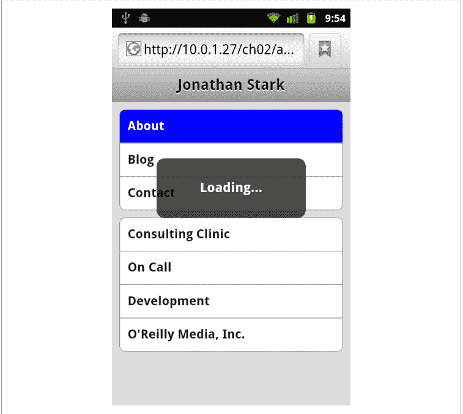

*图 3-1. 如果没有某种进度指示器，你的应用将显得无响应，用户会感到沮丧*

多亏了 jQuery，提供进度指示器只需要两行代码。我们只需在 loadPage() 启动时向 body 追加一个 loading div，并在 hijackLinks() 完成时移除该 loading div。[示例 3-4](#) 显示了 [示例 3-3](#) 的修改版本。需要添加到 *android.js* 的行以**粗体**显示。

*示例 3-4. 向页面添加简单的进度指示器*

```
$(document).ready(function(){
    loadPage();
});
function loadPage(url) {
    $('body').append('<div id="progress">Loading...</div>');
    if (url == undefined) {
        $('#container').load('index.html #header ul', hijackLinks);
    } else {
        $('#container').load(url + ' #content', hijackLinks);
    }
}
function hijackLinks() {
    $('#container a').click(function(e){
        e.preventDefault();
        loadPage(e.target.href);
    });
    $('#progress').remove();
}
```

参见 [示例 3-5](#)，了解需要添加到 *android.css* 中以设置进度 div 样式的 CSS。

*示例 3-5. 添加到 android.css 用于设置进度指示器样式的 CSS*

```
#progress {
    -webkit-border-radius: 10px;
    background-color: rgba(0,0,0,.7);
    color: white;
    font-size: 18px;
    font-weight: bold;
    height: 80px;
    left: 60px;
    line-height: 80px;
    margin: 0 auto;
    position: absolute;
    text-align: center;
    top: 120px;
    width: 200px;
}
```

## 模拟真实世界的网络性能

如果你在本地网络上测试这个 Web 应用程序，网络速度会非常快，你根本看不到进度指示器。如果你在 Mac OS X 上运行服务器，可以在终端输入几个 `ipfw` 命令来减慢所有传入的 Web 流量。例如，以下命令会将所有 Web 流量减慢到每秒 1 千字节：

```
sudo ipfw pipe 1 config bw 1KByte/s
sudo ipfw add 100 pipe 1 tcp from any to me 80
```

你应该在 URL 中使用计算机的主机名或外部 IP 地址（例如，使用 `mycomputer.local` 而不是 `localhost`）。测试完成后，使用 `sudo ipfw delete 100` 删除规则（你可以使用 `ipfw flush` 删除所有自定义规则）。

如果你在 Windows 上使用 IIS，可以从 http://www.iis.net/download/BitRateThrottling 安装 Bit Rate Throttling Media Services 扩展。打开 IIS 管理器，选择你的网站，然后在 Media Services Group 下双击 Bit Rate Throttling。使用右侧的操作列表，为 HTML MIME type（text/html）添加一个节流设置，并将其设置为较慢的速度（1 kbps 不错）。启用 Bit Rate Throttling，现在你的页面应该会加载得很慢。测试完成后别忘了禁用 Bit Rate Throttling！

在 Linux 上也可以做类似的事情。更多信息，请查看以下链接：

- http://linux-ip.net/articles/Traffic-Control-HOWTO/classless-qdiscs.html
- http://lartc.org/howto/lartc.ratelimit.single.html

但如果你只是想延迟 JavaScript 执行，以便"Loading"消息尽可能长时间地显示在屏幕上，可以将以下代码行添加到 `hijackLinks()` 函数的顶部：

```
var stopTime = new Date().getTime() + 5000;
while (new Date().getTime() < stopTime);
```

这并不是在 JavaScript 中延迟执行的正确方式——你应该使用 JavaScript 的 `setTimeout` 函数来实现——但这确实是确保你的 JavaScript 冻结并什么都不做（除了消耗设备的 CPU）的好方法。所以一定要尽快删除这些代码行，否则你会诅咒你输入它们的那一天的。

## 设置页面标题

我们的网站恰好每个页面开头都有一个 h2，可以作为不错的页面标题（见图 3-2）。你可以 fancier 看这个，在第 2 章展示的 HTML 源码中。为了更适应移动设备，我们将从内容中拉出该标题并放入头部（见图 3-3）。再次，jQuery 来拯救：你只需在 hijackLinks() 函数中添加三行代码即可实现。[示例 3-6](#) 显示了带有这些更改的 hijackLinks 函数。

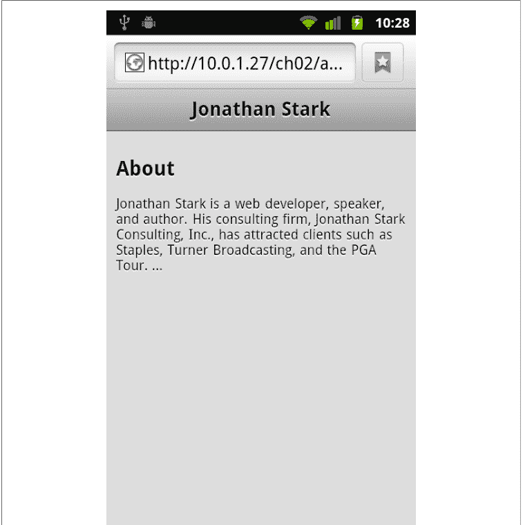

*图 3-2. 内容区域中的页面标题*

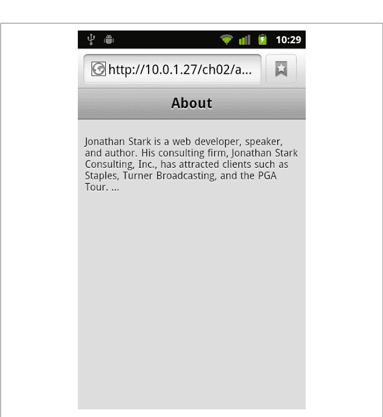

*图 3-3. ...将页面标题移动到工具栏后*

*示例 3-6. 使用目标页面的 h2 作为工具栏标题*

```
function hijackLinks() {
    $('#container a').click(function(e){
        e.preventDefault();
        loadPage(e.target.href);
    });
    var title = $('h2').html() || 'Hello!';
    $('h1').html(title);
    $('h2').remove();
    $('#progress').remove();
}
```

我在删除进度指示器之前添加了标题行。我喜欢将删除进度指示器作为最后一个操作，因为我觉得这样会让应用程序感觉更灵敏。

插入代码第一行（粗体显示）中的双竖线（`||`）是 JavaScript 的逻辑运算符 OR。翻译成英文，这行代码的意思是："将 title 变量设置为 h2 元素的 HTML 内容，如果没有 h2 元素，则设置为字符串 'Hello!'"。这很重要，因为第一次页面加载时不会包含 h2，因为我们只是在获取导航 ul。

这一点可能需要一些澄清。当用户首次加载 android.html URL 时，他们只能看到整个站点的导航元素，而看不到任何站点内容。在初始导航页面上点击链接之前，他们不会看到任何站点内容。

## 处理过长的标题

假设我们网站上有一个页面的标题太长，无法放在标题栏中（图 3-4）。我们可以让文本自动换行显示，但那样不太美观。相反，我们可以更新 `#header h1` 样式，使过长的文本会被截断并显示省略号（参见图 3-5 和示例 3-7）。这可能是我最喜欢的鲜为人知的 CSS 技巧。

示例 3-7. 为超出容器范围的文本添加省略号

```css
#header h1 {
    color: #222;
    font-size: 20px;
    font-weight: bold;
    margin: 0 auto;
    padding: 10px 0;
    text-align: center;
    text-shadow: 0px 1px 1px #fff;
    max-width: 160px;
    overflow: hidden;
    white-space: nowrap;
    text-overflow: ellipsis;
}
```

具体解释如下：`max-width: 160px` 指示浏览器不允许 h1 元素的宽度超过 160px。然后，`overflow: hidden` 指示浏览器裁剪掉超出元素边界的所有内容。接下来，`white-space: nowrap` 防止浏览器将行分为两行。如果没有这一行，h1 只会变高以适应在定义宽度下的文本。最后，`text-overflow: ellipsis` 在任何被截断的文本末尾附加三个点，以向用户表明她看到的不是完整的字符串。

---

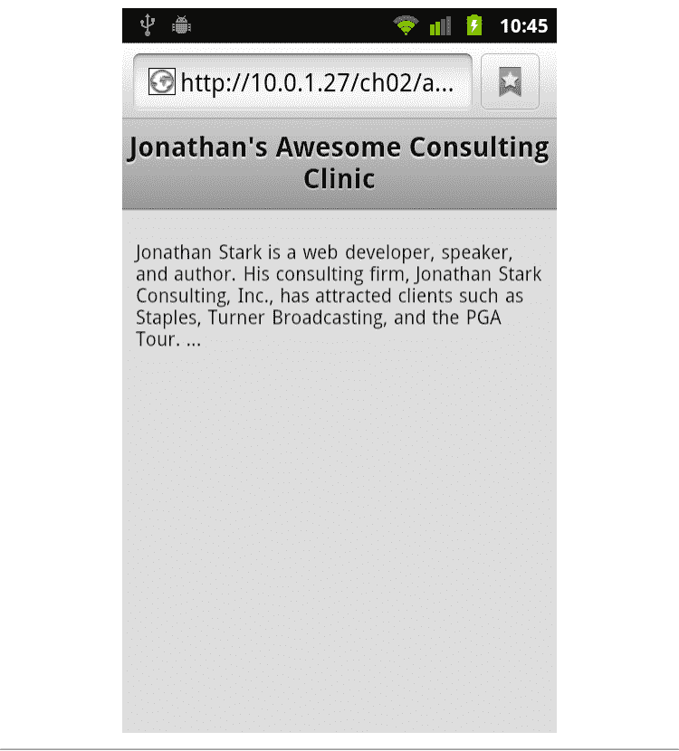

*图 3-4. 工具栏中的文本换行不太美观...*

## 自动滚动到顶部

假设你有一个页面比手机的可视区域更长。用户访问该页面，滚动到底部，然后点击一个链接进入一个更长的页面。在这种情况下，新页面会显示在"已滚动"的位置，而不是你期望的顶部位置。

从技术上讲，这是合理的，因为我们实际上并没有离开当前（已滚动的）页面，但这对用户来说确实是一个令人困惑的情况。为了解决这个问题，我们可以向 `loadPage()` 函数添加一个 `scrollTo()` 命令（示例 3-8）。

---

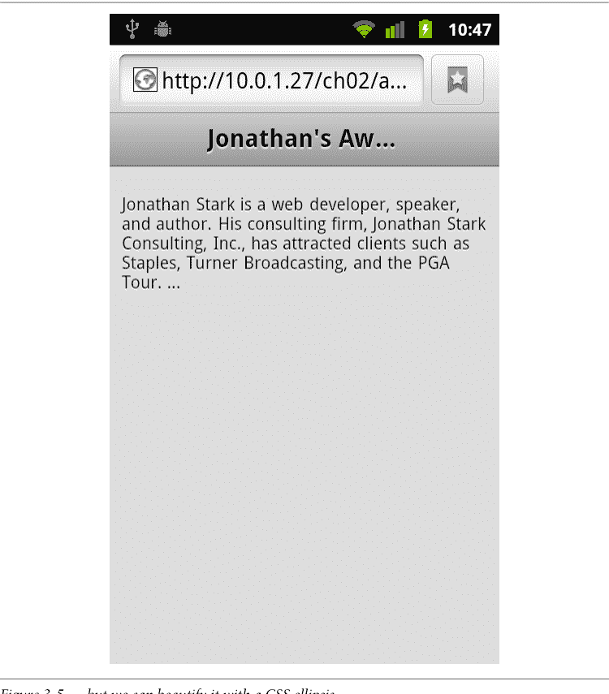

*图 3-5. ...但我们可以用 CSS 省略号来美化它*

每当用户点击链接时，页面会首先跳到顶部。这还有一个额外的好处，就是确保如果用户在长页面底部点击链接，加载动画是可见的。

*示例 3-8. 当用户导航到新页面时，滚动回顶部是个好主意*

```javascript
function loadPage(url) {
    $('body").append('<div id="progress'>Loading...</div>');
    scrollTo(0,0);
}

if (url == undefined) {
    $('#container').load('index.html #header ul', hijackLinks);
} else {
    $('#container').load(url + ' #content', hijackLinks);
}
}
```

## 仅劫持本地链接

与大多数网站一样，我们的网站也有指向外部页面的链接（即托管在其他域名上的页面）。我们不应该劫持这些外部链接，因为将它们的 HTML 注入到我们特定于 Android 的布局中没有意义。如示例 3-9 所示，我们可以添加一个条件来检查目标 URL 是否与页面加载来源的域名匹配。如果匹配，则劫持该链接并将内容加载到当前页面中（即使用 Ajax）。如果不匹配，浏览器将正常导航到该 URL。

*示例 3-9. 你可以通过检查 URL 的域名来允许外部页面正常加载*

```javascript
function hijackLinks() {
    $('#container a').click(function(e){
        var url = e.target.href;
        if (url.match(window.location.hostname)) {
            e.preventDefault();
            loadPage(url);
        }
    });
    var title = $('h2').html() || 'Hello!';
    $('h1').html(title);
    $('h2').remove();
    $('#progress').remove();
}
```

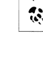

`url.match` 函数使用的是一种经常嵌入在 JavaScript、PHP 和 Perl 等其他编程语言中的语言——正则表达式。虽然这个正则表达式很简单，但更复杂的表达式可能有点令人生畏，但非常值得熟悉掌握。我最喜欢的正则表达式页面位于 http://www.regular-expressions.info/javascripthtml.html。

## 自定义返回按钮

目前最明显的问题是用户无法返回到之前的页面（请记住，我们已经劫持了所有链接，所以浏览器的页面历史记录不会起作用）。我们通过在屏幕左上角添加一个返回按钮来解决这个问题。首先，我们将更新 JavaScript，然后处理 CSS。

在应用中添加一个标准的工具栏返回按钮意味着需要跟踪用户的点击历史记录。为此，我们需要：

- 存储上一个页面的 URL，以便我们知道返回到哪里
- 存储上一个页面的标题，以便我们知道在返回按钮上显示什么标签

添加这个功能涉及到本章到目前为止我们编写的大部分 JavaScript，因此我将逐行介绍 android.js 的整个新版本（参见示例 3-10），然后展示你需要支持的 CSS。结果将如图 3-6 所示。

示例 3-10. 扩展现有的 JavaScript 示例以包含返回按钮支持

```javascript
var hist = [];❶
var startUrl = 'index.html';❷
$(document).ready(function(){❸
    loadPage(startUrl);
});
function loadPage(url) {
    $("body').append('<div id="progress">Loading...</div>');❹
    scrollTo(0,0);
    if (url == startUrl) {❺
        var element = ' #header ul';
    } else {
        var element = ' #content';
    }
    $('#container').load(url + element, function(){❻
        var title = $('h2').html() || 'Hello!';
        $('h1').html(title);
        $('h2').remove();
        $('.leftButton').remove();❼
        hist.unshift({'url':url, 'title':title});❽
        if (hist.length > 1) {❾
            $('#header').append('<div class="leftButton">'+hist[1].title+'</div>');❿
            $('#header .leftButton').click(function(){⓫
                var thisPage = hist.shift();⓬
                var previousPage = hist.shift();
                loadPage(previousPage.url);
            });
        }
        $('#container a').click(function(e){⓭
            var url = e.target.href;
            if (url.match(window.location.hostname)){⓮
                e.preventDefault();
                loadPage(url);
            }
        });
        $('#progress').remove();
    });
}
```

❶ 这行代码将名为 `hist` 的变量初始化为空数组。由于它定义在任何函数之外，它存在于全局作用域中，将在页面的任何地方都可用。请注意，它没有使用完整的单词 history 作为变量名，因为那是 JavaScript 中的预定义对象属性，你应该避免在自己的代码中使用它。

❷ 这行代码定义了用户首次访问 *android.html* 时要加载的远程页面的相对 URL。你可能还记得前面的示例中检查 `url == undefined` 来处理第一次页面加载，但在这个示例中，我们在几个地方都用到了起始页面。因此，将其全局定义是合理的。

❸ 这行和下一行组成了 `document ready` 函数定义。与前面的示例不同，我们将起始页面传递给 `loadPage()` 函数。

❹ 继续看 `loadPage()` 函数。这行和下一行与前面的示例完全相同。

❺ 这个 `if...else` 语句决定了从远程页面加载哪些元素。例如，如果我们想要起始页面，我们就从标题中获取 ul；否则，我们获取内容 `div`。

❻ 在这一行，`url` 参数和相应的源元素被拼接作为传递给 load 函数的第一个参数。至于第二个参数，我们直接传递了一个*匿名函数*（一个内联定义的未命名函数）。在浏览这个匿名函数的过程中，你会注意到它与 `hijackLinks()` 函数非常相似，该函数已被这个匿名函数替代。例如，以下三行与前面的示例完全相同。

❼ 在这一行，我们从页面中移除 `.leftButton` 对象。这可能看起来很奇怪，因为我们还没有将其添加到页面中；我们将在接下来的几步中添加它。

❽ 这里我们使用 JavaScript 数组的内置 `unshift` 方法将一个对象添加到 `hist` 数组的开头。该对象有两个属性：`url` 和 `title`——这是支持返回按钮显示和行为所需的两条信息。

❾ 这一行使用 JavaScript 数组的内置 `length` 方法来找出历史数组中有多少个对象。如果历史数组中只有一个对象，意味着用户在第一个页面上。因此，我们不需要显示返回按钮。然而，如果 hist 数组中有多个对象，我们需要在标题栏中添加一个按钮。

❿ 这行添加了我上面提到的 `.leftButton`。按钮的文本将与当前页面之前的页面标题相同，这就是我们用 `hist[1].title` 代码访问的内容。JavaScript 数组从零开始索引，所以数组中的第一项（当前页面）的索引为 0。换句话说，索引 0 是当前页面，索引 1 是上一个页面，索引 2 是更前面的页面，以此类推。

⓫ 这段代码将一个匿名函数绑定到返回按钮的点击处理程序上。请记住，点击处理程序代码在用户点击时执行，而不是在页面加载时执行。因此，在页面加载后，用户点击返回，这段函数内的代码就会运行。


⑫ 这一行和下一行使用了数组内置的 shift 方法来移除 hist 数组中的前两个元素，然后函数中的最后一行将前一个页面的 URL 发送给 `loadPage()` 函数。

⑬ 剩余的行完全照搬了前面示例中的代码，因此我不再赘述。

⑭ 这是在本章前面介绍过的 URL 匹配代码。

请访问 http://www.hunlock.com/blogs/Mastering_Javascript_Arrays 获取完整的 JavaScript 数组函数列表及说明和示例。

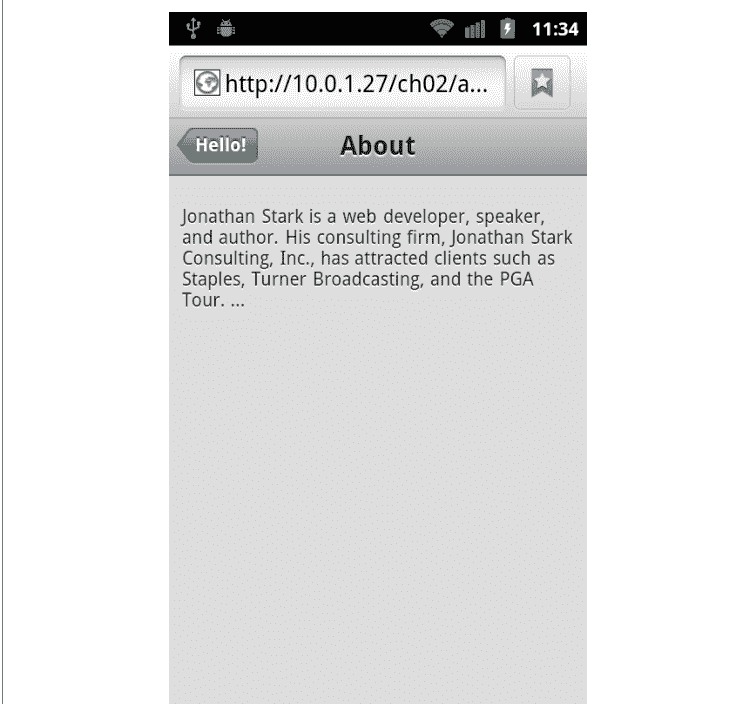

图 3-6. 如果没有闪亮的左箭头返回按钮，就不算移动端应用

现在我们已经有了返回按钮，剩下的工作就是用 CSS 来美化它（参见示例 3-11）。我们将首先使用 `font-weight`、`text-align`、`line-height`、`color` 和 `text-shadow` 来设置文本样式。接着通过 `position`、`top` 和 `left` 将 div 精确定位到页面上我们想要的位置。然后，我们将使用 `max-width`、`white-space`、`overflow` 和 `text-overflow` 确保按钮标签上的长文本会以省略号截断显示。最后，我们将使用 `border-width` 和 `-webkit-border-image` 应用图形效果。与前面的边框图像示例不同，这张图片的左右边框宽度不同，因为左侧箭头的存在使得图像不对称。

别忘了你需要为此按钮准备一张图片。你需要将它保存为 `back_button.png`，放在存放 HTML 文件的文件夹下的 *images* 文件夹中。关于如何找到或创建自己的按钮图片，请参阅第 29 页的"使用 jQuery 添加基本行为"部分。

示例 3-11. 将以下内容添加到 android.css 中，使用边框图像美化返回按钮

```
#header div.leftButton {
    font-weight: bold;
    text-align: center;
    line-height: 28px;
    color: white;
    text-shadow: 0px -1px 1px rgba(0,0,0,0.6);
    position: absolute;
    top: 7px;
    left: 6px;
    max-width: 50px;
    white-space: nowrap;
    overflow: hidden;
    text-overflow: ellipsis;
    border-width: 0 8px 0 14px;
    -webkit-border-image: url(images/back_button.png) 0 8 0 14;
}
```

默认情况下，Android 会在被点击的可点击对象上显示橙色高亮效果（图 3-7）。这个效果可能只出现很短的时间，但移除它很容易，而且能让应用看起来更好。幸运的是，Android 支持一个名为 `-webkit-tap-highlight-color` 的 CSS 属性，允许你抑制这种行为。我们可以通过将点击高亮设置为完全透明的颜色来实现（参见示例 3-12）。

示例 3-12. 将以下内容添加到 android.css 中，移除默认的点击高亮效果

```
#header div.leftButton {
    font-weight: bold;
    text-align: center;
    line-height: 28px;
    color: white;
    text-shadow: 0px -1px 1px rgba(0,0,0,0.6);
    position: absolute;
    top: 7px;
    left: 6px;
    max-width: 50px;
    white-space: nowrap;
    overflow: hidden;
    text-overflow: ellipsis;
    border-width: 0 8px 0 14px;
    -webkit-border-image: url(images/back_button.png) 0 8 0 14;
    -webkit-tap-highlight-color: rgba(0,0,0,0);
}
```

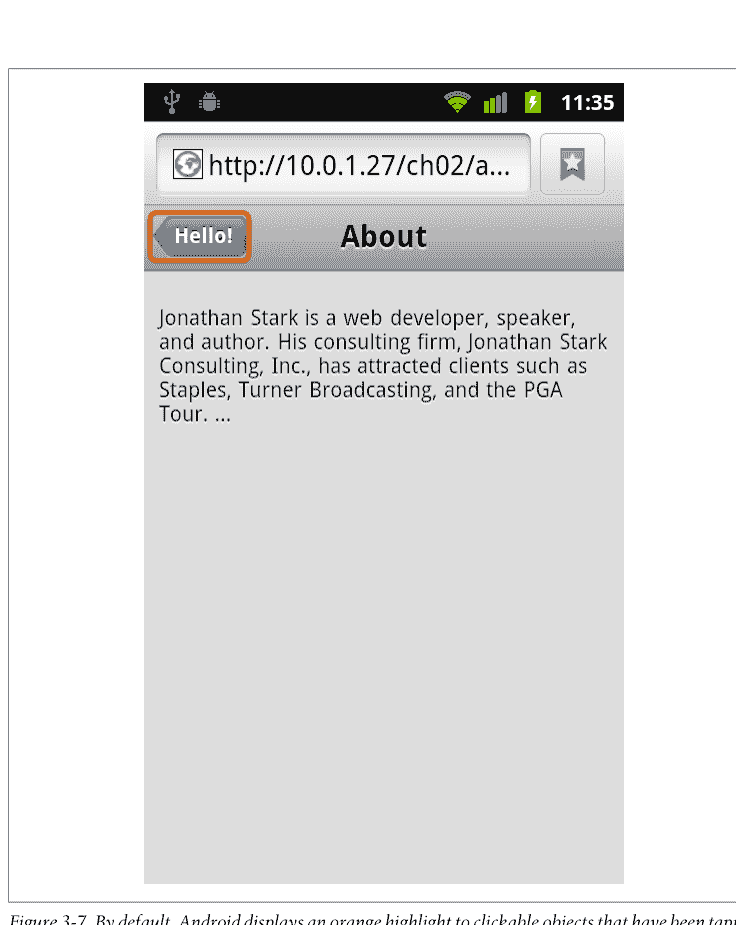

图 3-7. 默认情况下，Android 会在被点击的可点击对象上显示橙色高亮效果

对于返回按钮来说，在前一个页面的内容显示之前，至少可能会有一到两秒的延迟。为了避免用户的烦躁，我们可以配置按钮在被点击的瞬间就呈现出被按下的外观。在桌面浏览器中，这是一个简单的过程：你只需在 CSS 中添加一条使用 `:active` 伪类的声明，为用户点击的对象指定一个替代样式。我不确定这是 bug 还是特性，但这种方法在 Android 上不起作用；`:active` 样式会被忽略。

我尝试了 `:active` 和 `:hover` 的各种组合，这对于非 Ajax 应用取得了一些效果。然而，对于我们这里使用的这种 Ajax 应用，`:hover` 样式是粘性的（即即使手指已经移开，按钮看起来仍然处于"被按下"的状态）。

幸运的是，修复方法相当简单——使用 jQuery 在用户点击按钮时为按钮添加 `clicked` 类。在示例中我选择为按钮应用一个更暗版本的按钮图片（参见图 3-8 和示例 3-13）。你需要确保在 `images` 子文件夹中有一个名为 `back_button_clicked.png` 的按钮图片。关于如何找到或创建自己的按钮图片，请参阅第 29 页的"使用 jQuery 添加基本行为"部分。

示例 3-13. 将以下内容添加到 android.css 中，使返回按钮在用户点击时呈现被按下的外观

```
#header div.leftButton.clicked {
    -webkit-border-image: url(images/back_button_clicked.png) 0 8 0 14;
}
```

> 由于我们使用图片来实现点击样式，预加载该图片是明智的做法。否则，在第一次点击时，未点击的按钮图形会在点击图形下载完成之前消失。我将在下一章中介绍图片预加载。

CSS 就位后，我们现在可以更新 `android.js` 中为返回按钮分配点击处理器的部分。首先，我们在匿名函数中添加变量 `e` 来捕获传入的点击事件。然后，我们用 jQuery 选择器包装事件目标，并调用 jQuery 的 `addClass()` 函数为按钮分配 clicked CSS 类：

```
$('#header .leftButton').click(function(e){
    $(e.target).addClass('clicked');
    var thisPage = hist.shift();
    var previousPage = hist.shift();
    loadPage(lastUrl.url);
});
```

> 特别提醒各位 CSS 专家：CSS Sprite 技术——由 A List Apart 推广——在这种情况下不可用，因为它需要设置图像的偏移量。`-webkit-border-image` 属性不支持图像偏移。

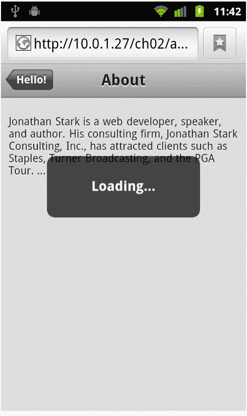

图 3-8. 虽然印刷效果可能不明显，但被点击的返回按钮比默认状态稍暗一些

## 在主屏幕添加图标

希望用户会想将你的 Web 应用图标添加到他们的主屏幕上（这称为"启动器图标"）。他们通过收藏你的应用并将收藏快捷方式添加到主屏幕来实现这一点。这与他们将任何书签添加到主屏幕的流程相同。不同的是，我们将指定一个自定义图片来替代默认的书签图标显示。

首先，将一个 .png 图片文件上传到你的网站。为了与其他启动器图标保持一致的视觉重量，建议如果图片的可见区域基本为正方形，则文件尺寸为 56px × 56px，否则为 60px × 60px。你需要根据自己的具体图形进行实验来确定完美的尺寸。


由于 Android 运行在众多不同设备上，屏幕尺寸和像素密度各不相同，因此创建在所有设备上都好看的图标需要相当多的工作。有关详细说明和免费可下载的模板，请访问 Android 开发者网站上的图标设计页面（[http://developer.android.com/guide/practices/ui_guidelines/icon_design.html#launcherstructure](http://developer.android.com/guide/practices/ui_guidelines/icon_design.html#launcherstructure)）。

接下来，在"交通指挥"HTML 文档（*android.html*）的 `head` 部分添加以下行（将 `myCustomIcon.png` 替换为图片的绝对或相对路径）：

```
<link rel="apple-touch-icon-precomposed" href="myCustomIcon.png" />
```

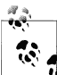

你可能已经注意到，这是一个苹果的专有指令，已被 Android 采用。

## 本章总结

在本章中，你学习了如何将一个普通网站转换为 Ajax 应用程序，包括进度指示器和原生外观的返回按钮。在下一章中，你将学习如何通过添加原生 UI 动画让你的应用变得生动起来。没错，有趣的部分来了！


## 第四章

动画

Android 应用具有许多独特的动画特性，为用户增添情境和意义。例如，用户深入浏览链接时页面向左滑动，而返回时则向右滑动。在本章中，你将学习如何为你的 Web 应用添加滑动、翻页等特征行为。这些变化将使你的 Web 应用与原生应用几乎难以区分。

## 借助朋友的力量

坦白说：让网页像典型的原生应用一样实现动画效果是很难的。幸运的是，一位名叫 David Kaneda 的有远见的年轻人创建了一个名为 jQTouch 的 JavaScript 库，大大简化了移动 Web 开发的难度。jQTouch 是一个开源的 jQuery 插件，它几乎涵盖了我们在上一章中学到的所有内容，还有大量更复杂的功能，而这些功能如果从零开始编写将会非常痛苦。

> 在撰写本文时，jQTouch 的稳定版本为 v1.0b3.1，你可以从 https://github.com/senchalabs/jQTouch/zipball/b3.1 下载。jQTouch 的下一个版本计划进行一些相当重大的更改。如果在你阅读本文时已有更新版本可用，你可能需要在学习本书剩余部分时继续使用 v1.0b3.1，等到熟悉了底层概念后再升级到最新版本。

## 滑动首页

我们将构建一个简单的卡路里追踪应用，名为 Kilo，允许用户为给定日期添加和删除食物条目。总共将有五个面板：首页、设置、日期、日期详情和新建条目。我们将从两个面板开始，然后逐步添加更多。


我们将为一些 HTML 元素分配 CSS 类（例如 toolbar、edgetoedge、arrow、button、back）。在所有情况下，这些类都对应于 jQTouch 默认主题中存在的预定义 CSS 类选择器。请记住，你可以通过修改现有 jQTouch 主题或从零创建自己的主题来创建和使用自定义类；我们在这里的示例中仅使用默认类。

我们将从零开始，因此你可以把之前章节中创建的文件放到一边。首先，让我们创建一个名为 index.html 的文件，并在示例 4-1 中为首页和关于面板添加 HTML。

**示例 4-1. index.html 中首页和关于面板的 HTML**

```html
<html>
  <head>
    <title>Kilo</title>
  </head>
  <body>
    <div id="home">❶
      <div class="toolbar">❷
        <h1>Kilo</h1>
      </div>
      <ul class="edgetoedge">❸
        <li class="arrow"><a href="#about">About</a></li>❹
      </ul>
    </div>
    <div id="about">
      <div class="toolbar">
        <h1>About</h1>
        <a class="button back" href="#">Back</a>❺
      </div>
      <div>
        <p>Kilo gives you easy access to your food diary.</p>
      </div>
    </div>
  </body>
</html>
```

这里的 HTML 基本上包含一个带有标题的 head 和一个包含两个子元素的 body，两个子元素都是 div：

- ❶ 这个 div（以及几行之后出现的 about div）将通过作为 body 的直接子元素而成为应用中的一个面板。
- ❷ 在每个面板 div 内部，都有一个带有 toolbar 类的 div。这个 toolbar 类在 jQTouch 主题中专门预定义，用于将元素样式化为传统手机工具栏。
- ❸ 这个无序列表标签带有 edgetoedge 类。edgetoedge 类告诉 jQTouch 将列表从左到右完全拉伸到可视区域。
- ❹ 这一行有一个 li，其中包含一个链接，其 href 指向关于面板。在 li 上包含 arrow 类是可选的；这样做会在列表项的右侧添加一个箭头图标。
- ❺ 工具栏元素各包含一个 h1 元素，该元素将成为面板标题。这一行有两个带有 button 和 back 类的链接，它们告诉 jQTouch 将按钮的外观和行为设置为返回按钮。

返回按钮的 href 设置为 #。通常这会告诉浏览器返回到当前文档的顶部。但使用 jQTouch 时，它会返回到上一个面板。在更高级的场景中，你可能需要使用特定的锚点，例如 #home，它指示返回按钮导航到特定面板，而不管上一个面板是什么。

有了基本的 HTML 后，是时候将 jQTouch 加入了。一旦你将 jQTouch 安装到与 HTML 文档相同的目录中（参见下面的"安装 jQTouch"），只需在页面的 head 中添加几行代码即可（示例 4-2）。

### 安装 jQTouch

对于本书中的这个和其他示例，你需要从 http://www.jqtouch.com 下载 jQTouch，解压缩，并将 *jqtouch* 和 *themes* 目录移动到与 HTML 文档相同的目录中。你还需要进入 *jqtouch* 目录，将 jQuery JavaScript 文件（例如 *jquery.1.4.2.min.js*）重命名为 *jquery.js*。

**示例 4-2. 在文档的 head 中添加这些代码行将激活 jQTouch**

```html
<link type="text/css" rel="stylesheet" media="screen"
      href="jqtouch/jqtouch.css"> 1
<link type="text/css" rel="stylesheet" media="screen"
      href="themes/jqt/theme.css"> 2
<script type="text/javascript" src="jqtouch/jquery.js"></script> 3
<script type="text/javascript" src="jqtouch/jqtouch.js"></script> 4
<script type="text/javascript"> 5
    var jQT = $.jQTouch({
        icon: 'kilo.png'
    });
</script>
```

1. 这一行引入了 *jqtouch.css* 文件。该文件定义了一些核心结构设计规则，专门用于处理动画、屏幕方向和其他 Android 特定的细微问题。此文件是必需的，没有理由去编辑它。
2. 这一行指定了所选主题的 CSS，在本例中是随 jQTouch 附带的 jqt 主题。我们在 HTML 中使用的类对应于此文档中的 CSS 选择器。jQTouch 默认提供两个可用主题。你也可以通过复制一个默认主题并对其进行修改或从零开始编写一个新主题来创建自己的主题。
3. jQTouch 需要 jQuery，因此在此处引入。jQTouch 自带一份 jQuery 副本（你需要按照前面的说明将其重命名为 *jquery.js*），但如果你愿意，也可以链接到另一个副本。
4. 这是我们引入 jQTouch 本身的地方。请注意，你必须在 jQuery 之后引入 jQTouch，否则什么都不会生效。
5. 这带我们来到脚本块，在这里我们初始化 jQTouch 对象并传入一个属性值：`icon`。

jQTouch 提供了多个属性，允许你自定义应用的行为和外观。你将在本书的整个过程中看到其中几个，它们都是可选的。然而，你几乎总是会用到其中至少几个。

在本例中，`icon` 告诉 jQTouch 在哪里查找自定义主屏幕图标。

引入 jQTouch 之前的应用（图 4-1）和之后的应用（图 4-2）之间的差异是巨大的，但真正令人惊叹的变化是你仅用了 10 行代码就为应用添加了漂亮的左右滑动效果。jQTouch 太棒了，而我们才刚刚开始。

## 添加日期面板

让我们添加日期面板。日期面板将包含一个相对日期列表，从今天开始一直回溯到五天前。将日期面板的 HTML（如示例 4-3 所示）添加到关于面板之后、`</body>` 标签之前（稍后我会向你展示如何从首页面板添加链接到此面板）。

**示例 4-3. 日期面板的 HTML**

```html
<div id="dates">
    <div class="toolbar">
        <h1>Dates</h1>
        <a class="button back" href="#">Back</a>
    </div>
    <ul class="edgetoedge">
        <li class="arrow"><a id="0" href="#date">Today</a></li>
        <li class="arrow"><a id="1" href="#date">Yesterday</a></li>
        <li class="arrow"><a id="2" href="#date">2 Days Ago</a></li>
        <li class="arrow"><a id="3" href="#date">3 Days Ago</a></li>
        <li class="arrow"><a id="4" href="#date">4 Days Ago</a></li>
        <li class="arrow"><a id="5" href="#date">5 Days Ago</a></li>
    </ul>
</div>
```


## 添加日期面板

日期面板看起来与之前的面板非常相似，但有几个不同之处（参考[示例 4-4](#)）。请在日期列表面板之后、关闭 `</body>` 标签之前添加日期面板的 HTML 代码。

示例 4-4. 日期面板的 HTML 代码

```html
<div id="date">
    <div class="toolbar">
        <h1>Date</h1>
        <a class="button back" href="#">Back</a>
        <a class="button slideup" href="#createEntry">+</a>
    </div>
    <ul class="edgetoedge">
        <li id="entryTemplate" class="entry" style="display:none">
            <span class="label">Label</span>
            <span class="calories">000</span>
            <span class="delete">Delete</span>
        </li>
    </ul>
</div>
```

1.  日期面板的工具栏多了一个按钮。点击该按钮将显示新建条目面板（我们尚未构建）。该链接的 class 为 `slideup`，这告诉 jQTouch 我们希望目标面板从屏幕底部向上滑入，而不是像普通导航那样从左侧或右侧滑入。

2.  该面板另一个不寻常的地方在于，我们定义了一个样式设置为 `display:none` 的列表项，使其实际上是不可见的。

稍后你会看到，我们将使用这个不可见的列表项作为模板来显示已创建的条目。目前还没有任何条目，所以除了工具栏之外，面板将是空的。

现在你已经添加了日期面板，点击日期列表面板上的任何项目都会将空的日期面板（图 4-5）滑入视图。

图 4-5. 除了工具栏之外，日期面板最初是空的

## 添加新建条目面板

示例 4-5 展示了新建条目面板的源代码。将此代码添加到 *index.html* 的末尾，关闭 `</body>` 标签之前。

示例 4-5. 新建条目面板的 HTML 代码

```html
<div id="createEntry">
    <div class="toolbar">
        <h1>New Entry</h1>
        <a class="button cancel" href="#">Cancel</a>❶
    </div>
    <form method="post">❷
        <ul class="rounded">
            <li><input type="text" placeholder="Food" name="food" id="food" autocapitalize="off" autocorrect="off" autocomplete="off" /></li>
            <li><input type="text" placeholder="Calories" name="calories" id="calories" autocapitalize="off" autocorrect="off" autocomplete="off" /></li>
            <li><input type="submit" class="submit" name="action" value="Save Entry" /></li>❸
        </ul>
    </form>
</div>
```

❶ 首先需要指出的是，新建条目面板没有返回按钮，而是有一个取消按钮。

jQTouch 中取消按钮的行为与返回按钮类似：它们使用与进入时相反的动画将当前页面移出视图。但是，取消按钮不像返回按钮那样呈左箭头形状。

我在这里为新建条目面板使用取消按钮，是因为它进入时是从底部向上滑入的，退出时会向下滑出。如果点击一个指向左侧的返回按钮，面板却向下滑出，这会令人感到困惑。

❷ 这个 HTML 表单包含一个包含三个项目的无序（项目符号）列表：两个文本字段和一个提交按钮。将表单控件嵌套在 `li` 中，可以让 *jqt* 主题按照图 4-6 所示的样式来呈现表单。

每个文本输入都定义了相当多的属性：

-   `type="text"` - 将表单控件定义为单行文本输入字段。
-   `placeholder` - 当输入为空时显示在表单输入中的文本字符串。
-   `name` - 当表单提交时，将与用户提供的值相关联的名称。
-   `id` - 在整个页面上下文中该元素的唯一标识符。
-   `autocapitalize` - 允许你控制 iPhone 上 Mobile Safari 的自动大写功能。对 Android 无效。
-   `autocorrect` - 允许你控制 iPhone 上 Mobile Safari 的拼写纠正功能。对 Android 无效。
-   `autocomplete` - 允许你控制 iPhone 上 Mobile Safari 的自动完成功能。对 Android 无效。

❸ 提交输入按钮的 `class` 属性需要解释一下。当用户的光标位于某个字段中时，Android 手机会显示键盘。键盘右下角有一个 Go 按钮，点击后会提交表单。当你像我们这样劫持提交功能时，从键盘上的 Go 按钮提交不会将光标从活动字段中移除，因此键盘不会滑出视图。为此，jQTouch 提供了一个便捷方法，可以在表单提交时自动将光标从活动字段中移除。要利用此功能，请为表单的提交元素添加 `submit` 类。

图 4-7 展示了新建条目表单的实际效果。到目前为止，我们还没有对用户点击保存条目时如何实际保存条目做任何处理。我们将在第 5 章中介绍。

图 4-6. jqt 主题在表单元素样式化方面做得很好

图 4-7. 使用新建条目表单进行键盘数据输入

## 添加设置面板

我们还没有创建允许用户导航到设置面板的按钮，因此让我们在主页面板的工具栏上添加一个。只需一行 HTML 代码即可，如粗体所示：

```html
<div id="home">
    <div class="toolbar">
        <h1>Kilo</h1>
        <a class="button flip" href="#settings">Settings</a>1
    </div>
    <ul class="edgetoedge">
        <li class="arrow"><a href="#dates">Dates</a></li>
        <li class="arrow"><a href="#about">About</a></li>
    </ul>
</div>
... 剩余 HTML 未显示 ...
```

1 这就是添加按钮的那行 HTML 代码（图 4-8）。注意我们将 `flip` 类分配给了该链接。`flip` 类指示 jQTouch 通过绕垂直轴旋转页面来从主页面板过渡到设置面板。为了给这个过程增添更多维度，页面在动画过程中实际上会稍微缩小一点。很炫酷，不是吗？

不幸的是，对 3D 动画的支持在各移动平台上参差不齐，包括 Android。因此，当不支持 3D 时，`flip`、`swap`、`cube` 以及其他任何 3D 动画都会降级为 2D 动画。

在处理完新建条目面板之后，设置面板的 HTML 看起来会非常相似（示例 4-6）。它多了一个文本输入，而且某些属性被省略或具有不同的值，但在概念上它们是相同的。像处理其他面板的 HTML 一样，将此代码添加到你的 HTML 文档中。

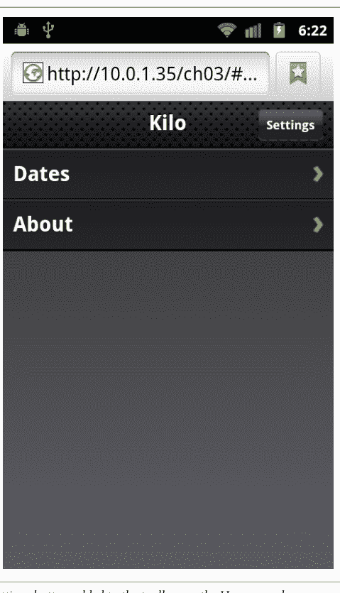

*图 4-8. Home 面板工具栏中添加的 Settings 按钮*

与“新条目（New Entry）”表单一样，Settings 表单目前不保存与其相关联的任何信息（见图 4-9）。其提交处理程序将在下一章中介绍。

*示例 4-6. Settings 面板的 HTML*

```html
<div id="settings">
    <div class="toolbar">
        <h1>Settings</h1>
        <a class="button cancel" href="#">Cancel</a>
    </div>
    <form method="post">
        <ul class="rounded">
            <li><input placeholder="Age" type="text" name="age" id="age" /></li>
            <li><input placeholder="Weight" type="text"
                    name="weight" id="weight" /></li>
            <li><input placeholder="Budget" type="text"
                    name="budget" id="budget" /></li>
            <li><input type="submit" class="submit" name="action"
                    value="Save Changes" /></li>
        </ul>
    </form>
</div>
```

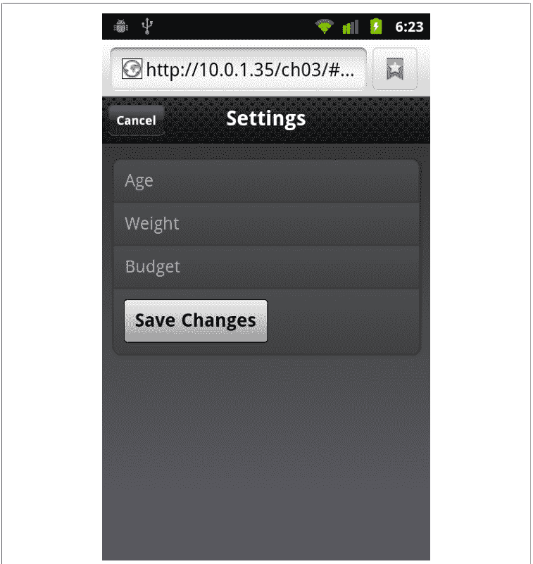

## 总结

就是这样。通过不到 100 行代码，我们为一个拥有五个面板的应用创建了一个原生风格的 UI，并且配备了三种不同的页面过渡动画。请参阅 [示例 4-7](#) 以获取最终 HTML 的完整列表。还不赖，对吧？

*示例 4-7. 五面板 UI 的完整 HTML 列表*

```html
<html>
    <head>
        <title>Kilo</title>
        <link type="text/css" rel="stylesheet" media="screen"
        href="jqtouch/jqtouch.css">
        <link type="text/css" rel="stylesheet" media="screen"
        href="themes/jqt/theme.css">
        <script type="text/javascript" src="jqtouch/jquery.js"></script>
        <script type="text/javascript" src="jqtouch/jqtouch.js"></script>
        <script type="text/javascript">
            var jQT = $.jQTouch({
                icon: 'kilo.png'
            });
        </script>
    </head>
    <body>
        <div id="home">
            <div class="toolbar">
                <h1>Kilo</h1>
                <a class="button flip" href="#settings">Settings</a>
            </div>
            <ul class="edgetoedge">
                <li class="arrow"><a href="#dates">Dates</a></li>
                <li class="arrow"><a href="#about">About</a></li>
            </ul>
        </div>
        <div id="about">
            <div class="toolbar">
                <h1>About</h1>
                <a class="button back" href="#">Back</a>
            </div>
            <div>
                <p>Kilo gives you easy access to your food diary.</p>
            </div>
        </div>
        <div id="dates">
            <div class="toolbar">
                <h1>Dates</h1>
                <a class="button back" href="#">Back</a>
            </div>
            <ul class="edgetoedge">
                <li class="arrow"><a id="0" href="#date">Today</a></li>
                <li class="arrow"><a id="1" href="#date">Yesterday</a></li>
                <li class="arrow"><a id="2" href="#date">2 Days Ago</a></li>
                <li class="arrow"><a id="3" href="#date">3 Days Ago</a></li>
                <li class="arrow"><a id="4" href="#date">4 Days Ago</a></li>
                <li class="arrow"><a id="5" href="#date">5 Days Ago</a></li>
            </ul>
        </div>
        <div id="date">
            <div class="toolbar">
                <h1>Date</h1>
                <a class="button back" href="#">Back</a>
                <a class="button slideup" href="#createEntry">+</a>
            </div>
            <ul class="edgetoedge">
                <li id="entryTemplate" class="entry" style="display:none">
                    <span class="label">Label</span>
                    <span class="calories">000</span>
                    <span class="delete">Delete</span>
                </li>
            </ul>
        </div>
        <div id="createEntry">
            <div class="toolbar">
                <h1>New Entry</h1>
                <a class="button cancel" href="#">Cancel</a>
            </div>
            <form method="post">
                <ul class="rounded">
                    <li><input type="text" placeholder="Food" name="food" id="food"
                        autocapitalize="off" autocorrect="off"
                        autocomplete="off" /></li>
                    <li><input type="text" placeholder="Calories" name="calories"
                        id="calories" autocapitalize="off" autocorrect="off"
                        autocomplete="off" /></li>
                    <li><input type="submit" class="submit" name="action"
                        value="Save Entry" /></li>
                </ul>
            </form>
        </div>
        <div id="settings">
            <div class="toolbar">
                <h1>Settings</h1>
                <a class="button cancel" href="#">Cancel</a>
            </div>
            <form method="post">
                <ul class="rounded">
                    <li><input placeholder="Age" type="text" name="age" id="age" /></li>
                    <li><input placeholder="Weight" type="text"
                        name="weight" id="weight" /></li>
                    <li><input placeholder="Budget" type="text"
                        name="budget" id="budget" /></li>
                    <li><input type="submit" class="submit" name="action"
                        value="Save Changes" /></li>
                </ul>
            </form>
        </div>
    </body>
</html>
```

## 定制 jQTouch

您可以通过向构造函数发送各种属性设置来定制 jQTouch 的默认行为。您之前在 `icon` 属性中看到了这一点，但还有其他几个您应该了解的属性，如表 4-1 所示。

*表 4-1. jQTouch 定制选项*

| 属性 | 默认值 | 期待类型 | 备注 |
| :--- | :--- | :--- | :--- |
| addGlossToIcon | true | true 或 false | 如果设置为 true，将在 iPhone 的主屏幕图标上添加光泽。对 Android 无影响。 |
| backSelector | '.back, .cancel, .goback' | 任何有效的 CSS 选择器；多个值用逗号分隔 | 定义点击后将触发 jQTouch “返回”行为的元素。当触发返回行为时，当前面板将以反向动画移出屏幕并从历史记录中删除。 |
| cacheGetRequests | true | true 或 false | 如果设置为 true，将自动缓存 GET 请求，因此随后的点击将引用已加载的数据。 |
| cubeSelector | '.cube' | 任何有效的 CSS 选择器；多个值用逗号分隔 | 定义将触发从当前面板到目标面板的立方体（cube）动画的元素。 |
| dissolveSelector | '.dissolve' | 任何有效的 CSS 选择器；多个值用逗号分隔 | 定义将触发从当前面板到目标面板的溶解（dissolve）动画的元素。 |
| fadeSelector | '.fade' | 任何有效的 CSS 选择器；多个值用逗号分隔 | 定义将触发从当前面板到目标面板的渐变（fade）动画的元素。 |
| fixedViewport | true | true 或 false | 如果设置为 true，将防止用户对页面进行放大或缩小。 |
| flipSelector | '.flip' | 任何有效的 CSS 选择器；多个值用逗号分隔 | 定义将触发从当前面板到目标面板的翻转（flip）动画的元素。 |
| formSelector | 'form' | 任何有效的 CSS 选择器；多个值用逗号分隔 | 定义应接收 `onsubmit` 处理程序的元素。 |
| fullScreen | true | true 或 false | 仅限 iPhone；对 Android 无影响。设置为 true 时，应用从用户主屏幕启动时将以全屏模式打开。如果应用在 Mobile Safari 中运行，则对显示没有影响。 |
| fullScreenClass | 'fullscreen' | 字符串 | 仅限 iPhone；对 Android 无影响。当应用在全屏模式下启动时应用于 body 的类名。允许您编写仅在全屏模式下执行的自定义 CSS。 |
| icon | null | null 或指向 `.png` 图像文件的相对或绝对路径 | 应用的主屏幕图标。当用户将应用的书签添加到主屏幕时，将显示此图像。 |
| popSelector | '.pop' | 任何有效的 CSS 选择器；多个值用逗号分隔 | 定义将触发从当前面板到目标面板的弹出（pop）动画的元素。 |
| preloadImages | false | 图像路径数组 | 定义在页面加载前将要加载的图像。例如：`['images/link_over.png', 'images/link_select.png']` |
| slideInSelector | 'ul li a' | 任何有效的 CSS 选择器；多个值用逗号分隔 | 定义将触发从当前面板到目标面板的向左滑动动画的元素。 |
| slideupSelector | '.slideup' | 任何有效的 CSS 选择器；多个值用逗号分隔 | 定义将导致目标面板在当前面板前方向上滑动进入视野的元素。 |
| startupScreen | null | null 或图像文件的相对或绝对路径 | 仅限 iPhone；对 Android 无影响。为全屏应用传递 320px × 460px 启动屏幕的相对或绝对路径。如果将 statusBar 设置为 `black-translucent`，请使用 320px × 480px 的图像。 |
| statusBar | 'default' | default, black-translucent, black | 仅限 iPhone；对 Android 无影响。定义全屏模式启动的应用中窗口顶部 20 像素状态栏的外观。 |
| submitSelector | '.submit' | 任何有效的 CSS 选择器；多个值用逗号分隔 | 点击时将提交其父表单（并关闭已打开的键盘）的选择器。 |
| swapSelector | '.swap' | 任何有效的 CSS 选择器；多个值用逗号分隔 | 定义将导致目标面板在当前面板前方交换进入视野的元素。 |
| useAnimations | true | true 或 false | 设置为 false 以禁用所有动画。 |


## 你学到了什么

在本章中，你学习了如何使用 jQTouch 为网页应用添加原生风格的动画。在下一章，你将学习如何使用 HTML5 的新功能——本地存储和客户端数据库，为你的应用添加持久化数据存储。

## 客户端数据存储

大多数软件应用都需要以某种持久化的方式存储数据，才能发挥作用。对于网页应用来说，传统上这项任务是通过服务器端数据库或浏览器设置的 cookies 来处理的。随着 HTML5 的出现，网页开发者现在有了更多选择：Web Storage 和 Web SQL 数据库。

### Web Storage

Web Storage 有两种形式——`localStorage` 和 `sessionStorage`——它们与 cookies 非常相似，都允许你使用 JavaScript 设置名称/值对，这些值对可以在多次页面刷新后被检索到。

然而，与 cookies 不同的是，Web Storage 的数据不会通过浏览器请求在网络上传输——它完全存在于客户端。因此，它能够存储比 cookies 多得多的数据。

> 在撰写本文时，浏览器对 Web Storage 的大小限制仍在变动。然而，我最近的测试表明，这个限制大约是 2.5 MB。

从功能上讲，`localStorage` 和 `sessionStorage` 是相同的。它们的区别仅在于持久性和作用域：

**localStorage**

即使窗口关闭后数据仍然会被保存，并且对于从同一源（必须是相同的域名、协议和端口）加载的所有窗口（或标签页）都可用。这对于诸如应用程序偏好设置之类的事情很有用。

**sessionStorage**

数据随窗口对象一起存储。其他窗口/标签页不知道这些值，并且当窗口/标签页关闭时数据会被丢弃。这对于特定窗口的状态很有用，例如活动标签页的高亮显示或表格的排序顺序。

> 在以下任何示例中，你可以在看到 `localStorage` 的任何地方用 `sessionStorage` 替换它，但请记住，当你关闭窗口或标签页时 `sessionStorage` 会消失。

设置一个值非常简单：

```
localStorage.setItem('age', 40);
```

访问存储的值同样简单：

```
var age = localStorage.getItem('age');
```

你可以像这样从存储中删除特定的键/值对：

```
localStorage.removeItem('age');
```

或者，你可以像这样删除所有键/值对：

```
localStorage.clear();
```

假设你的键是有效的 JavaScript 标记（例如，没有空格，除下划线外没有其他标点符号），你可以使用这种替代语法：

```
localStorage.age = 40 // 设置 age 的值
var age = localStorage.age; // 获取 age 的值
delete localStorage.age; // 从存储中删除 age
```

> `localStorage` 和 `sessionStorage` 的键是分开存储的。如果你对两者使用相同的键名，它们不会相互冲突。

### 将用户设置保存到本地存储

接下来看一个实际例子。让我们更新你在第 4 章开始处理的示例应用的设置面板，使其将表单值存储在 `localStorage` 中。

本章我们将编写相当多的 JavaScript 代码，我不想把它们都塞进 HTML 文档的 head 部分。为了保持代码的组织性，创建一个名为 *kilo.js* 的文件，放在与 HTML 文档相同的目录下，并更新 HTML 文档的 head 部分，添加对 *kilo.js* 的引用：

```
<head>
  <title>Kilo</title>
  <link type="text/css" rel="stylesheet" media="screen"
    href="jqtouch/jqtouch.css">
  <link type="text/css" rel="stylesheet" media="screen"
    href="themes/jqt/theme.css">
  <script type="text/javascript" src="jqtouch/jquery.js"></script>
  <script type="text/javascript" src="jqtouch/jqtouch.js"></script>
  <script type="text/javascript" src="kilo.js"></script>
</head>
```

细心的读者会注意到，我也从 HTML 文档的 head 中移除了 jQTouch 构造函数。不过它并没有消失；我只是把它移到了 *kilo.js* 中。请确保你从主 HTML 文件中删除了它，并在同一目录下创建 *kilo.js* 文件，包含以下内容，然后在浏览器中重新加载主 HTML 文档以确保它仍然正常工作：

```
var jQT = $.jQTouch({
    icon: 'kilo.png'
});
```

完成了这点代码重组后，是时候添加保存设置所需的代码了。你需要覆盖设置表单的提交操作，并用一个名为 `saveSettings()` 的自定义函数替换它。借助 jQuery，你可以用一行代码完成此操作，这行代码必须放在 `document ready` 函数中。将以下内容添加到 *kilo.js*：

```
$(document).ready(function(){
    $('#settings form').submit(saveSettings);
});
```

这样做的直接结果是，当用户提交设置表单时，`saveSettings()` 函数将运行，而不是实际提交表单。

当 `saveSettings()` 函数被调用时，它使用 jQuery 的 `val()` 函数从三个表单输入中获取值，并将每个值保存到同名的 `localStorage` 变量中。将此函数添加到 *kilo.js*：

```
function saveSettings() {
    localStorage.age = $('#age').val();
    localStorage.budget = $('#budget').val();
    localStorage.weight = $('#weight').val();
    jQT.goBack();
    return false;
}
```

值存储后，此函数使用 jQuery 的 `goBack()` 函数（在倒数第二行）来关闭面板并返回上一页。接下来，它返回 `false` 以防止触发此函数的提交事件的默认操作。如果我们省略了这一行，当前页面将会重新加载，这不是我们想要的。

此时，用户可以启动应用，导航到设置面板，输入她的设置，并提交表单将设置保存到 `localStorage`。

由于我们在提交表单时没有清除字段，因此用户输入的值在她导航回设置面板时仍然会显示在那里。然而，这并不是因为这些值已保存到 `localStorage`；而是因为它们是在输入后仍然停留在那里。

因此，下次用户启动应用并导航到设置面板时，即使这些值已经保存，字段也将是空的。

为了解决这个问题，我们需要使用 `loadSettings()` 函数来加载设置，因此将以下函数添加到 *kilo.js*：

```
function loadSettings() {
    $('#age').val(localStorage.age);
    $('#budget').val(localStorage.budget);
    $('#weight').val(localStorage.weight);
}
```

`loadSettings()` 函数与 `saveSettings()` 函数相反；它使用 jQuery 的 `val()` 函数将设置表单的三个字段设置为 `localStorage` 中保存的相应值。

现在我们有了一个 `loadSettings()` 函数，我们需要触发它。最明显的触发时机是应用启动时。为了实现这一点，只需在 *kilo.js* 的 document ready 函数中添加一行：

```
$(document).ready(function(){
    $('#settings form').submit(saveSettings);
    loadSettings();
});
```

不幸的是，只在启动时加载设置会留下一个漏洞，这种情况发生在用户导航到设置面板，更改了一些值，然后在未提交表单的情况下点击“取消”按钮时。

在这种情况下，下次用户访问设置面板时，新更改的值仍然会显示在那里；不是因为值被保存了（它们没有），而是因为它们仍然只是停留在那里。如果用户关闭并重新打开应用，显示的值将恢复为保存的值，因为 `loadSettings()` 函数会在启动时刷新它们。

有几种方法可以纠正这种情况，但我认为最合适的方法是在设置面板开始移动（无论是进入还是移出视图）时刷新显示的值。

得益于 jQTouch，这只需将 `loadSettings()` 函数绑定到设置面板的 `pageAnimationStart` 事件即可。将你刚刚添加的行替换为粗体显示的代码：

```
$(document).ready(function(){
    $('#settings form').submit(saveSettings);
    $('#settings').bind('pageAnimationStart', loadSettings);
});
```


## 将所选日期保存到会话存储

最终，我们要做的是设置日期面板，使其在显示时能检查数据库中是否有该日期的记录，并以无边距列表的形式显示出来。这就要求日期面板知道用户在日期列表面板上点击了哪个日期。

我们还希望允许用户从数据库中添加和删除条目，因此需要为日期面板上已有的"+"按钮以及日期面板条目模板中的"删除"按钮添加支持（稍后会详细介绍）。

第一步是让日期面板知道用户从日期列表面板导航过来时点击了哪个条目。有了这个信息，你就可以计算出相应的日期上下文。为此，你需要在*kilo.js*中的`document ready`函数中添加一些代码：

```
$(document).ready(function(){
    $('#settings form').submit(saveSettings);
    $('#settings').bind('pageAnimationStart', loadSettings);
    $('#dates li a').bind('click touchend', function(){ // ①
        var dayOffset = this.id; // ②
        var date = new Date(); // ③
        date.setDate(date.getDate() - dayOffset);
        sessionStorage.currentDate = date.getMonth() + 1 + '/' +
                                    date.getDate() + '/' +
                                    date.getFullYear(); // ④
        refreshEntries(); // ⑤
    });
});
```

**①** 在这一行，jQuery的`bind()`函数将随后的JavaScript代码附加到日期列表面板上链接的`click`和`touchend`事件。我们绑定`touchend`事件是为了在手机上获得最佳体验，绑定`click`事件是为了能继续在桌面浏览器中进行测试（桌面浏览器不支持`touchend`事件）。

**②** 这行代码获取被点击对象的ID，并将其存储在`dayOffset`变量中。你可能还记得，日期列表面板上的链接ID范围是0到5，因此被点击链接的ID对应于计算被点击日期所需的天数（即过去0天等于今天，过去1天等于昨天，过去2天等于前天）。

在这个上下文中，**this**关键字将包含对作为点击事件目标对象的引用。

**③** 这行代码创建了一个新的JavaScript Date对象，并将其存储在一个名为date的变量中。初始情况下，这个日期会被设置为创建时的特定时刻，因此在下一行中，我们从getDate()函数的结果中减去dayOffset，并使用setDate()将日期更改为所选日期（dayOffset为0表示今天，为1表示昨天，依此类推）。

**④** 这段代码构建一个MM/DD/YYYY格式的日期字符串，并将其以currentDate的名称保存到session Storage中。

> Date对象的getMonth()方法返回的值范围是0–11，其中1月为0。因此，我们必须加上1才能在格式化字符串中生成正确的值。

**⑤** 最后，我们调用refreshEntries()函数。refreshEntries()函数的作用是根据用户在日期列表面板上点击的日期，适当地更新即将显示的日期面板。目前，我们先将其设置为用所选日期更新日期列表面板的工具栏标题，以便你能看到它是否正常工作。没有它的话，你只会看到"Date"这个词，如图5-1所示。图5-2展示了refreshEntries()函数的运行效果。在kilo.js中添加以下函数：

```
function refreshEntries() {
    var currentDate = sessionStorage.currentDate;
    $('#date h1').text(currentDate);
}
```

接下来，我们将介绍一种更强大、更复杂的客户端数据存储方法，用于在日期面板上存储用户的食物条目。

## Web SQL数据库

在HTML5所有令人兴奋的特性中，最让我为之震撼的是Web SQL数据库。Web SQL数据库规范为开发者提供了一个简单而强大的JavaScript数据库API，用于在本地SQLite数据库中存储持久化数据。

> 从技术上讲，Web SQL数据库规范并不属于HTML5的一部分。它从最初的HTML5规范中分离出来成为独立的规范，但在日常交流中，它通常仍被称为"HTML5特性"。

开发者可以使用标准SQL语句来创建表，以及插入、更新、查询和删除行。JavaScript数据库API甚至支持事务。我们这里讨论的是SQL，因此存在固有的复杂性。尽管如此，这是一项改变游戏规则的特性，所以花时间掌握它将会给你带来丰厚的回报。

### 创建数据库

现在我们的日期面板已经知道用户选择了哪个日期，我们拥有了允许用户创建条目所需的所有信息。在编写createEntry()函数之前，我们需要先设置一个数据库表来存储提交的数据（这是一次性操作）。我们将在kilo.js中添加一些代码来实现：

```
var db;
$(document).ready(function(){
    $('#settings form').submit(saveSettings);
    $('#settings').bind('pageAnimationStart', loadSettings);
    $('#dates li a').bind('click touchend', function(){
        var dayOffset = this.id;
        var date = new Date();
        date.setDate(date.getDate() - dayOffset);
        sessionStorage.currentDate = date.getMonth() + 1 + '/' +
                                     date.getDate() + '/' +
                                     date.getFullYear();

        refreshEntries();
    });
});
```

```
var shortName = 'Kilo';❷
var version = '1.0';
var displayName = 'Kilo';
var maxSize = 65536;
db = openDatabase(shortName, version, displayName, maxSize);❸
db.transaction(❹
    function(transaction) {❺
        transaction.executeSql(❻
            'CREATE TABLE IF NOT EXISTS entries ' +
            ' (id INTEGER NOT NULL PRIMARY KEY AUTOINCREMENT, ' +
            '  date DATE NOT NULL, food TEXT NOT NULL, ' +
            '  calories INTEGER NOT NULL );'
        );
    }
);
```

❶ 首先需要注意的是，在应用程序的全局作用域中有一个名为db的变量。该变量用于在建立数据库连接后持有对它的引用。它被定义在全局作用域中，是因为我们将在各处引用它。

❷ 这四行代码为openDatabase调用定义了一些变量：

**shortName** — 一个字符串，用于引用磁盘上的数据库文件。

**version** — 一个数字，用于在需要更改数据库模式时管理升级和向后兼容性（即在应用启动时检查数据库版本——如果版本较旧，则创建新数据库并将数据从旧库迁移到新库，如第133页"地理定位"中所示）。

**displayName** — 一个将在用户界面中显示的字符串。例如，显示名称会出现在Chrome桌面版开发者工具的Storage选项卡中（点击扳手图标，然后选择Tools->Developer Tools）。

**maxSize** — 允许数据库增长的最大千字节数。

目前，数据库大小限制仍由各浏览器厂商实现，但W3C建议每个来源的任意限制为5 MB。如果你的数据库增长超过限制，系统会自动询问用户是否允许增加大小。如果用户允许，数据库大小限制将提高到10 MB。如果用户拒绝，将返回QUOTA_ERR错误。数据库错误代码列表请参见表5-1。


3. 设置好参数后，此行调用 `openDatabase` 并将连接存储在 db 变量中。如果数据库尚不存在，它将被创建。
4. 所有数据库查询必须在事务上下文中进行，因此我们在这里通过调用 db 对象的 `transaction` 方法来开启一个事务。接下来的几行组成了一个函数，该函数作为唯一的参数传递给事务。
5. 此行开始一个匿名函数，并将事务对象传递给它。说实话，我认为将事务对象传递到其自身的回调函数中很奇怪（为什么不直接使用 `this`？），但你必须这样做。
6. 进入函数内部后，我们调用事务对象的 `executeSql` 方法来执行一个标准的 CREATE TABLE 查询。IF NOT EXISTS 子句可防止在表已存在时重复创建。

如果你现在就启动该应用，它会在 Android 手机上创建一个名为 Kilo 的数据库。

在桌面版 Chrome 中，你可以通过点击扳手图标，然后选择 Tools→Developer Tools，点击 Resources 选项卡并在屏幕左侧查找 Databases、Local Storage 和 Session Storage，从而查看并操作你的客户端数据库。

桌面版 Chrome 包含的开发者工具在调试时极其有用。默认情况下，它以当前浏览器窗口的一个窗格形式出现。如果你点击取消停靠图标（将鼠标悬停在左下角的图标上可查看其功能），它将出现在一个单独的窗口中，如图 5-3 所示。该界面甚至允许你通过点击数据库名称来向数据库发送任意 SQL 查询（见图 5-4）。

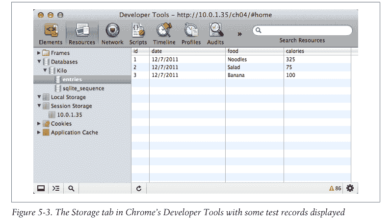

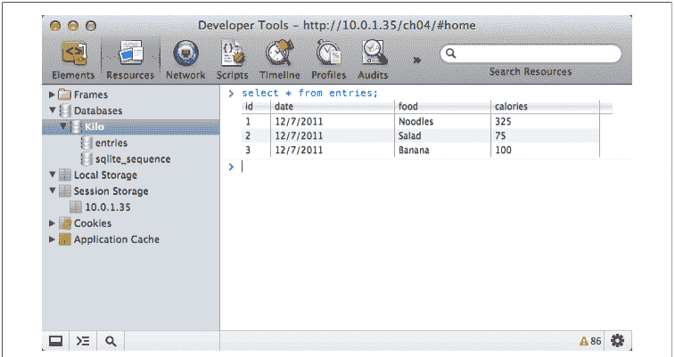

图 5-4. Chrome 开发者工具中的 Storage 选项卡允许你针对数据库执行任意 SQL 语句

## 插入行

既然我们已经建立了一个用于接收条目的数据库，现在可以开始构建 createEntry() 函数了。首先，你必须覆盖 #createEntry 表单的 submit 事件。你可以通过在 kilo.js 的 document ready 函数中将 createEntry() 函数绑定到 submit 事件来实现（这里我仅展示前几行，新增的代码行以**粗体**标出）：

```javascript
$(document).ready(function(){
    $('#createEntry form').submit(createEntry);
    $('#settings form').submit(saveSettings);
    $('#settings').bind('pageAnimationStart', loadSettings);
    ...
});
```

现在，当用户提交 #createEntry 表单时，就会调用 createEntry() 函数。接下来，将以下代码添加到 kilo.js 中，以便在数据库中创建记录：

```javascript
function createEntry() {
    var date = sessionStorage.currentDate;❶
    var calories = $('#calories').val();
    var food = $('#food').val();
    db.transaction(❷
        function(transaction) {
            transaction.executeSql(
                'INSERT INTO entries (date, calories, food) VALUES (?, ?, ?);',
                [date, calories, food],
                function(){
                    refreshEntries();
                    jQT.goBack();
                },
                errorHandler
            );
        }
    );
}
```

1. 此部分包含一些将在 SQL 查询中使用的变量。正如你可能记得的（见第 84 页“将选定日期保存到 Session Storage”），用户在日期面板上点击的日期存储在 `sessionStorage.currentDate` 中。另外两个值（卡路里和食物）使用与之前处理设置表单相同的方法从数据输入表单中提取。
2. 这段代码开启一个数据库事务并运行一个 `executeSql()` 调用。这里我们向 `executeSql()` 方法传递了四个参数：
   `'INSERT INTO entries (date, calories, food) VALUES (?, ?, ?);'`
       这是将被执行的语句。问号是数据占位符。
   `[date, calories, food]`
       这是发送到数据库的值数组。它们与 SQL 语句中数据占位符问号的位置一一对应。
   `function(){refreshEntries();jQT.goBack();}`
       如果 SQL 查询成功，将执行此匿名函数。
   `errorHandler`
       这是在 SQL 查询失败时将执行的函数名称。

> 围绕 ? 占位符的引号（ ' 或 " ）是不必要的——数据的转义和引用会自动处理。

## 错误处理

假设插入成功，则将执行作为第三个参数传递的匿名函数。它调用 `refreshEntries()` 函数（目前，该函数仅更新日期面板的标题，但很快它会让您创建的条目出现在该列表中），并模拟点击“取消”按钮以关闭“新条目”面板并返回日期面板。正如我们之前在设置面板中看到的，“取消”按钮并不会取消提交操作——它实际上只是一个标记为“取消”且形状不像左箭头的“返回”按钮。

如果插入不成功，将运行 errorHandler() 函数。将以下内容添加到 kilo.js 文件中：

```javascript
function errorHandler(transaction, error) {
    alert('Oops. Error was '+error.message+' (Code '+error.code+')');
    return true;
}
```

错误处理程序被传递了两个参数：事务对象和错误对象。这里，我们使用错误对象来向用户警示抛出的消息和错误代码。

错误处理程序必须返回 true 或 false。当错误处理程序返回 true（即“是的，这是一个致命错误”）时，执行将停止，整个事务将被回滚。当错误处理程序返回 false（即“不，这不是一个致命错误”）时，执行将继续。

在某些情况下，你可能希望根据错误类型进行分支处理，以决定应该返回 true 还是 false。本章末尾的表 5-1 显示了根据 W3C Web SQL Database 工作草案规范的（当前）可能错误代码。

## 在错误处理程序内部执行 SQL

你可能已经注意到，错误处理函数除了错误对象外还接受一个事务对象。可以想象，在某些情况下，你可能想在错误处理程序内部执行 SQL 语句，也许是为了记录错误或记录某些元数据用于调试或崩溃报告目的。事务对象参数允许你在错误处理程序内部进行更多 `executeSql()` 调用，如下所示（这仅是一个示例；除非你创建了它所引用的 errors 表，否则它无法运行）：

```javascript
function errorHandler(transaction, error) {
    alert('Oops. Error was '+error.message+' (Code '+error.code+')');
    transaction.executeSql('INSERT INTO errors (code, message) VALUES (?, ?);',
        [error.code, error.message]);
    return false;
}
```

请特别注意，如果我们希望 `executeSql()` 语句运行，必须从错误处理程序返回 false。如果我们返回 true（或什么都不返回），整个事务——包括此 SQL 语句——都将被回滚，从而无法达到预期结果。

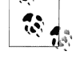

虽然我在示例中不会这么做，但你应该知道，你也可以在 `transaction` 方法本身上指定成功和错误处理程序。这为你提供了一个方便的位置，可以在一系列长 `executeSql()` 语句完成后执行代码。

奇怪的是，`transaction` 方法回调函数的参数顺序被定义为先错误后成功（与 `executeSql()` 的顺序相反）。以下是添加了事务回调函数的 `createEntry()` 函数版本（不要将这些添加到 `kilo.js` 中，因为我们还没有定义这两个方法）：

```javascript
function createEntry() {
    var date = sessionStorage.currentDate;
    var calories = $('#calories').val();
    var food = $('#food').val();
    db.transaction(
        function(transaction) {
            transaction.executeSql(
                'INSERT INTO entries (date, calories, food) VALUES (?, ?, ?);',
                [date, calories, food],
                function(){
                    refreshEntries();
                    jQT.goBack();
                },
                errorHandler
            );
        },
        transactionErrorHandler,
        transactionSuccessHandler
    );
    return false;
}
```

## 选择行和处理结果集

下一步是扩展 `refreshEntries()` 函数，使其不仅仅是将标题栏设置为选定日期。具体来说，我们将查询数据库中选定日期的条目，并使用隐藏的 `entryTemplate` HTML 作为结构将其附加到 `#date` ul 元素中。距离我们查看那段代码已经有一段时间了，所以这里再次展示日期面板（它已经在 `index.html` 中，所以你不需要再次添加）：

```html
<div id="date">
    <div class="toolbar">
        <h1>Date</h1>
        <a class="button back" href="#">Back</a>
        <a class="button slideup" href="#createEntry">+</a>
    </div>
    <ul class="edgetoedge">
        <li id="entryTemplate" class="entry" style="display:none">
            <span class="label">Label</span>
            <span class="calories">000</span>
            <span class="delete">Delete</span>
        </li>
    </ul>
</div>
```


回想一下，我们将 `li` 的 style 属性设置为 `display: none`，这使得它不会在页面上显示。我们这样做是为了将该 HTML 代码片段用作数据库行的模板。

下面是完整的 `refreshEntries()` 函数；您必须用此函数替换 *kilo.js* 中现有的 `refreshEntries()` 函数：

```
function refreshEntries() {
    var currentDate = sessionStorage.currentDate;
    $('#date h1').text(currentDate);
    $('#date ul li:gt(0)').remove();
    db.transaction(
        function(transaction) {
            transaction.executeSql(
                'SELECT * FROM entries WHERE date = ? ORDER BY food;',
                [currentDate],
                function (transaction, result) {
                    for (var i=0; i < result.rows.length; i++) {
                        var row = result.rows.item(i);
                        var newEntryRow = $('#entryTemplate').clone();
                        newEntryRow.removeAttr('id');
                        newEntryRow.removeAttr('style');
                        newEntryRow.data('entryId', row.id);
                        newEntryRow.appendTo('#date ul');
                        newEntryRow.find('.label').text(row.food);
                        newEntryRow.find('.calories').text(row.calories);
                    }
                },
                errorHandler
            );
        }
    );
}
```

1. 这两行将日期面板的工具栏标题设置为保存在 `sessionStorage` 中的当前日期值的内容。

2. 这一行使用 jQuery 的 `gt()` 函数（gt 代表 "greater than"，即大于）来选择并删除所有索引大于 0 的 `li` 元素。第一次执行时，这不会产生任何影响，因为唯一的 `li` 将是 ID 为 `entryTemplate` 的元素，它的索引为 0 且无论如何都是隐藏的。然而，在随后再次访问页面时，我们需要在重新附加来自数据库的行之前删除任何其他 `li`。否则，项目会在列表中出现多次，因为我们会一遍又一遍地添加相同的项目。

3. 这三行设置了一个数据库事务和 `executeSql` 语句。

4. 这一行包含 `executeSql` 语句的第一个参数。这是一个简单的 SELECT 语句，其中问号作为数据占位符。

5. 这是一个包含当前选定日期的单元素数组。它将替换 SQL 查询中的问号。

6. 当查询成功时，将调用此匿名函数。它接受两个参数：`transaction` 和 `result`。

`transaction` 对象可以在成功处理程序中使用，以便向数据库发送新查询，就像我们之前在错误处理程序中看到的那样。不过，在这种情况下没有必要这样做，所以我们不会使用它。

`result` 对象是我们在这里最感兴趣的。它具有三个只读属性：`rowsAffected`，您可以使用它来确定受 insert、update 或 delete 查询影响的行数；`insertId`，返回 insert 操作中创建的最后一行的主键；以及 `rows`，其中包含找到的记录。

`rows` 对象将包含 0 个或多个 `row` 对象，并具有一个 `length` 属性，该属性出现在下一行的 `for` 循环中。

7. 这一行使用 `rows` 对象的 `item()` 方法将 `row` 变量设置为当前行的内容。

8. 在这一行，我们 `clone()` 模板 `li`，并在接下来的两行中删除其 `id` 和 `style` 属性。删除 style 将使该行可见，而删除 `id` 非常重要，否则页面上会出现多个具有相同 id 的项目。

9. 这一行将 `row` 的 `id` 属性值作为数据存储在 `li` 元素本身上（稍后如果用户决定删除该条目，我们将需要它）。

10. 这段代码将 `li` 元素附加到父级 `ul` 中。接下来的两行使用 `row` 对象中的相应数据更新 `li` 的 `label` 和 `calories` span 子元素。

在处理完所有这些之后，我们的日期面板将为数据库中与选定日期对应的每一行显示一个 `li`。每行将包含一个标签、卡路里和一个删除按钮。一旦我们创建了几行，您会发现我们需要添加一些 CSS 来让界面变得美观（图 5-5）。

将以下 CSS 保存到名为 `kilo.css` 的文件中（保存在与 HTML 文件相同的目录下）：

```
#date ul li {
    position: relative;
}
#date ul li span {
    color: #FFFFFF;
    text-shadow: 0 1px 2px rgba(0,0,0,.7);
}
#date ul li .delete {
    position: absolute;
    top: 5px;
    right: 6px;
    font-size: 12px;
    line-height: 30px;
}
```

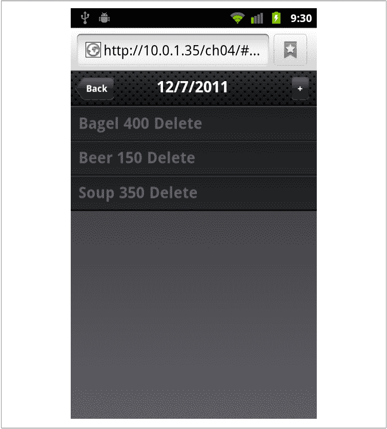

图 5-5. 条目现在显示出来了，但仍需要通过一些 CSS 来美化

```
padding: 0 3px;
border-width: 0 5px;
-webkit-border-image: url(themes/jqt/img/button.png) 0 5 0 5;
}
```

现在，通过在 *index.html* 的 head 部分添加以下行来链接到 *kilo.css*：

```
<link type="text/css" rel="stylesheet" media="screen" href="kilo.css">
```

虽然删除按钮现在看起来像按钮了（见图 5-6），但此时点击它们不会有任何反应。这是因为我们使用 span 标签设置了它们，而 span 在 HTML 页面中不是一个交互元素。

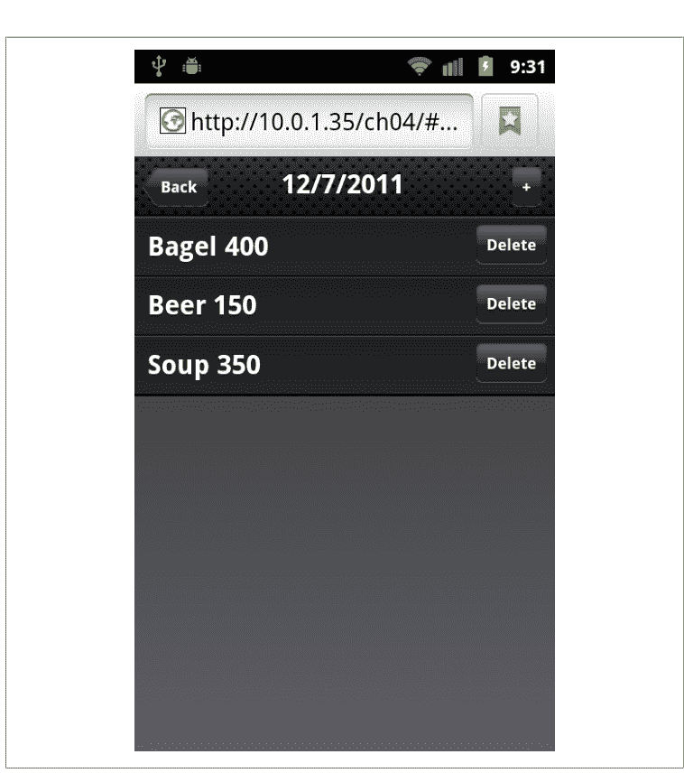

*图 5-6. 应用了 CSS 后的条目*

## 删除行

为了让我们的删除按钮在被点击时产生作用，我们需要使用 jQuery 为它们绑定点击事件处理程序。

不幸的是，这种方法在这种情况下行不通。与日期面板上的项目不同，日期面板上的条目不是静态的。这意味着它们在用户会话过程中会被添加和删除。事实上，当应用程序启动时，日期面板上完全没有可见的条目。因此，在启动时我们没有可以绑定点击事件的对象。

解决方案是在 `refreshEntries()` 函数创建删除按钮时，同步绑定点击事件。为此，在 for 循环的末尾添加粗体所示的行：

```
...
```

- 该函数首先指定我们要寻找 ID 为 `date` 的元素内部任何类名为 `delete` 的元素，并对这些元素调用 `click()` 方法。`click()` 方法接受一个匿名函数作为其唯一的参数，用于处理该事件。

- 当点击处理程序被触发时，删除按钮的父级（即 `li`）被定位并存储在 `clickedEntry` 变量中。

- 这一行将 `clickedEntryId` 变量设置为 `refreshEntries()` 函数在创建 `li` 元素时存储在其中的 `entryId` 值。

- 这一行将点击的 ID 传递给 `deleteEntryById()` 函数，并且在下一行，jQuery 的 `slideUp()` 方法优雅地将 `li` 从页面中移除。

将以下 `deleteEntryById()` 函数添加到 *kilo.js* 中，以从数据库中删除该条目：

```
function deleteEntryById(id) {
```

正如我们在之前的示例中所做的那样，我们打开一个事务，向其传递一个以 transaction 对象为参数的回调函数，并调用 `executeSql()` 方法。我们将 SQL 查询和被点击记录的 ID 作为前两个参数传递。第三个参数是放置成功处理程序的地方，但我们不需要它，所以只需指定 `null`。作为第四个参数，我们指定一直以来一直在使用的同一个错误处理程序。

就这样。虽然为了达到这个目的花费了大量的篇幅来描述，但实际上我们并没有写太多的代码。事实上，*kilo.js* 仅包含大约 100 行 JavaScript 代码（示例 5-1）。

### 示例 5-1. Kilo 数据库交互的完整 JavaScript 列表

```
var db;
var jQT = $.jQT({
    icon: 'kilo.png'
});
$(document).ready(function(){
    $('#createEntry form').submit(createEntry);
    $('#settings form').submit(saveSettings);
    $('#settings').bind('pageAnimationStart', loadSettings);
    $('#dates li a').bind('click touchend', function(){
        var dayOffset = this.id;
        var date = new Date();
        date.setDate(date.getDate() - dayOffset);
        sessionStorage.currentDate = date.getMonth() + 1 + '/' +
                                    date.getDate() + '/' +
                                    date.getFullYear();
        refreshEntries();
    });
    var shortName = 'Kilo';
    var version = '1.0';
    var displayName = 'Kilo';
    var maxSize = 65536;
    db = openDatabase(shortName, version, displayName, maxSize);
    db.transaction(
        function(transaction) {
            transaction.executeSql(
                'CREATE TABLE IF NOT EXISTS entries ' +
                ' (id INTEGER NOT NULL PRIMARY KEY AUTOINCREMENT, ' +
                '  date DATE NOT NULL, food TEXT NOT NULL, ' +
                '  calories INTEGER NOT NULL);'
            );
        }
    );
});
function saveSettings() {
    localStorage.age = $('#age').val();
    localStorage.budget = $('#budget').val();
    localStorage.weight = $('#weight').val();
    jQT.goBack();
    return false;
}
function loadSettings() {
    if (!localStorage.age) {
        localStorage.age = "";
    }
    if (!localStorage.budget) {
        localStorage.budget = "";
    }
    if (!localStorage.weight) {
        localStorage.weight = "";
    }
    $('#age').val(localStorage.age);
    $('#budget').val(localStorage.budget);
    $('#weight').val(localStorage.weight);
}
```


function refreshEntries() {
    var currentDate = sessionStorage.currentDate;
    $('#date h1').text(currentDate);
    $('#date ul li:gt(0)').remove();
    db.transaction(
        function(transaction) {
            transaction.executeSql(
                'SELECT * FROM entries WHERE date = ? ORDER BY food;',
                [currentDate],
                function (transaction, result) {
                    for (var i=0; i < result.rows.length; i++) {
                        var row = result.rows.item(i);
                        var newEntryRow = $('#entryTemplate').clone();
                        newEntryRow.removeAttr('id');
                        newEntryRow.removeAttr('style');
                        newEntryRow.data('entryId', row.id);
                        newEntryRow.appendTo('#date ul');
                        newEntryRow.find('.label').text(row.food);
                        newEntryRow.find('.calories').text(row.calories);
                        newEntryRow.find('.delete').click(function(){
                            var clickedEntry = $(this).parent();
                            var clickedEntryId = clickedEntry.data('entryId');
                            deleteEntryById(clickedEntryId);
                            clickedEntry.slideUp();
                        });
                    }
                },
                errorHandler
            );
        }
    );
}

function createEntry() {
    var date = sessionStorage.currentDate;
    var calories = $('#calories').val();
    var food = $('#food').val();
    db.transaction(
        function(transaction) {
            transaction.executeSql(
                'INSERT INTO entries (date, calories, food) VALUES (? , ?, ?);',
                [date, calories, food],
                function(){
                    refreshEntries();
                    jQT.goBack();
                },
                errorHandler
            );
        }
    );
    return false;
}

function errorHandler(transaction, error) {
    alert('Oops. Error was '+error.message+' (Code '+error.code+')');
    return true;
}
function deleteEntryById(id) {
    db.transaction(
        function(transaction) {
            transaction.executeSql('DELETE FROM entries WHERE id=?;',
                [id], null, errorHandler);
        }
    );
}

## Web 数据库错误代码参考

SQL 数据库 API 中的错误会通过回调函数返回一个错误代码，如[表 5-1](Table 5-1)中所示。

*表 5-1. Web 数据库错误代码*

| 常量 | 代码 | 情况 |
| :--- | :--- | :--- |
| UNKNOWN_ERR | 0 | 事务失败的原因与数据库本身无关，且不包含在任何其他错误代码中。 |
| DATABASE_ERR | 1 | 语句失败的原因是数据库相关问题，且不包含在任何其他错误代码中。 |
| VERSION_ERR | 2 | 操作失败，因为实际数据库版本不符合预期。例如，某条语句发现实际数据库版本不再匹配 Database 或 DatabaseSync 对象的预期版本，或者 Database.changeVersion() 或 DatabaseSync.changeVersion() 方法传入的版本与实际数据库版本不匹配。 |
| TOO_LARGE_ERR | 3 | 语句失败，因为从数据库返回的数据过大。SQL LIMIT 修饰符可能有助于减小结果集的大小。 |
| QUOTA_ERR | 4 | 语句失败，因为剩余存储空间不足，或者已达到存储配额且用户拒绝为数据库分配更多空间。 |
| SYNTAX_ERR | 5 | 语句失败，原因是存在语法错误、参数数量与语句中的 ? 占位符数量不匹配、语句尝试使用不允许的语句（如 BEGIN、COMMIT 或 ROLLBACK），或者语句试图在事务为只读时使用可能修改数据库的动词。 |
| CONSTRAINT_ERR | 6 | INSERT、UPDATE 或 REPLACE 语句由于约束失败而失败。例如，因为正在插入一行数据，而为主键列提供的值与现有行的值重复。 |
| TIMEOUT_ERR | 7 | 未能在合理时间内获得事务锁。 |

## 本章小结

在本章中，你学习了两种在客户端存储用户数据的方式：Web Storage 和 Web SQL Database。尤其是 Web SQL Database，它为基于 Web 的应用程序开发人员打开了一个充满可能性的世界。

目前阻止我们在离线模式下运行此示例应用程序的唯一原因是，每次启动应用程序时，我们都必须首先连接到 Web 服务器以下载 HTML 和相关资源。如果我们能将这些内容都缓存在本地设备上，那该多好啊。是的，确实如此。

# 第 6 章

# 离线使用

HTML5 有一个名为*离线应用程序缓存*的功能，允许用户即使在没有连接到互联网时也能运行 Web 应用程序。它的工作原理如下：当用户导航到你的 Web 应用程序时，浏览器会下载并存储显示页面所需的所有文件（HTML、CSS、JavaScript、图像等）。下次用户导航到你的 Web 应用程序时，浏览器将识别该 URL，并从本地应用程序缓存中提供文件，而不是通过网络获取它们。

## 离线应用程序缓存基础

离线应用程序缓存的主要组成部分是一个*缓存清单文件*，它托管在你的 Web 服务器上。我将用一个简单的例子来解释涉及的概念，然后向你展示如何将所学知识应用到我们一直在开发的 Kilo 示例中。

清单文件只是一个简单的文本文档，它位于你的 Web 服务器上，并以 `cache-manifest` 的内容类型发送到用户的设备。清单包含用户设备必须下载并保存才能运行的文件列表。假设有一个 Web 目录包含以下文件：

```
index.html
logo.jpg
scripts/demo.js
styles/screen.css
```

在这种情况下，*index.html* 是用户访问应用程序时将在其浏览器中加载的页面。其他文件从 *index.html* 内部引用。要使所有内容离线可用，你需要在与 *index.html* 相同的目录中创建一个名为 *demo.manifest* 的文件（现在还不要费心创建；你将很快看到如何将其应用到你的应用程序）。以下是显示新增文件的目录列表：

```
demo.manifest
index.html
logo.jpg
scripts/demo.js
styles/screen.css
```

接下来，你需要向 *demo.manifest* 中添加以下各行：

```
CACHE MANIFEST
index.html
logo.jpg
scripts/demo.js
styles/screen.css
```

清单中的路径相对于清单文件的位置。你也可以使用绝对 URL，如下所示：

```
CACHE MANIFEST
http://www.example.com/index.html
http://www.example.com/logo.jpg
http://www.example.com/scripts/demo.js
http://www.example.com/styles/screen.css
```

现在清单文件已创建，你需要通过在 *index.html* 内部的 HTML 标签中添加 manifest 属性来链接到它：

```
<html manifest="demo.manifest">
```

在本章后面，我们将使用 PHP 脚本为 Kilo 应用程序生成一个*动态清单文件*。PHP 脚本的优点在于它们可以指定自己的内容类型。因此，除非你想在服务器上试验清单文件，否则可以跳过以下配置步骤。

你必须使用 `text/cache-manifest` 内容类型提供清单文件，否则浏览器将无法识别它：

*Apache*
如果你使用的是 Apache Web 服务器，可以通过在你的 Web 目录中添加一个 *.htaccess* 文件，并加入以下行来实现：

```
AddType text/cache-manifest .manifest
```

如果你在 Mac 上，请参阅第 106 页的"Mac OS X 与 .htaccess 文件"，了解有关在此文件中启用 *AddType* 指令使用的特殊说明。

*IIS (Windows)*
如果你使用的是 Windows 上的 IIS 浏览器，请运行 Internet Information Services (IIS) 管理器，在"连接"（左侧）下找到你的网站，然后单击它。接下来，双击"**MIME 类型**"，然后使用"**添加**"操作将 *manifest* 文件扩展名与其关联。如果 IIS 告诉你该扩展名的

如果已有同名文件，你可以为Web应用清单使用不同的文件扩展名（例如如图6-1所示的`.webmanifest`），或者双击现有的`manifest`条目，将其MIME类型更改为`text/cache-manifest`。

### Web托管服务提供商

如果你的网站托管在Web托管服务提供商处，你的提供商可能有一个网站控制面板，你可以在其中添加相应的MIME类型。

### 其他情况

如果`.htaccess`文件对你无效，请参阅Web服务器文档中关于*MIME类型*的部分。你必须将`.manifest`文件扩展名与`text/cache-manifest` MIME类型关联起来。

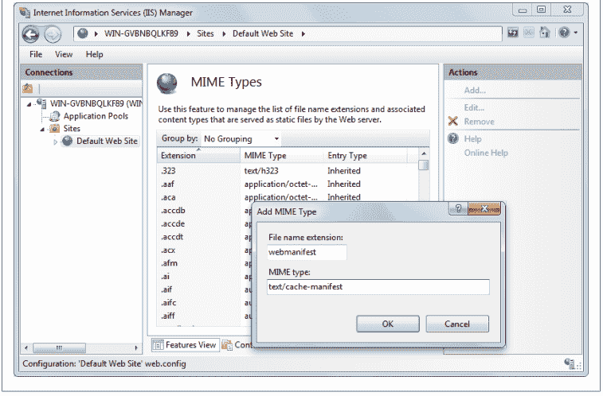

我们的离线应用缓存现在已可正常工作。下次用户浏览到`http://example.com/index.html`（将`example.com/index.html`替换为你的Web应用URL）时，页面及其资源将通过网络正常加载。在后台，清单中列出的所有文件都将被下载到本地。一旦下载完成且用户刷新页面，他将仅访问本地文件。此时，他可以断开互联网连接并继续访问该Web应用。

## Mac OS X与.htaccess文件

如果你使用Mac OS X内置的Apache Web服务器在本地网络上提供网页，它会忽略你个人Web文件夹（即主目录中的*Sites*文件夹）中`.htaccess`文件的某些指令。但是，你可以按照以下步骤启用对`AddType`指令的支持：

- 1. 打开 应用程序 $\rightarrow$ 实用工具 $\rightarrow$ 终端，然后输入以下命令（系统提示时需要输入密码）：

```
cd /etc/apache2/users
sudo pico $USER.conf
```

这会将你的个人Apache配置文件加载到pico编辑器中（你可以在屏幕底部看到编辑器命令列表——^符号表示Control键）。

- 2. 使用向下箭头键移动到`AllowOverride None`这一行，删除单词`None`，并将其替换为`FileInfo`。

- 3. 按Control-X退出，输入Y保存更改，然后按Return键保存文件。

- 4. 启动系统偏好设置，进入“共享”，如果需要，请点击标有“点击锁以进行更改”的锁形图标。系统提示时输入你的密码。

- 5. 清除“Web共享”旁边的复选框，然后重新选中它（这将重新启动Web共享）。现在，你的Mac上的Web服务器应该会遵守你放在*Sites*目录或其子目录中的`.htaccess`文件中的`AddType`指令。

既然用户现在是在他的设备上本地访问我们的文件，我们面临一个新问题：当我们对网站进行更改时，他如何获取更新？

当用户确实有互联网访问权限并导航到你的Web应用的URL时，他的浏览器会检查站点上的清单文件，看它是否仍然与本地副本匹配。如果远程清单已更改，浏览器会下载其中列出的所有文件。它会在后台将这些文件下载到临时缓存中。

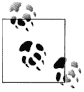

> 本地清单和远程清单之间的比较是文件内容的逐字节比较（包括注释和空行）。文件修改时间戳或任何资源本身的更改与确定是否进行更改无关。

如果在下载过程中出现错误（例如，用户失去了互联网连接），部分下载的临时缓存将自动丢弃，之前的缓存仍然有效。如果下载成功，下次用户启动应用时将使用新的本地文件。

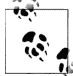

请记住，当清单更新时，新文件的下载是在应用初始启动*之后*在后台进行的。这意味着即使在下载完成后，用户仍将使用旧文件。换句话说，当前加载的页面及其所有相关文件不会在下载完成时自动重新加载。后台下载的新文件在用户重新启动应用之前将不会变得可见。

这与标准的桌面应用更新行为非常相似。你启动一个应用，它告诉你有可用更新，你点击“下载更新”，下载完成，然后系统会提示你重新启动应用以使更新生效。

如果你想在你的应用中实现这种行为，你可以监听`window.applicationCache`对象的`updateready`事件（如第118页“JavaScript控制台”中所述），并以你喜欢的任何方式通知用户。

## 在线白名单和回退选项

可以强制浏览器始终通过网络访问某些资源（此过程称为*白名单*）。这意味着浏览器不会将它们缓存在本地，并且当用户离线时它们将不可用。要将某个资源指定为仅在线，需要在清单文件中使用`NETWORK:`关键字（末尾的`:`至关重要），如下所示：

```
CACHE MANIFEST
index.html
scripts/demo.js
styles/screen.css

NETWORK:
logo.jpg
```

这通过将*logo.jpg*移动到清单文件的`NETWORK`部分来对其进行白名单设置。当用户离线时，该图像将显示为损坏的图像链接（图6-2）。当他在线时，它将正常显示（图6-3）。

如果你不希望离线用户看到损坏的图像，请使用`FALLBACK`关键字指定回退资源，如下所示：

```
CACHE MANIFEST
index.html
scripts/demo.js
styles/screen.css

FALLBACK:
logo.jpg offline.jpg
```

现在，当用户离线时，他将看到*offline.jpg*（图6-4），而当他在线时，他将看到*logo.jpg*（图6-5）。

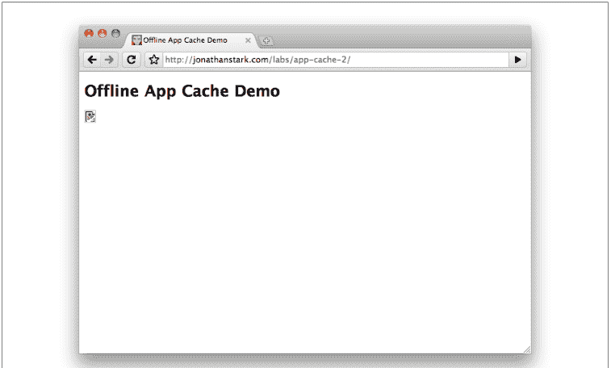
图6-2. 白名单的图像在用户离线时会显示为损坏的链接

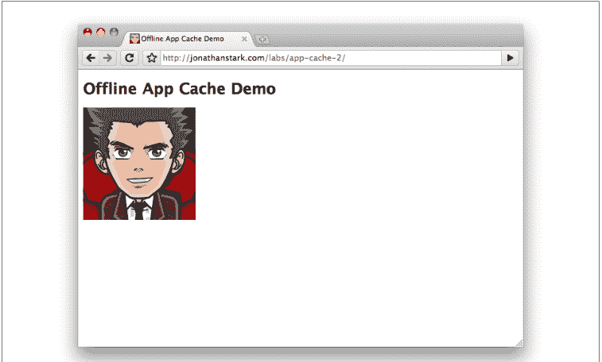
图6-3. 白名单的图像在用户在线时会正常显示

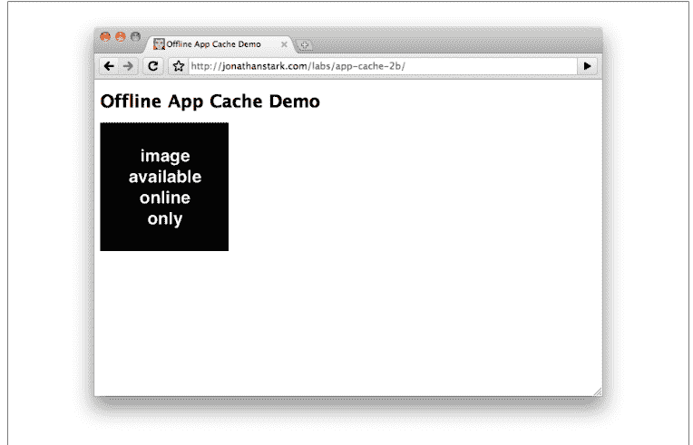
图6-4. 回退图像在用户离线时会显示

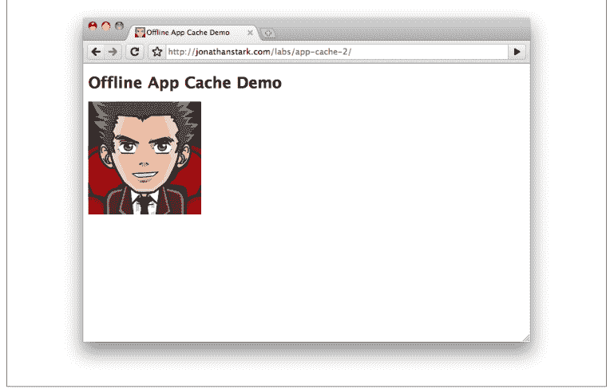
图6-5. 托管图像在用户在线时会正常显示

> 值得注意的是，你不必在CACHE MANIFEST部分额外列出*offline.jpg*。由于它被列入清单的FALLBACK部分，它将被自动本地存储。

当你考虑可以通过使用*部分路径*为多个资源指定单个回退时，这变得更加有用。假设我在网站中添加了一个*images*目录并在其中放入一些文件：

```
/demo.manifest
/index.html
/images/logo.jpg
/images/logo2.jpg
/images/offline.jpg
/scripts/demo.js
/styles/screen.css
```

我现在可以告诉浏览器，对于*images*目录中的任何内容，都回退到*offline.jpg*，如下所示：

```
CACHE MANIFEST
index.html
scripts/demo.js
styles/screen.css

FALLBACK:
images/ images/offline.jpg
```

现在，当用户离线时，他将看到*offline.jpg*（图6-6），而当他在线时，他将看到*logo.jpg*和*logo2.jpg*（图6-7）。

是否应该将资源添加到清单文件的NETWORK或FALLBACK部分，取决于你的应用程序的性质。请记住，离线应用缓存的主要目的是将应用本地存储在设备上。它并非真正旨在用于减少服务器负载、提高性能等。

在大多数情况下，你应该在清单文件中列出运行应用所需的所有文件。如果你有很多动态内容并且不确定如何在清单中引用它们，你的应用可能不适合离线应用缓存，你可能需要考虑其他方法（例如，也许是客户端数据库）。

在下一节中，你将使用一种叫做PHP的脚本语言创建一个动态清单文件。如果你的Web服务器没有安装PHP，请参阅第112页的“在Web服务器上运行PHP脚本”。


## 在您的Web服务器上运行PHP脚本

PHP是一种多功能的Web脚本语言，受到大多数网络托管服务提供商的支持。因此，在大多数Web服务器上，您可以创建一个扩展名为`.php`的文件，在其中添加一些PHP代码，在Web浏览器中访问它，它就能正常工作。如果您一直在个人计算机上使用Web服务器向您的Android手机提供页面，您需要设置好来运行PHP脚本：

### Windows

如果您运行的是Microsoft的IIS Web服务器，则必须按照第14页“在本地运行Web服务器”中的描述启用CGI服务。接下来，访问http://php.iis.net/ 并单击“Install PHP”以使用Microsoft Web Platform Installer安装PHP。如果您使用的是Windows但不使用IIS，请参阅 http://php.net/manual/en/install.windows.php。

### Linux

在Linux上安装PHP很容易。例如，Ubuntu用户可以在shell提示符下输入 `sudo apt-get install apache2 php5`。要在用户的个人`public_html`目录中启用PHP，请以root身份编辑文件 `/etc/apache2/mods-available/php5.conf`，并按照其中的说明在用户目录中启用PHP。

### Mac OS X

Mac自带了PHP，但您需要启用它：

1.  打开 应用程序→ 实用工具→终端，并输入以下命令（系统提示时需要输入您的密码）：
    ```
    cd /etc/apache2
    sudo pico httpd.conf
    ```
2.  按下Control-W。这会调出搜索文件的选项。输入 `php5` 并按Return键。这将带您到应该如下所示的一行：
    ```
    #LoadModule php5_module libexec/apache2/libphp5.so
    ```
3.  使用箭头键，移动到行首并删除 `#` 注释字符，因为它阻止了此行生效。
4.  按Control-X退出，回答Y以保存更改，然后按Return键保存文件。
5.  接下来，启动“系统偏好设置”，转到“共享”，如果需要，单击标有“点击锁以进行更改”的锁图标，并在系统提示时输入您的密码。
6.  清除“Web共享”旁边的复选框，然后再次选中它。现在PHP应该在您的Mac的Web服务器上启用了。

现在您已准备好测试PHP。在您的Web服务器的文档目录（参见第14页“在本地运行Web服务器”）中创建一个名为`test.php`的文件，包含以下内容：

```php
<?php
    phpinfo();
?>
```

最后，在浏览器中访问以下URL之一：如果您使用的是Web服务器的文档根目录，请访问 http://localhost/test.php；如果您使用的是用户目录，请访问 http://localhost/~YOURUSERNAME/test.php（将YOURUSERNAME替换为您的用户名，但不要删除~；您可以在终端输入 `echo $USER` 并按Return键来发现您的用户名）。如果PHP正在工作，您将看到一个显示PHP版本号和许多其他PHP安装信息的表格。如果它没有工作，您将只看到一个空白页面。访问 http://www.php.net/support.php 获取有关PHP使用文档和帮助的链接。

## 创建动态清单文件

既然您已经熟悉了离线应用缓存的工作原理，让我们将其应用到我们一直在处理的Kilo示例中。Kilo包含相当多的文件，手动将它们全部列在清单文件中将是一件痛苦的事情。此外，一个小小的拼写错误就会使整个清单文件失效，并阻止应用程序离线工作。

为了解决这个问题，我们将编写一个小PHP文件，该文件读取应用程序目录（及子目录）的内容并为我们创建文件列表。在您的Kilo目录中创建一个新文件，命名为`manifest.php`，并添加以下代码：

```php
<?php
    header('Content-Type: text/cache-manifest');❶
    echo "CACHE MANIFEST\n";❷

    $dir = new RecursiveDirectoryIterator(".");❸
    foreach(new RecursiveIteratorIterator($dir) as $file) {❹
        if ($file->IsFile() &&❺
            $file->getFilename() != "manifest.php" &&
            substr($file->getFilename(), 0, 1) != "." &&
            !strpos($file, DIRECTORY_SEPARATOR . '.'))❻
        {
            $file_name = $file->getPathName();
            if (DIRECTORY_SEPARATOR == "\\") {
                $file_name = strtr($file_name, '\\', '/');❼
            }
            echo $file_name . "\n";❽
        }
    }
?>
```

❶ PHP的`header`函数使用`cache-manifest`内容类型输出此文件。这样做是使用`.htaccess`文件为清单文件指定内容类型的替代方法。事实上，如果您在第104页“离线应用缓存基础”中创建了`.htaccess`文件，并且您没有将其用于任何其他目的，可以将其删除。

❷ 正如我在本章前面提到的，缓存清单文件的第一行必须是 `CACHE MANIFEST`。就浏览器而言，这是文档的第一行；PHP文件在Web服务器上运行，浏览器只看到发出文本的命令（如`echo`）的输出。

❸ 这一行创建了一个名为 `$dir` 的对象，它枚举当前目录中的所有文件。它是递归执行的，这意味着如果您在子目录中有任何文件，它也会找到它们。

❹ 每次程序通过这个循环时，它都将变量 `$file` 设置为一个代表当前目录中某个文件的对象。用英语来说，这行是：“每次通过时，将file变量设置为在当前目录或其子目录中找到的下一个文件。”

❺ 这里的 `if` 语句确保文件确实是一个文件（而不是目录或符号链接），并忽略名为 *manifest.php* 的文件或任何以 `.` 开头的文件（如 *.htaccess*）或包含在以 `.` 开头的目录中的文件（如 *.svn*）。

> 开头的 `./`（Windows上是 `.\`）是文件完整路径的一部分；`.` 指的是当前目录，`/`（Windows上是 `\`）分隔文件路径的元素。因此，在输出中，文件名前面总是有一个 `./`。但是，当您检查文件名中是否有前导 `.` 时，请使用`getFilename`函数，该函数返回不带前导路径的文件名。这样，即使它们深埋在子目录中，您也可以检测到以 `.` 开头的文件。

❻ `if` 语句的这一部分需要稍加解释。它在文件中搜索任何出现的 `/.`（Linux或Mac）或 `\.`（Windows）的情况。PHP常量`DIRECTORY_SEPARATOR`被设置为您的操作系统使用的目录分隔符（`/`或`\`）。目录分隔符后跟一个点有什么特别之处：这表示任何以点开头的子目录中的任何文件名，包括像 *themes/.hidden/secret* 这样的文件。

❼ 尽管Windows使用 `\` 作为目录分隔符也很好，但Web浏览器使用 `/` 来分隔目录。这使用字符串翻译函数将 `\` 字符替换为 `/`。这里 `\` 被加倍的原因是，该字符也用作转义字符，为后面的字符赋予特殊含义（例如，`\n` 表示换行符）。通过加倍，您告诉PHP将其视为真正的 `\`。

❽ 此部分显示每个文件的名称。

对浏览器来说，*manifest.php* 看起来像这样：

```
CACHE MANIFEST
./index.html
./jqtouch/jqtouch.css
./jqtouch/jqtouch.js
./jqtouch/jquery-1.4.2.js
./jqtouch/jquery.js
./kilo.css
./kilo.js
./themes/apple/img/activeButton.png
./themes/apple/img/backButton.png
./themes/apple/img/cancel.png
./themes/apple/img/chevron.png
./themes/apple/img/grayButton.png
./themes/apple/img/greenButton.png
./themes/apple/img/listArrowSel.png
./themes/apple/img/listGroup.png
./themes/apple/img/loading.gif
./themes/apple/img/on_off.png
./themes/apple/img/pinstripes.png
./themes/apple/img/redButton.png
./themes/apple/img/selection.png
./themes/apple/img/thumb.png
./themes/apple/img/toggle.png
./themes/apple/img/toggleOn.png
./themes/apple/img/toolbar.png
./themes/apple/img/toolButton.png
./themes/apple/img/whiteButton.png
./themes/apple/theme.css
./themes/default/img/backButton.png
./themes/default/img/backButtonActive.png
./themes/default/img/bigButton.png
./themes/default/img/bigButtonActive.png
./themes/default/img/button.png
./themes/default/img/buttonActive.png
./themes/default/img/chevron.png
./themes/default/img/chevronActive.png
./themes/default/img/chevronCircle.png
./themes/default/img/chevronCircleActive.png
./themes/default/img/loading.gif
./themes/default/img/toggleSwitch.png
./themes/default/img/toolbarBackground.png
./themes/default/theme.css
./themes/jqt/img/activeButton.png
./themes/jqt/img/back_button.png
./themes/jqt/img/back_button_clicked.png
./themes/jqt/img/blueButton.png
./themes/jqt/img/button.png
./themes/jqt/img/button_clicked.png
./themes/jqt/img/chevron.png
./themes/jqt/img/chevron_circle.png
./themes/jqt/img/grayButton.png
./themes/jqt/img/greenButton.png
./themes/jqt/img/loading.gif
./themes/jqt/img/on_off.png
./themes/jqt/img/redButton.png
./themes/jqt/img/rowhead.png
./themes/jqt/img/toggle.png
./themes/jqt/img/toggleOn.png
./themes/jqt/img/toolbar.png
./themes/jqt/img/whiteButton.png
./themes/jqt/theme.css
```


尝试在浏览器中自行加载页面（请务必使用HTTP URL加载，例如 `http://localhost/~YOURUSERNAME/manifest.php`）。如果您的浏览器尝试将其作为文件下载，您可以尝试换用另一个浏览器（如Chrome），或者临时将 `header('Content-Type: text/cache-manifest');` 更改为 `header('Content-Type: text/plain');`，在查看结果后再改回来。

如果您在列表中看到更多文件，可能包含来自jTouch发行版的多余文件。文件 `LICENSE.txt`、`README.txt`、`sample.htm` 和 `htaccess.txt` 可以安全删除，`demos` 和 `extensions` 目录也可以删除。如果您看到名为 `.svn` 的目录，同样可以安全删除（除非您将工作目录置于SVN版本控制系统下，此时这些文件很重要）。以 `.` 开头的文件在Mac OS X的Finder或Linux文件管理器中不可见（但您可以在命令行中操作它们）。

现在打开 `index.html`，并在 `head` 元素中添加对 `manifest.php` 的引用，如下所示：

```
<html manifest="manifest.php">
```

既然清单是动态生成的，让我们修改它，使当目录中任何文件发生变化时其内容也能更新（记住，只有清单内容改变时，客户端才会重新下载应用）。以下是修改后的 `manifest.php`：

```php
<?php

header('Content-Type: text/cache-manifest');
echo "CACHE MANIFEST\n";

$hashes = "";

$dir = new RecursiveDirectoryIterator(".");
foreach(new RecursiveIteratorIterator($dir) as $file) {
    if ($file->isFile() &&
        $file->getFilename() != "manifest.php" &&
        substr($file->getFilename(), 0, 1) != "." &&
        strpos($file, DIRECTORY_SEPARATOR . '.') === false
    ) {
        $file_name = $file->getPathName();
        if (DIRECTORY_SEPARATOR == "\\") {
            $file_name = strtr($file_name, '\\', '/');
        }
        echo $file_name . "\n";
        $hashes .= md5_file($file);
    }
}
echo "# Hash: " . md5($hashes) . "\n";

?>
```

1.  这行初始化了一个字符串，用于存放文件的*哈希*值。
2.  这行使用PHP的 `md5_file` 函数（信息摘要算法5）计算每个文件的哈希值，并将其追加到 `$hashes` 字符串末尾。文件的任何微小改动都会改变 `md5_file` 函数的结果。哈希值是一个32位字符串，例如 `4ac3c9c004cac7785fa6b132b4f18efc`。
3.  此代码获取那个由所有32位文件哈希值拼接而成的长字符串，并计算该字符串本身的MD5哈希值。这给我们一个较短的（32位而非32位乘以文件数量）字符串，作为注释打印出来（以注释符号 `#` 开头）。

从客户端浏览器的角度看，这一行并无特殊之处。它是一个注释，客户端浏览器会忽略它。然而，如果任何一个文件被修改，这一行就会改变，这意味着清单已更改。

以下是应用此更改后的清单示例示例（为简洁起见，部分行被截断）：

```
CACHE MANIFEST
./index.html
./jqtouch/jqtouch.css
./jqtouch/jqtouch.js
...
./themes/jqt/img/toolbar.png
./themes/jqt/img/whiteButton.png
./themes/jqt/theme.css
# Hash: 0943176a145ca0a8067b58566e802499
```

所有这些操作的最终结果是，更改整个目录树中任何一个文件内的单个字符，都会在清单中插入一个新的哈希字符串。这意味着我们对任何Kilo文件所做的任何编辑，本质上都会修改清单文件，从而在用户下次启动应用时触发下载。是不是很巧妙？

## 调试

调试使用离线应用缓存的应用程序可能很困难，因为几乎无法了解内部运行情况。您可能会不断怀疑文件是否已下载，或者您查看的是远程资源还是本地资源。此外，在设备间切换在线和离线模式并非最快捷的过程，确实会拖慢开发-测试-调试的循环。

当情况不妙时，您可以通过设置一些JavaScript控制台日志来帮助判断发生了什么。

如果您想从Web服务器的角度了解情况，可以监控其日志文件。例如，如果您在Mac或Linux计算机上运行Web服务器，可以打开命令行并运行以下命令（`$` 是*shell提示符*，您不应输入它）：

```
$ cd /var/log/apache2/
$ tail -f access?log
```

这将显示Web服务器的日志条目，显示诸如文档被访问的日期和时间以及文档名称等信息。完成后，按Control-C停止跟踪日志。

第二行中的 `?` 将匹配任何字符；在Ubuntu Linux上，文件名为 `access.log`，在Mac上是 `access_log`。如果您使用其他版本的Linux，文件名和位置可能有所不同。

在Windows上，您可以在 `C:\inetpub\logs` 中找到IIS7的日志文件，但您需要以管理员用户身份进行身份验证才能访问这些文件（如果您在Windows资源管理器中导航到该文件夹，它会提示您输入管理员凭据）。

## JavaScript控制台

在开发期间向您的Web应用添加以下JavaScript代码将使您的生活轻松许多，并实际帮助您理解正在发生的过程。以下脚本将向控制台发送反馈（在Chrome中，点击扳手图标并选择工具→JavaScript console），使您无需不断刷新浏览器窗口：

```javascript
// 状态值的便捷数组
var cacheStatusValues = [];
cacheStatusValues[0] = 'uncached';
cacheStatusValues[1] = 'idle';
cacheStatusValues[2] = 'checking';
cacheStatusValues[3] = 'downloading';
cacheStatusValues[4] = 'updateready';
cacheStatusValues[5] = 'obsolete';

// 所有可能事件的监听器
var cache = window.applicationCache;
cache.addEventListener('cached', logEvent, false);
cache.addEventListener('checking', logEvent, false);
cache.addEventListener('downloading', logEvent, false);
cache.addEventListener('error', logEvent, false);
cache.addEventListener('noupdate', logEvent, false);
cache.addEventListener('obsolete', logEvent, false);
cache.addEventListener('progress', logEvent, false);
cache.addEventListener('updateready', logEvent, false);

// 将每个事件记录到控制台
function logEvent(e) {
    var online, status, type, message;
    online = (navigator.onLine) ? 'yes' : 'no';
    status = cacheStatusValues[cache.status];
    type = e.type;
    message = 'online: ' + online;
    message+= ', event: ' + type;
    message+= ', status: ' + status;
    if (type == 'error' && navigator.onLine) {
        message+= ' (prolly a syntax error in manifest)';
    }
    console.log(message);
}

// 更新就绪时交换新下载的文件
window.applicationCache.addEventListener(
    'updateready',
    function(){
        window.applicationCache.swapCache();
        console.log('swap cache has been called');
    },
    false
);

// 每10秒检查一次清单更改
setInterval(function(){cache.update()}, 10000);
```

您可以将其存储在 `.js` 文件中（例如 `debug.js`），并通过script元素的 `src` 属性在HTML文档中引用，如 `<script type="text/javascript" src="debug.js"></script>`。

这看起来代码很多，但实际做的事情并不多：

1.  前七行为应用缓存对象设置了一个状态值数组。HTML5规范定义了六个可能的值，此代码将其整数值映射到简短描述（即，状态3表示“正在下载”）。我们包含它们是为了使 `logEvent` 函数中的日志更具描述性。
2.  接下来的代码块为规范定义的每个可能事件设置了事件监听器。每个事件都调用 `logEvent` 函数。
3.  `logEvent` 函数以事件作为输入，并进行一些简单的计算以组成描述性日志消息。如果事件类型是错误且用户在线，则远程清单中可能存在语法错误。语法错误在清单中极易产生，因为所有路径都必须有效。如果您重命名或移动了文件但忘记更新清单，未来的更新将会失败。


使用动态清单文件有助于避免语法错误。但是，你必须注意不要包含服务器因权限问题而无法提供的文件（例如位于`.svn`子目录中的文件）。这会导致即使是动态清单也会失败，因为该文件最终无法被读取。

**④** 这一行将组合好的消息发送到控制台。

如果你在浏览器中加载网页并打开控制台，你会看到每 10 秒就会有新消息出现（图 6-8）。如果什么都没有看到，请修改其中一个文件的内容（或某个文件的名称），然后在浏览器中*重新加载*两次页面。我强烈建议你多尝试一下，直到对整体流程有所感觉为止。你可以随意修改清单文件（例如修改内容并保存、重命名、移动到另一个目录），然后看着你的操作结果像魔法一样出现在控制台中。

*图 6-8. 使用 console.log() 函数将调试消息发送到 JavaScript 控制台*

## 你学到了什么

在本章中，你学习了如何让用户访问 Web 应用，即使他们没有互联网连接。随着这一新技能加入我们的编程工具箱，我们现在能够创建离线应用，它与从 Android Market 下载的原生应用几乎无法区分。

当然，像这样的纯 Web 应用仍然受到所有 Web 应用都存在的安全限制。例如，Web 应用无法访问通讯录、摄像头、振动或手机的加速度传感器。在下一章中，我将借助一个名为 PhoneGap 的开源项目来解决这些问题以及其他更多问题。

## 第 7 章：走向原生

我们的 Web 应用现在可以做很多原生应用能做的事情：从主屏幕启动、在手机本地存储数据以及在离线模式下运行。我们已对其进行了良好的设备适配，并设置了类似原生的动画来为用户提供反馈和上下文。

然而，仍有两件事它无法做到：它无法访问设备特性和硬件（例如地理位置、加速度传感器、声音和振动），也无法提交到 Android Market。在本章中，你将学习如何借助一个名为 PhoneGap 的开源项目，将你的 Web 应用扩展到浏览器的常规限制之外。

### PhoneGap 简介

移动设备领域充斥着各种设备、平台和操作系统。如果你是一名 Web 开发人员，你可能对在约 10 种操作系统版本上测试约 10 种浏览器版本的痛苦感同身受。再将其乘以 100，你就得到了移动端的复杂度。根本不存在一种经济高效的方式来对所有可能的组合进行开发和测试。

这时候 PhoneGap 登场了。PhoneGap 是由 Nitobi（http://www.nitobi.com/；现在隶属于 Adobe）创建的开源开发工具，它充当 Web 应用和移动设备 API 之间的统一桥梁。它为每个主要平台提供了一个原生应用项目模板，每个项目只是一个拥有增强权限的精简版 Web 浏览器。具体而言，这意味着 PhoneGap 使通过简单的 JavaScript 调用来访问加速度传感器、摄像头、麦克风、扬声器等成为可能。

此外，最终生成的应用——尽管是你用 HTML、CSS 和 JavaScript 编写的——被封装在一个原生应用中，你可以将其提交到相关平台的应用商店。目前支持 iPhone、Android、Windows Phone、BlackBerry、webOS、bada 和 Symbian，Qt 正在开发中。

当然，不同的设备有不同的特性。也许某个特定设备没有摄像头或没有加速度传感器。即使设备具有相同的特性，它们各自向开发人员暴露这些特性的方式也不尽相同。PhoneGap 对最广泛可用的手机特性进行了 API 抽象，使移动应用开发人员可以在任何地方使用相同的代码。

还有其他经常与 PhoneGap 相提并论的工具，例如 [RhoMobile](http://rhomobile.com/) 和 [Titanium Mobile](http://www.appcelerator.com/)。虽然这些工具都支持跨平台移动开发，并且面向 Web 设计师和开发人员进行推广，但它们之间存在根本性的差异。PhoneGap 是唯一一个允许你编写标准 Web 应用并几乎无需修改就能将其放入原生代码环境中的工具。

我所了解的其他所有产品都要求你基于专有框架编写代码来输出原生代码（即你编写的不是可以在浏览器中运行的 HTML、CSS 和 JavaScript）。对这些工具进行深入比较超出了本书的范围，但我确实写了一篇关于此话题的[文章](http://blog.phonegap.com/post/8589438031/phonegap-vs-titanium)。你可能想看看，以防其他工具比 PhoneGap 更适合你的需求。

由于本书是一本 Android 书籍，我们将专注于 PhoneGap 的 Android 分支。请注意，你只需很少或无需修改就可以将应用部署到 iOS、Windows Phone、BlackBerry 和其他流行设备上。

使用 PhoneGap 有两种方式。你可以搭建本地开发环境，也可以使用 PhoneGap Build 服务在云端编译。本地开发能给你更多控制权，并且完全免费，但需要一些初始设置。使用 PhoneGap Build 编译无需安装，非常易于使用，但会延长编码/编译/安装/测试的循环周期。虽然 Build 非常便宜，但它并非免费。在本章中，我将介绍如何使用本地开发环境来构建你的应用。有关 PhoneGap Build 的更多信息，请参阅 https://build.phonegap.com。

### 使用 Eclipse 和 Android SDK 在本地构建你的应用

#### 下载并安装 Eclipse Classic

Eclipse 是一个开源集成开发环境（IDE）。它被软件开发人员用来编写、编译和调试各种项目。它与 Android 本身并无特定关系；安装好 Eclipse 后，我们将配置它以使用 Android SDK 工具。但首先要做的是……以下是获取 Eclipse 的方法：

- 1. 在 Web 浏览器中访问 http://www.eclipse.org/downloads/。
- 2. 从弹出列表中选择你的平台（Mac、Windows 或 Linux）。
- 3. 在软件包列表中找到 **Eclipse Classic**，并选择适合你机器的下载版本（32 位或 64 位）。
- 4. 下载完成后，将压缩包解压到硬盘上方便的位置。我将其放在了 Mac 上的 */Applications* 目录中，但你可以放在任何你喜欢的地方。
- 5. 进入 *eclipse* 目录。
- 6. 双击 Eclipse 图标启动 Eclipse。
- 7. 系统会提示你指定一个工作空间目录，Eclipse 将在此存储你的项目。我在 Mac 上指定了 */Users/jstark/Documents/workspace* 目录，但你可以选择任何你喜欢的目录。此设置可以稍后在 Eclipse 首选项中进行修改，路径为 General → Startup and Shutdown → Workspaces。

我们稍后会修改 Eclipse 配置，但在继续之前，我们需要再下载一些东西。

#### 下载并安装 Android SDK

现在我们已经安装了 Eclipse，接下来需要 Android SDK。

- 1. 从 http://developer.android.com/sdk/index.html 下载适合你系统（Mac、Windows、Linux）的 Android SDK。
- 2. 下载完成后，将压缩包解压到硬盘上方便的位置。我将其放在了 Mac 上的 */Users/jstark* 目录中，但你可以放在任何你喜欢的地方。如果你使用的是 Windows，可以使用可执行安装程序，它会为你安装所有内容（当到达安装程序的最后一页时，请在点击完成之前取消选中 Start SDK Manager）。
- 3. 默认情况下，Android SDK 目录以特定于平台的方式命名（例如 *android-sdk-macosx*）。为简单起见，我将其重命名为 *android-sdk*。

#### 在 Eclipse 中安装 ADT 插件

现在我们需要为 Android 开发定制 Eclipse。为此，我们需要为 Eclipse 安装 Android Developer Tools（ADT）插件。安装在 Eclipse 内部完成：

- 1. 如果 Eclipse 尚未运行，请启动它。
- 2. 从 Help 菜单中选择 Install New Software。
- 3. 在出现的 Install 窗口中，点击右上角附近的 Add 按钮。
- 4. 在出现的 Add Repository 窗口中，在 name 字段中输入"ADT Plugin"，在 location 字段中输入 https://dl-ssl.google.com/android/eclipse/。


## 添加 Android 平台及其他组件

我们即将完成开发环境的搭建。接下来的任务是为我们想要支持的 Android 平台下载所需的工具、平台和附加组件：

1. 如果 Eclipse 尚未运行，请启动它。
2. 从“窗口”菜单中选择 Android SDK Manager。
3. 在弹出的 Android SDK 窗口中，选择 Android SDK Platform-tools、Android 2.1（你可以选择更旧的版本，但 2.1 版本很可能保证与大量设备的兼容性），以及在“附加组件”下，如果可用的话，选择 Google USB Driver Package。
4. 点击“Install X Packages”按钮。你应该会看到“Choose Packages to Install”窗口。
5. 阅读许可协议后，点击“Accept All”单选按钮，然后点击“Install”按钮。
6. 如果系统提示你重启 ADB，请点击“是”。
7. 如果系统提示有可用更新，请按照给出的说明操作。

在 Windows 上你可能会看到“访问被拒绝”的错误消息。如果发生这种情况，请在 Windows 资源管理器中找到 `C:\Program Files\Android` 文件夹，右键单击该文件夹，选择“属性”->“安全”，然后点击“编辑”->“添加”，输入你的用户名，点击“确定”，然后允许“完全控制”并点击“确定”。再次尝试安装这些软件包。

## 下载 PhoneGap 的最新副本

我们现在有了一个标准的 Android 开发环境。接下来的任务是下载 PhoneGap 项目文件：

1. 从 [http://www.phonegap.com/download](http://www.phonegap.com/download) 下载 PhoneGap 的最新副本。
2. 下载完成后，将压缩包解压到硬盘上的一个方便位置。我将其放在了 Mac 上的 `/Users/jstark/Desktop` 目录，但你可以放在任何你喜欢的位置。
3. 默认情况下，PhoneGap 目录的名称中包含版本号（例如，`callback-phonegap-c81c02b`）。为了方便和清晰，我将其重命名为 `PhoneGap`。
4. 打开 PhoneGap 目录。里面有一堆很酷的东西，但我们只需要关注 Android 目录。它包含了 PhoneGap 项目的 Android 分支，其中有一些我们需要添加到 Eclipse 项目中的文件。

请注意，Android 版的 PhoneGap 不是 Eclipse 插件或任何类似花哨的东西。它基本上是一个空的 Android 项目模板，我们将从中挑选一些代码用于我们的项目。

## 设置新的 Android 项目

我们终于准备好创建我们的第一个项目了！

1. 启动 Eclipse，然后从“文件”菜单中选择“新建”->“Android 项目”。如果“Android 项目”不是一个选项，请从“文件”菜单中选择“新建”->“项目”以调出“新建项目”窗口，并从“Android”文件夹中选择“Android 项目”。
2. 在“项目名称”字段中指定项目的名称。这是将在本地工作区中保存项目时使用的名称，而不是用户将看到的应用名称。我输入了 `KiloForAndroid` 作为我的项目名称。
3. 确保“Create new project in workspace”单选按钮被选中。你可以保留其他设置不变，然后点击“Next”按钮。
4. 你将看到“Select build target”窗口。确保 Android 2.1 被选中，然后点击“Next”按钮。（你可以选择更旧或更新的 SDK，但 2.1 版本很可能保证与大量设备的兼容性。）
5. 你将看到“Application Info”窗口。为你的应用指定一个名称（这是用户将看到的名称）。我输入了 `Kilo`。
6. 使用反向域名语法为你的应用指定一个包名。我输入了 `com.jonathanstark.kilo`，但你应该使用你自己的反向域名（即，不要在你的包名中使用 `jonathanstark`）。
7. 确保“Create Activity”被选中，并在提供的字段中输入 **App**。这将是你的应用程序初始类的名称。
8. 你可以保留此窗口中的其余设置不变，然后点击“Finish”按钮。

一旦创建过程完成，你应该会在 Eclipse 的“Package Explorer”面板中看到 `KiloForAndroid` 项目出现。此时，它只是一个标准的 Android 项目。现在我们需要通过从下载的 PhoneGap 文件中获取一些代码并将其添加到我们的项目中，将 PhoneGap 集成进来：

1. 在项目的根级别，创建一个名为 `/libs` 的新文件夹。你可以通过右键单击“Package Explorer”面板中的 `KiloForAndroid` 文件夹并在出现的上下文菜单中选择“新建”->“文件夹”来完成此操作。
2. 在项目的 `/assets` 文件夹中，创建一个名为 `www` 的新文件夹。
3. 将 `phonegap-x.x.x.jar` 从你的 `PhoneGap/Android` 目录复制到 `/libs`（你可以直接将文件拖到“Package Explorer”中的 `/libs` 目录）。
4. 在你的 `PhoneGap/Android` 目录中找到 `phonegap-x.x.x.js`，将其重命名为 `phonegap.js`，并将其复制到 `/assets/www`。
5. 将 `xml` 从你的 `PhoneGap/Android` 目录复制到 `/res`。
6. 右键单击 `/libs` 文件夹，然后转到“Build Path”->“Configure Build Path”。
7. 你将看到“Properties”窗口。点击“Libraries”选项卡。
8. 点击“Add JARs”按钮。
9. 在弹出的“JAR Selection”窗口中，选择 `/KiloForAndroid/libs/phonegap-x.x.x.jar`，然后点击“OK”按钮，再次点击“OK”关闭“Properties”窗口。
10. 在“Package Explorer”中找到 `/src/你的包名/App.java`，双击它以在中央“Code Editor”面板中打开。
11. 在 `import android.os.Bundle;` 之后添加以下行：
    ```java
    import com.phonegap.*;
    ```
12. 将类的继承从 `Activity` 改为 `DroidGap`。
13. 删除以下行：
    ```java
    import android.app.Activity;
    ```
14. 将 `setContentView(R.layout.main);` 这一行替换为以下内容：
    ```java
    super.loadUrl("file:///android_asset/www/index.html");
    ```
15. 从“文件”菜单中选择“保存”以保存你的更改。

## 将 Kilo 作为 Android 应用程序运行

现在你几乎可以尝试将 Kilo 作为应用程序运行了。首先，将构成你的 Kilo 应用程序的所有文件（`index.html`、`kilo.css`、`kilo.js` 以及 `iqtouch` 和 `themes` 文件夹）拖到 Eclipse 包管理器中的 `assets/www` 目录中。完成此操作后，你可以在 Eclipse 中通过双击这些文件来编辑它们，或者如果需要，右键单击它们并选择“Open With”->“Text Editor”。请注意，从现在开始，你将使用存储在 Eclipse 项目中的这些文件副本，而不是前面章节中的原始文件。接下来，你需要对一些文件进行一些更改：

### index.html

打开 `index.html` 进行编辑：在 Eclipse 的“Package Explorer”中，定位到 `assets/www` 下的 `index.html`。右键单击 `index.html`，然后选择“Open With”->“Text Editor”，这样你就不会在网页浏览器中打开它（下次你需要打开它时，可以直接双击它，因为 Eclipse 会记住你的偏好设置）：

1. 从 `index.html` 的 `head` 元素中移除对 `manifest.php` 的引用（将其从 `<html manifest="manifest.php">` 更改为 `<html>`）。
2. 在你引入 `kilo.js` 之前，添加一行对 `phonegap.js` 的引用：
    ```html
    <script type="text/javascript" src="phonegap.js"></script>
    <script type="text/javascript" src="kilo.js"></script>
    ```
3. 如果你在第 118 页的“The JavaScript Console”中启用了 `debug.js`，请编辑 `index.html` 并移除加载它的 `<script>` 标签。

### AndroidManifest.xml

在 Android 上，PhoneGap 使用一个 `WebView` 对象来托管你的应用程序。默认情况下，当你旋转设备时，`WebView` 会重置其状态。你可以在 `AndroidManifest` 中添加一个选项来优雅地处理旋转。在“Package Explorer”中找到 `AndroidManifest.xml` 并双击它。接下来，点击 Android Manifest 页面底部的 `AndroidManifest.xml` 选项卡以编辑其原始 XML 文件。最后，将 `android:configChanges="keyboardHidden|orientation"` 属性添加到 activity 标签中，如下所示：

```xml
<activity
    android:configChanges="keyboardHidden|orientation"
    android:label="@string/app_name"
    android:name=".App" />
```

在尝试运行应用程序之前，请确保你的 Android 设备已设置为调试模式（进入“设置”，选择“应用程序”->“开发”，并启用“USB 调试”）。

接下来，使用 USB 连接将你的 Android 设备插入计算机。如果你使用的是 Windows，你可能需要配置 USB 驱动程序。详情和下载请参见 http://developer.android.com/sdk/win-usb.html。然后，在 Eclipse 中选择“运行”->“运行”。Kilo 应该会出现在你的屏幕上，但作为一个独立的应用程序，而不是在网页中（参见图 7-1）。


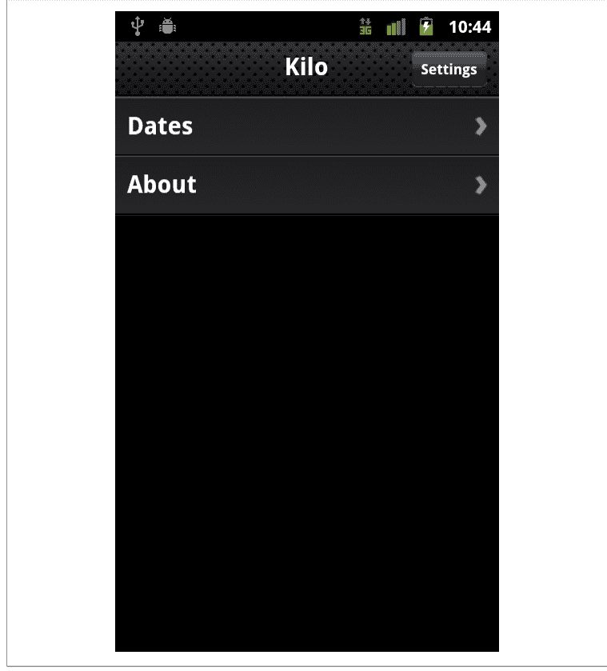

*图 7-1. Kilo 作为应用运行*

> 如果你在运行 PhoneGap 时遇到任何问题，请查阅 PhoneGap 项目提供的资源。社区页面（[http://phonegap.com/community](http://phonegap.com/community)）链接到 Wiki、Google Group、IRC 频道等，你可以在那里获得社区的帮助。PhoneGap 还提供支持包（[http://phonegap.com/support](http://phonegap.com/support)）。

## 用 JavaScript 控制手机

现在我们已经准备好开始通过调用原生设备功能来增强我们的应用了。得益于 *phonegap.js*，你只需在代码中添加几行 JavaScript，就可以让手机振动 200 毫秒：

```
navigator.notification.vibrate(200);
```

很简单，对吧？

### 蜂鸣、振动和提醒

PhoneGap 使得蜂鸣、振动和提醒功能非常简单，所以我将它们放在一个示例中一起介绍。具体来说，我们将设置应用，当用户创建一条超过每日卡路里预算的记录时，触发蜂鸣、振动并显示自定义提醒。为此，请将以下函数添加到 *kilo.js* 的末尾（记得编辑 Eclipse 中的副本，而不是之前章节中的原始副本）：

```
function checkBudget() {❶
    var currentDate = sessionStorage.currentDate;
    var dailyBudget = localStorage.budget;
    db.transaction(❷
        function(transaction) {
            transaction.executeSql(❸
                'SELECT SUM(calories) AS currentTotal FROM entries WHERE date = ?;',❹
                [currentDate],❺
                function (transaction, result) {❻
                    var currentTotal = result.rows.item(0).currentTotal;❼
                    if (currentTotal > dailyBudget) {❽
                        var overage = currentTotal - dailyBudget;❾
                        var message = 'You are '+overage+' calories over your '
                            + 'daily budget. Better start jogging!';❿
                        try {⓫
                            navigator.notification.beep(1);
                            navigator.notification.vibrate(200);
                        } catch(e){
                            // No equivalent in web app
                        }
                        try {⓬
                            navigator.notification.alert(message,
                                null, 'Over Budget', 'Dang!');
                        } catch(e) {
                            alert(message);
                        }
                    }
                },
                errorHandler⓭
            );
        }
    );
}
```

以下是逐步说明：

1. 这是 **checkBudget()** 函数的开头。它将 **currentDate** 变量初始化为存储在 **sessionStorage** 中的值（即用户在设置面板中输入的值），并将 **dailyBudget** 变量设置为存储在 **localStorage** 中的值（即用户在日期面板上点击的日期）。
2. 开始一个数据库事务，准备计算当前日期的卡路里总数。
3. 运行事务对象的 **executeSql()** 方法。

让我们来检查 **executeSql()** 方法的四个参数：

4. 第一个参数是一条预处理 SQL 语句，使用 SUM 函数将匹配当前日期的所有记录的 calories 列的值相加。
5. 第二个参数是一个单值数组，用于替换上一行预处理语句中的问号。
6. 第三个参数是一个匿名函数，将在 SQL 查询成功完成时被调用（我们稍后将详细查看）。

以下是作为第三个参数传入的匿名函数中的处理逻辑：

7. 这一行从结果的第一行获取当前总计。由于我们只是查询某一列的总和，数据库只会返回一行（即此查询始终返回一行）。请记住，结果集的记录通过结果对象的 rows 属性的 **item()** 方法访问，且行号从零开始（即第一行为 0）。
8. 检查当天的卡路里总计是否大于设置面板上指定的每日预算。如果是，则执行后面的代码块。
9. 计算用户超出其卡路里预算的数额。
10. 构造要显示给用户的消息。
11. 这是一个 try/catch 块，尝试调用 navigator notification 对象的 **beep()** 和 **vibrate()** 方法。这些方法仅存在于 PhoneGap 中，因此如果用户在浏览器中运行应用，这些方法将失败，执行将跳转到 catch 块。由于浏览器没有等效的蜂鸣或振动功能，catch 块留空。
12. 这是一个 try/catch 块，尝试调用 navigator notification 对象的 **alert()** 方法。此方法仅存在于 PhoneGap 中，因此如果用户在浏览器中运行应用，它将失败，执行将跳转到 catch 块。浏览器中等效于 alert 的是标准 JavaScript alert，作为回退方案被调用。

PhoneGap 的 alert 和原生 JavaScript alert 之间有一些区别。例如，PhoneGap 的 alert 允许你指定回调方法（此处为 null，因为我们不需要），以及标题和按钮名称（图 7-2）；而 JavaScript 的 alert 不支持这些（图 7-3）。

这两种 alert 还有一个更细微的区别：原生 JavaScript 的 alert 是模态的，而 PhoneGap 的 alert 不是。换句话说，当你调用原生 alert 时，脚本执行会暂停，而在使用 PhoneGap 版本时，执行会继续。这是否重要取决于你的应用程序的性质，所以请记住这一区别。

13. 第四个参数是通用 SQL 错误处理程序的名称，在发生 SQL 错误时将被调用。

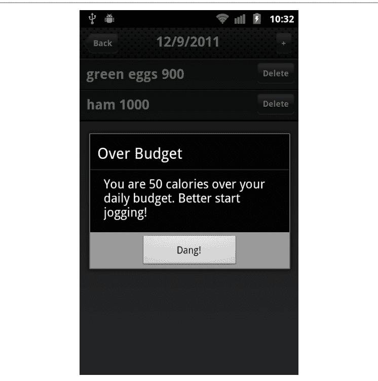

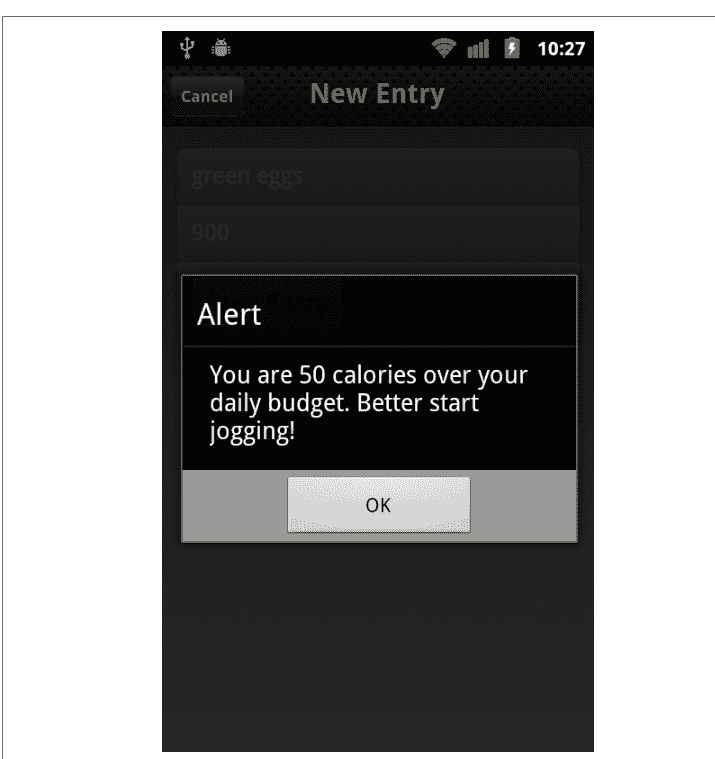

图 7-3. 原生 JavaScript alert 不允许你指定标题和按钮标签

`checkBudget()` 函数完成后，我们只需在 `createEntry()` 函数的成功回调中添加一行即可调用它：

```
function createEntry() {
    var date = sessionStorage.currentDate;
    var calories = $('#calories').val();
    var food = $('#food').val();
    db.transaction(
        function(transaction) {
            transaction.executeSql(
                'INSERT INTO entries (date, calories, food) VALUES (?, ?, ?);',
                [date, calories, food],
                function(){
                    refreshEntries();
                    checkBudget();
                    jQT.goBack();
                },
                errorHandler
            );
        }
    );
    return false;
}
```

完成这些更改后，保存 *kilo.js* 文件，然后在 Package Explorer 中找到 *Android Manifest.xml* 并双击它。接下来，点击 Android Manifest 页面底部的 Android-Manifest.xml 标签来编辑其原始 XML。然后，在 *uses-sdk* 下方添加下面粗体显示的行：

```
<uses-sdk android:minSdkVersion="7" />
<uses-permission android:name="android.permission.VIBRATE"/>
```

这行代码赋予你的应用使用手机振动功能的权限。接下来，选择 Eclipse 中的 Run→Run 来运行应用。尝试添加一条让你超过卡路里预算的记录，看看会发生什么。

## 地理位置

让我们更新 Kilo，在创建记录时保存位置信息。一旦我们有了这些信息，我们将添加一个地图位置按钮，该按钮将打开内置地图应用并在记录创建的位置放置一个图钉。

第一步是在表中添加经度和纬度列来存储这些信息。这是向你展示如何动态升级数据库的好机会。还记得我们在 document *ready* 函数中为数据库指定的版本号（1.0）吗？现在我们可以用这个数字来检查数据库是否过时，如果是，我们可以通过几条 *ALTER TABLE* 语句来升级它。每条语句向表中添加一个新列：先是 *longitude*，然后是 *latitude*。对 *kilo.js* 中打开数据库的 document *ready* 函数部分进行以下更改（粗体显示）：

```
var shortName = 'Kilo';
var version = '1.1';
var displayName = 'Kilo';
var maxSize = 65536;
db = openDatabase(shortName, '', displayName, maxSize);
if (db.version == '1.0') {
  db.changeVersion('1.0', version,
    function(transaction) {
      transaction.executeSql(
        'ALTER TABLE entries ' +
        '  ADD COLUMN longitude TEXT');
      transaction.executeSql(
        'ALTER TABLE entries ' +
        '  ADD COLUMN latitude TEXT');
    },
```


OCR文本包含大量技术文档代码。让我仔细处理。

function(e) {
    alert('数据库升级错误: ' + e.message);⑦
  }
);
} else if (db.version == '') {⑧
  db.changeVersion('', version);
}

db.transaction(
  function(transaction) {
    transaction.executeSql(
      'CREATE TABLE IF NOT EXISTS entries ' +
      ' (id INTEGER NOT NULL PRIMARY KEY AUTOINCREMENT, ' +
      '  date DATE NOT NULL, food TEXT NOT NULL, ' +
      '  calories INTEGER NOT NULL, ' +
      '  longitude TEXT, latitude TEXT);'⑨
    );
  }
);

① 此行将数据库版本递增到1.1，因为你即将在entries表中添加几个列。

② 打开数据库时，不要指定版本号，而是将版本参数留空。这样可以打开数据库的任何版本。

③ 此行检查是否为1.0版本的数据库。

④ 如果是1.0版本，你将调用changeVersion函数并传入四个参数。第一个是从哪个版本升级，第二个是新版本号。接下来是一个执行两条ALTER TABLE语句的函数：一条添加longitude列，另一条添加latitude列。

⑤ 向事务传入一个回调函数，该函数以事务对象作为其唯一参数。

⑥ 调用事务对象的executeSql()方法。

⑦ changeVersion的最后一个参数是一个处理任何错误的函数（它会弹出一个警报消息）。

⑧ 如果数据库之前不存在，那么就没有旧版本的数据库需要升级。但因为你打开数据库时没有指定版本，版本号将是空的。下一行将这个空版本号更改为版本"1.1"。

⑨ 如果entries表已存在，CREATE TABLE语句将不会运行。但如果它不存在，你仍然需要创建它。并且在创建表时，你仍然需要latitude和longitude列，这个更新的CREATE TABLE语句处理了这一点。

接下来，我们将重写第5章首次看到的`createEntry()`函数，使用手机的地理位置功能来确定当前的经纬度。将kilo.js中现有的`createEntry()`函数替换为以下内容：

```
function createEntry() {
    navigator.geolocation.getCurrentPosition(
        function(position){
            var latitude = position.coords.latitude;
            var longitude = position.coords.longitude;
            insertEntry(latitude, longitude);
        },
        function(){
            insertEntry();
        }
    );
    return false;
}
```

1.  开始`createEntry()`函数。
2.  调用地理定位对象的`getCurrentPosition()`函数，并向其传入两个回调函数：一个用于成功情况，一个用于错误情况。
3.  这是成功回调的开始。注意它接受一个单一参数（即position）。
4.  这两行从position对象中提取纬度和经度坐标。
5.  将纬度和经度坐标传入一个名为`insertEntry()`的函数，我们稍后会看到它。
6.  这是错误回调的开始。
7.  因为我们处在错误回调中，所以只有当地理定位失败时（例如，应用程序无法确定位置）才会调用此函数，因此调用不带参数的`insertEntry()`函数。
8.  返回`false`以阻止点击表单的提交按钮时发生默认的导航行为。

想知道SQL INSERT语句去哪儿了吗？让我们看一下`insertEntry()`函数。这个新函数在数据库中创建条目。将以下内容添加到kilo.js中：

```
function insertEntry(latitude, longitude) {
    var date = sessionStorage.currentDate;
    var calories = $('#calories').val();
    var food = $('#food').val();
    db.transaction(
        function(transaction) {
            transaction.executeSql(
                'INSERT INTO entries (date, calories, food, latitude, longitude) ' +
                'VALUES (?, ?, ?, ?, ?);',
                [date, calories, food, latitude, longitude], ⑨
                function(){⑩
                    refreshEntries();
                    checkBudget();
                    jqT.goBack();
                },
                errorHandler ⑪
            );
        }
    );
}
```

① `insertEntry()`函数的开始，允许传入纬度和经度值。虽然JavaScript中没有明确的方法将参数标记为可选，但如果它们没有被传入，它们将是`undefined`。

② 从`sessionStorage`中获取`currentDate`。记住，当用户点击日期面板上的一个项目以导航到日期面板时，它的值会被设置。当他点击`+`按钮显示新条目面板时，此值仍将设置为当前选定的日期面板项目。

③ 从`createEntry`表单中获取卡路里值。

④ 从`createEntry`表单中获取食物值。

⑤ 开始一个数据库事务。

⑥ 向事务传入一个回调函数，该函数以事务对象作为其唯一参数。

⑦ 调用事务对象的`executeSql()`方法。

⑧ 定义使用问号作为数据占位符的SQL预处理语句。

⑨ 为占位符传入一个值的数组。如果纬度和经度没有传入`insertEntry()`函数，它们将是`undefined`。

⑩ 定义成功回调函数。

⑪ 定义错误回调函数。

为了确认Kilo确实在保存这些位置值，我们希望在界面上的某个地方显示它们。让我们添加一个“检查条目”面板来显示存储的值。我们将在该面板上包含一个“地图位置”按钮，该按钮将显示条目创建的位置。在`</body>`结束标签之前，将以下内容添加到index.html中：

```
<div id="inspectEntry">
    <div class="toolbar">
        <h1>检查条目</h1>
        <a class="button cancel" href="#">取消</a>
    </div>
    <form method="post">
        <ul class="rounded">
            <li><input type="text" placeholder="食物" name="food" value="" /></li>
            <li><input type="tel" placeholder="卡路里"
                name="calories" value="" /></li>
            <li><input type="submit" value="保存更改" /></li>
        </ul>
        <ul class="rounded">
            <li><input type="text" name="latitude" value="" /></li>
            <li><input type="text" name="longitude" value="" /></li>
            <li><p class="whiteButton" id="mapLocation">地图位置</p></li>
        </ul>
    </form>
</div>
```

这应该与我们首次在第68页“添加新条目面板”中看到的新条目面板非常相似，所以我只指出几点：

1.  输入类型已设置为`tel`，以便当光标置于字段中时调用电话键盘。这有点取巧，但我认为这是值得的，因为那个键盘对于数字数据字段来说要合适得多。

2.  纬度和经度字段是可编辑的，并包含在表单中，这意味着用户将能够编辑它们。在最终应用程序中这可能没有意义，但它在开发过程中使测试变得容易得多，因为你可以手动输入位置值来测试“地图位置”按钮。

3.  此时点击这个“地图位置”按钮不会做任何事情；我们稍后会为它添加一个点击处理程序。

现在我们需要给用户提供一种导航到这个“检查条目”面板的方法，因此我们将修改日期面板的行为，以便当用户点击列表中的一个条目时，“检查条目”面板将从屏幕底部向上滑动。

第一步是连接点击事件处理程序（我们接下来将创建它），并修改处理点击“删除”按钮的方式。在*kilo.js*中的`refreshEntries()`函数中添加以下三个高亮显示的更改：

```
function refreshEntries() {
    var currentDate = sessionStorage.currentDate;
    $('#date h1').text(currentDate);
    $('#date ul li:gt(0)').remove();
    db.transaction(
        function(transaction) {
            transaction.executeSql(
                'SELECT * FROM entries WHERE date = ? ORDER BY food;',
                [currentDate],
                function (transaction, result) {
                    for (var i=0; i < result.rows.length; i++) {
                        var row = result.rows.item(i);
                        var newEntryRow = $('#entryTemplate').clone();
                        newEntryRow.removeAttr('id');
                        newEntryRow.removeAttr('style');
                        newEntryRow.data('entryId', row.id);
                        newEntryRow.appendTo('#date ul');
                        newEntryRow.find('.label').text(row.food);
                        newEntryRow.find('.calories').text(row.calories);
```

```javascript
newEntryRow.find('.delete').click(function(e){
    var clickedEntry = $(this).parent();
    var clickedEntryId = clickedEntry.data('entryId');
    deleteEntryById(clickedEntryId);
    clickedEntry.slideUp();
    e.stopPropagation();
});
newEntryRow.click(entryClickHandler);
}
},
errorHandler
);
}
);
```

❶ 我们必须在函数调用中添加 `e` 参数（事件），以便能够访问事件的 `stopPropagation()` 方法，这个方法很快就会用到。如果不添加 `e` 参数，`e.stopPropagation()` 将是未定义的。

❷ 添加到删除按钮点击处理程序中的 `e.stopPropagation();` 会告诉浏览器不要让点击事件冒泡到 DOM 的父元素。这很重要，因为我们现在已经在行本身上添加了点击处理程序（而条目行是删除按钮的父元素）。如果我们不调用 `stopPropagation()`，当用户点击删除按钮时，删除按钮处理程序和 `entryClickHandler` 都会被触发。

❸ `newEntryRow.click(entryClickHandler);` 告诉浏览器在条目被点击时调用 `entryClickHandler` 函数。

现在让我们将 `entryClickHandler()` 函数添加到 `kilo.js`：

```javascript
function entryClickHandler(e){
    sessionStorage.entryId = $(this).data('entryId');
    db.transaction(
        function(transaction) {
            transaction.executeSql(
                'SELECT * FROM entries WHERE id = ?;',
                [sessionStorage.entryId],
                function (transaction, result) {
                    var row = result.rows.item(0);
                    var food = row.food;
                    var calories = row.calories;
                    var latitude = row.latitude;
                    var longitude = row.longitude;
                    $('#inspectEntry input[name="food"]').val(food);
                    $('#inspectEntry input[name="calories"]').val(calories);
                    $('#inspectEntry input[name="latitude"]').val(latitude);
                    $('#inspectEntry input[name="longitude"]').val(longitude);
                    $('#mapLocation').click(function(){
                        window.location = 'http://maps.google.com/maps?z=15&q='+
                            food+'@'+latitude+','+longitude;
                    });
                    jQT.goTo('#inspectEntry', 'slideup');
                }
            );
        }
    );
}
```

+   1. 获取用户点击条目的 `entryId` 并将其存储在会话存储中。
2. 开始数据库事务。
3. 将回调函数传递给事务，该函数以事务对象作为其唯一参数。
4. 调用事务对象的 `executeSql()` 方法。
5. 定义带有问号作为数据占位符的 SQL 预处理语句。
6. 为占位符传递一个单元素数组。
7. 开始成功回调函数。
8. 获取结果的第一行（由于我们只查询一个条目，所以也是唯一的一行）。
9. 根据行中的值设置一些变量。
10. 根据变量设置表单字段的值。
11. 将点击处理程序附加到 `#mapLocation` 按钮。该函数将窗口位置设置为标准的 Google Maps URL。如果 Maps 应用程序可用，它将启动。否则，URL 将在浏览器中加载。`z` 值设置初始缩放级别；`@` 符号之前的字符串将用作在该位置放置的图钉的标签。纬度和经度值必须按此处显示的顺序出现，并用逗号分隔。
12. 调用 jQTouch 对象的 `goTo()` 方法，使检查条目面板向上滑动进入视图。
13. 定义错误回调函数。

现在你需要授予你的应用访问位置数据的权限。在 Package Explorer 中找到 *AndroidManifest.xml* 并双击它。点击 Android Manifest 页面底部的 AndroidManifest.xml 选项卡以编辑其原始 XML。然后，在 `uses-sdk` 下方添加粗体显示的行：

```xml
<uses-sdk android:minSdkVersion="7" />
<uses-permission android:name="android.permission.ACCESS_COARSE_LOCATION"/>
<uses-permission android:name="android.permission.ACCESS_FINE_LOCATION"/>
```

接下来，在 Eclipse 中选择 Run->Run 来运行应用。尝试添加一个条目，然后点击新条目以调出检查条目面板。你将看到 GPS 坐标，以及一个映射位置的选项。

## 加速度计

接下来，让我们设置 Kilo 通过摇动手机来复制列表中的最后一个条目。将以下函数添加到 *kilo.js* 的末尾：

```javascript
function dupeEntryById(entryId) {
    if (entryId == undefined) {
        alert('You have to have at least one entry in the list to shake a dupe.');
    } else {
        db.transaction(
            function(transaction) {
                transaction.executeSql(
                    'INSERT INTO entries (date, food, calories, latitude, longitude) ' +
                    'SELECT date, food, calories, latitude, longitude ' +
                    'FROM entries WHERE id = ?;',
                    [entryId],
                    function() {
                        refreshEntries();
                    },
                    errorHandler
                );
            }
        );
    }
    startWatchingShake();
}
```

+   1. 此行确保将 `entryId` 传递给了函数。如果没有，会通知用户。
2. 开始通常的数据库事务步骤。
3. 定义一个 INSERT 语句，该语句复制指定 `entryId` 的值。这是一种你以前没见过的查询类型。它不使用值列表进行 INSERT，而是从指定 `entryId` 的 SELECT 查询结果中获取值。
4. 将 `entryId` 传递到预处理语句中，用 `entryId` 的值替换 SELECT 查询中的 `?`。
5. 成功时，调用 `refreshEntries()`，它将显示新复制的条目。
6. 错误时，调用标准的 SQL 错误处理程序。
7. 正如你稍后将看到的，我们将通过在此函数期间禁用摇动检测来避免收集多个摇动事件。完成此操作后，我们将重新启用它。

现在我们需要告诉应用程序何时开始和停止监听加速度计。我们将其设置为在日期面板滑动进入视图后开始监听，并在面板开始滑出时停止监听。为此，我们只需在 *kilo.js* 的 `document ready` 函数中添加以下几行：

```javascript
$('#date').bind('pageAnimationEnd', function(e, info){
    if (info.direction == 'in') {
        startWatchingShake();
    }
});

$('#date').bind('pageAnimationStart', function(e, info){
    if (info.direction == 'out') {
        stopWatchingShake();
    }
});
```

+   1. 将一个匿名处理程序绑定到 **#date** 面板的 **pageAnimationEnd** 事件。将事件和附加信息作为参数传递。
2. 检查 **info** 对象的 **direction** 属性是否等于 **in**。如果是，调用 **startWatchingShake()** 函数，我们稍后会看到。
3. 将一个匿名处理程序绑定到 **#date** 面板的 **pageAnimationStart** 事件。将事件和附加信息作为参数传递。
4. 检查 **info** 对象的 **direction** 属性是否等于 **out**。如果是，调用 **stopWatchingShake()** 函数，我们稍后会看到。

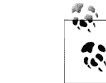

技术上讲，我们可以只绑定到一个页面动画事件，如下所示：

```javascript
$('#date').bind('pageAnimationEnd', function(e, info){
    if (info.direction == 'in') {
        startWatchingShake();
    } else {
        stopWatchingShake();
    }
});
```

我没有这样做的原因是 **stopWatchingShake()** 将在页面动画完成后才会被调用。因此，加速度计将在页面过渡期间被主动监听，这有时会导致动画卡顿。

我们剩下的就是编写 **startWatchingShake()** 和 **stopWatchingShake()** 函数。将以下函数添加到 *kilo.js* 的末尾：

```javascript
function startWatchingShake() {
    var lastReading = null;
    var threshold = 10;
    var success = function(coords){
        var current = coords.x + coords.y + coords.z;
        if (lastReading != null) {
            if (Math.abs(current - lastReading) > threshold) {
                var entryId = $('#date ul li:last').data('entryId');
                stopWatchingShake();
                dupeEntryById(entryId);
            }
        }
        lastReading = current;
    };
```


```markdown
## 准备应用的发布版本

为了让应用准备好分发，你需要完成以下几项工作：

- 移除所有调试或日志代码
- 为应用设置版本
- 编译应用
- 使用私钥对编译后的应用进行签名

### 移除调试代码

当应用在用户的手机上运行时，没有任何理由让调试或日志代码拖慢应用的运行速度。如果你在 HTML、CSS 或 JavaScript 文件中添加了此类代码（参见[第 119 页的“JavaScript 控制台”](page119)），现在就是将其移除的时候了。

你还应该打开 *AndroidManifest.xml* 文件：在 Eclipse 中，在 Package Explorer 中找到 *AndroidManifest.xml* 并双击它。接下来，点击 Android Manifest 页面底部的 AndroidManifest.xml 选项卡以编辑其原始 XML。然后，搜索 "debuggable" 并将其设置为 false。完成后，它看起来应该是这样的：

```xml
...
<application
    android:icon="@drawable/ic_launcher"
    android:label="@string/app_app_name"
    android:debuggable="false">
...
```

在打开 manifest 文件的同时，你最好确保 `android:icon` 和 `android:label` 已按前述代码段所示指定。你可能正在使用 Android 的默认图标。你应该为你的应用准备多种分辨率的图标，并将它们放置在 Package Explorer 的相应子目录中：

- `res/drawable-hdpi/ic_launcher.png` (72 x 72 像素)
- `res/drawable-ldpi/ic_launcher.png` (36 x 36 像素)
- `res/drawable-mdpi/ic_launcher.png` (48 x 48 像素)

Google 发布了一套图标设计指南，包括一个可以下载的图标模板包。请参阅 [http://developer.android.com/guide/practices/ui_guidelines/icon_design.html](http://developer.android.com/guide/practices/ui_guidelines/icon_design.html)。

### 为应用设置版本

在 `AndroidManifest.xml` 文件的顶部附近，你应该能看到为应用设置的版本名称（version name）和版本代码（version code）：

```xml
...
<manifest
    xmlns:android="http://schemas.android.com/apk/res/android"
    package="com.jonathanstark.kilo"
    android:versionCode="1"
    android:versionName="1.0">
...
```

因为这可能是你应用的第一个版本，所以这些值保持原样即可。一旦你发布了应用并在以后想要发布更新，你将相应地更新这些值。Android 系统不会检查或强制执行此版本信息，但它是你长期应用策略的关键数据。

版本名称是向用户显示的值。它是一个字符串，因此你可以根据需要填写任何内容，但通用做法是使用 `<主版本>.<次版本>.<修订号>` 格式（例如 1.0.0）。

版本代码预期是一个正整数值。它不需要以任何方式与版本名称对应。事实上，它可能不会对应——无论发布的是重大升级还是细微的错误修复，每次发布更新时，你只需将其增加 1 即可。

## 编译并签名你的应用

Android 要求所有应用必须由开发者进行数字签名。签名过程很简单：在 Package Explorer 中选择你的项目（点击 Package Explorer 列表顶部的 *KiloForAndroid*），然后点击 File $\rightarrow$ Export。打开 Android 文件夹，然后选择 Export Android Application。你将引导执行以下步骤：

1. 选择要导出的项目。默认将为 *KiloForAndroid*。点击 Next。
2. 选择用于存储密钥的密钥库（key store）。如果是第一次操作，选择 Create a New Keystore。在计算机上为密钥库选择一个安全的位置，并为其命名。此密钥库将包含所有私钥，请妥善保管。使用强密码，然后点击 Next。
3. 现在你需要创建密钥。填写请求的字段（如果没有适用值，底部的某些字段可以留空），包括此密钥私钥部分的密码，以及有效期年数。点击 Next。
4. 选择保存编译并签名后的 Android 程序包 (APK) 文件的位置。将其命名为 *KiloForAndroid.apk*。

完成后，在你选择的目的地将获得一个已签名的应用 (*KiloForAndroid.apk*)。下次导出时，你只需要提供密钥库的密码以及用于签名应用的密钥。

> 请勿丢失密钥库密码或密钥密码。如果你忘记任何一个密码，或者丢失了密钥库或密钥文件，应用一旦发布，你将无法对其进行更新。

## 将应用上传至 Android Market

剩下的工作就是将签名后的二进制文件上传到 Android Market。

> 你需要成为一名注册的 Android 开发者才能上传应用。如果你还没有注册，可以在 [http://market.android.com/publish/signup](http://market.android.com/publish/signup) 办理。流程快速简便——只需填写一些个人资料信息（姓名、电子邮件、电话等），支付 25 美元的注册费（使用 Google Checkout），并同意 Android Market 开发者分发协议。

1. 启动浏览器，访问 [http://market.android.com/publish/](http://market.android.com/publish/)，并登录你的 Google 账号。
2. 如果登录后没有自动跳转，请访问 [http://market.android.com/publish/Home](http://market.android.com/publish/Home) 并点击 Upload Application 按钮（图 8-1）。

## 你学到了什么

在本章中，你学习了如何将 Web 应用加载到 PhoneGap 中，如何将应用安装到手机上，以及如何访问五个基于浏览器的 Web 应用无法使用的设备功能（蜂鸣、警报、震动、地理位置和加速度计）。

在下一章中，你将学习如何将应用打包成可执行文件并将其提交到 Android Market。

# 第 8 章
# 将应用提交至 Android Market

终于到了你一直期待的时刻：将完成的应用提交到 Android Market。这个过程实际上非常简单：你只需要准备一个应用的发布版本并将其上传即可。
```


## 直接分发你的应用

Android 平台一个非常吸引人的特性是，它允许开发者完全跳过 Android Market，直接将应用分发给用户。在很多场景下，这是一个很好的选择。例如，企业 IT 部门可能希望向员工分发内部应用，或者你想在将应用上传到 Android Market 之前进行内部测试。

无论哪种情况，直接分发都非常简单：将签名后的 .apk 二进制文件上传到你的 Web 服务器，然后为用户提供一个下载链接。用户点击该链接——比如从电子邮件或网页中点击——应用就会被下载并安装。就这么简单。

你也可以使用二维码来分发应用链接。二维码是一种二维条形码，最多可以存储 4,296 个字母数字字符的任意文本，并且可以被 Android 手机的摄像头读取。当用户看到你的二维码时，她可以使用 Google Goggles（或其他二维码读取应用）拍照扫描，即可获得你的应用链接。你可以访问 Google Chart Tools 中专门介绍二维码的页面来了解更多。你还可以使用 Google 的 Live Chart Playground 免费创建自己的二维码。

唯一的注意事项是，用户必须先允许安装非 Android Market 来源的应用，方法是导航到"设置→应用程序"并启用"未知来源"选项（图 8-2）。如果用户未先启用未知来源下载，他仍然可以下载应用，但系统会提示安装被阻止（图 8-3）。提示对话框会让他直接跳转到相关设置页面或取消安装。当用户首次勾选该复选框时，他会看到一个确认对话框，警告他该选择可能带来的影响（图 8-4）。

> 图 8-2. 用户可以选择从 Android Market 以外的来源下载应用

图 8-3. 如果用户在未勾选相应设置的情况下尝试从未知来源安装应用，系统会提示他更改设置或取消安装过程

图 8-4. 当用户首次启用"未知来源"选项时，系统会显示一个确认对话框，警告他该操作的影响

## 延伸阅读

如果你想深入了解 Android SDK 的工作原理，最好的起点是 http://developer.android.com/ 上的优秀在线文档。以下是我认为有用且经常参考的其他资源：

- Android Discuss 邮件列表
- Android Developers 邮件列表
- jQTouch 邮件列表
- PhoneGap 邮件列表
- Android WebView 参考文档
- Android WebChromeClient 参考文档
- Android WebViewClient 参考文档
- Android WebSettings 参考文档

上面列表中的 Android 参考文档只有在你想深入研究 PhoneGap 源代码或编写自己的原生 HTML 应用包装器时才会用到。WebView 是主要用于显示 HTML 的核心类；默认情况下，它不支持 JavaScript、浏览器控件（例如地址栏、前进/后退按钮）或错误处理。

另外三个类以不同方式扩展了 WebView。WebChromeClient 添加了对 JavaScript 对话框、网站图标、标题和进度指示器的支持。WebViewClient 添加了对一些有用的事件监听器的支持，如 `onFormResubmission()`、`onPageStarted()` 和 `onPageFinished()`。最后，WebSettings 提供了对 WebView 设置状态的访问方法，如 `getDatabaseEnabled()` 和 `setUserAgentString()`。

再次强调，除非你想深入到底层的 Java 代码中，否则你不需要担心这些内容。

现在就去动手打造一些出色的 Android 应用吧！

# 附录

## 使用 WURFL 检测浏览器

WURFL（Wireless Universal Resource File，无线通用资源文件）是一个 XML 文件，包含了识别各种移动设备所需的信息。它本身并不能做任何事情。但如果你使用为其提供的众多可用库之一，你就可以创建能够识别连接到你应用的设备类型的 Web 应用。
例如，wurfl-php（<http://wurfl.sourceforge.net/nphp/>）可以让你在 PHP 脚本中检测远程设备正在运行的操作系统。

要使用 WURFL 和 wurfl-php，你需要在一个支持 PHP 的托管服务提供商上运行你的 Web 应用。你还需要了解如何在服务器上安装文件和 PHP 库。在本附录中，我将向你展示如何使用 Unix 或 Mac OS X 命令行来完成此操作。如果你对这些操作不太熟悉，但熟悉 PHP 的使用，请联系你的托管服务提供商的支持部门，询问他们是否愿意在你使用的服务器上安装 WURFL 和 wurfl-php。如果你使用的是共享服务器，提供这一功能将为你的托管服务提供商带来竞争优势。

## 安装

首先，下载 wurfl-php 并将其解压到服务器上的某个位置（通常最好不要将库放在公共 Web 文件夹中，因此我将其放入主目录中的 *src* 目录）。将 *~/src* 替换为你想要安装到的位置，将 *wurfl-php-1.3.1.tar.gz* 替换为你实际下载的文件名：

```
$ mkdir ~/src
$ cd ~/src
$ tar xvzf ~/Downloads/wurfl-php-1.3.1.tar.gz
```

接下来，下载最新的 WURFL 文件（http://sourceforge.net/projects/wurfl/files/WURFL/），将其复制到 wurfl-php 文件夹中，然后使用 gunzip 解压（关于以压缩状态使用此文件的提示，请参阅 wurfl-php 文档）。将 `~/src/wurfl-php-1.3.1/` 替换为你在上一步解压 wurfl-php 发行包时创建的目录的完整路径，将 `~/Downloads/wurfl-latest.xml.gz` 替换为你下载的 WURFL 发行包的路径：

```
$ cd ~/src/wurfl-php-1.3.1/
$ cp ~/Downloads/wurfl-latest.xml.gz .
$ gunzip wurfl-latest.xml.gz
```

最后，下载桌面 Web 浏览器补丁，以避免当用户从桌面浏览器访问你的页面时 WURFL 出现错误：

```
$ curl -O http://wurfl.sourceforge.net/web_browsers_patch.xml
```

## 配置

在 `~/src/wurfl-php-1.3.1/`（或你解压 wurfl-php 时创建的目录）中创建以下 wurfl-config 文件（wurfl-config.xml）：

```
<?xml version="1.0" encoding="UTF-8"?>
<wurfl-config>
  <wurfl>
    <main-file>wurfl-latest.xml</main-file>
    <patches>
      <patch>web_browsers_patch.xml</patch>
    </patches>
  </wurfl>
  <persistence>
    <provider>file</provider>
    <params>dir=./work/cache</params>
  </persistence>
</wurfl-config>
```

创建缓存目录，并确保该目录及其父目录对运行 PHP 脚本的用户具有写入权限。如果你的 Web 服务器配置为以你的用户身份运行 PHP 脚本，则此步骤不是必需的。与前面的示例一样，将 `~/src/wurfl-php-1.3.1/` 替换为你之前创建的位置。将 `www` 替换为你的 PHP 脚本运行所使用的用户名（你需要超级用户权限才能运行此命令）：

```
$ mkdir -p ~/src/wurfl-php-1.3.1/work/cache
$ sudo chown _W ~/src/wurfl-php-1.3.1/work
```

如果缓存目录上方的任何父目录对运行 PHP 脚本的用户名不可读，你将无法写入缓存。如果 WURFL 报告写入缓存文件夹出错，你可以选择其他位置（如 /var/wurfl/cache）并修改 wurfl-config.xml 使其指向该位置。在操作之前，请先创建缓存目录，并为该目录及其父目录授予运行 PHP 脚本的用户的写入权限：


## 测试 wurfl-php

然后你需要按照示例更改 `wurfl-config.xml` 中的持久化部分：

```
<persistence>
  <provider>file</provider>
  <params>dir=/var/www/wurfl/cache</params>
</persistence>
```

> 如果有疑问，请联系你的主机提供商技术支持，说明你需要PHP脚本能够写入缓存目录。

现在，在你的Web目录（例如 *Sites* 或 *public_html*）中，创建以下PHP文件（将其命名为类似 *wurfl-test.php* 的名称）。当你第一次从Android设备（或任何其他浏览器）访问它时，由于需要构建初始缓存，会花费较长时间。之后，它应该会很快。图A-1展示了这在浏览器中的显示效果。你现在可以修改此PHP代码以满足你的需求：

```
<html>
<head>
    <meta name="viewport" content="user-scalable=no, width=device-width" />
    <title>WURFL Test</title>
<?php

    define("WURFL_DIR", "/Users/NAME/src/wurfl-php-1.3.1/WURFL/");
    define("RESOURCES_DIR", "/Users/NAME/src/wurfl-php-1.3.1/");

    require_once WURFL_DIR . 'Application.php';

    $wurflConfigFile = RESOURCES_DIR . 'wurfl-config.xml';
    $wurflConfig = new WURFL_Configuration_XmlConfig($wurflConfigFile);
    $wurflManagerFactory = new WURFL_WURFLManagerFactory($wurflConfig);

    $wurflManager = $wurflManagerFactory->create();
    $wurflInfo = $wurflManager->getWURFLInfo();

    $requestingDevice = $wurflManager->getDeviceForHttpRequest($_SERVER);
    $is_android = FALSE;
    if ($requestingDevice->getCapability("device_os") == "Android") {
        $is_android = TRUE;
    }
?>
</head>
<body>
    <?php
        if ($is_android) {
            echo "I spy an Android phone.";
        }
?>
<ul>
  <?php
    foreach ($requestingDevice->getAllCapabilities() as $key => $value) {
      echo "<li>$key = $value";
    }
  ?>
</ul>
</body>
</html>
```

> 我无法使用~，所以我必须输入WURFL相关文件的完整路径；请将 `/Users/NAME/src/wurfl-php-1.3.1/` 替换为你之前创建的wurfl-php目录的完整路径。

我发现了一部Android手机。

- mobile_browser = Android Webkit
- nokia_feature_pack = 0
- device_os = Android
- nokia_series = 0
- has_qwerty_keyboard = true
- pointing_method = touchscreen
- mobile_browser_version = 
- is_tablet = false
- nokia_edition = 0
- uaprof = 
- can_skip_aligned_link_row = true
- device_claims_web_support = true
- ununiqueness_handler = 
- model_name = Nexus S
- device_os_version = 2.3
- uaprof2 = 
- is_wireless_device = true
- uaprof3 = 
- brand_name = Google
- model_extra_info = 
- marketing_name = Samsung Nexus s

*图A-1. 示例 wurfl-php 脚本的输出*

## 关于作者

Jonathan Stark 是一位移动和Web应用顾问，被《华尔街日报》称为“将桌面数据发布到Web方面的专家”。他撰写了两本关于Web应用编程的书籍，是《php|architect》和《Advisor》杂志的技术编辑，并在媒体上被引用讨论互联网和移动生活方式趋势。Jonathan 在20多年前在Tandy TRS-80上开始了他的编程生涯，至今仍认为Zork是一款很棒的游戏。

Brian Jepson 是一位O'Reilly编辑、黑客，也是Providence Geeks和Rhode Island Mini Maker Faire的联合组织者。多年来，他还在各种方面参与了位于罗德岛州普罗维登斯的非营利性、无审查的艺术中心AS220的工作。

## 版权页

*《Building Android Apps with HTML, CSS, and JavaScript》* 封面上的动物是雄冠鸠（*Macrocephalon maleo*），一种濒危鸟类，目前种群数量在5,000到10,000之间，仅分布在印度尼西亚的苏拉威西岛和布顿岛。这种独特而稀有的鸟体型与成年家鸡相似，其白色和浅粉色的腹部和胸部羽毛与黑色的背部和翅膀形成鲜明对比。雄冠鸠的学名表明其个体拥有强壮的腿和大头部。它们倾斜的前额常被描述为“头盔状”。

或许这种单配偶制鸟类最显著的特征是其筑巢和照料后代的方式。与大多数自行孵化鸟蛋的鸟类不同，雄冠鸠将蛋产在沙坑中，由阳光、地热能或两者共同孵化。雄冠鸠集体筑巢，这很可能是一种防御卵捕食者的措施。当一只年轻的雄冠鸠在两到三个月的孵化后从沙中孵化并出现时，它已独立并能够飞行。它会迅速独自前往森林，以躲避捕食者并寻找食物。

雄冠鸠的蛋大约是鸡蛋的五倍大小，使其在当地人中颇受欢迎。2009年，总部位于美国的野生动物保护协会购买了苏拉威西海滩上一块36英亩的区域（包含大约40个巢穴），以提高人们对这一数量持续下降的物种的认识，并保护这些鸟类免受人类采蛋者的侵害。

封面图片来自卡塞尔的《自然史》。封面字体是Adobe ITC Garamond。正文字体是Linotype Birk；标题字体是Adobe Myriad Condensed；代码字体是LucasFont的TheSansMonoCondensed。
