# Visual Basic .NET 分布式应用程序构建指南

## 出版信息

**副出版人**

Linda Engelman

**组稿编辑**

Sondra Scott

**开发编辑**

Shannon Leuma

**执行编辑**

Charlotte Clapp

**项目编辑**

Elizabeth Finney

**文字编辑**

Geneil Breeze

Michael Henry

**索引编制**

Erika Millen

**校对**

Plan-it Publishing

**技术编辑**

Phil Syme

Dan Suceava

**团队协调人**

Chris Feathers

**媒体开发人员**

Dan Scherf

**内页设计师**

Anne Jones

**封面设计师**

Aren Howell

# 使用 Visual Basic .NET 构建分布式应用程序

## 前言

向 `.NET` 技术的转变正在进行中，它带来了只有分布式计算才能实现的令人兴奋的机遇。我深知这一点，因为我在日常工作中亲身体验了 `.NET` 技术的巨大力量，我们屡获殊荣的内部系统就运行在 `.NET` 平台上。

作为 Quilogy 的首席技术官，我们通过数字咨询、高级托管和技术教育提供业务解决方案。在过去的几年里，我与 Dan Fox 密切合作，学习、试验并将新的 Microsoft 技术应用于我们自己的组织。因为只有通过亲自测试和构建经过验证的解决方案，我们才能确信为客户提供最佳、最有效的解决方案。过去一年中，我们将 `.NET` 策略纳入我们工作框架的努力尤其富有成效。

Dan 在 Quilogy 对 `.NET` 技术展现出的精通，以及他此前为一家大型石油公司构建大规模系统的专业经验、对数据库和面向对象系统的广博知识，还有众多的 Microsoft 认证，使他有独特资格来撰写这本书。此外，今年是 Visual Basic 诞生 10 周年，这使得本书的出版具有特别的意义。正如我们亲身发现的，专业 VB 开发者进入 `.NET` 领域的最佳途径是通过 Visual Basic `.NET`。

作为企业开发人员构建解决方案的首选语言，VB 凭借其新的 `.NET` 特性，现在能够满足业务开发人员更多的需求和关注点，这使得在当下理解它变得至关重要。关于 `.NET` 的一个极好消息是，由于其多语言支持，你可以进入 `.NET` 领域，同时还能利用你现有的技能。正如本书所示，你需要学习一些概念和技术，但它们会建立在你已有的基础上，因此你可以开始利用 `.NET` 提供的所有新功能和特性。

Dan 没有简单地复述 Microsoft 的文档，而是阐述了应用程序开发的历程，并在深入探讨“为什么”（例如，为什么 VB `.NET` 很重要）和“怎么做”（例如，VB `.NET` 如何融入整体框架）时提供了广泛的见解。此外，大量的代码示例清晰地阐释了关键点，并使本书易于阅读的特性锦上添花。Dan 是 TechEd 和 Developer Days 等大型活动上备受追捧的讲师和演讲者。他还是几本印刷和在线杂志的定期撰稿人，包括 *Visual Basic 程序员杂志*、*SQL Server 杂志*、*InformIT* 和 *Advisor* 期刊。他卓越的教学方法、引人入胜的演讲风格以及全面的知识都在这本书中得以体现。

目前，作为技术总监，Dan 负责帮助我选择技术、设定应用架构、识别成功的设计模式，并对员工进行新兴技术的培训。自担任公司这一重要职位以来，他在开发 Quilogy 用于构建门户解决方案的突破性系统——Quilogy Accelerator（QA）——方面发挥了重要作用。QA 利用 Quilogy 自身内部网的代码作为 `.NET` 加速器，能够比购买或从头构建更快、更低成本地创建门户和内部网解决方案。

正如我们在 QA 上的发现，以及你将在将 `.NET` 策略应用于自己的业务实践时发现的那样，`.NET` 正在以前所未有的激动人心的新方向改变技术业务解决方案的面貌。

Alan Groh

Quilogy 首席技术官

## 关于作者

**Dan Fox** 是位于堪萨斯州欧弗兰帕克的 Quilogy 的技术总监。Quilogy（`www.quilogy.com`）是一家领先的 Microsoft 金牌认证合作伙伴和解决方案提供商，在全国 16 个城市拥有 450 多名顾问。Quilogy 为众多客户提供数字咨询和技术教育服务，并专注于在 Microsoft 平台上构建解决方案。作为认证技术教育中心，Quilogy 教授全套 Microsoft 官方课程（MOC），并专注于使用 `.NET` 开发和 `.NET` 企业服务器构建解决方案和授课。

Dan 是 Microsoft 认证的解决方案开发人员、系统工程师和培训师，曾担任多种项目的顾问、讲师和管理顾问。作为技术总监，Dan 为 Quilogy 的顾问和客户提供技术指导。

在 1995 年加入 Quilogy 之前，Dan 曾在德克萨斯州休斯顿的雪佛龙公司和密苏里州堪萨斯城的国家保险专员协会工作。Dan 于 1991 年获得爱荷华州立大学计算机科学学士学位。

Dan 经常为 *Visual Basic 程序员杂志* 撰稿，并为 *SQL Server* 杂志、*Advisor* 期刊和 `InformIT.com` 撰写过大量文章。他著有 Sams 出版社的 *Pure Visual Basic* 一书，并与他人合著了一本关于 Visual Basic 6 分布式考试（70-175）的书，该书由 Certification Insider Press 出版。他曾在 TechEd 和几次 Developer Days 会议以及 Microsoft 活动上发表演讲。

Dan 与他可爱的妻子 Beth 以及两个年幼的女儿 Laura 和 Anna 住在堪萨斯州的肖尼。除了被家人昵称为“Dan.NET”外，Dan 的时间都花在阅读、看电影以及一如既往地为小熊队加油上。

## 关于技术审校

**Dan Suceava** 目前是 Vitrix, Inc. 的高级程序员，这是一家位于亚利桑那州坦佩的时间考勤软件公司。自 1996 年以来，他一直使用 Visual Basic 开发桌面和 n 层应用程序。他最近完成了一个 ASP 解决方案的开发，该方案通过 Web 为其他企业提供考勤服务。他拥有亚利桑那州立大学计算机科学硕士学位。

**Phil Syme** 自 Windows 3.1 发布以来一直使用 C++ 和 Visual Basic 编程。他帮助创建了为财富 100 强公司开发的几个企业级项目，这些项目采用了 Microsoft 技术。Phil 与他人合著了两篇发表在 IEEE 研讨会上的文章。目前，Phil 正与 Peter Aitken 合著两本书，分别是 *Sams Teach Yourself Internet Programming with C# in 21 Days* 和 *Sams Teach Yourself Internet Programming with VB .Net in 21 Days*。

**Eric Wilson** 自 1994 年以来一直为电子商务、互联网和基于 LAN 的解决方案开发业务应用程序。Eric 在多种 Microsoft 解决方案方面获得认证，并取得了以下 Microsoft 认证身份：MCSE（Microsoft 认证系统工程师）、MCSD（Microsoft 认证解决方案开发人员）、MCT（Microsoft 认证培训师）、MCP（Microsoft 认证专业人员）和 MCP + I（Microsoft 认证专业人员 + Internet）。目前，Eric 是位于北卡罗来纳州研究三角园区（RTP）的 Web Basix, Inc. 的总裁兼首席执行官，专注于企业级应用程序开发和开发人员培训。

## 献辞

*谨以此书献给我的女儿们，劳拉和安娜，她们时刻提醒着我上帝的恩赐。*

## 致谢

首先，我要感谢我在 Sams 出版社本项目上的高级策划编辑桑德拉·斯科特。从我们最初接触开始，她就一直鼓励我，是一位非常好的合作伙伴。桑德拉确保了流程中的每一步都进展顺利，并在早期就通过评审提供了出色的反馈意见。此外，我还要感谢开发编辑香农·卢埃马，她始终密切关注，督促我按计划推进，确保内容组织得当，并提出了许多建议，使这本书更加出色。

当然，对于这样一本技术书籍而言，有两个关键要素——实际的文字内容和代码——都得到了很大的提升，这要归功于迈克·亨利和吉妮尔·布里斯的文字编辑技巧，以及菲尔·赛姆、丹·苏切瓦和埃里克·威尔逊的技术审阅。他们五人确保了本书的可读性，并且包含了准确的信息，考虑到审阅人员在大部分开发周期中必须使用产品的多个测试版本进行工作，做到这一点实属不易。

正如你在封面和前言中看到的，这本书是我所在的公司 Quilogy 的集体努力成果。公司总裁兼首席执行官兰迪·席林和首席技术官艾伦·格罗对这个项目的鼓励和投入，对于本书的成功至关重要。由于本书是在产品生命周期的早期阶段就开始编写的，他们愿意为我提供资源来开发这样一本大书，包括时间以及前往雷德蒙德出差的机会，这些都极大地提升了最终成果的质量。在整个过程中，Quilogy 的顾问和讲师们审阅了内容，并提供了有益的建议和意见。对所有这些才华横溢的人，我都深表感激，特别是蒂姆·瓦诺弗、戴夫·万塔、贾森·怀斯纳、休·范格尔斯、阿德里安·安蒂拉和凯瑟·巴雷特。

此外，本书的范围和目的通过以下人员的出色审阅得到了完善和锤炼：微软 VB 产品经理阿里·比克斯霍恩；微软 VB 用户教育高级技术撰稿人史蒂夫·霍格；普渡大学计算机技术系助理教授凯尔·卢茨；Intuitive Manufacturing Systems 高级软件架构师理查德·纳尔逊；Acclarant 公司副总裁/解决方案开发斯特里特·鲍尔斯；Acclarant 公司首席软件架构师迈克·斯内尔；以及 Synapse Technology 微软团队负责人拉里·沃尔。感谢各位的帮助。

因此，与任何书籍一样，这本书确实是一项团队努力的成果。话虽如此，任何错误都只属于我个人，所以欢迎发送电子邮件至 `dfox@quilogy.com`，提出更正和建议。

最后也是最重要的是，如果没有我深爱的妻子贝丝和女儿们劳拉与安娜的支持，我不可能开始这个项目。贝丝在这个项目期间持续的鼓励和耐心使完成它变得容易得多，而我的女儿们则一如既往地提供了平衡，让我对技术的追求保持正确的视角。

## 告诉我们您的想法！

作为本书的读者，*您* 是我们最重要的批评家和评论员。我们非常重视您的意见，想了解我们做得好的地方、可以改进的地方、您希望我们出版的领域，以及您愿意与我们分享的任何其他金玉良言。

作为 Sams 出版社的副社长，我欢迎您的评论。您可以通过电子邮件或直接写信给我，告诉我您喜欢或不喜欢这本书的哪些方面——以及我们可以采取哪些措施来使我们的书籍更加出色。

*请注意，我无法帮助您解决与本书主题相关的技术问题，并且由于我收到的邮件数量庞大，我可能无法回复每一条消息。*

当您写信时，请务必注明本书的书名和作者，以及您的姓名和电话或传真号码。我将仔细审阅您的评论，并与参与本书工作的作者和编辑分享。

电子邮件：`feedback@samspublishing.com`

邮寄地址：

Sams Publishing

800 East 96th Street

Indianapolis, IN 46240 USA

## 简介

祝贺您踏入 `.NET` 的世界！毫无疑问，对于许多开发人员来说，这是迈出了一大步。`.NET` 总体而言，特别是 VB `.NET`，引入了新的技术和执行熟悉任务的新方式，这需要在设计和开发软件时同时关注概念性和实践性问题。

本简介说明了本书的重点、布局、示例风格、示例应用程序、网站和目标读者。

# 本书的重点

并非所有软件都是一样的。例如，您在设计和构建基于窗体的应用程序时使用的架构和技术，与构建基于 Web 的应用程序时并不相同。由于许多不同类型的应用程序需要不同的方法，因此会以不同的方式使用 VB `.NET`，本书的重点是构建分布式应用程序。

所谓构建分布式应用程序，我指的是软件的设计和构建。为此，本书既关注架构问题，也关注实现，通过解释 VB `.NET` 的某个特定方面如何融入更大的图景，以及它如何或在分布式应用程序中应该怎样使用，此外还有语法细节。所谓分布式应用程序，我指的是那些采用 Web 架构、通常按逻辑服务或层（表示层、业务逻辑层、数据访问层）构建的应用程序。因此，举例来说，使用 Windows Forms 包开发基于窗体的应用程序超出了本书的范围，而本书几乎有四分之一的篇幅用于使用 Web Forms 和 Web Services 构建表示服务。

如前所述，分布式应用程序还包括构建业务逻辑和数据访问服务。因此，一些篇幅最长的章节涉及将 VB `.NET` 与组件服务集成，以及使用 ADO`.NET` 和 XML。许多读者可能熟悉这种架构，即 Windows DNA，尽管这个营销术语指的是上一代技术，包括 VB 6.0 和 COM。事实上，本书可以被看作是使用 VB `.NET` 构建更新版 Windows DNA 应用程序的技术合集。

此外，我还强调了构建基于服务器的应用程序，并涵盖了 Windows 服务应用程序以及使用 `.NET` 中的网络 API 的内容。我纳入这些主题是因为它们通常只是作为分布式应用程序的附加接口来使用，并且是创建用于数据交换或数据加载的健壮后端所必需的。

# 使用 Visual Basic .NET 构建分布式应用程序

## 本书的布局

为了引导您了解概念性和实践性问题，本书由三个部分组成，这将有助于您理解构建分布式应用程序的*方法*，还有*原因*。

## 第一部分：.NET 概念

第一部分“`.NET` 概念”提供了开发人员在开始使用 VB `.NET` 进行项目时需要了解的关键概念概述。该部分从第 1 章“Microsoft `.NET` 架构”开始，这一章不仅介绍了平台，还深入探讨了 VB `.NET` 的底层——公共语言运行时（CLR），即产品中所有内容的构建基础。CLR 确实是 VB `.NET` 的革命性方面，正如您将看到的，放在适当的背景下，VB `.NET` 可以简单地被视为一种用于构建 CLR 应用程序（称为托管应用程序）的工具。

虽然第 1 章中有大量技术信息，但我的意图并不是要吓退任何人。然而，我认为至少对 CLR 有一个表面的了解是至关重要的，因为这有助于理解 VB `.NET` 中的许多其他概念，例如第 4 章“面向对象特性”和第 5 章“打包、部署和安全性”中讨论的那些概念。此外，第一部分还涵盖了第 2 章“开发环境”中 Visual Studio `.NET` 的变化和新功能，以及第 3 章“VB `.NET` 语言特性”中 VB 语言本身的改进。最后，该部分以第 6 章“错误处理和调试”结束，这一章讨论了该版本产品中错误处理和调试的改进。

## 第二部分：企业技术

第二部分“企业技术”是本书的核心，由五章组成，逆向讨论了分布式应用程序中的每个服务层（表示层、业务层、数据访问层）。该部分从第 7 章“使用 ADO`.NET` 访问数据”开始，这一章探讨了 ADO`.NET` 编程模型如何使您能够更轻松地构建松耦合的应用程序，同时利用 XML 的优势。

本章以及本部分的其他章节提供了来自一个示例应用程序的示例，该应用程序实现了我在 Quilogy 公司的一个简单学生注册网站。Quilogy（`www.quilogy.com`）是一家数字咨询公司，在全国各地的培训中心提供技术教育。为此，学生需要能够从我们的公共网站查询课程安排、注册课程、查看成绩单等。该示例应用程序使用 VB `.NET` 实现了这些功能，并提供了底层数据库架构，可在配套网站（`www.samspublishing.com`）上获取。该应用程序使用了以下技术：

### 第二部分：表示服务

第二部分包括第 10 章“构建 Web 表单”和第 11 章“构建 Web 服务”，涵盖了构建基于 Web 的应用程序所需的表示服务层方面的内容。在很大程度上，第 10 章介绍了 ASP`.NET` 的架构和特性，以及它们与 ASP 的区别，然后使用 Quilogy 示例应用程序的用户界面作为示例，详细讨论了 Web 表单编程模型。第 11 章通过讨论 Web 服务，介绍了 VB `.NET` 可以生成的第二种接口类型。由于 Web 服务对许多开发人员来说是一个新概念，本章通过探索所涉及的基础技术及其在 VB `.NET` 中的实现方式，提供了基础。

### 第三部分：集成

本书的最后一部分，第三部分“集成”，由一系列主题组成，这些主题允许 VB `.NET` 开发人员扩展他们的代码。第 12 章“访问系统服务”，涵盖了 I/O 概念、创建多线程应用程序，以及使用密码学的简要介绍。第 13 章“实现服务”，介绍了在 VB `.NET` 中创建 Windows 服务，以及使用调度、事件日志、性能计数器和网络通信。最后，第 14 章“与企业集成”，探讨了三个主题，允许 VB `.NET` 开发人员通过使用 XML 类、消息队列和与 Active Directory 集成，将其扩展到关系数据库之外的数据源。

正如您可能意识到的，VB `.NET` 的功能主要来自所有 Visual Studio `.NET` 语言都可以利用的类库，我将其称为服务框架。因此，您会注意到只有第 2、3 和 4 章实际上讨论了 VB `.NET` 特有的问题。本书其余大部分内容只是解释了如何在 VB `.NET` 语言中使用服务框架的类。这一认识对于理解 VB `.NET` 作为产品及其在 Visual Studio `.NET` 中的角色至关重要。通过这种方式，VB `.NET` 可以被视为一种工具，用于将服务框架的预构建组件集成到特定解决方案中。以这种方式看待 VB `.NET` 对现有 VB 开发人员来说应该不足为奇，因为以前版本的 VB 的优势也是集成预构建和自定义组件。

## 本书的说明风格、示例应用程序和网站

通常，每章或主要部分以一两段解释性段落开始，试图将讨论的主题置于适当的背景中。例如，在讨论 ADO`.NET` 时，许多开发人员提出的第一个问题是它如何与 ADO 2.x 互操作，以及在 VB `.NET` 中编程数据访问时如何利用 ADO 知识。在设定背景后，讨论转向解释相关的语法和 API，使您能够利用该特性。在许多情况下，语法的解释使用代码片段以及表格和图形来说明，例如列出特定类的方法，或显示一个层次结构来说明该类如何融入更大的图景。最后，在大多数情况下，会提供一个或多个代码清单中的功能示例，以在上下文中说明技术。这被用作跳板，指出该特性的有趣方面和替代技术。

在此过程中，文本中穿插了解释性注释、警告和旁注，指出相关问题，或指向本书其他地方或外部的其他地方，可以找到更多信息。例如，几条注释参考了我之前的书 *Pure Visual Basic* 中的背景信息。由于没有一本书能涵盖像 VB `.NET` 和 `.NET Framework` 这样大的主题，注释通常用于划定本书的边界，通过提示您如何扩展或替代实现特定技术。

可以肯定的是，这种风格需要读者具备一定的自律性，因为许多细节和替代方案都嵌入在解释性段落中，读者必须经常参考代码清单以跟上讨论。然而，我也试图将信息量限制在与构建应用程序直接相关的范围内，因此，例如，并非每个方法的所有重载签名都进行了解释，也没有解释支持的各种参数。这类信息最好呈现在产品附带的优秀在线帮助中，并且应该在那里找到。


我采用的风格的另一个关键含义是，它绝对不是教程。试图完全按照书中所示输入代码的读者会遇到困难，因为在许多情况下，代码只显示了一个较大概念的相关部分，本身不会执行。此外，在许多情况下，代码类似于伪代码，旨在展示如何使用特定 API，但没有实现所有细节。

我推荐的阅读本书的方法是阅读整个部分，跟踪代码清单和片段，然后在您自己的问题域中使用清单作为起点开发自己的示例之前，浏览在线文档或其他来源以获取任何附加信息。为了帮助您完成这项工作，如前所述，代码清单以及第 7 章至第 11 章讨论的完整 `Quilogy` 示例应用程序可以在 Sams 网站 `www.samspublishing.com` 上找到。为了在阅读时提醒您这一点，每章引言都包含以下注释：

> **注意**
>
> 本章的所有代码清单和补充材料可以在本书的网站 `www.samspublishing.com` 上找到。

此外，在使用清单时，应该注意的是，由于在 `VB .NET` 中引用外部库通常需要在代码文件开头放置 `Imports` 语句，许多代码清单和示例在开头包含阴影 `Imports` 语句。这些语句是阴影的，因为它们在实际代码中不会出现在该位置，但生成清单或示例中的代码需要它们。

本书有意侧重于代码清单，而较少使用图形。我相信开发人员通过查看他人的代码比通过教程或简单讨论能更快地学习。我试图将图形的使用限制在需要为概念提供背景的情况下，例如，让您了解在 `VS .NET UI` 中查找特定功能的位置。屏幕截图不应被用作教程，并且随着您使用 `VS .NET`，您的解决方案的特殊性意味着您看到的屏幕可能会有所不同。

我还主要关注如何使用代码实现功能，而不是 `VS .NET` 中包含的图形设计器和向导。这也是有意为之，因为我相信要建立坚实的基础，您需要理解代码级别发生了什么，而图形交互和向导本质上不太适合这种媒介。

## 本书的读者

当您阅读本书时，您可能会注意到我心中有一个主要读者和一个次要读者。现有的企业 `VB` 开发人员是主要读者。因此，本书主要从熟悉 `VB 6.0` 语法的开发人员的角度编写，他们现在正在构建 `Windows DNA` 应用程序。事实上，我脑海中想象的典型读者是参加 `Quilogy` 的 Microsoft 官方课程（`MOC`）`VB` 课程的典型学生。通常，这些开发人员已经使用 `VB` 一段时间，并且正在构建使用 `Visual Basic .NET` 构建分布式应用程序。

他们使用 `COM` 组件来存放数据访问和业务逻辑，并采用 `Microsoft Transaction Server` 或组件服务。他们还精通 `ADO` 和 `ASP` 开发，并且刚刚开始使用 `XML`。对于这些开发人员来说，迁移到 `VB .NET` 时的主要挑战是服务框架（Services Framework）的面向对象特性以及用于实现这些功能的附加语言语法。因此，第 3 章和第 4 章将特别有用。

次要受众是 `ASP` 开发人员，他们通常缺乏正式培训，专注于 Web 开发。对于这些开发人员来说，挑战是从构建两层 Web 应用程序转向第 7 章所述的多层架构。此外，与 `VBScript` 或 `JScript` 相比，`VB .NET` 语言的丰富性将需要一个适应过程。

最后，服务框架中许多允许你轻松使用系统服务的类将开启一个充满可能的新世界。我试图突出服务框架中（尤其是第三部分）最实用的部分。

我写这本书是因为我认为该平台的底层技术以及微软在 `VB .NET` 上选择的方向使其非常适合开发分布式应用程序。然而，与该平台相关的范式转变以及产品的巨大规模，将使一些 `VB` 开发人员难以掌握如何使用 `VB .NET`。最终，本书提供了一份关于 `VB .NET` 和服务框架的路线图和综述，以及如何利用它们构建分布式应用程序。

那么，你还在等什么？让我们通过探索 `VB .NET` 的基础——`Microsoft .NET` 架构来开始吧。

Dan Fox

堪萨斯州，肖尼

2001 年 8 月

# 第一部分：.NET 概念

## 本部分内容

- 1. `Microsoft .NET` 架构 — 9
- 2. 开发环境 — 49
- 3. `VB .NET` 语言特性 — 79
- 4. 面向对象特性 — 119
- 5. 打包、部署与安全 — 165
- 6. 错误处理与调试 — 199

# Microsoft .NET 架构

## 第一章

### 本章内容

- 新平台 — 11
- 公共语言运行时（`CLR`）架构 — 16

## 第一部分：.NET 概念

毫无疑问，你已经意识到 `Visual Basic .NET (VB .NET)` 绝不仅仅是 `Visual Basic` 的一个新版本。`VB .NET` 实际上是微软 `.NET` 架构这一更大拼图中的一块。该架构不仅包含一个新版本的 `Visual Studio (Visual Studio .NET)`——其中包括一套语言和一个所有 `Visual Studio` 语言运行的通用平台（称为 `.NET Framework`），还包含新版本的服务器产品，如 `SQL Server 2000`、`BizTalk Server 2000` 和 `Application Center Server 2000`，这些产品统称为 `.NET 企业服务器 (.NET Enterprise Servers)`。

> ### 暴风雨即将来临？
>
> 除了 `.NET` 开发和服务器的故事外，微软还披露了以 `.NET My Services`（前代代号为 `Hailstorm`）为名构建和托管一组基于 Web 的服务的初步计划。简而言之，这些服务将使用 `.NET Framework` 中的技术构建，并允许用户在任何设备上的任何地方共享和消费个人信息。该计划的核心是将任务、联系人、收件箱、日程、通知和收藏夹等互不相干的信息孤岛，集成到一个可以通过标准 Internet 协议访问的单一安全 Web 基础信息存储库中。
>
> 目前，微软的身份验证服务 `Passport` 是这一愿景中唯一公开可用的部分，它被同时称为构建块服务 (Building Block Services) 和基础服务 (Foundation Services)。`ASP.NET` 中的 `Passport` 集成将在第 10 章“构建 Web 窗体”中讨论，而关于 `.NET My Services` 的更多信息可以在 `http://www.microsoft.com/myservices/default.asp` 找到。

所有这些新工具旨在帮助开发人员构建现代化、鲁棒的分布式应用程序。为了帮助你理解 `VB .NET` 如何融入该架构，本章将讨论该平台及其对 `VB` 开发人员的影响。虽然这是一个包含大量技术材料的大章节，但之前版本的 `VB` 与 `VB .NET` 在基础架构上的差异是非常显著的。事实上，这种差异显著到你需要立即建立一个基准，了解这些更改是如何实现的，以及它们对于 `.NET Framework` 和 `Visual Studio .NET` 整体格局意味着什么。

> **注意**
>
> 本章的所有代码清单和补充材料都可以在本书的网站 `samspublishing.com` 上找到。

## 新平台

对于企业级开发人员来说，应用程序开发在过去十年中经历了几次重大转变。在 20 世纪 90 年代初，我们已经沉浸在从开发基于字符的单体大型机应用程序，向基于 PC 硬件和操作系统、利用兼容 `ODBC` 的关系数据库和图形用户界面（`GUI`）的两层客户/服务器应用程序的转变中。几乎在同一时间，我们开始看到封装、继承、多态和可重用组件等面向对象编程（`OOP`）概念被引入到 `PowerBuilder` 和 `Visual Basic` 等开发工具中。随着随后转向依赖 n 层架构和基于组件编程的分布式计算，到 1997 年初，许多此类工具和技术已相对成熟，被广泛分发并深耕于企业开发人员社区。

从使用微软产品的企业开发人员的角度来看，这产生了一种架构：用 `VB` 或 `Microsoft Foundation Classes (MFC)` 编写的 `Visual Studio` 客户端应用程序通过 `DCOM` 协议与运行在 `Microsoft Transaction Server (MTS)` 中的 `COM` 组件通信。组件本身使用 `ODBC` 驱动程序或后来的 `OLE DB` 提供程序访问 `SQL Server` 或 `Oracle` 等关系数据库。通过利用对象上下文，`MTS` 使开发人员能够使用 `XA`（`X/Open` 分布式事务处理（`DTP`）服务的一个子集）处理跨这些异构数据库的事务，并实现集中式的对象销毁和创建。

当然，到 1997 年，最大的变化已经达到了临界点，即 Internet、`HTML` 以及现在的 `XML` 的广泛普及。尽管微软发布了新的开发工具 `Visual InterDev (VID)` 和一种用于 Web 开发的编程模型 `Active Server Pages (ASP)`，但这两者在很大程度上只是对现有架构的补充，提供了与现有组件和关系数据库的集成，但并没有改变 `Visual Basic` 和 `Visual C++` 这两种核心 `Visual Studio` 语言的开发方式。此外，`VID` 和 `ASP` 提供的编程模型和可视化设计工具远不如更成熟的产品那样鲁棒。将 Web 编程集成到 `VB` 中的尝试（如引入 `ActiveX` 文档、`DHTML` 应用程序和 Web 类）恰恰说明了这一点：在核心层面，这些旗舰开发工具并不适合在 Web 世界中生存。主要原因之一是这些工具依赖于 20 世纪 90 年代初开发的技术——如 `Win32 API`、`COM` 和 `DCOM`，那时桌面计算是中心，而处于隔离 LAN 环境中持久连接的客户端是常态。

开发以 Internet 为平台的应用程序需要一种不同的心态——这种心态要从仅考虑内部消费的软件编写，转变为将所有 Internet 用户都视为潜在客户。这需要不同的技术，能够胜任支持客户端和服务器的松耦合特性、新的安全模型，以及将行业标准的 `HTTP` 和 `XML` 作为通用协议集成进来。我不知道你怎么想，但如果所有这些都能被包装在一个提供最大可重用性和开发效率的现代面向对象框架中，那么这听起来像是一个我想使用的平台。

因此，`.NET Framework` 和 `Visual Studio .NET`（我将把它们统称为 `.NET`）在核心上是旨在利用 Internet 作为应用程序开发主要平台的工具。在最高层面上，初始版本的目标是创建一个这样的开发环境：

- 将 Internet 和 Internet 标准视为本能。
- 能够轻松构建分布式 Web 应用程序。
- 结合面向对象编程的力量，并减轻复杂的版本控制和部署负担。

在本节和本章的剩余部分，我将具体讨论 `.NET` 是什么，并探讨 `Visual Basic .NET` 如何融入其中。

## .NET 是什么以及不是什么

在 `Visual Studio .NET (VS .NET)` 发布前的几个月里，关于 `.NET` 究竟是什么以及不是什么的猜测和困惑很多。为了给本章其余部分——事实上是整本书——奠定基础，我想涵盖几个相关的要点。

首先也是最重要的，`.NET Framework` 和 `VS .NET` 并不是 `Visual Studio 6.0 (VS 6.0)` 产品集的演进升级。在几乎所有方面，它们都是革命性的，因为它们提供了一种根本不同的编程模型，基于所有开发工具共享的公共语言运行时（`CLR`）。我将 `.NET Framework` 与 `VS .NET` 分开提及这一事实就表明它们是两个独立的产品，其中 `VS .NET` 依赖于 `.NET Framework`，但反之则不然。这种新模型要求开发人员进行新的思考，因为不仅他们选择的 `.NET` 语言在语法上发生了变化，而且程序在 `.NET` 中的基本结构和运行时行为可能完全不同。

其次，`.NET` 不是微软版的 `Java`。虽然 `.NET` 在使用即时编译（`JIT`）和垃圾回收等想法方面借鉴了 `Java` 的经验，但它的优势可能不在于可以跨平台。然而，正如你将看到的，`.NET` 的架构使得将 `CLR` 移植到各种平台成为可能，这样你的应用程序在未来可以实现一次编译，到处运行。事实上，`.NET` 最大的优势在于它的语言无关性。正如经典 `COM` 的优势一样，能够编写与另一种语言编写的代码良好互操作的代码通常更为重要，比起能够在各种平台上运行同一个二进制文件，这一点更为重要。此外，`.NET` 中可能的集成程度远远超过了 `COM` 提供的集成，并且一直延伸到跨语言继承。

无论如何，微软对平台独立性的愿景依赖于行业标准，例如基于 `XML` 的协议——简单对象访问协议（`SOAP`），用以进行跨平台调用并与通过 Web 公开的服务（也称为 `XML Web` 服务）进行交互。从 `IBM` 到 `Sun` 等整个行业的公司现在都支持由 `W3C`（`http://www.w3.org/TR/SOAP/`）把持的 `SOAP` 标准，因此将其纳入 `.NET` 使我们向应用程序能够跨不同平台无缝通信的时代迈进。

> **注意**
>
> 欲查看构建在各种平台上的各种 Web 服务，请访问 `www.xmethods.net`。

另一方面，`.NET` 是一个开发分布式 Web 应用程序的新平台。`.NET` 将 Web 服务的概念主流化，将其视为可通过标准 Web 协议访问的可编程应用程序组件。`.NET Framework` 包含数百个预建类，这些类封装了这些 Web 标准和协议，为构建交互式 Web 应用程序和 Web 服务提供了强大的基础，我将在第 10 章“构建 Web 窗体”和第 11 章“构建 Web 服务”中讨论。

`.NET` 还提供了一种构建和共享组件的新模型。您可能已经意识到，传统的 `COM` 组件依赖于注册表项、全局唯一标识符（`GUID`）、`v-table` 和 `IUnknown`，这使得使用 `DCOM` 跨网络分发和调用这些组件有时非常棘手。在 `.NET` 中，所有这些概念都消失了，取而代之的是一种更简单的机制，允许组件跨网络远程调用、轻松部署，以及在同一台机器上实现组件的并行版本控制。您将在第 5 章“打包、部署与安全”和第 8 章“构建组件”中探讨其中的许多概念。

最后，`.NET` 是一个用于分布式应用程序的快速应用程序开发（`RAD`）工具。`VS .NET IDE` 中包含的服务器资源管理器窗口（在第 2 章“开发环境”中介绍）、用于通过 `ADO.NET` 操作数据的 `.NET Framework` 类（在第 7 章“使用 ADO.NET 访问数据”中介绍），以及与低级系统服务（如线程，在第 12 章“访问系统服务”中介绍）和高级服务（如消息传递和 `Active Directory`，在第 14 章“企业集成”中介绍）的集成，使其成为了一个高生产力的环境。

## VB 在 .NET 中的地位

`Visual Basic` 作为一种开发工具，多年来经历了多次重大修订。特别是 `VB 3.0`、`4.0` 和 `5.0` 的发布提供了显著的增强，使 `VB` 能够访问数据库、充当 `COM` 客户端，并创建 `ActiveX` 控件和 `COM` 组件。然而，随着 `Visual Basic .NET (VB .NET)` 的发布，`VB` 在其至今十年的历史中经历了迄今为止最大的变革。

关于 `VB .NET`，也许最关键的一点是它现在是 `VS .NET` 中的“一等公民”。这意味着 `VB .NET` 可以完全访问 `.NET Framework` 中的 IDE、服务和功能，而不再受限于“玻璃天花板”。基于这一事实，理论上，几乎所有用其他 `VS .NET` 语言（如 `Visual C# (VC#)`、`JScript` 和带有托管扩展的 `Visual C++ (VC++)`）编写的代码都能够被翻译成 `VB .NET`，且具有相同的性能。

> **注意**
>
> 前一段中的“理论上”这个词是指编译器以及 `.NET Framework` 在性能方面发挥了作用。即使 `VB .NET` 语言包含所有 `VC#` 结构的语法等效项，`VB .NET` 编译器仍必须产生与 `VC#` 编译器产生的完全相同的中间语言代码（稍后讨论），这两个应用程序的性能才会完全相同。这不太可能发生，因此在某些情况下，构建在 `.NET Framework` 上的某种语言在执行类似操作时可能会优于另一种语言。然而，在整个应用程序的范围内，这些微小差异往往会相互抵消。

在 `VS .NET` 的初始版本中，`VC++` 将是唯一一个可以用其创建完全不使用 `CLR` 代码的语言。`VC#` 将允许您编写不使用 `CLR` 的代码块，因此在上述两种情况下，当使用这些功能时，性能将无法预测。

已有整本书在讲述如何扩展 `VB` 以实现 `Win32 API` 的特定功能（并突破“玻璃天花板”），例如线程、回调和编写 `NT` 服务。（我知道，因为我也写过其中一本。）然而，在 `VB .NET` 中，所有这些功能都是透明的，可以通过随 `VS .NET` 一起分发的一组类库来访问，这些类库被称为 `.NET Framework` 类或服务框架（Services Framework）。在应用程序中使用服务框架使得 `VB .NET` 能够支持 `VB` 开发者所期待的 `RAD` 模型。

> **注意**
>
> 在本书中，我将使用“服务框架”一词来指代随 `Visual Studio .NET` 一起分发的 1000 多个类的整个集合，包括那些实现对 Web 窗体和 Web 服务等各种编程模型支持的类，以及实现网络通信、IO、线程等低级类。有些作者会将整个集合简单地称为 `.NET Framework`、`.NET Frameworks` 或基础类库（`BCL`）。虽然我很少使用这个词，但我将 `BCL` 保留给构建高级编程模型的底层类。

第二点需要考虑的是，`VB .NET` 不仅涵盖了先前版本 `VB` 创建基于窗体的应用程序和组件的功能，它还可以使用强大的事件驱动编程模型来创建 Web 应用程序。换句话说，窗体包和 `ASP` 的功能已被抽象为应用程序编程模型，并通过可重用的框架类公开给所有 `.NET` 编程语言。

> **注意**
>
> 由于将基于 Web 的编程纳入了服务框架，过去使用 `Visual InterDev` 作为主要工具的开发人员可能会迁移到 `VB .NET`。对于那些从 `VBScript` 这种不支持 `Variant` 以外的类型且缺乏类和事件等复杂功能支持的语言迁移到强大的 `.NET` 语言的开发人员来说，起初可能会觉得难以应对。对于这些开发人员，我想说，请耐心随我学习。本章中的大部分信息对于把握大局至关重要。即便如此，这些开发人员可以通过重点阅读第 2、3、4、7、10 和 11 章，找到他们寻找的更多信息，并以更快的速度阅读本书。

此外，许多内置函数和语句已被抽象到服务框架和 `CLR` 中，结果是 `VB .NET` 包含的关键字实际上比之前的版本要少。这些部分如何拟合在一起的图示可见图 1.1。

> **注意**


VB .NET 是一种符合公共语言规范（CLS）的语言，因此它可以利用 CLR。本章稍后将对 CLR 进行更完整的讨论。

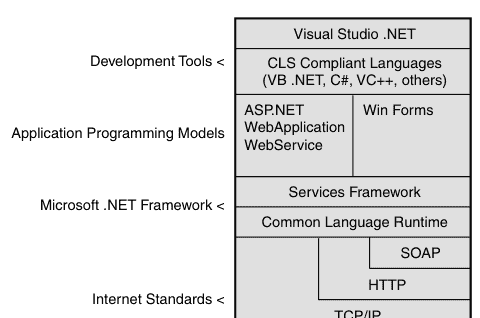

#### 图 1.1

综上所述，您可以推断 VB .NET 与之前的 VB 版本不同，因为它现在只是众多利用 .NET Framework 提供服务的语言之一。这对 VB 开发人员来说太棒了，因为他们现在可以访问 .NET 提供的所有功能，而无需付出增加复杂度、采用笨拙的变通方法或降低性能的代价。

在本章的剩余部分，我将深入探讨图 1.1 的基础，并讨论 CLR 和服务框架背后的关键概念。

## 公共语言运行时架构

.NET 的核心无疑是 CLR。简单来说，CLR 提供了所有在 VB .NET（及其他兼容语言）中编译的代码执行的环境。虽然我在讨论 CLR 时的目标不是深入探讨低级细节（这在其他出版物中已有论述），但 CLR 如此重要，以至于所有 VB .NET 开发人员都应该至少对其工作原理及其关键特性有初步的了解。

> **注意**

关于 CLR 的更多详细信息，请参阅 Jeffery Richter 在 MSDN 网站（`msdn.microsoft.com`）上发表的一系列文章。

正如 VB 6.0 和 COM 一样，开发分布式应用程序的开发人员可以在完全不了解 COM 内部机制的情况下开发其应用程序。然而，只要稍微扩展这些知识，就能让你创建出充分利用 CLR 所提供功能的应用程序。

## CLR 的目标

为了创建一个用于分布式 Web 应用程序开发的新平台，微软需要开发一个作为该平台基础的通用架构。如前所述，大多数 VB 开发人员目前开发分布式应用程序的方式是集成 ASP、VB、MTS、COM+ 和 Win32 API 调用，而所有这些都具有不同的编程语义，并且在执行基本功能（如错误处理、处理返回值、传递参数、处理数据类型和内存管理）方面各有其特性。因此，很明显，如果要开发一个新平台，就需要在一个中央架构下统一这些编程模型。这就是 CLR 的定义及其作用。

从最高层面来看，CLR 的设计旨在实现以下四个目标：

- 简化应用程序开发
- 提供鲁棒且安全的执行环境
- 支持多种编程语言
- 简化部署和管理

为了实现这些目标，CLR 的设计者必须解决应用程序互操作性的问题。在过去，两个软件片段通常使用 COM 进行通信，COM 依赖于两个软件都实现的通用二进制标准，以便它们能够安全地调用彼此对象上的方法。虽然这提供了一定程度的集成，但两个软件仍然需要实现底层基础结构（接口以及 `AddRef` 和 `Release` 代码），并依赖操作系统的 COM 库（包括 `OLE32.DLL` 和 `STDOLE.DLL` 等）和注册表来提供支持。尽管 VB 将这些细节很好地对开发人员隐藏了，但这两个软件仍然无法直接交互，例如，无法通过实现继承来扩展彼此的对象。

## .NET 概念

### 第一部分

> **注意**

COM 确实支持接口继承的概念，因此一个对象可以实现另一个对象的接口（这定义了所需的方法和属性签名，包括方法名称、参数以及返回值，如果有的话）。这允许你编写多态代码，在 VB 6.0 中也可以实现（详见我的书 *Pure Visual Basic*，Sams Publishing，1999 年 8 月，第 15 章，以获取更深入的讨论）。然而，这种技术不允许重用对象内部的实际代码。实现继承意味着一个对象可以从另一个对象派生，并且当派生对象执行时，如果需要，父对象的代码也会运行。这带来了更高的代码重用率，尽管也存在一些陷阱。我们将在第 4 章“面向对象特性”中详细研究这些已添加到 VB .NET 中的特性。

CLR 提供了所有软件运行的通用基质，使得对象可以直接交互，从而在组件本身和操作系统中都消除了所有底层基础结构代码。例如，在 COM 世界中，组件负责将其对象的内存布局组织成 v-table 结构，以便在运行时能够定位相应的方法。而现在，这一职责已从组件中减轻，由 CLR 来处理。

由于所有 VB .NET 代码都由 CLR 运行，因此它可以提供如下列出的服务：

- **不同的编译模型**——正如我稍后将讨论的，CLR 与开发语言的解耦允许运行时决定应用程序何时被编译。
- **自动生命周期管理**——因为所有对象（在 .NET 中，最终一切皆对象）都由 CLR 管理，它可以监控这些对象何时被创建和使用，以及何时不再需要。因此，它将使用垃圾回收（GC）算法在必要时释放资源。这意味着你不再会遇到野指针，循环引用也将得到解决。事实上，你完全不再负责释放资源（例如，将对象设置为 `Nothing`）。这是一个好消息，但它改变了你设计代码的方式，例如，`Terminate` 事件不再受支持。我将在本章以及第 3 章“VB .NET 语言特性”中详细讨论这个主题。
- **代码正确性和类型安全**——VB 开发人员一直认为，在许多情况下，他们可以将一个类型的变量赋值给另一个类型的变量，VB 会自动为他们进行转换。然而，默认情况下，CLR 严格执行类型安全，使开发人员不能对内存位置进行任意引用，也不能进行不安全的强制转换——这些是 VB 开发人员通常不关心的事情，但在 VC++ 中经常发生且常被黑客利用。对于 VB .NET 开发人员来说，这意味着出现了一种新的默认行为以及更多可用的类型安全级别。我将在第 3 章中详细介绍。
- **简化部署**——由于 CLR 消除了组件通信所需的底层基础结构，它还减轻了开发人员的安装和部署负担。通过消除注册（在很大程度上，你将在第 5 章中看到），并允许在同一台机器甚至同一个进程中进行并行执行等特性，一些 .NET 应用程序只需通过复制目录即可部署（称为 *XCOPY 部署*）。
- **基于证据的安全机制**——这个新平台还需要一个新的安全模型。在过去，安全模型通常依赖于运行代码的用户凭据。然而，在代码可以从 Internet 下载并执行的分布式应用程序中，代码本身需要被信任。`.NET` 安全模型并非简单地重复用于对 ActiveX 控件进行签名和加密的 Microsoft Authenticode 技术；它是一个基于代码和用户（通过操作系统账户或角色）共同提供的证据的新模型，并且是基于策略的。此外，在代码内部可以通过声明式和命令式两种方式访问安全模型。我将在第 5 章中详细讨论。
- **通用异常处理**——如前所述，企业开发人员使用的各种编程模型处理错误的方式各不相同。COM 使用 `HRESULT`，Win32 API 使用函数返回值并通过第二次调用来检索错误，ASP 使用内联错误处理，而 VB 使用模块内的错误陷阱。CLR 包含了结构化异常处理，允许隔离错误代码，并且在跨语言边界时运行良好。我将在第 6 章“错误处理和调试”中讨论 VB .NET 如何实现这一特性。

CLR 的这些特性允许不同语言协同工作，并利用调试器和分析器等通用工具，从而简化了跨语言甚至跨机器的调试（在第 6 章中涵盖）。这使得开发人员可以更自由地选择所用语言而无需做出牺牲。对于 VB .NET 开发人员来说，这再次是个好消息。

最后，正如前面所暗示并在接下来的章节中讨论的，CLR 的全方位特性使其具有硬件抽象层（HAL）的性质，使得编写的代码在迁移到新平台时可能不需要重新编译。最初，微软计划将 CLR 移植到其操作系统家族中，包括 Windows 98、Windows Me、Windows NT 4.0、Windows 2000、Windows XP、64 位 Windows，甚至是通过一个名为 .NET Compact Framework 的包移植到 Windows CE 中。在未来，其他非微软操作系统也可能被包含在内。

## 托管代码与非托管代码

所有在 CLR 之外执行的代码——意味着为旧版本 VB 编写的代码，以及对 Win32 API 的调用、对经典 COM 和 COM+ 组件的调用，以及对第三方 ActiveX 控件的调用——都被称为*非托管代码*（unmanaged code）。非托管代码与为了在 CLR 中运行而产生的托管代码之间存在着明显的区别。*托管代码*（managed code）的结构使得 CLR 可以为其增强服务。托管代码的要求包括 CLR 能够：

- 根据地址定位特定方法的元数据
- 遍历调用堆栈
- 处理异常
- 存储和检索安全信息

例如，为了遍历调用堆栈，CLR 使用特定的 API 来理解由特定编译器供应商产生的堆栈帧布局。因此，编译器必须在即时编译器（稍后讨论）或托管代码本身中提供该 API 的实现。

> **注意**

如前所述，只有 VC++ 可以产生非托管代码。VC++ 的默认模式是创建非托管代码，因此该产品被称为“带有托管扩展的 Visual C++”。然而，VC# 也允许你通过使用 *unsafe* 修饰符在方法内部编写非托管代码。因此，VC# 开发人员在某些情况下可以使用指针并覆盖 GC 算法，以通过一种称为*固定*（pinning）的技术防止其释放资源。正如其名称所示，*unsafe* 修饰符允许开发人员覆盖前文“自动生命周期管理”要点中提到的 CLR 特性，从而可能创建野指针和未解决的循环引用。但请注意，只有在代码被 CLR 安全模型信任的情况下，这些非托管代码才能运行。

VB .NET 仅产生托管代码，因此必须使用 .NET 的互操作功能（简称为“interop”）来访问任何形式的非托管代码。我们将在第 9 章“访问组件服务”中研究这是如何实现的。

这对 VB .NET 开发人员而言，其中一个影响是，将 VB 6.0 项目升级到 VB .NET（在第 3 章中涵盖）意味着将严重依赖互操作服务，这增加了一层复杂性并降低了性能。基于这些和其他原因，VB .NET 开发人员在决定升级内容和时间时需要非常谨慎。

## COM 的终结？

面对所有这些变化，这对 COM 意味着什么？好消息是，因为 VB 为开发人员隐藏了 COM 的许多复杂性，因此更改基础结构不应对大多数开发人员带来不便。此外，摆脱 GUID 和注册表的麻烦，摆脱其隐含的单机单版本方案，以及处理兼容性设置，这些都是好事。COM 死了吗？就其基础结构而言，是的。

然而，许多企业级 VB 开发人员对 COM 有很好的理解，并在设计中利用了基于接口的编程。这些开发人员仍然可以在设计中使用相同的技术，同时还可以用实现继承来增强它们。COM 死了吗？就共享和重用代码的概念而言，没有。

无论如何，在未来的相当一段时间里，我们中的许多人将不得不共存于这两个世界。例如，最常见的场景之一是：新开发的托管代码（可能是一个新的 ASP.NET UI 或 Web 服务）需要调用之前部署的、用 VB 6.0 编写的 COM+ 组件。为了实现这一点，VB .NET 开发人员需要了解旧世界和新世界以及它们如何互操作（我将在第 9 章中讨论）。事实上，可以说一些新的 VB .NET 开发人员需要学习一个关于经典 COM 的短期课程，以实现上述场景。

## 公共语言规范

如前所述，VB .NET 只是微软为了针对 CLR 而创建的几种语言之一。然而，CLR 使其他语言供应商能够创建同样针对它的编译器。为了协助这一过程，微软发布了公共语言规范（Common Language Specification，简称 CLS）。简单来说，CLS 发布在 `msdn.microsoft.com` 上，它定义了一套规则，如果供应商希望其语言能与 CLR 协作，就必须遵守这些规则。这些规则大多与语言如何公开类型信息（包括整数、字符串等基本类型，以及数组、枚举和对象等复杂类型）以及异常处理、特性（attributes）和接口等特殊功能有关。

> **注意**

严格来说，CLS 仅对那些被设为公共且在特定程序集之外可访问的类型约束供应商。程序集将在本章末尾详细讨论。

事实上，CLS 规定了 CLR 提供功能的一个子集，以确保语言之间的兼容性。如果供应商愿意，可以实现更多的功能。CLS 定义了三个兼容性级别：

- **消费者（consumers）**——使用 CLR 但不扩展它的语言
- **扩展者（extenders）**——使用 CLR 并通过添加额外数据类型来扩展它的语言
- **框架（frameworks）**——实现被广泛编程语言和工具所使用的库的语言

截至目前，许多供应商已表示愿意为 Pascal、Smalltalk、LISP、FORTRAN、Perl 以及其他 20 多种语言创建编译器。事实上，微软甚至在其 JUMP（Java 用户迁移路径）计划的一部分中，产生了一个针对 CLR 的 Java 版本（J# .NET）。

为了协助这项工作，微软和惠普共同将 CLS、CLR（称为公共语言基础结构）和 C# 语言规范提交给国际工业标准组织 ECMA。更多详情请参阅 `msdn.microsoft.com/net/ecma` 和 `www.ecma.ch`。

> 显然，本书面向的是现有的 VB 和 ASP 开发人员，因此，我绝对认为这些开发人员由于语法相似性，使用 VB .NET 会比使用 VC# 更快地提高生产力。此外，VB .NET 保留了 BASIC 最初的大部分优点，即更具可读性且因此更易理解的语法。VC# 是为 C++ 和 Java 开发人员设计的，因此将成为那些开发人员进入 .NET 的自然路径。即便如此，VC# 在许多方面与 VB .NET 比与 C++ 更相似，因此许多 VB 开发人员在阅读和理解其语法时不会有困难。

## CLR 内部原理

为了帮助你感受 CLR 的工作方式，我将采用一种“由内而外”的方法：首先讨论在二进制级别发生了什么，然后上升到单个应用程序级别、跨应用程序级别，最后到跨机器和部署级别。我将从讨论代码如何为 CLR 编译和执行开始。

## MSIL

与如今的任何可执行文件一样，你在 VB .NET 中编写的代码最终必须作为原生 CPU 指令在运行该代码的处理器上执行。然而，尽管非托管编译器直接创建这些原生 CPU 指令，且像 ASP 这样的解释器即时创建映射到 CPU 指令的指令，但为 CLR 编写的托管编译器（包括 VB .NET）创建的是一套更高层、独立于机器的指令集，称为微软中间语言（Microsoft Intermediate Language，简称 MSIL）。然后，MSIL 指令存储在一个扩展名为 `.DLL` 或 `.EXE` 的便携式可执行（PE）文件中，该文件基于微软便携式可执行格式，而该格式本身扩展了常用于可执行内容的公共对象文件格式（COFF）。这些文件在 .NET 中被称为*模块*（modules）（不要与第 2 章中讨论的 VB 模块混淆）。MSIL 最终由 CLR 加载，编译为原生指令并执行。

要查看由 VB .NET 编译器创建的 MSIL，你可以使用随 .NET 附带的 IL 反汇编实用工具（`ILDasm.exe`）。这个图形化工具允许你通过双击方法来查看程序中的每个方法及其关联的 MSIL。图 1.2 显示了在名为 `Orders` 的类中打开名为 `AddOrder` 方法的 ILDasm。

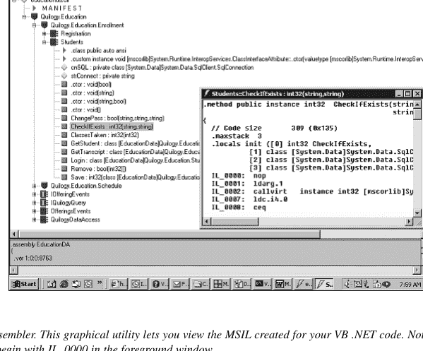

**图 1.2**

*IL 反汇编器。这个图形化工具允许你查看为 VB .NET 代码创建的 MSIL。请注意，前台窗口中的指令以 `IL_0000` 开始。*

这种基础架构及其影响对于 VB 开发人员来说应该是很熟悉的。首先，这意味着 VB .NET 的二进制文件不是原生代码，而是一种中间代码，这在 VB 的大部分历史中都是如此。巨大的区别在于，MSIL 是一套比旧版本 VB 产生的解释代码层级低得多的指令集。虽然你可能会认为为 VB 添加原生编译的努力徒劳无功，从性能角度来看，这是一个巨大的倒退，但采用这种方法也有其好处，本章稍后将讨论。其次，这意味着每台执行 VB .NET 代码的机器都必须安装 .NET Framework。是的，对于未预装运行时的操作系统（目前所有系统都是如此，甚至包括新发布的 Windows XP），都需要分发运行时。

另一方面，使用 MSIL 使 VB .NET 开发人员能够利用之前讨论的所有 CLR 服务，例如垃圾回收、类型安全、结构化异常处理、安全性、集成跨语言开发和跨语言调试。此外，通过提供硬件抽象层，使用 MSIL 将使 VB .NET 代码能够在不重新编译的情况下在 64 位 Windows 等新平台上运行。

目前，操作系统不知道如何开始执行用 MSIL 编写的程序，因此每个托管可执行文件都包含一个由操作系统加载器调用的非托管入口点。这个小型存根（stub）只需跳转到 `MSCorEE.dll` 中包含的 CLR 引擎的 `_CorExeMain` 函数。在 CLR 初始化之后，该函数将继续执行托管代码中的 MSIL 指令。这意味着每个进程加载自己的 CLR 副本，且每个进程仅加载一个 CLR 副本。CLR 中的大部分核心服务（例如稍后讨论的公共类型系统的基类）都包含在 `MSCorLib.dll` 中，每个托管二进制文件也引用了该库。

## JIT 编译

使用 MSIL 和托管代码最大的问题以及被认为的缺点可能是性能。显然，增加一个抽象层在 MSIL 编译为原生代码时也会带来性能损耗。幸运的是，.NET 使用了一些优化技术来尝试抵消这个潜在问题。

> **注意**

另一个缺点是，在目前的形式下，MSIL 可以像图 1.2 所示那样被反汇解。这使得“逆向工程人员”能够研究您源代码的指令并将其复制，从而给知识产权带来风险。然而，应当注意到，只要二进制文件可访问，任何代码（无论是否原生编译）都面临被逆向工程的危险。

默认情况下，CLR 在运行时使用即时（JIT）编译来编译 MSIL。它这样做而不是在加载时编译整个应用程序，是为了缩短初始化时间，而且因为应用程序通常不会调用其所有的代码。CLR 中执行此运行时编译的组件通常被称为 JITer。请注意，JITer 与 CLR 通过标准接口通信，因此其他供应商可以为特定平台生产 JITer。

例如，当一个托管应用程序执行时，它由 CLR 使用其类加载器（技术上是虚拟执行系统或 VES 的一部分）加载，类加载器负责首先为要加载的代码分配内存，解析对其他托管代码的访问，并进行基本的一致性检查。当这些检查完成后，类加载器为每个加载的方法实现创建一个存根。在程序执行过程中，当方法被实际调用时，JITer 被用于将 MSIL 编译为原生代码，然后替换该存根。在随后调用该方法时，原生代码将在无需 JITer 干预的情况下运行。


此外，JITer 还支持在编译期间可能进行的代码验证阶段。该算法使用来自类加载器和 CLR 基类库的输入，以确保即将运行的代码是类型安全的。这意味着方法实现了正确的签名，并且传递给方法的任何输入值都具有正确的签名。如果代码通过了类型安全验证，则可确保它仅访问其被授权访问的内存位置。请注意，管理员可能会创建安全策略允许代码绕过此验证步骤，因为某些代码可能被设计为非类型安全，且某些语言无法产生可验证的类型安全代码。

**注意**

微软曾讨论过发布两个 JIT 编译器：普通编译器和经济版。基本区别在于经济版在编译期间使用更少的资源（即内存占用和 CPU 周期），但产生的代码优化程度较低。因此，经济编译器对于 Windows CE 设备等平台非常有用，因为在这些平台上，编译成本超过了完全优化代码带来的性能收益。经济编译器也更容易实现，因为它使用简单的指令对指令替换，而不是完整的方法和数据流分析。然而，经济编译器并未进入 .NET Framework 的 1.0 版本。

然而，即便采用了这种架构，应用程序在首次加载时的执行速度仍会变慢。为了防止这种情况，CLR 还提供了一个命令行 PreJIT 编译器（CLR 原生映像生成器或 `ngen.exe`），您可以使用它在安装时将应用程序预编译为原生代码并将其持久化在磁盘上。通过这样做，您的应用程序加载速度将大大加快，尽管安装时的单次成本会增加。具体的执行机制将在第 5 章中详细介绍。

总而言之，请参考图 1.3，它概述了 VB .NET 应用程序的编译和执行过程。请注意，您的代码首先在开发时被编译成 MSIL，然后在安装时（PreJIT）或运行时（JITer）被编译成原生 CPU 指令。

**图 1.3**

*.NET 执行环境的简化视图。CLR 的默认模式使用 JITer，在每个方法被调用时将其编译为原生代码。*

虽然使用 JIT 确实有其成本，但在某些场景下，JIT 实际上可能会提高性能。例如，就其本质而言，PreJIT 和 JITer 比在远离最终运行代码的机器的开发工作站上编译应用程序的开发人员更了解运行时执行环境。因此，JIT 提供了包含安装时和运行时优化的机会；例如，创建针对特定 CPU（Pentium 4 与 AMD）优化的原生指令，并为未使用的变量或始终包含特定值的变量生成高效代码。

其次，使用 JIT 意味着随着新 JIT 编译器的安装在运行代码的机器上，开发人员也可以期待性能的提升。换句话说，您无需重新编译代码即可利用添加到 JIT 编译器中的新处理器改进。不过，这将如何影响未来可能需要处理各种 JIT 编译器的支持中心，仍有待观察。

### 公共类型系统

设计 CLR 的原因之一是为了让语言之间能够更充分地互操作。从历史上看，这很复杂，因为不同语言对于如何构建数据的基本概念往往截然不同。一个典型的例子是 VB 和 Win32 API 在字符串和结构方面的差异。例如，在字符串的情况下，VB 内部使用一种称为 BSTR 的形式表示，而在 Win32 API 中，它们被编码为 LPSTR。这种差异意味着 VB 开发人员在将字符串从 VB 传递给 Win32 API 时必须小心，并确保使用了正确的调用约定。

在 .NET 中，这些差异消失了，因为所有数据类型都由公共类型系统（CTS）实现。CTS 管理 CLR 支持的类型，包括它们的定义、引用和使用方式，以及它们如何相互作用。请注意，CTS 定义的类型是 CLS 所包含类型的超集。因此，并非所有语言都会支持所有可用类型。在最高层级，所有类型（包括整数和字符串等内置数据类型，以及类等用户定义类型）都派生自 CLR 中服务框架（`MSCorLib.dll`）里的一个名为 `Object` 的对象。该类位于 `System` 命名空间内，因此用点号表示法称为 `System.Object`。

**注意**

正如我稍后将讨论的，服务框架按层次结构组织成命名空间，用于对类以及其他命名空间进行分组。`System` 命名空间包含了 CLR 所使用类的核心实现。

> **注意**
>
> 长期以来，C 和 Perl 开发人员一直将哈希表（Hash tables）作为存储和检索值的快速手段，它类似于集合，但具有一定的限制且性能更佳。CLR 实现了 `System.Collections.Hashtable` 类，该类使用 `System.Object` 的 `GetHashCode` 方法来生成放入哈希表的键值。随后，`Hashtable` 类提供了诸如 `Contains` 和 `ContainsKey` 等方法用于查找该键。

在 CTS 中，所有数据类型（也简单地称为类型）最终都派生自 `System.Object`。在最高层级上，所有类型都可以分为所谓的值类型（value types）和引用类型（reference types）。有关类型组织方式的图表可见图 1.4。

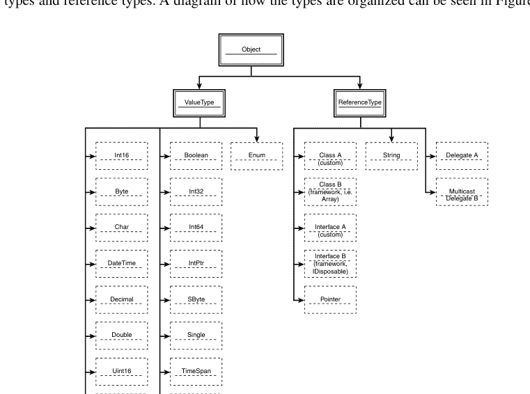

**图 1.4**

*通用类型系统（Common Type System）。该图显示了 CTS 的组织方式。所有类型均派生自 `System.Object`。*

### 值类型

值类型是指那些可以用一系列位（bits）来描述的类型，在应用程序中通常通过值传递，并被 CLR 用于实现现代编程语言所支持的许多固有数据类型。

在 CTS 中，值类型继承自 `System.ValueType`。虽然它们派生自 `System.Object`，但 CLR 的固有值类型不会消耗传统对象实例的开销，且存储效率很高。这是因为与对象实例不同，值类型被分配在线程的栈（stack）中，而不是在需要计算指针才能访问的垃圾回收堆（heap）上。例如，表 1.1 中的值类型在编程语言中通常实现为基本数据类型，但实际上是由 CTS 实现的。

**表 1.1 CTS 值类型**

| 数据类型 | 描述 |
| --- | --- |
| `System.Boolean` | 表示 True 或 False |
| `System.Byte` | 无符号 8 位整数 |
| `System.Char` | 一个 Unicode 16 位字符 |
| `System.DateTime` | 以 100 纳秒为一个刻度间隔，存储从 0100 年 1 月 1 日 12:00:00 AM 开始的日期和时间信息 |
| `System.Decimal` | 表示最高可达 28 位有效数字的正负值 |
| `System.Double` | IEEE 64 位浮点数 |
| `System.Int16` | 有符号 16 位整数 |
| `System.Int32` | 有符号 32 位整数 |
| `System.Int64` | 有符号 64 位整数 |
| `System.IntPtr` | 有符号整数，原生大小 |
| `System.SByte` | 有符号 8 位整数 |
| `System.Single` | IEEE 32 位浮点数 |
| `System.TimeSpan` | 表示一个时间间隔 |
| `System.UInt16` | 无符号 16 位整数 |
| `System.UInt32` | 无符号 32 位整数 |
| `System.UInt64` | 无符号 64 位整数 |

请记住，每种语言可能不会实现表 1.1 中的所有类型，且不一定会为每种类型使用相同的标识符。例如，VB.NET 不支持将无符号整数作为原生类型。在第 3 章中，我将讨论这些 CTS 类型与 VB.NET 中公开类型的映射关系。

值类型还具有一些你可能预期的行为，包括：

- 默认初始化为零。
- 按值复制：将一个定义为值类型的变量赋值给另一个变量时，仅复制其值而非该值的地址。因此，两个或多个值类型不能引用同一个物理内存地址。

除了使用固有类型外，CTS 还支持创建派生自 `System.ValueType` 的自定义值类型。如果你想创建自己的简单数据类型（通常通过值传递且会在一系列自定义应用程序中重复使用），你可能会这样做。例如，你可以为打击率创建一个值类型，用于存储棒球运动员的平均成绩，并包含你自己的方法进行额外计算。

应当注意，每次将定义为值类型的变量传递给接受 `System.Object` 类型参数的方法时，CLR 会使用该变量的所谓装箱（boxed）类型，在堆上为该变量创建一个可寻址的内存位置。换句话说，CLR 创建了该变量的第二种表示形式（这一过程称为装箱），使其能够被视为对象并按引用传递，因为根据定义，值类型仅仅是一串位序列。当该变量最终被更新时，则被称为拆箱（unboxed）。这种行为的优点在于它提供了类型系统的统一视图，使得编写多态代码成为可能——此类代码仅需接受 `System.Object` 类型的参数，但除了实际的对象外，也可以用于任何值类型。这类似于在 VB 中创建接受 `Variant` 参数的过程，从而使其能够处理简单数据类型、数组甚至类对象。

虽然某些语言（如 VC++）在引用装箱类型与拆箱类型时会包含特殊语法，但在 VB.NET 中，你无需担心在代码中显式地进行装箱和拆箱。

> **注意**
>
> 在某些情况下，如果你在将值类型传递给方法之前将其显式转换为对象，可能会获得微小的性能提升。

#### 枚举

CTS 还将枚举（enums）实现为值类型。所有枚举均派生自 `System.Enum`。与 VB 6.0 一样，每个枚举提供一组命名常量（字段），这些常量映射到 CTS 中的一种整数数据类型（`Int16`、`Int32` 或 `Int64`）。枚举不能定义自己的方法，不能实现接口，也没有属性和事件。VB.NET 完全支持枚举，我将在第 4 章中讨论。

### 引用类型

CTS 支持的第二类变量结构被称为引用类型（reference types）。顾名思义，引用类型派生自 `System.Object`，且始终通过其内存位置而非构成它的实际数据来引用。换句话说，当创建引用类型时，内存被分配在堆上，随后返回该地址并存储在变量中。与值类型不同，引用类型由 CLR 自动进行垃圾回收，稍后将对此进行讨论。

> **注意**
>
> CLR 中处理引用类型操作的子系统有时被称为虚拟对象系统（Virtual Object System，简称 VOS）。请注意，在运行时中包含对象系统是 CLR 的一个独特特性，也是其强大能力的来源。

由于引用类型指向变量的内存地址，因此两个变量可以指向同一个底层对象。默认情况下，引用类型在初始化之前默认为 `NULL`（或 `Nothing`）。在 CLR 中，唯一被实现为引用类型的基本数据类型是 `System.String`。引用类型的其他用途包括实现类、接口、指针和委托。

### 类

类或许是 CTS 中最基础的结构，几乎用于托管应用程序中的任何编程尝试，包括：

- 访问由服务框架（Services Framework）提供的所有系统服务，例如消息传递和数据访问（ADO.NET）。
- 使用 Windows Forms 实现窗体包。
- 使用 ASP.NET 实现网站和 Web 服务。
- 实现业务逻辑的自定义代码。
- 实现派生自服务框架的自定义代码。

可以说，你在 VB.NET 中编写的所有代码都将处于类的上下文中。就此而言，VB.NET 不再是某种带有少量面向对象语法的过程化语言；它现在是一种完全的面向对象语言。

正如你所预料的，CTS 中的类可以包含方法、字段、属性和事件，非常类似于 VB 6.0 中的类。然而，它们的功能要强大得多。因此，VB 已经添加了许多关键字，使其能够利用 CTS 中类的特性。其中一些特性包括：

- 从单个基类实现的继承（不支持多重继承）。
- 能够创建无法实例化的抽象基类。
- 能够在类上定义参数化构造函数，这些构造函数可以在类实例化时被调用。
- 能够实现一个或多个接口。
- 公共类和私有类。
- 用于替换基类中方法的重写方法。
- 方法名相同但参数不同的重载方法。
- 在类的所有实例之间共享并且可以在实例化之前调用的静态方法。
- 在任何时候只允许一个执行线程进入方法的同步方法。
- 只能从该类及其继承类内部访问的方法。

在第 4 章中，我将介绍 VB .NET 的语言增强功能，这些功能使得访问 CTS 实现的这些类特性成为可能。

#### 接口和指针

与 VB 6.0 一样，VB .NET 支持接口，尽管它们被实现为引用类型接口。接口只是定义接口中方法、字段、属性和事件的签名，包括名称、参数和返回值的规范。实现接口的类可以使用与 VB 6.0 中非常相似的语法为接口的方法提供实现，其中使用 `Implements` 关键字来实现 COM 接口。接口不能包含构造函数，并且所有成员都必须是公共的。

与 VB 6.0 一样，接口对于创建多态代码非常有用，因为一个类可以实现一个或多个接口，然后被传递给查询该接口并调用其方法的方法。然而，由于接口在 CTS 中得到支持，VB .NET 将它们暴露为一等公民，它们使用自己的语法定义，并且可以与其所实现的类包含在同一个源代码文件中。然而，与 COM 不同，CLR 还支持在不首先定义接口的情况下创建类。当 VB 开发人员以前创建 COM 组件时，他们依赖 VB 编译器为其类创建默认的 COM 接口，从而隐藏了这一要求。

在某些方面，接口与抽象基类的用途相同。区别在于抽象基类可以在其方法中包含功能，这些功能可以被继承自它的类重用。根据定义，接口没有实现。

> **提示**
>
> 因为 VB .NET 现在同时支持接口和抽象基类，并且两者都可以用于多态性，那么应该使用哪一个？一个好的经验法则是：当存在所有派生类都可以受益的通用代码，并且派生类遵循“is a”关系时，使用抽象基类。换句话说，Person 的抽象基类与 Employee 的派生类遵循此规则，因为“员工是人”。然而，当实现接口的类将使用相同的调用语义但不同的实现时，应使用接口。例如，名为 `IQuery` 的接口包含 `GetByID` 方法，可以由 `Order` 类和 `Employee` 类同时实现。

CTS 支持指针类型作为引用类型，这是包含某些数据的机器地址的值。指针类型不能当作对象使用，事实上，与以前版本的 VB 一样，VB .NET 不支持处理指针的语法。

### 委托

CTS 还支持一个称为委托（delegates）的概念。委托可以被看作是一种面向对象的方式来创建函数指针。每个委托在实例化时将调用转发到某个对象实例上的方法。然而，由于它们是作为 CLR 的一部分实现的，因此它们是类型安全的，并且始终指向有效的对象（与 C++ 中的函数指针不同）。

在 VB 6.0 中，使用委托作为函数指针的最接近等价物是在处理 Win32 API 时使用 `AddressOf` 关键字来定义回调例程；例如，在使用系统计时器时。在 CTS 中，委托用于实现回调。您还可以定义自己的委托来设置自己的回调方案，但它们也构成了 CLR 中所有事件处理的基础。例如，委托在 Windows Forms 类中用于实现控件和窗口的典型事件处理程序。

委托非常适合事件，因为它们可用于从事件源（如窗体上的控件）到事件接收者（如窗体内部的代码）进行通信。在处理事件时，您可以将委托视为事件源和事件接收者之间的运行时链接机制。

CLR 支持两个委托类：`System.Delegate` 和 `System.MulticastDelegate`，所有委托都派生自它们。正如您可能期望的，`MulticastDelegate` 支持在调用委托时调用的方法列表（称为调用列表），而 `Delegate` 仅支持一个。

使用委托的基本过程是：声明它，在运行时使用其构造函数中将要调用的方法对其进行实例化，然后调用委托，委托将依次调用其调用列表中的方法。当然，在许多情况下，您正在使用的服务框架或语言会在语言构造或更高级别的类（如控件和窗体）中抽象这些底层步骤。然而，如前所述，您可以在最低级别利用委托来创建自己的通知架构。

### 垃圾回收

如前所述，CLR 提供的优势之一是对对象的自动生命周期管理。此功能由清理托管堆上数据的垃圾回收（GC）算法实现。基本上，每次实例化对象时，CLR 都尝试在堆上为对象分配空间。如果没有可用空间，它会运行 GC 算法来确定哪些对象不再可以被引用，然后在分配新内存之前压缩堆。因此，您不再需要将对对象的引用设置为 `Nothing` 以便回收其内存。

> **注意**
>
> 在堆上分配空间时（当有空间并且不需要 GC 时）非常快。例如，在 VB .NET 中创建 100,000 个小对象所需的时间比在 VB 6.0 中创建相同的对象快四倍以上。当堆已满时，此过程将花费更长时间，因为此时必须进行 GC。因此，创建需要使用许多小对象的设计在性能方面不再像在 VB 6 中那样受到限制。通过这种方式，CLR 帮助开发人员设计更纯粹的面向对象应用程序。

当然，通过允许 CLR 管理对象的生命周期，根据定义，它不允许确定性终结。这意味着您无法编写在对象设置为 `Nothing` 时立即运行的代码，因为运行时决定您的对象实例何时实际被释放。换句话说，CLR 不允许您使用 VB 中的 Terminate 事件和 VC++ 中的析构函数。请记住，在本讨论中，VB 中的析构函数就是 Terminate 事件。

CLR 释放对象实例的方式是通过一个称为终结的过程。在内部，当实例化对象时，CLR 查看类是否重写了（创建了实现）`System.Object` 的 `Finalize` 方法。如果是，它将指向 `Finalize` 方法的指针放入单独的数据结构中。稍后，当 GC 确定对象实例不再可达时，由 GC 控制的线程会为这些对象中的每一个运行 `Finalize` 方法，然后将它们从堆中删除。对于amba

## .NET 概念

第一部分

### 组件元数据

作为 VB 6.0 开发人员，您可能已经熟悉通过“项目”菜单中的“引用”对话框来引用组件，利用 IntelliSense 对其进行编码，并使用“对象浏览器”查看其方法和属性签名的概念。到目前为止，我还没有讨论这些信息在 .NET 中是如何存在或存在于何处的，尽管图 1.3 确实暗示了一个 VB .NET 应用程序可以（例如）引用并使用另一个应用程序中声明的类。事实上，使用 `System` 命名空间及其类就是引用来自 `MSCorLib.dll` 代码的一个典型示例。


答案是，VB 6.0 开发人员在类型库（type libraries）、IDL 和`Regsvr32`中发现的所有信息，现在都直接包含在包含待用类的 PE 文件（模块）中，其方式类似于类型库被自动编译进非托管 VB 6.0 COM 组件中。这些数据包括特定于模块的声明、实现和引用，被称为组件元数据。这项技术使得托管代码能够实现自描述（self-describing）。

VS .NET 等工具提供了“引用”对话框，允许您选择要引用的托管代码。此过程会读取组件的元数据，以便 VS .NET 能够提供 IntelliSense 和早期绑定。

> **注意**
>
> 正如您将看到的，此过程中的代码选择实际上发生在称为程序集（assembly，稍后描述）的更高层级，而不是针对单个模块。

请记住，在开发期间选择组件并使用其元数据并不会影响应用程序的部署。尽管在设计时您添加了对本地组件的引用，但在运行时，您可以配置应用程序通过网络或互联网来查找该组件。

> **注意**
>
> 不出所料，`System` 命名空间还包含两个类——`Reflection` 和`Reflection.Emit`——您可以分别使用它们在运行时检查元数据以动态实例化对象，以及实际向 PE 文件发射（emit）元数据。大多数企业级开发人员不会用到这些类，因此它们超出了本书的讨论范围。欲了解更多信息，请查看 .NET SDK 中关于`Reflection.Emit`和`Reflection`的示例。

### 运行时组件

VB .NET 开发人员需要熟悉的 CLR 的两个主要运行时组件是*程序集（assemblies）*和*应用程序域（application domains）*。正如您将看到的，两者对于 VB .NET 开发人员如何构建、打包和执行应用程序都有重大影响。

### 程序集

正确理解程序集对于开发 VB .NET 应用程序至关重要。首先且最重要的是，所有由 CLR 执行的 MSIL 代码必须存在于一个程序集中，因此可以将程序集视为 .NET 应用程序的一个可版本化、自描述且可重用的构建块。.NET 应用程序由一个或多个程序集组成。

更具体地说，程序集是一个或多个模块（`.dlls`、`.exes`、位图等资源文件）的集合，它们形成一个安全边界，是部署和版本控制的最小单位，并构成了类型的边界。换句话说，您在某个程序集中声明的类（类型）与所有其他类型都是不同的，即使它的名称与另一个程序集中的某个类型相同。

与程序集相关的规则还允许 CLR 实现侧边并侧（side-by-side）执行，即同一台机器上甚至同一个进程中可以运行同一程序集的一个或多个版本。这些规则以及加载程序集所采用的过程是终结“DLL 地狱（DLL Hell）”的关键，在 DLL 地狱中，安装新版本的组件会导致现有应用程序崩溃。不过，在深入探讨之前，让我们先看看清单。

#### 清单

为了使程序集具有自描述性，它必须包含一些元数据，用于指定程序集中所有项目的信息、可以在程序集外部访问的项目，以及对其他程序集的引用集合。这些数据被称为*清单（manifest）*，包含以下信息：

- 程序集的字符串名称。
- 分为四个部分的版本信息，引用格式为`主版本号.次版本号.修订号.内部版本号`。CLR 使用版本号来决定在运行时加载哪个程序集。
- 共享名称信息。这包括一个公钥以及使用私钥签名的包含清单的文件哈希值。创建共享名称（也称为*强名称 strong name*）是可选的，但它用于更严格的安全控制并保证名称的唯一性。在某些情况下，例如您希望同一台机器上的多个应用程序使用该程序集（称为全局程序集）时，您必须创建强名称。
- 支持的文化区域（locale）、处理器和操作系统。
- 使用相对路径列出的程序集中所有文件的列表。这意味着程序集中的所有文件必须与清单位于同一个目录或子目录中。
- 该程序集内引用的其他程序集列表，包括名称、部分元数据（如版本和文化区域）以及如果该程序集是共享的则包含公钥。

在程序集由单个二进制文件（模块）组成的简单情况下，清单由 VB .NET 编译器编译进 PE 文件中。您会在图 1.2 中注意到，`ILDasm`允许您查看清单信息。在包含多个文件的程序集中，清单可以使用程序集链接器（`AL.exe`）命令行实用程序存储在其中一个文件中或一个单独的文件中。

除了清单中的必要信息外，开发人员还可以包含公司、描述、标题、商标和版权等信息。这些信息必须由开发人员使用属性（attributes）指定，并在 VS .NET 中通过在项目中包含`AssemblyInfo.vb`文件而自动提供。

> **属性（Attributes）**
>
> 正如将在第 2 章中讨论的，属性对于 VB 开发人员来说是一个新概念，它们仅仅是装饰方法、类、模块或程序集的附加信息。CLR 和编译器使用属性在编译和运行时就代码行为做出决定。
>
> 属性允许开发人员通过声明方式确保其代码以特定方式被使用。例如，一个属性可以装饰一个将使用 COM+ 服务的类，以指定该类需要创建新事务。另一个例子是在程序集级别使用的属性，用于指定包含用于创建强名称的密钥对的文件。

## 版本控制

如前所述，程序集是 CLR 中版本控制的最小单位，具有一个四部分数字结构，称为*兼容版本号*。程序集还可以包含一个用于文档目的的文本字符串，其中包含版本的文本描述。此信息由 VS .NET 自动创建，但也可以使用来自`System.Reflection`命名空间的名为`AssemblyVersion`的程序集属性来指定。

当一个程序集被另一个程序集引用时，CLR 在决定是否加载该程序集时会使用兼容版本号。但请注意，这仅在程序集创建了强名称且因此旨在进行共享时才会执行。在没有强名称的情况下编译的程序集被称为*私有程序集*，必须分发在应用程序目录中。

例如，假设程序集 A 使用了共享程序集 B 中的一个类。在编译时，程序集 A 的清单包含对程序集 B 兼容版本号的引用。在运行时，CLR 会经过几个步骤（稍后讨论）来查找程序集 B。

当 CLR 找到程序集 B 时，它会将其主版本号和次版本号与清单中的版本号进行比较。如果它们不同，根据定义，该程序集是不兼容的，CLR 将不会使用它。如果它们相同，CLR 将检查修订号。如果修订号不同，该程序集可能是兼容的，但默认情况下 CLR 仍会使用它。

> 在修订号和内部版本号发生变化的情况下，CLR 不保证新修订版本向后兼容。这就是为什么说它“可能是兼容的”。请注意，这与 COM 规范不同，在 COM 中，只有当组件实现接口未发生变化时才会加载组件。这种自版本化方案确保了向后兼容性，但不允许侧边并侧执行。

内部版本号通常被称为快速修复工程（QFE）编号，CLR 始终将其视为兼容的。这允许开发人员为程序集创建快速修复，而无需重新编译依赖的程序集。

本节描述的情景假设采用了默认的版本控制策略，但可以通过配置文件的存在来更改此策略。

#### 配置文件

在加载程序集的过程中，CLR 可以使用配置文件中找到的信息来辅助其操作。应用程序配置文件通过与应用程序同名但扩展名为`.config`来标识，对于 Web 应用程序，则指定在`Web.config`配置文件中。

这个 XML 文件包含一个名为`<configuration>`的根元素以及`<runtime>`、`<assemblyBinding>`、`<dependentAssembly>`、`<publisherPolicy>`和`<probing>`子元素。演示应用程序配置文件用途的最佳方法可能是通过一个示例。

> 请注意，配置文件中的所有元素、属性和值都是区分大小写的。

### 第一部分

让我们假设，如先前的场景一样，CLR 正在尝试加载共享程序集 B。但是，程序集 A 在其应用程序目录中有一个`A.config`文件。该文件可能如代码清单 1.1 所示。

**代码清单 1.1** CLR 在运行时用来决定如何加载程序集的应用程序配置文件示例。

```xml
<configuration>
  <runtime>
    <assemblyBinding xmlns="urn:schemas-microsoft-com:asm.v1">
      <probing privatePath="bin;bin2 "/>
      <publisherPolicy apply="yes"/>

      <dependentAssembly>
        <assemblyIdentity name="B"
          publickeytoken="32ab4ba45e0a69a1"
          culture="en-us" />
        <bindingRedirect oldVersion="*"
          newVersion="5.3.1.1"/>
        <codeBase version="5.3.1.1"
          href="http://www.quilogy.com/bin/b.dll"/>
      </dependentAssembly>
    </assemblyBinding>
  </runtime>
</configuration>
```

在此示例中，配置文件首先在`<probing>`标签中指定了几个相对路径，这些路径在使用`privatePath`搜索程序集时也应被使用。

在`<assemblyBinding>`标签中，`<publisherPolicy>`元素用于指定应用程序是否必须仅使用与其测试和编译时相同的原始版本的其他程序集来运行。如果`apply`设置为`"no"`，则文件中的所有其他策略以及发布者指定的任何配置信息都将被忽略。默认模式为`"yes"`，这意味着`<assemblyBinding>`标签中指定的其他信息将被使用。

`<assemblyBinding>`标签包含一个`<dependentAssembly>`元素，该元素又包含指定如何处理对`<assemblyIdentity>`元素中标识的程序集的引用的子元素。在这种情况下，对程序集 B 的所有引用都应根据`<bindingRedirect>`元素重定向到使用 5.3.1.1 版本，如`newVersion`属性中所述。

其他属性指定了共享程序集 B 的`publickeytoken`（公钥的哈希值）以及应被重定向的`oldVersion`（在这种情况下，所有版本（`*`））。

`<dependentAssembly>`标签包含一个`<codeBase>`元素，该元素指定了下载程序集 B 的新位置。在尝试任何其他位置之前，将首先尝试此位置。

在更高的层次上，如果存在发布者策略文件且`<publisherPolicy>`设置为`"yes"`，CLR 也会检查该文件。此文件可能由发布者与共享组件一起分发，并可用于将程序集引用重定向到新版本。如果被 CLR 使用，此文件中的信息将覆盖在应用程序配置文件中找到的信息。

管理员还可以通过将绑定信息放置在安装运行时的根目录（通常是`<windows directory>\Microsoft.NET\Framework\<version>\CONFIG`）下的`Config`目录中的`Machine.config`文件来指定配置信息。此文件可以包含与应用程序和发布者配置文件中相同的所有标签，但当然会覆盖任何其他设置。

> **注意**
>
> 如第 5 章所述，.NET 管理工具可用于创建应用程序和管理员设置。

### 程序集加载过程

为了总结前面章节的信息，让我们回顾一下 CLR 在运行时用于定位程序集的过程。当类加载器尝试解析程序集引用（称为发起绑定）时，此过程开始。

#### 应用版本策略

首先，类加载器必须确定要加载程序集的哪个版本。为此，它会查找应用程序配置文件的存在，特别是查找`<assemblyBinding>`和`<publisherPolicy>`标签。

如果`apply`属性设置为`"no"`，类加载器将忽略`<bindingRedirect>`标签，并尝试加载在调用程序集中找到的版本的程序集。如果`<bindingRedirect>`标签存在，它会将此信息（例如要绑定到的版本）与存储在程序集引用中的兼容性编号进行比较。这些信息共同用于构造类加载器正在寻找的兼容性编号。

请记住，如果引用是针对私有程序集（没有强名称的程序集），则此步骤将完全跳过。

#### 定位程序集

确定了兼容性编号后，类加载器现在需要找到实际的文件。它通过使用发布者和应用程序配置文件中的信息、搜索应用程序目录以及使用全局程序集缓存（GAC）来完成此操作。

首先，如果在配置文件中找到`<codeBase>`，它会使用该信息尝试下载程序集，并通过检查标签中指定的版本、区域性和公钥来确保可以加载该程序集。请注意，如果下载失败，则过程将在此处结束并抛出异常。换句话说，如果指定了代码库提示，它是加载程序集的唯一途径。

类加载器支持的第二个有趣行为是它会记住程序集的代码库。因此，例如，如果下载了程序集 A 并引用了程序集 B（随后必须加载），类加载器将查看检索程序集 A 的 URL 以查找程序集 B。但是，在这种情况下，如果在该位置找不到程序集 B，则后续描述的过程将继续进行。

如果不存在提示，类加载器将进行称为*探测*的过程。探测首先在应用程序目录中搜索具有程序集名称和`.exe`、`.dll`或`.mcl`扩展名的文件。然后移动到应用程序配置文件的`<probing>`标签中指定的相对于应用程序目录的目录。

类加载器还会考虑程序集的区域设置，并自动在子目录中搜索该区域设置。例如，如果程序集 B 的区域设置（区域）是德语（de），类加载器会在其最终搜索的每个目录下查找名为`de`的子目录。

请注意，探测用于查找私有和共享程序集。对于私有程序集，如果此时未找到程序集，则会抛出异常。然而，对于共享程序集（具有公钥的程序集），类加载器还会在全局程序集缓存（GAC）中查找。

GAC 是`<windows directory>\assembly`下的一个存储区域，用于存储可由特定机器上的多个应用程序使用的共享程序集。.NET 随附了命令行实用程序（`GACUtil.exe`）、Windows Shell 扩展和 .NET 管理工具，允许您将程序集放入 GAC。

尽管 GAC 类似于在注册表中注册组件，但 GAC 可以存储同一程序集的多个版本，并且耦合非常紧密，因此 GAC 的内容始终与注册信息同步。

因此，对于共享程序集，类加载器会在 GAC 中查找是否存在具有更高内部版本和/或修订号的版本，并在存在的情况下查阅发布者策略文件。如果是这样，即使程序集在先前探测期间已被找到，也会加载 GAC 中的版本。这确保了 GAC 中的程序集具有更高的优先级。如果在 GAC 中找到匹配项，则程序集将被加载。

#### 管理员策略

最后，会查阅`Machine.config`文件以获取任何可能的版本重定向。如果遇到重定向，类加载器不会再次进行整个探测过程，而只是在 GAC 中查找程序集。如果找到该程序集，则加载该程序集。

### 安全

为适应现代分布式应用程序，.NET 世界中的安全性更加复杂。我们将在第 5 章探讨许多这些问题，但目前的关键点是，安全信息——例如程序集运行所需的权限——被编译到程序集清单中。这被称为*基于代码的安全性*。在运行时，CLR 使用此信息以及管理员设置的安全策略来确定是否允许代码运行。

其次，共享程序集在加载时会进行验证，以确保自编译以来未被更改。它可以通过将清单中存储的文件哈希值与加载时对实际文件执行的哈希值进行比较来实现。如果两者不匹配，则不加载程序集文件。此外，CLR 使用公钥验证程序集的签名。

### 开发注意事项

所有这些意味着什么？首先，这意味着 VB.NET 开发人员在确定如何构建其应用程序时，必须牢固掌握程序集的概念。

例如，因为程序集是版本控制的基本单位，您会希望将必须一起进行版本控制的模块和类组合在一起。其次，因为程序集决定了类（类型）的作用域，您会希望将必须共享一个公共类但不希望向外界公开的类组合在一起。第三，因为安全信息存储在程序集清单中，您会希望将具有相同安全要求的代码组合到一个程序集中。

最后，基于所有这些原因，程序集是 .NET 中代码重用的基本单位，因此您会希望将在应用程序之间共享的代码组合到一个程序集中。

### 应用程序域

最后一个概念——也是本节探讨的最高层次概念——是*应用程序域*。应用程序域（或*应用域*），顾名思义，是由 CLR 创建的边界，应用程序在其中运行。

应用域彼此隔离，例如，通过在域之间提供安全边界、提供容错能力（一个应用域不会导致另一个应用域崩溃），以及确保在一个应用域中加载的代码不能直接访问第二个应用域中的代码来实现。

应用域并不直接映射到 Win32 进程，但可以被视为轻量级的 Win32 进程，不会产生上下文切换和其他操作系统开销的负担。许多应用域可以共存于由运行时宿主创建的同一进程中。

请注意，这种架构与历史上以独立进程作为应用程序之间的基本边界的情况大不相同。应用域的几个优点包括：应用程序可以在不关闭整个进程的情况下停止和启动，以及在同一个进程中被多个应用域使用的程序集中的代码必须仅加载一次。

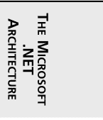

然而，应用程序域（app domains）与线程也不相似，因为许多不同的线程可以在单个应用程序域中运行代码（例如在托管 COM+ 组件的情况下），或者同一个线程可以在多个应用程序域中运行代码（例如在 Web 服务器的情况下）。

> **注意**
>
> 运行时宿主（runtime host）的职责包括加载 CLR、创建应用程序域以及在应用程序域中加载用户代码。运行时宿主包括 ASP.NET 和 Internet Explorer 等。事实上，您可以使用 .NET Framework 随附的且在在线文档中描述的非托管 API 来编写自己的运行时宿主。

CLR 在两种最常见场景中使用应用程序域的方式如下：

- 对于控制台、服务和 Windows Forms 应用程序，默认情况下，会在独立的 Win32 进程中为每个应用程序创建一个单一的应用程序域。
- 对于 Web 应用程序，每个网站都在 Web 服务器进程内部创建自己的应用程序域。

请注意，单个应用程序可以通过编程方式生成新的应用程序域。`System`命名空间支持一个`AppDomain`类，允许开发人员通过编程方式创建和操纵域。

例如，一个实例化对象的应用程序可以请求将其加载到单独的应用程序域中以实现隔离。在这种情况下，将使用类似于经典 COM 中的代理（proxy）和存根（stub）机制来促进通信。这些概念统称为 .NET 远程调用（.NET remoting），将在第 8 章中讨论。

### 类库


本章中的许多讨论都涉及`System`命名空间及其内部的类。在本节中，我将正式介绍命名空间和服务框架（Services Framework）的概念及其对 VB .NET 开发人员的影响。

## 命名空间

熟悉点符号（dot notation）的 VB 开发人员应该能很轻松地想象出命名空间的概念。基本上，.NET 以两种方式使用命名空间：

- 将程序集内部和程序集之间的代码组织（限定范围）为功能集合。
- 将该组织单元公开给其他应用程序，以便它们在设计时可以将其“导入”。

每个程序集可以包含多个命名空间，每个命名空间可以包含多个类甚至其他命名空间。因此，嵌套在`System`命名空间下的`Security`命名空间下的`Cryptography`命名空间中的`AsymmetricAlgorithm`类（位于 system 程序集中）表示为：

```text
System.Security.Cryptography.AsymmetricAlgorithm
```

您在 VS .NET 中创建的每个项目都会自动拥有一个默认的或全局的命名空间，该命名空间与项目名称以及最终的程序集名称相同。不过，您可以根据需要创建自己的命名空间层次结构。此外，您还可以创建跨程序集的嵌套命名空间，就像在服务框架中所做的那样。例如，您可以创建一个包含`Quilogy`命名空间的程序集来公开一些高级类，然后随后在另一个程序集中创建一个名为`Quilogy.Utils`的命名空间。当客户端程序引用这两个程序集时，IntelliSense 会将这些命名空间分组在一起。但在这种情况下，您需要确保不要在原始的 Quilogy 程序集中创建名为`Utils`的类，以免产生名称冲突。

> 本书中的许多章节（尤其是第二部分）将使用一个分布式应用程序的示例，该程序是我就职的公司 Quilogy (www.quilogy.com) 可以使用 .NET 实现的。Quilogy 是一家提供数字化咨询、托管服务和技术教育的服务公司。许多示例与一个用于处理我们技术教育课程学生报名的 Web 应用程序相关。

还应当指出的是，没有机制能防止不同公司创建的命名空间之间发生名称冲突。例如，两家都叫 Smith Brothers 的公司可能会创建`SmithBros`命名空间。当这些程序集在客户端程序中共同使用时，目前没有办法消除引用的歧义。因此，您应尽量为您的命名空间指定尽可能唯一的名称，或许可以从您公司的网站地址开始。

## 服务框架

如前所述，.NET 的目标包括简化且统一的编程模型。实现这一目标的方法之一是在 .NET 中引入服务框架。

服务框架包含由 Microsoft 开发的命名空间，这些命名空间封装了 CLR 的核心功能和常用的系统服务。事实上，本书的大部分内容就是向您展示如何使用服务框架中的类。为了让您初步了解所支持的功能类型，表 1.2 列出了服务框架中的关键命名空间以及它们在本书中的对应关系。

第一部分

**表 1.2 服务框架命名空间。这些命名空间将在本书中进一步详细探讨。**

| 命名空间 | 描述 | 讨论的章节 |
|---|---|---|
|`Microsoft.VisualBasic`|包含 VB 特有的关键字|全书|
|`System.Security`|用于在代码中实现声明式（使用属性）和命令式（在方法代码内）的安全性|5, 8|
|`System.Diagnostics`|用于执行系统监控：即进程、性能监视器和事件日志|6, 12, 13, 14|
|`System.Data`|用于与数据提供者通信|7|
|`Microsoft.Win32`|用于与 Win32 API 交互|8|
|`System.EnterpriseServices`|用于创建在 COM+ 中使用的组件|9|
|`System.Runtime.InteropServices`|用于与 COM 和 Win32 API 交互|8, 9|
|`System.Runtime.Remoting`|用于与其他托管应用程序通信|8|
|`System.Web.UI`|用于为 Web 应用程序创建界面|10|
|`System.Web.Services`|用于创建 Web 服务|11|
|`System.IO`|用于与文件系统交互|12|
|`System.Threading`|用于创建和管理多个执行线程|12|
|`System.Security.Cryptography`|用于通过编程方式进行加密和解密|12|
|`System.Timers`|用于设置和监视系统定时器|13|
|`System.Net`|用于与 Web 协议通信|13|
|`System.XML`|用于通过编程方式加载和操纵 XML 文档|14|
|`System.Messaging`|用于与 Microsoft 消息队列交互|14|
|`System.DirectoryServices`|用于与目录服务交互|14|

显然，服务框架规模巨大，包含 80 多个高级命名空间和 1,200 多个类，没有任何一本书能探讨其所有方面。这就是为什么本书专注于框架中用于使用 VB .NET 构建分布式业务系统的那些方面，并为您提供可复用的技巧。

然而，服务框架给组织带来的关键好处之一是，他们可以为使用任何 CLR 支持语言的开发人员提供与语言无关的框架培训。此外，服务框架包含通用的编程模式和约定，这不仅从程序员的角度统一了框架，而且为自定义类库的设计提供了模板。

## 本章小结

显然，在许多方面，使用 VB .NET 构建分布式应用程序将是一个全新的领域。因此，本章试图通过带您了解变更的原因以及对内部工作原理的初步观察，来为您提供一个坚实的基础。希望您能更好地理解接下来的章节。

首先，我们将研究 Visual Studio .NET 的变化，特别是能协助您构建优秀分布式应用程序的 IDE。为此，让我们开始吧。

# 第 2 章

## 开发环境

### 本章内容

- 新的 IDE 50
- 使用属性 73
- 命令行编译 76

第一部分

正如第 1 章"Microsoft .NET 架构"中提到的，.NET 计划的目标之一是统一开发人员用于构建完整解决方案的各种编程模型。这种统一还扩展到了集成开发环境（IDE）——Visual Studio .NET。Visual C++、Visual Basic 和 Visual InterDev/Visual J++ 开发环境的统一意味着 Microsoft 平台上的所有开发人员都可以使用同一套工具集合——例如，集成调试器和宏功能——从而创造了公平竞争的环境。此外<audio>1</audio>

作为 VS .NET IDE 基础的是随 Visual Studio 6.0 一起发布的 Visual InterDev/Visual J++ IDE。正如您将看到的，它已经得到了扩展，包含了各种 VB .NET 开发人员可以利用的新功能，同时为 VB 开发人员保留了熟悉的感觉。

> 顺便说一下，VS .NET 本身就是一个结合了托管代码和非托管代码的应用程序实例。VS .NET 的核心是用非托管代码编写的，但本章讨论的许多新功能是用托管 VC# .NET 编写的。

本章将对 IDE 进行快速浏览，旨在帮助 VB 开发人员快速上手，并开始高效地使用 VB .NET。

> 本章所有的代码清单和补充材料都可以在本书的网站 www.samspublishing.com 上找到。

## 全新的 IDE

执行 VS .NET 时，您首先会注意到的是起始页，因为它最先出现。此页面是 VS .NET 的"大本营"，用于查看和打开项目，以及作为来自 Microsoft 的信息渠道。例如，页面左侧的链接包括："在线社区"链接，提供包括新闻组在内的 Web 资源列表；"标题新闻"链接，显示来自 msdn.microsoft.com 的当前头条新闻；"在线搜索"链接，允许您搜索 MSDN 在线库；以及"下载"链接，提供可下载的其他 Web 版本和公开测试版的链接。

> **注意**

此外，请注意 Microsoft 还将从起始页提供指向第三方服务的链接。例如，"Web 托管"链接提供有关使用各种应用程序服务提供商托管 ASP.NET 应用程序的信息。从这里，您可以找到更多信息或与其中一个优先托管供应商建立关系。

然而，起始页上最重要的链接是"我的配置文件"链接。此页面允许您自定义键盘方案、窗口布局和帮助筛选器，并将这些设置组合在一个自定义配置文件。此外，还提供了与各种 Visual Studio 开发人员（Visual Basic、Visual C++、Visual InterDev 等）匹配的预定义配置文件。作为起点，我相信许多 VB 开发人员在选择 Visual Basic 配置文件后会逐渐熟悉 IDE。

最后，"启动时"选项还可以用来控制是否显示起始页，或者 VS .NET 是否自动加载上一个项目或显示"打开项目"对话框。

本节的其余部分将讨论使用 IDE 的各种功能创建和管理项目，包括 IDE 窗口、支持的文件类型、引用其他项目，以及使用宏和加载项。

## 项目和解决方案

在最高层次上，VS .NET 在*解决方案*的上下文中工作。简而言之，解决方案是项目的容器，当创建项目时 VS .NET 会自动创建它。解决方案允许您在 IDE 的同一实例中轻松处理多个相关项目。此外，您可以使用"生成"菜单中的"项目"、"项目生成顺序"菜单选项，按指定顺序设置影响所有项目的选项，并用一次鼠标单击生成所有项目。

> **提示**

"项目生成顺序"菜单选项仅在您的解决方案中有多个项目时才会出现。

此外，解决方案还可以用于管理与项目相关但实际上不包含在其中的文件。例如，您可以将 readme 文件添加到解决方案中，以便可以从 IDE 中编辑和处理它们。解决方案通常由两部分组成：用于存储项目引用和生成配置的`.sln`文件，以及用于存储 IDE 配置设置的`.suo`文件。

> **注意**

解决方案类似于以前 VB 版本中的组（`.vbg`）。

## 创建项目

创建项目的第一步是单击"文件"、"新建项目"。生成的对话框左侧包含项目类型，右侧包含每个类型中的各种模板。项目模板允许您创建支持 .NET 中两种主要编程模型的项目——Windows 窗体和 ASP.NET——以及其他辅助项目类型。表 2.1 列出了随 VS .NET 专业版一起提供的 Visual Basic 项目文件夹中的基本模板。

### 表 2.1 VB .NET 项目模板

| 模板 | 说明 |
|---|---|
| Windows 应用程序 | 用于使用 Windows 窗体构建基于窗体的应用程序。创建一个派生自`System.Windows.Forms.Form`的默认窗体。此模板超出了本书的范围。 |
| 类库 | 用于构建类，例如数据访问和业务逻辑类，没有可视界面，我们将在第 7 章"使用 ADO.NET 访问数据"和第 8 章"构建组件"中讨论。创建一个公共类。 |
| Windows 控件库 | 用于为 Windows 窗体应用程序构建可视控件。创建一个派生自`System.Windows.Forms.UserControl`的用户控件。这超出了本书的范围。 |
| ASP.NET Web 应用程序 | 用于构建依赖 Web 窗体的 ASP.NET 应用程序，如第 10 章"构建 Web 窗体"所述。接受用于构建 IIS 虚拟目录的项目名称和位置，与 VID 6.0 相同。包括默认窗体、`Global.asax`和`Web.config`文件。 |
| ASP.NET Web 服务 | 用于构建 ASP.NET Web 服务，如第 11 章"构建 Web 服务"所述。接受用于构建 IIS 虚拟目录的项目名称和位置，与 VID 6.0 相同。包括默认 Web 服务、`Global.asax`和`Web.config`文件。 |
| Web 控件库 | 用于构建可在 ASP.NET 应用程序中重复使用的 ASP.NET 服务器控件，如第 10 章所述。提供派生自`System.Web.UI.WebControls.WebControl`的模板控件。 |
| 控制台应用程序 | 用于构建可在命令提示符下运行的应用程序，经常用于构建实用程序和测试。本书中的许多示例使用此项目模板。 |
| Windows 服务 | 用于构建 Windows 服务应用程序，在第 13 章"实现服务"中讨论。创建派生自`System.ServiceProcess.ServiceBase`的模板服务。 |
| 空项目 | 您可以创建空本地项目和空白 Web 项目。在将项目从一台计算机移到另一台计算机时，这可能很有用，这样您就不必删除为每个项目创建的模板文件。 |

> 请注意，Visual Studio .NET 企业开发版和 Visual Studio .NET 企业架构师版附带额外的模板。例如，在项目类型列表中的"其他项目"节点下是企业模板项目，包括 Visual Basic 分布式应用程序模板。这些企业模板提供架构指导、对应用程序和数据库建模功能的访问，以及与解决方案关联的策略定义。它们允许组织自定义 IDE 等。许多组织将希望使用这些功能；但是，本书将重点放在专业版中找到的模板和功能上。

对话框还包含关于新项目将在现有解决方案还是新解决方案中创建的选项。默认是在对话框中显示的目录中创建一个包含该项目的新解决方案。

> 也可以通过使用"文件"菜单上的"添加项目"选项（而不是"新建项目"）将其他项目添加到解决方案中。

如前所述，使用解决方案的一个优势是能够同时处理多个项目，这样，就像在 VB 6.0 中一样，一个项目可以引用另一个项目中的代码。这种行为通常用于为程序集的单元测试创建测试工具项目。

## 现在你可以构建 Web 应用程序了

既然 Visual Interdev (VID) 的功能已被整合到 .NET Framework 中，并且向任何使用公共语言运行时 (CLR) 的语言开放，VB 开发人员首次能够直接创建 Web 应用程序。请记住，对于 ASP.NET 项目（包括 Web Forms 应用程序和 Web Service 应用程序），实际源文件被置于 Web 服务器的控制之下（通常在`Inetinfo\wwwroot`目录下与项目同名的虚拟目录中），而解决方案文件（`.sln`）则放在本地机器上。

这个位置可以在通过"新建项目"对话框构建 Web 项目时进行更改。对于熟悉 VID 的开发人员来说，这不足为奇。这样，单个开发人员既可以在自己的机器上开发页面和组件，然后将其复制到开发服务器，或者更可能的是，直接从开发服务器进行工作。与以前版本的 Visual Studio 一样，VS .NET 通过与 Visual SourceSafe 或其他源代码控制提供程序集成来支持源代码控制。事实上，Visual SourceSafe 的一个版本随 VS .NET 的企业版一起提供，可以在企业版和专业版中使用，只需右键单击解决方案或项目名称并选择"将解决方案添加到源代码控制"。

你还可以在"工具"、"选项"菜单项中找到控制 VS .NET 如何处理受源代码控制文件的选项。常规选项包括四项设置：Visual SourceSafe、团队开发、独立开发人员和自定义。基本上，每个设置都会影响项目何时以及如何进行签入和签出。例如，使用"独立开发人员"选项时，打开解决方案时解决方案中的所有文件都会被签出。此外，源代码控制提供程序可以挂接到此对话框以提供自定义设置——例如，允许你输入源代码控制系统的身份验证信息。

关于 Web 项目的另一点需要注意的是，当在本地机器上创建 Web 项目时，VS .NET 现在自动使用文件共享访问，而不是 FrontPage 服务器扩展，以提高可靠性和性能。如果项目托管在远程服务器上并且文件共享可用，可以通过右键单击项目并选择"属性"或使用"项目"、"属性"菜单选项进行配置。生成的对话框包含大量配置设置，在"Web 设置"下，允许你更改为 FrontPage 服务器扩展并配置文件共享。默认的 Web 访问方法可以在从"工具"、"选项"菜单调出的"选项"对话框的"项目"、"Web 设置"窗格中设置。

> Web 项目还可以通过单击"项目"、"Web 项目"菜单上的"脱机工作"选项来脱机使用。使项目脱机会将其文件复制到"选项"对话框的"Web 设置"面板中显示的目录下的一个目录中。然后你可以在本地编辑文件，随后使用"项目"、"Web 项目"菜单下的选项与 Web 服务器进行比较和同步。

最后，与其他类型的项目不同，Web 项目可以使用"项目"菜单上的"复制项目"菜单选项或"解决方案资源管理器"窗口上的工具栏按钮进行复制。生成的对话框允许你指定目标项目文件夹，并使用 FrontPage 或文件共享 Web 访问方法复制所有文件或其中一部分。

除了表 2.1 中显示的项目模板之外，VS .NET 还包括一系列安装和部署项目模板。这些将在第 5 章"打包、部署和安全性"中讨论。

创建项目时，其定义存储在相应目录中的`.vbproj`文件中。正如你所期望的，这个文件只是一个包含项目信息的 XML 文件。

## IDE 窗口

选择并加载项目类型后，你可以使用本节中讨论的各种窗口来处理该项目。图 2.1 显示了主要窗口。

## 解决方案资源管理器

进入项目后，用于导航项目的主窗口是**解决方案资源管理器**。通常位于屏幕的右上角，它包含三个视图：文件（默认）视图、类视图和资源视图。

默认视图包括构成项目的文件和目录，以及包括本地和 Web 引用在内的附加项目引用。显然，从这里开始，你可以通过双击文件或突出显示相应文件并使用窗口上的工具栏按钮，在"设计"视图和"代码"视图中编辑项目中的各种文件。

> **提示**

> 要查看通常在文件视图中隐藏的文件，你可以单击工具栏中的"显示所有文件"按钮。例如，这可用于查看`bin`目录中已编译和引用的程序集文件，此外还可以直接访问 ASP.NET 页面使用的代码隐藏文件，我们将在第 10 章中讨论。


如前所述，解决方案资源管理器还支持类和资源视图，可以使用“视图”菜单访问。类视图以分层方式显示解决方案中的项目、命名空间、类和成员，并允许你按字母顺序、按类型和按访问级别对它们进行分组或排序。通过双击树中的任何节点，代码编辑器窗口将显示其定义。显然，这可以成为遍历代码的有效方式，并且可以代替使用代码编辑器顶部下拉列表的传统做法，因为类视图显示整个项目而不是单个类。

资源视图显示项目中包含的资源文件，并以分层方式显示类型以及每个文件中的资源。

## 属性

与 VB 6.0 中一样，“属性”对话框显示与解决方案资源管理器、可视化设计器或代码编辑器窗口中当前突出显示的对象关联的属性。它出现在屏幕的右下角，带有动态帮助窗口，但与其他窗口一样，它可以取消停靠并移动到其他位置。显然，未禁用的属性可以在设计时通过单击属性并直接更改其值来设置。某些属性还提供特殊的属性编辑器，允许你以图形方式设置属性，例如与`BackColor`等属性一起使用的颜色编辑器。

### 工具箱

“工具箱”窗口显示在屏幕的左侧，在使用 Visual Studio 开发人员配置文件时，它设置为自动隐藏，并且仅当你将光标放在小预览窗口上或使用“视图”、“工具箱”菜单时才会出现。

显示工具箱时，它由一系列选项卡组成。除了始终存在的“常规”和“剪贴板循环”选项卡外，哪些选项卡出现以及哪些组件被启用取决于你正在处理的项目类型、在开发环境中选择的对象，以及企业模板策略是否生效。

> **提示**
>
> 当你将光标移离工具箱或单击 IDE 中的其他位置时，工具箱会消失。要使其保持打开状态，请使用图钉图标或“窗口”菜单上的菜单选项在工具箱具有焦点时关闭“自动隐藏”。这也适用于所有其他窗口。

与以前版本的 VB 一样，你可以将项目从工具箱拖放到设计器图面上，例如 Web 窗体。但是，请注意，工具箱还包含包含本质上非可视化组件的选项卡，例如事件日志和性能监视器计数器。这些类型的组件可以拖放到设计器上，并自动生成在`.vb`文件中使用该组件的模板代码。

要自定义工具箱，你可以右键单击它并添加选项卡、排序、在选项卡上添加和删除组件、显示所有可用选项卡以及重命名选项卡。通过右键单击工具箱并选择“自定义工具箱”调出的“自定义工具箱”对话框显示经典 COM 组件以及当前机器上安装的`.NET`组件。“重置”按钮允许你将工具箱的内容恢复到 VS .NET 首次启动时的状态。

工具箱中一个 VB 6.0 中没有的有趣功能是能够在任何选项卡上存储文本（片段），只需在代码编辑器中突出显示文本并将其拖放到选项卡上即可。然后你可以重命名该项，随后将其拖动到其他页面。这种简单的重用形式对于经常使用的编程构造（如循环和条件逻辑）非常方便。

### 代码编辑器

开发人员使用 IDE 的大部分时间都在代码编辑器中度过。幸运的是，VS .NET 中的编辑器包含了 VB 开发人员所习惯的同样强大的功能，此外还有几个新功能。

首先需要注意的是，与 VB 一样，代码编辑器通常只在图形设计器打开后才被调用。例如，默认情况下，当你在解决方案资源管理器中双击一个文件时，其设计器会加载并显示 Web 页面、窗体或组件设计器。在某些情况下，设计器本身包含多个视图。例如，编辑 Web 窗体时，设计器支持图形视图和通过视图底部的选项卡访问的 HTML 视图。这两种视图都会影响可视化界面，因此它们在逻辑上都是设计器的一部分。然而，执行窗体背后的代码可以通过双击设计器、使用上下文菜单，或者如前所述，使用解决方案资源管理器窗口中的工具栏按钮来访问。

### 提示

在 HTML 视图中编辑网页时，代码编辑器窗口的右上角还包含两个额外按钮。这些按钮可用于在完整 HTML 视图和仅脚本视图之间切换，以便你可以仅编辑代码中的服务器端和客户端脚本块。

打开代码编辑器后，其顶部包含熟悉的下拉列表，用于为事件创建处理程序。左侧的下拉列表显示当前类和使用`WithEvents`关键字声明的任何类级变量。右侧的下拉列表则显示当前选定对象公开的事件。此外，左侧下拉列表包含“重写”和“基类事件”项。前者用于显示左侧可以（如果存在基类）从基类重写的方法列表，而后者显示可以处理的事件列表。通过选择其中一项，将创建一个新的方法定义（使用`Overrides`关键字，这将在第 4 章“面向对象特性”中讨论）或使用`Handles`关键字的事件处理程序。

请注意，在两个下拉列表中，对象和成员前面放置了小图标，以指示访问级别（在第 4 章中解释）和对象或成员的类型，如图 2.2 所示。

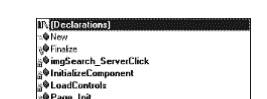

### 图 2.2

代码编辑器下拉列表中显示的图标。

在图 2.2 中，受保护的成员（如`Page_Init`）用钥匙图标标记，私有成员（如`InitializeComponent`）包含挂锁图标，而公共成员则只有一个立方体图标。

代码编辑器一个更显眼的新特性包括使用“区域”概念的大纲功能。要定义一个区域，你可以使用`#Region`和`#End Region`声明来包裹一段代码。然后可以折叠和展开该区域，以便更轻松地导航代码。编辑菜单上的大纲选项或通过上下文菜单访问的选项也可用于折叠和展开区域。

虽然 VB 开发人员始终习惯于一定级别的代码重新格式化（如关键字大写和文本高亮显示），但代码编辑器现在支持两个级别的自动缩进（块和智能）以及插入空格和制表符的功能。这些选项和其他影响编辑器的选项（如行号）可以在从“工具”、“选项”菜单中调用的“选项”对话框的“文本编辑器”、“Basic”面板中找到。

与 VB 6.0 一样，默认支持完整的 IntelliSense，包括成员列表、参数信息、快速信息和语句完成。它可以通过“编辑”、“IntelliSense”菜单显式调用。IntelliSense 默认设置也可以在“文本编辑器”、“Basic”面板中设置。

### 注意

VB .NET 开发人员希望包含但未能进入发布产品的一项功能是 XML 注释。通过将注释放在预定义的 XML 标签中，编译器可以将它们包含在元数据中，当使用组件时，IntelliSense 和对象浏览器随后会显示这些元数据。虽然这是一个很棒的功能，但它增加了代码的大小并降低了可读性，因此请期待微软在未来版本中采取不同的方法。

### 服务器资源管理器

IDE 中最有趣的新窗口也许是服务器资源管理器。它出现在与工具箱相同的位置，并且在其自动隐藏设置方面行为相同。服务器资源管理器背后的概念是提供图形化访问开发人员需要交互的组件，无论是在他们的机器上还是更可能在服务器上。通过这种方式，服务器资源管理器绝对是为需要以编程方式访问报表、消息队列、事件日志、性能计数器、服务和 SQL Server 数据库的中间层开发人员设计的。

例如，要使用服务器资源管理器，只需单击“视图”、“服务器资源管理器”，窗口就会出现。默认情况下，窗口显示当前计算机，但可以通过右键单击树视图中的“服务器”节点并选择“添加服务器”来访问其他计算机。通过深入到感兴趣的服务器，你可以检查各种组件，然后将一个组件拖放到设计器表面。对于构建中间层组件的开发人员，这可以通过向项目添加新组件来完成，该组件创建一个从`System.ComponentModel.Component`派生的类。此类允许组件公开组件设计器表面，可以在其上拖放组件。通过将组件拖放到表面上，其可视化表示会出现在设计器上，同时向类添加代码。

为了说明在此过程中创建的代码，图 2.3 显示了在将名为`usp_GetStudent`的 SQL Server 存储过程拖放到表面后，组件设计器的情况。因为组件是非可视的，所以表面上会出现一个图标，类似于使用随 VB 6.0 一起交付的 Internet 或 Mail 控件。

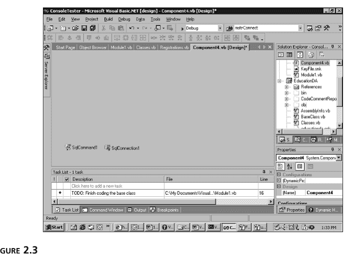

### 图 2.3

拖放组件后的组件设计器表面。

然而，在幕后，类中添加了两个成员，并创建了`InitializeComponent`方法来初始化与拖放的组件对应的对象。所有代码都包含在一个默认折叠的区域中。结果可以在清单 2.1 中看到。

### 清单 2.1

自动生成的代码。此代码由服务器资源管理器生成以执行 SQL Server 存储过程。

```vb
#Region " Component Designer generated code "

Public Sub New(ByVal Container As System.ComponentModel.IContainer)
    MyClass.New()

    'Required for Windows.Forms Class Composition Designer support
    Container.Add(Me)
End Sub

Friend WithEvents SqlConnection1 As System.Data.SqlClient.SqlConnection
Friend WithEvents SqlCommand1 As System.Data.SqlClient.SqlCommand

<System.Diagnostics.DebuggerStepThrough()> _
Private Sub InitializeComponent()
    Me.SqlConnection1 = New System.Data.SqlClient.SqlConnection()
    Me.SqlCommand1 = New System.Data.SqlClient.SqlCommand()

    'SqlConnection1
    Me.SqlConnection1.ConnectionString = "data source=SSOSA;" & _
    "initial catalog=Enrollment;integrated security=SSPI;persist sec" & _
    "urity info=True;workstation id=SSOSA;packet size=4096"

    'SqlCommand1
    Me.SqlCommand1.CommandText = "dbo.usp_GetStudent"
    Me.SqlCommand1.CommandType = System.Data.CommandType.StoredProcedure
    Me.SqlCommand1.Connection = Me.SqlConnection1
    Me.SqlCommand1.Parameters.Add(New System.Data.SqlClient.SqlParameter("_ 
    "@RETURN_VALUE", System.Data.SqlDbType.Int, 4, _
    System.Data.ParameterDirection.ReturnValue, True, CType(10, Byte), _
    CType(0, Byte), "", System.Data.DataRowVersion.Current, Nothing))
    Me.SqlCommand1.Parameters.Add(New System.Data.SqlClient.SqlParameter("_ 
    "@StudentID", System.Data.SqlDbType.Int, 4, _
    System.Data.ParameterDirection.Input, True, CType(10, Byte), _
    CType(0, Byte), "", System.Data.DataRowVersion.Current, Nothing))
End Sub

#End Region
```

在清单 2.1 中，因为执行存储过程需要连接到数据库，所以创建了两个对象：一个 ADO.NET`SqlConnection`和一个`SqlCommand`。（我们将在更多细节详见第 7 章。）你可以使用属性窗口以图形方式更改这些组件及其属性的名称，相应的代码将会被重写。

尽管以这种方式使用服务器资源管理器可以加快开发进程，但它也有助于学习如何使用某些服务框架。在许多情况下，你可能不想从`Component`继承，因此这里生成的代码可以直接复制并在其他地方使用。另外请注意，生成的代码有些冗长，因为它使用命名空间完全限定所有被调用对象，而不是使用`Imports`语句。

> **提示**
>
> 如果你打算使用服务器资源管理器生成的代码，则不应修改生成的代码，因为 VS .NET 使用它在属性窗口和组件设计器中显示适当的信息。

### 文档大纲

开发 HTML 时，查看页面中包含的 HTML 的分层表示通常很方便。文档大纲窗口源自 VID/VJ++ IDE，当处于设计视图或 HTML 视图时，它显示网页上元素和脚套的嵌套分层视图。该窗口从“视图”→“其他窗口”菜单调用，在 HTML 大纲视图中可用于浏览页面，或在脚本大纲视图中用于添加客户端脚本。两种视图均可从窗口内的工具栏访问。通过双击某个元素，它将在代码编辑器中高亮显示。

### 对象浏览器

VB 开发人员应该熟悉通过“视图”→“其他窗口”菜单访问的对象浏览器窗口。与 VB 6.0 中一样，默认情况下它包含三个窗格，显示活动项目的类及其成员，以及它们引用的项目。在最高级别，每个程序集及其子命名空间显示在左侧窗格中，随后是它们支持的接口和类。成员及其签名显示在右侧窗格中，而指向联机帮助的链接则显示在底部窗格中。

> **提示**
>
> 对象浏览器可用于通过右键单击某个成员并选择“复制”，将其完全限定名复制到剪贴板。

对象浏览器实际上包含两种浏览模式。除了显示活动项目的信息外，你还可以从下拉列表中选择“选定组件”，并使用“自定义”按钮添加项目中未引用的组件。尽管在活动项目模式下，当你单击解决方案资源管理器中的每个项目时，对象列表会发生变化，但在“选定组件”模式下，引用列表保持不变，并在 VS .NET 关闭时保存。

与其他窗口（如工具箱和服务器资源管理器）不同，对象浏览器窗口默认未设置为可停靠。因此，它显示在可通过选项卡访问的窗口列表中，与起始页和代码编辑器窗口并列。与所有窗口一样，通过右键单击窗口的选项卡或标题栏，可以设置停靠选项以允许窗口停靠。

### 任务列表

与文档大纲类似，任务列表窗口源自 VID/VJ++ IDE，可用于跟踪开发任务。此外，它还可以用于显示编译错误和警告。这样，任务列表通常包含用户定义和系统定义的混合消息。

> **注意**
>
> 可停靠的任务列表窗口还显示命令、输出和断点窗口，这些窗口使用窗口底部的选项卡访问。我们将在第 6 章“错误处理和调试”中更详细地讨论这一点。

任务列表的左侧列显示优先级以及一个图标，该图标显示描述中显示的消息类型。完整类型列表可在联机帮助中找到。要添加新任务，只需单击列表中的第一个条目并输入数据。用户定义的任务还允许你使用复选框标记它们是否完成。任务本身可以按类型和状态进行筛选，此外还可以使用右键单击窗口时调用的上下文菜单进行排序。

任务列表窗口的一个更有趣的用途是用注释标注代码，这些注释会自动加载为任务。当单击任务时，代码窗口将打开并导航到注释行。此功能通过选项对话框中的“环境”→“任务列表”窗格控制。在此窗格中，你可以添加、修改和删除用作注释前缀的标记。默认情况下，定义了`HACK`、`TODO`、`UNDONE`和`UnresolvedMergeConflict`标记。尽管你不能删除`TODO`标记，因为框架中的各种类都使用它，但你可以添加自己的标记，例如，为其他开发人员突出显示特定算法。

例如，通过创建名为`QUILOGY`的自定义标记并创建以该标记和冒号为前缀的注释，描述将被添加到任务列表中，如以下代码所示：

```vb
'QUILOGY: Authentication code
FormsAuthentication.SetAuthCookie(txtEmail.Text, False)

' Authenticated so send them to requested URL
If InStr(FormsAuthentication.GetRedirectUrl(txtEmail.Text, False), _
    "default.aspx") > 0 Then
    Response().Redirect("\QuilogyEducation\QEducation.aspx")
Else
    FormsAuthentication.RedirectFromLoginPage(txtEmail.Text, False)
End If
```

### 动态帮助

图 2.1 中 IDE 的最后一个主要窗口是动态帮助窗口。此窗口的目标是显示基于你当前在 IDE 中工作的区域或任务的上下文相关帮助主题。主题列表根据相对权重显示，并按类别分解，如帮助、操作、杂项和示例。

> **注意**
>
> 此窗口中显示的主题列表不受你可在起始页上指定的帮助筛选器的影响。

你可以使用选项对话框中的“环境”→“动态帮助”面板自定义显示的类别和主题，以及窗口中显示的链接数量。

当你单击链接时，它会直接在 IDE 中的单独窗口里显示。尽管某些开发人员可能会发现此功能很有用，因为它显示上下文相关帮助，但它占用的屏幕空间巨大，加上帮助窗口容易丢失，这意味着许多开发人员会选择使用 Microsoft Visual Studio .NET 程序组中的图标单独打开帮助。

### 支持的文件类型

根据你当前所在的投影类型，可以创建或添加的项的选择将被筛选。然而，总体而言，最重要的项可以分为四个基本类别：通用项目项、Windows 窗体项、ASP.NET 项目项和辅助项目项，下面将逐一讨论。

#### 通用项目项

创建项目后，你可以通过在解决方案资源管理器中右键单击项目并从菜单中选择，或使用“项目”菜单，向项目添加新项。表 2.2 中显示的项是可以添加到任何项目的项。通常，这些项用作项目中可重用组件和实用程序代码的基础。

### 表 2.2 通用项目项

| 项 | 描述 |
|---|---|
| 类 | 创建带有`.vb`扩展名的文件并将其添加到项目中。在文件中，它定义一个通用类。用于创建自己的类（即业务逻辑或数据访问类）。 |
| 模块 | 创建带有`.vb`扩展名的文件，将其添加到项目中，并包含一个模块声明。与 VB 6.0 中一样，模块用于实用函数和全局数据。基本上，模块是实现为仅包含共享成员且不可创建的类。同一命名空间中模块内的任何代码都可以不经限定访问其成员。这不应与第 1 章讨论的 CLR 模块混淆。 |


| 组件类 | 创建带有`.vb`扩展名的文件并将其添加到项目中，其中包含一个从`System.ComponentModel.Component`派生的类声明。允许使用服务器资源管理器窗口对组件进行可视化设计。 |
|---|---|
| 事务组件 | 创建带有`.vb`扩展名的文件并将其添加到项目中，其中包含一个从`System.EnterpriseServices.ServicedComponent`派生的类声明。可用作使用 COM+ 服务（如事务）的业务逻辑和数据访问组件的基础。 |
| 代码文件 | 创建空的带有`.vb`扩展名的文件。 |
| 数据集 | 创建带有`.xsd`扩展名的文件，允许你以图形方式设计`System.Data.DataSet`类的 XSD 架构。公开一个自动生成的`.vb`文件，该文件表示强类型数据集。 |
| XML 文件、XML 架构、XSLT | 用于创建包含在项目中的这些类型的文件。 |

### Windows Forms

在创建基于窗体（form-based）的应用程序时（这超出了本书的讨论范围），您可以添加 Windows Forms、继承自现有窗体的窗体（称为继承窗体）、用户控件、继承用户控件以及自定义控件。

### ASP.NET 项目项

在构建 ASP.NET 应用程序时，您可以添加表 2.3 中列出的项目项。

表 2.3 ASP.NET 项目项

| 项目 | 描述 |
|---|---|
| Web 窗体 | 创建一个扩展名为`.aspx`的文件以及一个关联的`.vb`文件，后者包含被称为“代码隐藏文件（code-behind file）”的页面逻辑。`.vb`文件中的类派生自`System.Web.UI.Page`。用作 Web 应用程序用户界面的基础。 |
| Web 服务 | 创建一个扩展名为`.asmx`的文件以及一个关联的`.vb`文件，后者在派生自`System.Web.Services.WebService`的类中包含服务逻辑。用于定义 Web 服务的接口。 |
| HTML 页面 | 创建一个通用的`.html`文件。 |
| 框架集 (Frameset) | 根据选择对话框创建一个定义 frameset 标签的 HTML 文件。 |
| 样式表 | 创建一个扩展名为`.css`的层叠样式表。可以使用 VS .NET 内置的图形编辑器进行编辑。 |
| Web 自定义控件 | 创建一个`.vb`文件，其中包含一个派生自`System.Web.UI.WebControls.WebControl`的类。用于构建 ASP.NET 服务器控件。 |
| Web 用户控件 | 创建一个扩展名为`.ascx`的文件以及一个关联的`.vb`文件，用于创建可以通过图形化编辑的可重用控件。 |
| 全局应用程序类 | 创建一个`Global.asax`文件和关联的`.vb`文件，其中包含一个继承自`System.Web.HttpApplication`的名为`Global`的类。该类定义了 ASP.NET 应用程序的 Application 和 Session 事件。 |

### 辅助项目项

辅助项目项是指可以添加到不同类型项目中并提供支持服务的项目，如表 2.4 所示。

表 2.4 辅助项目项

| 项目 | 描述 |
|---|---|
| Windows 服务 | 创建一个扩展名为`.vb`的文件，其中包含一个派生自`System.ServiceProcess.ServiceBase`的类，用于实现 Windows 服务。同时引用相应的程序集。 |
| COM 类 | 创建一个扩展名为`.vb`的文件，其中包含类签名以及适当的属性和 GUID，以构建可由经典 COM 客户端访问的组件。 |
| Crystal 报表 | 自动引用 Crystal reports 程序集并调用 Crystal Report Gallery，以构建一个扩展名为`.rpt`的新报表并添加到项目中。 |
| 安装程序类 | 创建一个扩展名为`.vb`的文件，其中包含一个派生自`System.Configuration.Install.Installer`的类，用于安装基于服务器的资源（如性能计数器和事件日志）。同时引用相应的程序集。 |
| 程序集资源文件 | 创建一个扩展名为`.resx`的文件，用于存放用于本地化的资源。 |
| 程序集信息文件 | 创建一个`.vb`文件，其中包含用于指定程序集常规信息（如标题、描述和版本）的标准程序集级属性。 |
| 应用程序配置文件 | 在项目中创建一个`app.config`文件，用于存储第 1 章中讨论的配置信息。 |
| JScript, VBScript, Windows Script host | 分别创建扩展名为`.js`、`.vb`和`.wsf`的空文件。 |

### 设置项目引用

当然，VB 的主要优势之一一直是能够以 COM 组件和控件的形式集成外部代码。在 VB .NET 中，与任何托管语言一样，外部代码被包含在程序集中，可以在 VS .NET 内部引用这些程序集。

通过调用“项目” $\rightarrow$ “添加引用”菜单，或者在“解决方案资源管理器”窗口中右键点击“引用”，即可显示引用对话框，如图 2.4 所示。

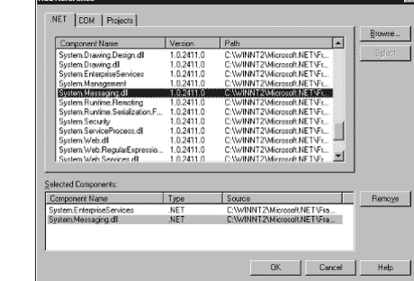

**图 2.4**

“引用”对话框允许您引用项目外部的程序集。

> **注意**
>
> 您还可以使用“添加 Web 引用”菜单选项来添加 Web 引用。这用于引用 Web 服务，将在第 11 章中详细讨论。

通过引用程序集，您将关于该程序集的信息（包括您引用的具体版本）包含在您程序的清单（manifest）中。

> **注意**
>
> 正如第 1 章所述并在第 5 章中详细阐述的，程序集可以是私有的或共享的。私有程序集是指没有强名称的程序集，因此它们被部署在应用程序目录中。为此，VS .NET 会自动将私有程序集复制到应用程序目录。可以通过将属性窗口中的“复制本地 (Copy Local)”属性更改为 False 来针对每个程序集控制此行为。但请注意，如果您的应用程序加载了该程序集中的类而未找到，将 Copy Local 更改为 False 会导致运行时抛出异常。

显然，被引用的程序集将出现在“对象浏览器”中，您可以针对其任何公共类型进行编程。由于程序集包含命名空间层次结构，其中一些嵌套了多层，因此引用程序集中的类可能需要较长的语句。例如，如果引用了一个包含 Quilogy 数据访问类的程序集，则访问 Students 类所需的代码如下：

```vb
Dim oEnroll As Quilogy.Education.Enrollment.Students
```

由于编写此类代码（即使有 Intellisense）也非常繁琐且影响可读性，您可以使用`Imports`语句引用命名空间，从而允许在不加限定符的情况下使用类型的名称。例如，相同的声明也可以写成这样：

```vb
Imports Quilogy.Education.Enrollment
Dim oStud As Students
```

每个代码文件（`.vb`）可以包含多个`Imports`语句，它们必须出现在文件的顶部，紧跟在`Option`语句（如`Option Strict`和`Option Explicit`）之后。

> **注意**
>
> `Imports`语句中引用的名称范围包括在文件内声明的命名空间。换句话说，`Imports`语句不跨源文件生效。

由于完全有可能引用包含同名类型的程序集，因此有时需要使用别名来引用特定的命名空间。例如，如果客户端和`Quilogy.Education.Enrollment`命名空间都包含一个`Students`类，可以通过以下方式区分这两个类：

```vb
Imports QEnroll = Quilogy.Education.Enrollment

Dim oMyStud As Students
Dim oStud As QEnroll.Students
```

请注意，别名是通过将别名名称设置为等于命名空间名称来定义的。

### 宏和加载项

正如您所预期的，VS .NET IDE 还公开了一个 COM 自动化模型（原称为可扩展性模型），允许您编写代码来扩展和增强 IDE。利用该自动化模型，您可以创建能够提高生产力或协助其他开发者的开发工具。自动化模型的编程接口可以通过宏或加载项来使用。

### .NET 概念

第一部分

#### 宏

在过去，VB 开发者无法使用宏，尽管从概念上讲，它们与您在 Microsoft Excel 等产品中熟悉的宏是一样的。与这些产品一样，在 VS .NET 中可以使用“工具” $\rightarrow$ “宏”菜单中的宏录制器来录制宏。生成的代码包含在一个模块中，可以通过“工具” $\rightarrow$ “宏”菜单查看“宏资源管理器”窗口来访问。该窗口显示为“解决方案资源管理器”窗口中的一个附加窗格，可用于编辑、删除、运行和添加新宏。例如，通过右键点击宏并选择“编辑”，将打开宏 IDE 以允许编辑。

> **注意**
>
> 宏是自动编译的，因此您无需在宏编辑器中显式编译它们。只需保存更改，宏在下次执行时就会重新编译。如果您开发的宏包含希望分发并对第三方保密的知识产权，请考虑将宏实现为“加载项（Add-In）”，详见下一节。

通常，宏由单个开发者使用，以自动执行一组常用的按键操作，或者在代码编辑器窗口中插入否则需要更复杂操作的代码。宏保存在“环境” $\rightarrow$ “项目和解决方案”面板的“选项”对话框中所找到的路径下的`\VSMacros`目录中。宏可以存储为二进制文件或文本文件，通过属性窗口中的`StorageFormat`属性进行控制。将宏保存为二进制文件可以更方便地共享，而将其保存为文本则允许您在 VS .NET 之外对其进行操作。

> **提示**
>
> 宏可以包含在宏打开时自动运行的事件处理代码（但并非在 VS .NET 打开时运行）。由于这带来了潜在的安全隐患，当选中“宏资源管理器”中的最高级节点时，可以使用属性窗口中的`DefaultSecurity`属性禁用所有宏的事件处理。此外，也可以用同样的方法禁用特定宏集合的事件处理。

虽然讨论自动化对象模型超出了本书的范围，但示例 2.2 中的代码演示了使用宏可以完成的操作。

### 提示

与任何宏录制器一样，你可以用它来探索自动化对象模型，方法是录制一些你通常在 VS .NET 中执行的操作，然后查看生成的代码。随后，你可以将这些代码作为新宏的基础。

清单 2.2 创建宏。本清单展示了创建一个宏的代码，该宏在选中文本周围插入一个新区域。

```vb
Imports EnvDTE
Imports System.Diagnostics
Imports Microsoft.VisualBasic.ControlChars

Public Module Module1

    Public Sub CreateRegion()
        Dim selection As TextSelection
        Dim startPt As EditPoint
        Dim endPt As EditPoint
        Dim regionName As String

        ' Prompt for the name of the region
        regionName = InputBox("Enter the name of the Region", _,
            "Region", "New Region")

        ' Get the active selection
        selection = DTE.ActiveDocument.Selection()

        ' Get the start and end points of the selection
        startPt = selection.TopPoint.CreateEditPoint()
        endPt = selection.BottomPoint.CreateEditPoint

        ' Create an undo context in case of an error
        DTE.UndoContext.Open("Create Region")
        Try
            startPt.StartOfLine()
            startPt.Insert("#Region """ & regionName & """ " & vbCrLf)
            endPt.StartOfLine()
            endPt.LineDown(1)
            endPt.Insert("#End Region" & vbCrLf)
        Finally
            ' Commit the change
            DTE.UndoContext.Close()
        End Try
    End Sub
End Module
```

清单 2.2 包含一个宏的完整代码，该宏通过在宏资源管理器窗口中的 MyMacros 上右键单击并选择新建宏来创建。在重命名`Sub`过程之后，程序中的代码被创建用于自动在代码编辑器窗口中当前高亮显示的任何文本周围创建一个可折叠的区域。

在清单 2.2 中，自动化模型通过一个名为`EnvDTE`的程序集公开，并使用`Imports`语句导入。在使用`InputBox`函数提示输入区域名称后，活动选区通过自动化模型中最高级别对象`DTE`（开发工具可扩展性）中`ActiveDocument`对象的`Selection`方法，在`TextSelection`对象中检索。

然后，`TextSelection`的起始点和结束点通过使用`TopPoint`和`BottomPoint`属性来检索。在这些点插入文本的能力是通过使用`CreateEditPoint`方法在每个点上创建编辑点来实现的。

为了确保编辑代码时发生的错误可以被撤销，`UndoContext`对象的`Open`方法被调用。基本上，这类似于在 IDE 中开始一个事务，如果抛出异常，所有更改都将被撤销。实际的代码编辑发生在`Try`块中（在第 6 章中讨论）。`StartOfLine`方法将插入点移动到`EditPoint`中指示的行的开头，在本例中是`TextSelection`的起始点，然后使用`Insert`方法插入文本。类似地，`#End Region`语句在选区末尾插入。`Finally`块然后发出`UndoContext`的`Close`以提交更改。

要使用此宏，你可以高亮显示一块代码，然后在宏资源管理器窗口中双击该宏。结果是一个包含高亮代码的新区域。

> 注意：有关自动化对象模型的更多信息，请参阅在线文档。

### 外接程序

扩展 IDE 的第二种方式是通过使用外接程序。虽然 VB 开发人员应该熟悉这个概念，因为 VB 6.0 公开了一个外接程序模型，但编程接口并不相同。外接程序对于封装你希望在整个组织或向第三方分发的代码很有用。通常，企业开发人员比起外接程序更多地使用宏，因此对该主题的完整讨论超出了本书的范围。

简而言之，创建外接程序并确保其注册的最佳方法是使用 Visual Studio .NET 外接程序项目模板，该模板在创建新项目时位于其他项目、扩展性项目文件夹中。生成的项目包含一个名为`Connect`的类，该类包含了你通常会为外接程序实现的各种方法的存根。此外，它还注册了外接程序并提供额外的说明。该模板还创建了一个 Windows 安装项目，用于打包外接程序及其适当的依赖项。

在外接程序注册后，可以通过从工具菜单访问的外接程序管理器对话框加载它。

### 使用特性

在 CLR 中引入的一个概念，对许多 VB 开发人员来说就是新的，那就是特性。基本上，特性是放置在程序集、接口、结构、类或成员级别的声明性结构，通常用于指示编译器或 CLR 的组件（如安全系统）如何处理放置了该特性的实体。

在 VB .NET 中使用特性的语法是将特性用`< >`符号括起来，并用逗号分隔，直接放在特性应生效的实体声明之前。此外，每个特性可以放在单独的行上以提高可读性。例如，由`RegAsm`实用程序使用的、将托管程序集注册为 COM 类的特性`GuidAttribute`和`ProgIdAttribute`可以放在类声明上，如下所示：

```vb
<GuidAttribute("A2AD3270-9BB3-4CBA-8206-C87CAA33F562"), _
 ProgIdAttribute("MyAddin1.Connect")> _
Public Class Connect
```

特性可以包含构造函数，如这里所示，以及其他公共属性。要设置构造函数中未找到的属性，请使用`:=`运算符，如下所示：

```vb
<ConstructionEnabled(True, Default:="c:\\logfile=da.log")> _
Public Class DataAccess
```

在这个例子中，构造函数接受一个布尔值，启用组件服务对象构造，并填充一个额外的`Default`属性，该属性可以设置为指定日志文件位置的字符串，例如。

除了简单地使用框架公开的特性外，你还可以创建自己的特性来指定自定义元数据。例如，如果你正在设计一组要广泛分发的框架类，你可以创建一个自定义特性来封装关于参考文档的信息。

要创建自定义特性，你只需要创建一个从`System.Attribute`派生的新类。清单 2.3 演示了创建一个名为`DocumentationAttribute`的自定义特性，以包含文档信息。

> **注意**：通常会在特性名称后添加`Attribute`后缀；然而，使用该特性的客户端不需要包含这部分名称。

#### 清单 2.3 创建自定义特性

此类实现了一个用于文档目的的自定义特性。


```vb
<AttributeUsage(AttributeTargets.Class Or _
    AttributeTargets.Interface Or AttributeTargets.Enum Or _
    AttributeTargets.Struct)> _
Public Class DocumentationAttribute : Inherits Attribute

    Private strUrl As String
    Private strAuthor As String

    Public Sub New(ByVal url As String)
        Me.strUrl = url
    End Sub

    Public Property Author() As String
        Get
            Return strAuthor
        End Get
        Set(ByVal Value As String)
            strAuthor = Value
        End Set
    End Property

    Public ReadOnly Property Url() As String
        Get
            Return strUrl
        End Get
    End Property

End Class
```

在清单 2.3 中，甚至在类声明之前，它本身也使用了一个名为 `AttributeUsage` 的特性来控制该特性可以放置在哪些类型的实体上。在本例中，`Or` 运算符与 `AttributeTargets` 枚举中的常量一起使用，以表明 `DocumentationAttribute` 只能放置在类、接口、枚举类型或结构上。

### 提示

要允许特性放置在任何地方，你可以使用 `AttributeTargets.All`。`AttributeUsageAttribute` 还公开了一个 `AllowMultiple` 布尔属性，指示是否可以在同一实体上放置该特性的多个实例。

还要注意，这个特性包含两个属性，`Author` 和 `Url`，并且 `Url` 被传递给构造函数，是必需的。

该特性的用户随后可以用 `DocumentationAttribute` 来装饰他们的类，如下所示：

```vb
<Documentation("http://www.quilogy.com/qa/dataaccess.aspx", _
  Author:="Dan Fox")> _
Public Class QuilogyDataAccess
```

如前所述，`Attribute` 可以从声明中省略，并且因为 `Author` 属性不在构造函数中，所以可以使用 `:=` 赋值运算符将其添加到声明中。

在运行时，声明了特性的类的客户端可以使用 `Type` 对象的 `GetCustomAttributes` 方法来读取特性信息。例如，以下代码使用 `GetType` 函数从前面的代码示例返回 `QuilogyDataAccess` 的 `Type` 对象：

```vb
Dim type As Type = GetType(QuilogyDataAccess)
Dim arr() As Object
Dim att As Attribute

arr = type.GetCustomAttributes(False)
For Each att In arr
    If TypeOf att Is DocumentationAttribute Then
        Dim da As DocumentationAttribute = _
        CType(arr(0), DocumentationAttribute)
        Console.WriteLine("Url = " & da.Url & "Author = " & da.Author)
    End If
Next
```

然后，它使用 `GetCustomAttributes` 方法检索自定义属性数组，并通过 `TypeOf` 语句遍历该数组以查找 `DocumentationAttribute`。找到后，它会将 `Object` 转换为 `DocumentationAttribute` 类型，以便查询其属性 `Url` 和 `Author`。

## 命令行编译

虽然大多数开发人员通常使用 VS .NET IDE 来构建他们的项目，但 VB .NET 还附带了一个命令行编译器 `VBC.exe`。这在通过批处理文件自动化编译时非常有用，并且它包含一整套开关，可以完成 VS .NET 生成选项所能做的所有事情。

> **提示**
>
> 使用命令行编译器的一种便捷方式是从 Visual Studio .NET 程序组中安装的 Visual Studio .NET 工具文件夹打开 Visual Studio .NET 命令提示符。命令窗口打开时，访问命令行编译器所需的适当路径已经设置好。

例如，以下命令行将当前目录中的所有 `.vb` 文件编译为一个名为 `EducationData.dll` 的程序库程序集（`/target`），并使用 `/out` 指定输出文件名。此外，该命令包含调试信息（`/debug`），不显示徽标信息（`/nologo`），而 `/r` 选项引用 `MyCustom.dll` 程序集，其方式类似于在 VS .NET 中设置项目引用。

```text
vbc /target:library /out:EducationData.dll /nologo /debug /r:MyCustom.dll *.vb
```

命令行编译器还可以使用 `/target:module` 选项创建独立模块，这些模块随后可以编译到多文件程序集中，其中包括用其他语言生成的模块。

如前面的代码示例所示，使用命令行编译器需要为项目设置所有适当的选项，例如 VS .NET 创建项目时在 `.vbproj` 文件中包含的引用。若要利用 `.vbproj` 文件并仍执行命令行编译，可以从命令行使用 `devenv.exe`，即 VS .NET IDE。

例如，要从解决方案内部编译特定项目，可以使用以下命令行：

```text
devenv DataAccess.sln /build debug /project EducationDA.vbproj
```

在此示例中，将使用调试配置生成 `DataAccess` 解决方案中的 `EducationDA` 项目。输出到控制台的内容与 VS .NET 中“输出”窗口中的内容相同。

## 小结

本章快速介绍了 VS .NET IDE，使你了解其组织方式和一些功能。显然，有关各种选项的详细信息，最好通过使用联机文档，特别是当你使用 IDE 的各种功能时使用动态帮助窗口来获取。

既然舞台已经搭好，是时候开始探索 VB .NET 语言的特定更改和功能了，这些将在构建 VB .NET 应用程序时使用。这正是接下来两章的主题。

# VB .NET 语言特性

## 第 3 章

### 本章内容

- 关键字更改 80
- 功能更改 85
- 从 VB 6.0 升级 107

## .NET 概念

### 第一部分

正如现在已经显而易见的，VB .NET 和 VS .NET 在运行时架构和开发环境本身的功能方面，与以前版本的 VB 相比都有重大变化。此外，VB .NET 语言已根据现代化和简化语言、减少编程错误以及提供对公共语言运行时（CLR）和服务框架的完全访问的设计目标进行了更改。尽管其中一些更改在 VB 社区中引起了大量讨论，但我个人的观点是，这是件好事，因为它收紧了语言，从而使其成为更好的开发工具。

作为这些更改的结果，该语言实际上已在多个方面得到简化，包括删除重复或令人困惑的构造、删除现在由服务框架支持的功能，以及消除 BASIC 特有的一些特殊行为。在本章中，我们将详细介绍这些更改，因为它们与语言结构以及可能需要你在 VB .NET 中编码时以不同方式思考的功能更改相关。此外，我们还将探讨有助于将代码从 VB 6.0 过渡到 VB .NET 的兼容性特性，包括使用升级向导。但应注意，一些需要更深入处理的现代化特性，例如类的更改、继承、显式接口声明、结构化异常处理和自由线程，将在第 4 章“面向对象特性”、第 6 章“错误处理和调试”以及第 12 章“访问系统服务”中讨论。

> 本章的所有代码清单和补充材料都可以在本书的网站 `www.samspublishing.com` 上找到。

### 关键字更改

与以前版本的 VB 不同，VB .NET 在 CLR 的上下文中运行，因此必须遵守任何符合公共语言规范（CLS）的语言规则。因此，语言本身包含在具有 `Microsoft.VisualBasic` 命名空间的程序集中，这并不令人惊讶。当你在 VS .NET 中选择使用 VB .NET 创建项目时，此程序集会自动被引用，并且其类和方法可以在不使用点表示法的情况下引用，因为它们是用特殊属性声明的，使其成为全局的。这意味着你不必关心 `Microsoft.VisualBasic` 命名空间的类结构，尽管联机文档会为你分解它。就本章而言，我们将 `Microsoft.VisualBasic` 命名空间中包含的所有类的成员视为对等项和内在关键字。

首先，考虑表 3.1，其中显示了从 VB .NET 中删除的先前版本中可用的关键字。将此表与表 3.2 中添加的关键字进行对比。

#### 表 3.1 VB .NET 中废弃的关键字、函数和语句

| 关键字、函数或语句 | 说明 |
| :--- | :--- |
| `Array` | 以前用于用参数填充数组的函数。现在可以在数组声明中使用 `{ }`。 |
| `As Any` | 以前与 `Declare` 语句一起使用。现在 VB .NET 支持重载声明，因此必须使用显式数据类型。 |
| `Atn, Sgn, Sqr` | 由 `System.Math` 命名空间替代。 |
| `Calendar` | 由 `System.Globalization` 命名空间替代。 |
| `Circle, Line` | 由 `System.Drawing` 命名空间替代。 |
| `Currency` | 由 `Decimal` 数据类型替代。 |
| `Date` | 仍作为数据类型支持（映射到 `System.DateTime`），但不再是返回 4 字节日期值的函数。使用 `System.DateTime` 结构的 `Today` 属性以 8 字节 CLR 格式返回日期。 |
| `Debug.Assert, Debug.Print` | 由 `System.Diagnostics` 命名空间中的方法替代。 |
| `DefBool, DefInt, DefStr` 等 | 以前用于为隐式声明指定数据类型。不再支持。 |
| `DoEvents` | 由 `System.WinForms.Application` 类中的方法替代。 |
| `Empty, Null, IsEmpty, IsNull` | 以前用于未初始化变量和不包含数据的变量。现在这两种情况都由 `Nothing` 处理。检查这些条件的语句也已被删除。数据库 `Null` 可以使用 `IsDBNull` 函数或与 `System.DBNull.Value` 属性进行比对来测试。 |
| `Eqv, Imp` | 位运算符由等于（`=`）运算符以及使用 `Not` 和 `Or` 的组合替代（`A Imp B = ((Not A) Or B)`）。 |
| `GoSub` | 以前用于分支到行标签并稍后返回。不再支持。 |
| `On..GoSub, On..Goto` | 以前用于有条件地分支到行标签。应改用 `Select Case` 或 `Switch`。 |
| `IsMissing` | 以前用于确定是否为 `Optional` 参数提供了值。现在所有可选参数都必须有默认值。 |
| `IsObject` | 以前用于确定变量是否引用对象。由 `IsReference` 替代。 |
| `Let, Set` | 以前，`Set` 用于指示正在分配对象引用（`Let` 是默认值）。由于不再支持默认属性（除非它们接受参数），因此这些语句已被删除。 |
| `LSet, RSet` | 由 `System.String` 类的 `System.String` 和 `PadLeft` 方法替代，尽管仍受支持。然而，`LSet` 以前还用于复制用户定义类型（UDT）。此用法不再受支持。 |
| `PSet, Scale` | 以前用于操纵点和窗体及控件上坐标系统的颜色。不再支持。等效功能存在于 `System.Drawing` 中。 |
| `MsgBox` | 仍受支持，但建议使用 `System.WinForms.MessageBox` 类。 |
| `Option Base` | 以前用于定义数组的下限。现在所有数组都是零界限的，因此不再支持。 |
| `Option Private Module` | 以前用于声明整个模块为项目的私有模块。现在可以使用 `Private` 关键字将每个模块标记为私有。 |
| `Randomize, Rnd, Round` | 由 `System.Random` 类和 `System.Math` 类的 `Round` 方法替代。然而，`Rnd` 和 `Randomize` 仍存在于 `Microsoft.VisualBasic` 命名空间中。 |
| `String` | 由用于初始化的 `String` 类的重载构造函数替代。 |

#### 表 3.1 续表

| 关键字、函数或语句 | 处理方式 |
| :--- | :--- |
| 字符串函数 | 以前通过追加 `$` 返回字符串的 VB 函数，现在已被重载方法替代。返回 `Variant` 的对应函数已被返回 `Object` 的重载替代。 |
| `Time` | 由 `System.DateTime` 结构的 `TimeOfDay` 属性替代。请注意，`Date` 数据类型不再表示为 `Double`，而是表示为 `DateTime` 结构。 |
| `Type` | 由 `Structure` 语句替代。 |
| `VarType` | 以前用于确定 `Variant` 的类型。虽然它仍然存在，但应由特定数据类型的 `GetTypeCode` 方法替代。 |
| `Variant` | 以前用于保存任何类型的数据。由 `System.Object` 作为通用数据类型替代。 |
| `Wend` | 以前用于 `While...Wend` 循环。现在由 `While...End While` 替代。 |

#### 表 3.2 VB .NET 的新关键字、函数和语句

| 类别 | 处理方式 |
| :--- | :--- |
| `IsArray` | 用于确定对象是否为数组的函数。 |
| `Choose` | 用于根据索引从参数列表中选择并返回值的函数。 |
| `Short, CShort` | 表示 16 位整数的新数据类型，等同于 VB 6.0 中的 `Integer`。`CShort` 将其他数据类型转换为 `Short`。 |
| `IsDBNull` | 确定表达式是否计算结果为 `System.DBNull` 的函数。与 `Nothing` 或空字符串（`""`）不同。 |
| `TimeOfDay` | 设置或返回当前系统时间的语句。 |
| `GetException` | 返回 `Err` 对象中使用的 `Exception` 对象的函数。提供了从 `Err` 对象到异常的映射。 |
| `Try...Catch...Finally`, `Throw` | 用于执行结构化异常处理的语句。 |
| `GetType`, `CType`, `Convert` | 用于返回参数 `Type` 以及用于转换到不同类型的 `System` 类的函数。 |
| `Option Strict On\|Off` | 在打开时用于确保编译时类型安全代码的语句。VS .NET 中的默认值为 `On`。 |
| `^=`, `*=`, `/=`, `\=`, `+=`, `-=`, `&=` | 用于执行表达式第一部分中的操作并将结果赋给变量的运算符。 |
| `AndAlso`, `OrElse` | 用于短路比较的逻辑运算符。 |
| `Delegate` | 用于声明委托的语句（在第 4 章中介绍）。 |
| `Imports` | 从引用的程序集导入命名空间名称的语句。 |
| `AddHandler`, `RemoveHandler` | 动态添加和移除事件处理程序。 |
| `Inherits`, `Overloads`, `Overrides`, `NotInheritable`, `MustInherit`, `NotOverridable`, `Overridable` | 与类一起使用的关键字，如第 4 章所述。 |
| `Interface` | 用于定义接口的语句，如第 4 章所述。 |
| `Protected`, `Shadows`, `Shared`, `ReadOnly`, `WriteOnly` | 类、方法或属性的访问属性，如第 4 章所述。 |
| `MyBase` | 用于从类内部访问基类的对象，如第 4 章所述。 |
| `MyClass` | 用于访问当前类的对象。 |
| `Namespace` | 用于为类定义边界。 |
| `Structure` | 替代 UDT（用户定义类型）的语句。 |
| `SyncLock..End SyncLock` | 确保代码块不会被多个线程同时执行的语句。在第 12 章中讨论。 |
| `IsReference` | 确定给定变量是否为对象的有效引用的函数。 |
| `DirectCast` | 用于更严格地转换为不同类型的函数。 |

你会注意到，对于大多数从语言中移除的关键字，在服务框架中都存在等效功能。此外，许多新关键字与 CLR 提供的 VB .NET 面向对象特性有关。然而，从整体来看，你可以看到语言并未因添加大量关键字而变得更加复杂。

## 功能性更改

除了语法更改之外，VB .NET 在几个方面的行为与以前的版本不同。本节详细介绍了这些更改中最重要的部分。

### 声明

语言中最明显和提高生产力的几个更改与变量的维度化和实例化有关。

你可能通过痛苦的经历知道，在以前的版本中，像这样的声明：

```vb
Dim x,y,z As Integer
```


不会产生三个 `Integer` 变量。事实上，前两个变量被声明为 `Variant`，这会浪费内存并可能导致未来的类型转换问题。在 VB .NET 中，多重声明按预期工作，因此相同的声明将产生三个 `Integer` 变量。此外，当 `Option Strict` 语句设置为 `Off` 时，VB .NET 支持使用以下声明：

```vb
Dim z
```

在这种情况下，变量 `z` 的类型是 `System.Object`，而不是 `Variant`。另请注意，与以前的版本不同，`Option Explicit` 默认为 `On`，因此变量不能在未首先声明的情况下使用。

VB .NET 还支持参数化构造函数，因此对象可以在声明时初始化。这加上对声明期间初始化的支持，允许 VB .NET 支持以下类型的语法：

```vb
Dim dtAaron As New DateTime(1974, 4, 8)
Dim strName As String = "Hank Aaron"
Dim arTheropods() As String = {"Tyrannosaur", "Allosaurus", "Deinonychus"}
```

在这个例子中，`dtAaron` 变量被声明为 `DateTime` 结构，并使用传递给构造函数的参数实例化，指定汉克·阿伦击出第 715 个本垒打的日期。这是以下语句的简写：

```vb
Dim dtAaron As DateTime = New DateTime(1974, 4, 8)
```

在第二个示例中，VB .NET 负责调用 `String` 变量的构造函数，以便开发人员可以以熟悉的方式使用字符串。第三个示例展示了如何在声明期间初始化字符串数组。

> **提示**
>
> 虽然你期望的常量（以 `"vb"` 为前缀）存在于 `Microsoft.VisualBasic` 命名空间中，但它们也通过枚举类型公开。由于命名空间的方法期望枚举类型，建议你使用它们而不是常量。

## 对象创建

与 VB 以前版本行为的另外两个更改与使用 `New` 运算符创建对象有关。在以前的版本中，语句：

```vb
Dim dino As New Dinosaur
```

会导致编译器实际上包装引用 `dino` 的每一行代码，并检查变量是否为 `Nothing`。如果是，则实例化对象。在 VB .NET 中，不支持隐式对象创建，因此在遇到 `Dim` 语句时实例化对象。因此，如果你打算在声明中使用 `New` 运算符，你将希望将声明放置在过程中你知道将使用变量的位置。换句话说，只要你不确定变量是否会被使用，延迟对其的维度化会更有效率。

此外，在 VB 6.0 中，`New` 运算符实际上使用了一种内部算法，可以更高效地实例化同一项目中的类。在 VB .NET 中，CLR 创建并管理所有对象实例，因此在本地程序集与远程程序集中使用 `New` 时没有区别。

最后，`CreateObject` 函数虽然仍然受支持，但仅用于创建 COM 对象。所有托管类都使用 `New` 关键字实例化。

## 运算符

如表 3.2 所示，VB .NET 增加了对新运算符的支持。从节省按键的角度来看，也许最重要的是执行操作并将结果赋给变量的运算符。例如，在 VB 6.0 中，要在两行中连接字符串，你会这样做：

```vb
Dim strMessage As String

strMessage = "This is a message that will be pretty long,"
strMessage = strMessage & " so I'll break it up a little."
```

在 VB .NET 中，这可以简化为以下形式：

```vb
strMessage = "This is a message that will be pretty long,"
strMessage &= " so I'll break it up a little."
```

除了字符串连接，这种简化语法也支持加法、减法、乘法、除法和乘方运算。

VB .NET 同样不支持默认属性，因此如下语句：

```vb
Text1 = strName
```

并不会将字符串变量 `strName` 赋值给 `Text1` 对象的 `Text` 属性。因此，你必须显式地使用属性。好消息是，这意味着曾经引起相当多混淆的 `Set` 和 `Let` 语句不再需要或被支持。默认属性的唯一例外是当属性接受参数时。在这种情况下，你可以将属性标记为默认，从而简化使用通过 `Item` 等属性支持集合的对象的工作。

在 VB .NET 中，表达式中的运算符求值也可以短路，这使得类似下面的过程可以更高效：

```vb
Sub Insert(ByVal value As Integer, ByVal sortedArr() As Integer)
    Dim intIndex, intIndxSrch As Integer
    Dim intArrCount As Integer = sortedArr.Length

    '扫描找到小于要插入值的条目
    While intIndxSrch < intArrCount AndAlso value > sortedArr(intIndxSrch)
        intIndxSrch += 1
    End While

    '为新值腾出空间 --- 将剩余元素上移
End Sub
```

在此示例中，`Insert` 过程向一个有序数组中插入一个新值。请注意，`While` 循环包含新的 `AndAlso` 运算符及两个表达式。使用短路求值，如果第一个条件返回 `False`，那么第二个（也是计算代价更昂贵的）条件将不会被执行。过去，你需要将这些条件放在不同的行上才能获得这种效率。当第一个表达式求值为 `True` 时，短路也通过新的 `OrElse` 运算符实现。

> **注意**
>
> 虽然最初计划 `And`、`Or`、`Not` 和 `Xor` 运算符仅执行逻辑而非按位运算，但来自 VB 社区的反馈确保了它们保留了与 VB 6.0 相同的两种功能和优先级规则。

尽管在 VB 6.0 的文档中没有记载，但一些开发者已习惯于使用 `VarPtr`、`VarPtrArray`、`VarPtrStringArray`、`ObjPtr` 和 `StrPtr` 运算符来返回这些数据类型变量的内存地址。在调用某些 Win32 API 函数时，这特别有用。这些关键字在 VB .NET 中不再受支持。

与运算符密切相关的是空值的行为。在 VB 6.0 中，支持空值传播，即将一个值添加到 `Null` 或包含 `Null` 的 `Variant` 中，或将它们连接，总是产生一个空值。在 VB .NET 中，`Null` 已被 `Nothing` 替代，`Variant` 被 `Object` 替代，并且不支持空值传播。因此，当 `Option Strict` 设置为 `Off` 时，VB .NET 中会发生以下行为：

```vb
Dim x As Object
Dim i As Integer
```

```vb
i = 4
x = Nothing
i = i + x  ' i 仍然等于 4
```

`Null` 关键字已被 `System.DBNull` 类替代，检查从数据库返回的空值可以使用 `IsDBNull` 函数。VB 6.0 中使用的等效语法（即空字符串（`""`）与数据库返回的空值连接会产生空字符串）也仍然受支持。

变体和空值的缺失意味着，曾经接受变体并可能返回空值的函数（如 `Mid`、`Oct`、`Right`、`RTrim`、`Space`、`Str`、`Time`、`Trim`、`LTrim`、`UCase` 和 `LCase` 等）现在只返回其关联的数据类型。如表 3.1 所述，VB 6.0 还包含附加了 `$` 的伴随函数（即 `Trim$`），它们返回 `String` 值。这些函数也已被返回 `String` 的重载方法所取代。

## 数据类型

如第 1 章“Microsoft .NET 架构”所述，VB .NET 中的所有数据类型都派生自 `System.Object`，因此是 CLR 使用的通用类型系统（CTS）的一部分。VB .NET 支持映射到表 1.1 所示 CTS 类型的关键字。此映射在表 3.3 中显示。

**表 3.3** VB .NET 中的数据类型映射

| VB .NET 数据类型（带类型字符） | CTS 类型 |
| :--- | :--- |
| `Boolean` | `System.Boolean` |
| `Byte` | `System.Byte` |
| `Char`（新） | `System.Char` |
| `Decimal`（@）（新） | `System.Decimal` |
| `Double`（#） | `System.Double` |
| `Integer`（%） | `System.Int32` |
| `Long`（&） | `System.Int64` |
| `Short`（新） | `System.Int16` |
| `Single`（!） | `System.Single` |
| `String`（$） | `System.String` |

与 VB 6.0 一样，类型字符可通过附加到声明后自动为变量确定维度。例如：

```vb
Dim z%
```

确保 `z` 是一个 `Integer`。但是，由于类型字符使代码可读性降低，因此不建议使用。

此外，几种数据类型包含特殊字符（文字类型字符），这些字符可与文字值一起使用以强制将其表示为适当的类型。这些包括 `C`（Char）、`D`（Decimal）、`R`（Double）、`I`（Integer）、`L`（Long）、`S`（Short）和 `F`（Single）。换句话说，语句：

```vb
Dim b As Object

b = "T"C
```

强制变量 `b` 为 `Char` 类型。

然而，表 3.3 最有趣的方面之一是整数的表示。在 VB 6.0 中，`Integer` 数据类型为 16 位，因此范围是 -32,768 到 32,768。但是，随着 `Short` 的引入填补了该位置，`Integer` 现在是一个 32 位的值，等同于 VB 6.0 中的 `Long` 数据类型。相应地，`Long` 现在是 64 位，范围为 ±9,223,372,036,854,775,808。尽管这是期望的，因为它使 VB .NET 与其他现代编程语言和应用程序（如 SQL Server）保持一致，但请记住，如果你正在移植现有代码或从 VB 6.0 重写代码，你将需要相应地更改数据类型。

## .NET 概念

### 第一部分

CLR 中几种数据类型的内部表示也与以前版本的 VB 不同。例如，VB 6.0 中的 `Boolean` 数据类型，`True` 等于 -1，`False` 等于 0。现在，运行时使用更标准的 0 表示 `False`，1 表示 `True`。然而，为了在 VB .NET 中工作时保持向后兼容性，仍将使用旧的 -1 和 0。不过请记住，将 `Boolean` 转换为 CTS 类型（如 `System.Int32`），或将 `Boolean` 传递给另一种托管语言，会将结果转换回 1 表示 `True`，0 表示 `False`。此外，如表 3.3 所述，`Date` 数据类型不再表示为 `Double`；它被映射到 `System.DateTime`，两者之间的隐式转换不再支持。但是，可以使用 `DateTime` 类的 `ToDouble` 和 `FromOADate` 方法进行显式转换。

当然，现在应该显而易见的是，以前版本 VB 中的通用数据类型 `Variant` 已被 `Object` 替代。VB 6.0 中用于引用后期绑定对象的 `Object` 关键字已包含在此定义中。

最后，如表 3.1 所示，`Currency` 数据类型在 VB .NET 中不再受支持，已被 `Decimal` 数据类型替代。

## 数组

在 VB .NET 中，数组有几个重要的变化。首先，不能再使用 `Option Base` 语句设置数组的下界。因此，语法：

```vb
Dim s(0 to 10) As String
```

不再受支持，因为所有数组都是从零开始索引的。

> VB .NET 的设计者最初计划数组声明应指定元素数量而不是上界。换句话说，声明：
>
> `Dim s(10) As String`
>
> 将生成一个包含 10 个元素、索引从 0 到 9 的数组。但是，在 Beta 2 版本发布前不久，基于 VB 社区的反馈，这一点发生了变化。

同样在 VB .NET 中，默认情况下，所有数组都是可变大小的数组，因此都可以使用 `ReDim` 语句调整大小。但是，不能像 VB 6.0 那样使用 `ReDim` 语句代替 `Dim` 语句来为数组定义维度。

此外，如前所述，数组可以在声明时使用 `{ }` 括号进行填充，如下所示：

```vb
Dim sosaHomers() As Short = {66, 63, 50, 64}
```

此语法替代了先前用于通过传递给函数的参数来填充数组的 `Array` 函数。VB .NET 仍然支持多维数组；然而，维数（称为*秩*）必须在 `Dim` 语句中设置。例如，以下代码：

```vb
Dim arPlayers(,) As String
ReDim arPlayers(1, 3)

arPlayers(0, 0) = "Pitcher"
arPlayers(0, 1) = "Catcher"
arPlayers(0, 2) = "1B"
arPlayers(0, 3) = "2B"

arPlayers(1, 0) = "Roger Clemens"
arPlayers(1, 1) = "Mike Piazza"
arPlayers(1, 2) = "Mark McGwire"
arPlayers(1, 3) = "Eric Young"
```

在 VB .NET 中可以工作，因为 `Dim` 语句中的逗号表示该数组有两个维度。同样的声明在 VB 6.0 中没有逗号即可工作。与 VB 6.0 一样，VB .NET 也允许你更改数组最后一维的上限，同时保留数组的内容，因此：

```vb
ReDim Preserve arPlayers(1, 4)
```

紧接在上述代码示例之后，成功地添加了另一个元素到第二维。`Preserve` 关键字确保数据被保留。

> **提示**
>
> 与 VB 6.0 一样，如果你在开发时不知道数组将具有多少维，那么只需将数组声明为 `As Array` 或 `As Object`。

VB .NET 也仍然支持*锯齿数组*或*数组的数组*，它们与多维数组类似，允许你存储表格式数据，但允许元素数量可变。例如，清单 3.1 中的代码展示了如何通过将数组声明为 `Object`，然后在其中放入数组来创建锯齿数组。

### 清单 3.1 在 VB .NET 中创建锯齿数组

要创建锯齿数组，请使用 `Object` 类型。

```vb
Dim a As Object
Dim b(0) As String
Dim c(1) As String
Dim obj As Object
Dim obj1 As Object

ReDim a(2)

' 填充内部数组
c(0) = "c1"
c(1) = "c2"
b(0) = "b1"

' 设置外部数组的元素
a(0) = b
a(1) = c
a(2) = "Third element"

' 遍历数组的内容
For Each obj In a
    If IsArray(obj) Then
        For Each obj1 In obj
            Console.WriteLine(obj1.ToString)
        Next
    Else
        Console.WriteLine(obj.ToString)
    End If
Next
```

请注意，必须将 `Option Strict` 设置为 `Off` 才能编译此代码，因为在引用的数组 `a` 中发生了后期绑定。虽然这在 VB .NET 中可以工作，但你可能还是 stick with 多维数组，因为锯齿数组不符合 CLS 规范，将这样的数组传递给用其他语言编写的托管代码可能无法工作。

许多这些变化之所以成为可能，是因为 VB .NET 中的所有数组最终都派生自 `System.Array`。该类支持几个可用于操作数组的共享方法，以及可用于返回特定数组数据的实例方法。正如你所期望的，因为 `System.Array` 是一个引用类型，将变量赋给现有数组会创建一个引用而不是副本。要获得副本，可以使用 `Array` 类的 `Clone` 方法。

> **提示**
>
> 共享方法可以在类上调用，而无需先从该类实例化对象。这允许类包含可在各种情况下使用的各种辅助函数。相反，实例方法是指在当前类的实例上工作的方法。

例如，VB .NET 中 `arPlayers` 数组的声明实际上被翻译为：

```vb
Dim arPlayers As Array

arPlayers = Array.CreateInstance(GetType(String), 2, 4)
```

请注意，`CreateInstance` 方法的最后两个参数中指定的维度设置为 2 和 4，而不是你可能预期的 1 和 3。情况之所以如此，是因为 CLR 中的数组通常使用维度的大小而不是上限来声明。

即使数组是用标准 VB .NET 语法创建的，所有 `Array` 方法和属性都可用，其中最重要的如表 3.4 所示。

**表 3.4** `Array` 类成员

| 成员 | 说明 |
| :--- | :--- |
| `BinarySearch` | 搜索一维数组中特定元素的共享方法 |
| `Clear` | 将数组的一个范围设置为 zero 或 `Nothing` 的共享方法 |
| `Copy` | 将一部分数组复制到另一数组的共享方法 |
| `CreateInstance` | 初始化 `Array` 类的新实例的共享方法 |
| `IndexOf` | 返回一维数组中给定值的首次出现索引的共享方法 |
| `LastIndexOf` | 返回一维数组中给定值的最后一次出现索引的共享方法 |
| `Reverse` | 反转一维数组元素顺序的共享方法 |
| `Sort` | 对一维数组元素进行排序的共享方法 |
| `IsFixedSize` | 如果数组为固定大小，则返回 `True` 的实例属性 |


| `IsReadOnly` | 返回数组是否为只读的实例属性 |
|---|---|
| `IsSynchronized` | 返回对数组的访问是否为线程安全的实例属性 |
| `Length` | 返回数组所有维度中元素总数的实例属性 |
| `Rank` | 返回维度数的实例属性 |
| `SyncRoot` | 返回可用于同步对数组访问的对象的实例属性 |
| `Clone` | 创建数组副本的实例方法 |
| `CopyTo` | 将一维数组的全部或部分复制到另一数组的实例方法 |
| `GetLength` | 返回数组指定维度中元素数量的实例方法 |
| `GetLowerBound` | 返回数组指定维度下限的实例方法 |
| `GetUpperBound` | 返回数组指定维度上限的实例方法 |
| `GetValue` | 返回一维数组中指定值的实例方法 |
| `SetValue` | 设置一维数组中指定值的实例方法 |
| `Initialize` | 如果值类型数组具有构造函数，则初始化其每个元素的实例方法 |

为了说明`Array`类的使用，请考虑清单 3.2 中用于在数组中查找特定项的过程。

### 清单 3.2 使用 `Array` 类

此方法运用了`Array`类的一些功能来对数组进行排序和搜索。

```vb
Function FindVal(ByVal value As Object, ByRef arr As Array) As Integer
    Dim intIndex As Integer

    If Not IsArray(Arr) Then
        Throw New ArgumentException( _
            "Argument is not an array or array has no elements")
        Return -1
    End If

    Try
        ' 对数组进行排序
        Array.Sort(arr)
        ' 执行搜索
        intIndex = Array.BinarySearch(arr, value)
    Catch e As Exception
        Throw New Exception( _
            "There was an error working with the array: " & e.Message)
        Return -1
    End Try

    ' 如果未找到则为负数
    If intIndex < 0 Then
        Return -1
    Else
        Return intIndex
    End If

End Function
```

在此示例中，请注意`FindVal`过程接受一个声明为`As Object`的参数以在数组中搜索，同时接受数组本身，并返回找到该值的索引。新的`IsArray`函数用于确定数组是否已初始化。如果是，则首先使用`Sort`方法对数组进行排序，然后使用`BinarySearch`执行二进制搜索。如果未找到该值，`BinarySearch`的返回值将为负数。请注意，根据定义，`BinarySearch`方法是区分大小写的。在这种情况下，如果找到该值，方法返回元素的索引，如果未找到则返回`-1`。由于数组是通过引用传递给方法的，因此方法返回时数组将被排序，索引将指向已排序数组中值的新位置。

### 注意

`Array`类的许多方法仅适用于一维数组。如果尝试在多维数组上调用这些方法，将引发异常。要处理、排序和搜索多维数组，你需要采用自己的技术。其中一些可以在我的著作《Pure Visual Basic》第 24 章中找到。

### 数组的替代方案

尽管 VB .NET 中的数组很容易映射到`System.Array`类型，但它们并不总是应用程序中操作数据的理想选择。为了提供更多的选择和灵活性，Services Framework 包含了`System.Collections`和`System.Collections.Specialized`命名空间。

### 第一部分

在处理数据集合方面，Services Framework 包含了`System.Collections`和`System.Collections.Specialized`命名空间。实际上，使用这些预构建的集合可以减轻你通常需要编写的一些数组操作代码，并且可以显著提高性能——例如，当需要对内存中的数据集合进行随机访问时。

你可以将这些命名空间理解为包含用于处理数据的预构建数据结构。例如，`System.Collections`命名空间包含`SortedList`类，该类可用于存储一个值和关联键的集合。顾名思义，添加到集合中的数据会自动按键排序，并且该类包含各种方法，可以通过键、索引或值来访问数据。以下代码演示了使用`SortedList`类来存储一组姓名：

```vb
Dim employees As New SortedList()
Dim i As Integer

employees.Add(3322, "Steve Lake")
employees.Add(6743, "Jody Davis")
employees.Add(1233, "George Mitterwald")
employees.Add(1341, "Tim Hosey")

For i = 0 To employees.Count - 1
  Console.WriteLine("{0}:{1}", _
    employees.GetByIndex(i).ToString, employees.GetKey(i).ToString)
Next
```

当执行`For`循环时，姓名将按其键值的顺序打印。

> **注意**
>
> 许多集合类包含接受集合初始容量的构造函数。尽管集合的容量会根据需要通过重新分配自动增加，但当你事先知道集合将包含多少个成员时，可以使用此功能来提高性能。在`ArrayList`和`SortedList`类中，随后可以调用`TrimToSize`方法来最小化列表的内存开销。

尽管详细阐述所有类及其成员超出了本书的范围，但其他类型的集合、它们的描述和用途可以在表 3.5 中查看。

### 表 3.5 `System.Collections` 和 `System.Collections.Specialized` 命名空间中的集合类

| 类 | 描述 | 用途 |
|---|---|---|
| `ArrayList` | 实现大小动态可变且可排序的数组 | 当你需要通过索引访问值时 |
| `BitArray` | 管理一个紧凑的位值数组，以`true (1)`或`false (0)`表示 | 当你需要跟踪一系列开关时 |
| `Hashtable` | 实现一个值和关联键的集合，其中键经过哈希处理 | 当你需要对大型集合通过键快速访问值时 |
| `HybridDictionary` | 当集合较小时实现`ListDictionary`，并随着集合的增长出于性能考虑动态切换到`HashTable` | |
| `ListDictionary` | 实现一个键值对的链表 | 当你的值少于 10 个且需要通过键访问它们时 |
| `NameValueCollection` | 实现一个排序的`String`键和值的集合 | 当你需要通过键的哈希代码或索引访问值时 |
| `Queue` | 实现一个先进先出的对象集合 | 当你需要按 FIFO 顺序访问值时 |
| `SortedList` | 实现一个按键排序的键值对集合 | 当你需要按键的顺序访问值时 |
| `Stack` | 实现一个后进先出的对象集合 | 当你需要按 LIFO 顺序访问值时 |
| `StringCollection` | 实现一个字符串集合 | 当你需要存储字符串并按索引访问它们时 |
| `StringDictionary` | 实现一个键和值都是字符串的哈希表 | 当你需要通过键访问大量字符串集合时 |

使用大多数集合类（表 3.5 中显示的最后两个除外）的唯一缺点是，它们只接受`Object`类型的键和值。因此，当你从集合中检索值时，需要将值转换为适当的类型。

### 结构

在 VB 6.0 中，可以使用`Type`语句将数据分组到用户定义类型（UDT）中。然后可以使用点表示法实例化和填充 UDT，并将其用作函数的返回值或过程的参数。此外，该类型的所有成员都是公共的，并且该类型只能包含字段——不能包含方法、属性或事件。

在 VB .NET 中，UDT 已被`Structure`取代。`Structure`比 UDT 强大得多。它可以包含字段、方法、属性、事件、枚举，甚至可以实现接口。实际上，`Structure`可以被简单地视为一个轻量级的类。主要区别在于`Structure`始终是值类型，如第 1 章所述，因此在赋值语句中使用或按值传递给过程时总是会被复制。此外，结构不支持继承，并且你不必对结构使用`New`运算符，因为它在声明中被隐式调用。然而，结构可以支持构造函数，如第 4 章所述。作为示例，请考虑清单 3.3 中所示的结构声明。

请注意，此结构封装了棒球运动员的信息。它包含公共字段来表示进攻型运动员的属性——例如安打数（H）、二垒打（D）、三垒打（T）、全垒打（HR）等——正如 VB 6.0 中的`Type`所支持的那样。然而，此外，它还包含公共属性来暴露打击率（AVG）和长打率（SLUG），以及一个计算得分创造数（RunsCreated）的方法。最后，该结构包含一个用于指定球员位置的枚举类型。

### 清单 3.3 VB .NET 中的 `Player` 结构

注意它看起来非常像一个类。

```vb
Structure Player
    Public Sub New(ByVal playerName As String)
        Name = playerName
    End Sub

    Public Enum pPosition
        C = 2
        P = 1
        First = 3
        Second = 4
        Third = 5
        Shortstop = 6
        Left = 7
        Center = 8
        Right = 9
    End Enum

    Public Name As String
    Public H As Integer
    Public D As Integer
    Public T As Integer
    Public HR As Integer
    Public BB As Integer
    Public AB As Integer
    Public SB As Integer
    Public Position As pPosition

    Public ReadOnly Property AVG() As Double
        Get
            Return H / AB
        End Get
    End Property

    Public ReadOnly Property SLUG() As Double
        Get
            Return (H + D + (2 * T) + (3 * HR)) / AB
        End Get
    End Property

    Public Function RunsCreated(ByVal useSB As Boolean) As Double
        If useSB Then
            Return ((H + BB) * (H + D + (2 * T) + (3 * HR) _
                + (0.7 * SB))) / (AB + BB)
        Else
            Return ((H + BB) * (H + D + (2 * T) + (3 * HR))) / (AB + BB)
        End If
    End Function

End Structure
```

此结构的使用者可能会使用以下代码来表示 Sammy Sosa 2000 赛季的统计数据：

```vb
Dim sPlayer As Player

With sPlayer
    .Name = "Sammy Sosa"
    .AB = 604
    .H = 193
    .D = 38
    .T = 1
    .HR = 50
    .BB = 91
    .SB = 7
    .Position = Player.pPosition.Right
End With

Console.WriteLine(Math.Round(sPlayer.AVG, 3).ToString)
Console.WriteLine(Math.Round(sPlayer.SLUG, 3).ToString)
Console.WriteLine(Math.Round(sPlayer.RunsCreated(True), 1).ToString)
```

由于该结构包含一个构造函数（`New`过程），另一种声明方式为：

```vb
Dim sPlayer As New Player("Sammy Sosa")
```

### 转换

如第 1 章所述，CLR 的目标之一是提供类型安全的运行时环境。这意味着默认情况下，CLR 将在编译时强制执行类型安全性，不允许将一种类型的对象赋值给另一种类型的对象。这种行为与 VB 6.0 截然不同，在 VB 6.0 中，类型强制转换是隐式发生的，VB 开发人员不必担心如下所示的语句：

```vb
Dim s as String
s = 50
```

在这种情况下，VB 6.0 隐式地将 50 转换为字符串并完成赋值。在 VB .NET 中，除非使用`Option Strict`语句并将其设置为`Off`，否则相同的代码将无法编译。此语句关闭编译器的类型检查功能，然后在运行时尝试将一种类型转换为另一种类型。在许多情况下，VB 开发人员觉得关闭此选项更舒服，尽管这会增加运行时发生异常的可能性。

要执行显式转换，你可以使用转换函数（`CStr`、`CBool`、`CDate`、`CInt`等）、`CType`和`DirectCast`函数，或`System.Convert`的方法。

`CType`函数接受要转换的表达式和目标类型作为参数。例如，要将字面值 50 转换为字符串，可以使用以下语法：

```vb
s = CType(50, String)
```

第二个参数可以用于显式传递类型，如前面的示例所示，或者你可以使用`GetType`函数来提取类型。你会在本书中注意到，某些列表将`Option Strict`设置为`Off`，以便于编码，并使 VB 开发人员阅读代码更加自然。`DirectCast`函数的工作方式大致相同。

然而，更简单的方法是使用`System.Convert`类，它包含十七个`To`方法，可以转换为所有系统数据类型。此外，每个方法都支持大量重载，可以从任何类型进行转换。因此，前面的代码示例可以重写为：

```vb
s = Convert.ToString(50)
```

此外，由于所有类型最终都派生自`System.Object`，你可以调用任何变量的`ToString`方法将其转换为`String`。在复杂类型（如结构或类）上调用`ToString`默认只返回类型名称作为字符串。但是，如果你按照第 4 章所述定义自己的类，你可以重写`ToString`方法并返回对象的字符串表示形式。

### 字符串

与数组一样，VB.NET 中的字符串派生自一个基类，在本例中是`System.String`，它包含共享成员和实例成员，允许你操作字符串。表 3.6 显示了重要的成员。请记住，VB .NET 还在`Microsoft.VisualBasic.Strings`模块中包含字符串函数，这些函数包装了其中一些方法或提供了略有不同的功能。使用哪种技术实际上是个人偏好的问题。现有的 VB 开发人员会发现 VB .NET 函数更熟悉，而刚接触 Microsoft 产品集或从 ASP 转来的开发人员应该使用 Services Framework，以便在各语言之间保持统一。

| 成员 | 描述 |
|---|---|
| `Clone` | 实例方法，返回具有相同值的新字符串 |
| `Compare` | 共享方法，比较两个字符串并返回指定结果的整数 |
| `CompareOrdinal` | 共享方法，比较两个字符串并返回指定结果的整数，不考虑语言或文化 |
| `CompareTo` | 实例方法，将此实例与给定对象进行比较 |
| `Copy` | 共享方法，创建具有与指定字符串相同值的新字符串实例 |
| `CopyTo` | 实例方法，将字符串的一部分复制到字符数组 |
| `Concat` | 共享方法，从一个或多个字符串或对象创建新字符串 |
| `Empty` | 表示空字符串的共享常量 |
| `EndsWith` | 实例方法，确定给定字符串是否与此字符串的末尾匹配 |
| `Equals` | 既是共享方法也是实例方法，确定两个字符串是否具有相同的值 |
| `Format` | 共享方法，使用给定的格式规范格式化字符串 |
| `IndexOf` | 实例方法，返回此字符串中首次出现某字符串的索引 |
| `Insert` | 实例方法，在给定位置插入给定字符串 |
| `Join` | 共享方法，在给定数组的每个元素之间连接给定的分隔符 |
| `LastIndexOf` | 实例方法，返回此字符串中最后一次出现某字符串的索引 |
| `PadLeft`、`PadRight` | 实例方法，使用空格或指定字符将当前字符串对齐到指定长度 |
| `Remove` | 实例方法，从此字符串实例的指定位置删除指定数量的字符 |
| `Replace` | 实例方法，将指定字符串的所有出现替换为给定字符串 |
| `Split` | 实例方法，基于分隔符将字符串拆分为字符串数组 |
| `StartsWith` | 实例方法，确定此字符串是否以给定字符串开头 |
| `Substring` | 实例方法，从字符串中检索子字符串 |
| `ToCharArray` | 实例方法，将字符串的字符复制到字符数组 |
| `ToLower`、`ToUpper` | 实例方法，返回字符串的小写或大写副本 |


| 方法 | 说明 |
|---|---|
| `Trim`、`TrimEnd`、`TrimStart` | 实例方法，从字符串中移除空格或一组字符 |

然而，尽管`System.String`是引用类型，但字符串的内容是不可变的，所有操作字符串的方法实际上都返回修改后的新字符串实例。例如，要修剪字符串，代码：

```vb
Dim s As String

s = "    Some spaces"
s = Trim(s)
```

实际上会创建一个新字符串并将其赋值给同一变量`s`。不可变性也会影响赋值语句，因此代码：

```vb
Dim s As String
Dim y As String

s = "Hello"
y = s
s = "New value"
```

不会更改`y`的值，因为`y`实际上是不同的字符串。

由于用这种方式处理字符串对于大字符串来说效率较低，Services Framework 还在`System.Text`命名空间中包含`StringBuilder`类。此类可用于构建可以直接修改的字符串，例如通过移除、替换或插入字符，而无需在每次修改时创建新字符串。例如，如果你要编写读取多个文本文件并将每个文件的文本追加到字符串的代码，使用`StringBuilder`会更高效，这样可以直接修改字符串，而无需在循环的每次迭代中创建新字符串。一个类似的例子如下：

```vb
Imports System.Text
Dim sbText As New StringBuilder()
Dim i As Integer

sbText.EnsureCapacity(600)

For i = 1 To 50
    sbText.Append("more...")
Next
```

在此示例中，`StringBuilder`对象被实例化，并调用其`EnsureCapacity`方法以确保分配足够的空间来容纳结果。然后循环将文本追加到字符串。请记住，由于`StringBuilder`对象实际上不是字符串，你需要使用`ToString`方法将其转换为字符串以供其他用途。

> **注意**
>
> `StringBuilder`类还用于分配由非托管 DLL 函数填充的字符串缓冲区，这在 Win32 API 中经常如此。

VB .NET 也不支持固定长度字符串，因此在 VB 6.0 中会分配 30 字符固定长度字符串的代码：

```vb
Dim s As String * 30
```

在 VB.NET 中无法编译。VB .NET 中字符串的长度仅由其内容决定。

由于字符串派生自基类，你可能会认为可以像这样使用字符串的构造函数：

```vb
Dim s As New String("E.D. Cope")
```

然而，`String`类不支持接受字符串的构造函数。可以将`System.Char`数组传递给构造函数，如下所示：

```vb
Dim arrChar() As Char
arrChar = CType("O. Marsh", Char())
Dim strPaleo As New String(arrChar)
```

然而，如果你要这样做，最好使用本章前面描述的初始化技术，因为它会更高效。当你用重复的字符序列初始化字符串时，你会想使用构造函数。以下代码将字符串初始化为 50 个空格：

```vb
Dim s As New String(Convert.ToChar(" "), 50)
```

最后，如表 3.6 所示，`String`类包含多个版本的`Compare`和`Equals`方法，你可以使用这些方法对字符串执行区分大小写（默认）和不区分大小写的比较。与 VB 6.0 中一样，字符串比较也可以使用标准运算符（`=`, `<>`, `<`, `>`, `>=`, `<=`）进行，使用二进制比较还是文本比较取决于`Option Compare`的设置。

### 块作用域

在 VB 的早期版本中，变量可以在各种作用域中声明，包括本地（过程）、模块、类和全局。虽然 VB .NET 保留了这些作用域规则，但它增加了一种更低级别的作用域，称为块级别。

块级别作用域允许开发人员在 VB .NET 中的任何块语句内部声明变量。这些包括循环构造，如`For`和`While`循环、`If Then`语句和`Try Catch`语句等。如果在块内声明变量，则只能在该块内访问该变量。例如，在以下代码中，变量`j`只能在`If Then`语句内访问：

```vb
Dim i As Integer

If i = 3 Then
    Dim j As Integer
    j = 2
End If

j = 3 ' 导致编译器错误
```

在这种情况下，编译器会阻止你在块外引用`j`。此外，编译器不允许你使用具有本地作用域、也称为`j`的变量。但是，允许在模块或全局级别使用`j`变量，尽管在执行块时，块变量将被引用，正如你所期望的那样。

基本上，块作用域的增加意味着开发人员可以更容易地隐藏数据，并且只在适当的地方使用它。良好的编程实践是在最低可用的作用域声明变量，并且只在绝对必要时才将其提升到更高的作用域。这通过在你的代码中创建更少的依赖性来促进可重用性。

> **注意**
>
> 块作用域中的变量在退出块时不会被释放。块作用域变量在其声明所在的整个过程中一直存在。在同一过程调用中多次进入同一块时，可能需要初始化变量。

### 过程

VB .NET 过程与函数的行为方式存在一些细微变化。以下列表列出了这些变化：

- 最重要的变化可能是默认参数传递机制的改变。在 VB 6.0 中，如果不指定参数的传递方式，则始终按引用传递（`ByRef`）。在 VB .NET 中，这已更改为按值传递（`ByVal`），因为许多开发者没有花时间显式使用`ByVal`关键字。按值传递参数可以保护其免受过程中的更改，因此更加安全。

  > **提示**
  >
  > 尽管`ByVal`现在是默认值，但为了可读性，您仍应显式指定它。事实上，VS .NET 会自动执行此操作。

- 在 VB 6.0 中，如果将对象的属性通过`ByRef`传递给过程，则过程结束时属性不会按预期更改。这在 VB .NET 中已得到纠正，`ByRef`参数现在可以按预期与属性一起工作。

- VB 6.0 中的`ParamArray`参数始终按`ByRef`传递，而在 VB .NET 中它们按`ByVal`传递，且数组元素必须声明为`Object`。

- 在 VB 6.0 中，标记为`Optional`的参数不需要默认值，而在 VB .NET 中，默认值是必需的。这一要求使`IsMissing`关键字过时，因此已被移除。

- 在 VB .NET 中，由于引入了`Return`关键字，从函数返回数据的方式也发生了变化。可以使用此关键字，而不必将返回值设置为函数名称。这使代码更易于阅读和编写。

- 调用过程的方式也发生了变化。在以前的 VB 版本中，不使用括号调用`Sub`过程的能力造成了相当大的混乱。在 VB .NET 中，保留了`Call`关键字，尽管它是可选的，但所有接受参数的过程必须使用括号调用。如果过程不接受参数，括号是可选的，尽管 VS .NET 无论如何都会为您加上它们。因此，语句：

  ```vb
  MsgBox "Done with process", vbOK, "Dinosaurs"
  ```

  在 VB.NET 中现在为：

  ```vb
  MsgBox("Done with process", MsgBoxStyle.OKOnly, "Dinosaurs")
  ```

- 在过程声明级别，可以使用新的访问修饰符，这些内容在第 4 章中介绍。

- 不再支持`GoSub`语句。尽管这在 VB 社区中引起了大量讨论，但这可能是最好的选择，因为开发者经常可以使用`GoSub`写出的代码难以维护。

- 过程不能再标记为`Static`以自动使其所有局部变量变为静态（在过程调用之间保留其值）。现在，每个要变为静态的变量必须使用`Static`关键字声明。

#### 使用兼容类

VB .NET 随核心语言程序集一起提供了一些类型，使您能够编写与 VB 6.0 更兼容的代码。这包括 VB 6.0 中使用的类、接口、结构、常量和枚举类型。

主要包括促进 VB 6.0 控件（如`CheckBox`和`ListBox`）与 Windows Forms 命名空间中的类之间通信的类型。此外，它们还包括对使用 ADO 数据控件（ADOC）和实现数据绑定有用的类型。因此，它们对于分布式应用程序的开发者来说不是特别有趣。

鉴于此，不建议您在应用程序中使用这些类型。

### 从 VB 6.0 升级

尽管不建议直接使用兼容类，但 VB 6.0 升级向导在将项目从 VB 6.0 升级到 VB .NET 时可能会使用它们。在将以前的项目升级到 VB .NET 之前，您必须决定是否应该升级。

基本上，这个问题必须逐个项地回答，但对于大多数项目来说，答案将是否定的。原因如下：

- 如本章所述，语言结构已发生许多变化，尽管升级向导会对其中一些进行自动更正，但可能无法解决所有问题。事实上，Microsoft 推荐在现有 VB 6.0 项目中采用几种编码实践，以使升级更加顺利（`http://msdn.microsoft.com/library/default.asp?URL=/library/techchart/vb6tovbdotnet.htm`）。由于并非所有 VB 6.0 项目都遵循这些准则，因此会有很多地方需要您更改代码。这还需要进行广泛的测试，归根结底，鉴于此处列出的原因，这可能是不值得的。

- VB .NET 和 Services Framework 提供了全新的方式来处理某些场景。例如，ADO.NET 为数据库应用程序公开了一种新的断开连接编程模型，这与经典 ADO 模型不同。升级 VB 6.0 项目时，升级向导不会将您的代码转换为 ADO.NET，而是使用翻译层（COM Interop，在第 9 章“访问组件服务”中讨论）来托管托管代码与经典 COM 组件（如 ADO）之间的调用。此外，Windows 服务应用程序等新项目类型允许您以不同的方式编写应用程序。依赖第三方 ActiveX 控件或 Win32 API 的升级 NT 服务项目将无法利用固有的集成。因此，升级 VB 6.0 项目不会让您获得 Services Framework 的好处。

- 作为前一点的延续，Web 服务模型（也许是 .NET 中最重要的概念，在第 11 章“构建 Web 服务”中讨论）不会自动集成到您的项目中。Web 服务的设计和实现可能需要重新设计和实现您的解决方案。

- 如第 4 章和第 6 章所述，VB .NET 包含全新的语言结构，如实现继承和结构化异常处理。升级向导不会将这些强大的功能添加到您的代码中。这是后续开发的任务。

- 尽管 .NET 平台是开发应用程序的一种全新且有趣的方式，circunstances, `id` vs `class`, and more. At the end of this journey, I hope you'll agree that `CSS is Awesome`. From the examples to the idioms, it all works beautifully together.

### What's Next?

From here, the possibilities are endless. CSS is no longer the simple styling language it once was; it is now a fully fledged tool capable of incredible things. The future is bright, and with the continued development of new features, who knows what we might be able to create next. Keep learning, keep experimenting, and most importantly, keep having fun with CSS.

---

★Linus Torvalds once said, "Most good programmers do programming not because they expect to get paid or get adulation by the public, but because it is fun to program."

[^1]: "Chaotic Good: Designing for the Burrow of the Century," *CSS-Tricks*, 2019.

[^2]: "How Browsers Work: Behind the Scenes of Modern Web Development," *Smashing Magazine*, 2018.

```html
</div>

<script>
  // JavaScript code to handle interactive elements
  document.addEventListener('DOMContentLoaded', function() {
    // Example: Toggle dark mode
    const toggle = document.getElementById('theme-toggle');
    if (toggle) {
      toggle.addEventListener('click', function() {
        document.body.classList.toggle('dark-mode');
      });
    }
  });
</script>
```

## .NET 概念

### 第一部分

**图 3.1**

*此 HTML 文档显示在升级`Search影像.SatauNows`项目时发现了 57 个问题。*

> ## 注意
>
> 升级向导可以为已引用的类解析无参数默认属性，但对于晚期绑定的对象则无法做到这一点，因此出现了前面讨论的警告。

由于这是一个简单的项目，不包含对 COM 组件、ActiveX 控件或其他外部代码的任何引用，因此该项目能够立即在 VB .NET 中编译和运行。然而，为了确保快速交付，同时使代码更符合 VB .NET 的风格，并说明您将对自己的代码进行的更改类型，进行了以下更改：

- 向导将引用从`Variant`更改为`Object`。由于此类使用`Variant`来引用数组，因此将`Object`更改为`Array`。

- 方法被更改为共享方法，以便客户端不必创建类的实例即可使用其方法。

- 由于`VarType`已过时，对`VarType`函数的引用被更改为使用`GetType`函数以及被检查变量的`GetType`方法。

- 函数返回语法被更改为使用`Return`语句而非函数名称。

- 为每个方法创建了重载签名，而不是使用`Optional`参数。

**代码清单 3.4** 升级后的实用程序项目。此清单显示了升级后的`SearchSortUtil`项目的语法。


```vb
Option Strict Off
Option Explicit On

Public Class Algorithms
    ' Searching and sorting algorithms for zero-based
    ' variant two dimensional arrays where the first
    ' dimension is the columns and the second is the rows

    '***************************************************
    Public Overloads Shared Sub BubbleSort(ByRef varArray As Array)
        Call BubbleSort(varArray, False, 0)
    End Sub

    Public Overloads Shared Sub BubbleSort(ByRef varArray As Array, _
                                           ByVal flDescending As Boolean)
        Call BubbleSort(varArray, flDescending, 0)
    End Sub

    Public Overloads Shared Sub BubbleSort(ByRef varArray As Array, _
                                           ByVal flDescending As Boolean, ByVal pIndex As Short)
        Dim i As Integer
        Dim j As Integer
        Dim lngUB As Integer
        Dim lngLB As Integer
        Dim lngUB1 As Integer
        Dim lngLB1 As Integer
        Dim z As Integer
        Dim varArrTemp As Object

        ' Cache the bounds
        lngUB = UBound(varArray, 2)
        lngLB = LBound(varArray, 2)
        lngUB1 = UBound(varArray, 1)
        lngLB1 = LBound(varArray, 1)

        ' If the optional index is 0 then set it to the
        ' lower bound (sort by first column)
        If pIndex = 0 Then
            pIndex = LBound(varArray, 1)
        End If

        ' Loop through the array using the second
        ' dimension of the array (the rows)
        For i = lngLB To lngUB
            For j = lngLB To lngUB - 1 - i
                ' Compare the items in the array
                If CompMe(varArray(pIndex, j), _
                   varArray(pIndex, j + 1), flDescending) Then
                    ReDim varArrTemp(UBound(varArray, 1), 0)

                    ' If the first item is larger then swap them
                    For z = lngLB1 To lngUB1
                        varArrTemp(z, 0) = varArray(z, j)
                    Next z
                    For z = lngLB1 To lngUB1
                        varArray(z, j) = varArray(z, j + 1)
                    Next z
                    For z = lngLB1 To lngUB1
                        varArray(z, j + 1) = varArrTemp(z, 0)
                    Next z
                End If
            Next j
        Next i
    End Sub

    '*************************************************
    Public Overloads Shared Sub ShellSort(ByRef varArray As Array)
        Call ShellSort(varArray, False, 0)
    End Sub

    Public Overloads Shared Sub ShellSort(ByRef varArray As Array, _
        ByVal flDescending As Boolean)
        Call ShellSort(varArray, flDescending, 0)
    End Sub

    Public Overloads Shared Sub ShellSort(ByRef varArray As Array, _
        ByVal flDescending As Boolean, ByVal pIndex As Short)

        Dim i As Integer
        Dim lngPos As Integer
        Dim varTemp As Object
        Dim lngLB As Integer
        Dim lngUB As Integer
        Dim lngSkip As Integer
        Dim flDone As Boolean
        Dim z As Integer
        Dim varArrTemp As Object

        ' If the optional index is 0 then set it to the
        ' lower bound (sort by first column)
        If pIndex = 0 Then
            pIndex = LBound(varArray, 1)
        End If

        ' Cache the lower and upper bounds
        lngLB = LBound(varArray, 2)
        lngUB = UBound(varArray, 2)

        ' Assign the skip count
        Do
            lngSkip = (3 * lngSkip) + 1
        Loop Until lngSkip > lngUB

        Do
            ' Decrement the skip each time through the loop
            lngSkip = lngSkip / 3

            ' Check the remainder of the array
            For i = lngSkip + 1 To lngUB
                ' Pick up the current value
                varTemp = varArray(pIndex, i)
                ReDim varArrTemp(UBound(varArray, 1), 0)

                For z = LBound(varArray, 1) To UBound(varArray, 1)
                    varArrTemp(z, 0) = varArray(z, i)
                Next z
                lngPos = i

                ' If we've reached the beginning then increment the
                ' skip count but signal that this is the last pass
                If lngSkip = 0 Then
                    lngSkip = 1
                    flDone = True
                End If

                ' Check to see if the preceding element is larger
                Do While CompMe(varArray(pIndex, lngPos - lngSkip), _
                    varTemp, flDescending)
                    ' If so then slide it in
                    For z = LBound(varArray, 1) To UBound(varArray, 1)
                        varArray(z, lngPos) = varArray(z, lngPos - lngSkip)
                    Next z
                    lngPos = lngPos - lngSkip
                    If lngPos <= lngSkip Then Exit Do
                Loop

                ' Put the current value back down
                For z = 0 To UBound(varArray, 1)
                    varArray(z, lngPos) = varArrTemp(z, 0)
                Next z
            Next i
        Loop Until lngSkip = lngLB Or flDone
    End Sub

    '*******************************************************
    Private Shared Function CompMe(ByVal pArg1 As Object, _
        ByVal pArg2 As Object, ByVal pDesc As Boolean, _
        Optional ByRef pEqual As Boolean = False) As Boolean

        ' If descending then do a less than compare
        If pDesc Then
            ' If equality is specified then use an equal sign
            Select Case pEqual
                Case True
                    ' Check if its a string to do a string compare
                    If pArg1.GetType Is GetType(System.String) Then
                        If UCase(pArg1) <= UCase(pArg2) Then
                            Return True
                        End If
                    Else
                        If pArg1 <= pArg2 Then
                            Return True
                        End If
                    End If
                Case False
                    ' If not specified then do a < compare
                    If pArg1.GetType Is GetType(System.String) Then
                        If StrComp(pArg1, pArg2, CompareMethod.Text) = -1 Then
                            Return True
                        End If
                    Else
                        If pArg1 < pArg2 Then
                            Return True
                        End If
                    End If
            End Select
        Else
            ' If ascending doing a greater than compare
            Select Case pEqual
                Case True
                    ' Check if its a string first
                    If pArg1.GetType Is GetType(System.String) Then
                        If UCase(pArg1) >= UCase(pArg2) Then
                            Return True
                        End If
                    Else
                        If pArg1 >= pArg2 Then
                            Return True
                        End If
                    End If
                Case False
                    ' Check if its a string
                    If pArg1.GetType Is GetType(System.String) Then
                        If StrComp(pArg1, pArg2, CompareMethod.Text) = 1 Then
                            Return True
                        End If
                    Else
                        If pArg1 > pArg2 Then
                            Return True
                        End If
                    End If
            End Select
        End If

        Return False
    End Function
```

## .NET 概念

第一部分

### 列表 3.4 续


```
'*******************************************************
Public Overloads Shared Function BinSearch(ByRef varArray As Array, _
    ByVal varSearch As Object, ByVal pIndex As Short) As Integer
    Call BinSearch(varArray, varSearch, pIndex, False)
End Function

Public Overloads Shared Function BinSearch(ByRef varArray As Array, _
    ByVal varSearch As Object, ByVal pIndex As Short, _
    ByVal f1Partial As Boolean) As Integer

    Dim lngLow As Integer
    Dim lngUpper As Integer
    Dim lngPos As Integer

    ' Set the upper and lower bounds of the array
    lngLow = LBound(varArray, 2)
    lngUpper = UBound(varArray, 2)

    Do While True
        ' Divide the array to search
        lngPos = (lngLow + lngUpper) / 2

        ' LookCaround for a match
        If f1Partial Then
            ' If partial is specified then do a comparison
            ' on the substring since it should be a string
            If StrComp(Mid(varArray(pIndex, lngPos), 1, Len(varSearch)), _
                varSearch, CompareMethod.Text) = 0 Then
                ' If we've found it then get out
                Return lngPos
            End If
        Else
            ' Check to see if its a string
            If varSearch.GetType Is GetType(System.String) Then
                If StrComp(varArray(pIndex, lngPos), varSearch, _
                    CompareMethod.Text) = 0 Then
                    ' If we've found it then get out
                    Return lngPos
                End If
            Else
                If varArray(pIndex, lngPos) = varSearch Then
                    ' If we've found it then get out
                    Return lngPos
                End If
            End If
        End If
        ' Check to see if its the last value to be checked
        If lngUpper = lngLow + 1 Then
            lngLow = lngUpper
        Else
            ' If we get to the lowest position then it's not there
            If lngPos = lngLow Then
                Return -1
            Else
                ' Determine whether to look in the upper or
                ' lower half of the array
                If varSearch.GetType Is GetType(System.String) Then
                    If StrComp(varArray(pIndex, lngPos), varSearch, _
                        CompareMethod.Text) = 1 Then
                        lngUpper = lngPos
                    Else
                        lngLow = lngPos
                    End If
                Else
                    If varArray(pIndex, lngPos) > varSearch Then
                        lngUpper = lngPos
                    Else
                        lngLow = lngPos
                    End If
                End If
            End If
        End If
    Loop

End Function
End Class
```

### 小结

本章讨论了 VB .NET 语言在结构和功能上的主要变化。尽管这些变化不容忽视，但 VB 开发人员会发现绝大多数语法保持不变，而发生的变化使语言变得更简单、更强大。

在介绍了语法变化之后，下一章将重点讨论 VB .NET 语言中最重要的变化——引入高级面向对象特性。

## 面向对象特性

# 第 4 章

## 本章内容

- 面向对象术语 120
- 命名空间的作用 123
- 定义类 126
- 创建成员 127
- 使用继承 145
- 使用基于接口的编程 152
- 使用构造函数和析构函数 155

## 第一部分

现有的企业 VB 开发人员和从 ASP 转向 .NET 的开发人员需要掌握的一个最重要的 .NET 概念就是 VB .NET 彻底面向对象的本质。尽管在 VB 4.0 中增加了类模块，在 VB 5.0 和 6.0 中增强了创建 COM 组件的能力，但 VB 本质上仍然主要是一种过程式语言，许多开发人员继续这样使用它。这并不是说你不能在 VB 6.0 中使用一些面向对象技术（参见我的著作 `Pure Visual Basic` 第 15 章了解更多信息）。然而，你可以使用的面向对象特性源自 COM，因此受到限制，而且 VB 语言本身并不包含实现真正面向对象所必需的关键字。

在 VB .NET 中，随着直接支持公共语言运行时实现的面向对象特性的关键字的加入，这种情况发生了改变。VB .NET 的这些特性来自 CTS，正如在第 1 章“Microsoft .NET 架构”中所讨论的，它以 `System.Object` 作为 VS .NET 中所有类型的祖先或根。因此，VB 本质上不可避免地成为面向对象的，而且因为 CLR 使用类的概念来公开功能，VB .NET 开发人员与以前版本不同，无法避免使用类。最后，Services Framework 的架构要求开发人员使用继承和多态性（我将在本章后面讨论）来有效地利用其服务。换句话说，要充分利用 CTS 的力量来提高生产力，并使用 Services Framework 提供的系统服务，需要对面向对象有良好的理解。

在 VB .NET 中加入面向对象特性既是好事也是坏事。首先，这是积极的，因为语言更加强大，因此你可以在自己的解决方案中表达更复杂的设计。对于像我这样一直欣赏 VB 的开发人员来说，这种增强的功能也赋予了它更专业的气质，并有助于扩大使用它的开发人员群体。然而，这种能力的增强也伴随着责任。使用继承、多态性和封装设计解决方案需要开发人员具备更多的纪律性和知识。因此，具有正规计算机科学背景或愿意学习这些概念的开发人员可能会对这些变化感到最舒适。不过不用担心，VB .NET 以许多感觉非常自然的方式扩展了语言，使每个人都能利用这些特性。

在本章中，我将讨论使 VB .NET 成为完全面向对象语言的特性。

### 面向对象术语

在转向语言语法之前，让我们正式定义本章将使用的关键面向对象概念和术语，从封装、多态性和继承开始。

### 封装

`封装`意味着对象可以对其使用者隐藏其内部数据结构。因此，对象的所有内部数据都通过对象的成员（方法、属性、事件、字段）来操作，而不是通过直接引用。

封装的主要好处是可维护性和可重用性。利用封装的代码更易于维护，因为代码的使用者通过公共成员与对象交互。例如，对于完全封装的对象，对象外部的代码不能直接更改对象内部声明的变量。通过切断这种直接访问，引入的 bug 更少，因为对象的使用者不能在运行时无意中更改对象的状态。

将对象的内部数据与使用者抽象开来也有助于提高可重用性。这是因为封装减少了使用者与类之间的依赖关系，而较少的依赖关系是创建可重用软件的先决条件。

### 多态性

面向对象系统的第二个特性是`多态性`。这个概念被定义为编写将对象视为相同而实际上它们不同的代码的能力。换句话说，多态性允许你编写在一组提供相同公共成员的对象之间通用的代码。在底层，每个对象可能有不同的实现。然而，就使用者而言，每个对象看起来都一样，可以如此对待。在 VB .NET 中，可以使用类和接口来创建多态性。

多态性的好处围绕着一个核心事实：对象的使用者不必知道对象如何执行其工作，只知道它通过特定的一组成员来执行即可。这使得使用对象的代码编写更简单，因为代码可以将对象视为黑盒，从而提高了可维护性。同样，多态性允许你编写更少的代码，因为不必单独处理每个对象。最后，多态性有助于编写可重用的代码，因为它不会特定于某个特定对象。

### 继承

最后一个面向对象概念是继承。`继承`允许对象在层次结构中共享它们的接口（其成员的定义）和/或实现。例如，`霸王龙`和`迅猛龙`对象可能派生或继承自更通用的`兽脚亚目`对象。这三个对象共享一组基本的成员，可能还有行为，如食肉性，尽管后代对象可能还包括额外的成员或覆盖`兽脚亚目`的成员。继承允许对象通过添加额外的成员在层次结构中变得更加具体。简而言之，继承允许对象重用与之自然相关的其他对象的特性（无论是它们的定义还是代码）。因此，继承的主要好处是重用。

显然，继承和多态性是密切相关的，事实上，继承是使多态性在面向对象设计中成为可能的原因。总是这样，处于继承关系的对象可以被多态地处理。例如，如果 `Velociraptor` 对象继承自 `Theropod` 对象，那么任何设计用于处理 `Theropod` 对象的消费者也能处理 `Velociraptor` 对象。

VB .NET 开发人员可以通过两种方式从继承中获益：接口继承和实现继承。`接口继承`只允许重用对象的定义，而`实现继承`允许重用为祖先对象编写的实际代码（及其所有祖先的代码）。使用哪一种是一个设计决策，如第 1 章所述，本章将进行更充分的讨论。

> **注意**
>
> 如果开发人员在以前版本的 VB 中想要使用某种形式的实现继承，他们必须设计类以利用`包含和委托`的概念。基本上，这些概念意味着可访问消费者的类将`包含`第二个类的私有实例，并通过自己的接口将其服务`委托`给消费者。包含和委托（以及聚合）是 COM 程序员熟悉的术语。

### 更多 OO 术语

熟悉以下 OO 术语对本讨论很有用。

- `Class（类）`—代码重用的基本单元。在 VB .NET 中使用 `Class` 语句实现。类可以被继承和嵌套，并且可以包含成员。
- `Base class（基类）`—作为继承类的祖先的类，尽管这通常指直接祖先。VB .NET 使用 `MyBase` 关键字来引用直接祖先。作为一组，祖先被称为`基类`。层次结构顶部的基类被称为`具体基类`。
- `Abstract base class（抽象基类）`—不能在运行时实例化且仅作为派生类模板的基类。在 VB .NET 中，这是通过使用 `MustInherit` 关键字实现的。
- `Interface（接口）`—成员及其签名的良好定义的集合。接口不提供实现。它们在 VB .NET 中使用 `Interface` 关键字创建。
- `Members fungi（成员）`—构成接口或类定义的方法、属性、事件和字段。
- `Methods（方法）`—类中可以接受参数并可能返回值的命名代码块。VB .NET 支持不返回值的 `Sub` 方法和返回值的 `Function` 方法。
- `Properties（属性）`—由类公开的数据，通过属性被设置为值或检索时运行的代码进行操作。在 VB .NET 中，属性创建统一在单个 `Property` 语句中。
- `Fields（字段）`—由类直接向消费者公开的数据。字段代表数据位置，因此其访问不被抽象。字段在 VB .NET 中使用类中的公共变量创建。
- `Events（事件）`—由类触发并由消费者捕获的通知。在 VB .NET 中，除了使用委托外，`Event` 和 `RaiseEvent` 语句用于声明和引发事件。
- `Overloading（重载）`—重载有两种形式。第一种是类可以包含同一方法的多个定义，每个定义具有不同的参数（签名）。消费者然后可以选择调用哪个方法。第二种是派生类可以重载基类中的方法以更改方法的签名。VB .NET 使用可选参数、参数数组（paramarrays）和 `Overloads` 关键字来实现这两种形式。
- `Overriding（重写）`—重写方法意味着派生类可以为方法或属性实现自己的功能。VB .NET 使用 `Overrides`、`Overridable`、`NotOverridable` 和 `MustOverride` 关键字来指定方法和属性可以或不可以被重写。
- `Static member（静态成员）`—由基类公开的成员，不允许在后代中被重写，对类的所有实例可用，甚至在实例创建之前即可用。这也被称为共享成员，使用 `Shared` 关键字实现。
- `Virtual member（虚拟成员）`—静态成员的反面，也称为实例成员。这是指可以通过类的实例访问的成员。实例成员可以通过添加 `Overrides` 关键字来重写。

### 命名空间的作用

如第 1 章所述，命名空间用于在程序集内部和之间组织代码。基本上，作为 VB .NET 开发人员，您的决策涉及确定您的类将属于哪个命名空间，以及您的程序集是否将为特定命名空间贡献类，因为命名空间可以跨越程序集边界。在组织层面，公司应规划其命名空间层次结构并发布它，以便开发人员可以将代码集成到其中，其他开发人员也能够轻松识别和重用现有代码。

通常，这里提到的考虑因素最适用于您想要在类库项目中创建的 DLL 中发布的类。

例如，我工作的公司 Quilogy 可能想要在其所有可重用代码分组在 Quilogy 命名空间下。因此，各个开发人员必须意识到公司设置的命名结构，哪些子命名空间已被使用，哪些可用。图 4.1 显示了 Quilogy 可能使用的命名空间层次结构的示例，包括可能开发的一些类。请注意，在图 4.1 中，命名空间来源于 Quilogy 从事的业务线，只有 `Education` 命名空间被填充。`Education` 命名空间也由类（`Instructors`）和嵌套命名空间（`Enrollment` 和 `Schedule`）组成。

还要记住，命名空间可以嵌套，任何定义的命名空间或类始终存在于全局命名空间中，默认情况下是项目的名称。您可以在 VS .NET IDE 中通过单击项目并更改适当的项目属性为不同的命名空间或根本不设置来更改此设置。如果您将其更改为根本不设置，您需要在代码中放置显式的 `Namespace` 声明。这种灵活性允许您将 DLL 的名称与其包含的命名空间解耦，并允许 `any_dll` 为命名空间贡献成员（无论是嵌套命名空间还是类）。

> 您还可以通过使用命令行编译器（`vbc.exe`）而不是在 VS .NET 中编译来覆盖全局命名空间的行为。通过在命令行指定 `/rootnamespace` 选项，您可以规定所有类（类型）都放置在您指定的命名空间下。

例如，以下代码片段显示了如何使用 `Namespace` 语句创建嵌套命名空间：

```vb
Namespace Quilogy
    Namespace Education
        Public Class Instructors
        End Class
    End Namespace
End Namespace
```

在这种情况下，`Instructors` 类将被引用为 `Quilogy.Education.Instructors`。

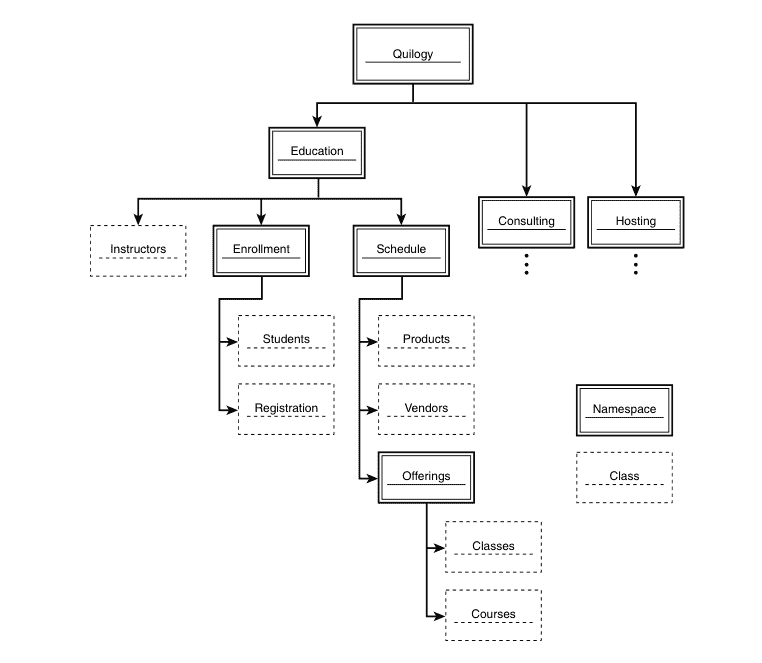

**图 4.1**

*示例命名空间层次结构。此图表显示了 Quilogy 的示例命名空间配置。请注意，命名空间和类可以嵌套在同一级别。*

因为全局命名空间是默认的，您也可以利用这一事实为您的程序集创建命名方案。通过使用全局命名空间，您在 DLL 中公开的最高级别命名空间（在单文件程序集的情况下）将是 DLL 的名称。例如，直接存在于 `Quilogy.Education` 命名空间下的类将被放置在 `Quilogy.Education.dll` 中，因为 DLL 包含等同于 DLL 名称的全局命名空间。嵌套命名空间也可以出现在 DLL 中。


在这种情况下，命名空间确实对程序集的构建方式有影响。在图 4.1 的示例中，`Students` 和 `Registration` 类将存在于同一命名空间中，因此两者都将存在于在较高级别命名空间（`Enrollment`、`Education` 或 `Quilogy`）的边界处创建的程序集中。如果严格遵循，最终结果是如果您想从新的程序集添加类到现有命名空间，您创建一个新的程序集来创建嵌套命名空间。这种技术意味着一项设计原则，即在程序集边界创建嵌套命名空间。换句话说，你会将类组合在一个嵌套命名空间中，以便将其作为一个单元进行分发、复用和保护。

最后，请记住，命名空间用于组织代码，并不影响继承层次结构。换句话说，来自一个命名空间的类可以用作另一个独立命名空间中类的基类。唯一的要求是，包含基类的程序集必须被包含派生类的命名空间所引用。

### 定义类

如前所述，类是在构建 VB .NET 应用程序时将要使用的基本编程结构。一个或多个类包含在单个源文件中，并使用 `Class` 关键字声明。基于图 4.1 的示例，`Offerings` 类的声明如下：

```vb
Public Class Offerings
    ' Members to handle course offerings information
End Class
```

请注意，VB .NET 扩展了你可以前缀在类名上的修饰符，除了 `Public` 和 `Private`（默认值）之外，还包括 `Protected`、`Friend` 和 `Protected Friend`。`Protected` 类是指嵌套在另一个类内部的类，它规定只有派生类才能看到它。例如，假设 `Offerings` 类包含一个如下定义的嵌套 `Course` 类：

```vb
Public Class Offerings
    Protected Class Course
        Public Function ListCourses() As DataSet
            ' Query code to get the courses
        End Function
    End Class
End Class
```

通过使用 `Protected` 关键字，客户端不能直接实例化 `Offerings.Course` 类型的对象来调用其 `ListCourses` 方法。相反，客户端只能通过 `Offerings` 类本身的方法来访问 `Course` 对象。在这种方式下，`Protected` 访问与 `Private` 访问没有区别，类似于 VB 6.0 中的 “Public Not Createable” 设置。然而，`Protected` 访问还允许任何继承自 `Offerings` 的类完全访问 `Course` 类，如下所示：

```vb
Public Class NewOfferings
    Inherits Offerings

    Public Sub ShowCourse()
        Dim objCourse As New Course()
        Dim objDS As DataSet
        objDS = objCourse.ListCourses()
        ' Other code to manipulate the courses
    End Sub
End Class
```

尽管 `Protected` 关键字影响派生类中嵌套类的可见性，但与 VB 6.0 一样，`Friend` 关键字将类的可见性限制在定义该类所在的项目代码内。在前面的示例中，如果 `Offerings` 类仅使用 `Friend` 关键字定义，它对于项目内的所有调用代码仍然可见，但不能被项目外的任何代码实例化。此外，任何派生类（如 `NewOfferings`）也必须标记为 `Friend`，因为如果不这样做，将会扩大对基类的访问权限。最后，嵌套类可以被标记为 `Protected Friend`，这样它在派生类和同一项目内的代码中都可见。

### 创建成员

在本节中，我们将探讨创建方法、属性、字段、事件和委托的 VB .NET 语法，以及如何处理常量。

#### 创建方法

与之前版本的 VB 一样，你可以使用 `Function` 语句创建有返回值的方法，使用 `Sub` 语句创建没有返回值的方法。两种类型都可以接受通过值传递（`ByVal`，现在是默认值）、通过引用传递（`ByRef`）以及可选的对象数组（`ParamArray`）作为参数。

> **提示**
>
> 参数数组一直是 VB 中一个未被充分利用的特性。然而，当你想要向方法传递不确定数量的对象时，它们会非常强大。它们未被充分利用的原因是调用代码必须以逗号分隔的列表显式传递参数，而不能简单地作为数组传递。在大多数适合使用 `ParamArray` 的情况下，调用代码在设计时并不知道将传递多少个对象，因此通常直接使用对象数组定义参数更有意义。VB .NET 对重载方法的支持也减轻了对 `ParamArray` 的需求，因为你可以为每组参数创建特定的方法签名。

与 VB 6.0 一样，如果任何参数使用了 `Optional` 关键字，则所有后续参数必须声明为可选。然而，VB .NET 要求在参数列表中为任何可选参数指定默认值。或者，正如稍后将讨论的，同一个方法可以在类中声明多次，以创建重载方法，以便客户端在开发过程中进行选择。

为了从类中返回一个值，VB .NET 现在支持使用 `Return` 语句以及将值分配给函数名，如下所示：

```vb
Public Function ListCourses(Optional ByVal pVendor As Long = -1) As DataSet
    Dim myDS As DataSet
    ' Code to access the database and populate the dataset
    Return myDS
End Function
```

方法声明还可以包含一组扩展的修饰符，包括 `Public`、`Private`、`Friend`、`Protected`、`Protected Friend` 和 `Shared`。正如你所预期的，列表中的前五个修饰符具有与类模块相同的功能，用于限制派生类以及跨项目对方法的访问。然而，`Shared` 关键字是成员特有的，用于在类的所有实例中实现静态成员，这一点稍后将讨论。

#### 创建属性

VB .NET 中的一个语法变化是将属性声明统一到了 `Property` 关键字中。基本上，`Property` 关键字除了包含可选的获取（get）和设置（set）属性值的代码外，还包括一个访问修饰符、属性名称和一个可选的参数列表。与 VB 6.0 一样，属性非常有用，因为你可以看到客户端试图将属性设置为什么值，并在必要时引发异常。

`Property` 语句的基础知识可以通过以下示例看出，其中为 `Instructor` 类实现了一个 `LastName` 属性：

```vb
Private mstrLName As String

Property LastName() As String
    Get
        Return mstrLName
    End Get
    Set(ByVal Value As String)
        mstrLName = Value
    End Set
End Property
```

请注意，检索值和存储值的代码被放置在 `Property` 语句的块中，并且 `Value` 参数用于接收传入的值。正如第 3 章 “VB .NET 语言特性” 中所述，在 `Get` 或 `Set` 块中声明的任何变量的作用域仅限于该块内，且仅在该块内可访问。

属性的访问修饰符包括 `ReadOnly`、`WriteOnly` 和 `Default`。顾名思义，`ReadOnly` 和 `WriteOnly` 修饰符用于限制对属性的访问。当指定这些修饰符时，必须根据情况在 `Property` 语句中省略 `Get` 或 `Set` 块。

VB .NET 还支持参数化属性，在属性声明中包含参数列表。通常，当属性返回存储在类中的单个数组或对象实例时，你会使用这种结构。例如，假设一个名为 `Vendors` 的类用于存储在 `Vendor` 类中定义的 `Vendor` 对象集合。为了简化开发，`Vendors` 类派生自 `System.Collections.CollectionBase` 类（在本章后面将讨论），该类提供了所有低级别的集合处理。为了提供对 `Vendors` 集合中特定 `Vendor` 的访问，你可以创建如代码清单 4.1 所示的只读属性。

##### 代码清单 4.1：默认属性

本清单展示了如何为类实现默认属性。

```vb
Public Class Vendors
    Inherits CollectionBase

    ' other properties and methods

    Default ReadOnly Property Item(ByVal index As Integer) As Vendor
        Get
            Return CType(Me.InnerList.Item(index), Vendor)
        End Get
    End Property

    Public Sub Add(ByVal obj As Vendor)
        Me.InnerList.Add(obj)
    End Sub

End Class
```

当客户端实例化 `Vendor` 类时，客户端可以使用公共的 `Add` 方法添加供应商，并通过向 `Item` 属性传递索引值来检索其中一个，如下例所示：

```vb
Dim colVendors As New Vendors
Dim objVen As New Vendor
Dim objVen2 As Vendor

colVendors.Add(objVen)
' populate or retrieve the collection
objVen2 = colVendors.Item(4) ' Get 5th item in the collection
```

### .NET 概念

#### 第一部分

在前面的示例中，您还会注意到该属性被标记为 `Default`。只有带参数的属性才能被标记为默认属性。这允许客户端使用快捷语法：

```vb
objVen2 = colVendors(4) ' 获取集合中的第5个项目
```

而不是直接访问 `Item` 属性。当然，一个类中只能有一个属性被标记为默认属性。

您也可以通过派生自 Microsoft.VisualBasic 命名空间中的 `Collection` 类来创建集合类。区别在于，`Collection` 类包含更多默认行为，例如包含了 `Item` 和 `Add` 方法，而 `CollectionBase` 包含允许您在项目添加到集合或从集合中移除时提供自定义行为的方法。

> **注意**
>
> 服务框架在许多场景中使用了参数化属性，特别是在实现了对象层次结构的情况下（例如 ADO.NET 的 `SqlParameterCollection` 类）。

与方法一样，属性也可以用 `Shared`、`Private`、`Overridable`、`Overrides` 和 `Overloads` 关键字进行修饰，稍后会讨论。唯一需要记住的是，如果一个属性被标记为 `ReadOnly`、`WriteOnly` 或 `Default`，那么派生类中的重写方法也必须标记为相应的关键字。

#### 创建字段

VB 的先前版本也具有创建字段的能力。字段只是在类级别用 `Public` 或 `Public Dim` 关键字声明的变量。用 `Private` 或简单的 `Dim` 声明的变量不会作为字段公开。它们对类内的任何代码都可用，并且可以像属性一样被类的客户端访问。使用字段的优点是它们需要的语法很少，并且很简单。此外，字段也可以用 `ReadOnly` 关键字标记，这样类构造函数之外的任何代码都无法更改其值。以下代码片段中的 `ReadOnly` 字段 `Count` 是公共的，因此类内部和外部的代码都可以访问它，但它只能在类的构造函数（`New`）方法内进行更改：

```vb
Public Class Instructors
    Public ReadOnly Count As Integer

    Public Sub New()
        Count = 50 ' 合法
    End Sub

    Public Sub OtherProc()
        Count = 2 ' 产生编译时错误
    End Sub
End Class
```

使用字段的主要缺点是无法像属性那样通过自定义代码拦截对它们的访问。

#### 创建事件和委托

与 VB 的先前版本相比，基本的事件处理语法没有发生重大变化，尽管它已经扩展（正如您将看到的那样）。与先前版本一样，事件可以在类中使用 `Event` 关键字声明。事件可以对类是 `Public`、`Private`、`Protected`、`Friend` 和 `Protected Friend` 的，可以按 `ByVal` 或 `ByRef` 传递参数，并且不能返回值。然后可以使用类内的 `RaiseEvent` 关键字并传递所需的参数来引发事件。清单 4.2 显示了名为 `RegistrationWatch` 的类的部分示例。

**清单 4.2：简单事件**

此类使用 `Event` 关键字实现简单事件 `NewRegistrations`，并使用 `RaiseEvent` 触发它。

```vb
Public Class RegistrationWatch
    Public Event NewRegistrations(ByVal pStudents As DataSet)

    ' 其他方法和属性
    Public Sub Look()
        Dim dsStuds As DataSet
        Dim f1New As Boolean

        ' 在计时器上触发的方法，用于查找自上次调用该方法以来的新注册
        ' 如果找到，则创建一个包含新学生的 DataSet
        ' 并引发事件
        f1New = True
        dsStuds = New DataSet()

        If f1New Then
            RaiseEvent NewRegistrations(dsStuds)
        End If
    End Sub
End Class
```

请注意，该类将 `NewRegistrations` 事件定义为 `Public`，以便该类的消费者能够捕获它。该事件向消费者传递回一个变量，其中包含一个 ADO.NET `DataSet`，该 `DataSet` 存储有关找到的新注册的信息。该事件在 `Look` 方法中使用 `RaiseEvent` 语句引发。

要捕获事件，消费者可以使用 `WithEvents` 关键字（称为*声明性事件处理*）声明 `RegistrationWatcher` 类。请注意，与 VB 6.0 一样，使用 `WithEvents` 声明的变量可以是 `Public` 或 `Private`。然而，在 VB .NET 中，`WithEvents` 可以在模块或类级别声明，而不是像 VB 6.0 中那样仅在类和窗体中声明。使用 `WithEvents` 的语法如下：

```vb
Private WithEvents mobjReg As RegistrationWatch
```

要设置事件处理程序（或事件接收器），然后可以在类或模块中创建一个处理该事件的过程，如下例所示：

```vb
Public Sub RegFound(ByVal pStudents As System.Data.DataSet) _
    Handles mobjReg.NewRegistrations
    MsgBox("找到新学生！")
End Sub
```

请注意，VB .NET 使用新的 `Handles` 关键字来精确指示该过程处理哪个事件，而不是像以前的版本那样仅仅依赖事件处理程序使用的命名约定。声明性事件处理无疑是处理事件最方便的方式，尽管如前所述，它要求对象变量具有正确的作用域，并且不能用于动态开启或关闭事件处理程序。

> **提示**
>
> 尽管声明性事件处理确实不允许您打开和关闭事件，但如果引发事件的类是一个自定义类，您可以实现自己的 `EnableRaisingEvents` 属性。然后客户端可以使用此属性来阻止事件引发。然后，您可以将 `RaiseEvent` 语句包装在此属性的检查中。

在处理继承时，请记住，如果充当消费者的类没有为特定对象实现事件处理程序，那么从它派生的类以后将无法实现它们。此外，与其他方法一样，事件处理程序可以用 `Overridable`、`NotOverridable` 和 `MustOverride` 关键字指定。

事件也可以标记为 `Shared`，这允许类的所有消费者在类的任何实例中执行 `RaiseEvent` 方法时接收事件通知。这对于在共享数据更改时通知多个消费者很有用，例如，在定期查询数据库并通过共享属性公开数据的服务应用程序中。

#### 动态事件处理

VB .NET 通过在前面讨论的声明性方法之外实现*动态事件处理*来扩展使用事件的能力。当您想在特定时间开启或关闭事件处理（称为*挂钩*和*取消挂钩*事件），或者当您想挂钩的对象变量不在模块或类级别时，动态事件处理非常有用。要在运行时挂钩和取消挂钩事件，请使用 `AddHandler` 和 `RemoveHandler` 语句。

例如，请考虑清单 4.3 中显示的 `RegistrationWatch` 类。在此示例中，我们希望在一个类中创建客户端代码，该代码根据公共属性的设置挂钩和取消挂钩 `NewRegistrations` 事件。执行此操作的客户端类如清单 4.3 所示。

**清单 4.3：动态事件**

此类使用 `AddHandler` 和 `RemoveHandler` 语句动态挂钩和取消挂钩事件。


```vb
Public Class Registrations

    Private mRec As Boolean = False
    Private mRegWatch As RegistrationWatch

    Public Property ReceiveNotifications() As Boolean
        Get
            Return mRec
        End Get
        Set(ByVal Value As Boolean)
            mRec = Value
            If mRec = True Then
                ' 添加事件处理程序
                AddHandler mRegWatch.NewRegistrations, _
                    AddressOf Me.NewRegistrations
            Else
                ' 移除事件处理程序
                RemoveHandler mRegWatch.NewRegistrations, _
                    AddressOf Me.NewRegistrations
            End If
        End Set
    End Property

    Public Sub NewRegistrations(ByVal ds As DataSet)
        ' 找到新注册
        MsgBox("已添加新注册！")
    End Sub

End Class
```

清单 4.3 续

```vb
Public Sub New()
    ' 实例化类级别对象
    mRegWatch = New RegistrationWatch()
End Sub

Public Sub TestNotify()
    ' 用于模拟重复查询新注册信息的测试方法
    mRegWatch.Look()
End Sub

End Class
```

在清单 4.3 中，属性 `ReceiveNotifications` 用于决定该类是否接收通知。该属性的 `Set` 块随后会读取该值，并相应地调用 `AddHandler` 和 `RemoveHandler` 语句。这两个语句都接受两个参数：

- 要挂接的事件的引用（在此例中是模块级变量 `mRegWatch` 的 `NewRegistrations` 事件）。
- 用作事件处理程序的方法的地址。

注意，`AddressOf` 和 `Me` 关键字分别用于创建指向方法的指针和指定类内部的方法。

从客户端的角度看，代码的唯一区别在于，当需要接收通知时，可以将 `ReceiveNotifications` 属性设置为 `True`（因为类级别变量 `mRegWatch` 默认值为 `False`），如下例所示：

```vb
Dim objReg As New Registrations()

objReg.TestNotify() ' 无通知
objReg.ReceiveNotifications = True
objReg.TestNotify() ' 接收到通知
```

### 将事件映射到委托

如第 1 章所述，事件的基础设施基于委托的概念。因此，事件关键字（如 `Event`、`RaiseEvent`、`AddHandler` 和 `RemoveHandler`）只是对委托创建和处理的抽象，这并不奇怪。然而，VB .NET 开发人员也可以通过 `Delegate` 关键字直接访问委托。要理解委托，让我们首先探索委托如何在 VB .NET 中用于实现事件。

首先要记住的是，委托仅仅是持有对其他对象中函数引用的类型（类型安全的函数指针）。委托有两种基本类型：单播委托和多播委托。前者允许存储单个函数指针，而后者创建一个指针链表（事件是作为多播委托实现的）。除了函数指针，委托还存储函数将接受的参数。因此，从开发人员的角度来看，委托可以被简单地视为一个方法签名。

使用委托的基本思想是，一个程序（在此例中称为 A）创建一个指向自身某个函数的委托，然后将该委托传递给另一个程序（B）。在未来的某个时刻，B 通过执行委托提供的地址处的代码来调用 A 的函数，确保将适当的参数压入堆栈。当然，这正是处理事件时使用的模型。

在清单 4.3 的示例中，当 `Event` 关键字和 `RaiseEvent` 语句被添加到类中时，幕后发生的情况是这样的：VB 编译器会创建一个与事件具有相同签名的 `Delegate`，并将其存储在类的一个字段中，如下所示：

```vb
Delegate Sub NewRegistrations(ByVal pStudents As DataSet)
```

编译器还为委托创建 `add` 和 `remove` 方法，这些方法接受一个对已定义的委托（在此例中是 `NewRegistrations`）的引用作为参数。此外，`RaiseEvent` 被替换为对委托的 `Invoke` 方法的调用，该方法接受 `Delegate` 中定义的单个参数。

然后，使用者使用 `WithEvents` 关键字并通过 `Handles` 语句实现事件处理程序。在运行时，委托被实例化（它实际上是从 `System.Delagate` 派生的一个类），并将事件处理程序的引用传递给 `RegistrationWatch` 中的 `add` 方法。当委托被调用时，指向事件处理程序的函数指针用于调用该方法。这种将委托映射到事件的简单方式也应该解释了为什么 VB .NET 能够轻松支持 `AddHandler` 和 `RemoveHandler` 语句。它们只是在指定时间调用编译器实现的 `add` 和 `remove` 方法，而不是在实例化和释放时调用。

为了使这一点更清晰，请查看清单 4.4 中的代码，该代码展示了使用委托替代事件的 `RegistrationWatcher` 类。

清单 4.4 简单委托。此类使用委托而非事件来执行简单通知。

```vb
Public Class RegistrationWatch
    Delegate Sub NewRegistrations(ByVal pStudents As DataSet)

    ' 其他方法和属性
    Private mfound As NewRegistrations

    Public Sub RegisterClient(ByVal found As NewRegistrations)
    ...
    End Sub

    Public Sub UnRegisterClient(ByVal found As NewRegistrations)
    ...
    End Sub

    Public Sub RegisterStudents(ByVal ds As DataSet)
        ' 执行一些处理
        mfound.Invoke(ds)
    End Sub
End Class
```

### .NET 概念

#### 第一部分

清单 4.4 续

```vb
mfound = found
End Sub

Public Sub Look()
    Dim dsStuds As DataSet
    Dim flNew As Boolean

    ' 定时器触发以查找新注册信息的方法
    ' 如果找到，则使用新学生数据创建一个 DataSet 并引发事件
    flNew = True
    dsStuds = New DataSet()

    If flNew Then
        mfound.Invoke(dsStuds) '调用委托
    End If
End Sub

End Class
```

清单 4.4 与清单 4.3 之间的差异可以总结如下：

- `Event` 语句已被 `Delegate` 替代。
- `RaiseEvent` 语句已被 `Delegate.Invoke` 替代。
- `RegisterClient` 方法现在用于传递对存储在私有类变量中的委托的引用，而 `Look` 方法只是在适当的时候调用委托。

还要注意，即使您自己指定委托，也不必显式创建 `add` 和 `remove` 方法；VB .NET 编译器会自动添加这些方法。

客户端代码也会更改，以便在将委托传递给 `Look` 方法时对其进行实例化。请注意，事件处理程序的地址作为委托构造函数中的唯一参数传递，如下例所示：

```vb
Private mobjReg As RegistrationWatch

' 在类或模块中
mobjReg = New RegistrationWatch()
mobjReg.RegisterClient(New RegistrationWatch.NewRegistrations( _
    AddressOf NewRegistrations))
mobjReg.Look()

Private Sub NewRegistrations(ByVal ds As DataSet)
End Sub
```

事件也可以与委托一起使用，作为声明事件签名的一种快捷方式。例如，与其声明一个事件为：

```vb
Event NewRegistrations(ByVal ds As DataSet)
```

您可以将声明改为：

```vb
Delegate Sub NewRegistrations(ByVal ds As DataSet)
Event NewReg As NewRegistrations
```

这允许您在事件内部重用委托的定义。当您有许多需要相同参数的事件时，这很有用。

显然，使用委托替代事件可能被视为小题大做，因为事件对于需要事件模型的场景来说已经相当好用。然而，由于委托是函数指针，它们还提供了您可以利用的其他功能，例如函数替换和异步操作。

### 使用委托进行函数替换

函数替换的概念与其名称完全一致：客户端代码可以根据传递给它的委托来调用多个函数之一。这促进了多态性的思想，因为它允许您编写通用代码，因为代码在编译时不知道它将调用哪个函数。例如，考虑图 4.1 中显示的 `Registration` 类。假设它包含一个 `RegisterStudent` 方法，该方法实现了注册学生选课所必需的业务规则。作为该过程的一小部分，必须计算课程费用。但是，计算费用的算法会根据学生的注册方式而有所不同，可能包括电话、网络以及通过 Web 服务从供应商或合作伙伴直接收到的注册信息。

为了实现此需求，`Registration` 类可以声明一个名为 `CalcCourseCost` 的委托，如下所示：

```vb
Delegate Function CalcCourseCost(ByVal CourseID As String) As Decimal
```

注意，委托也可以返回值，因此可以声明为函数。`RegisterStudent` 方法如清单 4.5 所示。

清单 4.5 `RegisterStudent` 方法的框架代码。此方法使用作为第一个参数传入的委托来调用适当的计算函数。

```vb
Public Sub RegisterStudent(ByVal pCalc As CalcCourseCost, _
    ByVal pStud As DataSet)

    ' 实现注册学生的业务流程
```

代码清单 4.5 续

```vb
' 1. 确保学生提供了足够的信息
' 2. 确保学生没有被列入黑名单
' 3. 根据地理位置数据，可能会建议一个更近的课程：抛出异常
' 4. 确保课程未满员

' 5. 计算费用
Dim curCost As Decimal
Dim strCourseID As String

curCost = pCalc(strCourseID)

' 6. 持久化注册信息（数据库或队列）
' 7. 通知相关内部人员有新的注册
' 8. 向学生发送确认邮件
End Sub
```

该方法将委托和学生信息（打包在 `DataSet` 中）作为参数。在完成初步的业务规则后，只需调用委托 `pCalc` 并传递所需的 `CourseID` 参数即可计算课程费用。请注意，本示例说明了委托的 `Invoke` 方法实际上是委托对象的默认方法。计算函数的调用也可以写成 `pCalc.Invoke(strCourseID)`。

在客户端，必须实例化适当的委托。代码清单 4.6 中的骨架代码展示了位于模块或类中的代码，它首先收集注册方法（存储在 `RegType` 中），并使用 `Select Case` 语句实例化正确的委托。然后将该委托传递给 `RegisterStudent` 方法。

### 代码清单 4.6 使用委托的客户端代码

该代码在运行时确定适当的委托，并将其传递给 `RegisterStudent` 方法。请注意，用作委托的过程将在后面展示。

```vb
Dim objReg As New Registrations()
Dim delCalc As Registrations.CalcCourseCost
Dim RegType As Integer
Dim ds As DataSet

' 确定注册类型
' 根据注册类型创建委托
Select Case RegType
    Case 1
        delCalc = New Registrations.CalcCourseCost(AddressOf CalcWeb)
```

代码清单 4.6 续

```vb
Case 2
    delCalc = New Registrations.CalcCourseCost(AddressOf CalcPhone)
Case 3
    delCalc = New Registrations.CalcCourseCost(AddressOf CalcService)
End Select

' 注册学生
objReg.RegisterStudent(delCalc, ds)

' 其他代码放在这里

Public Function CalcWeb(ByVal strCourseID As String) As Decimal
    ' 基于网络注册计算费用
End Function

Public Function CalcPhone(ByVal strCourseID As String) As Decimal
    ' 基于电话注册计算费用
End Function

Public Function CalcService(ByVal strCourseID As String) As Decimal
    ' 基于服务注册计算费用
End Function
```

> 有经验的 VB 开发人员可能已经注意到，这种技术与在 VB 6.0 中使用 `CallByName` 函数类似。区别在于，`CallByName` 只能用于内部类或 COM 对象，而委托可以用于任何符合委托签名的过程（在模块或类中）。

### 那接口呢？

在 VB 6.0 中进行过基于接口编程的开发人员会注意到，`CalcCourseCost` 示例中展示的多态性也可以通过为每种计算方法创建单独的类并实现一个通用接口（`ICalc`）来公开 `Calculate` 方法来实现。然后，可以在运行时将实现了 `ICalc` 接口的不同类传递给 `RegisterStudent` 以调用 `Calculate` 方法。尽管这种技术也能工作，但它可能更复杂且效率更低。例如，使用委托时，您不必创建单独的类，因为调用代码中的任何数量函数（只要它们具有相同的签名）都可以用来实现委托，而且您不必向 `RegisterStudent` 传递完整的对象引用，只需传递一个委托即可。作为经验法则，当您有一组需要在多个类中实现的相关成员，并且特定函数只会实现一次时，创建接口。当您只有一个函数需要实现、实现委托的类不需要对对象的引用，或者您要为共享方法创建委托时（为接口定义的所有方法始终是实例方法），使用委托。

正如“那接口呢？”侧边栏中提到的，使用委托进行函数替换也可以取代使用接口（本章后面将讨论）。这种模式可以通过在类内部实例化委托，然后使用私有函数来调用委托来近似实现。例如，考虑这种情况：不同的类都支持持久化其状态的能力。在这种情况下，客户端应用程序可以通过使用委托以多态方式与这些类中的每一个进行交互，而不需要它们实现相同的接口或属于相同的继承层次结构。此类模式的示例见代码清单 4.7。

### 代码清单 4.7 委托作为接口

此类展示了如何使用委托以多态方式向客户端应用程序公开功能。它在功能上等效于使用接口。

```vb
Delegate Function Persist() As String

Public Class Registrations
    Public ReadOnly myPersist As Persist

    Public Sub New()
        myPersist = New Persist(AddressOf Me.SaveToDisk)
    End Sub

    Private Function SaveToDisk() As String
        Dim strFile As String

        ' 将内容保存到磁盘并返回路径名称
        Return strFile
    End Function
End Class
```

请注意，委托是在类外部声明的，然后该类在构造函数中实例化一个只读变量，向其传递私有 `SaveToDisk` 方法的地址（该方法将实际保存结果并返回文件名）。然后，客户端应用程序可以通过实现一个接受委托作为参数的函数来调用任何支持 `Persist` 委托的类，如下所示：

```vb
Public Function Save(ByVal pPersist As Persist) As String
    Return pPersist.Invoke
End Function
```

然后，客户端通过将 `Registrations` 类的委托传递给 `Save` 函数来调用该函数以将内容保存到文件，如下所示：


`Dim objRegister As New Registrations`
`Dim strPath As String`

`' ...与类进行交互`
`strPath = Save(objRegister.myPersist)`

通过这种方式，每个类可以在内部决定如何实现保存其内容的代码，同时通过`Persist`委托提供客户端应用程序可以调用的公共接口。尽管这段代码从客户端应用程序的角度来看稍微复杂一些，但它更灵活，因为不需要接口和继承。

## 使用委托进行异步处理

委托在.NET中的第二个主要用途是处理异步处理。使用委托进行异步处理的好处之一是，它们既可以与.NET Remoting（在第8章"构建组件"中讨论）结合使用，以促进进程和机器之间的通信，也可以与驻留在同一应用程序域中的代码一起使用。这种通用的编程模型还允许您编写位置透明的代码。

委托适用于异步调用，因为它们是专为带有`BeginInvoke`和`EndInvoke`方法而设计的，这些方法允许客户端异步调用方法，然后分别捕获其结果。您可以将`BeginInvoke`和`EndInvoke`视为从客户端角度对方法执行进行分区。要指定在异步方法完成时调用哪个过程，可以使用`System`命名空间中的`AsyncCallback`对象和`IAsyncResult`接口。当将委托与`System`命名空间中的异步类和接口一起使用时，CLR提供了支持此编程模型所需的基础服务，包括线程池以及调用驻留在同步上下文内的对象的能力，例如使用COM+服务的对象。（我们将在第12章"访问系统服务"中进一步探讨CLR中的线程支持。）这种集成的一个附带好处是使在VB.NET中创建多线程应用程序变得相当简单。

为了理解.NET中的异步编程模式，请考虑`Registration`类的一个方法，该方法用于向所有计划在下周参加课程的学生发送提醒电子邮件通知。这个`RemindStudent`方法可能需要一些时间才能完成，因为它必须从数据库中读取学生列表，为每个学生构建电子邮件消息，发送电子邮件，并相应地更新数据库。为了避免客户端应用程序的线程在调用该方法时被阻塞，可以使用委托（在这种情况下通常被称为*asynchronous delegate*，即异步委托）来调用该方法。

> VB 6.0开发者会记得，由于VB 6.0运行时是单线程的，如果不直接调用Win32 API（这会导致代码不稳定且难以调试），或者通过欺骗COM库在新的单线程单元（STA）中创建对象，就很难创建任何异步代码。毋庸置说，这两种技术都缺乏吸引力。

由于.NET的异步模型允许客户端决定被调用代码是否异步运行，因此`RemindStudent`方法的代码不需要显式地编写以处理异步调用。您可以简单地像下面这样将其声明并编写为同步代码：

```vb
Public Function RemindStudent(ByVal pDaysAhead As Integer, _
    ByRef pErrors() As String) As Boolean
    ' Read from the database and send out the email notification
End Sub
```

请注意，该方法需要一个参数来指定提前多少天发送电子邮件，并返回一个包含任何错误消息的字符串数组。然而，客户端代码必须进行重大更改。清单4.8中的代码用于调用`RemindStudent`方法。

### 清单4.8 使用委托实现异步编程的代码

```vb
' Async delegate
Delegate Function RemStudentCallback(ByVal pDaysAhead As Integer, _
    ByRef pErrors() As String) As Boolean

' Client code inside a class or module

' Declare variables
Dim temp() As String
Dim intDays As Integer = 7

' Create the Registration class and the delegate
Dim objReg As Registration = New Registration()
Dim StudCb As RemStudentCallback = New RemStudentCallback(AddressOf _
    objReg.RemindStudent)

' Define the AsyncCallback delegate
Dim cb As AsyncCallback = New AsyncCallback(AddressOf RemindResult)

' Can create any object as the state object
Dim state As Object = New Object()

' Asynchronously invoke the RemindStudent method on objReg
StudCb.BeginInvoke(intDays, temp, cb, state)

' Do some other useful work

Public Sub RemindResult(ByVal ar As IAsyncResult)
    Dim strErrors() As String
    Dim StudCb As RemStudentCallback
    Dim flResult As Boolean
    Dim objResult As AsyncCallback

    ' Extract the delegate from the AsyncCallback
    objResult = CType(ar, AsyncCallback)
    StudCb = objResult.AsyncDelegate

    ' Obtain the result
    flResult = StudCb.EndInvoke(strErrors, ar)

    ' Output results
End Sub
```

首先请注意，客户端代码首先像平常一样创建`Registration`类的一个新实例。然而，随后它创建了一个新的`RemStudentCallback`委托，并将新创建的对象实例（`objReg`）的`RemindStudent`方法地址放入其中。同样，该委托必须具有与`RemindStudent`方法相同的签名。

现在，代码必须创建一个在`RemindStudent`方法完成后可以被回调的地址。为此，实例化了一个名为`AsyncCallback`的系统委托类，并向其传递了一个名为`RemindResult`的过程地址。您会注意到`RemindResult`必须接受一个参数：一个支持`IAsyncResult`接口的对象。

回调设置完成后，实际上是使用之前创建的委托（`StudCb`）的`BeginInvoke`方法来调用`RemindStudent`方法的。`BeginInvoke`方法除了接受与实例化委托相同的参数外，还接受包含回调的委托以及一个您可以放置该方法所需额外状态信息的对象。

此时，您的代码可以继续在当前的执行路径上运行。委托将调用`RemindStudent`方法（如果在同一个应用程序中则在单独的线程上），完成后将调用传递给`BeginInvoke`的委托中定义的过程（在本例中为`RemindResult`）。如前所述，该过程接受一个`IAsyncResult`类型的参数。为了从中检索`RemStudentCallback`委托的实例，您首先需要使用`CType`函数将其转换为`AsyncResult`类型的对象。生成的`AsyncResult`对象的`AsyncDelegate`属性包含对`RemStudentCallback`委托的引用。然后，通过传递给委托的`EndInvoke`方法的返回值和参数，来捕获返回值以及任何`ByRef`传递的参数。

## 创建命名常量

在VB.NET的类中公开常量有两种方法：第一种是在类级别使用传统的`Const`关键字，第二种是使用枚举类型。

要创建常量，只需将其声明并为其赋值，如下所示：

```vb
Private Const QUILOGY_CODE As Byte = 1
```

常量可以定义为任何简单数据类型，例如`Byte`、`Boolean`、`Char`、`Short`、`Integer`、`Long`、`Single`、`Double`、`Decimal`、`Date`和`String`。正如预期的那样，常量不能作为赋值语句的目标，并且必须确定性地初始化。换句话说，用于初始化常量的代码必须能够在使用不包含变量或不返回变动结果的函数的常量表达式在编译时进行求值。

> 如果您想创建常量但需要使用非确定性算法对其进行初始化，则应使用只读字段并在类构造函数中对其进行初始化。只读字段的另一个优点是能够支持其他类型，如自定义对象。

最后，类中的常量始终是显式的共享（shared）成员，这一点将在本章后面讨论。不过，您还可以使用`Public`、`Private`、`Protected`、`Friend`和`Protected Friend`关键字对其进行修饰。

在类中创建常量的第二种技术是使用枚举。与VB 6.0一样，VB.NET中的枚举使用`Enum`关键字声明，用于提供一组可用于结构、变量、参数甚至过程返回值的常量。枚举类型的限制包括以下几点：

- 它们具有受限的数据类型集（`Byte`、`Short`、`Long`和`Integer`，后者是默认值）。
- 它们必须在编译时根据与常量相同的限制进行初始化。如果您没有显式初始化它们，它们将从0开始初始化。VB.NET还支持这样一种语法：初始化枚举中的第一个常量而让其他常量保持未初始化，这将导致未初始化的常量在第一个常量的基础上以1为增量进行初始化。
- 它们不可继承。

声明枚举的典型语法如下：

```vb
Public Enum VendorCodes As Byte
    vcQuilogy = 1
    vcMicrosoft = 2
    vcOracle = 3
    vcRational = 4
    vcSybase = 5
End Enum
```

请注意，在这种情况下，`VendorCodes`枚举类型显式使用了`Byte`数据类型，而不是默认的`Integer`。此外，这种语法意味着该类型中的所有常量都具有相同的数据类型，这与结构不同。

## 使用继承

实现继承的加入可能是VB.NET中最令人期待的新特性之一。为了支持这一特性，VB.NET的语法增加了指定类及其成员如何被继承以及如何在派生类中使用的关键字。

在类级别，`Inherits`关键字用于类声明中以创建派生类。类被继承后，它自动拥有基类中公开的所有功能，并且还可以创建新成员以及重写（override）和重载（overload）基类中的成员。充当基类的类不需要在当前应用程序甚至同一个命名空间中声明。事实上，项目程序集中引用的任何.NET类都可以充当基类，并且在运行时CLR将能够访问其实现。这包括在其他托管语言（如VC#和托管VC++）中创建的类。

### .NET Concepts

#### PART I

> **NOTE**

CLR只支持单继承，这意味着一个类只能派生自单个基类。一些语言（如C++）支持多重继承，即可以从多个类继承成员到一个派生类中。但是，如果你需要将多个类的方法组合在一起，可以通过继承树来实现。因为继承层次结构可以包含多个类，你可以创建这样的设计，例如，类C派生自类B，类B又派生自类A。在这种情况下，类A和类B实现的方法都可以被类C重写或由使用类C的客户端调用。

此外，类可以通过`MustInherit`或`NotInheritable`关键字来指定。默认情况下，所有类在其定义范围内都是可继承的，如上一节讨论的修饰符所定义。但是，如果你想创建一个用作抽象基类的类，可以通过添加`MustInherit`关键字来实现。使用此技术的示例如清单4.9所示，其中定义了一个名为`QuilogyDataAccess`的部分抽象基类。

**清单4.9** 抽象基类。此清单展示了一个用于COM+配置类的抽象基类示例。

```
Option Explicit On
Option Strict Off

Imports System.Data
Imports System.EnterpriseServices

Namespace Quilogy.Education
    '***********************************************************
    Public Interface IQuilogyQuery
        ' Interface used to query
        Function GetByID(ByVal pID As Long) As DataSet
        Function GetByName(ByVal pName As String) As DataSet
    End Interface

    '***********************************************************
    <Transaction(TransactionOption.Supported), _
        EventTrackingEnabled(True), _
        ConstructionEnabled(Enabled:=True)> _
    Public MustInherit Class QuilogyDataAccess : Inherits ServicedComponent
        Implements IQuilogyQuery

Protected mstrConnect As String

'******************************************************************************
Public NotOverridable Overrides Sub Construct(ByVal s As String)
    ' Implements object construction
    mstrConnect = s
End Sub

'******************************************************************************
Overrides Function CanBePooled() As Boolean
    ' Default is that the objects will not be pooled
    Return False
End Function

'******************************************************************************
Public Overridable Function GetByName( _
    ByVal pName As String) As DataSet _
        Implements IQuilogyQuery.GetByName

End Function

'******************************************************************************
Public Overridable Function GetByID(ByVal pId As Long) As DataSet _
    Implements IQuilogyQuery.GetByID

End Function
End Class

End Namespace
```

在此示例中，抽象基类`QuilogyDataAccess`本身继承自`ServicedComponent`服务框架类，以提供对COM+事务（在第9章讨论）的访问。基类还实现了自定义接口`IQuilogyQuery`以提供查询功能，这将在本章后面讨论。

> **NOTE**

`Inherits`关键字必须放在与`Class`语句不同的行上。在此示例中，各行使用冒号而非回车换行符分隔。此语法的优点是使代码更具可读性，尽管在大多数情况下，我不建议使用行分隔符。

能够创建抽象基类的明显优势在于，你可以创建一个抽象层，允许其他开发人员重用你的代码，同时保护该代码不被直接实例化。请记住，创建抽象基类时必须小心包含所有必需的功能并从适当的基类继承，因为.NET不支持多重继承。可以通过接口提供额外的功能，尽管根据定义，它们只提供要实现的方法签名，而不是实际的实现。

当类用于继承层次结构时，你可以在成员上放置修饰符，以确定它们在派生类中的使用方式。例如，方法的继承行为可以使用`Overridable`、`NotOverridable`（默认）、`MustOverride`、`Overrides`和`Overloads`关键字来指定。列表中的前三个关键字用于方法的原始声明，以指示该方法是否可以被重写、是否不能被重写或是否必须被重写。请注意，除非另有指定，否则方法不能被重写（会发出警告；假设为阴影），并且当从派生类的实例调用时，将执行基类中的实现；因此，产生了*实现继承*这个术语。

例如，清单4.1中的方法`GetByID`使用`Overridable`关键字来指示该方法可以在派生类中被重写。如果使用`MustOverride`关键字，你只能指定方法声明，而没有实现。此行为本质上类似于在类上实现接口，因为它确保派生类将为该方法创建一个实现。

`Overrides`关键字用于派生类中，以指示从基类重写的方法。在前面的示例中，`Construct`过程在基类中被重写，因此你必须在声明中明确指出这一点，如以下示例所示：


```
Public NotOverridable Overrides Sub Construct(ByVal s As String)
    ' Implements object construction
    mstrConnect = s
End Sub
```

> **NOTE**

虽然要求`Overrides`关键字似乎有点多余——毕竟，编译器只需查看方法名是否在基类中以及签名是否匹配——但我喜欢 VB .NET 要求它，因为它强制开发人员明确注意他们打算重写基类的方法，而不是意外地这样做。在较低级别上，使用`Overridable`和`NotOverridable`关键字也允许 JIT 生成更高效的代码。

请注意，被重写的方法就是被重写的方法。当在派生类上调用时，基类中的被重写的方法不会运行。你可以通过使用`MyBase`对象从派生类显式调用被重写的方法来使其运行。

`Overloads`关键字可以在基类和派生类中使用。在基类中，`Overloads`用于创建同一方法的多个版本，这些版本仅在其参数上有所不同，如下文讨论所示。这允许客户端在设计时选择他们希望调用的实现。基类中重载方法的一个典型用途是创建类构造函数的不同版本，稍后将展示。在 VS .NET 中，重载方法通过自动完成窗口中的可能签名列表显示。在派生类中，`Overloads`用于向客户端添加额外的方法签名。根据客户端选择的实际代码，可能在基类或派生类中执行。

> **NOTE**

在类中重载方法时不需要`Overloads`关键字，但当派生类重载基类的方法时需要它。但是，如果一个类中的一个重载方法具有`Overloads`关键字，那么所有重载方法都必须具有。

最后，`Shadows`关键字可以在派生类中使用，以重用和重新声明基类中的成员。换句话说，即使基类未指定现有方法可以被重写，你也可以使用`Shadows`修饰符在派生类中声明同名方法以使用该名称。在这种情况下，基类中的被隐藏的方法不会被重载，但在派生类及其所有后代中将不可用。当你想隐藏基类中的所有重载成员，并仅向类的客户端暴露一个成员签名时，这会很有用。

> **TIP**

如果一个方法既未指定`Shadows`也未指定`Overloads`，那么 VB .NET 编译器将发出警告，但会假定为`Shadows`。但是，建议在您打算这样做时始终显式使用`Shadows`。

### 使用多态性

除了能够在派生类中重用类的实现之外，使用继承的另一个主要好处是多态性。创建继承层次结构隐含地意味着派生类与基类具有“是一种”关系，并且因此，它们可以被多态地处理。例如，如前所述，如果`Velociraptor`类派生自`Theropod`类，那么任何设计用于与`Theropod`类协作的客户端代码也将适用于`Velociraptor`类，因为`Velociraptor`也是一种`Theropod`。请考虑以下接受`Theropod`类型参数的方法签名：

```
Public Sub PrintDinosaur(ByRef oTheropod as Theropod)
```

因为`Velociraptor`派生自`Theropod`，客户端应用程序可以实例化一个`Velociraptor`对象并将其传递给该方法，如下所示：

```
Dim oVec as New Velociraptor
PrintDinosaur(oVec)
```

VB .NET 仅在`Option Strict`语句被设置为`Off`时才允许这种行为。然而，如果它被设置为`On`，您必须首先使用`CType`函数将引用`oVec`转换为`Theropod`，如下所示：

```
PrintDinosaur(CType(oVec, Theropod))
```

显然，通过编写针对基类工作的代码，您最终将能够重用该代码来处理派生对象。

### 创建和使用共享成员

VB .NET 中支持真正面向对象（OO）编程且与继承相辅相成的一大变化是共享（shared）或静态（static）成员（有时称为*类成员*）的使用。顾名思义，*共享成员*是在所有类实例以及定义的任何派生类之间共享的方法、属性、字段和事件。这允许所有由该类创建的对象访问相同的数据（在属性和字段的情况下）和实现（在方法的情况下），并接收相同的触发事件（在事件的情况下）。

要将成员标记为共享，只需在`Public`或`Private`成员上使用`Shared`关键字。例如，考虑之前讨论的`Instructors`类的`Count`字段。显然，这类数据是所有类实例之间共享的理想候选，因为当任何一个实例添加新讲师时，所有实例的计数都应自动更新。为了实现共享字段，您只需在类级别将其重新定义如下：

```
Public Shared ReadOnly Count As Integer
```

然而，由于将该字段设为只读，类中其他非共享方法（如`Add`）将无法增加`Count`。由于这个限制，您可以将`Count`创建为一个只读实例属性，并将计数的内部值存储为一个共享私有变量，如下所示：

```
Private Shared mCount As Integer

ReadOnly Property Count() As Integer
    Get
        Return mCount
    End Get
End Property
```

这样，共享构造函数以及其他共享方法和实例方法都可以访问`mCount`。

在使用共享成员时，您必须记住，在共享成员内部不能访问特定于某个实例的数据。换句话说，您不能操作没有被标记为共享的变量、属性或调用方法。但反之则成立，因此您可以安全地在诸如`Add`之类的虚方法内部增加`mCount`共享变量。

```
Public Function Add() As Integer
    ' Perform the transaction
    mCount += 1
End Function
```

此外，共享方法和属性在后代类中不能被重写（override），尽管它们在基类和任何派生类中都可以被重载（overload）。这种行为是默认的，以便任何共享方法成为基类及其所有后代唯一可用的实现。不过，类可以通过创建接受不同参数的重载成员来扩展其实现。

> **注意**

> 如果您在基类中将一个变量声明为共享，并在派生类中声明同一个变量（无论修饰符如何），运行时将把它们视为各自作用域内两个完全独立的实体。结果，派生类中任何引用该名称的代码都将引用派生类中定义的变量，从而导致共享变量被遮蔽。同样，基类中的任何代码将仅修改该共享变量。

总而言之，当类的所有实例需要共享相同数据，或者类拥有一组在所有实例及任何派生类中运行方式完全一致的标准方法时，共享成员非常有用。

### 使用基于接口的编程

正如本章已展示的几个示例一样，与 VB 6.0 类似，VB .NET 也支持接口继承的概念。在本节中，我们将首先回顾基于接口的编程，然后讨论 VB .NET 用于创建和实现接口的语法。

简单来说，*接口*是一组语义相关的成员，定义了对象与其使用它的客户端应用程序之间的契约。当一个对象实现一个接口时，它本质上是同意提供一个看起来像该接口的自身视图。在类中使用接口的有趣之处在于，客户端可以编写针对任何实现该接口的类而工作的代码，而无需为每个特定类编写自定义代码。这促进了多态性，从而实现了代码重用。

> **注：** 基于接口的编程在 VB 6.0 中不流行的原因之一是创建接口不够直观。由于 VB 6.0 不支持显式创建接口，您必须创建一个包含没有实现的方法的类，并将其编译成 DLL。VB .NET 中的语法使创建接口成为一项显式且定义明确的活动，这将增加其使用率。实际上，VB 6.0 会为 ActiveX DLL 项目中的每个类自动创建接口。然而，这个接口是隐藏的，由 VB 在后台使用。

虽然您可以先为所有类创建接口，从而采用真正的基于接口的编程方法，但这可能不是时间成本最高效的利用方式。通常，当您想要隔离一组相关方法，且这些方法将被不同类以不同方式实现时，接口能发挥最大作用。例如，定义一个用于从各种类中查询数据的接口是一个很好的用法，因为它可以在许多不同类中使用，且每个类中的具体实现很可能有所不同。如果实现保持不变，更好的技术是创建基类并继承它，这样所有派生类都可以重用实际代码。

在 VB .NET 中，您使用`Interface`关键字创建接口，并包含接口所需的成员签名。以下代码片段展示了一个小型接口，它可以由各种类实现，用于处理数据库查询：

```
Public Interface IQuilogyQuery
    Function GetByID(ByVal pid As Long) As DataSet
    Function GetByName(ByVal pname As String) As DataSet
End Interface
```

请注意，方法定义不包含任何“end”语句，因此没有具体实现。接口本身也可以像类一样使用`Public`、`Private`、`Protected`、`Friend`和`Protected Friend`关键字来指定。这允许接口的作用域限定在类、模块和应用程序之内。而且与类一样，接口自动被限定在一个命名空间内，可以是全局命名空间，也可以是在代码中声明的特定命名空间。

然而，与类不同，接口中定义的成员不能使用`Public`和`Private`等访问修饰符，也不能使用`Overridable`或`MustInherit`等继承提示。这是因为，根据定义，接口的所有成员必须由类实现，作为其对任何想要使用它的客户端应用程序契约的一部分。不过，正如本章“创建属性”一节中所讨论的，只要该属性需要参数，接口的一个属性多态属性可以被标记为`Default`属性。

与 VB 6.0 一样，类可以使用`Implements`关键字合并接口。与实现继承不同，您可以在一个类上实现多个接口。这允许客户端应用程序根据请求的接口，以多种方式与该类协作。

当一个接口被实现时，接口的每个成员都必须在类中创建。以下代码展示了一个实现`IQuilogyQuery`接口的类：

```
Public Class Offerings
    Implements IQuilogyQuery

    Public Function GetById(ByVal pid As Long) As DataSet _
        Implements IQuilogyQuery.GetByID
        ' Provide the implementation
    End Function

    Public Function GetByName(ByVal pName As String) As DataSet _
        Implements IQuilogyQuery.GetByName
        ' Provide the implementation
    End Function
End Class
```

请注意，用于实现接口成员的方法同样使用`Implements`关键字来指定。虽然这看起来可能是不必要的，但要求这种语法允许您的类实现多个接口，而这些接口可能包含名称冲突的成员。因此，您可以为内部名称选择一个您喜欢的名称。

在客户端应用程序中，针对接口而非特定类编写代码可以让您编写可重用的代码。例如，假设您的客户端应用程序包含一个过程，该过程查询一个类并使用 resulting data set 来填充一个网格控件...形式。与其为应用程序中可使用的每种类型编写特定的过程，不如编写一个单一的`PopulateGrid`类，该类将一个支持`IQuery`接口的对象引用作为参数。随后，该过程可以通过其接口调用底层类的`GetByID`方法并检索结果数据集，如下例所示：

```
Public Sub PopulateGrid(ByRef oQuery As IQuery, ByVal pId As Integer)
    Dim ds As DataSet

    ds = oQuery.GetByID(pId)

    'Populate the grid with the data set
End Sub
```

在调用`PopulateGrid`方法之前，客户端应用程序还可以使用`TypeOf`语句查询该类，以确保它实现了`IQuery`接口。如果实现了，并且`Option Strict`设置为`On`，则可以在调用期间使用`CType`函数将对象引用转换为`IQuery`。

```
Dim oIns As New Instructors()

If TypeOf oIns Is IQuery Then
    PopulateGrid(CType(oIns, IQuery), intInsID)
End If
```

请注意，如果对象不支持该接口且事先未进行`TypeOf`检查，`CType`函数将抛出`InvalidCastException`。如果`Option Strict`设置为`Off`且隐式转换失败，也会抛出该异常。

## 版本控制

如前所述，开发人员在设计时面临是否使用抽象基类、接口或两者结合的抉择。除了是否需要重用基类中代码实现的这一基本决定外，版本控制问题同样重要。

由于接口构成了客户端与接口实现者之间的契约，因此对接口的任何更改都会必然破坏该契约。结果就是，如果不希望破坏契约，你就不能向接口添加或删除成员、更改方法的返回值类型，或更改参数的数量或数据类型。当运行时尝试加载一个实现接口的类时，它会确保该接口实现了所有成员且其签名正确。如果接口已更改或未被正确实现，运行时将在加载时抛出`System.TypeLoadException`。

虽然这起初看起来像是一种限制，但实际上是一件好事，因为对接口版本控制的严格执行，使得客户端能够多态地使用实现相同接口的类。

### 使用构造函数和析构函数

与 VB 6.0 类一样，VB .NET 中的类支持包含初始化和终止代码，这些代码在创建类的新实例和释放实例时运行。然而，这些方法的名称和行为截然不同。

VB .NET 中的构造函数被定义为一个名为`New`的过程（而不是 VB 6.0 中的`Initialize`），它可以接受参数，允许客户端将数据传递到实例中以辅助初始化。构造函数不返回值，因此始终声明为`Sub`。构造函数还可以被重载并接受不同的参数，以促进类的多态使用。

当使用`New`运算符构造类的第一个实例时，运行时将首先尝试在类上查找并执行共享构造函数（定义为`Shared Sub New()`）。请注意，共享构造函数不使用`Public`关键字定义，不能接受参数，因此不能通过另一个版本的共享构造函数进行重载。换句话说，以下代码是非法的，因为它尝试重载共享构造函数：

```
Overloads Shared Sub New()
End Sub

Overloads Shared Sub New(ByVal ID As Integer)
End Sub
```

在处理完共享构造函数后，运行时将为该类的特定实例执行任何虚拟构造函数（非共享构造函数），并传递可选参数。完成后，该实例即可投入使用。

继承类也可以拥有自己的共享构造函数和实例构造函数。在这种情况下，当创建派生类的新实例时，运行时首先查找基类的共享构造函数，然后是派生类的共享构造函数，接着是基类的实例构造函数，最后是派生类的实例构造函数。这种安排是有意义的，因为派生类的共享构造函数可能会更改其他共享数据的内容，因此必须在基类的共享构造函数之后执行。

如果派生类不包含共享构造函数，则执行基类的共享构造函数，随后是基类的实例构造函数，最后是派生类的实例构造函数。

上述讨论意味着构造函数不能被重写，且无论派生类是否也拥有构造函数，它们都将执行。因此，你不需要使用`MyBase`关键字来显式调用基类的`New`方法。但是，如果你希望在执行派生类的构造函数之前执行基类的构造函数，可以在实例构造函数的第一行调用`MyBase.New()`。

### 参数化构造函数

将数据直接传递到构造函数的能力被称为*参数化构造*。VB .NET 通过扩展`New`运算符的语法来实现这一点。例如，前面讨论的`Course`类支持使用以下语法进行构造：

```
Protected Class Course
    Public Sub New(ByVal courseID As Integer)
        ' Initialize with a specific course in mind
    End Sub
    Public Sub New()
        ' Initialize without a course
    End Sub
End Class
```

客户端可以选择使用任一构造函数来创建类，只需在变量声明的`New`语句中提供参数：

```
Dim objCourse As New Course(intCourseID)
```

或者在单独的`New`语句中提供：

```
Dim objCourse As Course
objCourse = New Course(intCourseID)
```

请注意，作为一个额外的奖励，VS .NET 的 IntelliSense 功能会在下拉列表中显示这两个构造函数；而在旧版本中，IntelliSense 不会在下拉列表中显示不同的构造函数。此外，使用重载构造函数而非可选参数，使你摆脱了“第一个可选参数之后的所有参数也必须是可选的”这一限制。

> **注意**

> 虽然看起来可能令人困惑，但在重载构造函数上不允许使用`Overloads`关键字。

通过创建具有众多（重载）构造函数的类，你还面临代码重复的风险。你可以通过两种方式减轻重复。第一，你可以创建私有过程来抽象所需的非特定初始化代码，并简单地从每个构造函数中调用该过程。第二，你可以将非特定初始化代码放在共享构造函数中，但请记住，共享构造函数只能引用类的其他共享成员。

### 析构函数


类似于 VB 6.0 中的 `Terminate` 方法，VB .NET 中的每个类都可以实现一个 `Finalize` 方法，该方法在对象实例被释放时被调用。`Finalize` 方法是一个 `Sub` 过程，应始终被定义为 `Protected` 并重写基类的 `Finalize` 方法。然而，与构造函数不同，除非在派生类中显式使用 `MyBase.Finalize` 调用，否则层次结构中基类的 `Finalize` 方法不会运行，如下所示：

```
Protected Overrides Sub Finalize
    ' Call the base class Finalize
    MyBase.Finalize
End Sub
```

正如第一章提到的，`Terminate` 和 `Finalize` 之间最重要的区别或许在于，默认情况下，`Finalize` 方法实际上是由运行时在垃圾回收器 (GC) 分配的特殊线程上执行的。随后，当对象实例不再被引用（不可达）时，运行时会在其认为合适的时候（例如出现低资源情况时）执行 `Finalize` 方法。换句话说，你并不一定能控制 `Finalize` 方法何时执行。这种情况通常被称为非确定性终结。VB .NET 仍然支持 `Nothing` 关键字，并鼓励你在使用完对象实例后将其设置为 `Nothing`。这些信息实际上有助于 GC 检测对象何时不再可达，并允许将其标记为需要释放。

使用 `Finalize` 方法来释放文件句柄和数据库连接等资源是有诱惑力的。然而，由于终结的非确定性，你可能希望比垃圾回收器（GC）最终终结你的对象时更早得多地释放系统资源。

> ### 注意

事实上，你的类根本不需要实现 `Finalize` 方法。不这样做实际上会提高运行时的性能，因为如第1章所述，GC 不必将 `Finalize` 方法的执行排队。然而，在某些情况下，你可能希望确保所有资源都被妥善清理，而实现 `Finalize` 方法是确保这一点的唯一途径。

允许对象及时清理其资源的标准技术是在类中实现 `Close` 或 `Dispose` 方法。通常，`Close` 方法用于对象可以通过调用其他方法再次"打开"的情况，而 `Dispose` 则用于在调用 `Dispose` 后不再使用该对象实例的情况。请记住，这些方法不会自动被调用，因此你的类的文档必须充分描述其正确使用方法。为了提供显式和隐式清理，你可以将清理代码放在 `Finalize` 方法中，然后从 `Dispose` 方法调用 `Finalize`，如下所示：

```
Public Class Instructors
    Public Sub Dispose
        ' Dispose() 调用 Finalize，这样你可以将所有
        ' 清理代码放在一个地方。
        Me.Finalize()
        ' 告诉 GC 该对象不需要任何清理
        GC.SuppressFinalize(Me)
    End Sub

    Overrides Protected Sub Finalize
        ' 清理系统资源
    End Sub
End Class
```

注意，`Finalize` 方法可以使用 `Me` 关键字来调用，因为它是同一对象实例的成员。此外，服务框架提供了 `System.GC` 类，你可以通过其共享方法与 Microsoft .NET 垃圾回收器进行交互。在这种情况下，调用 `SuppressFinalize` 方法来通知 GC 它不必 `Finalize` 此对象，因为它已经被终结了。这避免了当对象变得不可达时，GC 不得不做额外的工作。

关于 GC，你需要了解的另一个方面是，它不保证对象会以任何特定顺序被释放。换句话说，你将它们设置为 `Nothing` 的顺序不一定是它们被清理的顺序。

这在你创建引用另一个类的类时呈现了一个有趣的情况。例如，假设 `Registration` 类在其构造函数中接受一个参数，该参数引用在前面代码片段中定义的 `Instructors` 类的实例，如下所示：

```
Public Class Registration
    Private mIns As Instructors

    Public Sub New(ByRef obj As Instructors)
        mIns = obj
    End Sub

    Protected Overrides Sub Finalize()
        mIns.Dispose()
    End Sub
End Class
```

显然，只要 `Registration` 实例是可访问的，`Instructors` 对象也将是可访问的，因为 `Registration` 在其 `mIns` 局部变量中保留了对其的引用。然而，假设两个实例都变得不可达（被设置为 `Nothing`）。由于终结顺序无法保证，运行时可能会在 `Registration` 对象之前终结 `Registration` 对象所引用的 `Instructors` 对象。在这种情况下，当 `Registration` 进行终结并尝试调用 `Instructors` 的 `Dispose` 方法时，将抛出异常。因此，在这样的设计中，你应该么准备捕获产生的异常，要么不在像 `Registration` 这样的类中实现 `Finalize` 方法。或者，如果 `Instructors` 对象确实需要被释放，你可以在 `Registration` 中实现一个调用 `Instructors` 的 `Dispose` 方法的 `Dispose` 方法。

> **提示**

当你处理使用外部资源（如文件句柄、窗口句柄、数据库连接以及运行时之外的其他资源）的类时，请确保这些资源通过终结器和 `Dispose` 方法释放。然而，如果你的类只是操作其他托管类（无论是自定义的还是通过服务框架的），通常不需要创建终结器。

为了让其他类以早绑定方式多态地调用 `Dispose` 方法，服务框架公开了 `IDisposable` 接口，你的类可以实现该接口。通过实现该接口，任何客户端代码都可以查询该接口并调用对象的 `Dispose` 方法，而无需了解该对象的其他任何信息。Windows 窗体使用这种技术来清理放置在窗体上的控件。实现 `IDisposable` 的 `Instructors` 类如清单 4.10 所示。

**清单 4.10** 实现 `IDisposable` 接口的 `Instructors` 类，允许客户端多态地调用 `Dispose`。

```
Public Class Instructors
    Implements IDisposable

    Private mflDisposed As Boolean = False

    Public Sub Dispose Implements IDisposable.Dispose
        ' Dispose() 调用 Finalize，这样你可以将所有
        ' 清理代码放在一个地方。
        Me.Finalize()
        ' 告诉 GC 该对象不需要任何清理
        GC.SuppressFinalize(Me)
        mflDisposed = True
    End Sub

    Overrides Protected Sub Finalize
        ' 清理系统资源
    End Sub

    Public Function GetInstructors() As DataSet
        If mflDisposed Then
            Throw ObjectDisposedException("Instructors")
        End If
    End Function
End Class
```

你还会在清单 4.10 中注意到，该类跟踪一个私有布尔变量来确定对象何时被释放。如果随后调用任何其他方法（如 `GetInstructors`），将抛出 `System.ObjectDisposedException`，向客户端指示该对象不可用。

### 与 GC 交互

如上一节中对 `SuppressFinalize` 的调用所表明的，你可以通过 `System.GC` 类的共享方法以编程方式与 GC 交互。

你可以用来影响 GC 的第一个方法是 `Collect`。基本上，该方法强制 GC 收集所有不可达的对象并将它们排队等待终结。虽然可以在代码中包含此调用以便在特定时间点清理资源，但建议你设计类来进行显式清理（如前所述），然后将实际的收集过程留给 GC。这样，需要尽早释放的资源会被释放，而那些不太关键的资源不会占用额外的 CPU 周期来不必要地释放。

你还可以调用 `System.GC` 的 `KeepAlive` 方法，并向它传递一个你希望在当前方法中不被垃圾回收的对象引用。当运行时看到对 `KeepAlive` 的调用时，它假设该对象在调用 `KeepAlive` 方法之前（在当前过程的执行顺序中，不一定是行顺序）都是可访问的。换句话说，`KeepAlive` 方法确保该对象至少会一直保持活动状态，直到 `KeepAlive` 调用之后。此方法有时在引用 COM 对象或其他非托管对象时使用，以确保运行时不会无意中丢失对其的引用。

最后，你还可以调用 `WaitForPendingFinalizers` 方法，该方法挂起当前线程并等待所有已排队的 `Finalize` 方法运行。这很少使用，因为此操作可能需要一些时间并阻塞当前线程。事实上，不能保证 `WaitForPendingFinalizers` 会返回（因为终结过程可能触发另一次垃圾回收，*无限循环*），因此应该安全地避免使用它。

### 复活

如第1章所述，运行时还允许对象从其 `Finalize` 方法中被重新引用。如果发生这种情况，该对象被称为*复活*，因为它将不会被释放，并且现在再次变得可访问。例如，假设 `Registration` 类的 `Finalize` 方法包含一行代码，使用 `Me` 关键字将对象的引用传递给另一个类或应用程序中的公共变量。在这种情况下，用于引用 `Registration` 对象的原始变量将被设置为 `Nothing`；然而，对象本身仍然存活，可以通过新类或变量引用。该对象随后被称为复活，可以正常使用，但 `Finalize` 方法不会运行第二次。要允许它再次运行，你必须大理石调用 GC 的 `ReRegisterForFinalize` 方法，传入 `Me` 关键字。实现具有复活的 `Registration` 类的代码如下：

```
Dim objHolder as Registration

Public Class Registration
    Private mIns As Instructors

    Public Sub New(ByRef obj As Instructors)
        mIns = obj
    End Sub

    Protected Overrides Sub Finalize()
        mIns.Dispose()
        ' Resurrect
        objHolder = Me
        GC.ReRegisterForFinalize(Me)
    End Sub
End Class
```

最后一点，请记住，如此处所示的 `mIns` 情况，如果被复活的类包含对其他对象的引用，这些引用也将被复活。

显然，你想使用复活的情况非常有限，一般情况下应该避免使用。

### 弱引用

与 GC 交互的最后一种方式是利用*弱引用*。基本上，正如我在第1章中讨论的，弱引用是对对象实例的引用，如果 GC 认为资源稀缺，它可以被回收。换句话说，通过创建弱引用，你允许 GC 即使在你仍然持有引用（尽管是弱引用）的情况下回收对象。当然，弱引用意味着强引用的存在。强引用只是使用标准变量通过 `New` 运算符创建的引用。

弱引用背后的思想是允许你的应用程序持有许多易于重建的对象的引用，而不会永久消耗大量内存。显然，重新创建对象的成本越高，你选择使用弱引用的可能性就越小。但是，当你使用弱引用时，必须遵循一些编码约定。

要创建弱引用，你需要创建 `System.WeakReference` 类的一个实例，并将想要持有对象的强引用传递给它。例如，以下代码片段创建了一个对 `Instructors` 类的强引用，然后是一个弱引用：

```
Dim oIns As New Instructors
Dim wrIns As New WeakReference(oIns, False)
```

此时，`oIns` 变量可以超出范围或以其他方式变得不可访问，只要 GC 未确定需要通过释放它来回收内存，`Instructors` 对象将仍然存在。同时，`wrIns` 变量可以被传递并可能存储在集合中以供以后使用。前面所示的 `WeakReference` 构造函数的第二个参数指示对象是否应该在对象被收集之前可用（`False`），或者在对象被实际终结之前可用（`True`）。

当需要使用弱引用对象时，你需要将其转换为正确的类型；但是，你可以先通过检查对象的 `Target` 属性来确保对象仍然存在。如果该属性不是 `Nothing`，你可以使用 `CType` 函数再次创建对该对象的强引用。

```
Dim obj As Instructors

If Not wrIns.Target Is Nothing Then
    obj = CType(wrIns.Target, Instructors)
End If
```

或者，你可以检查 `IsAlive` 属性来确定对象是否仍然可用，尽管不建议这样做，因为即使在下一条语句，也无法保证对象仍然存活。

此时，GC 不会收集该对象，因为它可以通过强引用访问，你可以继续使用它。

### 总结

由于 CLR 的面向对象特性在 VB .NET 中被公开，开发人员现在可以访问这些特性固有的扩展能力。尽管这给语言增加了名义上的复杂性，开发人员必须知道如何正确使用这些特性，但委托和实现继承等特性可以促进代码重用和多态编程。

在下一章中，我将讨论编译和部署方面的变化，这些变化允许你分发和保护你的代码。

### 打包、部署与安全

### 本章内容

- 打包与部署概念 166
- 打包与部署选项 177
- 保护你的代码 187

### .NET 概念

第一部分

在 Windows 平台上进行软件开发，打包和部署是两个较为困难且耗时的工作。幸运的是，公共语言运行时（CLR）通过其定位和绑定程序集的过程——称为 *Fusion*——附带地使打包和部署变得简单许多。Fusion 不仅减轻了复杂且容易出错的注册表操作，还缓解了因安装一个应用程序导致另一个应用程序无法运行的“DLL 地狱”问题。反过来，Fusion 也简化了卸载过程。

在本章中，我们将回顾并深入探讨第1章“Microsoft .NET 架构”中首次介绍的这些概念，然后介绍 VS .NET 如何支持用于打包 VB .NET 应用程序的项目类型。在此过程中，我们还将讨论 .NET SDK 附带的几个实用程序，其中包括一个可用于安装基于服务器的资源（如性能计数器和 Windows 服务）的实用程序。

最后，本章将以简要讨论 .NET 中保护代码的不同方式及其与传统方法的不同之处作为结束。虽然安全讨论似乎与部署不协调，但两者实际上密切相关，因为现有的安全策略会影响应用程序的部署方式。

> 注意

本章的所有代码清单和补充材料可在本书网站 samspublishing.com 上找到。

### 打包与部署概念

本节回顾并提供了你在 .NET 中需要熟悉的打包和部署概念的更多细节。

### 重新审视程序集

正如你在第1章所回忆的，*程序集* 是 .NET 中可用的最小部署和重用单元。当你在 VB .NET 中编译项目时，你正在生成一个程序集，可以是 EXE 或 DLL，它可以被重用和部署。虽然程序集可以包含多个源代码文件（.vb），但生成的单个 PE 文件包含 *元数据*（类似于 COM 中的类型库），它完整地描述了你在程序集中定义的任何类型（类）。因此，一个不依赖外部组件的自包含应用程序没有注册要求，并且被称为“*无影响应用程序*”。简而言之，这意味着只要将其复制到本地目录，应用程序就可以安装在已经安装了 CLR 和服务框架的机器上。

然而，大多数具有一定复杂性的应用程序都依赖于外部组件。如果这些组件在托管程序集中找到，你可以使用 VS .NET 中的“引用”对话框或在使用命令行编译器时使用 `/r` 开关来引用它们。关于这些程序集的信息，包括使用哪个版本，都存储在程序集的 *清单* 中，打包在 PE 文件内。元数据和清单都可以使用 `ILDasm` 实用程序查看。

> **注意**

你也可以创建包含多个先前编译的 PE 文件（模块）的程序集。我们将在本章后面进一步讨论这个主题。

### 私有程序集和共享程序集

当在 VB .NET 项目中引用程序集时，程序集可以是公共的或私有的。在 VS .NET 中，默认创建的是私有程序集，顾名思义，它们对引用它们的应用程序是私有的。因此，它们必须与引用它们的程序集位于同一目录中，或者位于 Fusion 过程搜索的路径集中。默认情况下，VS .NET 在引用私有程序集时会自动将其复制到应用程序路径。这也可以通过在解决方案资源管理器中突出显示引用程序集时查看的“属性”窗口来控制。除了显示程序集的版本信息外，“复制本地”选项可用于覆盖本地副本。

> **注意**

如果 Fusion 过程搜索的路径找不到程序集，覆盖“复制本地”选项可能会在运行时导致问题。

对部署的影响很简单，你需要确保私有程序集被部署到应用程序目录或将被搜索的目录。引用的程序集也通常放置在应用程序目录的子目录中，如第1章所述。因为引用的程序集本身是自描述的，包含自己的元数据和清单，所以只要保持相对路径正确，整个应用程序就可以复制到新机器上。这有时被称为 *XCOPY 部署*，因为只需要将应用程序目录及其子目录复制到新机器上。显然，这也意味着应用程序可以通过只删除其目录来卸载。

默认使用私有程序集与使用 VB 6.0 编写的 COM 组件的情况相反。在那种情况下，组件是公共可用的，可以被机器上的任何应用程序引用。默认使用私有程序集通过使共享过程成为显式活动来确保受控的代码共享。

除了在使用私有程序集时提供受控的代码共享外，DLL 地狱问题也随之消失，因为两个应用程序无法在运行时指向同一个二进制文件。然而，正如你将在下一节中看到的，CLR 还提供了一种更精妙的方式来共享程序集以及实现多个版本的并行运行。

虽然私有程序集在各种应用程序中都很有用，但能够在应用程序之间共享程序集通常是有利的。典型的例子包括创建可共享的 Web 服务器控件或访问组件服务以提供分布式应用程序的业务或数据服务的程序集。实际上，服务框架本身的程序集也需要在机器上共享。

### 全局程序集缓存


为了允许共享程序集，.NET 在每台安装了 CLR 的机器上创建了一个机器范围的代码缓存。如第 1 章所讨论的，这个缓存被称为全局程序集缓存（GAC）。GAC 的一个有趣之处在于它可以包含同一程序集的多个版本，从而允许同一台机器上的应用程序加载不同的版本。此外，放置在 GAC 中的程序集会被 CLR 更快地找到，并且消耗更少的内存，因为即使多个应用程序引用它，操作系统也只会加载一次代码。GAC 还提供了一些额外的安全性，因为只有本地管理员组的成员才能向 GAC 添加和删除程序集。

要将程序集放入缓存中，你可以使用以下方法：

- 使用 VS .NET 中提供的 Windows 安装程序中的安装工具。
- 使用 .NET SDK 中的命令行实用程序 `GACUtil.exe`。
- 使用 Windows 资源管理器将程序集拖放到缓存中。
- 使用 .NET 管理工具（Microsoft Management Console 管理单元）。

虽然上述列表中的第一个选项是应用程序生产发布的首选，但它将在本章后面更详细地讨论。第二个选项通常在开发过程中使用。例如，以下命令行：

```bash
gacutil.exe /i EducationData.dll
```

会将 `EducationData` 程序集安装到缓存中。类似地，可以使用 `/u` 开关来卸载程序集。但是，简单地使用 `/u` 开关会卸载该程序集的所有版本。为避免这种情况，你可以使用 `ver`、`loc` 和 `PK` 开关来指定要卸载的程序集的特定版本、区域性和公钥，如下所示：

```bash
gacutil.exe /u EducationData.dll, ver=1.0.0.1,loc="en",PK=45e343aae33223ca
```

要以图形方式操作缓存，你可以使用 Windows 外壳扩展（`shfusion.dll`）或 .NET 管理工具。外壳扩展默认未安装，因此应将其放置在 .NET Framework 目录（`windowsdir\Microsoft.Net\Framework\version`）中，然后使用 `Regsvr32.exe` 进行注册。导航到 `windowsdir\assembly` 目录将激活该扩展，并显示本机映像缓存（称为 Zap）和 GAC 的内容，如图 5.1 所示。

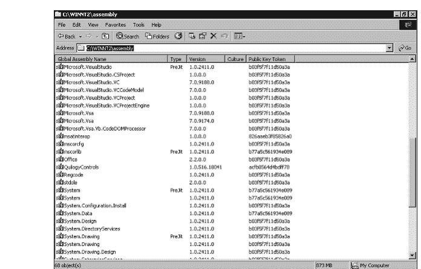

**图 5.1** 通过外壳扩展查看全局程序集缓存。

通过右键单击程序集，可以查看其属性，或者删除该程序集。.NET 管理工具是一个 Microsoft Management Console 管理单元（`mscorecfg.msc`），它不仅显示 GAC，还显示已配置的程序集、远程处理和安全性的相关信息。它也可以在 .NET Framework 目录中找到，只需双击即可执行。

## 强名称

正如你在图 5.1 中可能注意到的，GAC 为程序集存储了一个公钥令牌。此信息是程序集存储在 GAC 中所必需的，并且部分（连同名称、版本号、区域性和数字签名）构成了程序集的标识。如第 1 章所述，这些统称为强名称。为程序集创建强名称通过依赖唯一的密钥对来确保其全局唯一性。特别是，强名称提供以下好处：

### .NET 概念

第一部分

- **名称唯一性**：即使创建了两个具有相同文本名称和版本的程序集，如果它们是用不同的私钥生成的，在 CLR 眼中它们也是不同的。
- **版本兼容性**：使用相同的私钥生成后续版本的程序集，可以让程序集的使用者确信它与原始版本是由同一发布者创建的。
- **二进制完整性**：.NET 安全检查确保程序集的内容自编译以来未被更改。

虽然这些无疑都是重要的好处，但它们并不包含信任的概念。换句话说，用强名称签名的程序集可以确保版本兼容性，但不能用于确保（例如）即将加载的程序集来自 Quilogy。要实现这一点，你还需要使用 Authenticode 数字签名对程序集进行签名。虽然超出了本书的范围，但这可以在 .NET SDK 中使用 `signcode` 实用程序来完成。在程序集使用 Authenticode 签名后，管理员可以创建策略，允许将其下载并加载到用户的机器上。如本章后面所讨论的，该签名成为 CLR 的类加载器用于确定是否应加载程序集的证据的一部分。

> **注意**
>
> 因为为程序集创建强名称意味着你希望获得使用强名称的好处，所以使用强名称的程序集只能引用其他强名称程序集。如果不这样做，DLL 冲突将再次出现。

要使用强名称签名程序集，你可以使用 SDK 附带的程序集生成工具（`Al.exe`），或使用 `System.Reflection` 命名空间中的一组属性。但首先，你必须使用 SDK 中的强名称工具（`Sn.exe`）生成公钥-私钥对。例如，要生成密钥对并将其保存到文件 `QuilogyEducation.snk` 中，你将使用以下命令行：

```bash
sn.exe -k QuilogyEducation.snk
```

> **提示**
>
> 强名称工具还提供了其他开关，用于更改使用哪个加密服务提供程序（CSP）生成密钥对。这些开关还提供了从文件中提取密钥和使用延迟签名的选项。

生成密钥对后，你就可以对程序集进行签名。要使用程序集生成工具在命令行上对程序集进行签名，只需使用 `/keyfile` 开关并传入包含密钥对的文件的路径。

更常见的是，密钥文件的指定将使用属性在 VS .NET 中完成。如第 1 章所述，VS .NET 为每个项目包含一个 `AssemblyInfo.vb` 文件，这是一个添加将成为程序集清单一部分的属性的好地方。`System.Reflection` 命名空间公开了一组可以放在此处的程序集属性。为了说明它们的用法，请看清单 5.1 所示的 `AssemblyInfo.vb` 文件。

**清单 5.1** `AssemblyInfo.vb`。此文件展示了如何使用程序集属性（除其他用途外）来指定强名称。

```vb
Imports System.Reflection
Imports System.Runtime.InteropServices

<Assembly: AssemblyTitle("Quilogy Education Data Access")>
<Assembly: AssemblyDescription("Quilogy Data Access")>
<Assembly: AssemblyCompany("Quilogy")>
<Assembly: AssemblyProduct("Education System")>
<Assembly: AssemblyCopyright("Quilogy, Inc. 2001")>
<Assembly: AssemblyTrademark("")>
<Assembly: AssemblyCulture("")>
<Assembly: AssemblyKeyFile("QuilogyEducation.snk")>

<Assembly: AssemblyVersion("1.0.0.*")>
<Assembly: ComVisible(True)>
```

> **注意**
>
> 请注意，定义属性的实际类名后面附加了 `Attribute`。例如，定义程序集标题的类实际上名为 `AssemblyTitleAttribute`，但为了简洁，可以使用省略 `Attribute` 的简写引用。

在清单 5.1 中，属性包括关于程序集的典型描述信息，如标题、公司、产品和版权。但是，创建强名称的关键在于包含 `AssemblyKeyFile` 属性，并在其构造函数中传入密钥文件的相对位置。

## 注意事项

或者，您可以使用 `AssemblyKeyName` 属性来指定存储密钥对的容器名称。可以使用强名称工具（Strong Name tool）中的开关将密钥对存储在容器中。

在本例中，`AssemblyVersion` 属性也被用于指定版本信息。请注意，版本号的第三和第四部分（生成号和修订号）可以使用星号，它们将在编译时自动生成。

虽然这里所示的技术适用于小型组织或个人开发，但在大型组织中，用于对代码签名的密钥对通常被严密保管。在这种情况下，开发人员通常可以访问公钥，而私钥仅由少数人掌握。在生成强名称程序集方面，开发过程中访问公钥至关重要，因为任何引用该强名称程序集的程序集都必须包含公钥的令牌。为了使开发能够继续进行，.NET 还支持延迟签名或部分签名。

正如其名，部分签名在编译时为 PE 文件中的强名称签名预留空间。签名可以在稍后添加。在此期间，其他程序集可以引用该强名称程序集。要实现延迟签名，`AssemblyInfo.vb` 文件可以引用 `AssemblyDelaySign` 属性并将 `True` 传递给构造函数。这意味着 `AssemblyKeyFile` 中引用的密钥文件仅包含公钥（这可以通过强名称工具的开关来实现）。

程序集在部分签名后，还必须关闭其验证。这是因为部分构建的强名称是无效的，且无法通过之前讨论的 .NET 安全检查。要绕过验证，请按如下方式使用强名称工具的 `-Vr` 开关：

```bash
sn.exe -Vr EducationData.dll
```

在之后的某个时间点，程序集显然会被传递给拥有私钥的组，该组将使用 `-R` 开关对程序集进行强名称签名，如下所示：

```bash
sn.exe -R EducationData.dll QuilologyEducation.snk
```

其中 `QuilologyEducation.snk` 包含私钥。VS .NET 还提供了一个用户界面来设置密钥文件和密钥容器，并支持延迟签名。通过在解决方案资源管理器中右键单击项目名称并选择“属性”，即可调用属性页对话框。可以通过如图 5.2 所示的“公共属性”（Common Properties）中的“强名称”（Strong Name）面板访问这些设置。

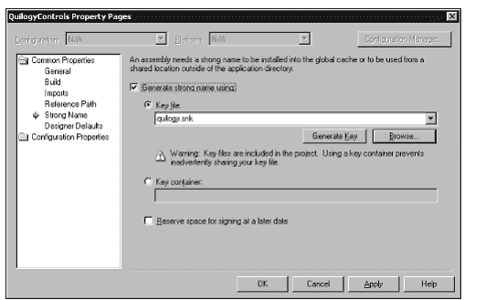

### 图 5.2

此属性对话框允许设置或创建用于创建强名称的密钥文件，并提供对延迟签名的支持。

除了指定包含密钥信息的文件外，还可以通过单击“生成密钥”（Generate Key）按钮来生成密钥文件。

## 并行执行

正如第 1 章中所讨论的，CLR 的类加载器尝试使用多种信息来加载共享程序集，包括版本号、GAC 以及在应用程序、发布者和配置文件中找到的策略信息。

> **提示**
>
> Fusion 过程的结果（及支持详情）可以通过 .NET SDK 中的一个图形化实用工具查看，称为 Fusion 绑定日志查看器（Fusion Bind Log Viewer，`fuslogvw.exe`），该工具默认不安装。此外，您必须配置注册表设置才能进行日志记录。详情请参阅在线文档。

请记住，采取这一谨慎过程的全部原因是为了允许并行执行。换句话说，为了让多个应用程序能够加载同一程序集的不同版本，类加载器必须小心地加载正确版本。

> **提示**
>
> 请记住，仅仅因为 CLR 允许并行执行，并不意味着所有程序集在此模式下都能正常运行。例如，考虑一个在处理期间将数据缓存到文件中的程序集。该程序集的开发人员必须注意，不要允许该程序集的多个版本尝试使用同一个文件。同样，如果多个版本的程序集修改注册表项，那么读写系统注册表数据的程序集可能会产生混乱。

虽然类加载器使用的信息可以通过手动编辑配置文件来指定，但使用 .NET 管理工具（.NET Admin Tool）会更加方便。

除了操作 GAC 外，.NET 管理工具还允许您为托管应用程序创建应用程序范围和机器范围的配置。换句话说，您可以使用此工具绑定策略并将其开启或关闭，而无需编辑文件本身。例如，要配置一个托管 EXE，您只需右键单击 .NET 管理工具中的“应用程序”（Applications）文件夹并选择“添加”（Add），将其添加到该文件夹中。然后，系统会扫描该应用程序的所有依赖程序集，并在应用程序目录下创建一个应用程序配置文件。要配置依赖程序集，只需右键单击子项“已配置程序集”（Configured Assemblies）图标并选择“添加”。然后可以从缓存、依赖列表中选择程序集，或者手动输入。输入完成后，可以通过右键单击程序集并选择“属性”来创建程序集的绑定策略和代码基（`codebase`）。图 5.3 显示了生成的对话框。

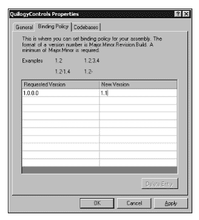

### 图 5.3

此属性对话框允许自动创建绑定重定向信息。

在图 5.3 中，选择了“绑定策略”（Binding Policy）选项卡来配置 `bindingRedirect` 标签。在本例中，所有对 QuilogyControls 程序集 1.0.0.0 版本的请求都将重定向到任何 1.1 版本的程序集。请注意，在这种情况下不需要星号。在相关的应用程序配置文件中，将做出以下条目：

```xml
<?xml version="1.0"?>
<configuration>
  <runtime>
    <assemblyBinding xmlns="urn:schemas-microsoft-com:asm.v1">
      <dependentAssembly>
        <assemblyIdentity name="QuilogyControls"
          publicKeyToken="acfb0564d4bdff78" />
        <publisherPolicy apply="yes" xmlns="" />
        <bindingRedirect oldVersion="1.0.0.0" newVersion="1.1" xmlns="" />
      </dependentAssembly>
    </assemblyBinding>
  </runtime>
</configuration>
```

以类似的方式，可以通过在“我的计算机”（My Computer）图标下的“已配置程序集”（Configured Assemblies）条目中添加配置程序集来修改 `Machine.config` 文件。

## 多文件程序集创建

VB .NET 只能创建单文件程序集。然而，在某些情况下，您可能希望创建一个由分别编译的多个模块组成的程序集。这样做最明显的原因是为了能够包含用另一种语言（如 VC#）编写的模块。这样，多个开发人员就可以使用他们选择的语言在同一个项目中工作。虽然每个开发人员只需简单地将自己的代码编译成一个程序集，但这样做会导致某些本不该公开的类型变为公开，且如果您想强制执行整个程序集的版本控制，这可能不是理想的选择。

> **提示**
>
> 创建多文件程序集的另一个好原因是优化下载。例如，在通过 Internet 运行应用程序时，您可以将不常用的类型放入一个仅在需要时才下载的模块中。

要编译模块，您必须首先使用特定语言的命令行编译器。特别是，`/t`（目标）开关必须设置为 `module`。例如，命令行：

```bash
csc.exe /t:module QuilogyTools.cs
```

将 `QuilogyTools.cs` 文件中的 VC# 模块编译为 PE 文件 `QuilogyTools.netmodule`。请记住，生成的模块包含 MSIL 指令和所有元数据。然而，它不是一个程序集，因此不包含清单，也不能由 CLR 独立加载。随后，可以使用 VB .NET 命令行编译器将该模块编译到 VB .NET 组件中，如下所示：

```bash
vbc.exe EducationData.vb AssemblyInfo.vb /t:library /out:EducationData.dll
/addmodule:QuilogyTools.netmodule
```

在这种情况下，VB .NET 源代码文件 `EducationData.vb` 和 `AssemblyInfo.vb` 将被编译为一个名为 `EducationData.dll` 的库（DLL）。`/addmodule` 开关将 `QuilogyTools.netmodule` PE 文件包含在构建中。请记住，程序集的清单位于 `EducationData.dll` 文件中，而该程序集在物理上仍然由两个文件表示。

或者，如果所有代码都已经编译成模块，您可以使用程序集生成工具（`Al.exe`）按如下方式创建程序集：

```bash
al.exe QuilogyTools.netmodule EducationData.netmodule /target:lib
/out:EducationData.dll
```

## 对代码进行 PreJIT

到目前为止，讨论一直假设当 CLR 加载并执行您的程序集时，它是通过第 1 章中所描述的 JIT 编译来完成的。事实上，虽然那是默认的操作模式，但 .NET SDK 还随附了一个名为原生映像生成器（Native Image Generator，`Ngen.exe`）的命令行实用工具，它允许您将代码 PreJIT 为原生映像。

在安装时或安装前将代码编译为原生映像，可以通过减少应用程序的加载时间来提高性能。例如，服务框架中的几个核心程序集（如 `System` 和 `System.Windows.Forms`）已经过 PreJIT 处理。即便如此，大多数应用程序在 PreJIT 系统程序集和 JIT 编译自定义代码的组合下运行良好。事实上，仅当您自己的性能测试表明这样做将带来显著收益时，才建议进行 PreJIT。这种情况最常见于客户端应用程序，如 Windows Forms 可执行文件。

要对代码进行 PreJIT，您必须运行 `Ngen.exe` 实用工具并向其传递要原生编译的程序集位置。该实用工具每次调用可以编译多个 DLL 或一个 EXE。

> **注意**
>
> 如果在命令行中指定了 EXE，它必须位于列表的第一位。

例如，要原生编译 `xmltransfer.exe` 可执行文件，您可以使用以下命令行：

```bash
Ngen.exe xmltransfer.exe
```

生成的本地映像取决于 CPU 类型、操作系统版本、程序集标识以及任何依赖程序集的标识。当生成本地映像时，它不会被放置在应用程序目录中，而是位于 `windowsdir\assembly\NativeImages1_frameworkversion` 目录下的一个特殊缓存（称为本地映像缓存或 Zap）。在 Fusion 过程中，CLR 也会检查此缓存中是否存在本地映像，并可能加载它。


预 JIT 处理的本地映像随后可以使用 `GACUTIL.exe` 实用程序的 `/l` 开关、Windows 资源管理器 shell 扩展（在“类型”列中将显示“PreJIT”）或 .NET 管理工具下的全局程序集缓存节点进行查看（它们将具有不同的图标和缓存类型“Zap”）。

尽管 CLR 会尝试加载预 JIT 处理的映像，但它并不总是能够这样做。例如，如果 CLR 确定程序集中的 MSIL 相对于本地映像已被修改，则 CLR 将恢复为 JIT 编译 MSIL，而不是使用“过时的”本地映像。此外，如果任何依赖程序集已被修改，则无法使用本地映像。这意味着即使使用了预 JIT，原始程序集也必须存在于计算机上的适当位置，以便 CLR 找到它。

最后，.NET 的此版本不会自动清理过时的本地映像，也不会自动进行创建或删除。要删除本地映像，您可以使用 Windows 资源管理器或 .NET 管理工具中的上下文菜单，或 `Ngen` 实用程序的 `/delete` 开关，如下所示：

```
Ngen.exe /delete xmltransfer.exe
```

## 打包和部署选项

由于 .NET 包含自描述组件、私有程序集和并行执行的概念，因此简化了打包和部署。本节讨论用于打包和部署托管应用程序的三种最常用方法。此外，本节还介绍了允许安装基于服务器资源的 .NET SDK 实用程序。

## 部署场景

本质上，您有三种不同的技术可用于打包和部署托管代码，所有这些都由 VS .NET 直接支持。包括使用 XCOPY 部署、压缩的 CAB 文件和 Windows Installer。每种方法都适用于特定情况，并将在以下各节中讨论。

> VS .NET 还包含一个简单的“安装向导”项目模板，该模板可自动创建此处讨论的 Windows Installer 或 Windows Installer 项目。

### XCOPY 部署

打包和部署托管应用程序最简单的方法是根本不进行打包。如本章前面所述，如果您的应用程序仅使用私有程序集和 .NET 附带的服务框架中的程序集，则只需复制应用程序目录及其子目录即可将整个应用程序安装到目标计算机上。这称为 XCOPY 部署。

XCOPY 部署非常适合部署 ASP.NET 应用程序。例如，如果 Web 项目仅使用私有程序集，您只需将虚拟目录复制到新服务器，即可轻松地将其从开发服务器移动到测试、预生产环境，最终到生产环境。事实上，由于您可以完全控制应用程序中的程序集是否是共享的——如果是，应用程序将使用哪些版本（通过策略），因此可以在同一 Web 服务器上并行运行两个版本的 ASP.NET 应用程序。例如，您可能希望在同一 Web 服务器上运行单独的测试和预生产版本的 ASP.NET 应用程序，以便开发人员可以在测试版本中集成代码，并且可以在预生产环境中进行认证。

此外，XCOPY 部署还意味着您可以在需要时仅部署文件子集到目标计算机。根据应用程序的运行时主机，将新版本的 DLL 部署到应用程序目录并不一定需要关闭应用程序。如第 10 章“构建 Web 窗体”中所述，ASP.NET 的运行时主机以这种方式运行，网站可以在不影响当前用户的情况下实时更新。

> 请记住，XCOPY 部署不会将程序集放入 GAC，也不会自动配置 IIS 设置。但是，可以使用 Windows Installer 完成此操作。

VS .NET 通过包含“项目”菜单下的“复制项目”菜单选项来支持 ASP.NET 应用程序的 XCOPY 部署。与 Visual Interdev (VID) 6.0 类似，该菜单选项会调用一个对话框，用于配置如何执行复制。然而，与 VID 6.0 不同，该对话框允许您选择直接复制到文件共享，而不是通过 FrontPage 服务器扩展。此外，您可以仅复制运行应用程序所需的文件，仅复制项目文件，或者复制项目文件和目录中的任何其他文件。

### Cabinet 文件

为了更容易地打包多个文件并加速从 Internet 下载代码，您的应用程序或其组件可以放入 *cabinet 文件* 中。Cabinet 文件是扩展名为 `.cab` 的压缩文件，通常包含单个程序集，然后这些程序集由应用程序或机器策略中的代码库提示指向。例如，您只需将其包含在 cabinet 文件中并放置在 Internet 上，即可部署 Windows 窗体的新版本。应用程序的用户随后可以更改策略，新窗体将在下次执行应用程序时下载。

为了支持创建 cabinet 文件，VS .NET 在“安装和部署项目”文件夹下包含一个名为 Cab Project 的项目模板。您只需在 VS .NET 中选择一个新项目并导航到该模板即可创建新的 cabinet 文件。向 cabinet 文件添加文件可以通过在解决方案资源管理器中右键单击 cabinet 文件并选择“添加”来完成。

cabinet 文件本身还公开了一些属性，可以在解决方案资源管理器中突出显示 cabinet 文件时在属性窗口中访问这些属性。`Name`、`FriendlyName` 和 `Version` 属性不言自明；但是，单击 `WebDependencies` 属性会调用一个对话框，允许您添加其他 cabinet 文件的 URL、`FriendlyName` 和 `Version`。这很有用，因为指向此列表中的文件会在运行 cabinet 文件时自动下载和安装。

### Windows Installer

打包和部署应用程序最稳健的方法是使用 Windows Installer。尽管 Windows Installer 的详细信息超出了本书的范围，但 VS .NET 在“安装和部署项目”文件夹中包含两个项目模板，用于自动创建 `msi` 文件：Setup Project 和 Web Setup Project。

> **注意**
>
> VS .NET 还包含一个用于创建合并模块项目的模板。这些项目允许您创建可重用的安装组件，以便在 Windows Installer 包之间共享安装代码，类似于允许在应用程序之间共享代码的 DLL。合并模块打包为 `.msm` 文件，是自包含的，并包括所包含文件的所有依赖项。合并模块不能单独安装，但可以通过右键单击项目并单击“添加”、“合并模块”将其添加到 Windows Installer 中。

通常，Setup Project 模板用于 Windows 窗体应用程序，而 Web Setup Project 用于 ASP.NET 应用程序。主要区别在于 Web Setup Project 公开了一个特殊的文件夹类型，该类型知道如何自动配置 IIS 设置。为了说明 Web Setup Project 的使用，将给出一个简短的示例。

尽管 XCOPY 部署适用于许多 Web 应用程序，但在某些情况下，您需要执行更复杂和专业的安装。例如，当您需要将程序集安装到 GAC 中、操作注册表或确保正确配置目标系统时，应使用 Web Setup Project 模板。

当您使用该模板创建新项目时，该项目公开六个不同的视图，可以通过在解决方案资源管理器中右键单击项目名称并选择“视图”来访问。基本上，视图是组成安装包的组件，可用于自定义安装包。视图如表 5.1 所示。

**表 5.1**

| 视图 | 描述 |
| :--- | :--- |
| 文件系统 | 指定如何修改目标计算机上的文件系统。包括指向特殊文件夹的指针，包括 Web 应用程序和全局程序集缓存文件夹。 |
| 注册表 | 指定如何修改目标计算机上的注册表。包括指向相应键的指针，并允许您定义新的键。 |
| 文件类型 | 指定要在目标计算机上安装的新文件关联。 |
| 用户界面 | 指定安装过程中向用户显示的对话框流程，分为“开始”、“进度”和“结束”。允许您添加最多 14 种其他类型的对话框，以显示并向用户收集信息。 |
| 自定义操作 | 指定在安装（安装、提交、回滚、卸载）的各个阶段执行可执行文件和脚本文件。 |
| 启动条件 | 指定目标计算机上必须满足的要求。它允许您在文件系统中搜索特定文件、注册表项或先前安装的组件，然后基于其创建条件。 |

最重要的视图是文件系统视图，您可以在其中指定要安装在目标计算机上的文件。这可以通过简单地右键单击列表中的文件夹并单击“添加”来完成。图 5.4 显示了添加了 Quilogy Education 网站文件的文件系统视图。

打包、部署与安全

第5章 181

**图 5.4**

*文件系统视图中的 Web 安装项目。注意文件已被添加到 Web 应用程序文件夹。*

当你将程序集添加到“文件系统”视图时，系统会检查其依赖项，并将这些依赖的程序集添加到列表中。你可以通过将依赖程序集的 `Exclude` 属性设置为 `True` 来排除它们。

额外的目标目录是预定义的，可以通过右键单击视图中的根节点并选择“添加特殊文件夹”来访问。其中一些特殊文件夹包括“程序文件”、“Windows”、“通用文件”和“系统”。

图 5.4 中需要特别注意的一个方面是，由于 Web 应用程序文件夹处于选中状态，其属性显示在“属性”窗口中。注意，这个特殊文件夹包含允许你配置 IIS 属性的属性。除了此处显示的属性外，你还可以配置虚拟目录名称、日志记录和端口。

在这种情况下，ASP.NET 应用程序还包含子目录（`bin`、`registered`、`supplemental`），这些子目录只需在 Web 应用程序文件夹下添加 Web 文件夹即可定义。显然，这些文件夹可以包含自己的文件和自己的 IIS 配置。

虽然篇幅所限无法讨论注册表、用户界面、文件类型和自定义操作视图，但“启动条件”视图特别有趣。图 5.5 展示了该视图及其关联的属性对话框。

.NET 概念

第一部分

**图 5.5**

*用于检查 IIS 是否存在的搜索目标和启动条件的部分属性窗口。*

如你所见，“搜索 IIS”搜索目标用于指定对特定注册表项的搜索。其他搜索类型包括搜索文件和其他 Windows Installer 组件。在本例中，属性确定要返回 `Parameters` 项的 `MajorVersion` 值。`Property` 属性设置为 `IISVERSION`，然后在启动条件中使用该属性。

启动条件可以被理解为简单的表达式，当它们求值结果不为 `True` 时，会中止安装并显示消息。在本例中，IIS 条件只需在 `Condition` 属性中使用表达式 `IISVERSION >= "#5"` 来测试 `IISVERSION` 属性的值是否为 5 或更大。除了检查 IIS 版本外，Web 安装项目还预先配置了启动条件，用于检查文件系统中的特定文件、注册表项、Windows Installer 组件以及 .NET Framework 是否存在。后者特别有用，因为托管应用程序首次安装在不附带 CLR 的目标机器操作系统上时，需要进行此项检查。

## 安装服务器资源

托管应用程序不仅可以包含必须在目标机器上安装的程序集、注册表项和辅助文件，还可以包含关联的资源，如性能计数器、消息队列、服务和事件日志。通常，这些资源必须在安装期间创建，以确保应用程序正常运行。

幸运的是，服务框架在 `System.Configuration.Install` 命名空间中提供了安装这些基于服务器的资源的优雅解决方案。简而言之，该命名空间公开了一个 `Installer` 类，可以在程序集内继承该类。该类为安装从 `ComponentInstaller` 派生的特定组件提供了框架。图 5.6 展示了用于安装事件日志、性能计数器、消息队列和服务的、从 `ComponentInstaller` 派生的特定类的部分命名空间层次结构。

**图 5.6**

*`System.Configuration.Install` 命名空间的部分层次结构。*

例如，在程序集中，你可以创建一个从 `Installer` 派生的名为 `myInstaller` 的类。在此类中，你可以重写 `Install`、`Commit`、`Rollback` 和 `Uninstall` 方法，以包括在安装程序被调用时执行的自定义代码。然而，在 `myInstaller` 的构造函数中，你还可以配置和添加一个或多个从 `ComponentInstaller` 派生的对象到 `Installers` 集合中（如 `EventLogInstaller` 或 `MessageQueueInstaller`）。这些对象通常包含在它们所代表的命名空间中，例如 `System.Messaging`，当 `myInstaller` 被调用时也会一并安装。清单 5.2 展示了一个安装消息队列的简单安装程序类。

**清单 5.2** 使用 `Installer`。此类展示了消息队列的安装方式。

```
Imports System.ComponentModel
Imports System.Configuration.Install
Imports System.Messaging

Public Class <RunInstaller(True)> myInstaller : Inherits Installer

    Private WithEvents mMSMQInstaller As MessageQueueInstaller

    Public Sub New()
        MyBase.New
        ' Instantiate installers
        mMSMQInstaller = New MessageQueueInstaller()

        With mMSMQInstaller
            .Label = "QuilogyDocQueue"
            .UninstallAction = UninstallAction.Remove
            .UseJournalQueue = True
            .Transactional = True
            .Path = ".\Private$\QuilogyDocs"
        End With

        Installers.Add(mMSMQInstaller)
    End Sub

    ' Catch the events
    Public Sub mMSMQInstaller_AfterInstall(ByVal sender As Object, _
        ByVal e As System.Configuration.Install.InstallEventArgs) _
        Handles mMSMQInstaller.AfterInstall
        Me.Context.LogMessage( _
            "The QuilogyDocQueue was installed successfully.")
    End Sub

    Public Sub mMSMQInstaller_AfterUninstall(ByVal sender As Object, _
        ByVal e As System.Configuration.Install.InstallEventArgs) _
        Handles mMSMQInstaller.AfterUninstall
        Me.Context.LogMessage( _
            "The QuilogyDocQueue was uninstalled successfully.")
    End Sub

    Public Overrides Sub Install(ByVal state As IDictionary)
        MyBase.Install(state)
        ' Add custom actions here
    End Sub

    Public Overrides Sub UnInstall(ByVal state As IDictionary)
        ' Add custom actions here
        MyBase.UnInstall(state)
    End Sub
End Class
```

注意，除了从 `Installer` 派生外，类的 `RunInstaller` 属性必须设置为 `True`，否则安装程序将无法被调用。类的构造函数用于创建 `MessageQueueInstaller` 组件并适当设置其属性。

> ## 注意
>
> 有关消息队列及其使用方法的更多信息，请参阅第 14 章“与企业集成”。

你可以从 `ComponentInstaller` 派生自己的类，为自有程序集创建安装组件。如果你创建了基于服务器的应用程序并希望封装所有基于服务器的资源的安装，这将非常有用。

然后使用 `Add` 方法将安装程序添加到 `Installers` 集合中。本示例还说明了 `AfterInstall` 和 `AfterUninstall` 实例事件的处理，这些事件可用于日志记录或向用户通知结果。其他重要事件包括 `BeforeInstall`、`BeforeUninstall`、`BeforeRollback`、`AfterRollback`、`Committed` 和 `Committing`。你会注意到 `Committed` 和 `Committing` 事件的出现意味着安装是事务性的。事实上，你还可以重写 `Commit` 和 `Rollback` 方法以完成安装事务并恢复机器的预安装状态。

注意 `AfterInstall` 和 `AfterUninstall` 方法使用 `Context` 属性向日志文件和控制台写入消息。`Context` 属性公开了 `InstallContext` 类的一个实例，其中包含有关当前安装的信息。`InstallContext` 对象的典型用途包括使用 `Parameters` 集合将传递给安装程序的参数解析为 `StringDictionary` 对象，以及使用 `IsParameterTrue` 方法确定是否激活了给定参数。

最后，重写了 `Install` 和 `Uninstall` 方法，以便添加额外的安装和卸载代码。注意，必须先使用 `MyBase` 关键字调用基类的方法，以处理 `Installers` 集合中的安装程序。如果你的安装程序不需要添加自定义代码，则无需重写这些方法。

## 运行安装程序


有两种技术可用于运行程序集内的安装程序类。

第一种是使用 `InstallUtil.exe` 命令行工具。如果在未指定任何开关的情况下针对某个程序集运行此工具，该工具将使用反射（`System.Reflection` 命名空间）搜索程序集中是否有任何派生的 `Installer` 类且其 `RunInstaller` 属性设置为 `True`。然后，根据使用的命令行开关，对每个找到的 `Installer` 实例执行 `Install` 或 `Uninstall` 方法。安装以事务方式执行，因此所有安装程序都必须成功。此外，还可以在命令行上指定多个程序集。

默认情况下，该工具会创建 `InstallUtil.InstallLog`、`assemblyname.InstallLog`（可从中找到 `LogMessage` 方法的输出）和 `assemblyname.InstallState` 日志文件。可选开关可用于卸载（`/u`）、抑制控制台输出（`/logToConsole=false`）、更改 `assemblyname.InstallLog` 文件的名称（`/logFile=filename`），并在发生异常时将调用堆栈的内容打印到日志中（`/showCallStack`）。

因此，一个典型的命令行可能如下所示：

```text
InstallUtil.exe /logFile=QEd.log /showCallStack
/logToConsole=false EducationData.dll
```

你可以使用的第二种安装和卸载服务器资源的技术涉及 `AssemblyInstaller` 类。该类允许你加载程序集，向其传递命令行参数，然后调用 `Install` 或 `Uninstall` 方法来调用程序集中包含的安装程序。从这个角度来看，它是 `InstallUtil.exe` 工具的编程等效方式。

例如，要安装变量 `strAssembly` 中引用的程序集中的资源，可以使用以下代码：

```vb
Dim arCommand() As String = {"LogtoConsole=False"}
Dim oInstall As New AssemblyInstaller(strAssembly, arCommand)
oInstall.Install(Nothing)
```

请注意，`AssemblyInstaller` 的构造函数除了可以接收指定命令行的字符串数组外，还可以接收程序集的位置。这些值也可以通过 `Path` 和 `CommandLine` 属性来设置，用于构建传递给程序集中找到的安装程序的 `InstallContext`。与 `InstallUtil.exe` 一样，只有 `RunInstaller` 属性设置为 `True` 的安装程序才会被调用。

要预先确定程序集是否包含有效的安装程序，你可以使用共享的 `CheckIfInstallable` 方法。如果指定的程序集满足以下条件，该方法会引发 `Exception`：

- 不存在
- 不是 .NET 程序集
- 没有公共类型
- 没有至少一个具有所需属性的安装程序类
- 安装程序无法实例化

配置完成后，将使用一个表示安装状态的空对象调用 `Install` 方法。

> 与在命令行中传递 `"u"` 不同，`AssemblyInstaller` 类公开了一个 `Uninstall` 方法。

## 保护你的代码

如第 1 章所述，将互联网作为开发平台的理念要求开发新的安全模型来处理可以远程下载和运行的代码。在 .NET Framework 中，提供了两种机制来允许你编写只能适当执行的代码，分别称为代码访问安全性和基于角色的安全性。

本节将简要概述这两种安全模型，并介绍设置和管理安全策略的基础知识。对 .NET 安全性的详尽讨论将留待其他书籍进行。

### 代码访问安全性

简而言之，代码访问安全性是 .NET 用于控制对受保护资源（如文件系统、系统注册表、打印、调用非托管代码以及通过互联网访问数据等）的访问的机制。因此，代码访问安全性包括以下功能：

- 服务框架预定义的权限和权限集，代表对各种系统资源的访问
- 代码请求其所需的、希望拥有的或运行不需要的权限的能力
- CLR 根据证据确定代码是否具有所需权限的能力
- 用户和管理员设置策略以帮助确定代码是否具有权限的能力
- 开发人员定义自定义权限集以代表执行其代码所需权限的能力

在最高层级上，CLR 定义了四个控制安全性的策略级别：

- 企业
- 机器
- 用户
- 应用程序域

可以想象，默认情况下，用户和应用程序域策略比企业和机器策略的限制性更低。

每个策略包含代码组和权限集。顾名思义，代码组是代码的逻辑分组，每个代码组包含一个成员条件和一组权限。为了便于管理，各个权限被组合成预定义的权限集，如 `FullTrust`、`Execution`、`Internet`、`Nothing` 等。其中一些权限集可以编辑，但通常管理员会为特定场景创建新的权限集。

表 5.2 列出了默认的系统权限集及其关联的类。每个权限在服务框架中由一个或多个类表示，这些类定义了权限并包含本章后面讨论的声明式和命令式安全中使用的属性。除非另有说明，这些类大多位于 `System.Security.Permissions` 命名空间中。

#### 表 5.2 默认系统 .NET 权限

| 权限 | 描述 |
|---|---|
| 环境变量 | 访问环境变量（`EnvironmentPermission`） |
| 文件对话框 | 使用对话框浏览文件系统中文件的能力（`FileDialog`） |
| 文件和文件夹 | 访问文件系统（`FileIO`） |
| 独立存储 | 操作独立存储的能力（`IsolatedStoragePermission` 和 `IsolatedStorageFilePermission`） |
| 反射 | 查看其他程序集中类型信息的能力（`ReflectionPermission`） |
| 注册表 | 操作注册表的能力（`RegistryPermission`） |
| 安全 | 执行特定安全功能的能力，如调用非托管代码和控制策略（`SecurityPermission`） |
| 窗口 | 创建用户界面元素和操作剪贴板的能力（`UIPermission`） |
| DNS | 使用 DNS 解析远程主机名的能力（`System.Net.DnsPermission`） |
| 打印 | 向默认打印机打印、使用受限的打印机选项集、禁止打印或不受限制打印的能力（`System.Drawing.Printing.PrintingPermission`） |
| 事件日志 | 以四个不同的级别访问特定计算机上的特定事件日志（`System.Diagnostics.EventLogPermission`） |
| 套接字访问 | 使用 TCP 或 UDP 访问特定主机和端口的能力（`System.Net.SocketPermission`） |
| Web 访问 | 访问特定 URL 的能力（`System.Net.WebPermission`） |
| 性能计数器 | 以四个不同的级别访问特定计算机上的特定性能计数器（`System.Diagnostics.PerformanceCounterPermission`） |
| 目录服务 | 授予对 Active Directory 中各种路径的浏览或写入访问的能力（`System.DirectoryServices.DirectoryServicesPermission`） |
| 消息队列 | 以五个不同的级别访问特定计算机上的消息队列（`System.Messaging.MessageQueuePermission`） |
| 服务控制器 | 以三个不同的级别访问特定计算机上的服务（`System.ServiceProcess.ServiceControllerPermission`） |

> **注意**

除了表 5.2 中显示的权限外，其他服务框架类也可以公开权限；例如，`System.Data.SqlClient` 命名空间包含一个 `SqlClientPermission` 类和属性，用于确保调用代码具有足够的安全级别。

在加载时，CLR 使用证据来确定程序集属于每个策略级别的哪个代码组。证据包括代码的 Authenticode 签名者、代码下载来源的 URL、强名称、区域和应用程序目录，以及可选的自定义属性。

在 CLR 确定代码属于哪些代码组之后，它会合并为每个策略级别定义的权限。最后，CLR 对每个策略级别的权限求交集，使最终的权限集仅包含所有策略级别共同拥有的权限。

接下来，将计算出的权限集与代码中定义的属性进行比较，以确定实际授予代码的权限。例如，代码可以实际请求访问文件系统的权限，但拒绝打印权限。如果两种权限都出现在为程序集计算的权限集中，则拒绝的权限将从该集中移除。反之，如果未授予访问文件系统的权限，则会引发异常。

最后，如果正在加载的代码（程序集或类）要求特定权限，CLR 还会遍历调用堆栈，以确保在加载程序集之前执行的所有代码也具有所需的权限。如果没有，则不会加载代码，并引发异常。尽管这会带来较大的性能开销，但它是必需的，以确保没有权限的代码不能通过执行具有更广泛访问权限的代码来偷偷溜入。

代码可以使用声明式或命令式方法来请求权限（我们接下来将讨论）。虽然不要求必须显式请求权限，但如果不这样做，这意味着你的代码必须准备好处理因权限不足而导致的异常（详见下一章）。

此外，请求特定权限有助于确保你的代码仅用于其预期目的，而不能被恶意使用。最后，如果你仅请求代码所需的权限，那么你的代码被允许运行的可能性会更高。

话虽如此，请求权限会增加代码的复杂度，通常在代码被部署到内网或互联网时最为适用。例如，如果你开发了一个将在组织内部共享的组件，仅请求该组件所需的特定权限可以确保它在 `LocalIntranet` 代码组下运行。

### 声明式安全（Declarative Security）

声明式安全使用特性（attributes）将安全信息置于 PE 文件中。这些特性可以放置在程序集、类或成员级别，并指明权限以及该权限如何与代码交互。

安全特性最终派生自 `System.Security.Permissions` 命名空间中的 `CodeAccessSecurityAttribute`，并且是表 5.2 所示权限的超集。有关可能权限的完整列表，请参阅在线帮助中 `CodeAccessSecurityAttribute` 类的派生类列表。

每个特性的构造函数接受 `SecurityAction` 枚举的九个成员之一，用于指示权限将如何被使用。例如，以下方法的声明使用了 `PrintingPermission` 特性，通过 `Demand` 成员确保该方法仅在程序集具备从受限对话框打印的能力时才能执行：

```vb
Imports System.Security.Permissions
Imports System.Drawing.Printing

<PrintingPermission(SecurityAction.Demand, _
    Level:=PrintingPermissionLevel.SafePrinting)> _
Sub PrintResults()
    ' 在此处打印结果
End Sub
```

请注意，`SecurityAction` 在构造函数中指定，而 `Level` 属性使用 `:=` 语法设置，因为它不存在于构造函数中。在这种情况下，如果计算出的权限不包含打印能力，则在加载代码时会抛出 `SecurityException`。

建议你的代码提前请求所需权限，这样如果权限未被授予，异常可以被尽早捕获，而不是在运行到后期才失败而令用户沮丧。因此，你通常希望在类和程序集等较高级别上要求权限。

#### `Demand` 与 `Assert` 的区别

要求（Demanding）权限并不意味着要求权限的代码将被授予该权限。要求权限仅仅是在加载时告诉 CLR，该程序集、类或方法需要此权限才能正常工作。如果该权限不在计算出的权限集中，或者未被授予调用堆栈中的所有调用者，则会抛出异常。不过，你可以通过断言（asserting）权限来绕过后者条件。

要断言权限，请使用 `SecurityAction` 的 `Assert` 成员。在这种情况下，被断言的权限将被添加到权限集中。显然，这可能会导致安全漏洞，但在某些情况下非常有用，例如你的程序集对资源执行某些操作，而其调用者对此并不知情且通常不会执行该操作。

例如，你可以创建一个必须访问特定注册表项以获取配置信息但不对用户公开此事实的类。你的代码随后可以使用 `RegistryPermission` 特性断言该权限，这样其调用者就无需具备该权限。

显然，最大的风险在于（接上述示例），如果你的代码允许调用者指定要操作的注册表项，而你的代码随后断言权限去访问它。为了能够断言权限，你的代码需要具有 `SecurityPermission` 特性且 `SecurityPermissionFlag` 设置为 `Assertion`，这在 `FullTrust`、`LocalIntranet` 和 `Everything` 权限集中是默认包含的。

之前的示例使用了 `SecurityAction` 的 `Demand` 成员来请求权限。你的代码还可以进行另外两种类型的安全要求：链接要求（link demands）和继承要求（inheritance demands）。

简而言之，链接要求（link demands）使用 `SecurityAction` 的 `LinkDemand` 成员，在即时编译（JIT）期间检查，并且仅检查直接调用者，而不执行堆栈遍历。虽然这有利于性能，但可能会使你的代码面临安全攻击。

另一种要求，即继承要求（inheritance demands），同样使用 `InheritanceDemand` 成员指定，并放置在类级别，以确保只有具有指定权限的代码才能继承该类。

如前所述，程序集除了拒绝权限外，还可以请求最小权限和可选权限。例如，以下声明将对文件系统的不受限访问请求为可选权限：

```vb
<Assembly: FileIOPermissionAttribute(SecurityAction.RequestOptional, _
    Unrestricted:=True)>
```

如果计算出的权限集包含对文件系统的访问权限，则该权限将被授予代码。然而，由于可选权限意味着该权限可能不会被授予，你的代码需要能够使用 `Try` 块优雅地处理抛出的 `SecurityException`。

除了为文件系统、注册表或消息队列请求特定权限外，你还可以请求预定义权限集中定义的权限（这些集合不可修改），例如 `Nothing`、`Execution` 和 `FullTrust`。这可以通过使用 `PermissionSet` 特性并像这样设置其 `Name` 属性来实现：

```vb
<Assembly: PermissionSetAttribute(SecurityAction.RequestMinimum, _
    Name:= "FullTrust")>
```

最后，.NET 还支持五个未在表 5.2 中显示的附加权限，这些权限映射到用于确定代码访问组成员身份的证据。例如，以下代码可用于确保程序集仅在从 Quilogy 网站加载时才被加载：

```vb
<Assembly: UrlIdentityPermissionAttribute(SecurityAction.RequestMinimum, _
    Url:="http://www.quilogy.com/*")>
```

这些权限统称为标识权限（identity permissions），还包括 `PublisherIdentityPermission`、`SiteIdentityPermission`、`StrongNameIdentityPermission` 和 `ZoneIdentityPermission`。

### 命令式安全（Imperative Security）

声明式安全通过特性来处理，而命令式安全则通过一组镜像自 `CodeAccessPermission` 的类来处理。区别在于，权限类在运行时从方法内部被调用，因此可以动态地要求和断言权限。

例如，与其使用 `FileIOPermission` 特性请求对静态目录的读取访问权限，不如实例化 `FileIOPermission` 类并配置相应的路径，如下所示：

```vb
Dim oIO As New FileIOPermission(FileIOPermissionAccess.Read, strAppData)
```

其中 `strAppData` 是根据用户输入计算得出或从持久存储（如注册表或数据库）中读取的文件路径。

显然，每个权限对象都必须进行适当的配置。为了请求权限，必须随后调用相应的方法。权限类支持表 5.3 中所示的、派生自基类 `CodeAccessPermission` 的方法。

#### 表 5.3 派生自 `CodeAccessPermission` 的类中请求权限的方法

| 方法 | 描述 |
|---|---|
| `Demand` | 在运行时确定堆栈中所有较高的调用者是否已被授予该权限。如果未授予，则抛出 `SecurityException`。 |
| `Assert`、`RevertAssert` | 断言即使调用代码未被授予权限，也可以访问该资源。通过调用 `RevertAssert` 或 `RevertAll` 移除。 |
| `Deny`、`RevertDeny` | 拒绝堆栈中较高的调用者访问权限所指定的资源的能力。在调用代码返回其调用者之前有效。通过调用 `RevertDeny` 或 `RevertAll` 移除。 |
| `PermitOnly`、`RevertPermitOnly` | 确保即使调用堆栈中较高的代码被授予了额外权限，也只能访问权限所指定的资源。类似于 `Deny` 但更严格。在调用代码返回其调用者之前有效，可以通过调用 `RevertPermitOnly` 或 `RevertAll` 移除。 |
| `RevertAll` | 导致所有之前的 `Assert`、`Deny` 或 `PermitOnly` 方法被移除。 |

因此，代码可以通过调用 `oIO` 对象的 `Demand` 方法来启动堆栈遍历，从而要求权限，如下所示：


```vb
Try
    oIO.Demand()
Catch e As SecurityException
    ' 在此处捕获错误
End Try
```

显然，使用命令式安全需要更多的错误处理，但它也更灵活，因为当你的代码需要访问的资源仅在运行时才已知时可以使用。

### 自定义权限

与服务框架（Services Framework）中的大多数事物一样，代码访问安全是可扩展的，因此你可以创建自己的权限、权限集和代码组。通常，当服务框架提供的权限粒度不够细时，你会创建自定义权限。例如，虽然框架包含了`SqlClientPermission`对象来限制连接到 SQL Server 时的通用属性，但它显然无法知道数据库中特定架构（schema）的任何信息。因此，你可以创建一个自定义权限，允许访问某个表中的数据或表中的特定行。

要创建自定义权限，你需要创建一个实现`IPermission`接口的类，最简单的方法是派生自`CodeAccessPermission`。一个派生自`CodeAccessPermission`必须重写`Copy`、`Intersect`、`IsSubsetOf`、`FromXml`、`ToXml`和`Union`方法。如何执行此操作的示例可在线帮助中找到。此外，如果你希望权限支持声明式安全性，可以创建一个从`CodeAccessSecurityAttribute`派生的类，具体讨论请参见在线帮助。

### 处理策略

要配置与代码访问安全性一起使用的策略，可以使用本章前面讨论的 .NET 管理员工具。该工具为每个策略级别包含一个节点，其中包含可配置代码组、权限集和策略程序集的节点。策略程序集包括实现自定义权限的程序集，因此这些程序集在系统上不受限制。

系统管理员或用户可以使用 .NET 管理员工具添加自定义代码组，例如，确保所有来自 Quilogy 的代码都被视为来自本地内网的代码。为此，只需在相应策略级别上的`All_Code`代码组上单击右键，然后单击"新建"。然后可以将新代码组配置为 URL 类型的成员条件，如图 5.7 所示。还可以创建自定义权限集，或使用对话框中的"权限集"表分配其中一个内置权限集。

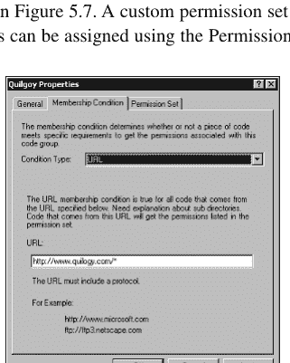

**图 5.7**

此对话框显示了如何配置代码组。在本例中，其成员身份限制为从 Quilogy 下载的代码。

### 基于角色的安全性

除了使用代码访问安全性之外，.NET 应用程序还可以采用基于角色的安全性。顾名思义，基于角色的安全性背后的思想是根据当前用户或帐户的角色成员身份来创建安全筛选器。为了公开用户、帐户和角色，服务框架在`System.Security`和`System.Security.Principal`命名空间中包含*标识（identity）*和*主体（principal）*对象的概念。

简而言之，在 .NET 中，标识封装了关于被验证实体的信息，并包括该实体的名称（即 Windows 帐户）和`AuthenticationType`（即 NTLM、Kerberos 等）。该框架支持多个实现`IIdentity`接口的标识对象，其中最基本的是`WindowsIdentity`和`GenericIdentity`。前者封装了有关 Windows 用户的信息，而后者可用于创建特定于应用程序的标识。

> **注意**
> 
> 其他标识对象用于 ASP.NET 应用程序，将在第 10 章中详细讨论。

主体对象封装标识并表示实体的安全上下文，包括标识所属的角色。在 .NET 中，主体对象实现`IPrincipal`接口， unsurprisingly，包括`WindowsPrincipal`和`GenericPrincipal`。主体对象的主要成员包括引用标识对象的`Identity`属性，以及用于确定当前标识是否属于给定角色的`IsInRole`方法。

许多在组织内运行的应用程序需要根据用户的组成员身份来限制对 Windows 用户的访问。这可以很容易地使用`WindowsIdentity`和`WindowsPrincipal`对象来实现。例如，要构造`WindowsPrincipal`对象，可以使用`WindowsIdentity`类的共享`GetCurrent`方法来返回表示当前 Windows 用户的标识对象。然后可以将标识对象传递给`WindowsPrincipal`对象的构造函数以构建主体，如以下代码所示：

```
Imports System.Security
Imports System.Security.Principal
Dim oPrincipal As WindowsPrincipal
oPrincipal = New WindowsPrincipal(WindowsIdentity.GetCurrent)
```

以这种方式构建主体是必需的，因为构建主体对象代价高昂，除非首先指示这样做，否则 CLR 不会自动执行。要确保 CLR 自动附加主体对象，可以使用当前`AppDomain`对象的`SetPrincipalPolicy`方法设置策略。然后可以简单地使用`Thread`对象的`CurrentPrincipal`属性来检索主体，如下所示：

```
Imports System.Security
Imports System.Threading
Imports System.Security.Principal
AppDomain.CurrentDomain.SetPrincipalPolicy(PrincipalPolicy.WindowsPrincipal)
Dim oPrincipal As WindowsPrincipal
oPrincipal = Thread.CurrentPrincipal
```

检索到主体后，可以使用`WindowsPrincipal`对象的重载`IsInRole`方法专门检查组是否属于某个组。它支持将组名称作为字符串传递给方法，使用角色标识号，或使用`WindowsBuiltInRole`枚举。

但是，不必以这种方式显式检查角色，后续声明式和命令式安全检查可以类似于代码访问安全性中使用的技术来执行。

虽然对于在 Windows 网络上运行的内部网应用程序使用 Windows 帐户很好，但某些应用程序必须与其他身份验证方案配合工作。例如，许多 Internet 站点将身份验证信息存储在数据库中。对于这些类型的应用程序，`GenericIdentity`和`GenericPrincipal`非常适用。

应用程序通过登录页面或其他方式检索用户名后，可以像这样创建`GenericIdentity`对象：

```
Dim oIdentity As GenericIdentity
oIdentity = New GenericIdentity(strUser)
```

请注意，`GenericIdentity`对象的构造函数还支持可选的第二个`String`参数来标识身份验证类型。

然后可以通过向其构造函数传递标识对象的引用和用户所属角色的数组来构造`GenericPrincipal`对象。然后必须使用`Thread`类将新的主体对象与当前线程的`CurrentPrincipal`属性关联，如下所示：

```
Dim oPrincipal As GenericPrincipal
Dim arRoles() As String

' arRoles 从数据库填充
oPrincipal = New GenericPrincipal(oIdentity, arRoles)
Thread.CurrentPrincipal = oPrincipal
```

这比使用 Windows 帐户更复杂，因为必须显式填充角色并显式设置当前线程的主体对象。此外，在身份验证信息存储在数据库中的应用程序中，还必须从数据库读取角色并用其填充`arRoles`数组。

无论使用哪种主体，都可以使用声明式和命令式安全性来确保你的代码仅由特定角色的成员执行。我们将在下面讨论这些内容。

### 声明式安全性

要在基于角色的环境中实现声明式安全性，.NET 支持从`CodeAccessSecurityAttribute`派生的`PrincipalPermissionAttribute`类。与代码访问安全性一样，此属性可以放置在类和成员级别，并且必须传递`SecurityAction`枚举的成员，以及可选的`Name`、`Role`、`Unrestricted`和`Authenticated`实例属性。

例如，要确保`GetSales`方法只能由 Sales 角色的成员运行，可以使用仅使用`Role`属性的以下声明式要求来创建：

```
<PrincipalPermission(SecurityAction.Demand, Role:="Sales")> _
Public Sub GetSales()
    ' 获取销售额
End Sub
```

若要简单地确保用户已通过身份验证，可以如下进行声明：

```
<PrincipalPermission(SecurityAction.Demand, Authenticated:=True)>
```

> **注意**
> 
> 如果在类和成员级别都进行声明式要求，则成员级别优先。

### 命令式安全性

要执行命令式要求，请使用`PrincipalPermission`类。虽然`PrincipalPermission`不是从`CodeAccessPermission`派生的，因为它实际上不保护任何资源，但它的行为类似。例如，重载的构造函数支持传递`PermissionState`常量。传入`Unrestricted`常量仅等同于确保用户已通过身份验证。

构造函数还可以接受身份名称和要检查的角色，如以下代码所示：

```
Dim oPrincipalPerm As New PrincipalPermission(Nothing, "Sales")

Try
    oPrincipalPerm.Demand()
Catch e As SecurityException
    ' 不在 sales 角色中
End Try
```

在这种情况下，构造函数的第一个参数传递`Nothing`以表示不需要特定的用户名，而 Sales 角色是必需的。

由于`PrincipalPermission`的每个实例仅支持单个角色，有时需要通过`Union`方法组合对象。通过这种方式，你可以允许多个角色的用户执行代码。例如，以下代码创建了对 Sales 和 Marketing 角色的需求：

```
Dim oSalesPerm As New PrincipalPermission(Nothing, "Sales")
Dim oMarketingPerm As New PrincipalPermission(Nothing, "Marketing")

oMarketingPerm.Union(oSalesPerm).Demand()
```

### 总结

本章重点介绍了与部署和安全相关的 .NET 概念。在许多方面，由于 VB .NET 中创建的组件具有自描述特性，部署已经得到了简化。这一点再加上 VS .NET 内置的 Windows Installer 支持，应该会使打包和部署变得更加简单。

然而，安全性的情况则不同。保护那些经常从 Internet 下载和运行代码的计算机的需求，要求 .NET 实现更复杂的安全模型。尽管这些概念对于 VB 开发者来说需要一些调整，但请记住，在许多情况下，只要你能适当地处理异常，默认策略就足够了。

通过使用结构化异常处理以优雅的方式处理异常的能力，对 VB 开发者来说也是一个新概念。这一内容连同新的调试和跟踪功能，将在下一章中讨论。

### 错误处理与调试

## 第 6 章

### 本章内容

- 处理异常 200
- 使用 VS .NET 调试器 209
- 使用诊断工具 214

### .NET 概念

### 第一部分

在任何软件开发工作中，能够发现并纠正代码中的错误都是至关重要的。对于在组织内执行关键任务功能或通过 Internet 直接由客户访问的分布式应用程序来说，尤其如此。通常，这些错误分为以下三种类型：

- 语法错误
- 运行时错误
- 逻辑错误

虽然语法错误在编译时就能被发现，并且可以通过使用`Option Explicit`和`Option Strict`来避免，但运行时错误和逻辑错误通常更加隐蔽，需要其他技术来排查。VB .NET 和 VS .NET 支持多种技术来处理运行时错误和逻辑错误。

首先，本章讨论了在 VB .NET 中可以用来处理运行时异常的两种技术，这些异常可能由意外的用户输入或应用程序运行环境中条件的变化引起。其次，本章重点介绍了 VS .NET 和 Services Framework 的调试和跟踪功能，这些功能使查找逻辑错误变得更加简单。

**注意**

本章的所有代码清单和补充材料都可以在本书的网站 www.samspublishing.com 上找到。

### 处理异常

VB .NET 支持使用`On Error`语句处理异常的传统方法（称为*非结构化异常处理*），以及使用`Try`语句的*结构化异常处理*。在两种情况下，目标都是处理在运行时生成的异常，这些异常在公共语言运行时（CLR）中实际上是`System.Exception`类型或从`System.Exception`派生的对象。例如，预定义的 CLR 异常都是`SystemException`类型，而应用程序通常从`ApplicationException`类类派生自己的异常。`Exception`类的主要成员如表 6.1 所示。

#### 表 6.1 Exception 类的成员

| 成员 | 说明 |
|---|---|
| `HelpLink` | 属性，指定提供与异常相关的帮助信息的 URL。 |
| `InnerException` | 属性，指定对异常链中前一个异常的引用。用于将一个异常包装在另一个异常中以及传播外部异常。 |
| `Message` | 属性，指定错误的文本字符串。 |
| `Source` | 属性，指定包含导致错误的应用程序或对象名称的文本字符串。 |
| `StackTrace` | 属性，返回一个`String`，其中包含在异常被抛出之前立即捕获的执行堆栈。 |
| `TargetSite` | 属性，返回一个`MethodBase`对象，其中包含有关抛出异常的方法的信息。 |
| `GetBaseException` | 方法，遍历`InnerException`对象链并返回链中第一个对象的引用。如果不存在链，则返回当前异常。 |
| `HResult` | 属性，指定一个 32 位值，表示严重性代码、设施代码和错误代码。用于 COM 互操作。 |

#### 异常传播

建议大多数具有一定复杂性或预期会出现错误的过程，都包含一种捕获异常的机制（无论是非结构化处理程序还是`Try`块）。但是，如果在没有处理机制的方法中生成了异常，VB .NET 会将异常传播到调用堆栈中的下一个下级方法。然后该方法有责任处理异常。这个过程沿着调用堆栈继续向下进行，直到找到处理程序或应用程序终止。

换言之，如果方法 A 调用方法 B，而方法 B 生成了一个没有处理程序的运行时异常，那么方法 A 中的处理程序将立即被调用（如果存在的话），并且在结构化异常处理的情况下，处理该类型的异常。这个过程会一直持续，直到检查完每个活动方法。此功能意味着并非你的每个方法都必须包含错误处理程序，只有那些在调用堆栈最低层的方法才需要，例如从用户界面调用的方法。然而，在许多情况下，你仍然希望在各个方法中处理特定的异常，因为它们在该级别更容易被处理。

### .NET 概念

### 第一部分

### 使用非结构化异常处理

VB 用来处理运行时异常的传统机制是错误陷阱。基本上，*错误陷阱*是过程内的代码段，由行标签标识，在异常发生时执行。默认情况下，应用程序中没有启用错误陷阱，任何运行时异常都会产生一个对话框，在关闭后结束应用程序。

要设置或启用错误陷阱，请使用`On Error Goto`语句后跟一个行标签。例如，要在类的一个方法中设置错误陷阱，你可以编写以下处理程序：

```
Public Sub ProcessDocs()
    On Error Goto MyErr

    ' other code goes here

    Exit Sub
MyErr:
    ' handle the error here
End Sub
```

在这种情况下，`On Error`语句和`Exit Sub`之间发生的任何异常都会立即将控制流重定向到`MyErr`行标签。请注意，如果你想将错误处理代码与正常的执行流分开，则需要`Exit Sub`。显然，在返回值的方法中可以使用类似的`Exit Function`语句。

要禁用当前启用的陷阱（每个过程只能有一个启用的陷阱，即它们不能嵌套），请使用`On Error Goto 0`语句。你也可以使用`On Error Resume Next`语句跳过过程中发生的所有错误，但这仅建议在可能的可捕获异常已明确定义且不重要的小型过程中使用。如果你希望在过程中使用内联错误处理（在下一节中讨论），上述任一语句都可能是理想的。此外，`On Error Goto -1`语句可以用来清除当前异常，其方式与调用`Err`对象的`Clear`方法相同。

说到`Err`对象，在错误陷阱内，你可以使用内置的`Err`对象通过其属性查看异常的`Source`、`Description`和`Number`。`Err`对象只是映射了底层`Exception`对象的许多属性，`LastDllError`属性除外，该属性在非托管 DLL 函数产生错误时会自动填充系统错误代码。

**注意**

`Err`对象到底层`Exception`对象的映射意味着 VB .NET 中的非结构化异常处理只是构建在 CLR 结构化异常处理机制之上的。

此外，`Err`对象可用于通过`Raise`方法抛出异常。这在需要处理异常然后引发由调用应用程序处理的用户定义异常的组件中特别有用。但请记住，`Raise`方法总是引发通用异常（类型为`Exception`），因此不如`Throw`语句灵活，后者可用于抛出任何从`Exception`派生的异常类型。

> **注意**


> 从技术上讲，任何从`System.Object`派生的对象都可以作为异常被抛出；但是，不推荐这种做法，因为错误处理程序会期望接收从`Exception`派生的对象。

同样需要指出的是，启用的错误陷阱会捕获所有类型的异常，而结构化异常处理构造可用于过滤特定类型的异常。若要使用非结构化异常处理来实现这一点，可以使用`Err`对象的`GetException`方法检索异常，检查其类型，然后根据需要处理它或将其引发给调用者，如下所示：

```
Dim oException As Exception

oException = Err().GetException()
If TypeOf (oException) Is ArgumentException Then
    ' 处理它
Else
    Throw oException
End If
```

显然，在这些情况下，使用结构化异常处理更有意义，因为它能更好地处理不同类型的异常。

### 退出错误陷阱

当错误陷阱被激活时，您有五种操作选择，如表 6.2 所示。

| 语句 | 描述 |
|---|---|
| `Resume` | 强制程序执行从导致错误的语句处继续。对于用户可以纠正的某些错误类型，此方法是首选。例如，当软盘或 CD-ROM 未准备好读取时会发生异常。通过插入合适的介质，可以重新成功执行该语句。 |
| `Resume Next` | 强制程序执行从导致异常的语句之后的下一句继续。当该语句可以安全绕过而不会导致其他错误时非常有用。 |
| `Resume line` | 强制程序执行从特定的行标签处继续。这通常用于跳过过程的整个部分并继续执行后面的部分。 |
| `Err.Raise` | 如前所述，调用`Raise`方法会将异常传播到调用方法。 |
| （无操作） | 在错误陷阱中不执行任何操作，过程将在错误处理程序完成执行后结束。在许多情况下，这是期望的操作。 |

当使用带有`On Error`语句的非结构化异常处理时，请记住`Resume`和`Resume Next`语句仅在实际找到错误处理程序的过程内执行代码。这意味着在前一节讨论的示例中，如果方法 A 中的错误处理程序发出`Resume`语句，则重新执行的语句实际上是调用方法 B，而不是方法 B 中最初导致错误的实际语句。同样，如果方法 A 发出`Resume Next`语句，则执行调用方法 B 之后的语句。

### 使用内联错误处理

在某些情况下，绕过错误陷阱机制并在执行每行代码后检查错误可能是有利的。事实上，ASP 开发人员被迫使用这种技术，因为 VBScript 不支持行标签。这称为内联错误处理，可以通过首先使用`On Error Resume Next`语句禁用所有错误陷阱来实现。然后通过检查`Err`对象的`Number`属性来检测错误。

再次请注意，如果使用非结构化异常处理，检查特定异常的唯一方法是检查`Err`对象的`Number`属性，或者如前所示使用`GetException`转换为适当的异常类型。

请记住，如果包含`On Error Resume Next`语句的方法调用一个没有错误处理程序的方法，而该方法产生未处理的错误，该错误将传播到调用方法。由于调用方法包含`On Error Resume Next`语句，该异常将不会被处理。

### 使用结构化异常处理

VB .NET 支持的第二种异常处理类型是通过使用`Try`语句进行结构化异常处理。基本上，`Try`和`End Try`语句用于保护一个代码块，并且可以包含允许您执行代码以处理各种类型异常的过滤器。此外，通过使用`Finally`语句，您可以设置一个无论块内是否抛出异常都会执行的代码块。例如，一个典型的方法，如清单 6.1 中所示的`ReadDataAsXml`方法，可能包含一个`Try`块。

#### **清单 6.1** 使用结构化异常处理。此方法使用结构化异常处理来检测不同类型的异常。

```
Imports System.Xml
Imports System.IO
Imports System.Data.SqlClient
Public Sub ReadDataAsXml()
    Dim cn As SqlConnection
    Dim cm As SqlCommand
    Dim ds As New DataSet()

    Try
        ' 打开连接并执行
        cn = New SqlConnection(mstrConnect)
        cm = New SqlCommand(mstrSQL, cn)
        cn.Open()
        cm.CommandType = CommandType.Text
        ds.ReadXml(cm.ExecuteXmlReader, XmlReadMode.Fragment)

        Dim fs As New FileStream(mstrFile, _
            FileMode.OpenOrCreate, FileAccess.Write)

        ds.WriteXml(fs)
        fs.Close()

    Catch eSql As SqlException
        ' 在此处处理 SQL Server 错误
    Catch eXml As DirectoryNotFoundException
        ' 在此处处理 XML 错误
    Catch e As Exception
        ' 在此处传递所有其他错误
        Throw e
    Finally
        ' 清理
        cn.Close()
    End Try
End Sub
```

在清单 6.1 中，该方法首先定义了用于与 SQL Server 通信的变量。因为这些变量在`Try`块之外，所以它们初始化过程中抛出的任何异常（例如，如果其中一个使用了构造函数）都不会被`Try`块处理。接下来，`Try`块保护与 SQL Server 建立连接和初始化的过程，以及执行一个用于将 XML 数据填充到文件的 SQL 语句。

> **注意**
> 因为`Try`块遵循块作用域，所以在`Try`块中声明的`fs`变量仅在块内可见。这意味着您不能在同一过程中在`Try`块内部和外部都声明相同的变量。这样做会隐藏外部变量，并且无论如何都会导致编译时错误。

当执行`Try`块中的代码时，可能会产生几种不同类型的异常。在这种情况下，`SqlException`可能由`SqlConnection`对象的`Open`方法或`SqlCommand`对象的`ExecuteXmlReader`方法抛出，而如果传递给`FileStream`对象的文件名指向无效路径，则可能会抛出`DirectoryNotFoundException`。每个`Catch`块都设计为处理特定类型的异常。最后一个块处理通用`Exception`，其使用方式类似于`Select Case`块中的`Case Else`语句。事实上，与`Select Case`语句类似，`Catch`块是顺序相关的，如果异常与过滤器匹配，该块将被执行并退出`Try`块。

> **提示**
> 因为`Catch`块是按顺序处理的，所以您应该将最具体的异常放在前面。换句话说，将派生的异常类放在前面，接下来是基本异常类，最后是`Exception`类本身。

如前所述，如果希望应用程序抛出自己的异常，可以通过从`System.ApplicationException`派生一个类来实现。如果您想向异常添加调用程序可以使用的额外状态信息，这会很有用，并且通常在构建基于业务规则违反而抛出异常的中间层组件时使用。此外，您的派生异常类可以利用表 6.1 中讨论的`InnerException`属性来封装原始异常。例如，名为`QuilogyEdException`的类的定义将如下所示：

```vbnet
Public Class QuilogyEdException : Inherits ApplicationException

    Public Sub New(ByVal message As String)
        MyBase.New(message)
    End Sub

    Public Sub New(ByVal message As String, ByVal innerException As Exception)
        MyBase.New(message, innerException)
    End Sub

    ' other properties here
End Class
```

请注意，该类利用了`ApplicationException`的构造函数来同时接收消息和对`InnerException`的引用。随后，您的方法可以在`Catch`块中这样使用该类：

```vbnet
Catch eXml As DirectoryNotFoundException
    ' Handle XML errors here
    Dim eQuilogy As New QuilogyEdException("XML error occurred", eXml)
    Throw eQuilogy
```

除了根据异常类型进行过滤外，`Catch`块还支持`When`子句来评估一个表达式。例如，以下`Catch`签名：

```vbnet
Catch eSql As SqlException When Err().Number = 5
```

可用于仅捕获错误代码为 5 的`SqlException`。此语法依赖于使用内置的`Err`对象，该对象在抛出异常时会被填充。但请注意，您不能在同一个过程中同时使用结构化和非结构化异常处理。更典型的情况是，您会使用`When`子句来检查其他不一定会抛出异常的条件，例如从 DLL 函数返回的结果。

与`Try`块一样，`Catch`块可以包含自己的变量，并且同样地，您不能在`Catch`块中声明一个已在方法中更高层级声明过的变量。

正如在清单 6.1 中所见，`Finally`块用于执行`Try`或`Catch`块操作所必需的任何清理代码。关于`Finally`块的重要一点是，无论是否抛出异常它都会执行，即使`Try`或`Catch`块发出了`Exit Try`、`Exit Sub`或`Exit Function`语句，它依然会执行。如果`Catch`块调用了另一个方法，则`Finally`块将在控制权返回到调用方法之后执行。

正如其名称所暗示的，非结构化异常处理不使用控制结构，因此导致代码更难以编写和维护。事实上，`On Error`语句的性能也较差，并且具有明显的局限性，即无法轻松地区分不同类型的异常或嵌套异常（是的，`Try`块是可以嵌套的）。因此，推荐使用结构化异常处理，因为它使用与 CLR 一致的简单语法提供了受保护的代码块。

> **提示**
> CLR 中的结构化异常处理针对非异常情况进行了优化。换句话说，如果您为实际上并非错误的情况（例如，为了返回方法的执行状态）抛出大量异常，性能将会下降。因此，请仅在必要时才抛出异常。

### 更改异常处理设置

就像您可以使用“选项”对话框的“常规”选项卡来规定 VB 6.0 何时进入中断模式一样，VS .NET 包含了“异常”对话框，可以通过“调试” $\rightarrow$ “异常”菜单调用。

如图 6.1 所示，该对话框显示了项目中每个引用命名空间下的异常层次结构。通过选择一个命名空间或特定的异常，您可以在对话框底部设置“抛出异常时”和“如果异常未被处理”这两个选项。顾名思义，前者选项控制当指定异常被抛出时发生什么，可以包括自动打开调试器、在正常的程序流中继续（例如通过执行`Catch`块，如果存在的话），或者简单地使用父级设置。同样地，如果该异常随后未被处理，也可以选择相同的三个选项。

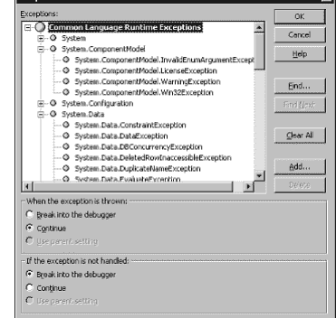

**图 6.1**
*VS .NET 异常对话框允许您确定在抛出某些异常时会发生什么。*

如图 6.1 所示，默认设置是在抛出异常时继续，如果未被处理则启动调试器。在开发过程的早期，您可能希望为特定异常更改“抛出异常时”的设置，以确保您能意识到这些异常并采取步骤修复它们。此外，请注意，您可以通过点击“添加”按钮将自己的异常添加到此列表中。

### 使用 VS.NET 调试器

熟悉 VB 6.0 的开发人员应该会发现 .NET Framework 和 VS .NET 中的调试工具很亲切，尽管它们肯定得到了增强。例如，除了 VB 6.0 中可用的逐行调试和“编辑并继续”功能外，VS .NET 调试器还包括以下功能：

- **跨语言调试**——利用此功能，您可以无缝地步进同一个项目中用不同语言编写的代码。例如，您可以从 VB .NET Web 应用程序步进到用 VC# 编写的私有程序集。
- **附加到运行中的程序**——利用此功能，您可以将调试器附加到一个已经在运行的应用程序，并使其进入中断模式。然后您可以步进其代码。被附加的程序不需要从 VS .NET IDE 执行。
- **远程调试**——利用运行中的程序功能，运行在远程机器上的程序可以像在本地运行一样被附加和调试。
- **调试多线程应用程序**——与 VB 6.0 不同，VS .NET 调试器完全支持多线程应用程序的调试，并提供了查看和操作线程的设施。
- **调试 Web 应用程序**——因为 ASP.NET 应用程序本质上就是 VB .NET 应用程序，因此它们可以像窗体应用程序一样被调试。熟悉使用 Visual Interdev 调试 Web 应用程序的开发人员会发现这是一个极大的便利。

本节提供了调试过程的概览，详细介绍了如何调试本地和远程项目。

正如在第一章《Microsoft .NET 架构》中所讨论的，您在 VB .NET 中编写的源代码通常在编译时首先被编译成中间语言 (MSIL)，然后在运行时使用 JIT 编译器编译成原生代码。为了成功调试应用程序，CLR 必须执行反向操作，将原生指令映射到 MSIL，然后再映射到源代码语句。

事实证明，所需的映射信息存储在由 VB .NET 编译器使用`/debug`开关生成的程序员数据库 (.PDB) 文件中。在 VS .NET 中，该开关通过从“生成”菜单调用的“配置管理器”对话框控制。该对话框显示当前解决方案中的所有项目，并允许您为每个项目设置活动配置；当设置为`Debug`时，它会指示编译器使用`/debug`开关。此外，还支持“平台”（目前仅为 .NET）和“部署”选项。

> **提示**
> 您也可以在选中解决方案时在属性窗口中设置活动配置，或者通过标准工具栏中的下拉列表进行设置。

对于 ASP.NET 应用程序，编译通常是即时完成的，其调试由`Web.config`和`machine.config`文件中编译标签的`debug`属性控制。我们将在第 10 章《构建 Web 窗体》中对此进一步讨论。

在这两种情况下，使用调试配置还会为每个私有程序集创建 .PDB 文件。这就是能够无缝调试用其他语言编写的程序集的原因。

### 开始调试

当设置了调试开关后，您可以使用 F5 键、“调试”菜单中的“启动”选项或工具栏中的“启动”按钮启动项目。然而，就像在 VB 6.0 中一样，您必须首先在“解决方案资源管理器”窗口中右键单击项目并选择“设为启动项目”。这样做之后，项目名称将以**粗体**显示。对于 Web 项目，您也必须以类似方式设置启动页。您还可以通过 Ctrl+F5 启动项目或使用“调试”菜单中的“菜单”选项来在不调试的情况下运行项目。

> **注意**
> 调试器在调试会话期间使用的许多选项可以在“工具” $\rightarrow$ “选项”对话框的“调试”选项下设置。在这里可以配置显示选项以及“编辑并继续”等功能。

在 IDE 内部启动应用程序允许您在代码中放置断点，并且在中断模式下，可以使用表 6.3 所示的各种调试窗口。

> **提示**
> VB 开发人员应该注意到，如果`Dim`语句创建了对象的新实例，您现在可以在`Dim`语句上放置断点。

### 211 第 6 章

### 表 6.3 VS .NET 调试窗口

| 窗口 | 描述 |
| --- | --- |
| `Autos`（自动） | 自动（因此得名）显示当前语句（即将执行的语句）和前一条语句中变量的信息。同时显示被单步跳过（F10）的函数的返回值。可以使用此窗口修改变量。 |
| `Breakpoints`（断点） | 显示项目中设置的所有断点的信息。允许你使用表达式或命中次数来条件性地控制断点是否启用。同时显示一个工具栏，可用于设置和删除断点，以及在代码窗口和反汇编窗口中查找断点。 |
| `Call Stack`（调用堆栈） | 显示调用堆栈上函数的名称、参数类型和参数值。 |
| `Disassembly`（反汇编） | 显示与编译器创建的指令相对应的汇编代码。 |
| `Immediate`（立即窗口） | 在调试模式下用于输入和计算表达式。也称为命令窗口，可通过“视图” $\rightarrow$ “其他窗口”菜单访问。 |
| `Locals`（局部变量） | 显示当前作用域内所有局部变量及其值和类型。 |
| `Me`（自身） | 在调试模式下，可以通过“调试” $\rightarrow$ “窗口”菜单中的`Me`菜单选项打开。用于显示当前作用域中被引用为`Me`的对象信息。 |
| `Memory`（内存） | 从“调试” $\rightarrow$ “窗口”菜单的`Memory`菜单选项打开。可用于查看在`Locals`或`Watch`窗口中无法良好显示的大型缓冲区和其他字符串。 |
| `Modules`（模块） | 在调试模式下，可以通过“调试” $\rightarrow$ “窗口”菜单的`Modules`菜单选项打开。显示项目所使用的 DLL 或 EXE。 |
| `Output`（输出） | 默认显示来自`System.Diagnostics.Debug`和`System.Diagnostics.Trace`类方法的输出。从“视图” $\rightarrow$ “其他窗口”菜单打开。 |


| `Quick Watch`（快速监视） | 从“调试”菜单调用的对话框，允许你输入并计算表达式和监视项。 |

| `Registers`（寄存器） | 在调试模式下，可以通过“调试” $\rightarrow$ “窗口”菜单中的 `Registers` 菜单选项打开。用于显示寄存器的内容。最近更改的值将以红色显示。 |

| `Threads`（线程） | 在调试模式下，可以通过“调试” $\rightarrow$ “窗口”菜单中的 `Threads` 菜单选项打开。用于显示多线程程序中线程的信息并对其进行操作。 |

| `Watch`（监视） | 用于输入由调试器计算的表达式。与 VB 6.0 不同，它不具备在表达式计算为特定值时中断运行的能力。 |

### 6 错误处理与调试

与 VB 6.0 一样，通过“单步进入”（`Step Into`, `F11`）和“单步跳过”（`Step Over`, `F10`）选项来逐行执行代码，前者允许你进行逐行调试，而后者可用于执行过程然后继续逐行调试。

请注意，如果你在 IDE 中以 Release 模式启动项目，你设置的任何断点都将失效。此外，如果发生异常，将显示反汇编窗口，但不会映射回源代码指令。

> **提示**

因此，通常在 IDE 中以 Debug 模式运行以进行开发和测试，然后在部署前将选项设置为 Release。

> **注意**

虽然超出了本书的范围，但 .NET SDK 还附带了一个命令行调试器 `CorDbg.exe`，该调试器默认不安装。

正如本节开头所提到的，VS .NET 调试器的伟大特性之一是它允许你无缝地调试多线程应用程序，而这在 VB 6.0 中是无法实现的。除了表 6.3 所示的 `Threads` 窗口提供的支持外，“调试位置”工具栏（默认不显示，但可以通过右键单击工具栏区域并选择它来访问）包含一个当前运行应用程序中线程的下拉列表。只需选择其中一个，调试器就会显示该线程当前正在执行的代码。通过在此代码中放置断点，你可以同时调试多个线程。

> **注意**

请注意，当项目中遇到断点时，其所有线程都会被挂起。

### 附加到运行中的进程

VS .NET 调试器最有趣的功能之一是它能够附加到运行中的进程并对其进行调试。一个证明是，如果你在 VS .NET 之外执行应用程序且它遇到了未处理的异常，将出现如图 6.2 所示的对话框，允许你附加到计算机上存在的任何 CLR 调试器。如果没有调试器，或者你点击“否”，异常将直接抛出且应用程序退出。

> **注意**

如果应用程序在编译时没有使用 `debug` 开关而选择了调试器，调试器将运行但仅显示反汇编窗口，因为用于映射的所需的 `.PDB` 文件不存在。

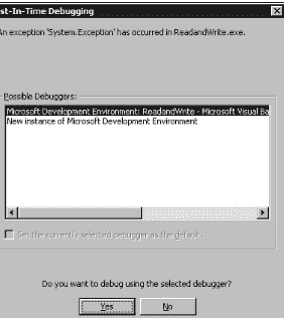

**图 6.2** 附加到调试器。当托管可执行文件遇到未处理的异常且存在调试器时，将调用此对话框。

此功能也存在于 VS .NET 的“调试”菜单下的“进程”菜单选项中。使用图 6.3 所示的对话框，你只需选择任何运行中的进程并选择“附加”即可附加到该进程。你还会被提示选择要调试的应用程序类型，包括 CLR、脚本和 Transact-SQL (T-SQL)。附加后，你可以使用调试工具栏或对话框上的“中断”按钮来中断执行。在调试模式下，调试器会显示源代码文件当前的执行行，并允许你单步执行应用程序。

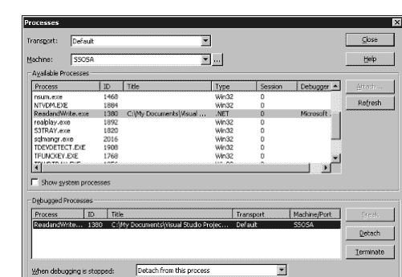

**图 6.3** 进程对话框控制附加到本地机器或远程机器上的运行进程。

此外，请注意，进程对话框除了显示是否当前正在被调试外，还显示应用程序的类型。“停止调试时”选项允许你在停止调试器时终止程序或简单地从程序中脱离。

最后，该对话框还支持跨机器调试，允许你附加到远程计算机上运行的进程。为此，只需选择“传输方式”和“计算机名称”。传输方式可以设置为 `Default`（本地）、`Native-only TCP/IP`（用于在不使用 DCOM 的情况下附加到原生程序）和 `TCP/IP`。

### 使用诊断

除了 VS .NET 自身的调试功能外，服务框架还通过 `System.Diagnostics` 命名空间提供调试和跟踪支持。本章的最后一部分重点介绍 `Debug` 和 `Trace` 类，以及如何使用它们来通过编程方式增强开发。

### 使用 Debug 类

与 VB 6.0 一样，VB .NET 公开了 `Debug` 对象，允许你在程序执行期间将调试语句写入输出窗口。正如你所预期的，包含在代码中的任何调试语句仅会被编译到调试发布版本中。这样，在最终发布版本中，应用程序的性能和代码大小都不会受到影响。然而，VB .NET 还支持 `DEBUG` 编译指令，它可以放在源代码文件的顶部，以明确地在编译代码中包含或排除调试语句。例如，以下行：

```
#Const DEBUG = True
```

即使配置设置为 Release 模式，也会在可执行文件中包含调试语句。

> **注意**

或者，在使用命令行编译器 `vbc.exe` 时，你可以使用 `/d` 开关并将属性 `DEBUG` 设置为 `True`，如 `/d:DEBUG=True`。

然而，在 .NET 中，`Debug` 类是 `System.Diagnostics` 命名空间的一个成员，并包含额外的功能。`Debug` 类公开了许多共享方法，并且可以在全局范围内访问。例如，`Debug` 类不仅公开了 `Print` 方法，还公开了重载的 `Write`、`WriteIf`、`WriteLine` 和 `WriteLineIf` 方法，允许你根据条件输出消息，并可选地包含类别信息。例如，以下语句：

```
Debug.WriteLineIf(cn.State = ConnectionState.Broken, _
    "Connection was broken", "Data Access")
```

仅在条件为真时才输出消息。它还会在输出前加上类别“Data Access”，后跟一个冒号，如下所示：

```
Data Access: Connection was broken
```

`Debug` 类还包含 `IndentSize` 和 `IndentLevel` 属性，用于控制缩进使用的空格数以及下一个 `Write` 方法缩进的级别。为了动态控制缩进，你还可以使用 `Indent` 和 `Unindent` 方法，如下所示：

```
Debug.IndentSize = 2
Debug.WriteLine("Debugging app")
' Do some work
Debug.Indent()
```

### 第一部分

```
Debug.WriteLine("Now here")
' Do some work
Debug.Unindent()
Debug.WriteLine("Done")
```

最后，与 VB 6.0 一样，`Debug` 类也支持 `Assert` 方法。`Assert` 方法是 C 程序员熟悉的工具，用于测试应用程序中的无效条件。当传递给此重载方法的表达式求值为 `False` 时，会输出一条失败消息，格式为 "Fail:" 后跟传递给该方法的消息。

`Assert` 的一个典型用途是检查有效参数——例如，一个使用 `Stream` 从 XML 文件中提取学生信息的方法——如以下代码所示：

```
Public Sub ExtractStudents(ByVal pStream As Stream)
    Debug.Assert(pStream.CanRead, "Invalid Stream object in ExtractStudents")
End Sub
```

如果 `Stream` 参数的 `CanRead` 方法返回 `False`，将输出消息

```
Fail: Invalid Stream object in ExtractStudents
```

要启用对话框显示，而不是简单地将输出写入立即窗口（或其他侦听器），你可以在应用程序或 `machine.config` 文件中添加 `assert` 元素，如下所示：

```
<configuration>
    <system.diagnostics>
        <assert assertuienabled="true" />
    </system.diagnostics>
</configuration>
```

`assertuienabled` 属性控制除了常规输出外是否显示对话框。要显式发出失败消息，你可以选择使用 `Fail` 方法，但即使将 `assertuienabled` 属性设置为 `true`，此方法也不会导致显示对话框。

> **提示**

请记住，就像 `Debug` 类的 `WriteLine` 方法一样，`Assert` 方法仅在调试打开时才执行。因此，请确保不要在 `assert` 中包含对应用程序运行至关重要的代码。换句话说，`assert` 不能替代良好的验证代码；它们只是帮助你在调试时检查程序的状态。

### 使用跟踪

`Trace` 类与 `Debug` 类相似，但它通常用于对应用程序进行*插桩*以进行运行时分析，而非开发人员测试。换句话说，你会使用 `Trace` 类的方法来输出可能对应用程序用户有用的信息，以定位性能问题或验证代码中方法的输入和输出。跟踪也有助于理解应用程序非可视化进程中发生的情况，例如 Web 服务。在这些情况下，可以将跟踪与自定义侦听器结合使用，以写出日志，供系统管理员和其他相关人员随后检查。因此，跟踪在应用程序的 Release 构建中默认是启用的，但可以使用 `TRACE` 编译指令或命令行开关 `/d:TRACE=True` 进行修改。

> **注意**

另外两种向分布式应用程序用户或管理员提供反馈的技术包括使用事件日志和性能计数器。这两个主题在第 13 章“实现服务”中进行了讨论。

`Trace` 类支持与 `Debug` 类相同的成员集，因此，例如，可以使用 `WriteLineIf` 条件输出消息，并使用 `Assert` 方法执行断言。

然而，跟踪通常也与开关一起使用。简单来说，开关允许你控制是否生成来自 `Trace` 和 `Debug` 类的输出。例如，使用开关，你可以对应用程序进行插桩，以仅显示涉及数据访问的跟踪消息，而不显示应用程序其他功能的性能信息。开关是否启用可以通过编程方式确定，尽管更典型的是通过配置文件进行。

要创建开关，你需要实例化一个派生自 `Switch` 类的对象（`BooleanSwitch` 或 `TraceSwitch`），然后在应用程序配置文件中配置该开关。例如，以下在一个类中的声明为该类创建了两个开关：

```
Private daSwitch As New BooleanSwitch("daSwitch", "Data Access")
Private tsPerfSwitch As New TraceSwitch("tsPerfSwitch", "Performance")
```

第一个开关是 `BooleanSwitch`，可以简单地设置为开或关，这映射到开关对象的 `Enabled` 属性。第二个是 `TraceSwitch` 实例，它公开了允许显示信息性消息、警告、错误和所有消息的属性。请注意，构造函数填充了用于引用开关的 `DisplayName` 属性和 `Description` 属性。

要配置开关，需要在应用程序配置文件中添加一个条目，如下所示：

```
<configuration>
    <system.diagnostics>
        <switches>
            <add name="daSwitch" value=1 />
            <add name="tsPerfSwitch" value=4 />
            <clear/>
        </switches>
    </system.diagnostics>
</configuration>
```

> **提示**

在创建将由其他开发人员重用的类时，你还可以将开关作为类中的共享字段公开。这样，使用该类的开发人员可以简单地设置字段的 `Enabled` 或 `TraceLevel` 属性，以编程方式为组件启用跟踪。

在这种情况下，两个开关都已启用，因为它们已被添加到 `switches` 元素中。此时，`BooleanSwitch` 的 `value` 属性设置为 1 以指示开关已启用，而 `TraceSwitch` 的 `value` 为 4 以指示所有消息均已启用。`value` 属性映射到 `TraceLevel` 枚举中的常量，如表 6.4 所示。

#### 表 6.4 TraceLevel 枚举常量

| 跟踪级别 | 值 |
|---|---|
| `Off` | 0 |
| `Error` | 1 |
| `Warning` | 2 |
| `Info` | 3 |
| `Verbose` | 4 |

> **提示**

当然，如果这些级别不足以满足你的应用程序，你可以通过从 `Switch` 派生并重写 `SwitchSetting` 方法来创建自己的开关类。

在应用程序内部，可以通过测试 `BooleanSwitch` 对象的 `Enabled` 属性或 `TraceSwitch` 对象的 `Level` 属性来使用开关。例如，要输出数据访问的跟踪信息，你可以使用以下代码：

```
If daSwitch.Enabled Then
    Trace.WriteLine(mstrConnect, "Data Access")
End If
```

此外，`TraceSwitch` 类为每个级别公开了一个布尔属性，因此要测试 `TraceSwitch` 中的特定级别，你可以添加以下代码：

```
If tsPerfSwitch.TraceVerbose = True Then
    Trace.WriteLine("Method " & execMethod & " executed in " & _
        execTime.Tostring & " seconds", "Performance")
End If
```

在此示例中，`execMethod` 和 `execTime` 变量表示传递到过程中的参数。

> 尽管你可以使用 `WriteLineIf` 方法，但提前执行测试更有效，因为这样就不必对表达式进行求值。

请记住，尽管开关通常与跟踪一起使用，但它们也可以同样方式应用于 `Debug` 类。

显然，开关和跟踪的组合提供了一套强大的工具来创建插桩应用程序。开关的主要优势在于它们可以在运行时启用，而无需重新编译应用程序。一种典型的方法是为你的应用程序创建一组可以打开和关闭的开关，并细分为以下类别：

- 性能
- 用户界面
- 数据访问
- 业务逻辑

这样，寻求优化应用程序的维护程序员和系统管理员就不会被来自系统所有方面的消息淹没。

> **提示**

请记住，与任何技术一样，插桩也会产生成本。特别是执行测试开关的语句的成本。

### 使用侦听器

到目前为止，讨论一直假设来自 `Debug` 和 `Trace` 类的输出被发送到表 6.3 中提到的输出窗口。然而，如果不能将跟踪重定向到控制台或文件，它将特别没有用处。

为此，`Debug` 和 `Trace` 类都公开了一个 `Listeners` 集合，该集合通过 `TraceListenerCollection` 对象公开了一组 `TraceListener` 对象。默认情况下，集合中唯一的对象是写入输出窗口的 `DefaultTraceListener` 实例。但是，向集合中添加一个新的侦听器以重定向输出非常简单。实际上，`TraceListener` 作为 `EventLogListener` 和 `TextWriterTraceListener` 类的基类，它们分别将输出写入事件日志和文件或流。

例如，要允许 `Debug` 和 `Trace` 输出发送到控制台，你可以按如下方式调用集合的 `Add` 方法：

```
Trace.Listeners.Add(New TextWriterTraceListener(Console.Out))
```

同样，你可以使用 `Remove` 方法按如下方式删除默认侦听器：

```
Debug.Listeners.Remove("Default")
```

在这种情况下，侦听器是使用接受侦听器 `DisplayName` 的重载方法删除的。

尽管在前面的示例中，一个代码示例使用了 `Trace` 类的 `Listeners` 集合，另一个使用了 `Debug` 类，但实际上这两个集合都引用了同一个基础对象。换句话说，从 `Debug` 对象中删除默认侦听器实际上是从 `Debug` 和 `Trace` 中都删除了它。同样，添加侦听器会将其添加到两者中。

通常，开发人员会添加 `TextWriterTraceListener` 的新实例，并在重载构造函数中传入要写入的流或文件名。这样，你可以将所有跟踪和调试输出写入日志文件，而无需编写自己的日志记录类。

正如你可能预期的那样，服务框架的可扩展性允许你通过从 `TraceListener` 派生并重写其 `Write` 和 `WriteLine` 方法来创建自己的侦听器。这对于在整个组织中标准化应用程序跟踪特别有用。

开发自定义侦听器也可能是一种强大的技术，因为 `Debug` 和 `Trace` 类的重载 `Write` 和 `WriteLine` 方法也支持直接将对象传递给侦听器。通过这种方式，您可以编写一个对对象进行抽象跟踪处理的侦听器，从而使使用您的侦听器的开发人员不必关心向侦听器传递特定数据。为了说明这一概念的基础知识，请考虑清单 6.2 中所示的骨架类。

### 清单 6.2 派生侦听器。这个派生 `TraceListener` 类的骨架清单实现了一个自定义的 `WriteLine` 方法。


进入`/path/to/xxx`目录，找到`xxx.json`。

在表达式`cvar = avar + bvar`中，加法运算符（`+`）将`avar`与`bvar`相加，得到它们的和`cvar`。

在`List.of(arg0, arg1, arg2)`中，`List`接口的工厂方法`of()`接受一系列的元素，返回包含它们的只读列表。

之后我们这样调用`cmd`命令：`cmd arg0 arg1 arg2`。

```
if (condVar > someVal) {console.log("xxx")}
```

```vb
Imports System.Data

Public Class DAListener : Inherits TraceListener
    Public Overloads Overrides Sub WriteLine(ByVal message As String)
        ' Write the message to the console
        Console.WriteLine(message)
    End Sub
    Public Overloads Overrides Sub Write(ByVal message As String)
        ' Write the message to the console
        Console.Write(message)
    End Sub

    Public Overloads Overrides Sub WriteLine(ByVal ds As Object)
        ' If its a DataSet then print it to the console
        If TypeOf (ds) Is DataSet Then
            Dim dsStrict As DataSet
            dsStrict = CType(ds, DataSet)
            dsStrict.WriteXml(Console.Out)
        End If
    End Sub
End Class
```

在本例中，`DAListener`类派生自`TraceListener`，因此必须重写接受字符串的`WriteLine`和`Write`方法。此外，它公开了一个重载的`WriteLine`方法，该方法接受`Object`作为参数。然后可以对该对象进行特定类型测试并相应处理。在此，如果对象是`System.Data.DataSet`对象，则其内容将以 XML 格式写入控制台。

要使用自定义侦听器，只需将其添加到`Listeners`集合中，如以下代码所示：

```vb
Debug.Listeners.Add(New DAListener())

Dim ds As New DataSet()
' Populate DataSet here
Debug.WriteLine(ds)
```

### 小结

VS .NET 和服务框架中的错误处理和调试功能应该会让现有 VB 开发人员感到熟悉，因为它们融合了许多 VB 6.0 调试器的功能。然而，跟踪功能的加入以及更强大的调试器提供了更多的功能和灵活性。这种组合使调试应用程序和创建健壮的跟踪基础设施变得更加容易。

本章结束了本书的 .NET 概念部分。从此处开始，本书将带您了解这些概念在 VB .NET 开发的分布式应用程序的各个层级中的应用。我们将从讨论使用 ADO.NET 进行数据访问开始。

### 企业级技术

#### 第二部分

### 本部分包括

- 7 使用 ADO.NET 访问数据 225
- 8 构建组件 299
- 9 访问组件服务 345
- 10 构建 Web 窗体 401
- 11 构建 Web 服务 509

### 使用 ADO.NET 访问数据

## 7 章

### 本章内容包括

- ADO.NET 概述 226
- `System.Data`架构 228
- 应用场景：Quilogy 教育系统 256

对于企业 VB 开发人员来说，迄今为止最重要的技术莫过于数据访问。当今企业环境中编写的大多数应用程序都涉及显示和操作运营和业务数据。从历史上看，Microsoft 通过提供 API 来支持访问各种关系型和非关系型数据存储，现有 VB 以及现在的 ASP 开发人员多年来已经相当熟悉这些 API，包括 VBSQL、ODBC、RDO、OLE DB 和 ADO。尽管这种持续演进意味着 VB 开发人员必须一路学习新技术，但学习这些模型的好处意味着统一的关系型数据访问模型（ODBC）、增加的简单性（DAO）、提高的性能（RDO），以及对非关系型来源的扩展支持（ADO）。

现在可以将服务框架的数据访问类添加到列表中了。这些类统称为 ADO.NET，用于实现对 OLE DB 和 SQL Server 的托管接口，在使用 SQL Server 时提高性能，并允许以与利用 Internet 和 XML 的分布式应用程序开发相称的方式操作数据。尽管学习新的数据访问模型起初可能令人望而生畏，但它也将帮助您构建现代化的分布式应用程序。

在本章中，我将讨论 ADO.NET 的架构以及如何使用它来构建分布式应用程序。本章及其后的三章形成一个系列，展示了在 VB .NET 中构建分布式应用程序时有用的技术。本章及后续章节中讨论的示例代码展示了 Quilogy 在线教育系统的简化实现，学生通过 Web 注册课程，Quilogy 员工通过内部网站查看和操作数据。注册数据存储在 SQL Server 2000 数据库中，因此，在适当的地方，将利用 SQL Server 2000 的特定功能。

由于数据是此类应用程序的基础，我将从讨论在 .NET 世界中访问数据开始。

> **注意**
>
> 本章的所有代码清单和补充材料可以在本书的网站 www.samspublishing.com 上找到。

### ADO.NET 概述

ADO.NET 由`System.Data`命名空间中的类组成，这些类封装了分布式应用程序的数据访问。然而，ADO.NET 并非简单地将现有的 ADO 对象模型映射到 .NET 以提供对 OLE DB 和 SQL Server 的托管接口，而是改变了应用程序内部和之间数据的存储和封送方式。ADO.NET 重新定义此架构的主要原因是，当今开发的大多数应用程序都可以从能够以断开连接的方式跨 Internet 分发数据的可伸缩性和灵活性中受益。

由于经典 ADO 模型主要是为连续连接访问而开发的，因此用它创建分布式应用程序有一定局限性。一个典型的例子是在分布式应用程序的各层之间通过`Recordset`对象移动数据（定义为层跨进程边界拆分_layers_的应用程序）。要在经典 ADO 中实现这一点，您必须使用包括游标位置、游标类型和锁定类型在内的属性组合来专门创建断开的`Recordset`。此外，由于`Recordset`以专有二进制格式表示。

换句话说，数据不必使用表、行和列的隐喻来访问，而可以根据可以由编译器进行类型检查的数据定义来进行访问。

此外，这种断开连接的模型结合连接池机制，可以更快地释放数据库服务器上的资源，允许应用程序通过不持有昂贵的数据库连接和锁来实现扩展。

在下一节中，我们将深入探讨 ADO.NET 是如何在设计时考虑到断开连接访问、可扩展性和互操作性这些目标的。

### 与 OLE DB 和 ADO 的关系

一些读者可能会认为 ADO.NET 取代了现有的 ADO 和 OLE DB 架构。然而，你应该将 ADO.NET 视为这项技术在分布式应用程序开发中的一个*增强*，至少在部分上依赖于底层的 OLE DB 和 ADO 架构。例如，ADO.NET 目前并不包含用于原生访问除 SQL Server 之外任何数据源的托管代码。对于所有其他数据源，都需要 OLE DB 提供程序。

事实上，由于 ADO.NET 是为断开连接和分布式应用程序设计的，它可能并不适合你需要使用 VB .NET 创建的所有类型的应用程序，特别是那些依赖于服务器端游标并持续保持连接的应用程序。因此，你可能希望通过 COM 互操作层在 VB .NET 中使用经典 ADO，这将在第 9 章“访问组件服务”中详细讨论。

> **注意**
>
> ADO.NET 不支持服务器端处理模型的原因之一是，试图使用经典 ADO 实现这一目标被证明是困难的，因为数据库供应商没有以统一的方式支持该模型。因此，你不会在 ADO.NET 中看到这种通用支持的实现。但是，请留意服务器端游标和其他特定于 SQL Server 的功能，这些功能可能会在 ADO.NET 的后续版本中包含在`SqlServer`命名空间中。

### System.Data 架构

你可以将`System.Data`命名空间视为主要由两个部分组成：

- 允许你连接到数据源、对数据源发出命令以及直接从数据存储读取数据到`DataSet`中或内部的托管提供程序。托管提供程序包含与经典 ADO 中的`Connection`、`Command`和`Parameter`对象类似的类，以及增加了以只进方式遍历结果集的支持。
- `DataSet`及其各种支持类，允许你以断开连接的方式操作数据。如前所述，`DataSet`最像一个断开连接的`Recordset`，尽管它功能更强大、更灵活。

### 托管提供程序

要操作数据存储中的数据，你首先需要打开与它的连接并传递要执行的命令。在 ADO.NET 中，这是通过使用*托管提供程序*（也称为 .NET 数据提供程序）来完成的。ADO.NET 附带了两个托管提供程序：*OleDb 托管提供程序*和*SqlClient 托管提供程序*。前者包含在`System.Data.OleDb`命名空间中，与经典 ADO 类似，允许你访问任何具有可用 OLE DB 提供程序的数据源。后者位于`System.Data.SqlClient`中，通过直接写入 SQL Server 使用的表格数据流（TDS）协议，提供对 SQL Server 的原生访问。换句话说，OleDb 托管提供程序只是提供了一个位于现有 OLE DB 基础设施之上的数据访问模型，并且需要特定于数据源的 OLE DB 提供程序。相反，SqlClient 托管提供程序取代了现有的用于 SQL Server 的 OLE DB 提供程序（SQLOLEDB），因为它直接写入 SQL Server，而无需任何其他软件的协助。这些组件及其与 OLE DB 和 ADO 的关系图如图 7.1 所示。

> **注意**
>
> 虽然你可能认为 ODBC 的 OLE DB 提供程序（MSDASQL）会被透明地支持，但事实并非如此。用于 ODBC 的托管提供程序现在可在 msdn.microsoft.com 上下载。

每个托管提供程序都包含一组实现接口并从`System.Data`中的类派生的类。托管提供程序中包含的常见类型的类如下：

- **Command** 一个实现`IDbCommand`的类，包含用于对连接执行查询的成员。它可以执行不返回结果的查询，以及返回用于遍历结果集的`IDataReader`对象的查询。还包括用于响应基础数据源中架构更改的事件。
- **Connection** 一个实现`IDbConnection`的类，包含连接到数据源、处理事务行为和连接池以及在连接状态更改时接收通知的成员。
- **DataAdapter** 一个从`DbDataAdapter`派生并实现`IDbDataAdapter`的类。它包含一组命令对象和一个连接，用于填充`DataSet`并更新基础数据源。它还将数据源表和列映射到`DataSet`中的表和列。请注意，只有关系提供程序才会直接从`DbDataAdapter`继承。
- **DataReader** 一个实现`IDataReader`接口的类，用于从数据源读取只进的记录流。请注意，这类似于 SQL Server 中的消防栓游标。
- **Parameter** 一个实现`IDataParameter`的类，用于将参数传递给命令对象。参数通过实现`IDataParameterCollection`接口的`ParameterCollection`对象进行跟踪。
- **Transaction** 一个实现`IDbTransaction`的类，用于表示数据源中的事务。

此外，托管提供程序还可以包含它们自己的类来表示属性、事件、异常、用于与`DataAdapter`一起使用的命令生成器和错误。使用的命名约定是用托管提供程序的命名空间作为基类或接口名称的前缀。例如，对于 SqlClient 托管提供程序，表 7.1 中显示的类是可用的。

**表 7.1** SqlClient (SQL Server) 托管提供程序在`System.Data.Sql`命名空间中找到的类

| 类 | 描述 |
|---|---|
| `SqlClientPermission`, `SqlClientPermissionAttribute` | 命令式和声明式安全类，用于确保用户具有足够的权限来访问 SQL Server。 |
| `SqlCommand` | 实现`IDbCommand`，用于执行存储过程等 Transact-SQL 命令。 |
| `SqlCommandBuilder` | 用于自动生成`SqlDataAdapter`中的命令，以便从`DataSet`对象更新 SQL Server 数据库。 |
| `SqlConnection` | 实现`IDbConnection`，表示与 SQL Server 数据库的连接。包括其自己的连接字符串语法。 |
| `SqlDataAdapter` | 从`DbDataAdapter`派生，用于将数据从 SQL Server 映射到`DataSet`以进行选择、插入、更新和删除。 |
| `SqlDataReader` | 实现`IDataReader`，作为在结果集上返回只进、只读游标的一种方式。 |
| `SqlException` | 从`SystemException`派生，每当`SqlClient`遇到警告或错误时引发。至少包含一个`SqlError`实例。 |
| `SqlError` | 表示`SqlDataAdapter`返回的错误。通过`SqlException`对象中的集合返回。 |
| `SqlErrorCollection` | 表示通过`SqlException`返回的`SqlError`对象的集合。 |
| `SqlParameter` | 表示`SqlCommand`对象的参数。 |
| `SqlParameterCollection` | 表示`SqlParameter`对象的集合。 |
| `SqlTransaction` | 表示 SQL Server 中的事务。 |

显然，通过将托管提供程序的基本功能抽象为基类和接口，数据库供应商和企业开发人员可以编写自己的托管提供程序。虽然这是可能的，但可能不建议绝大多数开发人员这样做，因为 .NET 附带的托管提供程序处理了大多数数据源所需的所有连接。然而，对于拥有大型系统并为其后端开发了专有数据访问接口的公司来说，这可能是必要的。

从某个角度来看，多种托管提供程序的可用性为使用 SQL Server（或托管提供程序可用的后端）作为后端数据库的开发者提供了一个决策点。因为 SqlClient 托管提供程序原生处理 TDS，所以其性能优于通过 OleDb 托管提供程序连接 SQL Server 时产生的额外转换层，如图 7.1 所示。

> 实际测试表明，VB.NET 与 SqlClient 的组合比在非托管 Visual C++ 应用程序中直接使用 OLE DB 快 10%。当然，该组合本身又比 VB 6.0 和 ADO 2.5 快 10%。

因此，大多数 SQL Server 开发者可能更倾向于使用 SqlClient 托管提供程序。这种选择的缺点是，如果更改后端数据库，就必须修改并重新编译代码以使用 OleDb 托管提供程序。为避免这种情况，在后端数据库可能更改的情况下，你可能需要创建一套自己的通用类，以抽象托管提供程序中对象的实例化过程。显然，这些类的实现方式可以多种多样，从静态调用特定的托管提供程序（如 SqlClient）到根据属性设置动态调用正确的提供程序。如果你的目标数据库会变更，那么创建和维护这一额外层的开销可能是值得的。

话虽如此，对于大多数项目而言，更好的方法是确保数据访问代码在自定义类中与用户和业务逻辑抽象分离，这样在必要时，修改起来会相当容易，而无需承担创建和维护独立通用数据访问类的开销。这也是本章所采用的方法。

### 使用托管提供程序

使用托管提供程序的基础类似于在经典 ADO 中使用`Connection`和`Command`对象。但是，托管提供程序还包括一个`DataAdapter`，用于填充和控制`DataSet`对象，这在经典 ADO 中没有对应物。

为了说明连接和命令对象的使用，清单 7.1 展示了一个简单的示例，演示了如何使用 SqlClient 托管提供程序连接到 SQL Server，并执行一个简单的存储过程以使用`SqlCommand`对象返回`Courses`表的内容。然后使用`SqlDataReader`类遍历结果行。

#### 清单 7.1 使用托管提供程序

此清单展示了使用 SqlClient 托管提供程序在 SQL Server 中执行存储过程并流式处理结果行的最简单示例。

```vbnet
Imports System.Data
Imports System.Data.SqlClient
Dim cnSQL As SqlConnection
Dim cmSQL As SqlCommand
Dim drCourses As SqlDataReader

cnSQL = New SqlConnection( _
    "server=ssosa;trusted_connection=yes;database=enrollment")
cmSQL = New SqlCommand("usp_ListCourses", cnSQL)
cmSQL.CommandType = CommandType.StoredProcedure

Try
    cnSQL.Open()
    drCourses = cmSQL.ExecuteReader()

    Do While drCourses.Read()
        Console.WriteLine(drCourses("Description").ToString())
    Loop
Catch e As SqlException
    Console.WriteLine(e.ToString())
Finally
    cnSQL.Close()
End Try
```


清单 7.1 中需要注意的一点是，构造函数字符串用于分别向`SqlConnection`和`SqlCommand`对象传递连接字符串，以及带有连接引用的命令文本。此外，你会注意到传递给`SqlConnection`的连接字符串语法与用于`SQLOLEDB`提供程序的语法非常相似。另外，调用了`ExecuteReader`方法，该方法返回一个`SqlDataReader`对象，该对象仅使用`Read`方法简单地遍历行。`SqlDataReader`实现了一个仅向前的游标，允许通过简单的默认`Item`属性访问数据。为获得最佳性能，`SqlDataReader`仅提供用于读取数据的基本构造。

> **注意**
>
> 尽管本章大部分代码使用了`SqlClient`托管提供程序，但使用`OleDb`托管提供程序的代码几乎完全类似。

### 企业技术

使用`SqlDataReader`是从 SQL Server 获取数据的最快方式，因为它在客户端没有开销，数据不会持久化在内存中。数据只是从 SQL Server 流式传输到客户端机器的网络缓冲区，然后由`SqlClient`读取。然而，就像经典 ADO 中的“firehose”游标一样，数据库连接将一直保持打开状态，直到调用`SqlConnection`的`Close`方法或对象超出作用域。或者，`ExecuteReader`方法接受`CommandBehavior`枚举值的按位组合。其中一个值`CloseConnection`会在关闭`SqlDataReader`时自动关闭`SqlConnection`。

> **提示**
>
> 此外，`CommandBehavior`枚举可用于向数据源提供额外信息，以优化性能。例如，`SingleResult`和`SingleRow`值分别用于告诉数据源查询将返回单个结果集或仅单行。

有经验的 ADO 开发者可能想知道是否可以使用一次方法调用从`SqlDataReader`读取所有行，类似于 ADO 2.x 中公开的`GetRows`方法。不幸的是，ADO.NET 中尚未提供此功能，尽管可以使用`GetValues`或`GetSqlValues`方法将当前行的所有列读取到数组中。

尽管起初以这种方式访问仅向前的结果集可能感觉有些奇怪，但将`SqlDataReader`提供的功能移至托管提供程序中，而不是放在`DataSet`中（你可能期望在那里找到它，因为它在大多数方面类似于`Recordset`），是一件好事，因为实现必须由数据源明确管理，并且它允许`DataSet`严格用作客户端数据缓存。

> **提示**
>
> 有关在经典 ADO 中创建 firehose 游标的更多信息，请参阅我的著作《Pure Visual Basic》第 14 章。

`SqlCommand`的有趣之处在于，它还实现了其他方法来执行针对 SQL Server 的命令，如表 7.2 所示。

**表 7.2 SqlCommand 的执行方法**

| 方法 | 描述 |
|---|---|
| `ExecuteNonQuery` | 执行命令并返回结果。用于执行不返回结果集的语句，例如修改数据的存储过程。 |
| `ExecuteScalar` | 执行命令并仅将结果集的第一列和第一行作为`Object`返回。丢弃所有其他数据。 |
| `ExecuteXmlReader` | 执行命令并以 XML 流的形式返回结果。用于 SQL Server 2000 中的`FOR XML`语句。 |

表 7.2 中显示的几种方法，如`ExecuteNonQuery`和`ExecuteScalar`，也存在于`OleDb`托管提供程序中，本章后面将更详细地讨论。但是，作为使用特定数据源的托管提供程序时可能实现的自定义功能的示例，请考虑清单 7.2 中的代码。

#### 清单 7.2 返回流

此清单展示了托管提供程序如何实现数据源的特定功能——在本例中，是以流的形式返回 XML 的能力。

```vbnet
Imports System.Data
Imports System.Data.SqlClient
Imports System.IO
Imports System.Xml
Dim cnSQL As SqlConnection
Dim cmSQL As SqlCommand
Dim xmlCourses As XmlReader

cnSQL = New SqlConnection( _
    "server=ssosa;trusted_connection=yes;database=enrollment")
cmSQL = New SqlCommand("usp_ListCourses", cnSQL)
cmSQL.CommandType = CommandType.StoredProcedure

Try
    cnSQL.Open()
    xmlCourses = cmSQL.ExecuteXmlReader
    Do While xmlCourses.Read()
        Console.WriteLine(xmlCourses.ReadOuterXml)
    Loop
Catch e As SqlException
    Console.WriteLine(e.ToString())
Finally
    cnSQL.Close()
End Try
```

在此示例中，执行的存储过程与清单 7.1 相同。但是，没有使用`ExecuteReader`方法执行该过程，而是调用了`ExecuteXmlReader`方法，该方法是`SqlClient`托管提供程序特有的。在这种情况下，不是返回可以通过`SqlDataReader`遍历的结果集，而是通过`XmlReader`对象返回一个 XML 流，可以使用其`Read`方法访问（在第 14 章“与企业集成”中讨论）。这之所以可能，是因为 SQL Server 2000 具有使用`FOR XML`子句在服务器上生成 XML 的能力。为了生成 XML，对`usp_ListCourses`存储过程进行了如下所示的 Transact-SQL 代码示例修改：

```sql
CREATE PROCEDURE usp_ListCourses
AS
SELECT * FROM Course
ORDER BY CourseNum
FOR XML AUTO
```

本章后面将展示使用托管提供程序命令对象的其他几种技术。

使用托管提供程序的另一个关键方面是使用`DataAdapter`来填充`DataSet`并控制对`DataSet`的更改如何发送到底层数据存储。为此，`DataAdapter`引用 select、insert、update 和 delete 命令对象，当操作`DataSet`时会调用这些对象。清单 7.3 创建了一个新的`SqlDataAdapter`并设置了`SelectCommand`和`UpdateCommand`属性。

#### 清单 7.3 使用 SqlDataAdapter

此简单示例创建一个`SqlDataAdapter`并使用它指定一个用于更新`DataSet`的存储过程。

```vbnet
Imports System.Data
Imports System.Data.SqlClient
Dim cnSQL As SqlConnection
Dim daSQL As SqlDataAdapter
Dim parmWork As SqlParameter
Dim dsCourses As New DataSet("Offerings")
Dim intRows As Integer
```

### 清单 7.3（续）

```vbnet
cnSQL = New SqlConnection( _
    "server=ssosa;trusted_connection=yes;database=enrollment")

' Create the adapter and set the SelectCommand through the constructor
daSQL = New SqlDataAdapter("usp_ListCourses", cnSQL)
daSQL.SelectCommand.CommandType = CommandType.StoredProcedure

' Create the update command
daSQL.UpdateCommand = New SqlCommand("usp_UpdateCourse", cnSQL)
daSQL.UpdateCommand.CommandType = CommandType.StoredProcedure

' Set the parameters for the update command
parmWork = daSQL.UpdateCommand.Parameters.Add( _
    New SqlParameter("@Days", SqlDbType.TinyInt))
parmWork.SourceColumn = "Days"
parmWork.SourceVersion = DataRowVersion.Current

parmWork = daSQL.UpdateCommand.Parameters.Add( _
    New SqlParameter("@CourseID", SqlDbType.Int))
parmWork.SourceColumn = "CourseID"
parmWork.SourceVersion = DataRowVersion.Original

parmWork = daSQL.UpdateCommand.Parameters.Add( _
    New SqlParameter("@Cost", SqlDbType.Money))
parmWork.SourceColumn = "CourseWareCost"
parmWork.SourceVersion = DataRowVersion.Current

' Populate the DataSet
intRows = daSQL.Fill(dsCourses, "Courses")

' Make a change to the underlying data
dsCourses.Tables("Courses").Rows(0).Item("Days") = 0

Try
    ' Save the changes
    daSQL.Update(dsCourses,"Courses")
Catch e As Exception
    ' Report the exception
End Try
```

请注意，与经典 ADO 中的任何`Command`对象一样，`UpdateCommand`属性中引用的`SqlCommand`对象接受存储在`Parameters`集合中的参数。`SqlParameter`的构造函数接受参数名称和使用`SqlDbType`枚举的数据类型。`SourceColumn`和`SourceVersion`属性用于指示`SqlDataAdapter`应从`DataSet`中的`DataRowVersion`枚举（`Current`、`Default`、`Original`、`Proposed`）中使用哪一列以及该列的哪个版本来填充参数。在本例中，`CourseID`使用的是原始版本，因为它是主键；而`Days`和`CourseWareCost`使用的是当前版本，因为它们是可更新的。

> **提示**
>
> 与经典 ADO 不同，在`SqlCommand`或`OleDbCommand`中使用参数时，参数无需按照在存储过程中定义的顺序添加到`Parameters`集合中。这是因为过程将使用命名参数而非位置参数来执行。例如，在清单 7.3 中，`@Days`参数定义在`@CourseID`之前，而在存储过程中顺序恰好相反。当然，这意味着在将参数添加到集合时必须使用参数的确切名称。其好处在于，如果参数是可为空的（在 Transact-SQL 中使用`NULL`关键字定义），在不需要填充它的情况下，你无需将其添加到`Parameters`集合中。

然后，`SqlDataAdapter`可以使用`Fill`方法填充底层的`DataSet`，该方法返回添加到底层`DataTable`的行数。请注意，如果`SqlConnection`对象尚未打开，`Fill`方法会先打开连接，执行用于检索数据的查询，然后再关闭连接。如果连接已经打开，`Fill`方法会使用它且不会关闭它。这种行为是高效的，因为在分布式应用程序中保持数据库连接等昂贵资源的占用是不可取的。尽管将在本章后面介绍，但请注意`DataSet`的构造函数用于为`DataSet`指定名称，而`Fill`方法的第二个参数指定要填充的`dsCourses` DataSet 中的`TableMappings`集合的名称。

然后对第一行的`Days`列进行简单修改，并调用`SqlDataAdapter`的`Update`方法。最终结果是对`usp_UpdateCourse`存储过程进行一次调用，并传递相应的参数。

在`Fill`和`Update`方法中，第二个参数都用于指定`DataSet`中要填充的`DataTable`对象，相关内容将在后文进一步介绍。

如表 7.1 所示，除了在代码中指定由`DataAdapter`执行的插入、更新和删除命令（如清单 7.3 所示），还可以指示托管提供程序动态创建这些命令。这可以通过`SqlCommandBuilder`和`OleDbCommandBuilder`类来实现。实际上，只需实例化一个命令构造函数并在构造函数中传递`DataAdapter`，命令就会在需要时由`CommandBuilder`动态构建。清单 7.4 中的代码展示了如何使用`SqlCommandBuilder`类实现这一功能。

### 清单 7.4 使用 CommandBuilder

本清单展示了如何使用`SqlCommandBuilder`通过`SqlDataAdapter`自动生成数据操作命令。

```vbnet
Imports System.Data
Imports System.Data.SqlClient
Dim cnSQL As SqlConnection
Dim daSQL As SqlDataAdapter
Dim cmdSql As New SqlCommandBuilder(daSQL)
Dim cmdUpd As SqlCommand
Dim dsCourses As New DataSet("Offerings")

cnSQL = New SqlConnection( _
    "server=sossa;trusted_connection=yes;database=enrollment")
' Create the adapter and set the SelectCommand through the constructor
daSQL = New SqlDataAdapter("SELECT * FROM fn_ListCourses()", cnSQL)

' Create the command builder
cmdSql = New SqlCommandBuilder(daSQL)

' Populate the DataSet
daSQL.Fill(dsCourses, "Courses")

' Make a change to the underlying data
dsCourses.Tables("Courses").Rows(0).Item("Days") = 0
daSQL.Update(dsCourses, "Courses")

' Get the command that was used to update the database
cmdUpd = cmdSql.GetUpdateCommand
Console.WriteLine(cmdUpd.CommandText)
```

请注意，这里没有显式创建`UpdateCommand`，而是实例化了`SqlCommandBuilder`并向其传递了对`daSQL`的引用。此时无需进一步干预。当调用`SqlDataAdapter`的`Update`方法时，命令构造函数会向 SQL Server 发送请求，以发现`SelectCommand`中使用的基础表的列名和数据类型。通过这种方式，命令构造函数仅在需要时才产生到服务器的额外往返开销。然后它填充底层的`SqlDataAdapter`命令对象，这些对象随即被用于通过`sp_executesql`系统存储过程执行插入、删除或更新（如本例所示）操作。这些命令随后会在`SqlDataAdapter`的生命周期内被缓存。请注意，清单 7.4 中的代码还使用了`SqlCommandBuilder`的`GetUpdateCommand`方法来获取用于更新的`SqlCommand`的引用，并仅将生成的`CommandText`输出用于诊断目的。

#### 第二部分

在计划依赖命令构造函数之前，有几个注意事项需要了解。首先，命令构造函数仅在`SelectCommand`所用语句从单个基础表中提取数据时才有效。在本例中，`SelectCommand`调用了 SQL Server 2000 中的一个内联表值函数，该函数仅查询`Course`表，因此可以成功。但是，如果该函数使用了包含聚合函数或`JOIN`子句的`SELECT`语句，命令构造函数在尝试生成命令时会抛出`SqlException`，因为返回的要么是无基础表，要么是多个基础表。然而，如示所示，使用 SQL Server 时可以使用从单个表返回数据的函数和存储过程。

> **提示**
>
> SQL Server 2000 中支持的第二种函数类型是多语句表值函数。该函数返回由函数内部的 Transact-SQL 动态构建的结果集。虽然你可以在`SelectCommand`中通过在`FROM`子句中引用多语句表值函数来使用它们，但`SqlCommandBuilder`无法从这样的语句中创建命令，因为缺少基础表信息。即使函数从单个表返回数据也是如此。


第二个需要注意的要点是，使用命令构造函数生成的 SQL 语法不一定是最优的。例如，`SelectCommand`返回的所有列都会被包含在更新和删除命令的`WHERE`子句中，即使底层`DataTable`的主键已设置也是如此，这将在本章后面展示。这显然浪费了网络带宽，并导致 SQL Server 必须解析语句并创建优化的查询计划后才能执行。以下是更新`CommandText`的示例。请注意`CourseID`是主键。

```sql
UPDATE Course SET CourseNum = @p1 , Description = @p2 , ProductID = @p3 , LOBID = @p4 , Days = @p5 , CourseWareCost = @p6
WHERE ( CourseID = @p7 AND CourseNum = @p8 AND Description = @p9 AND ProductID = @p10 AND LOBID = @p11 AND Days = @p12 AND CourseWareCost = @p13 )
```

此外，插入命令是根据填充新行时设置的列来构建的。换句话说，要使插入成功，你必须确保填充所有必需且没有默认值的列。

最终结果是，对于大多数复杂的应用程序，你需要使用更高效的技术（如存储过程）来自行填充数据修改命令。

## 使用事件

正如经典 ADO 中的`Connection`和`Command`对象支持事件一样，托管提供程序也同样支持事件。`OleDb`和`SqlClient`的`Connection`和`DataAdapter`类都包含代码可以捕获的事件。例如，`SqlConnection`和`OleDbConnection`类都支持`InfoMessage`和`StateChanged`事件，分别用于从数据源捕获信息性消息和监视连接状态的变化。同时，`SqlDataAdapter`和`OleDbDataAdapter`支持`RowUpdating`和`RowUpdated`事件，它们分别在适配器的`UpdateCommand`执行之前和之后触发。

要处理其中一个事件，你可以使用`WithEvents`关键字、动态事件处理程序或显式使用`Delegate`类来声明对象，正如第 4 章"面向对象特性"中所讨论的。例如，假设有一个客户端想要捕获 Transact-SQL 中`PRINT`语句产生的消息。为此，必须处理`InfoMessage`事件。假设`SqlConnection`对象声明为`cnSQL`，可以使用`AddHandler`语句构造动态事件处理程序，如下所示：

```
AddHandler cnSQL.InfoMessage, AddressOf SqlConnInfoMessage
```

然后，私有方法`SqlConnInfoMessage`的第二个参数必须为`SqlInfoMessageEventArgs`类型，该类型公开了一个`SqlError`对象的集合。处理事件、构造消息字符串并将其打印到控制台的代码如下：

```
Imports System.Data.SqlClient

Private Sub SqlConnInfoMessage(ByVal sender As Object, _
    ByVal e As SqlInfoMessageEventArgs)
    Dim i As Integer
    Dim strMessage As String

    For i = 0 To e.Errors.Count - 1
        strMessage = "Source: " & e.Errors(i).Source & vbCrLf & _
        "Number: " & e.Errors(i).Number.ToString() & vbCrLf & _
        "State: " & e.Errors(i).State.ToString() & vbCrLf & _
        "Class: " & e.Errors(i).Class.ToString() & vbCrLf & _
        "Server: " & e.Errors(i).Server & vbCrLf & _
        "Message: " & e.Errors(i).Message & vbCrLf & _
        "Procedure: " & e.Errors(i).Procedure & vbCrLf & _
        "LineNumber: " & e.Errors(i).LineNumber.ToString()
        Console.WriteLine(strMessage)
    Next
End Sub
```

## 连接池

希望开发可扩展分布式应用程序以供数百或数千个并发用户使用的开发人员必须关注数据库连接等昂贵资源的使用。因此，你需要确保应用程序不会长时间持有连接，并且多个用户可以重用不再使用的连接，而无需承担重建连接的开销。

在经典 ADO 中，数据库连接池要么通过 OLE DB 的会话池机制来处理，要么通过使用`MSDASQL`提供程序时 ODBC 驱动程序管理器实现的连接池代码来处理。

> **提示**
>
> 有关这两种方法的差异和具体细节的更多信息，请参阅我的另一本书 *Pure Visual Basic* 的第 14 章。

使用`OleDb`托管提供程序时，OLE DB 会话池仍然可用，并由 OLE DB 自动处理。但是，由于`SqlClient`托管提供程序使用 TDS 直接与 SQL Server 通信，因此它必须实现自己的连接池形式，并依赖 Windows 2000 组件服务来实现。正如第 9 章所讨论的，Windows 2000 中的 COM+ 支持池化组件，其中预定义数量的实例化对象实例托管在 COM+ 管理的池中。如果有可用的对象实例，当客户端应用程序请求新实例时，会将其分配给该客户端，随后在释放引用后返回池中供其他客户端使用。此方案允许客户端重用创建成本高昂的对象，从而减少服务器所需的资源。代表与 SQL Server 连接的`SqlConnection`类是池化组件的理想候选者。

为了支持创建和配置连接池，`SqlConnection`的`ConnectionString`中包含了一些附加属性。例如，只需实例化并将`SqlConnection`对象的`Pooling`属性设置为`True`（默认值）后打开连接，该连接就会被添加到新的或现有的池中。与 OLE DB 会话池一样，连接根据`ConnectionString`属性的不同文本被分组到不同的池中。连接字符串中的任何差异都会导致创建新的池。

为说明这一概念，请看以下代码：

```
cnSQL = New SqlConnection( _
    "server=ssosa;uid=dfox;pwd=dlf;database=enrollment;pooling=true")
cnSQL.Open
```

```
cnSQL2 = New SqlConnection( _
    "server=ssosa;trusted_connection=yes;database=enrollment;pooling=true")
cnSQL2.Open
```

```
cnSQL3 = New SqlConnection( _
    "server=ssosa;trusted_connection=yes;database=enrollment;pooling=true")
cnSQL3.Open
cnSQL3.Close
```

```
cnSQL4 = New SqlConnection( _
    "server=ssosa;trusted_connection=yes;database=enrollment;pooling=true")
cnSQL4.Open
```

在此示例中，实例化了四个`SqlConnection`对象，除`cnSQL3`外其余均保持打开状态。在这种情况下，由于所有对象的`Pooling`属性都设置为`True`，因此创建了两个池：一个包含`cnSQL1`，另一个包含`cnSQL2`和`cnSQL3`（因为`cnSQL1`的`ConnectionString`与`cnSQL2`和`cnSQL3`的不同）。然而，当调用`cnSQL3`的`Close`方法时，连接并不会被销毁，而是返回到池中。因此，当调用`cnSQL4`的`Open`方法时，之前由`cnSQL3`使用的连接将从池中取出并分配给`cnSQL4`，而不是创建新连接。

显然，这个人为的示例涉及单个客户端应用程序，但如果你假设每个连接代表一个试图几乎同时创建数据库连接的独立用户，你就会开始看到连接池的实用之处。特别是当使用连接的方法是短生命周期的，能够快速获取和释放连接，使得打开的连接数少于用户数时，更是如此。与 OLE DB 会话池不同，默认情况下，池化的`SqlConnection`对象不会被销毁，直到创建它们的进程结束或连接以某种方式断开（连接池管理器在连接实际使用时检测到这一点）。此外，创建的池还会根据调用线程的事务上下文进行细分。这允许客户端应用程序将分布式事务与`SqlConnection`对象结合使用，并确保事务中的所有工作一起提交。

最后，`ConnectionString`的语法增加了控制池大小和行为的附加属性，如表 7.3 所示。请注意，由于这些属性包含在`ConnectionString`中，它们在池首次创建时设置（因为池是基于`ConnectionString`的语法创建的）。

### 表 7.3 SqlClient 连接池属性

| 属性 | 描述 |
|---|---|
| `Connect Timeout` | 指定等待连接成功的时间长度；默认值为 15 秒。 |
| `Connection Lifetime` | 指定连接可以存活的最大时间（以秒为单位）。默认值为 0，表示持续到进程结束。在连接返回到池时检查。 |
| `Connection Reset` | 指定连接返回到池时是否通过撤销用户会话期间发出的任何会话级别（`SET`）语句来重置连接。默认值为`True`，但在连接返回到池时会产生额外的网络往返。 |
| `Enlist` | 默认值为`True`，自动将连接加入当前事务上下文。如果应用程序不使用分布式事务，可以将其关闭以提高性能。 |
| `Min Pool Size`, `Max Pool Size` | 默认值分别为 0 和 100，决定池中可能存在多少个连接。 |
| `Pooling` | 默认值为`True`。决定是否启用连接池。 |

## 断开式数据

如清单 7.3 和 7.4 所预览的，`System.Data`命名空间的第二个主要部分是`DataSet`及其相关类。如前所述，`DataSet`是 ADO.NET 的核心，因为它以断开式方式表示来自一个或多个底层数据源的数据。此外，它还包括关系和约束等元数据，这些元数据为数据提供结构并允许代码遍历数据。当然，`DataSet`既可以使用 XSD 架构通过 XML 来定义，也可以存储为 XML，因此它是分布式应用程序各层之间传递数据的理想载体。

> **注意**
>
> `DataSet`类派生自`System.ComponentModel.MarshalByValueComponent`类，这允许它通过值跨进程边界进行封送，即传递的是序列化对象的副本而非其引用。通过这种方式，它类似于经典 ADO 中的断开式`Recordset`。

除了用于配置`DataSet`的标量属性外，`DataSet`还包含对图 7.2 所示并在表 7.4 中讨论的主要类的引用。

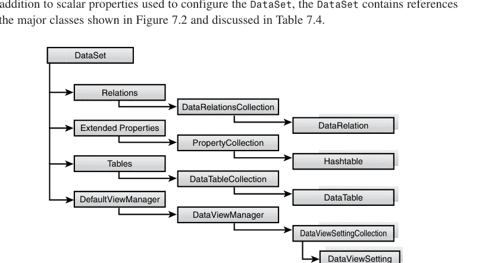

### 图 7.2

`DataSet`对象模型。此图描绘了`DataSet`所引用的主要类。

#### 表 7.4 DataSet 类

这些是`DataSet`所引用的主要类。

| 类 | 描述 |
|---|---|
| `DataRelationsCollection` | 通过`Relations`属性公开，包含一组`DataRelation`对象，这些对象映射了`DataSet`中`DataTable`对象之间的所有父/子关系。 |
| `PropertyCollection` | 通过`ExtendedProperties`属性公开，包含一组基于`Hashtable`类的自定义属性集合。 |
| `DataTableCollection` | 通过`Tables`属性公开，包含一组包含在`DataSet`中的`DataTable`对象集合。 |
| `DataViewManager` | 通过`DefaultViewManager`属性公开，用于为`DataSet`中的每个`DataTable`创建自定义排序和筛选设置（`DataViewSetting`）。其中包含对`DataViewSettingsCollection`的引用，用于存储每个`DataTable`的设置。 |

正如你在表中注意到的，`DataSet`包含对公开集合对象的引用，这些集合包含了存储在`DataSet`中的数据。从这个角度来看，你也可以将`DataSet`简单地视为表、属性和关系的容器。

如图 7.2 所示，`DataTableCollection`公开了`DataTable`对象的集合，这些对象用于表示实际数据。图 7.3 和表 7.5 扩展了`DataTable`并展示了其组成类。

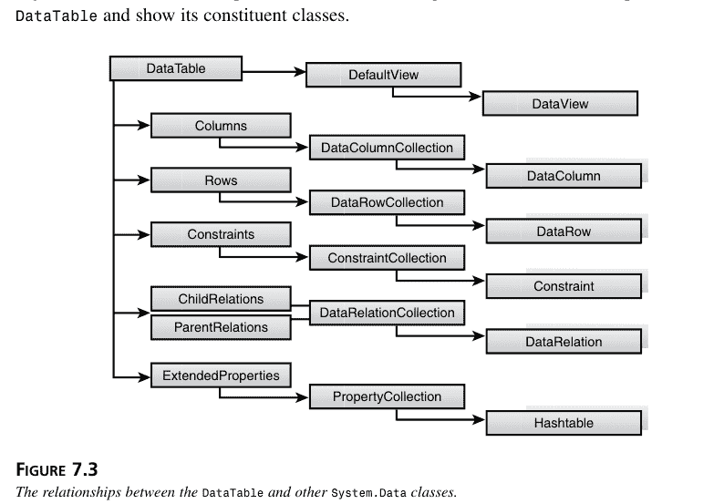

### 图 7.3

`DataTable`与其他`System.Data`类之间的关系。

#### 表 7.5 DataTable 类

| 类 | 描述 |
|---|---|
| `DataView` | 通过`DefaultView`属性公开，包含对`DataView`对象的引用，该对象包含此`DataTable`对象的排序和筛选设置。 |
| `DataColumn` | 除了在`Columns`集合中被引用外，还通过`PrimaryKey`属性作为对象数组公开，以强制执行主键（图 7.3 中未显示）。 |
| `DataColumnCollection` | 通过`Columns`属性公开，包含一组`DataColumn`对象，代表`DataTable`中的每一列。 |

#### 表 7.5（续）

| 类 | 描述 |
|---|---|
| `DataRowCollection` | 通过`Rows`属性公开，包含`DataTable`中的`DataRow`对象集合。 |
| `ConstraintCollection` | 通过`Constraints`属性公开，引用一组派生自`Constraint`的对象集合，例如`ForeignKeyConstraint`和`UniqueConstraint`。 |
| `DataRelationCollection` | 通过`ChildRelations`和`ParentRelations`属性公开，包含一组包含在`DataSet`中的`DataRelation`对象集合。 |
| `PropertyCollection` | 通过`ExtendedProperties`属性公开，包含一组基于`Hashtable`对象的自定义属性集合。 |

`DataTable`是`DataSet`的核心，包含了实际数据的表示。你会注意到，与`DataSet`类似，它包含一系列引用列、行、属性、约束和关系的集合对象。从这个角度来看，`DataTable`类似于经典的 ADO `Recordset`。

此外，`DataTable`包含对默认`DataView`对象的引用，该对象控制数据的排序和筛选方式。也可以独立创建`DataView`对象，以便对同一组数据提供多个视图。例如，当需要在一个网格控件中查看修改过的行，而在另一个控件中查看新行时。

作为一个使用`DataSet`及其相关集合的示例，请参考代码清单 7.5。在这个示例中，两个`SqlDataAdapter`对象使用存储过程来填充`DataSet` `dsCourses`中的两个`DataTable`对象，其中包含产品及其相关课程的数据。

### 代码清单 7.5 操作 DataSet

此代码示例使用`SqlDataAdapter`填充`DataSet`，然后练习`DataSet`和`DataTable`的各种集合。


```vb
Imports System.Data.SqlClient
Imports System.Data

Dim cnSQL As SqlConnection
Dim daSql As SqlDataAdapter
Dim daSql1 As SqlDataAdapter
Dim drProdCourse As DataRelation
Dim objCon As Constraint
Dim objUn As UniqueConstraint
Dim rowProd As DataRow
Dim rowCourse As DataRow
Dim CourseRows() As DataRow
Dim dtProducts As DataTable
Dim dtCourses As DataTable
Dim pk() As DataColumn
Dim dsCourses As New DataSet("Offerings")

cnSQL = New SqlConnection( _
    "server=ssosa;trusted_connection=yes;database=enrollment")

' Create the adapters and set the SelectCommand through the constructor
daSql = New SqlDataAdapter("usp_ListCourses", cnSQL)
daSql.SelectCommand.CommandType = CommandType.StoredProcedure

daSql1 = New SqlDataAdapter("usp_ListProducts", cnSQL)
daSql1.SelectCommand.CommandType = CommandType.StoredProcedure

' Populate the DataSet
daSql.Fill(dsCourses, "Courses")
daSql1.Fill(dsCourses, "Products")

dtProducts = dsCourses.Tables("Products")
dtCourses = dsCourses.Tables("Courses")

' Set the primary keys
ReDim pk(1)
pk(0) = dtProducts.Columns("ProductID")
dtProducts.PrimaryKey = pk

ReDim pk(1)
pk(0) = dtCourses.Columns("CourseID")
dtCourses.PrimaryKey = pk

' Add a relationship
drProdCourse = new DataRelation("ProdCourse", _
                        dtProducts.Columns("ProductID"), _
                        dtCourses.Columns("ProductID"))

drProdCourse.Nested = True
dsCourses.Relations.Add(drProdCourse)

' Look at each row in Products
For Each rowProd in dtProducts.Rows
    CourseRows = rowProd.GetChildRows("ProdCourse")
    Console.WriteLine(rowProd("Name").ToString() & " has " & _
    CourseRows.Length.ToString() & " Courses")

    ' Loop through each correlated row for the Courses
    For Each rowCourse In CourseRows
        Console.WriteLine(vbTab & rowCourse("CourseNum").ToString() _
            & ":" & CStr(rowCourse("Description")))
    Next

    Console.WriteLine()
Next

' Print out the constraints
For Each objCon In dtProducts.Constraints
    If TypeOf objCon Is UniqueConstraint Then
        objUn = CType(objCon, UniqueConstraint)
        Console.WriteLine("UniqueConstraint on " & objUn.Columns(0).ColumnName)

        If objUn.IsPrimaryKey Then
            Console.WriteLine("It is the primary key")
        End If
    End If
Next
```

> 虽然这个示例演示了使用多个`DataAdapter`来填充单个`DataSet`，但从单个存储过程或 SQL 批处理中返回多个结果集也可以达到同样的效果。这样做会提高性能，因为只需要一次与服务器的往返通信。但请记住，你只能将单个插入、更新和删除命令关联到`DataDataAdapter`。这意味着，如果你计划使用单个`DataAdapter`更新`DataSet`中的多个`DataTable`，则需要在调用`Update`之前通过编程方式切换插入、更新和删除命令，否则肯定会导致异常。

本节的剩余部分将讨论代码清单 7.5 中的几个特性，以阐明`DataSet`和`DataTable`类的结构和用途。

### 将数据映射到`DataSet`

请注意，重载`Fill`方法的第二个参数指定了要填充的`DataTableMapping`的名称。在这种情况下，由于在调用`Fill`方法之前没有创建映射，`SqlDataAdapter`使用提供的映射名称创建`DataTable`对象，并将`DataSet`中的每个`DataColumn`映射到底层数据库的一列。然而，你可以在填充`DataSet`之前使用`TableMappings`集合通过编程方式创建映射层。

当`DataSet`的架构与数据库中的列名不完全匹配时，这一点非常重要。例如，在代码清单 7.5 中，不再简单地使用数据库列名，可以在调用`Fill`方法之前插入以下代码，将`Course`表的部分列映射到新值：

```vb
daSql.TableMappings.Add("Table", "Courses")

daSql.TableMappings(0).ColumnMappings.Add("CourseNum", "CourseNumber")
daSql.TableMappings(0).ColumnMappings.Add("Description", "CourseDesc")
daSql.TableMappings(0).ColumnMappings.Add("ProductID", "CourseProdID")
daSql.TableMappings(0).ColumnMappings.Add("LOBID", "CourseLineOfBusinessID")
daSql.TableMappings(0).ColumnMappings.Add("Days", "CourseDays")
daSql.TableMappings(0).ColumnMappings.Add("CourseWareCost", "Cost")

daSQL.Fill(dsCourses)
```

在这个示例中，一个`DataTableMapping`对象被添加到`DataAdapter`公开的集合中并命名为“Table”。在这种情况下，“Table”具有特殊的含义，因为它代表默认的表映射。换句话说，当填充`DataSet`时，`SqlDataAdapter`会查找名为“Table”的表映射，并使用它来映射`DataTable`中的列信息。

可选地，可以使用另一个映射名称，然后将其作为第二个参数传递给`Fill`方法。由于这种默认行为，`Fill`方法的第二个参数被省略了。

创建映射后，可以通过`ColumnMappings`集合添加列，只需传递数据库列名，随后传递它在结果`DataTable`中将具有的名称。在这种情况下，除了`CourseID`之外的所有列都被映射。

如果数据库列不存在于`ColumnMappings`集合中，默认情况下它将自动添加到结果`DataTable`中（虽然可以通过将`DataAdapter`的`MissingSchemaAction`属性设置为`Ignore`值来更改此行为）。

在调用`Fill`方法后，会创建一个名为“Courses”的`DataTable`，并使用`ColumnsMapping`集合中的列进行填充。以下是使用`DataSet`的`WriteXml`方法返回的`DataSet`结果 XML 示例（注意，本示例中`Nested`属性被设置为`False`，稍后将讨论）：

```xml
<Courses>
    <CourseID>12</CourseID>
    <CourseNumber>SYB </CourseNumber>
    <CourseDesc>FastTrack to Adaptive Server</CourseDesc>
    <CourseProdID>8</CourseProdID>
    <CourseLineOfBusinessID>2</CourseLineOfBusinessID>
    <CourseDays>5</CourseDays>
    <Cost>300</Cost>
</Courses>
<Courses>
    <CourseID>15</CourseID>
    <CourseNumber>SYBA</CourseNumber>
    <CourseDesc>Administering Adaptive Server</CourseDesc>
    <CourseProdID>8</CourseProdID>
    <CourseLineOfBusinessID>2</CourseLineOfBusinessID>
    <CourseDays>5</CourseDays>
    <Cost>300</Cost>
</Courses>
```

> **提示**
>
> 你还可以选择以编程方式创建`DataTable`，并分别使用`Columns`集合的`Add`方法和`NewRow`方法来向其中添加新列和新行。当你需要向`DataSet`中添加不在数据库中的数据时，这可能会派上用场，例如用于查询数据库的参数值。

填充`DataSet`之后，可以通过`DataSet`的`Tables`属性访问`DataTablesCollection`。在清单 7.5 中，它用于将表赋值给对象变量，以便更方便地访问。

请注意，由于`DataAdapter`是独立的对象，它们用于填充`DataSet`表的数据可能来自异构数据源。此外，你可以将`DataTable`的`PrimaryKey`属性设置为`DataColumn`对象的数组，以表示复合键。这样做还会自动创建一个`UniqueConstraint`对象，并将其放入通过`Constraints`属性公开的`ConstraintCollection`中。

在某些情况下（如清单 7.5 所示），你需要直接从数据库表填充`DataSet`的架构，此时可以选择使用`DataAdapter`的`FillSchema`方法来预填充架构。

该方法接受要填充的`DataSet`、`SchemaType`以及可选参数（如表映射）。除了列信息之外，`FillSchema`还会通过查询底层数据源来获取主键和唯一约束（在 SQL Server 中，这需要执行`SET NO_BROWSETABLE ON`语句）。

例如，以下代码行将预填充清单 7.5 中使用的`Courses`表映射的架构：

```vb
daSql.FillSchema(dsCourses, SchemaType.Mapped, "Courses")
```

请注意，该方法返回已填充的`DataTable`对象。

一种更方便的自动获取约束信息的方式是在调用`Fill`方法之前，将`DataSet`的`MissingSchemaAction`属性设置为`MissingSchemaAction.AddWithKey`。

### 关联数据

要将`Courses`表中的行与其在`Products`表中的父行关联起来，可以如清单所示创建一个`DataRelation`对象。

在此示例中，`DataRelation`的构造函数除了接受关系名称外，还接受各自表中的父列和子列。然后，`DataRelation`被添加到每个表相应的`DataRelationCollection`中，并通过`ChildRelations`和`ParentRelations`属性公开。

例如，在此示例中，该关系被添加到`dtProducts`的`ChildRelations`集合和`dtCourses`的`ParentRelations`集合中。

你还会注意到`DataRelation`的`Nested`属性被设置为`True`。设置此属性会将`DataSet`产生的 XSD 架构从一种类似于联合视图的数据形式更改为一种层次结构形式。

例如，将`Nested`属性从默认值`False`更改为`True`，会将结果 XML 从以下形式（其中所有`Products`元素跟在所有`Courses`元素之后）：

```xml
<Offerings>
    <Courses>
        ...
    </Courses>
    <Courses>
        ...
    </Courses>
    <Products>
        ...
    </Products>
    <Products>
        ...
    </Products>
</Offerings>
```

更改为以下形式：

```xml
<Offerings>
    <Products>
        <Courses>
            ...
        </Courses>
        <Courses>
            ...
        </Courses>
    </Products>
    <Products>
        <Courses>
            ...
        </Courses>
    </Products>
</Offerings>
```

其中特定产品的所有`Courses`嵌套在相应的`Products`元素内。当然，底层 XSD 也会随之更改以反映`DataSet`新的层次结构特性，并且可以使用`WriteXmlSchema`方法进行查询。

> **请记住**，尽管所有数据库列在默认情况下都映射为`DataSet` XML 表示中的元素，但你可以通过更改用于生成 XML 的架构来覆盖此行为。一种方法是将`DataColumn`对象的`ColumnMapping`属性更改为`MappingType`枚举中的值。例如，要将`ProductID`列更改为属性，你需要在清单 7.5 中使用语法`dtProducts.Columns("ProductID").ColumnMapping = MappingType.Attribute`。

无论 XML 以何种方式嵌套显示，在关系建立之后，代码都可以在`DataSet`中进行导航。

在此示例中，使用`For Each`循环遍历`dtProducts`表中的每个`DataRow`。然后可以调用`DataRow`对象的`GetChildRows`方法，返回通过关系找到的`DataRow`对象数组（在此示例中为`CourseRows`）。接着，遍历数组中的行以打印出各列。

### 使用约束

最后，清单 7.5 中的代码遍历`dtProducts DataTable`通过`Constraints`属性公开的`ConstraintCollection`中的每个`Constraint`对象。

由于`Constraint`是基类，因此使用`TypeOf`语句来确定约束是否为`UniqueConstraint`类型。如果是，则使用`CType`函数将`objCon`变量转换为`UniqueConstraint`类型，并将约束的第一列打印到控制台。

在此示例中，创建关系的操作会自动在`dtProducts DataTable`的`ProductID`列上设置唯一约束。但是，除非主键被显式创建（如本示例所示），否则`UniqueConstraint`对象的`IsPrimaryKey`属性将默认为`False`。

清单 7.5 的示例输出摘录如下：

```text
SQL Server has 3 Courses
        1140:SQL Server 7.0 Intro
        2072:System Administration for SQL Server 2000
        2073:Implementing a Database Design on SQL Server 2000

Visual Basic has 2 Courses
        1013:Mastering Visual Basic
        1016:Enterprise Development with Visual Basic

Visual Interdev has 1 Courses
        1017:Mastering Web Site Development
```

### 使用`Select`

使用`DataTable`类时，你需要熟悉的最后一个重要概念是使用`Select`方法选择行。此重载方法返回与所提供条件对应的`DataRow`对象数组。

例如，对于清单 7.5 中所示的`Courses DataTable`，你可以使用`Select`方法仅返回特定产品的行，如下所示：


```vb
Dim drRows() As DataRow
Dim strCourseNum as String

drRows = dtCourses.Select("ProductID = 1","CourseNum ASC")

For Each rowProd in drRows
    strCourseNum = rowProd("CourseNum").ToString
Next
```

此外，第二个参数（在重载签名中公开）可以包含排序条件；在此示例中，按`CourseNum`升序排序。第三个重载方法允许你根据`DataViewRowState`枚举的值来选择行，该枚举包括`Added`、`CurrentRows`、`Deleted`、`ModifiedCurrent`、`ModifiedOriginal`、`None`、`OriginalRows`和`Unchanged`。

> **注意**
>
> 还可以使用其他技术从`DataSet`或`DataTable`返回数据子集。这些技术包括`DataTable`的`GetErrors`方法（在`HasErrors`属性返回`True`时，返回调用`Update`后包含错误的行数组），以及`DataSet`的`GetChanges`方法（返回仅包含已修改数据的新`DataSet`）。

### 使用事件

就像经典 ADO 中的`Recordset`对象支持事件一样，`DataSet`和`DataTable`类也支持各种事件，你可以使用这些事件来响应应用程序中结构和数据的变化。例如，`DataSet`支持`MergeFailed`和`PropertyChanged`事件，分别在使用`Merge`方法合并两个`DataSet`对象时发生错误以及`DataSet`的任何属性发生变化时触发。`DataTable`支持七个事件，其中六个在逻辑上配对，如表 7.6 所示，同时列出了传递给事件的参数。

| 事件 | 事件参数 | 描述 |
| :--- | :--- | :--- |
| `ColumnChanging`、`ColumnChanged` | `DataColumnChangedEventArgs` | 在`DataTable`中列值被修改之前和之后立即触发。 |
| `RowChanging`、`RowChanged` | `DataRowChangedEventArgs` | 在`DataTable`中的行被成功编辑之前和之后立即触发。 |
| `RowDeleting`、`RowDeleted` | `DataRowChangedEventArgs` | 在`DataTable`中的行被成功删除之前和之后立即触发。 |
| `Disposed` | `EventArgs MarshalByValueComponent` | 从父类继承，在对象被释放时触发。 |

这些事件可以用于为应用程序添加功能，例如通过捕获`RowChanged`事件并检查`DataRowChangedEventArgs`的`Action`属性公开的`DataRowAction`枚举来创建客户端审计跟踪。对于标记为`Delete`、`Add`、`Change`和`Commit`的每一行，你的应用程序可以将该事实记录到文件中。例如，清单 7.5 中创建的`dtCourses`表的`RowChanged`事件可以通过使用以下`AddHandler`语句来处理：

```vb
AddHandler dtCourses.RowChanged, AddressOf CoursesRowChanged
```

然后实现`CoursesRowChanged`方法来处理该事件，从事件参数中提取`Action`和行的主键，并使用私有`LogToFile`方法将它们记录到日志文件中，如下所示：

```vb
Private Sub CoursesRowChanged(ByVal sender As Object, _
    ByVal e As DataRowChangeEventArgs)

    Dim strAction As String

    Select Case e.Action
        Case DataRowAction.Add
            strAction = "Action=Add"
        Case DataRowAction.Change
            strAction = "Action=Change"
        Case DataRowAction.Commit
            strAction = "Action=Commit"
        Case DataRowAction.Delete
            strAction = "Action=Delete"
        Case Else ' Do Nothing
            Return
    End Select

    LogToFile("strAction = ", " CourseID = " & e.Row.Item("CourseID").ToString() & _
        " at " & DateTime.Now.ToShortTimeString())
        & " " & DateTime.Now.ToShortDateString())
End Sub
```

虽然之前的讨论重点介绍了`DataSet`的组成部分和机制以及托管提供程序的使用，但并未将它们置于实际应用程序的上下文中。本章的剩余部分将致力于在分布式应用程序中使用 ADO.NET。

### 应用场景：Quilogy 教育系统

既然已经掌握了通过托管提供程序访问数据以及通过`DataSet`返回数据的基础知识，我们现在可以开始专注于将 ADO.NET 组件放在合适的上下文中。本章剩余部分开发的代码包括在开发在线 Quilogy 教育系统时所使用的应用程序架构和数据访问技术。该应用程序的代码可以在配套网站`www.sampsons.com`上找到。

该示例应用程序的关键特性之一是学生能够通过公共网站访问关于 Quilogy 教育产品的信息。该网站的几个功能包括查询课程时间表、注册课程以及使用密码登录网站以查看成绩单。显然，这三种操作中的每一种要么涉及从应用程序的用户服务层收集数据并将其发送到业务和数据服务进行处理，要么涉及查询数据库获取数据并将其传回用户服务进行展示。由于`DataSet`具有结构化和断开连接的特性，这两种场景都非常适合使用`DataSet`。

然而，应用程序还必须能够直接查询服务器以验证登录、保存注册信息并执行其他数据访问任务。对于这些任务，托管提供程序直接执行语句比使用`DataSet`效率更高。此外，由于本应用程序使用的数据存储是 SQL Server 2000，因此将使用`SqlClient`托管提供程序，因为它使用 TDS 与 SQL Server 进行原生通信，从而提高性能。因此，应用程序的架构将如图 7.4 所示。

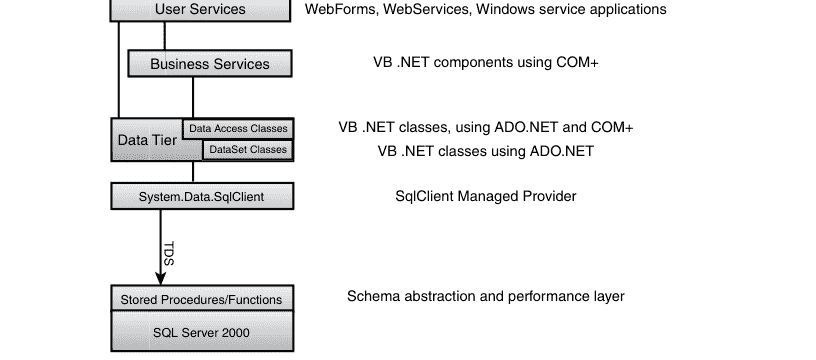

**图 7.4**

*Quilogy 教育网站所使用的应用程序架构。*

为了处理这两类数据访问，将在数据服务层中创建两组类，如图 7.4 所示：

- 开发一组`DataSet`类，用于封装在应用程序各层之间传递的数据。
- 开发一组数据访问类，系统中的其他组件将通过这些类请求和接收数据，可能会通过返回`DataSet`类的实例来实现。

特别是数据访问类将使用`SqlClient`托管提供程序来访问 SQL Server。

你还会从图 7.4 中注意到，在向 SQL Server 发出请求时，应用程序将使用存储过程和函数，而不是内联 SQL。这样做的好处是提供了一个接口，将数据库架构与开发人员及其代码解耦，这样开发人员使用数据更简单，且代码与架构更改相隔离（只要存储过程和函数的签名保持不变）。它还提高了性能，因为存储过程不需要像使用内联 SQL 那样进行额外的解析和查询计划创建。

这种架构有两个主要优势：

- 它将数据访问代码从业务和用户服务层中抽象出来。通过这种方式，数据的位置和结构的更改不会对业务规则或用户界面产生连锁反应。
- 通过创建自定义的`DataSet`类来体现层间传递的数据，我们可以为其提供强类型访问，使编码更高效且更不易出错。

在接下来的几个章节中，我们将探讨如何定义 Quilogy 教育应用程序的数据结构。我们将首先创建应用程序中使用的自定义`DataSet`类，然后实现数据访问类。

#### 定义数据结构

ADO.NET 旨在通过使用`DataSet`来方便地在分布式应用程序的各层之间传递数据。因此，Quilogy 教育示例应用程序利用`DataSet`从用户那里收集信息，并将其传递给中间层和数据层中的业务及数据访问组件。

为了支持数据传递，数据层负责定义来回传递的数据结构。为此，应用程序将使用多个派生自`DataSet`的类，其中最重要的类如表 7.7 所示。

| 类 | 描述 |
| :--- | :--- |
| `TranscriptData` | 定义学生查看成绩单时返回的数据。 |
| `ScheduleData` | 定义根据各种条件查询可用课程列表时返回的数据。 |
| `EnrollmentData` | 定义为学生注册课程时捕获的数据。 |
| `StudentData` | 定义一名或多名学生的人口统计数据。 |

本节的剩余部分将讨论用于创建表 7.7 中所示自定义`DataSet`类的各种技术。

### 创建 DataSet

ADO.NET 支持三种创建数据集结构的基本技术，包括自动创建、编程创建和使用 XML 架构（XML Schema）。

#### 自动架构创建

第一个选项是自动创建，这在代码清单 7.5 中被使用。当时通过简单地调用`SqlDataAdapter`的`Fill`方法并传入一个不存在的`DataTableMapping`名称，来填充包含`Courses`和`Products` `DataTable`对象的`DataSet`。在这种情况下，从数据库中提取的列名和数据类型被用作`DataColumn`对象的名称；默认情况下，每个`DataColumn`都映射到`DataSet`的 XML 架构中的一个元素。此外，当存在多个`DataTable`对象时，XSD 架构创建的是数据的联合表示而非分层表示。例如，代码清单 7.6 显示了为代码清单 7.5 中包含`Courses`和`Products` `DataTable`对象的`DataSet`自动创建的 XSD 架构。

> **注意**
>
> 关于构成 XSD 架构结构的元素的讨论超出了本书的范围。欲了解更多信息，请参阅`www.w3c.org/XML/Schema/`。

##### 代码清单 7.6 XSD 架构

为代码清单 7.5 中使用自动填充创建的`DataSet`生成的架构。

```xml
<xsd:schema id="Offerings" targetNamespace="" xmlns=""
xmlns:xsd="http://www.w3.org/2001/XMLSchema"
xmlns:msdata="urn:schemas-microsoft-com:xml-msdata">
  <xsd:element name="Offerings" msdata:IsDataSet="true">
    <xsd:complexType>
      <xsd:choice maxOccurs="unbounded">
        <xsd:element name="Courses">
          <xsd:complexType>
            <xsd:sequence>
              <xsd:element name="CourseID" type="xsd:int" minOccurs="0" />
              <xsd:element name="CourseNum" type="xsd:string" minOccurs="0" />
              <xsd:element name="Description" type="xsd:string" minOccurs="0" />
              <xsd:element name="ProductID" type="xsd:int" minOccurs="0" />
              <xsd:element name="LOBID" type="xsd:int" minOccurs="0" />
              <xsd:element name="Days" type="xsd:unsignedByte" minOccurs="0" />
              <xsd:element name="CourseWareCost" type="xsd:decimal"
```

### 清单 7.6 续

```xml
minOccurs="*" />
</xsd:sequence>
</xsd:complexType>
</xsd:element>
<xsd:element name="Products">
<xsd:complexType>
<xsd:sequence>
<xsd:element name="ProductID" type="xsd:int" minOccurs="0" />
<xsd:element name="Name" type="xsd:string" minOccurs="0" />
<xsd:element name="VendorID" type="xsd:int" minOccurs="0" />
</xsd:sequence>
</xsd:complexType>
</xsd:element>
</xsd:choice>
</xsd:complexType>
</xsd:element>
</xsd:schema>
```

你会注意到该模式包含根元素`Offerings`，它由重复的`Courses`元素和随后的重复`Products`元素组成。你还会注意到这些元素彼此之间没有关联。此外，该模式未指明哪些元素是必需的，将每个列映射到一个元素，并且使用了数据库列名。

如果在如图 7.4 所示架构的应用程序中使用这种方法，数据访问类将负责动态构建`DataSet`对象，并通过数据访问类公开的方法返回它们。这些方法将返回`DataSet`类型，而不是继承自`DataSet`的强类型类，因为`DataSet`是以即时方式创建的。这种技术具有简单性的优点，因为不需要创建自定义的`DataSet`类，但在其他方面存在局限性。

虽然自动创建无疑是构建`DataSet`的最简单方法，但它显然在以下几个方面存在局限：

- `DataColumn`对象的名称由底层数据存储控制，而非应用程序。
- 生成的 XML 结构是扁平的，而非层级化的，并且不包含约束信息。
- 生成的`DataSet`不是强类型的。

第一个局限性意味着数据存储和`DataSet`是紧密耦合的，因此当在绑定控件和用于操作呈现服务中数据的代码中使用数据时，数据库列名和表结构的更改会产生连锁反应。第二个局限性严重限制了生成的 XML 的使用，使其只能用于将数据作为`DataSet`而非 XML 文档进行操作的应用程序。这是因为关于元素之间关系的重要元数据没有自动显示。最后，通过使用晚期绑定访问`DataSet`，你的代码可读性降低。这增加了开发时间，并增加了运行时错误而非编译时错误的可能性。

因此，除了最简单的应用程序外，你都需要将`DataSet`的结构与用于填充它的数据存储解耦，并使用类型化的`DataSet`包含所有相关的元数据。这样做还可以减少你需要在数据访问类中编写的代码量。要创建类型化的`DataSet`，你需要依赖本节后面讨论的其他技术。

### 从 XML 文档填充 DataSet

虽然到目前为止的讨论集中在从 SQL Server 等持久数据存储创建`DataSet`对象，但你也可以从独立的 XML 文档创建和填充`DataSet`。当你想要加载 XML 文档并将其直接保存到关系数据库时，这将是有利的。

要从 XML 文档创建`DataSet`的结构，`DataSet`类支持`InferXmlSchema`方法，作为使用`Fill`方法进行自动模式创建的类似方法。例如，考虑以下简单的 XML 文档：

```xml
<Course ID="22321">
  <Class>
    <City>Kansas City</City>
    <Date>1/1/2001</Date>
    <Students>12</Students>
    <Instructor>
      <FName>Mike</FName>
      <LName>Willoughby</LName>
    </Instructor>
  </Class>
</Course>
```

可以将此文档传递给`InferXmlSchema`方法，如下所示自动创建模式（此过程称为推理；注意，数据本身并未加载）：

```vbnet
Dim dsCourseData As New DataSet
dsCourseData.InferXmlSchema("CourseData.xml", Nothing)
```

该方法具有多种重载签名，允许你使用`Stream`、`XmlReader`或`TextReader`（在第 12 章和第 14 章中讨论）传递 XML。请注意，第二个参数设置为`Nothing`，但可以填充一个字符串数组，其中包含在创建模式时要忽略的命名空间 URI。通过这种方式，你可以选择性地仅从文档中的某些元素创建模式。生成的模式如清单 7.7 所示。有关模式推理规则的详细信息，请参阅 .NET Framework 在线文档。

### 清单 7.7 推断的 XSD 模式

此清单显示了调用`DataSet`类的`InferXmlSchema`方法后生成的 XSD 模式。


```xml
<xsd:schema id="NewDataSet" targetNamespace="" xmlns=""
 xmlns:xsd="http://www.w3.org/2001/XMLSchema"
 xmlns:msdata="urn:schemas-microsoft-com:xml-msdata">
 <xsd:element name="Course">
  <xsd:complexType>
   <xsd:sequence>
    <xsd:element name="Class" minOccurs="0" maxOccurs="unbounded">
     <xsd:complexType>
      <xsd:sequence>
       <xsd:element name="City" type="xsd:string" minOccurs="0"
        msdata:Ordinal="0" />
       <xsd:element name="Date" type="xsd:string" minOccurs="0"
        msdata:Ordinal="1" />
       <xsd:element name="Students" type="xsd:string" minOccurs="0"
        msdata:Ordinal="2" />
       <xsd:element name="Instructor" minOccurs="0"
        maxOccurs="unbounded">
        <xsd:complexType>
         <xsd:sequence>
          <xsd:element name="FName" type="xsd:string"
           minOccurs="0" msdata:Ordinal="0" />
          <xsd:element name="LName" type="xsd:string"
           minOccurs="0" msdata:Ordinal="1" />
         </xsd:sequence>
         <xsd:attribute name="Class_Id" type="xsd:int"
          use="prohibited" />
        </xsd:complexType>
       </xsd:element>
      </xsd:sequence>
      <xsd:attribute name="Class_Id" msdata:AutoIncrement="true"
       type="xsd:int" msdata:AllowDBNull="false" use="prohibited" />
      <xsd:attribute name="Course_Id" type="xsd:int" use="prohibited" />
     </xsd:complexType>
    </xsd:element>
   </xsd:sequence>
   <xsd:attribute name="Course_Id" msdata:AutoIncrement="true"
    type="xsd:int" msdata:AllowDBNull="false" use="prohibited" />
   <xsd:attribute name="ID" type="xsd:string" />
  </xsd:complexType>
```

### 清单 7.7 续

```xml
</xsd:element>
<xsd:element name="NewDataSet" msdata:IsDataSet="true">
  <xsd:complexType>
    <xsd:choice maxOccurs="unbounded">
      <xsd:element ref="Course" />
    </xsd:choice>
  </xsd:complexType>
  <xsd:unique name="Class_Constraint1" msdata:ConstraintName="Constraint1"
   msdata:PrimaryKey="true">
    <xsd:selector xpath=".//Class" />
    <xsd:field xpath="@Class_Id" />
  </xsd:unique>
  <xsd:unique name="Constraint1" msdata:PrimaryKey="true">
    <xsd:selector xpath=".//Course" />
    <xsd:field xpath="@Course_Id" />
  </xsd:unique>
  <xsd:keyref name="Course_Class" refer="Constraint1" msdata:IsNested="true">
    <xsd:selector xpath=".//Class" />
    <xsd:field xpath="@Course_Id" />
  </xsd:keyref>
  <xsd:keyref name="Class_Instructor" refer="Class_Constraint1"
   msdata:IsNested="true">
    <xsd:selector xpath=".//Instructor" />
    <xsd:field xpath="@Class_Id" />
  </xsd:keyref>
</xsd:element>
</xsd:schema>
```

以这种方式推断模式在设计环境中最有用，在这种环境中，你需要对现有 XML 文档进行逆向工程以创建填充它们的`DataAdapter`。你还需要编辑生成的模式以包含适当的数据类型、必需的元素和属性以及额外的约束信息，因为数据类型都默认为`string`，元素和属性不是必需的，并且只有关联嵌套元素所需的约束是自动创建的，这在清单 7.7 中得到了证明。

要从 XML 文档填充`DataSet`，你可以使用`ReadXml`方法，类似于`Fill`方法，如下所示：

```vbnet
dsCourseData.ReadXml("CourseData.xml")
```

在这种情况下，文件使用相对路径作为唯一参数传递，尽管该方法实际上支持八种不同的签名，并且也可以接受来自`XmlReader`、`Stream`或`TextReader`的数据。请注意，调用`ReadXml`并省略可选的第二个参数会同时推断模式和加载数据。第二个参数可以设置为以下之一`XmlReadMode`枚举值：`Auto`、`DiffGram`、`IgnoreSchema`、`InferSchema`、`ReadSchema`或`Fragment`。

如你所料，`Auto`是默认值，在这种情况下既推断架构又加载数据。`IgnoreSchema`、`InferSchema`和`ReadSchema`选项分别可用于：绕过文档中存在的架构、仅推断架构，或仅从文档中读取架构。`Fragment`选项允许`DataSet`读取带有内联 XDR（XML Data Reduced）架构的 XML 文档，例如 SQL Server 2000 在使用`FOR XML`语句时生成的那些文档。

> **注意**

XDR 架构规范是微软最初向 W3C 提出的提议，旨在创建一种用于指定 XML 文档结构的 XML 语法。W3C 审议了多项竞争性规范，最终确定 XSD 作为推荐规范。

`DiffGram`选项将在本章后面更详细地讨论。

### 编程创建

创建`DataSet`的第二种技术是使用`DataSet`公开的编程接口。这种技术通常与创建强类型`DataSet`结合使用。如本节第一部分所述，在这种情况下，应用程序架构要求创建自定义`DataSet`类来表示表 7.7 中所示的信息。

要创建强类型`DataSet`，你可以简单地创建一个自定义类并从`DataSet`类继承。这样，除了你自己的成员之外，`DataSet`类的所有成员都可用于强类型`DataSet`的使用者。然后，你可以添加自定义代码以编程方式创建`DataTable`对象、关系和约束。

例如，表 7.7 中的简单`TranscriptData`类继承自`DataSet`。在其构造函数中调用了一个私有方法，该方法负责构建和自定义`DataTable`对象，如清单 7.8 所示。

#### 清单 7.8 一个简单的强类型 `DataSet`

在此示例中，通过从`DataSet`继承创建了一个强类型`DataSet`，即`TranscriptData`。它包含在创建新实例时构建`DataSet`结构的代码。


```vb
Option Strict On
Option Explicit On

Imports System
Imports System.Data
Imports System.Runtime.Serialization

Namespace Quilogy.Education

<Serializable()> _
Public Class TranscriptData : Inherits DataSet
    
    Private studentClass As DataTable

    Public Event ValidationWarning(ByVal pMessage As String)

    Public Const STUDENT_ID As String = "StudentID"
    Public Const ENROLL_ID As String = "EnrollID"
    Public Const CLASS_DATE As String = "Date"
    Public Const CITY As String = "City"
    Public Const INSTRUCTOR As String = "Instructor"
    Public Const INS_EMAIL As String = "InstructorEmail"
    Public Const VENDOR_NAME As String = "VendorName"
    Public Const COURSE_NUM As String = "CourseNum"
    Public Const COURSE_DESC As String = "CourseDesc"
    Public Const DAYS As String = "Days"
    Public Const ORGANIZATION As String = "StudentOrganization"

    Public Sub New()
        ' Initialize a TranscriptData instance by building the table
        MyBase.New()
        InitClass()
    End Sub

    Public Sub New(ByVal info As SerializationInfo, _
                   ByVal context As StreamingContext)
        ' Initialize a TranscriptData instance
        MyBase.New()
        InitClass()
        Me.GetSerializationData(info, context)
    End Sub

    Private Sub InitClass()
        ' Create the table in the dataset
        BuildTables()
        ' Initialize the class
        Me.DataSetName = "QuilogyTranscript"
        Me.Namespace = "www.quilogy.com/education/transcript"
        Me.Prefix = "qedts"
        Me.CaseSensitive = False

        ' Capture the ColumnChangingEvent
        AddHandler studentClass.ColumnChanging, _
            AddressOf Me.TranscriptColChanging
    End Sub

    Private Sub TranscriptColChanging(ByVal sender As Object, _
        ByVal e As DataColumnChangeEventArgs)
        Dim strOrig As String
        ' Do simple data validation
        Select Case e.Column.ColumnName
            Case COURSE_DESC
                ' Truncate long descriptions
                If Len(e.ProposedValue) > 255 Then
                    strOrig = CType(e.ProposedValue, String)
                    e.ProposedValue = Left(CType(e.ProposedValue, String), 255)
                    RaiseEvent ValidationWarning("The " & COURSE_DESC & " '" & _
                        strOrig & "' was truncated to '" & _
                        CType(e.ProposedValue, String) & "'")
                End If
        End Select
    End Sub

    Public ReadOnly Property ClassTable() As DataTable
        Get
            Return studentClass
        End Get
    End Property

    Private Sub BuildTables()
        Dim pk() As DataColumn

        ' Create the transcript table
        studentClass = New DataTable("Class")

        With studentClass.Columns
            .Add(STUDENT_ID, GetType(System.Int32))
            .Add(ENROLL_ID, GetType(System.Int32))
            .Add(CLASS_DATE, GetType(System.DateTime))
            .Add(CITY, GetType(System.String))
            .Add(INSTRUCTOR, GetType(System.String))
            .Add(INS_EMAIL, GetType(System.String))
            .Add(VENDOR_NAME, GetType(System.String))
            .Add(COURSE_NUM, GetType(System.String))
            .Add(COURSE_DESC, GetType(System.String))
            .Add(DAYS, GetType(System.Byte))
            .Add(ORGANIZATION, GetType(System.String))
        End With

        ' Set the column attributes
        With studentClass
            .Columns(STUDENT_ID).ColumnMapping = MappingType.Attribute
            .Columns(ENROLL_ID).ColumnMapping = MappingType.Hidden
            .Columns(CLASS_DATE).AllowDBNull = False
            .Columns(CLASS_DATE).Caption = "Class Date"
            .Columns(CITY).AllowDBNull = False
            .Columns(COURSE_NUM).AllowDBNull = False
            .Columns(DAYS).DefaultValue = 0
            .Columns(VENDOR_NAME).Caption = "Vendor Name"
            .Columns(COURSE_NUM).Caption = "Course Number"
            .Columns(COURSE_DESC).Caption = "Description"
            .Columns(ORGANIZATION).Caption = "Your Organization"
        End With

        ' Set the primary key
        ReDim pk(1)
        pk(0) = studentClass.Columns(ENROLL_ID)
        studentClass.PrimaryKey = pk

        ' Add the table to the collection
        Me.Tables.Add(studentClass)
    End Sub
End Class
End Namespace
```

也许清单 7.8 中你首先会注意到的方面是`TranscriptData`类是在`Namespace`语句中定义的。在这种情况下，该类将存在于第 4 章图 4.1 中讨论的`Quilogy.Education`命名空间中。

其次，请注意所有工作都是在类的构造函数中完成的。在这里，基类构造函数先被调用，然后调用私有方法`InitClass`，而`InitClass`又调用`BuildTables`来创建`DataTable`对象并用`DataColumn`对象填充它。此外，`InitClass`方法通过设置名称和命名空间属性来初始化`DataSet`。

> **注意**

`TranscriptData`类还包含一个重载构造函数，该构造函数接受`SerializationInfo`和`StreamingContext`对象作为参数，并调用`GetSerializationData`。这个“私有”构造函数在`DataSet`序列化时由运行时调用，以便它可以跨`AppDomain`传输。此外，类签名必须包含`System.SerializableAttribute`，以向运行时指示该`DataSet`可以序列化。显然，只有派生`DataSet`才需要添加这些构造；仅声明为`DataSet`的对象可以自动反序列化。有关序列化的更多信息，请参见第 8 章。

因为这是一个简单的`DataSet`，所以在`BuildTables`中只创建了一个`DataTable`，即`studentClass`，并通过只读属性`ClassTable`公开。添加列后，使用`DataColumn`对象的属性对它们进行自定义。例如，`CLASS_DATE`、`CITY`和`COURSE_NUM`列被设置为不允许空值，而`STUDENT_ID`和`ENROLL_ID`的映射分别被更改为属性和隐藏。最后，在使用`ENROLL_ID`列创建`DataSet`的主键后，`DataTable`被添加到`DataSet`的`DataTableCollection`中。请注意，列的名称被创建为常量，以便在必要时可以轻松更改，而不会影响使用此类的代码。

因为`TranscriptData`与 VB .NET 中的任何其他类一样都是自定义类，所以它也可以包含自己的成员。在这种情况下，不仅添加了`ClassTable`属性来公开`studentClass DataTable`，而且还定义了一个`Public`事件`ValidationWarning`。该事件在`Private TranscriptColChanging`过程中引发，该过程处理表 7.6 中讨论的`studentClass`的`ColumnChanging`事件。你会注意到，在此事件处理程序中，`DataColumnChangeEventArgs`类公开了`ProposedValue`，你可以检查并修改它来进行简单的数据验证，同时还提供了对正在更改的实际`DataColumn`的引用。在这种情况下，如果`COURSE_DESC`列已被更改为长度大于 255 个字符的字符串，则会被截断，并触发`ValidationWarning`事件并附带详细信息。

> **提示**

请注意，如果在`ColumnChanging`事件处理程序中引发异常，`ProposedValue`将不会反映在`DataColumn`中，因此它也可用于更复杂的验证。

使用清单 7.8 中的类，`TranscriptData`类的使用者可以确保`DataSet`的结构是不可变的，并且可以简单地按如下方式填充它：

```vb
Imports Quilogy.Education
Imports System.Data.SqlClient
Dim dsTs As New TranscriptData
Dim parmWork As SqlParameter
Dim daSql As SqlDataAdapter
Dim parmSql As SqlParameter

daSql = New SqlDataAdapter("usp_GetTranscript", cnSQL)

daSql.SelectCommand.CommandType = CommandType.StoredProcedure

parmSql = daSql.SelectCommand.Parameters.Add( _
    New SqlParameter("@StudentID", SqlDbType.Int))

parmSql.Value = intStudentID

daSql.Fill(dsTs, dsTs.ClassTable.TableName)
```

在本例中，`DataTable`的名称作为第二个参数传递给`Fill`方法，因为没有创建显式的表映射。因此，`usp_GetTranscript`存储过程应生成与清单 7.8 中添加到表的`DataColumn`对象同名的列。如果情况并非如此，默认行为是将额外的列也添加到`DataSet`中。如前所述，为确保仅填充表映射中的列，可以将`MissingSchemaAction`属性设置为`Ignore`。或者，如果存储过程没有生成所需的列，编写前一个示例中代码的开发人员可以创建一个表映射。

由`DataSet`的`WriteXml`方法为特定学生返回的生成的 XSD 和 XML 数据可在清单 7.9 中查看。

### 清单 7.9 成绩单的完整模式和数据

本清单展示了清单 7.7 中生成的 XSD 模式以及从存储过程返回的数据。

```xml
<qedts:QuilogyTranscript xmlns:qedts="www.quilogy.com/education/transcript">

  <xsd:schema id="QuilogyTranscript"

              targetNamespace="www.quilogy.com/education/transcript"

              xmlns="www.quilogy.com/education/transcript"

              xmlns:xsd="http://www.w3.org/2001/XMLSchema"

              xmlns:msdata="urn:schemas-microsoft-com:xml-msdata"

              attributeFormDefault="qualified" elementFormDefault="qualified">

    <xsd:element name="QuilogyTranscript" msdata:IsDataSet="true"

                 msdata:Prefix="qedts">

      <xsd:complexType>

        <xsd:choice maxOccurs="unbounded">

          <xsd:element name="Class">

            <xsd:complexType>

              <xsd:sequence>

                <xsd:element name="Date" msdata:Caption="Class Date"

                             type="xsd:dateTime" msdata:Ordinal="2" />

                <xsd:element name="City" type="xsd:string"

                             msdata:Ordinal="3" />

                <xsd:element name="Instructor" type="xsd:string"

                             minOccurs="0" msdata:Ordinal="4" />

                <xsd:element name="InstructorEmail" type="xsd:string"

                             minOccurs="0" msdata:Ordinal="5" />
```


```xml
<xsd:element name="VendorName" msdata:Caption="Vendor Name"
  type="xsd:string" minOccurs="0" msdata:Ordinal="6" />

<xsd:element name="CourseNum" msdata:Caption="Course Number"
  type="xsd:string" msdata:Ordinal="7" />

<xsd:element name="CourseDesc" msdata:Caption="Description"
  type="xsd:string" minOccurs="0" msdata:Ordinal="8" />

<xsd:element name="Days" type="xsd:unsignedByte" default="0"
  minOccurs="0" msdata:Ordinal="9" />

<xsd:element name="StudentOrganization"
  msdata:Caption="Your Organization" type="xsd:string"
  minOccurs="0" msdata:Ordinal="10" />

</xsd:sequence>

<xsd:attribute name="StudentID" form="unqualified"
  type="xsd:int"/>

<xsd:attribute name="EnrollID" type="xsd:int"
  msdata:AllowDBNull="false" use="prohibited" />

</xsd:complexType>

</xsd:element>

</xsd:choice>

</xsd:complexType>

<xsd:unique name="Constraint1" msdata:PrimaryKey="true">

<xsd:selector xpath=".//Class" />

<xsd:field xpath="@EnrollID" />

</xsd:unique>

</xsd:element>

</xsd:schema>

<Class StudentID="3" xmlns="www.quilogy.com/education/transcript">

  <Date>2001-08-24T00:00:00.0000000-05:00</Date>

  <City>Indianapolis</City>

  <Instructor>Michael Smith</Instructor>

  <InstructorEmail>msmith@quilogy.com</InstructorEmail>

  <VendorName>Microsoft</VendorName>

  <CourseNum>2072</CourseNum>

  <CourseDesc>System Administration for SQL Server 2000</CourseDesc>

  <Days>0</Days>

  <StudentOrganization>Quilogy</StudentOrganization>

</Class>

<Class StudentID="3" xmlns="www.quilogy.com/education/transcript">

  <Date>2001-08-23T00:00:00.0000000-05:00</Date>

  <City>Kansas City</City>

  <Instructor>Michael Smith</Instructor>

  <InstructorEmail>msmith@quilogy.com</InstructorEmail>

  <VendorName>Microsoft</VendorName>

  <CourseNum>1016</CourseNum>

  <CourseDesc>Enterprise Development with Visual Basic</CourseDesc>

  <Days>5</Days>

  <StudentOrganization>Quilogy</StudentOrganization>

</Class>

</qedts:QuilogyTranscript>
```

尽管这种方法提供了具有预定义结构的强类型`DataSet`，但你会注意到，它并未提供对`DataSet`内实际列的强类型访问。因此，如果在访问列时出现拼写错误，就容易发生运行时错误。例如，要从清单 7.9 所示的`DataSet`的第二行中检索`CourseNum`，可以使用以下代码：

```vb
strCourse = dsTs.ClassTable.Rows(1).Item("CourseNum")
```

显然，如果此行中显示的字面字符串输入错误，编译器将无法捕获该错误，并且会在运行时引发异常。最后，在输入此类语句时，IntelliSense 不会被激活以显示可用列的下拉列表。但是，通过添加列名的公共常量，输入此行代码会变得稍微容易一些：

```vb
strCourse = dsTs.ClassTable.Rows(1).Item(TranscriptData.COURSE_NUM)
```

在任何情况下，更重要的是，如果代码正在修改`CourseNum`字段，则数据在编译时不会进行类型检查，并且实际上会被强制转换为`DataSet`中为该列定义的类型，这是另一个潜在的错误来源。因此，这种方法可以被视为介于本节第一部分讨论的使用非类型化`DataSet`和本章后面讨论的使用完全类型化`DataSet`之间的折衷技术。

这种方法的优点在于，尽管类`TranscriptData`及其`DataTable`定义良好，但可以通过修改私有`BuildTables`方法中的代码并简单地添加常量来相当容易地更改列。如果`DataSet`的结构发生变化，它肯定会影响使用它的代码；但是，`TranscriptData`类的公共接口不会改变。这在提供类型化类的同时增加了灵活性。

### 从模式创建

创建`DataSet`的最终技术是从预定义的 XML 模式（XSD）直接加载它。模式本身可以是已存在于文件中的模式，也可以是使用 VS.NET 中包含的 XML 设计器以图形方式设计的模式。此工具允许你创建模式并将其作为 XSD 文件保存在你的项目中。

通过在 VS.NET 项目资源管理器中右键单击项目并选择“添加类”，在弹出的对话框中你可以选择 XML 模式。在设计器内部，你可以右键单击以添加元素、属性、类型和组。你还可以在元素之间添加关系以创建分层模式。此外，你可以查看为模式生成的 XML，或者通过设计器底部的按钮在 XML 窗格中复制和粘贴现有的模式。例如，简单的`ScheduleData`模式就是使用设计器创建的，如图 7.5 所示。它包含两个高级元素`Criteria`和`Offering`，每个元素都包含一系列定义显示课程表所需信息的元素和属性。

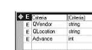

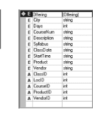

为了使操作更加简单，可以从服务器资源管理器窗口将表拖放到 XML 模式设计器界面上。这样做是快速启动`DataSet`图形创建的好方法。

在使用 XML 设计器成功创建模式或从另一个源接收到模式后，可以在运行时将其读入`DataSet`，以使用`DataSet`类的`ReadXmlSchema`方法创建底层的`DataSet`集合。此方法有多个重载签名，可接受来自`TextReader`、`Stream`、`XmlReader`或仅文件系统的文件的输入。例如，派生的`DataSet`（如`ScheduleData`）可以在其构造函数中使用`ReadXmlSchema`方法来创建`DataSet`结构，而不是以编程方式操作集合，如下所示：

```vb
Public Class ScheduleData : Inherits DataSet

    Public Sub New()

        ' 通过构建表来初始化 ScheduleData 实例

        MyBase.New

        ' 在数据集中创建表

        Me.ReadXmlSchema("scheduleSchema.xsd")

    End Sub

End Class
```

这种方法的优势在于，如果需要对架构（schema）进行更改，可以直接在文件中进行，而无需修改代码并重新编译类。当然，其缺点是需要额外的文件系统访问开销。因此，对于在线应用程序，不推荐使用此技术；但对于像 Windows 服务这样的应用程序，可以使用它来提高可维护性和灵活性。

> **提示**
>
> 如前所述，`ReadXml`方法用于将 XML 文档读取到`DataSet`中。例如，如果编写一个处理 XML 文档的 Windows 服务，它可能会首先创建`DataSet`的一个实例，并通过调用`ReadXmlSchema`来填充架构。然后，使用`ReadXml`方法并设置适当的`XmlReadMode`值来加载每个文档。

最后，就像你可以从 XML 文件或流中读取架构并填充`DataSet`一样，你也可以使用`DataSet`类的`WriteXmlSchema`和`WriteXml`方法来同时写入架构和数据。例如，要将架构和数据都写入文件，请按如下方式调用`WriteXml`方法：

```vb
Dim dsTs As TranscriptData

dsTs.WriteXml("transcripts.xml", XmlWriteMode.WriteSchema)
```

`WriteXml`方法的可选第二个参数通过使用`XmlWriteMode`枚举来影响数据写入文件的方式，该参数也可以被设置为`IgnoreSchema`以仅写入数据和`DiffGram`。

> **提示**
>
> 当使用`XmlWriteMode`的`DiffGram`枚举时，生成的 XML 文档被称为*updatagram*（更新图），它包含显示数据变更前后的状态元素。这个 updatagram 可以用来创建数据集的 XML 表示，其中包含要传递给另一个方法进行更新的更改。此外，所使用的 XML 语法与 SQL Server 2000 支持的语法相同，因此 updatagram 可以直接传递给 SQL Server 2000 以更新数据库中的表。请注意，`ReadXml`方法同样支持`XmlReadMode`枚举中的`DiffGram`，以便将 updatagram 加载到`DataSet`中。

`WriteXml`和`WriteXmlSchema`方法都支持重载版本，可以写入到`Stream`、`TextWriter`、`XmlWriter`或文件中。

### 强类型 DataSets

如前一节所述并在代码清单 7.8 中所示，通过继承`DataSet`类来创建类型化`DataSet`允许你在封装结构和功能的同时扩展`DataSet`。然而，`TranscriptData`类只是一个部分类型化的`DataSet`，因为你虽然可以通过强类型变量引用类本身及其`DataTable`，但无法引用行（rows）或列（columns）。如果能实现这一点，将提高代码的可读性并使`DataSet`的操作更加便捷。

#### 创建强类型 DataSet

要创建强类型`DataSet`，你可以简单地手动扩展`TranscriptData`类，以便包含`DataSet`所公开的`DataRow`和`DataColumn`对象的子类。然而，VS.NET 和 .NET Framework 通过在 XML 设计器中包含`DataSet`创建工具，以及在 .NET Framework SDK 中包含 XML 架构/数据类型支持实用程序（`XSD.exe`），为你完成了这项工作。

在 XML 设计器中创建强类型`DataSet`的过程非常简单。在按照前一节所述以图形方式定义 XML 架构后，你可以从上下文菜单中选择“Generate DataSet”（生成 DataSet）选项。在后台，代表 XSD 的 XML 会被修改，并创建一个包含与架构同名类定义的`.vb`文件。你可以通过点击解决方案资源管理器中的“Show All Files”（显示所有文件）工具栏按钮来查看源代码文件。随后，客户端代码就可以声明并实例化这个新的`DataSet`。

或者，你可以选择使用命令行`XSD`实用程序来创建强类型`DataSet`。

> `XSD`实用程序还可以用于从 XDR 架构创建强类型`DataSet`、从 XML 文档推断 XSD 架构、将 XDR 架构转换为 XSD 架构，以及从程序集中的类型生成架构。

为了演示`XSD.exe`的用法，请参考代码清单 7.10 所示的 XSD 架构。该架构旨在对应于在 Quilogy 为一门课程注册一名或多名学生时捕获的数据。

**代码清单 7.10 注册数据的 XSD 架构。该架构包含为 Quilogy 课程注册时捕获的数据。**

```xml
<qdr:QuilogyEnrollment xmlns:qdr="www.quilogy.com/education/registration">

  <xsd:schema id="QuilogyEnrollment"
    targetNamespace="www.quilogy.com/education/registration"
    xmlns="www.quilogy.com/education/registration"
    xmlns:xsd="http://www.w3.org/2001/XMLSchema"
    attributeFormDefault="qualified"
    elementFormDefault="qualified">

    <xsd:element name="Enrollment">

      <xsd:complexType>

        <xsd:sequence>

          <xsd:element name="Cost" type="xsd:decimal" minOccurs="0" />

          <xsd:element name="Student" minOccurs="0"
            maxOccurs="unbounded">

            <xsd:complexType>

              <xsd:sequence>

                <xsd:element name="FName" type="xsd:string"
                  minOccurs="0" />

                <xsd:element name="LName" type="xsd:string" />

                <xsd:element name="Organization" type="xsd:string"
                  minOccurs="0" />

                <xsd:element name="Comments" type="xsd:string"
                  minOccurs="0" />

                <xsd:element name="ContactInfo" minOccurs="0"
                  maxOccurs="unbounded">

                  <xsd:complexType>

                    <xsd:sequence>

                      <xsd:element name="Address" type="xsd:string"
                        minOccurs="0" />

                      <xsd:element name="City" type="xsd:string"
                        minOccurs="0" />

                      <xsd:element name="State" type="xsd:string"


```xml
minOccurs="0" />

<xsd:element name="ZipCode" type="xsd:string"
    minOccurs="0" />

<xsd:element name="Phone" type="xsd:string"
    minOccurs="0" />

<xsd:element name="Email" type="xsd:string"
    minOccurs="0" />

</xsd:sequence>

</xsd:complexType>

</xsd:element>

</xsd:sequence>

<xsd:attribute name="StudentID" form="unqualified"
    type="xsd:int" />

<xsd:attribute name="Existing" form="unqualified"
    type="xsd:string" />

</xsd:complexType>

</xsd:element>

</xsd:sequence>

</xsd:complexType>

</xsd:element>

<xsd:element name="Class">

<xsd:complexType>

<xsd:sequence>

<xsd:element name="Name" type="xsd:string" />

</xsd:sequence>

<xsd:attribute name="ClassID" form="unqualified" type="xsd:int"
    use="required" />

<xsd:attribute name="WebEnroll" form="unqualified" type=
    "xsd:string"
    use="required" />

<xsd:attribute name="PaymentType" form="unqualified" type=
    "xsd:string"
    use="required" />

</xsd:complexType>

</xsd:element>

</xsd:sequence>

</xsd:element>

</xsd:choice>

</qdr:QuilogyEnrollment>
```

请注意，该架构同时包含了学生和课程数据，反映了参加课程的人员及其注册的课程。要从该架构创建强类型类，可以在命令行中运行 `XSD.exe` 实用程序，如下所示：

```bash
xsd /l:vb /d QuilogyEnrollment.xsd
```

其中 `/l` 命令指定创建 `DataSet` 的语言，`/d` 表示你希望创建从 `DataSet` 派生的类。或者，该实用程序可以创建一个简单的类（通过指定 `/c` 选项而不是 `/d` 选项），该类不派生自 `DataSet`，而是使用 `System.Xml.Serialization` 命名空间将类序列化为 XML 架构。

> **注意**
>
> 生成的 `QuilogyEnrollment` 类的完整代码可以在配套网站 www.samspublishing.com 上找到。

生成的 `.vb` 文件包含一个单一的高级类——在本例中称为 `QuilogyEnrollment`——它派生自 `DataSet` 类，其结构（如 VS .NET 的类资源管理器窗口所示）如图 7.6 所示。为了让读者理解该工具是如何创建 `DataSet` 的，表 7.8 列出了相关类及其说明。

**图 7.6**

强类型 `DataSet`。此图展示了 VS .NET 中 XSD 生成的 `EnrollmentData` 类的类浏览器视图。

### 表 7.8 强类型 `DataSet`

| 类 | 描述 |
|---|---|
| `QuilogyEnrollment` | 从 `DataSet` 派生的最高层类。包含一个私有 `InitClass` 方法，用于创建表结构和关系。将 `DataTable` 对象作为属性公开。 |
| `StudentDataTable` | `QuilogyEnrollment` 的子类，从 `DataTable` 派生并实现 `IEnumerable`。将每个 `DataColumn` 作为属性公开，并声明每个公共事件。包含一个 `InitClass` 私有方法，用于创建列。包括 `AddStudentRow`、`NewStudentRow` 和 `RemoveStudentRow` 方法。 |
| `StudentRow` | `QuilogyEnrollment` 的子类，从 `DataRow` 派生。将每列作为强类型属性公开。包含处理数据库空值和返回所有相关 `ContactInfoRow` 对象的方法。 |
| `StudentRowChangeEvent` | `EnrollmentData` 的子类，从 `EventArgs` 派生。用于传递与 `StudentDataTable` 关联的事件数据。 |
| `ContactInfoDataTable` | 与 `StudentDataTable` 类似。 |
| `ContactInfoRow` | 与 `StudentRow` 类似。 |
| `ContactInfoRowChangeEvent` | 与 `StudentRowChangeEvent` 类似。 |
| `EnrollmentDataTable` | 与 `StudentDataTable` 类似。 |

### 表 7.8 续

| 类 | 描述 |
| :--- | :--- |
| `EnrollmentRow` | 与 `StudentDataRow` 类似。 |
| `EnrollmentRowChangeEvent` | 与 `StudentRowChangeEvent` 类似。 |

如表 7.8 所示，`QuilogyEnrollment` 类使用一系列子类来实现每个 `DataTable` 和 `DataRow` 对象。在本例中，创建了三个表：一个表示高层 `Enrollment` 元素（`EnrollmentDataTable`），一个表示 `Enrollment` 元素中的每个 `Student` 元素（`StudentDataTable`），第三个表示 `Student` 元素中的 `ContactInfo` 元素（`ContactInfoDataTable`）。

如前所述，`DataTable` 对象通过 `DataRelation` 在 `DataSet` 中相互关联。在本例中，`EnrollmentDataTable` 与 `StudentDataTable` 以及 `StudentDataTable` 与 `ContactInfoDataTable` 之间的父子关系由两个私有 `DataRelation` 对象处理，这些对象在 `QuilogyEnrollment` 的 `InitClass` 方法中创建，如下列代码所示：

```vb
' Class level declarations

Private relationEnrollment_Student As DataRelation

Private relationStudent_ContactInfo As DataRelation

' In InitClass of EnrollmentData

Me.relationStudent_ContactInfo = New DataRelation("Student_ContactInfo", _

    New DataColumn() {Me.tableStudent.Student_IdColumn}, _

    New DataColumn() {Me.tableContactInfo.Student_IdColumn}, false)

Me.relationStudent_ContactInfo.Nested = true

Me.Relations.Add(Me.relationStudent_ContactInfo)

Me.relationEnrollment_Student = New DataRelation("Enrollment_Student", _

    New DataColumn() {Me.tableEnrollment.Enrollment_IdColumn}, _

    New DataColumn() {Me.tableStudent.Enrollment_IdColumn}, false)

Me.relationEnrollment_Student.Nested = true

Me.Relations.Add(Me.relationEnrollment_Student)
```

你会注意到，这些关系是基于 `Enrollment_IdColumn` 和 `Student_IdColumn` 列创建的，并添加到相应的 `DataTable` 中。这些列充当实现关系的主键和外键。为确保这些列不出现在 XML 文档中并遵循架构，这两个列均以 `MappingType` 为 `Hidden` 的方式创建。此外，主键列 `Enrollment_Id`（在 `EnrollmentDataTable` 中）和 `Student_Id`（在 `StudentDataTable` 中）被设置为自动递增。这样，每行都会被分配一个唯一的主键。以下代码展示了 `StudentDataTable` 的 `InitClass` 方法中 `Student_Id` 列的创建：

```vb
Me.columnStudent_Id = New DataColumn("Student_Id", GetType(System.Int32), "", _

    System.Data.MappingType.Hidden)

Me.columnStudent_Id.AutoIncrement = true

Me.columnStudent_Id.AllowDBNull = false

Me.columnStudent_Id.Unique = true

Me.Columns.Add(Me.columnStudent_Id)

Me.PrimaryKey = New DataColumn() {Me.columnStudent_Id}
```

除了上面展示的属性外，你还可以分别使用 `AutoIncrementSeed` 和 `AutoIncrementStep` 属性设置列的初始值（默认为 0）和递增量（默认为 1）。请注意，此唯一键仅存在于客户端数据缓存（`DataSet`）中，不会传播回数据库。换句话说，它仅用作在 `DataSet` 中关联 `DataTable` 对象的工具。

### 使用强类型 `DataSet`

`DataSet` 创建后，客户端可以通过类公开的明确类型来访问它。这使得代码能够在编译时进行检查，并获得 IntelliSense 的辅助。例如，使用前面生成的 `QuilogyEnrollment` 类，清单 7.11 中的代码可用于向 `DataSet` 添加新的注册信息。

**清单 7.11** 使用 `DataSet`。此示例展示了如何使用强类型 `DataSet`。

```vb
Dim dsEnrollment As New QuilogyEnrollment()

Dim drEnroll As QuilogyEnrollment.EnrollmentRow

Dim drStudent As QuilogyEnrollment.StudentRow

Dim drContactInfo As QuilogyEnrollment.ContactInfoRow

Dim drStudents() As QuilogyEnrollment.StudentRow

Dim strName As String

' Add a new enrollment

drEnroll = dsEnrollment.Enrollment.AddEnrollmentRow(1745, "Y", "CC", 1234)

' Add a student

dsEnrollment.Student.AddStudentRow(0, "N", "Sammy", "Sosa", "Chicago Cubs", _

    "There better be coffee", drEnroll)

' Add the contact information for the student

drContactInfo = dsEnrollment.ContactInfo.NewContactInfoRow

drContactInfo.Address = "3345 North Shore Drive"

drContactInfo.City = "Chicago"

drContactInfo.State = "IL"

drContactInfo.ZipCode = "43211"

drContactInfo.Phone = "3145551212"

drContactInfo.Email = "ssosa@cubs.com"
```

### 清单 7.11 续

```vb
drContactInfo.StudentRow = drStudent

dsEnrollment.ContactInfo.AddContactInfoRow(drContactInfo)

' Retrieve the students for the enrollment

drStudents = drEnroll.GetStudentRows

strName = drStudents(0).FName & " " & drStudents(0).LName

' Query the user

If MsgBox("Add enrollment for " & strName & " to class " & _

    drEnroll.ClassID & "?", MsgBoxStyle.YesNo Or MsgBoxStyle.Question, _

    "ClassID") = MsgBoxResult.Yes Then

    dsEnrollment.AcceptChanges()

Else

    dsEnrollment.RejectChanges()

End If
```


> 请注意，如果你为 `DataSet` 类添加了命名空间声明，例如 `Quilogy.Education`，该命名空间将附加到项目的根命名空间之后。在这种情况下，你需要在 `Imports` 语句中加上项目名称作为前缀。当创建仅包含具有显式命名空间声明的类的程序集时，你可能需要通过右键单击项目并选择“属性”来将根命名空间设置为空字符串。在弹出的对话框中，你可以设置或清除根命名空间。

你会注意到在清单 7.11 中，使用了重载方法（如 `AddStudentRow`）提供了两种不同的方式来填充 `DataTable` 对象。首先，为每个类创建一个方法版本，该版本接受映射到各列的参数。在内部，此方法使用 `ItemArray` 属性通过在一条语句中传递 `Object` 类型数组来设置 `DataRow` 中的所有列。它也可以用于将 `DataRow` 的内容检索到对象数组中。第二种技术，如添加联系信息时所示，使用了另一个方法签名——即 `AddContactInfoRow`——它接受 `ContactInfoRow` 作为参数。在这种情况下，行是使用派生 `DataRow` 类的强类型属性预先填充的。请注意，`ContactInfoRow` 类公开了一个 `StudentRow` 属性，该属性用于通过 `DataRelation` 对象调用 `DataRow` 的 `SetParentRow` 方法。

清单 7.11 还使用了前面讨论的私有 `DataRelation` 对象来返回子行数组的方法。在本例中，`GetStudentRows` 方法返回与 `EnrollmentRow` 关联的 `StudentRow` 对象数组。在内部，此方法调用 `DataSet` 的 `GetChildRows` 方法，并传递要通过其获取行的关系。

最后，客户端代码使用消息框向用户查询，并根据结果调用 `DataSet` 的 `AcceptChanges` 或 `RejectChanges` 方法。与数据库中一样，这些方法用于在 `DataRow`、`DataTable` 和 `DataSet` 级别提供一定程度的事务行为。这是通过操作各 `DataTable` 中 `DataRow` 对象的 `RowState` 属性来实现的。例如，`AcceptChanges` 通过将任何 `New` 或 `Modified` 行的 `RowState` 属性更改为 `DataRowState` 枚举的 `Unchanged` 值来“提交”`DataSet` 中的所有行，同时删除任何已标记为 `Deleted` 的行。

相反，`RejectChanges` 将所有 `Modified` 和 `Deleted` 行的 `RowState` 更改为 `Unchanged`。

> **注意**
>
> `DataRow` 还支持 `BeginEdit` 和 `EndEdit` 方法，用于将行置于编辑模式和退出编辑模式。这些方法用于挂起事件，允许在不进行验证的情况下对行进行多次更改。这两个方法都是隐式调用的；首先在更改列值时调用，然后在调用 `AcceptChanges` 或 `RejectChanges` 时再次调用。

如清单 7.11 所示，将注册信息添加到 `DataSet` 后，调用 `WriteXml` 方法生成的 XML 如下所示：

```xml
<QuilogyEnrollment xmlns="http://www.quilogy.com/education/registration">
  <Enrollment ClassID="1745" WebEnroll="Y" PaymentType="CC">
    <Cost>1234</Cost>
    <Student StudentID="0" Existing="N">
      <FName>Sammy</FName>
      <LName>Sosa</LName>
      <Organization>Chicago Cubs</Organization>
      <Comments>There better be coffee</Comments>
      <ContactInfo>
        <Address>3345 North Shore Drive</Address>
        <City>Chicago</City>
        <State>IL</State>
        <ZipCode>43211</ZipCode>
        <Phone>3145551212</Phone>
        <Email>ssosa@cubs.com</Email>
      </ContactInfo>
```

在了解了创建数据集的不同技术后，你可能想知道应该使用哪种技术。显然，这个问题只能由你的具体项目来回答。然而，需要考虑的几个因素包括项目规模、预期使用寿命以及开发人员的技能水平。通常，项目越大（意味着它在组织内的覆盖范围越广）且预期运行时间越长，你就越倾向于采用强类型方法。通过这样做，你可以更容易地证明增加的维护成本是合理的，并且更有可能将类暴露给技能范围更广的开发人员。然而，对于大多数项目来说，弱类型的 `DataSet` 方法（如清单 7.8 所示）是值得采用的，因为它提供了类型化 `DataSet` 的主要优势，同时仍允许灵活性。因此，在本章的剩余部分，我们将使用基于该方法的 `DataSet` 类。

## XML 集成

正如本章所明确指出的那样，`DataSet` 使用 XML 数据存储提供了数据的关系视图。尽管本章花了一些时间回顾了 `DataSet` 结构、XML 架构和生成的 XML 之间的关系，但你可以在弱类型和强类型实现中使用 `DataSet`，而无需引用任何 XSD 和 XML。事实上，对于不熟悉 XML 的开发者来说，这提供了一个很好的抽象层。

另一方面，许多开发者曾通过文档对象模型（DOM）使用 Microsoft XML 解析器的各种版本（MSXML）以编程方式处理 XML 文档。正如将在第 14 章“与企业集成”中讨论的那样，这些开发者仍然可以通过 `System.Xml` 类使用 DOM，其中最重要的是 `XmlDocument`。然而，到目前为止，当这些开发者尝试，例如，读取 XML 文档并将内容保存到关系数据库时，他们不得不编写自己的转换层。幸运的是，服务框架整合了使用 ADO.NET 中 `DataTable` 和 `DataRow` 对象提供的数据关系视图以及使用 DOM 的基于节点的层次视图的编程模型。这个中间件是 `XmlDataDocument` 类，它位于 `System.Xml` 命名空间中。

## 使用 `XmlDataDocument`

在最基本的层面上，`XmlDataDocument` 在一个单独的对象中提供了 `DataSet` 的 XML 视图，以便可以使用 DOM 进行操作。但是，`XmlDataDocument` 也可以独立加载数据，当访问对象的 `DataSet` 属性时，会创建一个 `DataSet` 和关系架构。请记住，`XmlDataDocument` 和 `DataSet` 在任何时间点都是独立的对象，并使用事件保持同步。因此，基于大型 `DataSet` 创建 `XmlDataDocument` 会带来额外的开销。

> **注意**
>
> 你可以将 `XmlDataDocument` 视为将 XML 加载到 `DataSet` 中的一种更强大的方式。你可以实例化并加载一个 `XmlDataDocument` 对象，然后使用 `DataSet` 属性将其作为 `DataSet` 查看，而不是使用 `ReadXmlSchema`、`ReadXml`、`WriteXmlSchema` 和 `WriteXml` 方法。

要使用 `XmlDataDocument`，你可以选择将 `DataSet` 的实例传递给构造函数。通过这样做，`XmlDataDocument` 将被填充，然后可以使用 DOM 进行遍历。因为 `XmlDataDocument` 派生自 `XmlDocument`，所以 DOM 用户熟悉的所有类和方法都可用。例如，以下代码使用清单 7.11 中填充的 `dsEnrollment` `DataSet` 实例化一个新的 `XmlDataDocument`。然后，它使用 DOM 的方法遍历 XML：

```vb
Imports System.Xml

Dim xmlData As New XmlDataDocument(dsEnrollment)
Dim elRoot, elEnroll, elStudent As XmlElement
Dim intClassID As Integer
Dim strLastName As String
Dim curCost As Double

elRoot = xmlData.DocumentElement

For Each elEnroll In elRoot.GetElementsByTagName("Enrollment")
    intClassID = CInt(elEnroll.Attributes("ClassID").Value)
    curCost = CDbl(elEnroll.FirstChild.FirstChild.Value)

    For Each elStudent In elEnroll.GetElementsByTagName("Student")
        strLastName = elStudent.GetElementsByTagName("LName").Item(0) _
            .FirstChild.Value
    Next
Next
```

你也可以反向操作，使用 `Load` 或 `LoadXml` 方法加载 `XmlDataDocument`。然后可以使用 `DataSet` 属性操作数据。以下代码示例是上一个示例的反向：

```vb
Imports System.Xml
Imports System.Data

Dim xmlData As New XmlDataDocument()
Dim drRow, drStudent As DataRow
Dim strLastName As String
Dim intClassID As Integer
Dim curCost As Double

xmlData.DataSet.ReadXmlSchema("QuilogyEnrollment.xsd")
xmlData.Load("regdata.xml")

For Each drRow In xmlData.DataSet.Tables("Enrollment").Rows
    intClassID = CInt(drRow.Item("ClassID"))
    curCost = CDbl(drRow.Item("Cost"))

    For Each drStudent In drRow.GetChildRows( _
        xmlData.DataSet.Tables("Enrollment").ChildRelations(0))
        strLastName = drStudent.Item("LName").ToString
    Next
Next
```

请注意，在这种情况下，架构和 XML 是从文件中加载的。

在 `DataSet` 到 `XmlDataDocument` 的初始映射完成后，如果向 `XmlDataDocument` 添加的新节点不对应于 `DataSet` 中 `DataTable` 内定义的列，这些节点将被添加到 `XmlDataDocument` 中，但不会同步到 `DataSet`。

尽管将 `XmlDataDocument` 用作 `DataSet` 的替代视图起初可能显得不必要，但它可以用来提供 `DataSet` 不支持的功能。例如，考虑一个需要每晚自动从关系数据库中的数据为在线目录创建多个网页的应用程序。一种实现技术是填充一个 `DataSet`，通过 `XmlDataDocument` 查看它，然后使用 `System.Xml.Xsl.XslTransform` 类和 XSL 样式表以 HTML 格式输出数据。

### 清单 7.12：使用 `XmlDataDocument`

此清单展示了如何使用 `XmlDataDocument` 以编程方式将 `DataSet` 转换为 HTML 文档。

```vb
Imports System.Xml
Imports System.Data
Imports System.Xml.Xsl
Imports System.Xml.XPath

Public Sub TransformDS(ByRef dsDataSet As DataSet, ByVal xslFile As String, _
    ByVal destFile As String)

    Dim xmlData As XmlDataDocument
    Dim xslTrans As New XslTransform()
    Dim xmlWriter As New XmlTextWriter

    Try
        ' Load the stylesheet and transform
        xslTrans.Load(xslFile)
    Catch e As Exception
        Console.WriteLine("Could not load file " & xslFile & " : " & e.Message)
        Return
    End Try

    Try
        ' Create an XmlTextWriter to write to the file
        xmlWriter = New XmlTextWriter(destFile, Nothing)

        ' Populate the XmlDataDocument and do the transform
        xmlData = New XmlDataDocument(dsDataSet)
        xslTrans.Transform(xmlData.DocumentElement, Nothing, xmlWriter)
    Catch e As Exception
        Console.WriteLine("Could not write to " & destFile & " : " & e.Message)
    Finally
        xmlWriter.Close()
    End Try

End Sub
```

在这个例子中，请注意 `XslTransform` 对象 `xslTrans` 首先使用 `Load` 方法加载作为参数传入的样式表。在使用 `XmlTextWriter` 对象打开目标文件后，通过将 `DataSet` 作为参数传递给构造函数来填充 `XmlDataDocument` 对象。`XmlDataDocument` 的根节点（在本例中是 `xmlData.DocumentElement`）然后与用于输出转换结果的 `XmlWriter` 一起传递给 `Transform` 方法。`Transform` 方法使用游标模型遍历 XML 文档，应用 XSL 文档中找到的样式表规则。`Transform` 的第二个参数（此处设置为 `Nothing`）可用于指定传递给 XSL 样式表以允许动态执行的参数列表。

要使用清单 7.12 中的方法，客户端应用程序只需创建 `DataSet` 并按如下方式传递给该方法：

```vb
Dim cnSQL As SqlConnection
Dim daSQL As SqlDataAdapter
Dim dsCourses As New DataSet("Offerings")

cnSQL = New SqlConnection( _
    "server=ssosa;trusted_connection=yes;database=enrollment")
```

```vb
' Create the Adapter and set the SelectCommand through the constructor
daSQL = New SqlDataAdapter("usp_ListCourses", cnSQL)
daSQL.SelectCommand.CommandType = CommandType.StoredProcedure
```

```vb
' Populate the DataSet
daSQL.Fill(dsCourses, "Courses")
```

```vb
' Transform and Save
TransformDS(dsCourses, "CourseList.xsl", "Courses.htm")
```

## 处理数据访问

除了自定义的 `DataSet` 类之外，图 7.4 所示的数据服务层还包括数据访问类。这些类负责通过抽象对托管提供程序的调用与后端数据库进行通信。它们从表示层和业务服务层被调用。

在与 SQL Server 数据库通信时，数据访问类将专门使用存储过程。除了前面提到的性能和抽象优势之外，通过允许存储过程作为数据的守门员，可以增强安全性，并且可以在数据源引入一些业务逻辑或数据验证。具体来说，SQL Server 管理员可以授予对存储过程的访问权限，而不授予对存储过程引用的表和视图的直接访问权限。这样，对数据库对象的所有访问都必须通过经过批准和维护的存储过程来执行。

> **提示**
>
> 尽管关于在存储过程中放置适当数量和类型的代码存在一些争论，但它们在 SQL Server 中的重要性只会增加。


微软正致力于在代号为“Yukon”的未来版本中将CLR（公共语言运行时）嵌入其中。这将使您能够使用VB .NET或任何.NET语言编写存储过程，其易用性和生产效率很可能会促进其更广泛地被使用。

再次强调，使用存储过程而非内联SQL的主要优点在于，运行在中间层服务器上的代码无需生成SQL，也无需了解数据库架构。

在Quilogy教育示例应用程序中，存在针对图4.1所示每个主要命名空间的数据访问类。在本章的剩余部分，我们将重点关注负责操作数据库中学生数据的`Students`类。该类的主要方法如表7.9所示。

### 表7.9 Students数据访问类

| 方法 | 描述 |
|---|---|
| `GetTranscript` | 返回特定学生的`TranscriptData`类。 |
| `Login` | 验证学生登录，并在`StudentData`类中返回该学生的人口统计信息。 |
| `ChangePass` | 允许学生更改其密码。 |
| `Save` | 通过`StudentData`类插入和更新学生数据。 |
| `CheckIfExists` | 根据学生的电子邮件地址和姓氏，确定该学生是否存在于数据库中。 |
| `ClassesTaken` | 返回特定学生已修课程的数量。 |

显然，此列表可以添加其他方法——例如，根据某些条件查询学生列表——但此处显示的方法代表了在线应用程序所需的核心功能。

为了了解数据访问类的结构，Listing 7.13展示了该类以及`GetTranscript`方法的代码。

### Listing 7.13 Students数据访问类

此类封装了学生数据的数据访问代码。

```vb
Option Explicit On

Option Strict On

Imports System.Data

Imports System.Data.SqlClient
```

```vb
Imports Quilogy.Education

Imports System.EnterpriseServices

Imports System.Runtime.InteropServices

Namespace Quilogy.Education.Enrollment

    Public Class Students

        ' Students Data Access Class

        Private cnSQL As SqlConnection

        Private strConnect As String

        '*******************************************************

        Public Sub New(ByVal connect As String)

            strConnect = connect

            cnSQL = New SqlConnection(strConnect)

        End Sub

        '*******************************************************

        Public Function GetTranscript(ByVal studentID As Integer) _

            As TranscriptData

            ' Fill a dataset with transcript data based on the student ID

            Dim dsTs As New Trans menusData()

            Dim daSql As SqlDataAdapter

            Dim parmSql As SqlParameter

            ' Check the incoming parameters

            If studentID <= 0 Then

                Throw New ArgumentOutOfRangeException( _

                    "StudentID cannot be less than or equal to 0")

                Return Nothing

            End If

            ' Setup the data adapter

            daSql = New SqlDataAdapter("usp_GetTranscript", cnSQL)

            ' Call the stored procedure

            daSql.SelectCommand.CommandType = CommandType.StoredProcedure

            parmSql = daSql.SelectCommand.Parameters.Add( _

                New SqlParameter("@StudentID", SqlDbType.Int))

            parmSql.Value = studentID

            daSql.MissingSchemaAction = MissingSchemaAction.Ignore

            daSql.Fill(dsTs, dsTs.ClassTable.TableName)
```

```vb
            Return dsTs

        End Function

    End Class

End Namespace
```

请注意，该类存在于`Quilogy.Education.Enrollment`命名空间中，不仅必须导入ADO.NET命名空间（如`System.Data`和`System.Data.SqlClient`），还必须导入`Quilogy.Education`命名空间，因为`TranscriptData`类位于其中。

您还会注意到，该类的构造函数接受一个参数，用作存储在类级别的`SqlConnection`对象的`ConnectionString`，然后实例化该`SqlConnection`对象。

> **注意**
>
> 虽然有几种方法可以将连接字符串传递给类（例如，通过引用专门为配置设置创建的单独类），但这种方法在`Students`类可能用于各种场景时非常灵活。正如您将在第9章中看到的，如果该类要使用COM+服务，它可以通过重写方法利用对象构造，其中连接字符串在COM+应用程序中进行配置。

实际的`GetTranscript`方法首先检查传入的参数，如果无效则可能引发`ArgumentOutOfRangeException`。然后，该方法使用熟悉的`SqlDataAdapter`来执行存储过程，正如本章前面所讨论的。再次注意，该存储过程是专门创建的，以映射到`TranscriptData`中的`DataTable`列。如果存储过程无法与`DataSet`匹配，则必须在调用`Fill`方法之前创建`TableMapping`。为确保`DataTable`只包含`TranscriptData`类中指定的列，`MissingSchemaAction`属性被设置为`Ignore`，这样存储过程返回的任何额外列都不会被添加到`DataSet`中。

使用`Students`类的客户端将包含如下代码：

```vb
Imports Quilogy.Education.Enrollment

Imports Quilogy.Education

Dim objStudents As New Students(strConnect)

Dim dsTranscript As TranscriptData

Dim intStudentID As Integer
```

```vb
Try

    dsTranscript = objStudents.GetTranscript(intStudentID)

Catch e As ArgumentOutOfRangeException

    ' Possibly prompt the user again or try to repopulate intStudentID

    Return

Catch e As SqlException  ' Must be a database error

    ' Display an error to the user

    Return

End Try
```

必须导入两个`Quilogy.Education`命名空间，因为`Students`类位于其中一个，而`TranscriptData`类位于另一个。还请注意，`Try`块包含两个`Catch`语句，第一个用于捕获可能因参数无效而发生的`ArgumentOutOfRangeException`，第二个用于捕获任何数据库错误。

### 修改数据

数据访问类最重要的职责之一是修改底层数据库中的数据。在`Students`类中，`Save`方法被公开以处理新学生的插入和人口统计信息的更新。整个方法如Listing 7.14所示。

#### LISTING 7.14 Save方法

此方法调用存储过程以在数据库中插入或更新学生。

```vb
Public Function Save(ByVal student As StudentData) As Integer

    ' Handles both inserts and updates through the proc

    ' and returns the new StudentID

    Dim cmSql As SqlCommand

    Dim parmSql As SqlParameter

    ' Check the incoming parameter

    If student Is Nothing Then

        Throw New ArgumentNullException("No data found!")

        Return 0

    End If

    cmSql = New SqlCommand("usp_SaveStudent", cnSQL)

    ' Create the parms and extract the data

    With cmSql

        .CommandType = CommandType.StoredProcedure

        .Parameters.Add(New SqlParameter("@StudentID", SqlDbType.Int))

        .Parameters("@StudentID").Value = _

            student.StudentTable.Rows(0).Item(StudentData.STUDENT_ID)

        .Parameters.Add(New SqlParameter("@FName", SqlDbType.VarChar))

        .Parameters("@FName").Value = _

            student.StudentTable.Rows(0).Item(StudentData.FIRST_NAME)

        .Parameters.Add(New SqlParameter("@LName", SqlDbType.VarChar))

        .Parameters("@LName").Value = _

            student.StudentTable.Rows(0).Item(StudentData.LAST_NAME)

        .Parameters.Add(New SqlParameter("@Company", SqlDbType.VarChar))

        .Parameters("@Company").Value = _

            student.StudentTable.Rows(0).Item(StudentData.ORGANIZATION)

        .Parameters.Add(New SqlParameter("@Email", SqlDbType.VarChar))

        .Parameters("@Email").Value = _

            student.StudentTable.Rows(0).Item(StudentData.EMAIL)

        .Parameters.Add(New SqlParameter("@Address", SqlDbType.VarChar))

        .Parameters("@Address").Value = _

            student.StudentTable.Rows(0).Item(StudentData.ADDRESS)

        .Parameters.Add(New SqlParameter("@City", SqlDbType.VarChar))

        .Parameters("@City").Value = _

            student.StudentTable.Rows(0).Item(StudentData.CITY)

        .Parameters.Add(New SqlParameter("@State", SqlDbType.VarChar))

        .Parameters("@State").Value = _

            student.StudentTable.Rows(0).Item(StudentData.STATE)

        .Parameters.Add(New SqlParameter("@ZipCode", SqlDbType.VarChar))

        .Parameters("@ZipCode").Value = _

            student.StudentTable.Rows(0).Item(StudentData.ZIP_CODE)

        .Parameters.Add(New SqlParameter("@Phone", SqlDbType.VarChar))

        .Parameters("@Phone").Value = _

            student.StudentTable.Rows(0).ItemParent(StudentData.PHONE)

    End With

    ' Set up the return value

    parmSql = New SqlParameter("RETURN", SqlDbType.Int)

    parmSql.Direction = ParameterDirection.ReturnValue

    cmSql.Parameters.Add(parmSql)

    ' Call the proc

    cnSQL.Open()

    cmSql.ExecuteNonQuery()

    cnSQL.Close()

    ' Return the new or old student id

    Return CType(parmSql.Value, Integer)

End Function
```


# 企业技术

## 第二部分

在清单 7.14 中，请注意，由于该方法没有返回 `DataSet`，因此使用 `SqlCommand` 对象来执行存储过程，以执行插入或更新操作。在实例化 `SqlCommand` 之后，参数被添加到 `Parameters` 集合中。注意，`SqlParameter` 类支持多个重载构造函数，其中一个允许你指定所有重要的属性。然而，在这种情况下，该方法仅提供参数的名称和数据类型。`Direction` 属性默认为 `ParameterDirection.Input`，因此只需额外地设置 `Value` 属性即可。这是通过访问作为参数传递给该方法的 `StudentData` 类中的数据来完成的。假设 `StudentData` `DataSet` 中仅存在一名学生，尽管使用循环修改代码以处理多名学生是很直接的。

在 `With` 块之后添加的最后一个参数对应于存储过程的返回值。SQL Server 存储过程可以返回一个 32 位整数值，指示状态或其他特定于应用程序的信息。在这种情况下，`usp_SaveStudent` 过程返回分配给学生的新建或现有的 `StudentID`。在 SQL Server 内部，该值是通过向表中的 `StudentID` 列添加 `IDENTITY` 属性而生成的。然而，与经典 ADO 不同，指定返回值的参数不必是第一个添加到 `Parameters` 集合中的，也不需要具有特定的名称。

随后打开 `SqlConnection`，并使用 `SqlCommand` 对象的 `ExecuteNonQuery` 方法执行该过程。此方法指定该命令不会返回结果集，从而实现更高效的执行。然后通过访问 `Parameter` 的 `Value` 属性并将其转换为 `Integer` 来返回新建或现有的 `StudentID`。

## 批量更新

这种技术的一个有趣之处在于，在数据库中执行 `INSERT` 还是 `DELETE` 语句的决定最终由存储过程而不是 `Save` 方法做出。这简化了客户端应用程序的调用约定，并且每张表需要少一个存储过程。

此处所示方法的替代方案是在 `Save` 方法中实例化 `SqlDataAdapter`，并将 `InsertCommand` 和 `UpdateCommand` 属性设置为指向存储过程，然后调用 `Update` 方法，如清单 7.3 所示。虽然这可以在不添加循环的情况下处理多行，但需要编写更多几行代码来配置命令，而且你必须确保各行的 `RowState` 属性被正确设置，因为它们决定了为每一行执行哪个命令。

这种技术还可以与在服务器上创建的 `IDENTITY` 值一起使用，方法是将一个表示返回值的参数（如清单 7.14 所示）添加到填充 `SqlDataAdapter` 的 `InsertCommand` 属性的 `SqlCommand` 中。

然后可以将该参数的 `SourceColumn` 属性设置为 `DataSet` 中的列。当执行 `InsertCommand` 时，`IDENTITY` 值将从存储过程返回，并反映到 `DataSet` 中。

尽管篇幅所限无法进行更完整的讨论，但前面段落中描述的方法更适合真正的批量场景，即应用程序可能在 `DataSet` 中插入、更新或删除多行，然后希望将它们与数据库同步。在这些场景中，负责更新数据存储的代码将使用 `DataSet` 的 `GetChanges` 方法来创建 `DataSet` 的一个副本，该副本包含所有已更改的行，或按 `DataRowState` 枚举过滤的行。然后应检查每个 `DataTable` 的 `HasErrors` 属性，以确定是否有任何行存在验证错误。如果是这样，可以检查每个 `DataRow` 的 `HasErrors` 属性以查找有错误的行，但更快返回包含错误的行的方法是调用 `DataTable` 的 `GetErrors` 方法，该方法返回一个 `DataRow` 对象数组。对于这些行中的每一行，`RowError` 属性将包含一个指定错误的字符串。

在错误被纠正后，可以使用 `GetChanges` 创建的副本发送到数据服务层的方法。此时，该方法可以执行 `DataAdapter` 的 `Update` 方法来执行插入、更新和删除。如果更新成功完成，可以调用 `AcceptChanges` 方法将行状态重置为未修改状态。相反，如果发生错误，可以调用 `RejectChanges`。然后数据服务层可以将 `DataSet` 返回到表示层，在那里可以使用 `Merge` 方法将其与现有数据合并。

### 提示

如果你在表示服务层中编写自己的自定义验证代码，可以使用 `DataRow` 的 `SetColumnError`、`GetColumnError` 和 `ClearErrors` 方法来操作错误信息。

### 系统分配键

如前所述，这个特定应用程序依赖 SQL Server `IDENTITY` 值来生成系统分配键，以标识学生、注册、课程、产品和其他实体。这些列又分别被定义为其各自表上的主键。然而，在分布式应用程序中，在所有场景中依赖从单个数据库生成的键可能并不可取。

绕过 `IDENTITY` 值但又保留系统分配键的一种技术是使用 globally unique identifiers（全局唯一标识符，`GUID`）作为键。

### 注意

`GUID` 难以阅读，会增加传递的数据大小，并增加 SQL Server 中的表大小。然而，你的用户不应该看到系统分配的键，而且它们对性能的影响可以忽略不计。虽然我不主张专门使用 `GUID`，但它们对某些应用程序是有意义的，特别是那些使用来自分布式数据库服务器的数据、使用复制，或者以某种方式构建使得从数据库服务器返回新分配的键很困难的应用程序。

这些 16 字节的唯一值（使用基于网卡 MAC 地址和其他信息的算法计算）与 SQL Server 配合得特别好，因为版本 7.0 及更高版本支持 `uniqueidentifier` 数据类型。VB .NET 支持 `GUID`，允许 `DataSet` 以与数据库填充列上的默认约束相同的方式自动创建这些值。此外，.NET Framework 在 `System` 命名空间中包含一个 `Guid` 结构，可用于按需生成新的 `GUID`。

可以按以下方式修改 Quilogy Education 应用程序以支持 `GUID`：

1. 表的主键（例如 `Student`）必须替换为 `uniqueidentifier`。清单 7.15 显示了新表的样子。

### 清单 7.15 Student 表

此版本的 `Student` 表使用 `UniqueIdentifier` 作为 `StudentID` 的数据类型。

```sql
CREATE TABLE [Student] (

    [StudentID] [uniqueidentifier] NOT NULL

        CONSTRAINT [DF_StudentID] DEFAULT (NewID()),

    [FName] [varchar] (50)  NULL ,

    [LName] [varchar] (50) NOT NULL ,

    [Company] [varchar] (50) NULL ,

    [ZipCode] [char] (10) NULL ,

    [City] [varchar] (50) NULL ,

    [State] [varchar] (50) NULL ,

    [Email] [varchar] (100) NULL ,

    [Address] [varchar] (1000) NULL ,

    [Pwd] [varchar] (10) NULL ,

    [Phone] [varchar] (12) NULL ,

    CONSTRAINT [PK_Student1] PRIMARY KEY  CLUSTERED

    (

        [StudentID]

    )  ON [PRIMARY]

)
```

注意，已向 `StudentID` 列添加了一个默认约束，该约束调用 `NewID` 函数。此 Transact-SQL 函数生成一个新的 `GUID`，如果在 `INSERT` 语句中未提供，将其放入列中。

2. 可以修改 `StudentData` 类，将 `StudentID` 列的数据类型从 `Integer` 更改为 `System.Guid`。在 `BuildTables` 方法中，添加列的代码将按如下方式更改，其中 `mdtStudent` 引用私有 `DataTable` 对象：

```vb
With mdtStudent.Columns

    .Add(STUDENT_ID, GetType(System.Guid))

    ' Add the other columns

End With
```

3. 可以将 `DataColumn` 的 `DefaultValue` 属性设置为 `System.Guid` 结构的 `NewGuid` 方法，以便在将新行添加到 `DataTable` 时生成 `GUID`。

```vb
With mdtStudent.Columns

    .Columns(STUDENT_GUID).DefaultValue = System.Guid.NewGuid

    ' Set the other properties

End With
```

使用这种方法的好处是 `Students` 类的方法（如 `Save`）不必将 `StudentID` 信息返回给调用它的代码。通过在 `DataSet` 中直接生成 `GUID`，客户端已经拥有对它的访问权限。

## 返回其他类型的数据

除了能够向存储过程传递输入参数并捕获返回值之外，ADO.NET 还支持输出参数。例如，`Students` 类的 `CheckIfExists` 方法用于确定给定学生的电子邮件地址和姓氏的情况下，该学生是否已存在于数据库中。如果是，则该方法返回 `StudentID`。与其让实现此功能的存储过程返回结果集，不如将 `StudentID` 作为输出参数返回。从 SQL Server 的角度来看，这比创建结果集更高效。存储过程 `usp_StudentExists` 的 Transact-SQL 代码如下所示：

```sql
CREATE PROC usp_StudentExists

@Email varchar(100) ,

@LName varchar(50),

@StudentID int OUTPUT

AS

SELECT @StudentID = StudentID

FROM Student

WHERE Email = @Email AND LName = @LName
```

尽管此方法也可以通过返回值来实现，但当你需要返回多个值（通常称为返回单行、多列的结果集）或需要返回除整数以外数据类型的单个值时，输出参数非常有用。

`CheckIfExists` 方法如清单 7.16 所示。

### 清单 7.16 使用输出参数

此方法使用输出参数返回 `StudentID`。

```vb
Public Function CheckIfExists(ByVal email As String, _

    ByVal lastName As String) As Integer

    Dim cmSql As SqlCommand

    Dim parmSql As SqlParameter

    ' Check the incoming parameter

    If email.Length = 0 Or lastName.Length = 0 Then

        Throw New ArgumentNullException("Must supply email address and last name")

        Return 0

    End If

    cmSql = New SqlCommand("usp_StudentExists", cnSQL)

    ' Create the parms and extract the data

    With cmSql

        .CommandType = CommandType.StoredProcedure

        .Parameters.Add(New SqlParameter("@LName", SqlDbType.VarChar))

        .Parameters("@LName").Value = lastName

        .Parameters.Add(New SqlParameter("@Email", SqlDbType.VarChar))

        .Parameters("@Email").Value = email

        .Parameters.Add(New SqlParameter("@StudentID", SqlDbType.Int))

        .Parameters("@StudentID").Direction = ParameterDirection.Output

    End With

    ' Call the proc

    cnSQL.Open()

    cmSql.ExecuteNonQuery()

    cnSQL.Close()

    ' Check if Null before Return

    If cmSql.Parameters("@StudentID").Value Is DBNull.Value Then

        Return 0

    Else

        Return CType(cmSql.Parameters("@StudentID").Value, Integer)

    End If

End Function
```

清单 7.16 中另一个值得注意的有趣点是，如果学生不存在，输出参数返回的值可能为 `NULL`。可以通过将空值与 `DBNull.Value` 进行比较来检查，这是 `System` 命名空间中的一个单例类。请注意，将数据库返回的 `NULL` 值与 `Nothing` 进行比较总是会返回 `False`，从而导致错误。

与使用输出参数相关的是 `OleDbCommand` 和 `SqlCommand` 类中都支持的 `ExecuteScalar` 方法。此方法仅返回结果集的第一行和第一列，在必须使用现有存储过程的情况下非常有用。这种技术不会节省服务器端的任何资源，但比使用 `ExecuteReader` 方法然后操作生成的 `SqlDataReader` 更高效。

作为使用此方法的一个示例，`Students` 类的 `ClassesTaken` 方法调用存储过程 `usp_GetClasses`，该过程使用 `COUNT()` 函数执行聚合查询，如下所示：

```sql
CREATE PROC usp_GetClasses

@StudentID int

AS

SELECT COUNT(*)

FROM Enrollment

WHERE StudentID = @StudentID
```

然后使用 `ExecuteScalar` 方法返回此值，如清单 7.17 所示。

### 清单 7.17 返回标量值

此过程使用 `ExecuteScalar` 返回结果集第一行第一列的值。

```vb
Public Function ClassesTaken(ByVal studentID As Integer) As Integer

    ' Get the number of classes taken by this student

    Dim cmSql As SqlCommand

    Dim parmSql As SqlParameter

    ' Check the incoming parameter

    If studentID <= 0 Then

        Throw New ArgumentOutOfRangeException("StudentID must be greater than 0")

        Return 0

    End If

    cmSql = New SqlCommand("usp_GetClasses", cnSQL)

    ' Create the parms and extract the data

    With cmSql

        .CommandType = CommandType.StoredProcedure

        .Parameters.Add(New SqlParameter("@StudentID", SqlDbType.Int))

        .Parameters("@StudentID").Value = studentID

    End With

    ' Call the proc

    cnSQL.Open()

    ClassesTaken = CType(cmSql.ExecuteScalar, Integer)

    cnSQL.Close()

End Function
```


# 第 8 章 构建组件

## 总结

在许多方面，`ADO.NET` 通过专注于更基于消息和断开连接的架构，改变了开发者的编程模型。然而，正如你在本章中所看到的，经典 `ADO` 中学到的许多概念都可以轻松转换。希望这个新模型能使数据访问变得更简单、更高效。

既然数据访问层已经开发完成，你可以继续下一章，那里将重点讨论创建利用组件服务并与 `COM` 组件互操作的业务组件。

## 本章内容

- 设计组件 300
- 使用 `.NET Remoting` 317
- 调用非托管 `DLL` 333

第 7 章“使用 `ADO.NET` 访问数据”为构建分布式应用程序奠定了基础，描述了使用 `System.Data` 命名空间从关系型和非关系型数据源访问数据的技术。它还介绍了一种设计模式（参考图 7.4），使用派生的 `DataSet` 和数据访问类来构成多层分布式应用程序的数据服务层。

本章在此基础上，描述如何组合业务层和数据服务层的类，并将它们构建为组件以包含功能，例如：

- 与 `VS .NET` 交互以提高可重用性和快速应用程序开发（RAD）
- 使用 `.NET Remoting` 跨应用域和服务器调用
- 调用非托管代码

与第 9 章“访问组件服务”一起，这两章提供了在 `.NET` 中构建和使用中间层组件的技术。与第 7 章一样，本讨论中的许多信息都在 Quilogy 教育示例应用程序的上下文中进行。

> **注意**
>
> 本章的所有代码清单和补充材料可在本书网站 `www.samspublishing.com` 上找到。

## 设计组件

首先，围绕构建中间层组件有几个设计问题需要解决。这些问题包括对图 7.4 所示架构的论证，以及 `.NET` 如何处理跨层的数据编组，以及它如何处理异常。

> **注意**
>
> 在此讨论中，术语“应用程序”指的是整个解决方案，而不仅仅是在单台机器或服务器上运行的单个 `CPU` 进程。一个应用程序可以由分布在多个服务器上的多个进程组成。

一些现有的 `VB 6.0` 和 `ASP` 开发者可能想知道，我们为什么首先采用如图 7.4 所示的分层方式来处理分布式应用程序。毕竟，第 7 章中展示的数据访问技术同样可以轻松地在直接在 `.ASPX` 页面中编写的代码中使用。

虽然这是事实，并且许多现有的 `ASP` 应用程序就是使用这样的两层 Web 架构开发的，但这些应用程序随着时间的推移更难维护，更重要的是更难增强。原因是实现用户界面（表示层）、业务逻辑和数据访问的代码紧密耦合，使得更改其中一个而不更改（可能无意中）另外两个变得困难。`VB.NET` 的面向对象特性使得将实现每种类型服务（表示层、业务逻辑和数据访问）的代码自然地放入通过明确定义的接口进行通信的类中。这不仅如第 7 章所述，保护了数据的结构和位置免受更改，也保护了实现业务流程的算法以及用户界面元素。

我们采用这种架构的第二个主要原因是它可以提高可扩展性。就像经典的 `COM` 一样，将服务拆分为独立的组件允许它们物理地位于不同的服务器上。这允许处理分散在多个服务器上，尽管代价是增加了网络流量。此外，如果组件是以无状态方式创建的，则每一层都可以通过在每一层创建服务器数组或场来实现“横向扩展”。像 `Microsoft Application Center 2000` 这样的产品可以用来全面实现这种架构。

所有这些的一个附带好处是，其中一些组件可能是跨应用程序重用的候选者，因为它们是松耦合的并且执行定义明确的功能。

话虽如此，开发多层分布式应用程序对于习惯于创建两层应用程序的 `VB` 和 `ASP` 开发者来说需要更多的规范和更大的学习曲线。因此，一部分 Web 应用程序（在开发团队、用户规模或可用寿命方面范围较小的应用程序）当然是两层方法的候选者。然而，对于大多数业务线和企业应用程序，建议采用本章讨论的架构。

## 构建类与组件

要开始理解如何在 `VB.NET` 中设计组件，区分“类”和“组件”会很有帮助。

到目前为止，本书已经展示了许多创建类的例子。类是你封装行为的程序结构，它是使用 `CLR` 的面向对象特性构建的，包括继承、多态和封装。

然而，当一个类被编译成程序集时，在许多情况下，你希望该类的实例（现在称为类型）能够在运行时在应用程序之间共享和重用，就像 `ActiveX` 控件在经典 `COM` 中一样。那么，组件就是可共享类的定义。从你的类构建组件可以让你满足这些要求，这将在接下来的两节中讨论。

## 企业技术

### 第二部分

## 对象编组

要在分布式应用程序中使用对象，通常需要能够在可能分布在多台服务器上的多个 `AppDomain` 之间跨层传递它们。能够通过传递对象代理或对象本身的副本来跨 `AppDomain` 共享的对象，在 `.NET` 术语中被称为可远程调用的。这些可远程调用的类及其派生类，由于在此意义上可共享，通常被称为组件。

> **注意**
>
> 编组是指执行环境（如公共语言运行时（`CLR`））用来构造对远程对象的方法调用的过程，包括在调用始端打包参数以及在接收端解包参数。关于 `.NET Remoting` 的深入讨论将在本章后续部分展开。

遗憾的是，仅（隐式）从 `System.Object` 派生的类只能在其创建的 `AppDomain` 中使用。换句话说，从仅派生自 `System.Object` 的类实例化的对象无法与同进程内其他 `AppDomain` 中的对象、跨进程或跨机器的对象进行互操作。此外，从这些类实例化的对象的生命周期由 `CLR` 的垃圾回收器自动控制，如第 4 章“面向对象特性”中所述。

你可以从三个主要类派生来创建可远程调用的组件。它们的名称和主要用途如表 8.1 和图 8.1 所示。

### 表 8.1 组件类

| 类 | 描述 |
|---|---|
| `System.ComponentModel.Component` | 派生自 `System.MarshalByRefObject`，用作必须按引用传递的组件的基类，因为它们具有分布式身份（即实例在其创建的位置生存），并使用确定性终结。从 `Component` 派生的类永远不会离开其 `AppDomain`，应由持有资源（如文件句柄和数据库连接）或封装可重用功能的类使用。 |
| `System.ComponentModel.MarshalByValueComponent` | 派生自 `Object`，用作必须按值传递的组件的基类，因为它们封装状态信息（即数据的副本，如 `DataSet` 中的数据），并使用确定性终结。从 `MarshalByValueComponent` 派生的类可以被序列化并跨 `AppDomain` 进行远程调用。 |
| `System.EnterpriseServices.ServicedComponent` | 派生自 `ContextBoundObject` 并最终派生自 `MarshalByRefObject`，用作访问组件服务（如事务和对象池）的组件的基类。从 `ServicedComponent` 派生的对象可以托管在组件服务进程中，也可以托管在创建它的客户端的 `AppDomain` 中。请注意，从 `ServicedComponent` 派生的类被称为服务组件。 |

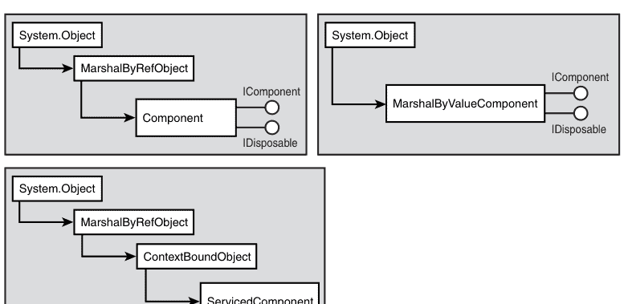

### 图 8.1

你可以创建的三种主要组件类型的继承层次结构。

在图 8.1 中，两个组件类 `Component` 和 `ServicedComponent` 最终都派生自 `MarshalByRefObject`，因此只能通过在 `AppDomain` 之间传递从该类型创建的对象的代理来进行远程调用。这对于仅执行业务逻辑或数据访问且可能位于单独服务器上的组件来说运行良好。例如，示例应用程序中使用的业务和数据访问类可能位于由 `Windows 2000` 组件服务托管的单独服务器上。因此，你不需要（也不希望）在层之间传递对象本身。另一方面，从 `DataSet` 类创建的对象将在数据层和表示层之间来回传递，可能通过输入参数和返回值跨越机器边界。为了使它们能够按值远程调用（非常类似于经典 `ADO` 中的断开连接的 `Recordset`），它们派生自 `MarshalByValueComponent`。

最后，从 `Component` 派生的类必须存在于其创建的 `AppDomain` 中，但可以被跨 `AppDomain` 边界的客户端通过引用引用。通常，其实例将存在于单个 `AppDomain` 中的可重用类（如控件）派生自 `Component`。

从技术上讲，如图 8.1 所示，组件和类之间的区别在于，组件（如 `Component` 和 `MarshalByValueComponent` 类的情况）实现了 `IDisposable` 和 `IComponent` 接口。如第 4 章所述，`IDisposable` 是一个允许类通过显式 `Dispose` 方法实现确定性终结的接口，而不是仅依赖 `CLR` 的垃圾回收算法。`IComponent` 通过添加 `Disposed` 事件和与组件站点交互的支持来扩展此接口。通过这种方式，实现 `IComponent` 接口的类可以被拖放到 `VS .NET Web Forms` 设计器界面上，以支持快速应用程序开发。

就我们的目的而言，我将从 `ServicedComponent` 派生的类（严格来说不是组件）归入这一组，因为命名约定相同，并且将由组件服务托管的类视为组件是有意义的。服务组件将在第 9 章中详细讨论。

> **注意**
>
> 站点，顾名思义，指的是将组件放置到容器中的位置。例如，`Web Forms` 设计器是一个实现了 `System.ComponentModel.IContainer` 接口的容器。当组件被放置到容器中时，会创建一个站点，可以使用 `ISite` 接口的 `Component` 属性来引用。对于业务应用程序中通常进行的开发类型，你不必担心创建容器和处理站点的问题。

## 那控件呢？

本讨论中明显没有提及的是 UI 控件。服务框架支持两个控件派生的类：`System.Web.UI.Control`（在第 10 章“构建 Web Forms”中讨论）用于 `ASP.NET` 控件，以及 `System.Windows.Forms.Control`（超出本书范围）用于 Windows Forms 控件。后者派生自 `Component` 并实现了多个允许其与窗体交互的接口，而前者直接派生自 `System.Object` 并实现了 `IComponent` 和 `IDisposable` 接口，以及支持数据绑定和子控件的接口。你可以将控件简单地理解为组件的子集。

总而言之，组件是可远程调用的、可能实现确定性终结且可重用的类。

> **注意**
>
> 可以通过创建实现 `IComponent` 的类来创建严格意义上的不可远程调用的“组件”。

理解如何构建组件以及 `CLR` 如何在层之间传递从组件实例化的对象，使我们能够为 Quilogy 示例应用程序从适当的类派生组件：

- 业务和数据访问组件依赖于组件服务，不需要按值传递，因此它们将如第 9 章所述派生自 `ServicedComponent`。
- `DataSet` 对象将按值传递，因此派生自 `DataSet`，而 `DataSet` 派生自 `MarshalByValueComponent`。
- 工具类（如本章后续显示的日志类）将派生自 `Component`，因为它们不需要在层之间传递，且可在项目之间重用。

## 传递数据

这一讨论对我们的组件如何传递和返回数据有何启示？

首先，与以前版本的 `VB` 一样，你应该避免按引用传递参数跨越进程或机器边界。这样做要求对象必须存在于其创建的进程中，并且每次访问数据时都会产生跨进程或机器调用的开销。幸运的是，`VB .NET` 现在默认按值（`ByVal`）传递参数而不是按引用（`ByRef`）传递。

### 企业技术

第二部分

其次，这意味着作为参数传递给位于独立应用程序域中对象的任何对象，都应属于以下三种类型之一：

- 可按值传递的简单类型，例如 `Integer` 或 `String`
- 派生自 `MarshalByValueComponent` 的对象，以便由 `CLR` 进行序列化
- 标记了 `Serializable` 特性或实现了 `ISerializable` 接口的对象，以便由 `CLR` 进行序列化

从定义为函数的方法返回数据时，也应遵循这些相同的规则。

## 处理异常

除了返回数据外，您的组件也可能抛出异常。因此，您将希望遵循一种用于检查可能错误并优雅处理异常的标准技术。这对于使用分布式事务的组件尤其重要，因为它们可能需要通知组件服务（`Component Services`）事务应当中止。

例如，如第 6 章“错误处理与调试”中所述，您应检查传入方法的参数中的有效值，并在参数不合格时引发 `ArgumentException`（或其派生类）。此外，您应在类中创建标准的错误日志记录方法，或者更好的做法是，将它们抽象成一个可编译为模块并包含在其他程序集中的类，用于将错误记录到文本文件或 `Windows` 事件日志中。这样，方法中的代码将使用 `Try` 块来捕获异常，使用标准日志记录类记录它，然后使用 `Throw` 语句将异常传递回调用方。

> **注意**
>
> 将错误持久化到文本日志和事件日志的技术将在第 13 章“实现服务”中展示。此外，您也可以使用第 6 章中描述的跟踪功能。

最后，请记住 `CLR` 已针对非异常情况进行了优化。换句话说，异常会引入性能开销，因此您的方法应仅在实际发生错误时才抛出异常，而不是将其作为正常事件处理。

## 序列化类

如表 8.1 所指出，派生自 `MarshalByValueComponent` 的类可以在 `AppDomain` 之间传递时由 `CLR` 进行序列化。序列化仅仅是将对象的状态转换为可传输的字节表示形式的过程。当字节在另一端被接收时，它们会自动反序列化回对象。

> **注意**
>
> 本节描述的序列化类型不应与使用 `XmlSerializer` 类将对象序列化为 XML 的技术混淆。当您需要在 `AppDomain` 边界之间传递对象的状态时，也可以使用该技术，这将在第 14 章“与企业集成”中讨论。

然而，要允许运行时执行序列化，您必须使用 `System.Serializable` 特性标记该类。事实上，添加 `Serializable` 特性就足以让运行时序列化和反序列化由您的类创建的对象。如果您不希望在类中包含确定性终结、不需要 `IComponent` 提供的 RAD 服务，或者需要从 `MarshalByValueComponent` 以外的基类派生您的类（因为 `VB .NET` 不支持多重继承），这将非常有用。

> **注意**
>
> 尽管超出了本书的范围，您的类可以选择实现 `ISerializable` 接口。这样做允许您提供在对象序列化和反序列化时调用的自定义代码，以调整数据序列化的方式。

此外，添加序列化支持为您提供了在类中添加按需序列化和反序列化对象的方法的选项。当您需要将对象持久化到磁盘并在应用程序后续运行时以其先前状态重新创建它时，这可能很有用。例如，考虑清单 8.1 中所示的 `ImportTask` 类。这个简单的类代表一个可能被创建来执行任务的类，该任务使用其 `ProcessFiles` 方法将一系列文件导入数据库。

**清单 8.1** 自定义序列化。此类包含 `Serializable` 特性和按需序列化和反序列化实例的方法。

```vb
Imports System.IO

Imports System.Runtime.Serialization.Formatters.Binary

<Serializable()> Public Class ImportTask

    Private mintDocs As Integer

    Private mstrFile As String

    Private marErrors() As Exception

    Public Property DocsProcessed() As Integer

        Get

            Return mintDocs

        End Get

        Set(ByVal Value As Integer)

            mintDocs = Value

        End Set

    End Property

    Public Property LastFile() As String

        Get

            Return mstrFile

        End Get

        Set(ByVal Value As String)

            mstrFile = Value

        End Set

    End Property

    Public Sub New(ByVal create As Boolean)

        If create Then

            ' Create some internal state

            ReDim marErrors(1)

            marErrors(0) = New Exception("Sample Error 1")

            marErrors(1) = New Exception("Sample Error 2")

        End If

    End Sub

    Public Function ProcessFiles() As Exception()

        ' This method would perform the algorithm and may

        ' return after a certain amount of time, or an error,

        ' or after a certain number of files were processed

        ' Return the errors thus far

        Return marErrors

    End Function

    Public Sub SaveState()

        ' Save the current state of the current object

        Dim fsSave As FileStream

        Dim bf As New BinaryFormatter()
```


```vb
fsSave = New FileStream("ImportState.dat", FileMode.Create, _
    FileAccess.Write, FileShare.None)

bf.Serialize(fsSave, Me)

fsSave.Close()

End Sub

Public Shared Function LoadState() As ImportTask

    ' Load the state of an object

    Dim fsSave As FileStream

    Dim bf As New BinaryFormatter()

    Dim objTask As ImportTask

    If Not File.Exists("ImportState.dat") Then

        Throw New Exception("No state previously saved.")

    End If

    fsSave = New FileStream("ImportState.dat", FileMode.Open, FileAccess.Read)

    ' Deserialize

    objTask = CType(bf.Deserialize(fsSave), ImportTask)

    fsSave.Close()

    Return objTask

End Function

End Class
```

请注意，该类本身使用 `System` 命名空间中的 `Serializable` 特性标记为可序列化。尽管通常仅在类级别使用，但此特性也可以放在单个字段和属性上以允许它们被序列化。相反，`System` 命名空间还包含一个 `NonSerialized` 特性，您可以用它来排除成员被序列化。

`ImportTask` 类包含一个名为 `SaveState` 的虚方法或实例方法，该方法将对象实例的状态保存到文件中。状态包括类跟踪的私有变量。这些不仅包括简单类型（如 `Integer`），还包括更复杂的类型（如 `Exception` 对象数组）。对象的状态是通过使用 `System.Runtime.Serialization.Formatters.Binary` 命名空间的 `BinaryFormatter` 类保存的，该类将对象转换为紧凑的二进制格式，该格式解析速度快。当对象为了在 AppDomain 之间传输而序列化时，运行时内部会使用此类。

> **注意**
>
> 运行时还包含一个 `SoapFormatter`，用于将对象转换为可以作为 SOAP 传输的格式。您可以在第 11 章“构建 Web 服务”中找到有关 SOAP 的更多信息。

`BinaryFormatter` 类的 `Serialize` 方法接受一个代表文件的 `FileStream`（在第 12 章“访问系统服务”中讨论）和要序列化的对象，在本例中是由 `Me` 表示的当前实例。

该对象使用共享的 `LoadState` 方法和 `BinaryFormatter` 类的 `Deserialize` 方法进行反序列化。此方法可以在没有当前实例的情况下调用，并返回一个有效的 `ImportTask` 实例（当然，前提是用于保存状态的文件存在）。

客户端可能会像以下代码一样使用该类：

```vb
Dim objTask As New ImportTask(True)

Dim arErrors() As Exception

' Start the process of importing

arErrors = objTask.ProcessFiles()

' Need to shut down or perform other work so save the state

objTask.SaveState()

objTask = Nothing

arErrors = Nothing

' Later we want to rehydrate the object and start again

objTask = ImportTask.LoadState()

arErrors = objTask.ProcessFiles()
```

当然，客户端应用程序可能只在应用程序调用之间保存状态。

### 构建可重用组件

基于组件编程的好处之一是能够在不同项目中重用组件以促进快速应用程序开发（RAD）方法。VB 一直支持这种范式，它提供了一个工具箱，开发人员可以从中挑选组件添加到他们的项目中。毫不奇怪，VS .NET 包含相同的范式，并且您创建的类可以转换为组件添加到工具箱中，以便在您的项目中重用。

要在 VB .NET 中创建可复用组件，需执行几个步骤，包括从 `Component` 或 `MarshalByValueComponent` 派生类，或简单地实现 `IComponent` 接口；使用设计器属性以便从 VS .NET 的属性对话框配置组件；以及将组件添加到工具箱。本节将展示如何创建一个 `QuilogyLog` 组件，并在多个项目中复用。该组件的代码如清单 8.2 所示。

> **提示**
>
> 本节描述的过程类似于创建一个经典的 COM 组件，在机器上注册它，并使用 VB 6.0 中的“项目引用”对话框添加对该组件的引用。

### 清单 8.2 可复用的 `QuilogyLog` 类

此清单展示了可添加到 VS .NET 工具箱的可复用类。注意放置在属性级别的设计器属性。

```vb
Option Strict On

Imports System.IO

Imports System.ComponentModel

Namespace Quilogy.Utils

<DefaultProperty("Source")> _

Public Class QuilogyLog : Inherits Component

    ' Logging class

    Private mstrSource As String

    Private mstrFile As String

    Private mflFileOnly As Boolean

    Public Sub New()

        ' Default the value

        Me.LogFile = "AppLog.txt"

        Me.FileOnly = False

    End Sub

    Public Sub New(ByVal source As String, ByVal fileName As String, _

        ByVal fileOnly As Boolean)

        Me.Source = source

        Me.LogFile = fileName

        Me.FileOnly = fileOnly

    End Sub

<Browsable(True),

Category("Logging Options", _

Description("Path of the file used to log to."))> _

Public Property LogFile() As String

    Get

        Return mstrFile

    End Get

    Set(ByVal Value As String)

        mstrFile = Value

    End Set

End Property

<Browsable(True),

Category("Logging Options", _

Description("Log source to use in the Application log")> _

Public Property Source() As String

    Get

        Return mstrSource

    End Get

    Set(ByVal Value As String)

        mstrSource = Value

    End Set

End Property

<Browsable(True),

Category("Logging Options", _

Description("Log to the text file only?")> _

Public Property FileOnly() As Boolean

    Get

        Return mflFileOnly

    End Get

    Set(ByVal Value As Boolean)

        mflFileOnly = Value

    End Set

End Property

Public Sub LogText(ByVal message As String, _

    ByVal isError As Boolean)

    ' Write to both the text file and the Quilogy log

    Dim objLog As New EventLog("Application")

    Dim strType As String

    objLog.Source = mstrSource

If Len(message) = 0 Then

    Throw New ArgumentException("No message passed.")

    Return

End If

Try

    ' Create or open the log file

    If Len(mstrFile) = 0 Then

        Throw New Exception("Must set the LogFile property first")

        Return

    End If

    Dim objFs As FileStream = New FileStream(mstrFile, _

        FileMode.OpenOrCreate, FileAccess.Write)

    Dim objSw As StreamWriter = New StreamWriter(objFs)

    objSw.BaseStream.Seek(0, SeekOrigin.End) ' point to the end

    ' Write the log entry

    objSw.Write("Log Entry : ")

    objSw.Write("{0} {1}", DateTime.Now.ToShortTimeString(), _

        DateTime.Now.ToShortDateString())

    If isError Then

        strType = "Error"

    Else

        strType = "Information"

    End If

    objSw.WriteLine(" : " & strType & " [ " & message & " ]")

    objSw.Flush() ' Update underlying file

    objSw.Close()

Catch e As Exception

    Throw New Exception("Could not create or open " & _

        mstrFile & ": " & e.Message)

Finally

    If Not mflFileOnly Then

        Try

            ' Make sure the source is registered, it should be

            If (Not EventLog.SourceExists(objLog.Source)) Then

                EventLog.CreateEventSource(objLog.Source, "Application")

            End If

' Write the message to the log

If isError Then

    objLog.WriteEntry(message, EventLogEntryType.Error)

Else

    objLog.WriteEntry(message, EventLogEntryType.Information)

End If

Catch e As Exception

    ' Not so important so skip it

    Throw New Exception("Error logging to Application log: " & _

    e.Message)

Finally

    objLog.Dispose()

End Try

End If

End Try

End Sub

End Class

End Namespace
```

首先，要使 `QuilogyLog` 组件能够被添加到工具箱，它必须派生自 `Component` 或实现 `IComponent`。这是因为组件必须实现确定性终结（`IDisposable`）并能在 VS .NET 中的设计器（`IComponent`）中放置。在此示例中，`QuilogyLog` 类将派生自 `Component` 并包含三个属性：

- `LogFile` 用于指定记录应用程序事件的日志文件路径。
- `Source` 用于指定事件日志的源名称。
- `FileOnly` 用于指示是否仅记录到文本日志。

该类还将包含一个方法 `LogText`，用于将给定消息记录到文件，可选择性地记录到事件日志。

其次，请注意在清单 8.2 中，该类使用了一组位于 `System.ComponentModel` 命名空间中的设计器属性来指定组件的属性在 VS .NET 的“属性”窗口中如何显示。例如，`LogFile` 属性声明引用了三个属性：

- `Browsable` 确保该属性出现在属性窗口中。
- `Category` 按功能对属性进行分组。
- `Description` 在属性窗口的帮助窗格中显示。

此外，在类级别，使用 `DefaultProperty` 属性指定 `Source` 属性是默认属性，并且当开发人员查看属性时，应获得焦点。

还请注意，该类包含一个重载构造函数，其中不接受参数的版本为 `LogFile` 和 `FileOnly` 属性设置了默认值。这样做是为了当设计器创建组件的实例时，会设置默认值。作为此方法的替代方案，你也可以对每个属性使用 `DefaultValue` 属性。

包含该组件的程序集编译后，你可以通过右键单击“常规”选项卡并选择“自定义工具箱”来将其添加到工具箱。图 8.2 显示了由此产生的对话框。通过选择“.NET Framework 组件”选项卡并使用“浏览”按钮，你可以指向包含该组件的 DLL。在图 8.2 中，注意 `QuilogyLog` 组件已被选中，并且它包含在 `Quilogy.Utils` 命名空间中。

**图 8.2**

*你可以使用此对话框将组件添加到工具箱。*

> **提示**
>
> 你可以通过在程序集中放置多个类，将多个组件放在单个程序集中，尽管它们每个都必须派生自 `Component` 或实现 `IComponent`。

组件被选中后，它会被放入工具箱，并可以拖放到设计器界面上。然后，设计器会将适当的代码写入目标组件（Web 窗体、Windows 窗体或其他组件），如图 8.3 所示。请注意，属性在属性窗口中显示并进行了分类，并且 `QuilogyLog` 组件在设计器中具有图形表示。

**图 8.3**

*将 `QuilogyLog` 组件添加到 Web 窗体设计器界面后的 VS .NET IDE。请注意右下角的属性窗口。*

设计器生成的代码包含在 `InitializeComponent` 方法中，如下所示：

```vb
Protected WithEvents QuilogyLog1 As Quilogy.Utils.QuilogyLog

Private Sub InitializeComponent()

    Me.QuilogyLog1 = New Quilogy.Utils.QuilogyLog()

    Me.QuilogyLog1.FileOnly = False

    Me.QuilogyLog1.LogFile = "AppLog.txt"

    Me.QuilogyLog1.Source = Nothing

End Sub
```


### 编译和版本控制

让你的类派生自`Component`允许通过将它们添加到工具箱来复用它们。然而，请记住，CLR 支持组件的并行执行，因此，从工具箱拖出的组件，或者使用“添加引用”对话框引用的组件，可能是私有程序集，并被复制到客户端应用程序的应用程序目录。

如第 5 章“打包、部署和安全”中所述，为了让同一机器上的所有应用程序使用相同版本的组件，它必须是共享程序集，并使用强名称编译并放入全局程序集缓存（GAC）中。在编译组件时，请确保对于必须保持兼容的组件，仅更改快速修复工程（QFE）号，并保持主版本号和次版本号相同。

### 使用 .NET Remoting

通过迄今为止涵盖的概念，你应该能够创建封装业务逻辑和数据访问的组件，使对象可序列化，并通过可重用组件促进复用。然而，由于大多数企业开发人员都感兴趣于创建分布式应用程序，其中表示层、业务层和数据服务可能存在于多台物理机器上，我们现在需要探讨如何使用 .NET Remoting 跨进程和计算机调用这些组件。

其核心是，.NET Remoting 包含运行时组件和位于`System.Runtime.Remoting`命名空间中的 Services Framework 类，这些组件和类允许托管类（类型）跨 AppDomain 边界进行通信。这些类构建在`System.Net`类提供的基础之上，相关内容将在第 13 章“实现服务”中讨论。具体而言，正如本章开头所提到的，类型如果派生自`MarshalByRefObject`，则可以在其 AppDomain 外部被引用；如果它们是可序列化的，则可以在 AppDomain 之间复制。这些类型被称为可远程处理（remotable）的，因为 .NET Remoting 既可以在客户端创建代理，通过该代理引用服务器上的对象，也可以将对象序列化以进行传输。

> **注意**
> 
> 在底层，此版本的 .NET Remoting 使用 SOAP 1.1 或二进制编码来封送对象，并使用 HTTP 或 TCP 进行远程调用。然而，序列化格式化程序（即 SOAP、二进制）和通信通道（即 HTTP、TCP）都是“可插拔的”，可以随着 Internet 的发展而被替换。由于 SOAP 和 HTTP 是本机使用的，你可以将每个可远程处理的对象视为 Web 服务。

尽管 .NET Remoting 是一个庞大的主题，并且是第 11 章所讨论的 Web 服务的基础，但在组件（CLR 对象远程处理）的上下文中，它可以在分布式应用程序中以以下主要方式使用：

- 在实例化业务和数据访问组件时提供位置透明性。就像在 DCOM 中一样，.NET Remoting 通过使用配置文件，使客户端无需关心对象实际驻留在何处。在许多情况下，VB .NET 对象将由远程服务器上的组件服务托管，不过独立的托管应用程序也可以充当主机。

- 为客户端提供一种机制，使其能够跨网络连接到单个对象实例。例如，通过在 Windows 服务中托管 VB .NET 对象，许多客户端可以连接到该服务并使用其服务。此外，由于 .NET Remoting 支持委托，客户端可以在服务中发生事件时注册接收通知。

本节的其余部分将重点介绍 .NET Remoting 的工作原理，特别是 Quilogy 教育应用程序中的组件如何被远程调用。

#### 托管组件

要使可远程处理的类型可供客户端调用，需要由托管（服务器）应用程序将其提供出来。换句话说，主机应用程序必须注册它可以托管某些类型的事实，并指示对象将如何创建和销毁。具体而言，托管应用程序必须提供以下信息：包含该类型的程序集名称、可远程处理对象的类型名称、客户端可用于定位对象的 URI，以及该类型的激活模式。

在检查这些属性之前，应该注意托管应用程序可以使用编程方法或配置文件来指定此信息。通过以编程方式配置类型的远程处理，托管应用程序可以对上一段中提到的参数进行运行时决策，例如，更改激活模式或在运行时使用不同的类型。另一方面，将类型的远程处理信息放在配置文件中，可以将其与代码抽象开来，从而无需重新编译或修改代码即可进行更改——例如，从测试环境迁移到生产环境时。

#### 主机注册

如前所述，托管应用程序必须提供要进行远程处理的程序集名称和类型名称。这意味着该类型必须在服务器上可用，实际上，当服务器注册可远程处理的类型时，运行时会创建该类型的实例并为其创建对象引用（技术上称为`ObjRef`）。运行时将`ObjRef`及其元数据和配置信息打包到一个内部远程处理表中。此时，该类型已准备好被客户端引用。当托管应用程序结束时，其所有条目都将从远程处理表中移除，从而使这些类型不可用。

除了注册类型以进行远程处理外，服务器还必须通过注册一个或多个*通道*来监听客户端的连接。在 .NET Remoting 中，此通道是 HTTP、TCP 或可插拔通道，代表服务器用于服务客户端的端点。同样，通道信息可以以编程方式或通过配置文件指定。在幕后，客户端和服务器之间的消息传递是通过首先使用 SOAP 或二进制编码对消息进行编码，然后通过其中一个通道进行传输来实现的。

当服务器注册通道时，它开始使用运行时线程池中的线程监听该通道上的调用。当遇到调用时，消息被解包，运行时会检查远程处理表以查看目标类型是否存在于表中。如果是，则使用配置信息来激活对象和/或将调用转发给对象。由于通道和可远程处理类型不需要一一对应，服务器可以在其任何通道上监听对其任何可远程处理对象的调用。例如，服务器可以在 TCP 通道上监听来自本地 LAN 的客户端的调用，同时也可以在 HTTP 通道上监听来自 Internet 的客户端的调用。此外，通道上的每个客户端连接都由其自己的线程处理，从而提高了并发性。

当服务器注册远程对象时，它可以在两种不同的激活模式之间进行选择：*Single Call* 和 *Singleton*。使用 Single Call 激活的类型确保为每个调用创建类型的新实例。这种无状态方法类似于使用 JIT 激活时组件服务中运行的组件的行为，应在希望确保每个客户端拥有自己的对象实例且状态不会在调用之间保存时使用。相反，调用 Singleton 类型的所有客户端始终与类型的同一实例进行交互。使用 Singleton 非常适合在客户端之间共享信息，但可能导致对单个实例进行调用的线程之间发生冲突。因此，你需要使用诸如第 12 章讨论的`System.Threading`命名空间中的`Monitor`类等技术来同步对对象的访问。为了说明这些概念，请考虑清单 8.3 中所示的简单代码，该代码实现了一个托管名为`QuilogyStats`的 Singleton 对象的服务器应用程序。

**清单 8.3** 托管可远程处理对象。此控制台应用程序使用服务器激活模型托管`QuilogyStats`对象。

```
Option Strict On

Option Explicit On

Imports System

Imports System.Web.Services

Imports System.Threading

Imports System.Runtime.Remoting

Imports System.Runtime.Remoting.Channels.Tcp

Imports System.Runtime.Remoting.Channels.Http

Imports System.Runtime.Remoting.Channels

Imports RemotingServer

Module Module1

    Sub Main()

        ' Register the Channel

        Dim chan As New TcpChannel(8085)

        ChannelServices.RegisterChannel(chan)

```

320 Enterprise Techniques PART II

```
Listing 8.3 Continued

' Register the remotable type

RemotingConfiguration.RegisterWellKnownServiceType( _

GetType(QuilogyStats), _

"RemotingHost.QuilogyStats", WellKnownObjectMode.Singleton)

' Wait for client connections

System.Console.WriteLine("Waiting for connections...")

System.Console.ReadLine()

End Sub

End Module

```

在此示例中，控制台应用程序用于托管名为`QuilogyStats`的可远程处理类型。为此，应用程序首先使用`ChannelServices`类在端口 8085 上创建并注册 TCP 通道。要指示运行时选择非活动通道（HTTP 或 TCP），只需向适当的构造函数传递零即可。

> **注意**
> 
> 尽管服务器可以在多个通道上监听，但在任何给定时间，机器上只有一个进程可以在同一端口上监听。

然后，应用程序使用`RemotingConfiguration`类的共享`RegisterWellKnownServiceType`方法注册远程对象。此方法采用三个参数，包括可远程处理的类型、客户端用于标识类型的 URI，以及激活模式。在这种情况下，我们使用`WellKnownObjectMode.Singleton`，因此所有客户端将调用`QuilogyStats`的同一实例。此时，服务器仅使用`Console.ReadLine`等待连接。

在名为`RemotingServer`的程序集中实现的`QuilogyStats`类如清单 8.4 所示。

```
清单 8.4 可远程处理类。此类实现了一个名为 QuilogyStats 的可远程处理类，该类派生自 MarshalByRefObject。

Option Strict On

Imports System.Threading

Imports System.Security.Principal

Imports System.Runtime.Remoting.Lifetime

```

### LISTING 8.4（续）

```
Public Class QuilogyStats : Inherits MarshalByRefObject

    Implements IQuilogyStats

    Private mRegistrations As Integer

    Private mRevenue As Double

    Private mLastUpdate As Date

    Public ReadOnly Property LastUpdate() As Date _

        Implements IQuilogyStats.LastUpdate

        Get

            Return mLastUpdate

        End Get

    End Property

    Public Sub New(ByVal s As String)

        Console.WriteLine(s)

    End Sub

    Public Sub New()

        ' Dummy data

        mRegistrations = 74

        mRevenue = 83560

        mLastUpdate = Now()

    End Sub

    Public Function RegistrationsToday() As Integer _

        Implements IQuilogyStats.RegistrationsToday

        Monitor.Enter(Me)

        ' Manipulate mRegistrations

        Return mRegistrations

        Monitor.Exit(Me)

    End Function

    Public Function RevenueToday() As Double _

        Implements IQuilogyStats.RevenueToday

        Monitor.Enter(Me)

        ' Manipulate mRevenue

        Return mRevenue

        Monitor.Exit(Me)

    End Function

End Class

```

**[PAGE 338]**

### 企业级技术

第二部分

在清单 8.4 中，请注意`QuilogyStats`继承自`MarshalByRefObject`以使其可远程访问，并且其方法均实现了`IQuilogyStats`接口。正如下一节所述，为可远程访问类型实现接口是一种良好的实践，因为它允许对象的表示与实现分离，并由客户端引用。

`QuilogyStats`类简单地公开了两个方法和一个属性，用于返回有关每日进展的信息……虽然很平淡无味，但今天已经……………….。当以单例模式使用时，这个类表面上会包含代码来定期刷新其实例变量，或者允许客户端这样做以提供更新的信息。还请注意，由于每个客户端连接都在单独的线程上处理，因此存在两个客户端可能同时在某个方法中运行代码的可能性。正如在第 12 章中讨论的，使用`Monitor`类的`Enter`和`Exit`方法可以同步对方法主体的访问。

> **注意**
>
> 正如前面的讨论所暗示的，如果`QuilogyStats`类的某个方法将另一个类型作为参数，或者该方法返回一个类型，则该类型必须要么标记为`Serializable`，要么继承自`MarshalByRefObject`。

另外，服务器应用程序也可以在配置文件中指定这些信息，并使用`RemotingConfiguration`类的`Configure`方法加载它。例如，相同的信息可以在应用程序配置文件（在本例中为`remoting.exe.config`）中指定，如清单 8.5 所示。

### LISTING 8.5 服务器配置文件。此文件可由宿主应用程序加载以配置远程访问。

```
<configuration>

    <system.runtime.remoting>

        <application>

            <service>

                <wellknown mode="Singleton"

                    type="RemotingServer.QuilogyStats,RemotingServer"

                    objectUri="RemotingHost.QuilogyStats" />

            </service>

            <channels>

                <channel type="System.Runtime.Remoting.Channels.Tcp.TcpChannel,

                    System.Runtime.Remoting" port="8085" />

            </channels>

        </application>

    </system.runtime.remoting>

</configuration>

```

**[PAGE 339]**

### LISTING 8.5（续）

```
    </channels>

    </application>

    </system.runtime.remoting>

</configuration>

```

然后，服务器的`Main`过程可以修改如下：

```
Sub Main()

    ' Register the remotable types

    RemotingConfiguration.Configure("remoting.exe.config")

    ' Wait for client connections

    System.Console.WriteLine("Waiting for something...")

    System.Console.ReadLine()

End Sub
```


请记住，你还可以混合搭配这些方法，例如，将通道信息添加到配置文件中，而在代码中仍然只调用`RegisterWellKnownServiceType`。此外，你还可以多次使用`RemotingConfiguration`类的共享`Configure`方法，在多个文件中定义各种服务和通道定义。这很有用，因为它允许你将可能因部署场景而更改的远程访问配置信息与其他类型的配置信息分离开来。

> **注意**
>
> 远程访问配置信息也可以使用`.NET`管理工具添加到应用程序配置文件中。当将新应用程序添加到列表中时，会在`Applications`节点下公开`Remoting Services`节点。

显然，此示例展示了如何在你专门为此目的编写的托管可执行文件中配置可远程访问的类型。但是，你也可以在 Windows 服务应用程序、Windows 窗体应用程序和 ASP.NET 应用程序中承载可远程访问的对象。在前两种情况下，你必须以编程方式创建通道和远程访问表项，或者通过前面所示的`Configure`方法加载的配置文件来创建。在后一种情况下，你只需将`system.runtime.remoting`元素添加到 ASP.NET 应用程序的`Web.config`文件中，ASP.NET 就会读取信息并自动配置远程访问表。

**[PAGE 340]**

## 其他宿主

除了创建自己的宿主应用程序来承载远程对象外，还可以使用其他可执行进程。

已承载在组件服务中的服务组件（即在`DLLHost.exe`控制下运行的服务器应用程序中），可以通过两种方式之一进行调用。首先，由于它们由组件服务公开，因此可以通过`DCOM`访问。换句话说，你可以将它们视为非托管 COM+ 组件，并在应用程序中引用`Regsvcs.exe`生成的类型库，这将在下一章中讨论。然后可以手动更新客户端计算机上的注册表，或使用`DCOMCnfg.exe`指向服务器计算机。

或者，在 Windows 2000 中，你可以使用 IIS 作为组件的侦听器，无论该组件是否已服务，方法是创建一个 ASP.NET 应用程序并在`Web.config`文件中放置对该组件的引用。然后，Web 应用程序侦听对该组件的 HTTP 连接，并在服务组件的情况下将它们路由到组件服务。在这种情况下，从客户端到 IIS 的通信通过 SOAP 处理。

在 Windows .NET Server 中，组件服务和 SOAP 的集成更加紧密，因此组件服务管理单元提供了一个复选框，允许通过 SOAP 调用组件。这适用于托管和非托管组件。

**[PAGE 341]**

在 MSIE 中输入远程对象的 URL，并在末尾追加`?wsdl`——例如，`http://ssosa:9000/remotinghost.quilogystats?wsdl`。生成的 XML 是 Web Services Description Language（WSDL），SOAP 客户端使用它来构造方法调用。

## 激活组件

从客户端的角度来看，可远程访问的对象可以使用服务器激活或客户端激活。服务器激活更加简单，当远程对象在调用之间不存储状态（`SingleCall`），或多个客户端访问同一对象实例（`Singleton`）时使用。到目前为止，关于承载组件的讨论都集中在为服务器激活设置组件。客户端激活的对象通过能够向构造函数传递参数，并通过租约模型控制对象的生存期，从而获得对远程对象的更多控制。此外，远程对象的状态会在调用之间保留。与服务器端一样，客户端可以通过编程方式或配置文件显式使用这两种方法中的任一种。

## 使用服务器激活

若要使用服务器激活激活远程对象，客户端可以使用`New`运算符（如果配置文件已就绪），或者使用`System.Activator`类的共享`GetObject`方法。在后一种方法中，客户端必须注册一个用于与服务器通信的客户端通道，然后传入服务器上配置的、用于访问远程对象的类型和 URL。例如，要获取清单 8.3 中所示的单例`QuilogyStats`组件的引用，客户端应用程序可以执行以下操作：

```vb
Dim chan As New TcpChannel(8086)

Dim obj As RemotingServer.IQuilogyStats

ChannelServices.RegisterChannel(chan)

obj = CType(Activator.GetObject(GetType(RemotingServer.IQuilogyStats), _

    "tcp://ssosa:8085/RemotingHost.QuilogyStats"), RemotingServer.IQuilogyStats)

intReg = obj.RegistrationsToday
```

尽管此处使用的方法名称很熟悉，但不要将它与 VB 早期版本中用于与已运行的 COM 服务器通信的内置`GetObject`方法混淆。在 VB .NET 中，根据远程对象在服务器上的配置方式，`GetObject`可能返回对象的新创建实例（`SingleCall`），也可能返回现有实例（`Singleton`）。

### 使用客户端激活

请注意，客户端需要设置对包含`RemotingServer.IQuilogyStats`接口的程序集的引用，因为客户端必须读取元数据才能进行调用。在这种情况下，远程对象实现了`IQuilogyStats`接口，该接口在单独的程序集中编译，然后使其在客户端计算机上可用。当多个开发人员需要在远程对象仍在开发过程中时对其进行编程，这种技术非常有用。在这些情况下，建议使用基于接口的编程，因为提供元数据的替代方法只能是将包含远程对象的程序集复制到客户端，或者使用命令行工具`Soapsuds.exe`。

`Soapsuds`可用于从远程对象在 HTTP 通道上监听时生成的 WSDL 构建程序集。此外，它还可以生成派生自`System.Runtime.Remoting.Services.RemotingClientProxy`的代理类的源代码，客户端可以使用该代理类通过 SOAP 与远程对象通信。`Soapsuds`的最大好处是，它通过允许客户端轻松创建自己的元数据，减轻了将程序集分发给客户端的负担。然而，`Soapsuds`无法与仅通过 TCP 通道公开的组件一起工作，因为在这种情况下，消息是通过二进制编码传输的，而不是 SOAP。

> **注意**
>
> 有趣的是，正如可以使用`Soapsuds.exe`为托管组件创建代理一样，使用 COM 互操作（在第 9 章中介绍）的非托管组件也可以通过在配置文件中为其创建条目或使用`RegisterWellKnownServiceType`以编程方式通过 SOAP 调用。这种技术允许使用 IIS 作为监听器，通过 SOAP 访问现有的 COM 和 COM+ 组件。

显然，为了提供位置透明性，URL 可以从独立存储（在第 12 章中讨论）、注册表、应用程序配置文件或应用程序特定的设置文件中读取。

作为编程方法的替代方案，客户端还可以使用配置文件，以便将某些配置信息从源代码中抽象出来。不幸的是，这种方法仅在程序集存在于客户端计算机上时才适用于组件。换句话说，如果你只是将远程对象的接口编译到程序集中并在客户端引用它们，则不能使用`New`运算符来实例化类，因为实际类型不在程序集中。然而，当组件可以在客户端或服务器上实例化时，这种方法很有用。例如，通过将包含组件的程序集复制到本地计算机，可以创建如清单 8.6 所示的配置文件。

**清单 8.6** 客户端配置文件。此清单显示了客户端可以加载的配置文件，用于抽象远程处理信息。

```xml
<configuration>
  <system.runtime.remoting>
    <application>
      <client>
        <wellknown type="RemotingServer.QuilogyStats, RemotingServer"
          url="tcp://ssosa:8085/RemotingHost.QuilogyStats" />
      </client>
      <channels>
        <channel type="System.Runtime.Remoting.Channels.Tcp.TcpChannel,
          System.Runtime.Remoting" port="8086" />
      </channels>
    </application>
  </system.runtime.remoting>
</configuration>
```

请注意，此文件包含`client`元素而不是`service`元素，并定义了客户端通道，在本例中是使用端口 8086 的 TCP 通道。

现在，客户端无需使用`GetObject`，只需加载配置文件并使用`New`运算符，如下所示：

```vb
Dim obj As RemotingServer.QuilogyStats

RemotingConfiguration.Configure("remotingclient.exe.config")

' 远程对象

obj = New RemotingServer.QuilogyStats

intReg = obj.RegistrationsToday
```

在前面的两个实例中，客户端都使用服务器激活来激活远程对象。然而，客户端可以通过使用客户端激活来获得对远程对象的更多控制。客户端激活可用于客户端需要重复调用服务器上同一对象实例的场景。

在客户端可以激活对象之前，服务器必须将远程对象注册为可以被客户端激活。这是通过调用`RemotingConfiguration`类的`RegisterActivatedServiceType`方法并简单地传入类型来完成的，如下所示：

```vb
RemotingConfiguration.RegisterActivatedServiceType( _

  GetType(RemotingServer.QuilogyStats))
```

等效的条目也可以通过向服务器配置文件添加`activated`元素来指定此信息，如下所示：

```xml
<service>
  <activated type="RemotingServer.QuilogyStats, RemotingServer" />
</service>
```

此时，当服务器开始监听消息时，它不会创建对象的实例，而是等待客户端发出请求，然后使用传递给构造函数的参数激活一个实例。你可以创建一个服务器，同时注册激活类型和已知类型，供不同类型的客户端使用。显然，当使用客户端激活时，每个客户端都会收到自己的对象实例，该实例在服务器上保持活动状态，直到客户端释放它或其租约到期。

为了使客户端激活对象并向其传递参数以满足构造函数，需要使用`Activator`类的`CreateInstance`方法。此方法有多个重载签名，但在其基本形式之一中，它接受要激活的对象类型，以及表示要传递给构造函数的参数和用于激活对象的属性的数组。例如，清单 8.7 中的代码将由客户端执行，以返回在服务器上创建的远程对象实例。

**清单 8.7** 客户端激活对象。此代码显示了客户端如何使用客户端激活模型激活对象并为其传递构造函数。

```vb
Dim chan As New TcpChannel(8086)

Dim obj As RemotingServer.QuilogyStats

Dim arConstructor(0) As Object

Dim arActivation(0) As Object

Dim objUrl As New UrlAttribute("tcp://ssosa:8085")

ChannelServices.RegisterChannel(chan)

' 设置构造函数和激活属性

arConstructor(0) = "logfile.txt"

arActivation(0) = objUrl

' 在服务器上激活对象，在构造函数中传递一个字符串

obj = CType(Activator.CreateInstance(

    GetType(RemotingServer.QuilogyStats), _

    arConstructor, arActivation), RemotingServer.QuilogyStats)

intReg = obj.RegistrationsToday
```


请注意，在这种情况下，`QuilogyStats` 类已增加了一个构造函数，该构造函数接受用于记录有关注册过程的统计信息的日志文件名。因为构造函数只接受一个参数，所以 `Object` 数组被定义为具有一个元素。同样，唯一需要设置的激活属性是 URL，因此数组被定义为一个元素，并将 `UrlAttribute` 对象（来自 `System.Runtime.Remoting.Activation` 命名空间）放入数组中。请注意，由于远程对象尚不存在，你不需要设置端点。只需指定计算机名称和端口就足够了。

> **提示**
>
> 对于客户端激活对象，该类必须在客户端上可访问，以便找到适当的构造函数。这意味着你不能使用基于接口的方法仅使用其接口来激活远程对象。如果你这样做，将抛出 `MissingMethodException` 异常，消息为“未找到构造函数。”

如果使用客户端配置文件，则可以在 `client` 元素中放置一个 `activated` 元素，该元素简单地引用将使用客户端激活的类型和程序集。然后，客户端可以使用 `Configure` 方法加载配置文件，并使用构造函数正常实例化对象。

### 管理对象生存期

如前所述，客户端激活对象还支持生存期管理。这是基于租约的概念，在 `System.Runtime.Remoting.Lifetime` 命名空间中可以找到对租约的支持。使用这种技术是为了让服务器上的垃圾回收器最终可以收集所有可远程处理的对象，也用作 COM 所采用的引用计数的替代方案。其思想是，运行时为每个 `AppDomain` 包含一个租约管理器，它定期轮询所有客户端激活的远程对象（默认情况下每 10 秒一次），以确定它们的租约是否已过期。如果是，运行时可能会调用客户端赞助者对象来通知它这一事实。然后，赞助者可以选择续订租约或让其过期。如果租约过期，远程对象将被销毁，随后对其的任何调用都会导致异常。

要获取对租约的引用，你只需创建一个 `ILease` 类型的变量，并调用 `RemotingServices` 类的共享 `GetLifetimeServices` 方法，传入客户端激活对象。`ILease` 接口支持返回以下内容的属性：租约到期前的时间（`CurrentLeaseTime`）、租约是否已过期（`CurrentState`）、初始租约时间（`InitialLeaseTime`）、在远程对象上进行调用时添加到租约的时间（`RenewOnCallTime`），以及服务器等待赞助者响应的时间（`SponsorShipTimeout`）。此外，客户端可以使用 `Renew` 方法续订租约。

### 企业级技术 第二部分

> **注意**
>
> `ILease` 和 `ISponsor` 接口的成员使用 `TimeSpan` 结构来标识一段时间。该结构在第 13 章中有更详尽的讨论。

例如，清单 8.7 中的代码可以扩充为获取 `QuilogyStats` 的租约引用，并将租约续约一天：

```vb
Dim objLease As ILease

objLease = RemotingServices.GetLifetimeService(obj)

objLease.Renew(New TimeSpan(24, 0, 0))
```

然而，这并非必需，因为默认情况下，远程对象包含一个五分钟的 `InitialLeaseTime` 和一个两分钟的 `RenewOnCall` 时间。因此，在休眠五分钟后，每次调用该对象的方法都会将其续约两分钟。在大多数情况下，这已经足够了，因为对远程组件的引用可能不会超过两分钟。

但是，在某些场景中，当一个 Windows 服务应用程序在另一个服务中使用客户端激活对象时，你可能需要通过在客户端上创建赞助器对象来管理租约。基本上，赞助器可以从任何实现了 `ISponsor` 接口并派生自 `MarshalByRefObject` 的类中创建。赞助器对象充当来自服务器的回调，用于在租约到期时通知客户端应用程序。例如，要在服务器上注册赞助器，你可以使用以下代码：

```vb
Dim objSpons As New QuilogyStatsSponsor()

objLease = RemotingServices.GetLifetimeService(obj)

objLease.Register(objSpons)
```

请注意，`ILease` 接口包含一个 `Register` 方法（以及一个对应的 `Unregister` 方法），允许你将赞助器对象传递给服务器。然后，当租约到期时，服务器会回调接口上的 `Renewal` 方法。`QuilogyStatsSponsor` 类定义如下：

```vb
Public Class QuilogyStatsSponsor : Inherits MarshalByRefObject

    Implements ISponsor

    Public Function Renewal(ByVal objLease As ILease) As TimeSpan _
        Implements ISponsor.Renewal

        ' Keep it alive

        Return New TimeSpan(0, 2, 0)

    End Function

End Class
```

在这种情况下，当调用 `Renewal` 方法时，租约会额外续约两分钟。

如果你不想处理租约问题，或者想要在服务器端自定义租约的创建方式，你的远程对象可以重写 `MarshalByRefObject` 的 `InitializeLifetimeService` 方法。例如，为了确保不为 `QuilogyStats` 组件创建租约，可以重写该方法并将 `InitialLeaseTime` 属性设置为零：

```vb
Public Overrides Function InitializeLifetimeService() As Object

    Dim objLease As ILease

    objLease = MyBase.InitializeLifetimeService

    If objLease.CurrentState = LeaseState.Initial Then

        objLease.InitialLeaseTime = TimeSpan.Zero

    End If

End Function
```

当客户端尝试使用 `GetLifetimeService` 获取租约时，将返回 `Nothing`。显然，租约的其他属性也可以在这里设置。请注意，只有当租约的状态被设置为 `LeaseState` 枚举中的 `Initial` 值时，才能操纵这些属性。

### 使用高级远程处理

前面的描述是对 .NET 远程处理的简要说明。它没有涉及分布式应用程序开发人员肯定感兴趣的若干高级功能。其中包括安全性和使用委托的异步操作，我们将在下面讨论。

### 保护远程处理的安全性

如第 5 章所述，VB .NET 代码可以使用各种安全技术加以保护，例如代码访问安全和基于角色的安全。.NET 远程处理不会添加另一层安全性，而只是使用已经公开的底层模型和技术。例如，与远程对象通信时，实际的通信由第 13 章中讨论的 `System.Net` 命名空间中的类执行。这些类公开了用于设置身份验证凭据的方法和属性。

举例说明，假设远程对象由 IIS 通过 HTTP 通道承载。由于 IIS 服务器可以使用匿名、基本、摘要或 Windows 集成身份验证，因此使用这些身份验证方案从客户端向远程对象发送凭据涉及在客户端上创建凭据，运行时将这些凭据传递给服务器。在这种情况下，假设服务器正在使用基本身份验证。你可以使用 `ChannelServices` 类的静态 `GetChannelSinkProperties` 方法来指定用户名和密码，这些用户名和密码将在调用远程对象时用于身份验证，如下所示：

```vb
Dim objD As IDictionary

objD = ChannelServices.GetChannelSinkProperties(obj)

objD("UserName") = "dfox1"

objD("Password") = "sfdfs"
```

请注意，`obj` 是对远程激活对象的引用。

除了 Web 安全性之外，你还可以使用 .NET 的基于角色的安全性来以声明方式或编程方式检查适当的角色，如第 5 章所述。.NET 远程处理会自动将所需的身份信息发送到服务器。

### 使用异步远程处理

当你了解到 .NET 远程处理还自动支持从客户端进行异步调用时，应该不会感到惊讶。它使用与第 4 章中所示相同的委托异步模式来实现这一点。

例如，要异步调用远程 `QuilogyStats` 对象的 `RegistrationsToday` 方法，客户端必须首先创建一个与要调用的方法具有相同签名的委托——在这种情况下，是一个返回 Integer 的函数：

```vb
Public Delegate Function RegToday() As Integer
```

此外，客户端需要设置一个异步调用完成时调用的处理程序：

```vb
Public Sub Done(ByVal ar As IAsyncResult)

    ' Notify the client that the processing is complete

End Sub
```

在客户端激活远程对象后调用该方法时，它可以实例化一个 `AsyncCallback` 对象，并将处理程序的地址传递给它。此外，委托被实例化，并传递远程对象上要调用的方法的地址。通过使用委托的 `BeginInvoke` 方法并传入 `AsyncCallback` 对象，运行时调用远程对象并在另一个线程上等待通知，如清单 8.8 所示。

**清单 8.8** 异步远程处理。此清单展示了客户端应用程序如何对远程对象使用异步模式。

```vb
Dim cbRegToday As AsyncCallback

Dim delRegToday As RegToday

Dim ar As IAsyncResult

Dim obj As RemotingServer.IQuilogyStats

Dim chan As New HttpChannel()

' Register the channel to receive the callback and activate the object

ChannelServices.RegisterChannel(chan)

obj = CType(Activator.GetObject(GetType(RemotingServer.IQuilogyStats), _
    "http://sossa:9000/RemotingHost.QuilogyStats"), RemotingServer.IQuilogyStats)

' Setup the callback and invoke the method asynchronously

cbRegToday = New AsyncCallback(AddressOf Done)

delRegToday = New RegToday(AddressOf obj.RegistrationsToday)

delRegToday.BeginInvoke(cbRegToday, Nothing)
```

结果，`Done` 方法在 `RegistrationsToday` 方法完成时在单独的线程上被调用。

### 调用非托管 DLL

尽管服务框架提供了广泛的功能，但有时你仍需要调用 Win32 API 或自定义或第三方的非托管 DLL。幸运的是，CLR 通过平台调用（PInvoke）服务使这一过程变得简单。为了让 VB 开发人员的生活更加轻松，PInvoke 已通过 VB.NET 中的内在 `Declare` 语句公开。然而，与以前版本的 VB 一样，在调用非托管 DLL 之前，你需要注意几个事项。

使用 `Declare` 语句调用 DLL 函数的基本语法保持相对不变。例如，要调用 `GetSystemDirectory` Win32 API 函数，你可以在模块或类中使用以下 `Public` 或 `Private Declare` 语句：

```vb
Declare Auto Function GSD Lib "Kernel32" _
    Alias "GetSystemDirectory" _
    (ByVal s As StringBuilder, ByVal len As Integer) As Integer
```

包含函数的 DLL（称为入口点）由 `Lib` 语句指定，并且可以使用 `Alias` 语句以不同的名称引用该函数。然而，熟悉 `Declare` 语句的人应该立即注意到另外两个区别。

第一个是 `Auto` 关键字。此关键字控制 PInvoke 如何查找要调用的实际函数名称以及如何封送字符串。使用 `Auto` 指示 PInvoke 在运行时根据代码运行的操作系统查找 ANSI 版本或 Unicode 版本的函数。通常，Win32 导出了用于 Windows 95 和 98 的 ANSI 版本函数（附加 "A"），以及用于 Windows NT 和 2000 的 Unicode 版本函数（附加 "W"）。

### 注意

是的，有一种更简便的方法可以通过使用 `Environment` 类的共享属性 `SystemDirectory` 来获取系统目录。这里使用 `GetSystemDirectory` 仅用于演示。

除了使用 `Auto` 关键字外，你也可以显式使用 `Ansi`（默认）或 `Unicode` 来调用相应版本的函数。这样做会禁用 PInvoke 构建函数名的能力，并且必须在 `Declare` 语句中精确指定函数名的拼写，即此处的 `GetSystemDirectoryW` 或 `GetSystemDirectoryA`。不足为奇的是，一个名为 `DllImport` 的属性可以通过将其 `ExactSpelling` 字段设置为 `False` 来覆盖此设置，如下所示：

```vb
Imports System.Text

Imports System.Runtime.InteropServices

<DllImport("Kernel32", ExactSpelling:=False)> _
Declare Ansi Function GSD Lib "Kernel32" _
    Alias "GetSystemDirectoryA" _
    (ByVal s As StringBuilder, ByVal len As Integer) As Integer
```

### 注意

正如前面的代码示例所示，`DllImport` 还允许你在其构造函数中指定 DLL 的名称，这相当于 `Declare` 语句中的 `Lib`。此外，`DllImport` 包含 `EntryPoint` 和 `CharSet` 字段，它们对应于 `Declare` 语句中的 `Function` 或 `Alias` 以及字符集部分。另外三个属性 `CallingConvention`、`PreserveSig` 和 `SetLastError` 对于 VB .NET 开发人员来说是默认的，因此你无需更改它们。

在这种情况下，因为指定了 `Ansi`，PInvoke 使用指定的显式函数名 `GetSystemDirectoryA`。由于使用的是 ANSI，PInvoke 将发起调用，将字符串编组为 ANSI（每字符 1 字节），然后在返回时将它们转换回 Unicode。

与以前版本的 VB 相比，另一个重要的变化是，由于 VB .NET 中的 `Integer` 数据类型映射到 `System.Int32` 数据类型，因此在调用 Win32 时不再需要使用 `Long` 数据类型。此外，常见的情况是，`GetSystemDirectory` 函数接受一个字符串缓冲区和缓冲区的长度。你应该将 `StringBuilder` 的实例传递给函数，而不是使用 `String` 数据类型，因为在 CLR 中 `String` 数据类型是不可变的。`StringBuilder` 允许将新字符串复制回托管代码中，模拟按引用调用。你按值传递 `StringBuilder`（`ByVal`）。例如，要调用该函数，你需要执行以下操作：

```vb
Dim sbReturn As StringBuilder

sbReturn = New StringBuilder(256)

intRet = GetSystemDirectory(sbReturn, sbReturn.Capacity)
```

其他常见的 Win32 数据类型及其相应的 VB .NET 等效类型的表格可以在在线文档中找到。

### 封装非托管 DLL

与以前版本的 VB 一样，良好的编码实践是将 `Declare` 语句、相关的常量、结构体以及对实际外部 DLL 的调用封装在包装器中。这样，调用 DLL 的代码就被隔离开了，可以在不影响其他代码的情况下进行修改。尽管这在以前版本的 VB 中通常是通过标准模块完成的，但在 VB .NET 中，使用类来封装更为合适。

当你创建一个封装非托管 DLL 的 VB .NET 类时，基本上有两个选择。首先，你可以将每个函数放在单独的类中，并公开属性来设置调用，然后再调用它们。其次，更推荐的做法是，将相关的函数分组到一个共享类中，并为每个非托管函数公开大约一个共享方法或属性。这样，你可以创建一个私有程序集，轻松地与其他开发人员共享。

为了说明后一种技术，让我们看看清单 8.9 中显示的 `Win32Info` 类。这个类是 `Quilogy.Utils` 命名空间的一个成员，用于提供与操作系统交互的信息。

**清单 8.9** 封装非托管 DLL。该类是几个返回系统信息和发送消息的 Win32 API 函数的包装器。

```vb
Option Explicit On

Option Strict On

Imports System

Imports System.Runtime.InteropServices

Namespace Quilogy.Utils

    Public Class Win32Info


```vb
' 已识别的处理器类型
Public Enum ProcessorType
    INTEL_386 = 1
    INTEL_486 = 2
    INTEL_PENTIUM = 3
    MIPS_R4000 = 4
    ALPHA_21064 = 5
    ALPHA_21066 = 6
    ALPHA_21164 = 7
    PPC_601 = 8
    PPC_603 = 9
    PPC_603PLUS = 10
    PPC_604 = 11
    PPC_604PLUS = 12
    PPC_620 = 13
    INTEL_UNKNOWN = 14
    MIPS_UNKNOWN = 15
    ALPHA_UNKNOWN = 16
    PPC_UNKNOWN = 17
    UNKNOWN = 99
End Enum

' 本地存储
Private Shared mbProcs As Byte = 0
Private Shared mType As ProcessorType = ProcessorType.UNKNOWN

Public Shared ReadOnly Property Processors() As Byte
    ' 返回处理器数量
    Get
        If mbProcs = 0 Then
            mbProcs = GetProcessors()
        End If

        Return mbProcs
    End Get
End Property

Public Shared ReadOnly Property Processor() As ProcessorType
    ' 返回处理器类型
    Get
        If mType = 0 Then
            mType = GetProcType()
        End If

        Return mType
    End Get
End Property

Public Shared Sub SendMessage(
    ByVal message As String,
    ByVal recip As String,
    Optional ByVal from As String = Nothing)

    ' 发送消息
    NetSend(message, recip, from)
End Sub

End Class
End Namespace
```

在这个例子中，该类公开了`Processors`和`Processor`属性，它们分别返回运行代码的计算机上的处理器数量，以及通过`ProcessorType`枚举表示的处理器类型。此外，该类还公开了一个方法`SendMessage`，它使用 Messenger 服务向特定的客户端或一组客户端发送消息。

该类实际上并不包含任何针对所调用底层 Win32 API 的`Declare`语句。这些被抽象到了清单 8.10 所示的模块中。

#### 清单 8.10

此模块包含对非托管 DLL 的实际调用，以及常量、结构体和其他支持性声明。

```vb
Option Strict On

Imports System.Runtime.InteropServices
Imports System.Text

Module APIs

    '***********************************************

    <StructLayout(LayoutKind.Sequential)> _
    Public Structure SYSTEM_INFO
        Public dwOemId As Integer
        Public dwPageSize As Integer
        Public lpMinimumApplicationAddress As Integer
        Public lpMaximumApplicationAddress As Integer
        Public dwActiveProcessorMask As Integer
        Public dwNumberOfProcessors As Integer
        Public dwProcessorType As Integer
        Public dwAllocationGranularity As Integer
        Public wProcessorLevel As Short
        Public wProcessorRevision As Short
    End Structure

    '*******************************************

    Private Const PROCESSOR_ARCHITECTURE_ALPHA As Integer = 2
    Private Const PROCESSOR_ARCHITECTURE_INTEL As Integer = 0
    Private Const PROCESSOR_ARCHITECTURE_MIPS As Integer = 1
    Private Const PROCESSOR_ARCHITECTURE_PPC As Integer = 3
    Private Const PROCESSOR_ARCHITECTURE_UNKNOWN As Integer = 65535
    Private Const FORMAT_MESSAGE_FROM_SYSTEM As Integer = 4096
    Private Const NERR_Success As Integer = 0
    Private Const MAX_LENGTH As Integer = 256

    '*******************************************

    Private Declare Auto Function Win32NetMessageSend _
        Lib "netapi32.dll" _
        Alias "NetMessageBufferSend" _
        (
            ByVal lpstrServer As String,
            ByVal lpstrMsgName As String,
            ByVal lpstrFromn As String,
            ByVal lpbyteBuf As String,
            ByVal dwLen As Integer
        ) As Integer

    Private Declare Auto Sub Win32GetSystemInfo _
        Lib "Kernel32" _
        Alias "GetSystemInfo" _
        (ByRef s As SYSTEM_INFO)

    Private Declare Auto Function Win32GetLastError _
        Lib "kernel32" () As Integer

    Private Declare Auto Function Win32FormatMessage _
        Lib "kernel32" _
        Alias "FormatMessage" _
        (
            ByVal dwFlags As Integer,
            ByVal lpSource As Integer,
            ByVal dwMessageId As Integer,
            ByVal dwLanguageId As Integer,
            ByVal lpBuffer As StringBuilder,
            ByVal nSize As Integer,
            ByVal Arguments As Integer
        ) As Integer

    '*******************************************

    Public Function GetProcessors() As Byte
        ' 调用 Win32 API 函数并获取处理器数量
        Dim s As New SYSTEM_INFO()

        Try
            Win32GetSystemInfo(s)
            Return CType(s.dwNumberOfProcessors, Byte)
        Catch e As Exception
            Return 0
        End Try
    End Function

    '*******************************************

    Public Function GetProcType() As _
        Quilogy.Utils.Win32Info.ProcessorType

        ' Call the Win32 API function and get the processor type
        Dim s As New SYSTEM_INFO()

        Try
            Win32GetSystemInfo(s)
        Catch e As Exception
            Return Quilogy.Utils.Win32_exceptionhandler>Win32Info.ProcessorType.UNKNOWN
        End Try

        Select Case s.dwOemId
            Case PROCESSOR_ARCHITECTURE_INTEL
                Select Case s.wProcessorLevel
                    Case 3
                        Return Quilogy.Utils.Win32Info.ProcessorType.INTEL_386
                    Case 4
                        Return Quilogy.Utils.Win32Info.ProcessorType.INTEL_486
                    Case 5
                        Return Quilogy.Utils.Win32Info.ProcessorType.INTEL_PENTIUM
                    Case Else
                        Return Quilogy.Utils.Win32Info.ProcessorType.INTEL_UNKNOWN
                End Select

            Case PROCESSOR_ARCHITECTURE_MIPS
                Select Case s.wProcessorLevel
                    Case 4
                        Return Quilogy.Utils.Win32Info.ProcessorType.MIPS_R4000
                    Case Else
                        Return Quilogy.Utils.Win32Info.ProcessorType.MIPS_UNKNOWN
                End Select

            Case PROCESSOR_ARCHITECTURE_ALPHA
                Select Case s.wProcessorLevel
                    Case 21064
                        Return Quilogy.Utils.Win32Info.ProcessorType.ALPHA_21064
                    Case 21066
                        Return Quilogy.Utils.Win32Info.ProcessorType.ALPHA_21066
                    Case 21164
                        Return Quilogy.Utils.Win32Info.ProcessorType.ALPHA_21164
                    Case Else
                        Return Quilogy.Utils.Win32Info.ProcessorType.ALPHA_UNKNOWN
                End Select

            Case PROCESSOR_ARCHITECTURE_PPC
                Select Case s.wProcessorLevel
                    Case 1
                        Return Quilogy.Utils.Win32Info.ProcessorType.PPC_601
                    Case 3
                        Return Quilogy.Utils.Win32Info.ProcessorType.PPC_603
                    Case 4
                        Return Quilogy.Utils.Win32Info.ProcessorType.PPC_604
                    Case 6
                        Return Quilogy.Utils.Win32Info.ProcessorType.PPC_603PLUS
                    Case 9
                        Return Quilogy.Utils.Win32Info.ProcessorType.PPC_604PLUS
                    Case 20
                        Return Quilogy.Utils.Win32Info.ProcessorType.PPC_620
                    Case Else
                        Return Quilogy.Utils.Win32Info.ProcessorType.PPC_UNKNOWN
                End Select

            Case Else
                Return Quilogy.Utils.Win32Info.ProcessorType.UNKNOWN
        End Select
    End Function

    Public Sub NetSend(
        ByVal message As String,
        ByVal recip As String,
        ByVal from As String)

        ' Send a message
        Dim intRet As Integer
        Dim intLen As Integer
        Dim sbReturn As StringBuilder

        intLen = Encoding.Unicode.GetByteCount(message)

        ' Send the message from the local server
        intRet = Win32NetMessageSend("", recip, from, message, intLen)

        If intRet <> NERR_Success Then
            sbReturn = New StringBuilder(MAX_LENGTH)

            ' Get the message
            intRet = Win32FormatMessage(
                FORMAT_MESSAGE_FROM_SYSTEM,
                0,
                intRet,
                0,
                sbReturn,
                sbReturn.Capacity,
                0)

            If intRet > 0 Then
                Throw New Exception("Message was not sent:" & sbReturn.ToString)
            Else
                Throw New Exception("Message was not sent: Unknown error")
            End If
        End If
    End Sub

    Private Function GetErrorMsg() As String
        Dim intRet As Integer
        Dim sbReturn As New StringBuilder(MAX_LENGTH)

        ' Get the last errorbq_error and message


```vb
    intRet = Win32GetLastError()

    If intRet = 0 Then

        Return Nothing

    Else

        intRet = Win32FormatMessage( _

            FORMAT_MESSAGE_FROM_SYSTEM, 0, intRet, 0, _

            sbReturn, sbReturn.Capacity, 0)

        Return sbReturn.ToString

    End If

End Function

End Module
```

在代码清单 8.10 中，公共的`GetProcessor`和`GetProcType`方法都调用了别名为`Win32GetSystemInfo`的`GetSystemInfo` Win32 API 函数。

> **提示**
>
> 在函数名前面加上`Win32`前缀，可以更容易地区分 .NET 中的函数和外部函数。

该函数有一个简单的`Declare`语句，但返回一个通过引用传递的结构体`SYSTEM_INFO`。该结构体被声明为`Public`，并将其成员映射为`Integer`和`Short`值。此外，`StructLayout`属性与`LayoutKind.Sequential`一起使用，以确保运行时不重新排序结构体的成员（它有时为了效率会这样做）。如需更多控制，可以使用`Explicit` `LayoutKind`配合`FieldOffset`属性显式设置结构体中的偏移量，如下所示：

```vb
<StructLayout(LayoutKind.Explicit)> _

    Public Structure Rect

        <FieldOffset(0)> Public left As Integer

        <FieldOffset(4)> Public top As Integer

        <FieldOffset(8)> Public right As Integer

        <FieldOffset(12)> Public bottom As Integer

    End Structure
```

函数返回结构体后，只需读取相应的字段并返回正确的结果即可。

代码清单 8.10 中的另一个关键点是公共的`NetSend`方法。该方法由代码清单 8.9 中的类方法调用，负责调用 Win32 并引发任何异常。请注意，底层的`NetMessageBufferSend`函数作为 Unicode 函数调用，因此作为最后一个参数传递的字节长度应该是字符长度的两倍。确定`String`中字节数的一种方法是使用`Encoding`类的`GetByteCount`方法。

调用`Win32NetMessageSend`函数后，会检查返回值。在这种情况下，如果值不等于常量`NERR_Success`，则表示发生了错误。通常，可以使用`FormatMessage`函数检索错误字符串。同样，此函数在传入错误代码时会用检索到的消息填充字符串缓冲区。在本例中，该方法会引发一个包含消息文本的异常。

> 虽然在其他方法中没有使用，但`GetErrorMsg`方法可以用于那些设置当前线程错误码但不返回它的 API 函数。该方法调用`GetLastError`函数检索错误码，然后调用`FormatMessage`获取错误字符串。像`GetCurrentDirectory`这样的函数使用正返回值表示成功，0 表示失败，然后需要调用`GetLastError`来发现实际的错误码。

由于类及其方法都是共享的（调用 Win32 API 很少需要任何实例存储），客户端只需导入程序集并调用方法即可使用此类。在以下代码中，调用`SendMessage`方法以在应用程序发生致命错误时向特定计算机发送网络消息：

```vb
Imports Quilogy.Utils

Win32Info.SendMessage("Fatal Error Occurred on web server", _

    strAdminPC, "Quilogy Education Application")
```

### 使用回调

除了传递简单的数据类型和结构体之外，还可以使用 Win32 回调。正如你所期望的，这是使用委托来完成的，这在第 4 章中已有描述。

例如，假设你要调用`EnumWindows` Win32 函数来返回当前系统上所有窗口句柄的列表。此函数将回调函数的地址作为参数。要指定回调函数，只需创建具有适当签名的委托，如下所示：

```vb
Imports System.Runtime.InteropServices

Declare Auto Function Win32EnumWindows Lib "User32" _

    Alias "EnumWindows" (ByVal cb As EnumCallBack, _

    ByVal appspecific As Integer) As Integer

Delegate Function EnumCallBack(ByVal hwnd As Integer, _

    ByVal lParam As Integer) As Boolean
```

同样，委托通过`ByVal`传递，因为它封装了方法的地址。然后，客户端代码只需实例化委托，向其传递回调方法的地址，并将委托传递给函数，如下所示：

```vb
Dim dCB As New EnumCallBack(AddressOf WinCB)

Dim intRet As Integer

intRet = Win32EnumWindows(dCB, 0)

' Other code here

Public Function WinCB(ByVal hwnd As Integer, _

    ByVal lParam As Integer) As Boolean

    ' Use the Window handle

    Return True

End Function
```

注意，只要方法返回`True`，模块或类的`WinCB`方法就会被重复调用。然而，与第 4 章中描述的委托不同，在这种情况下，Win32 函数的工作发生在与调用者相同的线程上。换言之，对`EnumWindows`的调用将会阻塞，直到所有窗口都枚举完毕。

### 总结

本章探讨了服务框架（Services Framework）和 VB .NET 的各个方面，你可以利用这些特性来创建组件。这包括用于序列化对象、复用组件，以及通过 .NET Remoting 在网络上使用组件的技术。

虽然本章为组件开发奠定了基础，但 VB 开发者所期望的许多中间层服务（包括即时激活和事务支持）将在下一章中详细讨论。

# 访问组件服务

## 第 9 章

### 本章内容

- 从 MTS 迁移到 COM+ 347
- 注册服务化组件 382
- 互操作 384

**第二部分**

企业级技术

第 8 章“构建组件”通过描述组件如何创建、复用以及如何跨 AppDomain 边界进行远程调用，为在 VB .NET 中构建组件奠定了基础。本章将在该基础上，描述业务层和数据服务层中的类如何与组件服务（在本文讨论中也称为 COM+）集成，以利用事务和对象池等服务，同时探讨 .NET 组件如何与经典 COM 组件进行互操作。

本章中的许多示例再次采用了 Quilogy 教育示例应用程序，特别是用于处理在 Quilogy 课程中注册学生的组件。

> **注意**
>
> 本章的所有代码清单和补充材料均可在该书的网站`www.samspublishing.com`上找到。

如前一章所述，服务框架支持通过从`System.EnterpriseServices`命名空间中的`ServicedComponent`类派生类来访问组件服务。虽然服务化组件可以运行在 NT 4.0 上，从而可以在微软事务服务器（MTS）中运行，但大多数开发工作将在 Windows 2000 和 Windows .NET Server 上进行，因此本文重点讨论 COM+ 服务的使用。

Quilogy 示例应用程序中的业务类和数据访问类主要使用 COM+ 来实现分布式事务。然而，本节不仅将展示如何使用这些特性，还将展示托管组件如何使用其他服务，如对象池、共享属性、COM+ 事件和队列组件。

> **COM+ 是必要的吗？**
>
> 确实，许多应用程序不需要组件服务。对于这些应用程序，即使不依赖组件服务，仍然建议采用本书本部分所述的架构。然而，在许多企业级应用程序中，跨不同数据源使用事务、队列组件和对象池的需求，使得组件服务成为业务和数据访问组件的一个极具吸引力的宿主。即便如此，由于组件服务构建在经典 COM 基础设施之上，托管代码与组件服务之间的集成需要运行时将托管组件识别为 COM 组件。因此，你会发现这两种技术之间的集成并不总是无缝的。预计在未来的版本中这将得到极大改善。

在探索服务化组件之前，有必要对 COM+ 进行简短回顾，并讨论它与 MTS 之间的区别。

## 从 MTS 迁移到 COM+

自 1997 年发布以来，微软事务服务器（MTS）被构建在 Windows NT 4.0 上的分布式应用程序开发人员广泛采用。简而言之，MTS 允许开发人员创建包含数据访问和业务逻辑的组件，并将它们运行在中间层服务器上（因此被称为组件化中间件）。此外，这些组件可以创建分布式事务，在修改不同数据源中的数据时保持事务的一致性。对于开发人员来说，这种架构带来了诸多好处，包括：

- 组件可以在专用的服务器进程中运行（从而减轻客户端负担并提供进程隔离）。
- 可以集中管理业务逻辑，以便于更新。
- 可以允许瘦客户端和胖客户端应用程序访问组件。
- 允许组件在单个事务内一致地更新多个数据源。

MTS 作为 Windows 2000 的一部分进行了更新，更名为 COM+ 或组件服务（Component Services）。虽然你可以将 COM+ 视为 MTS 3.0 版本（尽管有许多细微甚至显著的变化），但为了讨论方便，我将假设你已经熟悉 MTS 的这些基础知识。

> 有关 MTS 及其架构的更多信息，请参阅我的著作 *Pure Visual Basic* 的第 16 章。

### 管理上的变化

COM+ 通过“组件服务”管理单元（snap-in）而非 MTS 资源管理器进行管理。MTS 中的每个“包”（package）现在被称为“应用程序”（application）；与 MTS 一样，当在属性对话框的“激活”选项卡中配置为“服务器应用程序”时，它起到安全和隔离的作用。当作为服务器应用程序运行时，应用程序中的组件在单独的进程中运行，该进程现在由`DLLHOST.EXE`而非`MTX.EXE`的实例托管。以这种方式托管组件可以让它们真正地执行在中间层服务器上。非托管组件和托管组件都可以由`DLLHOST.EXE`托管。与 MTS 相同，当应用程序配置为“库应用程序”（这是默认设置）时，应用程序内的组件也可以加载到其创建者的进程中。

**第二部分**

企业级技术

在 COM+ 中，组件分为“已配置”和“未配置”。简单来说，已配置组件是指经典 COM 组件或派生自`ServicedComponent`的托管组件，它们已在组件服务管理单元中注册，并且可以使用一项或多项 COM+ 服务。未配置组件无法访问 COM+ 服务，也不会由组件服务托管。

正如你将看到的，配置信息可以通过 VB .NET 中的特性（attributes）提供，并支持手动注册、首次使用注册以及通过编程方式在组件服务中注册。配置组件允许 COM+ 底层的系统软件（提供非托管 API 以注册和创建组件实例的 COM+ 库）在 COM+ 目录（COM+ Catalog）中存储有关该组件的附加信息。COM+ 目录是一个私有的二进制信息数据库，独立于注册表，由组件服务管理单元管理。随后，COM+ 库使用 COM+ 目录来确定组件将使用哪些服务以及组件将如何实例化。这种安排类似于 MTS，在 MTS 中，你会将注册到 MTS 的组件视为“已配置”，尽管在底层两种方法有所不同。配置特性也可以直接使用组件服务管理单元进行访问。

你还可以使用经典 COM 组件`COMAdminCatalog`及其相关集合通过编程方式管理 COM+ 目录。在当前版本中，服务框架不包含处理此功能的类；你必须依赖本章稍后描述的互操作服务。

### 架构上的变化

得知 COM+ 汲取了 MTS 的最佳特性并将其构建到经典 COM 基础设施中，以提供更紧密的集成并简化操作系统和开发人员的工作，这并不令人意外。毕竟，MTS 是在 NT 4.0 发布后作为 NT Option Pack 的一部分开发和发布的，因此它必须“欺骗” COM 库才能发挥作用。其中四项变化包括：拦截方法、自动停用、对象池与构造的增加，以及注册表的使用。

#### 拦截

MTS 和 COM+ 都使用一种称为*拦截*（interception）的技术，在客户端和组件之间提供一个抽象层，从而有机会添加各种运行时服务。换句话说，当基础客户端（首先请求运行在 COM+ 中之组件实例的客户端）请求组件实例时，MTS 和 COM+ 会拦截该调用，创建实例，并将对象指针返回给客户端。虽然总体技术保持不变，但细节有所不同。

在 MTS 中，拦截是由一个单独的*上下文包装器*（context wrapper）对象执行的，该对象存储了与对象相关的所有 MTS 信息，且所有进出该对象的调用都必须经过它。

不过，在 COM+ 中，所有组件实例都自动创建在包含所有 COM+ 相关信息的 COM+ 上下文内。这一差异源于 MTS 是建立在 COM 之上，而 COM+ 是集成到操作系统中的。

> **注意**
>
> 你会发现，在服务框架中，`ServicedComponent`派生自`ContextBoundObject`，后者提供了对 COM+ 上下文信息的访问。

你可以将上下文视为进程内的细分区域，一个或多个对象驻留在其中。

幸运的是，`System.EnterpriseServices`命名空间所暴露的编程模型与 VB 6.0 开发者所使用的 MTS 对象模型相似，并且与 COM+ 服务类型库并行。例如，`ContextUtil`类（如表 9.1 所示）包含许多共享成员，用于向组件提供有关上下文的信息，就像 MTS 中的`ObjectContext`为上下文包装器提供信息一样。事实上，`ContextUtil`暴露了 COM+ 中`IObjectContext`和`IContextState`接口所提供的成员组合。

### 表 9.1 `ContextUtil`类

| 成员 | 描述 |
| :--- | :--- |
| `ActivityID` | 返回表示包含组件的活动的 GUID 的属性。对调试有用。 |
| `ApplicationID` | 返回表示包含组件的应用程序的 GUID 的属性。对调试有用。 |
| `ApplicationInstanceID` | 返回表示包含组件的当前应用程序实例的 GUID 的属性。对调试有用。 |
| `ContextID` | 返回当前上下文的 GUID 的属性。对调试有用。 |
| `DeactivateOnReturn` | 布尔属性，控制组件从当前方法返回时是否被停用（也称为“完成位”）。 |
| `IsInTransaction` | 布尔属性，返回组件是否参与分布式事务。 |
| `IsSecurityEnabled` | 布尔属性，返回是否启用了基于角色的安全性。 |
| `MyTransactionVote` | 指定当前上下文是使用`TransactionVote`枚举投票提交还是中止事务（也称为“上下文一致性位”）。 |
| `PartitionID` | 返回表示当前分区的 GUID 的属性。在支持分区应用程序的 Windows .NET Server 中对调试有用。 |
| `Transaction` | 如果存在当前事务，则返回表示该事务的对象的属性。 |
| `TransactionID` | 如果存在当前事务，则返回表示该事务的 GUID 的属性。对调试有用。 |
| `DisableCommit` | 将上下文一致性位和完成位都设置为 False 的方法（即，组件在完成时将投票回滚事务，但组件不会被停用）。 |
| `EnableCommit` | 将上下文一致性位设置为 True，并将完成位设置为 False 的方法（即，组件在完成时将投票提交事务，但组件不会被停用）。 |
| `GetNamedProperty` | 返回当前上下文的命名属性的方法。当组件从 ASP 调用时，对返回固有的 ASP 对象有用。 |
| `IsCallerInRole` | 布尔方法，返回调用者是否在指定角色中。 |
| `SetAbort` | 将上下文一致性位设置为 False，并将完成位设置为 True 的方法（即，组件将导致事务中止，并且在方法返回时将被停用）。 |
| `SetComplete` | 将上下文一致性位和完成位都设置为 True 的方法（即，组件在完成时将投票提交事务，并且在方法返回时将被停用）。 |

MTS 和 COM+ 架构之间的差异可以在图 9.1 中看到。在图 9.1 中需要注意的关键区别是，对 COM+ 对象的调用和从其返回会自动通过上下文感知的代理，COM+ 可以在此处对事务参与和其他运行时服务做出决策。在 MTS 中，上下文包装器不一定得到通知，开发人员必须确保它使用`CreateInstance`和`SafeRef`方法接收有关调用的信息。

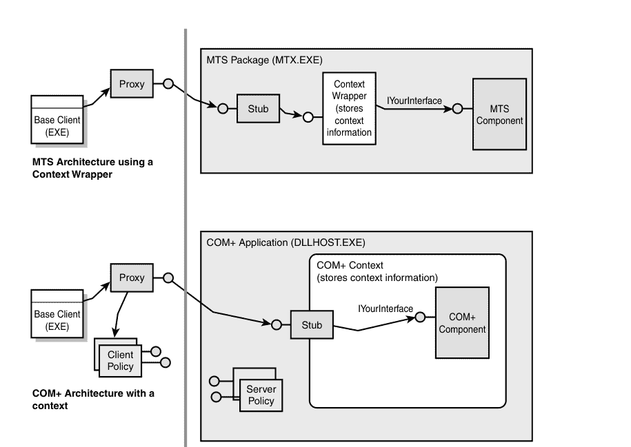

**图 9.1**

*MTS 中使用的上下文包装器对象与 COM+ 中使用的上下文之间的区别。*

例如，考虑一个托管银行组件中名为`Transfer`的方法，它调用`Deposit`和`Withdraw`方法。如果被调用的组件驻留在 MTS 中，你将不得不在 VB 6.0 中编写以下代码，以确保`Bank.Services`组件在同一活动（为单个基客户端设置的逻辑执行线程）中运行并参与其调用者的 MTS 事务：

```vb
Dim objBank as Bank.Services

Set objBank = GetObjectContext.CreateInstance("Bank.Services")
```


`objBank.Deposit(strAccount, dblAmount)`

`objBank.Withdraw(strAccount, dblAmount)`

然而，如果组件驻留在 COM+ 中，你可以简单地使用`New`运算符实例化它，COM+ 会自动查阅上下文信息以确定组件是否应在同一活动中创建并参与事务，如下所示。

```vb
Set objBank = New Bank.Services
```

此外，MTS 支持一个共享的`SafeRef`方法，用于通过返回值或参数将对象引用传递出组件。这是必需的，因为在传递对象之前必须在其周围创建 MTS 代理。驻留在 COM+ 中的组件不需要这样做。

显然，MTS 和 COM+ 都作为非托管代码实现，并利用了在托管代码和 CLR 开发之前设计的非托管 API。因此，`ServicedComponent`类的作用是充当非托管 COM+ 世界和托管世界之间的经纪人。例如，`ServicedComponent`类中的代码通过调用 COM+ 库中的`CoCreateInstance` API 来处理服务组件的激活，并从 COM+ 目录中检索配置信息。此外，它在托管端创建代理，通过`ContextUtil`类与 COM+ 上下文交互。

### 停用

第二个架构变化是停用的时间点。你可能知道，MTS 引入了即时激活的概念。JITA 允许 MTS 和组件服务在对象完成工作后销毁它们，并根据需要重建它们，而客户端不知道或关心这个过程。此技术主要用于确保事务一致性，并导致无状态组件的设计。为了在 MTS 中发生 JITA，你必须在组件的每个方法中显式调用`ObjectContext`对象的`SetAbort`或`SetComplete`方法。

然而，在 COM+ 中，JITA 已与事务解耦，这带来了几个影响。你可以通过在组件属性对话框的“激活”选项卡中设置属性，在不使用事务的情况下为组件启用 JITA。你可以使用组件服务管理单元或 VB .NET 中的属性来配置组件的每个方法，以在方法完成时触发对象的停用（将完成位设置为 True），如图 9.2 所示。当然，如果组件被停用，它会丢失所有状态信息。当启用 JITA 或选择了除“不支持”或“禁用”之外的其他事务模式时，此功能可用。

自动停用允许那些没有显式包含对`SetAbort`和`SetComplete`调用的组件——例如你没有源代码的第三方组件或不参与事务的组件——使用 JITA。对于事务性组件，此功能还会在方法正常返回时自动调用`SetComplete`，在方法抛出异常时自动调用`SetAbort`。

图 9.2
在组件服务管理单元中配置方法，以在不进行编程交互的情况下使用 JITA。

### 对象池化与构造

此外，COM+ 现在支持对象池化以及 JITA，正如 MTS 中`IObjectControl`接口的`CanBePooled`方法所预示的那样。在 VB 6.0 中创建的组件无法利用对象池化，因为它要求组件支持线程中立单元 (TNA) 架构，而不是更简单的单线程单元 (STA)。VB .NET 不再受此限制，只需通过使用属性和重写方法即可创建池化对象。

COM+ 支持一个名为`IObjectConstruct`的新接口。该接口解决了一个常见问题，即如何在激活时将简单信息传递给组件，主要示例是数据库连接字符串。在 MTS 中，开发人员需要在以下方式中做出选择：从客户端应用程序向组件的每个方法传递 ADO 连接字符串、在组件内部硬编码字符串，或在每次方法调用时从系统注册表或文件中读取字符串。显然，这些选项中的每一种都有其缺点，涉及可维护性和性能之间的权衡。

COM+ 通过允许组件实现`IObjectConstruct`接口来解决这个问题。这样做使得 COM+ 能够在每次创建组件实例时调用`IObjectConstruct`接口的`Construct`方法的实现。这类似于 VB .NET 类的构造函数或可执行文件可用的命令行参数。但是，COM+ 仅在组件属性页的“激活”选项卡上启用了对象构造，或者设置了相应的属性时才调用此接口。

### 注册表设置

COM+ 中已配置组件的注册表项与 MTS 中注册组件所需的注册表项不同。当组件在 MTS 中注册时，其`HKEY_LOCAL_MACHINE\SOFTWARE\Classes\CLSID`键会被 MTS 修改为如下所示：

```
{组件的 CLSID}
InProcServer32=""
LocalServer32="c:\winnt\system32\mtx.exe /p:{包 GUID}"
```

在这种情况下，`InProcServer32`键被清空，并创建了`LocalServer32`键。它包含指向宿主可执行文件的新激活字符串。之所以需要显式调用宿主可执行文件`MTX.exe`，是因为 NT 4.0 根本不知道 MTS 及其服务。这种安排还要求 MTS 资源管理器和 MTS VB 6.0 插件提供一个选项，以确保在服务器上重新编译组件或使用`Regsvr32.EXE`注册组件时，这些注册表项保持正确。

对于非托管组件，COM+ 中已配置和未配置组件的注册表项是相同的。但是，由于 CLR 控制托管组件的执行，注册表中的 CLSID 键被修改为指向`mscorere.dll`，并包含有关程序集、类、版本和线程模型的信息。与非托管组件一样，COM+ 目录包含已配置组件的附加设置。

**注意**

> 您可能想知道托管组件最初是如何获得 CLSID 的，因为毕竟 GUID 不是 .NET 基础结构的一部分。当服务组件在 COM+ 中注册时，注册实用程序`Regsvcs.exe`可以动态创建或从代码中指定的属性读取所需的 GUID（包括 CLSID 和接口标识符 (IID)），并将它们放入注册表中。此外，该实用程序会创建一个类型库，供非托管客户端用来调用组件。

### 实现 COM+ 服务

要访问 COM+ 服务，组件必须首先派生自`ServicedComponent`，如前所述。然而，这只是开始。该类还可以包含属性并重写其基类的方法，以使用 COM+ 提供的服务。除了展示服务组件如何访问事务、JITA 和对象构造外，本节还简要介绍了如何使用更高级的 COM+ 服务，例如共享属性、事件和队列组件。

在示例应用程序中，许多此类配置工作被抽象到一个名为`QuilogyDataAccessBase`的基类中，如代码清单 9.1 所示。正如您将看到的，它将事务行为、对象构造和调试功能整合到一个类中，开发人员可以从中派生以创建 Quilogy 数据访问组件。

#### 代码清单 9.1 QuilogyDataAccessBase 基类
此类用于派生 Quilogy 示例应用程序中的所有数据访问类。

```vbnet
Option Explicit On
Option Strict On
Imports System.Runtime.InteropServices
Imports System.EnterpriseServices
Imports System.Diagnostics
Imports System.Data.SqlClient

Namespace Quilogy.Education
    <ClassInterface(ClassInterfaceType.AutoDual), _
    Transaction(TransactionOption.Supported), _
    EventTrackingEnabled(True), _
    ConstructionEnabled(Enabled:=True, _
        Default:="server=ssosa;database=enrollment;trusted_connection=yes")> _
    Public MustInherit Class QuilogyDataAccessBase
    Inherits ServicedComponent
    Protected connect As String
    Protected cnSql As SqlConnection
    Public Debug As Boolean = False
    '*****************************************************
    Public ReadOnly Property ConstructString() As String
        Get
            Return connect
        End Get
    End Property
    '*****************************************************
    Protected NotOverridable Overrides Sub Construct(ByVal s As String)
        ' 实现对象构造
        connect = s
        cnSql = New SqlConnection(connect)
    End Sub
    '*****************************************************
    Protected Overrides Function CanBePooled() As Boolean
        ' 默认情况下，对象将不会被池化
        Return False
    End Function
    '**************************************************************
    Protected Overrides Sub Activate()
        If Debug Then
            WriteTrace("Activate")
        End If
    End Sub
    '**************************************************************
    Protected Overrides Sub Deactivate()
        If Debug Then
            WriteTrace("Deactivate")
        End If
    End Sub
    '**************************************************************
    Public Sub WriteTrace(ByVal eventMessage As String)
        ' 将事件写入应用程序日志
        Dim objLog As EventLog
        Try
            objLog = New EventLog("Application")
            objLog.Source = Me.GetType.ToString
            If (Not EventLog.SourceExists(objLog.Source)) Then
                EventLog.CreateEventSource(objLog.Source, _
                                          "Application")
            End If
            ' 将消息写入日志
            objLog.WriteEntry(DebugTrace(eventMessage), _
                              EventLogEntryType.Information)
            objLog.Dispose()
        Catch e As Exception
            ' 不重要，跳过
        Finally
            ' 确保如果有事务可以提交
            If ContextUtil.IsInTransaction Then
                ContextUtil.EnableCommit()
            End If
        End Try
    End Sub
    '***************************************************************
    Protected Function DebugTrace(ByVal eventMessage As String) As String
      ' 用于将事件写入应用程序事件日志
      Dim strTrace As String
      strTrace = "Class: " & Me.GetType.ToString & vbCrLf
      strTrace &= "Event: " & eventMessage & vbCrLf
      strTrace &= "Construct String: " & connect & vbCrLf
      strTrace &= "Activity:" & ContextUtil.ActivityId.ToString & vbCrLf
      strTrace &= "Context:" & ContextUtil.ContextId.ToString & vbCrLf
      strTrace &= "Transaction?" & _
       ContextUtil.IsInTransaction.ToString & vbCrLf
      strTrace &= "Security?" & _
       ContextUtil.IsSecurityEnabled.ToString & vbCrLf
      If ContextUtil.IsInTransaction Then
        strTrace &= "TransactionId:" & ...
```


注意在代码清单 9.1 中，`QuilogyDataAccessBase` 类是 `Quilogy.Education` 命名空间的成员，并被标记为 `MustInherit`，因为它是一个基类且派生自 `ServicedComponent`。

**注意**

> 该类标记了 `EventTrackingEnabled` 属性设置为 `True`。此属性确保在突出显示“组件”文件夹并选择“视图”->“状态视图”选项时，组件的统计数据将显示在组件服务管理单元中。但请记住，统计信息仅在配置为服务器应用程序的应用程序中可查看。

在创建服务化组件时，还有一些设计注意事项需要您留意，这些在示例 9.1 中并不直观。首先，您的类不应包含参数化构造函数。这是因为 COM+ 库没有传递参数的机制。其次，在服务化组件中将无法调用共享（shared）或私有（private）方法。

### 自动事务

COM+ 提供的首要服务无疑是分布式事务。通过将事务的概念从涉及的物理数据存储中抽象出来，并使用 Microsoft 分布式事务协调器（MSDTC）服务，COM+ 允许使用不同语言编写且使用不同数据存储（如 Oracle、SQL Server、Microsoft 消息队列或 MSMQ、DB2 等）的组件参与同一个事务。

此外，它还允许创建松耦合的组件，因为每个组件只需完成自己的工作，而无需担心其运行所在的更大事务。组件在退出方法时只需对其结果进行投票。这类事务被称为自动事务，因为实际的启动和提交/回滚由 MSDTC 服务自动处理。

与之相对的是手动事务，手动事务可以在存储过程或使用 ADO.NET 方法（如 `SqlConnection` 类的 `BeginTransaction` 方法）中定义。

> **活动使其简化**
>
> 在更高层级上，COM+ 代表基础客户端执行的所有工作（包括事务）都包含在“活动”（activities）中。基本上，*活动* 是基础客户端的一个逻辑执行线程，每当客户端创建驻留在 COM+ 中的对象时，就会创建一个活动。随后由根对象（定义为活动中创建的第一个对象）及其子对象创建的所有对象也驻留在同一个活动中。

利用活动的概念，COM+ 确保在代表基础客户端执行时，活动中只有一个对象在并发执行，并且活动中的所有对象与其它活动中的对象相互隔离。这使得 COM+ 的编程模型对于开发人员来说非常简单，因为他们不必担心同步问题以及运行组件的物理线程。活动也是分布式事务的容器。换句话说，事务不会跨活动。

在 COM+ 中，事务是在单个活动中执行的逻辑工作单位。您创建的每个组件都可以通过属性或在“组件服务”管理单元中进行标记，以指示由该组件创建的对象参与事务的级别。

通过将组件标记为“需要新事务”（Requires a New Transaction）或“需要事务”（Requires a Transaction），COM+ 会与 MSDTC 登记，以确保其对象执行的工作可以与活动中创建的其他对象执行的工作相协调。虽然所用算法的细节超出了本书的范围，但 MSDTC 服务使用两阶段提交协议来确保受活动影响的所有数据源要么一起提交更改，要么一起回滚。

在 Quilogy 示例应用程序中，`Registrations` 业务类的 `RegisterStudent` 方法会调用 `Students` 和 `Classes` 数据访问类。整个过程需要被限定在单个事务中，以便整个注册过程作为一个逻辑工作单位统一成功或失败。

为了声明式地设置 `QuilogyDataAccessBase` 类的事务行为，在类级别设置了 `Transaction` 属性（`TransactionAttribute` 类）。请注意，该属性的构造函数接受一个来自 `TransactionOption` 枚举类型的值，该类型支持五种 COM+ 值（Disabled、NotSupported、Required、RequiresNew、Supported）。

如果组件被设置为 `Supports`（如此处所示），则仅当对象在一个已经存在事务的活动中创建时，COM+ 才会登记 MSDTC。

> **提示**
>
> 在组件有时可能由不想使用事务的客户端实例化的情况下，使用 `Supports` 特别方便。例如，前一章讨论的 `Students` 数据访问类中仅返回数据的那些方法，通常不会在事务中被调用。这样做可以节省系统资源，因为创建分布式事务是有成本的。

显然，使用 `Disabled` 或 `NotSupported` 永远不会登记 MSDTC。通常，运行在 COM+ 中的组件使用 `Requires` 或 `Supports`。然而，当组件用于日志记录或审计跟踪，因此需要与活动内其他事务的提交或回滚隔离时，`RequiresNew` 会非常有用。

> **提示**
>
> 请记住，派生类可以覆盖基类的任何属性设置。例如，虽然基类 `QuilogyDataAccessBase` 的事务选项是 `Supported`，但派生类可以通过指定 `RequiresNew` 或其他值来覆盖此设置。此外，派生类还可以添加基类未设置的附加属性，例如 `JustInTimeActivation`。

### 企业级技术

#### 第二部分

对事务结果进行投票的实际工作可以通过几种方式处理。首先，如前所述，方法可以使用自动停用（automatic deactivation），根据方法是正常返回还是抛出异常来投票决定事务提交或回滚。

例如，继承自 `QuilogyDataAccessBase` 的 `Students` 类的 `ChangePass` 方法可以使用以下技术，在数据库工作完成时自动调用 `SetComplete` 或 `SetAbort`：

```vb
<AutoComplete(True)> Public Function ChangePass(ByVal email As String, _
    ByVal oldPwd As String, ByVal newPwd As String) As Boolean

    ' execute a proc

End Function
```

> **提示**
>
> 正如您所预料的，如果参与事务的服务化组件抛出未处理的异常，`SetAbort` 方法将被自动调用。

其次，可以调用 `EnableCommit` 和 `DisableCommit` 方法。这些方法仅注册事务投票，但不会停用组件。当对组件实例的后续调用可能会影响结果时，这些方法非常有用。

例如，`QuilogyDataAccessBase` 类的公共 `WriteTrace` 方法在其 `Finally` 块中调用 `EnableCommit`，以确保无论方法结果如何，事务（如果存在）都能提交。

最后，方法可以显式调用 `SetAbort` 或 `SetComplete` 方法对事务进行投票，并在方法调用后停用组件。

为了阐明在 VB .NET 类中使用事务的情况，请参考示例 9.2 中的代码，它实现了 Quilogy 教育应用程序的 `Registrations` 类。该类要求加入新事务，并包含一个使用 `ContextUtil` 类来影响事务结果的 `RegisterStudent` 方法。

### 示例 9.2：事务型 VB .NET

此示例展示了 `RegisterStudent` 方法以及它如何使用 `ContextUtil` 类在分布式事务中工作。

```vb
Option Explicit On

Option Strict On

Imports System.Runtime.InteropServices

Imports System

Imports System.Data

Imports System.EnterpriseServices

Imports System.Diagnostics

Imports System.Data.SqlClient
```

### 示例 9.2 续

```vb
Imports Quilogy.Education.Schedule

Namespace Quilogy.Education.Enrollment

<Transaction(TransactionOption.Required)> _

Public Class Registration : Inherits QuilogyDataAccessBase

Public Function RegisterStudent( _
    ByVal enroll As EnrollmentData) As Integer

    Dim arStud(), arContact() As DataRow

    Dim drStud, drEnroll As DataRow

    Dim intStudentID, intClassID, intEnrollID As Integer

    Dim strEmail, strLastName As String

    Dim objStudents As Students

    Dim dsStudents As StudentData

    Dim decCost As Decimal

    Dim objClasses As New Classes

    ' Implement the business process for registering the student

    If enroll Is Nothing Then

        ContextUtil.SetAbort()

        Throw New ArgumentNullException("No enrollment data found")

    End If

    ' Validate Student

    drEnroll = enroll.EnrollmentTable.Rows(0)

    intClassID = Convert.ToInt32(drEnroll(EnrollmentData.CLASS_ID))

    If intClassID = 0 Then

        ContextUtil.SetAbort()

        Throw New ArgumentOutOfRangeException("Must provide a classID")

    End If

    ' Make sure the class is not full

    If objClasses.IsFull(intClassID) Then

        ContextUtil.SetAbort()

        Throw New Exception("Class is already full")

    End If

    ' Get the student info

    Try

        arStud = drEnroll.GetChildRows("Enrollment_Student")

        drStud = arStud(0)

        intStudentID = Convert.ToInt32(drStud(EnrollmentData.STUDENT_ID))
```

### 清单 9.2 续

```vb
If intStudentID = 0 Then

    ' 检查学生是否存在

    arContact = drStud.GetChildRows("Student_ContactInfo")

    strEmail = arContact(0).Item(EnrollmentData.EMAIL).ToString

    strLastName = arContact(0).Item(EnrollmentData.LAST_NAME).ToString

    objStudents = New Students

    intStudentID = objStudents.CheckIfExists(strEmail, strLastName)

    If intStudentID = 0 Then

        ' 学生不存在

        ' 构建新的学生数据结构

        dsStudents = New StudentData()

        drStud = dsStudents.StudentTable.NewRow()

        With drStud

            .Item(StudentData.FIRST_NAME) = _

                arContact(0).Item(EnrollmentData.FIRST_NAME)

            .Item(StudentData.LAST_NAME) = strLastName

            .Item(StudentData.ORGANIZATION) = _

                arContact(0).Item(EnrollmentData.ORGANIZATION)

            .Item(StudentData.EMAIL) = strEmail

            .Item(StudentData.ADDRESS) = _

                arContact(0).Item(EnrollmentData.ADDRESS)

            .Item(StudentData.CITY) = arContact(0).Item(EnrollmentData.CITY)

            .Item(StudentData.STATE) = _

                arContact(0).Item(EnrollmentData.STATE)

            .Item(StudentData.ZIP_CODE) = _

                arContact(0).Item(EnrollmentData.ZIP_CODE)

            .Item(StudentData.PHONE) = _

                arContact(0).Item(EnrollmentData.PHONE)

        End With

        ' 保存学生信息

        intStudentID = objStudents.Save(dsStudents)

    End If

    ' 在注册数据中设置学生ID

    drStud(EnrollmentData.STUDENT_ID) = intStudentID

End If

Catch e As Exception

    ContextUtil.SetAbort()

    Dim newE As New Exception( _

        "无法验证或保存学生。", e)

    Throw (newE)

End Try
```

### 清单 9.2 续

```vb
Try

    ' 计算费用

    decCost = Convert.ToDecimal(objClasses.CalcCost(intClassID, _

        RegistrationType.Web))

    drEnroll(EnrollmentData.COST) = decCost

    ' 持久化注册信息

    intEnrollID = objClasses.AddEnrollment(enroll)

    Return intEnrollID

Catch e As Exception

    ContextUtil.SetAbort()

    Dim newE As New Exception( _

        "无法计算费用。", e)

    Throw (newE)

End Try

ContextUtil.SetComplete()

Return intEnrollID

End Function

End Class

End Namespace
```


> **注意**
>
> 清单 9.2 中显示的代码需要引用第 7 章创建的 `DataSet` 和数据访问类，因此包含了 `Quilogy.Education.Schedule` 命名空间。
>
> 在清单 9.2 中，请注意该类派生自 `QuilogyDataAccessBase`，并通过将其设置为 `Required` 来重写事务选项。如果一切成功，`RegisterStudent` 方法将调用 `ContextUtil` 类的 `SetComplete` 方法，并返回新的注册 ID（`intEnrollID`）。

### 对象激活与构造

如前所述，JITA 已在 COM+ 中与事务解耦。因此，一个不支持事务的 VB .NET 类可以通过使用 `JustInTimeActivation` 属性修饰该类，并在构造函数中传递 `True` 或 `False` 来使用 JITA。如果使用了事务，则会自动启用 JITA 支持且无法禁用。

在方法级别，你可以通过两种方式设置自动停用：一是在方法内将 `DeactivateOnReturn` 属性设置为 `True`；二是用 `AutoComplete` 属性标记该方法，并在其构造函数中传递一个值为 `True` 的表达式。

> **警告**
>
> 在 VB .NET 中，除非该方法使用自定义接口实现（或者该类使用了本章后面讨论的 `ClassInterface` 属性进行修饰），否则它不会出现在组件服务管理单元中。因此，除非使用上一段讨论的技术之一，否则你将无法配置其自动停用。

在 VB 6.0 中构建 COM+ 组件时，开发人员必须实现 `IObjectControl` 和 `IObjectConstruct` 接口，以便分别在对象实例被激活和停用时收到通知，以及捕获传递给组件的构造字符串。然而，在服务框架中，`ServicedComponent` 类为你实现了这些接口，并公开了可以重写以替代其功能的方法。

要获得激活和停用事件的通知，你只需重写基类的 `Activate` 和 `Deactivate` 事件。注意在清单 9.1 中，`QuilogyDataAccessBase` 类执行了此操作，并在 `Debug` 字段设置为 `True` 时调用 `WriteTrace` 方法。此外，`CanBePooled` 方法被公开，在此情况下返回 `False`，因为该组件的默认行为是不会被池化。

当类的任何实例返回给客户端时，`Activate` 方法被触发。这对新实例和从池中取出的实例都适用。当支持 JITA 的组件被客户端释放，或者池化对象返回池中时，会发生 `Deactivate` 事件。

> **注意**
>
> 敏锐的读者可能会对 CLR 中 JITA 和垃圾回收的集成感到疑惑。基本上，当一个标记为停用的服务组件的方法调用返回时，该对象的终结器会立即运行，并且它会被运行时分配回收。但是，正如你所期望的，代理和 COM+ 上下文会保留，以便后续的方法调用可以被拦截并创建一个新的托管对象。如果没有进一步的调用，代理对象最终会被垃圾回收。要清理代理对象和 COM+ 上下文，`ServicedComponent` 类包含一个 `DisposeObject` 方法，客户端可以调用它。虽然这是最有效的技术，但它给客户端开发人员增加了额外的负担。

> **注意**
>
> `DebugTrace` 方法利用 `ContextUtil` 类构建一个可以写入事件日志的字符串。它还使用 `SecurityCallContext` 类来发现有关组件调用者的信息，如本章后面所述。

COM+ 的第二个影响激活的特性是对象构造。与 `IObjectControl` 一样，`IObjectConstruct` 接口通过 `ServicedComponent` 类的 `Construct` 方法公开。当创建组件实例时，此方法会接收在“激活”选项卡（如图 9.3 所示）中配置的字符串。

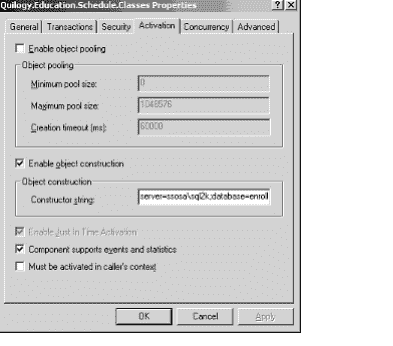

*组件服务中组件属性对话框的“激活”选项卡，用于配置对象构造。*

如你在清单 9.1 中看到的，`QuilogyDataAccessBase` 的 `Construct` 方法将传递到该方法的构造字符串放入一个名为 `connect` 的 `Protected` 变量中，并实例化其各种方法将使用的 `SqlConnection` 对象。此外，该类包含一个只读属性 `ConstructString`，它返回 `connect`。`Construct` 方法被标记为 `NotOverridable`，因为派生类不应该能够改变其行为。对象构造的其他用途可能是传递要写入的 MSMQ 队列的名称或要查询的 Exchange 服务器的名称。

如果派生类不想使用对象构造，它可以重写修饰 `QuilogyDataAccessBase` 类的 `ConstructionEnabled` 属性，而是从其他来源读取连接字符串或将其传递给每个方法。可以在属性中指定 `Default` 参数来设置默认连接字符串。这显然在开发过程中有所帮助，但在生产环境中应在组件服务管理单元中进行更改。

### 对象池化

创建池化对象的功能是 VB 开发人员自第一次知道 MTS 2.0 中 `IObjectControl` 接口的 `CanBePooled` 方法以来就垂涎三尺的功能。VB 的先前版本不支持此功能，实际上直到 COM+ 才实现，因为 VB 无法创建可被多个线程访问的对象。

> **注意**
>
> 尽管 VB .NET 组件在 CLR 内运行这一事实克服了这一限制，但对象池化仅在某些应用程序场景中有用，特别是在初始化组件的成本很高时。例如，如果你的组件在初始化时读取和解析大量数据，或者获取对特别昂贵资源的访问，你可能会考虑池化该对象以绕过构造成本。然而，典型的数据访问组件没有这个要求，因为它们只获取本身由 ADO.NET 池化的数据库连接，因此不是特别好的池化候选对象。

要实现对象池化，你只需将 `ObjectPooling` 属性添加到类声明中并提供构造函数的参数。其中一个重载构造函数接受设置 `Enabled`、`MinPoolSize` 和 `MaxPoolSize` 属性的参数。`Enabled` 属性控制当请求新的组件实例时是否进行池化，而另外两个属性控制在给定时间池中有多少实例。例如，如果 `Registrations` 类要被池化，初始大小为 5 个对象，最大大小为 15，则类签名将定义如下：

```vb
<ObjectPooling(True, 5, 15)> Public Class Registrations

    Inherits ServicedComponent

End Class
```

请记住，当组件所在的应用程序首次启动时，将创建最小数量的对象并将其添加到池中。因此，你可能希望保持 `MinPoolSize` 相当小，或者在客户端开始请求对象之前以管理方式启动应用程序。此外，你可以使用组件服务管理单元配置 `CreationTimeout` 属性，以指定 COM+ 在抛出异常之前等待实例化对象的时间。默认值为 60 秒。

`Activate` 和 `Deactivate` 方法也可以与对象池结合使用，以便在客户端引用和释放对象时收到通知。这些方法可能被用于清理类中使用的任何类级变量。然而，由于 CLR 使用垃圾回收，`Deactivate` 方法可能直到对象被回收时才会运行。为了解决这个问题，您可以使用 `ServicedComponent` 的共享 `DisposeObject` 方法，立即指示 CLR 将实例放回池中。该方法接收一个待释放的被服务组件的引用。

当组件被返回到池中时，`CanBePooled` 方法也会被调用。使用外部资源的组件应确保这些资源仍然可用，如果组件实例不再可行，则应返回 `False`。

### 共享属性

尽管对象池功能强大，但它并不是在组件调用之间存储全局或会话状态的最佳解决方案。这是因为，默认情况下，共享数据没有针对多个客户端并发访问的保护，且您无法保证在随后的调用中能再次获得同一个组件。为了支持共享全局状态，`System.EnterpriseServices` 命名空间包含了对共享属性管理器（Shared Property Manager，SPM）的支持，这对于 MTS 和 COM+ 开发人员来说非常熟悉。

简单来说，SPM 为同一个 COM+ 应用程序（读取进程）内不同组件的多个实例共享瞬时状态（transient state）提供了一种机制。瞬时状态是指仅保存在内存中且在应用程序重启后不会保留的数据。瞬时状态的用途可能包括计数器或唯一数字的生成。

> **注意**
>
> SPM 使用锁定机制防止并发访问，从而确保两个组件不能同时更新同一个属性。

SPM 被建模为一组由进程共享的组，每组可以包含一个或多个属性。在服务框架（Services Framework）中，对 SPM 的支持包含在 `SharedPropertyGroupManager`、`SharedPropertyGroup` 和 `SharedProperty` 类中。

虽然 Quilogy 示例应用程序没有使用 SPM，但代码清单 9.3 展示了一个使用 SPM 创建唯一收据编号的方法。

### 企业级技术

代码清单 9.3 使用 SPM。该清单实现了一个方法，用于递增由 SPM 作为属性持有的收据计数器。

```vb
Imports System.EnterpriseServices

<AutoComplete(True)> Public Function GetReceipt() As Integer

    Dim objManager As New SharedPropertyGroupManager()

    Dim objReceipt As SharedPropertyGroup

    Dim objOrder As SharedProperty

    Dim fExists As Boolean

    Try

        'Create the property group if not already created

        objReceipt = objManager.CreatePropertyGroup("Receipts", _

            PropertyLockMode.SetGet, PropertyReleaseMode.Standard, fExists)

        'Create the property if not already created

        objOrder = objReceipt.CreateProperty("Order", fExists)

        'Increment the property or initialize it

        If fExists Then

            objOrder.Value = Convert.ToInt32(objOrder.Value) + 1

        Else

            objOrder.Value = 10000

        End If

    Catch e As Exception

        Dim eX As New Exception("Receipt was not generated.", e)

        Throw eX

    End Try

    Return Convert.ToInt32(objOrder.Value)

End Function
```

在代码清单 9.3 中，该方法首先使用 `SharedPropertyGroupManager` 类的 `CreatePropertyGroupManager` 方法创建或获取对 `Receipts` 组的引用。

该方法的第二个和第三个参数分别用于设置 `PropertyLockMode` 和 `PropertyReleaseMode`。在这种情况下，选择了 `SetGet` 常量，以便属性仅在被访问时被锁定，而不是在方法的剩余时间内锁定（使用枚举的 `Method` 值设置）。`PropertyReleaseMode` 影响属性组的生命周期。`Process` 常量指定该组在进程（COM+ 应用程序）运行期间应保持存活。`Standard` 值允许组在所有客户端释放其引用后被销毁。

> **提示**
>
> 正如前面提到的，如果配置为服务器应用程序（Server Application），组件将在由 `DLLHOST.EXE` 托管的独立进程中运行。在这种情况下，如果您在组件属性的激活（Activation）选项卡（图 9.3）中将任何组件标记为“必须在调用者上下文中激活”（Must Be Activated in Caller's Context），则该组件将无法看到属性组。因此，所有必须共享属性的组件应设置相同的激活属性。此选项也可以通过名为 `MustRunInClientContext` 的特性来设置。

最后一个参数通过引用传递，并返回一个 `Boolean` 值，指示该组是否已经存在。无论哪种情况，都使用 `SharedPropertyGroup` 的 `CreateProperty` 方法创建或简单地引用 `Order` 属性。如果属性已经存在（通过相同方式在 `CreateProperty` 方法中返回），则对其递增；否则，将属性初始化为 10000。然后，方法将新值返回。

### COM+ 事件

COM+ 中最有趣的服务之一是松耦合事件（Loosely Coupled Events，LCE），或称为 COM+ 事件。为了理解其重要性，请考虑以下场景。

假设每次向 Quilogy 数据库添加一个新课程时，必须调用多个业务流程，包括通知讲师该分配任务，以及为公共网站重新生成静态 Web 报告。同样假设这些业务流程是在组件中实现的。在 MTS 世界中，用于添加课程的数据访问组件需要引用业务组件，并在代码中直接调用其相应的方法。结果，这三个组件现在是紧耦合的，这意味着对任何一个业务组件的更改都可能影响数据访问组件，反之亦然。在这种设计中，这种观念是不灵活的；添加额外的业务流程或添加仅在某些情况下运行流程的逻辑，都需要修改数据访问组件。

针对此场景更好的比喻是使用由*发布者*（publishers）和*订阅者*（subscribers）组成的事件模型。如果数据访问组件（发布者）可以简单地触发一个事件，而两个业务组件（订阅者）可以独立地订阅该事件，那么效果会更好。这样，组件可以在不相互影响的情况下进行修改，并且可以在发布者不知情的情况下开发新的订阅者组件。这正是 COM+ 事件旨在实现的功能。

从核心来看，LCE 使用了计算机科学中最强大的概念之一——抽象，通过在发布者和订阅者之间放置一个*事件类*（event class），定义了一种将事件发布者与事件订阅者分离的架构。事件类简单来说就是一个组件，它公开了称为*事件接口*（event interfaces）的接口，这些接口包含一个或多个由发布者组件用于启动事件的方法。用 VB .NET 编写的订阅者组件随后使用 `Implements` 关键字实现事件接口，以执行其特定逻辑。管理员或订阅者组件本身在 COM+ 目录中注册订阅，以标识该组件想要订阅哪些事件类。如果订阅是通过管理界面创建的，则被称为*持久的*（persistent），顾名思义，它可以 survive 系统重启。通过编程创建自身订阅的组件被称为*瞬时的*（transient），仅在组件运行时接收事件通知。

> **注意**
>
> 这里讨论的订阅是持久的。服务框架不直接支持创建瞬时订阅的功能。为了实现这一点，您需要引用 `ComAdmin` 类型库并使用 COM Interop，详情见本章后面部分。

#### LCE 内部原理

LCE 通过一项名为 COM+ 事件服务（COM+ Events Service）的操作系统服务工作。该服务制造事件类，并使其可供发布者像实例化任何普通 COM+ 组件一样进行实例化。区别在于，事件服务随后会拦截发布者在事件接口上的调用，并将这些调用与已注册订阅的订阅者组件相匹配。随后，该服务为每个持久订阅者组件创建一个新实例并调用实现的方法。对于瞬时订阅，事件服务使用订阅者存储在 COM+ 目录中的回调接口来调用实现的方法。事件类和订阅的发布由 COM+ 目录管理，管理员可通过“组件服务”管理单元访问该目录。

将这一抽象层作为 COM+ 基础设施的一部分带来了两个主要好处。首先，可以创建互不依赖的组件（松耦合），这简化了开发并创建了一个灵活的系统，使得订阅者可以在稍后开发。其次，抽象层提供了扩展架构的机会，以添加诸如在系统两端进行过滤等功能。因此，发布者不仅可以决定哪些订阅者应该接收事件，还可以决定接收顺序，并允许订阅者根据传递的参数仅响应其感兴趣的事件。

Services Framework 通过公开一个用于修饰事件类的属性来提供对 LCE 的支持。例如，以下代码实现了一个名为 `OfferingsEvents` 的事件类：

```vb
Imports System.EnterpriseServices

Public Interface IOfferingEvents

    Sub NewClass(ByVal classID As Integer, ByVal location As Integer)

    Sub ClassCancelled(ByVal classID As Integer, ByVal location As Integer)

End Interface
```

```vb
<EventClassAttribute()> _
Public Class OfferingsEvents : Inherits ServicedComponent

    Implements IOfferingEvents

    Public Sub NewClass(ByVal classID As Integer, _
        ByVal location As Integer) Implements IOfferingEvents.NewClass

        ' do something

    End Sub

    Public Sub ClassCancelled(ByVal classID As Integer, _
```


```vb
ByVal location As Integer) Implements IOfferingEvents.ClassCancelled

' do something

End Sub

End Class
```

该事件类实现了一个公共接口`IOfferingEvents`，其中包含两个方法`NewClass`和`ClassCancelled`，分别在课程被安排或移除时触发。这个类有趣的地方在于，这些方法不包含任何实现。之所以如此，是因为事件类将由发布者实例化，然后被 COM+ Events Service 拦截，用于调用已订阅此事件类的任何组件。换句话说，实现并非必需，因为订阅者会提供实现。

> **注意**
>
> 您可能会想，为什么不直接将`IOfferingEvents`注册到组件服务中，而要采用这种看似笨拙的设计呢？主要原因是，通过注册事件类而非接口，LCE 可以与那些不支持直接创建接口的语言协同工作。一个主要例子就是 VB 6.0。

随后，订阅者组件可以通过实现`IOfferingsEvents`接口并为这些方法提供实现来创建。例如，假设 Instructors 组件将在每次添加或移除课程时向讲师发送一封电子邮件。Instructors 类的相关部分如下：

```vb
Public Class Instructors : Inherits ServicedComponent

    Implements IOfferingEvents

    Public Sub NewClass(ByVal classID As Integer, _

        ByVal location As Integer) Implements IOfferingEvents.NewClass

        ' Query the database to get the instructor ID and email address along

        ' with relevant course information such as date and course number

        ' Send the email message

    End Sub

    Public Sub ClassCancelled(ByVal classID As Integer, _

        ByVal location As Integer) Implements IOfferingEvents.ClassCancelled

        ' Query the database to get the instructor ID and email address along

        ' with relevant course information such as date and course number

        ' Send the email message

    End Sub

End Class
```

由于 Services Framework 不支持通过属性创建订阅，因此订阅必须在订阅者组件配置到组件服务中后，通过右键单击 Subscriptions 文件夹并单击 New Subscription 来创建。生成的向导首先会提示您选择要订阅的接口或接口中的选定方法。

> **提示**
>
> 尽管订阅者类（在本例中为 Instructors）必须实现`IOfferingEvents`的所有方法，但您可以使用此对话框选择仅订阅某个特定方法。这样，订阅者可以收到有关新课程的通知，但不会收到有关取消课程的通知。显然，如果这样做，未订阅方法的实现不必包含任何代码。

然后，向导会列出实现您所选接口的所有事件类，以便您可以将订阅连接到某个事件类。在提供名称并启用订阅后，可以在图 9.4 中看到生成的订阅。

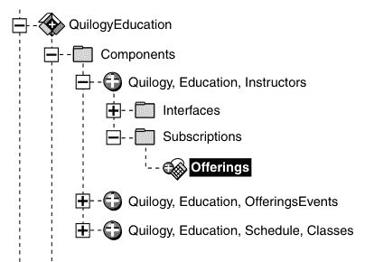

**图 9.4**

带有 OfferingsEvents EventClass 订阅的组件服务管理单元。

正如您所期望的，如果事件类被标记为至少支持事务，则任何订阅者组件都可以加入到发布者的事务中。在此示例中，事件类可能不会被标记为支持事务，因为未能向讲师发送电子邮件不应导致整个事务回滚。

最后，要实际触发事件，Classes 类（在本例中）可以实例化事件类并调用该方法，随后将通知订阅者，如下所示：

```vb
Public Function Save(ByVal classData As ClassData) As Integer

    Dim intClassID, intLocation As Integer

    Dim objOffEvent As OfferingsEvents

    ' Save the class here

    ' Fire the event

    objOffEvent = New OfferingsEvents()

    objOffEvent.NewClass(intClassID, intLocation)

End Function
```

类似地，Classes 类的 Remove 方法可以调用 OfferingsEvents 的 ClassCancelled 事件。请记住，当发布者对事件类调用方法时，从发布者的角度来看，调用是同步的。换句话说，对`NewClass`的调用将阻塞，直到所有订阅者都完成了它们的工作，即使它们没有参与发布者的事务。因此，您不希望订阅者组件执行长时间运行的操作，除非该组件已排队，这将在下一节中讨论。最后，可以将 EventClass 属性的`FireInParallel`属性设置为 True，或在组件的属性对话框中将事件类标记为 Fire in Parallel。这会导致订阅者组件在多个线程上被调用，从而可能减少多处理器系统上的阻塞时间。

如前所述，添加这一抽象层还允许在发布者端或订阅者端进行筛选。在订阅者端进行筛选的一种方法是创建参数筛选器。通过在组件服务管理单元中右键单击订阅并单击 Options 选项卡，您将看到 Filter Criteria 文本框。在此，您可以指定用于筛选的布尔表达式。例如，要仅筛选特定位置，图 8.7 中所示的 Offerings 订阅的筛选器可以设置为`location = 1`，其中`location`是方法参数之一的名称。如果条件评估为 False，则不会创建订阅者组件。

> **注意**
>
> 发布者端的筛选和跨服务器调用事件是超出本书范围的高级主题。有关更多信息，请查阅`msdn.microsoft.com`上的 COM+ 文档。

### 排队组件

COM+ 添加的第二个新服务——排队组件（Queued Components），为开发人员提供了一种调用组件异步执行的简便方法。您可能已经了解，并且正如将在第 13 章中讨论的，MSMQ 允许您通过提供排队基础架构来创建异步应用程序，您可以通过`System.Messaging`命名空间将其整合到 VB .NET 应用程序中。

遗憾的是，使用 MSMQ 需要您显式编写用于 MSMQ 的代码。然而，COM+ 在 MSMQ 之上提供了一层抽象，使您可以通过管理配置的方式让组件通过 MSMQ 以排队方式接收其调用，而非通常的同步方式。此功能使您可以创建不必了解组件生命周期的应用程序，并且可以更具可扩展性，因为方法调用的实际处理可以推迟。例如，考虑 Quilogy 网站由于关于新 VB .NET 课程的电子邮件通讯而收到大量注册请求的情况。由于注册课程的过程可能需要涉及数据库和电子邮件访问的多个步骤，因此收集和验证注册信息并将数据库和其他工作简单地排队以备稍后处理可能是有利的。随着流量减少，这些排队的注册请求由排队组件处理。这样，用户可以更快得到响应，但注册请求仍然会得到处理。

在后台，COM+ 会自动将标记为 Queued（在应用程序属性对话框的 Queuing 选项卡中）的 COM+ 应用程序与一系列 MSMQ 队列相关联。此外，组件中预期接收异步调用的每个接口必须在组件的属性对话框中标记为如此。然后，随着对组件的调用在应用程序中做出更改后，客户端机器上的消息记录器会构建一条消息，并在释放对组件的引用时将其发送到服务器上的队列。然后，可以将应用程序配置为在启动时使用“排队”选项卡上的设置监听其队列中的消息。当应用程序启动时，来自其队列的消息将被出队，并按照接收顺序通过组件“回放”。当然，只有运行在专用进程中的服务器应用程序才能排队并监听消息。

> **提示**
>
> 你可以通过在预定义的时间间隔内启动和关闭 COM+ 应用程序来控制消息的处理时间。例如，如果你只想在一天中的某个特定时间处理注册，你可以创建一个服务应用程序，在该时间点唤醒，并使用 ComAdmin 库启动应用程序，在队列排空后将其关闭。

### 排队支持

服务框架通过提供属性来配置程序集及其接口以进行排队，从而支持排队组件。例如，包含 Registrations 类的程序集可以使用`AssemblyInfo.vb`文件中的程序集级别属性配置为排队应用程序，如下所示：

```vb
<Assembly: ApplicationActivation(ActivationOption.Server)>

<Assembly: ApplicationQueuing(Enabled:=True, QueueListenerEnabled:=True)>
```

在这种情况下，COM+ 应用程序被配置为服务器应用程序，并且分别使用`ApplicationActivation`和`ApplicationQueuing`属性启用了排队和监听。此外，组件内的接口可以使用`InterfaceQueued`属性标记为启用排队，如下所示：

```vb
<InterfaceQueuing(True)> Public Interface IQuilogyRegistrations

    Sub RegisterStudent(ByVal student As StudentData)

End Interface

Public Class Registrations : Inherits ServicedComponent

    Implements IQuilogyRegistrations

    Public Sub RegisterStudent(ByVal student As StudentData) _

        Implements IQuilogyRegistrations.RegisterStudent

        ' do the work here

    End Sub

End Class
```

这意味着希望使用排队的类应将其功能公开为接口。此外，为排队公开的接口不能包含返回值（函数）或按引用传递参数的方法，因为方法的实际执行与其调用是分离的。事实上，如果你尝试在具有`InterfaceQueued`属性的类中使用返回值或通过引用传递参数，则在组件向 COM+ 注册时会抛出异常。因此，在使用排队的组件中，一个好的设计规则是将异步调用的方法 segregate 到它们自己的接口中。

与 COM+ 事件一样，排队组件可以参与事务，以确保只有在整个事务提交时，MSMQ 消息才会被传递到队列。换言之，在排队场景中，客户端的事务边界位于消息的传递，而不是组件激活时的回放。然而，消息回放到组件也是事务性的，因为如果组件使用事务并调用其他组件也是如此，那么方法调用的整个回放都将是事务性的。如果事务回滚，消息将保留在队列中以供再次回放。尽管这可能在幕后无限期地继续下去，但排队组件包含六个队列，代表消息的重试级别。在第六个队列中失败后，消息将被移动到“死队列”中，留在那里。

服务框架还支持`ExceptionClass`属性，用于设置对排队异常类的引用。此属性在类级别使用，并指定当消息最终到达死队列时应调用哪个组件。异常类需要实现与排队组件相同的接口，但可能以不同的方式处理数据——例如，通过将错误记录到数据库中，以便日后可能进行人工干预。

即使组件被配置为以排队方式调用，也不一定必须如此。客户端通过对象的实例化方式来确定方法是异步调用的。如果对象只是使用`New`运算符创建的，则调用像往常一样同步进行。但是，如果使用带有 moniker 的 COM`CoGetObject`API 进行调用，则调用将作为排队调用进行。

> moniker 只是一个知道如何调用其他对象的 COM 对象。Windows 2000 支持用于实例化排队组件的“queue”moniker。*Understanding ActiveX and OLE*（David Chappell 著）中对 moniker 有很好的概述。

## 第 9 章 访问组件服务

要使用 queue moniker，客户端代码可以调用 Marshal 类的共享`BindToMoniker`方法，该 Marshal 类位于`System.Runtime.InteropServices`命名空间中。Marshal 类包含许多有用的共享函数，用于处理非托管代码，例如处理非托管内存分配和与 COM 组件通信。

要将 Registrations 类实例化为排队对象并调用其`RegisterStudent`方法，以下客户端代码就足够了：

```vb
Imports System.Runtime.InteropServices

Dim oReg As IQuilogyRegistrations

Dim ds As StudentData

Try

    oReg = CType(Marshal.BindToMoniker( _

        "queue:/new:Quilogy.Education.Registrations"), IQuilogyRegistrations)

    oReg.RegisterStudent(ds)

Catch e As Exception

    ' Catch errors

Finally

    Marshal.ReleaseComObject(oReg)

End Try
```

### 注意

> 你可以在 moniker 中包含许多参数，以指定从消息应发送到的计算机到优先级级别和加密方式的所有内容。有关具体细节和高级主题（例如从排队组件接收通知）的更多信息，请参阅 *Understanding COM+*（David S. Platt 著，Microsoft Press，ISBN 0-73560666-8）。

请注意，传递给`BindToMoniker`方法的字符串包含队列 moniker 以及对完全限定类名的引用。如果组件未标记为排队或无法定位，则将抛出`COMException`。由于 oReg 对象作为 COM 对象调用，因此在 Finally 块中调用`ReleaseComObject`方法。

正如你可以想象的那样，COM+ 事件和排队组件的组合在通过发布事件触发的组件也被排队的场景中可能非常强大。例如，发送讲师通知电子邮件的组件也可以标记为排队，以便将发送内部电子邮件的过程转移到非高峰时段。在这种情况下，你可以从实现和执行角度都获得抽象的好处。

### COM+ 安全性

尽管有多种方法可以保护用 VB .NET 编写的代码，这些方法对于 CLR 来说是独特的（如第 5 章所述），但服务框架还允许服务组件与 COM+ 安全性互操作。在组件运行在非托管组件的应用程序中或当 COM+ 安全性是特定解决方案所需的全部时，可能需要这样做。需要注意的重要一点是，你必须就你将使用的安全模型做出设计决策，因为 CLR 基于角色的安全性与 COM+ 安全性不能互操作。

如你所知，COM+ 安全性仅基于身份和角色的概念。简而言之，每个 COM+ 应用程序可以包含一个或多个角色，这些角色由 Windows 2000 组或账户填充。然后可以为应用程序中的特定组件、接口或方法激活角色。

要使 COM+ 检查安全性，必须在组件服务管理单元中应用程序的属性对话框中选择“强制安全检”选项。尽管超出了本书的范围，但可以在应用程序级别配置特定设置，包括安全性是仅在进程级别检查还是在进程和组件级别都检查、如何验证调用以及调用者的模拟级别。服务框架通过`ApplicationAccessControl`属性支持这些选项。例如，`AssemblyInfo.vb`文件可能包含以下属性声明，该声明打开安全性并在应用程序和组件级别强制执行检查。

```vb
<Assembly: ApplicationAccessControl(True, _

    AccessChecksLevel:=AccessChecksLevelOption.ApplicationComponent)>
```

为了支持角色的创建和分配，`SecurityRole`属性可以在程序集、类或接口级别使用。如果在程序集级别使用，它会将角色添加到应用程序中，如下所示。

```vb
<Assembly: SecurityRole("Sales", True)>

<Assembly: SecurityRole("Marketing", False)>
```


在这种情况下，如果还不存在，两个角色将被添加到应用程序中。第二个参数将`SetEveryoneAccess`属性设置为`True`，并确定是否将内置的 Everyone 账户添加到角色中。这对于通常读取但不更新数据的最小安全角色可能很有用。

此外，每个组件还可以通过其属性对话框或属性配置为强制执行安全检查和启用角色。要确保已打开安全性，你可以在类级别使用`ComponentAccessControl`属性并在构造函数中传递`True`。要确保某个角色已添加到应用程序并为组件启用它，你再次在类级别使用`SecurityRole`属性并传递要启用的角色。

前面的讨论假设在开发时您已经知道哪些角色将应用于应用程序和组件级别。然而，情况并非总是如此。因此，您不需要使用`ApplicationAccessControl`或`ComponentAccessControl`特性，因为这些设置可以在“组件服务”管理单元中通过管理方式进行。

正如在下一节中讨论的，还可以使用`SecurityRole`和`SecureMethod`特性在接口或方法级别启用角色。然而，在组件级别启用的任何角色都将覆盖接口级别的设置。如果在接口级别启用了方法级别的角色，情况也是如此。在任何情况下，通常您会希望将一组相关的方法在类中进行分组，并将角色应用于整个方法集而非单个方法，从而使管理更加简单。

## 接口和方法级安全性

虽然管理 COM+ 安全最简单且最便捷的方法是将相关方法分组在类中并使用`SecurityRole`特性，但您也可以在单个接口和方法级别应用安全性，以实现更细粒度的控制。当一个类实现多个接口，且每个接口需要不同的安全设置，或者类中的方法需要被保护时，可能需要这样做。

为了使用接口或方法级安全性，您必须为服务组件创建显式接口以供实现。这使得接口及其方法可以在 COM+ 目录中通过特性进行配置，并在注册到“组件服务”管理单元时可见。

> **注意**
>
> 如果您的服务组件仅由非托管客户端调用，您可以选择在类级别使用`ClassInterface`特性，并将`ClassInterfaceType`枚举设置为`AutoDual`。这将创建一个 COM 接口，该接口将显示在“组件服务”管理单元中，随后您可以对其进行手动配置。

此外，如果服务组件将由托管客户端调用，您必须将`SecureMethod`特性应用于类或程序集。这可确保 COM+ 安全性被激活。

在满足这些条件后，您可以分别使用以下步骤来启用接口或方法级安全性。

- 要使用接口级安全性，请将`SecurityRole`特性应用于接口，并传入您希望为该接口启用的角色名称。
- 要使用方法级安全性，请将`SecurityRole`或`SecureMethod`特性应用于您希望保护的接口或类中的方法。显然，当您无法预先知道该方法应为哪些角色启用时，应使用`SecureMethod`。

为了演示方法级安全性，请参考下面带有特性装饰的修改后的`Registrations`类。

```
Public Interface IQuilogyRegistrations

    Sub RegisterStudent(ByVal student As StudentData)

    Function GetRegistrations() As DataSet

End Interface

<ComponentAccessControl(True), _

SecureMethod()> _

Public Class Registrations : Inherits ServicedComponent

    Implements IQuilogyRegistrations

    <SecurityRole("Sales")> _

    Public Sub RegisterStudent(ByVal student As StudentData) _

        Implements IQuilogyRegistrations.RegisterStudent

        ' do the work here

    End Sub

    <SecurityRole("Sales"), _

    SecurityRole("Marketing")> _

    Public Function GetRegistrations() As DataSet _

        Implements IQuilogyRegistrations.GetRegistrations

        ' do the work here

    End Sub

End Class
```

首先，请注意该类实现了`IQuilogyRegistrations`接口，这是方法级安全性正常工作所必需的。如果您没有实现接口，将抛出`ServicedComponentException`。随后，`Registrations`类被装饰有`ComponentAccessControl`和`SecureMethod`特性。前者在组件级别开启安全性检查，而后者确保托管客户端可以使用接口或方法级安全性。然后，`SecurityRole`特性被应用于类中的两个方法，并传递了相应的角色。这样，只有 Sales 角色的成员可以调用`RegisterStudent`方法，而 Sales 和 Marketing 角色的成员都可以调用`GetRegistrations`方法。

## 使用安全上下文

一旦启用了 COM+ 安全性（可以使用`ContextUtil`类的`IsSecurityEnabled`方法进行检查），服务框架将通过提供`SecurityCallContext`类来支持 COM+ 安全性。该类提供了共享方法和实例方法，用于发现有关导致此次调用的调用者链的信息。列表 9.1 展示了如何访问该类的成员以构建用于写入事件日志的字符串。其方法可见于表 9.2。

| 成员 | 描述 |
|---|---|
| `CurrentCall` | 返回当前`SecurityCallContext`对象的共享属性。 |
| `Callers` | 返回`SecurityIdentity`对象的`SecurityCallers`集合的实例属性。包含调用链中的所有调用者。 |
| `DirectCaller` | 返回当前方法直接调用者的`SecurityIdentity`对象的实例属性。 |
| `IsSecurityEnabled` | 返回一个布尔值的实例属性，指示是否强制执行安全性检查。与`ContextUtil`中同名方法相同。 |
| `MinAuthenticationLevel` | 返回一个指定最小身份验证级别整数的只读属性。 |
| `NumCallers` | 返回调用链中调用者数量的实例属性。 |
| `OriginalCaller` | 返回调用链中原始调用者的`SecurityIdentity`对象的实例属性。 |
| `IsCallerInRole` | 返回一个布尔值的实例方法，指示`DirectCaller`是否为给定角色的成员。与`ContextUtil`中同名方法相同。 |
| `IsUserInRole` | 返回一个布尔值的实例方法，指示给定用户（`String`）是否为给定角色（`String`）的成员。 |

该类的一个有趣之处在于`Callers`属性。该属性返回`SecurityCallers`类中的`SecurityIdentity`对象集合。您可以使用此类枚举调用链中的所有调用者。这在调试方法调用时非常有用。例如，您的组件可以实现以下循环，将调用者添加到分隔字符串中：

```
Dim objCaller As SecurityIdentity

Dim strCallers As String

strCallers = "Callers=" & SecurityCallContext.CurrentCall.NumCallers.ToString

For Each objCaller In SecurityCallContext.CurrentCall.Callers

    strCallers &= strCallers & objCaller.AccountName & vbCrLf

Next
```

## 注册服务组件

如前所述，服务组件可以使用“首次使用注册”或通过“组件服务”进行“手动注册”来在 COM+ 目录中进行配置。前者在托管客户端首次实例化组件时，根据`AssemblyInfo.vb`文件中指定的特性对组件进行注册；而后者则需要运行`Regsvcs.exe`工具将组件安装到组件服务中。

在这两种场景中，由于组件服务基于 COM+，因此会创建标识该组件的注册表项。此外，在任何一种情况下，包含服务组件的程序集必须使用项目属性对话框或（如第 5 章所述的）`AssemblyKeyFile`特性编译为强名称。

### 首次使用注册

动态注册（即首次使用注册）正如其名，发生在客户端首次实例化服务组件时。由于首次使用注册涉及额外的开销（包括读取特性信息、创建或查找 COM+ 应用程序以及将组件信息放入 COM+ 目录），因此该技术通常仅应在开发和测试场景中使用。此外，实例化组件的客户端代码必须在具有管理权限的账户下运行。也就是说，该账户必须在本地 Administrators 组中，或者是 Administrators 组中某个组的成员。

为了指定安装组件所需的信息，您可以在程序集级别和组件级别使用一系列特性。以下来自`AssemblyInfo.vb`文件的代码重点展示了在程序集级别使用的特性：

```
<Assembly: ApplicationName("Quilogy Education")>

<Assembly: Description("Quilogy business and data access components")>

<Assembly: ApplicationID("A39EB4BA-B559-4420-84B7-F2E9A37D102B")>

<Assembly: ApplicationActivation(ActivationOption.Server)>
```

在这个示例中，COM+ 应用程序名称和 GUID 是使用`ApplicationName`和`ApplicationID`特性指定的。首次使用注册利用这些特性来确定将程序集中的组件注册到哪个应用程序中。优先级为 given to the `ApplicationID` if it is provided. `ApplicationActivation`属性指定了应用程序将在何处承载，如前所述。

在组件级别，注册更为复杂。首先，如果程序集包含类似如下的`AssemblyVersion`属性

```
<Assembly: AssemblyVersion("1.0.*")>
```

那么默认情况下会生成新版本，因此每次引用时新组件都会添加到应用程序中。这可能导致同一组件的多个版本出现在组件服务管理单元中。在某些情况下，这实际上可能是一件好事，因为它允许托管客户端在运行时使用适当的版本。要避免这种情况，可以使用固定版本号，例如

```
<Assembly: AssemblyVersion("1.0.0.1")>
```

以便程序集生成相同的版本信息，从而替换组件而不是将其添加到应用程序中。第二种技术是为`System.Runtime.InteropServices`命名空间中的每个类指定一个`Guid`，如下所示：

```
<Guid("0D8C6A7C-527A-3075-81D8-B7E63E15F91E")> _

Public Class Classes : Inherits Quilogy.Education.QuilogyDataAccessBase

End Class
```


在这种情况下，`GUID`在注册过程中优先，并替换具有相同`GUID`的组件。本章前面还展示了其他属性，包括`Transaction`、`ConstructionEnabled`、`EventClass`、`ExceptionClass`和`JustInTimeActivation`。可以在类级别设置的属性还包括表9.3中显示的属性。

##### 表9.3 其他组件级属性

| 属性 | 说明 |
| --- | --- |
| 描述（`Description`） | 设置在组件服务属性对话框中显示的说明。 |
| 事件跟踪（`EventTrackingEnabled`） | 启用或禁用组件的统计信息和事件，这些会显示在组件服务管理单元中。 |
| 必须在客户端上下文中运行（`MustRunInClientContext`） | 强制组件在调用方的上下文中创建。 |
| 同步（`Synchronization`） | 设置组件的`SynchronizationOption`。如果启用了`JITA`，则默认为`Required`。如果启用了自动事务，则设置为匹配值。 |

显然，在首次使用场景中，设置组件正确运行所需的所有属性至关重要，因为组件在首次执行期间至少会使用这些设置运行。此外，动态注册仅在服务组件从托管客户端实例化时才有效。

顾名思义，首次使用注册完成后，组件将注册到组件服务中，后续调用不会重新触发该过程。

### 手动注册

组件也可以使用.NET服务安装工具（`Regsvcs.exe`）从程序集手动注册。该工具接收程序集的名称作为参数，可以创建COM+应用程序或使用现有应用程序，并生成供非托管客户端使用的类型库。

该工具包含许多命令行开关，您可以在其中指定COM+应用程序（`/appname`）、指定是否创建新应用程序（`/c`）或查找现有应用程序（`/fc`）；重新配置或不重新配置现有应用程序（`/reconfig`或`/noreconfig`）；指定类型库的名称（`/tlb`）或使用现有类型库（`/extlb`）；或卸载程序集中的组件（`/u`）。

手动注册在生产环境中更常用，以绕过首次使用注册的开销。对于由非托管客户端访问的组件，也必须使用手动注册，因为从非托管客户端实例化组件显然不会触发首次使用注册，因为注册表尚未配置。此外，特定安全设置和角色的配置可能需要手动注册。

**注意**

每当服务组件被实例化时，CLR都会查看`ApplicationName`或`ApplicationID`以及`AssemblyVersion`或`Guid`属性，以确定要实例化哪个COM+应用程序和组件。如果这些与现有应用程序和组件不匹配，可能会创建新组件——可能在新应用程序中。换句话说，仅仅因为组件已被手动注册，并不意味着新版本会自动使用相同的COM+应用程序和已配置的组件。

### 互操作

尽管服务框架确实涵盖了很多内容，并提供了大多数应用程序所需的大部分系统服务的访问权限，但有时，您需要从托管代码调用现有的非托管COM组件。这可能包括已部署在生产环境中的自定义组件或您不想移植到VB .NET的组件，以及ActiveX数据对象多维（ADOMD）等第三方组件，用于SQL Server 2000中的分析服务，在VB .NET中没有等效组件。在这些情况下，.NET提供了一种与现有COM组件互操作的简单方法。

相反，尽管可能频率较低，您可能希望将VB .NET类公开给生成非托管代码的开发工具。例如，`Quilogy Classes`类可能需要从VB 6.0中创建的基于表单的应用程序访问。同样，CLR提供了一种相当无缝的方式来进行这些调用。

综上所述，COM到.NET和.NET到COM的场景都属于COM互操作类别。本节将介绍这两种场景，并讨论CLR使用的实现及其应用。用于处理互操作的大部分托管代码位于`System.Runtime.InteropServices`命名空间中。

### 从.NET访问COM组件

如第1章"Microsoft .NET架构"所述，尽管COM所基于的概念（如对象重用和基于接口的编程）在.NET中得以延续，但实现细节差异很大。例如，COM使用引用计数，而.NET使用垃圾回收；COM使用自己的一组数据类型，而.NET使用公共类型系统；COM使用类型库，而.NET使用元数据；等等。因此，为了能够从VB .NET访问经典COM组件，CLR需要提供这些执行环境之间的转换。

CLR通过使用运行时 callable wrapper (RCW)来实现这一点，如图9.5所示。

如图9.5所示，RCW是一个充当非托管COM对象代理的对象，并将托管代码对COM对象的所有调用进行转换。CLR为每个COM对象创建一个RCW，缓存来自托管代码对该对象的所有引用。这样，RCW可以通过在适当时间取消其引用来管理COM对象的生命周期。因此，对COM对象的所有调用都通过RCW，RCW还负责在两者之间封送数据。由于COM类型与托管类型不同，RCW提供转换。例如，托管的`System.String`类型被封送到VB 6.0中使用的`BSTR`。最后，COM对象还实现了多种接口，其中最重要的是`IUnknown`和`IDispatch`。不深入细节，RCW使用这些接口，因此将它们从托管客户端隐藏起来。但是，它保留组件实现的所有其他自定义接口，并将其添加到元数据中。这样做时，它将所有实现接口的所有成员作为托管类的一部分公开。这样，客户端不必——但当然可以——在调用其方法之一之前转换为适当的接口。

**图9.5** *CLR使用RCW来转换托管代码对COM对象的所有调用。*

**注意** 这种安排对VB 6.0开发人员来说似乎很自然，因为他们一直可以选择在类级别简单地定义方法和属性，而不处理接口。但是，COM始终使用接口，即使在VB 6.0中也是如此。VB 6.0编译器通过执行一些幕后工作来创建一个实现类方法的隐藏接口，从而向开发人员隐藏了这一事实。这成为了组件的默认接口。

RCW还负责管理 DONE 的调用 life。默认行为是简单等待RCW被垃圾回收，此时调用COM对象的`Release`方法。当然，一旦引用计数达到0，COM对象就会自行释放。但是，您也可以通过显式调用`Marshal`类的`ReleaseComObject`方法来控制何时调用`Release`，如前所述。在这两种情况下，RCW都会保留到被垃圾回收为止。通常，当COM对象持有您希望尽快释放的某些资源时，您会使用此方法。但是，一旦调用了`ReleaseComObject`，再次调用它将引发`NullReferenceException`。

#### 调用COM组件

例如，考虑一个使用VB 6.0构建的COM组件，用于向学生发送注册验证和提醒电子邮件。该组件使用CDONTS库来发送

### 9.4 调用 VB 6.0 邮件组件

该类公开了两个方法：`SendReminder`和`SendEnrollVerify`，它们接受诸如`ClassID`和`EnrollID`等参数以及要使用的ADO连接字符串。此外，`SendReminder`方法使用一个`ByRef`参数来返回已发送提醒消息的学生人数。显然，这些方法还会访问数据库，以便根据传递给它们的主键值构建相应的消息。`SendEnrollVerify`方法会实例化一个`NewMail`对象，并使用该对象发送消息。

要使用此组件，你首先必须在VB .NET中将其作为托管类型导入。虽然可以使用类型库导入器（`tlbimp.exe`）或通过`System.Runtime.InteropServices.TypeLibConverter`类以编程方式完成此操作，但最简单的方法是在VS .NET中使用"添加引用"对话框。右键单击"引用"并打开对话框后，你可以使用COM选项卡以与VB 6.0中使用"引用"对话框相同的方式选择任何已注册的组件。如果组件尚未注册，你可以使用"浏览"按钮来查找组件或其关联的包含类型库的`.tlb`或`.olb`文件。

> **注意**
>
> 为了方便通用COM对象的使用和互操作性，COM组件的发布者可以生成所谓的主互操作程序集（PIA）。这是一个具有强名称的元数据程序集，放置在GAC中，所有客户端将通过它来访问COM组件。你可以将PIA视为访问这些组件的"授权"方式。Microsoft提供了多个PIA，其中包括随VS .NET安装的ADO的PIA。在后台，注册表中COM组件的`CLSID`键可以更新一个`Assembly`值，该值指向PIA。这样，当你从"添加引用"对话框中选择已注册的COM组件时，VS .NET将尝试加载PIA（如果存在），如果不存在则提示你创建元数据程序集。请注意，你也可以使用此技术为自己组织中的COM组件创建PIA。

当你选择COM组件时，系统会运行一个进程来读取类型库并创建相应的托管类型及其完整元数据，在本例中称为`Interop.QuilogyEd_2_0.dll`。元数据程序集（也称为包装对象）放置在应用程序的`bin`目录中，并自动在项目中被引用。元数据程序集包含一个托管类，该类看起来与COM类相同，并带有命名空间。例如，`QuilogyEd.Email`组件被转换为存在于`QuilogyEd`命名空间中的`Email`类。这使你可以在源文件中添加`Imports`语句，然后只需引用该类为`Email`即可。元数据还包含从COM类型到托管类型的转换信息。例如，`SendReminder`方法的参数在VB 6.0中使用了`Long`、`Integer`和`String`（`BSTR`）数据类型。这些在托管类中被转换为`Integer`、`Short`和`System.String`，如图9.6所示。COM数据类型到托管类型的完整映射可以在在线文档中找到。另请注意，你不需要引用COM对象引用的任何组件（在本例中为CDONTS），因为CDONTS对象的实例化由COM库以标准方式处理。

```vb
' Email verification to student

Try

    objEmail = New Email()

    objEmail.SendEnrollVerify(intEnrollID, objClasses.ConstructString)

    objEmail.SendReminder(...)

Catch e As Exception

    ' Not critical so don't rollback transaction

    objLog.LogText("Email not sent: " & e.Message, True)

End Try
```

通过使用`ILDasm`检查元数据程序集的MSIL，你可以看到创建了一个名为`_Email`的接口，其中包含这两个方法，随后由一个名为`Email`的类实现。情况之所以如此，是因为VB 6.0编译器总是为类创建一个以underscores为前缀的COM接口，并将其标记为默认接口，该接口当然会出现在为组件生成的类型库中。如前所述，如果此组件实现了额外的接口（RCW使用的接口之外的接口），它们也会出现在元数据中，并且其方法将被添加到`Email`类中。

> **提示**
>
> 在分发时，元数据程序集需要放置在应用程序目录中（如果是私有的）或放置在GAC中（如果具有强名称且你希望共享它）。被引用的COM组件只需使用`Regsvr32.exe`或`DllRegisterServer` API在计算机上注册即可。

将COM组件视为托管类型的有趣之处在于你可以像使用托管类型一样使用它们。例如，可以从COM对象继承`Email`类来扩展其功能，如下所示：

```vb
Imports QuilogyEd

Public Class EmailEx : Inherits Email

    ...

End Class
```

通过这种方式，你不仅可以使用现有代码，还可以利用它来添加功能。

除了从COM对象继承之外，你还可以利用包含（containment）将COM对象的功能公开给托管客户端。基本技术是引用COM对象，然后在你自己的VB .NET包装类中将其声明为私有对象。在VB .NET类的构造函数中，你实例化COM对象。然后VB .NET类可以提供用于调用COM对象中底层方法的方法。这种方法的优势在于你可以自定义呈现给客户端的接口，同时使用参数化构造和共享方法等COM中不可用的技术来扩展功能。

> **提示**
>
> 虽然在绝大多数情况下，RCW表示COM组件的默认方式已经足够，但你可以通过构建一个实现`ICustomMarshaler`接口的特殊托管类来提供自定义RCW。通过这样做，你可以隐藏COM组件公开的旧接口，并将其转换为供托管客户端使用的新接口。然而，这超出了本书的范围；请参阅相关文档以实现这些技术。

使用默认的RCW特别适合用早期版本的VB编写的组件，因为它们总是包含已注册的类型库并使用符合自动化规范的数据类型。但是，如果你当前正在VB 6.0中构建一个将在VB .NET中使用的组件，请记住，如果使用简单数据类型（如`Boolean`、`Integer`和`Double`）而不是数组、日期和字符串，互操作性能会更好。并且一如既往，请设计你的组件以最小化完成操作所需的调用次数。

此外，在托管代码和COM对象之间进行调用时，需要CLR考虑不同的线程模型。基本上，由于大多数COM对象（特别是用VB 6.0编写的）使用单线程单元（STA），而托管代码不使用单元的概念，因此当线程模型不同时，运行时必须通过代理来编排所有调用。这会增加开销并可能降低性能。为了避免这种开销，你可以在第一次调用非托管组件之前，将当前线程的`ApartmentState`属性设置为`STA`。例如，调用`SendEnrollVerify`方法的代码应修改如下：

```vb
Imports System.Threading

Imports QuilogyEd

Thread.CurrentThread.ApartmentState = ApartmentState.STA

objEmail = New Email()

objEmail.SendEnrollVerify(intEnrollID, objClasses.ConstructString)
```


> **注意**
> 有关`Thread`类的详细信息，请参见第 11 章"访问系统服务。"

虽然此技术减少了调用 COM 对象时的开销，但`ApartmentState`属性只能设置一次，因此后续对`ApartmentState`的调用会被忽略。

## 从非托管代码访问 .NET 组件

另一方面，你在 VB .NET 中创建的类可以向 COM 客户端公开，例如早期版本的 VB 和 ASP 脚本。虽然这可能只适用于少数互操作场景，但当你希望获得 VB .NET 的生产效率优势或利用服务框架来构建组件，但仍使用早期版本的 VB 或 VID 来构建用户界面时，这可能会很有用。

正如你从前一节中可以猜到的那样，CLR 通过使用包装器将 COM 客户端与托管代码抽象开。在这种情况下，它被称为 COM 可调用包装器（CCW），如图 9.7 所示。

请注意，在图 9.7 中，CCW 具有与 RCW 类似的职责，并且每个必须从 COM 调用的托管类实例都会创建一个 CCW。此外，CCW 负责将托管类及其接口公开给 COM、编排数据以及处理对象生命周期。例如，CCW 会合成`IUnknown`、`IDispatch`、`IConnectionPoint`以及其他 COM 接口，非托管客户端在使用组件的过程中可能会调用这些接口。通过这种方式，托管组件的开发者不必关心 COM 基础设施。但是，在托管类能够被 COM 调用之前，必须考虑几个问题。

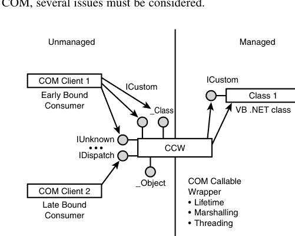

**图 9.7**
*COM 可调用包装器。该图描述了 CCW 在将类的托管实现从 COM 客户端抽象开方面所扮演的角色。*

首先，要使托管类能够被 COM 客户端创建，该类必须遵守某些规则。其中包括：该类必须是`Public`的，不能是抽象类（`MustInherit`），必须公开某些公共成员（共享成员和常量字段除外），并且必须没有构造函数或只有一个不接受参数的构造函数，因为 COM 不支持参数化构造函数。如果该类是`Public`的但只有一个参数化构造函数或者是基类，它仍然可以被引用，只是你需要将从该类创建对象的构造过程包装在一个"可创建"类中。此外，共享成员和常量不受支持。

其次，托管类的继承层次结构是受支持的，尽管它对 COM 客户端来说是扁平化的。例如，如果一个托管类包含一个处理异常的子类，该子类对 COM 客户端来说显示为与父类同级的类。COM 不支持父子关系的概念，并且不需要额外的点号表示法来访问子类。同样的规则也适用于类中包含的接口。

第三，派生类会公开在其类及其任何基类中定义的所有成员。换句话说，正如 RCW 一样，生成的 COM 类包含通过它及其基类可以访问的所有成员，正如你所预期的那样。此外，VB .NET 类在接口中实现的所有方法也会作为 COM 类的成员公开。因此，在 VB 6.0 中使用`TypeOf`语句进行接口转换不再是必需的，并且 VBScript 客户端（即 ASP）将能够调用 VB .NET 类实现的所有接口方法。不过，COM 类确实会公开接口，以便可以对对象进行多态使用。

> **提示**
>
> 抛出异常的 VB .NET 类会在 VB 6.0 和 ASP 代码中触发错误处理程序。在这两种情况下，内置的`Err`对象都会被填充。

第四，托管类的参数和返回值必须是能够自动转换为 COM 类型的数据类型，或者这些类型也必须已经注册。例如，如果你将派生的`DataSet StudentData`传递给`Students`类的`Save`方法，它在类型库中会显示为"不支持的变体类型。"在运行时，如果你尝试调用该方法，很可能会看到如图 9.8 所示的错误对话框，因为该类型不受支持。为避免此问题，在设计必须从 COM 使用的方法时，请限制自己使用简单数据类型。例如，可以不使用`StudentData`，而将参数简单定义为`String`，然后在传递给方法之前将数据序列化为 XML。

> **注意**
>
> 解决此问题的其他策略包括：为 COM 客户端提供一个方法实现，并将另一个标记为`ComVisible`等于`False`，或者使用`ICustomMarshaler`类提供自定义编排器，将托管类型实时转换为 COM 类型。

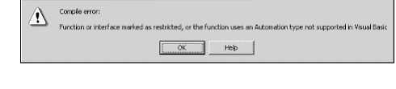

**图 9.8**
*如果你在托管类中使用无法转换为 COM 类型的数据类型，此对话框可能会在 VB 6.0 应用程序的运行时出现。*

最后，可以使用特性来自定义托管类向 COM 客户端公开的方式，其中最重要的是`ComVisible`。默认情况下，所有公共类型及其公共成员对 COM 都是可见的。但是，你可以在程序集、接口、类、结构体、委托、枚举、字段、方法和属性级别使用`ComVisible`特性来隐藏单个成员。一个明显的例子是在某些不应从 COM 调用的方法上放置该特性，因为它所支持的类型。例如，以下简单的`Utilities`类公开了`ReverseString`方法，同时隐藏了`GetID`函数，因为它使用了 COM 中不支持的数据类型。它还公开了一个名为`Security`的子类，该子类作为`Utilities`的同级被访问：

```
Imports System.Runtime.InteropServices

Imports System.Security.Principal

<ClassInterface(ComInterfaceType.InterfaceIsIDispatch)> _

Public Class Utilities

    Public Function ReverseString() As String

      ' Implementation here

    End Function

    <ClassInterface(ComInterfaceType.InterfaceIsIDispatch)> _

    Public Class Security

        Public Function GetUserName() As String

          ' Implementation here

        End Function

        <ComVisible(False)> _

        Public Function GetID() As IPrincipal

          ' Implementation here

        End Function

    End Class

End Class
```

反过来，`ComVisible`特性也可以用于显式包含类型，方法是在程序集级别将其设置为`False`，然后将其显式应用于你希望向 COM 公开的方法。

## 注册

要使托管程序集中的类在运行时被实例化，它们必须在注册表中注册为 COM 组件。这是通过使用程序集注册工具命令行实用程序（`RegAsm.exe`）来完成的。如果未指定任何参数，该工具只会将类注册在注册表的`HKEY_CLASS_ROOT`根键下，并生成相应的类标识符（`CLSID`）和程序标识符（`ProgID`）键。

> **提示**
>
> 你可以使用`RegAsm`工具的`/regfile`选项来生成`.reg`文件，而无需实际注册类型。这使你可以在真正执行注册之前查看将要对注册表进行的更改。此外，`.reg`文件可以分发并用于更新其他计算机。

> **注意**
>
> 如果托管类已使用`RegSvcs`工具或通过首次使用注册功能在组件服务中注册，则注册和类型库生成已经执行完毕。

任何 COM 可创建类（如前所述）也可以包含在注册和注销过程中被调用的注册和注销方法。这些方法分别通过用`ComRegisterFunction`和`ComUnregisterFunction`特性修饰方法来定义。在注册和注销期间，将调用适当的方法，并传入要更新的注册表键以及被注册类的完全限定名称。你可以使用这些方法来定制注册过程，但对于绝大多数组件而言，这将是不必要的。

组件注册后，其`CLSID`键中的`InProcServer32`值被设置为`mscoree.dll`，因为实际上将由 CLR 来执行托管代码。`Mscoree.dll`导出了适当的函数（`DllGetClassObject`），允许 COM 库引用一个称为*类工厂*的对象，用于创建组件的实例，就像对待非托管组件一样。此外，程序集版本、区域性和公钥信息会被添加到注册表中，以便类加载器加载适当的版本。该组件还会在 .NET 组件的特殊类别中注册，以便开发工具（例如 Visual Studio 6.0 附带的`OleView`）可以对其进行分类。`ProgID`默认设置为`namespace.class`，但可以通过在类级别设置`ProgId`特性来覆盖。图 9.9 显示了`OleView`工具中`Utilities`类的注册表选项卡。

> **注意**
>
> 程序集的路径并未在注册表中提供，因此关于程序集如何定位和加载的规则仍然适用，即使调用方是 COM 客户端。如果程序集是私有的，它必须与调用应用程序位于同一目录中。共享程序集存在于 GAC 中，将在运行时被 CLR 的类加载器发现。因此，同一台计算机上多个非托管客户端使用的托管类应安装在 GAC 中。

## 企业技术

### 第二部分

```
CLSID =

    \--{69A0415E-A6E3-31A8-8548-FAA7ABE3436D} = NETCOM.Utilities

        \--Implemented Categories

            \--{62C8FE65-4EBB-45e7-B440-6E39B2CDBF29}

        \--InprocServer32 [<no name>] = mscoree.dll

        \--InprocServer32 [ThreadingModel] = Both

        \--InprocServer32 [Class] = NETCOM.Utilities

        \--InprocServer32 [Assembly] = NETCOM, Version=1.1.8948.8, Culture=neutral, PublicKeyToken=null

        \--InprocServer32 [RuntimeVersion] = v1.0.2615

        \--ProgId = NETCOM.Utilities

NETCOM.Utilities = NETCOM.Utilities

    \--CLSID = {69A0415E-A6E3-31A8-8548-FAA7ABE3436D}
```


### 图 9.9

*托管类将从 COM 客户端调用时，注册表的典型配置方式。*

此时，可以使用后期绑定来实例化托管类，例如通过 ASP 客户端。这是因为 CCW 自动通过 `IDispatch` 接口为所有托管组件提供 COM 自动化支持。

#### COM 基础入门

对于那些不了解的人来说，当 VB 客户端将变量声明为 `Object` 或 `Variant` 时，或者当从 ASP 页面中的 VBScript 访问对象时，COM 中使用后期绑定。在这些情况下，编译器无法提前知道将请求哪个 CLSID 和 IID，因此必须在运行时进行确定。在运行时，VB 使用*调度接口*（`IDispatch`）并调用其 `GetIDsOfNames` 方法，向其传递方法名称。然后它使用返回的 id（称为 dispid）来调用 `Invoke` 方法以执行方法并返回结果。

本质上，这意味着每次访问方法或属性时都必须对对象进行两次调用，从而降低了性能。对于与客户端位于不同进程中，甚至可能位于不同服务器上的对象，这会大大影响调用的响应速度。好的方面是，使用后期绑定时，你不必担心在更改类的接口时与 COM 客户端的兼容性被破坏。有关 COM 工作原理的更多信息，请参阅 *Pure Visual Basic* 的第 23 章。

### 类型库

要使用早期绑定并帮助 CLR 在运行时封送数据，建议为托管类创建并注册类型库。可以使用类型库导出器命令行工具（`TlbExp.exe`）手动创建类型库，或使用 `TypeLibConverter` 类以编程方式创建。但是，更简单的方法是使用 `RegAsm` 的 `/tlb` 开关来自动创建并注册类型库。

> **提示**

如果你指定了 `AssemblyDescription` 特性，它将用作类型库的名称。

正如你可能了解的，VB 6.0 等开发工具经常加载类型库来查看组件成员的签名，以便针对组件进行编程更简单，并提供类型检查。类型库中的信息还可以由编译器使用，通过向可执行代码中添加内存偏移量（通过 v-table）或称为调度 id（dispid）的方法标识符来确保早期绑定，以便运行时应用程序能更高效地调用适当的方法。

默认情况下，使用上述任何方法为托管类生成类型库时，类的默认接口设置为 `_Object`。该接口公开了 `System.Object` 的成员，但不包含添加到类中的自定义成员。因此，尽管可以在 VB 6.0 IDE 中通过"项目，引用"菜单引用类型库，但自定义成员将不可见，编译器将在运行时回退到后期绑定。

要为托管类创建显式接口，必须按前面代码示例所示指定 `ClassInterface` 特性。通过将其设置为 `ClassInterfaceType` 的 `AutoDual`，类型库将包含一个与类同名但前缀为下划线的接口。默认设置为 `AutoDispatch`，但也可以设置为 `None`。生成的接口被标记为默认接口，包含类及任何基类（包括 `System.Object`）的所有成员。VB 6.0 等开发工具随后可以使用对象浏览器和 IntelliSense 来查看方法签名并协助编写类型安全的代码。同样，这种安排对 VB 6.0 开发人员来说应该很熟悉，因为 VB 6.0 使用此策略来创建自己的类型库。图 9.10 显示了注册并从 VB 6.0 引用的类型库的结果。

你还会在图 9.10 中注意到，从 `System.Object` 类继承的成员也会暴露在类型库中。同样，你可以通过用 `ComInterfaceType` 特性修饰 `Interface` 语句并将其设置为 `InterfaceIsDispatch`、`InterfaceIsDual`、`InterfaceIsIUnknown` 或 `InterfaceIsNone` 来控制接口在类型库中的公开方式。

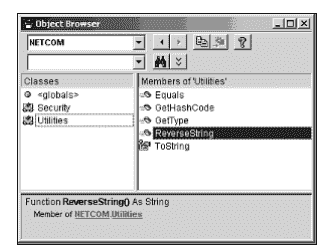

### 图 9.10

VB 6.0 中的对象浏览器可用于查看为其创建类型库的托管类的方法和属性。

尽管超出了本书的范围，你还可以使用一系列特性来定制类型库中各个元素的创建方式，包括 `Guid`、`DispId`、`MarshalAs` 和 `StructLayout` 等。有关使用这些高级选项的信息，请参阅文档。

> **注意**

每次为给定程序集生成类型库时，它的创建方式完全相同。换句话说，类型库的创建是确定性的。但是，如果重新编译程序集并重新生成类型库，将创建新的 GUID，从而破坏兼容性。为避免这种情况，你需要为类、接口和类型库指定不变的 `Guid` 特性。类型库 GUID 通过在 `AssemblyInfo.vb` 文件中使用 `Guid` 特性修饰程序集来设置，VS .NET 会为你完成此操作。此外，由于 CLR 不要求接口的不可变性，因此确保你不通过更改接口定义来破坏现有 COM 客户端的责任就落在你身上了。

### 激活

注册类型库后，COM 客户端可以使用早期绑定来高效访问组件。当然，由于 CLR 可以在内存中移动对象，COM 客户端不会像通过 v-table 访问 COM 组件时那样收到内存地址。CCW 只是生成一个存根，然后用于调用实际方法。

由 COM 客户端调用的托管组件的激活过程正如您所预期的那样：

1. VB 客户端执行 `New` 或 `CreateObject` 语句。
2. 在幕后，非托管代码使用组件的 CLSID 调用 COM 库中的 `CoCreateInstance` 函数，这通常是标准做法。
3. 然后 COM 库使用 CLSID 在注册表中查找 `InProcServer32` 键。
4. 由于 `InProcServer32` 指向 `mscoree.dll`，因此加载该 DLL，并调用 `DllGetClassObject` 以返回用于实例化类的对象（类工厂）。
5. `DllGetClassObject` 反过来读取注册表中的 `Class` 值，以确定要加载哪个类。
6. 然后 CLR 的类加载器确定该类的实例是否已经加载。如果是，则缓存的类工厂将从 `DllGetClassObject` 返回。
7. 如果类未加载，则从注册表中读取 `Assembly` 值，并使用标准规则定位程序集。
8. 定位程序集后，加载它，并从 `DllGetClassObject` 返回类工厂的实例。
9. 然后 COM 库调用类工厂的 `CreateInstance` 方法来创建对象。
10. VB 客户端被返回对该对象的引用。

### 小结

本章重点介绍了 Services 框架和 VB .NET 中可用于创建使用组件服务的组件的方面。为 Quilogy 教育应用程序构建的组件包括数据访问和业务组件，这些组件利用了本章所述的组件服务。在此过程中，本章还介绍了 COM 组件和 VB .NET 组件如何互操作。

随着数据访问和业务服务的构建，现在是用 ASP.NET 构建表示层的时候了。

### 构建 Web 表单

## 第 10 章

### 本章内容

- 理解 ASP.NET 402
- 示例应用程序 418
- Web 表单架构 419
- ASP.NET 功能 430
- ASP.NET 服务器控件 464

本章和第十一章"构建 Web 服务"介绍了在分布式应用程序中使用 VB .NET 开发用户服务层的内容。由于 .NET 平台针对使用 Web 技术进行开发进行了优化，因此这些章节讨论了使用 ASP.NET 创建更传统的 Web 应用程序以及 Web 服务。有关创建 Windows 窗体应用程序的信息超出了本书的范围，可以在联机帮助中找到。

正如刚才提到的，ASP.NET 实际上包含两种编程模型：Web 表单和 Web 服务。本章重点介绍适用于 Web 表单和 Web 服务的 ASP.NET 总体架构和功能，并更详细地介绍 Web 表单。第十一章专门讨论 Web 服务。由于这是一个很大的主题，讨论将仅限于与构建公共 Web 站点相关的主题，在该站点中 Quilogy 学生可以查看课程时间表、登录并查看他们的成绩单。但是，在深入细节之前，我们需要正确看待 ASP.NET。

> **注意**
>
> 本章的所有代码清单和补充材料都可以在本书的网站上找到，网址为 www.samspublishing.com。

### 理解 ASP.NET

从本质上讲，ASP.NET 不仅仅是大多数读者熟悉的 Active Server Pages（ASP）技术的简单演变。相反，它实际上包含一个全新的架构，该架构包括两种编程模型（Web 表单和 Web 服务）以及大量基于 .NET Framework 的服务。与 VS .NET 结合使用，结果是一个统一的 Web 开发平台，允许您使用面向对象和事件驱动的范式构建用户服务。

此外，由于该平台基于 .NET，它还获得了本书讨论的 .NET 的所有优势，包括语言互操作性；CLR 服务，如强类型、类型安全、早期绑定和继承；JIT 编译；以及使用 Services 框架访问低级和企业系统服务的能力。结果是一个对 VB 开发人员来说自然且易于访问的 Web 开发环境。

然而，ASP.NET 不仅仅是上述编程模型。事实上，ASP.NET 由 `System.Web` 命名空间中的一系列托管类组成，我将统称为 ASP.NET 运行时，它们提供以下服务，本章稍后将讨论：

- **基于 XML 的配置文件** 每个 Web 站点都可以包含一个配置文件，该文件控制诸如身份验证和状态管理等设置，并可以为特定应用程序进行自定义。
- **状态管理** 与 ASP 一样，ASP.NET 提供会话和应用程序状态管理服务，这些服务可以在服务器之间扩展以用于 Web 场方案。
- **缓存引擎** ASP.NET 提供复杂的缓存引擎，允许您提高性能和可扩展性。该引擎可以缓存完整或部分页面输出，还可以缓存昂贵的对象。
- **跟踪** ASP.NET 提供跟踪功能，允许您查看性能数据并在代码中插入自定义诊断消息。
- **安全性** ASP.NET 提供身份验证提供程序、授权语义和模拟，共同构成了一个灵活且可扩展的安全架构。
- **运行时可扩展性** 虽然不像此列表中的其他项目那样经常被企业开发人员使用，但 ASP.NET 建立在公共语言运行时（CLR）之上意味着其运行时是可扩展的。例如，您可以创建自己的托管类来处理某些类型的资源，并且可以包含自己的模块，就像内置的 Session 模块一样。这允许开发人员添加开箱即用未提供的功能，并消除经典 ASP 的"黑盒"感觉。此外，这是 ISV 通过提供自己在页面和应用程序中重用的功能来增加价值的好地方。简而言之，这种可扩展性允许 VB .NET 开发人员创建以前只有 C++ 开发人员才能实现的先进功能。

### ASP.NET 架构

在讨论这些功能之前，有必要从底层简要概述 ASP.NET。

在最底层，ASP.NET 应用程序由 IIS Web 服务器上虚拟目录及其子目录中找到的文件集合组成。与其他 VB .NET 应用程序一样，ASP.NET 应用程序是编译的，并在 `AppDomain` 中运行，在这种情况下，`AppDomain` 由 `inetinfo.exe`（IIS）进程生成的名为 `aspnet_wp.exe` 的可执行文件托管。因此，所有应用程序的 ASP.NET 页面都被编译为放置在虚拟目录下 `bin` 目录中的程序集。ASP.NET 运行时是位于客户端请求和实际页面处理之间的软件。为了说明这是如何工作的，请参见图 10.1。

当客户端请求与 ASP.NET 关联的文件（扩展名如 `.aspx`、`.ascx` 和 `.asmx`）时，IIS 通过注册的 ISAPI 扩展（`aspnet_isapi.dll`）处理请求。ISAPI 扩展负责调用 `aspnet_wp.exe`，然后加载并与 CLR 交互以创建 `AppDomain`（如有必要），以及加载所需的程序集。然后 ASP.NET 运行时根据其配置信息处理请求，以执行所需的任何预处理。预处理完成后，程序集中的 ASP.NET 类被实例化，并调用发出最终将发送回请求客户端的 HTML 的方法。

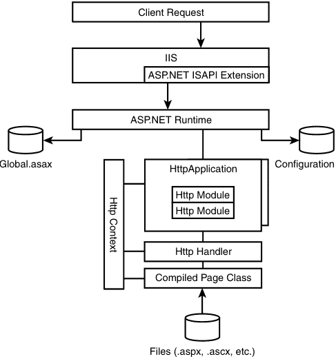

### 图 10.1

ASP.NET 包含可扩展的运行时架构。

> **提高容错性**
>
> 除了允许编译代码外，对 `AppDomain` 的依赖还为 Web 应用程序之间提供轻量级隔离边界。换句话说，在同一进程中不同 `AppDomain` 中运行的多个 ASP.NET 应用程序可以独立停止，并且不会意外访问另一个 `AppDomain` 中的内存，从而不会导致 `aspnet_wp` 进程崩溃。此外，如果发生访问冲突、内存泄漏或死锁等错误，下一个传入请求将启动新的 `AppDomain` 来处理该请求。最后，应用程序 DLL 永远不会被锁定，因此可以在不关闭应用程序或 Web 服务器的情况下部署依赖程序集的新版本。当检测到 DLL 时，将启动新的 `AppDomain`（针对同一应用程序）来处理新请求，而任何现有的 `AppDomain` 在完成请求处理后才会被终止。

ASP.NET 运行时的任务之一是应用如图 10.1 所示的配置信息。这些信息是从计算机级别和单个目录级别的 XML 配置文件中加载并解析的。尽管文件的内容以及处理方式将在本章后面更详细地讨论，但每个 ASP.NET 目录都可以包含一个 `Web.config` 文件。简而言之，该文件包含允许运行时决定如何处理请求的设置。示例包括使用哪种授权和模拟方案、哪个类（HTTP 处理程序）将处理请求以及如何*处理*请求，以及请求是否应由 HTTP 模块处理。

每个 ASP.NET 应用程序可以选择包含一个 `Global.asax` 文件，该文件与 ASP 中的 `Global.asax` 文件类似，用于处理应用程序引发的事件。然而，在 ASP.NET 中，`Global.asax` 文件会被动态解析并编译成从 `System.Web` 命名空间中的 `HttpApplication` 类派生的类。如果 `Global.asax` 文件不存在，则会创建一个泛型 `HttpApplication` 类。ASP.NET 运行时维护一个从 `HttpApplication` 类创建的对象池，并使用它们来实际为请求提供服务。当对资源发出请求时，ASP.NET 运行时将分配一个对象来处理请求，完成后将实例返回池中。

`Global.asax` 文件中默认支持的六个事件包括 `Session` 和 `Application` 对象的 `Start` 和 `End`，以及 `Application` 对象的 `BeginRequest` 和 `EndRequest` 事件。你可以使用这些事件对请求进行预处理，如以下代码所示：

```vb
Sub Application_BeginRequest(ByVal sender As Object, ByVal e As EventArgs)

' Fires at the beginning of each request

    If InStr(Me.Request.Url.ToString, "Main", CompareMethod.Text) > 0 Then

        Dim o As New QAConfig()

        Me.Context.Items.Add("QAConfig", o)

    End If

End Sub
```


在此示例中，`Application_BeginRequest`事件用于确定用户是否请求了特定页面。如果是，则实例化一个名为`QAConfig`的自定义类，并将实例放入整个请求过程中携带的`HttpContext`对象中，如图 10.1 所示。

> **提示**

如前面代码示例所暗示的，`HttpContext`对象公开了一个`Items`属性，该属性可以包含一个实现`IDictionary`接口的键值集合。这对于存储必须在整个请求过程中持久保存的信息非常方便。但是，该集合会在每个请求时重新初始化，不能用于存储会话或应用程序状态。

> **注意**

实际上还有 11 个其他按请求处理的事件可以处理，范围从身份验证到错误。有关更多信息，请参阅在线帮助。

当检测到`Global.asax`文件的更改时，ASP.NET 会在触发`Application_End`事件之前完成所有挂起的应用程序请求。当收到下一个请求时，将触发`Application_Start`事件，并且`Global.asax`文件会被重新解析和重新编译。这相当于重新启动应用程序，并销毁任何状态信息和用户会话。

> **提示**

你可以选择在自己程序集中编译一个从`HttpApplication`派生的类，并将其放置在网站内的`bin`目录中。但是，`Global.asax`文件仍然需要引用该类。

如图 10.1 所示，除了`HttpApplication`实例之外，ASP.NET 还支持一系列可以参与应用程序的模块（称为 HTTP 模块）。这是 ASP.NET 实现熟悉的 Session 状态对象以及新功能（如身份验证和输出缓存）的地方。但是，通过从`HttpModule`派生一个类并在`Web.config`中注册它，你可以添加支持自定义筛选、身份验证和状态服务等的模块。

最后，特定文件类型随后由 HTTP 处理程序处理。这些托管类从`HttpHandler`派生，用于对某些资源执行自定义处理。例如，`System.Web.UI`命名空间中的`PageHandlerFactory`类处理所有对`.aspx`页面的请求。同样，处理程序的规范必须存在于配置信息中，以便运行时可以进行正确的关联。自定义 HTTP 模块和 HTTP 处理程序的实现超出了本书的范围。

> **注意**

熟悉 Internet 服务器应用程序编程接口（ISAPI）的开发人员会注意到，HTTP 模块大致相当于 ISAPI 筛选器，而 HTTP 处理程序则等同于 ISAPI 扩展。

请注意，HTTP 上下文贯穿整个请求的生命周期。此`HttpContext`对象封装了有关请求的所有 HTTP 特定信息，包括对熟悉的`Server`、`Request`和`Response`对象的引用，以及`Session`、`Application`和运行时用于实现前述功能的其他对象（如跟踪和缓存）。代表客户端请求资源的托管类可以访问上下文并由处理程序处理。

### 编程模型

如前所述，ASP.NET 支持两种编程模型：Web 窗体和 Web 服务。

#### Web 窗体

Web 窗体背后的理念是为 Web 应用程序提供基于窗体的开发模式。为此，该体系结构依赖页面处理 HTTP 处理程序，该处理程序调用最终从`System.Web.UI.Control`派生的托管类。事实上，代表你的网页的类与为 Web 窗体定义的静态 HTML 一起编译到应用程序程序集中。通常，你创建的页面类从`System.Web.UI.Page`类派生，而`Page`类又从`Control`派生。

如前所述，程序集由运行时加载并发出发送到浏览器的 HTML。在此过程中，`Page`类可以包含对其他程序集的引用，这些程序集包含从`Control`派生的类（ASP.NET 服务器控件），这些控件将 HTML 添加到发送到浏览器的数据流中，以及实现业务和数据服务的程序集。

> **注意**

开发过 IIS 应用程序（WebClasses）的 VB 6.0 开发人员无疑会发现前面的描述很熟悉。但是，主要区别在于 WebClass 体系结构并非为可伸缩性而构建，而且很难将 UI 与应用程序逻辑融合。你可以将 Web 窗体视为 WebClasses 的演进，尽管后者更简单、更灵活。有关 WebClasses 的更多信息，请参阅我的*Pure Visual Basic*一书第 17 章。

这种编程模型有以下几个优点：

- UI 与应用程序逻辑的分离 — 将用户界面元素（HTML）与操作它们的逻辑分离的能力，无论从可读性还是可维护性的角度来看都是有益的。在 ASP 的早期版本中，HTML、客户端逻辑和服务器端代码混在同一页面上，难以维护，并导致“意大利面条式代码”。虽然在 ASP.NET 中不是必需的，但 VS.NET 中的默认行为是将 HTML 放在单独的文件（`.aspx`）中，与类文件分开。

- 所见即所得编辑 — UI 与逻辑的分离允许 VS.NET 等开发工具提供所见即所得的编辑功能。经典 ASP 代码的混合特性不适合强大的所见即所得编辑。此外，Web 窗体附带了 40 多个控件，可以在编辑器中以图形方式进行图形操作。

- 基于事件的编程 — 代码隐藏窗体与所见即所得编辑的结合允许基于事件的编程模型。只需在控件上双击，就可以在`Page`类中创建在服务器上执行的事件处理程序。Web 窗体体系结构允许在浏览器中生成的事件被回发并在服务器上处理。

- 编译代码 — 显然，因为程序集封装了 UI 和代码，所以它们不是被解释，而是一起编译，从而提高性能。

- 浏览器无关性 — 因为 UI 元素可以被抽象为实现为托管类的控件，所以它们可以根据浏览器类型动态更改渲染的 HTML。这允许 Web 应用程序在单个代码库下运行，并基于浏览器类型进行最小分支。

- 可扩展性 — 对面向对象运行时和编程模型的依赖允许 Web 窗体通过包含第三方控件和开发自定义服务器和用户控件来扩展。

## Web 服务

尽管在第十一章中会详细介绍，但 Web 服务允许其他支持 Web 的应用程序远程访问服务器功能。这种“无头 UI”方法依赖于行业标准，例如 HTTP、XML 和 SOAP，以允许应用程序进行通信。

正如你将看到的，ASP.NET 的可伸缩性和性能改进，以及 Web 服务的包含，预示着一个分布式应用程序使用各种私有和公开可用的 Web 服务缝合在一起的世界。

#### 与 ASP 的区别

从开发人员的角度来看，与 ASP 的主要区别是包含编译代码。正如大多数读者可能知道的，在 ASP 环境中，服务器端和客户端脚本混合在 ASP 页面上。当页面由 ASP 引擎处理时，服务器端代码被解释，生成的 HTML 被添加回发送到发起请求的浏览器的响应流中。因此，ASP 应用程序的性能不是最佳的，而且 ASP 应用程序的可读性和可维护性较差。

> **注意**
>
> 许多 ASP 开发人员使用服务器端包含（server-side includes）将部分服务器端脚本与 UI 分离。这是一个良好的实践且应当被鼓励，尽管包含文件中的代码仍然是被解释执行的。
>
> 然而，在 ASP.NET 中，这种模式被反转了，整个页面实际上是一个产生 HTML 的可执行类。这使得 HTML 在设计时可以与代码分离，并在运行时被共同编译执行。

CBF 的引入实现了 UI 与逻辑的分离，并使得基于事件的编程模型成为可能。对于完全由 ASP 背景出身的开发人员来说，编写响应在服务器上执行的事件的代码，可能会比简单的将服务器脚本块与 HTML 混合构建页面显得更加抽象。然而，这种抽象正是 ASP.NET 能够提供前一节中所列功能的关键所在。

尽管 ASP.NET 在许多方面有所不同，但其设计目标之一是完全向后兼容 ASP。正如你将看到的，这一目标并未完全实现，但 ASP 开发人员会发现大多数概念和语法都非常熟悉。例如，虽然不推荐这样做，但仍然可以开发看起来像经典 ASP 页面的`.aspx`页面。

ASP 与 ASP.NET 之间的一个不兼容点在于，ASP.NET 不支持在服务器端运行 VBScript，因此页面内的代码必须使用受支持的语言编写，例如 VB .NET、VC# 或 JScript。页面内的所有代码还必须使用同一种语言编写。虽然 VB .NET 的语法与 VBScript 相似，但它更具结构化。这意味着必须进行语言上的更改，例如第 3 章“VB .NET 语言特性”中所讨论的内容。为了演示其中的一些差异，请参考示例 10.1 所示的简单 ASP 页面，该页面用于从 SQL Server 自带的 Northwind 数据库中检索订单。

### **示例 10.1** 简单 ASP。这个简单的 ASP 页面使用 ADO 检索订单，将它们显示在表格中，并提供导航功能。

```
<%@ Language=VBScript %>

<html>

<body>

<font face="verdana">

<h2>

<br>

Northwind Most Recent Orders</h2>

<%

Set cn = Server.CreateObject("ADODB.Connection")

cn.Provider = "SQLOLEDB"

cn.Open "server=ssosa;database=northwind;uid=sa"

Set rs = Server.CreateObject("ADODB.Recordset")

' Line up the cache size with the PageSize

rs.CacheSize = 10

rs.CursorLocation = 2 'adUseClient

rs.Open "Select * From Orders",cn,3,1 'Static and Readonly

'Check for empty resultset

If rs.EOF And rs.BOF Then

    Response.Write("No more orders")

    Response.End

End If

rs.PageSize = 10

' Determine how many pages are in this recordset

intPageCount= rs.PageCount

' Now see where the user requested we go

If Len(Request.Form("txtPage")) > 0 Then

    intPage = Request.Form("txtPage")

Else

    Select Case Request.Form("Action")

        Case "<<"

            intPage = 1

        Case "<"

            intPage = Request ("intPage") -1

            If intPage < 1 Then intPage = 1

        Case ">"

            intPage = Request ("intPage") + 1

            If intPage > intPageCount Then

                intPage = intPageCount

            End If

        Case ">>"

            intPage = intPageCount

        Case Else

            intPage = 1

    End Select

End If

rs.AbsolutePage = intPage

%>

<table>

<tr>

    <td><strong>Record</strong></td>

    <td><strong>Order ID</strong></td>

    <td><strong>Order Date</strong></td>

    <td><strong>Customer ID</strong></td>

    <td><strong>Ship Name</strong></td>

</tr>

<%

For intRecord = 1 To rs.PageSize %>

<tr>

    <td><% =rs.AbsolutePosition %></td>

    <td><a href="orderdetail.asp?id=<% =rs.Collect("OrderID") %>">

        <% =rs.Collect("OrderID") %></a></td>

    <td><% =rs.Collect("OrderDate") %></td>

    <td><% =rs.Collect("CustomerID") %></td>

    <td><% =rs.Collect("ShipName") %></td>

</tr>

    <%

    rs.MoveNext

    If rs.EOF Then Exit For

Next

%>

</table>

<%

rs.Close

Set rs = Nothing

cn.Close

Set cn = Nothing

%>

<form name="MovePage" action="paging.asp" method="post">

<input type="hidden" name="intpage" value="<% =intpage %>">

<input type="submit" name="action" value="&lt;&lt;">

<input type="submit" name="action" value="&lt;">

<input type="submit" name="action" value="&gt;">

<input type="submit" name="action" value="&gt;&gt;"><br>

Go to page:<input type="text" name="txtPage" size=4>

<input type="submit" name="go" value="Go"><br>

Page: <% =intpage & " of " & intPageCount %>

</form>

</BODY>

</HTML>
```

该页面检索 10 个订单并将其放入一个 HTML 表格中。表单上的按钮允许用户滚动浏览行并选择想要查看的页面。

示例 10.2 展示了在 ASP.NET 中运行同一个页面所需做的最小更改。请注意，有几行使用了**粗体**，以指示代码更改的位置。

### **示例 10.2** 简单 ASP.NET。此页面包含了允许示例 10.1 中的 ASP 页面在 ASP.NET 中运行的最小更改。

```
<%@ Page aspCompat="True" Language="vb" CodeBehind="Paging.aspx.vb" AutoEventWireup="false" Inherits="QuilogyEducation.Paging" enableViewState="False"%>

<HTML>

<BODY>

<font face="verdana">

<h2>

<br>

Northwind Most Recent Orders</h2>

<%

Dim cn

Dim rs

Dim intPageCount As Integer

Dim intPage As Integer

Dim intRecord As Integer

cn = Server.CreateObject("ADODB.Connection")

cn.Provider = "SQLOLEDB"

cn.Open("server=ssosa;database=northwind;uid=sa")

rs = Server.CreateObject("ADODB.Recordset")

' Line up the cache size with the PageSize

rs.CacheSize = 10

rs.CursorLocation = 2 'adUseClient

rs.Open("Select * from Orders",cn,3,1) 'Static and Readonly

'Check for empty resultset

If rs.EOF And rs.BOF Then

    Response.Write("No more orders")

    Response.End

End If

rs.PageSize = 10

' Determine how many pages are in this recordset

intPageCount= rs.PageCount

' Now see where the user requested we go

If Len(Request.Form("txtPage")) > 0 Then

    intPage = Request.Form("txtPage")

Else

    Select Case Request.Form("Action")

        Case "<<"

            intPage = 1

        Case "<"

            intPage = CType(Request("intPage"),Integer) -1

            If intPage < 1 Then intPage = 1

        Case ">"

            intPage = CType(Request("intPage"),Integer) + 1

            If intPage > intPageCount Then

                intPage = intPageCount

            End If

        Case ">>"
```


```vb
intPage = intPageCount

Case Else

    intPage = 1

End Select

End If

rs.AbsolutePage = intPage
%>
```

<table>
<tr>
    <td><strong>Record</strong></td>
    <td><strong>Order ID</strong></td>
    <td><strong>Order Date</strong></td>
    <td><strong>Customer ID</strong></td>
    <td><strong>Ship Name</strong></td>
</tr>

<%
For intRecord = 1 To rs.PageSize
%>
<tr>
    <td><%=rs.AbsolutePosition%></td>
    <td>
        <a href="orderdetail.asp?id=<%=rs.Collect("OrderID")%>">
            <%=rs.Collect("OrderID")%>
        </a>
    </td>
    <td><%=rs.Collect("OrderDate")%></td>
    <td><%=rs.Collect("CustomerID")%></td>
    <td><%=rs.Collect("ShipName")%></td>
</tr>

<%
    rs.MoveNext

    If rs.EOF Then Exit For

Next
%>
</table>

<%
rs.Close
rs = Nothing

cn.Close
cn = Nothing
%>

<form name="MovePage" action="paging.aspx" method="post">
    <input type="hidden" name="intpage" value="<%=intPage%>">

    <input type="submit" name="action" value="&lt;&lt;">
    <input type="submit" name="action" value="&lt;">
    <input type="submit" name="action" value="&gt;">
    <input type="submit" name="action" value="&gt;&gt;"><br>

    Go to page:
    <input type="text" name="txtPage" size="4">
    <input type="submit" name="go" value="Go"><br>

    Page: <%=intPage & " of " & intPageCount%>
</form>

</BODY>
</HTML>
```

首先，请注意页面顶部的 Page 指令现在除了 Language 之外，还包含几个新选项。在这种情况下，`aspCompat` 选项被设置为 `True`，以表明该页面使用了需要在单线程单元（STA）中执行的组件（此处为 ADO）。这是必要的，因为 `.aspx` 页面默认可由多个线程访问，这可能会损坏该组件。

> **提示**
>
> 访问 COM+ 1.0 组件时，`aspCompat` 设置也必须开启。此外，由于 ASP.NET 使用了新的安全模型，你需要让 COM+ 组件在它们自己的标识下运行，并确保所使用的帐户已通过 `DCOMCNFG.exe` 进行配置。

其次，Page 指令包含 `CodeBehind` 选项，用于指定包含 Page 类的 `.vb` 文件。在 VS .NET 中创建 `.aspx` 页面时，此项会自动设置，但在此情况下并未使用。`AutoEventWireUp` 和 `enableViewState` 也设置为 `False`，分别表示页面的事件处理程序不会自动创建，以及页面状态不会在请求之间保存。

> **注意**
>
> 虽然 Web Forms 提倡将 UI 和应用程序逻辑分离，但你也可以创建 `.aspx` 页面，将所有通常位于代码隐藏文件中的服务器端逻辑放在带有 `runat=server` 属性的 `SCRIPT` 块中。`www.gotdotnet.com` 等网站上展示的许多 Web Forms 示例都采用这种方法。在这种情况下，不需要代码隐藏文件（实际上 Page 指令也不是必需的），也不需要显式声明 Page 类。

此外，当文件更新时，页面会动态编译并缓存，这不会更新 `bin` 目录中的程序集。对于使用代码隐藏的 `.aspx` 文件也是如此，尽管相关的 `.vb` 文件不会被编译。因此，如果你更改了 `.vb` 文件中的代码，需要显式生成才能使更改在页面执行时生效。

> **提示**
>
> 在 VS .NET 之外工作时，使用 `SRC` 属性而不是 `CodeBehind` 属性来指向包含代码的文件。

从 VBScript 迁移到 VB .NET 还需要进行以下代码更改：

- 由于 VB .NET 要求声明变量，因此需要声明变量。注意，`cn` 和 `rs` 默认设置为 `System.Object`（不再支持 Variant），并使用后期绑定绑定到 ADO Connection 和 Recordset 对象。
- 由于对象在创建和销毁时不再需要 `Set` 和 `Let`，因此移除了 `Set` 语句。
- `Connection` 和 `Recordset` 的 `Open` 方法的参数现在必须包含在括号中。
- `intPage` Request 变量现在在两处使用 `CType` 函数显式转换为 `Integer`。这是必需的，因为 VB .NET 会自动将其转换为 String，然后向其拼接 `"1"`，而不是产生 Integer。一般来说，在 VB .NET 中你应该始终转换为显式数据类型。

现在，当页面编译时，它会按预期运行。

除了必须对清单 10.1 中的示例进行的更改外，ASP.NET 还不支持在过程内混合 HTML 和服务器端代码。例如，以下代码块：

```vb
<% Sub Hello %>

  <b>Hello</b>

<% End Procedure %>
```

在 VB .NET 中无法编译，因为编译器认为当遇到 `<b>` 时意图是终止过程块。

虽然进行这样的轻量级转换可以让页面工作，但它无法利用 ASP.NET 的特性。特别是，使用经典 ADO 而不是 ADO.NET 会影响性能，因为必须指定 `aspCompat` 选项；将所有逻辑与 HTML 内联编写无法利用 VS .NET 中的 CBF 和 IntelliSense；不使用 ASP.NET 服务器控件（如 DataGrid）意味着必须编写额外的循环和分页代码。

虽然所有现有的 ASP 页面都将并且应该修改为在 ASP.NET 下运行，以单独利用性能和可扩展性的提升，但具备 ASP 技能的开发者应该会发现他们的技能在 .NET 世界中仍然适用。

> **注意**
>
> 由于架构改进，ASP.NET 应用程序通常比同等的 ASP 或 JSP（Java Server Pages）应用程序快两到三倍。这是通过使用竞争架构开发一个名为 Nile 2.0 的示例应用程序的五个版本来证明的。你可以从 MSDN 代码中心 `http://msdn.microsoft.com/code` 下载源代码。

话虽如此，对 ASP 开发者来说还有额外的利好消息。ASP.NET 引擎只处理特定于它的页面，因此可以与 ASP 共存于同一 Web 服务器上。换句话说，你可以无需修改继续运行 ASP 应用程序，与 ASP.NET 应用程序并列运行，甚至可以将 ASP 页面放在与 ASP.NET 页面相同的虚拟目录中。在后一种情况下，每个页面都将由适当的服务器扩展处理。

> 虽然你可以将 ASP 页面放在 ASP.NET 应用程序中，但它们将无法共享 Session 和 Application 状态。但是，`Global.asa` 和 `Global.asax` 文件可以在同一虚拟目录中共存。

### 难道我们就不能和睦相处吗？

除了将 ASP 页面添加到使用 VS .NET 创建的站点外，Microsoft 还创建了一种将 VS .NET 连接到现有 VID Web 的简便方法。为此，假设你有一个名为 `"myVI6web"` 的现有 VID Web 应用程序。要将此站点转换为与 VS .NET 兼容的 Web，VS .NET 有一个隐藏的功能叫做**现有文件夹中的新项目**。要使用它，请按照以下步骤操作：

1. 打开 VS .NET。
2. 选择**文件**、**新建**、**项目**。VS .NET 显示**新建项目**对话框。
3. 选择**Visual Basic 项目**、**现有文件夹中的新项目**。
4. 输入 `myVI6web` 作为项目名称。（项目名称将始终是你现有的 VID 项目 Web。）
5. 单击**确定**。VS .NET 会提示你**在现有文件夹中创建新项目**对话框。
6. 输入指向现有 VID 项目的 URL 地址。
7. 单击**确定**。由于 VS .NET 默认设计为使用 UNC 路径，VS .NET 会警告你 Web 服务器不可访问。你必须告诉 VS .NET 使用 FrontPage 服务器扩展。
8. 单击**确定**。VS .NET 现在将 VID Web 转换为与 VS .NET 兼容的 Web。这是通过 VS .NET 向虚拟目录添加两个名为 `myVI6web.vbproj` 和 `myVI6web.vbproj.webinfo` 的配置文件来完成的。这些文件允许 VS .NET 发现有关项目的信息。由于这些文件是文本文件（实际上它们是 XML 文件），你仍然可以使用 VID 或任何符合 FrontPage 标准的工具连接到 Web 站点。

项目在 VS .NET 中加载后，你就可以开始编辑文件了。但是，当你第一次通过解决方案资源管理器查看项目时，不会显示任何文件。要显示文件，请选择**项目**、**显示所有文件**。虽然这些文件可以编辑，但它们实际上不属于 VS .NET 项目的一部分。默认情况下，只有属于 VS .NET 项目部分的文件才会在项目生成时编译到程序集中。要包含任何现有的 ASP.NET 文件，请右键单击现有文件并选择**在项目中包含**。在你选择将任何现有 ASP.NET 文件或文件夹包含到项目中后，VS .NET 会提供创建代码隐藏类 `foreclass` 文件的选项。如果你想继续将该页面与 ASP 一起使用，请不要选择此选项。随着你对 VS .NET 越来越熟练，并开始将代码转换为 ASP.NET，你可以迁移到代码隐藏模型。

### 示例应用程序

随着 ASP.NET 介绍的结束，我们可以开始讨论 Web Forms 以及具体影响 Quilogy 教育 Web 站点开发的 ASP.NET 特性。该站点由表 10.1 中列出的 ASP.NET 页面组成。

| 页面 | 描述 |
| --- | --- |
| `QEducation.aspx` | 显示菜单和课程搜索控件的主页 |
| `QSearch.ascx` | 显示课程搜索选项的用户控件 |
| `Schedule.aspx` | 从数据库动态查询课程表的页面 |
| `StudentLogin.aspx` | 从学生收集登录信息的页面 |
| `StudentProfile.aspx` | 显示学生人口统计数据的页面 |
| `Register.aspx` | 允许学生注册课程的页面 |
| `Transcript.aspx` | 显示学生成绩单的页面 |

此外，该站点包含 HTML 菜单页面和客户端 JavaScript，用于实现使用服务器端包含和 `<script>` 标签处理的各种菜单。Present Web 应用程序可以从本书的配套网站 `www.samspublishing.com` 下载。

> **注意**
>
> 请记住，这些非 ASP.NET 资源是由 IIS 直接处理的，而不是通过 ASP.NET 运行时处理。

显而易见，该应用程序使用了第 7 章“使用 ADO.NET 访问数据”、第 8 章“构建组件”以及第 9 章“访问组件服务”中讨论的 ADO.NET 类和组件，以提供业务和数据服务。表 10.1 中所示的页面则提供了用户服务。

### Web Forms 架构

要理解表 10.1 中列出的 ASP.NET 页面是如何处理的，重要的是要理解 Web Form 的架构。该架构可以分为页面处理流程和事件模型。

### 页面处理流程

如前所述，ASP.NET 页面在独立的文件中同时包含 UI 和逻辑。代码文件包含一个继承自 `Page` 类的类，而 `.aspx` 文件包含一个指向该代码文件的 Page 指令。当由 ASP.NET 运行时编译和执行时，页面就像其他组件一样，在其生命周期中经历一系列阶段。然而，与从 Web 服务器请求的任何资源一样，该组件是无状态的，并且在每次往返（round-trip）服务器时都会被重新创建。

表 10.2 显示了页面经历的各个阶段以及你通常与它们交互的位置。

#### 表 10.2 页面处理状态

| 阶段 | 描述 |
|---|---|
| 初始化 (Initialize) | 用于初始化在整个请求中使用并通过 `Page` 类的 `Init` 事件公开的变量。可以进行处理，但此时控件尚未填充。 |
| 加载视图状态 (Load View State) | 加载页面上控件之前保存的任何状态并填充对象模型。通常由 `Page` 类自动处理。 |
| 加载 (Load) | 所有控件均已填充且对象模型已更新。`Page` 类公开了 `Load` 事件，开发人员在此添加代码以填充控件（例如通过数据库查询）。 |
| 数据绑定 (Data Binding) | 处理所有将绑定到数据源的控件。`Page` 类公开了 `DataBinding` 事件，尽管通常不对其进行处理。 |
| 事件处理 (Event Handling) | 响应用户发起的操作，触发任何服务器端事件处理程序。开发人员的大部分代码在此阶段处理。 |
| 预渲染 (Prerender) | 输出即将创建。`Page` 类公开了一个 `PreRender` 事件，给开发人员最后一次更新控件的机会。 |
| 保存状态 (Save State) | 页面上控件的状态（称为视图状态/view state）被持久化为一个字符串，并通过隐藏的 Form 字段往返传输到客户端。 |
| 渲染 (Render) | 生成输出并发送给客户端。通常自动处理。 |
| 清理与释放 (Cleanup and Dispose) | 页面已完成渲染，可以开始清理。`Page` 类公开了 `Unload` 和 `Disposed` 事件，开发人员在此关闭文件、释放数据库连接等。 |

请注意，从开发人员的角度来看，与页面的大多数交互发生在 `Load` 事件和单个控件的事件处理程序中。许多其他阶段由 `Page` 类（实际上最终继承自 `Control` 类）自动处理。

表 10.2 中需要注意的关键点是，Web Forms 架构通过保存页面上 ASP.NET 服务器控件的 `ViewState`，营造出一种静态基于表单开发环境的假象。每个页面包含一个 `FORM` 标签，其 `runat` 属性被设置为字面量字符串 `"server"`。当遇到此属性时，会向 HTML 流写入一个表单标签，将表单提交回自身，这是许多 ASP 开发人员手动实现的技巧。然而，此外，一个名为 `__VIEWSTATE` 的隐藏 `INPUT` 标签被添加到表单中，它包含一个压缩的二进制字符串，代表表单中控件属性的状态。这种技术非常有用，因为它免去了开发人员手动保存控件状态的麻烦，并且是以一种独立于浏览器且高效的方式实现的。状态信息随后在表 10.2 所示的“加载视图状态”阶段被重新放回控件中。这使得控件可以通过编程方式进行操纵，而无需担心重新填充它们。

> **提示**
>
> 单个控件以及整个表单的视图状态可以通过在代码中设置 `EnableViewState` 属性，或将其作为 Page 指令中的属性来控制。默认情况下它被设置为 True，但将其设置为 False 可以通过减少往返传输的数据量来提高性能。

当表单提交回服务器时，运行时足够智能，能够知道这是一个回发（postback）还是初始加载，并通过页面的 `IsPostBack` 属性公开这一事实。结果是，你可以隔离 `Load` 事件中的代码，使其仅在页面首次显示时执行。

### 页面处理示例

为了阐明页面结构和处理基本事件，请参考 Listing 10.3 和 10.4 中所示的 `QEducation.aspx` 页面。

**Listing 10.3** `QEducation.aspx`。此列表显示了 Quilogy 教育主页 UI 的简略版本。

```aspx
<%@ Register TagPrefix="QEd" TagName="QSearch" Src="QSearch.ascx"%>

<%@ Page Language="vb" AutoEventWireup="true" Codebehind="QEducation.aspx.vb"
    Inherits="QuilogyEducation.QEducation" EnableSessionState="True"
    clientTarget="DownLevel"%>

<HTML>
  <HEAD>
    <TITLE>Quilogy - Services: Education</TITLE>
    <!DOCTYPE HTML PUBLIC "-/W3C//DTD HTML 4.0 Transitional//EN">
    <LINK href="supplemental/site.css" type=text/css rel=stylesheet>
  </HEAD>

  <BODY language=javascript leftMargin=0 topMargin=0
    marginheight="0" marginwidth="0">

    <FORM id="QEducation" method=post runat=server>

    <!-- #include file="navbar.htm" -->
```


<table cellspacing=0 cellpadding=0 width="100%" border=0>
  <tr>
    <td class="caption">
      <div id="studentdata" runat="server"></div>
    </td>
  </tr>
  <tr>
    <td align=left bgcolor=#f3f0de>
      <table cellspacing=0 cellpadding=0 width=740 border=0>
```

**企业级技术**

**第二部分**

# Listing 10.3 接上页

```html
<tr>
  <td valign=center align=left width=211>
    
  </td>
  <td width=529>
    
    <br>
    <table cellspacing=0 cellpadding=2 border=0>
      <qed:qsearch id="QSearch" runat="server"></qed:qsearch>
    </table>
  </td>
</tr>
</table>
</td>
</tr>
<tr>
  <td bgcolor=#dbd3bf>
    
  </td>
</tr>
<tr>
  <td bgcolor=#ece8cd><!-- #include file="edmenu.htm" --></td>
</tr>
</table>

<!-- #include file="bottombar.htm" -->

<asp:LinkButton id=lnkSignOut runat="server"
  cssclass="caption">Click here to Sign Out</asp:LinkButton>

</form>
</body>
</html>
```

# Listing 10.4 `QEducation.aspx.vb`

此列表显示了 Quilogy 教育主页的代码隐藏文件。

```vb
Option Strict Off

Imports System.Web.UI.HtmlControls
Imports System.Security.Principal
Imports System.Web.Security
Imports System.Text
Imports System.Web.Caching
```

**LISTING 10.4** 接上页

```vb
Public Class QEducation

    Inherits System.Web.UI.Page

    Protected WithEvents lnkSignOut As System.Web.UI.WebControls.LinkButton

    Protected WithEvents studentdata As _
        System.Web.UI.HtmlControls.HtmlGenericControl

    Protected Sub Page_Init(ByVal Sender As System.Object, _
        ByVal e As System.EventArgs) Handles MyBase.Init

        'CODEGEN: This method call is required by the Web Form Designer
        'Do not modify it using the code editor.

        InitializeComponent()

    End Sub

    Private Sub Page_Load(ByVal sender As System.Object, _
        ByVal e As System.EventArgs) Handles MyBase.Load

        ' If the user is authenticated then set the welcome message

        If Context.User.Identity.IsAuthenticated Then

            studentdata().InnerText = "Welcome " & Me.Session("StudentName")
            lnkSignOut.Visible = True

        Else

            studentdata().InnerText = "Welcome to Quilogy Education! "
            studentdata().InnerText &= "Please select an option"
            lnkSignOut.Visible = False

        End If

    End Sub

    Private Sub lnkSignOut_Click(ByVal sender As System.Object, _
        ByVal e As System.EventArgs) Handles lnkSignOut.Click

        ' Sign out

        FormsAuthentication.SignOut()
        Session.Clear()
        Response.Redirect("\QuilogyEducation\QEducation.aspx")

    End Sub

End Class
```

这些列表中的注意项包括：在 Listing 10.3 中，`.aspx` 页面包含一个设置了 `runat=server` 属性的 `FORM` 标签，并且它包含一个引用 `QSearch.ascx` 文件的 Register 指令，后者是一个 Web Forms 用户控件。该控件包含搜索课程表所需的下拉列表。此外，`studentdata` DIV 标签包含 `runat=server` 属性，使其在页面于服务器处理时能够被“看见”。另外，页面底部放置了一个 ASP.NET `LinkButton` 控件，以允许登录用户注销。

在清单 10.4 中，处理了 `Load` 事件，并用其通过设置 `studentdata` 控件的 `InnerText` 属性来填充该控件。尽管控件将在后面更详细地讨论，但应注意 DIV 标签被声明为 `HtmlGenericControl`，因此支持典型的文档对象模型（DOM）方法和属性，包括 `InnerText`。`Load` 事件还会检查 `User` 对象的 `IsAuthenticated` 属性，以便在用户通过身份验证时自定义欢迎消息。

该页面的结果如图 10.2 所示。

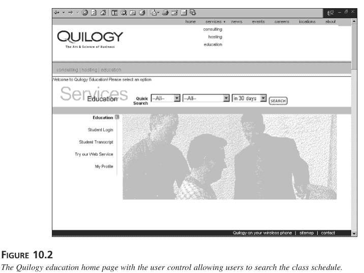

*Quilogy 教育主页，其中的用户控件允许用户搜索课程安排。*

## 事件模型

`ViewState` 的实现使得基于服务器的事件模型成为可能。事实上，通过依赖这一模型，你几乎可以像处理 VB 6.0 中的窗体一样来处理 Web 窗体。

> **注意**
>
> 正如你所预期的，服务器事件仅在使用 ASP.NET 服务器控件时才能被处理。这包括 Web 服务器控件以及除 `HtmlGenericControl` 之外的所有 HTML 服务器控件。

但是，由于大多数事件都起源于客户端，页面必须回发到服务器进行处理。显然，这会造成开销，因此大多数服务器控件仅支持有限的服务器事件，通常仅限于 `click` 和 `changed`。毫不奇怪，导致表单回发的事件被称为*回发*事件。但是，对于某些事件，例如服务器 `TextBox` 控件的 `TextChanged` 事件，事件在客户端被捕获，实际上直到下一次回发时才会被处理。显而易见的优点是这减少了往返次数。

同样，`changed` 事件，例如 `DropDownList` 控件的 `SelectedIndexChanged` 事件，可能需要立即处理——例如，在选择触发另一个 `DropDownList` 填充的情况下。在这些情况下，你可以将控件的 `AutoPostBack` 属性设置为 `True`，这样其 `changed` 事件将立即被回发。

> **注意**
>
> 某些控件包含专门的 `changed` 事件，例如 `WebCalendar` Web 服务器控件的 `SelectionChanged` 事件。当 `AutoPostBack` 设置为 `True` 时，这些事件将立即被回发。

在表 10.2 所示的页面处理的事件处理阶段，表单的改变事件首先被处理，然后是任何单击事件，两者都没有特定的顺序。因此，你不应该编写依赖于事件按特定顺序触发的代码。

正如你所预期的，客户端事件优先于服务器事件。换句话说，你当然可以为同一个控件创建客户端和服务器事件处理程序。这使你可以在使用支持 HTML 4.0 的浏览器时利用 DHTML 事件，例如 `onmouseover`。然而，如果你在客户端和服务器上为同一事件创建了事件处理程序，服务器事件将被忽略。

最后，Web 服务器控件可以包含自身也能引发事件的子控件。在这些情况下，不是让每个子控件分别引发必须由你处理的单独事件，而是将事件“冒泡”到容器，并引发一个通用的 `ItemCommand` 事件。这包括允许你以编程方式确定哪个子控件引发了事件的参数。

为了说明这些概念，请查看清单 10.5 和 10.6 中的代码。在此示例中，使用了包含两个 Web 服务器 `DropDownList` 控件和一个 `Hyperlink` 控件的 Web 窗体来显示有关恐龙的信息。

### 清单 10.5 简单事件示例

此清单显示了用于显示恐龙信息的简单页面的 `.aspx` 文件。

```aspx
<%@ Page Language="vb" AutoEventWireup="false" Codebehind="WebForm1.aspx.vb"
    Inherits="QuilologyEducation.WebForm1"%>

<HTML>
  <HEAD>
    <meta content="Microsoft Visual Studio.NET 7.0" name=GENERATOR>
    <meta content="Visual Basic 7.0" name=CODE_LANGUAGE>
    <meta content=JavaScript name=vs_defaultClientScript>
```

#### 清单 10.5 续

```aspx
<meta content="Internet Explorer 5.0" name=vs_targetSchema>
</HEAD>

<body MS_POSITIONING="GridLayout">

<form id=WebForm1 method=post runat="server">

<asp:dropdownlist id=lstGenus runat="server" autopostback="True">
</asp:dropdownlist>

<asp:dropdownlist id=lstSpecies runat="server">
</asp:dropdownlist>

<asp:HyperLink id=HyperLink1 runat="server">HyperLink
</asp:HyperLink>

</form>

<script language="javascript" event="onchange" for="lstSpecies">
    window.alert(lstSpecies.value);
</script>

</body>
</HTML>
```

### 清单 10.6 简单事件代码

此清单显示了用于使用事件显示恐龙信息的页面的代码隐藏文件。

```vb
Public Class WebForm1 : Inherits System.Web.UI.Page

    Protected WithEvents lstGenus As System.Web.UI.WebControls.DropDownList

    Protected WithEvents lstSpecies As System.Web.UI.WebControls.DropDownList

    Protected WithEvents HyperLink1 As System.Web.UI.WebControls.HyperLink

    Private Sub Page_Load(ByVal sender As System.Object, _
        ByVal e As System.EventArgs) Handles MyBase.Load

        'Put user code to initialize the page here

        If Not Me.IsPostBack Then

            lstGenus.Items.Add("Pick One")
            lstGenus.Items.Add("Tyrannosaurus")
            lstGenus.Items.Add("Triceratops")

            lstSpecies.Visible = False

            HyperLink1.Target = "_blank"
            HyperLink1.Visible = False

        Else

            lstSpecies.Visible = True
            HyperLink1.Visible = True

        End If

    End Sub
```

#### 清单 10.6 续

```vb
Private Sub lstGenus_SelectedIndexChanged(ByVal sender As System.Object, _
    ByVal e As System.EventArgs) Handles lstGenus.SelectedIndexChanged

    lstSpecies.Items.Clear()

    Select Case lstGenus.SelectedIndex

        Case 1

            lstSpecies.Items.Add("T. rex")
            lstSpecies.Items.Add("T. lancensis")

            HyperLink1.Text = "Go T.Rex"

            HyperLink1.NavigateUrl = _
                "http://www.enchantedlearning.com/subjects/dinosaurs/dinos/Trex.shtml"

        Case 2

            lstSpecies.Items.Add("Triceratops horridus")
            lstSpecies.Items.Add("Triceratops ingus")

            HyperLink1.Text = "Go Triceratops"

            HyperLink1.NavigateUrl = _
                "http://www.enchantedlearning.com/subjects/dinosaurs/dinos/Triceratops.shtml"

        Case Else

            HyperLink1.Visible = False
            lstSpecies.Visible = False

    End Select

End Sub

end Class
```

请注意，在清单 10.5 中，`lstGenus` `DropDownList` 控件的 `autopostback` 属性设置为 `True`。在清单 10.6 中，`Load` 事件使用 `Items` 集合的 `Add` 方法将三个选项加载到 `DropDownList` 中，并使第二个下拉列表和超链接不可见。

为了响应在客户端生成的 `onchange` 事件，清单 11.6 中使用了 `lstSpecies` 的 `SelectedIndexChanged` 事件的事件处理程序。此处理程序清除 `lstSpecies` 并用适合所选属的选项重新填充它。此外，它更改 `Hyperlink` 服务器控件的属性以显示指向适当恐龙的超链接。由于 `AutoPostBack` 设置为 `True`，当选择新项时，表单会立即回发到服务器。

最后，注意创建了一个客户端脚本块来处理 `cboSpecies` 控件的 `onchange` 事件。由于这是客户端脚本，因此事件仅在客户端被捕获，并执行 `alert` 方法。请记住，如果事件与 `lstGenus` 控件关联，则只有客户端事件会执行。

尽管服务器端代码很简单，但它在浏览器中的渲染方式更复杂，如清单 10.7 所示。

### 清单 10.7 客户端渲染事件

此清单显示了在 MSIE 6.0 中渲染的清单 10.5 和 10.6 中构建的页面。

```html
<HTML>

  <HEAD>
```


<meta content="Microsoft Visual Studio.NET 7.0" name=GENERATOR>

<meta content="Visual Basic 7.0" name=CODE_LANGUAGE>

<meta content=JavaScript name=vs_defaultClientScript>

<meta content="Internet Explorer 5.0" name=vs_targetSchema>

</HEAD>

<body MS_POSITIONING="GridLayout">

<form name="WebForm1" method="post" action="webform1.aspx" id="WebForm1">

<input type="hidden" name="__VIEWSTATE"
value="dDw2NDg1MzUyMDA7dDw7bDxpPDE+Oz47bDx0PDtsPGk8MTópPDM7aTw1Pjs+O2w8dDwgPQ803A8bDxpPDA+O2k8MT47aTwyPjs+O2w8cDxqWmxhkIE9uZT47cDxJeXJhbm5lc2hpbmc+Oy1vUSVcmFubm9zYXVYdXhM+O3AVHJpY2VyYXVYVEVWHM7VHJpY2VyYV9YVEVWHM+Oz4+O2w8cDxpPjs+O3Q8cDx0PG10cmhQYXVzZWR0ZQ==" />

<select name="lstGenus" id="lstGenus"
onchange="javascript:__doPostBack('lstGenus','')">
  <option value="Pick One">Pick One</option>
  <option selected="selected" value="Tyrannosaurus">Tyrannosaurus</option>
  <option value="Triceratops">Triceratops</option>
</select>

<select name="lstSpecies" id="lstSpecies">
  <option value="T. rex">T. rex</option>
  <option value="T. lancensis">T. lancensis</option>
</select>

<a id="HyperLink1"
href="http://www.enchantedlearning.com/subjects/dinosaurs/dinos/Trex.shtml"
target="_blank">Go T.Rex</a>

<input type="hidden" name="__EVENTTARGET" value="" />
<input type="hidden" name="__EVENTARGUMENT" value="" />

<script language="javascript">
<!--
function __doPostBack(eventTarget, eventArgument) {
    var theform = document.WebForm1
    theform.__EVENTTARGET.value = eventTarget
    theform.__EVENTARGUMENT.value = eventArgument
    theform.submit()
}
// -->
</script>

</form>

<script language="javascript" event="onchange" for="lstSpecies">
    window.alert(lstSpecies.value);
</script>

</body>

</HTML>

首先，正如预期的那样，每个 DropDownList 都被渲染为一个 SELECT 标签，而 Hyperlink 则被渲染为一个锚点（`<a>`）。其次，隐藏的 INPUT 标签 `__VIEWSTATE` 用于对控件属性的值进行编码。第三，`lstGenus` 控件的 `onchange` 事件处理程序被设置为执行 `__doPostBack` JavaScript 函数。如你所见，这个由 ASP.NET 运行时生成的函数接收与服务器端事件参数相映射的参数，然后在调用表单的 `submit` 方法之前，将这些值填充到隐藏的 INPUT 标签中。当表单提交时，ViewState 和事件参数将被解包，服务器端将填充控件的对象模型，并执行相应的事件。

### ASP.NET 特性

既然你已经了解了 Web Forms 的架构方式，我们将把讨论转向 Quilogy 示例应用程序中使用的 ASP.NET 主要特性，包括配置、安全性、状态管理、缓存和跟踪。

### 配置文件

本节中讨论的许多特性都在之前讨论的配置文件中指定。回顾一下，ASP.NET 运行时加载并解析 XML 配置文件，以确定资源的处理方式以及应用程序的一般约束。

配置文件的处理实际上是分层级的。首先，运行时在 .NET Framework 目录 `*windowsdir*\Microsoft.Net\Framework\*version*\config\` 中查找名为 `Machine.config` 的文件。该文件包含除 ASP.NET 之外的更多配置信息，但其中很大一部分用于 `system.web` 标签，该标签为 ASP.NET 提供默认设置。其中包括如在线文档所示的设置 ASP.NET 运行时、编译、跟踪、页面指令、身份验证、授权、模拟、会话状态、模块和浏览器兼容性等默认选项的标签。例如，`httpHandlers` 子元素决定哪些资源由哪些 ASP.NET 运行时类处理，其中一部分如下所示：

```xml
<httpHandlers>
  <add verb="*" path="trace.axd"
    type="System.Web.Handlers.TraceHandler,System.Web" />
  <add verb="*" path="*.aspx"
    type="System.Web.UI.PageHandlerFactory,System.Web" />
  <add verb="*" path="*.asmx"
    type="System.Web.Services.Protocols.WebServiceHandlerFactory,
    System.Web.Services" validate="false"/>
</httpHandlers>
```

请注意，`.aspx` 页面由 `PageHandlerFactory` 类处理。

其次，运行时在请求资源的应用程序根目录下查找 `Web.config` 文件，并将这些设置覆盖在 `Machine.config` 之上。这些设置适用于根目录及其任何子目录中的文件。同样，如果任何子目录中存在 `Web.config` 文件，则会读取这些设置，并为每个 URL 应用一套唯一的配置信息。通过这种方式，配置信息分层应用，距离最近的 `Web.config` 文件具有优先权。或者，你可以将某些元素封装在 `location` 元素中，该元素引用设置所适用的子目录。这样，你就无需为这些设置管理多个 `Web.config` 文件。

这种系统有几个优点，包括配置文件是人类可读的且可以随时更改，所有随后的请求将自动采用新设置，而无需重启 Web 应用程序。此外，配置文件是可扩展的，因此你可以添加自定义的应用程序级设置，并在页面中通过编程方式读取它们。

扩展配置系统的一个明显用途是存储数据库连接字符串。

> **提示**
>
> 从配置文件读取数据库连接字符串类似于在构建运行于组件服务（Component Services）的组件时使用构造字符串。当连接字符串必须特定于 Web 应用程序时，首选前者；而当组件可能被各种用户服务调用时，则使用后者。

要扩展配置系统，你必须首先定义包含设置的元素或节（section）。这通过向 `configSections` 元素添加一个元素来实现。例如，`Machine.config` 文件默认定义了一个名为 `appSettings` 的节，适用于存储你自己的应用程序信息。该节在 `Machine.config` 中定义如下：

```xml
<configSections>
  <section name="appSettings"
    type="System.Configuration.NameValueFileSectionHandler, System" />
</configSections>
```

请注意，节元素的 `type` 属性定义了哪个类处理（解析）存储在标签中的信息。在这种情况下，`appSettings` 标签由 `NameValueFileSectionHandler` 类处理的名称-值对组成。`System.Configuration` 命名空间中的其他内置处理程序包括 `DictionarySectionHandler`、`NameValueSectionHandler` 和 `SingleTagSelectionHandler`。其中每一个都定义了标签在运行时应如何构建和解析。

### 注意

> 虽然超出了本书的范围，但你可以通过创建实现 `IConfigurationSectionHandler` 接口的类来创建自己的处理程序。

接下来，在 `Web.config` 文件中，你可以像下面这样添加一个带有自定义值的 `appSettings` 节：

```xml
<appSettings>
  <add key="SQLConnect" value="data source=ssosa;
  initial catalog=enrollment;user id=sa;pooling=true" />
</appSettings>
```

在这种情况下，节处理程序指定使用 `key` 和 `value` 属性来定义信息。然后你可以使用 `System.Configuration` 命名空间的 `ConfigurationSettings` 类通过编程方式读取设置。例如，`studentlogin.aspx` 页面调用 `Quilogy.Education.Enrollment.Students` 类的 `Login` 方法来验证登录。连接字符串在类的构造函数中传递，如下所示：

```vb
Imports Quilogy.Education.Enrollment
Imports System.Configuration

Protected Sub cmdLogin_Click(ByVal sender As System.Object, _
  ByVal e As System.EventArgs) _
  Handles cmdLogin.Click

  Dim oStud As New Students(ConfigurationSettings.AppSettings( _
    "SQLConnect").ToString)
End Sub
```

`ConfigurationSettings` 类的 `AppSettings` 共享属性用于显式地从 `appSettings` 标签中检索名称-值对。为了更通用地检索配置信息，你可以使用 `ConfigurationSettings` 类或通过 `Page` 类的 `Context` 属性公开的 `HttpContext` 类的 `GetConfig` 方法，如下所示：

```vb
Dim o As System.Object
o = Context.GetConfig("appSettings")

Dim oStud As New Students(o("SQLConnect").ToString)
```

请注意，由于配置文件被编码为 XML，因此它们是区分大小写的。在之前的示例中，传递 `"AppSettings"` 而不是 `"appSettings"` 将导致未处理的异常。

### 安全性

ASP.NET 提供并在配置文件中指定的服务之一是安全性。更准确地说，ASP.NET 包含处理模拟（impersonation）、身份验证（authentication）和授权（authorization）的设置。当然，因为 ASP.NET 应用程序由 IIS 托管，所以 IIS 服务器的安全配置充当 ASP.NET 安全的守门人，因此与本讨论相关。

首先，请记住，IIS 5.0 中的虚拟目录可以通过几种方式进行保护，每当对服务器上的资源发起请求时都会进行检查，相关设置存储在 IIS 元数据库（metabase）中。首先，可以对目录实施 IP 地址限制，以允许或禁止某些 IP 地址、子网或域。如果 IP 地址通过此测试，用户可以使用匿名（未验证）、基本（明文）、摘要（使用 Windows 2000 域控制器）或 Windows 集成身份验证（NTLM 或 Kerberos）进行身份验证。无论设置哪个选项，最终结果都是 IIS 将已验证账户的访问令牌传递给 ASP.NET 应用程序。由于 IIS 仅处理 Windows 账户，因此该令牌要么代表匿名用户（通常是 IUSR_server），要么代表登录到客户端工作站的用户账户。此外，在目录级别，可以设置权限以允许读取、写入和执行。

在满足 IIS 要求之后，将调用 ASP.NET 安全设置。但请记住，只有由 ASP.NET 服务器扩展（`aspnet_isapi.dll`）处理的资源才会使用 ASP.NET 安全性。

在最基本的层面上，你可以通过在 `Web.config` 文件的 `<system.web>` 元素中放置一个 `<trust>` 元素并设置其 `level` 属性，来设置在 ASP.NET 站点中运行的托管代码的信任级别。默认情况下，信任级别设置为 `Full`，此时 ASP.NET 不限制站点内运行代码的安全策略。`level` 属性也可以设置为 `High`、`Low` 或 `None`，以应用在 `Machine.config` 文件中配置的预定义安全策略。通过这种方式，你可以从一开始就确保在 ASP.NET 网站中运行的代码无法获得对机器上资源的访问权限。

### 企业技术

#### 第二部分

### 模拟

也许您可以使用 ASP.NET 实现的最简单的安全方案，并且需要最少的代码，就是使用模拟。*模拟*允许 ASP.NET 代码在从 IIS 传递的访问令牌所代表的身份下运行，或在配置设置中指定的特定用户帐户下运行。通过将 `identity` 元素添加到 `Web.config` 文件并将 `impersonate` 属性设置为 `true` 来配置模拟。可选地，可以包含 `name` 和 `password` 属性来指定应用程序在特定用户帐户下运行。例如，要使用从 IIS 传递的访问令牌运行 ASP.NET 应用程序，您需要将以下行添加到 `Web.config` 文件中：

```xml
<identity impersonate="true" />
```

如果提供了用户名和密码，它们将优先于 IIS 令牌使用。默认情况下，模拟设置为 `false`，这意味着 ASP.NET 代码将在 ASP.NET 运行时进程（`aspnet_wp.exe`）使用的 `SYSTEM` 帐户下运行。

也可以通过更改 `Machine.config` 中 `system.web` 部分的 `processModel` 元素来更改 `aspnet_wp.exe` 执行的帐户，如下所示：

```xml
<system.web>
  <processModel enable="true" username="domain\user" password="pwd"/>
</system.web>
```


`username` 属性也可以设置为 `"SYSTEM"`（默认值）或 `"MACHINE"`，这会导致 ASP.NET 运行时进程在名为 `ASPNET` 的特殊帐户下运行，该帐户在服务器上安装 ASP.NET 时创建。在这两种情况下，密码必须设置为 `"AutoGenerate"`。

> 出于安全原因，建议您更改运行时执行的帐户以限制授予的权限。但是，该帐户必须具有对 `windowsdir\Microsoft.Net\Framework` 目录下 ASP.NET 临时文件的读/写访问权限，对编译器使用的系统临时目录的读/写访问权限，以及对应用程序目录和 `windowsdir\Microsoft.Net\Framework` 中的 Services Framework 系统程序集的读访问权限。由于安全限制，如果您确实使用了其他帐户，则不能在 `identity` 元素中显式指定要模拟的帐户。

如果模拟设置为 `true`，则必须确保传递给 ASP.NET 的访问令牌具有适当的 NTFS 权限，因为系统将检查这些权限。

此外，由于 Windows 2000 支持委派，您可以使用模拟将客户端的凭据传递给后端资源，例如组件服务或 SQL Server。

通常，模拟与 IIS 中的基本、摘要或 Windows 集成身份验证以及 ASP.NET 中的 Windows 身份验证结合使用，如下一节所述。此配置非常适合 Intranet 场景，因为用户必须拥有 Windows 帐户，并且这些帐户将使用 NTFS 权限、SQL Server 和组件服务角色来访问适当的资源。此外，Windows 集成身份验证仅在 MSIE 上有效，不适用于代理服务器。相反，对于 Internet 场景，这不是一个好的选择，因为用户通常没有 Windows 帐户。

### 身份验证

ASP.NET 支持四种形式的身份验证：Windows、Passport、Forms 和 None。身份验证的类型使用 `Web.config` 文件中的 `authentication` 元素和 `mode` 属性进行配置，并由 `System.Web.Security` 命名空间中称为提供程序的类实现。这些提供程序作为 HTTP 模块（派生自 `IHttpModule`）实现，并在 `Machine.config` 文件的 `httpmodules` 元素中指定。例如，当使用 Forms 身份验证时，会使用 `FormsAuthenticationModule` 提供程序。

### Windows 身份验证

默认情况下，Windows 身份验证在 `Machine.config` 文件中配置如下：

```xml
<authentication mode="Windows" />
```

`WindowsAuthenticationModule` 的任务是根据从 IIS 发送到 ASP.NET 的访问令牌构造一个 `WindowsIdentity` 对象（位于 `System.Security.Principal` 命名空间中）。然后，该身份对象将一个 `WindowsPrincipal` 对象附加到通过其 `User` 属性暴露的 `HttpContext` 上。与 `Session` 和 `Application` 等其他上下文成员一样，`User` 属性也直接由 `Page` 对象暴露。

当身份验证发生时，`WindowsAuthenticationModule` 类的 `Authenticate` 事件会触发，可以通过在 `Global.asax` 文件中创建名为 `WindowsAuthentication_OnAuthenticate` 的方法来处理该事件。虽然通常不使用，但通过这种方式，您可以将一个实现 `IPrincipal` 接口的自定义对象附加到上下文。此基本架构与本章讨论的每个身份验证提供程序相同。

> **注意**
>
> 正如您所料，Windows 身份验证仅在 IIS 身份验证设置为非匿名身份验证方案时有效。设置为匿名时，`WindowsIdentity` 对象的 `Name` 和 `AuthenticationType` 属性设置为 `Nothing`，`IsAuthenticated` 属性设置为 `False`。

请记住，`WindowsPrincipal` 对象主要用于使用 `IsInRole` 方法确定用户所属的角色，并通过其 `Identity` 属性暴露 `WindowsIdentity` 对象。通过这种方式，您可以以编程方式使用第 5 章“打包、部署和安全”中讨论的 .NET Framework 角色来检查角色成员资格。要访问 `WindowsIdentity` 对象，例如，打印已验证用户的名称和身份验证类型，您可以将以下行添加到页面的 `Load` 事件中（假设 `txtUser` 是 Web 服务器控件）：

```vb
txtUser.Text = Context.User.Identity.Name

txtAuth.Text = Context.User.Identity.AuthenticationType
```

> **提示**
>
> 由于 `User` 也是 `Page` 对象的成员，您可以将 `Context` 替换为 `Me` 关键字，或者完全省略它。此处使用 `Context` 是为了提醒，`HttpContext` 信息在请求中是流动的。

在幕后，`User` 属性及其 `Identity` 属性返回分别支持 `IPrincipal` 和 `IIdentity` 接口的对象。这些接口仅支持底层 `WindowsPrincipal` 和 `WindowsIdentity` 对象成员的一个子集。因此，要调用 `WindowsPrincipal` 和 `WindowsIdentity` 对象的所有方法，您需要将对象强制转换为这些类，如下所示：

```vb
Imports System.Security.Principal

Dim oPrincipal As WindowsPrincipal

Dim oIdentity As WindowsIdentity

oPrincipal = Context.User

oIdentity = Context.User.Identity
```

这样，您还可以调用 `WindowsPrincipal` 对象的重载 `IsInRole` 方法来检查 Windows 组中的角色成员资格。例如，要确定当前用户是否是 IIS 计算机上 `Administrators` 本地组的成员，您可以使用 `WindowsBuiltInRole` 枚举和 `Administrator` 常量，如下所示：

```vb
Imports System.Security.Principal

If oPrincipal.IsInRole(WindowsBuiltInRole.Administrator) Then

    cmdAdminFunctions.Visible = True

End If
```

类似地，您可以使用 `WindowsIdentity` 方法（如 `Impersonate`）以编程方式模拟另一个帐户，或使用属性（如 `IsAnonymous`）来确定是否正在使用匿名身份验证。

Windows 身份验证通常与模拟结合使用，为 Intranet 用户提供对资源的无缝访问。但是，它也可以在不使用模拟的情况下有效使用，以便 UI 可以检查角色或组成员资格以简单地自定义用户界面。在这两种情况下，当启用 Windows 身份验证时，ASP.NET 会自动使用由 `FileAuthorizationModule` 实现的文件授权，使用用户的凭据对请求的资源执行 ACL 检查。

### Passport 身份验证

虽然模拟和 Windows 身份验证适用于 Intranet 站点，但它们显然不适用于需要身份验证和个性化的 Internet 站点，因为向无限数量的潜在用户颁发 Windows 帐户是不可行的。作为一种替代方案，这些站点可以利用 Passport 身份验证。

简而言之，Passport（www.passport.com）是由 Microsoft 创建的联合身份验证和配置文件服务，是第 1 章“Microsoft .NET 架构”中描述的首个公开可用的 .NET My Services（以前称为 Hailstorm）。此服务负责根据电子邮件地址和密码对用户进行身份验证。换句话说，当用户尝试访问您服务器上受 Passport 保护的页面时，他将被重定向到 Passport 服务器，在那里检查其凭据。

> **注意**
>
> Windows XP 还支持一个 Passport 感知的客户端身份验证交换协议，可以使用该协议，而不是重定向到 Passport 站点。

如果用户通过身份验证，他将被重定向回原始请求页面，并附带一个加密的票证。然后，此票证用于对后续请求进行身份验证，可以包含过期时间，并可在其他支持 Passport 的站点上重复使用。

> **提示**
>
> Passport 在客户端浏览器中存储多个 Cookie（例如用于存储个人信息），因此必须启用 Cookie 才能使 Passport 身份验证正常工作。如果禁用了 Cookie，则用户每次请求受保护的资源时都会被重定向到 Passport 登录页面。

要使用 Passport，必须首先建立一个预生产（PREP）Passport 并注册您的 PREP 站点 ID（可在 www.passport.com/business 完成）。通过签署许可协议并获取生产站点 ID，此测试环境允许您在正式上线前测试您的实现。站点 ID 是使用 Triple DES 加密方案加密的密钥，Passport 使用该方案对站点之间传递的查询字符串进行加密和解密。Passport 还要求您下载并安装 Microsoft Passport SDK，也可以从其网站下载。

> **注意**
>
> 尽管 Microsoft 目前正在免除此项服务的任何费用，但根据其 Passport 网站所述，将来将对“服务运营商收取象征性的年度许可费”。

通过在 `Web.config` 文件中将 `authentication` 元素的 `mode` 属性设置为 `"Passport"`，将使用 `PassportAuthenticationModule`。此模块为 Passport SDK 提供了一个包装器，负责检测 Passport 票据的缺失并将请求重定向到 Passport 服务器上的登录表单。它还解密返回的票据并构造一个 `PassportIdentity` 对象（实现 `IIdentity` 接口），该对象通过 `HttpContext` 的 `User` 属性公开。与 Windows 身份验证一样，可以创建一个名为 `PassportAuthentication_OnAuthenticate` 的 `Global.asax` 事件来自定义身份验证过程。

`PassportIdentity` 对象可用于与 Passport 服务交互，使用表 10.3 中显示的主要成员。

| 类 | 说明 |
| --- | --- |
| `Decrypt` | 使用当前站点的密钥解密数据的共享方法。 |
| `Encrypt` | 使用当前站点的密钥加密数据的共享方法。 |
| `Signout` | 使当前用户登出其会话的共享方法。 |
| `HasSavedPassword` | 返回用户是否已在 Passport 登录页面上选择保存其密码的实例属性。 |
| `HasTicket` | 返回查询字符串中是否存在作为 Cookie 的 Passport 票据的实例属性。 |
| `AuthURL2` | 返回包含用户登录服务器 URL 的字符串的实例方法。可用于为尚未登录或其票据已过期的用户生成链接。 |
| `IsAuthenticated` | 返回用户是否已通过 Passport 身份验证的实例属性。 |
| `Item` | 返回默认个人资料信息集合的实例属性。 |
| `Name` | 返回 Passport 用户名称的实例属性。 |
| `TicketAge` | 返回自上次签发或刷新票据以来时间（以秒为单位）的实例属性。 |
| `TimeSinceSignIn` | 返回自用户登录 Passport 以来时间（以秒为单位）的实例属性。 |
| `GetProfileObject` | 返回作为参数传递的 Passport 个人资料信息的实例方法。 |
| `LoginUser` | 通过重定向到 Passport 站点或使用支持 Passport 的客户端身份验证交换来登录用户的实例方法。 |

例如，要查询已验证用户的个人资料信息，您可以使用 `IsAuthenticated` 确定用户是否已登录，然后使用 `Item` 属性（或 `GetProfileObject` 属性）在页面 `Load` 事件中填充显示用户个人资料信息的表单，如下所示：

```vb
Dim oIdentity As PassportIdentity

oIdentity = Context.User.Identity

If oIdentity.IsAuthenticated Then

    txtZip.Text = oIdentity.Item("PostalCode")

    txtBDay.Text = oIdentity.Item("BirthDate")

    txtGender.Text = oIdentity.Item("Gender")

    txtNickname.Text = oIdentity.Item("Nickname")

End If
```

请注意，与 Windows 身份验证一样，通过 `Context` 对象公开的 `User` 对象的 `Identity` 属性可以转换为适当的身份对象，此处为 `PassportIdentity`。此外，除了前面代码中显示的核心属性外，还可以扩展个人资料信息以包含自定义属性。

尽管使用 Passport 会为您的站点创建外部依赖，但明显的优势在于它卸载了密码和个人资料信息的存储和安全工作。但是，为了提供隐私保护，Passport 的体系结构确保参与站点只能在用户指示可以共享的情况下才能查看用户的电子邮件地址。如果是这样，用户个人资料的 `PreferredEmail` 属性包含可以使用 `Item` 集合查询的值，如前所示。因此，您不能使用用户的电子邮件地址作为跟踪附加信息（如订单或课程注册）的私有数据库的主键。

但是，您可以使用 Passport 个人资料的 `MemberIDLow` 和 `MemberIDHigh` 属性，它们包含两个 32 位值，共同构成 Passport 用户的 64 位 Passport 唯一标识符（PUID）。PUID 被分解为两个属性是因为许多脚本语言无法处理 64 位值。可以使用它们的十六进制等效值将这些属性连接为字符串，以形成可以存储在数据库中的唯一标识符。清单 10.8 中显示的 `GetPUID` 方法可以添加到 `Page` 类中，以返回从这些属性派生的唯一字符串。

### 清单 10.8：派生 Passport 唯一标识符

此方法从 Passport 个人资料的属性中派生 PUID。

```vb
Imports System.Web.Security

Imports System.Text

Private Function GetPUID() As String

    Dim oIdentity As PassportIdentity

    Dim PPID As String

    Dim intHigh As Integer

    Dim intLow As Integer

    Dim strHex As String

    Try

        ' 获取 passport 身份

        oIdentity = Context.User.Identity

        ' 获取值，转换为十六进制并填充

        If oIdentity.IsAuthenticated Then

            intHigh = oIdentity.Item("MemberIdHigh")

            intLow = oIdentity.Item("MemberIdLow")

            strHex = Hex(intHigh)

            PPID = strHex.PadLeft(8, "0")

            strHex = Hex(intLow)

            PPID = PPID & strHex.PadLeft(8, "0")

        End If

    Catch e As Exception

        ' 跳过错误并返回 Nothing

    End Try

    Return PPID

End Function
```

然后可以将生成的唯一字符串存储在您的数据库中并用作主键。如果您的站点需要电子邮件地址以便向用户发送确认和其他信息，您可以另外在 Web 表单中请求该信息，并将其单独存储在您的数据库中，与 PUID 关联。对于在 Passport 中注册了 `PreferredEmail` 地址的用户，您可以使用个人资料同步这两者。

### 表单身份验证

ASP.NET 公开的最终身份验证技术，也是 Quilogy 教育示例中使用的技术，是表单身份验证。

当您的应用程序需要通过 HTML 表单收集用户凭据并使用自定义方案对用户进行身份验证时，表单身份验证是合适的。在 Quilogy 示例应用程序中，用户需要输入其电子邮件地址和密码，这些地址和密码会根据私有 Quilogy 数据库进行验证。表单身份验证模块通过 `FormsAuthenticationModule` 类实现。此类提供服务，自动为未经身份验证的请求发出客户端重定向到适当的登录页面，并通过使用 Cookie 跟踪已验证用户。因此，表单身份验证有时也被称为“Cookie 身份验证”。

> **注意**
>
> 据说下一版本的 ASP.NET 将包含表单身份验证的查询字符串版本，这将不需要 Cookie。

要启用表单身份验证，只需将 `Web.config` 中 `authentication` 元素的 `mode` 属性设置为 `"Forms"`。此外，子 `forms` 元素可以包含 `name`、`loginUrl`、`protection`、`timeout` 和 `path` 属性，这些属性控制用于身份验证的 Cookie 名称、要重定向到的登录页面、要使用的加密级别、Cookie，以及浏览器中存储 Cookie 的路径。例如，对于 Quilogy 网站，身份验证元素配置如下：


```xml
<authentication mode="Forms">
    <forms loginUrl="studentlogin.aspx" />
</authentication>
```

请注意，默认情况下（在`Machine.config`文件中配置），`name`属性设置为`".ASPXAUTH"`，`protection`属性设置为`"All"`，表示使用 Triple DES 加密对 cookie 进行数据验证和加密。其他可选值包括`None`、`Encryption`（仅加密）和`Validation`。`timeout`值默认设置为 30 分钟，并且与 ASP.NET 会话一样，是一个随每次请求更新的滑动值。默认路径仅为`"/"`。

然而，在身份验证发生之前，网站必须配置为允许或拒绝对某些资源的访问。这是通过`Web.config`中的`authorization`元素实现的，该元素指示 ASP.NET 使用由`URLAuthorizationModule`类实现的 URL 授权。

默认情况下，所有用户都被允许访问 ASP.NET 资源，尽管可以通过添加`allow`和`deny`子元素来授予或拒绝特定用户和角色的访问权限，如以下代码所示：

```xml
<authorization>
    <allow users="*" />

    <!-- Allow all users -->

    <!-- <allow users="[comma separated list of users]"
        roles="[comma separated list of roles]"/>
        <deny users="[comma separated list of users]"
        roles="[comma separated list of roles]"/> -->
</authorization>
```

在 Quilogy 示例中，所有用户（包括未经身份验证的用户）都应该能够访问核心服务集，包括主页，以便能够查询课程安排。但是，只有经过身份验证的用户才能查看其成绩单并注册课程。要仅限制部分页面，可以将它们放在子目录中，并在该目录中包含一个拒绝访问的`Web.config`文件。在这种情况下，受限制的子目录包含`Register.aspx`和`Transcript.aspx`页面，以及此处所示的`Web.config`文件：

```xml
<?xml version="1.0" encoding="utf-8" ?>
<configuration>
    <system.web>
        <authorization>
            <deny users="?" /><!-- Deny anonymous -->
        </authorization>
    </system.web>
</configuration>
```

由于配置信息的处理是分层级的，`Web.config`文件只需包含与父目录不同的设置。现在，如果用户单击主页上的“学生成绩单”链接，他将自动重定向到 authentication 标记中定义的`studentlogin.aspx`。

重定向到登录页面后，它可以呈现一个表单来收集用户的凭据，如清单 10.9 和 10.10 中所示的`studentlogin.aspx`页面所示。

### 清单 10.9：`studentlogin.aspx`页面

此页面（简化版）显示了用于收集凭据的 Web 表单。

```aspx
<%@ Page Language="vb" AutoEventWireup="false"
    Codebehind="studentlogin.aspx.vb" Inherits="QuilogyEducation.studentlogin"
    EnableSessionState="True"%>

<HTML>
  <HEAD>
    <meta content="Microsoft Visual Studio.NET 7.0" name=GENERATOR>
    <LINK href="supplemental/site.css" type=text/css rel=stylesheet>
  </HEAD>

  <body MS_POSITIONING="GridLayout">
    <!-- #include file="navbar.htm" -->

    <TABLE cellSpacing=0 cellPadding=0 width="100%" border=0>
      <TR>
        <TD align=left bgColor=#f3f0de>
          <TABLE cellSpacing=0 cellPadding=0 width=740 border=0>
            <TR>
              <TD vAlign=center align=left width=211>
                
              </TD>

              <TD width=529>
                <form id=studentlogin method=post runat="server">
                  <TABLE cellSpacing=0 align=center bgColor=#f3f0de>
                    <tr>
                      <td class=body-copy>
                        <div id=txtMessage runat="server">
                          Enter your Email address and password to login
                        </DIV>
                      </TD>
                    </TR>

                    <tr>
                      <TD class=body-copy>
                        <B>Email Address: </B>
                      </TD>
                      <TD>
                        <ASP:TEXTBOX id=txtEmail runat="server"></ASP:TextBox>
                      </TD>
                    </TR>

                    <TR>
                      <TD class=body-copy>
                        <B>Password: </B>
                      </TD>
                      <TD>
                        <ASP:TEXTBOX id=txtPass runat="server" TextMode="Password">
                        </ASP:TextBox>
                      </TD>
                    </TR>

                    <TR>
                      <TD class=caption>
                        Forgot your password?
                        Click <A href="Forgot.aspx" >here</A>
                      </TD>
                      <TD>
                        <ASP:BUTTON id=cmdLogin runat="server" text="Submit">
                        </ASP:Button>
                      </TD>
                    </TR>
                  </TABLE>
                </FORM>
              </TD>
            </TR>

            <!-- #include file="bottombar.htm" -->
          </TABLE>
        </TD>
      </TR>
    </TABLE>
  </body>
</HTML>
```

### 清单 10.10：`studentlogin.aspx.vb`文件

此文件包含用于使用表单身份验证登录学生的代码。

```vb
Imports System.Drawing
Imports System.Web.UI.WebControls
Imports System.Web.UI.HtmlControls
Imports Quilogy.Education
Imports Quilogy.Education.Enrollment
Imports System.Configuration
Imports System.Web.Security

Public Class studentlogin
    Inherits System.Web.UI.Page

    Protected WithEvents txtPass As System.Web.UI.WebControls.TextBox
    Protected WithEvents txtEmail As System.Web.UI.WebControls.TextBox
    Protected WithEvents txtMessage As _
        System.Web.UI.HtmlControls.HtmlGenericControl
    Protected WithEvents cmdLogin As System.Web.UI.WebControls.Button

    Private Sub InitializeComponent()
    End Sub

    Protected Sub Page_Init(ByVal Sender As System.Object, _
        ByVal e As System.EventArgs) Handles MyBase.Init

        'CODEGEN: This method call is required by the Web Form Designer
        'Do not modify it using the code editor.

        InitializeComponent()
    End Sub

    Protected Sub cmdLogin_Click(ByVal sender As System.Object, _
        ByVal e As System.EventArgs) _
        Handles cmdLogin.Click

        Dim dsStud As StudentData
        Dim oStud As New Students( _
            ConfigurationSettings.AppSettings("SQLConnect").ToString)

        Dim dr As DataRow

        Try
            dsStud = oStud.Login(txtEmail().Text, txtPass().Text)

            If dsStud.StudentTable.Rows.Count > 0 Then
                ' Success, so set the session level variables accordingly

                dr = dsStud.StudentTable.Rows(0)
                Session("StudentData") = dsStud
                Session("StudentID") = dr(dsStud.STUDENT_ID)
                Session("StudentName") = dr(dsStud.FIRST_NAME).ToString & _
                    " " & dr(dsStud.LAST_NAME).ToString

                ' Manually authenticate
                FormsAuthentication.SetAuthCookie(txtEmail.Text, False)

                ' Authenticated so send them to requested URL
                If InStr(FormsAuthentication.GetRedirectUrl( _
                        txtEmail.Text, False), "default.aspx") > 0 Then

                    Response().Redirect("\QuilogyEducation\QEducation.aspx")
                Else
                    FormsAuthentication.RedirectFromLoginPage(txtEmail.Text, _
                        False)
                End If
            Else
                txtPass().Text = ""
                txtMessage().InnerText = "Login unsuccessful"
            End If

        Catch Ex As Exception
            txtPass().Text = ""
            txtMessage().InnerText = "Login unsuccessful: " & Ex.Message
        End Try
    End Sub
End Class
```


请注意，该页面简单地展示了两个 Web 服务器 `TextBox` 控件，用于收集电子邮件地址和密码，以及一个用于实现登录按钮的 `Button`。单击登录按钮时，表单被提交，并执行 `cmdLogin_Click` 过程。

由于用于验证学生电子邮件地址和密码的方法由 `Students` 类的方法实现，因此创建一个 `Student` 对象，并向其传递存储在配置文件中的连接字符串。然后调用 `Login` 方法，如果验证通过，则返回一个 `StudentData` `DataSet` 对象。`DataSet` 将填充学生的个人资料信息。通过检查返回的行数，过程可以确定学生是否存在。如果是，则从 `DataSet` 中提取 `StudentID` 和姓名，并放入会话级变量中，这些变量将在应用程序的其他页面中使用。

与表单身份验证模块的交互发生在过程使用 `FormsAuthentication` 类的 `SetAuthCookie` 方法时，该方法指示模块构造一个身份验证票证（由 `FormsAuthenticationTicket` 类表示），并在下次响应时将其发送到浏览器。

> `SetAuthCookie` 的第二个参数设置为 `False`，表示 cookie 应保留在浏览器内存中，而不持久保存到磁盘。一种常见的技术是在登录页面上添加一个复选框，提示用户让网站"记住我"。如果是这样，您可以将参数设置为 `True`，并在后续访问网站时，从 `Global.asax` 文件的 `Session_Start` 事件中的 `Context.User.Identity.Name` 属性检索用户名（在本例中为电子邮件地址）。或者，您可以将 `Identity` 对象强制转换为 `FormsIdentity`，并从其 `Ticket` 属性检索信息。此外，您可能希望使用 `Response.Cookies` 集合在客户端放置自己的 cookie，包含其他信息。

只有在直接导航到登录页面，而不是由于 `FormsAuthenticationModule` 的重定向而自动导航到登录页面时，才需要调用此方法。换句话说，如果 `FormsAuthenticationModule` 将用户重定向到登录页面，则 cookie 会自动创建，因此不需要调用 `SetAuthCookie`。但是，在这种情况下，由于登录页面是不受保护的资源，用户可以自由导航到该页面，身份验证模块将不知道要构造 cookie，除非以编程方式指定。

> `SetAuthCookie` 的另一个用途出现在 `studentprofile.aspx` 页面中，新用户可以在其中填写其个人资料信息并将其保存到数据库。该过程创建一个默认密码，然后使用 `SetAuthCookie` 方法对用户进行身份验证。这样，新用户在完成个人资料后无需重新登录。

`FormsAuthentication` 类是一个辅助类，包含一系列共享方法，如表 10.4 所示。

**表 10.4** `FormsAuthentication` 辅助类方法

| 方法 | 描述 |
|---|---|
| `Authenticate` | 尝试根据存储在配置文件中的凭据验证给定的用户名和密码。 |
| `Decrypt` | 给定一个来自 `GetAuthCookie` 方法的加密票据，返回一个未加密的 `FormsAuthenticationTicket` 对象。 |
| `Encrypt` | 给定一个 `FormsAuthenticationTicket`，生成一个适合用于 cookie 的加密字符串。 |
| `GetAuthCookie` | 返回加密的 `HttpCookie` 对象 |
| `GetRedirectUrl` | 返回用户在重定向到登录页面之前原本正在导航的 URL。 |
| `HashPasswordForStoringInConfigFile` | 给定密码和一个标识哈希类型的字符串，返回一个可以存储在配置文件中的哈希密码。 |
| `Initialize` | 读取配置信息并获取 cookie 值和加密密钥 |
| `RedirectFromLoginPage` | 将用户重定向到最初请求的页面 |
| `RenewTicketIfOld` | 超过到期时间的一半时续订票据。 |
| `SetAuthCookie` | 给定用户名，创建一个在下一个响应中发送到浏览器的票据。还可以指定 cookie 总是要持久保存的。 |
| `SignOut` | 移除认证票据 |

然后，该过程调用 `GetRedirectFromUrl` 方法，以确定用户是直接导航到登录页面的，还是由身份验证过程重定向到那里的。如果是前者，方法返回 `"default.aspx"`，用户通过 `Response.Redirect` 手动重定向到主页。如果用户原本请求的是另一个页面（例如成绩单），则 `RedirectFromLoginPage` 方法执行重定向。

此时，cookie 被发送到浏览器，用户完成认证。正如预期的那样，`HttpContext` 对象中填充有一个 `FormsIdentity` 对象（它实现了 `IIdentity`），通过 `User` 对象的 `Identity` 属性公开。`FormsIdentity` 对象仅通过添加一个 `Ticket` 属性来扩展接口，该属性返回与请求关联的 `FormsAuthenticationTicket` 对象。`Name` 和 `AuthenticationType` 属性分别设置为传递给 `SetAuthCookie` 的名称（本例中为电子邮件地址）和 `"Forms"`，这不足为奇。与其他形式的认证一样，可以在 `Global.asax` 文件中添加 `FormsAuthentication_OnAuthenticate` 方法来自定义认证过程。

> **注意**
>
> 如你可能已经了解到的，在这种情况下，用户的密码在 HTML 表单中捕获，并以明文形式传输到 Web 服务器。在某些暴露敏感数据的应用程序中，这可能是一个安全问题。解决此问题的一种方法是使用 HTTPS 保护登录页面。请注意，认证票据本身是默认加密的，因此后续请求是安全的。

虽然在大多数情况下，你会希望将用户名与密码的关联存储在通过数据服务层访问的数据库中，但 Forms Authentication 也支持针对存储在配置文件中的凭据进行认证。通过在 `forms` 元素内放置一个 `credentials` 元素，你可以嵌套包含 `name` 和 `password` 属性的 `user` 元素。`credentials` 元素还必须包含一个 `passwordFormat` 属性，指示密码的存储方式。例如，以下 `forms` 元素包含三个用户的凭据，他们的密码以 SHA1 哈希摘要的形式存储：

```
<forms loginUrl="studentlogin.aspx" >
  <credentials passwordformat="SHA1" >
    <user name="Willie" password="GASDFSA9823598ASDBAD"/>
    <user name="Mickey" password="ZASDFADSASD23483142"/>
    <user name="Duke" password="HASDFADSFASD23483367"/>
  </credentials>
</forms>
```

要针对这些凭据进行认证，可以将用户名和密码传递给 `FormsAuthenticationClass` 的 `Authenticate` 方法。

> **提示**
>
> 要创建用于存储在配置文件中的哈希密码，你可以使用 `FormsAuthentication` 类的 `HashPasswordForStoringInConfigFile` 方法编写自己的实用工具。

## 状态管理

也许 ASP.NET 与 ASP 相比最重要的变化之一就是状态管理的方式。HTTP 的无状态特性使这成为一个重要话题，因此 ASP.NET 基础设施在这方面提供的服务越多，编程模型就越无缝。

本节探讨如何使用 State Bag、Session state 和 Application state 保存状态信息。

### State Bag

如前所述，ASP.NET 通过 Web Forms 的视图状态自动跟踪一定量的状态信息。特别是，`Page` 对象本身的属性以及服务器控件，在浏览器的页面中以隐藏的 `__VIEWSTATE` 控件表示，并通过 `Page` 对象的 `ViewState` 属性访问。

虽然这对于控件来说很好，但当 ASP.NET 页面加载或回发到服务器时，页面会从头开始重新构建和执行。换句话说，如果 `Page` 类包含类级变量或自定义属性，这些不会保存在 `ViewState` 中。要向 `ViewState` 添加自定义信息，可以以编程方式操作底层的 `StateBag` 对象。

`StateBag` 类位于 `System.Web.UI` 命名空间中，通过实现 `ICollection`、`IDictionary` 和 `IEnumerable` 接口，简单地公开一组 `StateItem` 对象的集合。你可以通过简单地调用 `Add` 方法并提供键和值作为参数，向页面的 `StateBag` 添加项。例如，`Schedule.aspx` 页面在 Quilogy 示例站点中用于根据用户的选择显示请求的课程表。该页面填充一个 Web 服务器 `DataGrid` 来显示结果。

为了允许用户按课程、日期等进行排序，页面会发布一个服务器事件，重新加载网格并排序数据。虽然 `DataGrid` 的使用将在本章后面更详细地介绍，但该页面还实现了排序的切换功能。用户第一次点击列时，它将按升序排序；如果再次点击，则按降序排序。要实现此功能，页面必须记住之前排序的是哪一列以及排序顺序。

要将此信息添加到 `ViewState` 中，填充网格的方法包含以下代码：

```
' Add to the state bag if not already present
If Me.ViewState("SortField") Is Nothing Then
    Me.ViewState.Add("SortField", pSort)
    Me.ViewState.Add("SortDesc", True) ' default to true so first time is ASC
End If

' Toggle the sort if we're clicking on the same column
If pSort <> "" And pSort = Me.ViewState("SortField").ToString Then
    flDesc = Not Me.ViewState("SortDesc")
    If flDesc Then
        pSort = pSort & " DESC"
    Else
        pSort = pSort & " ASC"
    End If
End If

' Set the field and order in the StateBag
Me.ViewState("SortDesc") = flDesc
Me.ViewState("SortField") = pSort
```

请注意，代码首先检查 `Page` 类的 `ViewState` 属性公开的 `StateBag` 中是否存在 `"SortField"` 键。如果不存在，则创建并用要排序的列和默认排序顺序（本例中为升序）填充这些键。然后将新排序列与 `StateBag` 中的信息进行比较，如果相同，则切换排序顺序。最后，将新列和排序顺序放回 `StateBag` 中。

使用 `StateBag` 这种方式比使用 `Session` 状态有几个优点。特别是，涉及的开销更少，因为值不会持久化到任何位置，只是随表单一起传递。此外，`StateBag` 促进信息隐藏，因为只有这个特定的 Web 窗体需要看到这些值。在经典 ASP 中，你必须使用隐藏表单字段创建自己的类状态袋实现，或者必须使用 `Session` 对象。

### Session State

HTTP 的无状态特性使得包含一种在用户请求之间保存状态的机制成为必需。不幸的是，经典 ASP 中 `Session` 对象的实现有两个主要弱点。首先，用于标识会话的 120 位 `SessionID` 始终作为 cookie 存储在浏览器上。因此，例如，如果用户雇主的安全策略不允许使用 cookie，则 `Session` 对象无法填充。

其次，与会话关联并通过 `SessionID` 访问的数据存储在处理初始请求并启动会话的 Web 服务器上。因此，在多个 Web 服务器处理来自多个客户端请求的 Web 场场景中，无法共享会话数据。虽然可以配置编程技术和系统软件（如 Windows 2000 群集服务和 Application Center 2000）来强制客户端在每次请求时访问相同的 Web 服务器，但这种情况造成的开销和可能的不平衡会降低可扩展性。

> **提示**
>
> 与经典 ASP 类似，跟踪会话状态会带来额外开销。因此，如果某个特定页面不需要访问 `Session` 对象，你应该将页面指令的 `EnableSessionState` 属性设置为 `False`。你也可以通过在 `Web.config` 中将 `sessionState` 元素的 `mode` 属性设置为 `Off`，来为整个网站关闭会话状态。

幸运的是，ASP.NET 的会话实现解决了这两个弱点。

正如本章前面所提到的，`Session` 对象本身是通过继承自 `IHttpModule` 接口的 `SessionStateModule` 类来实现的。默认情况下，它作为 HTTP 请求的一部分被包含进来，并在 `Machine.config` 文件的 `httpModules` 元素中进行如下配置：

```
<httpModules>
    <add name="Session"
         type="System.Web.SessionState.SessionStateModule,System.Web" />
</httpModules>
```

这个类负责创建 `SessionID`，并使用 `HttpSessionState` 类的一个实例来管理会话状态。然后，该对象被附加到 `HttpContext` 对象上，并通过 `Session` 属性暴露出来。与其他情况一样，像 `Page` 这样的类也暴露了指向 `HttpSessionState` 对象的 `Session` 属性。

> **注意**
>
> 与经典 ASP 类似，`Global.asax` 文件包含 `Session_OnStart` 和 `Session_OnEnd` 方法，用于拦截 `SessionStateModule` 的 `Start` 和 `End` 事件。

这种架构有趣的地方在于，通过将会话状态的管理抽象到一个独立的模块中，它可以被扩展以包含更多功能。指定 `SessionStateModule` 应该使用哪些功能的属性是在 `Web.config` 文件的 `sessionState` 元素下定义的。

默认情况下，ASP.NET 中的会话配置与经典 ASP 相同；也就是说，一个包含 `SessionID` 的内存 cookie 会发送到浏览器，会话数据本身存储在启动会话的服务器内存中，会话超时时间设置为 20 分钟。因此，`Web.config` 文件将如下所示：

```
<sessionState mode="InProc" cookieless="false" timeout="20" />
```

请注意，`mode` 属性设置为 `InProc`，表示会话状态由 ASP.NET 存储在内存中。

### 无 Cookie 会话

要更改这些设置，你只需修改 `Web.config` 文件。通过将 `cookieless` 属性设置为 `True`，ASP.NET 不再发送 cookie，而是创建一个名为 `HTTP_ASPFILTERSESSIONID` 的新服务器变量，并将 `SessionID` 填充到其中。然后，`SessionID` 被插入到查询字符串中。例如，在建立会话之后，对 Quilogy 示例站点中某个 ASP.NET 页面的调用将如下所示：

```
http://ssosa/QuilogyEducation/(12mfju55vgblubjlws14dgjq)/qeducation.aspx
```

`SessionStateModule` 然后从查询字符串中提取 `SessionID`，并将用户请求与适当的会话关联起来。通过这种方式，不需要 cookie，也不需要隐藏表单字段，因此没有表单的页面仍然可以参与会话。

> **注意**
>
> 使用无 Cookie 会话不会影响会话数据的存储位置，只会影响其访问方式。

### SQL Server 存储

为了解决会话数据的存储问题，可以将 `Web.config` 中 `sessionState` 元素的 `mode` 属性设置为 `"SqlServer"`。设置后，`SessionStateModule` 将尝试将会话数据存储在 `sqlConnectionString` 属性所指向的 SQL Server 上。此属性应包含登录服务器所需的数据源和安全凭据。Quilogy 示例应用程序的 `Web.config` 文件如下所示：

```
<sessionState mode="SQLServer"
	sqlConnectionString="data source=ssosa;
	trusted_connection=yes;pooling=true" cookieless="false"
	timeout="20" />
```


> **注意**

根据 SQL Server 的配置方式，同时支持 Windows 和 SQL Server 身份验证。在连接字符串中放置参数 `trusted_connection=yes` 会指示 ASP.NET 使用 Windows 身份验证连接到 SQL Server。但是请注意，如果启用了模拟，则从 IIS 传递给 ASP.NET 的访问令牌将用于尝试登录 SQL Server。如果 IIS 配置为匿名访问，这将是 `IUSR_server` 帐户，并且它需要在 SQL Server 中具有相应的权限。如果未启用模拟，则使用 ASP.NET 运行时进程 (`aspnet_wp.exe`) 的帐户（默认情况下是 SYSTEM，并在 SQL Server 中拥有系统管理员权限）。建议你在 SQL Server 上启用这两种身份验证形式，并创建一个特定的 SQL Server 帐户供 `SessionStateModule` 使用，并赋予其适当的权限。会话状态还可以利用连接池，这是一个推荐的设置。

为了在 SQL Server 上配置相应的对象，你还需要运行位于 `windowsdir\Microsoft.Net\Framework\version\config` 目录中的安装脚本。执行此脚本后，会在 SQL Server 上创建一个 `ASPState` 数据库和相应的存储过程。

该脚本还会创建一个由 SQL Server Agent 服务执行的计划任务，默认情况下每分钟运行一次。此任务会删除数据库中所有过期的会话。显然，可以修改此任务以降低运行频率，从而减少数据库冲突。

> **警告**

因为你无法指定用于在 SQL Server 中存储状态的数据库名称（它必须命名为 `ASPState`），所以应用服务提供商 (ASP) 如果想为客户提供网站之间的完全隔离，就需要为每个客户安装单独的 SQL Server 实例。

配置完成后，应用程序代码应该运行无异。但是，请记住，`SessionStateModule` 会在每个 Web 请求结束时，使用第 8 章讨论的 .NET 序列化服务，将会话集合中的所有数据进行序列化。然后，此序列化的数据被保存到数据库中。在每个新请求时，数据从数据库中读取并反序列化为相应的对象。这意味着保存在 `Session` 对象集合中的所有对象都必须能够被序列化和反序列化。同样明显的是，在会话状态中存储许多或大型对象会增加数据库流量。

> **提示**

要查看将会话数据存储在 SQL Server 上产生的额外流量，请使用 SQL Profiler 工具来记录流量。

显然，将会话状态存储在数据库中是一种权衡，它在以下方面牺牲了性能以换取可扩展性和可靠性：

- 会话数据与 Web 服务器解耦，可以轻松地在 Web 场中的服务器之间共享，从而提高可扩展性。
- 存储在单独机器上的会话数据不会在应用程序崩溃或重启时丢失。
- 与 ASP.NET 工作进程分离存储的会话数据可以被多个处理器并发访问，从而消除了跨处理器的锁争用。
- 与 Web 服务器分离存储的会话数据不会像进程内存储那样影响 Web 服务器的内存需求。

如果以上考虑因素都与你的应用程序无关，请使用进程内设置，因为它性能更好。

## 状态服务器

除了将会话数据存储在 SQL Server 中，ASP.NET 还支持将数据存储在由 Windows 服务控制的独立内存缓存中。该服务称为 ASP.NET State 服务 (`aspnet_state.exe`)，可以在与 Web 服务器相同的机器上运行，也可以在单独的机器上运行。要使用该服务，需要将 `Web.config` 中 `sessionState` 元素的 `mode` 属性设置为 `"StateServer"`，并且 `stateConnectionString` 属性必须包含用于连接到该服务的服务器和端口，如下所示：

```
<sessionState mode="StateServer" stateConnectionString="tcpip=ssosa:42424" cookieless="false" timeout="20" />
```

在这种情况下，状态服务运行在名为 `"ssosa"` 的机器上，端口为 42424（默认值）。可以通过修改注册表项 `HKLM\SYSTEM\CurrentControlSet\Services` 下 `aspnet_state` 中的 `Port` 值来在服务器上配置端口。

显然，使用状态服务具有相同的进程隔离和在 Web 场中共享的优势。但是，如果状态服务停止，所有会话数据都会丢失。换句话说，状态服务不像 SQL Server 那样持久存储数据；它只是将数据保存在内存中。

## 应用程序状态

应该注意的是，与经典 ASP 类似，ASP.NET 支持应用程序级别的状态。它是在首次请求虚拟目录中的资源时通过创建 `HttpApplicationState` 对象来实现的。然后，该对象被附加到 `HttpContext` 上，并通过 `Application` 属性在整个 Web 请求过程中可用。因此，即使是自定义 HTTP 模块也可以操作应用程序状态。

然而，与 `SessionStateModule` 不同，应用程序状态在服务器之间并不共享。每个 Web 服务器都会创建自己的 `HttpApplicationState` 对象。这意味着应用程序状态最好用作只读数据缓存，而不应用于存储用户可能更改的数据。例如，应用程序状态的一个良好用途是缓存包含不常更新数据（如州和国家列表）的 `DataSet` 对象。Web 场中的每台服务器随后都可以按需（或在 `Application_OnStart` 事件中）读取数据并填充其自己的缓存。

此外，由于 `HttpApplicationState` 对象中的数据可以被多个线程并发访问，它支持我们熟悉的 `Lock` 和 `UnLock` 方法来同步访问。例如，以下代码在填充 `states` 变量时对其进行了锁定：

```
Context.Application.Lock()

    Dim ds As DataSet

    ' 填充 DataSet...

    Context.Application("StateList") = ds

Context.Application.UnLock()
```

`HttpApplicationState` 和 `SessionStateModule` 类都支持在 `Global.asax` 文件中声明静态对象。换句话说，你可以像下面这样，在 `Global.asax` 文件中使用 `object` 标签声明一个对象：

```
<OBJECT RUNAT=SERVER SCOPE=APPLICATION ID="Utils" PROGID="Quilogy.Utils" />
```

在这种情况下，可以使用 `HttpApplicationState` 对象的 `StaticObjects` 集合来引用 `Quilogy.Utils` 类。

## 缓存

在各种场景中用来提高性能的一种久经考验的技术是将常用项缓存到内存中。ASP.NET 建立在浏览器、代理服务器和 Web 服务器的缓存行为之上，提供了两种你可以在应用程序中利用的缓存行为：缓存页面输出和缓存引擎。

### 页面输出缓存

你可以使用的第一种缓存类型涉及缓存页面输出。这在页面输出是通过昂贵的数据库查询或其他服务器端代码构建的场景中非常有用。你可以使用 `OutputCache` 页面指令，或者通过 `HttpResponse` (`Response`) 对象的 `Cache` 属性以编程方式修改 `HttpCachePolicy` 对象来实现这种类型的缓存。

要使用页面指令，只需在页面顶部添加该指令以及指定缓存持续时间和发生位置的属性：

```
<%@ OutputCache Duration="60" Location="Server" %>
```

在此示例中，页面只能被服务器缓存，并且将被缓存 60 秒。在幕后，ASP.NET 使用 `Page` 对象的 `InitOutputCache` 方法来设置缓存选项，在这种情况下，它会将其转换为以下调用：

```
Response.Cache.SetExpires(DateTime.Now.AddSeconds(60))
Response.Cache.SetCacheability(HttpCacheability.Server)
```

`HttpCacheability` 枚举还支持 `NoCache`、`Private` 和 `Public` 常量，分别表示不发生缓存、仅在客户端（浏览器）发生缓存，以及可以在客户端和代理服务器上发生缓存。每一个选项都会将 `Cache-Control` HTTP 头设置为相应的值。

> **提示**
>
> 你也可以调用 `SetSlidingExpiration` 方法并传入 `True`，以便在每次响应时刷新 `Cache-Control` HTTP 头。这等效于在 Internet 服务管理器中为页面设置“启用内容过期”选项。

缓存选项还允许你通过使用 `VaryByHeader` 和 `VaryByParam` 属性来缓存同一页面的多个版本。例如，可以将 `VaryByHeader` 属性设置为允许为每种类型的浏览器缓存一个页面版本，使用 `UserAgent` 值，如下所示：

```
<%@ OutputCache Duration="60" Location="Server" VaryByHeader="UserAgent" %>
```

这反过来转换为：

```
Imports System.Web

Dim o As HttpCacheVaryByHeaders

o = Me.Response.Cache.VaryByHeaders

o.UserAgent = True
```

类似地，`VaryByParam` 可用于基于查询字符串或表单 POST 参数存储同一页面的多个版本。例如，如果页面使用查询字符串中的 `Vendor`、`Location` 和 `Advance` 参数调用，可以使用以下指令缓存页面的多个版本：

```
<%@ OutputCache Duration="60" Location="Server"
  VaryByParam="Vendor;Location;Advance" %>
```

请注意，也可以使用星号表示所有参数。

> **提示**
>
> 你还可以包含一个 `VaryByCustom` 属性，它允许你指定基于浏览器自定义属性缓存页面的多个版本，这些属性通过在 `Global.asax` 文件中重写 `GetVaryByCustomString` 方法来定义。更多信息，请参阅在线帮助。

除了缓存完整的页面输出，你还可以缓存部分页面输出。这可以通过创建一个 Web 窗体用户控件（稍后在本章讨论）并将 `OutputCache` 指令放在控件顶部来实现。这样，例如，执行密集数据库查询的那部分页面可以被缓存，而页面的其余部分可以随每次请求重新处理。

除了在用户控件上使用 `VaryByParam` 属性（必需）之外，你还可以使用 `VaryByControl` 属性。此属性指定一个以分号分隔的自定义属性列表，如果这些属性是唯一的，则会导致该控件的输出被缓存。

### 缓存引擎

你可以缓存信息的第二种方式是使用，姑且称之为，缓存引擎。此缓存由 `System.Web.Caching` 命名空间中的 `Cache` 对象实现，可以通过 `HttpContext` 对象的 `Cache` 属性访问。`Cache` 类实现为一个典型的字典类型对象，包含 `Add`、`Insert`、`Remove`、`Count` 和 `Item` 属性，你可以使用这些属性来操作缓存中的项。

缓存是应用程序范围的，因此你添加到其中的任何项都可供使用该应用程序的任何客户端使用。因此，如果你打算使用它们来存储特定用户的信息，则需要确保项是唯一标识的。

> **注意**
>
> ASP.NET 使用缓存来存储其自身的一些信息，键以 `"System."` 为前缀。请勿篡改这些项。

尽管表面上看，缓存只是一个类似于 `HttpApplicationState` 对象的服务，但有趣的是缓存包含使其项目过期的能力、在项目被移除时调用回调方法以及在项目之间创建依赖关系。例如，考虑以下代码：

```
Imports System.Web.Caching

Dim strData As String

Dim onRemove = New CacheItemRemovedCallback(AddressOf MyDataGone)

Context.Cache.Add("MyData", strData, _

    New CacheDependency(Server.MapPath("\\myServer\myData.xml")), _

    Cache.NoAbsoluteExpiration, TimeSpan.FromSeconds(30), _

    CacheItemPriority.High, CacheItemPriorityDecay.Never, onRemove)
```

在此示例中，`Cache` 对象的 `Add` 方法用于向缓存添加一个用 `"MyData"` 键标识的字符串。通常，你会使用 `Insert` 方法，因为 `Add` 方法没有重载，因此需要所有参数。

在这种情况下，为 `MyData` 创建了一个指向名为 `myData.xml` 的外部 XML 文件的依赖项。这意味着如果文件移动或被删除，该项将从缓存中移除。`MyData` 项不会在某个日期过期（如 `Cache` 类的 `NoAbsoluteExpiration` 属性所示），但会在 30 秒后过期。其 `CacheItemPriority` 设置为 `High`，表示它最不可能因系统通过从缓存中删除项目来释放内存而被清除。此枚举中的值形成一个滑动范围，包括 `NotRemoveable`、`High`、`AboveNormal`、`Normal`（默认）、`BelowNormal` 和 `Low`。随着项目在缓存中保留的时间，它们的优先级可能会根据访问频率而改变。`CacheItemPriorityDecay` 定义了衰减的速度，可以设置为 `Never`、`Slow`、`Medium`（默认）和 `Fast`。在这种情况下，优先级不会改变。最后一个参数指定一个可选的 `CacheItemRemoved` 类型的委托，当项从缓存中移除时将调用该委托。用于捕获调用的方法 `MyDataGone` 的签名如下：

```
Imports System.Web.Caching

Public Sub MyDataGone(ByVal key As String, ByVal value As Object, _

    ByVal r As CacheItemRemovedReason)

    ' 重新填充缓存项

End Sub
```

作为参数传递给该方法的 `CacheItemRemovedReason` 枚举指示了项被移除的原因，可以返回 `DependencyChanged`、`Expired`、`Removed` 或 `Underused`。

> **提示**
>
> 在 `Cache` 类的 `Add` 和 `Insert` 方法中，`slidingExpiration` 参数（在前面的代码示例中显示的 `Add` 方法中是第五个参数）可以选择性地设置为 `TimeSpan.Zero` 或 `Cache.NoSlidingExpiration`。在这两种情况下，缓存项随后将根据 `absoluteExpiration` 参数过期。

缓存的一个有趣用途是可以在 Web 表单上模拟计时器，以确保用户在特定时间段内做出响应。例如，在 Quilogy 教育网站中，已认证用户可以查询课程表并点击链接报名参加课程。随后调用 `Register.aspx` 页面，该页面计算课程费用并向用户显示包含课程信息和费用的确认页面。在页面背后，该页面将费用存入缓存，其键是来自数据库的学生 ID。这发生在页面的 `Load` 事件中，如代码清单 10.11 所示。

#### 代码清单 10.11 缓存价格

`Register.aspx` 页面的 `Load` 事件确定课程价格并将其放入缓存。

```vbnet
Imports Quilogy.Education.Enrollment
Imports Quilogy.Education
Imports Quilogy.Education.Schedule
Imports System.Configuration
Imports System.Web.Caching

Private Sub Page_Load(ByVal sender As System.Object, _
    ByVal e As System.EventArgs) Handles MyBase.Load

    ' 加载控件
    If Not Me.IsPostBack Then
        If Request("ClassID") Is Nothing Then
            txtWho.InnerText = "未选择课程。请重新搜索"
            txtWho.Style.Item("Color") = "Red"
            Return
        End If

        ' 现在显示课程信息
        txtWhen.InnerText = Request("When").ToString
        txtCourse.InnerText = Request("Course").ToString
        txtWho.InnerText = Session("StudentName").ToString

        ' 计算费用用于显示
        Dim oClasses As New Classes( _
            ConfigurationSettings.AppSettings("SQLConnect"))
        Dim decCost As Decimal
        decCost = oClasses.CalcCost(Request("ClassID"), RegistrationType.Web)
        txtCost.InnerText = FormatCurrency(decCost, 0, TriState.False, _
            TriState.False, TriState.False)

        ' 将报价添加到缓存
```


`Cache.Insert(Session("StudentID"), decCost, Nothing, _

    Cache.NoAbsoluteExpiration, TimeSpan.FromSeconds(20))`

`End If`

`End Sub`

请注意，课程费用是根据特定的`ClassID`和注册类型计算的。在这种情况下，在网上注册会触发折扣。费用实际上是使用一个重载的`Insert`方法放入缓存的，超时时间设置为20秒。图10.3显示了注册页面。

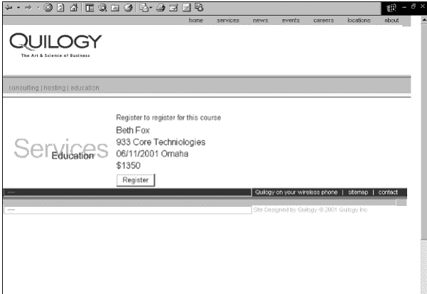

**图10.3**

学生确认页面向用户展示其注册信息，并允许她点击“注册”按钮以实际完成注册。

当用户点击“注册”按钮时，Web表单会提交到服务器，并调用`cmdSubmit_Click`事件过程，如代码清单10.12所示。

#### 代码清单10.12 检查缓存

当用户点击“注册”按钮时，将调用此过程。它会检查缓存，如果该项不再存在，则显示过期消息。

```vbnet
Imports Quilogy.Education.Enrollment
Imports Quilogy.Education
Imports Quilogy.Education.Schedule
Imports System.Configuration
Imports System.Web.Caching

Private Sub cmdSubmit_Click(ByVal sender As System.Object, _
    ByVal e As System.EventArgs) Handles cmdSubmit.Click

    Dim oReg As Registration
    Dim dsEnroll As New EnrollmentData()
    Dim dr As DataRow
    Dim drStud As DataRow
    Dim intEnrollID As Integer

    ' 首先确保课程报价尚未过期
    If Cache(Session("StudentID")) Is Nothing Then
        txtMessage.InnerText = "抱歉。价格报价已过期。" & _
            "请重新选择课程并在20秒内完成注册。"

        cmdSubmit.Visible = False
        Return
    End If

    ' 此处会重定向以处理支付方式
    ' 然后插入注册信息
    Try
        oReg = New Registration( _
            ConfigurationSettings.AppSettings("SQLConnect"))

        ' 构建注册数据集
        dr = dsEnroll.EnrollmentTable.NewRow
        dr(dsEnroll.CLASS_ID) = Request("ClassID")
        dr(dsEnroll.WEB_ENROLL) = "Y"
        dr(dsEnroll.PAYMENT_TYPE) = "CC"

        dsEnroll.EnrollmentTable.Rows.Add(dr)

        drStud = dsEnroll.Tables("Student").NewRow
        drStud(EnrollmentData.STUDENT_ID) = Session("StudentID")

        ' 占位符，因为它不能为空
        drStud(EnrollmentData.LAST_NAME) = "Dummy"

        dsEnroll.Tables("Student").Rows.Add(drStud)
        drStud.SetParentRow(dr)

        ' 注册学生
        intEnrollID = oReg.RegisterStudent(dsEnroll)

        If intEnrollID > 0 Then
            txtMessage.InnerText = "注册成功。谢谢"
            cmdSubmit.Visible = False
        End If

    Catch Ex As Exception
        txtMessage.InnerText = "发生错误: " & Ex.Message
        txtMessage.Style.Item("Color") = "Red"
    End Try
End Sub
```

此过程首先检查缓存以确定学生的项目是否存在，如果不存在，则检查项目是否已被移除。在这种情况下，将显示一条消息，表明价格报价已过期，并且“注册”按钮将被隐藏。如果报价尚未过期，该过程将构建一个`EnrollmentDataSet`数据集，并使用`Registration`类通过调用`RegisterStudent`方法来添加注册。

### 跟踪

为了协助调试和创建应用程序的性能配置文件，ASP.NET在`System.Web`命名空间中包含了一个内置的`TraceContext`对象，该对象存储有关每个请求的信息。此对象附加到`HttpContext`对象，并通过`Trace`属性公开。因此，它也可以通过`Page`对象的`Trace`属性使用。

简而言之，`TraceContext`对象在页面处理时收集每个执行方法的信息，包括计时、显示每个已处理服务器控件及其渲染字节数的控件树、Cookie集合、HTTP头集合和服务器变量。有关每个部分及所呈现信息的完整描述，可以在在线帮助中找到。所有这些信息都可以显示在页面底部或其自己的页面上，方法是像这样请求应用程序的Trace Viewer页面：

`http://ssosa/QuilogyEducation/Trace.axd`

> **注意**：`Trace.axd`文件由`Machine.config`文件中配置的特殊`httpHandler`处理。

显示特定页面跟踪信息的最简单方法是将`Trace`属性添加到页面指令并将其设置为“True”。然后，所有跟踪信息将在页面处理后流式传输到浏览器。这相当于将`TraceContext`对象的`IsEnabled`属性设置为“True”。

要在应用程序级别配置跟踪，可以在`Web.config`文件中包含`trace`元素，如下所示：

```xml
<trace enabled="true" requestLimit="40" pageOutput="false"
       traceMode="SortByTime" localOnly="true" />
```

此配置表示已启用跟踪，并且`pageOutput`设置为`False`，因此即使未修改页面指令，跟踪信息也可以通过`.axd`文件访问。此外，最多将缓存40个请求，并且Trace Viewer只能在托管Web服务器上访问。`traceMode`属性指定自定义跟踪信息在页面中的显示方式。

可以使用`TraceContext`对象的`Write`和`Warn`方法将自定义跟踪信息写入页面。这两个方法都是重载的，支持一个可以包含用户定义类别以便更容易分类消息的参数。这些方法之间的唯一区别是`Warn`以红色写入文本。通常，你会以与ASP开发人员使用`Response.Write`相同的方式使用跟踪——即，检查特定值的存在以调试代码。例如，在代码清单10.12中，可以编写一条跟踪消息以确保费用已存入缓存，如下所示：

```vbnet
Context.Trace.Write("Cache", "Cache=" & Cache(Session("StudentID")))
```

此信息随后会出现在跟踪输出的“跟踪信息”部分，如图10.4所示。

> 同样地，请记住，你可以使用与调试窗体应用程序相同的方式（使用断点、监视等）来调试VB.NET中的Web应用程序。但是，部署应用程序时，请务必通过将`Web.config`文件的`compilation`元素的`debug`属性设置为`False`来关闭调试。

464 企业技术  
第二部分

**图10.4**

应用程序级跟踪输出——注意`Trace.Write`输出出现在初始化事件之后。

### ASP.NET服务器控件

ASP.NET中为开发者带来最多益处的方面，或许就是服务器控件的引入。显然，控件的使用对于VB开发者来说早已熟悉，他们长期以来一直受益于快速应用程序开发以及通过封装到控件中的功能实现的重用。ASP.NET服务器控件依赖于本章前面讨论的事件模型和处理架构，将同样的范式引入到Web开发中。

事实上，服务器控件的架构与ASP.NET如此紧密地结合在一起，以至于本章讨论的`Page`类最终是从基类`System.Web.UI.Control`派生而来的。这样，你可以将ASP.NET页面简单地视为具有额外功能的另一种服务器控件。因此，服务器控件的层次结构可以按图10.5所示进行分解。

如图10.5所示，有五个类直接从`Control`派生。`TemplateControl`类是一个抽象基类，`Page`类和`UserControl`类都是从它派生而来的。正如本节将要讨论的，大多数有趣的类是`HtmlControl`类的后代——它们直接映射到HTML元素，以及`WebControl`的后代——它们通常提供更丰富的接口（如事件），并且不一定映射到HTML控件。

**图10.5**

*ASP.NET服务器控件层次结构——注意`Page`类实际上是`Control`类的后代。*

> **注意**
>
> `LiteralControl`类在ASP.NET页面处理期间用于表示所有没有设置`runat=server`属性的HTML元素。`DataBoundLiteralControl`类表示相同的元素，但允许将元素的`Text`属性持久化到视图状态中。这一点很有用，正如稍后将要讨论的，当使用`<%# . . %>`语法将值绑定到HTML元素时。

### HTML服务器控件

如前所述，任何HTML元素都可以通过在该控件中放置`runat=server`和`ID`属性，或从工具箱中将控件拖放到窗体上，转换为HTML服务器控件。这样做的好处是控件的视图状态会被保存，以便你可以在代码隐藏文件中使用点表示法以编程方式处理该控件。通常，HTML服务器控件应在以下情况使用：修改现有HTML以在ASP.NET下运行，或者控件需要与客户端和服务器脚本进行交互。

> **提示**
>
> 请记住，将HTML元素转换为服务器控件会带来额外的开销，因此只有在需要在服务器端处理该控件时才这样做。

ASP.NET自带了16个直接映射到HTML元素的HTML服务器控件。这些控件如图10.6所示。所有这些控件都从前面图10.5中所示的`HtmlControl`派生，并且存在于`System.Web.UI.HtmlControls`命名空间中。如你所见，HTML服务器控件的主要划分是在从抽象基类`HtmlInputControl`派生的控件与从`HtmlContainerControl`派生的控件之间。顾名思义，`HtmlInputControl`用作在HTML中使用`<input>`标签定义的控件的基类，而`HtmlContainerControl`则定义了必须具有结束标签的控件的成员，例如`<form>`、`<table>`和`<tr>`。

显然，每个控件都暴露了与其控件类型相符的特定属性。例如，在`.aspx`页面中定义为

```html
<a href="http://www.quilogy.com" id="lnkQ">Go to Quilogy!</a>
```

的HTML服务器控件被转换为`HtmlAnchor`类的实例，该类支持`Href`属性和`ServerClick`事件，以便拦截点击并修改目标URL。

如果元素没有映射到任何现有的HTML服务器控件——例如DIV元素——则使用`HtmlGenericControl`类创建该控件。该类支持一组通用的属性和方法，其中最重要的是`InnerText`、`InnerHTML`和`Style`。Quilogy示例应用程序中的多个页面以这种方式使用名为`txtMessage`的DIV标签向用户显示错误和状态信息。

由于并非所有HTML元素的属性（即使是映射到HTML服务器控件的元素）都通过控件暴露出来，每个控件都从`HtmlControl`继承了`Attributes`集合，该集合以名称-值对的形式暴露了为控件设置的所有属性。例如，`HtmlInputText`控件不暴露INPUT标签的`autocomplete`属性，因为它是Microsoft对HTML的扩展。要为在MSIE中运行的名为`txtCity`的控件设置该属性，可以执行以下代码行：

```vbnet
txtCity.Attributes("autocomplete") = "yes"
```

如果你想将HTML服务器控件恢复为HTML元素，只需移除`runat=server`属性，并确保删除`.vb`文件中该控件的声明以及代码中任何对它的引用。如果控件被客户端脚本引用，则必须保留`ID`属性。

### 扩展HTML服务器控件

由于HTML服务器控件是作为托管类实现的，因此可以通过继承来扩展它们。例如，假设你想在`Register.aspx`页面上放置一个TEXTAREA控件，以在注册过程中捕获任何用户评论。如果你想扩展`HtmlTextArea`控件以包含自定义成员或默认某些属性，可以创建如下所示的继承控件`HtmlComments`：

```vbnet
Protected Class HtmlComments : Inherits HtmlTextArea

    Public Sub New()
        MyBase.New()

        ' Set the defaults
        MyBase.Rows = 10
        MyBase.Cols = 50
        MyBase.Value = "Enter your comments here"
    End Sub

    ' Add additional members or override members here
End Class
```

在这种情况下，控件实际上位于`Page`类内部，因此是受保护的；它也可以编译到自己的程序集中，并在不同的应用程序中重用。

然而，对于`HtmlComment`这样的扩展控件，它们必须在页面上以编程方式实例化。这种动态创建通常在预先不知道页面上必须显示多少个控件时非常有用。

> **注意：** 某些服务器控件（如`Repeater`、`DataList`和`RadioButtonList`）在处理控件时会根据从`DataSet`绑定到它的行数自动渲染额外的元素。

这种编程方式创建是通过创建控件的实例并将其放入容器控件中来实现的。如果没有其他合适的容器，ASP.NET提供了Web服务器`Panel`和`PlaceHolder`控件作为容器。`Panel`控件可以添加到`.aspx`页面并适当定位。在这种情况下，`Panel`和`HtmlComments`控件都在类级别声明如下：

```vbnet
Imports System.Web.UI.HtmlControls
Imports System.Web.UI.WebControls

Protected WithEvents InfoPanel As Panel
Protected WithEvents txtComments As HtmlComments
```

然后在`Load`事件中，你可以实例化`HtmlComments`控件并将其添加到`Panel`控件的`Controls`集合中，如下所示：

```vbnet
txtComments = New HtmlComments()
InfoPanel.Controls.Add(txtComments)
```


这样，具有默认属性的新 `TEXTAREA` 控件就会显示在页面上。以编程方式添加的控件会自动纳入页面的视图状态中，并且在表单提交到服务器时将保留其属性。

> **注意：** 动态创建的典型用途是实例化 `LiteralControl` 对象，在构造函数中传递要创建的元素。`LiteralControl` 可用于表示静态 HTML 元素，如水平线（`HR`）或换行符（`BR`）。另一种替代技术是从服务器代码中发出 `Response.Write`。

## Web 服务器控件

您可以使用的第二种 ASP.NET 服务器控件是 Web 服务器控件。这些控件位于 `System.Web.UI.WebControls` 命名空间中，并从 `WebControl` 类或直接从 `System.Web.UI.Control` 派生，如图 10.7 所示。

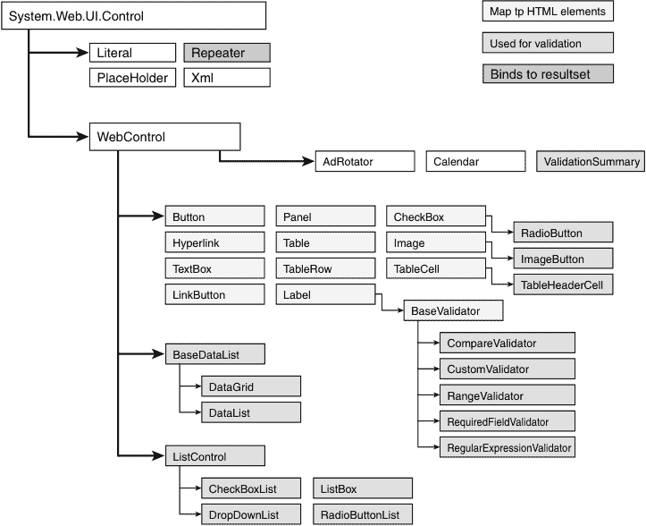

**图 10.7**  
*Web 服务器控件层次结构。*

`Literal`、`PlaceHolder`、`Repeater` 和 `Xml` 控件直接从 `Control` 派生。这是因为这些控件不代表特定的 HTML 元素，而是包含或产生来自其他控件的输出。

图 10.7 还显示，某些 Web 服务器控件（如 `Button`、`Checkbox`、`Hyperlink` 等）直接映射到 HTML 元素，而其他从 `BaseValidator` 派生的控件用于验证输入。还有一些控件能够绑定到 `DataSet` 或 `DataRepeater` 以显示多行数据。`AdRotator` 和 `Calendar` 控件是独立的，因为它们使用多个元素支持其他功能。

由于篇幅限制，无法逐一讨论每种控件类型，本节将重点介绍验证控件、数据绑定、使用移动控件，以及构建在 Quilogy 示例应用程序中使用的 Web 服务器控件。

### 使用验证器

Web 应用程序中最常见的需求之一是验证用户输入。遗憾的是，在过去，这一过程非常复杂，因为开发人员必须处理在哪里执行验证（客户端或服务器），还可能需要根据目标浏览器用多种语言（JavaScript 或 VBScript）编写验证代码。幸运的是，从 `BaseValidator` 派生的 Web 服务器控件（如图 10.7 所示）使这一过程几乎毫不费力，并能处理浏览器问题以及客户端与服务器端验证。在许多方面，验证控件是 Web 服务器控件强大功能的典型示例。

如图 10.7 所示，有六个验证控件（不包括基类 `BaseValidator`），它们处理从确保控件已填充到在服务器上运行自定义验证代码的所有内容。为了说明这些控件的使用，将以 Quilogy 教育示例中需要用户输入的两个页面（`StudentLogin.aspx` 和 `StudentProfile.aspx` 页面）为例。

学生资料页面既收集想要注册网站的用户数据，也显示已注册用户的资料以供编辑。该页面要求填写姓氏和电子邮件地址，并验证电子邮件地址、邮政编码和电话号码（如已提供）的格式。清单 10.13 和 10.14 显示了 `.aspx` 页面和代码隐藏文件。请注意，验证控件以粗体显示。

**清单 10.13** 使用验证控件的 `StudentProfile.aspx` 页面。此页面展示了 `RequiredValidator` 和 `RegularExpressionValidator` 控件的使用。

```aspx
<%@ Page Language="vb" AutoEventWireup="false" Codebehind="studentprofile.aspx.vb" Inherits="QuilogyEducation.studentprofile" EnableSessionState="True" %>

<HTML>

  <HEAD>

    <TITLE>Student Profile</TITLE>

    <meta name="GENERATOR" content="Microsoft Visual Studio.NET 7.0">

    <meta name="CODE_LANGUAGE" content="Visual Basic 7.0">

    <meta name="vs_defaultClientScript" content="JScript">

    <meta name="vs_targetSchema" content="Internet Explorer 5.0">

    <LINK href="supplemental/site.css" type="text/css" rel="stylesheet">

  </HEAD>

<body MS_POSITIONING="GridLayout">

	<!-- #include file="navbar.htm" -->

	<TABLE cellSpacing=0 cellPadding=0 width="100%" border=0>

		<TR>

			<TD align=left bgColor=#f3f0de>

				<TABLE cellSpacing=0 cellPadding=0 border=0>

					<TR>

						<TD valign=center align=left width=211>

							

						</TD>

						<TD width=529 class="body-copy">

							<div class="body-copy" id="txtMessage" runat="server">

								<strong>Enter your information and click Save!</strong>

							</div>

						</TD>

					</TR>

				</TABLE>

			</TD>

		</TR>

	</TABLE>

	<asp:ValidationSummary id=ValidationSummary

		runat="server" ShowMessageBox=True CssClass="body-copy"

		DisplayMode= BulletList HeaderText="Errors occurred.">

	</asp:ValidationSummary>

	<!-- Place content here -->

	<form id="studentprofile" method=post runat="server">

		<table>

			<tr class="body-copy">

				<td><strong>First Name</strong></td>

				<td>

					<asp:TextBox ID="txtFName" Runat="server"

						Text="<%# mdrStud(mdsStud.FIRST_NAME).ToString %>">

					</asp:TextBox>

				</td>

				<td><strong>Last Name</strong></td>

				<td>

					<asp:RequiredFieldValidator id=LNameValidator

						ControlToValidate="txtLName" Display=Dynamic

						CssClass="body-copy" runat="server"

						ErrorMessage="Last Name is required" Text="">

					</asp:RequiredFieldValidator>

				</td>

				<td>

					<asp:TextBox ID="txtLName" Runat="server"

						Text="<%# mdrStud(mdsStud.LAST_NAME).ToString %>">

					</asp:TextBox>

				</td>

			</tr>

			<tr class="body-copy">

				<td><strong>Organization</strong></td>

				<td>

					<asp:TextBox ID="txtOrg" Runat="server"

						Text="<%# mdrStud(mdsStud.ORGANIZATION).ToString %>">

					</asp:TextBox></td>

				<td><strong>Email</strong>

				<asp:RequiredFieldValidator id="lReceiveName"

				ControlToValidate="txtEmail" Display=Dynamic

				CssClass="body-copy" runat="server"

				ErrorMessage="Email address is required"

				Text="**">

				</asp:RequiredFieldValidator>

				<asp:RegularExpressionValidator

				id="EmailAtValidator" runat="server"

				ErrorMessage="Email Address must contain @"

				ValidationExpression="(.+)@(.+)"

				Display=Static Text="*" CssClass="body-copy"

				ControlToValidate="txtEmail">

				</asp:RegularExpressionValidator>

				</td>

				<td>

				<asp:TextBox ID="txtEmail" Runat="server"

				Text="<%# mdrStud(mdsStud.EMAIL).ToString %>" >

				</asp:TextBox></td>

				</tr>

				<tr class="body-copy">

				<td><strong>Address</strong></td>

				<td colspan=3>

				<asp:TextBox ID="txtAddress" Runat="server"

				Text="<%# mdrStud(mdsStud.ADDRESS).ToString %>"

				width=407px height="26px" >

				</asp:TextBox></td>

				</tr>

				<tr class="body-copy">

				<td><strong>City</strong></td>

				<td>

				<asp:TextBox ID="txtCity" Runat="server"

				Text="<%# mdrStud(mdsStud.CITY).ToString %>" >

				</asp:TextBox></td>

				<td>

				<strong>State</strong></td>

				<td>

				<asp:TextBox ID="txtState" Runat="server"

				Text="<%# mdrStud(mdsStud.STATE).ToString %>"

				width=41px height="26px" >

				</asp:TextBox>&nbsp;&nbsp;&nbsp;&nbsp;

				<strong>Zip&nbsp;</strong>

				<asp:RegularExpressionValidator id=ZipValidator

					runat="server"

					ErrorMessage="Zip Code not formatted correctly"

					ValidationExpression="[0-9]{5}-[0-9]{4}|[0-9]{5}"

					Display=Static Text="*" CssClass="body-copy"

					ControlToValidate="txtZip"></asp:RegularExpressionValidator>

				<asp:TextBox ID="txtZip" Runat="server"

					Text="<%# mdrStud(mdsStud.ZIP_CODE).ToString %>"

					width=70px height="24px" >

				</asp:TextBox></td>

				</tr>

				<tr class="body-copy">

				<td><strong>Phone</strong>

				<asp:RegularExpressionValidator

					id="PhoneValidator" runat="server"

					ErrorMessage="Phone must be (xxx) xxx-xxxx"

					ValidationExpression="(\([0-9][0-9][0-9]\) [0-9][0-9][0-9]-[0-9][0-9][0-9][0-9])"

					Display=Static Text="*" CssClass="body-copy"

					ControlToValidate="txtPhone"></asp:RegularExpressionValidator></td>

				<td>

					<asp:TextBox ID="txtPhone" Runat="server"

						Text="<%# mdrStud(mdsStud.PHONE).ToString %>" >

					</asp:TextBox></td>

				<td>

					<asp:Button ID="cmdSave" Text="Save" Runat="server"

						accesskey=s height="24px" width="78px">

					</asp:Button>

				</td>

				</tr>

				</table>

				</form>

				</TD>

				</TR>

				</TABLE>

				</TD>

				</TR>

				</TABLE>

				<!-- #include file="bottombar.htm" -->

				</body>

				</HTML>
```

**清单 10.14** `StudentProfile.aspx` 页面的代码隐藏文件。请注意，如果验证控件通过验证，`IsValid` 属性将返回 `True`。

```vbnet
Option Strict Off

Imports System.Drawing

Imports System.Web.UI.WebControls

Imports System.Web.UI.HtmlControls

Imports Quilogy.Education

Imports Quilogy.Education.Enrollment

Imports System.Data

Imports System.Configuration

Imports System.Web.Security

Public Class studentprofile

    Inherits System.Web.UI.Page

    Protected WithEvents txtLName As System.Web.UI.WebControls.TextBox

    Protected WithEvents txtPhone As System.Web.UI.WebControls.TextBox

    Protected WithEvents txtFName As System.Web.UI.WebControls.TextBox

    Protected WithEvents txtCity As System.Web.UI.WebControls.TextBox

    Protected WithEvents txtEmail As System.Web.UI.WebControls.TextBox

    Protected WithEvents cmdSave As System.Web.UI.WebControls.Button

    Protected WithEvents txtZip As System.Web.UI.WebControls.TextBox

    Protected WithEvents txtState As System.Web.UI.WebControls.TextBox

    Protected WithEvents txtOrg As System.Web.UI.WebControls.TextBox

    Protected WithEvents txtAddress As System.Web.UI.WebControls.TextBox

    Protected WithEvents txt Governor As _

        System.Web.UI.HtmlControls.HtmlGenericControl

    Protected mdsStud As StudentData

    Protected WithEvents LNameValidator As _
```


```vbnet
System.Web.UI.WebControls.RequiredFieldValidator

Protected WithEvents ValidationSummary As _
    System.Web.UI.WebControls.ValidationSummary

Protected WithEvents EmailValidator As _
    System.Web.UI.WebControls.RequiredFieldValidator

Protected WithEvents ZipValidator As _
    System.Web.UI.WebControls.RegularExpressionValidator

Protected mdrStud As DataRow

Protected Sub Page_Init(ByVal Sender As System.Object, _
    ByVal e As System.EventArgs) Handles MyBase.Init

    'CODEGEN: This method call is required by the Web Form Designer

    'Do not modify it using the code editor.

    InitializeComponent()

End Sub

End Class
```

### 清单 10.14 续

```vbnet
Private Sub Page_Load(ByVal sender As System.Object, _
    ByVal e As System.EventArgs) Handles MyBase.Load

    If Not Me.IsPostBack Then

        If Context.User.Identity.IsAuthenticated Then

            ' Go get the studentData

            Dim oStud As New Students( _
                (ConfigurationSettings.AppSettings("SQLConnect").ToString)

            mdsStud = oStud.GetStudent(Session("StudentID"))

            mdrStud = mdsStud.StudentTable.Rows(0)

            txtMessage().InnerText = "Profile for " & _
                Session("StudentName")

        Else

            ' Create an empty StudentData DataSet with a single row

            mdsStud = New StudentData()

            mdrStud = mdsStud.StudentTable.NewRow

            txtMessage().InnerText = _
                "To become a registered user enter your info and click Save."

        End If

        ' Bind all of the controls on the page

        Me.DataBind()

    End If

End Sub

Protected Sub cmdSave_Click(ByVal sender As System.Object, _
    ByVal e As System.EventArgs) Handles cmdSave.Click

    Dim intStudentID As Integer

    Dim oStud As Students

    Dim dsStud As StudentData

    Dim dr As DataRow

    ' First see if the form is valid

    If Not Me.IsValid Then

        Return

    End If

    ' Place the data into the DataSet

    dsStud = FillDs()

    Try

        ' Create the student object

        Dim strConnect As String

        strConnect = _
            ConfigurationSettings.AppSettings("SQLConnect").ToString

        oStud = New Students(strConnect)

        ' Save the student data

        intStudentID = oStud.Save(dsStud)

        If intStudentID > 0 Then

            txtMessage().InnerText = "Profile Successfully Saved."

            txtMessage().Style.Item("Color") = "Green"

            ' If they're a new student then setup

            ' their session and authentication

            If Session("StudentID") Is Nothing Then

                txtMessage().InnerText &= _
                    " Your password has been set to your email address."

                Session("StudentID") = intStudentID

                ' Set the authentication cookie

                FormsAuthentication.SetAuthCookie(txtEmail.Text, False)

            End If

            dr = dsStud.StudentTable.Rows(0)

            Session("StudentName") = dr(StudentData.FIRST_NAME).ToString _
                & " " & dr(StudentData.LAST_NAME).ToString

            cmdsave.Visible = False

            Return

        End If

    Catch Ex As Exception

        txtMessage().InnerText = "An error occurred: " & Ex.Message

        txtMessage().Style.Item("Color") = "Red"

    End Try

End Sub

Private Function FillDs() As StudentData

    Dim dr As DataRow

    Dim dsStud As New StudentData()

    Try

        dr = dsStud.StudentTable.NewRow

        If Not Session("StudentID") Is Nothing Then

            dr(StudentData.STUDENT_ID) = Session("StudentID")

        End If

        dr(StudentData.FIRST_NAME) = txtFName.Text

        dr(StudentData.LAST_NAME) = txtLName.Text

        dr(StudentData.ORGANIZATION) = txtOrg.Text

        dr(StudentData.ADDRESS) = txtAddress.Text

        dr(StudentData.CITY) = txtCity.Text

        dr(StudentData.STATE) = txtState.Text

        dr(StudentData.EMAIL) = txtEmail.Text

        dr(StudentData.PHONE) = txtPhone.Text

        dr(StudentData.ZIP_CODE) = txtZip.Text

        ' Add the row to the DataSet if building it

        dsStud.StudentTable.Rows.Add(dr)

        ' Note that this will validate data entry as well

        Return dsStud

    Catch e As Exception

        txtMessage().InnerText = "An error occurred: " & e.Message

        txtMessage().Style.Item("Color") = "Red"

    End Try

End Function

End Class
```

在清单 10.13 中，页面顶部附近有一个`ValidationSummary`控件。该控件允许你将表单上任何其他验证控件报告的所有错误消息集中显示在一个地方。通过这种方式，消息可以集中管理，用户无需在页面上四处查找错误消息。请注意，`DisplayMode`属性设置为`BulletList`，表示错误将在`HeaderText`正下方以项目符号列表的形式显示。`ShowMessageBox`属性在客户端执行验证时生效，除了将错误打印到验证摘要控件外，还会显示一个包含所有错误的消息框。

> **注意**
>
> 错误消息默认以红色打印。这可以通过设置控件的属性（如`ForeColor`）或使用层叠样式表（CSS）来更改。在本例中，`CSSClass`属性设置为`"body-copy"`，该属性根据页面顶部`LINK`标签中链接的样式表来设置字体。

### 企业技术

#### 第二部分

默认情况下，如果浏览器支持 DHTML，验证控件会在客户端执行验证。这是因为客户端验证可以减少服务器往返次数，使应用程序响应更迅速。若要强制对单个控件进行服务器端验证，可以将该控件的`EnableClientScript`属性设置为`False`；而对于整个页面，可以将 Page 指令的`ClientTarget`属性设置为`"downlevel"`。

> **注意**
>
> 同样地，可以通过将验证控件的`Enabled`属性设置为`False`来在服务器端禁用验证。如果必须从客户端脚本禁用验证，可以将`Page_ValidationActive`全局变量设置为`False`。该变量包含在使用客户端验证的页面上，通过一个随页面包含的 JavaScript 文件（`WebUIValidation.js`）来实现。

实际的验证发生在将其他某个验证控件放置到`.aspx`页面上时。例如，`RequiredFieldValidator`控件被放置在与姓氏列标签相同的单元格中。请注意，`ControlToValidate`字段引用了必填控件，`Display`属性设置为`Dynamic`。基本上，在支持 DHTML 的浏览器上，这决定了页面是否为错误消息预留空间（通过用于显示错误消息的`SPAN`标签的`Visible`属性）。预留空间可以确保显示错误消息时不会对页面布局产生不利影响。此外，`ErrorMessage`和`Text`属性都被设置了。通常，你只会设置`ErrorMessage`属性，但在本例中，由于页面包含一个`ValidationSummary`控件，`Text`属性指定了将在验证控件位置显示的消息，而`ErrorMessage`则显示在`ValidationSummary`控件中。通过这种方式，你可以向用户提供视觉提示，指出哪些字段存在错误，同时将所有错误消息集中在一个地方显示。例如，图 10.8 显示了当用户未输入任何信息时出现的学员个人资料页面。

> **提示**
>
> 使用带有客户端验证的`RequiredFieldValidator`的一个优点是，如果用户删除必填控件的内容，当控件失去焦点时错误消息会立即显示，而不是像通常情况那样在即将提交表单时才显示。然而，如果使用了`ValidationSummary`控件，则只有`Text`属性会显示为可见。与摘要控件关联的`ErrorMessage`在表单提交之前不会变为可见。

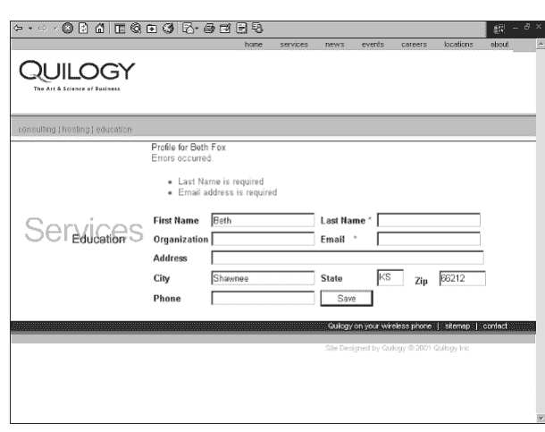

**图 10.8**  
*验证控件检测到错误时的`StudentProfile.aspx`页面。*

清单 10.13 中发现的第三种验证控件是`RegularExpressionValidator`。这里它被用于确保电子邮件地址包含`"@"`，并且邮政编码和电话号码格式正确。请注意，`ValidationExpression`属性填充了一个正则表达式。在`EmailAtValidator`控件的情况下，该表达式确保至少有一个字符`(.)+`位于`"@"`符号（`@`）之前，后面再跟至少一个字符`(.)+`。其他正则表达式可以在邮政编码和电话号码中看到。

在单个控件成为两个验证控件的目标的情况下，它们的触发顺序存在优先级。在本例中，`RequiredFieldValidator`首先触发，其次是`RegularExpressionValidator`。

> **提示**
>
> 可能看起来奇怪的是，没有验证控件检查输入到控件中的文本是否为特定长度。然而，你可以轻松实现此功能（如`StudentLogin.aspx`页面中的密码字段所示），方法是使用带有`ValidationExpression`的`RegularExpressionValidator`，例如`"(.){5,10}"`。翻译过来，这意味着控件可以包含至少 5 个、最多 10 个任意字符。

## 处理验证

使用客户端验证时，当所有经过验证的控件通过测试后，表单会回发到服务器，然后可以进行正常处理。然而，如果验证控件实际上在服务器上执行验证，则验证会在引发回发的服务器事件之前发生。如果遇到错误，验证控件除了报告错误之外，不会采取任何特殊操作，而是简单地将各个控件和 Page 对象的`IsValid`属性设置为`False`。因此，服务器上的代码在继续处理之前必须检查该值。请注意，清单 10.14 中所示 Page 类的`cmdSave_Click`方法在尝试将配置文件保存到数据库之前检查了 Page 的`IsValid`属性。不检查此属性会导致错误报告给客户端，但正常处理仍会继续。

与其他服务器控件一样，验证控件可以在代码隐藏文件中进行操作。例如，你可以根据从数据库读取的数据以编程方式更改`ValidationExpression`属性。虽然这是可行的，但请记住，由于验证控件实际上是在自定义代码运行之前处理的，因此你需要手动调用验证控件的`Validate`方法，以使用新的属性值重新验证。

### 自定义验证

虽然在 Quilogy 教育站点中没有使用，但你当然可以选择自定义验证过程。这可以通过在服务器上向页面添加`CustomValidator`控件并将其`ControlToValidate`属性设置为适当的控件来完成。然后，在页面类中，你可以创建一个方法来处理该控件的`ServerValidate`事件，其签名如下（其中`CustomValidator`是`CustomValidator`控件的名称）：

```vbnet
Protected Function CustomValidator_ServerValidationFunction(
    ByVal source As System.Object,
    ByVal value As System.String) As Boolean
```

该方法通过引用包含被验证控件值的`value`参数来执行验证。从此函数返回`True`表示验证成功。例如，可以使用此技术根据从数据库读取的值动态验证控件。

类似的技术可以通过用客户端函数的名称填充`ClientValidationFunction`属性来在客户端进行自定义验证，如下所示：

```aspx
<asp:CustomValidator id="CustomValidator1" runat="server"
    ControlToValidate="txtEmail"
    ErrorMessage="Email address must contain an @"
    ClientValidationFunction="validateEmail(obj, val)">
</asp:CustomValidator>
```


与服务器验证一样，`obj` 和 `val` 参数分别代表 `CustomValidator` 和要验证的控件的值。

你可以使用其他验证控件 `CompareValidator` 和 `RangeValidator`，将控件的值与字面量或另一个控件进行比较，检查数据类型，以及以类似方式检查最小值和最大值。

### 使用数据绑定

当然，服务器控件最强大的用途之一是显示从数据库检索的数据。为此，ASP.NET 支持将数据绑定到单个值，或通过特定的 Web 服务器控件（如 `Repeater`、`DropDownList`、`DataList` 和 `DataSet`）绑定到整个结果集。

### 简单数据绑定

事实上，你可以通过使用数据绑定表达式，将 `Page` 类公开的任何属性或字段绑定到 ASP.NET 页面中的任何属性。例如，考虑清单 10.13 中的代码。Web 服务器 `TextBox` 控件用于显示学生的配置文件信息。此信息使用 `Students` 数据访问类的 `GetStudent` 方法从数据库查询。生成的行被放置在一个名为 `mdrStud` 的页面级变量中，然后使用以下语法绑定到控件的各个 `Text` 属性：

```aspx
<asp:TextBox Id="txtFName" Runat="server"
    Text="<%# mdrStud(mdsStud.FIRST_NAME).ToString %>">
</asp:TextBox>
```

数据绑定表达式本身包含在 `<%# %>` 标签中，在本例中，使用公开的常量 `FIRST_NAME` 提取名字列。

此外，为了计算绑定表达式并将其放置在适当的属性中，必须调用控件或整个页面的 `DataBind` 方法。在此示例中，清单 10.14 在页面的 `Load` 事件中包含以下行：

```vb
Me.DataBind
```

> **提示**
>
> 虽然数据绑定在页面中显示适当的值，并且视图状态通过多次往返服务器跟踪这些值，但底层属性或变量不会更新。换句话说，`mdrStud` `DataRow` 不会更新以反映用户键入的值，因为大多数 Web 应用程序用于只读数据。因此，`StudentProfile` 类包含 `FillDs` 方法，用于在用户尝试保存更改时从控件中提取值并将其放入 `DataRow`。

### 绑定到结果集

除了绑定到单个值之外，某些 Web 服务器控件还支持绑定到 `DataReader` 或 `DataSet` 以显示整个结果集。图 10.7 突出显示了执行此操作的控件。这通常是最简单的显示整个结果集的方式。

为了说明其工作原理，`Schedule.aspx` 页面包含一个名为 `dgSchedule` 的 `DataGrid` Web 服务器控件，其相关部分如清单 10.15 和 10.16 所示。

**清单 10.15** 使用 `DataGrid`。此 `Schedule.aspx` 页面的摘录说明了使用具有显式定义列的 `DataGrid`。

```aspx
<ASP:DataGrid id="dgSchedule" runat="server" CssClass="body-copy"
    Width="920px" ShowFooter="True"
    CellPadding="3" BackColor="#f3f0de"
    BackImageUrl="/QuilogyEducation/supplemental/education-main.jpg">

    <Columns>
        <asp:TemplateColumn ItemStyle-CssClass="caption">
            <ItemTemplate>
                <a href="/QuilogyEducation/registered/Register.aspx?ClassID=
                    <%# Container.DataItem("ClassID") %>
                    &Course=<%# Trim(Container.DataItem("CourseNum")) & " " & _
                    Container.DataItem("Description") %>&When=<%# Container.DataItem( _
                    "ClassDate") & " " & Container.DataItem("City") %>">Sign me up</a>
            </ItemTemplate>
        </asp:TemplateColumn>

        <asp:BoundColumn DataField="ClassDate" HeaderText="Date"
            HeaderStyle-Font-Bold="True" SortExpression="ClassDate" />

        <asp:BoundColumn DataField="City" HeaderText="Location"
            HeaderStyle-Font-Bold="True" SortExpression="City" />

        <asp:TemplateColumn HeaderText="Course" HeaderStyle-Font-Bold="True"
            SortExpression="CourseNum">
            <ItemTemplate>
                <a href="ClassDetail.aspx?ClassID=<%# Container.DataItem("ClassID") %>">
                    <%# Container.DataItem("Vendor") & " " & _
                    Trim(Container.DataItem("CourseNum")) & ": " & _
                    Container.DataItem("Description") & " (" & _
                    Container.DataItem("Days") & " days)" %>
                </a>
            </ItemTemplate>
        </asp:TemplateColumn>
```

**清单 10.15** 续

```aspx
        <asp:BoundColumn DataField="Product" HeaderText="Product"
            HeaderStyle-Font-Bold="True" SortExpression="Product" />

        <asp:BoundColumn DataField="StartTime" HeaderText="Start Time"
            HeaderStyle-Font-Bold="True" SortExpression="StartTime" />
    </Columns>
</ASP:DataGrid>
```

**清单 10.16** 绑定到 `DataGrid`。此清单显示了如何将 `DataSet` 绑定到 `DataGrid` 控件。

```vb
Option Strict Off

Imports Quilogy.Education
Imports Quilogy.Education.Schedule
Imports System.Configuration
Imports System.Web.UI.WebControls
Imports System.Web.UI

Public Class Schedule : Inherits System.Web.UI.Page

    Protected WithEvents dgSchedule As System.Web.UI.WebControls.DataGrid

    Protected WithEvents txtMessage As _
        System.Web.UI.HtmlControls.HtmlGenericControl

#Region " Web Form Designer Generated Code "

    'This call is required by the Web Form Designer.
    <System.Diagnostics.DebuggerStepThrough()> _
    Private Sub InitializeComponent()
    End Sub

    Protected Sub Page_Init(ByVal Sender As System.Object, _
        ByVal e As System.EventArgs) Handles MyBase.Init

        'CODEGEN: This method call is required by the Web Form Designer
        'Do not modify it using the code editor.
        InitializeComponent()

        ' Allow paging and sorting
        dgSchedule.AllowPaging = True
        dgSchedule.PagerStyle.Mode = Web.UI.WebControls.PagerMode.NumericPages
        dgSchedule.PagerStyle.PageButtonCount = 5
        dgSchedule.PageSize = 10
        dgSchedule.AutoGenerateColumns = False
        dgSchedule.AllowSorting = True
    End Sub
```

### 代码清单 10.16 续

```vb
#End Region

Private Sub Page_Load(ByVal sender As System.Object, _
                      ByVal e As System.EventArgs) Handles MyBase.Load

    'Put user code to initialize the page here
    If Not Me.IsPostBack Then
        GetSchedule("")
    End If
End Sub

Private Sub GetSchedule(ByVal pSort As String)

    Dim oClasses As Classes
    Dim dsSched As ScheduleData
    Dim flDesc As Boolean = False

    If Not Request("Vendor") Is Nothing Then

        ' Try and get the schedule
        Try
            oClasses = New Classes( _
                ConfigurationSettings.AppSettings("SQLConnect"))

            dsSched = oClasses.GetSchedule(Request("Location"), _
                Request("Vendor"), Request("Advance"))

            dgSchedule.DataSource = dsSched.OfferingsTable.DefaultView

            ' Add to the state bag if not already present
            If Me.ViewState("SortField") Is Nothing Then
                Me.ViewState.Add("SortField", pSort)
                Me.ViewState.Add("SortDesc", True) ' default to true
            End If

            ' Toggle the sort if we're clicking on the same column
            If pSort <> "" And pSort = Me.ViewState("SortField").ToString Then
                flDesc = Not Me.ViewState("SortDesc")

                If flDesc Then
                    pSort = pSort & " DESC"
                Else
                    pSort = pSort & " ASC"
                End If
            End If

            ' Set the field and order in the StateBag
            Me.ViewState("SortDesc") = flDesc
            Me.ViewState("SortField") = pSort

            ' Sort the table
            dsSched.OfferingsTable.DefaultView.Sort = pSort
            dgSchedule.DataBind()

        Catch Ex As Exception
            txtMessage().Style.Item("Color") = "Red"
            txtMessage.InnerText = "An error occurred: " & Ex.Message
        End Try
    End If
End Sub

Private Sub dgSchedule_SortCommand(ByVal source As Object, _
    ByVal e As System.Web.UI.WebControls.DataGridSortCommandEventArgs) _
    Handles dgSchedule.SortCommand

    ' Sort by the sort expression of the bound column
    GetSchedule(e.SortExpression)
End Sub

Private Sub dgSchedule_PageIndexChanged(ByVal source As Object, _
    ByVal e As System.Web.UI.WebControls.DataGridPageChangedEventArgs) _
    Handles dgSchedule.PageIndexChanged

    ' Make sure the page index gets changed to the new page
    dgSchedule.CurrentPageIndex = e.NewPageIndex
    GetSchedule("")
End Sub

End Class
```


在代码清单 10.16 中，`GetSchedule` 方法从页面的 Load 事件调用，负责根据包含供应商、地点和课程提前天数的查询字符串来检索课程表。`GetSchedule` 方法从 `Classes` 数据访问类的 `GetSchedule` 方法获取一个 `ScheduleData` `DataSet`（在第 7 章“使用 ADO.NET 访问数据”中讨论）。然后，`dgSchedule` `DataGrid` 的 `DataSource` 属性被设置为 `OfferingsTable` `DataTable` 的 `DefaultView` 属性，并根据传入方法的可能排序表达式进行排序。然后执行 `DataGrid` 的 `DataBind` 方法，自动将视图的每一行绑定到网格。

`DataGrid` 本身在代码清单 10.15 所示的 `.aspx` 页面中定义。`GetSchedule` 方法中的 `AutoGenerateColumns` 属性设置为 `False`，以便可以显式指定绑定。当你有想要隐藏的列，或者列基于多个列计算得出的表达式时（如此处的情况），这非常方便。

此处的 `DataGrid` 包含两种不同类型的列，由 `BoundColumn` 和 `TemplateColumn` 元素表示。

> **提示**
>
> `DataGrid` 还支持 `ButtonColumn`、`EditCommandColumn` 和 `HyperlinkColumn` 元素，以各种方式显示数据。

使用 `BoundColumn` 元素很简单，允许你指定 `DataField`、`HeaderText`、`HeaderStyle` 和 `SortExpression` 等属性。例如，City 列被定义为简单地从 `DataSet` 显示“City”列，标题为粗体的“Location”。如果网格的 `AllowSorting` 属性设置为 `True`，并且如此处所示设置了列的 `SortExpression`，则会在列标题上生成超链接并执行回发以引发 `DataGrid` 的 `SortCommand` 事件。如你在代码清单 10.16 中所见，此事件然后需要带有适当排序列的课程表。

> **注意**
>
> 先前排序状态的跟踪前面已在“状态包”部分讨论过，此处不再重复。

此外，通过使用 `AllowPaging` 属性启用分页并在 `Page_Init` 事件中设置各种分页属性，`DataGrid` 将显示行的子集（本例中一次 10 行）并包含导航链接。单击链接将触发 `DataGrid` 的 `PageIndexChanged` 事件，其中新页面将在 `DataGridPageChangedEventArgs` 对象的 `NewPageIndex` 属性中可用。

此处显示的另一种列类型是 `TemplateColumn`。其他 Web 服务器控件，如 `Repeater`（在 `Transcript.aspx` 页面中使用）和 `DataList` 也公开模板列，以在显示列时提供最大的灵活性。在 `DataGrid` 中，`TemplateColumn` 元素本身支持四个子元素，包括 `ItemTemplate`、`EditItemTemplate`、`HeaderTemplate` 和 `FooterTemplate`。正如你可能已经猜到的，当网格不处于编辑模式时，`ItemTemplate` 元素的内容用于显示该列，而 `EditItemTemplate` 可用于渲染 `DropDownList`、`TextBox` 或其他可编辑控件。这样，提供网格的就地编辑就很简单了。顾名思义，`HeaderTemplate` 和 `FooterTemplate` 元素只是在生成的 HTML 表格的列页眉和页脚部分渲染 HTML。

在代码清单 10.15 中，名为“Course”的模板列实际上是 `DataSet` 中多个列的串联。使用引用 `Container` 对象的数据绑定表达式来访问这些列。此对象表示 `DataGrid` 控件中的当前 `DataGridItem`（代表行），用于绑定 `DataRow` 中的适当列。基本上，这就是使用 `BoundColumn` 时在后台发生的事情。

> 你还可以使用 `DataBinder` 类的共享 `Eval` 方法来执行绑定。此方法使用反射动态评估表达式，可用于输出字符串以供显示。例如，代码：
>
> ```aspx
> <%# DataBinder.Eval(Container.DataItem, "Cost", "{0:c}") %>
> ```
>
> 可用于将成本格式化为区域设置特定的货币字符串。然而，使用 `Eval` 也更为昂贵，因为使用反射来动态检索类型信息。

代码清单 10.15 中显示的另一个模板列更为复杂，因为它生成一个超链接以导航到受保护的 `Register.aspx` 页面。图 10.9 显示了生成的课程表。

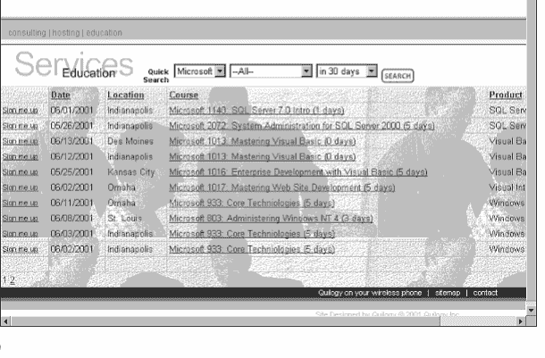

**图 10.9**

此页面使用 `DataGrid` 控件和自定义模板列实现。

尽管 `DataGrid`、`DataList` 或 `Repeater` 控件公开类似的基本功能，但在确定使用哪个时，你的决策应基于控件的灵活性及其提供的功能与实现成本（就开发工作和性能而言）之间的权衡。例如，`DataList` 支持额外的模板类型，如 `AlternatingColumn`，可以产生多列布局，并使用 SPAN 标签而不是 HTML TABLE 渲染。网格允许分页和自动排序，而 `DataList` 不支持。

除了绑定到 `DataGrid` 和 `DataList` 等控件之外，从 `ListControl` 派生的控件还支持将数据绑定到结果集。当你需要用数据库中的项填充 `DropDownList` 控件时，这很方便，正如在 `QSearch.ascx` 用户控件中所做的那样。该控件包含供应商和地点的下拉列表，以及用户可以从以下定义中选择查询课程表的提前天数：

```aspx
<asp:DropDownlist class=body-copy id=cboVendor runat="server">
</asp:DropDownList></TD>

<asp:DropDownlist class=body-copy id=cboLocation runat="server">
</asp:DropDownList>

<asp:DropDownlist class=body-copy id=cboThru runat="server">
</asp:DropDownList>
```

尽管用户控件将在本章后面更详细地介绍，但目前，代码清单 10.17 显示了该控件的相关代码。

### 代码清单 10.17 填充绑定列表控件

此 `QSearch.ascx` 控件的摘录使用 `DataReader` 和单个存储过程填充供应商和地点下拉列表。

```vb
Option Strict Off

Imports System.Web.UI.WebControls
Imports System.Data.SqlClient
Imports System.Data
Imports System.Configuration

Private Sub LoadControls()

    ' Load the drop downs
    cboThru.Items.Add(New ListItem("in 30 days", "30"))
    cboThru.Items.Add(New ListItem("in 60 days", "60"))
    cboThru.Items.Add(New ListItem("in 90 days", "90"))
    cboThru.Items.Add(New ListItem("in 120 days", "120"))
    cboThru.Items.Add(New ListItem("--All--", "0"))
```

### 示例 10.17（续）

```vb
Dim dr As SqlDataReader

Dim cn As New SqlConnection(
    ConfigurationSettings.AppSettings("SQLConnect"))

Dim cm As New SqlCommand("usp_GetSearch", cn)

Try

    ' Open the connection and execute the DataReader
    cn.Open()
    cm.CommandType = CommandType.StoredProcedure
    dr = cm.ExecuteReader()

    ' Use Databinding
    With cboVendor
        .DataSource = dr
        .DataTextField = "Name"
        .DataValueField = "VendorID"
        .DataBind()
    End With

    ' Get the next resultset
    dr.NextResult()

    With cboLocation
        .DataSource = dr
        .DataTextField = "City"
        .DataValueField = "LocID"
        .DataBind()
    End With

Catch E As Exception
    txtMessage.InnerText = "The controls could not be populated:" & E.Message
    txtMessage.Style("Color") = "Red"

Finally

    ' Cleanup
    If Not dr Is Nothing Then dr.Close()

    ' Now add the items to get all the values
    cboLocation.Items.Add(New ListItem("--All--", 0))
    cboVendor.Items.Add(New ListItem("--All--", 0))

End Try

End Sub
```

`LoadControls` 方法在页面加载时被调用，首先手动为 `cboThru` 控件填充 30、60、90 天等未来日期的选项。

> **注意**
>
> 这些值也可以使用 `ListItem` 元素直接在 `.aspx` 或 `.ascx` 页面中内联定义。

接下来，实例化一个 `SqlConnection` 对象，以及一个 `SqlDataReader` 和 `SqlCommand`。`usp_GetSearch` 存储过程仅包含从数据库中的 `Vendor` 和 `Product` 表检索行的 SELECT 语句。然后使用 `SqlCommand` 的 `ExecuteReader` 方法执行该存储过程。数据绑定是通过简单地将 `cboVendor` 和 `cboLocation` 控件的 `DataSource` 属性设置为 `SqlDataReader`，并将 `DataTextField` 和 `DataValueField` 属性分别设置为要显示的字段和选中时要返回的字段来实现的。与之前一样，接着调用 `DataBind` 方法来执行绑定。

然而，这个示例的有趣之处在于，由于两个结果集都是由同一个存储过程生成的，因此调用了 `SqlDataReader` 的 `NextResult` 方法来返回下一个结果集。结果是，通过一次往返数据库服务器即可填充这两个控件，并且避免了在 Web 服务器上创建 `DataSet` 的开销。这使得查询效率极高。

> **注意**
>
> 本示例并未严格遵守将所有数据访问操作放在独立数据访问类中的架构。但在这种情况下，`usp_GetSearch` 存储过程很可能是该应用程序特有的，因此没有必要创建专门的共享类来封装它。请记住，严格遵循任何架构都会带来相应的成本，你应该根据实际情况判断何时才是真正具有成本效益的。

## 使用移动端控件

你可以想象，由于服务器控件在服务器端完全渲染，并能根据浏览器类型自定义输出，因此它们是针对各种设备提供内容的理想选择。为此，微软在发布 .NET Framework 的同时还发布了 .NET Mobile SDK，以支持多种设备，包括 Pocket PC、使用无线标记语言（WML）的无线应用协议（WAP）手机（例如 Sprint PCS TouchPoint 手机），以及所谓的“智能手机”（例如近期以代号“Stinger”开发的手机）。该 SDK 的核心思想是为这些小型设备上的 Web 应用程序实现“一次编写，到处运行”的功能。

不出所料，安装后，Mobile SDK 的功能通过 `System.Web.Mobile` 和 `System.Web.UI` 命名空间公开，并包含各种服务器控件，如 `Form`、`ObjectList`、`TextView`、`Label`、`TextBox`、`Command`、`Calendar` 以及验证控件，可用于在支持的设备上创建等效元素。此外，VS .NET 中提供了一个项目模板，用于创建针对 Mobile SDK 的 `.aspx` 文件。

基本上，Mobile SDK 随附的服务器控件的使用方式与前面讨论的服务器控件相同，包括对数据绑定的支持。然而，主要区别在于，每个页面都派生自 `System.Web.UI.MobileControls.MobilePage` 类，并且每个 `.aspx` 页面可以包含多个 `Form` 控件。每个 `Form` 控件映射到设备上可见的一个屏幕，并通过 `MobilePage` 类的 `ActiveForm` 属性在表单之间进行导航。因此，移动应用程序中的所有屏幕都可以包含在同一个 `MobilePage` 类中。

> **注意**
>
> `MobilePage` 类仅渲染 `ActiveForm`，因此在单个页面中包含多个 `Form` 控件不会对性能产生影响。如果你想向用户呈现不同的 URL，或者想对代码进行分段，可以创建多个页面。

为了让你感受使用 Mobile SDK 开发的应用程序是什么样子，请参考示例 10.18 和 10.19 中所示的 `QEducationMobile.aspx` 页面。这里显示的页面部分实现了查询和显示 Quilogy 课程表的 UI。未显示的部分包括允许用户在其移动设备上在该站点注册以及查询成绩单信息的页面。

**示例 10.18** `QEducationMobile.aspx`。此页面包含五个用于查询和显示电子邮件消息的 `Form` 控件。

```aspx
<%@ Page Language="vb" AutoEventWireup="false"
Codebehind="QEducationMobile.aspx.vb"
Inherits="QuilogyEducation.QEducationMobile" %>

<%@ Register TagPrefix="mobile" Namespace="System.Web.UI.MobileControls"
Assembly="System.Web.Mobile" %>

<meta content="Microsoft Visual Studio.NET 7.0" name=GENERATOR>
<meta content="Visual Basic 7.0" name=CODE_LANGUAGE>
<meta content="Mobile Web Page" name=vs_targetSchema>

<body xmlns:mobile="Mobile Web Form Controls">
```

**示例 10.18（续）**

```aspx
<mobile:form id=frmVendor runat="server">
  <mobile:Label id=Label1 runat="server">Choose a Vendor</mobile:Label>
  <mobile:SelectionList id=cboVendor runat="server"></mobile:SelectionList>
  <mobile:Command id=cmdNext runat="server">Next</mobile:Command>
</mobile:form>

<mobile:form id=frmMain runat="server">
  <mobile:Label id=lblWelcome
    runat="server">Welcome to Quilogy</mobile:Label>
  <mobile:List id=lstSelections runat="server">
    <Item Value="1" Text="View Schedule"></Item>
  </mobile:List>
</mobile:form>

<mobile:form id=frmCity runat="server">
  <mobile:Label id=Label2 runat="server">Choose a City</mobile:Label>
  <mobile:SelectionList id=cboLocation runat="server">
  </mobile:SelectionList>
  <mobile:Command id=cmdGo runat="server">Get Schedule</mobile:Command>
</mobile:form>

<mobile:form id=frmSchedule runat="server">
  <mobile:Label id=lblQuery runat="server">Label</mobile:Label>
  <mobile:ObjectList id=olClasses runat="server">
  </mobile:ObjectList>
```


```html
<mobile:Call id=Register runat="server" PhoneNumber="1-800-676-939"
  AlternateURL="http://www.quilogy.com">Register Now</mobile:Call>

</mobile:form>

<mobile:form id=frmError runat="server">

  <mobile:Label id=lblError runat="server">Label</mobile:Label>

  <mobile:Command id=cmdHome runat="server">Home</mobile:Command>

</mobile:form>

</body>
```

**示例 10.19 移动端表单。** 此后台代码文件实现了查看课程表的 UI。

```vb
Option Strict On

Imports System.Drawing

Imports System.Web.Mobile

Imports System.Web.UI.MobileControls
```

### 示例 10.19（续）

```vb
Imports System.Web.UI.WebControls

Imports System.Web.UI.HtmlControls

Imports System.Data.SqlClient

Imports System.Configuration

Imports Quilogy.Education

Imports Quilogy.Education.Schedule

Imports Quilogy.Education.Enrollment

Public Class QEducationMobile

  Inherits System.Web.UI.MobileControls.MobilePage

  Protected WithEvents Label1 As System.Web.UI.MobileControls.Label

  Protected WithEvents frmVendor As System.Web.UI.MobileControls.Form

  Protected WithEvents frmCity As System.Web.UI.MobileControls.Form

  Protected WithEvents Label2 As System.Web.UI.MobileControls.Label

  Protected WithEvents cboLocation As System.Web.UI.MobileControls.SelectionList

  Protected WithEvents cmdNext As System.Web.UI.MobileControls.Command

  Protected WithEvents frmSchedule As System.Web.UI.MobileControls.Form

  Protected WithEvents lblQuery As System.Web.UI.MobileControls.Label

  Protected WithEvents cmdGo As System.Web.UI.MobileControls.Command

  Protected WithEvents olClasses As System.Web.UI.MobileControls.ObjectList

  Protected WithEvents frmError As System.Web.UI.MobileControls.Form

  Protected WithEvents lblError As System.Web.UI.MobileControls.Label

  Protected WithEvents Register As System.Web.UI.MobileControls.Call

  Protected WithEvents frmMain As System.Web.UI.MobileControls.Form

  Protected WithEvents lstSelections As System.Web.UI.MobileControls.List

  Protected WithEvents lblWelcome As System.Web.UI.MobileControls.Label

  Protected WithEvents cmdHome As System.Web.UI.MobileControls.Command

  Protected WithEvents cboVendor As System.Web.UI.MobileControls.SelectionList

#Region " Web Forms Designer Generated Code "

  'CODEGEN: This procedure is required by the Web Form Designer

  'Do not modify it using the code editor.

  Private Sub InitializeComponent()

  End Sub

  Private Sub Page_Init(ByVal Sender As System.Object, _
    ByVal e As System.EventArgs) Handles MyBase.Init

    'CODEGEN: This method call is required by the Web Form Designer

    'Do not modify it using the code editor.

    InitializeComponent()

    olClasses.AutoGenerateFields = False
```

## 代码清单 10.19 续

```vb
Dim oField(6) As ObjectListField

oField(0) = New ObjectListField()

oField(0).DataField = "Description"

oField(0).Title = "Class"

olClasses.Fields.Add(oField(0))

oField(1) = New ObjectListField()

oField(1).DataField = "ClassDate"

oField(1).Title = "Date"

olClasses.Fields.Add(oField(1))

oField(2) = New ObjectListField()

oField(2).DataField = "CourseNum"

oField(2).Title = "Course"

olClasses.Fields.Add(oField(2))

oField(3) = New ObjectListField()

oField(3).DataField = "Days"

oField(3).Title = "Days"

olClasses.Fields.Add(oField(3))

oField(4) = New ObjectListField()

oField(4).DataField = "StartTime"

oField(4).Title = "Time"

olClasses.Fields.Add(oField(4))

oField(5) = New ObjectListField()

oField(5).DataField = "Product"

oField(5).Title = "Product"

olClasses.Fields.Add(oField(5))

End Sub

#End Region

Private Sub Page_Load(ByVal sender As System.Object, _
    ByVal e As System.EventArgs) Handles MyBase.Load

    'Put user code to initialize the page here

    If Not Me.IsPostBack Then

        LoadControls()

        Me.ActiveForm = frmMain

    End If

End Sub
```

## 代码清单 10.19 续

```vb
Private Sub LoadControls()

    ' Load the drop downs

    ' Loads the other drop downs from the database

    Dim dr As SqlDataReader

    Dim cn As New SqlConnection( _
        ConfigurationSettings.AppSettings("SQLConnect"))

    Dim cm As New SqlCommand("usp_GetSearch", cn)

    Try

        ' Open the connection and execute the DataReader

        cn.Open()

        cm.CommandType = CommandType.StoredProcedure

        dr = cm.ExecuteReader(CommandBehavior.CloseConnection)

        ' Use Databinding

        With cboVendor

            .DataSource = dr

            .DataTextField = "Name"

            .DataValueField = "VendorID"

            .DataBind()

        End With

        ' Get the next resultset

        dr.NextResult()

        With cboLocation

            .DataSource = dr

            .DataTextField = "City"

            .DataValueField = "LocID"

            .DataBind()

        End With

    Catch E As Exception

        ' Go to an error form to show the exception

        Me.ActiveForm = frmError

        lblError.Text = "An error occurred: " & E.Message

    End Try

End Sub

Private Sub cmdNext_Click(ByVal sender As Object, _
    ByVal e As System.EventArgs) Handles cmdNext.Click

    Me.ActiveForm = frmCity

End Sub

Private Sub cmdGo_Click(ByVal sender As Object, _
    ByVal e As System.EventArgs) Handles cmdGo.Click

    GetSchedule()

    Me.ActiveForm = frmSchedule

End Sub

Private Sub GetSchedule()

    Dim oClasses As Classes

    Dim dsSched As ScheduleData

    Dim flDesc As Boolean = False

    Dim intVendor As Integer

    Dim intLocation As Integer

    ' Set the message text

    lblQuery.Text = cboVendor.Selection.Text & ":" & _
        cboLocation.Selection.Text & " 30 days out"

    ' Get the values from the drop downs

    intVendor = CType(cboVendor.Selection.Value(), Integer)

    intLocation = CType(cboLocation.Selection.Value(), Integer)

    ' Try and get the schedule

    Try

        oClasses = New Classes(ConfigurationSettings.AppSettings("SQLConnect"))

        dsSched = oClasses.GetSchedule(intLocation, intVendor)

        dsSched.OfferingsTable.Columns.Add(New DataColumn("myID", _
            GetType(String), "CourseNum + ' ' + ClassDate"))

        olClasses.DataSource = dsSched.OfferingsTable.DefaultView

        Dim oField As New ObjectListField()

        oField.DataField = "myID"

        oField.Title = "ID"

        olClasses.Fields.Add(oField)

        oField.Visible = False

        olClasses.LabelField = "myID"

        olClasses.DataBind()

    Catch Ex As Exception

        Me.ActiveForm = frmError

        lblError.Text = "An error occurred: " & Ex.Message

End Try

End Sub

Private Sub lstSelections_ItemCommand(ByVal source As Object, _
    ByVal e As System.Web.UI.MobileControls.ListCommandEventArgs) _
    Handles lstSelections.ItemCommand

    ' Navigate to the appropriate form

    Select Case e.ListItem.Value()

        Case "1"

            Me.ActiveForm = frmVendor

    End Select

End Sub

Private Sub cmdHome_Click(ByVal sender As System.Object, _
    ByVal e As System.EventArgs) Handles cmdHome.Click

    Me.ActiveForm = frmMain

End Sub

End Class
```


在代码清单 10.18 中，页面包含五个表单控件，分别显示菜单面板（`frmMain`）、选择供应商的下拉列表（`frmVendor`）、选择城市的下拉列表（`frmCity`）、查询结果（`frmSchedule`）以及错误页面（`frmError`）。代码清单 10.19 中的后台代码与其他页面类似，不同之处在于所使用的控件不同，并且在多个位置（如 `Load` 事件中）设置了 `ActiveForm` 属性，以导航到相应的表单。代码清单 10.19 中一个值得注意的地方是，`LoadControls` 方法与代码清单 10.17 中显示的代码非常相似，并且可以像标准 Web Forms 一样利用数据绑定。然而，在这种情况下，`cboVendor` 和 `cboLocation` 控件位于不同的移动表单上，并且它们是 `System.Web.UI.MobileControls.SelectionList` 的实例。

> **提示**

如果您的应用程序需要同时支持桌面设备和移动设备，那么将数据访问与 UI 分离就变得更加重要。通过这种方式，您将能够复用大部分代码，并且只需像本例中那样重新实现最基础的导航逻辑。例如，代码清单 10.17 和 10.19 中 `LoadControls` 方法的大部分代码都可以抽象为一个 Web Forms 和移动 Forms 都能访问的方法。

代码清单 10.19 的另一个有趣之处是，课程计划信息显示在一个名为 `olClasses` 的 `ObjectList` 控件中。`olClasses` 控件在 `Page_Init` 方法中进行初始化，其中其 `AutoGenerateFields` 属性被设置为 `False`，并且显式创建了 `ObjectListField` 类型的字段并将其添加到 `Fields` 集合中。在每种情况下，`DataField` 属性都映射到将绑定到 `ObjectList` 的 `DataTable` 中的一个 `DataColumn`。在 `GetSchedule` 方法中，使用 `Classes` 数据访问类通过 `GetSchedule` 方法检索一个 `ScheduleData` `DataSet` 对象。然后，该 `DataSet` 通过 `DataSource` 属性绑定到 `olClasses`。

此外，创建了一个名为 `myID` 的新 `DataColumn`，它将课程编号与课程日期相结合。随后，将相应的 `ObjectListField` 添加到字段集合中并将其设为不可见。这是必要的，因为 `ObjectList` 在列表模式下只能显示单列，而必须显示足够的信息来识别课程提供情况。为了在列表模式下显示新的 `myID` 字段，将 `olClasses` 的 `LabelField` 属性设置为 `myID`。

`ObjectList` 的强大之处在于它还可以作为选择列表，允许用户对项目进行下钻操作，如图 10.10 所示。

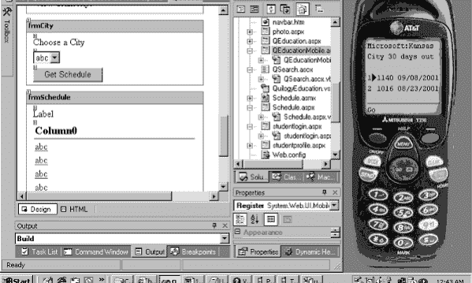

**图 10.10**

*可以使用 `UP.Simulator` 来测试您的移动表单。同时请注意 VS .NET 编辑器中的图形显示。*

> **提示**

图 10.10 是使用 Openwave Systems, Inc. 的 `UPSimulator` 生成的。您可以在 `http://developer.openwave.com` 下载该模拟器。

在这种情况下，当用户选择课程提供情况时，`ObjectList` 将以详细模式显示，并显示所有 `Visible` 属性未设置为 `False` 的字段。请注意，无需编写额外代码即可使用此功能。

显然，这次讨论仅触及了移动控件功能的皮毛。然而，为了进一步说明这一点，请注意 `frmSchedule` 表单包含一个名为 `Register` 的控件，其类型为 `System.Web.UI.MobileControls.Call`。该控件公开了一个 `PhoneNumber` 属性，在本例中用于表示 Quilogy 的课程注册号码。根据检测到的设备，该控件可以通过在 PocketPC 等 HTML 设备上简单地显示电话号码，或者在支持 Web 的手机上直接拨打该号码来进行呈现。

### 创建 Web 服务器控件

毫不奇怪，您可以像在第 8 章讨论的创建可复用组件一样，编写自己的 Web 服务器控件。虽然控件开发是一个庞大的课题，但在有限的空间内，我将展示一个创建 Web 服务器控件以显示课程详细信息的简单示例。有关更多信息，请参阅联机帮助中的“开发 ASP.NET 服务器控件”主题。

在代码清单 10.16 中，名为“Course”的 `TemplateColumn` 创建了一个指向 `ClassDetail.aspx` 页面的超链接，并在查询字符串中传递 `ClassID`。该页面的完整 `.aspx` 文件可见于以下代码：

```aspx
<%@ Register TagPrefix="QuilogyControls" Namespace="QuilogyWebControls"
    Assembly="QuilogyWebControls" %>

<%@ Page Language="vb" AutoEventWireup="false"
    Codebehind="ClassDetail.aspx.vb"
    Inherits="QuilogyEducation.ClassDetail"%>

<HTML>
  <HEAD>
    <LINK href="supplemental/site.css" type=text/css rel=stylesheet>
  </HEAD>
  <body MS_POSITIONING="GridLayout" bgcolor="#ECE8CD">
    <!-- #include file="navbar.htm" -->

    <form id="ClassDetail" method="post" runat="server" class="body-copy">
      <QuilogyControls:ClassData id="ClassData1" runat=server>
```

### 代码清单 10.20 简单的 Web 服务器控件

本清单展示了用于显示课程详细信息的控件代码。

```vb
Imports System.ComponentModel
Imports System.Web.UI
Imports System.Data.SqlClient
Imports System.Data
Imports System.Configuration

<DefaultProperty("ClassID"),
    ToolboxData("<{0}:ClassData1 runat=server></{0}:ClassData1>")> _

Public Class ClassData : Inherits System.Web.UI.WebControls.WebControl

    Protected WithEvents txtMessage As _
        System.Web.UI.HtmlControls.HtmlGenericControl

    Private strCourse As String
    Private strCost As String
    Private strLocation As String
    Private strDays As String
    Private strTime As String
    Private strSyllabus As String
    Private strProduct As String
    Private strVendor As String
    Private strCourseNum As String
    Private strClassDate As String

    Private Sub Control_Load(ByVal sender As System.Object, _
       ByVal e As System.EventArgs) Handles MyBase.Load

        txtMessage = New HtmlControls.HtmlGenericControl("<div>")

        If Me.ClassID = 0 Then
            txtMessage.InnerText = "ClassID 未正确设置"
        Else
            ' 在此处查询数据库获取课程信息
            Dim cn As New SqlConnection( _
                ConfigurationSettings.AppSettings("SQLConnect"))

            Dim cm As New SqlCommand("usp_GetClass", cn)
            Dim dr As SqlDataReader

            Try
                ' 执行存储过程并获取课程值
                cm.CommandType = CommandType.StoredProcedure
                cm.Parameters.Add(New SqlParameter("@ClassID", SqlDbType.Int))
                cm.Parameters(0).Value = Me.ClassID

                cn.Open()
                dr = cm.ExecuteReader

                If dr.IsClosed Then
                    txtMessage.InnerText = "未找到课程"
                    Return
                Else
                    dr.Read()
                End If

                strCourse = dr("Description").ToString
                strCourseNum = dr("CourseNum").ToString
                strLocation = dr("City").ToString
                strDays = dr("Days").ToString
                strTime = dr("StartTime").ToString
                strSyllabus = dr("Syllabus").ToString
                strClassDate = dr("ClassDate").ToString
                strProduct = dr("Product").ToString
                strVendor = dr("Vendor").ToString
                strCost = dr("Cost").ToString

                txtMessage.InnerText = _
                    "以下是您所选课程的详细信息"

            Catch Ex As Exception
                txtMessage.InnerText = "发生错误：" & Ex.Message

            Finally
                If Not dr Is Nothing Then dr.Close()
                cn.Close()
            End Try
        End If
    End Sub

    Protected Overrides Sub Render(ByVal output As _
        System.Web.UI.HtmlTextWriter)

        Dim strImg As String

        ' 设置要包含的图像
        Select Case strVendor
            Case "Microsoft"
                strImg = "http://www.quilogy.com/logo/ms-mctec.gif"

            Case "Oracle"
                strImg = "http://www.quilogy.com/banners/oracle.gif"

            Case "Sybase"
                strImg = "http://www.quilogy.com/logo/sybase-partner.gif"
        End Select

        output.Write("")

        ' 设置消息
        output.WriteFullBeginTag("div")
        output.Write(txtMessage.InnerHtml)
        output.WriteEndTag("div")
    End Sub
End Class
```

### Web Forms 用户控件

虽然你可以像清单 10.20 中所示的那样通过从 `WebControl` 派生来开发自己的服务器控件，但对于大多数应用程序来说，一种更简单的封装 UI 功能并提高可重用性的技术是创建用户控件。

用户控件本质上是一个扩展名为 `.ascx` 的页面，可以从宿主页面引用。用户控件的行为与任何其他页面一样，可以包含控件、响应事件等等。用户控件的优势在于，你可以在获得 Web Forms 设计器的优势和开发便利性的同时，牺牲掉跨应用程序的可重用性。

在 Quilogy 示例中，允许用户选择供应商、城市和时间段的下拉列表实现为一个名为 `QSearch.ascx` 的用户控件。该控件用于 `Schedule.aspx` 和 `QEducation.aspx` 两个页面。该控件的用户界面按照你期望的方式创建，而代码清单 10.21 展示了代码隐藏文件的一个摘录。

#### 代码清单 10.21 搜索用户控件

本清单展示了用于查询课程安排的 `QSearch.ascx` 用户控件的代码隐藏。


```vb
Option Strict Off
Imports System.Web.UI.WebControls
Imports System.Data.SqlClient
Imports System.Data
Imports System.Configuration

Public Class QSearch : Inherits System.Web.UI.UserControl
    Protected WithEvents cboVendor As System.Web.UI.WebControls.DropDownList
    Protected WithEvents cboLocation As System.Web.UI.WebControls.DropDownList
    Protected WithEvents cboThru As System.Web.UI.WebControls.DropDownList
    Protected WithEvents txtMessage As _
        System.Web.UI.HtmlControls.HtmlGenericControl
    Protected WithEvents imgSearch As _
        System.Web.UI.HtmlControls.HtmlInputImage

    Private Sub imgSearch_ServerClick(ByVal sender As System.Object, _
        ByVal e As System.Web.UI.ImageClickEventArgs) _
        Handles imgSearch.ServerClick
        ' Now search for the classes and display them in a grid
        If cboVendor.SelectedItem.Value = 0 And _
           cboLocation.SelectedItem.Value = 0 Then
            txtMessage.InnerText = "Please Select a City OR Vendor"
            txtMessage.Style.Item("Color") = "Red"
            Return
        Else
            Response.Redirect("/QuilogyEducation/Schedule.aspx?Vendor=" & _
                cboVendor.SelectedItem.Value & "&Location=" & _
                cboLocation.SelectedItem.Value & "&Advance=" & _
                cboThru.SelectedItem.Value)
        End If
    End Sub

    Private Sub QSearch_Load(ByVal sender As Object, ByVal e As _
        System.EventArgs) _
        Handles MyBase.Load

        If Not Me.IsPostBack Then
            LoadControls()

            ' Make sure the boxes are reset if needed
            If Not Request("Vendor") Is Nothing Then
                cboVendor.Items.FindByValue( _
                    Request("Vendor").ToString).Selected = True
                cboLocation.Items.FindByValue( _
                    Request("Location").ToString).Selected = True
                cbothru.Items.FindByValue( _
                    Request("Advance").ToString).Selected = True
            Else
                cboLocation.Items.FindByValue("0").Selected = True
                cboVendor.Items.FindByValue("0").Selected = True
            End If
        End If

    End Sub

End Class
```

注意，清单 10.17 中显示的 `LoadControls` 方法也是清单 10.21 中 `QSearch` 类的一个成员。

该控件的处理遵循与表 10.1 所示相同的生命周期，尽管控件类本身派生自 `System.Web.UI.UserControl` 类而不是 `Page` 类。在这种情况下，如果包含该控件的表单尚未回发，则 `Load` 事件调用 `LoadControls` 方法。此外，它使用 `DropDownList` 控件的 `FindByValue` 方法和 `Selected` 属性重置适当的值（如果查询字符串可用）或简单地重置下拉列表中的第一个值。

在页面中引用用户控件类似于通过 `Register` 指令引用 Web 服务器控件。可以通过设置 `TagPrefix`、`TagName` 和 `Src` 属性来指定将在页面中使用的标签以及 `.ascx` 文件的位置，如下所示：

```
<%@ Register TagPrefix="QED" TagName="QSearch" Src="QSearch.ascx"%>
```

然后可以像下面这样在页面中包含该控件：

```
<QED:QSearch id="QSearch" runat="server"/>
```

如前所述，用户控件是使用输出缓存（称为`片段缓存`）的绝佳候选，通过仅缓存部分页面来提高性能。

> **注意**
>
> 用户控件的另一个有趣用途是在开发门户站点时提供用户界面小部件。例如，在开发内部网门户时，你可以开发单独的用户控件来显示新闻项目、通知、链接和天气，然后将它们加载到单个容器页面中。

请注意，与其他页面一样，用户控件可以引发事件；但是，你应该在用户控件的代码中处理事件，而不是在宿主页面中处理。在清单 10.21 中，`imgSearch_ServerClick` 方法处理用户单击以进行选择的 `HtmlInputImage` 控件的 `ServerClick` 事件。

## 小结

本章重点详细介绍了与构建分布式应用程序相关的 ASP.NET 的架构和实现。ASP.NET 提供了大量功能，如状态管理、缓存和跟踪，以创建可扩展和可靠的应用程序，同时允许基础结构具有可扩展性。

此外，Web Forms 编程模型为 Web 开发实现了事件驱动和面向对象的范式。这与使用服务器控件所固有的快速应用程序开发（RAD）以及 UI 和应用程序逻辑的分离相结合，使 Web Forms 成为分布式应用程序的出色编程模型。

虽然 Web Forms 使你能够为用户服务层开发图形用户界面，但 Web Services 实现了程序化用户界面的创建。现在让我们将注意力转向程序化方面。

## 构建 Web Services

# 第 11 章

## 本章内容

- Web Service 架构 510
- Web Service 实现 523
- 使用 Web Service 539

**第二部分**

本节前面的四章讨论了访问数据、构建组件以及为 Web 应用程序提供用户界面。综合来看，这些章节为使用 VB .NET 构建多层分布式应用程序提供了基础，这类似于使用上一代 Visual Studio 构建的 Windows DNA 应用程序。然而，`.NET Framework` 还通过提供对 Web Services（也称为 XML Web Services）的支持，为分布式应用程序开发增添了新的维度。

从许多方面来说，本章是本书中最重要的一章，因为它讨论了 VB .NET 中的一项关键创新，使得开发以互联网为平台的应用程序成为可能。换句话说，公共语言运行时（CLR）的架构和服务框架的主要组件主要是为了简化 Web Services 的构建和使用并将其集成到产品中而开发的。因此，VB .NET 开发人员需要透彻理解 Web Services 的用途，以及如何在 VB .NET 中开发和部署它们。本节的最后一章首先讨论所涉及的架构和技术，然后展示如何使用 Quilogy 教育应用程序构建和使用示例 Web Service。

> **注意**
>
> 本章的所有代码清单和补充材料可以在本书的网站 `www.samspublishing.com` 上找到。

## Web Service 架构

在最基本的层面上，Web Service 只是通过标准 Web 协议访问的可编程应用程序组件。换句话说，你可以将 Web Service 视为在互联网或内部网上公开功能但不具有用户界面的端点。该功能通过标准协议公开，允许开发人员通过新一代开发工具（VS .NET 是其中的先行者）查找和整合 Web Services。因此，Web Service 不直接对最终用户可用，但必须从 Web 或基于表单的应用程序内部调用。

Web Service 在概念上类似于将其方法公开为"黑盒"的中间层组件。然而，Web Services 不依赖于专有的组件架构——相反，它们使用使它们独立于平台和语言的互联网标准。这些 Web Services 随后成为应用程序开发的构建块，因为开发人员将它们整合到其应用程序中以提供必要的功能——真正可编程的 Web。

由于 Web Service 是一种可编程的应用程序组件，因此毫不意外的是，从开发人员的角度来看，Web Service 的功能被公开为一个或多个接受参数的方法，并可能返回标量值（True、False、Integer、String 等）或复杂数据（如 XML 文档）。通过这种方式，创建 Web Service 类似于在 VB .NET 中创建任何组件。

此外，由于 Web Service 依赖于标准的 Web 协议，它们显然非常适合 Web 世界——在这个世界中，客户端与网站建立一系列短寿命的连接，而不是在请求之间保持持久连接。因此，Web Service 通常由一组定义明确且细粒度的服务组成，类似于您为事务性 COM+ 环境构建的组件。然而，由于 .NET 中的 Web Service 是 ASP.NET 的一个组件，它们还可以利用 ASP.NET 的功能，例如会话和应用程序状态。

构成基础设施的标准协议——HTTP、XML 和简单对象访问协议（SOAP）——提供了一种基于消息的类似远程过程调用（RPC）的通信模型。此外，HTTP 的普及以及 XML 和 SOAP 在行业中的广泛采用，使得任何设备和平台都可以使用 Web Service 成为现实。通过这种方式，Web Service 消除了 1990 年代后期关于对象技术的许多争论，提供了一种行业标准的方式来公开功能并消费它。

> **组件之争**
>
> 当然，对象之争中最激烈的较量是在 DCOM 和 CORBA 的 Internet Inter-ORB 协议（IIOP）之间。这两种协议都提供了远程激活组件和使用其服务的手段，并且在行业中得到大量使用。然而，实施这些技术的成本很高，它们之间无法直接通信，除非包含特殊的桥接软件，而且它们在互联网上工作得不好。例如，使用 IIOP 通常意味着购买 ORB 许可证，而 DCOM 要求客户端和服务器都配置系统软件，同时 DCOM 或 IIOP 数据包不太可能穿透配置良好的防火墙。HTTP 和 XML 的结合消除了这些障碍。

从长远来看，低门槛和对行业标准的依赖将使开发人员摆脱必须使用任何特定语言或工具集来创建可互操作的软件的束缚。例如，在过去，Windows 平台上的开发人员会构建 COM 组件和 COM 客户端，它们可以使用 DCOM 相互操作。然而，由于 DCOM 的局限性以及 COM 仅在 Windows 平台上存在，这种互操作性很少（如果有的话）能够超出开发人员的组织。Web Service 的一个关键方面是，它将应用程序逻辑的实现与用于与之通信的方式分离开来，因此 Web Service 的消费者只需要知道服务的位置及其方法的签名。通过这种方式，您可以将 Web Service 简单地视为另一个接口，尽管是程序化的接口，用于访问您用 VB .NET 构建的组件。

当然，在短期内，使用一种能够抽象化构建 Web Service 所需的大量繁重工作的开发工具，例如 VS .NET，可以让开发人员保持高效率，并用自己的语言构建 Web Service。正如第 1 章"Microsoft .NET 架构"中所提到的，.NET 的真正优势和前景不在于 CLR 将被移植到其他平台，例如 Linux（尽管这很可能发生）；而在于使用 .NET 构建的软件将能够以行业标准的方式与为其他平台编写的软件进行互操作。

借助 VS .NET，Microsoft 希望随着开发人员开始采用 Web Service 模型，它将成为设备（不仅是 PC，还包括手机、PDA 和各种其他支持互联网的硬件）通信的基本方式。此外，应用程序公开和使用 Web Service 将变得像今天应用程序重用组件一样常规。一个充满可互操作 Web Service 的 Web 是一个真正可编程 Web 的愿景，其中互联网就是平台。

在本节的其余部分，我们将讨论 Web Service 可以使用的一些常见场景，并深入探讨所涉及的技术，然后逐步介绍 Web Service 的实现。

## Web Service 的用途

尽管如前一节所述，Web Service 的长期愿景是几乎所有应用程序都会理所当然地公开或使用 Web Service。在短期内，Web Service 将使用 .NET 和其他工具进行战略性部署。两种最常见的场景是广泛可重用的功能和应用程序集成。

> 当然，Microsoft 还将 Web Service 视为其 .NET 愿景中一组称为 *Foundation Services* 的服务的核心技术，这些服务属于 .NET My Services 计划。如第 1 章所讨论的，`.NET My Services` 将允许应用程序之间通过集成有关消费者的各种信息并通过高度安全的 Web Service 提供这些信息来进行协作。

在第一种场景中，开发人员构建 Web Service 以公开可以在各种应用程序和组织中重用的服务。例如，新闻机构可以发布一个 Web Service，其中包含拉取今日头条和每篇文章全文的方法。门户网站开发者可以通过订阅该服务或按使用付费的方式将此 Web Service 整合到他的网站中。另一个例子可能是一家快递公司提供一个免费的 Web Service，其中包含根据包裹参数计算运费和安排取件的方法。订单处理系统随后可以以编程方式计算运费并安排取件，无需人工干预。这类 Web Service 通过允许开发人员快速将使用各种 Web Service 的应用程序编织在一起来提供价值。对组织而言，好处在于开发人员无需花费时间重新发明轮子来定义和编写这些服务的接口。

> ### 但是我如何通过它赚钱？
>
> 在任何关于 Web Service 的讨论中， inevitably 会出现的问题是可用于实际从 Web Service 获利的收入模式。尽管预计最初组织之间的 Web Service 将作为增值服务部署，只是提供接收信息的替代方式，但随着 Web Service 变得无处不在，它们需要独立存在。由于 Web Service 可以支持与网站相同的认证技术，可能使用的模式包括订阅和按使用付费。后一种选择特别有趣，因为 Web Service 可以轻松跟踪来自特定客户端的方法调用次数或返回给该客户端的字节数。通过每次调用或每字节收取几美分，Web Service 可以像今天的电话一样计费。

在组织内部，Web Service 可以用于处理应用程序集成问题。最初，这很可能是企业 VB .NET 开发人员使用它们的主要方式。例如，考虑一个熟悉的场景：一个组织已购买或构建了各种业务线系统。尽管这些系统执行其适当的功能，但它们的功能和数据彼此隔离。使用 Web Service，组织的开发人员可以通过为每个应用程序构建 Web Service 层并将结果集成到门户中来连接这些系统。通过这种方式，对业务线应用程序的投资不会浪费，用户可以从关联各种来源的数据中获得的洞察中受益。当然，这个想法也可以扩展到组织间的流程，以实现采购和供应链解决方案。

在较小的规模上，Web Service 可以实施为在部署到销售团队笔记本电脑上的商业应用程序与公司总部的中央存储库之间同步数据。这些类型的服务通过保留对当前系统的投资，同时使数据可供更广泛的受众共享来提供价值。

本章中实现的 Web 服务示例属于前一类，即 Quilogy 可能实施的一项服务，用于发布课程表并向参加 Quilogy 课程的组织及其学员提供服务。

## Web 服务技术

Web 服务基于几项关键技术，其中包括 HTTP、XML 和 SOAP。本节将探讨 Web 服务的基础以及它们在服务框架中的实现位置。

如前所述，HTTP（以及 TCP/IP）的广泛采用为 Web 服务的请求和响应提供了传输层。其最大优势在于，Web 服务可以由任何 Web 服务器（例如在 VB .NET Web 服务中使用的 IIS）以及越来越多支持 HTTP 的服务器应用程序来托管。最终结果是，任何支持 Web 的设备都可以发出 Web 服务请求，而且这些请求可以轻松穿过防火墙。但是，由于 Web 服务托管在 IIS 中，它们也可以通过标准的 Web 身份验证技术进行安全保护，正如本章后面将讨论的那样。这些技术可以通过 ASP.NET 访问，相关内容在第 10 章"构建 Web 窗体"中进行了讨论。


尽管 HTTP 提供了底层传输，但使 Web 服务成为可能的关键技术显然是 XML。如第 7 章“使用 ADO.NET 访问数据”中所述，XML 之所以有用，是因为它允许数据具有自描述性。此外，XML 具有高度的可移植性，因为所有语言和操作系统都有相应的解析器，而且这些解析器可以处理使用通用字符集（UCS）编码的数据。

然而，XML 不仅仅是交换数据的手段；正如 HTML 提供了一种标准化语言来为人眼显示数据一样，XML 为开发语法（标准化的 XML 语言）提供了基础，这些语法允许软件进行互操作。这些标准化语言包括用于描述通用消息格式的 XML 语法（SOAP）、用于描述 Web 服务的语法（称为 Web 服务描述语言，即 WSDL），以及用于发现 Web 服务的机制（DISCO 和 UDDI）。

为了给不熟悉 Web 服务和这些基于 XML 的技术的开发者提供一个思维导图，图 11.1 对比了在 Windows DNA 环境中开发分布式应用程序所使用的技术与 Web 服务所使用的技术。

在继续介绍服务框架如何支持 Web 服务之前，我们需要通过深入底层来正确认识这些技术。

### SOAP 简介

简单对象访问协议（SOAP）是一种 XML 语法，旨在利用 XML 和 HTTP 以平台无关的方式提供对服务的访问。使用 SOAP 所体现的这种组合（以及服务框架中所体现的一些特定于平台的转换），客户端应用程序可以透明地调用运行在 Sun Solaris 机器上的 CORBA/IIOP 组件，就像调用 Windows 2000 上的 COM+ 组件一样轻松。

通过整合 SOAP，VS .NET 等开发工具可以访问比其原生平台提供的更广泛的服务集。虽然篇幅所限无法完整讨论该语法本身（请参阅 Don Box 在 MSDN 上的概述：`http://msdn.microsoft.com/msdnmag/issues/0300/soap/soap.asp` 以及 SOAP 规范：`http://www.w3c.org`），但有必要快速了解一下基本的 XML 消息结构。

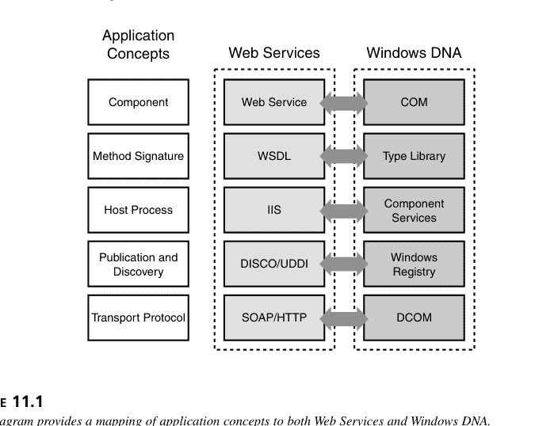

**图 11.1**

*此图展示了应用程序概念与 Web 服务和 Windows DNA 之间的映射关系。*

> **注意**
>
> 服务框架包含了对 SOAP 1.1 的支持，其规范可在 `http://www.w3.org/TR/2000/NOTE-SOAP-20000508/` 查找。

当然，SOAP 有趣的一面及其真正的强大之处在于，它定义了一种基于 RPC 风格的 HTTP 调用机制，使用 XML 实现。例如，考虑一家金融机构开发的 Web 服务，该服务公开了一个方法，允许客户通过账号和 PIN 码查询其账户余额。

使用 SOAP，客户端应用程序会创建一个 XML 负载，将方法调用及其参数序列化，然后通过 HTTP POST 发送到 Web 服务器。包含头部的完整 HTTP 消息大致如下所示：

```
POST /WebServices.asp HTTP/1.1
Host: mybankserver.com
User-Agent: MSDNWS
Content-Type: text/xml; charset=utf-8
Content-Length: 206
SOAPAction: mybanksserver.com/WebServices/QueryBalance
```

```
<?xml version="1.0" encoding="utf-8"?>
<soap:Envelope xmlns:xsi="http://www.w3.org/2001/XMLSchema-instance"
    xmlns:xsd="http://www.w3.org/2001/XMLSchema"
    xmlns:soap="http://schemas.xmlsoap.org/soap/envelope">
    <soap:Body>
        <QueryBalance xmlns="http://mybankserver.com/WebServices">
            <Account>66555443</Account>
            <PIN>7654</PIN>
        </QueryBalance>
    </soap:Body>
</soap:Envelope>
```

请注意，HTTP `Content-Type` 为 `text/xml`，并且 SOAP 要求包含 `SOAPAction` HTTP 头字段以指示请求的目的，并允许防火墙过滤 SOAP 请求。

请求中包含的 XML 负载包含必需的 `Envelope` 和 `Body` 元素。在 `Body` 内部，方法名 `QueryBalance` 本身表示为一个元素，其子元素对应于传递给该方法的参数。

SOAP 还允许在 `Envelope` 中包含可选的 `Header` 元素，用于指定服务器的处理指令。如果 `Header` 包含 `mustUnderstand` 属性且设置为值 `"1"`，则服务器不能忽略该头部。在使用 BizTalk Server 2000 等产品交换 SOAP 消息时，头部非常有用。SOAP 还允许在请求中表示更复杂的数据类型。

> **注意**
>
> 实际上，SOAP 定义了两种 Web 服务方法（称为“操作”）在请求或响应中进行编码的方式。此处的示例假设使用的是文档（Document）风格（在 SOAP 规范的第 5 节中讨论），其中使用 XSD 模式来描述请求和响应。从客户端生成的 SOAP 请求必须遵循此模式。或者，也可以使用 RPC 风格（在第 7 节中定义），其中方法的参数直接映射为同名元素。

当请求被 Web 服务处理后，它会返回一个 SOAP 响应消息，封装在 HTTP 响应中，其中包含一个 XML 负载，指示方法的返回值，如下所示：

```
HTTP/1.1 200 OK
Content-Length: 245
Content-Type: text/xml; charset=utf-8

<?xml version="1.0" encoding="utf-8"?>
<SOAP:Envelope xmlns:xsi=http://www.w3.org/2000/10/XMLSchema-instance
    xmlns:xsd="http://www.w3.org/2000/10/XMLSchema"
    xmlns:soap="http://schemas.xmlsoap.org/soap/envelope">
  <soap:Body>
    <QueryBalanceResponse xmlns="http://mybankserver.com/WebServices">
      <QueryBalanceResult>7641</QueryBalanceResult>
    </QueryBalanceResponse>
  </soap:Body>
</SOAP:Envelope>
```

请注意，使用了相同的 `Content-Type`，以及熟悉的 `Envelope` 和 `Body` 元素。返回值封装在 `QueryBalanceResponse` 元素中，其子元素表示每个输出参数——在本例中即为账户余额。

SOAP 还包含一种标准的错误传递机制，使用 `Fault` 元素，其中包含 `faultcode`、`faultstring` 和 `detail` 等属性。客户端应用程序可以轻松地确定 Web 服务中何时发生了错误，并相应地提醒用户或记录错误。

虽然此示例展示了 SOAP 的一些基础知识，但仍有两个问题待解答：客户端如何发现 Web 服务？当他们发现后，如何确定某个特定 Web 服务支持哪些方法？后一个问题的一个答案是使用 Web 服务描述语言（WSDL）。

### Web 服务描述语言

WSDL（`http://msdn.microsoft.com/xml/general/wsdl.asp`）是一种 XML 语法，可用于描述 Web 服务的功能。客户端可以使用 WSDL 作为模板来构建 SOAP 消息，以正确调用服务。

通过这种方式，您可以将 WSDL 文档视为客户端与服务器之间的契约，类似于通过类型库暴露的 COM+ 组件的接口定义。虽然篇幅所限无法对 WSDL 进行深入探讨，但请考虑为前面讨论的简单银行 Web 服务生成的 WSDL 契约，如代码清单 11.1 所示。

**清单 11.1** WSDL 合约。该 XML 文档定义了消费者用于调用简单银行 Web 服务的合约。

```xml
<?xml version="1.0" ?>
<definitions xmlns:s="http://www.w3.org/2000/10/XMLSchema"
    xmlns:http="http://schemas.xmlsoap.org/wsdl/http/"
    xmlns:mime="http://schemas.xmlsoap.org/wsdl/mime/"
    xmlns:urt="http://microsoft.com/urt/wsdl/text/"
    xmlns:soap="http://schemas.xmlsoap.org/wsdl/soap/"
    xmlns:soapenc="http://schemas.xmlsoap.org/soap/encoding/"
    xmlns:s0="http://mybanksserver.com/WebServices"
    targetNamespace="http://mybanksserver.com/WebServices"
    xmlns="http://schemas.xmlsoap.org/wsdl/">
    <types>
        <s:schema attributeFormDefault="qualified"
            elementFormDefault="qualified"
            targetNamespace=" http://mybanksserver.com/WebServices">
            <s:element name="QueryBalance">
                <s:complexType>
                    <s:sequence>
                        <s:element name="Account" nullable="true"
                            type="s:string" />
                        <s:element name="PIN" type="s:int" />
                    </s:sequence>
                </s:complexType>
            </s:element>
            <s:element name="QueryBalanceResponse">
                <s:complexType>
                    <s:sequence>
                        <s:element name="QueryBalanceResult" type="s:decimal" />
                    </s:sequence>
                </s:complexType>
            </s:element>
            <s:element name="decimal" type="s:decimal" />
        </s:schema>
    </types>
    <message name="QueryBalanceSoapIn">
        <part name="parameters" element="s0:QueryBalance" />
    </message>
    <message name="QueryBalanceSoapOut">
        <part name="parameters" element="s0:QueryBalanceResponse" />
    </message>
    <portType name="BankingSoapPortType">
        <operation name="QueryBalance">
            <input message="s0:QueryBalanceSoapIn" />
            <output message="s0:QueryBalanceSoapOut" />
        </operation>
    </portType>
    <binding name="BankingSoapBinding" type="s0:BankingSoapPortType">
        <soap:binding transport="http://schemas.xmlsoap.org/soap/http"
            style="document" />
        <operation name="QueryBalance">
            <soap:operation
                soapAction="http://mybanksserver.com/WebServices/QueryBalance"
                style="document" />
            <input>
                <soap:body use="literal" />
            </input>
            <output>
                <soap:body use="literal" />
            </output>
        </operation>
    </binding>
    <service name="Banking">
        <port name="BankingSoap" binding="s0:BankingSoapBinding">
            <soap:address location="http://mybankserver.com/WebServices" />
        </port>
    </service>
</definitions>
```

WSDL 合约由一系列定义 Web 服务的抽象组成。阅读该文档的一种便捷方式是从下往上阅读。例如，请注意清单 11.1 底部的 `service` 元素标识了该 Web 服务（“Banking”）并指定了可用端口。端口标识了一个客户端可以通过其与服务进行通信的端点。

在本例中，唯一的端点是 `BankingSoap`，它指定了网络地址，并通过绑定（binding）封装了要传递的 SOAP 消息的定义。

### 注意

使用 VB .NET 创建的 Web 服务并不局限于严格通过 SOAP 端口进行通信。它们还可以包含 HTTP GET 和 POST 端口。这使得开发人员只要能调用一个简单的 URL，就可以将 Web 服务整合进来。这甚至允许那些尚未支持 SOAP 的开发工具也能利用 Web 服务。

绑定（`BankingSoapBinding`）则进一步指定了可用的操作（方法）、它们的风格（document 或 RPC），以及如何通过 `SOAPAction` 标头进行标识。

接着，绑定指向端口类型（`BankingSoapPortType`），其中包含了每个操作及其关联的输入和输出消息。消息（`QueryBalanceSoapIn` 和 `QueryBalanceSoapOut`）通过指向 `types` 元素中定义的元素，定义了传递给服务（`QueryBalance`）和从服务接收（`QueryBalanceResponse`）的 XML 消息结构。

由于使用的是文档（document）编码风格，该元素由使用 XML Schema（XSD）规范定义类型结构的类型定义组成。如你所见，`QueryBalance` 元素包含用于传递 `account` 和 `pin` 参数的子元素，而 `QueryBalanceResponse` 元素则将方法的返回值定义为 `decimal`。

通过检索和解析 WSDL 合约，客户端应用程序可以创建符合 Web 服务预期调用约定并发送至服务器的 XML 负载。反之，当结果返回时，客户端可以根据 WSDL 合约来解释结果。

然而，你可能会好奇，Web 服务的潜在消费者如何知道 WSDL 合约的存在以及如何找到它。这是通过 Web 服务发现过程以及使用通用目录、描述和集成（UDDI）来实现的。

### Web 服务发现

Web 服务发现（Web Service Discovery）是 VS .NET 用于枚举 Web 服务器上或 Web 服务器内任何虚拟目录中 WSDL 合约的过程。

可以通过在虚拟目录中放置一个扩展名为 `vsdisco` 的 XML 文件来公开 Web 服务。该文档除了对其他 disco 文件的引用外，还可以包含对 WSDL 合约的引用。例如，以下 `vsdisco` 文件可以放置在银行 Web 服务的虚拟目录中：

```xml
<?xml version="1.0" ?>
<disco:discovery xmlns:disco="http://schemas.xmlsoap.org/disco"
xmlns:scl="http://schemas.xmlsoap.org/scl">
  <scl:contractRef ref="http://mybankserver.com/webservices/banking.wsdl"/>
  <disco:discoveryRef ref="moreservices/default.vsdisco" />
</disco:discovery>
```


在这个例子中，WSDL 合约在`banking.wsdl`文件中指定，而`disco`文件指向一个包含另一个`disco`文件以枚举其他服务的相对路径（`moreservices`）。为了让消费者在不知道文件名的情况下也能找到`disco`文件，你可以在虚拟目录默认页面的`HEAD`标签中放置一个`link`标签，如下所示：

```html
<HEAD>
  <link type="text/xml" rel="alternate" href="banking.vsdisco"/>
</HEAD>
```

同样地，可以将`disco`文件放置在 Web 服务器的根目录下，并枚举服务器上所有可用的 WSDL 合约。这样，开发人员只需指向 Web 服务器，即可访问其所有的 Web 服务。

为了减轻在 Web 服务器上设置类似目录的负担，发现过程也可以动态启用。通过在`disco`文件中放置`dynamicDiscovery`元素，虚拟目录及其任何子目录中的所有 Web 服务都将被公开。此外，你可以包含`exclude`元素以禁用对特定目录的搜索。例如，也可以使用以下`disco`文件：

```xml
<?xml version="1.0" encoding="utf-8" ?>
<dynamicDiscovery xmlns="urn:schemas-dynamicdiscovery:disco.2000-03-17">
    <exclude path="_vti_cnf" />
    <exclude path="_vti_pvt" />
    <exclude path="_vti_log" />
    <exclude path="_vti_script" />
    <exclude path="_vti_txt" />
    <exclude path="Web References" />
</dynamicDiscovery>
```

默认情况下，当你在 VS .NET 中创建新的 Web 服务时，会通过在虚拟目录中添加类似的`vsdisco`文件来以这种方式启用动态发现。同样，如前所述，此文件可以链接到虚拟目录的默认页面，或放置在 Web 服务器的根目录下，以允许在整个站点上进行动态发现。

**注意**

正如本章后面讨论的，当开发人员使用“项目”菜单中的“添加 Web 引用”选项，或者在 VS .NET 解决方案资源管理器中右键单击“引用”时，就会触发发现过程。

### UDDI

虽然 Web 服务发现允许开发人员在特定的虚拟目录或特定的 Web 服务器中找到 Web 服务，但它无法解决跨服务器或跨公司的 Web 服务查找问题。请记住，对于开发人员来说，可编程 Web 的愿景意味着在 VS .NET 中，你应该能够点击“项目” $\rightarrow$ “添加 Web 引用”，并找到全球范围内发布的 Web 服务的 WSDL 合约。这就是通用描述、发现和集成（UDDI）的目标。

UDDI 是一项行业倡议（`www.uddi.org`），有 220 多家公司参与，旨在通过推广一种通用协议来整合互联网上的商业服务。

### 企业级技术

#### 第二部分

发布并连接到使用目录的 Web 服务。Web 服务目录或注册表是企业可以发布其可搜索的 Web 服务的地方。尽管目前处于测试阶段，但您可以在`uddi.microsoft.com`上发布有关公司和 Web 服务的信息。UDDI 规范要求在注册表中发布四种类型的信息，包括业务信息、服务信息、绑定信息和规范信息。

“添加 Web 引用”对话框包含一个到 UDDI 目录的自动链接，如本章后面所述。此外，开发人员可以从同一站点下载 UDDI SDK。SDK 的功能包括允许您以编程方式搜索注册表的 .NET 类，以及为您自己托管一个轻量级的内部使用注册表。

全球目录与 WSDL 的结合意味着开发工具和自定义代码可以编写为自动查找和使用 Web 服务，而无需人工干预。例如，如果首选的 Web 服务没有响应，UDDI 可以用于通过比较 WSDL 文档中操作的 XSD 模式（在 UDDI 术语中称为技术模型或`tModel`）来自动定位一个等效的公共 Web 服务。

### 服务框架中的 Web 服务

当开发人员对 XML 有基本了解时，向 SOAP 和 WSDL 的跨越并不令人生畏。然而，这些行业标准仍在一定程度上处于变化之中，并将随着时间的推移而改变。幸运的是，对于 VB .NET 开发人员来说，这些底层细节已被纳入服务框架，以将开发人员从细节中抽象出来。从 VB .NET 的角度来看，开发 Web 服务类似于使用 ASP.NET 开发网站，并且可以使用 VB .NET 语法构建。

这种抽象的直接好处是使 Web 服务开发变得更加简单，从而可以轻松达到入门门槛。此外，随着 VS .NET 的后续版本，最新的 Web 标准将被纳入服务框架，使开发人员免于更新其代码以满足新的 W3C 标准的任务。

> **注意**

对于继续使用 VB 6.0 的开发人员，Visual Basic 的 SOAP 工具包可用。简而言之，该工具包是 SOAP 的 COM 和 IIS 语言绑定，提供了必要的底层代码，用于在 IIS 上将 COM 对象作为 Web 服务公开，以及使用 COM 兼容的开发工具（如 Visual Basic）来使用 Web 服务。该工具包的核心部分包括远程对象代理引擎、WSDL 向导以及用于 IIS 的 ASP 和 ISAPI 监听器。此外，来自 Microsoft 的 UDDI SDK 也支持 Visual Studio 6.0 库，允许搜索 UDDI 注册表。

不出所料，服务框架中对 Web 服务的高级支持包含在`System.Web.Services`命名空间中，如表 11.1 所示。

| 类 | 描述 |
| :--- | :--- |
| `WebMethodAttribute` | 放置在类的方法上的属性，允许其包含在 WSDL 合同中。 |
| `WebService` | Web 服务的可选基类，包含对 ASP.NET 功能的访问。 |
| `WebServiceAttribute` | 放置在类级别的属性，用于添加可选信息，例如名称、描述和命名空间。 |
| `WebServiceBindingAttribute` | 放置在类级别的属性，用于定义 Web 服务的其他 SOAP 绑定。包含用于绑定名称、位置和命名空间的属性。 |

在设置好上下文之后，本章的其余部分将重点介绍如何使用 VB .NET 实现和使用 Web 服务。

### Web 服务实现

要创建托管在其自身站点中的 Web 服务，您只需在 VS .NET 中创建一个新项目，并从新建项目对话框中选择 Web 服务模板。然后，VS .NET 会在您选择的 IIS 服务器上创建一个虚拟目录，并在您的本地计算机上的 My Documents 文件夹中的 Visual Studio Projects 文件夹下创建一个工作目录。此外，您可以通过右键单击解决方案资源管理器中的项目并选择“添加 Web 服务”来将 Web 服务添加到现有的 Web 应用程序中。如第 10 章所述，处理项目文件的方式类似于在 VS 6.0 中使用 Visual Interdev。

与使用 ASP.NET 创建的 Web 应用程序类似，一个单独的 Web 服务项目将包含`Global.asax`和`Web.config`文件，这允许您编写处理应用程序和会话事件的代码，以及如第 10 章所述配置身份验证和会话状态模式。换句话说，VS .NET 中的 Web 服务可以访问 ASP.NET 的所有底层功能，同时提供了一种与服务器上的代码进行通信的新方式。

Web 服务本身通过创建`.asmx`文件来公开。该文件是 Web 服务的端点，其方法将通过 WSDL 文档的`port`元素中定义的端点被调用。这种架构意味着可以通过包含多个`.asmx`文件在单个虚拟目录中公开多个 Web 服务。`.asmx`文件的 HTTP 处理程序完成了大部分工作，并封装了监听请求、解析请求、调用适当方法并发送结果所需的代码。

Web 服务的方法必须放入一个类中，该类可以内联创建在`.asmx`文件中，也可以在单独的文件中引用。默认行为是 VS .NET 创建一个具有`.vb`扩展名且与`.asmx`文件同名的代码隐藏文件。然后在`WebService`指令中引用此文件。换句话说，名为`WebService.asmx`的文件将包含以下文本：

```
<%@ WebService Language="vb"
    CodeBehind="WebService.asmx.vb"
    Class="QuilogyEducation.EducationService" %>
```

请注意，`CodeBehind`属性用于指定包含`QuilogyEducation.EducationService`类的文件的名称。此外，没有`runat=server`标签，因为所有 Web 服务代码都在服务器上运行。

> **提示**

尽管您可以将代码内联放在`.asmx`文件中，但不推荐这样做，因为 VS .NET 代码编辑器将无法使用 IntelliSense 和关键字着色，因为该文件没有`.vb`扩展名。此外，包含`.vb`文件允许 Web 服务类在调用之前被编译为 DLL。`.asmx`文件中的类必须即时编译。

当您右键单击`.asmx`文件并选择“查看代码”时，`.vb`文件将基于`CodeBehind`属性的值加载到编辑器中。

### 创建 Web 服务类

实现 Web 服务的类在许多方面与任何其他自定义类相同，但有以下例外：

+ 为了使该类能够访问 ASP.NET 内部对象（如`Application`和`Session`状态），该类必须派生自`WebService`，如表 11.1 所示。
+ 为了使一个方法通过 Web 服务公开，它必须包含`WebMethod`属性。

因此，创建 Web 服务的推荐方法是创建单独的 Web 服务类，这些类作为第 7 章中讨论的业务和数据访问类的包装器，如图 7.4 所示。在此模型下，Web 服务类是分布式应用程序中用户服务层的一部分。回想起来，这显然是合适的，因为 Web 服务本质上只是业务逻辑的基于 HTTP 的可编程接口，因此应该在逻辑上分离。

例如，考虑 Quilogy 可能为其客户提供的一项简单的 Web 服务。Web 服务的实际功能与 Web 应用程序提供的功能相同，即查询课程表和查看成绩单的能力。一个适当的策略是简单地向 Web 应用程序添加一个`.asmx`文件，该文件公开已经存在于业务和数据访问类中的功能。清单 11.2 显示了公开`Login`、`GetTranscript`和`GetSchedule`方法的`.asmx`文件。

### 清单 11.2 Quilogy Education Web Service。此清单显示了一个简单的 Web 服务，它公开了三个方法，这些方法包装了数据访问类的方法。

```
Option Strict On

Imports System.Web.Services
Imports System.Web.Services.Protocols
Imports Quilogy.Education
Imports Quilogy.Education.Enrollment
Imports Quilogy.Education.Schedule
Imports System.Xml.Serialization
Imports System.Xml
Imports System.Configuration

<WebService(Namespace:="www.quilogy.com/edservice", _
    Description:="Quilogy's Education Web Service", _
    Name:="QuilogyEducation")> _
Public Class EducationService : Inherits WebService

    '*****************************************************************
    <WebMethod(Description:="Retrieves a student's transcript", _
        EnableSession:=True)> _
    Public Function GetTranscript() As TranscriptData
        Dim dsTrans As TranscriptData
        Dim objStud As New Students()

        ' Check the incoming argument
        If Session("StudentID") Is Nothing Then
            Throw New ArgumentNullException( _
                "You must login before calling the GetTranscript method")
            Return Nothing
        End If

        ' Call the data access component
        dsTrans = objStud.GetTranscript( _
            Convert.ToInt32(Session("StudentID")))
        Return dsTrans

    End Function

    '*****************************************************************
    <WebMethod(Description:="Allows a student to login", EnableSession:=True)> _
```

企业技术

第二部分

### 清单 11.2 续


首先需要注意的是，`EducationService`类派生自`WebService`。如表 11.1 所述，这是可选的，因为将该类作为 Web Service 进行交互的真正工作是由 HTTP 处理程序完成的。`WebService`仅包含实例属性，这些属性在`HttpContext`中公开了 ASP.NET 的`Application`、`Server`、`Session`和`User`对象。

> **提示**
>
> 与第 10 章中的 Web Forms 应用程序一样，此 Web 服务在默认情况下会将密码以明文形式发送到 Web 服务器（当调用`Login`方法时）。为避免这种情况，一种替代架构是将`Login`方法放在单独的`.asmx`文件中，并将其置于同一站点上受 SSL 保护的虚拟目录中。这样密码就得到了保护，而其他方法可以无需 SSL 的额外开销即可调用。

其次，该类包含可选的`WebService`特性，该特性包含`Namespace`、`Description`和`Name`等属性。这些属性允许你设置 WSDL 契约中`SoapAction`特性所使用的命名空间。例如，通过将`Namespace`设置为`www.quilogy.com/edservice`，`GetTranscript`方法的`SoapAction`就变成了`www.quilogy.com/edservice/GetTranscript`。如果未设置，默认命名空间为`www.tempuri.org`。类似地，`Name`属性用于设置 WSDL 契约中`Service`元素的名称。默认情况下，它被设置为 Web 服务类的名称；在此处，它已被重写为`quilogyEducation`。最后，HTTP 处理程序使用`Description`属性在浏览器不带查询字符串请求`.asmx`文件时显示易于阅读的描述。该描述存储在 WSDL 契约中`service`元素的`documentation`元素中。例如，当调用`WebService.asmx`文件时，HTML 服务帮助页面就会出现，如图 11.2 所示。

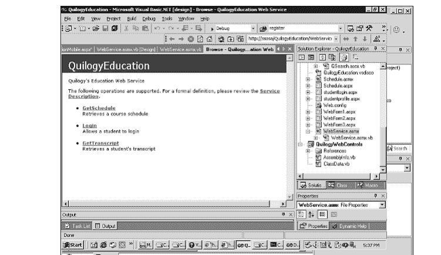

**图 11.2**

当从浏览器不带查询字符串调用`.asmx`文件时，ASP.NET 会生成服务帮助页面。

图 11.2 中的页面通常用于测试 Web 服务，在较小程度上也可作为面向潜在客户的信息载体。默认情况下，服务帮助页面还包含指向 WSDL 和每个方法的链接。方法链接特别有用，因为它们显示了每个方法的调用和返回 XML 语法，使客户端应用程序的开发人员能够准确了解如何调用 Web 服务。例如，`GetSchedule`方法的 HTTP SOAP 请求和响应消息如清单 11.3 所示。

### 清单 11.3 SOAP 消息

此清单显示了 Quilogy Education Web 服务的`GetSchedule`方法所使用的 HTTP SOAP 消息。

#### 请求

```
POST /Quilogyeducation/webservice.asmx HTTP/1.1
Host: ssosa
Content-Type: text/xml; charset=utf-8
Content-Length: length
SOAPAction: "www.quilogy.com/edservice/GetSchedule"

<?xml version="1.0" encoding="utf-8"?>
<soap:Envelope xmlns:xsi="http://www.w3.org/2001/XMLSchema-instance"
    xmlns:xsd="http://www.w3.org/2001/XMLSchema"
    xmlns:soap="http://schemas.xmlsoap.org/soap/envelope/">
    <soap:Body>
        <GetSchedule xmlns="www.quilogy.com/edservice">
            <Location>string</Location>
            <Vendor>string</Vendor>
            <DaysOut>unsignedByte</DaysOut>
        </GetSchedule>
    </soap:Body>
</soap:Envelope>
```

#### 响应

```
HTTP/1.1 200 OK
Content-Type: text/xml; charset=utf-8
Content-Length: length

<?xml version="1.0" encoding="utf-8"?>
<soap:Envelope xmlns:xsi="http://www.w3.org/2001/XMLSchema-instance"
    xmlns:xsd="http://www.w3.org/2001/XMLSchema"
    xmlns:soap="http://schemas.xmlsoap.org/soap/envelope/">
    <soap:Body>
        <GetScheduleResponse xmlns="www.quilogy.com/edservice">
            <GetScheduleResult>dataset</GetScheduleResult>
        </GetScheduleResponse>
    </soap:Body>
</soap:Envelope>
```

请注意，清单 11.3 中加粗的项目是占位符，实际使用时会包含真实数据。此页面也可以通过自定义`*windowsdir*\Microsoft.NET Framework\*version*\CONFIG`目录中的`DefaultWsdlHelpGenerator.aspx`页面来修改，以提供有关 Web 服务的自定义信息——例如你公司的标志。

### 使用 GET 和 POST

如前所述，使用 ASP.NET 创建的 Web 服务的另一个有趣方面是，它不仅在 WSDL 契约中提供 SOAP 端口，还提供 HTTP-GET 和 HTTP-POST 端口。通过这种方式，尚未支持 SOAP 的客户端也可以调用 Web 服务。通过检查服务帮助页面提供的 WSDL 契约可以清楚地看到这一点。清单 11.4 列出了支持 HTTP-GET 的相关部分。

**清单 11.4** WSDL 中对 HTTP-GET 的支持。此摘录来自 Quilogy Education Web 服务的 WSDL 契约，展示了 ASP.NET 如何支持 HTTP GET。

```
<message name="GetTranscriptHttpGetIn" />
<message name="GetTranscriptHttpGetOut">
  <part name="Body" element="s0:TranscriptData" />
</message>
<message name="LoginHttpGetIn">
  <part name="EmailAddress" type="s:string" />
  <part name="Password" type="s:string" />
</message>
<message name="LoginHttpGetOut">
  <part name="Body" element="s0:boolean" />
</message>
<message name="GetScheduleHttpGetIn">
  <part name="Location" type="s:string" />
  <part name="Vendor" type="s:string" />
  <part name="DaysOut" type="s:string" />
</message>
<message name="GetScheduleHttpGetOut">
  <part name="Body" element="s0:ScheduleData" />
</message>
<portType name="QuilogyEducationHttpGet">
  <operation name="GetTranscript">
    <documentation>Retrieves a student's transcript</documentation>
    <input message="s0:GetTranscriptHttpGetIn" />
    <output message="s0:GetTranscriptHttpGetOut" />
  </operation>
  <operation name="Login">
    <documentation>Allows a student to login</documentation>
    <input message="s0:LoginHttpGetIn" />
    <output message="s0:LoginHttpGetOut" />
  </operation>
  <operation name="GetSchedule">
    <documentation>Retrieves a course schedule</documentation>
    <input message="s0:GetScheduleHttpGetIn" />
    <output message="s0:GetScheduleHttpGetOut" />
  </operation>
</portType>
```

### 清单 11.4 续

```xml
</portType>
<binding name="QuilogyEducationHttpGet" type="s0:QuilogyEducationHttpGet">
  <http:binding verb="GET" />
  <operation name="GetTranscript">
    <http:operation location="/GetTranscript" />
    <input>
      <http:urlEncoded />
    </input>
    <output>
      <mime:mimeXml part="Body" />
    </output>
  </operation>
  <operation name="Login">
    <http:operation location="/Login" />
    <input>
      <http:urlEncoded />
    </input>
    <output>
      <mime:mimeXml part="Body" />
    </output>
  </operation>
  <operation name="GetSchedule">
    <http:operation location="/GetSchedule" />
    <input>
      <http:urlEncoded />
    </input>
    <output>
      <mime:mimeXml part="Body" />
    </output>
  </operation>
</binding>
<service name="QuilogyEducation">
  <port name="QuilogyEducationHttpGet" binding="s0:QuilogyEducationHttpGet">
    <http:address location="http://ssosa/QuilogyEducation/WebService.asmx" />
  </port>
  <documentation>Quilogy 的教育 Web 服务</documentation>
</service>
```

同样，从下往上看，端口`QuilogyEducationHttpGet`是在`service`元素的`port`元素中定义的。该端口指向`binding`元素，`binding`元素定义了 Web 服务的三个操作（方法）。反过来，每个操作都被定义，并包含输入和输出消息。请注意，每个消息被定义为一系列`part`元素。对于 GET 请求，输入消息将每个查询字符串参数定义为一个`part`元素，而输出消息则简单地定义一个将被返回的单个元素。通过这种方式，可以使用 HTTP-GET 发出请求，但结果是一个 XML 文档。

尽管支持 HTTP-GET 和 POST 扩展了 Web 服务的覆盖范围，但这是有代价的。例如，所有三种协议都支持相同的基本标量数据类型集合，如字符串和整数，如表 11.2 所示。然而，只有 SOAP 允许将序列化为 XML 的类和结构传递给方法。此外，通过 SOAP 调用的方法可以使用`ByRef`关键字传递在方法内部和外部复制的类，以支持按引用传递对象。另一方面，SOAP 需要更大的有效负载和更复杂的解析，因此比 HTTP-GET 和 POST 引入更多的开销。

**表 11.2 Web 服务支持的 VB .NET 标量数据类型**

| VB .NET 数据类型 | XML 架构数据类型 |
|---|---|
| Boolean | boolean |
| Double | double |


| Enum | enum |
|---|---|
| Integer | int |
| Long | long |
| Short | short |
| String | string |
| Byte | unsignedbyte |

清单 11.4 中的 WSDL 允许客户端创建以下 URL 来调用 Web 服务的 `Login` 方法：

```text
http://server/QuilogyEducation/WebService.asmx/
    Login?EmailAddress=dfox@quilogy.com&Password=dlfrr55
```

并接收以下响应：

```http
HTTP/1.1 200 OK
Content-Type: text/xml; charset=utf-8
Content-Length: 83

<?xml version="1.0"?>
<boolean xmlns="www.quilogy.com/edservice">True</boolean>
```

要使方法包含在 WSDL 契约中，必须用 `WebMethod` 属性标记。如此标记的方法称为 `Web` 方法。`WebMethod` 属性包括表 11.3 所示的实例属性。

**表 11.3 WebMethod 属性的属性**

| 属性 | 描述 |
|---|---|
| `BufferResponse` | 布尔值。当设置为 True（默认值）时，Web 方法的响应将被缓冲。这类似于在经典 ASP 中将 `Response.Buffer` 设置为 True。当 Web 方法返回大量数据时，将此属性设置为 False。 |
| `CacheDuration` | 整数。获取或设置 Web 方法的响应在缓存中的秒数。如果在此持续时间内再次调用 Web 方法，则返回相同的响应。默认为 0，仅当 Web 方法返回大量静态数据以节省资源时才应设置。 |
| `Description` | 字符串。设置在图 11.2 所示的服务帮助页面中显示的描述，并放入 WSDL 契约中操作的 `documentation` 元素中。 |
| `EnableSession` | 布尔值。当设置为 True 时，`Session` 对象可供使用。默认为 False，因此当 Web 方法使用会话状态时必须使用。 |
| `MessageName` | 字符串。用于为 Web 方法的方法或属性名称提供别名。与 Web 服务类中的重载（多态）方法一起使用。 |
| `TransactionOption` | `TransactionOption`。设置为枚举中的常量以指示 Web 方法的事务支持。当设置为 `TransactionOption.RequiresNew` 或 `TransactionOption.Required` 时，用于允许 Web 方法作为分布式事务的根。 |

在清单 11.2 中，每个 `WebMethod` 属性都包含 `Description` 属性。具有 ASP 背景的开发人员会注意到，`Login` 和 `GetTranscript` 方法都引用 `Session` 对象来从数据库存储和检索学生的唯一标识符。这样，Web 服务类不同于服务组件，因为它们可以存储状态信息。这很有用，特别是对于身份验证（如此处所做的），这样客户端应用程序就无需担心数据库标识符。因此，这两种方法都将 `WebMethod` 属性的 `EnableSession` 属性设置为 True。

> **注意**
>
> 在此示例中，Quilogy 教育 Web 服务通过在 SQL Server 2000 数据库中存储电子邮件地址和密码来使用其自己的身份验证方案。

但是，在 ASP.NET 中创建的 Web 服务可以使用与 Web 应用程序相同的身份验证选项（即 Windows、Forms 和 Passport），方法是在 `Web.config` 文件中设置相应的选项。以这种方式进行身份验证时，ASP.NET `User` 对象可用，并包含用户的身份。显然，在组织内部使用的 Web 服务最有可能使用 Windows 身份验证，而公共 Web 服务将使用 Forms、Passport 或自定义方案。

虽然在清单 11.2 中没有使用，但应注意 `TransactionOption` 和 `MessageName` 属性特别有用。就前者而言，你可以使用该属性允许 Web 方法作为根对象参与分布式事务。通过这种方式，Web 方法可以调用由服务组件公开的多个方法并协调它们的工作。如果你的 Web 服务类包含重载方法，并且你想在 WSDL 契约中公开每个方法，则 `MessageName` 属性很有用。不能使用重载方法，因为 WSDL 不允许两个操作具有相同的名称。

### Web 服务设计问题

虽然启动和运行 Web 服务很简单，但有几个问题需要考虑，包括传递对象和错误处理。

设计 Web 服务接口时，也许最大的考虑是，如果你的 Web 服务要使用 HTTP-GET 或 POST 调用，Web 方法不能接受对象作为参数。

另一方面，正如你可能从清单 11.2 中注意到的，`GetTranscript` 和 `GetSchedule` Web 方法分别返回派生的 `DataSet` 类 `TranscriptData` 和 `ScheduleData`。在这两种情况下，`DataSet` 都由第 7 章讨论的数据访问类填充，并通过 Web 方法返回。因为这些类派生自 `DataSet`，而 `DataSet` 派生自 `MarshalByValueComponent`，所以 ASP.NET 可以用 XSD 架构表示该对象并将其序列化为 XML，以包含在发送回客户端的响应消息中。这意味着你想从 Web 方法返回的任何对象都需要派生自 `MarshalByValueComponent`、实现 `ISerializable` 接口或使用第 8 章“构建组件”中讨论的 `Serializable` 属性。

### 注意

在这种情况下，WSDL 实际上通过包含 `import` 元素引用了 `TranscriptData` 和 `ScheduleData` 类型的 XSD 架构。例如，要获取 `TranscriptData` 类型的 XSD 架构，`location` 属性指向带有查询字符串 `schema=QuilogyTranscript` 的 `.asmx` 文件。

此外，用于调用 Web 方法的协议也会影响错误处理的方式。如果该方法包含抛出异常的 `Try Catch` 块，或者 Web 方法中调用的其他方法抛出异常，这些异常会自动被转换为 `SoapException`，并作为 SOAP 客户端故障代码返回给客户端。例如，在 Listing 11.2 的 `Login` 方法中，如果未向方法传递 `EmailAddress` 或 `Password`，则会抛出 `ArgumentNullException`。当使用 SOAP 调用该方法时，此异常会被 ASP.NET 拦截，并根据 SOAP 规范返回给客户端。

- **提示**：此外，您可以通过自行构建 `SoapException` 对象并抛出该异常，来自定义返回给客户端的信息。具体做法是创建一个 `XmlNode` 并为其附加子节点。然后将此节点传递给 `SoapException` 的构造函数，进而填充 `SoapException` 对象的 `Detail` 属性。相关示例可在 `SoapException` 类文档的在线帮助中找到。利用此技术，您可以向客户端提供有关错误原因的更多信息。

然而，在通过 HTTP-GET 或 POST 调用 Web 方法时，抛出异常的处理方式则不那么优雅。事实上，使用这两种协议之一时抛出的异常会导致 HTTP 500 错误，且客户端无法读取错误字符串。因此，对于仅执行更新数据库等操作的方法，您应该返回表示成功或失败的状态代码，并可能包含一个单独的方法来返回最后一次错误的文本，以便客户端随后调用。这种技术类似于 Win32 API 调用其 DLL 内部函数时所使用的方法。例如，Listing 11.5 中的代码展示了如何修改 `Login` 方法以支持该技术。

**LISTING 11.5** 使用 HTTP-GET 和 POST 进行错误处理。本列表展示了对 `Login` 方法的修改以及 `GetLastError` 方法的添加，以使 GET 和 POST 客户端能够看到错误信息。

```vb
<WebMethod(Description:="Allows a student to login", EnableSession:=True)> _
Public Function Login2(ByVal EmailAddress As String, _
    ByVal Password As String) As Boolean
    Dim objStud As Students
    Dim dsStud As StudentData
    Dim drStud As DataRow

    ' Check the incoming arguments
    If EmailAddress Is Nothing Or Password Is Nothing Then
        Session("strLastError") = "You must supply an email address and password"
        Return False
    End If

    ' Call the data access component
    objStud = New Students()
    Try
        dsStud = objStud.Login(EmailAddress, Password)
    Catch e As Exception
        Session("strLastError") = e.Message
    End Try

    If Not dsStud Is Nothing Then
        ' Extract the student ID
        drStud = dsStud.StudentTable.Rows(0)
        Session("intStudentID") = drStud(StudentData.STUDENT_ID)
        Return True
    Else
        Session("strLastError") = _
            "Student is not registered or credentials were incorrect"
        Return False
    End If
End Function

<WebMethod(Description:="Returns the last error", EnableSession:=True)> _
Public Function GetLastError() As String
    Return Session("strLastError")
End Function
```

在这种情况下，所有异常都被捕获，并且 `Session` 变量 `strLastError` 被设置为错误字符串，随后可以通过 `GetLastError` 方法将其返回。

### 自定义 SOAP

除了可以使用 `WebService` 和 `WebMethod` 特性向 WSDL 合约中添加的信息外，您还可以使用 Services Framework 各个命名空间中的特性来修改 WSDL。

#### 设置编码样式

如前所述，ASP.NET Web 服务支持 SOAP 规范中的 Document 和 RPC 两种编码。默认情况下，ASP.NET 使用 Document 样式，因此在 WSDL 文档中包含 XSD 架构信息，用于描述 SOAP 请求和响应消息。若要显式设置使用的编码，您可以将 `System.Web.Services.Protocols` 命名空间中的 `SoapRpcService` 或 `SoapDocumentService` 特性应用于 Web 服务类。

使用 `SoapDocumentService` 时，您还可以通过设置 `ParameterStyle` 和 `Use` 属性来指定参数的编码方式。`ParameterStyle` 属性可以设置为 `SoapParameterStyle` 枚举中的一个常量。默认值为 `Wrapped`，使参数被包裹在 Body 元素之下的单个元素中，但也可以设置为 `Bare`。`Use` 属性决定参数是使用 SOAP 规范第 5 节中指定的编码（`SoapBindingUse.Encoded`），还是使用预定义的 XSD 架构（`SoapBindingUse.Literal`）。

编码也可以在方法级别设置，通过将 `SoapRpcMethod` 或 `SoapDocumentMethod` 特性应用于特定方法。通过这种方式，您可以覆盖单个方法的类级别设置。

- **提示**：如果您将 `SoapRpcMethod` 特性应用于 Web 方法，它不能返回 `DataSet` 等对象，因为不会生成 XSD 架构。这样做会导致抛出异常。

`SoapRpcMethod` 和 `SoapDocumentMethod` 特性都支持包括 `Action`、`Binding`、`OneWay`、`RequestElementName`、`RequestNamespace`、`ResponseElementName` 和 `ResponseNamespace` 在内的属性。正如预期的那样，除了 `OneWay` 之外，这些属性中的每一个都会改变 Web 服务 WSDL 的生成方式。例如，`Action` 属性可用于覆盖与该方法关联的默认 `SoapAction`，而 `RequestElementName` 用于覆盖请求元素名称（默认情况下设置为方法名后接“Request”）。

这些特性中比较有趣的两个属性是 `Binding` 和 `OneWay`。`Binding` 特性可用于指定方法属于 WSDL 合约中的哪个绑定。简单来说，绑定允许将操作分组在一起。通过支持多个 SOAP 绑定，Web 服务可以支持多组操作，类似于支持多个接口。

第二个有趣的属性是 `OneWay`。将此属性设置为 True 后，Web 服务将被指令立即返回 HTTP 202 状态码，表示请求已收到且处理已开始。随后客户端可以继续其业务，而不会收到 Web 方法完成的确认。这在 Web 方法启动一个更适合异步处理的长耗时进程的场景中非常有用。在这种情况下，一种良好的设计技术是提供一个方法，供客户端在稍后时间检查任务状态。这可以通过向客户端发放某种类型的凭据来实现，客户端将该凭据传回 Web 服务，作为长耗时进程的标识符。当然，这也意味着标记为 `OneWay` 的方法必须是 `Sub` 过程而非 `Function` 函数。

#### 设置绑定

绑定本身使用前面表 11.1 中所示的 `WebServiceBinding` 特性来指定。默认情况下，所有 Web 方法都包含在默认的 SOAP 绑定中，其名称由 Web 服务名称后接“Soap”组成。通过在类声明中包含一个或多个 `WebServiceBinding` 特性，Web 服务可以支持多个“接口”。但请注意，尽管一个 Web 服务可以包含多个 SOAP 绑定，但一个方法只能属于其中一个。显然，如果不指定 `Binding` 属性，该 Web 方法则属于默认绑定。例如，如果将 `GetTranscript` 方法放在一个单独的绑定中，类和方法的定义将修改如下：

```vb
<WebService(Namespace:="www.quilogy.com/edservice", _
    Description:="Quilogy's Education Web Service", _
    Name:="QuilogyEducation"), _
    WebServiceBinding(Name:="TranscriptBinding")> _
Public Class EducationService : Inherits WebService
    <WebMethod(Description:="Retrieves a student's transcript", _
        EnableSession:=True), _
        SoapDocumentMethod(Binding:="TranscriptBinding")> _
    Public Function GetTranscript() As TranscriptData
    End Function
End Class
```

#### 更改参数元素

除了自定义编码样式外，您还可以使用 `System.Xml.Serialization` 命名空间中的 `XmlElement` 特性来指定 SOAP Body 中元素的名称。例如，在 Listing 11.2 的 `GetSchedule` 方法声明中，您可以按如下方式为参数添加 `XmlElement` 特性。

```vbnet
Public Function GetSchedule( _
    <XmlElement("city")> ByVal Location As String, _
    <XmlElement("provider")> ByVal Vendor As String, _
    <XmlElement("advance")> ByVal DaysOut As Byte) As ScheduleData
```

在这种情况下，SOAP 消息中预期的元素将被更改为 `XmlElement` 属性的构造函数，而不是使用参数的名称。

#### 扩展 Web 服务

本章讨论的自定义 SOAP 消息的示例在实现 Web 服务时提供了极大的灵活性。此外，Services 框架支持使用 `System.Web.Services.Protocols` 中的 `SoapExtension` 和 `SoapExtensionAttribute` 类来扩展 Web 服务基础架构。简而言之，您可以创建一个从 `SoapExtension` 派生的类，该类包含一个重写的 `ProcessMessage` 方法。此方法在处理 SOAP 消息的不同阶段被调用，如 `SoapMessageStage` 枚举中所定义。显然，您可以选择要处理的阶段，例如 `BeforeDeserialize` 来捕获传入的 SOAP 消息，然后操作以 `SoapMessage` 对象表示的消息内容。


此外，您需要创建一个派生的`SoapExtensionAttribute`类，用于将您的 SOAP 扩展应用于 Web 方法。例如，您的类可以公开一个属性，用于指定用于记录 SOAP 消息的日志文件名。

扩展的用途包括日志记录、压缩、加密和自定义安全性。有关更多信息，请参见在线帮助中的示例。

### 使用 Web 服务

当 Web 服务在 IIS 服务器上公开时，可以通过几种不同的方式调用它。如前所述，最简单的技术是让客户端针对 URL 发出`HTTP-GET`或`POST`请求并捕获生成的 XML。对于`.NET`客户端，这可以使用`System.Net`类轻松完成，如第 12 章“访问系统服务”中所述。VB 6.0 客户端可以使用`WinInet DLL`中的函数或 VB 6.0 附带的`Inet ActiveX`控件。

**提示**

请记住，即使内容提供商没有明确将其内容公开为 Web 服务，您仍然可以使用 VB .NET 以编程方式与内容进行交互。例如，正如我们将在第 12 章中讨论的，您可以使用`System.Net`类以编程方式下载和解析 HTML 页面的内容。随后，您可以将内容以另一种形式显示给用户，或以编程方式调用超链接。当然，这种交互比使用 Web 服务更复杂，因为 XML 的结构化特性 neatly 披露了与服务交互所需的消息结构。

然而，对于`.NET`客户端，VS .NET 中内置了对 Web 服务的发现和引用支持。例如，假设 Quilogy 的客户 ACME Corp 希望将其内部网站中的 Quilogy 教育 Web 服务整合进来，以便其员工可以在其网站内查看成绩单和查询课程安排。如果该网站是使用 VB .NET 构建的，他们可以通过在解决方案资源管理器窗口中与项目关联的上下文菜单上单击“添加 Web 引用”来实现这一点。生成的对话框包含一个地址栏，允许开发人员输入 Quilogy Web 服务的 URL。通过输入`.asmx`文件的地址或附加查询字符串`?WSDL`的`.asmx`文件，服务将被定位，并且右侧的可用引用窗口将被`config`填充，如图 11.3 所示。

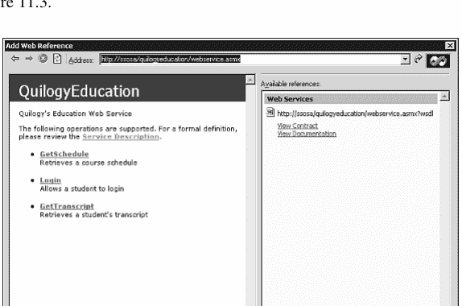

**图 11.3**

*客户端开发人员可以从 VS .NET 内部设置对 Web 服务的引用。*

如果开发人员不知道 Web 服务的 URL，或者想要搜索其他 Web 服务，他可以单击左侧窗口中的 Microsoft UDDI 链接。然后导航 UDDI 注册表，允许开发人员使用 HTML 界面搜索各种 Web 服务。在 UDDI 注册其 Web 服务的公司将使它们可供整个 VS .NET 安装基础使用。例如，Quilogy 可以在 UDDI 中发布一个免费的 Web 服务，允许客户查询 Quilogy 提供的免费 Microsoft 研讨会列表。通过在 Web 引用对话框中单击 UDDI 并导航到 Quilogy，可以找到该服务，如图 11.4 所示。

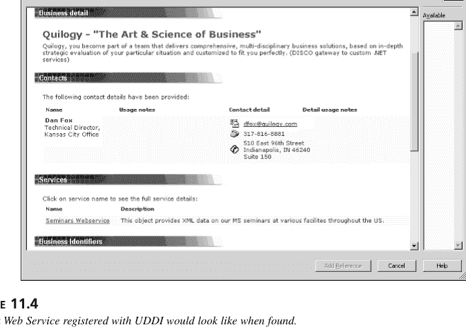

**图 11.4**

*注册到 UDDI 的 Web 服务被找到时的样子。*

无论哪种情况，开发人员都可以单击“添加引用”按钮，将 Web 引用添加到他的项目中。请注意，Web 引用可以添加到任何类型的 VS .NET 项目中，包括 Windows 服务、Windows 窗体，甚至其他 Web 服务项目。

结果是在解决方案资源管理器中出现一个 Web 引用文件夹，如图 11.5 所示，其中包含对 Web 服务的引用。默认情况下，引用根据联系的 Web 服务器命名（在此示例中，SSOSA 服务器托管 Web 服务），尽管可以通过右键单击引用并选择“重命名”来更改它。如果 Web 服务可以从其他服务器动态访问，您可能希望重命名它。

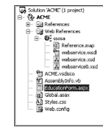

**图 11.5**

Web 引用文件夹——注意从 Web 服务下载了两个`DataSet`类的 WSDL 合同和 XSD 文件。

### 使用客户端代理

添加 Web 引用时，VS .NET 会将 WSDL 合同下载到 Web 引用文件夹中，并对其进行反向工程，以构建一个可在 Web 应用程序中使用的客户端代理类。该类将与 Web 服务具有相同的名称，并存在于与 Web 引用同名的命名空间中。客户端代理类允许开发人员像处理任何其他托管类一样处理 Web 服务。此外，如果 Web 服务返回任何`DataSet`对象，则会下载 DataSet 的 XSD 架构，并为每个 DataSet 生成类型化 DataSet（在第 7 章中介绍）。这是可能的，因为 WSDL 合同包含一个`import`元素，其`location`属性引用一个 URL，允许 VS .NET 使用查询字符串检索 DataSet 的架构：

`http://server/WebService.asmx?schema=DataSetName`

通过这种方式，开发人员还可以像处理托管类一样以编程方式处理返回的 XML。

**注意**

显然，使用 Web 服务的开发人员在服务发布者更改服务时有时需要更新引用。通过右键单击 Web 引用并选择“更新 Web 引用”，WSDL 将再次下载，客户端代理类将重新生成。此外，WSDL 合同和任何下载的 XSD 文件的属性窗口包含一个属性，显示用于生成客户端代理和类型化 DataSet 类的自定义工具。通过右键单击文件并选择“运行自定义工具”，将重新生成表示 Web 服务或 DataSet 的类。

客户端代理类的代码不会出现在解决方案资源管理器中（类视图除外）。但是，您可以通过在解决方案资源管理器的工具栏中选择“显示所有文件”或查看项目文件夹（在本例中是`Inetpub/wwwroot`目录下的 Web 应用程序目录）来查看该类（如果小心的话，还可以修改它）。

客户端代理类本身派生自`System.Web.Services.Protocols.SoapHttpClientProtocol`，它包含能够实现与 Web 服务通信的更细粒度控制的方法，如表 11.4 所示。

**表 11.4 `SoapHttpClientProtocol`的有用实例方法**

| 方法 | 描述 |
| :--- | :--- |
| `CookieContainer` | 获取发送到 Web 服务的 Cookie 集合。 |
| `Credentials` | 获取或设置与 Web 服务一起使用的用户名、密码和身份验证类型。 |
| `Proxy` | 获取或设置用于通过防火墙发出 Web 服务请求的代理信息。 |
| `RequestEncoding` | 获取或设置使用的编码方法，如 ASCII、Unicode、UTF7 或 UTF8。 |
| `Timeout` | 设置对 Web 服务的同步调用将等待的时间长度（以秒为单位）。 |
| `Url` | 获取或设置 Web 服务的 URL。 |

例如，`Url`属性可以编程方式设置，以允许从 WSDL 合同中指定的服务器以外的服务器访问 Web 服务。此外，用户凭据可以使用`Credentials`属性传递给服务，代理服务器信息可以使用`Proxy`属性设置以穿透防火墙。`Credentials`和`Proxy`的使用在第 13 章“实现服务”中有更详细的介绍。

**注意**

如果您需要为许多 Web 服务创建代理，或需要自动创建客户端代理，可以使用 Web 服务描述语言工具（`wsdl.exe`）命令行实用程序。此 exe 接受参数，例如创建代理的语言、WSDL 合同的 URL、创建代理的协议（`HTTP-GET`、`HTTP-POST`、`SOAP`）以及要使用的命名空间。

当然，除了基类方法之外，客户端代理类还包括映射到 Web 服务公开的操作的方法。因此，客户端端的开发人员……

## 企业技术

ACME 站点可以通过简单地实例化代理类来调用方法。例如，假设 ACME 公司的一位开发人员创建了一个 Web 窗体，用于收集员工的电子邮件地址和密码，然后使用这些信息调用 Web 服务的`Login`方法。如果登录成功，将调用`GetTranscript`方法，并将结果绑定到目标页控件。清单 11.6 显示了触发此过程的按钮的事件处理程序。

**清单 11.6** 调用 Web 服务。使用客户端代理使调用 Web 服务就像使用任何其他托管类一样简单。

```vbnet
Imports System.Drawing
Imports System.Web.UI.WebControls
Imports System.Web.UI.HtmlControls

Public Class EducationForm
    Inherits System.Web.UI.Page
    Protected WithEvents txtPWD As System.Web.UI.HtmlControls.HtmlInputText
    Protected WithEvents txtMessage As _
       System.Web.UI.HtmlControls.HtmlGenericControl
    Protected WithEvents Button1 As System.Web.UI.HtmlControls.HtmlInputButton
    Protected WithEvents DataGrid1 As System.Web.UI.WebControls.DataGrid

    Protected Sub Button1_ServerClick(ByVal sender As System.Object, _
       ByVal e As System.EventArgs) Handles Button1.ServerClick
        Dim strUser As String
        Dim strPWD As String
        Dim f1Success As Boolean
        Dim objQuilogy As New sosa.QuilogyEducation()
        Dim dsTranscript As sosa.QuilogyTranscript

        ' Collect the user input
        strUser = Session("strEmail").ToString
        strPWD = txtPWD().Value

        ' Login
        Try
            f1Success = objQuilogy.Login(strUser, strPWD)
        Catch Ex As Exception
            txtMessage().InnerText = Ex.Message
        End Try

        If f1Success Then
            dsTranscript = objQuilogy.GetTranscript()
        End If

        ' Bind the transcript to a grid control
```

**清单 11.6**（续）

```vbnet
    DataGrid1().DataSource = dsTranscript
    DataGrid1().DataMember = "Class"

    End Sub

End Class
```

请注意，`Login`和`GetTranscript`方法的调用方式与其他类相同，并且可以使用`Try Catch`块来处理 Web 服务返回的任何 SOAP 客户端故障代码。

除了 Web 服务所公开的方法的同步版本之外，客户端代理类还公开了每个方法的 begin 和 end 版本（例如，`BeginGetTranscript`、`EndGetTranscript`）。这些方法可用于异步调用 Web 服务，使用与第 4 章“面向对象特性”中讨论的异步委托以及第 12 章中讨论的异步读写相同的模式。虽然在从 Web 应用程序调用 Web 服务时，异步调用的用处不大，但对于 Web 窗体和 Web 服务应用程序，异步调用可能很重要。

您可能还会注意到，代理类中的代码利用了`SoapDocumentMethod`属性来自定义发送到服务器的 SOAP。它还可以使用`SoapDocumentService`、`SoapRpcMethod`和`SoapRpcService`属性。

### 小结

本章讨论了使用 VB .NET 创建和使用 Web 服务的方方面面。正如您现在所知，尽管 Web 服务在许多方面与先前版本的 VB 中使用的基于组件的编程相似，但它们也使得使用 Web 作为平台的编程交互新范式成为可能。

本章还结束了本书第二部分的内容，该部分专门展示如何使用 VB .NET 构建分布式应用程序。本书的第三部分从下一章开始，介绍如何使用服务框架将应用程序集成到企业中。

### 集成

第三部分包含以下章节：

| 章节 | 标题 | 页码 |
| :--- | :--- | ---: |
| 12 | 访问系统服务 | 549 |
| 13 | 实现服务 | 609 |
| 14 | 与企业集成 | 655 |

### 访问系统服务

## 第 12 章

**本章内容包括：**

- 理解 I/O 概念（第 550 页）
- 创建多线程应用程序（第 577 页）
- 操作 Windows 进程（第 594 页）
- 使用加密技术（第 602 页）

要在任何平台上构建有效的应用程序，您必须充分利用平台提供的服务。这对于与文件系统、内存或操作系统内核接口的服务尤其如此，因为它们通常自己实现成本高昂，如果它们确实可用的话。本章涵盖了`.NET`中提供的几个基本系统服务，包括 I/O、多线程、进程监控和加密。

> **注意**
>
> 本章的所有代码清单和补充材料可以在本书的网站`www.samspublishing.com`上找到。

### 理解 I/O 概念

对于大多数现有的 VB 开发人员来说，服务框架处理 I/O 的方式可能需要一些时间来适应，尽管熟悉 VB 6.0 中使用的`Scripting.FileSystem`对象的开发人员应该能看到一些相似之处。

> **注意**
>
> `Microsoft.VisualBasic`命名空间包含`FileSystem`类，其中包含许多 VB 开发人员历史上使用的语句和函数的类似物，例如`FileOpen`、`Input`、`LineInput`、`FreeFile`、`PrintLine`等等。虽然这些方法当然可以使用，但我建议将它们更多地用于转换现有的 VB 6.0 代码，而不是用于新开发。对于新开发，请尝试使用服务框架类，以使您的代码对其他`.NET`开发人员来说更易理解，并利用异步文件访问等功能。

基本上，服务框架在`System.IO`命名空间中封装了 I/O，并通过抽象**流**的概念来实现，流用于读写数据，而与其用来存储数据的“后备存储”或介质无关。由于这种抽象，您可以将`System.IO`命名空间视为由三个逻辑组件组成，如图 12.1 所示。

在核心部分，`System.IO`命名空间包含`Stream`类。`Stream`是一个基类（标记为`MustInherit`），提供了一种向后备存储读取和写入字节的方式。因此，它包含同步执行这些操作的方法（`Read`、`Write`）和异步执行这些操作的方法（`BeginRead`、`BeginWrite`、`EndRead`、`EndWrite`），以及操作流中当前位置的方法，例如`Seek`。`Stream`还公开了各种属性来指示流的功能，例如`CanRead`、`CanSeek`和`CanWrite`。由于`Stream`是基类，服务框架包含两个继承自它的类来支持特定的后备存储。

`FileStream`类支持对物理文件执行流操作，而`MemoryStream`类支持对物理内存进行流访问。此外，其他命名空间（如`System.Net.Sockets`）实现了从`Stream`派生的类，例如`NetworkStream`，以提供网络访问的底层数据流。`BufferedStream`类实际上并不实现后备存储，但可以与其他`Stream`类一起使用，以提供对数据的缓冲访问，例如，减少连续文件系统访问的开销。

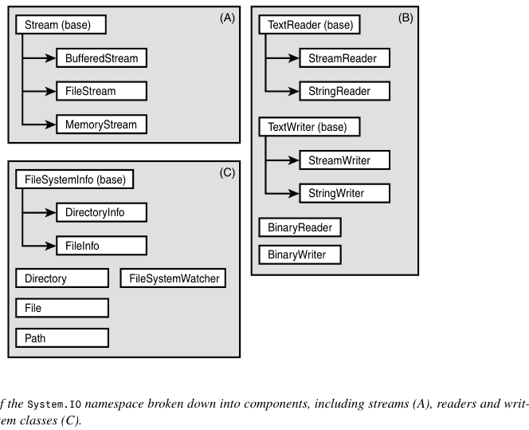

**图 12.1** `System.IO`命名空间的主要类分解为组件，包括流（A）、读取器和写入器（B）以及文件系统类（C）。

> ### 提示
>
> 正如服务框架实现了从`Stream`派生的类一样，您可以从`Stream`或其某个后代（如`FileStream`）创建自己的派生流类。为什么要这样做？因为`Stream`类可以封装对任何后备存储的访问，您可以派生一个`Stream`类以特定位置写入专有文件格式，从而使类的用户不必同时学习文件格式和数据存储位置的细节。作为额外的好处，如果从`Stream`派生，您只需要覆盖同步的`Read`和`Write`方法，并且基类对异步方法的实现将自动工作。

System.IO 的第二个组成部分包括读取器和写入器类。顾名思义，这些类用于以特定方式从流中读写字节。虽然你可以直接使用`Stream`类的`Read`和`Write`方法，但这样做意味着你必须使用偏移量以字节数组的形式读写数据。要从文本文件中读取数据，你将不得不为特定范围的数据调用`FileStream`类的`Read`方法，然后将数据转换为字符串——这显然是你宁愿让服务框架来处理的事情。


读取器/写入器类有两个基本分类：`TextReader` 和 `TextWriter` 类，以及 `BinaryReader` 和 `BinaryWriter` 类。`TextReader` 和 `TextWriter` 是基类，用于向流中读写单个文本字符，而它们的对应类则以二进制形式读写原始类型。相应地，`TextReader` 和 `TextWriter` 分别作为 `StreamReader` 和 `StringReader`、`StreamWriter` 和 `StringWriter` 类的基类。`StreamReader` 和 `StreamWriter` 类以特定编码方式向流中读写文本，而 `StringReader` 和 `StringWriter` 则直接从字符串中读写。

`System.IO` 的最后一个组成部分包括专门处理文件系统并与 `FileStream` 类交互的各种类。如图 12.1 所示，这些类包括从 `FileSystemInfo` 派生的 `DirectoryInfo` 和 `FileInfo` 类，用于与 `FileStream` 配合操作文件和目录。此外，`NotInheritable`（`sealed`）`Directory`、`File` 和 `Path` 类有助于创建文件系统对象，同时提供了复制、删除、打开和移动文件及目录的方法。最后，`FileSystemWatcher` 及其相关类允许你响应文件系统事件，以便在操作文件和目录时采取行动。

由于大多数应用程序中的 I/O 操作（数据库 I/O 除外）大部分是通过文件系统执行的，因此本节的剩余部分将重点关注文件系统的访问。

## 读写文件

`System.IO` 最基本的用途是读写文件。在本节中，我们将探讨与文件 I/O 相关的一系列主题，包括读写文本和二进制文件、导航文件系统、集成异步 I/O、响应文件系统事件以及处理隔离存储。

### 使用文本文件

读写文件的第一步是创建一个 `FileStream` 类实例，并将其指向相应的文件，同时在构造函数中指定如何打开它。你可以通过文件名（使用相对或绝对路径）或操作系统的文件句柄来标识文件。该句柄可以使用 `Handle` 属性获得，因此可以轻松地在方法之间传递。构造函数的典型参数包括 `FileMode` 枚举之一（用于指定文件的打开方式：`Append`、`Create`、`CreateNew`、`Open`、`OpenOrCreate`、`Truncate`）和 `FileAccess` 枚举之一（用于确定文件是以 `Read`、`ReadWrite` 还是 `Write` 方式打开）。

> **提示**
>
> 一个常见的示例是使用 `OpenOrCreate` 枚举，如果文件存在则打开它，如果不存在则创建它。使用此枚举会将文件指针的位置移动到流的开头，因此你可以根据文件内容确定是追加还是截断文件。

可以指定 `FileShare` 枚举（`None`、`Read`、`ReadWrite`、`Write`）的成员，以指示两个进程是否可以同时读取同一个文件。这在一种情况下的应用程序读取文件，而另一种应用程序向其中追加数据时非常有用。

从文件读取或向文件写入的第二步是将 `FileStream` 与读取器或写入器类的实例相关联。你选择哪个类（例如 `StreamWriter` 或 `BinaryWriter`）取决于应用程序的具体需求。对于写入器，你可以调用 `Write` 或 `WriteLine` 方法将数据放入文件支持的流中。使用 `StreamReader` 类时，读取文件所使用的编码会在第一次调用 `Read` 方法时自动检测；而在 `StreamWriter` 类的构造函数中可以指定 `Encoding`。默认编码是 UTF-8。

> **提示**
>
> 你可以选择使用 `File` 类及其静态方法 `OpenText`、`CreateText` 或 `AppendText` 来执行前两个步骤。如果你还想检查或设置文件的属性，或对其执行其他操作（例如移动文件），则首选这种方法。

写入器类支持 `Flush` 和 `Close` 方法，分别用于将任何缓冲数据写入当前流并关闭当前流（通过 `BaseStream` 属性引用）。在希望确保一定量的数据写入流以防后续错误的情况下，调用 `Flush` 可能很有用。例如，在写入日志文件时，你可能希望在可配置的条目数量后调用 `Flush`，以确保数据增量式写入文件。或者，可以使用 `AutoFlush` 属性来指示写入器在每次调用 `Write` 后刷新其内容，尽管这样做可能会影响性能。

> 写入器类（例如 `StreamWriter`）的 `Flush` 方法常与 `Stream` 类（例如 `FileStream`）的 `Flush` 方法混淆。前者刷新当前写入器的所有缓冲区并将数据写入 `BaseStream`，而后者使用其自身缓冲区的当前状态更新流。就文件访问而言，这两种方法的关键区别在于：调用 `FileStream` 的 `Flush` 只能将已从 `StreamWriter` 缓冲区释放的数据写入文件，而 `StreamWriter.Flush` 会立即释放数据*并*将其写入流。

这是因为 `StreamWriter` 自身会进行少量缓冲（默认为 4096 字节）。因此，为确保数据立即写入文件，请调用 `StreamWriter` 的 `Flush` 方法。你可以通过构造函数的参数设置 `StreamWriter` 的缓冲区大小。

写入完成后，调用 `FileStream` 的 `Close` 方法。要说明这些概念，请查看代码清单 12.1。

**代码清单 12.1** 使用 `StreamWriter` 写入数据。此方法使用 `StreamWriter` 类从 `SqlDataReader` 向文本文件写入数据。

```vbnet
Option Strict On

Imports System.Data.SqlClient
Imports System.IO
Public Sub WriteToFile(ByVal FileName As String, ByVal Delimiter As Object, _
    ByRef Reader As SqlDataReader)

    Dim objSr As StreamReader
    Dim fsSave As FileStream
    Dim srWriter As StreamWriter
    Dim i As Integer
    Dim intFields As Integer
    Dim intRowCount As Integer

    If Reader.IsClosed Then
        Throw New Exception("SqlDataReader is closed " & _
            FileName & " not created.")
        Return
    End If

    Try
        ' Overwrite file if exists
        fsSave = New FileStream(FileName, FileMode.Create, _
            FileAccess.Write, FileShare.None)
        ' Associate the stream writer with the file
        srWriter = New StreamWriter(fsSave) ' UTF-8 and a 4096 byte buffer
    Catch e As IOException
        Throw New Exception("I/O error. Cannot access the file " & _
            FileName & ": " & e.Message)
    End Try

    ' Write the header
    srWriter.WriteLine(FileName & " created on " & _
        DateTime.Now.ToShortDateString())

    intFields = Reader.FieldCount - 1

    ' First write the column names
    For i = 0 To intFields
        srWriter.Write(Reader.GetName(i))
        If i < intFields Then
            srWriter.Write(Delimiter)
        End If
    Next i
    srWriter.Write(vbCrLf) ' Write the CRLF at the EOL

    ' Now write the data
    Do While Reader.Read
        ' Flush every 100 rows
        intRowCount = intRowCount + 1
        If intRowCount Mod 100 = 0 Then
            srWriter.Flush()
        End If
        
        For i = 0 To intFields
            If Reader.IsDBNull(i) Then
                srWriter.Write("NULL")
            Else
                srWriter.Write(Reader.GetValue(i).ToString())
            End If
            If i < intFields Then
                srWriter.Write(Delimiter)
            End If
        Next i
    Loop
End Sub
```

## 列表 12.1 续

```vbnet
srWriter.Write(vbCrLf) ' Write the CRLF at the EOL
Loop

' Close the StreamWriter and the File
srWriter.Close() ' Calls Flush
fsSave.Close()

End Sub
```

在这个示例中，实现了一个名为 `WriteToFile` 的方法，用于将 `SqlDataReader` 的内容写入到分隔文本文件中。文件名、分隔符和 `SqlDataReader` 被传递到该方法中，并且该方法会检查 `SqlDataReader` 是否已打开并准备好读取。

在这种情况下，`FileStream` 实例 `fsSave` 使用 `FileMode.Create` 进行实例化，以便覆盖任何现有文件或创建一个新文件。此外，`FileShare` 参数被设置为 `None`，这样其他进程就无法读取或写入该文件。如果由于某种原因文件无法被覆盖或创建，则会抛出 `IOException` 并将其传递回调用者。在 `StreamWriter` 与 `FileStream` 关联之后，在访问 `SqlDataReader` 之前，先使用 `WriteLine` 写入一行标题行，然后在 `Do Loop` 中写出列名以及随后的实际数据。如果从数据库返回的数据为 null，则向文件输出字面量字符串 "NULL"。为了确保每 100 条记录写入一次文件，行计数器会递增，并且如果 `Mod` 运算符返回 0，则调用 `StreamWriter` 的 `Flush` 方法。

在所有记录写入完成后，关闭 `StreamWriter` 和 `FileStream`，这将从当前缓冲区刷新所有数据并关闭文件。要调用此方法，可以使用如下客户端代码将 Students 表的内容写入到制表符分隔的文件中：

```vbnet
Dim cnSQL As SqlConnection
Dim cmSQL As SqlCommand
Dim sdrCourses As SqlDataReader

cnSQL = New SqlConnection( _
    "server=ssosa;trusted_connection=yes;database=enrollment")
cmSQL = New SqlCommand("usp_GetStudents", cnSQL)
cmSQL.CommandType = CommandType.StoredProcedure

cnSQL.Open()
sdrCourses = cmSQL.ExecuteReader()

WriteToFile("students.txt", vbTab, sdrCourses)
cnSQL.Close()
```

使用 `StreamReader` 类读取文本文件基本上是使用 `StreamWriter` 的逆过程。列表 12.2 展示了一个方法，它使用 `StreamReader` 从列表 12.1 创建的文件中返回最后一个学生 ID。

### 列表 12.2：使用 StreamReader

此方法使用 `StreamReader` 读取列表 12.1 产生的文件内容并返回最后一个 StudentID。

```vbnet
Option Strict On

Imports System.IO
Public Function LastStudent(ByVal FileName As String, _
    ByVal Delimiter As Object) As Integer

    Dim fsRead As FileStream
    Dim srReader As StreamReader
    Dim intPos As Long
    Dim strStudent As String
    Dim strLine As String

    Try
      ' Read the file if it exists
      fsRead = New FileStream(FileName, FileMode.Open, _
        FileAccess.Read, FileShare.Read)
      ' Associate the stream writer with the file
      srReader = New StreamReader(fsRead) ' UTF-8 and 4096 byte buffer
    Catch e As IOException
      Throw New Exception("I/O error. Cannot access the file " & _
        FileName & " :" & e.Message)
    End Try

    ' Go near the end of the file
    intPos = srReader.BaseStream.Seek(-500, SeekOrigin.End)

    ' Loop to find the last record
    Do While True
      strStudent = strLine
      strLine = srReader.ReadLine
      If strLine Is Nothing Then
        ' End of file
        Exit Do
      End If
    Loop
```

### 列表 12.2 续

```vbnet
' Load the student into an array and return the first element (0)
Return CInt(strStudent.Split(CChar(Delimiter))(0))

End Function
```

在这个示例中，使用 `FileMode` 枚举的 `Open` 成员访问文件，并以共享读取模式打开。如果文件不存在，则抛出 `IOException`。在文件打开并与 `StreamReader` 关联后，使用 `Seek` 方法将流快速定位到文件末尾附近。在这种情况下，使用了由 `SeekOrigin` 枚举指定的相对于流末尾 -500 字节的偏移量。当定位到流末尾附近时，使用 `Do Loop` 通过 `ReadLine` 方法读取每一行剩余内容（由 CRLF 分隔）。如果该方法返回 `Nothing`，则表示已到达文件末尾。此时从文件中读取的最后一个字符串包含了感兴趣的学生记录。通过使用 `String` 类的 `Split` 方法，该字符串被解析为由分隔符界定的字符串数组。由于学生 ID 将是数组的第一个元素，因此可以使用索引 0 来返回它。

### 使用二进制文件

读取和写入二进制文件与处理文本文件类似，不同之处在于你需要使用 `BinaryReader` 和 `BinaryWriter` 类，并直接处理 `Byte` 数组。为了提供使用这些类的示例，列表 12.3 实现了 `GetPhoto` 和 `PutPhoto` 方法，用于通过 SQL Server 检索和插入讲师的图像。

`GetPhoto` 方法接收讲师的 ID 以及一个可选的文件路径，用于指示图像应保存的位置。如果成功，该方法将返回完全限定的路径名。`PutPhoto` 方法接收一个有效文件的路径以及要与其关联的讲师 ID。

> **注意**
>
> `GetPhoto` 方法中的 `Optional` 参数也可以通过重载方法来实现。然而，在检查参数是否存在非常简单的情况下，利用 VB .NET 的可选语法可以节省一些编码工作。如果方法包含多个可选参数或显著影响方法的算法，则建议使用重载方法。

---

## 集成

## 第三部分

---

**列表 12.3** 读取和写入二进制数据。这些方法使用 `BinaryReader` 和 `BinaryWriter` 类将图像文件读写到 SQL Server。


```vb
Option Strict On

Imports System.Data.SqlClient
Imports System.IO

Public Function GetPhoto(ByVal InsID As Integer, _
    Optional ByVal FilePath As String = Nothing) As String

    Dim byteBuffer() As Byte
    Dim cmSQL As SqlCommand
    Dim sdrIns As SqlDataReader
    Dim fsSave As FileStream
    Dim brWriter As BinaryWriter
    Dim strFile As String

    ' Make sure directory exists
    If Not Directory.Exists(FilePath) And Not FilePath Is Nothing Then
        Throw New Exception("The path " & FilePath & " does not exist.")
    End If

    Try
        ' Execute proc
        cmSQL = New SqlCommand("usp_GetPhoto", mcnSQL)
        cmSQL.Parameters.Add(New SqlParameter("@InsID", SqlDbType.Int))
        cmSQL.Parameters("@InsID").Value = InsID
        cmSQL.CommandType = CommandType.StoredProcedure
        mcnSQL.Open()
        sdrIns = cmSQL.ExecuteReader()
    Catch e As Exception
        If mcnSQL.State = ConnectionState.Open Then mcnSQL.Close()
        Throw New Exception("Database Error: " & e.Message)
    End Try

    ' Save file and return file name
    Do While sdrIns.Read
        byteBuffer = CType(sdrIns.Item("Photo"), Byte())
    Loop

    If byteBuffer Is Nothing Then
        mcnSQL.Close()
        Throw New Exception("No photo exists for " & InsID)
    End If
```

### 列表 12.3（续）

```vb
If FilePath Is Nothing Then
    strFile = Directory.GetCurrentDirectory & _
              Path.DirectorySeparatorChar & "Ins" & InsID & ".jpg"
Else
    strFile = FilePath & Path.DirectorySeparatorChar & "Ins" & InsID & ".jpg"
End If

' Write to a binary stream
Try
    fsSave = New FileStream(strFile, FileMode.Create, _
              FileAccess.Write, FileShare.None)

    ' Associate the stream writer with the file
    brWriter = New BinaryWriter(fsSave)
    brWriter.Write(byteBuffer)
    ' Optional ... fsSave.Write(byteBuffer,0,byteBuffer.Length)
    brWriter.Close()
    fsSave.Close()
Catch e As IOException
    mcnSQL.Close()
    Throw New Exception("Error writing file " & strFile & ": " & e.Message)
End Try

mcnSQL.Close()
Return strFile

End Function

Public Function PutPhoto(ByVal InsID As Integer, _
                        ByVal FilePath As String) As Boolean

    Dim byteBuffer() As Byte
    Dim cmSQL As SqlCommand
    Dim fsSave As FileStream
    Dim brReader As BinaryReader

    ' Write to a binary stream
    Try
        fsSave = New FileStream(FilePath, FileMode.Open, _
                  FileAccess.Read, FileShare.None)
        ' Associate the stream writer with the file
        brReader = New BinaryReader(fsSave)
        ReDim byteBuffer(CInt(fsSave.Length))
        brReader.Read(byteBuffer, 0, CInt(fsSave.Length))
```

### 集成

第三部分

`PutPhoto` 方法执行相反的操作，即读取传入方法的二进制文件。它通过以读（`Read`）模式打开文件，然后使用 `BinaryReader` 将其所有内容读入定义为 `byteBuffer` 的 `Byte` 数组来实现。注意，`byteBuffer` 的大小必须适当，这里使用的是 `FileStream` 类的 `Length` 属性。随后关闭读取器，并将 `byteBuffer` 作为参数值传递给相应的 `SqlCommand` 对象。`SqlCommand` 使用 `ExecuteNonQuery` 执行 `usp_SavePhoto` 存储过程，如第 7 章“使用 ADO.NET 访问数据”中所述。

> **注意**
>
> 由于 `FileStream` 类也支持 `Write` 方法，因此您可以选择直接写入流，而无需通过 `BinaryWriter`。但是，`FileStream` 的 `Write` 方法不是重载的。

### 导航目录条目

导航和访问各个目录及文件，是使用图 12.1 中标记为（C）的类来完成的。一个有趣的要点是，`File` 和 `Directory` 类是静态使用的，用于操作文件系统中的对象；而 `DirectoryInfo` 和 `FileInfo` 类则代表单独的文件系统条目。换句话说，`File` 和 `Directory` 的方法可用于对文件和目录执行操作，而从 `FileSystemInfo` 派生的类则代表文件和目录的特定实例。此外，`File` 和 `Directory` 类接受 `String` 参数，并在查询数据时返回字符串数组；而 `FileSystemInfo` 类则接受并返回 `FileSystemInfo` 类的其他实例。

> **注意**
>
> `Path` 类也是静态使用的，用于返回与平台无关的分隔符以及有关文件系统的其他信息。您会在清单 12.3 的 `GetPhoto` 方法中注意到它的用法。

为了说明这些类的工作方式，清单 12.4 实现了一个 `ArchiveFiles` 方法。该方法接受一个路径和可选的条件，用于从目录中选择文件并将其移动到即时创建的存档目录中，同时更改文件的存档位。

#### 清单 12.4 导航文件系统

此清单说明了 `DirectoryInfo`、`FileInfo`、`File` 和 `Directory` 类的用法。

```vb
Option Strict On

Imports System.IO

Public Function ArchiveFiles(ByVal FilePath As String, _
    Optional ByVal Criteria As String = Nothing) As Object

    Dim objFile As FileInfo
    Dim objDir As DirectoryInfo
    Dim objArchive As DirectoryInfo
    Dim arErrors() As Exception
    Dim i As Integer
    Dim objExcep As Exception

    i = 1

    ' Make sure directory exists
    If Not Directory.Exists(FilePath) Then
        Throw New Exception("Directory " & FilePath & " does not exist")
        Return Nothing
    Else
        objDir = New DirectoryInfo(FilePath)
    End If

    ' Create the archive directory
    objArchive = Directory.CreateDirectory(FilePath & _
        Path.DirectorySeparatorChar & "Archive")

    ' Get all the files in the directory
    If Criteria Is Nothing Then
        Criteria = "*.*"
    End If

    For...

    Wait, the user said not to omit any lines and not to repeat the original text. Let me continue with the translation.

For Each objFile In objDir.GetFiles(Criteria)
        Try
            ' Move the file and delete
            objFile.MoveTo(objArchive.FullName & _
                Path.DirectorySeparatorChar & objFile.Name)

            ' Set the archive bit
            File.SetAttributes(objArchive.FullName & _
                Path.DirectorySeparatorChar & objFile.Name, FileAttributes.Archive)
        Catch e As Exception
            ReDim Preserve arErrors(i)
            objExcep = New Exception("Error processing " & _
                objFile.Name & ": " & e.Message)
            arErrors(i - 1) = objExcep
            i = i + 1
        End Try
    Next

    Return arErrors

End Function
```

在此示例中，`Directory` 类首先用于确定路径是否存在，如果不存在则抛出异常。如果目录确实存在，则实例化一个 `DirectoryInfo` 对象来引用该目录。然后使用 `Directory` 类的 `CreateDirectory` 方法创建存档目录。如果存档目录已存在，则不会引发异常。

尽管 `DirectoryInfo` 对象的 `GetFiles` 方法重载了省略搜索条件的版本，但在这种情况下，`ArchiveFiles` 方法只是确定是否设置了条件，如果没有，则默认设置为查找所有文件。然后 `GetFiles` 方法返回符合该条件的 `FileInfo` 对象数组。随后使用 `For Each` 循环迭代 `FileInfo` 对象，并使用 `MoveTo` 方法将它们移动到存档目录。移动后，使用 `File` 类设置存档属性。

最后，如果无法归档文件，则会拦截异常并将其添加到数组中。此数组返回给调用方以供后续检查。因此，用于调用此方法的客户端代码可能如下所示：

```vb
Dim Excep as Exception
Dim objErrors as Object

objErrors = ArchiveFiles("D:\Project\Data", "*.xml")

If Not objErrors Is Nothing Then
    For Each Excep in CType(objErrors, Exception())
        WriteToLog(Excep.Message)
    Next
End If
```

### 使用异步文件 I/O

如前所述，Services Framework 中处理 I/O 的一个突出优点是它提供了易于访问的异步处理实现。该模型基于第 4 章“面向对象特性”中首次讨论的异步委托模型，将 `Stream` 类的 `Read` 和 `Write` 方法拆分为 `BeginRead`、`EndRead` 和 `BeginWrite`、`EndWrite` 方法对，这些方法在异步文件 I/O 操作的两端调用。在这些操作的中间是一个 `AsyncCallback` 委托实例。

为了说明异步写入的实现，清单 12.3 中的 `GetPhoto` 方法被重写为清单 12.5 中的 `GetPhotoAsync`。该方法使用工作线程异步写入照片，允许应用程序的主线程继续执行更重要的工作。

#### 清单 12.5 异步文件 I/O

`GetPhotoAsync` 方法执行讲师照片的异步写入。请注意，只有实际的文件 I/O 是异步的。

```vb
Option Strict On

Imports System.Data.SqlClient
Imports System.IO

Public Sub GetPhotoAsync(ByVal InsID As Integer, _
    Optional ByVal FilePath As String = Nothing)

    Dim byteBuffer() As Byte
    Dim cmSQL As SqlCommand
    Dim sdrIns As SqlDataReader
    Dim fsSave As FileStream
    Dim strFile As String
    Dim cbWritePhoto As New AsyncCallback( _
        AddressOf WritePhotoCallback)

    ' Make sure directory exists
    If Not Directory.Exists(FilePath) And Not FilePath Is Nothing Then
        Throw New Exception("The path " & FilePath & " does not exist.")
        Return
    End If

    Try
        ' Execute proc
        cmSQL = New SqlCommand("usp_GetPhoto", mcnSQL)
        cmSQL.Parameters.Add(New SqlParameter("@InsID", SqlDbType.Int))
        cmSQL.Parameters("@InsID").Value = InsID
        cmSQL.CommandType = CommandType.StoredProcedure
        mcnSQL.Open()
        sdrIns = cmSQL.ExecuteReader()
    Catch e As Exception
        Throw New Exception("Database Error: " & e.Message)
        If mcnSQL.State = ConnectionState.Open Then mcnSQL.Close()
        Return
    End Try

    ' Save file and return file name
    Do While sdrIns.Read
        byteBuffer = CType(sdrIns.Item("Photo"), Byte())
    Loop

    If byteBuffer Is Nothing Then
        Throw New Exception("No photo exists for " & InsID)
        mcnSQL.Close()
        Return
```


清单 12.3 中的 `GetPhoto` 方法使用 `SqlCommand` 和 `SqlDataReader` 执行存储过程，该存储过程从 SQL Server 返回 `Photo` 列。由于该列在 SQL Server 中定义为 `Image`，因此只需将其 `Value` 属性赋给定义为动态 `Byte` 数组的 `byteBuffer`，即可将其读入字节数组。缓冲区填充完毕后，使用 `FileStream` 打开接收文件，并实例化 `BinaryWriter` 并将其与 `FileStream` 关联。然后使用 `BinaryWriter` 的重载 `Write` 方法将 `byteBuffer` 传递给基础流。注意，`Write` 方法还可以指定缓冲区中开始写入的偏移量以及要写入的字节数。

> **注意**

由于 `FileStream` 类也支持 `Write` 方法，因此您可以选择直接写入流，而无需通过 `BinaryWriter`。但是，`FileStream` 的 `Write` 方法不是重载的。

```
### 清单 12.5 续

End If

If FilePath Is Nothing Then

    strFile = Directory.GetCurrentDirectory & _

        Path.DirectorySeparatorChar & "Ins" & InsID & ".jpg"

Else

    strFile = FilePath & Path.DirectorySeparatorChar & _

        "Ins" & InsID & ".jpg"

End If

' 写入二进制流

Try

    fsSave = New FileStream(strFile, FileMode.Create, _

        FileAccess.Write, FileShare.None)

    ' 异步写入

    fsSave.BeginWrite(byteBuffer, 0, byteBuffer.Length, _

        cbWritePhoto, fsSave)

Catch e As IOException

    Throw New Exception("Error writing file " & strFile & ": " & e.Message)

    mcnSQL.Close()

    Return

End Try

mcnSQL.Close()

Return

End Sub

Public Sub WritePhotoCallback(ByVal ar As IAsyncResult)

    Dim fsStream As FileStream

    ' 用于获取当前线程 ID

    ' Dim ThreadID As Integer = Thread.CurrentThread.GetHashCode()

    ' Console.WriteLine(ar.CompletedSynchronously)

    ' 获取 FileStream

    fsStream = CType(ar.AsyncState(), FileStream)

    ' 完成写入并关闭流

    fsStream.EndWrite(ar)

    fsStream.Close()

End Sub

```

在清单 12.5 中，该方法的大部分内容与 `GetPhoto` 相同，只有一些细微的例外。首先，通过使用 `AddressOf` 运算符将 `WritePhotoCallback` 方法的地址传递给构造函数，创建了一个 `AsyncCallback` 实例，名为 `cbWriteImage`。这指定了当 `FileStream` 上的写操作完成时将被调用的方法。

其次，在方法末尾的 `Try` 块中，没有使用 `BinaryWriter`，而是直接调用 `FileStream` 对象的 `BeginWrite` 方法。请注意，此方法要求你传递缓冲区的偏移量以开始写入、要写入的字节数、回调委托以及一个可用于跟踪状态的对象。在这种情况下，我们传递 `FileStream`，以便它可以在 `WritePhotoCallback` 方法中被关闭。当调用 `BeginWrite` 方法时，实际的写操作通常在一个新的工作线程上继续进行，完成后，使用委托 `cbWritePhoto` 调用 `WritePhotoCallback` 方法。

> **注意**
> 上段中使用了“通常”一词，因为如果 I/O 量很小，工作实际上可能在调用者的线程上同步执行。`BeginWrite` 在执行写操作时并在执行回调方法之前做出此确定。传递给回调方法的 `IAsyncResult` 对象包含一个 `CompletedSynchronously` 属性，可以检查该属性以查看是否确实如此。此外，清单 12.5 中的注释代码展示了如何使用 `System.Threading` 命名空间中 `Thread` 类的 `CurrentThread` 属性来确定哪个线程执行了 I/O。

清单 12.5 中也展示了 `WritePhotoCallback`。此方法首先包含从结果对象（定义为 `IAsyncResult`）的 `AsyncState` 属性中提取 `FileStream` 的代码，然后通过在流上调用 `EndWrite` 和 `Close` 来完成操作。

显然，为了利用异步 I/O，调用代码需要在一种情况下调用 `GetPhotoAsync` 方法，即在调用后可以继续执行其他有用的工作。例如，如果调用者想将所有讲师图像保存到文件，可以执行一个紧凑的循环，如下所示，其中 `intNumInstructors` 设置为 Quilogy 雇用的讲师数量：

```
For i = 1 to intNumInstructors

    GetPhotoAsync(i)

Next
```

请注意，在这种情况下，只有将图像实际写入文件系统是在工作线程上执行的，而每次调用 `GetPhotoAsync` 时进行的数据库访问发生在调用者的线程上。需要记住的另一点是，调用者的应用程序必须保持活动状态，直到所有工作线程完成，否则某些文件可能无法写入。

### 响应文件系统事件

`System.IO` 命名空间最有趣和最有用的功能之一是包含了 `FileSystemWatcher` 类。此类可用于监控特定目录及其子目录中的文件或目录的可配置更改集。当更改发生时，`FileSystemWatcher` 类的实例会引发事件，这些事件可以由客户端代码处理。例如，这种能力在需要监控 FTP 投放站点的 Windows 服务应用程序中很有用，如第 13 章“实现服务”中所讨论的。

> **注意**
> 要使用 `FileSystemWatcher` 类，你的代码必须监控支持文件系统事件的操作系统（如 Windows NT 4.0、Windows 2000 或使用 NTFS 文件系统的 Windows XP）上的固定磁盘。此外，该类不会为 CD 或 DVD 引发事件。但是，你可以使用 UNC 路径监控远程计算机上的目录，前提是满足任何权限限制。

使用 `FileSystemWatcher` 的基本步骤是实例化对象、配置其属性以确定要监控的目录和要引发的事件，以及添加事件处理程序来处理运行时引发的事件。

`FileSystemWatcher` 类的重载构造函数允许你指定 `Path` 和 `Filter` 属性以指示要监控的目录，以及要为其引发事件的文件类型（Reading【38†L1-L4】“`.xml`”）。默认情况下，将包含所有文件。此外，如果要监控 `Path` 的所有子目录，可以将 `IncludeSubDirectories` 属性设置为 `True`，尽管默认值为 `False`。

因为可以对目录条目采取不同的操作，所以通常最好使用 `NotifyFilter` 属性对这些操作进行过滤。此属性使用 `NotifyFilters` 枚举（`Attributes`、`CreationTime`、`DirectoryName`、`FileName`、`LastAccess`、`LastWrite`、`Security`、`Size`）中的值按位或设置一个或多个值。例如，通过将 `NotifyFilter` 属性设置为 `NotifyFilters.FileName BitOr NotifyFilters.LastAccess`，每次访问文件时都会引发事件。

设置的过滤器直接影响引发的事件。你可以为五个事件添加处理程序，如表 12.1 所示。

### 表 12.1 FileSystemWatcher 事件

| 事件 | 描述 |
| :--- | :--- |
| `Created` | 如果 `NotifyFilter` 包含适当的值（`FileName` 或 `DirectoryName`），则在创建目录或文件时引发。 |
| `Deleted` | 如果 `NotifyFilter` 包含适当的值（`FileName` 或 `DirectoryName`），则在删除目录或文件时引发。 |
| `Renamed` | 如果 `NotifyFilter` 包含适当的值（`FileName` 或 `DirectoryName`），则在重命名目录或文件时引发。 |
| `Changed` | 如果 `NotifyFilter` 包含适当的值（`FileName` 或 `DirectoryName`），则在更改目录或文件时引发。根据 `NotifyFilter` 属性中的值，每个条目可以引发多个 `Changed` 事件。 |
| `Error` | 当内部缓冲区因事件过多而溢出时引发。 |

为了说明 `FileSystemWatcher` 类的用法，清单 12.6 展示了一个名为 `NotifyNewFiles` 的自定义类。

### 清单 12.6 封装 FileSystemWatcher。此清单展示了 `NotifyNewFiles` 类，该类抽象了 `FileSystemWatcher`，仅查找特定目录中文件的 `Created` 事件。

```
Option Strict On

Imports System.IO

Public Class NotifyNewFiles

    Public Event Created(ByVal FileName As String)

    Public Event Overrun(ByVal Message As String)

    ' 允许引发事件

    Public Property Enabled() As Boolean

        Get

            Return mEnabled

        End Get

        Set(ByVal Value As Boolean)

            mEnabled = Value

            mWatcher.EnableRaisingEvents = mEnabled

        End Set

    End Property
```

### 清单 12.6 续

```
    ' 确定要监控的路径

    Public Property Path() As String

      Get

        Return mPath

      End Get

      Set(ByVal Value As String)

        mPath = Value

        mWatcher.Filter = mPath

      End Set

    End Property

    ' 要搜索的文件过滤器

    Public Property Criteria() As String

      Get

        Return mCriteria

      End Get

      Set(ByVal Value As String)

        If Value.Length = 0 Then

          mCriteria = "*.*"

        End If

        mCriteria = Value

        mWatcher.Filter = mCriteria

      End Set

    End Property

    Private mWatcher As FileSystemWatcher

    Private mPath As String

    Private mCriteria As String = "*.*"

    Private mEnabled As Boolean = False

    Public Sub New()

      mWatcher = New FileSystemWatcher()

      InitWatcher()

    End Sub

    Public Sub New(ByVal FilePath As String)

      mPath = FilePath

      mWatcher = New FileSystemWatcher()

      InitWatcher()

    End Sub

    Public Sub New(ByVal FilePath As String, ByVal Criteria As String)

      mPath = FilePath

      Me.Criteria = Criteria
```

### LISTING 12.6 Continued

```vb
mWatcher = New FileSystemWatcher()

InitWatcher()

End Sub

Private Sub InitWatcher()

  ' Initialize the watcher class

  With mWatcher

    .Filter = mCriteria

    .Path = mPath

    .NotifyFilter = NotifyFilters.FileName

    .IncludeSubdirectories = False

  End With

  ' Add event handlers

  AddHandler mWatcher.Created, _

    New FileSystemEventHandler(AddressOf Me.MyWatcher)

  AddHandler mWatcher.Error, _

    New ErrorEventHandler(AddressOf Me.MyWatcherErr)

End Sub

Private Sub MyWatcher(ByVal sender As System.Object, _

  ByVal e As FileSystemEventArgs)

  RaiseEvent Created(e.FullPath)

End Sub

Private Sub MyWatcherErr(ByVal sender As System.Object, _

  ByVal e As ErrorEventArgs)

  Dim strMessage As String

  strMessage = "The internal buffer was overrun, too many files "

  strMessage &= "to handle, some will be missed."

  RaiseEvent Overrun(strMessage)

End Sub

End Class
```

`NotifyNewFiles` 类对 `FileSystemWatcher` 的使用进行了抽象和简化，并在 `Path` 属性指定的目录中创建文件时触发其自有的 `Created` 事件。路径和筛选条件（以 `Criteria` 属性公开）也可以通过重载的构造函数之一进行设置。请注意，如果 `Path` 属性设置为不存在的目录，`FileSystemWatcher` 类本身会抛出 `ArgumentException`。

引用 `FileSystemWatcher` 类实例的私有类级别 `mWatcher` 变量的配置在由构造函数调用的 `InitWatcher` 私有方法中进行。在此类中，`mWatcher` 仅查找文件更改，因为 `NotifyFilter` 属性设置为 `NotifyFilters.FileName`，并且仅在 `Path` 属性设置的目录中查找，因为 `IncludeSubdirectories` 设置为 `False`。该方法还为 `Create` 和 `Error` 事件设置处理程序，并将它们分别挂接到私有的 `MyWatcher` 和 `MyWatcherErr` 方法。这些方法反过来向类的用户触发 `Create` 和 `Error` 事件。传递给 `Created` 事件处理程序的 `FileSystemEventArgs` 对象支持多个属性，其中最重要的是 `FullPath`，它返回发生事件文件的完整路径。

使用 `NotifyNewFiles` 类的客户端只需实例化它并设置要查找的目录，如下所示：

```vb
Dim objNew As NotifyNewFiles

objNew = New NotifyNewFiles("c:\My Documents")

objNew.Enabled = True

AddHandler objNew.Created, AddressOf NewFile
```

公开的 `Enabled` 属性映射到 `FileSystemWatcher` 对象的 `EnableRaisingEvents` 方法。用于处理 `Created` 事件的方法如下所示，假设有可用的 `ProcessFile` 方法来处理传递给事件的文件：

```vb
Private Sub NewFile(ByVal FilePath As String)

  ProcessFile(FilePath)

End Sub
```


#### Issues to Consider

编写响应文件系统事件的代码时，两个问题可能会导致意外问题。第一个是与大文件相关的时序问题，第二个出现在监控频繁访问的目录时。

首先，因为将文件写入文件系统实际上是一个多步骤过程，涉及在文件表中写入条目，然后将内容写入文件，`FileSystemWatcher` 在内容完全写入之前就开始处理事件。事实上，`Created` 事件实际上是在条目写入文件表时触发的。因此，对于除最小文件之外的所有文件，当 `Created` 事件触发时不能立即开始处理文件，如前面的代码示例所示。相反，使用一个小型实用方法，如下所示，该方法在尝试处理文件之前等待，直到文件可以独占方式打开：

```vb
Private Sub WaitForExclusiveAccess(ByVal fullPath As String)

    While (True)

        Try

            DimXV f As Stream

            f = File.Open(fullPath, FileMode.Append, _
                FileAccess.Write, FileShare.None)

            f.Close()

            Exit Sub

        Catch e As Exception

            Thread.Sleep(100)

        End Try

    End While

End Sub
```

然后，`NewFile` 方法的代码将更改如下：

```vb
Private Sub NewFile(ByVal FilePath As String)

    WaitForExclusiveAccess(FilePath)

    ProcessFile(FilePath)

End Sub
```

第二个可能的问题出现在尝试监控在短时间发生许多文件事件的目录时。这是一个问题，因为在内部，`FileSystemWatcher` 将操作系统对文件系统更改的通知记录在 8KB（8192 字节）的缓冲区中，然后将其转换为 Win32 API 调用以便进行通知。显然，大量更改可能会导致缓冲区溢出，从而丢失某些事件。

在 Listing 12.6 的 `NotifyNewFiles` 类中，`Error` 事件在缓冲区耗尽时触发，用于使客户端能够知道某些事件可能会丢失。要控制缓冲区的大小，可以使用 `FileSystemWatcher` 类的 `InternalBufferSize` 属性。

> `InternalBufferSize` 为 4096 字节可以跟踪大约 80 个文件的更改，因为每个事件占用 16 字节加上以 Unicode 存储名称所需的字节数（每个字符 2 字节）。为获得最佳性能，按照操作系统默认页面大小的增量来调整缓冲区大小，Windows 2000 中为 4KB。

#### Using Isolated Storage

属于文件 I/O 范畴内的最后一个概念，开发人员应该熟悉的是使用独立存储。基本上，独立存储由一组类组成，这些类将用户和程序集特定文件的位置从读取和写入这些文件的代码中抽象出来。此外，对这些文件的访问仅限于创建它们的代码的用户。

虽然独立存储在存储用户首选项信息方面比使用注册表有更明显的用途，但分布式应用程序也可以利用它——例如，在编写接受来自多个客户端连接的 Windows 服务应用程序时。在这种情况下，服务可以模拟用户并使用独立存储来存储和检索不同的配置信息。

从概念上讲，独立存储公开信息*存储*，在其中创建和检索目录和文件。每个存储由 `System.IO.IsolatedStorage` 命名空间中的 `IsolatedStorageFile` 类的实例表示。`IsolatedStorageFile` 本身派生自 `IsolatedStorage` 类。在存储中，文件使用派生自 `FileStream` 的 `IsolatedStorageFileStream` 类进行操作。

> **注意**
>
> 管理员可以在计算机上使用安全策略来限制存储的大小（称为*配额*）以及这些存储的使用方式（无；按用户和程序集隔离；按用户、程序集和域隔离；无限制；管理员）。最终，运行时根据代码的信任级别、安全策略以及代码是否使用 `IsolatedStorageFilePermissionAttribute` 请求权限，使用 `IsolatedStorageFilePermission` 对象来授予对独立存储的访问权限。

可以访问两种不同的存储：一种是创建它的用户和程序集独有的存储，另一种是基于用户、程序集和域的存储。基本上，区别在于前者允许无论程序集在哪个应用程序中使用，都可以通过程序集和用户访问存储，而后者仅在用于创建存储的用户、程序集和特定应用程序（域）时才允许访问。这两种不同的存储分别使用 `IsolatedStorageFile` 类的两个不同方法 `GetUserStoreForAssembly` 和 `GetUserStoreForDomain` 来创建和访问。

访问存储后，可以使用 `IsolatedStorageFile` 类的方法对其进行操作，例如 `CreateDirectory`、`DeleteFile`、`GetFileNames` 和 `GetDirectoryNames` 等。Listing 12.7 使用独立存储来保存和检索特定用户的邮政编码数组。

### LISTING 12.7

使用 `IsolatedStorage`。这些方法将数组保存到独立存储中的文件并从中检索。

```vbnet
Option Strict

Imports System.IO.IsolatedStorage
```

### 清单 12.7 续

```vbnet
Public Sub SavePrefs(ByVal ar As ArrayList, ByVal FileName As String)

  Dim isfStore As IsolatedStorageFile

  Dim ifsFile As IsolatedStorageFileStream

  Dim swWriter As StreamWriter

  Dim i As Integer

  ' Get the isolated storage and open the file

  Try

    isfStore = IsolatedStorageFile.GetUserStoreForDomain

    isfStore.CreateDirectory("Prefs")

    ifsFile = New IsolatedStorageFileStream("Prefs/" & FileName, _

      FileMode.Create, isfStore)

    swWriter = New StreamWriter(ifsFile)

  Catch e As Exception

    ifsFile.Close()

    Throw New Exception("Could not access isolated storage: " _

      & e.Message)

  End Try

  ' Write to the file

  Try

    For i = 0 To ar.Count - 1

      swWriter.WriteLine(ar(i).ToString)

    Next

  Catch e As Exception

    Throw New Exception("Could not write to " & FileName & _

      ": " & e.Message)

  Finally

    swWriter.Close()

    ifsFile.Close()

  End Try

End Sub

Public Function LoadPrefs(ByVal FileName As String) As ArrayList

  Dim isfStore As IsolatedStorageFile

  Dim ifsFile As IsolatedStorageFileStream

  Dim srReader As StreamReader

  Dim i As Integer

  Dim arArray As New ArrayList()

  Dim strArray As String

  ' Get the isolated storage and open the file

  Try

    isfStore = IsolatedStorageFile.GetUserStoreForDomain

    isfStore.CreateDirectory("Prefs")

    ifsFile = New IsolatedStorageFileStream("Prefs/" & _

        FileName, FileMode.Open, FileAccess.Read, isfStore)

    srReader = New StreamReader(ifsFile)

  Catch e As Exception

    ifsFile.Close()

    Throw New Exception("Could not access isolated storage: " & e.Message)

  End Try

  Try

    ' Read from the file

    strArray = srReader.ReadLine

    Do While Not strArray Is Nothing

        arArray.Capacity = i + 1

        arArray.Add(strArray)

        i = i + 1

        strArray = srReader.ReadLine

    Loop

  Catch e As Exception

    Throw New Exception("Could not read from " & _

        FileName & ": " & e.Message)

  Finally

    srReader.Close()

    ifsFile.Close()

  End Try

  Return arArray

End Function
```

虽然代码不言自明，但需要注意的是，在 `SavePrefs` 方法中，文件通过 `CreateDirectory` 方法保存到隔离存储中名为 `"Prefs"` 的目录下。由于 `IsolatedFileStream` 派生自 `FileStream`，因此它可以与 `StreamWriter` 和 `StreamReader` 对象结合使用来读写文件。要使用这些方法，可以使用如下代码：

```vbnet
Dim zips As New ArrayList()

Dim i As Integer

zips.Add("66212")

zips.Add("66218")

zips.Add("52747")

SavePrefs(zips, "zips.dat")

zips.Clear()

zips = LoadPrefs("zips.dat")

For i = 0 To zips.Count - 1

  Console.WriteLine(zips(i).ToString)

Next
```

### 创建多线程应用程序

VB .NET 中最受期待的功能之一是能够以原生方式创建和管理线程。虽然可以使用 Win32 `CreateThread` API 来创建多线程 VB 6.0 应用程序，或者通过欺骗 COM 库在单独的线程中创建组件来实现，但这些技术既难以调试又难以维护。

有关如何使用 COM 方法在 VB 6.0 中创建多线程的基于窗体的应用程序的描述，请参阅 *Pure Visual Basic* 的第 13 章。

造成这些困难的主要原因当然是 VB 6.0 并非为处理多线程应用程序而构建的，这导致了访问违规和内存损坏。与之形成鲜明对比的是，公共语言运行时（CLR）是为多线程环境而设计的，而且服务框架确实在其委托的基本架构中隐式地包含了线程，正如你在第 4 章和本章中所看到的那样。然而，服务框架还支持使用 `System.Threading` 命名空间显式使用线程 API。

对于不熟悉线程的读者来说，简单地说，线程允许你的应用程序生成多个执行单元，这些执行单元由抢占式多任务操作系统（如 Windows 2000）独立调度和确定优先级。根据线程优先级和特定的调度算法，操作系统会为每个线程分配一定的运行时间，称为*时间片*。当时间片耗尽时，线程被挂起并放回队列，同时另一个线程被分配一个时间片。当线程被挂起时，其状态（或上下文）被保存，以便它可以从中断的地方继续工作。CLR 通过以一个主线程启动每个 AppDomain 并允许其创建多个工作线程来支持线程，每个工作线程都有自己的异常处理程序和上下文数据。

在应用程序中使用多个线程的显而易见的优势是，当各个线程在 CPU 中交替换入换出时，你的应用程序可以看起来同时执行多个活动。事实上，在具有多个处理器的机器上，来自单个 AppDomain 的线程可以跨任何可用的处理器进行调度，从而允许实际并发地完成工作。在分布式应用程序中，这可以提高可伸缩性，因为更多的客户端可以共享服务器上可用的 CPU 资源，而桌面应用程序（如电子表格和文字处理程序）经常利用线程来执行后台操作，例如重新计算和打印。然而，这个概念如何应用于你将用 VB .NET 编写的分布式应用程序呢？

首先，请记住，如果你正在构建像本书中描述的那样的分布式应用程序，你已经在使用一种免费获得的多线程架构。情况之所以如此，是因为 IIS、组件服务和 SQL Server 等应用程序服务都是多线程的。例如，当客户端请求网页时，它们的请求由 IIS 和 ASP.NET 运行时控制的工作线程执行。其中一个线程可能会执行调用托管在组件服务中的组件的 ASP.NET 页面。该组件可以配置为作为服务器应用程序运行，因此它在线程池分配给应用程序的线程上执行。该组件又可能使用从 SQL Server 引擎分配的工作线程池中提取的数据库连接。结果，当多个用户请求实例化组件和访问数据库的页面时，他们的活动不会被串行化，因此也不会受到单线程执行的限制。

由于你在分布式应用程序中编写的大部分代码都在中间层中执行，因此你可能需要显式创建线程的场景有限。其中一些场景包括耗时较长的操作，如文件 I/O 和数据库维护任务、在 Windows 服务应用程序中为多个客户端提供服务，以及监听来自 Microsoft 消息队列的消息。因此，本节涵盖了基础知识，为你使用线程做好准备，但有关更多信息和更多示例，请参阅文档。

> **注意**
>
> 由于线程对操作系统来说跟踪和调度的开销很大，不要随意为应用程序所做的每一件事都创建新线程。因为必须为每个线程分配内存，所以太多线程会而且将会降低系统的整体性能。此外，线程引入了 VB 开发人员以前不需要处理的考虑事项，例如同步对共享资源的访问。因此，只有在经过仔细考虑之后，才添加对多线程的支持。

本节的其余部分讨论通过使用线程池来使用单个线程和多个线程。

### 使用线程

用于创建和操作线程的主要类毫不意外是 `Thread` 类。它包含允许你 `Start`（启动）、`Resume`（恢复）、`Abort`（中止）、`Suspend`（挂起）和 `Join`（等待）线程的方法，此外还可以使用 `Sleep`、`IsAlive`、`IsBackground`、`Priority`、`ApartmentState` 和 `ThreadState` 等成员来查询和设置线程的状态。

> **注意**
>
> `Thread` 的大多数成员都是虚拟成员，只能从 `Thread` 类的特定实例访问。要操作特定的线程，你需要创建 `Thread` 类的新实例，或使用共享属性 `CurrentThread` 获取对当前 `Thread` 的引用。此规则的主要例外是 `Sleep` 方法，它将当前线程挂起特定的毫秒数。

要启动新线程，你必须指定一个线程开始执行的入口点。要求是该方法（对象上的方法或模块中的方法）不包含参数，并且出于显而易见的原因应定义为 `Sub` 过程。也可以在同一对象内的单独线程上执行方法。

例如，考虑以下代码。在此示例中，`Instructors` 类的 `GetPhotos` 方法将在单独的线程上执行。此方法（未显示）查询数据库以获取所有讲师图像，并将每个图像保存到文件系统上的文件中。与清单 12.5 中显示的异步 I/O 示例不同，数据库访问和文件访问都在单独的线程上执行。

```vbnet
Option Strict On

Imports System.Threading

Dim tPhoto As Thread

Dim tsStart As ThreadStart

Dim objIns As New Instructors

tsStart = New ThreadStart(AddressOf objIns.GetPhotos)

tPhoto = New Thread(tsStart)

tPhoto.Priority = ThreadPriority.BelowNormal

tPhoto.Name = "SavingPhotos"

tPhoto.Start()
```

```vb
' Wait for the started thread to become alive

While (tPhoto.ThreadState = ThreadState.Unstarted)

    Thread.Sleep(100)

End While

' Perform other work here

If tPhoto.IsAlive Then

    MsgBox("Still processing images...")

    MsgBox("Waiting to finish processing images...")

    tPhoto.Join

End If

MsgBox("Done processing images.")
```


在这个示例中，启动线程实际上涉及使用`AddressOf`运算符，通过入口点的地址实例化一个`ThreadStart`委托。随后，该委托被传递给`Thread`类的构造函数。在线程实际启动之前，将其优先级（`Priority`）设置为`BelowNormal`，以便主线程能够更及时地继续处理请求。虽然 Win32 API 支持 30 多个优先级级别，但仍可以使用`ThreadPriority`枚举设置其他四个优先级（`AboveNormal`、`Highest`、`Lowest`和`Normal`）。

> **注意**
>
> 如前所述，`ThreadPriority`枚举公开的优先级映射到 Win32 API 中 32 个可用优先级级别的一个小子集。事实上，它们映射从最低优先级（`Lowest`，级别 6）到最高优先级（`Highest`，级别 10）。通常，你会希望降低优先级，以确保线程不会占用过多的 CPU 周期，从而干扰其他线程。

随后，代码设置了线程的`Name`属性。虽然乍一看这似乎很奇怪，因为线程及其名称永远不会出现在用户界面中，但该名称会出现在调试器中，并且对于日志记录目的也非常有用。接着使用`Start`方法来实际开始执行。

> **提示**
>
> 有时，为了日志记录和报告目的，获取线程的数字标识符会非常方便。实现这一点的一种技术是对`CurrentThread`属性或`Thread`类的实例调用`GetHashCode`方法。这会返回一个数字，你可以将其记录到应用程序或事件日志中。

## 前台线程和后台线程

与前面提到的`Priority`属性无关，CLR 对在前台运行的线程和在后台运行的线程进行了区分。如果一个线程被标记为后台线程，那么在`AppDomain`关闭时，CLR 不会等待该线程完成。正如前一节所讨论的，使用异步文件 I/O 时由运行时创建的线程是后台线程，因此你需要确保代码的主线程在 I/O 完成之前不要结束。相反，默认情况下，像前面那样创建的线程被标记为前台线程，因此其`IsBackground`属性被设置为`False`。

启动线程后，代码进入一个循环，通过重复检查`ThreadState`属性是否为除`Unstarted`（线程的初始状态）以外的值，来等待线程启动。`ThreadState`枚举还公开了从`Running`到`Stopped`的其他九个状态。调用`Thread`类的共享`Sleep`方法会告诉运行该语句的线程睡眠指定的毫秒数，在这种情况下，睡眠的是主线程，而不是由`tPhoto`表示的线程。最后，在执行一些其他工作后，主线程通过检查`IsAlive`属性来查看`tPhoto`是否仍在执行。如果是，在调用`Join`方法之前，会将相关消息传达给用户。该方法通过阻塞（暂停当前线程的执行）直到调用该方法的线程停止，从而实现两个线程的同步。

虽然之前的示例中没有显示，但在执行期间，可以使用`Suspend`方法暂停线程，随后使用`Resume`恢复。此外，可以使用`Abort`方法释放线程，这会在线程内部引发`ThreadAbortException`。然而，`ThreadAbortException`是无法被捕获的，运行时仅在终止线程之前执行所有待处理的`Finally`块。建议在`Abort`之后对线程调用`Join`，以确保线程已停止执行。

## 线程设计和资源同步

通常，你会希望在不需要访问共享资源的独立线程上运行进程。推荐的做法如下：

1. 将要运行的进程封装在一个类中，该类公开一个用于启动进程的入口点——即`Public Sub Start()`，以及用于处理状态的实例变量。
2. 创建该类的独立实例。
3. 设置进程所需的任何实例变量。
4. 在独立线程上调用入口点。
5. 不要引用该类的实例变量。

通过遵循这种方法，所有实例变量对于该线程来说都是“私有”的，可以使用而无需担心同步问题。

然而，在数据库连接或文件句柄的情况下，这可能并不总是可行。为了确保线程在访问这些资源时相互等待，你可以使用`Monitor`类及其关联的`Enter`、`Exit`、`TryEnter`、`Wait`、`Pulse`和`PulseAll`方法。

例如，假设之前代码示例中使用的`Instructors`类包含一个由所有方法共享并用于连接数据库的类级`SqlConnection`对象。这是一个由类中所有方法共享的资源的示例。

> **注意**
>
> 虽然如第 7 章所述，使用连接池（connection pooling）将提供一个更具扩展性的解决方案，但本示例服务于当前目的，允许所有数据库访问通过单个数据库连接进行。这种方法对于需要持续数据库连接的应用程序可能是合理的，但对于分布式应用程序则可能不适用。

在这种情况下，假设在调用`GetPhotos`之后，客户端继续执行并随后调用一个尝试使用连接对象的方法。因为连接可能正被`GetPhotos`使用，如果`SqlConnection`正忙于处理其他结果，该方法可能会抛出异常。

为了避免这种情况，`GetPhotos`方法可以使用`Monitor`类的共享方法在其代码内部创建临界区（critical section）。简单来说，临界区是由`Monitor`类的`Enter`和`Exit`方法调用所包围的代码块，通过该代码块，必须根据传递给`Enter`方法的对象来同步访问。换句话说，如果`GetPhotos`方法希望在一段语句块中独占使用`SqlConnection`，它必须在区域开始时将`SqlConnection`传递给`Monitor`的`Enter`方法以创建临界区，并在结束时调用`Exit`。传递的对象可以是任何派生自`System.Object`的对象。

如果该对象当前正被另一个线程使用，`Enter`方法将阻塞直到对象被释放。或者，你可以调用`TryEnter`方法，它不会阻塞，而只是返回一个布尔值，指示对象是否在使用中。一旦安全进入临界区，`GetPhotos`方法可以使用`SqlConnection`执行存储过程并写出结果。在关闭生成的`SqlDataReader`后，调用`Monitor`类的`Pulse`方法，以通知等待队列中的下一个线程该对象已空闲。这会将该线程移至就绪队列，使其准备好进行处理。`PulseAll`方法通知所有等待线程对象即将被释放。最后，调用`Exit`释放监视器并结束临界区。清单 12.8 显示了带有监视代码的`GetPhotos`骨架代码。

**清单 12.8** 资源同步。本示例展示了`GetPhotos`方法如何使用`Monitor`类来确保两个线程不会尝试同时使用`SqlConnection`对象。

```vb
Public Sub GetPhotos()

    Dim cmSQL As SqlCommand

    Dim sdrIns As SqlDataReader

    Try

        ' Execute proc

        cmSQL = New SqlCommand("usp_GetPhotos", mcnSQL)

        cmSQL.CommandType = CommandType.StoredProcedure

        ' Enter critical section

        Monitor.Enter(mcnSQL)

        ' Alternate code

        ' Do While Not Monitor.TryEnter(mcnSQL)

        '     Thread.CurrentThread.Sleep(100)

        ' Loop

        sdrIns = cmSQL.ExecuteReader()

    Catch e As Exception

        ' Other error hanlding

        Monitor.Exit(mcnSQL)

    End Try

    Do While sdrIns.Read

        ' Read the data and write it to a binary stream

    Loop

    sdrIns.Close

    Monitor.Pulse(mcnSQL)

    Monitor.Exit(mcnSQL)

    ' Exited critical section

    Return

End Sub
```

## 集成

## 第三部分

显然，只有在绝对必要时才应创建临界区，因为阻塞线程会降低整体吞吐量。

一种更简单的用于同步线程间共享实例变量的技术是使用`Interlocked`类。该类包含共享的`Increment`和`Decrement`方法，将更改变量和检查结果的操作合并为一个单一的原子操作。这是必要的，因为一个线程可能会更改变量的值，然后在能够检查结果之前其时间片就过期了。在线程再次运行的间隔时间内，该变量可能已被另一个线程更改。

例如，以下代码递增`Instructors`类的`mPhotosProcessed`实例级变量：

`Interlocked.Increment(mPhotosProcessed)`

`Interlocked`类还支持`Exchange`和`CompareExchange`，分别用于将变量设置为指定值，以及仅在变量等于指定值时才将其设置为指定值。

VB .NET 还原生支持`SyncLock`和`End SyncLock`语句，它们执行的功能与使用`Monitor`类相同。换句话说，您可以使用`SyncLock`块来阻塞一个临界区，它会自动调用`Enter`和`Exit`方法。`SyncLock`语句接受一个必须评估为引用类型（如类、模块、接口、数组或委托）的表达式，因为在后台它被传递给`Enter`方法。例如，清单 12.8 中的代码可以改为使用如下的`SyncLock`语句：

```vb
Public Sub GetPhotos()

    Dim cmSQL As SqlCommand

    Dim sdrIns As SqlDataReader

    Try

        ' Execute proc

        cmSQL = New SqlCommand("usp_GetPhotos", mcnSQL)

        cmSQL.CommandType = CommandType.StoredProcedure

        ' Enter critical section

        SyncLock mcnSQL

            sdrIns = cmSQL.ExecuteReader()

            Do While sdrIns.Read

                ' Read the data and write it to a binary stream

            Loop

            sdrIns.Close

        End SyncLock

        ' Exited critical section

    Catch e As SqlException

        ' Other error handling

    End Try

    Return

End Sub
```

`SyncLock`的一个优点是它隐式地使用了结构化异常处理，即使产生异常也会调用`Monitor`类的`Exit`方法。因此，您不能在使用了非结构化异常处理的方法中使用`SyncLock`语句，因为两者不能混用。

## 使用线程局部存储

虽然理想情况下您的线程将使用实际上对该线程私有的实例变量，但有时您的线程必须访问由其他线程共享的对象实例。如果是这样，您的线程可能需要存储和检索其自身真正的私有数据。例如，当线程池中的一个线程监控 MSMQ 服务器队列并需要存储从队列中提取的数据以用于后续处理时，就可能出现这种情况。

事实证明，Windows 操作系统中的每个线程都包含自己的线程局部存储（TLS），用于跟踪状态信息。幸运的是，服务框架通过一个特性和`Thread`类的成员提供了对 TLS 的访问。

### 使用 ThreadStatic 特性

访问 TLS 最简单的方法是将`ThreadStatic`特性应用于类中的共享字段。该特性位于`System`命名空间中，并确保每个线程都获得该字段的自己的副本。为了说明此特性，请考虑以下类定义：

```vb
Public Class Instructors

    <ThreadStatic()> Shared PhotosProcessed As Integer

    Public Sub ProcessPhotos(ByVal arIns As ArrayList)

        ' Do the work and update the counter

        PhotosProcessed = 5

    End Sub

End Class
```

在这种情况下，如果客户端代码在多个线程中使用`Instructors`的同一个实例来调用`ProcessPhotos`方法，每个线程都会获得`PhotosProcessed`字段的副本，并可以跟踪在该线程上处理了多少张照片。这使得访问 TLS 变得简单直接。

### 使用数据槽

为了对 TLS 进行更细粒度的控制，`Thread`类公开了一组方法来创建和操作 TLS 中的内存区域，这些区域被称为数据槽（data slots）。

至于具体细节，`Thread`类公开了共享的`AllocateNamedDataSlot`方法，该方法在`AppDomain`的所有线程上创建一个具有给定名称的新数据槽。随后可以使用`SetData`和`GetData`方法填充和读取该槽。例如，假设一个名为`WorkerClass`的类执行某些处理活动，并且我们想要创建一定数量的线程来执行该工作。以下代码为所有线程创建了一个名为`"ID"`的数据槽，然后在`objWorker`实例的`StartWork`方法上启动相应数量的线程：

```vb
Dim dssSlot As LocalDataStoreSlot

Dim tNew As Thread

Dim objWorker As WorkerClass

dssSlot = Thread.AllocateNamedDataSlot("ID")

For i = 0 to intMaxThreads

    tNew = New Thread(New ThreadStart(AddressOf objWorker.StartWork))

    tNew.Start

Next
```

请注意，因为所有新线程将共享与`objWorker`相关的实例变量，所以`StartWorker`方法以及任何由`Start`调用的方法都需要使用同步机制，以防止对这些变量的并发访问。然而，如果每个线程都需要自己的数据在方法之间共享，它们可以将一个副本放置在 TLS 的`"ID"`槽中，如下所示：

```vb
Public Sub Start()

    Dim dssIDSlot As LocalDataStoreSlot

    Dim myID As Integer

    ' Do other work

    dssIDSlot = Thread.GetNamedDataSlot("ID")

    Thread.SetData(dssIDSlot, myID)

    Call NextProcess()

End Sub

Private Sub NextProcess()

    Dim myID As Integer

    Dim dssIDSlot As LocalDataStoreSlot

    dssIDSlot = Thread.GetNamedDataSlot("ID")

    myID = Thread.GetData(dssIDSlot)

    ' Do other work

End Sub
```

当`NextProcess`方法被调用时，可以使用如所示的`GetData`再次从槽中读取数据。

再一次需要指出的是，应尽可能采用前一节中讨论的设计模式。只有当您的设计更为复杂，且需要多个线程并发访问同一个对象时，才考虑使用 TLS。

## 使用线程池

虽然您可以使用`Thread`类创建和管理自己的线程，但`System.Threading`命名空间还提供了一种简单的方法，使用由 CLR 分配的池中的线程。这是可能的，因为 CLR 会自动为每个进程创建并管理一个线程池，用于处理异步操作（如文件 I/O 和事件），正如您之前看到的。在池中，有一个线程被分配为`Highest`优先级，用于监控队列中其他线程的状态。通过使用`ThreadPool`类，您的代码可以利用这个池，更高效地利用运行时已经采用的这种架构。从本质上讲，`ThreadPool`类允许您向池中提交工作项（即要执行的方法），随后由工作线程提供服务。

如前所述，使用线程应仅限于需要它的应用程序，并且必须在仔细分析之后才使用。例如，在监听一个或多个消息队列中进入新消息的 Windows 服务应用程序中，使用线程池可能是一个不错的选择。虽然您将在第 14 章“与企业集成”中看到，`System.Messaging`命名空间支持异步操作，但创建线程池允许您控制具体细节，例如有多少个线程在处理消息以及线程的存活时间。

为了给您一个使用`ThreadPool`类的示例，清单 12.9 中的简化类将被用于监控 MSMQ 队列。

**清单 12.9** `QueueListener`类。该类使用`ThreadPool`类来监控 MSMQ 队列。

```vb
Option Strict On

Imports System.Threading

Imports System.Messaging

Public Class QueueListener
```


`' Used to listen for MSMQ messages`

`Private mstrMachine As String`

`Private mstrQueue As String`

`Private mWorkItems As Integer = 7`

```vb
Private mFinished As Boolean = False

Private mEvs() As ManualResetEvent

Public Class EventState

    ' 用于存储事件以及监听器所需的任何其他状态数据的存储

    Public ResetEvent As ManualResetEvent

    Public ThreadName As String

    Public Sub New(ByVal myEvent As ManualResetEvent)

        MyBase.New()

        ResetEvent = myEvent

    End Sub

    Public Sub New(ByVal myEvent As ManualResetEvent, _

        ByVal Name As String)

        MyBase.New()

        ResetEvent = myEvent

        ThreadName = Name

    End Sub

End Class
```

### 集成

### 第三部分

### 列表 12.9（续）

```vb
Public Property WorkItems() As Integer

    Get

        Return mWorkItems

    End Get

    Set(ByVal Value As Integer)

        If Value > 15 Then

            mWorkItems = 15

        Else

            mWorkItems = Value

        End If

    End Set

End Property
```

```vb
Public Sub New(ByVal Machine As String, ByVal Queue As String)

    ' 构造函数接收必要的队列信息

    mstrMachine = Machine

    mstrQueue = Queue

End Sub
```

```vb
Public Sub Listen(ByVal state As Object)

    ' 每个线程用于监听消息的方法

    Dim evsState As EventState

    evsState = CType(state, EventState)

    ' 创建一个 MessageQueue 对象

    Dim objMQ As System.Messaging.MessageQueue = _

        New System.Messaging.MessageQueue()

    ' 创建一个 Message 对象

    Dim objMsg As System.Messaging.Message

    ' 来自状态的事件

    Dim evs As ManualResetEvent

    ' 将状态转换为事件

    evs = evsState.ResetEvent

    ' 设置优先级和名称

    Thread.CurrentThread.Priority = ThreadPriority.BelowNormal

    Try

        If Not evsState.ThreadName Is Nothing Then

            Thread.CurrentThread.Name = evsState.ThreadName

        End If

    Catch e As Exception

        ' 线程名称只能设置一次

        ' 不设置并直接退出

    End Try

    Try

        ' 设置 MessageQueue 的路径属性，此处假设为私有队列

        objMQ.Path = mstrMachine & "\private$\" & mstrQueue

        ' 重复执行直到接收到中断

        While True

            Try

                ' 休眠以便在中断抛出时能够捕获

                Thread.CurrentThread.Sleep(20)

                ' 将 Message 对象设置为 receive 函数的结果

                ' 如果未收到消息，将阻塞 1 秒

                objMsg = objMQ.Receive(New TimeSpan(0, 0, 0, 1))

                ' 找到消息，因此发出信号告知我们正在工作

                evs.Reset()

                ' 处理消息

                ProcessMsg(objMsg)

                ' 处理完成

            Catch e As ThreadInterruptedException

                ' 捕获来自主线程的 ThreadInterrupt 并退出

                Exit While

            Catch excp As MessageQueueException

                ' 捕获 receive 中抛出的任何异常

                ' 可能是超时

            Finally

                ' 本次循环迭代完成，因此设置事件

                evs.Set()

            End Try

            ' 如果已完成，则退出线程

            If mFinished Then

                Exit While

            End If

        End While

    Catch e As ThreadInterruptedException

        ' 捕获来自主线程的 ThreadInterrupt 并退出

    End Try

End Sub

Private Sub ProcessMsg(ByVal Msg As Message)

    ' 在这里处理消息

End Sub

Public Sub Monitor()

    Dim intItem As Integer

    Dim objState As EventState

    ReDim mEvs(mWorkItems)

    mFinished = False

    For intItem = 0 To mWorkItems - 1

        Console.WriteLine("Queue to Thread Pool {0}", intItem)

        mEvs(intItem) = New ManualResetEvent(False)

        objState = New EventState(mEvs(intItem), "Worker " & intItem)

        ThreadPool.QueueUserWorkItem( _

            New WaitCallback(AddressOf Me.Listen), objState)

    Next

End Sub

Public Sub Finish(Optional ByVal Timeout As Integer = 0)

    ' 确保每个人都能完成最后一次迭代

    mFinished = True

    ' 阻塞直到所有事件都被设置

    Try

        If Timeout = 0 Then

            ' 等待直到所有线程发出完成信号。

            WaitHandle.WaitAll(mEvs)

        Else

            WaitHandle.WaitAll(mEvs, Timeout, True)

        End If

    Catch e As Exception

        ' 可能并非所有句柄都已创建

    End Try

End Sub

End Class
```

列表 12.9 包含两个类：`EventState`（一个受保护的子类）和 `QueueListener`。如你所见，`EventState` 包含一个名为 `ResetEvent` 且类型为 `ManualResetEvent` 的字段，它将用于通过 `ResetEvent` 字段发出其所在状态的信号，以确保任何工作线程都能在不受干扰的情况下完成工作。该类还包含一个 `ThreadName` 字段，用于设置与该类关联的线程名称，以便于调试。


图 12.2 展示了在运行此多线程监听程序时，VS .NET 的调试模式。请注意，下拉窗口显示了每个线程及其关联的名称。通过选择某个线程，代码窗口会跳转到该线程当前执行的位置。请注意，线程名称只能设置一次，因此在工作项可能会重复使用同一个线程的情况下，代码在设置 `Name` 属性时必须捕获异常。

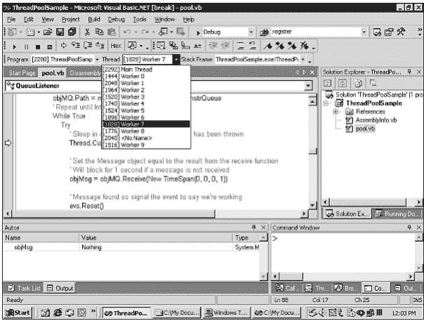

### 图 12.2

展开了线程下拉菜单的调试器。点击某个线程可显示该线程暂停的位置。

首先，请注意 `Listen` 方法接收一个状态对象作为参数。该对象包含一个 `EventState` 实例，`Listen` 使用它来发出信号，表明方法正处于处理消息的过程中或已处理完成。这样做可以确保 `Finish` 方法会阻塞，直到所有线程完成当前处理。在设置 `ThreadPriority` 和 `Name` 并获取 `EventState` 后，该方法仅在 `Try` 块中包含一个 `While` 循环。此循环重复调用 `MessageQueue` 类的 `Receive` 方法，该方法在指定的超时期间内返回第一个可用消息。在这种情况下，使用了 `TimeSpan` 对象（在第 13 章讨论）来指示 `Receive` 方法在没有消息时阻塞一秒后再返回。如果在规定时间内未收到消息，则会抛出 `MessageQueueException`。请注意，如果收到消息，方法将继续执行并调用 `EventState` 对象中 `ResetEvent` 字段的 `Reset` 方法。无论哪种情况，`Finally` 块都会调用 `ResetEvent` 字段的 `Set` 方法，以发出信号表明线程已完成本次循环迭代的处理。

如前所述，`EventState` 的 `ResetEvent` 字段包含一个 `ManualResetEvent` 实例，这是一个可以通过 `Reset` 和 `Set` 方法手动更改其已信号（signaled）和未信号（nonsignaled）状态的事件对象。当调用 `Reset` 方法时，状态更改为未信号，表示线程正忙。当使用 `Set` 事件将状态设置为已信号时，表示线程已完成其有用工作，可以被安全地销毁。

真正有趣的工作实际上是由 `Monitor` 方法执行的。在该方法中，创建了一个类级别的 `ManualResetEvent` 对象数组，其大小与线程池将服务的工作项数量相同。

> **注意**
>
> 在这种情况下，工作项（Work items）与线程并不相同。工作项由线程服务，但运行时（runtime）决定何时创建线程来处理你的工作项。例如，如果初始工作负载较轻，运行时可能不会立即启动工作线程来处理你的工作项。在本例中，为了确保运行时有可用线程用于其他目的（如触发事件），`WorkItems` 属性被上限限制在 15 个。

工作项的数量可以通过 `QueueListener` 类的 `WorkItems` 属性设置，尽管其默认值为 7。然后使用 `for` 循环创建 10 个 `ManualResetEvent` 对象，并将它们与 `EventState` 的新实例关联。生成的对象 `objState` 随后作为第二个参数传递给 `ThreadPool` 类的共享 `QueueUserWorkItem` 方法。正如其名称所示，该方法将一个工作项放入由运行时管理的线程池队列中，由下一个可用的工作线程进行服务。第一个参数指定工作项开始执行时要回调的方法，在本例中为 `Listen`。

通过将 `EventState` 作为第二个参数传递，`Listen` 方法可以检索该对象并使用其中存储的任何状态信息（如前文所述）。在这种情况下，状态包括用于调试的线程名称和一个用于同步线程的 `ManualResetEvent` 对象。循环完成后，指定数量的工作项将被放入线程池队列中等待执行。此时，线程将不断检查指定队列以获取新消息。

当客户端最终调用 `Finish` 方法以完成执行时，该方法首先将私有变量 `mFinished` 设置为 `True`。`Listen` 方法中的循环在每次迭代时都会检查此变量，如果设置为 `True`，则退出循环，释放线程使其返回线程池。然后，`Finish` 方法使用 `WaitHandle` 类的共享 `WaitAll` 方法进行阻塞，直到 `mEvents` 数组中所有的 `ManualResetEvent` 对象都被设置为已信号状态（`True`）。如果向方法传递了超时值，则使用可选的第二个参数来指定在解除当前线程阻塞之前等待此情况发生的时间段。使用这种方法可确保 `Finish` 方法会阻塞，直到每个工作线程都完成 `Listen` 方法中当前的循环迭代。请注意，线程实际上是返回到线程池而非被销毁。因此，再次调用 `Monitor` 将重用现有线程，而不会产生重新创建线程的开销。

对于使用 `QueueListener` 类的客户端，其实现在非常简单，如下代码所示：

```vb
Dim objQ As New QueueListener("ssosa", "tester")

objQ.WorkItems = 10

objQ.Monitor()

' Do other work here

objQ.Finish()
```

在实例化一个新对象并传入要监听的机器名和队列后，设置了工作项的数量并调用了 `Monitor` 方法。稍后，客户端可以调用带有可选超时参数的 `Finish` 方法来清理工作线程。

虽然本示例旨在演示如何使用 `ThreadPool` 类，但这显然不是创建线程池以执行监控消息队列等操作的唯一方式。例如，可以轻松修改 `QueueListener` 类，使其在类内部创建并跟踪一个 `Thread` 对象数组来实现线程池。然后，`Finish` 方法可以在设置 `m_finished` 标志后执行一个循环，检查 `IsAlive` 属性以确定线程池何时已清空，而不是使用 `ManualResetEvent` 对象。此外，前一节中显示的使用 TLS（线程本地存储）的技术也可用于向线程传递状态信息。在许多方面，这种架构将允许你对线程有更多控制权，因为你可以明确控制它们的创建和销毁时机。

### 操控 Windows 进程

正如你可能希望编写代码来管理自己进程内的线程一样，通常也需要操控机器上或网络中的其他进程。同样，.NET 框架在 `System.Diagnostics` 命名空间中提供了类，可用于监控和管理这些外部进程。

实现此功能的主要类是 `Process`。它包含的方法和属性允许你通过共享方法（如 `GetCurrentProcess`、`GetProcessByID`、`GetProcesses` 和 `GetProcessesByName`）枚举本地或远程机器上的进程，此外还能识别进程的所有相关信息，例如其 `Id`、`MainModule`、`MainWindowTitle`、`WorkingSet` 和 `Threads` 等。最后，`Process` 允许你通过使用 `Start`、`Kill`、`WaitForExit` 和 `WaitForInput` 方法与进程进行交互。

虽然你当然可以使用 `Process` 类获取有关特定进程的大量信息，但在大多数商业应用程序中，开发者更关心的是在特定进程启动或停止时得到通知，因为你编写的代码可能依赖于其他可执行文件。在 VB 6.0 中，这种情况让 VB 开发者头疼不已，他们徒劳地寻找轮询进程的异步方式，常常诉诸于并不理想的 `DoEvents` 语句。然而，现在通过将 `Process` 类与 `Thread` 类结合使用，创建一个针对此常见问题的灵活解决方案相对简单。

为了解决这个问题，本节的示例包含一个名为 `ProcessNotify` 的自定义类，它演示了 `Process` 类的用法，并可用于在进程启动或完成时通知调用者。

> **提示**
>
> 此类仅封装进程通知。如果你的代码依赖于 Windows 服务，更好的方法是使用第 13 章讨论的 `ServiceController` 类。

代码清单 12.10 展示了 `ProcessNotify` 类的代码。

### 代码清单 12.10

`ProcessNotify` 类。此类使用 `System.Diagnostics.Process` 类在进程启动和停止时通知客户端。

```vb
Option Strict On

Imports System.Diagnostics

Imports System.Threading

Public Class ProcessNotify

    ' 在特定进程结束时通知调用者
```


# ProcessNotify 类

## 事件与私有数据

向客户端引发的事件：

```vb
Event ProcessComplete(ByVal ProcName As String)
Event ProcessStarted(ByVal ProcName As String)
```

私有数据：

```vb
Private mStrMachine As String
Private mProcess As Process
Private marProcess() As Process
Private mStart As String
Private mWait As Thread
Private mCancelled As Boolean = False
```

## 传递属性

```vb
Public ReadOnly Property HasExited() As Boolean
    Get
        If mProcess Is Nothing Then
            Return True
        Else
            Return mProcess.HasExited
        End If
    End Get
End Property
```

```vb
Public ReadOnly Property ProcessID() As Integer
    Get
        If mProcess Is Nothing Then
            Return 0
        Else
            Return mProcess.Id
        End If
    End Get
End Property
```

## 构造函数

```vb
Public Sub New(ByVal Machine As String)
    mstrMachine = Machine
End Sub
```

```vb
Public Sub New()
    mstrMachine = "."
End Sub
```

## 获取进程方法

```vb
Public Overloads Sub GetProcess(ByVal Name As String)
    ' 按名称获取进程，请注意它返回一个数组
    marProcess = Process.GetProcessesByName(Name, mstrMachine)
    If marProcess.Length > 1 Then
        Throw New Exception(Name & " returns more than one process.")
        Return
    End If
    If marProcess.Length = 0 Then
        Throw New ArgumentException(Name & " was not found.")
        Return
    End If
    ' 设置进程
    mProcess = marProcess(0)
End Sub
```

```vb
Public Overloads Sub GetProcess(ByVal ProcessID As Integer)
    ' 按 ID 获取进程
    mProcess = Process.GetProcessById(ProcessID, mstrMachine)
    If mProcess Is Nothing Then
        Throw New ArgumentException(ProcessID & " process id not found.")
        Return
    End If
End Sub
```

```vb
Public Function GetProcesses() As String()
    ' 转换为字符串数组
    Dim arProcess() As Process
    Dim objProc As Process
    Dim arNames() As String

    arProcess = Process.GetProcesses(mstrMachine)
    ReDim arNames(arProcess.Length)

    For Each objProc In arProcess
        arNames(0) = objProc.ProcessName
    Next

    Return (arNames)
End Function
```

## 等待进程启动

```vb
Public Sub WaitForStart(ByVal IsAsync As Boolean, _
                        ByVal Name As String)
    ' 阻塞直到进程启动或引发事件
    mStart = Name

    If IsAsync Then
        ' 如果已经调用过一次，可能需要重新注册
        If mCancelled Then
            GC.ReRegisterForFinalize(Me)
            mCancelled = False
        End If

        ' 启动另一个线程进行等待
        mtWait = New Thread(New ThreadStart(AddressOf PollForProcess))
        mtWait.Priority = ThreadPriority.Lowest
        mtWait.Name = "Wait for started"
        mtWait.Start()
    Else
        ' 紧密循环
        WaitForProc(mStart)
    End If
End Sub
```

**代码清单 12.10** 续

```vb
Private Function WaitForProc(ByVal Name As String) As Boolean
    ' 紧密循环以等待进程
    While True
        Try
            GetProcess(mStart)
        Catch e As Exception
            ' 由于进程尚未启动，因此不执行任何操作
            Thread.Sleep(500)
        End Try

        If Not mProcess Is Nothing Then
            Exit While
        End If
    End While

    Return True
End Function
```

```vb
Private Sub PollForProcess()
    ' 阻塞当前线程并在启动时引发事件
    WaitForProc(mStart)
    RaiseEvent ProcessStarted(mStart)
    CancelWait()
End Sub
```

## 等待进程完成

```vb
Public Sub WaitForCompletion(ByVal IsAsync As Boolean, _
    Optional ByVal Timeout As Integer = 0)
    If mProcess Is Nothing Then
        Throw New Exception("No process set.")
        Return
    End If

    ' 如果是异步的，则设置事件处理程序
    If IsAsync = True Then
        AddHandler mProcess.Exited, AddressOf Me.ProcComplete
        mProcess.EnableRaisingEvents = True
    Else
        ' 否则阻塞当前线程
        If Timeout = 0 Then
            mProcess.WaitForExit()
        Else
            mProcess.WaitForExit(Timeout)
        End If

        ' 销毁内部状态
        mProcess.Dispose()
        mProcess = Nothing
    End If
End Sub
```

## 取消等待

```vb
Public Sub CancelWait()
    ' 终止正在等待的后台线程
    Try
        mtWait.Abort()
    Catch e As Exception
        ' 不执行任何操作，当没有后台线程时会发生
    End Try

    ' 如果已经调用过此方法，则不进行终结
    mCancelled = True
    GC.SuppressFinalize(Me)
End Sub
```

## 事件处理与清理

```vb
Private Sub ProcComplete(ByVal sender As Object, _
    ByVal e As EventArgs)
    ' 引发事件以通知我们已完成
    RaiseEvent ProcessComplete(mProcess.ProcessName)
    mProcess.EnableRaisingEvents = False

    ' 销毁内部状态
    RemoveHandler mProcess.Exited, AddressOf ProcComplete
    mProcess.Dispose()
    mProcess = Nothing
End Sub
```

```vb
Protected Overrides Sub Finalize()
    MyBase.Finalize()
    ' 确保后台线程被清理
    CancelWait()
End Sub
```

## 类说明

`ProcessNotify` 类的构造函数被重载以接受一个机器名。请注意，字面字符串 `"."` 代表运行代码的计算机，并用于填充私有变量 `mstrMachine`。

此类包含几个公共方法，用于检索进程信息并获取对要监控的进程的引用。`GetProcesses` 方法返回一个字符串数组，其中仅包含所有进程的名称，这是通过调用 `Process` 类的共享 `GetProcesses` 方法实现的。请注意，返回的是一个 `Process` 对象数组，并且该方法只是移除了 `ProcessName` 属性。

将要被监控的特定进程通过使用重载的 `GetProcess` 方法来设置，用户可以在其中传入进程的名称或操作系统的 ID。由于名称不一定唯一，该方法会检查此条件并在必要时引发异常（尽管更健壮的实现可以从一组可能的候选项中返回，由客户端自行选择）。如果找到了进程，`mProcess` 变量将被填充为 `Process` 对象。填充 `mProcess` 后，可以调用两个只读属性 `HasExited` 和 `ProcessID`，以透明地调用 `mProcess` 对象的底层属性，从而获取可能对客户端有用的信息。

该类有趣的地方在于等待方法的实现——`WaitForCompletion` 和 `WaitForStart`。`WaitForCompletion` 接受一个标志，指示等待是否应为异步的；如果不是，则指定方法返回前的超时时间。如果客户端希望获得异步通知，则会为 `Process` 类的 `Exited` 事件创建一个事件处理程序，指向私有方法 `ProcComplete`，并将 `EnableRaisingEvents` 属性设置为 `True`。当进程退出时，私有方法 `ProcComplete` 随即引发公共事件 `ProcessCompleted`，在清理事件处理程序并重置 `EnableRaisingEvents` 属性之前，传回已终止进程的名称。`mProcess` 变量被释放和回收，因为它所代表的进程已不再可用。

如果 `asynchronous` 参数设置为 `False`，则调用 `Process` 的 `WaitForExit` 方法（带或不带超时值），阻塞当前线程直到进程退出。同样地，当进程退出时，`mProcess` 变量会被清理。

虽然 `Process` 类支持 `Exited` 事件和 `WaitForExit` 方法来处理客户端需要与进程结束进行同步的情况，但它没有提供等待进程启动的对应机制。`ProcessNotify` 类的 `WaitForStart` 方法实现了处理此场景的机制。

与 `WaitForCompletion` 方法类似，该方法接受一个参数来指示等待操作是阻塞当前线程还是仅在适当时机引发事件。它还接受要查找的进程名称（显然这里不能使用 ID，因为在进程启动之前操作系统尚未分配 ID）。如果 `asynchronous` 标志设置为 `False`，则调用私有方法 `WaitForProc`，执行一个紧密循环，反复调用 `GetProcess` 方法。如果找到进程，循环退出，`mProcess` 变量被填充。如果未找到进程，线程将休眠半秒，然后再次尝试查找进程。此循环的效果是阻塞当前线程。

如果需要异步通知，则使用 `PollForProcess` 私有方法以 `Lowest` 优先级启动一个新线程，该线程引用为类级别的私有变量 `mtWait`。`PollForProcess` 方法运行相同的 `WaitForProc` 方法（但在单独的线程上），当找到进程时，引发 `ProcessStarted` 事件。最后，如果客户端选择等待进程启动后又改变主意，则使用 `CancelWait` 方法来销毁后台线程。如果客户端未调用 `CancelWait`，则 `Finalize` 方法中包含对 `CancelWait` 的调用。`CancelWait` 会抑制终结器的执行，如第 4 章所述。如果客户端随后使用 `WaitForStart`，则会调用该对象的 `ReRegisterForFinalize` 方法，以确保终结器将再次运行。

客户端使用 `ProcessNotify` 只需实例化该对象即可；如果需要异步通知，则添加 `ProcessCompleted` 和 `ProcessStarted` 事件的处理程序。以下示例代码使用该类来接收 `notepad.exe` 应用程序启动和停止的通知：

```vb
Dim objNotify As ProcessNotify
objNotify = New ProcessNotify()  ' Assume local machine

' Add event handler
AddHandler objNotify.ProcessComplete, AddressOf Completed
AddHandler objNotify.ProcessStarted, AddressOf Started

' Wait synchronously
objNotify.WaitForStart(False, "notepad")

' Its now running
Console.WriteLine(objNotify.HasExited) ' Should be false
Console.WriteLine(objNotify.ProcessID)

' Wait for asynchronous completion
objNotify.WaitForCompletion(True)

' Do other work
```

虽然此示例展示了如何为两个事件添加处理程序，但只使用了 `Completed` 事件，因为 `WaitForStart` 方法是以同步方式调用的。事件处理过程如下所示：

```vb
Private Sub Completed(ByVal ProcessName As String)
    Console.WriteLine(ProcessName & " completed!")
End Sub

Private Sub Started(ByVal ProcessName As String)
    Console.WriteLine(ProcessName & " started! ")
End Sub
```


### 使用加密

正如第 1 章“Microsoft .NET 架构”中所述，现代分布式应用程序与上一代应用程序有着不同的需求。这一点在安全领域体现得最为明显。VB .NET 和服务框架通过在 `System.Security.Cryptography` 命名空间中提供加密服务来满足这一日益增长的功能需求。

简而言之，该命名空间允许以编程方式访问各种加密算法，你可以将这些算法集成到应用程序中以加密和解密数据。虽然完整地讨论该命名空间已超出本书的范围，但有必要进行简要概述并附带一个代码示例。

`Cryptography` 命名空间中的类大致可以分为三个主要类别，具体取决于你要实现的算法类型。每种类型的算法都包含一个表示该算法类型的基础类，具体的实现则派生自该基础类。

第一种类型是对称加密算法。对称算法的名称源于它们使用单一的密钥进行加密和解密。显然，发送方和接收方都必须保管好该密钥以确保加密的安全性。此外，对称算法还需要一个初始化向量（IV），即一个非保密的二进制值，用于初始化算法并引入额外的加密变化。`SymmetricAlgorithm` 类是一个抽象基础类，其他特定算法类均派生自它。支持的对称算法包括数据加密标准（DES）、RC2、Rijndael 和三重数据加密标准（TripleDES）。每种算法的实现都包含一个派生自 `SymmetricAlgorithm` 的基础类（如 `DES`），以及一个派生自基础类的、用于代码中的服务提供程序类（如 `DESCryptoServiceProvider`）。后者包含了用于加密和解密数据的方法。

第二种算法类型称为非对称算法，或称公钥算法，派生自 `AsymmetricAlgorithm` 类。这些算法包括众所周知的数字签名算法（DSA）和 RSA。非对称算法依赖于一对密钥，一个是私钥，另一个是公钥。公钥向所有人公开，供发送方用于加密数据；而私钥则保持安全，用于解密使用公钥加密的数据。这些算法的实现同样包含一个派生自 `AsymmetricAlgorithm` 的基础类，以及一个派生自基础类的服务提供程序类。此外，这些算法的复杂性可能还需要额外的辅助类。

`Cryptography` 命名空间公开的最后一种算法类型是哈希算法。该类型的算法基于较长的字符串计算出固定大小的唯一二进制值字符串。

字节。不同类型的哈希算法被用于计算数字签名并确保数据的完整性。`Cryptography` 命名空间包含一个名为 `HashAlgorithm` 的基类，以及支持 MD5、SHA1、SHA256、SHA384 和 SHA512 的派生类。

除了这三种类型的算法外，`Cryptography` 命名空间还包含辅助类，例如 `RandomNumberGenerator` 类和 `CryptoStream` 类。`CryptoStream` 类尤为重要，因为它是从 `Stream` 派生的，用于为加密转换提供一种基于流的模型。换句话说，可以通过将数据流式传输到 `CryptoStream` 类，使用任何算法对其进行加密和解密。

为了演示如何使用该命名空间提供的基础加密功能，创建了 `TextFileCrypto` 类，如清单 12.11 所示。该类可用于使用 DES 对文件进行对称加密和解密，其中密钥由该类生成并保存到文件中。

### 清单 12.11 基础加密

该类使用 DES 算法对文本文件进行加密和解密。

```vbnet
Option Strict On

Imports System.IO
Imports System.Security.Cryptography
Imports System.Threading

Public Class TextFileCrypto

    ' Encrypts and decrypts text file given a key

    Private mstrFile As String ' File to decrypt
    Private mstrKey As String ' Key file
    Private mKey(7) As Byte ' DES key
    Private mDES As DESCryptoServiceProvider
    Private mIV(7) As Byte ' Initialization Vector

    Public Sub New()
        mDES = New DESCryptoServiceProvider()
    End Sub

    Public Property KeyFile() As String
        Get
            Return mstrKey
        End Get
        Set(ByVal Value As String)
            If File.Exists(Value) Then
                mstrKey = Value
                OpenKeyFile() ' Open the key file and read its contents
            Else
                Throw New Exception(Value & " file does not exist.")
            End If
        End Set
    End Property

    Public Property FileName() As String
        Get
            Return mstrFile
        End Get
        Set(ByVal Value As String)
            If File.Exists(Value) Then
                mstrFile = Value
            Else
                Throw New Exception(Value & " does not exist.")
            End If
        End Set
    End Property

    Private Sub OpenKeyFile()
        Dim fsKey As New FileStream(mstrKey, _
            FileMode.Open, FileAccess.Read)

        ' Open the key file and read the key from it
        fsKey.Read(mKey, 0, 8)
        fsKey.Read(mIV, 0, 8)
        fsKey.Close()

        mDES.Key = mKey
        mDES.IV = mIV
    End Sub

    Public Function SaveKeyFile(ByVal FilePath As String) As Boolean
        Dim fsKey As New FileStream(FilePath, _
            FileMode.OpenOrCreate, FileAccess.Write)

        ' Generate a new random key and IV and save it to the file
        ' Note these will be generated randomly automatically
        ' if you don't do it
        mDES.GenerateKey()
        mDES.GenerateIV()
        mKey = mDES.Key
        mIV = mDES.IV

        fsKey.Write(mKey, 0, mKey.Length)
        fsKey.Write(mIV, 0, mKey.Length)
        fsKey.Close()

        mstrKey = FilePath
        Return True
    End Function

    Public Function EncryptFile() As Boolean
        ' Encrypt the given file

        ' Check the key
        If mKey Is Nothing Then
            Throw New Exception("You must have a key in place first.")
        End If

        Dim fsInput As New FileStream(mstrFile, _
            FileMode.Open, FileAccess.Read)
        Dim fsOutput As New FileStream("temp.dat", _
            FileMode.Create, FileAccess.Write)

        fsOutput.SetLength(0)

        Dim arInput() As Byte

        ' Create DES Encryptor from this instance
        Dim desEncrypt As ICryptoTransform = mDES.CreateEncryptor()

        ' Create Crypto Stream that transforms file stream using DES encryption
        Dim sCrypto As New CryptoStream(fsOutput, desEncrypt, _
            CryptoStreamMode.Write)

        ReDim arInput(Convert.ToInt32(fsInput.Length - 1))
        fsInput.Read(arInput, 0, Convert.ToInt32(fsInput.Length))
        fsInput.Close()

        ' Write out DES encrypted file
        sCrypto.Write(arInput, 0, arInput.Length)
        sCrypto.Close()

        ' Delete and rename
        File.Copy("temp.dat", mstrFile, True)
        File.Delete("temp.dat")

        Return True
    End Function

    Public Function DecryptFile() As Boolean
        ' Decrypt the given file

        ' Check the key
        If mKey Is Nothing Then
            Throw New Exception("You must have a key in place first.")
            Return False
        End If

        ' Create file stream to read encrypted file back
        Dim fsRead As New FileStream(mstrFile, FileMode.Open, _
            FileAccess.Read)
        Dim fsOutput As New FileStream("temp.dat", _
            FileMode.Create, FileAccess.Write)

        ' Create DES Decryptor from our des instance
        Dim desDecrypt As ICryptoTransform = mDES.CreateDecryptor()

        ' Create crypto stream set to read and do a des decryption
        ' transform on incoming bytes
        Dim sCrypto As New CryptoStream(fsRead, desDecrypt, _
            CryptoStreamMode.Read)

        Dim swWriter As New StreamWriter(fsOutput)
        Dim srReader As New StreamReader(sCrypto)

        ' Write out the decrypted file
        swWriter.Write(srReader.ReadToEnd)

        ' Close and clean up
        swWriter.Close()
        fsOutput.Close()
        fsRead.Close()

        ' Delete and rename
        WaitForExclusiveAccess(mstrFile)
        File.Copy("temp.dat", mstrFile, True)
        File.Delete("temp.dat")

        Return True
    End Function

    Private Sub WaitForExclusiveAccess(ByVal fullPath As String)
        While (True)
            Try
                Dim file As FileStream
                file = New FileStream(fullPath, FileMode.Append, _
                    FileAccess.Write, FileShare.None)
                file.Close()
                Exit Sub
            Catch e As Exception
                Thread.Sleep(100)
            End Try
        End While
    End Sub

End Class
```

如清单 12.11 所示，该类的构造函数实例化了一个类级别的 `DESCryptoServiceProvider` 类，该类公开了返回加密器和解密器对象的方法，用于对数据进行加密和解密。公共属性 `KeyFile` 和 `FileName` 分别用于打开包含密钥和初始化向量（IV）的现有文件，以及设置要加密或解密的文件名。如果密钥文件存在，则使用私有方法 `OpenKeyFile` 打开文件，并将密钥和 IV 读取到字节数组中。`SaveKeyFile` 方法调用底层 DES 类的 `GenerateKey` 和 `GenerateIV` 方法来生成随机密钥和 IV。随后，这些值被保存到作为参数传递的文件中。此时，密钥文件应保持机密，并可传输给将使用它来解密数据的人员。

**提示**

DES 算法使用 64 位（8 字节）密钥。虽然 DES 仅支持单一密钥大小，但可以通过调用 `LegalKeySizes` 属性来查找其他算法的有效密钥大小，该属性返回一个代表合法大小的 `KeySize` 对象数组。为了获得更强的加密，可以使用 `KeySize` 属性设置新的大小。

`TextFileCrypto` 类的核心是 `EncryptFile` 和 `DecryptFile` 方法。`EncryptFile` 方法打开要加密的文件以及用于存储加密数据的临时文件。为了加密文件，该方法使用服务提供程序（在本例中为 `DESCryptoServiceProvider`）的 `CreateEncryptor` 方法创建一个加密器对象。该对象实现了 `ICryptoTransform` 接口，因此可以传递给 `CryptoStream` 的构造函数，在数据写入由 `FileStream`（本例中为 `fsOutput`）支持的文件时对其进行转换。随后，原始文件被临时文件覆盖。结果是一个加密文件，可以安全地通过 FTP 传输或作为附件通过互联网发送。

`DecryptFile` 方法通过使用 `DESCryptoServiceProvider` 的 `CreateDecryptor` 方法创建解密器，执行与 `EncryptFile` 相反的操作。同样，该对象被传递给 `CryptoStream` 的构造函数，以便在从 `FileStream` `fsRead` 读取文件时对其进行解密。最后，解密后的数据由 `StreamWriter` 类使用 `StreamReader` 类的 `ReadToEnd` 方法保存到文本文件中。

客户端可以按如下方式使用 `TextFileCrypto` 类来加密数据：

```vbnet
Dim objCrypt As New TextFileCrypto()

objCrypt.FileName = "students.txt"

' Generate and save the key
objCrypt.SaveKeyFile("mykey.dat")

' Encrypt the file
objCrypt.EncryptFile()
```


另一方面，当客户端收到文件时，可以这样解密：

```vbnet
Dim objCrypt As New TextFileCrypto()
objCrypt.FileName = "students.txt"
' Read in the key
objCrypt.KeyFile = "mykey.dat"
' Decrypt the file
objCrypt.DecryptFile()
```

### 总结

构建分布式应用程序通常不仅仅涉及构建动态网页和数据访问逻辑。在某些情况下，你需要依赖系统服务，例如文件 I/O、多线程、与其他进程交互以及加密。在本章中，我尝试让你直观地感受到在 VB .NET 和服务框架中如何以简单直接的方式处理这些主题。

同样，下一章将讨论一个由服务框架优雅解决的常见开发挑战——实现 Windows 服务。

## 第 13 章 实现服务

### 本章内容

- 创建服务应用程序 610
- 服务调度 625
- 使用事件日志 627
- 监控性能 634
- 通过 .NET 进行通信 639

许多分布式解决方案中的一个组件，也是大多数公司 VB 开发人员在某个时候都曾面临的任务，就是挑战如何创建一个作为 Windows 服务的 VB 应用程序。然而，正如你们大多数人可能已经发现的那样，如果不包含大量 Win32 API 调用或借助第三方 ActiveX 控件，这可能会有些棘手。当服务还需要支持多线程执行时，问题会变得更加复杂；例如，在服务需要支持来自多个客户端的连接或需要执行某些后台处理的情况下。虽然当时存在一些技术（参见我的书《Pure Visual Basic》的第 19 章），但没有一个特别优雅。在 .NET 世界中，情况发生了变化，因为 VB .NET 是“一等公民”，可以利用服务框架对服务应用程序的支持。

> **注意**
>
> Windows 服务应用程序简单来说就是运行在 Windows NT/2000/XP 操作系统后台、没有用户界面 (UI)，并通过一组 Win32 API 和 Windows 服务控制器（也称为服务控制管理器或 SCM）进行控制的应用程序。简单来说，SCM 由负责将可执行文件配置并作为服务运行的操作系统组件组成。这些后台进程可以通过服务控制台进行启动、停止、暂停和继续，并且可以在特定帐户的上下文中运行。

在本章中，我们将探讨如何构建一个包含 Windows 服务的可执行文件，以及它如何利用典型服务所使用的系统服务。本章采用的方法是增量构建服务：从所需的最小代码量开始，然后通过添加各种功能来逐步完善。通常情况下，代码清单将添加到服务模板中，以构建完整的服务。

> **注意**
>
> 本章的所有代码清单和补充材料都可以在本书的网站 `sampublishing.com` 上找到。

#### 创建服务应用程序

创建服务、安装服务以及从外部应用程序控制服务所需的所有功能，都通过位于同名程序集中的 `System.ServiceProcess` 命名空间公开。该命名空间包含表 13.1 中所示的主要类，用于支持服务应用程序。

**表 13.1** `System.ServiceProcess` 命名空间中用于实现、安装和控制服务的类。

| 类 | 描述 |
| :--- | :--- |
| `ServiceBase` | 作为服务的基类。每个可执行文件可以包含许多派生自 `ServiceBase` 的类。 |
| `ServiceInstaller` | 由安装程序实用程序调用的类，用于安装服务并设置其派生自 `ServiceBase` 的配置参数。 |
| `ServiceProcessInstaller` | 由安装程序实用程序调用的类，用于安装包含派生自 `ServiceBase` 的服务类的可执行文件。 |
| `ServiceController` | 用于通过编程方式控制服务的执行。类似于在 Microsoft 管理控制台 (MMC) 中使用“服务”小程序。 |

本质上，表 13.1 中列出的类将 VB .NET 应用程序与 SCM 及 Win32 API 的交互进行了抽象，从而使操作服务的任务变得相当简单。因此，要创建服务，您只需要设置对 `System.ServiceProcess` 程序集的引用，从 `ServiceBase` 派生一个类，重写某些方法并添加自定义功能，然后创建一个安装程序类，以便安装实用程序能够安装该服务。

在本章的剩余部分，我们将构建一个示例服务，Quilogy 可能会使用它来监控目录下是否存在为了发送给供应商而生成的 XML 文件。当新文件进入目录时，服务会对它们进行处理，将结果记录到文本日志和事件日志子系统中，增加性能监控计数器，将文件通过 FTP 发送到目标位置，最后将文件移动到存档目录。

#### 构建服务

要开始创建服务，您首先需要从 VS .NET 的“新建项目”对话框中选择“Windows 服务应用程序”模板。该模板会生成一个包含派生自 `ServiceProcess.ServiceBase` 类的单个文件。因为一个可执行文件可以包含多个服务，因此您可以在应用程序中创建多个派生自 `ServiceBase` 的类。在这种情况下，该类将被重命名为 `QXMLTransfer`。但是，您会注意到，由于模板只产生一个服务，唯一的代码文件包含一个名为 `Main` 的共享过程，其中该类充当可执行文件的入口点，方式与控制台应用程序非常相似。显然，您应该将默认的 `.vb` 文件重命名为更适合您应用程序的名称。

> **注意**
>
> 与在 VS .NET 中创建的大多数项目一样，组件设计器还会创建一个用于初始化组件设计器的区域，这样您就可以将工具箱和服务器资源管理器中的项目拖放到设计器表面上。这里将不讨论这段代码。这是可能的，因为正如第 8 章所讨论的，`ServiceBase` 派生自 `System.ComponentModel.Component`。

> **提示**
>
> 在公开多个服务的应用程序中，为了可读性和易于维护，您可能希望将 `StartupObject` 属性（在解决方案资源管理器窗口中右键单击项目调出的“项目属性”对话框中找到）更改为一个模块，并将 `Sub Main` 放在该模块中。

在 `Sub Main` 中，您必须为该可执行文件创建的每个服务实例化一个类，并将它们传递给 `ServiceBase` 类的共享 `Run` 方法。这将加载服务，使其能够接收来自 SCM 的启动和停止事件。例如，假设应用程序包含一个名为 `QXMLTransfer` 的单个服务。以下代码将实例化该对象并将其加载到内存中：

```vb
Imports System.ServiceProcess

Public Class QXMLTransfer : Inherits ServiceBase

    ' Class code goes here

End Class

Public Sub Main()

    Dim svcXML As New QXMLTransfer()

    ServiceBase.Run(svcXML)

End Sub
```

如果应用程序包含多个服务，您可以选择将 `ServiceBase` 对象数组传递给重载的 `Run` 方法，如下所示：

```vb
Public Sub Main()

    Dim servicesToRun() As ServiceBase

    servicesToRun = New ServiceBase() {New QXMLTransfer(), _

        New QXMLReceive()}

    ServiceBase.Run(servicesToRun)

End Sub
```

此时，应用程序中的服务已加载到内存中并准备运行。然而，为了让服务能够响应来自 SCM 的事件，您首先需要在派生类（在本例中为 `QXMLTransfer`）中重写 `ServiceBase` 的几个方法。首先，您需要为该类创建自己的构造函数，该构造函数调用基类 `ServiceBase` 的构造函数。您的构造函数应该设置各种属性，向 SCM 表明您的服务将响应哪些事件。

清单 13.1 中的代码显示了 `QXMLTransfer` 服务的构造函数。请注意，它设置了从 `ServiceBase` 继承的 `CanShutdown`、`CanStop` 和 `CanPauseAndContinue` 属性，以指示它将响应哪些事件。此外，它设置了 `ServiceName` 和 `AutoLog` 属性，分别用于设置服务的名称以及是否在应用程序事件日志中报告启动、停止、继续和暂停事件。在构造函数中，设置 `ServiceName` 是唯一必须的代码。

**清单 13.1** 服务构造函数。服务类的构造函数在设置该服务特有属性（如 `ServiceName`）之前调用基类构造函数。

```vb
Public Sub New()

    ' Called only when first loaded not with each start and stop

    MyBase.New()

    '图纸 the properties for the service

    With Me

        .ServiceName = "QXMLTransfer"

        .CanShutdown = True

        .CanStop = True

        .CanPauseAndContinue = True

        .AutoLog = True

    End With

    ' Static Initialization

    ' Set the log file name

    mLogFile = "QXMLTransfer.log"

    mCriteria = "*.xml"

End Sub
```

请记住，您的类构造函数仅在对象实例化时的加载时被调用，而不是在服务每次启动和停止时调用。因此，您希望在构造函数中初始化那些从服务首次启动到机器重启期间一直持久存在的变量。请注意，在清单 13.1 中，初始化了几个私有类变量，包括用于存储包含日志的文本文件名称的 `mLogFile`。

> **注意**
>
> 如果你的应用程序包含多个服务，当启动第一个服务时，所有服务类的构造函数都会被调用。但其他服务并不会因此启动。因此，你需要避免在此时初始化占用大量内存的变量，或者执行耗时的初始化操作。更好的做法是将这些活动放在各个服务类的 `OnStart` 方法中执行。

你需要实现的其他方法是服务控制管理器（SCM）在响应启动、停止、暂停、继续和关闭事件时调用的方法。这些方法在基类中都以受保护方法的形式实现，你必须对其进行重写。例如，要响应 SCM 的启动事件，你需要按清单 13.2 所示实现 `OnStart` 方法。请注意，项目模板中已经包含了一个 `OnStart` 的实现，你可以直接填写。

**清单 13.2** `OnStart` 事件。你必须重写 `OnStart` 事件来启动你的服务。

```vb
Imports System.ServiceProcess

Imports System.Timers

Protected Overrides Sub OnStart(ByVal args() As String)

    ' Read from the registry

    If Not GetRegValues() Then

        Throw New Exception( _

            "The service could not be started. See the event log for details.")

        Return

    End If

    ' Start the timer

    mProcess = New Timer(mInterval)

    AddHandler mProcess.Tick, AddressOf OnTimer

    mProcess.Start()

    ' Log the fact that it started in the text log

    LogText("QXMLTransfer Service Started.", mLogFile, False, False)

End Sub
```

请注意，`OnStart` 方法需要包含能够让服务执行其工作的代码。换句话说，除非 `OnStart` 方法中的代码启动了运行流程，否则服务不会执行任何操作。在这个例子中，服务首先调用一个私有过程从注册表中读取一些初始化数据。如果读取成功，它会使用一个类级别变量设置一个系统计时器，以便服务能够轮询文件系统以检测目录的变化。最后，如果一切顺利，会调用一个私有的 `LogText` 过程，将服务已启动的事实记录到文本文件和应用程序日志中。由于从注册表读取数据、使用计时器以及日志记录是服务应用程序的常见操作，因此将在本章后面进行讨论。

> **提示**
>
> 你会注意到 `OnStart` 方法可以接受命令行参数。虽然通常不会这样做，但你可以在服务管理单元的属性对话框中设置这些参数，也可以在使用 `ServiceController` 类以编程方式启动服务时设置，这将在本章后面讨论。

类似地，`OnStop` 方法应采取步骤释放服务持有的所有资源，例如数据库连接和文件句柄。请注意，你的服务不必响应暂停、继续和关闭事件，因此你无需重写这些方法。虽然暂停和继续的含义很直观，但如果你的服务支持关闭事件，当操作系统关闭时，SCM 会通知服务。这使你也能够清理在类构造函数中获取的任何资源。

> **提示**
>
> 在讨论 SCM 事件时，一个常见的问题是暂停和继续与停止和启动之间的区别。基本上，当你的服务可以在不释放所有资源或不重置为新初始化状态的情况下停止处理时，你应实现暂停和继续。例如，如果你的服务必须扫描大量目录，你可能允许它在当前目录上暂停，稍后继续，以便它可以从中断的地方恢复处理。通过停止并重新启动服务，你隐含地表明该服务将不会记住其停止时的状态。

至此，该服务已准备好响应来自 SCM 的启动事件，该事件可通过服务管理单元或 `ServiceController` 类发起。

> **提示**
>
> 请注意，与其他 VB .NET 应用程序一样，你可以使用 VS .NET 调试器调试服务应用程序。当发生这种情况时，SCM 尝试通过调用 `OnStart` 方法来启动你的服务。然后 SCM 会等待该方法完成，超时为 30 秒，之后返回错误。因此，你需要确保在 30 秒内单步执行完 `OnStart` 中的代码（如果你在那里设置了断点），否则 SCM 将无法启动你的服务。

### 安装服务

当然，使一个 Windows 服务达到可运行状态比安装和配置标准可执行文件要复杂得多。这主要是因为服务必须向 SCM 注册。此外，服务有自己独立的配置属性，包括它运行的安全上下文以及服务的启动方式（自动、手动或禁用）。所有这些信息通常在安装时指定，可以使用 `ServiceProcess` 命名空间中的 `ServiceProcessInstaller` 和 `ServiceInstaller` 类轻松实现。

如第 5 章“打包、部署和安全”中所述，要安装服务，你的项目可以包含一个派生自 `System.Configuration.Installer` 的类。该类将被安装实用程序调用，并在其构造函数中将要安装的项目（称为“安装器”，派生自 `ComponentInstaller`）添加到要安装的组件列表中。最终，基类的 `Install` 方法将被执行以安装服务以及任何关联的组件，例如性能监视器计数器或应用程序特定的事件日志。对于服务，你至少需要包含两个安装器：一个用于服务进程，一个用于服务类。例如，考虑清单 13.3 中的代码，它展示了一个从 `Installer` 派生的名为 `QXMLInstall` 的安装器类。

**清单 13.3** 安装器类。该类被安装实用程序用来安装服务可执行文件及其关联的服务。

```vb
Imports System.ComponentModel

Imports System.Configuration.Install

Imports System.ServiceProcess

Public Class <RunInstaller(True)> QXMLInstall : Inherits Installer

    ' For each service

    Private WithEvents mServiceInstaller As ServiceInstaller

    ' For the entire executable

    Private mProcessInstaller As ServiceProcessInstaller

    Public Sub New()

        MyBase.New

        ' Instantiate installers for process and services.

        mProcessInstaller = New ServiceProcessInstaller()

        mServiceInstaller = New ServiceInstaller()

        ' The services will run under the system account.

        mProcessInstaller.Account = ServiceAccount.LocalSystem

        ' The services will be started manually.

        mServiceInstaller.StartType = ServiceStartMode.Manual

        ' ServiceName must equal those on ServiceBase derived classes.

        mServiceInstaller.ServiceName = "QXMLTransfer"

        mServiceInstaller.DisplayName = "Quilogy XML Transfer"
```


```vb
' Add installers to collection. Order is not important.

' here is where you add performance monitor

' installers or event log installers

Installers.Add(mServiceInstaller)

Installers.Add(mProcessInstaller)

End Sub

' Catch the events

Public Sub mServiceInstaller_AfterInstall(ByVal sender As Object, _
    ByVal e As System.Configuration.Install.InstallEventArgs) _
    Handles mServiceInstaller.AfterInstall

    WriteLog("The service was installed successfully.", False)

End Sub

Public Sub mServiceInstaller_AfterUninstall(ByVal sender As Object, _
    ByVal e As System.Configuration.Install.InstallEventArgs) _
    Handles mServiceInstaller.AfterUninstall

    WriteLog("The service was uninstalled successfully.", False)

End Sub

End Class
```

首先，你会看到该类使用了`RunInstaller`属性并设置为`True`，用以通知安装实用程序它确实应该处理该类。此外，`ServiceProcessInstaller`和`ServiceInstaller`类的实例被声明并在构造函数中创建。实例化后，你使用`ServiceProcessInstaller`为整个可执行文件设置属性。这些属性包括运行进程所使用的账户。在这个例子中，`Account`属性被设置为`ServiceAccount.LocalSystem`，表示该系统账户将被使用。请注意，系统帐户没有执行网络操作的权限，因此当需要不同的帐户时，可以设置`ServiceProcessInstaller`类的`UserName`和`Password`属性。

其次，你需要按照清单 13.3 所示设置`ServiceInstaller`类的属性。其中包括通过`StartType`属性公开的服务启动方式，以及服务的简称和描述。简称必须与`service`类构造函数中指定的`ServiceName`属性相同。虽然清单中没有显示，但`ServiceInstaller`类还支持一个名为`ServicesDependedOn`的属性，该属性定义为字符串数组，你可以将其设置为要使此服务启动必须运行的所有服务的名称。如果列出的某个服务尚未启动，SCM 将尝试启动它。但是，如果有一个或多个服务未能启动，你的服务也将无法启动，并且会在应用程序事件日志中写入一条记录。当你需要编写多个协同工作的服务，或者你的服务依赖于标准的 Windows 2000/XP/NT 服务时，这个属性会很有用。例如，一个查找通过 FTP 发送到服务器路径上的文件的服务可能需要 FTP 服务正在运行才能启动。在这种情况下，可以将以下代码片段添加到`QXMLInstall`类的构造函数中：

```vb
Dim arServices() As String

ReDim arServices(1)

arServices(0) = "FTP"

mServiceInstaller.ServicesDependedOn = arServices
```

> **提示**

你可以通过在“服务”管理单元中的服务属性对话框的“依赖关系”选项卡上查看，来验证`ServicesDependedOn`信息是否设置正确。

最后，你必须使用`Add`方法将安装程序添加到`QXMLInstall`类的`Installers`集合中。此时，可以使用`InstallUtil.exe`以事务方式安装该服务。

在安装过程中，你还可以利用安装程序引发的事件来捕获服务何时安装或卸载等情况。例如，清单 13.3 展示了如何捕获`AfterInstall`和`AfterUninstall`事件，以便使用私有过程`WriteLog`（本章后面讨论）将服务被操作的事实写入应用程序事件日志。总的来说，`ServiceInstaller`在安装、卸载、提交和回滚安装程序的活动中支持 After 和 Before 事件。

要安装服务，只需运行`InstallUtil.exe`工具并传递包含你的服务的可执行文件。如果一切顺利，那么你就可以在“管理工具”组中的“服务”MMC 管理单元中查看你的服务，如图 13.1 所示。

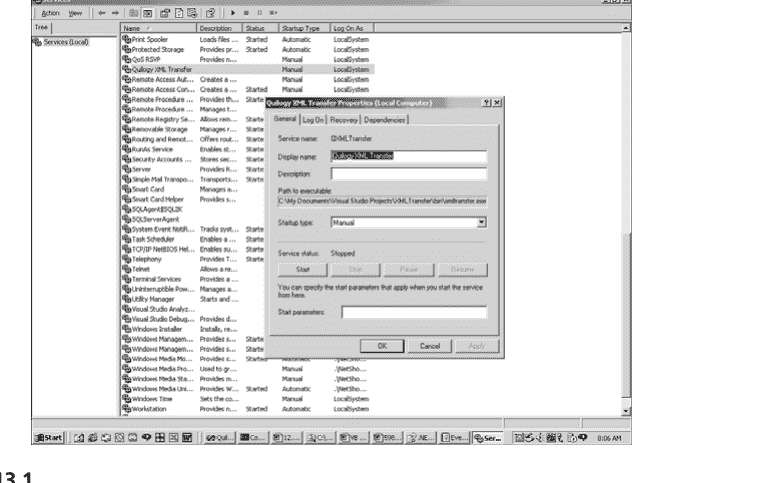

**图 13.1**  
*“服务”管理单元。此图显示了用于在本地计算机上配置和控制服务的管理单元。可以通过右键单击服务来访问属性对话框。*

### 处理自定义操作

正如第 5 章讨论的部署程序一样，你也可以通过覆盖基类的`Install`和`Uninstall`方法并包含自定义代码来添加自己的自定义操作。在这种情况下，`QXMLTransfer`这样的服务可能希望在安装服务时创建注册表项或从文件中读取配置信息，例如轮询文件系统的间隔、要搜索的目录路径以及发送文件的目标 FTP 站点。为了提供默认值，安装程序可以在安装服务时创建注册表项。清单 13.4 中的代码显示了`QXMLInstall`类的覆盖`Install`和`Uninstall`方法。

#### 清单 13.4 自定义操作

QXMLInstall 类的这些方法包含自定义安装和卸载操作。

```vb
Imports Microsoft.Win32

Public Overrides Sub Install(ByVal state As IDictionary)

' Write default values to the registry

Dim objKey As RegistryKey

Dim objRun As RegistryKey

MyBase.Install(state)

Try

    objKey = Registry.LocalMachine.OpenSubKey( _
        "System\CurrentControlSet\Services\QXMLTransfer", True)

    objRun = objKey.CreateSubKey("RunningValues")

    objRun.SetValue("Timer", 15000)

    objRun.SetValue("Path", "c:\")

    objRun.SetValue("FTPTo", "ftp.ssosa.com")

Catch e As Exception

    WriteLog("Default parameters were not created.", False)

End Try

End Sub

Public Overrides Sub UnInstall(ByVal state As IDictionary)

    ' Write default values to the registry

    Dim objKey As RegistryKey

    Try

        objKey = Registry.LocalMachine.OpenSubKey( _
            "System\CurrentControlSet\Services\QXMLTransfer", True)

        objKey.DeleteSubKey("RunningValues")

    Catch e As Exception

        WriteLog("Default parameters were not uninstalled.", False)

    Finally

        MyBase.UnInstall(state)

    End Try

End Sub
```

请注意，在调用基类的`Install`方法并传入状态信息之后，此清单使用`Microsoft.Win32`命名空间中的类来操作注册表。特别是，使用`Registry.LocalMachine`字段的共享`OpenSubKey`方法来指向要打开的子项。在这种情况下，由于服务安装在`HKEY_LOCAL_MACHINE\System\CurrentControlSet\Services`项中，代码尝试打开一个名为`QXMLTransfer`的子项并使其可写（由方法的最后一个参数指定）。打开子项后，使用`CreateSubKey`方法创建一个名为`RunningValues`的新项。此时，可以通过调用`SetValue`方法来填充该项的值。

> **注意**

请注意，使用`Microsoft.Win32`命名空间中的`Registry`类来操作服务的注册表比使用 VB .NET 中包含的`SaveSetting`、`GetSetting`、`DeleteSetting`和`GetAllSettings`函数更受推荐。这是因为这种方法更加灵活和强大。上述函数仅将设置保存到执行代码的帐户的`HKEY_USERS`子项下的 VB 和 VBA 程序设置项中。因此，如果服务以不同的帐户登录，它将无法访问这些注册表设置。

如清单 13.2 所示，`QXMLTransfer`类的`OnStart`方法调用清单 13.5 中所示的私有过程`GetRegValues`。此过程还在服务启动时使用`RegistryKey`类以只读模式打开子项，并将值放入私有类变量中。请注意，使用`GetValue`读取键值时，它们作为对象返回，必须转换为适当的类型。

#### 清单 13.5 读取注册表

此私有过程在服务启动时读取注册表以初始化服务的参数。

```vb
Imports Microsoft.Win32

Private Function GetRegValues() As Boolean

    Dim objKey As RegistryKey

    Try

        objKey = Registry.LocalMachine.OpenSubKey( _
          "System\CurrentControlSet\Services\QXMLTransfer\RunningValues", False)

        mInterval = CInt(objKey.GetValue("Timer", 30000))

        mPath = objKey.GetValue("Path").ToString

        mFTP = objKey.GetValue("FTPTo").ToString

    Catch e As Exception

        LogText("Could not get registry parameters.", mLogFile, True, False)

        Return False

    End Try

    Return True

End Function
```

`Install`方法中的所有活动都包含在`Try`块中，这样如果失败，可以捕获异常并使用私有`WriteLog`过程报告到应用程序日志。

### 集成

### 第三部分

由于安装程序是事务性的，你可以选择在`Try`块的`Catch`子句中调用`MyBase.Rollback`方法，确保传入`Install`方法中传入的状态对象。这样做可以确保注册表项确实已创建，如果没有，则将撤消整个安装（回滚）。但是，在这种情况下，未能写入注册表项被认为不够严重，不至于导致服务无法安装。

清单 13.4 所示的`Uninstall`方法执行与`Install`相反的操作，首先删除此应用程序的注册表项，然后调用基类的`Uninstall`方法。但是，在这种情况下，覆盖`Uninstall`并非严格必要，因为卸载服务的操作将删除与该服务关联的所有注册表项，包括在`Install`中创建的项（因为它们是子项）。

### 控制服务

除了能够轻松创建和安装服务之外，Services Framework 还包括`ServiceController`类，使得以编程方式在本地和远程检查和控制服务变得轻而易举。

`ServiceController`类相对简单，包括查询计算机上的服务以及操作单个服务的方法。清单 13.6 中的代码说明了在简单控制台应用程序中使用`ServiceController`的方法。请注意，当然可以从服务内部使用`ServiceController`类，例如，启动你的服务所依赖的服务。但是，它也可以在其他类型的应用程序中使用，如清单 13.6 所示。

#### 清单 13.6 使用 ServiceController

此过程演示了使用`ServiceController`类查找和操作服务。

```vb
Imports System

Imports System.ServiceProcess

Sub Main()

    ' First get a look at all services

    Dim arServices() As ServiceController

    Dim objService As ServiceController

    Dim tsTime As New TimeSpan(0, 0, 30)

    ' Replace "ssosa" with your machine name, or don't

    ' pass any parameters to use the local machine

    arServices = ServiceController.GetServices("ssosa")

    For Each objService In arServices

        ' Print the name of all services

        Console.writeline(objService.DisplayName())
```

## 示例 13.6（续）

```vb
' Get the service we want to interrogate

If objService.ServiceName = "QXMLTransfer" Then

    Console.WriteLine(objService.CanPauseAndContinue)

    Console.WriteLine(objService.CanShutdown)

    Console.WriteLine(objService.CanStop)

    If objService.ServiceType = ServiceType.Win32OwnProcess Then

        Console.WriteLine("Running in its own process")

    End If

    ' Get the most recent values

    objService.Refresh()

    Try

        ' Test for status values to make sure the

        ' service is running when we leave

        Select Case objService.Status

            Case ServiceControllerStatus.Stopped, _

                ServiceControllerStatus.StopPending

                objService.WaitForStatus(ServiceControllerStatus.Stopped, _

                    tsTime)

                objService.Refresh()

                If objService.Status = ServiceControllerStatus.Stopped Then

                    objService.Start()

                Else

                    Throw New Exception(_

                        "Could not get the service stopped.")

                End If

            Case ServiceControllerStatus.Paused, _

                ServiceControllerStatus.PausePending

                objService.WaitForStatus(ServiceControllerStatus.Paused, _

                    tsTime)

                objService.Refresh()

                If objService.Status = ServiceControllerStatus.Paused Then

                    objService.Continue()

                Else
```


`Throw New Exception("Could not get the service paused.")`

`End If`

`End Select`

' Make sure the service is running

`objService.WaitForStatus(ServiceControllerStatus.Running, tsTime)`

' If not then raise an error

`If objService.Status <> ServiceControllerStatus.Running Then`

`Throw New Exception("Could not get the service started.")`

`End If`

`Catch e As Exception`

`Console.WriteLine("Caught exception of : " & e.ToString())`

`Finally`

' Release the handle

`objService.Close()`

`End Try`

`End If`

`objService.Close()`

`Next`

`End Sub`

在审视示例 13.6 中的代码后，你会注意到该过程首先调用 `ServiceController` 类的共享 `GetServices` 方法，以返回一个 `ServiceController` 对象数组。该构造函数是重载的，在这种情况下，过程仅传递要枚举服务的机器名称。如果没有传递机器名称，该方法将默认使用本地机器。

在服务被放入 `arServices` 数组后，可以使用 `For...Each` 循环进行枚举。在每次循环中，`objService` 变量都会被填充为一个对服务的引用。正如你所预期的，随后你可以查询其属性，例如 `ServiceName`、`MachineName`、`CanPauseAndContinue`、`CanShutdown` 以及 `ServicesDependedOn` 等。在这种情况下，循环仅打印 `DisplayName`，然后查找名为 `QXMLTransfer` 的服务。找到后，其他属性将被打印到控制台，并使用内置的枚举类型对 `ServiceType` 进行测试。

### 提示

> 你也可以通过简单地实例化一个 `ServiceController` 对象，并在重载构造函数中传递要引用的服务名称和机器名称，从而在不使用循环的情况下引用服务。

在查看属性后，过程使用 `Refresh` 方法刷新它们，以确保在进入 `Select Case` 语句之前获得最新信息。`Select Case` 语句检查服务状态（指示服务的运行状态），目的是确保在过程结束前服务已启动。然而，在启动服务之前，必须确保它已停止。请注意，`Case` 语句首先检查服务是已停止还是处于停止过程中。无论哪种情况，它都使用 `WaitForStatus` 方法来阻塞当前线程，直到服务达到参数中指示的状态（在本例中为停止状态）或直到超时时间耗尽。

### 提示

> 你可以使用 `System.Timespan` 类来指定超时时间。你会注意到 `tsTime` 对象是在过程顶部实例化的，其构造函数参数分别代表 0 小时、0 分钟和 30 秒。

当 `WaitForStatus` 方法返回时，你可以确定服务已经停止或超时已到。为了检查后一种情况，再次运行 `Refresh` 方法，然后重新检查状态。如果状态不是停止，则抛出异常。如果服务已成功停止，则过程尝试使用 `Start` 方法启动它。在检查暂停状态的第二个 `Case` 中也执行了类似的操作。

在 `Case` 语句执行后，过程再次使用 `WaitForStatus` 方法等待运行状态。同样地，如果超时时间到期，将抛出异常。最后，如 `Try` 语句的 `Finally` 块以及循环的 `Next` 语句之前所示，调用服务的 `Close` 方法，以释放 `ServiceController` 类对该服务的连接。

## 调度服务

由于服务默认是一个被动进程，你必须在服务中添加代码，使其能够定期执行工作。你可以使用几种技术来实现这一点，包括使用系统程序集 `System.Timers` 命名空间中提供的定时器，调度服务在预定义的间隔运行。

### 使用简单定时器

要使用由操作系统实现的简单系统定时器，可以使用 `System.Timers` 命名空间中的 `Timer` 类。如示例 13.2 所示，`OXMLTransfer` 类的 `OnStart` 方法首先将私有变量 `mProcess` 实例化为 `Timer`，并向其构造函数传递触发定时器事件的毫秒间隔（设置 `Interval` 属性）。在本例中，该间隔是从注册表设置中获取并存储为私有变量的。相关代码如下所示：

```
Imports System.Timers

' At the class level
Private mProcess As Timer

' Within the OnStart method
mProcess = New Timer(mInterval)
```

随后，`OnStart` 方法使用第 4 章“面向对象特性”中所述的动态事件处理器，通过 `AddHandler` 方法挂接定时器，如下所示：

```
AddHandler mProcess.Tick, AddressOf OnTimer
```

在这种情况下，它传递了名为 `OnTimer` 的私有过程的地址，结果就是每隔一个时间间隔，`OnTimer` 过程将被执行。为了启动定时器，随后调用 `Timer` 的 `Start` 方法。定时器还包含一个 `Enabled` 属性，默认设置为 `True`，其效果等同于使用 `Start` 和 `Stop` 方法。或者，你也可以使用 `WithEvents` 关键字声明 `mProcess` 变量，以自动挂接事件处理器。由于 `OnTimer` 过程处理的是一个事件，因此它必须接受事件过程的标准参数，如示例 13.7 所示。

**示例 13.7** 处理简单定时器。此过程演示了如何处理简单定时器间隔到期时引发的事件。

```
Private Sub OnTimer(ByVal source As Object, ByVal e As EventArgs)

    ' Timer has gone off
    mProcess.Stop()
    LogText("QXMLTransfer Waking up", mLogFile, False, True)

    ' Now process the rest
    ProcessFiles()
    mProcess.Start()

End Sub
```

作为服务应用程序的标准实践，在执行任何其他工作之前，你会希望先使用 `Stop` 方法停止定时器。在示例 13.7 中，你可以看到服务记录了它正在唤醒的事实，然后使用私有 `ProcessFiles` 过程（在本章后面讨论）执行其工作。工作完成后，可以再次调用 `Start` 方法，以便 `OnTimer` 事件在下一个间隔触发。作为另一种选择，你还可以将 `AutoReset` 属性设置为 `False`，这样 `Tick` 事件仅触发一次。默认情况下，`AutoReset` 设置为 `True`，因此事件在每个间隔都会触发。

## 提示

如第 12 章“访问系统服务”所示，在特定目录路径中查找文件的一种更高效的方法可能是使用 `System.IO` 命名空间中的 `FileSystemWatcher` 类。通过这种方式，当目录中添加新文件时，您的服务可以立即收到通知，而无需等待定时器的下一个间隔。

### 使用事件日志

在服务应用程序中，处理和跟踪错误条件尤为重要。显而易见的原因是服务在没有用户交互的情况下运行，因此负责采取纠正措施，或者至少记录详细的错误信息，以便管理员或服务本身能够确定如何继续执行。使跟踪服务活动变得更容易的功能之一是服务框架（Services Framework）与 Windows 事件日志服务的集成。

默认情况下，Windows NT、Windows 2000 和 Windows XP 操作系统支持三种类型的事件日志，可以通过“管理工具”程序组中的事件查看器 MMC 插件访问。系统日志和安全日志通常由操作系统和其他系统软件（如 TCP/IP 软件、DHCP 服务器、IIS 和服务控制管理器本身）使用。另一方面，应用程序日志可由运行在操作系统中的任何应用程序使用以记录消息。正如您将看到的，服务框架还允许应用程序安装自己的事件日志，以提供进一步的自定义报告。

在内部，事件日志系统通过所谓的*事件源（event sources）*接收消息。您的应用程序可以在各种日志中注册一个或多个事件源，然后使用 `System.Diagnostics` 命名空间中的事件日志类向其写入内容。然而，每个唯一的事件源（由字符串标识）在特定时间点只能映射到单个日志。在 `XMLTransfer` 服务中，我们将使用这些类将消息记录到应用程序日志和自定义事件日志中。

### 注意

正如第 6 章“错误处理与调试”中所讨论的，您还可以通过程序实例化的派生自 `TraceListener` 的类来访问事件日志。这样您只需使用 `Trace` 类即可将消息记录到事件日志中，尽管本章是通过自定义方法显式记录消息的。

### 写入事件日志

当使用 `Installer` 类安装服务应用程序时，它会自动使用服务名称在应用程序日志中注册一个事件源。然后，它使用该源和日志名称初始化一个 `System.Diagnostics.EventLog` 类对象，并用它来填充派生自 `ServiceBase` 类的服务类中的 `EventLog` 字段。随后可以使用 `WriteEntry` 方法通过该 `EventLog` 字段向日志写入新条目。例如，可以在服务类中执行以下代码行，将消息“Files Processed”写入应用程序事件日志：

```
Me.EventLog.WriteEntry("Files Processed", EventLogEntryType.Information)
```

请注意，如果服务类的 `AutoLog` 属性设置为 `True`，则 `Start`、`Stop`、`Pause` 和 `Continue` 事件将自动写入应用程序事件日志。

或者，可以通过利用重写的 `WriteEntry` 方法使用其他源写入条目，这些方法允许您指定源以及可选的事件 ID 和类别标识符。

> ### 也许下次再说
> 
> 事件 ID 和类别是 Win32 事件日志 API 支持的两个概念，而服务框架仅在名义上支持它们。简单来说，开发人员可以创建一个 DLL，其中包含一系列事件 ID 和相关的字符串值（带有替换占位符）来表示消息。当条目写入日志时，可以用其 ID 而非消息的完整文本来指定。最终结果是事件日志中需要存储的数据更少，因为消息字符串在呈现给用户时是从 DLL 中读取的。这种技术也用于本地化，因为可以使用每种语言的 DLL，而无需使用资源文件在应用程序内部对消息字符串进行本地化。类别仅仅是对事件 ID 进行分组的一种手段。在当前版本的服务框架中，开发人员必须构建自己的 DLL 并通过 Win32 API 将其与事件日志关联，尽管如前所述，可以在 `WriteEntry` 方法中指定事件 ID。

`EventLog` 类还支持 `Log` 和 `Source` 属性，可用于更改服务类的 `EventLog` 属性所使用的日志。（`MachineName` 同样受支持，但默认值为 "." 以表示本地机器。）但请记住，在调用 `WriteEntry` 方法之前，指定的 `Source` 必须已在 `Log` 中注册，否则将产生异常。为了避免手动同步这些属性，在设置 `Source` 之后，您可以简单地将 `Log` 属性设置为空字符串，只要源有效，它就会被正确设置。

您的应用程序不必更改服务类的 `EventLog` 字段，而可以简单地创建 `EventLog` 类的新实例，直接在特定的事件日志中写入或操作消息。在示例服务应用程序中，`QXMLInstall` 类（见清单 13.3）使用了一个名为 `WriteLog` 的公共过程，在安装过程中将事件记录到应用程序日志中，如清单 13.8 所示。

**清单 13.8** 写入事件日志条目。此过程连接到本地机器的应用程序日志并向其写入条目。

```
Imports System.Diagnostics

Public Const QUILog_APPLOG_SOURCE As String = "QXMLTransfer"

Friend Sub WriteLog(ByVal pMessage As String, ByVal pError As Boolean)

    ' Write to the application log (MachineName defaulted)
    Dim objLog As New EventLog("Application")
    objLog.Source = QUILog_APPLOG_SOURCE

    Try
        ' Make sure the source is registered, it should be
        If (Not EventLog.SourceExists(objLog.Source)) Then
            EventLog.CreateEventSource(objLog.Source, "Application")
        End If

        ' Write the message to the log
        If pError Then
            objLog.WriteEntry(pMessage, EventLogEntryType.Error)
        Else
            objLog.WriteEntry(pMessage, EventLogEntryType.Information)
        End If

    Catch e As Exception
        ' Not so important so skip it
    Finally
        objLog.Dispose()
    End Try

End Sub
```

请注意，`EventLog` 类的构造函数可在初始化期间设置 `Log`、`Source` 甚至机器名称。为了避免异常，您可以使用 `SourceExists` 和 `CreateEventSource` 静态方法来确保源存在，或者在不存在时创建它。

除了枚举日志和事件外，`System.Diagnostics` 命名空间还包含几个辅助类，用于执行诸如枚举日志和事件以及在事件写入特定日志时响应通知等任务（本章稍后讨论）。例如，您可以使用这些类检查日志中由服务写入的最后一条消息，以便使用条目中的数据从特定点恢复处理。为此，您将使用 `Entries` 属性，通过 `EventLogEntry` 类枚举条目，如下所示：

```
Dim evLog As New EventLog("Application")
Dim obj, objLast As EventLogEntry

For Each obj In evLog.Entries
    If obj.Source = "QXMLTransfer" Then
        objLast = obj
    End If
Next

Console.Writeline("The last entry for QXMLTransfer was [" _
    & objLast.Message & "] at " & objLast.TimeWritten)
```

正如您所预期的，`EventLogEntry` 类将事件的所有数据作为属性公开，包括 `Message`、`Source`、`TimeGenerated`、`EntryType` 和 `TimeWritten` 属性。但请注意，除了暴力穷举法外，此技术不允许您对事件日志进行过滤、排序（条目总是从最旧的开始返回）或搜索。换句话说，您不能将 `Source` 属性设置为特定源并仅枚举该源的事件。因此，如果您的应用程序通常需要读取事件日志，您需要确保通过事件查看器 MMC 插件控制的日志设置已配置以限制条目数量。

### 使用自定义日志

虽然您的服务可以使用应用程序日志记录所有消息，但有时将详细信息记录到由您的应用程序拥有的事件日志中会更高效、更方便。为此，您只需在安装程序类中安装一个具有不同源名称的自定义日志，然后在服务中使用该源进行写入。

要安装新的事件日志，您可以使用 `EventLogInstaller` 类以及派生自 `Installer` 的类（如清单 13.3 中所示的 `QXMLInstall`）。与其他安装程序一样，使用它的步骤很简单：在安装程序的构造函数中实例化它，设置其属性，并将其添加到安装程序集合中。清单 13.3 中用于支持安装名为 "Quilogy Applications" 的自定义日志的额外代码如下：

```
mELogInstaller = New EventLogInstaller()

' Set up the event log
mELogInstaller.Log = "Quilogy Applications"
mELogInstaller.Source = QUILog_CUSTLOG_SOURCE

Installers.Add(mELogInstaller)
```


这段代码应放置在`QXMLInstall`类中的构造函数——`Public Sub New()`——中。你还需要在类中声明一个私有的`EventLogInstaller`类型变量`mELogInstaller`。

请注意，在这种情况下，常量`QUILOGY_CUSTLOG_SOURCE`用于指定新日志的事件源，该源必须与服务类的名称以及本机上将要使用的任何其他事件源不同。虽然你也可以直接通过`EventLog`类创建新事件日志，但通过让安装程序来创建日志，可以确保在服务卸载时日志也会被同步卸载。如果你不使用安装程序，则需要使用自己的代码来删除日志，因为通过 Windows UI 界面没有简单的方法将其删除。

要在服务中使用新日志，只需在`WriteEntry`事件中使用安装程序中指定的源名称即可。清单 13.9 展示了服务应用程序中的一个过程，用于将事件同时记录到文本文件和自定义日志中。

#### 清单 13.9 记录错误

该过程演示了一种将消息同时写入文本日志和自定义事件日志的技术。

```vbnet
Imports System.IO
Imports System.Diagnostics

Public Sub LogText(ByVal messageText As String, ByVal fileName As String, _
    ByVal isError As Boolean, ByVal isFileOnly As Boolean)

    ' Write to both the text file and the Quilogy log

    Try

        ' Create or open the log file

        Dim objFs As FileStream = New FileStream(fileName, _
            FileMode.OpenOrCreate, FileAccess.Write)

        Dim objSw As StreamWriter = New StreamWriter(objFs) 'create a stream writer

        objSw.BaseStream.Seek(0, SeekOrigin.End) ' set the file pointer to the end

        objSw.Write("Log Entry : ")

        objSw.Write("{0} {1}", DateTime.Now.ToShortTimeString(), _
            DateTime.Now.ToShortDateString())

        objSw.WriteLine(":" & messageText)

        objSw.Flush() ' update underlying file

        objSw.Close()

    Catch e As Exception

        WriteLog("Could not create or open " & fileName & ": " & e.Message, True)

    Finally

        If Not isFileOnly Then

            Try

                If isError Then

                    EventLog.WriteEntry(QUILOGY_CUSTLOG_SOURCE, messageText, _
                        EventLogEntryType.Error)

                Else

                    EventLog.WriteEntry(QUILOGY_CUSTLOG_SOURCE, messageText, _
                        EventLogEntryType.Information)

                End If

            Catch e As Exception

                WriteLog("Could not write to Quilogy log.", True)

            End Try

        End If

    End Try

End Sub
```

自定义日志及其条目可以通过事件查看器查看，如图 13.2 所示。

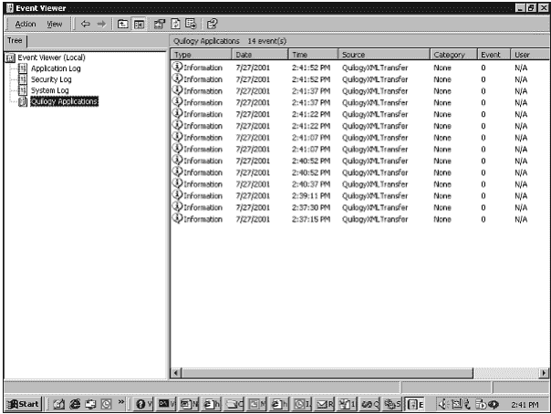

**图 13.2**

一个自定义事件日志。此屏幕截图显示了事件查看器以及一个包含从`QXMLTransfer`服务记录的消息的自定义事件日志。

你可能想采用清单 13.9 中所示技术的其中一个原因正是因为日志会在服务卸载时被删除，但日志文件会保留。需要注意的是，使用`EventLogEntryType`的`Save`方法枚举日志条目并将其写入磁盘是一个简单的任务。

### 接收通知

除了向事件日志写入和从中读取之外，你还可以使用`EventLog`类在事件进入日志时接收通知。当你的服务依赖于另一个服务（如 SQL Server）且需要知道该服务是否停止或暂停时，这会非常有用。对于开发人员来说，最棒的一点是，监控日志就像从类中捕获事件一样简单。例如，清单 13.10 中的代码可由`QXMLTransfer`服务用于监控 SQL Server 事件。

#### 清单 13.10 监控事件日志

此代码设置了一个事件处理程序，用于监控应用程序日志中的 SQL Server 事件。

```vbnet
Imports System.Diagnostics

' In the OnStart event

Dim evLog As EventLog

evLog = New EventLog("Application")

AddHandler evLog.EntryWritten, AddressOf NewAppLogEvent

evLog.EnableRaisingEvents = True

Private Sub NewAppLogEvent(ByVal sender As Object, _
  ByVal e As EntryWrittenEventArgs)

  ' Check the Source

  If e.Entry.Source = "MSSQLServer" Then

    ' Look for specific messages

    If Instr(1, "terminating", e.Entry.Message, CompareMethod.Text) > 0 Then

      ' Stopping

      Me.OnStop()

      Return

    End If

    If Instr(1, "pause", e.Entry.Message, CompareMethod.Text) > 0 Then

      ' Pausing

      Me.OnPause()

      Return

    End If

  End If

End Sub
```

请注意，清单开头的代码应添加到服务的`OnStart`事件中，且私有类级`EventLog`对象（`evLog`）指向应用程序事件日志。然后它使用`AddHandler`语句将`EntryWritten`事件动态挂接到`NewAppLogEvent`过程中。为了开始监控，它将`EnableRaisingEvents`属性设置为 True。随后，`NewAppLogEvent`过程使用`EntryWrittenEventArgs`对象的`Entry`属性来检查事件。如果源将其标识为 SQL Server 事件，则可以解析消息以确定该事件是否是感兴趣的。如果是，则可以采取相应操作；在本例中，服务将被停止或暂停。

> **提示**

请记住，你还需要包含相应的清理代码，将`EnableRaisingEvents`属性设置为 False，以便在服务停止时不会触发事件。此外，`evLog`的`Dispose`方法应在`OnStop`方法中执行。

### 监控性能

许多 Windows 服务的另一个特点是，它们经常将信息记录到性能计数器中，这些计数器可以通过“管理工具”组中的“性能监视器”实用工具查看。过去，访问或创建这些信息需要详细了解相关的 Win32 API。幸运的是，服务框架在`System.Diagnostics`命名空间下提供了相关类，不仅可以读取操作系统提供的内置计数器，还可以读写用户定义计数器。

> **注意**

性能计数器被设置在一个分级系统中：最高级是计算机，然后依次经过类别（或对象）、计数器，最后是实例。类别仅用于将计数器分组，通常指一个操作系统子系统或一个应用程序（如服务）。计数器代表实际测量的内容，是记录数据的层级。计数器可以包含多个离散的实例（例如，CPU 利用率计数器可以为每个运行的进程包含一个实例）。服务框架允许你操作所有这四个级别。

用于操作性能计数器信息的主要类毫不意外地被称为`PerformanceCounter`。通过它，你可以连接到一个现有计数器并通过采样读取其值，或者创建一个新计数器并通过递增或设置其原始值/底层值来设定其值。然而，在操作用户定义的性能计数器之前，必须先将其安装在系统中。

### 安装自定义性能计数器

为了确保应用程序运行时性能计数器存在，且在卸载时被清理，你应该在服务的`Installer`类中使用`PerformanceCounterInstaller`类。在`QXMLTransfer`服务的示例中，服务将报告两个计数器：自服务重启以来处理的文件总数，以及最近一个时间间隔内处理的文件数量。

要创建这些计数器，需将清单 13.11 中的代码添加到清单 13.3 所示的`QXMLInstall`类的构造函数中。

#### 清单 13.11 安装性能计数器

此代码片段为`QXMLTransfer`服务安装两个性能计数器。

```vbnet
Imports System.Diagnostics

mPerfCounterInstaller = New PerformanceCounterInstaller()

' Set up the perf counter

Dim objCounter As New CounterCreationData("Total Files", _
    "The total number of files processed by this " & _
    "service since it was restarted.", _
    PerformanceCounterType.NumberOfItems32)

Dim objCounter1 As New CounterCreationData("Files", _
    "The number of files processed in the last interval.", _
    PerformanceCounterType.NumberOfItems32)

mPerfCounterInstaller.CategoryName = "Quilogy XML Transfer"

mPerfCounterInstaller.Counters.Add(objCounter1)

mPerfCounterInstaller.Counters.Add(objCounter)

Installers.Add(mPerfCounterInstaller)
```

类级私有变量`mPerfCounterInstaller`首先被实例化为安装程序。每个计数器由一个`CounterCreationData`对象表示，该对象通过一个构造函数实例化，该构造函数接受计数器名称（在本例中为 Total Files 和 Files）、性能实用工具中可用的帮助描述以及计数器类型。服务框架支持 28 种不同类型的计数器，范围从百分比、经过的时间到变化率。在本例中，两个计数器都是简单的原始数值，因此使用了`PerformanceCounterType`枚举类型的`NumberOfItems32`成员。

在创建计数器之后，使用`PerformanceCounterInstaller`类的`CategoryName`属性在将计数器添加到...之前设置唯一的类别名称。

使用`Add`方法向计数器集合中添加计数器。最后，与其他安装程序一样，`PerformanceCounterInstaller`会被添加到`Installers`集合中，并在安装时进行处理。

> **注意**

也可以直接在应用程序中使用`PerformanceCounterCategory`类的`Exists`、`Create`和`Delete`共享方法来创建和删除性能计数器。

### 使用性能计数器

计数器安装完成后，就可以简单地使用它们来报告服务中的数据。在此示例中，`QXMLTransfer`服务报告已处理的文件数量。将操作性能计数器的代码放在私有的`ProcessFiles`方法中是合理的，该方法在计时器唤醒服务时运行，如清单 13.7 所示。

`ProcessFiles`方法旨在搜索目标目录中符合特定条件的所有文件，并使用`For...Each`循环进行处理。在处理每个文件时，会递增一个局部计数器变量，该变量将作为最近值报告给`Files`计数器。`Total Files`计数器将使用此值来增加当前值。`ProcessFiles`方法的骨架代码如清单 13.12 所示。

#### 清单 13.12 处理文件

此`ProcessFiles`方法的不完整代码展示了`QXMLTransfer`服务在搜索和处理文件时的代码流程。

```vbnet
Imports System.Diagnostics
Imports System.IO

Private Sub ProcessFiles()

    Dim objFile As FileInfo

    Dim strFile As String

    Dim intCount As Integer

    Dim objCounter As PerformanceCounter

    Dim objDir As Directory

    Try

        'Go get each file

        For Each strFile In objDir.GetFileSystemEntries(mPath, mCriteria)

            objFile = New FileInfo(strFile)

            ' Process it in some way

            intCount = intCount + 1

        Next

    Catch e As Exception

        ' Log the fact that an error occurred

    Finally

        ' Write the number processed to the log

        ' Increment Perf Counter

        If PerformanceCounterCategory.Exists("Quilogy XML Transfer") Then

            objCounter = New PerformanceCounter("Quilogy XML Transfer", _
                "Files", False)

            objCounter.RawValue = intCount

            objCounter = New PerformanceCounter("Quilogy XML Transfer", _
                "Total Files", False)

            objCounter.IncrementBy(intCount)

            objCounter.Dispose()

        End If

    End Try

End Sub
```

请注意，用于写入性能数据的代码放在`Finally`块中，因为无论处理过程中是否发生错误，它都应该运行。此外，请注意调用`PerformanceCounterCategory`的共享`Exists`方法，以确保在写入之前，该类别或对象（在性能工具中的称呼）确实存在。如果存在，则通过直接操作底层`RawValue`属性并将其设置为`ProcessFiles`调用中已处理的文件数来设置`Files`计数器。由于`Total Files`计数器保持文件数量的连续总计，因此使用`IncrementBy`方法来增加总计。请注意，`PerformanceCounter`重载构造函数的第三个参数设置为`False`，表示该计数器不是只读的。还有一个`ReadOnly`属性，可以在尝试更改值之前进行查询，以防止在写入只读计数器时引发异常。

> **注意**

`PerformanceCounter`类还公开了`Increment`和`Decrement`方法，用于对计数器进行加一或减一操作。

完成后，该方法允许运行时使用`Dispose`方法释放资源。

### 集成

当`QXMLTransfer`服务停止时，它还必须清理计数器，以确保在服务重新启动时重置它们。为此，从`OnStop`和`OnShutdown`方法中调用一个私有的`TearDown`过程来释放资源。在此方法中，以下代码将计数器重置为 0：

```vbnet
Private Sub TearDown()

  Dim objCounter As PerformanceCounter

  objCounter = New PerformanceCounter("Quilogy XML Transfer", "Total Files")
```


```vb
objCounter.RawValue = 0

objCounter = New PerformanceCounter("Quilogy XML Transfer", "Files")

objCounter.RawValue = 0

objCounter.Dispose()

' Other deallocation

End Sub
```

如第 4 章所述，您可以使用一种模式来实现释放资源的方法，该模式要求包含一个 `Dispose` 方法。其他资源释放任务可以从 `TearDown` 过程中完成，例如停止计时器和停止对事件日志的监视。

如图 13.3 所示的性能工具显示了 `QXMLTransfer` 类的计数器。从图表中可以看出，该服务在四个连续的 15 秒间隔内处理了 19 个文件。请注意，`Files` 计数器（红色水平线）保持恒定为 19，而 `Total Files`（绿色线）每次服务响应计时器时都会继续增加。

**图 13.3**

性能工具。此屏幕截图显示了 `QXMLTransfer` 工具的性能计数器。

### 采样性能计数器

虽然 `QXMLTransfer` 服务不需要，但 `PerformanceCounter` 类也可用于使用 `NextValue` 和 `NextSample` 方法读取现有计数器，而 `PerformanceCounterCategory` 类可以使用 `ReadCategory` 方法读取类别中的所有计数器。

读取计数器最简单的技术是实例化一个新的 `PerformanceCounter` 对象，并简单地调用 `NextValue` 方法，该方法返回 `Single` 类型，反映最近间隔的计算值。以下代码段读取整个计算机的处理器利用率：

```vb
Dim sngProcPct As Single

Dim objCounter As New PerformanceCounter("Processor", _
    "% Processor Time", "_Total")

sngProcPct = objCounter.NextValue()
```

要获取更详细的信息，您也可以调用 `NextSample` 方法，该方法返回一个 `CounterSample` 结构，包含八个字段，包括 `RawValue`、`CounterFrequency` 和 `TimeStamp` 数据。此外，该结构支持一个 `Calculate` 方法，以返回与 `NextValue` 等效的值，如以下代码所示：

```vb
Dim sngProcPct As Single

Dim objCounter As New PerformanceCounter("Processor", _
    "% Processor Time", "_Total")

Dim objSample As CounterSample

objSample = objCounter.NextSample

sngProcPct = objSample.Calculate(objSample)
```

最后，`ReadCategory` 方法可用于返回通过 `InstanceDataCollectionCollection` 类返回的类别中所有实例的数据集合。虽然可能看起来不明显，但如果必须从多个计数器读取值，调用 `ReadCategory` 然后遍历集合更有效率。

### 通过 .NET 进行通信

如果您一直关注到本章的讨论，您会注意到已创建的 `QXMLTransfer` 服务具有几个重要功能，如事件日志记录和写入性能计数器，但尚未实际执行任何有用的工作。本章最后一节详细介绍了使用 `System.Net` 命名空间向服务添加传输功能，以通过 Internet 启用已处理文件的 FTP 传输。

### 使用 `System.Net`

`System.Net` 类可用于向任何托管应用程序添加网络功能。在这方面，它们取代了 `WinInet` Win32 API，但还提供了对 HTTP、TCP 和 UDP 的增强支持，此外还提供了一种机制来创建和注册“可插接”协议，以便随着 Internet 的发展而使用。这些类还被设计用于高压力环境，在这些环境中，它们被 ASP.NET 应用程序中的中间层组件使用，以跨 Internet 进行通信。除了在中间层组件中使用外，`System.Net` 类还可用于各种应用程序场景，从创建类似 Napster 的丰富客户端应用程序到满足制造业环境中常见的底层机器对机器通信。

`System.Net` 命名空间在技术上被分解为两个命名空间，`System.Net` 和 `System.Net.Sockets`，它们包含三个通信层：

- 一个请求/响应层，定义了通信的模型
- 应用协议，实现特定协议如 HTTP
- 传输层，进行 TCP 和 UDP 通信

例如，在请求/响应级别，`System.Net` 命名空间建立在一个模型上，客户端通过网络发起请求，然后同步或异步接收响应。为实现此模型，`System.Net` 命名空间包含 `WebRequest` 和 `WebResponse` 类，它们作为特定应用协议类（如 `HttpWebRequest` 和 `HttpWebResponse`）的基类。反过来，应用协议类使用来自 `System.Net.Sockets` 的类（如 `Socket` 和 `NetworkStream` 类）在 Web 上传输数据。此模型如图 13.4 所示。

**图 13.4**

`System.Net` 架构。`System.Net` 类由三层组成，每一层都从底层抽象出细节。

作为使用此模型的示例，请考虑清单 13.13 中的代码。在此示例中，VB .NET 应用程序使用 `WebRequest` 和 `WebResponse` 类来调用 Web 上的 URL，服务器返回数据。这种情况下，URL 可能返回一个 HTML 文档，应用程序希望将其缓存到文件系统中以备后续使用。

### 代码清单 13.13：使用 `WebRequest` 和 `WebResponse`

本代码清单展示了一个客户端应用程序如何使用 HTTP 协议下载网页，并将结果保存到文件。

```vb
Dim wReq As WebRequest

Dim wResp As WebResponse

Dim srData As StreamReader

Dim fsDest As FileStream

Dim wrStream As StreamWriter

Dim buffer(1024) As Char

Dim intBytes As Integer

Dim strData As String

' 创建用于保存结果的文件

fsDest = New FileStream("c:\newsdoc.htm", _
    IO.FileMode.OpenOrCreate, IO.FileAccess.Write)

wrStream = New StreamWriter(fsDest)

' 发起请求并获取响应

wReq = WebRequest.Create("http://my.quilogy.com/news/news.asp?s=1224")

wResp = wReq.GetResponse()

' 检索数据

srData = New StreamReader(wResp.GetResponseStream(), Encoding.ASCII)

intBytes = srData.Read(buffer, 0, 1024)

Do While (intBytes > 0)

    wrStream.Write(buffer, 0, intBytes)

    intBytes = srData.Read(buffer, 0, 1024)

Loop

' 清理资源

wrStream.Close()

srData.Close()

fsDest.Close()
```

注意在代码清单 13.13 中，文件是使用第 12 章讨论的标准 `FileStream` 和 `StreamWriter` 类打开并准备好进行写入的。接下来，代码使用 `WebRequest` 类的共享 `Create` 方法来设置对 URL 的调用。由于 `System.Net` 类支持多种协议，传递给 `Create` 方法的 URI 会被解析以确定要使用的底层协议（本例中为“http”）。请求实际上是在调用 `GetResponse` 方法时发送的，并且由于这是一个同步调用，该方法会阻塞直到返回结果。请注意，如果 URL 不存在，调用 `GetResponse` 方法时会引发 `WebException`。

### 提示

虽然代码清单 13.13 中的示例使用的是同步调用，但也可以使用 `WebRequest` 的 `BeginGetResponse` 和 `EndGetResponse` 方法创建异步调用。请注意，这些方法需要使用第 4 章讨论的服务框架中的异步设计模式和委托。

请求成功返回后，必须从 `WebResponse` 读取结果。这可以使用 `StreamReader` 对象来完成；在本例中，被实例化为 `srData`。你会注意到 `srData` 的 `Read` 方法在循环中被调用，每次读取 1KB 的数据，然后使用 `System.IO` 命名空间中的 `FileStream` 类将数据写入文件。使用流（字面上是一个字节序列）来访问数据的范式是一种常见模式，你会在服务框架中反复遇到。

`WebRequest` 和 `WebResponse` 类也可以用于向 Web 服务器发送数据，其方式与代码清单 13.13 中所示的相同。但是，在调用 `GetResponse` 之前，必须设置诸如 `Method`（本例中为 POST）、`ContentType` 和 `ContentLength` 等属性，然后通过 `WebRequest` 的 `GetRequestStream` 属性暴露的流将数据加载到 Web 服务器。

尽管这里讨论的请求/响应模型并不难理解，但 `System.Net` 命名空间还包含 `WebClient` 类，它将与 `WebRequest` 和 `WebResponse` 类的交互抽象成一个具有简单方法的单一类。例如，代码清单 13.13 中展示的相同功能可以用 `WebClient` 类通过两行代码实现：

```vb
Dim wClient As New WebClient()

wClient.DownloadFile("http://my.quilogy.com/news/news.asp?s=1224", "c:\newsdoc.htm")
```

或者，可以使用 `BaseAddress` 和 `QueryString` 属性的组合来设置 URL。如果你希望访问从 URL 返回的流，而不是简单地将其保存到文件，可以使用 `OpenRead` 方法。正如你可能预料到的，`WebClient` 类也可以使用 `UploadFile` 和 `OpenWrite` 方法将数据发送到 Web 服务器。

虽然请求/响应模型适用于大多数应用程序，但有时你可能需要在更底层的级别上工作。在这些情况下，你可以直接使用 `System.Net.Sockets` 中的类在套接字级别进行工作。但是，尽管暴露了这种低级别功能，但 `Sockets` 命名空间（仿照 Berkeley 套接字实现）也包含 TCP 和 UDP 类，这些类在构建 TCP 客户端和监听器时提供了更高级别的抽象。例如，`TcpClient` 类可用于使用给定端口创建到远程服务器的 TCP 连接，并返回响应流，如下所示：

```vb
Dim timeStream As Stream

Dim timeClient As New TcpClient("time.quilogy.com", 13)

timeStream = timeClient.GetStream()
```

在服务器端，`TcpListener` 类可用于监听传入的连接，将当前日期和时间创建为字节数组，并将其发送回客户端。

```vb
Dim listener As New TcpListener(13)

Dim strDate As String

Dim byteDate As Byte()

Dim dataSocket As Socket

listener.Start()

Do While True

    dataSocket = listener.AcceptSocket()

    strDate = DateTime.Now.ToShortDateString & " " & _
        DateTime.Now.ToLongTimeString()

    byteDate = Encoding.ASCII.GetBytes(strDate.ToCharArray())

    dataSocket.Send(byteDate, byteDate.Length, SocketFlags.None)

Loop

listener.Stop()
```

请注意，`TcpListener` 类的构造函数被调用时传入了端口号，本例中为 13，用于监听。然后调用 `Start` 方法开始在该端口上监听连接，尽管程序运行的线程在调用 `AcceptSocket` 方法之前不会被阻塞。此外，`TcpListener` 支持 `AcceptTcpClient` 方法，该方法返回当前请求的 `TcpClient` 实例。当前日期和时间使用 `ToCharArray` 方法填充字节数组，并使用 `Socket` 类的 `Send` 方法将数据发送回客户端。

### 集成

第三部分

此处显示的代码显然将放置在 Windows 服务应用程序或其他宿主应用程序中，这些应用程序将在后台运行以等待处理传入的请求。你还会注意到，监听器被放置在一个循环中，以便在宿主应用程序执行时可以继续处理请求。

> **注意**
>
> 在更复杂的应用程序中，此处显示的代码也可以通过 `System.Threading` 命名空间（如第 12 章“访问系统服务”中所讨论的）增强以支持多线程。

`UdpClient` 是第二个更高级别的类，用于从远程主机和远程客户端发送和接收 UDP 数据报。

除了发送和接收数据外，`System.Net` 命名空间还包含辅助类，如 `Dns` 和 `Cookie`，它们分别提供简单的域名解析功能和管理客户端 Cookie。`Dns` 类的一个示例如下，用于检索与当前机器关联的 IP 地址。

```vb
Dim myMachine As String

Dim ip As IPHostEntry

Dim addressList() As IPAddress

Dim add As IPAddress

myMachine = Dns.GetHostName

ip = Dns.Resolve(myMachine)

addressList = ip.AddressList()

For Each add In addressList

    Console.WriteLine(Dns.IpToString(add.Address))

Next
```

在这段代码片段中，请注意共享的 `GetHostName` 方法返回当前环境的 DNS 主机名，然后通过调用 `Resolve` 方法来查找 IP 地址，该方法接受主机名或格式化为字符串的 IP 地址（称为“点分十进制表示法”）。`Dns` 类还公开了 `GetHostByAddress` 和 `GetHostByName` 方法，以显式使用主机名或 IP 地址。与主机名关联的 IP 地址以 `IPAddress` 对象数组的形式返回，可以枚举该数组并使用 `IpToString` 方法转换为点分十进制表示法。

### 处理安全性

`System.Net` 类还支持使用身份验证机制的能力，例如基本、摘要、NTLM 和 Kerberos。它们还支持代理服务器。

### 提示

在 `System.Net` 中，安全套接字层（SSL）是透明支持的。当检测到 `https` 前缀时，底层类会自动使用 SSL。

为了支持向 Web 服务器发送凭据，`WebRequest` 类公开了 `Credentials` 属性，该属性可以接受实现 `ICredentials` 接口的对象，例如 `NetworkCredential` 或 `CredentialCache`。前者映射到单个凭据集，而后者封装了不同类型的多个凭据集。

例如，假设 `my.quilogy.com` 网站受 Web 服务器上的基本身份验证保护。正如预期的那样，在不发送凭据的情况下，调用 `GetResponse` 时会生成一个 `WebException`，其 HTTP 状态码为 401。要提供用户名和密码，可以将 `Credentials` 属性设置为使用账户信息初始化的 `NetworkCredential` 的新实例，如下所示：

```vb
wReq = WebRequest.Create("http://my.quilogy.com/news/news.asp?s=1224")

wReq.Credentials = New NetworkCredential("dlfox", "notmypassword")
```

使用 NTLM 身份验证时，`CredentialCache` 的静态 `DefaultCredentials` 属性会自动填充操作系统账户信息，因此使用 NTLM 访问站点是透明的，如下所示：

```vb
wReq = WebRequest.Create("http://my.quilogy.com/news/news.asp?s=1224")

wReq.Credentials = CredentialCache.DefaultCredentials
```

为了混合和匹配凭据，你也可以构建自己的 `CredentialCache`，并使用 `NetworkCredential` 类向其添加新的凭据，如下所示：

```vb
Dim netCred As New NetworkCredential("dlfox", "notmypassword")

Dim netCred1 As New NetworkCredential("dlfox", "notmypassword ", "KPCDC")
```


`Dim netCache As New CredentialCache()`

`netCache.Add("http://my.quilogy.com", "Basic", netCred)`

`netCache.Add("http://kc.quilogy.com", "NTLM", netCred1)`

然后，可以将`netCache`对象设置为任何`WebRequest`的`Credentials`属性，如果 URI 匹配，则会使用相应的身份验证。请注意，使用 NTLM 时，域名也会传递给`NetworkCredential`的构造函数。

默认情况下，`System.Net`类会自动使用本地计算机上的代理信息，尽管也可以全局地或针对每个请求来覆盖所有请求的设置。要覆盖全局设置，你可以使用`GlobalProxySelection`类的共享`Select`方法来指定一个新的`WebProxy`对象，如下所示：

```
Dim objProxy As Uri
objProxy = New Uri("http://kcpdc:80")
GlobalProxySelection.Select = New WebProxy(objProxy)
```

要为单个请求指定不同的代理服务器，你可以为每个请求设置`WebRequest`的`Proxy`属性。以下代码片段展示了如何为特定请求覆盖全局代理设置：

```
Dim wReq As WebRequest
Dim objProxy As New WebProxy
objProxy.Address = New Uri("http://kcpdc:80")
objProxy.BypassProxyOnLocal = True
wReq = WebRequest.Create("http://my.quilogy.com/news/news.asp?s=1224")
wReq.Proxy = objProxy
```

请注意，`WebProxy`对象用于指定新的设置，并且`BypassProxyOnLocal`属性可以设置为`True`，以便跳过为内网地址使用代理服务器。也支持经过身份验证的代理，方法是在`WebProxy`对象中包含一个`Credentials`属性。

## 使用 FTP

如前所述，`System.Net`类支持“可插拔”协议的概念。换句话说，随着互联网协议的增强和新协议的开发，`System.Net`类可以扩展以支持它们。

作为这种架构的一个示例，服务框架在此版本中不附带对 FTP 的支持。因此，你可以通过分别从`WebRequest`、`WebResponse`和`IWebRequestCreate`派生出`FtpWebRequest`、`FtpWebResponse`和`FtpRequestCreator`来实现 FTP 协议。然后，这些类将覆盖基类中的成员，例如`GetResponse`、`GetResponseStream`和`GetRequestStream`，以实现协议的细节。例如，`FtpWebRequest`类将负责创建用于执行通信的套接字，而其重写的`GetResponse`方法则通过套接字实际发送和接收数据。

尽管所有这些可能很有趣，但大多数企业开发人员宁愿不花时间实现 FTP 协议。幸运的是，微软提供了一个不受支持的示例，可以在`System.Net`中“插入”FTP 协议。此程序集使用 VC# 编写，并随附在配套网站上。不出所料，此程序集公开了前面提到的`FtpWebRequest`、`FtpWebResponse`和`FtpRequestCreator`类。为了有效地使用这些类，你可以创建一个可重用的类，封装 FTP 中的主要操作。清单 13.14 展示了这样一个类，其中包含一个用于将文件上传到 FTP 站点的`UploadFile`方法。

### 清单 13.14 FtpClient 类。此类使用服务框架附带的可插拔 FTP 协议来公开常见的 FTP 功能。

```
Public Class FtpClient
    ' Simple FtpClient
    Public LastMessage As String
    Public UserName As String
    Public Password As String
    Private ftpUri As Uri

    Public Sub New(ByVal ftpSite As Uri)
        ftpUri = ftpSite
        InitClass()
    End Sub

    Public Sub New(ByVal ftpSite As String)
        ftpUri = New Uri(ftpSite)
        InitClass()
    End Sub

    Private Sub InitClass()
        ' Register the prefix
        Dim creator As FtpRequestCreator = New FtpRequestCreator()
        WebRequest.RegisterPrefix("ftp:", creator)
    End Sub

    Public Function UploadFile(ByVal source As String, ByVal dest As String) As Boolean
        Dim ftpReq As FtpWebRequest
        Dim ftpResp As FtpWebResponse
        ' Setup the request
        ftpReq = CType(WebRequest.Create(ftpUri), FtpWebRequest)
        ftpReq.Method = "PUT"
        ' Set the destination file
        ftpReq.m_szCmdParameter = dest
```

### 清单 13.14 续

```
        ' Login if necessary
        If UserName.Length > 0 Then
            ftpReq.Credentials = New NetworkCredential(UserName, Password)
        End If
        Try
            LoadStream(source, ftpReq.GetRequestStream)
            ftpResp = CType(ftpReq.GetResponse, FtpWebResponse)
            ' See if it worked
            LastMessage = ftpResp.StatusDescription
            If ftpResp.Status = 226 Then
                Return True
            Else
                Throw New Exception("File Upload Failed [" _
                    & source & "]:" & LastMessage)
                Return False
            End If
        Catch e As Exception
            LastMessage = e.Message
            Throw New Exception("File Upload Failed [" _
                & source & "]:" & LastMessage)
            Return False
        Finally
            ftpReq.CloseDataConnection()
            ftpReq = Nothing
            ftpResp = Nothing
        End Try
    End Function

    Private Function LoadStream(ByVal pSrcFile As String, ByRef s As Stream) As String
        Dim fsSrc As FileStream
        Dim BytesRead As Integer = 0
        Dim ReadBuffer() As Byte
        Dim ftpResp As FtpWebResponse
        Const SIZETOREAD As Integer = 1024
        ' Open the stream for Reading
        Try
            fsSrc = New FileStream(pSrcFile, FileMode.Open, FileAccess.Read)
        Catch e As Exception
            Throw New Exception(e.Message & _
                " [Unable to open local file " + pSrcFile + " to upload])"
        End Try
        Try
            ' If opened successfully and not empty
            If fsSrc.Length > 0 Then
                Do ' Loop through the file and write it to the stream
                    ReDim ReadBuffer(SIZETOREAD)
                    BytesRead = fsSrc.Read(ReadBuffer, 0, SIZETOREAD)
                    s.Write(ReadBuffer, 0, BytesRead)
                Loop Until BytesRead = 0
            End If
            fsSrc.Close()
            s.Close()
        Catch e As Exception
            Throw New Exception(e.Message & _
                " [Unable to upload file " + pSrcFile & "]")
        End Try
    End Function
End Class
```

由于 XMLTransfer 服务需要在文件处理时上传到注册表中指定的 FTP 站点，因此`FtpClient`类仅实现了`UploadFile`方法。请注意，重载的构造函数通过注册 FTP 前缀并接受客户端将连接的 FTP 站点来进行适当的初始化。

如清单 13.14 所示，`UploadFile`方法首先使用`WebRequest`对象的`Create`方法注册要联系的 URI，以返回一个`FtpWebRequest`对象。然后，`FtpWebRequest`对象公开`Method`属性，在本例中设置为`PUT`以指示即将进行文件传输。字段`m_szCmdParameter`用于指定即将执行的命令的详细信息（此处为目标文件的名称）。与`WebClient`类一样，`FtpClient`公开`Credentials`属性，该属性可以接受传递给`FtpClient`对象公共字段的凭据。

最后，私有`LoadStream`方法打开传递给它的文件，并将其读入`Stream`，以便使用`FtpWebRequest`对象的`GetRequestStream`方法随请求一起发送。如果没有引发异常，则在随后调用`GetResponse`方法时进行实际上传。

`FtpWebRequest`对象还暴露了`Status`和`StatusDescription`两个属性，它们会在一切正常时从 FTP 服务器返回 226 和 Transfer Complete 消息。如果不正常，则`UploadFile`的返回值会被设为 False，同时抛出异常，并且相关消息会被用来填充`LastMessage`字段，客户端可以检查该字段。

对于 XML Transfer 服务来说，要使用`FtpClient`，只需设置对该程序集的引用，并将清单 13.15 所示的代码添加到`ProcessFiles`方法中即可。

### 清单 13.15 客户端 FTP。以下代码片段可由 XMLTransfer 服务用于对其处理的文件执行 FTP 操作。

```
Dim ftpMyClient As FtpClient
Dim objDir As Directory
Dim objFile As FileInfo
Dim intCount As Integer
Dim strFile As String

' Set up the FTP call
ftpMyClient = New FtpClient(mFTP)
ftpMyClient.UserName = mUser
ftpMyClient.Password = mPwd

' Go get each file
For Each strFile In objDir.GetFileSystemEntries(mPath, mCriteria)
    objFile = New FileInfo(strFile)
    Try
        ' FTP it out
        ftpMyClient.UploadFile(objFile.FullName, objFile.Name)
        ' Archive it
        objFile.MoveTo(mArchivePath & "\" & objFile.Name)
    Catch e As Exception
        ' Log the fact that an error occurred
        LogText("An error occurred processing file: " & _
            e.Message, mLogFile, True, False)
    Finally
        LogText("Processed " & objFile.FullName, mLogFile, False, True)
        intCount = intCount + 1
    End Try
Next

' Clean up the FTP
ftpMyClient = Nothing
```


首先，`FtpClient` 的构造函数传入存储在注册表中的 FTP 服务器地址，以初始化 `FtpWebRequest`。然后应用程序使用同样存储在注册表中的私有变量登录。如果登录成功，则遍历该目录，并搜索符合标准的文件。每找到一个文件，就使用 `UploadFile` 方法将其上传到 FTP 站点。注意，如果某个文件引发异常，将尝试下一个文件。

显然，该服务还可以进一步增强，添加支持重试文件、在放弃前设置最大错误数计数，以及支持上传到 FTP 站点上的特定目录等属性。

### 小结

本章重点介绍了创建健壮的服务应用程序所需的 Services Framework 类，这些应用程序利用注册表、事件日志、性能计数器、计时器以及通过互联网进行通信。任何在先前 VB 版本中开发过服务的人都会证明，.NET 提供的这些服务的组合使这一过程变得更加简单，且更不容易出错。

最后一章将通过讨论使用 XML 和消息传递与企业进行集成，来扩展用 VB .NET 开发的分布式应用程序的覆盖范围。

### 与企业集成

## 第 14 章

### 本章内容

- 使用 XML 类 654
- 集成消息传递 686
- 集成 Active Directory 699

要创建利用企业内所有资源的分布式应用程序，通常需要超越对关系数据库的访问。本章重点介绍三种通常需要集成的额外数据源。尽管本章并非对这些主题的详尽参考，但提供了如何使用 Services Framework 提供的类来操作 XML 文档、Microsoft Message Queue 服务器和 Active Directory 的概述。

> **注意**
>
> 本章的所有代码清单和补充资料可在本书的网站 `www.samspublishing.com` 上找到。

## 使用 XML 类

到目前为止，XML 已深深植根于 .NET 中，从配置文件到 Web 服务的协议，再到作为 ADO.NET `DataSet` 对象的数据存储。当然，这些 XML 的特定用途突显了其自描述性和灵活性。因此，许多组织使用 XML 在组织内部以及贸易伙伴和供应商之间传递文档和数据。这些交换的普遍性意味着，开发人员迟早需要读写 XML 文档、用 XSL 转换它们，并使用 XML 模式验证它们。本节讨论 Services Framework 中以这些方式处理 XML 的支持。

在最高层次上，用于在 Services Framework 中操作 XML 的类包含在 `System.Xml` 命名空间中，如表 14.1 所示。

| 命名空间 | 描述 |
|---|---|
| `System.Xml` | 包含用于读写 XML 文档并将文档映射到文档对象模型 (DOM) 的核心 XML 类。 |
| `System.Xml.Schema` | 包含用于处理 XSD 模式并验证文档的类。 |
| `System.Xml.Serialization` | 包含使类能够序列化为 XML 的对象。 |
| `System.Xml.XPath` | 包含允许你使用 XPath 导航 XML 文档的类。 |
| `System.Xml.Xsl` | 包含允许你使用 XSL 样式表转换文档的类。 |

从这些命名空间的描述可以看出，`System.Xml` 命名空间总体上支持 W3C 标准：XML 1.0 和文档类型定义 (DTD)、XML 命名空间 (`http://www.w3.org/TR/REC-xml-names/`)、XML 模式 (`http://www.w3.org/TR/xmlschema-1/`)、XPath 表达式 (`http://www.w3.org/TR/xpath`)、XSL 转换 (`http://www.w3.org/TR/xslt`)、DOM Level 2 Core (`http://www.w3.org/TR/DOM-Level-2`) 以及 SOAP 1.1。

> ### COM 中的 XML
>
> 熟悉在 COM 世界中处理 XML 文档的开发人员无疑曾使用 MSXML 解析器以编程方式操作文档。对于这些开发人员来说，`System.Xml` 类会显得熟悉，因为它们映射到 DOM，让人想起 `System.Xml` 是以 MSXML 为蓝本建模的。然而，Services Framework 的实现包括更好的标准遵从性和更简单的编程模型（尤其适用于流式访问），这应使工作更加轻松。
>
> 话虽如此，你仍然可以通过 COM Interop 继续使用 MSXML，尽管我认为你会发现，移植使用 DOM 的代码相对简单，而重写使用 SAX（MSXML 3.0 中引入的 XML 简单 API）的代码，则能带来更直接和高效的应用程序。

为了让你了解 `System.Xml` 命名空间如何提供基于标准的 XML 处理支持，本节讨论包括对 XML 文档的流式访问、使用 DOM 操作 XML 文档、处理 XML 模式以及使用 XML 序列化。

### 流式 XML

也许 `System.Xml` 命名空间中最大的创新，以及你通常与 XML 文档交互的方式，是通过使用基于流的 API，类似于第 12 章“访问系统服务”中讨论的对文件执行的流式读写。该 API 的核心是 `XmlReader` 和 `XmlWriter` 类，它们分别为 XML 文档提供只读、仅向前的光标访问，以及用于写出 XML 文档的接口。由于这些类实现了基于流的方法，它们不需要将 XML 文档解析为树结构并缓存在内存中，而这是通过 DOM 处理文档时发生的情况。

#### 使用 XML 读取器

当 DOM 首次发布，Microsoft 等供应商开始编写 MSXML 等解析器来读取这些文档时，很快就发现这种编程模型并不适用于所有应用程序。当 XML 文档很大时尤其如此，因为根据定义，DOM 将整个文档表示为内存中的树结构。使用 DOM 不仅性能受到影响，因为你必须等待文档被解析和加载，而且处理文档的应用程序往往会占用大量内存。因此，Microsoft 在 MSXML 3.0 中包含了 SAX API，为 XML 文档提供事件驱动的编程模型。尽管这缓解了 DOM 的性能和内存限制，但代价是增加了复杂性。

`XmlReader` 的实现从很多方面来说是 DOM 和 SAX 的融合，它提供了像 DOM 一样简化的编程模型，但采用了基于流的架构。编程模型被简化是因为它是拉取模型而非推送模型。换句话说，开发人员使用熟悉的光标式循环结构从文档中拉取数据，而不是简单地通过响应解析器触发的事件被推送数据。

`XmlReader` 类实际上是 `XmlTextReader`、`XmlValidatingReader` 和 `XmlNodeReader` 类的抽象基类。`XmlReader` 经常被用作 Services Framework 中其他方法的输入或输出参数。`XmlReader` 的典型用途是读取 SQL Server 2000 中 `FOR XML` 语句生成的 XML，然后加载 `DataSet` 对象，如下面的代码所示：

```vbnet
Imports System.Xml
Imports System.Data.SqlClient
Imports System.Data

Dim cn As New SqlConnection("server=ssosa;database=enrollment;uid=sa")

Dim cm As New SqlCommand( _
  "SELECT FName, LName, Company FROM Student FOR XML AUTO, XMLDATA", cn)

Dim xmlr As XmlReader
Dim ds As New DataSet()

cn.Open()

cm.CommandType = CommandType.Text

xmlr = cm.ExecuteXmlReader

ds.ReadXml(xmlr, XmlReadMode.Fragment)
```

`SqlCommand` 对象的 `ExecuteXmlReader` 方法返回一个 `XmlReader`，然后它被接受为 `DataSet` 对象的一个重载 `ReadXml` 方法的参数。如第 7 章“使用 ADO.NET 访问数据”中所讨论的，`ReadXml` 方法的第二个参数指定如何使用 `XmlReadMode` 常量之一来解析 XML。

##### 导航文档

顾名思义，`XmlTextReader` 只是提供一个读取器，用来检查 XML 文档和任何内联 DTD 的格式良好性，但不像 `XmlValidatingReader` 那样使用关联的 DTD 或模式执行验证。因此，`XmlTextReader` 是使用文件、`Stream` 或 `TextReader` 作为输入来解析 XML 文档的最快方法。另一方面，`XmlNodeReader` 可以解析来自 XML DOM 子树的 `XmlNode` 对象，这将在后面讨论。为了让您对读取器有个直观了解，表 14.2 列出了 `XmlTextReader` 类的重要成员。

### 表 14.2 重要的 `XmlTextReader` 成员

| 成员 | 描述 |
|---|---|
| `AttributeCount` | 返回当前节点上的属性数量。 |
| `BaseURI` | 返回用于解析当前节点外部引用的基础 URI。 |
| `Close` | 关闭文档并将 `ReadState` 更改为 `Closed`。 |
| `Depth` | 返回当前节点在 XML 文档中的深度。 |
| `EOF` | 如果 `XmlReader` 位于流的末尾，则返回 `True`。 |
| `GetAttribute` | 给定索引或名称，返回属性的值。如果不存在，则返回空字符串。 |
| `GetRemainder` | 以 `TextReader` 对象的形式返回文档中仍保留在缓冲区中的部分。 |
| `HasAttributes`、`HasValue` | 如果当前节点具有属性或值，则返回 `True`。 |
| `IsDefault` | 如果当前节点的属性是由 DTD 或架构中指定的默认值生成的，则返回 `True`。 |
| `IsEmptyElement` | 如果当前节点是空元素，则返回 `True`。 |
| `IsStartElement` | 如果当前节点是开始标记，则返回 `True`。它也被重载以接受一个元素名称，该名称会先使用 `MoveToContent` 导航到下一个内容元素。 |
| `Item` | 索引属性，用于从当前节点返回一个属性。 |
| `LineNumber`、`LinePosition` | 返回当前位置信息。 |
| `LocalName`、`Name` | 分别返回不带命名空间前缀的当前节点名称和完整限定名。 |
| `MoveToAttribute`、`MoveToContent`、`MoveToElement`、`MoveToFirstAttribute`、`MoveToNextAttribute` | 用于在文档中导航以查找指定数据的方法。 |
| `NamespaceURI` | 指定当前节点的命名空间。 |
| `NodeType` | 返回当前节点的 `XmlNodeType`。 |
| `ReadState` | 使用 `ReadState` 常量（`Closed`、`EndOfFile`、`Error`、`Initial`、`Interactive`）之一返回 `XmlReader` 的状态。 |
| `Read` | 从流中读取下一个节点并将其设为当前节点。 |
| `ReadString`、`ReadChars`、`ReadBase64`、`ReadBinHex` | 读取当前节点的文本值，并以适当的数据类型返回。 |
| `ReadInnerXml`、`ReadOuterXml` | 分别以字符串形式读取当前节点及其标记，也包含其子节点。 |
| `Skip` | 跳过当前元素并将读取器定位在下一个元素上。 |
| `Value` | 以字符串形式返回当前节点的值。 |
| `WhitespaceHandling` | 指定如何解析文档中遇到的空白。 |

为了说明 `XmlTextReader` 的使用，请考虑清单 14.1 中显示的 `ExtractStudents` 方法。

**清单 14.1 使用 `XmlTextReader`。** 此方法使用 `XmlTextReader` 读取 XML 文档的内容，并提取学生姓名以保存到数据库中。

```vbnet
Imports System.Xml
Imports System.IO
Imports System.Data.SqlClient
Imports System.Data

Public Sub ExtractStudents(ByVal FileName As String)

    Dim oRead As XmlTextReader

    Try

        Dim strFName, strLName, strOrg As String

        oRead = New XmlTextReader(FileName)

        oRead.NameTable.Add("Student")

        Do While oRead.Read

            oRead.MoveToContent()

            If oRead.Name.Equals("Student") And oRead.Depth = 1 Then

                strFName = oRead.GetAttribute("FName")

                strLName = oRead.GetAttribute("LName")

                If oRead.AttributeCount = 3 Then

                    strOrg = oRead.GetAttribute("Company")

                Else

                    strOrg = ""

                End If

                Call SaveStudent(strFName, strLName, strOrg)

            End If

        Loop

    Catch e As XmlException

        LogMessage(FileName, e.Message, _
            e.LineNumber, e.LinePosition, oRead.Name)

    Finally

        oRead.Close()

    End Try

End Sub
```

在此示例中，`ExtractStudents` 方法使用了 `XmlTextReader` 类的重载构造函数来传入文件名。此外，`XmlReader` 在 `NameTable` 属性中公开了一个 `XmlNameTable`，用于存储常用的字符串。通过使用名称表，XML 解析器可以在返回元素名称时重用表中的字符串，并在进行比较时使用更高效的对象指针比较。也可以将现有的 `XmlNameTable` 传入构造函数，这样跨读取器的比较也会更高效。

如果文件可以打开，则使用 `Do Loop` 循环，通过 `Read` 方法遍历文档内容，当到达流末尾时该方法返回 `False`。

### 集成

### 第三部分

`XmlReader` 的一个有趣方面是 `Read` 方法不仅返回每个标签（开始和结束元素、处理指令、CDATA 节、注释和文档类型定义），还返回空白。正如您可能想象的那样，它以递归的方式执行此操作，以便在移动到同级元素之前处理包含所有子元素的整个元素。可以使用 `NodeType` 属性检查当前节点的类型。

为了更有效地遍历文档，您可以使用移动方法，例如 `MoveToContent`，如本例所示。`MoveToContent` 跳过任何处理指令、DTD、注释和空白，并移动到下一个 CDATA 节、开始或结束元素或实体引用。

如前所述，`XmlTextReader` 只确保文档格式正确，否则会抛出 `XmlException`。在此示例中，`Read` 方法和 `MoveToContent` 方法都可能生成异常，因为它们都执行导航操作。另请注意，当遇到格式错误时，`XmlTextReader` 的 `ReadState` 会设置为 `Error`，并且无法再对文档执行任何处理。

- **提示**：通过记录错误的 `LinePosition`（如此处所示），可以轻松修改该方法以从相应的行开始重现文档。
- **提示**：您也可以通过将 `WhiteSpaceHandling` 属性设置为 `WhiteSpaceHandling` 枚举的 `None` 常量来仅跳过空白。

然后可以使用 `Name` 属性检查元素名称，再继续使用 `Value` 属性或表 14.2 中显示的某个读取方法读取元素的值。

- **提示**：在清单 14.1 中，`Depth` 属性用于确保该方法仅处理顶层的 `Student` 元素（通过检查深度是否为 1）。

然而，您会注意到，在这种情况下，学生的数据实际上包含在 `Student` 元素的属性中。属性在 `XmlReader` 中不表示为单独的节点，而是表示为与节点关联的集合。因此，通常使用 `Item` 属性或 `GetAttribute` 方法访问属性。或者，可以使用 `MoveToAttribute` 方法将光标定位在传递给该方法的属性上，然后 `Name` 和 `Value` 属性分别设置为属性的名称和值。也可以使用 `MoveToFirstAttribute` 和 `MoveToNextAttribute` 方法以类似方式遍历集合。

然后从属性中提取值，并传递给一个将其保存在数据库中的方法。

`XmlReader` 支持的一项高级技术（清单 14.1 中未显示）是可选的实体引用扩展。简而言之，实体引用允许通过在文档中定义一次实体并多次引用来压缩 XML 文档，如下所示：

```xml
```


```xml
<!DOCTYPE Classes [
  <!ENTITY 2073 "<CourseNum>2073</CourseNum>
  <CourseDesc>Programming Microsoft SQL Server 2000</CourseDesc>">
]>
<Class>
  <Course>&2073;</Course>
</Class>
```

当 `XmlReader` 遇到表达式 `&2073;` 时，`NodeType` 被设置为 `EntityReference`。通过调用 `ResolveEntity`，发生替换，并继续处理 `CourseNum` 和 `CourseDesc` 元素。但请注意，`XmlTextReader` 不支持实体引用（将抛出 `InvalidOperationException`），可以使用 `CanResolveEntity` 属性来确定是否可以解析实体。

### 验证文档

要对 XML 文档执行验证，可以将 `XmlValidatingReader` 对象与 `XmlTextReader` 关联。`XmlValidatingReader` 公开了一个 `Schemas` 集合（`XmlSchemaCollection`），其中包含一个或多个架构（DTD、XSD、XDR），这些架构表示为 `XmlSchema` 对象，可用于验证文档。然后通过 `ValidationEventHandler` 报告验证错误。清单 14.2 中的 `Validate` 方法展示了使用 XDR 架构验证文档的基础知识。

**清单 14.2 验证 XML。** 此方法展示了如何根据架构验证文档。

```vbnet
Imports System.Xml
Imports System.Xml.Schema

Public Sub Validate(ByVal FileName As String, ByVal SchemaName As String, _
    ByVal xmlns As String)

    Dim oRead As XmlTextReader
```

### 清单 14.2 续

```vb
Dim oValid As XmlValidatingReader

Try
    oRead = New XmlTextReader(FileName)
    oValid = New XmlValidatingReader(oRead)

    AddHandler oValid.ValidationEventHandler, _
        New ValidationEventHandler(AddressOf ValidationError)

    oValid.Schemas.Add(xmlns, SchemaName)
    oValid.ValidationType = ValidationType.Auto

    Do While oValid.Read
        ' 在此处遍历文档
    Loop

Catch e As Exception
    LogMessage(pFileName, e.Message, e.LineNumber, _
        e.LinePosition, oRead.Name)

Finally
    oValid.Close()
End Try

End Sub

Public Sub ValidationError(ByVal o As Object, _
    ByVal args As ValidationEventArgs)

    ' 发生了验证错误
    LogValidationError(args)

End Sub
```

`XmlValidatingReader` 使用 `XmlTextReader` 初始化，并通过 `XmlSchemaCollection` 的 `Add` 方法添加了架构。参数分别表示命名空间 URI（即它在待验证文档中的引用方式）和要加载的架构的 URL。错误报告的事件处理程序使用 `AddHandler` 语句创建，在本例中指向 `ValidationError` 方法。必须在调用 `Read` 方法之前将架构添加到集合中。将 `ValidationType` 属性设置为 `ValidationType` 枚举的 `Auto` 常量，以便自动检测架构类型。此外，还可以将其设置为 `DTD`、`None`、`XDR` 或 `Schema`。

> **提示**
>
> 通过将 `ValidationType` 属性设置为 `None`，可以跳过验证。但是，如果不需要验证，更高效的方法是直接使用 `XmlTextReader`。

然后，客户端可以按如下方式调用清单 14.2 中的 `Validate` 方法。

```vb
Validate("regdata.xml", "regdata.xsd", "http://www.quilogy.com/education")
```

除了像清单 14.2 中那样动态创建 `XmlSchemaCollection` 之外，你还可以创建一个独立的 `XmlSchemaCollection` 对象，并在需要时将其传递给 `Schemas` 属性的 `Add` 方法。这样，架构只加载一次。这允许多个文档被加载而无需重新加载和重新解析架构。

### 使用 XML 写入器

`System.Xml` 不仅提供了用于读取文档的流式访问，还包括用于高性能输出的 `XmlWriter` 类。同样，`XmlWriter` 类是基类，而你通常使用的是其派生类 `XmlTextWriter`。

基本上，`XmlTextWriter` 包括允许你控制 XML 写入格式和命名空间使用的属性，与第 12 章讨论的其他流写入器（如 `Flush` 和 `Close`）类似的方法，以及一整套用于向输出流添加文本的 `Write` 方法。表 14.3 显示了 `XmlTextWriter` 类的重要成员。

#### 表 14.3 重要的 XmlTextWriter 成员

| 成员 | 描述 |
| :--- | :--- |
| `Close` | 关闭 `XmlTextWriter` 及其底层流。 |
| `Flush` | 刷新 `XmlTextWriter` 及其底层流缓冲区中的内容。 |
| `Formatting` | 设置为 `Formatting.Indented` 时，指定输出将根据 `Indentation` 和 `IndentChars` 属性进行格式化。 |
| `Indentation` | 指定层次结构中每一级写入多少个 `IndentChar` 字符。默认值为 2。 |
| `IndentChar` | 指定用于缩进的字符。 |
| `LookupPrefix` | 返回当前命名空间作用域中定义的最接近的前缀。 |
| `Namespaces` | 设置为 True 时，支持命名空间。 |
| `QuoteChar` | 指定用于引述属性值的字符。 |
| `WriteState` | 设置为 `WriteState` 枚举常量之一（Attribute、Closed、Content、Element、Prolog、Start）。 |
| `WriteAttributes` | 写出在 `XmlReader` 当前位置找到的所有属性。 |
| `WriteAttributeString` | 写出具有指定值的属性。 |
| `WriteBase64`、`WriteBinHex`、`WriteChars`、`WriteString` | 使用适当的数据类型将给定参数写入底层流。 |
| `WriteCData`、`WriteComment`、`WriteDocType`、`WriteEntityRef`、`WriteProcessingInstruction`、`WriteWhitespace`、`WriteStartDocument`、`WriteEndDocument` | 按其名称所示写出特定的 XML 元素。 |
| `WriteStartAttribute`、`WriteEndAttribute`、`WriteStartElement`、`WriteEndElement`、`WriteFullEndElement` | 向文档写入一个元素。 |
| `WriteRaw` | 将给定的字符串或字符数组写入底层流。 |

`XmlTextWriter` 类有趣之处在于，它抽象了手动创建 XML 文档时通常需要完成的所有标签构造和编写工作。实际上，`XmlTextWriter` 非常智能，它会跟踪文档的层次结构，通过 `WriteEndElement` 和 `WriteEndDocument` 等方法自动提供结束标签。其结果是一种不仅性能出色，而且简单易用的编程模型。

为了说明 `XmlTextWriter` 类的使用，请考虑清单 14.3 中显示的 `WriteXml` 方法。

#### 清单 14.3 写入 XML

这个简单的方法接受一个文本文件作为参数，并将其作为 XML 文档写出。

```vb
Imports System.Xml
Imports System.IO

Public Sub WriteXml(ByVal FileName As String)

    Dim fs As FileStream
    Dim sReader As StreamReader
    Dim strLine As String
    Dim strStudentID, strFName, strLName, strOrg As String
    Dim tw As XmlTextWriter

    Try
        fs = New FileStream(FileName, FileMode.Open, FileAccess.Read)
        sReader = New StreamReader(fs)

        tw = New XmlTextWriter(FileName & ".xml", _
            New System.Text.UTF8Encoding())

        tw.Formatting = Formatting.Indented
        tw.Indentation = 4

        ' 写出头部信息
        tw.WriteStartDocument()
        tw.WriteComment("Produced from " & FileName & " on " & Now.ToString)

        tw.WriteStartElement("stud", "Students", "www.quilogy.com/education")

        ' 遍历输入文件
        strLine = sReader.ReadLine

        Do While Not strLine Is Nothing
            strStudentID = Trim(Mid(strLine, 1, 5))
            strFName = Trim(Mid(strLine, 13, 25))
            strLName = Trim(Mid(strLine, 64, 25))
            strOrg = Trim(Mid(strLine, 115, 25))

            ' 现在写出 Xml
            tw.WriteStartElement("Student")
            tw.WriteAttributeString("StudentID", strStudentID)

            tw.WriteStartElement("Name")
            tw.WriteAttributeString("First", strFName)
            tw.WriteAttributeString("Last", strLName)

            ' 关闭 Name 标签
            tw.WriteEndElement()

            If strOrg.Length = 0 Or strOrg.Equals("NULL") Then
                ' 跳过
            Else
                tw.WriteElementString("Organization", strOrg)
            End If

            ' 关闭 Student 标签
            tw.WriteEndElement()

            strLine = sReader.ReadLine
        Loop

        ' 完成文档
        ' 关闭 Students 标签
        tw.WriteEndDocument()

        ' 关闭文件
        tw.Flush()
        tw.Close()
        sReader.Close()

    Catch e As IOException
        ' 捕获初始 IO 错误
        LogMessage(FileName, e.Message)

    Catch e As XmlException
        LogMessage(FileName & ".xml", e.Message, e.LineNumber, e.LinePosition)

    End Try

End Sub
```

在此示例中，一个包含学生信息的文本文件被传入 `WriteXml` 方法，并使用标准的 `FileStream` 对象打开。`XmlTextWriter` 使用要写入的 XML 文档的名称以及要使用的编码进行初始化。重载构造函数也接受 `Stream` 或 `TextWriter` 对象。

如表 14.3 所示，文档的格式使用 `Formatting` 和 `Indentation` 属性指定。然后使用 `WriteStartDocument` 和 `WriteComment` 方法写出文档的头部以及注释。`WriteStartElement` 方法写出 `Students` 元素并包含一个命名空间声明。顾名思义，此方法写出标签的开始部分，但尚未关闭它。

`Do` 循环遍历文本文件的每一行（在本例中是一个固定格式的文件），并将其内容解析为四个变量，包括学生的 ID、姓名和组织。要写出核心数据，首先使用 `WriteStartElement` 创建一个 `Student` 元素，然后使用 `WriteAttributeString` 写入其属性。这两种方法也都可以接受命名空间和前缀信息。然后，通过再次调用 `WriteStartElement` 创建一个子元素来容纳名称。接着创建它的属性。此时，已经创建了两个元素，但尚未关闭。`WriteEndElement` 方法确定当前上下文并写入适当的结束标签（要么是 `/>`，要么是一个包含元素名称的完整结束标签）。在这种情况下，它简单地关闭 `Name` 标签，因为它不包含值。

如果存在组织信息，则使用 `WriteElementString` 方法来写入一个完整的元素，包括其结束标签以及传递给该方法的值。然后再次使用 `WriteEndElement` 方法关闭 `Student` 标签。

在输入文件处理完毕后，通过使用 `WriteEndDocument` 写入 `Students` 元素的结束标签来完成 XML 文档。该方法还会跟踪当前上下文并关闭任何未关闭的元素。文件通过调用 `Flush` 后跟 `Close` 来关闭，这是流写入器的典型做法。生成的 XML 文档的一小部分如下所示：

```xml
<?xml version="1.0" ?>

<?xml-stylesheet type="text/xsl" href="test.xsl"?>

<!--Produced from C:\My Documents\Visual Studio Projects\VB.NET Book\
13Enterprise\ReadandWrite\students.txt on 5/19/2001 7:39:27 AM-->

<qed:Students xmlns:qed="http://www.qilogy.com/education">
  <Student StudentID="1">
    <Name First="Derrick" Last="Wheliply" />
  </Student>
  <Student StudentID="2">
    <Name First="Jeanne" Last="Derry" />
  </Student>
  <Student StudentID="3">
    <Name First="Michael" Last="Spence" />
    <Organization>Qilology</Organization>
  </Student>
</qed:Students>
```


### 使用 DOM 访问数据

除了提供对 XML 文档的流式访问之外，`System.Xml` 命名空间还包含熟悉的 DOM 编程模型。支持 DOM 的主要类是 `XmlDocument`，如前所述，它使用文档的内存中树表示来实现 W3C DOM Level 1 Core 和 Core DOM Level 2 规范。许多开发人员已经从使用 MSXML 解析器的工作中熟悉了 DOM，事实上，`XmlDocument` 类类似于 MSXML 中的 `DOMDocument` 类，只是有一些细微的差别。

> **注意**
>
> 例如，异步加载不直接支持，因为开发人员可以使用 `XmlReader` 来控制这一点。

首先，正如您可能预期的那样，`XmlDocument` 类在后台使用 `XmlReader` 和 `XmlWriter` 类来读取文档（从文件、`Stream`、`TextReader` 或 `XmlTextReader`）和序列化输出（到文件、`Stream`、`TextWriter` 或 `XmlTextWriter`）。此外，`XmlDocument` 类实际上是由 `XmlDataDocument` 使用的基类，如第 7 章所述。通过这种方式，`DataSet` 对象可以根据需要作为 `DataSet` 或 `XmlDocument` 进行访问。此外，`XmlDocument` 类使用许多辅助类来表示文档中的节点。事实上，所有这些类以及 `XmlDocument` 本身都是从 `XmlNode` 派生而来的，`XmlNode` 包含大多数标准成员来执行导航（`SelectNodes`、`SelectSingleNode`、`NextSibling`、`PreviousSibling`、`FirstChild`、`LastChild`）、修改文档（`AppendChild`、`Clone`、`InsertAfter`、`InsertBefore`、`RemoveChild`、`ReplaceChild`）以及返回有关节点的信息（`InnerText`、`InnerXml`、`NodeType`、`Value`、`HasChildNodes`）等。

为了说明 `XmlDocument` 类的使用，假设 Quilogy 从外部来源收集课程注册信息，这些来源使用如清单 14.4 所示的 XML 文档。然后，Quilogy 使用清单 14.5 所示的 `PreprocessDoc` 方法处理这些信息。该方法接受一个文件名，该文件名引用包含外部注册信息的 XML 文档。

### 清单 14.4 注册 XML

此 XML 文档可以由清单 14.5 所示的方法处理。

```xml
<QuilogyRegistration xmlns="http://www.quilogy.com/education">
  <Enrollment ClassID="1234" WebEnroll="N" PaymentType="BL">
    <Cost>1745</Cost>
    <Student>
      <FName>Sammy</FName>
      <LName>Sosa</LName>
      <Organization>Chicago Cubs</Organization>
      <ContactInfo>
        <AddressLine>3345 North Shore Drive</AddressLine>
        <City>Chicago</City>
        <State>IL</State>
        <Zip>43211</Zip>
        <Phone>3145551212</Phone>
        <Email>ssosa@cubs.com</Email>
      </ContactInfo>
      <Comments>Make sure to have hot coffee available</Comments>
    </Student>
  </Enrollment>
</QuilogyRegistration>
```

### 清单 14.5 使用 XmlDocument

此清单说明如何使用 `XmlDocument` 处理现有 XML 文档。

```vbnet
Imports System.Xml
Imports Quilogy.Education.Schedule

Public Sub PreprocessDoc(ByVal FileName As String)
    Dim oDoc As New XmlDocument()
    Dim oList As XmlNodeList
    Dim oStudent, oEmail As XmlNode
    Dim oStud As New Students(mstrConnect)
    Dim strEmail, strLName As String
    Dim intStudentID As Integer
    Dim atExisting, atStudentID As XmlAttribute

    Try
        ' Load the document and save the processing time
        oDoc.PreserveWhitespace = True
        oDoc.Load(FileName)
        oDoc.DocumentElement.InsertBefore(oDoc.CreateComment( _
            "Processed on " & Now.ToString), oDoc.DocumentElement.FirstChild)

        ' Loop through all of the students
        oList = oDoc.GetElementsByTagName("Student")
        For Each oStudent In oList
            ' Gather info on each student
            Try
                strLName = oStudent.Item("LName").FirstChild.Value
                oEmail = oStudent.Item("ContactInfo").Item("Email")
                strEmail = oEmail.FirstChild.Value

                ' Check if the student already exists
                intStudentID = oStud.CheckIfExists(strEmail, strLName)
                atExisting = oDoc.CreateAttribute("Existing")

                If intStudentID > 0 Then
                    atExisting.Value = "Y"
                    atStudentID = oDoc.CreateAttribute("StudentID")
                    atStudentID.Value = intStudentID.ToString
                    oStudent.Attributes.Append(atStudentID)
                Else
                    atExisting.Value = "N"
                End If

                ' Add the existing attribute
                oStudent.Attributes.Append(atExisting)
            Catch e As Exception
                ' Not enough information or an error so skip it
                LogMessage(pFileName, e.Message)
            End Try
        Next

        ' Save the document
        oDoc.DocumentElement.AppendChild(oDoc.CreateComment( _
            "Finished Processing on " & Now.ToString))
        oDoc.Save(FileName & ".new.xml")

        ' Send it to a method for processing
        Call AddEnrollments(oDoc.InnerXml)
    Catch e As Exception
        LogMessage(FileName, e.Message)
    Finally
        oDoc = Nothing
    End Try
End Sub
```

虽然清单 14.4 只显示了一个注册，但通常文档会包含多个 `Student` 元素。清单 14.5 中 `PreprocessDoc` 方法的作用是打开并遍历文档，以确定学生是否已存在于数据库中。无论哪种情况，`Existing` 属性都会被添加到 `Student` 元素中并相应设置。如果学生存在，他的 `StudentID` 也会被捕获到一个属性中。然后文档会以新名称保存，XML 会传递给 `AddEnrollments` 方法（未显示）以进行进一步处理。

文档使用 `Load` 方法加载，尽管 `XmlDocument` 类也支持 `LoadXml` 方法，该方法接受包含 XML 片段的字符串。与 `XmlTextReader` 一样，文档必须是格式良好的，但在这种情况下，`XmlException` 会在 `Load` 方法期间抛出，而不是在导航内容时抛出。在调用 `Load` 方法之前，`PreserveWhitespace` 属性设置为 `True` 以保留任何存在的空白。即使该属性设置为 `False`，在使用 `Save`、`WriteTo` 或 `WriteContentTo` 方法序列化文档时也会使用标准缩进。

与 `DOMDocument` 一样，`DocumentElement` 属性返回文档的根 `XmlElement` 对象。与任何节点一样，可以使用 `InsertBefore` 方法向文档添加新内容。在清单 14.5 中，使用 `CreateComment` 方法创建一个 `XmlComment` 对象，并将其插入到文档中下一个元素（`Enrollment`）之前，该元素由根元素的 `FirstChild` 属性引用。

> `XmlDocument` 类还提供了创建元素（`CreateElement`）、属性（`CreateAttribute`）、CDATA（`CreateCDataSection`）、实体引用（`CreateEntityReference`）、文档类型（`CreateDocumentType`）、处理指令（`CreateProcessingInstruction`）、XML 声明（`CreateXmlDeclaration`）、空白（`CreateWhitespace` 和 `CreateSignificantWhitespace`）、文档片段（`CreateDocumentFragment`）、文本节点（`CreateTextNode`）和通用节点（`CreateNode`）的类工厂。所有这些方法都返回从 `XmlNode` 派生的对象。

引用根元素后，使用 `GetElementsByTagName` 方法返回包含所有 `Student` 元素的节点列表（`XmlNodeList`）。`XmlNodeList` 是实现 `IEnumerable` 接口的 `XmlNode` 对象集合，可以使用 `For Each` 循环遍历学生。除了使用接受 XPath 查询并返回节点列表或单个节点的导航方法 `SelectNodes` 和 `SelectSingleNode` 之外，还可以直接使用 `Item` 属性访问子节点。在这种情况下，使用集合引用 `LName` 元素，并通过访问 `FirstChild` 属性的 `Value` 属性返回其文本，`FirstChild` 属性指向包含名称的文本节点（`XmlText`）。类似地，通过在集合中首先导航到 `ContactInfo` 元素，然后到其子 `Email` 元素来引用 `Email` 元素。再次使用 `FirstChild` 的 `Value` 属性返回 `Email` 元素的实际文本。

> 请记住，在 `XmlDocument` 中遍历特定节点的另一种方法是使用 `XmlNodeReader` 类。通过将导航的 `XmlNode` 传递给 `XmlNodeReader` 对象的构造函数，您可以像清单 14.1 中所示的那样使用游标模型来遍历节点。

收集到值之后，会调用 `Students` 数据访问类的 `CheckIfExists` 方法来查询数据库，以确定根据电子邮件地址和姓氏判断该学生是否存在。无论哪种情况，都会使用 `CreateAttribute` 方法创建 `Existing` `XmlAttribute` 对象，并最终通过 `Attributes` 集合的 `Append` 方法将其添加到 `Student` 元素中。如果找到了该学生，则将 `Existing` 属性设置为 `"Y"`，同时创建一个包含 `StudentID` 的属性并将其追加到 `Student` 元素（`oStudent`）中。

最后，在文档末尾写入第二条注释以指示文档处理完成的时间，并使用 `Save` 方法将文档写出。或者，你也可以使用 `WriteTo` 或 `WriteContentTo` 将 `XmlDocument` 节点的全部或仅子节点写入 `XmlWriter` 对象。文档通过 `InnerXml` 属性序列化为字符串，并传递给 `AddEnrollments` 方法（未显示）。

> **注意**
> 请注意，此属性（以及 `OuterXml`）取代了 MSXML 中 `DOMDocument` 对象的 `Xml` 属性。不过，`InnerXml` 也是可写的，允许你将包含 XML 的简单字符串插入到文档中。`XmlDocument` 还支持 `InnerText` 属性，用于返回节点所有子节点的连接值。

### 转换文档

如表 14.1 所示，`System.Xml` 命名空间包含 `Xsl` 命名空间，该命名空间公开了允许以编程方式使用 XSLT（可扩展样式表语言转换）1.0 的类。简单来说，XSLT 允许你使用一组规则（模板）将 XML 文档转换为 XML、HTML 或文本文档，这些规则定义在被称为样式表的第三个 XML 文档中。

> **注意**
> 用于将一个文档映射到另一个文档的转换规则超出了本书的范围，但可以说 XSLT 包含了许多开发者熟悉的结构，包括变量、函数、迭代和条件语句。有关更多信息，请参阅 `msdn.microsoft.com/xml` 和 `http://www.w3.org/TR/1999/PR-xslt-19991008.html`。

毫无疑问，转换文档的功能包含在 `XslTransform` 类中。在其最基本的形式中，只需使用 `Load` 方法将 XSL 样式表加载到 `XslTransform` 对象中，然后调用 `Transform` 方法执行转换即可。

> **提示**
> XSL 样式表必须包含命名空间声明 `xmlns:xsl="http://www.w3.org/1999/XSL/Transform"`，转换才能正常工作。

通常，XSL 转换用于将 XML 文档从一种模式转换为另一种模式。然而，它们也可以用于将 XML 文档转换为 HTML 文档或替代文本输出。作为后者的示例，请看以下 XSL 样式表：

```xml
<xsl:stylesheet version='1.0' xmlns:xsl='http://www.w3.org/1999/XSL/Transform'
  xmlns:qed='http://www.quilogy.com/education'>
<xsl:output method="text" />
<xsl:template match="/">StudentID,FName,LName,Company
  <xsl:for-each select="qed:Students/Student">
<xsl:value-of select="@StudentID" />,"<xsl:value-of select="Name/@First" />",
  "<xsl:value-of select="Name/@Last" />","<xsl:value-of select="Organization"/>"
  </xsl:for-each>
</xsl:template>
</xsl:stylesheet>
```

在此示例中，样式表处理的是清单 14.4 中生成的包含学生基本信息的 XML 文档。请注意，样式表包含 `xsl:output` 元素，其 `method` 属性设置为 `"text"`，指示 XSLT 生成文本输出，而非 XML 或 HTML 输出。文档随后包含一组规则（一个模板），用于打印带有列名的标题行，并遍历每个 `Student` 元素，以逗号分隔的行格式打印学生 ID、名字、姓氏和组织。最终结果是一个逗号分隔的文本文件，例如，可被遗留系统用于插入或更新数据库。此过程可通过清单 14.6 所示的方法来实现。

#### 清单 14.6 以编程方式使用 XSLT

```vbnet
Imports System.Xml
Imports System.IO
Imports System.Xml.XPath
Imports System.Xml.Xsl

Public Sub TransformDoc(ByVal FileName As String, ByVal XslDoc As String, _
    ByVal s As Stream)
    Try
        Dim oDoc As New XPathDocument(FileName)
        Dim oXsl As New XslTransform()
        oXsl.Load(XslDoc)
```


```vbnet
oXsl.Transform(oDoc, Nothing, s)

Catch e As XsltException

    LogMessage(pFileName, e.Message & e.InnerException.Message)

Catch e As Exception

    LogMessage(pFileName, e.Message)

Finally

    ' Close the stream

    s.Flush()

    s.Close()

End Try

End Sub
```

清单 14.6 中所示的`TransformDoc`方法接受要转换的 XML 文档、用于转换的 XSL 样式表以及用于捕获输出的`Stream`对象。在此示例中，首先使用`XPathDocument`对象加载要转换的 XML 文档（`FileName`）。`XPathDocument`对象是一种轻量级且高性能的缓存，专门针对 XSLT 处理而设计。例如，它不会在遍历文档时缓存节点属性，这从其缺少成员可以看出；它也不执行`XmlDocument`类中所有的规则检查。请注意，`XPathDocument`的构造函数是重载的，除了 URI（如本例所示）之外，还可以接受`XmlReader`、`TextReader`或`Stream`。

然后实例化`XslTransform`对象，并使用重载的`Load`方法加载样式表。同样，`Load`方法接受`XmlReader`、`XPathNavigator`以及公开`IXPathNavigable`接口的对象。

> **注意**
>
> `XPathNavigator`是`XslTransform`类用于执行转换的抽象基类。它基本上提供了一个类似游标的接口，用于从文档中读取数据，以及用于查询文档的 XPath 方法。例如，它支持`Compile`方法，该方法将 XPath 表达式编译为`XPathExpression`对象，以便在后续查询中重用。虽然可以构建自己的`XPathNavigator`对象，但通常不需要，除非你想对文档执行自己的 XPath 查询。

`IXPathNavigable`接口由`XmlNode`和`XPathDocument`类实现；因此，例如，由于`XmlDocument`派生自`XmlNode`，你可以利用多态性，将填充了样式表的`XmlDocument`实例传递给`Load`方法。

转换通过调用`Transform`方法来执行，其中第一个参数是要处理的 XML 文档，可以是文件名、`XPathNavigator`对象或公开`IXPathNavigable`接口的对象。第二个参数在本例中设置为`Nothing`，但可以设置为`XsltArgument`对象。`XsltArgument`对象可以简单地包含传递到样式表中的参数。通过这种方式，转换可以包含动态元素。例如，在前面用于输出学生数据的样式表中，分隔符被硬编码为逗号。但是，可以通过在样式表中添加`xsl:param`元素并如下填充参数来更改它：

```vbnet
Dim oArgs As New XsltArgumentList()

oArgs.AddParam("delimiter", _

    "http://www.w3.org/1999/XSL/Transform ", strDelimiter)

oXsl.Transform(oDoc, oArgs, pOut)
```

`Transform`的最后一个参数是用于处理输出的`Stream`、`XmlWriter`或`TextWriter`。此外，`Transform`可以作为函数使用，返回一个`XmlReader`，以便可以立即遍历转换结果。

如果发生错误，`Transform`方法会抛出`XsltException`对象，该对象公开了`InnerException`属性，从中可以提取错误消息。但是，如果样式表无法加载，`Load`方法仅抛出一个通用异常。在本例中，两者都在`Try`块中处理，输出流在`Finally`块中刷新并关闭。

### 处理 XML 架构

如前面在验证讨论中所提到的，XML 文档可以通过`XmlValidatingReader`类使用 XDR、DTD 或 XSD 架构进行验证。然而，由于 XML 架构（XSD）语法于 2001 年 5 月 2 日被批准为 W3C 推荐标准（详见`http://www.w3.org/XML/Schema`），Services Framework 对它的支持比其他验证 XML 文档内容的方式更为全面。

对 XSD 的支持可以在`System.Xml.Schema`命名空间中找到，尤其是`XmlSchema`类。此外，该命名空间还包含大量辅助类，用于表示 XSD 架构的各个组件。

### 第三部分

`XmlSchema`类的典型用途是预先编译模式，以便用于验证 XML 文档。例如，清单 14.7 中所示的`AddSchema`方法可以用来编译 XSD 模式，并将其添加到模式集合中，随后可与`XmlValidatingReader`对象一起使用。

#### 清单 14.7 编译 XSD 模式

此方法使用`XmlSchema`类加载并编译 XSD 模式。

```vbnet
Imports System.Xml

Imports System.Xml.Schema

Public Sub AddSchema(ByVal SchemaFile As String, _

    ByRef Schemas As XmlSchemaCollection)

    Dim oSchema As New XmlSchema()

    Dim oReader As New XmlTextReader(SchemaFile)

    Dim oErrorEvent As New ValidationEventHandler(AddressOf ValidationCallback)

    Try

        ' Read it in and compile it

        oSchema = XmlSchema.Read(oReader, oErrorEvent)

        oSchema.Compile(oErrorEvent)

        If oSchema.IsCompiled Then

            ' Add to the collection

            Schemas.Add(oSchema)

        Else

            LogMessage(SchemaFile & " not compiled")

        End If

    Catch e As Exception

        If e.InnerException Is Nothing Then

            LogMessage(SchemaFile, e.Message)

        Else

            LogMessage(SchemaFile, e.Message & ":" & e.InnerException.Message)

        End If

    End Try

End Sub

Public Sub ValidationCallback(ByVal sender As Object, _

    ByVal args As ValidationEventArgs)

    LogMessage("Validation error", _

        args.ErrorCode.ToString & ":" & args.Message)

End Sub
```

在清单 14.7 中，传入该方法的 schema 文件使用`XmlTextReader`加载。`Read`共享方法被传入`XmlTextReader`对象以及一个`ValidationEventHandler`委托，以便在模式无法解析时调用。如果没有发生异常，则调用`Compile`方法来编译该模式，并确保它可以用于验证。请注意，这里使用了同一个指向`ValidationCallback`方法地址的`ValidationEventHandler`委托。每个验证错误都会触发该方法，并向其传递可用于记录错误的`ValidationEventArgs`对象。

如果模式编译成功（由`IsCompiled`方法指示），则将该模式添加到传入方法的`XmlSchemaCollection`中。然后，该模式集合可用于填充`XmlValidatingReader`对象的`Schemas`属性。

当然，除了简单加载预先构建的模式外，VS .NET 和 Services Framework 还支持以图形方式和编程方式创建模式。要以图形方式创建模式，可以使用在第 7 章简要讨论的 XML 设计器。要以编程方式创建模式，可以使用`System.Xml.Schemas`命名空间中的辅助类。

为了说明如何创建简单模式，请考虑清单 14.8 中所示的`WriteSchema`方法。

#### 清单 14.8 构建 XSD 模式

此方法使用模式辅助类构建 XSD 模式。

```vbnet
Imports System.Xml

Imports System.Xml.Schema

Public Function WriteSchema() As XmlSchema

    Dim oSchema As New XmlSchema()

    ' <xsd:element name="Organization" type="string">

    Dim elOrg As New XmlSchemaElement()

    oSchema.Items.Add(elOrg)

    elOrg.Name = "Organization"

    elOrg.SchemaTypeName = _

        New XmlQualifiedName("string", "http://www.w3.org/2001/XMLSchema")

    ' <xsd:element name="Name">

    Dim elName As New XmlSchemaElement()

    oSchema.Items.Add(elName)

    elName.Name = "Name"

    ' <xsd:complexType>

    Dim complexType As New XmlSchemaComplexType()

    elName.SchemaType = complexType

    ' <xsd:attribute name="First" type="xsd:string" />

    Dim atFirst As New XmlSchemaAttribute()

    atFirst.Name = "First"

    atFirst.SchemaTypeName = _

        New XmlQualifiedName("string", "http://www.w3.org/2001/XMLSchema")

    complexType.Attributes.Add(atFirst)

    ' <xsd:attribute name="Last" type="xsd:string" />

    Dim atLast As New XmlSchemaAttribute()

    atLast.Name = "Last"

    atLast.SchemaTypeName = _

        New XmlQualifiedName("string", "http://www.w3.org/2001/XMLSchema")

    complexType.Attributes.Add(atLast)

    ' <xsd:element name="Student">

    Dim elStud As New XmlSchemaElement()

    oSchema.Items.Add(elStud)

    elStud.Name = "Student"

    ' <xsd:complexType>

    Dim complexType1 As New XmlSchemaComplexType()

    elStud.SchemaType = complexType1

    ' <xsd:attribute name="StudentID" type="xsd:string" />

    Dim atID As New XmlSchemaAttribute()

    atID.Name = "StudentID"

    atID.SchemaTypeName = _

        New XmlQualifiedName("integer", "http://www.w3.org/2001/XMLSchema")

    complexType1.Attributes.Add(atID)

    ' <xsd:all minOccurs="0" maxOccurs="1">

    Dim allStud As New XmlSchemaAll()

    complexType1.Particle = allStud

    allStud.MinOccurs = 0

    allStud.MaxOccurs = 1

    ' <xsd:element ref="Name"/>

    Dim refName As New XmlSchemaElement()

    allStud.Items.Add(refName)

    refName.RefName = New XmlQualifiedName("Name")

    ' <xsd:element ref="Organization"/>

    Dim refOrg As New XmlSchemaElement()

    allStud.Items.Add(refOrg)

    refOrg.RefName = New XmlQualifiedName("Organization")

    ' <xsd:element name="Students">

    Dim elStuds As New XmlSchemaElement()

    oSchema.Items.Add(elStuds)

    elStuds.Name = "Students"

    ' <xsd:complexType>

    Dim complexType2 As New XmlSchemaComplexType()

    elStuds.SchemaType = complexType2

    ' <xsd:all minOccurs="0" maxOccurs="unbounded">

    Dim allStuds As New XmlSchemaAll()

    complexType2.Particle = allStuds

    allStuds.MinOccurs = 0

    ' <xsd:element ref="Student"/>

    Dim refStud As New XmlSchemaElement()

    allStuds.Items.Add(refStud)

    refStud.RefName = New XmlQualifiedName("Student")

    Return oSchema

End Function
```

`WriteSchema`方法很直接，它构建了一个 XSD 模式来表示 XML 文档中的学生信息。在最高层次上，使用`XmlSchemaElement`对象来定义每个元素，并使用`Items`集合的`Add`方法将项目添加到模式中。实际上，这里使用的表示 XSD 模式组件的类，如`XmlSchemaAttribute`、`XmlSchemaAll`、`XmlSchemaComplexType`和`XmlSchemaElement`，最终都是从`XmlSchemaObject`派生而来的。

构建模式的通用方法是定义适当的`XmlSchemaObject`，然后将它们添加到适当的`Items`集合中。例如，`allStud`变量的类型为`XmlSchemaAll`，它表示 W3C 规范中的 *all* 组合器元素。该元素允许组中的元素以任意顺序出现在包含元素中。要将元素添加到组中，只需定义元素（在本例中为`refName`和`refOrg`），然后将它们添加到`allStud`的`Items`集合中即可。

此处构建的模式结果如下所示：

```xml
<?xml version="1.0" encoding="IBM437"?>

<schema xmlns="http://www.w3.org/2001/XMLSchema">

  <element name="Organization" type="string" />

  <element name="Name">

    <complexType>

      <attribute name="First" type="string" />

      <attribute name="Last" type="string" />

    </complexType>

  </element>

  <element name="Student">

    <complexType>

      <all minOccurs="0" maxOccurs="1">

        <element ref="Name" />

        <element ref="Organization" />

      </all>

      <attribute name="StudentID" type="integer" />

    </complexType>

  </element>

  <element name="Students">
```


```xml
<complexType>
  <all minOccurs="0">
    <element ref="Student" />
  </all>
</complexType>
</element>
</schema>
```

在本例中，`XmlSchema`对象从函数中返回以备后用。

### 序列化为 XML

Services Framework 中 XML 类最有趣的功能之一是`System.Xml.Serialization`命名空间中对 XML 序列化的支持。该命名空间包含的属性通常用于修饰自定义类，以便它们可以在强类型和 XML 表示形式之间进行转换。此过程称为`序列化`，在第 8 章“构建组件”中简要讨论过。此外，该命名空间中的主要类是`XmlSerializer`，它公开了实现该功能的`Serialize`和`Deserialize`方法。

> **注意**
>
> Serialization 命名空间还包含用于修饰 WebService 类的属性，如`SoapElementAttribute`和`SoapAttributeAttribute`等，如第 11 章“构建 Web 服务”中所述。

为了说明序列化的用法，清单 14.9 展示了`QStudents`、`Student`和`Name`类。

### 列表 14.9 XML 序列化

本列表展示了如何使用特性（attributes）装饰类，以及如何使用`XmlSerializer`类将类序列化和反序列化为 XML。

```vbnet
Imports System.Xml.Serialization
Imports System.Xml
Imports System.IO

<XmlRoot(Namespace:="www.quilogy.com/education", IsNullable:=False, ElementName:="Students")>
Public Class QStudents

    <XmlElementAttribute(IsNullable:=False)>
    Public Students() As Student

    Shared Sub SaveXml(ByVal q As QStudents, ByRef xmlWrite As XmlTextWriter)
        Try
            Dim s As New XmlSerializer(q.GetType)

            ' Write out the XML
            s.Serialize(xmlWrite, q)
        Catch e As Exception
            Throw New Exception("Could not serialize.", e)
        End Try
    End Sub

    Public Shared Function HydrateXml( _
        ByRef xmlRead As XmlTextReader) As QStudents

        Dim o As New QStudents()

        Try
            Dim s As New XmlSerializer(o.GetType)

            If s.CanDeserialize(xmlRead) Then
                o = CType(s.Deserialize(xmlRead), QStudents)
                Return o
            Else
                Return Nothing
            End If
        Catch e As Exception
            Throw New Exception("Could not deserialize.", e)
        End Try
    End Function

    Public Sub AddStudent(ByVal first As String, ByVal last As String, _
        ByVal studentID As Integer, ByVal organization As String)

        Dim s As Student
        s = New Student()

        s.StudentID = studentID
        s.Name.First = first
        s.Name.Last = last
        s.Organization = organization

        ' Add the student object to the array
        Try
            ReDim Preserve Students(Students.GetUpperBound(0) + 1)
        Catch e As NullReferenceException
            ' First time through redim the array
            ReDim Students(0)
        Finally
            Students(Students.GetUpperBound(0)) = s
        End Try
    End Sub
End Class

<XmlRoot(Namespace:="", IsNullable:=False)> _
Public Class Student

    Public Sub New()
        Name = New Name()
    End Sub

    <XmlElement(IsNullable:=False)> _
    Public Name As Name

    <XmlElementAttribute(IsNullable:=True)> _
    Public Organization As String

    <XmlAttributeAttribute(DataType:="int")> _
    Public StudentID As Integer
End Class

<XmlRoot(Namespace:="", IsNullable:=False)> _
Public Class Name

    Private mLast As String

    <XmlAttributeAttribute()> _
    Public First As String

    <XmlAttributeAttribute()> _
    Public Property Last() As String
        Get
            Return mLast
        End Get

        Set(ByVal Value As String)
            If Not Value Is Nothing Then
                mLast = Value
            Else
                Throw New ArgumentException("Last must contain a non-empty string")
            End If
        End Set
    End Property
End Class
```

首先，正如你所预料的，序列化命名空间中特性的作用是自定义类成员在 XML 文档中的呈现方式。在列表 14.9 中，`QStudents`、`Student`和`Name`类包含各种特性，用于指示这些类将如何序列化为 XML。例如，`QStudents`类签名上的`XmlRootAttribute`声明表明`QStudents`在 XML 文档中充当根元素，并指定了在文档中出现的`Namespace`（命名空间）和`ElementName`（元素名称）。

装饰`Student`对象数组`Students`的`XmlElementAttribute`表明，数组中的每个`Student`对象都将表示为一个元素。类似地，`Student`类的`Organization`字段和`Name`属性被映射为元素，而`Student`类的`StudentID`字段以及`Name`类的`First`和`Last`属性则使用`XmlAttributeAttribute`映射为属性。请注意，与`StudentID`字段关联的`XmlAttributeAttribute`还包含了`DataType`属性，并将其在文档中设置为`"int"`。

> **注意**
>
> 为了填充这个简单的对象模型，`AddStudent`方法创建了一个新的`Student`对象及其关联的`Name`对象，并使用传递给方法的参数来填充它们。它是通过简单的数组操作来实现的。显然，你也可以使用第 3 章中讨论的各种集合类。

然而，`QStudent`类最有趣的部分是共享的`SaveXml`和`HydrateXml`方法，它们使用`XmlSerializer`类来对对象进行序列化和反序列化。`SaveXml`方法首先通过在构造函数中传递序列化器将要处理的类型来创建一个新的`XmlSerializer`对象。在这种情况下，该方法使用了作为参数传递给它的`QStudents`实例。接着，调用重载的`Serialize`方法，将传递给方法的`XmlTextWriter`作为目标对象，连同要序列化的对象一起传入。`Serialize`方法还可以接受`TextWriter`和`Stream`对象以序列化输出。

`Serialize`方法仅将对象的公共字段和可读写属性转换为 XML。它不会转换方法、索引器、私有字段或只读属性。此外，标记有`XmlIgnoreAttribute`的公共字段和可读写属性显然也会被忽略。不过，正如本例所示，如果公共字段或属性引用了其他类，那么这些类也会被序列化。

> **注意**
>
> 正如第 8 章中所讨论的，要序列化对象的所有字段和属性（包括公共和私有），必须使用`BinaryFormatter`。

`HydrateXml`方法执行相反的功能：首先为`QStudents`对象创建一个`XmlSerializer`，然后使用`CanDeserialize`方法测试`XmlTextReader`中传递的文档是否可以被反序列化。为了从文档中实际创建强类型对象，使用`CType`函数将`Deserialize`方法的返回值转换为相应的类型。

> **提示**
>
> `SaveXml`和`HydrateXml`方法都是共享（shared）的，这样无需先创建`QStudents`类的实例即可访问它们。

客户端若想利用该功能，只需实例化一个`QStudents`对象并使用`AddStudent`方法进行填充，如下所示：

```vbnet
Dim o As New QStudents()

o.AddStudent("Sammy", "Sosa", 1233, "Cubs")
o.AddStudent("Kerry", "Wood", 232, "Cubs")
```

对象填充后，可以通过调用`SaveXml`方法并将`XmlTextWriter`作为参数来对其进行序列化，如下所示：

```vbnet
Dim xmlWriter As New XmlTextWriter("c:\students.xml", _
    New System.Text.ASCIIEncoding())

xmlWriter.Formatting = Formatting.Indented

QStudents.SaveXml(o, xmlWriter)

xmlWriter.Flush()
xmlWriter.Close()
```

生成的 XML 如下所示：

```xml
<?xml version="1.0" encoding="us-ascii" ?>
<Students xmlns:xsi="http://www.w3.org/2001/XMLSchema-instance"
          xmlns:xsd="http://www.w3.org/2001/XMLSchema"
          xmlns="www.quilogy.com/education">
  <Student StudentID="1233">
    <Name First="Sammy" Last="Sosa" />
    <Organization>Cubs</Organization>
  </Student>
  <Student StudentID="232">
    <Name First="Kerry" Last="Wood" />
    <Organization>Cubs</Organization>
  </Student>
</Students>
```

同样地，`student.xml`文档可以反序列化为一个新的`QStudents`对象，如下所示：

```vbnet
Dim g As QStudents
Dim myReader As New XmlTextReader("c:\students.xml")

g = QStudents.HydrateXml(myReader)

myReader.Close()
```

显然，这里展示的技术在许多方面与创建派生的`DataSet`类类似。在这两种情况下，最终结果都是一个强类型类，它也可以轻松地表示为 XML，以便在分布式应用程序的分层之间传递或保存到文件中。然而，对于那些拥有需要移植到 VB .NET 的现有对象模型，或者单纯不想使用`DataSet`类的开发人员来说，XML 序列化提供了一种强大的机制来轻松地将对象持久化为 XML。虽然这提供了极致的灵活性，但它可能需要更多的编码工作，因为你必须编写自定义代码以便从除 XML 以外的源填充对象，而`DataSet`对象可以使用`DataAdapter`来填充。

对于在 VB 6.0 中采用对象模型架构或使用`LSet`语句将用户定义类型（UDT）序列化为字符串的开发人员来说，XML 序列化尤其方便。当然，最大的区别在于 CLR 是为处理对象和序列化而构建的，因此不会像在 VB 6.0 中那样因创建许多小对象而产生性能损失，也无需借助编译器技巧。

另请注意，包含 XML 序列化属性的类可以通过 XSD 工具从 XSD 架构自动生成，该工具在第 7 章中讨论过。例如，给定一个名为`students.xsd`的文件中的 XSD 架构，以下命令行将生成包含表示该架构的类的`students.vb`文件：

```shell
xsd.exe students.xsd /c /l:vb
```

XSD 的输出通常可作为开发必须序列化的类的起点，或在加载已拥有架构的 XML 文档时创建代理类。

### 集成消息传递

提高分布式应用程序可伸缩性和可靠性的一种特别有效的方法是，从应用程序请求同步处理的模型转向部分或全部请求异步处理的模型。正如在第 8 章中讨论的，Microsoft 在其服务器操作系统中将 Microsoft 消息队列（MSMQ）产品作为一项服务包含在内，以提供队列基础设施，供应用程序创建和操作队列，以及向这些队列发送和接收消息。

> MSMQ 默认未安装在 Windows 2000 Server 中。您可以使用“管理工具”组中的“配置您的服务器”实用程序，在“高级”选项下进行安装。

毫不奇怪，服务框架提供了一个命名空间`System.Messaging`，它封装了 MSMQ 的功能。本节将考察`System.Messaging`命名空间，首先介绍队列如何在程序中被引用和管理，其次介绍消息如何被序列化、发送和接收。

### 管理队列

尽管`System.Messaging`命名空间包含 20 多个类，但核心类是`MessageQueue`。该类包含共享方法和实例方法，允许您查询特定计算机或整个网络上包含的队列，以及操作单个队列。

在最基本的层面上，这组共享成员包括`Create`、`Delete`、`Exists`以及多个以`Get`为前缀的方法，供您查询队列。例如，以下代码使用`Exists`方法来确定由`mstrPath`变量标识的队列是否存在，如果不存在，则创建它。无论哪种情况，队列随后通过创建`MessageQueue`实例并传入队列标识符来引用：

```vbnet
If Not MessageQueue.Exists(mstrPath) Then
    MessageQueue.Create(mstrPath, False)
End If

Dim oQueue As MessageQueue
oQueue = New MessageQueue(mstrPath, False)
```


在`Create`方法中，第二个参数指示队列是否应为事务性的，换句话说，是否使用 Microsoft 分布式事务协调器（MSDTC）服务来确保消息传递。而在`MessageQueue`对象的构造函数中，第二个参数指定第一个访问队列的应用程序是否获得对该队列的独占访问权。使用`New`关键字创建新的`MessageQueue`对象并不会创建新队列；它只是引用一个已存在的队列。

传递给这些方法的路径只是一个标识队列的字符串。实际上，该字符串可以采用以下三种形式之一：

- 由`MessageQueue`对象的`Path`属性返回的队列路径。这是典型的方式，格式为`MachineName\QueueName`。对于专用队列，格式为`MachineName\private$\QueueName`。系统队列（如`Deadletter$`和`Journal$`）也可以通过这种方式访问。
- 由`FormatName`属性返回的格式名称，前缀为`"FormatName:"`。这通常用于对队列的脱机访问。
- 由`Label`属性返回的队列标签，前缀为`"Label:"`。可以为队列设置`Label`属性以提供描述。不推荐使用`Label`，因为标签不要求唯一，因此在发送消息或引用队列时可能导致异常引发。

除了创建和删除队列外，`MessageQueue`类还提供查询和枚举方法，用于列出计算机上的队列以及队列中的消息。为了说明这些功能，请查看清单 14.10 中所示的`SetupQueues`方法。

#### 清单 14.10 操作队列

该方法操作给定计算机上的专用队列。

```vb
Imports System.Messaging

Public Sub SetupQueues(ByVal machine As String)

    Dim oQueue As MessageQueue

    Dim arQueues() As MessageQueue

    ' Enable the connection cache

    MessageQueue.EnableConnectionCache = True

    Try

        ' List the private queues on the machine

        arQueues = MessageQueue.GetPrivateQueuesByMachine(machine)

        For Each oQueue In arQueues

            If Right(oQueue.Path, 1) <> "$" Then

                With oQueue

                    .MaximumQueueSize = 2048

                    .MaximumJournalSize = 4192

                    .UseJournalQueue = True

                    .EncryptionRequired = EncryptionRequired.None

                End With

                ' Purge the journals

                Dim oJournal As MessageQueue

                If MessageQueue.Exists(oQueue.Path & "\Journal$") Then

                    oJournal = New MessageQueue(oQueue.Path & "\Journal$")

                    oJournal.Purge()

                End If

                ' Delete acknowledgement messages

                Dim enMessages As MessageEnumerator

                enMessages = CType(oQueue.GetEnumerator(), MessageEnumerator)

                While (enMessages.MoveNext())

                    If enMessages.Current.MessageType = MessageType.Acknowledgment Then

                        enMessages.RemoveCurrent()

                    End If

                End While

            End If

        Next

    Catch e As MessageQueueException

        ' Log a message

    End Try

End Sub
```

首先，`SetupQueues`方法使用`EnableConnectionCache`共享属性来允许`MessageQueue`类重用队列的读取和写入句柄，从而提高性能。您可以使用`ClearConnection`缓存共享方法清除缓存。

接下来，调用`GetPrivateQueuesByMachine`方法，传入要检索队列的计算机名称。结果是一组存储在`arQueues`对象中的`MessageQueue`对象数组。然后可以对该数组进行迭代。请注意，`Path`属性被解析以确定队列是否为系统队列（以`$`结尾表示）。如果不是，则设置各种对队列施加存储限制、确保所有消息的副本保存到日志队列以及关闭加密的属性。这些更改立即生效，如果代码没有权限，则会引发异常。

> **注意**
>
> 每个队列都有一组权限——例如，“设置属性”和“获取属性”权限——可以在 MSMQ 用户界面中右键单击队列并选择“属性”进行设置。MSMQ 可以在“计算机管理”MMC 控制台的“服务和应用程序”下进行管理。这些管理权限也可以使用`MessageQueue`类的`SetPermissions`和`ResetPermissions`方法以编程方式操作。

当然，调用这些方法和操作消息队列的代码也必须具有相应的权限。正如在第 5 章“打包、部署和安全”中提到的，`System.Messaging`命名空间包含代码访问权限类`MessageQueuePermission`和`MessageQueuePermissionAttribute`，它们既可以用命令方式使用，也可以用声明方式使用，并且可以使用 .NET 管理员工具进行设置。

使用当前队列的路径，日志队列（如果存在）随后通过其路径名由`oJournal`对象引用。然后使用`Purge`方法删除队列中的整个消息集合。

最后，使用`MessageEnumerator`对象遍历特定队列中的消息。简单地说，`MessageEnumerator`公开由`MessageQueue`类中多个`Get`方法之一填充的仅向前的消息游标。在这种情况下，`GetEnumerator`实例方法只是返回一个遍历队列中所有消息的枚举器。`MessageEnumerator`本身在当前消息（`Message`对象）的`Current`属性中返回当前消息，并提供`MoveNext`和`RemoveCurrent`等方法来操作列表。在这种情况下，检查每条消息的`MessageType`；如果它是确认消息，则将其删除。

### 能给我一点回应吗？

确认消息（Acknowledgement messages）是一种特殊类型的消息，其消息正文为空。当消息到达目标队列或成功从队列中检索时，可以自动发送确认。MSMQ 可以发送肯定确认和否定确认——例如，如果在设定的时间内没有检索到消息，则发送一条消息。

要启用确认，必须在`Message`对象的`AdministrationQueue`属性中引用你想要发送确认的队列，然后将`AcknowledgeType`属性设置为`AcknowledgeTypes`枚举常量之一。随后，你可以像检查其他任何队列一样检查`AdministrationQueue`。我们将在本章后面讨论这一点。

该枚举器的有趣之处在于它是动态的。换句话说，如果将优先级低于`Current`消息的新消息添加到队列中，它们将被包含在游标中。要检索消息的静态列表，可以使用`GetAllMessages`方法。

### 查询公共队列

`MessageQueue`类不仅支持查询私有队列，还可以查询公开可用的队列。`GetPublicQueues`、`GetPublicQueuesByCategory`、`GetPublicQueuesByLabel`以及`GetPublicQueuesByMachine`都会返回一个`MessageQueue`对象数组。然而，列表中的第一个方法还进行了重载，以接受一个`MessageQueueCriteria`对象，在该对象中你可以指定多个标准，例如其他方法所暴露的标准（`Category`、`Label`和`MachineName`），以及队列的创建时间（`CreatedAfter`、`CreatedBefore`）和最后修改时间（`ModifiedAfter`、`ModifiedBefore`）。

或者，`GetMessageQueueEnumerator`可以用来创建一个动态游标，根据`MessageQueueCriteria`对象中指定的内容来查询公共队列，而不是返回一个静态的队列数组。例如，以下代码在网络中查询匹配给定类别的队列，并将`Path`和`CreateTime`属性添加到列表中以显示给用户：

```vb
Dim enQueues As MessageQueueEnumerator

Dim crMessage As MessageQueueCriteria

crMessage.Category = New Guid("00000000-0000-0000-0000-000000000002")

enQueues = MessageQueue.GetMessageQueueEnumerator(crMessage)

While enQueues.MoveNext

  AddToList(enQueues.Current.Path(), enQueues.Current.CreateTime)

End While
```

请注意，`Category`仅仅是一个不需要唯一的`Guid`。顾名思义，你可以使用此属性对队列进行分类。

### 安装队列

正如之前的讨论所示，`MessageQueue`类可用于通过编程方式创建和删除队列。然而，与事件日志、性能计数器和其他系统资源一样，推荐的技术是根据需要将资源随使用它的应用程序一起安装。不出所料，`System.Messaging`命名空间包含了`MessageQueueInstaller`类来专门执行此操作。

`MessageQueueInstaller`类的工作方式类似于第 13 章“实现服务”中讨论的安装程序类。要使用它，你首先需要从`Installer`派生一个类，当其`RunInstaller`属性设置为`True`时，该类将由`Installutil.exe`工具运行。接下来，你可以声明一个变量来持有`MessageQueueInstaller`类的实例，并在派生`Installer`类的构造函数中使用它，以指定队列将如何安装。

例如，以下代码将包含在派生`Installer`类的`New`方法中：

```vb
Imports System.Configuration.Install

Imports System.Messaging

mMSMQInstaller = New MessageQueueInstaller()

With mMSMQInstaller

    .Label = "QuilgoyDocQueue"

    .UninstallAction = UninstallAction.Remove

    .UseJournalQueue = True

    .Transactional = True

    .Path = ".\Private$\QuilogyDocs"

End With

Installers().Add(mMSMQInstaller)
```

在此示例中，实例化了变量`mMSMQInstaller`，并将其属性设置为该队列所需的属性。请注意，只有`Path`属性是必需的，这里使用`"."`表示队列将安装在本地机器上。此外，`UninstallAction`属性用于确保在该应用程序卸载时，队列从系统中移除。与其他安装程序一样，你必须使用`Add`方法将其添加到`Installers`集合中，如上所示。

> **提示：** 除了像本例中那样手动设置所有属性外，你还可以选择将`MessageQueue`对象传递给`MessageQueueInstaller`的重载构造函数。这样做会将队列属性复制到新创建的队列中。

### 发送和接收消息

队列被引用后，应用程序使用`MessageQueue`对象将消息放入（发送）队列并在队列中读取（接收）消息。

#### 发送消息

要发送消息，你只需调用重载的`Send`实例方法，并将要放入队列的对象传递给它。该对象随后会自动序列化为 XML 或二进制表示，并放置在`Message`对象的`Body`中。序列化如何进行由`MessageQueue`对象或发送到队列的`Message`对象的`Formatter`属性决定。

`System.Messaging`命名空间支持三种类型的格式化程序：`XmlMessageFormatter`（默认）、`ActiveXMessageFormatter`和`BinaryMessageFormatter`。默认情况下，`MessageQueue`对象会创建一个`XmlMessageFormatter`实例并将其分配给`Formatter`属性。在发送消息时，它被用于将消息序列化为`Stream`并将其放入`Message`对象的`Body`属性中；在从队列读取消息时，再次用于将其反序列化。`ActiveXMessageFormatter`可用于序列化 COM 对象并允许与 VB 6.0 互操作，而`BinaryMessageFormatter`可用于序列化该类型的更紧凑（且完整）的二进制表示。

通过使用这种方法，`Send`方法可以简单地接受`System.Object`数据类型，只要该对象可以被序列化（通过将类及其子类标记为`Serializable`属性来序列化为二进制格式，或者序列化为 XML），它就可以保存在消息正文中。例如，可以将代码清单 14.10 中所示的`QStudents`类实例按如下方式发送到队列：

```vb
Dim o As New QStudents()

o.AddStudent("Sammy", "Sossa", 1233, "Cubs")

o.AddStudent("Kerry", "Wood", 232, "Cubs")

Dim oQueue As New MessageQueue(".\private$\Registrations")

oQueue.Formatter = New BinaryMessageFormatter()

oQueue.Send(o)
```

在这种情况下，默认的`XmlMessageFormatter`被替换为`BinaryMessageFormatter`。同样，通过省略对`Formatter`属性的显式赋值，`QStudents`对象将被序列化为 XML。从 MSMQ 插件查看的消息正文可见于图 14.1。

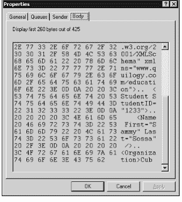

**图 14.1**  
XML 格式的 MSMQ 消息。此对话框通过 MSMQ 管理控制台导航到相应的队列和消息，并从上下文菜单中选择“属性”来访问。

> **注意：** 为了使`QStudents`对象能够使用二进制格式化程序进行序列化，`QStudents`、`Student`和`Name`类每个都必须设置`Serializable`属性，这在代码清单 14.10 中未显示。

虽然使用格式化程序提供的自动序列化是将对象放入消息的最简单方法，但你也可以直接填充`Message`对象本身的`Body`或`BodyStream`属性。当你将来自文件或其他源的数据放入队列时，这非常有用。为了说明其工作原理，请查看代码清单 14.11 中所示的`ProcessDocs`方法。

**代码清单 14.11 写入消息**

此方法打开文件并使用`BodyStream`属性将其内容直接写入`Message`对象的`Body`中。

```vb
Imports System.IO

Imports System.Messaging

Public Sub ProcessDocs(ByVal path As String, ByVal queue As String)

   ' Loop through all docs in a directory

   Dim oFile As FileInfo

   Dim strFile As String
```

### 清单 14.11 续

```vb
Dim oQueue As MessageQueue

Dim fs As FileStream

Try

    ' 确保队列存在

    If Not MessageQueue.Exists(queue) Then

        Throw New ArgumentException("Queue " & queue & " does not exist.")

        Return

    End If

    ' 引用队列
```


`oQueue = New MessageQueue(queue)`

' 获取每个文件

```
For Each strFile In Directory.GetFileSystemEntries(path, "*.xml")
```

' 打开文件

```
oFile = New FileInfo(strFile)
fs = oFile.OpenRead
```

' 将内容发送到队列

```
Dim oMessage As New Message()
With oMessage
    .BodyStream = fs
    .Label = oFile.FullName
    .UseDeadLetterQueue = True
    .TimeToBeReceived = New TimeSpan(1, 0, 0, 0)
    .Priority = MessagePriority.Normal
End With
oQueue.Send(oMessage)
fs.Close()
```

```
Next
Catch e As MessageQueueException
    ' 记录错误发生的事实
Catch e As Exception
    ' 记录错误发生的事实
End Try
End Sub
```

在清单 14.11 中，该方法接受一个文件路径和一个队列路径。在确认队列可用并将其引用为`oQueue`后，程序遍历目录以查找扩展名为`.xml`的文件。每当遇到一个文件，它就使用`FileInfo`对象的`OpenRead`方法将其打开以供读取。该方法返回一个`FileStream`，随后可以直接放入`Message`对象的`BodyStream`属性中。此外，该方法还设置了`Message`的一些属性，包括`Priority`和`Label`，后者可用作描述以及查询的属性。

> **注意**
> `Message`对象还支持`AppSpecific`和`Extension`属性，这些属性可用于随消息一起存储特定于应用程序的数据。这些属性的一个典型用途是存储描述消息`Body`但与之分离的属性。

`UseDeadLetterQueue`和`TimeToBeReceived`属性协同工作，以确保如果消息在`TimeSpan`对象指定的时间（本例中为 1 天）内未被另一个应用程序读取，该消息将被发送到死信队列（`MachineName\Deadletter$`）。

当调用`Send`方法时，将读取`Stream`（本例中为`FileStream`），并填充`Message`的`Body`属性。

### 接收消息

`MessageQueue`类还支持多种用于从队列接收消息的方法。这些方法分为两类："窥视"方法和"接收"方法。

窥视方法包括`Peek`、`PeekByCorrelationId`、`PeekById`、`BeginPeek`和`EndPeek`。在前三种情况下，该方法从队列返回一个`Message`对象，但不将其移除。通过这种方式，应用程序可以在确定是否需要处理消息之前先读取消息。而`Peek`返回队列中的第一条消息，`PeekByCorrelationId`和`PeekById`则搜索队列以分别查找`CorrelationId`和`Id`属性与给定条件匹配的第一条消息。

> **注意**
> `CorrelationId`属性由确认、响应和报告消息用于引用原始消息。换句话说，它允许你将发起的消息与响应创建的消息关联起来。

所有这三种方法都是同步的，因此它们会阻塞当前线程直到收到消息。为了避免无限期阻塞，它们也被重载以接受一个`TimeSpan`参数，该参数在线程释放并在时间到期时抛出`MessageQueueException`。`BeginPeek`和`EndPeek`允许异步访问队列中的第一条消息，从而不会阻塞当前线程。

### 集成

### 第三部分

"接收"方法的集合包括类似的`Receive`、`ReceiveByCorrelationId`、`ReceiveById`、`BeginReceive`和`EndReceive`。正如你可能想象的那样，此列表中的前三种方法的行为类似于窥视方法，但具有在读取消息后将其从队列中移除的效果。后两种方法用于异步读取消息。

虽然同步读取简单消息很直接，但当接收序列化对象作为消息时，你必须清楚你希望反序列化到的类型。例如，在早前的代码示例中，`QStudents`的一个实例使用`BinaryMessageFormatter`序列化到一个`Message`中。要读取此消息，你的代码需要适当地设置`Formatter`属性，然后将`Message`的`Body`转换为适当的类型，如下所示：

```
Dim oQueue As New MessageQueue(".\private$\Registrations")
Dim oNew As QStudents
oQueue.Formatter = New BinaryMessageFormatter()
oNew = CType(oQueue.Receive.Body, QStudents)
```

`oNew`变量现在包含反序列化后的`QStudents`对象。

> **提示**
> 为了提高性能，你可以设置从你正在读取的`MessageQueue`实例的`MessageReadPropertyFilter`属性中公开的`MessagePropertyFilter`对象的属性。每个属性代表一个消息属性，可以设置为`True`或`False`以指定是否返回该属性。默认情况下，仅返回大约 40 个属性中的九个。

尽管前面的代码示例使用了`BinaryMessageFormatter`来序列化对象，但使用`XmlMessageFormatter`更灵活。原因在于，使用`BinaryMessageFormatter`时，对象是使用类的类型定义（包括版本）进行序列化的。这意味着当对象被反序列化时，它必须转换为完全相同的类型。换句话说，`QStudents`类必须在全局程序集缓存（GAC）中公开可用，或者作为私有程序集包含并由接收应用程序引用。

通过使用`XmlMessageFormatter`，接收应用程序可以创建自己的代理类来处理反序列化后的对象。这个类可以手动创建，也可以从 XSD 生成。但是，使用这种方法时，必须在接收消息之前填充`TargetTypes`或`TargetTypeNames`属性。这是必需的，以便`XmlMessageFormatter`知道将消息体反序列化到哪个对象中。例如，如果`QStudents`对象被序列化为 XML（如图 14.1 所示），可以使用以下代码进行反序列化：

```
Dim oNew As QStudentsNew
oQueue.Formatter = New XmlMessageFormatter(New String() {"QStudentsNew"})
oNew = CType(oQueue.Receive.Body, QStudentsNew)
```

其中`QStudentsNew`是根据相同模式构建的新类。在这种情况下，`TargetTypeNames`属性（一个字符串数组）在构造函数中被填充。重载的构造函数也可以接受`Type`对象的数组。

将对象直接序列化到队列的一个微妙优势是对象可以封装所需的行为。例如，`QStudents`类可以公开一个`SaveToDatabase`方法，该方法知道如何使用`System.Data.SqlClient`命名空间将对象的内容持久化到 SQL Server。这使得接收应用程序与对象一起工作变得简单，它只需反序列化对象并调用`SaveToDatabase`方法即可。通过这种方式，接收应用程序无需理解`QStudents`对象的内部结构。

然而，在其他场景中，你可能希望自己解析消息——例如，如果它包含一个 XML 文档。为此，正如`Message`对象的`BodyStream`属性可以用`Stream`填充一样，它也可用于访问消息的`Body`。例如，清单 14.12 中显示的`RetrieveDocs`方法清空给定队列的消息，并将消息的`BodyStream`传递给`ExtractDocuments`方法。

### 清单 14.12 清空队列。此方法通过调用`Receive`方法清空给定队列，然后将`BodyStream`传递给处理它的方法。

```
Imports System.Messaging

Public Sub RetrieveDocs(ByVal queue As String)
    Dim oQueue As MessageQueue
    Dim oMessage As Message
    Dim flDone As Boolean = False
    Try
        ' 确保队列存在
        If Not MessageQueue.Exists(queue) Then
            Throw New ArgumentException("Queue " & queue & " does not exist.")
        End If
        Return
    End If
    ' 引用队列
    oQueue = New MessageQueue(queue)
End Sub
```

```
' 清空队列
While Not f1Done
    Try
        oMessage = oQueue.Receive(New TimeSpan(0, 0, 5))
        Call ExtractStudents(oMessage.BodyStream)
    Catch e As MessageQueueException
        f1Done = True
    End Try
End While
Catch e As MessageQueueException
    ' 记录发生错误的事实
Catch e As Exception
    ' 记录发生错误的事实
End Try
End Sub
```

`Receive`方法以 5 秒的超时值被调用，因此一旦在 5 秒间隔内未收到新消息，循环就会退出。`ExtractStudents`方法与清单 14.1 中所示的类似，只是它已被修改为接受`Stream`对象，而不是文件名，如下所示：

```
Public Sub ExtractStudents(ByVal msgStream As Stream)
```

这样，你就可以轻松利用服务框架中众多依赖于流的类。

最后，`MessageQueue`类遵循服务框架的异步操作模式，公开了`BeginPeek`、`BeginReceive`和`EndPeek`、`EndReceive`方法。`Begin`方法是重载的，正如预期的那样，不会阻塞当前线程并立即返回。这些方法会生成一个后台线程，等待直到找到消息。找到后，应用程序将通过`PeekCompleted`和`ReceiveCompleted`事件，或传递给方法的显式`AsyncCallback`对象来接收通知。

例如，要添加`ReceiveCompleted`事件的事件处理程序并启动异步过程，可以使用以下代码：

```
oQueue = New MessageQueue(queue)
AddHandler oQueue.ReceiveCompleted, AddressOf MessageFound
oQueue.BeginReceive(New TimeSpan(0, 0, 5))
```

请注意，`BeginReceive`方法也可以传递一个`TimeSpan`对象，如果在找到消息之前时间到期，则会触发`ReceiveCompleted`事件。虽然这里没有展示，但可以将一个`Object`传递给`Begin`方法，该对象包含在`AsyncResult`对象的`AsyncState`属性中返回的状态信息。

在事件处理程序中，返回消息的`MessageQueue`在第一个参数中填充，而参数则被封装在`ReceiveCompletedEventArgs`对象中。然后可以通过调用`EndReceive`方法来访问实际的`Message`对象，如以下模板代码所示：

```
Public Sub MessageFound(ByVal s As Object, 
    ByVal args As ReceiveCompletedEventArgs)
    Dim oQueue As MessageQueue
    Dim oMessage As Message
    Dim oState As Object
    ' 如果需要，检索状态
    oState = args.AsyncResult.AsyncState()
    ' 检索消息来源的队列
    oQueue = CType(s, MessageQueue)
    Try
        oMessage = oQueue.EndReceive(args.AsyncResult)
        ' 在此处处理消息
    Catch e As MessageQueueException
        ' 超时到期
    End Try
End Sub
```

当使用异步窥视方法时，有一个类似的`PeekCompletedEventArgs`对象，用于`PeekCompleted`事件处理程序中。

> **提示**
> 如果你想继续在后台接收文档，可以在事件处理程序的末尾调用`BeginReceive`。

### 集成 Active Directory

本章的最后一个主题是使用`System.DirectoryServices`命名空间以编程方式访问目录。这一点很重要，因为分布式应用程序的开发人员通常必须查询和同步来自一个或多个目录的信息，包括 Active Directory、Windows NT 和 Novell NetWare。

简而言之，此命名空间中的类允许你通过将目录特定功能抽象到服务提供程序中（类似于 OLE DB 提供程序或 ODBC 驱动程序），与这些目录进行无缝交互。

> **注意**
> 这对某些读者来说应该很熟悉，因为`DirectoryServices`命名空间只是提供了一个围绕 Active Directory Services Interface (ADSI) 组件的包装器，你可能在 VB 6.0 中使用过这些组件。

尽管底层的 ADSI 技术并不新鲜，但`DirectoryServices`命名空间通过将目录中的所有对象公开为`DirectoryEntry`对象，而不是像在 COM 对象模型中那样为每种对象类型公开特定类，从而简化了编程模型。通过将路径传递给`DirectoryEntry`对象的构造函数，适当的服务提供程序会被通知并返回对象。要调用服务提供程序，你需要在路径前添加要访问的提供程序类型前缀，如表 14.4 所示。因此，你可以在 .NET 中使用与 VB 6.0 中相同的服务提供程序访问相同的目录。

表 14.4 服务提供程序及其路径字符串

| 服务提供程序 | 路径格式 |
|---|---|
| Windows NT 或 Windows 2000 | `WinNT://path` |
| Internet Information Server | `IIS://path` |
| 轻型目录访问协议 | `LDAP://path` |
| Novell NetWare Directory Service | `NDS://path` |

返回对象后，你可以使用`Properties`集合查询和更改其属性，此外还可以使用`Invoke`方法动态调用其方法。然而，对于大多数开发人员来说，主要任务只是查询目录并返回一些信息。例如，Web 开发人员经常面临的一项任务是确定使用 Windows 集成或 NTLM 身份验证的 Windows 用户的完整名称。这可以使用类似以下的方法相当容易地完成：

```
Imports System.DirectoryServices

Public Function GetFullName(ByVal webPage As Page) As String
    ' 提取域和用户名
    Try
        Dim strUserName As String = webPage.User.Identity.Name
        strUserName = strUserName.Replace("\\", "/")
        Dim oEntry As New DirectoryEntry("WinNT://" & strUserName)
        Return oEntry.Properties("Fullname")(0)
    Catch e As Exception
        Return Nothing
    End Try
End Function
```


`GetFullName` 方法接受一个 `Page` 对象（来自 `System.Web.UI` 命名空间）作为参数，该对象在 `User` 属性中公开 IIS 中当前已验证身份的用户。`Name` 属性返回登录用户的域和用户帐户，该值被修改后用作 `DirectoryEntry` 对象构造函数的输入。如果找到用户帐户（如果没有找到，例如，域控制器离线时），则从 `Properties` 集合中访问 `Fullname` 属性并返回。

### 查询目录

除了简单地访问目录中的单个条目外，你还可以使用 `DirectorySearcher` 类对目录执行搜索并返回多个条目。虽然篇幅不允许更完整的讨论，但该类公开了 `FindOne` 和 `FindAll` 方法，分别返回 `SearchResult` 和 `SearchResultCollection` 对象。搜索条件使用 `Filter` 属性指定。

> **注意**
>
> 目前，只有 LDAP 服务提供程序支持搜索。

为了说明在 Windows 2000 网络上查询 Active Directory，清单 14.13 提供了 `ADUser` 类。`ADUser` 应被视为一个实用程序类，可以与基于 Web 或窗体的应用程序结合使用，以查询 Active Directory 中有关用户的信息。然后可以使用此信息来修改用户界面或限制用户可以查看的内容。

> **注意**
>
> 有关 Active Directory 的良好概述，请参阅 Gil Kirkpatrick 所著的 *Active Directory Programming*，ISBN：0672315874。

清单 14.13 查询 Active Directory。此清单显示用于查询 Active Directory 并返回用户信息的 `ADUser` 类。

```vb
Imports System.DirectoryServices

Imports System.Collections.Specialized

Public Class ADUser

    Public ReadOnly UserName As String

    Public ReadOnly Name As String

    Public ReadOnly Department As String

    Public ReadOnly email As String

    public ReadOnly groups As StringCollection

    Public Sub New(ByVal logonName As String)

        ' 解析 NT 帐户路径（DOMAIN\USER）

        Dim strUserName As String = _

            logonName.Substring(logonName.IndexOf("\") + 1)

        ' 填充类中的字段

        Call PopulateUser(strUserName, UserName, Name, _

            Department, Email, groups)

    End Sub

    Private Sub PopulateUser(ByVal user As String, _

        ByRef userName As String, ByRef name As String, _

        ByRef dept As String, ByRef email As String, _

        ByRef groups As StringCollection)

        '查找用户的路径

        Dim oSearcher As New DirectorySearcher()

        Dim oResult As SearchResult

        Dim dirEntry As DirectoryEntry

        Dim obj As Object

        Dim strGroupPathName As String

        Dim strFilter As String

        Try

            ' 设置 LDAP 搜索筛选器

            strFilter = String.Format("(&(objectCategory=person)" & _

                "(objectClass=user)(sAMAccountName={0}))", user)

            oSearcher.Filter = strFilter

            '搜索用户条目

            oResult = oSearcher.FindOne()

            If oResult Is Nothing Then

                Return

        Catch
```

## 清单 14.13 续

```vb
End If

' 找到了，获取目录条目

dirEntry = oResult.GetDirectoryEntry

' 获取属性

With dirEntry

    userName = .Properties("sAMAccountName")(0).ToString

    name = .Properties("name")(0).ToString

    dept = .Properties("department")(0).ToString

    email = .Properties("mail")(0).ToString

End With

For Each obj In dirEntry.Properties("memberOf")

    strGroupPathName = obj.ToString()

    groups.Add(strGroupPathName)

Next

Catch e As Exception

    Throw New Exception("无法填充 ADUser: " & e.Message)

End Try

End Sub

End Class
```

在清单 14.13 中，构造函数接收通过 `WindowsIdentity` 对象的 `Name` 属性返回的用户的 Windows 登录账户。然后，该字符串被解析以仅返回用户名部分，该用户名部分再传递给私有的 `PopulateUser` 方法，所有实际工作都在该方法中完成。

> **提示**
>
> 由于 `PopulateUser` 将要填充的字段是只读的，因此只能在构造函数中修改它们，并且必须作为 `ByRef` 参数传递给该方法。

在 `PopulateUser` 方法中，实例化了一个新的 `DirectorySearcher` 对象，并使用 LDAP 查询字符串设置了其 `Filter` 属性。虽然 Active Directory 的结构超出了本书的范围，但你可以看到要返回的对象的类被设置为 `"user"`，并传入了安全账户管理器（SAM）账户名。要执行查询，调用了 `FindOne` 方法，该方法返回一个 `SearchResult` 对象。如果找到多个条目，只返回第一个。如果未找到任何条目，则结果对象被设置为 `Nothing`。

如果查询返回一个对象，则可以使用 `SearchResult` 对象的 `GetDirectoryEntry` 方法返回其 `DirectoryEntry`。使用此技术，可以再次使用 `SearchResult` 对象的 `Path` 属性查询目录。为了绕过这次往返，可以提前使用你希望与 `SearchResult` 一起返回的属性名称填充 `SearchResult` 对象的 `PropertiesToLoad` 属性。默认情况下，仅返回 `Name` 和 `Path` 属性。

`DirectoryEntry` 的属性以 `PropertyCollection` 形式返回，除了标准集合成员外，该集合还公开了 `PropertyNames` 和 `Values` 属性，这两个属性本身返回对象属性的集合。此外，属性可以是多值的，每个属性实际上是一个 `PropertyValueCollection` 对象。这就是为什么访问简单属性（如 `department`、`name` 和 `mail`）时，必须在属性上使用索引 0 的原因。

在 `memberOf` 属性中填充用户所属的组集合是访问多值属性的一个例子。在这种情况下，可以使用 `For Each` 循环遍历属性本身，并将组的路径添加到 `StringCollection` 中。

从客户端的角度来看，他只需要实例化 `ADUser` 类，并传入 Windows 登录名，然后相应地更改 UI，如下所示：

```vb
Dim objUser As New ADUser(Page.User.Identity.Name)

If objUser.Department = "Sales" Then

    ' 显示销售图表

End If
```


### 第三部分：集成

### 总结

随着应用程序变得越来越互联，能够从各种来源访问数据变得越来越重要。本章重点介绍了其中的三种来源：使用服务框架（Services Framework）中的类处理 XML 数据（`System.Xml`）、消息队列（`System.Messaging`）和目录服务（`System.DirectoryServices`）。

至此，关于企业集成的第三部分就完成了，同时本书也画上了句号。我在本书中的目标是为企业开发人员提供一个关于 `VB .NET` 及其如何用于构建分布式应用程序的心智地图。为此，我希望当你使用 `VB .NET` 构建自己的解决方案时，不仅觉得它有趣，而且觉得它有用。

## 索引

### A

- `Abort` 方法，581
- 抽象基类，146-148
- `AcceptChanges` 方法，281，293
- 访问数据。*另见* `ADO.NET`
  - `COM` 组件
    - 调用组件，386-388
    - 容器，390-391
    - 导入组件，388-390
    - `RCW`（运行时可调用包装器），385-386
    - 同步访问，581-585
    - 系统服务，550
- 确认消息，690
- 操作（Windows 服务），619-622
- `Activate` 方法，364
- 激活组件，398-399
  - 客户端激活
    - `CreateInstance` 方法，328
    - 示例，328-329
    - `RegisterActivatedServiceType` 方法，327
  - `COM+`，363-366
  - `JITA`（即时激活），652
  - 租约
    - 避免，331
    - `ILease` 接口，329
    - 引用，329
    - 续订，329-330
    - 赞助对象，330-331
  - 服务器激活
    - 客户端配置文件，326-327
    - `GetObject` 方法，325
    - `New` 运算符，327
    - `SoapSnds.exe` 实用工具，326
- `Active Directory`
  - 访问其中的条目，700-701
  - 查询，701-704
  - `System.DirectoryServices` 命名空间，699-701
- `ADO.NET`，226
  - 数据访问类，286
    - 示例，287-290
    - 方法，287
    - 修改数据，290-292
    - 输出参数，295-298
    - 系统分配的键，293-295
  - `DataTable`
    - 构成类，246-247
    - 事件，255-256
  - 定义，226-228
  - 托管提供程序
    - 类，229-230
    - 命令生成器，238-240
    - 数据适配器，236-238
    - `DataAdapter` 对象，237
    - 事件处理，241
    - 执行存储过程，232-233
    - `OleDb` 托管提供程序，229
    - 返回流，235-236
    - `SqlClient` 托管提供程序，229-240
  - `System.Data` 命名空间，228-229
  - XML 集成，282-286
- `Active Directory` 编程，701
- `Active Server Pages (ASP)`，11。*另见* `ASP.NET`
  - 与 `ASP.NET` 比较，408-417
  - 示例，409-412
- `ActiveXMessageFormatter` 类，692
- `ActivityID` 属性（`ContextUtil` 类），349
- `Add` 方法，185，220
- `Add Reference` 命令（项目菜单），68
- 外接程序，72-73
- `AddHandler` 方法，84，133-134
- `AddSchema` 方法，676
- `AddStudentRow` 方法，280
- 管理
  - 管理员策略，42
  - `COM+`，347-348
  - 消息队列
    - `Create` 方法，687
    - 创建队列，687
    - `Exists` 方法，687
    - `GetAllMessages` 方法，690
    - `GetPrivateQueuesByMachine` 方法，689
    - 安装，691
    - 权限，689
    - `Purge` 方法，689
    - 查询，690-691
    - `SetupQueues` 方法，687-688
- 管理员策略，42
- `ADUser` 类，701
- `AfterInstall` 方法，185
- `AfterUninstall` 方法，185
- `Al.exe` 工具，170
- 算法
  - 非对称，602
  - `DES`，603-607
  - `DSA`（数字签名算法），602
  - 哈希，602
  - 对称加密，602
- `AllocateNamedDataSlot` 方法，586
- 分配内存，34
- `AndAlso` 运算符，84
- 应用程序域，43-44，577
- `AppDomain` 类，44，577
- `AppendText` 方法，553
- `ApplicationAccessControl` 属性，378
- `ApplicationActivation` 属性，375
- `ApplicationID` 属性（`ContextUtil` 类），349
- `ApplicationInstanceID` 属性（`ContextUtil` 类），349
- `ApplicationQueueing` 属性，375
- 应用程序
  - 编译
    - `JIT`（即时）编译，24-27
    - 原生映像生成器，176-177
  - 执行，173-175
  - 多线程，577-587
    - 线程池，587-594
    - 数据槽，585-587
    - 基于窗体的，577
    - 本地存储，585-587
    - 同步对资源的访问，581-585
    - `ThreadStatic` 属性，585
  - 零影响应用程序，166
  - 状态，454-455
  - Web 服务，510-512
    - 调用，530-534
    - 类，525-529
    - 使用，539-545
    - 创建，523-524
    - 定义，510
    - 设计，534-536
    - 错误处理，535-536
    - 扩展，539
    - `HTTP`（超文本传输协议），514
    - 盈利性，513
    - 服务框架，522
    - `SOAP`（简单对象访问协议），514-517，528-529，535-539，543
    - 支持的数据类型，532
    - `System.Web.Services` 命名空间，523
    - `UDDI`（统一描述、发现和集成），521-522
    - Web 服务发现，520-521
    - 使用时机，512-514
    - `WSDL`（Web 服务描述语言），517-520
    - XML（可扩展标记语言），514
  - Windows 服务
    - 类，611，622-625
    - 控制，622-625
    - 创建，610-615
    - 调试，616
    - 定义，610
    - 事件日志，627-634
    - 初始化参数，621
    - 安装，616-622
    - 加载，612-613
    - 网络，640-651
    - 性能计数器，634-639
    - 调度，625-626
    - `SCM`（服务控制管理器），610
    - 计时器，625-626
- `AppSpecific` 属性（`Message` 对象），695
- `.NET` 架构，10-13
- `ASP.NET`
  - 容错，404
  - `Global.asa` 文件，405-406
  - HTTP 上下文，407
  - HTTP 处理程序，406
  - HTTP 模块，406
  - 运行时，403-405
- `CLR`（公共语言运行时架构），16-17
  - 应用程序域，43-44
  - 程序集，37-43，166
  - 组件元数据，36
  - 垃圾回收，34-35
  - 目标，17-19
  - `JIT`（即时）编译，24-27
  - 托管代码，20
  - `MSIL`（Microsoft 中间语言），22-24
  - 服务，18-19
  - 非托管代码，20
- `CLS`（公共语言规范），21-22
- `CTS`（公共类型系统），27-34
- 历史与发展，11-12
- 命名空间，44-47，123-126
- Visual Basic 的角色，14-16
- 服务框架，14-15
- `ArgumentException` 异常，306
- 参数，传递，305-306
- `Array` 类，92
  - 方法，93-94
  - 示例代码清单，94-95
- `Array` 方法，81
- `ArrayList` 类，97

### 数组，90-95

- 替代方案，95-98
- `Array` 类，92
  - 方法，93-94
  - 示例代码清单，94-95
- 声明，90
- 参数数组，127
- 填充，91
- 交错数组，91-92
- 调整大小，90
- 检索，574-576
- 保存，574-576

`HtmlGenericControl` 类，467

`HtmlInputControl` 类，466
- 继承层次结构，466-467
- 编程 RPM 模型，407-408

用户控件，66
- 添加到页面，507
- 定义，505
- 片段缓存，507
- 处理，507
- 引用，507
- 搜索控件示例，505-507

`As Any` 语句，81

`ASP（Active Server Pages）`，11。*另见* `ASP.NET`
- 与 `ASP.NET` 比较，408-417
- 示例，409-412

项目项
- 程序集配置文件，67
- 程序集信息文件，67
- 程序集资源文件，67
- `COM` 类，67
- Crystal Reports，67
- 框架集，66
- 全局应用程序类，66
- HTML 页面，66
- 安装程序类，67
- 样式表，66
- Web 自定义控件，66
- Web 窗体，66
- Web 服务，66
- Web 用户控件，66
- Windows 服务，67

`Quiology` 示例应用程序，418-419

安全性，433
- 窗体验证，441-448
- 模拟，434-435
- Passport 验证，437-441
- Windows 验证，435-437
- 简单示例，412-415

状态管理
- 应用程序状态，454-455
- 会话状态，450-454
- `StateBag` 类，449-450
- 跟踪，462-463

Web 服务器控件
- `ClassData`，500-503
- 复合控件，504-505
- 创建，499-503
- 数据绑定，481-490
- 继承层次结构，469-470
- 移动控件，490-499
- 验证控件，470-481

`ASP.NET`，402-403。*另见* **Web 窗体；Web 服务**
- 架构
  - 容错，404
  - `Global.asa` 文件，405-406
  - HTTP 上下文，407
  - HTTP 处理程序，406
  - HTTP 模块，406
  - 运行时，403-405
- 缓存
  - `Cache` 类，457-458
  - 检查缓存，460-462
  - 示例，459
  - 页面输出缓存，455-457
- 与 `ASP（Active Server Pages）` 比较，408-417
- 配置文件
  - 区分大小写，433
  - 扩展，431-433
  - 处理，430-431

`ASP.NET Web 应用程序模板`，52

`ASP.NET Web 服务模板`，52

`ASP（Active Server Pages）`，11

程序集，37，166-167
- 程序集生成工具，170
- 属性
  - `AssemblyDelaySign`，172
  - `AssemblyKeyFile`，171
  - `AssemblyKeyName`，172
  - `AssemblyVersion`，172
- 兼容性数据运行时，107
- 兼容性运行时，107
- 兼容性版本号，38
- 配置文件，39-41，67
- 定义，166
- 开发注意事项，43
- HTML 服务器控件，465
  - 扩展，467-468
  - `HtmlContainerControl` 类，466
  - `HtmlControl` 类，466
- `GAC`（全局程序集缓存），42
  - 显示内容，169
  - 安装程序集，168
- 信息文件，67
  - 加载，41–42
  - 定位，41–42
- 清单，37–38
- 多文件程序集，175–176
- 私有程序集，38，167–171
- 资源文件，67
  - 安全性，43
- 共享程序集，167–168
  - 并行执行，173–175
- 强名称
  - 优点，169–170
  - 示例，171
  - 为程序集签名，170–173
- 版本控制，38–39

### 程序集生成工具，170

## `<assemblyBinding>` 标签（XML），40

### `AssemblyDelaySign` 属性（程序集），172

## `<assemblyIdentity>` 标签（XML），40

`AssemblyInfo.vb` 文件，171

### `AssemblyInstaller` 类，186

### `AssemblyKeyFile` 属性（程序集），171

### `AssemblyKeyName` 属性（程序集），172

### `AssemblyVersion` 属性（程序集），172

### `Assert` 方法，191–193，216
- 断言权限，191

非对称算法，602

`AsyncCallback` 委托，143

异步文件 I/O（输入/输出），564–568

异步处理，141–144

异步远程调用，332–333

启动时选项（VS .NET），51

`Atn` 方法，81

### `AttributeCount` 属性（`XmlTextReader` 类），657

属性，38，73
- `ApplicationAccessControl`，378
- `ApplicationActivation`，375
- `ApplicationQueuing`，375
- `AssemblyDelaySign`，172
- `AssemblyKeyFile`，171
- `AssemblyKeyName`，172
- `AssemblyVersion`，172
- `ClassInterface`，379
- `ClassInterfaceType`，379
- `ComponentAccessControl`，378
- 构造函数，73
- 创建，73–76
- `Description`，383
- `EventTrackingEnabled`，383
- `ExceptionClass`，376
- `InterfaceQualified`，375–376
- `MustRunInClientContext`，383
- `NonSerialized`，309
- `SecureMethod`，379
- `SecurityRole`，378
- `Serializable`，307
- `Synchronization`，383
- 语法，73
- `ThreadStatic`，585

`Authenticate` 方法，547

验证，644–645
- 窗体验证
  - 启用，441–442
  - `FormsAuthentication` 类，447
  - `FormsAuthenticationModule`，441
  - `FormsAuthenticationTicket` 对象，448
  - `FormsIdentity` 对象，448
  - `SetAuthCookie` 方法，446
  - `studentlogin.aspx` 示例，443–444
  - `studentlogin.aspx.vb` 示例，444–445
  - 用户凭据，448
  - Web 站点配置，442–443
- Passport 验证，10
  - Cookie，438
  - `Microsoft Passport SDK`，438
  - Passport Web 站点，437
  - `PassportAuthenticationModule`，438
  - `PassportIdentity` 对象，438–440
- PREP（准备）
  - Passport，438
  - `PUID`（Passport 唯一标识符），440–441
- Windows 验证
  - `WindowsAuthenticationModule`，435
  - `WindowsIdentity` 对象，435–437
  - `WindowsPrincipal` 对象，436–437

### `AuthURL2` 方法，439

### `Auto` 关键字，333

### 自动生成的存储过程，61

自动事务（`COM+`）
- 定义，358
- 启用，359
- 示例，360-363
- 投票决定结果，360

自动窗口（调试器），211

### B

基类
- 抽象基类，146-148
- 具体基类，122

`BaseURI` 属性（`XmlTextReader` 类），657

`BaseValidator` 类，470

批处理更新，292

`BeginEdit` 方法，281

`BeginInvoke` 方法，141，332

`BeginPeek` 方法，695，698

`BeginReceive` 方法，696-698

二进制数据，读取和写入，558-562

`BinaryFormatter` 类，310

`BinaryMessageFormatter` 类，692

`BinaryReader` 类，552，559-561

`BinarySearch` 方法，93

`BinaryWriter` 类，552，559-561

`<bindingRedirect>` 标签（XML），40-41

`BindToMoniker` 方法，377

`BitArray` 类，97

块作用域，105-106

书籍
- `Active Directory` 编程，701
- `Pure Visual Basic`，18，234
- 理解 `ActiveX` 和 `OLE`，376
- 理解 `COM+`，377

`Boolean` 类型，29，90

装箱类型，30

装箱，30

断点窗口（调试器），211

`BufferResponse` 类，533

`Byte` 类型，29

### C

`Cab` 项目模板，179

cabinet 文件，179

缓存。参见缓存

`Cache` 类，457-458

`CacheDuration` 类，533

`CacheItemRemoveReason` 枚举，458

缓存，455
- `Cache` 类，457-458
- `CacheDuration` 类，533
- 检查缓存，460-462
- 示例，459
- 片段缓存，507
- `GAC`（全局程序集缓存），42
  - 显示内容，169
  - 安装程序集，168
- 页面输出缓存
  - `HttpCacheability` 枚举，456
  - `HttpCachePolicy` 对象，455
  - `InitOutputCache` 方法，456
  - `OutputCache` 指令，455
  - `VaryByCustom` 属性，457
  - `VaryByHeader` 属性，456
  - `VaryByParam` 属性，456

`CalcCourseCost` 委托，137，139

调用堆栈窗口（调试器），211

回调（Win32），343

`CallByName` 方法，139

`Callers` 属性（`SecurityCallContext` 类），381

调用
- `COM`（组件对象模型）组件，386-388
- 方法，106
- 非托管 DLL（动态链接库），333-335
- Web 服务
  - `HTTP-GET` 方法，530-534
  - `POST` 方法，532-534
- `Win32`，337-343

`CanBePooled` 方法，353

`CancelWait` 方法，601

`CanDeserialize` 方法，684

类，111
- `CCW`（COM 可调用包装器），391-394

`CDate` 方法，100

`Changed` 事件（`FileSystemWatcher` 类），569

`ChangePass` 方法，287

Chappell，39，123-124

`Char` 类型，29

`CheckIfExists` 方法，287，295-296，674

`CheckIfInstallable` 方法，186

检查缓存，460-462

`Choose` 方法，230

`CInt` 方法，100

类库
- 类库模板，52
- 命名空间，44，123-124，126
  - 默认命名空间，45
  - 全局命名空间，125
  - `Microsoft.VisualBasic`，46
  - `Microsoft.Win32`，46
  - 名称冲突，45
  - 嵌套，124
  - `System.Data`，46
  - `System.Diagnostics`，46
  - `System.DirectoryServices`，47
  - `System.EnterpriseServices`，46
  - `System.IO`，46
  - `System.Messaging`，47
  - `System.Net`，47
  - `System.Runtime.InteropServices`，46
  - `System.Runtime.Remoting`，46
  - `System.Security`，46
  - `System.Security.Cryptography`，46
  - `System.Threading`，46
  - `System.Timers`，46
  - `System.Web.UI`，46
  - `System.XML`，47

类库模板，52

类视图（VS .NET），56

`ClassData` 控件，500-503

类，31-32，65
- `ActiveXMessageFormatter`，692
- `ADUser`，701
- `AppDomain`，44
- `Array`，92
  - 方法，93-94
  - 示例代码清单，94-95
- `ArrayList`，97
- 基类
  - 抽象基类，146-148
  - 具体基类，122
- `BaseValidator`，470
- `BinaryFormatter`，310
- `BinaryMessageFormatter`，692
- `BinaryReader`，552，559-561
- `BinaryWriter`，552，559-561
- `BitArray`，97
- `BufferResponse`，533
- `Cache`，457-458
- `CacheDuration`，533
- `CodeAccessPermission`，192-193
- `CodeAccessSecurityAttribute`，190
- `Collection`，130
- 集合类，130
- `COM` 类，67
- `Command`，229
  - 与组件比较，301
- 组件类，65，302
- `Connection`，229
- `ConstraintCollection`，247，253-254
- `ContactInfoDataTable`，277
- `ContactInfoRow`，277
- `ContactInfoRowChangeEvent`，277
- `ContextUtil`，349-350
- `Control`，305
- `Cryptography`，603-607
- `CryptoStream`，603

数据访问类
- （`ADO.NET`），286
- 示例，287-290
- 方法，287
- 修改数据，290-292
- 输出参数，295-298
- 系统分配键，293-295

`DataAdapter`，230

`DataBoundLiteralControl`，465

`DataColumn`，246

`DataColumnCollection`，246

`DataReader`，230

`DataRelationCollection`，247

`DataRelationsCollection`，245

`DataRowCollection`，247

`DataSet`，244
- 约束，253-254
- 自动创建，259-261
- 从架构创建，271-273
- 从 XML 文档创建，261-264
- 编程创建，264-267，269-271

`DataRelationsCollection` 类，245

`DataTableCollection` 类，245

`DataViewManager` 类，245
- 设计，258-259
- 事件，255-256
- 映射数据，249-251
