# iPhone App 构建指南：使用 HTML、CSS 和 JavaScript


谨以此书献给 Erica——以及她肚子里那颗跳跃的小豆子。

## 目录


# 前言

像数百万人一样，我立刻爱上了我的iPhone。最初，Web应用是为设备开发定制应用的唯一途径，这对我来说没什么问题，因为我就是一名Web开发者。几个月后，当App Store发布时，我兴奋不已。我立刻冲出去买下了市面上所有关于Objective-C的书籍。我的一些Web应用已经小有名气，我盘算着把它们重写成原生应用，放入App Store，然后骑着一匹由大把钞票堆成的骏马驰向远方。

然而，幻想很快破灭了。我发现Objective-C很难学，并且对这门语言在Mac编程之外几乎无用的事实感到失望。Xcode和Interface Builder相当出色，但它们不是我熟悉的开发环境，我发现很难适应它们。为了设置应用和iPhone进行测试，我不得不经历各种繁琐的步骤，这让我非常愤怒。将应用提交到App Store的过程更是错综复杂。经过一两周与这些难题的挣扎后，我不禁自问为什么要费这么大劲。毕竟，我的Web应用已经可以在全球范围内使用了——我为什么非要在意App Store呢？

更重要的是，苹果公司能够——并且确实会——拒绝应用。这当然是他们的特权，也许他们有充分的理由。然而，从外部来看，这显得反复无常且武断。设想一下你处于这样的境地（基于真实故事）：你花了大约100小时学习Objective-C，又花了大约100小时编写原生iPhone应用。最终，你的应用准备就绪，你成功通过了App Store提交流程的重重考验。接下来会发生什么？

你等啊等，等了又等。我们谈论的是几周，有时甚至是几个月。终于你收到了回复！然后……你的应用被拒绝了。现在怎么办？你的努力付诸东流。幻想破灭。

但等等，情况可能更糟。假设你的应用确实被批准了。成百上千甚至上万的人下载了你的应用。你还没赚到一分钱，但已经欣喜若狂。接着，错误报告开始不断涌入。你花了几分钟定位并修复了bug，重新将应用提交到iTunes，然后等待苹果批准这个修订版本。等待，继续等待。愤怒的客户在App Store上给你差评。你的销量一落千丈。而你还在等待。你考虑向愤怒的客户退款，但App Store没有提供这样的途径。所以你基本上只能眼睁睁地看着评分暴跌，尽管这个bug几天甚至几周前就已经修复了。

当然，这个故事基于一位开发者的经历。也许这只是个别情况，实际数据并不能支撑我的论点。但问题依然存在：我们开发者无法获取苹果的数据，也无法了解App Store审批流程的真实细节。在这一点改变之前，使用Objective-C构建原生应用是一项风险很高的投资。

幸运的是，还有其他选择。你可以使用开源的、基于标准的Web技术构建一个Web应用，将其作为Web应用发布，并在真实用户的压力下进行调试和测试。一旦准备就绪，你可以使用PhoneGap将你的Web应用转换为原生iPhone应用，并将其提交到App Store。如果最终被拒绝，你也不会束手无策，因为你仍然可以提供Web应用。如果被批准了，那就太棒了！然后你可以开始利用设备独有的硬件特性，为你的Web应用添加增强功能。这听起来像是两全其美，对吧？

## 谁应该读这本书

我将假设你具备一些阅读和编写HTML、CSS和JavaScript（特别是jQuery）的基础经验。我会在第5章和第6章包含一些基础的SQL代码，因此对SQL语法有基本了解会有所帮助，但这并非必需。

## 使用本书的准备

本书将尽可能避免使用iPhone SDK。要跟随绝大多数示例，你只需要一个文本编辑器和最新版本的Safari（或者更好的是WebKit，这是Safari的一个更前沿的版本，可在Mac和Windows上通过 [http://webkit.org](http://webkit.org) 获取）。对于第7章的PhoneGap内容，你确实需要一台Mac，我将在此解释如何将你的Web应用转换为可提交到App Store的原生应用。

## 本书使用的约定

本书使用以下排版约定：

*斜体*
用于表示新术语、URL、电子邮件地址、文件名和文件扩展名。

**等宽字体**
用于程序清单，以及在段落中引用程序元素，如变量或函数名、数据库、数据类型、环境变量、语句和关键字。

**等宽粗体**
显示命令或其他应由用户逐字输入的文本，以及在代码清单中用于强调。

*等宽斜体*
显示应替换为用户提供的值或由上下文确定的值的文本。

此图标表示提示、建议或一般说明。

此图标表示警告或注意事项。

## 使用代码示例

本书旨在帮助你完成工作。通常，你可以在自己的程序和文档中使用本书中的代码。除非你复制了代码的大部分，否则无需联系我们获取许可。例如，编写一个使用本书中几个代码块的程序不需要许可。销售或分发来自O'Reilly书籍的示例CD-ROM则需要许可。通过引用本书和引用示例代码来回答问题不需要许可。将大量示例代码整合到产品的文档中则需要许可。

我们感谢但不强制要求注明引用。引用通常包括书名、作者、出版社和ISBN。例如：“Building iPhone Apps with HTML, CSS, and JavaScript by Jonathan Stark. Copyright 2010 Jonathan Stark, 978-0-590-80578-4。”

如果你认为你对代码示例的使用超出了合理使用的范围或上述许可范围，请随时通过 permissions@oreilly.com 与我们联系。

## Safari Books Online

Safari Books Online是一个按需数字图书馆，让你可以轻松搜索超过7,500本技术和创意参考书籍及视频，快速找到所需答案。

通过订阅，你可以在线阅读我们图书馆中的任何页面，观看任何视频。在你的手机和移动设备上阅读书籍。在印刷版上市前访问新书，并获得正在开发中的手稿的独家访问权限，并为作者提供反馈。复制粘贴代码示例、整理你的收藏、下载章节、标记关键部分、创建笔记、打印页面，并受益于众多其他节省时间的功能。

O'Reilly Media已将本书上传到Safari Books Online服务。要完全数字访问本书以及O'Reilly和其他出版商关于类似主题的其他书籍，请在 http://my.safaribooksonline.com 免费注册。

## 如何联系我们

请将有关本书的评论和问题发送给出版社：

O'Reilly Media, Inc.
1005 Gravenstein Highway North
Sebastopol, CA 95472
800-998-9938（美国或加拿大）
707-829-0515（国际或本地）
707-829-0104（传真）

我们为本书设有一个网页，列出了勘误表、示例和任何其他信息。你可以在以下地址访问此页面：

http://www.oreilly.com/catalog/9780596805784/

要评论或提出有关本书的技术问题，请发送电子邮件至：

bookquestions@oreilly.com

有关我们的书籍、会议、资源中心和O'Reilly Network的更多信息，请访问我们的网站：

http://www.oreilly.com

## 致谢

写书是团队合作的结果。我衷心感谢以下人员的慷慨贡献。

Tim O'Reilly、Brian Jepson以及ORM团队的其他成员，感谢你们让撰写这本书的经历如此有价值和富有教育意义。

Jack Templin、Providence Geeks和RI Nexus，感谢你们向我介绍了我自己家乡蓬勃发展的科技场景。如果没有Providence Geeks，这本书就不会存在。

David Kandeda，感谢他对美的执着追求。无论是一段代码还是一个用户界面动画，他不做到完美就无法入睡，我欣赏这一点。

Brian LeRoux、Brock Whitten、Rob Ellis以及Nitobi团队的其他成员，感谢你们创建并持续支持PhoneGap。


[content]

感谢Brian Fling，他拓宽了我对移动领域的视野，让我认识到移动不仅仅是追求最新最酷的硬件。Brian从早期就深耕移动领域；他是一位出色的作家，除此之外，还是一位非常慷慨的人。

感谢PPK、John Gruber、John Allsopp和John Resig，他们对本书得以实现所依赖的底层技术做出了贡献并给予了支持。

感谢Garrett Murray、Brian LeRoux以及众多在OFPS网站上为本书慷慨发表评论和提出问题的人们。你们的反馈非常有帮助，深表感谢。

感谢Kazu、Chuckie、Janice、Chris以及春树公司的其他伙伴，感谢他们在我无休止地在门口的高桌旁敲打键盘时给予的诸多方便。

感谢我可爱的家人、朋友和客户，在我被束缚在键盘前时给予的理解和支持。

最后，感谢Erica。你让一切成为可能。我爱你！

## 第一章

入门

在我们深入探讨并开始为iPhone构建应用程序之前，我想先快速确立讨论的范围。在本章中，我将定义关键术语，比较两种最常见开发方法的优缺点，并简要介绍本书所使用的三种核心Web技术。

### Web应用与原生应用

首先，我将定义我所说的"Web应用"和"原生应用"的含义，并分析各自的优缺点。

## 什么是Web应用？

在我看来，Web应用本质上是专门为iPhone优化的网站。这个网站可以是任何内容，从标准的小型企业宣传网站到抵押贷款计算器，再到每日卡路里追踪器——内容本身并不重要。Web应用的定义性特征在于，其用户界面是使用Web标准技术构建的，可通过一个URL（公开的、私有的或需要登录的）访问，并且针对iPhone的具体特性进行了优化。Web应用不会安装在手机上，不会在iTunes App Store中提供，也不是用Objective-C编写的。

## 什么是原生应用？

相比之下，原生应用安装在iPhone上，可以访问硬件（扬声器、加速度计、摄像头等），并且是用Objective-C编写的。然而，原生应用的定义性特征在于它可以在iTunes App Store中获取——这个特性吸引了全球无数软件企业家的想象力，包括我自己。

## 优缺点

不同的应用有不同的需求。有些应用比其他应用更适合Web技术。了解每种方法的优缺点将帮助你做出正确的决定，选择适合你情况的路径。

以下是原生应用开发的优点：

- 数百万注册信用卡用户只需一次点击即可触达。
- Xcode、Interface Builder和Cocoa Touch框架构成了一个相当出色的开发环境。
- 你可以访问设备所有酷炫的硬件功能。

以下是原生应用开发的缺点：

- 你必须付费成为Apple开发者。
- 你受制于Apple的审批流程。
- 你必须使用Objective-C进行开发。
- 你必须在Mac上进行开发。
- 你无法及时发布错误修复。
- 开发周期缓慢，测试周期受限于App Store的限制。

以下是Web应用开发的优点：

- Web开发人员可以使用他们现有的创作工具。
- 你可以使用现有的Web设计和开发技能。
- 你不受限于在Mac OS上开发。
- 你的应用将在任何拥有Web浏览器的设备上运行。
- 你可以实时修复错误。
- 开发周期快。

以下是Web应用开发的缺点：

- 你无法访问手机所有酷炫的硬件功能。
- 如果你想对应用收费，必须自己建立支付系统。
- 实现复杂的UI效果可能很困难。

## 哪种方法适合你？

这就是激动人心的地方。iPhone始终在线的特性创造了一种环境，使得Web应用和原生应用之间的界限变得模糊。iPhone甚至有一些鲜为人知的功能，允许你将Web应用离线使用（参见[第6章](#)）。更重要的是，一些第三方项目——其中PhoneGap最为著名——正在积极开发解决方案，允许Web开发人员将Web应用打包成iPhone和其他移动平台的原生应用。

对我来说，这是完美的融合。我可以使用我的母语编写代码，将产品作为纯Web应用（适用于iPhone和任何其他拥有现代浏览器的设备）发布，无需经过Apple的审批流程，并使用相同的代码库创建一个增强的原生版本，该版本可以访问设备硬件，并可能在App Store中销售。如果Apple拒绝了？没关系，因为我还有我的在线版本。在客户使用Web应用的同时，我可以继续开发原生版本。

## Web编程速成课程

我们将用于构建Web应用的三种主要技术是HTML、CSS和JavaScript。在深入探讨高级内容之前，我想快速介绍每一个，以确保我们在开始时理解一致。

### HTML入门

当你浏览网络时，你看到的页面只是存储在别人计算机上的文本文档。典型网页中的文本被包裹在HTML标签中，这些标签告诉浏览器文档的结构。有了这些信息，浏览器就能以合理的方式决定如何显示信息。

考虑示例1-1中显示的网页片段。在第一行，字符串"Hi there!"被包裹在一对h1标签中。（注意开始标签和结束标签略有不同：结束标签的第二个字符是斜杠，而开始标签没有。）

将一些文本包裹在h1标签中告诉浏览器，这些被包围的词是一个标题，这将导致它以大号粗体文本单独显示在一行上。还有h2、h3、h4、h5和h6标题标签。数字越小，标题越重要，因此包裹在h6标签中的文本将比包裹在h3标签中的文本更小（即看起来不那么重要）。

在示例1-1中的h1标签之后是两行包裹在p标签中的文本。这些被称为段落标签。浏览器会将每个段落显示在单独的行上。如果段落足够长以至于超过了浏览器窗口的宽度，文本将向下换行并继续在下一行显示。无论哪种情况，段落之后都会插入一个空行，以将其与页面上的下一个项目分开。

示例1-1. HTML片段

```
<h1>Hi there!</h1>
<p>Thanks for visiting my web page.</p>
<p>I hope you like it.</p>
```

你也可以将HTML标签放在其他HTML标签内部。示例1-2显示了一个无序列表（ul）标签，其中包含三个列表项（li）。在浏览器中，这将显示为一个带项目符号的列表，每个项目单独一行。当你有标签或多个标签在另一个标签内部时，内部标签被称为父标签的子元素或子节点。因此在这个例子中，li是ul父节点的子节点。

示例1-2. 无序列表

```
<ul>
    <li>Pizza</li>
    <li>Beer</li>
    <li>Dogs</li>
</ul>
```

到目前为止我所介绍的标签都是*块级标签*。块级标签的定义性特征是它独自占据一行，其左右没有其他元素。这就是为什么标题、段落和列表项是向下排列而不是横向排列。与块级标签相对的是*内联标签*，顾名思义，它可以出现在一行之中。强调标签（em）是内联标签的一个例子，它看起来像这样：

```
<p>I <em>really</em> hope you like it.</p>
```

内联标签的鼻祖——也可以说是HTML最酷的特性——是a标签。a代表锚点，但我也将这个标签称为链接或超链接。包裹在锚点标签中的文本变得可点击，点击它会导致浏览器加载一个新的HTML页面。

为了告诉浏览器加载哪个新页面，我们必须向标签添加所谓的*属性*。属性是插入到开始标签中的命名值。在锚点标签中，你使用href属性来指定目标页面的位置。这是一个指向Google主页的链接：

```
<a href="http://www.google.com/">Google</a>
```

如果你不习惯阅读HTML，这可能看起来有点混乱，但你应该能辨认出Google主页的URL。在整本书中，你将看到很多a标签和href，所以如果一开始不理解，请花一点时间来理解它。

关于属性，有几点需要记住。不同的HTML标签允许不同的属性。你可以通过用空格分隔它们来向开始标签添加多个属性。你永远不要向结束标签添加属性。有数百种可能的属性和标签组合，但不用担心。在本书中，我们只需要担心大约十来种。

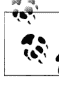


我们一直在看的这段 HTML 代码片段，通常会放在一个完整 HTML 文档的 `body` 部分。一个 HTML 文档由两个部分组成：头部（head）和主体（body）。主体部分放置你希望用户看到的所有内容。头部则包含关于页面的信息，其中大部分对用户是不可见的。

主体和头部总是被包裹在一个 `html` 元素中。[示例 1-3](#) 展示了这段代码片段在合适 HTML 文档中的上下文。目前，`head` 部分包含一个 `title` 元素，它告诉浏览器在窗口标题栏中显示什么文本。

*示例 1-3. 一个合适的 HTML 文档*

```
<html>
    <head>
        <title>My Awesome Page</title>
    </head>
    <body>
        <h1>Hi there!</h1>
        <p>Thanks for visiting my web page.</p>
        <p>I hope you like it.</p>
        <ul>
            <li>Pizza</li>
            <li>Beer</li>
            <li>Dogs</li>
        </ul>
    </body>
</html>
```

通常，当你使用网络浏览器时，你查看的是托管在互联网上的页面。然而，浏览器也非常擅长显示你本地机器上的 HTML 文档。为了理解我的意思，请打开一个文本编辑器，输入[示例 1-3](#) 的内容。完成后，将其保存到你的桌面，命名为 *test.html*，然后通过将文件拖到 Safari 应用图标上，或者打开 Safari 并选择 文件→打开文件 来打开它。双击 *test.html* 也可能有效，但根据你的设置，它可能会在你的文本编辑器或另一个浏览器中打开。

>  即使你没有运行 Mac OS X，在桌面网络浏览器上测试你的 iPhone Web 应用时，你也应该使用 Safari，因为 Safari 是与 iPhone 的 Mobile Safari 最接近的桌面浏览器。Windows 版的 Safari 可以从 [http://www.apple.com/safari/](http://www.apple.com/safari/) 下载。

有些文本编辑器不擅长编写 HTML。特别是，你要避免使用支持富文本编辑的编辑器，比如 Microsoft Word 或 TextEdit。这类编辑器可以将文件保存为非纯文本格式，这会破坏你的 HTML。如果你正在寻找一个好的文本编辑器，我目前为止最喜欢 Mac 上的 TextMate (http://macromates.com/)，我听说 Windows 上有一个克隆版本叫做 E Text Editor (http://www.e-texteditor.com/)。如果你喜欢免费的，你可以下载 Mac 版的 Text Wrangler (http://www.barebones.com/products/TextWrangler/) 或使用 Windows 内置的记事本。

### CSS 简介

正如你所看到的，浏览器会用特定的样式渲染某些 HTML 元素（标题是大号且加粗的，段落后面跟一个空行，等等）。这些样式非常基础，主要目的是帮助读者理解文档的结构和含义。

为了超越这种简单的基于结构的渲染，你可以使用层叠样式表（CSS）。CSS 是一种样式表语言，用于定义 HTML 文档的视觉呈现。你可以使用 CSS 来定义简单的东西，比如文本颜色、大小和样式（粗体、斜体等），或者复杂的东西，比如页面布局、渐变、不透明度等等。

示例 1-4 展示了一个 CSS 规则，它指示浏览器将 body 元素中的任何文本显示为红色。在这个例子中，body 是选择器（受规则影响的部分），花括号括起来的是声明（规则本身）。声明包括一组属性及其值。在这个例子中，color 是属性，red 是该属性的值。

*示例 1-4. 一个简单的 CSS 规则*

```
body { color: red; }
```

属性名在 CSS 规范中是预定义的，这意味着你不能随意编造它们。每个属性都需要一个合适的值，对于一个给定的属性，可能有很多合适的值和值格式。

例如，你可以用预定义的关键字（如 red）指定颜色，也可以使用 HTML 颜色代码表示法。这使用十六进制表示法：三对十六进制数字（0-F）分别代表（从左到右）红、绿、蓝的值。需要测量值的属性可以接受像 10px、75% 和 1em 这样的值。示例 1-5 展示了一些常见的声明。（这里展示的 background-color 的颜色代码对应 CSS 的“灰色”。）

*示例 1-5. 一些常见的 CSS 声明*

```
body {
    color: red;
    background-color: #808080;
    font-size: 12px;
    font-style: italic;
    font-weight: bold;
    font-family: Arial;
}
```

选择器有多种类型。如果你想让你所有的超链接（a 元素）都显示为斜体，你需要将以下内容添加到你的样式表中：

```
a { font-style: italic; }
```

如果你想更具体一些，只让包含在 h1 标签内的超链接显示为斜体，你需要将以下内容添加到你的样式表中：

```
h1 a { font-style: italic; }
```

你也可以通过在 HTML 标签中添加 id 和/或 class 属性来定义你自己的自定义选择器。考虑以下 HTML 代码片段：

```
<h1 class="loud">Hi there!</h1>
<p id="highlight">Thanks for visiting my web page.</p>
<p>I hope you like it.</p>
<ul>
    <li class="loud">Pizza</li>
    <li>Beer</li>
    <li>Dogs</li>
</ul>
```

如果我将 `.loud { font-style: italic; }` 添加到此 HTML 的 CSS 中，Hi there! 和 Pizza 将显示为斜体，因为它们都有 loud 类。选择器 .loud 前面的点很重要。这是 CSS 知道要查找具有 loud 类的 HTML 标签的方式。如果你省略了这个点，CSS 将会查找一个 loud 标签，而这个代码片段中（或者说在 HTML 中根本）不存在这样的标签。

通过 id 应用 CSS 是类似的。要为 highlight 段落标签添加黄色背景填充，你会使用这个规则：

```
#highlight { background-color: yellow; }
```

这里，# 符号告诉 CSS 查找具有 id 为 highlight 的 HTML 标签。

总结一下，你可以选择通过标签名（例如 body、h1、p）、类名（例如 .loud、.subtle、.error）或 id（例如 #highlight、#login、#promo）来选择元素。你还可以通过链接选择器（例如 h1 a、body ul .loud）来更具体地指定。

现在你理解了 CSS 的基础知识。但是如何将样式表应用到 HTML 页面呢？这实际上非常简单。你只需在 HTML 文档的 head 部分链接到样式表，如[示例 1-6](#) 所示。这个例子中的 href 属性是一个相对路径，它指向与 HTML 页面在同一目录下名为 *screen.css* 的文本文件。你也可以指定绝对链接，例如：

```
http://example.com/screen.css
```

*示例 1-6. 链接到 CSS 样式表*

```
<html>
    <head>
        <title>My Awesome Page</title>
        <link rel="stylesheet" href="screen.css" type="text/css" />
    </head>
    <body>
        <h1 class="loud">Hi there!</h1>
        <p id="highlight">Thanks for visiting my web page.</p>
        <p>I hope you like it.</p>
        <ul>
            <li class="loud">Pizza</li>
            <li>Beer</li>
            <li>Dogs</li>
        </ul>
    </body>
</html>
```

[示例 1-7](#) 展示了 *screen.css* 的内容。你应该将这个文件保存在与 HTML 文件相同的位置。

*示例 1-7. 一个简单的样式表*

```
body {
    font-size: 12px;
    font-weight: bold;
    font-family: Arial;
}

a { font-style: italic; }
h1 a { font-style: italic; }

.loud { font-style: italic; }
#highlight { background-color: yellow; }
```

值得指出的是，链接到托管在与 HTML 文档不同域上的样式表是可能的。然而，未经允许链接到别人的样式表被认为是相当无礼的，所以请只链接到你自己的。

为了快速而全面地学习 CSS 速成课程，我强烈推荐 Eric Meyer (O'Reilly) 的[*CSS Pocket Reference*](#)。在 CSS 领域，Eric 拥有最终发言权，而且这本书特别简短，可以在典型的早晨拼车途中阅读。


如果你是那个驾车的人，那么这个过程可能要花更长的时间（我是不是说了“速成”课程？）。

### JavaScript 简介

此时，你应该已经知道如何用 HTML 构建文档结构，以及如何用 CSS 修改其视觉呈现了。现在，我们将添加一些 JavaScript 来让页面动起来。

JavaScript 是一种脚本语言，可以添加到 HTML 页面中，使其更具交互性并方便用户使用。例如，你可以编写一些 JavaScript 来检查表单中输入的值以确保其有效。或者，你可以让 JavaScript 根据用户的点击位置来显示或隐藏页面元素。JavaScript 甚至可以与 Web 服务器通信以执行数据库更改，而无需刷新当前网页。

像任何现代脚本语言一样，JavaScript 拥有变量、数组、对象以及所有典型的控制结构（if、while、for 等）。示例 1-8 展示了一段 JavaScript 代码片段，它阐释了这门语言的几个核心概念。

#### 示例 1-8. 基本 JavaScript 语法

```
var foods = ['Apples', 'Bananas', 'Oranges']; ❶
for (var i in foods) { ❷
  if (foods[i] == 'Apples') { ❸
    alert(foods[i] + ' are my favorite!'); ❹
  } else {
    alert(foods[i] + ' are okay.'); ❺
  }
}
```

以下是此处发生情况的解释：

- ❶ 定义一个名为 `foods` 的数组，其中包含三个元素。
- ❷ 打开一个 `for` 循环，该循环定义了一个名为 `i` 的变量，在循环过程中，该变量将包含数组每个元素的索引。
- ❸ 一个普通的 `if` 语句检查数组的当前元素是否等于 `Apples`。
- ❹ 如果数组的当前元素等于 `Apples`，则显示此消息。
- ❺ 如果数组的当前元素*不*等于 `Apples`，则显示此消息。

以下是关于 JavaScript 语法的一些要点：

- 语句以分号结尾。
- 代码块用花括号括起来。
- 变量使用 `var` 关键字声明。
- 数组元素可以通过方括号表示法访问。
- 数组的索引从 0 开始分配。
- 单等号是赋值运算符。
- 双等号是相等逻辑运算符。
- 加号是字符串连接运算符。

就我们的目的而言，JavaScript 最重要的特性是它能够与 HTML 页面的元素进行交互（潮人们称之为“操作 DOM”）。示例 1-9 展示了一段简单的 JavaScript，当用户点击 h1 时，它会更改页面上的某些文本。

> DOM 代表文档对象模型，在此上下文中，它代表浏览器对 HTML 页面的理解。你可以在此处阅读更多关于文档对象模型的信息：http://en.wikipedia.org/wiki/Document_Object_Model。

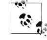

#### 示例 1-9. 简单的 OnClick 处理程序

```
<html>
  <head>
    <title>My Awesome Page</title>
    <script type="text/javascript" charset="utf-8">
      function sayHello() {
        document.getElementById('foo').innerHTML = 'Hi there!';
      }
    </script>
  </head>
  <body>
    <h1 id="foo" onclick="sayHello()">Click me!</h1>
  </body>
</html>
```

以下是解释：

1.  我已在 HTML 文档的 head 部分添加了一个 script 块。
2.  在 script 块内，我定义了一个名为 sayHello() 的 JavaScript 函数。
3.  sayHello() 函数包含一条语句，它告诉浏览器“在文档中查找 id 为 'foo' 的元素，并将其 innerHTML 内容设置为 'Hi there!'”。这在浏览器中的效果是，当用户点击 h1 元素时，文本 "Click me!" 将被替换为 "Hi there!"。
4.  sayHello() 函数结束。
5.  script 块结束。
6.  h1 元素的 onclick 属性告诉浏览器，当用户点击 h1 时要执行某些操作，即调用 sayHello() 函数。


示例 2-1 展示了图 2-1 所示网页的 HTML 简化版本。这就是本章中你将要处理的 HTML。如果你想在阅读本章的同时尝试为其设置样式，可以从本书网站下载它（参见第 xiv 页的“联系我们”部分）。桌面端样式表（screen.css）并未展示，因为它不是必需的，但如果你想动手操作，可以使用上一章的样式表。

## 示例 2-1. 我们将要设置样式的 HTML 文档

```html
<html>
<head>
  <link rel="stylesheet" href="screen.css" type="text/css" />
  <title>Jonathan Stark</title>
</head>
<body>
<div id="container">
  <div id="header">
    <h1><a href="./">Jonathan Stark</a></h1>
    <div id="utility">
        <ul>
            <li><a href="about.html">About</a></li>
            <li><a href="blog.html">Blog</a></li>
        </ul>
    </div>
    <div id="nav">
        <ul>
            <li><a href="consulting-clinic.html">Consulting Clinic</a></li>
            <li><a href="on-call.html">On Call</a></li>
            <li><a href="development.html">Development</a></li>
        </ul>
    </div>
  </div>
  <div id="content">
    <h2>About</h2>
    <p>Jonathan Stark is a web developer, speaker, and author. His consulting firm, Jonathan Stark Consulting, Inc., has attracted clients such as Staples, Turner Broadcasting, and the PGA Tour.
        ...
        </p>
  </div>
  <div id="sidebar">
    
    <p>Jonathan Stark is a mobile and web application developer who the Wall Street Journal has called an expert on publishing desktop data to the web.</p>
  </div>
  <div id="footer">
    <ul>
        <li><a href="services.html">Services</a></li>
        <li><a href="about.html">About</a></li>
        <li><a href="blog.html">Blog</a></li>
    </ul>
    <p class="subtle">Jonathan Stark Consulting, Inc.</p>
  </div>
</div>
</body>
</html>
```

多年来，网页开发者一直使用表格来将元素布局为网格。CSS 和 HTML 的进步使得这种方法不仅过时，而且不受欢迎。如今，我们主要使用 *div* 元素（以及各种属性）来实现相同的功能，但控制力更强。尽管对基于 div 的布局的完整解释远超本书的范围，但你在阅读各章节时会看到大量此类示例。要了解更多，请查阅 Jeffrey Zeldman 的《*Designing with Web Standards*》（New Riders Press 出版），该书对此问题有更详细的介绍。

## 准备单独的 iPhone 样式表

我和其他人一样坚持 DRY 原则，但在现实世界中，你最好在桌面浏览器样式表和 iPhone 样式表之间做出明确区分。听我的，创建两个完全独立的文件——你会睡得更香。另一种方法是将所有 CSS 规则塞进一个样式表，这最终被证明是个坏主意，原因有很多；最明显的是，你会向手机发送大量无关的桌面样式规则，这会浪费宝贵的带宽和内存。

DRY 代表“Don't Repeat Yourself”（不要重复自己），是软件开发中的一项原则，指出“系统中的每条知识都必须有一个单一、明确、权威的表示”。该术语由 Andrew Hunt 和 David Thomas 在他们的《*The Pragmatic Programmer*》（Addison-Wesley 出版）一书中提出。

要为 iPhone 指定样式表，请将示例 HTML 文档中的样式表链接标签替换为使用以下表达式的标签：

```html
<link rel="stylesheet" type="text/css"
    href="iphone.css" media="only screen and (max-width: 480px)" />
<link rel="stylesheet" type="text/css"
    href="desktop.css" media="screen and (min-width: 481px)" />
```

这里，*desktop.css* 指的是你现有的任何桌面样式表，而 *iphone.css* 是我们稍后将详细讨论的新文件。

> 如果你按照前面的示例 HTML 文档操作，你现在需要将 *screen.css* 重命名为 *desktop.css*；然而，由于我们专注于 iPhone 样式表，你可以完全忽略桌面样式表。如果它加载失败，你的浏览器也不会太在意。

遗憾的是，Internet Explorer 无法理解前面的表达式，因此我们必须添加一个条件注释（以粗体显示），该注释链接到 CSS 的特定 IE 版本：

```html
<link rel="stylesheet" type="text/css"
href="iphone.css" media="only screen and (max-width: 480px)" />
<link rel="stylesheet" type="text/css"
href="desktop.css" media="screen and (min-width: 481px)" />
<!--[if IE]>
<link rel="stylesheet" type="text/css" href="explorer.css" media="all" />
<![endif]-->
```

因此，现在是时候编辑 HTML 文档了：删除现有的指向 *screen.css* 文件的链接，并用刚刚显示的行替换它。这样，你将为本章中我将向你展示的 iPhone 特定 CSS 准备好一个干净的起点。

## 控制页面缩放

除非你另行指定，iPhone 上的 Safari 将假定你的页面宽度为 980px（[图 2-3](#)）。在大多数情况下，这效果很好。然而，你将专门为 iPhone 的较小尺寸格式化我们的内容，因此你必须通过在 HTML 文档的 *head* 元素中添加一个 viewport meta 标签来让 Mobile Safari 知道这一点：

```html
<meta name="viewport" content="user-scalable=no, width=device-width" />
```

如果你不设置 viewport 宽度，页面首次加载时将会被大幅缩小。

> viewport meta 标签会被 Mobile Safari 以外的浏览器忽略，因此你可以放心地包含它，而不必担心网站的桌面版本。

仅仅通过禁用桌面样式表并配置你的 viewport，你就已经为 iPhone 用户提供了增强的体验（[图 2-4](#)）。要真正打动他们，让我们开始构建 *iphone.css* 样式表。

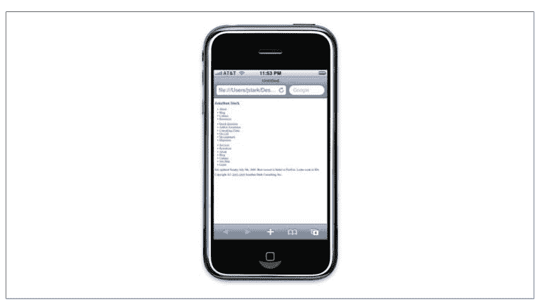

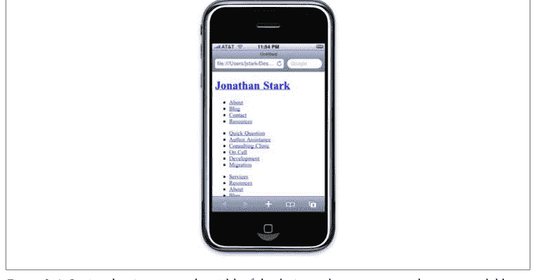

## 添加 iPhone CSS

有许多用户界面（UI）惯例能让 iPhone 应用程序看起来像 iPhone 应用程序。在下一节中，我将添加独特的标题栏、带有圆角的列表、看起来像光泽按钮且适合手指点击的链接等等。使用你的文本编辑器，创建一个名为 iphone.css 的文件，添加示例 2-2 中的代码，并将文件保存在与 HTML 文档相同的目录中。

### 示例 2-2. 在 HTML body 元素上设置一些通用的站点范围样式

```css
body {
    background-color: #ddd; /* 背景颜色 */
    color: #222;             /* 用于文本的前景颜色 */
    font-family: Helvetica;
    font-size: 14px;
    margin: 0;              /* body 外部周围的负空间量 */
    padding: 0;             /* body 内部周围的负空间量 */
}
```

请注意，我已将文档的整体字体设置为 Helvetica，这是 iPhone 上大多数应用程序使用的字体。如果你试图实现专业的外观，除非有特定原因不这样做，否则你可能应该坚持使用 Helvetica。

现在我将处理包含主要主页链接（即 logo 链接）以及主要和次要网站导航的 header div。第一步是将 logo 链接格式化为可点击的标题栏。将以下内容添加到 iphone.css 文件中：

```css
#header h1 {
    margin: 0;
    padding: 0;
}
#header h1 a {
    background-color: #ccc;
    border-bottom: 1px solid #666;
    color: #222;
    display: block;
    font-size: 20px;
    font-weight: bold;
    padding: 10px 0;
    text-align: center;
    text-decoration: none;
}
```


## 添加 iPhone 外观与风格

我将对主要和次要导航 `ul` 块进行完全相同的格式化，这样我就可以使用通用标签选择器（例如 `#header ul`），而不是使用标签 ID（例如 `#header ul#utility`、`#header ul#nav`）：

```
#header ul {
    list-style: none;
    margin: 10px;
    padding: 0;
}
#header ul li a {
    background-color: #FFFFFF;
    border: 1px solid #999999;
    color: #222222;
    display: block;
    font-size: 17px;
    font-weight: bold;
    margin-bottom: -1px;
    padding: 12px 10px;
    text-decoration: none;
}
```

到目前为止很简单，对吧？通过这点 CSS，我们已经对 iPhone 页面设计做出了巨大改进（图 2-5）。接下来，为内容 (`content`) 和侧边栏 (`sidebar`) 的 `div` 添加一些内边距，使文本相对于屏幕边缘缩进一点（图 2-6）：

```
#content, #sidebar {
    padding: 10px;
}
```

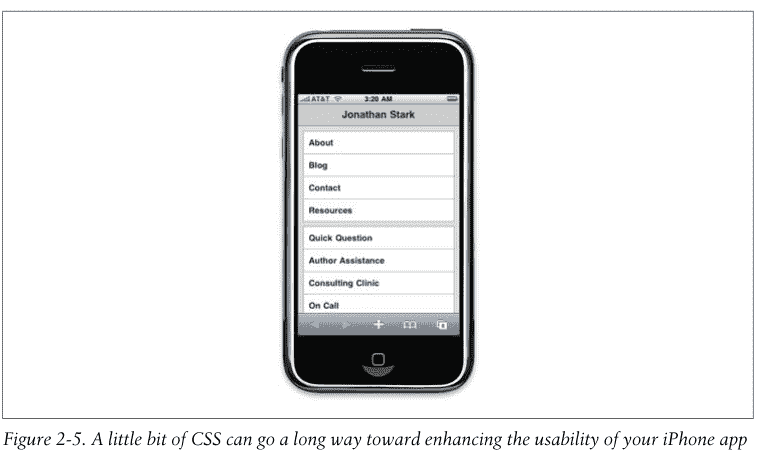

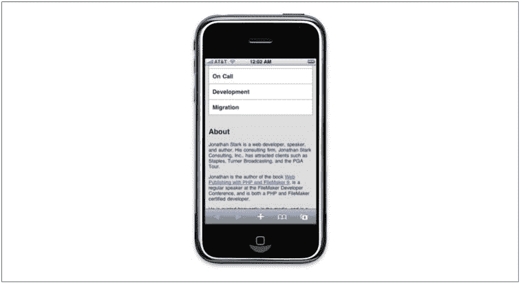

*图 2-6. 使文本相对于边缘缩进*

你可能想知道为什么我给内容 (`content`) 和侧边栏 (`sidebar`) 元素添加内边距，而不是全局设置在 `body` 元素本身上。原因是你通常会有一些希望显示为贴边显示的元素（比如本例中的页眉）。因此，将内边距应用于 `body` 或其他全局包裹元素可能会弊大于利。

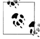

此页面页脚中的内容基本上是页面顶部导航元素（id 为 `nav` 的 `ul` 元素）的重复，因此你可以通过将 `display` 设置为 `none` 来从 iPhone 版页面中移除页脚：

```
#footer {
    display: none;
}
```

## 添加 iPhone 外观与风格

现在，是时候来点更花哨的了。从页面顶部开始，为 logo 链接文本添加 1 像素的白色投影，并为背景添加 CSS 渐变：

```
#header h1 a {
    text-shadow: 0px 1px 0px #fff;
    background-image: -webkit-gradient(linear, left top, left bottom,
                                    from(#ccc), to(#999));
}
```

在 `text-shadow` 声明中，从左到右的参数分别是水平偏移、垂直偏移、模糊半径和颜色。大多数时候，你会将这里显示的确切值应用于你的文本，因为这通常是 iPhone 上看起来不错的效果，但尝试 `text-shadow` 很有趣，因为它可以为你的设计增添微妙而精致的触感。

`-webkit-gradient` 这行需要特别注意。它是浏览器即时生成渐变图像的指令。因此，CSS 渐变可以在任何你通常指定 `url()` 的地方使用（例如背景图像、列表样式图像）。从左到右的参数如下：渐变类型（可以是 `linear` 或 `radial`）、渐变的起始点（可以是 `left top`、`left bottom`、`right top` 或 `right bottom`）、渐变的结束点、起始颜色和结束颜色。

> 请注意，你不能调换四个渐变起始和结束点常量的水平和垂直部分（即 `left top`、`left bottom`、`right top` 和 `right bottom`）。换句话说，`top left`、`bottom left`、`top right` 和 `bottom right` 是无效值。

下一步是为导航菜单添加传统的圆角：

```
#header ul li:first-child a {
    -webkit-border-top-left-radius: 8px;
    -webkit-border-top-right-radius: 8px;
}
#header ul li:last-child a {
    -webkit-border-bottom-left-radius: 8px;
    -webkit-border-bottom-right-radius: 8px;
}
```

正如你所看到的，我正在使用 `-webkit-border-radius` 属性的特定角落版本，对第一个列表项的顶部两个角和最后一个列表项的底部两个角应用 8 像素的圆角（[图 2-7](figure_2-7)）。


*图 2-7. 渐变、文本投影和圆角开始将你的网页转变为外观原生的 iPhone 应用*

如果你可以直接将 `border-radius` 应用于包含它们的 `ul` 会很酷，但这样不行。如果你尝试这样做，你会看到子列表项的方形角会溢出 `ul` 的圆角，从而抵消掉效果。

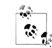

从技术上讲，如果我将 `ul` 的背景色设置为白色，并将其子元素的背景设置为透明，我可以将圆角应用于 `ul` 来实现圆角列表效果。但是，当你点击列表中的第一个或最后一个项目时，点击高亮会显示为方形，看起来很糟糕。最好的方法是像我在这里演示的那样，直接将圆角应用于标签本身。

## 使用 jQuery 添加基本行为

为 iPhone 构建 Web 应用程序，我最喜欢的一点是我可以合理地确信 JavaScript 是启用的。遗憾的是，为桌面浏览器构建网站时情况并非如此。我的下一步是为页面添加一些 JavaScript，以支持一些基本的动态行为。具体来说，我希望允许用户显示和隐藏页眉中那个显眼的导航部分，以便他们只在需要时才看到它。为了实现这一点，我将编写一些新的 CSS，并使用一些 JavaScript 将这个新 CSS 应用到现有的 HTML 上。

首先，让我们看看新的 CSS。第一步是隐藏页眉中的 `ul` 元素，这样当用户首次加载页面时它们不会显示。如果你在家里跟着做，请打开你的 *iphone.css* 文件并添加以下内容：

```
#header ul.hide {
    display: none;
}
```

接下来，我将定义用于显示和隐藏菜单的按钮的样式。请注意，按钮在 HTML 中还不存在；供你参考，按钮的 HTML 将如下所示：

```
<div class="leftButton" onclick="toggleMenu()">Menu</div>
```

我稍后会详细描述按钮的 HTML（第 25 页“使用 jQuery 添加基本行为”），所以现在请不要麻烦地将上面这行代码添加到你的 HTML 文件中。需要注意的是，它是一个类为 `leftButton` 的 `div`，并且将位于页眉中。

以下是按钮的 CSS 样式（你可以继续将其添加到 *iphone.css* 文件中）：

```
#header div.leftButton {
    position: absolute; ❶
    top: 7px;
    left: 6px;
    height: 30px; ❷
    font-weight: bold; ❸
    text-align: center;
    color: white;
    text-shadow: rgba(0,0,0,0.6) 0px -1px 0px;❹
    line-height: 28px;❺
    border-width: 0 8px 0 8px;❻
    -webkit-border-image: url(images/button.png) 0 8 0 8;❼
}
```

关于本章使用的图形，你可以从 [http://jqtouch.com/](http://jqtouch.com/) 下载 jQTouch，并将图形从 *themes/jqt/img* 目录复制出来。将这些副本放入包含 HTML 文档目录下的 *images* 子目录中（你可能需要创建 *images* 目录）。我们将在 [第 4 章](Chapter 4.) 中详细讨论 jQTouch。

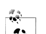

❶ 首先，我将 `position` 设置为 `absolute`，将 `div` 从文档流中移除，这允许我设置其 `top` 和 `left` 的像素坐标。

❷ 这里，我将高度设置为 30px，使其足够大，便于点击。

❸ 接下来，我将文本样式设置为粗体、白色并带有轻微的投影，并在方框中居中。

❹ 在 CSS 中，*rgb* 函数是通常用于指定颜色的十六进制表示法（例如 #FFFFFF）的替代方法。rgb(255, 255, 255) 和 rgb(100%, 100%, 100%) 与 #FFFFFF 都是相同的。最近，引入了 *rgba()* 函数，它允许你指定第四个参数来定义颜色的 alpha 值（即不透明度）。允许的值范围是 0 到 1，其中 0 表示完全透明，1 表示完全不透明；0 到 1 之间的小数值将呈现半透明效果。

❺ *line-height* 声明将文本在框中垂直向下移动，使其不会紧贴顶部边框。

❻ *border-width* 和 *-webkit-border-image* 这两行需要稍作解释。这两个属性结合使用，可以将单个图像的部分分配给元素的边框区域。这意味着不再需要使用无意义的嵌套 div 或将图像切分为 *topLeftCorner.png*、*topRightCorner.png* 等。如果方框因文本增减而调整大小，边框图像会相应拉伸。这真的很棒；图像越少，意味着工作量越少，带宽消耗越少，加载时间越短。

通过 *border-width* 行，我告诉浏览器对顶部应用 0 边框，右侧应用 8px 边框，底部应用 0 宽度边框，左侧应用 8px 宽度边框（即四个参数从盒子的顶部开始，顺时针排列）。请注意，我不需要为边框指定颜色或样式。

❼ 边框宽度设置好后，我就可以应用边框图像了。从左到右的五个参数分别是图像的 url、顶部宽度、右侧宽度、底部宽度和左侧宽度（同样，从顶部顺时针排列）。url 可以是绝对路径 (*http://

example.com/myBorderImage.png) 或相对路径。相对路径基于样式表的位置，而不是包含该样式表的 HTML 页面。

> 当我第一次遇到边框图片属性时，我觉得很奇怪，明明已经通过 border-width 属性设置了边框宽度，为什么还要再指定一次。经过一番痛苦的反复试错，我终于发现 border-image 属性中的宽度并不是边框宽度，而是从图片中裁切的宽度。以右边框为例，这实际上是在告诉浏览器截取图片左侧 8 像素的区域，并将其应用到右边框上，而右边框恰好也是 8px 宽。

做出一些不合常理的操作是可能的，比如将图片右侧 4 像素应用到一个 20px 宽的边框上。要让这种效果正常工作，你需要使用 webkit-border-image 的可选参数来告诉浏览器如何处理裁切后的图片在可用边框空间中的显示方式（重复、拉伸、圆角等）。经过三年的尝试，我始终没有找到任何合理的理由去做这件事，所以我不想在这里浪费篇幅去描述这个令人困惑且不实用的选项——尽管它本身是一个非常强大的功能。

好了，接下来讲讲 JavaScript。在开始编写 JavaScript 之前，你需要更新 HTML 文档，引入 jquery.js 和 iphone.js。将以下代码添加到 HTML 文档的 head 部分：

```html
<script type="text/javascript" src="jquery.js"></script>
<script type="text/javascript" src="iphone.js"></script>
```

> jQuery 的下载、文档和教程可在 http://jquery.com 获取。要使用 jQuery，你需要从网站上下载它，将下载的文件重命名（例如 jquery-1.3.2.min.js 改为 jquery.js），并将副本放在与 HTML 文档相同的目录中。

我们需要编写的 JavaScript 的主要职责是允许用户显示和隐藏导航菜单。将以下 JavaScript 代码复制到名为 iphone.js 的文件中，并将其保存在与 HTML 文件相同的文件夹中：

```javascript
if (window.innerWidth && window.innerWidth <= 480) {
    $(document).ready(function(){
        $('#header ul').addClass('hide');
        $('#header').append('<div class="leftButton" onClick="toggleMenu()">Menu</div>');
    });
    function toggleMenu() {
        $('#header ul').toggleClass('hide');
        $('#header .leftButton').toggleClass('pressed');
    }
}
```

1. 整个页面代码被包裹在一个 if 语句中，该语句检查 window 对象的 innerWidth 属性是否存在（在某些版本的 Internet Explorer 中不存在），并且宽度小于或等于 480（iPhone 的最大宽度）。通过添加这一行，我们确保代码仅在用户使用 iPhone 或其他类似尺寸的设备浏览页面时才会执行。

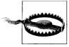

如果你按照第 13 页"没有网站？"章节中描述的方法，使用桌面版 Safari 测试 iPhone 网页，当浏览器窗口宽度太大时，这里的 if 语句将无法通过。作为变通方法，你可以在 Safari 的地址栏中输入以下 JavaScript 代码，将浏览器窗口调整为更接近 iPhone 的尺寸：

```javascript
javascript:window.scrollTo(0,0);resizeTo(320,480);
```

你甚至可以增加高度值来创建一个又高又窄的视图，这在处理大量内容时有时很有帮助（如稍后的图 2-10 所示）。

2. 这里就是所谓的"document ready"（文档就绪）函数。如果你是 jQuery 新手，这可能会让人感到有些畏惧，我承认自己花了好一段时间才记住这个语法。然而，花时间把它记下来是值得的，因为你会经常用到它。document ready 函数的基本含义是："当文档准备就绪时，运行这段代码。"稍后会解释为什么这很重要。

3. 这是典型的 jQuery 代码，首先选择 header 中的 ul 元素，并为其添加"hide" CSS 类。记住，hide 是我们在前面的 CSS 中使用的类选择器。执行这行代码的实际效果是"隐藏"header 中的 ul 元素。特别注意：如果我们将这行代码不放在 document ready 函数中，它很可能会在 ul 元素加载完成之前就执行。这意味着 JavaScript 会加载，这行代码会因为 ul 还不存在而执行失败，页面继续加载，ul 随后出现，而你则会抓耳挠腮（或猛砸键盘）纳闷 JavaScript 为什么不起作用。

4. 这里我向 header 中添加了一个按钮，允许用户显示和隐藏菜单（图 2-8）。该按钮有一个与我们之前为 .leftButton 编写的 CSS 对应的类，以及一个调用 toggleMenu() 函数的 onclick 处理器。接下来。

5. toggleMenu() 函数使用 jQuery 的 toggleClass() 函数为选中的对象添加或移除指定的类。在这行代码中，我对 header 中的 ul 切换 hide 类。

6. 这里，我对 header 中的 leftButton 切换 pressed 类。

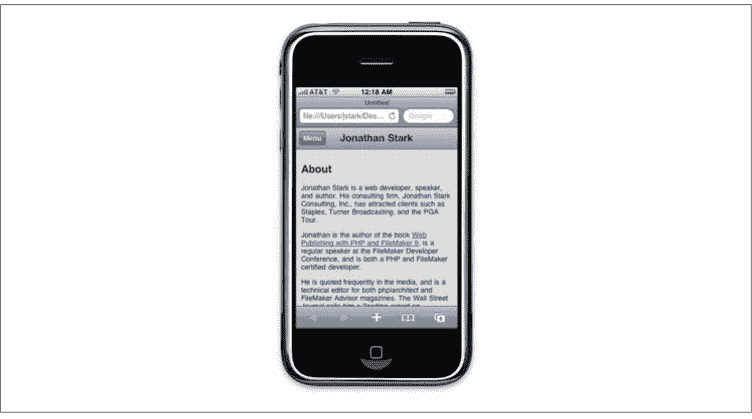

图 2-8. 菜单按钮已使用 jQuery 动态添加到工具栏中

我们还没有为 pressed 类编写 CSS，现在来补充一下。回到 iphone.css 文件，插入以下代码：

```css
#header div.pressed {
    -webkit-border-image: url(images/button_clicked.png) 0 8 0 8;
}
```

如你所见，我只是为按钮边框指定了一个不同的图片（它恰好稍微深一些）。这将为按钮添加双态效果，让用户清楚地知道该按钮可以同时用于显示和隐藏菜单（图 2-9）。

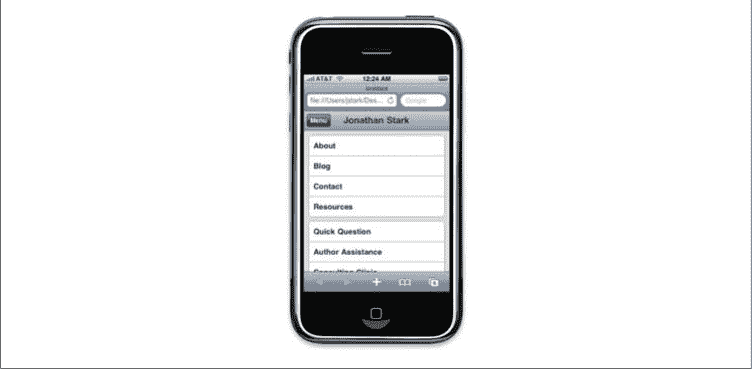

图 2-9. 菜单按钮在按下以显示菜单选项时颜色变深

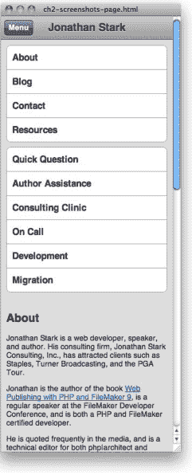

图 2-10. 完成的基本 iPhone CSS 的高视图

## 本章小结

本章涵盖了将现有网页转换为更适合 iPhone 格式的基础知识。我甚至使用了一些动态 HTML 来显示和隐藏导航面板。在下一章中，我将在这些示例的基础上进一步介绍一些更高级的 JavaScript 概念——特别是精彩的 Ajax 技术。

## 高级 iPhone 样式

在我们致力于构建无需 Objective-C 的 iPhone 应用的探索中，到目前为止我们已经学会了如何使用 CSS 为一系列 HTML 页面设置样式，使其*看起来*像一个 iPhone 应用。在本章中，我们将为使这些页面*表现得*像 iPhone 应用奠定基础。具体来说，我们将讨论如何使用 Ajax 将完整网站转变为单页应用，如何使用 JavaScript 创建带历史记录的返回按钮，以及如何利用 iPhone 的 Web Clip 图标和全屏模式功能来启动应用，而无需 Mobile Safari 干扰用户体验。

## 添加一些 Ajax

Ajax 这个术语已经成为一个流行词，以至于我都不确定自己是否还清楚它的含义了。在本书中，我将使用 Ajax 来指代使用 JavaScript 向 Web 服务器发送请求而不重新加载当前页面的技术（例如，获取一些 HTML、提交表单等）。这种方法能提供非常流畅的用户体验，但确实需要你重新发明很多轮子。

例如，当你动态加载外部页面时，浏览器不会给用户提供任何进度或错误提示。此外，除非你特意加以支持，否则返回按钮也不会正常工作。换句话说，要打造一个优秀的 Ajax 应用，你需要做大量的工作。即便如此，这样做仍然有一些非常好的理由。特别是，它为创建可以全屏运行（见第 48 页"全屏模式"）甚至离线运行（第 6 章）的 iPhone 应用打开了大门。

## 交通指挥官

在接下来的示例中，我将编写一个名为 `iphone.html` 的单页面，它将位于网站所有其他页面之前，负责处理请求，有点像交通指挥官。它的工作原理如下：首次加载时，`iphone.html` 将向用户呈现一个格式精美的网站导航。然后我将使用 jQuery 来"劫持"

拦截导航链接的 onclick 动作，这样当用户点击其中一个链接时，浏览器页面将不会跳转到目标链接。相反，jQuery 将从远程页面加载一部分 HTML，并通过更新当前页面将数据传递给用户。我将从代码最基本的函数版本开始，并在过程中对其进行改进。
*iphone.html* 包装页的 HTML 非常简单（见示例 3-1）。在 head 部分，我设置了 *title* 和 *viewport* 选项，并包含了指向一个样式表 (*iphone.css*) 和两个 JavaScript 文件（*jquery.js* 和一个名为 *iphone.js* 的自定义 JavaScript 文件）的链接。

有关从哪里获取 *jquery.js* 以及如何使用它的更多信息，请参阅第 9 页的“JavaScript 简介”。


body 部分仅有两个 div 容器：一个包含 h1 标签初始标题的 header，以及一个空的 div 容器，后者最终将用于存放从其他页面检索到的 HTML 片段。

示例 3-1. 这个简单的 HTML 包装标记将置于站点所有其他页面的前端

```
<html>
<head>
    <title>Jonathan Stark</title>
    <meta name="viewport" content="user-scalable=no, width=device-width" />
    <link rel="stylesheet" href="iphone.css" type="text/css" media="screen" />
    <script type="text/javascript" src="jquery.js"></script>
    <script type="text/javascript" src="iphone.js"></script>
</head>
<body>
    <div id="header"><h1>Jonathan Stark</h1></div>
    <div id="container"></div>
</body>
</html>
```

接下来看 *iphone.css* 文件，你在示例 3-2 中可以看到，我对之前示例中的一些属性进行了重新调整（例如，部分 #header *h1* 属性已上移至 #header）。不过总的来说，一切看起来应该很熟悉（如果不是，请复习第 2 章）。

示例 3-2. 页面的基础 CSS 只是之前示例的稍微调整版本

```
body {
    background-color: #ddd;
    color: #222;
    font-family: Helvetica;
    font-size: 14px;
    margin: 0;
    padding: 0;
}
#header {
    background-color: #ccc;
    background-image: -webkit-gradient(linear, left top, left bottom, from(#ccc), to(#999));
    border-color: #666;
    border-style: solid;
    border-width: 0 0 1px 0;
}
#header h1 {
    color: #222;
    font-size: 20px;
    font-weight: bold;
    margin: 0 auto;
    padding: 10px 0;
    text-align: center;
    text-shadow: 0px 1px 0px #fff;
}
ul {
    list-style: none;
    margin: 10px;
    padding: 0;
}
ul li a {
    background-color: #FFF;
    border: 1px solid #999;
    color: #222;
    display: block;
    font-size: 17px;
    font-weight: bold;
    margin-bottom: -1px;
    padding: 12px 10px;
    text-decoration: none;
}
ul li:first-child a {
    -webkit-border-top-left-radius: 8px;
    -webkit-border-top-right-radius: 8px;
}
ul li:last-child a {
    -webkit-border-bottom-left-radius: 8px;
    -webkit-border-bottom-right-radius: 8px;
}
ul li a:active,ul li a:hover {
    background-color:blue;
    color:white;
}
#content {
    padding: 10px;
    text-shadow: 0px 1px 0px #fff;
}
#content a {
    color: blue;
}
```

*iphone.js* 中的 JavaScript 是本示例中所有魔法发生的地方。请在阅读我逐行解释时参考**示例 3-3**。

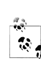

这段 JavaScript 会加载一个名为 *index.html* 的文档，如果没有它将无法工作。你应该复用第 2 章中的 HTML 文件，确保将其保存为 *index.html*，并与你在本章早些时候创建的 *iphone.html* 放在同一目录下。然而，除非链接的目标实际存在，否则其中的任何链接都无法工作。你可以自行创建这些文件，或者从本书网站下载示例代码。创建 *about.html*、*blog.html* 和 *consulting-clinic.html* 将为你提供几个可以尝试的链接。为此，只需将 *index.html* 复制几次，并将每个副本的文件名更改为与相关链接相匹配。为了增强效果，你可以更改每个文件中 h2 标签的内容以匹配文件名。例如，*blog.html* 中的 h2 将是 `<h2>Blog</h2>`。

示例 3-3. *iphone.js* 中的这段 JavaScript 将页面上的链接转换为 Ajax 请求

```
$(document).ready(function(){
    loadPage();
});
function loadPage(url) {
    if (url == undefined) {
        $('#container').load('index.html #header ul', hijackLinks);
    } else {
        $('#container').load(url + ' #content', hijackLinks);
    }
}
function hijackLinks() {
    $('#container a').click(function(e){
        e.preventDefault();
        loadPage(e.target.href);
    });
}
```

❶ 这里我使用了 jQuery 的 document ready 函数，以便在 DOM 完成时让浏览器运行 `loadPage()` 函数。

❷ `loadPage()` 函数接受一个名为 *url* 的单一参数，然后（在下一行）检查是否发送了值。

❸ 如果没有向函数发送值，*url* 将是 undefined，此时将执行此行。此行及后续行是 jQuery `load()` 函数的示例。`load()` 函数非常适合为页面快速添加简单的 Ajax 功能。如果将这一行翻译成英文，它读起来就是：“从 index.html 的 #header 元素中获取所有的 ul 元素，并将它们插入到当前页面的 #container 元素中。完成后，运行 `hijackLinks()` 函数。”注意，*index.html* 指的是站点的首页。如果你的首页名称不同，请在此处使用该文件名。

4. 如果 *url* 参数有值，则执行此行。它的实际含义是：“从传递给 `loadPage()` 函数的 *url* 中获取 #content 元素，并将其插入到当前页面的 #container 元素中。完成后，运行 `hijackLinks()` 函数。”

5. 一旦 `load()` 函数完成，当前页面的 #container 元素将包含检索到的 HTML 片段。然后，`load()` 将运行 `hijackLinks()` 函数。

6. 在这一行中，`hijackLinks()` 查找新 HTML 中的所有链接，并使用接下来的代码行将点击处理器绑定到它们身上。点击处理器会自动传递一个事件对象，我将其作为函数参数 *e* 捕获。被点击链接的事件对象在 *e.target.href* 中包含远程页面的 URL。

7. 通常，当链接被点击时，浏览器会导航到新页面。这种导航响应被称为链接的“默认行为”。由于我们正在手动处理点击并加载页面，我们需要阻止这种默认行为。在这一行中，我通过调用事件对象内置的 `preventDefault()` 方法来实现。如果我省略了那一行，浏览器将会尽职地离开当前页面并导航到所点击链接的 URL。

8. 当用户点击时，我将远程页面的 URL 传递给 `loadPage()` 函数，循环再次开始。

> 我最喜欢 JavaScript 的一点就是你可以将一个函数作为参数传递给另一个函数。虽然这起初看起来很奇怪，但它极其强大，允许你使代码模块化和可重用。如果你想了解更多，可以阅读 Douglas Crockford 的 *JavaScript: The Good Parts* (O’Reilly)。事实上，如果你在研究 JavaScript，你应该阅读 Douglas Crockford 的所有著作；你会庆幸自己这么做了。


点击处理器在页面首次加载时不会运行；它们在用户阅读页面上的某些内容并决定点击链接时运行。分配点击处理器就像设置陷阱；你为以后可能触发或不触发的事情做一些初步的设置工作。

> 值得花几分钟时间阅读关于 JavaScript 在响应浏览器用户操作时创建的事件对象属性的资料。一个很好的参考地址是 http://www.w3schools.com/htmldom/dom_obj_event.asp。

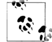


## 简单的修饰技巧

通过这一小段 HTML、CSS 和 JavaScript，我们本质上已经将整个网站变成了一个单页应用。但它仍然有不少不足之处。让我们来稍微美化一下。

由于我们不允许浏览器在页面之间进行导航，用户在数据加载时将看不到任何进度提示。我们需要提供一些反馈，让用户知道实际上正在进行操作。如果没有这种反馈，用户会怀疑自己是否真的点击了链接，还是没点中，从而沮丧地到处乱点。这会导致服务器负载增加和应用不稳定（即崩溃）。

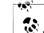

如果你在本地网络上测试这个 Web 应用，网络速度会非常快，你永远看不到进度指示器。如果你使用的是 Mac OS X，可以在终端输入几条 `ipfw` 命令来降低所有传入的网络流量。例如，以下命令会将所有网络流量降到每秒 4 千字节：

```
sudo ipfw pipe 1 config bw 4KByte/s
sudo ipfw add 100 pipe 1 tcp from any to me 80
```

如果你使用的是 Safari 桌面浏览器来查看页面，需要在 URL 中使用你的 Mac 主机名或外部 IP 地址（例如，用 `mymac.local` 而不是 `localhost`）。测试完成后，使用 `sudo ipfw delete 100` 删除规则（你可以使用 `ipfw flush` 删除所有自定义规则）。

得益于 jQuery，提供这种反馈只需两行代码。我们只需在 `loadPage()` 开始时向 body 追加一个加载 div，然后在 `hijackLinks()` 完成时移除该加载 div。示例 3-4 展示了示例 3-3 的修改版本。需要添加到 `iphone.js` 的行以粗体显示。

### 示例 3-4. 向页面添加简单的进度指示器

```
$(document).ready(function(){
    loadPage();
});
function loadPage(url) {
    $('body').append('<div id="progress">Loading...</div>');
    if (url == undefined) {
        $('#container').load('index.html #header ul', hijackLinks);
    } else {
        $('#container').load(url + ' #content', hijackLinks);
    }
}
function hijackLinks() {
    $('#container a').click(function(e){
        e.preventDefault();
        loadPage(e.target.href);
    });
    $('#progress').remove();
}
```

参见示例 3-5，其中展示了需要添加到 *iphone.css* 中用于设置 progress div 样式的 CSS。效果如图 3-1 所示。

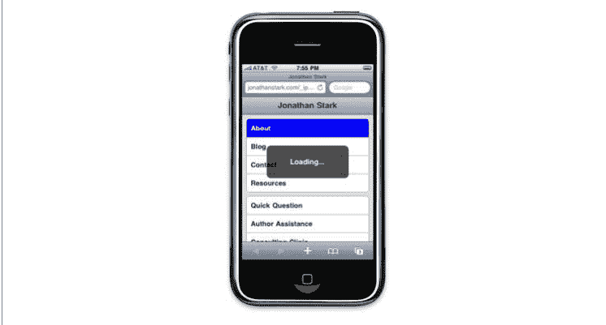

图 3-1. 如果没有某种进度指示器，你的应用看起来会毫无响应，用户也会感到沮丧

### 示例 3-5. 添加到 iphone.css 中用于设置进度指示器样式的 CSS

```
#progress {
    -webkit-border-radius: 10px;
    background-color: rgba(0,0,0,.7);
    color: white;
    font-size: 18px;
    font-weight: bold;
    height: 80px;
    left: 60px;
    line-height: 80px;
    margin: 0 auto;
    position: absolute;
    text-align: center;
    top: 120px;
    width: 200px;
}
```

我的网站恰好在每个页面的开头有一个 h2，可以作为一个很好的页面标题（见图 3-2）。你可以在第 2 章所示的 HTML 源码中看到这一点。为了更像 iPhone 的风格，我打算将该标题从内容中提取出来放到头部（见图 3-3）。jQuery 再次派上用场：你只需在 `hijackLinks()` 函数中添加三行代码即可实现。示例 3-6 展示了包含这些更改的 `hijackLinks` 函数。


图 3-2. 将页面标题移到工具栏之前……

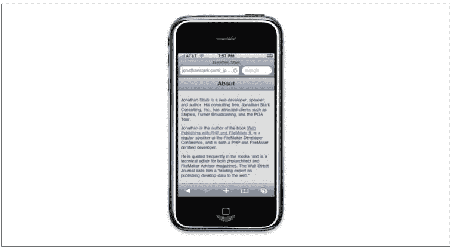

图 3-3. ……以及将页面标题移到工具栏之后

### 示例 3-6. 使用目标页面的 h2 作为工具栏标题

```
function hijackLinks() {
    $('#container a').click(function(e){
        e.preventDefault();
        loadPage(e.target.href);
    });
    var title = $('h2').html() || 'Hello!';
    $('h1').html(title);
    $('h2').remove();
    $('#progress').remove();
}
```

注意，我在移除进度指示器的行之前添加了设置标题的代码。我喜欢将移除进度指示器作为最后一步操作，因为我认为这样会让应用感觉更有响应性。

插入代码第一行（粗体显示）中的双竖线（`||`）是 JavaScript 的逻辑 OR 运算符。翻译成自然语言，这行代码的意思是："将 `title` 变量设置为 h2 元素的 HTML 内容，如果没有 h2 元素，则设置为字符串 'Hello!'"。这一点很重要，因为首次加载页面时不会包含 h2，因为我们只是获取导航 ul 元素。

这里可能需要一些说明。当用户首次加载 `iphone.html` URL 时，他们只能看到网站的整体导航元素，而不是任何网站内容。只有点击这个初始导航页面上的链接后，他们才会看到网站内容。

我的网站上有几个页面的标题太长，无法完整显示在标题栏中（图 3-4）。我本可以让文本自动换行显示多行，但这不太像 iPhone 的风格。因此，我更新了 `#header h1` 的样式，使过长的文本会被截断并显示尾部省略号（见图 3-5 和示例 3-7）。这可能是我最喜欢的鲜为人知的 CSS 技巧。

### 示例 3-7. 为超出容器宽度的文本添加省略号

```
#header h1 {
    color: #222;
    font-size: 20px;
    font-weight: bold;
    margin: 0 auto;
    padding: 10px 0;
    text-align: center;
    text-shadow: 0px 1px 0px #fff;
    max-width: 160px;
    overflow: hidden;
    white-space: nowrap;
    text-overflow: ellipsis;
}
```

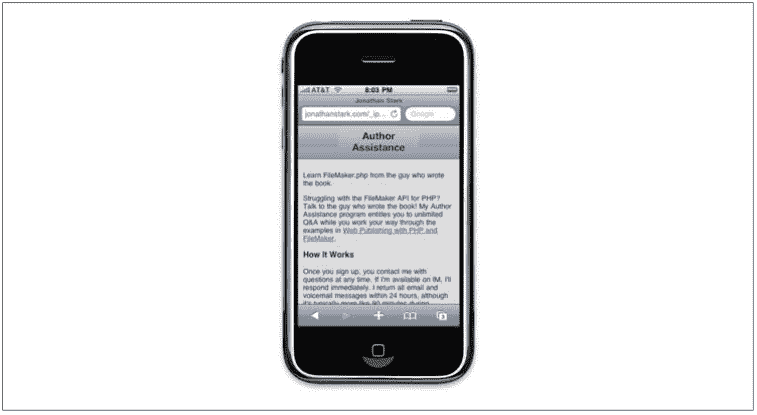

图 3-4. 工具栏中的文本换行不太像 iPhone 的风格……

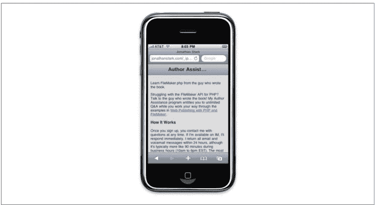

图 3-5. ……但我们可以用 CSS 省略号来美化它

原理如下：`max-width: 160px` 指示浏览器不允许 h1 元素的宽度超过 160px。然后，`overflow: hidden` 指示浏览器裁剪掉超出元素边界的任何内容。接下来，`white-space: nowrap` 防止浏览器将文本折行。如果没有这一行，h1 会在指定宽度下增高以容纳文本。最后，`text-overflow: ellipsis` 会在被裁剪的文本末尾添加三个点，向用户表明他们看到的并非完整字符串。

假设你有一个"关于"页面，内容超出了 iPhone 的可视区域。用户访问该页面，滚动到底部，然后点击链接进入你的"联系"页面。如果你的"联系"页面也有超过一屏的内容，新数据将显示在窗口仍然滚动到底部的位置。

从技术上讲，这是合理的，因为我们实际上并没有离开当前（已滚动的）页面，但这对用户来说确实很困惑。为了解决这个问题，我在 `loadPage()` 函数中添加了一条 `scrollTo()` 命令（见示例 3-8）。

现在，每当用户点击链接时，页面会先跳转到顶部。这样做还有一个额外的好处：如果用户点击长页面底部的链接，可以确保加载动画是可见的。

### 示例 3-8. 当用户导航到新页面时，回到页面顶部是个好主意

```
function loadPage(url) {
    $('body').append('<div id="progress">Loading...</div>');
    scrollTo(0,0);
    if (url == undefined) {
        $('#container').load('index.html #header ul', hijackLinks);
    } else {
        $('#container').load(url + ' #content', hijackLinks);
    }
}
```

和大多数网站一样，我的网站也有指向外部页面（即托管在其他域名上的页面）的链接。我不想劫持这些外部链接，因为将它们的 HTML 注入到我的 iPhone 专用布局中没有意义。在示例 3-9 中，我添加了一个条件判断来检查 URL 中是否包含我的域名。如果找到了，链接将被劫持，内容将加载到当前页面中，即启用 Ajax。如果没有找到，浏览器将正常导航到该 URL。

你必须将 `jonathanstark.com` 替换为你网站的相应域名或主机名，否则指向你网站页面的链接将不再被劫持。

### 示例 3-9. 通过检查 URL 的域名，你可以让外部页面正常加载

```
function hijackLinks() {
    $('#container a').click(function(e){
        var url = e.target.href;
        if (url.match(/jonathanstark.com/)) {
            e.preventDefault();
            loadPage(url);
        }
    });
    var title = $('h2').html() || 'Hello!';
    $('h1').html(title);
    $('h2').remove();
    $('#progress').remove();
}
```


`url.match` 函数使用的语言是正则表达式，它通常嵌入在其他编程语言中，例如 JavaScript、PHP 和 Perl。虽然这个正则表达式很简单，但更复杂的表达式可能会有点吓人，但值得熟悉。我最喜欢的正则表达式页面位于 <http://www.regular-expressions.info/javascriptexample.html>。

## 自制返回按钮

此时显而易见的问题是，用户无法导航回之前的页面（请记住，我们劫持了所有链接，所以 Safari 的页面历史记录将无法使用）。我们来通过在屏幕左上角添加一个返回按钮来解决这个问题。首先，我将更新 JavaScript，然后处理 CSS。

在应用中添加一个标准的 iPhone 风格返回按钮意味着需要跟踪用户的点击历史记录。为此，我们将需要：A) 存储前一个页面的 URL，以便我们知道返回到哪里；B) 存储前一个页面的标题，以便我们知道在返回按钮上放置什么标签。

添加此功能涉及本章中到目前为止编写的大部分 JavaScript，因此我将逐行介绍 *iphone.js* 的整个新版本（参见 [示例 3-10]）。结果将如 [图 3-6] 所示。

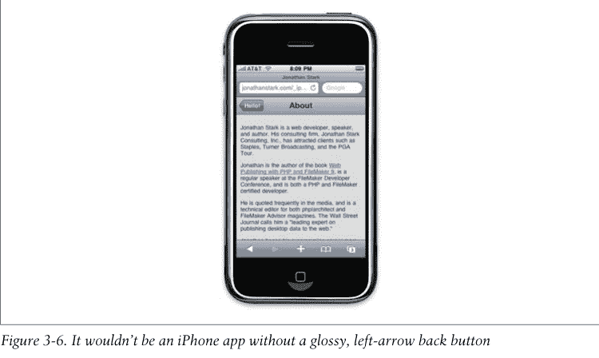

图 3-6。没有一个光鲜的左箭头返回按钮，就不是一个 iPhone 应用

```
示例 3-10. 扩展现有 JavaScript 示例以包含对返回按钮的支持

var hist = [];
var startUrl = 'index.html';
$(document).ready(function(){
    loadPage(startUrl);
});

function loadPage(url) {
    $('body').append('<div id="progress">Loading...</div>');
    scrollTo(0,0);
    if (url == startUrl) {
        var element = ' #header ul';
    } else {
        var element = ' #content';
    }
    $('#container').load(url + element, function(){
        var title = $('h2').html() || 'Hello!';
        $('h1').html(title);
        $('h2').remove();
        $('.leftButton').remove();
        hist.unshift({'url':url, 'title':title});
        if (hist.length > 1) {
            $('#header').append('<div class="leftButton">'+hist[1].title+'</div>');
            $('#header .leftButton').click(function(){
                var thisPage = hist.shift();
                var previousPage = hist.shift();
                loadPage(previousPage.url);
            });
        }
        $('#container a').click(function(e){
            var url = e.target.href;
            if (url.match(/jonathanstark.com/)) {
                e.preventDefault();
                loadPage(url);
            }
        });
        $('#progress').remove();
    });
}
```

① 在这一行，我将一个名为 `hist` 的变量初始化为空数组。由于我在任何函数之外定义它，它存在于全局作用域中，并且在整个页面中都可用。请注意，我没有使用完整的单词 `history` 作为变量名，因为它是 JavaScript 中的预定义对象属性，在你自己的代码中应该避免使用。

② 这里我定义了当用户首次访问 `iphone.html` 时要加载的远程页面的相对 URL。你可能还记得之前的示例中，我只是检查 `url == undefined` 来处理首次页面加载，但在本例中，我们将在几个地方使用起始页。因此，在全局范围内定义它是有意义的。

③ 这一行和下一行构成了文档就绪函数定义。请注意，与之前的示例不同，我将起始页传递给了 `loadPage()` 函数。

④ 现在进入 `loadPage()` 函数。这一行和下一行与之前的示例完全相同。

这个 if...else 语句决定了从远程页面加载哪些元素。例如，如果我们想要起始页，我们就从标题中获取 ul；否则，我们获取 content div。

在这一行，URL 参数和适当的源元素被连接起来，作为传递给 load 函数的第一个参数。至于第二个参数，我直接传递了一个*匿名函数*（一个未命名的内联定义的函数）。当我们浏览这个匿名函数时，你会注意到它与 hijackLinks() 函数非常相似，这个匿名函数已经取代了它。例如，以下三行与之前的示例相同。

在这一行，我从页面中移除了 .leftButton 对象。（这可能看起来很奇怪，因为我还没有将其添加到页面中；我们将在几步之后添加它。）

这里我使用了 JavaScript 数组的内置 unshift 方法，将一个对象添加到 hist 数组的开头。我添加的对象有两个属性，url 和 title，它们是我们支持返回按钮显示和行为所需的两部分信息。

在这一行，我使用了 JavaScript 数组的内置 length 方法来查找历史记录数组中有多少个对象。如果历史记录数组中只有一个对象，则意味着用户在第一页，因此我们不需要显示返回按钮。但是，如果 hist 数组中有多于一个对象，我们需要在标题中添加一个按钮。

接下来，我添加了我之前提到的 .leftButton。按钮的文本将与当前页面之前的页面标题相同，这正是我使用 hist[1].title 代码访问的内容。JavaScript 数组是基于零的，因此数组中的第一个项目（当前页面）的索引为 0。换句话说，索引 0 是当前页面，索引 1 是上一个页面，索引 2 是再之前的页面，依此类推。

在这段代码块中，我将一个匿名函数绑定到返回按钮的点击处理程序。请记住，点击处理程序代码在用户点击时执行，而不是在页面加载时执行。因此，在页面加载后，用户点击返回，此函数内的代码将运行。

这一行和下一行使用数组的内置 shift 方法从 hist 数组中移除前两个项目，函数中的最后一行将上一个页面的 URL 发送到 loadPage() 函数。

其余的行完全是从之前的示例中复制的，因此我不会在这里重复它们。

这是本章前面介绍的 URL 匹配代码。请记住，将 jonathanstark.com 替换为你网站域名或主机名的一部分，否则本地链接都不会被劫持并加载到页面中。

> 请访问 http://www.hunlock.com/blogs/Mastering_Javascript_Arrays 获取 JavaScript 数组函数的完整列表，包括描述和示例。

现在我们有了返回按钮，剩下的就是用一些 CSS 来美化它（参见 示例 3-11）。我从使用 font-weight、text-align、line-height、color 和 text-shadow 设置文本样式开始。我继续使用 position、top 和 left 将 div 精确地放置在页面上我想要的位置。然后，我确保按钮标签上的长文本会使用 max-width、white-space、overflow 和 text-overflow 用省略号截断。最后，我应用一个带有 border-width 和 -webkit-border-image 的图形。与我之前的边框图像示例不同，此图像左右边框的宽度不同，因为左侧的箭头使图像不对称。

> 别忘了你需要为这个按钮准备一张图片。你需要将其保存为 back_button.png，放在包含 HTML 文件的文件夹下的 images 文件夹中。有关查找或创建自己的按钮图像的提示，请参阅第 24 页的“使用 jQuery 添加基本行为”。

示例 3-11. 将以下内容添加到 iphone.css 中，使用边框图像美化返回按钮

```
#header div.leftButton {
    font-weight: bold;
    text-align: center;
    line-height: 28px;
    color: white;
    text-shadow: rgba(0,0,0,0.6) 0px -1px 0px;
    position: absolute;
    top: 7px;
    left: 6px;
    max-width: 50px;
    white-space: nowrap;
    overflow: hidden;
    text-overflow: ellipsis;
    border-width: 0 8px 0 14px;
    -webkit-border-image: url(images/back_button.png) 0 8 0 14;
}
```

默认情况下，Mobile Safari 会在被点击的可点击对象上短暂显示一个半透明的灰色框（图 3-7）。由于我们的返回按钮不是矩形的，这种效果看起来有点差劲，但很容易移除它，这会让应用看起来好得多。Mobile Safari 支持一个名为 -webkit-tap-highlight-color 的属性，它允许你将默认颜色更改为你喜欢的任何颜色。我想完全移除高亮显示，我在这里通过将点击高亮设置为完全透明的颜色来实现（参见 示例 3-12）。


## 将图标添加到主屏幕

希望用户会想把你的网络应用（称为“Web Clip 图标”）添加到他们的主屏幕。他们可以通过点击 Safari 窗口底部的加号按钮（图 3-9）、点击“添加到主屏幕”（图 3-10），然后点击“添加”按钮（图 3-11）来完成此操作。默认情况下，iPhone 会通过缩略显示当前页面（包括位置和缩放）并应用圆角和光泽效果来创建此图标（图 3-12）。

对于返回按钮，前一页的内容出现之前至少会有一两秒的延迟。为了避免用户感到沮丧，我希望按钮在被点击的瞬间就显示出被按下的外观。在桌面浏览器中，这很简单；你只需在 CSS 中添加一条使用 `:active` 伪类的声明，为被点击的对象指定一个替代样式。我不知道这是个 bug 还是特性，但这种方法在 iPhone 上不起作用；`:active` 样式会被忽略。

我尝试了 `:active` 和 `:hover` 的组合，这让我在一些非 Ajax 应用上取得了一些成功。然而，对于像我们这里使用的这样的 Ajax 应用，`:hover` 样式是粘性的（即，即使手指移开后，按钮看起来仍然保持“被点击”的状态）。

幸运的是，修复方法相当简单。我使用 jQuery 在用户点击按钮时为其添加 **clicked** 类。在示例中，我选择为按钮图像应用一个更暗的版本（参见图 3-8 和示例 3-13）。你需要确保在 *images* 子文件夹中有一个名为 *back_button_clicked.png* 的按钮图像。有关查找或创建自己的按钮图像的技巧，请参阅第 24 页的“使用 jQuery 添加基本行为”。

示例 3-8。默认情况下，Mobile Safari 在被点击的可点击对象上显示一个半透明的灰色框

示例 3-12。将以下内容添加到 iphone.css 中，以移除 Mobile Safari 默认的点击高亮效果

```css
#header div.leftButton {
    font-weight: bold;
    text-align: center;
    line-height: 28px;
    color: white;
    text-shadow: rgba(0,0,0,0.6) 0px -1px 0px;
    position: absolute;
    top: 7px;
    left: 6px;
    max-width: 50px;
    white-space: nowrap;
    overflow: hidden;
    text-overflow: ellipsis;
    border-width: 0 8px 0 14px;
    -webkit-border-image: url(images/back_button.png) 0 8 0 14;
    -webkit-tap-highlight-color: rgba(0,0,0,0);
}
```

图 3-8。这是一个细微的差别，但被点击的返回按钮比默认状态稍微暗一些

示例 3-13。将以下内容添加到 *iphone.css* 中，使返回按钮在用户点击的瞬间就呈现出被按下的外观

```css
#header div.leftButton.clicked {
    -webkit-border-image: url(images/back_button_clicked.png) 0 8 0 14;
}
```

由于我为点击状态使用了图像，预先加载该图像是明智的。否则，未点击的按钮图形会在第一次点击时消失，而此时被点击的图形正在下载。我将在下一章介绍图像预加载。

有了 CSS，我现在可以更新 *iphone.js* 中为返回按钮分配点击事件处理程序的部分。首先，我在匿名函数中添加一个变量 `e` 来捕获传入的点击事件。然后，我将事件目标包装在 jQuery 选择器中，并调用 jQuery 的 **addClass()** 函数将我的 clicked CSS 类分配给按钮：

```javascript
$('#header .leftButton').click(function(e){
    $(e.target).addClass('clicked');
    var thisPage = hist.shift();
    var previousPage = hist.shift();
    loadPage(previousPage.url);
});
```

特别提醒各位 CSS 大师：CSS Sprite 技术——由 A List Apart 推广——在这种情况下不可行，因为它需要为图像设置偏移量。-webkit-border-image 属性不支持图像偏移。

为了自定义主屏幕图像，时尚达人会提供一个自定义的 Web Clip 图标。最简单的方法是通过将一个名为 `apple-touch-icon.png` 的文件上传到你的网站根目录，为整个网站指定一个图标。该文件应为 57 像素见方，不带光泽和圆角，因为 iPhone 会自动添加这些效果。如果你不想让 iPhone 为你的 Web Clip 图标添加效果，请将文件名改为 `apple-touch-icon-precomposed.png`。

在某些情况下，你可能希望为某个页面提供一个与网站其他部分不同的 Web Clip 图标。你可以通过向“交通指挥”HTML 文档 *iphone.html* 的 head 部分添加以下任一行来实现（将 *myCustomIcon.png* 替换为图像的绝对或相对路径）：

```html
<link rel="apple-touch-icon" href="myCustomIcon.png" />

<link rel="apple-touch-icon-precomposed" href="myCustomIcon.png" />
```

 如果你打算使用预组合图像，请将圆角半径设为 10 像素或更大；否则，iPhone 会将圆角设为 10 像素。无论哪种情况，使用预组合图像都会抑制光泽效果的添加。

## 全屏模式

想从 Mobile Safari 那里收回四分之一的可用垂直空间（精确地说是 104 像素）吗？在“交通指挥”HTML 文档 *iphone.html* 的 head 部分添加以下行，你的网络应用在从 Web Clip 图标启动时就会以全屏模式显示：

```html
<meta name="apple-mobile-web-app-capable" content="yes" />
```

我本该早点告诉你这个特性的，但只有当你用 Ajax 劫持了所有超链接后它才有用。一旦用户点击了一个未被劫持的链接——一个真正导航到新页面的链接——Mobile Safari 将启动并正常加载页面。这种行为非常适合我们一直在处理的示例，因为外部链接（Amazon、Twitter、Facebook 等）将在 Safari 中打开。

## 更改状态栏

一旦你添加了 `apple-mobile-web-app-capable` 元标签，你就可以选择使用 `apple-mobile-web-app-status-bar-style` 元标签来控制屏幕顶部 20 像素高的状态栏的背景颜色。默认是普通的灰色 Safari 状态栏，或者你可以将其更改为**黑色**（见图 3-13）。你还可以将其设置为**black-translucent**，这使其部分透明，并额外将其从文档流中移除。换句话说，在页面首次加载时，你的内容将向上移动 20 像素并位于状态栏后面，因此你可能需要将标题定位得稍低一些以进行补偿：

```html
<meta name="apple-mobile-web-app-status-bar-style" content="black" />
```

状态栏样式的更改仅在应用以全屏模式启动时才会生效。

图 3-13。全屏模式为你提供大约 25% 的额外屏幕空间，并允许你自定义状态栏的外观

## 提供自定义启动画面

当应用以全屏模式启动时，在第一个页面加载期间，用户会看到一个应用的截图。我不喜欢这样，因为它看起来好像应用已经准备好可以交互了，而实际上点击链接将毫无作用。此外，该截图基于用户上次访问的最后页面，滚动到他离开的位置——不是很吸引人。

幸运的是，Mobile Safari 允许我们定义一个启动图形，在页面加载期间显示。要添加自定义启动图形，请创建一个 320px × 460px 的 PNG 文件，并将其与 *iphone.html* 放在同一目录中。接下来，在 *iphone.html* 的 head 部分添加以下行（你需要将 *myCustomStartupGraphic.png* 替换为图像的绝对或相对路径）：

```html
<link rel="apple-touch-startup-image" href="myCustomStartupGraphic.png" />
```

下一次我们从 Web Clip 图标启动应用时，在下载新的自定义图形的同时，将进行默认的加载行为。在随后的启动中，将显示自定义启动图形（图 3-14）。


## 你学到了什么

在本章中，你已经学习了如何将一个普通网站转换成一个全屏的 Ajax 应用程序，包括进度指示器、类似原生应用的返回按钮以及自定义的 Web Clip 图标。在下一章中，你将学习如何通过添加原生用户界面动画让你的应用程序生动起来。没错，有趣的部分来了！

# 第4章 动画

iPhone 应用程序具有一系列独特的动画特性，这些特性为用户提供了上下文和意义。例如，当你深入链接时，页面会向左滑动；当你返回时，页面会向右滑动。在本章中，你将学习如何为你的 Web 应用添加滑动、翻页等典型行为。这些变化，结合 Ajax 和全屏模式，将使你的 Web 应用几乎与原生应用无法区分。

## 在朋友的帮助下

坦白说：让一个网页像典型的原生 iPhone 应用那样进行动画是很难的。幸运的是，一位来自费城的年轻有为的小伙子，David Kaneda，编写了一个名为 jQTouch 的 JavaScript 库，使得移动 Web 开发变得轻松许多。jQTouch 是一个开源的 jQuery 插件，它几乎能处理我们在上一章学到的所有内容，以及一大堆从头编写会非常痛苦的、更复杂的功能。

你可以从 [http://jqtouch.com/](http://jqtouch.com/) 下载最新版本的 jQTouch。

## 滑动主页

我们将构建一个名为 Kilo 的简单卡路里追踪应用程序，允许用户为特定日期添加和删除食物条目。总共会有五个面板：主页、设置、日期、日期详情和新建条目。我们将从两个面板开始，然后逐步添加。

我将为一些 HTML 元素（工具栏、edgetoedge、arrow、button、back 等）分配 CSS 类。在所有情况下，这些类都对应于默认 jQTouch 主题中存在的预定义 CSS 类选择器。请记住，你可以通过修改现有的 jQTouch 主题或从头构建自己的主题来创建和使用自己的类；我这里只是使用默认值。

首先，让我们创建一个名为 *index.html* 的文件，并添加示例 4-1 中所示的主页和关于面板的 HTML。

### 示例 4-1. index.html 中主页和关于面板的 HTML

```
<html>
    <head>
        <title>Kilo</title>
    </head>
    <body>
        <div id="home">❶
            <div class="toolbar">❷
                <h1>Kilo</h1>
            </div>
            <ul class="edgetoedge">❸
                <li class="arrow"><a href="#about">About</a></li>❹
            </ul>
        </div>
        <div id="about">
            <div class="toolbar">
                <h1>About</h1>
                <a class="button back" href="#">Back</a>❺
            </div>
            <div>
                <p>Kilo gives you easy access to your food diary.</p>
            </div>
        </div>
    </body>
</html>
```

这里的 HTML 基本上包含一个带标题的 head，以及一个包含两个子元素的 body，这两个子元素都是 div：

1. 这个 div（以及几行之后出现的 about div）将通过作为 body 的直接子元素而成为应用程序中的一个面板。
2. 在每个面板 div 内部，都有一个类为 toolbar 的 div。这个 toolbar 类在 jQTouch 主题中是专门预定义的，用于将元素样式化为传统的 iPhone 工具栏。
3. 这个无序列表标签的类为 edgetoedge。edgetoedge 类告诉 jQTouch 将列表从可视区域的左侧一直拉伸到右侧。
4. 这一行有一个 li，其中包含一个链接，其 href 指向关于面板。在 li 中包含 arrow 类是可选的；这样做会在列表项的右侧添加一个箭头符号。
5. 工具栏元素各包含一个 h1 元素，该元素将成为面板标题。在这一行，有一个链接，其类为 button 和 back，这些类告诉 jQTouch 使按钮在外观和行为上像一个返回按钮。

> 注意，返回按钮上的 href 设置为 #。通常，这会告诉浏览器返回到当前文档的顶部。但使用 jQTouch 时，它会导航回上一个面板。在更高级的场景中，你可能想要使用一个特定的锚点，比如 #home，这将指示返回按钮导航到特定面板，而不管前一个面板是什么。

有了基本的 HTML 后，是时候让 jQTouch 加入了。一旦你下载了 jQTouch 并将其解压到与 HTML 文档相同的目录中，你只需在页面的 head 中添加几行代码（示例 4-2）。

> 对于本书中的这个和其他示例，你需要从 http://jqtouch.com 下载 jQTouch，解压它，并将 jqtouch 和 themes 目录移动到与你的 HTML 文档相同的目录中。你还需要进入 jqtouch 目录，将 jQuery JavaScript 文件（例如 jquery.1.3.2.min.js）重命名为 jquery.js。

### 示例 4-2. 将以下代码行添加到文档的 head 中将激活 jQTouch

```
<link type="text/css" rel="stylesheet" media="screen" href="jqtouch/jqtouch.css">❶
<link type="text/css" rel="stylesheet" media="screen" href="themes/jqt/theme.css">❷
<script type="text/javascript" src="jqtouch/jquery.js"></script>❸
<script type="text/javascript" src="jqtouch/jqtouch.js"></script>❹
<script type="text/javascript">❺
    var jQT = $.jQTouch({
        icon: 'kilo.png',
        statusBar: 'black'
    });
</script>
```

❶ 我包含了 jqtouch.css 文件。这个文件定义了一些核心的结构设计规则，这些规则非常具体地用于处理动画、方向和其他 iPhone 特定的细节。这个文件是必需的，没有理由去编辑它。

❷ 我包含了为我选择的主题的 CSS，在这个例子中是 jQTouch 自带的 "jqt" 主题。我在 HTML 中使用的类对应于此文档中的 CSS 选择器。jQTouch 默认自带两个主题。你也可以通过复制一个默认主题并对其进行修改，或者从头编写一个新主题来创建自己的主题。

❸ jQTouch 需要 jQuery，所以我在这里包含了它。jQTouch 自带了它自己的 jQuery 副本，但如果你愿意，也可以链接到另一个副本。

❹ 这里是我包含 jQTouch 本身的地方。注意，你必须在 jQuery 之后包含 jQTouch，否则什么都不会工作。

❺ 这引出了脚本块，我在这里初始化 jQTouch 对象并传入两个属性值：icon 和 **statusBar**。

jQTouch 公开了几个属性，允许你自定义应用程序的行为和外观。在本书中你会看到好几个，它们都是可选的。然而，你几乎总会使用其中至少几个。

在这个例子中，**icon** 告诉 jQTouch 到哪里寻找自定义的 Web Clip 图标，而 **statusBar** 控制全屏模式下应用程序顶部 20px 条带的颜色。

在添加 jQTouch 之前（图 4-1）和之后（图 4-2）的应用程序差异巨大，但真正令人惊讶的是，你刚刚用 10 行代码为你的应用程序添加了华丽的左右滑动效果。此外，你还启用了全屏模式，定义了自定义状态栏颜色，并链接到了你的 Web Clip 图标。jQTouch 太棒了，而我们才刚刚开始。

## 添加日期面板

现在让我们添加日期面板。日期面板将有一个相对日期列表，从今天开始，一直回溯到 5 天前（图 4-3）。在关于面板之后，就在结束标签 `</body>` 之前，添加日期面板的 HTML（如示例 4-3 所示）。

### 示例 4-3. 日期面板的 HTML

```
<div id="dates">
    <div class="toolbar">
        <h1>Dates</h1>
        <a class="button back" href="#">Back</a>
    </div>
    <ul class="edgetoedge">
        <li class="arrow"><a id="0" href="#date">Today</a></li>
        <li class="arrow"><a id="1" href="#date">Yesterday</a></li>
        <li class="arrow"><a id="2" href="#date">2 Days Ago</a></li>
        <li class="arrow"><a id="3" href="#date">3 Days Ago</a></li>
        <li class="arrow"><a id="4" href="#date">4 Days Ago</a></li>
        <li class="arrow"><a id="5" href="#date">5 Days Ago</a></li>
    </ul>
</div>
```


与“关于”面板类似，“日期”面板也带有一个包含标题和返回按钮的工具栏。工具栏之后是一个无序的、边缘到边缘的链接列表。请注意，所有链接都具有唯一的 id（从 0 到 5），但 href 相同（`#date`）——这一点稍后会详细说明。

接下来，你需要更新“主页”面板，添加一个指向“日期”面板的链接。在 `index.html` 的“主页”面板中添加以下代码：

```
<div id="home">
    <div class="toolbar">
        <h1>Kilo</h1>
    </div>
    <ul class="edgetoedge">
        <li class="arrow"><a href="#dates">Dates</a></li>
        <li class="arrow"><a href="#about">About</a></li>
    </ul>
</div>
```

就这样，我们为应用添加了一个新面板（参见图 4-4）。点击“日期”面板上的项目目前还不会有任何反应。让我们通过添加“日期”面板来修正这个情况。

## 添加日期面板

日期面板看起来与之前的面板非常相似，但有几个例外（参见示例 4-4）。在“日期”面板的 HTML 代码之后，紧靠 `</body>` 闭合标签之前添加日期面板的 HTML。

图 4-4. 主页面板现在包含一个指向日期面板的链接

**示例 4-4. 日期面板的 HTML 代码**

```
<div id="date">
    <div class="toolbar">
        <h1>Date</h1>
        <a class="button back" href="#">Back</a>
        <a class="button slideup" href="#createEntry">+</a>①
    </div>
    <ul class="edgetoedge">
        <li id="entryTemplate" class="entry" style="display:none">②
            <span class="label">Label</span>
            <span class="calories">000</span>
            <span class="delete">Delete</span>
        </li>
    </ul>
</div>
```

① 日期面板工具栏有一个额外的按钮。点击此按钮将显示“新建条目”面板（我们尚未构建）。我为该链接指定了一个 `slideup` 类，这告诉 jQTouch 我们希望目标面板从屏幕底部滑入，而不是像典型的导航那样水平滑入。

② 该面板的另一个不寻常之处在于，我定义了一个列表项，其样式设置为 `display:none`，使其实际上不可见。稍后你将看到，我将把这个不可见的列表项用作模板，以显示创建的条目。此时还没有任何条目，因此除了工具栏之外，面板将是空的。

现在你已经添加了日期面板，点击日期面板上的任何项目都会将空的日期面板（图 4-5）滑入视图。

*图 4-5. 除工具栏外，日期面板初始为空*

## 添加新建条目面板

示例 4-5 显示了新建条目面板的源代码。将此代码添加到 *index.html* 的末尾，紧靠 `</body>` 闭合标签之前。

*示例 4-5. 新建条目面板的 HTML 代码*

```
<div id="createEntry">
    <div class="toolbar">
        <h1>New Entry</h1>
        <a class="button cancel" href="#">Cancel</a>❶
    </div>
    <form method="post">❷
        <ul>
            <li><input type="text" placeholder="Food" name="food" id="food"
                       autocapitalize="off" autocorrect="off" autocomplete="off" /></li>
            <li><input type="text" placeholder="Calories" name="calories" id="calories"
                       autocapitalize="off" autocorrect="off" autocomplete="off" /></li>
            <li><input type="submit" class="submit" name="action"
                       value="Save Entry" /></li>❸
        </ul>
    </form>
</div>
```

❶ 关于新建条目面板首先要指出的是，它没有返回按钮，而是有一个取消按钮。

jQTouch 中的取消按钮行为类似于返回按钮，因为它们使用页面进入时相反的动画将其移出视图。然而，与返回按钮不同，取消按钮的形状不是左箭头。

我为新建条目面板使用取消按钮，是因为它从底部滑入，因此会从底部滑出。点击一个指向左侧的返回按钮，然后面板却向下滑出，这会让人感到困惑。

❷ 此 HTML 表单包含一个无序列表，其中有三个项目：两个文本字段和一个提交按钮。将表单控件嵌套在 `li` 中，允许 jqt 主题如图 4-6 所示地对表单进行样式化。

每个文本输入都定义了很多属性：

- **type**
  定义表单控件为单行文本输入字段。
- **placeholder**
  当输入为空时，在表单输入中显示的文本字符串。
- **name**
  当表单提交时，与用户提供的值相关联的名称。
- **id**
  在整个页面上下文中元素的唯一标识符。
- **autocapitalize**
  Mobile Safari 特有的设置，允许你关闭默认的自动大写功能。
- **autocorrect**
  Mobile Safari 特有的设置，允许你关闭默认的拼写检查功能。
- **autocomplete**
  允许你关闭 Mobile Safari 自动完成功能的设置。

❸ 提交输入按钮的 `class` 属性需要解释一下。当光标位于字段中时，iPhone 会显示一个键盘。键盘右下角有一个“前往”按钮，点击时会提交表单。当你像我们这里这样劫持提交函数时，从键盘上的“前往”按钮提交不会将光标从活动字段中移除，因此键盘不会滑出视图。为了补救这一点，jQTouch 提供了一个便捷方法，可以在表单提交时自动将光标从活动字段中移除。要利用此功能，你只需将 `submit` 类添加到表单的提交元素即可。

图 4-7 显示了正在运行的新建条目表单。此时，当用户点击“保存条目”时，我还没有做任何实际保存条目的操作。我们将在第 5 章中介绍这一点。

图 4-6. jqt 主题在样式化表单元素方面做得很好

图 4-7. 使用新建条目表单进行键盘数据输入

## 添加设置面板

我们还没有创建允许用户导航到设置面板的按钮，因此让我们在主页面板的工具栏中添加一个（参见图 4-8）。只需一行 HTML 代码，如下粗体所示：

```
<div id="home">
    <div class="toolbar">
        <h1>Kilo</h1>
        <a class="button flip" href="#settings">Settings</a>①
    </div>
    <ul class="edgetoedge">
        <li class="arrow"><a href="#dates">Dates</a></li>
        <li class="arrow"><a href="#about">About</a></li>
    </ul>
</div>
```

① 这是添加按钮的 HTML 代码行。注意，我为该链接分配了 `flip` 类。`flip` 类指示 jQTouch 通过围绕垂直轴旋转页面来从主页面板过渡到设置面板。为了给这个过程增添一点趣味，页面在动画过程中实际上会稍微缩小一点，类似于 iPhone 上的默认天气应用。很花哨，不是吗？

与新建条目面板相比，设置面板的 HTML 代码看起来会非常熟悉（示例 4-6）。多了一个文本输入字段，并且一些属性被省略或具有不同的值，但从概念上讲它们是相同的。像添加其他面板一样，将此代码添加到你的 HTML 文档中。完成后，设置面板应如图 4-9 所示。

与新建条目表单一样，设置表单目前不会保存与其关联的任何信息。其提交处理程序将在下一章中描述。

图 4-9. 设置面板

**示例 4-6. 设置面板的 HTML 代码**

```
<div id="settings">
    <div class="toolbar">
        <h1>Settings</h1>
        <a class="button cancel" href="#">Cancel</a>
    </div>
    <form method="post">
        <ul>
            <li><input placeholder="Age" type="text" name="age" id="age" /></li>
            <li><input placeholder="Weight" type="text" name="weight" id="weight" /></li>
            <li><input placeholder="Budget" type="text" name="budget" id="budget" /></li>
            <li><input type="submit" class="submit" name="action"
                   value="Save Changes" /></li>
        </ul>
    </form>
</div>
```

## 整合所有内容

就是这样。用了不到 100 行代码，我们就为一个五面板应用创建了一个类似 iPhone 的用户界面，包含三种不同的页面过渡动画。还不赖吧？请参见示例 4-7 了解最终 HTML 的完整列表。

**示例 4-7. 五面板 UI 的完整 HTML 列表**

```
<html>
    <head>
        <title>Kilo</title>
        <link type="text/css" rel="stylesheet" media="screen" href="jqtouch/jqtouch.css">
```


```
<link type="text/css" rel="stylesheet" media="screen"
    href="themes/jqt/theme.css">
<script type="text/javascript" src="jqtouch/jquery.js"></script>
<script type="text/javascript" src="jqtouch/jqtouch.js"></script>
<script type="text/javascript">
    var jDT = $.jQTouch({
        icon: 'kilo.png',
        statusBar: 'black'
    });
</script>
</head>
<body>
    <div id="home">
        <div class="toolbar">
            <h1>Kilo</h1>
            <a class="button flip" href="#settings">Settings</a>
        </div>
        <ul class="edgetoege">
            <li class="arrow"><a href="#dates">Dates</a></li>
            <li class="arrow"><a href="#about">About</a></li>
        </ul>
    </div>
    <div id="about">
        <div class="toolbar">
            <h1>About</h1>
            <a class="button back" href="#">Back</a>
        </div>
        <div>
            <p>Kilo gives you easy access to your food diary.</p>
        </div>
    </div>
    <div id="dates">
        <div class="toolbar">
            <h1>Dates</h1>
            <a class="button back" href="#">Back</a>
        </div>
        <ul class="edgetoege">
            <li class="arrow"><a id="0" href="#date">Today</a></li>
            <li class="arrow"><a id="1" href="#date">Yesterday</a></li>
            <li class="arrow"><a id="2" href="#date">2 Days Ago</a></li>
            <li class="arrow"><a id="3" href="#date">3 Days Ago</a></li>
            <li class="arrow"><a id="4" href="#date">4 Days Ago</a></li>
            <li class="arrow"><a id="5" href="#date">5 Days Ago</a></li>
        </ul>
    </div>
    <div id="date">
        <div class="toolbar">
            <h1>Date</h1>
            <a class="button back" href="#">Back</a>
            <a class="button slideup" href="#createEntry">+</a>
        </div>
        <ul class="edgetoege">
            <li id="entryTemplate" class="entry" style="display:none">
                <span class="label">Label</span>
                <span class="calories">000</span>
            </li>
            <span class="delete">Delete</span>
        </li>
        </ul>
    </div>
    <div id="createEntry">
        <div class="toolbar">
            <h1>New Entry</h1>
            <a class="button cancel" href="#">Cancel</a>
        </div>
        <form method="post">
            <ul>
                <li><input type="text" placeholder="Food"
                    name="food" id="food" autocapitalize="off"
                    autocorrect="off" autocomplete="off" /></li>
                <li><input type="text" placeholder="Calories"
                    name="calories" id="calories" autocapitalize="off"
                    autocorrect="off" autocomplete="off" /></li>
                <li><input type="submit" class="submit" name="action"
                    value="Save Entry" /></li>
            </ul>
        </form>
    </div>
    <div id="settings">
        <div class="toolbar">
            <h1>Settings</h1>
            <a class="button cancel" href="#">Cancel</a>
        </div>
        <form method="post">
            <ul>
                <li><input placeholder="Age" type="text" name="age" id="age" /></li>
                <li><input placeholder="Weight" type="text" name="weight"
                    id="weight" /></li>
                <li><input placeholder="Budget" type="text" name="budget"
                    id="budget" /></li>
                <li><input type="submit" class="submit" name="action"
                    value="Save Changes" /></li>
            </ul>
        </form>
    </div>
</body>
</html>

## 自定义 jQTouch

jQTouch 允许你通过向构造函数传递多种属性设置来自定义其默认行为。我们之前已经看到了 `icon` 和 `statusBar` 的用法，但还有许多其他属性需要你了解。参见表 4-1。

| 属性 | 默认值 | 期望值 | 备注 |
|---|---|---|---|
| addGlossToIcon | true | true 或 false | 如果设置为 true，允许 iPhone 为你的 Web Clip 图标添加光泽效果。 |
| backSelector | '.back, .cancel, .goback' | 任何有效的 CSS 选择器；多个值用逗号分隔 | 定义当点击时会触发 jQTouch "返回" 行为的元素。当触发返回行为时，当前面板会以反向动画移出屏幕并从历史记录中移除。 |
| cacheGetRequests | true | true 或 false | 如果设置为 true，会自动缓存 GET 请求，因此后续的点击会引用已加载的数据。 |
| cubeSelector | '.cube' | 任何有效的 CSS 选择器；多个值用逗号分隔 | 定义会触发从当前面板到目标面板的立方体动画的元素。 |
| dissolveSelector | '.dissolve' | 任何有效的 CSS 选择器；多个值用逗号分隔 | 定义会触发从当前面板到目标面板的溶解动画的元素。 |
| fadeSelector | '.fade' | 任何有效的 CSS 选择器；多个值用逗号分隔 | 定义会触发从当前面板到目标面板的淡入淡出动画的元素。 |
| fixedViewport | true | true 或 false | 如果设置为 true，会阻止用户在页面上放大或缩小。 |
| flipSelector | '.flip' | 任何有效的 CSS 选择器；多个值用逗号分隔 | 定义会触发从当前面板到目标面板的翻转动画的元素。 |
| formSelector | 'form' | 任何有效的 CSS 选择器；多个值用逗号分隔 | 定义应由 CSS 主题将其样式化为表单的元素。 |
| fullScreen | true | true 或 false | 当设置为 true 时，你的应用从用户主屏幕启动时将以全屏模式打开。如果在 Mobile Safari 中运行应用，则此设置对显示没有影响。 |
| fullScreenClass | 'fullscreen' | 字符串 | 当应用以全屏模式启动时，将应用于 body 的类名。允许你编写仅在全屏模式下执行的自定义 CSS。 |
| icon | `null` | `null` 或指向 57 × 57 像素 png 图像文件的相对或绝对路径 | 你的应用的 Web Clip 图标。这是当用户将你的应用保存到其主屏幕时将显示的图像。 |
| popSelector | `'.pop'` | 任何有效的 CSS 选择器；多个值用逗号分隔 | 定义会触发从当前面板到目标面板的弹出动画的元素。 |
| preloadImages | `false` | 一个在页面加载前要加载的图像路径数组 | 例如：`['images/link_over.png', 'images/link_select.png']`。 |
| slideInSelector | `'ul li a'` | 任何有效的 CSS 选择器；多个值用逗号分隔 | 定义会触发从当前面板到目标面板的左滑动画的元素。 |
| slideupSelector | `'.slideup'` | 任何有效的 CSS 选择器；多个值用逗号分隔 | 定义会导致目标面板滑入当前面板前面的视图中的元素。 |
| startupScreen | `null` | `null` 或指向图像文件的相对或绝对路径 | 为全屏应用传递一个 320px × 460px 启动屏幕的相对或绝对路径。如果将 `statusBar` 设置为 `black-translucent`，请使用 320px × 480px 图像。 |
| statusBar | `'default'` | `default`、`black-translucent`、`black` | 定义在全屏模式启动的应用程序窗口顶部 20 像素状态栏的外观。 |
| submitSelector | `'.submit'` | 任何有效的 CSS 选择器；多个值用逗号分隔 | 单击时会提交其父表单（如果键盘打开则关闭键盘）的选择器。 |
| swapSelector | `'.swap'` | 任何有效的 CSS 选择器；多个值用逗号分隔 | 定义会导致目标面板交换到当前面板前面的视图中的元素。 |
| useAnimations | true | true 或 false | 设置为 false 以禁用所有动画。 |

## 你学到了什么

在本章中，你学习了如何使用 jQTouch 为 Web 应用添加具有原生外观的动画。在下一章中，你将学习如何使用 HTML5 的新本地存储和客户端数据库功能为你的应用添加持久化数据存储。
```


## 第5章
## 客户端数据存储

大多数软件应用都需要以某种持久化的方式来存储数据，这样才能发挥作用。对于Web应用而言，传统上这个任务要么由服务端数据库来完成，要么通过浏览器中设置的cookie来处理。随着HTML5的出现，Web开发者现在有了更多的选择：`localStorage`、`sessionStorage`以及客户端数据库。

## localStorage和sessionStorage

`localStorage`和`sessionStorage`（统称为键/值存储）与cookie非常相似，它们都允许你使用JavaScript设置名称/值对，然后在多次页面重新加载后依然可以检索到这些数据。

然而，与cookie不同的是，`localStorage`和`sessionStorage`的数据不会随浏览器请求通过网络传输——它完全存储在客户端。因此，它可以存储比cookie多得多的数据。

> 在撰写本文时，浏览器对`localStorage`和`sessionStorage`的大小限制仍在变化中。

在功能上，`localStorage`和`sessionStorage`是相同的。它们仅在持久性和作用范围方面有所不同：

- **`localStorage`**：即使窗口关闭后数据仍然保留，并且对从同一来源（必须是相同的域名、协议和端口）加载的所有窗口（或标签页）都可用。这对于应用偏好设置等场景非常实用。
- **`sessionStorage`**：数据与窗口对象绑定存储。其他窗口/标签页无法获知其值，当窗口/标签页关闭时数据即被丢弃。适用于窗口特定的状态，如当前活动标签页的高亮显示，或表格的排序方式。

> 在以下所有示例中，任何出现`localStorage`的地方都可以替换为`sessionStorage`。

设置一个值非常简单：

```javascript
localStorage.setItem('age', 40);
```

访问存储的值同样简单：

```javascript
var age = localStorage.getItem('age');
```

你可以使用以下方法从存储中删除特定的键/值对：

```javascript
localStorage.removeItem('age');
```

或者，你可以像这样删除所有键/值对：

```javascript
localStorage.clear();
```

假设你的键名是有效的JavaScript标识符（没有空格，除了下划线之外没有标点符号等），你可以使用这种替代语法：

```javascript
localStorage.age = 40 // Set the value of age
var age = localStorage.age; // Get the value of age
delete localStorage.age; // Remove age from storage
```

> `localStorage`和`sessionStorage`的键是分开存储的。如果你在两者中使用相同的键名，它们之间不会产生冲突。

### 将用户设置保存到localStorage

来看一个实际的例子。让我们更新在[第4章]中开始构建的示例应用的设置面板，将表单值存储到localStorage中。

本章我们将编写大量的JavaScript代码，我不希望把它们全部塞进HTML文档的head部分。为了保持代码的组织性，我将创建一个名为*kilo.js*的文件，并在HTML文档的head中添加对它的引用：

```html
<head>
    <title>Kilo</title>
    <link type="text/css" rel="stylesheet" media="screen" href="jqtouch/jqtouch.css">
    <link type="text/css" rel="stylesheet" media="screen" href="themes/jqt/theme.css">
    <script type="text/javascript" src="jqtouch/jquery.js"></script>
    <script type="text/javascript" src="jqtouch/jqtouch.js"></script>
    <script type="text/javascript" src="kilo.js"></script>
</head>
```

细心的读者会注意到，我还从HTML文档的head中移除了jQTouch构造函数。但它并没有消失；我只是把它移到了*kilo.js*中。所以请确保你已经从主HTML文件中移除了它，在同一目录下创建*kilo.js*文件并写入以下内容，然后在浏览器中重新加载主HTML文档以确保它仍然正常工作：

```javascript
var jQT = $.jQTouch({
    icon: 'kilo.png',
    statusBar: 'black'
});
```

我需要重写设置表单的提交操作，用一个名为`saveSettings()`的自定义函数来替代它。借助jQuery，我只需一行代码就能实现这一点，把它放在文档就绪函数中。将以下内容添加到*kilo.js*中：

```javascript
$(document).ready(function(){
    $('#settings form').submit(saveSettings);
});
```

这样做的最终结果是，当用户提交设置表单时，`saveSettings()`函数将会运行，而不是表单实际被提交。

当`saveSettings()`函数被调用时，它使用jQuery的`val()`函数从三个表单输入框中获取值，并将每个值保存到同名的`localStorage`变量中。将此函数添加到*kilo.js*中：

```javascript
function saveSettings() {
    localStorage.age = $('#age').val();
    localStorage.budget = $('#budget').val();
    localStorage.weight = $('#weight').val();
    jQT.goBack();
    return false;
}
```

一旦值被存储，我使用jQuery的`goBack()`函数（在倒数第二行）来关闭面板并返回到上一个页面。然后我返回`false`以阻止触发此函数的提交事件的默认行为。如果省略了这一行，当前页面将会重新加载，这不是我们想要的。

此时，用户可以启动应用，导航到设置面板，输入她的设置，然后提交表单将设置保存到localStorage中。

由于我们在表单提交时没有清空输入框，用户输入的值在她再次导航回设置面板时仍然会显示在那里。然而，这并不是因为值已被保存到localStorage中；而是因为它们在输入之后仍然显示在那里。因此，下次用户启动应用并导航到设置面板时，字段将是空的，即使它们已经被保存过。

为了解决这个问题，我们需要使用`loadSettings()`函数来加载设置，因此将以下函数添加到*kilo.js*中：

```javascript
function loadSettings() {
    $('#age').val(localStorage.age);
    $('#budget').val(localStorage.budget);
    $('#weight').val(localStorage.weight);
}
```

`loadSettings()`函数与`saveSettings()`函数相反；也就是说，它使用jQuery的`val()`函数将设置表单的三个字段设置为`localStorage`中保存的相应值。

现在我们有了一个`loadSettings()`函数，我们需要触发它。最明显的时机可能是应用启动时。为了实现这一点，我只需在*kilo.js*的文档就绪函数中添加一行代码：

```javascript
$(document).ready(function(){
    $('#settings form').submit(saveSettings);
    loadSettings();
});
```

遗憾的是，仅在启动时加载设置会留下一个漏洞——如果用户导航到设置面板，更改了一些值，然后在未提交表单的情况下点击了取消按钮，就会出现这个问题。

在这种情况下，用户下次访问设置面板时，新更改的值仍然会显示在那里，即使这些值并未被保存。如果用户关闭并重新打开应用，显示的值会恢复为已保存的值，因为`loadSettings()`函数会在启动时刷新它们。

有几种方法可以解决这个问题，但我认为最合适的方式是在设置面板开始移动（无论是进入还是离开视图）时刷新显示的值。

借助jQTouch，这很简单——只需将`loadSettings()`函数绑定到设置面板的`pageAnimationStart`事件即可。将你刚才添加的那行替换为下面加粗显示的代码：

```javascript
$(document).ready(function(){
    $('#settings form').submit(saveSettings);
    $('#settings').bind('pageAnimationStart', loadSettings);
});
```

*kilo.js*文件中包含的JavaScript现在为设置面板提供了持久化数据支持。当你查看我们为实现这一功能而编写的代码时，会发现它其实并不复杂。以下是*kilo.js*中目前的所有内容：

```javascript
var jQT = $.jQTouch({
    icon: 'kilo.png',
    statusBar: 'black'
});
```


### 将选定日期保存到 sessionStorage

最终，我想做的是设置日期面板，使其在显示时能够检查数据库中是否有该日期的记录，并以全宽列表形式显示。这要求日期面板知道用户点击了日期面板上的哪个日期。

我还希望允许用户从数据库中添加和删除条目，因此我需要为日期面板上已有的 `+` 按钮以及日期面板条目模板中的删除按钮（稍后详细介绍）提供支持。

第一步是让日期面板知道点击了哪个项目，以便从日期面板导航到它。有了这个信息，我可以计算出相应的日期上下文。为此，我在 *kilo.js* 文件的文档就绪函数中添加了几行代码：

```
$(document).ready(function(){
    $('#settings form').submit(saveSettings);
    $('#settings').bind('pageAnimationStart', loadSettings);
    $('#dates li a').click(function(){❶
        var dayOffset = this.id;❷
        var date = new Date();❸
        date.setDate(date.getDate() - dayOffset);
        sessionStorage.currentDate = date.getMonth() + 1 + '/' +
                                    date.getDate() + '/' +
                                    date.getFullYear();❹
        refreshEntries();❺
    });
});
```

❶ 在这一行，我使用 jQuery 的 `click()` 函数将我的代码绑定到日期面板上链接的点击事件。

❷ 在这里，我获取被点击对象的 id 并将其存储在 `dayOffset` 变量中。如果回忆一下，日期面板上的链接的 id 范围是 0 到 5，所以被点击链接的 id 将对应于计算点击日期所需的天数（0 天前是今天，1 天前是昨天，2 天前是前天，等等）。

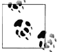

在这个上下文中，`this` 关键字将包含对点击事件目标对象的引用。

❸ 在这一行，我创建一个新的 JavaScript 日期对象并将其存储在名为 `date` 的变量中。最初，这个日期将指向它被创建的那个特定时间点，因此在下一行，我从 `getDate()` 函数的结果中减去 `dayOffset`，然后使用 `setDate()` 重新指向日期。

❹ 在这里，我构建一个 MM/DD/YYYY 格式的日期字符串，并将其作为 `currentDate` 保存到 `sessionStorage` 中。

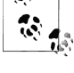

日期对象的 `getMonth()` 方法返回 0–11 的值，其中一月是 0。因此，我必须在它上面加 1 才能为格式化字符串生成正确的值。

❺ 最后，我调用 `refreshEntries()` 函数。`refreshEntries()` 函数的工作是根据日期面板上点击的日期适当地更新传入的日期面板。目前，我将它设置为用所选日期更新日期面板的工具栏标题，这样你就可以看到它正在工作。如果没有它，你只会看到图 5-1 所示的“Date”这个词。图 5-2 显示了 `refreshEntries()` 函数运行时的效果。

以下是 `refreshEntries()` 函数的代码：

```
function refreshEntries() {
    var currentDate = sessionStorage.currentDate;
    $('#date h1').text(currentDate);
}
```

接下来，我们将转向一种更强大、更复杂的客户端数据存储方法，我们将用它来存储用户在日期面板上的食物条目。

## 客户端数据库

在 HTML5 的所有令人兴奋的特性中，最让我震撼的是客户端数据库支持。它允许开发者使用一个简单但强大的 JavaScript 数据库 API 以关系格式存储持久数据。

开发者可以使用标准 SQL 语句来创建表；插入、更新、选择和删除行；等等。JavaScript 数据库 API 甚至支持事务。

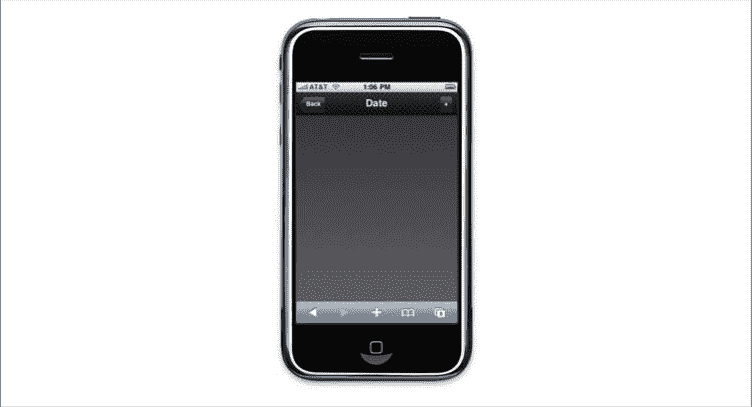

图 5-1. 在 refreshEntries() 函数之前，标题只显示“Date”

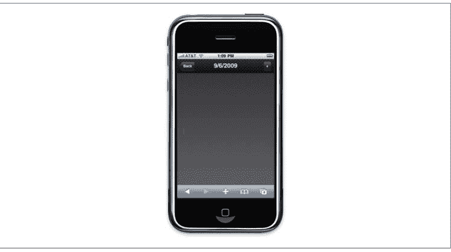

图 5-2. 在 refreshEntries() 函数之后，标题反映了选定的日期

我们在这里谈论的是 SQL，所以存在固有的复杂性。尽管如此，这是一个改变游戏规则的特性，所以花时间理解它将得到很好的回报。

### 创建数据库

现在我们的日期面板知道了用户选择了什么日期，我们有了允许用户创建条目所需的所有信息。在编写 createEntry 函数之前，我们需要设置一个数据库表来存储提交的数据。我将向 kilo.js 中添加一些代码来完成这个操作：

```
var db;
$(document).ready(function(){
  $('#settings form').submit(saveSettings);
  $('#settings').bind('pageAnimationStart', loadSettings);
  $('#dates li a').click(function(){
    var dayOffset = this.id;
    var date = new Date();
    date.setDate(date.getDate() - dayOffset);
    sessionStorage.currentDate = date.getMonth() + 1 + '/' +
                                 date.getDate() + '/' +
                                 date.getFullYear();
    refreshEntries();
  });
  var shortName = 'Kilo';
  var version = '1.0';
  var displayName = 'Kilo';
  var maxSize = 65536;
  db = openDatabase(shortName, version, displayName, maxSize);
  db.transaction(
    function(transaction) {
      transaction.executeSql(
        'CREATE TABLE IF NOT EXISTS entries ' +
        ' (id INTEGER NOT NULL PRIMARY KEY AUTOINCREMENT, ' +
        '  date DATE NOT NULL, food TEXT NOT NULL, ' +
        '  calories INTEGER NOT NULL );'
      );
    }
  );
});
```

❶ 首先需要注意的是，我在应用程序的全局作用域中添加了一个名为 `db` 的变量。这个变量将用于保存我们建立数据库连接后的连接引用。我将它定义在全局作用域，是因为我们将在很多地方需要引用它。

❷ 在这四行代码中，我定义了 `openDatabase` 调用所需的一些变量：

- **shortName**：一个字符串，用于引用磁盘上的数据库文件。
- **version**：一个数字，你可以用它来管理当你需要更改数据库模式时的升级和向后兼容性。
- **displayName**：一个字符串，将在界面上呈现给用户。例如，显示名称出现在 iPhone 的“设置->Safari->数据库”面板中的设置应用程序里。
- **maxSize**：你认为数据库将增长到的最大千字节数。

目前浏览器供应商仍在实现数据库大小限制，因此在测试应用程序时需要进行一些试错。iPhone 上的当前默认值是 5 MB。如果你的数据库增长超过此限制，用户将被自动询问是否允许增加大小。如果允许增加，数据库大小限制将提高到 10 MB。如果拒绝增加，将返回一个 `QUOTA_ERR` 错误。有关数据库错误代码的列表，请参见表 5-1。

❸ 设置好参数后，我在这一行调用 `openDatabase` 并将连接存储在 `db` 变量中。如果数据库尚不存在，它将被创建。

现在我们有了数据库连接，我们需要创建一个 `entries` 表（如果尚不存在）。

❹ 所有数据库查询都必须在事务上下文中进行，因此我在这里通过调用 `db` 对象的 `transaction` 方法开始一个事务。剩余的几行代码组成了一个函数，该函数作为唯一参数发送给事务。

❺ 在这里，我开始一个匿名函数并将事务传递给它。老实说，将事务传递给它自己的回调函数对我来说没有意义，但这是你必须做的。

❻ 一旦进入函数内部，我调用事务对象的 `executeSql` 方法来执行一个标准的 `CREATE TABLE` 查询。

如果你现在启动该应用程序，它将在你的 iPhone 上创建一个名为 Kilo 的数据库。你可以通过在 iPhone 上导航到“设置->Safari->数据库->Kilo”来查看这一点。图 5-3 显示了数据库设置。

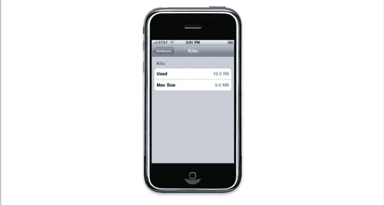


在桌面版 Safari 浏览器中，您实际上可以通过导航到“开发 -> 显示 Web 检查器”，然后点击“数据库”标签页来查看并与您的客户端数据库进行交互。（如果“开发”菜单不可用，请进入 Safari 的偏好设置，并在“高级”偏好设置页面上启用“开发”菜单。）

> “数据库”标签页在 WebKit 中被称为“存储”。我认为“存储”是一个更准确的名称，因此如果这个更改最终出现在 Safari 中，我不会感到惊讶。

桌面版 Safari 中包含的 Web 检查器在调试时非常有帮助。默认情况下，它作为当前浏览器窗口的一个窗格出现。如果您点击取消停靠图标（将鼠标悬停在左下角的图标上可以看到它们的功能），Web 检查器将出现在一个单独的窗口中，如 [图 5-4](#figure-5-4) 所示。该界面甚至允许您通过点击数据库名称向数据库发送任意 SQL 查询（参见 [图 5-5](#figure-5-5)）。

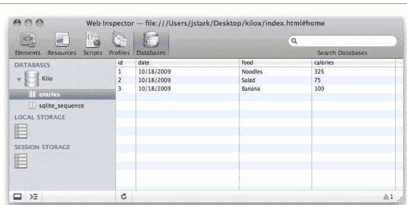

*图 5-4. Safari Web 检查器中的“数据库”标签页，显示了一些测试记录*

### 插入行

现在我们已经有了一个准备接收条目的数据库，我们可以开始构建 `createEntry()` 函数。首先，您必须重写 `#createEntry` 表单的提交事件。您可以通过在 *kilo.js* 的文档就绪函数中将 `createEntry()` 函数绑定到提交事件来实现（这里我只展示前几行，新增的代码行以**粗体**显示）：

```javascript
$(document).ready(function(){
    $('#createEntry form').submit(createEntry);
    $('#settings form').submit(saveSettings);
});
$('#settings').bind('pageAnimationStart', loadSettings);
```

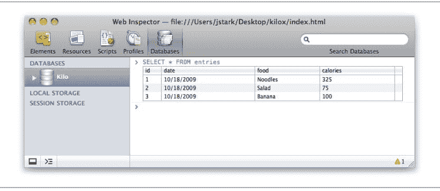

*图 5-5. Safari Web 检查器中的“数据库”标签页允许您对数据库执行任意 SQL 语句*

现在，当用户提交 #createEntry 表单时，createEntry() 函数将被调用。接下来，将以下内容添加到 kilo.js 中以在数据库中创建记录：

```javascript
function createEntry() {
    var date = sessionStorage.currentDate;
    var calories = $('#calories').val();
    var food = $('#food').val();
    db.transaction(
        function(transaction) {
            transaction.executeSql(
                'INSERT INTO entries (date, calories, food) VALUES (?, ?, ?);',
                [date, calories, food],
                function(){
                    refreshEntries();
                    jQT.goBack();
                },
                errorHandler
            );
        }
    );
    return false;
}
```

1.  我设置了一些将在 SQL 查询中使用的变量。如果您还记得，用户在日期面板上点击的日期将存储在 `sessionStorage.currentDate` 中。另外两个值（卡路里和食物）使用我们之前在设置表单中看到的相同方法从数据输入表单中提取。
2.  然后，我打开一个数据库事务并运行一个 `executeSql()` 调用。这里我向 `executeSql()` 方法传递了四个参数：
    *   `'INSERT INTO entries (date, calories, food) VALUES (?, ?, ?);'` - 这是将被执行的语句。问号是数据占位符。
    *   `[date, calories, food]` - 这是发送到数据库的值的数组。它们在位置上与 SQL 语句中的数据占位符问号对应。
    *   `function(){refreshEntries();jQT.goBack();}` - 如果 SQL 查询成功，这个匿名函数将执行。
    *   `errorHandler` - 这是如果 SQL 查询失败时将执行的函数名称。

### 错误处理

假设插入成功，作为第三个参数传递的匿名函数将被执行。它调用 `refreshEntries()` 函数（目前只更新日期面板的标题，但很快将使您创建的条目显示在那里），并调用 jQTouch 的 `goBack()` 函数以关闭新建条目面板并返回日期面板。

如果插入不成功，`errorHandler()` 函数将运行。将以下内容添加到 `kilo.js` 文件：

```javascript
function errorHandler(transaction, error) {
    alert('Oops. Error was '+error.message+' (Code '+error.code+')');
    return true;
}
```

错误处理程序接收两个参数：事务对象和错误对象。这里，我使用错误对象向用户提醒抛出的消息和错误代码。

错误处理程序必须返回 true 或 false。当错误处理程序返回 true（即“是的，这是一个致命错误”）时，执行停止，整个事务回滚。当错误处理程序返回 false（即“不，这不是一个致命错误”）时，执行将继续。

在某些情况下，您可能希望根据错误类型进行分支，以决定是否应返回 true 或 false。表 5-1 显示了根据 W3C Web 数据库工作草案规范的当前可能的错误代码。

**表 5-1. Web 数据库错误代码**

| 常量 | 代码 | 情况 |
|---|---|---|
| UNKNOWN_ERR | 0 | 事务因与数据库本身无关且未被任何其他错误代码涵盖的原因而失败。 |
| DATABASE_ERR | 1 | 语句因未被任何其他错误代码涵盖的数据库原因而失败。 |
| VERSION_ERR | 2 | 操作失败，因为实际数据库版本不是应有的版本。例如，语句发现实际数据库版本与数据库或 DatabaseSync 对象的预期版本不再匹配，或者 Database.changeVersion() 或 DatabaseSync.changeVersion() 方法传递的版本与实际数据库版本不匹配。 |
| TOO_LARGE_ERR | 3 | 语句失败，因为从数据库返回的数据太大。SQL LIMIT 修饰符可能有助于减小结果集的大小。 |
| QUOTA_ERR | 4 | 语句失败，因为剩余存储空间不足，或存储配额已用完，用户拒绝为数据库提供更多空间。 |
| SYNTAX_ERR | 5 | 语句因语法错误而失败，或参数数量与语句中的 ? 占位符数量不匹配，或语句尝试使用不允许的语句（如 BEGIN、COMMIT 或 ROLLBACK），或语句尝试使用可以修改数据库的动词但事务是只读的。 |
| CONSTRAINT_ERR | 6 | INSERT、UPDATE 或 REPLACE 语句因约束失败而失败。例如，正在插入一行，且为给主键列提供的值与现有行的值重复。 |
| TIMEOUT_ERR | 7 | 在合理时间内无法获取事务的锁。 |

您可能已经注意到，除了错误对象之外，错误处理函数还接受一个事务对象。可以想见，在某些情况下，您可能希望在错误处理程序内部执行 SQL 语句，也许是为了记录错误或记录一些元数据以进行调试或崩溃报告。事务对象参数允许您在错误处理程序内部进行更多 `executeSql()` 调用，如下所示：

```javascript
function errorHandler(transaction, error) {
  alert('Oops. Error was '+error.message+' (Code '+error.code+')');
  transaction.executeSql('INSERT INTO errors (code, message) VALUES (?, ?);',
                        [error.code, error.message]);
  return false;
}
```

请特别注意，如果我希望我的 `executeSql()` 语句运行，我必须从错误处理程序返回 false。如果我返回 true（或根本不返回），整个事务（包括这条 SQL 语句）将被回滚，从而阻止预期的结果。

#### 事务回调处理程序

尽管我不会在我的示例中这样做，但您应该知道您还可以在事务方法本身上指定成功和错误处理程序。这为您在一个长系列 `executeSql()` 语句完成后执行代码提供了一个方便的位置。

奇怪的是，事务方法回调的参数顺序被定义为先 error，然后 success（与 `executeSql()` 的顺序相反）。以下是添加了事务回调的 `createEntry()` 函数版本：

```javascript
function createEntry() {
    var date = sessionStorage.currentDate;
    var calories = $('#calories').val();
    var food = $('#food').val();
    db.transaction(
        function(transaction) {
            transaction.executeSql(
                'INSERT INTO entries (date, calories, food) VALUES (?, ?, ?);',
                [date, calories, food],
                function(){
                    refreshEntries();
                    jQT.goBack();
                },
                errorHandler
            );
        },
        transactionErrorHandler,
        transactionSuccessHandler
    );
    return false;
}
```

### 选择行与处理结果集

下一步是扩展 `refreshEntries()` 函数，使其不仅仅是将标题栏设置为所选日期。具体来说，我将查询数据库以获取所选日期的条目，然后使用隐藏的 `entryTemplate` HTML 作为结构，将它们追加到 `#date ul` 元素。我们有一段时间没看那段代码了，所以再次展示日期面板：

```html
<div id="date">
    <div class="toolbar">
        <h1>Date</h1>
        <a class="button back" href="#">Back</a>
        <a class="button slideup" href="#createEntry">+</a>
    </div>
    <ul class="edgetoedge">
        <li id="entryTemplate" class="entry" style="display:none">❶
            <span class="label">Label</span>
            <span class="calories">000</span>
            <span class="delete">Delete</span>
        </li>
    </ul>
</div>
```

❶ 回想一下，我设置了 `li` 的 `style` 属性为 `display: none`，这使其不会在页面上显示。我这样做是为了可以将该 HTML 代码片段用作数据库行的模板。

这是完整的 `refreshEntries()` 函数，你必须用它来替换现有的 `refreshEntries()` 函数：

```javascript
function refreshEntries() {
    var currentDate = sessionStorage.currentDate;❶
    $('#date h1').text(currentDate);
    $('#date ul li:gt(0)').remove();❷
    db.transaction(❸
        function(transaction) {
            transaction.executeSql(
                'SELECT * FROM entries WHERE date = ? ORDER BY food;',❹
                [currentDate],❺
                function (transaction, result) {❻
                    for (var i=0; i < result.rows.length; i++) {
                        var row = result.rows.item(i);❼
                        var newEntryRow = $('#entryTemplate').clone();❽
                        newEntryRow.removeAttr('id');
                        newEntryRow.removeAttr('style');
                        newEntryRow.data('entryId', row.id);❾
                        newEntryRow.appendTo('#date ul');❿
                        newEntryRow.find('.label').text(row.food);
                        newEntryRow.find('.calories').text(row.calories);
                    }
                },
                errorHandler
            );
        }
    );
}
```

- ❶ 这两行将日期面板的工具栏标题设置为 `sessionStorage` 中保存的 `currentDate` 值的内容。
- ❷ 在这一行，我使用了 jQuery 的 `gt()` 函数（`gt` 代表 “greater than”），用于选择并移除索引大于 0 的任何 `li` 元素。第一次执行时，这不会产生任何作用，因为唯一的 `li` 是 `id` 为 `entryTemplate` 的那个，其索引为 0。然而，在后续访问页面时，我们需要在再次追加数据库行之前移除任何额外的 `li`。否则，条目最终会在列表中出现多次。
- ❸ 在这三行中，我设置了数据库事务和 `executeSql` 语句。
- ❹ 这一行包含 `executeSql` 语句的第一个参数。它是一个简单的 `SELECT` 语句，问号用作数据占位符。
- ❺ 这是一个包含当前所选日期的单元素数组。这将替换 SQL 查询中的问号。注意，不需要在 `?` 周围加引号——数据的转义和引号处理是自动完成的。
- ❻ 这个匿名函数将在查询成功时被调用。它接受两个参数：`transaction` 和 `result`。

`transaction` 对象可以在成功处理器中用于向数据库发送新查询，正如我们之前在错误处理器中看到的那样。然而，在这种情况下没有必要这样做，所以我们不会使用它。

`result` 对象是我们最感兴趣的。它有三个只读属性：`rowsAffected`，你可以用它来确定插入、更新或删除查询影响的行数；`insertId`，返回插入操作中创建的最后一行的主键；以及 `rows`，其中包含找到的记录。

`rows` 对象将包含 0 个或多个 `row` 对象，并且还有一个 `length` 属性，我在下一行的 `for` 循环中使用了它。

- 7. 在这一行，我使用 `rows` 对象的 `item()` 方法将 `row` 变量设置为当前行的内容。
- 8. 在这一行，我 `clone()` 模板 `li`，并在接下来的两行中移除其 `id` 和 `style` 属性。移除 `style` 会使行可见，而移除 `id` 很重要，因为否则我们最终会在页面上出现多个具有相同 `id` 的元素。
- 9. 在这一行，我将行的 `id` 属性的值存储为 `li` 本身的数据（如果用户决定删除条目，我们稍后会需要这个）。
- 10. 这是我将 `li` 元素追加到父 `ul` 的地方。在接下来的两行中，我用 `row` 对象中的相应数据更新 `li` 的 `label` 和 `calories` span 子元素。

所有这些完成后，我们的日期面板将显示与所选日期对应的数据库中的每一行，每个 `li` 代表一行。每一行将有一个标签、卡路里和一个删除按钮。一旦我们创建了几行，你会看到我们需要添加一些 CSS 来美化样式（图 5-6）。

将以下 CSS 保存到名为 `kilo.css` 的文件中：

```css
#date ul li {
    position: relative;
}
#date ul li span {
    color: #FFFFFF;
    text-shadow: rgba(0,0,0,.7) 0 1px 2px;
}
#date ul li .delete {
    position: absolute;
    top: 5px;
    right: 6px;
    font-size: 12px;
    line-height: 30px;
    padding: 0 3px;
    border-width: 0 5px;
    -webkit-border-image: url(themes/jqt/img/button.png) 0 5 0 5;
}
```

现在，通过在 `index.html` 的 `head` 部分添加以下行来链接 *kilo.css*：

```html
<link type="text/css" rel="stylesheet" media="screen" href="kilo.css">
```

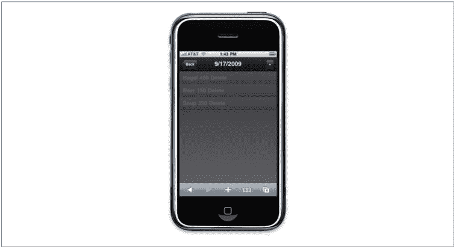
*图 5-6。条目现在显示出来了，但需要用一些 CSS 来美化*

虽然删除按钮现在看起来像按钮了，但目前点击它们不会执行任何操作（见[图 5-7]）。这是因为我是使用 *span* 标签设置的，而 span 标签在 HTML 页面中不是交互元素。

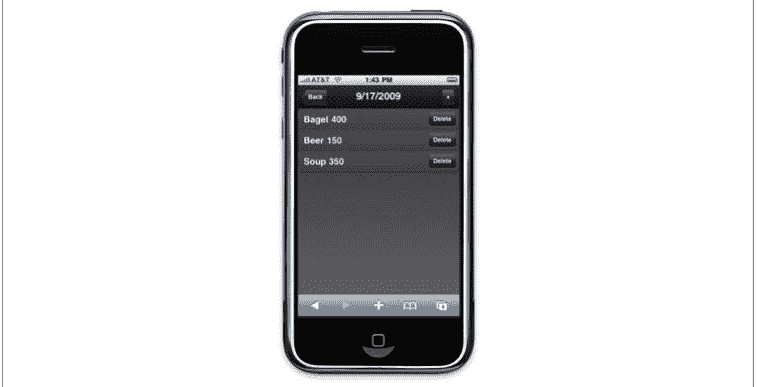
*图 5-7。应用了 CSS 的条目*

### 删除行

要使我的删除按钮在点击时执行操作，我需要使用 jQuery 为它们绑定一个点击事件处理器。我之前在日期面板的项目上做过类似的事情，使用了 jQuery 的 `click()` 方法。

不幸的是，这种方法在这种情况下不起作用。与日期面板上的项目不同，日期面板上的条目不是静态的——它们在用户会话过程中被添加和删除。事实上，当应用程序启动时，日期面板上根本没有可见的条目。因此，我们在启动时没有任何东西可以绑定点击事件。

解决方案是在 `refreshEntries()` 函数创建删除按钮时为它们绑定点击事件。为此，在 `for` 循环的末尾添加以下内容：

```javascript
newEntryRow.find('.delete').click(function(){❶
    var clickedEntry = $(this).parent();❷
    var clickedEntryId = clickedEntry.data('entryId');❸
    deleteEntryById(clickedEntryId);❹
    clickedEntry.slideUp();
});
```

- ❶ 该函数首先指定我们正在查找与 `#date .delete` 选择器匹配的任何元素，并对这些元素调用 `click()` 方法。`click()` 方法接受一个匿名函数作为其唯一参数，该函数将用于处理事件。
- ❷ 当点击处理器被触发时，定位删除按钮的父元素（即 `li`）并将其存储在 `clickedEntry` 变量中。
- ❸ 在这一行，我将 `clickedEntryId` 变量设置为当 `li` 元素由 `refreshEntries()` 函数创建时我存储在其上的 `entryId` 的值。
- ❹ 在这一行，我将点击的 id 传递给 `deleteEntryById()` 函数，然后在下一行使用 jQuery 的 `slideUp()` 方法优雅地将 `li` 从页面上移除。

> 在场的 JavaScript 专家可能会奇怪为什么我没有使用 jQuery 的 `live()` 函数将删除处理器绑定到删除按钮上。不幸的是，`live()` 函数在 iPhone 上不能与点击事件一起工作，因为点击不是向上冒泡 DOM 的事件。有关 jQuery `live()` 函数的更多信息，请访问 [http://docs.jquery.com/Events/live#typefn](http://docs.jquery.com/Events/live#typefn)。

将以下 `deleteEntryById()` 函数添加到 `kilo.js` 中，以从数据库中删除条目：

```javascript
function deleteEntryById(id) {
    db.transaction(
        function(transaction) {
```


## 什么是OCR？

OCR（光学字符识别）技术可以将图像中的文字转换为可编辑的文本。在扫描文档时，OCR软件会识别图片中的字符并输出为文本格式。

### OCR的工作原理

1.  **图像预处理**：对扫描图像进行降噪、倾斜校正等操作。
2.  **字符分割**：将图像中的文字区域切割成单个字符或词组。
3.  **特征提取**：分析每个字符的形状、结构等特征。
4.  **模式匹配**：将提取的特征与字库中的模板进行比对。
5.  **后处理纠错**：根据语言模型和上下文对识别结果进行修正。

### 常见OCR错误类型

在使用OCR技术时，可能会遇到以下几类错误：

-   **形近字混淆**：例如将“己”识别为“已”或“巳”。
-   **标点符号误判**：例如将英文句号“.”误认为中文句号“。”。
-   **数字/字母混淆**：例如将数字“0”识别为字母“O”。
-   **格式丢失**：原文档的缩进、换行、表格等结构信息可能丢失。

### 如何提高OCR准确率？

-   **使用高分辨率扫描**：建议300 DPI以上。
-   **确保图像清晰**：避免模糊、倾斜、阴影。
-   **选择合适的OCR引擎**：不同引擎对不同语言和字体的支持效果不同。
-   **进行人工校对**：OCR结果通常需要人工核对修正。

```python
## 示例：简单的OCR后处理函数（伪代码）
def post_process_ocr_text(raw_text):
    # 1. 纠正常见形近字
    corrections = {'己': '已', '巳': '已'}
    for wrong, right in corrections.items():
        raw_text = raw_text.replace(wrong, right)
    
    # 2. 合并跨页段落（需根据实际分页标记处理）
    # 3. 识别标题和列表（需根据缩进和编号特征）
    # 4. 恢复段落结构
    # 5. 转换表格为Markdown
    
    return processed_text
```

如需处理特定文档，请提供OCR原始文本，我可以帮您进行更精确的后处理和格式化。


将 None 替换为 All。然后按 Control-X 退出，按 Y 保存更改，再按 Return 保存文件。接着，启动"系统偏好设置"，进入"共享"，如果需要，点击标注为"点击锁按钮以进行更改"的锁图标，并在提示时输入密码。最后，取消勾选"Web 共享"旁的复选框，然后再重新勾选（这会重启 Web 共享）。你的 Mac 上的 Web 服务器现在应该会遵循你放在 Sites 目录或其子目录中的任何 .htaccess 文件的设置。

我们的离线应用缓存现在已正常工作。下次用户浏览 http://example.com/index.html 时，页面及其资源将通过网络正常加载。在后台，清单文件中列出的所有文件将被下载到用户的本地磁盘（或她 iPhone 的闪存）中。一旦下载完成并且用户刷新页面，她将只访问本地文件。她现在可以断开互联网连接并继续访问该 Web 应用。

那么，既然用户是在她的设备上本地访问我们的文件，我们就面临一个新问题：当网站发生变更时，她如何获取更新？

当用户确实可以访问互联网并导航到我们 Web 应用的 URL 时，她的浏览器会检查我们站点上的清单文件，看它是否与本地副本匹配。如果远程清单已更改，浏览器会下载其中列出的所有文件。这些文件会在后台下载到临时缓存中。

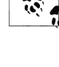

本地清单与远程清单之间的比较是对文件内容（包括注释和空行）逐字节进行的比较。文件修改时间戳和资源本身的更改在确定是否进行了更改时无关紧要。

如果在下载过程中出现问题（例如，用户失去了互联网连接），则部分下载的缓存将被自动丢弃，之前的缓存将继续生效。如果下载成功，用户下次启动应用时将使用新的本地文件。

## 应用缓存下载行为

请记住，当清单文件更新后，新文件的下载是在应用初始启动之后在后台进行的。这意味着即使在下载完成后，用户仍然在使用旧文件。换句话说，当前加载的页面及其所有相关文件不会在下载完成后自动重新加载。在后台下载的新文件要到用户重新启动应用后才会可见。

> 这与标准桌面应用的更新行为非常相似。你启动一个应用；它告诉你有可用更新；你点击下载更新；下载完成；然后提示你重新启动应用以使更新生效。

## 在线白名单和回退选项

可以强制浏览器始终通过网络访问某些资源。这意味着浏览器不会在本地缓存这些资源，并且在用户离线时这些资源将不可用。要将某个资源指定为仅在线，你可以在清单文件中使用 `NETWORK:` 关键字（末尾的 : 至关重要），如下所示：

```
CACHE MANIFEST
index.html
scripts/demo.js
styles/screen.css

NETWORK:
logo.jpg
```

在这里，我通过将 `logo.jpg` 移入清单文件的 `NETWORK` 部分，将其加入了白名单。当用户离线时，该图片将显示为断开的图片链接（图 6-1）。当用户在线时，它将正常显示（图 6-2）。

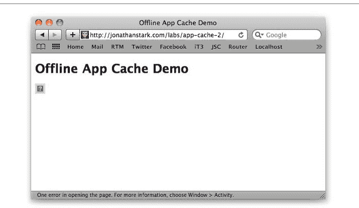
图 6-1. 加入白名单的图片在用户离线时将显示为断开的链接

如果你不希望离线用户看到断开的图片，可以使用 `FALLBACK` 关键字指定一个回退资源，如下所示：

```
CACHE MANIFEST
index.html
scripts/demo.js
styles/screen.css

FALLBACK:
logo.jpg offline.jpg
```

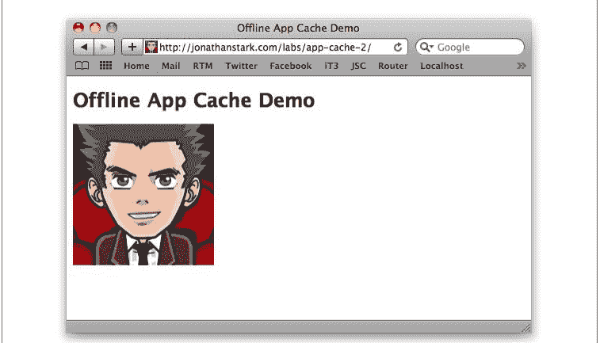
*图 6-2. 加入白名单的图片在用户在线时将正常显示*

现在，当用户离线时，他将看到 *offline.jpg*（[图 6-3](#figure-6-3)），而在线时他将看到 *logo.jpg*（[图 6-4](#figure-6-4)）。

当你考虑到可以通过使用部分路径为多个资源指定单个回退图片时，这变得更加实用。假设我在网站中添加了一个 *images* 目录并在其中放入了一些文件：

```
/demo.manifest
/index.html
/images/logo.jpg
/images/logo2.jpg
/images/offline.jpg
/scripts/demo.js
/styles/screen.css
```

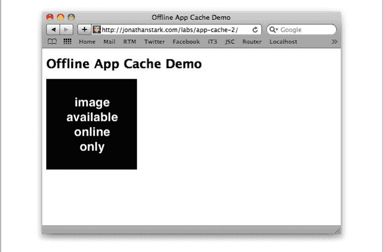
图 6-3. 回退图片将在用户离线时显示

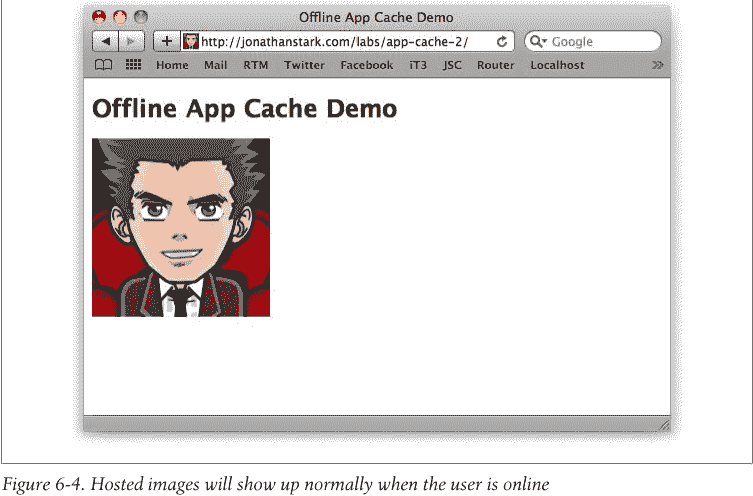
图 6-4. 托管图片在用户在线时将正常显示

现在，我可以告诉浏览器对 `images` 目录中的所有内容回退到 `offline.jpg`，如下所示：

```
CACHE MANIFEST
index.html
scripts/demo.js
styles/screen.css

FALLBACK:
images/ images/offline.jpg
```

现在，当用户离线时，他将看到 `offline.jpg`（图 6-5），而在线时他将看到 `logo.jpg` 和 `logo2.jpg`（图 6-6）。

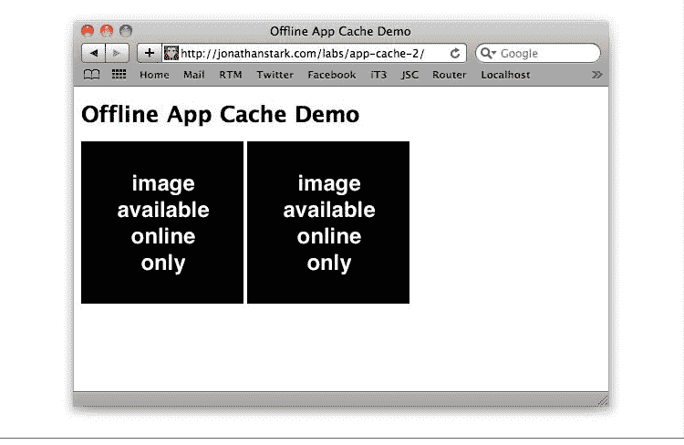
图 6-5. 同一个回退图片将在用户离线时替代多张图片显示

是否应该将资源添加到清单文件的 `NETWORK` 或 `FALLBACK` 部分取决于你的应用的性质。请记住，离线应用缓存主要用于在设备上本地存储应用。它并非真正用于减少服务器负载、提高性能等。

在大多数情况下，你应该在清单文件中列出运行应用所需的所有文件。如果你有大量的动态内容且不确定如何在清单中引用它们，那么你的应用可能不太适合使用离线应用缓存，你可能需要考虑其他方法（例如，客户端数据库）。

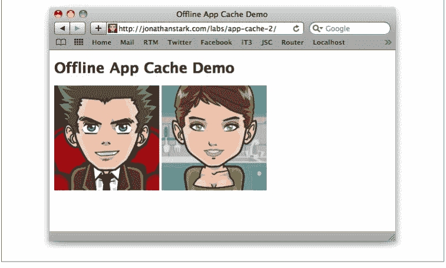
图 6-6. 托管图片在用户在线时将正常显示

## 创建动态清单文件

现在我们已经熟悉了离线应用缓存的工作原理，让我们将其应用到一直在开发的 Kilo 示例中。Kilo 包含相当多的文件，手动将它们全部列在清单文件中会很麻烦。此外，一个小小的拼写错误就会使整个清单文件失效，导致应用无法离线工作。

### 在 Web 服务器上运行 PHP 脚本

PHP 是一种通用的 Web 脚本语言，受到大多数 Web 托管提供商的支持。这意味着在大多数 Web 服务器上，你可以创建一个文件名以 *.php* 扩展名结尾的文件，向其中添加一些 PHP 代码，在 Web 浏览器中访问它，它就能正常工作。如果你一直在个人电脑上使用 Web 服务器为 iPhone 提供页面，则需要配置好运行 PHP 脚本的环境。如果你在 Windows 上运行 Web 服务器，请访问 http://php.net/manual/en/install.windows.php 获取下载和相关信息。PHP 在 Linux 上很容易安装（例如，Ubuntu 用户只需在 shell 提示符下输入 `sudo aptitude install apache2 php5`）。

Mac 自带 PHP，但你需要执行一个步骤来启用它。类似于你在第 92 页"Mac OS X 与 .htaccess 文件"中的操作，打开"应用程序 $\rightarrow$ 实用工具 $\rightarrow$ 终端"并输入以下命令（需要在提示时输入密码）：

```bash
cd /etc/apache2
sudo pico httpd.conf
```

接下来，按 Control-W。这将打开文件搜索选项。输入"php5"然后按 Return。这将带你到一行，内容应该如下所示：

`#LoadModule php5_module libexec/apache2/libphp5.so`

使用方向键移动到行首，删除 # 注释字符，它是阻止此行生效的原因。然后按 Control-X 退出，按 Y 保存更改，再按 Return 保存文件。接下来，启动"系统偏好设置"，进入"共享"，如果需要，点击标注为"点击锁按钮以进行更改"的锁图标并在提示时输入密码。然后，取消勾选"Web 共享"旁的复选框，再重新勾选。现在你的 Mac 的 Web 服务器上应该已启用 PHP。

接着，在你的主目录的 Sites 子目录中创建一个名为 test.php 的文件，内容如下：

```php
<?php
  phpinfo();
?>
```

最后，在浏览器中访问以下 URL：http://localhost/~YOURUSERNAME/test.php。将 YOURUSERNAME 替换为你的用户名，但不要删除 ~。（你可以在终端中输入 `echo $USER` 并按 Return 来查看你的用户名。）如果 PHP 正常工作，你将看到一个表格，显示你的 PHP 版本号以及许多其他关于 PHP 安装的信息。如果它不工作，你将只看到一个空白页面。访问 http://www.php.net/support.php 获取使用 PHP 的文档和帮助资源链接。

为了解决这个问题，我们将编写一个小的 PHP 文件，读取应用目录（及其子目录）的内容并为我们创建文件列表。在你的 Kilo 目录中创建一个新文件，命名为 manifest.php，并添加以下代码：

```php
<?php
header('Content-Type: text/cache-manifest');
echo "CACHE MANIFEST\n";

$dir = new RecursiveDirectoryIterator(".");
foreach(new RecursiveIteratorIterator($dir) as $file) {
    if ($file->isFile() &&
        $file != "./manifest.php" &&
        substr($file->getFilename(), 0, 1) != ".")
    {
        echo $file . "\n";
    }
}
?>
```

① 我使用 PHP 的 header 函数以 cache-manifest 内容类型输出此文件。这样做是使用 .htaccess 文件为清单文件指定内容类型的替代方法。实际上，如果你没有在其他地方使用它，可以删除你在第 92 页"离线应用基础知识"中创建的 .htaccess 文件。


## Debugging

Applications that use offline application caching can be difficult to debug because there is very little visibility into what is happening. You will constantly wonder whether a file has been downloaded, or if you are viewing a remote resource or a local one. Furthermore, switching between online and offline modes on a device is not a lightweight operation, which can seriously slow down the development, testing, and debugging cycle.

When problems arise, there are two methods that can help you determine what is happening: setting some console logs in JavaScript and browsing the application cache database.

If you want to see what is happening from the perspective of the Web server, you can monitor its log files. For example, if you are running a Web server on a Mac computer, you can open a terminal window (Applications $\rightarrow$ Utilities $\rightarrow$ Terminal) and run the following commands (the $ is the terminal shell prompt and should not be typed):

```
$ cd /var/log/apache2/
$ tail -f access_log
```

This will display the Web server's log entries, showing information such as the date and time the document was accessed and the document name. When finished, press Control-C to stop tracking the logs.

### JavaScript Console

During development, adding the following JavaScript to your Web application will make your life much easier and help you internalize the processes taking place. The following script sends feedback to the console, eliminating the need to constantly refresh the browser window (you can store the script in a .js file referenced by the `src` attribute of a `script` element in the .html document):

```
// Convenience array for status values
var cacheStatusValues = [];
cacheStatusValues[0] = 'uncached';
cacheStatusValues[1] = 'idle';
cacheStatusValues[2] = 'checking';
cacheStatusValues[3] = 'downloading';
cacheStatusValues[4] = 'updateready';
cacheStatusValues[5] = 'obsolete';

// Listeners for all possible events
var cache = window.applicationCache;
cache.addEventListener('cached', logEvent, false);
cache.addEventListener('checking', logEvent, false);
cache.addEventListener('downloading', logEvent, false);
cache.addEventListener('error', logEvent, false);
cache.addEventListener('noupdate', logEvent, false);
cache.addEventListener('obsolete', logEvent, false);
cache.addEventListener('progress', logEvent, false);
cache.addEventListener('updateready', logEvent, false);

// Log each event to the console
function logEvent(e) {
    var online, status, type, message;
    online = (navigator.onLine) ? 'yes' : 'no';
    status = cacheStatusValues[cache.status];
    type = e.type;
```


message = 'online: ' + online;
message+= ', event: ' + type;
message+= ', status: ' + status;
if (type == 'error' && navigator.onLine) {
    message+= ' (probly a syntax error in manifest)';
}
console.log(message);
}

```
// 当更新就绪时，替换新下载的文件
window.applicationCache.addEventListener(
    'updateready',
    function(){
        window.applicationCache.swapCache();
        console.log('swap cache has been called');
    },
    false
);
```

```
// 每10秒检查一次清单变化
setInterval(function(){cache.update()}, 10000);
```

这看起来可能代码很多，但实际上并没有那么复杂：

+   1. 前七行代码只是为应用程序缓存对象设置一个状态值数组。HTML5规范定义了六种可能的值，这里我将它们的整数值映射到一个简短的描述（例如，状态3表示“正在下载”）。我这样设置是为了在logEvent函数中让日志描述更详细。
2. 在接下来的代码块中，我为规范定义的每个可能事件都设置了一个事件监听器。每个监听器都调用logEvent函数。
3. logEvent函数以事件作为输入，并进行一些简单的计算来组合一条描述性的日志消息。注意，如果事件类型是error并且用户在线，那么远程清单中很可能存在语法错误。清单中的语法错误极其容易出现，因为所有路径都必须有效。如果你重命名或移动了一个文件，但忘记更新清单，未来的更新将会失败。
4. 一旦组合好消息，我就将其发送到控制台。

你可以在桌面版Safari中通过选择“开发”→“显示错误控制台”来查看控制台消息。你可以在iPhone模拟器中通过进入“设置”→“Safari”→“开发者”并打开“调试控制台”来查看控制台消息。当调试功能打开时，Mobile Safari会在地址栏上方显示一个标题栏（图6-7），允许你导航到调试控制台（图6-8）。

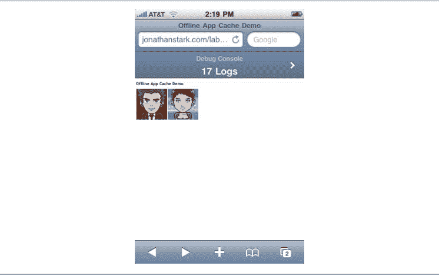

图6-7. 调试功能已开启的Mobile Safari

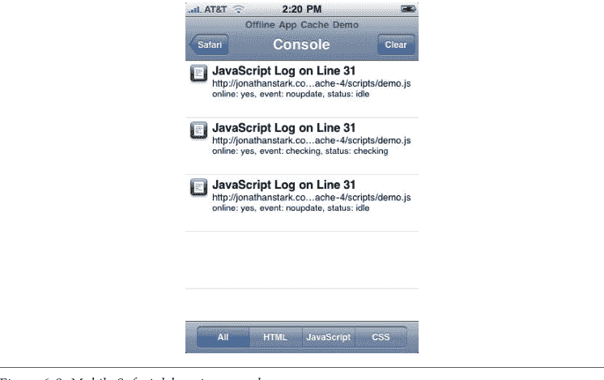

图6-8. Mobile Safari调试控制台

如果你在Safari菜单栏中没有看到“开发”菜单，请打开Safari应用程序偏好设置，点击“高级”选项卡，并确保勾选了“在菜单栏中显示开发菜单”。

如果你在浏览器中加载网页然后打开控制台，你会看到每10秒出现新的消息（图6-9）。如果你什么也没看到，请更新`demo.manifest`中的版本号，然后在浏览器中*重新加载页面两次*。我强烈建议你尝试操作一下，直到你真正理解其中的原理。你可以修改清单（更改内容并保存，重命名，移动到另一个目录等），然后像变魔术一样在控制台中看到你操作的结果。

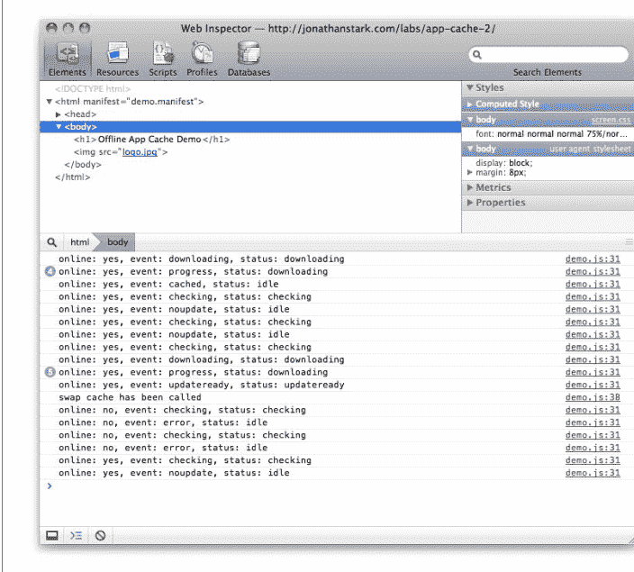

图6-9. console.log()函数可用于将调试消息发送到JavaScript控制台

## 应用程序缓存数据库

如果你在调试离线Web应用时遇到严重困难，有一种方法可以深入探究，查看到底发生了什么。如果你在iPhone模拟器中加载你的应用，它会将缓存的资源存储在一个SQLite数据库中，你可以使用sqlite3命令行界面来浏览。当然，具备一些SQL知识会有所帮助，但通过模仿本节中的例子，你也能取得不错的进展。

你需要从Apple安装iPhone SDK才能获得模拟器。你可以通过在<http://developer.apple.com/iphone/>注册为Apple开发者来获取SDK。注册是免费的，但如果你想将应用提交到App Store，你需要注册iPhone开发者计划（请注意，Apple开发者与iPhone开发者是不同的）。

在我的机器上，iPhone模拟器的应用程序缓存数据库位于：

```
/Users/jstark/Library/Application Support/iPhone
Simulator/User/Library/Caches/com.apple.WebAppCache/ApplicationCache.db
```

除非你至少在iPhone模拟器上加载过该Web应用，否则`com.apple.WebAppCache`目录和`ApplicationCache.db`数据库将不会存在。

使用sqlite3命令行界面，你可以在数据库中探索以了解情况。首先，你必须连接到数据库。打开“终端”（应用程序→实用工具→终端）并输入以下命令。（$是终端提示符，不应输入。）

```
$ cd "$HOME/Library/Application Support/iPhone Simulator"
$ cd User/Library/Caches/com.apple.WebAppCache/
$ sqlite3 ApplicationCache.db
```

在Mac上，桌面版Safari的应用程序缓存位于临时目录相邻的目录中。你可以在终端中通过以下命令访问它：

```
$ cd $TMPDIR/../-Caches-/com.apple.Safari/
$ sqlite3 ApplicationCache.db
```

连接后，你会看到类似这样的内容：

```
SQLite version 3.6.17
Enter ".help" for instructions
Enter SQL statements terminated with a ";"
sqlite>
```

现在你可以在sqlite>提示符下输入SQLite控制语句和任意SQL命令。要查看SQLite控制语句列表，请在提示符下输入.help。你会看到一长串命令，其中对我们目的最重要的是：

.exit                 退出此程序
.header(s) ON|OFF     打开或关闭显示表头
.help                 显示此消息
.mode MODE ?TABLE?    设置输出模式，其中MODE是以下之一：
                        csv       逗号分隔值
                        column    左对齐列。（参见.width）
                        html      HTML <table> 代码
                        insert    针对TABLE的SQL插入语句
                        line      每行一个值
                        list      由.separator字符串分隔的值
                        tabs      制表符分隔值
                        tcl       TCL列表元素
.quit                 退出此程序
.tables ?PATTERN?     列出匹配LIKE模式的表名

要检索缓存清单数据库中使用的表列表，请使用.tables命令：

```
sqlite> .tables
CacheEntries          CacheResourceData  CacheWhitelistURLs  FallbackURLs
CacheGroups           CacheResources     Caches
```

在开始查询表之前，我将设置.headers为ON，这会为输出添加字段名，并将.mode设置为line以便更容易阅读。输入粗体显示的命令（sqlite>是SQLite提示符）：

```
sqlite> .headers on
sqlite> .mode line
```

CacheGroups是数据模型的顶层。它包含清单的每个版本一行。输入粗体显示的命令（不要忘记分号;）：

```
sqlite> select * from CacheGroups;
         id = 1
manifestHostHash = 2669513278
    manifestURL = http://jonathanstark.com/labs/kilo10/kilo.manifest
    newestCache = 7

         id = 2
manifestHostHash = 2669513278
    manifestURL = http://jonathanstark.com/labs/cache-manifest-bug/test.manifest
    newestCache = 6

         id = 5
manifestHostHash = 2669513278
    manifestURL = http://jonathanstark.com/labs/kilo11/kilo.manifest
    newestCache = 13

         id = 6
manifestHostHash = 2669513278
manifestURL = http://jonathanstark.com/labs/app-cache-3/demo.manifest
newestCache = 14
```

如你所见，我的机器上有四个缓存组。此时你可能只有一个。字段分解如下：

**id**

分配给该行的唯一自增序列号。每次Mobile Safari向此表插入一行时，此数字都会递增。如果由于某种原因，Mobile Safari需要删除一行，你会看到序列中出现间隙。

**manifestHostHash**

与`manifestURL`一起用于唯一标识缓存。

**manifestURL**

远程清单文件的位置。

**newestCache**

这是一个Caches行的ID（即，指向Caches表的*外键*），指示使用哪个缓存。

> 数据库表中的列在标识某些内容时被视为*键*。例如，*唯一键*明确地标识表中的一行。*主键*是被指定为用于标识行的*主要*唯一键。例如，`CacheGroups`表中对于任何给定的这些列值都只有一行，因此有两个列是潜在的唯一键：`id`和`manifestURL`。然而，`id`是一个简单的数字键，对其进行比较非常快（并且其他表引用它所需的存储空间更少）。所以，`id`既是`CacheGroups`表的唯一键，也是主键。

外键是从一个表到另一个表的链接。`Caches`表中的`cacheGroup`列（接下来讨论）标识`CacheGroups`表中的一行，建立从一个表中的行到另一个表中行的链接。

现在，切换到列模式并从`Caches`表中选择所有行：

```
sqlite> .mode column
sqlite> select * from Caches;
id          cacheGroup
----------  ----------
6           2
7           1
13          5
14          6
```

`Caches`表只有两个字段：`id`（Caches行的主键）和`cacheGroup`（将Caches的`id`链接到`CacheGroups`表中一行的外键）。如果Safari正在下载新缓存，那么`CacheGroup`将有两个Cache行（一个当前，一个临时）。在所有其他情况下，每个`CacheGroup`只有一个Cache行。


接下来，我们从 CacheEntries 表中选择所有行：

```
sqlite> select * from CacheEntries;
cache   type    resource
-------- ------ --------
6       1      67
6       4      68
6       2      69
7       4      70
7       4      71
7       4      72
7       4      73
7       2      74
7       4      75
7       4      76
7       4      77
7       1      78
7       4      79
13      4      160
13      4      161
13      4      162
13      4      163
13      2      164
13      4      165
13      4      166
13      4      167
13      4      168
13      1      169
13      4      170
13      4      171
13      4      172
13      4      173
13      4      174
13      4      175
14      4      176
14      16     177
14      4      178
14      1      179
14      4      180
14      2      181
```

这里没什么可看的。只有两个外键（`cache` 是指向 `Caches.id` 列的外键，`resource` 是指向 `CacheResources.id` 的外键）和一个类型字段。我将重新执行该查询并联接到 `CacheResources` 表，以便你能看到类型如何对应到实际文件。请注意，我首先设置了列宽，这样 URL 就不会被截断（`...>` 提示符表示我在输入分号 `;` 终止符之前按下了回车键）：

```
sqlite> .width 5 4 8 24 80
sqlite> select cache, type, resource, mimetype, url
   ...> from CacheEntries,CacheResources where resource=id order by type;
-- -- -- -------- ------------------------------
6   1   67      text/htm...  http://jonathanstark.com/labs/cache-manifest-bug/
7   1   78      text/htm...  http://jonathanstark.com/labs/kilo10/#home
13  1   169     text/htm...  http://jonathanstark.com/labs/kilo11/#home
14  1  179 text/htm... http://jonathanstark.com/labs/app-cache-3/
6   2  69  text/cac... http://jonathanstark.com/labs/cache-manifest-bug/test.manifest
7   2  74  text/cac... http://jonathanstark.com/labs/kilo10/kilo.manifest
13  2  164 text/cac... http://jonathanstark.com/labs/kilo11/kilo.manifest
14  2  181 text/cac... http://jonathanstark.com/labs/app-cache-3/demo.manifest
6   4  68  image/pn... http://jonathanstark.com/labs/kilo10/icon.png
7   4  70  text/css... http://jonathanstark.com/labs/kilo10/jqtouch/jqtouch.css
7   4  71  image/pn... http://jonathanstark.com/labs/kilo10/icon.png
7   4  72  text/css... http://jonathanstark.com/labs/kilo10/themes/jqt/theme.css
7   4  73  image/pn... http://jonathanstark.com/labs/kilo10/startupScreen.png
7   4  75  applicat... http://jonathanstark.com/labs/kilo10/jqtouch/jqtouch.js
7   4  76  applicat... http://jonathanstark.com/labs/kilo10/kilo.js
7   4  77  applicat... http://jonathanstark.com/labs/kilo10/jqtouch/jquery.js
7   4  79  image/x-... http://jonathanstark.com/favicon.ico
13  4  160 applicat... http://jonathanstark.com/labs/kilo11/kilo.js
13  4  161 text/css... http://jonathanstark.com/labs/kilo11/jqtouch/jqtouch.css
13  4  162 image/pn... http://jonathanstark.com/labs/kilo11/icon.png
13  4  163 image/x-... http://jonathanstark.com/favicon.ico
13  4  165 image/pn... http://jonathanstark.com/labs/kilo11/themes/jqt/img/button.png
13  4  166 image/pn... http://jonathanstark.com/labs/kilo11/themes/jqt/img/chevron.png
13  4  167 text/css... http://jonathanstark.com/labs/kilo11/themes/jqt/theme.css
13  4  168 applicat... http://jonathanstark.com/labs/kilo11/jqtouch/jquery.js
13  4  170 applicat... http://jonathanstark.com/labs/kilo11/jqtouch/jqtouch.js
13  4  171 image/pn... http://jonathanstark.com/labs/kilo11/themes/jqt/img/back_button.png
13  4  172 image/pn... http://jonathanstark.com/labs/kilo11/themes/jqt/img/toolbar.png
13  4  173 image/pn... http://jonathanstark.com/labs/kilo11/startupScreen.png
13  4  174 image/pn... http://jonathanstark.com/labs/kilo11/themes/jqt/img/back_button_clicked.png
13  4  175 image/pn... http://jonathanstark.com/labs/kilo11/themes/jqt/img/button_clicked.png
14  4  176 text/htm... http://jonathanstark.com/labs/app-cache-3/index.html
14  4  178 applicat... http://jonathanstark.com/labs/app-cache-3/scripts/demo.js
14  4  180 text/css... http://jonathanstark.com/labs/app-cache-3/styles/screen.css
14  16 177 image/jp... http://jonathanstark.com/labs/app-cache-3/images/offline.jpg
```

查看此列表可以发现，类型 1 表示宿主文件，类型 2 是清单文件，类型 4 是任何普通的静态资源，类型 16 是后备资源。

让我们切换回行模式，从 `CacheResources` 表中提取一些数据，看看那里发生了什么。以下是资源行 73（如果你自己尝试，请将 73 替换为之前查询 `CacheResources` 表得到的某个有效 id 值）：

```
sqlite> .mode line
sqlite> select * from CacheResources where id=73;
           id = 73
           url = http://jonathanstark.com/labs/kilo10/startupScreen.png
    statusCode = 200
   responseURL = http://jonathanstark.com/labs/kilo10/startupScreen.png
     mimeType = image/png
textEncodingName = 
       headers = Date:Thu, 24 Sep 2009 19:16:09 GMT
       X-Pad:avoid browser bug
Connection:close
Content-Length:12303
Last-Modified:Fri, 18 Sep 2009 05:02:26 GMT
Server:Apache/2.2.8 (Fedora)
Etag:"52c88b-300f-473d309c45c80"
Content-Type:image/png
Accept-Ranges:bytes
```

data = 73

如果你熟悉 HTTP 请求的工作方式，你会认出这正是伪造网络响应所需的数据。这里 Mobile Safari 拥有向浏览器（或在这种情况下，是向它自己；它存储了重现最初提供该文件的 Web 服务器行为所需的所有信息）提供 PNG 文件所需的所有信息。

嗯，事实上，它拥有所有信息，除了实际的图像数据。图像数据存储在 `CacheResourceData` 的一个 blob 字段中。我本想在此包含它，但它是二进制数据，没什么好看的。有趣的是，即使是文本数据文件（HTML、CSS、JavaScript 等）也以二进制数据的形式存储在 `CacheResourceData` 的 blob 字段中。

让我们看看 `CacheWhitelistURLs` 表，它包含清单中 `NETWORK:` 部分标识的所有元素：

```
sqlite> .width 80 5
sqlite> .mode column
sqlite> select * from CacheWhitelistURLs;
url                                                                     cache
---------------------------------------------------------------------- -------
http://jonathanstark.com/labs/kilo10/themes/jqt/img/back_button.png         7
http://jonathanstark.com/labs/kilo10/themes/jqt/img/back_button_clicked.png 7
http://jonathanstark.com/labs/kilo10/themes/jqt/img/button.png             7
http://jonathanstark.com/labs/kilo10/themes/jqt/img/button_clicked.png     7
http://jonathanstark.com/labs/kilo10/themes/jqt/img/chevron.png            7
http://jonathanstark.com/labs/kilo10/themes/jqt/img/toolbar.png            7
```

这里我们只有缓存 id 和指向在线资源的 URL。如果浏览器请求缓存 id 为 7 的资源，并且用户在线，这六张图片将从它们的远程位置获取。如果用户离线，它们将显示为断开的链接，因为它们没有存储在本地。值得注意的是，即使清单中列出的是相对 URL，这里的 URL 也已被完全扩展为绝对 URL。

最后，让我们看看 `FallbackURLs` 表（来自清单的 `FALLBACK:` 部分的所有内容）：

```
sqlite> .mode line
sqlite> select * from FallbackURLs;
    namespace = http://jonathanstark.com/labs/app-cache-3/images/
 fallbackURL = http://jonathanstark.com/labs/app-cache-3/images/offline.jpg
        cache = 14
```

如你所见，我目前在 `FallbackURLs` 表中只有一行数据。如果浏览器请求缓存 id 为 14 的资源，并且任何以 `http://jonathanstark.com/labs/app-cache-3/images/` 开头的 URL 因任何原因（用户离线、图片缺失等）失败，将改用 `fallbackURL`。

如果本节内容有些复杂，我表示歉意，但目前这就是我们所掌握的全部。也许浏览器供应商将来会实现某种用户界面，允许我们浏览应用缓存——类似于本地存储和客户端数据库的界面——但在那之前，探索客户端存储深处的唯一选择就是这个。

## 你学到了什么

在本章中，你学习了如何让用户访问 Web 应用，即使他们没有互联网连接。这种离线模式适用于无论是在 Mobile Safari 中加载的应用，还是从桌面上的 Web Clip 图标以全屏模式启动的应用。有了这个编程工具箱中的新能力，你现在能够创建一个全屏、离线的应用程序，它与从 App Store 下载的原生应用程序几乎无法区分。

当然，像这样的纯 Web 应用仍然受到所有 Web 应用都存在的安全约束的限制。例如，Web 应用无法访问 iPhone 的通讯录、摄像头、加速计或振动功能。在下一章中，我将借助一个名为 PhoneGap 的开源项目来解决这些问题以及其他更多问题。

Download at WoweBook.com


## 第 7 章
### 走向原生

我们的网页应用现在可以做许多原生应用能做的事情：从主屏幕启动、在全屏模式下运行、在 iPhone 上本地存储数据，以及在离线模式下运行。我们已经为设备进行了良好的格式化，并设置了看起来像原生的动画，以向用户提供反馈和上下文。

然而，我们的应用仍然有两件事做不到：它无法访问设备特性和硬件（例如，地理位置、加速度计、声音和振动），也无法提交到 iTunes App Store。在本章中，你将学习如何使用 PhoneGap 来弥合这个，嗯...代沟，在你的，啊...手机上。好名字，对吧！

## PhoneGap 简介

PhoneGap 是由 Nitobi (http://www.nitobi.com/) 创建的开源开发工具，旨在充当网络应用程序和移动设备之间的桥梁。目前支持 iPhone、Google Android 和 BlackBerry 操作系统，Nokia 和 Windows Mobile 正在开发中。

尽管 iPhone 声名显赫，但它甚至远未成为使用最广泛的移动设备。移动设备领域充斥着各种设备、平台和操作系统。如果你是一名网页开发者，你可能熟悉在大约 10 个操作系统版本上测试大约 10 个浏览器版本的痛苦。将其乘以 100，你就得到了移动设备的现状。根本就没有一种经济高效的方式来跨所有可能的组合进行开发和测试。

感谢苹果公司，现在清楚的是，提供功能齐全的网页浏览体验的设备有市场。随着更多供应商在其手机上包含高质量的浏览器，我们在这里所做的工作变得更加有价值。通过构建网页应用，我们有效地规避了移动开发的大部分复杂性。我们可以拥有一个代码库部署到多个设备和平台上。

当然，不同的设备有不同的特性。也许某个特定的手机不支持多点触控，或者没有加速度计。即使设备具有相同的特性，每个设备向开发者暴露这些特性的方式也各不相同。

PhoneGap 为最广泛可用的移动手机特性抽象了 API，这样移动应用开发者可以在任何地方使用相同的代码。你仍然需要使用供应商提供的 SDK 手动部署你的应用，但你不需要更改你的应用程序代码。

> 还有其他项目和产品提供与 PhoneGap 相同的基本功能，例如 RhoMobile (http://rhomobile.com/) 和 Titanium Mobile (http://www.appcelerator.com/)。我对它们不够熟悉，无法进行比较和对比，但你可能想查看它们，以防其中一个比 PhoneGap 更适合你的需求。

由于这是一本关于 iPhone 的书，我将专注于 PhoneGap 的 iPhone 部分。只是请注意，你也可以只需很少或无需修改就能将你的应用部署到 Android、BlackBerry 和 Windows Mobile 设备。

> 对于 iPhone，这个 SDK 要求意味着你需要一台安装了 Xcode 的 Mac，并且你必须花钱加入 iPhone 开发者计划。对此感到抱歉。你可以通过在 http://developer.apple.com/iphone/ 注册成为 Apple 开发者来获取 SDK。注册是免费的，但如果你想将你的应用提交到 App Store 或甚至在自己的手机上运行它们，你需要注册 iPhone 开发者计划。但是，你可以使用免费的 SDK 在 iPhone 模拟器中测试你的应用，该模拟器包含在 iPhone SDK 中。在你注册为 iPhone 开发者后，返回 http://developer.apple.com/iphone/，登录并下载 iPhone SDK。iPhone SDK 包括 Xcode，这是你将用于在模拟器中测试应用、在自己的 iPhone 上运行它们以及将它们提交到 App Store 的开发环境。

要开始使用 PhoneGap，你首先需要下载它。你可以通过访问 http://github.com/phonegap/phonegap 并点击下载按钮（图 7-1）来完成。假设你使用的是 Mac，你可能想下载 ZIP 版本。下载完成后，将其解压缩到你的桌面（图 7-2）。

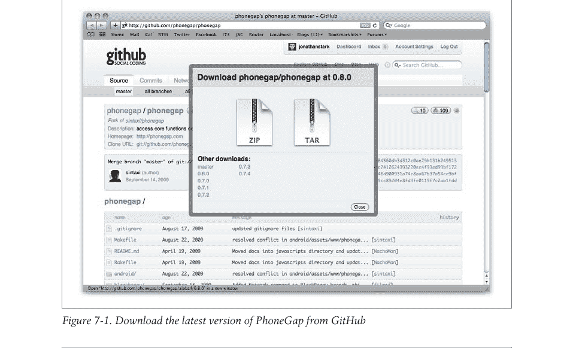

图 7-1. 从 GitHub 下载最新版本的 PhoneGap

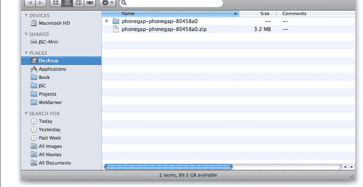

图 7-2. 将 PhoneGap 存档解压缩到你的桌面

PhoneGap 下载包含一堆特定于设备的目录（例如，*android*、*iphone*、*blackberry*、*windows mobile*），以及一些库和实用文件及目录（[图 7-3](#)）。我们唯一要查看的是 *iphone* 目录。

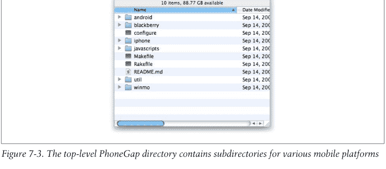

*图 7-3. PhoneGap 的顶级目录包含各种移动平台的子目录*

*iphone* 目录包含一个 Xcode 项目的起始文件（[图 7-4](#)）。这些文件并没有什么神奇之处，除了它们是*为你*编写而不是*由你*编写的；它们只是你在任何 Xcode 项目中都能找到的那种普通的源文件。

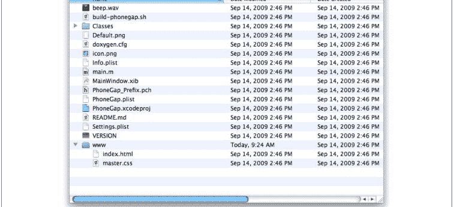

*图 7-4. PhoneGap 的 iPhone 子目录包含 Xcode 项目的起始文件*

在 *iphone* 目录内，有一个名为 *www* 的目录。你可以将其视为应用程序的 web 根目录。默认情况下，它包含两个名为 *index.html* 和 *master.css* 的示例文件。这些用作 PhoneGap 的示例应用。我们不需要它们，所以你可以删除它们两个（[图 7-5]）。

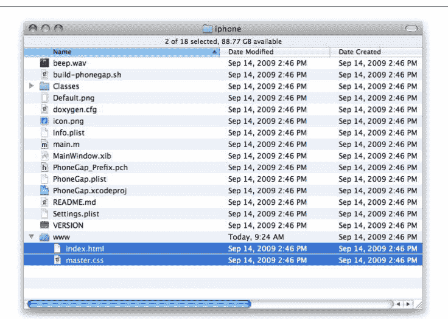

*图 7-5. 删除 www 目录中的两个默认文件*

接下来，将我们一直在开发的 Kilo 应用中的所有文件复制到 *www* 目录中（在 Mac 上，拖动文件时按住 Option 键以进行复制）。不要更改你的文件夹结构或命名；只需将所有内容按原样放入其中（[图 7-6]）。

> 如果你已经在 *index.html* 中如[第 6 章]所述添加了清单链接到 html 标签，你必须删除它。使用 PhoneGap 时这是不必要的，并且可能导致性能问题。

接下来，进入你的 *index.html* 文件，在 <head> 部分添加以下行，然后保存文件：

```
<script type="text/javascript" src="phonegap.js" charset="utf-8"></script>
```

你不需要将 *phonegap.js* 文件复制到你的 *www* 目录中。当你构建应用时，Xcode 会为你处理这个问题。

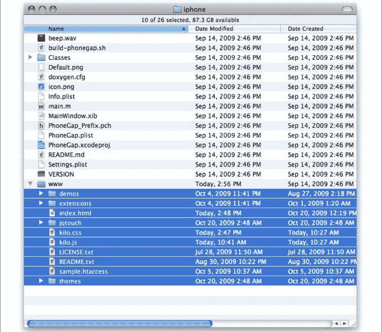

图 7-6. 将你的整个网页应用复制到 www 目录

> 确保你的应用的主页面名为 index.html；否则，PhoneGap 不知道要启动哪个文件。

难以置信的是，我们几乎准备好测试我们的应用了。通过在 Finder 中双击 PhoneGap.xcodeproj 文件在 Xcode 中打开项目。项目窗口打开后，确保你选择了最新版本的 iPhone 模拟器（截至本文写作时为 3.1.2）作为你的活动 SDK，然后点击构建并运行按钮（图 7-7）。大约 10 秒后，iPhone 模拟器应该会出现并启动你的应用。

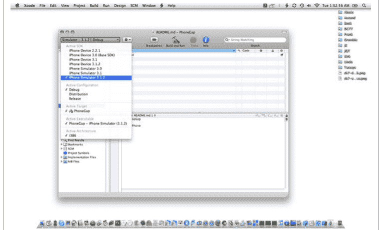

*图 7-7. 选择 iPhone 模拟器 3.1.2 作为你的活动 SDK*

如果模拟器没有启动，这意味着你的项目中存在错误。查看 Xcode 窗口右下角的红色数字；这是遇到的错误数量。点击数字查看错误详情，然后回顾这些步骤以找出问题所在。如果你遇到无法解决的问题，请访问 http://phonegap.com/community 的 PhoneGap 社区资源。在发布问题之前，先在 wiki 和 Google 群组中搜索你的问题的答案。如果你确实发布了问题，请包含尽可能多的关于错误的信息。

你的应用现在应该作为原生应用在 iPhone 模拟器中运行了。这看起来可能没什么大不了的，因为应用的外观和感觉就像我们在[第 6 章](Chapter 6)中运行的全屏网页应用一样。然而，有一个深刻的差异：也就是说，我们现在可以开始访问以前不可用的设备特性了。不过，在我们开始之前，我们需要做一些清理工作。

### 使用屏幕的全部高度

你会注意到窗口底部有 40px 的间隙（[图 7-8](Figure 7-8)）。这是因为 jQTouch 没有意识到我们是在全屏模式下运行，所以它为 Safari 工具栏留出了空间。从 jQTouch 的角度来看，这是有道理的，因为应用从技术上讲并不是作为全屏网页应用运行的。但它正在作为


## 自定义标题和图标

接下来，我们需要更改应用的默认名称和图标。默认情况下，PhoneGap 应用被称为"PhoneGap"，并带有一个画有梯子的蓝色图标（图 7-10）。

*图 7-10. 我们应用的默认名称和图标*

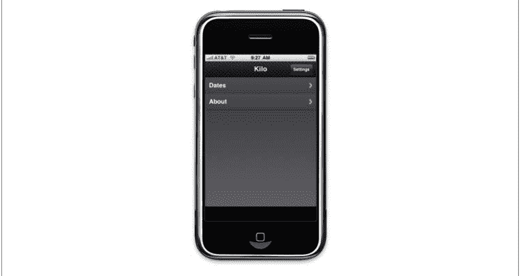

图 7-8. 你会注意到屏幕底部有 40px 的间隙

原生应用，因此可以访问整个屏幕。幸运的是，修复方法很简单。只需打开 *kilo.js*，并在 document ready 函数中添加以下代码：

```
if (typeof(PhoneGap) != 'undefined') {
    $('body > *").css({minHeight: '460px !important'});
}
```

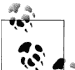

既然你已经在 Xcode 中打开了 PhoneGap 项目，你或许想试试 Xcode 的内置编辑器。要在 Xcode 中编辑 *kilo.js* 文件，请确保 Xcode 窗口左侧的"Groups & Files"面板中 PhoneGap 组已展开。展开 *www* 文件夹并点击 *kilo.js* xc打开文件，即可在 Xcode 的编辑器中查看。

这段代码使用 `typeof` 运算符来确保 PhoneGap 对象已被定义。如果代码在 PhoneGap 内部运行，则此条件判断将求值为 `true`。如果代码作为 Web 应用启动，PhoneGap 对象将是未定义的，条件判断将求值为 `false`。

当应用通过 PhoneGap 启动时，HTML body 元素的直接子元素将被赋予 460px 的最小高度。为确保该声明生效，我添加了 `!important` 指令以覆盖样式表中任何其他冲突的指令。现在应用启动时将完全填充窗口（图 7-9）。

*图 7-9. 将 body 高度从 420px 改为 460px 后，应用占满了整个屏幕*

## 自定义标题和图标

接下来，我们需要更改应用的默认名称和图标。默认情况下，PhoneGap 应用被称为"PhoneGap"，并带有一个画有梯子的蓝色图标（[图 7-10](image2.png)）。

*图 7-10. 我们应用的默认名称和图标*

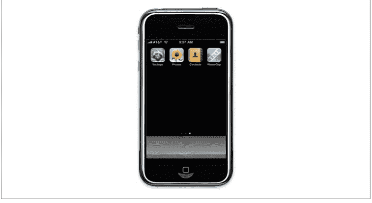

要更改主屏幕上的应用名称，请在 Finder 中双击 *PhoneGap.xcodeproj* 文件以在 Xcode 中打开项目。打开后，在 Groups & Files 面板中导航至 PhoneGap→Config→Info.plist。*Info.plist* 文件应显示在窗口的右下方面板中。

你会看到捆绑显示名称被设置为 PhoneGap（图 7-11）。双击 PhoneGap 并将其更改为 Kilo（图 7-12）。然后保存文件，清理项目（点击 Build→Clean），并点击 Build and Run 按钮。iPhone 模拟器应该会打开并启动应用。点击模拟器中的主屏幕按钮返回主屏幕，注意应用名称已从 PhoneGap 更新为 Kilo（图 7-13）。


图 7-11. Xcode 中的捆绑显示名称为 PhoneGap

接下来，我们需要将主屏幕图标从 PhoneGap 默认值（梯子，如图 7-10 所示）更改为我们的自定义图标。应用图标和 Web Clip 图标的文件格式都是 57px × 57px 的 PNG，因此你可以使用在"第 46 页上将图标添加到主屏幕"中创建的完全相同的 Web 应用图标。


图 7-12. *捆绑显示名称现已设置为我们应用的名称（Kilo）*


图 7-13. *新的捆绑显示名称现在出现在 iPhone 主屏幕上*

唯一的区别是，对于 Web Clip 图标，我们可以通过切换 jQTouch 中的 `addGlossToIcon` 设置来阻止 iPhone 为图形添加光泽效果；此设置在 PhoneGap 中将不起作用。要在 PhoneGap 中阻止为图标添加光泽，请在主 Xcode 窗口的 Groups & Files 面板中选择 *Config/Info.plist*，并在 *Info.plist* 中勾选 `UIPrerenderedIcon` 旁边的复选框（你可能需要将此选项添加到 *Info.plist*；请参阅接下来的"**向 Info.plist 添加设置**"了解操作说明）。

### 向 Info.plist 添加设置

如果你在 *Info.plist* 中看不到 `UIPrerenderedIcon` 选项，可以通过以下步骤添加：

1. 在主 Xcode 窗口的 Groups & Files 面板中选择 Config/Info.plist（图 7-14）。
2. 按住 Control 键点击或右键点击 *Info.plist* 中的最后一项以显示上下文菜单。
3. 从上下文菜单中选择 Add Row（图 7-15）。
4. 在 key 字段中输入 `UIPrerenderedIcon`（ Auburn（图 7-16）。
5. 按 Enter 键保存你的输入。该行应该会高亮显示（图 7-17）。
6. 再次按住 Control 键点击或右键点击高亮显示的行以显示上下文菜单，并从 Value Type 子菜单中选择 Boolean（图 7-18）。值列中应出现一个复选框。
7. 勾选复选框以告知 Xcode 不要为图标添加光泽（图 7-19）。

清理你的项目（点击 Build→Clean），当你构建并运行它时，你的图标将不显示光泽效果。


图 7-15. 从上下文菜单中选择 Add Row


图 7-16. 在 key 字段中输入 UIPrerenderedIcon

默认的 PhoneGap 主屏幕图标名为 `icon.png`，位于 PhoneGap 的 iphone 目录中（图 7-20）。将默认的图标文件替换为你的自定义文件（图 7-21 和 7-22），清理项目（点击 Build→Clean），然后点击 Build and Run 按钮。iPhone 模拟器应该会打开并启动应用。点击模拟器中的主屏幕按钮返回主屏幕，注意应用图标已更新为粉色背景上带有糖屑的巧克力糖霜甜甜圈（图 7-23）。


图 7-17. 按 Enter 键保存你在 key 字段中的输入


图 7-18. 从 Value Type 子菜单中选择 Boolean


图 7-19. 勾选复选框以告知 Xcode 不要为图标添加光泽

128 | 第 7 章：走向原生


图 7-23. 我们的自定义应用图标现在出现在 iPhone 主屏幕上

## 创建启动画面

接下来，我们需要将启动画面从 PhoneGap 默认设置（图 7-24）更改为我们的自定义启动画面。回到"第 49 页上提供自定义启动图形"，你创建了一个 PNG 文件，用作从主屏幕上的 Web Clip 图标以全屏模式启动 Web 应用时的启动画面。


图 7-24. 我们需要更改应用的默认启动图形

对于使用灰色或黑色状态栏的全屏 Web 应用，此图形需要是 320px × 460px，而对于使用黑色半透明状态栏的应用，则必须是 320px × 480px（高出 20 像素）。

使用 PhoneGap 时，无论使用哪种类型的状态栏，启动画面都必须是 320px × 480px。因此，如果你创建的是 320px × 460px 的全屏图形，请为高度增加 20px。

默认的 PhoneGap 启动图形名为 *Default.png*，位于 PhoneGap 的 *iphone* 目录中（图 7-25）。将默认的启动图形替换为你的自定义图形（如图 7-26 和 7-27 所示），清理项目，然后点击 Build and Run 按钮。iPhone 模拟器应该会打开并启动应用，你应该会看到显示的自定义图形（图 7-28）。


## 在 iPhone 上安装应用

在下一节中，我们将为 Kilo 示例应用添加声音、振动、警报等功能。其中一些功能无法在 iPhone 模拟器中测试，因此你需要先将 Kilo 安装到实际的 iPhone 上，然后才能测试这些内容。


### 图 7-26. 自定义启动图形在黑色背景上以灰色文字显示 Kilo

*图 7-26. 自定义启动图形在黑色背景上以灰色文字显示 Kilo*

*图 7-27. 用自定义的 320px × 480px PNG 图形替换 iphone 目录中的 Default.png*

*图 7-28. 我们的自定义启动图形现在会在应用启动时出现*

要在 iPhone 上安装应用，Apple 要求应用、手机和开发者（你）都必须具有唯一标识。这三部分数据组合在一个称为 "provisioning profile"（配置文件）的文件中，你需要将该文件添加到 Xcode。

为了生成配置文件，你必须首先是 iPhone Developer Program 的成员。然后，你需要运行位于 iPhone 开发者网站（http://developer.apple.com/iphone/）的 iPhone Developer Program Portal 部分中的 Development Provisioning Assistant (DPA)（开发配置助手）。你需要多次打开钥匙串访问应用程序（位于 `/Applications/Utilities`）来创建 *证书签名请求* 并安装从门户下载并签名到你自身钥匙串的证书。DPA 会很好地引导你完成创建和安装配置文件所需的步骤，因此我不会在这里重复这些说明。不过，我会给你一些提示：

-   当我刚开始进行 iPhone 应用开发时，我在 Program Portal 中创建了几个测试 App ID，以为等我弄清楚工作原理后就可以编辑或删除它们。结果我错了；你无法编辑或删除 App ID。这意味着两年后，当我登录开发者门户时，仍然会看到 "JSC Temp App ID"。如果你和我一样，这会把你逼疯的，所以不要犯同样的错误！
-   在 DPA 中，保持你的输入简洁但具有描述性。如果你的描述符太模糊，当你添加更多项目时会感到困惑。如果描述符太长，它们会在在线界面中被截断。尽量将内容控制在最多约 20 个字符。
-   当提示输入 App ID 描述时，只需使用你的应用名称（如果计划在 App Store 中同时有多个活动版本，可加上版本号——例如 Kilo2）。
-   当提示输入设备描述时，请包含设备类型（iPhone、iPod touch 等）和硬件版本（1G、2G、3G、3GS 等）。不要包含操作系统版本，因为操作系统版本的更改不会使配置文件失效。请记住，如果你最终要将应用的测试版提供给测试人员，你还需要包含一个所有者标识符（例如，你可以使用首字母缩写：ELS iPhone 3GS、JSC iPhone 2G、JSC iPhone 3G、JSC Touch 1G 等）。
-   当提示输入配置文件描述时，请将应用名称与目标设备结合起来（例如，Kilo2 on JSC iPhone 3GS）。

创建配置文件后，你必须下载它并将其拖到 Xcode 的 Dock 栏图标上，以使其可用于你的设备。这将打开 Organizer 窗口。如果你有多个应用、多个设备或两者兼有，你将为 Xcode 中显示的每种组合显示一个配置文件（图 7-29）。

现在配置文件已在 Xcode 中可用，你需要更新应用的 Bundle Identifier（包标识符）。在 Xcode Organizer 窗口中选择相应的配置文件，然后复制 App Identifier（应用标识符）（图 7-30）。

*图 7-29. 在 Xcode 中加载的多个配置文件*

*图 7-30. 在 Xcode Organizer 窗口中选择你的应用/设备组合的配置文件，以定位你的应用标识符*

然后，在主 Xcode 窗口的 Groups & Files 面板中，点击 PhoneGap→Config→Info.plist，并将应用标识符粘贴到 Bundle Identifier 字段中。如果你的应用标识符以星号结尾，请将星号替换为反向域名风格的字符串，例如 `com.jonathanstark.kilo`（图 7-31）。

图 7-31. 将应用标识符粘贴到 Bundle Identifier 字段中，用反向域名风格的字符串替换星号

现在，将你的 iPhone 插入电脑，并选择 iPhone 设备选项作为你的活动 SDK（图 7-32）。确保选择与你的 iPhone 上运行的 iPhone OS 版本匹配的 iPhone 设备版本（截至本文撰写时，最新版本为 3.1.2）。保存 *Info.plist* 文件，清理项目（点击 Build→Clean），然后点击 Build and Run（构建并运行）按钮。大约 20 秒后，应用应该会在你的 iPhone 上启动。首次启动时，系统会提示你允许 *codesign* 应用程序访问你的钥匙串，并提示你在 iPhone 上安装配置文件。如果遇到任何错误，请重启 Xcode 并重试。

现在应用已在真实的 iPhone 上运行，我们可以添加一些特定于设备的功能。

图 7-32. 选择 Device 3.1.2 作为你的活动 SDK，然后点击 Build and Run 在你的 iPhone 上安装并启动应用

## 使用 JavaScript 控制 iPhone

现在，我们已准备好开始通过调用原生设备功能来增强我们的应用程序。PhoneGap 通过 JavaScript 暴露某些功能使得这成为可能。这意味着，要让手机振动，你只需在代码中添加一点 JavaScript。例如：

`navigator.notification.vibrate();`

很简单，对吧？

### 提示音、振动和警报

PhoneGap 使提示音、振动和警报功能变得非常简单，我将把它们归入一个示例。具体来说，我们将设置应用，当用户创建的条目超过其每日卡路里预算时，发出提示音、振动并显示自定义警报。为此，请将以下函数添加到 *kilo.js* 的末尾：

```
function checkBudget() { ①
    var currentDate = sessionStorage.currentDate;
    var dailyBudget = localStorage.budget;
    db.transaction(②
        function(transaction) {
            transaction.executeSql(③
                'SELECT SUM(calories) AS currentTotal FROM entries WHERE date = ?;', ④
                [currentDate], ⑤
                function (transaction, result) { ⑥
                    var currentTotal = result.rows.item(0).currentTotal; ⑦
                    if (currentTotal > dailyBudget) { ⑧
                        var overage = currentTotal - dailyBudget; ⑨
                        var message = 'You are ' + overage + ' calories over your daily budget. Better start jogging!'; ⑩
                        try { ⑪
                            navigator.notification.beep();
                            navigator.notification.vibrate();
                        } catch(e) { // No equivalent in web app }
                        try { ⑫
                            navigator.notification.alert(message, 'Over Budget', 'Dang!');
                        } catch(e) {
                            alert(message);
                        }
                    }
                }, errorHandler ⑬
            );
        }
    );
}
```

以下是逐行描述：

1.  打开 `checkBudget()` 函数。将 `currentDate` 变量初始化为存储在 `sessionStorage` 中的值（即用户在 Settings 面板中输入的值），并将 `dailyBudget` 变量初始化为存储在 `localStorage` 中的值（即在 Dates 面板上点击的日期）。
2.  启动数据库事务，准备计算当前日期的总卡路里。
3.  运行事务对象的 `executeSql()` 方法。

让我们分解 `executeSql()` 方法的四个参数：

4.  第一个参数是使用 `SUM` 函数的预处理 SQL 语句，该函数将匹配当前日期的所有条目的 calories 列中的所有值相加。
5.  第二个参数是一个单值数组，它将替换上一行预处理语句中的问号。
6.  第三个参数是一个匿名函数，如果 SQL 查询成功完成，它将被调用（我们稍后会详细讨论）。

以下是作为第三个参数传入的匿名函数中发生的情况：


+   7. 它首先获取结果集中第一行的当前总和。由于我们只是请求某一列的总和，数据库将只返回一行（也就是说，这个查询始终只返回一行）。请记住，结果集的记录是通过 result 对象的 rows 属性的 `item()` 方法来访问的，并且行号从 0 开始（意味着第一行是 0）。

+   8. 检查当天的当前卡路里总量是否大于"设置"面板上指定的每日预算。如果是，则执行后面的代码块。

+   9. 计算用户超出卡路里预算多少。

+   10. 编写一条要显示给用户的消息。

+   11. 这是一个 `try/catch` 代码块，尝试调用 navigator notification 对象的 `beep()` 和 `vibrate()` 方法。这些方法只在 PhoneGap 中存在，因此如果用户在浏览器中运行应用，这些方法将会失败，执行将跳转到 `catch` 代码块。由于浏览器中没有与 beep 或 vibrate 等效的功能，所以 `catch` 代码块已被留空。

PhoneGap 的 `beep()` 方法被调用时会播放一个 *.wav* 文件。该文件名为 *beep.wav*，位于 *iphone* 目录中（图 7-33）。默认文件听起来有点像蟋蟀声，在大多数情况下应该没问题。如果你更喜欢自己的提示音，只需创建一个名为 *beep.wav* 的 *.wav* 文件，并替换 *iphone* 目录中的默认文件即可。

+   12. 这是一个 `try/catch` 代码块，尝试调用 navigator notification 对象的 `alert()` 方法。此方法只在 PhoneGap 中存在。


### 7. 调用事务对象的 `executeSql()` 方法。
8.  使用问号作为数据占位符来定义 SQL 预处理语句。
9.  为占位符传递一个值数组。如果经纬度未传递给 `insertEntry()` 函数，它们将是未定义。
10. 定义成功回调函数。
11. 定义错误回调函数。

为了确认 Kilo 确实保存了这些位置值，我们希望将它们显示在界面的某个地方。让我们添加一个 "Inspect Entry" 面板来显示存储的值。我们将在该面板上包含一个 "Map Location" 按钮，用于显示条目的创建位置。在 `index.html` 中，紧靠 `</body>` 结束标签之前，添加以下内容：

```
<div id="inspectEntry">
    <div class="toolbar">
        <h1>Inspect Entry</h1>
        <a class="button cancel" href="#">Cancel</a>
    </div>
    <form method="post">
        <ul class="rounded">
            <li><input type="text" placeholder="Food" name="food" value="" /></li>
            <li><input type="tel" placeholder="Calories" name="calories"
                value="" /></li>
            <li><input type="submit" value="Save Changes" /></li>
        </ul>
        <ul class="rounded">
            <li><input type="text" name="latitude" value="" /></li>
            <li><input type="text" name="longitude" value="" /></li>
            <li><p class="whiteButton" id="mapLocation">Map Location</p></li>
        </ul>
    </form>
</div>
```

这应该看起来与我们在示例 4-5 中首次看到的 "New Entry" 面板非常相似，因此我只指出几件事。

1.  输入类型已设置为 `tel`，以便在光标置于字段中时调用电话键盘。这有点取巧，但我认为它值得，因为该键盘更适合此字段。
2.  `latitude` 和 `longitude` 字段是可编辑的，并包含在表单内，这意味着用户能够编辑它们。这在最终应用中可能没有意义，但它使得在开发过程中测试变得容易得多，因为你可以手动输入位置值来测试映射按钮。
3.  此时，这个 "Map Location" 按钮点击时不会做任何事情；我们稍后会为其添加点击处理程序。

现在，我们需要为用户提供一种导航到此 "Inspect Entry" 面板的方法，因此我们将修改 "Date" 面板的行为，使得当用户点击列表中的条目时，"Inspect Entry" 面板将从屏幕底部滑出。

第一步是连接点击事件处理程序（我们接下来将创建），并修改点击 "Delete" 按钮的处理方式。在 *kilo.js* 的 `refreshEntries()` 函数中，添加以下三个高亮显示的更改：

```
function refreshEntries() {
    var currentDate = sessionStorage.currentDate;
    $('#date h1').text(currentDate);
    $('#date ul li:gt(0)').remove();
    db.transaction(
        function(transaction) {
            transaction.executeSql(
                'SELECT * FROM entries WHERE date = ? ORDER BY food;',
                [currentDate],
                function (transaction, result) {
                    for (var i=0; i < result.rows.length; i++) {
                        var row = result.rows.item(i);
                        var newEntryRow = $('#entryTemplate').clone();
                        newEntryRow.removeAttr('id');
                        newEntryRow.removeAttr('style');
                        newEntryRow.data('entryId', row.id);
                        newEntryRow.appendTo('#date ul');
                        newEntryRow.find('.label').text(row.food);
                        newEntryRow.find('.calories').text(row.calories);
                        newEntryRow.find('.delete').click(function(e){
                            var clickedEntry = $(this).parent();
                            var clickedEntryId = clickedEntry.data('entryId');
                            deleteEntryById(clickedEntryId);
                            clickedEntry.slideUp();
                            e.stopPropagation();
                        });
                        newEntryRow.click(entryClickHandler);
                    }
                },
                errorHandler
            );
        }
    );
}
```

注意，我们必须在函数调用中添加 `e` 参数（事件），以便访问事件的 `stopPropagation()` 方法（稍后使用）。如果我们不添加 `e` 参数，`e.stopPropagation()` 将是未定义的。

添加到 "Delete" 按钮点击处理程序中的 `e.stopPropagation();` 告诉浏览器不要让点击事件沿 DOM（文档对象模型）向上冒泡到父元素。这一点很重要，因为我们现在已经为行本身添加了点击处理程序，而条目行是 "Delete" 按钮的父级。如果我们不调用 `stopPropagation()`，当用户点击 "Delete" 按钮时，"Delete" 按钮处理程序和 `entryClickHandler` 都会触发。

`newEntryRow.click(entryClickHandler);` 告诉浏览器在点击条目时调用 `entryClickHandler` 函数。

现在，让我们将 `entryClickHandler()` 函数添加到 kilo.js 中：

```
function entryClickHandler(e){
    sessionStorage.entryId = $(this).data('entryId');
    db.transaction(
        function(transaction) {
            transaction.executeSql(
                'SELECT * FROM entries WHERE id = ?;',
                [sessionStorage.entryId],
                function (transaction, result) {
                    var row = result.rows.item(0);
                    var food = row.food;
                    var calories = row.calories;
                    var latitude = row.latitude;
                    var longitude = row.longitude;
                    $('#inspectEntry input[name="food"]').val(food);
                    $('#inspectEntry input[name="calories"]').val(calories);
                    $('#inspectEntry input[name="latitude"]').val(latitude);
                    $('#inspectEntry input[name="longitude"]').val(longitude);
                    $('#mapLocation').click(function(){
                        window.location = 'http://maps.google.com/maps?z=15&q=' +
                            food + '@' + latitude + ',' + longitude;
                    });
                    jQT.goTo('#inspectEntry', 'slideup');
                },
                errorHandler
            );
        }
    );
}
```

1.  从用户点击的条目中获取 entryId 并将其存储在会话存储中。
2.  开始数据库事务。
3.  将一个回调函数传递给事务，该函数的唯一参数是事务对象。
4.  调用事务对象的 `executeSql()` 方法。
5.  使用问号作为数据占位符来定义 SQL 预处理语句。
6.  为占位符传递一个单元素数组。
7.  开始成功回调函数。
8.  获取结果的第一行（也是唯一一行，因为我们只查询一个条目）。
9.  根据行中的值设置一些变量。
10. 根据变量设置表单字段的值。
11. 为 `#mapLocation` 按钮附加一个点击处理程序。该函数将窗口位置设置为标准的 Google Maps URL。如果 Maps 应用程序可用，它将启动。否则，该 URL 将在浏览器中加载。`z` 值设置初始缩放级别；`@` 符号之前的字符串将用作在该位置放置的标记的标签。请注意，经纬度值必须按此处所示的顺序出现，并用逗号分隔。
12. 调用 jQTouch 对象的 `goTo()` 方法，使 "Inspect Entry" 面板向上滑入视图。
13. 定义错误回调函数。

在尝试运行应用程序之前，请务必从手机（或模拟器）中删除它。这是因为如果数据库已存在，则不会创建它，而移除数据库的简单方法就是移除应用程序。要移除应用程序，请在主屏幕图标上点击并按住，直到图标开始晃动，然后点击 X 将其移除。按主页键停止晃动。然后，清理项目（构建→清理）并点击“构建并运行”以进行尝试。

### 加速度计

接下来，让我们设置 Kilo，通过摇动手机来复制列表中的最后一个条目。将以下函数添加到 kilo.js 的末尾：

```
function dupeEntryById(entryId) {
    if (entryId == undefined) {
        alert('You have to have at least one entry in the list to shake a dupe.');
    } else {
        db.transaction(
            function(transaction) {
                transaction.executeSql(
                    ' INSERT INTO entries (date, food, calories, latitude, longitude)'
                    + ' SELECT date, food, calories, latitude, longitude'
                    + ' FROM entries WHERE id = ?;',
                    [entryId],
                    function() {
                        refreshEntries();
                    },
                    errorHandler
                );
            }
        );
    }
}
```

1.  这行代码确保将 entryId 传递给函数。如果没有，则通知用户。
2.  开始通常的数据库事务步骤。
3.  定义一个 INSERT 语句，从指定的 entryId 复制值。这是一种你以前没见过的查询类型。它不是使用 INSERT 的值列表，而是从指定 entryId 的 SELECT 查询中获取值。


### 4. 将 entryId 传入预处理语句，用 entryId 的值替换 SELECT 查询中的 ?。
5. 成功后，调用 refreshEntries()，这将显示新复制的条目。
6. 出错时，调用标准的 SQL 错误处理器。

现在我们需要告诉应用程序何时开始和停止监视加速度计。我们将设置它在日期面板滑动进入视图时开始监视，在滑动离开时停止。为此，我们只需在 kilo.js 的文档就绪函数中添加以下几行：

```
$('#date').bind('pageAnimationEnd', function(e, info){
    if (info.direction == 'in') {
        startWatchingShake();
    }
});
$('#date').bind('pageAnimationStart', function(e, info){
    if (info.direction == 'out') {
        stopWatchingShake();
    }
});
```

1. 将一个匿名处理函数绑定到 #date 面板的 pageAnimationEnd 事件。将事件和附加信息作为参数传入。
2. 检查 info 对象的 direction 属性是否等于 in。如果是，调用 startWatchingShake() 函数，我们稍后会看到这个函数。
3. 将一个匿名处理函数绑定到 #date 面板的 pageAnimationBegin 事件。将事件和附加信息作为参数传入。
4. 检查 info 对象的 direction 属性是否等于 out。如果是，调用 stopWatchingShake() 函数，我们稍后会看到这个函数。

> 从技术上讲，我们本可以只绑定一个页面动画事件，就像这样：

```
$('#date').bind('pageAnimationEnd', function(e, info){
    if (info.direction == 'in') {
        startWatchingShake();
    } else {
        stopWatchingShake();
    }
});
```

我没有这样做的原因是，stopWatchingShake() 会在页面动画完成后才被调用。因此，加速度计会在页面过渡期间被主动监视，这有时会导致动画卡顿。

我们剩下的任务就是编写 startWatchingShake() 和 stopWatchingShake() 函数。在 kilo.js 的末尾添加以下函数：

```
function startWatchingShake() {
    var success = function(coords){
        var max = 2;
        if (Math.abs(coords.x) > max
            || Math.abs(coords.y) > max
            || Math.abs(coords.z) > max) {
            var entryId = $('#date ul li:last').data('entryId');
            dupeEntryById(entryId);
        }
    };
    var error = function(){};
    var options = {};
    options.frequency = 100;
    sessionStorage.watchId = navigator.accelerometer.watchAcceleration(success,
        error, options);
}
function stopWatchingShake() {
    navigator.accelerometer.clearWatch(sessionStorage.watchId);
}
```

1. 开始定义 startWatchingShake() 函数。当 #date 面板动画进入视图完成时，将调用此函数。
2. 开始定义 success 处理函数。注意它接受一个 coordinates 对象作为其唯一参数。
3. 定义抖动的阈值。数字越大，用户需要摇动得越剧烈。
4. 检查任何坐标值是否超过阈值。
5. 获取 #date 面板上最后一个条目的 entryId。
6. 调用 dupeEntryById() 函数。
7. 定义一个空的错误处理函数。
8. 定义一个 options 对象，传递给加速度计对象的 watchAcceleration() 方法。
9. options 对象的 frequency 属性允许你指定（以毫秒为单位）你的应用检查加速度计的频率。
10. 调用加速度计对象的 watchAcceleration() 方法，将 success 处理函数、error 处理函数和 options 对象作为参数传入。将结果存储在 sessionStorage.watchId 中，我们稍后在 stopWatchingShake() 函数中需要用到它。
11. 开始定义 stopWatchingShake() 函数。当 #date 面板开始动画离开视图时，将调用此函数。
12. 调用加速度计对象的 clearWatch() 方法，将 session 存储中的 watchId 传递给它。

至此，我们已准备好进行测试。保存所有文件，清理所有目标，然后在设备上构建并运行 Kilo。导航到日期面板，如果没有条目则添加一个，然后摇动手机。你应该会看到页面重新加载并显示一个额外的条目。不幸的是，你可能还会看到一个撤销确认对话框（图 7-36）。为了禁用撤销管理器，以便我们可以不受干扰地监视加速度计，我们需要在 *Info.plist* 中添加一个设置。按照第 126 页“向 Info.plist 添加设置”中描述的步骤，添加 UIApplicationSupportsShakeToEdit 设置，并将其设置为 false（图 7-37）。


## 你学到了什么

在本章中，你学习了如何将你的 Web 应用加载到 PhoneGap 中，如何将你的应用安装到 iPhone 上，以及如何访问浏览器 Web 应用无法访问的五项设备功能（哔声、警报、振动、地理位置和加速度计）。
在下一章，你将学习如何将你的应用打包为可执行文件并提交到 iTunes App Store。

# 第 8 章

# 将你的应用提交到 iTunes

终于，你一直期待的时刻到来了：将你完成的应用提交到 iTunes。这个过程有几个步骤，在开始之前，你需要做好一切准备。至少，你需要以下内容来完成 App Store 提交过程：

- 应用程序的纯文本描述（最多 4,000 个字符）。
- 一个网址，让人们可以了解更多关于你的应用的信息。
- 一个支持网址和电子邮件地址，以便人们可以就你的应用相关问题联系你。
- 如果你的应用需要登录，请提供演示账户的完整访问凭据，以便审核人员可以测试你的应用。
- 一个 512 × 512 像素的图标。
- 你的应用的 320 × 480 像素的截图。
- 应用的分发配置文件。
- 应用程序二进制文件的压缩版本。

提交所需的一切都相当简单明了，除了最后两项：应用的分发配置文件和应用程序二进制文件。我们将在以下部分详细介绍它们。


在本章中，无论我何时提到 Kilo，请替换为你计划用于你的应用的名称。

## 创建 iPhone 分发配置文件

在第 7 章中，你创建了一个 *开发* 配置文件，允许你在实际的 iPhone 上测试你的应用。现在，你需要创建一个 *分发* 配置文件，以便将应用提交到 iTunes。

1. 导航到 iPhone 开发者网站 (<http://developer.apple.com/iphone/>) 并登录。
2. 点击右侧边栏中的 iPhone Developer Program Portal。
3. 点击左侧边栏中的 Provisioning。
4. 点击 Distribution 标签页。
5. 点击 New Profile 按钮。
6. 选择 App Store 作为你的分发方法。
7. 输入配置文件名称（例如，Kilo Distribution Provisioning Profile）。
8. 如果你尚未创建分发证书，你应该在继续之前创建一个。如果你在此页面上看到标有 "Please create a Distribution Certificate" 的链接，请点击它并仔细按照说明操作。你将需要进入钥匙串访问应用程序（位于 */Applications/Utilities*）几次，以创建 *证书签名请求* 并将你从门户下载的已签名证书安装到你自己的钥匙串中。
9. 选择适当的应用程序 ID（**图 8-1**）。
10. 点击 Submit 按钮（你将返回到分发配置文件列表视图）。
11. 刷新页面，直到 Download 按钮出现（**图 8-2**）。
12. 点击 Download 按钮，将配置文件保存到本地下载目录（通常是你的主文件夹中的 *Downloads* 文件夹）。
13. 将下载的配置文件拖到 Dock 栏中的 Xcode 图标上。


图 8-2。刷新配置文件列表，直到“下载”按钮出现

## 安装 iPhone 发布配置文件

现在配置文件已在 Xcode 中，你需要配置项目以使用它。

1.  如果尚未打开，请在 Xcode 中打开 Kilo 项目。
2.  从“项目”菜单中选择“编辑项目设置”（项目设置窗口将出现）。
3.  如果“构建”标签页尚未激活，请点击它。
4.  从“配置”弹出菜单中选择“发布”。
5.  从“显示”弹出菜单中选择“此层级定义的设置”。
6.  在窗口主区域中找到“代码签名”→“代码签名身份”→“任何 iPhone OS 设备”。
7.  点击“任何 iPhone OS 设备”右侧的弹出列表，以显示配置文件选项列表（图 8-3）。
8.  在列表中找到你的发布配置文件，并选择其正下方的发布身份（图 8-4）。
9.  关闭“项目信息”窗口。

图 8-3。点击“任何 iPhone OS 设备”旁边的弹出列表

图 8-4。发布身份位于发布配置文件的正下方

## 重命名项目

在提交应用之前，你需要将其从 PhoneGap 重命名为 Kilo。操作如下：

1.  在 Xcode 中打开项目。
2.  从“项目”菜单中选择“重命名”（图 8-5）。
3.  在“将项目重命名为”字段中输入 Kilo（图 8-6）。
4.  如果你希望在更改前保存项目状态，可以保留“重命名前获取快照”的勾选，但这会显著增加处理请求所需的时间。
5.  点击“重命名”按钮。

*图 8-5。从“项目”菜单中选择“重命名”*

你将看到一系列带有白色对勾的绿色圆圈，表示更改已生效（图 8-7）。

图 8-6。在“将项目重命名为”字段中输入 Kilo

图 8-7。带有白色对勾的绿色圆圈表示重命名过程成功

## 准备应用程序二进制文件

接下来，我们需要构建应用程序可执行文件并为其上传做准备。

1.  从“活跃 SDK”弹出菜单中选择“iPhone 设备 - 3.1.2”（或当前版本的 iPhone OS），然后再次选择它并选取“发布”。这应将目标设置为类似“设备 - 3.1.2 | 发布”的内容。
2.  从“构建”菜单中选择“清理所有目标”。
3.  从“构建”菜单中选择“构建”。系统可能会提示你允许应用程序 *codesign* 访问你的钥匙串。允许其执行此操作，以便它可以签署应用程序。
4.  确保没有出现任何错误。
5.  在 Finder 中显示应用程序（图 8-8）。
6.  将应用程序压缩为 ZIP 压缩包（图 8-9）。

图 8-8。在 Finder 中显示应用程序

## 提交你的应用

现在你已准备好所有需要的东西：

1.  登录 iTunes Connect (https://itunesconnect.apple.com/)。
2.  点击“管理你的应用程序”。
3.  点击“添加新应用程序”按钮。
4.  按照屏幕上的说明进行提交过程。
5.  抓紧时间，然后等待。

如果一切顺利，你应该会看到你的应用状态列为“审核中”（图 8-10）。

图 8-9。应用程序必须压缩为 ZIP 压缩包才能上传

图 8-10。上传的应用将以“审核中”状态出现在你的列表中

## 等待期间

恭喜！你已正式将你的第一个应用提交到 iTunes App Store！
现在该怎么办？你可能需要等待一两周才能收到 Apple 的回复。以下是一些你可以在此期间用来打发时间的事情：

- 为你提交给 Apple 的 URL 地址建立一个看起来不错的应用网页。确保包含以下元素：
  — 你的应用运行时的视频。Loren Richter ([http://twitter.com/atebits](http://twitter.com/atebits)) 在 [http://blog.atebits.com/2009/03/not-your-average-iphone-screencast/](http://blog.atebits.com/2009/03/not-your-average-iphone-screencast/) 上发布了一个关于制作精美 iPhone 屏幕录像的很棒教程。
  — 你的应用简介。只需一两段文字和 5-10 个要点。
  — 一个用于购买你的应用的 iTunes 链接。
  — 一些推荐语，如果有的话，可以链接到更多内容。
  — 一个支持电子邮件地址。你也可以选择建立一个支持论坛，但通过电子邮件你能更了解你的客户。
- 给你认为会对你的应用感兴趣的博主发送个人电子邮件。针对与你的应用市场相关的博客，以及关于 iPhone 的通用博客。
- 清理你的收件箱。每 100 次销售你可能会收到约 5-20 封电子邮件，所以如果你的应用很受欢迎，你将会收到大量邮件。从一个干净的收件箱开始吧！
- 开始制作你的第一个升级版。越受欢迎的应用似乎升级越频繁，大约每月两次，这会带来持续的关注和大量客户好感。

## 延伸阅读

如果你遇到困难，以下是一些有用的资源：

- jQTouch 问题跟踪器：[http://code.google.com/p/jqtouch/issues/list](http://code.google.com/p/jqtouch/issues/list)
- jQTouch 的 Twitter：[http://twitter.com/jqtouch](http://twitter.com/jqtouch)
- jQTouch Wiki：[http://code.google.com/p/jqtouch/w/list](http://code.google.com/p/jqtouch/w/list)
- PhoneGap Google 群组：[http://groups.google.com/group/phonegap](http://groups.google.com/group/phonegap)
- PhoneGap 的 Twitter：[http://twitter.com/phonegap](http://twitter.com/phonegap)
- PhoneGap Wiki：[http://phonegap.pbworks.com/](http://phonegap.pbworks.com/)
- jQuery 文档：[http://docs.jquery.com/](http://docs.jquery.com/)
- W3C 离线应用程序规范：[http://dev.w3.org/html5/spec/Overview.html#offline](http://dev.w3.org/html5/spec/Overview.html#offline)

# 索引

## 符号

- -webkit-border-image 属性，46
- -webkit-border-radius 属性，22
- -webkit-gradient，22
- ./ 在路径名中，100
- .htaccess 文件，92

## A

- 加速度计，原生应用，146–149
- addGlossToIcon 属性，64
- Ajax，iPhone 样式，29
- alert 函数，原生应用，136–139
- alert() 方法，138
- 动画，51–67
- Apache Web 服务器，清单文件，92
- API，JavaScript 数据库 API，74
- apple-mobile-web-app-capable meta 标签，48
- apple-mobile-web-app-status-bar-style meta 标签，48
- apple-touch-icon meta 标签，48
- apple-touch-icon-precomposed meta 标签，48
- apple-touch-startup-image meta 标签，49
- 应用程序缓存数据库，调试离线 Web 应用，107–113
- ApplicationCache.db 数据库，107
- 应用
    - 提交到 iTunes，xi，151–159
    - Web 应用与原生应用，1
- App Store（参见 iTunes App Store）
- 属性
    - id 与 class 属性，7
    - 文本输入，59
- autocapitalize 属性，59
- autocomplete 属性，59
- autocorrect 属性，59

## B

- 返回按钮示例，40–46
- 返回按钮，href，53
- backSelector 属性，65
- 状态栏，更改状态栏，48
- beep() 方法，138
- 哔声，原生应用，136–139
- 二进制文件，应用程序二进制文件，156
- 块级标签，3
- 边框图像属性，25
- 边框
    - -webkit-border-image 属性，46
    - -webkit-border-radius 属性，22
- 按钮
    - 返回按钮示例，40–46
    - 取消按钮，59
    - 提交输入按钮，59

## C

- 缓存（参见离线应用程序缓存）
- 缓存清单数据库，108
- 缓存清单文件，91，94，95，100
- cacheGetRequests 属性，65
- CacheGroups 数据模型，108
- CacheResources 表，111
- Caches 表，109
- CacheWhitelistURLs 表，112
- 卡路里追踪示例，51–64
- 取消按钮，59
- 层叠样式表（参见 CSS）
- class 属性
    - 提交输入按钮，59

我们很想听听您对改进我们索引的建议。请发送电子邮件至 index@oreilly.com。


-   与 id 属性的对比, 7
-   类，为 HTML 元素分配 CSS 类, 52
-   点击处理函数, 145
-   客户端数据存储, 69–89
    -   数据库, 74–89
    -   localStorage, 69–74
    -   sessionStorage, 69–74
-   com.apple.WebAppCache 目录, 107
-   控制台, JavaScript 控制台, 103–106
-   CONSTRAINT_ERR 错误代码, 81
-   约定, UI, 19
-   CSS (层叠样式表)
    -   概述, 6–9
    -   为 HTML 元素分配 CSS 类, 52
    -   iPhone CSS, 19
    -   与 iPhone 样式表的对比, 16
-   CSS Sprite 技术, 46
-   cubeSelector 属性, 65

## D

-   数据库大小限制, 77
-   数据库, 69
    -   (另见客户端数据存储)
    -   添加纬度和经度列, 140
    -   错误代码, 80
    -   iPhone 模拟器应用缓存数据库, 107
    -   Safari 桌面浏览器, 78
    -   大小限制, 77
    -   SQL 支持, 74
-   DATABASE_ERR 错误代码, 80
-   Dates 面板
    -   概述, 55–58
    -   将日期保存到 sessionStorage, 73
-   调试
    -   离线应用缓存, 102–113
    -   使用 Safari 桌面浏览器中的 web inspector 调试 web 应用, 78
-   声明, CSS, 6
-   默认值
    -   jQTouch 属性, 64
    -   Mobile Safari, 43
    -   PhoneGap 主屏幕图标, 127
    -   PhoneGap 启动图形, 131
-   删除行, 86–89
-   目录
    -   com.apple.WebAppCache 目录, 107
-   dissolveSelector 属性, 65
-   DOM (文档对象模型)，使用 JavaScript 与 HTML 页面交互, 10
-   DRY 原则, 16
-   动态清单文件, 98–102

## E

-   编辑器
    -   选择文本编辑器, 6
    -   Xcode 编辑器, 122
-   错误处理，在客户端数据库中插入行, 80
-   executeSql() 方法, 137

## F

-   fadeSelector 属性, 65
-   FallbackURLs 表, 112
-   fixedViewport 属性, 65
-   flipSelector 属性, 65
-   字体, 19
-   外键, 定义, 109
-   全屏模式, iPhone 样式, 48
-   fullScreen 属性, 65
-   fullScreenClass 属性, 65
-   函数，将函数作为参数传递, 33

## G

-   地理定位
    -   原生应用, 140–146
    -   在函数中使用, 141
-   渐变, -webkit-gradient, 22
-   图形 (参见 images)

## H

-   处理函数
    -   成功处理函数, 81
    -   事务回调处理函数, 81
-   主屏幕，添加图标, 46
-   托管 web 应用, 13
-   href 标签, 53
-   .htaccess 文件, 92
-   HTML, 13
    -   (另见 iPhone 样式)
    -   概述, 3–6
    -   为 HTML 元素分配 CSS 类, 52
    -   DOM 和 JavaScript, 10
    -   超链接, CSS, 7

## I

-   icon 属性, 66
-   图标
    -   添加到主屏幕, 46
    -   使用 PhoneGap 自定义, 123–127
-   id 属性，与 class 属性的对比, 7
-   id 字段, 109
-   图像
    -   边框, 25
    -   按钮, 43
    -   jQTouch, 24
    -   偏移, 46
    -   PhoneGap 启动图形, 131
    -   预合成, 48
    -   启动图形, 49
-   index.html 文件, 119
-   内联标签, 4
-   在客户端数据库中插入行, 78
-   安装
    -   iPhone 发行配置文件, 153
    -   原生应用, 131
    -   PHP, 98
-   Internet Explorer，桌面版 CSS, 17
-   iPhone 开发者计划, 116
-   iPhone 发行配置文件, 151
-   iPhone SDK, 107
-   iPhone 模拟器
    -   应用缓存数据库, 107
    -   使用, 120
-   iPhone 样式, 13–28, 29–50
    -   添加图标到主屏幕, 46
    -   Ajax, 29
    -   返回按钮示例, 40–46
    -   全屏模式, 48
    -   入门, 14
    -   iPhone CSS, 19
    -   iPhone 外观和感觉, 21
    -   jQuery JavaScript 库, 23–27
    -   外观和感觉, 21
    -   简单装饰示例, 34–40
    -   交通警察示例, 29–33
-   iTunes App Store
    -   相关经验, xi
    -   提交应用到, xi, 151–159

## J

-   JavaScript, 136–149
    -   (另见 jQTouch; jQuery)
    -   概述, 9–11
    -   加速计, 146–149
    -   蜂鸣、震动和警报, 136–139
    -   地理定位, 140–146
    -   JavaScript 警报与 PhoneGap 警报的比较, 138
    -   将函数作为参数传递, 33
    -   持久数据支持, 72
    -   SQL 支持, 74
-   JavaScript 控制台
    -   调试离线应用缓存, 103–106
    -   日志记录, 103
-   jQTouch
    -   图像, 24
    -   屏幕高度, 121
-   jQTouch JavaScript 库
    -   概述, 51
    -   取消按钮, 59
    -   自定义, 64
    -   提交按钮, 59
-   jQuery JavaScript 库
    -   概述, 11
    -   iPhone 样式, 23–27, 34
    -   jQTouch JavaScript 库, 51

## K

-   键, 定义, 109
-   关键字
    -   CSS, 6
    -   NETWORK: 关键字, 94
    -   this 关键字, 74
-   千卡路里跟踪示例, 51–64

## L

-   启动 web 应用, 49
-   库 (参见 jQTouch; jQuery)
-   Linux，安装 PHP, 98
-   本地清单，与远程清单的比较, 93
-   localStorage, 69–74
    -   日志记录, 控制台日志记录, 103
-   外观和感觉, iPhone, 21

## M

-   Mac OS X
    -   .htaccess 文件, 92
    -   安装和启用 PHP, 98
-   清单文件, 91, 99
-   清单链接，在 index.html 文件中, 119
-   manifestHostHash 字段, 109
-   manifestURL 字段, 109
-   meta 标签
    -   apple-mobile-web-app-capable meta 标签, 48
    -   apple-mobile-web-app-status-bar-style meta 标签, 48
    -   apple-touch-icon meta 标签, 48
    -   apple-touch-icon-precomposed meta 标签, 48
    -   apple-touch-startup-image meta 标签, 49
    -   viewport meta 标签, 17
-   Mobile Safari web 浏览器
    -   返回按钮, 43
    -   全屏模式, 48
    -   页面缩放, 17
-   模式, 全屏模式, 48

## N

-   name 属性, 59
-   原生应用, 115–150
    -   安装, 131
    -   JavaScript, 136–149
    -   PhoneGap, 115–131
    -   将 web 应用模拟为, 121
    -   与 web 应用的对比, xii, 1
-   导航菜单, 圆角, 22
-   NETWORK: 关键字, 94
-   New Entry 面板, 58
-   newestCache 字段, 109

## O

-   Objective-C, xi
-   离线应用缓存, 91–113
    -   概述, 91–94
    -   调试, 102–113
    -   动态清单文件, 98–102
    -   在线白名单和回退选项, 94
-   偏移, 图像, 46
-   在线白名单, 94

## P

-   内边距，内容和侧边栏元素, 21
-   页面缩放, 17
-   面板
    -   Dates 面板, 55–58
    -   New Entry 面板, 58
    -   Settings 面板, 60
-   路径名，其中的 ./ , 100
-   持久数据支持, 72
-   PhoneGap, 115–131
    -   PhoneGap 警报与 JavaScript 警报的比较, 138
    -   屏幕高度, 121
    -   启动屏幕, 130
    -   标题和图标, 123–127
-   PHP, 脚本, 98
-   placeholder 属性, 59
-   popSelector 属性, 66
-   预合成图像, 48
-   preloadImages 属性, 66
-   主键, 定义, 109
-   属性
    -   -webkit-border-image 属性, 46
    -   -webkit-border-radius 属性, 22
    -   边框图像属性, 25
    -   CSS, 6
    -   jQTouch JavaScript 库公开的, 54
-   配置文件, 133

## Q

-   QUOTA_ERR 错误代码, 81

## R

-   远程清单，与本地清单的比较, 93
-   重命名应用, 155
-   圆角, 导航菜单, 22
-   客户端数据库中的行, 78–89
    -   删除, 86–89
    -   插入, 78
    -   选择, 82

## S

-   Safari 桌面浏览器, 5
    -   (另见 Mobile Safari web 浏览器)
    -   客户端数据库, 78
    -   页面缩放, 17
    -   测试 web 应用, 5, 26, 34
-   保存
    -   日期到 sessionStorage, 73
    -   用户设置到 localStorage, 70–72
-   缩放, 页面缩放, 17
-   屏幕高度
    -   jQTouch, 121
    -   PhoneGap, 121
-   屏幕
    -   添加图标到主屏幕, 46
    -   全屏模式, 48
    -   原生应用中的启动屏幕, 130
-   脚本, PHP, 98
-   SDK
    -   iPhone SDK, 107
    -   要求, 116
-   在客户端数据库中选择行, 82
-   选择器, CSS, 6, 7
-   服务器 (参见 web 服务器)
-   sessionStorage, 69–74
-   Settings 面板, 60
-   设置, 保存用户设置到 localStorage, 70–72
-   简单装饰示例, 34–40
-   模拟器 (参见 iPhone 模拟器)
-   slideInSelector 属性, 66
-   slideupSelector 属性, 66
-   SQL
    -   executeSql() 方法, 137
    -   错误处理, 81
    -   支持, 74
-   SQLite 控制语句, 108
-   启动图形, 49
-   启动屏幕, 原生应用, 130
-   startupScreen 属性, 66
-   状态栏, 更改, 48
-   statusBar 属性, 66
-   存储 (参见客户端存储; 数据库)
-   样式 (参见 CSS; iPhone 样式)
-   提交输入按钮, class 属性, 59
-   submitSelector 属性, 66
-   提交应用到 iTunes, 151–159
    -   应用程序二进制文件, 156
    -   iPhone 发行配置文件, 151
    -   真实经验, xi
    -   重命名应用, 155
-   成功处理函数, 81
-   swapSelector 属性, 66
-   SYNTAX_ERR 错误代码, 81

## T

-   表
    -   缓存清单数据库, 108
    -   Caches 表, 109, 111
    -   CacheWhitelistURLs 表, 112
    -   FallbackURLs 表, 112
-   标签 (参见 HTML)
-   测试 web 应用
    -   概述, 120
    -   在本地网络上, 34
    -   使用 Safari, 5, 26
-   文本编辑器, 选择, 6
-   文本输入, 属性, 59
-   text-shadow 声明, 21
-   主题, jQTouch JavaScript 库, 52
-   this 关键字, 74
-   TIMEOUT_ERR 错误代码, 81
-   标题, 使用 PhoneGap 自定义, 123–127
-   TOO_LARGE_ERR 错误代码, 81
-   交通警察示例, 29–33
-   事务回调处理函数, 81
-   事务方法, 81
-   type 属性, 59

## U

-   UI (用户界面)
    -   约定, 19
    -   iPhone 外观和感觉, 21
-   ul 元素, 23
-   唯一键, 定义, 109
-   UNKNOWN_ERR 错误代码, 80
-   useAnimations 属性, 67
-   用户设置, 保存到 localStorage, 70–72

## V

-   值, CSS, 6
-   vibrate() 方法, 138
-   震动, 原生应用, 136–139
-   viewport meta 标签, Mobile Safari web 浏览器, 17

## W

-   W3C Web Database 错误代码, 80
-   web 应用, xii
    -   (另见动画; iPhone 样式; 测试 web 应用)


## X

- Xcode 编辑器，122

- Web 编程（参见 CSS；HTML；JavaScript）
    - 托管，13
    - 启动，49
    - 与原生应用对比，xii，1
- Web Clip 图标，46
- Web 服务器
    - 在 Web 服务器上托管 Web 应用，13
    - 清单文件，92
    - PHP 脚本，98
- -webkit-border-image 属性，46
- -webkit-border-radius 属性，22
- -webkit-gradient，22
- 在线白名单，94

## 关于作者

**Jonathan Stark** 是一位移动和 Web 应用顾问，*华尔街日报*称其为将桌面数据发布到 Web 领域的专家。他已出版两本关于 Web 应用编程的书籍，担任 *php|architect* 和 *Advisor* 杂志的技术编辑，并多次在媒体上就互联网和移动生活方式趋势发表见解。

## 版权说明

*Building iPhone Apps with HTML, CSS, and JavaScript* 封面上的动物是蓝鸟（属名 *Sialia*，科名 *Turdidae*）。尽管蓝鸟以蓝色为主，但其羽毛中可能散布着鲜艳的红色色调。与其他鸟类不同，蓝鸟的雄鸟和雌鸟在色彩图案上没有明显差异。

蓝鸟具有领地意识，喜欢有零星树木的开阔草地。雄鸟会在树间确定巢穴位置，并通过鸣叫、拍打翅膀，然后在那些树洞中放置筑巢材料来吸引潜在的配偶。如果雌鸟接受了雄鸟的示好以及其中一个巢穴位置，它将独自为家园筑巢。

蓝鸟是北美洲独有的鸟类，爱鸟人士经常用装满黑甲虫和面包虫的喂食器将它们吸引到自家后院。蓝鸟也喜欢食用浸泡在水中的葡萄干，并在加热的鸟浴盆中沐浴。

人们普遍认为蓝鸟是乐观的象征，尽管这种象征意义偶尔也会带有阴郁的色彩。

一些解梦者认为，死去的蓝鸟形象代表着幻灭、天真的丧失，以及从更年轻、更天真的自我向更智慧的自我的转变；而活着的蓝鸟形象则代表着精神上的喜悦与满足，或对这种状态的渴望。朱迪·加兰在《绿野仙踪》中饰演的桃乐丝在歌曲"Somewhere over the Rainbow"中唱到快乐的小蓝鸟，或许正是这种渴望的体现。

封面图片来自 *Johnson's Natural History*。封面字体为 Adobe ITC Garamond。正文字体为 Linotype Birka；标题字体为 Adobe Myriad Condensed；代码字体为 LucasFont's TheSansMonoCondensed。

可在 WoweBook.com 下载
