# JavaScript 游戏构建指南


> 为了方便起见，Apress 将部分前言材料放在了索引之后。请使用“书签”和“内容概览”链接来访问它们。


## 简介

随着 HTML5 标准的出现，基于 Web 的应用程序开发变得非常流行。越来越多的游戏公司转向使用 JavaScript 开发游戏，因为目前它是唯一真正独立于平台的方法，能够运行在当今各种设备上，从桌面计算机到智能手机和平板电脑。

在本书中，你将学习如何制作自己的游戏。同时，你将深入学习过去十年中最受欢迎的编程语言之一：JavaScript。读完本书后，你将能够制作出具备商业开发潜力且能在 PC 或 Mac 的任何浏览器以及平板电脑或智能手机上运行的游戏。你所习得的技能将帮助你创建具有专业外观的游戏，并能帮你构建其他类型的 Web 应用程序。正如你将看到的，构建游戏可以像玩游戏一样有趣（甚至更有趣！）。

## 本书读者对象

本书适用于任何有兴趣学习如何创建自己游戏的读者。如果你之前没有 JavaScript 编程经验，不必担心。本书将教授你所需知道的所有知识。

如果你已经懂编程，这本书对你来说依然很有趣。我将向你展示如何为游戏开发设计一套完整的软件架构，以满足 2D 游戏程序员的所有需求。本书通过四个不同的游戏阐述了这一软件架构的运用。这些游戏的代码经过精心开发，充分考虑了代码组织的正确方式，使其简洁、健壮且易于扩展。

## 本书结构

本书的每一章都有一套示例程序。你可以在本书配套的网站上找到所有示例。我将基于这些示例来解释所有的编程概念。

全书共分为六个部分。以下是各部分的概述。

### 第一部分

本部分将对 JavaScript 编程语言进行概述，并介绍其主要特性。我将介绍最关键的游戏编程结构——游戏循环（game loop），并向你展示如何在 JavaScript 中实现它。

我将通过一个使用 HTML5 canvas 对象的简单 JavaScript 应用程序来演示游戏循环。你将学习到用于表示游戏世界的变量和数据结构，并了解如何在程序中包含精灵（sprites）和声音等游戏资源。

### 第二部分

本部分专注于你创建的第一款游戏：`Painter`。游戏的目的是收集三种不同颜色的油漆：红色、绿色和蓝色。油漆装在由气球支撑、在空中漂浮的油漆罐中，你必须确保每个油漆罐在掉出屏幕底部之前具有正确的颜色。

我将向你展示如何通过读取鼠标、键盘或触摸输入来对玩家的操作做出反应。我将引入类（class）作为对象的蓝图（该类创建的对象也称为实例（instance））。你将学习构造方法，它是负责创建所属类之实例的方法。

你将学习如何编写自己的方法、属性和类，以及如何利用这些编程概念来设计不同的游戏对象类。你将看到游戏对象之间应该如何交互。作为这种交互的一个示例，你将学习如何处理游戏对象之间的基础碰撞。

你将学习 JavaScript 中如何实现继承，以便能够分层构建游戏对象类。你将接触到多态的概念，它允许你自动调用正确版本的方法。通过添加一些额外功能（如运动效果、声音、音乐以及分数的维护与显示），你将完成 `Painter` 游戏的开发。

### 第三部分

你在本书中开发的第二款游戏是 `Jewel Jam`：这是一个拼图游戏，玩家需要寻找宝石的组合。每当玩家完成一次有效的宝石组合时，就可以获得积分。

首先，你将处理在不同移动设备上查看游戏的问题。你将学习如何根据不同的屏幕尺寸或由于玩家旋转手机/平板电脑屏幕而自动调整 canvas 的大小。书中将介绍一种方法来自动缩放精灵并缩放鼠标和触摸位置，以补偿这种变化，从而使不同 canvas 尺寸之间的切换变得无缝。

你将学习如何创建游戏对象的结构。场景图（scene graph）将作为这种结构的表示方式被引入。你还将接触到游戏对象的局部坐标和全局（世界）坐标。

游戏对象之间的交互是通过给游戏对象添加标识符来实现的，这样你就可以在列表或层级结构中搜索它们。为了完成这款游戏，你将添加如闪烁等精美的视觉效果。

### 第四部分

本部分介绍了游戏 `Penguin Pairs`，这是一个益智游戏，目标是将相同颜色的企鹅配对。玩家可以通过点击企鹅并选择移动方向来移动企鹅。

企鹅会一直移动，直到被游戏中的另一个角色（企鹅、海豹、鲨鱼或冰山）挡住，或者掉出游戏区域（在这种情况下，企鹅会掉入水中被饥饿的鲨鱼吃掉）。

在游戏的各个关卡中，你将引入新的玩法元素以保持游戏的刺激感。例如，有一种特殊的企鹅可以与任何其他企鹅匹配，企鹅可能会被困在洞里（意味着它们不能再移动），而且你还可以在棋盘上放置吃企鹅的鲨鱼。

我将介绍精灵条（sprite strips）和精灵图集（sprite sheets）的概念，允许你在同一张图像中存储多个精灵。你将为菜单创建各种实用的 GUI 元素，例如开关按钮和滑块按钮。

你将学习如何设计类来处理不同的游戏状态，如菜单、标题界面等。并且你将看到不同的状态如何成为游戏循环的一部分，以及如何在它们之间进行切换。

许多游戏由不同关卡组成。尤其是在像拼图和迷宫这类休闲游戏中，游戏可能有数百个关卡。你将学习如何利用对象字面量（object literals）的强大功能来表示基于瓦片（tiles）的游戏世界。

你还将学习如何使用 HTML5 本地存储（local storage）来存储玩家的游戏进度，并在游戏重新启动时召回这些信息。你将学习 JSON 作为一个用于序列化对象字面量的实用工具。

### 第五部分

你在本书中开发的最后一款游戏是一个名为 `Tick Tick` 的平台游戏。你首先将搭建用于该游戏的框架，该框架很大程度上基于为之前的游戏编写的代码。

你将学习如何添加动画：在目前为止开发的这些游戏中，游戏对象可以在屏幕上移动，但为游戏添加类似奔跑的角色则更具挑战性。

在 `Tick Tick` 游戏中，角色需要与游戏世界交互，这需要一个基础的物理系统。物理系统包含两个方面：赋予角色跳跃或下落的能力，以及处理并响应角色与其他游戏对象之间的碰撞。

你还将为游戏中的敌人添加一些基础智能。因此，玩家拥有不同的玩法选择，并且必须制定不同的策略来完成每个关卡。你将使用继承来创造敌人行为的多样性。为了完成这款游戏，你将在背景中添加山脉和云朵，使游戏在视觉上更具吸引力。

### 第六部分

本书的最后一部分讨论游戏的制作与发布。本部分的内容很大程度上基于对两名游戏行业人士的采访。

第一位是 Mark Overmars，Gamemaker 工具的创建者，目前担任 Tingly Games 的 CTO。第二位是 Peter Vesterbacka，Rovio Entertainment（`Angry Birds` 游戏的创建者）的“强力之鹰（Mighty Eagle）”。

本部分包含了 Peter 和 Mark 关于游戏制作和游戏发布的许多想法和技巧。

涵盖的主题多种多样，包括编写连贯的 JavaScript 代码、使用第三方库、为你的游戏创建/购买精灵和声音等游戏资源、在游戏制作团队中工作、游戏的各种测试阶段、处理本地化以及销售和营销游戏的策略。

> **注意** 本书配有一个网站，你可以在那里下载所有示例程序、配套的游戏资源（精灵和声音）以及其他额外内容。网址是 [www.apress.com/9781430265382](http://www.apress.com/9781430265382)。请前往该网站并按照指示获取额外资料。

## 获取并安装工具

为了使用 HTML5 和 JavaScript 开发计算机游戏，在电脑上安装一些工具会很有帮助。显然，你需要某种浏览器，以便运行和测试你正在开发的游戏。你甚至可能想在机器上安装几个不同的浏览器，以确保你的游戏在所有主流浏览器上都能运行。

在 JavaScript 刚刚被发明时，不同浏览器处理 JavaScript 代码的方式存在很大差异。有些脚本在一个浏览器上运行良好，但在其他浏览器上会报错。幸运的是，如今这已不再是大问题。本书提供的几乎所有代码在任何浏览器上都能正常运行。但在某些情况下，你仍需处理浏览器差异。

因此，我建议你至少安装两个浏览器来测试你的游戏。在 Windows 机器上，你已经有了 Internet Explorer，在 Mac 上你已经有了 Safari。对于测试游戏，我发现 Firefox 浏览器（[www.mozilla.org/en-US/firefox/new](http://www.mozilla.org/en-US/firefox/new)）和 Chrome 浏览器（[https://www.google.com/chrome](https://www.google.com/chrome)）运行得非常好。

Chrome 拥有一个名为 `Developer Tools` 的功能，可以通过菜单 `Tools ▶ Developer tools` 访问。在那里你可以看到控制台（对调试很有用）、在脚本中设置断点以及执行更多操作。

当你想要用 Firefox 测试游戏时，你需要安装一个名为 Firebug（[http://getfirebug.com/](http://getfirebug.com/)）的插件，它拥有与 Chrome Developer Tools 类似的功能集。

除了允许你测试游戏的浏览器之外，安装一个用于编辑 JavaScript 和 HTML 文件的编辑器也非常有用。显然，你可以使用任何文本编辑器来完成。然而，目前有几个专注于 Web 开发的编辑器可用。这意味着它们提供了代码补全、语法高亮、代码重构等功能。这些作为编辑环境的一部分是非常有用的。

编辑器分为付费和免费两种。一个优秀的付费编辑器是 `WebStorm`（[www.jetbrains.com/webstorm](http://www.jetbrains.com/webstorm)）。一个优秀的免费编辑器示例是 `Komodo Edit`（[www.activestate.com/komodo-edit](http://www.activestate.com/komodo-edit)）。另一个极佳的免费编辑器是 `Notepad++`（[http://notepad-plus-plus.org](http://notepad-plus-plus.org)）。

虽然 `Notepad++` 并非专门针对 JavaScript 开发，但它拥有许多用于编辑 HTML 和 JavaScript 文件的实用功能，包括语法高亮。

## 示例程序

随书附带了大量示例程序，展示了编程 HTML5 游戏的各个方面。你可以在本书的信息页面中，在“Source Code/Downloads”选项卡下找到源代码的链接。该选项卡位于页面的“Related Titles”部分下方。

所有示例都包含在一个 zip 文件中。下载该文件后，将其解压到某个位置。当你查看解压后的文件夹时，会看到许多不同的文件夹。书中的每一章都有自己的文件夹。

例如，如果你想运行 `Penguin Pairs` 游戏的最终版本，请进入第 23 章的文件夹，并双击位于 `PenguinPairsFinal` 子文件夹中的 `PenguinPairs.html` 文件。你的浏览器将打开并运行示例游戏 `Penguin Pairs`。

如你所见，这个示例涉及相当多的不同文件。如果你想看更简单的示例，可以前往第一章的文件夹，在那里能找到几个非常基础的 JavaScript HTML5 应用程序示例。你可以通过双击 HTML 文件来运行每个示例。

## 联系作者

如果你有任何关于本书的问题，请随时通过以下电子邮件地址直接联系我：[j.egges@uu.nl](mailto:j.egges@uu.nl)。

# 部分

## 入门指南

本书第一部分介绍使用 JavaScript 开发游戏应用程序的基础知识。你会看到多个将 HTML 与 JavaScript 结合的简单示例。

我将为你介绍 HTML5 标准及其新增的 HTML 元素，尤其是 canvas（画布）。这一部分涵盖了核心 JavaScript 编程结构，如指令、表达式、对象和函数。此外，我还将介绍游戏循环，以及如何加载和绘制精灵图（图像）。

## 第1章

# 编程

本章讨论编程语言如何随着时间演变。自 20 世纪 90 年代互联网兴起以来，大量语言和技术被开发出来以支持互联网。

最著名的语言之一是 HTML，它用于创建网站。与 JavaScript 和 CSS 样式表一起，HTML 可以创建浏览器能够显示的动态网站。

本章我将详细讨论 HTML 和 JavaScript，并展示如何创建一个简单的 Web 应用程序，它使用 HTML5 canvas 并结合 JavaScript。

### 计算机与程序

在你开始接触 HTML 和 JavaScript 之前，本节先简要介绍计算机和编程的基本概念。之后，你将学习如何创建一个结合 JavaScript 的简单 HTML 页面。

#### 处理器与内存

一般来说，计算机由处理器和内存组成。这对所有现代计算机都成立，包括游戏主机、智能手机和平板电脑。

我将内存定义为可以从中读取数据，和/或向其写入数据的东西。内存有不同的类型，主要在数据传输速度和数据访问速度上有所区别。有些内存可以反复读写，有些内存只能读取，还有些内存只能写入。

计算机中的主要处理器称为中央处理器（CPU）。计算机上最常见的另一种处理器是图形处理器（GPU）。如今，即使是 CPU 也不再是单一处理器，而通常由多个核心组成。

输入和输出设备，如鼠标、游戏手柄、键盘、显示器、打印机、触摸屏等，乍一看似乎不属于处理器和内存的范畴。然而，抽象地说，它们实际上是内存。触摸屏是只读内存，而打印机是只写内存。

### 程序

总之，程序是一个长长的指令列表，用于改变计算机的内存。然而，程序本身也存储在内存中。

在程序中的指令被执行之前，它们存储在硬盘、DVD 或 USB 闪存盘上；或者存储在云端；或者任何其他存储介质上。当需要执行时，程序被移动到机器的内部内存中。

组合在一起形成程序的指令需要以某种方式表达。计算机无法理解用普通英语输入的指令，这就是为什么你需要 JavaScript 等编程语言。

在实际操作中，指令被编码为文本，但你需要遵循非常严格的写法，按照定义编程语言的一套规则来书写。存在许多编程语言，因为每当有人想到一种表达某种类型指令的稍好的方式时，他们的方法往往会成为一种新的编程语言。

很难说有多少种编程语言，因为这取决于你是否计算一种语言的所有版本和方言；但可以说有数千种。

幸运的是，没有必要学习所有这些不同的语言，因为它们有很多相似之处。早期，编程语言的主要目标是利用计算机的新功能。然而，较新的语言专注于为编写程序可能带来的混乱带来秩序。

具有相似特性的编程语言被说成属于同一种编程范式。范式指的是一套常用的实践方法。

#### 早期：命令式编程

很大一部分编程语言属于命令式范式。因此，这些语言被称为命令式语言。命令式语言基于改变计算机内存的指令。因此，它们非常适合前节所描述的处理器-内存模型。JavaScript 就是命令式语言的一个例子。

在早期，编写计算机游戏是一项非常困难的任务，需要高超的技巧。像流行的雅达利 VCS 这样的游戏主机只有 128 字节的 RAM（随机存取存储器），并且可以使用最大 4,096 字节的 ROM（只读存储器）的卡带，其中必须同时包含程序和游戏数据。

这极大地限制了可能性。例如，大多数游戏采用对称的关卡设计，因为这能将内存需求减半。机器的速度也极其缓慢。

这类游戏的编程使用汇编语言完成。汇编语言是最早的命令式编程语言。每种处理器都有自己的一组汇编指令，因此这些汇编语言因处理器而异。

由于可用内存如此有限，游戏程序员都是榨干最后一点内存的专家，并施展极其巧妙的技巧来提高效率。最终的程序虽然无法阅读，除了原始程序员外无人能懂。好在当时这不成问题，因为那时游戏通常由单人开发。

更大的问题是，由于每种处理器都有自己的汇编语言版本，每当新处理器出现时，所有现有程序都必须为那该处理器完全重写。因此，产生了对处理器无关编程语言的需求。

这催生了 Fortran（FORMula TRANslator，公式翻译器）和 BASIC（Beginners' All-purpose Symbolic Instruction Code，初学者通用符号指令代码）等语言。

BASIC 在 20 世纪 70 年代非常流行，因为它随早期的个人电脑一起提供，如 1978 年的 Apple II、1979 年的 IBM-PC 及其后续产品。遗憾的是，这种语言从未被标准化，因此每个电脑品牌都使用自己的 BASIC 方言。

> **注意** 我特意指出命令式编程语言的范式，这暗示着存在其他不基于指令的编程范式。这可能吗？如果不执行指令，处理器做什么呢？
>
> 嗯，处理器总是执行指令，但这并不意味着编程语言中包含指令。例如，假设你构建了一个非常复杂的电子表格，其中不同单元格之间有许多链接。你可以将这种活动称为编程，并将空白电子表格称为程序，随时准备处理数据。
>
> 在这种情况下，程序不是基于指令，而是基于单元格之间的功能链接。除了这类函数式编程语言之外，还有基于命题逻辑的语言——逻辑编程语言，如 Prolog。这两种编程语言共同构成了声明式范式。

#### 过程式编程：命令式 + 过程

随着程序变得越来越复杂，显然需要一种更好的方式来组织所有这些指令。在过程式编程范式中，相关的指令被组合成过程（或函数，或方法，其中后者是更常见的现代名称）。由于过程式编程语言仍然包含指令，所有过程式语言也都是命令式的。

一种著名的过程式语言是 C。这种语言由贝尔实验室定义，该实验室在 20 世纪 70 年代末正在开发 Unix 操作系统。

由于操作系统是一种非常复杂的程序，贝尔实验室希望用过程式语言来编写它。该公司定义了一种名为 C 的新语言（因为它是早期名为 A 和 B 的原型的后继者）。

Unix 的理念是每个人都可以编写自己的操作系统扩展，用 C 语言来编写这些扩展也很有意义。结果，C 成为了 80 年代最重要的过程式语言，而且在 Unix 世界之外也是如此。

### 面向对象编程：过程 + 对象

C 语言目前仍被广泛使用，尽管它正缓慢但坚定地为更现代的语言让路，尤其是在游戏行业。

多年来，游戏变成了规模大得多的程序，而且是由团队而非个人创建的。游戏代码的可读性、可重用性和易调试性变得至关重要。此外，从财务角度来看，减少程序员在单个游戏上投入的开发时间也变得越来越关键。

虽然 C 语言在这方面比汇编语言好得多，但要以结构化的方式编写超大型程序仍然很困难。


像 `C` 这样的过程化语言允许你将指令分组在过程（也称为方法）中。就像意识到指令应该分组在一起一样，程序员们发现某些方法也应该属于同一个组。面向对象范式允许程序员将方法分组到被称为类的事物中。这些方法组能够更改的内存被称为对象。一个类可以描述像《吃豆人》游戏中的幽灵这样的事物，然后每个具体的幽灵就对应于该类的一个对象。这种编程思维在应用于游戏时非常强大。

由于当时所有人都在使用 `C` 语言编程，因此人们构思了一种与 `C` 非常相似的新语言，不同之处在于它允许程序员使用类和对象。这种语言被称为 `C++`（两个加号表示它是 `C` 的继任者）。`C++` 的第一个版本可追溯到 1978 年，官方标准于 1981 年出现。

尽管 `C++` 语言是标准的，但 `C++` 并不包含一种在不同类型的操作系统上编写基于 Windows 程序的标准方式。在苹果电脑、Windows 电脑或 Unix 电脑上编写此类程序是完全不同的任务，这使得在不同操作系统上运行 `C++` 程序成为一个复杂的问题。起初，这被认为不是问题；但随着互联网的普及，在不同操作系统上运行同一个程序的能力变得日益便捷。

一个新编程语言的时机成熟了：一个能在不同操作系统上标准化的语言。这种语言需要与 `C++` 相似，但同时也是一个绝佳的机会，可以从语言中移除一些旧的 `C` 语言内容以简化事物。`Java` 语言承担了这一角色（`Java` 是印度尼西亚一个以咖啡闻名的岛屿）。`Java` 由硬件制造商 Sun 公司于 1995 年推出，该公司采用了在当时具有革命性的商业模式：软件免费，公司计划通过支持服务来赚钱。对 Sun 而言，同样重要的是需要与日益流行的微软软件竞争，因为微软软件无法在 Sun 生产的 Unix 计算机上运行。

`Java` 的创新之处之一在于，该语言在设计时确保程序不会意外干扰运行在同一台计算机上的其他程序。在 `C++` 中，这正成为一个严重的问题：如果发生此类错误，可能会导致整个计算机崩溃，或者更糟糕的是——恶意程序员可能会引入病毒和间谍软件。

## Web 应用程序

`Java` 的一个有趣之处在于，它可以作为所谓的 `applet`（小应用程序）在浏览器中运行。这带来了通过互联网共享程序的可能性。然而，运行 `Java applet` 需要安装插件；此外，`Java applet` 无法直接与浏览器的元素进行交互。当然，浏览器的另一个主要任务是显示 HTML 页面。HTML 是一种文档格式化语言，是超文本标记语言（HyperText Markup Language）的缩写。它的目标是通过一组标记（Tags）来提供一种结构化文档的方式，这些标记指示文档的不同部分，如标题或段落。HTML 由物理学家蒂姆·伯纳斯-李（Tim Berners-Lee）在 20 世纪 80 年代末发明，他当时在瑞士的 CERN 工作。他希望为 CERN 的研究人员提供一种轻松使用和共享文档的方式。因此，在给同事的一份备忘录中，他提出了一种基于互联网的超文本系统。伯纳斯-李规定了一组 HTML 查看器可以识别的小型标记集。HTML 的第一个版本包含 18 个此类标记，其中 11 个在现代 HTML 中仍然在使用。

随着互联网向公众开放，HTML 成为了全球构建网站的通用语言。当时一个非常流行的浏览器 Mosaic 引入了一个新标记 `img`，可用于在 HTML 文档中插入图像。此外，不同的团体起草了许多新版本的 HTML 语言，建议将许多已被多个浏览器实现的元素（如表格或填写表单）标准化。1995 年，HTML 工作组制定了 HTML 2.0 标准，将所有这些元素整合到一个标准中。此后，世界宽网联盟（W3C）成立，负责随时间维护和更新 HTML 标准。HTML 的一个新版本 HTML 3.2 于 1997 年 1 月定义。同年 12 月，W3C 推荐了 HTML4；最终，HTML4.01 在 2000 年 5 月成为新接受的标准。目前，W3C 正在敲定 HTML 的第五个版本 HTML5，当你读到本书时，它很可能已经成为新的官方 HTML 标准。

以防你从未构建过网站，这是一个简单的 HTML 页面样式：

```html
<!DOCTYPE html>
<html>
<head>
<title>Useful website</title>
</head>
<body>
This is a very useful website.
</body>
</html>
```

开发浏览器的公司很快意识到，他们需要一种方法让页面更具动态性。第一个 HTML 标准 (2.0) 主要面向文本标记（这也是 HTML 最初被发明的原因）。然而，网站用户需要按钮和字段，因此需要一种规范来指示当用户与页面交互时应该发生什么。换句话说，网站需要变得更加动态。当然，有 `Java` 及其 `applet`，但这些 `applet` 运行完全独立。`applet` 无法修改 HTML 页面的元素。

开发 Netscape Navigator 浏览器的 Netscape 公司与微软在哪个浏览器会成为每个人使用的主流浏览器问题上展开了激烈竞争。Netscape 在其一些现有工具中使用了 `Java` 编程语言，公司希望设计一种轻量级的解释型语言，以吸引非专业程序员（如网站设计师）。这种语言能够与网页接口，并动态地读取或修改其内容。Netscape 发明了一门名为 `LiveScript` 的语言来履行这一职责。不久之后，考虑到它根植于 `Java` 语言，且人们可能已经认可 `Java` 这个名字，公司将这种脚本语言更名为 `JavaScript`。`JavaScript` 被包含在 Netscape Navigator 2.0 中。

`JavaScript` 很快作为一种允许网站变得更动态的脚本语言获得了广泛成功。微软也将它包含在 Internet Explorer 3.0 中，但将其命名为 `JScript`，因为它与 Netscape 最初定义的版本略有不同。1996 年，Netscape 将 `JavaScript` 提交给 ECMA 标准化组织，该组织将该语言重命名为 ECMAScript（尽管大家仍然称之为 `JavaScript`）。1999 年最终被接受为标准的版本，就是所有当前浏览器支持的版本。ECMAScript 标准的最新版本是 2011 年发布的 5.1 版本。正在开发中的 ECMAScript 6 引入了许多有用的新特性，如类和函数参数的默认值。

由于得到了所有主流 Web 浏览器的支持，`JavaScript` 已成为网站的主要编程语言。因为最初被构思为一种轻量级的解释型脚本语言，直到现在程序员才开始使用 `JavaScript` 来开发更复杂的基于 Web 的应用程序。尽管 `JavaScript` 可能不具备 Python 和 C# 等现代编程语言的所有特性，但它仍然是一门非常强大的语言，你在阅读本书时将会发现这一点。目前，`JavaScript` 是唯一一种与 HTML 集成且能跨不同平台、不同浏览器工作的语言。与 HTML5 结合，它已成为一个强大的 Web 开发框架。

## 游戏编程

本书的目标是教你如何编写游戏程序。游戏是非常有趣（有时也极具挑战性！）的程序。它们处理许多不同的输入和输出设备，且游戏创建的虚拟世界可能极其复杂。

直到 20 世纪 90 年代初，游戏都是为特定平台开发的。例如，为特定主机编写的游戏，如果程序员不付出巨大努力将游戏程序适配到不同的硬件上，就无法在任何其他设备上使用。对于 PC 游戏，这种情况甚至更糟糕。如今，操作系统提供了一个硬件抽象层，因此程序不需要处理计算机内部所有不同类型的硬件。在这一层出现之前，每个游戏都需要为每块显卡和声卡提供自己的驱动程序；结果，为某个特定游戏编写的代码很难被另一个游戏复用。在 20 世纪 80 年代，街机游戏极其流行，但由于计算机硬件的不断变化和改进，几乎没有为它们编写的代码可以被后来的游戏复用。

随着游戏的日益复杂，以及操作系统变得更加硬件无关，游戏公司开始复用早期游戏的代码，这变得非常有意义。如果你可以直接使用之前发布的游戏中的渲染程序或碰撞检测程序，为什么还要为每个游戏重新编写一套全新的程序呢？游戏引擎（game engine）这个术语诞生于 20 世纪 90 年代，当时像《毁灭战士》（Doom）和《雷神之锤》（Quake）这样的第一人称射击游戏成为了非常流行的类型。这些游戏如此受欢迎，以至于其制造商 id Software 决定将部分游戏代码作为独立的软件授权给其他游戏公司。将核心游戏代码作为游戏引擎转售是一项利润丰厚的尝试，因为其他公司愿意支付高额授权费，以便在自己的游戏中使用该引擎。这些公司不再需要从零开始编写自己的游戏代码——他们可以复用游戏引擎中的程序，从而将更多精力集中在图形模型、角色、关卡等方面。

今天有许多不同的游戏引擎可供选择。一些游戏引擎是专门为游戏主机或操作系统等特定平台构建的。其他游戏引擎可以在不同平台上使用，而无需更改使用游戏引擎代码的程序。对于希望在不同平台上发布游戏的游戏公司来说，这一点尤其有用。

现代游戏引擎为游戏开发人员提供了大量的功能，例如 2D 和 3D 渲染引擎、粒子和光照等特效、声音、动画、人工智能、脚本编写等。游戏引擎被频繁使用，因为开发所有这些不同的工具需要耗费大量工作，游戏公司更倾向于将时间和精力投入到创建精美的环境和具有挑战性的关卡中。

由于核心游戏功能与游戏本身（关卡、角色等）之间存在这种严格的分离，许多游戏公司雇佣的艺术家比程序员更多的艺术家。然而，程序员仍然是必要的，用于改进游戏引擎代码，以及编写处理游戏引擎未包含或游戏特有功能的程序。此外，游戏公司通常会开发软件来支持游戏的开发，例如关卡编辑程序、用于以正确格式导出模型和动画的 3D 建模软件扩展、原型设计工具等。

对于 `JavaScript` 来说，目前还没有一个每个人都在使用的引擎。大多数人使用 `JavaScript` 编写相对简单的游戏，以确保游戏能够在不同设备上运行，特别是功能有限的设备。因此，程序员不使用引擎，而是直接使用 HTML5 元素（如 `canvas`）来编写游戏。然而，这种情况正在迅速改变。如果你在 Google 中搜索 `javascript game engine`，你会发现许多可以作为开发自有游戏基础的引擎。本书的目标是教你如何编写游戏程序；但你将不会使用引擎，因为我想教你该语言的核心及其可能性。这不是一本游戏引擎手册。事实上，在阅读完本书后，你将能够构建自己的游戏引擎。我不是说你应该这样做，但你将能够更好地从零开始编写游戏，并更快速地理解游戏引擎库是如何工作的。

## 开发游戏

在开发游戏时通常使用两种方法。图 1-1 展示了这些方法：外环包含内环。当人们刚开始学习编程时，通常会立即开始编写代码，这会导致一个“编写 → 测试 → 修改”的紧凑循环。相比之下，专业程序员在编写第一行代码之前，会花费大量的前期时间进行设计工作。

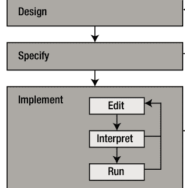

### 小规模：编辑-解释-运行

当你想要用 `JavaScript` 构建一个游戏时，你需要编写一个包含许多行指令的程序。使用文本编辑器，你可以编辑正在编写的脚本。一旦写完这些指令，你就启动浏览器（最好是常用浏览器的最新版本）并尝试运行程序。如果一切顺利，浏览器会解释脚本并执行它。

然而，大多数时候事情并没那么简单。首先，你交给浏览器/解释器的源代码应该包含有效的 `JavaScript` 代码，因为你不能指望浏览器执行一个包含随机胡言乱语的脚本。浏览器会检查源代码是否符合 `JavaScript` 语言的语言规范。如果不符合，它会产生错误，脚本停止运行。当然，程序员会努力编写正确的 `JavaScript` 程序，但很容易出现拼写错误，而且编写正确程序的规则非常严格。因此，你在解释阶段肯定会遇到错误。

在经过几次解决细微错误的迭代后，浏览器在没有遇到任何问题的情况下解释了整个脚本。作为下一步，浏览器将执行或运行该脚本。在许多情况下，你随后会发现脚本并没有完全按照你想要的方式运行。当然，你已经努力地正确表达了你希望脚本执行的操作，但概念性错误很容易发生。

于是你回到编辑器，修改脚本。然后你再次打开浏览器，尝试解释/运行脚本，并希望没有制造新的拼写错误。你可能会发现之前的问题解决了，但随即意识到，虽然脚本的行为发生了变化，但它仍然没有完全实现你的要求。然后又是回到编辑器。欢迎来到程序员的生活！

### 大规模：设计-规范-实现

一旦你的游戏变得更加复杂，直接盲目地编写直到完成就不再是一个好主意了。在开始实现（编写和测试游戏）之前，还有另外两个阶段。

首先，你必须设计游戏。你正在构建什么类型的游戏？你的目标受众是谁？是 2D 游戏还是 3D 游戏？你想要模拟什么样的游戏玩法？游戏中有什么样的角色，他们的能力是什么？特别是当你与他人共同开发游戏时，你必须编写某种设计文档来包含所有这些信息，这样每个人才能就他们正在开发什么样的游戏达成一致！即使你独立开发游戏，记录游戏设计也是一个好主意。设计阶段实际上是游戏开发中最困难的任务之一。

一旦明确了游戏应该做什么，下一步就是为程序提供一个全局结构。这被称为规范阶段。你还记得面向对象编程范式将指令组织在方法中，将方法组织在类中吗？在规范阶段，你会概述游戏中需要的类以及这些类中的方法。在这个阶段，你只需要描述一个方法将做什么，而不是如何实现。不过，请记住，你不能对方法提出不可能的要求：它们稍后必须被实现。

当游戏规范完成后，你可以开始实现阶段，这通常意味着经历几次“编辑-解释-运行”循环。之后，你可以让其他人试玩你的游戏。在许多情况下，你会发现游戏设计中的某些想法运行效果并不理想。于是，你重新开始，通过修改设计，随后修改规范，最后进行新的实现。你再次让其他人试玩你的游戏，然后……好吧，你明白这个意思了。“编辑-解释-运行”循环包含在一个更大规模的循环中：即“设计-规范-实现”循环（见图 1-1）。虽然本书主要关注实现阶段，但你可以在第 30 章中进一步阅读关于游戏设计的相关内容。

## 构建你的第一个 Web 应用程序

在本节中，你将使用 `JavaScript` 构建几个非常简单的示例应用程序。在本章的前面，你看到一个基础的 HTML 页面：

```html
<!DOCTYPE html>
<html>
<head>
<title>Useful website</title>
</head>
<body>
This is a very useful website.
</body>
</html>
```

打开一个文本编辑程序（如记事本），将这段文本复制粘贴进去。将文件保存为具有 `.html` 扩展名的文件。然后双击该文件在浏览器中打开。你会看到一个几乎为空的 HTML 页面，如图 1-2 所示。在 HTML 中，标签用于构建文档中的信息结构。你可以通过尖括号来识别这些标签。每种不同类型的内容都被放置在这样的标签之间。你可以通过检查标签名称前是否有斜杠来区分开始标签和结束标签。例如，文档的标题被放置在开始标签 `<title>` 和结束标签 `</title>` 之间。标题本身又是页眉 (header) 的一部分，由 `<head>` 和 `</head>` 标签界定。页眉包含在 html 部分中，由 `<html>` 和 `</html>` 标签界定。如你所见，HTML 标签系统允许你逻辑地组织文档内容。整个 HTML 文档具有一种树状结构，其中 `html` 元素是树的根；根由 `head` 和 `body` 等元素组成，而这些元素又包含更多的分支。

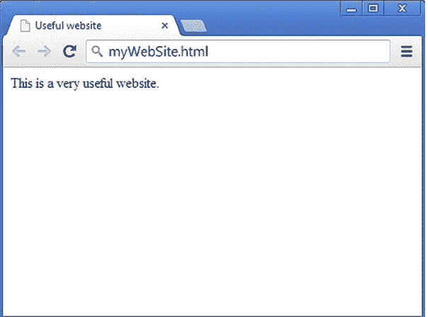

图 1-2. 一个非常简单的 HTML 页面

一旦创建了 HTML 文档，你就可以为其应用样式。例如，你可能想要更改 HTML 文档中各部分的布局，或者想要使用不同的字体或应用背景颜色。样式可以定义为 HTML 文档的一部分，或者你可以使用 CSS（层叠样式表）文件来定义样式。

虽然本书不会详细讨论样式表（CSS 文件），但我会有限度地使用它们，以便在浏览器窗口中正确地定位游戏内容。例如，这个简单的样式表将 HTML 页面及其正文（body）的边距设置为 0：

```css
html, body {
    margin: 0;
}
```

如果你希望你的 HTML 页面使用 CSS 文件（样式表），只需在 `<head>` 部分添加以下行：

```html
<link rel="stylesheet" type="text/css" href="game-layout.css"/>
```

在本书的大多数游戏示例中，我将使用上述样式表。在第 13 章中，我将扩展该样式表，以实现内容在不同设备上的自动缩放和定位。

你也可以直接在 HTML 文档本身中更改样式，而不是使用 CSS 文件来定义。这是通过设置标签的属性（attributes）来实现的。例如，以下 HTML 页面的 `body` 标签有一个 `style` 属性，其设置将背景颜色更改为蓝色（显示的页面请参见图 1-3）：

```html
<!DOCTYPE html>
<html>
<head>
<title>BasicExample</title></head>
<body style="background:blue">
That's a very nice background.
</body>
</html>
```

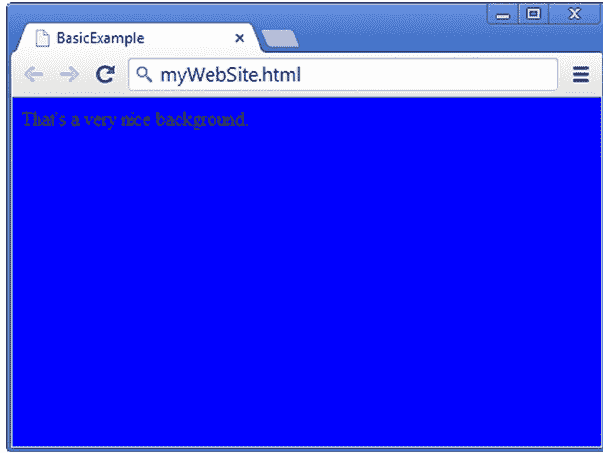

图 1-3. 一个具有蓝色背景的简单网页

你可以像示例中那样，通过使用 `style` 属性来更改样式的不同方面。例如，查看以下 HTML 文档：

```html
<!DOCTYPE html>
<html>
<head>
<title>BasicExample</title></head>
<body>
<div style="background:blue;font-size:40px;">Hello, how are you?</div>
<div style="background:yellow;font-size:20px;">"I'm doing great, thank you!"</div>
</body>
</html>
```

如果你查看 `body` 的内容，你会发现它包含两个部分。每个部分都被包裹在 `div` 标签中，`div` 用于将 HTML 文档划分为区域（divisions）。你可以为每个区域应用不同的样式。在这个例子中，第一个区域具有蓝色背景和 40 像素的字体大小，第二个区域具有黄色背景和 20 像素的字体大小（另见图 1-4）。


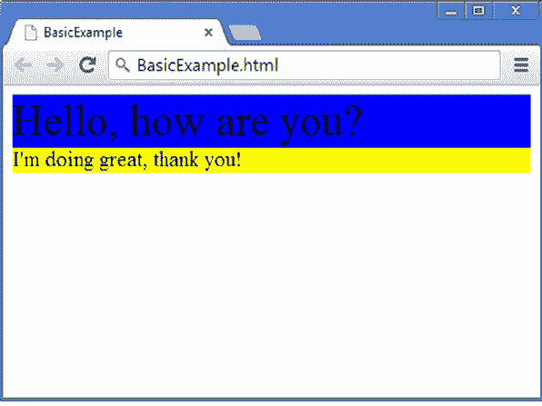

*图 1-4. 一个由两个区域组成的网页，每个区域具有不同的背景颜色和字体大小*

除了给 HTML 元素添加 `style` 属性外，你还可以使用 JavaScript 来修改该元素的样式。例如，你可以使用 JavaScript 更改 `body` 的背景颜色，如下所示：

```html
<!DOCTYPE html>
<html>
<head>
<title>BasicExample</title><script>
	changeBackgroundColor = function () {
		document.body.style.background = "blue";
	}
	document.addEventListener('DOMContentLoaded', changeBackgroundColor);
</script>
</head>
<body>
That's a very nice background.
</body>
</html>
```

浏览器显示的页面与第一个示例（图 1-2 所示）完全相同，但使用 JavaScript 来实现与在 `body` 标签中添加属性之间有一个关键区别：JavaScript 脚本动态地改变颜色。这是因为脚本包含以下行：

```javascript
document.addEventListener('DOMContentLoaded', changeBackgroundColor);
```

在一个 JavaScript 应用程序中，你可以访问 HTML 页面中的所有元素。当某些事情发生时，你可以指示浏览器执行指令。在这里，你指示在页面加载完成后执行 `changeBackgroundColor` 函数。

在 HTML 和 JavaScript 中有许多不同类型的此类事件。例如，你可以向 HTML 文档中添加一个按钮，并在用户点击按钮时执行 JavaScript 指令。下面是一个说明此点的 HTML 文档（另见图 1-5）：

```html
<!DOCTYPE html>
<html>
<head>
<title>BasicExample</title>
<script>
    sayHello = function () {
        alert("Hello World!");
    }
    document.addEventListener('click', sayHello);
</script>
</head>
<body>
<button>Click me</button>
</body>
</html>
```

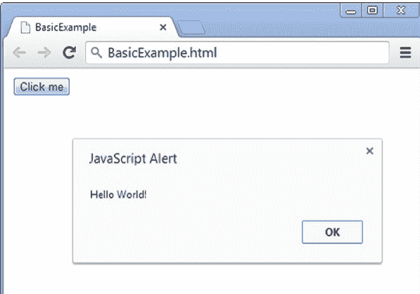

这种动态交互之所以成为可能，是因为浏览器可以执行 JavaScript 代码。如果你想编写游戏程序，能够定义玩家如何与游戏交互至关重要。

### HTML5 Canvas

新 HTML 标准的一个优点是它提供了一些标签，使得 HTML 文档变得更加灵活。添加到标准中的一个非常重要的标签是 `canvas` 标签，它允许你在 HTML 文档中绘制 2D 和 3D 图形。这是一个简单的例子：

```html
<!DOCTYPE html>
<html>
<head>
<title>BasicExample</title>
</head>
<body>
<div id="gameArea">
    <canvas id="mycanvas" width="800" height="480"></canvas>
</div>
</body>
</html>
```

在这里你可以看到，`body` 包含一个名为 `gameArea` 的区域。在这个区域内部是一个 `canvas` 元素，它具有若干属性。它有一个标识符（`mycanvas`），以及宽度和高度。你同样可以使用 JavaScript 来修改这个 `canvas` 元素中的内容。例如，以下代码通过几条 JavaScript 指令更改了 `canvas` 元素的背景颜色：

```html
<!DOCTYPE html>
<html>
<head>
<title>BasicExample</title>
<script>
    changeCanvasColor = function () {
        var canvas = document.getElementById("mycanvas");
        var context = canvas.getContext("2d");
        context.fillStyle = "blue";
        context.fillRect(0, 0, canvas.width, canvas.height);
    }
    document.addEventListener('DOMContentLoaded', changeCanvasColor);
</script>
</head>
<body>
<div id="gameArea">
    <canvas id="mycanvas" width="800" height="480"></canvas>
</div>
</body>
</html>
```

在 `changeCanvasColor` 函数中，你首先找到 `canvas` 元素。这是你可以绘制 2D 和 3D 图形的 HTML 文档元素。在代码中准备好这个元素很有用，因为这样你就可以轻松地检索有关 `canvas` 的信息，例如它的宽度或高度。为了在 `canvas` 上执行操作（例如在上面绘图），你需要一个 `canvas` 上下文（context）。`canvas` 上下文提供了在 `canvas` 上绘图的函数。当你检索 `canvas` 上下文时，需要指定你想在二维还是三维空间中绘图。在这个例子中，你获取了一个二维 `canvas` 上下文。你使用它来选择一个背景填充颜色并用该颜色填充 `canvas`。图 1-6 显示了浏览器显示的最终 HTML 页面。接下来的章节将详细介绍 `canvas` 元素以及如何使用它来创建游戏。

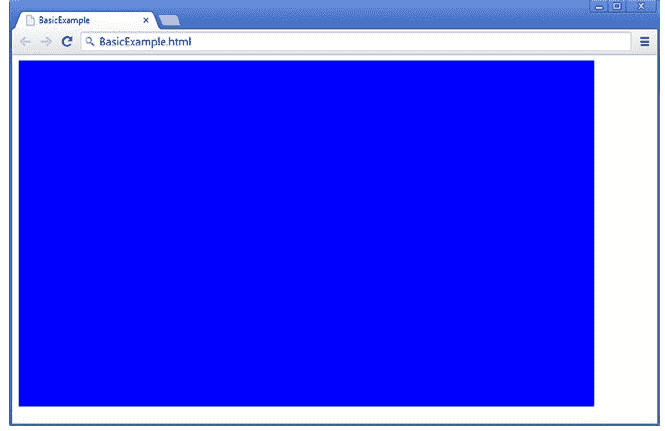

图 1-6. 在网页上显示 HTML5 canvas 并用颜色填充

### 将 JavaScript 放在单独的文件中

与其将所有 JavaScript 代码都写在 HTML 文档中，你也可以将 JavaScript 代码写在单独的文件中，并在 HTML 文档中包含该文件：

```html
<!DOCTYPE html>
<html>
<head>
<title>BasicExample</title>
<script src="BasicExample.js"></script>
</head>
<body>
<div id="gameArea">
    <canvas id="mycanvas" width="800" height="480"></canvas>
</div>
</body>
</html>
```

JavaScript 文件 `BasicExample.js` 随后包含以下代码：

```javascript
changeCanvasColor = function () {
    var canvas = document.getElementById("mycanvas");
    var context = canvas.getContext("2d");
    context.fillStyle = "blue";
    context.fillRect(0, 0, canvas.width, canvas.height);
}
document.addEventListener('DOMContentLoaded', changeCanvasColor);
```

在许多情况下，这样做是理想的。通过将脚本代码与 HTML 文档分离，更容易定位代码或将其用于不同的网站。本书中使用的所有示例都将 JavaScript 代码与 HTML 文档分离，并整齐地组织在一个或多个 JavaScript 文件中。

### 你学到了什么

在本章中，你学习了：

- 计算机是如何工作的，以及它们由用于计算的处理器和用于存储的内存组成
- 编程语言如何从汇编语言演变为 JavaScript 等现代编程语言
- 如何使用 HTML5 和 JavaScript 创建一个简单的 Web 应用程序

# 第 2 章

## 游戏编程基础

本章涵盖游戏编程的基本要素，并为后续章节提供一个起点。首先，你将了解任何游戏的基本骨架，它由游戏世界和游戏循环组成。你将看到如何在 JavaScript 中构建这个骨架，通过查看各种示例，例如一个改变背景颜色的简单应用程序。最后，我将介绍如何通过在适当位置使用注释、布局和空格来使代码更加清晰。

### 游戏的构建模块

本节介绍游戏的构建模块。我将讨论游戏世界的整体概念，然后向你展示使用更新-绘制循环来改变游戏世界的过程，该循环不断地更新游戏世界，然后将其绘制到屏幕上。

### 游戏世界

游戏之所以是一种极佳的娱乐形式，是因为你可以探索一个想象中的世界，并在那里做一些在现实生活中永远不会做的事情。你可以骑在龙背上，摧毁整个太阳系，或者创建一个由使用想象语言交流的角色组成的复杂文明。你在这个想象空间中进行游戏，被称为游戏世界。游戏世界的范围可以从非常简单的领域（如俄罗斯方块的世界）到复杂的虚拟世界（如《侠盗猎车手》和《魔兽世界》中的世界）。

当游戏在计算机或智能手机上运行时，设备会维护游戏世界的内部表示。这种表示与你在玩游戏时在屏幕上看到的完全不同。它主要由描述对象位置的数字、敌人能从玩家那里扣除多少生命值、玩家背包中有多少物品等数据组成。幸运的是，程序还知道如何创建这个世界的可视化表示并将其显示在屏幕上。否则，玩电脑游戏可能会极其无聊，玩家不得不翻阅一页页数字来确认自己是救出了公主还是惨死。

玩家永远看不到游戏世界的内部表示，但游戏开发者可以看到。当你想要开发一个游戏时，你也需要设计如何在内部表示你的游戏世界。而编写自己游戏的乐趣之一就是你可以完全掌控这一点。

另一个需要认识到的重要事实是，就像现实世界一样，游戏世界也在不断变化。怪物移动到不同的位置，天气在变化，汽车耗尽了油，敌人被击杀，等等。此外，玩家实际上也在影响游戏世界的变化方式！因此，仅仅在计算机内存中存储游戏世界的表示是不够的。游戏还需要不断地记录玩家正在做什么，并据此更新这种表示。此外，游戏还需要通过在计算机显示器、电视或智能手机屏幕上显示来向玩家展示游戏世界。处理所有这些过程的机制被称为游戏循环。

### 游戏循环

游戏循环处理游戏的动态方面。当游戏运行时，会发生很多事情。玩家按下游戏手柄上的按钮或触摸设备的屏幕，而一个由关卡、怪物和其他角色组成的不断变化的游戏世界需要保持更新。还有爆炸、声音等特殊效果。游戏循环需要处理的所有这些不同任务可以分为两类：

- 与更新和维护游戏世界相关的任务
- 与向玩家展示游戏世界相关的任务

游戏循环持续地依次执行这些任务（见图 2-1）。举个例子，让我们看看如何在一个像《吃豆人》这样的简单游戏中处理玩家导航。游戏世界主要由一个迷宫和几个四处移动的讨厌幽灵组成。吃豆人位于迷宫中的某个位置，并朝某个方向移动。在第一个任务（更新和维护游戏世界）中，你检查玩家是否按下了方向键。如果是，你需要根据玩家希望吃豆人移动的方向来更新吃豆人的位置。此外，由于这次移动，吃豆人可能吃掉了一个白点，这会增加分数。你需要检查这是否是关卡中的最后一个白点，因为那意味着玩家已经完成了该关卡。最后，如果吃掉的是一个较大的白点，幽灵需要被渲染为非活动状态。然后你需要更新游戏世界的其余部分。幽灵的位置需要被更新，你需要决定是否应该在某个地方显示水果以获得奖励分数，你需要检查吃豆人是否与某个幽灵碰撞（如果幽灵没有处于非活动状态），等等。你可以看到，即使在像《吃豆人》这样的简单游戏中，第一个任务也需要完成大量工作。从现在起，我将把这个与更新和维护游戏世界相关的不同任务集合称为 `Update`（更新）操作。

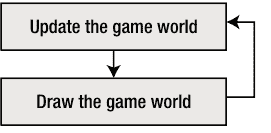

**图 2-1.** *游戏循环持续地更新并绘制游戏世界*

第二个任务集合与向玩家展示游戏世界有关。以《吃豆人》游戏为例，这意味着绘制迷宫、幽灵、吃豆人，以及对玩家重要的游戏信息，例如他们获得了多少分、还剩多少条命等。这些信息可以显示在游戏屏幕的不同区域，例如顶部或底部。这部分显示也被称为抬头显示（HUD）。现代 3D 游戏有一套更复杂的绘制任务。这些游戏需要处理光照和阴影、反射、剔除、爆炸等视觉效果，以及更多内容。我将游戏循环中处理与向玩家展示游戏世界相关的所有任务的部分称为 `Draw`（绘制）操作。

### 用 JavaScript 构建游戏应用

上一章展示了如何创建一个简单的 JavaScript 应用程序。在那个 JavaScript 应用程序中，你看到指令被组织到一个函数中，如下所示：

```javascript
function changeBackgroundColor () {
    document.body.style.background = "blue";
}
```

这种组织方式与 JavaScript 是一种过程式语言的理念一致：指令被组织在过程/函数中。第一步是在 JavaScript 中建立一个简单的游戏循环。看看下面的例子：

```javascript
var canvas = undefined;
var canvasContext = undefined;

function start () {
    canvas = document.getElementById("myCanvas");
    canvasContext = canvas.getContext("2d");
    mainLoop();
}

document.addEventListener('DOMContentLoaded', start);

function update () {
}

function draw () {
}

function mainLoop () {
    canvasContext.fillStyle = "blue";
    canvasContext.fillRect(0, 0, canvas.width, canvas.height);
    update();
    draw();
    window.setTimeout(mainLoop, 1000 / 60);
}
```

如你所见，这个脚本中有几个不同的函数。`start` 函数在 HTML 文档的 `body` 加载完成后被调用，因为有这条指令：

```javascript
document.addEventListener('DOMContentLoaded', start);
```

在 `start` 函数中，你获取 `canvas` 和 `canvas` 上下文；你将它们存储在变量中，以便在程序的其他部分使用它们（稍后会详细介绍）。然后，你执行另一个名为 `mainLoop` 的函数。这个函数反过来又包含其他指令。两条指令负责设置背景颜色。然后你调用 `update` 函数，接着是 `draw` 函数。这些函数中的每一个又可能包含其他指令。最后被调用的指令是：

```javascript
window.setTimeout(mainLoop, 1000 / 60);
```

它的作用只是在等待一段时间后（本例中为 1,000/60 = 16.6 毫秒）再次调用 `mainLoop` 函数。当 `mainLoop` 函数再次被调用时，`canvas` 背景颜色被设置，`update` 和 `draw` 函数被调用。目前，`update` 和 `draw` 是空的，但你可以开始用更新和绘制游戏世界的指令来填充它们。请注意，使用 `setTimeout` 在循环迭代之间等待并不总是最佳方案。有时这种方法可能会受到你无法控制的事件的不利影响，例如运行缓慢的计算机、浏览器中打开的其他标签页、同时运行的需要处理能力的应用程序等。当你需要处理对时间敏感的操作（例如玩家需要存活五分钟）时，你可能不想依赖 `setTimeout`，而是依赖某种在特定时间点调度事件并在 `update` 函数中检查这些事件是否已发生的系统。

当你运行示例程序时，`update` 和 `draw` 函数被持续执行：更新、绘制、更新、绘制、更新、绘制、更新、绘制、更新、绘制，依此类推。此外，这一切都以非常高的速度发生。这个特定的示例创建了一个以大约每秒 60 帧运行的简单游戏循环。这种循环被称为固定时间步长循环，它是休闲游戏中非常流行的一种循环方式。你也可以以不同的方式设计程序，让游戏尝试尽可能多地执行循环，而不是每秒执行 60 次。

> **注意** 当你创建依赖于（游戏）循环的程序时，你可能希望在实现和测试的早期阶段避免使用完全自动化的循环。你可能会意外地创建一个无限循环，从而使开发机器卡顿。相反，你可以设置循环运行有限的次数，或者每次你按下按钮时让循环运行一次。大多数浏览器还支持 JavaScript 调试。例如，在 Firebug（Firefox 浏览器中的）中，你可以在循环中的某个位置设置断点。这样，你就可以跟踪程序运行时发生的事情。

本书将向你展示许多不同的方法来用你需要在游戏中执行的任务填充 `update` 和 `draw` 函数。在此过程中，我还介绍了许多对游戏（和其他应用程序）有用的编程技巧。下一节将更详细地介绍基本的游戏应用。然后，你将用额外的指令来填充这个基本的游戏骨架。

## 程序的结构

本节将更详细地讨论程序的结构。在早期，许多计算机程序只能向屏幕输出文本，而不使用图形。这种基于文本的应用程序称为控制台应用程序。除了向屏幕打印文本外，这些应用程序还能读取用户通过键盘输入的文本。因此，与用户的任何通信都是以问答序列的形式进行的（是否要格式化硬盘（Y/N）？确定吗（Y/N）？等等）。在基于 Windows 的操作系统普及之前，这种基于文本的界面在文本编辑程序、电子表格、数学应用程序甚至游戏中都非常常见。这些游戏被称为文字冒险游戏，它们以文本形式描述游戏世界。玩家可以输入命令与游戏世界互动，例如 `go west`、`pick up matches` 或 `Xyzzy`。这类早期游戏的例子有 Zork 和 Adventure。尽管它们现在看来可能已经过时，但玩起来仍然很有趣！


编写控制台应用程序仍然是可能的，即使使用 JavaScript 这样的语言。虽然了解如何编写这类应用程序很有趣，但我更喜欢专注于编写带有图形的现代游戏。

## 应用程序的类型

控制台应用程序只是应用程序类型的一个例子。另一种非常常见的类型是 Windows 应用程序。这种应用程序显示一个包含窗口、按钮和其他图形用户界面（GUI）组件的屏幕。这类应用程序通常是事件驱动的：它对事件做出反应，例如点击按钮或选择菜单项。

另一种应用程序类型是 app，运行在移动电话或平板电脑上。在这些类型的应用程序中，屏幕空间通常有限，但新的交互可能性是可用的，例如 GPS 来确定设备的位置、检测设备方向的传感器，以及触摸屏。

在开发应用程序时，编写一个能在所有不同平台上运行的程序是一个相当大的挑战。创建 Windows 应用程序与创建 app 非常不同。而且在不同类型的应用程序之间重用代码是困难的。因此，基于 Web 的应用程序正变得越来越流行。在这种情况下，应用程序存储在服务器上，用户在 Web 浏览器中运行程序。这样的应用程序有很多例子：想想基于 Web 的电子邮件程序或社交网站。在本书中，你将学习如何开发基于 Web 的游戏。

> 请注意，并非所有程序都明确地属于某一种应用程序类型。一些 Windows 应用程序可能具有控制台组件，例如浏览器中的 JavaScript 控制台。游戏通常也有窗口组件，例如物品栏屏幕、配置菜单等。而且如今，程序到底是什么的界限已经变得不那么清晰了。想想一个拥有数万名玩家的多人游戏，每个玩家在平板电脑上运行 app，或在台式计算机上运行应用程序，而这些程序与同时在许多服务器上运行的复杂程序进行通信。在这种情况下，什么构成了程序？它又是什么类型的程序？

## 函数

请记住，在命令式程序中，指令执行程序的实际工作：它们一个接一个地执行。这会改变内存和/或屏幕，因此用户注意到程序正在做某事。在 BasicGame 程序中，并非所有行都是指令。指令的一个例子是：

```javascript
context.fillRect(0, 0, canvas.width, canvas.height);
```

这一行指示画布在屏幕上绘制一个矩形，颜色在前一条指令中指定。因为这个矩形恰好是画布的大小，所以整个画布的颜色都被改变了。

因为 JavaScript 是一种过程式语言，指令可以被分组为函数。在 JavaScript 中，指令不一定要属于某个函数。例如，BasicGame 程序中的以下指令就不属于任何函数：

```javascript
var canvas = undefined;
```

然而，函数非常有用。它们防止代码重复，因为指令只在一个地方，并且允许程序员通过调用一个名称来轻松执行这些指令。将指令分组到一个函数中是通过大括号（`{` 和 `}`）完成的。这样分组在一起的一组指令称为函数的主体。在主体上方，你编写函数的头部。函数头部的一个例子如下：

```javascript
function mainLoop ()
```

头部包含函数的名称（在本例中是 `mainLoop`）等内容。作为程序员，你可以为函数选择任何名称。你已经看到游戏循环由两部分组成：`update` 和 `draw`。在编程术语中，这些部分被建模为函数，正如你在示例程序中看到的。在这些函数中，你放置想要执行的指令，以便更新或绘制游戏世界。函数名称前面有单词 `function`，名称后面是一对括号。这些用于向函数内部执行的指令提供信息。例如，看看以下头部：

```javascript
function playAudio (audioFileId)
```

在这个头部中，函数的名称是 `playAudio`；在括号之间你看到单词 `audioFileId`。显然，`playAudio` 函数需要一个音频文件标识符，这样它就知道应该播放哪个音频文件。

## 语法图

如果你不了解语言的规则，用 JavaScript 这样的语言编程可能会很困难。本书使用所谓的语法图来解释语言的结构。编程语言的语法指的是定义什么是有效程序的正式规则（换句话说：编译器或解释器可以读取的程序）。相比之下，程序的语义指的是它的实际含义。为了说明语法和语义之间的区别，看看短语 "all your base are belong to us"。从语法上讲，这个短语是无效的（英语语言的解释器肯定会对此抱怨）。然而，这个短语的含义相当清楚：你显然把所有基地都输给了一个说蹩脚英语的外星种族。

> 注意：短语 "all your base are belong to us" 来自电子游戏 Zero Wing（1991 年，世嘉 Mega Drive）的开场动画，是对原版日语的拙劣翻译。从那以后，这个短语出现在我的文章、电视剧、电影、网站和书籍中（比如这本书！）。

解释器可以检查程序的语法：任何违反规则的程序都会被拒绝。不幸的是，解释器无法检查程序的语义是否与程序员的想法一致。因此，如果程序在语法上是正确的，这并不能保证它在语义上是正确的。但如果它在语法上甚至都不正确，它根本无法运行。语法图帮助你可视化 JavaScript 等编程语言的规则。例如，图 2-2 是一个简化的语法图，展示了如何在 JavaScript 中定义函数。

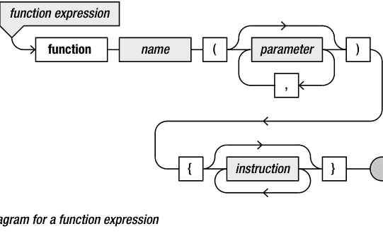

图 2-2. 函数表达式的语法图

你可以使用语法图来构建 JavaScript 代码，从图的左上角开始，在本例中是从单词 `function` 开始，然后沿着箭头前进。当你到达灰点时，你的代码片段就完成了。在这里你可以清楚地看到，函数定义以 `function` 关键字开始；然后你写函数的名称。之后，你写括号。在这些括号之间，你可以（可选地）写任意数量的参数，用逗号分隔。接下来你写若干条指令，全部在大括号之间。之后，你就完成了，因为你已经到达了灰点。在本书中，我将使用语法图来展示如何根据 JavaScript 语言的句法规则来构建你的代码。

## 调用函数

当执行以下指令时，你调用了 `fillRect` 函数：

```javascript
canvasContext.fillRect(0, 0, canvas.width, canvas.height);
```

换句话说，你希望程序执行分组在 `fillRect` 函数中的指令。这组指令恰好完成了这个示例中你需要的工作：即用一个颜色填充矩形。然而，你需要给这个函数一些额外的信息，因为它需要知道应该填充的矩形的大小。参数提供了这些额外信息。一个函数可以有多个参数，正如你在语法图中看到的。当调用函数时，你总是在它后面写括号，括号内是参数（如果需要的话）。

你需要知道 `fillRect` 函数中具体包含了哪些指令才能使用它吗？不需要！这就是将指令分组到函数中的好处之一。你（或其他程序员）可以在不了解其工作原理的情况下使用这个函数。通过巧妙地将指令分组到函数中，可以编写出可在多种不同上下文中重复使用的程序片段。`fillRect` 函数就是一个很好的例子。它可以用于各种应用，而且你不需要知道该函数如何工作就能使用它。你唯一需要知道的是，它接受矩形的尺寸作为参数。

## 更新与绘制

BasicGame 示例中的游戏循环包含 `update` 和 `draw` 函数。因为函数本质上就是一组指令，所以每次调用 `update` 函数时，该函数中的指令就会被执行。`draw` 函数也是如此。

举个例子，假设你想要一个简单的游戏：在鼠标指针的位置绘制一个气球。当你移动鼠标时，气球会跟着移动。就 `update` 和 `draw` 函数而言，你可以这样做。在 `update` 函数中，你需要执行一条指令来获取鼠标指针的当前位置并将其存储在内存中。在 `draw` 函数中，你需要执行一条指令，在已存储的位置显示一个气球图像。当然，你现在还不知道这些指令是否存在（剧透：它们确实存在于）你也不知道这些指令长什么样。此外，你可能会想为什么这样行得通。你并没有移动气球，你只是在 `update` 函数存储的位置上绘制它。

请记住，`update` 和 `draw` 函数是以非常高的频率执行的（每秒 60 次）。正因为这个高频率，在不同位置绘制气球使其看起来像是在移动（但实际上并没有）。所有的游戏世界都是这样绘制的，玩家也因此误以为世界中有运动。实际上，你只是快速地在不同位置绘制图像。请继续关注——你稍后还会回到这个例子并让它运行起来！

## 程序布局

本节讨论程序源代码的布局。首先介绍如何为代码添加说明性注释。然后学习如何通过使用单行或多行、空白和缩进来尽可能清晰地编写指令。

### 注释

对于程序的阅读者来说（另一位程序员，或几个月后的你自己，当你已经忘记程序具体如何工作时），在程序中添加一些说明性注释可能非常有用。这些注释会被编译器完全忽略，但它们能让程序更容易理解。在 JavaScript 中，有两种标记注释的方式：

- 符号组合 `/*` 和 `*/` 之间的所有内容都会被忽略（可以有跨越多行的注释）。
- 符号组合 `//` 到行尾之间的所有内容都会被忽略。

在代码中放置注释来成组地解释一组指令、参数的含义或完整的类是非常有用的。如果你使用注释，请用它来阐明代码，而不是用文字把代码再写一遍：你可以假设阅读你代码的人已经懂得 JavaScript。

为了说明这一点，下面的注释行增加了指令的清晰度：

```javascript
// 将背景色设置为绿色。
canvasContext.fillStyle = "green";
canvasContext.fillRect(0, 0, canvas.width, canvas.height);
```

这也是一条注释，但它并没有阐明指令的作用：

```javascript
/* 将值"green"传递给canvasContext的fillStyle变量，并用参数0, 0, canvas.width和canvas调用canvasContext的fillRect方法。 */
canvasContext.fillStyle = "green";
canvasContext.fillRect(0, 0, canvas.width, canvas.height);
```

在测试程序时，你也可以使用注释符号来暂时从程序中移除指令。但不要忘记在程序完成后移除那些被注释掉的代码部分，因为它们可能会让其他开发者查看你的源代码时感到困惑。

### 指令与行

对于 JavaScript 程序的文本如何分布在文本文件的各行中，没有严格的规则。通常你将每条指令写在单独的一行上，即使编译器不一定需要这样也能理解程序。有时，如果这样做能让程序更清晰，程序员会在一行上写多条指令。此外，有时较长的单条指令（包含函数/方法调用和许多不同参数）也可以分布在多行上（你在本书后面也会看到这种情况）。

### 空白与缩进

如你所见，BasicGame 示例大量使用了空白。每个函数之间有空行，每个等号两边的表达式之间也有空格。间距可以帮助程序员澄清代码。对于浏览器/解释器来说，空格没有意义。唯一真正需要空格的地方是单独的词语之间：你不能把 `function update()` 写成 `functionupdate()`。同样，你不能在单词中间加入额外的空格。在按字面意义解释的文本中，空格也是按字面理解的。

```javascript
canvasContext.fillStyle = "blue";
```

和

```javascript
canvasContext.fillStyle = "b l u e";
```

是有区别的。

但除此之外，额外空格在所有地方都是允许的。以下是添加额外空白的好地方：

- 每个逗号和分号之后（但之前不加）。
- 等号（`=`）左右两侧。你可以在指令 `canvasContext.fillStyle = "blue";` 中看到一个例子。
- 在行首，这样方法和类的主体相对于包围主体的花括号缩进（通常是四个位置）。

大多数编辑程序会自动帮你进行缩进。此外，编辑器会自动在代码中的某些位置放置空白，以提高可读性。

## 本章小结

在本章中，你学到了：

- 游戏的骨架是什么，包括游戏循环以及游戏循环所作用的游戏世界。
- 如何构建由几个不同函数组成的游戏程序，包括获取画布的函数，以及构成游戏循环的 `update` 和 `draw` 函数。
- JavaScript 程序的基本布局规则，包括如何在代码中放置注释以及在哪里添加额外空白以提高代码可读性。

# 第 3 章：创建游戏世界

本章介绍如何通过将信息存储在内存中来创建游戏世界。它介绍了基本类型和变量，以及如何使用它们来存储或更改信息。接下来，你将了解如何在由成员变量和方法组成的对象中存储更复杂的信息。

## 基本类型和变量

前几章多次讨论了内存。你已经看到如何执行简单的指令，如 `canvasContext.fillStyle = "blue";`，来设置绘制到画布上的形状应填充的颜色。在本章的示例中，你使用内存来临时存储信息，以便记住一些简单计算的结果。在这个 `DiscoWorld` 示例中，你根据经过的时间来改变背景色。

### 类型

类型，或数据类型，代表了不同种类的结构化信息。前面的示例使用了作为参数传递给函数的不同种类的信息。例如，`fillRect` 函数需要四个整数作为信息，BasicGame 示例中的 `start` 函数需要一个引用画布的文本标识符，而同个示例中的 `update` 和 `draw` 函数则完全不需要任何信息。浏览器/解释器可以区分所有这些不同种类的信息，而且在很多情况下，甚至可以将一种类型的信息转换为另一种类型。例如，在 JavaScript 中，你可以使用单引号或双引号来表示文本。以下两条指令执行相同的操作：

```javascript
canvas = document.getElementById("myCanvas");

canvas = document.getElementById('myCanvas');
```

浏览器能够自动在不同种类的信息之间进行转换。例如，下面的代码不会产生语法错误：

```javascript
canvas = document.getElementById(12);
```

传递给参数的数字将被简单地转换为文本。在这种情况下，显然不存在 ID 为 12 的画布，因此程序将无法正常运行。但如果你将画布 ID 替换如下，那么程序就能正常工作：

```html
<canvas id="12" width="800" height="480"></canvas>
```

浏览器会自动在文本和数字之间进行转换。

大多数编程语言比 JavaScript 严格得多。在 Java 和 C# 等语言中，类型之间的转换是在非常有限的基础上进行的。大多数时候，你必须显式地告诉编译器需要进行类型转换。这种类型转换也被称为强制类型转换（cast）。

为什么在类型转换方面采取更严格的策略？一方面，明确定义函数或方法期望的参数类型，可以让其他程序员更容易理解如何使用该函数。例如，看看下面的函数头：

```javascript
function playAudio (audioFileId)
```

仅通过查看这个函数头，你无法确定 `audioFileId` 是数字还是文本。在 C# 中，类似方法的函数头如下所示：

```csharp
void playAudio(string audioFileId)
```

你可以看到在这个函数头中，不仅提供了名称，还提供了属于该名称的类型。在这种情况下，类型是 `string`，在 C# 中这意味着文本（一个字符字符串）。此外，在方法名之前是单词 `void`，这意味着该方法没有可以存储的结果（我在第 7 章中详细讨论有结果的方法/函数）。

## 变量的声明与赋值

在 JavaScript 中存储信息并在以后使用它非常简单。你需要做的是提供一个当你引用此信息时使用的名称。这个名称被称为变量。当你想要在程序中使用变量时，最好在实际使用它之前先声明它。声明变量的方法如下：

```javascript
var red;
```

在这个例子中，`red` 是变量的名称。你可以在程序中使用该变量来存储以后需要的信息。

当你声明变量时，不需要提供你存储的信息类型。变量仅仅是内存中一个有名字的地方。相当多的编程语言要求在声明变量时必须固定变量的类型。例如，C++ 或 Java 等语言就是这种情况。然而，许多脚本语言（包括 JavaScript）允许你在不定义类型的情况下声明变量。当一种语言在声明变量时不要求类型定义时，这种语言就具有弱类型（loose typing）。在 JavaScript 中，你可以一次声明多个变量。例如：

```javascript
var red, green, fridge, grandMa, applePie;
```

在这里，你声明了五个不同的变量，现在可以在程序中使用它们。当你声明这些变量时，它们还没有包含任何值。在这种情况下，这些变量被认为是未定义的（undefined）。你可以使用赋值语句给变量分配一个值。例如，让我们按如下方式给变量 `red` 赋值：

```javascript
red = 3;
```

赋值语句由以下部分组成：

- 需要被赋值的变量名称。
- `=` 符号。
- 变量的新值。
- 分号。

你可以通过中间的等号识别出赋值语句。然而，在 JavaScript 中，最好将这个符号视为“变成”而不是“等于”。毕竟，变量在指令执行前并不等于等号右边的值——它在指令执行后变成那个值。描述赋值语句的语法图如图 3-1 所示。

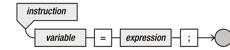

现在你已经看到了声明变量的一条指令，以及在其中存储值的另一条指令。但如果你在声明变量时已经知道想要存储哪个值，你可以将变量的声明和首次赋值结合起来：

```javascript
var red = 3;
```

当这条指令执行时，内存将包含值 3，如图 3-2 所示。

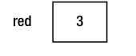

这里有一些更多数值变量声明和赋值的示例：

```javascript
var age = 16;
var numberOfBananas;
numberOfBananas = 2;
var a, b;
a = 4;
var c = 4, d = 15, e = -3;
c = d;
numberOfBananas = age + 12;
```


在这个示例的第四行，你可以看到在一个声明中声明多个变量是可能的。你甚至可以在单个声明中执行多个带赋值的声明，正如示例代码第六行所示。在赋值的右侧，你可以放置其他变量或数学表达式，正如最后两行所示。指令`c = d;`导致存储在变量`d`中的值也被存储在变量`c`中。因为变量`d`包含值 15，所以执行此指令后，变量`c`也包含值 15。最后一条指令获取存储在变量`age`中的值 (16)，加上 12，然后将结果存储在变量`numberOfBananas`中（现在它的值是 28——好多香蕉！）。总之，在这些指令执行后，内存看起来就像图 3-3 中描绘的那样。

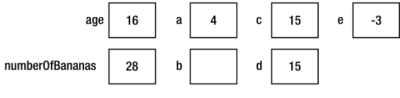

*图 3-3. 多个变量声明和赋值后的内存概览*

声明变量（带有可选初始化）的语法在图 3-4 所示的图表中表达。

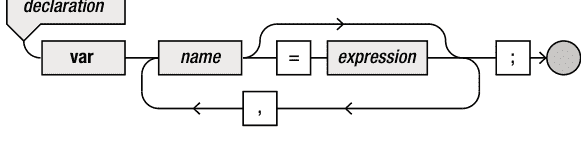

*图 3-4. 带有可选初始化的变量声明语法图*

## 全局变量与严格模式

在 JavaScript 中，除了在运行前声明变量，还可以直接开始使用变量而无需声明。例如，考虑以下指令：

```
var a = 3;
var b;
b = 4;
x = a + b;
```

如你所见，变量`a`和`b`在前两条指令中通过使用`var`关键字声明。变量`x`从未被声明，但它被用来存储这两个变量的和。JavaScript 允许这样做。然而，这是一个非常糟糕的习惯，原因如下。直接使用变量而不声明的问题在于，JavaScript 解释器会自动为你声明该变量而你并未意识到。如果你在其他地方恰好使用了同名变量，你的程序可能会表现出你不期望的行为，因为该变量已经存在。此外，如果你使用了大量不同的变量，你还必须跟踪这些全局变量。但一个更严重的问题在下面的示例中可见：

```
var myDaughtersAge = 12;
var myAge = 36;
var ourAgeDifference = myAge - mydaughtersAge;
```

在编写这些指令时，你会期望变量`ourAgeDifference`包含值 24（36 减 12）。然而，实际上它将是`undefined`。原因在于第三条指令中有一个拼写错误。变量名不应该是`mydaughtersAge`，而应该是`myDaughtersAge`。浏览器/解释器没有停止脚本并报告错误，而是*静默地*声明了一个名为`mydaughtersAge`的新全局变量。因为这个变量是未定义的（它还没有引用任何值），所以使用这个变量进行的任何计算也将是未定义的。因此，变量`ourAgeDifference`随后也是未定义的。

这类问题非常难以解决。幸运的是，新的 EMCAScript 5 标准引入了名为*严格模式（strict mode）*的功能。当脚本在严格模式下被解释时，不允许在不先声明的情况下使用变量。如果你想让脚本在严格模式下被解释，你唯一需要做的就是在脚本的开头添加一行，如下所示：

```
"use strict";
var myDaughtersAge = 12;
var myAge = 36;
var ourAgeDifference = myAge - mydaughtersAge;
```

字符串/指令`"use strict";`告诉解释器脚本应该在严格模式下解释。如果你现在尝试运行此脚本，浏览器将停止脚本并报告错误，提示某个变量在未声明的情况下被使用。

除了检查变量在用前是否声明外，严格模式还包含一些其他功能，使编写正确的 JavaScript 代码变得更容易。此外，较新版本的 JavaScript 标准很可能会接近严格模式所强加的 JavaScript 语法限制。

我强烈建议你将所有的 JavaScript 代码都写在严格模式下。为了树立榜样，本书中所有剩余的示例都是在严格模式下编写的。它为程序员节省了许多头痛的问题，并且代码更容易适应未来版本的 JavaScript。

## 指令与表达式

如果你观察语法图中的元素，你可能会注意到赋值右侧的值或程序片段被称为*表达式（expression）*。那么表达式和*指令（instruction）*之间有什么区别呢？两者的区别在于，*指令*会以某种方式改变内存，而*表达式*则具有一个值。指令的示例是方法调用和赋值，正如你在上一节中所见。指令通常使用表达式。以下是一些表达式的例子：

```
16
numberOfBananas
2
a + 4
numberOfBananas + 12 - a
-3
"myCanvas"
```

所有这些表达式都表示某种类型的值。除了最后一行，所有表达式都是数字。最后一个表达式是一个字符串（字符）。除了数字和字符串，还有其他类型的表达式。我将在本书中讨论最重要的几种。例如，在下一节中，我将讨论包含运算符的表达式，第7章则描述了将函数或方法作为表达式来使用。

## 运算符与更复杂的表达式

本节介绍了 JavaScript 所知的不同运算符。你将了解每个运算符的优先级，以便知道计算的执行顺序。你还会看到，在 JavaScript 中，表达式有时可能相当复杂。例如，一个变量可以包含多个值，甚至可以指向一个函数。

### 算术运算符

在表示数字的表达式中，你可以使用以下算术运算符：

- `+` 加
- `-` 减
- `*` 乘
- `/` 除
- `%` 除法取余（读作“模”）

乘法使用星号，因为数学中常用的符号（· 和 ×）在计算机键盘上找不到。在数学中（例如，在公式*f(x) = 3x*中），完全省略这个运算符是常见的，但在 JavaScript 中是不允许的，因为这会导致与由多个字符组成的变量产生混淆。

当使用除法运算符`/`时，某些情况下结果是实数（而不是整数）。例如，执行以下指令后，变量`y`包含的值是 0.75：

```
var y = 3/4;
```

特殊运算符`%`给出除法取余的结果。例如，`14%3`的结果是 2，`456%10`的结果是 6。结果总是在 0 和运算符右边的值之间。如果除法的结果是整数，则余数为 0。

### 运算符优先级

当一个表达式中使用多个运算符时，适用常规的算术优先级规则：乘法在加法之前。因此，表达式`1+2*3`的结果是 7，而不是 9。加法和减法具有相同的优先级，乘法和除法也是如此。

如果表达式包含多个相同优先级的运算符，则从左到右计算表达式。因此，`10-5-2`的结果是 3，而不是 7。如果你想偏离这些标准的优先级规则，可以使用括号：例如，`(1+2)*3`和`3+(6-5)`。在实践中，这样的表达式通常也包含变量；否则你可以自己计算出结果（9 和 4）。

使用超过需要的括号并不被禁止：例如，`1+(2*3)`。如果你愿意，可以完全搞得很复杂：`((1)+(((2)*3)))))`。但是，如果你这样做，你的程序会变得难以阅读。

总而言之，一个表达式可以是一个常量值（例如 12），可以是一个变量，可以是括号中的另一个表达式，也可以是一个表达式后跟一个运算符再跟另一个表达式。图 3-5 显示了表示表达式的（部分）语法图。

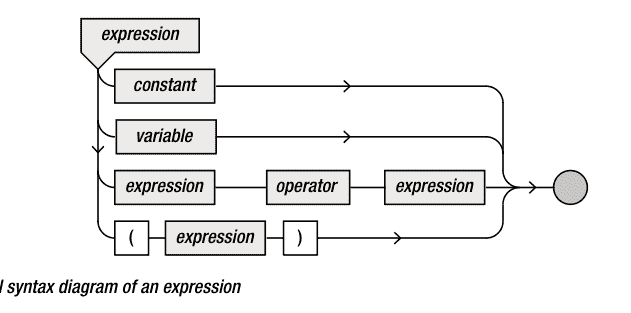

### 将函数赋值给变量

在 JavaScript 中，函数（指令组）存储在内存中。因此，函数本身也是表达式。所以，可以将一个函数赋值给一个变量。例如：

```
var someFunction = function () {
    // do something
}
```

这个例子声明了一个变量`someFunction`并给它赋了一个值。这个变量引用的值是一个匿名函数。如果你想执行这个函数中包含的指令，可以使用变量名来调用它，如下所示：

```
someFunction();
```

那么，这种定义函数的方式和你之前看到的方式有什么区别？

```
function someFunction () {
    // do something
}
```

实际上，区别不大。主要区别在于，通过传统方式（不使用变量）定义函数，函数在使用前不必定义。当浏览器解释 JavaScript 文件时，它分两个阶段进行。在第一阶段，浏览器构建一个可用函数的列表。在第二阶段，浏览器解释脚本的其余部分。这是必要的，因为为了正确解释脚本，浏览器需要知道哪些函数是可用的。例如，这段 JavaScript 代码可以正常运行，即使函数是在调用之后定义的：

```
someFunction();
function someFunction () {
    // do something
}
```

然而，如果函数被赋值给一个变量，那么这只能在第二阶段被解释。这意味着这段代码将导致错误：

```
someFunction();
var someFunction = function () {
    // do something
}
```

浏览器会报错，称脚本访问了一个尚未声明的变量`someFunction`。在定义之后调用函数是完全没问题的：

```
var someFunction = function () {
    // do something
}
someFunction();
```

### 由多个值组成的变量

一个变量除了包含单个值，也可以由*多个值*组成。这类似于你在函数中所做的，将指令组合在一起。例如：

```
function mainLoop () {
    canvasContext.fillStyle = "blue";
    canvasContext.fillRect(0, 0, canvas.width, canvas.height);
    update();
    draw();
    window.setTimeout(mainLoop, 1000 / 60);
}
```

你可以通过调用`mainLoop`函数来执行所有这些指令。属于该函数的指令通过花括号组合在一起。与组合指令类似，你也可以将变量组合成一个更大的变量。那个更大的变量然后包含多个值。看看下面的例子：

```
var gameCharacter = {
    name: "Merlin",
    skill: "Magician",
    health: 100,
    power: 230
};
```

这是一个*复合变量*的例子。变量`gameCharacter`由几个值组成，每个值都有一个名称和该名称引用的值。因此，在某种意义上，`gameCharacter`变量*由其他变量组成*。你可以看到，就像在函数体中一样，变量被组合在花括号之间。每个子变量都有一个名称，冒号后面你指定该变量引用的值。由花括号括起来的名称和值组成的表达式被称为*对象字面量*。图 3-6 显示了对象字面量表达式的（部分）语法图。

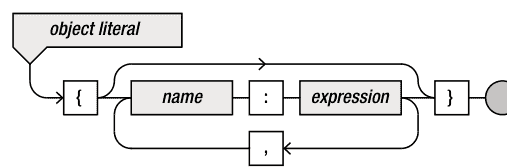

*图 3-6. 对象字面量表达式的（部分）语法图*

在`gameCharacter`变量的声明和初始化之后，内存看起来如图 3-7 所示。

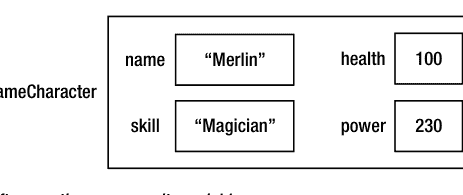

*图 3-7. 创建复合变量后的内存结构*

你可以通过以下方式访问复合变量中的数据：

```
gameCharacter.name = "Arjan";
var damage = gameCharacter.power * 10;
```

如你所见，你可以通过在点号后写上它们的名称来访问作为`gameCharacter`一部分的变量。JavaScript 甚至允许你在声明和初始化复合变量之后修改其结构。例如，看以下代码：

```
var anotherGameCharacter = {
    name : "Arthur",
    skill : "King",
    health : 25,
    power : 35000
};
```

```
anotherGameCharacter.familyName = "Pendragon";
```

变量`anotherGameCharacter`现在由五个部分组成：`name`、`skill`、`health`、`power`和`familyName`。

因为变量也可以指向函数，所以你甚至可以包含一个指向函数的子变量。例如，你可以这样定义`anotherGameCharacter`：

```
var anotherGameCharacter = {
    name : "Arthur",
    familyName : "Pendragon",
    skill : "King",
    health : 25,
    power : 35000,
    healMe : function () {
        anotherGameCharacter.health = 100;
    }
};
```

就像之前一样，你可以在变量被赋值后添加一个函数部分：

```
anotherGameCharacter.killMe = function () {
    anotherGameCharacter.health = 0;
};
```

你可以用与其他变量相同的方式调用这些函数。以下指令将游戏角色的生命值完全恢复：

```
anotherGameCharacter.healMe();
```

如果你想杀死这个角色，`anotherGameCharacter.killMe();`指令就能完成任务。以这种方式组织变量和函数的好处在于，你可以将相关的数据和函数组合在一起。这个例子将所有属于同一个游戏角色的变量组合在一起。它还添加了一些对该游戏角色有用的函数。从现在开始，如果一个函数属于一个变量，我将称这个函数为*方法*。我将称由其他变量组成的变量为*对象*。如果一个变量是对象的一部分，我将称这个变量为*成员变量*。

你大概可以想象对象和方法有多强大。它们提供了一种在复杂游戏世界中构建结构的方法。如果 Java 去没有这个能力，你将不得不在程序开头声明一长串变量，而不知道变量之间如何相互关联，或者可以用它们做什么。通过将变量分组到对象中，并提供属于这些对象的方法，你可以编写出更容易理解的程序。在下一节中，你将在一个简单的示例中使用这种能力，让一个正方形在画布上移动。

## MovingSquare 游戏

本节研究一个在画布上移动正方形的简单程序。其目的是说明两点：

- 游戏循环中的`update`和`draw`部分如何更详细地协同工作
- 如何使用对象来结构化程序

在开始编写这个程序之前，让我们再看一下 BasicGame 示例的代码：

```javascript
var canvas = undefined;
var canvasContext = undefined;

function start () {
    canvas = document.getElementById("myCanvas");
    canvasContext = canvas.getContext("2d");
    mainLoop();
}

document.addEventListener('DOMContentLoaded', start);

function update () {
}

function draw () {
    canvasContext.fillStyle = "blue";
    canvasContext.fillRect(0, 0, canvas.width, canvas.height);
}

function mainLoop () {
    update();
    draw();
    window.setTimeout(mainLoop, 1000 / 60);
}
```

这里有一些变量声明和一些对这些变量进行操作的函数。根据你新学到的关于将变量分组到对象中的知识，让我们明确所有这些变量和函数都属于一个*游戏*应用程序，如下所示：

```javascript
"use strict";

var Game = {
    canvas : undefined,
    canvasContext : undefined
};
```

```javascript
Game.start = function () {
    Game.canvas = document.getElementById("myCanvas");
    Game.canvasContext = Game.canvas.getContext("2d");
    Game.mainLoop();
};

document.addEventListener('DOMContentLoaded', Game.start);

Game.update = function () {
};

Game.draw = function () {
    Game.canvasContext.fillStyle = "blue";
    Game.canvasContext.fillRect(0, 0, Game.canvas.width, Game.canvas.height);
};

Game.mainLoop = function () {
    Game.update();
    Game.draw();
    window.setTimeout(Game.mainLoop, 1000 / 60);
};
```

你在这里主要做的是创建一个名为`Game`的单一复合变量（对象）。这个对象有两个*成员变量*：`canvas`和`canvasContext`。此外，你还向这个对象添加了一些*方法*，包括共同构成游戏循环的方法。你单独定义属于这个对象的方法（换句话说，它们不是变量声明和初始赋值的一部分）。原因是，你现在可以轻松区分对象包含的*数据*和对数据进行操作的*方法*。还要注意，你向程序中添加了`"use strict";`指令，正如我承诺的那样！


现在让我们扩展这个示例，使其显示一个更小的矩形在屏幕上移动。你想要随时间改变矩形的 x 位置。为了做到这一点，你必须将矩形的当前 x 位置存储在一个变量中。这样，你可以在`update`方法中（你改变游戏世界的地方）给该变量赋值，并在`draw`方法中（你在屏幕上绘制游戏世界的地方）使用该变量来绘制矩形。添加这个变量的合理位置是作为`Game`对象的一部分，因此你这样声明和初始化这个对象：

```javascript
var Game = {
    canvas : undefined,
    canvasContext : undefined,
    rectanglePosition : 0
};
```

你使用变量`rectanglePosition`来存储矩形的期望 x 位置。在`draw`方法中，你可以使用这个值在屏幕上的某个位置绘制矩形。在这个示例中，你绘制一个更小的矩形，不覆盖整个画布，这样你可以看到它移动。这是新的`draw`方法：

```javascript
Game.draw = function () {
    Game.canvasContext.fillStyle = "blue";
    Game.canvasContext.fillRect(Game.rectanglePosition, 100, 50, 50);
}
```

现在你只需要计算矩形的 x 位置应该是多少。你在`update`方法中执行这个操作，因为改变矩形的 x 位置意味着你正在更新游戏世界。在这个简单的示例中，让我们根据经过的时间来改变矩形的位置。在 JavaScript 中，你可以使用以下两条指令来获取当前系统时间：

```javascript
var d = new Date();
var currentSystemTime = d.getTime();
```

你之前没有见过第一行中使用的这种表示法。目前，让我们假设`new Date()`创建一个复合变量（对象），其中填充了日期和时间信息以及一些有用的方法。其中一个方法是`getTime`。你在对象`d`上调用该方法，并将其结果存储在变量`currentSystemTime`中。这个变量现在包含自 1970 年 1 月 1 日以来的毫秒数（！）。你可以想象这个数字相当大。如果你想将该值设置为 x 位置，你将需要一台分辨率极高的计算机显示器。这台显示器肯定永远放不进你的房间（或任何房间，就此而言）。相反，你将系统时间除以画布的宽度，取该除法的余数，并将其用作矩形的 x 位置。这样，你总是得到一个介于零和画布宽度之间的 x 位置。这是执行此操作的完整`update`方法：

```javascript
Game.update = function () {
    var d = new Date();
    Game.rectanglePosition = d.getTime() % Game.canvas.width;
};
```

如你所知，`update`和`draw`方法按顺序调用，每秒大约 60 次。每次发生这种情况时，系统时间已经改变（因为时间已经过去了），这意味着矩形的位置将被改变，并且它将被绘制在与之前不同的位置。

在这个示例按预期工作之前，你还需要做一件事。如果你就这样运行程序，屏幕上会出现一个蓝色条形。原因是你正在新矩形之上绘制旧矩形。为了解决这个问题，你需要每次在再次绘制之前清除画布。清除画布由`clearRect`方法完成。该方法清除给定大小的矩形中绘制的任何内容。例如，这条指令清除整个画布：

```javascript
Game.canvasContext.clearRect(0, 0, Game.canvas.width, Game.canvas.height);
```

为了方便起见，你将这条指令放在一个名为`clearCanvas`的方法中，如下所示：

```javascript
Game.clearCanvas = function () {
    Game.canvasContext.clearRect(0, 0, Game.canvas.width, Game.canvas.height);
};
```

你唯一需要做的是确保在调用`update`和`draw`之前调用此方法。你在`mainLoop`方法中执行此操作：

```javascript
Game.mainLoop = function() {
    Game.clearCanvas();
    Game.update();
    Game.draw();
    window.setTimeout(Game.mainLoop, 1000 / 60);
};
```

现在这个示例完成了！你可以通过双击本章文件夹中的`MovingSquare.html`文件来运行此程序。图 3-8 显示了它的样子。

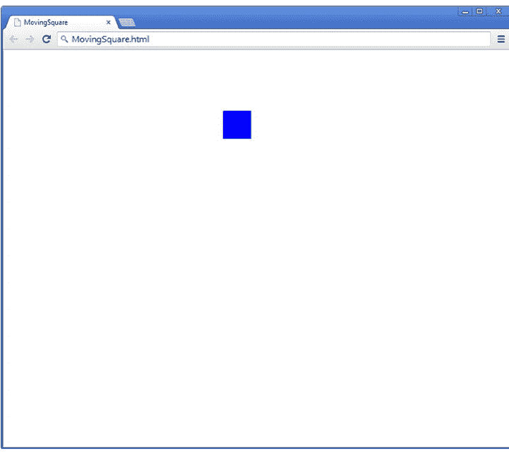

图 3-8. MovingSquare 示例的输出

尝试一下根据时间改变矩形位置的方式。尝试实现以下一些功能正确工作（如果你有其他想法，也不要犹豫去尝试）：

- 让矩形从右向左移动。
- 让矩形从上向下移动。
- 让矩形沿对角线穿过屏幕。
- 让矩形移动速度慢一倍。

### 变量的作用域

你声明变量的位置对你被允许在哪里使用该变量有影响。看看 MovingSquare 程序中的变量`d`。这个变量在`update`方法中声明（并赋值）。因为它是在`update`方法中声明的，你只被允许在这个方法中使用它。例如，你不能在`draw`方法中再次使用这个变量。当然，你可以在`draw`方法中声明另一个名为`d`的变量，但重要的是要认识到在`update`中声明的`d`变量与在`draw`中声明的`d`变量不是同一个。

另外，如果你在对象级别声明一个变量，你可以在任何地方使用它，只要你在前面加上对象的名称。你需要在`update`和`draw`方法中都使用矩形的 x 位置，因为在`update`方法中，你更新这个位置，而在`draw`方法中，你使用这个位置绘制矩形。因此，这个变量需要在对象级别声明，以便属于该对象的所有方法都可以使用这个变量。

变量可以被使用的地方统称为变量的作用域。在这个示例中，变量`d`的作用域是`update`方法，而变量`Game.rectanglePosition`的作用域是全局作用域。

### 你学到了什么

在本章中，你学到了：

- 如何使用变量将基本信息存储在内存中。
- 如何创建由成员变量和方法组成的对象。
- 如何使用`update`方法通过变量改变游戏世界，以及如何使用`draw`方法将游戏世界显示在屏幕上。

## 第 4 章 游戏资源

前面的章节向你展示了如何通过编写自己的游戏循环方法（作为名为`Game`的对象的一部分）来制作一个非常基础的游戏应用。你已经了解了 JavaScript 中哪些指令可以获取画布以及用于对画布执行操作的画布上下文。你看到了一些改变背景颜色的简单示例。你还通过结合使用当前系统时间和游戏循环方法，让一个矩形在屏幕上移动。本章展示如何在屏幕上绘制图像，这是制作精美游戏的第一步。在计算机图形学中，这些图像也被称为精灵图。精灵图通常从文件加载。这意味着任何绘制精灵图的程序都不再是简单的孤立指令集，而是依赖于存储在某个地方的游戏资源。这立刻引入了一些你需要思考的事情：

- 你可以从哪些位置加载精灵图？
- 如何从图像文件中获取信息？
- 如何在屏幕上绘制精灵图？

本章将回答这些问题。

声音是另一种类型的游戏资源。它的处理方式与精灵图非常相似。因此，在本章末尾，你还将了解如何在你的游戏中播放音乐和音效。

> **注意**：精灵图的名称源自精灵绘制，这是一个创建二维、部分透明的光栅图形用于视频游戏的过程。在早期，创建这些二维图像是大量的手工劳动；但它产生了一种独特的图像风格，启发人们创作类似的图像，从而形成了一种称为像素艺术或精灵艺术的技术。

### 定位精灵图

在程序能够使用任何资源之前，它需要知道去哪里寻找这些资源。默认情况下，作为解释器的浏览器会在与 JavaScript 文件相同的文件夹中查找精灵图。看看属于本章的`SpriteDrawing`示例。你会在 HTML 文件和 JavaScript 文件所在的同一文件夹中看到一个名为`spr_balloon.png`的文件。你可以加载这个精灵图并将其绘制在屏幕上。

### 加载精灵图

现在让我们看看如何从文件加载精灵图。一旦完成此操作，你需要使用一个变量将其存储在内存中的某个地方。你需要在几个不同的游戏循环方法中使用这个变量。在`start`方法中，你加载精灵图并将其存储在变量中。在`draw`方法中，你可以访问该变量，以便在屏幕上绘制精灵图。因此，你需要向`Game`对象添加一个名为`balloonSprite`的变量。这里你可以看到`Game`变量的声明及其初始化：

```javascript
var Game = {
    canvas : undefined,
    canvasContext : undefined,
    balloonSprite : undefined
};
```

在`Game`的`start`方法中，你为这些变量赋值。你已经了解了如何获取画布和画布上下文。就像`Game`一样，画布和画布上下文都是由其他变量（或对象）组成的对象。如果你加载一个精灵图，你就得到了一个表示该精灵图的对象。你可以定义一个包含图像所有信息的对象变量：

```javascript
Game.balloonSprite = {
    src : "spr_balloon.png",
    width : 35,
    height : 63,
    ...
}
```

当你想为你的游戏加载数百个精灵图时，这就成了问题。每次你都必须使用对象字面量定义这样一个对象。此外，你还必须确保不会意外地在对象中使用其他变量名，因为那样你就会有不一致的图像表示。幸运的是，你可以通过使用类型来避免这个麻烦。

类型基本上是该类型对象应该是什么样子的定义；它是对象的蓝图。例如，JavaScript 知道一个称为`Image`的类型。该类型指定图像对象应具有宽度、高度、源文件等属性。有一种非常简单的方法来创建具有`Image`类型的对象，即使用`new`关键字：

```javascript
Game.balloonSprite = new Image();
```

这比输入变量应具有的所有内容要容易得多。表达式`new Image()`基本上为你完成了这项工作。通过使用类型，你现在有了一种简单的方法来创建对象，并且可以确保这些对象始终具有相同的结构。当创建一个具有`Image`类型所规定结构的对象时，你可以说这个对象属于`Image`类型。

你还没有指示这个变量应包含什么数据。你可以通过将文件名赋给始终是`Image`对象一部分的`src`变量来设置此图像的源文件：

```javascript
Game.balloonSprite.src = "spr_balloon.png";
```

一旦设置了`src`变量，浏览器就开始加载文件。浏览器会自动填充宽度和高度变量的数据，因为它可以从源文件中提取这些信息。

有时，加载源文件需要一些时间。例如，文件可能存储在世界另一端的网站上。这意味着如果你尝试在设置其源文件后立即绘制图像，你可能会遇到问题。因此，你需要确保在开始游戏之前每张图像都已加载。有一个非常巧妙的方法可以做到这一点，那就是使用事件处理函数。在第 7 章中，你将了解其工作原理。目前，只需假设加载图像所需时间不超过半秒。通过使用`setTimeout`方法，你在延迟 500 毫秒后调用`mainLoop`方法：

```javascript
window.setTimeout(Game.mainLoop, 500);
```

这完成了`start`方法，现在它看起来像这样：

```javascript
Game.start = function () {
    Game.canvas = document.getElementById("myCanvas");
    Game.canvasContext = Game.canvas.getContext("2d");
    Game.balloonSprite = new Image();
    Game.balloonSprite.src = "spr_balloon.png";
    window.setTimeout(Game.mainLoop, 500);
};
```

精灵图可以从任何位置加载。如果你用 JavaScript 开发游戏，那么考虑精灵图的组织是个好主意。例如，你可以将所有属于你的游戏的精灵图放在一个名为`sprites`的子文件夹中。那么你需要这样设置源文件：

```javascript
Game.balloonSprite.src = "sprites/spr_balloon.png";
```

或者也许你甚至没有使用自己的图像，而是引用了你在另一个网站上找到的图像：

```javascript
Game.balloonSprite.src = "http://www.somewebsite.com/images/spr_balloon.png";
```

JavaScript 允许你从任何你想要的位置加载图像文件。只需确保当你从另一个网站加载图像时，图像文件的位置是固定的。否则，如果该网站的管理员决定在不通知你的情况下移动所有内容，你的游戏将无法运行。

### 绘制精灵图

加载精灵图并将其存储在内存中并不意味着精灵图会被绘制在屏幕上。要发生这种情况，你需要在`draw`方法中做一些事情。要在画布上的某个位置绘制精灵图，你需要使用画布上下文对象的一部分——`drawImage`方法。在 JavaScript 中，当在某个位置绘制图像时，该位置始终指图像的左上角。这是在屏幕左上角绘制精灵图的指令：

```javascript
Game.canvasContext.drawImage(sprite, 0, 0, sprite.width, sprite.height,
    0, 0, sprite.width, sprite.height);
```

`drawImage`方法有许多不同的参数。例如，你可以指定你想要绘制精灵图的位置，或者是否只绘制精灵图的一部分。你可以简单地调用此方法并完成它。然而，如果你考虑未来想构建的游戏，你可以使用绘图状态来绘制精灵图。

绘图状态基本上是一组参数和变换，将应用于该状态下绘制的所有内容。使用绘图状态而不是单独调用`drawImage`方法的优势在于，你可以对精灵图进行更复杂的变换。例如，使用绘图状态，你可以旋转或缩放精灵图，这在游戏里是一个非常有用的功能。创建一个新的绘图状态是通过调用`save`方法来完成的：

```javascript
Game.canvasContext.save();
```

然后你可以在此绘图状态下应用各种变换。例如，你可以将精灵图移动（或平移）到某个位置：

```javascript
Game.canvasContext.translate(100, 100);
```

如果你现在调用`drawImage`方法，精灵图将被绘制在位置(100, 100)。一旦你完成绘制，你可以按照以下方式移除绘图状态：

```javascript
Game.canvasContext.restore();
```

为了方便起见，让我们定义一个方法来为你完成所有这些工作：

```javascript
Game.drawImage = function (sprite, position) {
    Game.canvasContext.save();
    Game.canvasContext.translate(position.x, position.y);
    Game.canvasContext.drawImage(sprite, 0, 0, sprite.width, sprite.height,
        0, 0, sprite.width, sprite.height);
    Game.canvasContext.restore();
};
```

通过查看参数你可以看到，这个方法需要两条信息：要绘制的精灵图和绘制的位置。精灵图应该是`Image`类型（尽管在 JavaScript 中定义函数时，你无法轻易强制执行此要求）。位置是一个由 x 部分和 y 部分组成的对象变量。当你调用此方法时，你必须提供此信息。例如，你可以按照以下方式在位置(100, 100)绘制气球精灵图：

```javascript
Game.drawImage(Game.balloonSprite, { x : 100, y : 100 });
```

你使用大括号来定义一个包含 x 和 y 分量的对象字面量。如你所见，在调用方法的指令中定义对象是允许的。或者，你也可以先定义一个对象，将其存储在变量中，然后使用该变量调用`drawImage`方法：

```javascript
var balloonPos = {
    x : 100,
    y : 100
};
Game.drawImage(Game.balloonSprite, balloonPos);
```

这段代码与前面对`drawImage`的调用所做的完全相同，只是写起来要长得多。你可以简单地将`drawImage`方法调用放在`draw`方法中，这样气球就会绘制在期望的位置：

```javascript
Game.draw = function () {
    Game.drawImage(Game.balloonSprite, { x : 100, y : 100 });
};
```

图 4-1 展示了该程序在浏览器中的输出效果。

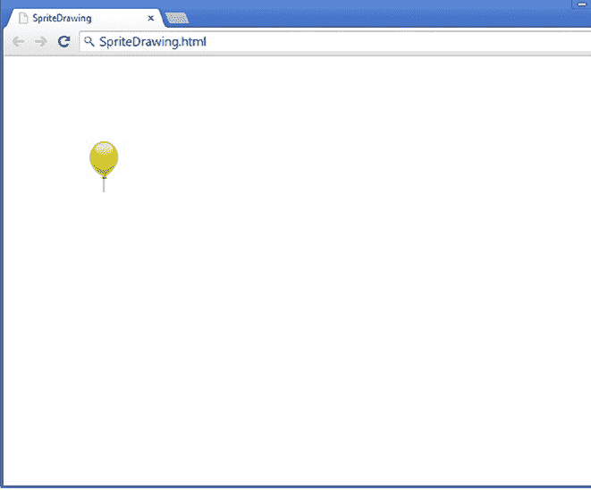

**图 4-1.** 精灵绘制程序的输出

再次注意，如果你让浏览器在给定位置绘制精灵，那么该位置绘制的是精灵的左上角。

### 移动精灵

既然你已经能够在屏幕上绘制精灵了，你就可以使用游戏循环来让它移动，就像你在第 3 章的 MovingSquare 示例中对正方形所做的那样。让我们对该程序做一个小的扩展，根据经过的时间来改变气球的位置。为了做到这一点，你需要在某处存储气球的位置。你需要在`update`方法中计算这个位置，并在`draw`方法中在该位置绘制气球。因此，你向`Game`对象添加一个表示位置的变量，如下所示：

```javascript
var Game = {
    canvas : undefined,
    canvasContext : undefined,
    balloonSprite : undefined,
    balloonPosition : { x : 0, y : 50 }
};
```


如你所见，你将位置定义为`Game`对象中由两个变量（`x`和`y`）组成的对象。现在你可以在`update`方法中添加一条指令，根据经过的时间修改`x`坐标，就像你在`MovingSquare`示例中所做的那样。以下是`update`方法：

```
Game.update = function () {
    var d = new Date();
    Game.balloonPosition.x = d.getTime() % Game.canvas.width;
};
```

现在唯一剩下要做的事情就是确保在`draw`方法中绘制气球时使用`balloonPosition`变量：

```
Game.drawImage(Game.balloonSprite, Game.balloonPosition);
```

### 加载和绘制多个精灵

只用纯白色背景来构建游戏有些无聊。你可以通过显示背景精灵来让游戏更具视觉吸引力。这意味着你需要在`start`方法中加载另一个精灵，并扩展`draw`方法来绘制它。该程序的最终版本被称为`FlyingSprite`，你可以在属于本章的示例文件夹中找到完整的源代码。

如果你在浏览器中打开`FlyingSprite`程序，你会看到现在绘制了两个精灵：一个背景，以及在其上方的一个气球。为了实现这一点，你添加另一个变量来容纳背景精灵。与`balloonSprite`变量一样，这个变量也是`Game`对象的一部分：

```
var Game = {
    canvas : undefined,
    canvasContext : undefined,
    backgroundSprite : undefined,
    balloonSprite : undefined,
    balloonPosition : { x : 0, y : 50 }
};
```

此外，在`draw`方法中，现在有两处对`drawImage`方法的调用而不是一处：

```
Game.draw = function () {
    Game.drawImage(Game.backgroundSprite, { x : 0, y : 0 });
    Game.drawImage(Game.balloonSprite, Game.balloonPosition);
};
```

这些方法的调用顺序非常重要！因为你希望气球出现在背景的上方，你首先要绘制背景，然后再绘制气球。如果你反过来做，背景会绘制在气球之上，这样你就看不到气球了（自己试试）。图 4-2 展示了程序的输出。

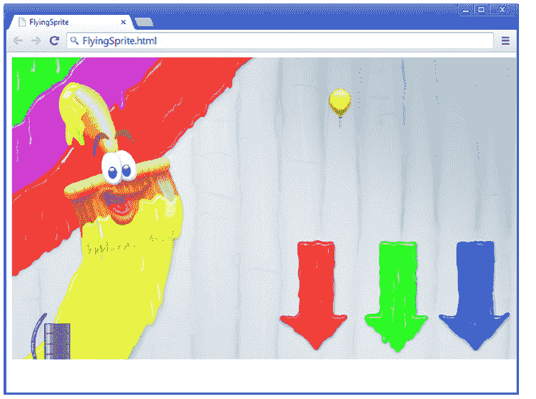

*图 4-2. FlyingSprite 程序的输出*

每次你想在屏幕上绘制精灵时，你就在`draw`方法中添加一个对`drawImage`方法的调用。你可以多次绘制同一个精灵，在屏幕上的不同位置。例如，如果你想在背景上方的不同位置绘制几个气球，你只需为每个想绘制的气球调用`drawImage`并传入期望的位置作为参数，如下所示：

```
Game.draw = function () {
    Game.drawImage(Game.backgroundSprite, { x : 0, y : 0 });
    Game.drawImage(Game.balloonSprite, { x : 0, y : 0 });
    Game.drawImage(Game.balloonSprite, { x : 100, y : 0 });
    Game.drawImage(Game.balloonSprite, { x : 200, y : 0 });
    Game.drawImage(Game.balloonSprite, { x : 0, y : 300 });
    Game.drawImage(Game.balloonSprite, { x : 200, y : 300 });
};
```

再次注意你绘制精灵的顺序。

你也可以同时绘制多个移动的精灵。对于每个气球，你可以定义它自己的位置变量，该变量在`update`方法中更新：

```
Game.update = function () {
    var d = new Date();
    Game.balloonPosition1.x = d.getTime() % Game.canvas.width;
    Game.balloonPosition2.x = (d.getTime() + 100) % Game.canvas.width;
    Game.balloonPosition3.x = (d.getTime() + 200) % Game.canvas.width;
};
```

而在`draw`方法中，你使用这些位置来同时绘制移动的和静止的气球：

```
Game.draw = function () {
    Game.drawImage(Game.backgroundSprite, Game.balloonPosition1);
    Game.drawImage(Game.balloonSprite, Game.balloonPosition2);
    Game.drawImage(Game.balloonSprite, Game.balloonPosition3);
    Game.drawImage(Game.balloonSprite, { x : 200, y : 0 });
    Game.drawImage(Game.balloonSprite, { x : 0, y : 300 });
    Game.drawImage(Game.balloonSprite, { x : 200, y : 300 });
};
```

用示例程序多尝试。思考在屏幕上绘制移动气球的不同方式。尝试一些不同的位置值。你能让一些气球比其他气球移动得更快或更慢吗？

### 音乐和声音

另一种常用的游戏资源是声音。大多数游戏包含音效和背景音乐。这些之所以重要有各种原因。音效提供重要的提示，向用户表明某事已经发生。例如，当用户点击按钮时播放点击音可以向用户提供反馈，表明按钮确实被按下了。听到脚步声表明敌人可能在附近，即使玩家可能还看不到他们。而听到远处铃声响起可以提示某事即将发生。老游戏`Myst`在这方面堪称经典，因为关于如何推进的许多提示都是通过声音传递给玩家的。

像滴水声、树林中的风声以及远处的汽车声这样的氛围音效增强体验，给人一种身临其境的感觉。它们让环境更加生动，即使屏幕上实际上什么也没发生。

> **注意** 音乐在玩家体验环境和动作方面起着至关重要的作用。音乐可以用来制造紧张、悲伤、快乐以及许多其他情绪。然而，在游戏中处理音乐比在电影中要困难得多。在电影中，接下来会发生什么已经很清楚，所以音乐可以完美匹配。但在游戏中，部分动作由玩家控制。现代游戏使用自适应音乐，根据游戏故事的演变不断变化。

如果你想在游戏中实现更高级的音乐和声音处理，基本的`JavaScript`声音引擎将不够用。请使用`Web Audio`（`http://www.w3.org/TR/webaudio/`）代替，这是一个用于处理和合成音频的高级库，受到许多现代浏览器的支持。

在`JavaScript`中，播放背景音乐或音效非常简单。要使用声音，你首先需要可以播放的声音文件。在`FlyingSpriteWithSound`程序中，你播放文件`snd_music.mp3`，它作为背景音乐。与存储和使用精灵类似，你向`Game`对象添加一个变量来存储音乐数据。所以，`Game`对象的声明和初始化如下：

```
var Game = {
    canvas : undefined,
    canvasContext : undefined,
    backgroundSprite : undefined,
    balloonSprite : undefined,
    balloonPosition : { x : 0, y : 50 },
    backgroundMusic : undefined
};
```

你需要在`start`方法中添加几条指令来加载音效或背景音乐。`JavaScript`提供了一种类型，你可以用它来作为创建表示声音的对象的蓝图。这种类型被称为`Audio`。你可以创建该类型的对象并开始加载声音，如下所示：

```
Game.backgroundMusic = new Audio();
Game.backgroundMusic.src = "snd_music.mp3";
```

如你所见，这几乎与加载精灵的方式相同。现在你可以调用定义为该对象一部分的方法，并可以设置对象的成员变量。例如，以下指令告诉浏览器开始播放存储在`Game.backgroundMusic`变量中的音频：

```
Game.backgroundMusic.play();
```

你想要降低背景音乐的音量，以便稍后可以在其上方播放（更响的）音效。设置音量通过以下指令完成：

```
Game.backgroundMusic.volume = 0.4;
```

`volume`成员变量通常是一个介于 0 到 1 之间的值，其中 0 表示静音，1 表示以最大音量播放声音。

从技术上讲，背景音乐和音效之间没有区别。通常，背景音乐会以较低的音量播放；许多游戏会循环播放背景音乐，以便在歌曲结束时，音频会从头开始再次播放。你稍后会看到如何做到这一点。你在本书中开发的所有游戏都使用了这两种类型的声音（背景音乐和音效），以使游戏更激动人心。

> **注意** 在游戏中使用声音和音乐时需要注意一些事项。声音可能会让一些玩家感到恼人，因此如果你确实使用了音效或音乐，请确保玩家有办法将其关闭。此外，不要强迫玩家等到声音播放完毕才能继续。你可能创作了一首很棒的歌曲，希望在介绍画面显示时播放，但玩家启动你的游戏不是为了听你的音乐——他们想玩游戏！同样的原则也适用于游戏中的视频片段。始终为用户提供跳过这些片段的方法（即使你邀请了你最喜欢的家人来配音僵尸声音）。最后，加载声音和音乐可能需要时间，尤其是当文件托管在网站上时。请尽可能尝试使用较小的声音文件。

### 你学到了什么

在本章中，你学到了：

- 如何将精灵和声音等游戏资源加载到内存中
- 如何在屏幕上绘制多个精灵并移动它们
- 如何在游戏中播放背景音乐和音效

## 第二部分：创建多彩游戏

在本部分中，你将开发一个名为`Painter`（画家）的游戏（参见图 II-1）。在开发这个游戏的同时，我还将介绍一些在编程游戏中非常有用的新技术，例如将指令组织成类和方法、条件指令、迭代等等。

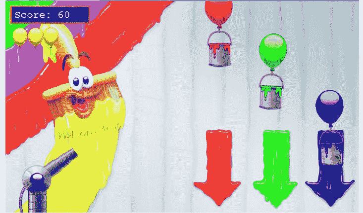

© Springer-Verlag Berlin Heidelberg 2013

*图 II-1. Painter 游戏*

`Painter`游戏的目标是收集三种不同颜色的颜料：红色、绿色和蓝色。颜料以罐子的形式从天空落下，罐子由气球保持漂浮，你必须确保每个罐子在穿过屏幕底部之前具有正确的颜色。你可以通过向落下的罐子射击所需颜色的颜料球来改变颜料的颜色。你可以使用键盘上的 R、G 和 B 键来选择你射击的颜色。你可以通过在游戏屏幕上左键点击来发射颜料球。点击离颜料炮越远，球的速度就越快。你点击的位置也决定了大炮射击的方向。每个落入正确收集箱的罐子，你将获得 10 分。对于颜色错误的罐子，你会失去一条生命（在屏幕左上角以黄色气球表示）。你可以通过下载第 12 章的示例代码 zip 文件来运行这个游戏的最终版本。双击`PainterFinal`文件夹中的`Painter.html`文件即可开始玩游戏。

## 第 5 章：了解玩家在做什么

在本章中，你将开始创建一个名为`Painter`的游戏。在这个游戏中，你需要显示在屏幕上移动的精灵。你已经见过一些加载和显示精灵的例子。此外，你已经知道可以使用当前时间信息来改变精灵的位置。你将基于这些示例开始创建`Painter`。此外，你将学习如何在游戏中处理玩家输入。你将了解如何获取玩家的操作，以及游戏世界如何根据这些信息发生变化。你将从`FlyingSprite`程序的一个简单扩展开始，该程序在鼠标指针位置绘制一个气球。下一章将探讨其他类型的输入，例如键盘和触摸输入。

### 跟随鼠标指针的精灵

既然你知道如何在屏幕上显示精灵，让我们看看是否可以使用玩家输入来控制精灵的位置。为此，你必须找到鼠标的当前位置。本节将向你展示如何检索此位置，以及如何使用它来绘制跟随鼠标指针的精灵。

### 获取鼠标位置

请查看书中的示例程序`Balloon1`。它与`FlyingSprite`程序没有太大区别。在`FlyingSprite`中，你使用系统时间来计算气球的位置：

```
var d = new Date();
Game.balloonPosition.x = d.getTime() * 0.3 % Game.canvas.width;
```

你计算出的位置存储在变量`balloonPosition`中。现在你想创建一个程序，其中气球的位置不再是根据经过的时间计算，而是与当前鼠标的位置相同。使用事件获取当前鼠标位置非常容易。

在`JavaScript`中，你可以处理许多不同类型的事件。事件的例子如下：

- 玩家移动鼠标。
- 玩家左键点击。
- 玩家点击按钮。
- HTML 页面已加载。
- 从网络连接收到消息。
- 精灵已加载完毕。

当这样的事件发生时，你可以选择执行指令。例如，当玩家移动鼠标时，你可以执行一些指令来检索新的鼠标位置，并将其存储在变量中，以便你可以在该位置绘制精灵。一些`JavaScript`对象可以帮助你做到这一点。例如，当你显示一个 HTML 页面时，`document`变量可以让你访问页面中的所有元素。但更重要的是，这个变量还让你可以访问用户通过鼠标、键盘或触摸屏与文档交互的方式。

你已经以多种方式使用过这个变量。例如，在这里你使用`document`从 HTML 页面中检索画布元素：

```
Game.canvas = document.getElementById("myCanvas");
```

除了`getElementById`，`document`对象还有很多其他方法和成员变量。例如，有一个名为`onmousemove`的成员变量，你可以为其赋值。这个成员变量并不指向一个数字值或字符串，而是指向一个函数/方法。每当鼠标移动时，浏览器就会调用该函数。然后你可以在函数中编写指令，以你希望的任何方式处理该事件。因此，这类函数被称为事件处理函数。使用事件处理函数是处理输入的一种非常高效的方式。

另一种方法是在游戏循环中放置指令，在每次迭代中检索当前鼠标位置或当前按下的键。虽然那样可行，但它会比使用事件处理函数慢很多，因为你必须在每次迭代时检查输入，而不是只在玩家实际执行操作时才检查。

事件处理函数有一个特定的函数头。它包含一个参数，当函数被调用时，该参数包含一个提供有关事件信息的对象。例如，这是一个空的事件处理函数：

```
function handleMouseMove(evt) {
    // 在这里做些事情
}
```

如你所见，该函数有一个参数`evt`，它将包含需要处理的事件的信息。你现在可以将此函数赋值给`onmousemove`变量：

```
document.onmousemove = handleMouseMove;
```

现在，每次鼠标移动时，都会调用`handleMouseMove`函数。你可以在此函数中放置指令，从`evt`对象中提取鼠标位置。例如，这个事件处理函数检索鼠标的`x`位置和`y`位置，并将它们存储在变量`balloonPosition`中：

```
function handleMouseMove(evt) {
    Game.balloonPosition = { x : evt.pageX, y : evt.pageY };
}
```

`evt`对象的`pageX`和`pageY`成员变量包含相对于页面的鼠标位置，这意味着页面的左上角坐标为 (0, 0)。你可以在图 5-1 中看到几个鼠标位置的示例：其中三个角标注了在浏览器中运行程序时报告的各自位置。

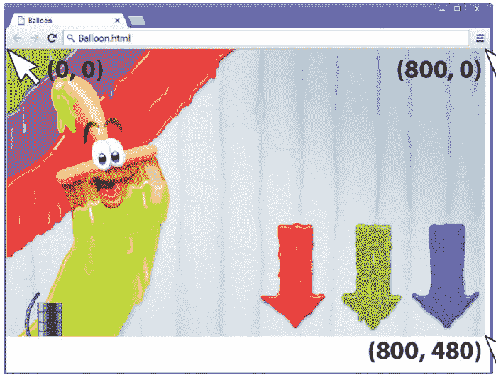

因为`Draw`方法只是简单地在鼠标位置绘制气球，所以气球现在会跟随鼠标。图 5-2 显示了它的外观。你可以看到气球绘制在鼠标指针下方；当你移动指针时，它会跟随指针。

**图 5-2. Balloon1 程序截图**

你可以在图 5-2 中看到，气球并没有显示在指针尖端下方的正中央。这是有原因的，下一节将详细讨论这个问题。现在，请记住精灵被视为一个矩形。左上角与指针尖端对齐。气球看起来错位是因为气球是圆形的，并没有延伸到矩形的角落。

除了`pageX`和`pageY`，你还可以使用`clientX`和`clientY`，它们也能给出鼠标位置。然而，`clientX`和`clientY`没有将滚动考虑在内。假设你按如下方式计算鼠标位置：

```javascript
Game.balloonPosition = { x : evt.clientX, y : evt.clientY };
```

图 5-3 展示了现在可能出现的问题。由于滚动，`clientY`值小于 480，即使鼠标位于背景图像的底部。结果，气球不再绘制在鼠标位置。因此，我建议始终使用`pageX`和`pageY`，而不是`clientX`和`clientY`。不过，在某些情况下，不考虑滚动可能是有用的——例如，如果你正在开发那种烦人的广告，即使用户试图滚动过去，它也会一直出现在浏览器视图中央。

### 更改精灵的原点

运行`Balloon1`示例时，请注意气球是这样绘制的：精灵的左上角位于当前鼠标位置。当你在某个位置绘制精灵时，默认行为是精灵的左上角绘制在该位置。如果你执行以下指令：

```javascript
Game.drawImage(someSprite, somePosition);
```


名为 `someSprite` 的精灵会绘制在屏幕上，使其左上角位于位置 `somePosition`。你也可以将精灵的左上角称为它的原点。那么，如果你想更改这个原点呢？例如，假设你想将精灵 `someSprite` 的中心绘制在位置 `somePosition`。嗯，你可以使用 `Image` 类型的 `width` 和 `height` 变量来计算。我们声明一个名为 `origin` 的变量，并将精灵的中心存储在其中：

```javascript
var origin = { x : someSprite.width / 2, y : someSprite.height / 2 };
```

现在，如果你想用这个不同的原点来绘制精灵 `someSprite`，可以按如下方式操作：

```javascript
var pos = { x : somePosition.x - origin.x,
            y : somePosition.y - origin.y };
Game.drawImage(someSprite, pos);
```

通过从位置中减去原点，精灵以偏移方式绘制，使得位置 `somePosition` 指示精灵的中心。与其自己计算相对于原点的位置，canvas 上下文中的 `drawImage` 方法也有一种指定原点偏移的方式。以下是一个示例：

```javascript
Game.canvasContext.save();
Game.canvasContext.translate(position.x, position.y);
Game.canvasContext.drawImage(sprite, 0, 0, sprite.width, sprite.height,
                               -origin.x, -origin.y, sprite.width, sprite.height);
Game.canvasContext.restore();
```

在这个示例中，第一步是保存当前的绘图状态。然后，你应用变换。你首先平移到给定位置。然后调用 `drawImage` 方法，在其中你必须提供多个不同的参数：要绘制哪个精灵，以及（使用四个参数）应该绘制精灵的哪一部分。你可以通过指示精灵的左上角坐标和应绘制的矩形部分的大小来做到这一点。在这个简单的例子中，你想绘制整个精灵，所以左上角坐标是点 `(0, 0)`。你绘制的矩形部分与整个精灵具有相同的宽度和高度。这也表明，可以使用此功能将多个精灵存储在单个图像文件中，同时只需将该文件加载到内存一次。在本书后面的第 18 章中，你会看到一种很好的方法来实现这一点，并将其纳入你的游戏应用程序中。

接下来你可以指示位置偏移。你可以在前面的代码中看到，你将此偏移设置为负的原点值。换句话说，你从当前位置减去原点。这样，左上角坐标移动到了原点。假设你有一个宽度和高度均为 22 像素的球精灵。假设你想在位置 `(0, 0)` 绘制这个球，即屏幕的左上角。根据你选择的原点，结果会有所不同。图 5-4 展示了在位置 `(0, 0)` 绘制球精灵的两个示例，分别使用两个不同的原点。左侧示例的原点位于球的左上角，右侧示例显示原点位于精灵中心的球。

**图 5-4. 在位置 `(0, 0)` 绘制球精灵，原点位于精灵左上角（左）或精灵中心（右）**

你可能已经注意到，在 JavaScript 中，从一个位置减去另一个位置有点繁琐：

```javascript
var pos = { x : somePosition.x - origin.x,
            y : somePosition.y - origin.y };
```

如果你能写出类似这样的代码就好了：

```javascript
var pos = somePosition - origin;
```

遗憾的是，这在 JavaScript 中是不可能的。某些编程语言（如 Java 和 C#）支持运算符重载。这允许程序员定义当使用加号运算符将两个对象“相加”时应该发生什么。然而，并非一切都失去了。可以定义方法来执行这些算术运算，如上面对象字面量所定义的那样。第 8 章将更详细地讨论这个问题。

现在你知道如何在不同原点绘制精灵了，例如，你可以绘制一个气球，使其底部中心附着在鼠标指针上。要查看实际效果，请看 Balloon2 程序。你在其中声明了一个额外的成员变量，用于存储气球精灵的原点：

```javascript
var Game = {
    canvas : undefined,
    canvasContext : undefined,
    backgroundSprite : undefined,
    balloonSprite : undefined,
    mousePosition : { x : 0, y : 0 },
    balloonOrigin : { x : 0, y : 0 }
};
```

你只能在精灵加载完成后计算原点。所以，为了保险起见，你在 `draw` 方法中使用以下指令计算原点：

```javascript
Game.balloonOrigin = { x : Game.balloonSprite.width / 2,
                       y : Game.balloonSprite.height };
```

原点设置为精灵宽度的一半，但高度为完整高度。换句话说，这个原点是精灵的底部中心，这正是你想要的。在 `draw` 方法中计算原点并不理想；如果你能只计算一次原点，即在图像加载完成之后就计算，那会更好。稍后，你会看到一种更好的方法。

你现在可以扩展 `Game` 对象中的 `drawImage` 方法，使其支持在不同原点绘制精灵。为此，你只需要添加一个额外的位置参数，并将该参数中的 `x` 和 `y` 值传递给 canvas 上下文的 `drawImage` 方法。这是完整的方法：

```javascript
Game.drawImage = function (sprite, position, origin) {
    Game.canvasContext.save();
    Game.canvasContext.translate(position.x, position.y);
    Game.canvasContext.drawImage(sprite, 0, 0, sprite.width, sprite.height,
        -origin.x, -origin.y, sprite.width, sprite.height);
    Game.canvasContext.restore();
};
```

在 `draw` 方法中，你现在可以计算原点并将其传递给 `drawImage` 方法，如下所示：

```javascript
Game.draw = function () {
    Game.drawImage(Game.backgroundSprite, { x : 0, y : 0 }, { x : 0, y : 0 });
    Game.balloonOrigin = { x : Game.balloonSprite.width / 2,
                           y : Game.balloonSprite.height };
    Game.drawImage(Game.balloonSprite, Game.mousePosition, Game.balloonOrigin);
};
```

### 使用鼠标位置旋转炮筒

Painter 游戏的一个特点是它包含一个根据鼠标位置旋转的炮筒。这个炮筒由玩家控制，用于发射颜料球。你可以使用本章讨论的工具编写程序中的这部分。你可以在本章的 Painter1 示例中看到它的实际效果。

你必须声明几个成员变量才能实现这一点。首先，你需要用于存储背景和炮筒精灵的变量。与前面例子中一样，你还需要存储当前鼠标位置。然后，由于你旋转炮筒，你需要存储它的位置、原点和当前旋转角度。最后，你需要 canvas 和 canvas 上下文，以便绘制游戏对象。像往常一样，所有这些变量都声明为 `Game` 对象的成员：

```javascript
var Game = {
    canvas : undefined,
    canvasContext : undefined,
    backgroundSprite : undefined,
    cannonBarrelSprite : undefined,
    mousePosition : { x : 0, y : 0 },
    cannonPosition : { x : 72, y : 405 },
    cannonOrigin : { x : 34, y : 34 },
    cannonRotation : 0
};
```

炮筒的位置和原点都在定义 `Game` 变量时给定。炮筒的位置被选择为使其很好地贴合背景上已经绘制好的炮座。炮筒图像包含一个圆形部分，实际炮筒连接在其上。你希望炮筒围绕圆形部分的中心旋转。这意味着你必须将这个中心设置为先前。由于圆形部分位于精灵的左侧，且该圆的半径是炮筒精灵高度的一半（该精灵高 68 像素），所以你将炮筒原点设置为 `(34, 34)`，如代码所示。

要以一定角度绘制炮筒，你需要在屏幕上绘制炮筒精灵时应用旋转。这意味着你必须扩展 `drawImage` 方法，使其能够考虑旋转。应用旋转是通过 canvas 上下文的 `rotate` 方法完成的。

你还要为 `drawImage` 方法添加一个参数，用于指定对象应旋转的角度。这是新版 `drawImage` 方法的样子：

```javascript
Game.drawImage = function (sprite, position, rotation, origin) {
    Game.canvasContext.save();
    Game.canvasContext.translate(position.x, position.y);
    Game.canvasContext.rotate(rotation);
    Game.canvasContext.drawImage(sprite, 0, 0, sprite.width, sprite.height,
        -origin.x, -origin frequency, sprite.width, sprite.height);
    Game.canvasContext.restore();
};
```

在 `start` 方法中，你加载两个精灵图：

```javascript
Game.backgroundSprite = new Image();
Game.backgroundSprite.src = "spr_background.jpg";
Game.cannonBarrelSprite = new Image();
Game.cannonBarrelSprite.src = "spr_cannon_barrel.png";
```

下一步是实现游戏循环中的方法。到目前为止，`update` 方法一直是空的。现在你有一个很好的理由来使用它了。在 `update` 方法中，你更新游戏世界，在本例中就是计算炮管应绘制的角度。如何计算这个角度呢？请看图 5-5。

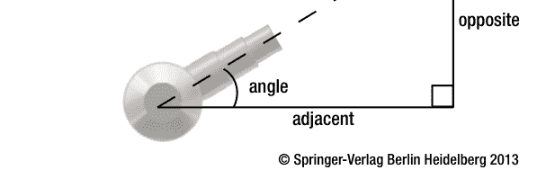

如果你记得数学课上的内容，可能会回忆起三角形中的角度可以用三角函数来计算。在本例中，你可以使用正切函数来计算角度，公式如下：

```text
tan(angle) = opposite / adjacent
```

换句话说，角度由以下公式给出：

```text
angle = arctan(opposite / adjacent)
```

你可以通过计算当前鼠标位置与炮管位置之间的差值，来求得对边和邻边的长度，如下所示：

```javascript
var opposite = Game.mousePosition.y - Game.cannonPosition.y;
var adjacent = Game.mousePosition.x - Game.cannonPosition.x;
```

现在你需要用这些值来计算反正切。怎么做呢？幸运的是，JavaScript 提供了一个 `Math` 对象可以帮助你。`Math` 对象包含许多有用的数学函数，包括三角函数如正弦、余弦和正切，以及它们的反函数反正弦、反余弦和反正切。`Math` 对象中有两个函数可以计算反正切。第一个版本接受单个值作为参数。在这种情况下你不能使用这个版本：当鼠标正好位于炮管正上方时，由于邻边为零，会发生除以零的情况。

对于需要计算反正切同时考虑这种可能的奇异点的情况，有一个备用的反正切方法。`atan2` 方法将对边和邻边的长度作为单独的参数，并在这种情况下返回相当于 90 度的弧度值。你可以用这个方法来计算角度，如下所示：

```javascript
Game.cannonRotation = Math.atan2(opposite, adjacent);
```

这些指令都放在 `update` 中。这是完整的方法：

```javascript
Game.update = function () {
    var opposite = Game.mousePosition.y - Game.cannonPosition.y;
    var adjacent = Game.mousePosition.x - Game.cannonPosition.x;
    Game.cannonRotation = Math.atan2(opposite, adjacent);
};
```

最后要做的是在 `draw` 方法中在正确的位置和角度绘制精灵图：

```javascript
Game.draw = function () {
    Game.clearCanvas();
    Game.drawImage(Game.backgroundSprite, { x : 0, y : 0 }, 0,
            { x : 0, y : 0 });
    Game.drawImage(Game.cannonBarrelSprite, Game.cannonPosition,
            Game.cannonRotation, Game.cannonOrigin);
};
```

### 本章要点

在本章中，你学习了：

- 如何使用事件处理器读取当前鼠标位置，以及如何在当前鼠标位置绘制精灵图
- 如何在某个角度绘制精灵图
- 如何根据鼠标位置改变精灵图的绘制角度

# 第 6 章：响应玩家输入

在本章中，你将了解游戏程序如何响应按键操作。为此，你需要一个名为 `if` 的指令，在条件满足时执行一条指令（或一组指令）。你还将学习将代码更有条理地组织成对象和方法。

## 游戏中的对象

到目前为止，所有示例程序都有一个名为 `Game` 的大对象。这个对象包含若干变量，用于存储画布及其上下文、精灵图、位置等等。这是 Painter1 示例中 `Game` 对象的样子：

```javascript
var Game = {
    canvas : undefined,
    canvasContext : undefined,
    backgroundSprite : undefined,
    cannonBarrelSprite : undefined,
    mousePosition : { x : 0, y : 0 },
    cannonPosition : { x : 72, y : 405 },
    cannonOrigin : { x : 34, y : 34 },
    cannonRotation : 0
};
```

如你所见，即使是一个只绘制背景和旋转炮管的简单程序，它也已经包含了不少变量。随着你开发的游戏变得越来越复杂，这个变量列表会不断增长，结果就是其他开发者将更难理解代码（而你自己几个月不看代码后也会如此）。问题在于你把所有东西都存放在一个名为 `Game` 的单一、庞大的对象中。从概念上讲，这说得通，因为 `Game` 包含了与 Painter 游戏相关的所有内容。然而，如果你稍加分离，代码会更容易理解。

如果你查看 `Game` 对象的内容，可以发现某些变量在某种意义上是相关的。例如，`canvas` 和 `canvasContext` 变量属于一组，因为它们都与画布有关。此外，还有不少变量存储了关于大炮的信息，如位置或旋转角度。你可以将相关的变量分组到不同的对象中，使这种关联在代码中更加清晰。例如，看这个例子：

```javascript
var Canvas2D = {
    canvas : undefined,
    canvasContext : undefined
};
```

```javascript
var Game = {
    backgroundSprite : undefined,
};
```

```javascript
var cannon = {
    cannonBarrelSprite : undefined,
    position : { x : 72, y : 405 },
    origin : { x : 34, y : 34 },
    rotation : 0
};
```

```javascript
var Mouse = { position : { x : 0, y : 0 } };
```

如你所见，你现在有几个不同的对象，每个对象包含一些之前集中在 `Game` 对象中的变量。现在更容易看出哪些变量属于大炮，哪些变量属于画布。而且好的是，你可以对*方法*做同样的事情。例如，你可以将清除画布和在上面绘制图像的方法添加到 `Canvas2D` 对象中，如下所示：

```javascript
Canvas2D.clear = function () {
    Canvas2D.canvasContext.clearRect(0, 0, this.canvas.width,
        this.canvas.height);
};
```

```javascript
Canvas2D.drawImage = function (sprite, position, rotation, origin) {
    // canvas drawing code
};
```


使用不同的对象，而不是一个包含游戏所有内容的单一对象，使你的代码更容易阅读。当然，这只有在以合理的方式将变量分配到各个对象上时才成立。即使是简单的游戏，也有很多种组织代码的方式。所有开发者都有自己的风格。随着阅读的深入，你会发现本书也遵循某种风格。你可能不同意那种风格，或者有时你可能会以不同于本书的方式来解决问题。这没关系。编程问题几乎从来没有唯一正确的解决方案。

回到对象的 straight 分配问题，你可以看到我们命名的大多数对象以大写字母开头（如`Canvas2D`），但`cannon`对象以小写字母开头。我们这样做是有原因的，稍后会更详细地讨论。目前我们只能说，以大写字母开头的对象对任何游戏都有用，但名称以小写字母开头的对象仅用于特定的游戏。在本例中，你可以想象`Canvas2D`对象可以用于任何 HTML5 游戏，但`cannon`对象只对 Painter 游戏有用。

## 加载精灵图（Loading Sprites）

既然你的游戏中已经有了不同的对象，那么你应该在哪里加载精灵图（sprites）呢？你可以在`Game`对象的`start`方法中加载所有精灵图，但另一种选择是在例如`cannon`对象中添加一个类似的方法，并在那里加载属于炮筒的精灵图。哪种方法更好？

在对象的初始化方法中加载该对象所属的精灵图是有其道理的。这样，你可以从代码中清楚地看到哪些精灵图属于哪个对象。然而，这也意味着如果你为不同的游戏对象重复使用同一张图像，你就必须多次加载该精灵图。对于在浏览器中运行的游戏，这意味着浏览器必须从服务器下载图像文件，这可能会花费时间。

更好的选择是在游戏启动时加载游戏所需的所有精灵图。为了将精灵图与程序的其余部分清晰地分开，你可以将它们存储在一个名为`sprites`的对象中。该对象在程序顶部被声明为一个空对象：

```javascript
var sprites = {};
```

你在`Game.start`方法中填充这个变量。对于每个要加载的精灵图，你创建一个`Image`对象，然后将其源（source）设置为精灵图的路径。因为你已经使用了相当多不同的精灵图，所以你从另一个包含 Painter 游戏所有精灵图的资源文件夹中加载它们。这样，你就不必为书中使用这些精灵图的所有不同示例重复复制这些图像文件。以下是为本章中的 Painter2 示例加载各种所需精灵图的指令：

```javascript
var spriteFolder = "../../assets/Painter/sprites/";
sprites.background = new Image();
sprites.background.src = spriteFolder + "spr_background.jpg";
sprites.cannon_barrel = new Image();
sprites.cannon_barrel.src = spriteFolder + "spr_cannon_barrel.png";
sprites.cannon_red = new Image();
sprites.cannon_red.src = spriteFolder + "spr_cannon_red.png";
sprites.cannon_green = new Image();
sprites.cannon_green.src = spriteFolder + "spr_cannon_green.png";
sprites.cannon_blue = new Image();
sprites.cannon_blue.src = spriteFolder + "spr_cannon_blue.png";
```

这里你使用了`+`运算符来连接文本。例如，表达式`spriteFolder + "spr_background.jpg"`的值是`"../../assets/Painter/sprites/spr_background.jpg"`。精灵图文件夹路径看起来有点复杂。`../../`部分意味着你在层级结构中向上移动两个目录。这是必要的，因为示例目录 Painter2 和 Painter2a 与 assets 目录不在同一级。

你将这些图像存储在`sprites`对象的变量中。以后当你需要获取精灵图时，就可以访问该对象。接下来的步骤是处理玩家的按键操作。

### 处理按键按下事件（Handling a Key-Down Event）

在上一章中，你学习了如何使用事件处理器来读取鼠标的当前位置。以非常相似的方式，你可以对玩家在键盘上按住某个键的事件做出反应。同样，你通过定义一个事件处理器来实现这一点。你需要存储被按下的键，以便稍后访问它并利用该信息执行某些操作。

存储哪个键被按下的最简单方法是使用键码（key codes）。键码基本上是一个代表某个特定键的数字。例如，空格键可能是数字 13，或者 A 键可能是数字 65。那么，为什么为这些键使用这些特定的数字而不是其他数字呢？因为字符代码表（character code tables）是标准化的，并且多年来出现了不同的标准。

在 20 世纪 70 年代，程序员认为`2^6 = 64`个符号就足够表示所有可能需要的符号：26 个字符，10 个数字和 28 个标点符号（逗号、分号等）。虽然这意味着没有区分大小写字符，但在当时这并不是问题。

在 20 世纪 80 年代，人们使用了`2^7 = 128`个不同的符号：26 个大写字符，26 个小写字符，10 个数字，33 个标点符号和 33 个特殊字符（换行、制表符、蜂鸣声等）。这些符号的顺序被称为 ASCII（美国信息交换标准代码）。这对英语很有用，但对于法语、德语、荷兰语、西班牙语等其他语言来说并不足够。

因此，在 20 世纪 90 年代，人们构建了包含`2^8 = 256`个符号的新代码表；各个国家最常用的字母也被纳入其中。0–127 的符号与 ASCII 相同，但 128–255 的符号用于特定语言的特殊字符。根据语言的不同（英语、俄语、印度语等），使用不同的代码表。

例如，西欧代码表是 Latin1。对于东欧，则使用另一个代码表（波兰语和捷克语有许多特殊的重音符号，在 Latin1 表中已没有空间）。希腊语、俄语、希伯来语和印度天城文都有自己的代码表。这是一种处理不同语言的合理方式，但如果你想同时存储不同语言的文本，事情就变得复杂了。此外，包含超过 128 个符号的语言（如中文）无法使用这种格式表示。

在 21 世纪初，编码标准再次扩展到一个包含`2^{16} = 65536`个不同符号的表格。这个表格可以轻松容纳世界上所有的字母表，包括许多不同的标点符号和其他符号。如果你以后遇到外星生物，这个表格可能也有足够的空间来表示外星语言的字符。这个代码表被称为 Unicode。Unicode 的前 256 个符号与 Latin1 代码表相同。

回到你想为示例存储的键码，让我们添加一个包含最后一次按下键的简单变量：

```javascript
var Keyboard = { keyDown : -1 };
```

当变量初始化时，它包含一个值为 -1 的`keyDown`变量。这个值表示玩家当前没有按下任何键。当玩家按下某个键时，你必须将键码存储在`Keyboard.keyDown`变量中。你可以通过编写一个存储当前按下键的事件处理器来实现。该事件处理器的样子如下：

```javascript
function handleKeyDown(evt) {
    Keyboard.keyDown = evt.keyCode;
}
```

如你所见，该函数接收一个事件作为参数。该事件对象有一个名为`keyCode`的变量，其中包含玩家当前按下的键的键码。

你在`Game.start`中分配这个事件处理函数，如下所示：

```javascript
document.onkeydown = handleKeyDown;
```

现在，每次玩家按下键时，键码都会被存储，以便你在游戏中使用。但当玩家释放按键时会发生什么？`Keyboard.keyDown`的值应该再次被赋值为 -1，这样你就知道玩家当前没有按下任何键。这通过按键抬起（key up）事件处理器来完成。以下是该处理器的定义和主体：

```javascript
function handleKeyUp(evt) {
    Keyboard.keyDown = -1;
}
```

如你所见，这非常简单。你唯一需要做的就是将值 -1 赋给`Keyboard`对象中的`keyDown`变量。最后，你在`Game.start`中分配这个函数：

```javascript
document.onkeyup = handleKeyUp;
```

现在你已经准备好在游戏中处理按键了。请注意，这种处理按键的方式有些局限。例如，无法跟踪同时按下多个键的情况，比如玩家同时按下 A 键和 B 键。稍后在第 13 章中，你会扩展`Keyboard`对象以考虑到这一点。

### 条件执行（Conditional Execution）

作为一个关于如何使用`Keyboard`对象来实现功能的简单示例，让我们对 Painter1 程序进行扩展，在炮筒顶部绘制一个彩色球。通过按下 R、G 或 B 键，玩家可以将炮筒颜色更改为红色、绿色或蓝色。图 6-1 显示了该程序的截图。

你需要额外加载三个精灵图，每种颜色的球各一个。这通过以下三条指令完成：

```javascript
sprites.cannon_red = Game.loadSprite(spriteFolder + "spr_cannon_red.png");
sprites.cannon_green = Game.loadSprite(spriteFolder + "spr_cannon_green.png");
sprites.cannon_blue = Game.loadSprite(spriteFolder + "spr_cannon_blue.png");
```

你在`cannon`对象中添加一个`initialize`方法，在该方法中为属于该对象的变量赋值。这个方法从`Game.start`中调用。这样，当游戏开始时，大炮就会被初始化：

```javascript
Game.start = function () {
    Canvas2D.initialize("myCanvas");
    document.onkeydown = handleKeyDown;
    document.onkeyup = handleKeyUp;
    document.onmousemove = handleMouseMove;
    ...
    cannon.initialize();
    window.setTimeout(Game.mainLoop, 500);
};
```

在`cannon.initialize`方法中，你为属于`cannon`的变量赋值。这是完整的方法：

```javascript
cannon.initialize = function() {
    cannon.position = { x : 72, y : 405 };
    cannon.colorPosition = { x : 55, y : 388 };
    cannon.origin = { x : 34, y : 34 };
    cannon.currentColor = sprites.cannon_red;
    cannon.rotation = 0;
};
```

如你所见，你有两个位置变量：一个用于炮管，一个用于彩色球体。此外，你添加了一个变量来引用应该绘制的球体的当前颜色。最初，你将红色球体精灵图赋值给这个变量。

为了清晰地区分各个对象，你还可以在`cannon`对象中添加一个`draw`方法。在这个方法中，你绘制炮管以及其上方的彩色球体：

```javascript
cannon.draw = function () {
    Canvas2D.drawImage(sprites.cannon_barrel, cannon.position, cannon.rotation,
        cannon.origin);
    Canvas2D.drawImage(cannon.currentColor, cannon.colorPosition, 0,
        { x : 0, y : 0 });
};
```

这个`draw`方法从`Game.draw`中调用，如下：

```javascript
Game.draw = function () {
    Canvas2D.clear();
    Canvas2D.drawImage(sprites.background, { x : 0, y : 0 }, 0,
        { x : 0, y : 0 });
    cannon.draw();
};
```

这样，你可以更容易地看到哪些绘制指令属于哪个对象。现在准备工作已经完成，你可以开始处理玩家的按键输入了。到目前为止，你所写的所有指令都需要一直执行。例如，程序总是需要绘制背景精灵图和炮管精灵图。

但现在你遇到了一种情况：只有当满足某些条件时才需要执行指令。例如，只有当玩家按下 G 键时，才需要将球的颜色改为绿色。这种指令称为条件指令，它使用了一个新的关键字：`if`。

使用`if`指令，你可以提供一个条件，并在该条件成立时执行一个指令块（总的来说，这也被称为分支）。以下是一些条件的例子：

- 玩家按下了 G 键。
- 自游戏开始以来经过的秒数大于 1,000。
- 气球精灵图正好在屏幕中央。
- 怪物吃掉了你的角色。

这些条件可以为真或为假。条件是一种表达式，因为它有一个值（要么是真，要么是假）。这个值也被称为布尔值。使用`if`指令，你可以在条件为真时执行一个指令块。看看这个`if`指令的例子：

```javascript
if (Game.mousePosition.x > 200) {
    Canvas2D.drawImage(sprites.background, { x : 0, y : 0 }, 0,
        { x : 0, y : 0 });
}
```

条件总是放在括号中。后面跟着一个由花括号括起来的指令块。在这个例子中，只有当鼠标的 x 坐标大于 200 时，才会绘制背景。因此，如果你将鼠标移到屏幕太靠左的位置，背景就不会被绘制。如果需要，你可以在花括号之间放置多个指令：

```javascript
if (Game.mousePosition.x > 200) {
    Canvas2D.drawImage(sprites.background, { x : 0, y : 0 }, 0,
        { x : 0, y : 0 });
    cannon.draw();
}
```

如果只有一条指令，你可以省略花括号以稍微缩短代码：

```javascript
if (Game.mousePosition.x > 200)
    Canvas2D.drawImage(sprites.background, { x : 0, y : 0 }, 0,
        { x : 0, y : 0 });
```

在这个例子中，你只想在玩家按下 R、G 或 B 键时改变炮管的颜色。这意味着你必须检查这些键中是否有键当前被按下。使用`Keyboard`对象，检查 R 键是否被按下的条件如下：

```javascript
Keyboard.keyDown === 82
```

`===`运算符比较两个值，如果它们相同则返回 true，否则返回 false。在这个比较运算符的左侧是`Keyboard`对象中`keyDown`变量的值。右侧是对应 R 键的键码。你现在可以在`cannon`的`update`方法中将它用于`if`指令，如下所示：

```javascript
if (Keyboard.keyDown === 82)
    cannon.currentColor = sprites.cannon_red;
```

稍微有点烦人的是，你必须记住所有这些键码才能理解程序中正在发生什么。你可以通过定义第二个名为`Keys`的变量来让生活更轻松，该变量包含最常见的键码，如下所示：

```javascript
var Keys = {
    A: 65,      B: 66,      C: 67,      D: 68,      E: 69,      F: 70,
    G: 71,      H: 72,      I: 73,      J: 74,      K: 75,      L: 76,
    M: 77,      N: 78,      O: 79,      P: 80,      Q: 81,      R: 82,
    S: 83,      T: 84,      U: 85,      V: 86,      W: 87,      X: 88,
    Y: 89,      Z: 90
};
```

现在，如果你想知道 R 键对应的数字是多少，你可以简单地访问变量`Keys.R`，而`if`指令变得更加清晰了：

```javascript
if (Keyboard.keyDown === Keys.R)
    cannon.currentColor = sprites.cannon_red;
```

### 比较运算符

`if`指令头部的条件是一个返回真值的表达式：是或否。当表达式的结果是是时，`if`指令的体就会被执行。在这些条件中，你可以使用比较运算符。以下运算符可用：

- `<` 小于
- `<=` 小于或等于
- `>` 大于
- `>=` 大于或等于
- `===` 等于
- `!==` 不等于

这些运算符可以用于任意两个数字之间。在这些运算符的左侧和右侧，你可以放置常量值、变量，或者包含加法、乘法或任何你想要的完整表达式。你使用三个等号（`===`）来测试两个值是否相等。这与单个等号非常不同，后者表示赋值。这两个运算符之间的区别非常重要：

```text
x = 5; 的意思是：将值 5 赋值给 x。
x === 5 的意思是：x 是否等于 5？
```

因为你已经见过了单等号和三等号运算符，你可能会想是否还有双等号运算符。有的。双等号运算符也会比较值，但如果这些值的类型不同，这个运算符会转换其中一个值使类型匹配。这种转换听起来可能很有用，但它会导致一些奇怪的行为。以下是几个例子：

```javascript
'' == '0'          // false
0 == ''            // true!
0 == '0'           // true!
```


在这三种情况下，三等号运算符都会返回 false，因为类型不同。一般来说，最好避免使用双等号运算符。三等号运算符的可预测性要强得多，在你的程序中使用它会导致更少的 bug 和错误。

**注意** 你很可能在现有的 JavaScript 库或代码片段中经常遇到双等号运算符。编程习惯很难改变。

### 逻辑运算符

在逻辑术语中，条件也被称为*谓词（predicate）*。逻辑中用于连接谓词的运算符（*与*、*或*和*非*）也可以在 JavaScript 中使用。它们有特殊的表示法：

- `&&` 是逻辑 *与（and）* 运算符。
- `||` 是逻辑 *或（or）* 运算符。
- `!` 是逻辑 *非（not）* 运算符。

你可以使用这些运算符来检查复杂的逻辑语句，以便仅在非常特定的情况下执行指令。例如，只有当玩家得分超过 10,000 分，敌人生命值为 0 且玩家生命值大于 0 时，你才绘制一个“你赢了！”的覆盖层：

```javascript
if (playerPoints > 10000 && enemyLifeForce === 0 && playerLifeForce > 0)
  Canvas2D.drawImage(winningOverlay, { x : 0, y : 0 }, 0, { x : 0, y : 0 });
```

### 布尔类型

使用比较运算符或使用逻辑运算符连接其他表达式的表达式也具有类型，就像使用算术运算符的表达式一样。毕竟，此类表达式的结果是一个值：两个真值 *是（yes）* 或 *否（no）* 之一。在逻辑学中，这些值被称为 *真（true）* 和 *假（false）*。在 JavaScript 中，这些真值由 `true` 和 `false` 关键字表示。

逻辑表达式除了用于在 `if` 指令中表达条件外，还可以应用于许多不同的场景。逻辑表达式类似于算术表达式，只是它的类型不同。例如，你可以将逻辑表达式的结果存储在变量中，将其作为参数传递，或者在另一个表达式中再次使用该结果。

逻辑值的类型是 *Boolean（布尔型）*，是以英国数学家和哲学家乔治·布尔（George Boole, 1815–1864）的名字命名的。以下是一个布尔变量的声明和赋值示例：

```javascript
var test;
test = x > 3 && y < 5;
```

在这种情况下，如果 `x` 包含例如值 6 且 `y` 包含值 3，则布尔表达式 `x > 3 && y < 5` 将求值为 *true*，并且该值将被存储在变量 `test` 中。你也可以直接将布尔值 *true* 和 *false* 存储在变量中：

```javascript
var isAlive = false;
```

布尔变量在存储游戏中不同对象的状态时极其方便。例如，你可以使用布尔变量来存储玩家是否还活着、玩家当前是否在跳跃、关卡是否完成等等。你可以将布尔变量作为 `if` 指令中的表达式：

```javascript
if (isAlive)
  // 执行某些操作
```

在这种情况下，如果表达式 `isAlive` 求值为 true，则执行 `if` 指令的主体。你可能会认为这段代码会产生编译器错误，并且你需要对布尔变量进行比较，像这样：

```javascript
if (isAlive === true)
    // 执行某些操作
```

然而，这种额外的比较是不必要的。正如 `if` 指令中的条件表达式 *必须求值为* true 或 false。因为布尔变量已经代表了这两个值之一，所以你不需要进行比较。事实上，如果之前的比较是必要的，你还需要再次将该结果与布尔值进行比较：

```javascript
if ((isAlive === true) === true)
    // 执行某些操作
```

情况会变得更糟：

```javascript
if (((((isAlive === true) === true) === true) === true) === true)
    // 执行某些操作
```

总之，不要把事情复杂化。如果结果已经是一个布尔值，你就不必将其与任何内容进行比较。

你可以使用布尔类型来存储结果为真或假的复杂表达式。让我们来看几个额外的例子：

```javascript
var a = 12 > 5;
var b = a && 3 + 4 === 8;
var c = a || b;
if (!c)
    a = false;
```

在继续阅读之前，请尝试确定这些指令执行后变量 `a`、`b` 和 `c` 的值。在第一行中，你声明并初始化了一个布尔值 `a`。存储在这个布尔值中的真值由表达式 `12 > 5` 计算得出，其结果为 true。然后这个值被赋值给变量 `a`。在第二行中，你声明并初始化了一个新变量 `b`，其中存储了一个更复杂表达式的结果。该表达式的第一部分是变量 `a`，其值为 true。表达式的第二部分是一个比较表达式 `3 + 4 === 8`。这个比较不成立（3 + 4 不等于 8），因此其结果为 false，从而导致逻辑 *与* 的结果也为 false。因此，在指令执行后，变量 `b` 包含的值为 false。

第三条指令将变量 `a` 和 `b` 进行逻辑 *或* 运算的结果存储在变量 `c` 中。因为 `a` 包含的值为 true，所以该运算的结果也是 true，并将此结果赋值给 `c`。最后是一个 `if` 指令，它在 `!c` 求值为 true 时将值 false 赋值给变量 `a`。在这种情况下，`c` 为 true，所以 `!c` 为 false，这意味着 `if` 指令的主体不会被执行。因此，在所有指令执行完毕后，`a` 和 `c` 都包含值 true，而 `b` 包含值 false。

做这类练习表明，很容易出现逻辑错误。这个过程与你调试代码时所做的类似。你逐步通过指令，确定各个阶段变量的值。一个微小的混淆就可能导致你认为正确（true）的东西被求值为错误（false）！

### 将炮口对准鼠标指针

在之前的章节中，你已经看到如何使用 `if` 指令来检查玩家是否按下了 R 键。现在，假设你希望仅在鼠标左键按下时才更新大炮炮口的角度。为了处理鼠标按钮点击，你需要另外两个事件处理程序：一个用于处理用户按下鼠标按钮的事件，另一个用于处理用户释放鼠标按钮的事件。这与按下和释放键盘上的按键类似。每当鼠标按钮被按下或释放时，事件对象中的 `which` 变量会告诉你具体是哪个按钮（1 是左键，2 是中键，3 是右键）。你可以在 `Mouse` 对象中添加一个布尔变量，用以指示鼠标按钮是否按下。让我们为鼠标左键实现这一点：

```javascript
var Mouse = {
    position : { x : 0, y : 0 },
    leftDown : false
};
```

你还需要添加两个给 `leftDown` 变量赋值的处理函数。以下是这两个函数：

```javascript
function handleMouseDown(evt) {
    if (evt.which === 1)
        Mouse.leftDown = true;
}

function handleMouseUp(evt) {
    if (evt.which === 1)
        Mouse.leftDown = false;
}
```

如你所见，你使用 `if` 指令来确定鼠标左键是被按下还是释放。根据条件的真值，你执行指令的主体。当然，你需要将这些处理程序分配给文档中的相应变量，以便在鼠标按钮按下或释放时被调用：

```javascript
document.onmousedown = handleMouseDown;
document.onmouseup = handleMouseUp;
```

现在，在 `cannon` 的 `update` 方法中，你仅在鼠标左键按下时更新炮口角度：

```javascript
if (Mouse.leftDown) {
    var opposite = Mouse.position.y - this.position.y;
    var adjacent = Mouse.position.x - this.position.x;
    cannon.rotation = Math.atan2(opposite, adjacent);
}
```

假设你希望在玩家释放鼠标左键后将角度重置为零。你可以添加另一个 `if` 指令，像这样：

```javascript
if (!Mouse.leftDown)
    cannon.rotation = 0;
```

对于更复杂的条件，这种解决方案将变得难以理解。有一种更好的处理方式：使用带有*备选方案（alternative）*的 `if` 指令。当 `if` 指令中的条件不成立时，执行备选指令；为此，你使用 `else` 关键字：

```javascript
if (Mouse.leftDown) {
    var opposite = Mouse.position.y - this.position.y;
    var adjacent = Mouse.position.x - this.position.x;
    cannon.rotation = Math.atan2(opposite, adjacent);
} else
    cannon.rotation = 0;
```

这条指令的作用与之前的两条 `if` 指令完全相同，但你只需编写一次条件。运行 `Painter2` 程序看看它的效果。注意，一旦你释放鼠标左键，炮口的角度就会立即变为零。

带有备选方案的 `if` 指令的语法由图 6-2 中的语法图表示。`if` 指令的主体可以在大括号之间包含多条指令，因为一条指令也可以是指令的*块（block）*，如图 6-3 的语法图中所定义。

#### 图 6-2. if 指令的语法图

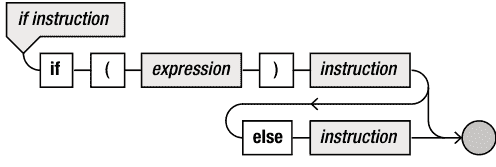

#### 图 6-3. 指令块的语法图（其本身同样是一条指令）

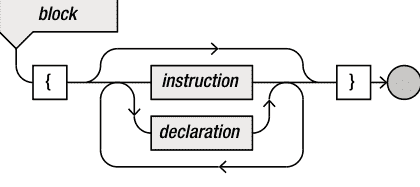

### 多种不同的替代方案

当存在多个数值类别时，你可以使用 `if` 指令来判断当前处理的是哪种情况。第二个测试被放置在第一个 `if` 指令的 `else` 之后，这样只有在第一个测试失败时才会执行第二个测试。第三个测试可以放置在第二个 `if` 指令的 `else` 之后，以此类推。

以下片段用于确定玩家处于哪个年龄段，以便你可以绘制不同的玩家精灵图（sprite）：

```javascript
if (age < 4)
    Canvas2D.drawImage(sprites.babyPlayer, playerPosition, 0,
        { x : 0, y : 0 });
else if (age < 12)
    Canvas2D.drawImage(sprites.youngPlayer, playerPosition, 0,
        { x : 0, y : 0 });
else if (age < 65)
    Canvas2D.drawImage(sprites.adultPlayer, playerPosition, 0,
        { x : 0, y : 0 });
else
    Canvas2D.drawImage(sprites.oldPlayer, playerPosition, 0,
        { x : 0, y : 0 });
```

在每个 `else` 之后（最后一个除外）紧跟着另一个 `if` 指令。对于婴儿，绘制 `babyPlayer` 精灵图，其余指令将被忽略（毕竟它们都在 `else` 之后）。另一方面，年长的玩家会经过所有测试（是否小于 4 岁？是否小于 12 岁？是否小于 65 岁？），最后你才会得出结论，必须绘制 `oldPlayer` 精灵图。

我在这个程序中使用了缩进，以指示哪个 `else` 属于哪个 `if`。当存在许多不同的类别时，程序的文本会变得越来越难以阅读。因此，作为“`else` 之后的指令应该缩进”这一常规规则的特例，对于如此复杂的 `if` 指令，你可以使用一种更简单的布局：

```javascript
if (age < 4)
    Canvas2D.drawImage(sprites.babyPlayer, playerPosition, 0,
        { x : 0, y : 0 });
else if (age < 12)
    Canvas2D.drawImage(sprites.youngPlayer, playerPosition, 0,
        { x : 0, y : 0 });
else if (age < 65)
    Canvas2D.drawImage(sprites.adultPlayer, playerPosition, 0,
        { x : 0, y : 0 });
else
    Canvas2D.drawImage(sprites.oldPlayer, playerPosition, 0, { x : 0, y : 0 });
```

这里的一个额外优势是，使用这种布局可以更轻松地看出指令处理了哪些情况。你还可以看到示例代码在炮对象（cannon object）的 `update` 方法中，使用了多个替代方案来处理三种不同的颜色情况：

```javascript
if (Keyboard.keyDown === Keys.R)
    cannon.currentColor = sprites.cannon_red;
else if (Keyboard.keyDown === Keys.G)
    cannon.currentColor = sprites.cannon_green;
else if (Keyboard.keyDown === Keys.B)
    cannon.currentColor = sprites.cannon_blue;
```

除了 `if` 指令之外，还有一个名为 `switch` 的指令，它更适合处理许多不同的替代方案。关于如何使用 `switch` 的更多信息，请参阅第 21 章。

### 切换炮管的行为

作为使用 `if` 指令处理鼠标按钮按下的最后一个例子，让我们尝试处理鼠标按钮的*点击*（click），而不是鼠标按钮的*按下*（down）。你已经知道如何使用 `if` 指令检查鼠标按钮当前是否处于按下状态，但你如何知道玩家是否*点击*了（在之前未按下时按下了按钮）？请看程序 `Painter2a`。在这个程序中，当你点击左键后，炮管的旋转将跟随鼠标指针。当你再次点击时，炮管停止跟随鼠标指针。

这种*切换*（toggle）行为的问题在于，你在 `update` 方法中只能知道鼠标的当前状态。这不足以判断何时发生了点击，因为点击在一定程度上是由你上次处于 `update` 方法时发生了什么定义的。如果满足以下两点，你可以说玩家点击了鼠标按钮：

- 当前，鼠标按钮处于按下状态。
- 在上一次调用 `update` 方法期间，鼠标按钮未处于按下状态。

你在 `Mouse` 对象中添加一个额外的布尔变量 `leftPressed`，用于指示是否发生了鼠标按下。如果你收到一个鼠标按下事件（涵盖列表中的第一项）且变量 `Mouse.leftDown` 尚未为 `true`（对应列表中的第二项），则需要将此变量设置为 `true`。这就是扩展后的 `handleMouseDown` 事件处理函数的模样：

```javascript
function handleMouseDown(evt) {
    if (evt.which === 1) {
        if (!Mouse.leftDown)
            Mouse.leftPressed = true;
        Mouse.leftDown = true;
    }
}
```

在这里你还可以看到一个*嵌套* `if` 指令的示例，这意味着一个 `if` 指令的主体本身包含一个或多个 `if` 指令。现在，你可以通过编写一个检查左鼠标按钮是否被按下的 `if` 指令，来编写切换炮管行为所需的代码：

```javascript
if (Mouse.leftPressed)
    cannon.calculateAngle = !cannon.calculateAngle;
```

在 `if` 指令的主体中，你切换了 `calculateAngle` 变量。这是炮对象的一个布尔成员变量。为了实现切换行为，你使用了逻辑*非*（not）运算符。对变量 `calculateAngle` 执行*非*运算的结果再次存储在变量 `calculateAngle` 中。因此，如果该变量包含值 `true`，你就在同一个变量中存储值 `false`，反之亦然。结果是，每次执行该指令时，`calculateAngle` 变量的值都会发生切换。

现在你可以在另一个 `if` 指令中使用该变量来确定是否应该更新角度：

```javascript
if (cannon.calculateAngle) {
    var opposite = Mouse.position.y - this.position.y;
    var adjacent = Mouse.position.x - this.position.x;
    cannon.rotation = Math.atan2(opposite, adjacent);
} else
    cannon.rotation = 0;
```

为了完成这个例子，你需要做一些额外的簿记工作。目前，变量 `Mouse.leftPressed` 从未被重置。因此，在每次执行游戏循环之后，你需要将 `Mouse.leftPressed` 重置为 `false`。你在 `Mouse` 对象中添加一个执行此操作的 `reset` 方法，如下所示：

```javascript
Mouse.reset = function() {
    Mouse.leftPressed = false;
};
```

最后，该方法在 `Game` 对象的 `mainLoop` 方法中被调用：


```
Game.mainLoop = function() {
    Game.update();
    Game.draw();
    Mouse.reset();
    window.setTimeout(Game.mainLoop, 1000 / 60);
};
```

### 你学到了什么

在本章中，你学习了：

- 如何使用`if`指令对鼠标点击和按钮按下做出反应
- 如何使用布尔值为此类指令制定条件
- 如何使用带有不同替代方案的`if`指令

## 第 7 章 基础游戏对象

在本章中，你将开始对 Painter 游戏的源代码进行更多的组织。这是必要的，因为游戏的源代码包含许多行代码。在之前的示例中，你开始将变量分组到不同的对象中（如`Canvas2D`或`cannon`）。在本章中，你将通过使用更多对象以及将代码拆分到独立文件中来继续构建你的代码结构。

### 使用独立的 JavaScript 文件

你可能已经注意到，你的 JavaScript 文件变得相当大了。将所有代码放在一个巨大的文件中并不理想，因为这使得寻找程序的某些部分变得困难。将代码拆分到多个源文件中更有意义。一个好的方法是将不同的 JavaScript 对象拆分到独立的 JavaScript 文件中，这样每个 JavaScript 文件就包含一个对象的代码。Painter3 示例程序包含了前几章中介绍的对象，但每个对象都在自己的 JavaScript 文件中描述。现在在代码中导航和理解程序结构要容易得多。你甚至可以将这些文件放在不同的目录中，以指示哪些对象属于同一组。例如，你可以将`Keyboard`和`Mouse`的 JavaScript 文件都放在一个名为`input`的目录中。这样就很清楚这两个文件都包含与处理输入相关的代码。

在浏览器中加载这些独立的 JavaScript 文件有点棘手。在之前的示例中，你看到了加载 JavaScript 文件的以下行：

```
<script src="FlyingSpriteWithSound.js"></script>
```

你可能认为只需向 HTML 文件中添加更多此类`script`元素，就可以加载 Painter3 程序中使用的 JavaScript 文件，如下所示：

```
<script src="input/Keyboard.js"></script>
<script src="input/Mouse.js"></script>
<script src="Canvas2D.js"></script>
<script src="system/Keys.js"></script>
<script src="Painter.js"></script>
<script src="Cannon.js"></script>
```

不幸的是，如果你尝试采用这种不断添加更多`script`元素的方法，就会遇到麻烦。由于 JavaScript 文件是从某台服务器上获取的，所以无法确定哪个 JavaScript 文件会先加载完成。假设浏览器首先加载的是`Painter.js`文件。浏览器无法解释这个文件中的代码，因为该代码*引用了其他文件中的代码*（例如`Canvas2D`对象）。其他文件也存在同样的问题。因此，为了让这种方法生效，你需要确保文件按照一定的顺序加载，且这个顺序*尊重文件之间现有的依赖关系*。换句话说：如果文件 A 依赖文件 B，你就需要在加载文件 A 之前先加载文件 B。

在 JavaScript 中，可以修改 HTML 页面；因此，从理论上讲，你可以向 HTML 页面中添加一个额外的`script`元素，从而开始加载另一个 JavaScript 文件。通过巧妙地使用事件处理程序，你可以编写出按预定顺序加载其他 JavaScript 文件的 JavaScript 代码。除了自己编写所有这些代码之外，你还可以使用他人已经编写好的代码。这是结构化代码的另一个优势：它使代码对其他应用更加可用。

在本书中，我选择使用一个名为 LABjs（http://labjs.com/）的动态脚本加载工具。这是一个非常简单的脚本，可以让你按预定顺序动态加载其他 JavaScript 文件。以下是使用 LABjs 按正确顺序加载所有 JavaScript 文件的代码：

```html
<script src="../LAB.min.js"></script>
<script>
    $LAB.script('input/Keyboard.js').wait()
        .script('input/Mouse.js').wait()
        .script('Canvas2D.js').wait()
        .script('system/Keys.js').wait()
        .script('Painter.js').wait()
        .script('Cannon.js').wait(function () {
            Game.start('mycanvas');
        });
</script>
```

如你所见，使用 LABjs 非常简单。你只需依次调用`script`和`wait`方法。最后一个`wait`方法调用接收一个待执行的函数作为参数。在这个函数中，你启动游戏。通过更改`script`方法调用的顺序，你可以改变脚本的加载顺序。在开发游戏或其他较大的 JavaScript 应用程序时，使用这样的脚本非常有用，因为它使开发和维护代码变得更加容易。有关加载不同 JavaScript 文件的完整示例，请参见 Painter3。这里的另一个改进是，我将 canvas 元素的名称作为参数传递给`start`方法。这样，JavaScript 游戏代码就可以适用于任何 canvas 名称。

你可能不希望在游戏的最终（发布）版本中使用这种方法，因为浏览器将需要加载许多 JavaScript 文件。在这种情况下，最好使用另一个程序将所有 JavaScript 文件合并成一个大文件，这样可以大大加快加载速度。此外，常见的做法是对代码结构进行一些优化，使脚本文件尽可能小。这个过程称为*压缩*（minification）。第 30 章将对此进行更详细的讨论。

### 以错误的方式加载游戏资源

之前我提到，浏览器以任意顺序加载文件，因为这些文件必须从服务器上获取。同样的规则也适用于加载游戏资源，如精灵图和声音。这是你迄今为止一直使用的加载游戏资源的方法：

```javascript
var sprite = new Image();
sprite.src = "someImageFile.png";
var anotherSprite = new Image();
anotherSprite.src = "anotherImageFile.png";
// and so on
```

这看起来很简单。对于每个要加载的精灵图，你创建一个`Image`对象并为其`src`变量赋值。将`src`变量设置为某个值并不意味着图像会立即加载。它只是告诉浏览器开始从服务器检索该图像。根据网络连接速度，这可能需要一段时间。如果你过早尝试绘制该图像，浏览器会因访问错误而停止脚本（尝试绘制尚未加载的图像）。为了避免这个问题，前面的示例中是这样加载精灵图的：

```javascript
sprites.background = new Image();
sprites.background.src = spriteFolder + "spr_background.jpg";
sprites.cannon_barrel = new Image();
sprites.cannon_barrel.src = spriteFolder + "spr_cannon_barrel.png";
sprites.cannon_red = new Image();
sprites.cannon_red.src = spriteFolder + "spr_cannon_red.png";
sprites.cannon_green = new Image();
sprites.cannon_green.src = spriteFolder + "spr_cannon_green.png";
sprites.cannon_blue = new Image();
sprites.cannon_blue.src = spriteFolder + "spr_cannon_blue.png";
cannon.initialize();
window.setTimeout(Game.mainLoop, 500);
```

请注意最后一行代码（加粗显示）。在设置所有`Image`对象的`src`变量之后，你告诉浏览器等待 500 毫秒再执行主循环。这样，浏览器应该有足够的时间来加载精灵图。但是如果网络连接太慢怎么办？那么 500 毫秒可能不够。或者如果网络连接非常快呢？那么你就是在让玩家做不必要的等待。为了解决这个问题，你需要让程序等到所有图像加载完成后再执行主循环。你将看到如何使用事件处理函数正确地实现这一点。但在此之前，让我们再深入了解一下方法和函数。

### 方法和函数

你已经看到并使用过很多不同类型的方法和函数。例如，`Canvas2D.drawImage`方法和`cannon.update`方法之间有明显的区别：后者没有任何参数，而前者有（精灵图、位置、旋转角度和原点）。此外，一些函数/方法可以有一个*对象的结果值*，该结果值可以在执行方法调用的语句中使用——例如，将结果存储在变量中：

```javascript
var n = Math.random();
```

在这里，你调用了定义为`Math`对象一部分的`random`函数，并将其结果存储在变量`n`中。显然，`random`提供了一个可以存储的结果值。而`Canvas2D.drawImage`方法则没有提供可以存储在变量中的结果。当然，该方法确实有某种效果，因为它在屏幕上绘制了一个精灵图，这也可以说是方法调用的一种结果。然而，当我说方法的*结果*时，我并不是说方法对某个对象产生了某种效果。我指的是*方法调用*返回一个值，该值可以存储在变量中。这也被称为方法或函数的*返回值*。在数学中，函数有结果是很常见的。数学函数`f(x) = x^2`接收一个`x`值作为参数，并返回其平方作为结果。如果需要的话，你可以用 JavaScript 编写这个数学函数：

```javascript
var square = function(x) {
    return x*x;
}
```

如果你查看这个方法的头部，可以看到它接受一个名为`x`的参数。因为该函数返回一个值，所以你可以将该值存储在变量中：

```javascript
var sx = square(10);
```

执行此语句后，变量`sx`将包含值 100。在函数体中，你可以使用`return`关键字来指定函数实际返回的值。对于`square`来说，函数返回表达式`x*x`的计算结果。注意，执行`return`语句还会终止函数中其余语句的执行。*放在*`return`语句*之后*的任何语句都不会被执行。例如，考虑以下函数：

```javascript
var someFunction = function() {
    return 12;
    var tmp = 45;
}
```

在这个例子中，第二条语句（`var tmp = 45;`）永远不会被执行，因为它前面的语句已经结束了函数的执行。这是`return`语句非常方便的特性，你可以加以利用：

```javascript
var squareRoot = function(x) {
    if (x < 0)
        return 0;
    // Calculate the square root, we are now sure that x >=0.
}
```

在这个例子中，你使用`return`语句作为防止方法使用者输入错误的保护措施。你无法计算负数的平方根，因此在进行任何计算或引发任何令人烦恼且可能难以调试的错误之前，先处理`x`为负数的情况。

一个没有返回值的方法示例是`cannon.handleInput`。因为该方法没有返回值，所以你不需要在方法体中使用`return`关键字，尽管这样做有时仍然有用。例如，假设你只想如果鼠标位于屏幕左侧，则改变大炮的颜色。你可以按照如下方式实现：

```
cannon.handleInput = function () {
    if (Mouse.position.x > 10)
        return;
    if (Keyboard.keyDown === Keys.R)
        cannon.currentColor = sprites.cannon_red;
    else if (Keyboard.keyDown === Keys.G)
        // 等等。
};
```

在这种方法中，你首先检查鼠标的 x 坐标是否大于 10。如果是这种情况，你就执行`return`指令。之后的所有指令将不再执行。

请注意，每当调用一个没有返回值的方法时，它没有可以存储到变量中的结果。例如：

```
var what = cannon.handleInput();
```

因为`cannon.handleInput`没有返回值，所以在这条指令执行后，变量`what`的值将是`undefined`。

如果一个方法或函数有返回值，这个值并不一定必须存储在变量中。你也可以像在`cannon.handleInput`方法中那样，直接在`if`指令中使用它：

```
if (Math.random() > 0.5)
    // 做些事情
```

这里，`Math.random`方法返回一个数字，如果那个数字大于 0.5，就会执行`if`指令的主体。有值和无值的事物之间的区别，你之前已经见过了：这与你之前看到的*指令*（没有值）和*表达式*（有值）之间的区别是一样的。所以，这意味着`Math.random()`是一个*表达式*，而`cannon.handleInput();`是一条*指令*。这两者之间的第二个区别是，表达式永远不以分号结尾，而指令总是以分号结尾，除非该指令是一个代码块。

### 声明与参数

变量的声明与方法头部中编写的参数有很多共同之处。事实上，那些参数也是声明，但存在一些区别：

- 变量在方法体中声明；参数在方法头部的圆括号之间声明。
- 变量通过赋值指令获得值；参数在方法被调用时自动获得值。
- 变量声明以`var`关键字开头；参数声明则不是。
- 变量声明以分号结尾；参数声明则不是。

### 正确加载游戏资源

为了使精灵图加载稍微容易一些，让我们向`Game`对象添加一个方法`loadSprite`：

```
Game.loadSprite = function(imageName) {
    var image = new Image();
    image.src = imageName;
    return image;
}
```

现在加载不同精灵图的代码变得简洁多了：

```
var sprFolder = "../../assets/Painter/sprites/";
sprites.background = Game.loadSprite(sprFolder + "spr_background.jpg");
sprites.cannon_barrel = Game.loadSprite(sprFolder + "spr_cannon_barrel.png");
sprites.cannon_red = Game.loadSprite(sprFolder + "spr_cannon_red.png");
sprites.cannon_green = Game.loadSprite(sprFolder + "spr_cannon_green.png");
sprites.cannon_blue = Game.loadSprite(sprFolder + "spr_cannon_blue.png");
```

然而，处理精灵图加载时间的问题尚未解决。为了处理这个问题，你需要做的第一件事是跟踪你正在加载多少个精灵图。你可以通过向`Game`对象添加一个名为`spritesStillLoading`的变量来实现：

```
var Game = {
    spritesStillLoading : 0
};
```

最初，这个变量被设置为值 0。每当你加载一个精灵图时，你就将该变量增加 1。逻辑上，你在`loadSprite`方法中这样做：

```
Game.loadSprite = function(imageName) {
    var image = new Image();
    image.src = imageName;
    Game.spritesStillLoading += 1;
    return image;
}
```

所以现在，每当你加载一个精灵图时，`spritesStillLoading`变量就会递增。接下来，你想在每个精灵图完成加载时*递减*这个变量。这可以通过使用事件处理函数来实现。你将这个函数赋值给图像对象的`onload`变量。在该函数的主体中，你递减该变量。以下是添加了事件处理程序的`loadSprite`方法版本：

```
Game.loadSprite = function (imageName) {
    var image = new Image();
    image.src = imageName;
    Game.spritesStillLoading += 1;
    image.onload = function () {
        Game.spritesStillLoading -= 1;
    };
    return image;
};
```

现在，`spritesStillLoading`变量准确地表示还有多少精灵图需要加载。你可以使用这个信息来等待，直到该变量包含值 0 才启动主循环。为此，你需要创建两个循环方法：一个资源加载循环和一个主游戏循环。在资源加载循环中，你只需检查是否仍有精灵图需要加载。如果是这种情况，你再次调用资源加载循环。如果所有精灵图都已加载，你就调用主循环方法。以下是资源加载循环方法：


`Game.assetLoadingLoop = function () { if (Game.spritesStillLoading > 0) window.setTimeout(Game.assetLoadingLoop, 1000 / 60); else { Game.initialize(); Game.mainLoop(); } };`

你使用`if`指令来检查仍在加载的精灵图数量是否大于0。如果是这种情况，你在短暂延迟后再次调用`assetLoadingLoop`方法。一旦所有精灵图都加载完毕，就会执行`if`指令的`else`部分。在这个部分，你调用`Game`对象中的`initialize`方法，然后是`mainLoop`方法。在`initialize`方法中，所有游戏对象被初始化（在这种情况下，只有大炮对象）。在所有精灵图加载完毕后执行此初始化步骤非常有用，因为在初始化对象时精灵图数据可能很有用。例如，如果你想计算一个覆盖层的位置，使其绘制在屏幕中央，你需要知道精灵图的宽度和高度。这些信息只有在精灵图加载完成后才可用。如需完整概述，请参阅`Painter3`示例，该示例展示了新的精灵图加载代码。

## 编写更高效的游戏循环

到目前为止，你一直使用`window.setTimeout`方法来创建运行的游戏循环。尽管这段代码没问题，但遗憾的是它效率不高。大多数浏览器提供了一种更高效的方法来实现这一点，特别针对像游戏这样的交互式绘图应用。问题是，并非所有浏览器和版本都使用相同的方法名称。最常用浏览器的较新版本都使用`window.requestAnimationFrame`方法。然而，较旧版本的`Firefox`使用`window.mozRequestAnimationFrame`，而较旧版本的`Safari`和`Chrome`使用`window.webkitRequestAnimationFrame`。你希望尽可能少地处理浏览器特定的代码，所以让我们想出一种方法，使用更快的方法来运行游戏循环，而无需了解不同浏览器制造商和版本使用哪种不同的方法。由于大多数浏览器已经使用`window.requestAnimationFrame`方法，你可以如下扩展该方法的定义：

```
window.requestAnimationFrame = window.requestAnimationFrame ||
    window.webkitRequestAnimationFrame || window.mozRequestAnimationFrame ||
    window.oRequestAnimationFrame || window.msRequestAnimationFrame ||
    function (callback) {
        window.setTimeout(callback, 1000 / 60);
    };
```

你在这里使用`||`运算符来确定`window.requestAnimationFrame`名称指向哪种方法。如果第一个选项未定义（例如，如果你正在处理较旧的浏览器），你会检查任何较旧的名称。如果没有任何优化的游戏循环方法可用，你就让`requestAnimationFrame`指向一个调用`window.setTimeout`方法的函数。在`JavaScript`中，`window`变量是全局命名空间的容器。这意味着你可以在`window`变量之前或之后调用`requestAnimationFrame`方法。调用：

```
window.requestAnimationFrame(callbackFunction);
```

等同于

```
requestAnimationFrame(callbackFunction);
```

`Painter3`示例使用优化的游戏循环方法来运行资源加载循环以及游戏循环，如下所示：

```
Game.assetLoadingLoop = function () {
    if (Game.spritesStillLoading > 0)
        window.requestAnimationFrame(Game.assetLoadingLoop);
    else {
        Game.initialize();
        Game.mainLoop();
    }
};
```

类似地，这是`Game`对象中的`mainLoop`方法：

```
Game.mainLoop = function () {
    Game.handleInput();
    Game.update();
    Game.draw();
    Mouse.reset();
    window.requestAnimationFrame(Game.mainLoop);
};
```

浏览器处理方式的不同是`JavaScript`开发者面临的一个重大挑战，尽管在浏览器执行`JavaScript`代码的标准化方面已经取得了很大进展。当你开发`JavaScript`游戏时，你很可能在某个时候会遇到这些浏览器差异。因此，在发布之前，务必在最常见的浏览器上测试你的游戏！

## 将通用代码与特定游戏代码分离

以前，你并没有区分可用于许多不同游戏的代码和特定于单个游戏的代码。你编写的一些代码，例如`Game.mainLoop`方法，可能对其他`JavaScript`游戏也有用。你用于加载精灵图的所有代码也是如此。现在你已经看到了将代码拆分到不同脚本文件中的方法，你可以利用这一点。通过将通用代码与特定于`Painter`的代码分开，以后更容易重用这些通用代码。如果你想重用加载精灵图的代码，你只需将包含该代码的源文件包含到你的新游戏应用程序中，而无需在`Painter`游戏代码中翻找所需内容。这样做的另一个原因是让你以后能更快地创建类似的游戏。你可能会发现自己正在开发一个与之前开发过的游戏相似的游戏。通过这种方式组织代码，你可以更快地创建新游戏，同时避免重复造轮子。

`Painter4`示例创建了一个独立的`Game.js`文件，其中包含`Game`对象以及属于该对象的许多实用方法。特定于`Painter`的部分已被移至`Painter.js`文件中。在该文件中，你有一个加载精灵图的方法和一个初始化游戏的方法。此外，一个名为`PainterGameWorld.js`的新文件处理游戏中的各种对象。在`Painter`的早期版本中，这个游戏世界只包含一个背景图像和一门大炮。在下一节中，你将为此游戏世界添加一个球。然后，`Painter`游戏世界由一个确保所有游戏对象都被更新和绘制的对象来定义。这是`painterGameWorld`对象定义的一部分：

```javascript
var painterGameWorld = {
};
```

```javascript
painterGameWorld.handleInput = function (delta) {
    ball.handleInput(delta);
    cannon.handleInput(delta);
};
```

```javascript
painterGameWorld.update = function (delta) {
    ball.update(delta);
    cannon.update(delta);
};
```

```javascript
painterGameWorld.draw = function () {
    Canvas2D.drawImage(sprites.background, { x : 0, y : 0 }, 0,
        { x : 0, y : 0 });
    ball.draw();
    cannon.draw();
};
```

当你初始化游戏时，你需要初始化游戏对象，并告诉`Game`对象，管理游戏世界的对象是`painterGameWorld`，如下所示：

```javascript
Game.initialize = function () {
    cannon.initialize();
    ball.initialize();
    Game.gameWorld = painterGameWorld;
};
```

在`Game.mainLoop`方法内部，你现在只需确保在`gameWorld`变量（它指向`painterGameWorld`）上调用正确的方法：

```javascript
Game.mainLoop = function () {
    Game.gameWorld.handleInput();
    Game.gameWorld.update();
    Canvas2D.clear();
    Game.gameWorld.draw();
    Mouse.reset();
    requestAnimationFrame(Game.mainLoop);
};
```

结果是，你很好地分离了通用游戏代码（在`Game.js`中）和特定于游戏的代码，后者包括加载精灵图和初始化游戏（`Painter.js`）以及更新和绘制`Painter`游戏对象（`PainterGameWorld.js`）。任何其他特定于`Painter`的游戏对象都在各自的脚本文件（例如`Cannon.js`）中定义。

## 向游戏世界添加一个球

在前面的章节中，你已经看到了如何通过加载独立的`JavaScript`文件、将通用游戏代码与特定于`Painter`的代码分离、正确加载资源以及创建更高效的游戏循环，使你的`JavaScript`游戏应用程序更加灵活和高效。在本节中，你将通过添加一个由大炮对象发射的球来扩展`Painter`游戏。为此，你需要添加一个球对象。

你设置球对象的方式与大炮对象非常相似。在`Painter4`示例中，你可以看到一个向游戏世界添加了球的`Painter`游戏版本（见图 7-1）。通过点击游戏屏幕上的任意位置，可以从大炮中发射球。此外，球会随大炮一起改变颜色。你可以在`Ball.js`文件中找到描述球对象的代码。就像大炮对象一样，球由多个变量组成，例如位置、球的当前颜色和球精灵图的原点。因为球会移动，你还需要存储它的速度。这个速度是一个向量，它定义了球的位置随时间的变化。例如，如果球的速度为 (0,1)，那么每秒钟球的`y`坐标会增加 1 个像素（这意味着球向下坠落）。最后，球可以处于两种状态：它要么是因为从大炮中发射出去而在空中飞行，要么是在等待被发射（因此没有移动）。为此，你向球对象添加了一个额外的布尔变量，称为`shooting`。这是球对象结构的完整定义：

```javascript
var ball = {
};
```

```javascript
ball.initialize = function() {
    ball.position = { x : 65, y : 390 };
    ball.velocity =  { x : 0, y : 0 };
    ball.origin = { x : 0, y : 0 };
    ball.currentColor = sprites.ball_red;
    ball.shooting = false;
};
```

在你开发本书中的游戏时，大多数对象都有位置和速度。因为本书只涉及 2D 游戏，所以位置和速度都是由`x`和`y`变量组成的变量。当你更新这些游戏对象时，你需要根据速度向量和已过去的时间来计算新位置。本章后面会介绍如何操作。

为了能够使用球对象，你需要更多的精灵图。在`Game.loadAssets`方法中，你加载了红色、绿色和蓝色的球精灵图。稍后根据大炮的颜色，你会改变球的颜色。这是扩展后的`loadAssets`方法：

```javascript
Game.loadAssets = function () {
    var loadSprite = function (sprite) {
        return Game.loadSprite("../../assets/Painter/sprites/" + sprite);
    };

    sprites.background = loadSprite("spr_background.jpg");
    sprites.cannon_barrel = loadSprite("spr_cannon_barrel.png");
    sprites.cannon_red = loadSprite("spr_cannon_red.png");
    sprites.cannon_green = loadSprite("spr_cannon_green.png");
    sprites.cannon_blue = loadSprite("spr_cannon_blue.png");
    sprites.ball_red = loadSprite("spr_ball_red.png");
    sprites.ball_green = loadSprite("spr_ball_green.png");
    sprites.ball_blue = loadSprite("spr_ball_blue.png");
};
```

在这里你可以看到一种让`JavaScript`中的精灵图加载调用更易读的好方法。你声明一个局部变量`loadSprite`，它引用一个函数。这个函数接受一个精灵图图像名作为参数，并调用`Game.loadSprite`方法。作为该方法的参数，你传递了精灵图的文件夹路径加上精灵图的名称。最后，该函数返回`Game.loadSprite`方法的结果。

## 创建球

让我们回到球对象。在该对象的`initialize`方法中，你必须为成员变量赋值，就像大炮对象的情况一样。当游戏开始时，球不应该移动。因此，你将球的速度设置为零。同时，你最初将球设置为零位置。这样，它就隐藏在大炮后面，所以当球不移动时，你看不到它。你最初将球的颜色设置为红色，并将`shooting`成员变量设置为`false`。这是完整的方法：

```javascript
ball.initialize = function() {
    ball.position = { x : 0, y : 0 };
    ball.velocity =  { x : 0, y : 0 };
    ball.origin = { x : 0, y : 0 };
    ball.currentColor = sprites.ball_red;
    ball.shooting = false;
};
```

除了`initialize`方法外，你还添加了一个`reset`方法来重置球的位置和其射击状态：

```javascript
ball.reset = function () {
    ball.position = { x : 0, y : 0 };
    ball.shooting = false;
};
```

当球在从大炮中发射后飞出屏幕时，你可以通过调用此方法来重置它。此外，你还向球对象添加了一个`draw`方法。如果球没有在射击，你不希望玩家看到它。因此，只有当球当前正在射击时，你才绘制球精灵图：

```javascript
ball.draw = function () {
    if (!ball.shooting)
        return;
    Canvas2D.drawImage(ball.currentColor, ball.position, ball.rotation,
        ball.origin);
};
```

你可以在此方法的函数体中看到，你使用了`return`关键字，以便仅在球没有在射击时才绘制它。在`painterGameWorld`对象内部，你必须在球上调用游戏循环方法。例如，这是`painterGameWorld`中的`draw`方法，其中调用了`ball.draw`方法：

```javascript
painterGameWorld.draw = function () {
    Canvas2D.drawImage(sprites.background, { x : 0, y : 0 }, 0,
        { x : 0, y : 0 });
    ball.draw();
    cannon.draw();
};
```

请注意绘制游戏对象的顺序：先是背景图像，然后是球，最后是大炮。

## 发射球

玩家可以在游戏屏幕内点击鼠标左键来发射一个颜料球。球的速度和移动方向由玩家点击的位置决定。球应该朝那个位置的方向移动；玩家点击的位置离大炮越远，球的速度就越高。这是一种直观的用户控制球速的方式。每当设计游戏时，都要仔细考虑如何接收用户的指令，以及处理这些指令最自然或最高效的方式是什么。

为了处理输入，你向球对象添加了一个`handleInput`方法。在此方法内部，你可以使用`Mouse`对象来检查玩家是否按下了鼠标左键：

```javascript
if (Mouse.leftPressed)
    // do something...
```

然而，由于任何时刻空中只能有一个球，所以你只想在球不在空中的情况下才执行某些操作。这意味着你必须检查球的射击状态。如果球已经被发射出去，你就不需要处理鼠标点击事件了。因此，你用一个额外的条件扩展了你的`if`指令，即球当前不在空中：

```javascript
if (Mouse.leftPressed && !ball.shooting)
    // do something...
```

如你所见，你同时使用了两个逻辑运算符（`&&`和`!`）。由于逻辑非（`!`）运算符的存在，`if`指令中的整个条件只有在`shooting`变量的值为`false`时才会为真：换句话说，球当前没有在射击。

在`if`指令内部，你需要做几件事。你知道玩家点击了某处，并且球必须从大炮中发射出去。你需要做的第一件事是将变量`shooting`设置为正确的值，因为球的状态需要更改为“当前正在射击”：

```javascript
ball.shooting = true;
```


因为球现在正在移动，你需要给它一个`速度`。这个速度是一个指向玩家点击位置方向的向量。你可以通过用鼠标位置减去球的位置来计算这个方向。由于速度包含 x 分量和 y 分量，你需要对这两个维度分别进行计算：

```
ball.velocity.x = (Mouse.position.x - ball.position.x);
ball.velocity.y = (Mouse.position.y - ball.position.y);
```

以这种方式计算速度还可以产生一种预期的效果：当用户点击距离大炮越远的地方时，速度就越大，因为此时鼠标位置与球位置之间的差值也越大。然而，如果你现在运行游戏，球的移动速度会有点慢。因此，你需要将这个速度乘以一个常数值，从而给球一个在本项目游戏场景中可用的速度：

```
ball.velocity.x = (Mouse.position.x - ball.position.x) * 1.2;
ball.velocity.y = (Mouse.position.y - ball.position.y) * 1.2;
```

我在使用不同的数值测试游戏玩法后，选择了 1.2 这个常数值。每款游戏都会有许多这类`游戏玩法参数`，你在对游戏进行压力测试（play-testing）时需要调整它们以确定最佳值。为这些参数找到合适的值对于构建一个平衡且好玩的游戏至关重要，你需要确保所选的值不会使游戏变得过于简单或困难。例如，如果你选择常数 0.3 而不是 1.2，球的移动速度会慢得多。这会使游戏难度大幅增加，甚至可能导致游戏无法运行，因为球可能永远无法到达最远的罐子。

如果你将`handleInput`方法添加到`ball`中，它不会被自动调用。你需要在`painterGameWorld`对象中显式地执行此操作。因此，在该对象的`handleInput`方法中添加一条额外的指令：

```
painterGameWorld.handleInput = function () {
    ball.handleInput();
    cannon.handleInput();
};
```

### 更新球的状态

将相关的变量和方法组合在对象中的一个巨大优势是，你可以使每个对象保持相对小巧且清晰。你可以设计大致反映游戏中各种游戏对象类型的对象。在这种情况下，你分别为大炮和球创建了对象。目标是让每个游戏对象处理与其相关的玩家输入。你还希望游戏对象能够自行更新和绘制。这就是为什么你在`ball`中添加了`update`方法和`draw`方法，以便在`painterGameWorld`的游戏循环方法中调用这些方法。

在`ball.update`内部，你需要定义球的行为。这种行为取决于球当前是否处于发射状态。以下是完整的方法：

```
ball.update = function (delta) {
    if (ball.shooting) {
        ball.velocity.x = ball.velocity.x * 0.99;
        ball.velocity.y = ball.velocity.y + 6;
        ball.position.x = ball.position.x + ball.velocity.x * delta;
        ball.position.y = ball.position.y + ball.velocity.y * delta;
    }
    else {
        if (cannon.currentColor === sprites.cannon_red)
            ball.currentColor = sprites.ball_red;
        else if (cannon.currentColor === sprites.cannon_green)
            ball.currentColor = sprites.ball_green;
        else
            ball.currentColor = sprites.ball_blue;
        ball.position = cannon.ballPosition();
        ball.position.x = ball.position.x - ball.currentColor.width / 2;
        ball.position.y = ball.position.y - ball.currentColor.height / 2;
    }
    if (painterGameWorld.isOutsideWorld(ball.position))
        ball.reset();
};
```

正如你在该方法的定义头中所见，它有一个名为`delta`的参数。这个参数是必要的，因为为了计算球的新位置，你需要知道自上次调用`update`以来经过了多少时间。这个参数在某些游戏对象的`handleInput`方法中也可能很有用——例如，如果你想知道玩家移动鼠标的速度，你就需要知道经过了多少时间。Painter4 示例扩展了每个具有游戏循环方法（`handleInput`、`update`、`draw`）的对象，使得自上次更新以来经过的时间作为参数传递。

但你在哪里计算`delta`的值？又是如何计算的？在示例中，你在`Game.mainLoop`方法中完成此操作：

```
Game.mainLoop = function () {
    var delta = 1 / 60;
    Game.gameWorld.handleInput(delta);
    Game.gameWorld.update(delta);
    Canvas2D.clear();
    Game.gameWorld.draw();
    Mouse.reset();
    requestAnimationFrame(Game.mainLoop);
};
```

因为你希望游戏循环每秒执行 60 次，所以你将`delta`值计算如下：

```
var delta = 1 / 60;
```

这种在游戏循环中计算过去时间的方法被称为`固定时间步长（fixed timestep）`。如果你的电脑速度非常慢，无法每秒执行 60 次游戏循环，你仍然告诉你的游戏对象自上次以来仅经过了 1/60 秒，尽管事实并非如此。结果就是，`游戏时间`与`真实时间`不同。另一种方法是通过访问系统时间来计算`实际经过的时间`。操作如下：

```
var d = new Date();
var n = d.getTime();
```

变量`n`现在包含了自 1970 年 1 月 1 日以来经过的毫秒数（！）。每次运行游戏循环时，你可以存储这个时间，并减去上次运行游戏循环时存储的时间。这样就能得到实际经过的真实时间。在这种情况下不存在固定时间步长，因为经过的时间取决于所使用的计算机/设备的运行速度、操作系统中进程的优先级、玩家是否在同时执行其他任务等等。因此，这种在游戏中处理时间的方法被称为`可变时间步长（variable timestep）`。

可变时间步长在追求高帧率的游戏中尤为有用：例如在第一人称射击游戏中，由于摄像机直接由玩家控制，摄像机的运动可能非常快。在这些情况下，可变时间步长结合尽可能频繁地调用游戏循环方法，可以带来更平滑的运动和更愉悦的游戏体验。可变时间步长的缺点是，即使玩家暂时在做其他事情（比如打开游戏菜单或保存游戏），时间依然在继续。通常，如果玩家发现自己在浏览物品栏时，角色在游戏世界中被杀死了，他们会很不高兴。因此，作为一名游戏开发者，在使用可变时间步长时需要解决此类问题。

另一个使用可变时间步长可能会干扰游戏可玩性的例子是，如果玩家暂时切换到另一个应用程序（或浏览器的另一个标签页）。这种情况经常发生，尤其是当你开发在浏览器中运行的游戏时。这也是本书中使用固定时间步长的主要原因之一。当玩家切换到另一个标签页时，非活动标签页中的 JavaScript 代码执行会自动暂停，直到玩家返回。使用固定时间步长时，当玩家重新激活标签页，游戏只需从暂停的地方继续，因为游戏对象不关心经过的真实时间，只关心固定的`delta`值。

让我们回到`ball.update`方法。如果你查看该方法的正文，你会发现第一部分是一个`if`指令。`if`的条件是`ball.shooting`变量的值应为`true`。因此，如果球当前正在移动，则执行`if`指令的正文。该正文再次由四条指令组成。前两条指令更新速度，后两条指令更新位置。第一条指令更新速度的 x 方向。你将速度乘以 0.99，其效果是速度缓慢降低。这样做是为了模拟空气摩擦。第二条指令在每次更新时增加 y 方向的速度。这样做是为了模拟`重力`对球的影响。x 和 y 方向速度的变化共同产生了合理的球体行为。当然，在现实世界中，重力并不是 6。但话又说回来，你的现实世界也不是由像素组成的。游戏世界中的物理效果并不总是能准确代表现实世界中的物理。当你想要在游戏中加入某种形式的物理效果时（无论是非常简单还是极其复杂），最关键的部分不是物理效果是否真实，而是`游戏是否可玩`。这就是为什么在战略游戏中，飞机的移动速度可能与士兵在地面上行走的速度一样快。如果游戏为这两个对象使用真实的物理速度，会导致游戏无法正常运行。

球的当前位置通过将其速度与其 x 和 y 分量相加来更新。以下是实现此功能的指令：

```
ball.position.x = ball.position.x + ball.velocity.x * delta;
ball.position.y = ball.position.y + ball.velocity.y * delta;
```

如你所见，这就是`delta`变量被使用的地方。你根据速度以及自上次更新以来经过的时间来计算球的新位置。你将每个速度维度与`delta`变量中的值相乘，然后将结果加到球的当前位置上。这样一来，如果你决定使用更高或更低的帧率，游戏对象移动的速度也不会改变。

> **注意** 在过去，计算机速度非常慢，以至于不存在固定时间步（fixed timestep）的概念。游戏开发人员假设每个人都在同样慢的机器上玩游戏，因此他们尽可能频繁地调用游戏循环方法，并简单地使用恒定的速度因子来更新对象的位置。结果，当计算机变得更快时，这些游戏变得越来越难以玩！玩家并不喜欢这样。因此，在计算速度和位置等数值时，务必考虑已流逝的时间。

如果球当前不在射击状态，你可以更改它的颜色。在这种情况下，你可以通过获取大炮的当前颜色并相应地更改球的颜色来实现。这样，你可以确保球的颜色始终与大炮的颜色匹配。你需要一个`if`指令来处理不同的情况，如下所示：

```
if (cannon.currentColor === sprites.cannon_red)
    ball.currentColor = sprites.ball_red;
else if (cannon.currentColor === sprites.cannon_green)
    ball.currentColor = sprites.ball_green;
else
    ball.currentColor = sprites.ball_blue;
```

你还需要更新球的位置：

```
ball.position = cannon.ballPosition();
ball.position.x = ball.position.x - ball.currentColor.width / 2;
ball.position.y = ball.position.y - ball.currentColor.height / 2;
```

为什么要更改位置？当球不在空中时，玩家可以通过旋转大炮的炮管来修改其射击位置。因此，你需要在这里计算正确的球位置，以确保它与炮管的当前方向一致。为了实现这一点，你在`cannon`中添加了一个名为`ballPosition`的新方法，在该方法中，你根据炮管方向计算球的位置。利用正弦和余弦函数，你可以按如下方式计算新位置：

```
cannon.ballPosition = function() {
    var opp = Math.sin(cannon.rotation) * sprites.cannon_barrel.width * 0.6;
    var adj = Math.cos(cannon.rotation) * sprites.cannon_barrel.width * 0.6;
    return { x : cannon.position.x + adj, y : cannon.position.y + opp };
};
```

如你所见，你将对边（opposite）和邻边（adjacent）乘以 0.6，这样球就会被绘制在旋转炮管的一半多一点的位置。该方法返回一个包含 x 和 y 变量的新复合对象，其中存储了球所需的 x 和 y 位置。

在获取所需球位置后，你从中减去球精灵（sprite）宽度和高度的一半。这样，球就能漂亮地绘制在大炮炮管的中间。

`ball.update`方法的第二部分也是一个`if`指令：

```
if (painterGameWorld.isOutsideWorld(ball.position))
    ball.reset();
```

这部分方法处理球超出游戏世界时发生的事件。为了计算这是否成立，你在`painterGameWorld`中添加了一个名为`isOutsideWorld`的方法。该方法的目的是检查给定位置是否在游戏世界之外。你使用几个简单的规则来定义游戏世界的边界。请记住，屏幕的左上角是原点。如果一个对象的 x 位置小于零或大于屏幕宽度，则该对象在游戏世界之外。如果一个对象的 y 位置大于屏幕高度，它也在游戏世界之外。请注意，我并没有说如果 y 位置小于零则对象在游戏世界之外。为什么不呢？我这样做是为了让玩家能够将球射向空中，让球在再次落下之前暂时处于屏幕上方。在平台游戏中经常能看到类似的效果，角色可以跳起并部分消失在屏幕外，而不是直接从屏幕底部掉下去（后者通常意味着角色立即死亡）。

如果你查看这个方法的头部，你会发现它需要一个参数，即一个位置：

```
painterGameWorld.isOutsideWorld = function (position)
```

如果你想检查某个位置是否在屏幕外，你需要知道屏幕的宽度和高度。在像 Painter 这样的 HTML5 游戏中，这对应于画布（canvas）的大小。Painter4 在`Game`中添加了一个名为`size`的变量。当调用`Game.start`方法时，所需的屏幕大小将作为参数传递。以下是扩展后的`Game.start`方法：

```
Game.start = function (canvasName, x, y) {
    Canvas2D.initialize(canvasName);
    Game.size = { x : x, y : y };
    Keyboard.initialize();
    Mouse.initialize();
    Game.loadAssets();
    Game.assetLoadingLoop();
};
```

在`isOutsideWorld`方法中，你使用`Game.size`变量来确定位置是否在游戏世界之外。该方法的主体由一条使用`return`关键字来计算布尔值的指令组成。逻辑或（OR）运算被用来涵盖位置在游戏世界之外的各种情况：

```
return position.x < 0 || position.x > Game.size.x || position.y > Game.size.y;
```

如你所见，你不介意 y 坐标是否小于零。这允许球最终出现在屏幕上方并再次掉回屏幕内。

让我们回到`ball.update`方法。第二个`if`指令在其条件中调用了`isOutsideWorld`方法；如果该方法返回`true`，则执行`ball.reset`方法。或者用更简单的说法：如果球飞出了屏幕，它会被重新放置在大炮处，准备好被玩家再次射出。在这里你可以看到将指令分组在方法中的另一个优点：像`isOutsideWorld`这样的方法可以在程序的不同部分重复使用，从而节省开发时间并使程序更短、更易读。例如，`isOutsideWorld`以后可能对游戏中的油漆桶也很有用，用来测试它们是否掉出了屏幕。

最后，确保在`painterGameWorld.update`方法中调用`ball.update`方法：

```
painterGameWorld.update = function (delta) {
    ball.update(delta);
    cannon.update(delta);
};
```

当你运行 Painter4 示例时，你会发现现在可以瞄准大炮、选择颜色并射出球了。在下一章中，你将向这个游戏中添加油漆桶。但为了实现这一点，我必须介绍一个新的 JavaScript 编程概念：原型（prototypes）。

### 你学到了什么

在本章中，你学习了：

- 如何将代码分布在不同的源文件中
- 如何提高游戏循环的效率
- 不同类型的方法/函数（有/无参数，有/无返回值）
- 固定时间步与可变时间步的区别
- 如何向游戏世界添加一个飞行球

## 第 8 章：游戏对象类型

在前面的章节中，你已经看到了如何创建一个包含几个不同游戏对象（如大炮和球）的游戏世界。你已经看到了如何让游戏对象相互交互。例如，球对象根据大炮的颜色更新其颜色。在本章中，你将向游戏世界添加下落的油漆桶。然而，在此之前，你必须重新审视如何在 JavaScript 中创建和管理对象。我将介绍类（class）概念，将其作为创建某种特定类型的多个游戏对象的一种手段。然后，你将把类概念应用于 Painter 游戏应用程序的其他部分。此外，你还将学习如何在游戏中加入随机性。

### 创建多个相同类型的对象


到目前为止，在`Painter`中，你只需要每个游戏对象的一个实例。只有一个大炮和一个球。JavaScript代码中的所有其他对象也是如此。只有一个`Game`对象，一个`Keyboard`对象，一个`Mouse`对象，等等。你通过声明一个引用空对象或复合对象的变量并向其添加有用的方法来创建这些对象。例如，以下是创建球对象的方式：

```
var ball = {
};

ball.initialize = function() {
    ball.position = { x : 0, y : 0 };
    // etc.
};

ball.handleInput = function (delta) {
    if (Mouse.leftPressed && !ball.shooting) {
        // do something
    }
};

// etc.
```

## 第8章：游戏对象类型

假设你希望在`Painter`游戏中能够同时发射三个球。如果沿用之前创建对象的方式，你需要创建两个变量`ball2`和`ball3`，并将球对象的代码复制两份。这不是一个理想的解决方案，原因有很多。首先，复制代码意味着你要处理版本管理问题。例如，如果你在`update`方法的代码中发现了一个bug，你必须确保将改进后的代码复制到其他球对象中。如果你漏掉了一个副本，那么当你以为已经解决bug时，它其实仍然存在。

另一个问题是，这种方法的可扩展性很差。如果你想扩展游戏，让玩家能够同时发射20个球怎么办？你要把代码复制20次吗？还要注意，JavaScript文件越大，浏览器下载和解释它们所需的时间就越长。所以，如果你不想让玩家等待脚本加载太久，最好避免复制代码。最后，重复的代码看起来丑陋不堪，会使你的源代码文件变得杂乱无章，并且让你很难找到所需的其他代码部分，导致过度滚动和整体编码效率的降低。

幸运的是，这个问题有一个非常好的解决方案。它是一种JavaScript编程结构，叫做*原型*。原型允许你定义一种对象的蓝图，包括它包含的变量和方法。一旦这个原型被定义，你就可以用一行代码来使用该原型创建对象！你已经使用过类似的东西。看看这行代码：

```javascript
var image = new Image();
```

在这里，你创建了一个图像对象，它使用`Image`原型来构建自身。定义原型很简单。看看这个例子：

```javascript
function Dog() {
}
Dog.prototype.bark = function () {
    console.log("woof!");
};
```

这会创建一个名为`Dog`的函数。当这个函数与`new`关键字一起被调用时，就会创建一个对象。JavaScript中的每个函数都有一个`prototype`，其中包含关于通过将该函数与`new`关键字一起调用来创建的对象应该是什么样子的信息。这个例子定义了一个名为`bark`的方法，它是`Dog`原型的一部分。`prototype`这个词不仅仅是为了美观。通过它，你可以表明你正在向`Dog`的原型添加内容。每当你创建一个`Dog`对象时，只有属于其原型的内容才是对象的一部分。以下是你创建新`Dog`对象的方式：

```javascript
var lucy = new Dog();
```

因为`lucy`是根据`Dog`函数中的原型创建的，所以`lucy`对象包含一个名为`bark`的方法：

```javascript
lucy.bark(); // 在控制台输出 "woof!"
```

好处在于，你现在可以创建很多都会叫的狗，但你只需要定义一次`bark`方法：

```javascript
var max = new Dog();
var zoe = new Dog();
var buster = new Dog();
max.bark();
zoe.bark();
buster.bark();
```

当然，本书的目标不是教你如何成为养狗专业户，而是如何创建游戏。而对于游戏来说，原型的概念非常强大。它允许你*将游戏中实际使用的对象与其构造方式分离开来*。

作为练习，让我们将原型原理应用到创建球对象上。为此，你需要定义一个函数。我们将这个函数命名为`Ball`，并将`initialize`方法添加到原型中：

```javascript
function Ball() {
}
Ball.prototype.initialize = function() {
    // 在这里进行球对象的初始化
};
```

在`initialize`方法中，你必须定义属于你创建的每个球对象的变量。问题是，你还没有创建对象——你只有一个函数和一个包含`initialize`方法的原型。那么，在`initialize`方法的主体中，如何引用该方法所属的对象呢？在JavaScript中，使用`this`关键字来实现这一目的。在方法中，`this`始终指向该方法所属的对象。使用这个关键字，你可以填充`initialize`方法的主体：

```javascript
Ball.prototype.initialize = function() {
    this.position = { x : 0, y : 0 };
    this.velocity = { x : 0, y : 0 };
    this.origin = { x : 0, y : 0 };
    this.currentColor = sprites.ball_red;
    this.shooting = false;
};
```

你现在可以创建任意数量的球并进行初始化：

```javascript
var ball = new Ball();
var anotherBall = new Ball();
ball.initialize();
anotherBall.initialize();
```

每次创建新球时，原型中的任何方法都会被添加到对象中。当在`ball`对象上调用`initialize`方法时，`this`指向`ball`。当在`anotherBall`上调用时，`this`指向`anotherBall`。

实际上，你可以稍微缩短一下你写的代码。既然`Ball`本身已经是一个会被调用的函数，为什么还要额外添加一个`initialize`方法呢？你可以直接在该函数中执行初始化，如下所示：

```javascript
function Ball() {
    this.position = { x : 0, y : 0 };
    this.velocity = { x : 0, y : 0 };
    this.origin = { x : 0, y : 0 };
    this.currentColor = sprites.ball_red;
    this.shooting = false;
}
```

现在当你创建球时，它们在创建时就被初始化了：

```javascript
var ball = new Ball();
var anotherBall = new Ball();
```

而且因为`Ball`是一个函数，你甚至可以传递参数：

```javascript
function Ball(pos) {
    this.position = pos;
    this.velocity = { x : 0, y : 0 };
    this.origin = { x : 0, y : 0 };
    this.currentColor = sprites.ball_red;
    this.shooting = false;
}
var ball = new Ball({ x : 0, y : 0});
var anotherBall = new Ball({ x : 100, y : 100});
```

因为`Ball`函数负责初始化（或*构造*）对象，所以这个函数也被称为*构造函数*。构造函数与在原型中定义的方法一起被称为*类*。当根据一个类创建对象时，你也说该对象具有该类作为其*类型*。在前面的例子中，`ball`对象的类型是`Ball`，因为它是使用`Ball`构造函数及其原型创建的。类是对象的*蓝图*，因此它描述了两件事：

- 对象中包含的数据。对于球来说，这些数据包括位置、速度、原点、当前颜色，以及一个指示球是否正在发射的变量。通常，这些数据在构造函数中初始化。

- *操作*数据的方法。在`Ball`类中，这些方法是游戏循环方法（`handleInput`、`update`、`draw`和`reset`）。

你可以非常轻松地将游戏循环方法转换为`Ball`原型中的方法，只需将`ball`替换为`this`即可。例如，这是`handleInput`方法：

```javascript
Ball.prototype.handleInput = function (delta) {
    if (Mouse.leftPressed && !this.shooting) {
        this.shooting = true;
        this.velocity.x = (Mouse.position.x - this.position.x) * 1.2;
        this.velocity.y = (Mouse.position.y - this.position.y) * 1.2;
    }
};
```

查看本章`Painter5`示例中的`Ball.js`文件。你可以看到`Ball`类及其所有方法。注意，我并没有为球添加任何功能；我只是应用了原型原理来定义*球的蓝图*。

类和对象的概念极其强大。它构成了*面向对象编程范式*的基础。JavaScript是一种非常灵活的语言，它并不强迫你使用类。如果你愿意，可以完全只使用函数来编写脚本（这也是你迄今为止所做的）。但由于类是如此强大的编程概念，并且在（游戏）行业中被广泛使用，本书尽可能多地利用它们。通过学习如何正确使用类，你可以设计出更好的软件，*在任何*编程语言中都是如此。

> **注意** 在编写游戏时，你经常需要在完成某事所需的时间和做这件事的频率之间做出权衡。就`Painter`而言，如果你只会创建一个或两个球，那么可能不值得为球创建一个类。然而，情况往往是逐渐扩展的。不知不觉间，你就在复制粘贴数十行代码，因为你没有创建一种更简单的一次性实现方式。在设计类时，要考虑良好设计的长期收益，即使这需要短期牺牲，比如需要做一些额外的编程工作来使类设计更加通用。

### 将游戏对象构建为游戏世界的一部分

既然你已经了解了如何创建类，你需要重新思考游戏对象在哪里被构建。到目前为止，游戏对象被声明为全局变量，因此它们在任何地方都可以访问。例如，这是你创建`cannon`对象的方式：

```javascript
var cannon = {
};
cannon.initialize = function() {
    cannon.position = { x : 72, y : 405 };
    cannon.colorPosition =  { x : 55, y : 388 };
    cannon.origin = { x : 34, y : 34 };
    cannon.currentColor = sprites.cannon_red;
    cannon.rotation = 0;
};
```

在`Painter5`示例中，这是`Cannon`类的构造函数：

```javascript
function Cannon() {
    this.position = { x : 72, y : 405 };
    this.colorPosition =  { x : 55, y : 388 };
    this.origin = { x : 34, y : 34 };
    this.currentColor = sprites.cannon_red;
    this.rotation = 0;
}
```

在小球的更新方法中，你需要获取当前炮台的颜色，以便更新小球的颜色。以下是上一章中实现这一点的方式：

```
if (cannon.currentColor === sprites.cannon_red)
    ball.currentColor = sprites.ball_red;
else if (cannon.currentColor === sprites.cannon_green)
    ball.currentColor = sprites.ball_green;
else
    ball.currentColor = sprites.ball_blue;
```

当使用JavaScript原型方法定义类时，你必须用`this`替换`ball`（因为没有命名的对象实例）。因此，之前的代码转换为：

```
if (cannon.currentColor === sprites.cannon_red)
    this.currentColor = sprites.ball_red;
else if (cannon.currentColor === sprites.cannon_green)
    this.currentColor = sprites.ball_green;
else
    this.currentColor = sprites.ball_blue;
```

但是，如果炮台也是使用类构造的，你如何引用炮台对象呢？这引出了两个问题：

-   代码中在哪里构造游戏对象？

-   如果这些游戏对象不是全局变量，你如何引用它们？

从逻辑上讲，游戏对象应该在游戏世界被构造时构造。这就是`Painter5`示例在`PainterGameWorld`类（之前是`painterGameWorld`对象）中创建游戏对象的原因。以下是该类构造函数的一部分：

```
function PainterGameWorld() {
    this.cannon = new Cannon();
    this.ball = new Ball();
    // 如果需要，创建更多游戏对象
}
```

这回答了第一个问题，但它又引出了另一个问题。如果游戏对象在游戏世界创建时创建，那么在哪里调用`PainterGameWorld`的构造函数来创建游戏世界呢？如果你打开`Game.js`文件，你会看到另一个使用原型方法定义的类：`Game_Singleton`。这是它的构造函数：

```
function Game_Singleton() {
    this.size = undefined;
    this.spritesStillLoading = 0;
    this.gameWorld = undefined;
}
```

如你所见，这个类能够构造上一章中使用的`Game`对象。`Game_Singleton`类有一个`initialize`方法，游戏世界对象就是在这里创建的：

```
Game_Singleton.prototype.initialize = function () {
    this.gameWorld = new PainterGameWorld();
};
```

好的，你已经发现了游戏世界是在哪里构造的。但是`Game_Singleton`对象的实例是在哪里构造的呢？你需要这个实例才能访问游戏世界，而游戏世界又将让你能够访问游戏对象。如果你查看`Game.js`文件的最后一行，你会看到这条指令：

```
var Game = new Game_Singleton();
```

终于有一个实际的变量声明了！因此，通过变量`Game`，你可以访问游戏世界；并且通过该对象，你可以访问作为游戏世界一部分的游戏对象。例如，这就是获取炮台对象的方式：

```
Game.gameWorld.cannon
```

你可能会问，为什么这么复杂？为什么不直接像以前那样将每个游戏对象声明为全局变量呢？有几个原因。首先，在不同地方声明许多全局变量会使你的代码更难以复用。假设你想在另一个也使用球和炮台的应用程序中使用`Painter`的部分代码。现在你必须筛选代码以找到全局变量的声明位置，并确保它们对你的应用程序有用。更好的做法是在一个地方（例如`PainterGameWorld`类）声明这些变量，这样这些声明就更容易找到。

第二个问题是使用许多全局变量会丢弃变量之间存在的任何结构或关系。在`Painter`游戏中，很明显炮台和小球是游戏世界的一部分。如果你通过让游戏对象成为游戏世界对象的一部分来明确表达这种关系，你的代码将更容易理解。

总的来说，尽可能避免全局变量是一个好主意。在`Painter`游戏中，主要的全局变量是`Game`。这个变量包含一个树结构，其中包含游戏世界，游戏世界又包含游戏对象，游戏对象又包含其他变量（如位置或精灵）。

使用新的结构，即`Game`对象是其他对象的树结构，你现在可以访问炮台对象来获取小球所需的颜色，如下所示：

```
if (Game.gameWorld.cannon.currentColor === sprites.cannon_red)
    this.currentColor = sprites.ball_red;
else if (Game.gameWorld.cannon.currentColor === sprites.cannon_green)
    this.currentColor = sprites.ball_green;
else
    this.currentColor = sprites.ball_blue;
```

有时在纸上勾勒游戏对象的树结构，或者创建一个图表，以便稍后添加适当的名称，会很有用。随着你开发的游戏变得越来越复杂，这样的树结构提供了有用的概览，让你知道哪个对象属于哪里，并且在处理代码时，你无需在脑海中重新创建这个树结构。

### 编写具有多个实例的类


现在你可以构造同一类型的多个对象了，让我们在`Painter`游戏中添加一些颜料桶。这些颜料桶应该被赋予随机颜色，并且应该从屏幕顶部掉下来。一旦它们从屏幕底部掉出，你就为它们分配一个新的颜色，并将它们移回顶部。对于玩家来说，看起来每次都有不同的颜料桶在掉落。实际上，你只需要三个被重复使用的颜料桶对象。在`PaintCan`类中，你定义颜料桶是什么以及它的行为是什么。然后，你可以创建这个类的多个实例。在`PainterGameWorld`类中，你将这些实例存储在三个不同的成员变量中，这些变量在`PainterGameWorld`构造函数中声明和初始化：

```
function PainterGameWorld() {
    this.cannon = new Cannon();
    this.ball = new Ball();
    this.can1 = new PaintCan(450);
    this.can2 = new PaintCan(575);
    this.can3 = new PaintCan(700);
}
```

`PaintCan`类与`Ball`和`Cannon`类的一个区别是颜料桶具有不同的位置。这就是为什么在构造颜料桶时，你会传递一个坐标值作为参数。这个值表示颜料桶所需的`x`位置。`y`位置不需要提供，因为它将根据每个颜料桶的`y`速度来计算。为了让事情更有趣，你让颜料桶以不同的随机速度下落。（如何做到这一点将在本章后面解释。）为了计算这个速度，你想知道颜料桶的最小速度，这样它就不会下落得太慢。为此，你添加了一个包含该值的成员变量`minVelocity`。因此，这就是`PaintCan`类的构造函数：

```
function PaintCan(xPosition) {
    this.currentColor = sprites.can_red;
    this.velocity = new Vector2();
    this.position = new Vector2(xPosition, -200);
    this.origin = new Vector2();
    this.reset();
}
```

就像炮台和小球一样，颜料桶也有特定的颜色。默认情况下，你选择红色的颜料桶精灵。最初，你设置颜料桶的`y`位置，使其绘制在屏幕顶部之外，这样在游戏的后期，你可以看到它掉落。在`PainterGameWorld`构造函数中，你调用此构造函数三次来创建三个`PaintCan`对象，每个对象具有不同的`x`位置。

因为颜料桶不处理任何输入（只有小球和炮台这样做），所以你不需要为此类设置`handleInput`方法。然而，颜料桶确实需要被更新。你想做的一件事是让颜料桶在随机的时间和随机的速度下掉落。但你该怎么做呢？

## 处理游戏中的随机性

颜料桶行为最重要的部分之一是它的某些方面应该是*不可预测的*。你不希望每个颜料桶都以可预测的速度或时间掉落。你想添加一个*随机性*因素，这样每次玩家开始新游戏时，游戏都会有所不同。当然，你也需要控制这种随机性。你不希望一个颜料桶需要三个小时才能从顶部掉到底部，而另一个颜料桶只需要一毫秒。速度应该是随机的，但在*可玩的速度范围*内。

随机性到底是什么意思？通常，游戏和其他应用中的随机事件或值由*随机数生成器*管理。在`JavaScript`中，`Math`对象有一个`random`方法。你可能会想：计算机如何生成完全随机的数字？随机性在现实中存在吗？随机性难道不只是一种你尚无法完全预测、因此称之为“随机”的行为表现吗？好吧，我们不要太哲学化。在游戏世界和计算机程序中，你*可以*精确地预测将要发生什么，因为计算机只能完全按照你告诉它的去做。因此，严格来说，计算机无法产生完全随机的数字。假装能够产生随机数的一种方法是从一个预定义的非常大的数字表中挑选一个数字。因为你实际上并不是在产生随机数，所以这被称为*伪随机数生成器*。大多数随机数生成器可以在一个范围内生成一个数字，例如在`0`或`1`之间，但它们通常也可以生成任意数字或另一个范围内的数字。范围内的每个数字被生成的机会是相等的。在统计学中，这种分布被称为*均匀分布*。

假设当你开始一个游戏时，你通过遍历这个表来开始生成“随机”数字。因为数字表不会改变，所以每次你玩这个游戏时，都会生成相同的随机数序列。为了避免这个问题，你可以指明你想从表中的*不同*位置开始。你在表中开始的位置也称为随机数生成器的*种子*。通常，你每次启动程序时都取一个不同的值作为种子，例如当前系统时间。

你如何使用随机数生成器在游戏世界中创建随机性？假设你希望用户穿过一扇门时，有`75%`的几率生成一个敌人。在这种情况下，你生成一个介于`0`和`1`之间的随机数。如果这个数字小于或等于`0.75`，你就生成一个敌人；否则就不生成。由于均匀分布，这将完全导致你所需的行为。以下`JavaScript`代码说明了这一点：

```
var spawnEnemyProbability = Math.random();
if (spawnEnemyProbability >= 0.75)
    // 生成一个敌人
else
    // 做些其他事情
```

如果你想计算一个介于`0.5`和`1`之间的随机速度，你可以生成一个介于`0`和`1`之间的随机数，将这个数除以`2`，然后加上`0.5`：

```
var newSpeed = Math.random()/2 * 0.5;
```

人类在理解“真正”的随机性方面其实并不比计算机强多少。这就是为什么你的`MP3`播放器在随机播放模式下，有时似乎会反复播放同一首歌。你会把自然出现的连续播放视为非随机，而实际上它们是随机的。这意味着程序员有时必须创建一个在人类看来是随机的函数——即使它并非真正随机。

在游戏中，你必须非常谨慎地处理随机性。一个设计不当的随机单位生成机制可能会为某些玩家更频繁地生成某种类型的单位，给他们带来不公平的（劣）优势。此外，在设计游戏时，要确保随机事件不会对结果产生太大影响。例如，不要让玩家在完成你设计的高难度平台游戏的`80`关后掷骰子，并让掷骰子的结果决定玩家的生死。

## 计算随机速度和颜色

每次油漆桶掉落时，你都想为它创建一个随机的速度和颜色。你可以使用`Math.random`方法来帮助实现这一点。我们先来看看如何创建随机速度。为了代码整洁，你在`PaintCan`类的一个单独方法中完成此操作，这个方法叫做`calculateRandomVelocity`。然后，当你想初始化油漆桶的速度时，就可以调用这个方法。这里，你使用成员变量`minVelocity`来定义油漆桶掉落时的最小速度。这个变量在`reset`方法中被赋予初始值，该方法在构造函数中被调用：

```
PaintCan.prototype.reset = function () {
    this.moveToTop();
    this.minVelocity = 30;
};
```

在`calculateRandomVelocity`方法中计算随机速度时，你使用了这个最小速度值：

```
PaintCan.prototype.calculateRandomVelocity = function () {
    return { x : 0, y : Math.random() * 30 + this.minVelocity };
};
```

该方法只包含一条指令，返回一个表示速度的对象。`x`方向的速度为零，因为油漆桶不会水平移动——它们只会向下掉落。`y`方向的速度是使用随机数生成器计算的。你将这个随机值乘以`30`，再加上存储在成员变量`minVelocity`中的值，以获得一个介于`minVelocity`和`minVelocity+30`之间的正向`y`速度。

要计算随机颜色，你也使用随机数生成器，但你想从几个离散选项（红色、绿色或蓝色）中选择。问题在于`Math.random`返回的是一个介于零和一之间的实数。你希望生成的是一个`0`、`1`或`2`的随机*整数*。然后你可以使用`if`指令来处理不同的情况。幸运的是，`Math.floor`方法可以帮到你。`Math.floor`返回小于作为参数传递值的最大整数。例如：

```
var a = Math.floor(12.34);     // a 的值将是 12
var b = Math.floor(199.9999);  // b 的值将是 199
var c = Math.floor(-3.44);     // c 的值将是 -4
```

这个例子结合了`Math.random`和`Math.floor`来生成一个`0`、`1`或`2`的随机数：

```
var randomval = Math.floor(Math.random() * 3);
```

使用这种方法，你可以计算一个随机值，然后使用`if`指令为油漆桶选择一种颜色。这个任务由`calculateRandomColor`方法完成。该方法如下所示：

```
PaintCan.prototype.calculateRandomColor = function () {
    var randomval = Math.floor(Math.random() * 3);
    if (randomval == 0)
        return sprites.can_red;
    else if (randomval == 1)
        return sprites.can_green;
    else
        return sprites.can_blue;
};
```

现在你已经编写了这两个生成随机值的方法，可以在定义油漆桶行为时使用它们了。

## 更新油漆桶

`PaintCan`类中的`update`方法至少应该做以下几件事：

- 如果油漆桶当前尚未掉落，则设置一个随机创建的速度和颜色

- 通过将速度加到油漆桶位置上来更新位置

- 检查油漆桶是否已完全掉落，如果是，则重置它

对于第一个任务，你可以使用`if`指令检查油漆桶当前是否未移动（速度等于零）。此外，你还想为油漆桶的出现引入一点不可预测性。为了达到这个效果，只有当某个生成的随机数小于阈值`0.01`时，你才分配一个随机速度和颜色。由于均匀分布，大约每`100`个随机数中只有`1`个会小于`0.01`。因此，即使油漆桶的速度为零，`if`指令的主体也只会有时执行。在`if`指令的主体中，你使用之前定义的两个方法来生成随机速度和随机颜色：

```
if (this.velocity.y === 0 && Math.random() < 0.01) {
    this.velocity = this.calculateRandomVelocity();
    this.currentColor = this.calculateRandomColor();
}
```

你还需要通过将当前速度加到油漆桶位置上来更新它，同样要考虑经过的游戏时间，就像处理球一样：

```
this.position.x = this.position.x + this.velocity.x * delta;
this.position.y = this.position.y + this.velocity.y * delta;
```

现在你已经初始化了油漆桶并更新了它的位置，你需要处理特殊情况。对于油漆桶，你必须检查它是否已经掉落到游戏世界之外。如果是，你需要重置它。好消息是，你已经编写了一个方法来检查某个位置是否在游戏世界之外：`PainterGameWorld`类中的`isOutsideWorld`方法。你现在可以再次使用该方法来检查油漆桶的位置是否在游戏世界之外。如果是这种情况，你需要重置油漆桶，将其再次放置在屏幕顶部之外。完整的`if`指令变为：

```
if (Game.gameWorld.isOutsideWorld(this.position))
    this.moveToTop();
```

最后，为了使游戏更具挑战性，每次执行`update`循环时，你都会稍微增加油漆桶的最小速度：

```
this.minVelocity = this.minVelocity + 0.01;
```

由于最小速度缓慢增加，随着时间的推移，游戏会变得越来越困难。

## 在屏幕上绘制油漆桶

要在屏幕上绘制油漆桶，你需要在`PaintCan`类中添加一个`draw`方法，该方法只需在所需位置绘制油漆桶精灵。在`PainterGameWorld`类中，你对不同的游戏对象调用`handleInput`、`update`和`draw`方法。例如，`PainterGameWorld`中的`draw`方法如下：

```
PainterGameWorld.prototype.draw = function () {
    Canvas2D.drawImage(sprites.background, { x : 0, y : 0 }, 0,
        { x : 0, y : 0 });
    this.ball.draw();
    this.cannon.draw();
    this.can1.draw();
    this.can2.draw();
    this.can3.draw();
};
```

`Painter5`示例的所有代码都在本章的示例文件夹中。图`8-1`显示了`Painter5`示例的截图，其中现在有三个下落的油漆桶。

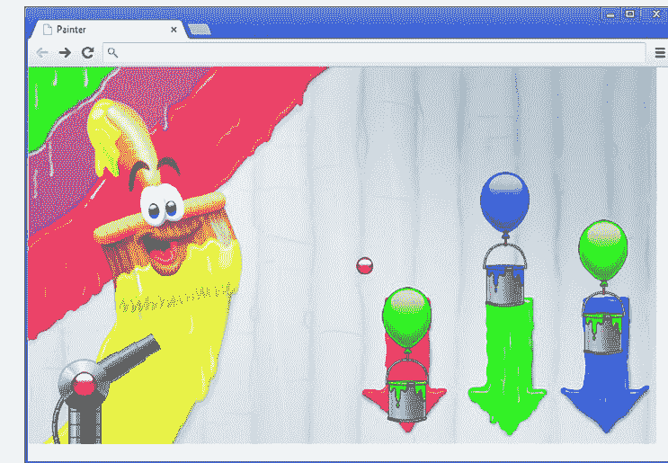

图`8-1`. `Painter5`示例的截图，显示一门大炮、一个球和三个下落的油漆桶

## 用向量表示位置和速度

你已经看到，类是一个有价值的概念，因为它们定义了对象的结构，以及通过方法修改这些对象的行为。当你需要多个相似的对象（例如三个油漆桶）时，这尤其有用。另一个类非常有用的领域是定义基本数据结构和操作这些结构的方法。你已经见过的一个常见结构是表示二维位置或速度向量的对象：

```
var position = { x : 0, y : 0 };
var anotherPosition = { x : 35, y : 40 };
```

不幸的是，以下指令是不允许的：

```
var sum = position + anotherPosition;
```

原因是加法运算符对于这类复合对象没有定义。你当然可以定义一个方法来完成这项工作。但其他几个方法也会很有用。例如，如果你能减去这样的向量、乘以它们、计算它们的长度等等，那将很好。为了做到这一点，让我们创建一个`Vector2`类。首先定义构造函数：

```
function Vector2(x, y) {
    this.x = x;
    this.y = y;
}
```

现在你可以这样创建一个对象：

```
var position = new Vector2(0, 0);
```

如果能够在初始化向量时不必每次都传递两个参数，那将会很方便。一种实现方法是检查`x`和/或`y`是否为`undefined`。如果是这样，你只需将成员变量初始化为`0`，如下所示：

```
function Vector2(x, y) {
    if (typeof x === 'undefined')
        this.x = 0;
    else
        this.x = x;
    if (typeof y === 'undefined')
        this.y = 0;
    else
        this.y = y;
}
```

`typeof`关键字在`JavaScript`中用于返回变量的类型。在这里，你用它来检查`x`和`y`是否已定义类型。如果是这样，就将传入的参数值赋给成员变量；否则，赋值为`0`。`JavaScript`知道一种更简洁的写法来表达这样的`if`指令。下面是同一方法的缩短版本：

```
function Vector2(x, y) {
    this.x = typeof x !== 'undefined' ? x : 0;
    this.y = typeof y !== 'undefined' ? y : 0;
}
```

这段代码与完整`if`指令版本所做的完全相同，但简短得多。问号前面是条件，问号后面是两个可选的值，用冒号分隔。使用这种缩短版本时，请确保代码仍然可读。本书仅使用缩短版本来检查参数是否已定义。这有其优势；例如，你可以用多种方式创建`Vector2`对象：

```
var position = new Vector2();          // 创建向量 (0, 0)
var anotherPosition = new Vector2(35, 40); // 创建向量 (35, 40)
var yetAnotherPosition = new Vector2(-1); // 创建向量 (-1, 0)
```

现在你可以为`Vector2`类添加一些有用的方法，使向量计算变得更加容易。例如，下面的方法可以复制一个向量：

```
Vector2.prototype.copy = function () {
    return new Vector2(this.x, this.y);
};
```

如果你想从不同游戏对象复制位置或速度，这会很有用。此外，比较向量也很有用。`equals`方法可以帮到你：

```
Vector2.prototype.equals = function (obj) {
    return this.x === obj.x && this.y === obj.y;
};
```

你还可以定义一些基本运算，如向量的加、减、乘、除。首先，让我们定义一个将向量加到现有向量上的方法：

```
Vector2.prototype.addTo = function (v) {
    this.x = this.x + v.x;
    this.y = this.y + v.y;
    return this;
};
```

你可以这样使用这个方法：


```javascript
var position = new Vector2(10, 10);          // 创建向量 (10, 10)
var anotherPosition = new Vector2(20, 20);  // 创建向量 (20, 20)
position.addTo(anotherPosition);            // 现在表示向量 (30, 30)
```

`addTo`方法的最后一条指令返回`this`。这样做的原因是你可以进行所谓的链式操作。因为`addTo`方法返回一个向量作为结果，你可以在该结果上调用方法。例如：

```javascript
var position = new Vector2(10, 10);          // 创建向量 (10, 10)
var anotherPosition = new Vector2(20, 20);  // 创建向量 (20, 20)
position.addTo(anotherPosition).addTo(anotherPosition);
// position 现在表示向量 (50, 50)
```

根据传递给`addTo`方法的参数类型，你可以执行不同的操作。如果参数是数字，你只需将该数字加到向量的每个元素上。如果是向量，则按照前面描述的方式执行操作。一种实现方法是使用之前见过的`typeof`运算符，如下所示：

```javascript
Vector2.prototype.addTo = function (v) {
    if (typeof v === 'Vector2') {
        this.x = this.x + v.x;
        this.y = this.y + v.y;
    }
    else if (typeof v === 'Number') {
        this.x = this.x + v;
        this.y = this.y + v;
    }
    return this;
};
```

你使用`if`指令来确定传入参数的类型，并相应地执行加法操作。另一种确定类型的方法是使用`constructor`变量，它是 JavaScript 中每个对象的一部分（就像`prototype`是每个函数的一部分一样）。下面是使用`constructor`变量而不是`typeof`运算符的`addTo`方法版本：

```javascript
Vector2.prototype.addTo = function (v) {
    if (v.constructor === Vector2) {
        this.x = this.x + v.x;
        this.y = this.y + v.y;
    }
    else if (v.constructor === Number) {
        this.x = this.x + v;
        this.y = this.y + v;
    }
    return this;
};
```

`addTo`方法将一个向量加到现有向量上。你还可以定义一个`add`方法，将两个向量相加并返回一个新向量。为此，你可以重用`copy`和`addTo`方法：

```javascript
Vector2.prototype.add = function (v) {
    var result = this.copy();
    return result.addTo(v);
};
```

现在你可以这样做：

```javascript
var position = new Vector2(10, 10);        // 创建向量 (10, 10)
var anotherPosition = new Vector2(20, 20);  // 创建向量 (20, 20)
var sum = position.add(anotherPosition);    // 创建新向量 (30, 30)
```

在这个例子中，`position`和`anotherPosition`在第三条指令中保持不变。创建了一个新的向量对象，包含操作数向量中值的和。

查看 Painter6 示例中的`Vector2.js`文件，你可以看到`Vector2`类的完整定义。它在这个类中定义了最常见的向量运算，包括本节讨论的加法方法。因此，在 Painter 游戏中使用向量变得更加容易。

你在所有游戏对象中使用`Vector2`类型来表示位置和速度。例如，这是`Ball`类的新构造函数：

```javascript
function Ball() {
    this.position = new Vector2();
    this.velocity = new Vector2();
    this.origin = new Vector2();
    this.currentColor = sprites.ball_red;
    this.shooting = false;
}
```

得益于`Vector2`类中的方法，你可以直观地根据速度更新球的位置，只需一行代码：

```javascript
this.position.addTo(this.velocity.multiply(delta));
```

### 参数的默认值

在完成本章之前，让我们再看一下`Vector2`构造函数的定义：

```javascript
function Vector2(x, y) {
    this.x = typeof x !== 'undefined' ? x : 0;
    this.y = typeof y !== 'undefined' ? y : 0;
}
```

由于方法体内的赋值指令，即使你在调用构造函数方法时不传递任何参数，仍然会创建一个有效的`Vector2`对象。如果参数`x`和`y`未定义，则使用默认值。你可以利用这种情况，因为依赖默认值可以使代码编写更加简洁。举个例子，这是在屏幕上绘制背景图像的指令：

```javascript
Canvas2D.drawImage(sprites.background, { x: 0, y: 0 }, 0, { x: 0, y: 0 });
```

你可以通过让`drawImage`方法自动为`position`、`rotation`和`origin`参数提供默认值，使这个方法的调用更加紧凑：

```javascript
Canvas2D_Singleton.prototype.drawImage = function (sprite, position,
                                                       rotation, origin) {
    position = typeof position !== 'undefined' ? position : Vector2.zero;
    rotation = typeof rotation !== 'undefined' ? rotation : 0;
    origin = typeof origin !== 'undefined' ? origin : Vector2.zero;
    // 其余绘制代码在此
    ...
}
```

绘制背景则如下进行：

```javascript
Canvas2D.drawImage(sprites.background);
```

尽管参数的默认值在创建紧凑代码方面非常有用，但请确保始终为你的方法提供文档，说明如果方法的调用者没有提供所有参数，将使用哪些默认值。

### 本章所学内容

在本章中，你学会了：

- 如何使用`prototype`机制定义类
- 如何创建类型/类的多个实例
- 如何为游戏添加随机性以增加可重玩性

# 第九章：颜色与碰撞

到目前为止，你已经实现了 Painter 游戏的很大一部分内容。你已经了解了如何通过原型机制来定义游戏对象类。通过使用这些类，你可以更好地控制游戏对象的结构，以及如何创建特定类型的游戏对象。你将这些类定义分散在不同的文件中。这样一来，当你在将来开发的游戏中需要具有相同行为的大炮或球时，只需复制这些文件，并在你的游戏中创建这些游戏对象的实例即可。

当你更仔细地查看类的定义时，你会发现一个类既定义了对象的内部结构（它由哪些变量组成），也定义了以某种方式操作该对象的方法。这些方法有助于更精确地定义对象的可能性和限制。例如，如果有人想要重用`Ball`类，他们不需要大量关于球如何结构的详细信息。只需创建一个实例并调用游戏循环方法，就足以在游戏中添加一个飞行的球。一般来说，当你设计程序时，无论是游戏还是完全不同类型的应用程序，明确定义某个类的对象可以做什么都是很重要的。方法是实现这一点的一种方式。本章将向你展示另一种定义对象可能性的方式：通过定义属性。本章还将介绍一种用于表示颜色的类型，并展示如何处理球与油漆罐之间的碰撞（如果发生碰撞，油漆罐需要改变颜色）。

## 表示颜色的另一种方式

在之前的 Painter 版本中，你已经相当实用地处理过颜色。例如，在`Cannon`类中，你使用`currentColor`变量来跟踪当前颜色，该变量最初指向红色的大炮精灵：

```javascript
this.currentColor = sprites.cannon_red;
```

你在`Ball`类中做了类似的事情，只是让同名变量指向彩色的球精灵。虽然这种方法效果不错，但当球的颜色需要根据大炮的颜色改变时，它略显不便：

```javascript
if (Game.gameWorld.cannon.currentColor === sprites.cannon_red)
    this.currentColor = sprites.ball_red;
else if (Game.gameWorld.cannon.currentColor === sprites.cannon_green)
    this.currentColor = sprites.ball_green;
else
    this.currentColor = sprites.ball_blue;
```

在这个`if`指令中，你需要处理三种不同的颜色；此外，现在`Ball`类需要了解`Cannon`类使用的精灵。如果你能够更统一地定义颜色，并在所有游戏对象类中使用该定义来表示不同的颜色，岂不是更好？当然会更好！现在开始统一游戏中颜色使用的另一个原因是，如果你决定增加游戏中可能的颜色数量（到 4 种、6 种、10 种或更多），当前的方法将需要更长的编程时间。

本章对应的 Painter7 示例添加了一个`Color.js` JavaScript 文件。为了定义不同的颜色，你使用的方法类似于定义不同按键的方式。该文件定义了一个名为`Color`的变量。`Color`变量包含若干子变量，每个代表一种不同的颜色。你可以如下定义颜色：

```javascript
var Color = {
    red : 1,
    blue : 2,
    yellow : 3,
    green : 4,
    // 以此类推
}
```

然而，这种方法并不是很好的解决方案。使用数字来表示颜色并非坏主意，但你不应该编造一个其他人不会知道的编号方案。HTML 中已经有一种使用十六进制形式表示的整数来定义颜色的标准，你可以使用相同的标准。优点是这种方法被广泛使用、广泛理解，并得到工具的广泛支持（例如 Adobe 的 Kuler，网址为 http://kuler.adobe.com）。

在 HTML 标准中，你可以通过使用十六进制表示法来定义网页中元素的颜色。例如：

```html
<body style="background: #0000FF">
这是一个非常漂亮的背景。
</body>
```

在这种情况下，你指定`body`的背景颜色应该是蓝色。

十六进制表示法允许你用红、绿、蓝（RGB）值来定义颜色，其中`00`表示该颜色分量不存在，`FF`表示该颜色分量达到最大值。`#`符号不是数字的一部分，它只是用来向浏览器表明后面跟随的是十六进制数而非十进制数。因此，`#0000FF`这个十六进制数代表蓝色，`#00FF00`是绿色，`#FF0000`是红色。当然，任何颜色分量的混合或渐变都可以用类似的方式定义。`#808080`是灰色，`#800080`产生紫色，`#FF00FF`是洋红色。

以下是`Color`变量的一部分：

```javascript
var Color = {
    aliceBlue: "#F0F8FF",
    antiqueWhite: "#FAEBD7",
    aqua: "#00FFFF",
    aquamarine: "#7FFFD4",
    azure: "#F0FFFF",
    beige: "#F5F5DC",
    bisque: "#FFE4C4",
    black: "#000000",
    blanchedAlmond: "#FFEBCD",
    blue: "#0000FF",
    blueViolet: "#8A2BE2",
    brown: "#A52A2A",
    // 以此类推
}
```

如需更完整的颜色列表，请参见`Color.js`文件。你现在可以开始在类中使用这些颜色定义了。

## 对象的受控数据访问

三个游戏对象类代表某种颜色的对象：`Cannon`、`Ball`和`PaintCan`。为简单起见，让我们从如何修改`Cannon`类以使用上一节的颜色定义开始。到目前为止，`Cannon`构造函数如下所示：

```javascript
function Cannon() {
    this.position = new Vector2(72, 405);
    this.colorPosition = new Vector2(55, 388);
    this.origin = new Vector2(34, 34);
    this.currentColor = sprites.cannon_red;
    this.rotation = 0;
}
```

你可以做的是添加另一个成员变量来给出大炮的当前颜色。因此，新的`Cannon`构造函数如下：

```javascript
function Cannon() {
    this.position = new Vector2(72, 405);
    this.colorPosition = new Vector2(55, 388);
    this.origin = new Vector2(34, 34);
    this.currentColor = sprites.cannon_red;
    this.color = Color.red;
    this.rotation = 0;
}
```

然而，这并不理想。你现在存储了冗余数据，因为颜色信息由两个变量表示。此外，如果你在大炮颜色改变时忘记更改两个变量中的一个，可能会引入错误。

另一种方法是不存储对当前精灵的引用。构造函数将是：

```javascript
function Cannon() {
    this.position = new Vector2(72, 405);
    this.colorPosition = new Vector2(55, 388);
    this.origin = new Vector2(34, 34);
    this.color = Color.red;
    this.rotation = 0;
}
```

这也不是理想的方法，因为你每次调用`draw`方法时都需要查找正确的精灵。

一种解决方案是定义两个方法，允许`Cannon`类的用户检索和设置颜色信息。然后你可以保持构造函数不变，但添加读取和写入颜色值的方法。例如，你可以向`Cannon`原型添加以下两个方法：

```javascript
Cannon.prototype.getColor = function () {
    if (this.currentColor === sprites.cannon_red)
        return Color.red;
    else if (this.currentColor === sprites.cannon_green)
        return Color.green;
    else
        return Color.blue;
};

Cannon.prototype.setColor = function (value) {
    if (value === Color.red)
        this.currentColor = sprites.cannon_red;
    else if (value === Color.green)
        this.currentColor = sprites.cannon_green;
    else if (value === Color.blue)
        this.currentColor = sprites.cannon_blue;
};
```

现在`Cannon`类的用户不需要知道你在内部使用精灵来确定大炮的当前颜色。用户只需传递颜色定义即可读取或写入大炮的颜色：

```javascript
myCannon.setColor(Color.blue);
var cannonColor = myCannon.getColor();
```

有时，程序员称这类方法为*getter*和*setter*。在许多面向对象编程语言中，方法是访问对象内部数据的唯一方式，因此对于每个需要在类外部访问的成员变量，程序员都会添加一个 getter 和一个 setter。JavaScript 提供了一种对面向对象编程语言来说相对较新的特性：属性。属性是 getter 和 setter 的替代方案。它定义了当你从对象中检索数据时会发生什么，以及当你向对象内部的数据赋值时会发生什么。

## 只读属性

遵循基于原型的编程范式，你希望能够为类添加属性。JavaScript 提供了一个便捷的方法`defineProperty`，可以实现这一点。该方法是名为`Object`的对象的一部分。`Object`还有一些其他实用的方法，你将在后面学习到。`defineProperty`方法需要三个参数：

- 要添加属性的原型（例如`Cannon.prototype`）
- 属性的名称（例如`color`）
- 一个包含最多两个变量的对象：`get`和`set`


`get`和`set`变量应分别指向一个函数，该函数在属性被读取或写入时执行。不过，也可以只定义`get`或`set`其中之一。当属性只读取信息而不修改信息时，这会非常有用。如果一个属性只读取信息，就称为只读属性。下面是一个将只读属性添加到`Cannon`类的简单示例：

```javascript
Object.defineProperty(Cannon.prototype, "center",
    {
        get: function () {
            return new Vector2(this.currentColor.width / 2,
                this.currentColor.height / 2);
        }
    });
```

如你所见，你向`defineProperty`方法提供了三个参数：一个原型、一个名称和一个对象。该属性的名称是`center`。它的作用是提供大炮精灵的中心位置。因为无法修改`center`的值，所以该属性只有`get`部分。这体现在作为第三个参数传入的对象中，该对象包含一个指向函数的变量`get`。以下是使用该属性的方式：

```javascript
var cannonCenter = cannon.center;
```

很简单，对吧？类似地，你可以添加一个提供大炮高度的属性，如下所示：

```javascript
Object.defineProperty(Cannon.prototype, "height",
    {
        get: function () {
            return this.currentColor.height;
        }
    });
```

你甚至可以定义一个`ballPosition`属性来计算球应该所处的位置：

```javascript
Object.defineProperty(Cannon.prototype, "ballPosition",
    {
        get: function () {
            var opposite = Math.sin(this.rotation) *
                sprites.cannon_barrel.width * 0.6;
            var adjacent = Math.cos(this.rotation) *
                sprites.cannon_barrel.width * 0.6;
            return new Vector2(this.position.x + adjacent,
                this.position.y + opposite);
        }
    });
```

与使用方法一样，你使用`this`关键字来引用属性所属的对象。本章中的Painter7示例为不同的类添加了属性。例如，`Ball`类也包含一个`center`属性。结合你为`Vector2`添加的便捷方法，你现在只需一行代码就能根据大炮的旋转角度计算出球的新位置：

```javascript
this.position = Game.gameWorld.cannon.ballPosition.subtractFrom(this.center);
```

定义类、方法和属性的好处在于，你的代码变得更短，也更容易理解。例如，你还为`Vector2`添加了以下属性：

```javascript
Object.defineProperty(Vector2, "zero",
{
    get: function () {
        return new Vector2();
    }
});
```

现在你有了一种非常简洁的方式来创建二维向量，如下所示：

```javascript
var position = Vector2.zero;
```

从现在起，我将同时使用属性和方法来定义对象的行为和数据访问方式。通过在类中定义有用的属性和方法，游戏代码整体上变得更短，也更易读。例如，在拥有包含有用方法和属性的类之前，你必须这样计算球的位置：

```javascript
this.position = Game.gameWorld.cannon.ballPosition();
this.position.x = this.position.x - this.currentColor.width / 2;
this.position.y = this.position.y - this.currentColor.height / 2;
```

新的做法要简洁得多，正如你在本节前面所看到的。这种效果贯穿于你在本书中开发的游戏代码中，我鼓励你充分利用类、方法和属性所提供的强大功能！

### 获取大炮的颜色

你在本章中定义了一个名为`Color`的新类型。那么让我们将该类型与属性结合使用，来读写大炮的颜色。根据`currentColor`变量所指向的精灵，你需要返回不同的颜色值。为了实现这一点，你为`Cannon`类添加了一个名为`color`的属性。在该属性的`get`部分内部，你使用`if`语句来确定应该返回哪种颜色。与具有返回值的方法一样，你使用`return`关键字来指示属性应返回的值：

```javascript
Object.defineProperty(Cannon.prototype, "color",
    {
        get: function () {
            if (this.currentColor === sprites.cannon_red)
                return Color.red;
            else if (this.currentColor === sprites.cannon_green)
                return Color.green;
            else
                return Color.blue;
        }
    });
```

你现在可以使用该属性来访问大炮的颜色。例如，你可以将其存储在一个变量中，如下所示：

```javascript
var cannonColor = cannon.color;
```

你还希望能够为大炮颜色赋值。为此，你必须定义属性的`set`部分。在该部分中，你需要修改`currentColor`变量的值。该值在属性被用于其他方法时提供。例如，可能是一条这样的指令：

```javascript
cannon.color = Color.red;
```

同样，你使用`if`语句来确定`currentColor`变量的新值应该是什么。赋值的右侧作为*参数*传递给`set`部分。完整的属性定义如下：

```javascript
Object.defineProperty(Cannon.prototype, "color",
    {
        get: function () {
            if (this.currentColor === sprites.cannon_red)
                return Color.red;
            else if (this.currentColor === sprites.cannon_green)
                return Color.green;
            else
                return Color.blue;
        },
        set: function (value) {
            if (value === Color.red)
                this.currentColor = sprites.cannon_red;
            else if (value === Color.green)
                this.currentColor = sprites.cannon_green;
            else if (value === Color.blue)
                this.currentColor = sprites.cannon_blue;
        }
    });
```

这是一个可读写属性的示例。你为所有带颜色的游戏对象类型：`Cannon`、`Ball`和`PaintCan`添加了`color`属性。`get`和`set`部分代码的唯一区别在于表示颜色所使用的精灵。例如，以下是`Ball`类的color属性：

```javascript
Object.defineProperty(Ball.prototype, "color",
    {
        get: function () {
            if (this.currentColor === sprites.ball_red)
                return Color.red;
            else if (this.currentColor === sprites.ball_green)
                return Color.green;
            else
                return Color.blue;
        },
        set: function (value) {
            if (value === Color.red)
                this.currentColor = sprites.ball_red;
            else if (value === Color.green)
                this.currentColor = sprites.ball_green;
            else if (value === Color.blue)
                this.currentColor = sprites.ball_blue;
        }
    });
```

因为定义了这些属性，你现在可以非常轻松地根据大炮的颜色来改变球的颜色，只需一行代码：

```javascript
this.color = Game.gameWorld.cannon.color;
```

查看Painter7示例，了解它如何以及在哪里使用属性来使代码更易读。对于一些程序员来说，属性乍看之下可能有些奇怪，因为他们习惯了getter和setter方法。然而，属性确实更加直观。它们是降低代码复杂度的绝佳方式。

### 处理球与颜料罐之间的碰撞

Painter7示例通过处理球与颜料罐之间的碰撞来扩展游戏。当两个对象发生碰撞时，你必须在其中一个对象的`update`方法中处理这次碰撞。在这个例子中，你可以选择在`Ball`类或`PaintCan`类中处理碰撞。Painter7在`PaintCan`类中处理碰撞，因为如果你在`Ball`类中处理，就需要将相同的代码重复三次，每个颜料罐一次。通过在`PaintCan`类中处理碰撞，你可以自动获得这种行为，因为每个颜料罐会自行检查是否与球发生碰撞。

虽然碰撞检测可以用多种不同的方式来实现，但这里使用了一种非常简单的方法。你定义：当两个对象中心之间的距离小于某个值时，就认为它们发生了碰撞。球在游戏世界中任意时刻的中心位置是通过将球精灵的中心添加到球的位置上计算得出的。你可以用类似的方法计算颜料罐的中心。因为你添加了一些很好的属性来计算

### 你学到的内容

在本章中，你学到了：

- 如何向你的类添加属性
- 如何处理游戏对象之间的基本碰撞
- 如何定义具有不同颜色的游戏对象

## 第10章：有限生命

在本章中，你将通过给玩家有限数量的生命，让Painter游戏变得更加有趣。如果玩家错过了太多颜料罐，他们就会死亡。本章讨论了如何处理这种情况，以及如何向玩家显示当前的生命数量。为了做到后者，你将学习一些用于多次重复执行一组指令的编程结构。

### 维护生命数量

为了给游戏引入一些危险和激励玩家努力游玩的元素，你希望限制玩家允许掉落到屏幕底部的错误颜色颜料罐的数量。Painter8示例为游戏添加了这种行为，并将上限设为五个。

选择五个颜料罐的上限是你作为游戏设计师和开发者必须做出的众多决策之一。如果你只给玩家一条生命，那么游戏将太难玩。给玩家数百条生命则消除了玩家努力玩好的动力。确定这些参数通常需要通过游戏测试来确定合理的参数值。除了自己测试游戏外，你还可以请朋友或家人玩你的游戏，以便了解为这些参数选择什么值。

为了存储生命上限，你在`PainterGameWorld`类中添加了一个额外的成员变量：

```
this.lives = 5;
```

你最初在`PainterGameWorld`类的构造函数中将此值设置为5。现在，每当颜料罐掉落到屏幕外时，你就可以更新该值。你在`PaintCan`类的`update`方法中执行此检查。因此，你必须在该方法中添加一些指令来处理这个问题。你唯一需要做的是检查颜料罐掉落到屏幕底部时，其颜色是否与目标颜色相同。如果是这种情况，你必须减少`PainterGameWorld`类中的生命计数器。

在这样做之前，你必须扩展`PaintCan`类，使`PaintCan`对象知道它们在掉落到屏幕底部时需要有一个目标颜色。Painter8在`PainterGameWorld`中创建`PaintCan`对象时，将此目标颜色作为参数传递：

```
this.can1 = new PaintCan(450, Color.red);
this.can2 = new PaintCan(575, Color.green);
this.can3 = new PaintCan(700, Color.blue);
```

如你在`PaintCan`的构造函数中所见，你将目标颜色存储在每个颜料罐的变量中：

```
function PaintCan(xPosition, targetColor) {
    this.currentColor = sprites.can_red;
    this.velocity = Vector2.zero;
    this.position = new Vector2(xPosition, -200);
    this.origin = Vector2.zero;
    this.targetColor = targetColor;
    this.reset();
}
```

现在你可以扩展`PaintCan`的`update`方法，使其处理颜料罐掉落到屏幕底部之外的情况。如果发生这种情况，你需要将颜料罐移回屏幕顶部。如果颜料罐的当前颜色与目标颜色不匹配，你将生命数量减少一：

```
if (Game.gameWorld.isOutsideWorld(this.position)) {
    if (this.color !== this.targetColor)
        Game.gameWorld.lives = Game.gameWorld.lives - 1;
    this.moveToTop();
}
```

你可能希望在某个时候将生命数量减少超过一个。为了便于实现这一点，你可以将惩罚改为一个变量：

```
var penalty = 1;
if (Game.gameWorld.isOutsideWorld(this.position)) {
    if (this.color !== this.targetColor)
        Game.gameWorld.lives = Game.gameWorld.lives - penalty;
    this.moveToTop();
}
```

这样，如果你想的话，可以引入更严厉的惩罚，或者动态惩罚（第一次失误消耗一条生命，第二次失误消耗两条，依此类推）。你也可以想象有时会有一个特殊的颜料罐掉落。如果玩家用正确颜色的球射击该罐子，不匹配颜料罐颜色的惩罚暂时变为零。你还能想到其他在Painter游戏中处理惩罚的方式吗？

### 向玩家指示生命数量

显然，玩家想知道自己的表现如何。因此，你必须以某种方式在屏幕上显示玩家还剩多少条生命。在Painter游戏中，你通过在屏幕左上角显示一定数量的气球来做到这一点。利用你已有的知识，你可以使用`if`指令来做到这一点：

```
if (lives === 5) {
    // 连续绘制气球精灵5次
} else if (lives === 4) {
    // 连续绘制气球精灵4次
} else if (lives === 3)
    // 以此类推...
```

这不是一个很好的解决方案。它会导致大量代码，而且你必须多次复制相同的指令。幸运的是，有一个更好的解决方案：*迭代*。

### 多次执行指令

JavaScript中的迭代是一种多次重复指令的方式。看看以下代码片段：

```
var val = 10;
while (val >= 3)
    val = val - 3;
```

第二条指令称为*while循环*。该指令由一种头部（`while (val >= 3)`）和主体（`val = val - 3`）组成；这与`if`指令的结构非常相似。头部由`while`一词后跟括号中的*条件*组成。主体本身是一条指令。在这种情况下，该指令从变量中减去3。然而，它同样可以是另一种指令，例如调用方法或访问属性。图10-1显示了`while`指令的语法图。

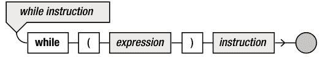

图10-1. `while`指令的语法图


执行`while`指令时，其主体会被执行多次。事实上，只要头部中的*条件*结果为`true`，主体就会继续执行。在此示例中，条件是`val`变量包含的值大于或等于3。一开始，变量包含值10，所以肯定大于3。因此，执行`while`指令的主体，之后变量`val`包含值7。然后再次评估条件。变量仍然大于3，所以再次执行主体，之后变量`val`包含值4。同样，该值大于3，所以再次执行主体，`val`将包含值1。

游戏对象的中心，让我们用它们来计算球与颜料罐之间的距离，如下所示：

```
var ball = Game.gameWorld.ball;
var distance = ball.position.add(ball.center).subtractFrom(this.position)
    .subtractFrom(this.center);
```

现在你已经计算了这个向量，你必须检查其在`x`和`y`方向上的长度是否都小于某个给定值。如果距离向量的`x`分量的绝对值小于中心的`x`值，这意味着球对象在罐的`x`范围内。同样的原理适用于`y`方向。如果这对`x`和`y`分量都成立，你可以说球与罐发生了碰撞。你可以编写一个检查此条件的`if`指令：

```
if (Math.abs(distance.x) < this.center.x &&
    Math.abs(distance.y) < this.center.y) {
    // 处理碰撞
}
```

你使用`Math.abs`方法来计算距离分量的绝对值。如果球与罐之间发生碰撞，你需要将罐的颜色改为球的颜色。

接下来，你必须重置球以便可以再次射击。以下两条指令正是这样做的：

```
this.color = ball.color;
ball.reset();
```

你可以尝试`Painter7`示例，看看球与颜料罐之间的碰撞是否被正确处理。

你可能已经注意到，这里使用的碰撞检测方法不是很精确。在第26章中，你会看到一种更好的逐像素处理碰撞的方式，尽管如果不小心，这确实会让你的游戏运行得更慢。

> **注意** 最终，像本节中编写的这样简单的代码行对玩家体验产生了所有影响。在构建游戏应用程序时，你会发现有时对玩家来说最小的东西花了最长的时间来编程，而最大的变化却只靠一两行代码就实现了！

在那一刻，条件被评估，但它不再为真。因此，重复指令就结束了。所以，当这段代码执行完毕后，变量`val`的值是1。事实上，你在这里用`while`指令编程实现了整数除法。当然，在这个例子中，直接使用下面这行代码会更简单，且能达到相同结果：

```
var val = 10 % 3;
```

如果你想在屏幕上绘制玩家的生命值，可以使用`while`指令来高效地完成：

```
var i = 0;
while (i < numberOfLives) {
    Canvas2D.drawImage(sprites.lives,
        new Vector2(i * sprites.lives.width + 15, 60));
    i = i + 1;
}
```

在这个`while`指令中，只要变量`i`的值小于`numberOfLives`（你假设`numberOfLives`是已在别处声明并初始化的变量），循环体就会被执行。每次执行循环体，你就在屏幕上绘制一个精灵图像，然后将`i`加1。结果就是，你恰好在屏幕上绘制了`numberOfLives`次精灵图像！所以，你在这里是将变量`i`用作一个*计数器*。

> **注意** 你从`i`等于零开始，持续到`i`的值达到`numberOfLives`。这意味着`while`指令的循环体在`i`的值为0、1、2、3和4时被执行。因此，循环体共执行了五次。

如你所见，`while`指令的循环体可以包含多条指令。如果循环体包含多条指令，这些指令需要被放置在花括号之间，就像`if`指令一样。

你绘制精灵图像的位置取决于`i`的值。这样，你就可以将每个精灵图像绘制在更靠右一点的位置，使它们整齐地排成一行。第一次执行循环体时，你在`x`坐标为15的位置绘制图像，因为此时`i`是0。下一次迭代，你在`x`坐标为`sprites.lives.width + 15`的位置绘制，再下一次在`2 * sprites.lives.width + 15`的位置，依此类推。在这个例子中，你使用计数器不仅是为了决定指令执行多少次，还用于*改变指令执行的操作*。这是`while`这类迭代指令的一个非常强大的特性。由于其循环行为，`while`指令也被称为`while`*循环*。图10-2展示了`Painter`游戏的截图，其中玩家的剩余生命值显示在屏幕左上角。

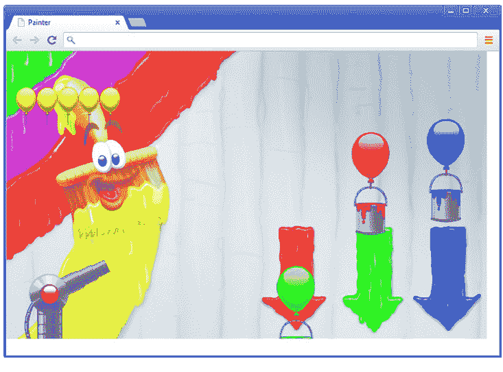

图10-2. `Painter`游戏向玩家展示剩余生命值

### 递增计数器的简写方式

许多`while`指令，特别是那些使用计数器的，其循环体都包含一条用于递增变量的指令。这可以通过以下指令完成：

```
i = i + 1;
```

顺便提一下，尤其因为存在这类指令，将赋值表达为"is"是不明智的。`i`的值当然永远不会等于`i + 1`，但`i`的值会变成`i`的旧值加1。这类指令在程序中非常常见，因此存在一种特殊的、更简短的表示法，作用完全相同：

```
i++;
```

`++`可以表示为"is incremented"（递增）。因为这个运算符放在它所操作的变量之后，所以`++`运算符被称为*后缀运算符*。要将一个变量递增加1以上，还有另一种表示法：

```
i += 2;
```

这等同于：

```
i = i + 2;
```

对于其他基本算术运算，有类似的表示法，例如：

```
i -= 12;    // 等同于 i = i - 12
i *= 0.99;  // 等同于 i = i * 0.99
i /= 5;     // 等同于 i = i / 5
i--;        // 等同于 i = i - 1
```

这种表示法非常有用，因为它允许你编写更简洁的代码。例如，以下代码：

```
Game.gameWorld.lives = Game.gameWorld.lives - penalty;
```

...变成了：

```
Game.gameWorld.lives -= penalty;
```

当你查看本章附带的示例代码时，你会看到这种更简短的表示法在许多不同的类中被使用，以使代码更紧凑。

### 更紧凑的循环语法

许多`while`指令使用一个计数变量，因此具有以下结构：

```
var i;
i = begin value;
while (i < end value ) {
    // do something useful using i
    i++;
}
```

由于这类指令非常常见，因此提供了更紧凑的表示法：

```
var i;
for (i = begin value ; i < end value ; i++ ) {
    // do something useful using i
}
```

这个指令的含义与之前的`while`指令完全相同。在这种情况下使用`for`指令的优点是，所有与计数器相关的内容都被整齐地组合在指令的头部。这减少了你忘记递增计数器指令的可能性（从而导致无限循环）。在“使用`i`做一些有用的事情”只有一条指令的情况下，你可以省略花括号，使表示法更加紧凑。此外，你可以在`for`指令的头部声明变量`i`。例如，看下面的代码片段：

```
for (var i = 0; i < this.lives; i++) {
    Canvas2D.drawImage(sprites.lives,
        new Vector2(i * sprites.lives.width + 15, 60));
}
```

这是一个非常紧凑的指令，它递增计数器并在不同位置绘制精灵图像。这个指令等同于以下`while`指令：

```
var i = 0;
while (i < this.lives) {
    Canvas2D.drawImage(sprites.lives,
        new Vector2(i * sprites.lives.width + 15, 60));
    i = i + 1;
}
```

再看另一个例子：

```
for (var i = this.lives - 1; i >=0; i--)
    Canvas2D.drawImage(sprites.lives,
        new Vector2(i * sprites.lives.width + 15, 60));
```

这个`for`指令等同于哪个`while`指令？在这种情况下，递增还是递减计数器在实际应用中有区别吗？图10-3包含了`for`指令的语法图。

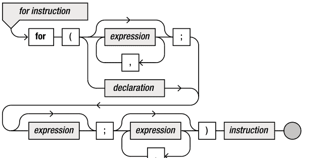

### 几个特殊情况

在处理`while`和`for`循环时，有几个特殊情况你需要了解。以下小节讨论了这些情况。

#### 完全不重复

有时，`while`指令头部的条件在开始时就已经为假。看下面的代码片段：

```
var x = 1;
var y = 0;
while (x < y)
    x++;
```

在这种情况下，`while`指令的循环体不会被执行——一次也不会！因此，在这个例子中，变量`x`保持值为1。

#### 无限重复

使用`while`指令（在较小程度上，`for`指令）的危险之一是，如果不小心，它们可能永远不会结束。你可以很容易地写出这样的指令：

```
while (1 + 1 === 2)
    x = x + 1;
```

在这种情况下，`x`的值会被无限递增。这是因为条件`1 + 1 === 2`总是产生`true`，无论指令的循环体中执行什么。这个例子很容易避免，但`while`指令常常因为编程错误而陷入无限循环。考虑以下例子：

```
var x = 1;
var n = 0;
while (n < 10)
    x = x * 2;
    n = n + 1;
```

这段代码的意图是将`x`的值加倍十次。但不幸的是，程序员忘记将这两条指令放在循环体的花括号内。程序的布局暗示了这种意图，但脚本解释器并不关心这一点。只有`x = x * 2;`这条指令被重复执行，所以`n`的值永远不会大于或等于十。在`while`指令之后，`n = n + 1;`这条指令会被执行，但程序永远无法执行到那里。程序员真正想表达的是：

```
var x = 1;
var n = 0;
while (n < 10) {
    x = x * 2;
    n = n + 1;
}
```

如果你的电脑或移动设备因为你在`while`指令周围忘记写花括号而陷入“昏迷”状态，然后不得不将其扔掉，那将是件憾事。幸运的是，操作系统可以强制停止程序的执行，即使它尚未完成。即使是现在的浏览器也能检测到无限运行的脚本，在这种情况下，浏览器可以停止脚本执行。完成之后，你就可以开始寻找程序挂起的原因了。尽管此类挂起在程序中偶尔发生，但作为游戏程序员，你的职责是确保一旦游戏公开发布，这类编程错误已从游戏代码中消除。这就是为什么适当的测试如此重要。

通常，如果你编写的程序在启动时似乎没有任何反应，或者它无限期地挂起，请检查`while`指令中发生了什么。一个非常常见的错误是忘记递增计数器变量，因此`while`指令的条件永远不会变为假，`while`循环会无限期地继续下去。许多其他编程错误也可能导致无限循环。事实上，无限循环非常常见，以至于加利福尼亚州库比蒂诺市的一条街道以此命名——而苹果公司总部就位于那条街上！

### 嵌套循环

`while`指令或`for`指令的主体本身也是一条指令。这条指令可以是一个赋值语句、一个方法调用、一个由大括号界定的指令块指令，或者另一个`while`或`for`循环。例如：

```
var x, y;
for (y=0; y<7; y++)
    for (x=0; x<y; x++)
        Canvas2D.drawImage(sprites.lives,
            new Vector2(x * sprites.lives.width, y * sprites.lives.height));
```

在这个片段中，变量`y`从0计数到7。对于`y`的每一个值，都会执行其主体，而主体由一个`for`指令组成。这个第二个`for`指令使用计数器`x`，其上限值为`y`。因此，在外部`for`指令的每一次递增中，内部`for`指令的运行时间会更长。被重复执行的指令会在通过`x`和`y`计数器计算出的位置绘制一个黄色气球精灵。这个循环的结果是气球以三角形的形状排列（见图10-4）。

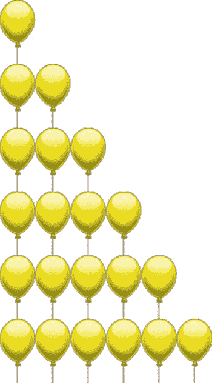

> 图10-4. 三角形形状的气球

在这个形状的第一行包含零个气球。原因是此时`y`的值仍然是0，这意味着内部`for`指令执行了零次。

### 重启游戏

当玩家失去所有生命时，游戏结束。你该如何处理这种情况？在`Painter`游戏中，你可能想显示一个“游戏结束（Game Over）”屏幕。玩家可以按下鼠标左键来重启游戏。为了将此功能添加到游戏中，你需要在游戏启动时加载一个额外的代表游戏结束屏幕的精灵：

```
sprites.gameover = loadSprite("spr_gameover_click.png");
```

现在，你可以在每个游戏循环方法中使用`if`指令来决定应该执行的操作。如果游戏结束，你不希望大炮和小球继续处理输入，而只需监听玩家是否按下鼠标按钮。如果发生了这种情况，你就重置游戏。因此，`PainterGameWorld`类中的`handleInput`方法现在包含以下指令：

```
if (this.lives > 0) {
    this.ball.handleInput(delta);
    this.cannon.handleInput(delta);
}
else {
    if (Mouse.leftPressed)
        this.reset();
}
```

你在`PainterGameWorld`类中添加一个`reset`方法，以便将游戏重置为初始状态。这意味着重置所有的游戏对象。你还需要将生命值重置为5。以下是`PainterGameWorld`中完整的`reset`方法：

```
PainterGameWorld.prototype.reset = function () {
    this.lives = 5;
    this.cannon.reset();
    this.ball.reset();
    this.can1.reset();
    this.can2.reset();
    this.can3.reset();
};
```

对于`update`方法，只有在游戏未结束时才需要更新游戏对象。因此，你首先用`if`指令检查是否需要更新游戏对象。如果不需要（换句话说：生命值已归零），则从该方法返回：

```
if (this.lives <= 0)
    return;
this.ball.update(delta);
this.cannon.update(delta);
this.can1.update(delta);
this.can2.update(delta);
this.can3.update(delta);
```

最后，在`draw`方法中，你绘制游戏对象，并且如果玩家没有剩余生命，则绘制游戏结束屏幕。这将产生以下结构：

```
PainterGameWorld.prototype.draw = function () {
    // draw the game world
    ...
    for (var i = 0; i < this.lives; i++) {
        Canvas2D.drawImage(sprites.lives,
            new Vector2(i * sprites.lives.width + 15, 60));
    }
    if (this.lives <= 0) {
        Canvas2D.drawImage(sprites.gameover,
            new Vector2(Game.size.x - sprites.gameover.width,
            Game.size.y - sprites.gameover.height).divideBy(2));
    }
};
```

你可以看到，你使用了屏幕的尺寸和游戏结束覆盖层的尺寸，将其精准地定位在屏幕中心。图10-5显示了绘制在游戏世界顶部的游戏结束覆盖层的截图。

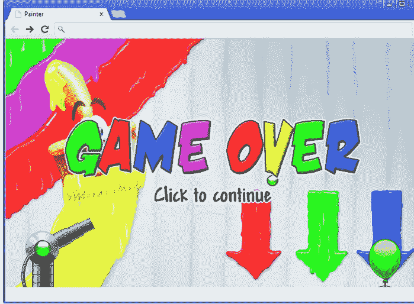

*图10-5.* 游戏结束！

在图10-5中，请注意游戏结束覆盖层并没有完全遮住其他对象和背景。原因是游戏结束精灵包含一些*透明*像素。通常，精灵具有透明部分，这样精灵看起来就像是游戏世界中集成的一部分。气球、球、油漆桶和大炮炮管都部分透明，这就是为什么它们能无缝集成到游戏世界中。在设计精灵时，你需要确保图像正确设置了这些透明度值。虽然正确地完成这项工作可能需要大量精力，但现代图像编辑工具（如Adobe Photoshop）为你提供了定义图像透明度的多种手段。只需确保你将图像保存为支持透明度的格式，例如PNG。

> **注意** 你可以使用覆盖层的透明度（或缺乏透明度）来控制玩家看到的内容。在某些情况下，你可能希望某些内容被遮挡（例如在对时间敏感的游戏中显示“暂停”屏幕），或者希望某些内容可见（例如`Painter`中的游戏结束屏幕）。

### 你学到了什么

在本章中，你学习了：

- 如何存储和显示玩家当前拥有的生命数量
- 如何使用`while`或`for`指令重复一组指令
- 如何在玩家没有剩余生命时重启游戏

## 第11章：组织游戏对象

在之前的章节中，你已经看到如何使用类来对相关的变量进行分组。本章将探讨不同类型游戏对象之间的相似之处，以及如何在JavaScript中表达这些相似之处。


### 游戏对象之间的相似性

如果你观察 Painter 游戏中的不同游戏对象，你会发现它们有很多共同点。例如，球、大炮和油漆桶都使用三个精灵来代表三种不同的颜色。此外，游戏中的大多数对象都有位置（`position`）和速度（`velocity`）。而且，所有游戏对象都需要一个绘制它们的方法，某些游戏对象有处理输入的方法，某些有更新方法，以此类推。现在，这些类具有相似性其实并不是一个问题，浏览器或游戏玩家不会对此有任何不满。然而，遗憾的是，你必须不断地复制代码。举个例子，`Ball` 类和 `PaintCan` 类都具有 `width` 和 `height` 属性：

```javascript
Object.defineProperty(Ball.prototype, "width",
    {
        get: function () {
            return this.currentColor.width;
        }
    });
Object.defineProperty(Ball.prototype, "height",
    {
        get: function () {
            return this.currentColor.height;
        }
    });
```

代码完全一样，但你必须为两个类分别复制一遍。而且每当你想要添加一种不同类型的游戏对象时，可能需要再次复制这些属性。在这种情况下，这些属性幸运地并不复杂，但在实际应用中，你还会复制许多其他内容。例如，Painter 游戏中的大多数游戏对象类都定义了以下成员变量：

```javascript
this.currentColor = some sprite;
this.velocity = Vector2.zero;
this.position = Vector2.zero;
this.origin = Vector2.zero;
this.rotation = 0;
```

各种游戏对象的 `draw` 方法看起来也很相似。例如，这里是 `Ball` 和 `PaintCan` 类的 `draw` 方法：

```javascript
Ball.prototype.draw = function () {
    if (!this.shooting)
        return;
    Canvas2D.drawImage(this.currentColor, this.position, this.rotation, 1,
        this.origin);
};
PaintCan.prototype.draw = function () {
    Canvas2D.drawImage(this.currentColor, this.position, this.rotation, 1,
        this.origin);
};
```

同样，不同类中的代码非常相似，而且你每次创建新类型的游戏对象时都要复制它。一般来说，最好避免复制大量代码。为什么？因为如果某个时候你意识到这部分代码有误，你必须在所有复制该代码的地方进行修正。在像 Painter 这样的小游戏中，这不是大问题。但当你开发一个具有数百个不同游戏对象类的商业游戏时，这将成为一个严重的维护问题。此外，你并不总是知道一个小游戏会发展到什么程度。如果不小心，你可能会结束于复制大量代码（以及随之而来的 Bug）。随着游戏的成熟，养成留意代码优化位置的习惯是个好主意，即使这意味着需要额外的工作来查找这些重复项并将其统一。对于这种情况，你需要思考不同类型的游戏对象在哪些方面相似，以及是否可以将这些相似之处组合在一起，就像你在前几章中对成员变量进行分组一样。

从概念上讲，很容易说出球、油漆桶和大炮之间的相似之处：它们都是*游戏对象*。基本上，它们都可以在特定位置绘制；它们都有速度（即使是大炮，但其速度为零）；而且它们都有红色、绿色或蓝色中的一种颜色。此外，大多数对象都能处理某种输入并被更新。

### 继承

在 JavaScript 中，利用原型（prototype），可以将这些相似之处组合在一起，形成一种通用类，然后定义其他类作为该通用类的*特殊版本*。在面向对象的术语中，这被称为*继承*，这是一个非常强大的语言特性。在 JavaScript 中，继承是通过原型机制实现的。请参考以下示例：

```javascript
function Vehicle() {
    this.numberOfWheels = 4;
    this.brand = "";
}
Vehicle.prototype.what = function() {
    return "nrOfWheels = " + this.numberOfWheels + ", brand = " + this.brand;
};
```

这里有一个非常简单的代表车辆的类示例（你可以想象这在交通模拟游戏中会很有用）。为了简单起见，车辆由轮子数量和品牌来定义。`Vehicle` 类还有一个名为 `what` 的方法，用于返回车辆的描述。如果你想创建一个在表格中展示车辆列表的网站，这个方法会很有用。你可以按如下方式使用该类：

```javascript
var v = new Vehicle();
v.brand = "volkswagen";
console.log(v.what()); // outputs "nrOfWheels = 4, brand = volkswagen"
```

车辆有不同的类型，例如轿车、自行车、摩托车等等。对于其中某些类型，你可能希望存储额外的信息。例如，对于轿车，存储它是否是敞篷车可能会很有用；对于摩托车，存储它有多少个气缸；等等。你可以使用 JavaScript 中基于原型的继承机制来实现这一点。这是一个名为 `Car` 的类示例：

```javascript
function Car(brand) {
    Vehicle.call(this);
    this.brand = brand;
    this.convertible = false;
}
Car.prototype = Object.create(Vehicle.prototype);
```

在这个类声明中，有几处新内容。在底部，你为 `Car` 的原型对象分配了一个值。你是通过使用 `Object.create` 方法来完成的。在这种情况下，你创建了 `Vehicle` 原型对象的副本，并将该副本存储在 `Car` 的原型对象中。换句话说，`Car` 现在拥有与 `Vehicle` 相同的功能，包括 `what` 方法：

```javascript
var c = new Car("mercedes");
console.log(c.what()); // outputs "nrOfWheels = 4, brand = mercedes"
```

在 `Car` 的构造函数中有一行如下代码：

```javascript
Vehicle.call(this);
```

这里发生的是调用了 `Vehicle` 构造函数，并*使用同一个对象*（即在调用 `Car` 构造函数时创建的对象）。本质上，你在告诉解释器，你当前操作的 `Car` 对象 (`this`) *实际上也是一个 `Vehicle` 对象*。因此，你可以看到继承的两个重要方面：

- 对象之间存在关系（`Car` 对象也是一个 `Vehicle`）。
- 继承自另一个类的类会复制其功能（`Car` 对象具有与 `Vehicle` 对象相同的成员变量、属性和方法）。

因为 `Car` 继承自 `Vehicle`，所以你也可以说 `Car` 是 `Vehicle` 的*子类*或*派生类*，或者说 `Vehicle` 是 `Car` 的*超类*、*父类*或*基类*。类之间的继承关系被广泛使用；在良好的类设计中，它可以被解释为“是一种（is a kind of）”。在这个例子中，关系很明确：轿车是一种车辆。反之则不一定成立。车辆不一定是轿车。`Vehicle` 可能还有其他子类，例如：

```javascript
function Motorbike(brand) {
    Vehicle.call(this);
    this.numberOfWheels = 2;
    this.brand = brand;
    this.cylinders = 4;
}
Motorbike.prototype = Object.create(Vehicle.prototype);
```

摩托车也是一种车辆。`Motorbike` 类继承自 `Vehicle` 并添加了自己的自定义成员变量来表示气缸数量。图 11-1 展示了类的层级结构。有关此层级结构的更详尽版本，请参阅图 11-4。

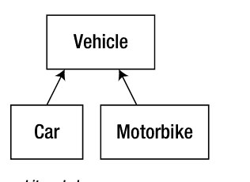

### 游戏对象与继承

“是一种”的关系同样适用于 Painter 游戏中的游戏对象。球是一种游戏对象，油漆桶和大炮也是。你可以在程序中通过定义一个名为 `ThreeColorGameObject` 的通用类，并让实际的游戏对象类继承自该通用类，从而使这种继承关系显式化。然后，你可以将定义“三色游戏对象”的所有内容都放入该类中，而球、大炮和油漆桶将成为该类的特殊版本。

让我们更详细地看看这个 `ThreeColorGameObject` 类。你在这个类中放入游戏中不同类型游戏对象常用的成员变量。你可以按如下方式定义该类的基本骨架：

```javascript
function ThreeColorGameObject() {
    this.currentcolor = undefined;
    this.velocity = Vector2.zero;
    this.position = Vector2.zero;
    this.origin = Vector2.zero;
    this.rotation = 0;
    this.visible = true;
}
```

每个继承自 `ThreeColorGameObject` 的类都将拥有速度、位置、原点、旋转等。这很方便，因为现在你只需要在一个地方定义这些成员变量，它们就可以在任何继承自 `ThreeColorGameObject` 的类中使用。

这个构造函数中仍然缺少的一点是处理三种不同颜色的方法。在 Painter 的案例中，每种游戏对象类型都有三个不同的精灵（sprite），每个精灵代表一种不同的颜色。当你定义 `ThreeColorGameObject` 类时，还不知道使用哪些精灵，因为它们将取决于游戏对象的最终类型（大炮使用的精灵与球或油漆桶不同）。为了解决这个问题，我们将构造函数扩展如下：

```javascript
function ThreeColorGameObject(sprColorRed, sprColorGreen, sprColorBlue) {
    this.colorRed = sprColorRed;
    this.colorGreen = sprColorGreen;
    this.colorBlue = sprColorBlue;
    this.currentcolor = this.colorRed;
    this.velocity = Vector2.zero;
    this.position = Vector2.zero;
    this.origin = Vector2.zero;
    this.rotation = 0;
    this.visible = true;
}
```

每当你继承这个类时，你可以定义成员变量 `colorRed`、`colorGreen` 和 `colorBlue` 的值应该是多少。

现在你需要定义基本的游戏循环方法。绘制游戏对象的方法很简单。你可能注意到类中添加了一个成员变量 `visible`。你可以使用这个成员变量来切换游戏对象的可见性。在 `draw` 方法中，仅当游戏对象应该是可见时，才将精灵绘制在屏幕上：

```javascript
ThreeColorGameObject.prototype.draw = function () {
    if (!this.visible)
        return;
    Canvas2D.drawImage(this.currentcolor, this.position, this.rotation, 1,
        this.origin);
};
```

该类的 `update` 方法包含一条更新游戏对象当前位置的指令：

```javascript
ThreeColorGameObject.prototype.update = function (delta) {
    this.position.addTo(this.velocity.multiply(delta));
};
```

最后，你添加了一些用于获取和设置颜色以及检索对象尺寸的便捷属性。例如，这是用于读写对象颜色的属性：

```javascript
Object.defineProperty(ThreeColorGameObject.prototype, "color",
    {
        get: function () {
            if (this.currentColor === this.colorRed)
                return Color.red;
            else if (this.currentColor === this.colorGreen)
                return Color.green;
            else
                return Color.blue;
        },
        set: function (value) {
            if (value === Color.red)
                this.currentColor = this.colorRed;
            else if (value === Color.green)
                this.currentColor = this.colorGreen;
            else if (value === Color.blue)
                this.currentColor = this.colorBlue;
        }
    });
```

如你所见，这里使用了彩色精灵成员变量。任何继承自 `ThreeColorGameObject` 的类现在都拥有这个属性。这为你节省了大量的代码复制工作！完整的 `ThreeColorGameObject` 类，请参阅本章所属的 Painter9 示例。

### 大炮作为 ThreeColorGameObject 的子类

既然你已经为彩色游戏对象创建了一个非常基础的类，你可以通过*继承*该类，将这种基础行为复用到游戏中的实际游戏对象上。我们先看看 `Cannon` 类。因为你已经定义了基础的 `ThreeColorGameObject` 类，你可以将 `Cannon` 类创建为该类的子类，如下所示：

```javascript
function Cannon() {
    // to do...
}
Cannon.prototype = Object.create(ThreeColorGameObject.prototype);
```

你通过创建 `ThreeColorGameObject.prototype` 对象的副本来创建 `Cannon.prototype` 对象。不过，你仍然需要在构造函数方法中编写代码。

因为 `Cannon` 继承自 `ThreeColorGameObject`，你需要调用 `ThreeColorGameObject` 类的构造函数。这个构造函数需要三个参数。由于你正在创建一个 `Cannon` 对象，你需要将彩色炮台精灵传递给该构造函数。幸运的是，你可以在调用方法中传递这些精灵，如下所示：

```javascript
ThreeColorGameObject.call(this, sprites.cannon_red, sprites.cannon_green, sprites.cannon_blue);
```

其次，你需要设置炮台的位置和原点，就像在原始 `Cannon` 类中所做的那样：

```javascript
this.position = new Vector2(72, 405);
this.origin = new Vector2(34, 34);
```

其余的工作（分配三种颜色的精灵并初始化其他成员变量）已由 `ThreeColorGameObject` 构造函数为你完成！请注意，先调用父类的构造函数，然后再在子类中设置成员变量，这一点很重要。否则，你为炮台选择的位置和原点值在调用 `ThreeColorGameObject` 构造函数时将被重置为零。

既然新的 `Cannon` 类版本已经定义好了，你就可以像之前一样开始为该类添加属性和方法了。例如，下面是 `handleInput` 方法：

```javascript
Cannon.prototype.handleInput = function (delta) {
    if (Keyboard.down(Keys.R))
        this.currentColor = this.colorRed;
    else if (Keyboard.down(Keys.G))
        this.currentColor = this.colorGreen;
    else if (Keyboard.down(Keys.B))
        this.currentColor = this.colorBlue;
    var opposite = Mouse.position.y - this.position.y;
    var adjacent = Mouse.position.x - this.position.x;
    this.rotation = Math.atan2(opposite, adjacent);
};
```


如你所见，你可以毫无问题地访问像`currentColor`和`rotation`这样的成员变量。因为`Cannon`继承自`ThreeColorGameObject`，它包含了相同的成员变量、属性和方法。

### 重写父类方法

除了添加新方法和属性，你还可以选择*替换*`Cannon`类中的一个方法。例如，`ThreeColorGameObject`有以下`draw`方法：

```
ThreeColorGameObject.prototype.draw = function () {
    if (!this.visible)
        return;
    Canvas2D.drawImage(this.currentColor, this.position,
                       this.rotation, 1, this.origin);
};
```

对于炮台来说，这个方法并不完全符合你的要求。你想要绘制炮台的颜色，但也想绘制炮管。替换一个方法非常简单。你只需将该方法重新定义为`Cannon`原型的一部分即可：

```
Cannon.prototype.draw = function () {
    if (!this.visible)
        return;
    var colorPosition = this.position.subtract(this.size.divideBy(2));
    Canvas2D.drawImage(sprites.cannon_barrel, this.position, this.rotation, 1,
        this.origin);
    Canvas2D.drawImage(this.currentColor, colorPosition);
};
```

用面向对象的术语来说，当你在子类中替换从父类继承的方法时，你就是在*重写*该方法。在这种情况下，你重写了`ThreeColorGameObject`的`draw`方法。同样，如果你愿意，你也可以重写一个属性，甚至通过让属性和方法指向`undefined`来移除它们。一旦创建了`Cannon`对象，你就可以完全灵活地使用JavaScript来修改该对象。

> **注意** 尽管本例中你重写了一个方法，但JavaScript不像Java或C#等其他语言那样使用`override`关键字。

如果你查看本章属于Painter9示例的`Cannon.js`文件，你会看到`Cannon`类的定义比之前的版本要小得多，也更容易阅读，因为所有通用的游戏对象成员都放在了`ThreeColorGameObject`类中。将代码组织在不同的类和子类中有助于减少代码复制，并带来更整洁的设计。然而，有一个注意事项：你的类结构（哪个类继承自哪个类）必须正确。请记住，类应该只在类之间存在“是一种”的关系时才继承自其他类。为了说明这一点，假设你想在屏幕顶部添加一个指示器，显示球当前的颜色。你可以为此创建一个类，并让它继承自`Cannon`类，因为它需要以类似的方式处理输入：

```
function ColorIndicator() {
    Cannon.call(this, ...);
    // etc.
}
```

然而，这是一个非常糟糕的主意。颜色指示器当然不是一种炮台，这样设计你的类会让其他开发者非常不清楚这些类的用途。此外，颜色指示器也会有一个旋转，这毫无意义。类继承图应该是逻辑清晰且易于理解的。每次你编写一个继承自另一个类的类时，问问自己这个类是否真的“是一种”你继承的类。如果不是，那么你就需要重新思考你的设计。

### Ball 类

你定义新`Ball`类的方式与`Cannon`类非常相似。就像在`Cannon`类中一样，你继承自`ThreeColorGameObject`类。唯一的区别是，你需要添加一个额外的成员变量来指示球当前是否正在射击：

```
function Ball() {
    ThreeColorGameObject.call(this, sprites.ball_red, sprites.ball_green,
        sprites.ball_blue);
    this.shooting = false;
    this.reset();
}
Ball.prototype = Object.create(ThreeColorGameObject.prototype);
```

当创建一个`Ball`实例时，你需要调用`ThreeColorGameObject`构造函数，就像在`Cannon`类中做的那样。在这种情况下，你将球精灵作为参数传递。此外，你需要将`shooting`变量的初始值设为`false`，并通过调用`reset`方法来重置球。

`Ball`类清楚地说明了当你继承自另一个类时会发生什么。每个`Ball`实例由两部分组成：一部分是从`ThreeColorGameObject`继承来的，另一部分是在`Ball`类中定义的。图 11-2 显示了不使用继承时`Ball`对象的内存情况。图 11-3 也显示了一个`Ball`实例，但使用了本章介绍的继承机制。

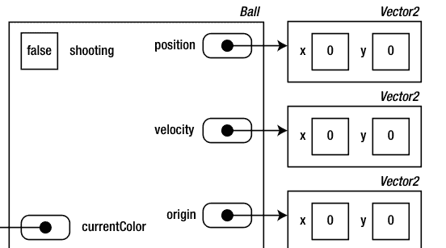

*图 11-2. Ball 类实例使用的内存概览（无继承）*

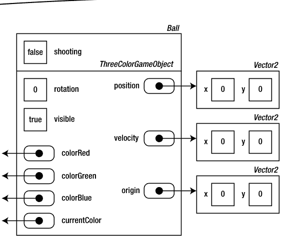

你可能会对这两幅图以及它们所呈现的结构感到有些困惑。本章稍后会更详细地讨论内存结构。现在，请假设由多个成员变量组成的复杂对象（如`Cannon`或`Ball`实例）的存储方式与简单的数字或布尔值不同。这意味着什么以及如何在代码中正确处理它，将在本章末尾介绍。

`ThreeColorGameObject`类中的`update`方法只包含一行代码，它根据游戏对象的速度、经过的时间和当前位置计算新位置：

```
this.position.addTo(this.velocity.multiply(delta));
```

球应该做的不止这些。球的速度应该更新以包含阻力和重力；如果需要，球的颜色应该更新；如果球飞出屏幕，它应该重置回原始位置。你可以简单地从之前版本的`Ball`类中复制`update`方法，让它替换`ThreeColorGameObject`的`update`方法。一个稍微好一点的方法是在`Ball`类中定义`update`方法，但重用`ThreeColorGameObject`中原始的`update`方法。这可以通过使用`call`方法来实现，其方式与你用来调用父类构造函数的方式非常相似。下面是新版本的`Ball.update`方法：

```
Ball.prototype.update = function (delta) {
    ThreeColorGameObject.prototype.update.call(this, delta);
    if (this.shooting) {
        this.velocity.x *= 0.99;
        this.velocity.y += 6;
    }
    else {
        this.color = Game.gameworld.cannon.color;
        this.position = Game.gameworld.cannon.ballPosition
            .subtractFrom(this.center);
    }
    if (Game.gameworld.isOutsideWorld(this.position))
        this.reset();
};
```

看看这个方法中的第一条指令。你正在访问`ThreeColorGameObject`的原型对象，其中包含一个`update`函数。你在调用这个`update`函数时传递了`this`对象，因此`Ball`对象被更新了，但它是根据`ThreeColorGameObject`中定义的`update`方法来更新的。最后，你将`delta`参数传递给了该调用。这种方法的巧妙之处在于，它允许你将（在这种情况下是）更新过程的不同部分分离开来。任何具有位置和速度的游戏对象在游戏循环的每次迭代中，都需要根据其速度来更新其位置。你在`ThreeColorGameObject`的`update`方法中定义了这种行为，这样你就可以在任何继承自`ThreeColorGameObject`的类中复用它！

### 多态 (Polymorphism)

由于继承机制，你并不总是需要知道变量指向的是什么类型的对象。考虑以下声明和初始化：

```
var someKindOfGameObject = new Cannon();
```

以及代码中的其他地方，你执行了以下操作：

```
someKindOfGameObject.update(delta);
```

现在假设你将声明和初始化更改如下：

```
var someKindOfGameObject = new Ball();
```

你需要更改对`update`方法的调用吗？不需要，因为游戏循环方法被调用的方式是在`ThreeColorGameObject`类中定义的。当你对`someKindOfGameObject`变量调用`update`方法时，它实际上引用哪个游戏对象并不重要。唯一重要的是`update`方法已定义，并且它期望一个单一参数：自上次更新调用以来经过的时间。因为解释器会跟踪它是什么对象，因此会自动调用正确版本的`update`方法。

这种效果被称为*多态*，它在某些时候非常方便。多态允许你更好地分离代码。假设一家游戏公司想要发布其游戏的扩展包。例如，它可能想引入一些新的敌人，或者玩家可以学习的技能。公司可以将这些扩展作为通用`Enemy`和`Skill`类的子类提供。实际的游戏代码随后将使用这些对象，而无需知道它正在处理的是哪个特定的技能或敌人。它只需调用在通用类中定义的方法即可。

### 类层级 (Hierarchies of Classes)

在本章中，你已经看到了几个类继承自基础游戏对象类的示例。只有当这两个类之间的关系可以描述为“是一种 (is a kind of)”时，一个类才应该继承另一个类。例如：`Ball`是一种`ThreeColorGameObject`。事实上，层级并不止于此。你可以编写另一个继承自`Ball`类的类，例如`BouncingBall`，它可以是标准球的特殊版本，能够从油漆桶上弹开，而不仅仅是与它们碰撞。你还可以创建另一个继承自`BouncingBall`的类`BouncingElasticBall`，这种球在撞击油漆桶时会根据其弹性属性发生形变。每当你继承一个类时，你就可以免费获得来自基类的数据（编码在成员变量中）和行为（编码在方法和属性中）。

商业游戏拥有由许多不同层级的不同游戏对象组成的类层级。回到本章开头的交通模拟示例，你可以想象一个包含各种不同车辆的非常复杂的层级。图 11-4 显示了这样一个层级的示例。图中使用箭头表示类之间的继承关系。

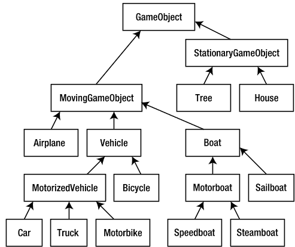

*图 11-4. 交通模拟游戏中的复杂游戏对象层级*

在继承树的最底层是`GameObject`类。这个类仅包含非常基础的信息，如游戏对象的位置或速度。对于每个子类，可以添加与该特定类及其子类相关的新成员（变量、方法或属性）。例如，变量`numberOfWheels`通常属于`Vehicle`类而不是`MovingGameObject`（因为船没有轮子）。变量`flightAltitude`属于`Airplane`类，而变量`bellIsWorking`属于`Bicycle`类。

当你决定类结构的方式时，你必须做出许多决定。并没有唯一的最佳层级；而且，取决于应用程序，某种层级可能比另一种更有用。例如，本示例首先根据对象用于位移的介质（陆地、空气或水）来划分`MovingGameObject`类。之后，类被进一步划分为不同的子类：有动力或无动力。你也可以选择反过来操作。对于某些类，它们在层级中的位置并不完全明确：你是说摩托车是一种特殊的自行车（带电机的自行车）？还是说它是一种特殊的动力车辆（只有两个轮子的车辆）？

重要的是类与类之间的关系是清晰的。帆船是一种船，但船不总是帆船。自行车是一种车辆，但并非每辆车辆都是自行车。

### 值 vs 引用 (Values vs. References)

在本章结束之前，让我们看看对象和变量在内存中是如何处理的。在处理数字或布尔值等基本类型时，变量直接与内存中的一个位置相关联。例如，看以下声明和初始化：

```
var i = 12;
```

在该指令执行后，内存情况如图 11-5 所示。

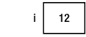

*图 11-5. 数字变量的内存使用情况*

现在你可以创建一个新变量`j`并将变量`i`的值存储在该变量中：

```
var j = i;
```

图 11-6 显示了执行该指令后的内存情况。

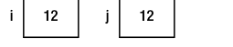

*图 11-6. 声明并初始化两个数字变量后的内存使用情况*

如果你给`j`变量分配另一个值，例如执行指令`j = 24`，其结果内存使用情况如图 11-7 所示。

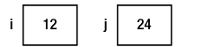

*图 11-7. 更改 j 变量值后的内存使用情况*

现在让我们看看当你使用更复杂类型的变量（例如`Cannon`类）时会发生什么。考虑以下代码：

```
var cannon1 = new Cannon();
var cannon2 = cannon1;
```

参考之前使用数字类型的示例，你可能会认为内存中现在有两个`Cannon`对象：一个存储在变量`cannon1`中，另一个存储在`cannon2`中。然而，事实并非如此！实际上，`cannon1`和`cannon2`*指向同一个对象*。在第一条指令（创建`Cannon`对象）之后，内存如图 11-8 所示。

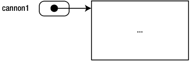

© Springer-Verlag Berlin Heidelberg 2013

**图 11-8.** *内存中的一个 Cannon 对象*

在这里，你可以看到数字和布尔值等基本类型在内存中的表示方式与`Cannon`类等复杂类型的表示方式有很大区别。在JavaScript中，所有非原始类型（如数字、布尔值和字符）的对象都存储为*引用*而非值。这意味着像`cannon1`这样的变量并不直接包含`Cannon`对象，而是包含*一个指向该对象的引用*。图 11-8 通过将`cannon1`表示为一个包含指向对象的箭头的块来表明它是一个引用。如果你现在声明`cannon2`变量并将`cannon1`的值分配给它，你可以在图 11-9 中看到新情况。

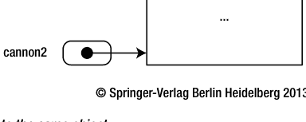

© Springer-Verlag Berlin Heidelberg 2013

**图 11-9.** *两个指向同一个对象的变量*

结果是，如果你按照以下方式更改大炮的颜色：

```
cannon2.color = Color.red;
```

那么表达式`cannon1.color`将会是`Color.red`，因为`cannon1`和`cannon2`指向同一个对象！这也影响了对象在方法中传递的方式。例如，`ThreeColorGameObject`的构造方法期望三个精灵（sprites）作为参数。因为精灵在JavaScript中不是基本类型，所以你实际上传递的是这些精灵的引用。理论上，这意味着你可以在`ThreeColorGameObject`构造函数中修改这些精灵。将数字等基本类型作为参数传递给方法是*按值传递*的，因此在方法中更改该值没有效果。考虑以下函数：

```
function square(f) {
    f = f * f;
}
```

现在来看下面的指令：

```
var someNumber = 10;
square(someNumber);
```

执行这些指令后，`someNumber`的值仍然是10（而不是100）。为什么呢？因为当`square`函数被调用时，`number`参数是按*值*传递的。变量`f`是方法中的一个局部变量，最初包含`someNumber`变量的值。在方法中，局部变量`f`被更改为包含`f * f`，但这并不会改变`someNumber`变量，因为它位于内存中的另一个位置。因为非基本类型对象是按*引用*传递的，所以下面的示例会导致作为参数传递的对象的值发生改变：

```
function square(obj) {
    obj.f = obj.f * obj.f;
}

var myObject = { f : 10 };
square(myObject);
// myObject.f now contains the value 100.
```

每当JavaScript脚本运行时，内存中都会存在一些引用和值。例如，如果你查看图11-2和图11-3，你会发现`Ball`对象既包含值，也包含对其他对象的引用（如`Vector2`对象或`Image`对象）。

### Null与Undefined


每当在JavaScript中声明一个变量时，其初始值被设置为`undefined`：

```
var someVariable;
console.log(someVariable); // will print 'undefined'.
```

在JavaScript中，你还可以表示一个变量已定义但当前不引用任何对象。这是通过使用`null`关键字来实现的：

```
var anotherCannon = null;
```

因为你还未创建对象（使用`new`关键字），所以内存的情况如图11-10所示。


*图11-10. 指向null的变量*

因此，表示一个变量尚未指向任何对象，可以通过为其赋值`null`来实现。在JavaScript程序中，甚至可以检查一个变量是否指向某个对象，像这样：

```
if (anotherCannon === null)
    anotherCannon = new Cannon();
```

在此示例中，你检查变量是否等于`null`（未指向对象）。如果是，则使用`new`关键字创建一个`Cannon`实例，之后内存中的情况再次发生变化（参见图11-11）。

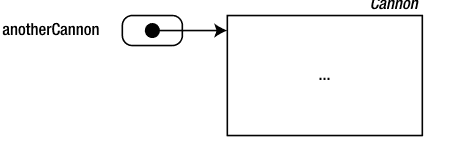

*图11-11. 最终的内存情况*

何时使用`null`和`undefined`由你自己决定。并非所有程序员的做法都相同。我们建议你使用`undefined`表示变量不存在，使用`null`表示变量存在但尚未引用任何对象。

### 你学到了什么

在本章中，你学习了：

- 如何使用继承来将相关类组织成层次结构
- 如何在子类中重写方法，为该类提供特定行为
- 如何调用超类的方法，例如构造方法
- `null`和`undefined`的含义

# 第12章：完成画家游戏

在本章中，你将通过添加一些额外功能来完成画家游戏，如运动效果、音效和音乐，以及维护和显示分数。最后，你将更详细地了解字符和字符串。

### 添加运动效果

为了让游戏在视觉上更具吸引力，你可以在油漆桶的运动中引入一个漂亮的旋转效果，以模拟风和摩擦力对下落运动的影响。属于本章的`Painter10`程序是该游戏的最终版本，已为油漆桶添加了这种运动效果。添加这样的效果并不复杂。感谢你在前一章所做的工作，只需在`PaintCan`类的`update`方法中添加一行代码即可。因为`PaintCan`是`ThreeColorGameObject`的子类，它已经有一个`rotation`成员变量，在屏幕上绘制精灵时会自动考虑该变量！

为了实现运动效果，你使用`Math.sin`方法。通过让该值依赖于油漆桶的当前位置，你会根据位置获得不同的值。然后你使用该值对精灵应用旋转。这是你添加到`PaintCan.update`方法中的那行代码：

```
this.rotation = Math.sin(this.position.y / 50) * 0.05;
```

这条指令使用油漆桶位置的`y`坐标来获取不同的旋转值。此外，你将其除以50以获得较慢的运动效果；并将结果乘以0.05以减小正弦函数的振幅，使旋转看起来更加逼真。如果你愿意，可以尝试不同的值，看看它们如何影响油漆桶的行为。

### 创建精灵

即使你不是艺术家，能够自己制作简单的精灵也会有所帮助。这使你能快速制作游戏的原型——也许还会发现你内心深处也有艺术的一面。要创建精灵，你首先需要好的工具。大多数艺术家使用像`Adobe Photoshop`这样的绘画程序或像`Adobe Illustrator`这样的矢量绘图程序，但也有人使用像`Microsoft Paint`这样简单的工具或更全面且免费的`GIMP`。每个工具都需要练习。按照一些教程操作，确保你对众多不同的功能有所了解。通常，你想实现的东西都可以用简单的方式完成。

最好先为游戏对象创建非常大的图像，然后将其缩放到所需的大小。这样做的好处是，你以后可以在游戏中更改所需的大小，并且由于图像是由像素表示的，你还可以消除锯齿效应。在缩放图像时，抗锯齿技术会混合颜色以保持图像的平滑。如果你将游戏对象的外部保持为透明，那么在缩放时，边缘像素会自动变为部分透明。只有当你想创建经典的像素风格时，才应该按实际所需的大小创建精灵。

最后，在网上搜索一下。有很多精灵可以免费使用。请确保检查许可条款，以保证你使用的精灵包对于你正在构建的项目是合法的。然后你可以将它们用作自己精灵的基础。但最终要认识到，当你与经验丰富的艺术家合作时，游戏的质量会显著提高。

### 添加音效和音乐

让游戏更有趣的另一种方式是添加一些声音。这个游戏同时使用背景音乐和音效。为了在JavaScript中更方便地处理声音，你添加了一个`Sound`类，允许你播放和循环声音。下面是该类的构造函数：

```
function Sound(sound, looping) {
    this.looping = typeof looping !== 'undefined' ? looping : false;
    this.snd = new Audio();
    if (this.snd.canPlayType("audio/ogg")) {
        this.snd.src = sound + ".ogg";
    } else if (this.snd.canPlayType("audio/mpeg")) {
        this.snd.src = sound + ".mp3";
    } else // we cannot play audio in this browser
        this.snd = null;
}
```

因为并非所有浏览器都能播放所有不同类型的音乐，所以你添加了一条`if`指令，根据浏览器能播放的类型加载不同的声音格式。类似于创建`Image`对象（用于表示精灵），你创建一个`Audio`对象并将其源初始化为需要加载的声音文件。除了声音文件之外，你还添加了一个`looping`变量来指示声音是否应该循环。一般来说，背景音乐应该循环播放；而音效（如发射油漆球）则不应该循环。

除了构造函数之外，你还添加了一个名为`play`的方法。在该方法中，你加载声音，并将一个名为`autoplay`的属性设置为`true`。这样做的结果是，声音加载后会立即开始播放。如果声音不需要循环，你就完成了，可以从方法返回。如果你确实需要声音循环播放，那么在声音播放完毕后，你需要重新加载并再次播放它。`Audio`类型允许你将函数附加到所谓的*事件*上。当事件发生时，你附加的函数就会被执行。例如音频开始播放的事件，或音频播放结束的事件。

本书很少使用事件和事件处理。但一些JavaScript概念依赖于它们。例如，键盘按键和鼠标操作都会生成事件，你应该在游戏中处理这些事件。在本例中，你希望在音频播放结束时执行一个函数。下面是完整的`play`方法：

```
Sound.prototype.play = function () {
    if (this.snd === null)
        return;
    this.snd.load();
    this.snd.autoplay = true;
    if (!this.looping)
        return;
    this.snd.addEventListener('ended', function () {
        this.load();
        this.autoplay = true;
    }, false);
};
```

最后，你添加了一个属性来更改正在播放的声音的音量。这特别有用，因为通常你希望音效比背景音乐更大声。在一些游戏中，这些音量可以由玩家更改（在本书后面，你会看到如何做到这一点）。每当在游戏中引入声音时，请务必始终提供音量控制或至少静音控制。没有静音功能的游戏会因用户的不满而遭到差评！以下是`volume`属性，非常简单：

```
Object.defineProperty(Sound.prototype, "volume",
    {
        get: function () {
            return this.snd.volume;
        },
        set: function (value) {
            this.snd.volume = value;
        }
    });
```

在`Painter.js`中，你加载所有资源的文件，你会加载声音并将其存储在变量中，就像你为精灵所做的那样：

```
var sounds = {};
```

以下是使用您刚刚创建的`Sound`类来加载相关音效的方法：

```
var loadSound = function (sound, looping) {
    return new Sound("../../assets/Painter/sounds/" + sound, looping);
};

sounds.music = loadSound("snd_music");
sounds.collect_points = loadSound("snd_collect_points");
sounds.shoot_paint = loadSound("snd_shoot_paint");
```

现在，在游戏中播放音效变得非常容易。例如，在游戏初始化时，您可以开始以较低的音量播放背景音乐，如下所示：

```
sounds.music.volume = 0.3;
sounds.music.play();
```

您还想播放音效。例如，当玩家发射球时，他们希望能听到声音！因此，您在他们开始发射球时播放这个音效。这在`Ball`类的`handleInput`方法中处理：

```
Ball.prototype.handleInput = function (delta) {
    if (Mouse.leftPressed && !this.shooting) {
        this.shooting = true;
        this.velocity = Mouse.position.subtract(this.position)
            .multiplyWith(1.2);
        sounds.shoot_paint.play();
    }
};
```

同样，当正确颜色的油漆桶飞出屏幕时，您也会播放一个音效。

### 维护分数

分数通常是激励玩家继续游戏的一种非常有效的方式。最高分在这方面尤其有效，因为它们引入了一个竞争因素：你想比`AAA`或`XYZ`更出色（许多早期街机游戏在最高分列表中只允许每个名字使用三个字符，导致了非常富有想象力的名字）。最高分激励作用如此之大，以至于存在第三方系统将其整合到游戏中。这些系统允许用户与全球数千名其他玩家进行比较。在`Painter`游戏中，您保持简单，向`PainterGameWorld`类添加一个名为`score`的成员变量来存储当前分数：

```
function PainterGameWorld() {
    this.cannon = new Cannon();
    this.ball = new Ball();
    this.can1 = new PaintCan(450, Color.red);
    this.can2 = new PaintCan(575, Color.green);
    this.can3 = new PaintCan(700, Color.blue);
    this.score = 0;
    this.lives = 5;
}
```

玩家初始分数为零。每次油漆桶飞出屏幕时，分数都会更新。如果正确颜色的油漆桶飞出屏幕，分数增加10分。如果油漆桶颜色不对，玩家会失去一条生命。

分数是所谓的游戏*经济*的一部分。游戏的经济基本上描述了游戏中不同的成本和收益以及它们如何相互作用。当您制作自己的游戏时，思考它的经济总是有用的。物品的成本是多少？作为玩家执行不同动作的收益是什么？这两者是否相互平衡？

您在`PaintCan`类中更新分数，在那里您可以检查油漆桶是否飞出屏幕。如果是，您检查它是否有正确的颜色，并相应地更新分数和玩家的生命值。然后，您将`PaintCan`对象移动到顶部，以便它可以再次下落：

```
if (Game.gameWorld.isOutsideWorld(this.position)) {
    if (this.color === this.targetColor) {
        Game.gameWorld.score += 10;
        sounds.collect_points.play();
    }
    else
        Game.gameWorld.lives -= 1;
    this.moveToTop();
}
```

最后，每当一个正确颜色的油漆桶飞出屏幕时，您就播放一个音效。

### 更完善的 Canvas2D 类

除了在屏幕上绘制精灵外，您还想在屏幕上绘制当前分数（否则维护它就没有多大意义了）。到目前为止，您只在画布上绘制了图像。HTML5`canvas`元素也允许在上面绘制文本。为了绘制文本，您扩展了`Canvas2D_Singleton`类。

在修改画布绘制类的同时，您还想做另一件事。既然您已将所有变量组织成对象，这些对象可以使用类来创建，而类又可以从其他类继承，那么现在是思考什么信息应该在何处更改的好时机。例如，您可能只想在`Canvas2D_Singleton`类中更改`canvas`和`canvasContext`变量。您不需要在例如`Cannon`类中访问这些变量。在`Cannon`类中，您只想使用通过画布绘制类中的方法提供的高级行为。

不幸的是，JavaScript中没有办法直接控制对变量的访问。一个恶意的程序员可能会在他们的程序中的某个地方写下以下代码：

```
Canvas2D.canvas = null;
```

执行这行代码后，屏幕上就什么也画不出来了！当然，没有理智的程序员会故意写这样的代码，但尽可能清楚地告诉您的类用户哪些数据他们应该更改，哪些数据是类的内部数据且不应被修改，是一个好主意。做到这一点的一种方法是向任何应该是内部的变量名称添加一些内容。本书在所有内部变量以及不应在其所属类之外更改的变量前添加了下划线。例如，以下是遵循此规则的`Canvas2D_Singleton`类的修改后的构造函数：

```
function Canvas2D_Singleton() {
    this._canvas = null;
    this._canvasContext = null;
}
```

您还向该类添加了一个新方法`drawText`，可用于在屏幕上的特定位置绘制文本。`drawText`方法与`drawImage`方法非常相似。在两种情况下，您都使用画布上下文在绘制文本之前执行变换。这允许您在画布上的任何所需位置绘制文本。此外，您可以更改文本颜色和文本对齐方式（左对齐、居中或右对齐）。请参阅属于本章的`Painter10`示例以查看此方法的具体内容。

现在使用此方法在屏幕上绘制文本变得很容易。例如，这会在屏幕左上角绘制一些绿色文本：

```
Canvas2D.drawText("Hello, how are you doing?", Vector2.zero, Color.green);
```

### 字符和字符串

在大多数编程语言（包括JavaScript）中，字符序列称为字符串。就像数字或布尔值一样，字符串是JavaScript中的原始类型。字符串也是不可变的。这意味着一旦创建了字符串，就无法更改它。当然，仍然可以用另一个字符串替换它。例如：

```
var name = "Patrick";
name = "Arjan";
```

在JavaScript中，字符串由单引号或双引号分隔。如果您以双引号开始一个字符串，它应该以双引号结束。因此，这是不允许的：

```
var country = 'The Netherlands";
```

当您将字符串赋值给变量时，该字符串被称为常量。除了字符串值之外，常量值还可以是数字、布尔值、`undefined`或`null`，如图12-1中的语法图所示。

### 使用单引号和双引号

当使用字符串值并将其与其他变量组合时，您必须小心使用哪种类型的引号（如果有的话）。如果您忘记了引号，您写的就不再是文本或字符，而是JavaScript程序的一部分！以下两者之间存在很大差异：

- 字符串`"hello"`和变量名`hello`
- 字符串`'123'`和值`123`
- 字符串值`'+'`和运算符`+`

### 特殊字符

特殊字符，仅仅因为它们是*特殊*的，并不总是容易使用引号之间的单个字符来表示。因此，一些特殊符号使用反斜杠符号表示，如下所示：

- `'\n'`表示行结束符
- `'\t'`表示制表符

这就引入了一个新问题：如何表示反斜杠字符本身。反斜杠字符使用*双反斜杠*表示。类似地，反斜杠符号用于表示单引号和双引号本身的字符：

- `'\\'`表示反斜杠符号
- `'\''`或`"'"`表示单引号字符
- `'\"'`或`'"'`表示双引号字符

如你所见，在双引号界定的字符串中，可以无需反斜杠直接使用单引号，反之亦然。表示所有这些符号的语法图见图12-2。

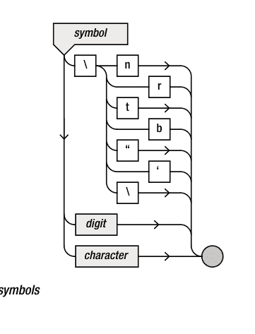

*图12-2. 符号的语法图*

### 字符串操作


在`Painter`游戏中，你结合使用字符串值与`drawText`方法，以特定颜色和所需字体在屏幕的某个位置绘制文本。例如，你想在屏幕左上角显示当前分数。分数存储在一个名为`score`的成员变量中。该变量在`PaintCan`类的`update`方法中增加或减少。既然文本的一部分（分数）是持续变化的，如何构造应显示在屏幕上的文本呢？解决方案是*字符串拼接*，即把一段文本粘贴到另一段之后。在`JavaScript`（以及许多其他编程语言）中，这是通过加号实现的。例如，表达式`"Hi, my name is " + "Arjan"`的结果是字符串`"Hi, my name is Arjan"`。在此例中，你拼接了两段文本。也可以拼接一段文本和一个数字。例如，表达式`"Score: " + 200`的结果是字符串`"Score: 200"`。你也可以使用变量而不是常量。因此，如果变量`score`的值为`175`，那么表达式`"Score: " + score`的计算结果为`"Score: 175"`。通过将此表达式作为`drawText`方法的参数，你就能始终在屏幕上绘制当前分数。最终对`drawText`方法的调用如下所示（参见`PainterGameWorld`类）：

```
Canvas2D.drawText("Score: " + this.score, new Vector2(20, 22), Color.white);
```

注意：拼接操作仅对文本有意义。例如，不能“拼接”两个数字：表达式`1 + 2`的结果是`3`，而不是`12`。当然，你可以拼接*表示为文本*的数字：`"1" + "2"`的结果是`"12"`。区分文本和数字的方法是使用单引号或双引号。

实际上，在表达式`"Score: " + 200`中，暗中进行的是一个*类型转换*或*强制转换*。数值`200`在与其他字符串拼接前，会自动转换为字符串`"200"`。

如果你想将字符串值转换为数值，事情会变得稍微复杂一些。这对解释器来说不是一项简单的操作，因为并非所有字符串都能转换为数值。为此，`JavaScript`提供了一些有用的内置函数。例如，以下是如何将字符串转换为整数：

```
var x = parseInt("10");
```

如果传递给函数的参数不是整数，`parseInt`函数的结果是该数字的整数部分：

```
var y = parseInt("3.14"); // y的值为3
```

要解析带小数的数字，`JavaScript`有`parseFloat`函数：

```
y = parseFloat("3.14"); // y的值为3.14
```

如果字符串不包含有效的数字，使用这两个函数之一尝试解析的结果将是常量`NaN`（非数字；另见图12-1）。

### 最后的几点说明

恭喜你——你已经完成了你的第一个游戏！图12-3包含了最终游戏的截图。在开发这个游戏的过程中，你已经学习了许多重要概念。在下一个游戏中，你将扩展已经完成的工作。同时，别忘了玩这个游戏！你会注意到几分钟后游戏变得非常困难，因为油漆桶下落得越来越快。

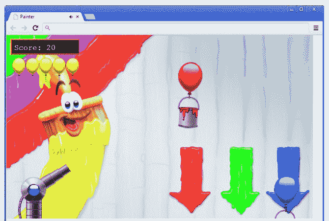

### 谁在玩游戏？

你可能认为玩游戏的主要要是年轻男性，但事实并非如此。有巨大比例的人在玩游戏。2013年，美国有1.83亿活跃玩家，这超过了总人口的一半（包括婴儿）。他们在许多不同的设备上玩游戏。36%的玩家在智能手机上玩游戏，25%的玩家在无线设备上玩游戏（来源：娱乐软件协会(ESA)，2013）。

如果你开发一个游戏，最好先考虑你想要的受众。为幼儿设计的游戏与为中年女性设计的游戏是不同的。游戏应该有不同的玩法、不同的视觉风格和不同的目标。

尽管主机游戏往往发生在大型3D世界中，但网站和移动设备上的休闲游戏通常是2D的，并且规模有限。此外，主机游戏的设计是可以（并且需要）连续玩上几个小时，而休闲游戏通常设计为可以只玩几分钟的短时游戏。还有许多类型的*严肃游戏*，这些游戏用于训练消防员、市长和医生等专业人士。

要意识到，你喜欢的游戏不一定是你的目标受众所喜欢的。

### 你学到了什么

在本章中，你学习了：

- 如何为游戏添加音乐和音效

- 如何维护和显示分数

- 如何使用字符串来表示和处理文本

## 第三部分

## Jewel Jam

*Jewel Jam*是一款益智游戏，你需要尝试寻找宝石的组合（见图III-1）。但要小心：宝石推车正在缓缓移开。一旦这辆车移出屏幕，你的时间就到了！游戏板由十行五列组成。游戏场上的宝石在三个属性上有所不同：颜色（红、蓝或黄）、形状（钻石、球体或椭圆）和数量（一个、两个或三个宝石）。

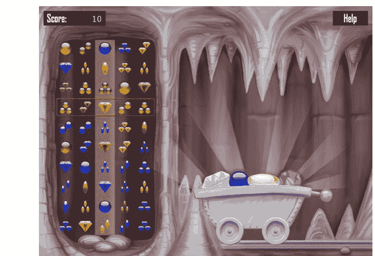

玩家可以使用鼠标或触摸屏（如果是在手机或平板电脑上玩游戏）将行向左或向右移动。目标是在中间列找到三个相邻宝石的有效组合。如果三个宝石组合中每个属性对于所有对象要么完全相同，要么完全不同，则该组合是有效的。例如，一个黄色的单钻石对象、一个蓝色的单钻石对象和一个红色的单钻石对象构成一个有效的组合，因为颜色各不相同，而形状和数量都相同。一个黄色的球体对象、一个黄色的双钻石对象和一个黄色的三椭圆对象也构成一个有效的组合，因为所有三个对象颜色相同，但形状和数量各不相同。组合“黄色钻石、红色双球体、蓝色双椭圆”是无效的，因为尽管颜色和形状各不相同，但钻石对象的数量与其他两个不同。另一方面，组合“黄色钻石、红色双球体、蓝色三椭圆”是有效的。

一旦玩家通过移动行找到了一个有效的组合，他们按下空格键，组成组合的宝石就会消失，剩余的宝石会下落填补空位，三个新的宝石会从屏幕顶部下落。当玩家按下空格键时，如果中间列同时出现两个或三个组合，将会获得额外分数，并且屏幕上会显示一个覆盖层，表明达成了双重或三重组合。

在接下来的章节中，你将开发这个游戏。如果你想玩完整版本以了解游戏如何运作，请运行第17章的示例！

## 第13章 适应不同设备

本章讨论如何使游戏适应不同设备。到目前为止，你开发的示例只能在具有键盘和鼠标的设备上运行，例如笔记本电脑或台式机。`JavaScript`程序的优点之一是它们也能在智能手机和平板电脑上运行，而这是一个当前蓬勃发展的市场。让你的游戏在这些平台上运行，将为你的游戏带来大量额外的玩家。为了在智能手机或平板电脑上玩游戏，你需要处理触摸输入，其方式与处理键盘和鼠标输入非常相似。

你需要注意的另一件事是你为之制作游戏的设备屏幕尺寸的多样性。本章将向你展示如何创建能自动适应任何屏幕尺寸的游戏，无论是巨大的24英寸桌面显示器，还是微小的智能手机屏幕。

### 允许画布更改大小

要实现屏幕尺寸自适应，首先需要将`canvas`元素放置成可以自动调整大小以适应页面。一旦完成，你就可以获取画布的大小，将其与实际游戏屏幕的大小进行比较，并执行缩放操作。在`Painter`游戏中，你是在HTML页面上这样放置`canvas`元素的：

```
<div id="gameArea">
    <canvas id="mycanvas" width="800" height="480"> </canvas>
</div>
```

如你所见，你定义了一个名为`gameArea`的`div`元素。在这个`div`元素中是一个`canvas`元素。为了让`canvas`元素自动缩放，你需要将其宽度和高度设置为浏览器窗口宽度和高度的100%。这样，当浏览器窗口大小改变时，`canvas`元素也会相应地调整大小。此外，你还要使显示的页面尽可能简洁（没有边距）。为此，你需要使用样式表。样式表是一种很好的方式

用于定义网页元素的外观样式。不同的HTML页面可以使用相同的样式表来确保设计的统一性。以下是示例游戏的样式表：

```
html, body {
    margin: 0;
}
#gameArea {
    position: absolute;
}
#mycanvas {
    position: absolute;
    width: 100%;
    height: 100%;
}
```

深入探讨样式表的所有可能性超出了本书的范围，但如果你希望了解更多相关内容，可以阅读`Simon Collision`的*Beginning CSS Web Development*（Apress, 2006）或`Jon Duckett`的*HTML and CSS*（Wiley, 2011）。

在这个具体示例中，你做了一些设置。首先，你定义了`html`和`body`元素没有外边距。这样，如果你希望画布能完全填满屏幕，它就能做到。然后，你定义了名为`gameArea`和`mycanvas`的元素在页面上采用绝对定位。这样，这些元素会始终保持在指定位置，不受HTML页面中其他元素的影响。最后，你指出`mycanvas`的宽度和高度应为屏幕的100%。结果是，画布现在填满了浏览器的整个显示区域，并且会自动适应不同的分辨率。

> **注意** 让画布填满整个浏览器显示区域不一定适用于所有情况。在某些情况下，用户可能难以在不意外点击浏览器外部区域的情况下，与浏览器窗口最边缘的元素进行交互。在这些情况下，你可以考虑添加外边距。

### 设置原生游戏尺寸

既然画布会自动缩放以适应浏览器窗口的大小，你就不能再将画布分辨率作为原生游戏分辨率了。如果这样做，每次画布调整大小时，你都必须重新计算所有游戏对象的位置。更好的方法是定义一个原生游戏尺寸。然后，在绘制对象时，你可以缩放它们的位置和大小，使其与实际画布尺寸匹配。

第一步是能够指定原生游戏尺寸。你可以在调用`Game.start`方法时完成。你扩展这个方法，使其接受两个额外参数来定义游戏的宽度和高度，然后从HTML页面调用它：

```
Game.start('gameArea', 'mycanvas', 1440, 1080);
```

`Jewel Jam`游戏的原生分辨率很大（1440 × 1080），因此如果你想让游戏在所有智能手机和平板电脑上正常运行，缩放是绝对必要的。你还需要传递包含画布的`div`元素的名称。原因是，当屏幕比例与游戏尺寸比例不同时，你需要更改这个`div`的外边距，以便游戏能很好地显示在屏幕中央（参见图13-1）。

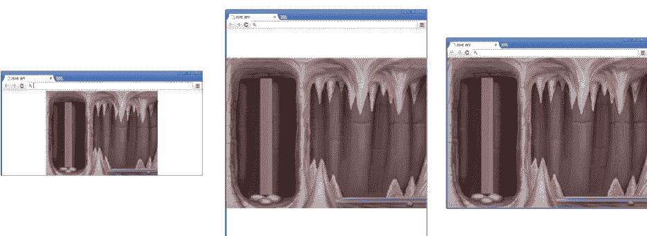

*图13-1。你必须确保游戏屏幕始终能很好地显示在浏览器窗口的中央！*

在`Game.start`方法中，你将游戏的尺寸存储在一个成员变量`_size`中。你还定义了一个只读属性`size`来访问该成员变量。这样，你就向`Game`类的用户表明，在游戏运行期间，他们不应该更改游戏的原生尺寸。你将游戏区域和画布的标识符传递给`Canvas2D.initialize`方法，因为你需要在属于`Canvas2D`的方法中完成精灵的缩放和定位工作。以下是完整的`Game.start`方法：

```
Game_Singleton.prototype.start = function (divName, canvasName, x, y) {
    this._size = new Vector2(x, y);
    Canvas2D.initialize(divName, canvasName);
    this.loadAssets();
    this.assetLoadingLoop();
};
```

在`Canvas2D`中，你存储了对`div`元素的引用，以便稍后可以使用它来更改外边距。你以与获取画布元素相同的方式获取该元素：

```
this._canvas = document.getElementById(canvasName);
this._div = document.getElementById(divName);
```

你需要在每次浏览器窗口调整大小时计算要应用的缩放因子。你可以通过附加一个事件处理函数来实现，如下所示：

```
window.onresize = Canvas2D_Singleton.prototype.resize;
```

现在，每当窗口大小改变时，`resize`方法就会被调用。最后，你显式地调用`resize`方法：

```
this.resize();
```

通过调用此方法，游戏启动时会根据浏览器窗口大小计算出正确的缩放比例。

### 调整游戏大小

每当窗口大小改变时，`resize`方法就会被调用。当这种情况发生时，你需要计算两件事：

-   精灵应该被绘制的期望缩放比例

-   游戏区域的外边距，以便将游戏漂亮地绘制在浏览器窗口的中央

在开始计算这些内容之前，请先将画布和`div`元素存储在两个局部变量中。这样做可以节省一些输入，因为在这个方法中你需要经常访问这些元素：

```
var gameCanvas = Canvas2D._canvas;
var gameArea = Canvas2D._div;
```

现在你计算原生游戏尺寸的比例：

```
var widthToHeight = Game.size.x / Game.size.y;
```

下一步是计算浏览器窗口的比例。你首先通过访问`innerWidth`和`innerHeight`变量来获取浏览器窗口的大小。获得这些值后，你就可以计算浏览器窗口的比例了：

```
var newWidth = window.innerWidth;
var newHeight = window.innerHeight;
var newWidthToHeight = newWidth / newHeight;
```

你不希望游戏屏幕看起来被压扁或拉长，因此必须确保当窗口大小改变时比例不变。当新比例大于原生游戏尺寸比例时，意味着浏览器窗口太宽了。因此，你需要重新计算宽度以修正比例，如下所示：

```
if (newWidthToHeight > widthToHeight) {
    newWidth = newHeight * widthToHeight;
}
```

另一种情况是新比例较小，意味着浏览器窗口太高了。在这种情况下，你需要重新计算高度：

```
newHeight = newWidth / widthToHeight;
```

现在你已经计算出了正确的宽度和高度，首先更改`gameArea` `div`使其具有这个宽度和高度。你可以通过编辑元素的样式来实现，如下所示：

```
gameArea.style.width = newWidth + 'px';
gameArea.style.height = newHeight + 'px';
```

为了将`gameArea`元素显示在屏幕中央，你还需要定义外边距，如下所示：

```
gameArea.style.marginTop = (window.innerHeight - newHeight) / 2 + 'px';
gameArea.style.marginLeft = (window.innerWidth - newWidth) / 2 + 'px';
gameArea.style.marginBottom = (window.innerHeight - newHeight) / 2 + 'px';
gameArea.style.marginRight = (window.innerWidth - newWidth) / 2 + 'px';
```

你将新宽度和高度与实际宽度和高度的差值除以2，并将这些值设置为外边距。例如，如果期望的游戏屏幕宽度是800像素，但窗口实际宽度是900像素，你就在每边创建50像素的外边距，以便元素绘制在屏幕中央。最后，你更改画布的大小，使其具有期望的宽度和高度（从而获得正确的比例）：

```
gameCanvas.width = newWidth;
gameCanvas.height = newHeight;
```

现在可以轻松计算出精灵应该被绘制的缩放比例。你可以使用以下方式为此定义一个属性：

```
Object.defineProperty(Canvas2D_Singleton.prototype, "scale",
{
    get: function() {
        return new Vector2(this._canvas.width / Game.size.x,
            this._canvas.height / Game.size.y);
    }
});
```

当你绘制图像时，只需在执行绘制操作之前应用此缩放比例即可。这是通过向`Canvas2D.drawImage`方法添加几行代码来完成的——一行用于获取缩放比例，一行用于应用它：

```
var canvasScale = this.scale;
this._canvasContext.scale(canvasScale.x, canvasScale.y);
```

在`Canvas2D.drawText`方法中也做同样的事情。完整代码请参阅本章所属的`JewelJam1`示例。

### 重新设计鼠标输入处理

完成所有这些操作后，你已经移动了`div`和`canvas`元素。在`Painter`游戏中，你假设`canvas`始终绘制在屏幕的左上角。但在这里情况已不再如此。如果你想检测屏幕上的鼠标点击，在计算鼠标在游戏屏幕上的本地位置时，就需要考虑`canvas`在屏幕上的位置。此外，由于你应用了缩放，还需要相应地缩放鼠标位置。

这是重新审视`Mouse`和`Keyboard`输入处理类设计方式的好机会。有一个你从未正确实现的功能是区分键盘或鼠标按钮的按下和释放，以及键盘或鼠标按钮的*按压*事件。此外，在`Mouse`类中，你只考虑了左键按压；而在`Keyboard`类中，同一时间只能按下一个键。你可以利用`JavaScript`原型系统的面向对象编程能力来设计更好的解决方案。

第一步是创建一个简单的类，用于存储按钮的状态（无论是键盘按键还是鼠标按钮）。我们把这个类叫做`ButtonState`。`ButtonState`类非常简单，只有两个（布尔）成员变量：一个表示按钮是否处于按下状态，另一个表示按钮是否被按压。以下是完整的类：

```javascript
function ButtonState() {
    this.down = false;
    this.pressed = false;
}
```

现在你在`Mouse`类中使用`ButtonState`实例来表示左键、中键和右键的状态。`Mouse`的新构造函数如下所示：


```javascript
function Mouse_Singleton() {
    this._position = Vector2.zero;
    this._left = new ButtonState();
    this._middle = new ButtonState();
    this._right = new ButtonState();
    document.onmousemove = handleMouseMove;
    document.onmousedown = handleMouseDown;
    document.onmouseup = handleMouseUp;
}
```

如你所见，除了与位置相关的成员变量外，你还有表示按钮的成员变量。你添加了只读属性来访问这些变量。例如，如果你想检查中键是否处于按下状态，可以用以下简单的代码实现：

```javascript
if (Mouse.middle.down)
    // do something
```

在事件处理函数中，你修改成员变量的值。在`handleMouseMove`事件处理函数中，你需要计算鼠标位置。这里也是你确保鼠标位置根据应用于`canvas`的缩放和偏移进行缩放和移动的地方。以下是完整的`handleMouseMove`函数：

```javascript
function handleMouseMove(evt) {
    var canvasScale = Canvas2D.scale;
    var canvasOffset = Canvas2D.offset;
    var mx = (evt.pageX - canvasOffset.x) / canvasScale.x;
    var my = (evt.pageY - canvasOffset.y) / canvasScale.y;
    Mouse._position = new Vector2(mx, my);
}
```

现在，每当鼠标移动时，鼠标位置都会被正确计算。接下来你需要处理鼠标按钮的按下和释放事件。只有当按钮在当前处于按下状态，而在上一个游戏循环迭代中未被按下时，才算作一次鼠标按钮按压。对于左键，表达方式如下：

```javascript
if (evt.which === 1) {
    if (!Mouse._left.down)
        Mouse._left.pressed = true;
    Mouse._left.down = true;
}
```

`evt.which`的值表示你正在处理的是左键（1）、中键（2）还是右键（3）。请查看*JewelJam1*示例以获取完整的`handleMouseDown`事件处理函数。在`handleMouseUp`事件处理函数中，你将`down`变量重新设为`false`。以下是完整的函数：

```javascript
function handleMouseUp(evt) {
    handleMouseMove(evt);

    if (evt.which === 1)
        Mouse._left.down = false;
    else if (evt.which === 2)
        Mouse._middle.down = false;
    else if (evt.which === 3)
        Mouse._right.down = false;
}
```

你可以看到这里也调用了`handleMouseMove`函数。这样做是为了确保在按下鼠标按钮时能获取到鼠标位置。如果省略这一行，玩家启动游戏后在没有移动鼠标的情况下按下鼠标按钮，游戏将尝试处理鼠标按钮按压却没有位置信息。这就是为什么你在`handleMouseDown`和`handleMouseUp`函数中都调用了`handleMouseMove`函数（尽管后者可能并非必需）。

最后，在每次游戏循环迭代结束时，`Mouse`对象会被重置。你只需要在这里将`pressed`变量重新设为`false`：

```javascript
Mouse_Singleton.prototype.reset = function () {
    this._left.pressed = false;
    this._middle.pressed = false;
    this._right.pressed = false;
};
```

通过在每次游戏循环迭代后将`pressed`变量设为`false`，你可以确保鼠标或键盘的按压事件只被处理一次。

### 数组

有了`ButtonState`类后，你也可以重新设计键盘输入处理——但在此之前，让我们先介绍另一个你需要的概念，叫做*数组*。数组基本上是一个带编号的列表。看看下面的例子：

```javascript
var emptyArray = [];
var intArray = [4, 8, 15, 16, 23, 42];
```

这里你看到了两个数组变量的声明和初始化。第一个声明是一个空数组（没有元素）。第二个变量`intArray`指向一个长度为6的数组。你可以通过索引访问数组中的元素，其中数组中第一个元素的索引为0：

```javascript
var v = intArray[0]; // contains the value 4
var v2 = intArray[4]; // contains the value 23
```

你使用方括号来访问数组中的元素。你也可以使用相同的方括号来修改数组中的值：

```javascript
intArray[1] = 13; // intArray now is [4, 13, 15, 16, 23, 42]
```

也可以向数组中添加元素：

```javascript
intArray.push(-3); // intArray now is [4, 13, 15, 16, 23, 42, -3]
```

最后，每个数组都有一个`length`变量，你可以通过它来获取数组的长度：

```javascript
var l = intArray.length; // contains the value 7
```

你可以将数组与`for`循环结合使用来做有趣的事情。以下是示例：

```javascript
for (var i = 0; i < intArray.length; i++) {
    intArray[i] += 10;
}
```

这会遍历数组中的所有元素并为每个元素加上10。因此，这段代码执行后，`intArray`指向`[14, 23, 25, 26, 33, 52, 7]`。

除了刚刚看到的初始化数组方式外，还有另一种创建数组的方式，如下所示：

```javascript
var anotherArray = new Array(3);
```

这个示例创建了一个大小为3的数组，然后你可以对其进行填充：

```javascript
anotherArray[0] = "hello";
```

你甚至可以在JavaScript中创建多维数组。例如：

```javascript
var tictactoe = new Array(3);
tictactoe[0] = ['x', 'o', ' '];
tictactoe[1] = [' ', 'x', 'o'];
tictactoe[2] = [' ', 'o', 'x'];
```

所以，数组的元素也可以是数组。这种网格结构在表示棋盘等游戏中的游戏区域时特别有用。由于数组是以引用方式存储的（就像类的实例一样），使用这种二维数组来表示网格在计算上效率并不高。有一种简单的方法可以用一维数组来表示网格，如下所示：

```javascript
var rows = 10, cols = 15;
var myGrid = new Array(rows * cols);
```

现在可以通过以下方式访问第`i`行第`j`列的元素：

```javascript
var elem = myGrid[i * cols + j];
```

图13-2展示了表达式语法图的另一部分，其中包含了指定数组的语法。下一章将更详细地讨论如何在游戏中使用数组来表示结构和网格。

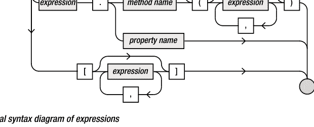

### 使用数组处理键盘输入

让我们看看如何使用数组更高效地处理按键。由于你现在有了`ButtonState`类，你可以用它来处理键盘输入，并为每个按键状态存储一个`ButtonState`实例。因此，在`Keyboard_Singleton`的构造函数中，创建一个包含所有可能按键状态的数组，如下所示：

```javascript
this._keyStates = [];
for (var i = 0; i < 256; ++i)
    this._keyStates.push(new ButtonState());
```

现在你可以在检测到按键按下时设置按键的`down`状态，如下所示：

```javascript
function handleKeyDown(evt) {
    var code = evt.keyCode;
    if (code < 0 || code > 255)
        return;
    if (!Keyboard._keyStates[code].down)
        Keyboard._keyStates[code].pressed = true;
    Keyboard._keyStates[code].down = true;
}
```

如你所见，你处理按键按下和按压事件的方式与处理鼠标按钮完全相同。以下两个添加到`Keyboard_Singleton`的方法使得检测按键是否被按压或按下变得非常简单：

```javascript
Keyboard_Singleton.prototype.pressed = function (key) {
    return this._keyStates[key].pressed;
};
Keyboard_Singleton.prototype.down = function (key) {
    return this._keyStates[key].down;
};
```

在`JewelJam`游戏中不需要键盘，因为所有的交互都通过鼠标或触摸屏完成。后面的示例会再次用到键盘。这也意味着你可以基本上忽略任何发生的键盘事件。如果你不在游戏循环方法中添加任何键盘处理，游戏就会完全忽略玩家按下的任何按键。

### 触摸屏输入

由于智能手机和平板电脑也有网页浏览器，因此可以在这些设备上运行JavaScript应用程序。事实上，JavaScript目前是唯一一种跨平台的方式，可以开发在桌面电脑、笔记本电脑、手机和平板电脑上运行的应用程序，而无需重写代码。例如，你可以将最终的`Painter`示例放在服务器上，然后在平板电脑上访问该网页。但你将无法玩这个游戏，因为你还没有处理触摸输入。在本节中，你将为游戏添加触摸输入功能。幸运的是，这在JavaScript中非常容易实现！

## 第13章：适配不同设备

在开始编写JavaScript代码之前，你需要先处理HTML页面中的一些事项。原因是平板电脑和智能手机设备在网页上定义了默认的触摸行为，例如滚动或缩放网页的能力。这些交互会干扰游戏操作，因此你需要将它们关闭。这可以在HTML文件的头部通过添加以下标签来实现：

```html
<meta name="viewport" content="width=device-width, initial-scale=1.0, user-scalable=no">
```

HTML中的`viewport`定义了页面中可见的区域。例如，当你导航到一个页面时，它自动放大到某个部分，这是通过修改`viewport`的大小来实现的。在`meta`标签中，你可以定义`viewport`的属性。这个例子告诉浏览器三件事：`viewport`的宽度与设备的宽度相同，页面首次查看时的缩放比例为1，用户无法缩放页面。因此，所有用于改变HTML页面位置或缩放的触摸交互都被关闭了。

现在你可以开始编写JavaScript代码来处理触摸事件。JavaScript中触摸输入的工作方式是：每次用户触摸屏幕时，都会生成一个`touchstart`事件，并为该触摸分配一个唯一标识符。当用户用另一根手指触摸屏幕时，会发生另一个`touchstart`事件，并带有新的唯一标识符。当用户在屏幕上移动手指时，会生成一个`touchmove`事件，并且可以从事件中获取正在移动的手指的唯一标识符。同样，当用户停止触摸屏幕时，会生成一个`touchend`事件，并且可以从事件中检索已停止触摸屏幕的手指的标识符。

为了处理触摸，创建一个`Touch_Singleton`类及其关联的单例实例`Touch`，类似于你创建`Keyboard`和`Mouse`对象的方式。在类的构造函数中，你创建一个数组来存储每个触摸及其相关信息。此外，你存储每个触摸是否为按下状态。触摸按下意味着在上一轮游戏循环迭代中手指没有触摸屏幕，但在当前迭代中触摸了。此外，你必须附加事件处理函数。以下是完整的构造函数方法：

```javascript
function Touch_Singleton() {
    this._touches = [];
    this._touchPresses = [];
    document.addEventListener('touchstart', handleTouchStart, false);
    document.addEventListener('touchend', handleTouchEnd, false);
    document.addEventListener('touchcancel', handleTouchEnd, false);
    document.addEventListener('touchleave', handleTouchEnd, false);
    document.body.addEventListener('touchmove', handleTouchMove, false);
}
```

处理触摸对于浏览器来说相对较新（与键盘和鼠标输入相比）。因此，并非所有浏览器都使用相同的术语。这就是为什么你需要为不同种类的`touchend`事件添加事件监听器。然而，最终你处理三种类型的事件：`touchstart`、`touchmove`和`touchend`。每种事件都有自己的事件处理函数。

当用户开始触摸屏幕时，会调用`handleTouchStart`函数。在该函数中，你只需将触摸事件存储在`_touches`数组中，以便稍后需要时可以检索数据。然而，用户可能同时用多根手指开始触摸屏幕。因此，该事件包含一个新触摸的数组。你可以通过`changedTouches`变量访问该数组。对于该数组中的每个元素，你将触摸事件数据添加到`_touches`数组中。因为这些是新的触摸，所以你还向`_touchPresses`变量添加`true`值。这是完整的方法：

```javascript
function handleTouchStart(evt) {
    evt.preventDefault();
    var touches = evt.changedTouches;
    for (var i = 0; i < touches.length; i++) {
        Touch._touches.push(touches[i]);
        Touch._touchPresses.push(true);
    }
}
```

请注意，该函数中的第一条指令是`evt.preventDefault()`。这个方法调用确保触摸事件不会用于默认行为（例如滚动）。你还会在其他触摸事件处理函数中放置该指令。在`handleTouchEnd`中，你需要从类中的两个数组中移除触摸。为此，你必须遍历数组以查找属于特定触摸ID的数据。为了让这更容易一些，你向类中添加一个`getTouchIndexFromId`方法，为你查找数组中的索引。稍后，你可以调用此方法来查找触摸存储在数组中的位置，然后移除该元素。

在该方法中，你使用`for`循环遍历数组中的所有元素。当你找到与你要查找的触摸数据的标识符匹配的触摸时，你返回该数据。如果找不到触摸数据，你返回值`-1`。以下是完整的方法：

```javascript
Touch_Singleton.prototype.getTouchIndexFromId = function (id) {
    for (var i = 0, l = this._touches.length; i < l; ++i) {
        if (this._touches[i].identifier === id)
            return i;
    }
    return -1;
};
```

在`handleTouchEnd`函数中，你使用`for`循环遍历`changedTouches`变量。对于每个触摸，你找到相应的索引并从两个数组（`_touches`和`_touchPresses`）中移除该触摸。从数组中移除元素使用`splice`方法。该方法接受一个索引和一个数字：索引指示应该在哪里移除元素，第二个参数指示应该移除多少个元素。以下是一个示例：

```javascript
var myArray = [2, 56, 12, 4];
myArray.splice(0,1); // myArray 现在包含 [56, 12, 4]
myArray.splice(1,2); // myArray 现在包含 [56]
```

以下是完整的`handleTouchEnd`函数：


```
function handleTouchEnd(evt) {
    evt.preventDefault();
    var touches = evt.changedTouches;
    for (var i = 0; i < touches.length; ++i) {
        var id = Touch.getTouchIndexFromId(touches[i].identifier);
        Touch._touches.splice(id, 1);
        Touch._touchPresses.splice(id, 1);
    }
}
```

最后，在`handleTouchMove`中，你必须更新已更改的触摸的触摸信息。这意味着你必须替换数组中的一个元素。`splice`方法接受第三个参数，你可以在其中指定替换元素。查看本章所属的代码，了解`handleTouchMove`事件处理函数的实现。

### 让触摸输入处理更简单

你已经了解了 JavaScript 中如何处理触摸输入。你可以向`Touch_Singleton`类添加几个方法，使其在游戏中更易于使用。首先是一个简单的用于检索给定索引的触摸位置的方法：

```
Touch_Singleton.prototype.getPosition = function (index) {
    var canvasScale = Canvas2D.scale;
    var canvasOffset = Canvas2D.offset;
    var mx = (this._touches[index].pageX - canvasOffset.x) / canvasScale.x;
    var my = (this._touches[index].pageY - canvasOffset.y) / canvasScale.y;
    return new Vector2(mx, my);
};
```

请注意，你必须应用与鼠标位置相同的位置和缩放校正。触摸事件中的`pageX`和`pageY`变量提供了玩家触摸屏幕的坐标。

检查是否触摸了屏幕的某个特定区域也会很有用。为此，你可以向 JewelJam1 示例中添加一个名为`Rectangle`的类。这是一个非常简单的类，类似于`Vector2`，用于表示矩形。你还可以添加几个简单的方法来检查两个矩形是否相交（对碰撞检测很有用）以及矩形是否包含某个特定位置。查看`Rectangle.js`文件，了解如何构建这个类。

你可以使用矩形来定义屏幕的各个部分。`containsTouch`方法检查作为方法参数提供的矩形中是否有触摸：

```
Touch_Singleton.prototype.containsTouch = function (rect) {
    for (var i = 0, l = this._touches.length; i < l; ++i) {
        if (rect.contains(this.getPosition(i)))
            return true;
    }
    return false;
};
```

方法体中包含一个 for 循环，该循环会检查数组中的每个触摸点，判断其位置是否落在矩形区域内。你复用了之前定义的`getPosition`方法。根据检查结果，方法返回`true`或`false`。同时，为 Touch 添加以下属性：

```javascript
Object.defineProperty(Touch_Singleton.prototype, "isTouchDevice",
    {
        get: function () {
            return ('ontouchstart' in window) || (navigator.msMaxTouchPoints > 0);
        }
    });
```

这是一个用于检查当前设备是否为触摸设备的简单属性。并非所有浏览器都以相同方式检测此功能，因此将其封装在方法或属性中是个很好的理由。这样，你只需处理一次这些浏览器之间的差异。之后，你只需访问`Touch.isTouchDevice`属性即可。

### 为 Painter 添加触摸输入

既然你已经有了这个不错的 Touch 对象，如果不为 Painter 游戏添加触摸功能那就太可惜了。本章附带的示例代码中包含一个带有触摸输入的 Painter 版本。请查看示例代码，特别是`Cannon.js`文件，其中已添加了触摸输入。在触摸界面中，你可以点击炮管中的彩球来切换到不同颜色。点击炮管外部区域可以瞄准大炮。松开触摸后则发射炮弹。

为了将触摸输入处理与鼠标输入处理分离，你可以按如下方式重写`handleInput`方法：

```javascript
Cannon.prototype.handleInput = function (delta) {
    if (Touch.isTouchDevice)
        this.handleInputTouch(delta);
    else
        this.handleInputMouse(delta);
};
```

现在，你需要编写两个独立的方法来处理触摸和鼠标输入。`handleInputTouch`方法如下所示：

```javascript
Cannon.prototype.handleInputTouch = function (delta) {
    var rect = this.colorSelectRectangle;
    if (Touch.containsTouchPress(rect)) {
        if (this.currentColor === this.colorRed)
            this.currentColor = this.colorGreen;
        else if (this.currentColor === this.colorGreen)
            this.currentColor = this.colorBlue;
        else
            this.currentColor = this.colorRed;
    } else if (Touch.touching && !Touch.containsTouch(rect)) {
        var opposite = Touch.position.y - this.position.y;
        var adjacent = Touch.position.x - this.position.x;
        this.rotation = Math.atan2(opposite, adjacent);
    }
};
```

首先，你获取代表大炮中可用于选择不同颜色部分的矩形区域。你添加了一个简单的属性来计算此矩形。然后，你检查矩形区域是否包含触摸按压。如果是这种情况，你就更改颜色。通过使用`if`指令，你可以轻松地循环切换三种颜色。

如果玩家正在触摸屏幕的其他位置，但不在矩形区域内，你就将大炮的瞄准方向调整到该位置。同时，也请查看`Ball`类，看看它是如何处理触摸输入的！最后，另一件不错的事情是，根据应用程序是在平板电脑还是桌面电脑上运行，加载不同的精灵图：

```javascript
if (Touch.isTouchDevice)
    sprites.gameover = loadSprite("spr_gameover_tap.png");
else
    sprites.gameover = loadSprite("spr_gameover_click.png");
```

当游戏在触摸设备上运行时，覆盖层显示文本“Tap to continue”（点击继续）；否则显示“Click to continue”（点击继续）。

> **注意** 许多现代笔记本电脑同时配备触摸屏和键盘，要自动确定玩家想要使用触摸输入还是键盘输入并不总是显而易见。玩家可能想在某些游戏中使用触摸屏，而在其他游戏中使用键盘。一种可能的解决方案是同时接受两种输入。另一种解决方案是让玩家通过菜单设置自行选择输入方法。

### 你学到了什么

在本章中，你学到了：

- 如何根据不同设备自动调整游戏屏幕尺寸

- 如何根据游戏屏幕尺寸自动校正鼠标位置

- 什么是数组以及如何使用数组

- 如何使用触摸界面来控制游戏中的事件

## 第 14 章：结构化游戏对象

在上一章中，你了解了如何使用数组来表示事物列表。例如，你使用了一个数组来跟踪玩家触摸触摸屏的位置，或者玩家当前在键盘上按下了多少个键。

数组也可以用于许多其他情况。你可以用它们来存储更复杂的对象，例如 Painter 游戏中的球或油漆罐。总的来说，为游戏对象提供某种结构是有用的，而不是简单地将它们全部声明为游戏世界中的成员变量。许多游戏将它们的游戏对象置于某种游戏层次结构中。例如，你可以有一个由其他游戏对象（如车轮、传动系统、发动机、窗户、座椅等）组成的游戏对象“汽车”。其中每一个对象又可以由更小的游戏对象组成，以此类推。

在某些情况下，游戏对象必须遵守游戏世界中的特定结构。许多棋盘或拼图游戏都有这种要求。这些游戏施加了一套规则，将棋子绑定到棋盘上的特定位置或配置。例如，在国际象棋游戏中，棋子只能（有意义地）放置在棋盘上的黑白格子上。你不允许将你的皇后放在两个格子中间。在计算机游戏中，这类限制更容易执行：你只需确保放置游戏对象的位置是有效的。在本章中，你将了解如何将层次结构和结构融入计算机游戏中。

### 网格中的游戏对象

通常，棋盘游戏和拼图游戏是基于将物体放置在某种网格中的。这类游戏的例子有很多：国际象棋、俄罗斯方块、井字棋、数独、糖果粉碎传奇等等。这些游戏的目标通常是以某种方式修改网格的配置以获得分数。在俄罗斯方块中，必须构建完全填满的行；在数独中，行、列和子网格必须满足数字属性。游戏 *JewelJam* 也使用了网格结构。问题是，你如何在你的游戏中表示这种网格状的结构？

首先，让我们看一个简化的情况，你想要绘制一个背景精灵，然后在上面绘制一个十行五列的网格，其中网格的每个位置都用一个精灵填充。实现这个功能的程序叫做 *JewelJam2*，你可以在本章附带的示例代码文件夹中找到它。

### 创建精灵网格

上一章介绍了如何创建数组。让我们在下一个示例中利用这个特性来创建一个二维游戏区域。程序 *JewelJam2* 包含创建由可操作的精灵网格组成的游戏世界的指令。在这个特定示例中，你不会在网格中存储实际的精灵，而是存储一个*代表它们的整数*。这样，你可以根据该数字选择绘制哪个精灵，甚至可能使用网格中的数字进行计算。当游戏启动时，你加载三个宝石精灵以及背景精灵：

```javascript
Game.loadAssets = function () {
    var loadSprite = function (sprite) {
        return Game.loadSprite("../assets/sprites/" + sprite);
    };
    sprites.background = loadSprite("spr_background.jpg");
    sprites.single_jewel1 = loadSprite("spr_single_jewel1.png");
    sprites.single_jewel2 = loadSprite("spr_single_jewel2.png");
    sprites.single_jewel3 = loadSprite("spr_single_jewel3.png");
};
```

在`JewelJamGameWorld`类中，你创建一个代表二维游戏区域的数组。在上一章中，你了解了如何使用一维数组来表示二维网格：

```javascript
var myGrid = new Array(rows * cols);
var someElement = myGrid[i * cols + j];
```

那么，让我们在`JewelJamGameWorld`类中创建这样一个网格：

```javascript
this.rows = 10;
this.columns = 5;
this.grid = new Array(this.rows * this.columns);
```

为了更方便地访问此网格，定义以下两个方法来获取和设置网格中的值：

```javascript
JewelJamGameWorld.prototype.setGridValue = function (x, y, value) {
    var index = y * this.columns + x;
    this.grid[index] = value;
};
JewelJamGameWorld.prototype.getGridValue = function (x, y) {
    var index = y * this.columns + x;
    return this.grid[index];
};
```

正如你所看到的，你只需运用上一章讲解的技巧。首先，你将三种宝石精灵中的一种随机填入网格中。可以按如下方式实现：

```javascript
for (var i = 0; i < this.rows * this.columns; i++) {
    var randomval = Math.floor(Math.random() * 3) + 1;
    if (randomval === 1)
        this.grid[i] = sprites.single_jewel1;
    else if (randomval === 2)
        this.grid[i] = sprites.single_jewel2;
    else
        this.grid[i] = sprites.single_jewel3;
}
```

`for`循环体中的第一条指令从集合{1, 2, 3}中生成一个随机数。在这条指令中，你使用`Math.random`获取一个0到1之间的值，将该值乘以3（得到一个0到3之间的值），然后将其向下取整并加1，得到一个1到3之间的值。根据随机数的值，你在`if`指令中选择不同的精灵。你将精灵的引用存储在`grid`数组中。

JavaScript中有一种很好的方式可以简化这段代码，因为JavaScript允许你使用类似数组的语法来访问对象的成员变量。例如，假设你定义了以下对象：

```javascript
var person = {
    name : "Arjan",
    gender : "male",
    married : true
};
```

你可以用常规方式访问成员变量，如下所示：

```javascript
person.name = "John";
```

还有一种等效的指令，写法如下：

```javascript
person["name"] = "John";
```

因此，在访问对象的成员变量时，你可以使用常规语法，也可以使用以字符串为索引的数组方式来访问成员。你可能会问，这有什么用？因为字符串可以拼接，所以你可以编写一些巧妙的代码，根据随机生成的数字选择不同的精灵。以下是与之前相同的`for`循环，但现在你使用这一特性来编写更短的代码——轻松适应四种或更多种宝石类型！

```javascript
for (var i = 0; i < this.rows * this.columns; i++) {
    var randomval = Math.floor(Math.random() * 3) + 1;
    this.grid[i] = sprites["single_jewel" + randomval];
}
```

### 绘制网格

现在你已经有了一个填充了随机选择的宝石精灵的网格，接下来就可以在屏幕上绘制网格了。这里的挑战在于，你需要计算每个宝石应该绘制的位置。这个位置取决于你要绘制的宝石所在的行和列索引。因此，你使用嵌套的`for`循环遍历所有行和列，然后在每个行列索引处绘制宝石。为了获取宝石，你使用之前定义的`getGridValue`方法。下面是完整的`draw`方法：

```javascript
JewelJamGameWorld.prototype.draw = function (delta) {
    Canvas2D.drawImage(sprites.background);
    for (var row = 0; row < this.rows; row++) {
        for (var col = 0; col < this.columns; col++) {
            var position = new Vector2(85 + col * 85, 150 + row * 85);
            Canvas2D.drawImage(this.getGridValue(col, row), position);
        }
    }
};
```

在这段代码中，你可以看到使用网格的优势。通过使用索引，你可以非常方便地计算精灵的位置。整个网格应该在偏移量(85, 150)处绘制，所以你在局部位置变量的x坐标上加85，在y坐标上加150。为了计算精灵的实际位置，你将索引乘以85（精灵的宽度和高度）来得到最终位置。偏移值可以存储在脚本开头的配置变量中。这样，如果不同关卡使用不同的背景精灵，你只需更新该变量，而不需要逐行修改绘制代码中的偏移量。稍后你将看到另一种处理方式。图14-1展示了*JewelJam2*示例的截图。

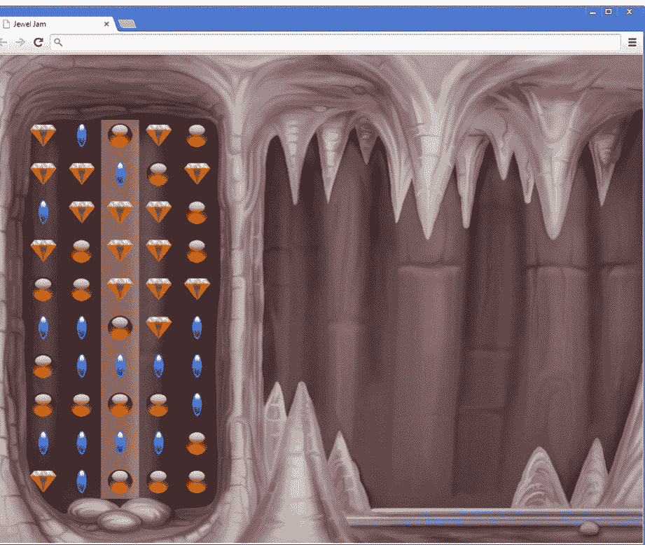

*图14-1.* JewelJam2示例程序的截图

### 网格操作


因为你已经将部分游戏世界组织在网格中，现在你可以巧妙地使用`for`循环为网格添加*行为*。在这个示例中，你添加一个将每一行向下移动一行的功能。这意味着最后一行会消失，你需要为第一行生成新的（随机）值。让我们添加一个名为`moveRowDown`的方法来实现这个功能。“向下移动”一行意味着什么？基本上，你只需将索引为`y`的行中的值复制到索引为`y + 1`的行中。让我们用`for`循环来实现：

```javascript
for (var y = 1; y < this.rows - 1; y++) {
    for (var x = 0; x < this.columns; x++) {
        this.setGridValue(x, y + 1, this.getGridValue(x, y));
    }
}
```

外层`for`循环从第0行遍历到`this.rows - 1`。这意味着最后一行不会向下移动。这正是你想要的，因为最后一行下面没有其他行了！内层`for`循环遍历各列（从0到`this.columns`），将位置`(x, y)`处的值复制到位置`(x, y + 1)`处。当内层`for`循环执行完毕后，第`y`行的内容已被复制到第`y + 1`行。然而，如果你尝试运行这个`for`循环，你会注意到它并没有产生你期望的行为：第一行的内容被复制到了它下面的所有行！这是怎么回事？

这是一个说明为什么仔细思考循环工作机制很重要的典型例子。问题在于你忘记了循环是*按顺序执行*的。让我们看看实际发生了什么。第一次进入循环时，你将第0行的内容复制到第1行。第二次进入循环时，你将第1行的内容复制到第2行。然而，第1行在上一次进入循环时已经被第0行的内容替换了，所以你实际上是在（间接地）将第0行的内容复制到第2行！

如何解决这个问题？实际上，你只需要对算法做一个简单的修改。不再从第0行开始一直遍历到最后一行，而是从最后一行开始向上遍历到第一行。修改后的算法如下：

```javascript
for (var y = this.rows - 2; y >= 0; y--) {
    for (var x = 0; x < this.columns; x++) {
        this.setGridValue(x, y + 1, this.getGridValue(x, y));
    }
}
```

在这种情况下，你从索引为8的行开始，将其内容复制到索引为9的行。之后，你将第7行复制到第8行，依此类推。与之前的算法版本不同，这种方法是可行的，因为你从下往上处理，只修改那些你不再需要考虑的行：一旦你将第7行的值复制到第8行，在算法的剩余部分中你就不再查看第8行了。

当你在程序中使用循环时，你会遇到类似上述的bug。遇到这种情况时，最好的办法是在纸上画个图来观察发生了什么，并逐次迭代地写出循环在做什么。调试器也很有帮助，因为它允许你在任何位置暂停代码并检查变量的值。

在将所有行向下移动之后，唯一剩下的就是为第一行生成新的随机值。这可以用一条`for`指令完成，为行中的每个项目获取一个随机数：

```javascript
for (x = 0; x < this.columns; x++) {
    var randomval = Math.floor(Math.random() * 3) + 1;
    this.setGridValue(x, 0, sprites["single_jewel" + randomval]);
}
```

### 网格的更多可能性

为了熟悉多维数组的工作方式，你可以尝试自行编写一些其他网格操作。例如，你能编写一个方法`void removeRow(int i)`来移除指定索引的行并为顶行创建新的值吗？你能编写一个方法对行执行轮询操作吗（所有行向下移动，最后一行变成第一行）？向上移动行呢？或者移动列？在网格上可以创建许多不同的操作。这些操作在许多不同的游戏中都很有用。例如，从网格中移除一行是在*俄罗斯方块*游戏中常用的操作。像*宝石迷阵*这样的游戏则需要能够从一行或一列中移除多个元素并重新填充网格的操作。

除了可以对网格执行的操作之外，你还需要考虑网格中包含的元素。在这个示例中，你使用了一个包含精灵引用的二维网格。对于更复杂的游戏，使用*游戏对象*的网格会更加有用，这样你可以为网格中的对象添加更多的行为和交互。

### 游戏对象的层次结构

本节将向你展示如何创建游戏对象的层次结构。你首先定义一个非常基础的`GameObject`类，然后添加支持将游戏对象放入层次结构的代码。

#### 游戏对象的剖析

大多数游戏都有相当复杂的游戏对象结构。首先可能有一个由多层移动对象组成的背景（山脉、天空、树木等）。然后有一些玩家可以与之交互的移动对象。这些对象可能是玩家的敌人，因此需要一定程度的智能；它们也可以更静态，如增益道具、树木、门或梯子。

有时对象甚至没有以精灵形式呈现的物理外观。例如，玩家的当前分数也可以是一个游戏对象，但与之关联的不是精灵，而是一个在某处显示当前分数的字体。或者想象一个游戏，其中需要击败一个隐形敌人，它的位置只能通过对其周围环境产生的影响来判断。其他游戏对象更加复杂：由其他游戏对象组成的游戏对象。

假设你有一个表示房屋的游戏对象。它可能由许多其他游戏对象组成，例如门、楼梯、窗户和厨房（而厨房本身又由不同的游戏对象组成）。

在益智游戏的情况下，表示游戏区域的网格也可以被视为一个由其他游戏对象组成的网格。考虑到这些不同类型的游戏对象以及它们之间的关系，你可以说游戏对象通常构成一个*层次结构*的一部分。这个层次结构可以是完全扁平的，就像第一个示例游戏Painter那样；但在后面章节中介绍的Jewel Jam游戏则有一个复杂的游戏对象层次结构。

许多游戏都使用游戏对象的层次结构。特别是在3D游戏中，由于三维环境的复杂性，这种层次结构非常重要。3D游戏中的对象通常不是用精灵表示的，而是用一个或多个3D模型表示。层次结构的优势在于这些对象可以被组合在一起，这样当你拿起一个装有魔法卷轴的花瓶时，卷轴会随着花瓶一起移动。这种层次结构也被称为*场景图*，因为它们以类似图的结构来呈现场景（环境）。

在Painter游戏中，基本的游戏对象类型由`ThreeColorGameObject`类表示。显然，并非所有游戏对象都有三种可能的颜色、当前位置和当前速度。到目前为止，你就是这样表示游戏对象的，仅仅因为它对于你正在开发的基本示例来说已经足够了。如果你想开发更大、更复杂的游戏，你必须放下游戏对象就是一个三色精灵的基本前提。但是，游戏对象究竟是什么呢？从某种意义上说，游戏对象可以是任何你想要的东西。因此，你可以定义以下类来表示一个游戏对象：

```
function GameObject() {
}
```

好吧，这可能有点过于简单了。目前，我们假设任何游戏对象都有一个位置和一个速度，但游戏对象如何显示（如果它显示的话）是你暂时不需要处理的事情。此外，你希望能够设置一个可见性标志，以便可以选择不绘制某些游戏对象。因此，让我们创建一个通用的`GameObject`类，包含这三个成员变量：

```
function GameObject() {
    this.position = Vector2.zero;
    this.velocity = Vector2.zero;
    this._visible = true;
}
```

如果你想要一个由精灵表示的游戏对象，你可以从这个基类继承，并添加必要的成员变量。

你还要添加主游戏循环方法：`handleInput`、`update`和`draw`。因为你还不知道游戏对象应该如何处理输入以及如何绘制到屏幕上，所以你将这两个方法留空。在`update`方法中，就像你在`ThreeColorGameObject`类中所做的那样，根据游戏对象的速度和经过的时间来更新其当前位置：

```
GameObject.prototype.update = function (delta) {
    this.position.addTo(this.velocity.multiply(delta));
};
```

### 游戏对象之间的关系

如果你想在游戏对象之间建立某种层次结构，你需要确定哪个游戏对象*是*哪个其他游戏对象*的一部分*。就层次结构而言，这意味着你需要确定一个游戏对象可以有一个*父游戏对象*。对于游戏对象本身来说，知道其父对象是谁非常有用。因此，`GameObject`类需要一个引用游戏对象父对象的成员变量：

```
this.parent = null;
```

例如，想象一个名为`playingField`的对象，它包含所有属于游戏场地的宝石。那么`playingField`对象可以被认为是这些宝石的*父对象*。但并非所有游戏对象都有父对象。例如，根对象就没有父对象。你如何表示一个游戏对象没有父对象呢？你需要将父成员变量的值设置为“无”——用JavaScript编程术语来说，就是`null`。

既然你已经为游戏对象类添加了父对象，你必须处理一些管理上的麻烦，以确保游戏对象之间的父子关系得到正确维护；但这一点稍后再讲。由于游戏对象的层次结构，你需要对几件事情做出决定。

### 局部位置与全局位置

如你所知，每个游戏对象都有一个包含其位置的变量。到目前为止，每个游戏对象都是直接放置在游戏世界中的。虽然这种方法可行，但它可能不是理想的解决方案。考虑游戏场地游戏对象。为了将游戏场地与背景精灵对齐，你想将其放置在位置`(85,150)`。然而，所有子对象（网格中的宝石）可能也有相同的`(85,150)`位置偏移。事实上，在之前的示例中，你必须将这个偏移量应用到网格中的所有项目：

```
var position = new Vector2(85 + col * 85, 150 + row * 85);
Canvas2D.drawImage(this.getGridValue(col, row), position);
```

虽然将这个偏移量应用到游戏场地对象的所有子游戏对象上有些麻烦，但它是可以做到的。一旦子对象变得更加复杂，并且它们自己也有需要正确放置的子对象时，问题就变得更加棘手了。而且，如果你改变游戏场地的位置会怎样？你必须更新其下所有游戏对象的位置。有更好的方法来做这件事：你必须区分*局部*位置和*世界位置*。

游戏对象的*世界位置*是其在游戏世界中的绝对`x`和`y`坐标。游戏对象的*局部位置*是相对于父游戏对象位置的位置。那么，你需要在每个游戏对象中存储这两个位置吗？不需要：你只需要存储*局部位置*。你可以通过将游戏对象的局部位置加上父对象的世界位置来计算世界位置。如果没有父对象，那么局部位置与世界位置相同。你可以为`GameObject`类添加一个属性来为你完成这项工作：

```
Object.defineProperty(GameObject.prototype, "worldPosition",
    {
        get: function () {
            if (this.parent !== null)
                return this.parent.worldPosition.addTo(this.position);
            else
                return this.position.copy();
        }
    });
```

使用这个属性，你现在可以获得游戏对象的局部位置（存储在`position`成员变量中）和世界位置，后者通过`worldPosition`属性访问。如你所见，你通过将局部位置加到父对象的世界位置上来计算世界位置。父对象的世界位置又通过取其局部位置并加到其父对象的世界位置上来计算。这个过程一直持续到你到达一个没有父对象的游戏对象，在这种情况下，世界位置是局部位置的副本。

举个例子，一个宝石的世界位置是通过将根对象的（局部）位置、游戏场地对象的局部位置加上它自己的局部位置来计算的。这正是你访问其`worldPosition`属性时得到的行为。在`worldPosition`属性本身中调用`worldPosition`属性可能看起来有些奇怪，但这是完全有效的JavaScript代码。事实上，你正在使用一种称为*递归*的编程技术（稍后你会学到更多）。

### 游戏对象的层

当你想要绘制一个游戏对象时，你可以使用`worldPosition`属性作为方便的方式来确定在屏幕上绘制游戏对象的位置。唯一的问题是，你不知道层次结构中的游戏对象应该按什么顺序绘制。看看Jewel Jam游戏，你显然希望在绘制游戏场地之前绘制背景；否则，玩家只会看到背景。

如果你能作为游戏对象的一部分以某种方式指示它应该何时被绘制，那就太好了。一种方法是引入*层*。你可以为每个游戏对象分配一个层，分配的层决定了对象应该何时被绘制。你可以使用整数以非常简单的方式表示这些层。较低的层编号表示对象将被更早绘制。因此，你可以将层0分配给背景精灵游戏对象，将层1分配给游戏场地游戏对象，确保背景在游戏场地之前绘制。存储层直接在属于`GameObject`类的成员变量中完成：

```
this.layer = 0;
```

使用层的一个小缺点是，无法保证同一层中对象的绘制顺序。因此，如果你想让一个对象总是在另一个对象之后绘制，该对象必须处于更高的层。

有关`GameObject`类的完整视图，请参见*JewelJam3*示例中的代码。当然，简单地向`GameObject`类添加一个`layer`成员变量是不够的：你必须*对此信息做些什么*。下一节将介绍几种不同的游戏对象子类。其中之一是`GameObjectList`类，它由多个其他游戏对象组成。在这个类中，你将看到如何使用`layer`变量来按正确顺序绘制对象。

### 不同类型的游戏对象

本节介绍几种有用的游戏对象，它们都定义为`GameObject`的子类。你首先定义一个简单的基于精灵的游戏对象。然后继续介绍游戏对象的列表和网格。

#### 精灵游戏对象

最常见的游戏对象之一是具有位置和速度的精灵。因为位置和速度已经是`GameObject`类中可用的两个成员变量，你可以从这个类继承，然后添加一个成员变量来存储精灵，以及一个成员变量来存储精灵的原点。

在这个类的构造函数中，你必须将精灵作为参数传入。由于你是继承的，你必须调用基类的构造函数，以便对象的`GameObject`部分也被正确构造。这个构造函数期望一个表示层的参数。最后，你必须替换/覆盖`draw`方法。这个方法在`GameObject`中是空的，因为你决定游戏对象不一定有附加的精灵。在覆盖的`draw`方法中，你在屏幕上绘制精灵，并使用`worldPosition`属性来计算精灵在屏幕上的实际位置。这里是`SpriteGameObject`类的一个简化版本：

```
function SpriteGameObject(sprite, layer) {
    GameObject.call(this, layer);
    this.sprite = sprite;
    this.origin = Vector2.zero;
}

SpriteGameObject.prototype = Object.create(GameObject.prototype);

SpriteGameObject.prototype.draw = function () {
    if (!this.visible)
        return;
    Canvas2D.drawImage(this.sprite, this.worldPosition, 0, 1, this.origin);
};
```

可以在*JewelJam3*的示例代码中查看该类的完整版本。那个版本增加了一些有用的属性，例如用于获取精灵游戏对象宽度的属性。

### 游戏对象列表

下一类游戏对象由其他游戏对象的列表组成。这是一个非常实用的类型，因为它允许你创建游戏对象的层级结构。例如，*根（root）*游戏对象需要是一个其他游戏对象的列表，因为它包含了背景精灵游戏对象以及游戏场地。为了表示一个包含其他游戏对象列表的游戏对象，你需要使用一个名为`GameObjectList`的类。该类继承自`GameObject`类，因此游戏对象列表本身也是一个游戏对象。这样，你可以将其视为一个普通的游戏对象，并为其赋予位置、速度、绘制层或父级游戏对象。此外，列表中的一个游戏对象本身也可以是其他游戏对象的列表。`GameObjectList`类的这种设计允许你定义游戏对象的层级结构。为了管理游戏对象列表，你需要添加一个包含（子）游戏对象的数组成员变量。以下是`GameObjectList`的完整构造函数：

```
function GameObjectList(layer) {
    GameObject.call(this, layer);
    this._gameObjects = [];
}
```

`GameObjectList`类的目标之一是负责管理其列表中的游戏对象。这意味着，如果你调用`GameObjectList`实例的`draw`方法，该实例会绘制其列表中所有的游戏对象。如果调用`handleInput`方法或`update`方法，也需要遵循相同的流程。以下是在`GameObjectList`中定义的`update`方法：

```
GameObjectList.prototype.update = function (delta) {
    for (var i = 0, l = this._gameObjects.length; i < l; ++i)
        this._gameObjects[i].update(delta);
};
```

因此，`GameObjectList`本身不定义任何行为；它仅仅是管理其包含的游戏对象的行为。对于`update`方法，你不必关心游戏对象更新自身的顺序。但对于`draw`方法，顺序非常重要，因为你希望先绘制层级编号最低的游戏对象。实现这一点的最稳健方法是在每次调用`draw`方法之初对游戏对象列表进行排序。之后，你可以使用`for`循环根据它们在列表中的顺序一个接一个地绘制游戏对象。`draw`方法的主体大致如下：

```
if (!this.visible)
    return;
// 对游戏对象列表进行排序
```


```javascript
for (var i = 0, l = this._gameObjects.length; i < l; ++i)
    this._gameObjects[i].draw();
```

由于排序可能相当复杂，你不需要在绘制游戏对象时（这每秒需要发生 60 次）进行排序，而是在将游戏对象添加到列表时进行。这样，你只需在必要时才对游戏对象列表进行排序。在 JavaScript 中对数组进行排序非常简单，数组自带一个可以调用的 `sort` 函数。例如：

```javascript
var myArray = ["named", "must", "your", "fear", "be", "before", "banish", "it", "you", "can"];
myArray.sort();
/* myArray 现在指向 ["banish", "be", "before", "can", "fear", "it", "must", "named", "you", "your"]; */
```

默认情况下，`sort` 函数按字母顺序对数组进行排序。然而，如果你有一个包含比字符串更复杂内容（如游戏对象）的数组，会发生什么？在这种情况下，你可以向 `sort` 提供一个排序函数作为参数。该函数应当指示数组中任意两个对象的顺序。你可以自己编写这个函数。例如，下面是一个根据层级（layer）对游戏对象进行排序的 `sort` 函数调用：

```javascript
this._gameObjects.sort(function (a, b) {
    return a.layer - b.layer;
});
```

当排序函数返回一个正数时，表示 `a` 比 `b`“大”，应该被放置在 `b` 之后，反之亦然。你可以编写一个名为 `add` 的方法，将游戏对象添加到列表中，然后对列表进行排序。该方法还将该游戏对象列表赋值为被添加对象的父级。以下是完整的方法：

```javascript
GameObjectList.prototype.add = function (gameObject) {
    this._gameObjects.push(gameObject);
    gameObject.parent = this;
    this._gameObjects.sort(function (a, b) {
        return a.layer - b.layer;
    });
};
```

因为你确保了游戏对象被添加到正确的位置，所以 `draw` 方法只需包含一个 `for` 循环：

```javascript
GameObjectList.prototype.draw = function () {
    if (!this.visible)
        return;
    for (var i = 0, l = this._gameObjects.length; i < l; ++i)
        this._gameObjects[i].draw();
};
```

这样，你的绘制操作将保持高效，因为你不需要每次都对游戏对象列表进行排序！不过，这种做法有一个轻微的缺点。请考虑以下代码片段：

```javascript
var obj1 = new SpriteGameObject(spr, 1);
var obj2 = new SpriteGameObject(spr, 2);
var objects = new GameObjectList(0);
objects.add(obj1);
objects.add(obj2);
obj2.layer = 0;
```

这段代码创建了两个精灵游戏对象并将它们添加到列表中。`add` 方法调用确保了它们被添加到正确的位置（在这种情况下，添加顺序恰好与层级顺序一致）。然而，之后你修改了对象 `obj2` 的层级索引，但游戏对象列表并没有改变，这意味着 `obj1` 仍然会在 `obj2` 之前被绘制。结果，这可能会破坏系统。在这种情况下，强烈建议提供清晰的文档，指导开发人员不要做此类糟糕的操作！例如，你可以在 `add` 方法的定义上方添加一条警告注释，告诉用户只有对象当前的层级值会被考虑在内。另一种选择是在 `layer` 变量的声明中添加注释，说明当层级改变时，绘制顺序不会自动更新。一个更好、更稳健的处理方法是通过一个属性来修改层级，该属性会自动对对象所属父级的绘制顺序进行重新排序。

为了完整起见，`GameObjectList` 类还包含一些其他有用的方法。`clear` 方法从列表中移除所有游戏对象；`remove` 方法从列表中移除一个对象，并且由于该对象不再是列表的一部分，其父级被设置为 `null`。

现在你可以从你创建的分层绘制机制以及层级结构中获益了。为了使代码更清晰，你可以将几个不同的层定义为变量（完整代码请参阅 `JewelJam.js`）：

```javascript
var ID = {};
...
ID.layer_background = 1;
ID.layer_objects = 20;
```

现在来看看以下代码片段：

```javascript
function JewelJamGameWorld(layer) {
    GameObjectList.call(this, layer);
    this.add(new SpriteGameObject(sprites.background, ID.layer_background));
    var rows = 10, columns = 5;
    var grid = new JewelGrid(rows, columns, ID.layer_objects);
    grid.position = new Vector2(85, 150);
    grid.cellWidth = 85;
    grid.cellHeight = 85;
    this.add(grid);
    for (var i = 0; i < rows * columns; i++) {
        grid.add(new Jewel());
    }
}

JewelJamGameWorld.prototype = Object.create(GameObjectList.prototype);
```

这是重建 Jewel Jam 游戏层级结构所需的部分代码。`JewelJamGameWorld` 类继承自 `GameObjectList`。因此，你可以使用 `add` 方法将游戏对象添加到游戏世界中！

首先，你添加一个代表背景的精灵游戏对象，并将层级 `ID.layer_background` 赋值给该对象。然后，你在 `ID.layer_objects` 层创建了一个 `JewelGrid`（稍后详细讨论）。最后，你用 `Jewel` 对象填充这个网格。通过这种方式，你创建了一个相关游戏对象的层级结构，它们会自动按正确的顺序绘制！此外，因为你已经处理了调用其他游戏循环方法的问题，在创建层级结构时，你不再需要考虑这些问题。

### 游戏对象网格

就像你创建 `GameObjectList` 类来表示游戏对象列表一样，你也可以创建 `GameObjectGrid` 类来表示游戏对象的*网格*。然而，这两个类之间存在很大的概念差异。一方面，`GameObjectList` 类没有提及它包含的游戏对象的位置。另一方面，`GameObjectGrid` 将所有游戏对象与网格关联起来，这意味着它们在网格上都有一个位置。但每个游戏对象本身也有一个位置成员变量。

位置似乎被重复存储了，但事实上，游戏对象在世界中的位置并不一定总是与它们在网格中所属的位置相同。由网格决定的位置可以被视为游戏对象的*锚点位置（anchor positions）*（即它们应该在的位置）。而游戏对象的*实际*位置则可能不同。通过将锚点位置与实际的游戏对象位置相结合，你可以实现很棒的运动效果，使游戏对象在依然属于某些网格位置的同时，能够平滑地在网格上移动。大量使用这种效果的游戏例子是*俄罗斯方块（Tetris）*：玩家可以将方块移动到网格的不同位置，但由于网格锚点位置与实际的游戏对象位置不同，方块移动起来非常平滑。如果你运行 `JewelJam3` 示例，当你使用鼠标或手指（在触摸屏设备上）将其中一行向左或向右拖动时，也可以看到这种效果的演示。

由于你可以使用普通数组来表示二维结构，因此 `GameObjectGrid` 类是 `GameObjectList` 的子类。为了让 `GameObjectGrid` 类按照你想要的方式运行，你需要额外做几件事。首先，你需要能够计算锚点位置，这意味着你需要知道网格中单个元素（单元格）的大小。因此，你还需要添加两个成员变量来存储网格中单个单元格的大小。此外，你在一个成员变量中存储所需的行数和列数。在创建 `GameObjectGrid` 实例时，这些值必须作为参数传递给构造函数。以下是完整的构造函数方法：

```javascript
function GameObjectGrid(rows, columns, layer) {
    GameObjectList.call(this, layer);
    this.cellWidth = 0;
    this.cellHeight = 0;
    this._rows = rows;
    this._columns = columns;
}
GameObjectGrid.prototype = Object.create(GameObjectList.prototype);
```

此外，为该类添加两个属性，以便你可以读取行数和列数：

```javascript
Object.defineProperty(GameObjectGrid.prototype, "rows", {
    get: function () {
        return this._rows;
    }
});
Object.defineProperty(GameObjectGrid.prototype, "columns", {
    get: function () {
        return this._columns;
    }
});
```

因为你继承自 `GameObjectList`，所以你已经拥有了一个用于添加游戏对象的方法。然而，在这个类中你需要以稍微不同的方式处理。由于游戏对象被放置在一个（扁平的）网格中，绘制顺序不再那么重要。当你添加一个游戏对象时，你不希望对数组进行排序。此外，你希望将游戏对象的位置设置为它在网格中预期的位置。为此，你按照如下方式重写 `GameObjectList` 的 `add` 方法：

```javascript
GameObjectGrid.prototype.add = function (gameobject) {
    var row = Math.floor(this._gameObjects.length / this._columns);
    var col = this._gameObjects.length % this._columns;
    this._gameObjects.push(gameobject);
    gameobject.parent = this;
    gameobject.position = new Vector2(col * this.cellWidth, row * this.cellHeight);
};
```

如在这个示例中所见，你根据数组中的目标位置计算行索引和列索引。然后将游戏对象推入数组，设置其父对象，并使用计算出的行和列索引来确定其位置。为了方便起见，再添加一个方法，允许你在网格的特定行和列索引处添加游戏对象：

```javascript
GameObjectGrid.prototype.addAt = function (gameobject, col, row) {
    this._gameObjects[row * this._columns + col] = gameobject;
    gameobject.parent = this;
    gameobject.position = new Vector2(col * this.cellWidth, row * this.cellHeight);
};
```

### 宝石网格

对于 Jewel Jam 游戏，你希望在网格上执行一些基本操作，包括将一行中的元素向左或向右移动。例如，当玩家将网格中的第三行向左拖动时，除了最左侧的元素外，所有元素都应向左移动，而最左侧的元素则变为最右侧的元素。由于这类操作并非每个使用网格的游戏都需要，因此我们创建一个继承自 `GameObjectGrid` 的 `JewelGrid` 类，然后将你需要的操作添加到该类中。以下是 `JewelGrid` 类的构造函数方法：

```javascript
function JewelGrid(rows, columns, layer) {
    GameObjectGrid.call(this, rows, columns, layer);
    this.dragging = false;
    this._dragRow = 0;
    this._draggingLastX = 0;
    this._touchIndex = 0;
}
JewelGrid.prototype = Object.create(GameObjectGrid.prototype);
```

它包含几个成员变量，用于存储与用户执行的拖拽操作相关的信息。当你稍后学习如何实现这种拖拽行为时，会看到更多细节。你通过将第一个元素存储在临时对象中，将其他对象向左移动一列，最后将存储在临时对象中的元素放置在最后一列，从而实现将一行中的列向左移动。你可以添加一个 `shiftRowLeft` 方法来精确实现这一点。由于该方法仅应用于一行，因此必须将行索引作为参数传递。完整的方法如下：

```javascript
JewelGrid.prototype.shiftRowLeft = function (selectedRow) {
    var firstObj = this.at(0, selectedRow);
    var positionOffset = firstObj.position.x;
    for (var x = 0; x < this._columns - 1; x++) {
        this._gameObjects[selectedRow * this._columns + x]
            = this._gameObjects[selectedRow * this._columns + x + 1];
    }
    this._gameObjects[selectedRow * this._columns + (this._columns - 1)] = firstObj;
    firstObj.position = new Vector2(this._columns * this.cellWidth + positionOffset,
        selectedRow * this.cellHeight);
};
```

除了将最左侧元素移至最右侧列并移动所有其他元素之外，你还更改了那个从最左侧变为最右侧对象的坐标位置。你在执行移动操作之前将第一个元素现有的位置偏移量存储在局部变量中，然后在新位置中加上该偏移量，从而将该偏移量考虑在内。这种位置变化的结果是一个很棒的运动效果，你稍后会看到。`shiftRowRight` 方法与此方法类似；请参阅 `JewelJam3` 的示例代码。

你还想添加一个方法，用于获取网格中任何游戏对象的锚点位置。这个方法在后面会很有用。该方法接收一个游戏对象作为参数，并返回一个包含锚点位置的 `Vector2` 对象。以下是完整的方法：

```javascript
GameObjectGrid.prototype.getAnchorPosition = function (gameobject) {
    var l = this._gameObjects.length;
    for (var i = 0; i < l; i++)
        if (this._gameObjects[i] === gameobject) {
            var row = Math.floor(i / this.columns);
            var col = i % this.columns;
            return new Vector2(col * this.cellWidth, row * this.cellHeight);
        }
    return Vector2.zero;
};
```

此方法使用 `for` 语句来查找作为参数传递的游戏对象。一旦找到该对象，你将根据网格中的行、列索引以及单元格大小来计算其锚点位置。如果未找到该对象，则返回零向量（`Vector2.zero`）。由于此方法对几乎所有网格都很有用，因此将其添加到 `GameObjectGrid` 类中。

### 在网格上平滑移动

为了让对象在网格上平滑移动，你可以使用 `GameObject` 类中的速度（`velocity`）和位置（`position`）成员变量。你使用从 `GameObjectGrid` 实例检索到的锚点位置，来计算属于该位置的游戏对象的速度。效果就是，当游戏对象不在精确的锚点位置时，它会自动开始向该位置移动。

为此，你引入了另一个名为 `Jewel` 的类，它代表网格中的一个游戏对象（在本例中是一种宝石）。这个游戏对象是 `SpriteGameObject` 的子类。在该类的构造函数中，你随机选择三个宝石精灵中的一个，如下所示：

```javascript
function Jewel(layer) {
    var randomval = Math.floor(Math.random() * 3) + 1;
    var spr = sprites["single_jewel" + randomval];
    SpriteGameObject.call(this, spr, layer);
}
```

## 第 14 章：结构中的游戏对象


在这个游戏对象中，你唯一需要更改的另一件事是 `update` 方法，因为精灵的绘制已经在基类中得到了妥善处理。在 `update` 方法中需要做什么？首先，你需要调用原始版本的 `update` 方法，以便对象的坐标位置始终根据其速度进行更新：

```javascript
SpriteGameObject.prototype.update.call(this, delta);
```

然后，你需要找到该游戏对象的锚点位置。你可以通过调用父对象（通常应该是 `JewelGrid` 实例）的 `getAnchorPosition` 来实现：

```javascript
var anchor = this.parent.getAnchorPosition(this);
```

最后，你修改游戏对象的速度，使其向锚点位置移动：

```javascript
this.velocity = anchor.subtractFrom(this.position).multiplyWith(15);
```

如你所见，你通过计算目标位置（即锚点位置）与当前位置之间的差值来得出速度。为了获得更快的运动效果，你将该值乘以 15。当游戏对象的位置更新时，该速度会被添加到位置向量中，从而使游戏对象向目标位置移动。完整的 `Jewel` 类请参阅 `JewelJam3` 示例。

### 拖拽网格行

在本章中，你最后要做的是为网格添加拖拽行为，以便玩家可以将行向左或向右移动。你分两步定义拖拽行为。首先，根据玩家使用鼠标或手指拖拽的位置，确定行中元素的新位置。然后，根据玩家拖拽行的距离，将元素向左或向右移动。

你为鼠标和触摸输入都定义了这种拖拽行为。因此，你将 `handleInput` 方法分为两个部分，分别在针对特定输入类型的方法中定义：

```javascript
JewelGrid.prototype.handleInput = function (delta) {
    if (Touch.isTouchDevice)
        this.handleInputTouch(delta);
    else
        this.handleInputMouse(delta);
};
```

由于拖拽行为是 Jewel Jam 游戏特有的，因此你在 `JewelGrid` 中处理输入。我们先来看鼠标拖拽行为。你需要检测到玩家已在网格中开始拖拽。只有在鼠标左键按下且玩家尚未开始拖拽时，这才是可能的。如果是这种情况，你需要确定玩家是在网格中拖拽还是在外部。在后一种情况下，你不需要做任何事情。在前一种情况下，你需要存储一些与玩家拖动位置相关的信息。以下是完整的代码：

```javascript
if (Mouse.left.down && !this.dragging) {
    var rect = new Rectangle(this.worldPosition.x, this.worldPosition.y, this.columns *
        this.cellHeight, this.rows * this.cellWidth);
    if (Mouse.containsMouseDown(rect)) {
        this.dragging = true;
        this._dragRow = Math.floor((Mouse.position.y - this.worldPosition.y) / this.cellHeight);
        this._draggingLastX = Mouse.position.x - this.worldPosition.x;
    }
}
```

你使用 `dragging` 变量来跟踪玩家是否正在拖动。如果玩家已经开始拖动，你计算玩家正在拖动的是哪一行，并将该值存储在 `_dragRow` 成员变量中。最后，你计算鼠标当前拖动位置在网格中的*本地 x 坐标*。这在稍后根据玩家的拖动量重新定位所有宝石时会很有用。

接下来，你检查第二种情况，即玩家没有拖动。如果是这种情况，你将 `dragging` 变量设置为 `false`：

```javascript
if (!Mouse.left.down) {
    this.dragging = false;
}
```

现在你已经执行了确定玩家是否正在拖动的准备步骤，如果玩家确实在拖动，你需要采取行动。第一步是根据玩家将行向左或向右拖动了多少来重新定位宝石。计算鼠标的新位置：

```javascript
var newpos = Mouse.position.x - this.worldPosition.x;
```

然后，通过将新位置与上次拖动位置的差值加到每个宝石的 x 坐标上，重新定位该行中的每个宝石：

```javascript
for (var i = 0; i < this.columns; i++) {
    var currObj = this.at(i, this._dragRow);
    currObj.position.x += (newpos - this._draggingLastX);
}
```

现在你需要检查是否需要将行向左或向右移动。你首先检查最左边的对象是否被向左拖动超过了单元格宽度的一半。你可以通过检查 `newpos` 是否小于上次拖动的 x 位置来判断玩家是否在向左拖动。如果是这种情况，你将该行向左移动：

```javascript
var firstObj = this.at(0, this._dragRow);
if (firstObj.position.x < -this.cellWidth / 2 && newpos - this._draggingLastX < 0)
    this.shiftRowLeft(this._dragRow);
```

类似地，你检查最右边的对象是否被向右拖动超过了单元格宽度的一半。如果是这种情况，你将该行向右移动：

```javascript
var lastObj = this.at(this.columns - 1, this._dragRow);
if (lastObj.position.x > (this.columns - 1) * this.cellWidth + this.cellWidth / 2 &&
    newpos - this._draggingLastX > 0)
    this.shiftRowRight(this._dragRow);
```

最后，你更新上次拖动的位置，使其包含新计算出的位置。这样，你就可以在下一次调用 `update` 时执行相同的拖动和移动操作：

```javascript
this._draggingLastX = newpos;
```

处理触摸拖动的方式与鼠标拖动非常相似。你需要做一些额外的管理工作。首先，你需要跟踪当前在网格中拖动的是哪个手指。当玩家开始拖动时，你将属于该手指的触摸索引存储在一个成员变量中：

```javascript
this._touchIndex = Touch.getIndexInRect(rect);
```

然后你可以使用存储的触摸索引来获取手指的位置：

```javascript
pos = Touch.getPosition(this._touchIndex);
```

接着，你执行与处理鼠标拖动完全相同的操作。要查看处理触摸和鼠标拖动的完整代码，请参阅 `JewelJam3` 示例中的 `JewelGrid` 类。

### 创建游戏对象

既然你已经定义了所有这些不同类型的游戏对象，你就可以将它们创建为游戏世界的一部分。你之前已经简要了解了如何做。首先添加一个背景图像：

```javascript
this.add(new SpriteGameObject(sprites.background, ID.layer_background));
```

然后创建一个网格来容纳宝石：

```javascript
var rows = 10, columns = 5;
var grid = new JewelGrid(rows, columns, ID.layer_objects);
grid.position = new Vector2(85, 150);
grid.cellWidth = 85;
grid.cellHeight = 85;
this.add(grid);
```

最后，你使用一个 `for` 循环用 `Jewel` 对象填充网格：

```javascript
for (var i = 0; i < rows * columns; i++) {
    grid.add(new Jewel());
}
```

由于你创建了这种游戏对象的层次结构，游戏循环的调用会自动传播到层次结构中的所有游戏对象。这种层次结构带来的另一个好处是，你可以修改父对象的位置，然后子对象会自动相应地移动。例如，尝试将网格对象放置在另一个位置：

```javascript
grid.position = new Vector2(300, 100);
```

这个更改的结果如图 14-2 所示。你可以看到，所有子对象都移动了，行拖动机制仍然和以前一样工作。在这里，你看到了将游戏对象放在这种层次结构中的真正威力：你可以非常灵活地控制对象在屏幕上的放置方式。你甚至可以完全放开手脚，给网格一个速度，让它在屏幕上移动！

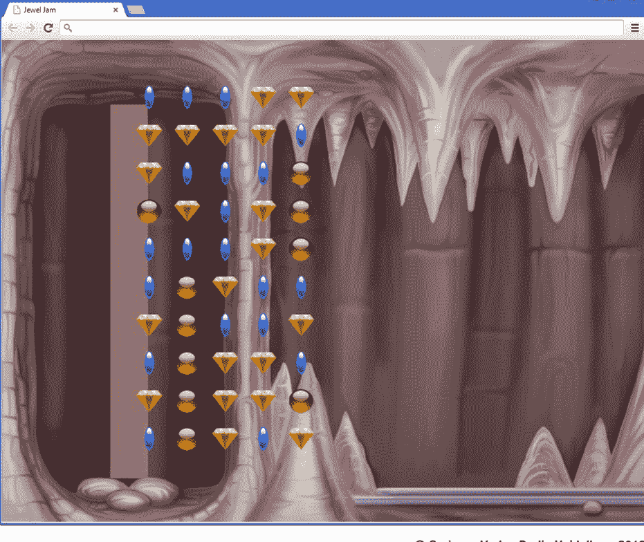

图 14-2. 将游戏场移动到另一个位置

### 你学到了什么

在本章中，你学到了：

- 如何在场景图中组织游戏对象
- 如何创建游戏对象的结构化集合，例如网格和列表
- 本地坐标和全局坐标的区别
- 如何通过使用场景图来绘制和更新游戏对象，使其成为游戏不可分割的一部分
- 如何为鼠标和触摸输入定义拖动行为

## 第 15 章：游戏玩法编程

本章深入探讨了 Jewel Jam 游戏的游戏玩法编程。首先讨论了游戏对象之间的交互。然后介绍了游戏中使用的一些新游戏对象。最后，你着手处理这个游戏的主要玩法元素：找到宝石的组合并妥善处理它们。

### 游戏对象之间的交互

本节探讨了游戏对象如何相互通信。在游戏对象能够做到这一点之前，你首先需要一种让这些对象*找到*彼此的方法。

上一章将游戏世界呈现为一个游戏对象的层次结构。这些游戏对象中的每一个都可能处理用户输入，并表现出某种行为。例如，宝石网格游戏对象会检查玩家是否拖动了网格中的某一行，并在需要时执行行移动操作。这是游戏中许多游戏对象设计的一个典型例子。它们处理来自玩家的输入，并对其做出反应，这反过来又会影响其他游戏对象（例如网格上宝石的位置）。在 Painter 游戏中，你看到球和油漆桶以类似的方式互动。在更复杂的游戏中，许多不同的游戏对象彼此互动。

挑战在于，这些游戏对象如何找到彼此？在 Painter 游戏的案例中，`PainterGameWorld` 类拥有指向每个游戏对象的成员变量。这不是一个很好的解决方案，因为它使游戏世界完全依赖于它所属的游戏。在 Jewel Jam 游戏世界中，你只拥有一个 `GameObject` 实例的层次结构，这使得找到特定的游戏对象变得更加复杂。

你应该以一种可以在许多不同游戏中使用的方式来设计你的类。在 Jewel Jam 游戏的最后一个版本中，游戏对象之间的交互非常少，所以你可以采用简单的设计。但现在这行不通了。例如，宝石网格需要能够找到代表玩家得分的对象，以便在玩家做出有效的宝石组合时更新这个分数。网格还需要找到移动的宝石推车，以便在需要时将推车移回左侧。要做到这些，你需要一种在游戏世界中找到对象的方法，而不使游戏世界依赖于游戏特定的代码。

### 为游戏对象分配标识符

当你想要查找游戏对象时，为它们分配标识符会很有帮助。并非所有对象都需要标识符；通常只有那些与其他对象交互的对象才需要。你使用与之前用于图层相同的标识符类型。例如，这里你可以看到一些对 Jewel Jam 游戏有用的标识符：

```javascript
ID.title = 1;
ID.help_frame = 2;
ID.jewel_cart = 3;
ID.grid = 4;
ID.game_over = 5;
ID.score = 6;
ID.double_timer = 7;
ID.triple_timer = 8;
```

你只需要扩展游戏对象类，以便为游戏对象分配标识符。让我们从 `GameObject` 类开始。在这个类中，你添加一个成员变量来存储标识符，并在 `GameObject` 构造方法中添加一个参数，以便在创建对象时将 ID 与对象关联起来：

```javascript
function GameObject(layer, id) {
	this.layer = typeof layer !== 'undefined' ? layer : 0;
	this.id = typeof id !== 'undefined' ? id : 0;
	this.parent = null;
	this.position = Vector2.zero;
	this.velocity = Vector2.zero;
	this._visible = true;
}
```

因为并非所有对象都需要 ID（或图层），所以你为这些变量赋予默认值，以防参数未定义。

因为所有游戏对象都继承自 `GameObject` 类，所以它们也有一个标识符。在许多情况下，你需要更新 `GameObject` 子类的构造函数，以便将标识符传递给基类（`GameObject`）的构造函数。例如，更新后的 `SpriteGameObject` 构造函数如下：

```javascript
function SpriteGameObject(sprite, layer, id) {
	GameObject.call(this, layer, id);
	this.sprite = sprite;
	this.origin = Vector2.zero;
}
```

大多数 `GameObject` 子类都以这种方式进行更新。查看 `JewelJam4` 示例，了解所有不同游戏对象类型是如何实现这一点的。

### 查找游戏对象

虽然为游戏对象分配标识符可能是个好主意，但只有在你提供一种*查找*这些游戏对象的方法时才有用。为了了解如何实现这一点，让我们向 `GameObjectList` 类添加一个 `find` 方法，该方法遍历游戏对象列表，查看是否有任何对象具有所请求的标识符。如果找到游戏对象，该方法返回对该游戏对象的引用；否则返回 `null`。该方法的头如下：

`GameObjectList.prototype.find = function (id)`

你现在唯一要做的就是编写*算法*来检查列表中的游戏对象，并返回匹配该标识符的游戏对象（如果它包含在列表中）。你使用 `for` 指令来完成此操作（尽管你也可以使用 `while` 指令来做同样的事情）。在 `for` 循环中，你检查当前游戏对象的标识符是否与作为参数传递给方法的所请求标识符匹配。如果是，你返回该对象。如果你在 `for` 循环的主体中没有从方法返回，这意味着列表中没有游戏对象具有所请求的 ID，因此该方法返回 `null`。那么 `find` 方法的主体变为：

```javascript
for (var i = 0, l = this._gameObjects.length; i < l; i++) {
    if (this._gameObjects[i].id === id)
        return this._gameObjects[i];
}
return null;
```

请注意，一旦执行 `return` 指令，你就会立即从方法返回。这意味着不再检查剩余的游戏对象。此外，你不会检查游戏对象是否具有重复的 ID。如果多个游戏对象具有相同的 ID，该方法返回它找到的第一个。

### 递归

有一件事你还没有考虑到。当然，列表中的一个或多个游戏对象本身可能是 `GameObjectList` 类型。如果该游戏对象包含具有你所寻找的 ID 的游戏对象，那么上一节中的方法将找不到它，因为该方法只检查存储在当前对象（`this`）列表中的游戏对象。你如何解决这个问题？首先你需要检查一个对象是否是某个类型的实例。为此，你可以使用 `instanceof` 关键字：

```javascript
if (someObject instanceof GameObjectList)
    // do something
```

在 `instanceof` 关键字之前，你放置要检查的对象；在关键字之后，你放置类型。如果对象是给定类型，则表达式产生 `true`。如果不是，结果为 `false`。因此，你可以在 `if` 指令中使用它，如前面的示例所示。如果你知道该对象是 `GameObjectList` 类型，你可以尝试在该对象表示的游戏对象列表中查找你要找的游戏对象。以下代码正是这样做的：

```javascript
for (var i = 0, l = this._gameObjects.length; i < l; ++i) {
    if (this._gameObjects[i].id === id)
        return this._gameObjects[i];
    if (this._gameObjects[i] instanceof GameObjectList) {
        var list = this._gameObjects[i]._gameObjects;
        for (var i2 = 0, l2 = list.length; i2 < l2; ++i2) {
            if (list[i2].id === id)
                return list[i2];
        }
    }
}
return null;
```

所以，现在你检查每个游戏对象以确定它是否是 `GameObjectList` 类型。如果是，你遍历该列表的 `_gameObjects` 变量并在其中查找游戏对象。

你完成了吗？嗯，并没有。如果列表中的某个游戏对象也是 `GameObjectList` 类型呢？这意味着你必须添加另一层检查，查看该列表中的某个游戏对象是否对应于你正在寻找的 ID。但那些游戏对象中也可能有一个是 `GameObjectList` 类型。显然，这种方法并不理想。然而，你可以做一些事情来避免这种无限搜索的问题。为什么不再次使用 `find` 方法呢？看看以下代码：


```javascript
for (var i = 0, l = this._gameObjects.length; i < l; ++i) {
    if (this._gameObjects[i].id === id)
        return this._gameObjects[i];
    if (this._gameObjects[i] instanceof GameObjectList) {
        var obj = this._gameObjects[i].find(id);
        if (obj !== null)
            return obj;
    }
}
return null;
```

这段代码看起来可能有点奇怪。你实际上正在调用你当前正在编写的方法。为什么这行得通？想想当对一个对象调用`find`方法时发生了什么。如果你要找的游戏对象在列表中，那么该方法返回该对象。此外，该方法对每个也是`GameObjectList`类型的对象调用`find`方法。如果这些方法调用中没有一个找到该对象，该方法返回`null`。

而每个`find`方法调用也会对属于它的`GameObjectList`类型的对象调用`find`方法。这个庞大的`find`方法调用树在你到达游戏对象层次结构的底部时结束。换句话说，在某个时刻不再有列表了：只有游戏对象。然后所有`find`方法调用的结果（每个结果要么是`null`，要么是一个游戏对象）通过返回值传回。

最后，该方法的第一个调用者获得该对象（如果它在树中的某处被找到），或者如果未找到携带所请求 ID 的对象，则返回`null`。这种搜索策略也被称为*深度优先*，因为你在检查列表中其余对象之前就对子对象调用了`find`方法。

## 递归

当一个方法调用自身时，这被称为*递归*。递归是一个非常强大的工具，因为它允许你执行这些复杂的搜索算法而无需编写大量代码。然而，使用递归时要小心，因为你可能会编写一个无限调用自身的方法。假设你想通过相加来使用递归计算两个（正）整数的乘积：

```javascript
function product(a, b) {
    return b + product(a-1, b);
}
```

这段代码没有检查当`a`等于零时乘积应该返回 0。因此，该方法无限调用自身，导致无限循环，类似于在`while`指令中忘记递增计数器时可能发生的情况。这个递归方法的正确版本当然是：

```javascript
function product(a, b) {
    if (a === 0)
        return 0;
    else
        return b + product(a-1, b);
}
```

关键在于递归方法应该在某处有一个*终止条件*，以便在某些情况下，该方法不调用自身而是做其他事情。在这个例子中，终止条件是`a === 0`。如果发生这种情况，该方法不调用自身，而是返回 0（这是正确的，因为任何数乘以 0 都等于 0）。

## 访问游戏世界

虽然你可以在`GameObjectList`实例中查找具有特定 ID 的游戏对象，但你需要访问表示游戏世界的对象。引用该对象的变量是`Game`类的成员变量。因此，每当你想要查找特定对象时，你可以在`Game.gameWorld`对象上调用`find`方法，因为该对象也继承自`GameObjectList`。

虽然在 Painter 和 Jewel Jam 游戏中你只有一个游戏世界，但对于更复杂的游戏来说情况肯定不是这样。游戏中每个关卡都可以是一个独立的游戏世界。甚至一个关卡也可以包含几个不同的游戏世界。因此，做好准备是明智的，这样你编写的类在这些情况下也会有用。

为了做到这一点，你依赖于编码在通用`GameObject`类中的父子关系。对于每个游戏对象，你可以假设如果你到达该游戏对象所属层次结构的根节点，这个根节点就是该游戏对象所在特定游戏的世界。

因此，你可以通过遍历父级列表到达根节点，从而轻松地检索游戏世界。你在`GameObject`类中添加了一个名为`root`的属性来实现这一点，它依赖于递归：

```javascript
Object.defineProperty(GameObject.prototype, "root",
    {
        get: function () {
            if (this.parent === null)
                return this;
            else
                return this.parent.root;
        }
    });
```

该属性中的代码非常简单。如果你当前的父级不是`null`（意味着你有一个父级），你就向该父级请求根游戏对象。如果父级是`null`，则意味着你当前操作的游戏对象处于层级结构的根部，也就是说它就是游戏世界。在这种情况下，你返回当前对象。

现在你已经为游戏对象之间相互查找创建了一种便捷的方式，接下来的章节将介绍`Jewel Jam`游戏所需的几种游戏对象类型。

## Jewel 类

为了让`Jewel`类更好地适应它将要使用的游戏，你需要对该类进行一些修改。最大的变化是你希望引入更多样化的宝石类型。基本上有三种变化：宝石的形状可以变化，宝石的颜色可以变化，以及宝石的数量可以变化（一个、两个或三个宝石）。

因此，一个宝石可以具有三种类型的属性（形状、颜色和数量）。此外，对于每种属性，又有三种变化：三种不同的形状，三种不同的颜色和三种不同的数量。总计意味着有 3 × 3 × 3 = 27 种可能的宝石配置（另见图 15-1）。

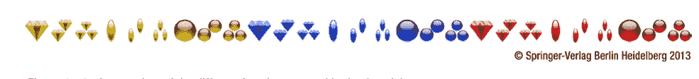

与其创建 27 个不同的图像文件，你可以将所有不同的品种存储在单个图像文件中（同样，请参阅图 15-1 的图像）。将多个图像存储在单个图像文件中有几个好处。首先，它为美术人员提供了一种将相关图像分组在同一个文件中的方法；其次，从内存使用和加载速度来看，加载单个文件并绘制该文件的部分区域比分别加载所有图像要高效得多。

在这种情况下，图像文件中宝石的排列顺序非常重要，你稍后会看到。当你创建`Jewel`实例时，通过在成员变量`variation`中存储一个 0 到 26 之间的随机数（以覆盖 27 种品种），随机选择要表示的宝石。因此，`Jewel`构造函数变为：

```javascript
function Jewel(layer, id) {
    SpriteGameObject.call(this, sprites.jewels, layer, id);
    this.variation = Math.floor(Math.random() * 27);
}
```

因为`Jewel`类知道它将使用哪个精灵，所以你直接将精灵（`sprites.jewels`）传递给基类构造函数。

现在唯一需要修改的是`draw`方法。你不希望绘制整个精灵，而只需要绘制其中的一部分：包含该对象所代表的宝石的那部分。为此，你首先必须扩展`Canvas2D.drawImage`方法，因为它需要能够仅绘制精灵的一部分。

幸运的是，这很容易实现。HTML5 canvas 元素的`drawImage`方法有四个参数，你可以用它们来指定想要绘制的精灵部分。为了指示要绘制的精灵部分，你使用一个`Rectangle`对象。`Canvas2D.drawImage`方法的定义如下：

```javascript
Canvas2D_Singleton.prototype.drawImage = function (sprite, position, rotation,
    scale, origin, sourceRect)
```

该方法的最后一个参数是定义源图像中应绘制哪一部分的矩形。在方法体中，你按如下方式使用此`Rectangle`对象的成员变量：

```javascript
this._canvasContext.drawImage(sprite, sourceRect.x, sourceRect.y,
    sourceRect.width, sourceRect.height, -origin.x * scale, -origin.y * scale,
    sourceRect.width * scale, sourceRect.height * scale);
```

第二到第五个参数指示图像的哪一部分应该被绘制。最后两个参数指示该图像在画布上投影的宽度和高度。你将矩形的宽度和高度乘以`scale`（缩放比例），这样如果用户需要，绘制的图像就可以被缩放。因为你在缩放精灵，所以你也需要缩放原点，这发生在第三行代码中。

在`Jewel`类的`draw`方法中，你需要根据`variation`成员变量的值来确定要绘制宝石精灵的哪一部分：

```javascript
var imagePart = new Rectangle(this.variation * this.height, 0, this.height,
    this.height);
```

这里你想绘制的片段是一个正方形，其宽度和高度与原始精灵的高度相同。矩形的位置（由`Rectangle`构造函数中的前两个参数给出）是通过将精灵的高度乘以`variation`索引计算得出的。

结果是，`variation`索引越高，矩形向右移动得越远。最后，调用`Canvas2D.drawImage`方法将宝石绘制在屏幕上。以下是完整的`draw`方法：

```javascript
Jewel.prototype.draw = function () {
    if (!this.visible)
        return;
    var imagePart = new Rectangle(this.variation * this.height, 0,
        this.height, this.height);
    Canvas2D.drawImage(this.sprite, this.worldPosition, 0, 1, this.origin,
        imagePart);
};
```

## 维护当前分数

使这款游戏更有趣的下一步是添加几个与游戏玩法以及如何向玩家发放奖励相关联的游戏对象。在这个游戏中，你将给予玩家的奖励表示为分数值：即分数。每当玩家找到一组有效的宝石组合时，玩家获得 10 分。这个当前分数应该存储在一个变量或对象中。此外，分数应该写在屏幕上，以便玩家知道他们获得了多少分。

现在你看到了另一个不特意假设每个游戏对象都由精灵表示的优势。分数游戏对象使用字体在屏幕上显示自己。为了使这一点更加通用，你首先引入一个名为`Label`的类，它简单地在屏幕上的某个位置写入一些文本。

这个类与`SpriteGameObject`类非常相似，不同之处在于你在屏幕上绘制文本而不是精灵。为了实现这一点，你需要存储要写入的文本和所使用的字体。你还存储其他文本属性，例如文本的对齐方式和字体大小。以下是`Label`的构造函数：

```javascript
function Label(fontname, fontsize, layer, id) {
    GameObject.call(this, layer, id);

    this.color = Color.black;
    this.origin = Vector2.zero;
    this._fontname = typeof fontname !== 'undefined' ?
        fontname : "Courier New";
    this._fontsize = typeof fontsize !== 'undefined' ? fontsize : "20px";
    this._contents = "";
    this._align = "left";
    this._size = Vector2.zero;
}
```

你在构造函数中赋值的最后一个成员变量是`_size`。知道文本的大小（以像素为单位的高度和宽度）对于在正确位置绘制文本非常有用。因为你只有在知道文本内容后才能计算文本的大小，所以你最初将此值设置为`Vector2.zero`。

如何计算文本的大小？在 HTML 中并没有真正简单的方法来做到这一点。这段代码使用了一个简单的技巧：你动态地将文本添加到 HTML 页面中，在它被绘制时计算其大小，然后再次将其删除。以下是为你完成这项工作的函数：

```javascript
function calculateTextSize(fontname, fontsize, text) {
	var div = document.createElement("div");
	div.style.position = "absolute";
	div.style.left = -1000;
	div.style.top = -1000;
	document.body.appendChild(div);
	text = typeof text != 'undefined' ? text : "M";
	div.style.fontSize = "" + fontsize;
	div.style.fontFamily = fontname;
	div.innerHTML = text;
	var size = new Vector2(div.offsetWidth, div.offsetHeight);
	document.body.removeChild(div);
	return size;
}
```

你首先创建一个`div`元素，并在其中放置文本。你将元素的位置设置为 (-1000, 1000)，使其被绘制在屏幕之外。你放置文本并计算其大小，然后将其存储在一个`Vector2`对象中。该对象作为此函数的运行结果返回。

虽然这不是一种很优雅的解决方法，但它非常容易实现且运行良好。在编程时，有时这些快速且粗糙的技巧（hacks）是可以接受的，但要注意不要一直使用它们。在这种情况下，你别无选择，因为在 HTML 中没有其他替代方法。

在`Label`类中，当文本内容被设置时，你会计算文本的大小。这在`text`属性中完成：

```javascript
Object.defineProperty(Label.prototype, "text",
{
	get: function () {
		return this._contents;
	},
	set: function (value) {
		this._contents = value;
		this._size = calculateTextSize(this._fontname, this._fontsize, value);
	}
});
```

`Label`类还需要一个`draw`方法以便将文本绘制在屏幕上。在屏幕上绘制文本是通过调用`Canvas2D.drawText`方法完成的。在绘制文本时，你使用文本标签的世界位置，这样基于文本的游戏对象也可以成为层级结构的一部分。以下是完整的`draw`方法：

```javascript
Label.prototype.draw = function () {
	if (!this.visible)
		return;
	Canvas2D.drawText(this._contents, this.worldPosition, this.origin, this.color, this._align, this._fontname, this._fontsize);
};
```

现在你定义了一个继承自`Label`类的`ScoreGameObject`类。分数由文本内容表示。值得注意的是，JavaScript 在绘制时会自动将整数转换为文本。因此，你只需将文本设置为 0：

```javascript
function ScoreGameObject(fontName, fontSize, layer, id) {
    Label.call(this, fontName, fontSize, layer, id);
    this.text = 0;
    this._align = "right";
}
ScoreGameObject.prototype = Object.create(Label.prototype);
```

你还添加了一个`score`属性，用于检索或修改当前分数：

```javascript
Object.defineProperty(ScoreGameObject.prototype, "score",
    {
        get: function () {
            return this._contents;
        },
        set: function (value) {
            if (value >=0)
                this.text = value;
        }
    });
```

最后，你添加了一个重置方法，以便游戏结束时可以调用此方法将分数重置为零：

```javascript
ScoreGameObject.prototype.reset = function () {
    this.text = 0;
};
```

现在你拥有了这个类，只需创建一个实例并将其添加到游戏世界中。将这些指令放在`JewelJamGameWorld`类中，并添加一个可以在其上绘制当前分数的帧覆盖层。这些指令将完成所有工作：

```javascript
var scoreFrame = new SpriteGameObject(sprites.frame_score, ID.layer_overlays);
scoreFrame.position = new Vector2(20, 20);
this.add(scoreFrame);

var score = new ScoreGameObject("Segoe UI Mono", "40px", ID.layer_overlays_1,
    ID.score);
score.position = new Vector2(270, 35);
score.color = Color.white;
this.add(score);
```


你将分数游戏对象分配给图层`ID.layer_overlays`，使其绘制在背景和分数帧的顶部。你还需要为帧和分数选择合适的位置。最后，你为分数游戏对象分配一个`ID.score`，以便其他对象在需要时可以检索它。

### 移动的珠宝车

为了使游戏更刺激一些，你可以为玩家增加一些压力感。在 Jewel Jam 游戏中，这是通过绘制一个缓慢移出屏幕的珠宝车来实现的。一旦珠宝车移出屏幕，游戏就结束了。每当玩家找到正确的宝石组合时，珠宝车就会向后移动一点。

珠宝车由`JewelCart`类表示。你在其中定义了一些内容。首先，你定义当玩家找到正确的宝石组合时，珠宝车应该向后移动多少。这存储在`push`成员变量中。你还想设置一个最小的 x 位置，这样珠宝车就永远不会绘制到游戏区域上。这是通过`minxpos`变量完成的。你添加了一个`pushCart`方法，当玩家找到正确的宝石组合时可以调用该方法。因为该类已经从`SpriteGameObject`继承了大部分功能，所以这个类相当小。请查看`JewelJam4`示例以了解该类的代码。

你通过以下方式将该类的一个实例添加到游戏世界：

```javascript
var jewelCart = new JewelCart(sprites.jewelcart, ID.layer_objects, ID.jewel_cart);
jewelCart.position = new Vector2(410, 230);
jewelCart.minxpos = 410;
this.add(jewelCart);
```

珠宝车对象也被分配了一个 ID，以便在需要推动时可以找到它。你还将它的位置和最小 x 位置设置为适当的值。如果你查看`JewelCart.js`文件，你会发现你给推车分配了一个正的 x 速度。因为`JewelCart`是`SpriteGameObject`的子类，而后者又是`GameObject`的子类，所以`update`方法会根据它的速度更新推车位置（假设该方法从其他地方调用）。图 15-2 展示了包含新游戏对象（宝石、分数和珠宝车）的游戏截图。

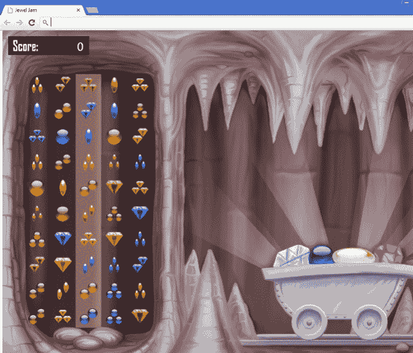

*图 15-2. JewelJam4 示例的截图*

### 处理宝石组合

每当玩家通过拖动行在中间列构建了一个有效的组合时，游戏就会检查该组合是否有效。如果是，游戏会增加分数，将珠宝车向后推，从网格中移除该宝石组合，并添加新的宝石。`JewelGrid`类有一个`handleInput`方法用于处理行拖动。在该类的`update`方法中，你需要确定玩家是否制作了有效的宝石组合。

#### 查找有效组合

在`update`方法中，你需要检查中间列中所有三个相邻宝石的组，看看它们是否构成有效的组合。为了帮助完成此操作，你添加了一个方法`isValidCombination`，其头如下所示：

```javascript
JewelGrid.prototype.isValidCombination = function (a, b, c)
```

此方法接受三个`Jewel`对象，并返回一个布尔值，指示这三个宝石是否构成有效组合。所以现在的问题是，如何评估三个宝石是否构成有效组合？回想一下，有效组合意味着对于每个属性（颜色、形状、数量），三个宝石的值要么全部相同，要么全部不同。为了使事情更容易一些，让我们使用从 0 到 2 的三个整数对每个宝石进行编码。假设第一个整数代表颜色（黄色、蓝色或红色），第二个整数代表形状（菱形、椭圆形或圆形），最后一个整数代表宝石数量（一个、两个或三个）。使用这种编码方案，例如，你可以将蓝色椭圆形单宝石编码为（1,0,0）。黄色圆形单宝石定义为（0,2,0），红色椭圆形三宝石定义为（2,1,2）。

> **注意** 人类可能会尝试通过简单地查看刚刚移动的行及其上下行来寻找有效的宝石组合。计算机可以在主循环中定期检查，以检查中心列中的所有三宝石组合，即使玩家没有触碰它们，就像这里所做的那样。计算机可以做到这一点，因此程序员这样编写；但如果你是编程新手，可能需要一些时间来适应这种思维方式。

现在让我们看看是否可以使用这种编码方案来找到三个宝石的有效组合（我们称它们为宝石 A、B 和 C）。对于每个宝石，你必须比较颜色、形状和数量。这些属性中的每一个都必须对所有宝石要么相同，要么不同。例如，如果 A 的颜色编码值为 0，B 的值为 0，C 的值也为 0，则颜色条件成立，因为所有三个宝石的颜色相同（黄色）。如果所有宝石都是蓝色（A-颜色 = 1，B-颜色 = 1，C-颜色 = 1）或红色（A-颜色 = 2，B-颜色 = 2，C-颜色 = 2），情况也是如此。最后，如果所有颜色都不同：A-颜色、B-颜色和 C-颜色的某种排序产生 0、1 和 2，则条件成立。如果你查看这些不同组合的和，你会看到一个有趣的性质：0 + 0 + 0 = 0, 1 + 1 + 1 = 3, 2 + 2 + 2 = 6, 以及 0 + 1 + 2 = 3。换句话说：*总和能被三整除*。同时，恰好任何其他可能的值组合*不能*被三整除。因此，你可以说对于每个属性（颜色、形状和数量），*每个宝石编码值的总和必须能被三整除*。如果这个总和由变量`sum`表示，那么在 JavaScript 代码中条件`sum % 3 === 0`必须成立！所以，如果你为每个属性计算这个总和并确定它能被三整除，你就找到了一个有效的三宝石组合。如你所见，有时基础数学对于编写高效代码非常有用。在这种情况下，替代方案将是编写大量处理不同情况的`if`指令，这肯定会导致更慢的代码。

剩下的唯一事情就是从每个宝石中检索编码。目前，你有一个数字：宝石在精灵中的偏移量。这是一个从 0 到 26 的数字。如果你再看一下图 15-1，你会看到前九个宝石是黄色的，接下来的九个是蓝色的，最后九个是红色的。因此，如果你将`variation`变量除以 9，你会得到一个介于 0 到 2 之间的值，代表颜色！该除法的余数是一个从 0 到 8 的数字。如果你将该数字除以 3，你会再次得到一个介于 0 到 2 之间的数字，代表形状。该除法的余数是一个从 0 到 2 的数字，它代表宝石的数量。通过使用这个概念，你可以构建一个算法来计算每个属性的这些值，并检查这些属性的总和是否能被 3 整除。看看以下算法：

```javascript
var curra = a.variation;
var currb = b.variation;
var currc = c.variation;
var divider = 9;
```

```javascript
for (var i = 0; i < 3; i += 1) {
    if ((Math.floor(curra / divider) + Math.floor(currb / divider)
        + Math.floor(currc / divider)) % 3 !== 0)
        return false;
    curra = curra % divider;
    currb = currb % divider;
    currc = currc % divider;
    divider = Math.floor(divider / 3);
}
return true;
```

首先，你通过每个宝石的`variation`成员变量获取代表当前处理的是哪个宝石的值。然后定义一个等于 9 的除数`divider`（首先除以 9）。接着定义一个运行三次的`for`循环。在`for`循环体中，你设置一个条件：三个变体索引除以`divider`的和应该能被 3 整除。如果情况并非如此，则返回`false`，因为该属性不满足组合条件。你将每个包含当前变体索引的变量对`divider`取余后的值赋给该变量。然后将`divider`除以 3。如果你能退出`for`循环，这意味着在所有情况下`if`语句中的条件都为真，即你找到了一个有效的组合。因为你找到了一个有效的组合，所以返回`true`。

### 从网格中移除宝石

在`update`方法中，你现在可以使用`isValidCombination`方法来判断是否存在有效的组合。为此，你使用一个`while`循环来评估中间列中所有三个宝石的序列：

```javascript
var middleCol = Math.floor(this._columns / 2);
var i = 0;
while (i < this._rows - 2) {
    if (this.isValidCombination(this.at(middleCol, i),
        this.at(middleCol, i + 1), this.at(middleCol, i + 2))) {
        // do something
    }
    else
        i++;
}
```

当你找到有效的组合时，需要将这些宝石从网格中移除并插入新的宝石。为此，你定义一个名为`removeJewel`的方法，该方法从网格中移除一个宝石并插入一个新的。为了创建漂亮的“下落”效果，你将这些宝石放置在网格上方不同的位置。你将期望的 y 坐标作为参数传递给`removeJewel`方法，以便它知道新宝石应该位于何处。完整的方法如下：

```javascript
JewelGrid.prototype.removeJewel = function (x, y, newYPosition) {
    for (var row = y; row > 0; row -= 1)
        this._gameObjects[row * this._columns + x] =
            this._gameObjects[(row - 1) * this._columns + x];

    var jewel = new Jewel();
    this.addAt(jewel, x, 0);
    jewel.position.y = newYPosition;
};
```

在`update`方法中，你调用`removeJewel`三次来移除形成有效组合的三个宝石：

```javascript
this.removeJewel(middleCol, i, -this.cellHeight);
this.removeJewel(middleCol, i + 1, -this.cellHeight * 2);
this.removeJewel(middleCol, i + 2, -this.cellHeight * 3);
```

随着网格的更新，宝石对象与其在网格上的目标位置之间的位置差产生了期望的下落效果。最后，因为引入新宝石可能意味着存在新的三个宝石的有效组合，所以你将计数器`i`重置为零，使用指令`i = 0;`。

### 更新其他游戏对象

既然网格已经更新完成，你可以专注于其他需要更新的游戏对象。第一个需要更新的游戏对象是分数，因为如果处理了一个有效组合，分数应该增加。你使用`find`方法来获取分数对象，并给分数增加 10 分，如下所示：

```javascript
var score = this.root.find(ID.score);
score.score += 10;
```

此外，因为你找到了一个有效的组合，所以将宝石推车推回：

```javascript
var jewelCart = this.root.find(ID.jewel_cart);
jewelCart.pushCart();
```

完整程序请参见本章对应的`JewelJam4`示例。

### 本章所学内容

在本章中，你学到了：

- 如何组织游戏对象并为它们分配 ID
- 如何编写游戏玩法方面以及游戏对象之间的交互
- 如何在宝石果酱游戏中检测有效的宝石组合

## 第 16 章：游戏状态

在上一章中，你编写了宝石果酱游戏的主要游戏元素。然而，游戏目前还远未完成。例如，当宝石推车从屏幕上消失时，没有任何事情发生。而且，当你启动程序时，游戏立即开始，没有任何提示。仍然需要的是一种将菜单和覆盖层融入游戏的方式，以便玩家可以更改设置、获取帮助或开始游戏。当玩家处于，例如，菜单屏幕时，与游戏的交互类型与玩家正在解决关卡或尽可能长时间生存时非常不同。在编写游戏时，你必须考虑如何整合这些不同的*游戏状态*并在它们之间切换。

现代游戏有许多不同的游戏状态，如菜单、地图、库存、启动画面、开场动画等等。本章展示如何为宝石果酱游戏添加不同的游戏状态。因为这个游戏还不算非常复杂，你可以通过使用当前类的一些简单扩展来实现。然而，如果你想构建商业游戏，游戏状态管理需要得到妥善处理。在第 20 章中，本书将讨论一种软件设计，使用可以以非常优雅和通用的方式处理游戏状态的类。

### 添加标题屏幕

让游戏更加完整的首要任务之一就是添加标题屏幕。标题屏幕让玩家准备好开始游戏，而不是立即被带入游戏。你可以扩展`JewelJamGameWorld`类，使其加载并显示由单张图片组成的标题屏幕。你为此创建一个`SpriteGameObject`实例，为其分配`ID.title`的 ID，并将其添加到游戏世界中：

```javascript
var titleScreen = new SpriteGameObject(sprites.title, ID.layer_overlays_2,
    ID.title);
this.add(titleScreen);
```

你将图层`ID.layer_overlays_2`分配给标题屏幕，以确保标题绘制在所有内容之上。但你需要做一些额外的工作来正确处理输入和更新游戏世界，因为你希望只有在标题屏幕不可见时游戏才开始。你可以通过在`handleInput`方法中添加一些指令来区分两个状态：显示标题屏幕的状态和正在玩游戏的状态：

```javascript
var titleScreen = this.root.find(ID.title);
if (titleScreen.visible) {
    if (Mouse.left.pressed || Touch.isPressing)
        titleScreen.visible = false;
    return;
}
GameObjectList.prototype.handleInput.call(this, delta);
```

查看`if`语句，你可以看到如果标题屏幕可见，你只在玩家按下鼠标左键或触摸屏幕时做出反应。在这种情况下，你将标题屏幕的可见性标志设置为`false`，这样它就不再被绘制。之后，你从方法中返回，因此每当标题屏幕可见时，游戏唯一会反应的就是玩家按下鼠标左键或触摸屏幕。

如果标题屏幕不可见，你调用游戏世界中所有游戏对象的`handleInput`方法：换句话说，当玩家正在玩游戏时，游戏会按照应有的方式响应玩家。

你对`update`方法遵循几乎相同的流程，只在标题不可见时更新游戏世界：

```javascript
var titleScreen = this.root.find(ID.title);
if (titleScreen.visible)
    return;
GameObjectList.prototype.update.call(this, delta);
```

当玩家启动游戏时，他们现在会在游戏开始前看到标题屏幕（见图 16-1）。你还没有完成。在下一节中，你添加一个简单的按钮 GUI 元素来显示帮助框架。

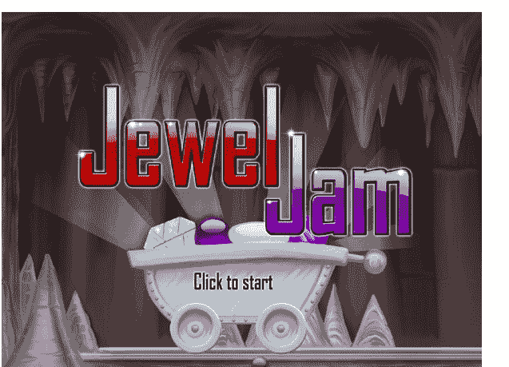

**图 16-1. 宝石果酱标题屏幕**

### 添加按钮以显示帮助框架

本节解释如何在游戏中添加按钮，用于显示帮助框架。为此，你向程序中添加另一个类`Button`。你从`SpriteGameObject`类继承，并添加一些简单的行为来检查玩家是否按下了按钮。在`Button`类中，你声明一个布尔成员变量，表示按钮是否被按下。然后你重写`handleInput`方法，检查玩家是否点击了鼠标左键或触摸了屏幕上的按钮。如果此时鼠标或触摸位置在精灵的边界内，你就知道玩家按下了按钮，并将成员变量的值设置为`true`。

如何检查鼠标位置是否在精灵的边界内？通过使用`Rectangle`类。作为第一步，你构造一个包含该精灵的`Rectangle`对象。这个矩形的位置应该是精灵的世界位置减去其原点。矩形的宽度和高度与精灵的宽度和高度相同。为了方便起见，我们向`SpriteGameObject`添加一个名为`boundingBox`的属性，为你计算这个矩形：

```javascript
Object.defineProperty(SpriteGameObject.prototype, "boundingBox",
{
    get: function () {
        var leftTop = this.worldPosition.subtractFrom(this.origin);
        return new Rectangle(leftTop.x, leftTop.y, this.width,
            this.height);
    }
});
```

你必须在这里使用世界位置，因为你想检查鼠标指针或触摸是否在精灵的实际世界位置内。你向`Rectangle`添加一个简单的`contains`方法，检查一个点是否在矩形内：

```javascript
Rectangle.prototype.contains = function (v) {
    v = typeof v !== 'undefined' ? v : new Vector2();
    return (v.x >= this.left && v.x <= this.right &&
        v.y >= this.top && v.y <= this.bottom);
};
```

这段代码的第一行检查参数 v 是否已定义。如果没有，你简单地将其赋值为零向量。然后检查 x 值是否位于矩形左右两边之间，y 值是否位于矩形上下两边之间。

你还向`Mouse`和`Touch`类添加了可以轻松帮助解决问题的方法。例如，这是检查玩家是否在给定矩形内按下鼠标左键的方法：

```javascript
Mouse_Singleton.prototype.containsMousePress = function (rect) {
    return this._left.pressed && rect.contains(this._position);
};
```


在`Button`类中，你可以使用这些方法来确定按钮是否按下和/或按住。这是`Button`的`handleInput`方法：

```
Button.prototype.handleInput = function (delta) {
    var boundingBox = this.boundingBox;
    this.pressed = this.visible && (Touch.containsTouchPress(boundingBox) ||
        Mouse.containsMousePress(boundingBox));
    this.down = this.visible && (Touch.containsTouch(boundingBox) ||
        Mouse.containsMouseDown(boundingBox));
};
```

既然你已经有了按钮类，就可以在游戏世界中添加一个帮助按钮（参见`JewelJamGameWorld`类）：

```
this.helpButton = new Button(sprites.button_help, ID.layer_overlays);
this.helpButton.position = new Vector2(1268, 20);
this.add(this.helpButton);
```

因为你想在玩家按下帮助按钮时显示一个帮助框，所以你也向游戏世界添加了一个帮助框。将其可见性标志设为`false`，这样它暂时不可见：

```
var helpFrame = new SpriteGameObject(sprites.frame_help, ID.layer_overlays,
    ID.help_frame);
helpFrame.position = new Vector2(636, 120);
helpFrame.visible = false;
this.add(helpFrame);
```

现在你必须确保当玩家按下帮助按钮时，帮助框的可见性被切换。你可以在`JewelJamGameWorld`类的`handleInput`方法中使用以下`if`语句来实现：

```
var helpFrame = this.root.find(ID.help_frame);
if (this.helpButton.pressed) {
    helpFrame.visible = !helpFrame.visible;
}
```

注意，`if`语句体中的指令是一个切换。它本质上是一种更简洁的写法：

```
if (helpFrame.visible)
    helpFrame.visible = false;
else
    helpFrame.visible = true;
```

当帮助框可见时，你希望能够通过按下鼠标左键或触摸屏幕来移除它。因此，最终的`if`语句稍微复杂一些：

```
var helpFrame = this.root.find(ID.help_frame);
if (this.helpButton.pressed ||
    (helpFrame.visible && (Mouse.left.pressed || Touch.isPressing))) {
    helpFrame.visible = !helpFrame.visible;
}
```

最后，你必须确保在显示帮助框时不更新游戏。你可以在`update`方法中做到这一点，只有在帮助框不可见时才更新游戏对象：

```
var helpFrame = this.root.find(ID.help_frame);
if (!helpFrame.visible)
    GameObjectList.prototype.update.call(this, delta);
```

还有一件事你需要注意：按下帮助按钮时，玩家会暂停游戏。如果你继续显示宝石网格，这就给玩家提供了一种获得额外时间来尝试寻找宝石组合的手段。当然，这不是你想要的效果！幸运的是，在当前的类结构中，这非常容易解决。在`update`方法中添加以下两行：

```
var grid = this.root.find(ID.grid);
grid.visible = !helpFrame.visible;
```

这些行确保每当帮助框可见时，网格就不可见，反之亦然。图 16-2 显示了显示帮助框时的游戏画面。

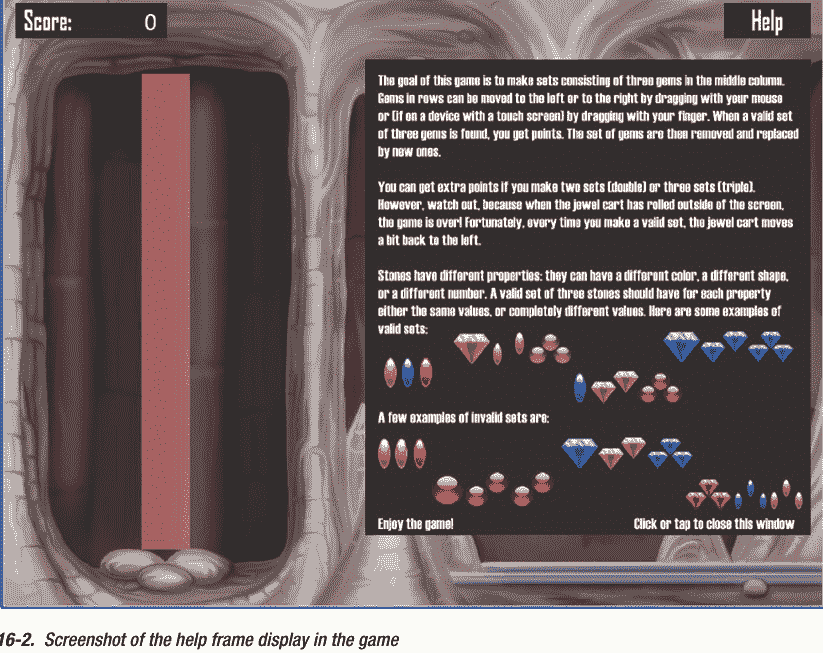

### 覆盖层

向玩家呈现信息的一种非常常见的方式是使用覆盖层（overlays）。覆盖层基本上是一些图像，可以显示在游戏世界之上，用于呈现信息或提供用户界面，如菜单、小地图、状态信息等。上一节中介绍的帮助框就是覆盖层的另一个例子。

覆盖层可以呈现一个全新的游戏状态（例如“游戏结束”覆盖层），或者它们可以通过向玩家提供信息来补充游戏世界。例如，许多策略游戏提供有关选中单位数量、可用资源、正在进行的建筑过程、收集到的物品等信息。这些覆盖层通常始终显示在屏幕上，它们一起被称为抬头显示（HUD）。Jewel Jam 有一个非常基础的 HUD：它由一个显示当前分数的框以及一个用户可以按下以查看帮助信息的帮助按钮组成。

除了 HUD，你还想在宝石车移出屏幕时显示一个“游戏结束”覆盖层。你将这个覆盖层添加到游戏世界，并将其可见性设为`false`：

```
var gameOver = new SpriteGameObject(sprites.gameover, ID.layer_overlays_1,
    ID.game_over);
gameOver.visible = false;
gameOver.position = gameOver.screenCenter;
this.add(gameOver);
```

你想将覆盖层漂亮地定位在屏幕中央。因为这可能是你经常使用的功能，让我们向`SpriteGameObject`添加一些有用的属性来处理它。首先，你可以添加一个属性，用于计算如果你想将精灵绘制在屏幕中央时的位置。一旦你了解了屏幕大小、精灵大小及其原点，这相对容易计算。这是完整的属性：

```
Object.defineProperty(SpriteGameObject.prototype, "screenCenter",
    {
        get: function () {
            return Game.size.subtract(this.size).divideBy(2).addTo(this.origin);
        }
    });
```

特别是在 HUD 元素的情况下，有时你不想将精灵完全显示在屏幕正中间；相反，例如，你可能想让它在屏幕底部中央。为了适应这些情况，你可以向`SpriteGameObject`添加以下两个属性：

```
Object.defineProperty(SpriteGameObject.prototype, "screenCenterX",
    {
        get: function () {
            return (Game.size.x - this.width) / 2 + this.origin.x;
        }
    });
```

```
Object.defineProperty(SpriteGameObject.prototype, "screenCenterY",
{
    get: function () {
        return (Game.size.y - this.height) / 2 + this.origin.y;
    }
});
```

现在让我们扩展`JewelJamGameWorld`，在需要时显示“游戏结束”覆盖层。首先，你添加一个检查宝石车是否在屏幕外的方法：

```
JewelJamGameWorld.prototype.gameOver = function () {
    var jewelCart = this.root.find(ID.jewel_cart);
    return jewelCart.position.x > Game.size.x;
};
```

然后你可以在`handleInput`方法中使用这个方法，这样玩家就可以按下鼠标左键或触摸屏幕来重新开始游戏：

```
if (this.gameOver()) {
    if (Mouse.left.pressed || Touch.isPressing)
        this.reset();
    return;
}
```

你重写了`reset`方法，因为在游戏重新开始时你需要做一些额外的工作。值得注意的是，你必须将一些覆盖层的可见性设为`false`，这样它们在游戏重新开始时不会显示在屏幕上。除此之外，你只需调用基类的`reset`方法，这样游戏世界中的所有游戏对象都会被重置：

```
JewelJamGameWorld.prototype.reset = function () {
    GameObjectList.prototype.reset.call(this);
    var gameOver = this.root.find(ID.game_over);
    gameOver.visible = false;
    var titleScreen = this.root.find(ID.title);
    titleScreen.visible = false;
    var helpFrame = this.root.find(ID.help_frame);
    helpFrame.visible = false;
};
```

现在只剩一件事要做了。如果游戏结束，你必须将“游戏结束”覆盖层的可见性设为`true`。你在`JewelJamGameWorld`的`update`方法中执行此操作：

```
var gameOver = this.root.find(ID.game_over);
if (this.gameOver()) {
    gameOver.visible = true;
}
```

图 16-3 显示了“游戏结束”状态的截图。

## 第 16 章：游戏状态


图 16-3. 真可惜……

### 游戏设计

虽然游戏开发团队中的程序员通常不负责游戏设计，但对这一过程有基本的了解仍然非常有用。程序员必须将游戏设计转化为代码，并且必须能够向设计师建议哪些可行、哪些难以实现。为了使这种协作成功，每个人都必须使用相同的语言。

设计游戏主要包括定义游戏机制、游戏设置和游戏关卡。游戏机制涉及游戏规则、玩家控制游戏的方式、目标和挑战以及奖励结构等内容。心理学和教育科学在这里发挥着重要作用。它们帮助你理解玩家如何进入心流（他们全身心投入游戏的状态）；目标、挑战和奖励如何相互支持；以及如何变化和调整游戏的难度。

游戏的设置涉及故事、角色以及游戏发生的虚拟世界。一个好的故事可以成为玩家的强大动力，而在游戏过程中发现故事可以是一种非常令人满足的体验。角色需要引起玩家的共情，以赋予必须执行的任务以意义。而游戏世界则增强这些方面，并使游戏适应特定的人群。

关卡设计有时由专门的关卡设计师完成，但在较小的团队中，这通常是游戏设计师的职责。细致的关卡设计能带来良好的学习曲线。它能让玩家在感受到挑战的同时保持动力，并应当能带来令人愉快的惊喜。

关于游戏设计已经有许多书籍出版，强烈建议你阅读其中的一些。你也可以在 [www.gamasutra.com](http://www.gamasutra.com) 等网站上找到关于游戏开发各方面的海量信息。最后，本书的第 30 章和第 31 章将讨论游戏的制作与发行。

### 你已经学到了什么

在本章中，你学习了：

- 如何向游戏中添加 HUD 和覆盖层（overlays）
- 如何定义一个显示帧的简单按钮
- 如何处理几种不同的游戏状态，例如标题界面和“游戏结束”状态

# 第 17 章：完成 Jewel Jam 游戏

在本章中，你将完成 Jewel Jam 游戏。第一步，当出现多个三宝石组合时，给玩家额外的积分。第二步，通过在游戏中的宝石上显示闪光效果来增加精美的视觉效果。最后，添加声音和音乐。

### 多重组合的额外积分

你希望在出现多个组合时给玩家额外积分。每当玩家完成三个宝石的组合时，游戏区域会添加新的随机宝石。这些宝石可能会形成新的组合。此外，宝石在落下时也可能形成新组合。在出现两到三个组合的情况下，你将奖励玩家额外积分。为了实现这一点，你必须计算玩家找到了多少个组合。你在`JewelGrid`类中通过引入一个额外的变量`nrCombis`来完成此操作：

```
var nrCombis = 0;
```

每当你发现一个有效的组合，就增加这个变量。现在你可以使用`if`语句来检查何时应该奖励额外积分：

```
if (nrCombis === 2) {
    score.score += 50;
}
else if (nrCombis >= 3) {
    score.score += 100;
}
```

在出现双重或三重组合的情况下，你还想向玩家显示一条他们获得了额外积分的消息。为此，你可以显示一个覆盖层几秒钟。作为第一步，让我们加载两个为此准备的覆盖层，并将它们添加到`JewelJamGameWorld`类中的游戏世界中：

```
var doubleOverlay = new SpriteGameObject(sprites.double, ID.layer_overlays);
doubleOverlay.position = new Vector2(800, 400);
this.add(doubleOverlay);
var tripleOverlay = new SpriteGameObject(sprites.triple, ID.layer_overlays);
tripleOverlay.position = new Vector2(800, 400);
this.add(tripleOverlay);
```

一旦玩家获得多重组合，你就想在屏幕上显示这个覆盖层几秒钟。为了能够实现这一点，你首先需要更多地了解在游戏中如何处理时间。

### 游戏中的时间

时间在游戏中是一个非常重要的概念。例如，它被用于测量玩家执行任务的速度、根据速度更新对象的位置、记录玩家上次击败敌人的时间、确定游戏中当前是白天还是黑夜，等等。为了适应这些需求，游戏引擎通常包含许多处理时间不同方面的类。因为时间在游戏中如此重要，像`handleInput`和`update`这样的游戏循环方法总是有一个参数`delta`，它表示自上次游戏循环迭代以来经过了多少时间。游戏时间不必与现实世界的时间相同。在游戏中，时间可以快三倍，或慢十倍，或者任何游戏设计师想要的倍数。例如，游戏设计师可能会决定在模拟游戏中，夜晚的时间过得快得多，因为夜晚没发生太多事情。游戏时间仅在游戏启动后才开始。此外，游戏时间可以被中断。例如，如果玩家在浏览器中切换到另一个标签页，游戏时间会暂停，因为浏览器停止执行脚本（而现实时间仍在继续）。

游戏开始时，游戏时间为零：经过了 0 小时 0 分 0 秒。每次执行游戏循环方法时，你都会获得一个表示经过时间的实数参数。本书中的示例遵循固定时间步（fixed timestep）范式，这意味着无论机器运行快慢，你都假设每秒有固定次数的游戏循环迭代。当你查看`Game`对象中的这行代码时可以看到这一点：

```
var delta = 1 / 60;
```

因此，即使游戏循环运行的频率低于每秒 60 次，游戏中的所有对象表现得就像游戏循环恰好每秒运行 60 次一样。这种方法的优点是，用户中断（如切换到另一个标签页）只会简单地暂停游戏时间，这样当用户回来时，他们可以像什么都没发生一样继续游戏。缺点是在非常慢的计算机上，游戏可能会明显变慢。

另一种选择是使用现实时间（real time）。这样一来，计算机的速度（或玩家是否切换到另一个标签页）就无关紧要了：游戏总是继续运行。使用现实时间时，调用游戏循环方法的频率也可以高于每秒 60 次。中断问题可以通过跟踪游戏是否暂停来解决。基本上，你需要维护一个在游戏暂停时增加的时间偏移量。许多第一人称射击游戏采用这种策略，因为在这类游戏中，高帧率至关重要，这样玩家才能自然地与游戏世界交互。而且在第一人称射击游戏中，玩家很可能会完全沉浸在游戏中，绝不会想到中断游戏去读新闻或玩数独！

### 控制游戏对象的可见性

在本节中，你将创建一个根据定时器控制游戏对象可见性的类。我们将这个类命名为`VisibilityTimer`。这个类的想法是你可以为其指定一个目标游戏对象，该对象的可见性默认设置为`false`；当你启动定时器时，目标对象变为可见，直到定时器达到其最大值。你可以将这样一个定时器连接到一个覆盖层，以便在屏幕上显示该覆盖层一段时间。请查看本章随附的`JewelJamFinal`程序；它包含一个名为`VisibilityTimer.js`的文件，其中包含完整的`VisibilityTimer`类。

一个可见性定时器对象需要跟踪几件事。首先，你需要存储你想要控制可见性的目标对象。你还需要存储该对象在定时器启动后总共应该可见多长时间。最后，当定时器运行时，你必须维护停止前还剩下多少时间。这个值在每次调用`update`方法时都会更新。因此，`VisibilityTimer`类继承自`GameObject`类。

创建定时器时，假设它没有在运行，因此剩余时间设置为 0。你还将定时器应运行的总时间设置为 1 秒：

```
function VisibilityTimer(target, layer, id) {
    GameObject.call(this, layer, id);
    this._target = target;
    this._timeLeft = 0;
    this.totalTime = 1;
}
```

在`update`方法中，你然后从`_timeLeft`变量中减去以秒为单位的已流逝游戏时间。如果该变量的值小于零，你就将目标可见性设置为`false`：


```javascript
VisibilityTimer.prototype.update = function (delta) {
    if (this._timeLeft > 0) {
        this._timeLeft -= delta;
        this._target.visible = true;
    } else
        this._target.visible = false;
};
```

最后，你添加一个名为`startVisible`的方法，它将总时间赋值给`_timeLeft`变量，并将目标的可见状态设置为`true`。

现在你可以使用`VisibilityTimer`类来控制 Jewel Jam 游戏中双重和三重组合覆盖层的可见性。在创建覆盖层对象时，你同时创建以这些覆盖层为目标的`VisibilityTimer`实例：

```javascript
var doubleOverlay = new SpriteGameObject(sprites.double, ID.layer_overlays);
doubleOverlay.position = new Vector2(800, 400);
var doubleTimer = new VisibilityTimer(doubleOverlay, ID.layer_overlays, ID.double_timer);
this.add(doubleOverlay);
this.add(doubleTimer);

var tripleOverlay = new SpriteGameObject(sprites.triple, ID.layer_overlays);
tripleOverlay.position = new Vector2(800, 400);
var tripleTimer = new VisibilityTimer(tripleOverlay, ID.layer_overlays, ID.triple_timer);
this.add(tripleOverlay);
this.add(tripleTimer);
```

当出现两个或三个宝石组合时，你启动该特定覆盖层的可见性定时器。例如，这是双重组合的代码样子（请参阅`JewelGrid`类的`update`方法）：

```javascript
if (nrCombis === 2) {
    score.score += 50;
    var doubleTimer = this.root.find(ID.double_timer);
    doubleTimer.startVisible();
}
```

你可以通过运行本章提供的`JewelJamFinal`程序来看到定时器的实际效果。

### 闪光区域

在本节中，你将为游戏添加一些视觉糖果。目前，宝石是显示在屏幕上的精灵（sprites）。让我们为它们添加一个精美的视觉效果：闪光（glitters）。你可以通过一种通用方式来实现，即在屏幕上指定一个矩形区域，闪光在其中随机位置绘制。你还希望能够指定这个闪光矩形的*密度*。这样你就可以创建不同大小的矩形并将它们附加到游戏对象上。图 17-1 显示了你想要添加闪光的屏幕区域。在本章稍后部分，图 17-2 显示了将向玩家展示的最终输出效果。

*图 17-1。矩形框表示你希望在游戏中添加闪光效果的位置*

### 构造函数

让我们创建一个`GlitterField`类，用于向游戏对象添加闪光效果。这个类继承自`GameObject`类，因此你可以轻松地将其附加到场景图中。`GlitterField`类的构造函数有多个参数。以下是构造函数的头部和部分函数体：

```javascript
function GlitterField(density, width, height, layer, id) {
    GameObject.call(this, layer, id);
    this.width = width;
    this.height = height;
    // 待办：初始化闪光场
}
```

第一个参数是闪光场的密度，它表示同时可见的闪光数量。接着是宽度和高度参数，用于指定矩形的大小。最后，`layer`和`id`参数传递给基类构造函数。在构造函数体内，你将闪光场的宽度和高度存储在成员变量中。

### 添加闪光效果

闪光场是一个包含多个闪光效果的矩形区域，其数量取决于设定的密度。因此，你需要一个数组来记录这些闪光效果应该绘制的位置。这通过成员变量`positions`实现，它是一个在构造函数中初始化的数组：

```javascript
this.positions = [];
```

你需要用一组随机生成的位置来填充这个列表。为了在区域内随机生成一个位置，你可以添加一个`createRandomPosition`方法来完成这项工作。这个方法很简单：它只需在闪光矩形区域内生成一个随机位置：

```javascript
GlitterField.prototype.createRandomPosition = function () {
    return new Vector2(Math.random() * this.width, Math.random() *
        this.height);
};
```

要为位置数组填充随机值，你使用一个`for`循环：

```javascript
for (var i = 0; i < density; i++) {
    this.positions.push(this.createRandomPosition());
}
```

要绘制闪光效果，仅仅有位置是不够的。你还希望添加一种视觉效果，让闪光平滑地出现和消失。这可以通过绘制时先增大后缩小的缩放比例来实现。这意味着你还需要为每个绘制的闪光效果维护当前的缩放比例。这通过另一个名为`scales`的变量数组来实现，它同样在构造函数中初始化：

```javascript
this.scales = [];
```

每次向`positions`数组添加新位置时，你也需要在`scales`数组中添加一个缩放值为0的项。因此，最终的`for`循环如下：

```javascript
for (var i = 0; i < density; i++) {
    this.positions.push(this.createRandomPosition());
    this.scales.push(0);
}
```

### 更新闪光场

在构造函数中，你将每个闪光的缩放比例设置为0。这样绘制时，闪光对玩家是不可见的。在`update`方法中，你再次增大和减小这个比例，直到它回到零。当缩放比例归零时，你为该闪光生成另一个随机位置，使其出现在其他地方。向`GlitterField`类添加以下两个成员变量：

```javascript
this._scaleMax = 1;
this._scaleStep = 0.05;
```

第一个变量指定闪光的最大缩放比例（1表示原始大小）。第二个变量`_scaleStep`表示缩放比例增减的速度。

你不希望同时开始增大每个闪光的缩放比例——你希望闪光效果随机出现。因此，在`update`方法中，你遍历列表中所有闪光的位置和缩放值，并根据一个随机数的值决定是否开始增大缩放比例：

```javascript
for (var i = 0; i < this.scales.length; i += 1) {
    if (this.scales[i] === 0 && Math.random() < 0.01)
        this.scales[i] += this._scaleStep;
}
```

你只在缩放比例为零且随机数小于0.01时才开始增大它。这确保了不会立即增大所有缩放比例。当缩放比例不再为零时，你增大它：

```javascript
else if (this.scales[i] !== 0) {
    this.scales[i] += this._scaleStep;
    // 更多代码将添加在这里
}
```

你不能无限增大缩放比例——你需要再次减小它。但你怎么知道应该增大还是减小缩放比例呢？在`update`方法中，你无法知道当前是处于斜坡的上升部分还是下降部分。这里可以使用一个技巧：让缩放比例从零增加到最大缩放比例的两倍，然后在`draw`方法中根据这个值计算实际的缩放比例（从零到最大缩放比例意味着增大比例，从最大缩放比例到两倍最大缩放比例意味着减小比例）。在`update`方法中，你添加一个`if`指令来处理缩放比例大于两倍最大值的情况：

```javascript
if (this.scales[i] >= this._scaleMax * 2) {
    this.scales[i] = 0;
    this.positions[i] = this.createRandomPosition();
}
```

当这种情况发生时，你将缩放比例重置为零，并为新闪光生成一个新的随机位置。

### 绘制闪光场

在闪光场的`draw`方法中，你必须在屏幕上以所需的缩放比例绘制所有闪光。你希望以闪光效果的中心为原点进行绘制，因为否则缩放动画不会产生预期效果。因此，你在方法调用开始时计算这个原点：

```javascript
var origin = new Vector2(sprites.glitter.width / 2,
    sprites.glitter.height / 2);
```

## 第17章：完善《宝石大作战》游戏

然后你添加一个`for`指令，遍历所有的闪光缩放值和位置。你仍然需要根据`update`方法中存储在数组中的缩放值来计算实际的缩放比例。如果该值介于零和最大缩放比例之间，你无需做任何操作（比例正在增大）。如果该值介于最大缩放比例和两倍最大缩放比例之间，你需要将该值转换为一个递减的比例。这通过以下指令完成：

```javascript
var scale = this.scales[i];
if (this.scales[i] > this._scaleMax)
    scale = this._scaleMax * 2 - this.scales[i];
```

每个闪光都应相对于闪光场的世界位置进行绘制。因此，你按如下方式计算闪光位置：

```javascript
var pos = this.worldPosition.addTo(this.positions[i]);
```

剩下的就是使用`Canvas2D`的`drawImage`方法，在所需的位置、以所需的缩放比例绘制闪光效果：

```javascript
Canvas2D.drawImage(sprites.glitter, pos, 0, scale, origin);
```

完整的`GlitterField`类，请参阅本章对应的`JewelJamFinal`程序。

### 向游戏对象添加闪光效果

既然你已经创建了通用的`GlitterField`类，你可以在游戏对象中添加一些简单的扩展来为它们添加闪光效果。你希望做得恰到好处，而不是让玩家眼花缭乱，因此为宝石网格以及移动的宝石手推车都添加一些闪光效果。

你希望闪光效果以矩形区域的形式出现在宝石网格的上方。为了整洁地实现这一点，你可以将宝石网格和配套的闪光场存储在一个单独的`GameObjectList`实例中。然后你可以为该实例分配一个位置，闪光场和宝石网格就会在该位置被绘制。首先你创建这个实例，名为`playingField`：

```javascript
var playingField = new GameObjectList(ID.layer_objects);
playingField.position = new Vector2(85, 150);
this.add(playingField);
```

然后你创建网格，就像你在游戏之前的版本中所做的那样。但是，现在你将它添加到`playingField`列表中，而不是直接添加到游戏世界中：

```javascript
var rows = 10, columns = 5;
var grid = new JewelGrid(rows, columns, ID.layer_objects, ID.grid);
grid.cellWidth = 85;
grid.cellHeight = 85;
grid.reset();
playingField.add(grid);
```

最后，你向`playingField`添加一个`GlitterField`实例，如下所示：

```javascript
playingField.add(new GlitterField(2, columns * grid.cellWidth,
    rows * grid.cellHeight, ID.layer_overlays_1));
```

请注意，你将闪光场放置在覆盖层，这样它就会绘制在宝石网格的顶部。

让我们也为宝石手推车添加一些闪光效果。这个例子的实现方式略有不同，以向你展示将游戏对象附加到其他游戏对象的各种可能性。在宝石手推车的情况下，你为`JewelCart`类引入了一个额外的成员变量`glitters`。该变量引用与宝石手推车关联的`GlitterField`实例：

```javascript
this.glitters = new GlitterField(2, 435, 75);
```

你为闪光场分配了适当的密度、宽度和高度。因为你希望闪光场的绘制依赖于手推车的位置，所以你让手推车成为闪光场的父对象：

```javascript
this.glitters.parent = this;
```

最后，你给闪光场一个相对于手推车的本地位置，这样闪光效果就会被绘制在正确的位置（手推车顶部闪耀的宝石周围）：

```javascript
this.glitters.position = new Vector2(275, 475);
```

剩下的就是确保闪光效果确实被绘制出来。为此，你需要扩展`draw`方法，在手推车绘制完成后显式调用闪光场的`draw`方法。这是完整的方法：

```javascript
JewelCart.prototype.draw = function () {
    SpriteGameObject.prototype.draw.call(this);
    this.glitters.draw();
};
```

完整的`JewelCart`类，请参见`JewelJamFinal`示例。你可以尝试调整闪光场的参数设置，看看改变密度、最大缩放比例和缩放步长变量的效果。图 17-2 显示的效果有点过头了！

### 添加音乐和音效

就像在 Painter 游戏中一样，你想为游戏添加音乐和音效，使其更具吸引力。正如你所见，在 JavaScript 中播放音乐和声音非常简单。你可以使用之前为 Painter 创建的`Sound`类。这是代码重用的另一个好例子：你创建了一次`Sound`类，然后在本书的所有游戏中都使用它！

为 Jewel Jam 设计的许多类对本书中的其他游戏也很有用。当你开始构建自己的游戏时，你可能会最终拥有一组类似的常用类。在构建游戏时，提前思考是个好主意。哪些类可以在你从事的其他项目中重用？设计一个类的最佳方式是什么，以便你以后可能能够再次使用它？随着你开发的类越来越多，保留一个可重用类的列表可能会很有用。然后，在开发新项目时，你可以快速浏览该列表，并实现一些你可能没有想到的功能。

当游戏开始时，你一旦加载完资源就开始播放背景音乐，如下所示：

```javascript
sounds.music.volume = 0.3;
sounds.music.play();
```

当你获得有效的宝石组合（单倍、双倍或三倍）时，你播放不同的音效（参见`JewelGrid`类）：

```javascript
if (nrCombis === 1) {
    sounds.combi.play();
}
else if (nrCombis === 2) {
    score.score += 50;
    var doubleTimer = this.root.find(ID.double_timer);
    doubleTimer.startVisible();
    sounds.double.play();
}
else if (nrCombis >= 3) {
    score.score += 100;
    var tripleTimer = this.root.find(ID.triple_timer);
    tripleTimer.startVisible();
    sounds.triple.play();
}
```

最后，当游戏结束时播放一个声音（参见`JewelJamGameWorld`类）：

```javascript
var gameOver = this.root.find(ID.game_over);
if (this.gameOver() && !gameOver.visible) {
    gameOver.visible = true;
    sounds.gameover.play();
    return;
}
```

这完成了 Jewel Jam 游戏。你可以通过运行本章所属的`JewelJamFinal`应用程序来玩游戏。作为练习，看看你是否能够自己为游戏添加新功能。例如，你可以在形成宝石组合时添加额外的动画效果。或者添加一个排行榜/高分列表怎么样？无论如何，祝你宝石狩猎愉快！

### 排行榜

为什么游戏包含排行榜和高分列表？早期的游戏没有它们，因为游戏主机中没有半永久性存储设备可用。因此，游戏会话之间无法记住任何内容。这也是没有“保存游戏”选项的原因，而这反过来对游戏机制产生了重要影响：玩家总是必须从头开始，即使他们是经验丰富的玩家。

一旦存储设备可用，设计师就开始引入排行榜。比别人更好总是给人一种满足感，它为玩家增加了一个重要的目标。但这只有在多人在同一设备上玩游戏时才有意义。如果你是唯一的玩家，你唯一能做的就是尝试超越自己。幸运的是，如今计算机和游戏主机都连接到互联网。因此，你可以将排行榜存储在网上，与全世界竞争。


但这增加了一个额外的问题：只有目标可达时，它才有趣。在数百万人中成为最佳玩家对大多数人来说是不可企及的。因此，全球排行榜实际上可能会降低玩家的满意度。为了解决这个问题，游戏通常会引入子排行榜。例如，你可以看到一个仅限你自己国家或本周达到分数的排行榜。你还可以看到你在朋友中的排名。精心设计游戏的计分系统以及此类分数在排行榜上的显示方式，可以对给玩家带来的满意度产生关键性的影响。

### 你学到了什么

在本章中，你学到了：

- 如何构建计时器以短时间显示覆盖层
- 如何创建闪光区域并将其附加到游戏对象
- 如何在 Jewel Jam 游戏中播放音效和音乐

# 第四部分

## 企鹅配对

在本书的这一部分，你将开发游戏*企鹅配对*（见图 IV-1）。我将介绍一些编程游戏的新技术，例如精灵表、更好的游戏状态管理、在游戏会话之间存储游戏数据等等。

**图 IV-1.** 企鹅配对游戏

企鹅配对是一款益智游戏，其目标是让相同颜色的企鹅配对。玩家可以通过点击或轻触企鹅，然后选择企鹅应该移动的方向来移动企鹅。企鹅会一直移动，直到被游戏中的另一个角色（可以是企鹅、相关页面、鲨鱼或冰山）挡住，或者从游戏场地上掉落，在这种情况下它会落入水中并被饥饿的鲨鱼吃掉。在游戏的各个关卡中，你会引入新的游戏元素来保持游戏的趣味性。例如，有一只特殊的企鹅可以与任何其他企鹅配对，企鹅可能会卡在洞里（意味着它们无法移动），还可以在棋盘上放置吃企鹅的鲨鱼。你可以通过尝试第 23 章的示例程序来运行该游戏的最终版本。在浏览器中打开`PenguinPairs.html`文件，你就可以立即开始游戏。

## 第 18 章

## 精灵表

在本章中，你开始构建企鹅配对游戏的第一个元素。这款游戏比之前的游戏复杂得多。你可以通过查看它使用的游戏资源数量来了解这一点。就像在 Jewel Jam 游戏中一样，你使用包含多个不同精灵的图像。这种技术在许多游戏中都有使用。在 Jewel Jam 游戏中，你使用它来将一串宝石存储在单个精灵中。然而，使用条状图像并不总是一个好主意。特别是当图像包含许多不同的精灵时，条状图像可能会变得太长，超出图形硬件的处理能力。这可以通过将精灵存储在*表*中而不是条状图像来解决，表由多行和多列组成。图 18-1 显示了这样一个精灵表的示例。

**图 18-1.** 精灵表示例（四列两行）

### 示例程序概述

为了测试精灵表的加载和显示，让我们创建一个名为`PenguinPairs1`的简单示例程序。这个示例项目显示一个背景，然后从精灵表上绘制一只企鹅（或海豹）在背景之上。使用左右方向键，你可以选择应该显示表的哪一部分。

为了更容易开始，你可以从上一个游戏中复制几个类。首先你需要`GameObject`类和`GameObjectList`类。你还需要为编程游戏编写的基本类，例如`Keyboard`、`Touch`、`Mouse`、`Game`、`Canvas2D`、`Vector`等等。你修改`SpriteGameObject`类，使其能够处理精灵表。就像在 Jewel Jam 游戏中一样，一个类代表游戏世界；在这种情况下，该类称为`PenguinPairsGameWorld`。在该类的构造函数方法中，你加载背景图像：

```
this.add(new SpriteGameObject(sprites.background_level, ID.layer_background));
```

你还将企鹅精灵添加到游戏世界中，并将其定位在屏幕中间的某个位置：

```
this.penguin = new SpriteGameObject(sprites.penguin, ID.layer_objects);
this.penguin.position = new Vector2(500, 420);
this.add(this.penguin);
```

### 加载精灵表

在 Jewel Jam 游戏中，`SpriteGameObject`实例保留对精灵的引用，该精灵由`Image`类型的对象表示。为了处理精灵表，你创建了一个名为`SpriteSheet`的新类，用来代替直接使用`Image`对象。你向这个类添加了特定功能，允许你维护表中的行数和列数，并可以选择要绘制的表的不同元素。在`loadAssets`方法中，背景和企鹅精灵都被加载；你在那里使用`SpriteSheet`类，正如你在`loadAssets`方法体中看到的：

```
Game.loadAssets = function () {
    var loadSprite = function (sprite) {
        return new SpriteSheet("../assets/sprites/" + sprite);
    };
    sprites.background_level = loadSprite("spr_background_level.jpg");
    sprites.penguin = loadSprite("spr_penguin@4x2.png");
};
```

企鹅精灵的名称（`spr_penguin@4x2.png`）很奇特。这是因为在`SpriteSheet`类中使用了一个技巧，让你在*文件名*中指定精灵表的尺寸。在这种情况下，企鹅精灵有四列和两行。`SpriteSheet`构造函数分析精灵的名称并相应地确定尺寸。有三种可能性：

- 图像是单个精灵：在这种情况下，文件名末尾不提供定义。例如：`spr_wall.png`。
- 图像是一串精灵：在这种情况下，你在`@`字符后面提供一个整数。例如：`spr_field@2.png`。
- 图像是精灵表：在文件名中提供两个维度（列和行）。例如：`spr_penguin@4x2.png`。

**注意** 如果你下载示例代码或开源代码及其相关资源，你可能会发现文件命名约定与本章中使用的类似。这些命名约定可能看起来是任意的，但它们可能是基于程序化的。务必分析任何新代码中使用的技巧类型。重命名文件看似无害，但它可能破坏的比你想象的更多。

在`SpriteSheet`实例中，你必须像之前一样加载图像，并且必须存储它所代表的精灵表（sprite sheet）的一些信息。首先，你加载图像并在`SpriteSheet`实例中存储其引用：

```javascript
Game._spritesStillLoading += 1;
Game._totalSprites += 1;

this._image = new Image();
this._image.src = imageName;
this._image.onload = function () {
    Game._spritesStillLoading -= 1;
};
```

这段代码首先在`Game`对象中设置两个状态变量，以便你可以跟踪仍有多少个精灵正在加载以及总共有多少个精灵。然后创建一个`Image`实例，设置其源，并定义`onload`事件处理程序，这与你在之前的游戏中所做的非常相似。

你还需要存储精灵表中的行数和列数。你从文件名中提取这些信息，但让我们将这两项默认都设置为 1：

```javascript
this._sheetColumns = 1;
this._sheetRows = 1;
```

要获取这些变量的实际值，你需要从作为参数传递给构造函数的字符串中提取它们。JavaScript 有一个非常便捷的方法叫做`split`，它可以将字符串分割成小块。作为参数，`split`方法接收一个分隔符字符，并返回一个字符串数组。以下是`split`功能的一些示例：

```javascript
var s1 = "abcabcabc";
var s2 = "spring,summer,autumn,winter";
var s3 = "game";
var result = s1.split('c'); /* result 现在包含一个 3 项数组，
                            ["ab", "ab", "ab"] */
result = s2.split(',');    /* result 现在包含一个 4 项数组，
                            ["spring", "summer", "autumn", "winter"] */
result = s3.split(',');    /* result 现在包含一个 1 项数组，["game"] */
```

## 第 18 章：精灵表（Sprite Sheets）

处理文件名时，你首先需要移除其中的路径信息。为此，你将字符串进行分割，使用斜杠（`/`）作为分隔符。然后取数组中的最后一个元素，它应该包含完整的文件名：

```javascript
var pathSplit = imageName.split('/');
var fileName = pathSplit[pathSplit.length - 1];
```

下一步是移除文件扩展名。这意味着你必须调用`split`方法，使用句点（`.`）作为分隔符。数组中的第一个元素将包含不带扩展名的文件名：

```javascript
var fileNameNoExt = fileName.split('.')[0];
```

然后，你使用`@`作为分隔符对不带扩展名的文件名进行分割，如下所示：

```javascript
var fileSplit = fileNameNoExt.split("@");
```

`fileSplit`变量引用一个数组。如果字符串中未出现`@`，则`fileSplit`变量中的元素数量为 1（即原始字符串）。如果数组中的元素数量大于 1，你就知道文件名中包含有关精灵表尺寸的信息。而且在那种情况下，你也知道数组的最后一个元素包含该信息。最后一个元素再次使用`x`字符作为分隔符进行分割。所有这些都在以下`if`语句中体现：

```javascript
if (fileSplit.length <= 1)
    return;
var colRow = fileSplit[fileSplit.length - 1].split("x");
// 处理精灵表尺寸数据
```

现在有两种可能。`colRow`数组包含一个或两个元素。在这两种情况下，你都知道数组中的第一个元素代表精灵表中的列数，因此你只需将其存储在`_sheetColumns`变量中：

```javascript
this._sheetColumns = colRow[0];
```

如果长度为 2，你还需要在`_sheetRows`变量中存储第二个字符串元素：

```javascript
if (colRow.length === 2)
    this._sheetRows = colRow[1];
```

还有另一种可能性：数组包含两个以上的元素。你在此处不处理这种情况（在这种情况下，你只存储列数）。在`SpriteGameObject`类中，你假设存储的是对`SpriteSheet`的引用，而不是`Image`。精灵表应在创建`SpriteGameObject`实例时作为参数传递，这与之前你所做的非常相似。你还存储当前的表索引。这个数字指示`SpriteGameObject`应该绘制精灵表中的哪个元素。以下是完整的构造函数：

**注意** 你已经看到了如何使用`split`方法等来分析字符串内容。在 JavaScript 中还有更多操作字符串数据的方法。如需更完整的概述，请访问 [www.w3schools.com/js/js_strings.asp](http://www.w3schools.com/js/js_strings.asp)，这是一个关于 JavaScript 字符串的出色教程。

### 管理精灵表

你已经在 Jewel Jam 游戏中见过如何处理精灵条带。你必须修改`draw`方法，使其仅绘制精灵的一部分。在这里，你需要做一些额外的管理工作，以确保精灵表按预期方式工作。首先要做的是在`SpriteSheet`类中添加`width`属性和`height`属性，这些属性要考虑精灵表的列数和行数：

```javascript
Object.defineProperty(SpriteSheet.prototype, "width",
{
    get: function () {
        return this._image.width / this._sheetColumns;
    }
});
```

```javascript
Object.defineProperty(SpriteSheet.prototype, "height",
{
    get: function () {
        return this._image.height / this._sheetRows;
    }
});
```

此外，你还添加一个计算精灵表中元素数量的属性，其定义为数行乘以数列：

```javascript
Object.defineProperty(SpriteSheet.prototype, "nrSheetElements",
{
    get: function () {
        return this._sheetRows * this._sheetColumns;
    }
});
```

你还可以向`SpriteSheet`中添加更多有用的属性。查看属于本章的`PenguinPairs1`示例，以了解完整的`SpriteSheet`类。

下一步是能够绘制精灵表中的其中一个元素。这是在`SpriteSheet`类的`draw`方法中完成的。此方法需要几个参数，特别是要绘制元素的位置、其原点以及要绘制哪个元素。后者用精灵表中的索引表示，并作为`sheetIndex`参数传递。作为第一步，你需要将此索引值转换为精灵表中的列索引和行索引。你计算列索引的方式如下：

```javascript
var columnIndex = sheetIndex % this._sheetColumns;
```

基本上，你可以将表索引视为一个从左到右、从上到下遍历精灵表中所有元素的值。通过对表索引应用取模运算符，你"丢弃"了元素所在行之前的所有行，从而得到列索引。类似地，你通过将表索引除以列数来计算行索引：

```javascript
var rowIndex = Math.floor(sheetIndex / this._sheetColumns) % this._sheetRows;
```

只是为了确保索引落在行的范围内，你对行数执行取模操作。现在你可以构造一个矩形，指示应该绘制精灵的哪个部分，使用`width`和`height`属性：

```javascript
var imagePart = new Rectangle(columnIndex * this.width, rowIndex * this.height,
this.width, this.height);
```

最后，你在屏幕上绘制精灵部分，如下所示：

```javascript
Canvas2D.drawImage(this._image, position, 0, 1, origin, imagePart, mirror);
```

现在`SpriteGameObject`类变得简单明了。首先你添加一些有用的属性，用于获取精灵的宽度和高度：

```javascript
Object.defineProperty(SpriteGameObject.prototype, "width",
{
    get: function () {
        return this.sprite.width;
    }
});
Object.defineProperty(SpriteGameObject.prototype, "height",
{
    get: function () {
        return this.sprite.height;
    }
});
```

你还添加了一个属性来读取或写入精灵游戏对象的当前表索引。所选元素应在可能的元素索引范围内。你在属性的`set`部分中检查这一点：

```javascript
Object.defineProperty(SpriteGameObject.prototype, "sheetIndex",
{
    get: function () {
        return this._sheetIndex;
    },
```

### 完成示例

在`PenguinPairs1`示例中，你在屏幕上绘制了一个背景和一只企鹅（见图 18-2）。为了测试你的新`SpriteGameObject`类，可以通过按下左右方向键来修改当前选中的图集索引（sheet index）。这在`PenguinPairsGameWorld`类中可以轻松实现：

```
if (Keyboard.pressed(Keys.left))
    this.penguin.sheetIndex--;
else if (Keyboard.pressed(Keys.right))
    this.penguin.sheetIndex++;
```

查看`PenguinPairs1`示例中的`SpriteGameObject.js`文件，可以看到你可以添加的其他一些属性示例。`SpriteGameObject`的最后一个方法是`draw`，它非常简单，因为大部分工作已经在`SpriteSheet`类中完成了：

```
SpriteGameObject.prototype.draw = function () {
    if (this._visible)
        this.sprite.draw(this.worldPosition, this.origin, this._sheetIndex);
};
```


图 18-2. PenguinPairs1 示例程序的截图。那条鲨鱼看起来很饿，而那只企鹅看起来很美味！

因为你在`SpriteSheet`类中处理了所有关于精灵图集（sprite-sheet）的细节，所以要将企鹅精确地绘制在屏幕中央就非常简单，如下所示：

```
this.penguin.position = this.penguin.screenCenter;
```


这适用于任何尺寸的任何精灵图集！尝试运行`PenguinPairs1`程序，并研究代码以了解其工作原理。

### 本章小结

在本章中，你学习了：

- 如何使用`split`方法来分析字符串
- 如何在游戏中处理精灵图集

# 第 19 章

## 菜单与设置

在`Jewel Jam`游戏中，你看到了向游戏中添加 GUI 元素（如按钮或框架）的一些基本示例。在本章中，你将为`Penguin Pairs`游戏添加更多 GUI 元素，例如开关按钮（on/off button）和滑块按钮（slider button）。你还将学习如何读取和存储游戏设置，例如音乐音量以及是否允许提示。

### 设置菜单

在思考菜单时，你可能会想到下拉菜单（如“文件”或“编辑”）或应用程序顶部的按钮。不过，菜单可以是灵活的，尤其是在游戏中，菜单通常根据游戏的风格进行设计，且在许多情况下会覆盖部分屏幕甚至整个屏幕。举个例子，让我们看看如何定义一个基础的*选项*菜单界面，其中包含两个控件：一个用于开启或关闭提示，另一个用于控制音乐音量。首先，你需要绘制这些控件周围的元素。你为菜单添加一个背景，然后添加一个文本标签来描述“提示”控件。为此，你使用了`Jewel Jam`游戏中的`Label`类。你定义要绘制的文本并将其放置在适当的位置（以下代码摘自`PenguinPairsGameWorld`）：

```
var background = new SpriteGameObject(sprites.background_options,
    ID.layer_background);
this.add(background);
var onOffLabel = new Label("Arial", "60px", ID.layer_overlays);
onOffLabel.text = "Hints";
onOffLabel.position = new Vector2(150, 360);
onOffLabel.color = Color.darkBlue;
this.add(onOffLabel);
```

同样地，你为音乐音量控制器添加一个文本标签。完整代码请参考本章所属的`PenguinPairs2`示例。

### 添加开关按钮

接下来的步骤是添加一个开关按钮，用于在游戏过程中显示（或不显示）提示。在本章稍后部分，你将看到这个按钮的值是如何被使用的。就像你在`Jewel Jam`游戏中为`Button`类所做的一样，你为开关按钮创建了一个特殊的类，名为（不出所料地）`OnOffButton`。该类是`SpriteGameObject`的子类，它需要一个包含两个精灵的*精灵条*（sprite strip）：一个用于*关闭*状态，一个用于*开启*状态（见图 19-1）。


该按钮的一个重要方面是你需要能够读取和设置它的开启或关闭状态。因为按钮是基于长度为 2 的精灵条，你可以定义：如果图集索引为 0，则按钮处于*关闭*状态；如果图集索引等于 1，则处于*开启*状态。然后，你可以添加一个布尔属性来获取和设置这个值。以下是该属性的定义：

```
Object.defineProperty(OnOffButton.prototype, "on",
    {
        get: function () {
            return this.sheetIndex === 1;
        },
        set: function (value) {
            if (value)
                this.sheetIndex = 1;
            else
                this.sheetIndex = 0;
        }
    });
```

最后，你需要处理鼠标点击按钮的操作，以切换其开启和关闭状态。与你在`Button`类中做的一样，你在`handleInput`方法中检查鼠标左键是否被按下，以及鼠标位置是否在按钮的包围盒（bounding box）内。对于触摸输入，采用类似的流程。如果玩家点击了按钮，你需要修改图集索引。如果图集索引是 0，它应该变为 1，反之亦然。以下是完整的`handleInput`方法：

```
OnOffButton.prototype.handleInput = function (delta) {
    if (!this.visible)
        return;
    if (Touch.containsTouchPress(this.boundingBox) ||
        Mouse.containsMousePress(this.boundingBox))
        this.sheetIndex = 1 - this.sheetIndex;
};
```

请注意，只有在按钮可见时你才处理输入。在`PenguinPairsGameWorld`类中，你在所需位置向游戏世界添加一个`OnOffButton`实例：

```
this.onOffButton = new OnOffButton(sprites.button_onoff, ID.layer_overlays);
this.onOffButton.position = new Vector2(650, 340);
this.onOffButton.on = GameSettings.hints;
this.add(this.onOffButton);
```

在这个示例中，你使用了一个名为`GameSettings`的变量，其中存储了所有与游戏相关的设置。在这种情况下，你维护了一个设置，用于指示是否应在屏幕上显示提示。本章稍后将对此进行更详细的讨论。

### 添加滑块按钮

接下来你将添加第二种 GUI 控件：滑块（slider）。这个滑块将控制游戏中背景音乐的音量。它由两个精灵组成：一个代表进度条的背景精灵，和一个代表实际滑块的前景精灵。因此，`Slider`类继承自`GameObjectList`。由于背景精灵具有边框，你在移动或绘制滑块时需要考虑到这一点。因此，你还定义了左边距（left margin）和右边距（right margin），以定义背景精灵左右两侧的边框宽度。你还将滑块的位置设置得比背景精灵稍低，以考虑到顶边框。完整的构造函数如下：

```
function Slider(sliderback, sliderfront, layer) {
    GameObjectList.call(this, layer);
    this.dragging = false;
    this.draggingId = -1;
    this.leftmargin = 5;
    this.rightmargin = 7;

    this.back = new SpriteGameObject(sliderback);
    this.front = new SpriteGameObject(sliderfront, 1);
    this.front.position = new Vector2(this.leftmargin, 8);
    this.add(this.back);
    this.add(this.front);
}
```

如你所见，你还将布尔变量`dragging`设置为`false`，将变量`draggingId`设置为`-1`。你需要这些变量来追踪玩家何时在拖动滑块以及触摸 ID 是多少，这样即使鼠标指针/触摸位置不在背景精灵的边界内，你也能在需要时更新滑块位置。

下一步是添加一个`value`属性，允许你检索和设置滑块的值。你希望 0 表示滑块完全移至左侧，1 表示滑块完全移至右侧。你可以通过观察前景精灵的位置以及它向右移动了多少来计算当前值。因此，以下代码行根据滑块位置计算滑块值：

```
return (this.front.position.x - this.back.position.x - this.leftmargin) /
       (this.back.width - this.front.width - this.leftmargin - this.rightmargin);
```

在分数的上半部分，你计算前端精灵向右移动了多少距离。你是相对于后端位置加上左边距来计算这个局部值的。然后，你将此值除以滑块可以移动的总长度。这个`return`指令构成了`value`属性的`get`部分。对于该属性的`set`部分，你需要将 0 到 1 之间的值转换为前端滑块的 *x* 坐标。这相当于重写之前的公式，将前端 *x* 坐标设为未知数，计算方法如下：

```javascript
var newxpos = value * (this.back.width - this.front.width - this.leftmargin -
    this.rightmargin) + this.back.position.x + this.leftmargin;
```

剩下的工作就是创建一个具有正确 *x* 坐标的新前端位置向量：

```javascript
this.front.position = new Vector2(newxpos, this.front.position.y);
```

现在你已经有了设置和获取滑块值的方法，接下来需要编写处理玩家输入的代码。与你在之前课程中所做的一样，你需要分别处理触摸输入和鼠标输入。对于每种输入类型，你添加一个特定的方法，然后在`handleInput`方法中调用它：

```javascript
Slider.prototype.handleInput = function (delta) {
    GameObjectList.prototype.handleInput.call(this, delta);
    if (Touch.isTouchDevice) {
        this.handleInputTouch(delta);
    } else {
        this.handleInputMouse(delta);
    }
};
```

你仍然需要处理触摸输入，以将滑块拖动到新位置。第一步是检查玩家当前是否正在触摸屏幕。如果不是，你只需将拖拽状态变量重置为初始值即可：

```javascript
if (!Touch.isTouching) {
    this.dragging = false;
    this.draggingId = -1;
    return;
}
```

如果执行到了这个`if`指令之后编写的指令，你就知道玩家正在触摸屏幕。

你需要检查玩家是否真的触摸到了按钮。如果是这样，你就给拖拽状态变量赋值：

```javascript
if (Touch.containsTouch(this.back.boundingBox)) {
    this.draggingId = Touch.getIndexInRect(this.back.boundingBox);
    this.dragging = true;
}
```

最后一步是如果玩家当前正在拖拽，则更新滑块位置。第一步是获取玩家触摸屏幕的位置：

```javascript
var touchPos = Touch.getPosition(this.draggingId);
```

接下来你计算滑块的 x 坐标应该是多少。因为触摸位置处于世界坐标系中，你需要从中减去后端精灵的世界坐标，从而得到滑块的局部位置。你还需要从该数值中减去滑块宽度的一半，这样玩家触摸屏幕的位置就正好在滑块的中心。这可以使用以下表达式计算：

```javascript
touchPos.x - this.back.worldPosition.x - this.front.width / 2
```

不过你还需要做一点额外的工作，因为你要确保滑块不会移动到其范围之外。因此，你需要将滑块位置限制在一定范围内。在 JavaScript 中，你可以动态地为对象增加额外的方法，所以让我们给`Math`对象添加一个可以执行此限制操作的方法：

```javascript
Math.clamp = function (value, min, max) {
    if (value < min)
        return min;
    else if (value > max)
        return max;
    else
        return value;
};
```

现在你使用该方法来计算滑块的限制值，并将其存储为滑块的新 x 坐标：

```javascript
this.front.position.x = Math.clamp(touchPos.x - this.back.worldPosition.x -
    this.front.width / 2, this.back.position.x + this.leftmargin,
    this.back.position.x + this.back.width - this.front.width -
    this.rightmargin);
```

至此，处理触摸输入的代码就完成了。

处理鼠标输入的方式非常相似。请查看`Slider`类以了解完整的`handleInputTouch`和`handleInputMouse`方法。

在`PenguinPairs`类中，你向游戏世界添加一个滑块：

```javascript
this.musicSlider = new Slider(sprites.slider_bar, sprites.slider_button,
    ID.layer_overlays);
this.musicSlider.position = new Vector2(650, 500);
this.add(this.musicSlider);
```

然后，你可以使用该类中的`value`属性，仅用一行代码就将滑块条设置为与当前背景音乐音量匹配：

```javascript
this.musicSlider.value = sounds.music.volume;
```

最后，在`PenguinPairsGameWorld`类的`update`方法中，你获取滑块的当前值并用它来更新背景音乐的音量：

```javascript
sounds.music.volume = this.musicSlider.value;
```

> **注意** 大多数游戏都包含一些菜单界面。通过这些界面，玩家可以设置选项、选择关卡、查看成就以及暂停游戏。创建所有这些额外的界面可能需要大量工作，且并不直接贡献于实际的游戏玩法，因此开发者往往在这些方面投入较少。但这其实是一个非常错误的决定。

一位艺术家曾说过：“你的游戏质量取决于它最差的那个界面。”如果其中一个菜单界面的质量很差，玩家会觉得游戏尚未完工，且开发者没有投入足够的精力。因此，请确保所有菜单界面都美观且易于使用和导航。

仔细思考你在这些界面中放置的内容。你可能会倾向于为一切都创建选项：游戏的难度、播放的音乐、背景颜色等等。但请记住，你是创建游戏的人，而不是玩家。应该是你或你的艺术家来决定什么样的游戏玩法最有趣、视觉风格最吸引人，而不是由用户决定。

尽量避免设置选项。例如，玩家真的需要设置难度吗？你不能通过监控玩家的进度来自动调整难度吗？你真的需要关卡选择界面吗？你不能简单地记住玩家上次的位置并立即从那里继续吗？尽可能保持界面简洁！

### 读取和存储游戏设置

使用滑块控制背景音乐音量并不复杂。现在，假设你需要一个开关按钮来控制玩家是否可以按下按钮查看提示。你应该在哪里存储这个选项信息？在本例中，它存储在一个名为`GameSettings`的特殊变量中。你在声明精灵和声音变量的同一个地方声明这个变量——即`PenguinPairs.js`文件：

```javascript
var GameSettings = {
    hints: true
};
```

现在这个变量在任何地方都可以访问。但请注意，它在多次游戏之间是不持久的：如果你关闭游戏并在稍后通过浏览器打开，该变量将恢复为初始设置。在第 21 章中，你将学习如何在不同的游戏进程之间维护数据。

在选项菜单中，你要确保这个变量的值始终与“提示”按钮的状态一致。这在`PenguinPairsGameWorld`的`update`方法中完成，你使用了添加到按钮上的`on`属性：

```javascript
GameSettings.hints = this.onOffButton.on;
```

至此，选项菜单就完成了。图 19-2 展示了它的样子。


### 你学到了什么

在本章中，你学习了：

- 如何创建包含各种按钮和滑块的菜单
- 如何获取按钮和滑块的值并将这些信息转化为游戏设置

## 游戏状态管理

通常情况下，游戏应用程序启动时不会立即开始游戏。例如，在`Jewel Jam`游戏中，你在开始玩之前会看到一个标题界面。更复杂的游戏则设有选项菜单、选择不同关卡的菜单、完成关卡后显示最高分的界面、选择不同角色和属性的菜单等等。在`Jewel Jam`中，添加标题界面并不困难，因为标题界面本身的交互非常少。然而，当你查看前一章的示例时，你会发现构建一个带有少量选项和控件的界面可能会产生相当多的代码。你可以想象，当你向游戏中添加更多菜单和界面时，管理哪些对象属于哪个界面以及何时应该绘制或更新它们将会是一件痛苦的事情。

通常，这些不同的菜单和界面被称为*游戏状态*（game states）。在一些程序中，它们被称为*场景*（scenes），而负责管理场景的对象被称为*导演*（director）。有时人们会在游戏*模式*（modes）和游戏*状态*（states）之间做出区分。在这种情况下，菜单、主游戏界面等被称为游戏*模式*，而“关卡完成”和“游戏结束”则被称为游戏*状态*。


本书采用了一种简化范式，将所有这些统称为“游戏状态”。为了处理这些不同的游戏状态，你需要一个管理器（manager）。在本章中，你将开发这种结构所需的主要类，并学习如何使用它来显示不同的菜单并在它们之间切换，同时保持代码的清晰分离。

### 管理游戏状态的基础

当你想要正确处理游戏状态时，需要确保以下几点：

- 游戏状态应该完全独立运行。换句话说，当你处于游戏进行状态时，你不希望处理选项菜单界面或“游戏结束”界面。
- 应该有一种简单的方法来定义游戏状态、查找游戏状态以及在它们之间切换。这样，当玩家在标题界面按下“选项”按钮时，你可以轻松地切换到选项菜单状态。

在你之前见过的示例中，总会有一个游戏世界类；它被命名为`PainterGameWorld`、`JewelJamGameWorld`或`PenguinPairsGameWorld`，具体取决于你正在构建的游戏。从游戏状态的角度来看，每个这样的世界都代表一个单独的（游戏中的）状态。你需要为每个不同的状态定义这样一个类。

好消息是，你已经有很多现成的代码可以帮助你完成这项工作。`GameObjectList`类特别有用，因为它表示一个游戏对象列表，这是表示游戏状态的充分基础。在之前的游戏中，表示游戏世界的类继承自`GameObjectList`类。在本书剩余的示例中，表示游戏状态的类也将继承自`GameObjectList`。

所以，如果你有一个选项菜单、一个标题画面、一个关卡选择画面和一个帮助菜单，你就为每个游戏状态创建一个单独的类。你唯一还需要提供的是一种管理游戏中各种游戏状态的方法。你可以通过创建一个游戏状态管理器来实现这一点。

### 游戏状态管理器

在本节中，你将创建一个名为`GameStateManager`的类。因为游戏中应该只有一个游戏状态管理器，所以你遵循单例设计模式，该类被命名为`GameStateManager_Singleton`，并将（唯一的）实例存储在全局变量`GameStateManager`中，就像你为`Canvas2D`和`Game`等类所做的那样：

```javascript
var GameStateManager = new GameStateManager_Singleton();
```

你设置这个类的方式允许你存储不同的游戏状态（即不同的`GameObjectList`实例），你可以选择当前的游戏状态是什么，然后管理器会自动对当前活动的游戏状态调用游戏循环方法。

要存储各种游戏状态，你需要一个数组。你还需要定义一个额外的变量来跟踪当前活动的游戏状态。因此，以下是游戏状态管理器的构造函数：

```javascript
function GameStateManager_Singleton() {
    this._gameStates = [];
    this._currentGameState = null;
}
```

现在你需要定义一个方法，将游戏状态添加到数组中。在该方法中，你使用`push`将元素添加到数组末尾。你还将当前活动的游戏状态设置为刚添加的状态。以下是完整的`add`方法：

```javascript
GameStateManager_Singleton.prototype.add = function (gamestate) {
    this._gameStates.push(gamestate);
    this._currentGameState = gamestate;
    return this._gameStates.length - 1;
};
```

如你所见，查看方法中的最后一条指令，它返回了游戏状态在数组中的索引。你这样做是因为稍后它将为你提供一种简单的方法来找到你添加的游戏状态。你将此索引作为标识符值存储在`ID`变量中。例如，添加一个标题菜单状态并在添加后存储其`ID`可以在一行代码中完成，如下所示：

```javascript
ID.game_state_title = GameStateManager.add(new TitleMenuState());
```

因为游戏状态标识符与游戏状态在数组中的索引完全对应，所以你可以编写一个非常简单的`get`方法，根据`ID`检索游戏状态：

```javascript
GameStateManager_Singleton.prototype.get = function (id) {
    if (id < 0 || id >= this._gameStates.length)
        return null;
    else
        return this._gameStates[id];
};
```

切换到另一个游戏状态也很简单。这是通过调用`switchTo`方法来完成的：

```javascript
GameStateManager_Singleton.prototype.switchTo = function (id) {
    this._currentGameState = this.get(id);
};
```

处理不同的游戏循环方法非常简单。你必须在当前活动的游戏状态上调用它们。例如，`GameStateManager`的`handleInput`方法如下所示：

```javascript
GameStateManager_Singleton.prototype.handleInput = function (delta) {
    if (this._currentGameState !== null)
        this._currentGameState.handleInput(delta);
};
```

对于其他游戏循环方法，你遵循类似的过程。为了使游戏状态管理器成为游戏不可或缺的一部分，你在`Game.mainLoop`方法中调用其游戏循环方法：

```javascript
Game_Singleton.prototype.mainLoop = function () {
    var delta = 1 / 60;
    GameStateManager.handleInput(delta);
    GameStateManager.update(delta);
    Canvas2D.clear();
    GameStateManager.draw();

    Keyboard.reset();
    Mouse.reset();
    Touch.reset();

    requestAnimationFrame(Game.mainLoop);
};
```

### 添加状态并在它们之间切换

现在你已经有了游戏状态管理器，就可以开始向其中添加不同的状态了。一个非常基本的游戏状态是标题菜单状态。在`PenguinPairs3`示例中，你在应用程序中添加了一个`TitleMenuState`类来表示此状态。因为此状态包含几个不同的游戏对象，所以你让它继承自`GameObjectList`类。

在此类的构造函数中，你添加此状态所需的游戏对象：一个背景和三个按钮。你可以重用之前为`Jewel Jam`游戏开发的`Button`类。以下是`TitleMenuState`的构造函数：

```javascript
function TitleMenuState(layer) {
    GameObjectList.call(this, layer);

    this.add(new SpriteGameObject(sprites.background_title,
        ID.layer_background));

    this.playButton = new Button(sprites.button_play, ID.layer_overlays);
    this.playButton.position = new Vector2(415, 540);
    this.add(this.playButton);

    this.optionsButton = new Button(sprites.button_options, ID.layer_overlays);
    this.optionsButton.position = new Vector2(415, 650);
    this.add(this.optionsButton);

    this.helpButton = new Button(sprites.button_help, ID.layer_overlays);
    this.helpButton.position = new Vector2(415, 760);
    this.add(this.helpButton);
}
```

因为你需要在按下按钮时执行某些操作，所以你必须重写`handleInput`方法。在该方法中，你检查每个按钮是否被按下，如果是，则切换到另一个状态。例如，如果玩家按下“开始游戏”按钮，你需要切换到关卡菜单：

```javascript
if (this.playButton.pressed)
    GameStateManager.switchTo(ID.game_state_levelselect);
```

你为另外两个按钮添加类似的替代逻辑。现在标题菜单状态基本完成了。在`PenguinPairs`类中，你唯一需要做的就是创建`TitleMenuState`的实例并将其添加到游戏状态管理器中。你对游戏中的所有其他状态执行相同的操作。之后，你将当前状态设置为标题菜单，这样玩家在游戏启动时就能看到标题菜单：

```javascript
ID.game_state_title = GameStateManager.add(new TitleMenuState());
ID.game_state_help = GameStateManager.add(new HelpState());
ID.game_state_options = GameStateManager.add(new OptionsMenuState());
ID.game_state_levelselect = GameStateManager.add(new LevelMenuState());

// the current game state is the title screen
GameStateManager.switchTo(ID.game_state_title);
```

帮助和选项菜单状态的设置方式与`TitleMenuState`类似。在类构造函数中，你将游戏对象添加到游戏世界中，并重写`handleInput`方法以在状态之间切换。例如，帮助和选项菜单状态都包含一个“返回”按钮，让你返回到标题画面：

```javascript
if (this.backButton.pressed)
    GameStateManager.switchTo(ID.game_state_title);
```

查看`PenguinPairs3`示例中的`HelpState`和`OptionsMenuState`类，以了解不同状态是如何设置的以及如何在状态之间切换。

### 关卡菜单状态

一个稍微复杂一些的游戏状态是关卡菜单。你希望玩家能够从一个关卡按钮网格中选择关卡。你希望能够用这些关卡按钮显示三种不同的状态，因为一个关卡可以是锁定的、已解锁但玩家尚未通过的，或者已通过的。为了实现这一点，你需要某种跨游戏的持久存储，这将在下一章中讨论。

对于关卡按钮的不同状态，你使用不同的精灵图。因为你当前版本还不能玩游戏，所以你只需为每个关卡显示“已锁定”状态。

在创建`LevelMenuState`类之前，你需要添加一个名为`LevelButton`的类，它继承自`GameObjectList`。在`LevelButton`类中，你需要跟踪两件事：按钮是否被按下，以及按钮所引用的关卡索引：

```javascript
function LevelButton(levelIndex, layer, id) {
    GameObjectList.call(this, layer, id);
    this.pressed = false;
    this.levelIndex = levelIndex;
    // to do: create the button sprites
}
```

因为按钮有三种不同的状态，所以你加载三个精灵图，每个状态一个。如果玩家已经完成了一个关卡，按钮应该显示一个彩色的企鹅。因为有几种不同颜色的企鹅，所以你可以根据关卡索引改变表索引来选择彩色按钮：

```javascript
this._levelSolved = new SpriteGameObject(sprites.level_solved,
    ID.layer_overlays);
this._levelUnsolved = new SpriteGameObject(sprites.level_unsolved,
    ID.layer_overlays);
this._levelLocked = new SpriteGameObject(sprites.level_locked,
    ID.layer_overlays_2);
this.add(this._levelSolved);
this.add(this._levelUnsolved);
this.add(this._levelLocked);

this._levelSolved.sheetIndex = levelIndex;
```

最后，你在企鹅的肚子上添加一个文本标签，以便玩家可以看到每个按钮对应哪个关卡：

```javascript
var textLabel = new Label("Arial", "20px", ID.layer_overlays_1);
textLabel.text = levelIndex + 1;
textLabel.position = new Vector2(this._levelSolved.width - textLabel.width,
    this._levelSolved.height - textLabel.height + 50).divideBy(2);
textLabel.color = Color.black;
this.add(textLabel);
```

在`handleInput`方法中，你检查按钮是否被按下。如果是鼠标输入，鼠标位置应该在精灵的边界框内，并且玩家必须按下了左键。如果你处理的是触摸界面，玩家的手指应该在屏幕上按钮的区域内按下。最后，玩家只有在按钮可见时才能按下它。以下是完整的`handleInput`方法：

```javascript
LevelButton.prototype.handleInput = function (delta) {
    if (Touch.isTouchDevice)
        this.pressed = this.visible &&
            Touch.containsTouchPress(this._levelLocked.boundingBox);
    else
        this.pressed = this.visible && Mouse.left.pressed &&
            this._levelLocked.boundingBox.contains(Mouse.position);
};
```

如果你查看`PenguinPairs3`示例中的`LevelButton`类，它还包括`width`和`height`属性，这些属性在屏幕上放置关卡按钮时是必需的。

既然你已经有了基本的`LevelButton`类，你可以在`LevelMenuState`类中添加关卡按钮。在这个例子中，你使用`for`语句向菜单添加12个关卡按钮。根据计数器变量`i`的值，你计算按钮所属的行和列。这些信息，加上关卡按钮的宽度和高度，帮助你计算每个关卡按钮的最终位置：

```javascript
this.levelButtons = [];

for (var i = 0; i < 12; i += 1) {
    var row = Math.floor(i / 5);
    var column = i % 5;
    var level = new LevelButton(i, ID.layer_overlays);
    level.position = new Vector2(column * (level.width + 30) + 155,
        row * (level.height + 5) + 230);
    this.add(level);
    this.levelButtons.push(level);
}
```

因为之后你需要检查每个按钮是否被按下，你不仅要将按钮添加到游戏状态中，还要将每个按钮的引用存储在一个名为`levelButtons`的数组中。当你想要确定玩家是否点击了某个关卡按钮时，这个数组非常有用。

你在一个名为`getSelectedLevel`的方法中检查这一点。这个方法在`LevelMenuState`类中，遍历数组中的所有关卡按钮，并返回被按下的第一个按钮的关卡索引。如果玩家没有按下任何按钮，该方法返回`-1`。以下是完整的方法：

```javascript
LevelMenuState.prototype.getSelectedLevel = function () {
    for (var i = 0, j = this.levelButtons.length; i < j; i += 1) {
        if (this.levelButtons[i].pressed)
            return this.levelButtons[i].levelIndex;
    }
    return -1;
};
```

然后你可以在`handleInput`方法中使用这个方法：


```javascript
LevelMenuState.prototype.handleInput = function (delta) {
    GameObjectList.prototype.handleInput.call(this, delta);

    var selectedLevel = this.getSelectedLevel();
    if (selectedLevel != -1) {
        // start playing the level
    }
    else if (this.back.pressed)
        GameStateManager.switchTo(ID.game_state_title);
};
```

如你所见，为游戏添加不同的状态并在它们之间切换并不困难，只要你事先考虑好软件的设计。通过提前思考需要哪些类以及游戏功能应该如何在这些类之间分配，你可以在以后节省大量时间。在下一章中，你将进一步扩展这个示例，创建实际的关卡。图 20-1 显示了关卡菜单状态的截图。


*图 20-1. Penguin Pairs 中的关卡菜单界面*

### 处理错误

在结束本章之前，让我们再多谈谈 JavaScript 中的错误处理。特别是当游戏变得更复杂时，你需要考虑发生错误时该怎么办。举个具体的例子，在`GameStateManager`类的`get`方法中，只有当作为参数传入的标识符在数组元素范围内时，你才返回游戏状态：

```javascript
GameStateManager_Singleton.prototype.get = function (id) {
    if (id < 0 || id >= this._gameStates.length)
        return null;
    else
        return this._gameStates[id];
};
```

这样做是因为否则，游戏状态管理器的使用者可能会意外地访问数组范围之外的元素。然而，你在这里的做法可能并不是最健壮的方法。首先，当索引太大或太小时，你返回`null`。这意味着使用这个方法的代码需要意识到该方法可能会返回`null`。因此，同一段代码必须在`if`语句中检查这一点，以确保你不会尝试在空引用上调用方法。

另一个问题是，你并不能通过这种方式避免所有数组越界错误。例如：

```javascript
var oops = GameStateManager.get(3.4);
```

当然，数组只能使用整数值来访问，所以如果你不处理传入非整数的情况，程序就会崩溃。这可以通过以下方式访问数组来避免：

```javascript
return this._gameStates[Math.floor(id)];
```

但这真的是你想要的吗？如果用户尝试访问数组中索引为 3.4 的元素（这显然不存在），你是否想返回一个对象，也就是假装索引 3.4 处的对象存在？也许更好的做法是让用户知道这是不可能的，并停止方法的执行。

还有其他一些情况需要使用适当的方式来处理错误。有时这些情况的发生不是因为程序中的 bug，而是因为发生了程序员无法控制的事情。例如，也许你的游戏的玩家在游戏设置期间突发奇想禁用了网络适配器。或者，由于病毒在服务器上肆虐，一些你预期存在的文件已损坏。如果你依赖其他公司开发的软件，新版本的发布可能会破坏你的代码，因为规格已经改变。有几种方法可以处理这些类型的错误：

- 一种方法是什么都不做，让程序崩溃。这对游戏开发者来说是一个廉价的解决方案（至少最初是这样），但这不会造就一个非常健壮、用户友好的游戏。
- 你也可以维护一个错误代码列表。如果发生错误，方法就会返回这个错误代码，用户需要翻阅一份详细的文档来查找每个错误代码及其解决方法。
- 另一种方法是不报告错误，而是尝试在程序中绕过它。虽然这有时是个好解决方案，但在很多情况下你根本无法绕过错误。例如，如果在大型多人在线游戏中突然丢失了网络连接，除了向玩家报告之外，你做不到什么。

大多数应用程序，包括游戏，都是通过使用异常来处理错误的。异常由方法抛出，该方法的调用者必须处理它。例如，看下面的方法定义：

```javascript
GameStateManager_Singleton.prototype.get = function (id) {
    if (id < 0 || id >= this._gameStates.length)
        throw "game state id out of range";
    else if (Math.floor(id) !== id)
        throw "game state id should be an integer number";
    else
        return this._gameStates[id];
};
```

这段代码在实际访问数组之前处理了各种情况。如果`id`超出了范围或者不是整数（换句话说，该数字的下取整函数不返回数字本身），方法停止执行并抛出异常（在这种情况下是一个字符串值）。要处理错误，你可以在`try-catch`块中调用`get`函数：

```javascript
try {
    var myGameState = GameStateManager.get(someId);

    // 对游戏状态做一些处理
} catch (e) {
    console.log("Error: " + e);
}
```

如你所见，可能抛出异常的方法调用在`try`语句的主体中。如果有异常，程序会继续执行`catch`部分的主体。如果没有异常，则`catch`主体不会被执行。

在`catch`部分，异常被捕获。在`catch`一词后面是一个参数，包含被抛出的对象。在前面的例子中，`get`方法可以抛出包含错误信息的字符串。这不是最好的方法。更复杂的程序通常会定义一个异常类的层次结构。此类实例可以包含诸如异常发生的时间和方法、该方法的参数值、自定义错误消息等信息。然后可以使用不同的类来表示不同类型的错误。因为本书中的游戏很简单，所以没有涉及以这种方式处理错误。但思考一下你想如何在游戏中处理错误是个好主意，而异常可能帮助你更健壮地做到这一点。

让我们回到`try`语句。你可以在`try`语句的主体中放置多个指令。但一旦发生了异常，执行就会停止，并执行`catch`的主体。因此，`try`之后的剩余指令如果被执行，可以假定没有发生异常。

`try`和`catch`部分的主体需要放在大括号之间，即使主体中只有一条指令。这有点不合逻辑，因为例如在`if`和`while`语句中，大括号是可以省略的。

在`catch`部分之后，可以放置一个`finally`部分，无论某种类型的异常是否被捕获，它都会被执行。例如：

```javascript
try {
    openServerConnection(ipAddress);

    // 与服务器通信

    ...
} catch (e) {
    console.log("Error while communicating with the server: " + e);
} finally {
    // 始终关闭服务器连接
    closeServerConnection();
}
```

在这个示例中，`finally`部分为你省去了重复编写代码的麻烦。无论与服务器通信时是否发生错误，在操作完成后你都需要关闭连接。

总而言之，图 20-2 展示了与异常相关表达式的语法图。尝试思考一下，在你目前见过的游戏中，还有哪些场景可以使用异常。


**图 20-2.** 与异常相关表达式的语法图

### 你学到了什么

在本章中，你学习了：

- 如何使用游戏状态管理器定义不同的游戏状态
- 如何根据玩家的操作在游戏状态之间进行切换
- 如何通过使用异常来妥善处理游戏中的错误

# 第 21 章：存储与调用游戏数据

许多游戏由不同的关卡组成。特别是在益智类和迷宫类等休闲游戏中，一个游戏可能有数百个关卡。到目前为止，你的游戏依赖随机性来保持游戏性的趣味。虽然随机性是实现可玩性的强大工具，但在很多情况下，游戏设计师希望更精确地控制游戏的进程。这种控制通常是通过设计*关卡*（levels）来实现的。每个关卡都是一个独立的游戏世界，玩家必须在其中达成某种目标。

利用你目前掌握的工具，你可以想象为游戏的每个关卡编写一个特定的类，在其中填充该关卡的具体游戏对象并添加你想要的行为。这种方法有几个缺点。最主要的缺点是你将*游戏逻辑*（玩法、获胜条件等）与*游戏内容*混在了一起。这意味着每当你想要在游戏中增加一个关卡时，都必须编写一个新类，这会导致在浏览器加载游戏时需要检索大量类。此外，如果游戏设计师想要在你构建的游戏中增加一个关卡，该设计师需要深入了解你的代码是如何运行的。而且，设计师在编写代码时犯的任何错误都会导致你的游戏出现 Bug 或崩溃。

一个好得多的方法是将关卡信息与实际的游戏代码分开存储。在游戏加载时，检索这些关卡信息。理想情况下，这些信息应存储在非编程人员也能理解并操作的简单格式中。这样，关卡就可以由不了解游戏如何将数据转换为可玩关卡的人来设计。

JavaScript 是一种非常适合表示结构化信息的语言。这主要得益于你可以在 JavaScript 中定义的对象字面量。请看以下示例：

```javascript
var ticTacToeSaveGame = {
    scorePlayerX: 2,
    scorePlayer0: 1,
    currentStatus: [
        "x x",
        "oox",
        "o  "
    ],
    turn: "x"
};
```

这个变量描述了一个双人 *Tic Tac Toe*（井字棋）的游戏状态。第一名玩家赢了两局，第二名玩家只赢了一局。游戏的当前状态存储在一个字符串数组中。最后，轮到放置 x 标记的玩家操作。

通过编辑这个变量，你可以非常轻松地更改比分或游戏的当前状态。你甚至可以通过向`currentStatus`变量添加列和行来决定扩大棋盘。所有这些操作都无需了解 *Tic Tac Toe* 游戏实际是如何运行的。游戏设计师可以编辑这种结构的数据，而游戏可以从这样的变量中读取数据并让玩家继续游戏。

此外，由于 JavaScript 对象字面量的存在，即使是对几乎没有编程经验的人来说，这种格式也相对容易理解。最后，随着游戏的规模扩大，开发团队也会随之扩大。通过将关卡设计以及之前介绍的内容（如精灵图集）分离出来，你可以让擅长游戏设计和图形设计等任务的非编程人员更有效地帮助你创建出色的游戏。

你可以用类似的方式处理 Penguin Pairs 中的不同关卡。在本章中，你将学习如何将这种关卡加载方案构建到你的游戏中。你还将研究如何在不同的游戏会话之间存储和调用游戏状态。像 Painter 和 Jewel Jam 这样的游戏不会保留玩家之前玩游戏时的任何信息，在那些游戏中这并不重要。但在 Penguin Pairs 的情况下，这很重要，因为你不希望玩家每次启动游戏时都得从头开始。如果玩家完成了一个关卡，浏览器应该在下次启动游戏时记住这一点，以便玩家可以从上次停止的地方继续。

### 关卡的结构

首先，让我们看看 Penguin Pairs 游戏中的一个关卡可以包含哪些内容。首先，有一种背景图像。假设加载关卡时该背景是固定的，因此无需在文本文件中存储关于它的任何信息。

在关卡中，有许多不同的动物，如企鹅、海豹和鲨鱼。还有冰山、企鹅可以移动的背景块以及其他一些东西。你想将所有这些信息存储在一个结构化变量中。一种可能性是存储每个对象的坐标和类型，但这会使变量变得复杂。

另一种可能性是将关卡分成小块，也称为*瓦片*（tiles）。每个块都有一定的类型（可以是企鹅、游戏区域瓦片、透明瓦片、企鹅等等）。一个瓦片可以用单个字符表示，你可以像在 *Tic Tac Toe* 示例中那样，将关卡的结构存储在一个变量中：

```javascript
var myLevel = {
    tiles: [
        "#.......#",
        "#..I....#",
        "#.......#",
        "#.     .#",
        "#.     .#",
        "#.     .#",
        "#.......#",
        "#..I....#",
        "#.......#"
    ]
};
```

在这个关卡定义中，定义了多种不同的块。冰山（墙壁）瓦片由`#`符号定义，企鹅由`r`字符定义，背景瓦片由`.`字符定义，空瓦片由空格字符定义。

现在你可以编写一个方法，利用这些信息来创建瓦片并将它们存储在某处（可能是在一个`GameObjectGrid`实例中）。这意味着你需要不同类型的瓦片：企鹅可以站立的普通瓦片、透明背景瓦片，以及企鹅会发生碰撞的墙壁（冰山）瓦片。

### Tile 类

为了开始工作，我们先编写一个基础的`Tile`类。这个类是`SpriteGameObject`类的子类。目前，你不需要考虑关卡中更复杂的项目（如企鹅、海豹和鲨鱼），仅关注背景（透明）瓦片、普通瓦片和墙壁（冰山）瓦片。让我们引入一个变量来表示这些不同种类的瓦片：

```javascript
var TileType = {
    normal: 0,
    background: 1,
    wall: 2
};
```

`Tile`类是`SpriteGameObject`类的一个基础扩展。在构造函数中，你声明一个成员变量`type`来存储该实例所代表的瓦片类型：

```javascript
function Tile(sprite, layer) {
    SpriteGameObject.call(this, sprite, layer);
    this.type = TileType.normal;
}
```

为了适应透明瓦片，你重写了`draw`方法，仅在瓦片不是背景瓦片时才绘制精灵：

```javascript
Tile.prototype.draw = function () {
    if (this.type === TileType.background)
        return;

    SpriteGameObject.prototype.draw.call(this);
};
```

在加载关卡时，你为每个字符创建一个瓦片，并将其存储在类似`GameObjectGrid`的网格结构中。

### 其他关卡信息

除了瓦片之外，你还需要在`levelData`变量中存储其他几项内容：

- 该关卡是否被锁定
- 该关卡是否已被玩家解决
- 该关卡的提示信息
- 需要创建的配对数量
- 提示箭头的位置和方向

因此，你可以在变量中定义一个完整的关卡，如下所示：

```javascript
var myLevel = {
    locked: true,
    solved: false,
    hint: "Don't let the penguins fall in the water!",
    nrPairs: 1,
    hint_arrow_x: 3,
    hint_arrow_y: 1,
    hint_arrow_direction: 2,
    tiles: [
        "#.......#",
        "#..r....#",
        "#.......#",
        "#.     .#",
        "#.     .#",
        "#.     .#",
        "#.......#",
        "#..r....#",
        "#.......#"
    ]
};
```

您需要为每个关卡定义这样一个变量。将所有这些关卡存储在一个数组中是有意义的。由于关卡信息需要从任何地方都能访问，因此您将其存储在一个*全局变量*中。通常情况下，出于多种原因，应尽可能避免使用全局变量：

- 全局命名空间会因为大量的全局变量而变得混乱，可能会减慢脚本执行速度。
- 如果两个不同的 JavaScript 文件恰好使用了相同的全局变量，则可能会发生冲突。
- 您的源代码将变得不那么清晰，因为很难概览哪些数据在何处被使用。

在这种情况下，您使用全局变量是因为关卡数据需要在任何地方都能访问。不过，您可以采取一些措施来确保明确您正在使用全局变量。其中一项措施是将变量名写成大写字母，以强调它与其它普通变量的不同。您还将该变量显式地附加到全局域（在 JavaScript 中称为`window`）。以下是变量初始化代码：

```javascript
window.LEVELS = [];
```

现在您唯一需要做的就是用关卡信息填充这个变量。对于每个关卡，您使用`push`方法向数组中添加一个条目：

```javascript
window.LEVELS.push({
    locked: false,
    solved: false,
    hint: "Click on a penguin and select the arrow to let it move towards the other penguin.",
```


```javascript
nrPairs: 1,

hint_arrow_x: 4,

hint_arrow_y: 3,

hint_arrow_direction: 3,

tiles: [
    "#########",
    "#.......#",
    "#...r...#",
    "#.......#",
    "#.......#",
    "#.......#",
    "#...r...#",
    "#.......#",
    "#########"
]
});
```

这个示例是第一个关卡。如您所见，第一个关卡的`locked`状态被设置为`false`，因此允许玩家玩这个关卡。所有其它关卡的`locked`状态都被设置为`true`。当玩家完成一个关卡时，您会更新此状态。关卡定义在`levels.js`文件中。这是一个 JavaScript 文件，但它位于 PenguinPairs4 示例的`assets`文件夹中，因为这些数据更像是资源而非代码。此外，这样设计可以让设计师在`assets`文件夹中工作，更改精灵图和关卡数据，而无需查看游戏运行代码。

### 游戏状态（The Playing State）

在上一章中，您了解了如何创建多个游戏状态，例如标题界面、关卡选择菜单和选项菜单。在本节中，您将添加一个`游戏状态（playing state）`。游戏状态基本上由一个关卡列表组成，每个关卡由其自己的游戏世界表示。对于标题界面和选项菜单等状态，您可以创建`GameObjectList`的子类。然而，在这里这样做没有太大意义，因为游戏状态需要在不同的游戏世界之间切换。因此，您将不再继承自`GameObjectList`。但您确实想要定义像`update`和`draw`这样的游戏循环方法。您可以通过引入一个新类`IGameLoopObject`来稍微改变软件设计以适应这一点。这个类唯一的作用就是提供任何作为游戏循环一部分的对象应该具备的方法定义。以下是完整的类：

```javascript
function IGameLoopObject() {
}

IGameLoopObject.prototype.handleInput = function (delta) {};

IGameLoopObject.prototype.update = function (delta) {};

IGameLoopObject.prototype.draw = function () {};

IGameLoopObject.prototype.reset = function () {};
```

这个类被称为`IGameLoopObject`而不是（例如）`GameLoopObject`，是因为这类类在软件设计中通常被称为`接口（interfaces）`。接口非常有用，因为它们为程序员提供了关于一个类在`实现该接口`（换句话说，继承自接口类）时可以预期具有哪些方法（或属性）的信息。相当多编程语言都有特殊的编程结构允许您创建这些接口。JavaScript 并非如此，但您仍然可以使用这个概念来达到同样的效果。

`IGameLoopObject`接口构成了所有具有游戏循环方法的对象的基础。您可以修改示例中现有的类以遵循这种方法。例如，`GameObject`类现在也继承自`IGameLoopObject`：

```javascript
function GameObject(layer, id) {
    IGameLoopObject.call(this);

    // initialize the game object experimentation plan...
}

GameObject.prototype = Object.create(IGameLoopObject.prototype);
```

查看 PenguinPairs4 示例中的类，以了解`IGameLoopObject`类是如何集成到程序设计中的。如您所见，示例中添加了一个同样继承自`IGameLoopObject`的`PlayingState`类：

```javascript
function PlayingState() {
    IGameLoopObject.call(this);

    // initialize the playing state...
}

PlayingState.prototype = Object.create(IGameLoopObject.prototype);
```

### 在游戏状态中创建关卡

在本节中，您将根据存储在全局`window.LEVELS`变量中的数据在游戏中创建关卡。为了表示一个关卡，您创建了一个继承自`GameObjectList`的`Level`类。对于每个需要创建的关卡，您创建一个`Level`实例，并根据全局`LEVELS`变量中的数据对其进行填充。在`PlayingState`构造函数中，您初始化一个数组来存储所有这些实例。您还存储玩家当前正在玩的关卡：

```javascript
this.currentLevelIndex = -1;

this.levels = [];
```

然后您调用`loadLevels`方法，该方法负责根据关卡数据创建`Level`实例：

```javascript
this.loadLevels();
```

在`loadLevels`方法中，您放置一个`for`循环，在其中创建`Level`实例。在`Level`构造函数中，您将关卡数据转换为每个关卡一部分的实际游戏对象：

```javascript
PlayingState.prototype.loadLevels = function () {
    for (var currLevel = 0; currLevel < window.LEVELS.length; currLevel++)
        this.levels.push(new Level(currLevel));
};
```

### 创建关卡实例

在`Level`构造函数中，您必须创建属于该关卡的不同游戏对象。作为第一步，您检索关卡数据并将其存储在名为`levelData`的变量中：

```javascript
function Level(levelIndex) {
    GameObjectList.call(this);

    var levelData = window.LEVELS[levelIndex];

    this.levelIndex = levelIndex;

    // to do: fill this level with game objects according to the level data
}
```

您还需要跟踪像企鹅和海豹这样的动物。您将它们放在一个单独的数组中，以便稍后能快速查找。对于某些关卡中出现的鲨鱼也是如此：

```javascript
this.animals = [];

this.sharks = [];
```

现在您可以开始创建游戏对象来填充游戏世界。首先，您向游戏世界添加一张背景图：

```javascript
this.add(new SpriteGameObject(sprites.background_level, ID.layer_background));
```

然后您读取关卡的宽度和高度。您可以通过获取`tiles`数组的长度以及该数组中单个字符串的长度来确定这些值：

```javascript
var width = levelData.tiles[0].length;

var height = levelData.tiles.length;
```

接着，您创建一个`GameObjectList`实例来包含游戏场地，就像您在 Jewel Jam 游戏中所做的那样。您对该游戏场地进行定位，使其在屏幕上美观地居中：

```javascript
var playingField = new GameObjectList(ID.layer_objects);

playingField.position = new Vector2((Game.size.x - width * 73) / 2, 100);

this.add(playingField);
```

现在您需要从`levelData`变量中检索瓷砖（tile）信息。您复用`GameObjectGrid`类来表示瓷砖网格。为了读取所有瓷砖，您使用嵌套的`for`语句。请查看以下代码行：

```javascript
var tileField = new GameObjectGrid(height, width, ID.layer_objects, ID.tiles);

tileField.cellHeight = 72;

tileField.cellWidth = 73;

for (var row = 0; row < height; row++) {
    for (var col = 0; col < width; col++) {
        // handle the tile 'levelData.tiles[row][col]' here
    }
}
```

首先，你创建一个`GameObjectGrid`实例，并将该网格中单元格的宽度和高度设置为给定的大小。然后，你开始读取包含图块信息的字符。

现在，根据从表达式`levelData.tiles[row][col]`中获取的字符，你需要创建不同类型的游戏对象并将它们添加到网格中。你可以为此使用`if`指令：

```javascript
if (levelData.tiles[row][col] === '.')
    // create an empty tile
else if (levelData.tiles[row][col] === ' ')
    // create a background tile
else if (levelData.tiles[row][col] === 'r')
    // create a penguin tile
//... and so on
```

原则上，这段代码可以工作。但每次你都必须写一个复杂的条件。很容易出现诸如变量名拼写错误或忘记添加括号之类的错误。还有另一种选择，可以让你以更简洁的方式来编写。JavaScript 提供了一种专门用于处理多种情况的指令：`switch`。

> **注意** 当使用基于文本的格式定义关卡时，你必须决定每个字符代表哪种对象。这些决定会影响关卡设计师（他们必须在关卡数据文件中输入字符）和开发人员（他们必须编写解析该关卡数据的代码）的工作。这表明了文档的重要性，即使在积极开发期间也是如此。拥有一份“速查表”会很方便，这样你在编写这段代码时，不必记住所有关于关卡设计的想法。如果你与设计师合作，这样的速查表也非常有用，可以确保双方达成共识。

### 使用（Event）处理以避免循环导入

### 使用`switch`处理多种备选方案

`switch`指令允许你指定多个备选方案，以及针对每个方案应执行的指令。例如，之前的具有多个备选方案的`if`指令可以改写为如下的`switch`指令：

```javascript
switch (levelData.tiles[row][col]) {
    case '.': // create an empty tile
        break;

    case ' ': // create a background tile
        break;

    case 'r': // create a penguin tile
        break;
}
```

`switch`指令具有一些便捷的特性，使其在处理不同备选方案时非常有用。请看以下代码示例：

```javascript
if (x === 1)
    one();
else if (x === 2) {
    two();
    alsoTwo();
} else if (x === 3 || x === 4)
    threeOrFour();
else
    more();
```

你可以将其改写为如下的`switch`指令：

```javascript
switch (x) {
    case 1:
        one();
        break;

    case 2:
        two();
        alsoTwo();
        break;

    case 3:
    case 4:
        threeOrFour();
        break;

    default:
        more();
        break;
}
```

当执行`switch`指令时，括号中的表达式会被计算。然后，执行`case`关键字及其特定值之后的指令。如果没有与该值相对应的`case`，则执行`default`关键字之后的指令。不同`case`后面的值必须是常量（数字、字符、双引号之间的字符串，或声明为常量的变量）。

### `break`指令

如果你不小心，`switch`指令不仅会执行相关`case`之后的指令，还会执行其他`case`之后的指令。你可以通过在每个`case`之后放置特殊的`break`指令来防止这种情况。`break`指令基本上意味着：“停止执行当前所在的`switch`、`while`或`for`指令。”如果在之前的示例中没有`break`指令，那么在`x === 2`的情况下，不仅会调用`two`和`alsoTwo`方法，还会调用`threeOrFour`和`more`方法。

在某些情况下，这种行为是有用的，因为从某种意义上说，不同的`case`可以相互“流向”。但在这样做时必须小心，因为这可能会导致错误——例如，如果程序员忘记在某个地方放置`break`指令，这将导致非常奇怪的行为。当你使用`switch`指令时，请确保`case`之间总是由`break`指令分隔。唯一的例外是你像在`case 3`和`case 4`的示例中那样，在一组指令前编写多个`case`标签。`switch`指令的语法是指令语法图的一部分。图 21-1 显示了该图中属于`switch`指令的部分。


**图 21-1.** `switch`指令的语法图

### 加载不同类型的图块

你可以使用`switch`指令来加载所有不同的图块和游戏对象。对于`levelData.tiles`变量中的每个字符，你需要执行不同的任务。例如，当读取到字符`"."`时，你需要创建一个普通的游戏区域图块。以下指令实现了这一点：

```javascript
t = new Tile(sprites.field, ID.layer_objects);

t.sheetIndex = row + col % 2;

tileField.addAt(t, col, row);

break;
```

用于该图块的精灵是一个由两个不同精灵组成的条带。通过使用公式`row + col % 2`切换 sheet 索引，你可以获得交替的棋盘格图案，正如你在运行本章的示例程序时所见。另一个例子是添加一个透明的背景图块：

```javascript
t = new Tile(sprites.wall, ID.layer_objects);

t.type = TileType.background;

tileField.addAt(t, col, row);

break;
```

虽然背景精灵是不可见的，但你仍然为此图块加载了一个精灵。这是为什么？因为`Tile`类继承自`SpriteGameObject`类，而后者需要一个精灵。当然，另一种选择是修改`SpriteGameObject`类，使其能够处理`null`精灵。然而，在这种情况下，你采用了提供一个精灵的简单方案，即使玩家永远看不见它。当你需要放置一只企鹅时，需要完成两件事：

- 放置一个普通图块。
- 放置一只企鹅。

因为企鹅需要在游戏盘上移动，且你需要与它们交互，所以你创建了一个`Animal`类来代表企鹅或海豹这样的动物。在本节稍后部分，你会看到这个类是如何定义的。为了跟踪游戏中存在哪些动物，你像之前那样，将一个数组作为`Level`类的成员变量来维护：

```javascript
this.animals = [];
```

然后在`switch`指令中，你创建一个普通图块和一只企鹅，如下所示：

```javascript
t = new Tile(sprites.field, ID.layer_objects);

t.sheetIndex = row + col % 2;

tileField.addAt(t, col, row);

var animalSprite = sprites.penguin;

if (levelData.tiles[row][col] === levelData.tiles[row][col].toUpperCase())
    animalSprite = sprites.penguin_boxed;

var p = new Animal(
    levelData.tiles[row][col],
    animalSprite,
    ID.layer_objects_1
);

p.position = t.position.copy();

p.initialPosition = t.position.copy();

playingField.add(p);

this.animals.push(p);

break;
```


你还做了其他几件事。例如，你希望普通动物和被困动物（无法移动的动物）之间有所区别。你通过使用大写或小写字符来区分。JavaScript 知道一个名为 `toUpperCase` 的方法，可以将字符转换为其大写变体。你在 `if` 指令的条件中使用该方法来确定应该使用哪个资源名称。创建 `Animal` 对象后，将其位置设置为你创建的图块的位置，以便正确放置。你还将一个名为 `initialPosition` 的变量设置为相同的值。这样做是为了如果玩家卡住并按下“重试”按钮，你能够知道关卡中每只动物的原始位置。

在 `Animal` 构造函数中，你将字符作为参数传递。这样做是为了在构造函数中，你可以决定应该选择条带中的哪个元素。你还可以检查字符以确定是否处理的是被困动物。被困状态存储在 `Animal` 类的一个布尔成员变量中：

```javascript
this.boxed = (color === color.toUpperCase());
```

在接下来的指令中，你巧妙地使用了一个名为 `indexOf` 的方法，根据传递的字符参数来计算你想显示的动物。`indexOf` 方法检查一个字符在字符串中首次出现的位置索引。例如：

```javascript
"game".indexOf('a') // returns 1

"over".indexOf('x') // returns -1

"penguin pairs".indexOf('n') // returns 2
```

以下是你使用该方法计算动物 sheet 索引的方式：

```javascript
this.sheetIndex = "brgyopmx".indexOf(color.toLowerCase());
```

你将字符转换为小写，这样该指令就能同时适用于普通企鹅和盒装企鹅。为了完成 `Animal` 类，你添加了一些便捷方法，用于检查是否在处理特殊情况，比如多色企鹅、空盒子或海豹。完整的 `Animal` 类请参见本章的示例程序 `PenguinPairs4`。

最后，企鹅配对游戏中还有鲨鱼。鲨鱼是相对简单的动物，它们不能被玩家控制（和现实生活中差不多！）。因此，你不使用 `Animal` 类，而是使用 `SpriteGameObject`，它包含了你所需的一切。你遵循与企鹅类似的流程。你创建一个瓦片和一条鲨鱼，并将鲨鱼存储在数组中，以便日后轻松找到它们：

```javascript
t = new Tile(sprites.field);

t.sheetIndex = row + col % 2;

tileField.addAt(t, col, row);

var s = new SpriteGameObject(sprites.shark, ID.layer_objects_1);

s.position = t.position.copy();

playingField.add(s);

this.sharks.push(s);

break;
```

现在你已经处理了 `switch` 指令中的所有不同情况，就可以加载每个关卡了。请查看示例中的 `Level` 类，了解完整的关卡创建过程。图 21-2 展示了某个关卡加载后的截图。


图 21-2. 企鹅配对游戏中的一个关卡

### 保存玩家进度

作为本章的收尾，本节向你展示一种很好的方法来追踪玩家在不同会话间的进度。你希望游戏能记住玩家上次游玩时的进度。有几种实现方式。一种方式是让玩家自己来做这件事，直接默认开放所有关卡给玩家。这是一种可行的方案，但它并不能真正激励玩家按顺序攻克每个关卡。另一种方式是使用服务器上的数据库，让 JavaScript 应用来访问。你可以在服务器上存储玩家信息并以此追踪玩家。这行得通，但也不理想，因为你需要额外运行一台服务器来配合你的 JavaScript 应用。第三种方案是使用 HTML5 引入的一项功能，叫做 *HTML5 web storage*。

HTML5 web storage 提供了两种不同的存储方式，使用两个不同的变量。如果你将某些内容赋值给 `code.sessionStorage` 变量，这些信息会保留到运行该应用的标签页关闭为止。如果你将值赋给 `window.localStorage` 变量，该值会在不同会话间持续保留。后者是一个非常有用的选项。例如，你可以这样做：

```javascript
window.localStorage.playerName = "Bridget";
```

下次启动游戏时，你可以读取该变量的值，然后通过记住她的名字来给玩家一个惊喜（或惊吓）。然而，使用本地存储有一些附加条件。首先，很容易意外清除 `localStorage` 变量，因为它可以被任何 JavaScript 程序访问。此外，用户也可以通过浏览器菜单显式地执行此操作，因此你的程序绝不应该在没有备份或默认值的情况下依赖以这种方式存储的数据。现代浏览器通常在隐私模式下禁用本地存储。如果你的游戏严重依赖本地存储，而它又被禁用了，最好以某种方式通知玩家。

另一个限制是你只能在本地存储中存储*字符串*类型的值。这意味着你想存储的任何复杂数据都必须转换为字符串值。读取数据时，你需要解析字符串并将数据转回来。由于 `windows.LEVELS` 变量包含所有关卡数据，包括每个关卡的锁定/已解决状态，你想将这个对象转换为字符串并完整地存储在本地存储中。问题是，如何将这样一个复杂的变量转换为字符串再转回来？

JavaScript 再次拯救了你！这门语言的一个很棒的特性是 JavaScript 允许对象字面量（如 `windows.LEVELS`）与字符串之间无缝转换。这是通过 `JSON` 对象来完成的。JavaScript Object Notation（JSON）是一种将结构化对象表示为字符串的开放标准，类似于 XML。JavaScript 提供了一些有用的方法，可以自动将对象字面量转换为这种字符串并转回来。例如，要将所有关卡数据以 JSON 字符串的形式存储在本地存储中，你只需要以下一行代码：

```javascript
localStorage.penguinPairsLevels = JSON.stringify(window.LEVELS);
```

将 JSON 字符串转回对象字面量同样简单：

```javascript
window.LEVELS = JSON.parse(localStorage.penguinPairsLevels);
```

在 `Level` 类中，你添加了两个方法——`loadLevelsStatus` 和 `writeLevelsStatus`，用于从本地存储读取和写入关卡信息。你在这些方法中添加了一些检查，以确保本地存储确实可用（它只在较新的浏览器中可用）。以下是两个方法的定义：

```javascript
PlayingState.prototype.loadLevelsStatus = function () {

    if (localStorage && localStorage.penguinPairsLevels) {

        window.LEVELS = JSON.parse(localStorage.penguinPairsLevels);

    }

};

PlayingState.prototype.writeLevelsStatus = function () {

    if (!localStorage)

        return;

    localStorage.penguinPairsLevels = JSON.stringify(window.LEVELS);

};
```

你在 `PlayingState` 的构造函数中调用 `loadLevelsStatus` 方法，这样游戏启动时就能使用从本地存储获取的最新关卡信息。每当玩家完成一个关卡时，你调用 `writeLevelsStatus` 方法。这样，下次玩家启动游戏时，游戏就会记住玩家已经完成了哪些关卡。

作为练习，尝试扩展 `PenguinPairs4` 示例，存储更多信息。例如，目前游戏不会记住玩家对音乐音量的偏好或是否应显示提示。你能创建一个版本的游戏，让它在不同会话间保留这些信息吗？

### 存档的诅咒

大多数游戏都包含一种让玩家保存进度的机制。这通常用于以下三种情况之一：稍后继续玩、在游戏后期失败时回到之前的存档点，或者尝试不同的策略或剧情路线。这些用途听起来都很合理，但它们也带来了问题；当你设计一款游戏时，必须仔细考虑何时（以及如何）允许玩家保存和加载游戏状态。

例如，在早期的第一人称射击游戏中，所有敌人都固定在游戏世界的特定位置。玩家中流行的一种常见策略是：保存游戏，冲进一个房间查看敌人在哪里（导致立即死亡），加载存档，然后利用关于敌人位置的信息，小心翼翼地清掉这个房间。这使得游戏变得容易得多，但这绝对不是创作者的本意。这可以通过使保存或加载游戏变得困难来部分缓解。有些游戏只允许在特定的存档点保存。有些甚至将到达存档点设为挑战的一部分。但这可能会导致玩家沮丧，因为如果有一个非常困难的关卡，玩家可能不得不反复重玩某些部分。最有趣的游戏是那种你永远不需要回到存档点的游戏，因为你永远不会真正失败，但这极其难以设计。

所以请仔细考虑你的存档机制。你将在何时允许保存？允许多少个不同的存档？游戏中存档是如何运作的？玩家如何加载存档？保存或加载游戏是否需要消耗玩家的某种资源？所有这些决定都会影响游戏体验和玩家满意度。

### 你学到了什么

在本章中，你学到了：

- 如何创建基于瓦片的游戏世界
- 如何使用 `switch` 指令处理不同情况
- 如何使用本地存储来检索和存储关卡状态数据

# 第 22 章

## 配对企鹅

在本章中，你将为《企鹅配对》(Penguin Pairs) 游戏编写核心玩法程序。你将学习如何让企鹅在棋盘上移动，以及当企鹅与鲨鱼或其他企鹅等游戏对象碰撞时该如何处理。

### 选择企鹅

在移动企鹅之前，你需要能够选中一只企鹅。当你点击企鹅或海豹等动物时，应该出现四个箭头，允许你控制动物移动的方向。为了显示这些箭头并处理输入，你可以添加一个名为 `AnimalSelector` 的类。由于动物选择器包含四个箭头，它继承自 `GameObjectList` 类。你还希望添加一个精美的视觉效果，以便当玩家将鼠标悬停在某个箭头上时，该箭头会变暗。你可以通过添加一个 `Arrow` 类来实现此效果，该类包含两个精灵（sprites）：一个用于常规箭头，另一个用于悬停时的箭头图像。`Arrow` 类还应能够显示四个可能方向中的任意一个。

### `Arrow` 类

你可以使用单张箭头图像并根据所需方向对其进行旋转，但本例为了保持简单，使用了一张包含指向所有四个方向箭头的图像（见图 22-1）。因此，当你加载精灵时，图集索引（sheet index）决定了显示哪个箭头。对于悬停状态，你加载另一张包含相同顺序但颜色更深的箭头图像的精灵。


图 22-1. 包含四个箭头的精灵，每个箭头指向不同的方向

> 注意：我选择使用两个精灵来实现悬停状态并没有特别的原因。你也可以将八个箭头图像放在单张精灵图上，以此替代这里使用的两个精灵图。

由于 `Arrow` 实例的反应大致像一个按钮，因此它继承自 `Button` 类。在构造函数中，你首先通过调用父类构造函数来创建实例的父类部分。这将加载第一个箭头图像。然后，你定义第二个精灵 `arrowHover`，其中包含悬停时的箭头图像。默认情况下，此精灵不可见，因此你将其可见性状态设置为 `false`。你还将该精灵的父级设置为 `Arrow` 实例，以便它在正确的位置绘制。以下是完整的构造函数：

```javascript
function Arrow(sheetIndex, layer, id) {

    Button.call(this, sprites.arrow, layer, id);

    this.sheetIndex = sheetIndex;

    this.arrowHover = new SpriteGameObject(sprites.arrow_hover);

    this.arrowHover.sheetIndex = sheetIndex;

    this.arrowHover.visible = false;

    this.arrowHover.parent = this;

}
```

传递给 `Arrow` 构造函数的图集索引会被传递给实际的精灵，从而选择正确的箭头方向。

在 `handleInput` 方法中，你通过计算鼠标位置是否在箭头精灵的包围盒（bounding box）内，来检查悬停精灵是否应该可见。只有在游戏没有运行在触摸设备上时才需要这样做，因此你在计算可见性状态时加入了该条件：

```javascript
Arrow.prototype.handleInput = function (delta) {

    Button.prototype.handleInput.call(this, delta);

    this.arrowHover.visible = !Touch.isTouchDevice &&

        this.boundingBox.contains(Mouse.position);

};
```

最后，你重写 `draw` 方法，以便添加一行代码来绘制悬停精灵：

```javascript
Arrow.prototype.draw = function () {

    Button.prototype.draw.call(this);

    this.arrowHover.draw();

};
```

### 动物选择器（Animal Selector）

动物选择器使用 `Arrow` 类在玩家点击动物时显示四个箭头（见图 22-2）。这四个箭头作为 `AnimalSelector` 类的成员变量存储。由于选择器控制特定的动物，你还必须跟踪它控制的是哪一只。因此，你还添加了一个成员变量 `selectedAnimal`，其中包含对目标动物的引用。在构造方法中，你创建四个 `Arrow` 对象并按如下方式对其进行适当定位：

```javascript
function AnimalSelector(layer, id) {

    GameObjectList.call(this, layer, id);

    this._arrowright = new Arrow(0);

    this._arrowright.position = new Vector2(this._arrowright.width, 0);

    this.add(this._arrowright);

    this._arrowup = new Arrow(1);

    this._arrowup.position = new Vector2(0, -this._arrowright.height);

    this.add(this._arrowup);

    this._arrowleft = new Arrow(2);

    this._arrowleft.position = new Vector2(-this._arrowright.width, 0);

    this.add(this._arrowleft);

    this._arrowdown = new Arrow(3);

    this._arrowdown.position = new Vector2(0, this._arrowright.height);

    this.add(this._arrowdown);

    this.selectedAnimal = null;

    this.visible = false;

}
```


在 `handleInput` 方法中，你首先检查选择器是否可见。如果不可见，则无需处理输入：

```javascript
if (!this.visible)

    return;
```

然后你检查是否有箭头被按下。如果有，你计算所需的动物速度：

```javascript
var animalVelocity = Vector2.zero;

if (this._arrowdown.pressed)
    animalVelocity.y = 1;

else if (this._arrowup.pressed)
    animalVelocity.y = -1;

else if (this._arrowleft.pressed)
    animalVelocity.x = -1;

else if (this._arrowright.pressed)
    animalVelocity.x = 1;

animalVelocity.multiplyWith(300);
```

如果玩家点击了鼠标左键或触摸了屏幕（无论位置在哪里），你将动物选择器的状态重新设为不可见：

```javascript
if (Mouse.left.pressed || Touch.containsTouchPress(Game.screenRect))

    this.visible = false;
```

最后，如果你计算的速度不为零，且存在目标企鹅，则更新其速度：

```javascript
if (this.selectedAnimal !== null && animalVelocity.isZero)

    this.selectedAnimal.velocity = animalVelocity;
```

在 `Animal` 类的 `handleInput` 方法中，你需要处理点击动物的情况。但在某些情况下，你无需处理：

- 动物在冰洞中。
- 动物不可见。
- 动物已经在移动。

在所有这些情况下，你不执行任何操作，直接从方法返回：

```javascript
if (!this.visible || this.boxed || !this.velocity.isZero)

    return;
```

如果玩家没有触摸或点击动物，你也可以从方法返回。因此，你添加以下 `if` 指令来验证这一点：

```javascript
if (Touch.isTouchDevice) {
```


```javascript
if (!Touch.containsTouchPress(this.boundingBox))

    return;

} else {

    if (!Mouse.left.pressed || !this.boundingBox.contains(Mouse.position))

        return;

}
```

最后需要覆盖的情况是：玩家触摸或点击了动物，但动物选择器已经可见。在这种情况下，你无需执行任何操作，可以直接返回：

```javascript
var animalSelector = this.root.find(ID.animalSelector);

if (animalSelector.visible)

    return;
```

现在你已经处理了所有情况，可以让选择器可见，设置其位置，并将该动物指定为选择器的目标动物。这些由以下指令实现：

```javascript
animalSelector.position = this.position;

animalSelector.visible = true;

animalSelector.selectedAnimal = this;
```

如你所见，正确处理用户输入有时会很复杂。你需要考虑玩家可能采取的所有操作并适当地处理输入。如果你处理不当，可能会给游戏引入导致崩溃（这很糟糕）或允许玩家作弊（这更糟糕，尤其是在在线多人游戏中）的 Bug。

你刚刚编写的指令允许玩家随意选择动物并指令它们向特定方向移动。现在你需要处理动物、游戏区域和其他游戏对象之间的交互。

### 按反向顺序处理输入

在屏幕上绘制对象的顺序非常重要。例如，如果你在绘制背景图像之前绘制企鹅，玩家将永远看不到企鹅。然而，对象处理输入的顺序*不应该*与它们被绘制的顺序相同！在《企鹅配对》游戏中，如果顺序一致会导致意外行为。

假设两只企鹅在游戏区域中相邻，你点击了其中一只。然后出现了四个箭头。因为两只企鹅相邻，其中一个箭头被绘制在了另一只企鹅之上（见图 22-3）。如果你点击那个箭头，会发生什么？是被选中的企鹅向左移动，还是你选中了另一只企鹅？

图 22-3. 点击左箭头时会发生什么？

这个问题的答案取决于每个游戏对象处理输入的顺序。如果企鹅在企鹅选择器之前处理输入，那么企鹅选择器将移动到另一只企鹅。如果选择器的`handleInput`方法先被调用，那么被选中的企鹅将向左移动。通常，当你开发程序时，你希望掌控程序的行为。这意味着你必须选择处理输入的顺序，并确保总是按照该顺序执行。在这种情况下，期望的行为是让被选中的企鹅向左移动。作为一般规则，你希望*被绘制在顶层的物体先处理输入*。换句话说，你需要按照列表中对象绘制顺序的逆序来调用它们的`handleInput`方法。这可以通过以下`for`指令轻松实现，将其放在`GameObjectList.handleInput`方法体中：

```javascript
GameObjectList.prototype.handleInput = function (delta) {

    for (var i = this._gameObjects.length - 1; i >= 0; i--)

        this._gameObjects[i].handleInput(delta);

};
```

这样，被绘制在顶层的物体现在会先处理输入。再次说明，这展示了在指定玩家界面时，处理好此类细节的重要性。一个对玩家不友好的界面会很快导致挫败感——玩家可能会因为界面问题而不再想玩你的游戏。

### 更新动物

动物与其他游戏对象之间的交互在`Animal`类的`update`方法中完成。这样做的主要原因是让每个动物处理自己的交互。如果你在游戏中添加多个动物（就像你正在做的那样），你就不必更改任何处理交互的代码。第一步是，如果动物不可见或其速度为零，则无需更新它。因此，`update`方法中的前几条指令是：

```javascript
SpriteGameObject.prototype.update.call(this, delta);

if (!this.visible || this.velocity.isZero)

    return;
```

如你所见，你首先调用基类的`update`方法。因为`SpriteGameObject`类没有重写`update`方法，所以这将调用在`GameObject`类中定义的`update`方法，该方法通过将速度乘以经过的游戏时间来更新对象的位置。现在你需要检查动物是否与另一个游戏对象碰撞。由于你在`update`方法开始时做了检查，你只为同时可见且在移动的动物执行此操作。

如果动物在移动，你需要知道它当前正移入哪个图块。然后你可以检查它是什么类型的图块，以及是否有其他游戏对象位于该图块。为此，你向`Animal`类添加一个名为`currentBlock`的属性。如何计算动物正在移入的图块呢？当企鹅向左移动时，你可以按如下方式计算图块的 x 索引：

```javascript
var tileField = this.root.find(ID.tiles);

var xIndex = Math.floor(this.position.x / tileField.cellWidth);
```

因为`Math.floor`返回小于或等于其参数值的最接近整数，你最终得到的是精灵左侧位置所在的图块。然而，这只在动物向左移动时找到正确的 x 索引。当动物向右移动时，你想要计算企鹅精灵最右侧像素移入的图块。为了解决这个问题，如果 x 速度为正，则在计算出的 x 索引上加 1。你做类似的事情来计算 y 索引。以下是`currentBlock`属性的完整头文件和方法体：

```javascript
Object.defineProperty(Animal.prototype, "currentBlock",
{
    get: function () {

        var tileField = this.root.find(ID.tiles);

        var p = new Vector2(Math.floor(this.position.x /
            tileField.cellWidth), Math.floor(this.position.y /
            tileField.cellHeight));

        if (this.velocity.x > 0)

            p.x++;

        if (this.velocity.y > 0)

            p.y++;

        return p;
    }
});
```

## 第 22 章：配对企鹅

下一步是找出动物正在移入哪种类型的图块。为此，你需要向图块场添加几个方法。为了正确完成此操作，你需要添加一个名为`TileField`的类，该类继承自`GameObjectGrid`，并向该类添加几个方法。

一个方法检查给定的 x 和 y 索引是否在图块场之外。此方法名为`isOutsideField`，它很简单：

```javascript
TileField.prototype.isOutsideField = function (pos) {

    return (pos.x < 0 || pos.x >= this.columns || pos.y < 0 || pos.y >=
        this.rows);

};
```

此方法在另一个名为`getTileType`的方法中使用，该方法用于检索给定图块位置的类型。你在此方法中首先检查该点是否在图块场之外。如果是这种情况，你返回一个背景（透明）图块类型：

```javascript
if (this.isOutsideField(pos))

    return TileType.background;
```

在所有其他情况下，你可以通过从图块场获取`Tile`对象并返回其类型来检索图块类型：

```javascript
return this.at(pos.x, pos.y).type;
```

现在你可以回到`Animal.update`方法，检查动物是否已经掉出图块场。如果是，你将动物的可见性设置为`false`，其速度设置为零，以确保动物在不可见时不会无限制地继续移动：

```javascript
var target = this.currentBlock;

var tileField = this.root.find(ID.tiles);

if (tileField.getTileType(target) === TileType.background) {

    this.visible = false;

    this.velocity = Vector2.zero;

}
```

另一种可能性是动物撞到了墙壁图块。如果是这种情况，它必须停止移动：

```javascript
else if (tileField.getTileType(target) === TileType.wall)

    this.stopMoving();
```

停止移动并不像听起来那么简单。你可以简单地将动物的速度设置为零，但这样动物就会部分处于另一个图块中。你需要将动物放置在它*刚刚移出的*图块上。`stopMoving`方法正是完成了这个任务。在此方法中，你首先需要计算旧图块的位置。你可以通过从动物当前正在移入的图块的 x 和 y 索引开始计算来完成。这些索引作为参数传递。例如，如果动物的速度是向量 (300, 0)（向右移动），你需要将 x 索引减去 1 以获得动物正在移出的图块的 x 索引。如果动物的速度是 (0, -300)（向上移动），那么你需要将 y 索引*加上* 1 以获得动物正在移出的图块的 y 索引。你可以通过*规范化速度向量*并从 x 和 y 索引中减去它来实现这一点。这之所以有效，是因为规范化一个向量会得到一个长度为 1（单位长度）的向量。因为动物只允许在*x*或*y*方向移动，而不能对角移动，所以在第一个例子中你得到向量 (1, 0)，在第二个例子中得到 (0, -1)。因此，你可以将动物的位置设置为它刚刚移出的图块的位置，如下所示：

```javascript
var tileField = this.root.find(ID.tiles);

this.velocity.normalize();

var currBlock = this.currentBlock;

this.position = new Vector2(Math.floor(currBlock.x - this.velocity.x) *
    tileField.cellWidth, Math.floor(currBlock.y - this.velocity.y) *
    tileField.cellHeight);
```

注意，你将位置乘以图块场中一个单元格的宽度和高度。这是因为图块索引与屏幕上的实际像素位置不同。图块索引仅表示网格中图块的位置，而动物位置需要以屏幕上的像素为单位表示。

最后，你将动物的速度设置为零，使其停留在新位置：

```javascript
this.velocity = Vector2.zero;
```

### 遇到其他游戏对象

你仍然需要检查动物是否与另一个游戏对象碰撞，例如另一只企鹅或鲨鱼。有几种特殊类型的动物：

- 多彩企鹅
- 空盒子
- 海豹

你可以向`Animal`类添加几个方法，以确定你是否遇到了这些特殊情况。例如，如果 sheet 索引等于 7 且未被装箱，那么你遇到的是海豹：

```javascript
Animal.prototype.isSeal = function () {

    return this.sheetIndex === 7 && !this.boxed;

};
```

如果 sheet 索引是 7 且被装箱，那么你遇到的是一个空盒子：

```javascript
Animal.prototype.isEmptyBox = function () {

    return this.sheetIndex === 7 && this.boxed;

};
```

最后，如果 sheet 索引是 6 且未被装箱，那么你遇到的是一只多彩企鹅：

```javascript
Animal.prototype.isMulticolor = function () {

    return this.sheetIndex === 6 && !this.boxed;

};
```

## 第 22 章：配对企鹅

首先，你检查动物要移动到的格子中是否有鲨鱼。为此，你需要获取关卡，并使用`Level`类的`findSharkAtPosition`方法来查找是否存在鲨鱼：

```javascript
var s = this.root.findSharkAtPosition(target);

if (s !== null && s.visible) {

    // handle the shark interaction

}
```

`findSharkAtPosition`方法很直接；请查看本章示例代码中的该方法。如果企鹅遇到鲨鱼，企鹅会被吃掉，而鲨鱼则会心满意足地离开游戏场。在游戏中，这意味着企鹅将永远停止移动，鲨鱼和企鹅都会变为不可见。以下代码行实现了这一效果：

```javascript
s.visible = false;

this.visible = false;

this.stopMoving();
```

接下来需要检查的是是否有其他企鹅或海豹。为此，你需要使用`Level`类的`findAnimalAtPosition`方法。你按如下方式获取动物：

```javascript
var a = this.root.findAnimalAtPosition(target);
```

如果该方法返回`null`或动物不可见，你无需做任何操作，可以直接从方法返回：

```javascript
if (a === null || !a.visible)

    return;
```

你处理的第一种情况是企鹅与海豹碰撞。在这种情况下，企鹅无需做任何操作——它只需停止移动：

```javascript
if (a.isSeal())

    this.stopMoving();
```

下一种情况是动物与空盒子碰撞。如果是这种情况，你需要通过将盒子的图块索引设置为动物的图块索引，将动物移入盒子内部，并使动物不可见：

```javascript
else if (a.isEmptyBox()) {

    this.visible = false;

    a.sheetIndex = this.sheetIndex;

}
```

如果动物`a`的图块索引与企鹅的图块索引相同，或者两个企鹅中有一个是多彩的，那么你就是配对成功了一对有效的企鹅，并使两只企鹅都变为不可见：

```javascript
else if (a.sheetIndex === this.sheetIndex || this.isMulticolor() || a.isMulticolor()) {

    a.visible = false;

    this.visible = false;

}
```

你还必须在屏幕左上角显示额外的配对数，但这部分将在下一节处理。最后，在所有其他情况下，企鹅停止移动：

```javascript
else

    this.stopMoving();
```

### 维护配对数量

为了维护配对数量并在屏幕上漂亮地绘制它，你向游戏添加了一个名为`PairList`的新类。`PairList`类继承自`SpriteGameObject`类。它由一个框架组成，框架上绘制了许多精灵，用于指示所需的配对数量。因为你想表示已完成的配对的颜色，所以你将这些配对作为整数值存储在一个数组中。这个数组是`PairList`类的一个成员变量：

```javascript
this._pairs = [];
```

你在这个数组中存放整数值，因为你可以定义每对的颜色以及总共需要多少对。在成员变量`pairSprite`中，你存储代表一对的精灵，并将配对列表设置为该精灵的父对象：

```javascript
this._pairSprite = new SpriteGameObject(sprites.penguin_pairs);

this._pairSprite.parent = this;
```

该精灵的图像是一个精灵条，彩色配对的排列方式与企鹅相同（参见图 22-4）。精灵条中最右边的图像（图块索引 7）是当配对尚未完成时显示的图像。因此，如果`_pairs`数组包含值 {0, 0, 2, 7, 7}，这意味着玩家已经完成了两对蓝色企鹅和一对绿色企鹅，还需要再完成两对才能通关。


*图 22-4. 包含所有可能配对图像的精灵条*

你向`PairList`类的构造函数传递一个参数`nrPairs`，以便知道数组应该有多大。然后你填充数组，将每个元素设置为空槽位（图块索引 7）：

```javascript
for (var i = 0; i < nrPairs; i++)

    this._pairs.push(7);
```

你还向该类添加了一个名为`addPair`的方法，该方法在数组中查找第一个值为 7 的位置，并将其替换为作为参数传递的索引：

```javascript
PairList.prototype.addPair = function (index) {

    var i = 0;

    while (i < this._pairs.length && this._pairs[i] !== 7)

        i++;

    if (i < this._pairs.length)

        this._pairs[i] = index;

};
```


此示例使用`while`循环递增`i`变量，直到找到一个空位。

现在你添加一个有用的属性来检查玩家是否完成了关卡。如果配对列表中不再包含任何值`7`（即所有空位都已被配对替换），则关卡完成：

```javascript
Object.defineProperty(PairList.prototype, "completed",
    {
        get: function () {
            for (var i = 0, l = this._pairs.length; i < l; i++)
                if (this._pairs[i] === 7)
                    return false;
            return true;
        }
    });
```

最后，你需要在`draw`方法中将配对绘制在屏幕上。这里你使用一个`for`循环遍历配对列表中的所有索引。对于每个索引，你在适当的位置绘制正确的精灵。注意，你使用同一个精灵，只是使用不同的图块索引多次绘制它：

```javascript
PairList.prototype.draw = function () {
    SpriteGameObject.prototype.draw.call(this);
    if (!this.visible)
        return;
    for (var i = 0, l = this._pairs.length; i < l; i++) {
        this._pairSprite.position = new Vector2(110 + i * this.height, 8);
        this._pairSprite.sheetIndex = this._pairs[i];
        this._pairSprite.draw();
    }
};
```

调用基础绘制方法可确保先绘制背景框架。

现在你已经有了`PairList`类，可以在`Level`类中创建一个实例，将其添加到游戏世界，并将其定位在屏幕左上角附近：

```javascript
var pairList = new PairList(levelData.nrPairs, ID.layer_overlays, ID.pairList);
pairList.position = new Vector2(20, 15);
this.add(pairList);
```

在`Animal`类中，如果一只动物遇到另一只相同颜色的企鹅，或者两只动物中有一只是多彩企鹅，你就向列表中添加一个配对：

```javascript
else if (a.sheetIndex === this.sheetIndex || this.isMulticolor() ||
    a.isMulticolor()) {
    a.visible = false;
    this.visible = false;
    this.root.find(ID.pairList).addPair(this.sheetIndex);
}
```

完整的示例，请参阅属于本章的`PenguinPairs5`程序。在下一章中，你将为企鹅配对游戏添加最后的修饰，并看到一种更好的方法，将通用游戏代码（如`SpriteGameObject`类或`GameStateManager`类）与特定于游戏的代码（如`PairList`类）分离开来。

### 你学到了什么

在本章中，你学习了：

- 如何编程实现一个游戏对象选择器
- 如何为不同类型的游戏对象之间的交互建模
- 如何维护和绘制玩家完成的配对数量

## 第23章：完成企鹅配对游戏

在本章中，你将完成企鹅配对游戏。第一步是稍微重组你的代码，以便其他程序可以更轻松地使用其中的部分代码。然后你通过扩展用户界面和添加音效来完成游戏。

### 将代码分离成不同的模块

特别是在开发更复杂的应用程序时，将相关的类分组在一起是有意义的。例如，如果你正在开发一个复杂的游戏，可能会有与模拟物理相关的类、用于人工智能（如路径规划）的类、提供网络游戏功能的类、用户界面类等等。尽管本书中使用的示例没那么复杂，但你仍然可以清楚地看到只对特定游戏有用的类与跨不同游戏使用的类之间的区别。例如，所有三个游戏都有一些基本游戏对象的概念，而`Jewel Jam`游戏和企鹅配对游戏都使用网格作为其游戏场的基础。此外，在多个层上绘制的游戏对象层次结构的概念也用于不同的游戏。总而言之，本书不断回顾在不同游戏之间使用相似的类。实际上，你从`Jewel Jam`游戏中复制了类并直接在企鹅配对游戏中使用了它们。

正如本书前面多次讨论过的，将代码复制到不同的项目中是一件坏事。复制代码意味着 bug 也可能被复制；并且如果你进行任何更改或改进，你必须在复制代码的所有地方进行修改。如何避免在*不同*游戏之间复制代码？实现这一目标的最佳方法是将特定于游戏的代码与通用游戏代码分离开来。通过将通用类放在一个单独的文件夹中，你可以更容易地在其他游戏项目中重用这些代码。通过在不同游戏项目之间选择一个智能的文件夹结构，你可以轻松地确保通用代码无需为每个项目复制。在本节中，你将设置这种结构，并看到一种在 JavaScript 中使用称为*命名空间*的概念来区分通用类和特定于游戏的类的巧妙方法。

### 变量作为命名空间

命名空间在编程语言中通常用于为类的归属提供某种结构。许多编程语言在规范中内置了对命名空间的支持。JavaScript并非如此，但利用该语言的现有功能来设置类似结构非常容易。

你已经从示例代码中看到，变量是对象的分组。这些对象可以是对象字面量、字符串、数字，甚至是函数。因为在JavaScript中，类是通过函数定义的，所以你可以将类分组到一个变量中，让这个变量充当命名空间。例如，假设你想创建一个JavaScript游戏引擎，包含你在本书中构建的所有通用类和对象。我们将这个游戏引擎命名为`powerupjs`。你可以开始定义你的类，如下所示：

```javascript
var powerupjs = {
    GameObject : function(layer, id) {
        ...
    },
    GameObjectList : function(layer, id) {
        ...
    }
};
```

现在，每当你想使用`GameObject`类时，你输入`powerupjs.GameObject`。在JavaScript代码中，这会让用户清楚地看到`GameObject`属于`powerupjs`命名空间。这很好，但意味着你必须把所有类放在一个JavaScript文件中，这实际上并没有提高程序的可读性。让我们研究一下如何以更聪明的方式做到这一点。

### 命名空间的设计模式

为了在JavaScript中更方便地使用命名空间，你可以使用一种设计模式。第XX章在讨论单例（只允许单个实例的类）时简要介绍了设计模式。这种单例设计模式的使用方式如下：

```javascript
function MySingletonClass_Singleton () {
    ...
}
// 在此添加方法和属性
MySingletonClass_Singleton.prototype.myMethod = function () {
    ...
};
...
var MySingletonClass = new MySingletonClass_Singleton();
// 现在我们可以将这个变量作为单个实例使用
MySingletonClass.myMethod();
```

将类放入命名空间的设计模式使用了一种JavaScript机制，允许你同时定义和调用一个函数。也许你记得之前用过这种方式，在定义请求下一个游戏循环迭代的函数时：

```javascript
var requestAnimationFrame = (function () {
    return window.requestAnimationFrame ||
        window.webkitRequestAnimationFrame ||
        window.mozRequestAnimationFrame ||
        window.oRequestAnimationFrame ||
        window.msRequestAnimationFrame ||
        function (callback) {
            window.setTimeout(callback, 1000 / 60);
        };
})();
```

这里的变量`requestAnimationFrame`包含了一个被定义并立即调用的函数的结果。以非常相似的方式，你可以将类的定义放在这样的函数中。看看下面的例子：

```javascript
var powerupjs = (function (module) {
    function Vector2(x, y) {
        this.x = typeof x !== 'undefined' ? x : 0;
        this.y = typeof y !== 'undefined' ? y : 0;
    }
    Object.defineProperty(Vector2, "zero",
        {
            get: function () {
                return new powerupjs.Vector2();
            }
        });
    Vector2.prototype.equals = function (obj) {
        return this.x === obj.x && this.y === obj.y;
    };
    // 添加更多方法和属性
    ...
    module.Vector2 = Vector2;
    return module;
})({});
```

这个例子创建了一个函数，它接受一个对象字面量`module`作为参数。在函数内部，你创建了`Vector2`类并定义了它的属性和方法。你将该类赋值给`module`变量中的一个变量，然后返回它。通过向函数传递一个空对象字面量来执行该函数。函数的结果存储在变量`powerupjs`中，现在这个变量包含一个名为`Vector2`的变量，它引用了`Vector2`类。对于你要定义的下一个类，你将传递变量`powerupjs`而不是一个空对象字面量，这样`powerupjs`变量就会填充所有应该属于`powerupjs`命名空间的类。通过使用巧妙的JavaScript语法，你可以让这个过程更优雅。考虑以下类定义：

```javascript
var powerupjs = (function (powerupjs) {
    function Vector2(x, y) {
        this.x = typeof x !== 'undefined' ? x : 0;
        this.y = typeof y !== 'undefined' ? y : 0;
    }
    // 等等
    powerupjs.Vector2 = Vector2;
    return powerupjs;
})(powerupjs || {});
```

这里你为了清晰起见，将模块参数重命名为`powerupjs`；并且你不是传递一个空对象字面量，而是传递表达式`powerupjs || {}`。如果变量`powerupjs`已定义，该表达式的结果就是`powerupjs`，否则是一个空对象字面量。你将这个命名空间设计模式应用到所有通用游戏类上。无论这些类以何种顺序添加到命名空间中，第一次执行此操作时，你从一个空对象字面量开始，之后`powerupjs`变量被定义并补充了其余的类。本章的示例代码包含一个名为`powerups`的文件夹；在这个文件夹中是所有通用游戏类，它们都属于`powerupjs`命名空间。本书中的其余示例都重用`powerupjs`模块（或库）作为示例游戏的基础。

命名空间模式对于将相关类分组在一起非常有用。每当构建复杂应用程序时，使用命名空间都是一个好主意。这样，你就可以清楚地向代码用户展示这些类之间的关系。你甚至可以更进一步，将命名空间分组到其他更大的命名空间中，使用完全相同的设计模式。

命名空间还提供了一定的额外安全性。例如，看看命名空间中的以下类定义：

```javascript
var powerupjs = (function (powerupjs) {
    function GameStateManager_Singleton() {
        this._gameStates = [];
        this._currentGameState = null;
    }
    // 在此添加方法/属性
    ...
    powerupjs.GameStateManager = new GameStateManager_Singleton();
    return powerupjs;
})(powerupjs || {});
```

这个例子展示了`GameStateManager`类的定义，它是一个单例。从你将类的实例赋值给`powerupjs.GameStateManager`而不是类定义本身，就可以看出这是一个单例。真正的好处是，类定义现在被命名空间封装了——在其他JavaScript文件中无法再访问`GameStateManager_Singleton`，从而确保只有这个类的单个实例可以被使用，这正是单例设计模式的意义所在！

这种封装是包裹类定义的函数的结果。你可以利用这一点以其他方式控制函数或类在何处可用。例如，也许类的某些方法应该是内部的（或*私有的*）。你可以这样做：

```javascript
var powerupjs = (function (powerupjs) {
    ...
    function privateMethod(obj) {
        // 对对象执行一些操作
        obj._currentGameState = ...;
    }
    GameStateManager_Singleton.prototype.publicMethod() {
        privateMethod(this);
        ...
    }
    powerupjs.GameStateManager = new GameStateManager_Singleton();
    return powerupjs;
})(powerupjs || {});
```

在这个例子中，`privateMethod`方法可以对`GameStateManager`实例执行操作，并且可以从对象内部的其他方法调用，但该方法无法从其他JavaScript类中访问。

将类组织在模块和文件夹中有助于更好地理解一组相关类的结构。图23-1展示了`powerupjs`模块是如何组织到不同文件夹中的。当你创建一个模块时，为模块用户提供一个如图23-1所示的图表是个好主意。此外，由于一个模块可以由许多不同的类组成，你可能还想提供一些文档来描述模块的总体理念。以`powerupjs`为例，让用户知道该模块严重依赖于一个正在运行的游戏循环以及能够自我更新和绘制的游戏对象，这很重要。此外，详细描述每个方法的功能、期望的参数类型、调用该方法会做什么以及任何特殊情况都是个好主意。本书的最后一部分更详细地讨论了文档编写，你还将学习一些使文档更易于阅读和让类用户更容易理解的方法。

### 完成用户界面

在本节中，我们将完成用户界面。首先了解如何为游戏添加提示机制。然后学习如何重置关卡并进入下一关。最后通过添加音效来完成整个游戏。

### 显示提示

既然代码已经重组完成，接下来要为企鹅配对游戏添加一些新功能。首先，你希望用户点击按钮时能显示一个提示。提示由一个橙色箭头组成，会显示一秒钟。加载关卡时，你需要从`levelData`变量中读取提示的位置和方向，创建一个`SpriteGameObject`实例来加载箭头图像，选择正确的图块索引，将其放置在适当位置，然后添加到游戏世界中：

```javascript
var hint = new powerupjs.SpriteGameObject(sprites.arrow_hint, ID.layer_objects_2);
hint.sheetIndex = levelData.hint_arrow_direction;
hint.position = new powerupjs.Vector2(levelData.hint_arrow_x * 73,
    levelData.hint_arrow_y * 72);
playingField.add(hint);
```

为了临时显示箭头，你需要重用来自《宝石积木》游戏的`VisibilityTimer`类。创建这个类的一个实例，并将其添加到游戏世界中：

```javascript
this.hintVisible = new VisibilityTimer(hint);
playingField.add(this.hintVisible);
```

你还需要添加一个按钮，玩家可以点击它来在屏幕上显示提示：

```javascript
this.hintButton = new powerupjs.Button(sprites.button_hint, ID.layer_overlays);
this.hintButton.position = new powerupjs.Vector2(916, 20);
this.add(this.hintButton);
```

最后，你需要扩展`Level`类的`handleInput`方法，以处理提示按钮被按下的情况：

```javascript
if (this.hintButton.pressed)
    this.hintVisible.startVisible();
```


提示按钮只有在可见时才能被按下，而在某些情况下它不应该可见：

- 在玩家进行第一次移动后，提示按钮应该消失，重试按钮应该出现。
- 如果玩家在选项菜单中选择关闭提示，提示按钮则永远不应可见。

对于第一种情况，你需要跟踪玩家何时进行了第一次移动。你需要在`Level`类中添加一个额外的成员变量`firstMoveMade`。当你给动物一个速度时，这个操作是在`AnimalSelector`类中完成的。一旦玩家点击了箭头并且动物开始移动，你就将`firstMoveMade`变量设置为`true`：

```js
this.selectedAnimal.velocity = animalVelocity;
this.root.firstMoveMade = true;
```

其次，你必须处理游戏选项菜单中的提示设置。这在`Level`类的`update`方法中完成。你只需检查`GameSettings`变量中提示设置的值，并相应地更新提示和重试按钮的可见状态：

```js
this.hintButton.visible = GameSettings.hints && !this.firstMoveMade;
this.retryButton.visible = !this.hintButton.visible;
```

从这两行代码可以看出，只有当`GameSettings.hints`为`true`且玩家尚未进行第一次移动时，提示按钮才可见。重试按钮的可见状态始终与提示按钮的可见状态相反。因此，如果提示按钮可见，重试按钮则不可见，反之亦然。

### 重置关卡

玩家移动几个动物后，可能会出现关卡无法解决的情况。与其让玩家退出并重新启动游戏，不如提供一种将关卡重置到初始状态的方法。

得益于整个游戏对象类中重置方法的正确实现，将关卡重置到初始状态现在变得非常容易。你需要调用所有游戏对象的`reset`方法，然后处理`Level`类本身的重置。你唯一需要做的就是将`firstMoveMade`变量设置为`false`，这样玩家就可以再次查看提示：

```js
Level.prototype.reset = function () {
    powerupjs.GameObjectList.prototype.reset.call(this);
    this.firstMoveMade = false;
};
```

> **注意** 企鹅配对游戏可以通过多种方式扩展。例如，你能编写代码来判断一个关卡是否仍然可解吗？你可以扩展游戏，在出现这种情况时向用户显示消息。关于如何改进游戏，你可能有自己的想法。请随意通过修改和添加示例来尝试它们。

### 进入下一关

当玩家完成一个关卡（太棒了！）时，你希望显示一个鼓励性的覆盖层（截图见图23-2）。当玩家点击或轻触屏幕时，将显示下一关。因为你创建了`GameStateManager`类，让我们通过添加另一个状态来利用它：`LevelFinishedState`。这个状态唯一要做的就是显示覆盖层并响应玩家的点击。因为覆盖层显示在关卡之上，你仍然需要对游玩状态做一些处理。因此，你需要将其存储在一个成员变量中。此外，你加载一个覆盖层，将其定位在屏幕中央，并将其添加到游戏世界。以下是完整的构造函数方法：

```js
function LevelFinishedState() {
    powerupjs.GameObjectList.call(this);

    this.playingState = powerupjs.GameStateManager.get(ID.game_state_playing);

    this.overlay = new powerupjs.SpriteGameObject(sprites.level_finished, ID.layer_overlays);

    this.overlay.position = this.overlay.screenCenter;

    this.add(this.overlay);
}
```

**图23-2. 玩家完成关卡后显示的覆盖层截图**

你希望在游玩状态之上显示覆盖层，但又不希望游玩状态能够处理输入（否则玩家仍然可以移动企鹅）。因此，你只对`playingState`对象调用`update`和`draw`方法，而不调用`handleInput`方法。

在`LevelFinishedState`的`handleInput`方法中，你检查玩家是否按下了鼠标按钮或轻触了屏幕。如果是，你将当前状态设置为游玩状态，并调用它的`nextLevel`方法：

```js
LevelFinishedState.prototype.handleInput = function (delta) {
    if (powerupjs.Touch.isTouchDevice) {
        if (!powerupjs.Touch.containsTouchPress(this.overlay.boundingBox))
            return;
    }
    else if (!powerupjs.Mouse.left.pressed)
        return;

    powerupjs.GameStateManager.switchTo(ID.game_state_playing);
    this.playingState.nextLevel();
};
```

`nextLevel`方法是如何工作的？它必须处理两种可能性。第一种可能性是玩家完成了最后一关。在这种情况下，你返回到关卡选择状态。在所有其他情况下，你递增当前关卡索引，并为玩家解锁下一关。最后，因为你更改了关卡状态，所以将其写入本地存储，以便下次玩家启动游戏时，游戏能记住玩家已经解决了哪些关卡。完整的`nextLevel`方法如下所示：

```js
PlayingState.prototype.nextLevel = function () {
    if (this.currentLevelIndex >= window.LEVELS.length - 1)
        powerupjs.GameStateManager.switchTo(ID.game_state_levelselect);
    else {
        this.goToLevel(this.currentLevelIndex + 1);
        window.LEVELS[this.currentLevelIndex].locked = false;
    }

    this.writeLevelsStatus();
};
```

你唯一还需要做的是确保当玩家获胜时，游戏会进入关卡完成状态。你可以在游玩状态的`update`方法中使用`Level`类的`completed`属性来实现这一点：

```js
if (this.currentLevel.completed) {
    window.LEVELS[this.currentLevelIndex].solved = true;
    powerupjs.GameStateManager.switchTo(ID.game_state_levelfinished);
}
```

如果玩家完成了关卡，你将该关卡的解决状态设置为`true`，并将当前游戏状态更改为关卡完成状态。

### 教程

你可能已经注意到，企鹅配对游戏的前几关也充当了教程，解释了游戏应该如何玩。当你创建一个游戏时，玩家必须学习如何玩它。如果你不告诉玩家挑战和目标是什么，以及如何控制游戏，他们很可能会感到沮丧并停止玩。

一些游戏提供广泛的帮助文件，用长篇文字解释故事和控制方式。玩家不再想阅读这样的文档或屏幕。他们想直接进入游戏。你必须在玩家玩游戏时对他们进行教育。

你可以创建一些特定的教程关卡，让玩家可以在不显著影响游戏本身进度的情况下练习控制。这种方法作为游戏入门在休闲玩家中很受欢迎。经验丰富的玩家更喜欢立即投入行动。小心不要在教程关卡中解释所有内容。只解释基本控制。在游戏中需要时再解释更高级的控制：例如，使用简单的弹出消息，或在HUD的可见位置中说明。

### 添加音效

为了完成游戏，你需要在合适的位置添加音效和音乐。如你所记得的，选项菜单中的一个选项是改变背景音量。你可以使用以下代码行来实现：

```js
sounds.music.volume = this.musicSlider.value;
```

在`PenguinPairs`类中，你开始播放音乐：

```js
sounds.music.play();
```

类似地，你在适当的时刻播放音效，就像你在`Jewel Jam`游戏中做的那样。例如，每当一对企鹅形成时，你就播放一个音效（见`Animal`类中的`update`方法）：

```js
sounds.pair.play();
```

如果你查看本章配套的`PenguinPairsFinal`示例，你可以看到完整游戏是如何工作的，音效在哪里播放，当然你也可以自己玩这个游戏。

### 团队协作

第一代游戏是由程序员创造的。他们包揽了所有工作。他们设计游戏机制，创作美术（仅由几个像素组成），并用汇编语言编写游戏。所有工作都集中在编程上。游戏机制通常被调整为可以高效编程的内容。

但随着更多内存的可用，这种情况慢慢发生了变化。用有限数量的像素和颜色创造出华丽外观的物体成为了一种艺术形式，这样的像素艺术家开始在游戏开发中扮演重要角色。在早期，没有绘图程序（没有计算机足够强大来支持）。像素化角色是在方格纸上设计的，然后转换为十六进制数字放入游戏代码中。

随着计算机处理能力和光盘等存储介质的提升，美术变得越来越重要，艺术家也随之发展。3D 图形和动画变得普遍，催生了能够使用新技术和新工具来支持此类工作的专家。如今，艺术家构成了游戏制作团队的大多数。

在某个时刻，游戏设计成为了一份独立的工作。游戏机制根据用户群体的兴趣进行调整，并且越来越多地基于心理学和教育科学的原则。这需要独立的专业知识。故事占据了关键角色，从而引入了编剧。团队进一步扩展到包括制作人、音效工程师、作曲家和许多其他类型的人员。如今，顶级游戏的团队可以由数百人组成。但如果没有程序员，一切都无法运转。

### 一些最后的说明

在本书的这一部分，你创建了一个比之前的示例游戏`Jewel Jam`复杂得多的游戏。你可能已经注意到类的数量变得相当大，而且你越来越依赖于游戏的某种设计。例如，你将游戏对象组织成树结构，并使用一个类来处理游戏状态。在更基本的层面上，你假设游戏对象负责处理它们的输入、更新自身以及在屏幕上绘制自身。你可能不同意其中一些（或全部）设计选择。也许，在阅读本书到这一点之后，你已经形成了关于游戏软件应该如何设计自己的想法。这是一件好事。我在本书中提出的设计并不是唯一的方法。设计总是可以被评估和改进，甚至被抛弃并用完全不同的东西替代。所以，不要犹豫，批判性地审视我提出的设计，并尝试其他设计。通过尝试不同的方法来解决问题，你可以更好地理解问题，从而成为更好的软件开发者。

### 你学到了什么

在本章中，你学到了：

- 如何将类分组到一个命名空间中
- 如何将关卡重置到初始状态以及处理进入下一关

# 第五部分：Tick Tick

前面的章节向你展示了如何构建几种不同类型的游戏。在这一部分，你将构建一个带有动画角色、物理效果和不同关卡的平台游戏。游戏的名称是*Tick Tick*（见图 V-1），故事围绕一个略显紧张的炸弹展开，它将在 30 秒内爆炸。这意味着游戏中的每个关卡都应该在 30 秒内完成。如果玩家收集到所有清爽的水滴并及时到达终点面板，关卡即告完成。


图 V-1. Tick Tick 游戏

这个平台游戏包含许多在其他游戏中也能找到的基本元素：

- 应该可以玩不同的关卡。
- 这些关卡应该从单独的文件加载，这样无需了解游戏代码的工作原理就可以修改它们。
- 游戏应该为玩家和敌人提供`Animated`角色支持。
- 玩家应该控制一个可以奔跑或跳跃的玩家角色的动作。
- 游戏中应该有一些基本物理效果来管理下落、与物体碰撞、在平台上跳跃等等。

这是一个相当长的列表！幸运的是，你可以重用许多已经开发好的类。以下章节将查看列表中的所有项目。如果你想玩 Tick Tick 游戏的完整版本，获取第 29 章的示例代码，并在`TickTickFinal`文件夹中打开`TickTick.html`文件。

# 第 24 章：游戏主结构

在本章中，你为 Tick Tick 游戏搭建框架。由于你为之前的游戏做了所有工作，你可以依赖许多现有的类。事实上，你在上一章中分组到`powerupjs`命名空间/库中的类的基础上构建游戏。这意味着你已经有了处理游戏状态和设置的基本设计，一个游戏对象的层次结构，等等。稍后你通过添加与动画游戏对象相关的类来扩展`powerupjs`库。你可以在库中看到这些类；它们将在下一章讨论。

### 游戏结构概述

这个游戏遵循与 Penguin Pairs 游戏非常相似的结构。有一个标题屏幕，允许玩家进入关卡选择菜单或帮助页面（见图 24-1）。为了保持简单，你不会实现选项页面，尽管添加它会很直接，因为你可以使用与 Penguin Pairs 相同的方法。由于菜单结构非常相似，这里不再讨论。你可以在`TickTick1`文件夹中看到代码，其中包含本章所属的示例代码。


*图 24-1. Tick Tick 游戏的标题屏幕*

`PlayingState`类维护当前关卡并处理加载和保存关卡状态（已解决/锁定），就像在 Penguin Pairs 游戏中一样。游戏状态创建`Level`对象，每个对象包含一个基于瓦片的游戏世界，再次与 Penguin Pairs 的结构非常相似。

### 关卡结构

首先看看 Tick Tick 中的关卡可以包含哪些元素。首先，有一张背景图像。目前，你显示一个简单的背景精灵；无需在关卡数据变量中存储任何相关信息。还有玩家可以跳上的不同种类的方块，以及水滴、敌人、玩家的起始位置和玩家必须到达的终点位置。与 Penguin Pairs 游戏一样，你将关卡信息存储在全局变量中。该变量存储在本地存储中，因此当玩家完成一个关卡时，下次玩游戏时浏览器会记住这一点。当然，这假设玩家在此期间没有清除本地存储。

你使用瓦片来定义关卡，每个瓦片都有一定的类型（墙、背景等）。然后你用关卡数据变量中的一个字符来表示每个瓦片类型。就像在 Penguin Pairs 游戏中一样，你将关卡布局为文本来表示对应于游戏场地的二维空间。

除了实际的地块之外，你还随关卡定义一起存储了一个提示。在这里你可以看到将第一关存储在`LEVELS`全局变量中的指令：

```js
window.LEVELS.push({
    hint    :   "Pick up all the water drops and reach the exit in time.",
    locked  :   false,
    solved   :   false,
    tiles   :   [".................",
                "...........X..",
                ".......########",
                ".................",
                "WWW...WWWW.........",
                "--...####.........",
                ".................",
                "WWW.............",
                "###.........WWWW..",
                "...........#####..",
                "....WWW..........",
                "....###..........",
                ".................",
                ".1........W.W.W.W.",
                "###################"]
});
```


这个关卡定义了许多不同的地块和对象。例如，墙壁地块由`#`号定义，水滴由`W`字符定义，玩家的起始位置由`1`字符定义。如果某个特定位置没有地块，则使用`.`字符。对于平台游戏，你需要不同类型的地块：玩家可以站立或碰撞的墙壁地块，以及表示该位置没有方块的背景/透明地块。你还需要定义*平台地块*。这种地块有一个特性：玩家可以像站在墙壁地块上一样站在上面，但如果站在它下方，则可以从下面跳过去。这种地块在许多经典平台游戏中都有使用，如果不加入那就太可惜了！在关卡数据变量中，平台地块用`-`字符表示。表24-1列出了 Tick Tick 游戏中所有不同地块的完整清单。

| 字符 | 地块描述 |
| :--- | :--- |
| `.` | 背景地块 |
| `#` | 墙壁地块 |
| `^` | 墙壁地块（灼热） |
| `*` | 墙壁地块（冰冻） |
| `-` | 平台地块 |
| `+` | 平台地块（灼热） |
| `@` | 平台地块（冰冻） |
| `X` | 终点地块 |
| `W` | 水滴 |
| `1` | 起始地块（玩家初始位置） |
| `R` | 火箭敌人（向左移动） |
| `r` | 火箭敌人（向右移动） |
| `S` | 电火花敌人 |
| `T` | 乌龟敌人 |
| `A` | 火焰敌人（随机改变速度和方向） |
| `B` | 火焰敌人（追踪玩家） |
| `C` | 火焰敌人（巡逻） |

### 水滴

每一关的目标是收集所有的水滴。每个水滴由`WaterDrop`类的一个实例表示。该类是`SpriteGameObject`的子类，但你想为它添加一点行为：水滴应该上下弹跳。你可以在`update`方法中实现这一点。首先计算一个*弹跳偏移量*，将其加到水滴的当前位置上。这个弹跳偏移量存储在成员变量`_bounce`中，在构造函数中初始化为0：

```javascript
this._bounce = 0;
```

为了在每次游戏循环迭代中计算弹跳偏移量，你使用*正弦*函数。并且根据水滴的`x`位置，你改变正弦函数的相位，这样就不会所有水滴同时上下移动：

```javascript
var t = powerupjs.Game.totalTime * 3 + this.position.x;

this._bounce = Math.sin(t) * 5;
```

你将弹跳值添加到水滴的`y`位置：

```javascript
this.position.y += this._bounce;
```

`+=`运算符将弹跳值加到`y`位置上（关于这类运算符的更多信息请参见第10章）。然而，简单地将弹跳值加到`y`位置上是不正确的，因为这是一个弹跳*偏移量*——换句话说，是相对于*原始*`y`位置的偏移量。要获取原始的`y`位置，你需要在`update`方法的第一条指令中从`y`位置*减去*弹跳偏移量：

```javascript
this.position.y -= this._bounce;
```

这样做之所以有效，是因为此时`_bounce`变量仍然包含上一次游戏循环迭代的弹跳偏移量。所以，从`y`位置中减去它就得到了原始的`y`位置。

在下一章中，你将添加更多的游戏对象，例如玩家和各种敌人。但让我们先来看看如何在 Tick Tick 这样的平台游戏中定义地块。

### Tile 类

`Tile`类与 Penguin Pairs 中使用的非常相似，但有一些不同之处。首先，你在一个变量中定义不同的地块类型：

```javascript
var TileType = {
    background: 0,
    normal: 1,
    platform: 2
};
```

在`Tile`类中，你声明一个成员变量`type`来存储实例所表示的地块类型。除了这些基本地块类型之外，你还有冰冻地块和灼热地块，它们是普通地块或平台地块的特殊版本。在关卡数据变量中，冰冻地块由`*`字符表示（如果是平台地块则用`@`字符），灼热地块由`^`字符表示（平台版本则用`+`字符）。你在`Tile`类中添加两个布尔成员变量及其关联属性来表示这些不同类型的地块。下面是完整的`Tile`构造函数：

```javascript
function Tile(sprite, tileTp, layer, id) {
    sprite = typeof sprite !== 'undefined' ? sprite : sprites.wall;

    powerupjs.SpriteGameObject.call(this, sprite, layer, id);

    this.hot = false;

    this.ice = false;

    this.type = typeof tileTp !== 'undefined' ? tileTp : TileType.background;
}
```

如你所见，你检查`sprite`和`tileTp`变量是否已定义。如果未定义，则为它们赋予默认值。这样你就可以在不总是传递参数的情况下创建`Tile`实例。例如，下面的指令创建一个简单的背景（透明）地块：

```javascript
var myTile = new Tile();
```

现在，让我们来看看`Level`类以及`Tile`实例是如何创建的。

### Level 类

本节展示了 Tick Tick 中`Level`类的设计方式。它的实现方式与 Penguin Pairs 非常相似。在`Level`类的构造函数中，你需要做几件事：

- 创建背景精灵游戏对象。
- 添加一个退出按钮。
- 根据关卡数据创建基于地块的游戏世界。

前两件事很简单。请查看示例代码中的`Level`类来了解它们的工作方式。创建基于地块的游戏世界是在一个名为`loadTiles`的单独方法中完成的。根据关卡索引，会创建不同的游戏世界。第一步是使用`levelData`变量中获取的所需高度和宽度创建一个`GameObjectGrid`实例：

```javascript
var tiles = new powerupjs.GameObjectGrid(levelData.tiles.length,
    levelData.tiles[0].length, 1, ID.tiles);
this.add(tiles);
```

你设置网格中每个单元格的宽度和高度，这样游戏对象网格就知道在屏幕上什么位置绘制地块：

```javascript
tiles.cellWidth = 72;

tiles.cellHeight = 55;
```

然后你创建`Tile`对象并将它们添加到`GameObjectGrid`对象中：

```javascript
for (var y = 0, ly = tiles.rows; y < ly; ++y)
    for (var x = 0, lx = tiles.columns; x < lx; ++x) {
        var t = this.loadTile(levelData.tiles[y][x], x, y);
        tiles.add(t, x, y);
    }
```

嵌套的`for`循环检查你从关卡数据变量中读取的所有字符。你使用一个名为`loadTile`的方法，它根据给定的字符以及地块在网格中的`x`和`y`位置为你创建一个`Tile`对象。

在`loadTile`方法中，你想根据传入参数的字符加载不同的地块。对于每种类型的地块，你向`Level`类添加一个方法来创建该特定类型的地块。例如，`loadWaterTile`加载一个背景地块并在其上方放置一个水滴：

```javascript
Level.prototype.loadWaterTile = function (x, y) {
    var tiles = this.find(ID.tiles);

    var w = new WaterDrop(ID.layer_objects);

    w.origin = w.center.copy();

    w.position = new powerupjs.Vector2((x + 0.5) * tiles.cellWidth,
        (y + 0.5) * tiles.cellHeight - 10);

    this._waterdrops.add(w);

    return new Tile();
};
```

这个特定示例创建了一个`WaterDrop`实例，并将其放置在瓷砖的中心位置。你需要将每个水滴放置在比中心高10像素的位置，这样它才不会弹跳到下方的瓷砖之上。查看`Level1`类，了解如何在每个关卡中创建各种瓷砖和对象。图24-2展示了第一关中各对象的截图（不包括玩家角色，相关内容将在后续章节中介绍）。


### 你已经学到了什么

在本章中，你学习了：

- 如何搭建 Tick Tick 游戏的整体结构
- 如何创建一个弹跳的水滴

## 第25章：动画

在本章中，你将了解如何为游戏添加*动画*。在你之前开发的游戏中，游戏对象可以在屏幕上移动，但要给游戏角色添加跑步等动画则更具挑战性。在本章中，你将编写一个程序，让一个角色在屏幕上从左向右行走。该角色由玩家通过按左、右方向键来控制。在本示例中你不添加触摸界面控制，但稍后你会了解如何在触摸设备上控制移动角色。

本书中未明确介绍的另一个内容是使用大多数现代设备内置的加速计。你可以通过 JavaScript 中的`ondeviceorientation`（或 Firefox 中的`onmozorientation`）和`ondevicemotion`等事件来访问这些数据，这些事件提供与设备当前加速度相关的数据。如果你觉得自己可以胜任，可以尝试扩展本章的示例，使其以有意义的方式响应这些事件。

### 什么是动画？

在研究如何编写角色在屏幕上行走的程序之前，你需要先思考什么是动画。要理解这一点，你需要回到1930年代，当时几家动画工作室（其中包括华特·迪士尼）制作了第一批黑白卡通片。

卡通实际上是一系列静止图像的快速连续播放，这些图像也被称为*帧*。电视以非常高的速率绘制这些帧，大约每秒25次。当图像每次都在变化时，你的大脑会将其解读为运动。人类大脑的这一特殊功能（也称为*Φ现象*）非常有用，尤其是在你需要编程制作包含移动或动画对象的游戏时。

你在本书之前开发的游戏中已经使用过这个功能。每次调用`draw`方法时，你都会在屏幕上绘制一个新的“帧”。通过每次在不同位置绘制精灵，你会给人一种精灵在移动的印象。然而，事实并非如此：你只是每秒多次在不同位置绘制同一个精灵，从而让玩家以为精灵在移动。

类似地，你可以绘制一个行走或奔跑的角色。除了移动精灵外，你每次还需要绘制一个略有不同的精灵。通过绘制一系列精灵，每个精灵代表行走动作的一部分，你可以创造出角色在屏幕上行走的视觉效果。图25-1展示了这样一组精灵序列的示例。


*图25-1. 代表行走动作的一组精灵序列*

### 游戏中的动画

在游戏中添加动画有不同的原因。当你创建3D游戏时，动画通常对增强真实感是必要的，但对于2D游戏来说，情况并非总是如此。尽管如此，动画仍能极大地丰富游戏内容。

动画赋予对象生命力。但动画制作不一定很复杂。一个简单的角色睁眼和闭眼动画就能给人以角色是有生命的强烈感受。动画角色也更容易让人产生情感联结。如果你玩过像《割绳子》这样的游戏，主角（名叫 Om Nom）只是坐在角落里。但角色不时会做出一些有趣的动作，让你知道它在那里并且想让你给它喂食。这为玩家继续玩下去创造了一种非常有效的动力。

动画还有助于将玩家的注意力吸引到某个对象、任务或事件上。例如，在按钮上添加一个小动画可以让玩家更清楚地知道需要按下该按钮。一个弹跳的水滴或旋转的星星则表示该对象应该被收集或避开。动画还可以用来提供反馈。当你用鼠标点击一个按钮时，按钮向下移动，你就能立即知道点击成功了。

然而，制作动画需要大量的工作。因此，需要事先仔细考虑哪些地方需要动画，哪些地方可以避免使用动画，以节省时间和成本。

### Animation 类

对于动画角色，你通常为每种动作类型设计一个精灵。图25-1中的示例是用于制作跑步角色动画的精灵。在开发 Penguin Pairs 游戏期间，你设计了`SpriteSheet`类，用于表示一 strip 或一张图像。你可以将该类与一个新的`Animation`类结合使用。除了精灵表之外，动画还需要额外的信息。例如，你需要指定每帧在屏幕上显示多长时间。你还需要能够*循环*播放动画，即到达最后一帧后重新显示第一帧。循环播放动画非常有用：以行走角色为例，你只需绘制一个行走循环，然后循环播放动画即可获得连续的行走动作。不过，并非所有动画都应该循环播放。例如，死亡动画就不应该循环播放（那样对角色太残忍了）。以下是`Animation`类的完整构造函数：

```javascript
function Animation(sprite, looping, frameTime) {
    this.sprite = sprite;

    this.frameTime = typeof frameTime !== 'undefined' ? frameTime : 0.1;

    this.looping = looping;
}
```

### 动画游戏对象

`Animation`类提供了表示动画的基础。本节介绍一种新的游戏对象类型：*动画*游戏对象，它使用了这个类。`AnimatedGameObject`类是`SpriteGameObject`的子类。

一个动画游戏对象可以包含多个不同的动画，因此你可以拥有一个可以执行不同（动画）动作的角色，如行走、跑步、跳跃等。每个动作由一个动画表示。根据玩家的输入，你改变当前激活的动画。然后，根据已过去的时间和当前激活动画的属性（例如是否循环播放），你确定应该在屏幕上显示的精灵的表索引。

为了存储不同的动画，你使用一个组合对象。对于每个动画，你向该对象添加一个变量。你还需要一个变量来跟踪当前激活的动画。最后，还有一个额外的成员变量：`_time`。这个变量跟踪当前帧还需要显示多久，后续会详细说明。以下是`AnimatedGameObject`的完整构造函数：

```javascript
function AnimatedGameObject(layer, id) {
    powerupjs.SpriteGameObject.call(this, null, layer, id);

    this._animations = {};

    this._current = null;

    this._time = 0;
}
```

你还为该类添加了两个方法：`loadAnimation`和`playAnimation`。第一个方法创建一个`Animation`对象并将其添加到`_animations`变量中：

```javascript
AnimatedGameObject.prototype.loadAnimation = function (animname, id, looping, frametime) {
    this._animations[id] = new powerupjs.Animation(animname, looping, frametime);
};
```

如前所述，`AnimatedGameObject`类是`SpriteGameObject`的子类。这意味着当该对象被绘制到屏幕上时，它会尝试绘制成员变量`sprite`所指向的精灵表。但请注意，在`AnimatedGameObject`构造函数中调用基类构造函数时，你可以传递`null`作为参数：

```javascript
function AnimatedGameObject(layer, id) {
    powerupjs.SpriteGameObject.call(this, null, layer, id);

    ...
}
```

你需要将当前运行的动画所对应的精灵赋值给`sprite`成员变量，这样该动画就会被绘制到屏幕上。这很容易实现，因为每个`Animation`实例都包含对其应动画化的精灵的引用。将该精灵赋值给`sprite`成员变量的操作在`playAnimation`方法中完成。

在该方法中，你首先检查要播放的动画是否已经在播放。如果是，则无需做其他操作，可以直接从方法返回：

```javascript
if (this._current === this._animations[id])
    return;
```

接下来，你将当前表索引和`_time`变量设置为0，并根据传入的参数ID设置当前激活的动画：

```javascript
this._sheetIndex = 0;

this._time = 0;

this._current = this._animations[id];
```

最后，你将`sprite`成员变量设置为应该被绘制的精灵：

```javascript
this.sprite = this._current.sprite;
```

### 播放动画

你已经定义了一些用于加载和选择动画的有用类和方法。你仍然需要能够播放动画。“播放”到底意味着什么？它意味着你需要根据已过去的时间确定应该显示哪一帧，并将该帧绘制到屏幕上。计算应该绘制哪一帧是在`AnimatedGameObject`类的`update`方法中完成的。由于动画中的每一帧对应一个特定的表索引，你只需计算当前帧对应的表索引即可。从`SpriteGameObject`继承的`draw`方法不需要修改。

在`update`方法中，你需要计算应该绘制哪一帧。这意味着你需要知道自上一帧绘制以来经过了多少时间。如果你在每次调用`update`方法时都递增帧索引，动画的播放速度会快得离谱。因此，你将自上一帧绘制以来经过的时间保存在成员变量`_time`中。你在`update`方法的开头更新这个变量：

```javascript
this._time += delta;
```


现在你可以计算应该显示的帧索引。为此，你需要使用一个`while`指令：

```javascript
while (this._time > this._current.frameTime) {
    this._time -= this._current.frameTime;
    this._sheetIndex++;

    if (this._sheetIndex >= this.sprite.nrSheetElements)
        if (this._current.looping)
            this._sheetIndex = 0;
        else
            this._sheetIndex = this.sprite.nrSheetElements - 1;
}
```

这里发生了什么？只要`_time`变量包含的值大于`frameTime`，`while`指令就会继续执行。在`while`指令中，你从`_time`变量中减去帧时间。假设每帧显示的时间设置为 1 秒。你进入`update`方法并将经过的时间添加到`_time`成员变量中。假设该变量现在包含的值为 1.02，这意味着你当前显示的帧已经显示了 1.02 秒。这意味着你应该显示下一帧。你通过递增当前显示的帧索引来实现这一点，这是`while`循环中的第二条指令。然后你更新`_time`变量并减去帧时间（1 秒），这样`_time`的新值变为 0.02。

你将这段代码放在`while`指令而非`if`指令中，是为了确保你始终显示正确的帧，即使自上次更新以来经过的时间是帧时间的倍数。例如，如果`_time`的新值是 3.4，你需要将帧向前推进三帧，并从`_time`变量中减去三次帧时间。`while`指令处理了这种情况。

在递增当前帧索引后，你必须处理超过最后一帧后会发生的情况。为此，你要检查 sheet 索引是否大于或等于`this.sprite.nrSheetElements`。根据你是否希望动画循环，你要么将 sheet 索引重置为 0，要么将其设置为 sheet 中的最后一个元素。

### Player 类

为了使用前一节介绍的`AnimatedGameObject`类，你需要继承它。因为玩家将控制动画角色，所以让我们定义一个`Player`类，它是`AnimatedGameObject`的子类。在这个类中，你加载属于玩家的动画并处理玩家的输入。

在`Player`构造函数中，你加载该角色所需的动画。在本例中，你希望角色能够行走或静止。因此，你通过两次调用`loadAnimation`方法来加载两个动画。你希望这两个动画都能循环，所以将`looping`参数设置为`true`：

```javascript
this.loadAnimation(sprites.idle, "idle", true);
this.loadAnimation(sprites.run, "run", true, 0.05);
```

## 第 25 章：动画

由于 idle 动画仅包含单个 sheet 元素，因此不需要指定帧时间。对于 running 动画，你指定每帧应显示 0.05 秒。当应用程序启动时，应播放角色的 idle 动画：

```javascript
this.playAnimation("idle");
```

你还需要更改玩家的原点（origin）。如果你想绘制在地面上移动的动画角色，将角色精灵的*底部*某一点作为原点会非常有用。此外，正如你稍后看到的，这对碰撞检测很有帮助。基于这些原因，你将玩家的原点定义为精灵元素底部的中心点：

```javascript
this.origin = new powerupjs.Vector2(this.width / 2, this.height);
```

现在你需要在该类中处理玩家的输入。当玩家按下左或右方向键时，角色的速度应该改变。你在`handleInput`方法中通过`if`指令来实现这一点：

```javascript
var walkingSpeed = 400;

if (powerupjs.Keyboard.down(powerupjs.Keys.left))
    this.velocity.x = -walkingSpeed;
else if (powerupjs.Keyboard.down(powerupjs.Keys.right))
    this.velocity.x = walkingSpeed;
else
    this.velocity.x = 0;
```

> **注意** 我为`walkingSpeed`参数选择了 400 这个值。你可以尝试调整这个值，看看它如何改变角色的行为。为这类参数选择正确的值会对游戏玩法产生很大影响。选择“恰到好处”的值非常重要。通过让不同玩家测试游戏玩法，可以帮助你确定这些值应该是多少，从而使游戏体验感觉自然。

使用图 25-1 所示的精灵可以让你实现角色向右行走。要实现角色向左行走，你可以使用另一个精灵。不过，有一种更简单的方法：在绘制时对精灵进行*镜像*（mirroring）。

镜像精灵对于任何类型的精灵游戏对象都很有用，因此在`SpriteGameObject`类中，你添加了一个成员变量`mirror`，用于指示精灵是否应该镜像。在`SpriteSheet`的`draw`方法中，你将`mirror`变量的值传递给`Canvas2D.drawImage`，如下所示：

```javascript
powerupjs.Canvas2D.drawImage(
    this._image,
    position,
    0,
    1,
    origin,
    imagePart,
    mirror
);
```

你必须扩展`Canvas2D`使其支持绘制镜像精灵。你通过使用以下指令对精灵进行*负向*缩放来实现：

```javascript
if (mirror) {
    this._canvasContext.scale(
        scale * canvasScale.x * -1,
        scale * canvasScale.y
    );
    ...
}
```

接下来，你必须在考虑到精灵镜像状态的同时，对画布上下文进行平移和旋转。这里不详细讨论，但你可以查看`Canvas2D`类来了解具体实现方式。

为了完成输入处理，如果玩家在移动，你根据速度设置镜像状态：

```javascript
if (this.velocity.x != 0)
    this.mirror = this.velocity.x < 0;
```

在`update`方法中，你根据速度选择播放哪个动画。如果速度为零，则播放 idle 动画；否则播放 run 动画：

```javascript
if (this.velocity.x === 0)
    this.playAnimation("idle");
else
    this.playAnimation("run");
```

最后，你调用基类中的`update`方法，以确保动画游戏对象版本的`update`方法也被调用。

为了测试你的动画类，你创建单个`AnimationState`实例，并将其添加到游戏状态管理器中：

```javascript
ID.game_state_animation =
    powerupjs.GameStateManager.add(new AnimationState());

powerupjs.GameStateManager.switchTo(ID.game_state_animation);
```

在`AnimationState`类中，你创建一个`Player`实例，将其设置在所需位置，并将其添加到游戏世界中：

```javascript
function AnimationState(layer) {
    powerupjs.GameObjectList.call(this, layer);

    var player = new Player();
    player.position = new powerupjs.Vector2(50, 300);
    this.add(player);
}
```

如果你运行程序，你会看到一个可以通过左、右方向键控制的动画角色（见图 25-2）。如果角色走出可见屏幕，它并不会在屏幕外“停止”，而是会继续前进。因此，如果你按住右方向键 5 秒，你同样需要按住左方向键 5 秒才能让角色回来。


图 25-2. *一个在画布底部从右向左移动的动画角色*

解决这种可以走出屏幕边缘行为的一种方法是实现“包裹”（wrapping）：如果角色走出屏幕右侧，它会重新出现在左侧，反之亦然。你可以很容易地通过在检查角色当前位置的代码中添加一个`if`指令来实现包裹，并根据该位置选择将角色移至屏幕的另一端。你能尝试自己修改示例以添加包裹功能吗？

### 你学到了什么

在本章中，你学到了：

- 如何创建和控制动画
- 如何构建由多个动画组成的动画游戏对象

## 第 26 章：游戏物理

在上一章中，你了解了如何创建动画角色。你还了解了如何从本地存储加载关卡及其状态，以及如何构建基于瓦片（tile-based）的游戏世界。但最重要的一点仍然缺失：定义*角色如何与游戏世界交互*。

你可以让角色从左向右移动，但如果你只是简单地将角色放置在关卡中，它只能在屏幕底部行走。这还不够。你希望角色能够跳到墙壁瓦片顶部，并在离开墙壁瓦片时掉下来，而且你不希望角色掉出屏幕边缘。为了实现这些，你需要实现一个基础的*物理*系统。

因为是角色与世界交互，你在`Player`类中实现这些物理逻辑。处理物理有两个方面：赋予角色跳跃或坠落的能力，以及处理角色与其他游戏对象之间的碰撞并对这些碰撞做出响应。

### 将角色锁定在游戏世界中

你要做的第一件事就是将角色锁定在游戏世界中。在第 25 章的示例中，角色可以毫无问题地走出屏幕。你可以通过在屏幕左右两侧放置虚拟的墙壁类瓦片堆来解决这个问题。然后你假设你的碰撞检测机制（你还没有编写）将确保角色无法穿过这些墙壁。

你只想防止角色走出屏幕的左侧或右侧。角色应该能够从屏幕顶部跳出视线。角色还应该能够通过地面的洞掉出游戏世界（显然，然后死亡）。

为了在屏幕左右两侧构建这些虚拟的墙壁瓦片堆，你必须向瓦片网格添加一些行为。你不想修改`GameObjectGrid`类。这种行为与游戏对象网格本身无关，而是你这款平台游戏特有的。因此，你定义了一个名为`TileField`的新类，它*继承自*`GameObjectGrid`类。

你在该类中添加了一个名为`getTileType`的单一方法，该方法根据瓦片在网格上的*x*和*y*位置返回其类型。这个方法巧妙之处在于，你允许这些索引落在有效网格索引的*外部*。

例如，询问位置为（-2,500）的瓦片类型是可以的。通过在该方法中使用`if`指令，你检查*x*索引是否超出范围。如果超出范围，则返回一个普通的（墙壁）瓦片类型：

```javascript
if (x < 0 || x >= this.columns)
    return TileType.normal;
```

如果*y*索引超出范围，则返回背景瓦片类型，使角色可以跳出屏幕顶部或从洞中掉下去：

```javascript
if (y < 0 || y >= this.rows)
    return TileType.background;
```

如果两个`if`指令的条件都为假，则表示请求的是网格中的实际瓦片类型，因此你获取该瓦片并返回其瓦片类型：

```javascript
return this.at(x, y).type;
```

完整的类可以在本章所属的示例程序 TickTick2 中找到。

如果你想以更符合 JavaScript 语言哲学的方式扩展`GameObjectGrid`类，可以在单独的 JavaScript 文件中直接向`GameObjectGrid`类添加`getTileType`方法。你可以将该文件命名为`GameObjectGrid_ext.js`，其中只包含对`GameObjectGrid`的一项方法扩展。该方法如下：

```javascript
GameObjectGrid.prototype.getTileType = function (x, y) {
    if (x < 0 || x >= this.columns)
        return TileType.normal;

    if (y < 0 || y >= this.rows)
        return TileType.background;

    return this.at(x, y).type;
};
```

这样，你不会创建一个新类，而是直接为`GameObjectGrid`注入所需的行为。

### Setting the Character at the Right Position

当你从 level data variable 加载关卡瓦片时，你使用字符 1 表示玩家角色的起始瓦片。根据该瓦片的位置，你必须创建`Player`对象，并将其设置在正确的位置。

为此，你向`Level`类添加一个名为`loadStartTile`的方法。在此方法中，你首先获取瓦片字段，然后计算角色的起始位置。因为角色的原点是精灵的*底部中心*点，所以可以按如下方式计算该位置：

```javascript
var startPosition = new powerupjs.Vector2(
    (x + 0.5) * tiles.cellWidth,
    (y + 1) * tiles.cellHeight
);
```

注意，你使用瓦片的宽度和高度，并将它们乘以角色应位于位置的*x*和*y*索引。单元格宽度乘以`x + 0.5`，使角色位于瓦片位置的中间；单元格高度乘以`y + 1`，使角色位于瓦片底部。

然后，你可以创建`Player`对象并将其添加到游戏世界中：

```javascript
this.add(new Player(startPosition, ID.layer_objects, ID.player));
```

最后，你仍然需要在此处创建一个可以存储在网格中的实际瓦片，因为每个字符都应该代表一个瓦片。在本例中，你可以创建一个放置在角色站立位置的背景瓦片：

```javascript
return new Tile();
```


### Jumping

You've seen how a character can walk to the left or right. How can you deal with jumping and falling? If the game is playing on a device that has a keyboard, the character jumps when the player presses the space bar.

Using the space bar to jump is largely a matter of tradition. Other keystrokes are commonly used in games, such as strafing with Q and E; moving directionally with W, A, D, and X; stopping or braking with S; and so on. Using these more or less accepted standards in your game will provide a better experience to your users, because they will already know the interface.

When the player presses the space bar to jump, it basically means the character gets a negative y-velocity. This can be done easily in the `handleInput` method of the `Player` class:

```javascript
if (powerupjs.Keyboard.pressed(powerupjs.Keys.space))

    this.jump();
```

The `jump` method is as follows:

```javascript
Player.prototype.jump = function (speed) {

    speed = typeof speed !== 'undefined' ? speed : 1100;

    this.velocity.y = -speed;

};
```

So, the effect of calling the `jump` method without providing any parameter value is that the y-velocity is set to a value of 1100. I chose this number somewhat randomly. Using a bigger number means the character can jump higher. A lower number means the character has to go to the gym more often, or quit smoking. I chose this value so the character can jump high enough to reach the tiles but not high enough that the game becomes too easy (then the character could just jump to the end of the level).

There is a minor problem with this approach: you always allow the player's character to jump, no matter what the character's current situation is. So, if the character is currently jumping or falling down a cliff, you allow the player to make the character jump back to safety. This isn't really what you want. You want the character to jump only when standing on the ground. This is something that you can detect by looking at collisions between the character and wall or platform tiles (which are the only tiles that the character can stand on). Let's assume for now that your yet-to-be-written collision-detection algorithm will take care of this and keep track of whether the character is on the ground by using a member variable:

```javascript
this.onTheGround = true;
```

Sometimes it's necessary to sketch out a class in English (as opposed to JavaScript) before it's written to allow you to write other parts of a game. This is also true in the case of collision detection. You can't test a collision-detection algorithm until you build it in, but you don't want to build it in until you've created the algorithm and tested it. One has to happen first, so you must mentally know what's going on with the other and plan it or keep notes. The `CollisionTest` example is a program I wrote to test the collision-detection algorithm independent of the game. You may find it useful in some cases to write separate testing programs that help you understand how part of the code should be working.

If this member variable is true, you know the character is standing on the ground. You can now change the initial if instruction so it only allows a character to jump from the ground and not from the air:

```javascript
if (powerupjs.Keyboard.pressed(powerupjs.Keys.space) && this.onTheGround)

    this.jump();
```

If you're playing the game on a device without a keyboard (such as a tablet or a smartphone), you have to handle player input differently. One way of doing this is to add a few buttons to the screen that control the player character only if touch input is available. This is done when the `Level` object is created:

```javascript
if (powerupjs.Touch.isTouchDevice) {

    var walkLeftButton = new powerupjs.Button(sprites.buttons_player,

        ID.layer_overlays, ID.button_walkleft);

    walkLeftButton.position = new powerupjs.Vector2(10, 500);

    this.add(walkLeftButton);

    var walkRightButton = new powerupjs.Button(sprites.buttons_player,

        ID.layer_overlays, ID.button_walk retailersright);

    walkRightButton.position = new powerupjs.Vector2(walkRightButton.width + 20, 500);

    walkRightButton.sheetIndex = 1;

    this.add(walkRightButton);

    var jumpButton = new powerupjs.Button(sprites.buttons_player,

        ID.layer_overlays, ID.button_jump);

    jumpButton.position = new powerupjs.Vector2(powerupjs.Game.size.x -

        jumpButton.width - 10, 500);

    jumpButton.sheetIndex = 2;

    this.add(jumpButton);

}
```

Controlling the character is done in a way very similar to how you deal with keyboard input:

```javascript
if (powerupjs.Touch.isTouchDevice) {

    var jumpButton = this.root.find(ID.button_jump);

    if (jumpButton.pressed && this.onTheGround)

        this.jump();

}
```

This is a very nice example of how you can automatically adapt the interface of your game to different devices. The buttons are added only when a touch display is available. Another option would be to use built-in sensors in the device, such as an accelerometer. *Doodle Jump* is a good example of a game that uses such sensors to control the character.

### ... And Falling

The only place where you're currently changing the *y*-velocity is in the `handleInput` method, when the player wants to jump. Because the *y*-velocity indefinitely keeps the value of 1100, the character moves up in the air, outside of the screen, out of the planet's atmosphere, and into outer space. Because you're not making a game about bombs in space, you have to do something about this. What you forgot to add to the game world is *gravity*.

You can follow a simple approach to simulate the effect of gravity on the character's velocity. You add a small value to the velocity in the *y* direction in each update step:

```javascript
this.velocity.y += 55;
```

If the character has a negative velocity, this velocity slowly becomes smaller until it reaches zero and then starts to increase again. The effect is that the character jumps to a certain height and then starts falling down again, just like in the real world. However, the collision-detection mechanism now becomes even more important. If there is no collision detection, the character will start falling down at the start of the game!

### Collision Detection

Detecting collisions between game objects is a very important part of simulating interacting game worlds. Collision detection is used for many different things in games: detecting whether the character walks over a power-up, detecting whether the character collides with a projectile, detecting collisions between the character and walls or floors, and so on. Given this very common occurrence, it's almost strange that you didn't need collision detection in the previous games. Or didn't you? Look at this code from the `update` method in the `PaintCan` class from the Painter game:

```javascript
var ball_center = Game.gameWorld.ball.center;

var ball_position = Game.game目的地.ball.position;

var distance = ball_position.add(ball_center).subtractFrom(this.position)
    .subtractFrom(this.center);

if (Math.abs(distance.x) < this.center.x && Math.abs(distance.y) < this.center.y) {

    this.color = Game.gameWorld.ball.color;

    Game.gameWorld.ball.reset();

}
```


你在这里检测球与油漆罐之间的碰撞（尽管方式非常基础）。你获取每个对象中心的位置，并检查这两个位置之间的距离是否小于某个特定值。如果是，则认为它们发生碰撞，并改变油漆罐的颜色。如果更仔细地观察这个示例，你会发现你正在使用基本形状（如`圆形`）来表示游戏对象，并通过验证圆心之间的距离是否小于两圆半径之和来检查它们是否发生碰撞。

这是游戏中进行碰撞检测的第一个简单示例。当然，这不是一种非常精确的碰撞检测方式。球可以用圆形来近似，但油漆罐看起来根本不像圆形。因此，在某些情况下，没有碰撞时却检测到了碰撞，而有时精灵实际发生碰撞时却没有检测到碰撞。尽管如此，许多游戏在碰撞检测时仍使用`简化形状`（如圆形和矩形）来表示对象。因为这些形状将对象包围在内，所以也被称为`包围圆`和`包围盒`。Tick Tick 游戏使用`轴对齐`的包围盒，这意味着不考虑边不与`x`轴和`y`轴平行的盒子。

不幸的是，使用包围盒进行碰撞检测并不总是足够精确。当游戏对象彼此靠近时，它们的包围形状可能会相交（从而触发碰撞），但实际对象并没有相交。而且当游戏对象有动画时，其形状可能会随时间变化。你可以让包围形状更大，使对象在任何情况下都能容纳其中，但这会导致更多的错误碰撞触发。

解决这个问题的方法是逐像素检查碰撞。基本上，你可以编写一个算法，遍历精灵中的非透明像素（使用嵌套的`for`指令），并检查这些像素中是否有一个或多个与另一个精灵中的像素发生碰撞（同样，使用嵌套的`for`指令遍历它们）。一般来说，这种高度详细的碰撞检测对于浏览器游戏来说成本太高（尽管浏览器越来越快）。另一方面，你不必非常频繁地执行这个相当昂贵的任务。只有当两个包围形状相交时才需要这样做。而且你只需要对实际相交的部分进行处理。此外，如果你聪明一点，可以决定哪些类型的对象应该使用逐像素碰撞检测，这样你只需要对那些包围盒效果不佳的对象进行逐像素检测。

当你使用圆形和矩形检测碰撞时，需要处理三种情况（参见图 26-1）：

- 一个圆与另一个圆相交。
- 一个圆与一个矩形相交。
- 一个矩形与另一个矩形相交。


第一种情况最简单。你只需要检查两个圆心之间的距离是否小于半径之和。你已经看过如何这样做的示例。

对于圆与矩形相交的情况，可以使用以下方法：

1. 找到矩形上离圆心最近的点。
2. 计算该点与圆心之间的距离。
3. 如果该距离小于圆的半径，则存在碰撞。

假设你想判断一个`Rectangle`类型的对象是否与一个圆相交，该圆由`Vector2`类型的对象和半径表示。你可以通过巧妙地钳制值来找到离圆心最近的点。`钳制`一个值在最大值和最小值之间，由以下方法完成：

```javascript
Math.clamp = function (value, min, max) {
    if (value < min)
        return min;
    else if (value > max)
        return max;
    else
        return value;
};
```

现在看看以下代码：

```javascript
Vector2 closestPoint = Vector2.zero;

closestPoint.x = Math.clamp(circleCenter.x, rectangle.left, rectangle.right);

closestPoint.y = Math.clamp(circleCenter.y, rectangle.top, rectangle.bottom);
```

通过将圆心的`x`和`y`值钳制在矩形边缘之间，你可以找到最近的点。如果圆心在矩形内部，这个方法也有效，因为在这种情况下钳制没有效果，最近的点与圆心相同。下一步是计算最近点与圆心之间的距离：

```javascript
Vector2 distance = closestPoint.subtract(circleCenter);
```

如果该距离小于半径，则发生了碰撞：

```javascript
if (distance.length < circleRadius)
    // collision!
```

最后一种情况是检查两个矩形是否碰撞。为了计算这一点，你需要了解两个矩形的以下信息：

- 矩形的最小`x`值（`rectangle.left`）
- 矩形的最小`y`值（`rectangle.top`）
- 矩形的最大`x`值（`rectangle.right`）
- 矩形的最大`y`值（`rectangle.bottom`）

假设你想知道矩形 A 是否与矩形 B 碰撞。在这种情况下，你需要检查以下条件：

- A.left（A 的最小`x`值）<= B.right（B 的最大`x`值）
- A.right（A 的最大`x`值）>= B.left（B 的最小`x`值）
- A.top（A 的最小`y`值）<= B.bottom（B 的最大`y`值）
- A.bottom（A 的最大`y`值）>= B.top（B 的最小`y`值）

如果所有这些条件都满足，那么矩形 A 和 B 发生了碰撞。为什么是这些特定条件？让我们看看第一个条件，如果它不成立会发生什么。假设 A.left > B.right。在这种情况下，矩形 A 完全位于矩形 B 的右侧，所以它们不可能碰撞。如果第二个条件不成立（换句话说，A.right < B.left），那么矩形 A 完全位于 B 的左侧，这意味着它们也不会碰撞。你自己也检查一下另外两个条件。总之，这些条件说明，如果矩形 A 既不完全位于 B 的左侧、右侧、上方或下方，那么两个矩形就发生碰撞。

在 JavaScript 中，编写检查矩形之间碰撞的代码很容易。如果你查看`Rectangle`类，可以看到一个`intersects`方法可以为你完成这项工作：

```javascript
Rectangle.prototype.intersects = function (rect) {
    return (this.left <= rect.right && this.right >= rect.left &&
            this.top <= rect.bottom && this.bottom >= rect.top);
};
```

### 获取包围盒

为了在您的游戏中高效处理碰撞，`SpriteGameObject`类有一个`boundingBox`属性，返回精灵的包围盒：

```javascript
Object.defineProperty(SpriteGameObject.prototype, "boundingBox",
{
    get: function () {
        var leftTop = this.worldPosition.subtractFrom((this.origin));
        return new powerupjs.Rectangle(leftTop.x, leftTop.y, this.width, this.height);
    }
});
```

如你所见，它考虑了精灵的原点，以便计算盒子的正确位置。还要注意，包围盒的位置使用`世界坐标`表示。在进行碰撞检测时，你想知道对象在世界中的位置——你不关心它们在游戏对象层级中的局部位置。

### 逐像素碰撞检测

除了`boundingBox`属性外，你还在`SpriteGameObject`类中添加了一个`collidesWith`方法来处理碰撞检测。然而，仅检查包围盒是否重叠往往不够。图 26-2 展示了两个精灵的示例，它们的包围盒重叠，但图像实际上并没有碰撞。这可能发生是因为你绘制的精灵部分可以是透明的。因此，如果你想进行精确的碰撞检测，你需要在像素级别查看是否有碰撞。像素级别的碰撞只发生在精灵重叠的矩形区域中，两个精灵在该位置都有非透明像素时。


*图 26-2. 两个精灵没有碰撞但包围盒重叠的示例*

### 访问图像中的像素颜色数据

要进行逐像素碰撞检测，你需要访问图像的像素颜色数据。在 HTML/JavaScript 中这不难做到，但在了解如何操作之前，你需要知道逐像素碰撞检测是一个昂贵的操作（稍后你会明白原因）。如果你对游戏世界中的每个精灵都进行逐像素碰撞检测，你的游戏可能无法在旧款移动设备或平板电脑上运行。所以，只在真正必要时才进行逐像素碰撞检测。

由于逐像素碰撞检测成本高昂，设计代码时使其易于为某些精灵关闭该功能是合理的。为此，你在`SpriteSheet`类中维护一个布尔变量，指示是否应对该精灵进行逐像素碰撞检测。由于检索像素颜色数据成本高昂，你在精灵加载时检索所有数据，并将其存储在一个称为`碰撞掩码`的数组中。为什么检索像素颜色数据成本高昂？因为要检索这些数据，你需要先`绘制`精灵，然后从画布中检索颜色数据。你不想在玩家可见的主画布上绘制这些精灵，所以你在`Canvas2D`类中定义了另一个专门用于此目的的画布：

```javascript
this._pixeldrawingCanvas = document.createElement('canvas');
```

你在`SpriteSheet`类中添加一个名为`createPixelCollisionMask`的方法，在该方法中将精灵绘制到像素绘制画布上，然后从该画布中提取像素颜色数据。你初始化包含碰撞掩码的数组，并确保像素绘制画布的大小正确：

```javascript
this._collisionMask = [];

var w = this._image.width;
var h = this._image.height;

powerupjs.Canvas2D._pixeldrawingCanvas.width = w;
powerupjs.Canvas2D._pixeldrawingCanvas.height = h;
```

## 第26章：游戏物理

然后你使用`canvas`上下文来绘制精灵：

```javascript
var ctx = powerupjs.Canvas2D._pixelDrawingCanvas.getContext('2d');

ctx.clearRect(0, 0, w, h);

ctx.save();

ctx.drawImage(this._image, 0, 0, w, h, 0, 0, w, h);

ctx.restore();
```

`canvas`上下文有一个`getImageData`方法，可以检索每个像素的颜色数据并将其存储在一个数组中。所以，让我们获取当前显示在`canvas`上的所有像素：

```javascript
var imageData = ctx.getImageData(0, 0, w, h);
```

现在`imageData`变量引用了一个非常大的数字数组。对于每个像素，数组中有四个数字，每个都在 0 到 255 之间。前三个数字是 R（红色）、G（绿色）和 B（蓝色）值，它们决定了像素的颜色。第四个数字是 A（alpha）值，决定了像素的透明度。alpha 值为 0 表示像素完全透明，值为 255 表示像素不透明。在碰撞掩码中，你只需要存储 alpha 值，因为碰撞物体的颜色并不重要：只有哪些像素代表这些物体才是重要的。所以，你使用`for`指令遍历数组，并将每第四个值存储到碰撞掩码数组中，如下所示：

```javascript
for (var x = 3, l = w * h * 4; x < l; x += 4) {
    this._collisionMask.push(imageData.data[x]);
}
```

在创建`SpriteSheet`实例时，只有当用户在调用构造函数时将参数`createCollisionMask`设置为`true`时，才会计算碰撞掩码。例如，当加载玩家精灵时，你指示希望对玩家进行精确的碰撞检测：

```javascript
sprites.player_idle = loadSprite("player/spr_idle.png", true);

sprites.player_run = loadSprite("player/spr_run@13.png", true);

sprites.player_jump = loadSprite("player/spr_jump@14.png", true);
```

另一方面，对于瓦片你不需要如此精确的信息，因为它们或多或少都是矩形的，所以使用矩形边界框就足够了：

```javascript
sprites.wall = loadSprite("tiles/spr_wall.png");

sprites.wall_hot = loadSprite("tiles/spr_wall_hot.png");

sprites.wall_ice = loadSprite("tiles/spr_wall_ice.png");

sprites.platform = loadSprite("tiles/spr_platform.png");

sprites.platform_hot = loadSprite("tiles/spr_platform_hot.png");

sprites.platform_ice = loadSprite("tiles/spr_platform_ice.png");
```

为了方便访问碰撞掩码，你在`SpriteSheet`类中添加了一个`getAlpha`方法，以便在考虑精灵表中当前选中的元素以及精灵是否镜像绘制的情况下访问碰撞掩码。以下是该方法的声明：

```javascript
SpriteSheet.prototype.getAlpha = function (x, y, sheetIndex, mirror)
```

作为参数，该方法期望`x`和`y`像素坐标、精灵表索引以及精灵是否镜像。首先要做的是检查此精灵表是否有关联的碰撞掩码，因为并非所有精灵都有这种掩码。如果没有碰撞掩码，你直接返回值 255（完全不透明）：

```javascript
if (this._collisionMask === null)
    return 255;
```

然后你计算与当前精灵表索引对应的列和行索引，方法与你在`draw`方法中所做的相同：

```javascript
var columnIndex = sheetIndex % this._sheetColumns;

var rowIndex = Math.floor(sheetIndex / this._sheetColumns) % this._sheetRows;
```

然后你可以计算图像（或纹理）中的实际像素坐标，同时考虑由精灵表索引给出的精灵元素。你通过将一个精灵表元素的宽度乘以列索引并加上局部`x`值来计算`x`坐标：

```javascript
var textureX = columnIndex * this.width + x;
```

然而，如果精灵是镜像的，你使用稍微不同的计算：

```javascript
if (mirror)
    textureX = (columnIndex + 1) * this.width - x - 1;
```

这里发生的是，你从精灵元素的右侧开始，然后减去`x`以获取局部`x`坐标。对于`y`坐标，不需要检查镜像，因为在游戏引擎中你只允许水平镜像：

```javascript
var textureY = rowIndex * this.height + y;
```

基于图像中的`x`和`y`坐标，你现在计算碰撞掩码中对应的索引，如下所示：

```javascript
var arrayIndex = Math.floor(textureY * this._image.width + textureX);
```

为了保险起见，你检查计算出的索引是否落在数组范围内。如果不是，你返回 0（完全透明）：

```javascript
if (arrayIndex < 0 || arrayIndex >= this._collisionMask.length)
    return 0;
```

这样，如果你尝试访问不存在的像素，`getAlpha`方法也会返回一个合理的结果。最后，你返回存储在碰撞掩码中的 alpha 值：

```javascript
return this._collisionMask[arrayIndex];
```

为了方便起见，你还在`SpriteGameObject`中添加了一个`getAlpha`方法，它用正确的参数调用`SpriteSheet`的`getAlpha`方法：

```javascript
SpriteGameObject.prototype.getAlpha = function (x, y) {
    return this.sprite.getAlpha(x, y, this._sheetIndex, this.mirror);
};
```


> **注意**：并非所有浏览器都允许你访问像素颜色数据。例如，如果你将 HTML 页面作为本地文件在计算机上打开，Chrome 和 Firefox 不允许这种访问。Internet Explorer 允许这样做，所以要测试逐像素碰撞检测，你可以使用该浏览器，或者将文件放在服务器上以便使用任一浏览器。在 `TickTick2` 示例中，我在 `TickTick.js` 中注释掉了 `collisionMask` 参数，以便游戏能在所有浏览器上运行，但当然在这种情况下游戏不会执行逐像素碰撞检测。

### 计算重叠矩形

`SpriteGameObject` 中的 `collidesWith` 方法处理碰撞检测的两个步骤：首先检查边界框是否相交，然后在重叠矩形中执行逐像素碰撞检测。该方法的第一步是确定是否需要进行任何碰撞检测。如果两个对象中的任何一个不可见，或者它们的边界框不相交，你就从方法中返回：

```javascript
if (!this.visible || !obj.visible ||
    !this.boundingBox.intersects(obj.boundingBox))
    return false;
```

下一步是计算两个边界框的重叠部分。因为这是处理碰撞检测时通常很有用的计算，你在 `Rectangle` 类中添加了一个名为 `intersection` 的方法，它返回一个矩形，表示作为参数传递的矩形（边界框）与你调用该方法的对象（`this`）之间的重叠。

要计算这个重叠矩形，你需要知道矩形的最小和最大 `x` 和 `y` 坐标（见图 26-3）。结合 `Rectangle` 类的一些有用属性和 `Math` 对象的 `min` 和 `max` 方法，你可以很容易地计算这些值：

```javascript
var xmin = Math.max(this.left, rect.left);
var xmax = Math.min(this.right, rect.right);
var ymin = Math.max(this.top, rect.top);
var ymax = Math.min(this.bottom, rect.bottom);
```


图 26-3. 使用最小和最大 `x` 和 `y` 坐标计算重叠矩形

现在你可以计算重叠矩形的位置和大小，并从方法中返回它：

```javascript
return new powerupjs.Rectangle(xmin, ymin, xmax - xmin, ymax - ymin);
```

在 `SpriteGameObject` 的 `collidesWith` 方法中，你通过调用 `Rectangle` 类的 `intersection` 方法来存储重叠矩形：

```javascript
var intersect = this.boundingBox.intersection(obj.boundingBox);
```

### 检查重叠矩形中的像素

重叠矩形的坐标以世界坐标表示，因为两个边界框都以世界坐标表示。你首先需要找出重叠矩形在两个重叠精灵中的局部位置。因此，你需要减去每个精灵的世界位置及其原点，以找到每个精灵中的局部重叠矩形：

```javascript
var local = intersect.position.subtractFrom(this.worldPosition.subtractFrom(this.origin));
var objLocal = intersect.position.subtractFrom(obj.worldPosition.subtractFrom(obj.origin));
```

为了检查重叠矩形中是否存在碰撞，你使用嵌套的 `for` 指令遍历矩形中的所有像素：

```javascript
for (var x = 0; x < intersect.width; x++)
    for (var y = 0; y < intersect.height; y++) {
        // check transparency of pixel (x, y)...
    }
```

在嵌套的 `for` 指令中，你检查两个像素在局部位置是否都不透明。如果是这种情况，就发生了碰撞。你使用 `getAlpha` 方法检查这两个像素：

```javascript
if (this.getAlpha(Math.floor(local.x + x), Math.floor(local.y + y)) !== 0
    && obj.getAlpha(Math.floor(objLocal.x + x), Math.floor(objLocal.y + y)) !== 0)
    return true;
```

现在基本的碰撞检测方法已经实现，你可以通过调用 `collidesWith` 方法来检查两个游戏对象是否碰撞：

```javascript
if (this.collidesWith(enemy))
    //ouch...
```

### 处理角色与图块的碰撞

在 Tick Tick 游戏中，你需要检测角色和图块之间的碰撞。你在 `Player` 类的 `update` 方法中调用一个名为 `handleCollisions` 的方法来完成此操作。思路是先完成所有跳跃、下落和奔跑的计算（你已经在本章开头完成了这部分）。如果角色和图块之间发生碰撞，就修正角色的位置，使其不再碰撞。在 `handleCollisions` 方法中，你遍历图块网格，检查角色与当前正在检查的图块是否发生碰撞。

你不需要检查网格中的所有图块，只需检查靠近角色当前位置的那些。你可以按照以下方式计算最接近角色位置的图块：

```javascript
var tiles = this.root.find(ID.tiles);
var x_floor = Math.floor(this.position.x / tiles.cellWidth);
var y_floor = Math.floor(this.position.y / tiles.cellHeight);
```

现在你可以使用嵌套的 `for` 指令来查看角色周围的图块。为了适应快速跳跃和下落，你在 `y` 方向上考虑更多的图块。在嵌套的 `for` 指令中，你检查角色是否与该图块碰撞。但是，你只需要在图块不是背景图块时才执行此操作。相关代码如下：

```javascript
for (var y = y_floor - 2; y <= y_floor + 1; ++y)
    for (var x = x_floor - 1; x <= x_floor + 1; ++x) {
        var tileType = tiles.getTileType(x, y);

        if (tileType === TileType.background)
            continue;

        var tileBounds = new powerupjs.Rectangle(x * tiles.cellWidth, y *
            tiles.cellHeight, tiles.cellWidth, tiles.cellHeight);

        if (!tileBounds.intersects(this.boundingBox))
            continue;
    }
```

如你所见，你并不直接访问 `Tile` 对象。原因是有时 `x` 或 `y` 索引可能为负，因为角色靠近屏幕边缘。这里你可以看到使用你添加到 `TileField` 类的 `getTileType` 方法的优势。你并不关心你是否真的在处理一个图块：只要你知道它的类型和边界框，就可以完成你的工作。

在嵌套的 `for` 指令中，你还看到了一个新关键字：`continue`。这个关键字可以在 `for` 或 `while` 指令中使用，用于停止执行当前循环迭代并继续到下一次迭代。在这种情况下，如果图块类型是 `background`，剩余的指令将不再执行，并且你继续递增 `x` 并开始新的迭代来检查下一个图块。结果就是只考虑非 `background` 类型的图块。`continue` 关键字与 `break` 相关，`break` 会完全停止循环。与 `break` 不同，`continue` 只停止当前迭代。

然而，这段代码并不总是正确工作。特别是当角色站在图块上时，计算边界框时的舍入误差可能导致算法认为角色没有站在地面上。然后角色的速度增加，角色可能因此穿过图块。为了补偿任何舍入误差，你将边界框的高度增加 1：

```javascript
var boundingBox = this.boundingBox;
boundingBox.height += 1;

if (!tileBounds.intersects(boundingBox))
    continue;

// 处理碰撞
```

### 处理碰撞

现在你可以检测角色与游戏世界中图块之间的碰撞，你必须确定碰撞发生时该怎么做。有几种可能性。你可以让游戏崩溃（如果你想把游戏卖给很多人，这可不好），你可以警告用户他们不应该在游戏中与物体碰撞（这会导致大量弹出消息），或者你可以在角色与物体碰撞时自动修正其位置。

为了修正角色的位置，你需要知道碰撞有多严重。例如，如果角色撞到右边的墙，你必须知道你需要将角色向左移动多远才能解除碰撞。这也称为交叉深度。让我们扩展 `Rectangle` 类，添加一个名为 `calculateIntersectionDepth` 的方法，该方法计算两个 `Rectangle` 对象在 `x` 和 `y` 方向上的交叉深度。在这个例子中，这两个矩形分别是角色的边界框和与其碰撞的图块的边界框。

交叉深度可以通过首先确定矩形中心之间的最小允许距离（此时两个矩形之间没有碰撞）来计算：

```javascript
var minDistance = this.size.addTo(rect.size).divideBy(2);
```

然后你计算两个矩形中心之间的实际距离：

```javascript
var distance = this.center.subtractFrom(rect.center);
```

现在你可以计算最小允许距离与实际距离之间的差值，以得到交叉深度。如果你观察两个中心之间的实际距离，在两个维度（`x` 和 `y`）上都有两种可能性：距离要么为负，要么为正。例如，如果 `x` 距离为负，这意味着矩形 `rect` 放置在矩形 `this` 的右侧（因为 `rect.center.x > this.center.x`）。如果矩形 `this` 代表角色，这意味着你必须将角色向左移动以修正此交叉。因此，你返回 `x` 交叉深度作为负值，可以通过 `-minDistance.x - distance.x` 计算。为什么？因为存在碰撞，两个矩形之间的距离小于 `minDistance`。并且由于距离为负，表达式 `-minDistance.x - distance.x` 给出了两者的负差值。如果距离为正，表达式 `minDistance.x - distance.x` 给出了两者的正差值。同样的推理适用于 `y` 距离。然后你可以如下计算深度：

```javascript
var depth = powerupjs.Vector2.zero;

if (distance.x > 0)
    depth.x = minDistance.x - distance.x;
else
    depth.x = -minDistance.x - distance.x;

if (distance.y > 0)
    depth.y = minDistance.y - distance.y;
else
    depth.y = -minDistance.y - distance.y;
```

最后，你将深度向量作为此方法的结果返回：

```javascript
return depth;
```

当你知道角色与图块碰撞时，你使用刚刚添加到 `Rectangle` 类的方法计算交叉深度：

```javascript
var depth = boundingBox.calculateIntersectionDepth(tileBounds);
```

现在你已经计算出交叉深度，有两种方法来解决这个碰撞：在 `x` 方向移动角色，或在 `y` 方向移动角色。通常，你希望将角色移动尽可能最小的距离，以避免不自然的运动或位移。所以，如果 `x` 深度小于 `y` 深度，你就沿 `x` 方向移动角色；否则，你沿 `y` 方向移动它。你可以用一个 `if` 指令来检查这一点。当比较两个深度维度时，你必须考虑到它们可能是负数。你可以通过比较绝对值来解决这个问题：

```javascript
if (Math.abs(depth.x) < Math.abs(depth.y)) {
    // 沿 x 方向移动角色
}
```

你总是希望在角色与图块碰撞时移动角色吗？嗯，这取决于图块类型。记住 `TileType` 用于表示三种可能的图块类型：`TileType.background`、`TileType.normal` 和 `TileType.platform`。如果角色碰撞的图块是背景图块，你绝对不希望移动角色。另外，在沿 `x` 方向移动的情况下，你希望角色能够穿过平台图块。因此，唯一需要通过移动角色来修正碰撞的情况是，当它与墙壁图块（`TileType.normal`）碰撞时。在这种情况下，你通过将 `x` 深度值添加到角色位置来移动角色：

```javascript
if (tileType === TileType.normal)
    this.position.x += depth.x;
```

如果你想在 `y` 方向上修正角色位置，情况会变得稍微复杂一些。因为你正在处理 `y` 方向的移动，这也正是判断角色是否在地面上的好时机。在 `handleCollisions` 方法的开始，你将成员变量 `isOnTheGround` 设置为 `false`。因此，起点是假设角色不在地面上。在某些情况下，它在地面上，你必须将该变量设置为 `true`。你如何检查角色是否在地面上？如果它不在地面上，它一定在下落。如果它在下落，那么前一个 `y` 位置会小于当前位置。为了能够获取前一个 `y` 位置，你在每次调用 `handleCollisions` 方法的末尾将其存储在一个成员变量中：

```javascript
this._previousYPosition = this.position.y;
```

现在很容易判断角色是否在地面上了。如果前一个 `y` 位置小于角色与之碰撞的图块顶部，且该图块不是背景图块，那么角色之前处于下落状态并触碰到一个图块。如果是这样，你就将 `isOnTheGround` 变量设置为 `true`，并将 `y` 速度设置为 0：

```javascript
if (this._previousYPosition <= tileBounds.top && tileType !== TileType.background) {
    this.onTheGround = true;
    this.velocity.y = 0;
}
```

在某些情况下，你仍然需要修正角色位置。如果你与墙壁图块碰撞，你总是希望修正角色位置。如果角色与平台图块碰撞，只有在它站在图块顶部时才需要修正位置。后者仅在 `isOnTheGround` 变量被设置为 `true` 时才成立。因此，你可以将所有这些逻辑写在以下 `if` 指令中：

```javascript
if (tileType === TileType.normal || this.onTheGround)
    this.position.y += depth.y + 1;
```

请注意，为了修正位置，你需要额外增加一个像素，以补偿你添加到包围盒高度上的那个额外像素。

### 你学到了什么

在本章中，你学习了：

- 如何将角色限制在环境范围内
- 如何模拟跳跃和下落
- 如何处理游戏中的碰撞

## 智能敌人

作为开发 Tick Tick 游戏的下一步，让我们通过添加危险的敌人来给玩家带来一些危机感。如果玩家触碰到敌人，玩家就会死亡。敌人通常不由玩家控制（否则就太简单了）。因此，你需要定义某种智能（或愚蠢）的行为。你并不希望这些敌人过于聪明：玩家应该能够完成关卡。毕竟，玩游戏的目的是为了赢。令人欣喜的是，你可以构建不同类型的敌人来展现不同类型的行为。结果就是，玩家拥有不同的玩法选择，并且必须制定不同的策略来完成关卡。

定义敌人的行为可能会导致非常复杂的代码，包含许多不同的状态、推理、路径规划等。你在本章中会看到几种不同类型的敌人：火箭、打喷嚏的乌龟（认真的）、Sparky 以及几种不同的巡逻敌人。本章不涉及玩家应如何与敌人交互——你只需要定义它们的基本行为。

### 火箭

最基础的敌人之一是火箭。火箭从屏幕的一侧飞向另一侧，然后在一段时间后重新出现。如果玩家与火箭接触，玩家死亡。在关卡描述中，你使用 `r` 和 `R` 字符来表示关卡中应放置火箭敌人。例如，参考这个关卡描述：

```javascript
window.LEVELS.push({
    hint :     "Many, many, many, many, many rockets...",
    locked :   true,
    solved :   false,
    tiles :   ["..................",
               "r..W..........X...",
               ".....W.......--...",
               "....W--........W..R",
               "...--.........--..",
               "r..W.....W...W....",
               "..........--......",
               "....W..........W...",
               "...-........W.--...",
               "r..W.......--..W....",
               "...-..............",
```


```text
"....W...........W..R",
"...-..............",
".1..............",
"######.####..######"
```

小写字母`r`表示火箭应从左向右飞行，大写字母`R`表示它应从右向左飞行（另见表 24-1）。

### 创建和重置火箭

让我们创建一个`Rocket`类来表示这种特定类型的敌人。你继承自`AnimatedGameObject`类，因为火箭是有动画的。在构造函数中，你初始化`Rocket`对象。你需要加载并播放火箭动画，然后检查动画是否需要镜像。因为动画中火箭是向右移动的，如果火箭向左移动，你需要对其进行镜像处理。你还存储了火箭的起始位置，以便它飞出屏幕后可以将其放回该位置。最后，你需要一个变量`spawnTime`来跟踪火箭何时应该出现。这是完整的构造函数：

```javascript
function Rocket(moveToLeft, startPosition, layer, id) {
    powerupjs.AnimatedGameObject.call(this, layer, id);

    this.spawnTime = 0;
    this.startPosition = startPosition;
    this.mirror = moveToLeft;

    this.loadAnimation(sprites.rocket, "default", true, 0.5);
    this.playAnimation("default");

    this.origin = new powerupjs.Vector2(this.width / 2, this.height);

    this.reset();
}
```

构造函数中的最后一条指令是对`reset`方法的调用。在这个方法中，你将火箭的当前位置设置为起始位置，将可见性设置为`false`（因此火箭最初是不可见的），并将其速度设置为零。你还使用随机数生成器来计算一个随机时间（以秒为单位），之后火箭将出现并开始移动。你将这个时间存储在成员变量`spawnTime`中。你将这些指令放在一个单独的`reset`方法中，是因为稍后在火箭飞出屏幕后，你还需要调用此方法。

### 编写火箭行为

火箭的行为（一如既往地）在`update`方法中编码。基本上，火箭展现出两种主要行为：要么可见且从屏幕一端移向另一端，要么不可见且等待出现。你可以通过查看`spawnTime`变量的值来确定火箭处于哪种状态。如果该变量包含大于零的值，则火箭正在等待生成。如果该值小于或等于零，则火箭可见并正在从屏幕一端移向另一端。

让我们看第一种情况。如果火箭正在等待生成，你只需从生成时间中减去自上次更新调用以来经过的时间：

```javascript
if (this.spawnTime > 0) {
    this.spawnTime -= delta;
    return;
}
```

第二种情况稍微复杂一点。火箭正在从屏幕一端移向另一端。因此，你将可见性状态设置为`true`，根据其移动方向计算火箭速度，并更新其位置：

```javascript
this.visible = true;

this.velocity.x = 600;

if (this.mirror)
    this.velocity.x *= -1;
```

最后，你必须检查火箭是否已飞出屏幕。如果是这样，火箭应该被重置。你使用包围盒来检查火箭是否在屏幕之外。如果包围屏幕的包围盒与火箭的包围盒不相交，你就知道火箭已在屏幕之外，然后将其重置：

```javascript
var screenBox = new powerupjs.Rectangle(
    0,
    0,
    powerupjs.Game.size.x,
    powerupjs.Game.size.y
);

if (!screenBox.intersects(this.boundingBox))
    this.reset();
```

至此，`Rocket`类就完成了，除了与玩家的交互部分，你将在接下来的章节中更详细地探讨这一点。关于完整的类，请参阅本章对应的`TickTick3`示例代码。图 27-1 显示了本章第一节中定义的关卡截图。

*图 27-1. 一个有许多火箭四处飞行的关卡*

### 巡逻敌人

火箭是一种基本上没有什么智能行为的敌人。它从左向右或从右向左飞行，直到飞出屏幕，然后重置自身。你还可以添加稍微聪明一点的敌人，比如*巡逻*敌人。让我们来设置几种不同的巡逻敌人，你可以将它们添加到游戏中。

### 基本的`PatrollingEnemy`类

`PatrollingEnemy`类与`Rocket`类相似。你希望巡逻敌人是动画的，所以它继承自`AnimatedGameObject`类。你还需要在重写的`update`方法中定义敌人的*行为*。巡逻敌人的基本行为是来回从左向右行走。如果敌人角色到达空隙或墙砖处，敌人会停止行走，等待一段时间，然后转身。你可以在关卡中的任意位置放置敌人。对于玩家，你定义了一些基础物理特性，如下落和跳跃。但对于`PatrollingEnemy`类，你不这样做，因为你为这个游戏定义的敌人只是来回从左向右行走。

在`PatrollingEnemy`类的构造函数中，你加载巡逻敌人角色的主要动画（一个看起来愤怒的火焰，如图 27-2 所示）。最初，你设置一个正速度，使敌人开始向右行走。你还初始化另一个名为`_waitTime`的成员变量，用于跟踪敌人在其行走的平台边缘等待了多长时间：

```javascript
this._waitTime = 0;

this.velocity.x = 120;

this.loadAnimation(sprites.flame, "default", true);
this.playAnimation("default");
```

**图 27-2. 几个巡逻敌人**

在`update`方法中，你必须区分两种情况：敌人正在行走或等待。你可以通过查看`_waitTime`变量来区分这些状态。如果该变量包含正值，敌人正在等待。如果该变量包含零或更小的值，敌人正在行走。当敌人正在等待时，你不需要做太多事情。就像你在`Rocket`类中所做的那样，从`_waitTime`变量中减去经过的游戏时间。如果等待时间已达到零，你需要让角色转身。以下是实现这一点的代码：

```javascript
if (this._waitTime > 0) {
    this._waitTime -= delta;

    if (this._waitTime <= 0)
        this.turnAround();
}
```

`turnAround`方法简单地反转速度并镜像动画：

```javascript
PatrollingEnemy.prototype.turnAround = function () {
    this.mirror = !this.mirror;

    this.velocity.x = 120;

    if (this.mirror)
        this.velocity.x = -this.velocity.x;
};
```

如果敌人当前正在行走而不是等待，你需要确定它是否已经到达所在平台的边缘。它在两种情况下到达边缘：要么有空隙，所以敌人无法再前进；要么有墙砖阻挡了去路。你使用敌人的边界框来找到这些信息。如果敌人正在向左行走，你检查最左边的`x`值是否已经到达墙砖或平台的边界。如果敌人正在向右行走，你检查最右边的`x`值。你可以按如下方式计算这个`x`值：

```javascript
var tiles = this.root.find(ID.tiles);

var posX = this.boundingBox.left;

if (!this.mirror)
    posX = this.boundingBox.right;
```

现在计算这个`x`值落入哪个瓦片。你可以通过将`x`值除以瓦片的宽度来实现。为了确保始终得到正确的（下限）瓦片索引，你使用`Math.floor`方法：

```javascript
var tileX = Math.floor(posX / tiles.cellWidth);
```

类似地，你可以计算敌人当前站立的瓦片的`y`索引：

```javascript
var tileY = Math.floor(this.position.y / tiles.cellHeight);
```

注意，因为你使用精灵的*底部*来表示敌人的位置，所以得到的`y`索引是敌人*下方*瓦片的索引。

接下来，你必须检查敌人是否已经到达墙砖或平台的边界。如果计算出的索引处的瓦片是背景瓦片，敌人已经到达平台的边界，必须停止行走。如果索引`(tileX, tileY - 1)`处的瓦片（换句话说，敌人正旁边的瓦片）是墙砖，敌人也必须停止行走。为了停止行走，你给等待时间赋一个正值，并将`x`速度设为零：

```javascript
if (tiles.getTileType(tileX, tileY - 1) === TileType.normal ||
    tiles.getTileType(tileX, tileY) === TileType.background) {
    this._waitTime = 0.5;
    this.velocity.x = 0;
}
```

### 不同类型的敌人

你可以通过引入几种变体，让巡逻敌人变得稍微有趣一些。在这里，你可以利用继承的力量，编写`PatrollingEnemy`类的几个子类，以定义不同的敌人行为。

例如，你可以创建一个更不可预测的敌人，让它偶尔改变方向。在那时，你还可以将敌人的行走速度改为随机值。你可以通过定义一个继承自`PatrollingEnemy`类的`UnpredictableEnemy`类来实现这一点。因此，默认情况下，它表现出与普通敌人相同的行为。你重写`update`方法并添加几行代码，随机改变敌人行走的方向及其速度。因为你重用了大部分`PatrollingEnemy`类的代码，所以`UnpredictableEnemy`类相当短。以下是完整的类定义：

```javascript
"use strict";

function UnpredictableEnemy(layer, id) {
    PatrollingEnemy.call(this, layer, id);
}

UnpredictableEnemy.prototype = Object.create(PatrollingEnemy.prototype);

UnpredictableEnemy.prototype.update = function (delta) {
    PatrollingEnemy.prototype.update.call(this, delta);

    if (this._waitTime <= 0 && Math.random() < 0.01) {
        this.turnAround();
        this.velocity.x = Math.sign(this.velocity.x) * Math.random() * 300;
    }
};
```

如你所见，你使用`if`指令来检查随机生成的数字是否低于某个值。因此，在少数情况下，条件将为真。在`if`指令的主体中，你首先让敌人转身，然后计算新的`x`速度。注意，你将随机生成的速度乘以旧速度值的符号。这是为了确保新速度设置在正确的方向上。你还首先调用基类的`update`方法，以便选择imeter播放正确的动画、处理与玩家的碰撞等。

我能想到的另一类敌人是一个会跟随玩家的敌人，而不是简单地来回从左向右行走。同样，你继承自`PatrollingEnemy`类。这里有一个名为`PlayerFollowingEnemy`的类：

```javascript
"use strict";

function PlayerFollowingEnemy(layer, id) {
    PatrollingEnemy.call(this, layer, id);
}

PlayerFollowingEnemy.prototype = Object.create(PatrollingEnemy.prototype);

PlayerFollowingEnemy.prototype.update = function (delta) {
    PatrollingEnemy.prototype.update.call(this, delta);

    var player = this.root.find(ID.player);
    var direction = player.position.x - this.position.x;

    if (Math.sign(direction) !== Math.sign(this.velocity.x) &&
        player.velocity.x !== 0 &&
        this.velocity.x !== 0)
        this.turnAround();
};
```

这个类定义了一个跟随玩家的敌人（如果玩家正在移动）。这是通过检查敌人当前是否正在朝玩家所在的方向行走（仅考虑`x`方向）来实现的。如果不是，敌人就转身。你通过仅在玩家不在`x`方向移动时（换句话说，玩家的`x`速度为零）才这样做，来对敌人的智能加以限制。

你不应该让敌人太聪明。此外，不要让它们太快——如果敌人跟随玩家时行走速度明显快于玩家，游戏很快就会结束。敌人是让玩家击败的，这样玩家才能赢得游戏。玩一个敌人太聪明或无法击败的游戏并不怎么有趣，除非你喜欢一次又一次地死亡！

### 其他类型的敌人

你还可以添加到游戏中的另一个敌人是打喷嚏的海龟（见图 27-3）。为什么是海龟，你问？而且为什么是打喷嚏的海龟？嗯，我没能真正回答这个问题。但这个敌人背后的想法是，它既有消极的一面，也有积极的一面。消极的一面是，海龟打喷嚏时长出尖刺，所以你不应该碰它。但如果海龟没有打喷嚏，你可以利用它跳得更高。因为你还没有处理交互，所以现在只添加动画海龟。海龟可以被用来跳跃 5 秒钟，然后它打喷嚏并在 5 秒钟内长出尖刺，之后它恢复到之前的状态 5 秒钟，如此循环。

**图 27-3.** *不要跳到带刺的海龟上！*

这个敌人由`Turtle`类表示，其设置方式与之前的敌人类似。海龟有两种状态：空闲，或者打喷嚏了因此具有危险的尖刺。在这种情况下，你维护两个成员变量来跟踪海龟处于哪种状态以及在该状态中已经过去了多少时间：`waitTime`变量跟踪当前状态中还剩多少时间，`sneezing`变量跟踪海龟是否正在打喷嚏。同样，在`update`方法中，你处理两个阶段之间的转换，就像你对火箭和巡逻敌人所做的那样。我不在这里进一步详细说明，因为代码与其他敌人类非常相似。如果你想查看完整的代码，请查看本章对应的解决方案中的`TickTick3`程序。

Sparky是你在游戏中添加的最后一种敌人类型。和其他敌人一样，Sparky有两种状态（参见图 27-4）。Sparky是一种非常危险的、喜欢电的敌人。他静静地悬在空中，直到接收到一股能量。当这种情况发生时，他就会坠落。当Sparky悬在空中时，他并不危险；但一旦坠落，千万别碰他！来看看`Sparky`类的代码。


**图 27-4.** Sparky在带电时是危险的

### 敌人软件架构

所有这些不同类型的敌人外观不同、行为各异，但它们通常具有共同的类设计。你或许可以通过使用几个通用类来设计一种更好的方式来定义这些敌人，这些通用类允许你定义状态以及状态之间的转换。每次转换可以附加条件，例如必须经过一定时间或动画播放完毕。这种结构称为*有限状态机*。这是人工智能系统中非常常用的技术。如果你有挑战的意愿，可以尝试编写一个有限状态机库，然后重新定义现有的敌人来使用它！

### 加载不同类型的敌人

既然你已经定义了不同种类的敌人，剩下的唯一工作就是在读取关卡数据变量时加载它们。不同敌人的精灵通过字符来标识。你将这些敌人字符存储在一个`GameObjectList`对象中，该对象在`Level1`类的构造函数中创建：

```javascript
this._enemies = new powerupjs.GameObjectList(ID.layer_objects);
```

根据加载关卡时读取的字符，你在`Level`类的`switch`指令中添加几个`case`来调用不同的方法加载敌人：

```javascript
case 'R':
    return this.loadRocketTile(x, y, true);

case 'r':
    return this.loadRocketTile(x, y, false);

case 'S':
    return this.loadSparkyTile(x, y);

case 'T':
    return this.loadTurtleTile(x, y);

case 'A':
case 'B':
case 'C':
    return this.loadFlameTile(x, y, tileType);
```

加载敌人非常简单。你只需创建一个想要添加的敌人实例，设置其位置，然后将其添加到`_enemies`游戏对象列表中。例如，下面是加载乌龟敌人的方法：

```javascript
Level.prototype.loadTurtleTile = function (x, y) {
    var tiles = this.find(ID.tiles);
    var enemy = new Turtle(ID.layer_objects);

    enemy.position = new powerupjs.Vector2(
        (x + 0.5) * tiles.cellWidth,
```


`(y + 1) * tiles.cellHeight + 25);`

`this._enemies.add(enemy);`

`return new Tile();`

`};`

你现在已经定义了几种具有不同智能和能力的敌人。根据游戏的需要，你可以自行定义更聪明、更狡猾，甚至更愚蠢的敌人。你没有对敌人应用任何物理效果；然而，一旦你开始构建更聪明的敌人，例如能够跳跃或坠落的敌人，你就需要像为玩家那样实现物理效果。作为练习，试着思考如何在不依赖物理的情况下让这些敌人更加强大。你能让它们在玩家靠近时移动得更快吗？你能创建一个向玩家发射粒子的敌人吗？可能性是无穷的，所以亲自尝试吧！

### 你学到了什么

在本章中，你学到了：

- 如何定义不同种类的敌人
- 如何使用继承来创造敌人行为的多样性

# 第28章：添加玩家交互

在本章中，你将添加玩家与关卡中对象之间的更多交互。目前，玩家可以四处走动，基本的物理系统允许玩家跳跃、与墙壁方块碰撞或掉出屏幕。首先你将了解一种非常简单的交互：收集水滴。然后你将看到如何创建允许玩家在冰上滑行的行为。最后，你将重点关注程序中处理游戏中各种玩家-敌人交互的部分。

### 收集水滴

要添加的第一件事是让玩家能够收集水滴。如果炸弹角色与水滴碰撞，玩家就会收集到该水滴。在这种情况下，你将水滴设为不可见。

在玩家收集到水滴后将其设为不可见并不是解决只绘制未收集水滴问题的唯一方式，但它是最简单的方案之一。另一种方式是维护一个已收集水滴的列表，然后只绘制玩家仍需找到的水滴，但这种方式需要更多代码。

你检查玩家是否与水滴碰撞的地方在`WaterDrop`类中。原因很清楚：和之前一样，每个游戏对象负责自己的行为。如果你在`WaterDrop`类中处理这些碰撞，每个水滴都会检查自己是否与玩家碰撞。你在`update`方法中编写这段代码。第一步是获取玩家：

```javascript
var player = this.root.find(ID.player);
```

如果水滴当前是可见的，你就使用`collidesWith`方法检查它是否与玩家碰撞。如果是，你就将水滴的可见状态设为`false`。同时你还会播放一个音效，让玩家知道水滴已被收集：

```javascript
if (this.collidesWith(player)) {
    this.visible = false;
    sounds.water_collected.play();
}
```

之后，你可以通过检查每个水滴的可见性来判断关卡是否完成。如果所有水滴都不可见，你就知道玩家已经收集了全部水滴。

### 冰块

你可以添加到游戏中的另一种交互是玩家在冰上行走时的特殊行为。当玩家在冰上移动时，你希望角色以恒定速度继续滑行，而不是在玩家松开方向键时停止移动。尽管继续滑行并不完全真实（在现实中你会滑行并减速），但它确实能产生可预测的行为，让玩家容易理解，这在很多情况下比追求真实感更重要。要实现这一点，你需要做两件事：

- 扩展`handleInput`方法以处理在冰上移动的情况。
- 计算玩家是否站在冰面上。

你在`Player`类的一个成员变量`walkingOnIce`中跟踪玩家是否站在冰面上。我们先假设这个变量在其他地方已经更新，来看看如何扩展`handleInput`方法。你要做的第一件事是在角色走在冰上时增加玩家的行走速度。你可以这样做：

```javascript
var walkingSpeed = 400;

if (this.walkingOnIce) {
    walkingSpeed *= 1.5;
}
```

速度的乘数是一个影响游戏玩法的变量。选择合适的值很重要——太快，关卡就变得无法玩；太慢，冰面就和普通行走表面没有任何有意义的区别。

如果玩家不在冰上行走，而是站在地面上，你需要将`x`速度设为零，这样当玩家不再按方向键或触摸按钮时，角色就会停止移动。为此，你扩展之前的`if`指令如下：

```javascript
var walkingSpeed = 400;

if (this.walkingOnIce) {
    walkingSpeed *= 1.5;
    this.velocity.x = Math.sign(this.velocity.x) * walkingSpeed;
} else if (this.onTheGround)
    this.velocity.x = 0;
```

然后你处理玩家输入。如果玩家按下左或右方向键，你就设置相应的`x`速度：

```javascript
if (powerupjs.Keyboard.down(powerupjs.Keys.left))
    this.velocity.x = -walkingSpeed;
else if (powerupjs.Keyboard.down(powerupjs.Keys.right))
    this.velocity.x = walkingSpeed;
```

类似地，如果游戏在触摸设备上运行，你检查玩家是否触摸了相应的按钮，并相应地调整玩家角色的速度。

你唯一还需要做的就是找出玩家是否在冰上行走，并相应地更新`walkingOnIce`成员变量。你已经在`handleCollisions`方法中查看了玩家周围的方块，所以要扩展该方法以同时检查玩家是否在冰上行走，你只需添加几行代码。在该方法的开头，你假设玩家不在冰上行走：

```javascript
this.walkingOnIce = false;
```

玩家只有在地面上才能在冰上行走。你在下面的`if`指令中检查他们是否在地面上：

```javascript
if (this._previousYPosition <= tileBounds.top && tileType !== TileType.background) {
    this.onTheGround = true;
    this.velocity.y = 0;
}
```

要检查玩家站立的方块是否是冰方块，你需要从方块字段中获取该方块并检查其`ice`属性。这样做很简单：

```javascript
var currentTile = tiles.at(x, y);
```

最后你更新`walkingOnIce`变量。你使用逻辑或运算符，这样即使玩家只有一部分在冰方块上，变量也会被设为`true`：

```javascript
if (currentTile !== null) {
    this.walkingOnIce = this.walkingOnIce || currentTile.ice;
}
```

你只在`currentTile`变量不为`null`时执行这条指令。你使用逻辑或来计算玩家是否在冰上行走，以便考虑所有周围的方块。效果是角色会一直移动，直到不再站在冰方块上为止（甚至不能部分站在上面）。

### 敌人与玩家碰撞

要添加的最后一种交互是与敌人的碰撞。在很多情况下，当玩家与敌人碰撞时，会导致玩家死亡。在某些情况下，你需要做特殊处理（例如在乌龟上跳跃时跳得更高）。在玩家方面，你需要加载一个显示玩家死亡的额外动画。因为你不想在玩家死亡后处理玩家输入，所以你需要更新玩家当前的存活状态。你通过一个成员变量`alive`来实现，在`Player`类的构造函数中将其设为`true`。在`handleInput`方法中，你检查玩家是否还活着。如果不是，你就从方法中返回，这样就不会处理任何输入：

```javascript
if (!this.alive)
    return;
```

你还添加了一个名为`die`的方法，让玩家可以死亡。玩家有两种死亡方式：掉出游戏屏幕的洞中，或与敌人碰撞。因此，你向`die`方法传递一个布尔参数，以表明玩家是因掉落还是因与敌人碰撞而死亡。

在`die`方法中，你需要处理几件事。首先检查玩家是否已经死亡。如果是，则直接返回方法，不做任何处理（毕竟玩家只能死一次）。将`alive`变量设为`false`。然后将`x`方向速度设为零，阻止玩家左右移动。你不重置`y`速度，所以玩家会继续下落：死亡时重力依然存在。接着，根据玩家死亡方式决定播放哪种音效。如果玩家摔死，产生的音效与被敌人杀死时完全不同（别真的去试；相信我）。如果玩家因与敌人碰撞而死亡，你还需给玩家一个向上的速度。这个向上速度不太真实，但能产生不错的视觉效果（见图28-1）。最后，播放死亡动画。完整方法如下：

```javascript
Player.prototype.die = function (falling) {
    if (!this.alive)
        return;

    this.alive = false;

    this.velocity.x = 0;

    if (falling) {
        sounds.player_fall.play();
    }
    else {
        this.velocity.y = -900;
        sounds.player_die.play();
    }

    this.playAnimation("die");
};
```


**图28-1。** *玩家与敌人碰撞后死亡*

你可以在`update`方法中，通过计算玩家`y`坐标是否超出屏幕来判断玩家是否在坠落死亡。如果是，则调用`die`方法：

```javascript
var tiles = this.root.find(ID.tiles);

if (this.boundingBox.top >= tiles.rows * tiles.cellHeight)
    this.die(true);
```

在`update`方法开头，调用超类的`update`方法以确保动画更新：

```javascript
powerupjs.AnimatedGameObject.prototype.update.call(this, delta);
```

接着处理物理和碰撞（即使玩家已死，仍需执行）。然后检查玩家是否存活。如果已死亡，则结束处理，从方法返回。

既然玩家可能以多种惨烈方式死亡，你必须扩展敌人相关类以处理碰撞。在`Rocket`类中，你添加了一个名为`checkPlayerCollision`的方法，并在火箭的`update`方法中调用它。在`checkPlayerCollision`方法中，只需检查玩家是否与火箭碰撞。如果是，则调用玩家对象的`die`方法。完整方法如下：

```javascript
Rocket.prototype.checkPlayerCollision = function () {
    var player = this.root.find(ID.player);

    if (this.collidesWith(player))
        player.die(false);
};
```

对于巡逻敌人，处理方式完全相同。你为该类添加相同方法，并从`update`方法中调用。`Sparky`类中的版本略有不同：只有在`Sparky`通电时玩家才会死亡。因此，你将方法修改如下：

```javascript
Sparky.prototype.checkPlayerCollision = function () {
    var player = this.root.find(ID.player);

    if (this.idleTime <= 0 && this.collidesWith(player))
        player.die(false);
};
```

最后，`Turtle`敌人需要更多行为。首先检查乌龟是否与玩家碰撞。如果不是，则直接从`checkPlayerCollision`方法返回，因为处理已完成：

```javascript
var player = this.root.find(ID.player);

if (!this.collidesWith(player))
    return;
```

如果发生碰撞，则有两种可能。第一种是乌龟正在打喷嚏。此时玩家死亡：

```javascript
if (this.sneezing)
    player.die(false);
```

第二种是乌龟处于等待模式，且玩家正跳到乌龟背上。此时玩家应进行额外高度的跳跃。判断玩家是否跳到乌龟背上的简单方法是查看`y`速度。假设如果速度为正，则玩家正跳到乌龟背上。因此，调用`jump`方法让玩家跳得更高：

```javascript
else if (player.velocity.y > 0 && player.alive)
    player.jump(1500);
```

当然，只在玩家仍然存活时执行此操作。

现在你已经完成了主要交互编程。在下一章中，你将通过添加背景山脉和移动的云朵来完成这个游戏。你还将添加管理关卡间切换的代码。

> ### 要死还是要活？
>
> 在本节中，我做了一个选择：玩家触碰敌人时立即死亡。另一个选择是给玩家几条生命，或为玩家添加一个生命值指示器，每次触碰敌人时生命值减少。
>
> 为游戏添加多条生命或生命值指示器可以使游戏更有趣，但你也必须确保关卡仍然具有足够的挑战性。只有在游戏关卡比本章示例大得多时，生命值条才有意义。你还需要添加横向卷轴，以便关卡可以大于单个屏幕。
>
> 实现横向卷轴并不困难：你根据随玩家移动的相机偏移量绘制游戏世界中的所有游戏对象。作为挑战，尝试扩展*Tick Tick*游戏，添加横向卷轴，并为玩家添加生命值条。

### 本章小结

在本章中，你学习了：

- 如何编程玩家与水滴和敌人的各种交互
- 如何编程冰砖块行为
- 如何在特定情况下使玩家死亡

# 第29章：完成`Tick Tick`游戏

在本章中，你将完成`Tick Tick`游戏。首先添加一个计时器，让玩家有有限时间完成每个关卡。然后添加一些山脉和云朵到背景中，使游戏视觉上更有趣。最后，通过添加两个额外的游戏状态——“游戏结束”状态和“关卡完成”状态——来推进关卡进程。

### 添加计时器

首先为游戏添加一个*计时器*。你不希望计时器占用太多屏幕空间，因此使用文本版本。因此，`TimerGameObject`类继承自`Label`类。你希望能够暂停计时器（例如，当关卡完成时），因此添加一个布尔变量`running`来指示计时器是否在运行。你还将剩余时间存储在名为`_timeLeft`的变量中。你重写`reset`方法来初始化计时器对象。你想给玩家30秒完成每个关卡。因此，完整的`reset`方法如下：

```javascript
TimerGameObject.prototype.reset = function () {
    powerupjs.Label.prototype.reset.call(this);

    this._timeLeft = 30;

    this.running = true;
};
```

为方便起见，你还添加了一个`gameOver`属性，指示计时器是否已归零。你稍后使用此属性来处理玩家未及时完成关卡的情况：

```javascript
Object.defineProperty(TimerGameObject.prototype, "gameOver",
    {
        get: function () {
            return this._timeLeft <= 0;
        }
    });
```

现在唯一需要做的就是实现`update`方法来编程计时器行为。第一步，只在计时器运行时更新。因此，如果计时器未运行，则从方法返回：

```javascript
if (!this.running)
    return;
```

然后，照例从当前剩余时间中减去经过的游戏时间：

```javascript
this._timeLeft -= delta;
```

接下来创建要打印在屏幕上的文本。你可以简单地打印秒数，但让我们让计时器更通用一些，以便也能处理分钟和秒数。例如，如果你想定义一个从两分钟倒数的计时器，初始化如下：

```javascript
this._timeLeft = 120;
```

你想在屏幕上显示`"2:00"`而不是`"120"`。为此，需要在`update`方法中计算剩余分钟数。使用`Math.floor`方法：

```javascript
var minutes = Math.floor(this._timeLeft / 60);
```

使用这种方法，确保分钟数不超过允许值。例如，`Math.floor(119 / 60)`的结果是1，这正是你需要的，因为119秒剩余相当于1分钟和119 – 60 = 59秒剩余。

通过计算`_timeLeft`除以60后的余数，得到秒数。为了只得到整数，你也需要四舍五入秒数，但使用`Math.ceil`方法。此方法总是向上取整：例如，`Math.ceil(1.2)`的结果是2。你总是向上取整，因为需要确保只有在确实没有时间剩余时才显示零秒。以下是计算秒数的方法：

```javascript
var seconds = Math.ceil(this._timeLeft % 60);
```

由于不想显示负时间，添加以下`if`指令：

```javascript
if (this._timeLeft < 0)
    minutes = seconds = 0;
```

注意这里使用运算符链式调用来设置分钟和秒数。以下`if`指令执行完全相同操作：

```javascript
if (this._timeLeft < 0) {
    minutes = 0;
    seconds = 0;
}
```

既然你已经计算出了剩余的分钟数和秒数，就可以创建一个在屏幕上显示的字符串：

```javascript
this.text = minutes + ":" + seconds;

if (seconds < 10)
    this.text = minutes + ":0" + seconds;
```

你将文本颜色设置为黄色，使其更符合游戏的设计风格：

```javascript
this.color = powerupjs.Color.yellow;
```

最后，你希望在玩家剩余时间不多时发出警告。你可以通过在屏幕上打印文本时交替使用红色和黄色来实现这一点。这可以通过一个`if`指令和对取模运算符的巧妙运用来完成：

```javascript
if (this._timeLeft <= 10 && seconds % 2 === 0)
```


`this.color = powerupjs.Color.red;`

虽然对于 Tick Tick 游戏来说，用这种方式处理时间已经足够了，但你可能还是会想要进行更复杂的时间计算。JavaScript 拥有 `Date` 对象，它代表时间，并允许更高级的时间处理，包括时区、转换为字符串等等。

### 让计时器变快或变慢

根据玩家行走的方块类型，时间应该变快或变慢。行走在炽热方块上会增加时间流逝的速度，而行走在冰面上则会减慢速度。为了实现以不同速度运行的计时器，你在 `TimerGameObject` 类中引入了一个*乘数*值。这个值被存储为一个成员变量，初始时你将其设置为 1：

```
this.multiplier = 1;
```

在计时器运行时考虑这个乘数相当简单。你只需在 `update` 方法中将经过的时间乘以这个乘数，就完成了：

```
this._timeLeft -= delta * this.multiplier;
```

既然你可以改变时间流逝的速度，就可以根据玩家行走的方块类型来调整它。在 `Player` 类中，你已经维护了一个名为 `walkingOnIce` 的变量，它表示玩家是否正在冰面上行走。为了同时处理炽热方块，你定义了另一个变量 `walkingOnHot`，用来跟踪玩家是否正在炽热方块上行走。为了确定这个变量的值，你采用了与 `walkingOnIce` 变量相同的方法。在 `handleCollisions` 方法中，你首先将这个变量设置为 `false`：

```
this.walkingOnHot = false;
```

然后，你添加一行代码，根据玩家当前所站立的方块来更新该变量的值：

```
this.walkingOnHot = this.walkingOnHot || currentTile.hot;
```

完整的代码，请参阅 TickTickFinal 示例中的 `Player` 类。

利用 `walkingOnIce` 和 `walkingOnHot` 变量，你现在可以更新计时器的乘数。这是在 `Player` 的 `update` 方法中完成的：

```
var timer = this.root.find(ID.timer);

if (this.walkingOnHot)
    timer.multiplier = 2;
else if (this.walkingOnIce)
    timer.multiplier = 0.5;
else
    timer.multiplier = 1;
```

从游戏设计的角度来看，明确让玩家知道行走在炽热方块上会缩短完成关卡的剩余时间，可能是个好主意。你可以通过短暂显示一个警告覆盖层或改变计时器的显示颜色来实现这一点。你也可以播放警告音效。另一种可能是将背景音乐切换成更紧张急促的曲调，以让玩家意识到情况发生了变化。

### 适应玩家的技巧

改变计时器的速度可以使关卡变得更容易或更困难。你可以扩展游戏，使其在某些情况下，如果玩家拾取了特殊道具，计时器就会停止或倒退几秒钟。你甚至可以使关卡进程具有适应性，如果玩家死亡次数过多，就增加每关30秒的最大时间限制。但是，要谨慎行事。如果你以过于明显的方式帮助玩家，玩家会意识到这一点并相应地调整他们的策略（换句话说，玩家会玩得更差以使关卡变得更简单）。此外，玩家可能会觉得没有受到认真的对待。处理适应每关最大时间限制的一个更好的方法是，允许玩家将前几关剩余的时间（部分地）转移到当前关卡。这样，困难的关卡可以变得更容易，但玩家必须做些事情才能实现这一点。你也可以考虑添加难度等级，其中更难的等级计时器更快，但也有更好的奖励，比如更多分数、可拾取的额外道具或玩家的额外能力。休闲游戏玩家可以选择“我能玩吗，爸爸？”难度等级，而熟练的玩家则可以选择极具挑战性的“我是死亡化身”等级。

### 当计时器归零时

如果玩家未能及时完成关卡，炸弹就会爆炸，游戏结束。`Player` 类中的一个布尔成员变量表示玩家是否已经爆炸。然后，你向该类添加一个名为 `explode` 的方法来触发爆炸。这是完整的方法：

```
Player.prototype.explode = function () {
    if (!this.alive || this.finished)
        return;

    this.alive = false;
    this.exploded = true;
    this.velocity = powerupjs.Vector2.zero;
    this.playAnimation("explode");
    sounds.player_explode.play();
};
```

首先，如果玩家角色一开始就不活着，或者玩家已经完成了关卡，那么玩家角色就不可能爆炸。在任何一种情况下，你只需从方法中返回即可。然后，你将 `alive` 状态设置为 `false`，`exploded` 状态设置为 `true`。你将速度设置为零（爆炸不会移动）。接着，你播放“爆炸”动画。这个动画存储在一张精灵表中，由25帧爆炸画面组成。最后，你播放相应的音效。

因为重力也不再影响已爆炸的角色，所以只有在玩家没有爆炸时才执行重力物理效果：

```
if (!this.exploded)
    this.velocity.y += 55;
```

在 `Level` 类的 `update` 方法中，你检查计时器是否已归零，如果是，则调用 `explode` 方法：

```
if (timer.gameOver)
    player.explode();
```

### 绘制山脉和云朵

为了让关卡背景更有趣一些，我们添加山脉和云朵。这是在 `Level` 构造函数中完成的。首先，让我们看看如何添加一些山脉。为此，你使用一个 `for` 指令。在该指令的主体中，你创建一个精灵游戏对象，为其设置位置，并将其添加到 `backgrounds` 列表中。这是完整的 `for` 指令：

```
for (var i = 0; i < 5; i++) {
    var sprid = "mountain_" + (Math.ceil(Math.random()*2));
    var mountain = new powerupjs.SpriteGameObject(sprites[sprid], ID.layer_background_2);
    mountain.position = new powerupjs.Vector2(Math.random() *
        powerupjs.Game.size.x - mountain.width / 2,
        powerupjs.Game.size.y - mountain.height);
    backgrounds.add(mountain);
}
```

第一步是创建精灵游戏对象。你想要在你拥有的不同山脉精灵之间随机选择。因为有两个山脉精灵，你创建一个随机数（1 或 2）来选择。你使用这个数字来创建对应于该精灵的 ID。

然后你计算山脉的位置。x 位置是随机选择的，y 位置是固定的，这样山脉就处于合适的高度（你不希望山脉悬挂在空中）。最后，山脉对象被添加到 `backgrounds` 列表中。

对于云朵，你做的稍微复杂一些。你希望云朵从左向右移动，反之亦然，并且当一朵云从屏幕上消失时，你希望一朵新的云出现。为此，你向游戏添加了一个 `Clouds` 类。你在 `Level` 构造函数中创建这个类的一个实例，并为其分配一个比背景本身和山脉更高的图层值。这确保了云朵被绘制在山脉前面：

```
var clouds = new Clouds(ID.layer_background_3);
backgrounds.add(clouds);
```

因为 `Clouds` 类包含若干移动的云朵，它是 `GameObjectList` 类的一个子类。在构造函数中，你使用一个 `for` 指令创建一定数量的云朵并将它们添加到列表中。每朵云都被赋予一个随机位置和一个随机的 *x* 速度。请查看 TickTickFinal 示例中 `Clouds` 类的构造函数，看看这是如何实现的。

`Clouds` 类还有一个 `update` 方法，你在这个方法中检查一朵云是否已经退出了屏幕。因为你需要对每个云朵游戏对象执行此操作，所以你使用一个 `for` 指令来遍历列表中的所有云朵对象。如果一朵云退出了屏幕，你就创建一个新的云朵对象，赋予其随机位置和速度。一朵云可以从屏幕的左侧或右侧退出。如果一朵云位于屏幕的*左侧*之外，并且其 *x* 速度为*负*，你知道它已经退出了屏幕。如果云朵位于屏幕*右侧*之外，且其速度为*正*，情况也是如此。你可以用以下 `if` 指令来捕捉云朵 *c* 的这两种情况：

```
if ((c.velocity.x < 0 && c.position.x + c.width < 0) ||
    (c.velocity.x > 0 && c.position.x > powerupjs.Game.size.x)) {
    // 移除这朵云并添加一朵新的
}
```

移除这朵云很简单：

```
this.remove(c);
```

然后你创建一个新的云朵游戏对象：

```
var cloud = new powerupjs.SpriteGameObject(sprites["cloud_" + Math.ceil(Math.random()*5)]);
```

你为这朵云分配一个 *x* 速度，它可以是正数也可以是负数。云朵的 *y* 速度始终为零，因此云朵只水平移动：

```
cloud.velocity = new powerupjs.Vector2(((Math.random() * 2) - 1) * 20, 0);
```

注意在这个指令中，你计算了一个介于 -1 和 1 之间的随机数，然后将该数乘以 20。这允许你随机创建具有正 *x* 速度或负 *x* 速度的云朵。你通过将屏幕高度乘以一个介于零和一之间的随机数来计算一个随机的云朵 *y* 位置。从该数字中减去云朵高度的一半，以确保你永远不会生成一个完全绘制在屏幕下方的云朵：

```
var cloudHeight = Math.random() * powerupjs.Game.size.y - cloud.height / 2;
```

你根据云移动的方向，将云定位在屏幕的左边界或右边界：

```
if (cloud.velocity.x < 0)
    cloud.position = new powerupjs.Vector2(powerupjs.Game.size.x, cloudHeight);
else
    cloud.position = new powerupjs.Vector2(-cloud.width, cloudHeight);
```

现在，你将新云添加到列表中：

```
this.add(cloud);
```

图29-1展示了背景中有山脉和移动云层的关卡截图。


**图 29-1.** 背景包含山脉和移动云层的 Tick Tick 关卡

在结束本节之前，让我们再看一遍完整代码：

```
for (var i = 0, l = this.length; i < l; ++i) {
    var c = this.at(i);
    if (/* c is outside of the screen */) {
        this.remove(c);
        var cloud = new powerupjs.SpriteGameObject(...);
        // calculate cloud position and velocity
        // ...
        this.add(cloud);
    }
}
```

仔细观察这个循环：你正在用一条 `for` 指令遍历一个列表的同时，从中移除和添加对象。这可能是危险的，因为你在 `for` 指令的主体中修改了列表的长度，而 `i` 的值依赖于列表的长度。如果不小心，你可能会遇到这样的情况：从你正在遍历的列表中移除了一项，但 `i` 仍然递增，直到达到列表的旧长度，当你试图访问列表越界时就会导致错误。在这个特定情况下，你不会遇到麻烦，因为每次你移除一个云，你都会添加一个新的；但在编程这类操作时，你必须非常小心。确保程序在所有情况下都能正确运行的一种方法是简单地使用 `break` 或 `return` 调用跳出循环。这样，一旦你以某种方式修改了列表，你就停止循环。

### 完成关卡流程

为了完成游戏，你仍然需要添加用于处理玩家在关卡中失败或获胜事件的游戏状态。你采用类似处理《企鹅配对》游戏的方式，只是这里除了“关卡完成”状态外，还有一个明确的“游戏结束”状态。这些状态的编码方式相当直接，与你在之前的游戏中所做的类似。你可以在本章的 TickTickFinal 示例中的 `GameOverState` 和 `LevelFinished` 状态类中找到完整代码。

要确定玩家是否完成了关卡，你在 `Level` 类中添加了一个 `completed` 属性，该属性检查两件事：

-   玩家是否收集了所有的水滴？
-   玩家是否到达了出口标志？

这两件事都很容易检查。要检查玩家是否到达了终点标志，你可以查看它们的包围盒是否相交。检查玩家是否收集了所有水滴可以通过验证所有水滴都不可见来完成。这是完整的属性：

```
Object.defineProperty(Level.prototype, "completed",
{
    get: function () {
        var player = this.find(ID.player);
        var exit = this.find(ID.exit);
        if (!exit.collidesWith(player))
            return false;
        for (var i = 0, l = this._waterdrops.length; i < l; ++i) {
            if (this._waterdrops.at(i).visible)
                return false;
        }
        return true;
    }
});
```

在 `Level` 类的 `update` 方法中，你检查关卡是否已完成。如果是，你调用 `Player` 类中的 `levelFinished` 方法，它播放“庆祝”动画：

```
if (this.completed && timer.running) {
    player.levelFinished();
    timer.running = false;
    window.LEVELS[this._levelIndex].solved = true;
}
```

你还要停止计时器，因为玩家已经完成了。此外，你将此关卡的解决状态设置为 `true`，这样下次玩家启动游戏时，浏览器会记住这一点。在 `PlayingState` 类中，你根据关卡的状态处理切换到其他状态。以下是该类 `update` 方法中相应的代码行：

```
PlayingState.prototype.update = function (delta) {
    this.currentLevel.update(delta);
    if (this.currentLevel.gameOver)
        powerupjs.GameStateManager.switchTo(ID.game_state_gameover);
    else if (this.currentLevel.completed)
        powerupjs.GameStateManager.switchTo(ID.game_state_levelfinished);
};
```


处理关卡之间过渡的代码相当直接，几乎是《企鹅配对》游戏中所用代码的复制。查看`TickTickFinal`示例中的代码，了解这是如何完成的。

你现在看到了如何构建一个包含常见元素（如收集物品、躲避敌人、游戏物理、从一个关卡进入另一个关卡等）的平台游戏。这就结束了吗？嗯，这取决于你。要使`Tick Tick`成为一个具有商业可行性的游戏，还有很多工作要做。你可能想要定义更多的一切：更多关卡、更多敌人、更多不同的可拾取物品、更多挑战、更多音效。你还可能想引入一些我没有涉及的东西：通过网络与其他玩家一起玩、横向卷轴、维护高分列表、在关卡之间播放游戏内过场动画，以及其他你能想到的、添加进去会很有趣的东西。将`Tick Tick`游戏作为你自己游戏的起点。

本书的最后部分涵盖了在JavaScript中开发游戏和应用程序时需要了解的一些其他内容。我更详细地讨论了文档，以及一些保护你的游戏代码并让玩家更快下载游戏的方法。

## 你学到了什么

在本章中，你学到了：

- 如何向关卡添加计时器
- 如何创建由山脉和云组成的动画背景

# 第六部分：进入广阔天地

到现在为止，你已经知道如何用JavaScript编程游戏了。但接下来呢？如何创建一个面向市场的、成熟的游戏？为了发布你的游戏，你需要做什么？以及你应该如何推广它？本书的最后一部分涵盖了这些主题。本部分由两章组成。第一章涉及制作游戏，包括游戏设计、游戏开发和游戏生产的运营方面。第二章涉及游戏发布，包括从游戏中赚钱的模式、推广你的游戏，以及让你的游戏能在不同的语言和文化环境中运行。

因为听到游戏行业从业者的实用建议非常有用，我采访了两位重要人物。首先我采访了`Mark Overmars`：他开发了`GameMaker`应用程序，这是一个快速创建游戏的好工具。`GameMaker`已发展成为一个成熟的应用程序，现在由`Yoyo games`维护，这是一家`Mark`部分拥有的公司。他也是`Tingly games`的联合创始人兼首席技术官，这是一家使用自研游戏引擎用JavaScript开发所谓贺卡游戏的公司。

其次，我与`Rovio Entertainment`的`Peter Vesterbacka`进行了一次鼓舞人心的采访，该公司以其世界著名的*Angry Birds*系列游戏而闻名。`Peter`对公司的创立贡献良多。2003年，他在惠普工作时组织了一场游戏制作比赛，目标是创建尽可能好的移动多人游戏。那时Android或iOS还不存在。诺基亚刚刚推出其首款智能手机。三个在芬兰阿尔托大学学习的家伙——`Niklas`、`Jarno`和`Kim`——以一款名为*King of the Cabbage World*的游戏参赛并赢得了比赛。`Peter`建议他们成立一家公司，他们照做了。五十一个游戏之后，在2009年，他们创造了第五十二个游戏，名为*Angry Birds*。`Peter`是公司的所谓的“强大雄鹰”。他将自己的主要角色描述为“确保公司快速实现大目标”。`Peter`参与了公司的许多不同方面，包括市场营销和品牌建设，并希望帮助引导公司朝着新的、创新的方向发展。

接下来的两章主要基于我对`Mark`和`Peter`的采访。他们两人都是真正鼓舞人心的人物。贯穿全文，你将发现他们对游戏制作和发布的看法，他们分享了许多有用的技巧和窍门。

## 第30章：游戏制作

本章涵盖了与游戏制作相关的几个主题。我首先讨论HTML5游戏的设计，然后是开发。我还简要介绍了游戏素材的制作。最后，你会看到游戏制作的运营方面，比如如何与多人协作开发同一份代码，以及如何在游戏制作团队中工作。`Mark Overmars`和`Peter Vesterbacka`在文中分享了他们对于这些话题的思考和技巧。

> 彼得·韦斯特巴卡：“在游戏开发领域，HTML5和JavaScript长期以来一直被称为未来的趋势。它们尚未完全发挥出全部潜力，但我看到了很大的前景。与此同时，原生开发工具、接口和易用性也有了很大的提升。当然，在一个理想的世界里，能够到处使用JavaScript和HTML5代码将会很棒。我认为原生应用和HTML5/JavaScript应用都有存在的空间。”

### 游戏设计

这不是一本关于游戏设计的书。游戏设计是一个庞大的研究领域，已经有许多书籍专门讨论这个话题。欧内斯特·亚当斯（`Ernest Adams`）所著的《*Fundamentals of Game Design*》（New Riders, 2009）是开始阅读游戏设计的一个非常好的起点。另一本有趣的书是杰西·谢尔（`Jesse Schell`）所著的《*The Art of Game Design: A Book of Lenses*》（CRC Press, 2008）。

> 马克·奥弗马尔斯：“在设计我们的游戏时，我们始终牢记代码需要高效。例如，我们不会设计一款需要成千上万角色在屏幕上移动的游戏，或者同时发生大量视觉效果的游戏，或者非常流畅的动作至关重要的游戏。”

本节并不涵盖设计过程本身；相反，它主要讨论使用JavaScript编程基于Web的应用程序如何影响游戏设计。前面的引言就是这种方法的一个例子：因为你希望游戏能在各种设备上流畅运行，所以你需要设计允许高效实现的游戏。

> 马克：“许多设备没有键盘，所以你的游戏需要支持触摸输入控制。对于某些游戏来说，键盘控制更为自然。那么挑战就在于确保游戏使用键盘玩不会比使用触摸输入玩容易得多。如果你开发的是人们在线对战的游戏，或者使用在线高分榜的游戏，要注意不要因为某些用户使用了特定的输入方法而让他们比其他用户拥有巨大的优势。”

> 彼得：“‘愤怒的小鸟’成功的秘诀之一在于，它是首批专为触摸设备设计的游戏之一。当你为触摸设备设计游戏时，它通常与为带有手柄的游戏机设计的游戏不同。始终为所针对的平台开发最佳体验。在PlayStation 4上玩与在iPad上玩是非常不同的体验，因为情境和上下文都非常不同。在一种情况下，你可以坐在沙发上玩几个小时的主机游戏，而在手机上，一局游戏可能只需要几分钟。两者都可以是很棒的体验，但方式非常不同，设计应该考虑到这一点。”

在许多JavaScript游戏中，精灵图会根据设备进行缩放。你已经在本书开发的游戏中看到了如何实现这一点。本书没有考虑的一点是，设备之间的宽高比差异很大。例如，iPad的屏幕相对较方正，而iPhone 6的屏幕则更为狭长。

在当前的游戏实现中，不同的宽高比意味着游戏屏幕周围有白色（或黑色）空间。如果你在iPhone 5上显示为iPad宽高比设计的游戏，几乎有三分之一的屏幕是空白空间！在设计游戏时，尝试调整用户界面、游戏场地、覆盖层位置等的设计以适应设备的宽高比是很有意义的。理想情况下，游戏应该自动适应每台设备的大小和宽高比。

> 马克：“除了宽高比之外，还有纵向模式和横向模式之间的选择。在手机上你通常希望使用纵向模式，但在台式电脑或电视上，横向模式更有意义。你的模式选择也取决于游戏类型，你想使用纵向还是横向模式，或者是否希望允许两者兼有。

在我们的游戏中，游戏元素的定位取决于宽高比。例如，用户界面放置在屏幕顶部，其下方是游戏场地。如果有可用空间，游戏场地会向下移动，以便屏幕上的元素布局看起来更好。按钮的位置会根据屏幕的宽高比而变化。然而，要注意你也要相应地调整交互（手指位置）。因此，你无法总是使用设备的整个屏幕。此外，如果你想放置广告横幅，播放可用的屏幕部分需要减去广告横幅的空间。这也意味着你必须使用可以轻松缩放或可以部分显示而不会破坏设计的素材。”

当你设计在多种设备上运行的游戏时，你无法总是使用所有设备的所有可用功能。例如，如果你的游戏严重依赖玩家倾斜设备，那么该游戏在台式机上就玩不了。台式机显然没有检测倾斜的传感器（虽然如果有的话会很有趣！）。此外，你经常依赖于浏览器版本和已实现的功能。音频就是一个很好的例子。不同的浏览器以不同的格式播放音频（或者根本不支持）。因此，你不应该设计一款将音频作为设计关键部分的游戏。像《吉他英雄》这样的游戏很难移植到JavaScript，因为它们依赖于对音频的精确控制以及测量音频与玩家操作之间的同步性。

如果你制作游戏，你需要在以下两者之间做出权衡：为最低 common denominator（即功能最少的设备）创建游戏，从而不使用许多现代设备的许多功能； versus 创建使用这些功能但在较旧设备上无法运行的游戏。如果你想将游戏销售给*游戏门户网站*（一个托管许多不同游戏的网站），门户网站会列出你的游戏需要支持的设备列表。因此，在很多情况下，如果你想通过门户网站发布游戏，你根本没有选择。

> 马克：“游戏设计最重要的方面之一是关卡设计。我们花了很多时间调整关卡，使每个关卡的难度都能很好地递进。所有影响游戏玩法的参数都存储在设置文件中。然后设计师可以修改这些设置文件，将这些文件的新版本推送到服务器，并立即使用新设置来玩游戏。”

### 游戏开发

如果你想开发游戏，你需要知道如何编程，但你也需要了解解决编程问题的常见方案或方法。除此之外，其中一些解决方案可能比其他解决方案更通用，一些解决方案可能比其他解决方案更高效。从这个意义上说，编程通常是在快速解决特定问题和花时间一次性解决整类问题之间进行权衡。特别是在游戏行业，由于紧迫的 deadline，往往没有时间去解决整类问题。因此，作为游戏行业的开发者，你需要非常仔细地思考你选择解决问题的方法。另一方面，编写好的、可重用的代码并不总是比编写快速而粗糙的代码花费更多时间。随着你编程经验的积累，你会注意到你开始形成一种思维模式，让你能够快速判断某个编程问题需要什么样的解决方案。让我们来考虑决定解决方案的几个方面。

#### 第三方库

许多游戏和应用程序依赖于不同开发者编写的代码。这就是为什么当你编写代码时，你需要以这样一种方式来做：代码结构合乎逻辑，并且便于其他开发者理解。通常，开发者将相关代码分组到库中。例如，开发者可能创建用于处理游戏中物理效果的类，并将这些代码发布到库中，供任何需要物理功能的游戏使用。开发者已经创建了许多库

许多不同的编程语言，包括JavaScript。例如，`jQuery`是一个众所周知的JavaScript库，用于在网站上创建界面。还有一些工具将库与开发环境结合起来，用于创建完整的游戏，比如`Unity`（http://unity3d.com），它有一个脚本引擎，使用一种与JavaScript非常相似的语言，称为`UnityScript`。另一个值得关注的游戏引擎是`Cocos2D`（www.cocos2d-x.org）。当你想要开发商业游戏时，考虑使用此类库或游戏引擎是个好主意，因为它们允许你将游戏导出为原生应用，发布到各种平台。

> Peter：“在Rovio，我们的大多数游戏都是面向iOS、Android等平台的原生代码。我们确实有一个使用WebGL的Angry Birds HTML5版本，但目前我们主要做原生移动应用开发。我们有自己的内部开发工具，经过多年的发展，我们可以非常轻松地一次编写代码，然后部署到任何平台。对于某些项目，我们使用Unity，这也使我们能够将代码部署到多种操作系统和设备上。”

> Mark：“在很大程度上，我们开发了自己的引擎并编写自己的库。我们这样做是因为对我们来说，从代码中榨取每一滴效率非常重要。我们发现许多库设计精美且非常通用，但正因如此，它们运行缓慢，并且难以适应我们的框架和工作方式。在少数情况下，我们确实会使用库，例如用于游戏物理。而且我们会定期使用第三方开发的工具，例如代码编辑器或混淆/压缩工具，如`Closure` [有关`Closure`以及混淆和压缩的更多信息，请参见第31章]。”

在这本书中，你只使用了一个第三方库——`Lab.js`——用于更轻松地加载多个JavaScript文件。你也可以选择使用更多的库，而不是从头开始编写所有代码。就本书而言，我的目标是教你JavaScript的重要编程习语，以及它们如何应用于游戏编程。我选择尽量减少使用的库数量，以便保持代码简洁，并与我在书中提出的游戏编程总体方法一致。作为开发者，你经常不得不在使用他人编写的库与从头开始自己编程之间做出选择。如果库编写良好且能满足你的需求，在游戏中使用它是很有意义的。你不必做所有工作去编写别人已经写好的类。此外，如果一个库有很多用户，库代码中的主要bug可能已经被解决了。总而言之，如果你使用库，你的游戏代码可能比你自己编程所有内容要健壮得多。最后，由于库通常是为通用目的开发的，你可能会发现你引入的库解决了你刚在游戏中发现的问题，因此你可以直接使用库中已有的额外功能。

在某些情况下，库带来的麻烦比它们的价值更大。首先，库通常是在某种许可模式下发布的。如果你想在商业游戏中使用开源库，该许可可能不允许你出售包含该库的游戏代码。因此，使用库会限制你对代码的使用，因为并非所有代码都是由你编写的。

> Mark：“库的另一个问题是许可并不总是明确定义的，特别是因为你是在JavaScript中分发源代码。而且，最终我们希望将所有JavaScript代码放在一个经过压缩和混淆的单一文件中，这个过程在使用第三方库时并不总能正确工作。”

如果你使用库，你就不必编写所有代码，但你会受制于该库的*局限性*。如果你没有事先妥善调查该库是否真的能解决你的问题，你可能会花费大量精力将库集成到你的代码中，然后发现它实际上并不能完成你需要的关键功能。此外，有时从头开始编写代码而不是使用库是个好主意，因为这样做迫使你深入理解问题；因此你可能会找到一个对你的应用更高效的解决方案。最后，如果你从头开始编写所有代码，扩展或修改代码会更容易，因为是你自己写的。

总而言之，作为开发者，你必须培养一种直觉，判断游戏的哪些部分你想自己编程（这需要时间但能带来更好的理解），以及哪些部分你想使用库（这能更快地给出结果但可能不完全适合你的需求）。

### 代码效率

JavaScript程序可以运行在多种不同的设备上，从高端桌面机到平板电脑和智能手机。这有时会限制可用的计算能力。因此，JavaScript程序拥有高效的代码至关重要。而这取决于程序员如何解决特定的编程问题。通常，存在许多可能的解决方案。例如，考虑这个简单的问题：创建一个数组并用数字0、1、2、3等填充它。以下是实现的一种方式：

```javascript
var myArray = [0, 1, 2, 3, 4, 5, 6, 7, 8, 9, 10, 11, 12, 13, 14, 15, 16, 17, 18, 19];
```

你也可以使用`for`循环：

```javascript
var myArray = [];
for (var i = 0; i < 20; i++)
    myArray.push(i);
```

这是另一种解决方案：

```javascript
var myArray = [0];
while (myArray.length < 20)
    myArray.push(myArray.length);
```

这些解决方案都能生成一个大小为20、包含数字0–19的数组。但你选择哪种方案可能取决于具体情境。第一种方案（写出数组）非常直接，查看代码就能立即清楚执行后数组的内容是什么。对于较小的数组定义，这种方法效果很好。然而，如果你需要一个大小为300的数组，这种方法就行不通了。第二种方案使用`for`循环，在这种情况下更为合适，因为只需改变`for`语句头部的一个数字就能改变期望的数组长度。第三种方案使用`while`循环来解决问题。它避免了声明计数器变量（`i`）。但是，这种方案可能比第二种方案效率更低，因为在每次迭代中都需要获取两次数组长度（一次在头部，一次在主体中）。

## 第30章：游戏制作

编写代码时，务必事先思考解决特定问题的各种方案，并选择最适合的一种。这不一定非得始终是最高效的方案。如果某个方案效率稍低但能产生清晰得多的代码，选择该方案可能是个好主意。有一些工具可以测量代码中的瓶颈。对于Firefox，`Firebug`工具具有分析器，可以分析你的代码，让你了解时间主要花费在哪里。同样，Chrome的开发者工具包含一个`Benchmark Suite`，可以对JavaScript性能进行性能分析。

能够为问题选择最佳方案需要了解代码被解释和执行时发生了什么。有时低效之处可能很容易解决，但你并非知道它们存在。考虑以下基本的`for`语句，它将数组中的每个元素加一：

```javascript
for (var i = 0; i < myArray.length; i++)
    myArray[i] += 1;
```

这个`for`语句很直接，但效率不高。在循环的每次迭代中，都会获取数组的长度并与计数器进行比较。因为获取数组长度需要时间，所以以下`for`语句更高效：

```javascript
for (var i = 0, l = myArray.length; i < l; i++)
    myArray[i] += 1;
```

在这种情况下，你获取数组的长度并将其存储在变量中。循环的条件每次迭代都会执行，但由于现在使用的是变量而不是直接获取长度，代码更加高效。

你可以进一步优化代码。增加计数器是通过以下指令完成的：

```javascript
i++
```

让我们更详细地看看这条指令。可以这样使用它：

```javascript
var i = 10;
var j = i++;
```

虽然第二条指令看起来有点奇怪，但它是完全有效的JavaScript代码。这是因为`i++`也是一个*表达式*，所以它有一个可以存储在变量中的*结果*。`i++`表达式的结果是*增量之前*的`i`的值。结果，第二条指令执行后，`j`将包含值10，而`i`将包含值11。因此，`i++`需要创建一个*临时变量*来存储该值并返回它。然而，在之前的`for`循环中，你并不使用那个临时值。还有另一种递增变量的方式，如下所示：

```javascript
++i
```

这与`i++`做的事情完全相同，只是它返回的是`i`的新值：

```javascript
var i = 10;
var j = ++i; // j 和 i 都包含值 11
```

因为它返回的是新值，所以你无需存储旧值，也就不需要那个临时变量。你可以在`for`循环中利用这一点来提高效率：

```javascript
for (var i = 0, l = myArray.length; i < l; ++i)
    myArray[i] += 1;
```


这些效率提升可能看起来微不足道，但如果`for`循环每秒执行 60 次，而数组包含数千个粒子，效率的微小改进可能就决定了游戏是流畅运行还是无法游玩，特别是在计算能力有限的移动设备上。一些浏览器可能会对 JavaScript 代码的解释和运行进行优化，这类低效之处相对容易被自动检测出来。然而，并非所有浏览器或版本都会进行相同的优化。通过确保你的代码本身已经足够高效，你的游戏将在更多平台上运行得更顺畅。

> Mark：“总的来说，图形是主要的瓶颈。对于某些设备来说，将所有内容放入一个大精灵图中并绘制它更为高效。对于其他设备，这种方法并无帮助，因为瓶颈在于绘制的像素数量。因此，我们并不总能知道瓶颈在哪里，因为瓶颈因设备、浏览器类型和版本、操作系统版本等而异。我们的观点是，我们需要尽可能高效地完成所有工作。传统上，我们会使用性能分析器来找到瓶颈，然后尝试相应地优化代码。在 JavaScript 中，由于存在各种不同的设备和浏览器，这并不可行，更不用说在某些设备、浏览器和操作系统的组合上，性能分析器并不总是可用。”

本书开发的游戏完全未聚焦于效率。仍有很多可以改进的地方，特别是在绘制图形方面。目前，本书中的游戏在每个游戏循环迭代中都会重绘整个图像。在许多情况下，这是不必要的。屏幕的大部分区域没有变化，为什么要重绘它们？HTML5 canvas 允许你仅重绘 canvas 屏幕的一部分。通过重写代码，使屏幕的静态部分不被重绘，游戏将高效得多。例如，如果在数独游戏中玩家没有任何操作，就没有必要重绘任何内容。如果你使用诸如闪光之类的动画效果，只需重绘显示该效果的屏幕部分。提高游戏效率的另一种方法是制作高分辨率和低分辨率两个版本。根据设备的能力，你可以自动选择应使用哪个版本的游戏。

代码效率很重要，但不应以牺牲代码清晰度为代价。在许多情况下，效率不如编写清晰的代码重要。如果因为代码中的低效之处导致按钮点击被延迟百分之一秒处理，玩家是不会注意到的。另一方面，如果你决定将所有输入处理代码放在一个单独的方法中以避免方法调用开销，你的代码将非常难以被他人理解，包括未来的你自己。

> Mark：“在许多情况下，效率不是问题，卡顿才是。卡顿的一个重要原因是纹理交换。对于显存有限的设备，精灵图会在游戏运行时进出内存，导致额外的计算。我们为了最小化这一点所做的是，将游戏中在同一位置使用的精灵图组合在单个精灵图集上。例如，用于标题屏幕的精灵图被放置在与用于关卡选择屏幕的精灵图不同的精灵图集上。卡顿的另一个原因是垃圾回收（销毁不再使用的对象并释放内存）。不幸的是，没有办法控制垃圾回收何时发生。任何对象都属于垃圾回收的范畴。当你的游戏使用许多小对象（如向量）时，这就变成了一个问题。在这种情况下，尝试最小化你创建的新对象数量，或者将`x`和`y`值传递给方法，而不是使用向量对象。”

## 代码的连贯性

编写代码时，另一件非常重要的事情是确保你的代码是*连贯的*。连贯性可以在多个层面上实现。首先，连贯性在代码的*设计*上很重要。例如，在本书的所有游戏中，我都假设游戏循环做三件事：

- 处理玩家输入
- 更新游戏世界
- 绘制游戏世界

这是我做出的一个代码设计决定，但其他开发者可能会做出不同的选择。例如，一些游戏引擎不区分处理玩家输入和更新游戏世界。其他游戏引擎则将绘制视为一个高度独立的过程，不属于游戏对象类的一部分。重要的是，这样的设计决定要在整个游戏中连贯地应用。如果处理输入和更新游戏世界应该是两个独立的过程，这一点应该在所有类中都显而易见。另一个可以在代码设计中看到连贯性的例子是，如何处理那些只需要单个实例的对象，比如游戏状态管理器或负责在画布（Canvas2D）上绘制的对象。对于所有这些对象，本书的示例都严格使用*单例*设计模式。当你开始编写自己的游戏时，要明确思考你所做的设计选择，并在编程过程中连贯地应用它们。

连贯性在代码的*结构*层面上也很重要。每个游戏对象类为游戏循环的每个元素都有一个单独的方法。这些方法在每个类中都具有完全相同的头部，因此它们期望相同的参数。例如，在所有的游戏对象类中，`update`方法都有一个单独的参数`delta`。如果你在类的结构上保持连贯，这些类的用户就知道该期待什么。另一个例子是将通用类（如`GameObjectList`，可用于许多不同的游戏）与游戏特定的类（如`WaterDrop`）分开，将通用类放在名为`powerupjs`的命名空间中。同样，这有助于其他开发者理解如何使用这些类以及它们属于哪里。

最后，代码应该在*词法*层面上保持连贯。确保你所有的方法都遵循类似的命名约定。一些开发者喜欢方法和属性名称总是以大写字母开头。本书遵循的约定是变量、方法和属性名称以小写字母开头，而类名以大写字母开头。

此外，任何不应在类外部直接访问的变量都以一个下划线字符作为前缀。在代码中拥有这样的约定是一件好事。它使你的代码更容易理解。本书遵循的另一个约定是，在由多个单词组成的名称中，每个后续单词以大写字母开头：

```
function GameObjectList() {

    ...

}

GameObjectList.prototype.handleInput = function() {

    ...

};

var thisIsAVeryLongVariableName;
```

这种命名变量的方式在编程中很常见。有些人曾尝试为命名方案定义标准，例如匈牙利命名法。在匈牙利命名法中，变量名还包含有关其类型的信息。请看以下示例：

```
var bIsAlive = true;
```

字符`b`告诉你这个变量是一个布尔变量。将这些信息编码在变量名中可能很有用，因为 JavaScript 在声明变量时不要求程序员提供变量的类型。你可能会在其他开发者编写的代码中遇到匈牙利命名法，尽管现在编译器和开发环境可以自动提供关于变量的所有信息，例如其作用域、所表示的类型等，因此它的使用越来越少。

> Mark：“在 JavaScript 中，你可以用上百种不同的方式编写代码。因此，在开始开发之前，思考一下你最终到底需要什么。如果你从一个错误的方法开始，你会因为那个选择而遇到许多问题。然而，做出正确的选择并不总是容易的。在许多情况下，当你开始开发时，游戏的设计尚未完成。有时你最终才意识到游戏中需要某种视觉效果，但代码中却没有地方放置它。”

## 制作游戏内容

如果你想让你的游戏看起来不错，你需要好的游戏素材。展示出连贯性的好的游戏素材会让你的游戏对玩家更有吸引力。这不仅包括视觉效果，还包括音效和背景音乐。总的来说，声音和音乐被低估了，但它们是营造氛围的重要因素。观看一部没有声音的电影，远不如在听到音乐情感上支持正在发生的事情、以及音效赋予角色动作以真实感时观看那么有趣。游戏也需要音乐和音效，就像电影一样。

首先，你可以购买预先制作好的精灵图包。以下是一些网站示例，你可以在这些网站上免费获取精灵图、购买精灵图，或者雇佣能够为你创建精灵图的艺术家：

- www.supergameasset.com
- www.graphic-buffet.com
- www.hireanillustrator.com
- http://opengameart.org
- www.3dfoin.com
- www.content-pack.com

与精灵图类似，你也可以为游戏购买音乐和音效。看看这些网站：

- www.soundrangers.com
- www.indiegamemusic.com
- www.stereobot.com
- http://audiojungle.net
- www.arteriamusic.com
- https://soundcloud.com

如果你已经使用这些库存资源创建了一些游戏，你将更容易与其他独立开发者建立联系。你开发的游戏将形成一个作品集，展示你作为游戏开发者的能力。

## 在游戏制作团队工作

当你与他人合作开发游戏时，你需要不同技能的人才。一般来说，游戏制作团队有一名项目经理，负责领导整个制作流程，此外还有游戏设计师、关卡设计师、美术师、音效师、测试人员，当然还有程序员。有时一个人会担任多个角色。例如，项目经理也可以兼任首席游戏设计师。测试人员和程序员往往是同一批人。

> 彼得：“我们有很多美术师、设计师、程序员、专家和品控测试人员。合作非常多。如今制作一款游戏会涉及很多人。
>
> 当一家游戏公司规模变得很大时，一个挑战是寻找人才。此外，重要的是要忠于你的创业根基，这样你就不会沦为一个庞大、缓慢的企业。尽量保持公司的敏捷性，并将公司层级控制在最低限度。正如人们所说，文化比战略更重要。保持创业文化的活力，并确保你能把事情做成。这对许多正在成长的公司都适用。挑战在于保持推动事情发展和敏捷的心态。”

> 马克：“因为我们的团队相当小，项目经理也是我们的游戏设计师。有时这会导致问题。项目经理希望游戏按时完成，而设计师则希望不断改进或修改游戏。在这种情况下，项目经理应该告诉设计师游戏应该结束了，但如果两者是同一个人，这很难做到。”

你可能已经了解制作游戏所需的各种要素，但可能认为自己无法独自完成所有事情。如果你是优秀的程序员，并不意味着你也是优秀的美术师。而且，对你来说不幸的是，最初往往是视觉效果决定了一个人是否会尝试你的游戏。与美术师组建团队是个好主意，也许还可以和游戏设计师以及音频专家合作。尝试与他人建立联系，这样你们就可以合作创作游戏。在社交网络中保持活跃，开设自己的博客，在论坛上发帖等等。你将成为一名独立开发者，所以访问`www.indiegames.com`等网站，了解其他独立开发者在做什么。积极参加 Global Game Jam（`www.globalgamejam.org`）等游戏开发活动，结识其他开发者。看看 HTML5 开发者论坛，例如 HTML5 Game Devs（`www.html5gamedevs.com`）或 Web Developer 论坛（`www.webdeveloper.com/forum/forum.php`）。

如果你与多个开发者合作开发一款游戏，你需要找到一种共享代码并协作开发代码的方式。你可以使用版本管理工具来实现这一点，例如 Subversion（`http://subversion.apache.org`）。Subversion 的替代方案有 Git（`http://git-scm.com`）和 Mercurial（`http://mercurial.selenic.com`）。还有一些在线等效工具，结合了云存储和版本管理工具。这允许你在代码上工作并将其提交到服务器，然后其他开发者可以获取代码并使用它。这类在线代码和版本管理工具的示例有 GitHub（`https://github.com`）和 Bitbucket（`https://bitbucket.org`）。

与其他开发者合作时，另一件你需要考虑的事情是为你的代码编写文档。如果你在源代码文件中按照特定格式编写文档，有一些工具可以自动读取这些文档并创建 HTML 文件，以精美的布局展示它。这类工具的示例有 YUIDoc（`http://yui.github.io/yuidoc`）和 Doxygen（`www.stack.nl/~dimitri/doxygen`）。文档非常有用，但并非所有游戏开发者都会花时间正确记录他们正在编写的代码。

> 马克：“我们使用 Confluence（`www.atlassian.com/software/confluence`）来管理游戏制作项目。在该工具中，我们存储了大量关于我们框架的信息以及如何使用它。我们为我们的内部游戏引擎编写了适当的文档，但游戏本身并没有。我们的游戏通常由一个人开发，然后完成。我们确实会为每个游戏写一份文档，大致描述游戏代码的结构。”

最后，考虑一下你如何组织你的团队。很多人忘记了这个方面，只是简单地开始一起工作，但这可能很快导致问题，因为团队中人员的角色和期望是不同的。如果一个人认为自己是首席游戏设计师，而团队中的另一个人将同一个人视为对事业并非至关重要的人，这将影响团队合作的效果。当你从事一个项目时，想想你为什么要做它，并确保与你一起工作的人分享你的观点。团队中的一个成员可能想要做出创意的表达，但另一个成员可能只是想赚很多钱。

> 彼得：“扁平化组织通常比深层等级结构运作得更好。非常重要的一点是，你要创造一个环境，让人们知道他们应该做什么，这样才有清晰的方向和领导。重要的是给人们有目的的工作，无论你是在编写游戏代码、做美术还是从事市场营销工作。”

> 马克：“如果你想创建一家游戏公司，在选择你想合作的人时要非常挑剔。如果一开始选错了人，你将不得不在过程中改变团队，从而浪费时间。在一开始花大量时间找到合适的人。”

## 第31章：发布游戏

> 彼得·韦斯特巴卡：“如今地球上几乎每个人都拥有智能手机，这使它成为有史以来最大的游戏平台。而且我们仍处于起步阶段；它仍在大量增长。移动端才是流量的所在，是重心的所在。”

本书的最后一章讨论与将你的游戏推向世界相关的几个主题。首先，我介绍测试和检查代码质量，以确保你的游戏在许多不同平台上都能良好运行。然后，我谈谈当你想要发布游戏时需要考虑的一些事情，例如本地化和代码优化。本章最后讨论销售和营销你的游戏。与上一章一样，彼得·韦斯特巴卡和马克·奥弗马斯提供了许多技巧和思考。

### 测试和检查代码质量

任何你想要公开发布的软件在发布前都应该进行测试。特别是对于 JavaScript/HTML5 游戏，玩家会拥有各种不同的设备，运行不同的操作系统以及不同的浏览器和浏览器版本。你必须确保你的游戏对尽可能多的玩家都能正常运行。

有许多不同的方法来测试软件。你可以通过简单地审查代码来测试，检查类和程序方法的结构，而不实际运行程序。你也可以通过运行程序并尝试各种不同的场景和参数值来测试，以确保代码按预期工作。同样重要的是确保代码*不做不该做的事情*。如果玩家提供了无效输入或网络连接丢失，游戏不应崩溃。

你可以手动进行软件测试，但也可以通过编写特殊的测试脚本来实现自动化，这些脚本尝试各种不同的参数。这个自动化过程也被称为*单元测试*，因为你单独测试代码的各个部分（单元）。

当你差不多完成代码编写后，测试中还有另外两个主要阶段：Alpha 测试和 Beta 测试。Alpha 测试由一组人员在内部进行，通常就是开发人员本身。Alpha 测试非常重要，因为它能确保开发人员构建的所有组件都能按照预期协同工作。在内部 Alpha 测试之后，软件还可以进行外部测试。这被称为 Beta 测试：由一组外部用户面板来使用该软件。通常，Beta 测试不仅有助于消除 Bug，还能找出程序是否能在各种设备上运行。在游戏案例中，Beta 测试还有助于验证游戏玩法是否符合预期、引导关卡是否清晰以及关卡进程是否流畅。在游戏行业中，这一步被称为“游玩测试”（playtesting）。你可以进行内部或外部的游玩测试。无论如何，不要把游玩测试推迟到游戏快完工时才做。有时，游玩测试的结果可能意味着需要对游戏运作方式做出重大调整。在流程中越早知道这一点越好。

> Mark Overmars：“将不同的测试阶段分开非常重要。开发人员在编写代码时会尝试测试，但他们无法在所有设备和所有平台上完成。我们的游戏设计师会很快拿到游戏的早期版本，然后开始进行关卡设计和玩法测试。这些测试也由公司里的其他人（通常不是开发人员）完成。一旦我们认为游戏完成了，我们会将游戏上线，但对公众隐藏。然后我们在所有可能的设备和平台上测试游戏。首先，我们测试游戏本身的各个方面是否运行正常，这件事不需要在所有设备上检查。其次，我们让很多不同的人在不同的设备和平台上试玩，让他们通过一份基础清单来验证音频是否正常工作、屏幕显示是否正常、字体是否可见等等。如果在那个阶段发现了重大问题，我们会将其下线，然后从头开始整个流程。

> 如果一切顺利，游戏将被发送给一个更侧重于游戏玩法的外部测试面板。我们希望在未来进一步扩展和改进这个流程。

> 过去，我们还曾雇佣外部团队在各种不同设备和平台上进行广泛测试。在这种情况下，主要目标是广泛测试我们的引擎。可能我们很快会再次这样做，因为那次测试产生了很多有用的结果。另一方面，它也让我们意识到我们的引擎实际上运行得相当不错，这在认知上是一件好事。虽然我们公司拥有许多不同的设备和浏览器，但不可能拥有所有设备。令人沮丧的是——以 Android 为例——你的游戏可能在 Android 4.0 和 4.2 上运行良好，但在 Android 4.1 上却不行。不幸的是，所有设备的运行状况并没有规律可循。”

相比其他编程语言，编写 JavaScript 代码时，确保代码质量良好尤为重要。调试和测试 JavaScript 代码比普通应用程序更难，因为涉及的变量太多。因此，在让代码在各种设备上运行之前，确保其运行良好至关重要。由于 JavaScript 允许弱类型，许多代码编辑环境在实现高效的自动代码补全方面存在困难，这很遗憾，因为代码编辑器中的代码补全功能可以为你节省大量时间——节省的不仅仅是打字时间，更是不用花时间在在线帮助文档中搜索你想使用的那个方法如何拼写以及需要什么参数的时间。

一个能帮你写出更好代码的工具是 JSLint（`www.jslint.com`）。JSLint 是一个所谓的代码质量检查器。它会检查你的代码中是否存在通常被认为是编程坏习惯的内容。例如，JavaScript 允许你在变量声明之前使用它（虽然在严格模式下是不允许的）。JSLint 会检查你的代码是否包含任何未声明变量的使用。另一个代码质量检查很有用的例子是，JSLint 会报告以下类型的`if`指令：

```
if (a = 3) {

    // do something

}
```

`if`指令的条件是一个赋值操作而不是比较操作。这在语法上是有效的 JavaScript 代码，但程序员可能想表达的是：

```
if (a === 3) {

    // do something
}
```


代码质量检查器有助于发现这类编程错误。此外，即使程序员确实打算在`if`条件中进行赋值，`JSLint`报告它仍然是一件好事，因为在条件中给变量赋值是一种极坏的编程习惯！

### 部署

当你想要分发你的游戏时，需要考虑几件事。首先，你需要确保世界各地的玩家都能理解你的游戏。虽然很多人能读写英语，但如果你的游戏能适应玩家所在的地区会更好：例如，将游戏中使用的所有文本翻译成玩家的语言。这个过程被称为“本地化”（localization）。如果你想正确地实现这一点，你需要尽可能将文本与实际的游戏代码分离。这包括按钮上显示的文本以及玩家将鼠标悬停在 UI 元素上时显示的帮助文本。如果你希望将游戏翻译成世界上任何一种语言，本地化可能会非常昂贵；但你可以通过确保游戏代码不包含任何文本元素，而仅使用指向定义在单一位置的文本变量来降低成本。

如果你的游戏中使用了语音音频，那么本地化成本可能会变得非常高。不幸的是，自动文本转语音系统在真实感方面还不够成熟，因此你需要聘请配音演员用你希望发布游戏的任何语言录制语音音频。

你可以通过设计来尽量降低本地化成本，例如主要依靠视觉效果与玩家沟通。显示“警告：你只剩十秒钟了！”的文本需要翻译，但一个闪烁的计时器则不需要。大多数游戏会尝试减少向用户显示的文本，但引导关卡通常包含文本。当然，如果你开发的是文字搜索游戏或任何其他严重依赖文本处理的游戏，你绝对需要仔细考虑本地化问题。

Mark：“我们有自己的本地化工具。每个游戏都有自己的字典文件，用唯一 ID 存储游戏中所有语言的每条文本。我们制作了一个专门的工具来编辑这些文本。很多文本不是游戏特定的，而是我们框架的一部分，所以我们将它们与游戏特定文本一起导出。我们的工具还可以将这些数据生成电子表格，这样我们就可以将其发送给翻译人员，他们只需填写一个列即可。对于本地化，确保所有代码都支持 Unicode 非常重要，因为你希望能够支持亚洲字体。”

Peter：“通过《愤怒的小鸟》，我们创建了一款在任何地方都能运行的游戏，因为它主要是视觉驱动的。我们对游戏中极少量的文本进行了本地化。虽然你可以构建面向特定本地市场的游戏，但我们的设计理念是尽可能少地使用文本，从而极大地减少对本地化的需求。”

除了本地化，你还需要确保在发布游戏时代码尽可能紧凑。本书中所有的示例代码分布在多个文件中。当你发布游戏时，理想情况下你希望所有代码都集成在一个 JavaScript 文件中。此外，你可能不希望玩家能够轻松理解你的代码。例如，如果你写了一个非常高效的处理游戏物理的创新算法，你可能想避免他人从你的游戏中复制该代码，以保持竞争优势。一个能帮你实现这些功能的非常实用的工具是 Google Closure (https://developers.google.com/closure)。Closure 允许你将 JavaScript 文件编译成一个针对体积优化过的单个文件，以便玩家快速下载。你可以选择 Closure 编译器用于生成优化 JavaScript 文件的优化级别。Closure 的最高优化级别被称为“高级优化级别”（advanced optimization level）。如果你打开并阅读这样一个高度优化的文件，你将无法理清代码的含义。因此，这种高级优化模式也被称为“代码混淆模式”（code obfuscation mode）。混淆很有用，因为它能保护你的代码不被他人复制。

Mark：“我们使用 Google 的 Closure 编译器进行压缩（minification）和混淆（obfuscation），它可以运行在三种不同的模式下。前两种模式基本上只是压缩。第三种模式是一种重新编译，代码会被重新排列，未使用的部分会被删除等等。我们的要求是，任何发布的游戏代码都需要能够通过这个过程，并且在之后依然能正常运行。”

当你调用外部库的代码时，代码混淆可能会引入问题。在这种情况下，混淆过程不应更改你从该库中调用的函数或变量的名称，否则名称将不再匹配。你必须向混淆器提供指令，使其在这些情况下不执行重命名操作，或者避免使用外部库。

### 出售你的游戏

如果你想通过创建 HTML5 游戏来维持生计，有相当多不同的可能性。一种非常简单的赚钱方式是将游戏放在你的网站上并添加广告横幅——例如，使用 Google AdWords。如果你能吸引大量访客，你就可以从广告中获得收益。然而，除非你能吸引大量玩家，否则这种广告收入会很低。也许一种更获利的方法是将你的游戏出售给门户网站。大多数门户网站免费提供游戏，但他们也通过广告赚钱。此外，还有一些经纪网站可以将你的游戏以一定价格出售，例如 Game Brokerage (https://gamebrokerage.com)。

> Mark：“将游戏出售给门户网站可以通过收入分成（revenue-sharing）的方式进行，在这种模式下，你分享广告带来的收益。收入分成要么由门户网站向开发人员支付，要么由开发人员向门户网站支付。在第一种情况下，门户网站在你的游戏中投放广告并向你支付一部分收益；在第二种情况下，开发人员在游戏中投放广告并向门户网站支付一定比例的收入。最后，你还可以通过固定费用模式（fixed-fee model）出售游戏，即在向门户网站交付游戏时获得一次性付款。由于 HTML5 游戏市场相对年轻，门户网站仍然愿意与创建并销售游戏的个人合作。但越来越多的 HTML5 游戏公司正在成立，所以这种情况可能不会持续太久。”

另一种尝试出售游戏的方法是通过 Android 或 iOS 的应用商店。你不能直接将 HTML5 游戏发布到这些商店，而是需要先将其转换为原生格式。有一些包装工具（wrapper tools）可以为你完成这项工作，例如 CocoonJS (https://www.ludei.com/cocoonjs) 和 PhoneGap (http://phonegap.com/)。将游戏作为原生应用发布的好处是，除了在应用商店销售游戏赚的钱之外，你还可以引入诸如应用内购买（in-app purchases）等功能，为你提供额外的收入。不过请注意，使用 PhoneGap 等包装工具可能会导致性能滞后，需要进行彻底的测试。包装工具生成的应用看起来像原生应用，但实际上是一个运行在查看器（viewer）中的 Web 应用。

一旦你的游戏发布，你就可以开始思考用它们赚钱的其他方式。例如，如果你的游戏允许玩家互相竞技，你可以引入订阅服务，玩家支付月费即可访问你的游戏。玩家可以在你的服务器上获得存储空间，用于保存他们的个人资料和游戏成就。

尝试思考用游戏赚钱的其他方法。有时，让一个已经拥有庞大网络的第三方参与进来会有所帮助。为你选择的一家慈善机构创建一款游戏，并与其分享收益。你将帮助慈善机构，而它同时也会为你进行营销！另一种尝试赚钱的方法是依赖众筹。有一些专门用于游戏众筹的网站，例如 Gambitious (https://gambitious.com)。如果你计划在 Steam (http://store.steampowered.com) 上发布游戏，请查看它为游戏开发人员销售作品提供的机制。例如，它有一种名为“抢先体验”（Early Access）的机制，允许人们购买并试玩尚未完成的游戏。这对于你建立玩家网络、积累势头、获取反馈和错误报告以及提供定期游戏更新是一个非常有用的机制。最后，可以看看 True Valhalla (www.truevalhalla.com/blog) 的博客，其中讨论了许多利用 HTML5 游戏赚钱的不同方法。

### 营销

既然你已经在编写自己的游戏，你可能已经开始思考如何将它们推向现实世界。也许你不想仅仅为了成就感而创建游戏，而是想通过它赚一些钱。幸运的是，如今发布游戏已经变得很容易。对于移动设备，你可以将游戏导出到特定的移动平台后，将其提交到应用商店。如果你通过门户网站销售游戏，那么门户网站将（部分地）为你处理营销事宜。当然，你也可以在自己的网站上提供游戏。

> Peter：“如果你看我们在《愤怒的小鸟》之前发布的 51 款游戏，其实每一款都是非常出色的游戏。主要的挑战在于市场竞争非常激烈。当时 App Store 还不存在——你必须有良好的人脉才能把游戏推出去。而让我们获得成功的是 App Store。突然之间，数字分发对任何人开放，所以你可以创建像《愤怒的小鸟》这样的游戏，并立即将其分发给粉丝。

但现在游戏的发行变得如此简单，这带来了另一个挑战。任何人都可以通过 App Store 发布游戏。结果就是，游戏和应用程序泛滥成灾。当然，你需要制作出色的游戏。但市面上已经有很多出色的游戏了。问题在于，每出现一个《愤怒的小鸟》，就会出现许多“不那么愤怒的小鸟”。其中很多其实是很棒的游戏，但没人知道。那么，你如何让你的游戏脱颖而出？在《愤怒的小鸟》的案例中，关键在于角色。另一方面，它也是一个品牌，提出了一个有趣的问题：为什么这些鸟会生气？如果你认真对待游戏制作，你也必须认真对待营销和品牌建设。仅仅制作出色的游戏是不够的。”

显然，挑战在于如何让你的游戏获得可见度。在 iOS 和 Android 上，每天会出现 300 多款新游戏。其中大多数仅有少数人玩。而且，如果你为游戏创建自己的网站，你将如何获得访客？

首先，你需要制作一款高质量的游戏。如果游戏不好，人们就不会玩。寻找具有其他技能的人来帮助你。不要过于雄心勃勃：你不可能一下子就创建出下一个 *Halo*！设定合理的目标。从规模小但精致的游戏开始。不要完全相信自己的判断：与他人讨论你的游戏，让他们试玩原型，以确保玩家真正喜欢它。当你的游戏接近完成时，制定一个营销计划。在任何可以的地方发布关于游戏的信息，制作新闻包（press kit），创建视频，将信息发送给博客和其他网站，等等。人们只有在听说你的游戏后才会去玩。不要指望在应用商店发布后这一切会自动发生；你需要制定计划。在游戏发布之前，建立一个潜在玩家网络——即那些对你所做之事感兴趣的人。为你的公司和/或你正在创建的游戏创建 Facebook 群组。确保在 Twitter 等社交网络上与关注者交流。鼓励他人试玩你的游戏并撰写相关评论。

我在前一节中提到了 Steam 上的抢先体验机制。这种开放的开发机制从营销角度来看也非常有趣。它允许你吸引玩家关注你的游戏，并让他们参与到游戏的开发中。通过在游戏开发早期阶段让玩家参与，你可以在玩家和游戏之间建立非常强烈的纽带，因为他们觉得自己是开发过程的一部分。如果你足够聪明，这些玩家将成为你游戏的销售员，为你做大量的营销工作。

> Peter：“对我们来说，一切都取决于我们的粉丝和品牌。《愤怒的小鸟》品牌的威力让我们在传统营销手段（如广告）上花更少的钱。如果你观察典型的游戏开发工作室，我认为人们没有意识到他们在营销上需要花费多少钱。通常，游戏开发成本仅为营销支出的一小部分。

我们通过游戏以及我们在营销方面的行动来构建品牌。我们从非常强有力的角色开始，并围绕这一点构建品牌。构建品牌的方法和公司的数量一样多。如果你观察传统的品牌构建方式，你会发现这种情况在游戏行业也开始出现，例如通过电视广告。在涉及游戏时，这与在任何其他业务中构建品牌没有什么不同。”

### 结语

本书涵盖了 JavaScript 编程的许多方面。现在，你在 JavaScript 编程，尤其是游戏编程方面有了坚实的基础。正如你在阅读 Mark 和 Peter 的思考时可能已经意识到的，世界变化很快。iOS 和 Android 等操作系统经常更新新功能。移动设备变得越来越快。几年前流行的设备现在已经过时了。而 HTML5 和 JavaScript 正处于这一切的中心。一个证明 JavaScript 重要性日益增长的显著例子是桌面/PC 游戏 *Planetary Annihilation* (www.uberent.com/pa)，其整个 GUI 都是使用 JavaScript 和 HTML5 创建的！预测未来是不可能的，但有一点是肯定的：HTML5 和 JavaScript 将长期存在。我希望这本书能帮助你掌握这门语言，并为你亲自探索游戏编程提供一个良好的起点。我将用 Mark 和 Peter 在采访中说的两句话来结束本书：

> Mark：“思考你想实现的目标。例如，你可能只是有一个想要实现的创意想法。这与想要通过制作游戏维持生计的目标截然不同。定义上的重要性并不总是意味着必须有很多人玩你的游戏。制作游戏本身就可以是一种奖励。”

> Peter：“不要盲目模仿，而是尝试用不同的方式做事，而不是随大流。思考你如何才能从数十万款其他游戏中脱颖而出。带来惊喜和愉悦。给人们带来惊喜不需要任何成本。即便如此，尽可能多地向他人学习。然后，走自己的路。”

# 索引

A

- `Animal` 类，288
- `AnimalSelector` 类
    - `arrow` 类，293–295
    - `handleInput` 方法，296
- 动画
    - `AnimatedGameObject` 类
        - `loadAnimation` 方法，331
        - `playAnimation` 方法，332
    - 碰撞检测，341
        - 边界框，342, 344
        - 边界圆，342
        - 计算，348
        - 检查，349
        - 像素颜色数据（参见 像素颜色数据）
        - 精灵，345
    - 描述，329
    - `draw` 方法，329
    - 下落，341
    - 帧，329
    - 在游戏中，330
    - 相交深度，351
    - 跳跃
        - `CollisionTest`，340
        - `handleInput` 方法，339
    - 锁定，337
        - 背景瓦片，338
        - 墙壁瓦片，338
    - `player` 类，333
        - `AnimationState` 类，335
        - `Canvas2D` 类，335
        - 碰撞检查，334
        - `draw` 方法，334
        - `handleInput` 方法，334
        - `update` 方法，335
    - `SpriteSheet` 类，331
    - `update` 方法，332
- 数组
    - 声明和初始化，178
    - 表达式语法图，179
    - 网格结构，179
    - 处理键盘输入，180
    - `push` 方法，280
    - 方括号，178
- 自动屏幕尺寸适应
    - `canvas` 元素，171
    - `gameArea`，171
    - `mycanvas`，172
    - 样式表，172

B

- 背景音乐，160
- `Ball` 类
    - `call` 方法，152
    - `draw` 方法，144
    - 实例，152
    - 内存概览，151
    - `update` 方法，143, 152
- `Ball` 对象，103
    - 实际经过时间，98
    - `ballPosition` 方法，99
    - `ball.update` 方法，100–101
    - 构造函数，106
    - 创建，94
    - `Dog` 函数，104
    - 固定时间步长，98
    - `Game.start` 方法，100
    - 重力，98
    - `handleInput` 方法，106
    - `image` 原型，104
    - `initialize` 方法，105–106
    - `loadAssets` 方法，93
    - 射击，92, 95
    - `update` 方法，96, 104
- `Ball` 对象（*续*）
    - 可变时间步长，98
    - 速度，92
- 布尔类型，76
- `break` 语句，285–286
- 只读属性
    - `Ball` 类，126
    - `Cannon` 类，125
    - `defineProperty` 方法，125
    - `get` 和 `set` 变量，125
    - 便捷方法，126
    - `Vector2` 类，126
- 检索
    - `Ball` 类，128
    - `Cannon` 类，127
- RGB 值，122
- 变量，122–123
- 注释，26
- 比较运算符，75

## C

- 炮管
    - 替代指令，79
    - `if` 指令，79
    - `leftDown` 变量，78
    - 切换行为，81
    - `update` 方法，78
- `Cannon` 类，155–156
- `Cannon` 对象
    - `cannon` 类，107
    - 构造函数，108
    - `Game_Singleton` 类，109
    - `PainterGameWorld` 类，108
    - `update` 方法，108
- `Canvas2D` 类，163
- 层叠样式表 (CSS) 文件，12
- 类型转换，30
- 字符和字符串
    - 常量值，165
    - 单引号和双引号，165
    - 特殊字符，165
    - 字符串操作，166
    - 符号，166
- 类，106
- 碰撞检测，341
    - 边界框，342, 344
    - 边界圆，342
    - 计算，348
    - 检查，349
    - 像素颜色数据（参见 像素颜色数据）
    - 精灵，345
- 颜色，121
    - `Ball` 类，122
    - `Cannon` 类，122
        - 构造函数，123
        - `draw` 方法，124
        - `getters`，124
        - `setters`，124
    - 十六进制形式，122
- 计算机与编程
    - 命令式范式，4
    - 面向对象范式，6
    - 过程式范式，5
    - 处理器与内存，3
    - 编程范式，4
- 条件执行，71
    - 布尔值，73
    - 分支，73
    - `cannon.initialize` 方法，72
    - `draw` 方法，73
    - 指令，72
- 构造函数方法，106

## D

- 声明，30
- 设计模式，308
    - `GameStateManager` 类，311
    - `powerupjs` 模块，312
    - `powerupjs` 变量，310
    - `privateMethod`，311
    - `requestAnimationFrame` 变量，309
- `Draw` 方法，294, 304

## E

- 异常，273
- 表达式，33

## F

- `for` 循环，136–137, 304, 326
- 函数（参见 方法和函数）

## G

- 游戏资源，45, 85, 88
    - `draw` 方法
        - 绘制状态，48
        - 参数，48
    - `FlyingSprite` 程序，50
    - `MovingSquare` 示例，50
    - 音乐和音效，52
    - `start` 方法
        - 事件处理函数，47
        - `Image` 类型，46
        - 对象，46
        - 精灵，47
        - 类型，46
- 游戏数据
    - 缺点，277
    - 全局变量，280
    - `levelData` 变量，279
    - 关卡结构，278
    - 玩家进度
        - `code.sessionStorage`，289
        - `loadLevelsStatus` 方法，290
        - `window.localStorage`，290
        - `writeLevelsStatus` 方法，291
    - 游玩状态，281
        - `break` 语句，285–286
        - `for` 循环，282
        - 全局 `LEVELS` 变量，282
        - `levelData.tiles` 变量，286–287, 289
        - `Level` 实例，283
        - `switch` 语句，284–285
    - 井字棋游戏，278
    - `Tile` 类，279
- 游戏引擎，8
- 游戏循环方法，89
    - 类别，20
    - 平视显示器，21
    - 吃豆人，20
- 游戏对象，187, 223
    - 访问，213
    - 创建，206
    - 查找，211
- `GameObjectGrid`
    - 锚点位置，200
    - 构造函数方法，201
    - `position` 成员变量，200
- `GameObjectList`
    - `add` 方法，199
    - `clear` 和 `remove` 方法，199
    - 构造函数，197
    - `draw` 方法，198–199
    - `sort` 函数，198
    - `update` 方法，197
- 在网格中，187
    - `draw` 方法，190
    - 操作，191
    - 可能性，193
    - 精灵，188
- 层级结构
    - 解剖，193
    - 层，196
    - 局部 vs. 全局位置，195
    - vs. 父游戏对象，194
- 标识符，210
- `JewelGrid` 类，202
- `PainterGameWorld` 类，209
- `score` 游戏对象，216
- `Sprite GameObject`，196
- `velocity` 和 `position` 成员变量，203
- 游戏发布
    - 代码检查，396
    - 部署，397
    - 本地化成本，397
    - 市场营销，400
    - 销售，399
    - 测试，395
- 游戏设置，262–263
- 游戏制作
    - 设计，383
    - 开发，385
        - 一致性代码，390
        - 高效代码，387
        - 第三方库，386
    - 游戏内容，391
    - 工作原理，392
- 游戏状态管理
    - `add` 方法，266
    - 构造函数，266
    - 定义，265
    - `finally`，274–275
    - `GameObjectList` 类，266
    - `get` 方法，272
    - `handleInput` 方法，268–269
    - 关卡菜单状态
        - `for` 指令，270
        - `getSelectedLevel` 方法，271
        - `handleInput` 方法，270–271
        - `LevelButton` 类，269
    - `switchTo` 方法，267
    - `TitleMenuState`，268
    - 标题画面，225–226
- 游戏世界，19
    - 在 JavaScript 中
        - 固定时间步长循环，22
        - 分组，21
        - `mainLoop` 函数，22
        - `setTimeout`，22
        - `start` 函数，22
        - `update` 和 `draw` 函数，22
    - 程序结构
        - 控制台应用程序，23
        - 事件驱动应用程序，23
        - 函数，24
        - 基于文本的冒险，23
        - `update` 和 `draw` 函数，26
        - 基于 Web 的应用程序，23
        - Windows 应用程序，23
- 游戏世界
    - `MovingSquare` 游戏，39
        - `canvas` 和 `canvasContext`，40
        - `clearRect` 方法，41
        - `getTime` 方法，41
        - `mainLoop` 方法，42
        - `rectanglePosition` 变量，40
        - `update` 和 `draw` 方法，41
    - 变量
        - 赋值指令，31
        - 指令和表达式，34
        - 动态类型，30
        - 可选初始化，32
- 闪光场，238
    - 构造函数，239
    - `draw` 方法，241, 243
    - `JewelCart` 类，243–244
    - `playingField`，242
    - `position` 变量，240
    - 缩放，240
    - `update` 方法，240
- 网格状结构，187
    - `draw` 方法，190
    - `getGridValue` 方法，190
    - `position` 变量，190
    - 操作，191
    - 轮询操作，192
    - 精灵，188–189
- `HandleInput` 方法，226, 231, 258, 294, 297–298
- 硬件抽象层，8
- 平视显示器 (HUD)，230
- 层次化表示，154
- 游戏对象的层级结构
    - 解剖，193
    - 层，196
    - 局部 vs. 全局位置，195
    - vs. 父游戏对象，194
- HTML5，7
- HTML 页面
    - 代码实现，7
    - CSS 文件，12
    - 动态交互，16
    - 头部，11
    - `img` 标签，7
    - `style` 属性，13
    - 标签，11
    - W3C，7
- `IGameLoopObject` 接口，282
- 命令式语言，4
- `indexOf` 方法，287
- 继承
    - `ThreeColorGameObject` 类，147
    - `Vehicle` 类，145
- 初始化，32
- 指令，4
- 智能敌人
    - `GameObjectList` 对象，363
    - 巡逻敌人，358
        - `Math.floor` 方法，360
    - `PlayerFollowingEnemy` 类，361
    - `UnpredictableEnemy` 类，361
    - `waitTime` 变量，359

火箭敌人，355
行为，356
创建与重置，356
海龟敌人，`waitTime` 变量，362
`If` 语句，79, 236, 296–297
递增计数器
符号，136
后置运算符，135

## J

Javascript 游戏引擎，9
JavaScript 文件，83
JavaScript 对象表示法 (JSON)，290
`JewelCart` 类，219
`Jewel` 类
`Canvas2D.drawImage` 方法，216
构造函数，215
`drawImage` 方法，215
`isValidCombination` 方法，220–222
概述，214
矩形对象，215
`removeJewel` 方法，222–223
Jewel Jam 游戏
游戏状态
（见 游戏状态管理）
闪光区域，238
蓝色矩形，239
构造函数，239
`draw` 方法，241, 243
`JewelCart` 类，243–244
`playingField`，242
`position` 变量，240
缩放，240
`update` 方法，240
`if` 语句，236
排行榜，246
音乐和音效，244
`nrCombis`，235
时间，236
`VisibilityTimer` 类，237

## K

键盘按下事件
字符代码表，70
事件处理器，71
键码，70
unicode，70

## L

`Label` 类，216–217, 257
`Level` 类，326–327
关卡菜单状态
`for` 语句，270
`getSelectedLevel` 方法，271
`handleInput` 方法，270–271
`LevelButton` 类，269
有限生命
执行指令，133
游戏结束界面
`draw` 方法，141
`reset` 方法，140
`update` 方法，140
生命指示，133
无限重复，138
循环，136–137_nominal_ 137
不重复，137
`loadAssets` 方法，250
`loadTile` 方法，326
本地存储，289
逻辑方式，68
逻辑运算符，76

## M

`Math` 对象，261
菜单
拖拽行为，204
开关按钮，258
设置，257
滑块按钮，259
拖拽，260
`handleInput` 方法，260
`Math` 对象，261
方法重写，149
方法与函数，85
`cannon.handleInput` 方法，87
指令与表达式，87
数学函数，86
返回值，86
运动效果，159
鼠标输入处理
`ButtonState` 实例，176
`handleMouseDown` 和 `handleMouseUp`
事件处理器，177
`handleMouseMove` 函数，177
`reset` 函数，178

### 鼠标位置，57

炮管，64
`atan2` 方法，66
`drawImage` 方法，65
`draw` 方法，66
`Math` 对象，66
`start` 方法，65
正切函数，65
`update` 方法，65
`Draw` 方法，59
事件处理器函数，58
事件处理器，58
在 `FlyingSprite` 程序中，57
`handleMouseMove` 函数，59
`move` 函数，58
原点，61
滚动，60

## N

命名空间模式，310
原生游戏尺寸
`Canvas2D.initialize` 方法，173
`Game.start` 方法，172
`resize` 方法，174
Netscape，7
空引用，157, 273

## O

面向对象范式，6
对象字面量，37
对象
方法与函数，85
`cannon.handleInput` 方法，87
指令与表达式，87
数学函数，86
返回值，86
多个实例
`handleInput` 方法，110
`PainterGameWorld` 类，110
算术运算符，34
成员变量，38
多个值，36### 运算符链，372## 覆盖层 (Overlays)
定义，230
`handleInput` 方法，231
HUD，230
`reset` 方法，231
`SpriteGameObject`，230
`update` 方法，231## P, Q## `PaintCan` 类
`draw` 方法，114, 144
`update` 方法，113, 143## 画家游戏 (Painter game)，57*另见* 鼠标位置
参数，25
企鹅对对碰游戏，307
`addPair` 方法，304
`Animal` 类，301
`AnimalSelector` 类
箭头类，293–295
`handleInput` 方法，296
`if` 语句，296–297
`draw` 方法，304
空盒子，302
`findSharkAtPosition` 方法，302
`handleInput` 方法，297–298
命名空间，308
`PairList` 类，303
`powerupjs` 命名空间，308
`update` 方法
`currentBlock`，299
`getTileType`，300
`isOutsideField` 方法，300
`stopMoving` 方法，300
用户界面
提示按钮，312–313
`nextLevel` 方法，314
`reset` 方法，313–314
音效，317
`PenguinPairsGameWorld` 类，259
像素颜色数据
碰撞掩码，345
`draw` 方法，347
`getAlpha` 方法，346–347
`getImageData` 方法，346
`imageData` 变量，346## 玩家交互
冰块
`handleCollisions` 方法，367
`handleInput` 方法，366
收集水滴，365
与敌人交互，367
`checkPlayerCollision` 方法，369
`die` 方法，368
`Sparky` 类，369
海龟敌人，369
`update` 方法，369
多态，153

过程化编程范式，5
程序布局
注释，26
指令与行，27
空白与缩进，27

编程
计算机与
命令式范式，4
面向对象范式，6
过程化范式，5
处理器与内存，3
编程范式，4
游戏
硬件抽象层，8
HTML5 元素，9
大规模开发，10
小规模开发，10
HTML5 Canvas，16
JavaScript，17
Web 应用程序
applet，6
HTML 页面，7，11
JavaScript，7
LiveScript，7

属性，124

原型机制，145# R
随机数生成器
颜色计算，112
均匀分布，111
速度计算，112
递归，211
`Resize` 方法
`Canvas2D.drawImage` 方法，175
`innerWidth` 和 `innerHeight` 变量，174
页边距，175# S
场景图，193
分数维护，162
单例设计模式，266
滑块按钮，259，261
拖拽，260
`handleInput` 方法，260
音效，160
`SpriteGameObject` 类，250
精灵 (Sprites)，69. *另见* 游戏资源
精灵加载代码，91
`SpriteSheet` 类，345
精灵图集
创建，160
文件名，250
`fileSplit` 变量，252
`loadAssets` 方法，250
`onload` 事件处理器，251
概述，249
`sheetIndex` 参数，254
`sheetRows` 变量，252
`split` 方法，251–252
`SpriteGameObject` 类，254–255
宽度和高度属性，253
严格模式，32
字符串，290
`Switch` 语句，284–285
语法图，24# T
`This` 关键字，105
`ThreeColorGameObject` 类，148
Tick Tick 游戏
背景列表，375
`GameOverState` 类，378
`Level` 类，326–327
`levelFinished` 方法，379
关卡结构，322
概述，321–322
`PlayingState` 类，379
`Tile` 类，325
`TimerGameObject` 类
`Math.ceil` 方法，372
`Math.floor` 方法，372
乘数，373
`reset` 方法，371
`update` 方法，372
`WaterDrop` 类，324–325
`Tile` 类，278–279，325
触摸屏输入，180
`containsTouch` 方法，183
事件处理器函数，181
`evt.preventDefault()`，182
`getPosition` 方法，184
`handleinputTouch` 方法，184
`handleTouchEnd` 函数，182
`handleTouchMove` 函数，183
`handleTouchStart` 函数，181
在画家游戏中应用，184
`touchmove` 和 `touchend` 事件，181
`Touch_Singleton` 类，183
`touchstart` 事件，181
视口，181
`Try-catch` 块，274
`Typeof` 关键字，116# U
未定义变量，157
用户界面
提示按钮，312–313
音效，317# V
值与引用，155
变量，30
`Vector2` 类
`addTo` 方法，117
默认值，118
`drawImage` 方法，119
`equals` 方法，116
位置，115
速度，115
`VisibilityTimer` 类，313# W, X, Y, Z
`WaterDrop` 类，324–325
Web 应用程序
applet，6
ECMAScript，8
JavaScript，7
LiveScript，7
`While` 循环，133，136# # Building JavaScript Games
For Phones, Tablets, and Desktop
Arjan Egges
Apress®# # Building JavaScript Games
版权所有 © 2014 Arjan Egges
部分文本摘自 *Learning C# by Programming Games*，Egges, Arjan, Fokker, Jeroen D., Overmars, Mark H., © Springer-Verlag Berlin Heidelberg 2013，并经许可使用。
本作品受版权保护。无论涉及全部或部分材料，所有权利均由出版商保留，特别是翻译、转载、插图重复使用、朗诵、广播、在微缩胶片或任何其他物理方式上的复制，以及传输或信息存储和检索、电子改编、计算机软件，或通过目前已知或以后开发的相似或不同方法进行的权利。
法律保留的例外情况包括与评论或学术分析相关的简短摘录，或专门为在计算机系统上输入和执行而提供的材料（仅限出版物购买者独家使用）。仅在出版商所在地适用的版权法现行版本规定下，允许复制本出版物或其部分内容，且必须始终获得 Springer 的使用许可。使用许可可通过版权结算中心的 RightsLink 获得。违者将根据相应的版权法被起诉。
ISBN-13 (平装): 978-1-4302-6538-2
ISBN-13 (电子): 978-1-4302-6539-9
本书中可能会出现注册商标名称、徽标和图像。我们并非在每次出现注册商标名称、徽标或图像时都使用商标符号，而是仅以编辑方式使用这些名称、徽标和图像，旨在使商标所有者受益，无意侵犯商标权。
本出版物中对贸易名称、商标、服务标志和类似术语的使用，即使未明确标识，也不应被视为对它们是否受所有权限制表达的意见。
虽然本书中的建议和信息在出版之日被认为是真实准确的，但作者、编辑或出版商不对任何可能出现的错误或遗漏承担法律责任。出版商不对本文包含的材料提供任何明示或暗示的保证。
出版商：Heinz Weinbahn
主编：Jonathan Gennrich
技术审校：Jon Westfall
编辑委员会：Steve Anglin, Mark Beckner, Ewan Buckingham, Gary Cornell, Louise Corrigan, Jim DeWolf, Jonathan Gennrich, Robert Hutchinson, Michelle Lowman, James Markham, Matthew Moodie, Jeff Olson, Jeffrey Pepper, Douglas Pundick, Ben Renow-Clarke, Dominic Shakeshaft, Gwenan Smelling, Matt Wade, Steve Weiss
协调编辑：Jill Balzano
文字编辑：Tiffany Taylor
排版：Spi Global
索引：Spi Global
美工：Spi Global
封面设计：Anna Ishchenko
由 Springer Science+Business Media New York, 233 Spring Street, 6th Floor, New York, NY 10013 向全球图书贸易分发。电话 1-800-SPRINGER, 传真 (201) 348-4505, 电子邮件 orders-ny@springer-sbm.com, 或访问 www.springeronline.com。Apress Media, LLC 是一家加利福尼亚州 LLC，唯一成员（所有者）是 Springer Science + Business Media Finance Inc (SSBM Finance Inc)。SSBM Finance Inc 是一家特拉华州公司。
有关翻译的信息，请发送电子邮件至 rights@apress.com，或访问 www.apress.com。
Apress 及其 ED 图书之友可以批量购买用于学术、企业或促销使用。大多数书目还提供电子书版本和许可。欲了解更多信息，请参考我们的 Special Bulk Sales–eBook Licensing 网页：www.apress.com/bulk-sales。
作者在本文中提及的任何源代码或其他补充材料均可在 www.apress.com 为读者提供。有关如何定位图书源代码的详细信息，请访问 www.apress.com/source-code/。

谨以此书献给我的父母 Ap 和 Frida，以及我的妻子 Sterre。

## 目录

- 关于作者 ...................................................................................................................... xix
- 关于技术审校 ................................................................................................................ xxi
- 致谢 .................................................................................................................... xxiii
- 前言 ................................................................................................................................... xxv
- 引言 .............................................................................................................................. xxvii

## 第一部分：入门 .................................................................................................................... 1

### 第 1 章：编程 .............................................................................................................. 3
- 计算机与程序..................................................................................................................3
    - 处理器与内存.................................................................................................................3
    - 程序 ...........................................................................................................................................4
    - 早期：命令式编程 .....................................................................................4
    - 过程式编程：命令式 + 过程 .....................................................................5
    - 面向对象编程：过程式 + 对象 .................................................................6
- Web 应用程序..............................................................................................................................6
- 编程游戏..........................................................................................................................8
- 开发游戏..............................................................................................................................9
    - 小规模：编辑-解释-运行...................................................................................................10
    - 大规模：设计-规格-实现 ....................................................................................10
- 构建你的第一个 Web 应用程序.............................................................................................. 11
- HTML5 Canvas........................................................................................................................ 16
- 将 JavaScript 放在独立文件中......................................................................................................... 17
- 本章小结................................................................................................................... 18

### 第 2 章：游戏编程基础.................................................................................................. 19
- 游戏的基本构件 .................................................................................................................... 19
- 游戏世界 ................................................................................................................................. 19
- 游戏循环 ................................................................................................................................... 20
- 用 JavaScript 构建游戏应用程序........................................................................................... 21
- 程序结构................................................................................................................ 23
    - 应用程序类型....................................................................................................................... 23
    - 函数........................................................................................................................................... 24
    - 语法图 ................................................................................................................................. 24
    - 调用函数.................................................................................................................................. 25
    - 更新与绘制 ................................................................................................................................. 26
- 程序布局 ..................................................................................................................................... 26
    - 注释 .............................................................................................................................................. 26
    - 语句与行............................................................................................................................................ 27
    - 空白与缩进.................................................................................................................................... 27
- 本章小结................................................................................................................... 28

### 第 3 章：创建游戏世界 .......................................................................................................... 29
- 基本类型与变量 .................................................................................................................... 29
    - 类型 .................................................................................................................................................... 29
    - 变量的声明与赋值.............................................................................................................. 30
    - 全局变量与严格模式........................................................................................................................... 32
- 语句与表达式................................................................................................................ 33
- 运算符与更复杂的表达式......................................................................................... 34
    - 算术运算符 ........................................................................................................................... 34
    - 运算符优先级 ............................................................................................................................................. 35
- 将函数赋值给变量 ................................................................................................ 35
- 由多个值组成的变量 ......................................................................................... 36
- `MovingSquare` 游戏 ............................................................................................................... 39
- 变量的作用域 .............................................................................................................................. 43
- 本章小结 ................................................................................................................... 43

### 第 4 章：游戏素材 ..................................................................................................................... 45
- 定位精灵图 ................................................................................................................................. 46
- 加载精灵图 ................................................................................................................................. 46
- 绘制精灵图 ................................................................................................................................. 48
- 移动精灵图 .................................................................................................................................. 50
- 加载和绘制多个精灵图 ............................................................................................ 50
- 音乐与音效 ............................................................................................................................. 52
- 本章小结 ................................................................................................................... 54

## 第二部分：创建色彩缤纷的游戏 ....................................................................................................... 55

### 第 5 章：识别玩家操作 .................................................................................... 57
- 跟随鼠标指针的精灵图 ............................................................................................. 57
    - 获取鼠标位置 ..................................................................................................... 57
    - 更改精灵图的原点 ................................................................................................... 61
- 利用鼠标位置旋转炮管 ................................................................. 64
- 本章小结 ................................................................................................................... 66

### 第 6 章：响应玩家输入 ................................................................................................... 67
- 游戏中的对象 ............................................................................................................................... 67
- 加载精灵图 ................................................................................................................................. 69
- 处理按键按下事件 ............................................................................................................ 70
- 条件执行 ....................................................................................................................... 71
- 比较运算符 ...................................................................................................................... 75
- 逻辑运算符 ................................................................................................................................. 76
- 布尔类型 ............................................................................................................................. 76
- 将炮管对准鼠标指针 ......................................................................................... 78

多种不同的替代方案

切换炮管的行为

学习总结

## 第 7 章：基础游戏对象

使用独立的 JavaScript 文件

错误的游戏资源加载方式

方法与函数

正确的游戏资源加载方式

编写更高效的游戏循环

将通用代码与游戏特定代码分离

在游戏世界中添加小球

- 创建小球
- 发射小球
- 更新小球

学习总结

## 第 8 章：游戏对象类型

创建多个同类型的对象

将游戏对象作为游戏世界的一部分进行构建

编写具有多个实例的类

处理游戏中的随机性

计算随机速度和颜色

更新油漆桶

在屏幕上绘制油漆桶

使用向量表示位置和速度

参数的默认值

学习总结

## 第 9 章：颜色与碰撞

- 另一种表示颜色地方式
- 对象的受控数据访问
- 只读属性
- 获取大炮的颜色
- 处理小球与油漆桶之间的碰撞
- 学习总结

## 第 10 章：有限生命

- 维护生命值数量
- 向玩家显示生命值数量
- 多次执行指令
- 计数器递增的简写符号
- 更紧凑的循环语法
- 几个特殊情况
  - 完全不重复
  - 无限重复
  - 嵌套重复
- 重新开始游戏
- 学习总结

## 第 11 章：组织游戏对象

- 游戏对象之间的相似性
- 继承
- 游戏对象与继承
- 大炮作为 `ThreeColorGameObject` 的子类
- 重写父类方法
- `Ball` 类
- 多态
- 类层级结构

## 值与引用

## Null 和 Undefined

## 学习总结

## 第 12 章：完成画家游戏

添加运动效果

添加声音和音乐

维护得分

一个更完整的 `Canvas2D` 类

## 字符与字符串

- 使用单引号和双引号
- 特殊字符
- 字符串操作

### 最后的几点说明

## 学习总结

## 第三部分：宝石 Jam

## 第 13 章：适配不同设备

允许画布更改大小

设置原生游戏尺寸

调整游戏大小

重新设计鼠标输入处理

### 数组

使用数组处理键盘输入

触摸屏输入

简化触摸输入处理

为 Painter 添加触摸输入

## 学习总结

## 第14章：结构中的游戏对象

网格中的游戏对象 ………………………………………………………………………………………………… 187

- 创建精灵网格 ……………………………………………………………………………………… 188
- 绘制网格 ………………………………………………………………………………………………… 190
- 网格操作 …………………………………………………………………………………………………… 191
- 网格的更多可能性 ……………………………………………………………………………… 192

游戏对象的层级结构 …………………………………………………………………………………… 193

- 游戏对象的剖析 …………………………………………………………………………………… 193
- 游戏对象之间的关系 ……………………………………………………………………… 194
- 局部与全局位置 ……………………………………………………………………………… 195
- 游戏对象的图层 …………………………………………………………………………………… 196
- 不同类型的游戏对象 ……………………………………………………………………… 196
- 精灵游戏对象 ……………………………………………………………………………………… 196
- 游戏对象列表 ………………………………………………………………………………… 197
- 游戏对象网格 ……………………………………………………………………………… 200
- 宝石网格 …………………………………………………………………………………………… 202
- 在网格上平滑移动 ……………………………………………………………………… 203
- 拖动网格中的行 ………………………………………………………………………… 204

创建游戏对象 ……………………………………………………………………………… 206

你学到了什么 ………………………………………………………………………………… 208

## 第15章：游戏玩法编程

游戏对象之间的交互 …………………………………………………………………… 209

- 为游戏对象分配标识符 ………………………………………………………… 210
- 查找游戏对象 ………………………………………………………………………………… 211
- 递归 ………………………………………………………………………………………………… 211

访问游戏世界 ……………………………………………………………………… 213

- 宝石类 ……………………………………………………………………………………… 214
- 维护当前分数 ………………………………………………………………… 216
- 移动的宝石车 ……………………………………………………………………………… 219

处理宝石组合 ………………………………………………… 220

- 寻找有效组合 …………………………………………………………………… 220
- 从网格中移除宝石 …………………………………………………………………… 222

更新其他游戏对象 ……………………………………………………………… 223

你学到了什么 ………………………………………………………………………… 223

## 第16章：游戏状态 ………………………………………………………………………… 225

添加标题画面 ……………………………………………………………………………… 225

添加按钮以显示帮助框架 ……………………………………………… 227

叠加层 ……………………………………………………………………………………………… 230

你学到了什么 ………………………………………………………………………… 233

## 第17章：完成宝石迷阵游戏 ………………………………………… 235

多重组合的额外分数 ……………………………………………… 235

游戏中的时间 …………………………………………………………………………………… 236

控制游戏对象的可见性 …………………………………… 237

闪烁的田野 …………………………………………………………………………… 238

- 构造函数 …………………………………………………………………………… 239
- 添加闪烁效果 …………………………………………………………………………… 240
- 更新闪烁效果区域 …………………………………………………………… 240
- 绘制闪烁效果区域 …………………………………………………………… 241
- 为游戏对象添加闪烁效果 ………………………………………………… 242

添加音乐和音效 ……………………………………………………… 244

你学到了什么 …………………………………………………………………… 246

## 第四部分：企鹅配对 …………………………………………………………… 247

## 第18章：精灵表 ………………………………………………………… 249

示例程序概览 ………………………………………………… 249

- 加载精灵表 ………………………………………………………… 250
- 管理精灵表 …………………………………………………… 253
- 完成示例 ……………………………………………………… 255

你学到了什么 …………………………………………………………… 256

## 第19章：菜单和设置

- 设置菜单 ………………………………………………………………… 257
- 添加开/关按钮 …………………………………………………… 258
- 添加滑块按钮 …………………………………………………… 259
- 读取和存储游戏设置 …………………………… 262
- 你学到了什么 ……………………………………………… 263

## 第20章：游戏状态管理

- 管理游戏状态的基础 …………………………………… 265
- 游戏状态管理器 …………………………………………… 266
- 添加状态并在它们之间切换 ………… 268
- 关卡菜单状态 ……………………………………………… 269
- 处理错误 …………………………………………… 272
- 你学到了什么 ……………………………… 275

## 第21章：存储和调用游戏数据

- 关卡的结构 ……………………………………………… 278
- 图块类 ……………………………………………… 279
- 其他关卡信息 ………………………………… 279
- 游玩状态 ……………………………………… 281
- 在游玩状态中创建关卡 ………… 282
    - 创建关卡实例 ………………………… 283
    - 使用 switch 处理替代方案 ………… 284
    - break 指令 …………………………………… 285
- 加载不同类型的图块 …………………… 286
- 维护玩家进度 ……………… 289
- 你学到了什么 …………………………… 291

## 第22章：配对企鹅

- 选择企鹅 ……………………………………………… 293
    - 箭头类 …………………………………… 293
    - 动物选择器 ………………………………… 295

## 第 23 章：完成企鹅配对游戏 …… 307

- 以反向顺序处理输入 …… 297
- 更新动物 …… 299
- 遇到其他游戏对象 …… 301
- 维护配对数量 …… 303
- 你学到了什么 …… 305

## 第五部分：Tick Tick …… 319

- 将代码分离到不同的模块中 …… 307
    - 变量作为命名空间 …… 308
    - 命名空间的一种设计模式 …… 308
- 完成用户界面 …… 312
    - 显示提示 …… 312
    - 重置关卡 …… 313
    - 移动到下一关 …… 314
    - 添加音效 …… 317
- 最后的几点注意事项 …… 318
- 你学到了什么 …… 318

## 第 24 章：主游戏结构 …… 321

- 游戏结构概览 …… 321
- 关卡的结构 …… 322
- 水滴 …… 324
- `Tile` 类 …… 325
- `Level` 类 …… 326
- 你学到了什么 …… 327

## 第 25 章：动画 …… 329

- 什么是动画？ …… 329
- `Animation` 类 …… 330
- 一个动画游戏对象 …… 331
- 播放动画 …… 332
- `Player` 类 …… 333
- 你学到了什么 …… 336

## 第 26 章：游戏物理 …… 337

- 将角色锁定在游戏世界中 …… 337
- 将角色设置在正确的位置 …… 338
- 跳跃 …… 339
- …… 以及下落 …… 341
- 碰撞检测 …… 341
- 获取包围盒 …… 344
- 逐像素碰撞检测 …… 344
    - 访问图像中的像素颜色数据 …… 345
    - 计算重叠矩形 …… 348
    - 检查重叠矩形中的像素 …… 349
- 处理角色与 Tile 的碰撞 …… 350
- 处理碰撞结果 …… 351
- 你学到了什么 …… 353

## 第 27 章：智能敌人 …… 355

- 火箭 …… 355
    - 创建和重置火箭 …… 356
    - 编写火箭行为程序 …… 356
- 一个巡逻敌人 …… 358
    - 基础的 `PatrollingEnemy` 类 …… 358
    - 不同类型的敌人 …… 360
- 其他类型的敌人 …… 362
- 加载不同类型的敌人 …… 363
- 你学到了什么 …… 364

## 第 28 章：添加玩家交互

- 收集水滴 …… 365
- 冰块 …… 366
- 敌人与玩家碰撞 …… 367
- 你学到了什么 …… 370

## 第 29 章：完成 Tick Tick 游戏

- 添加计时器 …… 371
    - 让计时器运行得更快或更慢 …… 373
    - 当计时器归零时 …… 374
- 绘制山脉和云朵 …… 375
- 最终确定关卡进阶流程 …… 378
- 你学到了什么 …… 379

## 第六部分：进入广阔的世界

## 第 30 章：制作游戏

- 设计游戏 …… 383
- 开发游戏 …… 385
    - 第三方库 …… 385
    - 代码效率 …… 387
    - 代码一致性 …… 390
- 制作游戏内容 …… 391
- 在游戏制作团队中工作 …… 392

## 第 31 章：发布游戏

- 测试和检查代码质量 …… 395
- 部署 …… 397
- 销售你的游戏 …… 399
- 营销 …… 400
- 最后的思考 …… 401

索引 …… 403

## 关于作者

**Arjan Egges**，博士，是荷兰乌得勒支大学计算机科学系的副教授。他负责计算机动画领域的研究，并领导该大学的动作捕捉实验室。Arjan 发表了 30 多篇关于动画的研究论文。他是极其成功的年度 ACM SIGGRAPH 游戏动作会议（Motion in Games）的创始人，该会议的论文集由 Springer-Verlag 出版。Arjan 负责设计了乌得勒支大学游戏与媒体技术硕士课程中的计算机动画课程，并且目前是该硕士项目的负责人。2011 年，他为该大学游戏技术学士学位项目设计了编程入门课程。他是 2013 年由 Springer 出版的 *Learning C# by Programming Games* 一书的合著者。

## 关于技术审校

**Jon Westfall**，博士，是一名心理学助理教授、研究员、程序员和演讲者。他自 1997 年起担任顾问，并创立了自己的公司 Bug Jr. Systems。作为一名顾问，他开发了定制的软件解决方案（包括原生 Windows 32 应用程序、Windows .NET 应用程序、Windows Phone 7 和 Android 移动应用程序，以及 ASP、ASP.NET 和 PHP Web 应用程序）。他还曾担任高级网络和系统架构师及管理员（涵盖 Windows 和 Unix 网络及其混合网络），并在 2008-2012 年期间被评为微软最有价值专家（MVP）。他撰写了多本书籍，并在学术和技术会议及集会上发表演讲。您可以在他的博客 [JonWestfall.com](http://JonWestfall.com) 和 Twitter @jonwestfall 上找到他的文章。

## 致谢

写一本书就像开发一款游戏一样，是团队协作的成果。我要感谢 Tingly Games 的 Mark Overmars，感谢我们在过去一年中关于 HTML5 和 JavaScript 的多次讨论，这些讨论最终促成了这本书的诞生。我要感谢 Rovio Entertainment 的 Peter Vesterbacka 提供的有趣访谈和有益思考。同时感谢 Jeroen Fokker，作为一名经验丰富的编程教师，他为我创建 JavaScript/HTML5 的结构化学习方法提供了许多见解。我想感谢技术审校 Jon Westfall 在审校本书时对细节的关注，以及在写作过程中提供的许多有用反馈。我还想感谢我在大学的同事们提供的想法，尤其是 Sybren A. Stüvel 和 Marries van de Hoef。感谢 Apress 团队帮助这本书成为现实。特别要感谢 Jonathan Gennick 和 Jill Balzano 对本书的参与。最后，感谢 Heiny Reimes，他设计了示例游戏中使用的精灵图。

## 前言

我在 20 世纪 70 年代初次学习编程时，通常写的程序相当枯燥；例如打印前 100 个质数。从那时起，很多事情发生了变化，学习编程变得更加令人兴奋。而还有什么比创建自己的电脑游戏更令人兴奋的呢？玩游戏很有趣，但创建游戏则有趣得多。现在，由你来决定谜题的复杂度、敌人的行为以及武器的威力。

在过去的 30 年里，我用许多不同的语言开发了许多游戏。我创建过运行在可编程计算器、文本终端、大型机上的游戏，以及近期运行在移动设备和 Web 浏览器上的游戏。每次能让计算机按照我的意愿运行，并让玩家投入到具有挑战性的任务中，都给我带来巨大的满足感。而这本书也将把这份快乐赋予你。

本书将教会你如何使用 JavaScript 编程，它是 Web 最重要的语言。它对该语言及其编程范式进行了深入的探讨。当然，还有许多其他试图做同样事情的书籍。但本书的独特之处在于，它采用了最令人兴奋的方式来实现：在创建游戏的过程中学习。而且不仅仅是原型游戏，而是外观精美且真正具有可玩性的完整游戏。

本书围绕重要的游戏开发概念构建，你可以立即将这些概念应用于创建的游戏中。你将学习游戏循环、精灵和动画、玩家交互、关卡、最高分，甚至一些基础的游戏物理学。在此过程中，你将逐步接触到 JavaScript 的所有主要语言概念。

本书使用 HTML5（确切地说是 canvas）来运行游戏。HTML5 是一种新的 Web 标准，受到 PC、平板电脑和智能手机上所有现代浏览器的支持。因此，你可以将创建的游戏放在任何网站上，这样你所有的朋友（以及全世界的人）都可以玩并享受其中。一旦你完成了书中的示例，就可以开始对它们进行修改，然后尝试设计和编程你自己的原创游戏。

当你的游戏达到足够的质量时，你可以将其分发到全世界甚至进行销售。为了让你起步，本书包含了一些关于制作和发布自己游戏的章节。但请不要忘记，游戏开发是一项多学科活动。除了程序员（你）之外，你可能还需要一名艺术家来创建视觉效果，以及一名负责游戏音频的人员。在 Web 上可以很容易地找到这样的人才。当你拥有一个强大的团队时，你可以成立自己的游戏公司。许多成功的公司都是这样起步的。

因此，阅读本书可能是你进入游戏开发职业生涯的第一步。用你制作的游戏让自己和游戏社区感到惊喜吧。尽情享受这段旅程。

—Mark Overmars
