# Node.js 生产级 Web 应用构建指南：可扩展、高性能且灵活的 Web 组件实践方法（英文版）


---

## 献词

献给那些花时间并有耐心引领我走进软件工程广阔天地及其人机交互奥秘的人，献给我已知和未知的先辈——我从他们身上汲取了坚持不懈的创造力，献给我的哥哥 Sanal Kumar——他发现了我在计算机科学方面的潜力并加以引导，以及献给我的妻子 Savitha 和孩子们 Parvathi 及 Adithya——感谢他们始终如一的支持。

## 关于作者

**Gireesh Punathil** 是 Node.js 技术指导委员会成员，同时也是 IBM 印度软件实验室的架构师。在他 20 年的职业生涯中，他一直从事云平台组件、Web 服务器、语言运行时、虚拟机和编译器的移植、开发和调试工作。Gireesh 毕业于 Calicut 大学电气工程专业，是 IBM 大师级发明家，持有多项关于工作负载优化及相关领域的专利。他还曾在多个国际会议上发表演讲，分享他在 Node.js 和 Java 方面的知识。

## 关于审校者

**Dhruti Shah** 是一位多才多艺、精通技术的人士，在信息技术教育和培训领域拥有超过 14 年的经验。她拥有南古吉拉特大学计算机应用硕士（MCA）学位，是微软认证培训专家，已在全球范围内对超过 10 项技术培训了 2,000 多名学员。

她对技术进步有着敏锐的洞察力，自学掌握了多种技术的实用知识，包括 Java、.NET、PHP、Linux、SQL Server、MySQL 和 Node.js。她已为教育机构撰写了关于这些技术的书籍，并为尼日利亚、越南和特立尼达的国际客户举办了多场技术主题网络研讨会。

她被誉为印度的模范代表，因其完美地管理了两个备受瞩目的国际合作项目——在拉丁美洲的巴拿马和哥斯达黎加建立和升级信息技术卓越中心——而广受赞誉。

## 致谢

任何成就背后几乎都有集体的智慧、催化剂和推动者，尽管作者只是唯一可见的部分。我要感谢我的家人，他们不仅鼓励我撰写本书，还牺牲了个人时间来为我写作本书让路，不断提醒我关注进度，并激励和推动我前进！

我感激 Node.js 社区——大量已知和未知的贡献者、我的协作伙伴、技术指导委员会的同行们，以及 OpenJS 基金会——为我提供了一个平台，让我得以深入体验 Web 应用这个庞大而复杂的领域，实现了从主要参与底层组件（如语言运行时、虚拟机、编译器和操作系统）到更上层应用的重大转变。感谢他们鼓励我撰写本书，并从必要的法律角度对其进行审阅。

感谢我的雇主 IBM，它教会了我以最基础的形式学习、解读、分析、综合和呈现软件的技艺。

衷心感谢 Dhruti Shah 对本书进行的全面而有价值的技术审校。

最后，我特别感谢 BPB Publications——他们联系到我并满怀信心地提出了这个合作项目，此前我们没有任何合作经历，完全是基于我的开源履历！这对我意义重大，也完美诠释了催化剂和推动者在每个成就背后的不可或缺。

## 前言

计算机科学中有一个经验性的事实：不存在单一的解决方案、语言、平台、框架或工具能够解决所有计算问题。相反，需要根据工作负载的特性精心选择合适的组合。这意味着，对于特定的工作负载，语言 L1 可能比语言 L2 更适合，框架 F1 可能比框架 F2 更有效，诸如此类。

例如，C 语言用于开发设备驱动程序，而 JavaScript 用于开发交互式网页。选择这些语言的原因显而易见——开发这些代码所需的构造在这些语言中随处可见且资源丰富。

另一方面，当工作负载不断发展和成熟（预计将在相对较长的时间内保持这种状态）时，新的语言、工具和框架会被开发出来（或也随之演进），以满足此类工作负载的需求。我们今天看到的众多语言、工具和框架正是这种演进的结果——软件行业的持续创新，旨在提升运行这些工作负载的业务的既定目标。

大多数现代工作负载运行在云端。云托管软件所表现出的最基本共同行为是，它们通过 Web 界面被访问和使用。因此，研究人员已经开展工作以提高 Web 工作负载的效率。最合理的做法是研究编程平台如何从 Web 特性中学习，并进行自我定制，以提高开发者的生产力（在更短时间内编写更多代码的能力）以及机器的生产力（在更短时间内运行更多代码的能力）。

Node.js 正是这种创新的成功成果。通过将 JavaScript 中支持异步事件驱动编程的构造与开放开发和公共打包的现代实践相结合，Node.js 开创了为高并发 Web 工作负载带来指数级性能提升和开发者生产力的艺术。

通过展示从零开始使用 Node.js 逐步开发生产级应用的过程，本书旨在揭示 Node.js 的强大之处。因此，本书最自然的目标受众包括：

- 希望学习使用 Node.js 进行 Web 开发基础知识的学生
- 希望开发并专注于各种 Web 组件的开发者
- 希望通过运用 Node.js 的实践经验，根据特定用例重新定义、定制和架构其应用的架构师

本书涵盖了使用 Node.js 构建生产级 Web 应用的各个方面，充分利用 Web 服务器的核心组件。我们将不会引用或使用任何框架或模块来构建我们的 Web 应用，因此本书将深入讨论 Web 服务器的内部能力，以展示功能的最精细细节。

本书将涵盖多个概念，包括事件驱动架构、异步编程、网站与 Web 服务器、网络 API、前端和后端 Web 事务（即请求-响应周期）的基本构建块、维护企业级应用的最佳实践，以及常见生产问题的故障排除。

本书面向任何具有基本编程基础并了解客户端-服务器应用的读者。虽然需要基本的 JavaScript 知识，但不需要 Node.js 或后端 Web 服务器的经验。我们将涵盖后端服务器编程的基础知识以及代表性客户端与其的典型交互。

因此，本书采取务实的方法：定义 Web 应用的基本构建块，在后端提供示例代码，并在前端展示生成的视图。对于每个概念，我们还提出问题，批判性地反思该方法，提供替代方案，讨论权衡取舍，并确认当前设计。

为了介绍企业级特性（如性能和安全）的概念，本书在桌面应用和 Web 应用各自面临的风险方面构建了一个对比模型


弱点。识别并解决这些Web应用程序的弱点，直接解释了所述功能的相关性。

本书分为11章，涵盖了高并发工作负载的前提、Web应用程序的各个要素，通过代码示例将每个要素扩展为完整的组件，并探讨了替代的设计和实现考量。以下是各章的详细内容：

- **第1章** 检视了高并发Web工作负载的基本前提以及开发者相关的考量。它还涵盖了作为Node.js平台核心的事件驱动架构基础知识，以及该平台为事件驱动架构而大量使用的异步编程风格。本章还引入了并发与并行的概念，这在Node.js架构中扮演着重要角色。

- **第2章** 描述了运行我们开发代码的基本前提。由于我们仅利用Node.js平台从零开始构建Web服务器，因此不需要大量准备工作，但我们需要做出一些微妙的决策，以便将我们的应用程序作为能够处理实际工作负载的稳定Web服务器来运行。

- **第3章** 探讨了网站开发者的基本考量。它检视了构成Web服务器的组件，并审视了Web服务器开发者开发高效服务器的主要考量。它引入了网站和客户端-服务器拓扑等概念，并基于其在Web后端中的位置，探讨了应用程序的各种相关考量。

- **第4章** 引导你构建一个简单的Web服务器。示例代码会为任何以任何方式连接到它的客户端，获取托管服务器所在区域的当前时间。它帮助你剖析这个简单程序的每一个部分和每一行代码，并尝试理解其含义。

- **第5章** 深入探讨了Node.js为实现Web应用程序而提供的API抽象。它首先区分了原始的本地网络协议与更高级、更便捷的协议。它还探讨了流式API，因为几乎所有服务器通信都是面向流的。本章阐述了代表交互的两种流行Web服务器抽象：请求（request）和响应（response）。它还详细讨论了影响服务器行为的配置、服务器生命周期控制点以及服务器事件。

- **第6章** 关于静态和动态内容服务的概念，这定义了服务器的本质。它还涵盖了路由和端点，这些有助于客户端和服务器对请求类型进行分类。然后，它介绍了HTTP动词（方法），并详细解释了最流行的方法（GET和POST）。接着，它说明了如何使用Cookie和会话来管理客户端会话，并将客户端请求转发到另一台服务器。此外，它还涉及了常见的安全问题及其解决方法。对于所有这些组件，它都列出了最常见的生产问题及问题排查步骤。

- **第7章** 检视了我们的Web服务器在服务客户端时通常交互的其他软件组件。这些可能是我们应用程序的一部分所开发的服务或模块，也可能是服务于特定目的的第三方服务。了解服务器如何以及在何处与这些服务交互至关重要，这能使我们的学习完整。

- **第8章** 阐述了网站的常见需求（前端渲染）以及页面和表单如何实现其中的一些常见功能。我们探讨了如何为更好地消费而渲染大量网站数据（分页、搜索和过滤），实现身份验证、授权和其他常见需求。

- **第9章** 检视了使我们的网站健壮并达到生产级水准的外部因素。这些因素包括部署拓扑、扩展考量、实现RAS（可靠性、可用性和可维护性）以及监控和跟踪。这些要素确保了网站是具备工业强度的、可在企业级别使用的软件。

- **第10章** 从运行时（虚拟机）的角度解释了我们需要遵循的一些最佳实践，以使服务器高效。其中一些是任何运行时通用的，而少数则是Node.js特有的。

- **第11章** 分享了关于基于Node.js的Web服务器最常见的问题症状的见解，并为每种症状提供了一套方法和最佳实践，以进行全面的故障排除和问题解决。本章涵盖了崩溃、挂起、空转、内存问题、性能和异常的故障排除步骤。

## 下载代码包和彩色图片：

请按照以下链接下载本书的 **代码包** 和 **彩色图片**：
https://rebrand.ly/d700d3

## 勘误

我们在BPB出版社对自己的工作感到无比自豪，并遵循最佳实践来确保内容的准确性，为我们的订阅者提供引人入胜的阅读体验。我们的读者是我们的镜子，我们利用他们的反馈来反思和改进在出版过程中可能发生的任何人为错误。为了让我们保持质量并帮助我们联系到可能因任何不可预见的错误而遇到困难的任何读者，请写信给我们：
errata@bpbonline.com

BPB出版社大家庭非常感谢您的支持、建议和反馈。

您知道吗？BPB为每本出版的书籍都提供电子书版本，提供PDF和ePub文件？您可以在 www.bpbonline.com 升级到电子书版本，并且作为印刷书的客户，您有权享受电子书副本的折扣。更多详情，请通过 business@bpbonline.com 联系我们。

在 www.bpbonline.com，您还可以阅读一系列免费技术文章，注册各种免费通讯，并接收BPB书籍和电子书的独家折扣和优惠。

## BPB正在寻找像您这样的作者

如果您有兴趣成为BPB的作者，请访问 www.bpbonline.com 并立即申请。我们已经与成千上万像您这样的开发者和技术专业人士合作，帮助他们与全球技术社区分享他们的见解。您可以提交通用申请，申请我们正在招募作者的具体热门话题，或者提交您自己的想法。

本书的代码包也托管在GitHub上，地址为 https://github.com/bpbpublications/Building-Production-ready-Web-Apps-with-Node.js。如果代码有任何更新，它将在现有的GitHub仓库中更新。

我们还有其他来自我们丰富的书籍和视频目录的代码包，可在 https://github.com/bpbpublications 获取。请查看它们！

## 盗版

如果您在互联网上以任何形式发现我们作品的任何非法副本，如果您能向我们提供位置地址或网站名称，我们将不胜感激。请通过 business@bpbonline.com 与我们联系，并附上指向该材料的链接。

## 如果您有兴趣成为作者

如果您在某个主题上拥有专业知识，并且有兴趣撰写或参与一本书，请访问 www.bpbonline.com。

## 评论

请留下评论。一旦您阅读并使用了本书，为什么不您购买它的网站上留下评论呢？潜在的读者可以看到并利用您的中立意见来做出购买决定，我们BPB可以了解您对产品的看法，我们的作者可以看到您对他们书籍的反馈。谢谢！

有关BPB的更多信息，请访问 www.bpbonline.com。


# 文档 | 结论

## 10. 高性能代码的最佳实践

-   [结构](#)
-   [目标](#)
-   [性能最佳实践：硬件](#)
    -   *CPU*
    -   *缓存*
    -   *磁盘*
-   [性能最佳实践：网络](#)
-   [性能最佳实践：操作系统](#)
-   [性能最佳实践：运行时 (Node.js)](#)
    -   *垃圾回收*
    -   *事件循环*
    -   *并发：“同步”与“异步”*
    -   *提升并发性*
    -   *移除调试选项*
-   [性能最佳实践：应用程序](#)
    -   *内容优化*
    -   *应用程序解耦*
    -   *HTTP 缓存*
    -   *API 选择*
    -   *其他事项*
-   [结论](#)

## 11. 调试程序异常

-   [结构](#)
-   [目标](#)
-   [调试崩溃](#)
    -   *准备工作*
    -   *症状*
    -   *有用数据*
    -   *问题判定*
-   [调试低 CPU](#)
    -   *准备工作*
    -   *症状*
    -   [有用数据](Useful data)
    -   [问题判定](Problem determination)

### 调试高 CPU

-   [准备工作](Preparation)
-   [症状](Symptom)
-   [有用数据](Useful data)
-   [问题判定](Problem determination)

## 调试内存

-   [准备工作](Preparation)
-   [症状](Symptom)
-   [有用数据](Useful data)
-   [问题判定](Problem determination)

## 调试性能下降

-   [准备工作](Preparation)
-   [症状](Symptom)
-   [有用数据](Useful data)
-   [问题判定](Problem determination)

## 结论

# 结束

# 索引

# 第一章

## 从基础开始

在本章中，我们将探讨高并发 Web 工作负载的基本前提，并介绍 Node.js 作为托管此类工作负载的理想平台。我们将简要介绍 Web 应用程序的重要特性，并阐释 Node.js 如何定义一种开创性的编程模型，该模型在语义层面与这些特性自然契合、产生共鸣。

为此，我们将阐述事件驱动架构、异步编程、并发、并行和可扩展性等概念的基础知识。然后，我们将所有这些概念结合起来，介绍 Node.js 编程平台，并展示它如何高效地满足高并发 Web 工作负载的需求。

## 结构

在本章中，我们将涵盖以下主题：

-   事件驱动架构简介
-   异步编程简介
-   并发与并行
-   并发与可扩展性
-   融会贯通——Node.js 简介
-   Node.js 核心特性

## 目标

学习完本章后，你应该能够理解 Node.js 围绕事件驱动架构和异步编程的设计哲学。你还将理解工作负载效率相关概念、Web 工作负载的性能特性，以及在资源使用与性能之间存在的各种权衡。你还将学习一些与我们开发 Web 应用程序目标相关的 Node.js 核心特性。

## 事件驱动架构简介

为了更好地理解事件驱动架构，让我们先看看现有的编程模型和传统的工作负载特性。

### 计算器示例

众所周知，计算器是计算机的原始形态。计算器是如何工作的？我们输入操作数（要计算的值）和运算符。设备在按下特定按键（‘=’或‘enter’）后开始计算。计算器执行的活动如下：

1.  接收输入——操作数和运算符
2.  解析输入——分离操作数和运算符
3.  加载数据并执行运算
4.  存储数据和/或显示结果

此例中的“程序代码”对应于上述四个动作。你能发现这里的代码有什么特别之处吗？一旦程序启动，它就运行一组指令，而无需与“程序员”或用户进行任何交互。换句话说，这组动作是作为一个“过程”来运行的。

### 数字排序示例

让我们看一个更复杂的例子。我们有一个数字列表，需要按升序排序。通常执行的步骤是：

1.  取第一个数字
2.  将它与列表中的每个其他数字进行比较
3.  如果给定数字较大，则交换位置
4.  对每个数字重复这些步骤

以下是一段用 JavaScript 编写并实际运行的代码：

```javascript
function sort(d) {
  for(var i = 0; i < d.length; i++) {
    for(var j = i + 1; j < d.length; j++) {
      if(d[i] > d[j]) {
        const temp = d[i]
        d[i] = d[j]
        d[j] = temp
      }
    }
  }
}
```

你在这里看到同样的模式了吗？一旦程序加载了数据并启动，它就运行一组指令，而无需与程序员或任何其他外部程序进行交互。因此，这里的动作集也是作为一个过程来运行的。

> **注意：** 过程式编程是一种编程范式，其中的程序是一系列计算步骤的连接。计算、函数调用、循环、条件分支等是构成过程式语言的标准构建块。第一代语言如 Fortran、Cobol 和 Pascal 是过程式语言的经典示例。

### 回显示例

现在让我们看另一个例子：一个从用户接收输入并将其回显到终端的程序。此例中执行的步骤是：

-   等待用户输入
-   将用户输入接收在一个变量中
-   打印变量的值
-   重复这些步骤

一个运行的示例代码（使用 Node.js 运行）如下：

```javascript
process.stdin.on('data', (d) => {
  console.log(d.toString())
})
```

如果用户没有提供任何数据，程序会发生什么？程序必须等待，直到它接收到某些内容。一旦接收到数据，它就完成一次迭代并返回到等待模式。等待期可以是零，也可以是几毫秒到几分钟，甚至几周，或无限期。

这个程序与我们之前看到的过程式程序的一个显著区别在于，这个程序是由事件驱动的。

### 网页访问示例

另一个例子是一个向远程服务发出请求、等待响应并对响应执行操作的程序。在这种情况下，响应是从一个已知实体（一个网站）获得的，但在发出请求后的未来任意时间点。

一个运行的示例代码如下：

```javascript
const h = require('http')
h.get('http://www.google.com', (r) => {
  r.on('data', (m) => {
    console.log(m.toString())
  })
})
```

### Web 服务器示例

还有一个例子是一个接收客户端请求并提供响应的 Web 服务器。在这种情况下，请求是从一个未知实体（一个 Web 客户端）在未来的任意时间点获得的。服务器在收到来自某个客户端的请求之前一直处于空闲状态。

一个运行的示例代码如下：

```javascript
const h = require('http')
h.createServer((q, r) => {
```


## 事件驱动编程

```javascript
r.end('hello world!')
}).listen(12000)
```

在前面三个例子中，代码的执行流程依赖于一个或多个外部事件。这与过程式编程形成了鲜明对比，后者的流程完全取决于其内部结构。事件驱动编程是一种编程范式，其程序流程关键性地依赖于软件定义的事件。大量使用上下文数据的程序最适合事件驱动编程。上下文可以是一段数据、一个事件的发生、事件发生的时间，或是这些因素的组合。在第一个例子中，上下文是作为输入的用户数据。在第二个例子中，远程服务的响应是上下文，而在第三个例子中，客户端请求包含上下文。在所有三个例子中，程序响应事件并利用提供的上下文进行工作。

> **注意：** 事件驱动编程是一种由事件而非自主定向的代码块控制程序流程的范式。在此类程序中，事件及其相关的上下文数据对于程序逻辑至关重要。图形应用程序、Web 服务器和客户端，以及像聊天应用这样的消息驱动型应用程序，最适合事件驱动编程。

## Windows 事件循环

事件驱动系统的一个例子是经典的 Windows 消息循环，它在 **win32** 应用程序中监听鼠标或键盘事件。消息循环在事件发生前保持空闲状态，当接收到事件时，会运行一个处理函数来处理它。

```javascript
while (true) {
    getMessage()
    handleMessage()
}
```

在前面的伪代码中，请注意 `getMessage()` 调用可能会被阻塞，直到系统中发生事件。

## 消息传递示例

事件驱动系统的另一个例子是 Kafka，它实现了一个消息通道。消息发布者和订阅者通过消息通道进行通信，以消息事件作为操作的主要触发器。

```javascript
// 生产者逻辑
producer.send(data, topic, callback)

// 消费者逻辑
consumer.subscribe(topic, callback)
```

事件驱动架构是一种范式，其中相互连接的组件围绕软件事件的生命周期进行组织。事件驱动架构非常适合 Web 工作负载。我们将在本章末尾学习 Web 工作负载的其他方面并将其结合起来时，探讨其中的原因。

## 异步编程简介

异步编程是一种在主程序流之外定义程序生命周期的编程范式。换句话说，异步程序通过交错执行的方式，实现乱序执行以帮助达成主程序的目标。对异步程序的一个直观理解是两个函数 `foo` 和 `bar`，其中：

- `bar` 在 `foo` 的执行间隙被执行，且
- `bar` 不是从 `foo` 直接调用的。

这个看似复杂的概念可以通过几个例子来说明。

## 程序中断示例

假设你正在运行一个包含大型循环的程序。该程序在测试时运行的时间比预期长。你想继续试验代码，但首先如何停止这个程序呢？正常的方法是等待程序完成，这将释放终端。在大多数终端界面中，我们会应用一个中断（Control 和 C 的组合键）来在执行中途停止程序并终止它。这是如何工作的？

在大多数计算系统中，会发生以下幕后操作：

1. 按下组合键导致 CPU 中断。
2. 处理器暂停当前执行。
3. 处理器存储当前执行上下文。
4. 处理器查阅中断向量表。
5. 该表维护中断及其处理程序之间的映射。
6. 搜索并定位到正确的条目，然后调用处理程序。
7. 处理程序在主程序暂停时运行。
8. 对于 *Ctrl + C* 中断的默认处理操作是终止程序。
9. 因此，主程序流程被放弃，程序被终止。

如果信号处理相关的 CPU 逻辑是用软件实现的，等效的 JavaScript 代码将如下所示：

```javascript
function handle(signal) {
  interruptVector.forEach((e) => {
    if (e.signal === signal)
      e.handler(signal)
  })
}
```

在这种情况下，键盘中断的处理是相对于长时间运行的循环"异步"执行的。此外，这种"异步性"对于程序的正常运行是必需的。

在这个例子中，主流程由于异步执行而被终止。

## 多媒体示例

让我们看另一个例子。你正在从你最喜欢的网站播放一部电影。多媒体播放器软件在你的浏览器中运行，从供应商网站下载数据，将其存储在内部缓冲区，同步音频和视频，应用播放配置（如速度、质量等），然后在播放器的客户端区域渲染电影。当电影播放一段时间后，你想暂停播放。当你点击暂停按钮时，会发生以下事情：

1. 视频内容的播放停止
2. 音频内容的播放停止
3. 数据下载继续，直到内部缓冲区满

`pause()` 函数中的操作序列可以表示如下：

```javascript
function pause() {
  video.stream.pause()
  audio.stream.pause()
  if (buf.length === MAX)
    downloader.pause()
}
```

这些操作是相对于播放序列"异步"执行的。

在这个例子中，主流程并未因异步执行而终止，只是暂停了一段时间，然后从暂停点恢复执行。

## JavaScript 网页示例

最常见的例子是客户端 JavaScript 中的 'onClick' 和 'onSubmit' 处理器，它们异步执行操作。

```html
<html>
<body>
<script>
function foo() {
  alert("hello world!");
}
</script>
<form action="p8.html" onsubmit="foo()">
<input type="text">
<input type="submit">
</form>
</body>
</html>
```

从所有这些例子可以明显看出，存在一些常见的编程场景，其中一个或多个操作需要与主程序流乱序运行。如果主程序流试图迎合这些乱序操作而不严重扭曲代码或丧失精确性，是没有意义的。因此，一个成熟的设计模式是让主流程专注于核心逻辑，而让异步处理器专注于乱序操作。

## 操作系统调度器示例

操作系统程序中充满了异步操作。进程调度器在预定义的时间间隔内启动，取消调度当前正在运行的进程，并调度当前等待的进程。这是异步编程发挥最佳作用的经典用例。

```javascript
setInterval(() => {
  cpus.forEach((c) => {
    c.running.process.runTime += 10
    c.running.process.state = 'runnable'
    c.runnable.push(c.running.process)
    const newProcess = c.runnable.shift()
    c.running.push(newProcess)
    c.running.process = newProcess
    c.running.process.state = 'running'
  })
}, 10)
```

异步编程的一个重要方面是它们如何协调主执行流和异步执行流。换句话说，主程序流如何被临时暂停，其上下文数据如何被保留，如何创建新的执行环境让异步代码运行，如果需要，两个流程如何进行通信，以及最终，如果需要，主流程如何从上下文数据中恢复执行。

异步编程天然适合 Web 工作负载。我们将在本章末尾学习 Web 工作负载的其他方面并将其结合起来时，探讨其中的原因。

> **提示：** 异步编程不一定涉及多线程。如果代码段 B 的执行不依赖于代码段 A 的完成状态，反之亦然，那么代码段 B 与代码段 A 是异步执行的。也就是说，一段代码不需要等待另一段代码完成。

## 函数式编程简介

函数式编程是一种编程范式，其中函数定义是表达式树——每棵树的中心是一个函数。在我们当前的语境中，函数式编程最相关的特性是函数被视为一等变量。这意味着函数可以作为参数传递给其他函数调用，可以从调用中返回，也可以被赋值和赋予值。

## 函数作为值传递

函数作为变量传递的例子：

```javascript
function foo() {
  return 10
}

function bar(fn) {
  return fn() + 10
}
```

 +   1. bar(foo)

## 作为返回结果的函数

一个将函数作为返回结果的示例：

```
1. function foo() {
2.   return 10
3. }
4.
5. function bar() {
6.   return foo
7. }
8.
9. const ret = bar()
10. ret()
```

## 作为赋值主体的函数

一个将函数赋值给变量，以及将值赋值给函数的示例：

```
1. function foo() {
2.   return 10
3. }
4.
5. const bar = foo
6. foo = 10
```

将函数视为一等变量的一个隐含特性是，可以在函数内部定义函数，就像我们在函数内部定义数据元素一样。

## 闭包函数

```
1. function outer(op) {
2.   let ol = 1
3.   function inner(ip) {
4.     let il = 2
5.     // access to ip and il as always
6.     // access to op an ol even after outer exits
7.   }
8.   return inner
9. }
```

在上面的示例中，`outer` 是一个定义（或嵌入）另一个函数 `inner` 的函数。根据定义，这种方法被称为闭包函数。其中最重要的一个方面是，在闭包定义时（当 `outer` 被调用且控制流到达上述代码的第 3 行时），会创建一个闭包上下文，其中包含定义在其中的 `inner` 函数，以及它所能访问的变量值。这些变量是：

- **ip：** 它自身的参数
- **il：** 它的局部变量
- **op：** 嵌入函数的参数
- **ol：** 嵌入函数的局部变量

但调用 `outer` 是否会导致 `inner` 的调用呢？不会。闭包函数作为对 `outer` 调用的返回值被赋给一个变量。之后，`inner` 可以像任何其他函数一样被调用。

以下示例说明了这一点：

```
1. function outer() {
2.   let ol = 1
3.   function inner() {
4.     // ol is retained for inner
5.     console.log(ol)
6.   }
7.   return inner
8. }
9. const foo = outer()
10. foo()
```

在这个示例中，`outer` 的局部变量被保留在 `inner` 的闭包上下文中供其自身使用，无论何时调用 `inner`。

## 闭包上下文

在这个模型中，当函数 `inner` 被调用时，函数 `outer` 早已返回，且不再在作用域内。那么问题是，变量 `op` 和 `ol` 是如何对 `inner` 可用的呢？当 `inner` 被创建时，它不仅仅创建了一个普通函数。相反，函数及其定义环境（闭包上下文）也会被创建并绑定到该闭包函数上。在这种情况下，定义 `inner` 时 `op` 和 `ol` 的当前值也会被固定到闭包中，与 `outer` 函数分离。

这些看似"丑陋"的构造有什么大不了的？它们为通用编程增添了哪些强大的能力？它们是改善还是损害了代码的可读性和纯粹性？同样，函数式编程的相关性，更具体地说是闭包的相关性，将在本章末尾将所有概念结合在一起时变得显而易见。

> 提示：在上面的示例中，如果 `outer` 函数被多次调用且可能传入不同的参数，将会创建并返回多个闭包，每个闭包都关联着唯一的闭包上下文。

## 并发

编程中的并发是指多个任务以连贯但交织的方式执行。在我们对并发的定义中，任务在逻辑上是相关的，但在物理上不一定。同样在我们的定义中，任务是以交织方式执行的，但这在一般定义中并非必要。我们将通过多个示例来探讨这些方面：

### 烹饪示例

想象一位厨师在厨房里做意面。以下是大致的步骤；具体步骤可能因食谱而异，但这在这里并不重要：

1. 首先将意面/面条煮 5-10 分钟。
2. 在煮面的同时，准备蔬菜，如洋葱、大蒜、甜椒等。
3. 将它们切成小块。
4. 冲洗要煮的意面。
5. 准备必要的香肠。
6. 检查意面是否煮好并沥干水分。
7. 将蔬菜放入油中深炸，并在炸好的蔬菜上加盐。
8. 将煮好的意面加入炸好的蔬菜中。
9. 加入香肠。
10. 翻炒几分钟。
11. 静置 1-2 分钟。
12. 同时，将其余的蔬菜和香肠放回原处。

让我们看看将各项活动绘制在时间图上会是什么样子：

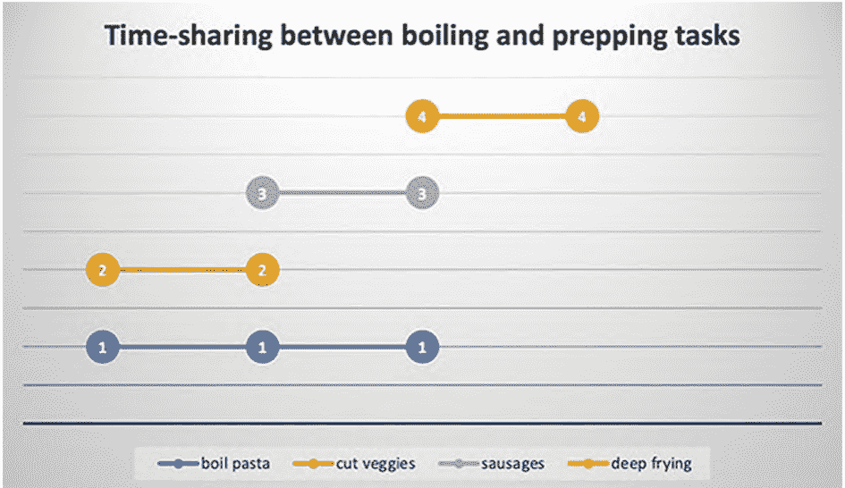

**图 1.1：** *分时并发 - I*

在上图中，线条代表在一段时间内运行的动作。同一时间段内出现两条线条表示同时进行的动作。

在这里，并发的关键部分是厨师同时做多件事情（加粗标记的项目），因为他们让意面在煮。在那个时间段内执行了多少个项目？它们是如何执行的？这些项目之间有什么关系？在此背景下重新审视并发的定义，它是多个（烹饪）任务的连贯执行，其中任务在逻辑上相关并以交织方式执行。

### 进度条示例

在下一个示例中，让我们看看从互联网下载大文件时会发生什么。进度条以图形方式显示已下载的文件量、剩余量以及当前进度；这就是**进度条**。让我们看看它是如何工作的：

1. 计算要下载的总字节数：b。
2. 确定进度条中的块数：n。
3. 计算每个块对应的字节数：b/n。
4. 开始下载数据。
5. 每次数据到达时计算当前总量：i。
6. 计算当前进度 p = i % n。
7. 渲染 / 确保在进度条中标记 p 个块。
8. 继续下载并重复以上步骤。

同样，让我们看看将两项活动绘制在时间图上会是什么样子：

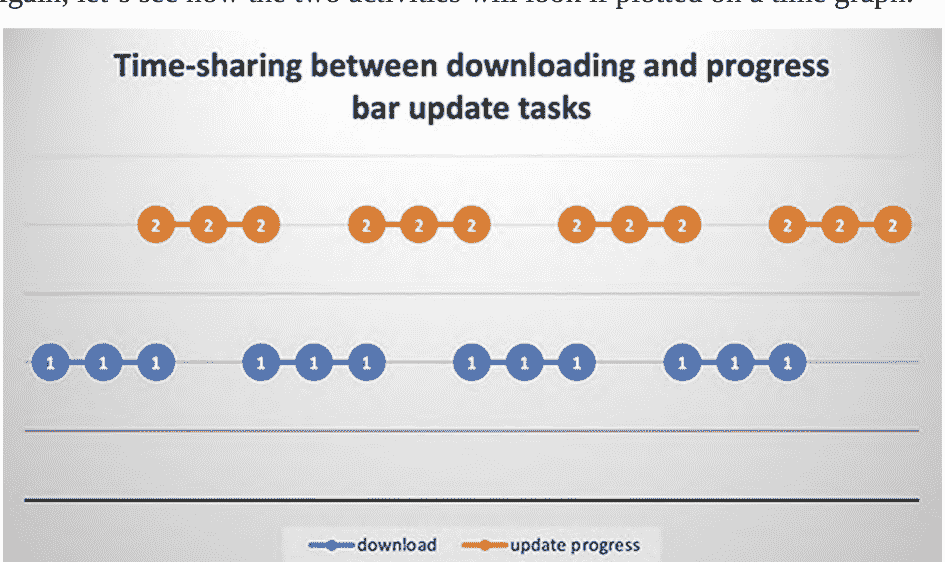

*图 1.2：分时并发 - II*

在这里，并发的关键部分是数据下载、重新计算进度和刷新进度条之间的交互。在那个时间段内执行了多少个项目？它们是如何执行的？这些项目之间有什么关系？在此背景下重新审视并发的定义，它是多个（下载）任务的连贯执行，其中任务在逻辑上相关并以交织方式执行。

### 垃圾回收

在一个更复杂的示例中，许多现代语言运行时采用一种称为垃圾回收的技术，即定期遍历运行时堆并清除过时的对象（程序数据）。这项活动通过在应用程序执行过程中利用少量 CPU 时间来完成，而不会妨碍其性能或产生明显的停顿。我们说垃圾回收与应用程序并发运行，其中垃圾回收和应用程序执行在逻辑上相关但在物理上无关，且动作以交织方式执行。

> **注意：** 并发的本质是单个资源通过分时方式实现多任务处理。

## 并行

编程中的并行是多个任务真正独立且并行地执行。任务可以在逻辑上相关或无关，但它们在物理上是分离执行的。任务独立执行。我们将通过多个示例来探讨这些方面：

考虑之前的做意面示例。如果这是一家拥有众多餐桌且在高峰时段忙碌的大型餐厅的一部分，那么将有许多厨师相互独立地制作意面。此外，还会有制作其他食物的厨师。

同样，让我们看看时间图：

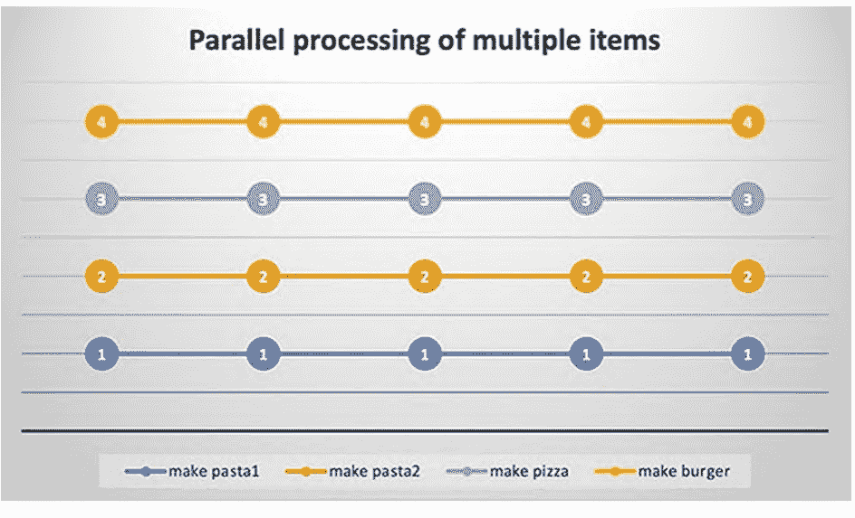

**图 1.3：无分时的并发**

### 分布式词频统计示例

在编程中一个更复杂的示例中，让我们看看在包含十亿条记录的大规模列表中经典的词频统计问题。为此，算法可能如下运行：

- 确定要运行的并行任务数量：n。
- 将记录分成 n 个相等的记录。
- 将每个记录分配给每个并行任务。
- 在每个任务中，遍历列表，搜索单词并进行计数。
- 遍历每个任务并累加每个任务收集到的词频计数。

总之，我们通过执行相互独立的相同或不同任务来实现并行。并行可以提升应用程序性能。

> 注意：并行的本质是多个资源无需分时即可实现多任务处理。

## 并发与并行

既然我们已经分别理解了并发和并行，我们将比较这两个概念并讨论它们之间的异同。这种区分在我们理解 Node.js 的某些原则时将至关重要。

### 相同点

- 在两者中，多个任务同时推进
- 在两者中，程序的响应性都得到提升

### 不同点

- 在并发中，同一时间只有一个任务运行，而在并行中，有多个任务同时运行


- 在并发（concurrent）中，一个资源在任务之间切换；而在并行（parallel）中，每个任务都有自己的资源。

在实际程序中，任务（task）本质上指一段代码块，而资源（resource）则指运行这段代码块的处理器。

带着这个概念重新审视这两个概念，我们可以推断出：
- 在并发中，一个CPU在多个代码块之间进行时间分片
- 在并行中，多个CPU运行多个代码块

这些代码块是否属于同一个程序，至少在我们讨论的语境下，是无关紧要的。

在高级程序中，CPU被抽象为**线程（Thread）**。进一步细化我们的区分，我们可以说多个线程并行运行，而单个线程在任务间切换运行则是并发的。

- 如果系统中有更多线程，为什么我们还需要切换任务？
- 哪种方式更高效——一个线程在'n'个任务间多路复用，还是'n'个线程并行运行n个任务？
- 在单个线程中切换任务的开销是什么？
- 何时适合切换任务？
- 从一个任务切换到另一个任务后，如何恢复/返回到第一个任务？

思考这些问题并尝试回答。我们将在下一节中解答。

## 并发与可扩展性

让我们讨论一下我们自身的情况。当一个Web服务器为许多客户提供服务时，它如何管理所有连接？如果服务器顺序处理客户端请求，后续的客户将会等待，最终，超时与否取决于同时请求数量。这是服务器可扩展性差的一个例子。

### 线程池

传统上，服务器实现通过两种类型的可扩展性来解决这个问题：垂直扩展和水平扩展。在垂直扩展中，创建、准备并管理一组线程（数量大致等于系统中的核心数），形成一个池，称为**线程池**。每个客户端请求在到达时，将由池中一个空闲线程接收，该线程为该客户端服务直至完成。这解决了可扩展性差的问题。

### 水平扩展

如果同时处理的客户端请求数量远高于服务器硬件中的核心数量，会发生什么？那么线程池会耗尽，场景又回到了第一种情况——客户端请求排队并最终超时。在这种情况下，会配置更多机器来运行相同的应用程序，并将请求分发给这些服务器。这恢复了所需的可扩展性。这被称为水平扩展。

这里的权衡是什么？在垂直扩展中，我们通过并行化请求处理来利用多核。然而，每个线程都伴随着相关的资源消耗——例如线程栈、工作内存、上下文切换、调度、锁竞争等等。类似地，在水平扩展中，我们在多个系统中复制服务器以进一步并行化请求处理。自然，每个硬件意味着更多的资源消耗。

总结一下，我们用额外的资源换取更好的可扩展性和响应能力。

我们能否在不损失响应能力且不增加更多资源压力的情况下，在单个服务器系统中容纳更多请求？如果我们要提高服务器的并发性而不是并行性呢？根据定义，并发程序使用单个线程进行多任务处理。那么，一个线程能否在多个客户端请求之间切换，并以交织的方式为它们服务？

回答这个问题将直接引向Node.js的原理。

### Node.js简介

既然我们已经学习了许多看似不相关的概念，让我们将它们整合起来，理解Node.js背后的支撑理论。

## 计算机系统中的延迟

你有没有想过计算机中不同操作需要多长时间？这取决于操作本身。下图粗略估计了单位量的数据从一个端点移动到另一个端点所需的时间。这里的端点是指计算系统中任何可记录的介质。

| 端点 | 延迟（纳秒） |
|---|---|
| 寄存器 | ~0（时钟频率的倒数） |
| 硬件数据缓存 | 10 |
| 主内存 | 100 |
| 辅助存储器 | 10000000 |
| 网络 | 15000000 |

*表1.1：端点间数据传输的延迟*

这是什么意思？由于某些设备（端点）的制造、安装和操作方式，以及供应商在设计这些设备时选择的成本与性能权衡，某些端点的数据移动可能更快，而某些可能更慢。例如，寄存器和主内存本身是处理器板的一部分。外部磁盘则需要与外部软件交互以及磁盘头的物理移动。换句话说，寄存器和内存绑定到CPU，而磁盘和网络则需要与控制硬件和软件进行输入输出操作。涉及输入输出设备的操作通常称为I/O操作，因此，这类操作被称为绑定到I/O。

这意味着算术运算（如两个数相加）并将结果存储，将比从磁盘获取类似数据快得多。更不用说，这两种操作的延迟差异巨大，无可比拟。

## CPU绑定操作与I/O绑定操作

涉及CPU绑定设备的操作——上表中的前三个端点，即寄存器、缓存和主内存——称为CPU绑定操作。涉及I/O绑定设备——辅助存储器（磁盘）和网络——的操作称为I/O绑定操作。

> **提示**：CPU绑定操作通常比I/O绑定操作快百万倍。

这里需要提一个特殊情况。延迟比较基于一个假设，即端点已准备好发送和接收相关数据。这在CPU绑定操作中总是如此，而在I/O绑定操作中则不然。如果服务器的写入速率高于客户端的读取速率，导致操作系统内核中的网络传输缓冲区已满，会怎样？如果客户端在服务器写入时没有读取，又会怎样？根据端点的设计功能，已启动的数据传输可能现在发生、稍后发生，或者永不发生！前表中显示的延迟值是在两端都准备好传输数据时测量的。

如果一个端点启动了数据传输（读/写），而另一个端点未准备好或出现显著延迟，启动数据传输的拥有线程将被视作阻塞在I/O上。等待I/O完成的线程通常会被操作系统调度程序移出调度队列，其拥有的CPU将被用来运行其他程序，从而使得当前进程中的该线程处于休眠状态。

## Web工作负载的特征

科学计算主要是CPU绑定的应用，因为它涉及大量对已存在于寄存器或主内存中的数据的操作。而聊天应用程序则是I/O绑定的，因为它涉及大量对来自网络或发送到网络的数据的操作。Web服务器是CPU绑定和I/O绑定工作的良好混合体。每个连接的客户端至少需要两次I/O操作（一次入站请求和一次出站响应）。如果客户端发出多个请求，I/O操作的数量也会成倍增加。此外，服务器会在请求和响应之间执行一些操作，这些操作可能是CPU绑定的活动，甚至可能是I/O操作。总结来说，一个满负荷的Web服务器将包含众多的I/O绑定活动。

## 引入可扩展性上下文

进一步分析，如果你分析Web服务器中的单个请求，你可以看到它：
- 接受客户端连接
- 读取客户端请求
- 解析客户端请求
- 执行一些计算
- 准备响应
- 写回给客户端
- 关闭连接

在服务器执行的这七个操作中，前两个和最后两个是I/O绑定的。假设整个序列完成需要1毫秒。这些任务之间的时间分配会是怎样的？鉴于本节开头的延迟理论，比例可能是99.9999:0.0001，甚至更加悬殊。


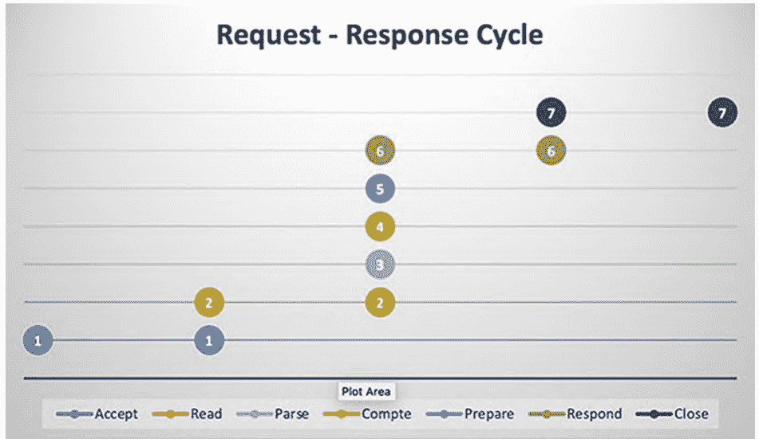

图 1.4：请求-响应周期中的任务分工

这意味着，如果你在某个有代表性的时间点查看处理请求的线程，它可能正处于等待状态——等待输入或等待写出输出。因此，由于存在大量 I/O 操作，即使服务器处于满负荷运行状态，在典型的 Web 工作负载下我们观察到的 CPU 利用率也不到 20%。

所以现在我们已经识别出了两个问题：

- 单个线程不足以处理同时到达的客户端请求（即我们之前讨论过的可扩展性问题）
- 单个线程在大部分服务时间（请求-响应阶段）中都处于未充分利用的状态（因为 I/O 操作的大量存在，而 I/O 操作耗时远大于计算操作）

第一个问题可以通过线程池来解决——正如我们之前讨论的，它有自身的权衡代价——即相应地较高的资源消耗。第二个问题则是一个新发现。如果我们把这两个问题关联起来，综合出新的方式来运行工作负载，情况会好转吗？

一方面，单个线程不足以处理所有负载；另一方面，单个线程本身大部分时间都在空闲！线程的空闲时间本可以被利用来运行系统中的其他进程——但在一台生产级服务器计算机中，除了服务器进程本身，并没有太多其他关键进程。所以这并不是什么有效的解决办法，也提供不了多少收益。

如果让空闲的线程去处理另一个等待中的客户端呢？（反复思考这个问题。如果你已经想到了这一点，请给自己点个赞！这个想法正是围绕 Node.js 技术创新的核心所在；剩下的只是实现细节。）

## 回顾异步编程的背景

是的，这是可行的。在前面的章节中，我们已经看到过这样的案例：一个正在运行的程序被异步中断，执行一个无关任务，然后恢复主程序流程。如果我们在这里复用这种技术呢？具体做法是：

- 处理第 n<sup>个</sup>客户端请求，直到遇到一个慢速 I/O 操作
- 将线程从第 n 个请求中分离
- 将线程绑定到第 n+1 个请求
- 处理第 n+1<sup>个</sup>请求，直到完成或同样遇到慢速 I/O
- 回头检查第 n<sup>个</sup>请求，看它是否现在可以继续执行
- 如果可以，则循环重复上述逻辑
- 如果不行，则转去处理第三个请求，即第 n+2<sup>个</sup>请求，并重复该循环

简而言之，我们可以在多个客户端请求之间异步运行单个线程，就像我们在之前的示例中异步运行中断信号或控制多媒体流一样，主要区别在于：

- 异步是内部触发的，而非外部触发的
- 异步是在遇到慢速 I/O 时触发的

异步的实现方式是并发运行不同的代码块，就像我们之前并发地煮意面、下载带有进度条的大文件或运行垃圾回收一样。需要注意的要点是：

- 单个线程在多个客户端请求之间进行多路复用
- 单个线程尽可能地向前推进，不受先前工作的限制
- 主程序流和辅助程序流之间没有区别——所有都是主流程

通过这些调整，我们能取得什么成果？如果多路复用是完全的，我们可以执行一百万个 CPU 密集型操作，而不是一次阻塞 I/O——因为这正是 I/O 延迟与 CPU 延迟的比值。这是一个巨大的收益！但这是否意味着我们可以并发处理一百万个客户端？可能不行。每个任务作为请求处理的一部分，都需要一些 CPU 密集型处理。因此并发的收益会小于这个数字。

然而，与现有的替代方案相比，这种机制提供了极高水平的并发性。由于线程不再空闲，切换发生在进程内和线程内，每个任务都能充分发挥其能力。在任何给定时间点，没有任务在等待分配资源，也没有任何额外的资源分配！

到目前为止一切顺利。现在，我们需要解决两个问题来实现这种并发任务执行：

- 管理 I/O 多路复用
- 管理上下文切换

每个问题将在各自的章节中讨论。

## 回顾事件驱动架构的背景

还记得事件驱动架构的定义吗？一种程序流由事件控制的范式。在并发执行的上下文中，我们需要事件。更具体地说，我们需要能够触发程序流变化的事件。根据我们的算法，主要的程序流变化包括：

- 遇到 I/O，需要暂停当前流程并引入新流程
- 遇到 I/O 完成，需要恢复旧流程

Node.js 架构的核心正是解决这两个方面。使用 Node.js 的原生术语，这可以表述为：

- 将阻塞 I/O 转换为非阻塞 I/O
- 创建并推送与 I/O 相关的事件
- 继续执行其余代码
- 当 I/O 完成时，触发匹配的事件
- 通过调用其续延处理程序来处理事件

通过这种方式自定义单个线程，I/O 多路复用成为可能。许多操作系统提供了将阻塞 I/O 转换为非阻塞 I/O 的方法，并允许稍后"轮询"系统以查看 I/O 是否已完成。同样，由于我们保存了 I/O 发起时的上下文，在 I/O 完成后调用完成处理程序/续延处理程序也是可行的。

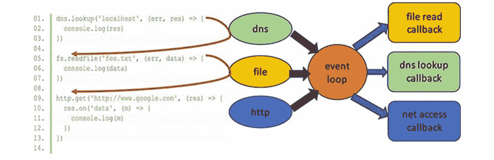

图 1.5：Node.js 的事件驱动架构

在这个架构图中，左侧面板中有代码块：一个"dns"查询、一个文件读取操作和一个网络访问——所有这些都需要大量 I/O 周期，并且可能会阻塞线程。在 Node.js 中，处理这些操作的 API 抽象被设计为不会阻塞的方式。相反，它们在创建事件并将其与完成处理程序函数绑定后，发起非阻塞 I/O。线程立即返回，如红色箭头所示。当每个事件实际被触发时，事件被拾取，绑定的函数被识别，并以 I/O 操作的结果作为输入进行调用。这个过程重复进行，直到所有事件都被处理完毕。

管理事件生命周期的主要组件称为**事件循环**。有了这种设置，事件会在它们实际发生的时刻被处理。此外，线程也不会等待 I/O 完成。这解决了我们上述提到的两个问题：多线程的问题和线程在 I/O 上阻塞的问题。当 I/O 变为非阻塞时，线程持续处于工作状态，以时间共享的方式执行多个任务，其中时间片的划分由事件的发生来决定。现在，如果我们在一个负载合理的服务器应用中对 Node.js 单线程进行性能分析，我们会看到其平均 CPU 消耗在 90% 以上——这表明了高效的并发性。这与 Web 工作负载完美契合。

此时，我们已经准备好回顾之前遇到的所有问题，并尝试在新架构的背景下解释它们。

**为什么在系统中拥有更多线程的情况下，我们仍要切换任务？**
这是因为：

- 线程是昂贵的——它们消耗资源
- 线程在 I/O 工作负载下利用率低下

因此，如果工作负载包含同构的事务类型（如 Web 服务器示例中的请求-响应周期），并且这些事务包含大量 I/O，那么使用单个线程切换任务在资源消耗和 CPU 利用率方面都是有益的。

**哪种方法更高效：单个线程在'n'个任务之间多路复用，还是'n'个线程并行运行 n 个任务？**

如果这里的效率是以单位资源消耗所完成的任务数来衡量的，那么正如架构所示，单个线程在'n'个任务之间多路复用比另一种方式高效得多。

单个线程被视为：

- 利用了其分配的大部分 CPU 份额
- 在 I/O 事件发生时及时响应
- 同时处理多个客户端请求

**在单个线程中切换任务的开销是什么？**


## 回归函数式编程的上下文

一般来说，开销在于保存即将退出的任务上下文并恢复即将进入的任务上下文。在 Node.js 中，上下文的保存和恢复是通过一种称为**闭包**（Closure）的 JavaScript 基本原语来实现的，我们之前在函数式编程部分已经学过。

```
1. function foo(p1) {
2.   let l1 = 10
3.
4.   function bar(p2) {
5.     // access p1, l1 and p2
6.     // from the original context
7.   }
8.
9.   anAsyncIOMethod(i1, bar)
10. }
```

根据闭包函数的定义，在上面的例子中，**`foo`** 是一个嵌入了闭包函数 **`bar`** 的函数。除其他方面外，闭包最重要的特性在于：在定义时（当 **`foo`** 被调用且控制流到达上面代码的第 4 行时），会创建一个闭包上下文，其中定义了函数 **`bar`** 以及外部函数 **`foo`** 中变量的值。当 **`bar`** 实际被调用时，它可以访问自身的参数（p2）、外部函数的局部变量（l1）及其参数（p1）。因此，假设某个 IO 例程通过 **`anAsyncIOMethod`** 被调用，该方法向事件循环注册一个 IO 事件并立即返回，那么当 IO 实际完成时，它将通过 **`bar`** 恢复其后续执行。由于 **`bar`** 是一个闭包函数，它*`记住`*了创建它的上下文。因此，当 **`bar`** 被事件机制调用时，它能够访问到异步方法被调用时的"旧"上下文。

总而言之，闭包函数为在 Node.js 中实现事件驱动架构以及异步编程提供了强大的构建模块。它们大多被用作异步方法的完成处理函数或续延函数。

何时适合切换任务？

当当前运行的任务已经耗尽了其所有活动，或屈从于一个异步（I/O 密集型）活动时，就适合切换。在发起 I/O 操作并注册其完成事件之后，线程切换到下一个任务。实际上，异步调用会像已完成一样直接返回，随后的代码会被执行。稍后，当异步活动完成时，相关的完成处理函数（通常是闭包函数）会被调用。

完成处理函数必须是闭包函数吗？

不一定。我们只在希望恢复异步方法先前被调用时的原始上下文时，才希望完成处理函数是闭包函数（因为闭包函数会记住其创建环境）。如果完成处理函数执行的是纯代码，不依赖于系统中的任何其他部分，那么它也可以是一个普通函数。

## 核心 Node.js 特性

既然我们已经理解了 Node.js 为我们开创的基于事件驱动架构的异步编程的基本前提，让我们快速了解一下该平台的一些显著且有趣的特性。我们稍后会深入展开其中许多方面。本节旨在提供一个关于其核心特性的快速概览。

## 架构

为 Node.js 提供 JavaScript 运行时环境的核心解释器是 'v8'。该组件负责执行通用 JavaScript 代码。事件机制被称为事件循环或 **libuv**（即该项目的名称），用 ANSI C 编写。有许多 API（尤其是异步 API）是模块或函数，为程序员提供纯 JavaScript 接口。在底层，这些 API 通过一个名为"wraps"的 C++ 中间层与事件循环进行交互。Node.js 用 C++ 编写，将这些组件集成在一起，并协调异步事件驱动的 JavaScript 编程。

## API

许多 Node.js API 在规范上就是异步的。对于大多数异步 API，也提供了同步的对应版本——以便为某些不遵循异步理念的用户程序提供便利。

许多 API 是事件发射器（Event Emitter）。这意味着这些 API 中的许多对象都具备管理事件的能力。这是一个关键的 Node.js 抽象，有助于通过 JavaScript 语义来处理事件机制。

> **注意：** 事件发射器类中著名的 ".on" 原语从技术和理念上都象征着事件驱动架构——其极具表现力的语义表达为："当此对象上发生某个事件时，调用该函数"。许多实现事件处理的 API 都继承自事件发射器类。

少数 API 以平台无关的方式抽象了通用基础能力，如操作系统调用。我们知道，为非原生语言抽象原生能力对于其可用性至关重要。

## Stream（流）

Stream 只是另一种 API，但在此需要特别提及。根据定义，Stream 是流动的数据。在事件驱动架构的背景下，如果数据以流动的方式（而非静态方式）处理，那么程序数据的产生、分隔、聚合、传输和导出会更加高效。这是因为参与程序数据处理的多个端点可能处于不同的生命周期阶段，而实现本质上能够处理流动数据的代码块可以提供最佳性能。许多处理磁盘和网络 I/O 的 API 都采用 Stream 来满足其主要的数据传输和管理需求。API 规范中定义了可读流、可写流、双工流和转换流。Stream 是事件发射器，与之关联的生命周期事件列表很长。

## 小核心理念

Node.js 平台大获成功的原因之一（除了高性能的 I/O 工作负载之外）是其小巧的占用空间和快速的启动速度，这使其成为容器化工作负载的天然选择。这通过以下方式实现：

- 保持 Node.js 核心尽可能精简
- 将所有依赖代码构建到单个二进制文件中
- 仅在核心中实现最常用的功能

这意味着 Node.js 没有单独的企业版或标准版；我们拥有的只是一套简单的核心 API。任何额外的需求都通过称为 'npm' 模块的用户空间扩展来满足。

> 注意：Node.js API 在底层网络能力（如 TCP、HTTP、文件系统等）之上提供了定义良好的高级抽象。因此，这些被称为核心能力。在核心能力之上构建的扩展能力通常在 Node.js 核心之外以库的形式实现，称为"用户空间"（userland）。

## npm

NPM 代表 **Node Package Manager**（Node 包管理器）。它是一个内置组件，定义了可重用的 Node.js 库和模块（也称为 **npm** 模块）的管理能力。小巧的核心与集成可重用模块的能力相结合，显著提高了 Node.js 应用程序的开发效率。在撰写本文时，npm 仓库托管着全球最大的软件库。

## 总结

在本章中，我们学习了高并发 Web 工作负载的基本前提以及 Node.js 的异步事件驱动编程。我们还理解了这种编程风格为何天然适合上述类型的工作负载。为了理解这种编程风格，我们学习了并发、并行、可扩展性、函数式编程等概念，然后将这些概念综合起来，在这些实体的背景下学习了 Web 工作负载的典型性能特征。接着我们学习了如何将 CPU 密集型和 I/O 密集型任务分离，并在多个任务之间进行多路复用，同时使 I/O 密集型任务变为非阻塞和基于事件的，从而实现高水平的性能。我们将此理解为 Node.js 架构背后的关键理念。我们还了解了 Node.js 的一些独特特性，这些特性在我们设计 Web 服务器应用时将会非常有用。

在下一章中，我们将介绍运行所开发 Web 应用程序的基本前提条件，以便我们快速启动 Web 服务器开发工作。虽然这些前提条件适用于开发阶段，但其中许多在生产阶段也需要加以考虑。

## 要点记忆

- CPU 密集型操作比 I/O 密集型操作快得多
- Web 工作负载——无论是客户端还是服务器端——都是 I/O 密集型的
- 传统的阻塞 I/O 行为会消耗大量 Web 程序资源
- Node.js 将阻塞 I/O 转换为非阻塞 I/O
- Node.js 异步发起和推送 I/O 任务并进行任务切换
- JavaScript 及其函数式语义被巧妙地选择来配合事件驱动架构
- 在此模型下，Node.js 为 Web 程序提供了前所未有的扩展密度
- Node.js 利用 'v8' JavaScript 引擎来执行 JavaScript 代码
- Node.js 利用 'libuv' 来管理事件生命周期
- Node.js 遵循"小核心"理念，配合大量提供通用扩展能力的第三方可重用模块
- 'npm' 是 Node.js 内置的包管理器，促进 Node.js 应用程序与上述可重用模块的无缝集成


# 第2章

## 搭建环境

本章将介绍运行我们所开发的 Web 应用程序所必需的前提条件。在此，我们的目标是仅利用 Node.js 平台从零开始构建一个 Web 服务器。前提条件虽然不多，但为了使我们的应用能够作为一个稳定、可处理实际负载的 Web 服务器运行，我们仍需做出一些细致的决策。虽然这些决策主要适用于开发阶段，但其中许多同样适用于生产环境的考量。这主要是因为 Node.js 并没有针对标准应用和企业应用区分不同的版本。

## 本章结构

本章将涵盖以下主题。通常，它们涉及选择：
- 应用开发平台
- Node.js 版本
- 依赖项
- 资源需求
- 代码编辑器

## 本章目标

学习完本章后，你应当能够理解从零开始开发 Node.js 应用程序的前提条件。这包括了解支持的平台、常见的开发工具和依赖项、Node.js 版本的选择标准、其资源使用情况等。

## 平台选择

目前（截至撰写本书时）有多个平台（共14个）支持 Node.js。一级平台包括 Linux、Windows 和 MacOS，这意味着 Node.js 的发行版本在这些平台上得到了最好的重点维护。因此，我们的讨论将只围绕这些平台展开。

Linux 和 Windows 是常用的操作系统，无需赘述。MacOS 是 UNIX 的一个变体，它融合了命令行编程和 UNIX 操作系统语义的最佳特性，以及 Microsoft Windows 的图形用户界面体验。虽然这三种平台在实现本书目标方面都同样出色，但如果允许表达个人偏好，我们推荐 MacOS 作为应用开发平台，因为其界面提供了更佳的用户体验。

这些平台在 Node.js API 抽象方面差异很小。例如：信号、路径分隔符、文件权限、用户资源限制设置在 UNIX 和 Windows 上的 Node.js 中工作方式不同。然而，这些差异源于底层平台本身的差异，因此是微不足道的，并且开发者们已经非常熟悉。例如，Windows 使用反斜杠（'\'）作为路径分隔符，而 MacOS 和 Linux 使用正斜杠（'/'）。这些根本性差异在 Node.js API 文档的相关页面中有详细解释，并通过示例加以说明。

> **提示：** 支持的平台（操作系统和底层架构）、内核和 C 运行时版本以及支持层级结构的完整列表请参见此处：

> [https://github.com/nodejs/node/blob/master/BUILDING.md#platform-list](https://github.com/nodejs/node/blob/master/BUILDING.md#platform-list)

> 同一页面也提供了详细描述和额外的平台特定说明。

## Node.js 版本选择

Node.js 主版本号为偶数的版本是**长期支持 (LTS)** 版本。例如，v10.x、v12.x、v14.x 等。这意味着它们提供了一组成熟的、长期支持的、向后兼容的 API。通常，LTS 版本会得到为期一年的积极支持，然后进入为期 18 个月的维护模式。有关详细的发布周期和支持流程信息，请参阅此处：[https://nodejs.org/en/about/releases/](https://nodejs.org/en/about/releases/)

截至撰写本书时，我们将采用 v14.x，因为它处于积极的 LTS 阶段。你可以在 MacOS 上从 [https://nodejs.org/en/](https://nodejs.org/en/) 安装 Node.js。在大多数情况下，默认配置就足够了。

下图是安装程序介绍对话窗口的截图：

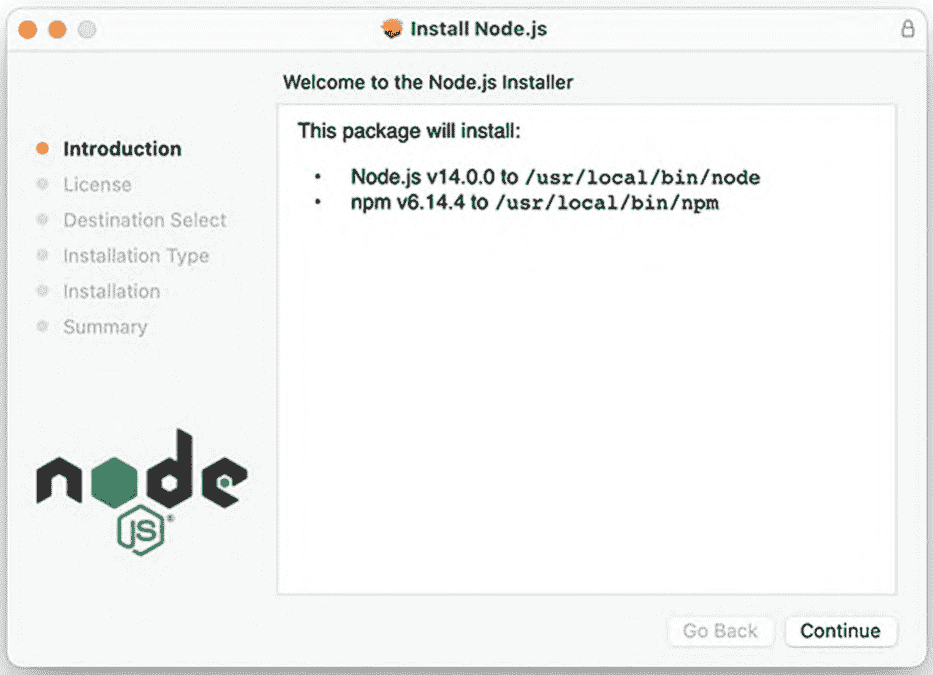

**图 2.1：** *Node.js 安装步骤 1：介绍*

下图显示了下一步骤——许可协议的截图：

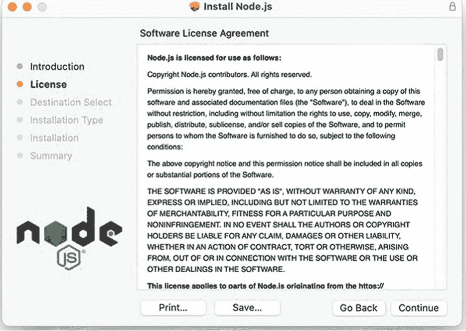

**图 2.2：** *Node.js 安装步骤 2：许可*

下图是许可协议对话窗口的截图：


**图 2.3：** *Node.js 安装步骤 3：接受许可协议*

接下来，安装程序检查文件系统以进行安装，并验证磁盘空间，如下所示：


**图 2.4：** *Node.js 安装步骤 4：选择目标位置*

随后，安装程序允许你选择目标位置，如下所示。它还提供了安装的额外自定义选项：


**图 2.5：** *Node.js 安装步骤 5：安装类型*

收到所有用户输入后，安装程序开始安装，如下所示：


**图 2.6：** *Node.js 安装步骤 6：开始安装*

下图是安装进度的截图：

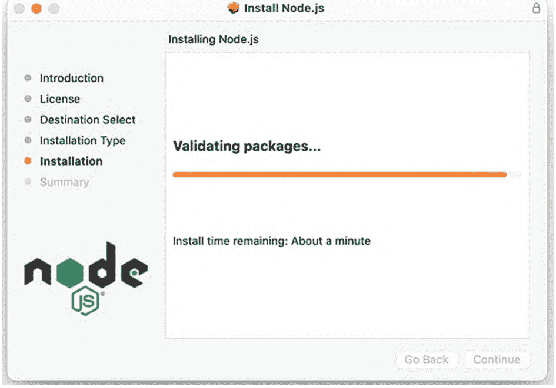

**图 2.7：** *Node.js 安装步骤 7：安装进度*

最后，安装程序显示安装摘要，如下所示：

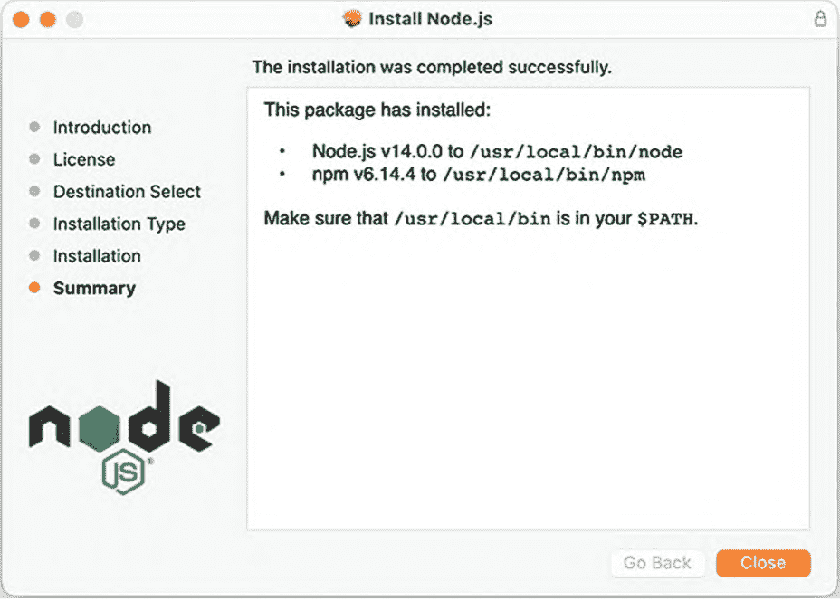

**图 2.8：** *Node.js 安装步骤 8：安装完成*

最后，我们可以按如下方式确认安装和版本：

Microsoft Windows：

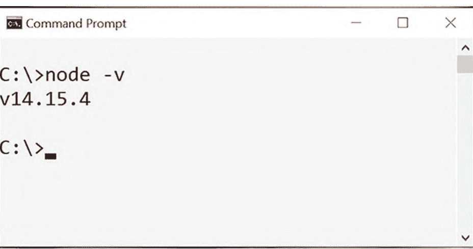

*图 2.9：* 在 Windows 中验证 Node.js 安装和版本

Linux 和 MacOS：


*图 2.10：* 在 UNIX 中验证 Node.js 安装和版本

## 依赖项选择

回顾本书标题，我们的目标是仅利用 Node.js 核心 API 从零开始开发一个 Web 应用程序。这意味着我们没有任何第三方 node 模块的依赖。

## 资源需求

虽然在生产环境中托管我们的服务器需要满足大规模系统需求，但对于开发目的而言，这些需求可以简单且微不足道。一些最低要求如下：

- **内存：** 8 GB
- **磁盘：** 2 GB
- **CPU：** 2GHz 频率

> **注意：** Node.js 的主要成功因素之一是其极低的资源需求。作为一个单一的可执行二进制文件，Node.js 是许多平台的首选运行时，在这些平台上，应用栈通过运行时编排进行引导。

## 代码编辑器选择

本书没有对任何特定编辑器做出静态假设，我们也没有使用任何编辑器的特定功能。你可以使用你最喜欢的编辑器来开发应用程序。首选是‘vi’编辑器。

任何 JavaScript 编辑器都能很好地用于 Node.js 开发。常见的 JavaScript 编辑器/IDE 如下。使用一个复杂的、专用编辑器的一个关键优势是语法高亮，更不用说许多其他酷炫的功能了。

- ‘vi’编辑器（UNIX 系统默认自带）
- ‘notepad’（Windows 系统默认自带）
- Visual Studio Code：[https://code.visualstudio.com](https://code.visualstudio.com)
- Sublime Text：[https://www.sublimetext.com](https://www.sublimetext.com)
- Atom：[https://atom.io](https://atom.io)

## 本章总结

本章我们学习了关于使用 Node.js 进行应用开发的执行环境和系统需求的诸多方面。这包括 Node.js 支持和推荐的平台、Node.js 版本选择及其长期支持理念、资源需求以及代码编辑器考量。在下一章中，我们将探讨网站开发者的一些基本考量，例如架构、功能特性、性能、安全性和可调试性。学习这些将使我们能够编写出可在真实商业环境中使用并能长期维护的代码。


# 第 3 章
Web 服务器简介

在本章中，我们将正式介绍 Web 服务器的概念并定义其核心组件。此外，我们将探讨网站开发者的基本考量和关注点。我们将确定 Web 服务器的组成部分，并了解在开发高效 Web 服务器时可以遵循的最常见最佳实践。这些考量中的大部分内容将在后续章节中，当我们处理 Web 应用程序的具体组件时，被延续、详细讨论并加以利用。就此而言，为了保证内容的完整性，我们在此介绍相关概念，然后继续深入。

## 结构

在本章中，我们将涵盖以下主题：

- Web 服务器简介
- Web 服务器基本组件
- Web 服务器的关注点与考量
- Web 服务器考量：架构
- Web 服务器考量：性能
- Web 服务器考量：安全性
- Web 服务器考量：可靠性
- Web 服务器考量：可扩展性
- Web 服务器考量：可维护性
- Web 服务器考量：可服务性
- Web 服务器考量：可观测性

## 目标

学习本章后，你将能够理解 Node.js 关于异步编程与事件驱动架构的哲学。在达成该目标的同时，你还将理解与工作负载效率相关的概念、Web 工作负载的性能特征，以及资源使用与性能之间存在的各种权衡。你还将学习一些与我们开发 Web 应用程序目标相关的 Node.js 核心特性，并理解现代 Web 服务器应用程序的基本定义及其内部构成。此外，你将理解构建 Web 服务器时的主要考量因素及其对该 Web 服务器特定能力的影响。具体而言，你将理解软件工程原则如何应用于 Web 服务器：架构、性能、安全性、可靠性、可扩展性、可维护性、可服务性和可观测性。在构建我们的 Web 服务器应用程序并处理单个组件时，这些学习内容也将非常有用。

## Web 服务器简介

Web 服务器是通过网络向客户端提供 Web 内容的软件。内容可以是预定义和手写的静态页面、动态生成的 HTML 页面，或者是其中之一或多者的组合，也可以是从另一个软件获取的多媒体内容。根据服务器处理的具体用例，服务器可能会在其执行范围内执行一系列操作。生成的 Web 内容可以被视为这些操作的体现或最终产物。下图展示了一个 Web 服务器的最简单形式：

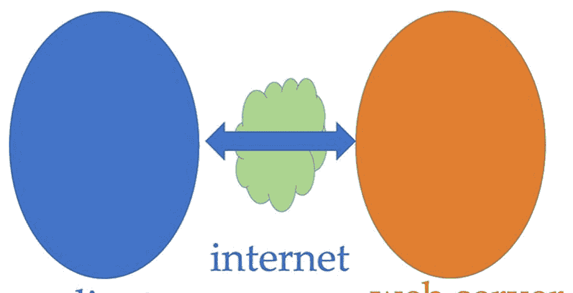

图 3.1：简单的 Web 服务器架构

Web 服务器代表了软件工程演进中的一个重要阶段。Web 服务器代表了无需支付许可费即可使用的高度可重用软件。将软件托管在中心位置并通过定义良好的协议通过公共网络使其可访问，极大地提高了其可达性和可重用性。

## 核心组件

虽然很难将目前在用的数百个（甚至数千个）Web 服务器架构概括起来，但 Web 服务器的组件构成在此描绘：

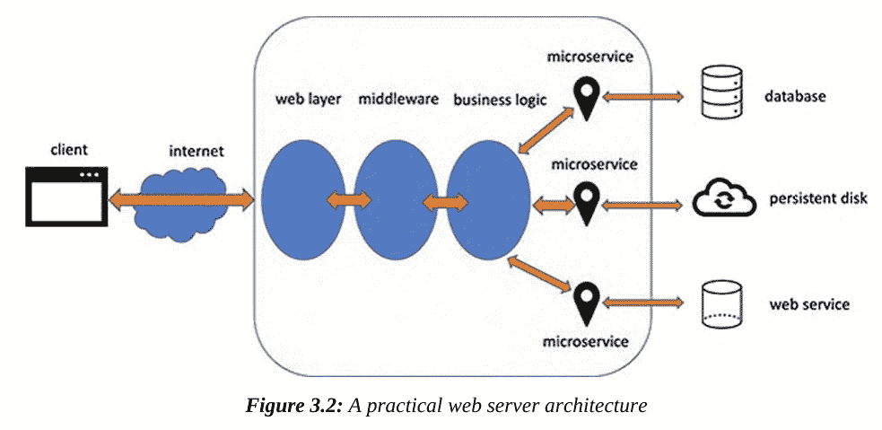

### 客户端 (Client)

客户端是消费 Web 服务器服务的实体。通常这是一个 Web 浏览器，但也可以是命令行工具或任何能够理解与 Web 服务器通信协议的自定义程序。在最常见的用例中，通信是通过互联网进行的。

### Web 层 (Web layer)

该层充当后端组件的代理。Web 层拦截来自客户端的请求。同时，它将响应组合成客户端可呈现的形式。

拥有这一层的优势在于能够抽象异构类型的客户端——桌面浏览器、移动设备、传感器、测试工具等——使其能够无缝地与 Web 服务器交互，并且不同端点之间不同的通信风格无需超出 Web 层的范围。

### 中间件 (Middleware)

广义上的中间件是一个连接分布式计算系统中各种实体的软件组件。在 Web 服务器的语境下，中间件简单来说就是“请求-响应管道”。也就是说，对客户端请求和服务器响应的所有处理都在中间件中管理。请求数据在传递给后端组件之前，先从请求对象中被解析和提取。同样，在请求-响应管道的返回路径上，响应数据在中间件中被组合到响应对象中。

> **提示：** Web 中间件的关键功能是：管理请求数据、实现会话（session）以及管理协议标头。

中间件组件的优势在于业务逻辑层与 Web 服务器层之间有清晰的隔离；换句话说，这就是关注点分离。当我们的 Web 服务器成为调试、漏洞修复、扩展、增强和架构重构的对象时，这种模块化就派上用场了，因为开发人员可以轻松地识别并专注于正确的代码。

### 业务逻辑层 (Business logic layer)

该层实现了 Web 服务器的核心业务逻辑。例如，如果我们正在构建一个航班预订应用程序，业务逻辑层将实现：

- i. 预订/取消功能
- ii. 航班时刻表查看功能
- iii. 至少包含一个客户个人资料管理系统

在这种情况下，业务层将作为三种能力的组合，而这三种能力被委派给架构图中接下来的各个微服务。在另一个自然语言处理应用程序的例子中，业务逻辑层将实现以下内容：

- i. 数据接收和准备功能
- ii. 语言处理流水线功能
- iii. 数据聚合和呈现功能

业务层将简单地作为这些离散能力的容器，而实际的能力则在单个子组件中实现，或者被构建成可从业务层调用的微服务。

业务层的优势显而易见：它包含与 Web 服务器业务相关的核心逻辑，并且容易受到用户和客户需求变化的影响。开发人员能够在不担心服务器其他功能部分的情况下增强逻辑。

### 微服务层 (The microservice layer)

该层专注于业务逻辑的某个特定方面。在上述航班预订的例子中，微服务实现了预订或取消、时刻表查看和客户个人资料管理功能。为了实现上述功能，这些服务可能会利用架构中更下游服务的能力，或者通过互联网访问远程 Web 服务的能力。

业务层的优势同样适用于微服务，因为它们是业务层本身的专业组成部分。此外，微服务的生命周期可以独立管理。这意味着如果我们发现某个特定的微服务是整个应用程序的性能瓶颈，我们可以对其进行扩容以分担负载并缓解瓶颈。这是因为服务与应用程序的主干是松耦合的，因为通信是通过网络进行的，而不是直接的函数调用。

总之，微服务架构为应用程序提供了极高程度的灵活性。在作为应用程序至关重要组成部分的同时，它在本质上又与应用程序解耦，从而实现了独立的生命周期管理。

> **注意：** 我们将 Web 服务器定义为向客户端提供 Web 内容的软件。Web 服务器的主流用例还包括从客户端接收内容。例如填写表单、上传文件等。这些用例并没有改变 Web 服务器的任何前提、架构或设计；它只是反转了请求-响应管道中的数据流向。

## Web 服务器的关注点与考量

理解 Web 服务器架构中固有地存在的问题，并确定围绕这些问题的最佳实践，以便在软件架构的光谱中正确界定 Web 服务器的定位。让我们将 Web 服务器软件与一个提供简单软件功能的简单桌面应用程序进行比较


### 桌面应用与Web服务器的比较

这两种系统在符号上表示如下：

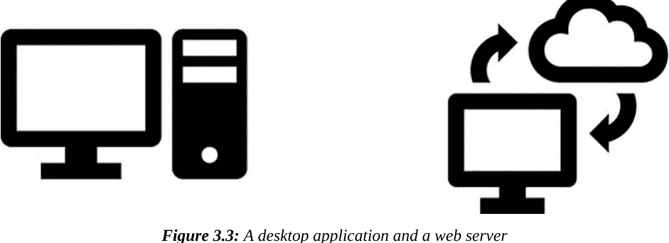

#### 相似之处

-   桌面应用和Web应用都由用户（客户端）操作驱动。
-   桌面应用和Web应用都执行计算。
-   桌面应用和Web应用都产生结果。

#### 不同之处

-   桌面应用是单独安装在客户端系统上的，而Web应用是安装在中央位置（例如服务器硬件）上的。
-   桌面应用可能需要向供应商支付许可费，而Web应用则不需要。
-   在桌面应用中，用户操作被直接转换为触发处理操作（很可能是直接的函数调用）的事件。另一方面，在Web应用中，用户操作首先被转换为请求，该请求被封装在一个协议下，然后通过网络发送到服务器。在服务器端，执行相反的操作：终止协议，解析并处理请求。
-   在桌面应用中，处理过程消耗的计算资源会影响用户界面，反之亦然。换句话说，用户界面和后端图像处理都在同一个操作系统进程中存在和运行。在Web应用中，这两者是完全解耦的——用户界面和请求处理操作在不同的进程和计算机系统上执行，并且可能运行在不同的操作系统上。这个看似微不足道的差异对Web服务器架构以及我们稍后将探讨的各种问题有着显著影响，请思考这一点。
-   桌面应用一次只能由单个用户使用，而Web应用本质上是多用户的。这意味着单个Web服务器进程可能同时处理多个客户端——回想一下我们在第一章学到的并发主题。
-   在桌面应用中，处理后的请求在视图中渲染的延迟几乎为零，而在Web应用中，这取决于几个因素，如网络速度、并发连接数、服务器实例复制数等。
-   桌面应用免受外部干扰，而Web应用则容易受到各种威胁，因为两层（客户端和服务器）之间存在公共介质。
-   如果托管系统崩溃，桌面应用的可靠性会降低。Web应用可以通过提供快速恢复机制（包括复制）来实现高度可靠。
-   桌面应用的状态代表当前用户的会话。Web应用的状态代表所有当前连接用户的会话。这意味着，要调试应用问题，Web应用需要特殊的日志记录机制，以便将运行时状态和应用状态定制到特定用户的上下文。

还可以列出更多差异——无论是可观察到的还是推导出来的，但我们现在就讨论到这里。这次比较的主要意图是从架构上剖析这两种软件，展示它们之间存在的差异以及各种权衡。这种区分将直接引导我们详细讨论每一种差异的优缺点。而关注Web服务器架构相对于桌面应用的缺点，将直接引导我们走向开发服务器软件的最佳实践，这些最佳实践将构成本书剩余部分的大部分内容。

> **注意：** 令人惊讶的是，即使软件组件的架构发生微小变化，也会导致巨大的分歧。在其他因素中，它强调了架构角色的关键重要性，以及为什么我们在开发软件时应该在架构上投入足够的时间。

### Web服务器考量：架构

Web服务器的核心是一个提供Web内容的服务端实体。服务器的最简单表示如下图所示：

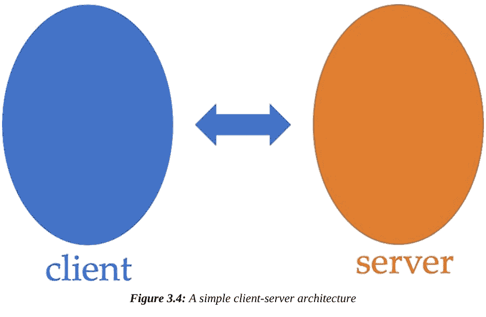

在前面的图中，客户端可以是浏览器、爬虫或任何遵循网络协议与服务器通信的软件。然而，为了获得持久的客户端-服务器体验，服务器需要在某些方面具备资格，以使上一节讨论的特性不会给Web服务器带来任何问题。架构，通常是一组组件及其交互。最常见的Web应用架构是客户端-服务器架构、点对点架构和微服务架构。在上面的图中，服务器是一个封装了许多功能的单一实体。这对于可视化来说没问题，但在现实世界中，一个处理众多事务的单一程序在各种情况下都无法正常运行或扩展。

#### 微服务架构

一个显而易见的解决方案是将程序分割成模块，每个模块封装Web服务器的一个离散功能。这是良好的第一步，提高了可读性和可维护性，但它并没有完全解决可靠性和可扩展性问题。

此时，我们认为微服务架构是首选方案。它解决了可读性和可维护性问题，同时也处理了可扩展性问题。

但它也带来了自身的问题：性能以及部署和监控的复杂性。例如，在命令行中运行命令或一个简单的脚本就足以部署单个程序，但现在我们需要在流水线中执行多个脚本，才能让所有微服务启动并运行，同时还要妥善处理某个服务启动失败时的复杂情况。我们应该重试还是回滚？如果重试，应该在宣布失败前尝试多少次？我们应如何解读来自不同服务的日志消息？如何生成应用的聚合视图？

这些问题也有已知的解决方案。此外，经验表明，这些问题相比于早期的可扩展性和可维护性问题，其普遍性较低，因此我们倾向于将微服务架构作为Web服务器的首选架构。

以下是微服务架构的简单表示：

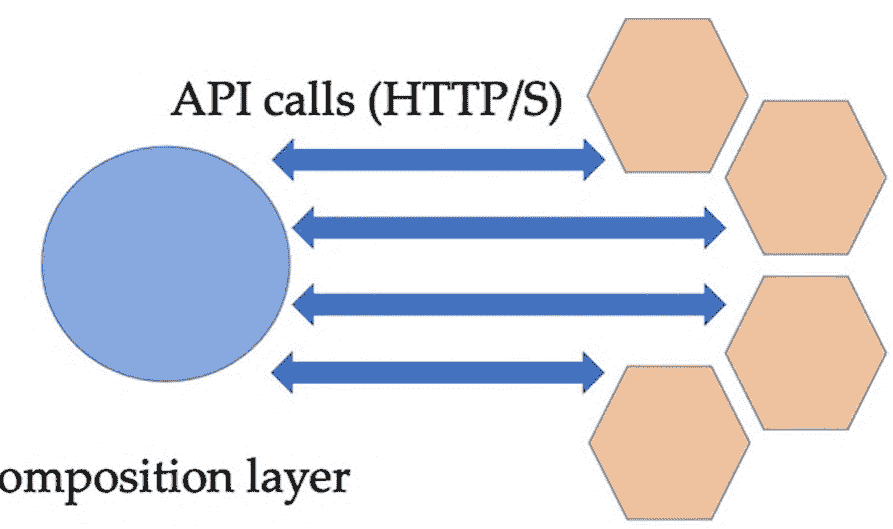

*图3.5：典型的微服务架构*

### Web服务器考量：性能

在本章开头，我们将Web应用与桌面应用进行了比较，并观察到，由于请求处理实体（服务器或后端）与渲染实体（视图）的物理距离，前者性能会比后者慢。在桌面应用中，视图通过方法调用与后端在进程内直接通信。

如下图所示：

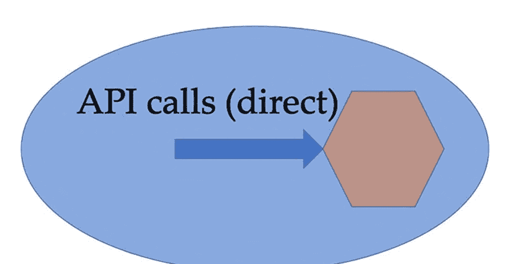

*图3.6：调用直接的桌面应用*

在Web应用中，这种通信是通过网络进行的，带有TCP、HTTP和/或其他协议的开销。这种开销一直存在，并且在一次通信中会发生四次：

1.  客户端发出请求时构建协议头的开销。
2.  服务器解析请求时拆解协议头的开销。
3.  服务器在将响应发送给客户端之前构建响应协议头的开销。
4.  客户端拆解响应中协议头的开销。

下图对此进行了说明，其中性能下降的热点用红色圆圈标出。

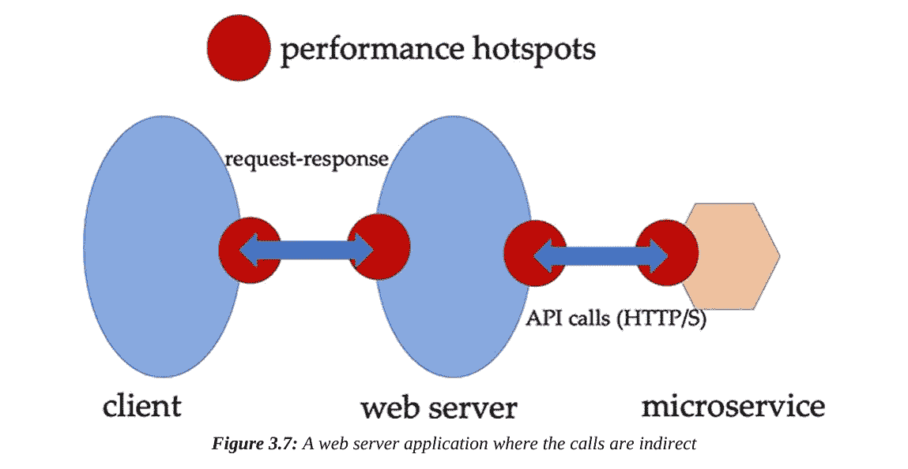

因此，Web应用本质上会比桌面应用慢。

此外，Web服务器中的额外层（为了模块化和独立生命周期管理而引入的）每一层都会带来与客户端和服务器之间通信开销成比例的性能开销。

#### 性能开销

简而言之，性能的主要抑制因素如下：

1.  网络传输的开销（请求和响应）。
2.  打包和终止协议头的开销（网络层、应用层）。
3.  处理（理解）请求的开销。
4.  构建（制定）响应的开销。
5.  在并发客户端之间切换的开销。
6.  在单个请求-响应周期的不同任务之间切换的开销。

最终结果是，随着延迟（从发出请求到呈现响应之间的时间）的增加，最终用户体验会变差。


这意味着 Web 应用程序应尽可能地努力提高其响应时间。因素列表中的第一项是作为 Web 服务器的自然副作用。改善这一点的最佳方法是在操作系统层面进行网络性能调优。第二项部分是作为 Web 服务器的自然副作用，部分是由于选择了诸如 HTTP 这样的应用层协议。当我们加入安全性时，协议会变为 HTTPS，这会增加更多的性能开销。在正常的部署环境下，我们无法改变这一点。如果你是在一个带有集群和负载均衡器的容器编排系统下进行部署，可以通过在负载均衡器层面终止 SSL 等技术来解决。但就目前而言，我们接受目前的 HTTP 和 HTTPS。处理请求和构建响应的开销并非新鲜事；这些开销与桌面应用程序的开销相当。在客户端之间切换的开销是 Node.js 的一个副作用。由于我们只有一个线程来运行应用程序，因此该单线程需要在所有连接之间进行切换。

## 最佳实践

一个最佳实践是确保核心业务逻辑（请求和响应之间的代码）不包含大型且复杂的操作，例如深层循环、长时间的二进制数据处理等。在单个请求响应周期的不同任务之间切换的开销同样是 Node.js 的一个副作用。这种切换在 Node.js 核心平台内部管理，因此我们无需在此过多担心。总而言之，考虑到架构和设计考量，关于 Web 服务器性能最自然的最佳实践是避免不必要的 I/O，并尽量减少请求和响应阶段之间的 CPU 密集型操作。

> 注意：你可能还记得第一章中关于 Node.js 的目标：考虑到 Web 应用程序的工作负载性质，我们如何才能最好地分离并多路复用 CPU 密集型和 I/O 密集型工作，同时将所有阻塞代码转换为非阻塞，并定义便捷的语言级语义来管理异步上下文：最终提升 Web 工作负载的性能。

### Web 服务器考量：安全性

鉴于我们的 Web 服务器处于中心位置并通过网络访问，服务器软件面临许多安全威胁。事实上，Web 服务器是大多数安全攻击的目标软件架构。这些威胁包括：

- 篡改服务器软件的私密性和完整性
- 篡改服务器处理的数据的私密性和完整性
- 篡改服务器处理的资源的私密性和完整性
- 篡改服务器与客户端通信所使用的传输通道的私密性和完整性

简而言之，所有安全威胁都可以概括为一个模型：篡改服务器可访问端点的数和资源的私密性与完整性。这显然是 Web 服务器所使用的基于网络的架构的副作用，但为了提高代码复用性、稳定性和用户体验，我们将其作为一种权衡而接受。此外，安全性的一件好事是，大多数此类问题可以在服务器端本身解决，这意味着这些问题可以对通过浏览器访问 Web 服务器的用户隐藏。因此，他们对许多此类问题并不知情。

#### 安全威胁类型

下图显示了 Web 服务器最常见的 10 个安全威胁：

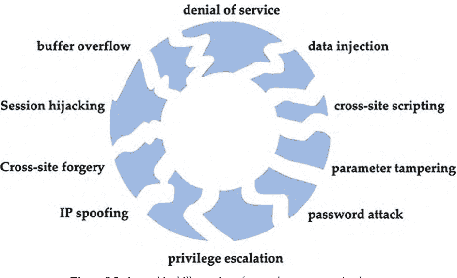

> 提示：网络安全是一个庞大的课题，涉及许多安全主题。该领域有大量的研究，也是许多大学的专业研究方向。

## 最佳实践

以下是一些关于 Web 服务器安全的常见最佳实践，用于缓解上述问题：

- 了解哪些部分的代码和数据涉及私密性和完整性
- 定义 Web 服务器访问/处理的代码和数据的范围/跨度
- 定义 Web 服务器访问的资源的范围/跨度
- 了解服务器通过其通信的传输通道的范围/跨度
- 使用身份验证机制来保护代码、数据和资源
- 定义角色（授权）以分层实现上述保护
- 将每个数据输入点视为不可信，并确保进行适当的验证
- 解析并清理源自用户的脚本、命令和查询
- 将所有在网络上传输的数据视为公开，并确保加密

除此之外，确保整个应用程序栈都更新到最新的安全补丁。同时，不断审计应用程序，以检查 Web 服务器的所有使用是否真实，检测异常模式并以循环方式解决。

这些是我们 Web 服务器最常见的最佳实践。看到在互联网上中心化部署的软件为了安全而付出的代价之高，真是令人惊讶！然而，由于利大于弊，我们更倾向于基于 Web 的方案而非桌面程序。

### Web 服务器考量：可靠性

Web 服务器的可靠性通常是指其在外部接口及其功能方面保持可用性和一致性的能力。从客户端的角度来看，可靠的服务器被认为是随时可用的。同时，对于发送的特定类型请求，能够获得一致的响应。在狭义上，可用性与可靠性不同，但在我们的讨论中，我们将可用性视为可靠性的一个子集。在企业部署层面，有多种确保服务器高可用性的技术，包括集群、负载均衡、灾难恢复等。然而，由于我们的基准是一个简单的桌面应用程序，我们在这里不讨论这些技术；相反，我们将专注于服务器的单实例。

#### 可靠性问题示例

常见的可靠性问题类型如下：

- 服务器崩溃（Crash）
- 服务器无响应/挂起（Hang）
- 操作系统崩溃
- 硬件故障
- 流量过载

崩溃是指服务器进程在非预期情况下异常终止的情况。原因是糟糕的代码、糟糕的数据，或两者兼有。崩溃会导致客户端请求中断以及调用掉线，导致服务器在重新启动之前不可用。下图演示了一个进程崩溃的示例：

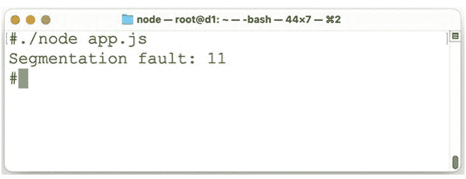

挂起是指服务器进程虽在运行，但线程无法推进，且在预期推进时无法处理工作的情况。原因通常是代码中的逻辑错误，导致其等待一个不存在的事件发生。挂起的影响与崩溃相同——当前的请求被放弃，且服务器在重启之前不可用。下图显示了一个闲置进程，在 10 小时左右的时间内 CPU 消耗为 0：


操作系统崩溃发生在内核 bug 显现时。原因显而易见。由于系统在 OS 崩溃后会重启，对客户端的影响是一样的。硬件故障可能会给客户端带来长时间的延迟，因为从故障中恢复并不总是通过重启来实现。流量过载是指服务器中的资源（内存、CPU、磁盘、端口等）耗尽或接近耗尽的情况。原因是并发客户端数量超过正常水平。其影响是处理客户端请求的延迟，最终因资源耗尽而崩溃，或两者兼有。

## 最佳实践

常见的可靠性最佳实践如下：

- 定义关键可靠性指标（**服务水平协议** (**SLAs**) 和 **服务水平目标** (**SLOs**)）。这有助于在服务器不可用/不可靠时制定自动化缓解计划。
- 组件之间松耦合。这有助于隔离并刷新故障组件，而无需关闭所有服务。
- 部署自动化。这有助于更快速的引导（bootstrapping）。
- 最小化启动时间。这有助于更快速的引导。Node.js 有一个明确的目标是缩短启动时间，它是目前启动最快的运行时环境之一。
- 保持无状态（无本地持久化）。这有助于从安全且稳定的端点协调损坏的状态，而不是从损坏的文件中修复。

> **注意：** 服务水平协议（Service Level Agreement）和服务水平目标（Service Level Objective）共同是指软件服务提供者和消费者之间就软件的质量、响应速度、成本预期以及双方责任而预先定义的一套理解条款。该协议作为提供者和消费者在开发、交付和生产所有阶段的指导原则。


# Web 服务器注意事项：可扩展性

可扩展性是衡量服务器程序在开发部署后进行修改的能力。众所周知，软件会随着时间的推移而演进，这通常源于从实际用户群体获得的持续反馈。基于原始架构和设计，这些演进式的变化可能影响软件的每一个部分，包括架构本身——软件最高层次的抽象。

## 可扩展性示例

以下是 Web 服务器未来扩展的一些示例：

- 1. 一个自定义中间件函数，每个请求都会经过该函数。在此示例扩展中，新功能引入了一个新的日志记录例程或新的验证例程，用于处理到达服务器的每个客户端请求。以下伪代码展示了一个简单的中间件，它在每个客户端请求时被调用，并记录特定的数据元素：
- 2. 扩展 Web 服务器以支持新的路由（请求类型）。在此示例中，Web 服务器能够处理新的请求类型。请求类型可以由其方法、查询数据类型或期望从服务器获取的响应数据类型来表征。以下伪代码展示了插入新路由的过程：
- 3. 支持新的加密算法。在此示例中，Web 服务器能够处理新型客户端，该客户端希望通过一种服务器此前未涵盖的新数据加密算法进行通信。以下伪代码演示了使用新加密算法 `AECS-256-FOO` 的示例，该算法作为扩展在加密 API 中实现，但用户可以无缝使用。

```
1. function customLogger(q, r, n) => {
2.     logger.log(q.query.name)
3.     n(q, r)
4. }
```

```
1. function handle(q, r) => {
2.     if(q.url === 'foo') {
3.         handleFoo(q, r)
4.     }
5.     // rest of the code
6. }
```

```
1. const c = require('crypto')
2. c.createCipher('AECS-256-FOO', 'foo')
```

在这三个示例中，可扩展性的关键在于能够将新功能作为现有程序的自然扩展来添加，而无需重构现有功能来适应新功能。

## 最佳实践

以下是一些实现 Web 服务器可扩展性的常见最佳实践：

- 你需要理解并记录以下内容：
  - 设计中做出的关键假设。这有助于设计扩展，并将扩展自然地插入现有设计中。
  - 关键数据和数据类型定义。这有助于将新类型融合到现有类型中，和/或利用新扩展所需的现有类型。
  - 关键功能函数。这有助于复用现有代码。
  - 高层次的代码流程。这对于在服务器扩展后保持设计和代码的完整性非常重要。
  - 高层次的数据流程。这对于在服务器扩展后保持设计和数据的完整性非常重要。
- 定义数据类型时预留扩展空间。这意味着类和数据结构应设计为抽象形式，以便在有未来扩展可能时使用。
- 定义能力时预留扩展空间。这意味着函数应设计为抽象形式，以便在有未来扩展可能时使用。
- 对代码和数据的关键策略进行参数化。这有助于实现基于输入表现不同的多态函数。换句话说，避免对输入数据做出假设来实现函数。
- 以松耦合方式定义架构组件。这有助于在需要时对服务器进行重新架构，而无需大量重构现有代码。

# Web 服务器注意事项：可维护性

Web 服务器的可维护性指的是在一段时间内无缝维护软件的能力。维护通常指：

- 修复从现场报告的 Bug
- 修复从现场报告的安全问题
- 支持更新的平台和环境
- 基于用户体验增强用户指南
- 增强代码以提升性能
- 增强代码以提高可靠性

## 可维护性的重要性

所有这些在 Web 服务器的上下文中都是相关的。同时值得注意的是，由于其与桌面应用程序的架构差异，服务器并不会因此带来额外的维护负担。换句话说，上述所有项目同样适用于简单的桌面应用程序。无论哪种情况，服务器软件都应做好准备，以应对这些维护活动。

## 最佳实践

以下是构建高度可维护软件的一些最佳实践：

- 围绕关键抽象和能力对代码进行模块化。这有助于将维护主题限定在一个或多个模块范围内。
- 确保代码具有高度可读性（对其他开发者而言）。这有助于将维护主题隔离到一个或多个模块中，并仅通过代码审查就能理解业务逻辑。设计文档或用户指南可能由于其性质而不会提及 Bug 的相关信息，因此阅读代码是唯一的选择。
- 记录关键函数和接口。这有助于将维护主题限定在一个或多个模块或 API 的范围内。
- 对平台特定代码进行分解和模块化。这有助于将维护主题限定并隔离在相关平台范围内。
- 建立性能基准和基线。这有助于对性能瓶颈或性能下降进行有意义的比较和量化。
- 确保 Bug 修复不会"膨胀"为功能。这有助于保持软件原始的架构和设计。否则，Bug 修复可能会篡改设计目标。
- 确保保持向后兼容性。这有助于将功能和 Bug 修复限定在明确的范围内，避免它们演变成回归问题和级联问题。
- 定义并遵循语义化版本控制。这有助于以易于追溯的方式组织代码维护工件，并保留适当的审计跟踪。同时，工作项的分类也变得更加容易，从而形成明确的发布流程。

# Web 服务器注意事项：可服务性

可服务性涉及安装、配置、故障检测、故障数据采集、问题隔离、问题重现、问题判定以及应用修复和补丁等方面。它是维护已交付软件的一个重要方面，因为可服务性直接影响保修成本，即支持软件的成本。以下是生产环境软件能力的图形表示：

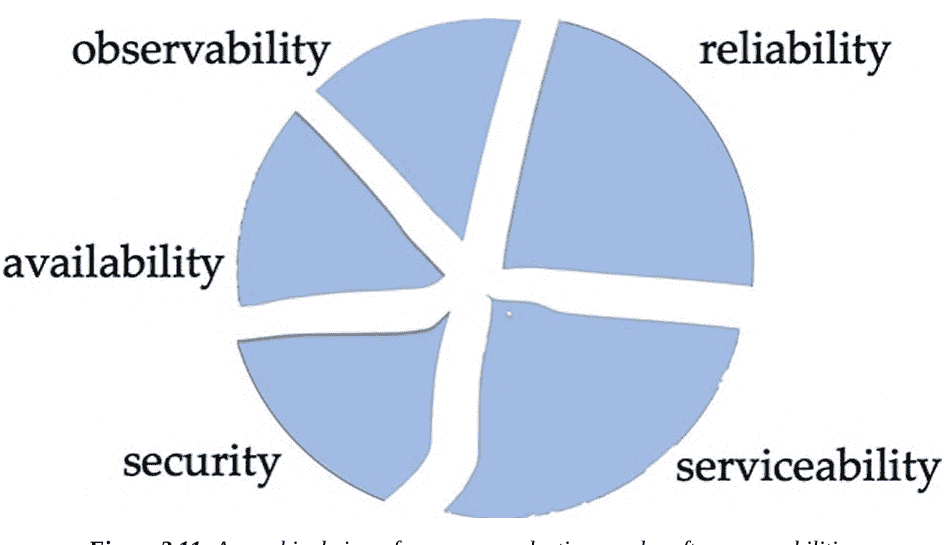

图 3.11：常见生产级软件能力的图形视图

## 最佳实践

下面讨论常见的可服务性最佳实践。你需要确保：

- 服务器软件在设计中具有明确的生命周期。这有助于根据问题报告来限定和理解异常现象。
- 对每种可能的异常类型都有明确的故障数据。Web 服务器已知的异常类型包括崩溃（异常终止）、挂起（低 CPU 使用率）、死循环（高 CPU 使用率）、异常、性能下降、内存泄漏、内存耗尽以及计算结果不正确。
- 对每种可能的异常类型都有明确的故障数据采集方法。
- 对每种可能的异常类型都有可靠的工具支持。
- 对每种可能的异常类型都有经过验证的方法论。
- 托管系统在部署前做好准备，以便在异常事件发生时进行故障数据采集。
- 服务器软件的设计本质上容纳了可服务性。这意味着高层次设计评审中也包含可服务性置信度采集的检查清单。

# Web 服务器注意事项：可观测性

可观测性定义为通过应用程序自然采集的数据点来理解应用状态的能力，而无需借助调试手段。应用程序的状态包括进程健康状况、系统负载、语言运行时/虚拟机的内部状态、客户端交互模式、请求-响应分布、故障率、资源使用模式等。

## 可观测性的重要性

为什么可观测性很重要？随着 Web 服务器采用上述其他最佳实践（例如模块化、安全性、可维护性等），软件的复杂性增加，人工检查和判定变得困难且容易出错。同时，了解我们设计软件的效率对于后续的增强和演进至关重要。例如，一个聚合时间图可能显示我们应用中的某个微服务在请求流量方面是一个瓶颈，应该进行独立扩展。

## 最佳实践

以下是可观测性的一些最佳实践：

- 理解关键可观测指标（数据点）。为了判定关键性能指标，我们需要观察什么？
- 定义数据点的解读方式。什么数据能帮助我们做出有意义的判定？
- 理解数据点的生命周期。多少数据量能帮助我们以合理的置信度做出这些判定？
- 定义数据点的生命周期。数据采集何时开始、何时结束、数据存储在哪里？我们保留数据多长时间？
- 定义全面的数据采集方法。我们如何从服务器软件的各个子系统和组件中采集数据？


## 结论

为这些方法定义独特的收集方法，以实现更好的隔离和控制。

-   定义全面的数据聚合方法。收集的数据如何聚合？哪些聚合对用户有意义？
-   定义全面的数据可视化方法。数据如何可视化？可视化是否易于解释？例如，给定的数据用饼图表示是否比条形图更好？
-   记录软件中的可观测性制品。这有助于修复缺陷，并增强、扩展和控制我们软件中与可观测性相关的代码。

在本章中，我们学习了 Web 服务器的基本概念，并定义了服务器的核心组件。为了在广泛的软件架构范围内界定服务器的上下文，我们将我们的 Web 服务器与具有类似功能的桌面应用程序进行了比较。这种比较帮助我们观察了请求处理系统位于后端、跨网络、在中心位置时的特征。这反过来帮助我们形象化了与关键软件效率参数相关的权衡，审视了 Web 服务器开发人员的基本考量，并学习了高效 Web 服务器的最佳实践，解决了因其放置和可访问性而产生的问题。在下一章中，我们将开始将理论付诸实践。我们将编写一个响应当前时间的简单 Web 服务器，并尝试从中提取意义。

# 第 4 章

## 我们的第一个程序：当前时间服务器

到现在为止，我们已经获得了关于 Node.js 编程的详细背景知识——事件驱动架构的基本原理为 Node.js 奠定了基础，以及 Web 服务器应用的许多考量。在本章中，我们将开始将理论付诸实践。我们将编写一个响应当前时间的简单 Web 服务器，并说明程序的每个部分。

## 结构

在本章中，我们将涵盖以下主题：

-   hello world Web 服务器程序
-   当前时间程序
-   运行服务器
-   程序部分

## 目标

学完本章后，你应该能够理解 Node.js 程序的基本要素。更具体地说，是 Web 服务器程序。我们将挑选一个简单的 'hello world' 程序来演示开发生命周期，然后转向当前时间服务器。然后，我们将检查程序的特定部分，并了解这些部分的含义以及每个部分如何对整体服务器逻辑做出贡献。

### 一个 'hello world!' 服务器

就像任何其他程序一样，我们从一个 'hello world' 程序开始。这有助于我们清晰地识别程序的各个部分。循序渐进的理解非常有用，因为对于任何程序员来说，'hello world' 程序已经具备了一定程度的理解。

这是一个用 Node.js Web 服务器代码编写的 'hello world' 程序：

```
1. const h = require('http')
2. const s = h.createServer((q, r) => {
3.   r.end('hello world!')
4. })
5. s.listen(12000)
```

### 运行程序

按照给定的步骤运行上述程序：

1.  将程序保存为 **hw.js**。
2.  打开终端并转到文件所在的位置。
3.  按如下方式运行代码：

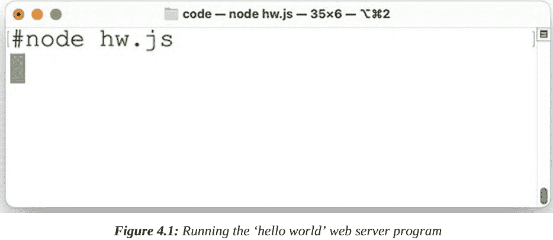

### 通过浏览器访问服务器

现在，当我们的程序在终端中运行时，打开一个 Web 浏览器并访问此 URL：**http://localhost:12000**，如下图所示：


**图 4.2：** 通过浏览器访问 Web 服务器

那是我们的第一个 Node.js 程序！我们将在本章后面回到它来检查它的不同部分。现在，我们将研究一个当前时间服务器。

> **任务：** 将服务器发送的消息更改为其他消息，重启服务器程序，在浏览器中刷新请求，并观察响应。你看到了你预期的更改吗？

### 一个当前时间服务器

现在，让我们构建我们的当前时间服务器，它用当前时间响应客户端：

```
1. const h = require('http')
2. const s = h.createServer((q, r) => {
3.   r.end(new Date().toString())
4. })
5. s.listen(12000)
```

就像之前一样，在终端中运行此程序，如下所示：


**图 4.3：** 运行当前时间 Web 服务器程序

然后通过 Web 浏览器访问它，如下所示：

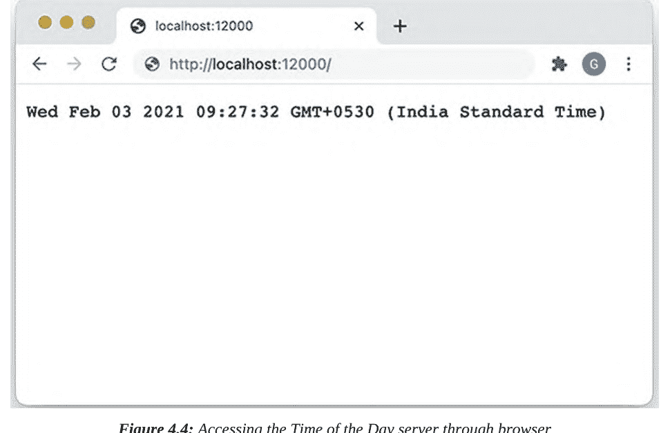

**图 4.4：** 通过浏览器访问当前时间服务器

这很简单！我们应该认识到，'hello world' 和当前时间是相同的，唯一的区别是在服务器端创建并传递给客户端的消息。

如果你仔细观察浏览器中显示的字符串，它会引出这个问题：时间是相对于服务器还是客户端？它是服务器的时间，因为时间是在服务器代码中通过这一行捕获的：

```
1. r.end(new Date().toString())
```

当然，如果我们访问的客户端与服务器运行在同一系统中，那么只有一个时间。但想一想一个更现实的场景，服务器可能位于网络中的其他地方。显示服务器本地时间这一事实带来了两个问题：

-   用户必须根据服务器的时区进行调整。
-   它无意中暴露了服务器的位置（一种不需要的安全暴露）。

一个更合理的方法是“隐藏”服务器的时区，并显示所有其他区域都可以用作参考的绝对时间，例如**协调世界时 (UTC)**。

因此，我们修改后的代码使用了一个将本地时间转换为 UTC 时间的 **Date** API：

```
1. const h = require('http')
2. const s = h.createServer((q, r) => {
3.   r.end(new Date().toUTCString())
4. })
5. s.listen(12000)
```

就像之前一样，在终端中运行此程序，如下所示：


*图 4.5：运行使用 UTC 的当前时间*

然后通过 Web 浏览器访问它，如下所示：

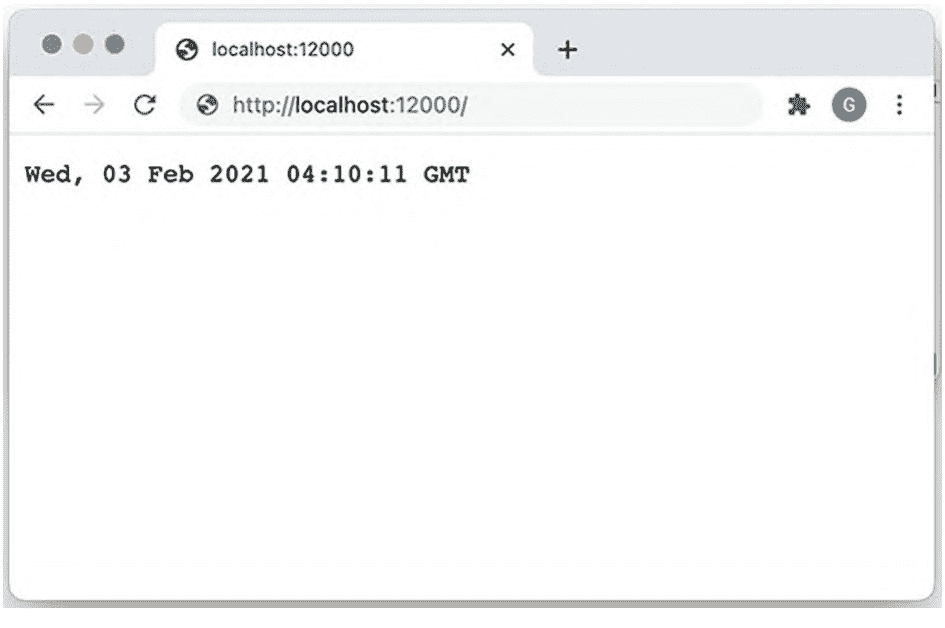

*图 4.6：通过浏览器访问当前时间服务器（使用 UTC）*

现在，如你所见，时间以 UTC 显示，解决了上述两个问题。用户不知道服务器位于何处，并且可以使用已知的算术对 UTC 进行计算以获取其特定区域的时间。

### 程序部分

在较高的层次上，一个简单的 Node.js Web 服务器中有五个独立的部分。让我们看看每一个部分。

#### Require 语句

`require` 函数是 Node.js API 的基本组成部分。它是一个全局函数，用于将可重用模块包含、合并或导入到你的程序中。模块是一个代码单元，它导出一个或多个字段和/或方法。`require` 的调用者获得一个包含从模块导出的内容的对象。

Node.js API 以模块的形式提供，以便在程序中轻松使用。在我们的代码中，第一行是：

```
1. const h = require('http')
```

它表示将一个名为 'http' 的模块导入到我们的程序中。在此语句之后，'http' 模块的功能通过变量 'h' 可用，并且我们的程序可以访问 'http' 模块，这对于创建 'http' 服务器非常方便。

虽然 'http' 是最常见的，但它不是抽象服务器功能的唯一模块。在下一章中，我们将比较 'tcp' 和 'http' 协议，并了解使用这两种协议的服务器实现之间的差异。

> **任务：** 将 'http' 对象的内容打印到控制台，并尝试识别一些字段及其含义。

#### 服务器循环

这是 Web 服务器最重要的部分。循环代码如下所示：

```
1. const s = h.createServer((q, r) => {
2.   r.end(new Date().toString())
3. })
```

正如我们所看到的，它有两个部分：

-   服务器创建
-   客户端处理器

'http' 模块的 `createServer` API 用于创建 'http' Web 服务器。创建的对象在变量 's' 中返回，我们可以用它来管理服务器的各种生命周期操作。

作为单个参数传递给 `createServer` 的匿名函数是客户端处理程序回调（在某些编程领域，这被称为


# 第5章

## Node.js 的通用网络接口

### servlet）。此处理程序负责处理客户端连接。

‘http’ 服务器遵循的契约如下：

-   每次客户端连接时，都会调用此处理函数。
-   进入时，两个输入参数 'q' 和 'r' 会被填充。
-   'q' 是对客户端请求的抽象（包含请求头、请求体等）。
-   'r' 是对服务器响应的抽象（用于组装和发送响应）。

此函数是可重入的，这意味着当多个客户端同时连接时，此函数会为每个连接独立调用，彼此之间没有副作用。

此函数大致对应客户端连接的生命周期：请求-响应周期。进入此函数时，可以说有一个新的客户端请求到达，而当此函数在发送响应后返回时，其请求即完成。

封装客户端请求和服务器的请求与响应对象，代表了经典的Web服务器编程，并遵循了在许多其他Web编程平台中使用的相同抽象。

请求和响应对象都是流（Stream）以及事件发射器（EventEmitter），因此它们可以管理流动数据，并定义构成请求和响应生命周期的多个事件。

在下一章中，我们将详细研究请求和响应对象，包括它们的继承、组成和生命周期事件。

> **注意：** 在填充请求对象之前，后台会发生对请求的大量解析。这是因为客户端请求最初是以二进制数据流的形式通过网络传来的，格式遵循所选协议。这需要首先解析，然后验证是否符合协议规范，最后转换为与请求对象结构对齐的结构。

## 日期

程序中的另一个组件是日期计算。'Date' 是一个标准的 JavaScript 类，因此 '**new Date()**' 提供当前日期和时间（相对于调用系统的区域设置）。有许多函数可以帮助创建日期对象，并以各种便捷的方式表示日期。

## 服务器响应

服务器的响应通过 '**end**' 函数发送给客户端，如下所示：

1.  `r.end(new Date().toUTCString())`

如果有大量数据需要发送给客户端，可以多次调用 '**r.write()**' API。但是，调用 '**r.end**' 会结束响应，并且无法再通过该连接向该客户端发送更多响应。

大多数浏览器只有在接收到最后一片数据后才开始渲染页面。因此，`end` API 至关重要。

> **问题：** 注释掉我们程序中的响应发送代码，然后通过浏览器访问页面。观察浏览器发生了什么。为什么？

## 服务器监听

listen API 的调用方式如下：

1.  `s.listen(12000)`

这是我们程序中的最后一段代码。服务器对象的 '**listen**' API 使服务器准备好接收客户端连接。最常见的形式是，它接受一个服务器应可用的端口号。客户端在构建服务器 URL 时应使用相同的端口号。

> **注意：** 一次只能有一个进程监听一个端口号。

## 结论

总之，我们研究了程序的每一行代码，并理解了它们在提供当前时间信息给请求客户端的Web服务器上下文中的含义和目的。在这个过程中，我们还了解了Node.js的一些强大功能和API，这些使其成为一个灵活且易于使用的Web编程平台。在下一章中，我们将更详细地探讨围绕Web应用程序的Node.js网络特性。这将包括用于不同协议、数据传输机制和客户端-服务器交互的API抽象。

## 练习

下面描述了两个常见但简单的问题，以帮助你快速掌握Web服务器编程的实践方面。

## 问题 #1

在特定情况下，当在终端运行“当日时间”程序（任一版本）时，发生以下错误：

```
$node tod.js
events.js:291
    throw er; // Unhandled 'error' event
    ^

Error: listen EADDRINUSE: address already in use :::12000
    at Server.setupListenHandle [as _listen2] (net.js:1316:16)
    at listenInCluster (net.js:1364:12)
    at Server.listen (net.js:1450:7)
    at Object.<anonymous> (/Users/gireeshpunathil/Desktop/book1/4/code/tod.js:5:3)
    at Module._compile (internal/modules/cjs/loader.js:1251:30)
    at Object.Module._extensions..js (internal/modules/cjs/loader.js:1272:10)
    at Module.load (internal/modules/cjs/loader.js:1100:32)
    at Function.Module._load (internal/modules/cjs/loader.js:962:14)
    at Function.executeUserEntryPoint [as runMain] (internal/modules/run_main.js:72:12)
    at internal/main/run_main_module.js:17:47
Emitted 'error' event on Server instance at:
    at emitErrorNT (net.js:1343:8)
    at processTicksAndRejections (internal/process/task_queues.js:80:21) {
  code: 'EADDRINUSE',
  errno: -48,
  syscall: 'listen',
  address: '::',
  port: 12000
}
$
```


-   这个错误是什么意思？
-   为什么会发生这个错误？
-   如何解决这个错误？

## 问题 #2

在特定情况下，当运行“当日时间”程序（任一版本）并通过浏览器访问时，观察到以下错误：

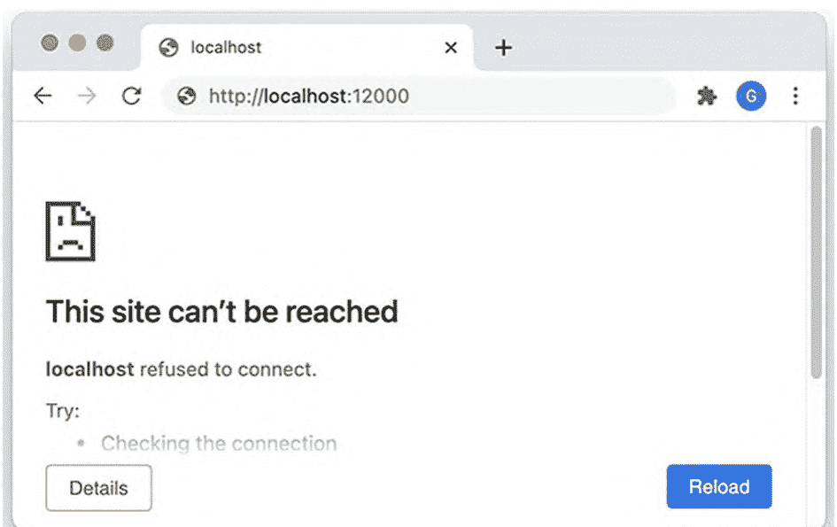

**图 4.8：** 客户端潜在访问错误演示

-   这个错误是什么意思？
-   为什么会发生这个错误？
-   如何解决这个错误？

# 第5章

## Node.js 的通用网络接口

至此，我们已准备好深入探讨 Node.js 提供的用于实现通用Web应用程序的API抽象。我们将首先比较原始的原生网络协议 TCP/IP 与更高级、更便捷的协议 HTTP。这对于证明我们在本书中使用 HTTP 构建应用程序的选择至关重要。我们还需要了解底层网络中的数据传输工作原理。然后，我们将探讨流 API（因为几乎所有客户端-服务器通信都是面向流的）和缓冲区 API（因为几乎所有基于流的数据传输都使用缓冲区来保存数据）。我们将说明两种流行的Web服务器抽象——'request' 和 'response'——它们代表了客户端-服务器交互的基本构建块对象。我们还将详细探讨影响服务器行为的配置、服务器的生命周期控制点和服务器事件。此外，我们还将简要介绍本书中将使用的其他一些重要网络 API。

## 结构

在本章中，我们将涵盖以下主题：

-   网络编程
-   TCP 与 HTTP
-   Node.js 流
-   Node.js 缓冲区
-   请求和响应对象
-   请求和响应生命周期
-   服务器配置
-   服务器生命周期事件
-   其他网络 API

## 目标

学习完本章后，你将能够理解 Node.js 编程平台中的常见网络抽象。这些包括网络编程考虑因素、网络协议的必要性、网络数据传输考虑因素，以及 Node.js 如何抽象这些能力，使 API 与底层的事件驱动和异步编程风格哲学保持一致，同时全面覆盖所述能力的所有方面。你将能够欣赏当前的服务器抽象作为一套全面的 API，并理解为什么流和缓冲区在网络程序中被广泛使用。你还将了解服务器配置和服务器生命周期事件。

### 网络编程

网络编程是一种编程范式，其中计算发生在通过网络连接的多个计算系统中。根据计算如何被组织、划分、聚合和消费，我们可以推导出几种编程模型（拓扑结构）。例如，客户端-服务器、点对点等。

Node.js 最常见的编程模型是Web服务器。它是客户端-服务器拓扑的经典示例，因此也是网络编程的示例。我们在 *第3章，Web服务器简介* 中详细讨论了这种编程模型的优点。

如 *第3章，Web服务器简介* 中所述，简单桌面程序和网络程序之间的一个关键区别是：前者的计算函数调用和消费发生在进程内（直接函数调用），而后者则通过网络发生。这种差异主要影响程序的结构、功能和接口。除了其他事项外，我们需要一个协议来在跨网络的进程之间进行通信。

#### 为什么需要协议？

前面我们刚刚提到了协议；现在是时候详细审视它了。


让我们从一个简单的函数调用示例开始。当'foo'函数调用'bar'函数时——这通常发生在一个原生编译的程序中——会发生以下情况：

#### 在调用函数（Caller）侧

- 函数参数被压入程序栈/指定的寄存器
- 返回地址（被调用者应返回的位置）被压入程序栈
- 跳转到目标函数

#### 在被调用函数（Callee）侧

- 创建一个栈帧来存放其数据
- 更新栈指针
- 执行其代码
- 重置栈指针
- 跳转回返回地址
- 执行在调用者处继续

这是一个具体的例子，展示了一个C函数'foo'调用'bar'。让我们查看其源代码以及在一个'x64'系统上生成的汇编代码，并理解这个调用是如何被管理的。
以下是调用者函数'foo'和被调用者函数'bar'的代码：

```c
void foo() {
  int ret = bar(0xaaaa, 0xbbbb, 0xcccc);
}

int bar(int p, int q, int r) {
  return p + q + r;
}
```

现在，让我们也看看这些函数生成的机器代码会是什么样子。为了简洁和清晰，只显示了相关的部分。同时，我为每条指令都添加了注释，以便更好地理解底层发生了什么。
以下代码展示了'bar'在'foo'中的调用点：

```assembly
// store the third argument into edx
mov edx,0xcccc
// store the second argument into esi
mov esi,0xbbbb
// store the first argument into edi
mov edi,0xaaaa
// invoke the target method
call bar
```

在这里，调用者的参数（或在被调用者中被称为形参）被存储在指定的寄存器中，然后目标方法被调用。在其他一些架构中，这些参数可能直接压入栈中，或存储在其他寄存器中，或两者结合。
在'x64'架构中，'call'指令在内部由两个动作组成：i) 将下一条指令的地址压入栈中，ii) 跳转到上述目标地址。
现在，让我们看看被调用者'bar'中发生了什么。函数第一部分的样子如下：

```assembly
// store the current frame base pointer
push rbp
// set the current stack pointer as the new frame base pointer
mov rbp,rsp
// store first param into first slot of base pointer
mov DWORD PTR [rbp-0x4],edi
// store second param into second slot of base pointer
mov DWORD PTR [rbp-0x8],esi
// store third param into third slot of base pointer
mov DWORD PTR [rbp-0xc],edx
```

在被调用者中，基指针寄存器首先被保存到栈上，然后当前的栈指针值被存储到基指针中，标志着一个新的栈帧。接着，每个参数（由调用者存储）被存储到内存中的指定槽位，以'rbp'为参考，距离它有特定的偏移量。整个这个过程，在函数业务逻辑开始之前执行，被称为函数序言（function prologue）。

以下代码展示了函数的“主体”——加法逻辑：

```assembly
// load first param into edx
mov edx,DWORD PTR [rbp-0x4]
// load second param into eax
mov eax,DWORD PTR [rbp-0x8]
// add eax and edx, store the result in edx
add edx,eax
// load third param into eax
mov eax,DWORD PTR [rbp-0xc]
// add eax and edx, store the result in eax
add eax,edx
```

这不言自明。值从寄存器中取出，加法操作依次执行。最后，结果被存储在'eax'寄存器中，也称为**累加器寄存器**，它用于保存函数的返回值。

以下代码展示了被调用者的最后部分，称为函数尾声（function epilogue）：

```assembly
// unwind the frame, get the old base pointer back
pop rbp
// return, leaving the result in eax
ret
```

在函数尾声中执行的动作是恢复基帧指针，从而展开当前栈帧，并在返回调用者之前恢复之前的栈帧。当执行到达调用者时，一切在调用时已恢复正常，函数调用的返回值已在'eax'寄存器中。调用者从那里继续执行。
这一套规则被称为调用约定或子程序链接约定。它是称为**应用程序二进制接口（ABI）**的更广泛规范的一部分。如果在程序执行过程中，这些步骤中的任何一步被忽略或违反，程序将出现故障，通常导致崩溃。

> **注意：** 计算机CPU基于指定的行为工作，这个规范被称为其架构。除了其他方面，这里相关的机器架构的两个重要方面是：i) 调用约定或子程序链接约定，以及 ii) 指令集规范。

#### TCP/IP

显然，当一个程序与另一个程序通信时，我们需要一套规则。当程序位于网络的不同位置时，规则的复杂性会增加。例如，当程序A通过网络向程序B传递一段数据时，有几个问题，比如：

- 我们如何唯一地标识程序A的数据？（提示：网络可以访问所有发布的数据）
- 我们如何知道程序A的数据边界/长度？（提示：数据以八位字节流的形式流动）
- 我们如何知道程序A的数据序列/顺序？（提示：哪个是高位比特？）

如果每个应用程序都开始处理这些复杂性，网络编程将变得极其复杂且难以管理。此外，程序会失去互操作性。因此，自然地，我们定义了一套规则，全面覆盖程序之间如何进行通信，同时程序可以更好地专注于其“业务逻辑”。TCP/IP是最常用的一套此类规则。虽然它们是两个独立的协议（传输控制协议和网际协议）叠加在一起，但我们无需理解其细节和差异。同时，在TCP/IP之上、之下以及与之平级的还有很多其他协议，这些都超出了本书的范围。

> **注意：** 这里有一个简单的例子，让我们感受网络协议的重要性。在最低层，当两个字节的数据（B1, B2）到达一个端点时，如何将字节组合以重构原始字——B1B2还是B2B1——这个问题由一个称为字节序（endian-ness）的概念来定义。两种字节序类型很常见：大端序和小端序。

网络协议定义了在网络上传输数据的一套规则。TCP/IP为网络中的参与应用程序提供可靠的、面向流的数据。通过TCP/IP通信，程序得以免于处理数据传输的复杂性，如数据分块、路由、流量负载均衡、错误纠正、丢失数据包管理以及聚合。面向流意味着在传输数据之前，端点之间需要建立握手和连接。
换句话说，与TCP/IP的契约是：从网络端点A发送的一段数据'hello'，能够完整无误地到达其目的地端点B，因为A和B是通过TCP/IP方式连接的。

下图以象征性的方式展示了这个契约：

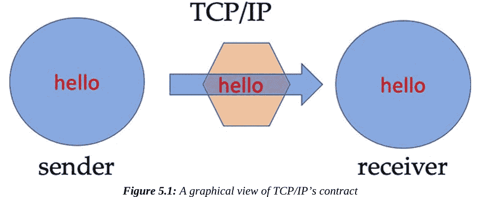

一个名为**国际标准化组织（ISO）**的机构定义了连接计算机之间数据交换的参考架构。这个架构被称为**开放系统互连（OSI）**。它在计算抽象中呈现为一个相连的管道集合，从应用层到用于正向数据流（写）的物理网络设备，以及从物理网络设备到应用层，用于反向数据流（读）。

下图展示了OSI数据交换架构的七层：

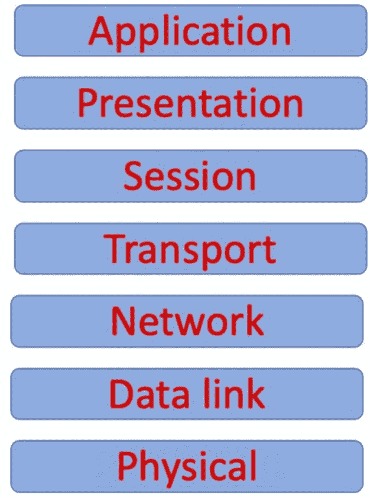

**图5.2：** OSI规范的网络层

虽然OSI模型的七层提供了一个指导框架，但TCP/IP是其具体的实现。在实现层面，由于便利性和模块化，一些层被合并了。换句话说，TCP/IP是我们使用的实际互联网的协议，它大量借鉴了OSI规范。以下是TCP/IP各层的简要描述：

- **应用层：** 定义标准的互联网服务和网络API。程序在此层与网络打交道。例如：ftp和


## 传输层：定义正向和反向路径中的数据完整性和可靠性约束。
- **互联网**：定义网络中数据包的传输协议：路由、重传丢失的数据包等。
- **物理层**：定义传输数据的硬件特性。

TCP/IP 编程接口在操作系统中实现，并由标准 C 程序调用，列举如下：

| API | 含义 |
| :--- | :--- |
| socket | 创建端点（服务器或客户端） |
| connect | 与远程建立连接（客户端） |
| bind | 绑定端口和网络接口（服务器） |
| listen | 使套接字可用（服务器） |
| accept | 等待客户端连接（服务器） |
| read, write | 标准 I/O API（服务器和客户端） |

**表 5.1：** *核心 TCP/IP C API*

套接字在网络程序中对远程端点进行抽象。在与客户端连接的服务器中，因连接而创建的套接字代表客户端。类似地，在客户端，因连接而创建的套接字代表服务器。换句话说，如果客户端从已连接的套接字读取数据，实际上是从服务器读取。通过这种方式，可以使用已连接的套接字进行合理的双向通信。

> **作业：** 使用上述 API，用 C 语言编写一个简单的客户端-服务器程序，服务器将客户端发送的数据回显。观察其复杂性。

幸运的是，我们无需深入探究这些概念的复杂性。在 Node.js 中，我们有成熟的 API 可以隐藏这些复杂性，帮助我们更多地关注业务领域，而非网络领域。以下是一个基于 TCP 的 Node.js 服务器和客户端交换一段文字的简单示例。
以下代码展示了一个简单的 TCP 服务器：

```
1. const n = require('net')
2. const s = n.createServer((s) => {
3.   s.end('hello world!')
4. })
5. s.listen(12000)
```

以下代码展示了一个简单的 TCP 客户端：

```
1. const n = require('net')
2. const c = n.createConnection({port: 12000})
3. c.on('data', (d) => {
4.   console.log(d.toString())
5.   c.end()
6. })
```

下图展示了代码的执行及其输出：

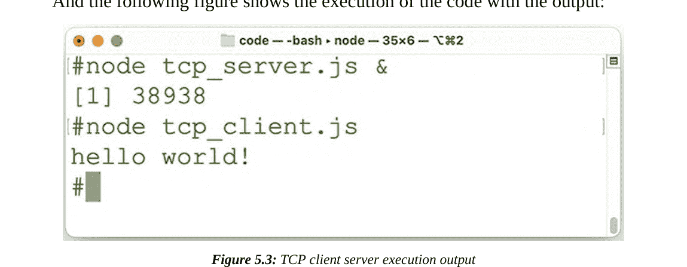

如我们在此轻易注意到的，网络中传输数据的复杂性在程序中并不可见！相反，程序提供了一种称为"套接字"的复杂抽象，用于执行通信。服务器中 `createServer()` 和客户端中 `createConnection()` 的返回值所存储的变量都是套接字，它们用于通信。

### HTTP

这对于编写大规模网络程序来说足够了吗？它（TCP/IP）能满足我们轻松无缝通信的需求吗？
某种程度上，是的。但该协议对于在更高抽象层次上运行的软件来说仍然过于底层。一个简单的例子是网站上提交应用表单的情况。
下图展示了一个示例表单数据：


现在当表单在客户端浏览器中填写并提交时，它需要通过网络传输，并在服务器端解析为更高级别的编程结构。我们将如何轻松管理这种传输和转换？

- 我们需要一个规则来定义从客户端发送到服务器的数据。
- 我们需要一个规则来定义正在发送的数据类型。
- 我们需要一个规则来定义实际记录长度。
- 我们需要一个规则来定义各个条目如何分隔。
- 我们需要一个规则来定义键值对如何分隔。

同样，如果每个应用程序都以自定义方式私下构建这些规则集，开发将变得复杂。此外，应用程序会失去互操作性。

> **问题：** 退一步思考，这些复杂性从何而来。同一程序中一个函数调用另一个函数时，需要处理这些问题吗？还是说它们也有复杂性，但处于不同的操作空间？

因此，定义另一套规则是完全合理的，它们解决与 TCP/IP 相同的问题（标准化数据传输机制），但在更高的层次上运行，更接近应用程序的抽象层次。

**超文本传输协议（HTTP）** 是一种应用层协议，运行在 TCP/IP 协议之上，定义了一套规则，以比更复杂、更低级的 TCP/IP 更灵活、更无缝的方式传输数据。该协议包括请求类型、消息格式、消息体、传输编码和状态码的规则定义。有了这些原语，HTTP 解析器可以轻松解释数据。此外，HTTP 端点可以轻松接收和处理请求并发送响应。

当上述记录通过 HTTP 协议传输并在网络中被拦截时，它将如下所示：

```
POST / HTTP/1.1
Host: myhost
Content-Type: application/x-www-form-urlencoded
Content-Length: 47

Name=Gireesh Punathil&Gender=Male&Country=India
```

*图 5.5：* 一个示例 HTTP 负载

HTTP 的约定是，通过网络从端点 A 发送的一段数据 "hello" 会完整无损地到达目的地端点 B，仍然是 "hello"，并附带额外信息，如请求类型、请求上下文、数据类型和数据长度，前提是 A 和 B 通过 HTTP 协议连接。

下图以象征方式展示了 HTTP 的这种约定：

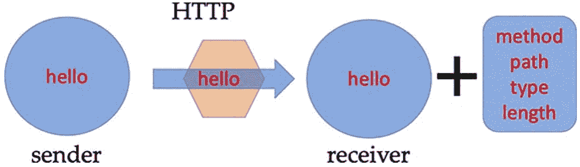

*图 5.6：HTTP 协议约定的可视化*

HTTP 协议处理重要的事项：

- 如何处理数据（请求方法）
- 在哪里使用数据（请求路径）
- 数据是为谁准备的（主机）
- 它的类型（Content-Type）
- 它的长度（Content-Length）

现在数据不仅有了原始消息内容，还有围绕它的许多属性，接收方可以通过标准机制理解其"意图"，无需诉诸低级原语。在下面的章节中，我们将查看 HTTP 消息中的每个标记，并解释上述示例 HTTP 消息格式。

#### POST

此标记指定 HTTP 方法或请求类型。请求类型定义了请求体其余部分的性质和格式。POST 表示客户端正在提供一块数据，连同请求一起——创建或更新资源。其他常见的 HTTP 方法包括 **GET**、**PUT** 和 **DELETE**。

#### /动词

此标记指定请求目标或协议路径。路径定义了请求的上下文，使得不同的请求可以在服务器端被区分，根据请求目标进行分类。

路径的不同形式包括：

- 最简单的形式，如 '/'
- 简单标记路径，如 '/foo'
- 资源路径形式，如 '/cat .png'
- 查询字符串形式，如 '/test?name=foo&type=bar'

#### HTTP/1.1

此标记指定使用的 HTTP 版本。自然地，不同版本意味着消息其余部分格式的变化。此外，指定版本是请求服务器相应地格式化其响应，以便客户端能够消费。

#### Host

此标记指定接收此请求的服务器的主机名和端口号。如果端口号缺失（如此处的情况），则意味着目标端口是默认端口（80）。

> 问题：'Host' 字段解决了什么目的？如果消息 destined 到特定主机，而此字段有助于实现这一点，那么在解析该字段之前，消息是如何首先到达此服务器的？此外，如果需要选择目的地，谁应该是此类数据的消费者？是更低级别的 TCP 栈，还是应用程序本身？

#### Content-Type

此标记指定请求内容部分的数据类型。它有两个部分：指定高级类型的媒体类型，以及提供文件扩展名提示的媒体子类型。有很长的有效数据类型列表：application、audio、video、image、multipart、text 等。

#### Content-Length

此标记指定请求体的字节数，包括用于分隔记录的元字符。
最后，消息体本身通过组合所有消息部分并用定义明确的分隔符分隔它们而构造成单个字符串。
还有更多字段，每个都有若干扩展和例外，但

关于理解典型HTTP消息的基本格式，我们已经了解得差不多了。

在处理大型和复杂业务数据方面，我们是否看到了明显的灵活性提升？是的，确实如此。得益于这些改进，HTTP已成为普通Web应用程序通信的首选方式。

> **提示：** 我们如何查看HTTP消息头？一个简单的技巧是编写并运行一个TCP服务器，该服务器仅打印传入的请求，然后通过浏览器客户端访问该服务器，就好像它是一个基于HTTP的服务器一样。客户端会失败，但TCP服务器中的消息将是浏览器发送的完整HTTP消息。

现在，让我们重新审视那些仅靠TCP无法解决的问题，并看看它们在HTTP能力背景下是如何处理的。

* 我们需要一个规则来表明数据正在从客户端发送到服务器：这个问题现在得到了解决，因为我们在HTTP头中定义了一个‘method’动词，例如‘GET’或‘POST’。
* 我们需要一个规则来定义发送的数据类型：这个问题现在得到了解决，因为我们在HTTP头中定义了一个‘Content-Type’动词——例如‘application/text’或‘image/jpeg’。
* 我们需要一个规则来定义实际记录长度——这个问题现在得到了解决，因为我们在HTTP头中定义了一个‘Content-Length’动词。
* 我们需要一个规则来定义各个条目如何分隔——这个问题现在已经实现，因为我们在消息中为各个字段定义了一个明确的分隔符，例如‘&’。
* 我们需要一个规则来定义键值对如何分隔：这个问题现在已经实现，因为我们为键值对定义了一个明确的分隔符，例如‘=’。

显而易见，处理HTTP比处理TCP/IP简单得多。后者对传输的数据提供了精细的控制，但也更复杂。

> **问题：** 在Node.js中，当服务器接收到HTTP消息（以请求的形式）时，它并非以上述形式呈现。相反，各个值被分解并构建成‘request’对象。谁执行了这个活动，何时执行？这个动作叫什么？

总之，我们学习了网络编程的定义及其相关复杂性。然后，我们理解了协议的必要性，并研究了两种最流行的网络协议：TCP/IP和HTTP。我们还在Web程序的范围内对两者进行了头对头的比较，以衡量其使用效率。

### Node.js 流

既然我们已经有了一个定义明确的协议用于通信，让我们来了解一下待通信的数据。在本章前面以及*第3章，Web服务器简介*中，我们触及了一个重要的概念。让我们详细回顾一下。

数据流对传输层和应用层都有影响。让我们看看如何：

首先，数据被分块，然后这些块被分割成数据包。这些数据包随后通过网络发送，不一定按特定顺序或通过特定路由。这些数据包在目的地重新组合并排序。有序的数据根据需要合并（去分块），然后呈现给应用程序。数据的大小和速度将直接影响这些序列。这就是数据流对传输层的影响。

> **注意：** 数据被分块是因为它必须通过套接字缓冲区（内部存储在内核内存中），这些缓冲区有固定的大小。块被分割成数据包，因为TCP/IP数据包也有固定的大小，这个大小远小于套接字缓冲区的大小。

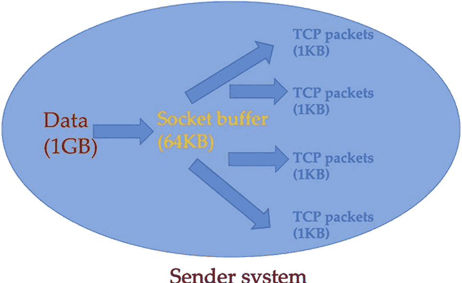

*图5.7：网络数据分片视图*

其次，考虑两个正在进行数据传输的网络端点。当一个端点发起从套接字读取时，另一个端点的状态有以下几种可能性：

* 另一个端点已经写入了其数据
* 另一个端点正在写入数据
* 另一个端点正在写入比接收方能处理的更多的数据
* 另一个端点即将写入数据
* 另一个端点没有写入任何数据

接收端必须做好准备应对这些可能性，否则其接收所需数据的功能将受到不利影响。例如，如果另一个端点正在写入的数据比接收方在一个块中能容纳的还要多，那么如何管理数据？同样，如果另一个端点永远不会写入呢？接收方是否必须永远等待下去？如果是这样，依赖于它的程序逻辑会发生什么？总之，数据的大小、速度和顺序将直接影响这些序列。这就是数据流对应用层的影响。

如我们所知，Node.js是单线程的，我们不能让唯一的线程专门用于准备（或阻塞）该平台上的数据传输。正如我们在前面的示例中看到的，网络数据已经以流动的方式传输，在任何端点都无法强制执行明确的排序。这是两个问题，但将它们结合起来给了我们一个创新的启示——网络上的数据传输非常适合事件驱动架构！

也就是说，让数据根据网络传输的考虑因素和约束进行流动，但在接收到一定数量的数据时进行增量处理。

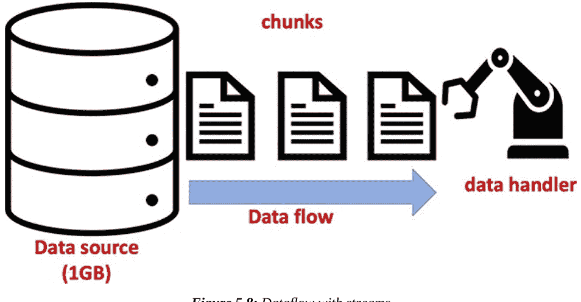

*图5.8：使用流的数据流*

Node.js流是对流动数据的一种抽象。流并非Node.js特有的概念，但流式数据管理与事件驱动架构天然契合。使用流，函数被设计为处理部分数据。为了缓解因处理部分数据而产生的额外处理问题，这些函数能够将部分数据生成到第二个流中。这样的函数被称为**过滤函数**。根据数据需要多少级操作，这些流可以顺序连接，形成一个管道。

下图展示了一个**自然语言处理（NLP）**管道的示例，该管道使用过滤函数和流数据管道：


*图5.9：使用数据流的NLP管道示例*

Node.js实现的所有I/O操作的数据容器都是流。这包括网络、文件和控制台。换句话说，你通过流API对这些设备执行I/O操作。这给程序员带来了一个优势——在处理不同数据容器的数据时具有一致性。

Node.js流具有相对较大的生命周期事件集。因此，流是从‘EventEmitter’接口继承而来的。这使得流成为一等事件驱动对象。下图显示了各种作为事件发射器类型的Node.js对象：

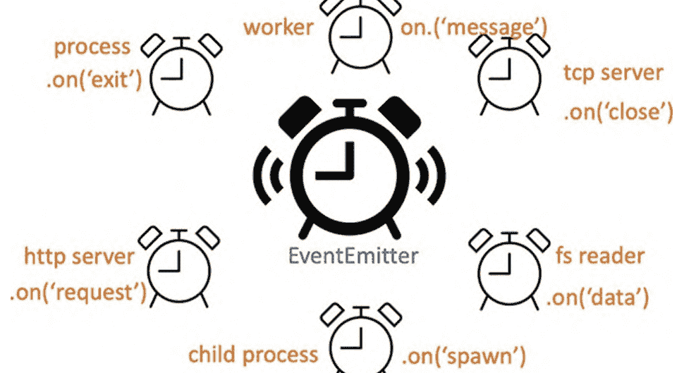

*图5.10：EventEmitter及其常见子类*

流的一个额外积极副作用是内存效率。如果你正在处理大量数据，你可以通过增量处理小块数据来节省空间。以下代码展示了一个小程序的简单流用法：

```javascript
const f = require('fs')
console.log('the file content is:\n-----')
const r = f.createReadStream(__filename)
r.on('data', (d) => {
  console.log(d.toString())
})
r.on('end', () => {
  console.log('-----\nend of file')
})
```

在这个程序中，我们将自己的源代码作为流打开并从中读取。（‘__filename’是Node.js中可以全局使用的预定义变量；它代表正在执行模块的文件名）。下图显示了程序执行时的输出：

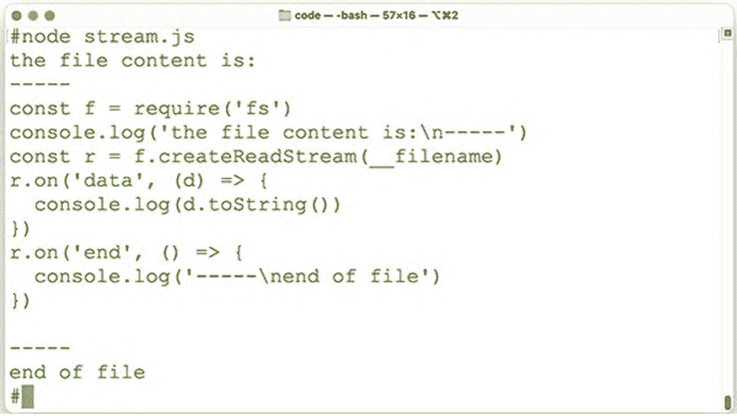

*图5.11：示例流程序的输出*

如我们所见，整个文件内容都在输出中被打印出来了。


**问题：** 在上述代码中，为什么在打印之前，数据处理函数中接收到的数据需要先进行`字符串化`？如果直接打印数据会怎样？

### Node.js 缓冲区

我们接着之前的内容讲，流是管理I/O数据的一种便捷方式。流对象的一个重要生命周期事件是`data`事件，当流中有一块（`chunk`）数据可供程序使用时，就会触发该事件。这里的“块”（chunk）一词值得特别注意。如果数据从端点A发送到另一个端点B，那么当B触发`data`事件时，这个“块”的大小是多少？是小于1MB、正好1MB，还是某个系统默认值，比如1KB、64KB或512KB？

答案是：这取决于多个因素：

- TCP 的实现
- TCP 的配置
- HTTP 解析器的实现
- HTTP 解析器的配置
- 发送方的内核缓冲区大小
- 接收方的内核缓冲区大小
- 所涉及网络的速度

除此之外，流API本身也可以决定何时以及以多少数据来触发`data`事件，例如：

- 等待所有数据通过网络流入，然后触发`data`事件
- 等待预设量的数据（块）流入，然后为该部分触发`data`事件
- 以单次从网络读取到的任何数据来触发事件

基于上述方式的变体，还有更多可能性。关键在于，对于一次有意义的、可以被处理程序调用的数据块大小，有许多需要考虑的因素。

从消费程序的角度来看，对于大多数实际用途，`data`回调中块的长度是任意的。

但是，等等！数据怎么会分块呢？如果这发生了，对于底层记录意味着什么？还记得我们在前一节中使用的示例消息吗？如果该消息被分成两块，块的边界位于距开头任意数量的字符处，既不结束于记录边界，也不结束于键或值的边界，会怎样？以下图示由于前述因素，在一个任意点被分割的HTTP消息：

```
01.  GET / HTTP/1.1
02.  Host: localhost:12000
03.  User-Agent: Mozilla/5.0 Gecko/20100101 Firefox/78.0
04.  Accept: text/html,application/xhtml+xml,applica
```

*图 5.12：分块的HTTP消息，第1部分*

```
01.  tion/xml;q=0.9,image/webp,*/*;q=0.8
02.  Accept-Language: en-US,en;q=0.5
03.  Accept-Encoding: gzip, deflate
04.  DNT: 1
05.  Connection: keep-alive
06.  Upgrade-Insecure-Requests: 1
```

*图 5.13：分块的HTTP消息，第2部分*

通过这个例子，接收程序将两次调用处理程序——一次是消息的第一部分，另一次是第二部分。显然，程序无法可靠地使用这些数据。这种行为在事件驱动的世界中是完全可以理解和合理的。作为解决方案，我们需要将流入的数据存储起来，直到我们获得一个连贯的数据单元，然后才能开始处理它。

这种分割数据的类型是什么？有了流，传入的数据通常没有类型。即使它在源端有明确的结构和类型，传入的数据令牌也无法被转换为系统定义或用户定义的类型，因为数据在网络中以八位字节流（字节流）的形式流动，并且在块中被任意截断。

如果原始数据是一个包含三个键值对、长度为47字节的记录（这里先忽略头部），那么在接收端某一次迭代中接收到的块可能是完整的47字节、25字节，甚至只有1字节！数据块唯一已知的方面是，它是由八位字节组成的。

我们可以在哪里以及如何持有这样的数据？

Node.js Buffer是一种用户定义的类型，用于包含和处理任意长度的二进制数据。在最低层面，Buffer是一个无符号字节或无符号8位整数的数组。这种类型定义使得持有在网络和程序之间流动的任意数量的数据成为可能。

Buffer API还提供了一长串用于数据重构、转换和变换的原语，包括与字符串（一种常见的JavaScript类型）之间的相互转换。

Buffer是基于流的I/O端点间数据传输不可避免的用例。

在前一节中有一个问题——Node.js 流：为什么在打印之前，数据处理函数中接收到的数据需要先进行`字符串化`？如果直接打印数据会怎样？现在答案已经很明显了。数据的类型是Buffer，而不是字符串，因此需要“字符串化”。如果我们直接打印数据，将会得到Buffer对象的“字符串化”版本，这是数据二进制形式的几个字节。让我们看看。以下代码展示了从文件以流的方式读取，但直接打印数据：

```javascript
const f = require('fs')
const r = f.createReadStream(__filename)
r.on('data', (d) => {
  console.log(d)
})
```

如果我们执行它，输出将如下所示：

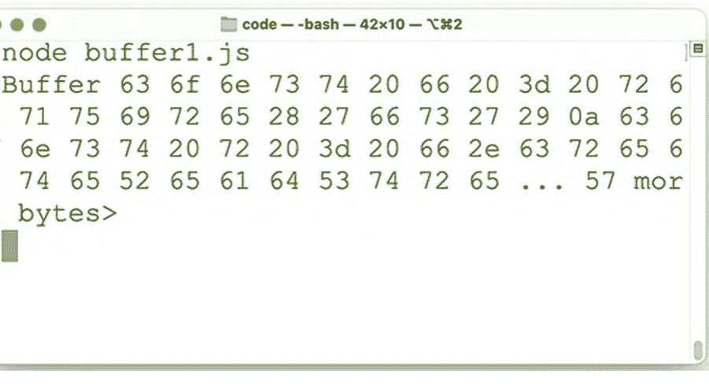

*图 5.14：示例 Buffer 程序的输出*

显然，处理程序中接收到的数据是一个Buffer对象，因此打印的内容不可读。另一方面，以下代码展示了相同的场景，但在打印前用`toString()`转换了数据：

```javascript
const f = require('fs')
const r = f.createReadStream(__filename)
r.on('data', (d) => {
  console.log(d.toString())
})
```

我们得到了正确的数据打印输出，如下图所示：

```
#node buffer2.js
const f = require('fs')
const r = f.createReadStream(__filename)
r.on('data', (d) => {
  console.log(d.toString())
})

#
```

*图 5.15：Buffer 程序的输出*

为什么我们需要执行字符串化？

- 首先，由于架构考虑，我们使用了Web服务器
- 接下来，我们使用既定协议传输数据
- 然后，为了在网络I/O中保持高效，我们必须使用流
- 我们设计了Buffer，这是一种可以容纳任意数据的新型通用类型

这就是为什么我们在数据的实际使用点，将其从通用类型转换为已知类型。

以下是Buffer API用法的一些常见示例：

1. 创建一个指定大小的**Buffer**对象并用一些数据填充它：
   1. `const b = Buffer.alloc(4, 'ABCD')`
   2. `console.log(b)`

上述代码的输出如下：


*图 5.16：Buffer 对象的输出*

2. 从字符串创建一个Buffer对象：
   1. `const b = Buffer.from('node')`
   2. `console.log(b)`

输出如下所示：


*图 5.17：包含字符串的 Buffer 输出*

3. 从**Buffer**对象中，以小端序模式将两个字节转换为一个16位整数：
   1. `const b = Buffer.from([0x0a, 0x0b])`
   2. `console.log(b.readInt16LE(0))`

输出如下所示：


这里的值2826是什么？它是0x0b0a的十进制等价形式。我们希望以小端序模式转换字节，因此高阶字节将作为最高有效位出现，反之亦然。

4. 从Buffer对象中，以大端序模式将两个字节转换为一个16位整数：
   1. `const b = Buffer.from([0x0a, 0x0b])`
   2. `console.log(b.readInt16BE(0))`

输出如下：


类似地，这里的值2571是什么？它是0x0a0b的十进制等价形式。由于我们以大端序模式转换，低阶字节将作为最高有效位出现，反之亦然。

总之，Buffer提供了一种方便的方式来从I/O卸载流数据。该类提供了许多便捷的方法来创建、转换数据，以及在原始表示形式之间进行转换。

### 请求与响应对象

到目前为止，在本章中，我们已经了解到网络编程需要特殊的协议，HTTP是一种常见的网络协议，在Node.js中通过流进行网络数据传输，并且流数据本身主要存储在缓冲区中。

现在，让我们重新审视服务器端的著名网络抽象：“request”（请求）和“response”（响应）对象。在基于HTTP的Node.js服务器实现中，这些对象是预先填充好并提供给连接处理函数的。正如我们在前面几章中多次重申的那样，“request”对象代表客户端请求，“response”对象代表服务器的响应。

我们在本章的HTTP部分提出了一个问题：当服务器收到请求时，它并不是以标准HTTP消息的形式存在。相反，各个值被分解并构建成一个“request”对象。是谁执行了这个活动？

一个简单的方法是追踪导致调用请求处理回调的程序序列历史。为此，只需在回调中插入`console.trace()`并观察调用栈。下图显示了进入请求处理回调时的调用栈：

```
Trace
    at Server.<anonymous> (foo.js:3:11)
    at Server.emit (events.js:314:20)
    at parserOnIncoming (_http_server.js:782:12)
    at HTTPParser.parserOnHeadersComplete (_http_common.js:119:17)
```

*图 5.20：请求处理函数处的调用栈*

HTTP消息首先由HTTP解析器解析。在验证消息的完整性后，当解析器认为它有足够的信息时，它就会用相关的消息部分填充“request”对象，并调用请求处理回调。这是何时完成的？在消息解析阶段。这个动作叫什么？这个动作叫做HTTP解析。


#### Request

请求对象的类型为 `http.IncomingMessage`。它是一个可读流，允许在管理流动数据的同时禁止向其写入。每次客户端发起请求时都会创建该对象，并提供给客户端请求处理函数。作为流，它具有流动数据的特性。这在请求数据无法以原子方式提供给服务器的情况下（例如大数据上传）非常方便。同时，在数据到达处理函数时，HTTP 解析已经完全执行完毕，为程序员提供了一种高效的方式来开始处理请求。

就这点而言，请求发起方（通常是客户端）从另一端点获取响应时接收到的对象也是 `http.IncomingMessage` 类型。这并非偶然。尽管这两个实体的本质乍看起来可能截然不同，但仔细观察会发现它们在以下方面具有相似之处：

- 两者都表示消息到达（一个来自客户端，另一个来自服务器）
- 两者都表示传输中的消息（可读流）
- 两者具有相似的生命周期事件

关键区别在于，前者在其本质和用途上被称为请求，而后者实际上是对远程端先前请求的响应。不要将其与我们稍后将讨论的 `ServerResponse` 对象混淆。请求对象包含底层 socket，即指向远程端点的句柄。

下图展示了我们前面提到的三个对象的数据类型：

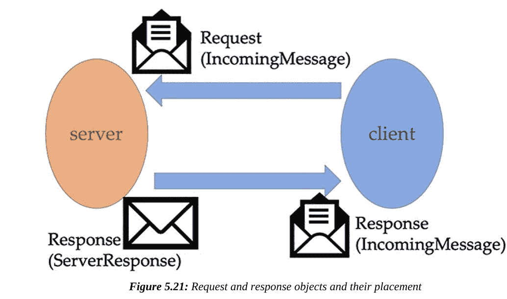

图 5.21：请求和响应对象及其位置

以下代码片段展示了在单个程序中客户端和服务器端请求对象的常见用法，以便我们也能看到请求对象的类型：

```javascript
1. const h = require('http')
2. const s = h.createServer((q, r) => {
3.   console.log(`In server, q is a ${q.constructor.name}`)
4.   console.log(`client said: ${q.url}`)
5.   r.end('/bar')
6. }).listen(12000, () => {
7.   h.get('http://localhost:12000/foo', (m) => {
8.     console.log(`In client, m is a ${m.constructor.name}`)
9.     m.on('data', (d) => {
10.      console.log(`server said: ${d.toString()}`)
11.    })
12.    m.on('end', () => {
13.      s.close()
14.    })
15.  })
16. })
```

以下是输出结果：

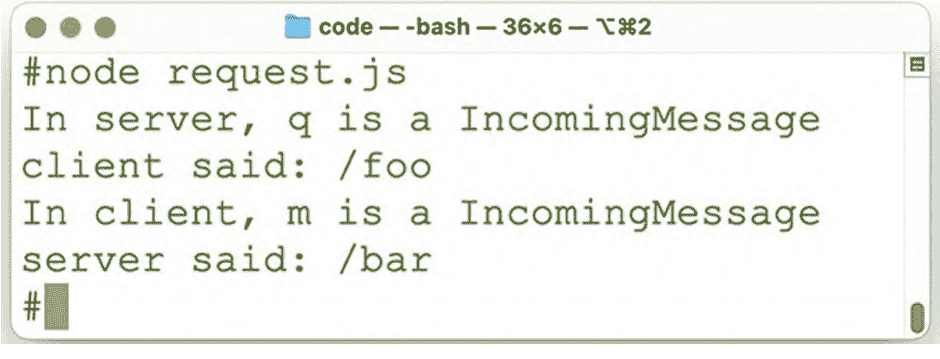

#### Response

响应对象的类型为 `http.ServerResponse`，是一个流。每次客户端发起请求时都会创建该对象，并与请求对象一起提供给客户端请求处理函数。作为流，它有助于将服务器的响应作为流动数据进行管理。它是一个 `WritableStream`，因此可以向其写入响应。它同时也是 `ReadableStream`，因此服务器程序本身可以从尚未发送给客户端并从发送队列中刷新的中间响应中读取数据。该对象的主要功能包括写入响应头和响应体，以及通过流接口控制数据流。响应对象也包含底层 socket，即指向远程端点的句柄。因此，如果我们想控制与服务器响应相关的底层网络传输配置，就会使用该对象。

> **问题：** 同一程序在写入响应流后又从中读取的使用场景是什么？

以下程序展示了响应对象的某些方面，同时也展示了通用用法。以下代码展示了使用响应对象设置自定义头部的用法：

```javascript
1. const h = require('http')
2. const s = h.createServer((q, r) => {
3.   r.setHeader('hello', 'world')
4.   r.end(r.getHeader('hello'))
5. }).listen(12000, () => {
6.   h.get('http://localhost:12000', (m) => {
7.     m.on('data', (d) => {console.log(d.toString())})
8.     m.on('end', () => {s.close()})
9.   })
10. })
```

响应对象是一个可写流，因此我们可以向其写入有效的 HTTP 消息。同时它也是一个可读流，因此我们也可以从中读取数据。在第 4 行中，我们读取了之前设置的头部，并将其作为消息体发送，以展示我们可以从响应中回读数据。输出结果如下图所示：

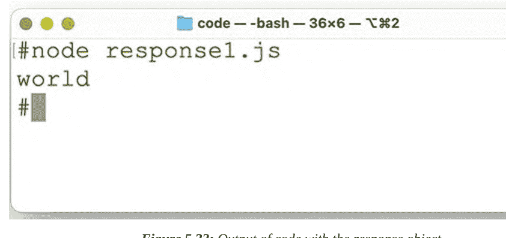

*图 5.23：使用响应对象的代码输出*

以下代码展示了 **'writeHead'** API 的使用场景，其用途与 **'setHeader'** API 类似，但在未使用 **'setHeader'** 的情况下禁止回读数据：

```javascript
1. const h = require('http')
2. const s = h.createServer((q, r) => {
3.   r.writeHead(200, {'hello': 'world'})
4.   r.end(r.getHeader('hello'))
5. }).listen(12000, () => {
6.   h.get('http://localhost:12000', (m) => {
7.     m.on('data', (d) => {console.log(d.toString())})
8.     m.on('end', () => {s.close()})
9.   })
10. })
```

其意图与 **setHeader** 的情况类似，但 **getHeader** API 无法从响应对象中获取任何数据，因为头部已被立即写入网络并从程序内存中刷新！如下所示：


*图 5.24：使用 'writeHead' 的输出*

**setHeader** 函数适用于需要以迭代方式设置大量头部，且后续可能需要检索和修改的场景；而 **writeHead** 则用于在有数据时立即响应客户端，不会在响应对象中缓存中间头部。显然，这种方式不支持后续修改。

### 请求和响应生命周期

如前所述，请求和响应对象都是流对象，因此这些对象的生命周期本质上就是数据流的生命周期。这有助于程序为感兴趣的生命周期事件安装处理函数并采取相应的操作。最常见的生命周期事件如下：

#### 请求生命周期

该对象有两种不同的使用方式：i) 作为在客户端发起请求时，在服务器中保存客户端请求的抽象；ii) 作为在服务器回复后，在客户端中保存服务器响应的抽象。除了适用于 `ReadableStream` 的常规生命周期事件外，还定义了以下附加事件：

#### 'aborted'

当底层客户端请求被中止时，会触发此事件。任何对请求的后续处理都被视为无效。程序可以为该事件安装处理函数，以捕获此类情况并优雅地中止对该请求的后续操作。

以下代码展示了在 `IncomingMessage` 对象上捕获此事件。这里请求被显式中止，但在实际场景中可能是由任何网络故障引起的：

```javascript
1. const h = require('http')
2. const s = h.createServer((q, r) => {
3.   q.on('aborted', () => {
4.     console.log('client request aborted')
5.   })
6.   r.write('ok')
7. }).listen(12000, () => {
8.   const r = h.get('http://localhost:12000', (m) => {
9.     m.on('data', (d) => {
10.       console.log(d.toString())
11.     })
12.     m.on('end', () => {})
13.     m.on('aborted', () => {
14.       console.log('server response aborted')
15.       s.close()
16.     })
17.   })
18.   r.abort()
19. })
```

以下输出表明，当客户端请求被中止时，服务器上会收到相应的事件，而该事件又会以 'aborted' 事件的形式通过服务器的响应传递给发起请求的客户端：

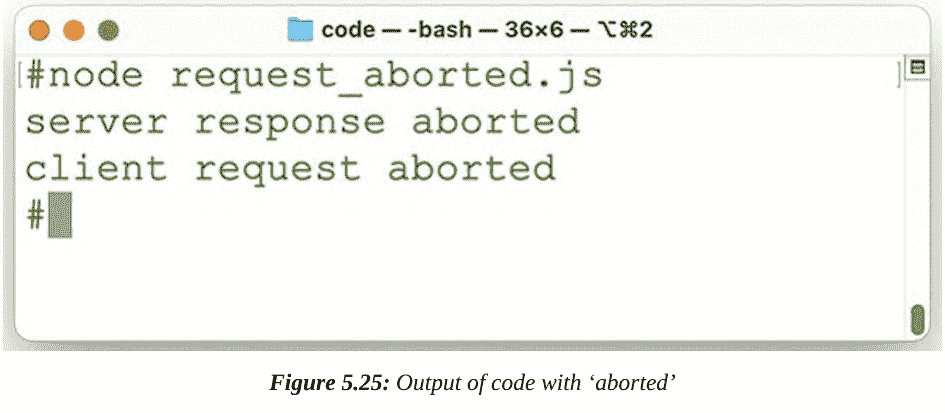

图 5.25：使用 'aborted' 的代码输出

#### 'close'

当底层客户端连接关闭时，会触发此事件。程序同样可以使用此事件在连接关闭后执行必要的后续活动。

除此之外，请求对象上最常见的事件（继承自 `ReadableStream`）通常是：

#### 'data'

当底层流有可用数据时，会触发此事件。安装一个处理函数来消费这些数据。在服务器端，只有当客户端发送大量数据（使用 HTTP POST 方法的上传场景）时才需要此处理函数，因为其他类型的请求携带的数据量较小，可以直接在请求对象的相应字段中获取。在客户端，通常会安装一个 data 处理函数来"捕获"服务器的响应。

'data' 处理函数有两种使用方式：i) 能够处理任意数量数据的方式，ii) 将数据缓冲直到


以下代码展示了一个处理器，它可以处理任意数量的数据，完全符合流的原则：

```
m.on('data', (d) => {
  // 对 d 进行处理
  // (任意类型，
  // 任意长度)
})
```

以下代码展示了一个处理器，它会缓冲流数据，直到数据流结束才开始处理数据：

```
const data = ''

m.on('data', (d) => {
  data += d
})

m.on('end', () => {
  // 处理 data
  // (完整数据)
})
```

这两种情况都很常见，没有哪种情况绝对优于另一种。你可以根据具体场景，选择更方便的那一种。

#### 'end'

当请求底层的流没有更多数据可读，且流的写入端已确认写入完成时，会触发此事件。这是流中一个强大的构造——当数据在流动时，程序需要精确且一致地知道数据接收何时完成。无论是在客户端还是服务器端，程序通常会在此事件发生时开始处理请求数据，因为它标志着数据的完全可用。

```
stream.on('end', () => {
  // 所有数据已到达
  // 处理到目前为止收集的数据
})
```

#### 响应生命周期

由于响应是一个全双工流对象，它关联了大量与可写和可读流相关的事件。响应对象特有的事件如下：

#### 'close'

当响应完成，或底层连接在传输过程中中断时，会触发此事件。程序可以为此事件安装一个处理器，以捕获这些情况，并优雅地关闭此响应上的后续操作。

#### 'finish'

当响应从服务器进程发出时，会触发此事件。虽然这并不保证响应已到达或将到达客户端（由于网络中断等各种因素），但它表明与服务器响应相关的所有数据已提交给服务器系统的操作系统，而操作系统最终负责数据的传输。以下代码展示了 `finish` 事件的一个使用示例：

```
const h = require('http')
const s = h.createServer((q, r) => {
  r.on('finish', () => {
    console.log('response finished')
  })
  r.end('hello')
}).listen(12000, () => {
  h.get('http://localhost:12000', (m) => {
    m.on('data', (d) => {})
    m.on('end', () => {s.close()})
  })
})
```

此事件在调用 `end` 之后触发。可以思考一下哪个事件会先发生——是服务器中的 `finish` 事件，还是客户端收到消息。


### 服务器配置

到目前为止，我们已经研究了请求和响应对象、它们在服务器中的特定角色以及它们的生命周期事件。我们还知道这些对象实现了 `HTTP` 协议，该协议底层也利用了 TCP/IP，并且所有数据传输都作为流来管理。现在，让我们来看看服务器对象本身，它抽象了一个 Web 服务器，并通过一个称为 **socket** 的系统定义抽象来管理客户端通信。服务器对象是通过调用 `http` 模块的 `createServer` 方法创建的。此对象继承自 TCP 服务器，这与我们之前所学的一致——HTTP 通信底层使用 TCP 通信。下图展示了服务器对象相关字段的实时转储：

```
Server {
  _eventsCount: 2,
  _connections: 1,
  _handle: TCP {
    reading: false,
    onconnection: [Function: onconnection],
    [Symbol(owner_symbol)]: [Circular *1]
  },
  allowHalfOpen: true,
  pauseOnConnect: false,
  httpAllowHalfOpen: false,
  timeout: 0,
  keepAliveTimeout: 5000,
  maxHeadersCount: null,
  headersTimeout: 60000,
};
```

*图 5.27：服务器对象转储示例*

服务器对象用于控制影响服务器处理的所有连接的某些服务器特性。这包括与数据流、连接空闲状态和最大并发连接数相关的参数。这些参数可以在任何时候修改——在创建服务器时、创建后，甚至在处理某些连接之后。

#### 'maxHeadersCount'

此参数定义每个请求传入头的最大数量。0 表示不施加限制。

在以下代码中，服务器以可配置的 `maxHeadersCount` 启动（用户在命令行中传入实际值），而客户端在其请求中添加了三个头：

```
const h = require('http')
const s = h.createServer((q, r) => {
  console.log(q.headers)
  r.end('hello')
})
s.maxHeadersCount = +process.argv[2]
s.listen(12000, () => {
  h.get('http://localhost:12000',
    {headers: {a: 'b', c: 'd', e: 'f'}}, (m) => {
    m.on('data', (d) => {console.log(d.toString())})
    m.on('end', () => {s.close()})
  })
})
```

正如我们在以下输出截图中看到的，任何请求中只允许服务器配置中指定的头部数量：

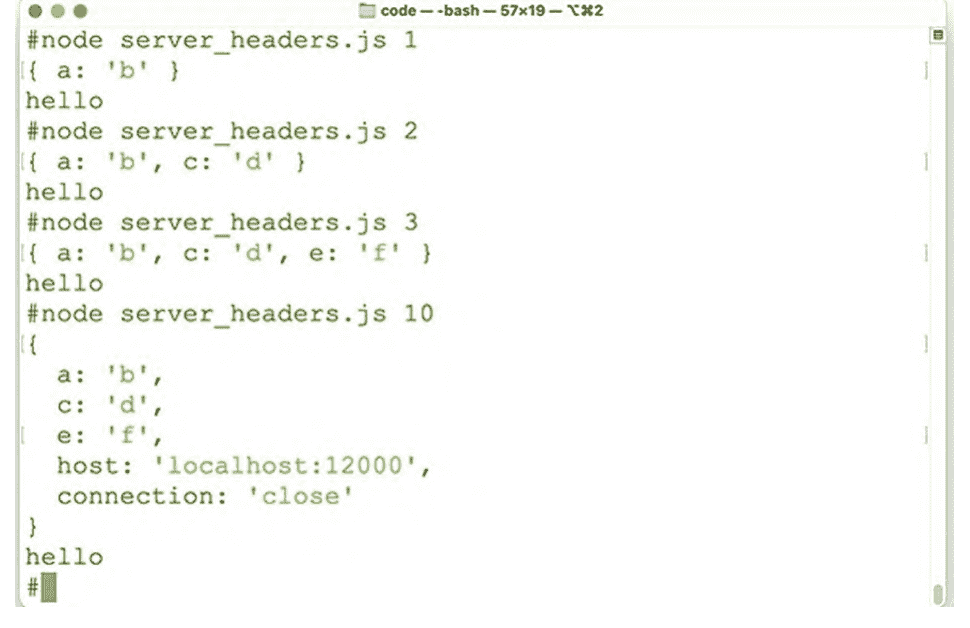

*图 5.28：头部配置代码的输出*

#### 'timeout'

此参数定义服务器套接字（在新客户端连接后创建）在连接超时前的空闲时间。它强制服务器防止缓慢的后端因资源而膨胀。在以下代码中，服务器接收来自客户端的请求，但只在 10 毫秒后才响应。然而，服务器设置了 1 毫秒的空闲超时，这比当前请求的空闲时间要短得多：

```
const h = require('http')
const s = h.createServer((q, r) => {
  setTimeout(() => {
    r.end('hello')
  }, 10)
})
s.timeout = 1
s.listen(12000, () => {
  const r = h.get('http://localhost:12000', (m) => {
    m.on('data', (d) => {console.log(d.toString())})
    m.on('end', () => {s.close()})
  })
  r.on('error', (e) => {
    console.log(e)
    s.close()
  })
})
```

结果，底层连接被重置，请求无法完成，如以下异常所示：

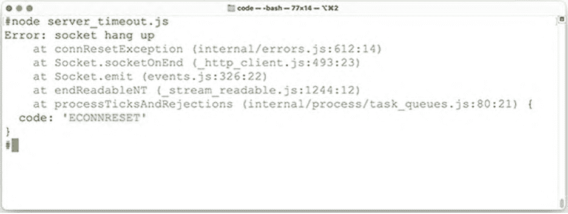

*图 5.29：更改 'timeout' 的代码输出*

### 服务器的生命周期事件

Node.js HTTP 服务器也是一个 TCP 服务器实例。它也是一个 `EventEmitter` 实例，能够表现事件驱动行为。服务器对象定义了一组事件，涵盖其生命周期。请记住，连接的生命周期和服务器的生命周期是微妙不同的。前者代表与客户端的特定连接，而后者代表整个服务器本身，其生命周期更长。这里列出了一些重要的生命周期事件：

#### 'listening'

当服务器开始监听并准备接受连接时，会触发此事件。它是服务器生命周期中的一次性事件。

以下示例说明了此事件的重要性：

在第一个示例中，服务器监听端口 12000，然后我们启动连接到服务器并发出请求的客户端：

```
const h = require('http')
const s = h.createServer((q, r) => {
  r.end('hello')
})
s.listen(12000)
const r = h.get('http://localhost:12000', (m) => {
  m.on('data', (d) => {console.log(d.toString())})
  m.on('end', () => {s.close()})
})
```

发生了什么？你看到这里有什么明显错误吗？

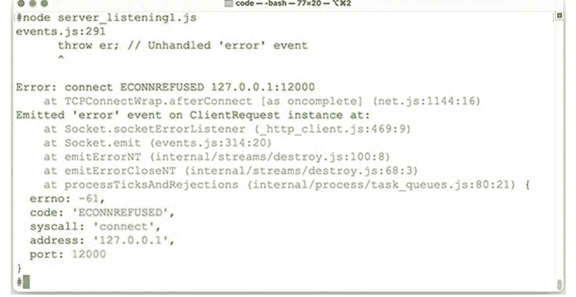

*图 5.30：不当 listen 调用的输出*

'connection refused' 消息非常类似于服务器未在该端口上监听的场景。实际原因也是如此！我们调用了异步 API `listen`，但在开始客户端之前没有等待实际的 `listen` 完成！

因此，在我们的第二个示例中，我们只在 `listening` 事件的处理器函数中启动客户端。我们将在设置处理器后才调用 listen API：

```
const h = require('http')
const s = h.createServer((q, r) => {
  r.end('hello')
})
s.on('listening', () => {
  const r = h.get('http://localhost:12000', (m) => {
```


```
7.     m.on('data', (d) => {console.log(d.toString())})
8.     m.on('end', ()  => {s.close()})
9.   })
10. })
11. s.listen(12000)
```

而这次它运行得非常完美（输出未显示，因为我们已经多次看到过这个模式）。但作为实践，对 `listen` 的异步调用本身就会提供一个完成处理程序，因此我们可以使用这种简写形式，如这里所示：

```
1. const h = require('http')
2. const s = h.createServer((q, r) => {
3. r.end('hello')
4. })
5. s.listen(12000, () => {
6.   const r = h.get('http://localhost:12000', (m) => {
7.     m.on('data', (d) => {console.log(d.toString())})
8.     m.on('end', ()  => {s.close()})
9.   })
10. })
```

#### 'connect' 事件

当一个新的连接建立到此服务器时，会触发此事件。一个自然的想法是，我们会在何时何地使用这个事件？`connect` 事件与每当有新连接时触发的客户端连接回调之间有什么关系？

答案是：`connect` 事件实际上是在服务器上触发的，它最终导致客户端请求处理程序的调用，并正确填充请求和响应对象。因此，如果你想要覆盖客户端连接处理的默认行为，这就是你需要注册处理的事件。

#### 'close' 事件

当服务器关闭时，会触发此事件。以下示例说明了这一点：

```
1. const h = require('http')
2. const s = h.createServer((q, r) => {
3.     r.end('hello')
4. })
5. s.listen(12000, () => {
6.     h.get('http://localhost:12000', (m) => {
7.         m.on('data', (d) => {console.log(d.toString())})
8.         m.on('end', ()  => {s.close()})
9.     })
10.    s.on('close', () => {
11.        console.log('server closes')
12.    })
13. })
```

程序的输出如下所示：


**图 5.31：** *带有服务器 `close` 事件的输出*

> 注意：`process.argv` 是从命令行获取用户输入的一种便捷方式。它是一个数组。`argv[0]` 是 `node` 可执行文件本身，而 `argv[1]` 是脚本文件的名称。其余的命令行参数（如果有的话）则可通过 `argv[2]`、`argv[3]` 等访问。如果参数是数字，我们通常会在其前面加上 `+` 号以强制转换其类型，以免该值与其他操作数以奇怪的方式进行运算。

### 其他网络 API

在本节中，我们将快速浏览 Node.js 提供的其他重要网络 API。本书中不会使用它们，但如果不提及它们，本章就不算完整，因为它们是 Node.js 网络功能的重要组成部分。

#### HTTPS

这是 HTTP 的扩展，其中的 'S' 代表安全。它通过在传输层定义数据安全语义，在基础协议之上提供了一个安全层。这意味着在应用层需要额外的握手语义以实现安全通信。`https` 模块为支持应用程序安全通信提供了必要的 API。

#### HTTP 2

这是对 HTTP/1.1 协议的增强。该协议已有约 30 年的历史，在互联网络的前提方面存在一些低效之处。与之前的版本相比，HTTP 2 提供了一个优化的协议规范。两个关键的增强是：

- 围绕关键协议设计的性能优化
- 服务器向客户端推送数据的能力

Node.js 通过 `http2` 模块提供了一套全面的方法来使用此协议。

#### UDP

**用户数据报协议 (UDP)** 是另一个与 TCP 同级的协议。这是一个无连接协议，因为它不需要端点在传输数据之前建立握手。`dgram` 模块提供了完全支持 UDP 协议的 API。

## 结论

我们已经全面浏览了 Node.js 的网络 API。我们深入探讨了程序间互联网络通信对协议的需求。我们以 TCP/IP 和 HTTP 为例进行了详细讨论。我们理解了为什么流和缓冲区在处理大量 I/O 的 Node.js 程序中如此重要。然后，我们剖析了 Node.js 的服务器抽象——“request”和“response”——这让我们对服务器中间件概念有了很好的认识。我们还研究了影响服务器行为的配置，以及服务器的生命周期控制点和服务器事件。这使我们能够编写功能正确且覆盖基本通信集的常见服务器程序。

在下一章中，我们将开始讨论我们的服务器程序旨在开发的网站的构建模块。我们将涵盖静态和动态内容、路由和端点以及请求类型。我们还将涵盖高级主题，如 cookie、会话和请求转发。

## 主要的 Web 服务器组件

我们已经建立并熟悉了本书的自然流程：一种自底向上的方法，其中最底层是工作负载特征、计算机组织对这些特征的影响以及 Node.js 架构在其中的位置。最顶层是网站应用及其用户界面。中间的章节处理构成中间层的主题，围绕业务逻辑的抽象程度逐步提高。在上一章中，我们很好地了解了 Node.js 的网络编程 API。本章介绍了下一层——Web 服务器中间件——这是典型 Web 服务器用于其最常见用例并重用的组件。这些包括静态和动态内容服务、路由和端点、HTTP 动词、请求转发、cookie 和会话等。并非每个 Web 服务器都需要这些原语，但这些概念本质上是通用的，因此它们构成了一个合理、连贯的学习集合。

下图描述了通过增量添加功能构建 Web 服务器的过程：

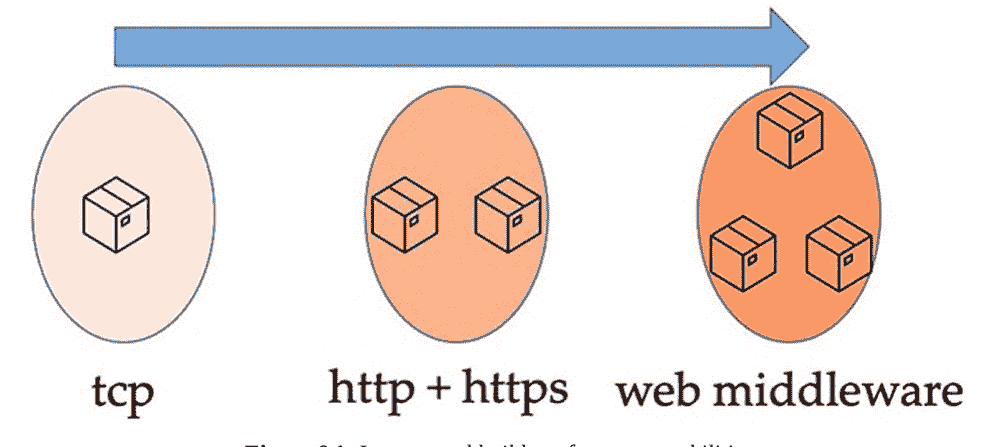

> **注意：** 这里有一个简单的例子来帮助我们理解网络协议的重要性。在最底层，当两字节数据（B1, B2）到达端点时，如何组合这些字节以重建原始单词——B1B2 还是 B2B1——的问题由一个称为字节序的概念定义。两种字节序类型很普遍：大端序和小端序。

> **提示：** 我们如何查看 HTTP 消息头？一个简单的技术是编写并运行一个 TCP 服务器，只打印传入的请求，通过浏览器客户端访问该服务器，就好像它是一个基于 HTTP 的服务器一样。客户端会失败，但这没关系；我们在 TCP 服务器中获得的消息将是浏览器发送的完整 HTTP 消息。

对于所有这些原语，存在专门的、可重用的 `npm` 模块或框架，但我们不会参考其中任何一个。相反，我们将详细研究这些概念及其相关的用例、定义和实现考虑因素——以更好地符合本书的目标，即仅使用 Node.js CLI 作为单一工具来开发 Web 应用程序。我们还希望读者能够重新架构这些组件以适应他们的用例并优化其特定的工作负载场景。详细研究这些概念对于获得这种洞察力和能力至关重要。

## 结构

在本章中，我们将涵盖以下主题：

- 静态文件服务器
- HTTP 方法（动词）
- 路由和端点
- Cookie
- 会话
- 请求转发
- 多部分表单数据
- 主体解析器
- 跨源资源共享 (CORS)
- HTTP 响应代码
- 动态 Web 服务器
- 服务器安全

## 目标

学完本章后，你将能够理解 Web 服务器中的常见中间件抽象。这将包括定义服务器性质的静态和动态内容服务的概念。你还将了解帮助客户端和服务器对请求类型进行分类的路由和端点。此外，本章还包括对 HTTP 动词（方法）等重要主题的说明，你将详细学习最受欢迎的方法（GET 和 POST）。然后，我们将研究如何使用 cookie 和会话来管理客户端会话，将客户端请求转发到另一个服务器。你还将了解常见的安全问题及其解决方法。对于所有这些组件，我们还将列出最常见的生产问题和问题确定步骤。

## 引言

为了更好地呈现服务器中间件主题，我们从一个零能力、零可重用性的原始 Web 服务器开始，并向自己提出一系列相关问题。这些问题的答案将帮助我们在本章中推进，我们的服务器在此过程中逐步建立其效率和可重用性。对于每个主题，我们都会说明常见的用例，提供组件的定义，并花一些时间讨论围绕组件实现的设计考虑因素。这将帮助我们更好地界定组件的范围，理解 Web 中各种隐藏的特性，并确定增强、扩展和自定义的范围。

首先，我们如何向客户端提供简单的 Web 内容？

## 静态文件服务器

我们在第 3 章“Web 服务器简介”中了解了一个时间获取服务器。那是 Web 服务器最微不足道的用例之一。Web 服务器的另一个次要用途是文件服务器。静态文件服务服务器可用于描述 Web 服务器的架构。让我们检查它的目的、意义和实现。
```


### 使用场景

文件服务器是一种位于网络中心位置的服务器系统，为其客户端提供不同类型的文件资源。文件服务可以通过以下附加属性来限定：

- 是否需要身份验证（需要注册用户配置文件才能访问资源）
- 是否支持导航（能够查看远程服务器上的文件列表和目录结构）
- 是否支持类型推断等（客户端能够检测传入文件的类型并为其分配适当的扩展名）

### 定义

静态文件服务器是向客户端提供静态文件的服务器。这些文件既不从其他服务器获取，也不会动态生成；它们存储在服务器的文件系统中。文件通常是 HTML、CSS、JavaScript 或图像文件，但对文件类型没有限制。这些文件要么直接构成网站页面，要么由客户端用于不同目的。

一个简单的静态文件服务器架构图如下所示：

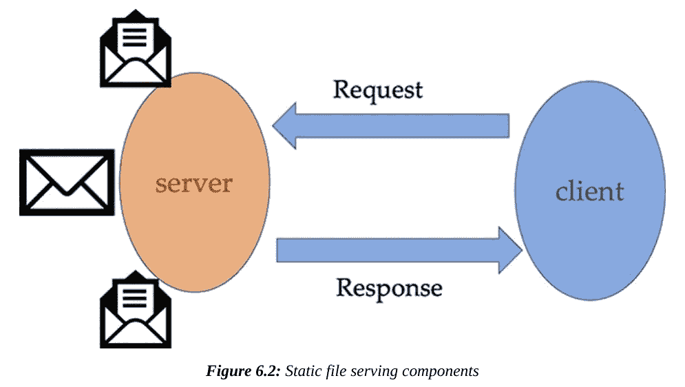

**图 6.2：** 静态文件服务组件

### 实现

我们从最简单的实现开始：如何提供文件？假设文件存储在服务器文件系统的单个文件夹/目录中，我们只需要一种方式来接收文件的标识符——通常是文件名。因此，让客户端请求文件名，服务器将返回文件内容。如何实现这样一个简单的文件服务器？

- 设置一个简单的服务器
- 在请求处理程序中读取文件名
- 读取文件内容
- 返回文件内容

以下代码展示了一个简单的文件服务器：

```
1. const h = require('http')
2. const f = require('fs')
3. const s = h.createServer((q, r) => {
4.   const file = q.url.substring(1)
5.   const data = f.readFileSync(file)
6.   r.end(data.toString())
7. })
8. s.listen(12000)
```

这段代码很简单，除了第 4 行。我们在那里做什么？`q.url` 提供用户请求的路径/路由/'url'。这通常是附加在基础 'url'（协议字符串后跟主机名，如果使用非默认端口则后跟端口号）之后的数据部分。我们使用 `substring` 调用从 'url' 中去掉第一个字符，即 '/'。通过浏览器访问时，我们看到以下内容：

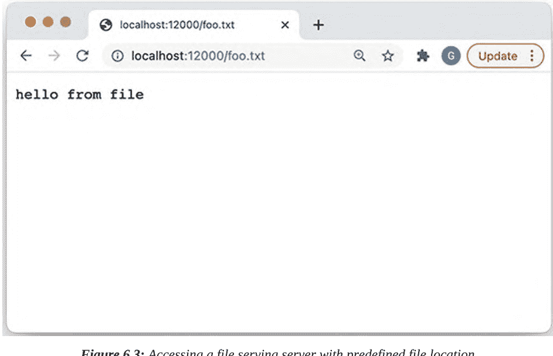

**图 6.3：** 访问具有预定义文件位置的文件服务服务器

这里的第一个限制是所有静态内容必须位于单一位置。如果文件按典型的树结构组织怎么办？我们必须从树结构的顶点/根开始搜索文件，或者接收相关文件的完整路径。

第一种方法的限制在于它要求文件名唯一，否则搜索结果中会出现多个文件，导致不清楚应该发送哪一个。因此，一种简单的方法是强制请求者提供完整路径，以便可以重新构建服务器代码，如下所示：

```
1. const h = require('http')
2. const f = require('fs')
3. const s = h.createServer((q, r) => {
4.     const data = f.readFileSync(q.url)
5.     r.end(data.toString())
6. })
7. s.listen(12000)
```

以下是我们在浏览器中使用它的方法；请特别注意 URL：

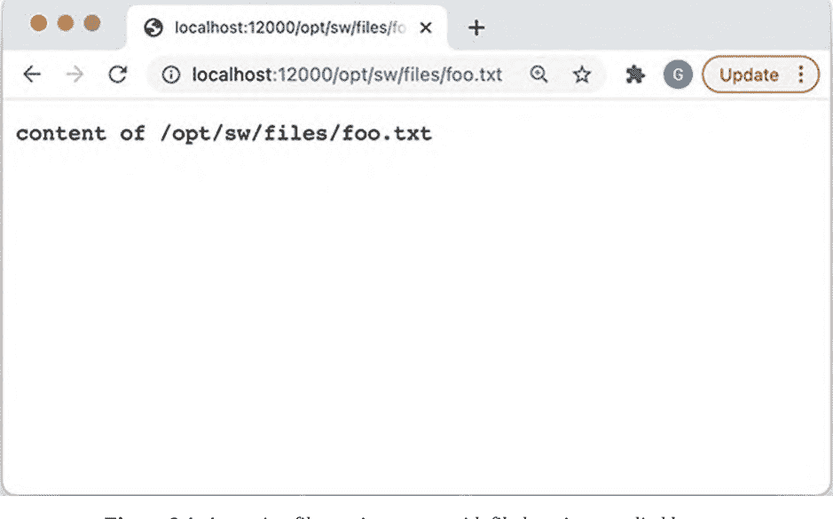

**图 6.4：** 访问由用户提供文件位置的文件服务服务器

这种方法出现了一个新限制——终端用户应该知道每个文件的完整路径！这可以通过在浏览器中显示服务器的文件结构并让客户端浏览它来解决，而不是逐个输入文件名。

这种方法的第二个限制是文件类型。你发送了文件内容但没有发送类型信息，那么客户端如何知道 incoming 的文件是什么类型呢？这可以通过在响应中设置 MIME 类型来解决。以下服务器程序为客户端设置了文件的 MIME 类型：

```
1. const h = require('http')
2. const f = require('fs')
3. const s = h.createServer((q, r) => {
4.     const file = q.url.substring(1)
5.     const data = f.readFileSync(file)
6.     r.setHeader("Content-Type", 'application/zip')
7.     r.end(data)
8. })
9. s.listen(12000)
```

如你所见，以下客户端将压缩文件作为下载，而不是在其客户端区域渲染其二进制内容。这是指定 MIME 类型的结果：

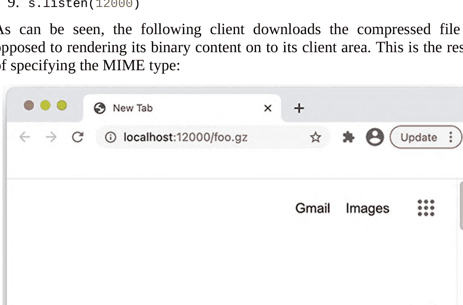

*图 6.5：访问支持 MIME 的文件服务服务器*

> **注意：** 多用途互联网邮件扩展（MIME）类型是一种指定网络内容类型和格式的标准。浏览器使用这些信息来决定如何处理服务器数据：在其客户端区域渲染、下载文件、作为多媒体播放等。

这种方法的第三个限制是可见性。我们允许客户端指定服务器上的任意位置，服务器必须按照客户端的指示读取内容并返回，因此我们实际上暴露了服务器的系统细节，这是一种安全风险。作为解决方案，我们可以将所有请求限制在服务器系统内的特定 'data' 位置。此外，我们需要禁止请求文件名引用此 'data' 位置之外的任何内容，通常借助相对路径引用，如 '.' 和 '../'。

这就引出了**内容根（content root）**的概念——一个目录或文件夹，作为为满足客户端请求的文件服务需求而限定范围的树结构的顶点。所有文件引用都应将此内容根视为文件系统的虚拟根。换句话说，客户端请求中的 '/' 应该映射到服务器上的**内容根**。

以下程序说明了内容根的用法：

```
1. const h = require('http')
2. const f = require('fs')
3. const cr = '/var/www/website1/public'
4. const s = h.createServer((q, r) => {
5.   const file = cr + q.url
6.   const data = f.readFileSync(file)
7.   r.end(data)
8. })
9. s.listen(12000)
```

通过这样做，我们只向客户端请求暴露服务器内的特定位置，而服务器文件系统的其余部分则免受客户端访问。

以下截图显示了客户端浏览器对其的使用：

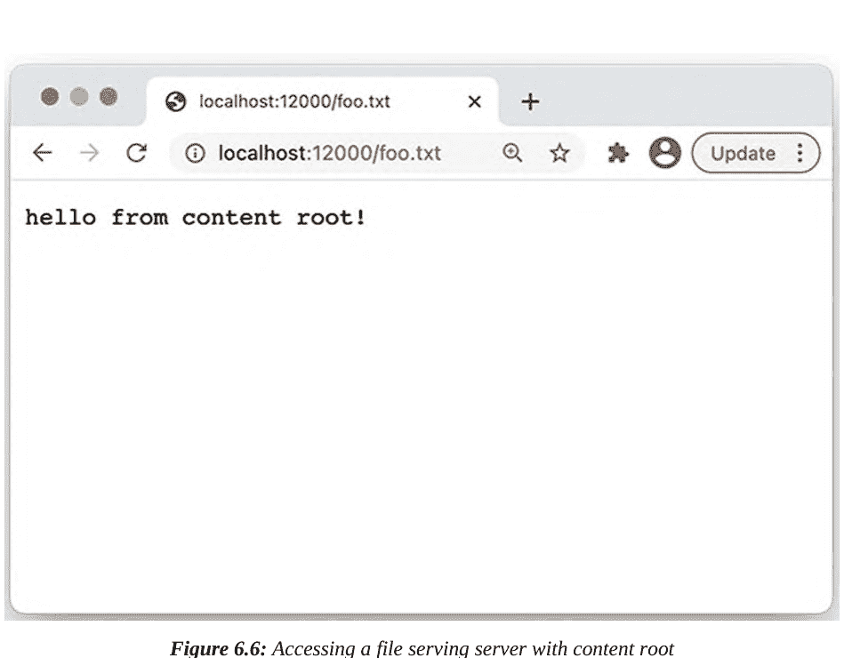

*图 6.6：* 访问具有内容根的文件服务服务器

> **问题：** 我们允许客户端指定服务器上的任意位置，服务器必须按照客户端的指示读取内容并返回，因此我们实际上暴露了服务器的系统细节。这是一种安全风险。为什么？

我们可以在静态文件服务器上实现的其他可选增强功能包括：

- 可以发送额外的文件属性（例如创建时间等）
- 定义文件列表的索引文件（以便客户端无需记住文件名）
- 下载多个文件的方式（例如，整个文件夹而非单个文件）
- 将整个结构作为 ZIP 文件下载的方式
- 将文件内容缓存在内存中以更快地为常用文件提供服务的方式

> **作业：** 扩展前面的示例程序，逐一实现上述增强功能。这有助于你识别并使用多个新的 Node.js API，同时提高你的 Node.js 后端技能。

这回答了如何向客户提供简单网络内容的问题。接下来，我们如何使服务器比提供静态内容更多功能一些？我们可以"管理"服务器中的文件和其他资源，而不仅仅是消费它们吗？我们的服务器能否更加多态一些？也就是说，我们是否允许客户端发送不同类型的请求，拦截并解释这些请求类型，并根据请求提供不同的内容？

## HTTP 动词（请求方法）

随着我们的 Web 服务器比静态文件服务器构建更多功能，下一步自然是使其能力多样化。例如，它能否为两种或更多不同类型的请求提供两种或更多不同类型的内容（尽管仍然是静态的）？HTTP 动词可以帮助满足这一需求。

### 使用场景

典型的 Web 服务器实现多个接口以抽象多种功能。一个简单的例子是 Web 服务器允许用户下载已发布的图像，并允许他们上传和发布更新的图像。这是由同一个 Web 服务器处理的，而不是两个不同的服务器，并且使用两个不同的接口实现。因此，客户端应该能够专门化他们的请求，以进一步限定其请求的具体方面；例如：

- 这是一个"获取"名为 foo.png 的请求
- 我想"上传"一个名为"bar.png"的文件。

### 定义

请求方法是请求的最高级别特化。这些方法允许客户端指示请求的目的。它们允许服务器根据每个接口抽象的目的来分离实现。这些动词旨在表示离散的、预定义的

资源进行抽象，尽管在实际操作中，服务器可以自由执行它认为合适的任何操作。

最常用的动词是 GET 和 POST。GET 请求表示向服务器请求指定的资源，而 POST 请求则表示向服务器请求创建（或更新）一个资源，数据由请求体提供。

下面是一个简单的图示，展示了使用 HTTP 动词的示例请求：

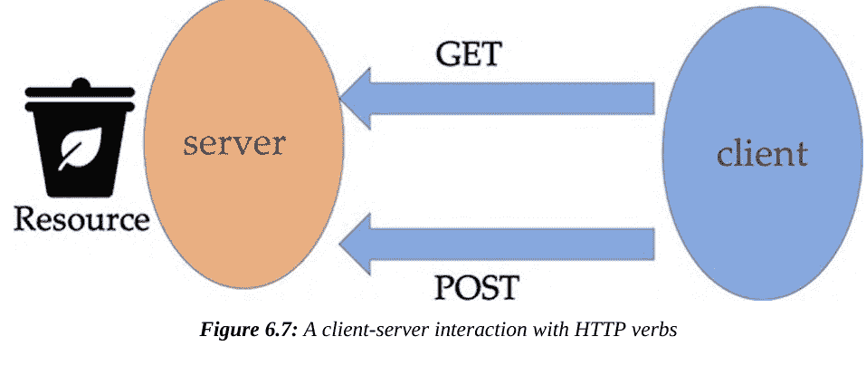

### 实现

在客户端，动词附加在请求头中，其余数据则根据动词来决定。在服务器端，动词出现在请求体中。因此，首先解析动词是正确理解请求的好方法。此外，服务器可以根据请求类型进行功能分离。最简单的分离方式可以是 switch case，将持有动词的变量作为 switch 变量，其可能的值作为 case 头部。

以下代码说明了这种模式：

```javascript
1. const h = require('http')
2. const s = h.createServer((q, r) => {
3.   switch(q.method) {
4.     case 'GET':
5.       r.end('GET invoked')
6.       break;
7.     case 'POST':
8.       r.end('POST invoked')
9.       break;
10.    default:
11.      r.end('default response!')
12.      break;
13.   }
14. })
15. s.listen(12000)
```

有了这个基础，客户端可以通过专门化请求来表达其意图。例如，一个典型的 **GET** 请求看起来是这样的：

```javascript
1. const h = require('http')
2. const r = h.get('http://localhost:12000', (m) => {
3.   m.on('data', (d) => {
4.     console.log(d.toString())
5.   })
6. })
```

同样，以下是一个发起 **POST** 请求的客户端：

```javascript
1. const h = require('http')
2. 
3. const r = h.request({port: 12000, method: 'POST'}, (m) => {
4.   m.on('data', (d) => {
5.     console.log(d.toString())
6.   })
7. })
8. r.end()
```

在服务器端可以方便地进行的一项优化是，使用知名动词作为名称定义处理程序，并将这些处理程序附加到服务器上。这样，分离器可以根据请求方法类型轻松调用适当的处理程序。

以下代码具有基于请求类型的专门处理程序：

```javascript
1. const h = require('http')
2. 
3. function onGet(q, r) {
4.   r.end('GET invoked')
5. }
6. function onPost(q, r) {
7.   r.end('POST invoked')
8. }
9. 
10. const s = h.createServer((q, r) => {
11.   if (q.method == 'GET')
12.     onGet(q, r)
13.   else if (q.method == 'POST')
14.     onPost(q, r)
15.   else
16.     r.end('default response!')
17. })
18. s.listen(12000)
```

HTTP 动词及其知名含义如下：

| 动词 | 含义 |
| :--- | :--- |
| GET | 从服务器获取资源（到客户端） |
| POST | 使用客户端提供的资源在服务器中设置资源 |
| PUT | 使用客户端提供的资源替换服务器中的资源 |
| DELETE | 删除服务器中的资源 |
| HEAD | 从服务器获取状态（到客户端） |
| CONNECT | 在客户端和服务器之间建立隧道 |
| TRACE | 与服务器执行消息回环测试 |
| OPTIONS | 列出服务器公开的通信选项 |

*表 6.1：HTTP 动词列表*

在这些动词中，"GET" 和 "POST" 是最常见的。

**问题：** 回到我们的静态文件服务服务器，上述 HTTP 动词的合理用例是什么？也就是说，什么样的动词可以用来增强/扩展文件服务服务器？

如果你的 Web 服务器设计为管理多种此类请求类型，那么重要的设计考虑之一是将请求解析逻辑"隐藏"在下层，然后实现专门执行特定请求类型的处理程序。底层专注于拦截允许的请求类型、分派适当的处理程序、处理不当请求类型的异常等。

> **注意：** 鉴于现代工作负载正在从单体架构转向微服务架构，请记住，在单个服务器中处理过多的请求类型会使其趋向于单体化，从而失去微服务的特征特质。

有了这些，我们称我们的服务器具有合理的多态性。但这就够了吗？我们如何在请求中表示不同的资源？也就是说，我们如何允许客户端发送请求，同时还能为不同的资源提供路径规范以及丰富请求的小型数据令牌？

## 路由

基于 HTTP 动词进一步构建服务器的通用性，路由通过为请求添加不同的参数使其（服务器）更加可重用。这使服务器真正具有多态性，因为它现在可以处理各种各样的客户端。

### 用例

正如我们在 HTTP 动词案例中提到的，服务器实现多个接口来抽象其多种能力。此外，服务器应允许指定其所拥有的多种资源的方式。一个简单的例子是 Web 服务器允许用户通过指定请求中文件名的确切路径来下载已发布的图像。此外，客户端应能够提供文件名的相对路径。它还应指定参数化的路径标识符。服务器应遵循路径指定的方式并相应地转换请求。

### 定义

路由是请求方法的下一级专门化，仅次于请求方法本身。它允许客户端在请求中指定所需的资源。路由是客户端请求语义的一部分，指定目标资源。URI 引用表示目标资源，但该引用可以通过双方理解的协议用额外的限定符进行重载，以覆盖通用类别的资源引用需求。

下图展示了包含路由的客户端-服务器交互：

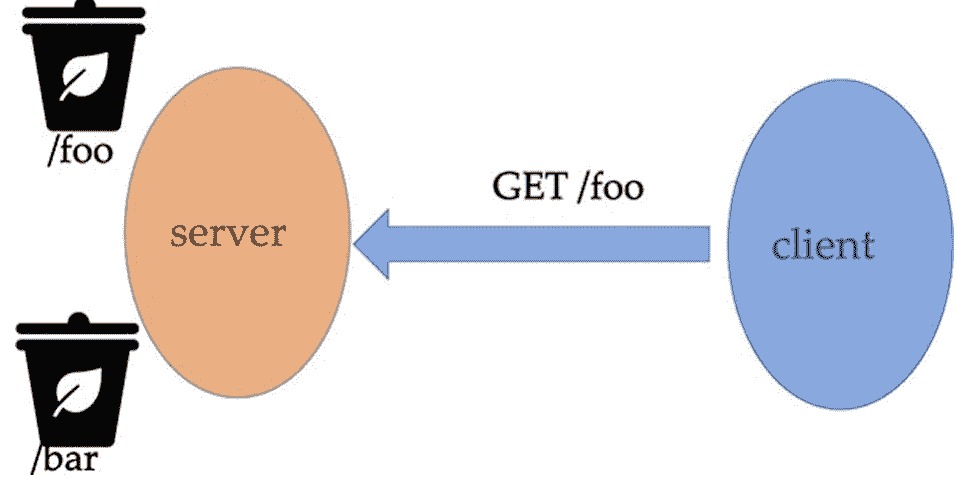

*图 6.8：使用路由的客户端-服务器交互*

### 实现

就像请求方法一样，在客户端，路由路径附加在请求头中，通常被称为 path。在服务器端，路由出现在请求体中。同样，与动词的情况一样，首先解析路由是充分理解请求的好方法。如果特定应用程序只有有限数量的路由可用，服务器可以根据路由进行功能分离。最简单的分离方式可以是 switch case，将持有路由的变量作为 switch 变量，其可能的值作为 case 头部。

以下代码展示了简单的路由处理：

```javascript
1. const h = require('http')
2. const s = h.createServer((q, r) => {
3.   switch(q.url) {
4.     case '/foo':
5.       r.end('foo path invoked')
6.       break;
7.     case '/bar':
8.       r.end('bar path invoked')
9.       break;
10.    default:
11.      r.end('default response!')
12.      break;
13.   }
14. })
15. s.listen(12000)
```

客户端请求可以通过向基础 URL 添加路径标识符来进行专门化，如下所示。以下客户端请求包含 **'/foo'** 路由：

```javascript
1. const h = require('http')
2. const r = h.get('http://localhost:12000/foo', (m) => {
3.   m.on('data', (d) => {
4.     console.log(d.toString())
5.   })
6. })
```

下一个包含 '/bar' 路由：

```javascript
1. const h = require('http')
2. const r = h.get('http://localhost:12000/bar', (m) => {
3.   m.on('data', (d) => {
4.     console.log(d.toString())
5.   })
6. })
```

另一方面，如果可能存在无限路由（例如众多的静态文件名），那么使用动态处理路由的通用处理函数更为合适。

一个简洁的实现看起来是这样的：

```javascript
1. const h = require('http')
2. function onFoo(q, r) {
3.   r.end('foo invoked')
4. }
5. function onBar(q, r) {
6.   r.end('bar invoked')
7. }
8. const s = h.createServer((q, r) => {
9.   if (q.url == '/foo')
10.     onFoo(q, r)
11.   else if (q.url == '/bar')
12.     onBar(q, r)
13.   else
14.     r.end('default response!')
15. })
16. s.listen(12000)
```

> 注意：关于路由名称的选择：虽然不存在标准

## 端点

端点是动词和路由的组合。它们共同为客户端与服务器通信提供了一种表示唯一接口的方式。换句话说，端点代表了请求方法和路由的组合，从客户端的角度来看，这构成了一个有意义的请求。

以下是一个简单的服务器示例，它会打印回客户端访问的端点：

```javascript
const h = require('http')
const s = h.createServer((q, r) => {
  r.end(`${q.method} http://localhost:12000${q.url}`)
})
s.listen(12000)
```

对应的客户端代码如下：

```javascript
const h = require('http')

const r = h.request({path: '/foo',
                    port: 12000,
                    method: 'POST'}, (m) => {
  m.on('data', (d) => {
    console.log(d.toString())
  })
})
r.end()
```

**注意：** 术语端点（endpoint）是重载的，就像虚拟机（virtual machine）这个词一样。

> 在许多情况下，端点被定义为一种远程计算设备，可以通过网络与外部系统进行通信。在这里，端点仅仅是指根据协议规范组合在一起的请求类型、主机、端口和 URL。

现在我们有了一个能够根据请求的性质和意图以多种方式持续为客户端提供服务的服务器。这意味着客户端可以以不同的方式使用服务器功能。这意味着客户端可以根据网站已实现的功能，在不同的时间点向同一服务器发出多个请求。目前，这些交互被认为是幂等的（发出多个客户端请求，导致服务器采取相同的操作，并产生相同的结果）。另一方面，服务器无法跟踪客户端和客户端请求并进行关联。服务器如何"记住"客户端之前的请求并相应地采取行动/优化其功能？

## Cookie

服务器是否应该对首次连接的客户端和过去连接过一次的客户端一视同仁？服务器"记住"之前的访问是否有任何好处？例如，是否有可能进行代码或/和数据优化？Cookie 解决了这个方面，使服务器更加智能。

### 用例

Web 服务器需要知道客户端何时以及是否重新访问它托管的网站。此外，它还希望"记住"访问之间的一些上下文信息，以便当前请求能够利用上一次请求的信息得到更好的处理。

### 定义

Cookie 是服务器定义的用于表示客户端访问上下文的数据。它是一个大小受限的键值对。数据首先由服务器组成，并作为响应头的一部分发送给客户端。客户端从其响应头中检索 cookie，并在后续请求中将其放在请求头中发送给匹配的端点。当服务器收到请求时，到达其头部的 cookie 帮助服务器回忆起该客户端之前请求的上下文。

带有 cookie 的简单数据流演示如下：

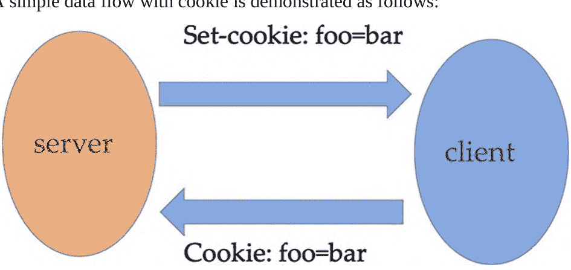

### 实现

最简单的实现具有指定如何在服务器端定义 cookie 并将其发送给客户端，以及客户端如何在后续请求中使用它发送给服务器的语义。

一个值得注意的特殊之处是，cookie 的属性由分号分隔，而多个 cookie 由逗号分隔。

*图 6.9* 中所示的前面的例子中有两个 cookie：
- 一个名为 foo 的 cookie，值为 hello，带有过期日期和一个属性。
- 一个名为 bar 的 cookie，值为 world。

正如我们所见，值为 true 的布尔属性不需要如此指定。

以下是服务器端代码的一段，它在响应中发送 cookie 给客户端，同时在客户端的后续请求中检索它以关联请求：

```javascript
const h = require('http');
const c = ['sessionkey=fd0ea63; \
expires=Sun, 1-Jan-2100 12:00:00 GMT']
const s = h.createServer((q, r) => {
  console.log(q.headers['cookie'])
  r.setHeader('set-cookie', c)
  r.end('cookie sent')
})
s.listen(12000)
```

在客户端，cookie 在响应头中可用，位于 `set-cookie` 头下：

```javascript
const h = require('http')
const r = h.get('http://localhost:12000', (m) => {
  console.log(m.headers['set-cookie'])
  m.on('data', (d) => {
    console.log(d.toString())
  })
})
```

再次，在客户端，cookie 值打印如下所示：


从客户端来看，这是在响应中获取的。它将 cookie 添加到头部以供将来使用。但是，请注意这里的 cookie 是由分号分隔的。

此外，额外的 cookie 属性不会被发送回服务器。为什么？那些是供客户端消费的。

如果你通过浏览器访问服务器，点击同一地址两次并检查服务器日志；你会看到客户端在第二次请求中发送回的 cookie 头。

> 问题：我们已经了解到 cookie 令牌由客户端返回，供服务器消费和关联客户端请求。如果客户端不遵守这个规则呢？也就是说，它从服务器接收 cookie 数据，但像往常一样向服务器发出请求，而不返回 cookie？

### Cookie 属性

以下是一些最常用的 cookie 属性：

**Secure**：指示客户端仅在安全连接中使用此 cookie，因为它可能包含敏感或半敏感信息。
**Domain**：此 cookie 适用的所有可能的域名。
**Path**：此 cookie 在后续请求中相关的路径。

## 会话

这是我们之前讨论的上下文"记忆"的服务器端对应物。Cookie 存储在客户端，相应的上下文数据存储在服务器端，ID 作为两者之间的匹配键。有了会话和 cookie，服务器就能构建记住客户端访问历史所需的完整信息。

### 用例

与 cookie 的用例类似，Web 服务器需要知道客户端何时以及是否重新访问它托管的网站，在单次迭代的范围内，并作为浏览会话的一部分。这些知识将帮助服务器"记住"请求之间的一些上下文信息，以便当前请求能够利用上一次请求的信息得到更好的处理。最常见的例子是银行门户，其中第一个请求导致用户登录，登录时创建的会话用于在同一客户端的后续请求中传递上下文。会话的用例与 cookie 相同，只是服务器不想完全"信任"客户端进行其请求管理。

### 定义

会话是用于管理服务器和客户端之间对话状态的临时数据。会话对于包含事务中的多个请求的网站是相关的。会话是在第一个请求中获得的状态信息，用于将后续请求关联到一个逻辑单元下。会话的生命周期操作由服务器管理。下图说明了带有会话存储的会话数据流：

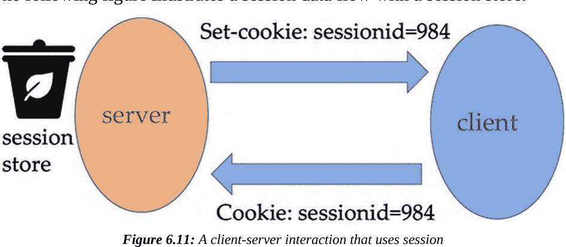

### 实现

我们把会话存储在哪里洋洋？让我们在服务器端存储。但是，我们如何识别来自客户端的第一个和后续请求并将它们关联在一起？所以，我们需要会话数据存储在客户端，就像 cookie 的情况一样。但这样有一个问题。存储在客户端的会话容易被操纵；例如，恶意客户端可以修改会话对象，将其指向其他用户以劫持他们的会话，或在计算机中重用以前使用过的会话。

为了解决这些问题，会话由服务器在第一次访问时创建并存储在服务器端的数据存储中，会话数据的密钥发送给客户端。客户端在后续所有请求中发送会话密钥，以便服务器进行关联。服务器借助客户端发送的密钥获取实际的会话对象。

实现会话的服务器代码示例如下：

```javascript
const h = require('http')
const cr = require('crypto')
const m = new Map()
```


 ```
4. const s = h.createServer((q, r) => {
5.   const sd = q.headers['cookie']
6.   if (sd === undefined) {
7.     const hash = cr.createHash('md4')
8.     const sk = hash.digest('hex').substring(0, 10)
9.     const sv = 'my session data'
10.    m.set(sk, sv)
11.    r.setHeader('set-cookie', [`${sk}=${sv}`])
12.    r.end('cookie sent')
13.  } else {
14.    const k = sd.split('=')[0]
15.    r.end(`session: ${k}, ${m.get(k)}`)
16.  }
17. })
18. s.listen(12000)
```

如果客户端登录后、但在后续请求之前服务器崩溃了，会发生什么？在服务器中创建并存储的 session 对象会被清空，而新的服务器（在同一主机上，或是集群部署中的不同节点）无法访问之前的 session 信息。在这种情况下，新的服务器会再次发起登录并开启一个新的 session。这会导致较差的用户体验。

为了解决这个问题，session 对象通常存储在一个中央数据存储中，这样服务于同一应用的多个服务器进程都可以访问它们。这个中央存储被称为 **session 存储**。

在下面的代码中，存储是集中管理的，与之前的程序不同：

```
1. const h = require('http')
2. const cr = require('crypto')
3. const s = h.createServer((q, r) => {
4.   const sd = q.headers['cookie']
5.   if (sd === undefined) {
6.     const hash = cr.createHash('md4')
7.     const sk = hash.digest('hex').substring(0, 10)
8.     const sv = 'my session data'
9.     // store this session to a central store
10.    r.setHeader('set-cookie', [`${sk}=${sv}`])
11.    r.end('cookie sent')
12.  } else {
13.    const k = sd.split('=')[0]
14.    // load the session from the central store
15.    r.end(`session: ${session}`)
16.  }
17. })
18. s.listen(12000)
```

session 对象的生命周期是多长？假设它是无限的。不设生命周期的 session 会有什么影响？

- 一年前有过 session 的客户端仍然可以回来继续使用。
- 在公共电脑上浏览敏感网站的用户会留下开放的 session，让后续用户得以进入。

显然，我们需要为 session 设置过期日期。以下代码说明了这一点：

```
1. const h = require('http')
2. const cr = require('crypto')
3. const m = new Map()
4. const s = h.createServer((q, r) => {
5. const sd = q.headers['cookie']
6. if (sd === undefined) {
7. const hash = cr.createHash('md4')
8. const sk = hash.digest('hex').substring(0, 10)
9. const sv = 'my session data'
10.     m.set(sk, sv)
11.     r.setHeader('set-cookie',
12.     [`${sk}=${sv}; expires=${new Date(Date.now() + 1000)}`])
13.     r.end('cookie sent')
14.     } else {
15.     const k = sd.split('=')[0]
16.     r.end(`session: ${k}, ${m.get(k)}`)
17.     }
18.     })
19.     s.listen(12000)
```

> **问题：** 在前面的示例中，我们使用随机哈希来创建 session 键。如果我们使用更简单的、从零开始递增的数字会怎样呢？随机哈希技术解决了什么问题？如果值更容易预测会发生什么？

从简单的静态文件服务器开始，我们已经取得了相当大的进展。我们现在可以按类型和路径处理不同的请求，支持全双工（双向）数据流，以及管理事务（多个相关的请求）。现在，让我们来看看一些维护方面的问题。一个之前建立并正在使用的端点被用户缓存/添加了书签。但服务器在维护周期中进行了重构，该端点在服务器上已不再可用。我们如何处理这种情况？

## 请求转发

当网站应用进行大规模重构时，一些现有资源的链接可能会发生变化。让我们了解请求转发如何帮助用户在链接失效后仍然使用旧链接。

### 用例

根据网站在实际使用中的情况，用户可能已经缓存/添加了旧链接的书签。随着变更的实施，不知情的用户使用旧链接将触发 HTTP 404（页面未找到）错误，而用户无法获得关于已修改链接的信息。如果某个端点仍然接受旧请求（方法和路由）并将其透明地转发到新资源，那将会很好。

### 定义

请求转发是一种技术，通过它，物理上分离的资源可以被客户端引用，而真正的资源引用由服务器在收到旧引用后提供。客户端随后使用新的资源引用重新请求。可以被重定向的引用可以是表单、页面或整个网站的引用。电子版注：this technique allows... 这一技术允许基于各种用例对页面或站点进行临时或永久的重定向。

下图展示了请求转发架构：


图 6.12：使用请求转发的客户端-服务器交互

### 实现

执行重定向最简单的方法是：

- 拦截旧请求
- 发出新请求
- 接收响应
- 针对旧请求向客户端响应

在这种方法中，服务器对客户端 hide 了重定向信息。以下服务器代码执行内部重定向：

```
1. const h = require('http')
2. const s = h.createServer((q, r) => {
3.   if(q.url === '/foo') {
4.     let data = ''
5.     h.get('http://www.google.com', (m) => {
6.       m.on('data', (d) => {
7.         data += d
8.       })
9.       m.on('end', () => {
10.        r.end(data)
11.      })
12.    })
13.  }
14. })
15. s.listen(12000)
```

这种技术解决了什么用例？没有任何用例。用户/客户端永远不会知道幕后的重定向正在发生。因此，它给服务器增加了永久性的负担，需要管理额外的过时资源引用。

所以，我们需要让客户端知道该引用已旧，需要重定向。以下代码描述了这一点：

```
1. const h = require('http')
2. const s = h.createServer((q, r) => {
3.   if(q.url === '/foo') {
4.     r.end('this site has moved.')
5.   }
6. })
7. s.listen(12000)
```

从浏览器访问服务器会显示以下消息：


*图 6.13：访问已移动的站点路由*

这并不能让客户端满意，会导致糟糕的用户体验。返回新的引用看起来是更好的解决方案，但仍然不是最好的。以下代码向客户端发送了更有用的信息：

```
1. const h = require('http')
2. const s = h.createServer((q, r) => {
3.   if(q.url === '/foo') {
4.     r.end('this site has moved. pls use ' +
5.    'http://www.google.com instead')
6. }
7. })
8. s.listen(12000)
```

以下截图显示了客户端收到的内容：


因此，更好的做法是"与客户端协调并自动重定向"，但让用户知道正在发生这种情况，以便他们可以更新自己的书签。

以下代码说明了状态码在重定向中的使用：

```
1. const h = require('http')
2. const s = h.createServer((q, r) => {
3.   if(q.url === '/foo') {
4.     r.statusCode = 302;
5.     r.setHeader('Location', 'http://www.google.com')
6.     r.end()
7. }
8. })
9. s.listen(12000)
```

在这种情况下，浏览器客户端理解所请求的端点已移动，服务器希望它向作为旧位置替代的新位置重新请求。随后，浏览器执行对新位置的重新请求，对用户透明。用户会看到短暂的重定向信息，从地址栏中出现的新目标地址，用户可以了解到这次变动，以便在未来的使用中做出相应调整。

浏览器客户端执行的无缝重定向通过 JavaScript 控制台窗口进行了演示，其中捕获了与请求和响应相关的 HTTP 头。

以下来自 JavaScript 控制台的客户端请求详情截图显示了头部值：


*图 6.15：处理服务器重定向的浏览器客户端*


 ## 多部分表单数据（Multipart form-data）

到目前为止，我们一直在讨论服务器向客户端提供内容。反向的场景同样有效，例如文件上传。考虑到物理文件是在服务器上重新创建的，客户端如何让服务器了解所发送文件内容的各种属性？多部分表单数据（Multi-part form-data）正是为解决这个问题而定义的。

### 使用场景

一个网站应用程序接收来自客户端的文件，这些文件需要存储在服务器端。当文件被存储时，服务器希望确保不仅文件内容，而且文件的元数据也被保留在服务器上。某些属性可能已经改变（例如文件创建/访问时间），但静态属性如文件名、扩展名等需要被保留。

##管理方式

### 定义

multipart/form-data 是客户端请求中的一种内容类型（content-type），表示表单数据的提交。客户端可以使用这种方式来返回页面中填写的表单的一组值。multipart/form-data 主体包含一系列由边界（boundary）分隔的部分，边界是一系列特殊字符，如 CRLF、"--" 和一个"边界"字符串，即任意方便选择的字符序列。

下图展示了客户端-服务器交互的复杂用户表单/文件上传到服务器的过程：


### 实现

首先，设计客户端如何将文件数据发送到服务器的方法。然后，了解数据将如何到达服务器。之后，开发一个解析器来解析相对复杂的多部分表单数据头部。从请求中提取文件内容和文件元数据。决定在哪里存储获取到的文件，创建具有相同属性的文件，并将数据存储到文件中。

以下代码展示了表单/文件上传的基本处理：

```
1. const h = require('http')
2. const s = h.createServer((q, r) => {
3.     if (q.url === '/upload') {
4.         q.on('data', (d) => {
5.             console.log(d.toString())
6.         })
7.         q.on('end', () => console.log('done uploading'))
8.     } else {
9.         const form = '<form action="/upload" ' +
```

```
10. 'enctype="multipart/form-data" method="post"> ' +
11. '<input type="file" name="upload"> ' +
12. '<input type="submit" value="submit"> ' +
13. '</form>'
14. r.end(form)
15. }
16. })
17. s.listen(12000)
```

服务器中的打印显示了从客户端接收到的表单数据：

```
$ node multipart.js
-----------------------------------------1442921219220031052536913520
Content-Disposition: form-data; name="upload"; filename="hello.txt"
Content-Type: text/plain

hello world


-----------------------------------------1442921219220031052536913520--
done uploading
```

*图 6.17：带有相关 HTTP 头部的表单数据*

显而易见的问题是，我们如何有意义地从表单数据中提取内容？其中包含大量与协议相关的内容，实际数据与元数据完全混合在一起。对于服务器来说，在处理每个接收到的请求时管理这种复杂性将是一件痛苦的事情。我们如何更好地处理来自客户端的复杂表单数据？

## 主体解析器（Body parser）

解析请求主体是一项非 trivial 的任务，需要在请求呈现给后端应用程序之前，与请求同步执行。本节将说明特定的使用场景和请求主体解析的实现。

### 使用场景

Web 服务器希望处理复杂的客户端请求，例如多部分表单数据（如前所述）。基本的 Node.js 解析器并不能完全解析此类请求，请求主体在请求对象中原样提供。此外，HTTP 规范中定义了多种内容类型用于数据传输。这意味着拥有一个能够理解常见请求类型、解析这些请求并填充请求对象的高级解析器是可取的，从而增强 Node.js 核心解析器 API。

### 定义

主体解析器消费基于流的客户端请求的主体，将其转换为适当的数据类型，并将其附加到请求处理函数接收的请求对象上。这使请求处理程序免于执行重复的主体解析，帮助他们专注于业务逻辑。下图展示了主体解析器将解析的各种组件：


图 6.18：带有相关功能 Postman 插件的 body-parser

### 实现

主体解析器的一个简单实现可以是一个异步函数，接收请求对象并为请求（请求是一个 ReadableStream 对象）设置 'data' 和 'end' 处理程序。在 data 处理程序中，传入的数据要么被缓冲（如果数据块不足以解析），要么被解析并转换为已知类型。然后，当获得一个连贯、完整的主体时，将其附加到请求主体上。最后，处理程序返回到请求处理程序的主要业务逻辑，该处理程序希望消费主体。

一个简单的主体解析器逻辑如下：

```
1.  if (q.url === '/upload') {
2.    let data = ''
3.    q.on('data', (d) => {
4.      data += d
5.    })
6.    q.on('end', () => {
7.      data = data.toString()
8.      const delim = data.split("\r")[0]
9.      let file = data.split('filename')[1]
10.     file = file.split('\r')[0]
11.     file = file.replace(/\"/g, '')
12.     file = file.replace(/=/g, '')
13.     console.log(file)
14.     let rest = data.split('\r\n\r\n')[1]
15.     let content = rest.split('\r\n')[0].trim()
16.     console.log(content)
17.   })
18. }
```

这里的缺点是，每个请求处理程序都可能被视为 `polluted`，因为它们内部使用了主体解析器调用。另一种方法是在客户端连接回调和实际请求处理回调之间设计一个抽象层，让请求通过解析主体的抽象层。当请求处理程序被调用时，请求对象已经填充了经过适当解析的主体。

一个合理的做法是实现一个足够通用的主体解析器函数，可以在多种场景中复用。例如，一个接收请求和响应对象、收集表单数据、解析数据，并将解析后的内容填充到请求对象中，或者使用解析后的内容进行回调的函数，以便调用者可以继续处理请求。

以下代码展示了这一改进：

```
1. const h = require('http')
2. function parse(q, r, cb) {
3.   let data = ''
4.   q.on('data', (d) => {
5.     data += d
6.   })
7.   q.on('end', () => {
8.     data = data.toString()
9.     const delim = data.split("\r")[0]
10.    let file = data.split('filename')[1]
11.    file = file.split('\r')[0]
12.    file = file.replace(/\"/g, '')
13.    file = file.replace(/=/g, '')
14.    let rest = data.split('\r\n\r\n')[1]
15.    let content = rest.split('\r\n')[0].trim()
16.    cb(file, content)
17.  })
18. }
```

一旦可复用的 parse 函数就位，我们可以在客户端请求处理程序中使用它，如下所示：

```
1. const s = h.createServer((q, r) => {
2.   if (q.url === '/upload') {
3.     parse(q, r, (name, data) => {
4.       r.end(`got ${name} with content ${data}`)
5.     })
6.   } else {
7.     const form = '<form action="/upload" ' +
8.     'enctype="multipart/form-data" method="post"> ' +
9.     '<input type="file" name="upload"> ' +
10.    '<input type="submit" value="submit"> ' +
11.    '</form>'
12.    r.end(form)
13.  }
14. })
15. s.listen(12000)
```

## 跨源资源共享（Cross-Origin Resource Sharing, CORS）

我们如何


### 实现

首先，我们需要一种机制让服务器描述哪些域名可以引用它。这通过向跨源服务器发送 HTTP OPTIONS 方法来实现。

以下代码展示了一个获取服务器**OPTIONS**的客户端：

```javascript
const h = require('http')
h.request({method: 'OPTIONS', host: 'www.google.com'}, (m) => {
    console.log(m.headers)
}).end()
```

下面的截图展示了服务器上可用的选项：

**图 6.20：** *获取到的服务器能力输出*

客户端接收响应并解析它。如果响应表明源服务器有权引用跨源服务器，客户端就会向源服务器发送实际的请求。

下图阐释了使用 CORS 的客户端-服务器交互：

**图 6.19：** 使用 CORS 的客户端-服务器交互

## 动态网页

与大多数现代 Web 应用程序一样，大部分内容是在运行时生成的。本节讨论如何实现简单的动态页面，并将动态数据部分嵌入到静态页面中。

### 用例

网站希望在运行时通过参数化其内容并从当前请求上下文中推导值来生成页面。在最简单的示例中，用户登录后，结果页面应该包含对当前用户的引用。对于第二个用户，这个页面将引用第二个用户，依此类推。

### 定义

动态网页是动态组装而成的网页。组装过程由服务器或客户端控制，可能包括用从请求上下文中获得的值替换占位符变量（如用例中所述），或者用动态获取的设计元素来设计整个页面结构，或者是介于两者之间的任何其他自定义操作。

下图阐释了一个基本的动态网页生成器：

### 实现

以下代码给出了动态网页的最简单示例：

```javascript
const h = require('http')
const s = h.createServer((q, r) => {
  r.end('<html><body>hello world!</html>')
})
s.listen(12000)
```

以下是通过浏览器客户端访问它的效果：

**图 6.22：** 访问一个生成简单 *HTML* 的服务器

我们如何对其进行参数化？例如，一个已登录的用户名？以下代码解析 URL，从中提取用户名令牌并将其打印出来：

```javascript
const h = require('http')
const s = h.createServer((q, r) => {
    r.end(`<html><body>hello ${q.url.split('=')[1]}!</html>`)
})
s.listen(12000)
```

浏览器客户端使用包含查询参数的 URL 发出请求，如下所示：

**图 6.23：** 访问一个在 HTML 页面中嵌入参数的服务器

那么，如何从数据库中获取任意记录呢？以下代码说明了在服务器端生成的随机数据如何传递给客户端：

```javascript
const h = require('http')
const m = new Map()
for (var i=0; i< 10; i++)
  m.set(i, Math.round(Math.random() * 100))
const s = h.createServer((q, r) => {
  let data = ''
  for(var i = 0; i < 10; i++)
    data += `<tr><td> ${i} </td><td> ${m.get(i)} </td></tr>`
  const html = '<html><body>' +
             '<table><tr>' +
             '<th> key </th>' +
             '<th> value</th></tr>' + data +
             '</table></html>'
  r.end(html)
})
s.listen(12000)
```

客户端根据生成的 HTML 将数据渲染为表格：

**图 6.24：** 访问一个生成包含表格数据的 HTML 页面的服务器

## HTTP 状态码

服务器的每个响应都应该有一个状态码，以表明服务器对其处理请求方式的解释。这有助于在响应数据及其性质之外识别请求结果。状态码是 HTTP 规范的一部分。

### 用例

还记得 HTTP 请求方法的用例吗？服务器可以根据请求方法（动词）轻松地对请求类型进行分类，然后相应地解析、验证和处理请求的其余部分。简而言之，HTTP 请求方法代表了请求的最高抽象级别。当服务器响应时，在客户端侧建立类似的机制是合理的：拥有一个抽象动词在最高级别代表响应类型，而头部和/或正文则携带完整详情。

### 定义

状态码是一个三位数的整数代码，代表先前请求的结果，以及一个可选的完整响应。状态码为 HTTP 客户端提供了一种可靠且一致地解释响应的方法。

### 实现

响应码根据常见请求的可能结果分为五类，对于不关心覆盖全部场景的客户端，可以检查响应的第一位数字来获取响应的顶级分类。

下表显示了 HTTP 状态码的分类：

| 代码范围 | 类别 | 含义 |
|---|---|---|
| 100 – 200 | 信息性 | 请求已收到，仍在处理中（服务器需进一步操作） |
| 200 – 300 | 成功 | 请求已收到、验证并处理（符合预期） |
| 300 – 400 | 重定向 | 请求需要转发（客户端需进一步操作） |
| 400 – 500 | 客户端错误 | 请求未被正确接收 |
| 500 – 600 | 服务器错误 | 请求可能是好的，但遇到了意外的服务器状态 |

下表显示了最常用的状态码：

| 状态码 | 含义 |
|---|---|
| 200 | OK |
| 404 | 未找到 |
| 301 | 永久重定向 |
| 500 | 内部服务器错误 |
| 503 | 服务不可用 |

## 服务器安全

服务器安全是 Web 应用程序最重要的方面之一。让我们了解与 Web 应用程序相关的常见安全问题以及针对每个问题的推荐补救措施。

### 用例

服务器位于中心位置，每个客户端请求都经过网络传输，而服务器没有直接的方法来验证用户的真实性和可信度，因此服务器（以及客户端）在本质上容易受到来自各个维度的安全威胁。整个事务中涉及的每个组件都需要针对这些威胁进行加固。

### 定义

服务器安全是指保护 Web 服务器、网站和 Web 服务免受各种基于互联网的安全威胁的行为。由于该软件部署在互联网上，安全漏洞利用是一个涉及广泛可能性的庞大课题。因此，应对这些威胁的安全最佳实践已经发展并成长为软件工程本身的一个分支。

### 实现

根据对服务器的影响方式，安全威胁可以分为三类：

-   窃取、破坏、销毁和泄露服务器数据
-   非法访问和使用服务器资源
-   拒绝服务

以下是 Web 服务器可能面临的一些常见安全问题及其实际补救措施：

### 数据隐私与完整性

互联网（计算机互连网络）的基本设计允许每个联网计算机访问网络中的每个数据字节，无论该计算机在数据传输中的角色如何。因此，如果客户端向服务器发出请求，服务器响应某些数据，事务详情以及事务中包含的数据将到达网络中的每个系统。

#### 威胁

恶意参与者可以阅读并理解一个事务，然后通过伪造客户端、服务器或两者来利用它。

下图显示了处于客户端-服务器交互中间的互联网以及相关的漏洞：

*图 6.25：通过互联网进行的客户端-服务器交互*

#### 补救措施

HTTPS（HTTP 安全）是 HTTP 的一个扩展，用于保护 HTTP 通信中使用的数据。它在 HTTP 之上运行，并在不安全的网络中创建一个安全信道的抽象。这意味着数据仍然正常流动，但它将使用强大的加密算法进行加密，只有预期的接收者才能解密。


下图展示了使用安全协议来保护与客户端-服务器交互相关的数据：


图 6.26：数据加密的客户端-服务器交互

### 跨站脚本攻击（XSS）

假设 Web 服务器存在一个工作流程，通过该流程，用户请求的内容也会随响应返回给客户端。这样的 Web 服务器容易受到跨站脚本攻击。

#### 威胁

在攻击的简单形式中，通过电子邮件或其他媒介向用户呈现一个 URL。该 URL 包含精心构造的消息，例如 JavaScript。当用户点击链接时，服务器通过所述工作流程执行某些操作，但最终将脚本作为其响应的一部分返回。这导致客户端浏览器在渲染 HTML 的同时执行该脚本。现在，根据脚本中编码的内容，攻击者能够在客户端系统中执行任意的非安全操作。

下图描述了这一点：


#### 补救措施

我们如何修复该漏洞？最直接的方法是：

- i. 避免将用户内容反射回客户端
- ii. 如果这绝对不可避免，建立一个特殊的程序来解析请求，并抑制或隔离任何脚本元素。

下图展示了防止跨站脚本攻击的措施：


**图 6.28：** 验证并规范化请求中脚本的服务器

### 查询注入

在数据驱动的应用程序中，服务器向安全后端数据库发起查询，查询参数可以由用户请求派生。在一个过度简化的例子中，这指的是从安全数据库中获取一条用户记录并返回给用户，同时使用用户姓名作为唯一标识该记录的依据；用户名从用户处获取。

#### 威胁

恶意用户可以提供一个不同的用户名或通配符（一种正则表达式，在评估、扩展并与主查询字符串结合后，仍然能够对目标数据库产生有意义的查询语义），使其匹配数据库中的每个用户，从而获取敏感数据，即使整个数据传输基础设施是安全的。

下图展示了查询注入漏洞：


#### 补救措施

常见的补救措施包括对查询字符串进行输入验证和定义数据库权限。例如，使用从用户输入派生的参数化占位符来定义查询字符串，并确保用户输入与预期的参数类型匹配，而不是无限制的查询短语或正则表达式。从数据库方面，我们可以针对数据的不同部分对请求类型定义细粒度的权限，以确保无限制的或恶意的请求不会被接受。

查询验证器组件（如下图所示）可为此类威胁提供保护：


##（分布式或非分布式）拒绝服务

在这种漏洞中，目标是导致服务器软件、硬件或网络暂时或永久地无法正常运行，从而导致服务器用户无法获得服务。

#### 威胁

通过仔细研究服务器执行环境中的弱点并加以利用来造成破坏，从而实施攻击。这种威胁的攻击面很广泛。

下图展示了攻击如何导致服务器的可靠性问题：


#### 补救措施

针对这种威胁没有单一的补救措施。服务器执行栈的每个部分都需要仔细设计，以确保可靠性和持久性。一些最佳实践包括：

- **输入验证：** 确保用户输入的组合可以在处理之前得到适当的验证和清理，并且处理数据的代码流路径不会因数据而导致异常终止。
- **隔离：** 确保服务器栈通过专用软件（如反向代理或负载均衡器）与流量隔离。
- **防火墙、交换和路由：** 对请求进行一定程度的合理性检查，确保在呈现给服务器之前对其进行修剪，而不是以原始形式呈现。

下图展示了如何缓解此类攻击：


### 暴力破解（弱身份验证）

暴力破解也被称为对凭据的重复、随机猜测。其目标是通过冒充来获取系统访问权限。

#### 威胁

在这种威胁中，攻击者使用结构化的、经验的或/和统计手段来`猜测`另一个用户的密码，并利用它来劫持其账户。尽管有所有安全措施，凭据直接帮助攻击者冒充真正的用户，使所有其他形式的安全控制失效。这如下图所示：


**图 6.33：** *迭代密码猜测方法*

#### 补救措施

有许多围绕密码强化的最佳实践，例如：

- 1. 使用难以被`猜测`的复杂密码
- 2. 以安全方式管理其存储
- 3. 使用多因素身份验证（其中密码只是其中一个验证环节，还需要其他验证环节才能真正登录，而攻击者在第一次和第二次验证之间可能没有足够的操作空间等）

下图展示了这一点：


**图 6.34：** *强化密码及其输入方法的措施*

## 结论

在本章中，我们从实现静态 Web 内容服务器到 Web 服务器安全威胁类型及其缓解措施，探讨了处理网站用例的典型 Web 服务器的构建模块。这使我们能够开发具有常见功能的网站，这些功能在功能上是正确的，在商业上是可行且合理的。

在下一章中，我们将查看服务器通常希望与之交互的外部组件，例如后端服务——要么是我们更大应用程序的一部分，要么是我们想要利用和重用的第三方服务。这将全面涵盖我们的 Web 服务器和网站组件。

# 第七章：与后端组件交互

在本章中，我们将查看 Web 服务器在为客户端提供服务时通常与之交互的其他软件组件。这些可能是作为我们应用程序的一部分开发的服务或模块、服务于特定目的的第三方服务，或体现软件工程中明确定义的设计模式的组件。理解服务器在何时（请求-响应周期中的哪个点）以及如何与这些服务交互至关重要。这将使我们对 Web 服务器在后端各方面的理解更加完整。

## 结构

在本章中，我们将涵盖以下主题：

- 后端组件：**内部服务**
- 后端组件：**外部服务**
- 后端组件：**数据库**

## 目标

学习本章后，你将能够理解在 Web 应用程序中利用后端服务的总体目标和设计。讨论将包括 Web 应用程序的架构、与后端服务的集成，以及此类交互的各种设计考量，如功能、性能、可靠性、安全性和可维护性。这些考量将帮助我们开发后端组件、架构新的交互、扩展现有交互，甚至优化服务调用以提高服务器效率。

## 后端组件：内部服务

应用程序的内部服务是辅助例程或模块，这些是


我们的Web应用程序之所以需要与内部服务交互，很大程度上归因于微服务架构。当Web应用程序还是一个单体应用时，它在生命周期内曾面临多个问题，具体如下：

-   **开发、测试与部署**：由于其单体特性，这些阶段必须将单体中的所有组件“捆绑”在一起，即使是对应用程序进行微小的改动。
-   **可读性与可维护性**：由于其庞大的体量，模块中可能存在不受欢迎的抽象、大量补丁和扩展，导致代码阅读极其困难，同时也增加了引入bug的风险。
-   应用程序的占用空间（footprint）会不必要地增长。
-   不重要部分的微小问题可能导致整个进程崩溃。

微服务架构的演进正是为了弥补这些缺陷；它将大型应用程序分解为小型、自包含的模块，这些模块可以独立运行（启动、执行并经历完整的进程生命周期）。

下图说明了微服务架构：


**图 7.1：** *微服务架构*

这种架构的一个副作用是，在早期的单体应用中，从模块A到模块B的直接函数调用，在微服务世界中变成了跨越网络的服务调用。

单体到微服务的转变如下图所示：


**图 7.2：** *从单体到微服务的转变*

### 设计考量

在本节中，我们将从能力、性能、可扩展性、可靠性等各种参数角度，审视Web应用程序的设计考量。我们还将确立并确认内部模块的架构方式。

#### 功能性

与内部服务交互时，首要考量之一就是交互将如何进行。我们已经知道Web服务器通过请求-响应循环运行，这意味着它接收客户端请求，解析并处理请求，准备响应，然后将响应发回给客户端。有了服务调用机制，它的角色最自然地将位于中间——参与到响应的准备过程中。内部服务可能也需要请求的上下文和细节，无论是部分还是全部。

下图说明了服务调用在请求-响应循环中的位置：


在我们的异步、事件驱动编程模型中，服务调用场景可以被设计为一个回调链：客户端请求处理回调发起服务请求，该服务请求的响应处理程序安装一个响应结束回调，最终的响应在响应结束回调中发送给客户端。

以下代码示例说明了这一点：

```javascript
const h = require('http')
const f = require('fs')
const s = h.createServer((q, r) => {
  h.get('http://localhost:13000/myservice', () => {
    const data = '';
    m.on('data', (d) => {
      data += d
    })
    m.on('end', () => {
      r.end(data.toString())
    })
  })
})
s.listen(12000)
```

正如我们所见，服务调用完全融入了Web服务器，是请求-响应循环不可或缺的一部分。这样做的一个积极副作用是，相对于服务器的功能而言，与服务的集成和调用变得无缝。另一方面，这也引发了服务器代码是否需要遵循通用软件效率指标（如性能、可靠性、安全性和可服务性）的担忧。

> **提示：** Web服务器中的服务调用可以用管道来类比。现有的管道被从中间切开，在开口处插入一段新管道。因此，在管道中流动的流体现在会到达切口的第一个端点，流经新管道，然后从切口的第二个端点返回，并继续在旧管道中流动直至终点。

### 性能

在原始的客户端-服务器交互之外增加了一组网络事务，这使得性能比其单体对应物要差——我们在前面章节讨论过的相同的HTTP协议开销开始发挥作用。此外，调用方和被调用服务之间的距离也会影响网络延迟，从而对性能特性产生影响。

服务调用中的性能瓶颈如下所示：


**图 7.4：** *Web服务器架构中突出显示的性能热点*

缓存响应是改善性能的良好补救措施。内部服务是否对请求上下文不敏感？内部服务是否独立于外部修改的数据？如果是这样，就可以基于请求作为键来缓存先前的响应。这意味着如果某些请求参数匹配预定义的规则集，我们就可以跳过服务调用，直接组装响应。

以下示例代码说明了缓存如何帮助提高性能：

```javascript
const h = require('http')
const f = require('fs')
const cache = new Map()
const s = h.createServer((q, r) => {
  if (q.url === 'foo') {
    return r.end(cache.get('foo'))
  } else {
    h.get('http://localhost:13000/myservice', () => {
      const data = '';
      m.on('data', (d) => {
        data += d
      })
      m.on('end', () => {
        r.end(data.toString())
      })
    })
  }
})
s.listen(12000)
```

**问题：** 前图突出了微服务架构中固有的性能抑制因素。假设您的应用程序报告了一个严重的性能问题。同时，假设您已（通过某些性能测试）确定总体计算时间远小于网络传输时间。您将使用什么策略来实现一些实际的性能改进？

#### 可靠性

如果目标服务崩溃了怎么办？如果目标服务无响应怎么办？当这些异常发生时，我们正处于请求-响应循环的中间，这类事件可能使我们的事务处于不一致状态。

下图说明了这一点：


定义超时、异常捕获点以及其他措施以优雅地管理通信是一种最佳实践。内部服务是否有机制在错误条件下以错误代码/消息进行响应？调用方是否有措施来判断内部服务是否失败？如果是这样，最终的响应就可以基于在适当情况下做出的这些断言来构建，而不是让服务器处于任意状态。

在以下示例代码中，我们为被调用的服务安装了一个错误处理程序，以便在服务失败时有一个明确定义的控制点：

```javascript
const h = require('http')
const s = h.createServer((q, r) => {
  h.get('http://localhost:13000/myservice', () => {
    const data = '';
    m.on('data', (d) => {
      data += d
    })
    m.on('end', () => {
      r.end(data.toString())
    })
    m.on('error', (e) => {
      r.end(`internal server error: ${e}`)
    })
  })
})
s.listen(12000)
```

## 安全性

一个涉及真正客户端的请求-响应循环内部，又产生了一个新的请求-响应循环，并且内部服务位于网络中，而非进程内模块（在单体应用中），因此通信现在成为了一个安全课题。

下图说明了服务调用所需的安全措施：


解决此问题的最佳方法是采用与我们为Web服务器组件采用的相同的安全措施。内部服务是否位于同一网络中？托管内部服务的系统是否由编排系统管理？这些是设计服务器组件与内部服务之间安全通信时需要考虑的一些因素。

#### 可服务性

一个进程内模块现在是一个在单独系统上、通过网络在独立进程中运行的顶层服务，拥有自己的进程生命周期。

定义、资源消耗、日志记录等都发生了变化，因此可服务性参数也需要重新定义。例如，我们如何检测和调试服务故障？需要收集和分析哪些日志？是否应该统一分析调用方和被调用实体的日志？来自两个模块的日志是否应该进行时间序列化，以便能够进行聚合或排序？

这些问题的答案将引导我们进入可观测性技术，该技术由许多工具和框架实现。其中大多数工具都为遵循微服务架构的应用程序提供了专用功能。

具备可观测性功能的微服务如下图所示：


> **问题：** 我们讨论了将单体架构重构为微服务。这是否意味着每个服务都应该使用与原单体架构或调用它的 Web 服务器相同的语言开发？例如，在我们的场景中，Web 服务器是用 Node.js 开发的，我们能否使用 Java 或 C++ 开发某个服务，且通信仍然能够无缝进行，而无需额外的语言特定桥接或外部函数接口（FFI）？

## **后端组件：外部服务**

外部服务是专注于特定用例且设计为高度可复用的软件模块。在许多情况下，调用现有服务来获取特定功能比手动实现它更有意义。本节将探讨我们的 Web 应用程序可能会利用的此类外部服务。

### 意图

我们的 Web 应用程序与外部服务交互的原因在于软件的可复用性和关注点分离。例如，如果你正在开发一个票务预订系统，你关注的主要点是预订涉及的业务逻辑，如票数、票种、季节性优惠、优先级约束、预订策略、取消策略等等。但正如我们所知，任何票务软件的一项关键能力就是管理支付的能力。由于支付在商业中是一个普遍的用例，而非票务系统的唯一特性，因此支付网关软件演变成了一种可复用的服务。它们拥有一套定义良好的生命周期事件、事务约束、安全措施和策略，这些可能与我们服务器的策略正交。

总之，在 Web 服务器中原生实现支付功能是没有意义的；相反，应该利用一个符合其用例的现有服务并将其作为服务调用。

下图显示了 Web 服务器 `questserver` 如何进行外部服务调用：


这种方法的一个副作用是，Web 服务器应用程序会对一个由第三方开发、测试和托管的外部服务产生依赖，从而带来一系列影响，例如商业合同、**服务等级协议 (SLAs)**，以及在功能、性能、可靠性、安全性和可服务性参数方面与此类交互的匹配或不匹配。

这是一个典型的支付服务调用示例：

```
1. const h = require('http')
2. const s = h.createServer((q, r) => {
3.   const gateway = require('mypayment_gateway')
4.   gateway.key = '024acd67de99f'
5.   gateway.username = 'user'
6.   gateway.password = 'password'
7.   gateway.card = '1234 5678 9010 1112'
8.   gateway.cvv = '123'
9.   gateway.user = 'foo'
10.  gateway.expiry = '1230'
11.  gateway.comment = 'book purchase'
12.  gateway.amount = 2000
13.  gateway.currency = 'INR'
14.  gateway.toaccount = '987 654 3210'
15.  gateway.uniqueid = 'a4df90bdbbc'
16.  gateway.pay(() => (e, s) => {
17.    if (e != null) {
18.      return r.end(`error making payment: ${e}`)
19.    } else {
20.      r.end(data.toString())
21.    }
22.  })
23. })
24. s.listen(12000)
```

**问题：** 这个问题可能出现在本书的任何地方，但我们在这里提出是为了再次强调、回顾并更好地理解。当支付服务正在运行时，我们的 Web 服务器处于什么状态？换句话说，服务器是否会阻塞所有操作，等待第三方服务完成支付？

### 设计考量

在本节中，我们将探讨应用程序在与外部服务交互时的设计考量。本节将讨论对功能、可靠性和性能特性的影响，并阐述最佳实践。

#### 功能性

与外部服务交互时，关键考量是如何执行交互——就像我们在内部服务案例中讨论的那样——通过在请求-响应周期之间嵌入服务调用，并在对数据进行适当清理后，可能将请求上下文传递给调用。此外，外部服务可能具有非应用程序原生的调用语义，在这种情况下，调用者需要一个“适配器”或“连接器”来管理与服务的通信。

一个外部 API 调用的示例如下图所示：

```
1. const h = require('http')
2. const hs = require('https')
3. const u = 'https://api.twitter.com/2/tweets/search/stream'
4. const s = h.createServer((q, r) => {
5.   hs.get(u, {apikey:'a09bfde1'}, (m) => {
6.     let data = '';
7.     m.on('data', (d) => {
8.       data += d
9.     })
10.    m.on('end', () => {
11.      r.end(data.toString())
12.     })
13.   })
14. })
15. s.listen(12000)
```

内部服务和外部服务调用的一个关键区别可能是协议：内部服务可以使用普通的 HTTP 协议，而外部服务通常需要更高层级且专业化的协议，如 REST、SOAP、XML 等。

外部服务的另一种体现是 API 密钥或令牌。你的 Web 服务器与第三方服务之间有什么商业关系？为什么对方会响应你的请求，并免费提供他们经过大量研究、包含知识产权而开发的软件服务？因此，调用需要被记录和计费。实现这一点的一种简单方法是通过 API 密钥。服务的消费者登录供应商网站并使用服务。当他们支付费用后，会收到一个 API 密钥，这是一个身份验证令牌，证明其有权在预定义的调用次数内使用该 API。

### 性能

在原始的客户端-服务器交互之间增加了一组网络事务，因此我们在内部服务案例中看到的性能下降同样适用于此处。此外，外部服务几乎总是托管在不同的服务器上，因此网络延迟可能比内部服务更高。此外，调用者无法充分控制被调用服务的性能特性，因为调用者无法控制后者的并发量、流量策略、性能考量等。因此，最佳实践是确保服务在各种条件下都经过测试，以确认我们得到的响应在可接受的延迟范围内。

#### 可靠性

我们为内部服务采用的可靠性措施同样适用于外部服务，此外还需考虑互联网上的网络中断可能性，因为我们的第三方服务分布在互联网网络中。

另一个需要考虑的方面是我们希望如何管理这些服务的故障。我们是希望在发生故障时将相同的错误消息转发给最终用户？还是希望对错误进行抽象，提供一个更具意义、更具上下文且最终用户更容易理解的消息？

## 安全性

鉴于 Web 服务器与第三方服务之间的通信现在通过网络进行，采用我们为 Web 服务器组件采用的一套相同的安全措施是解决此问题的最佳方式。本质上，我们应该在所有方面将我们的服务程序视为第三方服务的客户端，并像典型的客户端那样在请求端嵌入安全措施。

#### 可服务性

Web 服务器的部分功能现在由第三方服务提供，因此来自该服务或与该服务交互的问题成为了一个新的可服务性课题。例如，如果服务器崩溃，我们如何确定是因为 Web 服务器出现异常，还是因为与后端服务器的交互出现了问题？

我们需要整合 Web 服务器和远程服务的可服务性功能，并使之对消费者透明。这样，无论问题源头在哪里，我们都能获得统一的问题确定体验。

## **后端组件：数据库**

就像任何标准应用程序一样，Web 应用程序会处理大量业务数据，而数据库软件对于存储这些数据以确保应用程序正确且高效地运行至关重要。

### 意图

我们的 Web 应用程序与数据库服务交互的原因在于服务器的许多重要特性，如灵活性、性能、可靠性、安全性和审计。

- 将数据管理功能与业务逻辑隔离会导致

提高了我们 Web 服务器的灵活性。

- 我们通过使用专门的数据库软件来提升服务器的整体性能和安全性，该软件优化了数据管理，并通过定义明确的策略保护数据访问。
- 在服务器崩溃时能够持久保存业务关键数据，并降低服务器软件的 CPU 使用率，这意味着我们的服务器现在更加可靠。
- 如果我们将数据和数据访问点分离，并配备专门的日志机制，那么在一段时间内对业务进行审计就会变得容易。

总之，使用数据库组件来存储与服务器相关的业务数据（包括我们在[第六章，主要 Web 服务器组件](Chapter 6, Major Web Server Components)中学习的会话数据）是有优势的。

下图展示了带有数据库后端的 Web 服务器架构：


这种方法的一个副作用是，Web 服务器应用程序构建了对外部服务（如数据库）的依赖。这意味着服务器的生命周期操作（如开发、测试、部署、运行和升级）现在也必须考虑数据库服务的存在及其交互。

### 设计考量

现在，让我们审视应用程序的各种企业级方面，看看这些因素如何影响应用程序设计。

#### 功能性

在与数据库服务交互时，关键考虑因素是如何执行这种交互——就像我们讨论内部和外部服务的情况一样——通过将数据库调用嵌入到请求-响应周期中，在适当清理数据后将请求上下文传递给调用。此外，数据库服务将具有对我们的应用程序来说并非原生的调用语义，在这种情况下，调用方需要有一个"适配器"、"连接器"或"数据库客户端"来管理与数据库服务的通信。

以下代码说明了在请求-响应周期中进行数据库查询：

```
1. const h = require('http')
2. const d = require('mydbclient')
3. const u = 'http://mydb.remote:9000/u=user&p=password'
4. const s = h.createServer((q, r) => {
5.   const c = d.connect(u)
6.   c.query({name: 'foo'}, (m) => {
7.     let data = '';
8.     m.on('data', (d) => {
9.       data += d
10.    })
11.    m.on('end', () => {
12.      r.end(data.toString())
13.    })
14.  })
15. })
16. s.listen(12000)
```

另一个主要考虑因素是	use

在数据库中存储什么。一般答案是，需要持久化的数据。更具体地说，如果服务器崩溃，我们希望已经检索、计算、处理和累积的数据能够直接可用，而无需重复这些流程。在 Web 服务器上下文中，通常存储在数据库中的主要数据元素包括：

- **模板数据（也称为引导数据）：** 定义服务器应用程序业务逻辑中公理/基础事实的数据。例如术语词典、常用消息、策略数据等。
- **用户数据（也称为表单数据）：** 作为客户端请求的一部分，从用户表单中检索、计算、处理、过滤、精简和转换的数据。例如客户资料和账户详情。
- **会话数据：** 保存正在进行的用户交易上下文的数据。我们在[第六章，主要 Web 服务器组件](Chapter 6, Major Web Server Components)中学习了会话的相关知识。
- **派生数据：** 上述一种或多种数据的聚合或高阶导数。例如 24 小时内的用户请求数量、特定账户的交易总额等。

了解到 Web 服务器可以分解为微服务，并且服务器可以将业务数据存储到数据库中，一个自然的问题就出现了：是每个微服务都有独立的数据库，还是所有微服务使用一个单一的中央数据库？

这取决于情况。在大多数情况下，为微服务配备独立的数据库实例是可取的，但这也会带来自身的副作用。如果存储在独立数据库中的数据存在冗余、关系、优先级顺序等问题怎么办？从逻辑上讲，我们处理的是单个应用程序，因此从应用程序的角度来看，独立的数据库以交错的方式包含数据片段，尽管从单个微服务的角度来看是一致的。

数据库设计需要处理此类异常。如果需要聚合、规范化或同步，我们需要定义事件、触发器和计时器来启动此类活动。如果异常数量非常大，我们将需要重新设计数据库设计。如果此类情况不存在且每个服务的数据相互排斥，则独立的数据库模型工作良好。

### 性能

在原始客户端-服务器交互之间涉及额外的网络事务，因此我们在内部服务的情况下看到的相同性能下降也适用于此。此外，外部服务几乎总是托管在不同的服务器上，因此网络延迟可能比内部服务更大。考虑到这些因素，我们可以在数据库端和 Web 服务器端采取一些措施来弥补性能损失。

##### 数据库端

- 确保数据库和文档与存储的数据类型一致——结构化与非结构化等。
- 确保文档设计便于常见查询的检索。
- 确保文档与现有和可能的未来查询类型保持一致。

##### Web 服务器端

- 确保实现连接池（连接复用），而不是每次都建立新连接（大大节省网络延迟）。
- 确保服务器的多个部分不会在数据库端造成争用。如果存在导致瓶颈的查询，要么在它们之间实现足够的隔离，要么考虑将查询合并为一个。

#### 可靠性

我们为内部和外部服务采用的相同可靠性措施同样适用于数据库服务，此外还需要考虑互联网中的网络中断可能性——因为我们的数据库服务位于互联网上的网络另一端。

在内部/外部服务的情况下，我们讨论了如何管理服务故障以及如何响应用户做出优雅的响应。当数据库宕机时情况如何？我们能想到类似的策略吗？不能。数据库保存着对服务器正常运行至关重要的业务数据（包括会话数据），因此继续接受新连接既不可行也没有意义。从所有实际目的来看，我们应该将数据库视为服务器组件本身的重要组成部分，尽管它以模块的形式 discreetly 位于网络另一端。

## 安全性

鉴于 Web 服务器与数据库服务之间的通信现在通过网络进行，并且本领域技术人员完全可以推测数据库中通常存储的内容，服务器与数据库之间的通信成为一个安全议题。以下是一些重要的安全措施：

- **数据库级别：** 以这种方式设计和组织数据，使不同用户拥有不同且匹配/适当的授权/数据访问级别。
- **连接级别：** 确保只有在已登录的连接上才允许向数据库发起请求，并且连接参数是强类型的。
- **传输级别：** 确保 inward 和 outward 的数据都经过加密以防止窃取。
- **查询级别：** 正如我们在第六章"主要 Web 服务器组件"中所学习的那样，通过不可信的用户输入构建的数据库查询可能会损害数据库。因此，确保查询字符串在传递给数据库之前经过适当的验证和清理。

#### 可维护性

就像任何其他外部服务一样，我们需要集成 Web 服务器和数据库的可维护性功能，并使该功能无缝衔接以改善问题排查体验。然而，通过隔离部分应用程序程序（代码和数据）并实现

通过明确控制和访问点来操作程序的该部分（数据库），我们的整体可维护性信心会增加而不是降低。

## 结论

在本章中，我们了解了利用后端服务在 Web 应用程序中的一般目标和设计。我们探讨了三种不同类型的后端服务，以及与每种服务交互的基本设计考量。这有助于我们轻松开发一个包含一个或多个此类后端服务的服务器，构建新的交互，扩展现有的交互，或者优化服务调用以提高性能、可靠性、安全性或可维护性。

在下一章中，我们将探讨网站缺失的最后一部分——网站的通用需求（前端渲染）以及页面和表单如何实现其中一些通用功能。我们将看到如何渲染大量网站数据以供更好地消费（分页、搜索和过滤），我们还将涵盖实现身份验证和授权以及其他常见需求。从技术上讲，这将完成构成网站的所有组成部分的介绍。

# 第 8 章

# 实现通用网站功能

在了解了 Web 服务器的概念后，我们接着介绍了所有后端组件：Web 服务器组件、支持服务器功能的各种中间件组件，以及服务器用于扩展功能的后端组件。在 Web 架构的宏观图景中，唯一剩下的部分是前端元素。在本章中，我们将探讨网站的通用需求（前端渲染）以及页面和表单如何实现其中一些通用功能。我们将根据不同的用例探讨网页构成的考量，以及特殊组件如何在页面设计中满足这些需求。从技术上讲，这将完成构成网站的所有组成部分的介绍。

## 结构

在本章中，我们将涵盖以下主题：

-   网站 – 设计考量
-   网站 – 元素与组件
-   网站 – 高级功能

## 目标

学习本章后，你将能够理解 Web 应用程序中前端组件的一般目标和设计。讨论将包括围绕前端设计的用户体验、构成用户体验的要素，以及构成现代 Web 应用程序前端的一些高级功能。这些知识将帮助我们构建一个可扩展、响应式且现代的网站。更重要的是，项目的选择、获取的顺序以及我们对这些组件讨论的深度，将帮助我们在典型的开发流程中，根据不断变化的需求重新架构这些组件。

## 网页的历史

Web 起源于 1990 年代，由简单的分布式服务器提供静态内容。随后，HTTP 规范被定义。页面小规模验证和动画的需求催生了 JavaScript。随着 Web 用例的扩大，Cookies 被发明出来。很快，许多其他语言（如 Java）开始实现客户端框架（如 Applet），这些框架与 HTML 页面协同运行。因此，HTTP 规范得到了完善和升级。

21 世纪初，交互式页面等用例增多，推动了异步 JavaScript 和 XML（AJAX）的发展，它使得页面的部分区域能够动态且异步地与服务器交互并更新视图的相应部分，从而在不浪费网络带宽的情况下带来高度交互性，同时提升了用户体验。

**层叠样式表（CSS）** 集中定义和控制页面的外观和感觉，Web Workers 允许在后台线程中执行脚本，丰富的多媒体支持以及嵌入第三方内容的能力为网页增添了指数级价值。此时，网页在功能上能够提供优于其厚重客户端对应物（桌面应用程序）的价值。

在 2010 年代初，移动设备成为网页的主要消费端，颠覆性地改变了用户体验，进而改变了用户界面考量。随之，当前的网页设计变成了一组极其复杂的意图，必须满足多种类型的用例和用户的需求。

在本章中，我们将审视典型当前用户对用户体验的期望、满足这些期望的网站元素，以及围绕这些元素的设计考量。

## 网站 – 设计考量

广义上讲，用户体验指的是产品的直观性、易用性、使用便捷性和效率的程度。因此，开发具有满意用户体验的产品要求我们理解用户类型、用户行为、用户期望，以及他们在产品消费方面的能力和弱点。

将这个定义关联到网站，它归结为 Web 用户对网站与其需求的契合程度，以及与提供类似服务的其他网站相比，该网站在保留用户方面的吸引力。那些有说服力的理由是什么？让我们详细看看每一个。

下图展示了 Web 上用户体验的主要元素：


### 易用性

在易用性部分，我们探讨一些与网页易用性直接相关的考量。这些对于用户来说是非常基础的考量，并能对网站留下深刻印象。

#### 已注册和未注册视图

当用户打开一个网站，却首先看到一个巨大的登录表单作为访问其内容的前提时，感觉如何？显然，这对用户来说是显而易见的不便。无论网站提供多么重要的功能，都应该设有未注册视图。如果内容是机密的，需要有效的用户上下文和账户才能访问，那么网站可以在目标、内部内容的性质、其用途以及网站相关的用户类型方面提供高层次的叙述。

下图展示了当所有内容都通过登录/注册流程隐藏时，主页上的不良用户体验。


另一方面，下图展示了如何通过区分已注册和未注册视图来改进这一点：


图 8.3：带有未注册视图的主页

#### 导航栏

大多数网站会有多个页面，并按层级组织。旧式设计是提供导航按钮（上一页、下一页、主页等）让用户在页面间切换。这大致意味着用户需要跟踪自己的导航历史。一种现代的替代方案是提供一个在所有页面上都可用的导航栏，这样用户可以自由地从任何页面跳转到任何其他页面，同时也免去了他们“记住”导航历史的负担。

这是一个包含几个菜单项和通常在所有页面上显示的导航栏的截图：


#### 文章

文章构成了页面的主体。将其集中在页面中心并给予足够关注，而不是分散在整个页面，可以显著提高页面的易用性。下图展示了一个文章部分：


图 8.5：带有 article 标签的网页

#### 页眉和页脚

页面页眉是页面顶部的一个水平条。该部分理想情况下包含网站标志、通用网站信息和任何新闻发布。下图展示了页面页眉可能的样子：


页面页脚也是一个水平条，但位于页面底部。版权信息和联系详情通常放置在页脚部分。以下截图展示了页面页脚可能的外观：


#### 表单

表单是许多网站的重要组成部分。一个组织良好的网页表单有助于从用户那里收集相关信息，以便在后端进行处理。最常见的表单类型是注册表和个人资料表。

以下截图说明了一个简单的网页表单：


#### 搜索选项

一个好的网站会提供一个搜索栏，该搜索栏提供局限于网站内容的自定义搜索功能。当网站提供大量功能和内容，并且其中一些项目无法直接发现时，此功能非常有用。

以下截图显示了一个嵌入搜索选项的页面：


#### 反馈表单

直接收集用户反馈是改善用户体验最简单的方法之一，因此非常希望拥有一个反馈表单，用户可以在其中输入他们的整体体验和任何改进建议。

以下截图说明了一个典型的反馈表单：


#### 购物车

在适用的情况下，购物车功能为用户提供了一种将商品“添加”到托盘的能力，以便可以批量执行购买等操作，而无需重复执行常见的交易。

以下截图说明了此模式的典型用法：


#### 支付选项

在 Web 应用程序中，支付功能使用户能够“支付”Web 应用程序提供的物品或服务，而无需离开网站。请记住，依赖外部供应商/网站代表当前网站执行支付将导致糟糕的用户体验。

以下截图说明了一个支付表单：


### 易用性

在本节中，我们将探讨一些与用户体验直接相关的非功能方面。

#### 一致的页面

以下是为改善用户体验而设计的一致页面的特征：

- 在相关页面中具有相似的外观和感觉
- 控件和组件放置在相似的坐标位置
- 控件和组件具有统一的外观
- 控件和组件的行为符合预期方式

以下截图说明了一组不一致的页面：


另一方面，以下截图显示了保持一致的网页：


> **问题：** 哪种框架/技术提供了为一批网页实现一致外观和感觉的能力？

#### 简短的页面

理想情况下，你应该尝试将页面放在一个屏幕内，并尽可能避免滚动。但是当然，有时，一组连贯的内容可能必须保持在单个页面上，无论其数量多少。在这种情况下，值得为内容寻找有意义的划分，以便你仍然可以拆分它。

以下截图显示了一个简短的网页，易于浏览：


#### 简短的表单

表单非常重要。它们将用户的努力从简单的浏览和导航转变为仔细的信息输入。一些改善表单用户体验的功能包括：

- 收集最少的信息（仅所需信息）
- 遵循表单元素的逻辑顺序
- 适当地标记输入字段
- 为模糊字段提供额外的帮助文本，在可能的情况下提供默认值、基于过去交互的自动完成功能，或其他分析手段

以下截图显示了一个简短的网页表单：


> **问题：** 关于上一节（简短的页面），我们说过要减少内容，使其适合放在一页上。在可用性和易用性方面，简短的页面和简短的表单之间有什么区别？例如，如果你确实需要捕获无法容纳在单个页面中的关键信息，会发生什么？

#### 主页

在 Web 发展的早期，站点地图功能帮助用户查看他们在导航中的位置以及如何返回。现代网站要么在所有页面上提供导航栏，要么在任何地方都提供主页按钮，以便用户可以轻松返回到第一页。

以下截图显示了在整个网站中提供的主页链接：


#### 响应式网页表单

Web 内容不仅通过浏览器消费，还通过各种移动设备、平板电脑和其他智能设备（如电视）消费，因此内容应通过所有交互形式提供统一的体验。为此，页面或表单应根据目标设备的类型调整其尺寸和比例。

以下截图显示了一个响应式网页，在所有消费设备上具有相似的外观：


> **注意：** 为移动设备设计的网页的首要考虑因素之一是键盘的低效性。由于大多数移动键盘是软件模拟而非物理按键，因此打字比在台式机上更困难。它对网页设计的影响在于交互应尽量减少用户输入，或将其简化为点击和选择，而不是纯粹的打字。

总之，我们探讨了许多影响 Web 内容消费用户体验的因素，包括可用性和易用性。这些是适用于整个万维网的通用概念，与 Node.js 等特定开发平台无关。现在，让我们看看构成网页并有助于实现上述用户体验的一些实际元素和组件。

## 网站 – 元素和组件

到目前为止，我们讨论了网站的用户体验和设计方面。现在，让我们看看构成网站的单个网页的主要元素。我们根据多种标准对这些元素进行分类，例如语言、元素和组件。

### 按语言

在本节中，我们看看常用于渲染网页的语言。我们还说明了它们如何相互交互，通过客户端设备展示完美的多语言行为。

#### HTML

**超文本标记语言（HTML）** 定义了 Web 文档的基本结构语义。它有一套丰富的语法来表示页面外观，以及属性来涵盖各种功能。所有消费 Web 内容的浏览器和客户端设备都支持此语言。

以下代码片段显示了最短的 HTML 语法：

```html
<html> hello html</html>
```

> **问题：** 假设我们有不支持 HTML 的浏览器。你认为借助另一种语言（比如 C）如何实现客户端渲染？

#### CSS

**层叠样式表（CSS）** 它定义了网站多个页面的呈现样式。它将 Web 内容与其格式分离，从而降低了管理 Web 内容的复杂性。属于 CSS 范畴的主要格式包括颜色、布局和字体。

以下代码片段显示了一个嵌入在 HTML 中的内联样式表：

```html
<html>
<body>
<p style="color:blue;">hello css</p>
</body>
</html>
```

> **注意：** CSS 中定义了语义，这些语义帮助我们引用 HTML 文档的部分内容并有选择地应用样式。这种设计有助于提高关注点分离，将核心组件定义与它们应呈现的方式隔离开来。

#### JavaScript

JavaScript 是一种事件驱动、函数式和命令式编程语言

一种通过API进行通用编程的语言。在客户端的执行环境中，它具备访问其所嵌入网页组件的构造能力。

以下代码片段展示了嵌入HTML中的内联JavaScript：

```
1. <html>
2. <script> alert('hello JavaScript!') </script>
3. </html>
```

> **注意：** Web前端的这一特性——即能够嵌入JavaScript，从而借助我们在后端使用的同一种编程语言（Node.js），以异步和动态的方式操作标记格式的内容——是JavaScript在Web工作负载中广泛普及的最重要原因。

总而言之，在这三种语言中，HTML作为网页的主干，专注于组织内容；CSS专注于为网页提供通用的样式和格式；而JavaScript则通过展示多任务和异步编程，提供动态呈现。

### 按元素

在本节中，我们将探讨在前端与网页交互的各种编程抽象和接口。这包括普通的HTML以及与HTML元素协同工作的JavaScript编程接口。

#### DOM

**文档对象模型（DOM）** 是对Web内容的抽象。该模型允许以编程方式访问Web内容，这些内容被组织成树状结构，并通过用于访问内容的语言作为组合对象可用。这种抽象帮助我们在Web内容的各个组件被渲染/调度渲染后修改它们，并通过为文档的特定部分安装事件和事件处理器，将动态内容带到页面上。

以下代码片段展示了JavaScript如何利用文档对象模型抽象来访问和修改HTML组件：

```
1. <html>
2. <p>
3. <body>
4. <div>
5. <input id="foo" placeholder="foo"></input>
6. </div>
7. <script>
8. document.getElementById('foo').placeholder = 'bar'
9. </script>
10. <p>
11. </html>
```

运行后，我们可以看到输入框的占位符原始值“foo”已被脚本更改为“bar”，如下所示：


**图8.19：** 经过JS操作的网页

> **注意：** 在网页中使用JavaScript的另一个优势是能够更有效地改善客户端交互，从简单的验证到为页面中的元素赋予复杂的事件驱动行为，从而完美地补充了HTML的功能。

**任务：** 通过为一个HTML元素添加事件处理函数，演示JavaScript的本地管理能力，并解释部分服务器功能是如何被委派到客户端，从而减少网络带宽并提高性能。

#### XMLHttpRequest

尽管其名称有些奇怪，但这是另一个用于与后端服务器直接进行HTTP交互的抽象。但是，既然浏览器已经拥有通过地址栏或特殊HTML元素和属性与服务器交互的本地接口，为什么还需要另一个网络抽象？这些接口会影响整个当前页面。例如，通过浏览器的URL请求会使当前页面失效，并渲染服务器返回的结果内容。另一方面，**XMLHttpRequest** API与后端交互并获取内容，这些内容可用于“手工”修改现有内容（想想上一节解释的DOM更新）并刷新页面的一部分。这使得页面显得生动活泼。

想象一个提供比赛实时比分的网站。记分板会定期自我刷新，但整个页面不会重新加载，用户也不需要手动刷新。为此，一种实现方式是让页面中的JavaScript元素安装一个定时器，该定时器定期触发，并向服务器发出请求，这对用户来说是完全透明的。

以下代码片段是处理**XMLHTTPRequest**的服务器端逻辑：

```
1. const h = require('http')
2. const s = h.createServer((q, r) => {
3.   if (q.url === '/bar') {
4.     return r.end('response to XMLHttpRequest!')
5.   }
6.   r.end(require('fs').readFileSync(process.argv[2]))
7. })
8. s.listen(12000)
```

以下代码片段（客户端）展示了XMLHTTPRequest API的用法：

```
1. <html>
2. <body>
3. <p>
4. <div id='xhr'>
5. <button type='button' onclick='XHR()'>XHR</button>
6. </div>
7. <div id='non-xhr'>
8.    I am a building, in the city of London, very tall, very old,
    and extremely famous. One of the most important things about
    me, is its very large domed roof.
9. </div>
10. <script>
11. function XHR() {
12.   const x = new XMLHttpRequest()
13.   x.onreadystatechange = function() {
14.     if (this.readyState == 4 && this.status == 200) {
15.       document.getElementById('xhr').innerHTML = this.responseText
16.     }
17.   }
18.   x.open('GET', '/bar', true)
19.   x.send()
20. }
21. </script>
22. </body>
23. </html>
```

以下截图展示了上述代码初始渲染的效果：


一旦用户点击按钮，API会从服务器获取新数据，并将其渲染到视图中，如下所示：


*图8.21：执行XMLHttpRequest操作后的网页*

> **问题：** 当客户端加载一个网页时，它已经与服务器建立了连接并从中获取了内容。当页面中的组件随后向服务器发出XMLHttpRequest时，它是与服务器建立一个新连接，还是复用加载主页面时建立的现有连接？

#### WebSocket

这在模型上与**XMLHttpRequest**类似，它是另一种网络抽象，使得网页中的编程元素能够通过TCP协议直接与服务器交互。TCP连接的全双工特性使得WebSocket能够从服务器接收异步事件和数据。这带来了一个特性，即服务器可以根据先前注册的兴趣主动向客户端写入数据。

以下代码展示了WebSocket的典型用法：

```
1. <html>
2. <body>
3. <input id="ws" type="text"></input>
4. <script>
5. const ws = new WebSocket('ws://localhost:12000')
6. ws.onopen = function() {
7.   alert('connecting')
8.   ws.send('hello')
9. }
10. ws.onmessage = function(e) {
11. document.getElementById('ws').value = e.data
12. }
13. </script>
14. </body>
15. </html>
```

让我们重新考虑前面需要实现一个实时记分板的例子。使用WebSocket，客户端代码中就不需要定时器循环；相反，能够拦截实际事件（比赛）中比分变化的服务器，可以通过先前打开的WebSocket将新数据“推送”给客户端。这显著提高了编程效率。

> **问题：** XMLHTTPRequest和WebSocket的用例有何相似之处/不同之处？

在这里，很自然会思考后端和前端的角色以及两者之间的界限。凭借前面提到的两项特性，前端现在能够做许多/大部分服务器能够做的事情：

- 执行验证
- 执行计算
- 执行与后端的连接

因此，一个直观的架构问题是：为什么后端不专注于渲染初始内容，而让渲染内容中的前端管理其他一切？答案在于隐私和安全。在客户端运行的代码对用户是可见的。在许多用例中，我们不希望暴露业务逻辑、后端组件的细节及其相互关系，以及应用程序涉及的数据。因此，尽管前端现在能够做许多后端能做的事情，并且将职责卸载到内容正在提供的客户端在架构上是合理且有效的，但商业网站会基于隐私和安全考量，在前后端之间划定一条清晰的界限。

#### WebWorker

WebWorker实现了一个线程抽象。使用WebWorker，我们可以创建后台线程，理论上可以运行任何脚本。涉及大量计算的页面渲染和用户交互可以从工作线程中获益匪浅，因为它们有助于并行化给定任务。此外，web workers充当网络代理，可以异步管理所有网络交互，从而使主线程能够专注于前端交互。工作线程和主线程不使用常规的同步原语来处理共享数据；相反，它们通过非阻塞和异步的消息传递通道进行通信。

以下代码片段展示了如何使用web workers：

```
1. const w = new Worker('worker.js")
2. w.onmessage = function(event) {
3.   document.getElementById('data').innerHTML = event.data
4. })
```

> **问题：** 与使用共享数据和同步原语来简化访问相比，通过消息在各线程之间通信的前提/好处是什么？

### 按组件

在本节中，我们将探讨构成HTML页面的视觉组件。我们展示每种组件最常见的形式，并提供

每个元素的示例及其在屏幕上的显示方式。

#### 超链接

这定义了从当前页面到另一个页面，或从当前章节到另一个章节的链接。超链接是 Web 导航最基础的语义。它实际上涵盖了任何其他对象，使得任何 Web 对象都有潜力成为超链接。

以下代码使用了超链接：

```
1. <html>
2. <body>
3. <a href="foo.html"> click here for foo </a>
4. </body>
5. </html>
```

以下截图显示了超链接的显示方式：


*图 8.22：带有超链接标签的网页*

#### 文章 (Article)

这定义了一个独立的 Web 内容块。它是用于在博客和期刊中创建章节的基本结构。

以下代码展示了 article 标签的用法：

```
1. <html>
2. Welcome to foo's web site!
3. <p>
4. <body>
5. Article:
6. <article>
7. I am a building, in the city of London, very tall, <br>
8. very old, and extremely famous. One of the most <br>
9. important things about me, is its very large domed roof. <br>
10. </article>
11. </body>
12. </html>
```

以下截图显示了 article 标签的渲染方式：


*图 8.23：带有 article 标签的网页*

#### 对话框 (Dialog)

这定义了一个弹出框架，适用于显示上下文消息和警报。

以下代码展示了 dialog 标签的用法：

```
1. <html>
2. Welcome to foo's web site!
3. <p>
4. <body>
5. <dialog open>
6. I am a building, in the city of London, very tall,
7. very old, and extremely famous. One of the most
8. important things about me, is its very large domed roof.
9. </dialog>
10. </body>
111. </html>
```

下面的图示显示了 dialog 标签的渲染方式：


**图 8.24：带有 dialog 标签的网页**

#### 表单 (Form)

表单定义了一个用于收集用户输入的复杂界面，帮助服务器从客户端获取数据。该界面具有多个字段和属性，以覆盖各种数据类型和收集方法。

以下代码展示了 forms 标签的用法：

```
1. <html>
2. Welcome to foo's web site!
3. <p>
4. <body>
5. Registration:&nbsp;&nbsp;&nbsp;&nbsp;
6. <p>
7. First name:&nbsp;&nbsp;&nbsp;&nbsp;&nbsp;&nbsp;
8. <input/>
9. <p>
10. Last name:&nbsp;&nbsp;&nbsp;&nbsp;&nbsp;&nbsp;&
```


```
5. <iframe align="center" src="https://docs.google.com/document/d/
6. 1t5CrKW4jIBUcn4KZXZRJVYL40dZigkj-miVGY31P36I/edit?
7. usp=sharing" height="200" width="400"></iframe>
8. </body>
9. </html>
```

下图展示了如何将 Google 文档嵌入到网页中：


*图 8.32：一个嵌入了 Google 文档的网页*

> **作业：** 开发一个小型网页，并对其进行转换，使得仅通过移除外层的 '`<html>`' 和 '`</html>`' 标签，其所有内容就可以嵌入到另一个页面中。观察新页面（嵌入页面）如何运行，以及在样式、属性和行为方面如何与主页面（嵌入容器页面）隔离。

类似地，以下代码将 Google 电子表格嵌入到页面中：

```
1. <html>
2. <body>
3. Welcome to foo's web site!
4. <p>
5. <iframe
   src="https://docs.google.com/spreadsheets/d/1roC4JOoW1Y55Pyn-
   iXVM_hyFmojUXI3et8XxakEy0ZY/edit#gid=0"  height="200"
   width="400"></iframe>
6. </body>
7. </html>
```

其呈现效果如下：


类似地，以下代码将 Google 演示文稿嵌入到网页中：

```
1. <html>
2. <body>
3. Welcome to foo's web site!
4. <p>
5. <iframe
   src="https://docs.google.com/presentation/d/1VHW_itra4gq9Thj7"
   height="200" width="400"></iframe>
6. </body>
7. </html>
```

以下截图展示了生成的 Google 演示文稿：


**图 8.34：** *一个嵌入了 Google 演示文稿的网页*

以下代码展示了如何将自定义的 Google 图表嵌入到网页中：

```
1. <html>
2. <head>
3. <script type="text/javascript"
   src="https://www.gstatic.com/charts/loader.js"></script>
4. <script type="text/javascript">
5. google.charts.load('current', {'packages':['corechart']});
6. google.charts.setOnLoadCallback(draw);
7. function draw() {
8.   var data = new google.visualization.DataTable();
9.   data.addColumn('string', 'Fruit');
10.   data.addColumn('number', 'percentage');
11.   const rows = []
12.   rows.push(['Apple', 30])
13.   rows.push(['Orange', 40])
14.   rows.push(['Mango', 30])
15.   data.addRows(rows)
16.   const opt = {'width':600, 'height':400}
17.   const chart = new google.visualization.PieChart(document.getElementById('fruit'));
18.   chart.draw(data, opt)
19. }
20. </script>
21. </head>
22. <body>
23. <div id="fruit"></div>
24. </body>
25. </html>
```

以下截图展示了在网页中渲染的自定义图表：


*图 8.35：一个嵌入了 Google 图表的网页*

#### 嵌入：地图与社交媒体

这是一个与前面解释过的类似用例，但在对象嵌入的语义上略有不同。在这种方式中，地图使用 "`<div>`" HTML 标签在页面的一个区域中表示。Google 地图为在现实世界中导航提供了强大的抽象。

以下代码展示了如何将 Google 地图嵌入到网页中：

```html
<html>
<head>
<body>
<iframe src="https://www.google.com/maps/embed?pb=!1m10!1m8!1m3!1d248849.84916296526!2d77.6309395!3d12.9539974!3m2!1i1024!2i768"
width="600" height="450" style="border:0;" allowfullscreen=""
loading="lazy"></iframe>
</body>
</html>
```

以下截图展示了生成的 Google 地图：


**图 8.36：** 一个嵌入了 Google 地图的网页

类似地，社交媒体分享图标提供了将你的上下文内容与联系人分享的方式，这显著改善了沟通。另一种方式是复制网页链接，打开你的社交媒体应用程序，然后分享该链接。其缺点包括需要额外的复制粘贴操作，以及整个页面都成为分享的主题，而不是任何自定义内容。

以下代码展示了如何在你的网页中嵌入社交媒体分享功能：

```
1. <html>
2. Welcome to foo's web site!
3. <p>
4. <body>
5. <a class="twitter-share-button"
6.         href="https://twitter.com/intent/tweet?text=I%20am%20a%20building,%20in%20the%20city%20of%20London,%20very%20tall,%20very%20old,%20and%20extremely%20famous."
7. Tweet</a>
8. <p>
9. Unregistered view:
10. <article>
11. I am a building, in the city of London, very tall, very old,
     and extremely famous. One of the most important things about
     me, is its very large domed roof.
12. </article>
13. </html>
```

以下截图展示了分享功能在页面中的嵌入效果：


以下截图展示了分享链接的目标页面：


#### 分页

当后端响应数据并由前端在页面中渲染时，如果数据量超过了页面所能容纳的范围会怎样？正如我们在用户体验部分讨论的那样，倾倒大量内容会导致页面出现滚动条，并表现出较差的用户体验。

解决这个问题的一个已知技术是，在逻辑边界处方便地分割数据，分割成大致能填满一页的量，并为其余数据提供导航控件。这被称为**分页**。

分页还有一个额外的优势。它可以专注于以最高的响应速度将第一页交付给客户端，并根据后端的设计，按照其自身的节奏处理其余页面的加载。

以下代码展示了简单分页的实现：

```
1. <html>
2. <head>
3. <style>
4. .pagination a {
5.   color: red; float: left;
6.   padding: 10px 16px;
7.   text-decoration: none;
8. }
9. </style>
10. </head>
11. Welcome to foo's web site!
12. <p>
13. Page 1:
14. <br>
15. <article>
16. I am a building, in the city of London, very tall, <br>
17. very old, and extremely famous. One of the most <br>
18. important things about me, is its very large domed roof. <br>
19. </article>
20. <body>
21. <div class="pagination">
22.   <a href="pagination1.html">&laquo;</a>
23.   <a href="pagination1.html">1</a>
24.   <a href="pagination2.html">2</a>
25.   <a href="pagination3.html">3</a>
26.   <a href="pagination3.html">&raquo;</a>
27. </div>
28. </html>
```

以下截图展示了生成的带分页的网页内容：


图 8.39：一个具有分页内容的网页

#### 搜索

这指的是嵌入一个简单的搜索引擎或自定义搜索功能；两者在许多网站中都同样有用。简单的搜索引擎允许你在仍停留在网站的同时搜索互联网，而自定义搜索功能则在网站内部执行搜索。

创建搜索表单非常容易，但使其复杂的是查询在服务器端如何被处理。

以下代码展示了如何在我们的网页中嵌入搜索功能：

```
1. <html>
2. <body>
3. <form action="https://www.google.com/search" target="_self">
4. <input name="q" type="text">
5. <button type="submit">Search</button>
6. </form>
7. </body>
8. </html>
```

以下截图展示了搜索功能在页面中的嵌入效果：


*图 8.40：一个带有搜索选项的网页*

下一个截图展示了执行搜索后得到的结果页面：


*图 8.41：一个包含搜索结果的网页*

#### 筛选器

筛选器是控制搜索行为的谓词。最常见的筛选器类型有：按日期范围筛选和按匹配类型筛选。类似地，排序器是应用于结果排序的函数。最常见的排序类型有：按日期排序和按相关性排序。

以下代码展示了如何应用筛选控制：

```
1. <html>
2. <body>
3. <form method="POST">
4. <select name="range" id="range">
5.   <option value="day">this day</option>
6.   <option value="week">this week</option>
7.   <option value="month">this month</option>
8.   <option value="year">this year</option>
9. </select>
```


10. `<input name="q" type="text">`
11. `<button type="submit">Search</button>`
12. `</body>`
13. `</html>`

以下截图显示了过滤器控件在页面中是如何渲染的：


*图 8.42：带有过滤器控件的网页*

由后端决定如何处理过滤器选项。以下截图显示了一个简单的网页，它将过滤器选项原样打印出来，以展示如何检索这些选项：


#### 地理位置索引

在许多用例中，服务器需要知道您当前的位置。一个简单的例子是送货上门应用程序，它希望知道您的精确位置而非地址；然后可以通过集成 Google Maps 将其映射以获取街道地址。

以下代码展示了地理位置索引的用法：

```
1. <html>
2. <head>
3. <style>
4. table, th, td {border: 1px solid black;}
5. </style>
6. </head>
7. <body>
8. Welcome to foo's web site!
9. <p>
10. Your location details:
11. <table>
12.   <tr>
13.     <th>Longitude</th>
14.     <th>Latitude</th>
15.   </tr>
16.   <tr>
17.     <td id="long">0</td>
18.     <td id="lati">0</td>
19.   </tr>
20. </table>
21. <script>
22. var long = document.getElementById("long")
23. var lati = document.getElementById("lati")
24.   navigator.geolocation.getCurrentPosition((pos) => {
25.     lati.innerHTML = Math.round(pos.coords.latitude * 100) / 100
26.     long.innerHTML = Math.round(pos.coords.longitude * 100) / 100
27. })
28. </script>
29. </body>
30. </html>
```

以下截图显示了位置在页面上的显示方式：


*图 8.44：具有地理位置功能的网页*

#### 身份验证

用户身份验证是一个复杂的过程。一方面，网站必须处理定义密码的算法；另一方面，它需要负责管理密码的安全创建、传输、验证和处理。

在使用联邦账户（federated accounts）时，复杂度会增加，在这种情况下，网站会复用另一个已经创建或已经登录的账户。为了加强验证方法而引入的双因素身份验证（two-factor authentication）进一步增加了复杂度，因为其工作流包含多种验证方式。

非标准的凭据管理 API 解决了大部分此类复杂性。Web Authentication API 作为凭据管理 API 的扩展，提供了创建和获取与用户账户相关联的新凭据或现有凭据的接口。这些 API 负责防止常见的安全威胁，如网络钓鱼和密码攻击。

虽然可以使用纯 Node.js API 进行身份验证，但这既不简单也不实用，因此推荐的方法是使用专门从事身份验证功能的第三方库。

#### 管理员仪表盘

处理商业交易的网站可以拥有一个管理仪表盘，通过主路径展示关于网站使用情况的多种视图。以下是这些仪表盘通常包含的一些示例：

-   **工单 (Tickets)**：开启、关闭、新建
-   **用户 (Users)**：总用户数，日活，周活，月活
-   **资源使用 (Resource usage)**：CPU，内存，网络
-   **地理分布 (Geography)**：北美 (NA)，欧盟 (EU)，欧洲、中东及非洲 (EMEA)，亚太 (AP)

以下截图显示了一个典型的网站管理员仪表盘：


#### 用户资料

用户资料页面是一个表单，用于收集除用户名之外的用户信息。这些信息对于网站所有者很有用，可以将网站活动与客户属性关联起来，以获取有价值的洞察。另一方面，用户通过资料页获得定制化和个性化的网站体验，因为服务器在处理用户请求并根据响应构建网页时，考虑到了扩展的个人信息。

以下代码显示了一个典型的用户资料页面：

##### 更新您的资料

名字

姓氏

电子邮件 ID

Twitter 账号

资料照片

上传

*图 8.46：带有用户资料表单的网页*

## 本章小结

在本章中，我们将后端的知识与前端相结合，填补了 Web 架构大图中的缺失部分——前端设计考虑因素和网页元素。我们探讨了网站的常见需求（前端渲染）以及页面和表单如何实现这些通用功能。首先，我们研究了网站的用户体验以及它是如何驱动网页构成的考虑因素的。我们还研究了基于不同用例对网站有贡献的各种组成元素，以及特殊组件如何在页面设计中满足这些需求。至此，我们完成了仅使用 Node.js 和命令行界面开发 Web 服务器和网站的端到端学习。

在下一章中，我们将探讨在托管工业强度和生产级网站方面至关重要的非功能性因素。这些因素包括部署拓扑、扩展考虑、**可靠性、可用性和可服务性** (RAS)，以及监控和追踪。这些元素有助于相对轻松地执行软件的生命周期操作（如开发、测试、部署、升级和支持），并以更高的信心维护我们的网站。

# 第 9 章
## 使我们的网站达到生产级

在前面的章节中，我们从功能能力的角度，完成了使用 Node.js 和命令行界面作为唯一工具开发 Web 服务器和网站的端到端学习。在本章中，我们将探讨在托管工业强度和生产级网站应用程序方面至关重要的非功能性因素。这些因素包括部署拓扑、扩展考虑、**可靠性、可用性和可服务性 (RAS)** 特性、安全性、可观测性和文档。这些要素有助于相对轻松地执行软件的生命周期操作（如开发、测试、部署、升级和支持），并增强对其可用性的信心来维护我们的网站。虽然这些知识对于构建一个示例网站并非绝对必要，但对于一个商业成功的产品来说，我们认为它是至关重要的。

## 结构

在本章中，我们将涵盖以下主题：

-   可靠性
-   可用性
-   可扩展性
-   可观测性
-   安全性
-   文档

## 目标

在学习本章后，您将能够理解软件（尤其是 Web 应用程序）的企业级启用。您将理解当消费率增加到企业级且消费性质变得多样化和异构化时，我们的网站如何应对这些复杂性。您还将学习应用程序如何结合众多最佳实践，使其更加鲁棒、安全、可服务且可观测。

## 企业启用组件

下图表示了上述属性如何帮助增强软件应用程序以达到企业级水平：


### 性能

Web 应用程序的性能（响应速度）对其成功至关重要，因此我们希望深入讨论，涵盖应用程序及其余执行环境。为此，我们在下一章中将重点讨论性能方面，涵盖 Web 应用程序和 Node.js 运行时。因此，我们在此跳过性能部分。

#### 可靠性

可靠性是指软件在所有合理可能的执行环境下，能够按照规范执行其声明的功能的能力。

可以使用以下等式在数学上表示可靠程度：

$$R = e^{-\lambda t}$$

这里，$R$ 是可靠性，$t$ 是测量可靠性的时间段，$\lambda$ 是指定间隔内的故障率。从该关系可以看出，在恒定故障率的情况下，时间段越长，可靠性越高。同时，在恒定时间段内，故障率越高，可靠性越低。

可靠性在很大程度上是软件质量的衡量标准。这是因为高度可靠的软件将涵盖软件将被使用的许多可能场景。因此，任何为了提高可靠性而采取的行动，在某种程度上都在提高软件的整体质量。

Web 应用程序的可靠性是其组成部分的可靠性总和：前端、后端及其内部和外部服务。除此之外，可靠性还取决于这些组件的交互方式以及业务输入输出数据的传输。因此，在进行可靠性测试时，需要确保覆盖组件交互场景，而不仅仅是单元测试或基于组件的测试。

下表显示了 Web 应用程序的可靠性矩阵——这是一个最低清单，一旦满足即可保证相当程度的可靠性：

| 可靠性 | 故障预判 | 故障拦截 | 故障容忍 |
|---|---|---|---|
| 前端 | ✓ | ✓ | ✓ |
| 后端 | ✓ | ✓ | ✓ |
| 服务 | ✓ | ✓ | ✓ |
| 网络 | ✓ | ✓ | ✓ |


| 文件系统 | ✓ | ✓ | ✓ |
*表 9.1：Web 应用程序可靠性矩阵*

换句话说，这些组件应确保具备可接受程度的故障预测、拦截和容忍能力，从而使整个 Web 应用程序变得可靠。

在本章中，我们将探讨 Web 应用程序最常见的可靠性问题，并阐述在这些场景下应遵循的修复方案或最佳实践。我们将从前端开始，沿着应用程序拓扑结构向后推进，按照大致的“请求-响应”轨迹，依次覆盖所有组件及其交互。

## 问题
当通过不同设备访问应用程序时，客户端看到的视口（viewport）大小和形状出现差异。此外，调整大小的行为并不一致。

## 修复方案
HTML 中的视口 meta 标签可用于定义视口的整体特性。具体而言，宽度被定义为设备宽度的一个函数，并使用缩放因子将默认值设置为初始窗口宽度。该缩放因子将应用于由此获得的视口宽度。

以下代码是一个如何正确设置缩放因子的示例：

```html
<meta name="viewport" content="width=device-width, initial-scale=0.5">
```

在这个例子中，设备宽度的一半被用于定义视口的宽度。因此，实际宽度变成了实际设备的函数，而与任何硬编码或开发阶段的启发式算法无关。

## 问题
表单字段和控件没有相对于窗口大小进行缩放，且表单字段和控件的对齐方式杂乱无章。

## 修复方案
**层叠样式表 (CSS)** 为表单内控件的定位和对齐，以及定义表单缩放时的调整策略提供了非常强大的语义。

## 问题
后端崩溃时，页面上会出现不一致、无关且不安全的错误消息。下图显示了一个糟糕的错误响应示例：


*图 9.2：糟糕的错误消息示例*

## 修复方案
确保所有到达客户端的响应都是精心设计的，而不是直接从错误堆栈中透传。

确保所有到达客户端的响应都具有实际意义，并配有能够最合理地反映错误场景的标准 HTTP 状态码。

有时，人们很容易倾向于在错误发生点直接拦截错误并提供响应以终止请求。但该位置可能处于服务器代码的深处（例如，内部服务调用），直接将该错误消息抛给用户作用不大。在这种情况下，响应应被抽象到一定级别，以便用户能够理解并可能采取补救措施。

另一方面，泛泛的错误消息（例如“*发生了一些错误，对此造成的不便深表歉意*”）同样没有用处。因此，底线是响应应经过良好的抽象，以确保在不泄露内部细节的同时保留其含义。

确保所有到达客户端的响应在安全性方面都经过充分审计，即它们不应泄露服务器如何运行或处理哪些数据元素的内部细节。作为最佳实践，应始终返回错误代码并遵循标准。

> **提示：** Web 应用程序中的错误消息应精心设计。客户端错误应描述准确、有引导性，并能帮助用户直观地自行修复。另一方面，服务器错误应使用高层级的错误消息来抽象实际错误，在隐藏服务器内部运行机制的同时向用户提供有意义的消息，具体而言，是指：用户应该立即重试、在一段时间后重试，还是等待通知等等。

## 问题
表单错误管理糟糕。每次只报告一个错误，且导致用户在多个错误间循环往复。

## 修复方案
以额外的细心处理表单验证，尤其是大型表单。清晰地定义哪些是必填项，哪些是可选项。正确定义表单字段的数据类型，特别是日期字段、手机号码字段等可能存在多种格式的字段。尽可能通过示例明确指定接受的格式。如果可能，在不过于严苛的前提下接受最常见的格式。在用户点击表单提交按钮之前，就提前显示所有错误，而不是将其隐藏。

验证时不要清除已正确填写的字段。根据表单的大小，这可能会导致严重的可用性问题。

一个糟糕的错误消息示例：“您可能按了浏览器的后退按钮，或者可能刷新了页面，或者发生了某些其他未知错误！”这里的终端用户能收到什么信息？那就是软件无法理解发生了什么，这会导致糟糕的终端用户体验。

## 问题
验证码（Captcha）毫无用处——既不可读也不一致。

下图显示了一个既不可读也没有意义的糟糕验证码示例：


*图 9.3：糟糕的验证码示例*

## 修复方案
如果使用验证码，请保持其字体和范围的一致性。某些验证码令人困惑。例如，在一些糟糕的验证码中，“F”和“T”看起来一模一样，这会增加用户的挫败感。

## 问题
会话（Session）行为不一致——跨会话的持久化具有随意性。此外，会话 ID 暗示了应用程序的业务逻辑。

下图显示了一个设计糟糕的会话记录示例，因为键值对泄露了 Web 应用程序的业务逻辑：


*图 9.4：糟糕的会话 Cookie 对象示例*

## 修复方案
将会话持久化与主后端进程分开实现；建议采用遵循数据完整性约束的数据库实现。这样，会话就能免疫服务器崩溃并能被一致地使用。

同时，确保（存储在客户端的）会话 ID 仅为符号名称，不泄露其背后数据的真实含义。此外，使会话 ID 足够长，以免疫攻击者的暴力破解猜测。

确保应用程序中的所有状态转移都正确涵盖在会话生命周期内，不存在遗漏。例如，某种特定的代码流终止了当前请求并完成响应，用户已登出，但由于代码中未覆盖的不可见路径，会话仍然有效。

## 问题
文件上传功能不稳定。大文件会导致服务器挂起，某些二进制文件可能会导致服务器崩溃。

## 修复方案
确保文件上传功能在有效文件类型和长度方面经过适当的过滤。使用文件内容过滤器和大小过滤器来拦截异常情况。针对此类情况抛出适当的错误消息。

## 问题
根据服务器故障的位置和上下文，出现的响应消息不同且具有非确定性。这种不一致性影响了与服务器的交互。

## 修复方案
这种情况发生在损坏的数据访问导致服务处于不一致状态时。确保您的应用程序服务不直接管理数据，而是委托给数据库管理系统。

确保数据库为其托管的数据提供事务完整性。

确保数据缓存决策在不同服务之间是一致的。

## 问题
页面加载速度不一致。根据请求的不同，有的加载快，有的加载慢。某些交互会导致超时或 404 错误。

## 修复方案
避免应用程序内部服务与外部服务之间的强耦合，即通过定义良好的 API 调用建立服务间通信，使这些调用异步化，并在服务调用端定义容错机制（简单来说就是错误处理序列），以处理服务调用失败。

## 问题
进程运行时间越长，速度越慢。使用工具检查时，发现其持有大量原生内存（native memory）。

## 修复方案
原生插件（Native add-ons）是首要怀疑对象，因为它们使用 JavaScript 堆之外的原生内存。避免分配大量不由虚拟机管理的原生内存，否则可能会影响进程的整体可靠性。

## 问题
支付行为不一致——网关故障导致缺乏确定性。

## 修复方案
确保网关功能足够鲁棒、原子化且灵活，并特别妥善地管理所有失败案例。支付功能对用户非常敏感，因此应在经过充分且冗余的测试后再行实施。

### 可用性
可用性是指软件在发生故障或异常情况时，能够提供其既定能力的能力。

它被定义为应用程序服务可用时间与测量总时间之比。可用性通常被认为是可靠性的补充，因为软件的可用性与可靠性相结合，决定了其鲁棒性。


这是生产系统的关键特性。
以下方程可用于以数学方式表示可用性程度：


这里，*tf* 是平均故障时间，*tr* 是平均恢复时间，A 是平均可用性程度，测量时间跨度为 *tf* 和 *tr* 的计算范围。
以下列出的是最常见的可用性问题及其已知解决方案和最佳实践：

## 问题

由于不良或恶意输入，Web 应用程序在某些用例中崩溃。
下图提供了由于程序在一个代码流程路径中的简单错误而导致服务器崩溃的典型示例：

```
01. Error: write EPIPE
02.   at WriteWrap.onWriteComplete (internal/stream_base_commons.js:92:16)
03. Emitted 'error' event on ClientRequest instance at:
04.   at Socket.socketErrorListener (_http_client.js:461:9)
05.   at Socket.emit (events.js:315:20)
06.   at emitErrorNT (internal/streams/destroy.js:96:8)
07.   at emitErrorCloseNT (internal/streams/destroy.js:68:3)
08.   at processTicksAndRejections (internal/process/task_queues.js:84:21) {
09. errno: -32,
10. code: 'EPIPE',
11. syscall: 'write'
12. }
```

*图 9.5：* 服务器崩溃示例

## 修复

确保应用程序整体以及最常见的请求处理模块特别安装了异常处理程序，除了参与对象上的错误处理程序之外。Node.js 最常见的编程模型是在 I/O 例程（如请求和响应）上定义 'error' 事件。
以下代码说明如何在参与对象上安装错误处理程序：

```
1. req.on('error', (err) => {
2.   log(`request encountered an error: ${err}`)
3. })
```

然而，不实现错误处理程序的影响是错误被忽略，这可能导致请求的最终结果变得模糊。另一方面，异常处理程序（如 try-catch 块）属于通用编程模型的一部分，有助于捕获意外的编程场景。
以下代码片段说明如何安装异常处理程序：

```
1. try {
2.   const ret = await send(data)
3. } catch (err) {
4.   console.log(err)
5. }
```

不实现异常处理程序的影响是，如果发生异常且没有处理程序来吸收它，进程将会终止。
因此，没有错误处理程序只会影响应用程序功能的可服务性，而没有异常处理程序则会影响应用程序本身的可用性。因此，最佳实践是用异常处理程序覆盖应用程序的关键部分。这确保错误事务以适当的异常消息中止，而良好事务继续被处理，从而提高应用程序的可用性。

在处理异常时，确保有一个指定的 catch 块来处理从应用程序抛出的每个显式异常。有些异常可能会漏过它（例如运行时 API 抛出的异常），但我们应该尽可能多地处理异常。

Node.js 特定的最佳实践是尽可能发出错误而不是抛出异常。当错误上下文具有事件处理对象作为错误的主体或错误的消费者时，在该事件处理对象上发出错误是合理的。

以下代码片段说明如何有效使用事件机制来拦截和传播程序中的错误情况：

```
1. setTimeout(() => {
2.    if (source.hasData)
3.       source.emit('error', 'ETIMEOUT')
4. }, 10000)
```

## **问题**

Web 应用程序在某些不可避免且未预料到的情况下崩溃/终止。

## **修复**

尽管采取了上述预防措施，应用程序有时仍可能突然终止。一个例子是缺乏资源来处理当前负载（如内存、线程和文件描述符）。

在这种情况下发生崩溃时，在生产环境中 XXX 最简单的策略是立即重新启动应用程序。但如果这是一个手动过程，则会有一定的延迟，可能从几分钟到几小时不等（取决于检测到崩溃的速度）。

因此，建议通过启动器脚本运行应用程序，该脚本可以运行一个循环，其唯一功能是：

- 运行应用程序
- 收集必须收集的工件
- 重复此循环

这里展示了一个简单的伪 UNIX shell 脚本，以说明如何执行此操作：

```
1. while [1]
2.    do
3. node app.js
4. if test core
5. then
6. mkdir /tmp/`date +"%m%d%y%H%M%S"`
7. mv core /tmp/`date +"%m%d%y%H%M%S"`/core
8. fi
9. done
```

上述代码在无限循环中运行 Node.js 应用程序。在每个循环迭代中，我们在应用程序终止后（可能由于崩溃）按名称测试核心文件的存在，如果是，我们创建带有当前日期和时间的临时文件夹，并将核心文件移动到该位置。然后，我们重新运行应用程序。这确保在服务器崩溃的情况下核心文件不会丢失。

这还将确保应用程序始终以等于应用程序启动时间的粒度可用。但它也有一个副作用——实际上导致崩溃的请求，以及所有在应用程序中并发运行的其他请求，将一起被中止并需要从客户端重新发出。

> 注意：不要为了可用性而牺牲可靠性和功能正确性，即不要试图掩盖或规避应用程序和/或运行时完全未预料到的异常程序场景。通过忽略错误并试图继续这样做可能导致应用程序更严重的副作用。

## 问题

我们无法承受服务器崩溃时呼叫中断和可用性低的上述场景。

## 修复

如果上述设置无法满足您应用程序的**服务级别协议 (SLA)**，下一步是在多个系统中创建应用程序的冗余副本。简单来说，这将使您的应用程序在多个相同的副本运行在不同的系统中，所有副本都准备好为客户端服务。冗余是一种生产最佳实践流程，建议创建具有更高可用性程度的系统。

有几种通过冗余实现高可用性的方法，但维护可用性权衡的成本各不相同。

#### 主从复制

在主从模型中，我们以主模式运行主服务器，而从系统处于待机状态。当主服务器崩溃时，从服务器挺身而出并管理负载，将自己指定为主服务器。在幕后，主服务器将从崩溃中引导并成为新的从服务器。当新的主服务器崩溃时，新的从服务器成为主服务器，如此循环往复。

下图说明了可用性架构中的主从模型：


这里的权衡是以较低的维护成本换取可用性的一点回落。在主服务器不可用和从服务器可用之间仍然存在时间间隔。

#### 对等复制

在主从模型中，关键缺点是主服务器崩溃和从服务器启动之间的停机时间。在对等模型中，两个或所有系统都随时准备为客户端服务。该模型依赖于统计理论，即所有系统同时宕机的概率几乎为零。下图展示了可用性架构中的对等模型：


*图 9.7：在两个相同的对等体中复制的应用程序*

对等系统的权衡是维护所有系统的高成本，但它确保了高度的可用性。此外，对等体之间存在同步：如何确定哪个请求转到哪个对等体？

#### 集群和负载均衡器

对等体的问题在集群与负载均衡器拓扑中得到了解决。在此拓扑中，多个相同的服务器（称为副本）并行运行，而请求路由由放置在客户端和对等体（也称为副本）之间的负载均衡器（也称为反向代理）执行。这解决了同步问题。负载均衡器执行许多其他操作，如页面缓存和请求验证。

集群-负载均衡器模型在可用性架构中的说明如下：

 *图 9.8：在多个系统中复制应用*

## 问题

可用性方面仍然存在隐患，因为集群中的系统城外机）是物理上共址部署的，火灾等事故可能导致整个系统受损，从而无法使用。

## 修复措施

对此的推荐解决方案是根据应用的物理存在进行多元化，也就是说，在不同的地理位置设立数据中心和集群。

下图展示了可用性架构中采用地理分布模型的集群-负载均衡器：


**图 9.9：** *在多个地理位置复制应用*

> **注意：** 在多个地理位置安装多台服务器，并由中央路由器同步以平衡负载的应用拧紧应用可用性，这是本书撰写时实现高可用性的最现代格式。

## 问题

上述方法对应用及其依赖的服务效果良好。然而，服务所连接的数据库仍然是单实例，无法像应用那样进行复制。因此，所有提到的问题也同样影响数据库。这导致应用整体可用性降低，因为至少还有一个组件从高可用性角度来看仍然存在漏洞。

## 修复措施

数据库也可以通过一种称为**分片（sharding）**的技术进行扩展。分片是主数据库的一个子数据库，按行进行分区。有了分片机制，多个分片将构成数据库的逻辑聚合。按行范围的操作（删除、更新、插入等）可以在任何分片上执行，而表级别的操作需要所有分片的聚合视图。这些内部复杂性由数据库服务器软件管理，并对消费应用完全隐藏。

以下是可用性架构中数据库复制模型的示意图：


**图 9.10：** *数据库分片*

额外的数据库相关最佳实践包括定期进行数据备份和定期数据复制。

## 问题

尽管有这些特性，有时应用仍需要下线维护，例如升级服务器应用。这是不可避免的停机，会影响应用的可用性。

## 修复措施

有一些技术可以以受控方式逐步升级应用。其中一种技术称为蓝绿部署。蓝绿部署的工作方式如下：

1. 部分实例被下线
2. 被下线的实例升级到新版本
3. 与此同时，流量被导向旧实例
4. 被下线的实例恢复运行
5. 部分流量被导向新实例
6. 新版本稳定后，更多流量被转移过去
7. 重复此过程，直到所有实例都完成升级

另一种适用于某些运行时和语言的方法是热代码替换。在热代码替换中，运行中的应用无需下线即可进行修拧改。相反，使用特殊的插桩API来修改代码和数据——类、对象、方法、字段、配置、字符串等。这样，应用在进程内完成升级。

### 可扩展性

可扩展性是软件在负载增长的情况下执行其声明功能的能力，同时不损害可靠性、可用性和性能。

将定义置于Web应用的上下文中，可扩展性是Web应用根据流量变化进行调整，并为所有客户端提供相同响应时间的能力。

可扩展性可以表示为应用性能（平均响应时间）与客户端请求数量增加之间的比率。

以下方程可用于数学表示可扩展性的程度：


这里，$Req(t)$ 表示请求密度（特定时间跨度内对传入请求数量），$Res(t)$ 表示相同时同跨度内发送的平均响应数。

从高层次来看，可扩展性有两个指导原则：

- 增加更多资源（CPU、内存、I/O）来处理增长的负载
- 尽可能减少瓶颈（单点关键区域）

关键在于能够根据客户端需求的增加按比例供应服务器资源，并维持这些资源独立工作的能力。基于感知负载量预先定义的静态资源配置是健康应用的良好基线。能够随着工作负载特征的变化持续调整这些资源的应用，才算作健康且可扩展的应用。

所有可扩展性最佳实践都专注于上述两个元素。

Node.js作为语言运行时，设计上是可扩展的，这意味着在平台和API级别具有高度的资源自主性——即创建和使用资源而不对环境产生任何副作用的能力。以下是主要原因：

- 单线程虚拟机
- 带异步编程的事件驱动架构

单线程编程模型确保程序中没有共享数据和锁。在应用层面上，这意味着并发客户端请求数量的增加不会对应用或进程造成任何瓶颈。单线程编程模型的反面是多线程或线程池模型，其中并发性由多个线程管理，带有所有线程同步的关联资源和共享数据。

事件驱动架构确保在任何给定点上执行密度最大。这意味着单线程可以自由执行姜善良列的操作，而事件（主要是I/O事件）在后台处理。

尽管Node.js具有固有的可扩展性优势，我们必须注意Web应用的几个方面，并通过最佳实践加以解决。

> **注意：** 执行密度定义为实现可测量最低级别上每秒执行的操作数量。这主要归结为平均CPU使用率，因为CPU的主动使用是衡量特定CPU分配给特定线程的分配时间被该线程利用程度的真实指标。

#### 垂直可扩展性

垂直可扩展性是从服务器系统内部有效增加资源以响应负载增加的能力。换句话说，它是应用如何通过使用更多CPU、内存、网络资源等来承受增加的负载。

下图展示了单个系统中堆叠的CPU，以表示垂直可扩展性的方法：


*图 9.11：* 垂直扩展的表示

## 问题

我的系统有多个CPU，但Node.js应用并未利用所有CPU。另一方面，当并发客户端数量超过一定限度时，可以看到性能饱和。因此，系统无法处理负载，而可用资源却未被充分利用。

下图展示了一个可扩展性差的系统，其中吞吐量在超过一定数量的（1500个）并发用户连接到应用实例后下降：


图 9.12：显示性能饱和的示例图

> **注意：** 性能饱和是一种现象，即吞吐芦在并发工作负载增加时缓慢降低。

### 修复措施

这是Node.js单线程编程模型的一个已知副作用。由于我们在单个线程本身中将并发性提高到极端规模，该模型与多处理器系统（主要是为支持多线程软件而开发的系统）不太契合。

在甚至将其视为问题/权衡之前，我们需要认识到一些事情。关于Node.js并发性的一些关键方面是

将在后文详细解释。在应用可扩展性最佳实践之前，请在 Node.js 并发性的背景下仔细评估您的工作负载特性和用例。

##### Node.js 并非单线程！

“Node.js 是单线程的吗？”这是一个反复出现的问题，就像鸡生蛋还是蛋生鸡的谜题一样。在很多地方（甚至在本书中），我们读到 Node.js 是单线程的，但很多其他地方又在讨论 Node.js 中的线程（甚至）多线程。事实真相是什么？让我们从操作系统的角度来检查一个典型的 Node.js 进程。为此，让我们执行以下简单操作：

- 1. 在 shell 中列出所有运行的进程，并展开进程线程
2. 启动一个简单的 Node.js 进程
3. 使其在后台运行
4. 重复第一步——在 shell 中列出进程和线程
5. 计算新产生线程的数量

下面的截图显示了 Node.js 不是一个单线程进程，它首先打印了空 shell 中的线程数，然后计算了启动 Node.js 进程后通过 shell 看到的线程数：

```
[$ps -eL
 PID   LWP TTY           TIME CMD
   1     1 pts/0    00:00:00 bash
  40    40 pts/0    00:00:00 ps
[$node
Welcome to Node.js v16.5.0.
Type ".help" for more information.
>
[1]+  Stopped                 node
[$ps -eL
 PID   LWP TTY           TIME CMD
   1     1 pts/0    00:00:00 bash
  41    41 pts/0    00:00:00 node
  41    42 pts/0    00:00:00 node
  41    43 pts/0    00:00:00 node
  41    44 pts/0    00:00:00 node
  41    45 pts/0    00:00:00 node
  41    46 pts/0    00:00:00 node
  41    47 pts/0    00:00:00 node
  41    48 pts/0    00:00:00 node
  41    49 pts/0    00:00:00 node
  41    50 pts/0    00:00:00 node
  41    51 pts/0    00:00:00 node
  52    52 pts/0    00:00:00 ps
$
```


所以，它不是单线程的，内部有 10 个以上的线程！这意味着什么？

这里是关于 Node.js 线程的事实。从技术上讲，Node.js 是多线程的，这意味着虚拟机或语言运行时内部包含多个线程。然而，应用程序运行在单线程上。其他线程负责支持非阻塞、异步、事件驱动编程模型所必需的任务。以下是一些示例：

- - 在独立线程中而非主线程（也称为应用程序线程）中执行磁盘 I/O（由应用程序请求）。
- • 与应用程序并发运行垃圾回收。显然，这些操作占用大量 CPU，如果在主线程中执行，可能会延迟主线程的活动。

总之，Node.js 在单线程上运行其应用程序，但有多个辅助线程来实现高水平的并发。

因此，如果您拥有具有 2、4、8 甚至 16 个逻辑 CPU 的机器，您可以托管单个 Node.js 进程而无需担心资源利用不足。并发工作负载将确保大多数 CPU 以合理的方式参与工作。

##### 效率并不随线程数成比例增加

前面关于线程的讨论很容易让人产生一种观念，即线程越多越好。但事实并非如此。在多 CPU 系统上运行时，更多线程可以并行运行，但如果存在共享资源，由于充当瓶颈的资源（代码和数据），并行性将会丢失。

这可以用一个现实世界的案例研究来证明。一个托管 Java Web 应用程序的基于线程池的 Java 应用服务器在 CPU 效率分析时显示了以下数据。下表显示了一个多线程应用程序的示例性（非工业基准，仅为合理平均值）工作负载效率：

| 属性 | 数值 |
|---|---|
| 线程数 | 10 |
| 平均 CPU 消耗 | 8% |
| 总工作负载效率 | 80% |

*表 9.2：多线程应用程序中的平均工作负载效率*

当相同的工作负载在单线程 Node.js 运行时上托管时，结果有所不同。下表显示了一个单线程 Node.js 应用程序的示例性（同样不是工业基准，仅为合理平均值）工作负载效率。

| 属性 | 数值 |
|---|---|
| 线程数 | 1 |
| 平均 CPU 消耗 | 93% |
| 总工作负载效率 | 93% |

*表 9.3：单线程应用程序中的平均工作负载效率*

显然，单线程可以带来比 10 个线程更高的工作负载效率。这是因为执行阻塞 I/O 的线程在持有资源时大部分时间处于空闲状态。另一方面，单线程系统将 I/O 执行为非阻塞，等待时间被有效地利用来运行其他工作（可能是队列中的下一个请求），从而提高了整体效率。

其次，多线程引入了锁的负担。在单线程中，程序数据自动免受杂乱访问的影响，并且没有同步操作的开销及其随之而来的等待时间。

总之，线程数量不能真实地反映效率/低效。相反，作为可用 CPU 数量函数的 CPU 利用率是衡量效率的一个相当好的指标。

因此，在为可扩展性改进而调整应用程序之前，请仔细评估上述因素并确定可扩展性是否为必需。

## 问题

尽管通过并发考虑了高 CPU 密度，但我的系统利用率仍然不足，因为实际上只有极小比例（< 10%）的 CPU 在处理负载。

#### 补救措施

至少有三种不同的架构模型可以帮助 Node.js 进程进行纵向扩展并利用系统中的多个 CPU。每种模型处理该情况的方式不同，且权衡也不同。

## 多个 Node.js 进程或子进程

在这种模型中，系统中启动完全相同的应用程序副本，以利用空闲 CPU 并分担工作负载。

以下代码片段显示了如何准备应用程序以在同一系统中运行多个实例（通过将端口号参数化）：

```
1. const h = require('http')
2. const s = h.createServer((q, r) => {
3.   r.end('hello')
4. })
5.
6. s.listen(+process.argv[2])
```

以下代码片段显示了如何在同一系统中运行应用程序的多个实例（通过为不同实例分配不同的端口号）：

```
1. $ node app.js 12000
2. $ node app.js 13000
3. $ node app.js 14000
4. $ node app.js 15000
5. $ node app.js 16000
```

### 优点

- - 每个进程都与其他进程完全独立，因此在个别或多个进程崩溃时，可以提高纵向可扩展性和可用性。

### 缺点

- - 每个进程运行在同一系统上，而一个系统只能有一个唯一的端口，因此多个服务器不能同时监听同一个端口。另一方面，我们需要向外部世界公开一个单一的端口号。
- 此外，如果我们解决了唯一端口问题，我们如何决定哪个服务器实例应该处理哪个请求？我们如何确保客户端请求被均匀分布？因此，还需要额外的工作，通过一个公开端口拦截请求并将请求路由到应用程序的不同实例。

这些问题可以通过在中间安装一个负载均衡器（反向代理）来解决，它接收请求并将其路由到系统中的实际 Node.js 进程。

## Cluster (Node.js 模块)

不要将 cluster 模块与分布式计算中集群（cluster）的一般概念混淆。虽然目标相同，但我们这里讨论的是名为 **Cluster** 的 Node.js 模块。

该模块实现了专门用于解决子进程案例中提到的两个问题的 API：

- - 唯一端口
- 负载均衡

以下代码片段显示了如何使用 Cluster API 在同一系统中运行应用程序的多个实例并共享一个端口号：

```
1. const c = require('cluster')
2. const h = require('http')
3. 
4. if (c.isMaster) {
5.     c.fork()
6.     c.fork()
7.     c.fork()
8.     c.fork()
9.     c.fork()
10.    c.on('exit', (w, e, s) => {
11.        c.fork()
12.    })
13. } else {
14.    const s = h.createServer((q, r) => {
```


```
15. res.end('hello')
16. })
17. s.listen(12000)
18. }
```

在上述代码中，我们在一个主进程（master）和五个工作进程（workers）的帮助下实现了一个 Web 服务器。我们在主进程中创建工作进程。一旦任何工作进程退出，我们会创建另一个工作进程，以确保始终拥有五个健康的工作进程。**cluster** 模块的 `fork` API 用于创建新的工作进程，并且我们在每个工作进程中设置了一个服务器实例。这里需要注意的关键点是端口的使用。虽然看起来每个工作进程似乎都在监听 12000 端口，但实际上在底层只有一个实体（主进程）在监听，而请求会根据预定义算法路由到任何一个工作进程。

以下截图证明了所有集群实例共享一个端口号，且服务器正在监听以接收传入连接：

```
01. const h = require('http')
02. const s = h.createServer((q, r) => {
03. r.end('hello')
04. })
05. s.listen(+process.argv[2])
```

*图 9.14：所有集群成员共享端口的证明*

在这种方法中，有一个主进程和多个工作进程。在最常见的模型中，主进程接收请求，并将请求的进一步处理委派给其中一个工作节点。分配是以轮询（round robin）方式进行的。

## 优点

- 通过这种方法，可以实现多核利用和负载均衡。
- 工作进程崩溃不会影响集群。可以在对前端/客户端透明的情况下生成新的工作进程。

## 缺点

- 会话（Sessions）不由该模块管理；那是应用程序本身的责任。
- 主进程崩溃会导致所有工作进程不稳定，因此存在单点故障风险。

## 工作线程 (Worker threads)

`worker_threads` 模块为 Node.js 中的一等公民线程提供了 API 支持。这些线程可以与主线程并行运行并执行任何任意代码片段。在最常见的使用场景中，工作线程用于运行从主线程卸载的 CPU 密集型操作。通过工作线程共享 Web 请求是一个自然的预期，但我们尚未看到工作线程以这种方式被使用。

以下代码片段展示了如何在同一个进程中使用多线程运行 Web 应用程序，并将 CPU 密集型工作卸载到这些线程中（使用 `worker-threads` API）：

```
1. const worker = require('worker_threads')
2. const w = new worker.Worker('./worker.js')
3. w.on('message', (m) => {
4.   console.log(`worker message: ${m}`)
5. })
6. w.on('error', (e) => {
7.   console.log(`worker error: ${e}`)
8. })
9. w.on('exit', (c) => {
10.  console.log(`worker exit code: ${c}`)
11. })
```

在上述代码中，我们创建了一个工作线程，并将需要运行的脚本作为参数传递。在父进程中，我们为工作线程的消息、潜在错误或退出安装回调函数，并妥善处理这些场景。

## 优点

- 在三种垂直扩展方法（子进程 Child Process、集群 Cluster 和工作线程 Worker Threads）中，管理工作线程的生命周期（创建、启动、执行、数据传输和销毁）是最简单的。

## 缺点

- 共享 Web 工作负载并不容易。

总之，这三个模块提供了不同的能力，在不同的 API 抽象级别上利用多核并增加垂直扩展性。您可以根据具体使用场景采用其中一种或多种的组合。

## 水平扩展性 (Horizontal scalability)

关于水平扩展的最佳实践是在不同系统中部署相同应用程序的冗余副本（称为**副本 replicas**），并安装一个中央调度实体（称为**负载均衡器 load balancer**）来控制副本之间的流量。

以下截图显示了多个系统中堆叠的 CPU，用以表示水平扩展的方法：


图 9.15：水平扩展示例

自动扩缩容架构（Auto-scale architecture）是一种应用程序架构，其中部署了完全独立的应用程序模块副本，并根据应用程序需求的增加而使用。首先，应用程序本身被解耦并分解为多个服务，然后每个服务都被允许独立运行。这产生了最优的扩展结果，尽管是以每个副本增加少量资源分配为代价的。

### 可观测性 (Observability)

可观测性被定义为通过应用程序产生的可观测数据，来衡量其内部状态可见性的程度。换句话说，它是应用程序的功能通过其产生的日志数据向外界暴露的透明度。

将此定义引入 Web 应用程序的语境中，可观测性是指 Web 应用程序捕获至少三个抽象级别数据的能力：

- **应用程序拓扑视图**：可视化应用程序结构的能力。
- **性能视图**：可视化性能特征的能力。
- **单个事务视图**：剖析每个“请求-响应”循环的能力。

除此之外，我们还应该捕获与应用程序中发生的异常（事件）相关的数据。这些数据可以是崩溃转储（crash dump）、CPU 峰值图表或调用丢失跟踪。捕获的数据应足以查明应用程序发生了什么，以及何时、为何以及如何发生。这里列出的最佳实践专注于这些场景，并确保应用程序在所有声明的使用场景下都能以全面且可观测的方式运行。

下图显示了构成**可观测性**的关键要素：


*图 9.16：可观测性的核心组成部分*

为了实现所有这些目标，全面的数据捕获将采取以下形式：

- 追踪/日志 (Trace/log)
- 分析/监控 (Profile/monitor)
- 转储/快照 (Dump/snapshot)

## 追踪 (Trace，也称为日志 log)

追踪被定义为记录软件执行信息的 process。更具体地说，它是在应用程序的关键控制流点捕获重要信息，以可视化程序中执行的操作（指令/任务）序列。在许多技术中，Tracing（追踪）和 Logging（日志）被用来表示不同的事物，但在我们描述的概括级别上，它们是同一回事。

以下截图显示了一个启用内置 `NODE_DEBUG` 选项的示例追踪，该选项会对指定模块进行追踪：

```
#export NODE_DEBUG=worker
#node w
WORKER 35051: [0] create new worker ./worker.js {}
WORKER 35051: [0] created Worker with ID 1
WORKER 35051: [0] received message MessageEvent {
```

**图 9.17：** 使用 Node.js 调试追踪执行应用程序的示例

以下截图显示了如何为 Node.js 应用程序启用内置追踪：

```
01. | $ node --trace app.js
```

**图 9.18：** 使用 v8 追踪执行应用程序的命令行

以下截图显示了一个启用内置 `--trace` 选项的示例追踪，该选项会对整个应用程序进行追踪：

```
01. | 4: ~get+1 (this=0xffdc <WriteStream map = 0xffef) {
02. | 4: } -> 0xffab <false>
```

**图 9.19：** Node.js 追踪数据的示例

当我们检查特定的任务序列或单个事务时，追踪非常有用。这是一个常见的调试算法：

1. 将整个时间范围的追踪数据排列起来。
2. 识别最早的没有异常的追踪记录。
3. 对于每条追踪记录，检查源代码中对应的代码。
4. 跟踪控制流和数据流。
5. 重复后两步，直到捕获到错误。

关于追踪的一些常见实践如下：

- 确保整个应用程序的追踪频率是标准化的，例如，如果你在某个模块中每 100 行代码有一条追踪记录，请尽量保持相同的频率。
- 确保追踪遵循层级结构，即一条追踪记录能告诉我们该追踪属于哪个模块。例如，应用程序日志、数据库日志和网络日志应能清晰地相互区分。


+   *   确保跟踪记录具有清晰定义的结构且易于机器读取，这样除了供人类直接查看外，还可以输入到复杂的可视化程序中。确保每条记录都有唯一的 ID、时间戳以及清晰的消息，该消息应反映控制流中的特定决策点及其关联数据。
*   确保跟踪是可配置的，并具有不同的强度级别。这意味着更密集的跟踪将产生最多的跟踪记录，而强度较低的跟踪将产生最少的跟踪数据。由于跟踪会占用 CPU 时间，因此在可跟踪性和性能之间始终存在权衡。

#### 性能分析/监控

性能分析定义为记录软件执行信息的过程。更具体地说，它指的是捕获有关应用程序资源消耗的重要信息，以可视化其性能特性。

当我们检查一系列任务的通用流程，并期望深入到代码的特定部分时，性能分析非常有用。以下是一个常见的调试算法：

+   1.  排列整个时间跨度的性能分析数据
2.  识别占用最多空间（内存）/时间（CPU）的代码段
3.  缩小性能分析数据范围，以覆盖占用最多资源的代码段
4.  再次识别占用最多资源的代码段
5.  重复最后两个步骤，直到你找到性能瓶颈

确保分析器能够以层次视图显示占用最多 CPU（或内存）的代码段：

+   *   对于 CPU：模块、类、函数、代码块、代码行、指令
*   对于内存：模块、库、类、对象
*   对于两者：应用程序、中间件、框架、工具、运行时、操作系统

以下截图展示了一个通过监控工具捕获的性能分析示例，其中显示了参与某个事务的各种方法的 CPU 使用率分析：


这种层次结构有助于不同的人员在不同的抽象层次上诊断瓶颈。例如，架构师可能希望查看内存使用最不合理的模块，以便重构它；而开发人员可能希望查看导致特定延迟值的一组指令。

同样，各种软件栈组件之间的资源划分有助于将瓶颈隔离在特定组件内。

性能分析的一个重要方面是定义基准。这通过运行所需的工作负载、测量并记录所有相关参数来完成。之后，这将用于比较，以便轻松检测异常模式和行为。

#### 转储/快照

转储定义为记录软件执行信息的过程。更具体地说，它指的是捕获作为操作系统进程运行的应用程序状态的重要信息，以可视化其内部状态。

通常，有三种类型的转储：

-   系统转储（又称核心转储、迷你转储、核心文件、异常转储、核心）
-   堆转储（又称堆快照、堆分析）
-   文本转储（又称快照）

系统转储包含运行进程的整个虚拟地址空间和进程的内部状态；例如，每个线程的调用栈和寄存器内容、共享库、打开的文件描述符等。我们需要一个特殊的调试器工具来启动和处理系统转储。Node.js 转储可以在 gdb、lldb、windbg 和 dbx 等原生调试器中启动。由于托管运行时的特性，一些内部数据结构不被原生调试器理解，因此像 `llnode` 这样的调试器插件对于获得复杂的调试体验非常方便。

以下截图展示了一个通过调试工具 (gdb) 捕获的堆栈跟踪示例，其中显示了从 Node.js 应用程序收集的核心转储中的函数调用序列：

```
01.  $ gdb node core
02.  (gdb) where
03.  #0  0x1c44062 in v8::base::OS::Abort() ()
04.  #1  0x0e83a81 in Isolate::CreateMessageOrAbort(Handle, MessageLocation*)
05.  #2  0x0e83bba in Isolate::ThrowInternal(Object, MessageLocation*)
06.  #3  0x0f83c0a in IC::ReferenceError(Handle)
07.  #4  0x0f8bc83 in LoadIC::Load(Handle, Handle, bool, Handle)
08.  #5  0x0f8c405 in Runtime_LoadNoFeedbackIC_Miss(int, unsigned long*, Isolate*)
09.  #6  0x1638af9 in Builtins_CEntry_Return1_DontSaveFPRegs_ArgvOnStack_NoBuiltinExit
10.  #7  0x16b5ab2 in Builtins_LdaGlobalHandler
11.  #13 0x1638af9 in Builtins_CEntry_Return1_DontSaveFPRegs_ArgvOnStack_NoBuiltinExit
12.  #14 0x15d1eab in Builtins_InterpreterEntryTrampoline
13.  (gdb)
```

*图 9.21:* 系统转储中堆栈跟踪的示例

堆转储包含托管堆（又称对象堆）的全部内容。我们需要特殊的工具来启动和处理堆转储。我们可以使用 v8 API 按需生成堆转储，或者当堆耗尽时自动生成。

以下截图展示了一个通过调试工具 (heapdump) 捕获的 JavaScript 堆快照示例，其中显示了堆中的对象及其占用的内存大小：


# 图 9.22: JavaScript 堆快照示例

文本转储包含有关应用程序的一系列常规信息。这可以看作是进程级和应用程序级数据的组合，易于理解。对于 Node.js，诊断报告就是文本转储。它可以按需生成，也可以在异常事件发生时自动生成。

以下截图展示了一个通过调试工具 (diagnostic report) 捕获的文本转储示例，其中显示了运行进程的各种内部状态：

```
01. {
02.   "header": {
03.     "reportVersion": 2,
04.     "event": "y is not defined",
05.     "trigger": "Exception",
06.     "filename": "report.20210728.120900.36794.0.001.json",
07.     "dumpEventTime": "2021-07-28T12:09:00Z",
08.     "dumpEventTimeStamp": "1627454340539",
09.     "processId": 36794,
10.     "threadId": 0,
11.     "cwd": "/usr/gireesh/project",
12.     "commandLine": [
13.       "node",
14.       "--report-uncaught-exception",
15.       "core.js"
16.     ],
17.     "nodejsVersion": "v14.0.0",
18.     "wordSize": 64,
19.   }
20. }
```

图 9.23: 诊断报告快照示例

当我们在最底层调试问题，并能够深入到代码和数据的特定部分时，转储非常有用。以下是调试系统核心文件时常见的调试算法：

-   识别问题上下文：代码和数据
-   在转储中定位失败的上下文
-   识别导致失败上下文的调用序列
-   沿调用序列反向回溯
-   记录反向路径上的数据转换/代码逻辑
-   重复最后两个步骤，直到你找到错误的代码/数据

总之，跟踪、性能分析和转储分别是了解代码流/数据流、性能和应用程序内部状态的强大技术。将这些技术互换使用是一种反模式；例如，使用跟踪来弄清楚应用程序的状态，使用转储来检测应用程序流程等。虽然它们会给你一些结果，但既不全面也不是最优的。

## 安全性

安全性定义为在软件中采取的措施，以防止旨在或无意中导致数据、业务和声誉损失的滥用。

在 Web 应用程序的背景下，安全性至关重要，因为大多数软件滥用都以 Web 应用程序为目标。

我们已经在 [第 3 章，Web 服务器简介] 中讨论了 Web 应用程序安全的驱动原则。由于应用程序位于远程主机上并通过互联网访问，软件容易受到非法访问和潜在操纵。因此，保护 Web 应用程序意味着：

-   确保只有合法用户才能访问服务
-   确保访问仅限于合法用户的特定区域

所有安全最佳实践从根本上说都是这些形式中的一种或另一种。

### 输入验证

鉴于服务器处理主要由输入（用户请求）驱动，一类安全威胁使用精心构造的输入将 Web 应用程序驱动到易受攻击的控制流路径中。因此，即使在请求处理开始之前，也应彻底清理输入。

以下截图展示了一个请求 URL 示例，其中包含一个潜在易受攻击的嵌入式查询（如果按原样处理或未经清理）：

```
01. | https://www.mywebsite.com/account?query=select%20%2Afrom%20accouont_registry
```

**图 9.24:** 易受攻击的请求头示例

这可能是直接的，例如用户输入中的 SQL 查询驱动服务器按原样执行它；也可能是间接的，例如查询字符串中的数字驱动服务器分配与之字节数相同的内存来保存一个字符串。无论哪种情况，都必须注意验证请求，并断言它是真实的且不会破坏服务器。

用户输入可能误导服务器操作的其他示例包括正则表达式、评估函数、定时器间隔、子进程字符串、操作系统命令等。


 ## 安全响应头

使用安全响应头，如 X-Content-Type-Options、X-Frame-Options 和 Content-Security-Policy，以防止跨站脚本攻击和点击劫持。

以下截图展示了一个安全的请求头：

```
01. Cache-Control: private, no-cache, no-store, must-revalidate
02. X-XSS-Protection: 1; mode=block
03. X-Frame-Options: SAMEORIGIN
```

*图 9.25：安全请求头示例*

### 安全会话

使用经过验证的算法创建强大且唯一的会话标识符。确保会话严格限定在用户登录会话的范围内，并确保会话具有合理的生命周期。时间过短会影响用户体验，时间过长则可能导致安全问题。

以下代码片段展示了安全的会话 Cookie 对象创建示例：

```
1. const session = new Session({
2.   secret: 'top secret',
3.   resave: false,
4.   saveUninitialized: false,
5.   cookie: {
6.     secure: true,
7.     maxAge: 20000
8.   }
9. })
```

### 身份认证与授权

简单地说，我们必须建立控制机制，确保只有合法用户才能进入服务，并且只有服务中明确定义的部分才对特定用户组可访问。这称为基于角色的访问控制。

以下代码片段展示了身份认证与授权：

```
1. function authenticate(user, ctx) {
2.     if (!user.cred.matches(ctx.cred))
3.         reject()
4. }

5. function authorize(user, ctx) {
6.     if (!user.role.matches(ctx.access))
7.         reject()
8. }
```

### 数据加密

确保客户端与服务器之间传输的有价值的业务数据始终加密。虽然这不会直接影响服务器的运行，但如果数据未加密而被窃取，会导致 Web 应用的信誉受损。因此，始终使用安全协议进行数据传输。

以下代码片段展示了安全数据传输：

```
1. const crypto = require('crypto')
2. const data = 'top secret'
3. const buffer = Buffer.from(data)
4. crypto.publicEncrypt(buffer, rsa_pubenc)
```

## 审计日志（又称安全日志）

如果应用中有充分的日志记录，执行任意代码和发生非预期控制流等安全事件可以在事后被检测出来。因此，除了有助于可观测性的日志之外，还要确保在应用设计阶段就考虑审计日志。

以下代码片段展示了安全日志（审计日志）：

```
01. incident: {
02.     timestamp: 1627470374750,
03.     request: 'approve',
04.     requester: '56gc-opq8',
05.     reason_code: '800Q',
06.     response: 'OK',
07.     id: 'dsdhb12-sdsykjdwd-878dsj'
08. }
```

*图 9.26：安全日志示例*

### 文件系统保护

确保 Web 应用对文件系统有明确的访问权限。应用代码和配置对于运行应用的用户应保持只读。这样，在遭受攻击时，进程无法破坏代码和配置。

以下代码片段展示了服务器资源的安全文件系统管理：

```
01. -r--r--r-- 1 nodeuser staff 256520 Jul 28 16:28 app.js
02. drwxr-xr-x 2 nodeuser staff      64 Jul 28 16:28 public
03. -r--r--r-- 1 nodeuser staff 434320 Jul 28 16:28 lib.js
04. -r--r--r-- 1 nodeuser staff  24234 Jul 28 16:28 config.json
```

*图 9.27：保护服务器文件系统示例*

### 关闭不必要的端口

使用网络原语关闭系统中未使用的端口，因为开放和闲置的端口允许攻击者在系统被入侵时利用它们向外部发送内容。此外，开放端口使攻击者能够在不入侵系统的情况下获取有关您的网络、操作系统等的更多信息。

## 文档

文档是解释软件功能和使用方法的文本。在 Web 应用的语境中，它至少包含以下三部分：

- 网站拓扑结构（或站点地图）
- 功能文档（或用户指南）
- 故障排除指南（或支持文档）

Web 应用文档的理念是能够通过遵循文档完整地使用 Web 应用，尽量减少或无需手动干预和供应商支持。理想情况下，用户不希望阅读冗长的文档来理解 Web 应用的工作原理，但从应用的角度来看，拥有一份精简的文档是非常有益的。一些简单的最佳实践包括：

- 对内容进行分类。确保整体内容根据应用提供的高级功能进行组织。
- 在描述功能的交互视图部分时展示截图。这样，内容消费会更快、更聚焦。
- 尽可能提供示例，而不是泛泛地或抽象地解释。示例比定义更易于理解。
- FAQ 风格的内容也易于消费。
- 表单中的内联帮助。有些字段难以填写，例如"域名"——用户可能无法理解如何填写。有些字段（如密码）可能有复杂的内容规则。因此，当用户悬停时显示解释字段上下文的工具提示将非常有用。
- 在每一页上提供文档或文档链接。这样，用户无论在哪里都可以访问它。
- 记录联系信息。提供联系信息的 Web 应用比没有联系信息的网站更值得信赖。

## 结论

在本章中，我们考察了托管工业级和企业级网站时重要的非功能性因素，如可靠性、可用性、可扩展性、安全性、可观测性和文档。我们研究了针对每个属性的最佳实践，以增强我们的应用。我们收集了适用于任何软件的通用知识、Web 应用的特定知识，以及基于 Node.js 的 Web 应用的具体场景。我们在此处省略的一个关键属性是性能，我们想更深入地了解一下。因此，下一章专门讨论 Web 应用环境中的性能最佳实践，涉及所涉及的软件栈。

# 第 10 章

## 高性能代码最佳实践

在上一章中，我们考察了托管工业级、企业级 Web 应用时重要的非功能性因素。我们研究了增强应用以达到这些属性的最佳实践。我们当时省略的一个关键属性是性能，我们想进一步扩展并专门考察它。因此，我们在本章聚焦于 Web 应用的性能方面，调优涉及的所有软件栈。这将帮助我们理解应用执行环境的最细粒度细节，洞察影响应用性能的各种权衡，并应用相关且已知的最佳实践。

## 结构

我们将在本章中涵盖以下主题：

- 性能最佳实践：硬件
- 性能最佳实践：网络
- 性能最佳实践：操作系统
- 性能最佳实践：运行时（Node.js）
- 性能最佳实践：应用

## 目标

学习本章后，您将能够理解 Web 应用的性能特征以及从底层提升性能的各种最佳实践。您将了解硬件、操作系统和网络选择的具体考虑因素，并理解运行时平台和应用的具体配置。您将能够独立于应用的部署模型遵循这些实践。许多最佳实践是通用的，适用于任何应用；有些针对 Web 应用；还有一些由于 Node.js 应用在 Web 工作负载上的特殊特征和行为，而专门针对基于 Node.js 的应用。

## 性能最佳实践：硬件

服务器在底层硬件上运行指令，因此系统必须 robust（能够抵御故障）且 powerful（能够在单位时间内执行数亿条指令）。它应该能够连续运行数月而无需重启。让我们看看与 Node.js Web 应用性能相关的硬件具体方面。

### CPU

在上一章中，我们详细描述了 Node.js 应用的多核利用模式。CPU 数量可以根据您的具体情况选择。例如，如果您使用内置的 Cluster 模块，带有 10 个工作节点，每个工作节点将有一个 Node.js 进程，每个进程有 11 个线程，总共 110 个线程。120 CPU 的系统对于这样的应用来说是一个合理的匹配。

上述计算是一个粗略的估计，但计算 CPU 数量的实用方法。例如，并非所有 11 个线程在整个应用运行期间都需要活跃的 CPU。除了主线程（应用线程）外，所有其他后台辅助线程通常消耗更少的 CPU，因此上述示例中的应用即使使用 70-80 个 CPU 也能良好运行。但这些近似值是合理的，因为每个工作负载的 CPU 需求都会有一定程度的波动。

安装大量备用的 CPU 不会为应用增加价值，因为它们未被利用而浪费。另一方面，CPU 数量不足会导致线程 CPU 饥饿，从而导致性能下降。因此，关键是计算应用中的线程数量，并设计一个与之匹配的系统。

这里的关键是让 Node.js 进程在足够数量的


### 缓存 (Cache)

CPU 缓存是易失性存储设备，用于存储程序运行中的代码和数据。CPU 缓存的速度快于主内存 (RAM) 但慢于 CPU 寄存器，因此经常使用的数据可以存储在缓存中而不是主内存中（主内存需要地址翻译、可选的内存总线锁定等）。L1 缓存速度最快，但容量仅为 KB 级别，其次是 L2 和 L3 缓存。

以下截图展示了各种内部存储设备在性能和空间上的对比：


使用缓存可以提高应用程序的整体性能，但即便我们选择最频繁使用的对象作为可缓存候选者，期望这些缓存能容纳企业级应用程序的所有程序代码和数据也是不现实的。原因是大型应用程序的数据量太大，无法全部容纳在缓存中。因此，在某个时间点，有用的数据会被驱逐到主内存中，导致缓存未命中 (cache miss)。缓存未命中不是程序错误，但它会影响性能。

对于运行在托管运行时 (managed runtimes) 的应用程序，缓存未命中比运行原生语言开发应用程序的情况更为显著。这是因为在应用程序栈中，就数据而言存在两个或更多个离散层，它们的引用局部性 (locality of reference) 被扭曲了。例如，处理 JavaScript 堆的应用程序处于一个特定的地址范围，而虚拟机为了其业务逻辑而处理的数据则处于另一个特定的地址范围。结果，缓存在托管运行时中的效率较低，尽管 JIT 编译器可以在一定程度上纠正这一点。

由于高并发，Node.js 中的缓存未命中更为严重。同一个线程在许多事务之间进行多路复用，因此用于第 N 个事务的数据对于随后执行的第 (N+1) 个事务可能毫无用处，后者可能会驱逐缓存内容以放入自己的数据，而当第 N 个事务恢复执行时，会发现自己的数据已不在缓存中。

最佳实践是为您的系统使用大容量的 L2 缓存。换句话说，在选择硬件时，请将 L2 缓存大小视为一个关键因素。

禁用系统中的 **对称多线程 (Symmetric Multi-threading, SMT)**。拥有足够的物理 CPU 来运行工作负载将有助于将每个线程调度到物理 CPU 上，而带有 SMT 的逻辑 CPU 可能会适得其反，因为 SMT 线程共享 CPU 缓存且会相互污染。

> 注意：遗憾的是，目前还没有简单的方法来衡量和验证缓存效率，并将其映射到程序对象的粒度。不过，操作系统提供了一些命令，可以基于单个进程显示缓存命中和缓存未命中情况；这些命令可用于迭代地了解进程的缓存特性。

### 磁盘 (Disk)

如果您的应用程序不是文件服务器或文件上传目的地，您无需真正担心磁盘规格。这是因为运行应用程序所需的代码和配置在运行前会被加载到内存中，并在应用程序的生命周期内一直保留在其中。因此，唯一需要注意的是确保磁盘有足够的存储空间来存放应用程序、它可能产生的任何日志，以及潜在的诊断产物（如堆转储或快照）。

## 性能最佳实践：网络 (Network)

网络调优在 Node.js Web 应用程序的性能特性中起着重要作用。然而，精确的配置因平台而异，也因应用程序而异。

在将性能视为首要因素的前提下，一般的最佳实践是检查网络调优参数，审查它们对特定应用程序的影响，并相应地调整网络参数。这里给出了一些具体且有限的示例配置：

对于处理大量发送或接收数据的应用程序，启用 TCP 窗口缩放 (TCP window scaling) 是一个好习惯。在 Linux 中，可以通过以下方式实现：

```
$ sudo sysctl -w net.ipv4.tcp_window_scaling=1
```

对于同类应用程序，修改操作系统的发送和接收缓冲区大小也是一个好习惯。示例设置如下：

```
$ sudo sysctl -w net.core.rmem_max=16777216
$ sudo sysctl -w net.core.wmem_max=16777216
```

单个套接字 (socket) 的缓冲区大小也可以按如下方式修改：

```
$ sudo sysctl -w net.ipv4.tcp_rmem="4096 87380 16777216"
$ sudo sysctl -w net.ipv4.tcp_wmem="4096 16384 16777216"
```

经验之谈是，根据您网络环境所允许的范围设置网络参数，并将其利用到最大。

在参与的套接字上禁用 Nagle 算法是一个好主意。这将确保数据在应用程序提交给 TCP 组件时立即发出，而无需内部缓冲。

> 注意：Nagle 算法解决了网络数据传输中的“小包问题”。多年前，当网络带宽较低且成本较高时，以少量字节发送数据会导致网络出现不必要的拥塞。为了弥补这一点，该算法建议在内部缓冲数据，仅当内部缓冲区达到预定义字节数或经过特定时间后才发送。在现代高速且相对廉价的网络运行的高并发工作负载中，该算法可能会适得其反。

`SetNoDelay` API 在套接字以及 `ClientRequest` 抽象中均可用。该 API 用于切换通过其传输数据的套接字上 Nagle 算法的使用状态。

> 注意：网络配置参数在不同操作系统之间差异极大，因此我们必须仔细选择特定选项。不要假设在某个操作系统中普遍存在的概念或命令在另一个操作系统中具有相同的含义。

## 性能最佳实践：操作系统 (Operating system)

确保运行的应用程序进程能够访问系统中所有可用的资源。将系统拥有的所有资源都交给应用程序支配，使进程不会因缺乏计算资源而受限。

确保进程获得足够的内存来持有数据段。在 UNIX 系统中，可以通过以下方式实现：

- `$ ulimit -d unlimited`

确保进程可以打开必要的文件描述符（文件和套接字）：

- `$ ulimit -n unlimited`

确保进程获得足够的内存来持有程序数据：

- `$ ulimit -m unlimited`

确保进程获得足够的 CPU 来执行任务：

- `$ ulimit -t unlimited`

确保进程获得足够的虚拟内存光谱：

```
$ ulimit -v unlimited
```

如果没有可用的内存页来满足当前应用程序的需求，操作系统会将应用程序内存的一部分卸载到次级存储（磁盘）中，其速度比主内存慢得多。这将影响您的应用程序性能。确保进程内存不会频繁地进行分页 (paged) 或交换 (swapped)。如果可能，通过安装充足的物理内存来避免使用磁盘交换，最好至少是应用程序峰值内存使用量的两倍。

确保系统中不要运行其他无关进程。更多的进程会增加系统资源（调度器、CPU、缓存、磁盘、网络设备和内存总线）的压力，并可能对应用程序的性能产生不利影响。

此外，使用操作系统提供的工具在负载下监控系统，并确保我们的配置得到了统计数据的验证。这在不同系统中有所不同。在 Linux 系统中，以下命令通常非常有用：

- **/proc** 文件系统提供了基于单个进程和全系统范围的进程、CPU、内存、磁盘和网络特性的实时统计数据。

以下快照显示了虚拟文件系统 "proc" 的内容，它基本上涵盖了所有运行进程的动态属性：


## <h2>性能最佳实践：运行时 (Node.js)</h2>

在本节中，我们将探讨可以在运行时级别（即 Node.js 平台）应用的具体最佳实践。我们将分析关键组件（如垃圾回收器和事件循环），并学习如何微调这些组件，以在我们的工作负载中获得更好的性能。

### 垃圾回收

分代垃圾回收（Generational garbage collection）策略与 Web 工作负载完美互补。这是因为分代回收策略基于这样一个原理：对象通常是短寿的，而基于“请求-响应”的事务型工作负载正是利用分代垃圾回收器优势最合适的工作负载类型。在这种工作负载中，作为事务一部分而创建的对象通常在响应发送后就符合被回收的条件。虽然存在一些例外，例如我们需要在事务之外存储/持久化的审计数据，以及我们需要在事务之间重复使用的全局数据，但与事务相关对象的数量相比，这些例外通常非常有限。

以下截图展示了包含新空间（new space）和旧空间（old space）堆空间的分代垃圾回收模型，以及对象在其中的驻留模式：


*图 10.7：分代垃圾回收架构*

为了充分利用 Node.js 底层使用的分代垃圾回收策略并提升性能，请执行以下操作：

1. 选择一个能够代表实际使用场景的测试工作负载
2. 将测试工作负载的并发用户数与实际使用场景相匹配
3. 为 JavaScript 堆选择默认的新空间和旧空间
4. 在启用垃圾回收追踪（tracing）的情况下运行工作负载
5. 记录新空间和旧空间回收的频率
6. 通过增加默认的新空间和旧空间大小重复测试
7. 再次记录回收频率
8. 重复此过程，直到：
    - 大部分对象在新空间内就被回收
    - 全局回收（global collections）之间的时间间隔延长

以下命令演示了如何修改 JavaScript 堆的新空间大小：

```
$ node --max-semi-space-size=1024 app.js
```

以下命令演示了如何修改 JavaScript 堆的旧空间大小：

```
$ node --max-old-space-size=4096 app.js
```

以下命令演示了如何在进程中追踪垃圾回收：

```
$ node --trace-gc app.js
```

以下截图展示了在完成堆调优练习并优化对象分配后的堆空间理想状态：

2. `top` 命令提供系统范围及每个进程的资源使用属性。

以下快照显示了 `top` 命令的输出，它提供了运行进程资源使用的另一种视图：

```
$ top
top - 10:10:29 up 2 days, 2:04, 2 users, load average: 0.00, 0.00, 0.00
Tasks: 185 total, 1 running, 184 sleeping, 0 stopped, 0 zombie
%Cpu(s): 0.0 us, 0.0 sy, 0.0 ni, 100.0 id, 0.0 wa, 0.0 hi, 0.0 si, 0.0 st
MiB Mem : 16012.9 total, 15118.8 free, 280.2 used, 613.8 buff/cache
MiB Swap: 20480.0 total, 20375.7 free, 104.2 used. 15443.7 avail Mem

    PID USER      PR  NI    VIRT    RES    SHR S  %CPU  %MEM     TIME+ COMMAND
   1183 root      20   0 1640140   8180   2672 S   0.3   0.0   0:57.15 contain+
  10661 nodeuser  20   0    9248   3860   3220 R   0.3   0.0   0:00.02 top
      1 root      20   0  170828  10372   6384 S   0.0   0.1   0:06.93 systemd
      2 root      20   0       0      0      0 S   0.0   0.0   0:00.06 kthreadd
      3 root       0 -20       0      0      0 I   0.0   0.0   0:00.00 rcu_gp
      4 root       0 -20       0      0      0 I   0.0   0.0   0:00.00 rcu_par+
      6 root       0 -20       0      0      0 I   0.0   0.0   0:00.00 kworker+
      9 root       0 -20       0      0      0 I   0.0   0.0   0:00.00 mm_perc+
     10 root      20   0       0      0      0 S   0.0   0.0   0:00.15 ksoftir+
     11 root      20   0       0      0      0 I   0.0   0.0   0:08.12 rcu_sch+
     12 root      rt   0       0      0      0 S   0.0   0.0   0:00.53 migrati+
     13 root     -51   0       0      0      0 S   0.0   0.0   0:00.00 idle_in+
     14 root      20   0       0      0      0 S   0.0   0.0   0:00.00 cpuhp/0
```

*图 10.3：top 命令输出示例*

3. `vmstat` 提供进程、内存、分页、块 I/O、陷阱（traps）、磁盘和 CPU 活动的系统范围属性。

以下截图显示了 `vmstat` 的输出，它提供了整个系统的内存特定使用统计数据：

```
$ vmstat -s
     16397212 K total memory
      282008 K used memory
      380640 K active memory
      224472 K inactive memory
    15495308 K free memory
      111148 K buffer memory
      608748 K swap cache
    20971512 K total swap
      106752 K used swap
    20864760 K free swap
     183567 non-nice user cpu ticks
       2085 nice user cpu ticks
      53340 system cpu ticks
    1339570959 idle cpu ticks
      33723 IO-wait cpu ticks
          0 IRQ cpu ticks
      2991 softirq cpu ticks
      142 stolen cpu ticks
     7644661 pages paged in
    7078151 pages paged out
    1151816 pages swapped in
    1405627 pages swapped out
    17840333 interrupts
    26838474 CPU context switches
   1628521530 boot time
      10546 forks
```

*图 10.4：vmstat 命令输出示例*

4. `mpstat` 提供 CPU 的系统范围属性。

以下快照显示了 `mpstat` 的输出，它显示了系统中可用处理器的各种动态属性：

```
$ mpstat -P ALL
10:13:49 AM  CPU  %usr  %nice  %sys  %iowait  %irq  %soft  %steal  %guest  %gnice  %idle
10:13:49 AM  all   0.13   0.00   0.04    0.02    0.00   0.00    0.00    0.00    0.00   99.81
10:13:49 AM    0   0.11   0.00   0.03    0.03    0.00   0.00    0.00    0.00    0.00   99.82
10:13:49 AM    1   0.13   0.00   0.04    0.03    0.00   0.00    0.00    0.00    0.00   99.79
10:13:49 AM    2   0.16   0.00   0.05    0.03    0.00   0.00    0.00    0.00    0.00   99.76
10:13:49 AM    3   0.13   0.00   0.03    0.02    0.00   0.00    0.00    0.00    0.00   99.82
10:13:49 AM    4   0.13   0.00   0.03    0.01    0.00   0.00    0.00    0.00    0.00   99.82
10:13:49 AM    5   0.13   0.00   0.03    0.01    0.00   0.00    0.00    0.00    0.00   99.82
10:13:49 AM    6   0.12   0.00   0.03    0.03    0.00   0.00    0.00    0.00    0.00   99.81
10:13:49 AM    7   0.11   0.00   0.04    0.02    0.00   0.00    0.00    0.00    0.00   99.82
```

*图 10.5：mpstat 命令输出示例*

5. `iostat` 提供 CPU 和 I/O 设备的系统范围属性。

以下快照显示了系统中的各种 “I/O” 统计数据：

```
$ iostat
avg-cpu: %user %nice %system %iowait %steal %idle
0.13 0.00 0.04 0.02 0.00 99.81
Device tps kB_read/s kB_wrtn/s kB_dscd/s kB_read kB_wrtn kB_dscd
dm-0 0.00 0.02 0.00 0.00 4308 0 0
dm-1 14.68 42.09 39.30 0.00 7604754 7100944 0
loop0 0.00 0.00 0.00 0.00 349 0 0
loop1 0.00 0.00 0.00 0.00 350 0 0
loop2 0.00 0.00 0.00 0.00 337 0 0
loop3 0.01 0.01 0.00 0.00 1829 0 0
loop4 0.00 0.01 0.00 0.00 1425 0 0
loop5 0.00 0.01 0.00 0.00 1089 0 0
loop6 0.00 0.00 0.00 0.00 336 0 0
loop7 0.19 0.19 0.00 0.00 33986 0 0
loop8 0.00 0.01 0.00 0.00 1066 0 0
vda 1.56 42.14 39.21 0.00 7613966 7083874 0
```

*图 10.6：iostat 命令输出示例*

> 注意：我们运行应用程序的操作系统是一个通用操作系统，设计用于在多用户多任务模式下运行。然而，当操作系统被专门且唯一地用于运行某个应用程序时，我们希望撤销或反转其中一些为通用多任务操作系统而设置的功能和默认值。上述大多数最佳实践正是为了实现这一点。


**图 10.8：** Web 应用程序的最佳分代回收状态

该算法的核心在于通过在年轻代（young space）回收来容纳大量的事务性（请求-响应周期）对象，从而避免频繁的全局垃圾回收。

避免频繁的垃圾回收，因为这会给应用程序增加压力。基于应用程序的具体特性和内存中的对象布局，在途事务可能会经历高于正常的延迟。

以下截图展示了一个配置错误的情况，其中应用程序导致了频繁的垃圾回收，从而给应用程序带来了波动：

**图 10.9：** 配置不当的 JavaScript 堆导致的频繁 GC 停顿时间

避免创建大对象。如果不可避免地需要使用大对象，请尝试理解其创建的前提条件，并查看是否可以通过重新设计应用程序来规避；例如，将它们拆分为多个对象。

确保 JavaScript 堆大小足够大，以承载峰值负载。峰值负载可以使用操作系统的工具（如 Linux 中的 “top”）来测量。一个经验法则是将老年代（old space）设置为峰值负载需求的 1.5 倍。

### 事件循环

事件循环是 Node.js 架构中不可或缺的一部分；事实上，它是核心部分。这是因为在事件驱动架构中，Web 应用程序服务器在完成初始预热和准备之后，所有操作都是作为对事件的响应而执行的。因此，事件拦截和分发必须及时发生——一旦事件产生并可用作应用程序，就应立即处理——以获得所需的性能提升。简而言之，事件循环应该以频繁的间隔运行。紧凑的程序循环结构（tight loop constructs）会对这一要求产生不利影响，因为它们会阻塞单线程向执行事件循环的推进。

以下代码片段说明了在代码中使用任意/未知循环计数器的循环如何导致性能下降：

```javascript
1.  const f = require('fs')
2.
3.  function digest(file) {
4.      const d = f.readFile(file, (e, d) => {
5.          let l = 0
6.          for (var i = 0; i < d.length - 2; i++)
7.              l = (l << 8) | d[i + 2]
8.          return l
9.      })
10. }
```

在前面的示例中，“**digest**” 函数接收一个文件名作为输入，读取它，对每个字节应用某种转换，将其累加到一个变量中，并返回该值。这里的问题是循环迭代次数等于文件中的字节数；例如，对于一个 1GB 的文件，循环将运行 1024 * 1024 * 1024 次。

避免运行时间超过 10 毫秒的紧凑 “for” 和 “while” 循环。

如何避免这些情况？例如，如果应用程序的业务逻辑需要，一个稳定的解决方法是执行以下操作：

- 将涉及紧凑循环的代码部分转换为一个函数
- 将该函数转换为异步调用
- 创建一个工作线程（worker thread）并委托其执行该函数
- 异步地使用来自工作线程的结果
- 在完成回调中继续执行紧凑循环之后的操作

以下代码片段说明了在工作线程的帮助下，如何将具有任意循环计数器的紧凑循环转换为异步执行：

```javascript
1. const w = require('worker_threads')
2. const f = require('fs')
3.
4. if (w.isMainThread) {
5.   const worker = new w.Worker(__filename,
6.     {workerData: './worker.js'})
7.   worker.on('message', (m) => {
8.     console.log(m)
9.   })
10. } else {
11.   const file = w.workerData
12.   const d = f.readFile(file, (e, d) => {
13.     let l = 0
14.     for (var i = 0; i < d.length; i++)
15.       l = (l << 8) | d[i + 2]
16.     w.parentPort.postMessage(l)
17.   })
18. }
```

在前面示例的第 4 到 9 行中，创建了一个以文件名数据作为输入的工作线程，并建立了一个消息循环以从工作线程获取结果。第 10 到 18 行在工作线程中执行，其中读取文件并执行循环代码。鉴于整个序列在独立的 CPU 上执行，循环次数不会以任何方式影响主线程。

> **注意：** 再次强调单线程事件循环的哲学：我们（单个执行线程）内联执行所有 CPU 密集型操作，当我们遇到 I/O 密集型操作时，将其推送到事件循环中，并继续执行其余代码。推送的请求将在系统中异步执行，返回结果，并在指定的回调中继续执行。

### 并发性：“同步”与“异步”

整体应用程序性能是 Node.js 应用程序并发水平的函数，而并发水平又是异步代码执行密度的函数。Node.js 核心库中有几个同步 API，它们是为不考虑并发的使用场景提供的。尽可能避免使用同步 API。如果在不可避免的情况下必须使用，且完成时间超过 10 毫秒，请考虑建立一个工作线程并在其中运行同步 API，同时通过异步消息管理父线程和子线程之间的通信。

几乎每个同步 API 都有一个对应的异步版本。

以下代码片段显示了一个文件复制 API 的同步版本：

```javascript
1. const f = require('fs')
2. f.copyFileSync('sync.js', 'async.js')
3. console.log('copy success')
```

而以下代码片段显示了其对应的异步版本：

```javascript
1. const f = require('fs')
2. f.copyFile('async.js', 'sync.js', (e) => {
3.   if (!e)
4.     console.log('copy success')
5. })
```

### 提高并发性

虽然我们将慢速计算操作分为 I/O 密集型，快速操作分为 CPU 密集型，但某些 I/O 操作无法异步执行。以下是一些操作系统不支持异步执行的慢速操作示例：

- 磁盘 I/O
- 加密计算
- DNS 查询
- 压缩和解压缩

这些功能的异步版本是使用内部辅助线程模拟的，这些线程在线程内以同步方式执行任务，但对应用程序线程而言表现为异步。此类线程的数量选择了一个方便的默认值，但由环境变量 `UV_THREADPOOL_SIZE` 控制。虽然默认值 4 适用于常规场景，但根据具体工作负载调整此值可能会产生显著影响。例如，在一个拥有 16 个逻辑 CPU 的 Linux 系统上的实验表明，使用默认值和自定义的 “UV_THREADPOOL_SIZE” 得到了以下结果。

以下代码用于前面关于 “UV_THREADPOOL_SIZE” 的实验：

```javascript
1. const z = require('zlib')
2. const c = require('crypto')
3. const p = require('perf_hooks')
4. const start = p.performance.now()
5.
6. process.on('exit', (c) => {
7.   const end = p.performance.now()
8.   console.log(Math.round(end - start))
9. })
10.
11. for(var i = 0; i < +process.argv[2]; i++) {
12.   c.randomBytes(1024 * 1024, (e, b) => {
13.     z.gzip(b, (r, d) => {})
14.   })
15. }
```

上述代码创建了 1MB 的随机字节并对其进行压缩。该操作所需的时间使用性能计数器 API 测量。以下输出显示，通过调整线程池大小，CPU 时间减少了 40%：

从程序输出可以看到，对 1MB 随机字节的压缩执行了 1000 次，首先使用默认线程池大小耗时 11.534 秒，然后运行相同的代码并将线程池大小设置为 8。这一次，代码运行耗时 7.216 秒。

> **注意：** 如果您在为应用程序调整 `UV_THREADPOOL_SIZE`，请确保在硬件部分讨论的硬件 CPU 选择中同步考虑这一点。

### 移除调试选项

移除所有用于调试的代码，并移除所有标志

用于调试。旨在调试器上下文中使用的选项并未考虑性能因素，因此固有地运行缓慢。这包括任何跟踪选项，例如“--trace-gc”和“--trace”。

## 性能最佳实践：应用程序

在分析了运行时优化之后，让我们重点关注应用程序本身的潜在机会。我们将把应用程序视为代码、数据和配置的集成，并研究如何优化每一个部分以提升Web应用程序的性能。

### 内容优化

应用程序性能提升的关键在于最小化响应时间。以下是从应用程序角度出发，针对每个暴露端点可以提出的关键问题，以及如何解决它们：

-   响应的动态部分是什么？
-   响应中动态部分的来源是什么？
-   我们如何确保减少动态部分？
-   我们如何确保动态部分可重用？

假设我们正在向客户端发送一个页面、页面的一部分（甚至是服务器计算的数据），确保我们完全理解数据的类型：它是静态可用的，还是依赖上下文且需要在请求上下文中计算的？如果响应是静态的，请求就没有理由到达Web后端。相反，它可以作为静态页面从Web缓存提供，并通过反向代理实现。

下图展示了一个典型响应如何混合静态和动态数据：


图10.11：*混合了静态和动态数据的Web响应*

另一个方面是动态部分的可重用性。即使响应中存在动态部分，我们也可以检查这些数据（全部或部分）是否可以为多个请求所重用。这样，我们就减少了请求的整体处理开销。

#### 应用程序解耦

当我们解耦业务逻辑时，很容易在错误的程序边界处进行解耦，或者过度解耦。每个解耦的程序部分（模块或服务）现在通过网络而不是直接的函数调用进行交互。其最终结果是性能受到影响。将业务逻辑解耦为多个模块和服务是一个好主意，但需要有适当的理由和合理的代码边界。不必要的解耦会在每个请求-响应周期中产生新的网络流量开销。

下图展示了通过将一个简单的文件读取器代码设为独立模块或服务而导致的应用程序不良解耦：


图10.12：应用程序解耦的不良模块选择

而以下截图展示了通过将库存服务设为独立模块而实现的更佳的应用程序解耦：


图10.13：应用程序解耦的合理模块选择

为什么文件读取器模块不能从应用程序中解耦并做成一个独立的服务呢？这是因为：

-   读取文件是一个相对微小的操作，可以通过直接的 Node.js API 调用来完成。
-   它不符合作为独立服务运行的条件。
-   如果我们解耦这样一个模块，大量数据将在网络上传输。

另一方面，库存服务是解耦的良好候选对象，原因如下：

-   它抽象了代表库存的一组数据。
-   该服务可以从应用程序的多个部分调用。
-   它可以从成为一个独立服务中获益；例如，可以根据流入它的请求量变化进行扩展或收缩。

#### HTTP缓存

在请求-响应周期中有多种缓存可能性。其中一些是协议的一部分，一些在反向代理上配置，还有一些由应用程序手动创建和管理。请大量使用缓存。缓存存储经常需要的临时数据。静态页面、图像、JavaScript源文件和CSS是天然的缓存候选对象。它避免了文件读取、复制和解析，否则这些操作会占用大量CPU资源。

以下截图展示了HTTP缓存在Web框架中的定位：


*图10.14：HTTP缓存模型*

确保数据库连接被大量预创建并保存在一个公共池中，以便按需使用，而不是在每个请求时创建并在每次需要后销毁。我们如何知道要预创建的连接数？没有计算公式；它是并发连接数和平均查询完成时间的函数。通过考虑这些参数并测量它们来得出一个数字。

以下伪代码展示了使用连接池和伪数据库的情况：

```
1. dbclient.connect(url, {
2.   pool: 128,
3.   assignmentPolicy: 'ROUNDROBIN',
4.   cleanOnTimeout: true,
5.   collectStale: true,
6.   autoExpand: true,
7.   autoShrink: true
8. })
```

优化你的数据库。如果它是一个SQL数据库，确保它是规范化的并且已建立索引。使用精确的查询以减少数据库和接收处理输出的代码的压力。识别数据库的只读部分并将其标记为只读。此外，将这些部分缓存在内存中，因为它们是数据的只读副本。

### API选择

仅在必要时使用“ChildProcess”API。许多异步API可以满足程序通常希望通过子进程执行的需求（例如，文件系统操作、获取进程内存等）。在进程内调用这些API比启动一个新进程要高效得多。

以下代码使用ChildProcess API列出当前文件夹中的文件：

```
1. const child = require('child_process')
2. 
3. const ls = child.spawn('ls')
4. 
5. ls.stdout.on('data', (d) => {
6.   console.log(d.toString())
7. })
8.
9. ls.stderr.on('data', (d) => {
10.    console.log(d.toString())
11. })
```

在上面的代码中，通过“child_process”模块（该模块能够生成子进程）的“spawn” API，从Node.js进程中调用了UNIX命令“ls”。子进程的输出通过标准事件和流语义获取。因此，目录列表被获取并在父进程的‘data’处理器回调中打印出来。

以下代码使用“fs”API列出当前文件夹中的文件。关键区别在于前者使用子进程，而后者在进程内实现相同功能：

```
1. const f = require('fs')
2. f.readdir('.', (e, l) => {
3.    l.forEach((e) => {
4.       console.log(e)
5.    })
6. })
```

以下输出显示了ChildProcess API完成此任务所花费的时间：

```
01.   $ time node cp.js
02.   foo.txt
03.   bar.txt
04.   baz.txt
05.   zoo.txt
06.   zab.txt
07. 
08.   real  0m0.052s
09.   user  0m0.047s
10.   sys   0m0.007s
```


以下是显示“fs”API完成相同任务所花费时间的输出。显而易见，进程内模型运行更快：

```
01.   $ time node api.js
02.   foo.txt
03.   bar.txt
04.   baz.txt
05.   zoo.txt
06.   zab.txt
07. 
08.   real  0m0.046s
09.   user  0m0.025s
10.   sys   0m0.022s
```


根据情况考虑使用HTTP/2代替HTTP。这是对HTTP的改进，通过HTTP头压缩增强了数据传输。此外，还有诸如服务器主动推送而非客户端拉取之类的功能。当然，切换协议也需要相应的代码更改。

以下代码片段展示了HTTP2模块在安全灵活通信中的使用：

```
const h = require('http2')

const s = h.createSecureServer({key: key, cert: cert})
s.on('stream', (r, h) => {
    s.respond({'content-type': 'text/html',':status': 200})
    s.end('http2')
})
s.listen(12000)
```

几乎所有来自I/O的数据都是面向流的。如果此类数据需要发送到I/O目标，确保它不在内存中缓冲，而是根据需要通过可选的转换器或过滤器进行流式传输。

以下代码展示了处理流动数据而不将其缓冲在中间内存中的方法。自然流速得以保持，数据在传输过程中被处理：

```
const s = require('stream')
const f = require('fs')

const t = new s.Transform({
    transform(d, e, c) {
        c(null, d.toString().toUpperCase())
    }
})
const d = f.createReadStream(__filename)
d.pipe(t)
t.pipe(process.stdout)
```

在前面的示例中，有三个流：以流模式打开文件时获得的读取流；**process.stdout**，这是一个写入流


让我分析一下 OCR 文本并仔细处理。

### 处理笔记

我需要修复的关键问题：
- 需要合并的跨页代码块（第 365-366 页，366-367 页，369-370 页）
- 分页产生的冗余 `+` 字符
- 格式不一致的图片标题
- 带有 `|` 伪影迹的带编号代码行

以下是修正后的输出：

---

流以控制台作为目标；以及一个我们创建的转换流（读写流），用于从文件读取器读取，执行某些转换，然后写入控制台。正如我们所见，转换是以块（chunks）的形式应用于传入数据的。通过这种方法，我们可以确保传入的数据不会在内部被缓冲。

### 杂项

避免显式调用垃圾回收（gc）。一旦 JavaScript 堆的大小足够，请将垃圾回收的决定交给运行时引擎，而不是显式调用 gc。你选择调用 gc 的编程上下文与运行时引擎为管理垃圾而维护的内部上下文在运行机制上可能相互冲突，因此将两者混合可能会使你的应用程序效率极低，导致性能欠佳。

以下代码展示了一个简单的循环计算过程：

```
let l = 0
for(var i = 0; i < +process.argv[2]; i++) {
  l += i
}
```

以下输出显示了执行该循环所需的时间：

```
$ time node gc.js 5000

real 0m0.069s
user 0m0.048s
sys 0m0.013s
```

*图 10.17：执行一个简单的 'for' 循环所需的时间*

以下代码展示了同一个循环，但显式调用了垃圾回收器：

```
let l = 0
for(var i = 0; i < +process.argv[2]; i++) {
  l += i
  gc()
}
```

以下输出显示了在循环内进行垃圾回收时执行该循环所需的时间。显然，我们在可能没有垃圾的地方调用垃圾回收，浪费了大量的 CPU 周期。取决于循环计数变量，浪费的 CPU 周期可能是极少的、相当多的，或者是极其巨大的：

```
$ time node --expose-gc gc.js 5000

real 0m8.477s
user 0m16.757s
sys 0m0.961s
```

*图 10.18：执行带有 gc 调用之 for 循环所需的时间*

如果一段代码流被识别为总是抛出异常并在栈底被捕获，那么整个序列是无关紧要的，且对应用程序的业务逻辑没有价值。整个流程可以被绕过。

以下代码展示了一种向远程端点发送数据的糟糕方式：尝试通过任意连接发送，并在出现异常时纠正问题：

```
try {
  db.update(data)
} catch(e) {
  if (e.message === 'StaleConnectionError') {
    db.reconnect()
    db.update(data)
  }
}
```

而以下代码展示了一种实现相同目标且性能更好的良好方式，因为我们避免了异常回溯和栈遍历（这些在 CPU 层面是非常昂贵的），此外还避免了在失败尝试中浪费的多个 CPU 周期：

```
if (db.connection.status === db.CONN.STALE)
  db.reconnect()
db.update(data)
```

从文件读取是一个昂贵的操作，因此在请求-响应路径中应尽可能避免。如果文件是静态的，请读取一次并将其存储在内存中。实现一个文件监听器（file watcher），监控文件的修改，如果文件内容以较低频率（低于请求频率）动态变化，则刷新缓存内容。

以下代码展示了如何在不进行每次请求磁盘 I/O 的情况下管理静态和半静态文件内容：

```
const s = require('stream')
const f = require('fs')
const h = require('http')

const t = new s.Transform({
  transform(d, e, c) {
    c(null, d.toString().toUpperCase())
  }
})
const file = './tmp.data'
let d = f.readFileSync(file)
f.watch(file, (e, g) => {
  d = f.readFileSync(file)
})
h.createServer((q, r) => {
  t.pipe(r)
  t.write(d)
  r.end()
}).listen(12000)
```

在前面的示例中，我们读取一次文件内容并将其缓存到变量中。然而，由于无法保证文件一定是静态的，我们安装了一个文件监听器。监听器监控文件内容的更改，并在响应任何更改时重新从文件读取并补充缓存，确保不会在每次请求时读取文件，且在文件内容更改时数据能及时更新。

如果响应数据的大小超过 64KB（或套接字缓冲区和操作系统缓冲区能容纳的任何大小），请考虑使用 "gzip" 压缩响应。这是一种快速的压缩算法，且该协议被网络端点广泛理解。这样做可以减少网络流量并节省额外的往返时间。另一方面，对于少量数据，请避免压缩。无论哪种方式，不要在单个端点中混合压缩策略；相反，应根据该端点数据流的常见性质和大小确定一种方案。

以下截图显示了一个带有传输编码（transfer encoding）的典型请求头：

```
GET / HTTP/1.1
Host: localhost:12000
Transfer-Encoding: gzip
Connection: close
```

*图 10.19：使用传输编码的 HTTP 请求头*

会话数据（session data）存储在哪里？答案因情况而异。如果你的应用程序使用带有反向代理（用于负载均衡和执行路由）的复制实例，且你的优先级是提供高可用性，那么会话数据可以保存在所有副本都可以访问的中央存储中。这样，即使一个实例崩溃，其他实例也可以借助中央会话数据处理请求，使崩溃对客户端不可见。这种方法的缺点是它会影响所有事务的性能。因为对于每个请求，在进入时获取会话数据和在退出时将会话数据存回，至少涉及两次额外的 I/O。另一方面，如果你专注于提高性能且不担心服务器实例崩溃时调用掉线，内存会话将是一个不错的选择。

会话中应存储什么？理想情况下，应存储所有与当前用户会话相关且不会对系统其余部分产生副作用的上下文数据。另一方面，确保海量的会话数据不会撑爆你的内存。

以下快照显示了会话数据：


*图 10.20：会话数据示例*

> **注意：** 会话数据是一个每个用户请求的对象。这意味着对运行时引擎产生的实际（内存）压力等于单个会话数据与使用会话数据的并发用户数的乘积。

调用一次 "**require()**"，而不是在可重复进入的块中调用。模块加载是一个非常复杂且耗 CPU 的活动，如果你在块内部重复 require 一个模块，它会在意识到该模块已加载之前运行大量代码，在这个过程中浪费 CPU 周期。

以下代码显示了在可重复进入的代码块中调用 "**require**"：

```
function addID(d) {
  let b = require('v8').deserialize(d)
  b.id = require('crypto').randomUUID()
  return require('v8').serialize(d))
}
```

而以下代码显示了一种更好的模块引入方式：

```
const c = require('crypto')
const v = require('v8')

function addID(d) {
  let b = v.deserialize(d)
  b.id = c.randomUUID()
  return v.serialize(d))
}
```

确保高计算量的活动不会阻碍应用程序线程。如果不可避免，请将它们卸载（off-load）到工作线程（worker thread）或子进程中，以方便的方式为准。作为经验法则，将任何耗时超过 10ms 的任务卸载。这里的经验法则是异步地将任何临时工作卸载到工作线程中。

## 结论

在本章中，我们探讨了 Web 应用程序的性能，这是构建生产级网站的关键属性之一。我们检查了应用程序硬件和软件栈中涉及的各种组件，并确定了优化每个组件以提高整体性能的最佳实践。我们还讨论了一些构建应用程序执行环境的部署选项，因为许多性能最佳实践与应用程序的部署方式紧密相关。

在下一章中，我们将探讨针对高度并发 Web 应用程序中可能出现的最常见生产异常的问题确定最佳实践。了解如何检测、诊断和修复这些异常将完成我们对 Web 应用程序的学习。

## 问题

1. JavaScript 堆中的老空间（old space）和新空间（new space）是什么？它们存储什么数据？应用程序的对象驻留在哪里？
2. 某些操作（如纯 I/O 操作）在操作系统的直接支持下被异步化，无需调整线程池大小。另一方面，某些操作（如压缩）是通过额外的辅助线程模拟的。你能找出这种差异化处理的根本原因吗？
3. 讨论在同步和异步编程模型中，对网络数据进行缓冲操作的优缺点。


## 第 11 章
## 调试程序异常

在上一章中，我们探讨了 Web 应用程序的性能，延续了前面章节中关于构建生产级网站所需其他属性的讨论。我们研究了各种编程场景，并围绕处理 Web 应用程序工作负载时应遵循的最佳实践进行了观察和推断。在本章中，我们将探讨针对高度并发 Web 应用程序中最常见的生产环境中可能出现的异常进行问题诊断（故障排查）的最佳实践。了解如何检测、诊断和修复这些异常，将完善我们对 Web 应用程序及其长期维护的学习。

## 结构

本章将涵盖以下主题：

- 调试崩溃
- 调试低 CPU（挂起）
- 调试高 CPU（自旋）
- 调试内存泄漏/耗尽
- 调试性能退化

## 目标

学习本章后，你将能够了解用于执行 Web 应用程序基本问题诊断的工具、框架、方法论和最佳实践。你将能够观察应用程序的外部症状，对异常类型做出判断，据此制定调试策略，选择合适的工具和方法组合，并自行排查问题。如果问题的根源位于应用程序栈更深处，例如 Node.js 核心或操作系统层面，你将能够将其隔离到足以提供一手报告和问题重现步骤的程度，以便将其转交给相关团队并及时修正。其中一些是通用的经验，你也可以将其应用于其他平台/应用程序。

## 调试崩溃

虽然根据应用程序的性质和所指人员的不同，程序崩溃可能有多种定义，但崩溃至少可以分为两大类：

- 处理器引发的程序异常终止
- 软件引发的程序异常终止

这里的处理器指的是 CPU，abend 指进程的异常终止。术语*"程序崩溃"*传统上用于指代第一类，但随着时间的推移，任何异常的程序终止，无论其性质和来源如何，都被统称为崩溃。

第一类（CPU 或处理器引发的崩溃）的一个典型例子是程序收到信号（如"SIGSEGV"）导致的异常终止。第二类（程序引发的崩溃）的一个例子是由于异常导致的应用程序终止。异常通常可以由应用程序本身抛出，也可以由底层栈（如中间件、Node.js 运行时 API 或 C/C++ 运行时库）抛出。当上述异常没有处理函数来吸收、处理和遏制该异常时，就会导致未处理异常并引发崩溃。

以下快照展示了 Node.js 程序因段错误而崩溃的情况：

```
$ node app.js
[1]    176239 segmentation fault  /usr/local/bin/node
```

*图 11.1：应用程序因 SIGSEGV 崩溃*

第二类（程序引发的崩溃）的一个例子是 Node.js 运行时在遇到意外情况时断言失败导致的程序异常终止。

以下快照展示了 Node.js 程序因断言失败而崩溃的情况：

```
01.  $ node app.js
02.  /usr/local/bin/node[13458]:
03.  ../src/node.cc:649:
04.  void node::ResetStdio():
05.  Assertion `(err) != (-1)` failed.
```

**图 11.2：**应用程序因底层断言失败而崩溃

在前面的示例中，Node.js 运行时因为遇到了意外的程序状态而抛出断言。在重置标准 IO 句柄时，它对每个句柄的文件描述符执行了文件控制操作（"fcntl"系统调用），并断言该调用的返回值不应为 -1；该系统调用不应在此句柄上失败。在我们的错误案例中，断言被触发了。从断言信息中可以看出，当系统调用在诸如文件描述符这样的资源上失败时，程序无法继续正常运行——而程序认为该文件描述符状态正常，希望将其用于后续操作。

第二类（程序引发的崩溃）的又一个例子是：在调用 foo 函数之后，一个 NULL 值被当作函数使用并尝试对其调用，导致应用程序抛出异常而异常终止。

以下代码展示了一个抛出异常的示例应用程序函数：

```javascript
1. // name: foo
2. // function: write data into the object's
3. // internal buffer
4. // invoke a special handler for long writes
5. function foo(data, encoding, cb) {
6. if (data.length > 64 * 1024) {
7. return longWrite(data, encoding, cb)
8. }
9. setTimeout(() => {
10. this.buffer.push(data.toString())
11. this.written += data.length
12. cb()
13. }, Math.floor(Math.random() * 128))
14. }
```

以下快照展示了该程序因异常崩溃时的输出：

```
01. | $ node app.js
02.
03.    TypeError: cb is not a function
04.    at foo (/usr/lib/node_modules/foo/foo.js:12:13)
05.    at bar (/usr/lib/node_modules/bar/bar.js:24:45)
06.    at onEvent(/usr/lib/node_modules/handler/handler.js:78:342)
07.    at emit(events.js:198:13)
```

图 11.3：应用程序因异常崩溃

### 准备工作

要随心所欲地再次复现崩溃并不容易。因此，始终建议提前对宿主机（或多台主机）进行配置，使其在首次发生故障时就能产生所有预期的诊断数据。针对崩溃诊断，Node.js Web 应用程序的常见准备工作步骤如下：

- 1. 修改相关操作系统设置，使程序在异常条件下能够生成核心转储（核心转储的用途将在问题诊断部分说明）。
  以下命令在 Linux 中启用了核心转储的生成并定义了存储位置：
  `$ echo "/home/nodeuser/dump/core.%e.%p" > /proc/sys/kernel/core_pattern`

- 2. 修改系统上的相关用户限制，使核心转储能够被生成并写入磁盘。
  以下命令为核心转储的生成启用了磁盘空间：
  `$ ulimit -c unlimited`

- 3. 配置应用程序的命令行参数，使其在发生未捕获异常时强制中止，从而生成核心转储。
  以下命令使进程在发生未捕获异常时生成核心转储：
  `$ node --abort-on-uncaught-exception app.js`

- 4. 配置应用程序的命令行参数，使其在发生未捕获异常或异常程序终止时生成诊断报告。
  以下命令使进程在发生未捕获异常时生成报告：
  `$ node --report-uncaught-exception app.js`

### 症状

如果你使用的是单实例后端应用程序，前端会报告状态码 404 或等效的错误消息，表示服务器不可用。

以下快照展示了后端崩溃时客户端浏览器的状态：


**图 11.4：** *服务器崩溃的外部表现*

如果你的应用程序使用了多个副本，而其中一个实例崩溃，其影响可能在前端不可见，因为请求可能由其他健康的副本处理，除非所有副本同时宕机。另一方面，如果你使用了自动回收程序脚本，该脚本会立即使崩溃的程序恢复运行，那么崩溃可能不容易被察觉，但部分请求可能会被丢弃。

不过，在服务器系统中，日志文件在所有情况下都会显示与导致程序崩溃的异常、程序断言或异常终止信号相关的信息。

### 有用数据

如果应用程序因处理器引发的崩溃（CPU 信号）而崩溃，最重要的数据是核心转储（也称为系统转储或异常终止转储）。


如果应用程序因断言失败而崩溃，最重要的数据是核心转储和断言失败消息本身。
如果应用程序因环境错误条件而崩溃，例如内存损坏或内存耗尽场景，**stdout**日志和内存转储（堆转储、核心转储）很有用。
如果应用程序因异常而崩溃，**stdout**日志是最有用的数据。

在所有情况下，诊断报告都是一份很好的**首次故障数据捕获（FFDC）**文档，因为它提供了调试路径的起点。在许多情况下，仅凭诊断报告就足以执行根本原因分析并修复问题。

### 问题确定

问题确定的方法在所有类型的崩溃中大致相同，但工具和具体步骤可能有所不同。调试程序崩溃的既定推荐方法如下：

- 确定崩溃的直接原因——在指令、表达式或语句级别（取决于崩溃的性质）
- 确定崩溃中涉及的操作（代码）和操作数（代码）
- 如果原因直接导致问题的识别，则过程结束
- 否则，在代码块和函数中向后追溯，沿着调用栈和干扰线程，通过追踪代码和/或数据中问题的轨迹
- 重复上一步，直到识别出根本原因

通常，崩溃的根本原因是以下一个或多个：

- 错误的代码
- 错误的数据
- 错误的输入
- 错误的时机

核心转储包含以下数据点以帮助诊断问题。理解核心转储格式的调试器工具可以提取这些有用的数据：

- 失败的指令
- 失败上下文中的寄存器值
- 失败上下文中的调用栈
- 完整的程序内存转储
- 进程中所有线程的状态
- 已加载库信息

以下代码用于解释如何借助崩溃转储进行问题确定：

```
1. sock.on('data', (d) => {
2. console.log(d.toString())
3. })
```

崩溃转储中收集并解释了一组与上述程序相关的数据点。显然，代码本身没有问题，但底层栈（API、运行时引擎和操作系统）中的某些问题导致了崩溃。

以下快照显示了核心转储中的*指令地址寄存器*内容：

```
01. | (gdb) info registers $rip
02. | rip           0x7f15715807ef    0x7f15715807ef <epoll_wait+79>
```

**图 11.5**：gdb 中的指令地址寄存器

以下快照显示了核心转储中失败线程的所有 CPU 寄存器：

```
01. (gdb) info registers
02. rax                    0xfffffffffffffffc  -4
03. rbx                    0x9                 9
04. rcx                    0x7f15715807ef      139730072635375
05. rdx                    0x400               1024
06. rsi                    0x7f157147dd80      139730071575936
07. rdi                    0x9                 9
08. rbp                    0x7f157147dd80      0x7f157147dd80
09. rsp                    0x7f157147dc60      0x7f157147dc60
10. r8                     0x0                 0
11. r9                     0x0                 0
12. r10                    0xffffffff          4294967295
13. r11                    0x293               659
14. r12                    0x400               1024
15. r13                    0xffffffff          4294967295
16. r14                    0x5016100           83976448
17. r15                    0x0                 0
18. rip                    0x7f15715807ef      0x7f15715807ef <epoll_wait+79>
19. eflags                 0x293               [ CF AF SF IF ]
20. cs                     0x33                51
21. ss                     0x2b                43
22. ds                     0x0                 0
23. es                     0x0                 0
24. fs                     0x0                 0
25. gs                     0x0                 0
```

**图 11.6：** gdb 中当前线程的 CPU 寄存器值

以下快照显示了核心转储中当前线程的调用栈：

```
01. (gdb) where
02. #0  0x7f15715807ef in epoll_wait (epfd=epfd@entry=9,
03.     events=events@entry=0x7f157147dd80, maxevents=maxevents@entry=1024,
04.     timeout=timeout@entry=-1) at ../sysdeps/unix/sysv/linux/epoll_wait.c:30
05. #1  0x00000000015d1b04 in uv_io_poll (loop=loop@entry=0x5016168,
06.     timeout=<optimized out>) at ../deps/uv/src/unix/linux-core.c:324
07. #2  0x00000000015bf2f8 in uv_run (loop=0x5016168, mode=UV_RUN_DEFAULT)
08.     at ../deps/uv/src/unix/core.c:385
09. #3  0x0000000000b9391b in
10.     node::WorkerThreadsTaskRunner::DelayedTaskScheduler::Start()::{lambda(void*)#1}::_FUN(void*) ()
11.     at ../deps/uv/src/uv-common.c:887
12. #4  0x00007f157164ffa3 in start_thread (arg=<optimized out>)
13.     at pthread_create.c:486
14. #5  0x00007f15715804cf in clone ()
15.     at ../sysdeps/unix/sysv/linux/x86_64/clone.S:95
```

**图 11.7：** gdb 中当前线程的调用栈

以下快照显示了核心转储中进程的内存映射：

```
01. (gdb) info proc mappings
02. Mapped address spaces:
03. 
04.    Start Addr       End Addr       Size     Offset obj|file
05.    0x0000000        0x04530000    0x4253000 0x0 /usr/local/bin/node
06.    0x0045000        0x00485600    0x0003600 0x0 /usr/local/bin/node
07.    0x00485600       0x00485600    0x0000000 0x0 /usr/local/bin/node
08.    0x00486a00       0x0088f000    0x025000 0x0 /usr/local/bin/node
09.    0x0e63000        0x0e65000     0x2000    0x0 [heap]
10.    0x7f15877b0000   0x7f1587ff0000 0x240000  0x0 /lib/x86_64-linux-gnu/libc-2.28.so
11.    0x7f1587164000   0x7f1587164000 0x0       0x0 /lib/x86_64-linux-gnu/libpthread-2.28.so
12.    0x7f1587165000   0x7f1587165000 0x0       0x0 /lib/x86_64-linux-gnu/libpthread-2.28.so
13.    0x7f1576158000   0x7f1576169000 0x11000   0x0 /lib/x86_64-linux-gnu/libm-2.28.so
14.    0x7f1576180000   0x7f158788000 0x89000   0x0 /usr/lib/x86_64-linux-gnu/libstdc++.so.6.0.25
15.    0x7f157616c000   0x7f157616c000 0x0       0x0 /lib/x86_64-linux-gnu/libm-2.28.so
16.    0x7f157799a000   0x7f15799b000 0x200000   0x0 [stack]
17.    0x7f157799c000   0x7f157799c000 0x0       0x0 [vsyscall]
18.    0x7fffe3780000   0x7fffe3780000 0x0       0x0 [vvar]
19.    0x7fffe378e0000   0x7fffe378e0000 0x0      0x0 [vdso]
20.    0x7ffffffff0000   0x7ffffffff0000 0x0      0x0 [vsyscall]
```

**图 11.8：** gdb 中进程的内存区域

以下快照显示了核心转储中所有线程的状态：

```
01. (gdb) info threads
02.    Id   Target Id               Frame
03.    1    Thread 0x7f158174827c0 (LWP 30) "node" 0x7f15714bea97 in kill ()
04.    at ../sysdeps/unix/sysv/linux/template.S:78
05.    * 2    Thread 0x7f1581487000 (LWP 31) "node" 0x7f15817508f7 in epoll_wait ()
06.    epfd=epfd@entry=9, events=events@entry=0x7f1581747d88,
07.    maxevents=maxevents@entry=1024, timeout=timeout@entry=0)
08.    at ../sysdeps/unix/sysv/linux/epoll_wait.c:30:13
09.    3    Thread 0x7f15708c0700 (LWP 33) "node" futex_wait_cancellable (private=0,
10.    expected=0, futex_word=0x847724c <cond#44>)
11.    at ../sysdeps/unix/sysv/linux/futex-internal.h:88
12.    4    Thread 0x7f156bfff700 (LWP 33) "node" futex_wait_cancellable (private=0,
13.    expected=0, futex_word=0x53015340)
14.    at ../sysdeps/unix/sysv/linux/futex-internal.h:88
15.    5    Thread 0x7f156bf7e700 (LWP 34) "node" futex_wait_cancellable (private=0,
16.    expected=0, futex_word=0x53015340)
17.    at ../sysdeps/unix/sysv/linux/futex-internal.h:88
18.    6    Thread 0x7f156afdf700 (LWP 35) "node" futex_wait_cancellable (private=0,
19.    expected=0, futex_word=0x53015340)
20.    at ../sysdeps/unix/sysv/linux/futex-internal.h:88
21.    7    Thread 0x7f1571999700 (LWP 36) "node" futex_abstimed_wait_cancellable (
22.    private=0, abstime=0x0, expected=0,
23.    futex_word=0x8488000)
24.    at <code(insn:15)>: (anonymous namespace)::start_io_thread_semaphore()
25.    at ../sysdeps/unix/sysv/linux/futex-internal.h:205
26.    8    Thread 0x7f15627cf700 (LWP 37) "node" futex_wait_cancellable (private=0,
27.    expected=0, futex_word=0x847724c <cond#44>)
28.    at ../sysdeps/unix/sysv/linux/futex-internal.h:88
29.    9    Thread 0x7f1561bf1700 (LWP 38) "node" futex_wait_cancellable (private=0,
30.    expected=0, futex_word=0x8477248 <cond#30>)
31.    at ../sysdeps/unix/sysv/linux/futex-internal.h:88
32.    10   Thread 0x7f15617fa700 (LWP 39) "node" futex_wait_cancellable (private=0,
33.    expected=0, futex_word=0x8477248 <cond#30>)
34.    at ../sysdeps/unix/sysv/linux/futex-internal.h:88
35.    11   Thread 0x7f1560ff9700 (LWP 40) "node" futex_wait_cancellable (private=0,
36.    expected=0, futex_word=0x847724c <cond#44>)
37.    at ../sysdeps/unix/sysv/linux/futex-internal.h:88
```


## 图 11.9：*gdb 中的进程线程信息*

以下快照显示了核心转储（core dump）中加载的共享库：


图 11.10：*gdb 中加载的库信息*

能够同时理解核心转储格式和 Node.js 运行时内部数据结构的调试工具可以提取这些额外数据：

- JavaScript 对象
- JavaScript 堆
- Node.js 内部数据结构
- 复合调用栈（C, C++ 和 JavaScript）

诊断报告包含以下数据点，以帮助诊断问题：

- Abend 触发原因
- Abend 时间戳
- 进程 ID
- 进程命令行
- 内部组件版本
- CPU、操作系统和架构信息
- JavaScript 栈 (JS)
- 原生栈 (C, C++)
- JavaScript 堆分区
- 资源消耗详情
- 事件循环中的句柄 (Handles)
- 待处理的定时器
- 环境变量
- 用户资源限制
- 加载的共享库

以下快照显示了诊断报告的头部区域：

```
01.     "header": {
02.       "reportVersion": 2,
03.       "event": "Cannot read property 'cb' of undefined",
04.       "trigger": "Exception",
05.       "filename": "report.20210821.085234.49.0.001.json",
06.       "dumpEventTime": "2021-08-21T08:52:34Z",
07.       "dumpEventTimeStamp": "1629535954683",
08.       "processId": 49,
09.       "threadId": 0,
10.       "cwd": "/",
11.       "commandLine": [
12.         "node",
13.         "--report-uncaught-exception",
14.         "app.js"
15.       ]
16.     }
```

*图 11.11：诊断报告 – 头部区域*

以下快照显示了诊断报告中与执行环境相关的数据：

```
01. "nodejsVersion": "v16.5.0",
02. "glibcVersionRuntime": "2.28",
03. "glibcVersionCompiler": "2.17",
04. "wordSize": 64,
05. "arch": "x64",
06. "platform": "linux",
07. "componentVersions": {
08. "node": "16.5.0",
09. "v8": "9.1.269.38-node.20",
10. "uv": "1.41.0",
11. "zlib": "1.2.11",
12. "brotli": "1.0.9",
13. "ares": "1.17.1",
14. "modules": "93",
15. "nghttp2": "1.42.0",
16. "napi": "8",
17. "llhttp": "6.0.2",
18. "openssl": "1.1.1k+quic",
19. "cldr": "39.0",
20. "icu": "69.1",
21. "tz": "2021a",
22. "unicode": "13.0",
23. "ngtcp2": "0.1.0-DEV",
24. "nghttp3": "0.1.0-DEV"
25. }
```

## 图 11.12：诊断报告 – 版本信息

以下快照显示了诊断报告中的 JavaScript 栈：

```
01. 	"javascriptStack": {
02. 		"TypeError: Cannot read property 'cb' of undefined",
03. 		"at [eval]:1:13",
04. 		"at Script.runInThisContext (node:vm:129:12)",
05. 		"at Object.runInThisContext (node:vm:305:38)",
06. 		"at node:internal/process/execution:81:19",
07. 		"at [eval]-wrapper:6:22",
08. 		"at evalScript (node:internal/process/execution:80:60)"
09. 	],
10. 	"errorProperties": {
11. 	}
12. }
```

**图 11.13：诊断报告 – JavaScript 栈**

以下快照显示了诊断报告中的 JavaScript 堆区域：

```
01.      "javascriptHeap": {
02.        "totalMemory": 4251648,
03.        "totalCommittedMemory": 3355800,
04.        "usedMemory": 3359752,
05.        "availableMemory": 1065274600,
06.        "memoryLimit": 1067712512,
07.        "heapSpaces": {
08.          "old_space": {
09.            "memorySize": 2650112,
10.            "committedMemory": 2613856,
11.            "capacity": 2598552,
12.            "used": 2598552,
13.            "available": 0
14.          },
15.          "new_space": {
16.            "memorySize": 1048576,
17.            "committedMemory": 265912,
18.            "capacity": 1031072,
19.            "used": 248408,
20.            "available": 782664
21.          }
22.        }
23.      }
```

*图 11.14：诊断报告 – JavaScript 堆*

以下快照显示了诊断报告中的资源使用区域：

```
01.     "resourceUsage": {
02.       "userCpuSeconds": 0.028517,
03.       "kernelCpuSeconds": 0.01324,
04.       "cpuConsumptionPercent": 4.1757,
05.       "maxRss": 32428032,
06.       "pageFaults": {
07.         "IORequired": 1,
08.         "IONotRequired": 2252
09.       },
10.       "fsActivity": {
11.         "reads": 72,
12.         "writes": 0
13.       }
14.     }
```

*图 11.15：诊断报告 – 资源使用*

以下快照显示了诊断报告中的事件循环及其句柄：

```
01.  "libuv": [
02.    {
03.      "type": "async",
04.      "is_active": true,
05.      "is_referenced": false,
06.      "address": "0x0000000005dc1100"
07.    },
08.    {
09.      "type": "idle",
10.      "is_active": false,
11.      "is_referenced": true,
12.      "address": "0x0000000005e80cf0"
13.    }
14.  ]
```

**图 11.16：诊断报告 – 事件循环中的句柄及其状态**

以下快照显示了诊断报告中的环境变量：

```
01.  "environmentVariables": {
02.    "HOSTNAME": "cfw656sa",
03.    "YARN_VERSION": "1.22.5",
04.    "PWD": "/",
05.    "HOME": "/root",
06.    "TERM": "xterm",
07.    "SHLVL": "1",
08.    "PATH": "/usr/local/sbin:/usr/local/bin:/usr/sbin:/usr/bin:/sbin:/bin",
09.    "NODE_VERSION": "16.5.0",
10.    "_": "/usr/local/bin/node"
11.  }
```

**图 11.17：诊断报告 – 环境变量**

以下快照显示了诊断报告中的用户限制设置：

```
01.     "userLimits": {
02.       "core_file_size_blocks": {
03.         "soft": "unlimited",
04.         "hard": "unlimited"
05.       },
06.       "file_size_blocks": {
07.         "soft": "unlimited",
08.         "hard": "unlimited"
09.       },
10.       "max_memory_size_kbytes": {
11.         "soft": "unlimited",
12.         "hard": "unlimited"
13.       },
14.       "open_files": {
15.         "soft": 1048576,
16.         "hard": 1048576
17.       },
18.       "stack_size_bytes": {
19.         "soft": 8388608,
20.         "hard": "unlimited"
21.       },
22.     }
```

**图 11.18：诊断报告 – 配置的用户限制**

以下快照显示了诊断报告中加载的共享库：

```
01. "sharedObjects": [
02.     "linux-vdso.so.1",
03.     "/lib/x86_64-linux-gnu/libdl.so.2",
04.     "/usr/lib/x86_64-linux-gnu/libstdc++.so.6",
05.     "/lib/x86_64-linux-gnu/libm.so.6",
06.     "/lib/x86_64-linux-gnu/libgcc_s.so.1",
07.     "/lib/x86_64-linux-gnu/libpthread.so.0",
08.     "/lib/x86_64-linux-gnu/libc.so.6",
09.     "/lib64/ld-linux-x86-64.so.2"
10. ]
```

图 11.19：诊断报告 – 加载的共享库

显而易见，诊断报告提供了一套详尽的数据，在大多数调试场景中，报告中的信息将是一个很好的切入点。在很多情况下，仅凭这些信息就足以修复问题。

多线程干扰通常不会发生在 Node.js 应用程序中，因为应用程序运行在单线程上，而工作线程运行在独立的 “v8” 执行上下文中。然而，由于运行时本身是多线程的，这种情况是有可能的，但极少发生。

另一方面，Node.js 应用程序面临一种新型问题：在大多数由异常引起的崩溃场景中，调用栈无法携带导致崩溃的完整方法序列。这是由于 Node.js 事件驱动的异步编程风格所致。Node.js 应用程序中的几乎所有活动都是事件驱动的，这意味着栈底将是一个触发当前动作的事件，而该事件背后的进一步序列历史在当前的调用栈中将不可见，这在一定程度上限制了调试。

以下快照展示了一个异步 API 失败时的示例异常：

```
01. Error: connect ECONNREFUSED 127.0.0.1:12000
02.   at TCPConnectWrap.afterConnect { as oncomplete} (net.js:1142:16)
03. Emitted 'error' event on ClientRequest instance at:
04.   at Socket._socketErrorListener (_http_client.js:461:9)
05.   at Socket.emit (events.js:315:20)
06.   at emitErrorNT (internal/streams/destroy.js:96:8)
07.   at emitErrorCloseNT (internal/streams/destroy.js:68:3)
08.   at processTicksAndRejections (internal/process/task_queues.js:84:21) {
09.     errno: -61,
10.     code: 'ECONNREFUSED',
11.     syscall: 'connect',
12.     address: '127.0.0.1',
13.     port: 12000
14.   }
```

## 图 11.20：异步方法信息量较低的调用栈

这种情况发生在 `http client` 尝试连接监听 12000 端口的本地服务器时。显然，与服务器的连接被拒绝，原因呈现在与崩溃相关的异常中。

帮助跟踪代码序列异步上下文的 `async_hooks` 模块可以帮助弥补这一点。借助 `async_hooks` 生成的调用栈将形成完整的异步序列，从而可以轻松地向后追踪历史记录。所得的序列将与任何其他语言运行时开发的应用程序看起来一样。

以下快照演示了一个异步 API 失败时的示例异常，其中使用了 `async_hooks` 来捕获并链接所有相关的异步调用：

```
01. at TCPConnectWrap.afterConnect (net.js:1151:10)
02. at lookupAndConnect (net.js:1039:3)
03. at Socket.connect (net.js:975:5)
04. at Agent.connect (net.js:184:17)
05. at Agent.createSocket (_http_agent.js:287:26)
06. at Agent.addRequest (_http_agent.js:250:10),
07. at new Resolver (internal/dns/utils.js:29:20)
08. at lookupAndConnect (net.js:1022:32),
09. at ClientRequest.onSocket (_http_client.js:782:11)
10. at Agent.createSocket (_http_agent.js:287:26)
11. at Agent.addRequest (_http_agent.js:250:10)
12. at new ClientRequest (_http_client.js:304:16)
13. at request (http.js:46:10)
```

## 图 11.21：借助 async_hooks 获得的完整调用栈


## 调试低CPU

低CPU是指程序响应外部输入缓慢的情况。在Web应用的语境中，外部输入即客户端请求。此场景下，请求在正常情况下会花费比通常更长的时间，而在极端情况下服务器会停止响应请求。最终导致请求超时。

低CPU情况也被称为冻结、停滞或挂起。

以下快照显示了Linux中 **top** 命令的输出，其中显示一个Node.js进程的CPU消耗为0%：


### 准备工作

更改相关的操作系统设置和用户限制，以便在程序异常条件（如崩溃）下能够生成核心转储。

配置应用程序命令行，使其在进程变得无响应时，接收到发送给它的信号后生成诊断报告。以下快照展示了如何启用进程，使其能够通过接收到的信号按需触发诊断报告：

```
$ node --report-on-signal app.js
```

### 症状

如果你使用的是后端应用的单实例，前端会报告状态码408或相应的错误信息，以表明请求已超时。

如果你使用的是应用的多副本，并且其中一个实例挂起，这可能从前端不可见，因为超时的请求可能已被其他健康的副本重新尝试，除非所有副本同时挂起。

在某些情况下，客户端会从服务器收到响应，但响应极其缓慢，无法使用，并严重影响用户体验。

### 有用数据

我们从崩溃部分了解到，核心转储是运行中进程的完整快照，因此在挂起的进程中收集核心转储（不终止它）是个好主意。在Linux平台上，这通常通过 `gcore` 命令实现。

如果应用程序内存需求较高，收集堆转储也是个好主意。

在两种情况下，诊断报告都是一个很好的 **首次故障数据捕获（FFDC）** 文档。

### 问题判定

当进程经历低（或零）CPU时，最可能的原因是唯一的线程（应用线程）无法继续执行。可能的原因在此列出：

- 线程正在等待一个由另一个线程永久拥有的锁
- 线程正在等待一个永远不会发生的（错误）事件
- 线程正在等待一个不接受请求的（错误）socket
- 线程正在执行（错误的）代码，该代码不会终止

在所有情况下，调试过程中的重要步骤是检查主线程在经历低CPU时正在做什么。

一种方法是通过Node.js检查器，如下所示：

1. 将Node.js检查器附加到挂起的进程
2. 检查调用栈
3. 在检查器内继续执行
4. 进行少量单步调试，以查看程序执行的边界
5. 对代码流进行推断并检测问题

另一种方法是收集挂起进程的CPU配置文件，它将以稍微不同的方式提供类似的信息。CPU配置文件显示在特定时间段内执行的方法列表，以及每个方法的CPU消耗。此信息提供了线程时间花在哪里的线索。这需要与应用程序中的控制流进行映射，以准确定位低CPU的根本原因。

可以使用以下命令从应用程序收集CPU配置文件：

```
$ node --prof app.js
```

可以使用以下命令处理生成的配置文件输出。请注意，生成的配置文件输出的文件名在每次情况下都会不同：

```
$ node --prof-process isolate-0x53986f70-88-v8.log
```

以下快照显示了分析器的输出。针对特定函数的较高tick数意味着它在采样间隔内消耗了更多CPU：


如果上述两种方法无帮助或未提供足够的数据进行检查，可以在不终止运行中进程的情况下收集系统转储。

以下步骤演示了如何在Linux中从运行中的进程收集核心转储：

```
$ ps
PID TTY          TIME CMD
47437 pts/0    00:00:00 bash
47526 pts/0    00:00:00 node
47535 pts/0    00:00:00 ps
$ gcore 47526
[New LWP 47529]
[Thread debugging using libthread_db enabled]
Saved corefile core.47526
[Inferior 1 (process 47526) detached]

$ ls -lrt
total 256908
-rw-r--r-- 1 nodeuser nodeuser 263070256 Aug 21 07:59 core.47526
```


收集和审查诊断报告总是有用的，因为它能够展示本机和JavaScript栈，以显示线程当前的位置。连续收集多份报告并分析调用栈以确定进展也是一个好主意。

> **注意：** Node.js运行时仅暴露一个应用线程，而死锁是迄今为止最常见的挂起原因，因此挂起相关问题在Node.js工作负载中较为罕见。然而，鉴于存在内部辅助线程出于各种原因与主线程通信，死锁和完全挂起理论上仍然是可能的。

## 调试高CPU

高CPU是指进程消耗掉所有分配给它的CPU时间片，却没有执行任何有用工作的情况。从处理器时间消耗的角度来看，这与低CPU相反，但从最终结果的角度来看，与低CPU相似——两者都导致进程挂起在不一致的状态，无法交付任何有用的工作。

### 准备工作

高CPU的系统准备工作与低CPU完全相同，即更改相关的操作系统设置和用户限制，以便在程序异常条件下能够生成核心转储。此外，还需要调整应用程序，使其在接收到开始循环/空转时发送给进程的信号后生成诊断报告。

### 症状

如果你使用的是后端应用的单实例，前端会报告状态码408或相应的错误信息，以表明请求已超时。

如果你使用的是应用的多副本，并且其中一个实例挂起，这可能从前端不可见，因为超时的请求可能被其他健康的副本重新尝试，除非所有副本同时挂起。

以下快照显示了Linux中 `top` 命令的输出，其中显示一个Node.js进程的CPU消耗为100%：


图 11.25：显示100% CPU消耗的Node.js应用

### 有用数据

就像在低CPU部分一样，在挂起的进程（不终止它）上收集核心转储提供了最全面的数据。此外，堆转储、CPU配置文件数据和诊断报告对于诊断高CPU问题都很有用。

### 问题判定

首先，需要明确界定高CPU情况。例如，多高算高，中等是多少？

下表显示了在传统技术上运行的各种工作负载的平均CPU消耗：

| 工作负载类型 | 平均CPU消耗 (%) |
|---|---|
| Web服务器 | 6 |


 | 数据库 | 9 |
| --- | --- |
| 电子邮件应用 | 7 |
| 应用服务器 | 6 |
| Web 服务 | 7 |
| Node.js Web 服务器 | 80 |

**表 111.1：** 商业工作负载的平均 CPU 消耗

显然，对于非 Node.js 工作负载，CPU 消耗相当低，平均在 20% 以下。主要原因是每项工作都是 CPU 密集型（CPU-bound）和 I/O 密集型（I/O-bound）操作的混合，而 I/O 密集型操作比相应的 CPU 密集型操作耗时要长得多。这意味着线程在大部分时间内会被视为处于等待 I/O 完成的阻塞状态，从而导致这样的统计结果。

这意味着对于这些平台来说，任何超过 20% 的 CPU 使用率都被认为是高 CPU。

另一方面，对于基于 Node.js 的应用程序，CPU 密集型和 I/O 密集型操作是分离的，线程被允许运行在几乎所有分配给它的时间内，唯一的限制因素是是否存在 CPU 密集型代码。这种情况发生在没有积压请求的低负载状态下。

在正常情况下，一个在生产规模负载下运行的基于 Node.js 的 Web 应用程序，其 CPU 消耗可能会被视为高达其分配 CPU 的 90%。这并不是一个有问题的情况；它仅意味着你的应用程序正以全部潜能运行，最大限度地利用了分配的 CPU，并为我们的工作负载带来了高水平的并发。

这是一个需要明确的重要区别，因为这种理解将帮助我们识别需要调试的真正的“高 CPU”情况，并将其与应用程序运行顺畅的正常情况区分开来。

很多时候，用户在查看监控工具时，看到 CPU 使用率在 80% 以上，并将其与他们对其他技术工作负载的理解进行比较，从而产生怀疑。

识别有问题的高 CPU 情况的一个简单方法是：当请求无法得到服务且最终超时时。

当进程经历高 CPU 时，最可能的原因是唯一的线程（应用程序线程）正在执行大量工作但无法向前推进。这种情况的可能原因如下：

- 线程正在执行一个没有退出条件的（错误的）紧凑循环（tight loop）
- 线程正在递归地执行一个（错误的）宽循环（wide loop）

> **注：** 紧凑循环（Tight loop）是指在一组很小的指令和表达式中运行的循环，且具有非常大的循环计数器或非常远的循环终止条件。宽循环（Wide loop）是指相对较大的一组指令或表达式，涉及在循环内执行的多个代码块甚至函数，且具有较大的循环计数器或远的循环终止条件。紧凑循环和宽循环的最终效果都是耗尽分配的 CPU，导致程序无法向前推进。

在这两种情况下，调试的关键步骤都是检查进程经历高 CPU 时主线程在做什么，就像我们处理低 CPU 情况时那样。

实现这一点的方法之一是通过 Node.js 检查器（inspector），步骤如下：

1. 将 Node.js 检查器附加到挂起的进程
2. 检查调用栈（call stack）
3. 在检查器中继续执行
4. 通过单步调试递增运行程序，并确定程序执行中循环的边界
5. 对代码流进行推断并检测问题

以下命令展示了如何附加检查器。首先，正常启动应用程序：

```
$ node app.js
```

向进程的 PID 发送 SIGUSR1 信号以附加检查器：

```
01.  $ ps -ef | grep node
02.    501 30003 18328  0  4:37PM ttys000  0:00.12 node app.js
03.  $ kill -SIGUSR1 30003
```

*图 11.26：检查进程 – 向进程发送信号*

当我们看到以下消息时，检查器已启用：

```
01.  $ node app.js
02.  Debugger listening on ws://127.0.0.1:9229/a0c43b22-6d05-4da4-b4a7-a002687b78e3
03.  For help, see: https://nodejs.org/en/docs/inspector
04.  Debugger attached.
```

**图 11.27**：*检查进程 – 进程启用检查器*

此时，打开代码调试器并可视化调用栈，如下所示：


**图 11.28**：*检查进程 – Chrome 开发者工具中的各种视图*

另一种方法是收集高 CPU 进程的 CPU 配置文件（CPU profile），它将以稍有不同的方式提供类似的信息。CPU 配置文件显示了在特定期间内执行的方法列表，并分别记录了每个方法的 CPU 消耗。此信息提供了关于线程在何处耗时的提示。这需要与应用程序中的控制流相匹配，以精准定位根本原因。

以下快照显示了分析器（profiler）性能采样输出的 CPU 顶层分解情况：

| ticks | total | nonlib | name |
| --- | --- | --- | --- |
| 0 | 0.0% | 0.0% | JavaScript |
| 50 | 33.8% | 100.0% | C++ |
| 0 | 0.0% | 0.0% | GC |
| 98 | 66.2% | | Shared libraries |

*图 11.29：示例 CPU 配置文件的顶层分解*

如果上述两种方法没有帮助或未能提供足够的检查数据，可以在不终止运行进程的情况下收集系统转储（system dump）。

收集和审查诊断报告总是很有用的，因为它可以使原生栈和 JavaScript 栈显示线程当前所处的位置。连续收集多个报告并分析调用栈以确定进展情况也是一个好主意。

> **提示：** 采样分析器输出在各个维度上显示 CPU 消耗，以便于分类和抽象。它显示了语言维度（JavaScript / C++ / C）、线程维度（应用程序线程和辅助线程）以及方法维度的分解。

## 调试内存

Web 应用程序中的内存异常大致分为两类：

- 内存泄漏（Memory leak）
- 内存耗尽（Memory exhaustion）

前者是指程序认为一个或多个对象不再需要且不再被访问，但垃圾回收器（GC）发现了相反的证据，导致这些对象在程序中长期驻留。后者是前者的严重情况，即此类对象填满了整个 JavaScript 堆，导致堆耗尽。

类似的定义也适用于原生堆内存，唯一的区别是原生堆中没有垃圾回收。程序本身错误地假设了某些对象的生命周期而没有释放它们。

### 准备工作

确保系统有足够的磁盘空间来保存核心转储（core dump）和堆转储（heap dump）。一个通用的经验法则是保留等于或大于程序 JavaScript 堆大小两倍的空间。

更改相关的操作系统设置，以便可以根据需要生成核心转储。

更改系统上相关的用户限制，以便核心转储能够完整地生成并写入磁盘。

在应用程序中安装一个可以按需调用的信号处理器，其唯一功能是生成堆快照。

以下代码演示了如何在应用程序中启用信号处理器，以便按需收集堆快照：

```
1. process.on('SIGUSR2', () => {
2.   require('v8').writeHeapSnapshot()
3. })
```

调整应用程序，使其在发生未捕获异常或因内存耗尽导致程序异常终止时生成诊断报告。

在问题确定阶段，开启垃圾回收的详细（verbose）选项运行应用程序也非常有用。

### 症状

对于小规模或中规模的内存泄漏，可能没有可识别的外部症状，但大规模内存泄漏可能会表现为吞吐量降低。另一方面，内存耗尽会导致服务器崩溃，因此适用常规规则：如果服务器运行在单个实例上，部分调用将被丢弃；如果存在多个副本，由于负载均衡器的内部重试，部分调用可能会延迟。


### 有用数据

在进程出现内存泄漏时提取的堆转储（heap dump）能提供最全面的诊断数据。核心转储（core dump）和诊断报告则适用于诊断内存泄漏和内存耗尽。此外，详细的垃圾回收历史日志在某些时候也非常有用。

### 问题确定

在设计良好的单线程 Web 应用程序中，调试内存泄漏相对简单且直接，因为应用程序中的所有活动都由“请求-响应”周期驱动。换句话说，所有与事务相关的对象都在请求到达时创建，并在响应发送到网络时被垃圾回收（或被视为符合垃圾回收条件）。这一重要特性有助于调试泄漏，并能反哺应用程序设计：确保没有或极少有对象在“请求-响应”周期之外持久化。

然而，在实践中情况并非如此简单。例如，用户可能希望出于审计目的存储每个请求产生的一些信息。同样，他们希望为某些类型的请求缓存部分响应，并决定缓存中的哪个项目与哪个请求类型匹配。他们还希望维护一个请求列表以及这些请求的一些可识别类型。所有这些都会导致在请求到达时创建额外的对象，并超出“请求-响应”的边界。

内存泄漏调试的关键在于精确掌握应用程序中创建的对象所设计的生命周期。

借助堆转储调试内存泄漏遵循以下步骤：

1. 在堆中定位顶层的内存持有者（memory retainers）
2. 验证每个持有者的存在及其持有合理性
3. 对于未经核实的对象，识别（并修复）其生命周期

以下快照是 JavaScript 堆的高层视图，其中内存消耗的顶层细分以图表形式展示：


**图 11.30：** *以图表形式显示的 JavaScript 堆摘要视图*

通过在转储可视化工具中加载堆转储、检查持有统计数据并根据持有量进行排序，可以定位顶层内存持有者。

以下快照展示了 JavaScript 堆的高层视图，其中内存消耗的顶层细分以列表形式展示：


**图 11.31：** *以列表形式显示的 JavaScript 堆摘要视图*

将源代码和堆转储并排打开，以核实其存在和持有情况。对于堆转储中显示的每个大对象，审查源代码并定位该对象的创建位置。手动估计对象在分配时的尺寸以及通过代码传播后的增长情况。检查该对象在应用程序当前控制流点（堆转储收集时）存活是否有效，以及该对象占用如此多的内存是否有效。

如果第一次验证失败（即我们确定该对象在此时不应存活），请转到对象的分配位置，通过遍历涵盖所有控制流点地到达代码中的当前位置（堆转储收集时），查看为什么该对象仍然存活，或确定该对象是通过哪个代码逻辑被维持存活的。通过适当限定对象作用域或在代码的合适位置将对象置空来修复该问题。

如果第二次验证失败（即我们确定该对象在此时可以存活，但其内存持有量异常大），请执行与前一次验证类似的步骤，但要密切关注对象尺寸是如何增长的。对象通常通过增加（在类对象结构中添加新字段）或聚合（在类列表结构中追加新条目）而增长。找到不必要的数据被添加到对象中的点并将其修复，或者找到对象中数据不再有效点并将其清除。

> **注意：** 在堆浏览器中，对象的“浅大小”（shallow size）是指其自身的大小，由其构造函数或组合定义。另一方面，“保留大小”（retained size）是指其自身大小与所有内部对象大小的累加总和。换句话说，保留大小是指由于该对象存在而导致 JavaScript 堆中整体持有的内存量。

## 调试性能下降

性能异常定义为在服务调用中出现的延迟或并发问题，导致一类用户的响应延迟或整体请求处理率降低，从而导致 Web 应用程序的用户体验不佳。

### 准备工作

在调试性能问题时，请确保应用程序在启动时启用了 `v8` 采样分析器。

如果应用程序可以修改，强烈建议应用性能钩子（performance hook）API，这有助于在“请求-响应”周期内定义测量点，并在处理高并发工作负载时测量循环延迟。这是性能调试中至关重要且独特的信息。

### 症状

应用程序响应缓慢，请求响应出现高于正常的延迟，影响整体用户体验。在极端情况下，请求会出现超时。

### 有用数据

有两类有用数据可辅助性能调试：

- 与整体当前性能特性相关的数据
- 与一个性能不佳的典型事务相关的完整跨度（span）数据

### 问题确定

性能调试可以有多种技术：基于各种工具、基于各种方法论，以及基于各种部署模型和执行环境。接下来的图示假设没有外部工具，也不假设任何特定的部署模型。因此，这是最通用的方法论，适用于任何环境，但我们需要将其针对特定环境进行专业化调整。

常规性能调试遵循以下步骤：

1. 测量整个事务的性能并将其分解
2. 识别性能下降的事务跨度
3. 识别与该事务跨度相对应的代码块
4. 在跨度内测量性能并将其分解
5. 重复此过程，直到找到根因并应用修复

以下截图显示了一个视觉化表示热点方法的火焰图（flame graph）：


*图 11.32：火焰图*

整个事务的性能可以使用 v8 采样分析器、原生 CPU 采样分析器（如 Linux perf 工具）或 Node.js 核心 API 提供的性能计数器 API 来测量。

识别慢速跨度是一个手动过程，我们需要枚举事务中可识别的各个部分（如请求到达、HTTP 解析、正文组合中间件、数据库连接、计算和响应组合）。

一旦能成功将事务分解为离散的跨度，识别代码块就很容易了。只需在源代码中定位这些跨度的边界即可。

> **注意：** 强烈建议在开始性能调试之前定义性能基准（baseline）。这意味着你在进行基于暂存环境（staging）的性能测试时测量并核实的数据。这能帮助你精确地发现事务的哪个区域和代码的哪个区域在性能方面表现出离群行为，从而获得更好的调试体验。

在跨度内测量性能取决于所使用的工具。通常，计算进入和退出该跨度之间的时间差，或者通过采样查看每个跨度的相对 CPU 消耗是否可用。

在某些情况下，单个事务可能看起来很相似，且没有任何明显的性能问题。然而，当并发请求数量增加时，整体吞吐量会下降。在这种情况下，循环延迟测量将非常有帮助。使用性能计数器 API 测量循环延迟，并找出循环延迟如何随并发连接数增加而增加。识别拐点（循环延迟增加到不可接受限度时的并发用户数），并将其作为该类请求的应用程序并发水平。我们需要调整负载均衡器或其他工作负载管理系统来使此生效。

## 结论

在本章中，我们学习了针对高并发 Web 应用程序中可能出现的最常见生产异常的问题确定最佳实践。

我们学习了对我们的 Web 应用程序进行基础问题确定所需的工具、框架、方法论和最佳实践。我们还探讨了如何通过观察应用程序的外部症状来理解异常类型，并据此制定调试策略，选择合适的工具集和方法论，以及独立地排查问题。其中许多是通用知识，同样可以应用于其他平台或应用程序。掌握如何检测、诊断和修复 Web 应用程序异常，标志着我们对 Web 应用程序及其长期维护的学习圆满结束。

问题：

- 1. 为什么程序（或库，甚至运行时）在明明知道可能会导致应用程序终止的情况下，仍然抛出断言（assertions）或/且异常（exceptions）？
- 2. 在我们的应用程序中，JavaScript 堆（新生代空间 new space）的使用量随并发请求的增加而线性增加，且在某个时间点，我们观察到对象逃逸到了老生代空间（old space），这将最终导致全局垃圾回收。我们应该调整新生代空间的大小以匹配峰值并发量，还是应该调整允许的并发请求数以匹配当前的堆设置？
- 3. 当应用程序升级到新版本后，性能（延迟）降低了 30%。你如何精准定位并解决该问题？

# 结语

在本书中，我们的目标是借助 Node.js 编程平台的基础构建块，学习构建企业级 Web 应用程序的要素。我们设定的目标是通过理解客户端-服务器用例的所有维度，提出所有相关问题并自行解答，从而实现这一目标。

我们首先回顾了语言的演进，以满足不断变化的工作负载特性需求，然后将 Node.js 作为 JavaScript 的一次典范演进，讨论其如何满足包含 I/O 操作的 Web 工作负载需求。接着，我们阐述了 Node.js 因其作为编程模型的独特特性和运行时架构，而最适合高并发 Web 工作负载。我们花了一些时间理解事件驱动架构、异步编程、并发、并行和可扩展性，这些构成了该编程平台的基本前提。

随后，我们涵盖了 Web 服务器的运行空间。这包括构成 Web 应用程序的各种组件，涵盖前端和后端。我们检查了该空间中编程平台提供的必要 API，重点强调了网络 API。最后，我们学习了使应用程序健壮高效的企业级赋能方面，并回顾了相关的问题确定环节，以调试 Web 应用程序最常见的生产问题。

至此，我们相信在开发和托管应用程序所需的所有方面，我们的学习已告完成。我们没有专注于任何随时间而变化/演进且可能导致本书内容过时的具体工具或框架。同时，我们也注意不重复造轮子，不从零开始实现所有内容。相反，我们试图在不偏向任何工具的同时，以足够的抽象层次解释底层概念，从而在两者之间取得完美平衡。

在解释行为和功能时，我们也讨论了基础概念和原理解析，并提出最相关的问题以激发读者的探索性思考并引导其对架构产生兴趣。对于希望将 Node.js 用于未来职业发展或商业项目的学习者来说，这一点至关重要。因为 Node.js 托管的部署模型和工作负载具有高度动态性，开发人员可能会被不断要求重新审视程序设计，以满足瞬息万变的需求。

我们希望本书能帮助读者理解基于 Node.js CLI 构建高效 Web 应用程序所需的实现细节，并希望它能作为理解 Node.js 编程前提及其典型用例（Web 工作负载）的参考资料。我们诚挚地寻求关于主题、内容、陈述风格或示例的反馈，并乐于在潜在的后续版本中予以采纳。

# 索引

## A

- 累加器寄存器 (accumulator register) 73
- 管理后台 (admin dashboard), 网站 220
- 高级功能 (advanced features), 网站
  - 管理后台 220
  - 身份验证 219, 220
  - 过滤器 216, 217
  - 地理位置索引 218, 219
  - Google APIs 205-209
  - Google 地图, 嵌入 210
  - 分页 213, 214
  - 搜索 214
  - 搜索功能, 嵌入 215, 216
  - 社交媒体, 嵌入 211, 212
  - 用户资料 220, 221
- 应用程序最佳实践 (application best practice)
  - API 选择 280-283
  - 应用程序解耦 277-279
  - 内容优化 276, 277
  - HTTP 缓存 279, 280
  - 其他 283-287
- 应用程序二进制接口 (Application Binary Interface, ABI) 73
- 文章 (article)
  - 使用 196, 197
- 异步编程 (asynchronous programming) 6
  - JavaScript 网页示例 8
  - 多媒体示例 7, 8
  - 操作系统调度器示例 8, 9
  - 程序中断示例 6, 7
- audio 标签
  - 使用 202, 203
- 身份验证 (authentication) 219
- 可用性 (availability) 231
  - 问题 232-238
  - 修复 232-239
- 平均工作负载效率 (average workload efficiency)
  - 在多线程应用程序中 243
  - 在单线程应用程序中 244

## B

- 后端组件 (backend components)
  - 数据库 169
  - 外部服务 165
  - 内部服务 158
- 最佳实践, 拒绝服务攻击 (best practices, Denial of Service)
  - 防火墙 155
  - 输入验证 155
  - 隔离 155
  - 路由 155
  - 交换 155
- 最佳实践, 性能 (best practices, performance) 261
  - 应用程序 276
  - 硬件 262
  - 网络 264, 265
  - 操作系统 265-269
  - 运行时 269
- body parser 140
  - 定义 140
  - 实现 141, 142
  - 用例 140
- 暴力破解 (brute force)
  - 补救 156
  - 威胁 155
- 业务逻辑层 (business logic layer) 40

## C

- 层叠样式表 (Cascading Style Sheets, CSS) 176, 188, 226
- 客户端组件 (client component) 39
- 闭包 (Closure) 25
- Cluster 模块 245, 246
  - 缺点 247
  - 优点 247
- 代码编辑器 (code editor)
  - 选择 36
- 组件 (components)
  - 文章 196, 197
  - 音频 202, 203
  - 对话框 197, 198
  - 表单 198, 199
  - 超链接 195, 196
  - 图片 201, 202
  - 选项/下拉菜单 199, 200
  - 脚本 204, 205
  - 表格 200, 201
  - 视频 203, 204
- 并发 (concurrency) 12
  - 烹饪示例 12, 13
  - 垃圾回收 15
  - 进度条示例 14
- 并发与并行 (concurrency and parallelism)
  - 区别 16, 17
  - 相似点 16
- 并发与可扩展性 (concurrency and scalability)
  - 水平扩展 17, 18
  - 线程池 17
- Cookie 126
  - 属性 129
  - 定义 127
  - 实现 127, 128
  - 用例 126
- 核心组件, Web 服务器 (core components, web server) 39
  - 业务逻辑层 40
  - 客户端 39
  - 微服务层 41
  - 中间件 40
  - Web 层 39
- 核心特性, Node.js (core features, Node.js)
  - APIs 26
  - npm 27
  - 小核心哲学 (small core philosophy) 27
  - 流 (streams) 27
  - 结构 26
- 崩溃 (crash)
  - 调试 290-292
- 跨源资源共享 (Cross-Origin Resource Sharing, CORS) 143
  - 定义 143, 144
  - 实现 144, 145
  - 用例 143
- 跨站脚本攻击 (Cross-Site Scripting, XSS)
  - 补救 152
  - 威胁 152

## D

- 数据库 (database) 169
  - 设计考虑 171
  - 意图 170
- 数据隐私与完整性 (data privacy and integrity) 150
  - 补救 151
  - 威胁 151
- 调试崩溃 (debugging crash)
  - 执行 290-292
  - 准备 292, 293
  - 问题确定 294-304
    - 症状 293
    - 有用数据 294
- 调试高 CPU 占用 (debugging high CPU)
  - 准备 308
  - 问题确定 309-312
    - 症状 308
    - 有用数据 309


- 调试低 CPU 占用
  - 准备工作 305
  - 问题诊断 306-308
  - 症状 305
  - 有用的数据 306
- 调试内存问题
  - 准备工作 312, 313
  - 问题诊断 313-316
  - 症状 313
  - 有用的数据 313
- 调试性能降级
  - 准备工作 316
  - 问题诊断 317, 318
  - 症状 316
  - 有用的数据 316
- 拒绝服务
  - 最佳实践 155
  - 修复措施 155
  - 威胁 154
- 依赖项
  - 选择 35
- 设计考量，数据库
  - 数据库端 173
  - 功能性 171, 172
  - 性能 172
  - 可靠性 173
  - 安全性 173
  - 可维护性 174
  - Web 服务器端 173
- 设计考量，外部服务
  - 功能性 167, 168
  - 性能 168, 169
  - 可靠性 169
  - 安全性 169
  - 可维护性 169
- 设计考量，内部服务 159
  - 功能性 160, 161
  - 性能 161, 162
  - 可靠性 163
  - 安全性 164
  - 可维护性 164, 165
- 设计考量，网站 177
  - 文章 179
  - 页面一致性 183, 184
  - 易用性 183
  - 反馈表单 182
  - 表单 181
  - 页眉和页脚 180
  - 首页 186
  - 导航栏 179
  - 支付选项 183
  - 已注册和未注册视图 177, 178
  - 响应式 Web 表单 186, 187
  - 搜索选项 181
  - 购物车 182
  - 简短表单 185
  - 简短页面 184, 185
  - 可用性 177

诊断报告快照
  - 示例 255

对话框
  - 使用 197, 198

文档 259
  - 最佳实践 259, 260

文档对象模型 (DOM) 189, 190

转储 252

- 转储文件
  - 堆转储 253
  - 系统转储 253
  - 文本转储 254

- 动态网页 145
  - 定义 145, 146
  - 实现 146-148
  - 使用场景 145

## E

- 元素
  - DOM 189
  - WebSocket 193, 194
  - WebWorker 195
  - XMLHttpRequest 190-193

端点 125, 126

- 企业级使能组件 224
  - 可用性 231
  - 文档 259
  - 问题 228-231
  - 可观测性 249
  - 性能 224
  - 可靠性 225
  - 修复措施 226-231
  - 可扩展性 239
  - 安全性 256

- 环境搭建
  - 代码编辑器选择 36
  - 依赖项选择 35
  - Node.js 版本选择 30, 31
  - 平台选择 30
  - 资源需求 35

事件驱动架构 2
  - 计算器示例 2
  - 回显示例 3, 4
  - 消息传递示例 5
  - 数字排序示例 2, 3
  - 网页访问示例 4
  - Web 服务器示例 4, 5
  - Windows 事件循环 5

事件循环 24, 26

- 可扩展性 52
  - 最佳实践 53, 54
  - 示例 52, 53

- 外部服务，后端组件 165
  - 设计考量 167
  - 意图 165, 166

## F

- 筛选控件
  - 应用 216, 217
  - 筛选函数 84
  - 首次故障数据捕获 (FFDC) 294

- 表单
  - 使用 198, 199
  - 函数式编程 9
  - 闭包上下文 12
  - 闭包函数 10, 11
  - 函数作为赋值对象 10
  - 函数作为值传递 9
  - 函数作为结果返回 10

## G

- 地理位置索引 218
  - 使用 218, 219
- Google API 205-209
- Google 地图
  - 嵌入网页 210

## H

- 硬件最佳实践
  - 缓存 263, 264
  - CPU 262, 263
  - 磁盘 264
- 'hello world' 程序 60
  - 通过浏览器访问 60, 61
  - 运行 60
- 高可用性
  - 集群和负载均衡器 236
  - 主从复制 235
  - 对等复制 235, 236

高 CPU 占用
  - 调试 308

水平可扩展性 248
  - 示例 248, 249

HTTP 2 107

HTTPS 107

HTTP 状态码 148
  - 定义 149
  - 实现 149
  - 使用场景 149

HTTP 动词 118, 121
  - 定义 119
  - 实现 119-122
  - 使用场景 118

超链接
  - 使用 195, 196

超文本标记语言 (HTML) 187

超文本传输协议 (HTTP) 77
  - 表单数据示例 78
  - HTTP 载荷示例 79
  - 令牌 79
  - 契约可视化 79

## I

图片标签
  - 使用 201, 202

内部服务，后端组件
  - 设计考量 159
  - 意图 158, 159

国际标准化组织 (ISO) 75

## J

JavaScript 188, 189

JavaScript 编辑器
  - Atom 36
  - 记事本 36
  - Sublime Text 36
  - vi 编辑器 36
  - Visual Studio Code 36

## L

语言
  - CSS 188
  - HTML 187, 188
  - JavaScript 188, 189

负载均衡器 248

- 长期支持版 (LTS) 30
- 低 CPU 占用
  - 调试 305

## M

- 可维护性 54
  - 最佳实践 54, 55
  - 重要性 54
- 内存
  - 调试 312
- 微服务架构
  - 简单表示 45
- 微服务层 41
- 中间件组件 40
- 多部分表单数据 138
  - 定义 138
  - 实现 139, 140
  - 使用场景 138
- 多个 Node.js 进程 244, 245
  - 缺点 245
  - 优点 245

## N

- 自然语言处理 (NLP) 84
- 网络最佳实践 264, 265
- 网络 API 107
  - HTTP 2 107
  - HTTPS 107
  - 用户数据报协议 (UDP) 107
- 网络编程 70
- Node.js
  - 异步编程 21, 22
  - 核心特性 26
  - CPU 密集型操作 19
  - 事件驱动架构 22-24
  - 函数式编程 25, 26
  - 安装 31-35
  - I/O 密集型操作 19
  - 计算机系统中的延迟 18, 19
  - 多个 Node.js 进程 244
  - 多线程视角 242, 243
  - 程序段 64
  - 可扩展性 20, 21
  - URL 31
  - 版本选择 30, 31
  - Web 工作负载特性 19, 20
- Node.js 缓冲区 86-91
- Node.js 模块 245-247
- Node.js 流 82-85
- Node 包管理器 27
- npm 模块 27

## O

- 可观测性 56, 249
  - 最佳实践 57
  - 转储 252-255
  - 重要性 56
  - 关键要素 249
  - 监控 252
  - 性能剖析 251
  - 跟踪 250, 251
- 开放系统互连 (OSI) 75
- 操作系统最佳实践 265-269
- 选项标签
  - 使用 199, 200
- OSI 数据交换架构
  - 层级 75

## P

- 分页 213
  - 实现 213, 214
- 并行性 15
  - 分布式单词计数示例 16
- 性能 224
- 性能降级
  - 调试 316
- 平台
  - 选择 30
- 程序异常
  - 崩溃，调试 290
  - 调试 289
  - 高 CPU 占用，调试 308
  - 低 CPU 占用，调试 305
  - 内存，调试 312
  - 性能降级，调试 316
- 程序段，Node.js
  - 日期 65
  - require 语句 64
  - 服务器监听 66
  - 服务器循环 64, 65
  - 服务器响应 66
- 进度条 14
- 协议 71
  - 在被调用函数端 71
  - 在调用函数端 71
  - 简单函数调用示例 71-73


 # Q

+   - 查询注入
    - 解决方案 154
    - 威胁 153

## R

+   - RAS）功能 223
- 可靠性 50、225、226
    - 最佳实践 51、52
    - 问题 50、51、226
- 副本 248
- 请求转发 133
    - 定义 133、134
    - 实现 134–137
    - 用例 133
- 请求生命周期 96
    - 中止 96–98
    - 关闭 97
    - 数据 97
    - 结束 98
- 请求对象 91–93
- require 语句 64
- 资源需求
    - 选择 35
- 响应生命周期
    - 关闭 99
    - 完成 99、100
- 响应对象 94–96
- 路由 122
    - 定义 122、123
    - 实现 123、124
    - 用例 122
- 运行时最佳实践 269
- 并发 274
    - 提高并发性 274–276
    - 移除调试选项 276
- 事件循环 272、273
- 垃圾回收 269–272

## S

+   - 可扩展性 239、240
    - 水平扩展 248、249
    - 垂直扩展 240、241
- script 标签
    - 使用 204、205
- 搜索引擎 214
    - 嵌入网页 215
- 安全性 256
  - 身份验证 257
  - 授权 257
  - 数据加密 258
  - 文件系统保护 258、259
  - 请求头 256、257
  - 输入验证 256
  - 日志记录、审计 258
  - 会话 257
  - 关闭不必要的端口 259
- 安全问题、服务器安全
  - 暴力破解 155
  - 跨站脚本攻击（XSS）152
  - 数据隐私与完整性 150
  - 拒绝服务攻击 154
  - 查询注入 153
- 安全措施
  - 连接层 174
  - 数据库层 174
  - 查询层 174
  - 传输层 174
- 服务器能力
  - 增量构建 110
- 服务器配置 100、101
  - maxHeadersCount 101、102
  - timeout 102、103
- 服务器监听 66
- 服务器循环 64
- 服务器响应 66
- 服务器安全 150
  - 定义 150
  - 实现 150
  - 用例 150
- 服务器生命周期事件 103
  - 关闭 106
  - 连接 105
  - 监听 103-105
- 可维护性 55
  - 最佳实践 56
- 服务等级协议（SLAs）52
- 服务等级目标（SLOs）52
- 会话 129
  - 定义 129、130
  - 实现 130-133
  - 用例 129
- SetNoDelay API 265
- 分片 238
- 快照 252
- 社交媒体分享
  - 嵌入网页 211、212
- 静态文件服务器 112
  - 定义 112
  - 实现 113、114
  - 局限性 115-118
  - 用例 112
- stdout 日志 294
- 对称多线程（SMT）264

## T

+   - 表格
  - 使用 200、201
- 基于 TCP 的 Node.js 服务器
  - 示例 76、77
- TCP/IP 74
  - 图形视图 75
  - 编程接口 76
- TCP/IP 层
  - 应用层 76
  - 互联网层 76
  - 物理层 76
  - 传输层 76
- 线程 17
- 线程池 17
- 时间服务器 61
  - 通过浏览器访问 62、63
- 令牌、HTTP
  - content-length 81
  - content-type 80
  - Host 80
  - HTTP/1.1 80
  - POST 79、80
  - / 动词 80
- 跟踪 250
  - 常见实践 251

## U

+   - 协调世界时（UTC）62
- 用户数据报协议（UDP）107
- 用户个人主页 220、221

## V

+   - 垂直扩展
  - 问题 241
  - 解决方案 242
- video 标签
  - 使用 203、204

## W

+   - Web 应用
  - 可靠性矩阵 225
- Web 层组件 39
- 网页
  - 历史 176
- Web 服务器 38
  - 架构 38、39
  - 与桌面应用比较 42、43
  - 考量因素 41
  - 核心组件 39
- Web 服务器考量因素
  - 架构 44
  - 可扩展性 52
  - 可扩展性最佳实践 53、54
  - 可扩展性示例 52、53
  - 可维护性 54
  - 可维护性最佳实践 54、55
  - 微服务架构 44、45
  - 可观测性 56
  - 可观测性最佳实践 57
  - 性能 45、46
  - 性能最佳实践 47
  - 性能开销 46、47
  - 可靠性 50
  - 可靠性最佳实践 51、52
  - 可靠性问题、示例 50、51
  - 安全性 48
  - 安全性最佳实践 49、50
  - 安全威胁类型 48
  - 可维护性 55
  - 可维护性最佳实践 56
- 网站
  - 高级功能 205
  - 组件 195
  - 设计考量 176、177
  - 元素 189
  - 元素与组件 187
  - 语言 187
- WebSocket 193、194
- WebWorker 195
- win32 应用程序 5
- worker threads 模块 247、248
  - 缺点 248
  - 优点 248

## X

XMLHttpRequest 190-193
