# Ember.js Web 应用构建指南：编写卓越的 JavaScript


-   设置工作流管理和样板代码创建
-   了解 Ember 的"开发者人体工学"如何帮助你减少代码编写量
-   使用 Handlebars.js 为本书的原型编写模板
-   使用路由管理应用程序状态，无需重新加载页面
-   通过事件连接控制器和视图，并通过数据绑定同步数据
-   使用 RESTful API 或 Ruby on Rails 构建 Ember 后端
-   使用 Ember Data 库持久化数据并与后端通信
-   编写可复用的封装组件来扩展你的应用程序

**Jesse Cravens**，frog design 的首席 Web 工程师，与领先公司合作设计、开发并推出有意义的产品和服务。Jesse 目前专注于单页 Web 应用程序、移动 Web 和 HTML5。

**Thomas Q Brady**，Reaction, Inc. 的技术总监，曾为客户和出于兴趣构建过后台管理软件、商业模拟、交互式营销、高保真原型硬件和软件、Arduino 驱动的蓝牙来电显示手表以及 Web 应用99  |程序。

JAV  CAN $31.99
ISBN: ASCRIPT

US $29.978-1-449-37092-3

Twitter: @oreillymedia
facebook.com/oreilly


## 前言

## 用Ember.js构建Web应用

欢迎来到*用Ember.js构建Web应用*！这本书主要讲述如何构建可用于生产环境的、基于浏览器的应用。有些人称之为单页应用，另一些人称之为HTML5应用、客户端MVC应用或富互联网应用；但最终，这些类型的应用本质上是相同的：Web浏览器是应用平台，服务器提供远程服务端点。经过多年编写和使用众多可用的解决方案来管理这类复杂应用后，我们最终选择了Ember.js作为我们的主要工具集。在本书中，我们将试图既教授你关于Ember的知识，同时向你展示为什么它已成为我们构建Web应用的主要工具集。

2005年，我（Jesse）在一家数字机构工作时发现了JavaScript和XMLHttpRequest对象，该机构当时部署的是带有丰富的Flash和Web前端的.NET和Drupal应用程序。那时，JavaScript是一种不受尊重的“玩具”语言，被用来为传统Web应用*点缀*功能。讽刺的是，我当时做的许多JavaScript工作都涉及使用flashvars在PHP和基于浏览器的Flash应用之间建立桥梁。

但是，在当时，Flash前端是一种必要的恶。浏览器基本上无法支持丰富的交互体验，而像MooTools、YUI和Dojo这样像样的JavaScript库才刚刚开始成熟。

当我开始冒更大的风险，在应用中使用越来越多的JavaScript时，我开始找到其他志同道合的开发者，他们也相信浏览器会进化，并且JavaScript不仅仅是一种玩具语言。我们相信JavaScript是一种功能齐全、面向对象的专业语言，能够用于构建高性能的生产级应用。一个强大的社区开始发展起来，主要由像Douglass Crockford、John Resig、Paul Irish和Christian Heilmann这样的先驱推动，最终*前端开发者*在许多组织中成为了一个专业的工作类别。

2007年，我将我的JavaScript技能带入了企业界。我被聘用来在一个企业J2EE技术栈内构建一个复杂的富互联网应用。这让我接触到了大规模开发中许多最常见的挑战：缺乏JavaScript和前端专业知识、以服务器为中心的Web遗留系统、复杂的跨浏览器和移动Web碎片化兼容性要求，以及缺乏为前端开发者提供的桌面和开发工具，仅举几例。面对所有这些限制，是我职业生涯中最具挑战性的工作之一——更不用说还要克服那些不想看到安全、传统Web应用终结的反对者。

在接下来的几年里，我专注于实现和部署一个在很多方面超前于时代的解决方案。当时，今天可用的许多工具才刚刚萌芽，或者根本不存在，包括客户端MV*库、客户端路由和对象关系映射器（ORM）、JavaScript模板、JavaScript promises、异步流控制库和Web组件。尽管如此，我和我的团队还是在项目时间线和需求的限制内，构思并实现了自定义的解决方案。总体上取得了成功，我们的客户端MVC框架至今仍在生产中使用。

自2009年以来，我使用Backbone、Angular和Ember开发了众多应用。但今天，我经常向我合作的客户推荐Ember.js。这主要是因为Ember的约定支持众所周知的Web应用开发模式，这些模式是我曾经自定义编写或从多个开源库中拼凑而成的。以下是使其具有重要价值的高级概念：

-   Ember的对象模型通过extend、对象初始化、getter和setter以及类猴子补丁，支持经典且易于理解的面向对象的类继承模式。
-   Ember模型、控制器和组件扩展了Object类，这确保了这些对象继承Ember强大的默认数据绑定。
-   路由器支持复杂嵌套，用于以传统方式管理应用程序状态的URL驱动应用，这种方式可以被具有Web服务器路由背景的人理解。
-   最近，Ember中的构建、工作流和测试工具已经成熟并变得直观。
-   Ember唯一的依赖是jQuery和Handlebars.js，这两个都是非常著名且文档齐全的库。
-   最后，社区充满活力、热情，并且非常活跃。

2012年底和2013年，Thomas Brady和我在frog design工作时发现自己在多个雄心勃勃的Web UI上工作。尽管当时框架还处于初级阶段，但我们觉得Ember是这项工作的正确工具。我们相信框架的发展方向以及背后才华横溢的开发者社区。有时会感到沮丧，但最终，我发现自己经常说：“你能想象在另一个框架里做这件事需要付出什么代价吗？”

## 不仅仅是“入门”

如果你拿起这本书，我们假设你有兴趣构建全栈的、单页的应用。换句话说，我们假设你不仅希望设计和构建一个功能完整的、基于浏览器的应用，还想将其连接到后端。话虽如此，本书涵盖了使用Ember构建应用的各个方面。因此，除了为你提供前端编写所需的HTML和JavaScript的完整概述外，我们还通过章节结构和顺序隐含地提供了一个项目时间线，以及开发工作流和工具，并介绍了有助于将远程持久化数据转换为Ember和Ember Data易于处理格式的示例后端技术。

你可能会问，为什么我们要涵盖Ember.js开发的所有这些方面？为什么不只构建一个前端Ember应用？

嗯，在我们让你失去兴趣之前，请放心，我们将在第1章和第2章涵盖你需要的所有基础知识。我们在本书其余部分采取的方法希望能提供更多的价值和背景。我们认为已经有许多示例应用提供了必要的入门信息。这些应用非常有价值，因为它们提供了基础知识，并且是极好的起点。但是，当你试图在交付生产产品的背景下满足更复杂应用的需求时，许多开发团队会陷入困境，不知道从哪里开始，在开发中使用什么工具，以及应该选择哪些后端技术来持久化数据。

## 导航本书

因此，首先，我们将在本书中贯穿始终开发的演示应用，特意涵盖了大多数*入门*应用中未包含的许多开发领域。我们也尽量做到这一点，而不创建过于复杂的应用，以免让初学者或尚未接触过单页应用开发的开发者感到困惑。

在整本书中，我们将为一些更具挑战性且文档较少的Ember开发方面提供侧边栏，例如应用初始化器、主动生成、promises和调试。


## 本书使用的排版惯例

本书使用了以下排版惯例：

-   *斜体*
    表示新术语、URL、电子邮件地址、文件名和文件扩展名。

-   *等宽字体*
    用于程序清单，以及在段落中引用程序元素，如变量或函数名、数据库、数据类型、环境变量、语句和关键字。

-   **等宽粗体**
    显示用户应按原样输入的命令或其他文本。

-   *等宽斜体*
    显示应替换为用户提供的值或由上下文确定的值的文本。

## 使用代码示例

补充材料（代码示例、练习等）可从 https://github.com/emberjsbook 下载。

本书旨在帮助你完成工作。通常情况下，如果本书提供了示例代码，你可以在自己的程序和文档中使用它。除非你正在复制大量的代码，否则无需联系我们获取许可。例如，编写一个使用了本书中多个代码片段的程序不需要许可。销售或分发包含 O'Reilly 图书示例的 CD-ROM 则需要许可。通过引用本书并引用示例代码来回答问题不需要许可。将本书中大量的示例代码纳入产品的文档中则需要许可。

我们感谢但不要求署名。署名通常包括书名、作者、出版商和 ISBN。例如："*Building Web Apps with Ember.js*，作者 Jesse Cravens 和 Thomas Q Brady（O'Reilly）。版权所有 2014 Jesse Cravens 和 Thomas Q Brady，978-1-4493-7092-3。"

如果你认为自己对代码示例的使用超出了合理使用范围或上述许可范围，请随时通过 permissions@oreilly.com 联系我们。

## Safari® 图书在线

Safari 图书在线是一个按需数字图书馆，提供来自全球领先的技术和商业领域专家的书籍和视频形式的专业内容。

技术专业人员、软件开发人员、网页设计师以及商业和创意专业人员使用 Safari 图书在线作为他们研究、解决问题、学习和认证培训的主要资源。

Safari 图书在线为企业、政府机构和个人提供一系列产品组合和定价方案。订阅者可以在一个完全可搜索的数据库中访问来自 O'Reilly Media、Prentice Hall Professional、Addison-Wesley Professional、Microsoft Press、Sams、Que、Peachpit Press、Focal Press、Cisco Press、John Wiley & Sons、Syngress、Morgan Kaufmann、IBM Redbooks、Packt、Adobe Press、FT Press、Apress、Manning、New Riders、McGraw-Hill、Jones & Bartlett、Course Technology 等出版商的数千本书籍、培训视频和预出版手稿。有关 Safari 图书在线的更多信息，请访问我们的网站。

## 如何联系我们

请将有关本书的意见和问题寄给出版社：

-   O'Reilly Media, Inc.
-   1005 Gravenstein Highway North
-   Sebastopol, CA 95472
-   800-998-9938（美国或加拿大）
-   707-829-0515（国际或本地）
-   707-829-0104（传真）

我们为本书设有一个网页，列出了勘误表、示例和任何其他信息。你可以通过 [http://bit.ly/bwa-emberjs](http://bit.ly/bwa-emberjs) 访问该页面。

如需对本书发表评论或提出技术问题，请发送电子邮件至 [bookquestions@oreilly.com](mailto:bookquestions@oreilly.com)。

有关我们的图书、课程、会议和新闻的更多信息，请访问我们的网站 [http://www.oreilly.com](http://www.oreilly.com)。

在 Facebook 上关注我们：[http://facebook.com/oreilly](http://facebook.com/oreilly)

在 Twitter 上关注我们：[http://twitter.com/oreillymedia](http://twitter.com/oreillymedia)

在 YouTube 上观看我们：http://www.youtube.com/oreillymedia

## 致谢

非常感谢 Ember 社区中众多成员以及 Ember 核心团队的辛勤付出。社区中的势头和变化为构建客户项目以及保持本书信息的时效性带来了巨大的挑战。但当一个 API 变得更加直观或一个新功能被合并到核心中时，这一切都是值得的。感谢你们回应我们的 Stack Overflow 问题和 IRC 提问，并支持本书的创作。

特别感谢 O'Reilly 的所有审稿人和编辑，以及技术审稿人 Adam Luikart。

最后，感谢我们的妻子和家人在整个写作过程中对我们的支持。

## 第 1 章

### Ember.js 与雄心勃勃的 Web 应用简介

如今，我们 Web 开发者的日子相对好过多了。不，我们不仅仅是在庆祝大家达成共识——Internet Explorer 6 不再需要完全支持了——好吧，没错，我们确实在庆祝这个。你看，在我们那个年代，我们经常不得不重新发明轮子。在任何项目开始时，你都会翻遍以前的项目，寻找你写过的或借来的 JavaScript 片段，用它们来解决诸如弥合不同浏览器的 API 差异、设置你已经习惯使用的实用函数，甚至以可重用的方式生成 HTML 片段等问题。

这种情况发生得如此频繁，以至于感觉不像是在重新发明轮子，而更像是在仓鼠轮里奔跑。我们有理由相信，这就是为什么 Ember（以后简称 Ember，不带".js"）选择这只可爱的小仓鼠作为吉祥物。Ember 替你跳进了那个轮子，让你能够专注于*你自己的*项目中那些新颖而有趣的部分。如今我们的日子好过多了，因为我们可以从几十种精心设计的工具链、库、框架等中挑选，它们提供了种种便利，但本书要讨论的是为什么 Ember 特别适合帮助你构建雄心勃勃的 Web 应用。

如果不了解 Ember 所基于的一些底层技术和概念，以及它希望解决的问题，Ember 对你来说不会有多大用处，更不用说理解其意义了，所以让我们先来剖析一下这些内容。

#### 什么是"雄心勃勃的 Web 应用"？

Ember 是作为 Web 应用框架 SproutCore 的后继者——或许更确切地说是"精神上的表亲"——而诞生的，SproutCore 是一个你很可能在网上遇到过的框架，不管你是有意还是无意。如果你使用过 Apple 的 iCloud（前身为

（MobileMe）应用程序来检查电子邮件、定位甚至远程禁用你的手机（通过“查找我的手机”功能），或者最近的，在网页上创建Pages、Numbers或Keynote文档，那么你已经使用了SproutCore。这些是雄心勃勃的Web应用程序的绝佳范例：它们的外观和行为就像桌面应用程序，但却是通过Web技术交付的。

此类应用程序在几个重要方面与大多数Web开发不同。

##### 雄心勃勃的Web应用程序不是文档

我们往往认为，任何以“当蒂姆·伯纳斯-李……”开头的句子都可以安全地忽略，除非是伯纳斯-李爵士本人所写，但这次你就相信我们吧。当蒂姆·伯纳斯-李爵士创建万维网时，他非常清楚自己正在构建的用例。他这项发明的核心是超文本传输协议（HTTP）。他是在创造一种更好的文档分享方式。用他自己的话说，他“在思考将所有现有的文档系统视为一个更大虚构文档系统的一部分”。这项强大的技术使得浏览器能够将用户提供的URL转换为一个服务器的唯一地址——该服务器可以位于世界任何地方——甚至可以定位到该服务器上的特定文档，然后检索并渲染给用户。浏览像维基百科这样的网站是这一模型的典型例子。当你点击维基百科页面上的链接或在网站上搜索某个条目时，浏览器会发送一个请求来加载一个新文档——来自一个新的URL。整个页面被新内容替换，地址栏中显示给用户的URL也会改变。尽管这仍然是一个了不起的成就，但它与现代“Web应用程序”的期望相去甚远。在Web诞生后的这些年里，我们已经习惯于对桌面应用程序有很高的期待，从实时数据操作到引人注目的渲染和动画。近年来，我们也开始期望“Web应用程序”同样如此。

##### 雄心勃勃的Web应用程序是有状态的

按照设计，Web的构建块是无状态的。就我们的目的而言，“状态”是指发生变化并需要在应用程序中持久化的数据。例如，如果你的用户在你的网页表单中勾选了一个复选框，你不希望仅仅因为你忘记了就意外取消该复选框的勾选。你希望记住上次发现该复选框的状态是“已选中”，并且它应该保持这种状态，直到出现使其发生变化的合理原因——用户再次点击它，或者某些逻辑场景要求它切换或取消选中。由于HTTP是一个无状态协议，你的浏览器和服务器之间来回传递的内容中没有任何东西描述这种状态数据。如果你只是从一个文档导航到另一个文档，则不需要状态。然而，如果你正在构建一个应用程序，你需要知道的事情包括：

- 用户是否已登录？
- 此订单是否已下？
- 此消息是否已发送？

多年来，Web开发人员想出了许多技巧来跨会话持久化状态，使用的是那些并非为此目的而设计的协议。我们使用了URL编码的状态变量、Cookie等来跟踪用户在多个HTTP请求之间已做过和正在做的事情。

我们这些在那些年代使用过Web的人，还记得输入一份冗长的费用报告、电子邮件、博客文章或某些更重要的文档时，却因为其中一种状态持久化技巧失败而消失在“ether(net)”（以太网/虚无）中的痛苦。在我们填补Web功能集中的这一空白之前，它仍将是一个文档交付平台。当我们真正解决了这个问题，Web就变成了一个应用平台。这个问题的解决方案是`XMLHttpRequest`，简称XHR，这是一种近乎神奇的新功能，它允许你的应用逻辑从服务器请求数据或向服务器发送数据，而无需自身卸载和重新加载。

微软从Web开发社区那里得到了很多批评，主要是因为8之前的Internet Explorer版本给世界带来的罪过。可以肯定的是，这些软件版本存在一些严重的疏忽。然而，微软至少在Web一些最大的进步中负有部分责任。例如，Macintosh版的Internet Explorer 5.0是**第一个完全支持CSS的浏览器**。同样，**发明XHR的也是微软**。

XHR抽象了浏览器的核心；它允许JavaScript发出HTTP请求，就像浏览器历史上所做的那样，并直接处理响应。这使得JavaScript——从而使得JavaScript*开发者*，而非浏览器本身——掌控了用户体验。用户可以在浏览器的地址栏中输入一个URL，例如 *http://mail.google.com*，浏览器将加载Gmail应用程序。从那时起，Gmail应用程序的JavaScript代码就能够发出额外的HTTP请求来获取更多数据——单独的电子邮件文档、附件、用户地址簿的更新副本以及大量其他数据——而无需重新加载页面。如果你不需要重新加载页面，就不需要费那么多周折来保留状态。已有大量文章论述了这如何使Web更具响应性，如何使Web应用程序的外观和行为更像桌面软件。Gmail和Google地图以其桌面级的体验和性能令我们眼花缭乱。然而，至关重要的是，XHR有一种微妙的效果，那就是让我们信任Web作为应用交付平台。

有了XHR，例如，当用户在电子邮件应用程序中点击“发送”时，应用程序可以发出一个请求将电子邮件数据发送到服务器。如果这个XHR失败，页面及其所有数据——包括用户撰写的电子邮件——将保留在页面和内存中。应用程序只需重试发送数据。在我们看来，这从根本上改变了Web。结合其新获得的性能，这种可靠性使得Web成为一个“真正的”应用平台。

那么，随之而来的问题就是管理那些不会因常规页面刷新而清空的所有状态。

##### 雄心勃勃的Web应用程序是长期运行的

现代Web应用程序现在是*长期运行的*，这意味着应用程序可以在浏览器实例中打开数小时而无需重新加载页面。正如我们所赞颂的，其好处在于你可以从服务器加载大量额外数据，而无需每次都重新加载应用程序。缺点在于你现在必须管理这些大量数据。如果你只是不断添加数据而不释放任何数据，你的内存很快就会被填满，导致浏览器锁定，并向用户显示一个“忙碌”的光标。

Ember通过其特性和约定，帮助你在利用长期运行应用程序开发优势的同时避免内存泄漏。Ember的视图管理会在视图显示和隐藏时自动为你清理未使用的变量和绑定。Ember的从一个视图导航到另一个视图的约定也鼓励你将对象从一个视图传递到另一个视图，从而避免你因特定视图已加载而再次访问服务器重新加载数据，也避免你无意中在内存中拥有同一对象的两个或更多副本。

而潜在的内存泄漏并非唯一的挑战。那种可以持续运行数小时的应用程序不太可能全部放入一个`jQuery ready`回调中。如果代码库没有一些巧妙的结构，添加和维护那些可以在任何时候重复使用的功能可能会变得相当困难。

###### 名字里有什么？

所以，想象一下，你是2005年的一名Web开发人员，你决定要使用XHR来彻底改造你在工作中开发的基于Web的软件。你将要参加许多会议，与许多不会自称精通技术的人打交道，试图说服他们允许你延长截止日期、雇佣更多开发人员并重新设计用户界面，因为你拥有了这项新功能。你点击你的演示遥控器，一张幻灯片出现在房间里，上面写着：“可扩展标记语言（XML）超文本传输协议（HTTP）请求，或XHR。”好吧，实际上它需要两张幻灯片，但你永远无法进入第二张幻灯片，因为问题太多，而且你被利益相关者打断了太多次，他们试图通过高喊自己对“互联网是一系列管道”的解释来显得聪明。

如果你是杰西·詹姆斯·加勒特，这不会发生在你身上，因为你提出了一个朗朗上口、聪明的技术解释，并写了一篇题为

Ajax：Web 应用程序的新方法"。"Ajax"是"Asynchronous JavaScript and XML"（异步 JavaScript 和 XML）的缩写，至于它的含义以及对 Web 意味着什么，我们让你自己去研究。就本书而言，它是 XHR 及其实现 Web 应用程序状态保持功能的一个时髦营销名称。

顺便说一句，XML 已经开始出现在 Web 应用程序八卦杂志的"他们现在在哪里？"栏目中了。就我们的目的而言，它几乎已被 JSON 取代——JSON 即 JavaScript 对象表示法，一种与 XML 类似但以 JavaScript 友好的格式编写的数据格式。

你可能听说过"单页应用程序"这个词，或者见过它的缩写"SPA"。这个过渡性术语（以及名不副实的命名——这些应用程序几乎总是涉及多个"页面"）是描述那种在大多数或所有交互中不需要重新加载整个页面的应用程序的另一种方式。这个术语的出现是因为 Ajax 并不是实现这种用户体验的唯一方式。如今，从 WebSockets 到本地存储，有多种方式可以在初始页面加载后获取额外数据。

#### 雄心勃勃的 Web 应用程序需要架构

既然我们有了这些长期存在的页面来持久化所有这些状态数据，我们就需要一些组织和规划。如果允许用户编写电子邮件的代码与允许用户删除电子邮件的代码位于同一页面上，我们必须确保执行的是正确的代码，这样才不会删除我们打算发送的电子邮件。我们要确保访问的是正确的数据——我们不希望发送电子邮件正文的代码意外地发送用户的通讯录。而且，如果我们为收件箱创建了一个很棒的滚动列表功能，我们就不想为已发送邮件、垃圾邮件和收藏夹列表重新做所有那些工作。

在 20 世纪 70 年代末，建筑师们开始将常见的设计挑战及其解决方案视为可复用的*模式*。他们不再从每个项目的一张白纸开始，然后独立得出结论——*这个*诊所需要一个大房间，配备大量座位，让患者在医生准备好看诊之前可以等待——而是识别出了*设计模式*，比如"候诊室"，一个可以在任何时候加以利用的抽象概念。这样你就有了这个现象的名称，并且可以提出诸如"我们这次建设真的需要候诊室吗？"之类的问题。你还可以更好地定义这个概念本身："没有座位就无法设置候诊室。"

##### 模型-视图-"随你怎么叫"

几年后，信息架构师意识到同样的方法对软件架构也有用。我们软件架构师已经在使用类似（虽然更加抽象）的方法。对于软件架构来说，设计模式可以在*对象*和*实现*之间提供一个中间地带，让我们讨论通用的功能集和需求。从这一运动中涌现出的比较流行的模式之一是 MVC，它描述了：

-   一个*模型*（model），即数学意义上的模型，用于描述一组特定领域的数据。一个应用程序可以而且很可能确实包含多个模型。例如，一个用户模型将包含描述用户的属性，如姓名、出生日期、权限等。
- 一个*视图*（view），即应用程序的界面，是模型数据的表示，也是应用程序为与该数据交互而提供的功能。在软件中，这通常是一个图形用户界面（GUI），包含文本、图像和各种控件，如下拉菜单和表单字段。
- 一个*控制器*（controller），即应用程序逻辑的所在之处，它可以访问模型，用从模型检索到的数据填充视图，并响应由用户发起并由视图传递的交互事件，进而操纵模型中的数据并控制在可能存在的多个视图中使用哪一个。

这种模式在过去 30 年中在桌面软件和服务器端架构中取得了巨大的成功，但对 Web 开发者来说，它还是一个相对较新的概念。几年前，我们的一位服务器端工程师朋友问道："为什么客户端开发者突然都在谈论 MVC？他们关心什么？他们*就是*视图！"

MVC 有无数种变体和解读，其中许多对"控制器"这个术语持有异议。因此，你可能会看到它被缩写为 MV*，以便包含那些用"路由"、"视图控制器"和其他概念替代"控制器"的模式。

将你的代码分成专注于模型、视图和控制器的包并不是什么魔法。它只是一种确保你分离关注点的方式，将功能和数据封装成具有单一、模块化用途的离散对象，就像一个优秀的面向对象程序员应该做的那样。它也是一种约定俗成的组织方式。如果你知道某人在一个项目中使用了 MVC 模式，你就知道去哪里找功能实现。这使得调试和维护别人的代码——甚至是你自己的代码——变得更容易。

#### 什么是面向对象编程？

面向对象编程（OOP）本身并不一定是所有 Web 开发者都熟悉的概念。虽然它的范围太广，无法在此详述，但关于这个主题已经有非常多的书籍。如果想读一本非常友好、不绑定特定编程语言的入门书，可以试试 *Karel++*（Wiley 出版社）。你可以[在线](https://www.google.com)阅读前几章，如果喜欢的话，可以链接到购买选项。我们的出版商 O'Reilly 是所有编程相关内容的权威来源，有几十本书以抽象方式或针对你正在使用的任何语言来探讨 OOP 概念。特别推荐 *JavaScript: The Good Parts* 和 *Learning JavaScript Design Patterns*。

#### 什么是 Ember.js？

啊，对了。我们已经有好几页没提到 Ember 了，是不是？正如我们前面所说的，Ember 是 SproutCore 的近亲，而 SproutCore 过去是、现在仍然是一个试图为 Web 平台创建桌面级软件开发工具包（SDK）的项目。

JavaScript 的面向对象模型与 C++、Java 及其他更传统的解释大不相同。JavaScript 采用原型模型，这是一种更动态、更具表现力的实现继承的方法，它似乎对开发者产生了一种两极分化的影响。有些人喜欢，有些人讨厌。不过，很多人对它感到困惑，甚至没有意识到它的存在。

SproutCore 1.0 的主要特性之一是一个后加的对象继承系统，它更接近 C++ 或 Java 的方式，提供了对象扩展和更传统的类定义。Ember 和 SproutCore 最大的区别在于，SproutCore 还包含一个预制 UI 控件库，就像许多 SDK 一样。就像一个 Objective-C 开发者可以直接嵌入一个 Cocoa 下拉菜单控件而不必从零开始创建一样，SproutCore 开发者可以嵌入具有预置样式、功能和文档的现成界面控件。Ember 则放弃了包含这样一个库，转而鼓励你——开发者——使用你所在平台的原生库：HTML、JavaScript 和 CSS。

简而言之，正如 emberjs.com 上所重点展示的，Ember.js 是"一个用于创建雄心勃勃的 Web 应用程序的框架"。它建立在 jQuery——一个无处不在的 JavaScript 框架，它消除了浏览器之间的不一致性并为 JavaScript 添加了大量实用函数——以及 Handlebars——一个在 JavaScript 中提供 HTML 模板的库——之上。除了所涉及的技术之外，Ember 是一套用于构建健壮、可测试、高性能软件的约定。这些约定涵盖了从"这类代码应该在项目的哪个位置找到"到"你应该如何命名你的类"的一切。

#### 为什么选择 Ember？

Ember 并不是唯一的解决方案，也不适合所有人。"约定优于配置"这个概念在开发者社区中是一个引发分歧的话题。如果你喜欢约定（例如，如果你是 Ruby on Rails 的粉丝），你可能会爱上 Ember。如果你更喜欢精简你的应用程序技术栈并对每个部分进行精细调整，你可能仍然

#### 开发者体验？

你将在 *emberjs.com* 的文档中经常看到这个短语：“由于此模式非常常见，因此它是……的默认设置”。这意味着你甚至不需要键入它所描述的代码；Ember 将“自动运行”而无需你指定，采用默认行为，就好像你已经指定了它一样。正如我们将在下一章看到的，你只需实例化一个 Ember 应用程序，就可以调用默认路由和默认控制器。只需一行 JavaScript（在压缩之前，*小聪明*）和一个 Handlebars 模板，Ember 就会用默认对象填补所有空白，你最终将得到一个完整的应用程序。

#### 什么是 ORM？

对象关系映射器（ORM）是一种软件，可以在不同的序列化格式之间转换数据。例如，假设你在 JavaScript 中有一个数据模型，使用 JavaScript 的原始数据类型：字符串、数字和布尔值。你想将数据持久化到一个 MySQL 数据库中，该数据库希望以其支持的类型存储数据：CHAR、FLOAT 和 BIT。ORM 知道如何将你的数据在这些不同的格式之间来回转换，以便你可以安全地序列化和反序列化你的数据。传统上，ORM 是一种服务器端技术，但 Ember Data 在客户端包含了大量类似 ORM 的功能。这使你可以将客户端应用程序中处理数据的关注点分开，并将数据持久化到长期存储解决方案（服务器、文件存储等）。事实上，Ember Data 允许你编写提供一致 API 的适配器，这样你就可以在项目的早期阶段使用内存 JavaScript 对象形式的虚拟数据，切换到开发期间的 MySQL 服务，再到生产环境中的 PostgreSQL 服务，而无需更改你的模型、视图或控制器代码。

#### 什么是 Ruby on Rails？

Ruby on Rails 是由两部分组成的开发平台：Ruby，一种由松本行弘（“Matz”）开发的编程语言；以及 Ruby on Rails，一个用 Ruby 构建 Web 应用程序的框架和一组约定，以及一个用于自动化创建和维护符合这些约定的应用程序的工具链，由 David Heinemeier Hansson (DHH) 开发。与 Ember 类似，Ruby on Rails 也拥护“约定优于配置”的方法。它版本的 Ember “由于此模式非常常见，因此它是……的默认设置”是 DHH 的“看看我*没有*做的事情！”，正如在这个 [Ruby on Rails 演示](#) 中所见。我们将在 [第 8 章](#) 中了解更多关于 Ruby on Rails 以及你可能喜欢使用它作为后端的原因。

#### 什么是 Node.js？

当谷歌在 2008 年（或者更早，因为那是它发布的年份）着手构建自己的网络浏览器时，团队构建了它的 JavaScript 引擎，称为 V8，其设计方式除了速度相当快之外，还是一个极好的黑客工具。人们很快发现你可以用它来创建各种应用程序，在浏览器之外用 JavaScript 编写，这些应用程序可以具有许多“原生”应用程序的功能，例如磁盘访问或硬件输入和输出。或许从这种魔法中产生的最受欢迎的项目是 Node.js，一个构建在 V8 之上的应用程序平台，由于其事件驱动设计，特别擅长构建跨多个 CPU 运行的可扩展应用程序。它不仅仅用于构建 Web 服务器，而且在这个目的上已经变得非常流行。如果你*正在*用 Node.js 构建 Web 服务器，你可能想看看……

#### Express.js

[Express.js](#) 是一个用于 Node.js 应用程序的 Web 应用程序框架，在创建 Web 应用程序方面做了大量繁重的工作。Express 可以为你提供许多现成的功能，而不是从头编写 HTTP 服务器，同时给你充足的机会来定制或覆盖你需要的功能。

## 第 2 章 基础

在本章中，我们将从传统的“Hello, world!”开始，然后回溯查看 Ember 在幕后为我们做的所有工作。我们还将看看开始所需的一些工具和软件。

### Hello, World Wide Web

如果你还没有，请在浏览器中访问 *emberjs.com*。点击那个大的、橙色的——在撰写本文时——“Download the starter kit”链接。在下载的同时，请将页面顶部导航栏中的 Guides 链接添加为书签。它可能不是绝对最好的起点，但那里链接的指南是学习 Ember 的极好的第二课或第三课。不过，第一页上的 Getting Started 视频绝对值得你花时间，它既是一个很好的起点，也是一个很好的复习。

一旦入门套件下载完成，看看内容。你应该看到：

- css（文件夹）
    - normalize.css：正如制作人解释的那样，“Normalize.css 使浏览器更一致地渲染所有元素，并符合现代标准。它只精确地针对需要规范化的样式。”
    - style.css：一个供你放置样式声明的地方。
- index.html：一个为你设置好的漂亮的 HTML 文件，所有 JavaScript 和样式表都正确导入，并且有几个示例模板就位。
- js（文件夹）
    - libs（文件夹）：包含 Ember、jQuery 和 Handlebars。
    - app.js：你的应用程序将在这里。

现在打开 *index.html* 文件——在我能想到的任何现代平台上，这就像双击/轻点文件一样简单，不需要 Web 服务器——并确保你的浏览器能够渲染该页面。如果你在此刻遇到任何麻烦，可能是你的浏览器中选择了不寻常的设置，例如禁用了 JavaScript。你应该看到类似图 2-1 的内容。

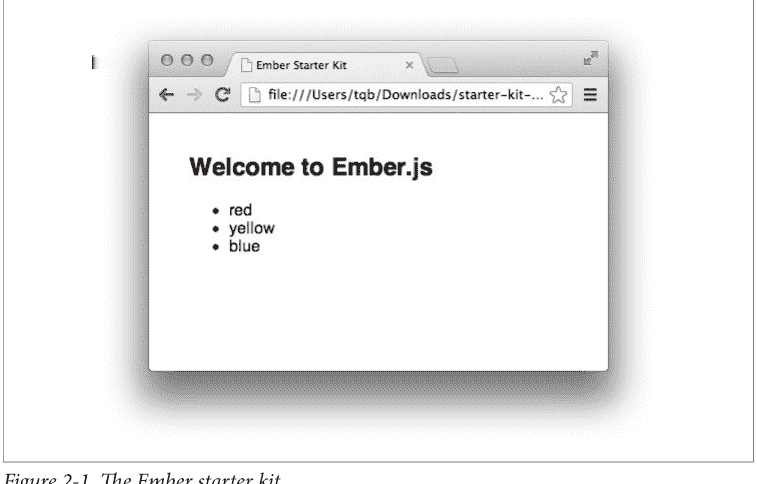

现在在你喜欢的开发编辑器中打开 *index.html* 文件。在 body 标签内，你会找到你的第一个（实际上是第二个）Handlebars 模板。我们稍后会回到这一点。现在，让我们先注意一下页面上两个模板的几件事。首先，请注意它们包含在类型为 `text/x-handlebars` 的 script 标签内。该类型与通常的 `text/javascript` 不同，它告诉浏览器不要尝试将内容解释为 JavaScript；因此，虽然这些 script 标签的内容会存在于页面上并可从 JavaScript 访问，但它们不会被浏览器执行或渲染，至少在你自己执行之前不会，或者在 Ember 和 Handlebars 为你执行之前不会。

注意，在每个模板中，你主要看到的是普通的旧 HTML，例如第一个模板中的 `h2` 标签和第二个模板中的 `ul` 标签。你还会看到一些 Handlebars 指令的示例：第一个模板中的 `outlet`，以及第二个模板中许多有趣的内容。Handlebars 会在将它们放入文档的 body 标签之前，将它们替换为纯 HTML。

保持该 HTML 文件打开，现在也打开 `app.js` 文件。我们刚才加载的页面可能看起来没什么，但想想正在发生什么：

1.  一个 body 标签中*没有*实际内容的 HTML 页面被加载。
2.  然后，一个 JavaScript 框架来了，显式地实例化了一个应用程序、一个路由器、一个路由和一个模型，以及隐式地实例化了几个控制器和视图。
3.  然后，它加载了嵌入在 HTML 页面中的几个模板。
4.  最后，它处理这些模板，插值模型数据并将其全部渲染到页面上。

更重要的是，正如我们稍后将看到的，模板是“活的”。如果你在浏览器的控制台中弹出并更改模型的内容以包含“green”，你会立即看到一个新的列表项被添加到页面中。同样，如果你移除“blue”，它会立即消失。你甚至不需要编写事件处理器。

但我们有点超前了。让我们看看 Ember 能有多极简。不过，在我们开始折腾入门套件之前，我们需要稍微谈谈 Web 服务器。如果你熟悉 Apache 或 Nginx .conf 文件，那就启动你选择的服务器并跳过下一小节。如果你是 Web 服务器的新手，别担心：有一个简单的选择。

### SimpleHTTPServer：名副其实

“但我们为什么需要一个 Web 服务器？”你可能会想。“我不能像之前那样继续双击 index.html 文件吗？”

你当然可以，但你会很快遇到缓存问题。你会发现你在编辑项目并在浏览器中点击刷新，但看不到任何变化。这是因为你的浏览器正在缓存对 `index.html`、`style.css`、`app.js` 等文件的请求。你可以继续进行更改，但浏览器将继续加载其旧副本，直到它（大部分是自主地）决定刷新其副本。一个好的 Web 服务器会为你做中介，让浏览器知道它拥有比浏览器拥有的更新版本的文件。

Python 提供了一个方便的 Web 服务器用于开发目的，它会积极监视你的文件更改。如果你使用的是 Mac（10.2 或更高版本），你已经有了
享受 Ember。Ember 并没有阻止你进行这种配置，尽管它可能会让你觉得其中一些配置比你可能希望的更麻烦。

以下是 Ember 的主要卖点：

-   简单、快速、双向数据绑定
-   他们所谓的“开发者体验”（下一节将详细介绍）
-   Ember Data，它提供了许多 ORM 特性，并适应和抽象了几乎任何后端
-   内置的 URL/历史管理，自动与数据和状态绑定
-   在 HTML 中构建的视图

最后一点似乎不是什么大事，但如果你曾经在一个框架中构建过应用程序，该框架在 JavaScript 中声明其视图而不是 HTML，你可能会欣赏到其中的区别。在 JavaScript 中声明标签名、类名、内部文本值和其他属性是冗长的、难以阅读的，并且需要有人能“说”JavaScript 才能编写。用 HTML 编写的模板可以由只知道足够 HTML 知识的设计师创建和编辑。

Python 已安装。如果你使用的是 Windows，可以下载[一键安装程序](http://click-through-installer)，几分钟内即可运行。

Python 的安装与配置指导足以自成一本——或许很薄、但注定没什么用的书。再说一次，如果你使用的是 Mac，Python 很可能已经安装好了，因为 OS X 从多个版本起就默认包含了它。如果你使用的是 Windows，YouTube 视频"[如何在 Windows 7 上安装 Python](http://how-to-install-python-on-windows-7)"可能会派上用场。

如果你已经在除 Mac 之外的任何电脑上安装了 Python，那你应该已经发现了系统的命令行。如果你使用的是 Mac 且从未使用过终端应用程序，可以参考 Treehouse 的文章"[Mac OS X 命令行入门](http://introduction-to-the-mac-os-x-command-line)"。

在支持 Python 的命令行环境中，从任意目录调用 `python -m SimpleHTTPServer` 就会启动一个以该目录为根目录的 Web 服务器。例如，如果该目录中有一个名为 `index.html` 的文件，你可以在浏览器中访问 `http://localhost:8000` 来查看该 HTML 文件的渲染结果。如果"localhost"或":8000"这些部分对你来说还很陌生，请查看下方的补充说明。

> python -m SimpleHTTPServer 在 Python 3 中已不再支持。它已被合并到 http.server 中，对应命令为 python -m http.server。


### http://localwhosit:whatnow?

如果你是 Web 开发中网络方面的新手，可能会感到不知所措。让无数使用不同物理连接方式的设备——从调制解调器（没错，某些地方仍在使用）到以太网、WiFi 和 LTE——运行着各种各样的平台和软件——从 Windows 到 Mac OS X、iOS、Java 到机器码——全部通过一种协议相互通信，如果你问我们的话，这堪称人类历史上最伟大的成就之一。让它们能够相互通信的方法之一，就是为每台设备分配一个唯一的地址——类似于电话号码——称为 Internet 协议（IP）地址。一台给定的设备可以拥有零到数十个 IP 地址。通常你会拥有几个。

有些 IP 地址是虚拟地址，允许你在某种意义上与自己通信。地址 127.0.0.1 就是专门为此保留的特殊地址：呼叫你自己的电脑。如果你运行的是常规配置的 Web 服务器，在浏览器中输入该地址就会直接从你自己的设备加载内容。就像电话号码可以包含分机号——一些额外的地址信息，用于指示共享同一主线的位置内的特定电话线路——IP 地址也可以指定端口。你会看到它们以冒号的形式附加在 IP 地址末尾，像这样：127.0.0.1:80。如果你不指定端口，则默认使用端口 80，所以 127.0.0.1 实际上等同于 127.0.0.1:80。这很像拨打一个总机号码，然后转接到前台；端口 80 就是你网站的"主"页面。

显然，我们早已不再仅仅使用 IP 地址来浏览网页；我们使用统一资源定位符（URL）。在你的电脑与你试图访问的服务器之间，有特殊的服务器会拦截你对"google.com"的请求，并将其转换为对 IP 地址的请求（以 Google 为例，即 74.125.225.231）。你的操作系统内部（很可能）也有类似的机制，会将对"localhost"的请求转换为对 127.0.0.1 的请求。一旦你确定服务器正在运行，就试试看。在浏览器的地址栏中输入 **http://localhost**。

使用 URL 和"localhost"时，你同样可以指定端口，例如"google.com:80"或"localhost:8000"。

### 数据绑定

现在我们知道了修改会显示出来，接下来把 *app.js* 中除第一行以外的所有行都注释掉，然后重新加载页面。你仍然应该看到"Welcome to Ember.js"，但不再看到颜色列表。花点时间看看你的 HTML 和 JS 文件中还剩什么。虽然内容不多，但你的浏览器中仍在发生相当多的事情。别忘了，那个包含"Welcome to Ember.js"的 h2 标签实际上并不在你的 HTML 内容中，而是被"隐藏"在一个并未被实际解析为脚本标签的 script 标签里。

因此，只剩一行 JavaScript 代码，你仍然拥有一个应用程序在执行我们在六段前概述的所有那些令人印象深刻的功能。你自己试试看；注释掉第一行 JavaScript 代码，看看结果是一个空白页面。只要保留那一行代码，我们就不再显式定义路由器或路由了（我们还不知道这些是什么，但它们听起来非常重要），但 Ember 仍然在为我们创建它们，代价仅仅是在一行代码中实例化一个 Ember Application 对象。关于 Ember 路由器和路由的更多信息，请关注**第 5 章**的详细内容。

好的，让我们开始动手实践，初步了解数据绑定。首先，添加第二行代码，创建一个不建议使用的（不要在生产环境中这样做）全局变量，像这样：

```javascript
App.model = ['red', 'yellow', 'blue'];
```

然后将你 HTML 中大约第 18 行的内容从：

```html
{{#each item in model}}
```

改为：

```html
{{#each item in App.model}}
```

重新加载浏览器，你应该会看到首次加载时显示的内容：欢迎消息和颜色列表。现在打开你的控制台（如果这个概念不熟悉，请观看[这个视频系列](this video series)），执行以下 JavaScript 代码：

```javascript
App.set('model', ['red', 'yellow', 'blue', 'green']);
```

一旦你按下回车键，页面上就会添加一个新的 `<li>` 标签，内容为 green。如果你曾经编写过实现此类实时同步——或称为绑定——的代码，你可能会感到印象深刻，甚至如释重负。

让我们看看反向操作的效果。在你的 *index.html* 文件中，将大约第 12 行的内容替换为：

```html
<h2>Welcome to {{view Ember.TextField valueBinding="App.name"}}</h2>
```

这里有一些新内容，但现在我们只需说明，这告诉 Ember 渲染一个 input 标签，其 value 属性将绑定到 `App.name`。这个输入字段和 `App.name` 变量会"相互监视"，在值发生变化时互相通知，并在观察到变化时更新各自的副本。说到创建，我们需要创建那个 `App.name` 对象。将以下内容作为 *app.js* 的第三行添加：

```javascript
App.name = "Tom Waits";
```

重新加载页面，你会看到 h2 标签内有一个输入表单字段，预填了"Tom Waits"。如果我们打开控制台，像刚才那样用 `App.set('name', 'A new value')` 修改 `App.name`，你会看到这个 input 标签的值立即发生变化。不过这次，看看如果你编辑该输入框的内容会发生什么。继续操作；点击表单字段，将其改为类似"Susan Tedeschi"的内容。然后在控制台中执行以下代码来查看 `App.name` 属性的当前内容：

```javascript
App.get('name');
```

控制台的响应应该是"Susan Tedeschi"或你输入到 input 标签中的任何内容。你刚刚通过舒适的 Web 表单编辑了路由中模型的一个属性（再说一次，我们甚至还不知道那是什么，但我们很快就会了解的）！这就是双向数据绑定，也是使用 Ember 的主要原因之一。在应用程序开发过程中，你可以不必担心模型属性和视图实体之间的变化同步问题。Ember 已经帮你搞定了。

### 代码都去哪了？

我们已经看到了很多功能，但几乎没有编写什么代码。更重要的是，我们甚至没有*看到*多少代码。很多框架提供生成器，可以根据约定自动为你的项目生成大部分内容。


Ruby on Rails 因这一特性而闻名，只需在终端输入一条命令，就能为你生成模型、视图、控制器，甚至数据库记录。然而，这条命令的结果是一个包含大量新文件的项目文件夹——你的新模型、视图、控制器等等。Ember 则有所不同。

当你启动一个 Ember Application 对象时，Ember 会立即在代码中搜索 ApplicationRoute、ApplicationController 的实现，以及带有 `data-template-name="application"` 属性的模板，或页面上第一个未指定 `data-template-name` 的模板。正如我们之前演示的，如果它没有找到前两项——你自己定义的路由类和控制器类——它会创建默认实例。我们还没有提到的是，这一切都发生在内存中，不会生成任何文件。

坏消息是，这使得检查这些对象并深入了解 Ember 内部机制变得稍微困难一些。当然这仍然是可以做到的，而且不止一种方式，但不像在 Ruby on Rails 应用中那样可以直接打开生成的文件来查看。好消息是，当 Ember 发布新版本时，你不必更新服务器上的几十甚至上百个文件——至少不需要为了整合 Ember 本身的变更而这样做。你只需替换新的 `ember-x-x.x.js` 文件，下次启动应用时，它就会运行在全新的 Ember 环境中。这并不意味着你完全不用做任何工作。如果 Ember API 发生了变化，你肯定需要修改你的类来适配这些变化。

### 嗯，什么是路由器？

我们刚才突然抛出了一些术语，对吧？（如果你好奇的话，写这本书最难的部分就是决定从鸡开始讲还是从蛋开始讲。）我们在第 1 章中讨论了模型、视图和控制器。许多 Web 应用框架在这个三元组中增加了另一根支柱，叫做路由器。在我们年轻的那个年代，我们使用的 Web 服务器只是简单地通过将 URL 请求——即访问你域名下某个特定 URL 的请求——与文件夹结构相关联来做出响应。例如，URL 中第一个正斜杠之后的所有内容都可以轻松地转换为服务器硬盘上的文件夹：`http://www.somethingclever.com/folder/inner-folder/index.html` 会告诉你的 Web 服务器转到 Web 文档文件夹的根目录，找到名为 `folder` 的文件夹，然后找到其中的 `inner-folder` 文件夹，最后找到名为 `index.html` 的文件。

然而，当你构建 Web 应用时，你通常处理的不是包含静态文件的文件夹。你可能只处理一个 HTML 文件——这就是"单页应用"的热潮。不过，我们仍然希望继续使用唯一的 URL 来捕获应用程序的特定状态或入口点。因此，像 Apache 这样的旧 Web 服务器中能够将 `http://blahblahblah.com/stuff/index.html` 转换为 `C:\docroot\stuff\index.html` 引用的功能，需要在我们全新的 JavaScript 应用中重新构建。实际上，这个东西就叫做路由器。

在你的路由器中——你*会*编写大量的路由器——你将声明几乎所有希望应用程序响应的 URL。如果你没有声明某个 URL，你的应用程序将不知道如何响应，甚至不知道它*应该*响应对该资源的请求。我们稍后会详细介绍具体如何操作。

你可能会想，所有东西怎么可能都放在一个路由器中。毕竟，如果对每个 URL 的响应逻辑的某种形式都存储在路由器中，那么路由器很快就会膨胀到数千行代码。听起来扩展性不太好，对吧？确实如此。这就是为什么路由器主要只是将 URL 与路由关联起来。路由存储了让应用程序到达（并离开）URL 所代表状态所需的逻辑。所以，现在只要看到"路由器"和"路由"，就想："这就是将 URL 转换为应用状态再转换回来的东西。"

非常重要的东西。我有点惊讶人们没有像 MVRC（Model-View-Router-Controller，模型-视图-路由器-控制器）这样来称呼像 Ember 这样的框架。

### Ember 实战

让我们将入门套件代码恢复到"出厂设置"；删除第 2 行和第 3 行，并取消注释入门套件自带的原始代码。你的 *app.js* 文件现在应该看起来和你下载时一模一样：

```javascript
App = Ember.Application.create();

App.Router.map(function() {
  // put your routes here
});

App.IndexRoute = Ember.Route.extend({
  model: function() {
    return ['red', 'yellow', 'blue'];
  }
});
```

请确保将 *index.html* 文件也恢复到原始状态以保持匹配。如果你弄丢了，可以随时重新下载一份入门套件（或者回滚你的更改——你*确实在使用*版本控制，对吧？）。

让我们逐步了解当你在浏览器中加载 `http://localhost:8000` 时会发生什么：

- 1. HTML 页面加载，这会加载并执行你的 *app.js* 文件。
- 2. *app.js* 实例化一个 Ember Application。
- 3. 当 Application 启动时，它会立即查看你是否编写了自己的 `ApplicationRoute`，如果有就加载它，同时无论怎样都会加载它自己的（你编写的类会扩展默认类）。
- 4. Application 对 `ApplicationController` 执行同样的操作——如果你编写了就加载你的，同时加载它自己的。
- 5. 如果你定义了自己的 `ApplicationRoute`——并定义了其中应触发的任何事件钩子（例如 `activate` 定义）——它们现在会被触发。
- 6. Ember 然后在你的 HTML 中查找应用模板，并使用 `ApplicationController` 作为其控制器进行设置，我们稍后会看到它成为数据流入模板的通道，将占位符替换为实时数据。
- 7. 因为我们位于应用程序的根 URL（没有指定特定路由），Ember 现在会定位并实例化你在 `app.js` 中指定的 `IndexRoute`。
- 8. Ember 会发现你没有指定 `IndexController`，并为你实例化一个。我们稍后会详细介绍这一点，但 Ember 需要决定什么类型的默认控制器最为有用。因为你在 `IndexRoute` 中定义了一个数组类型的 model，Ember 会实例化一个 `ArrayController` 作为你的 `IndexController`。
- 9. Ember 会在 HTML 文档中找到名为 `index` 的模板，并将其渲染到应用模板中的 `outlet` 辅助方法中（我们将在下一章介绍辅助方法和那个有趣的 outlet 是什么）。

这可能是我们第 73 次说这句话了，但请记住，*这一切仅用了 11 行代码*，而当只有一行代码时，几乎也发生了同样的事情。这凸显了我们在**第 1 章**中提到的要诀。一行代码和 11 行代码几乎产生相同的效果，因为我们只定义了一个东西——我们的 model——而它不是默认的对象/功能。用 Ember.js 指南的原话说："因为这种模式非常常见，所以它是……的默认行为。"而且因为它是默认的，你甚至不需要编写那段代码。

再举一个例子，然后我们就要正式开始深入剖析 Ember 了。我们将很快介绍很多我们实际上还没有讨论过的内容，所以如果你看到不认识的术语不要担心，我们后面会讲到的。这是对 Ember 工作方式的一次快速浏览，之后我们会非常缓慢地再走一遍。

假设你现在点击地址栏，将地址改为 `http://localhost:8000/examples/1`。快速测试：Ember 会怎么做？

答对了。这是个陷阱题。Ember 什么也不会做，因为你加载了一个不存在的页面。你会看到来自 Python SimpleHTTPServer 的错误消息（图 2-2）。

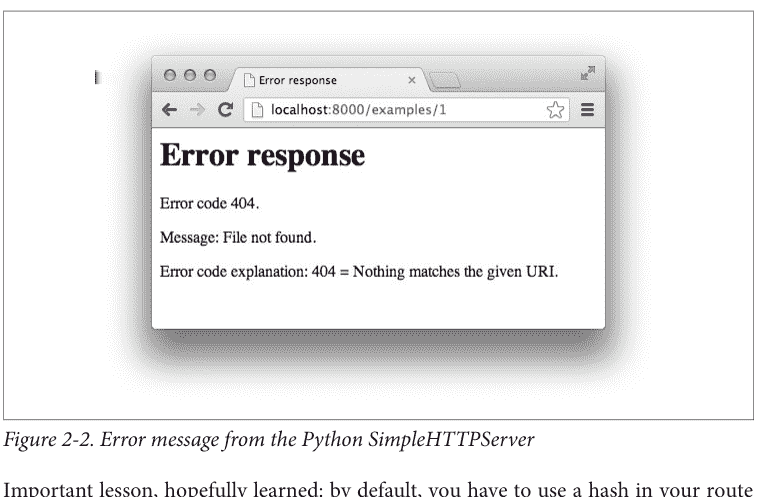
*图 2-2. 来自 Python SimpleHTTPServer 的错误消息*

重要的一课，希望你已经学会了：默认情况下，你必须在路由 URL 中使用井号（hash）。我们刚才尝试的 URL 是指定文件夹中某个文件的 URL，可以由传统 Web 服务器提供服务。我们只有一个文件，所以我们的 URL 实际上并不指向独立的文件或文件夹。当你在 URL 中插入井号时，Web 服务器会在井号处停止将 URL 解释为文件/文件夹结构。你可以在井号后面放任何内容，服务器都不会尝试查找该名称的文件。不过，页面会收到完整的 URL，而 Ember 知道如何将 URL 中井号后面的部分——即井号之后的内容——转换为路由。

因此，一个正确的 URL 应该是 `http://localhost:8000/#/examples/1`。现在加载该 URL 会显示一个空白的浏览器窗口，因为我们还没有定义该路由，但让我们来看看 Ember 会查找什么：

- 1. 首先，执行前面列表中的所有内容，然后：
- 2. 因为 /examples，Ember 会查找名为 ExamplesRoute 的路由。
- 3. Ember 会查找或创建一个 ExamplesController。
- 4. Ember 会调用 ExamplesRoute 的 model 函数，传入 URL 的最后部分，如果你定义了一个 ExamplesRoute，它看起来大致是这样的：

```javascript
model: function(params) {
    return App.Example.find(params.example_id);
}
```


5. Ember 现在可以获取你的模型数据，并填充到 HTML 中名为 `examples` 的模板里，将其渲染到应用模板中的 outlet 辅助元素里。

如果你听说过这些，请打断我，但由于这种模式非常常见，它是路由处理器的默认行为，这意味着我们刚刚写的 `model` 函数并不是必需的，除非你推文中没有提到其他内容。

郑重声明，你实际上无法仅通过我们这里写出的少量代码就执行这个小思考题。别担心；我们很快就会讲到。这个练习的目的是多看几遍命名约定，感受一下 Ember 如何为你定位/创建事物，并走过整个生命周期。

### 总结

好了，这就是对 Ember 引导序列的旋风式 tour。如果没完全理解，别担心。这本意就不是让你现在完全搞懂。把它当作是去一个陌生国家旅行的第一天。你正饱受时差之苦，坐着 cheesy 的旅游巴士在市中心绕行，记下那些接下来一周想在昏睡间歇和迷茫凝视中重新拜访的地方。

去喝杯咖啡，小睡一会儿，或者绕着街区跑一圈，然后回来继续下一章。

# 第 3 章

## Ember 样板代码与工作流

既然我们已经牢固掌握了 Ember 应用的基础知识，现在是时候开始建立专业的工作流了。这是流程耐心中重要的一步，但并非绝对必要。也就是说，如果你有兴趣节省宝贵时间、创建可维护的代码库并为测试做准备，那么建议你在搭建开发环境时做一些初始工作。你以后会感谢我们的。

截至本文撰写之时，随着 Ember  RostokPodznam 的发布，有许多工具可用于管理 Ember 应用的样板代码和工程流。在工具和工作流成为核心部分之前，选择最佳实践时仍会有些令人困惑。归根结底，开发工作流及管理它的工具是高度主观的，取决于个人偏好，且存在争议。我们将保持中立立场，这里只陈述事实。

目前，有四个项目为工程流管理和样板代码缺少提供不同程度RO 支持：

-   ### *Yeoman 的 Ember 生成器*
    Yeoman，一套工具集合，提供了 Ember 应用生成器以及用于模型、视图和控制器视图的单个生成器。

-   ### *Ember Tools*
    一个由 Ryan Florence 创建和维护的项目。Ember 社区曾表示 Ember Tools 将来会与 Ember App Kit 合并到核心中。Ember Tools 使用 Browserify，一个由 James Halliday 创建的项目，提供将 Node.js 风格的模块编译为浏览器可用格式的能力，来管理 JavaScript 依赖。你也可以使用 Ember Tools 生成单个模型、视图和控制器。

### Ember App Kit

在 Ember  RostokPodznam 发布提供的说明中，Ember 团队表示："EAK 最终会成为官方 Ember Tools 的核心。"

目前作为 Yeoman 的替代品，Ember App Kit 是另一套可用于作为项目起点的工具集。截至本文撰写之时，EAK 确实需要一些手动设置。通过从 GitHub 克隆项目并清除现有的 Git 历史记录，Ember App Kit 提供一个基础的样板应用，其中包括集成的 Grunt 任务运行器以及 Grunt 任务，如 JSHint、QUnit 和 Testem 测试运行器。EAK 还通过包含 ES6 模块转译器来支持 ECMAScript  缺少模块。ECMAScript  缺少模块将在下一个 JavaScript 版本中推出，但 EAK 允许你通过提供必要的命名空间来让你的 Ember 类远离全局作用域，从而提前起步。

EAK 还提供了设置存根 API 的样板代码，这样你就可以使用 Ember Data 的 RESTAdapter 而不是 FixtureAdapter。这在 [第 7 章](Chapter 7) 涉及这些主题时会更有意义。

同样，在 [第 8 章](Chapter 8) 中，当我们深入探讨为应用开发后端的细节时，你会看到更多关于 EAK 的内容。

最后，在 [第 10 章](Chapter 10) 中，我们将探索*开箱即用*的 EAK 测试设置的具体内容。要跟随学习，请检出这个 [EAK 特定仓库](EAK specific repo)。

### Ember Rails

Ember Rails 是一个 Ruby gem，它提供对 Active Model Serializers、Ember 和 Ember Data 的生产版本、Handlebars 的支持，以及与 Rails Asset Pipeline 的集成。关于 Ember Rails 的更多内容可在 [第 9 章](Chapter 9) 找到。

### Ember CLI

Ember CLI 承诺将来会取代 Ember Tools 和 Ember App Kit，成为构建 Ember 应用的官方工具集。截至本文撰写之时，不建议将其用于严肃应用。文档中写道："尽管可能令人兴奋，但这仍然是一个进行中的项目，请自行承担使用风险。"

总体而言，Ember CLI 专注于通过多种方式提高开发者的生产力，如模块、内置测试和依赖管理。

也许 Ember CLI 最令人兴奋的功能之一是它使用 Broccoli 作为资源管道，而不是 Grunt 的 watch 任务。优势在于它只重建单个 Zhou 文件而不是整个 Grunt 项目，因此显著减少了构建时间。

与 Ember App Kit 一样，它也使用 ES6 模块转译器，将 ES6 模块语法转换为 AMD 模块。

为了保持本书范围的限制，我们认为截至撰写之时，用于快速原型开发的最完整解决方案是 Yeoman。也就是说，在 不可靠不可靠 章中，我们将利用 Yeoman 来构建我们应用的原型。

在  章中，我们将为更具体的、与生产相关的用例和主题介绍 Ember App Kit 和 ember-rails gem。

### Git

首先，让我们介绍版本控制。

本书将使用 Git 来管理源代码的版本控制。我们还将使用 GitHub，这个流行的基于 Web 的开源软件开发项目托管服务。在这里，我们将管理我们的演示应用 RocknRollCall 的源代码。

另外，正如你将在本章后面看到的，我们将使用这些工具的最佳组合来设置我们的应用。首先，请查看 RockNRollCall 应用的 GitHub 仓库（见图 3-1）。

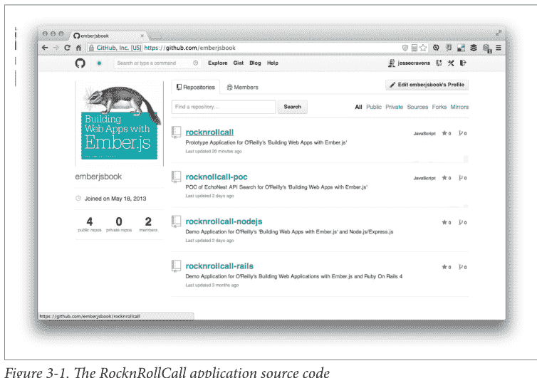

*图 3-1. RocknRollCall 应用源代码*

查看 **master 分支** 上的提交日志，跟随我们在本书剩余部分构建应用的过程。

GitHub 还提供社交网络功能，如动态、关注者以及显示开发者如何在其仓库版本上工作的社交网络图。如果你希望关注更新，请创建账户（如果还没有的话），然后点击仓库页面右上角的 Watch 按钮。

Git 的完整概述超出了本书的范围，但如果你是 Git 新手，以下是一些帮助你入门的资源：

-   *Version Control with Git*，Jon Loeliger 和 Matthew McCullough 著（O'Reilly，2009）
-   *Git Pocket Guide*，Richard E. Silverman 著（O'Reilly，2013）

如果你从零开始创建应用，在跟随学习时，首先创建一个目录：

```
$ mkdir rocknrollcall-yeoman
```

然后：

```
$ cd rocknrollcall-yeoman
```

之后，初始化一个新的本地 Git 仓库：

```
$ git init
```

或者，你可以通过直接从我们的远程 GitHub 仓库克隆来获取整个应用：

```
$ git clone https://github.com/emberjsbook/rocknrollcall-yeoman.git
```

### Yeoman 是什么？

Yeoman 是一包 Web 开发工具，帮助开发者管理高效的工作流，减少手动编写样板代码，井管理复杂性。Yeoman 工具集包含三个工具：名为 Yo 的应用生成器或脚手架工具、作为集成构建工具的 Grunt.js，以及用于管理项目中包含的 JavaScript 和 CSS 库等应用依赖的 Bower。

#### 安装 Yeoman

要开始，我们需要安装 Node.js。要安装 Node.js，请按照 [项目下载页面](#) 上的指南操作。

Node.js 自带 NPM（Node Package Manager）。使用 NPM，我们可以通过以下命令安装刚刚介绍的三个工具：

```
$ npm install -g yo grunt-cli bower
```

就这些。现在让我们通过输入以下命令来检查安装：

```
$ yo
```

在简短地提供匿名反馈选项后，你将被提示做出决定。目前，你可以选择“让我离开这里！”。别担心，我们稍后会回到这个话题：

```
[?] ========================================================================
我们一直在寻找让 Yo 变得更好的方法！
我们能否匿名报告使用统计数据以持续改进该工具？
更多信息：https://github.com/yeoman/insight & http://yeoman.io
=======================================================================: No
[?] 你想做什么？（使用方向键）
  安装一个生成器
  寻求帮助
> 让我离开这里！
```

#### 使用 Yo 的 Ember 应用生成器

Yo 通过为你生成样板代码来缩短启动时间。Yo 还会生成 Grunt 配置文件和社区推荐的相关 Grunt 任务。此外，正如你将看到的，当我们使用 Ember 生成器时，所有被认为重要的任务都包含在交互式命令提示中。

现在，让我们开始第一项工作：生成一个应用。

#### 安装依赖项

在开始之前，我们还需要安装一些依赖项。

##### Ruby

在使用生成器之前，我们需要确保已安装 Ruby（版本 1.9.3 或更高）。如果你使用的是 Mac OS X，默认情况下应该已经安装了 Ruby。如果是其他系统，则需要安装 Ruby。

你可以通过以下方式检查 Ruby 的位置和版本：

```
$ which ruby
/usr/bin/ruby

$ ruby -v
ruby 2.0.0p247 (2013-06-27 revision 41674) [universal.x86_64-darwin13]
```

##### Compass

Compass 是一个用于 Sass CSS 预处理器的开源创作框架。你需要 Compass 来运行 Ember 生成器并将 Sass 编译为 CSS。安装方法如下：

```
$ gem install compass
```

由于我们已经安装了 Node.js 和 NPM，我们可以使用以下命令来安装一个包含 Compass Grunt 任务的 Grunt 插件。Ember 生成器将在后台调用此插件。

#### 安装生成器

现在我们已经安装了 Yeoman 和所有生成器依赖项，可以开始安装实际的 Ember 生成器了。为了了解上下文，让我们首先看看所有可用的生成器。打开终端并输入以下命令：

```
$ npm search yeoman-generator
```

请耐心等待；这可能需要一些时间。最终，你应该会看到类似以下的结果：

```
$ npm search yeoman-generator
npm WARN Building the local index for the first time, please be patient
npm http GET https://registry.npmjs.org/-/all
```

| NAME | DESCRIPTION | AUTHOR | DATE | VERSION | KEYWORDS |
| :--- | :--- | :--- | :--- | :--- | :--- |
| calaxa | calaxa ====== | apathetic | 2013-05-14 09:11 | 0.0.1 | yeoman-generator sass compa |
| ft-wp | Front-Trends Wordpress generator | hubertburdach | 2013-03-30 21:08 | 0.0.1 | yeoman-generator web |
| generator-admo | A generator for Yeoman | drubin | 2014-02-04 09:07 | 0.9.5 | yeoman-generator admo Digit |
| generator-android | Yeoman generator for Android | groupsky | 2014-01-17 09:03 | 0.1.0 | yeoman-generator android sc |
| generator-angular-js | Yeoman generator for AngularJS | doboy | 2013-11-24 10:02 | 1.0.1 | yeoman-generator scaffold f |

… 等等。

在撰写本文时，社区为 Yeoman 编写的生成器实际上有数百个，涵盖了从 Android 到 Angular 的所有内容。但今天，我们感兴趣的是 Ember.js。

现在打开一个新终端并调用 Yo：

```
$ yo
```

然后你应该会看到以下提示：

```
[?] 你想做什么？（使用方向键）
> 更新你的生成器
  安装一个生成器
  寻求帮助
  让我离开这里！
```

显然，我们应该选择“安装一个生成器”。接下来，我们看到一个提示，要求在 NPM 中搜索。因此，我们将输入“ember”作为关键词。在撰写本文时，你可以看到仓库中可用的与 Ember 相关的生成器：

```
[?] 在 NPM 中搜索生成器：ember
[?] 以下是我的发现。安装其中一个吗？（使用方向键）
➤generator-ember
 generator-ember-jade-zurb
 generator-ember-jade-zurb-express
 generator-ember-laravel
 generator-ember-less
 generator-ember-rk
 generator-jhipster-ember
 重新搜索
 返回主菜单
```

按回车键，Yo 将下载并安装所有依赖项，并通知我们安装已完成：

```
我刚刚通过运行以下命令安装了你的生成器：
  npm install -g generator-ember
```

#### 运行生成器

现在我们准备运行生成器，另一个提示出现了：

```
[?] 你想做什么？（使用方向键）
➤运行 Ember 生成器 (0.8.3)
 运行 Mocha 生成器 (0.1.3)
 更新你的生成器
 安装一个生成器
 寻求帮助
 让我离开这里！
```

选择“运行 Ember 生成器 (0.8.3)”（请注意，到你阅读本文时，版本可能已经更新）。同样，Yo 会向我们提出一些问题：

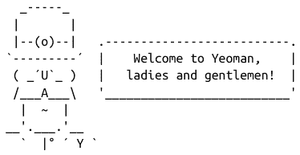

```
   是否要包含用于 Sass 的 Twitter Bootstrap？(Y/n)
```

由于我们不希望在本书的范围内花费时间来为应用设置样式，我们将选择是。现在，我们将看到一些日志，表明正在创建我们的文件：

```
create .gitignore
create .gitattributes
create .bowerrc
create bower.json
create package.json
create .jshintrc
create .editorconfig
create Gruntfile.js
create app/templates/application.hbs
create app/templates/index.hbs
create app/index.html
create app/styles/style.scss
create app/scripts/app.js
invoke  mocha:app
create    test/index.html
create    test/lib/chai.js
create    test/lib/expect.js
create    test/lib/mocha/mocha.css
create    test/lib/mocha/mocha.js
create    test/spec/test.js
```

我全部完成了。正在为你运行 bower install & npm install 以安装所需的依赖项。
如果失败，请尝试自己运行该命令。

现在你应该会看到一长串日志。以下是一个简化的示例：

```
npm WARN package.json static-projects@0.0.0 No README.md file found!
npm http GET https://registry.npmjs.org/grunt
npm http GET https://registry.npmjs.org/grunt-contrib-copy
npm http GET https://registry.npmjs.org/grunt-contrib-concat
...
```

现在让我们探索文件系统，以更好地理解为我们创建了什么（图 3-2）。注意三个顶级目录：*app*、*node_modules* 和 *test*。*app* 目录包含所有应用文件，*node_modules* 包含应用依赖项，*test* 包含测试文件和配置文件，例如 *.bowerrc*、*.gitignore*、*.jshintrc*、*Gruntfile.js* 和 *package.json*。这些文件管理着应用和开发环境中的不同配置层级。

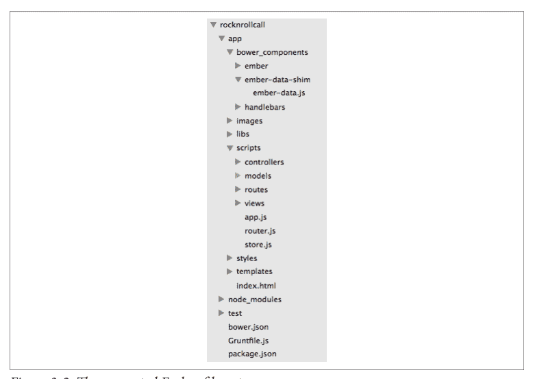
图 3-2. 生成的 Ember 文件系统

### HTML

还要查看 app 目录中的 index.html 文件——已经生成了大量样板代码：HTML5 文档类型、Ember.js 依赖项（按正确的加载顺序），以及 Gruntfile.js 用于替换（或移除）HTML 文件中非优化脚本或样式表引用的构建注释：

```html
<!doctype html>
<html>
    <head>
        <meta charset="utf-8">
        <title>Yeoman Ember Starter Kit</title>

        <!-- build:css styles/main.css -->
        <link rel="stylesheet" href="styles/style.css">
        <!-- endbuild -->
    </head>
    <body>
        <!-- build:js(app) scripts/components.js -->
        <script src="bower_components/jquery/jquery.js"></script>
        <script src="bower_components/handlebars/handlebars.runtime.js"></script>
        <script src="@@ember"></script>
        <script src="@@ember_data"></script>
        <!-- endbuild -->

        <!-- build:js(.tmp) scripts/templates.js -->
        <script src="scripts/compiled-templates.js"></script>
        <!-- endbuild -->

        <!-- build:js(.tmp) scripts/main.js -->
        <script src="scripts/combined-scripts.js"></script>
        <!-- endbuild -->

        <!-- build:js scripts/plugins.js -->
        <script src="bower_components/bootstrap-sass/js/affix.js"></script>
        <script src="bower_components/bootstrap-sass/js/alert.js"></script>
        <script src="bower_components/bootstrap-sass/js/dropdown.js"></script>
        <script src="bower_components/bootstrap-sass/js/tooltip.js"></script>
        <script src="bower_components/bootstrap-sass/js/modal.js"></script>
        <script src="bower_components/bootstrap-sass/js/transition.js"></script>
        <script src="bower_components/bootstrap-sass/js/button.js"></script>
        <script src="bower_components/bootstrap-sass/js/popover.js"></script>
        <script src="bower_components/bootstrap-sass/js/carousel.js"></script>
        <script src="bower_components/bootstrap-sass/js/scrollspy.js"></script>
        <script src="bower_components/bootstrap-sass/js/collapse.js"></script>
        <script src="bower_components/bootstrap-sass/js/tab.js"></script>
        <!-- endbuild -->
    </body>
</html>
```

需要特别注意的是 *scripts/compiled-templates.js* 和 *scripts/combined-scripts.js* 文件，它们被包裹在前面提到的构建指令中。敬请期待；这些文件将在我们工作流后续的 Grunt 构建过程中生成。

### 基本的 Ember 应用

一个基本的 Ember.js 应用已为我们生成，位于 *app/scripts/app.js*。该应用使用 `require` 语法来包含其他应用依赖项（关于 `require` 和 JavaScript 模块化的更多信息，请阅读[为什么需要 Web 模块？](http://example.com/why-web-modules)）：

```javascript
var Rocknrollcall = window.Rocknrollcall = Ember.Application.create();

/* Order and include as you please. */
require('scripts/controllers/*');
require('scripts/store');
require('scripts/models/*');
require('scripts/routes/*');
require('scripts/views/*');
require('scripts/router');
```

这种模块化是使用 Yeoman 这类工具的主要优势之一。如果你想知道为什么我们不直接下载入门套件，答案是：我们本来可以。
```


正如我们在第2章中所探讨的，你会得到一个包含所有内容的类似起始代码文件：

```
RocknrollcallYeoman.ApplicationRoute = Ember.Route.extend({

    // 坦率地说，这应该放在 IndexRoute 而不是顶层的
    // ApplicationRoute 中；我们正在过渡期…… :)

    model: function () {
        return ['red', 'yellow', 'blue'];
    }
});
```

如果你探索所需的脚本（控制器、store、模型、路由、视图和路由器），你会发现所有相同的功能都已被模块化到单独的文件中。这是一个众所周知的软件设计最佳实践，称为*关注点分离*。这是一个很好的例子，说明了为什么我们使用 Yeoman 来帮助我们管理代码。请继续阅读——后面还有更多示例。

### 使用 Bower

与 Linux 包管理器非常相似，Bower 将你的 JavaScript 库作为包进行管理，并通过 CLI（命令行界面）暴露版本信息。Bower 帮助进行依赖解析，这样你就能获得所有库的完全正确且可互操作的版本。这意味着如果你的某个依赖与另一个依赖冗余，就不会包含多个版本的脚本。例如，Ember.js 依赖于 jQuery，但如果你包含另一个依赖于 jQuery 的库，只会加载一个版本。

一个 *bower.json* 文件（类似于 Ruby 的 Gemfile 或 Node.js 的 *package.json*）用于声明特定项目中使用的依赖：

```
{
    "name": "rocknrollcall-yeoman",
    "version": "0.0.0",
    "dependencies": {
        "ember": "1.3.2",
        "handlebars": "1.2.1",
        "ember-data": "1.0.0-beta.5",
        "ember-localstorage-adapter": "latest",
        "bootstrap-sass": "~3.0.0",
        "d3": "latest"
    },
    "devDependencies": {
        "ember-mocha-adapter": "0.1.2"
    }
}
```

此时，你可能很想运行你最喜欢的本地开发服务器，将这个应用程序交付到你的浏览器中，就像我们在第2章中所做的那样。但请稍等：除了其他事情，Yeoman 也会在这方面帮助你。

### Grunt

到目前为止，所有这些都很棒，但现在轮到真正节省时间的工具了，Grunt.js。Grunt 是一个任务运行器，允许你自动化通常需要自己处理或使用单独工具集来处理的所有任务。

在本书开头，我们讨论了如何高效地构建生产环境应用。Grunt 是使我们能够实现这一点的核心工具集之一，它提供的任务可以执行以下操作：

-   监视进程，例如 LiveReload
-   自动编译 CoffeeScript、Compass 和 Sass
-   自动代码检查
-   基准测试图像优化
-   生成应用缓存清单
-   压缩和合并静态资源
-   运行内置预览服务器。

Gruntfile.js 是你的特定任务设置的主要配置。一整本书都可以用来专门介绍 Grunt。

现在，我们将描述设置的一般模式。Gruntfile.js 相当长，因此通过将其分解为易于理解的部分，这些是核心基础。从文件内部调用以下方法：

```
grunt.initConfig
```

initConfig 方法为我们在 grunt.registerTask() 中稍后注册的每个任务提供配置。

例如，以下是我们最喜欢的其中一个任务 jshint 的基本配置：

```
grunt.initConfig({
    yeoman: yeomanConfig,
    jshint: {
        options: {
            jshintrc: '.jshintrc',
            reporter: require('jshint-stylish')
        },
        all: [
            'Gruntfile.js',
            '<%= yeoman.app %>/scripts/{,*/}*.js',
        ]
    }
});
```

```
    '<%= yeoman.app %>/scripts/vendor/*',
    'test/spec/{,*/}*.js'
    ]
});
});
```

#### grunt.loadNpmTasks

在我们注册任务之前，我们需要将它们作为 Node.js 模块加载。这个 require 声明运行 load-grunt-tasks 任务，该任务加载目录中的所有其他任务：

```
        require('load-grunt-tasks')(grunt);
```

现在依赖项可用，Yeoman 生成的 Gruntfile 包含了每个任务的 register 调用：

```
        grunt.registerTask('default', [
          'jshint'
        ]);
```

### 构建、运行、测试

最后，以下是 Grunt 提供的命令，你可以通过命令行使用它们来构建、运行和测试你的应用程序。

首先，确保你在应用程序的目录中运行以下命令。

如果你只想构建应用程序，可以运行：

```
    $ grunt
```

接下来，如果我们还想查看应用程序，可以在监视目录更改的同时运行预览服务器：

```
    $ grunt serve
```

这应该会启动应用程序并在你的 Web 浏览器中运行，地址为 http://localhost:9000（图 3-3）。

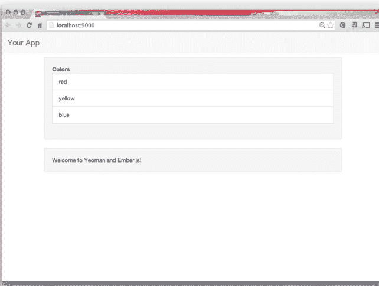

*图 3-3. 使用 Yeoman Ember 生成器的 Ember 入门应用程序*

最后，你应该在控制台中看到以下来自 Grunt 的输出：

```
$ grunt serve
Running "serve" task

Running "clean:server" (clean) task
Cleaning .tmp...OK

Running "replace:app" (replace) task
Replace app/index.html -> .tmp/index.html

Running "concurrent:server" (concurrent) task

Running "emberTemplates:dist" (emberTemplates) task
File ".tmp/scripts/compiled-templates.js" created.

Done, without errors.

Running "compass:server" (compass) task
directory .tmp/styles/
create .tmp/styles/style.css (1.932s)
Compilation took 1.935s
```

Done, without errors.

Running "neuter:app" (neuter) task

Running "copy:fonts" (copy) task
Copied 4 files

Running "connect:livereload" (connect) task
Started connect web server on localhost:9000.

Running "open:server" (open) task

Running "watch" task
Waiting...
```

稍后，在**第10章**中，你将看到我们也可以从 Grunt 运行测试。

现在，你可以从 *app/test/spec/test.js* 中包含的一个 Mocha 测试中，尝一点测试的滋味：

```
(function () {
    'use strict';

    describe('Give it some context', function () {
        describe('maybe a bit more context here', function () {
            it('should run here few assertions', function () {

            });
        });
    });
})();
```

运行以下命令：

```
$ grunt test
```

你应该会看到来自我们 Mocha 测试的以下输出：

```
Running "mocha:all" (mocha) task
Testing: http://localhost:9000/index.html

  .

  1 passing (104ms)

>> 1 passed! (0.10s)
```

如果你在跟随学习的同时构建自己的应用程序，那么这将完成我们使用 Yeoman 生成和管理的基本应用程序。

然后添加你所有的更改，使用工作树中的当前内容更新索引。这将为下一次提交暂存更改：

```
$ git add .
```

现在提交这些更改，并附上友好的消息：

```
$ git commit -m "Initial commit"
```

就是这样。现在，我们有了一个生成的应用程序结构和一个包含包管理、任务运行器的初始代码库，让我们来探索一些更多的工具：子生成器。

### 使用 Chrome 和 Firefox 的 Ember Inspector 进行调试

Ember Inspector 是一个插件，可以帮助开发者调试 Ember 应用程序。目前，该工具仅限于 Chrome 和 Firefox。要获取 Chrome 开发者工具的插件，请访问**下载页面**（图 3-4）。

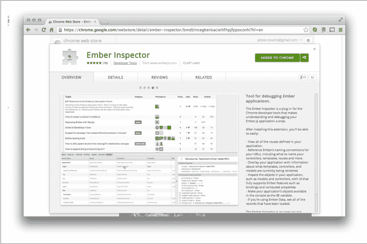

*图 3-4. 用于 Google Chrome 的 Ember Inspector 扩展*

对于 Firefox，请访问**此下载页面**（图 3-5）。

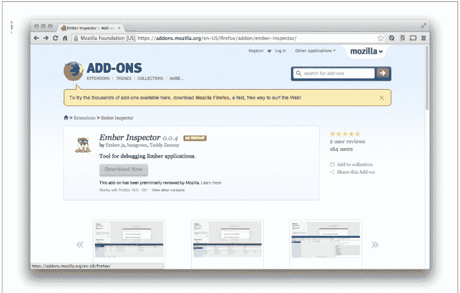

按照各个浏览器的安装说明操作，我们应该准备好开始调试我们的 Ember 应用程序了。首先，让我们从应用程序中定义的所有路由开始。

由于我们尚未构建应用程序，我们可以克隆已完成的应用程序来演示。

创建一个新目录并进入它：

```
$ mkdir demo-inspector && cd demo-inspector
```

然后克隆完成的仓库：

```
$ git clone https://github.com/emberjsbook/rocknrollcall-yeoman.git
```

现在，使用 Grunt 启动应用程序：

```
$ grunt serve
```

你现在在 *demo-inspector* 目录中拥有了功能完整的应用程序。完成对检查器功能的讲解后，你可以通过以下方式返回原始目录：

```
$ cd ..
```

Ember Inspector 最强大的功能之一是它提供了对所有 Ember 命名约定的内置参考，如你所见**图 3-6**。


### Ember 的命名约定

如果您想进一步了解 Ember 的命名约定及其工作原理，请参阅 [Ember.DefaultResolver](http://emberjs.com/api/classes/Ember.DefaultResolver.html) 的 API 文档或 [Ember 指南概念 - 命名约定](http://emberjs.com/guides/concepts/naming-conventions/) 章节。

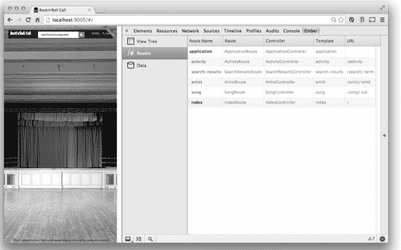

此外，一旦您的应用程序中拥有多个路由（route）和控制器（controller），您可以分别查看它们及其各自的所有属性。图 3-7 展示了检查路由属性的一个示例。

然后，检查 View Tree 标签页，会出现一个覆盖层，显示与渲染应用程序当前“状态”相关的模板、控制器和模型，如图 3-8 所示。这在尝试确定您是否能在模板中访问正确的模型时尤其有用。

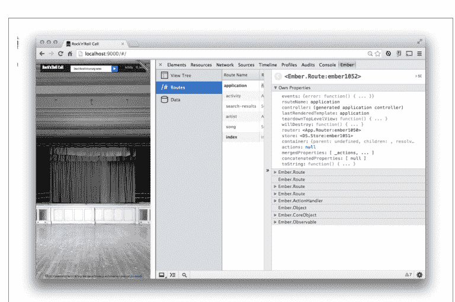

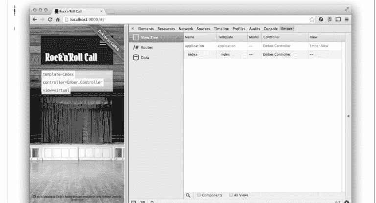

Ember Inspector 对您的数据层也提供了极大帮助。如果安装了 Ember Data，您会注意到一个 Data 标签页。点击这里，可以查看当前存储在 Ember Data 中所有记录的快照，如**图 3-9** 所示。

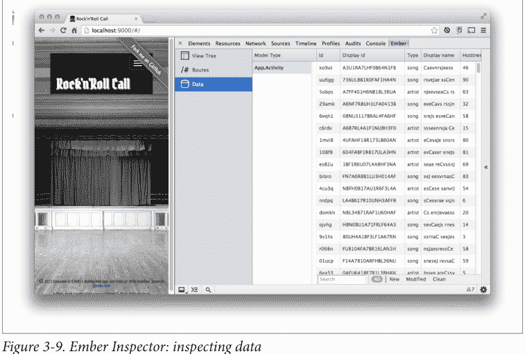

最后，您可以将应用程序的对象以 `$E` 变量的形式记录到控制台中，如**图 3-10** 所示。

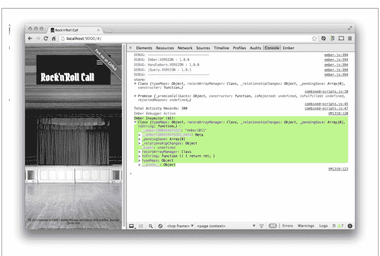

### 本章小结

在第 4 章中，我们将进入 *早期设计* 阶段：我们将通过思考并绘制应用程序的各种 *状态* 并创建伪数据来开始构建我们的解决方案架构。与此同时，我们也可以开始构建应用程序 Handlebars 模板的第一版演进。如果我们是在团队中工作，可以在我们开始构建应用程序逻辑的同时，将此任务移交给任何能够编写 HTML/CSS 的人员。

# 第 4 章
## 构建 RocknRollCall 原型：模板

在第 3 章中，我们学习了现代工作流工具，这些工具消除了设置复杂 Web 应用程序时的猜测和繁琐工作。现在我们已经建立了一个组织良好的项目，是时候开始编写代码了。

在本章中，我们将重点介绍默认 Ember 设置中自带的模板系统——Handlebars.js。要解释这样一个具有众多相互依赖的“鸡生蛋”和“蛋生鸡”关系的系统，很难确定从哪里开始，但我们选择从模板角度切入，因为我们认为这是您启动一个宏大项目的实际起点。当您读到本章最后一页时，您将知道如何将“实时”（双向绑定）变量注入到 HTML 模板中，如何根据数组引用自动生成（以及重新生成/更新）HTML 列表（UL 和 OL 标签），甚至如何在模板中使用一些逻辑（if/then/else）。

### Rock ‘n’ Roll

当需要编写一个应用程序来演示新框架或某种编写应用程序的构思时，写一个待办事项（to-do）应用似乎成了唯一的选择。我们怀疑这是否与硅谷的文化有关。我们住在德克萨斯州的奥斯汀，这里有时被称为“硅山”（Silicon Hills），因为许多科技公司将其部分或全部办公室从加利福尼亚州搬到了奥斯汀。他们来这里有许多原因，包括更实惠的土地和劳动力，但我们不禁认为这里的节奏也是吸引力的一部分。因此，为了进行演示，我们的示例应用程序将不会是一个生产力应用。我们将构建一个类似于互联网电影数据库（IMDb）的东西，但它索引的是乐队和音乐家，而不是电影、导演和演员。我们将其命名为 “Rock'n'Roll Call”。此外，在 [TodoMVC](http://todomvc.com) 上已经有一个很棒的 Ember 待办事项示例应用了。

为了让这样一个应用有用，它必须至少提供以下功能：

*   用户应该能够通过名称搜索艺术家和歌曲。理想情况下，用户无需指定他们是在搜索艺术家还是歌曲；他们应该能够直接输入搜索词并点击“执行”。
*   搜索结果应显示所找到实体的类型（即艺术家或歌曲）。我们不想通过要求用户指定搜索艺术家还是歌曲来给用户增加负担，但结果应该提供过滤器，以便用户在此时如果需要，可以将结果缩小到仅限艺术家或仅限歌曲。
*   搜索结果应链接到包含该实体更多详细信息的页面。如果该页面能包含搜索结果的简短描述（艺术家的传记或歌曲的历史），以及进一步信息的链接甚至在线媒体，那就太好了。
*   为了增加趣味性，我们还允许用户跟踪他们搜索的音乐和音乐家的受欢迎程度，以便用户衡量他们的口味有多么“流行”。我们需要将此类数据持久化存储在某处，理想情况下，我们应该有一种新颖的方式将这些数据可视化。

显然，为了实现这一点，我们需要 *大量* 的音乐数据。也许使用这个应用而不是待办事项应用作为示例的最大好处在于，这个应用几乎不可能完全独立构建。待办事项应用是孤岛——不需要任何非用户生成的数据。而这个应用，就像您在实际开发中最终构建的大多数应用一样，将依赖于与 Web 服务（由他人提供的提供数据的服务器）的接口。在这种情况下，我们构建此应用是为了与 [The Echo Nest](http://theechonest.com) 通信，这是一个优秀的“音乐智能”服务，具有强大的功能集、巨大且不断增长的数据库、出色的文档以及一个 JavaScript API。

剧透预警——以下是我们实现这一切的方法：

1.  我们将创建一个包含 Ember TextField 的模板，将其绑定到名为 `searchTerms` 的变量，并在 ApplicationController 中定义一个动作，该动作将跳转到 SearchResultsRoute，其 SearchResultsController 将使用 `searchTerms` 变量查询 Echo Nest API。SearchResultsController 将两次查询 Echo Nest API，一次假设用户按艺术家姓名搜索，另一次按歌曲标题搜索。
2.  我们的 `search-results` 模板将分别迭代搜索结果，并应用类名（classnames）以便我们以不同的方式可视化艺术家和歌曲。我们的 search-results 模板将包含几个 Ember Checkbox 输入辅助函数，艺术家搜索结果列表和歌曲搜索结果列表的显示将根据这些复选框的值进行条件渲染。
3.  Echo Nest 的搜索结果包含与匹配项相对应的唯一 ID。我们的 search-results 模板将包含 `link-` 辅助函数，链接到专门用于显示艺术家（ArtistRoute）和歌曲（SongRoute）详细视图的路由。这些路由将对 Echo Nest API 发起额外的查询，请求实体信息并传递用户从搜索结果列表中点击的链接所关联的唯一 ID。凭借由 Echo Nest 响应生成的模型，ArtistView 或 SongView 将进行渲染，从 Echo Nest 响应中提取实体的图像、视频和文字描述，并填充到艺术家或歌曲模板中。
4.  当用户点击搜索结果时，SearchResultsController 将向本地存储写入一条记录，记录时间戳以及实体的唯一 ID、显示名称、类型和 “hottness”（Echo Nest 对实体受欢迎程度的专利衡量标准）。稍后我们将研究如何远程持久化这些数据。主导航栏中的一个链接将引导用户进入 ActivityRoute 和 activity 模板，其中包含一个使用 D3 来可视化用户活动（即他们使用应用期间捕获的所有数据）的组件。因为我们要可视化一个名为 “hottness” 的东西，我们认为热力图是一个合适的视觉方案。

### 从 HTML 开始

如果您关注现代 Web 开发工作流这个话题，您最近可能听过关于传统工作流和方法日益失效的讨论。“瀑布流”（Waterfall）正变得越来越像一个禁忌词。开发过程中使用的工具和创建的产物也被质疑。例如，使用 Photoshop 为响应式 Web 应用程序制作设计原型，创建浏览器可能会选择（或被限制）用于渲染站点的无数种宽度和高度的渲染图，是一项永无止境的任务。设计理想的设备（大型桌面显示器和强大的处理器）已经不再足够了。

只要有可能，您最好的选择是在浏览器中进行设计。如果您是一名能够编写足够 HTML 和 CSS 来构建设计原型的设计师，那就太棒了。如果您是一名与不那么精通 HTML 和 CSS 的设计师合作的开发人员，那么尽早且频繁地亲自构建这些原型对您最有利。而这正是 Ember 典型实现的一个伟大之处：您的模板是用 HTML 编写的。


对于这个应用，我们并没有从线框图或视觉原型开始，而是直接用 HTML 和 CSS 搭建了我们想法的模型。尽管有多年经验，这对我们来说仍是一种新体验。大多数时候，我们的工作感觉像是一个建筑承包商拿到蓝图，然后带着钉枪和一堆木材进场施工；但这次过程更像一位雕塑家——仿佛 HTML 就是那一团黏土，我们可以推来拉去，直到它逐渐呈现出我们想要的形状。

### Handlebars.js 基础

你可以通过直接构建静态 HTML 页面来开始你的项目。稍后，你可以回来替换 Handlebars 助手，并整合条件语句和绑定变量。让我们先从构建应用程序的全局内容开始：页头、页面主体的全局部分以及页脚。你可以直接将类似下面的代码——这段代码使用了 Twitter Bootstrap——添加到你的 `app/templates/application.hbs` 文件中：

```html
<div class="wrapper">
  <div class="navbar navbar-inverse" role="navigation">
    <div class="navbar-header">
      <button type="button" class="navbar-toggle" data-toggle="collapse"
            data-target="#navbar-collapse-1">
        <span class="sr-only">Toggle navigation</span>
        <span class="icon-bar"></span>
        <span class="icon-bar"></span>
        <span class="icon-bar"></span>
      </button>
      <a href="#" class="navbar-brand">Rock'n'Roll Call</a>
    </div>

    <div id="navbar-collapse-1" class="collapse navbar-collapse">
      <ul class="nav navbar-nav search-lockup">
        <li class="search-group">
          <input class="search-input" placeholder="Search for artists or song names">
          <button class="btn btn-primary"><i class="glyphicon glyphicon-play"></i></button>
        </li>
      </ul>
      <ul class="nav navbar-nav navbar-right">
        <li><a href="#">Activity</a></li>
      </ul>
    </div>
  </div>

  <div class="container-fluid">
    <div class="row-fluid">
      <!-- page content here -->
    </div>
  </div>
</div>
<footer>
  <p>
    <i class="glyphicon glyphicon-copyright-mark"></i> 2013 Companion to O'Reilly's
    <em>Building Web Apps with Ember.js: Write Ambitious Javascript</em>
    <a href="http://twitter.com/emberbook">@emberbook</a>
  </p>
  <p>
    Authors: Jesse Cravens <a href="http://twitter.com/jdcravens">@jdcravens</a> and Thomas Q. Brady <a href="http://twitter.com/thomasqbrady">@thomasqbrady</a>
  </p>
</footer>
```

由于本书并非专门讲解 CSS，我们将直接一次性添加所有网站 CSS。

查看此变更的[此提交](this commit)。


### Twitter Bootstrap

如果你好奇 Twitter Bootstrap 是如何被包含在你的应用中的，它是在[第3章](Chapter 3)中，由 Yeoman 在我们对此提示选择 Y 之后注入的：

```
Would you like to include Twitter Bootstrap for Sass?
(Y/n)
```

[图 4-1](Figure 4-1) 展示了网站目前的样子。

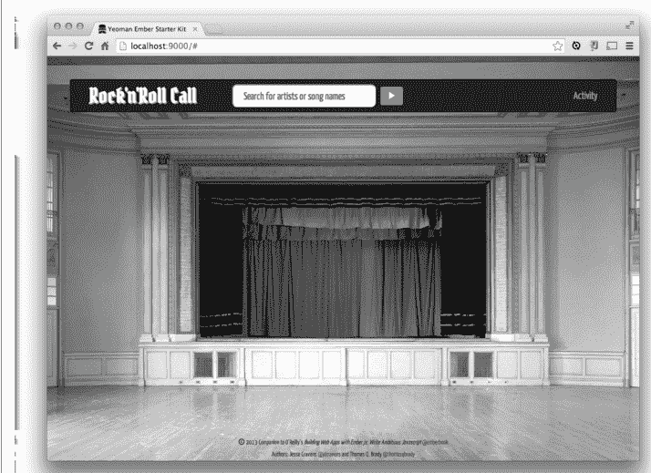

图 4-1. 我们的初步网站，搭配了充足的 CSS

### 我应该使用 `<script>` 标签还是 .hbs 文件？

在第2章中，我们将 Handlebars 模板嵌入在 HTML 页面内，放在类似这样的 `<script>` 标签中：

```html
<script type="text/x-handlebars" data-template-name="application">
  <!-- template code here -->
</script>
```

这是可行的，因为我们使用了完整的 Handlebars 构建版本，它包含了在运行时搜索这些 `<script>` 标签并将其转换为内存中 JavaScript 对象——实际上是工厂（如果你好奇的话，在 *Em.TEMPLATES* 中）的逻辑，随时准备根据你的规范生成标记。

可以想象，从 `<script>` 标签到工厂的转换可能会很耗费资源，尤其是随着你的应用程序及其模板数量的增长。这就是为什么 Handlebars 允许预编译你的模板，并且只包含一个精简的 *handlebars.runtime.js* 文件，它省略了转换逻辑，节省了搜索模板所需的时间和你的应用程序的下载体积。

由于我们在[第2章](Chapter 2)为设置 Yeoman 所做的工作，我们可以使用赛车版的 Handlebars。Yo 会为我们生成 Handlebars 模板，将其放在带有 `.hbs` 扩展名的独立文件中，与视图的生成同步进行；而 Grunt 会监视这些模板，在我们每次保存更改时，将它们编译成 JavaScript 类，并与我们其余的 JavaScript 文件合并。

你只需要告诉 Grunt 你希望它监视你的 Ember 模板，并且需要告诉 Grunt 在哪里可以找到它们，如下所示：

```javascript
grunt.initConfig({
    yeoman: yeomanConfig,
    watch: {
        emberTemplates: {
            files: '<%= yeoman.app %>/templates/**/*.hbs',
            tasks: ['emberTemplates', 'connect:livereload']
        }
    }
})
```

所以，回答你的问题：对于生产环境的工作，尽快使用 `.hbs` 文件；但对于草稿或非常小的任务，`<script>` 标签也是可以的。

### 变量

现在我们有了一个按照我们期望工作并呈现我们期望样子的页面，我们可以开始使用 Handlebars 用程序化元素替换静态元素了。让我们从应用程序的名称开始。假设你想本地化你的应用程序名称，例如，为你的瑞典用户显示 "Rock Upprop"。要实现这一点，我们至少需要做两件事：

1.  我们需要使用 Handlebars 在静态 HTML 内容的位置渲染一个变量。
2.  我们需要在某处定义这个变量。

在实践中，该变量的定义可能会相当复杂。目前，让我们只在 RocknrollcallYeoman 对象上挂载一个变量。说到这个，让我们看看 Yeoman 在我们的 `app/scripts/app.js` 文件中提供了什么 JavaScript：

```javascript
var RocknrollcallYeoman = window.RocknrollcallYeoman = Ember.Application.create();

/* Order and include as you please. */
require('scripts/controllers/*');
require('scripts/store');
require('scripts/models/*');
require('scripts/routes/*');
require('scripts/views/*');
require('scripts/router');
```

让我们在调用 `Ember.Application.create()` 的那一行之后，添加一行，看起来像这样：

```javascript
RocknrollcallYeoman.applicationName = "Rock'n'Roll Call";
```

查看此变更的[此提交](this commit)。

未来，我们可以添加一些巧妙的功能，将此变量设置为我们希望支持的任何语言的本地化版本。目前，这确实意味着如果我们决定更改应用程序名称，只要我们在所有想要显示应用程序名称的地方都使用 Handlebars 助手，我们就只需在一处进行更改即可。

那么，回到我们的模板。现在我们可以简单地将这行代码：

```html
<a href="#" class="navbar-brand">Rock'n'Roll Call</a>
```

改为：

```html
<a href="#" class="navbar-brand">{{RocknrollcallYeoman.applicationName}}</a>
```

查看此变更的[此提交](this commit)。

正如我们之前所看到的，这不仅仅是在页面加载时注入你的变量。如果 `RocknrollcallYeoman.applicationName` 在用户使用你的应用程序时发生了变化——例如，用户从首选项下拉菜单中选择了不同的语言——那么那个锚标签的内容将会自动更新，而无需你编写比我们已编写的更多代码。

### 使用 {{link-to}} 助手进行链接

趁此机会，那个虚拟链接应该很容易就能真正连接起来。我们可能希望点击徽标能带你回到应用程序的默认状态，就像你刚到达一样。我们还没有创建任何路由或控制器，但请记住，这并不意味着 Ember 没有。我们当前在浏览器中看到的页面是……你猜到了吗？它是默认的 IndexRoute，嵌套在默认的 ApplicationRoute 中。从这里，我们的用户将输入一些搜索词并按回车键或点击播放按钮，这将带他进入搜索结果路由。或者他可以点击 Activity 来查看他的搜索活动可视化，这将带他进入 ActivityRoute。所以，如果他想回到我们现在看到的这个页面，他将希望返回到 IndexRoute。嗯，这很简单。将那个锚标签替换为 Handlebars 的 `link-to`，像这样：

静态 HTML：

```html
<a href="#" class="navbar-brand">{{RocknrollcallYeoman.applicationName}}</a>
```

变为 Handlebars 模板：

# 使用 `{{input}}` 辅助方法进行输入

可以想象，这个搜索输入框的内容将变得非常重要。很自然地，我们会想到直接通过 JavaScript 获取该输入框元素——访问其值并拦截其提交事件——但更简单的方式是让 Handlebars 和 Ember 来处理。让我们用 Handlebars 的 input 辅助方法替换我们的 input 标签：

静态 HTML：

```
<input class="search-input" placeholder="Search for artists or song names">
```

变成了 Handlebars 模板：

```
{{input type="text" class="search-input" placeholder="Search for artists or song names"}}
```

查看此变更：[this commit](this commit)。

就目前而言，这个输入框还不会有什么作用。我们将在下一章中探讨如何绑定其值和提交事件。

让我们把注意力转向搜索结果。这是我们之前设计的静态 HTML 模型：

```
<div class="container-fluid">
  <div class="row-fluid">
    <div class="search-results-wrapper clearfix">
      <div class="search-facets col-md-2">
        <h3>Show:</h3>
        <ul class="facets">
          <li>
            <label>Artists</label>
            <input type="checkbox" checked="checked">
          </li>
          <li>
            <label>Songs</label>
            <input type="checkbox" checked="checked">
          </li>
        </ul>
      </div>

      <div class="results col-md-10">
        <h3>Artists</h3>
        <ul class="search-results artists">
          <li><a href="#">Tom Waits</a></li>
          <li><a href="#">Tom Waits w/ Keith Richards</a></li>
          <li><a href="#">Tom Waits/Keith Richards</a></li>
          <li><a href="#">Tom Waits [Vocalist] &amp; Orchestra [Orchestra]
            &amp; Michael Riesman [Conductor] &amp; Bryars, Gavin
            [Composer]</a></li>
          <li><a href="#">Tom Waits [Vocals] &amp; Gavin Bryars Ensemble
            [Ensemble]</a></li>
          <li><a href="#">Tom Waits [Vocalist]; Orchestra [Orchestra];
            Michael Riesman [Conductor]</a></li>
          <li><a href="#">Tom Waits [Vocals] &amp; Gavin Bryars Ensemble
            [Ensemble] &amp; Bryars, Gavin [Composer]</a></li>
          <li><a href="#">Tom Waits [Vocalist], Orchestra [Orchestra] &amp;
            Michael Riesman [Conductor]</a></li>
        </ul>

        <h3>Songs</h3>
        <ul class="search-results songs">
          <li><a href="#">"Tom Waits," by Panic Strikes a Chord</a></li>
          <li><a href="#">"Tom Waits," by Doug Kuony</a></li>
          <li><a href="#">"Tom Waits," by The Moonband</a></li>
          <li><a href="#">"Tom Waits," by The Moonband</a></li>
          <li><a href="#">"Tom Waits," by Spaghetti Western</a></li>
          <li><a href="#">"Tom Waits," by The Passionate &amp; Objective
            Jokerfan</a></li>
          <li><a href="#">"Tom Waits," by Mike Macharyas</a></li>
          <li><a href="#">"Tom Waits," by Junkyard Poets</a></li>
          <li><a href="#">"Tom Waits," by The Fall of Troy</a></li>
          <li><a href="#">"Tom Waits," by Anouk</a></li>
        </ul>
      </div>
    </div>
  </div>
</div>
```

目前，我们将把这些结果添加到 *index.hbs* 中。我们还需要添加一个 `{{outlet}}` 来告诉 Ember 将与当前路由（index）关联的模板渲染到哪里。

**图 4-2** 展示了网站当前的样子。

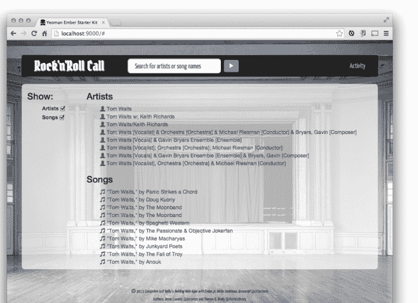

*图 4-2. 渲染后的搜索结果模板*


## **但什么是 `{{outlet}}`、IndexRoute 和 index.hbs？**

我们还没有介绍如何在不同模板之间切换。所以目前，只需知道我们正在将与 IndexRoute 和 *index.hbs* 模板关联的内容渲染到 *application.hbs* 的 `{{outlet}}` 中。稍后，在下一章，我们将介绍如何生成新模板、路由，并将所有部分连接起来！

查看此变更：[this commit](https://github.com/)。

### 使用 `{{each}}` 辅助方法处理列表

首先，你可能认为天然适合模板化的就是那些无序列表。Handlebars 有一个巧妙的小辅助方法专门处理这类事情。让我们先把每个列表简化为只包含一项，然后看看如何使用这个辅助方法为搜索结果中的每个条目复制该模板。以下是艺术家列表的 HTML 版本：

```
<ul class="search-results artists">
    <li><a href="#">Tom Waits</a></li>
</ul>
```

最终，我们希望只保留一个这样的 `ul` 标签，但其中可能包含许多 `li` 标签。Handlebars 有一个 `each` 辅助方法，它会遍历一个数组，并为数组中的每一项渲染一个内部模板。所以，让我们先创建一个虚拟的数组对象以便渲染。将以下行添加到 `app.js` 中，位于我们的 `applicationName` 声明下方：

```
RocknrollcallYeoman.dummySearchResultsArtists = [
    {
        id: 1,
        name: 'Tom Waits',
        nickname: 'Tommy',
        type: 'artist',
        enid: 'ARERLPG1187FB3BB39'
    },
    {
        id: 2,
        name: 'Thomas Alan Waits',
        type: 'artist',
        enid: 'ARERLPG1187FB3BB39'
    },
    {
        id: 3,
        name: 'Tom Waits w/ Keith Richards',
        type: 'artist',
        enid: 'ARMPVNN13CA39CF8FC'
    }
];
```

查看此变更：this commit。

现在我们可以在模板中遍历该数组了。用辅助方法替换那个孤立的 `li` 标签，像这样：

```
<ul class="search-results artists">
    {{#each RocknrollcallYeoman.dummySearchResultsArtists}}
        <li><a href="#">{{name}}</a></li>
    {{/each}}
</ul>
```

查看此变更：[this commit](this commit)。

很神奇，不是吗？这个辅助方法能循环我们的全局变量是一回事。就像 Ember 和 Handlebars 的许多特性一样，真正神奇的部分在于，当你传入的变量（在我们的例子中是全局变量 `dummySearchResultsArtists`）发生变化时，你的列表会自动更新。

注意，上下文（或变量作用域）在 `each` 辅助方法内发生了变化。我们锚标签内的文本节点只需通过 `{{name}}` 引用，而不是 `App.dummySearchResultsArtists[index].name` 之类的。在 `each` 循环内，上下文被设置为数组中找到的当前对象，你可以通过简单地命名属性来访问其命名属性。

假设我们 `dummySearchResultsArtists` 对象中的每个都有一个 `nicknames` 属性，它是一个包含该艺人使用过的昵称的数组。假设我们希望将每个昵称显示为独立的搜索结果，这样“TAFKAP”——“The Artist Formerly Known as Prince”（以前被称为王子的艺人）——就会成为独立的搜索结果。为了减少混淆，我们会包含“别名：[此处填入真实姓名或最初的艺名]”。毕竟，有人可能按昵称搜索，却不知道那只是昵称。

你可能会想，因为你很聪明，我们的上下文切换在这种场景下可能不太方便。让我们来看看为什么。以下是这个理论模板的首次尝试（我们确实会这么做，但 Echo Nest 不提供昵称）：

```
<ul class="search-results artists">
    {{#each RocknrollcallYeoman.dummySearchResultsArtists}}
        {{#each ...
```

哦，对了！我们怎么称呼这个局部对象？嗯，在实践中你不会经常这样做，但事实证明，你可以这样称呼它：

```
<ul class="search-results artists">
    {{#each RocknrollcallYeoman.dummySearchResultsArtists}}
        <li><a href="#">{{this.name}}, AKA "{{this.nickname}}"</a></li>
    {{/each}}
</ul>
```

但是，在这里使用 `this` 似乎不太对，所以幸运的是 Handlebars 为 `each` 辅助方法提供了另一种语法，让你命名迭代变量，像这样：

```
<ul class="search-results artists">
    {{#each artist in RocknrollcallYeoman.dummySearchResultsArtists}}
        <li><a href="#">{{artist.nickname}}, AKA "{{artist.name}}"</a></li>
    {{/each}}
</ul>
```


而且，如果你想移除更多字符并进一步简化，我们甚至不需要使用 `this` 或变量名。按照约定，Handlebars 会假定迭代数组中的当前模型对象就是当前上下文：

```
<ul class="search-results artists">
  {{#each RocknrollcallYeoman.dummySearchResultsArtists}}
    <li><a href="#">{{nickname}}, AKA "{{name}}"</a></li>
  {{/each}}
</ul>
```

但现在我们遇到了一个不同的问题。有昵称的艺术家渲染得很好，但没有昵称的艺术家根本没有渲染。从我们的代码来看，这完全合理。如果你没有一个名为 `nicknames` 的数组，你就会完全跳过那部分代码。我们需要类似 if 语句的东西。而且，此时你可能不会感到惊讶——Handlebars 已经处理好了这个问题。

### 使用 `{{if}}` 和 `{{else}}` 辅助工具进行条件判断

让我们先检查当前艺术家是否有任何昵称，然后选择是遍历它们还是使用更简单的模板。看起来可能像这样：

```
<ul class="search-results artists">
  {{#each RocknrollcallYeoman.dummySearchResultsArtists}}
    {{#if nickname}}
      <li><a href="#">{{nickname}}, AKA "{{name}}"</a></li>
    {{else}}
      <li><a href="#">{{name}}</a></li>
    {{/if}}
  {{/each}}
</ul>
```

图 4-3 展示了网站当前的样子。

在此提交中查看更改。

你可能想知道 `nicknames` 属性需要满足什么条件才会被评估为 false。我们都会预期常见的那些值会符合条件——如果在我们的数据中被赋给该属性的话：`false`、`null`、`undefined`。但如果是一个空数组呢：`[]`？请放心，Handlebars 会将所有这些都评估为 false。

现在我们可以移除昵称逻辑了，因为它纯粹是为了演示目的。一旦我们连接到真正的 Echo Nest API 服务，它实际上不会被支持。

在此提交中查看更改。

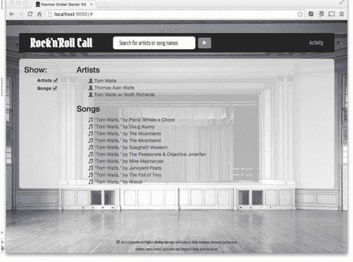

图 4-3. 使用虚拟数据和条件逻辑渲染的搜索结果模板

### 使用 `{{action}}` 辅助工具捕获用户交互

`{{action}}` 辅助工具可用于在用户与应用程序交互时捕获事件。该动作会冒泡到与当前路由关联的控制器。一旦我们完整地介绍了路由，这会更加清晰，但根据你在第 2 章的介绍，你至少应该熟悉基础知识。

最常见的用例是使用动作来捕获锚标签或按钮上的点击事件：

```
<button {{action 'doSomething'}}>CLICK ME!</button>
```

为了处理这个动作，我们需要一个处理动作的地方。所以让我们通过创建 *app/scripts/controllers/index_controller.js* 来创建一个 IndexController：

```
RocknrollcallYeoman.IndexController = Ember.Controller.extend({});
```

在此提交中查看更改。

通过创建这个控制器，我们实际上是在覆盖 Ember 通过主动生成为我们创建的现有 IndexController。你将在下一章中了解更多关于主动生成的内容。

你现在可以在当前控制器上处理这个动作，也就是我们刚刚创建的 IndexController，因为我们在访问根 URL（http://localhost:3000/）。如果这让你困惑，请稍安勿躁；你将在第 5 章中了解更多关于路由的内容：

```
RocknrollcallYeoman.IndexController = Ember.Controller.extend({
  actions: {
    viewedArtist: function(artist) {
      console.log('hang on I"m viewing: ' + artist.name)
    }
  }
});
```

然后我们可以使用锚标签和自定义动作来捕获用户的点击活动，像这样：

```
<li><a {{action 'viewedArtist' this }}>{{name}}</a></li>
```

在[此提交](http://commit)中查看更改。

关于我们如何处理该动作的更多详情，请持续关注。在第 7 章中，我们将详细介绍如何在本地和远程持久化此活动数据。

### 绑定属性

继续沿着我们的愉快路径前进，假设用户在搜索结果中点击了一个艺术家的名字，并被带到一个实体页面。稍后，在下一章中，你将学习如何创建这个新路由（或应用程序状态）并导航到它。现在，让我们先看一下最终模板，然后分析我们看到的内容。将以下内容添加到 *app/templates/artist.hbs*：

```
<div class="entity-artist page-container">
  <div class="artist-bio-lockup clearfix">
    {{#if model.image}}
      {{#if model.license}}
        {{#if model.license.url}}
          <a {{bind-attr href="model.license.url"}}>
            
          </a>
        {{else}}
          
        {{/if}}
      {{else}}
        
      {{/if}}
    {{/if}}
    <h3 class="fancy">{{model.name}}</h3>
    <h4>
```

```
    {{hotttnesss-badge model.hotttnesss}}
    </h4>
    <p class="bio pull-left">Biography (from {{model.biography.site}}):
    {{model.biography.text}}</p>
    <a {{bind-attr href="model.biography.url"}} class="pull-left">Read more</a>
    </div>

    {{#if model.videos.length}}
    <div class="videos">
        <h5>Videos</h5>
        {{#each video in videos}}
                <a {{bind-attr href="video.url"}}></a>
        {{/each}}
    </div>
    {{/if}}
    </div>
```

在[此提交](this commit)中查看更改。

仔细看几遍那段代码。猜猜怎么着？其中只有一个新的 Ember 概念。这个新概念在模板中以 `bind-attr` 属性的形式表达，你会看到它们在花括号内，并且位于 HTML 标签*内部*——也就是你通常声明属性的地方。这是因为它们最终会被渲染为属性。`bind-attr` 指令允许你在运行时从上下文中任何可用的变量动态分配你喜欢的任何 HTML 属性——最常见的是来自你的模型，但也可能是由控制器、视图或路由生成的内容。

语法非常简单。它不是一个标签，所以没有开始和结束标签，因此也不需要井号或闭合斜杠符号。你只需声明：

```
    <[some tag] {{bind-attr }}>
```

然后命名你想填充的属性——在这个例子中，让我们创建一个可用的链接：

```
    <a {{bind-attr href=video.url}}>Watch now on Vimeo</a>
```

回顾我们的模板，你会看到很多填充 `href` 属性、图片 `src` 属性的例子，还有一个 `data-` 属性的例子。你可以绑定到你喜欢的任何属性，包括 `class` 属性。不过，`class` 属性稍微复杂一些，因为你经常会有多多个类名，每个都需要绑定到不同的输入。Handlebars 提供了许多巧妙的技巧来处理动态和静态类名绑定的各种组合，所有这些都在 Ember.js 指南中的 "[绑定元素类名](Binding Element Class Names)" 条目中有详细介绍。

现在让我们看看如何创建自己的辅助工具来重构我们之前用于显示 hotttnesss 徽章的代码。

### 创建自定义辅助工具

到目前为止，我们已经看了 Ember.js 中已经包含的辅助工具，例如 input Handlebars 辅助工具。input 辅助工具实际上是作为 Handlebars 的扩展包含在 Ember.js 库中的。事实上，在撰写本文时，它在 Ember.js 1.4.1+pre.af87bd20 的第 31514 行：

```
Ember.Handlebars.registerHelper('input', function(options) {
  Ember.assert('You can only pass attributes to the `input` helper,
not arguments',
    arguments.length < 2);

  var hash = options.hash,
      types = options.hashTypes,
      inputType = hash.type,
      onEvent = hash.on;

  delete hash.type;
  delete hash.on;

  if (inputType === 'checkbox') {
    return Ember.Handlebars.helpers.view.call(this, Ember.Checkbox, options);
  } else {
    if (inputType) { hash.type = inputType; }
    hash.onEvent = onEvent || 'enter';
    return Ember.Handlebars.helpers.view.call(this, Ember.TextField, options);
  }
});
```

很酷的是，我们可以按照 Handlebars 作为扩展点提供的相同模式来构建自己的自定义 Handlebars 辅助工具。为了演示这一点，让我们构建一个 hotttnesss 徽章，根据我们模型上的 hottttnesss 属性来显示火焰和数字。

如果我们不使用辅助工具来实现这个功能，我们就需要在 *app/templates/index.hbs* 中添加多个图标元素，像这样：

```
<h4>
  Hotness:
  {{#if model.hottttnesss}}
    <i class="hotttnesss">
      <i class="glyphicon glyphicon-fire hotttnesss0"></i>
      <i class="glyphicon glyphicon-fire hotttnesss1"></i>
      <i class="glyphicon glyphicon-fire hotttnesss2"></i>
      <i class="glyphicon glyphicon-fire hotttnesss3"></i>
      <i class="glyphicon glyphicon-fire hotttnesss4"></i>
      <i class="glyphicon glyphicon-fire hotttnesss5"></i>
      <i class="glyphicon glyphicon-fire hotttnesss6"></i>
      <i class="glyphicon glyphicon-fire hotttnesss7"></i>
      <i class="glyphicon glyphicon-fire hotttnesss8"></i>
      <i class="glyphicon glyphicon-fire hotttnesss9"></i>
    </i>
  {{/if}}
```


### 热度徽章实现

```html
</i>
<span class="hottnesss-badge" {{bindAttr data-hottnesss="model.hottnesss"}}></span>
{{/if}}
</h4>
```

我们还需要为每个图标元素创建样式，例如以下针对 `hottnesss0` 的样式：

```css
h4 .hottnesss .hottnesss0 {
  font-size: 190%;
  top: -45%;
  left: -45%;
  position: absolute;
  color: #FF0000;
  direction: rtl;
  unicode-bidi: bidi-override;
}
```

因此，我们不必在标记中包含所有 10 个 *i* 元素，而是可以编写一个辅助函数，根据模型的长度来包含相应的标记。我们通过将 hottness 属性从 0 到 1 之间的值转换为 1 到 10 之间的值来实现这一点，遍历该值，动态创建 HTML，然后输出：

```javascript
Ember.Handlebars.helper('hottnesss-badge', function(value, options) {
  var h = parseFloat(value);
  var hottnesss_num = Math.round(h * 100);
  var hottnesss_css = Math.ceil(h * 10) - 1;
  var html = "<h4>Hotness: ";
  if (hottnesss_num > 0) {
    html += '<i class="hottnesss">';
    for (var i=0;i<hottnesss_css;i++) {
      html += '<i class="glyphicon glyphicon-fire hottnesss'+i+'"></i>';
    }
    html += "</i>";
    html += '<span class="hottnesss-badge">'+hottnesss_num+'</span></h4>';
  } else {
    html += "0</h4>";
  }
  return new Handlebars.SafeString(html);
});
```

最后，我们需要在 *app/scripts/app.js* 中的虚拟数据里添加 hottnesss 属性：

```javascript
RockrollcallYeoman.dummySearchResultsArtists = [
  {
    id: 1,
    name: 'Tom Waits',
    type: 'artist',
    enid: 'ARERLPG1187FB3BB39',
    hottnesss: '1'
  },
  {
    id: 2,
    name: 'Thomas Alan Waits',
    type: 'artist',
    enid: 'ARERLPG1187FB38B39',
    hottnesss: '.89'
  },
  {
    id: 3,
    name: 'Tom Waits w/ Keith Richards',
    type: 'artist',
    enid: 'ARMPVNN13CA39CF8FC',
    hottnesss: '.79'
  }
];
```

现在我们只需在模板中添加辅助函数，并通过模型将数据作为第一个参数传入即可，如下所示：

```handlebars
{{hottnesss-badge model.hottnesss}}
```

查看 [此提交](https://example.com) 中的变更。

**图 4-4** 展示了网站当前的外观。

就是这样。我们不仅只创建了所需的标记，还将模板简化为单个辅助函数声明。

这些详细信息更适合放在详情页或实体视图中，我们可以通过导航来获取特定搜索结果的更多信息。在下一章中，我们将设置这些视图，因此会将 hottnesss-badge 移至歌曲和艺术家的实体页面。敬请期待！

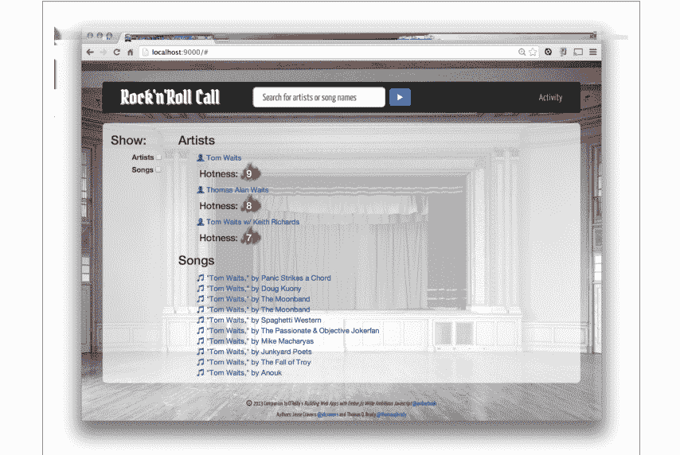

图 4-4. 热度徽章

### 总结

暂停一下，回顾我们目前所做的工作。我们已经编写了网站的大部分标记，而且很多都是以动态渲染、注入模型数据、有条件地渲染模板部分以及遍历模型中的数组的方式编写的。

再想一想我们所做的工作。在很大程度上，一个技术不太熟练的团队成员到目前为止已经可以做出很多贡献了。任何会编辑 HTML 的人都能完成大部分工作，只要你花一点时间教他们变量、绑定属性和条件判断的概念，他们完全有可能在没有你参与的情况下完成本章所涵盖的所有工作。这很强大，不是吗？

讲完了这些，让我们继续探讨当你在安排实习生输入所有标记时，你自己可以专注的事情。*真正的*模型必须被创建，而且它们的数据必须在某个时候通过这些模板进行传递。在[第 5 章](#)中，我们将探索路由器和基本模型，看看如何实现这一点。

# 第 5 章

## 构建 RocknRollCall 原型：路由器、路由和模型

如果我们着手构建一个"单页应用"，到目前为止我们确实做到了。但如果我们要让应用程序真正*做一些事情*，我们将需要表示几种不同的应用状态，也就是过去所说的"页面"。在现代 Web 应用中，这通常仍然意味着浏览器地址栏中值的改变。

几年来，HTML5 的 History API 使得在不重新加载页面的情况下更改 URL 成为可能——或者至少容易得多。而如果没有 Backbone.js 及其同类框架，将 URL 作为序列化应用状态的便捷方式则并不那么容易。序列化应用状态一直是一件棘手的事情。给用户提供一个既能以高分辨率方式表示状态*又*有意义且便于携带的令牌，这在很大程度上是前所未有的。你展示给用户的 URL 就是这样一个令牌。用户可以收藏它、发送到他们的手机/平板/冰箱/朋友那里，甚至可以在推特上发布。想想 Google Chrome，它使用 URL 来授权访问自身的设置面板。如果一个使用 Google Chrome 的家人问你在哪里可以禁用 Cookie，你可以发送设置界面中该面板的链接。试试用原生应用做到同样的事情吧。

Ember 的路由机制提供了一套强大的工具包，用于构建复杂的状态矩阵，其 API 和约定提供了便捷的方式来将这些状态实现为路由。Ember 的控制器 API 和约定同样提供了强大且便捷的方式来表达应用逻辑、与模型交互、在视图和控制器之间来回传递事件，以及经常性地从一个路由导航到另一个路由。

这将是一个大章节。我们将用 URL 来规划网站的功能，实现一个将这些 URL 组织成树状结构的路由器，创建能够在模型中序列化和反序列化状态数据的路由类，并将数据交给控制器。我们将研究路由器、路由和模型，在全部完成之后，我们的应用将能够展示多个状态，即使我们还不能使用应用在这些状态之间进行导航。


**Yehuda Katz 谈 URL**

关于 Ember 的精彩演讲以及深入思考 URL 的重要论证，请观看 Yehuda Katz 在 HTML5DevConf 2013 上的演讲"[使用 Ember.js 构建 Web 应用](http://example.com)"（从大约 13:00 开始）。

### URL 之于网络 :: "游戏存档密码"之于任天堂娱乐系统

如果你的童年没有包含疯狂地手抄"游戏存档密码"、费力辨认电视屏幕上经常渲染得很差的文字的经历，如果"上、上、下、下、左、右……"对你来说毫无意义，那么序列化对你来说可能是一个新概念。*在我们那个年代*，游戏机中没有持久化存储，为了制造保存进度的假象，游戏制作商会生成独特的字母数字"密码"，当游戏引擎解读这些密码时，就能详细描述你当前的游戏状态——从你在哪个关卡到还剩多少条命。你玩了一段时间游戏，获得了一个更新的"密码"，然后自信地关闭游戏机，因为你知道在下次开始游戏时输入那个密码就能接着上次的进度继续玩。

用软件术语来说，这就是*序列化*和*反序列化*。序列化是将数据转换为更适合长期存储或传输的格式的行为，通常是更简洁的格式，占用磁盘空间更少或在网络传输时占用更少带宽。最常见的情况是，就像那些难以抄写的"游戏存档密码"一样，数据的序列化版本不是人类可读的。大多数情况下这并不重要，因为序列化后的数据不会暴露给用户。Web 应用有一个独特的序列化/反序列化机制，不仅将序列化数据暴露给用户，而且提供的序列化数据相当易读。URL 就是这种机制。最初创建 URL 是为了定位整个文档，而现代服务器技术已经将 URL 抽象化，允许任意使用——作为开发者的你，可以选择使用 URL 通过指定传统文件路径来定位文件，或者以任何你认为合适的方式序列化应用的状态数据。当用户通过 URL 访问你的站点——无论是通过点击链接、打开她收藏的书签，还是手动输入——这就像玩家输入她的游戏存档密码一样。URL 中的序列化数据告诉应用如何将其恢复到用户捕获该 URL 时的状态。哪些状态需要持久化以及如何将它们转换为 URL（或对其进行序列化），这取决于你的决定，但 Ember 会让这变得相当简单。


URL 对用户可见的最大好处在于，它促使开发者努力让状态数据的序列化版本变得美观、可读且易于记忆。如果你还记得“存档密码”的年代，那你一定对《银河战士》的密码“JUSTIN BAILEY”印象深刻。这并不是最厉害的《银河战士》密码——那时候我们从杂志和电子公告板系统（BBS）获取密码，在我们的那个年代，但它远比游戏通常生成的随机数字字母组合好记得多。即便是“Narpas Sword”这个更流行的密码，严格来说也是“更好”的密码，能让玩家获得更多进展和更多道具。我认为“Justin Bailey”之所以在人气竞赛中胜出，是因为它更容易记住。它是一个专有名词。你听到它就能打出来。即便你对拼写不太确定，也总能试出几种不同的拼写。这造就了一个*出色的*序列化状态令牌，让我在25——我是说，15——年后依然记忆犹新。

优秀的 Web 应用都包含精心设计的 URL，让常用的应用状态只需一两次按键或书签点击即可到达。如果你使用 Twitter，大概知道可以通过访问 `http://twitter.com/[用户名]` 来查看某个用户的时间线。 less 出色的应用则会隐藏这些东西，要么进行不必要的混淆，比如 Google+ 的 URL 就像我的（图 5-1），要么粗心地构造，比如 LinkedIn 个人资料 URL 中那个容易忘记的 `/in/`，就像我的（图 5-2）。


*图 5-1. 我给它评个 Google–*


*图 5-2. /in/? 更像是容易被 left /out/*

### 路由

一直以来，我们谈论 *router* 这个词时，都好像大家都知道我们用的是一个意思。如果你没在类似的语境中遇到过这个词，或许是在学习或使用另一个 MVC 框架时，那它基本上就是字面的意思。路由是一种将事物引导到正确地方的逻辑机制。

粉丝邮件请发送至 *tqb@thomasqbrady.com*。

好了，不开玩笑了，各位，就像你当地邮局里职位中带有“router”的人一样，我们的路由也将包裹送到正确的地方。请求进来时——邮递员被要求送达一个包裹，我们的路由被要求送达一个路由，其中包括正确的模型（model）、视图（view）、控制器（controller）和模板（template）——交给路由，然后响应——邮递员把包裹丢进正确的箱子，我们的路由找到并返回正确的路由——被发送出去。

在 Ember 中，路由由两部分处理。首先，你需要一张地图。正如邮递员将包裹上的地址与 zip 码所属的街区地图进行比对，我们的路由会将 URL 与我们的模型、视图、控制器和模板包进行匹配。还记得我们在前几段提到的那个可能很复杂的矩阵吗？它不一定总是那么复杂，但它必须映射到你希望应用响应的每一个 URL。如果你有后端开发背景，这与你从 API 开始规划应用并没有太大区别。下一步是恢复应用状态，包括我们已检索到的所有部分，以及可能随附发送的任何编码数据，就像我们的“存档密码”一样。Ember 允许你通过 `Ember.Router` 上一个名为——你猜对了——map 的类方法来定义这张地图。我们马上就会看到。

其次，我们需要地图帮助我们找到的东西，以便将我们的应用重建到期望的状态。那个东西，也就是我们地图将帮助我们找到的东西，就是路由。在我们弄清楚地图之后，再来看看路由如何管理状态，包括序列化/反序列化。


### 在控制台中监控和调试路由

在一切开始之前，有一个很实用的日志功能可以启用，它将帮助我们更好地理解正在发生的事情。它也是调试路由问题的救命稻草。在 *app/scripts/app.js* 第 1 行实例化 Ember 应用时，将以下对象作为参数传入：

```
var RocknrollcallYeoman = window.RocknrollcallYeoman =
Ember.Application.create({
  LOG_TRANSITIONS: true
});
```

参见 [此提交](https://github.com/sudowork/rocknrollcall-yeoman/tree/02b38e7f487e312932179a947b9d0b8257806a57) 中的更改。

现在，每次你在应用中切换路由时，Ember 都会在控制台输出一条有帮助的调试语句（图 5-3）。

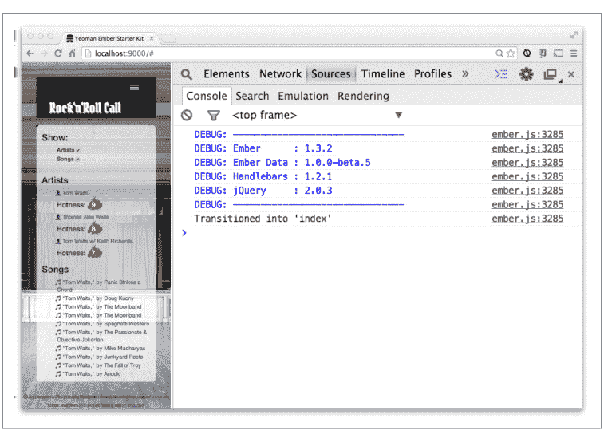

*图 5-3. 记录路由转换日志*

### 路由

让我们来构建一张地图。既然说到这个话题，为什么我们已经走了这么远还没有地图呢？别忘了，使用 Ember 我们能免费获得一些东西。Ember 一直非常礼貌地为我们创建默认的地图和路由。即使在我们定义自己的之后，我们仍然会频繁使用 Ember 的约定，并且不必显式声明所有视图、控制器和模板的名称及路径。Ember 会根据我们命名的路由来假设它可以找到所有这些东西。假设我们遵循约定，就能省下大量敲键盘的功夫。

我们应用的域名——目前是 http://localhost:9000——其实并不重要。Ember 不会在意这部分是否改变。但后面的所有内容都重要。即使没有在那里指定任何东西，你也命中了一个默认路由：IndexRoute。当用户导航到 http://localhost:9000/#/search/tom waits 时，`/search` 和 `/tom waits` 部分将被赋予意义：前者会被翻译成一个路由，后者则会被反序列化为状态数据。

那么，我们现在有什么？我们已经有一个 ApplicationRoute：

```
RocknrollcallYeoman.ApplicationRoute = Ember.Route.extend({
    model: function () {
        return ['red', 'yellow', 'blue'];
    }
});
```

从我们旅程最一开始就生成了这个应用后，就再没用过这段代码，那是在**第 3 章**，所以我们可以直接删掉它。ApplicationRoute 在应用首次初始化时进入，主要是为了渲染应用模板；在一个成熟的应用中，我们并不常会用到它。如果我们没有显式创建它，Ember 会自动为我们生成。

参见 [此提交](https://github.com/sudowork/rocknrollcall-yeoman/tree/02b38e7f487e312932179a947b9d0b8257806a57) 中的更改。

我们还有一个 IndexRoute。在**第 4 章**中，我们简要介绍了 *index.hbs* 模板。在幕后，Ember 为我们生成了一个 IndexRoute。你可能开始发现这是 Ember 的奇妙特性之一，叫做主动生成。

#### 理解主动生成

当 Ember 找不到路由处理器或控制器时，它会主动生成一个。这是 Ember 对新手来说最令人沮丧的方面之一。但一旦你理解并接受它，你就会发现只在需要时才写代码可以节省大量时间。我们可以在 Application.create() 配置对象中开启该功能的日志：

```
var RocknrollcallYeoman = window.RocknrollcallYeoman =
  Ember.Application.create({
    LOG_TRANSITIONS: true,
    LOG_ACTIVE_GENERATION: true
  });
```

参见 [此提交](https://github.com/sudowork/rocknrollcall-yeoman/tree/65920525d4893412e4f442a5853542e3191386c0) 中的更改。

现在在控制台中，我们可以看到 ApplicationController 和 IndexRoute 被主动生成（图 5-4）。

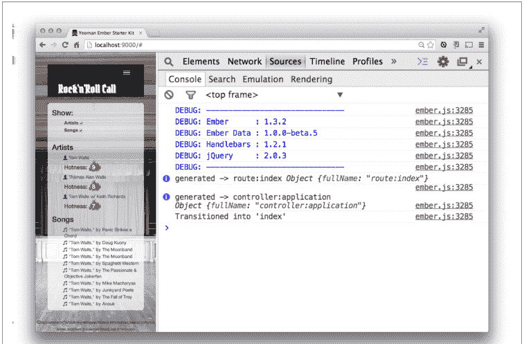

*图 5-4. 记录主动生成日志*

好了，既然我们知道现有的是什么、以及什么正在被为我们创建，那就开始创建我们自己的路由吧。一旦用户输入某些搜索词并按下回车，我们就想显示搜索结果，因此我们需要一个 SearchResultsRoute。从那里，用户将点击艺人姓名或歌曲标题来查看各自的实体页面，所以我们还需要一个 ArtistRoute 和一个 SongRoute。

让我们看一下目前 *app/scripts/app.js* 的状态：

```
var RocknrollcallYeoman = window.RocknrollcallYeoman = Ember.Application.create({
    LOG_TRANSITIONS: true,
    LOG_ACTIVE_GENERATION: true
});

RocknrollcallYeoman.applicationName = "Rock'n'Roll Call";

RocknrollcallYeoman.dummySearchResultsArtists = [
    {
        id: 1,
        type: 'artist'
    },
    {
        id: 2,
        type: 'artist'
    },
    {
        id: 3,
        type: 'artist'
    },
    {
        id: 4,
        type: 'artist'
    },
    {
        id: 5,
        type: 'artist'
    },
];

RocknrollcallYeoman.dummySearchResultsSongs = [
    {
        id: 1,
        type: 'song'
    },
    {
        id: 2,
        type: 'song'
    },
    {
        id: 3,
        type: 'song'
    },
    {
        id: 4,
        type: 'song'
    },
    {
        id: 5,
        type: 'song'
    },
];

RocknrollcallYeoman.applicationController = Ember.Controller.extend({
    searchTerms: ''
});

RocknrollcallYeoman.SearchResultsRoute = Ember.Route.extend({
    model: function(params) {
        return {
            artists: RocknrollcallYeoman.dummySearchResultsArtists,
            songs: RocknrollcallYeoman.dummySearchResultsSongs
        };
    }
});

RocknrollcallYeoman.ArtistRoute = Ember.Route.extend({
    model: function(params) {
        return {
            id: params.artist_id
        };
    }
});

RocknrollcallYeoman.SongRoute = Ember.Route.extend({
    model: function(params) {
        return {
            id: params.song_id
        };
    }
});

RocknrollcallYeoman.Router.map(function() {
    this.resource('search', { path: '/search/:search_id' });
    this.resource('artist', { path: '/artist/:artist_id' });
    this.resource('song', { path: '/song/:song_id' });
});
```


```
{
  id: 2,
  name: 'Thomas Alan Waits',
  type: 'artist',
  enid: 'ARERLPG1187FB3BB39',
  hotttnesss: '.89'
},
{
  id: 3,
  name: 'Tom Waits w/ Keith Richards',
  type: 'artist',
  enid: 'ARMPVNN13CA39CF8FC',
  hotttnesss: '.79'
}
];

/* 随意排序和引入。 */
require('scripts/controllers/*');
require('scripts/store');
require('scripts/models/*');
require('scripts/routes/*');
require('scripts/views/*');
require('scripts/router');

...
```

既然我们在这里，让我们顺便清理一些多余的内容。你可能想回去调整一下我们目前的内容，所以如果需要可以注释掉而不是删除，但让我们把 `dummySearchResultsArtists` 对象去掉吧。我们不再需要这些“辅助轮”了。

在[这个提交](#)中查看变更。

现在，让我们看看 `app/scripts/router.js`。我们将在其中定义前面几段概述的所有路由。`map` 函数接受一个回调函数作为其参数；当该回调被调用时，它会通过变量 `this` 接收到应用 Router 实例的引用。在这个回调中，你将定义应用的所有路由。通常你会看到它是内联定义的。在这个回调内部，你可以调用 Router 实例（通过 `this` 引用）上的 `route` 方法来创建一个路由。以下是目前为止我们讨论过的所有路由，已添加到 `app/scripts/router.js` 中：

```
RocknrollcallYeoman.Router.map(function() {
  this.route('search-results');
  this.route('artist');
  this.route('song');
});
```

在[这个提交](#)中查看变更。

注意我们没有定义应用程序或索引路由，因为，正如我们所说，我们免费获得了这些。如果我们想以某种方式自定义它们，可以在这里定义，但我们没有对它们做任何有趣的事情，至少现在还没有。

还记得在[第4章](#)中，我们将搜索结果的 HTML 放在了 *index.hbs* 里吗？我们之所以这样做，是因为当时没有办法从 IndexRoute 跳转到 SearchResultsRoute。事实上，SearchResultsRoute 甚至还不存在。稍后，我们就能将那段 HTML 移到它应有的模板 *search-results.hbs* 中。

目前，我们已经告诉 Ember，我们希望用户能够导航到 *http://localhost:9000/#/search-results*、*http://localhost:9000/#/artist* 和 *http://localhost:9000/#/song*。我们已经声明希望这些路由对象存在，因此 Ember 会为我们创建默认实例，即使我们没有自己创建。

> **约定优于配置**
> 
> 如果 Ember 中对事物的命名约定对你来说还不太明白，或者你想了解更多关于它们如何以及为什么能工作的信息，可以查阅 [Ember.DefaultResolver](#) 的 API 文档。

随堂测验：如果你现在在浏览器中打开 *http://localhost:9000/#/search-results*，但还没有创建 Handlebars 模板（或路由），会发生什么？我们会得到一个包含应用程序模板的页面，以及一个看似空位的地方，那里本应是搜索结果模板。严格来说，它之所以为空，是因为 Ember 为我们创建的默认搜索结果模板是空的。如果你猜对了，那么你已经理解了路由器的作用，以及我们为什么编写那个 map 回调。

### 动态路由

如果你现在去打开那些 URL，你会发现它们都*存在*。它们都受支持。但它们暂时还非常有用。你可以开始为这些页面设置模板，并完成一些页面结构——至少是标记和 CSS——的搭建，但即使这样做也会很困难，因为我们还没有连接用户的搜索请求。当你访问搜索结果路由时，你可以看到 search-results.hbs 模板，但我们无法用任何数据填充页面，因为我们还不知道用户搜索了谁或什么。我们可能希望在 URL 中反映这一点，类似于 http://localhost:9000/#/search-results/tom waits。现在尝试那个 URL，如果你的控制台是打开的，你会看到一条错误消息。Ember 不知道该去哪。我们还没有定义匹配 /search-results/tom waits 的路由。

“等等，”你可能会说，“我怎么能为用户可能搜索的每一个可能的东西都定义一个路由呢？”你很敏锐。答案是你不能。而且你不应该需要。你也不需要。我们*确实*需要的是一个带有“通配符”的路由，也就是所谓的*动态段*。

这比听起来容易得多。让我们从定义动态段的语法开始。在我们的 `map` 函数中，我们可以指定我们想要的 URL 或者说“路径”是什么样子，包括动态部分，通过传递一个选项对象作为第二个参数，像这样：

```
RocknrollcallYeoman.Router.map(function() {
  this.route('search-results', {
    path: 'search/:term'
  });
  this.route('artist');
  this.route('song');
});
```

`:term` 部分就是我们的动态段。如果你现在访问 URL *http://localhost:9000/#/search/tom waits*，你将不再收到该路由不存在的错误消息。在大约几段之后，我们将看到 Ember 已经提取了 URL 中与这个动态段匹配的部分，并使其在你的路由中可用。

我们顺便还塞进了另一个功能。你注意到了吗？我们指定了路径 */search/:term*。这意味着我们的 URL 将显示为 *http://localhost:9000/#/search/tom waits*，而不是 *http://localhost:9000/#/search-results/tom waits*。“Search-results” 作为类名比作为 URL 更好。感谢 map 函数，我们可以为 URL 中显示的内容和我们路由的名称定义不同的字符串。

在[这个提交](#)中查看变更。

说到路由，让我们看看它们是如何工作的。

### 路由

那么，如果我们使用了 `map` 函数来声明路由，并且 Ember 现在使用这些名称来查找我们的视图、控制器和模板，那还剩下什么？路由还需要做什么？

URL 和视图能够如此紧密地耦合——例如，它们共享一个名称——这在直觉上是合理的。沿着这个思路，为什么你的模板不能和你的视图同名呢？而且，顺便说一句，你的控制器呢？它们都是一个团队的组成部分，负责将应用程序逻辑、状态和用户界面连接起来。这个列表中唯一缺少的是模型。不过，你的模型与路由的直接关联不大。你的模型可能比特定的路由更持久；你的模型可能被多个路由使用。

既然如此，一定有某种方法可以将所需的模型与特定的控制器或视图匹配起来，对吧？事实上，确实有，它被称为路由！

到目前为止，我们主要是通过利用挂在全球 App 对象上的变量将数据放入模板，并在此过程中承诺我们会解决这个问题。当我们最初加载 Ember 起始套件时，早在第 2 章，我们就瞥见了正确的解决方案。在那个示例应用程序中，我们利用了 `IndexRoute` 中定义的 `model` 方法来定义一个模型。无论我们从该方法返回什么，都*成为*了模型，然后我们可以从中提取属性来填充模板。

`model` 方法是使用 Ember 路由的最重要原因之一。`model` 方法的一个关键特性是它可用于将你的 URL 反序列化为模型/状态数据。就在几段之前，我们在介绍动态段时中断了，只是介绍了它们，但还没有真正涵盖它们的用途。这就是它们的用途。我们定义了路由 `search-results`，路径为 `search/:term`，现在如果我们访问应用程序中的 URL `http://localhost:9000/#/search/tom waits`，我们的 `SearchResultsRoute` 的 `model` 方法将接收到一个参数。该参数的值将是……我们的动态段！它将是 "tom waits"。这可能还不会让你立刻兴奋起来，但相信我，它非常方便。毫无疑问，你可以想象一些方法，可以利用这个参数来生成一些有用的数据，比如填充搜索结果页面所需的数据。

我们的 `search-results` 路由将有一个稍微复杂一点的方面，我们暂时不想纠缠于此，所以我们先把它放在一边，跳到应用程序的前面。当用户在我们的最终应用程序中到达这个 `search-results` 路由时，假设她找到了她想要的东西，她会点击一个艺术家的名字或歌曲标题，这些将由一个 `linkTo` 助手渲染。该链接将随后将她转到 `artist` 或 `song` 路由。我们将遇到与 `search-results` 相同的问题：我们将需要一个动态段来支持仅用两个路由就能对应无数的艺术家和歌曲。

好了，回到 map！让我们为这些路由添加一些动态性：

```
RocknrollcallYeoman.Router.map(function() {
  this.route('search-results', {
    path: 'search/:term'
  });
  this.route('artist', {
    path: 'artist/:enid'
  });
  this.route('song', {
    path: 'song/:enid'
  });
});
```
```


### 模型

在涉及持久化存储之前，你实际上还不会直接使用 Ember 的 `Model` 类，这自有其道理。模型作为一种概念，主要服务于持久化目的（这里所说的持久化，是指将数据存储在某种数据库中以便长期保存和检索）。在我们的应用中，存在一些临时数据——我们不打算存储到数据库的数据——但这些数据仍然适合用模型来管理。首先，我们*正在*处理的是结构化数据，而模型擅长定义这类结构。其次，从技术角度讲，我们放入这些模型中的数据*确实*被持久化了，只不过是在别人的服务器上（The Echo Nest）。

有一个更底层的 `Object` 类，实际上非常适合用来实现类似原型模型的功能，它提供了计算属性、数据绑定以及便捷的类扩展方法。对于我们来说，这已经足够。让我们定义我们的“模型”：

```
RocknrollcallYeoman.Artist = Em.Object.extend({
  id: null,
  name: null,
  enid: null,
  biography: null,
  hotttnesss: null,
  image: null,
  videos: null
});
```

注意，我们扩展了 Ember 的 Object 类，并且定义了 Artist 类*可能*拥有的所有属性。我们将所有这些属性的默认值都设为 null，但也可以为其中任意或全部属性设置默认字符串、布尔值、数字等。

要实例化一个 Artist，只需创建一个 Artist 对象，像这样，传入一个包含你希望定义的 Artist 属性的对象：

```
var artist = RocknrollcallYeoman.Artist.create({
  enid: 'ARERLPG1187FB3BB39',
  name: 'Tom Waits',
  hotttnesss: 100,
  biography: 'Rain dog.',
  image: 'http://is.gd/GeaUhC'
});
```

有了我们的原型模型，让我们用伪代码草拟一下如何在 *ArtistRoute* 的 model 方法中实例化一个模型：

```
RocknrollcallYeoman.ArtistRoute = Ember.Route.extend({
  model: function(params) {
    /* 伪代码
    XHR("some URL",{"id":params.enid},function callback(response){
      var artist = App.Artist.create({
        name: response.name,
        hotttnesss: response.hotttnesss,
      });
    });
    */
  }
});
```

如果你仔细看，这段伪代码至少有两个问题，而且编译失败还不算在内。

首先，我们没有从 model 方法中返回任何东西。我们的路由将无物可传给控制器，导致模板无数据可用。

其次，我们到底*要*怎么返回东西？这里存在一个回调问题。我们不能在 XHR 回调中返回 artist 对象，因为那样返回的对象作用域不对。在正确的作用域内，我们如何确保在返回对象之前已经从 XHR 获得了数据？

### Promises, Promises

最近，你朝一个 JavaScript 开发者的博客扔块石头，都能砸中两篇关于 Promise 的文章。Promise 是 ES6（ECMAScript 6，截至本文撰写时是最新版本的 JavaScript，新到还无法在所有现代浏览器中完全支持）的一个新特性，它为我们的“一切何时就绪？”难题提供了解决方案。关于这个问题以及 Promise 提供的解决方案的深入解释，我推荐 HTML5 Rocks 上的文章：“JavaScript Promises: There and Back Again”。在不久以前的“旧日”，你可能会通过在外层作用域设置一个变量来存储模型，一旦填充数据，设置一个 XHR，其成功回调将填充该变量，然后调用另一个回调，并确信模型变量现在已填充完毕，我们可以继续前进，从而解决这个鸡生蛋蛋生鸡的问题。

可以想象，编写那样的东西比读起来更累人。更糟糕的是，它仍然无法解决我们的作用域问题——即在 model 方法中立即返回某个东西，而这个东西最终才会真正包含一个模型。

Promise 提供了一种更好的，或者至少是更便捷的方式，看起来像这样：

```
Promise.all([functionOnWhichWeDepend(), anotherFunctionOnWhichWeDepend(),
    yetAnotherFunctionOnWhichWeDepend()]).then(function() {
    console.log("They're all finished, success is ours!")
}, function() {
    console.error("One or more FAILED!")
});
```

这个 all 方法接受一个方法数组，然后返回一个 Promise 对象。这个 Promise 对象有一个 then 方法，它接受两个回调函数：一个在传入的所有方法都成功返回时调用，另一个在任何方法失败时调用。看看这段描述有多短，更别提实际代码了！

既然我们理解了 Promise 的概念，让我们看看两个具体的实现：Ember 核心团队的 RSVP 和 jQuery 中的一个简单示例。

### RSVP

Ember 内置了流行的 RSVP.js 库（由 Ember 核心贡献者团队创建和维护），它对 Promise 规范提供了出色的实现，甚至在尚未支持 Promise 的浏览器中也能工作（这类浏览器比你预期的要多）。更重要的是，Ember 将 Promise 功能混合到了许多核心对象中。例如，我们的 model 方法可以返回一个 Promise 对象，如果返回了，路由器会在 Promise 解析时得到通知。如果你的模型有默认值，这些值会被推送到模板并渲染到屏幕上，然后路由器会等待你的 model 方法返回的 Promise 完成。如果它成功完成，新的模型数据将被推送过来，你的模板将使用新数据更新。

### 其他 Promise 实现

目前关于 Promise 的唯一问题是，由于规范非常新，存在几种不同的“风格”，它们的 API 略有不同。情况并没有听起来那么糟，但要知道在 Ember 项目中，你经常会遇到不止一种风格：前面提到的 RSVP，以及 jQuery 中的版本。例如，所有的 jQuery AJAX 调用（如 getJSON）都返回 Promise 对象，我们将在下一个示例中看到。别担心：这些 API 应该是，而且在大多数情况下确实是，如此相似，以至于你可以几乎互换使用它们。

### model() 方法

既然我们有了计划，让我们来试试那个 model 方法。jQuery 的 getJSON 将返回一个 Promise 对象，所以我们用这个方法从 Echo Nest 请求数据，返回那个 Promise 对象，它自身会返回一个新创建的 Artist 模型。我是这样做的：

```
RocknrollcallYeoman.ArtistRoute = Ember.Route.extend({
  model: function(params) {

    var url = "http://developer.echonest.com/api/v4/artist/profile?api_key=YOUR-API-KEY&format=json&bucket=biographies&bucket=blogs&bucket=familiarity&bucket=hotttnesss&bucket=images&bucket=news&bucket=reviews&bucket=terms&bucket=urls&bucket=video&bucket=id:musicbrainz",
        obj = {"id": params.enid};

    return Ember.$.getJSON(url, obj)
      .then(function(data) {
        var entry = data.response.artist;
        var bio = null;
        var img = null;
        for (i = 0;i<entry.biographies.length;i++) {
          if (entry.biographies[i].site.toLowerCase() == "wikipedia") {
            bio = entry.biographies[i];
          }
        }
        if (!bio && entry.biographies.length > 0)  {
          bio = entry.biographies[0];
        }
        if (entry.images.length) {
          img = entry.images[0];
        }
```


```
    }
    var lastVideo = 4;
    if (entry.video.length < 4) {
      lastVideo = entry.video.length;
    }
    }
    var videos = [];
    for (i=0;i<lastVideo;i++) {
      videos.push(entry.video[i]);
    }

    return RocknrollcallYeoman.Artist.create({
      enid: entry.id,
      name: entry.name,
      hotttnesss: entry.hotttnesss,
      biography: bio,
      image: img,
      videos: videos
    });
  });
},
});
```

分析这段代码，我们执行了以下操作：

1. 定义了一个接收 `params` 参数的 `model` 方法。
2. 定义了一个 `url` 变量，它是一个 Echo Nest API 请求，其中设置了许多标志位，以精确获取我们想要返回的数据类型。你需要自己的 API 密钥，请参阅相关的旁注。
3. 定义了一个对象 `obj`，用于持有请求体，并包含我们想要获取更多数据的实体的 Echo Nest ID。
4. 然后我们立即返回 jQuery 的 getJSON（`Ember.$` 是 jQuery 的快捷方式）返回的 Promise 对象。请记住，getJSON *立即* 返回 Promise 对象，随后，当 Promise 被打破（rejected）或履行（fulfilled）时，该 Promise 对象上的 `then` 将被调用。
5. 链式调用一个 `then` 方法，在 `getJSON` 方法返回的 Promise 履行时，该方法将被调用，并通过参数（`'data'`）接收 XHR 的响应体。
6. 然后我们对该响应数据进行几项处理：
   a. 筛选传记，提取我们找到的第一个 Wikipedia 传记，如果没找到 Wikipedia 传记，则直接使用找到的第一个传记。
   b. 如果有图像 URL，则将其抓取。
   c. 如果有视频 URL，则最多抓取四个用于嵌入。
7. 最后，我们创建一个并返回 `Artist` 模型，并用我们刚刚从 Echo Nest API 响应体中提取的所有材料填充它。

请查看[此提交](#)中的更改。


### 获取你自己的 Echo Nest API 密钥！

你需要一个自己的 Echo Nest API 密钥，但不用担心 —— 获取过程快速且简单。只需在浏览器中访问 https://developer.echonest.com/account/register，填写表单并按照指示操作即可。激活账户后，你将进入全新的个人资料页面，其中包含你的 API 密钥、消费者密钥（consumer key）和共享密钥（shared secret），以及允许你修改个人资料信息的表单。目前你只需要那里列出的 API 密钥。

### 总结

到目前为止，这是我们编写的最令人畏惧的代码，但它分解开来其实很简单，不是吗？虽然代码量依然很少，但我们已经拥有了相当强大的功能。我们有一个路由器，可以让我们轻松地响应具有动态片段和自定义路径名称的多个 URL；四个自定义路由；一个 `Artist` 模型和一个 `ArtistRoute`（它可以响应包含 Echo Nest ID 的 URL，并能通过 XHR 将该 ID 转换为一个完整的 `Artist` 模型）。在此过程中，我们学习了 Promise，以及它们如何牢牢把握住路由与控制器之间那个潜在的“易泄漏”连接。伙计们！我们离完成应用程序已经非常近了！再过一章，我们就将拥有一个可以运行的音乐搜索引擎！

# 第 6 章

## 构建 RocknRollCall 原型：控制器、视图、数据绑定和事件

我们搞定了模板。我们搞定了路由器和路由。我们搞定了模型。还剩下什么？

嗯，我们需要一个地方来跟踪瞬时状态数据：那些你现在绝对需要知道，但可能不需要写入数据库的内容。这种状态是你希望在离开站点并重新返回时重置的。我们还需要一个处理更复杂渲染逻辑的地方。我们需要一种方法来协调这个高级渲染器和我们的瞬时状态数据管理器。

对于瞬时状态数据，我们需要控制器（Controllers）。对于扩展渲染控制，我们需要视图（Views）。我们需要事件（Events）来连接控制器和视图，最后，我们需要数据绑定（Data Binding）来保持所有这些组件之间的数据同步。

当这一切都就绪后，我们就拥有了一个可运行的原型。让我们开始吧！

### 控制器

是的，在一本关于 MVC 框架的书里，你已经读到了**第 6 章**，而我们还没有*真正*讨论过视图或控制器（或者真正意义上的模型）。别担心，你的钱花得值。

在 Ember 中，控制器有四个最重要的任务（以及其他任务）：

- 操作应用程序模型中的数据
- 存储瞬时数据，无论是独立数据还是从模型中检索的数据
- 监听由其他控制器、视图和模板发送的事件，并向它们发送事件
- 触发从一个路由到另一个路由的跳转

如你所见，这些至关重要。没有控制器，你的应用程序将毫无意义。

回顾一下应用程序的开发，我们之前从未实现从 `IndexRoute` 跳转到 `SearchResultsRoute`。在应用程序顶部的搜索框中输入 "Tom Waits" 并按下回车键，目前还没有任何反应。让我们修复这个问题。在你的 `app.js` 中添加这个简单的 `ApplicationController`：

```
RocknrollcallYeoman.ApplicationController = Em.ObjectController.extend({
  searchTerms: '',
  applicationName: "Rock'n'Roll Call",
  actions: {
    submit: function() {
      this.transitionToRoute('search-results',this.get('searchTerms'));
    }
  }
});
```

从最新代码块的第二行开始，我们创建了一个名为 `searchTerms` 的控制器本地瞬时变量，一个用于存储应用程序名称的真实位置（你可以直接删除那个将同名变量挂在 `App` 全局变量上的行），随后是一个 `actions` 对象，将在接下来的几段中讨论。

另外，我们还留有一个来自第 4 章简单动作演示的 `IndexController`，所以让我们删除 `app/scripts/controllers/index_controller.js`，因为我们不再需要它。

请查看[此提交](this commit)中的更改。

我们现在可以在模板中插入对 `searchTerms` 的引用，就像我们在前几章中对模型数据所做的那样。这是我们 `application.hbs` 模板中搜索部分的现状：

```
<ul class="nav navbar-nav search-lockup">
  <li class="search-group">
    {{input type="text" class="search-input" placeholder="Search for artists or
song names"}}
    <button class="btn btn-primary"><i class="glyphicon glyphicon-play"></i>
    </button>
  </li>
</ul>
```

我们已经看过几个将模型变量放入文本节点（典型 HTML 元素的开闭标签之间）的示例。但在这种情况下，我们希望将变量绑定到输入辅助程序（input helper）的 `value` 属性上。`input` 允许通过辅助程序上的 `valueBinding` 属性进行绑定，如下所示：

```
<li class="search-group">
  {{input class="search-input" placeholder="Search for artists or song names"
  valueBinding="controller.searchTerms"}}
  <button class="btn btn-primary"><i class="glyphicon glyphicon-play"></i>
  </button>
</li>
```

注意我们声明了 `controller.searchTerms`。如果我们没有指定控制器作为来源，Ember 会假设它应该在模型（model）中寻找 `searchTerms` 变量，事实上，如果模型中也有一个同名变量，其值将被注入到模板中。

如果你现在重新加载应用程序，你可能不会感到太惊艳。虽然我们将输入的数值与我们的 `searchTerms` 值绑定了，但我们还没有对该值做任何处理。我们在控制器中定义了一个 `actions` 块。让我们看看如何在模板中引用一个动作（action）。它看起来像这样：

```
<li class="search-group">
  {{input action="submit" type="text" class="search-input" placeholder="Search for artists or song names" valueBinding="controller.searchTerms"}}
  <button {{action "submit"}} class="btn btn-primary">
    <i class="glyphicon glyphicon-play"></i>
  </button>
</li>
```

如果你没注意到的话，我们在那里添加了两个动作引用。通常来说，`action` 辅助程序会为添加它的元素添加一个 "click" 事件监听器。你可以说给元素添加动作使其“可点击”。对于我们的 Play 按钮，这正是我们想要的。用户应该能够输入搜索词并点击 Play 按钮进行搜索。但在 `Ember.TextField` 的情况下，Ember 知道你可能不想通过点击输入标签来触发事件，而是希望触发 HTML 表单的 `submit` 事件。在大多数浏览器中，如果你在表单元素中输入并按下回车键，就会发生这种情况。这就是 Ember 在输入辅助程序内绑定动作引用的事件。

我们在控制器中定义的 `actions` 对象定义了由模板触发的事件处理器。在模板中，我们定义了一个名为 "submit" 的动作，因此当这些元素被触发（通过点击或按键）时，Ember 会触发一个 submit 事件。随后，我们的控制器会在其 `actions` 块中寻找名称匹配的处理器并执行该处理器。


保存我们刚刚做的更改并重新加载页面。输入一个搜索词并点击播放按钮。它成功了（希望如此！）！你刚刚从一个视图导航到了另一个视图！

在[这次提交](#)中查看更改。

跟着代码看，找到线索并不难。在你的`application.hbs`模板中，你给按钮标签添加了一个action属性。当模板被渲染时，Ember因此给按钮添加了一个`click`处理程序，该程序触发时，会在你的控制器的`actions`对象中查找名为`submit`的处理程序并执行它。在我们这个例子中，该处理程序使用了`Ember.Controller`类的`transitionToRoute`方法，该方法告诉（或请求）路由器导航到一个新的路由——即作为第一个参数传递给`transitionToRoute`方法的那个路由。

请特别注意我们作为第二个参数传递的内容：用户输入的搜索词。这应该不足为奇，但它*应该*让你开始思考我们传递的内容是如何转换成动态段的。你注意到了，对吧？无论在搜索框中输入什么，当你点击播放按钮后，它都会被附加到新`/search`路径的URL后面。花点时间根据你目前所读的内容，思考这可能是如何发生的。

你猜到了吗？这就是序列化。你传递给`transitionToRoute`的参数通常是一个你希望传递给路由的模型，尽管它也可以是，并且在这个例子中就是一个字符串。你有机会在你的路由中定义一个`serialize`方法，该方法接受这里传入的内容，并将其转换成一个路径字符串并返回。所以，换句话说，`serialize`方法接收数据输入并输出一个URL——它*序列化*数据。有时候，就像在我们这个例子中，你一开始传递的数据本身就已经是一个字符串了，正是你想要用作路径的那个字符串——无需转换。

不过，我们还没有编写`serialize`方法。那么，我们的应用程序是如何序列化那个参数的呢？

哦，对了：“因为这种模式太常见了，所以它是默认的。”如果我们没有定义自己的`serialize`方法，默认实现会直接传递参数，如果它恰好已经是一个字符串的话。

趁你还在打开这个模板，现在是换掉这行的好时机：

```
{{#link-to "index" class="navbar-brand"}}{{RocknrollcallYeoman.applicationName}}{{/link-to}}
```

换成这个：

```
{{#link-to "index" class="navbar-brand"}}{{applicationName}}{{/link-to}}
```

这只是用我们`ApplicationController`中对应用程序名称的引用替换了我们的全局变量反模式。

在**这次提交**和**这次提交**中查看更改。

### 计算属性

计算属性是Ember最大的卖点之一。在大多数培训材料中，它们是首先介绍的概念之一。我们之所以一直保留到现在，是希望增加的背景知识能让大家更容易理解它们有多么有用。

我们将应用程序命名为“Rock'n'Roll Call”，这是对点名概念的一种戏仿，即某人站在房间前面，从名单上一个接一个地念出名字，而无论是什么会议的出席者，当他们的名字被叫到时都会回应：“到！”。所以，为了片刻的愉悦，让我们网站的名字来演绎一下这个熟悉的互动。当你第一次访问该网站时，让我们应用程序的名字自豪地显示出来。当你搜索某些内容时，比如“Tom Waits”，让我们把文本改为“Tom Waits???”

我们可以用计算属性来做到这一切。让我们先做一个简单的。将`App.ApplicationController`中的`applicationName`变量替换为这个：

```
applicationName: function() {
  var st = this.get('searchTerms');
  if (st) {
    return st + "???"
  } else {
    return "Rock'n'Roll Call"
  }
}.property('searchTerms'),
```

让我们从这个代码块的最后一行开始：我们对`applicationName`返回结果调用的`property`函数。该`property`函数接受一个或多个属性的名称，你的计算属性（在本例中是`applicationName`）应依赖于这些属性。我们在这里指定了`applicationName`依赖于属性`searchTerms`，这是我们控制器的一个属性。你可以指定其他对象（其他控制器、模型等）的属性。因为指定了这个依赖关系，Ember现在会监视我们的`searchTerms`属性的变化。每当它发生变化时，我们定义为`applicationName`的函数就会被触发，返回一个新的`applicationName`变量的值。在这个例子中，如果`searchTerms`属性有一个真值，我们返回它加上几个问号，就像“Tom Waits???”。如果它有一个假值，我们返回我们应用程序的名称。计算属性可以存在于任何扩展自`Ember.Object`的对象上，包括控制器、模型等。你可以在源文档中阅读关于计算属性的所有内容：[Emberjs.com的Ember.ComputedProperty类API文档](https://www.emberjs.com/api/ember/release/classes/Ember.ComputedProperty)。

保存你的更改并观察发生了什么。当你在输入框中键入内容时，应用程序名称会实时更新！Ember的数据绑定正在发挥作用。

在[这次提交](this commit)中查看更改。

### 何时使用.get()和.set()

如果你看过足够多的Ember教程，你肯定会看到有人用简单的引用来引用甚至赋值Ember对象（模型、控制器等）的属性。例如，如果我们试图在我们的applicationName计算属性中这样做，它可能看起来像这样：

```
applicationName: function() {
  var st = this.searchTerms;
  if (st) {
    return st + "???"
  } else {
    return "Rock'n'Roll Call"
  }
}.property('searchTerms'),
```

通常，使用Ember对象的.get()和.set()方法是一个好主意。这些方法不仅仅是简单地读取和赋值给属性；它们是Ember.Observable mixin的一部分，因此，当你设置值时它们会触发属性更改事件，当你读取属性时它们会监听属性更改事件。使用.get()可以确保你获得属性的最新值，即使它刚刚被更改过。使用.set()可以确保任何其他正在观察你即将更改的属性的Ember对象在属性更改时得到通知。

### Promise的力量和model方法

我们有一个RocknrollcallYeoman.Artist模型。我们也需要一个RocknrollcallYeoman.Song。它在这里：

```
RocknrollcallYeoman.Song = Em.Object.extend({
  id: null,
  enid: null,
  title: null,
  artist_name: null,
  artist_id: null,
  audio_md5: null,
  audio_summary: null,
  hotttnesss: null,
  track: null,
  types: null
});
```

在[这次提交](this commit)中查看更改。

我们的search-results路由目前没有太多模型可以传递给我们可能需要构建的SearchResultsController。我们需要解决这个问题。

> ## 这有点重要

这里有一个重要的教训需要吸取：如果感觉你写了很多代码——太多代码——才能用Ember完成某件事，那你可能做错了。

在这个例子中，我们利用了setupController（一个我们还没讨论过的方法）来完成接下来的部分，该方法是你路由中的一个方法，接收一个完全准备好的控制器和从你的路由model方法返回的模型。听起来是一个编写依赖于这两部分内容的代码的非常方便的地方，对吧？诀窍是，一般来说，你可能不需要也不应该依赖于填充好的模型和完全准备好的控制器。你应该编写松散耦合的代码，依赖于Ember的数据绑定和事件。毕竟，模型数据可以变化得非常快。你的控制器也可以事后用新的属性和方法进行扩展（参见Ember.Object.reopenClass）。

我们这个原型的初稿在这部分有点像意大利面条式的代码。接下来的这一步有点棘手。我们想获取用户输入的搜索词表达式，用这些词对Echo Nest的数据库进行*两次*搜索（一次假设用户在寻找艺术家，一次假设用户在寻找一首歌），然后我们需要处理这些搜索的结果，以创建和填充一些模型，然后将它们返回给我们的控制器。

我们最初认为最好的方法是利用SearchResultsRoute的setupController方法。setupController是你路由中的一个方法，在你的控制器被实例化以及你的*model*方法返回内容给控制器*之后*被调用，并且你会收到对每个对象的引用作为setupController的参数。从一个控制器对象获取对其他控制器的访问是相当容易的。我们第一次运行时最明显的解决方案是在SearchResultsController中创建两个方法，每个方法都知道如何查询The Echo Nest的API以创建各自的模型：Artist和Song。

这导致了一些令人困惑的代码。我们的SearchResultsRoute触发了它的setupController方法，该方法然后调用了SearchResultsController的这两个方法，这些方法对The Echo Nest进行了查询，然后，根据结果，创建模型并更新了SearchResultsController上的一个属性。这里有很多来回的引用，这还表明我们甚至没有使用*model*方法。


于是我们进行了重构。以下是更合理的 SearchResultsRoute 版本，其中使用了 RSVP：

```javascript
RocknrollcallYeoman.SearchResultsRoute = Ember.Route.extend({
    model: function (query) {
        return Promise.all([
            $.getJSON("http://developer.echonest.com/api/v4/artist/search?api_key=<YOUR-API-KEY>&format=json&results=10&bucket=images&bucket=hotttnesss&bucket=biographies&bucket=id:musicbrainz", { name: query.term }),
            $.getJSON("http://developer.echonest.com/api/v4/song/search?api_key=<YOUR-API-KEY>&format=json&results=10&bucket=id:7digital-US&bucket=audio_summary&bucket=song_hotttnesss&bucket=tracks&bucket=song_type", { title: query.term })
        ]).then(function(jsonArray){
            var artistResults = jsonArray[0].response.artists,
                songResults = jsonArray[1].response.songs,
                artists = [],
                songs = [],
                i = 0, entry = null;

            for (i = 0; i < artistResults.length; i++) {
                var entry = artistResults[i];
                artists.push(RocknrollcallYeoman.Artist.create({
                    id: i + 1,
                    type: 'artist',
                    name: entry.name,
                    hotttnesss: entry.hotttnesss,
                    enid: entry.id
                }));
            }

            entry = null;

            for (i = 0; i < songResults.length; i++) {
                entry = songResults[i];
                songs.push(RocknrollcallYeoman.Song.create({
                    id: i + 1,
                    title: entry.title,
                    enid: entry.id,
                    type: 'song',
                    artist_id: (entry.artist_id) ? entry.artist_id : null,
                    artist_name: entry.artist_name,
                    hotttnesss: entry.song_hotttnesss,
                    audio_summary: entry.audio_summary
                }));
            }
            return {artists: artists, songs: songs}
        });

    }
});
```

让我们快速浏览一下这个 `model` 方法，它返回一个 Promise.all 对象，该对象只有在所有传入的函数都成功解决后才会解决并调用其 then 方法。我们传入了两个函数，每个函数都使用 jQuery 的 `getJSON` 来查询 The Echo Nest（一次查询歌曲结果，一次查询艺术家结果）。我们的 then 方法接收一个 JSON 响应对象数组，对应于这两个查询（歌曲和艺术家），每个响应都是一个对象数组——即搜索结果。我们遍历每个数组，构建我们自己的 Song 和 Artist 模型数组。然后我们返回一个包含这两个数组的对象。

因此，我们的 `model` 方法将返回一个 Promise，该 Promise 在成功时，会返回一个包含歌曲模型和艺术家模型的对象，这些模型对应于用户在按回车键或点击播放按钮之前输入的搜索词的相应搜索结果。

这看起来可能仍然有些复杂。但请相信我们，这比之前的版本要漂亮得多。


你可能注意到了 XMLHttpRequest 中指向 Echo Nest 服务器的 `<YOUR-API-KEY>`：

`$.getJSON("http://developer.echonest.com/api/v4/artist/search?api_key=<YOUR-API-KEY>...`

你需要将此替换为你自己的 Echo Nest API 密钥。为此，请在浏览器中访问 [https://developer.echonest.com/account/register](https://developer.echonest.com/account/register)，填写表格并按照说明操作。激活账户后，在个人资料页面找到你的 API 密钥。

查看[此提交](this commit)中的更改。

现在我们有了一个 SearchResultsRoute，就可以将 HTML 从 `app/templates/index.hbs` 模板移动到一个新模板中。首先创建一个新文件 `app/templates/search-results.hbs`，并使用以下内容进行更新：

```html
<div class="search-results-wrapper clearfix">
  <div class="search-facets col-md-2">
    <h3>Show:</h3>
    <ul class="facets">
      <li>
        <label>Artists</label>
        {{view Ember.Checkbox checkedBinding="artistsIsChecked"}}
      </li>
      <li>
        <label>Songs</label>
        {{view Ember.Checkbox checkedBinding="songsIsChecked"}}
      </li>
    </ul>
  </div>
  <div class="results col-md-10">
    {{#if artistsIsChecked}}
      {{#if artists.length}}
        <h3>Artists</h3>
        <ul class="search-results artists">
          {{#each artists}}
            <li>{{#link-to 'artist' enid}}{{name}} {{/link-to}}</li>
          {{/each}}
        </ul>
      {{/if}}
    {{/if}}

    {{#if songsIsChecked}}
      {{#if songs.length}}
        <h3>Songs</h3>
        <ul class="search-results songs">
          {{#each songs}}
            <li>{{#link-to 'song' enid}}"{{title}}," by {{artist_name}} {{/link-to}}</li>
          {{/each}}
        </ul>
      {{/if}}
    {{/if}}
  </div>
</div>
```

回顾这些更改，我们用 Ember.Checkbox 助手替换了 input 标签，这将渲染 input 标签，其 checked 值将绑定到我们传递给 checkedBinding 的任何值（如果你不认得我们传递的内容，请不用担心）。我们添加了几个 #if 块，它们根据传递给这些 Ember.Checkbox 助手的内容的当前值以及搜索结果数组是否实际包含内容来有条件地显示页面的整个部分。如果用户取消选中“songs”或者歌曲的搜索结果数组为空，我们就不渲染该部分。

最后，我们在搜索结果的 li 中添加了一个 link-to，链接到路由 artist 和 song，并将 enid 传递给每个路由。

查看此提交中的更改。

所以，我们将复选框绑定到了名为 artistsIsChecked 和 songsIsChecked 的变量，但我们还没有在任何地方定义它们。亲爱的读者，这些正是属于控制器的瞬态数据的绝佳示例——让我们创建一个 SearchResultsController：

```javascript
RocknrollcallYeoman.SearchResultsController = Ember.ObjectController.extend({
  artistsIsChecked: true,
  songsIsChecked: true
});
```

希望这个没有让你感到困惑。

查看[此提交](this commit)中的更改。

我们现在只需要一个 SongRoute 来匹配我们的 ArtistRoute，以及每个路由的模板。以下是我们的 SongRoute：

```javascript
RocknrollcallYeoman.SongRoute = Ember.Route.extend({
  model: function(params) {

    //通过ID查找歌曲
    var url = "http://developer.echonest.com/api/v4/song/profile?api_key=<YOUR-API-KEY>&format=json&bucket=audio_summary&bucket=song_hotttnesss&bucket=tracks&bucket=song_type&bucket=id:7digital-US",
      obj = {"id": params.enid}

    return Ember.$.getJSON(url, obj)
      //返回Promise对象
      .then(function(data) {
        var entry = data.response.songs[0];
        var track = null;
        if (entry.tracks.length) track = entry.tracks[0];

        return RocknrollcallYeoman.Song.create({
          enid: entry.id,
          title: entry.title,
          hotttnesss: entry.song_hotttnesss,
          track: track,
          types: entry.song_type,
          audio_summary: entry.audio_summary,
          artist_id: entry.artist_id,
          artist_name: entry.artist_name
        });
      });
  }
});
```

查看[此提交](this commit)中的更改。

现在，这是我们在第4章添加回来的 artist.hbs：

```html
<div class="entity-artist page-container">
  <div class="artist-bio-lockup clearfix">
    {{#if model.image}}
      {{#if model.license}}
        {{#if model.license.url}}
          <a {{bind-attr href="model.license.url"}}>
            
          </a>
        {{else}}
          
        {{/if}}
      {{else}}
        
      {{/if}}
    {{/if}}
    <h3 class="fancy">{{model.name}}</h3>
    <h4>
      {{hottnessses-badge model.hottnesss}}
    </h4>
    <p class="bio pull-left">Biography (from {{model.biography.site}}):
      {{model.biography.text}}
    </p>
    <a {{bind-attr href="model.biography.url"}} class="pull-left">Read more</a>
  </div>

  {{#if model.videos.length}}
    <div class="videos">
      <h5>Videos</h5>
      {{#each video in videos}}
        <a {{bind-attr href="video.url"}}></a>
      {{/each}}
    </div>
  {{/if}}
</div>
```

这是我们的新 song.hbs：

```html
<div class="entity-song-page-container">
  <div class="song-lockup clearfix">
    {{#if model.track}}
      {{#if model.track.release_image}}
        
      {{/if}}
    {{/if}}
    <h3 class="fancy">{{model.title}}</h3>

    <h4>
      Artist: {{#link-to "artist" artist_id}}{{artist_name}}{{/link-to}}
    </h4>
    <h4>
      Tags:
      {{#each types}}
        <span class="badge">{{.}}</span>
      {{/each}}
    </h4>
    <h4>
      Duration: <span id="song-duration" {{bind-attr data-duration="model.audio_summary.duration"}}></span>
    </h4>
    <h4>
      Tempo: {{model.audio_summary.tempo}} <abbr>BPM</abbr>
    </h4>
  </div>
</div>
```

希望现在你能轻松阅读这些内容了。


保存你的更改，然后动手试试。你已经拥有一个 Web 应用程序了！

查看此 [提交](#) 中的变更。

“但等等，”你说，“我们甚至还没有讨论过视图！”

### 视图

你说得完全对。很有趣，不是吗？我们已经写了六章，还构建了一个可运行的 Web 应用程序，却还没有讨论过 Ember 的视图。不过，回想一下我们用计算属性和数据绑定所取得的成果，你就会明白其中的原因。在其他应用技术栈中，你的视图代码有多少是用来根据数据变化来更新视图的？至少对我来说，几乎全部都是。再看看我们刚刚构建的复选框交互。我们构建了一个简单但实用的、类似分面搜索的交互组件，没有编写任何视图代码，也没有声明任何事件，仅使用了数据绑定和模板中的 `#if` 流程控制。

但有一件事我们还想做，而我们的模板无法轻松实现。Echo Nest 返回的歌曲时长是以秒为单位的。这对数学计算来说很棒，但人类通常不这么阅读时长。我们的 `song.hbs` 模板目前将歌曲时长放入一个数据属性中，因为其值对人类不友好。我们无法轻易地用模板逻辑将秒转换为 "hh:mm:ss"，但我们可以使用一些视图代码。

是的，从技术上讲，这也很适合使用计算属性。你的 Song 模型可以有一个计算属性，完成我们即将做的完全相同的事情。不过，如果你用视图代码来实现，你可以（我们不会）做一些有趣的事情，比如通过旋转时钟指针到对应的时间标记来可视化时长，以翻页时钟风格动画化数字等等。

首先，在 `app/scripts/views/song_view.js` 中创建一个 `SongView`：

```javascript
RocknrollcallYeoman.SongView = Em.View.extend({});
```

查看此 [提交](#) 中的变更。

现在，让我们添加一个 `didInsertElement` 方法。`didInsertElement` 对于 Ember 视图来说，就像 `$().ready()` 对于 jQuery 的 `document` 一样。它是一个处理程序，在视图渲染并注入页面后被调用，此时可以安全地操作 DOM：

```javascript
RocknrollcallYeoman.SongView = Em.View.extend({
  didInsertElement: function() {
    $('#song-duration').text(function(){
      var $this = $(this);
      var origSeconds = $this.attr('data-duration');
      var minutes = Math.floor(origSeconds/60);
      var seconds = Math.floor(origSeconds % 60);
      return minutes + ":" + seconds
    });
  }
});
```

查看此提交中的变更。视图也可以响应浏览器事件，例如 "click"，像这样：

```javascript
RocknrollcallYeoman.SongView = Em.View.extend({
    click: function(jQueryEvent) {
        console.log(jQueryEvent.target);
    }
});
```

你也可以用不同的语法和不同的上下文处理方法来指定要响应的事件，像这样：

```javascript
RocknrollcallYeoman.SongView = Em.View.extend({
    eventManager: Ember.Object.create({
        click: function(jQueryEvent, view) {
            console.log(view);
        }
    })
});
```

使用这种语法，你会得到两个参数：jQuery 事件和一个视图。别忘了你可以将视图嵌套在另一个视图中。在我们第一个直接声明在视图上的点击处理程序中，处理程序内部的上下文将始终是视图（在本例中是 `SongView`）。在我们的第二个版本中，如果存在一个嵌套视图（渲染到 outlet 或类似辅助器中），并且它是点击事件的目标，那么该嵌套视图将作为第二个参数传递给我们的处理程序，使我们能够访问两个上下文。

当你开始研究辅助器、组件等时，视图会变得非常有趣，我们将在第 9 章中讨论。

### 总结

你有点感动了吗？我也是！我们刚刚构建了你的第一个 Ember 应用程序！我们构建了自己的路由器、路由、模板、模型、控制器和视图，我们学习了如何通过数据绑定和事件来保持它们的同步和协同工作。我们甚至学习了如何构建一个相当复杂的模型，该模型包含了从第三方数据库进行多次查询获取的数据！最重要的是，我们知道了汤姆·韦茨的生日是 12 月 7 日！

想想看，你在如此少的代码中、如此短的时间内学会了做多少事情。这就是“开发者体验”在起作用。

在接下来的章节中，我们将为我们的原型投入生产做准备。

# 第 7 章：数据持久化

到目前为止，从 [第 4 章](/chapter4) 到 [第 6 章](/chapter6)，我们构建了一个相对简单的 Ember 原型应用。我们使用了 Ember 的大部分核心功能：路由器、路由、控制器、Handlebars 模板和视图。

在本章中，我们准备好开始为我们的 Ember 应用投入生产做准备。为此，我们将探索 Ember Data、模型类、远程持久化和 RESTful Web 服务、可复用组件和测试。实现目标的方法有很多，但我们首选的方法涉及 Ember App Kit。

因此，现在你应该按照提交历史和配套代码使用 [一个新仓库](/repo)。

在这个仓库中，你会注意到 [第 4 章](/chapter4) 到 [第 6 章](/chapter6) 介绍的功能将包含在一个提交中。

## 不自己编写 Ajax

鉴于 [第 4 章](/chapter4) 开头概述的高层功能，该应用程序将用户的交互保存为活动，构建搜索词的历史记录。我们将从构建客户端模型并持久化数据到本地存储开始。稍后，我们将迁移到一个将相同数据持久化到远程、RESTful 数据存储的解决方案。

为了理解我们将用客户端持久化库解决的问题，我们需要首先看看为什么我们想要放弃自己编写 Ajax 调用。

毕竟，可以只用 jQuery 从服务器加载 JSON 数据，然后将这些 JSON 对象用作 *模型*，手动执行序列化和反序列化。

这里有一个基本例子，展示如何向远程服务器请求数据、从 Ember 对象实例化它，并将其存储在客户端内存中。我们实际上在我们的应用程序中使用 EchoNest API 的数据时就是这样做的。让我们看看我们的歌曲搜索数据。

首先，我们将创建一个基本的 Ember 对象：

```javascript
RocknrollcallYeoman.Song = Em.Object.extend({
  id: null,
  enid: null,
  title: null,
  artist_name: null,
  artist_id: null,
  audio_md5: null,
  audio_summary: null,
  hotttnesss: null,
  track: null,
  types: null
});
```

现在，我们有了 `Em.Object`，我们可以实例化它并通过 getter 和 setter 访问其属性：

```javascript
var song = RocknrollcallYeoman.Song.create();
song.set('artist_name', 'Willie Nelson');
console.log(song.get('artist_name')); // Willie Nelson
```

现在，我们可以手动请求数据对象并将它们推送到结果数组中：

```javascript
var c = $.getJSON(
  "http://developer.echonest.com/api/v4/song/search?api_key=<YOUR-API-KEY>" +
  "&format=json&results=10&bucket=id:7digital-US&bucket=audio_summary" +
  "&bucket=hotttnesss&bucket=tracks&bucket=song_type", {
    title: term
  });

var results = Em.A();

c.success(function(data) {
  var entries = data.response.songs;
  for (var i = 0; i < entries.length; i++) {
    var entry = entries[i];
    results.push(RocknrollcallYeoman.Song.create({
      id: i + 1,
      title: entry.title,
      enid: entry.id,
      type: 'song',
      artist_id: (entry.artist_id) ? entry.artist_id : null,
      artist_name: entry.artist_name,
      hotttnesss: entry.song_hotttnesss,
      audio_summary: entry.audio_summary
    }));
  }
});

return results;
```

此时，我们知道可以从模型实例化新对象，对对象实例执行 get 和 set，并通过网络请求新数据。

但是，此时我们可能希望将网络调用抽象到 `findAll()` 方法中，这样我们就不会一遍又一遍地重复相同的代码。为了做到这一点，我们需要首先使用 `reopenClass` 在 `RocknrollcallYeoman.Song` 类上定义一个类级别的方法。现在我们只需调用 `RocknrollcallYeoman.Song.findAll()` 就能获取结果：

```javascript
RocknrollcallYeoman.Song.reopenClass({
    findAll: function(term) {
        var c = $.getJSON("http://developer.echonest.com/api/v4/song/search?api_key=<YOUR-API-KEY>&format=json&results=10&bucket=id:7digital-US&bucket=audio_summary&bucket=song_hotttnesss&bucket=tracks&bucket=song_type", {
            title: term
        });

        var results = Em.A();

        c.success(function(data) {
            var entries = data.response.songs;
            for (var i = 0; i < entries.length; i++) {
                var entry = entries[i];
                results.push(RocknrollcallYeoman.Song.create({
                    id: i + 1,
                    title: entry.title,
                    enid: entry.id,
                    type: 'song',
                    artist_id: (entry.artist_id) ? entry.artist_id : null,
                    artist_name: entry.artist_name,
                    hotttnesss: entry.song_hotttnesss,
                    audio_summary: entry.audio_summary
                }));
            }
        });

        return results;
    }
});
```

然后我们可以做类似的事情来查找单条记录：

```javascript
RocknrollcallYeoman.Song.reopenClass({
    find: function(songId) {
        var result = Ember.Object.create({});
        $.getJSON('/<echonestUrl>' + songId, function(data) {
            // ...
        });
    }
});
```


```
result.setProperties(data);
});
return result;
}
});
```

那么，如果我们想要处理错误怎么办？幸运的是，jQuery 的 `getJSON()` 返回了 Promise，这帮助我们消除了管理成功和错误回调对象的需要。但是，正如你稍后将看到的，我们同样可以从 Ember Data 等库中获得 Promise 的便利性。

那么，在你的模型之间建立关系呢？或者处理像 WebSocket 这样的其他传输协议？

这里的意图是帮助你理解，当你尝试自行实现持久化解决方案时，有很多需要考虑的事情，并且需要在所有模型中编写大量的样板代码。

## 必须有更好的方法

在本章稍后部分，我们将使用 Ember Data 来执行类似的一组任务。你将开始看到，通过使用一个能够管理查找模型、进行更改、处理错误以及使用多种协议与远程持久层进行网络通信的库，我们的代码得到了极大的简化。

## Ember 客户端持久化库

在撰写本文时，越来越多的 Ember 持久化解决方案正在涌现。让我们来看看可用的解决方案。

### Ember Data

官方的社区解决方案。目前，Ember Data 作为与 Ember.js 分离的独立库发布。一旦它成熟，计划将其纳入核心。配套源代码中提供的所有示例都使用了 Ember Data。

### Ember Model

[Ember Model](Ember Model) 是 Eric Bryn 开发的轻量级持久化解决方案，它在 `$.ajax` 之上添加了 Ember 原语。但是，它并不强制你使用 `$.ajax`。它提供了一个模型类，包含一些基本的关系方法、适配器，以及通过使用 Promise 提供的便捷 API。

### Ember Restless

RESTless 是另一个轻量级持久化解决方案，它遵循与 Ember Data 类似的 API，使得熟悉 Ember Data 的人能够轻松理解。它被认为功能足够完善，能够满足具有基本 CRUD 需求的应用程序，并支持 WebSocket 等其他协议。

### Ember Persistence Foundation

另一个令人印象深刻的解决方案是 EPF。它以稳定和可用于生产环境而闻名。它的 API 与其他解决方案有显著不同，遵循会话（session）的概念来与框架交互。它完全支持关系和 Promise。

尽管这些解决方案值得进一步探索，但由于本书的范围有限，我们的演示应用 RocknRollCall 将聚焦于官方解决方案 Ember Data。

## Ember Data 深入探讨

正如你很可能已经了解到的，Ember Data 是一个客户端 ORM 库，它为你的 Ember 应用程序提供四项主要功能：

-   从持久层加载数据
-   将数据映射到一组客户端模型（通过缓存来解决网络延迟性能问题）
-   更新模型
-   将数据保存并同步到持久层

Ember Data 的架构非常模块化，旨在适应各种协议和数据格式。这意味着它可以与标准的 RESTful JSON 后端以及像 WebSocket 这样的流式 API 配合使用。对于实时应用程序，你可以打开一个持久化套接字，在远程发生更改时将更改推送到 Ember Data store。而且，正如你稍后将看到的，配置一个适配器通过 HTML5 本地存储将数据存储在本地也很容易。

这是通过抽象层实现的：模型、适配器、序列化器和 store。接下来会详细介绍这些内容。

### 为 Activity 状态设置路由器和 Activity 视图

首先，我们需要在路由器中添加一个名为 activity 的新路由：

```
RocknrollcallYeoman.Router.map(function() {
  this.route('activity', {
    path: 'activity'
  });
});
this.resource('search-results', {
  path: 'search/:term'
});
this.resource('artist', {
  path: 'artist/:enid'
});
this.resource('song', {
  path: 'song/:sid'
});
});
```

查看[此提交](https://github.com/magicmarble/rock-n-roll-call-yeoman/commit/206e185471e863769e017213485192479342498c)中的变更。

现在，向 `app/templates/` 目录添加一个名为 `activity.hbs` 的模板，并添加以下 `each` 辅助函数来遍历模型：

```
<h4>Total Activity Records: {{model.length}}</h4>

<ul>
  {{#each model}}
    <li class="activity">{{this.id}}</li>
  {{/each}}
</ul>
```

查看[此提交](https://github.com/magicmarble/rock-n-roll-call-yeoman/commit/206e185471e863769e017213485192479342498c)中的变更。

现在，你可能已经注意到这个 Handlebars 模板无法工作。你是对的！我们需要给它一个路由处理器和一个模型。

### 模型

正如你在第 2 章以及第 5 章末尾所学到的，每个 Ember 路由都有一个关联的模型。在大多数情况下，model 钩子或方法用于建立特定模型和路由之间的连接。还有其他方式，例如传递 `{{link-to}}` 的参数，或者调用路由的 `transitionTo()` 方法。在我们的示例中，我们将首先使用最常见的场景：导航到 activity 路由并从 Ember Data 中获取记录。

```
RocknrollcallYeoman.ActivityRoute = Ember.Route.extend({
  model: function () {
    return this.store.find('activity')
  }
});
```

查看[此提交](https://github.com/magicmarble/rock-n-roll-call-yeoman/commit/206e185471e863769e017213485192479342498c)中的变更。

现在我们有了路由处理器，需要在 `app/scripts/templates/application.hbs` 中添加一个 `link-to` 辅助函数来指向我们新的 `ActivityRoute` 和 `activity` 模板：

```
<li>{{#link-to 'activity'}}Activity{{/link-to}}</li>
```

查看[此提交](https://github.com/magicmarble/rock-n-roll-call-yeoman/commit/206e185471e863769e017213485192479342498c)中的变更。此时，当我们点击链接时，应该会在浏览器控制台中看到一个错误：

> Error while loading route: Error: No model was found for 'activity'

这是因为我们还需要构建模型。所以让我们创建一个名为 `activity.js` 的新文件，并将其添加到 `app/scripts/models` 目录中。

现在，我们可以在模型上添加必要的属性：

```
RocknrollcallYeoman.Activity = DS.Model.extend({
  display_id: DS.attr('string'),
  type: DS.attr('string'),
  display_name: DS.attr('string'),
  hotttnesss: DS.attr('number'),
  timestamp: DS.attr()
});
```

查看[此提交](https://github.com/magicmarble/rock-n-roll-call-yeoman/commit/0795a00128938668901650199677203873536977)中的变更。

但是等一下。现在我们应该会看到错误：

> Assertion failed: Unable to find fixtures for model type RocknrollcallYeoman.Activity

幸运的是，Ember 为我们提供了一种简单的方式来使用 JavaScript 对象构建测试数据（fixtures），并将它们附加到一个内置属性 FIXTURES 上。我们将在本章稍后更详细地介绍 Ember 适配器，特别是 `Ember.FixtureAdapter`。

所以，让我们将这些内容添加到 `app/scripts/models/activity.js` 中：

```
RocknrollcallYeoman.Activity = DS.Model.extend({
  display_id: DS.attr('string'),
  type: DS.attr('string'),
  display_name: DS.attr('string'),
  hotttnesss: DS.attr('number'),
  timestamp: DS.attr()
});

RocknrollcallYeoman.Activity.FIXTURES = [{
  id: 0,
  display_id: "Activity1",
  type: "song",
  display_name: "On the Road Again",
  hotttnesss: 54,
  timestamp: "Fri Dec 06 2013 01:05:53 GMT-0600 (CST)"
}, {
  id: 1,
  display_id: "Activity2",
  type: "artist",
  display_name: "Willie Nelson",
  hotttnesss: 99,
  timestamp: "Fri Dec 06 2013 01:05:53 GMT-0600 (CST)"
}];
```

查看[此提交](https://github.com/magicmarble/rock-n-roll-call-yeoman/commit/0795a00128938668901650199677203873536977)中的变更。


如果你有兴趣查看这些步骤的测试驱动方法，模型和测试的创建在第 10 章中有详细介绍。

在本章稍后部分，我们将探讨一个在应用程序启动时为 Ember Data 填充种子数据的解决方案。这有助于开发，通过在应用程序中提供内容，开发者就不必硬编码任何动态内容。

但现在，让我们来看看应用程序如何根据用户交互来创建数据。

#### 基于用户交互持久化记录

我们需要一种方式来管理用户交互和应用程序状态的变更。操作（Actions）在第 4 章中已经详细介绍，因此除了展示具体实现以及如何使用 Ember Data 创建和存储记录的示例之外，我们不再在此做进一步详述。

如第 4 章所述，我们需要在 *search-results.hbs* 模板中声明我们的操作 `viewedArtist` 和 `viewedSong`：

```
{{#if artistsIsChecked}}
  {{#if artists.length}}
    <h3>Artists</h3>
    <ul class="search-results artists">
      {{#each artists}}
        <li><a {{action 'viewedArtist' this }}>{{name}}</a></li>
      {{/each}}
    </ul>
  {{/if}}
{{/if}}

{{#if songsIsChecked}}
  {{#if songs.length}}
    <h3>Songs</h3>
    <ul class="search-results songs">
      {{#each songs}}
        <li><a {{action 'viewedSong' this }}">"{{title}}," by {{artist_name}}</a></li>
      {{/each}}
    </ul>
  {{/if}}
{{/if}}
```


查看此提交中的变更。

但是，我们尚未在`SearchResultsController`中定义相关操作，因此如果尝试点击并导航到详情视图，将会遇到以下错误：

> Uncaught Error: Nothing handled the action 'viewedArtist'. If you did handle the action, this error can be caused by returning true from an action handler in a controller, causing the action to bubble.

因此，在`SearchResultsController`中，我们可以定义操作来捕获可点击交互，创建新的活动记录，保存此记录，然后通过传递对象的ID将用户转换到特定的`ArtistRoute`或`SongRoute`。

首先，定义一个操作：

```
actions: {
    viewedSong: function(model) {
        ...
    }
},
```

然后，创建一个新的活动记录：

```
actions: {
    viewedSong: function(model) {

        var date = Date.now();

        var activity = this.store.createRecord('activity', {
            display_id: model.enid,
            type: model.type,
            display_name: model.artist_name,
            hotttnesss: model.hotttnesss,
            timestamp: date
        });
    }
},
```

接着，保存活动记录：

```
actions: {
    viewedSong: function(model) {

        var date = Date.now();

        var activity = this.store.createRecord('activity', {
            display_id: model.enid,
            type: model.type,
            display_name: model.artist_name,
            hotttnesss: model.hotttnesss,
            timestamp: date
        });

        activity.save();

    }
}
```

查看[this commit](this commit)中的变更。

最后，将用户转换到新的应用状态：

```
actions: {
    viewedSong: function(model) {

        ...

        this.transitionToRoute('song', model.enid);
    }
},
```

以下是我们在`SearchResultsController`中定义的完整操作：

```
actions: {

    viewedArtist: function(model) {

        var date = Date.now();

        var activity = this.store.createRecord('activity', {
            display_id: model.enid,
            type: model.type,
            display_name: model.name,
            hotttnesss: model.hotttnesss,
            timestamp: date
        });

        activity.save();

        this.transitionToRoute('artist', model.enid);
    },

    viewedSong: function(model) {

        var date = Date.now();

        var activity = this.store.createRecord('activity', {
            display_id: model.enid,
            type: model.type,
            display_name: model.artist_name,
            hotttnesss: model.hotttnesss,
            timestamp: date
        });

        activity.save();

        this.transitionToRoute('song', model.enid);
    }
},
```

查看此提交中的变更。

虽然我们目前在RocknRollCall应用中没有展示相关示例，但Ember Data也提供了`deleteRecord()`方法：

```
var activity = store.find('activity', 1);

activity.deleteRecord();

activity.save()
```

调用`save`时，Ember Data会按照标准约定自动构建XHR请求，并向URL `/activities/1`发送HTTP DELETE请求。以下是通过约定实现`model.save()`和XHR端点的对应关系：

| 命令 | 方法 | URL |
|---|---|---|
| 查找 | GET | /activities/1 |
| 查找所有 | GET | /activities |
| 更新 | PUT | /activities/1 |
| 创建 | POST | /activities |
| 删除 | DELETE | /activities/1 |

我们将在第8章构建远程持久化解决方案时再次讨论此内容。

最后，我们也可以调用`destroyRecord()`方法，它能方便地将`deleteRecord()`和`save()`组合在一次调用中：

```
var activity = store.find('activity', 2);

activity.destroyRecord();
```

### 抽象层：Store、Serializer和Adapter

如果您仔细观察，可能已经注意到我们引入了另一个新对象而没有提供解释。没错，这个对象就是Ember Data store。

正如我之前提到的，Ember Data提供了多层抽象；其中一层抽象就是store。

### Ember Data Store

Ember Data store是应用程序中所有记录的本地缓存。在应用程序初始化期间会创建store实例（`DS.Store`），并且可以被应用程序中的其他对象（如控制器和路由）访问。您可以通过多种方法与store进行交互，例如之前使用的`find()`方法：

```
var activity = store.find('activity', 1);
```

我们发现Ember Data store还提供了其他一些非常有用的方法，如`filter()`、`all()`和`getById()`。

#### .filter()

`filter()`返回一个与store绑定的实时RecordArray，会随store的更新而更新：

```
store.filter('activity', function(activity){
  return activity.get('type', 'song');
});
```

#### .all()

`all()`是一个过滤器，返回给定类型的所有记录。当您不希望应用程序向远程持久化存储发起网络请求时，可以使用它作为`find()`的替代方案：

```
store.all('activity');
```

#### .getById()

与`all()`类似，`getById()`适用于不希望应用程序向远程持久化存储发起网络请求的场景：

```
store.getById('activity', 1);
```

有关DS.Store的完整API参考，请查看[Ember的类信息页面](Ember's class information page)。

### Serializer

Ember Data的另一层抽象是serializer，它负责处理记录从外部数据源（如我们的演示应用RockNRollCall中与之通信的远程EchoNest JSON API）推入和拉出时的序列化和反序列化。serializer以三种不同方式处理数据：

- 转换属性值
- 规范化属性名称
- 序列化模型的关系

为所有模型类型设置serializer就像在`ApplicationSerializer`超类上声明一样简单：

```
RocknrollcallYeoman.ApplicationSerializer = DS.RESTSerializer.extend({
  // ...
});
```

有关如何配置Serializer以满足您需求的更多信息，请参阅Ember Data的[TRANSITION.md](TRANSITION.md)文件中的详细说明。

#### 按类型设置Serializer

请注意，您也可以按模型类型单独指定serializer。这样我可以将serializer的作用域限制到特定模型，而不会影响其他模型，如下所示：

```
RocknrollcallYeoman.Activity = DS.Model.extend({
  // ...
});

RocknrollcallYeoman.ActivitySerializer = DS.RESTSerializer.extend({
  // ...
});
```

### Adapter

Ember Data的store可以配置使用不同的adapter。核心提供了FixtureAdapter和RESTAdapter。社区还编写了其他adapter，例如[Ryan Florence](https://github.com/ryanflorence)开发的LocalStorageAdapter。在我们的RockNRollCall应用中，我们将探索这两种adapter。在[第8章](chapter-8.html)中，我们将学习如何设置后端以与RESTAdapter配合工作。

#### FixtureAdapter

在早期开发和原型制作阶段，不必搭建服务器和API端点会很有益。FixtureAdapter提供了将夹具数据直接附加到模型类的能力，这本质上是将数据作为JavaScript对象存储在浏览器的内存中。FixtureAdapter默认由Yeoman应用生成器安装，这正是我们在本章前面使用的方式。一旦您构建了RESTful Web服务后端，就可以切换到RESTAdapter而无需更新应用程序逻辑。

#### LocalStorageAdapter

LocalStorageAdapter是Ryan Florence编写的一个adapter，它与HTML5 `localStorage`对象交互。HTML5 `localStorage`允许开发者在用户的浏览器中本地存储数据。

首先，我们需要使用Bower安装新的依赖项。需要将`ember-localstorage-adapter`添加到*bower.json*：

```
{
  "name": "rocknrollcall-yeoman",
  "version": "0.0.0",
  "dependencies": {
```


然后，运行安装命令：

```
$ bower install
```

我们还需要确保新安装的脚本被加载到页面中（它应该在 Ember 和 Ember Data 之后加载）：

```
<script src="bower_components/jquery/jquery.js"></script>
<script src="bower_components/handlebars/handlebars.runtime.js"></script>
<script src="@@ember"></script>
<script src="@@ember_data"></script>
<script src="bower_components/ember-localstorage-adapter/localstorage_adapter.js"></script>
```

在此[此提交](https://github.com/ember-cli/ember-cli/commit/b202d89863f6862c18d70e744c23c318f53302f5)中查看变更。

现在，只需完成最后一项配置，我们就可以将数据存储到浏览器的 LocalStorage 中了。打开 `app/scripts/store.js` 文件，将 FixtureAdapter 替换为 LocalStorageAdapter：

```
RocknrollcallYeoman.ApplicationAdapter = DS.LSAdapter.extend({
    namespace: 'rocknrollcall'
});
```

在此[此提交](https://github.com/ember-cli/ember-cli/commit/b202d89863f6862c18d70e744c23c318f53302f5)中查看变更。

在这里，我们只有一个模型 Activity；但按照约定，如果我们使用 ApplicationAdapter，所有模型都会通过该适配器进行处理。

我们确实有能力创建多个适配器并将其限定到特定模型。为了演示这一点，让我们将适配器限定为仅处理 activity 数据模型：

```
RocknrollcallYeoman.ActivityAdapter = DS.LSAdapter.extend({
    namespace: 'rocknrollcall'
});
```

在此[此提交](https://github.com/ember-cli/ember-cli/commit/b202d89863f6862c18d70e744c23c318f53302f5)中查看变更。

### 使用应用程序初始化器预置数据库

应用程序初始化器是 Ember 核心提供的一个钩子点，允许你在应用程序初始化过程中注册代码块。你只需要在 name 属性中提供一个唯一的名称，并在 initialize 方法中实现你的代码即可。在 `app/scripts/app.js` 中，添加

```
Ember.Application.initializer({
  name: "myInitializer",

  initialize: function(container, application) {
    console.log('do something')
  }
});
```

```
var RocknrollcallYeoman = Ember.Application.create({});
```

使用应用程序初始化器的一些常见用例包括：注册第三方 DOM onReady 事件（但请记住，根据你的具体用例，框架可能提供了更好的方式来实现此目的）；将对象（如认证框架提供的 currentUser）注入到控制器、路由和视图中；访问缓存在 DOM 中的数据以提升初始加载性能；或者预置 Ember Data 存储。

为了在后续第 9 章中构建的数据可视化时有可用的数据，我们需要通过预置 Ember Data Store 来创建一些活动记录。

因此，我们可以实现一个初始化器来与 LocalStorageAdapter 交互。首先手动清除 localStorage：

```
localStorage.clear();
```

然后从容器中获取 store 的访问权限：

```
store = container.lookup('store:main');
```

接着创建具有随机值的对象：

```
for (var i = 0; i < 300; i++) {

  var id = 'ARNH6LU1187FB430FA';
  var random_id = id.split('').sort(function() {
    return 0.5 - Math.random()
  }).join('');

  var types = [
    'song',
    'artist'
  ];

  var random_type = Math.floor(Math.random() * types.length);

  var name = 'Willie Nelson';
  var random_name = name.split('').sort(function() {
    return 0.5 - Math.random()
  }).join('');

  var random_hotness = Math.floor(Math.random() * 100) + 1;
  var random_timestamp = new Date(new Date(2013, 9, 30).getTime() +
    Math.random() *
      (new Date().getTime() - new Date(2013, 9, 30).getTime()));
};
```

然后使用 `createRecord()` 和 `save()` 将它们推送到 store 中：

```
activity = store.createRecord('activity', {
  display_id: random_id,
  type: types[random_type],
  display_name: random_name,
  hotttnesss: random_hotness,
  timestamp: random_timestamp
});

activity.save();
```

以下是最终完成的代码：

```
Ember.Application.initializer({
  name: "DBseeds",
  initialize: function(container, application) {

    localStorage.clear();

    store = container.lookup('store:main');
    console.log('store: ', store);

    for (var i = 0; i < 300; i++) {

      var id = 'ARNH6LU1187FB430FA';
      var random_id = id.split('').sort(function() {
        return 0.5 - Math.random()
      }).join('');

      var types = [
        'song',
        'artist'
      ];

      var random_type = Math.floor(Math.random() * types.length);

      var name = 'Jesse Cravens';
      var random_name = name.split('').sort(function() {
        return 0.5 - Math.random()
      }).join('');

      var random_hotness = Math.floor(Math.random() * 100) + 1;
      var random_timestamp = new Date(new Date(2013, 9, 30).getTime() +
        Math.random() *
          (new Date().getTime() - new Date(2013, 9, 30).getTime()));

      activity = store.createRecord('activity', {
        display_id: random_id,
        type: types[random_type],
        display_name: random_name,
        hotttnesss: random_hotness,
        timestamp: random_timestamp
      });

      activity.save();
    };

    console.log(store.find('activity')
      .then(function(stuff) {
        console.log('Total Activity Records: ' + stuff.toArray().length)
      })
    );
  }
});
```

这样，每次应用程序初始化或我们刷新页面时，客户端数据存储都会被填充随机值。

还记得第 3 章中的 Ember Inspector 吗？让我们在 Google Chrome 中打开 Inspector，在数据存储中查看我们的记录（图 7-1）。

很好！我们应该能看到 300 条记录。

在此[此提交](https://github.com/sanderson/ember-app-kit-tutorial/commit/7f90c6d3c252880290e14375093539560271b6b7)中查看变更。

### 总结

现在我们应该对数据持久化所需的概念和代码有了良好的理解。在本章中，我们主要关注了客户端的 Ember Data 和 LocalStorageAdapter。Ember Data Store 默认配置为使用 RESTAdapter。

在第 8 章中，我们将通过了解 Ember App Kit 内置的基于 Node.js 和 Express 构建的 API 存根方案来深入后端开发，同时还会介绍一些便捷的配置来构建使用 RESTAdapter 的 API。

然后，在第 8 章的后半部分，我们将使用 Rails 4 和 Active Model Serializers 构建一个 RESTful JSON API。

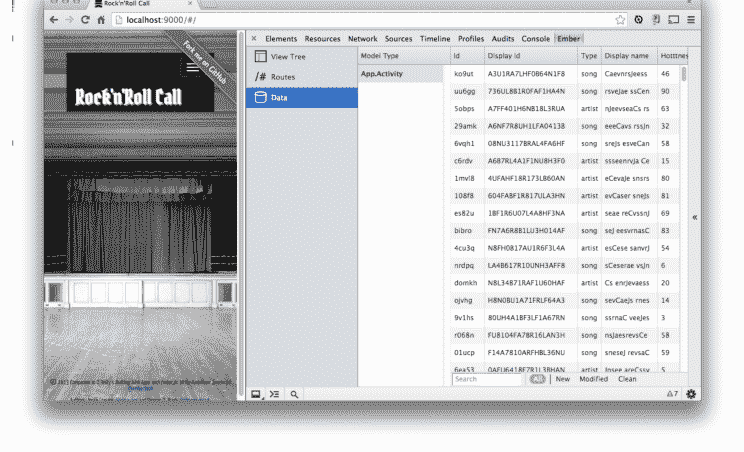

图 7-1. Ember Inspector：使用 Chrome 的 Inspector 扩展查看活动记录

在这两个示例中，我们将 RocknRollCall 应用的适配器从 LocalStorageAdapter 切换为 RESTAdapter。这样做，我们将亲身体验 Ember Data 模块化架构最强大的优势之一。这一优势，加上 Rails 和 Active Model Serializers 所提供的标准化 JSON 格式的强大能力，必将提高我们的开发效率。

换句话说，这些功能必将对我们的项目工作流程产生影响，因为我们的后端开发团队一直在使用与前端工程师相同的数据契约构建远程持久化解决方案。我们可以并行开发。而且，就像拨动开关一样，我们无需修改大部分代码就能实现远程或本地的数据持久化。

# 第 8 章

## 构建 Ember 后端

Ember 和 Ember Data 完全是客户端 JavaScript，因此它们可以与任何后端进行交互。事实上，这正是 Ember Data 最引人注目的特性之一。

网上有很多开发者使用 .NET MVC、Django、Sinatra、PHP、Grails 等各种技术向 Ember 应用提供 JSON 的优秀示例。以下列举几个：

-   @toranb 有一个 [面向 Django 的 RESTAdapter 示例](http://www.toranb.com/tips/django-emberjs/)。
-   微软提供了一个 [使用 .NET 构建 Ember 应用的模板](http://www.asp.net/downloads/samples/mvc-4/getting-started-sample/)。
-   Travis 团队使用 [Sinatra](http://ruby-lang.org)。
-   Ember Data 非常灵活，你还可以使用其他协议（如 WebSocket）从远程数据存储推送/拉取数据。
-   一个很好的例子是 [Firebase](https://www.firebase.com) 团队的工作。他们创建了一个[自定义适配器](https://www.firebase.com/docs/data-connect/firestore-emberjs.html)来与其托管的 WebSocket 后端进行交互。

所有这一切都由 Ember Data 适配器实现。通过编写自定义适配器，应用程序可以连接到任何后端以及任何可通过 Web 浏览器访问的协议。

在本章中，我们将了解使用当今一些最常见的 Web 应用框架（如 Express.js 和 Ruby on Rails）来构建几个后端。我们将介绍一些新的解决方案来解决将后端从本地存储迁移到远程数据库的问题。我们还将探讨使用"服务器中心化"的 Web 框架来交付我们的单页面应用。


### RESTful Web服务API

在[第7章](Chapter 7)中，我们介绍了Ember Data和LocalStorageAdapter。现在，让我们开始探索默认提供的核心适配器之一：RESTAdapter。我们将开始了解Ember应用如何通过RESTful Web服务API与网络进行通信。

#### 什么是RESTful Web服务API？

REST（表征性状态转移）由Roy Fielding提出，指的是分布式网络的无状态架构。它通常被用作良好设计后端的指南，将资源公开为Web服务，最常见的是在Web上通过HTTP提供。

如果你想了解更多关于RESTful Web服务的内容，可以查看Leonard Richardson、Mike Amundsen和Sam Ruby所著的《RESTful Web APIs》（O'Reilly, 2013）。

### Ember Data RESTAdapter

到目前为止，我们一直使用Yeoman（包含Yo、Grunt和Bower）来管理我们的项目。我们的应用完全基于浏览器（包括持久层），因此这种解决方案非常适合我们。

现在我们将引入一个新需求：将数据持久化到远程数据库。我们还知道将来会引入身份验证（本书不涉及），因此是时候开始评估Web应用框架了，比如Ruby on Rails和Express.js。

我们也希望我们的Rails应用以JSON格式提供数据，并公开RESTful端点。为此，我们将从使用Ember Data的LocalStorageAdapter迁移到Ember Data的RESTAdapter。

### EAK（Ember App Kit）使用Express的API桩

在我们的配套源代码中，我们还提供了一个使用Ember App Kit的[示例](example using the Ember App Kit)，在[第3章](Chapter 3)中提到，并在[第10章](Chapter 10)中也有引用。

EAK的创建者提供了一个非常方便的Node.js/Express.js应用程序，它为您的API Web服务调用提供桩。这使我们能够在项目早期使用RESTAdapter。FixtureAdapter在Web浏览器中以内存方式存储我们的fixture，这在早期开发和原型设计阶段非常有帮助，但在后期开发阶段并不理想。

使用EAK的Express API桩，我们可以配置应用程序开始通过网络向一个简单的Web服务器发起请求，使我们的应用程序的数据调用更接近于与真实后端通信。那么，我们开始设置吧。

首先，我们需要创建一个新目录并将EAK克隆到该目录：

```
$ mkdir rocknrollcall-eak
$ cd ..
```

接下来，运行以下命令：

```
$ git clone https://github.com/stefanpenner/ember-app-kit.git
```

现在，你应该有一个使用EAK的Ember应用程序的完整运行起点。

要使用Grunt安装依赖项并运行应用程序，请遵循*README.md*中提供的简单入门文档。

查看[此提交](this commit)中的更改。

首先，打开清单文件*package.json*，确保APIMethod设置为stub：

```
{
  "name": "app-kit",
  "namespace": "appkit",
  "APIMethod": "stub",
  ...
}
```

然后，我们可以在*api-stub/routes.js*中添加一个`/activities`路由：

```
module.exports = function(server) {
  // 创建一个API命名空间，这样就不必为每个端点重复根路径。
  server.namespace("/api", function() {

    // 返回"/api/activities"的fixture数据
    server.get("/activities", function(req, res) {
      var activities =
        {
          "activities": [{
            id: 0,
            display_id: "Activity1",
            searchresults_type: "song",
            display_name: "On the Road Again",
            hotttnesss: 54,
            timestamp: "Fri Dec 06 2013 01:05:53 GMT-0600 (CST)"
          }, {
            id: 1,
            display_id: "Activity2",
            searchresults_type: "artist",
            display_name: "Willie Nelson",
            hottnesss: 99,
            timestamp: "Fri Dec 06 2013 01:05:53 GMT-0600 (CST)"
          }]
        };
      res.send(activities);
    });
  });
};
```

查看[此提交](https://github.com/square/ember-app-kit/commit/2019f6289565855f74e6189554004a71d136c882)中的更改。

### ES6模块语法

如果你一直在跟着做，这就是在第3章关于EAK和Ember CLI的引用中所指的ES6模块语法。由于我们在这些示例中使用EAK，我们在构建过程中受益于ES6模块转译器，它编译为AMD（RequireJS）语法。

你可能会注意到以下代码片段中的`export default`语法。其工作原理如下：

EAK使用一个自定义解析器，通过文件名中的命名约定来解析依赖项——例如，在下一节的应用程序适配器定义中，它创建一个名为`app/adapters/application.js`的文件，并导出以下内容：

```
export default DS.RESTAdapter.extend({
  namespace: 'api'
});
```

我们得到一个名为`adapters/application`的模块。使用解析器，当Ember使用此键查找应用程序适配器时，它将返回此导出的对象作为模块。

有关解析器如何与ES6模块转译器和`export default`语法一起工作的更多详细信息，请阅读此处：[https://github.com/square/es6-module-transpiler#default-exports](https://github.com/square/es6-module-transpiler#default-exports)。

有关解析器在EAK中如何工作的更多详细信息，请阅读此处：[http://iamstef.net/ember-app-kit/guides/using-modules.html](http://iamstef.net/ember-app-kit/guides/using-modules.html)。

有关解析器在Ember CLI中如何工作的更多详细信息，请阅读此处：[http://iamstef.net/ember-cli/](http://iamstef.net/ember-cli/)。

最后，我们需要更改我们的应用程序适配器，让它继承`DS.RESTAdapter`而不是在`adapters/application.js`中找到的`DS.FixtureAdapter`。同时，让我们也添加一个命名空间以匹配Express路由：

```
export default DS.RESTAdapter.extend({
  namespace: 'api'
});
```

查看[此提交](this commit)中的更改。

正如我们在前面章节中所做的那样，让我们复制一些我们已经完成的工作。如果你一直在跟着做，这对你来说应该是有意义的。

在app/models/activity.js中创建一个Activity模型：

```
var Activity = DS.Model.extend({
  display_id: DS.attr('string'),
  type: DS.attr('string'),
  display_name: DS.attr('string'),
  hotttnesss: DS.attr('number'),
  timestamp: DS.attr()
});

export default Activity;
```

查看[此提交](this commit)中的更改。

现在，我们可以更新路由器以包含activities资源：

```
var Router = Ember.Router.extend();

Router.map(function() {
  this.route('component-test');
  this.route('helper-test');
  this.resource('activities');
});

export default Router;
```

并在app/routes/activities.js中创建一个ActivityRoute：

```
export default Ember.Route.extend({
  model: function() {
    return this.get('store').find('activity');
  }
});
```

查看[此提交](this commit)中的更改。

为了完成这部分，我们应该添加一个基本的activities handlebars模板来迭代HTML中的数据。让我们创建：

```
<h4>Total Activity Records: {{model.length}}</h4>

<ul>
  {{#each model}}
  <li class="activity">{{this.id}}</li>
  {{/each}}
</ul>
```

查看[此提交](#)中的更改。

现在，当转换到/activities路由时调用`model()`钩子，存储区会"智能"地使用RESTAdapter，如图8-1所示。

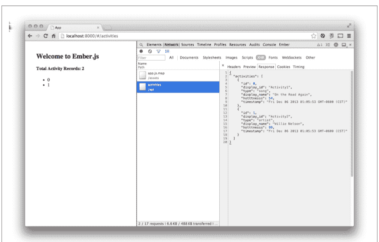

*图8-1. Activity数据和RESTAdapter*

正如在前言中提到并贯穿全文所述，作为专业开发者，我们应该非常有兴趣优化我们的工作流程并在开发过程中寻找效率。未能指出Ember模块化及其对现实项目的影响，将错过Ember和Ember Data最令人印象深刻的方面。

话虽如此，这里有三个重要的概念值得注意：首先，切换适配器就像继承不同的类一样简单；或许更重要的是，我们代码的其余部分没有改变。其次，我们为后端开发者提供了一个功能完整的规范。在快速应用开发的世界里，这比有文档的API或正式的数据图表更有价值。最后，我们的后端开发者在并行工作，一旦他们设置了API服务器，我们可以通过打开清单文件*package.json*并将APIMethod设置为*proxy*，将我们的Ember应用程序切换为指向它：

```
{
    "name": "app-kit",
    "namespace": "appkit",
```


### 为何使用Rails？

首先，我想声明：在Web应用开发中并没有所谓的“银弹”。框架的选择通常基于开发团队的经验，以及在尝试新事物与利用已熟悉框架的编码效率之间权衡的风险承受能力。

话虽如此，如果你熟悉Ruby或Rails，那么有很多特性可以让Ember和Ember Data的后端开发变得更加轻松：

- Rails帮助你管理Ruby代码和服务端的MVC。
- Active Record提供了与数据交互的ORM。
- Rails Asset Pipeline和`ember-rails`这个gem帮助你管理静态资源。
- Active Model Serializers提供了Ember Data的RESTAdapter默认期望的REST API。
- 测试是内置的。

让我们深入看看。在本节中，我们将实现两个主要目标：

- 使用Rails MVC来提供一个包含我们所需Ember依赖的*单页*。
- 为我们的Activity模型开发简单的RESTful Web Services，这些服务可以与Ember Data进行通信。

### 使用RVM（Ruby版本管理器）和Bundler管理依赖

为了保持我们应用程序依赖的有序，我们需要使用一些工具。这是一个简单的过程，但从长远来看可以为你节省大量时间。

首先，我们需要安装RVM（Ruby版本管理器）。幸运的是，RVM的文档非常出色，可以在这里找到：[http://rvm.io/rvm/install](http://rvm.io/rvm/install)。

然后，安装并使用Ruby 2.0：

```
$ rvm install 2.0.0-p353
$ rvm use 2.0.0-p353
```

接下来，我们创建一个gemset（可以将gemset视为你Ruby依赖的一个隔离集合）：

```
$ rvm gemset create rocknrollcall-rails
```

并运行以下命令：

```
$ rvm --ruby-version use 2.0.0-p353@rocknrollcall-rails
```

这将生成两个文件：

- .ruby-version
- .ruby-gemset

当你切换到应用程序的根目录时，这些文件会自动将你的环境设置为这些值。这些配置可以被版本控制；因此，当新开发者克隆你的仓库时，她的RVM会自动读取这些属性。

现在，为了双重检查，让我们确认我们使用的是正确的gemset。以下命令应返回我们刚刚创建的名称（在我们的例子中，是rocknrollcall-rails）：

```
$ rvm gemset name

rocknrollcall-rails
```

现在我们可以安装Bundler并运行bundle：

```
$ gem install bundler
```

#### 安装Rails

现在是时候安装Ruby on Rails了：

```
$ gem install rails
```

并验证安装：

```
$ rails -v
```

#### 生成初始应用

让我们生成一个基础的Ruby on Rails应用程序：

```
$ rails new rocknrollcall-rails
```

这应该会创建以下目录结构：

```
$ ls

app/
bin/
config/
db/
lib/
log/
public/
test/
tmp/
vendor/
config.ru
Gemfile
Gemfile.lock
Rakefile
README.rdoc
```

现在你可以启动你的应用服务器：

```
$ cd rocknrollcall-rails

$ rails server
```

并访问 localhost:3000。你应该会看到你的基础Rails应用程序，如图8-2所示。

查看此[提交](https://github.com/railscasts/405-ember-part-1/commit/)中的更改。

### 更新Gemfile

如果你打开当前的Gemfile，你会看到默认情况下加载了相当多的gem。以下是你所需的全部内容，因此你可以移除其他的：

```
source 'https://rubygems.org'
ruby '2.0.0'

# Bundle edge Rails instead: gem 'rails', github: 'rails/rails'
gem 'rails', '4.1.1'

# Use sqlite3 as the database for Active Record
gem 'sqlite3'

# Use Uglifier as compressor for JavaScript assets
gem 'uglifier', '>= 1.3.0'

# Use jquery as the JavaScript library
gem 'jquery-rails'
```

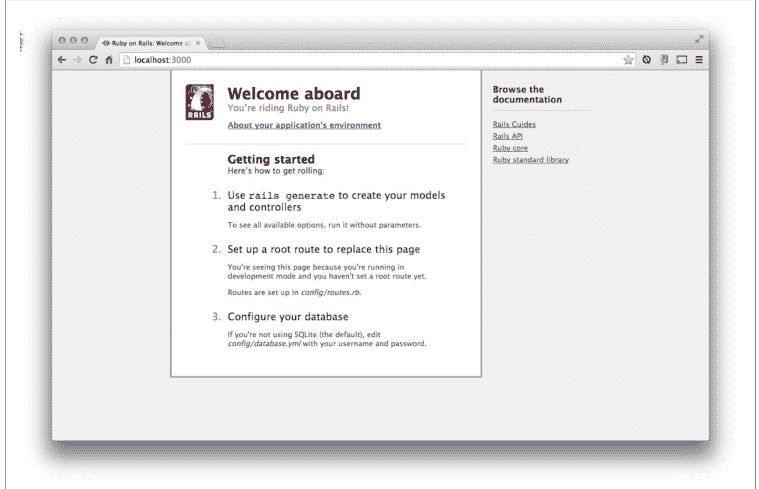

图8-2. 基础Rails应用程序

现在运行bundle以安装正确的gem：

```
$ bundle update
```

查看此[提交](https://github.com/railscasts/405-ember-part-1/commit/)中的更改。

### 移除TurboLinks

请确保在上一节中已从我们的Gemfile中移除：

```
gem 'turbolinks'
```

TurboLinks是Rails应用程序默认包含的JavaScript。TurboLinks在页面加载时扫描HTML中的链接，并设置一个事件监听器来拦截每个点击事件的默认操作。然后通过XMLHttpRequest获取“页面”，仅用响应替换页面的主体。接着，它使用PushState来模仿传统URL。

此功能与Ember路由器管理应用程序状态的方式非常重复。因此，我们需要完全移除此功能。

从 *application.js* 中移除以下内容：

```
//= require turbolinks
```

最后，从 *application.html.erb* 中移除 `"data-turbolinks-track"` ⇒ `true`：

```
<!DOCTYPE html>
<html>
<head>
  <title>Rocknrollcall-Rails</title>
  <%= stylesheet_link_tag "application", media: "all" %>
  <%= javascript_include_tag "application" %>
  <%= csrf_meta_tags %>
</head>
<body>

<%= yield %>

</body>
</html>
```

查看此[提交](https://github.com/railscasts/405-ember-part-1/commit/)中的更改。

### 理解Rails MVC和单页应用

出于此类应用程序的目的，我们将用我们的Ember应用替换默认的 *index.html* 文件内容。

我们不会尝试重新创建Ruby on Rails社区提供的[Rails指南](http://guides.rubyonrails.org/)，因此，要全面了解Ruby on Rails，这些指南是一个很好的起点。

根据我们的需求，我们将使用非常轻量级的Rails实现。我们的大部分应用程序将存在于JavaScript中，Rails服务器将提供我们的RESTful Web服务。

首先，切换到我们的新应用目录：

```
$ cd rocknrollcall-rails
```

如果存在默认页面，我们可以移除它：

```
$ rm public/index.html
```

> **移除 public/index.html**
>
> 在Rails的后续版本中，不再需要手动移除 *public/index.html*。欢迎页面现在由Rails gem管理。

现在，是时候生成我们的第一个Rails控制器了。Rails控制器与Ember控制器非常不同。在Rails中，控制器接收请求，与模型交互以读取或写入数据，并将该数据与视图同步以创建HTML输出。

如第6章所述，Ember控制器则不同，它们主要存在于存储临时数据（无论是独立数据还是从模型检索到的数据组成的数据），或用显示逻辑*装饰你的模型*。

我们将使用Rails内置生成器在我们的home控制器上创建一个*index*操作。正是在这里，以及在视图中，你将开始看到我们的现代、单页Web应用与传统Web应用之间的最大区别。

在传统的架构应用中，每个控制器将包含许多操作，每个操作都返回一个HTML页面，其中大部分是Web表单，用于在控制器上执行的每个操作。

在我们的现代Web应用程序中，我们只需要一个页面。这就是术语*单页应用程序*的由来。单页应用程序架构实际上采用了双重MVC架构，因为你在服务器端语言（本例中为Ruby）和JavaScript中都编写了模型、视图和控制器。正如你将看到的，我们的MVC实现将在服务器端*轻量*，而我们的大部分复杂性将在客户端MVC中管理：

```
$ rails generate controller home index

            create  app/controllers/home_controller.rb
              route  get "home/index"
            invoke  erb
              create    app/views/home
              create    app/views/home/index.html.erb
            invoke  test_unit
              create    test/controllers/home_controller_test.rb
            invoke  helper
              create    app/helpers/home_helper.rb
            invoke  test_unit
              create    test/helpers/home_helper_test.rb
```

HomeController现在应该有一个index操作：

```
class HomeController < ApplicationController
  def index
  end
end
```

按照惯例，在 *views/home/* 目录下还有一个 *index.html.erb* 文件：

```
<h1>Home#index</h1>
<p>Find me in app/views/home/index.html.erb</p>
```

查看此[提交](https://github.com/railscasts/405-ember-part-1/commit/)中的更改。

现在通过将根路径指向HomeController的index操作来更新你的 *routes.rb* 文件：

```
Rocknrollcall::Application.routes.draw do
  get "home/index"
```


应用程序的 index 视图现在应该如图 8-3 所示。

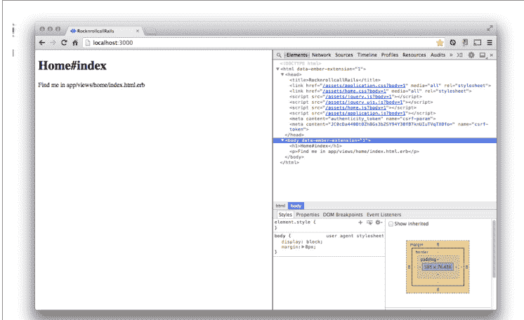

图 8-3. 我们 SPA 的首页 index 视图

请查看此提交中的变更。

### 运行测试

目前，你不必完全理解 Rails 如何帮助管理测试。Ember 测试将在第 10 章中更详细地讨论。

重要的是，你要养成在提交代码之前运行测试套件的习惯。那么，我们现在就来做这件事。

但首先，你需要运行 rake db:migrate 任务来创建你的测试数据库：

```
$ rake db:migrate
```

然后，运行你的测试：

```
$ rake test
Run options: --seed 15945

# Running tests:

Finished tests in 0.049580s, 20.1694 tests/s, 20.1694 assertions/s.

1 tests, 1 assertions, 0 failures, 0 errors, 0 skips
```

### 添加 Ember

将 gem 添加到你的应用程序 Gemfile 中：

```
gem 'ember-rails'
gem 'ember-source', '1.0.0.rc6' # or the version you need
gem 'handlebars-source', '1.0.0.rc4' # or the version you need
```

安装依赖项：

```
$ bundle install
```

请查看[此提交](this commit)中的变更。

你应该能看到几个新安装的 gem：

```
Installing active_model_serializers 0.8.1
Installing handlebars-source 1.0.0.rc4
Installing ember-source 1.0.0.rc6
Installing barber 0.4.2
Installing ember-data-source 0.14
Installing ember-rails 0.14.1
```

然后，在你的环境文件中（即 *development.rb*、*production.rb*），配置 Ember 变体（这是可选的——如果你不进行配置，当 Rails 环境处于开发模式时，使用的 Ember 版本默认为开发版本，生产环境同理）：

```
config.ember.variant = :development # or :production
```

最后，生成 Ember.js 应用程序结构。Ember.js 应用不需要遵循特定的文件结构。以下生成器将在 *app/assets/javascripts* 中创建必要的桩依赖文件：

```
$ rails generate ember:bootstrap

      insert  app/assets/javascripts/application.js
     create  app/assets/javascripts/models
     create  app/assets/javascripts/models/.gitkeep
     create  app/assets/javascripts/controllers
     create  app/assets/javascripts/controllers/.gitkeep
     create  app/assets/javascripts/views
     create  app/assets/javascripts/views/.gitkeep
     create  app/assets/javascripts/routes
     create  app/assets/javascripts/routes/.gitkeep
     create  app/assets/javascripts/helpers
     create  app/assets/javascripts/helpers/.gitkeep
     create  app/assets/javascripts/components
     create  app/assets/javascripts/components/.gitkeep
     create  app/assets/javascripts/templates
     create  app/assets/javascripts/templates/.gitkeep
     create  app/assets/javascripts/templates/components
     create  app/assets/javascripts/templates/components/.gitkeep
     create  app/assets/javascripts/mixins
     create  app/assets/javascripts/mixins/.gitkeep
     create  app/assets/javascripts/rocknrollcall_rails.js
     create  app/assets/javascripts/router.js
     create  app/assets/javascripts/store.js
```

生成器还会在 *app/assets/javascripts/application.js* 中添加必要的引导代码。默认情况下，它使用 Rails 应用的名称，并创建一个 *rails_app_name.js* 文件来设置应用命名空间和初始引用：

```
//= require handlebars
//= require ember
//= require ember-data
//= require_self
//= require rocknrollcall-rails
RocknRollCallRails = Ember.Application.create();
```

现在，你应该能看到 Web 应用中包含了必要的依赖项，如**图 8-4** 所示。

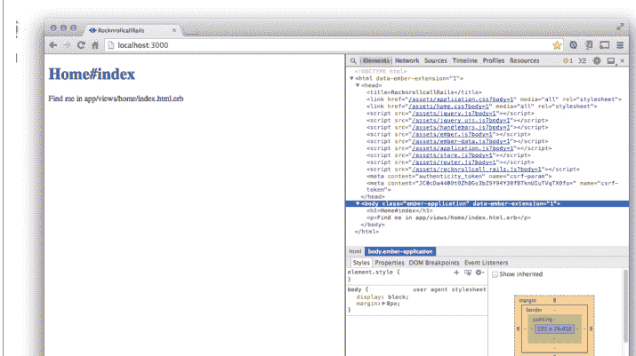

*图 8-4. 包含 Ember 的首页 index 视图 SPA*

之后，如果你想更新到 Ember 和 Ember Data 的最新构建版本，首先停止你的服务器。在 Windows 和 Mac OS X 上，按 Ctrl+C。然后运行：

```
$ rails generate ember:install --head
```

现在，确保运行可用的测试：

```
$ rake test
Run options: --seed 22801

# Running tests:

Finished tests in 0.144108s, 6.9392 tests/s, 6.9392 assertions/s.

1 tests, 1 assertions, 0 failures, 0 errors, 0 skips
```

最后，不要忘记重启你的服务器。

请查看[此提交](this commit)中的变更。


### jquery-rails 版本

在撰写本文时，如果你使用最新版本的 jquery-rails gem，会收到以下错误：

> Assertion failed: Ember Views require jQuery 1.7, 1.8, 1.9, 1.10, or 2.0

```
gem "active_model_serializers"
```

要解决此问题，请添加一个使用 jQuery 1.10 的较早版本的 jquery-rails gem：

```
# Use jQuery as the JavaScript library
gem 'jquery-rails', '3.0.3'
```

```
$ bundle update
```

请查看[此提交](this commit)中的变更。

### Active Model Serializers

你可能在之前的控制台输出中注意到，在使用 ember-rails gem 运行 bundle update 后，active_model_serializers gem 作为依赖项被安装了：

```
Installing active_model_serializers 0.8.1
```

ActiveModel::Serializers 通过序列化器对象帮助我们构建 JSON API，使我们的 JSON API 格式化变得更加简单。它们不仅提供了一些语法上的改进，还提供了一个专门的地方来完全自定义 JSON 输出。

一旦我们设置好模型、路由、路由和控制器，会有更多内容。

### 生成 Activity 模型和控制器

首先，我们需要生成一个带有 index action 的新控制器（在应用程序开发的后续阶段，需要添加创建、更新和删除 Activities 所需的其余 action，但现在我们只需要为 Ember Data 提供*只读*服务）：

```
$ rails g controller Activities index
```

它会生成以下文件：

```
class ActivitiesController < ApplicationController
  def index
  end
end
```

我们可以用一个简单的 render 命令来更新它，该命令请求 JSON 格式以及数据库中所有的 Activity 模型记录：

```
class ActivitiesController < ApplicationController
  def index
    render json: Activity.all
  end
end
```

请查看[此提交](#)中的变更。

同时，使用 Rails 内置的脚手架来生成 Activity 模型。在以下命令中，我们可以生成一个 Activity 模型，并传入属性及其数据类型。Rails 会自动将这些属性添加到数据库中的 activities 表，并将其映射回 Activity 模型：

```
$ rails g model Activity display_id:string searchresults_type:string display_name:string
    timestamp:datetime hotttnesss:decimal
```

请查看[此提交](#)中的变更。

现在我们需要运行数据库迁移。数据库迁移提供了一种简单且一致的方式来随时间对数据库模式进行版本管理。

幸运的是，生成模型命令也为我们创建了这个迁移——我们只需要执行它即可！

```
class CreateActivities < ActiveRecord::Migration
  def change
    create_table :activities do |t|
      t.string :display_id
      t.string :searchresults_type
      t.string :display_name
      t.datetime :timestamp
      t.integer :hotttnesss
      t.timestamps
    end
  end
end
```

要执行它，我们再次使用 rake 任务：

```
$ rake db:migrate
```

最后，我们有新生成的测试。那么，让我们运行它们并提交我们的变更：

```
$ rake test
Run options: --seed 21992

# Running tests:
.......

Finished tests in 0.254310s, 31.4577 tests/s, 55.0509 assertions/s.

2 tests, 2 assertions, 0 failures, 0 errors, 0 skips
```

### 生成和配置我们的序列化器

如前所述，既然我们有了 Activity 模型和 Controller，我们就有足够的条件向 Ember 客户端返回 JSON 数据。

你可能注意到的一件事是，type 是一个保留字，实在不应该用作模型的属性。让我们将它改为 searchresults_type，因为这实际上是一个展示我们可以使用活动序列化器进行何种序列化操作的好机会。

在这里，我们需要使输出 JSON 中的键与其在 ActiveRecord 中的名称 searchresults_type 不同。为此，我们用不同的名称声明属性并重新定义该方法。现在，我们的 Ember 应用程序可以保持不变，在前端继续使用 type 属性。

首先，让我们生成一个序列化器：

```
$ rails g serializer activity
```

请查看[此提交](this commit)中的变更。

然后，配置它：

```
class ActivitySerializer < ActiveModel::Serializer

  # look up searchresults_type on the model, but use type in the JSON
  def type
    object.searchresults_type
  end

  attributes :id, :display_id, :type, :display_name, :hottnesss, :timestamp
end
```

请查看[此提交](this commit)中的变更。


### 更新路由

现在，我们可以告知路由，我们在 URL `/activities` 处有一个可用资源。像许多任务一样，这在 Ruby on Rails 中非常简单。只需打开 `config/routes.rb`，将调用 activities 控制器 index 方法的声明：

```
get "activities/index"
```

更改为资源声明：

```
resources :activities
```

请在[此提交](https://github.com/tiagokluth/railscasts/commit/43780b14826d0718b512f13669f662502b358805)中查看更改。

### 种子数据

Rails 提供了一种简单的方法，可以使用几个 `Activity` 对象为数据库填充种子数据。首先，首先在 `db/seeds.rb` 中创建一些对象：

```
Activity.create(
  :display_id => 'Activity1',
  :searchresults_type => 'song',
  :display_name => "On the Road Again,
  :timestamp => "Fri Dec 06 2013 01:05:53 GMT-0600 (CST)",
  :hottnesss => 54
)

Activity.create(
  :display_id => 'Activity2',
  :searchresults_type => 'artist',
  :display_name => "Willie Nelson",
  :timestamp => "Fri Dec 06 2013 01:05:53 GMT-0600 (CST)",
  :hottnesss => 99
)
```

请确保运行该任务将数据推送到数据库中：

```
$ rake db:seed
```

现在，你应该能够启动服务器并通过对 `http://localhost:3000/activities` 的 Web 服务调用来访问数据：

```
$ rails server
```

请在[此提交](https://github.com/tiagokluth/railscasts/commit/47e459c074122285e60f3902556799210489a961)中查看更改。

结果应如图 8-5 所示。

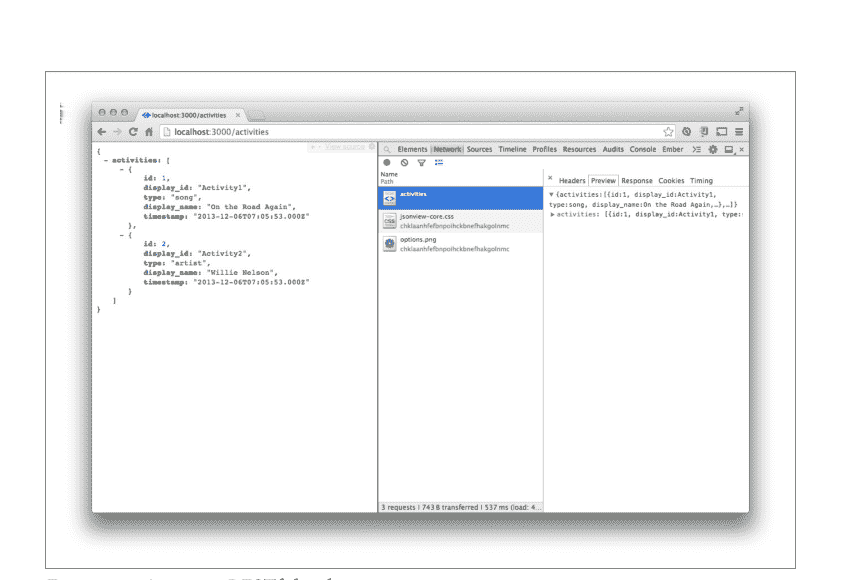

图 8-5. Activities RESTful Web 服务

### 总结

在本章中，我们使用了两种不同的 Web 应用框架，通过 Ember Data RESTAdapter 和 RESTful Web 服务端点，将我们的后端从本地存储迁移到远程数据库。通过使用 Ember App Kit 内置的 Node.js/Express.js 实现，我们能够通过配置更改迁移到 RESTAdapter。

我们还展示了如何配置 Ruby on Rails 来交付单个页面，并添加了 active model serializers 来格式化我们的 JSON 输出。

## Ember 组件

无论你在什么样的环境下工作，创建组件化和功能的复用都是开发团队的共同目标。从历史上看，实现复用一直很困难。首先，构建一段足够通用以满足未知需求的代码很少能获得完全的成功，并且需要多年的经验，更不用说对所构建产品目标（过去和未来）的广泛视野了。此外，直到最近，还没有一个标准。因此，技术选择一直是利用 UI 工具包、iframes 或专有的 widget/gadget 规范。

Web Components 规范通过提供许多相关的“子规范”（Custom Elements, Shadow DOM, HTML Imports）为这一挑战领域注入了新生命，这些规范可以协同使用，从而创建 UI 组件的标准化封装。

Ember 组件紧跟 Web Components 规范，提供核心功能，或在能力较低的浏览器中通过 polyfill 提供必要的功能。其核心思想是，随着浏览器继续采用这些规范，Ember 足够智能，可以在原生功能可用时直接使用。因此，开发人员现在就可以开始编写 Web Components，将其作为“面向未来”的 Ember 组件。

在本章中，我们将首先构建一个简单的组件来演示基础知识。然后，我们将进入一个更复杂的组件，将第三方库（在本例中为 D3.js）集成到 Ember 应用程序中。为此，我们将继续使用由 Yeoman 管理的应用程序。

首先，让我们处理一些基础工作。我们需要创建一个目录来包含我们的组件。因此，让我们添加 `app/scripts/components`。

然后，我们需要在 `app/scripts/app.js` 中添加一个 `require` 调用，以确保 Grunt 的构建任务能够识别新文件并将其包含在 `app/scripts/combined-scripts.js` 中：

```
/* Order and include as you please. */
require('scripts/controllers/*');
require('scripts/components/*');
require('scripts/store');
require('scripts/models/*');
require('scripts/routes/*');
require('scripts/views/*');
require('scripts/router');
```

请在[此提交](this commit)中查看更改。

> 如果你使用的是较新版本的 Yeoman Ember 生成器，这可能已经为你完成了。

### Ember 组件的解剖

组件的拼图由几个部分组成，但总体而言，组件的创建是一个非常直接的过程。在本节中，我们将逐步演示如何将一个 Activity 内容转换为可复用组件。

### 创建模板

第一步是决定组件的名称，创建 `app/scripts/components` 目录，并添加一个名为 `activity_log_component.js` 的新文件：

```
RocknrollcallYeoman.ActivityLogComponent = Ember.Component.extend({});
```

根据拟议的规范，名称中必须包含连字符。这旨在帮助防止与其他原生元素发生冲突。

对于我们的简单示例，我们可以在 `templates/activity.hbs` 中这样使用：

```
{{activity-log}}
```

在我们的示例应用程序中，我们使用了构建工具，因此我们可以在 `templates/components` 创建一个新目录，并用一个名为 `activity-log.hbs` 的新 Handlebars 模板来填充它：

```
I am an Activity Log.
<hr>
```

在 `activity.hbs` 中，我们可以根据 ActivityRoute 的 `model()` 钩子提供的当前模型来循环遍历此模板：

```
{{#each}}
  {{activity-log}}
{{/each}}
```

日志现在应该看起来如图 9-1 所示。

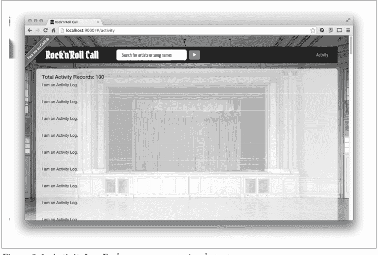

图 9-1. ActivityLog Ember 组件：简单文本

请在[此提交](commit_link)中查看更改。

然后，通过添加模型的属性，使 *activity-log.hbs* 变得稍微复杂一点：

```
<p> display_id: {{display_id}}</p>
<p> type: {{type}}</p>
<p> display_name: {{display_name}}</p>
<p> hottnesss: {{hottnesss}}</p>
<p> timestamp: {{timestamp}}</p>

<hr>
```

请在[此提交](commit_link)中查看更改。

为了实现这一点，我们还必须更新 Handlebars，将当前模板作用域中的每个属性传递给组件。

我们可以在这里更改属性名称，或者保持不变。为了简单起见，我们将全部保持不变。在 *activity.hbs* 中，添加以下内容：

```
{{#each}}
    {{activity-log display_id=display_id type=type display_name=display_name
        hottnesss=hottnesss timestamp=timestamp }}
{{/each}}
```

请在**此提交**中查看更改。

现在我们应该能看到渲染的属性，如图 **9-2** 所示。

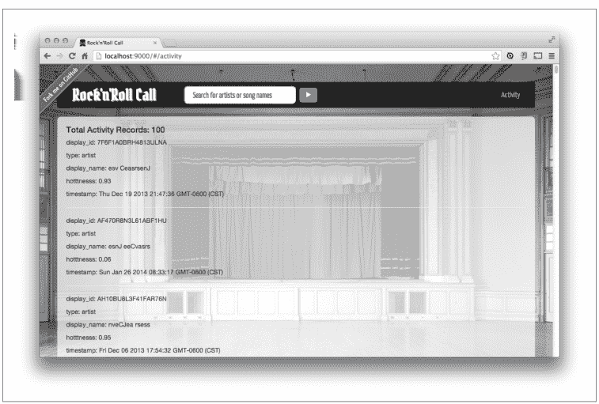

*图 9-2. ActivityLog Ember 组件：模型属性*

### 扩展 Ember.Component

现在，如果我们只是想将静态 HTML 封装成可复用的，或者向组件作用域传递极少的属性，我们可以在模板中完全管理我们的 Ember 组件。

但是，如果我们还需要做更多事情，例如更改包装元素、集成第三方 JavaScript 库（如 jQuery 或 D3），或者处理类似于本书前面介绍的 *actions*（动作），那么我们就需要使用扩展 `Ember.Component` 类的方法。

幸运的是，命名约定允许我们通过移除连字符、将类名改为驼峰式并在末尾添加 `Component` 来创建新的子类。Ember 会自动识别它引用的是哪个组件。例如，我们之前的 activity log 示例将这样定义子类：

```
RocknrollcallYeoman.ActivityLogComponent = Ember.Component.extend({});
```

### 使用 D3 构建热力图可视化

现在我们知道了如何创建子类，让我们使用之前在 Activity LogComponent 中使用的数据，利用 D3.js 可视化库创建一个自定义的热力图动画。D3.js 是一个基于数据操纵 HTML、SVG 和 CSS 的 JavaScript 库。有关 D3.js 的更多信息，请查看[相关文档](#)。

首先，我们需要将 D3 库引入页面。因此，我们将更新 `bower.json` 文件，添加最新的 D3 版本：

```
{
  "name": "rocknrollcall-yeoman",
  "version": "0.0.0",
  "dependencies": {
    "ember": "1.3.2",
    "handlebars": "1.2.1",
    "ember-data": "1.0.0-beta.5",
    "ember-localstorage-adapter": "latest",
    "bootstrap-sass": "~3.0.0",
    "d3": "latest"
  },
}
```

请在[此提交](#)中查看更改。

现在，运行：

```
$ bower install
```

最后，在 `app/index.html` 文件中添加一个 `script` 标签：

```
<script src="bower_components/d3/d3.js"></script>
```

请在[此提交](#)中查看更改。

现在，我们希望使用 hottomesss 属性和 timestamp 属性来构建一个热力图网格，y 轴表示“星期”，x 轴表示“一天中的时间”。网格中的每个方块代表特定日期的一小时。方块的颜色描绘了你在该小时内最后一次搜索的热度（hottomesss），颜色深表示热度量表较低，颜色浅表示量表较高。为了方便观看，还包含了一个颜色图例。

我们在这里不会讨论 D3 的内部机制，因为这超出了本书的范围。本例的目的是展示如何将像 D3 这样的第三方库集成到你的组件中。

那么让我们从 `Component` 子类的基本结构开始。类声明的顶部将用于管理可以在 `draw()` 和 `didInsertElement()` 这两个方法中引用的特定属性。

`didInsertElement()` 在组件的外部元素被插入到 DOM 时被调用。因此，我们可以重写这个函数来执行任何需要


## 收尾工作

访问文档体中的元素。这里，我们将从控制器获取数据并传递给`draw()`。

`draw()`包含了大部分D3特定的逻辑。如果你跟着操作，你会逐渐发现这种模式可以用于许多不同类型的数据可视化——这些可视化以数据作为输入，并将数据传递给`render()`或`draw()`逻辑：

```
RocknrollcallYeoman.HeatMapComponent = Ember.Component.extend({

  width: 900,
  height: 280,

  draw: function(myData){
    // draw the heat map
  },

  didInsertElement: function(){
    var data = this.get('controller.data.content');
    this.draw(data);
  }
});
```

在将数据传递给`draw()`之前，我们可以先“预处理”一下，将其转换为数组。这是常见的做法，`didInsertElement()`是执行此逻辑的合适位置：

```
RocknrollcallYeoman.HeatMapComponent = Ember.Component.extend({

  width: 900,
  height: 280,

  draw: function(myData){
    // draw the heat map
  },

  didInsertElement: function(){
    var data = this.get('controller.data.content');
    var hotnessArray = [];
    for (var i=0;i<data.length;i++) {
      var date = new Date(data[i].get('timestamp'));
      var row = {};
      row.day = date.getDay() + 1;
      row.hour = date.getHours() + 1;
      row.value = data[i].get('hotttnesss');
      hotnessArray.push(row);
    }
    this.draw(hotnessArray);
  }
});
```

因此，正如我们在简单的`ActivityLogComponent`中所做的那样，我们可以在`templates/components/heat-map.hbs`创建一个Handlebars模板。

在这个模板中，我们只需要一个带有id的div元素：

```
<div id="chart"></div>
```

现在我们可以将辅助工具添加到`templates/activity.hbs`：

```
{{heat-map data=model}}
```

下面是完成的`HeatMapComponent`。如你所见，我们的D3逻辑被很好地封装在`draw()`方法中。现在，将其添加到`app/scripts/components/heat_map_component.js`：

```
RocknrollcallYeoman.HeatMapComponent = Ember.Component.extend({
  margin: { top: 50, right: 0, bottom: 100, left: 30 },
  width: 900,
  height: 280,
  gridSize: 37,
  legendElementWidth: 100,
  buckets: 9,
  colors: ["#f2f000", "#661201", "#911900", "#B22604", "#CB3804", "#F25B02", "#F2720D", "#FFA321", "#FAC40A"], // alternatively colorbrewer.YlGnBu[9]
  days: ["Mo", "Tu", "We", "Th", "Fr", "Sa", "Su"],
  times: ["1a", "2a", "3a", "4a", "5a", "6a", "7a", "8a", "9a", "10a", "11a",
  "12a", "1p",
          "2p", "3p", "4p", "5p", "6p", "7p", "8p", "9p", "10p", "11p", "12p"],

  draw: function(myData){
    var self = this;
    this.set('data', myData);
    var svg = d3.select('#'+self.get('elementId'));
    var colorScale = d3.scale.quantile()
      .domain([10, 100])
      .range(self.colors);

    var svg = d3.select("#chart").append("svg")
      .attr("width", self.width + self.margin.left + self.margin.right)
      .attr("height", self.height + self.margin.top + self.margin.bottom)
      .append("g")
          .attr("transform", "translate(" + self.margin.left + "," + self.margin.top + ")");

    var dayLabels = svg.selectAll(".dayLabel")
      .data(self.days)
      .enter().append("text")
        .text(function (d) { return d; })
        .attr("x", 0)
        .attr("y", function (d, i) { return i * self.gridSize; })
        .style("text-anchor", "end")
        .attr("transform", "translate(-6," + self.gridSize / 1.5 + ")")
        .attr("class", function (d, i) { return ((i >= 0 && i <= 4) ? 
          "dayLabel mono axis axis-workweek" : "dayLabel mono axis"); });

    var timeLabels = svg.selectAll(".timeLabel")
      .data(self.times)
      .enter().append("text")
      .text(function(d) { return d; })
      .attr("x", function(d, i) { return i * self.gridSize; })
      .attr("y", 0)
      .style("text-anchor", "middle")
      .attr("transform", "translate(" + self.gridSize / 2 + ", -6)")
      .attr("class", function(d, i) { return ((i >= 7 && i <= 16) ?
        "timeLabel mono axis axis-worktime" : "timeLabel mono axis"); });

    var heatMap = svg.selectAll(".hour")
      .data(self.data)
      .enter().append("rect")
      .attr("x", function(d) { return (d.hour - 1) * self.gridSize; })
      .attr("y", function(d) { return (d.day - 1) * self.gridSize; })
      .attr("rx", 4)
      .attr("ry", 4)
      .attr("class", "hour bordered")
      .attr("width", self.gridSize)
      .attr("height", self.gridSize)
      .style("fill", self.colors[0]);

    heatMap.transition().duration(1000)
      .style("fill", function(d) { return colorScale(d.value); });

    heatMap.append("title").text(function(d) { return d.value; });

    var legend = svg.selectAll(".legend")
      .data([0].concat(colorScale.quantiles()), function(d) { return d; })
      .enter().append("g")
      .attr("class", "legend");

    legend.append("rect")
      .attr("x", function(d, i) { return self.legendElementWidth * i; })
      .attr("y", self.height)
      .attr("width", self.legendElementWidth)
      .attr("height", self.gridSize / 2)
      .style("fill", function(d, i) { return self.colors[i]; });

    legend.append("text")
      .attr("class", "mono")
      .text(function(d) { return ">=" + Math.round(d*10)/10; })
      .attr("x", function(d, i) { return self.legendElementWidth * i; })
      .attr("y", self.height + self.gridSize);
  },

  didInsertElement: function(){
    var data = this.get('controller.data.content');
    var hotnessArray = [];
    for (var i=0;i<data.length;i++) {
      var date = new Date(data[i].get('timestamp'));
      var row = {};
      row.day = date.getDay() + 1;
      row.hour = date.getHours() + 1;
      row.value = data[i].get('hottnesss');
      hotnessArray.push(row);
    }
    this.draw(hotnessArray);
  }
});
```

查看此[提交](#)中的变更。

现在，我们的`HeatMapComponent`展示了我们在第8章创建的Activity模型数据，如图9-3所示。

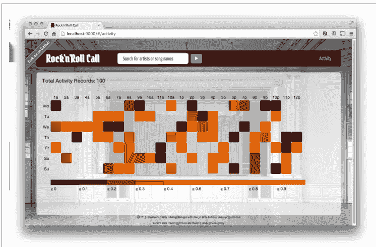

图9-3. D3 Ember HeatMapComponent

如你所见，通过遵循Web标准，Ember团队为我们提供了一种编写可复用、封装良好的组件的优雅方式，这可以使我们的应用程序更具可维护性，并在未来更容易扩展。如果你尝试过编写可维护的、生产级别的代码，你就会知道这对于大多数技术团队来说通常是一个高优先级，且很少能轻松实现。

在下一章，也是最后一章中，我们将讨论另一个生产就绪应用程序的重要概念：测试。

# 第10章

## Ember测试

如果你在过去一年一直关注Ember的测试进展，Ember社区内部关于测试最佳实践一直有相当多的讨论。嗯，这有什么奇怪的？测试本来就是这样。

在为本书制定测试策略时，我们希望基于我们在真实应用开发中的经验。在此过程中，我们的指导原则之一是尽可能保持策略简单，同时不牺牲测试覆盖率。

我们还希望测试可读，因为它们是开发团队“强制执行”和经过测试的需求的主要来源。对我们来说，测试运行器速度快也很重要，以确保我们不会阻碍开发人员的生产力，并且我们希望测试运行器能够轻松地与CI服务器集成。最后，为我们特定的应用程序获得尽可能多的合理代码的测试覆盖非常重要。

我们将探索使用Ember App Kit提供的简单设置进行基本的集成和单元测试方法。此设置使用Qunit、Ember测试助手和Testem测试运行器。

可以肯定的是，有多少开发团队就有多少测试策略，因此希望以下示例能让你充分接触基础知识，从而开始制定适合你的应用程序、团队和开发时间表的策略。

Ember指南为设置基本测试场景提供了很好的参考，因此我们不会冗余地重述这些文档。我们假设你已经阅读了[Ember指南关于集成测试的页面](http://emberjs.com/guides/testing/integration/)，以便对以下信息有完整的理解。


# 使用 Ember App Kit、QUnit 和 Testem 进行 Ember 测试

此初始示例的源代码已包含在此：https://github.com/emberjs-book/rocknrollcall-eak。

**rocknrollcall-eak** 使用了 QUnit、Ember Testing 和 Testem Test Runner。

如果你一直在跟随本书的进度，你已经看到有一个 Activity 模型，它*记录*与用户搜索相关的数据。为了我们的基础单元测试示例，我们将使用这个模型以及相关的路由和模板。

首先，让我们设置我们的第一个测试。幸运的是，Ember App Kit 已经通过几个文件处理了样板代码，起始于 *test_helper.js*：

```
document.write('<div id="ember-testing-container"><div id="ember-testing"></div></div>');

Ember.testing = true;

window.startApp = require('appkit/tests/helpers/start_app')['default'];
window.isolatedContainer = require('appkit/tests/helpers/isolated_container')['default'];

... // test-helpers

window.exists = exists;
window.equal = equal;
window.strictEqual = strictEqual;
```

首先，ember-testing-container 和 ember-testing div 被注入到我们的测试运行器 HTML 页面中。然后，Ember.testing 被设置为 true，这会关闭运行循环的自动运行。稍后你会看到，将测试中的任何异步代码包装在 `Ember.run()` 中是必要的，否则你将在控制台中收到以下消息：

> 你已开启测试模式，这会禁用运行循环的自动运行。
> 你需要将任何具有异步副作用的代码包装在 Ember.run 中。

然后，包含了两个额外的样板文件，并通过 window 对象进行全局引用。

你可能已经注意到，样板代码还包含了一些测试辅助函数，这些函数本质上只是包装了 QUnit 断言，以便在你的测试中使用。接着，*test_helper.js* 也为这些辅助函数设置了全局引用：

```
function exists(selector) {
  return !!find(selector).length;
}

function getAssertionMessage(actual, expected, message) {
  return message || QUnit.jsDump.parse(expected) + " expected but was " + QUnit.jsDump.parse(actual);
}

function equal(actual, expected, message) {
  message = getAssertionMessage(actual, expected, message);
  QUnit.equal.call(this, actual, expected, message);
}

function strictEqual(actual, expected, message) {
  message = getAssertionMessage(actual, expected, message);
  QUnit.strictEqual.call(this, actual, expected, message);
}
```

然后在 start_app.js 中，EAK 开始为测试上下文初始化应用程序。startApp() 方法使用导入的 app 创建一个具有可配置属性的实例，调用 setupForTesting()（这会延迟应用程序代码的执行），并注入上述测试辅助函数：

```
import Application from 'appkit/app';

function startApp(attrs) {
  var App;

  var attributes = Ember.merge({
    // useful Test defaults
    rootElement: '#ember-testing',
    LOG_ACTIVE_GENERATION:false,
    LOG_VIEW_LOOKUPS: false
  }, attrs); // but you can override;

  Ember.run(function(){
    App = Application.create(attributes);
    App.setupForTesting();
    App.injectTestHelpers();
  });

  return App;
}

export default startApp;
```

包含的最后一个文件，用于完成测试样板代码，名为 isolated-Container.js。

这个文件的目的正如其名所示，为测试提供一个独立的 Ember.Container 副本：

```
import Resolver from 'resolver';

function isolatedContainer(fullNames) {
  var container = new Ember.Container();

  container.optionsForType('component', { singleton: false });
  container.optionsForType('view', { singleton: false });
  container.optionsForType('template', { instantiate: false });
  container.optionsForType('helper', { instantiate: false });

  var resolver = Resolver['default'].create();

  resolver.namespace = {
    modulePrefix: 'appkit'
  };

  for (var i = fullNames.length; i > 0; i--) {
    var fullName = fullNames[i - 1];
    container.register(fullName, resolver.resolve(fullName));
  }

  return container;
}

export default isolatedContainer;
```


在 EAK 的后续版本中，此功能已移至 Ember-Qunit 库。因此，如果你想知道 *isolatedContainer.js* 在哪里，你可能正在运行一个更新版本的 EAK。它现在将由 bower 管理，并位于 *vendor/ember-qunit/lib/* 中。

关于 Ember-Qunit 的更多信息，请关注我们——本章稍后会详细介绍。

### Testem 和 QUnit 测试运行器

EAK (Ember App Kit) 默认启用 [Testem 测试运行器](#)。因此，在本章的前半部分，我们将使用这个出色的测试运行器。

Ember-testing 使用 QUnit，因此其中一个好处是我们可以得到可以在浏览器中运行的 QUnit 测试运行器。当与 Testem 这样的测试运行器一起使用时，我们也可以在命令行查看测试。

如果我们遵循 TDD（测试驱动开发）的标准 *红-绿-重构* 循环，*失败的* 测试将高亮显示。你可以选择在命令行或浏览器中监控测试。以下是你运行测试时的样子。

我们可以先查看处于失败状态的测试。只需打开一个终端，导航到应用程序目录，然后运行测试服务器：

```
$ cd rocknrollcall-eak

$ grunt test:server
```

然后你应该会看到 Testem 测试运行器启动并开始执行我们的测试，如图 10-1 所示。

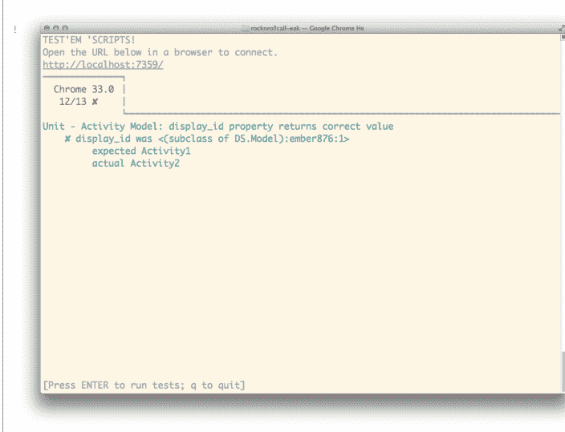

图 10-1. Testem 测试运行器：一个测试失败

本章的目的不是逐步讲解每个测试的红-绿-重构循环，但在本节结束时，我们应该有一个包含 13 个通过的单元和集成测试的测试套件。

再次，打开一个终端，导航到应用程序目录，然后运行测试服务器，如图 10-2 所示：

```
$ cd rocknrollcall-eak

$ grunt test:server
```

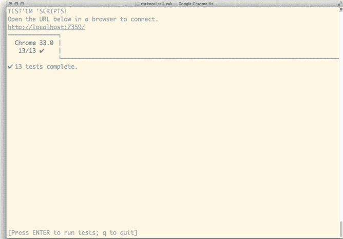

图 10-2. Testem 测试运行器：所有测试通过

如前所述，如果你不习惯在终端中运行测试，你也可以打开一个浏览器窗口，在 QUnit 测试运行器中查看你的测试，并输入 http://localhost:7359/743/tmp/result/tests/index.html（参见图 10-3）。

现在我们了解了基本设置、Testem 命令行测试运行器以及 QUnit 基于浏览器的替代方案，让我们开始创建我们的第一个测试。

### Ember 客户端集成测试

让我们从仅限浏览器的集成测试开始，这可能是 Ember 框架最酷的方面之一。在这里，我们可以编写并自动化测试，这些测试可以演练我们应用程序的大部分层（路由器、模型、控制器和视图），而无需应用服务器、网络调用甚至数据库的开销。

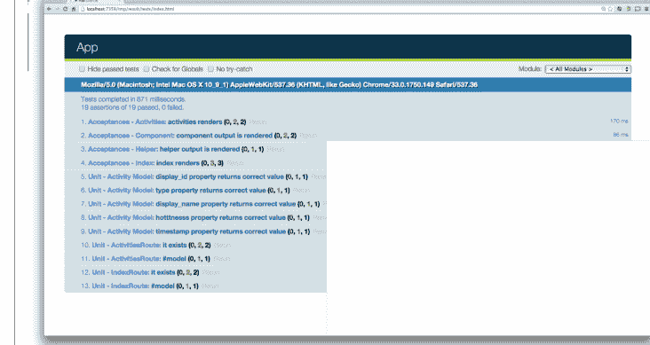

图 10-3. 作为替代方案的 QUnit 测试运行器

#### 辅助函数

Ember 测试模块提供了六个辅助函数，用于自动化与你的 Ember 应用程序的交互。这些辅助函数包括：visit()、find()、fillIn()、click()、triggerEvent() 和 keyEvent()。

还有三个辅助函数可以返回关于应用程序状态的有用信息：currentPath()、currentRouteName() 和 currentURL()。

更多信息，请参阅 Ember 集成测试辅助函数部分。

#### 测试索引页

正如本章前面提到的，我们的测试设置还包括包装了 QUnit 断言的辅助函数。首先，我们将执行一些 find() 操作并使用之前解释过的 equal() 断言。

在 tests/acceptance 中，我们免费获得了一个 index-test.js 作为初始示例。在此示例中，我们将对应用程序进行基本的设置和拆除，然后运行一个测试：

```
var App;

module('Acceptances - Index', {
  setup: function(){
    App = startApp();
  },
  teardown: function() {
    Ember.run(App, 'destroy');
  }
});

test('index renders', function(){
    expect(3);

    visit('/').then(function(){
        var title = find('h2#title');
        var list = find('ul li');

        equal(title.text(), 'Welcome to Ember.js');

        equal(list.length, 3);
        equal(list.text(), 'redyellowblue');
    });
});
```

为了进一步分解这段代码，请注意 QUnit test() 接受一个描述（index renders）和一个包含测试的回调函数。在测试中，我们将首先让 QUnit 知道在此测试中预期有多少个断言。请记住，如果运行的断言数量不等于传递给 expect() 的数量，测试将不会通过。

然后，我们可以使用 visit() 辅助函数访问索引页面，并使用 then() 处理返回的 Promise。然后，我们使用 find 查询页面元素，并将它们分配给变量。接着，我们将存储在变量 title 和 list 中的 HTML 元素作为第一个参数传递给我们的 equal() 断言辅助函数。equal() 断言辅助函数中的第二个参数是我们期望的值。

图 10-4 显示了此测试的结果。


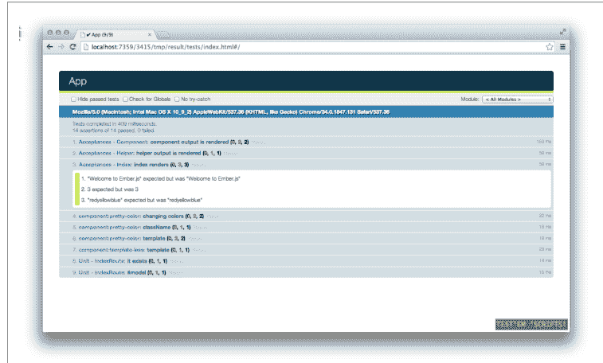
图 10-4. 验收测试：渲染索引页面

### 测试 Activities 路由

在下一个测试中，我们将访问 Activities 路由，通过 Ember Data 访问数据模型，并测试数据是否在 activities 模板中正确显示。

在 *tests/acceptance* 目录中，创建一个 *activities-test.js* 文件：

```javascript
var App;

module('Acceptances - Activities', {
  setup: function(){
    App = startApp();
  },
  teardown: function() {
    Ember.run(App, 'destroy');
  }
});

test('activities renders', function(){
  visit('/activities').then(function(){
    var title = find('h4');
    var list = find('ul li.activity');

    equal(title.text(), 'Total Activity Records: 2');
    equal(list.length, 2);
  });
});
```

请参阅[此提交](this commit)中的变更。

我们的测试失败了，如图 10-5 所示，但为什么呢？

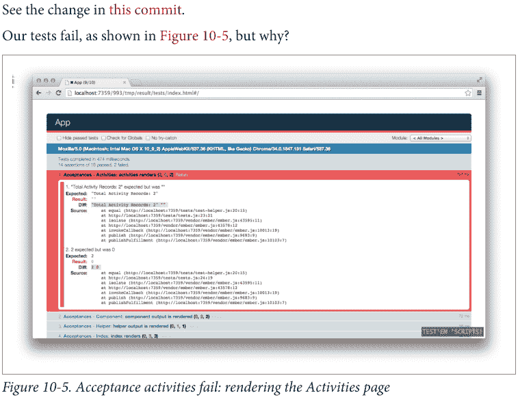

答案在浏览器控制台中显示的 JavaScript 错误信息中：

> 未能加载资源：服务器响应状态为 404（未找到）
http://localhost:7359/api/activities

我们得到这个错误的原因是，我们的 Ember 应用程序（实际上是 Ember Data）正在向与 Testem 测试环境（在 localhost 端口 7359 上运行）相同的域名发起对 `/api/activities` 的请求。数据不可用，因为提供数据的 Express 应用程序并未在那里运行。

为了解决这个问题，我们需要进行一些小的配置和代码更改。这实际上更多地展示了 Ember App Kit 的可扩展性和灵活性，是其构建时所投入的大量思考的明证。

首先，我们可以在测试环境的配置文件中创建一个 host 属性：

```javascript
window.ENV.host = 'http://localhost:8000'
```

然后在 *app/adapters/application.js* 中使用该属性，告诉 Ember Data 指向在默认端口上运行的 Express 服务器（该端口与我们的测试环境不同）：

```javascript
export default DS.RESTAdapter.extend({
  namespace: 'api',
  host: window.ENV.host
});
```

这意味着我们需要在一个单独的终端中运行我们的 Express.js 应用：

```bash
$ grunt server
Running "expressServer:debug" (expressServer) task
Using API Stub
>> Started development server on port 8000.
```

并在另一个终端中运行我们的测试服务器：

```bash
$ grunt test:server
TEST'EM 'SCRIPTS!
Open the URL below in a browser to connect.
http://localhost:7359/
```

几乎完成了！现在，你应该能在浏览器的 JavaScript 控制台中看到一个错误：

```
XMLHttpRequest cannot load http://localhost:8000/api/activities.
No 'Access-Control-Allow-Origin' header is present on the requested
resource. Origin 'http://localhost:7359' is therefore not allowed access.
```

这是一个由于尝试向另一个域名发起 XMLHttpRequest 而导致的问题。幸运的是，我们可以使用 node 的 `cors` 模块中间件来使此请求无错返回。`cors` 模块利用 CORS 规范，通过在响应中添加自定义头来正确配置 Express 服务器以处理跨站 XMLHttpRequest。

要启用 CORS，我们首先将新的开发依赖项添加到 *package.json*：

```json
"devDependencies": {
  "express": "~3.4.8",
  ...
  "cors": "2.2.0"
}
```

然后，在 *tasks/express-server.js* 中添加依赖项的 require：

```javascript
var express = require('express'),
    lockFile = require('lockfile'),
    Helpers = require('./helpers'),
    fs = require('fs'),
    path = require('path'),
    request = require('request'),
    cors = require('cors');
```

然后添加中间件，就在处理 proxyMethod 的条件逻辑之前：

```javascript
app.use(cors());
```

```javascript
if (proxyMethod === 'stub') {
  grunt.log.writeln('Using API Stub');
  ...
```

最后，我们需要通过运行以下命令安装新的依赖项：

```bash
$ npm install
```

#### 关于 CORS 的更多信息

CORS 代表跨域资源共享，它是一种允许应用程序从浏览器内部向其他域发起请求的规范。借助 CORS，你可以采用一种安全且易于实现的方法来绕过浏览器的同源策略。

如果你想查看另一个使用 CORS 的示例，可以在 Jesse Cravens 和 Jeff Burtoft 的 *HTML5 Hacks*（O'Reilly, 2012）中阅读更多内容；特别是参见 Hack #75：Configure Amazon S3 for Cross-Origin Resource Sharing to Host a Web Font。

现在，我们应该看到我们的测试环境能够访问来自 Express 服务器的数据，并且测试通过了（[图 10-6](figure-link)）。

请在 [this commit](commit-link) 中查看这些更改。

### Ember 单元测试

我们的第一个单元测试将测试 `Activities` 路由的存在性，并执行其 `model` 方法。

在对路由进行单元测试时，我们立即遇到一些关于我们应该如何在单元测试中管理数据的问题。如果你一直在跟进，你知道我们决定为集成测试在我们的 Express 服务器上制作服务器端固定装置。

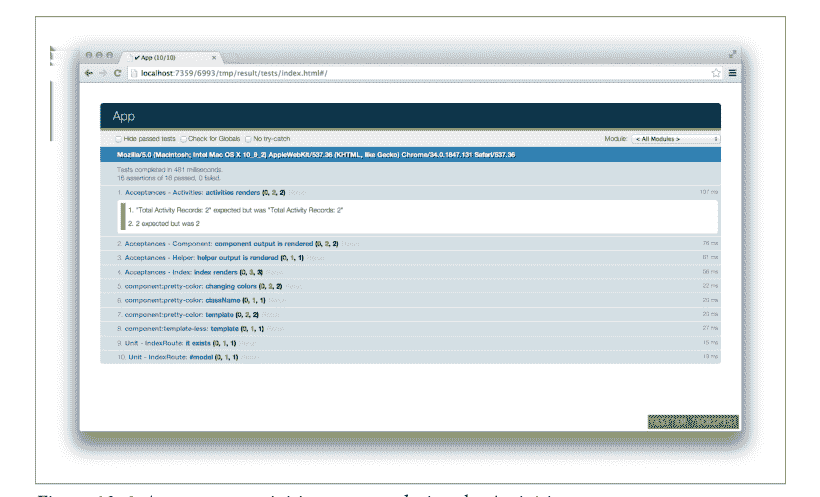
图 10-6. 验收测试通过：渲染 Activities 页面

EAK 附带了一个单元测试路由 model 钩子的简单示例，但你可能注意到数据是硬编码的，或者是作为返回的值数组进行“模拟”的：

```javascript
export default Ember.Route.extend({
    model: function() {
        return ['red', 'yellow', 'blue'];
    }
});
```

但是，当我们的路由实际调用 Ember Data 存储（如 Activities 路由中的 model 钩子）时会发生什么：

```javascript
export default Ember.Route.extend({
    model: function() {
        return this.get('store').find('activity');
    }
});
```

当我们从 Ember Data 返回数据时，有许多不同之处。model 钩子不再局限于返回一个值数组；现在代码“调用”了 Ember Data 的 `find()`，上下文穿过实现，最终返回一个 promise。因为返回的是一个 promise，所以这个钩子的值需要被解析和处理，这与简单返回值数组不同。换句话说，这个 model 方法调用现在变成了一个异步操作。

这给我们的测试策略带来了一些问题。

首先，我们是想使用 `FixtureAdapter` 还是 `RESTAdapter` 来获取数据？或者，我们是否想将此功能隔离到手动创建的模拟对象中，从而消除与 Ember Data 适配器的任何交互？

答案在于我们打算测试什么，我们将在其他测试（如全栈、集成测试）中测试什么，甚至可能在我们的自动化系统测试中测试什么。这是测试策略辩论可能变得激烈的一个领域。

通常，我们的单元测试应该维护自己的、一致的测试数据以执行测试。这很重要的一个原因是，以便测试在不同环境中是可移植且可重复的。

另一个原因是为了使我们测试的功能被隔离到我们正在测试的单元中，而不受另一层（如网络或数据库）的影响。

在这样类型的应用程序中，这一点存在争议的地方在于，这些固定装置在哪个层级可以被认为是可接受的隔离级别。如果你一直在跟进，你知道我们目前在 Express 应用中的服务器上*硬编码*了固定数据。你也知道，通过 Ember Data 的强大功能，我们能够切换适配器并使用 `FixtureAdapter`，基本上消除了网络往返。

为了本教程的目的，我们将假设我们的服务器端固定装置对于集成测试是可以接受的，而对于我们的单元测试，我们将在客户端固定装置中管理数据。

#### 使用 Ember-Qunit

Ember-Qunit 之所以重要的一个原因是，它提供了一些过去必须手动完成的设置样板代码。

Ember-Qunit 提供了三个辅助函数：`moduleFor()`、`moduleForComponent()` 和 `moduleForModel()`。

理解 Ember-Qunit 好处的最佳方式或许是看看在拥有 `moduleFor()` 之前我们不得不如何编写测试设置模块：

```javascript
module('Unit - ActivitiesRoute', {
  setup: function() {
    var container = isolatedContainer([
      'route:activities'
    ]);
    route = container.lookup('route:activities');
  }
});
```

过去，你可以看到我们必须创建一个新的 `isolatedContainer`，然后直接在容器上查找路由。现在功能已经被抽象到 `moduleFor()` 包装器中。同样的设置现在代码量大大减少了：

moduleFor('route:activities', "Unit - ActivitiesRoute");

它的运作方式类似，但隔离容器的查找和管理是在“幕后”进行的。

我们测试的对象现在通过 `subject()` 方法返回。因此，我们可以在测试中像这样访问 ActivitiesRoute：

```
import Activities from 'appkit/routes/activities';

test("it exists", function(){
  ok(this.subject() instanceof Activities);
});
```

这就是基本思路，接下来的章节我们将深入探讨 Ember-Qunit 的另外两个辅助函数：`moduleForComponent()` 和 `moduleForModel()`。

#### 单元测试路由

既然我们已经了解 Ember-Qunit 简化了我们的设置，那么让我们来剖析剩下的代码。在 `tests/unit/routes/activities-test.js` 文件中，我们需要从 Ember-Qunit 模块导入 `test` 和 `moduleFor` 函数，并导入 `ActivitiesRoute`。然后，将要查找的对象（此处为 `route:activities`）传递给 `moduleFor()`，接着我们可以为测试添加一个有意义的描述，比如 "Unit - ActivitiesRoute"：

```
import { test, moduleFor } from 'ember-qunit';
import Activities from 'appkit/routes/activities';

moduleFor('route:activities', "Unit - ActivitiesRoute");
```

然后，我们的前两个测试将断言该路由在容器内存在，并且它是 `ActivitiesRoute` 的一个实例：

```
test("it exists", function(){
  ok(this.subject());
  ok(this.subject() instanceof Activities);
});
```

在此提交中查看变更。

目前看起来不错。接着，我们将通过创建一个简单的 mock store 并定义 `find()` 方法来隔离路由的 `model` 钩子。然后我们将 store 分配给路由的 `store` 属性。`find()` 简单地返回一个包含单个数据对象的数组，我们从 Activity 模型的 `FIXTURES` 中手动复制了该数据：

```
test("#model", function(){

  var store = {
    find: function() {
      return [{
        id: 0,
        display_id: 'Activity1',
        type: 'song',
        display_name: 'On The Road Again',
        hotttnesss: 54,
        timestamp: 'Fri Dec 06 2013 01:05:03 GMT-0600 (CST)'
      }]);
    }
  };

  var route = this.subject();

  route.set('store', store);

  deepEqual(route.model(), [{
    id: 0,
    display_id: 'Activity1',
    type: 'song',
    display_name: 'On The Road Again',
    hotttnesss: 54,
    timestamp: 'Fri Dec 06 2013 01:05:03 GMT-0600 (CST)'
  }]);

}));
```

在此提交中查看变更。

### 使用 Fixtures

如果我们不小心，这可能是一个会引发测试争议的领域；但为了完成这些简单的测试，我们想让事情变得简洁一些。单元测试的定义决定了它应该让我们的代码尽可能地隔离，因此一些开发者可能会认为前面的示例确保了这种隔离性。其他人可能会认为他们不想在两个不同的位置管理相同的数据。但我们知道模型 fixtures 是在应用程序其他地方维护的简单数组（在这个例子中，我们在 Activity 模型 `appkit/models/activity.js` 中声明了它们），因此导入 fixture 数据并在我们的测试中重用它是有意义的。

这是我们测试中的示例数据：

```
var Activity = DS.Model.extend({
  display_id: DS.attr('string'),
  type: DS.attr('string'),
  display_name: DS.attr('string'),
  hotttnesss: DS.attr('number'),
  timestamp: DS.attr()
});

Activity.FIXTURES = [
  {
    id: 0,
    display_id: 'Activity1',
    type: 'song',
    display_name: 'On The Road Again',
    hotttnesss: 54,
    timestamp: 'Fri Dec 06 2013 01:05:53 GMT-0600 (CST)'
  },
  {
    id: 1,
    display_id: 'Activity2',
    type: 'artist',
    display_name: 'Willie Nelson',
    hotttnesss: 99,
    timestamp: 'Fri Dec 06 2013 01:05:53 GMT-0600 (CST)'
  }
];

export default Activity;
```

在此[提交](this commit)中查看变更。

现在通过导入这些数据，我们可以开始使用这些数据了。`FIXTURES` 对象此时就是一个数组，因此在我们的路由单元测试中使用它是安全的。

同时注意，我们没有使用 `Activity` 模型类，以免在我们的隔离 ActivitiesRoute 单元测试中引入另一层功能：

```
import { test, moduleFor } from 'ember-qunit';
import Activities from 'appkit/routes/activities';
import Activity from 'appkit/models/activity';

moduleFor('route:activities', "Unit - ActivitiesRoute");

test("it exists", function(){
  ok(this.subject());
  ok(this.subject() instanceof Activities);
});

test("#model", function(){

  var store = {
    find: function() {
      return Activity.FIXTURES;
    }
  };

  var route = this.subject();

  route.set('store', store);

  deepEqual(route.model(), Activity.FIXTURES);
});
```

在此[提交](this commit)中查看变更。

#### 单元测试模型

最后，是时候设置并测试我们的模型了。首先为这些测试创建一个新目录，名为 `tests/unit/models/`。然后，在该目录中创建 `activity-test.js`。

在我们的设置中，我们可以利用 Ember-Qunit 的 `moduleForModel` 方法：

```
import { test, moduleForModel } from 'ember-qunit';
import Activity from 'appkit/models/activity';

moduleForModel('Activity', "Unit - Activity");
```

首先，我们可以检查模型的存在：

```
test("it exists", function(){
  ok(this.subject() instanceof Activity);
});
```

接着我们开始检查 `Activity` 模型属性的值是否符合我们的预期。注意我们继续在模型定义文件中的一个地方管理数据：

```
test('#properties', function() {

  var activity = this.subject(Activity.FIXTURES[0]);

  equal(activity.get('display_id'), 'Activity1');
  equal(activity.get('type'), 'song');
  equal(activity.get('display_name'), 'On The Road Again');
  equal(activity.get('hotttnesss'), 54);
  equal(activity.get('timestamp'), 'Fri Dec 06 2013 01:05:53 GMT-0600 (CST)');
});
```

在此[提交](this commit)中查看变更。

### 总结

在本章中，我们首先介绍了我们的目标：建立一个简单、快速且提供可读测试的测试环境。在此过程中，我们设置了 Testem 测试运行器，使用 CORS 配置应用程序以用于集成测试，介绍了 Ember-Qunit 的基础知识，在单元测试中隔离了功能，并使用客户端 fixtures 模拟了一些数据。

## 索引

### 符号

-   `.get()`, 90
-   `.hbs` 文件, 50
-   `.set()`, 90
-   404（资源未找到）错误, 20, 156
-   `<script>` 标签, 50
-   `{{action 辅助函数}}`, 59
-   `{{each}}` 辅助函数, 56
-   `{{else}}` 辅助函数, 58
-   `{{if}}` 辅助函数, 58
-   `{{input}}` 辅助函数, 53
-   `{{link-to}}` 辅助函数, 52
    -   通过 getters 和 setters 访问, 100
-   action 属性, 88
-   绑定, 60
-   可配置, 149
-   data 属性, 97
-   数据绑定及, 16
-   在 JavaScript 中, 8
-   link-to 辅助函数及, 53
-   nicknames 属性, 58
-   通过数据类型传递, 133
-   使用 Serializer 转换值, 110

### A

-   抽象层, 103, 109
-   action 属性, 88
-   `{{action 辅助函数}}`, 59
-   活跃生成, 72
-   活动状态, 103
-   活动视图, 103
-   AJAX（异步 JavaScript 和 XML）, 5, 99
-   all() 过滤器, 110
-   有雄心的 Web 应用程序
    -   架构, 5
    -   示例, 2
    -   长期运行, 4
    -   有状态性, 2
    -   与传统应用对比, 2
-   app.js, 12
-   Application 对象, 17
-   应用程序状态, 67, 85, 153
-   ApplicationController, 86
-   属性

### B

-   后端（参见 Ember 后端）
-   样板代码生成（参见 Ember Generator）
-   绑定属性, 60
-   Bower, 33
-   失败的测试, 150
-   browserify 项目, 23

### C

-   Chrome，使用 Ember Inspector 调试, 38
-   click(), 153
-   “可点击”按钮, 87
-   客户端集成测试
    -   活动路由测试, 155
    -   辅助函数, 152
    -   首页测试, 153
-   代码生成器, 16
-   代码复用, 137
-   组件, 137
-   计算属性, 89
-   Controller API, 67
-   控制器
    -   添加 action 引用, 87
    -   在 Rails 中生成, 128
    -   序列化及, 88
    -   处理的任务, 85
    -   局部瞬态变量, 86
-   CORS（跨域资源共享）, 157
-   css（文件夹）, 11
-   currentPath(), 153
-   currentRouteName(), 153
-   currentURL(), 153

### E

-   EBF（Ember 持久化基础）, 103
-   Echo Nest（音乐智能服务）, 46, 83
-   `{{else}}` 辅助函数, 58
-   Ember App Kit (EAK)
    -   概述, 24
    -   使用其进行测试, 148
    -   使用其进行单元测试, 158
    -   与 Express.js 一起使用, 118
-   Ember 后端
    -   使用的协议, 117
    -   RESTful Web Service APIs
        -   Ember App Kit (EAK) 与 Express.js, 118
        -   Ember Data RESTAdapter, 118
    -   Ruby on Rails
        -   添加 Ember, 130
        -   优势, 123
        -   Gemfile 更新, 125
        -   生成初始应用程序, 124
        -   安装, 124
        -   MVC/SPA, 127
        -   运行测试, 129
        -   RVM（Ruby 版本管理器）, 123
        -   移除 TurboLinks, 126
-   D3.js 库, 141
-   data 属性, 97
-   数据绑定, 15
-   数据持久化
    -   抽象层
        -   Data Store, 109
        -   FixtureAdapter, 111
        -   LocalStorageAdapter, 111
        -   Serializer, 110
    -   基本客户端内存示例, 100
    -   客户端库
        -   EBF（Ember 持久化基础）, 103
        -   Ember Data, 102
        -   Ember Model, 102
        -   Ember RESTless, 103
-   Ember 组件
    -   D3.js 库, 141
    -   扩展 Ember.Component, 140
    -   模板创建, 138
-   Ember Data
    -   模型, 104
    -   概述, 102
    -   RESTAdapter, 118
    -   路由器设置, 103
    -   处理的任务, 103
    -   基于用户交互的持久化, 106
-   调试
    -   Activities Route, 157
    -   MVC 设计对调试的优势, 6
    -   控制台中的路由, 70
    -   使用 Ember Inspector, 38
-   Ember Data Adapters, 117
-   Ember Data Store, 109
-   Ember Generator
    -   安装, 28
    -   安装依赖项, 27
    -   概述, 23, 27
    -   运行, 29
-   deleteRecord() 方法, 109
-   开发者体验, 8
-   开发者工作流程（参见工作流管理）
-   DS.Store, 109
-   动态路由, 75
-   动态片段, 76
-   Ember Inspector, 38
-   Ember Model, 102
-   Ember 对象
    -   分配属性, 90
    -   创建, 100

### E

-   `{{each}}` 辅助函数, 56
-   Ember Rails
    -   active model serializer 及, 132


## 使用 assets 进行管理, 123

概述, 24

Ember RESTLess, 103

Ember Tools, 23

Ember-Qunit, 150, 160

### Ember.js

由 Ember Generator 生成的基础应用程序, 32

优势, 7, 19

开发, 7

下载, 11

入门视频, 11

Hello World 示例代码, 18

其中的命名约定, 40, 75

打开, 12

入门套件内容, 11

### 错误/错误消息

404/文件未找到, 20

404/资源未找到, 156

带有 Promises 的控制台错误, 80

跨域请求, 157

动态路由与错误, 75

jquery-rails gem 版本, 132

使用 Promises 进行管理, 102

视图中未捕获的错误, 107

加载路由时出错, 105

ES6 (EcmaScript 6), 24, 80

事件监听器, 87

Express.js, 9, 118

## F

文件未找到 (404) 错误, 3, 20

fillIn(), 153

filter() 方法, 110

find(), 153

findAll() 方法, 101

Firefox，使用 Ember Inspector 进行调试, 23

FixtureAdapter, 111

fixtures, 162

## G

Gemfiles, 125, 130

.get(), 90

getById(), 110

getJSON(), 102

gets, 101

Git 版本控制, 25

### Grunt.js

构建、运行和测试命令, 35

grunt.initConfig, 34

grunt.loadNpmTasks, 35

grunt.registerTask(), 34

Gruntfile.js, 34

由其执行的任务, 34

## H

Handlebars.js, 4

.hbs 文件, 50

热力图 (Heat Maps), 141

Hello World 示例

helpers，创建自定义 helper, 62

History API, 67

### HTML

由 Ember Generator 创建的样板代码, 31

模板原型 (mock-ups), 47

超文本传输协议 (HTTP), 2

## I

{{if}} helper, 58

index.html, 11, 31, 127

IndexRoute, 71

{{input}} helper, 53

### 集成测试

activities 路由测试, 155

helpers, 152

首页测试, 153

## J

jquery-rails 版本, 132

js (文件夹), 12

## K

keyEvent(), 153

## L

libs (文件夹), 12

{{link-to}} helper, 52

列表, 56

LocalStorageAdapter, 111

日志记录, 70

## M

原型 (mock-ups), 47

Model 类, 78

model() 方法, 77, 81, 90-97

模型-视图-控制器 (MVC) 模式, 6

- model.save(), 109
- Ember Data 中的 models, 104
- 模块化设计模式, 33, 103
- moduleFor(), 160
- moduleForComponent(), 160
- moduleForModel(), 160
- 瞬间状态 (moment-to-moment state), 85
- MVC (模型-视图-控制器) 架构, 127

## N

- nicknames 属性, 58
- Node.js, 9, 118
- normalize.css, 11

### 路由器

- 在其中声明 URL, 18
- 默认映射和路由, 71
- 动态路由, 75
- 路由与模型(s)的匹配, 76
- Model 类与路由器, 78
- model() 方法与路由器, 81
- 概述, 17
- Promises 特性与路由器, 80
- Ember.js 中的路由, 69
- RSVP.js 库, 80
- 序列化和反序列化, 68

- RSVP.js 库, 80

## O

- Object 类, 78
- 对象关系映射 (ORM), 8
- 面向对象编程 (OOP), 5

### Ruby on Rails

- 添加 Ember, 130
- 优势, 123
- 检查安装位置, 27
- 开发, 9
- Gemfile 更新, 125
- 生成初始应用程序, 124
- 安装, 124
- MVC/SPA, 127
- 移除 public/index.html, 127
- 运行测试, 129
- RVM (Ruby Version Manager), 123
- 移除 TurboLinks, 126

## P

- 页面, 67
- Promises, 80, 90-97, 102
- public/index.html, 127

### Python

- 下载/安装, 14
- 启动, 14

- RVM (Ruby Version Manager), 123

## Q

- QUnit, 150

## S

## R

- RecordArray, 110
- 红-绿-重构 (Red, Green, Refactor) 循环, 150
- 渲染逻辑, 85
- reopenClass, 101
- require 语法, 32
- 资源未找到 (404) 错误, 156
- RESTAdapter, 118
- RESTful Web 服务 API, 118

- `<script>` 标签, 50
- 关注点分离, 33
- 序列化, 67, 88
- Serializer, 110
- .set(), 90
- sets, 101
- SimpleHTTPServer, 13
- SPA (单页应用程序), 5, 127
- SproutCore, 7
- 存根 (stubs), 118
- style.css, 11

### RockNRollCall 应用程序

- 功能概述, 45
- GitHub 仓库检出, 25
- 对应的路由器、路由和模型, 67
- 模板创建概述, 46

### 路由器

- 活动生成与路由器, 72
- 优势, 67
- 在控制台中调试路由, 70

## T

- TDD (测试驱动开发), 150

### 模板

- {{action}} helper, 59
- 绑定属性, 60
- 自定义 helpers, 62
- {{each}} helper, 56
- Ember 组件的模板, 138
- RocknRollCall 应用程序的模板, 46
- Handlebars.js, 48
- .hbs 文件与 `<script>` 标签对比, 50
- HTML 原型 (mock-ups), 47
- {{if}} 和 {{else}} helpers, 58
- 入门套件中的模板, 12
- {{input}} helper, 53
- 变量, 51
- {{link-to}} helper, 52

Testem 测试运行器, 150

### 测试

- 测试样板文件, 148
- 客户端集成测试
  - activities 路由测试, 155
  - helpers, 152
  - 首页测试, 153
- 概述, 147
- Testem 测试运行器, 150
- 单元测试
  - Ember-Qunit, 160
  - 模型 (models), 164
  - 概述, 158
  - 路由 (routes), 161
  - 使用 fixtures, 162

瞬时状态 (transient state), 85

triggerEvent(), 153

TurboLinks, 126

Twitter Bootstrap, 49

- 使用 fixtures, 162
- 无序列表, 56

### URLs

- 在路由器中声明, 18
- 路由 URL 哈希 (hash), 20
- 序列化/反序列化与 URL, 68
- 使用 URL 序列化应用程序状态, 67
- 捕捉用户交互, 59

## W

- 瀑布式设计方法, 47
- Web 应用程序, 雄心勃勃的 (见 ambitious web applications)
- Web Components 规范, 137
- 线框图 (wireframes), 47

### 工作流管理

- Bower, 33
- Ember Generator, 27
- Git 版本控制, 25
- Grunt.js, 34
- Yeoman, 26

## X

### XMLHttpRequest (XHR)

- 优势, 3
- 开发, 3
- HTTP 请求端点, 109

## U

### 单元测试

- Ember-Qunit, 160
- 模型 (models), 164
- 概述, 158
- 路由 (routes), 161

## Y

### Yeoman

- Ember Generator (见 Ember Generator)
- 概述, 26

## 关于作者

**Jesse Cravens** 是 frog 公司的首席 Web 工程师。他在那里与世界领先的公司合作，帮助他们设计、工程化并向市场推出有意义的产品和服务。他在 Web 应用程序开发方面拥有深厚的背景，近期专注于单页 Web 应用程序架构、移动 Web 和 HTML5。Jesse 的第一本书[《HTML5 Hacks》](http://html5hacks.com/) (O'Reilly, 2012) 已被翻译成包括中文和日文在内的多种语言，他曾在 SXSW Interactive, Fluent Conf, Future Insights, Code PaLOUsa 和 Øredev 等国际会议上发表演讲。

他此前在 USAA 担任高级开发和技术管理职位，领导一个移动应用程序开发团队，为全球部署的 800 万 USAA 会员规划、设计、开发、测试、实施和维护行业领先的 iOS, Android, Blackberry 和移动 Web 应用程序。

Jesse 在赖斯大学 (Rice University) 获得艺术学士学位，并在圣安东尼奥德克萨斯大学 (University of Texas at San Antonio) 获得课程与教学硕士学位。

您可以通过 [http://jessecravens.com](http://jessecravens.com) 或 Twitter [@jdcravens](http://twitter.com/jdcravens) 在网上找到 Jesse。

**Thomas Q Brady** 和许多人一样，在孩提时代从一台 Commodore 计算机（是 Vic 20，而不是 64）开始接触计算机。在很小的时候，他就通过随机附带的书籍自学了 BASIC，随后经历了一段奇特的路径：从 Visual Basic 转向全语言 Web 开发。尽管他获得了心理学和哲学学位，但这一系列爱好最终变成了他的职业。Thomas 为从哈佛商学院出版社到迪士尼，再到标准普尔 (Standard and Poor’s) 的客户开发过原生桌面应用、移动应用和 Web 应用程序。

自 2014 年 3 月起，Thomas 担任 Reaction, Inc. 的技术总监。

Thomas 在 [Bash Modern Quantity](http://bashmoderquantity.com/) 撰写博客，并在 Twitter 上使用 [@thomasqbrady](http://twitter.com/thomasqbrady) 发布消息。

## 版权页

*Building Web Apps with Ember.js* 封面上的动物是西欧睡鼠 (*Muscardinus avellanarius*)，原产于北欧和小亚细亚，通常发现于落叶林和浓密的树篱中。它是英国群岛唯一原产的睡鼠，因此在英国资料中通常简单地被称为“dormouse”。

睡鼠可以通过其粗大的毛茸茸尾巴、亮金褐色的皮毛和硕大的黑眼睛轻松识别。它们体长约 70 毫米，尾巴长度与之相当。它们是夜行性动物，在清醒时间的大部分时间里都待在...


树枝间寻找食物：它们吃浆果、坚果和其他果实，其中榛子是冬眠前增肥的主要食物。

这种动物的古英语名字是"沉睡者"，因为睡鼠通常在初霜时就开始冬眠，通常是在十月和十一月，直到次年四月或五月才会再次活跃。冬眠的巢穴建在地面或接近地面的地方，动物蜷缩成一团入睡。它们的体温会降至与周围环境相同的温度，心率和呼吸频率通常会降低90%甚至更多。

过去一百年间睡鼠数量大幅下降的主要原因是其林地栖息地的丧失和破碎化，以及林地管理方式的改变。睡鼠受法律严格保护，不得以任何方式采集、出售或干扰。

O'Reilly 封面上的许多动物都濒临灭绝；它们对世界都很重要。如需了解更多关于如何提供帮助的信息，请访问 [animals.oreilly.com](https://animals.oreilly.com)。

封面图片来自 Shaw's Zoology。封面字体为 URW Typewriter 和 Guardian Sans。正文字体为 Adobe Minion Pro；标题字体为 Adobe Myriad Condensed；代码字体为 Dalton Maag 的 Ubuntu Mono。
