# JavaScript 构建 Windows 8 应用程序


## 对《使用 JavaScript 构建 Windows 8 应用》的赞誉

> “这将是你库中必须拥有的 Windows 8 应用书籍！它行文流畅，专业地涵盖了为 Windows 8 构建 HTML/JS 应用的方方面面！”
—Jonathan Antoine，Infinite Square 及微软 MVP

> “对 Windows 8 应用开发的极佳介绍。在 XAML 领域深耕多年之后，这本书让我想要考虑 JavaScript/HTML 路线。”
—Shawn Wildermuth，微软 MVP (Data)，作者、培训师和演讲者，www.wilderminds.com

> "你现在手中拿的是一份关于如何为 Windows 8 使用 HTML 和 JavaScript 构建、发布并从中获利的应用的卓越指南。虽然在过去的两年里我一直在从事 Windows 8 的工作，但我可以坦诚地说，我从这本书中学习到了该平台的一些新部分，并迫不及待地想构建一个使用这些功能的应用。”
—摘自 Chris Anderson 的序言，微软公司 Windows JavaScript 库首席工程师。

> “Chris 和 Brandon 触及了 Windows 8 编程的核心，创作出了一本清晰、简洁且易于理解的教程，它应该出现在每一位 Windows 8 程序员的书架上。如果你正在使用 HTML 和 JavaScript 为 Windows 8 编程，这就是你需要的那本书。”
—Jesse Liberty，Telerik Windows 8 技术布道师

> “我觉得这本书将成为任何致力于构建出色 Windows 8 应用的人必须阅读的参考书，并且将成为其他所有书籍对比的基准。是的，这是一个相当大胆的陈述，但考虑到两位作者长期以来都深度参与了 Windows 8 应用开发，尤其是他们在微软期间，我对这个陈述充满信心。”
—摘自 Rey Bango 的序言，微软公司开发者关系。

> “这是我读过的关于使用 JavaScript 构建 Windows 8 应用且写得最好的书。它是一个极宝贵的资源，帮助我将构建大型 JavaScript 应用和厚客户端应用的经验转移到 Windows 8 环境中。Chris 和 Brandon 极其出色地解释了这仅仅是 HTML、JavaScript 和 CSS，同时提炼了在原生 Windows 应用环境中运行 Web 技术的全部复杂细节和微妙之处，并发挥了 WinRT 及其 JavaScript 扩展的全部威力。”
—Derick Bailey，独立顾问、录屏专家、演讲者和作者，http://mutedSolutions.com 和 http://watchmecode.net

> “Chris 和 Brandon 在解释如何创建出色的 Windows 8 应用方面做得非常出色。在阅读本书时，我学习到了关于该平台的很多知识。”
—Josh Williams，微软公司 WinJS 首席开发负责人。

访问 informit.com/mswinseries 查看可用出版物的完整列表。

Windows 开发系列源自 2002 年建立的屡获殊荣的微软 .NET 开发系列，旨在为专业开发人员提供关于最新 Windows 开发技术最全面且最实用的覆盖。原系列已扩展，不仅包含 .NET，还包含所有主要的 Windows 平台技术和工具。它由微软开发技术的领导者和专家支持并开发，包括微软架构师、MVP 和 RD 以及行业领先的知名人士。本系列中的书籍和资源提供了每位开发人员编写高效的 Windows 应用及相关微软开发技术所需的核信息资源和理解。

> “对于目标平台为微软平台的开发人员来说，这是一个伟大的资源。它涵盖了所有基础，从专家视角到参考指南和操作指南。对于那些想要审慎扩展其知识和专业技能的人来说，本系列书籍是必读书目。”
— JOHN MONTGOMERY，微软项目管理首席总监

> “每当我想要快速掌握新技术时，这个系列总是我的首选。随着其职责扩展到 .NET 之外的整个 Windows 平台，这个系列变得越来越好，对于现代 Windows 开发人员来说也越来越相关。”
— CHRIS SELLS，Telerik 开发工具部门副总裁

请务必与我们联系！
informit.com/socialconnect


# Chris Anderson 前言

Windows 8 代表了微软开发者生态系统的重大变革。虽然 Windows 8 中以消费者为导向的变革最受瞩目（新用户体验、触摸、平板电脑等），但其核心是颠覆性的转变。在 Windows 8 中，开发者可以选择多种编程环境来构建他们的作品：DirectX、XAML 和 HTML。除此之外，现在还内置了产品变现平台。

在过去的两年里，我一直担任 Windows Library for JavaScript（即 WinJS）的开发负责人和架构师。当我们最初考虑让 HTML 和 JavaScript 成为构建原生 Windows 应用的一流平台时，我们面临的最大挑战之一就是如何平衡基于标准的 HTML/JS 世界与 Windows 原生平台特性之间的关系。随着 Windows 运行时 (WinRT) 的出现，我们有了将新功能简单集成到 Web 平台的技术工具，但在坚守标准和创新之间始终存在张力。

我们 WinJS 团队的座右铭是"按标准编码"，我们在 WinJS 的实现中非常谨慎地使用 WinRT 功能。我们认为，让应用开发者自己决定应该依赖多少平台功能会更好。


## 克里斯·安德森的前言

JavaScript 也是一个由异构工具包组成的世界。人们常常混合使用 jQuery、require、Modernizer 和 Backbone 来完成工作。在构建 WinJS 时，我们试图构建一套工具包，使其能够与其他现有工具包进行匹配和组合。你可以在 WinJS ListView 中轻松使用 Knockout 作为绑定解决方案；你也可以将 jQuery UI 控件轻松插入 WinJS 的声明式控件处理流程中。有些地方我们构建了大型工具包（ListView 是最明显的例子），而在另一些地方，我们则提供了非常小巧的工具包（例如 base.js 中包含的 CommonJS Promise/A 实现）。

在构建 WinJS 的过程中，我们不断调整设计模式，试图更无缝地融入 JavaScript 社区现有的惯例。我记得我们早期的模式之一是尝试冻结和封装许多构造函数的原型定义。我们很快收到反馈，指出 JavaScript 开发者并非这样操作。于是我们转向了可变原型，并认识到在运行时能够动态修改定义的强大之处。

我有幸与 Chris Sells 在微软共事多年。我从未与 Brandon Satrom 共事过，但从本书的质量来看，我猜想他与 Chris Sells 一样，对开发者充满热情，热爱编程和写作的艺术。

你现在手中的这本书，是一本关于如何使用 HTML 和 JavaScript 为 Windows 8 构建、发布并从中获利的应用程序的出色指南。虽然我在过去两年里一直从事 Windows 8 的开发工作，但我可以诚实地说，我从这本书中学到了关于这个平台的新知识，并且迫不及待地想构建一个应用来运用它们。

希望你喜欢阅读它，并祝编码愉快！

—克里斯·安德森
微软公司杰出工程师，Windows JavaScript 库
2012年8月

## 雷伊·邦戈的前言

现在是开发者前所未有的好时代。在我信息技术领域20多年的职业生涯中，互联网为程序员开辟了比以往任何时候都多的机遇。回想起学习一项新技术，尤其是编程语言，曾是一件相当艰巨的任务，需要翻阅晦涩的手册，面对闪烁的单色显示器和体积堪比小电视的阴极射线管，我不禁感到一丝（带着些许怀念的）畏缩。但互联网改变了一切，让我们可以通过各种联网设备随时随地学习，并在眨眼间获取海量信息。

当开发者从中受益时，真正的受益者是那些普通的日常计算机用户。他们不再需要依赖白页或黄页寻找本地水管工，不再需要专用的 GPS 获取路线，也不再需要 DVD 播放器来观看精彩的电影。互联网让我们所有人都能比历史上任何时候都保持更好的连接，而这正是我们——开发者的聪明才智所实现的。

随着消费者变得越来越精明，他们的需求和要求也在提高。他们想要更快地获取信息，并且希望信息在不同设备上都能以清晰简洁的方式呈现，这样他们就不必每次拿起手机或打开电脑时都重新学习如何操作。

这就是 Windows 8 的美妙之处。它旨在为所有体验带来统一性和连贯性，让消费者能够轻松愉快地以一致、流畅的方式找到他们想要的信息。而最棒的部分在于，开发者有机会通过 Windows 8 应用生态系统来塑造这些出色的体验。

Windows 8 用户已经习惯于保持连接，而应用程序在为他们所依赖的信息和服务提供独特体验方面发挥着重要作用。凭借数亿 Windows 用户的装机基础，Windows 8 应用开发者处于一个绝佳的位置，不仅能提升消费者的体验，还能利用一个提供技术与变现框架的新平台来构建成功且盈利的业务。并且，随着微软加入了使用 JavaScript、HTML 和 CSS 构建这些应用的能力，这个平台也为那些精明的、同样希望抓住这一机遇的 Web 开发者敞开了大门。

我有幸与 Chris Sells 和 Brandon Satrom 在微软共事。当他们邀请我为他们的书写前言时，我深感荣幸，可以毫不犹豫地说我立刻就答应了。我知道他们会创作出一本能为那些致力于利用 Windows 8 平台的开发者带来即时价值的作品。在花时间审阅书稿后，我觉得这本书将成为任何致力于构建优秀 Windows 8 应用的人的必读参考，并将成为其他所有书籍的比较基准。是的，这是一个相当大胆的说法，但考虑到两位作者在 Windows 8 应用开发领域深耕多年（尤其是在微软任职期间），我对这个说法充满信心。

—雷伊·邦戈
微软公司开发者关系部
2012年10月

## 前言

人造之物有着某种独特的美感。在某些方面，这种美感无法与自然相比。但在另一些方面，这种美感是无与伦比的，因为它展现了人类凭借自身双手所能达到的最佳品质。

艺术和建筑是常被引用的人造之美典范，我们认可这一点，并将社会和经济回报赋予那些最能体现人类创造精神——甚至是无限意志——的创造物。

但在人造之美的领域中，存在一个更简单却更普遍的证明：那就是舒适与熟悉之美，是一种无论身处何地都感觉归属所在的美。这种美感之所以更有意义，是因为它关乎我们所有人根深蒂固的社会需求。它常常显得不那么重要，因为它如此微妙，而且只有在需求未被满足时，我们才会敏锐地意识到它的存在。

想象一下，你身处一个陌生的机场或一座不熟悉城市的地铁站。现在假设你刚下火车或飞机，只有有限的时间从当前登机口赶到下一个登机口。你会往哪里走？如何获取信息？

如果你对这样的场景和经历有亲身记忆，回忆起来甚至可能引发身体反应：瞳孔放大、心率加快、手心出汗、呼吸急促。压力。焦虑。

陌生感催生了对熟悉感的需求，那么你会怎么做？如果你是与朋友或家人同行，压力会减轻一些，但任务依然存在。你会怎么做？

你会寻找熟悉感——寻找那些能让你安心的线索：指示牌、数字、字母和文字。任何能帮助你找到方向的东西。一个写着 "B Gates" 并指向特定方向的指示牌可能会立即带来解脱。一排显示器屏幕也可能起到同样作用。也许你需要的只是一个指向最近洗手间的简笔人形图标。无论是什么，你都会寻找并倾向于任何能帮助你完成眼前最重要任务的熟悉事物。一旦找到，这些熟悉的事物会将你锚定，带来安慰。

这其中蕴含着美！当数字、字母和符号能够将我们锚定于更深层的现实并指引我们回家时，那就是无与伦比的崇高艺术。

这就是 *Metro*——创造将我们锚定于现实的体验，即使面对陌生和人为环境。进一步说，这些体验不仅仅是尝试将我们的舒适感从一个媒介简单地转置和复制到另一个媒介。我不需要芝加哥的地铁指示牌看起来与曼哈顿或慕尼黑的一模一样。只要存在足够唤起熟悉感的元素，我就会感到舒适。更好的是，我不需要北京男洗手间的指示牌是一张六英尺高白人男性的逼真照片。套用斯科特·麦克劳德的话，符号学之所以强大，不仅因为它是抽象的，更因为它的抽象性使其具有可识别性，而我们与自己能识别的事物联系最为紧密。一个简笔人形就足够了，因为我在其中看到了自己，这提供了熟悉感和舒适感。

Metro 不是 Windows。也不是 Windows Phone。或 Xbox。它不是动态磁贴、黑色背景、Segoe UI 或直角方框。它不是 HTML5、CSS 或 JavaScript。Metro 甚至不是微软。它可以存在于浏览器中，或桌面环境中。它甚至可以存在于 iOS 或 Android 中，因为它从来就不真正关乎某个平台。

- 1. 麦克劳德1994年出版的杰作 *《理解漫画》* 既探讨了视觉传播的艺术与科学，也具体分析了漫画。现在就去买这本书并阅读它；你会感谢我们的。


在当今 Metro 设计语言被日益用来指导开发者在 CSS 中寻找并删除所有 `border-radius` 规则、遵循设计清单，甚至用一系列方框来捕捉设计的时代，我们有必要记住：**Metro**——如同所有伟大的设计构想一样——是为了创造对他人而言美好的事物。它关乎提供一些能将我们锚定于现实、帮助我们找到方向的东西。它关乎创造一些因实用、舒适而显得美好的事物。

你无法通过编码实现 Metro，除非是偶然为之。即便如此，你所创造的东西很可能显得比真实的更显人工。

你甚至无法通过设计达到 Metro 的境界；没有哪个教程、清单或书籍仅仅因为你添加了彩色磁贴、炫酷的翻页效果或桌面日历的数字表现形式，就能提供“Metro 体验”。

所有软件过去和现在都关乎我们工作的受益者，Metro 也不例外。从来不存在一个能为所有情况解锁最大效益的清单或流程，因为真正的价值在于探索的过程。一旦你发现使用你应用的人所需，接下来就轮到你去探索如何最好地满足这一需求。凭借这一探索的结果，Metro 将舒适与熟悉感置于与实用性同等重要的地位。

因此，学习 Metro。阅读设计指南并使用清单。观看视频，并像设计师那样更多地思考，无论你构建的是什么。然而，在所有这些之前，先思考舒适与熟悉感，以及你的应用或网站如何能比其他任何东西更好地提供这些基本的人类需求。

这才是 Metro 真正的意义。

## 一些术语

在 Windows 8 开发过程中，功能和技术的名称发生了变化，因此我想在撰写本书之际（RTM 之后，GA 之前）提供一份最新的指南。

- **Metro 和 Metro 风格**：描述使用 Windows 8、Windows Phone 7、Windows Phone 8 和最新 Xbox 界面时的 UI 和体验的设计语言称为 *Metro*。有一段时间，这个术语被用来描述基于此设计语言构建的新型 Windows 8 应用——即“Metro 风格应用”（不带连字符）。由于德国一家大型连锁超市的缘故，情况已不再如此。

- **Windows Store 应用**：微软用以替代“Metro 风格应用”的术语是“Windows Store 应用”。这指的是新风格的 Windows 8 应用——即不同于自 Windows 95 以来就有的桌面应用——是通过微软新的 Windows Store 部署给用户的。然而，这并非一个非常准确的术语，因为以 Windows Store 风格构建的企业应用根本不是通过 Windows Store 部署的。唉，算了。

- **WinRT 和 WinRT 应用**：Windows Runtime (WinRT) 是所有 Windows Store 应用构建的核心。然而，微软也用这个名称来指代 ARM 版本的 Windows 8 及其运行的平板电脑——例如，WinRT Surface 指的是微软 Surface 平板的 ARM 版本。这本可以成为“新”风格 Windows 8 应用的一个好而准确的名称，但可惜，命运并非如此。

- **现代应用**：你有时会听到的“Windows Store 应用”的另一个名称是“现代应用”，这对任何构建其他类型应用的人（包括在桌面上运行的 Windows 8 应用）都是一种冒犯。希望这个术语不会流行起来。

在本书中，我们主要使用术语“Windows Store 应用”。

## 本书的目的

本书的目标是让你广泛了解构建 Windows Store 应用时所拥有的各种能力。它并非详尽的参考手册，而是对从启动新应用、添加所需功能到发布到 Windows Store 并盈利所需工具、库、概念和技术的概览。

全书中，我们提供了指向在线资源的链接，供你了解更多详情，但最重要的两个是：

http://design.windows.com
http://dev.windows.com

这两个网站是针对 Windows Store 应用的设计与开发的。此外，设计网站是你了解 Metro 设计语言所有内容的地方，尽管你不太可能在网站本身看到这个名称。

## 本书的目标读者

本书面向各类 Web 开发者——jQuery、PHP、ASP.NET、Rails 等等——他们希望理解如何将 Web 知识带到 Windows 8 平台，以构建一流的应用程序。

本书面向设计师，他们希望了解如何基于 Web 技术构建 Windows Store 应用。

本书面向 .NET、Win32、MFC 或 Visual Basic 开发者，他们希望了解如何使用 Web 技术编写下一代 Windows 程序。

本书不适合没有编程经验的开发者。掌握 HTML、JavaScript 和 CSS 的基础知识将对你大有裨益，但如果你对这些技术完全陌生，我建议你阅读书后的附录，这些附录旨在为你在构建 Windows Store 应用时可用的 Web 平台提供实用的基础知识。

简而言之，本书适合任何曾经编写过 Windows 程序或网站，并对为 Windows 8 构建 Windows Store 应用感兴趣的人。

## 示例代码与勘误

本书的示例代码和勘误可在 http://sellsbrothers.com/writing/win8jsbook 找到。

要运行本书的示例代码，你需要 Windows 8 RTM、Visual Studio 2012 RTM 和 Blend for Visual Studio 2012（均可在 http://dev.windows.com 获取）。

## 如何联系作者

**Chris Sells** 是 Telerik 开发工具部门的副总裁。可通过以下方式联系：

-   电子邮件：csells@sellsbrothers.com, Chris.Sells@telerik.com
-   Twitter：@csells
-   博客：http://sellsbrothers.com

**Brandon Satrom** 是 Telerik Kendo UI 部门的程序经理。可通过以下方式联系：

-   电子邮件：bsatrom@gmail.com, Brandon.Satrom@telerik.com
-   Twitter：@BrandonSatrom
-   博客：http://userinexperience.com

**Don Box** 是微软 XBOX 部门的杰出工程师。可通过以下方式联系：

-   电子邮件：dbox@microsoft.com

## 致谢

**来自 Chris Sells**

这本书对我来说是一段非常漫长的旅程。我于 2010 年 9 月开始撰写，同月我也加入了 Visual Studio 2012 团队，负责为 JavaScript 程序员构建端到端的 Windows 8 故事。我与 Chris Anderson、Josh Williams、Chris Tavares、Jeff Fisher、David Owens、Vijaye Raji、Andy Sterland、Anson Horton 和 Michael Booth 坐在同一条走廊上，他们构成了 WinJS 团队的主体，也是 Visual Studio 2012 团队中负责 Win8 应用 JavaScript 的大部分成员。我记得与 Chris Anderson 争论 WinJS 应用模型，与 David Owens 构建第一个功能齐全的 Win8/JavaScript 模板，与 Michael Booth 重新制作它们，并向 Josh Williams 抱怨 WinJS 中缺乏开发者友好的数据源。（Josh 发明了 binding list，就为了让我闭嘴。）这些家伙在 12 个月内教给我的 Web 平台知识，比我过去 15 年经营自己的网站所学到的还要多。

是 Chris Anderson 拟定了本书的初始大纲。Windows 部门当时正在筹备一个后来成为 Windows 8 的“假日构建版本”。你看，由于“不用即作废”的假期政策，大多数微软员工最终都会在 12 月休假一部分时间。然而，其中许多人都属于 A+ 型人格，实际上无法在不发疯的情况下休那么长时间，因此他们经常在那段时间为了乐趣而编写程序。考虑到这一点，Win8 的假日构建版本需要在 12 月 1 日之前准备好，作为给无聊员工的圣诞袜礼物，我们希望从中收集反馈。为了做到这一点，不仅需要正确的代码位组合，还需要文档让员工入门。安德森先生写了这些文档的初稿，交给我，说：“把这个完成，好吗？”

克里斯写的是一个 20 页的文档，包含“入门”、“布局”、“动画”等部分，每个主题都给出了简短的介绍。我一看这个，心想：“这足够写一整本书了。”于是，在两个月内，Kraig Brockschmidt（因《Inside OLE》而闻名）和我为 JavaScript 程序员写了第一本关于 Win8 的书。本书的第一章最初于 2011 年 9 月在首届 BUILD 大会上发表于 msdn.com，题为“使用 JavaScript 创建你的第一个 Windows Store 应用 (Windows)”。

我告诉你这一切，是为了告诉你：我需要感谢 John Montgomery，感谢 WinJS 和 Visual Studio 2012 团队接纳我、让我感到受欢迎，并让我参与创建一个全新的 Windows 编程平台。这种事大约每十年发生一次，能参与其中是一种荣幸。这本书是那段经历的直接成果，所以你们应该把这当作你们的书——我只是个记录者。

或者更准确地说，我只是我所写部分的记录者。本书有一半是 Brandon 写的，我很感激他做了这件事。除了那次他告诉我，在我写第一本书的 1995 年他还在上高中（混蛋！），他一直是个愉快的工作伙伴。他带来了各种真实的、基于 Web 的 JavaScript 经验，这是我所缺乏的，因此他影响了我所负责章节的很多思考。

然而，Brandon 和我并没有写完整本书。我的老朋友兼同事，公认的 COM 之王，Don Box，撰写了第 12 章“原生扩展性”。表面上看，这一章是关于使用 C++ 扩展你的 JavaScript 应用的，但实际上它是关于两种语言之间被称为 Windows Runtime 的连接组织。

> 1. http://msdn.microsoft.com/en-US/library/windows/apps/br211385 (http://tinysells.com/282).


(我热爱历史，因为历史是让我们关注叙事“当下”的背景故事。无论是虚构作品还是现实生活，皆是如此。毫不奇怪，你即将阅读的这些技术作品同样如此。所以让我给你讲个故事……)

2011年春天，当我还在微软工作时，萌生了写一本书的念头。不是随便什么书，而是一本关于HTML5的书，具体来说是关于网络平台的普及性，以及网络技术超越浏览器、应用于桌面和设备的潜力。当时我并不知道，Windows团队正在为用户和开发者彻底革新其平台。时间快进到2011年9月，作为BUILD大会的参会者，我接触到了Windows 8、WinJS和WinRT。在阿纳海姆度过的那一周里，我意识到自己不仅仅想写一本关于HTML5的书；我想写一本关于如何为Windows 8构建HTML5应用程序的书。

克里斯和我其实在第一次BUILD大会上就见过面，尽管那时我们还没组队写这本书。要知道，克里斯当时已经有了合著者，我只是在他精彩的首日主题演讲后走上前去打个招呼，祝贺他和团队，并就自己写书一事寻求指导和建议。他欣然同意，在我开始规划一本关于Win8的独著书期间，我们聊了几次。（不管他怎么说，我始终坚信克里斯不记得在BUILD大会上见过我。毕竟，我只是一个卑微的网络开发者，而他是克里斯·“COM”·塞尔斯！）

另一件有趣的巧合是，克里斯和我先后相隔不到一个月离开了微软，加入了Telerik公司，并进入了公司的不同部门。正是在这个时候，克里斯正在为这本你现在拿在手里的书寻找合著者。机缘巧合之下，我们重新取得了联系，克里斯让我成为了他的合著者。剩下的，正如人们所说，成了“不朽传说”。或者类似的东西吧。

现在，随着我们进行最后的修订，仔细检查数百页内容以删除所有对“Metro”的提及，第五十次重拍截图，第一百次重新编译代码示例，这本书的背景故事即将告一段落。在这个反思的时刻，我首先要感谢我的合著者，克里斯·塞尔斯。克里斯选择了一个名不见经传的网络开发者，我唯一的写作经验就是为*MSDN*杂志写过的几篇文章和一堆未完成的小说，我对他给予的机会深表感激。我也感谢他在写作过程一开始就如此坦诚。克里斯，你说得非常对：这根本不好玩。然而不知何故，它仍然显得如此值得。

我感到无比荣幸，我的名字能与唐·博克斯和克里斯·塞尔斯的名字一起印在书封上。这感觉既奇妙又不真实。不知为何，我仍觉得我的名字应该只有现在一半大小，并用透明灰色印刷。所有这些都说明：能与这两位男士共事，汲取他们多年来的专业知识，是我的荣幸。

还要感谢迈克尔·温哈特，他是我们这本书的开发编辑。迈克尔和克里斯在我写作过程中都是我绝佳的导师，尤其是在我从杂志篇幅的技术写作过渡到书籍篇幅的技术写作时。我的第一章，第3章“布局”，对我来说是一个早期的挑战，但迈克尔和克里斯不断敦促我重写和修改，直到一个清晰的故事呈现出来。我们三人之间的同行评议过程对我来说是一次宝贵的成长经历，我感谢迈克尔和克里斯推动我做到最好，并在佳作涌现时给予鼓励。

我也要感谢我们的评审人员：克里斯·安德森、乔希·威廉姆斯、乔纳森·安托万和肖恩·怀尔德穆斯。特别感谢乔纳森，他对细节的关注、事实核查能力，以及从Win8的一个预发布版本到另一个预发布版本的平台变化识别能力，不止一次地拯救了我。还要感谢我们的编辑琼·默里。琼，感谢你容忍我们，并确保我们走在正轨上！

最后，我要感谢我的妻子萨拉，以及我的儿子本杰明和杰克。萨拉，你是我的伴侣、我的朋友，也是我一生的挚爱。感谢你认可我的天赋，并鼓励我写作。感谢你在我撰写这本书时支持我，在顺利时与我一同庆祝，在低谷时尽你所能提供帮助。本杰明和杰克，我的儿子们，我爱你们俩，能做你们的父亲是我莫大的福分。

感谢你们在我需要时给予拥抱和亲吻，也感谢你们在我甚至更需要的时刻，用打断和休息让我从写作中抽身。

你们三个：感谢你们在那些因写作而不得不分开的日子里的耐心与理解。那是我欠你们的时间，我打算连本带利地偿还。从现在开始。

*来自唐·博克斯*

唐想感谢迪翁·布鲁伊斯、马丁·古金、赫伯·萨特、扎克·约翰逊和洛加南特·西塔拉曼提供的深思熟虑的反馈，并鼓励洛根不要把那五美元在一个地方花光。

## 关于作者

**克里斯·塞尔斯** (@csells) 是Telerik公司开发工具部门的副总裁。他著有多本书籍，包括*《WPF编程》*、*《Windows Forms 2.0编程》*和*《ATL内部机制》*。在业余时间，克里斯喜欢在微软论坛和邮件列表上“惹人烦”。更多关于克里斯及其各种项目的信息，请访问 www.sellsbrothers.com。

**布兰登·萨特罗姆** (@BrandonSatrom) 是Telerik公司Kendo UI的项目经理，常驻德克萨斯州奥斯汀。作为一名资深的网络开发者，布兰登喜欢谈论HTML、JavaScript、CSS、开源，以及任何能让他从手头工作中分心的闪亮新工具或技术。布兰登在世界各地的活动上演讲，他喜欢与其他充满热情的开发者交流和学习，无论是线上还是线下。他也热爱写作，曾在*MSDN*杂志、*《架构期刊》*和*.net*杂志等出版物上发表多篇文章。可以通过他的博客 www.UserInExperience.com 在线联系布兰登。

**唐·博克斯**，特约作者，是微软的杰出工程师。在微软，唐曾致力于.NET、SQL以及最近Xbox的平台和开发技术。在加入微软之前，唐曾在全球范围内帮助开发者理解COM，包括为Addison-Wesley出版社撰写了*《COM本质论》*。

---

(WinRT)。WinRT是微软备受推崇的组件对象模型的下一版本，那么还有谁比*《COM本质论》*的作者更适合写那一章呢？希望这能激励他有朝一日写出*《WinRT本质论》*。唐，感谢你不仅撰写了那一章，还最初将我引入写作的世界，并向我展示了如何以诚信写作。

我衷心地感谢迈克尔·温哈特，感谢他仿佛用了一生的时间来合著。迈克尔是这个项目的开发编辑，这意味着他定期“督促”我们三个，以确保我们所说的内容真正有意义。迈克尔也是我的老朋友；任何写作项目中最好的部分之一总是与迈克尔合作，因为我坚持没有他就不写。

我还要感谢评审人员：克里斯·安德森、乔希·威廉姆斯、乔纳森·安托万和肖恩·怀尔德穆斯。我特别想感谢肖恩帮助我研究第9章“Shell契约”和第10章“Shell集成”。我的新工作非常繁忙，也为这些章节奠定了很多基础。没有你，肖恩，我无法完成这些章节。

我需要感谢艾迪生-韦斯利出版社的编辑琼·默里。她已经忍受了我两本书的拖延，包括中止的*《Programming Data》*（我写了我的部分——老实说！），以及现在这本。琼有效地融合了“温和”与“强硬”，还带点“祖母般的愧疚感”。这本书能在Windows 8正式发布前夕出版，都是因为琼一直在“鼓励”我。

最后，我需要感谢我的家人，当我不得不从他们身边抽时间来写这本书时，他们如此理解。写了14本书之后（虽然幸运的第13本从未面世），我打算让这本成为我的最后一本。自从塞尔兄弟出生以来，我就一直在做这件事，用他们的名字作为示例程序中的变量，因为即使在我写作时，我也在思念他们。当然，我要感谢我的女朋友米歇尔，在我写这本书时，她带来了家常饭菜；还要感谢她的儿子马库斯，借出了他的名字给我最后的一些示例程序。这是一段美好的旅程，你们都给予了很大的支持，但我不会要求你们再这样做一次了。哦，也许当我安全退休，不再做两份工作（写书和我的本职工作）的时候，我会在海边小屋里琢磨一本小说，但从现在起，我将让下一代来记录随之而来的新技术。
好了，安德森先生。我说完了。

## 来自布兰登·萨特罗姆


# 1 你好，Windows 8！

WINDOWS 8 汇集了多种开发和思考应用开发的方式。如果你想继续使用 WPF/Silverlight、Windows Forms 和/或 DirectX 构建 Windows 桌面应用，你可以自由这样做。同样，如果你想继续使用 ASP.NET、HTML 和 JavaScript 构建网站，你也可以自由这样做。此外，如果你想使用 Silverlight 或 XNA 构建以触摸为中心的 Windows Phone 应用，那也是可以的。

然而，在本书中，我们将专注于如何构建一种全新的应用，它是上述三种现有应用的混合体；这种混合体被称为 Windows 应用商店应用。Windows 应用商店应用类似于桌面应用，因为它安装在你的计算机上，而不是网站。另一方面，Windows 应用商店应用又类似于网站，因为你可以使用 HTML5、JavaScript 和 CSS 来构建它。然而，你不必在服务器端生成 UI，你会看到用于构建 Windows 应用商店应用的 JavaScript 框架和底层的 Windows 运行时（WinRT）允许你构建具有客户端状态、离线存储、控件、模板和绑定的应用，以及一整套其他服务。此外，由于 Windows 8 既是平板操作系统也是桌面操作系统，Windows 应用商店应用既可以像 Windows Phone 应用那样通过触摸使用，也可以像传统桌面应用那样通过键盘和鼠标使用。当然，Windows 应用商店应用最大的特点是它们可以提交到新的 Windows 应用商店，该商店就在全新的 Windows 8 开始屏幕的醒目位置。

## 第一章：你好，Windows 8！

简而言之，Windows 应用商店应用旨在跨不同设备工作，充分利用每种设备的优势，并将桌面、Web 和移动应用的最佳部分融合到单一的用户和开发者体验中，所有这些都来自 Windows 应用商店。在本章中，我们将深入探讨开发者和用户体验，当然重点是前者，毕竟这是一本编程书。

而且因为我喜欢在我的编程书中加入一些编程内容，让我们直接进入正题。

## 你的第一个 Windows 应用商店应用

使用 HTML、JavaScript 和 CSS 构建的 Windows 应用商店应用从一个 HTML 文件开始：

```
<!DOCTYPE html>
<html>
<head><title>Hello, Metro/JS</title></head>
<body><h1>Hello and welcome to Windows Store apps for JavaScript!</h1>
</body>
</html>
```

这份 HTML 如果在网页浏览器中加载，将会产生世界上最无聊的网页。此外，一个网页（或一系列网页、样式、代码、资源等）并不是 Windows 应用商店应用。Windows 应用商店应用包含这些内容，但还包含以下元数据和资源来定义 Windows 8 开始屏幕上的应用：

- 一个**清单文件**，用于描述你的应用，包括名称、描述、起始页等
- 一组大和小**徽标图片**，显示在开始屏幕上
- 一个**商店徽标**，由 Windows 应用商店显示
- 一个**启动画面**，在应用启动时显示

清单文件是一个名为 appxmanifest.xml 的 XML 文件，一个最基本的看起来像这样：

```
<?xml version="1.0" encoding="utf-8"?>
<Package xmlns="http://schemas.microsoft.com/appx/2010/manifest">
  <Identity
    Name="a8c906d0-f878-4bd4-b727-5363ce0bfb52"
    Version="1.0.0.0"
    Publisher="CN=csells" />

  <Properties>
    <DisplayName>hello</DisplayName>
    <PublisherDisplayName>csells</PublisherDisplayName>
    <Logo>images\storelogo.png</Logo>
  </Properties>

  <Prerequisites>
    <OSMinVersion>6.2.1</OSMinVersion>
    <OSMaxVersionTested>6.2.1</OSMaxVersionTested>
  </Prerequisites>

  <Resources>
    <Resource Language="en-US" />
  </Resources>

  <Applications>
    <Application Id="App" StartPage="default.html">
      <VisualElements
        DisplayName="hello"
        Logo="images\logo.png"
        SmallLogo="images\smalllogo.png"
        Description="hello"
        ForegroundText="light"
        BackgroundColor="#000000">

        <SplashScreen Image="images\splashscreen.png" />

      </VisualElements>
    </Application>
  </Applications>
</Package>
```

清单¹包含名称和描述、徽标图片的引用，以及最重要的——代表应用起始页的 HTML 文件名称（本例中为 default.html）。

> 1. 你可以在这里了解 appxmanifest.xml 文件格式：http://msdn.microsoft.com/library/windows/apps/br211474.aspx (http://tinysells.com/164)。

有了清单和支持文件，将我们这个超级令人兴奋的应用注册到系统中最基本的方式是使用 PowerShell²，你可以从开始屏幕访问它，以及它的 appx 模块。Windows 8 PowerShell 中的 appx 模块提供了许多命令，允许你管理计算机上安装的 Windows 应用商店应用³。Microsoft 使用术语 appx 来指代打包的 Windows 应用商店应用，所有这些应用都有 .appx 扩展名⁴。

如果你要为提交到 Windows 应用商店而打包和签名你的应用，你可能会决定使用 MakeAppx.exe 和 SignTool.exe 命令行工具（它们是 Windows 应用商店开发者工具的一部分），但只是在自己的机器上安装应用的话，来自 appx 模块的 Add-AppxPackage PowerShell 命令就能搞定，如图 1.1 所示。

成功执行 Add-AppxPackage 后，Get-AppxPackage 命令将显示它已正确安装，如图 1.1 所示。更令人兴奋的是，你的应用现在已列在开始屏幕上⁵，如图 1.2 所示。

除了我们新的 hello 磁贴，你会注意到开始屏幕显示不同尺寸的磁贴，包含静态和动态信息（我告诉过 Brandon，波特兰不是*每天*都阴天！）。有关磁贴的信息，请阅读第十章"Shell 集成"。

此时，你可以自由启动应用并看到"Hello and welcome to Windows Store apps for JavaScript!"的励志信息显示（这太无聊了，不值得截图）。

> 2. PowerShell 是 Windows 内置的下一代命令行 shell。
>
> 3. 你可以在这里看到 appx 模块中的完整命令列表：http://technet.microsoft.com/en-us/library/hh856045.aspx (http://tinysells.com/158)。
>
> 4. appx 文件是开放打包约定（OPC）格式的文件，本质上它是一个带有一些额外内容的 .zip 文件。
>
> 5. 你可以通过以下方式进入开始屏幕：按键盘上的 Windows 键、按 Ctrl+Esc、点击屏幕左下角、将鼠标移动到屏幕右上角或右下角并点击开始按钮、用手指从屏幕右侧向内滑动并按下开始按钮，或者按 Win+C 并点击开始按钮。Microsoft 真的希望你能够开始。

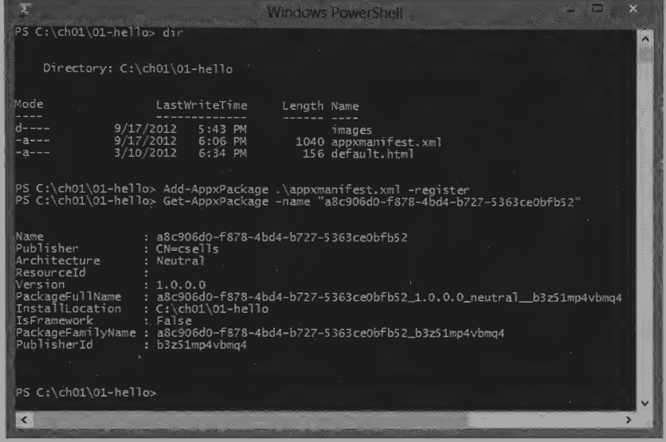

图 1.1：添加 appx 文件并验证它已添加

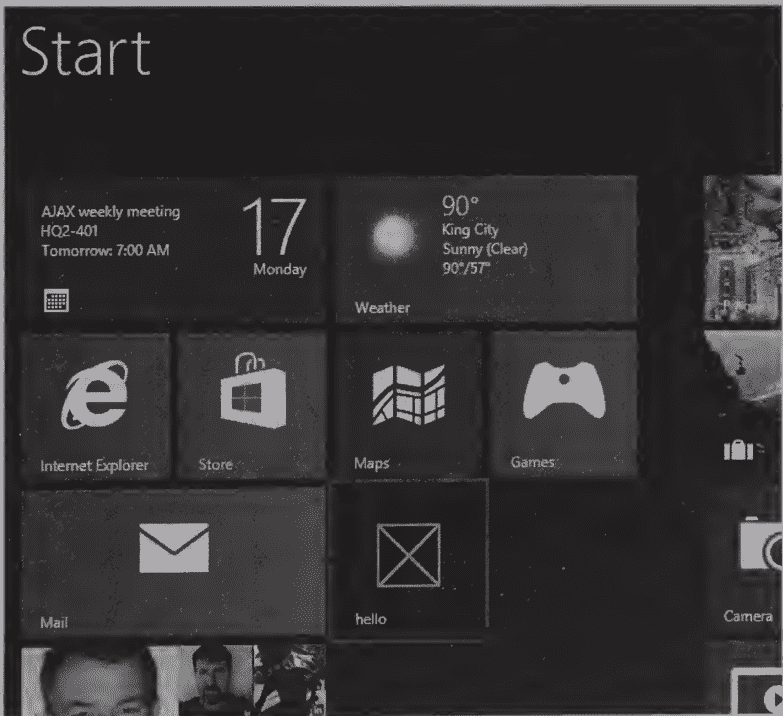

图 1.2：我们的示例应用安装到开始屏幕

Windows 应用商店应用将始终占据可用的屏幕空间——没有重叠的 Windows 应用商店应用窗口。然而，你的应用仍然需要能够在不同的设备上以多种分辨率运行，以及在不同的"模式"下运行，如纵向、横向、贴靠和填充，你可以阅读第三章"布局"了解这些内容。

在了解了构建和安装 Windows 应用商店应用所需的最少文件、工具和步骤之后，你可能已经在希望有一个工具来帮助你创建、编辑、打包、启动和调试你的应用。为此，我们有 Microsoft Visual Studio 2012。

## 开始使用 Visual Studio 2012

Visual Studio 是 Microsoft 开发者构建 Web 和 Windows 应用的首要工具，而且已经有一段时间了。它提供项目管理来保持应用源文件的整合；集成的构建、部署和启动支持；HTML、CSS、JavaScript、图形和 Windows 应用商店清单的编辑和调试；以及更多。Visual Studio 有多个版本，但我们将使用 Microsoft Visual Studio 2012 Express for Windows 8（简称 VS），它是免费的⁶，包含构建、打包和部署 Windows 应用商店应用所需的一切。

为了向你展示 Visual Studio 2012 的实际应用，我们需要构建一些比静态消息应用更有趣的东西（无论它多么励志）。任何平台的新开发者似乎都有一些经典应用会构建：计算机科学学生构建文本编辑器，编译器编写者构建 Pascal 编译器，Web 程序员构建博客，而且，出于某种原因，移动平台开发者构建新闻阅读器。所以，让我们给自己构建一个小型的真正简单聚合（RSS）阅读器，并从我最喜欢的模板开始：导航应用（如图 1.3 所示）。


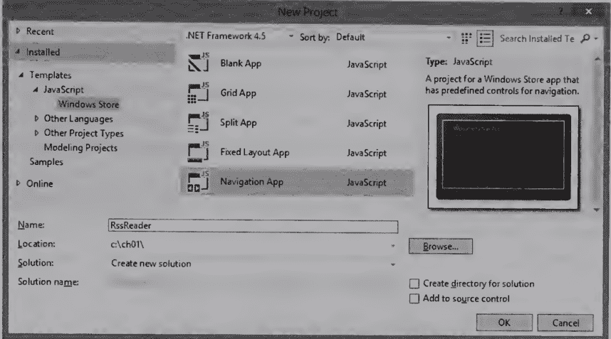

图 1.3：在 Visual Studio 2012 中创建 Windows 应用商店导航应用

Visual Studio 2012 提供的 Windows 应用商店应用项目模板如下：

- **空白应用 (Blank App)**：这是你能够构建的几乎最精简的 Windows 应用商店应用，包含正确的清单文件和图形文件，并包含 Windows JavaScript 库（即 WinJS）。当你希望从零开始逐步构建时，这是一个很好的模板。
- **网格应用 (Grid App)**：这是一个简单但完整的 Windows 应用商店应用，包含三个页面、导航支持以及 Windows 8 的外观和风格。当你希望从一个完整的应用开始并进行修改时，这是一个很好的模板。
- **拆分应用 (Split App)**：类似于网格应用，但包含两个不同的页面。
- **固定布局应用 (Fixed Layout App)**：与空白应用模板类似，但它允许你在固定大小的区域内构建应用，例如 1024 × 768 的休闲游戏；并让 Windows 根据可用空间为你进行缩放。
- **导航应用 (Navigation App)**：该模板是网格应用和拆分应用模板的核心，但使用单个空白页面代替一组完整功能的页面。此模板提供了你在应用中常用的导航支持，同时也允许你大量地从零开始构建。

## 第 1 章：你好，Windows 8！

运行导航应用模板会生成一个 Visual Studio 2012 Windows 应用商店应用 JavaScript (.jsproj) 项目文件，以及用于创建我们第一个示例的几乎相同的一组文件，如图 1.4 所示。

package.appxmanifest 文件的格式和内容与我们之前见过的 .appxmanifest.xml 文件相同，但 .appxmanifest 扩展名允许该文件在 Visual Studio 2012 中具有自定义编辑器，如图 1.5 所示。

清单编辑器为你提供了一种比直接在原始 XML 文件中处理所有尖括号更为简便的方式来编辑与应用关联的元数据。

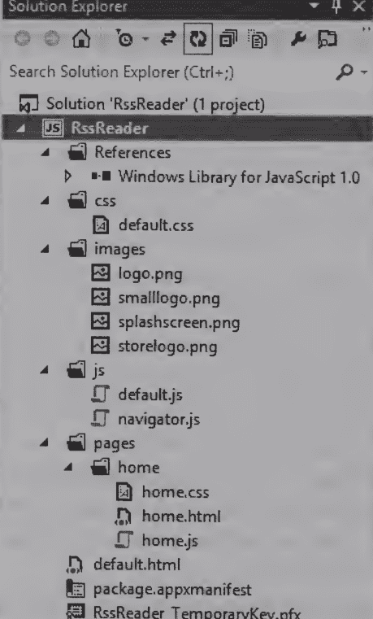

图 1.4：Visual Studio 2012 Windows 应用商店导航应用项目模板生成的文件

应用的部署包属性包含在应用清单文件中。你可以使用清单设计器 (Manifest Designer) 来设置这些属性。

| 应用程序 UI | 功能 | 声明 | 内容 URI | 打包 |
|---|---|---|---|---|

使用此页面来设置用于标识和描述应用的属性。

显示名称：RssReader
起始页：default.html
默认语言：en-US
描述：RssReader

支持的旋转方向：一个可选设置，指示应用的方向首选项。

[ ] 横向 (Landscape)
[ ] 纵向 (Portrait)
[ ] 横向翻转 (Landscape-flipped)
[ ] 纵向翻转 (Portrait-flipped)

磁贴：
徽标：images\logo.png
所需大小：150 x 150 像素
宽徽标：
所需大小：310 x 150 像素
小徽标：images\smalllogo.png
所需大小：30 x 30 像素

**图 1.5：Visual Studio 2012 清单设计器**

添加到项目中的另一个有趣的组件是 Windows JavaScript 库 SDK 引用。这引入了 WinJS 的引用，WinJS 是 Microsoft 提供的一组 JS 库，用于将 Web 平台（即 HTML5、JavaScript 和 CSS）与 WinRT 结合在一起，为使用 JavaScript 构建的 Windows 应用商店应用提供一个高效的开发框架。在本书中你会看到很多关于 WinJS 和 WinRT 的内容，但为了让你入门，让我们看一下由导航应用模板生成的 default.html 文件：

```html
<!DOCTYPE html>
<!-- default.html -->
<html>
<head>
    <meta charset="utf-8" />
    <title>RssReader</title>
<!-- WinJS references -->
<link href="//Microsoft.WinJS.1.0/css/ui-dark.css" rel="stylesheet" />
<script src="//Microsoft.WinJS.1.0/js/base.js"></script>
<script src="//Microsoft.WinJS.1.0/js/ui.js"></script>

<!-- RssReader references -->
<link href="/css/default.css" rel="stylesheet" />
<script src="/js/default.js"></script>
<script src="/js/navigator.js"></script>
</head>
<body>
<div id="contenthost" data-win-control="Application.PageControlNavigator"
   data-win-options="{home: '/pages/home/home.html'}"></div>

</body>
</html>
```

在 HTML 的 head 部分，你会注意到引用 WinJS 样式和 JS 文件的 link 和 script 元素。该功能的一部分是解析文件底部 contenthost div 上的 data-win-control 和 data-win-options 属性。

data-win-control 和 data-win-options⁷ 属性在 Windows 应用商店应用中启用声明式控件，实质上是将 HTML div 元素转变为此项目中使用 RssReader 命名空间定义的 PageControlNavigator 控件的实例。data-win-options 属性是一个简单的 JavaScript 对象表示法（JSON）对象，在运行时作为构造函数参数传递给控件。这种声明式语法允许程序员使用 Visual Studio 2012 内置的文本编辑器，或者正如我们很快会看到的，使用可视化工具来轻松布局控件。

就 PageControlNavigator 控件而言，default.html 文件实际上只是一个或多个逻辑页面的宿主，这些页面在用户从一个页面导航到另一个页面时加载。而且，正如你在控件的选项中看到的，要加载的第一个页面是 homePage.html，导航应用模板也会生成该页面：

> 7. HTML5 规范将 data-* 属性作为建议的库特定和应用特定的扩展点保留，WinJS 以及 JavaScript 库如 Kendo UI、jQuery 和 KnockoutJS 都利用了这一点。

```html
<!DOCTYPE html>
<!-- homePage.html -->
<html>
<head>
  <meta charset="utf-8" />
  <title>homePage</title>

  <!-- WinJS references -->
  <link href="//Microsoft.WinJS.1.0/css/ui-dark.css" rel="stylesheet" />
  <script src="//Microsoft.WinJS.1.0/js/base.js"></script>
  <script src="//Microsoft.WinJS.1.0/js/ui.js"></script>

  <link href="/css/default.css" rel="stylesheet" />
  <link href="/pages/home/home.css" rel="stylesheet" />
  <script src="/pages/home/home.js"></script>
</head>
<body>
  <!-- The content that will be loaded and displayed. -->
  <div class="fragment homepage">
    <header aria-label="Header content" role="banner">
      <button class="win-backbutton" aria-label="Back" disabled
        type="button"></button>
      <h1 class="titlearea win-type-ellipsis">
        <span class="pagetitle">Welcome to RssReader!</span>
      </h1>
    </header>
    <section aria-label="Main content" role="main">
      <p>Content goes here.</p>
    </section>
  </div>
</body>
</html>
```

homePage.html 中的 HTML 比 default.html 稍微复杂一些，因为它提供了一个返回按钮、一个标题和一个区块，明确指出了 Microsoft 建议你放置内容的位置。此外，生成的 HTML 引入了 homePage.js 文件，你可以在其中放置控制应用主页如何运作的逻辑。生成的骨架代码如下所示：

```javascript
// home.js
(function () {
  "use strict";
  WinJS.UI.Pages.define("/pages/home/home.html", {
    // This function is called whenever a user navigates to this page.
    // It populates the page elements with the app's data.
    ready: function (element, options) {
      // TODO: Initialize the page here.
    }
  });
})();
```

homePage.js 中的代码被包裹在一个自执行的匿名函数中，这是一种 JavaScript 技巧，可防止函数中的所有内容泄漏到全局作用域，提供了 JavaScript 中等效的私有模块。"use strict" 字符串是 JavaScript 在运行时添加额外错误检查的方式，这是另一个良好的实践。⁸

在模块内部，骨架代码基于 ready 函数以及与页面关联的 HTML 文件路径提供了一个页面控件的定义。WinJS 控件是一组可重用的 UI 和行为，而页面控件是基于 HTML 逻辑页面创建的控件。Windows 应用商店应用模板中的导航支持只是在用户页面间导航时加载和卸载页面控件。

当页面控件被添加到 HTML 文档对象模型 (DOM) 时，会触发 ready 事件，这是我们展示 RSS 阅读器订阅源列表的绝佳位置：

```javascript
// home.js
...
// define the feeds
window.feeds = [
  { title: "Brandon Satrom",
    url: "http://feeds.feedburner.com/userinexperience/tYGT" },
  { title: "Chris Sells",
    url: "http://sellsbrothers.com/posts/?format=rss" },
  { title: "Channel 9",
    url: "http://channel9.msdn.com/Feeds/RSS" },
];
```

> 8. 具体来说，"use strict" 是 ECMAScript 5 的一个特性，ECMAScript 5 是 JavaScript 的最新标准版本（参见 http://ecmascript.org/）。如果你有 .NET 背景但不熟悉 JavaScript 基础知识，我推荐你阅读附录 A "面向 C 家族程序员的 JavaScript"。


[content]

`ready` 函数通过 `element` 参数接收表示页面在 HTML DOM 中的 `div` 元素，因此这里是查询 `section` 元素以容纳我们订阅源列表的好地方。`ready` 函数内部的代码是标准的 HTML DOM 操作代码，使用了在该函数上方定义的全局 `feeds` 数据。

运行此应用将提供一个全屏的 Windows Store 应用，其外观如图 1.6 所示。


图 1.6：导航应用模板项目中的订阅源标题列表

## 第 1 章：你好，Windows 8！

如果在开发这个功能略有实现的应用过程中遇到问题，你可以使用 Visual Studio 2012 来调试你的应用，方法是选择 **调试 | 开始调试**，这将为你提供以下调试工具：

-   **调试器：** 设置断点，使用各种单步调试命令，并监视 JavaScript 数据和行为。
-   **JavaScript 控制台：** 在命令行中与 JavaScript 对象进行交互。
-   **DOM 资源管理器：** 深入浏览 HTML DOM 并按元素查看样式。
-   **调用堆栈：** 钻入当前的 JavaScript 调用堆栈。
-   **异常对话框：** 启用在抛出 JavaScript 运行时异常时中断的选项。

除了在本地机器上调试应用（这是默认选项）之外，你还有另外两个选项：远程计算机和模拟器。你可以通过选择 **项目 | 属性** 并选择要启动的调试器来更改这些选项，如图 1.7 所示。

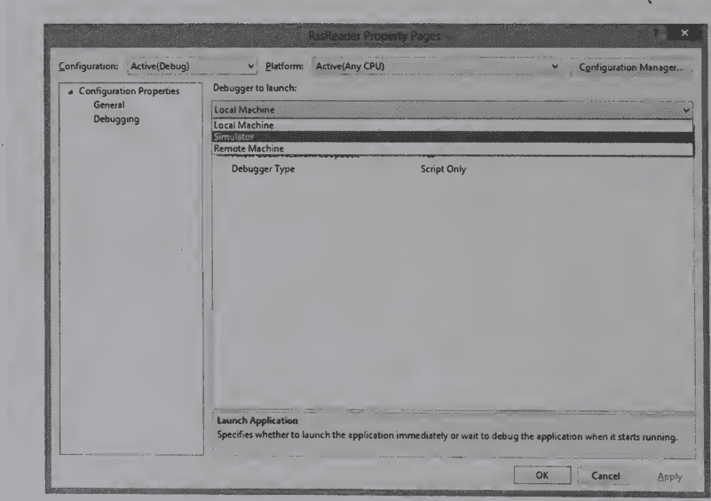

图 1.7：选择针对本地计算机、模拟器或远程计算机进行调试

远程机器调试的理念是，你可以在一台高性能的开发机上进行开发，但在一台性能较弱的消费级设备（如平板电脑）上进行调试。这对于确保你的应用在目标设备类型上运行良好非常方便。

另一方面，模拟器选项会创建一个远程桌面会话，连接回你当前正在使用的机器，提供一个框架，让你可以模拟各种分辨率、横向/纵向旋转以及触摸操作，即使你使用的设备不支持触摸。图 1.8 展示了我们的示例应用在模拟器中运行的情况。

而且，好像这还不够似的，当你安装 Visual Studio 2012 Express for Windows 8 时，你得到的不仅仅是 Visual Studio 2012 这一个工具。如果你希望获得一个“所见即所得”的设计体验来设计应用的可视化部分，你还可以使用 Microsoft Blend for Visual Studio 2012（也称为 Blend）。

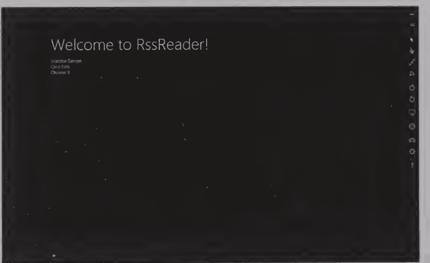

图 1.8：在模拟器中运行的 Windows Store 应用

## Blend 中的控件、数据绑定和样式

之前版本的 Blend 主要面向 XAML 开发者。Windows 8 版本的 Blend 增加了对 HTML 的支持，以便专门设计 Windows Store 应用，具体功能如下：

-   **与 Visual Studio 集成：** 你可以在 Visual Studio 2012 和 Blend 中同时加载相同的项目。实际上，你可以在解决方案资源管理器中右键单击项目，然后选择“在 Blend 中打开”，从而在 VS 中加载你当前正在处理的项目。
-   **项目模板：** Visual Studio 2012 和 Blend 具有相同的一套项目模板。
-   **HTML 的所见即所得设计：** 应用的每个页面在编辑时就显示为运行时的样子，因为 Blend 实际上运行了你的应用以进行精确显示。
-   **交互模式：** 你可以在 Blend 中切换开关，让应用在页面间进行交互式导航；然后，当你到达想要编辑的页面时，你可以再次切换开关，设计当前视图中的元素。⁹
-   **HTML 工具面板：** 完整的控件和选项集均可从工具面板和属性编辑器中获取。
-   **布局模拟器：** 与 VS 提供设备模拟器的方式类似，Blend 允许你在多种尺寸和旋转方向下运行和编辑你的应用。

图 1.9 展示了 Blend 在我们 RSS 阅读器示例上的运行效果。你会注意到，在图 1.9 中，即使我们在 Blend 内部，我们的 JavaScript 代码也在执行，并产生了我们看到的订阅源标题列表。Blend 会在检测到更改时执行你的 HTML、JavaScript 和 CSS，以确保你正在编辑的是应用的实时版本。不过，有时它可能会有点混乱，因此你可以通过设计界面右上角的“刷新”按钮手动刷新。

> 9. 这是有史以来任何平台最令人惊叹的开发功能之一。强烈推荐。

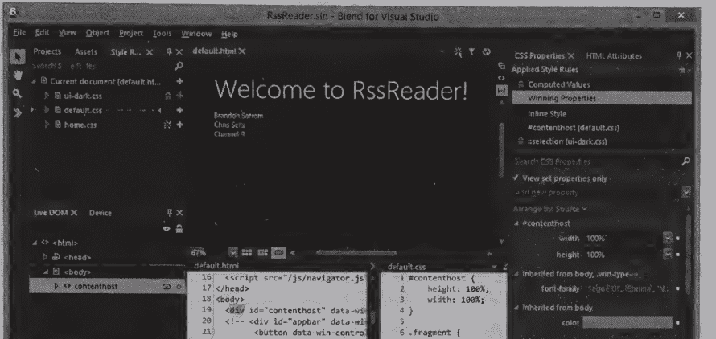

### 图 1.9：Microsoft Blend for Visual Studio 2012

为了利用这一强大功能，让我们在 Blend 中做一些工作。目前，JavaScript 代码正在生成一堆 `div` 元素，而不是使用 Windows Store 开发中提供的众多开箱即用的控件之一。具体来说，我们希望使用 `ListView` 控件来显示那些订阅源标题。然而，在此之前，我们需要在 Blend 中（通过左上角的“项目”选项卡）或在 Visual Studio 2012 中（确保保存文件并在 Blend 要求时让 Blend 重新加载）打开 `home.js` 文件，以移除 `ready` 函数中的代码：

```javascript
// home.js
(function () {
	"use strict";

	// define the feeds
	window.feeds = new WinJS.Binding.List([
		{ title: "Brandon Satrom", url: ... },
	]);

	WinJS.UI.Pages.define("/pages/home/home.html", {
		ready: function (element, options) {
			// let the ListView show the feeds
		}
	});
})();
```

除了移除 `ready` 函数中为我们的订阅源标题创建 `div` 元素的代码外，我们还用 `WinJS.Binding.List` 对象的实例包装了我们的订阅源数据，这将允许 `ListView` 通过数据绑定来使用它。

一旦我们更新了 `home.js`，Blend 将显示没有元素显示订阅源数据（如果它没有，设计界面上方的“刷新”按钮将使其正确显示）。取而代之的是，它将显示段落元素，其中写着“Content goes here.”。你可以通过双击将其删除——第一次点击选择 `default.html` 上的 `contenthost` 元素，第二次点击选择托管的 `home.html` 中的段落——然后按 Delete 键。

要查看 WinJS 控件集以便添加 `ListView` 控件，请单击左上角的 Assets 选项卡并选择 JavaScript Controls。图 1.10 显示了 Assets 选项卡和 `ListView` 控件。

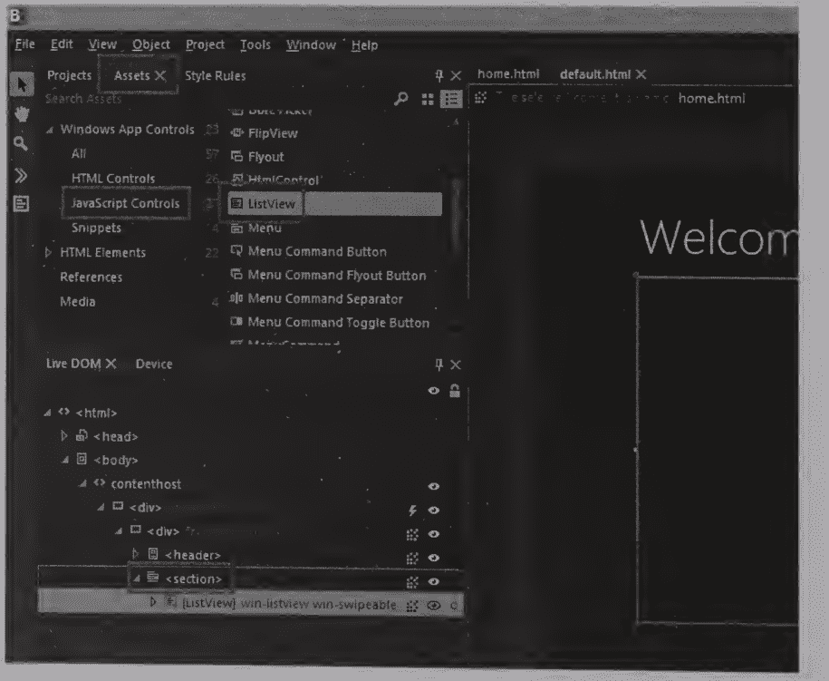

### 图 1.10：使用 Blend 为 Windows Store 应用添加 ListView 控件

在添加 `ListView` 之前，请确保选中了我们放置内容的 `section` 元素，使其成为一个大的目标。最简单的方法是在左下角的 Live DOM 中深入查找直到找到它，如图 1.10 所示。现在，你可以将 `ListView` 从 Assets 选项卡拖到 Live DOM 中的 `section` 标签上，或者拖到设计界面上——这取决于你。

一旦将 `ListView` 添加到 DOM 中，你就可以在右侧编辑 HTML 和 CSS 属性，如图 1.11 所示。

HTML 属性选项卡的 Windows App Controls 部分（如图 1.11 所示）是用于设置特定控件所有选项的地方。对于 `ListView`，我们希望将 `itemDataSource` 属性设置为绑定到我们在 `home.js` 中创建的 `feeds` 数据。具体来说，我们希望将 `itemDataSource` 设置为 `feeds.dataSource`，这是我们之前创建的 `WinJS.Binding.List` 对象的一个属性，专门用于与列表控件进行绑定。一旦完成此操作，你会看到 `ListView` 立即更新自身以显示数据，如图 1.11 所示，不过目前显示是杂乱无章的。

问题在于，我们不再将 feeds 列表中的数据分离为我们想要显示的部分（标题）和我们不想显示的部分（url）。为此，我们需要为 `ListView` 提供一个模板。

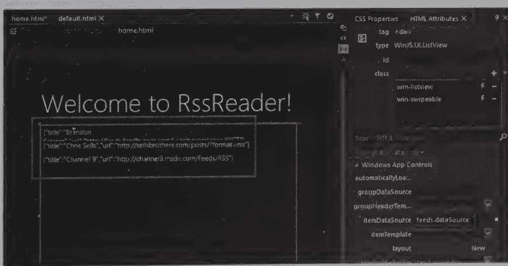

图 1.11：使用 Blend 将 ListView 绑定到数据列表


## 第一章：你好，Windows 8！

模板是一段可复用的 HTML 代码块，用于绑定数据项，就像我们这里想要实现的。最简单的方法是点击 `itemDataSource` 属性下方的 `itemTemplate` 属性，然后选择 `<Create new template>` 选项，这将打开如图 1.12 所示的“创建新模板”对话框。

一旦确定了新模板，你会看到显示内容略有更新，如图 1.13 所示。

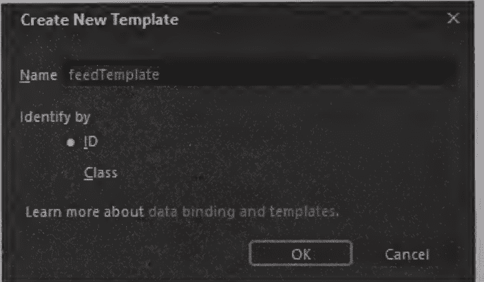

**图 1.12：使用 Blend 创建数据模板**

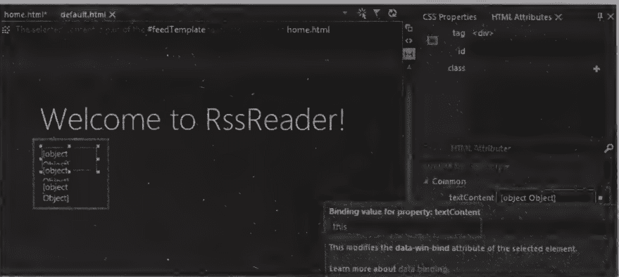

**图 1.13：使用 Blend 查看数据模板的内容**

通过从 ListView 中选择一个项目，你会看到该项目的文本内容绑定到了每个对象的全部内容。你可以通过点击文本内容字段旁边的小方块并选择“编辑数据绑定”来查看这一点。“绑定值”对话框显示了与 `this` 值的绑定，但我们只想绑定到每个对象的 `title` 属性，而不是整个对象。要修复此问题，请将绑定值设置为 `text` 而不是 `this`，点击“刷新”按钮，你将获得所需的结果，如图 1.14 所示。

关于绑定和控件在 HTML 底层实现的一些重要内容，你可以在第二章“绑定与控件”中阅读详细信息。

除了编辑 HTML——特别是与 WinJS 配合良好的 HTML5——Blend 在管理 CSS 样式方面也非常出色。要查看我们项目中的样式集，请点击左上角的“样式规则”选项卡（图 1.15）。

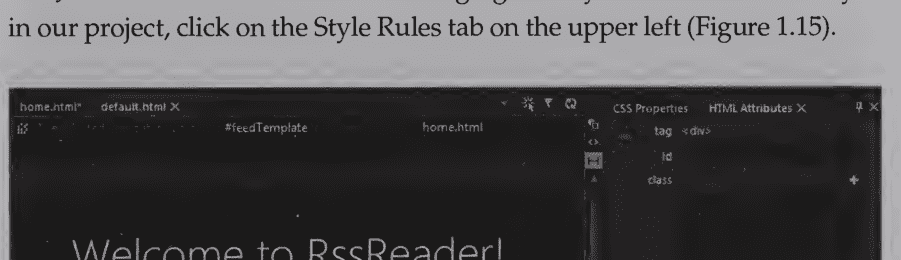

**图 1.14：使用 Blend 修改数据模板的内容**

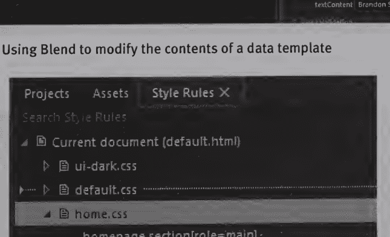

**图 1.15：使用 Blend 管理项目中的样式**

如果我们想增大订阅源标题的大小使其更显眼，首先需要创建一个新样式。你可以通过右键单击 `home.css`，选择“添加样式规则”，然后输入新样式的选择器来实现；例如 `.feedTitle`（包括前导点）。要将新的 CSS 类与你的订阅源标题关联起来，请在设计界面上选择一个订阅源标题，然后在 HTML 选项卡中将 `class` 属性设置为新类名；例如 `feedTitle`（不带前导点）。图 1.16 显示了此操作的效果。

将 `feedTitle` 类与列表中的一个订阅源标题关联，实际上会为所有订阅源标题设置该类，因为这些标题来自一个重复的模板，而 Blend 知道这一点。你可以通过从 CSS 属性选项卡的“已应用规则”列表中选择 `.feedTitle` 来查看这一点，如图 1.17 所示。

图 1.18 中围绕订阅源标题的方框清楚地表明，当你更改 CSS 属性时，哪些元素会受到影响。现在，可以非常容易地同时设置所有订阅源标题的宽度和字体大小，如图 1.18 所示。

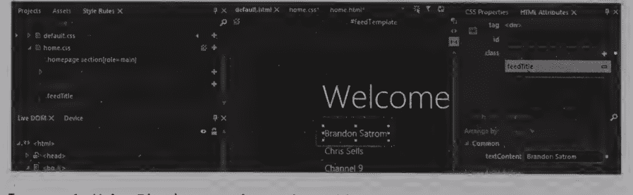

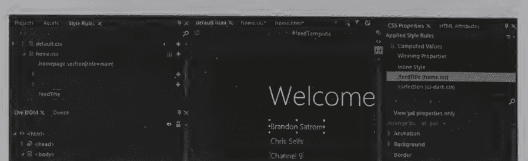

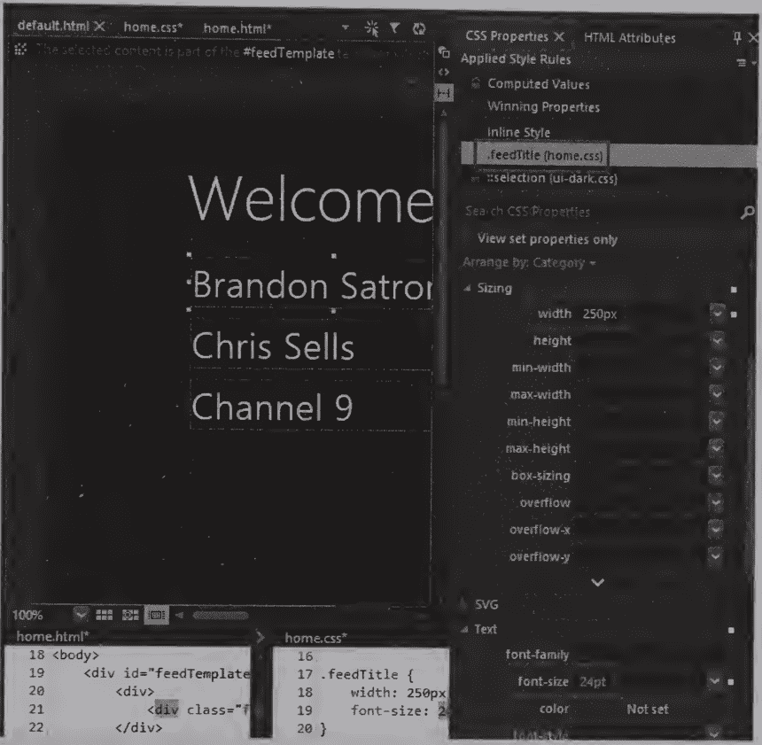

**图 1.18：使用 Blend 交互式地更改 CSS 属性**

Blend 允许你在应用程序运行时进行交互式编辑，这在设计应用程序的外观和感觉时能提供非常快的周转时间。要全面了解在 Windows Store 应用中使用 CSS 能做什么，包括 Blend 对样式和视图模式（例如横向、纵向等）的支持，你将需要阅读第三章。

至此，我们的订阅源标题已经很有吸引力了。然而，它们还不具备交互性。当用户通过键盘、鼠标或触摸调用某个项目时，我们希望将用户带到一个显示该订阅源项目的页面。为此，我们需要导航功能。

## 导航

页面间导航的概念并不新鲜。事实上，它是超文本标记语言中的“超文本”部分。当用户点击链接（或带有 `onclick` 处理程序的 HTML 元素）时，我们通常希望呈现一个全新的页面，其中包含数据、控件、图像等。在浏览器中，发生这种情况时，我们通常会加载一个新页面，使屏幕变白并清除所有当前状态。虽然我们可以在 Windows Store 应用中以与浏览器相同的方式进行导航，但我们通常更喜欢使用 WinJS 内置的导航服务，它在页面切换时为我们提供了更大的 UI 控制权，并允许我们保留随时间推移建立的应用程序状态，就像我们保留订阅源列表一样。

然而，在我们导航到任何地方之前，我们需要一个可以导航的目标页面。为此，你需要在“解决方案资源管理器”中右键单击项目中的 `pages` 文件夹，使用“添加 | 新建文件夹”为你的页面添加一个新文件夹，命名为 `postsPage`。这将保存你新页面的文件，你可以通过右键单击该文件夹并选择“添加 | 新建项”，然后从 JavaScript | Windows Store 类别中选择“页控件”项来添加文件。你将看到如图 1.19 所示的界面。

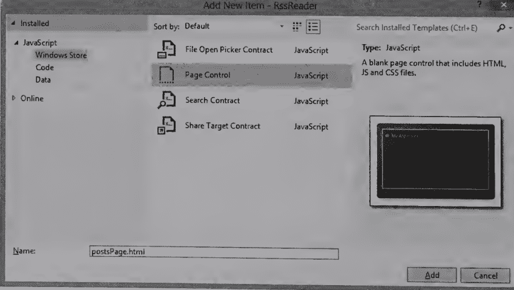

**图 1.19：Windows Store 应用的“添加新项”对话框**

Windows Store 类别中的每个项模板都会生成一组三个文件——一个 HTML 文件、一个 CSS 文件和一个 JavaScript 文件——它们组合成一个适用于 WinJS 导航的页控件。Page Control 模板创建一个空白的页控件。其他三个模板帮助你实现 Shell 契约，你可以在第九章“Shell 契约”中阅读详细信息。

输入名称，例如 `postsPage.html`，然后按“添加”，即可为我们的页控件创建这三个新文件，如图 1.20 所示。

这就是我们准备一个页面作为导航目标所需的全部工作——问题是，我们如何执行导航？对于 `ListView`，我们需要让 `ListView` 知道我们希望在调用某个项目时得到通知，如以下页面中的代码所示。

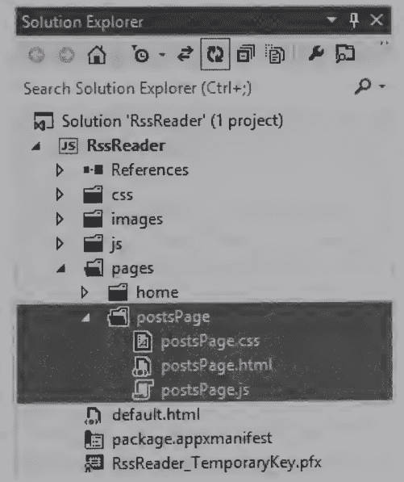

**图 1.20：已添加到 Windows Store 应用的新页控件**

```html
<!DOCTYPE html>
<!-- home.html -->
<html>
<body>
  ...
  <section aria-label="Main content" role="main">
    <div data-win-control="WinJS.UI.ListView"
         data-win-options="{
           itemDataSource: feeds.dataSource,
           itemTemplate: select('#feedTemplate'),
           selectionMode: 'none',
           oniteminvoked: feedInvoked}">
    </div>
  </section>
  </div>
</body>
</html>
```

还记得我们在 Blend 中将 ListView 控件添加到设计界面时吗？所有操作只是添加了 `div` 并设置了 `data-win-control` 和 `data-win-options` 属性。`div` 代表 HTML DOM 中的 WinJS 控件，而 `WinJS.UI.ListView` 是 JS 构造函数的名称（你可以在第二章中了解所有相关信息）。你可能还认出了我们在 Blend 属性面板中设置的 `itemDataSource` 和 `itemTemplate` 设置。

你不必使用 Blend 来编辑这些属性；你常用的文本编辑器就可以。在本例中，我们需要将选择模式设置为 `none`（我们不需要选择功能——我们需要的是调用功能），并设置当用户调用项目时要调用的处理程序的名称。该处理程序在相应的 JavaScript 文件中实现：

```javascript
// home.js
(function () {
  "use strict";

  window.feeds = new WinJS.Binding.List([
    { title: "Brandon Satrom", url: ... },
    ...
  ]);

  // 将事件处理程序标记为对声明式使用安全
  window.feedInvoked = WinJS.UI.eventHandler(function (e) {
    // 导航到页面以显示订阅源的帖子
    var feed = feeds.getAt(e.detail.itemIndex);
    WinJS.Navigation.navigate(
        "/pages/postsPage/postsPage.html", { feed: feed });
  });
})();
```

`feedInvoked` 处理程序被包装在 `eventHandler` 函数中，该函数将其标记为可以从 `home.html` 文件中的 `data-win-options` 安全使用。这是一个安全措施，旨在确保从互联网下载的 HTML 不会劫持你的应用程序。

`feedInvoked` 处理程序的实现深入事件对象的 `detail` 属性，以找到被调用项目的索引。这个 `feed` 对象通过 `navigate` 方法传递给 `postsPage`。然后，WinJS 的导航服务加载 `postsPage` 并通过 `options` 参数将 `feed` 对象传递给 `ready` 函数：

```javascript
// postsPage.js
(function () {
  "use strict";

  WinJS.UI.Pages.define("/pages/postsPage/postsPage.html", {
    ready: function (element, options) {
      // TODO：对用户调用的 feed 对象执行某些操作
      var feed = options.feed;
    },
  });
})();
```

现在我们已经在 ListView 上设置了一个调用处理程序，在主页上点击订阅源标题（图 1.21）会将我们带到为显示订阅源帖子而构建的页面（图 1.22）。

到目前为止，你可能已经注意到，虽然“后退”按钮元素存在于 `home.html` 中，但在图 1.21 中并未显示，即使在图 1.22 所示的 `postsPage.html` 中显示了。这是因为模板中的导航支持足够智能，能够知道主页之前没有历史记录可以返回，因此它只在有“后退”目标时才显示“后退”按钮。此外，你看不到，但模板还支持浏览器支持的“后退”和“前进”按键（如 Alt+左箭头和 Alt+右箭头）。


## 第 1 章：你好，Windows 8！

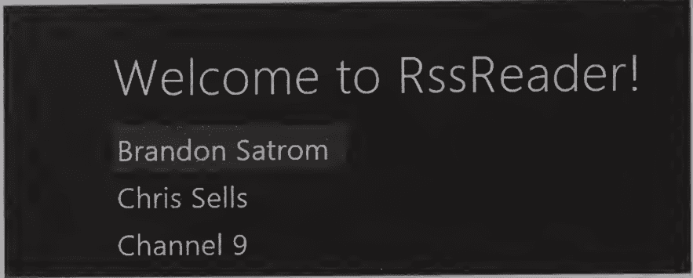
**图 1.21：** 在 ListView 控件上触发 invoke 事件**

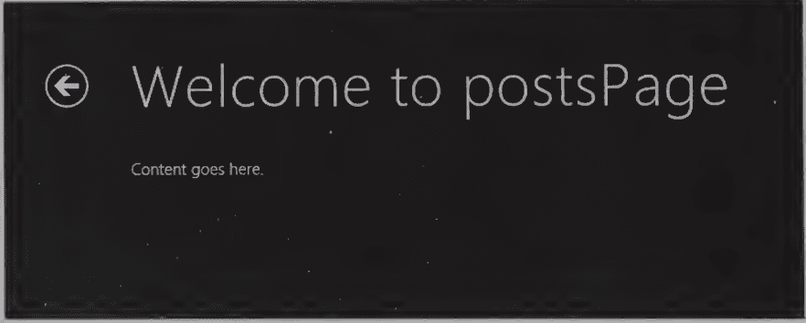
**图 1.22：** 使用 WinJS 导航服务导航到页面控件

所有这些意味着你可以将页面编写为页面控件并传递对象，让模板中的导航支持来完成繁重的工作。

当然，我们还没有完成 RSS 阅读器的基本功能，因为我们还没有从选定的馈送（feed）中下载文章。为此，我们需要编写一小段网络代码。

### WinJS 和 WinRT 中的网络通信

大量客户端应用程序需要访问通过网络提供的数据，其中包括电子邮件、照片浏览、社交网络、音乐播放、文档同步和多人游戏。如果你能说出过去十年中流行的任何一款应用，很有可能它都使用了通过网络访问的数据。为此，Windows Store 应用有多种方式通过网络访问数据，其中最基础的是：`XMLHttpRequest` 对象。

`XMLHttpRequest` (XHR) 是在 2005 年引发 AJAX¹⁰/ Web 2.0 革命的对象名称（尽管该对象自 1999 年发布的 Internet Explorer 5.0 版本起就是其一部分）。¹¹ 它提供了使用 HTTP 下载数据的功能。WinJS 提供的 `xhr` 函数是一个 `XMLHttpRequest` 封装器，它只需要一个用于检索数据的 URL：

```javascript
// postsPage.js

WinJS.UI.Pages.define("/pages/postsPage/postsPage.html", {
    ready: function (element, options) {
        // download the feed
        this.feed = options.feed;
        var pageTitle = element.querySelector(".pagetitle");
        pageTitle.innerText = this.feed.title;

        this.section = document.querySelector("[section[role=main]");
        this.section.innerHTML = "<p>downloading...</p>";

        // download using XMLHttpRequest by creating a promise and
        // telling it what to do when it's done

        // the long way
        var xhrPromise = WinJS.xhr({ url: this.feed.url });
        xhrPromise.done({
            processPosts.bind(this), downloadError.bind(this)});

        // the short way (recommended)
        WinJS.xhr({ url: this.feed.url }).
        done(processPosts.bind(this), downloadError.bind(this));
    },
});
```

- 10. Asynchronous JavaScript And XML（异步 JavaScript 和 XML），由 Jesse James Garrett 在 2005 年创造。
- 11. Brandon 喜欢声称他在 AJAX “流行之前”就在使用了，早在 2001 年就使用了 XHR、ASP 3.0、VB6 和 COM，尽管我们还没找到任何人能证实他的说法。

在下载馈送数据之前，我们将馈送对象存储在与 `postsPage` 页面控件此实例关联的属性中，使用馈送的标题设置页面标题，并为下载设置一个进度指示器。我们之所以让用户知道正在下载，是因为无法预知实际下载需要多长时间。此外，当我们调用 `xhr` 函数并传入馈送的 URL 时，结果不会同步返回，否则会阻塞 UI 更新，直到数据从互联网上某个随机服务器传回。相反，`xhr` 的返回值是一个 promise。

事实上，WinJS（以及 WinRT）中的所有异步函数都返回一个 `WinJS.Promise` 实例，它代表将在未来某个时间点提供的结果。Promise 对象暴露了 `done` 方法，该方法接受三个可选函数作为参数：一个用于成功，一个用于失败，一个用于进度。

成功时，将调用我们的 `processPosts` 方法：

```javascript
// process using XMLHttpRequest
function processPosts(request) {
    // clear the progress indicator
    this.section.innerHTML = "";

    // parse the RSS
    var items = request.responseXML.querySelectorAll("item");
    for (var i = 0, len = items.length; i < len; i++) {
        var item = items[i];
        var parent = document.createElement("div");
        appendDiv(parent,
            item.querySelector("title").textContent, "postTitle");
        appendDiv(parent,
            item.querySelector("pubDate").textContent, "postDate");
        appendDiv(parent,
            item.querySelector("description").textContent, "postContent");
        this.section.appendChild(parent);
    }
}

function appendDiv(parent, html, className) {
    var div = document.createElement("div");
    div.innerHTML = toStaticHTML(html);
    div.className = className;
    parent.appendChild(div);
}
```

这段代码是相当标准的 HTML DOM 操作和 XML 处理代码，任何经验丰富的 JavaScript 程序员都熟悉，就像我们在本章前面所做的那样创建 `div` 元素。Windows Store 应用唯一独特的地方是调用了 `toStaticHTML` 方法。这个调用专门用于处理来自未知来源的随机 HTML。默认情况下，在设置元素的 HTML 时，如果 HTML 引擎发现动态 HTML（例如 `<script>` 标签），它会抛出异常。`toStaticHTML` 调用会剥离其发现的所有动态 HTML，从而使内容无法接管你的应用。¹²

如果发生错误，我们会通知用户：

```javascript
function downloadError(feed) {
    this.section.innerHTML = "<p>error</p>";
}
```

有了这段代码以及 `postsPage.css` 中的一些样式，我们的应用终于开始像模像样了，如图 1.23 所示。

此时，我们的网络代码中还有几个细节需要完善。例如，Brandon 将文章摘要放在馈送的 description 字段中，而我将全部内容放在那里（两种方法都是有效的）。此外，我们编写的 XML 解析代码仅适用于 RSS¹³，而如今大多数博客都支持 Atom¹⁴。幸运的是，由于 RSS 和 Atom 在互联网上非常普遍，WinRT 库提供了一组类型来处理这两种分发格式的馈送：

```javascript
WinJS.UI.Pages.define("/pages/postsPage/postsPage.html", {
    ready: function (element, options) {
        ...
        // download using WinRT
        var syn = new Windows.Web.Syndication.SyndicationClient();
        var url = new Windows.Foundation.Uri(this.feed.url);
        syn.retrieveFeedAsync(url).done(
            processPosts.bind(this), downloadError.bind(this));
    },
});
```

- 12. 如果你想进一步了解如何安全地将外部 HTML 引入应用，请参阅第 8 章“网络通信”。
- 13. RSS 格式是一种用于发布面向内容的数据更新的 XML 语言。
- 14. Atom 分发格式是 RSS 的继承者。

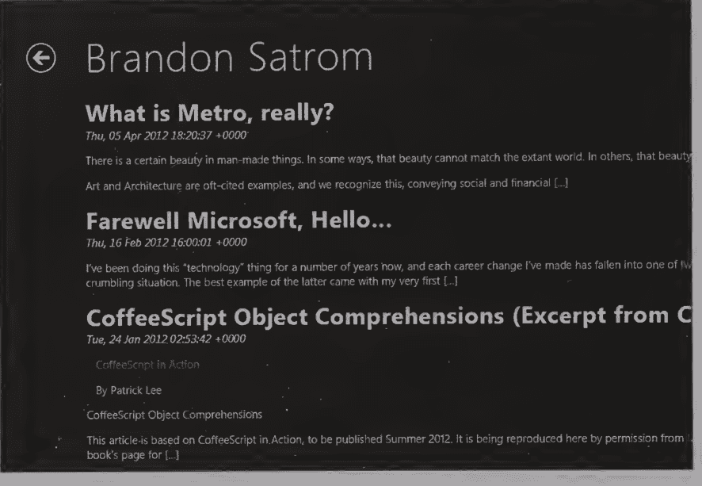
**图 1.23：使用 WinJS.xhr 显示 RSS 馈送的内容**

在这段代码中，我们将 `xhr` 函数的使用替换为了分别来自 `Windows.Web.Syndication` 和 `Windows.Foundation` 命名空间的 WinRT `SyndicationClient` 和 `Uri` 类型。与 `xhr` 函数一样，`retrieveFeedAsync` 函数是异步的，它返回一个与 WinJS 或 WinRT 中所有其他异步函数完全相同的 promise。在我们的成功处理程序中，我们处理的是文章列表而非原始 XML：

```javascript
// process using WinRT
function processPosts(request) {
    // clear the progress indicator
    this.section.innerHTML = "";

    // iterate over the items
    for (var i = 0, len = request.items.length; i < len; i++) {
        var item = request.items[i];
        var parent = document.createElement("div");
        appendDiv(parent, item.title.text, "postTitle");
        appendDiv(parent, item.publishedDate, "postDate");
        appendDiv(parent, item.summary.text, "postContent");
        this.section.appendChild(parent);
    }
}
```

更新后的网络代码能更智能地处理 Brandon 存放内容的位置，如图 1.24 所示。

不仅 WinRT 能智能处理 Brandon 的馈送以及 RSS 与 Atom 的区别，你还会注意到 Visual Studio 2012 对 WinRT 的支持也非常智能。我无需在任何时候添加 WinRT 引用或执行其他特殊操作来访问 WinRT 类型或命名空间。事实上，如果你在 Visual Studio 2012 中开始输入 "Windows."，你会发现它对此了如指掌（见图 1.25）。

在本书接下来的内容中，你会更多地接触到 WinRT，但我鼓励你自己去探索 Windows 命名空间；那里有很多好东西。

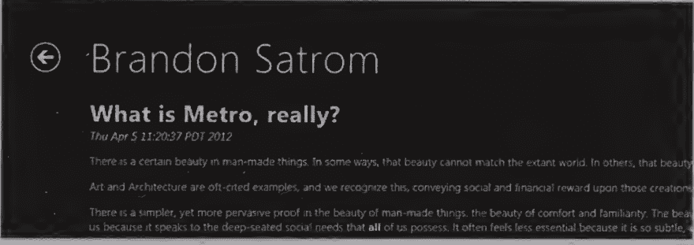
**图 1.24：使用 WinRT SyndicationClient 显示 RSS 馈送的内容**

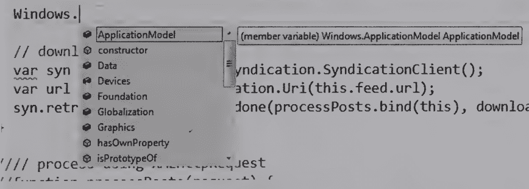
**图 1.25：Visual Studio 2012  mengenal WinRT！**


## 拆分应用模板

此外，Visual Studio 2012 不仅了解 WinRT 的命名空间和类型，而且还内建了对 Windows 8 用户体验设计规范的支持。正如我所提到的，空白应用、固定布局应用和导航应用项目模板生成的应用本质上都是空白的，这为后续构建提供了良好的基础。然而，网格视图应用和拆分应用项目模板则是可用的、遵循 UX 设计规范的 Windows 商店应用，它们能帮助你尽可能轻松地构建出色的 Windows 8 应用。

例如，如果你运行拆分应用项目模板，并且不做任何修改就直接运行应用，你会得到一个包含两个页面的应用，如图 1.26 和图 1.27 所示。

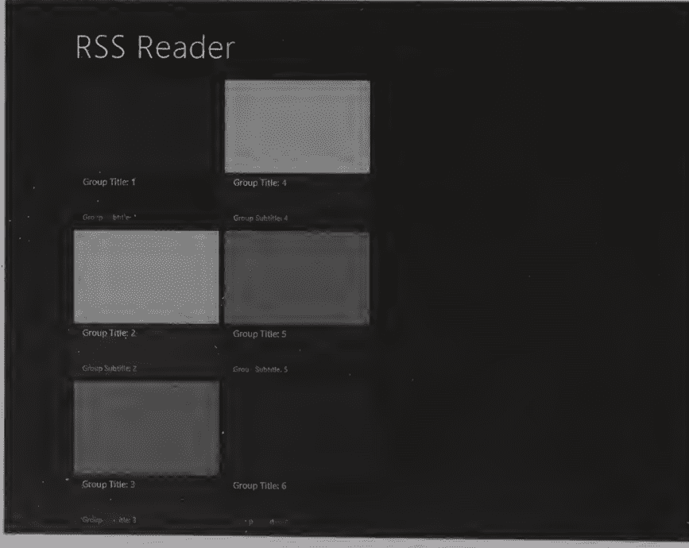

**图 1.26：** 来自拆分应用项目模板的 itemsPage.html 页面，显示事物分组

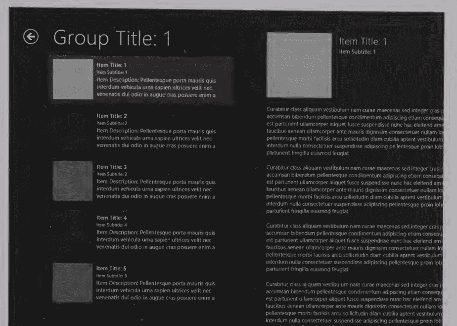

**图 1.27：** 来自拆分应用项目模板的 itemsPage.html 页面，显示条目列表

图 1.26 所示的首页旨在用作事物分组，例如球员团队、人群分组，或者在我们的例子中，新闻源。当你点击其中一个分组时，会进入图 1.27 所示的页面。它表示一个分组中的条目列表；例如，球队中的球员、人群中的个体，或某个特定新闻源的新闻条目。简而言之，拆分应用非常适合我们的 RSS 阅读器应用。数据都是硬编码在 `data.js` 中的静态样本数据，但将静态数据替换为动态数据是一件相当简单的事情：

```
// data.js

...
var list = new WinJS.Binding.List();
...
// TODO: Replace the data with your real data.
// You can add data from asynchronous sources whenever it becomes available.
```

```
//generateSampleData().forEach(function (item) {
//    list.push(item);
//});
```

```
var feeds = [
{ key: "feed1", title: "Brandon Satrom", subtitle: "blog",
  backgroundImage: darkGray,
  description: "blog",
  url: "http://feeds.feedburner.com/userinexperience/tYGT"
},
{ key: "feed2", title标的物: "Chris Sells", subtitle: "blog",
  backgroundImage: lightGray,
  description: "blog",
  url: "http://sellsbrothers.com/posts/?format=rss"
},
{ key: "feed3", title: "Channel 9", subtitle: "blog",
  backgroundImage: mediumGray,
  description: "blog",
  url: "http://channel9.msdn.com/Feeds/RSS"
}];
```

```
feeds.forEach(function (feed) {
  // download the feed
  var syn = new Windows.Web.Syndication.SyndicationClient();
  var url = new Windows.Foundation.Uri(feed.url);
  syn.retrieveFeedAsync(url).done(processPosts.bind(feed));
});
```

```
function processPosts(request) {
  var feed = this;
  request.items.forEach(function (item) {
    // create a post for each item
    var post = {
      group: feed,
      title: item.title.text,
      subtitle: item.publishedDate,
      description: "post",
      content: toStaticHTML(item.summary.text),
      backgroundImage: feed.backgroundImage,
    };

    // let the list know about each post
    list.push(post);
  });
}
...
```

在 data.js 的顶部附近，有一条注释恳请我们将样本数据替换为真实数据。在这里，我们放入了要遍历的源数组，异步拉入我们的帖子，就像本章前面所做的那样。拉取数据并将其与应用程序其余部分中假定的组和条目数据形状相匹配的代码，就是构建本章中手动构建的完整 RSS 阅读器（如图 1.28 和图 1.29 所示）所需的全部内容。

正如你在图 1.29 中看到的，拆分应用的第二个页面（splitPage 页面控件）比我们构建的要更加精致：它使用 CSS 网格进行布局，根据用户在左侧选择的项目来改变右侧显示的内容。内置的拆分应用和网格应用项目模板的另一个主要特性是支持视图状态更改，当用户在横向、纵向、填充和贴靠模式之间切换时。图 1.30 展示了我们崭新的 RSS 阅读器在贴靠模式下的样子（最容易通过按 Win+句点键实现）。

你可以在第三章"布局"中阅读有关所有视图状态的更多内容。

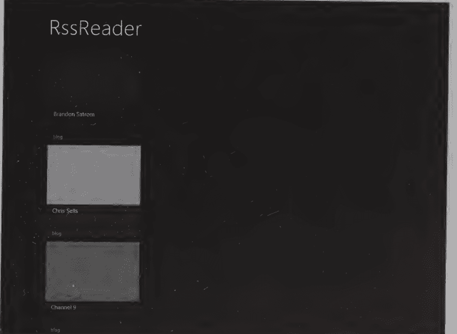

**图 1.28：** 来自拆分应用项目模板的 itemsPage.html 页面，显示真实数据

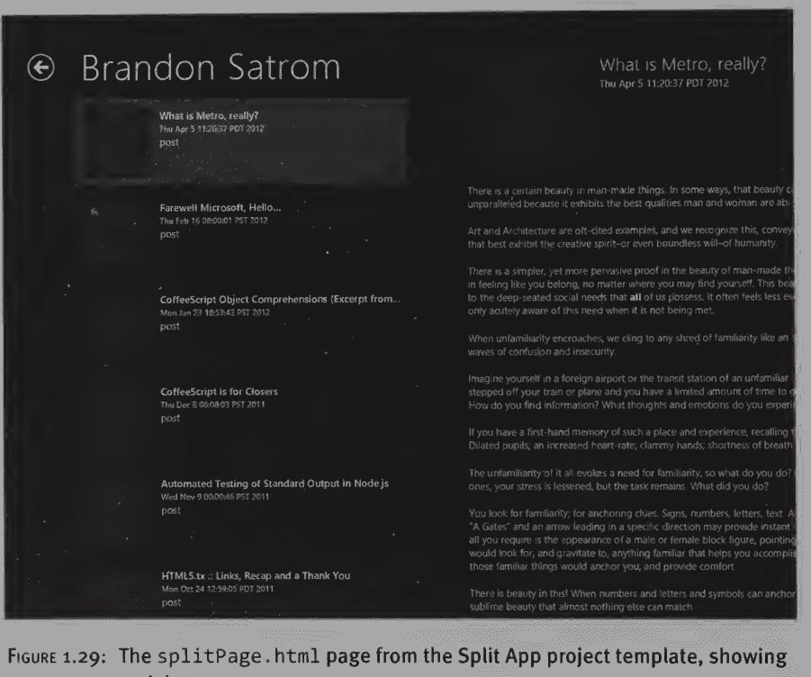

**图 1.29：** 来自拆分应用项目模板的 splitPage.html 页面，显示真实数据

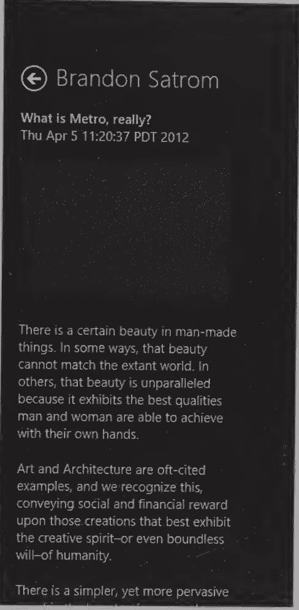

**图 1.30：** 拆分应用项目模板中内置的贴靠模式支持

## 其余功能

等等！还有更多！

- 如果你想添加对 Channel 9 提供的媒体附件的支持，可以在第五章"媒体"中学习如何操作。
- 要添加用户在不同页面间导航时的酷炫动画支持，请阅读第六章"绘制与动画"。
- 要跟踪用户在应用的各会话之间已经阅读过的帖子，或让他们选择想要阅读的源，请查看第七章"应用状态"。
- 要让用户创建标记有当前 GPS 坐标的帖子，或在用户摇晃平板电脑时刷新源数据，请阅读第十一章"设备交互"。
- 如果你需要用 C++ 编写的原生代码来扩展你的 Windows 商店应用以执行某些重量级任务，例如计算圆周率的第 10000 位数字，你会想要深入研究第十二章"原生扩展性"。
- 最后，要了解如何部署应用、处理试用模式，或在每个帖子底部添加广告，你会想要阅读第十三章"盈利"。

## 我们在哪里？

本章是一次旋风式的工具、技术和技术之旅，涵盖了使用 JavaScript 为 Windows 8 构建 Windows 商店应用的相关内容，通过 Visual Studio 2012 和 Blend 进行开发。看起来可能很多，但我们真的只是触及了皮毛。继续阅读；我们才刚刚开始！

# 2 绑定与控件

在第一章"你好，Windows 8！"中，我解释了绑定是一种能力，可以获取一列数据（如一组 RSS 源）的值，并用它来填充控件（如 ListView）。此外，我解释了如何使用模板来定制我们提取的数据，并提供了一个示例，其中我们只从每个源中提取标题。在本章中，我们将讨论绑定如何比这更加灵活，允许我们在底层数据变化时更新 UI，以及对数据进行排序、筛选和分组。

当我们使用数据绑定时，通常是在控件的上下文中，就像我们在配置 ListView 控件时指定要使用的源列表和每个源使用的模板一样。在本章中，我们将更仔细地研究 ListView 及其对数据绑定和模板的支持，并快速浏览作为使用 JavaScript 的 Windows 8 程序员可以使用的其他控件。如果那些控件不能满足你的需求，我还会展示如何构建你自己的控件。

## 绑定

绑定的使用允许你在两个对象的属性之间建立关联，通常是将要将对象的属性与 HTML 文档对象模型（DOM）元素上的属性关联起来，如图 2.1 所示。

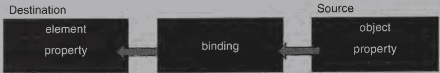

**图 2.1：** 目标元素上的属性与源对象上的属性之间的绑定

建立绑定的目的是在两个涉及的对象之间复制数据：数据的源和数据的目标。你可能认为可以使用简单的赋值语句来实现这个目标：

```
myDestInput.value = mySourceObj.name;
```

从根本上讲，赋值就是绑定的作用。然而，绑定不仅仅是描述要复制什么数据以及复制到哪里，还包括*何时*复制。"何时"的描述通常是以下之一：

- **单向绑定**：当对象变化时，将数据复制到 DOM 元素。这是 WinJS 中的默认值。
- **一次性绑定**：在绑定首次建立时，将数据复制到 DOM 元素。这等同于赋值。
- **双向绑定**：当对象变化时，将数据复制到 DOM 元素；当 DOM 元素变化时，将数据复制到对象。WinJS 不支持此功能。

默认情况下，WinJS 绑定是单向绑定，但也支持一次性绑定。WinJS 不支持双向绑定，但有一个很好的切入点可以接入你喜欢的双向绑定引擎，比如 jQuery 的，稍后你会看到。

## 绑定对象

为了开始讲解，假设我们想要构建一个小型的我们生活中人物的浏览器，如图 2.2 所示。


 # 第2章：绑定与控件

## 欢迎使用 PeopleBrowser！

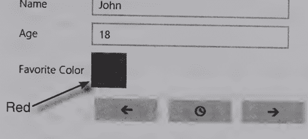

**图 2.2：** 将对象绑定到一组 HTML 元素

我们的想法是可以浏览多个人员，每个人都有姓名、年龄和最喜欢的颜色。当我们使用上一个和下一个按钮时，可以导航到列表中的其他人员，而如果我们按下中间的按钮——时钟按钮——则通过增加当前显示人员的年龄来庆祝生日。以下是我们将在示例中浏览的人员集合：

```
var people = [
  { name: "John", age: 18, favoriteColor: "red" },
  { name: "Tom", age: 16, favoriteColor: "green" },
  { name: "Chris", age: 42, favoriteColor: "blue" },
];
```

从导航应用项目模板开始，使用以下 HTML 为我们提供了一个可填充的表单：

```
<!DOCTYPE html>
<!-- home.html -->
<html>
<head>
  <meta charset="utf-8" />
  <title>homePage</title>

  <!-- WinJS references -->
  <link href="/Microsoft.WinJS.1.0/css/ui-light.css" rel="stylesheet" />
  <script src="/Microsoft.WinJS.1.0/js/base.js"></script>
  <script src="/Microsoft.WinJS.1.0/js/ui.js"></script>
  <link href="/css/default.css" rel="stylesheet" />
  <link href="/pages/home/home.css" rel="stylesheet" />
  <script src="/pages/home/home.js"></script>
</head>
<body>
  <!-- The content that will be loaded and displayed. -->
  <div class="fragment homepage">
    <header aria-label="Header content" role="banner">
      <button class="win-backbutton" aria-label="Back" disabled
        type="button"></button>
      <h1><textarea win-type="text-ellipses">
        <span class="pagetitle">Welcome to PeopleBrowser!</span>
      </h1>
    </header>
    <section aria-label="Main content" role="main">
      <!-- Display each person -->
      <div id="nameLabel">Name</div>
      <input id="name" readonly="true" type="text"
        data-win-bind="value: name" />

      <div id="ageLabel">Age</div>
      <input id="age" readonly="true" type="text"
        data-win-bind="value: age" />

      <div id="colorLabel">Favorite Color</div>
      <div id="color"
        data-win-bind="style.backgroundColor: favoriteColor"></div>

      <div id="buttons">
        <button id="previousButton"></button>
        <button id="birthdayButton"></button>
        <button id="nextButton"></button>
      </div>
    </section>
  </div>
</body>
</html>
```

相应的 CSS 使用了第3章"布局"中描述的布局技术，以及第4章"排版"中讨论的按钮图像技巧，你可以下载本书示例源代码来查看。有趣的部分是 `data-win-bind` 属性的使用，它采用以下格式：

```
<div data-win-bind="destProp1: srcProp1; destProp2: srcProp2;..."></div>
```

`data-win-bind` 语法是一个以分号分隔的绑定表达式列表。每个表达式都是目标 HTML 属性和源对象属性的组合。我们用于设置最喜欢的颜色 div 的背景色的点号语法，即 `style.backgroundColor`，既适用于属性也适用于特性，并且可以像你所期望的那样深入到子对象中。

绑定表达式中的每个属性都是针对包含 `data-win-bind` 属性的 HTML 元素来解析的。问题是，属性名称所解析的对象来自哪里呢？答案是：**数据上下文**。

设置数据上下文是绑定操作的一部分，它建立 HTML 元素与用作数据上下文的对象之间的关联。在本例中，我们深入到 `people` 数组，将一个人作为绑定所依据的上下文：

```
// home.js
(function () {
  "use strict";

  WinJS.UI.Pages.define("/pages/home/home.html", {
    ready: function (element, options) {
      var people = [
        { name: "John", age: 18, favoriteColor: "red" },
        { name: "Tom", age: 16, favoriteColor: "green" },
        { name: "Chris", age: 42, favoriteColor: "blue" },
      ];

      // bind the current person to the HTML elements in the section
      var section = element.querySelector("section[role=main]");
      var current = 0;
      WinJS.Binding.processAll(section, people[current]);
    }
  });
})();
```

`WinJS.Binding` 命名空间中的 `processAll` 函数是解析给定 HTML 元素层次结构的 `data-win-bind` 属性的函数，在我们的示例中，是包含 input 和 div 元素的 section。调用 `processAll` 会根据每个 `data-win-bind` 属性中的描述，建立 HTML 元素与数据上下文之间的绑定。数据上下文是 `processAll` 的第二个参数，用于解析每个绑定表达式中找到的属性名称。结果已经看起来是我们想要的效果，正如你在图 2.2 中看到的那样。

默认情况下，如果我们不做其他操作，我们已经建立了数据上下文对象与 DOM 元素之间的单向绑定连接。这意味着当数据源对象的属性发生变化时，我们期望输出也会相应地改变。例如，这里我们在生日按钮的点击处理程序中更改了人员的年龄：

```
WinJS.UI.Pages.define("/pages/home/home.html", {
	ready: function (element, options) {
		var people = [
			{ name: "John", age: 18, favoriteColor: "red" },
			{ name: "Tom", age: 16, favoriteColor: "green" },
			{ name: "Chris", age: 42, favoriteColor: "blue" },
		];

		// bind the current person to the HTML elements in the section
		var section = element.querySelector("section[role=main]");
		var current = 0;
		WinJS.Binding.processAll(section, people[current]);

		birthdayButton.onclick = function () {
			var person = people[current];
			person.age++; // changing a bound property doesn't work yet...
		};
	}
});
```

我们为生日按钮实现的点击处理程序会查找当前元素并更改一个属性，具体来说是年龄。然而，我们尚未达到需要的状态，还无法实现 UI 的自动更新。

问题在于，标准的 JavaScript 对象不支持任何通知协议来告知感兴趣的各方——比如绑定——其数据已经发生变化。添加通知协议需要调用 `WinJS.Binding` 命名空间中的 `as` 方法：

```
WinJS.UI.Pages.define("/pages/home/home.html", {
	ready: function (element, options) {
		var people = [
			// notify binding listeners when these objects change
			WinJS.Binding.as({ name: "John", age: 18, favoriteColor: "red" }),
			WinJS.Binding.as({ name: "Tom", age: 16, favoriteColor: "green" }),
			WinJS.Binding.as({ name: "Chris", age: 42, favoriteColor: "blue" }),
		];

		// bind the current person to the HTML elements in the section
		var section = element.querySelector("section[role=main]");
		var current = 0;
		WinJS.Binding.processAll(section, people[current]);

		birthdayButton.onclick = function () {
			var person = people[current];
			person.age++; // now this works!
		};
	}
});
```

`as` 方法包装每个对象，提供绑定通知协议，使得每个属性的更改都会通知任何绑定监听器（比如我们绑定的 HTML 元素）。有了这段代码，更改人员的年龄就会反映在 UI 中，如图 2.3 所示。

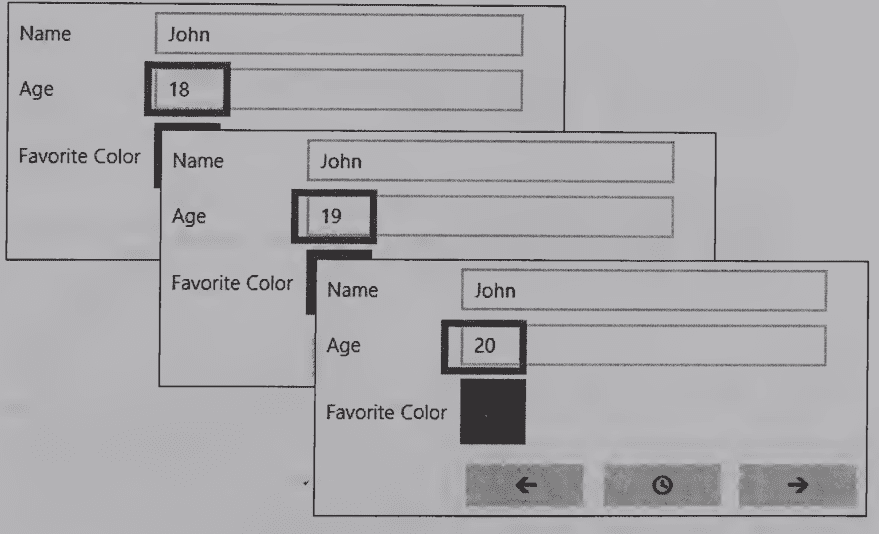

**图 2.3：** 更改底层数据会自动更新绑定的 HTML 元素

我们一直在将单个对象绑定到一组 HTML 元素以供显示，但你可以使用不同的数据上下文来处理 `data-win-bind` 属性中的数据绑定表达式：

```
WinJS.UI.Pages.define("/pages/home/home.html", {
	ready function (element, options) {
		var people = [
			// notify binding listeners when these objects change
			WinJS.Binding.as({ name: "John", age: 18, favoriteColor: "red" }),
			WinJS.Binding.as({ name: "Tom", age: 16, favoriteColor: "green" }),
			WinJS.Binding.as({ name: "Chris", age: 42, favoriteColor: "blue" }),
		];

		// bind the current person to the HTML elements in the section
		var section = element.querySelector("section[role=main]");
		var current = 0;
		var viewModel = WinJS.Binding.as({ person: people[current] });
		WinJS.Binding.processAll(section, viewModel);

		birthdayButton.onclick = function () {
			viewModel.person.age++;
		};

		// bind to the previous object
		previousButton.onclick = function () {
			current = (people.length + current - 1) % people.length;
			viewModel.person = people[current];
		};

		// bind to the next object
		nextButton.onclick = function () {
			current = (people.length + current + 1) % people.length;
			viewModel.person = people[current];
		};
	}
});
```

在这里，我们进行了一个转变：从传入应用程序 *模型* 中的单个数据（即，与自身显示无关的数据集）变为对 *视图* 适当的数据进行分组（在本例中，是要查看的当前人员）。我们将这个变量称为 **视图模型**，这是根据一种称为 *Model-View-ViewModel* (MVVM) 的实现用户界面的知名技术命名的。一旦我们将视图模型构建为可绑定对象，随着底层属性的变化，视图也会更新。然后我们将视图绑定到视图模型，以便在


## 第2章：绑定与控件

我们的“下一页”和“上一页”按钮处理器，当我们希望查看的人物发生变化时，视图会收到通知。为了实现这一点，我们需要更新HTML以使用视图模型，而不是直接使用person对象：

```html
<section aria-label="Main content" role="main">
  <!-- display each person -->
  <div id="nameLabel">Name</div>
  <input id="name" readonly="true" type="text"
    data-win-bind="value: person.name" />
  <div id="ageLabel">Age</div>
  <input id="age" readonly="true" type="text"
    data-win-bind="value: person.age" />
  <div id="colorLabel">Favorite Color</div>
  <div id="color"
    data-win-bind="style.backgroundColor: person.favoriteColor"></div>
  <div id="buttons">
    <button id="previousButton"></button>
    <button id="birthdayButton"></button>
    <button id="nextButton"></button>
  </div>
</section>
```

图2.4展示了结果。

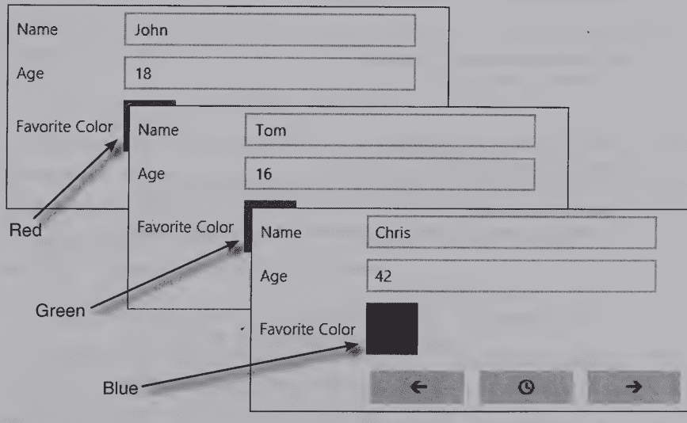

除了将对象绑定到元素，绑定还允许你简单地监听值的变化。例如，目前当用户点击上一个或下一个按钮时，我们将索引更改为当前值，我们必须记住编写代码来重新处理绑定表达式。然而，如果我们愿意，我们可以使用绑定本身来帮助我们：

```javascript
WinJS.UI.Pages.define("/pages/home/home.html", {
  ready: function (element, options) {
    var people = [
      // notify binding listeners when these objects change
      WinJS.Binding.as({ name: "John", age: 18, favoriteColor: "red" }),
      WinJS.Binding.as({ name: "Tom", age: 16, favoriteColor: "green" }),
      WinJS.Binding.as({ name: "Chris", age: 42, favoriteColor: "blue" }),
    ];

    // bind the current person to the HTML elements in the section
    var section = element.querySelector("section[role=main]");

    // listen for the current index to change and update the HTML
    var viewModel = WinJS.Binding.as({ current: 0, person: null });
    WinJS.Binding.processAll(section, viewModel);
    viewModel.bind("current", function (newValue, oldValue) {
      viewModel.person = people[newValue];
    });

    birthdayButton.onclick = function () {
      viewModel.person.age++;
    };

    // bind to the previous object
    previousButton.onclick = function () {
      // set the current index and let the binding do the work
      viewModel.current =
        (people.length + viewModel.current - 1) % people.length;
    };

    // bind to the next object
    nextButton.onclick = function () {
      // set the current index and let the binding do the work
      viewModel.current =
        (people.length + viewModel.current + 1) % people.length;
    };
  }
});
```

我们不是使用一个简单的变量来保存当前显示人物的索引，而是将索引添加到可绑定的视图模型中。所有可绑定对象都有一个`bind`方法，它允许我们监听对象属性的变化——在本例中是`current`属性。当用户点击上一个或下一个按钮时，我们只需更改当前要显示的人物的索引，并让绑定处理器处理显示当前人物的HTML的`data-win-bind`属性。

如果你想停止监听绑定事件，可以调用`unbind`方法。

这里使用`bind`方法可能看起来有些小题大做，但监听值的变化通常是很有用的，正如我们稍后将看到的。

现在，正如我所提到的，我们看到的一切都使用默认的：单向绑定。但是，如果你想设置其他类型的绑定或参与绑定过程本身，你可以使用绑定初始化器来实现。

## 初始化器

初始化器是绑定表达式的可选第三参数，用于指定在建立绑定时调用的函数：

```html
<div data-win-bind="destProp: srcProp init" ...></div>
```

如果你想参与甚至替换现有的绑定行为——例如，执行数据转换甚至连接jQuery双向绑定——你可以提供一个初始化器作为绑定表达式的一部分。绑定初始化器是接管默认单向绑定的函数，具有以下签名：

```javascript
function myInit(source, sourceProperties, dest, destProperties) {...}
```

WinJS内置了几个初始化器供你利用。例如，如果你想进行一次性绑定而不是单向绑定，可以使用`WinJS.Binding`命名空间中的`oneTime`函数：

```html
<input data-win-bind="value: person.name WinJS.Binding.oneTime"></input>
```

另一方面，在执行单向绑定时，执行数据转换（也称为数据转换）通常很有用。例如，想象我们想将生活中人物的年龄用文字拼写出来：

```javascript
function getWordsFromNumber(i) {...}

// convert ages to words
window.ageToWords =
  WinJS.Binding.converter(function (value) {
    return getWordsFromNumber(value); });
```

`WinJS.Binding`命名空间上的`converter`函数提供了初始化器实现的难点部分；你只需提供一个执行实际转换的函数，它将在源值变化时被调用。在HTML中使用它看起来正如你所期望的：

```html
<input data-win-bind="value: person.age ageToWords"></input>
```

在这里，我们建立了绑定，并在源数据变化时执行转换，如图2.5所示。

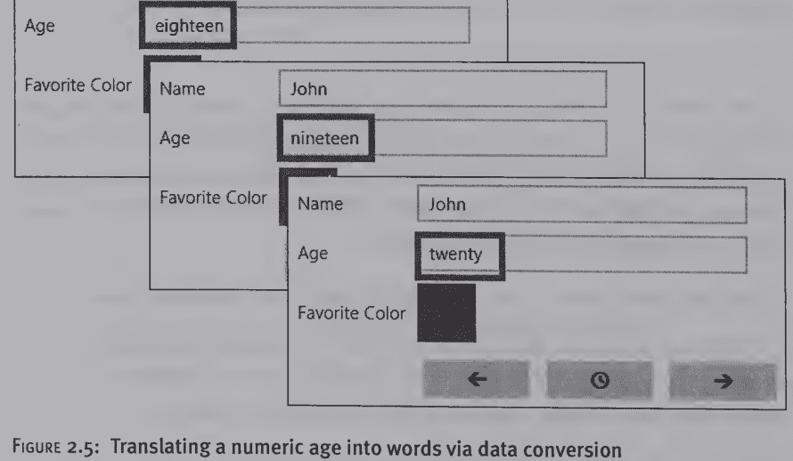

逐个绑定值很有用，但更有用的是一次性绑定值的集合。为此，我们有绑定列表。

## 绑定列表

想象一个使用ListView和值集合的简单示例：

```html
<div data-win-control="WinJS.UI.ListView"
    data-win-options="{itemDataSource: items.dataSource}">
</div>
```

在这里，我们以声明方式在HTML中创建了一个ListView控件，它绑定到全局`items`对象的`dataSource`属性。在我们的JavaScript中，很容易创建并填充`items`对象作为绑定列表：

```javascript
// a global binding list of items
window.items = new WinJS.Binding.List();

[0, 1, 2].forEach(function (i) {
    WinJS.Promise.timeout(500 * (i+1)).done(function () {
        // add an item to the binding list, updating the ListView
        items.push(i);
    });
});
```

在这段代码中，我们创建了一个**绑定列表**（`WinJS.Binding`命名空间中`List`类型的一个实例）<sup>1</sup>，我们遍历一个值数组，使用每个值创建一个超时，这是一个Promise<sup>2</sup>，它将根据我们传递的参数（以毫秒为单位）在未来某个时间触发。当每个超时时，我们会看到ListView获得一个额外的值，如图2.6所示。

HTML没有为ListView提供**id**，JavaScript也没有以任何方式与ListView交互。相反，HTML和JavaScript都在`items`绑定列表上会合。是绑定列表实现了集合绑定API（称为IListDataSource<sup>3</sup>）。绑定列表通过`dataSource`属性公开其IListDataSource实现，而不是让你直接针对IListDataSource编程——它对程序员来说并不特别友好<sup>4</sup>。

为了提供尽可能类似于JavaScript程序员的API，绑定列表实现了一个与内置数组支持的API和语义类似的API——例如，`push`、`pop`、`slice`、`splice`等等。作为比较，这是内置JavaScript数组的工作方式：

```javascript
// using the built-in array
var array = [];
array.push("one");
array.push("two");
array.push("three");

var x = array[0]; // x = "one"
var y = array[1]; // y = "two"

array[2] = "THREE";
var z = array[2]; // z = "THREE";
```


---

**脚注：**
1.  绑定列表在微软内部被称为“Josh's List”，以其发明者Josh Williams命名。这个名字与1971年ABC每周电影《Brian's Song》无关，该片由James Caan和Billy Dee Williams主演，只是Josh总是在Halas教练得知Brian患癌的那一段哭泣。
2.  回顾第1章中描述的Promise。
3.  你可以在这里阅读关于IListDataSource：http://msdn.microsoft.com/en-us/library/windows/apps/br211786.aspx。
4.  IListDataSource（及其伙伴IListDataAdapter）是完全虚拟化可绑定数据源的双向通信需求的优秀接口，你可以在以下示例中看到：http://code.msdn.microsoft.com/windowsapps/ListView-custom-data-4dcfb128。

绑定列表的行为类似，但它不是使用**索引器**（即方括号），而是通过 setAt 和 getAt 方法来访问项目：

```
// 使用 WinJS 绑定列表
var list = new WinJS.Binding.List();
list.push("one");
list.push("two");
list.push("three");

var x = list.getAt(0); // x = "one"
var y = list.getAt(1); // y = "two"

list.setAt(2, "THREE");
var z = list.getAt(2); // z = "THREE";
```

绑定列表并未实现所有 JavaScript 数组的语义，因此请务必进行一些试验，以确保其按照你预期的方式工作。

## 排序和筛选

除了熟悉的 API 之外，绑定列表的设计也考虑了 Windows Store 应用程序的构建需求。你已经看到了 `dataSource` 属性如何让你连接到 `ListView` 控件。你可能也对数据的排序和筛选感兴趣。例如，这是我们之前的人们列表，这次被包装在一个绑定列表中：

```
var people = new WinJS.Binding.List([
  { name: "John", age: 18, favoriteColor: "red" },
  { name: "Tom", age: 16, favoriteColor: "green" },
  { name: "Chris", age: 42, favoriteColor: "blue" },
]);

// 按姓名排序
window.sortedPeople = people.
  createSorted(function (lhs, rhs) {
    return lhs.name.localeCompare(rhs.name); });

// 按年龄筛选（仅成年人）
window.filteredPeople = people.
  createFiltered(function (p) { return p.age > 17; });
```

我们可以通过调用 `createSorted` 函数并传入一个排序函数来对绑定列表进行排序，或者通过调用 `createFiltered` 函数并传入一个筛选函数来进行筛选。调用这些创建函数的结果是一个数据视图，它看起来和行为上都像绑定列表的另一个实例，并允许我们将其绑定到 `ListView`，如图 2.7 所示。

`createSorted` 和 `createFiltered` 函数并非提供底层数据的副本，而是返回现有数据的实时视图。这意味着对底层数据的任何更改都会通过触发排序和/或筛选再次反映在视图中，从而使任何绑定的控件中显示更改。例如，我们可以向底层列表添加一个未成年人：

```
// 对底层数据的更改会反映在实时视图中
var person = { name: "Pete", age: 17, favoriteColor: "black" };
people.push(person);
```

尽管我们更改了底层数据，排序后的视图将会更新，并且 `ListView` 将会收到更改通知，如图 2.8 所示。

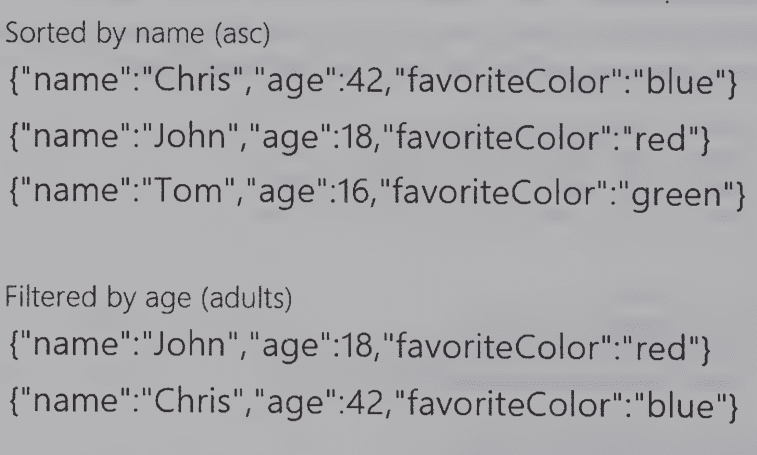

## 图 2.7：对绑定列表进行筛选

按姓名排序（升序）

{"name":"Chris","age":42,"favoriteColor":"blue"}

{"name":"John","age":18,"favoriteColor":"red"}

{"name":"Pete","age":17,"favoriteColor":"black"}

{"name":"Tom","age":16,"favoriteColor":"green"}

## 图 2.8：对绑定列表进行排序

此外，由于从创建方法返回的视图看起来和感觉上都像绑定列表，你可以继续以堆叠的方式对视图进行排序或筛选：

```
// 按年龄筛选（未成年人）并按姓名排序
window.filteredSortedPeople = people.
  createFiltered(function (p) { return p.age < 18; }).
  createSorted(function (lhs, rhs) {
    return lhs.name.localeCompare(rhs.name);
  });
```

绑定到最终筛选和排序视图的结果应该不会令人意外（参见图 2.9）。

请小心堆叠的顺序。在筛选的情况下，如果你先排序或分组，然后再筛选，你做的工作会比必要的多。此外，每个视图层都是开销，因此你需要确保只在必要的深度进行堆叠。

按年龄筛选（未成年人）并
按姓名排序（升序）

{"name":"Pete","age":16.5,"favoriteColor":"black"}

{"name":"Tom","age":16,"favoriteColor":"green"}

## 图 2.9：对绑定列表进行排序和筛选

## 分组

除了对绑定列表数据进行排序和筛选之外，你还可以基于数据的某些条件进行分组——例如，成年人和未成年人对于我们的示例数据来说很合适：

```
// 按年龄分组
window.groupedPeople = people.
createGrouped(function (p) { return p.age < 18 ? "minor" : "adult" });
```

分组函数的返回值是一个唯一标识组的字符串值——在我们的例子中，是字符串 "minor" 或字符串 "adult"。绑定到数据的分组视图将显示按组排列的数据——也就是说，在进入下一组之前，会显示每个组的所有项目，如图 2.10 所示。

此示例仅显示了两个组，但你可以拥有任意数量的组。此外，就像 `createSorted` 和 `createFiltered` 一样，`createGrouped` 返回的是实时数据的视图，因此底层数据的更改将反映在绑定目标中。

然而，尽管我们（开发者）清楚我们正在对组进行排序——首先是成年人，然后是未成年人——但我们的程序用户并不清楚，因为没有可视的分组指示器。在可视分组指示器方面，`ListView` 允许你指定两组数据：分组项目的列表和组本身。使用两组数据配置 `ListView` 如下所示：

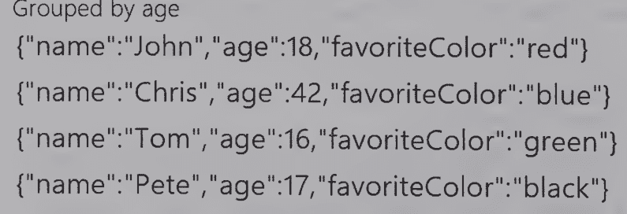

图 2.10：对绑定列表进行分组

```
<div data-win-control="WinJS.UI.ListView"
     data-win-options="{itemDataSource: groupedPeople.dataSource,
                      groupDataSource: groupedPeople.groups.dataSource}">
</div>
```

一旦我们创建了绑定列表的分组视图，`groups` 属性会公开这些组的列表，以便 `ListView` 可以使用它们。然而，在我们让它工作之前，我们还需要回到使用 `createGrouped` 函数的方式：

```
// 按年龄分组
function groupKeySelector(p) { return p.age < 18 ? "minor" : "adult"; };
function groupDataSourceSelector(p) { return p.age < 18 ? "minor" : "adult"; };
window.groupedPeople = 
    people.createGrouped(groupKeySelector, groupDataSourceSelector);
```

以前，当我们进行分组时，只需要提供一个可以根据某个唯一组标识符进行分组的函数。但是，如果我们想实际向用户显示组，我们需要另一个可以提取组本身的函数（如果我们想选择组的顺序，我们可以向 `createGroup` 函数提供第三个用于排序的函数）。在这两种情况下，我们都提供一个字符串来表示组以及构建组列表，这工作得很好，如图 2.11 所示。

如图 2.11 所示，组实际上用于修饰分组后的数据，使得非常容易看出哪些数据属于哪个组。不幸的是，即使有了这种可视的分组指示，我们的 JavaScript 对象表示法 (JSON) 格式的对象⁵ 也不是我们真正想向用户展示的内容。为了让它按我们想要的方式工作，我们需要模板。

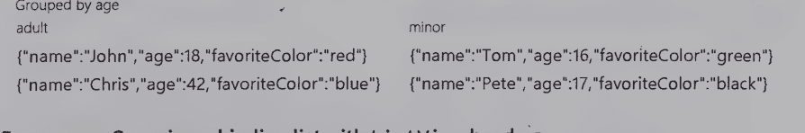

## 图 2.11：使用 ListView 标题对绑定列表进行分组

5. JSON 是 JavaScript 对象的一种简单格式，你可以在 http://json.org 上阅读有关信息。

## 模板

模板是一个 HTML 元素层次结构，带有可选的“洞”以填充动态数据。div 上的 `data-win-bind` 属性使用 `data-win-bind` 属性定义这些洞。例如，我们可以为我们的人员对象创建一个模板，如下所示：

```
<div id="itemTemplate" data-win-control="WinJS.Binding.Template">
    <span data-win-bind="style.color: favoriteColor">
        <span data-win-bind="textContent: name"></span>
        <span> is </span>
        <span data-win-bind="textContent: age"></span>
        <span> years old</span>
    </span>
</div>
```

使这段 HTML 成为模板的是设置为 `WinJS.Binding.Template` 控件类型的 `data-win-control` 属性。一旦我们有了模板，我们需要渲染它以用数据填充这些洞：

```
// 手动模板渲染
var person = { name: "Pete", age: 17, favoriteColor: "black" };
var template = itemTemplate.winControl;
template.render(person).
    done(function (element) { peteDiv.appendChild(element); });
```

因为模板只是另一个控件（尽管是一个在手动渲染之前会隐藏自身的控件），我们可以通过定义它的 div 并通过一个名为 `winControl` 的已知属性访问其功能。我们想要访问的功能是模板的 `render` 方法，该方法接受一个用于绑定 `data-win-bind` 属性的数据上下文，并生成一个完整的 HTML 元素。

如果你向 `ListView` 提供一个模板，它将使用该模板渲染每个项目。实际上，`ListView` 可以为渲染项目和组标题都提供模板。为了看到实际效果，让我们首先将组更新为对象，这更典型：

```
// 花式按年龄分组
var groups = [{ key: 1, name: "Minor" }, { key: 2, name: "Adult" }];
function groupDataSelector(p) { return p.age < 18 ? groups[0] : groups[1]; };
function groupKeySelector(p) { return groupDataSelector(p).key; };
window.fancyGroupedPeople =
    people.createGrouped(groupKeySelector, groupDataSelector);
```


在这段代码中，我们有两个分组对象，每个对象都有一个键和一个名称，并且有独立的数据和键选择函数，分别返回分组本身或分组的键。为了让分组数据更接近真实场景，分组标题的模板是这样创建的：

```
<div id="headerTemplate" data-win-control="WinJS.Binding.Template">
    <span data-win-bind="textContent: name"></span>
</div>

<div id="itemTemplate" data-win-control="WinJS.Binding.Template">
    <span data-win-bind="style.color: favoriteColor">
        <span data-win-bind="textContent: name"></span>
        <span> is </span>
        <span data-win-bind="textContent: age"></span>
        <span> years old</span>
    </span>
</div>

<h1>Fancy Grouped</h1>
<div data-win-control="WinJS.UI.ListView"
     data-win-options="{
        groupDataSource: fancyGroupedPeople.groups.dataSource,
        groupHeaderTemplate: select('#headerTemplate'),
        itemDataSource: fancyGroupedPeople.dataSource,
        itemTemplate: select('#itemTemplate')}">
</div>
```

分组标题的创建方式与项目模板相同。分组标题和项目模板通过 `data-win-options` 属性中的 `groupHeaderTemplate` 和 `itemTemplate` 属性传递给 ListView 控件。我们更精细的分组数据如图 2.12 所示。

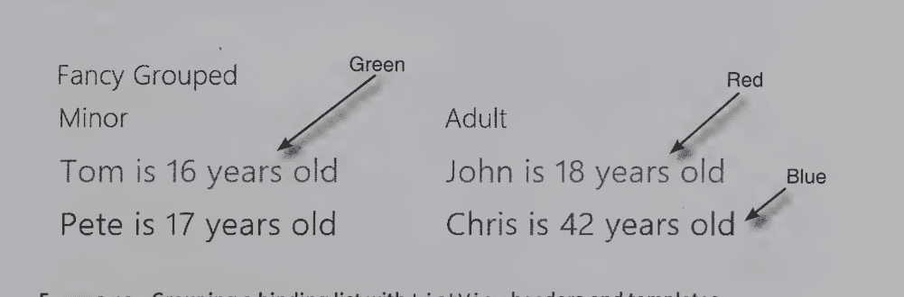

图 2.12：使用 ListView 标题和模板对绑定列表进行分组

## 第 2 章：绑定与控件

好吧，我承认这并不算花哨，但分组和项目的组合，包括模板，展示了绑定列表的强大功能。事实上，绑定列表非常有用，它是 Grid App 和 Split App 项目模板生成的 data.js 文件中暴露的异步数据模型的核心：

```
// data.js
(function () {
	"use strict";

	var list = new WinJS.Binding.List();
	var groupedItems = list.createGrouped(
		function groupKeySelector(item) { return item.group.key; },
		function groupDataSelector(item) { return item.group; }
	);

	// TODO: Replace the data with your real data.
	// You can add data from asynchronous sources whenever it becomes available.
	generateSampleData().forEach(function (item) {
		list.push(item);
	});

	WinJS.Namespace.define("Data", {
		items: groupedItems,
		groups: groupedItems.groups,
		getItemsFromGroup: getItemsFromGroup,
		...
	});

	...

	// This function returns a WinJS.Binding.List containing only the items
	// that belong to the provided group.
	function getItemsFromGroup(group) {
		return list.createFiltered(function (item) {
			return item.group.key === group.key;
		});
	}

	...

	})();
})();
```

你可以看到空绑定列表的创建、使用对分组进行键和数据选择的函数创建分组版本列表、一个用于将项目添加到绑定列表的小 foreach 循环，以及最后执行筛选的辅助函数。正如你在本章和第 1 章中所见，将静态示例数据的替换为从 Internet 拉取的动态数据并不需要太多工作。

除了看到绑定列表的强大功能之外，我们也看到了 ListView 本身的强大功能。然而，ListView 只是提供给你的大量控件套件中的一个。

## 控件

作为在 JavaScript 中构建 Windows 商店应用平台的一部分，你可以使用多个系列中的控件。

- **HTML5 元素**：HTML5 元素在本质上是可重用的 UI 和行为片段，例如，`<progress />` 和 `<a />`。
- **WinRT 控件**：这些控件是作为投射到 JavaScript 中的 WinRT 类公开的，例如，`Windows.UI.Popups.PopupMenu`。
- **WinJS 控件**：这些控件是作为 JavaScript 类实现的，例如，`WinJS.UI.ListView`。
- **CSS 样式**：CSS 提供了多种样式，允许你像使用带样式的 HTML 元素作为控件容器一样来布局内容，例如，`column-count: 4`。

我们将在后续章节中介绍 HTML 元素、WinRT 控件和 WinJS 控件。我们将在第 3 章中介绍用于布局的 CSS 样式。

## HTML 元素

由于 JavaScript 中的 Windows 商店应用基于 Web 技术，所有 HTML5 元素都能正常工作，如图 2.13 所示。

HTML5 元素的细节超出了本书的范围；如果你想了解更多信息，我建议你查阅你友好的 HTML5 文档。⁶ 此外，用于创建图 2.13 的示例随本书源代码一起提供。

> 6. 我推荐 Bruce Lawson 和 Remy Sharp 的 *Introducing HTML5*（New Riders 出版），以及 HTML5 W3C 规范：www.w3.org/TR/2011/WD-html5-20110525/ (http://tinysells.com/245)。

## HTML 控件

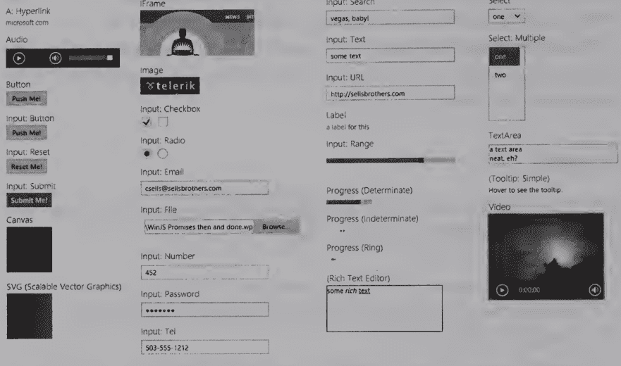

图 2.13：Windows 商店应用可用的 HTML5 控件

## WinRT 控件

WinRT 在各个领域提供了各种功能，正如你将在本书其余部分看到的，但在控件方面，它只提供了两种：

- 消息对话框：带有可选标题的消息
- 弹出菜单：限定为六个项目或更少的菜单

消息框通过 `MessageDialog` 函数调用：

```
var popups = Windows.UI.Popups;
var mb =
    new popups.MessageDialog("and welcome to my message box!", "Hello!");
mb.showAsync();
```

`MessageDialog` 类有一个 `showAsync` 方法，它返回一个 promise，就像 Windows 商店应用可用的所有其他异步操作一样。然而，在这种情况下，我们忽略了 promise，因为我们通常不关心消息框何时消失。结果如图 2.14 所示。

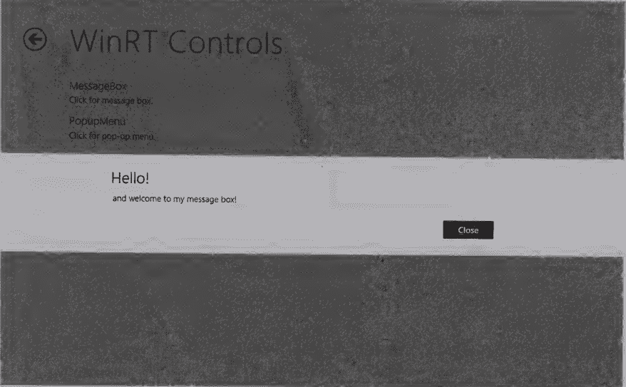

**图 2.14：WinRT 消息对话框**

`PopupMenu` 类的使用方式类似：

```
var popups = Windows.UI.Popups;
var menu = new popups.PopupMenu();
menu.commands.push(new popups.UICommand("one", null, 1));
menu.commands.push(new popups.UICommand("two", null, 2));
menu.showAsync({ x: 120, y: 360 }).done(function (e) {
  // Do something with e.label and/or e.id
  ...
});
```

在此示例中，创建 `PopupMenu` 对象后，我们提供了两个 `UICommand` 对象，每个对象都有一个标签以及可选的回调和 id 参数。我们为每个命令回调参数传递 null，因为我们在 done 完成方法中捕获事件参数。弹出菜单看起来如你所料（参见图 2.15）。

上下文菜单限定为仅六个项目。

## PopupMenu

点击弹出菜单。

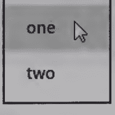

图 2.15：WinRT 弹出菜单

## WinJS 控件

虽然 HTML 控件丰富多样，但该集合在 W3C 决定添加新的元素标签并且浏览器供应商决定实现它之前是不可扩展的。同样，WinRT 控件的集合也是不可扩展的（尽管你可以构建非 UI WinRT 组件，如第 12 章"原生扩展性"所讨论）。对于专门为 Windows 商店应用构建的可扩展控件集合，最佳选择是由 WinJS 提供的集合。

WinJS 控件是在 JavaScript 中实现的控件，它在构造函数中提供特定的签名：

```
function MyControl(element, options) {…}
```

`element` 参数是旨在作为控件内容宿主的 HTML DOM 元素，通常是一个 div。`options` 参数是一个 JavaScript 对象，用于提供可选的配置参数，如 ListView 的 `itemDataSource` 属性。

要在实际中看到 WinJS 控件，假设我们有一个旨在作为 DatePicker 控件宿主的 div：

```
<div id="datePickerDiv"></div>
```

有了它，我们可以像这样轻松地创建一个 DatePicker：

```
var datePicker = new WinJS.UI.DatePicker(datePickerDiv);
```

生成的输出是一个全新的 DatePicker 控件，如图 2.16 所示。

如果我们想要配置控件，可以传入一组选项：

```
var datePicker =
  new WinJS.UI.DatePicker(datePickerDiv, { current: "6/2/1969" });
```

对于 DatePicker，`current` 选项允许我们设置当前显示的日期，如图 2.17 所示。

一旦控件与你的 HTML 元素关联，你可以使用 `winControl` 属性获取控件：

```
var datePicker = datePickerDiv.winControl; // well-known property name
datePicker.current = "5/5/1995"; // now we're talking to the control
```

此外，一旦你有了控件，可以使用 `element` 属性返回到关联的 HTML 元素：

```
var datePickerDiv = datePicker.element;
datePickerDiv.style.display = "none"; // talking to the HTML element
```

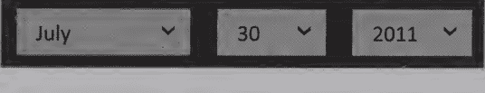

**图 2.16：** 新的 DatePicker 控件


**图 2.17：** 在 DatePicker 控件中设置当前日期


除了允许通过编程方式创建控件外，每个控件还支持通过`data-win-control`和`data-win-options`属性进行声明式创建，正如我们之前所见：

```
<div id="datePicker2"
  data-win-control="WinJS.UI.DatePicker"
  data-win-options="{current: '6/2/1969'}" ></div>
```

`data-win-control`属性是待调用的构造函数名称。如同数据绑定（该功能需要调用`WinJS.Binding.processAll`来解析`data-win-bind`属性）一样，`data-win-control`属性也需要有人调用`WinJS.UI.processAll`来进行解析并创建控件。这就是为什么在所有生成的项目模板代码中都能看到对`WinJS.UI.processAll`的调用。

`data-win-options`字符串被解析为一种功能较弱的JavaScript对象初始化语法。例如，你会注意到，我并未通过创建Date对象来为DatePicker控件设置当前选项，而是直接传递了字符串。这是因为选项解析器不理解`new`关键字——它只适用于静态数据。然而，由于DatePicker及其他WinJS控件都期望以声明式方式创建，因此它们为选项解析器的局限性做出了特殊处理。以DatePicker为例，这意味着它会接收字符串并将其解析为Date对象。

每个控件都有不同的选项集，我建议你参考文档以了解各控件支持哪些选项。表2.1列出了可供你使用的内置WinJS控件。

图2.18展示了WinJS控件的实际运行效果。

你应该在应用中自由混合使用HTML控件、WinRT控件和WinJS控件。

或者，如果你在HTML5、WinRT或WinJS提供的列表中找不到所需的控件，可以自行创建。

## 表2.1：WinJS控件

| 名称 | 描述 | 类 |
| :--- | :--- | :--- |
| 应用栏 | 在工具栏中显示应用级命令 | WinJS.UI.AppBar |
| 日期选择器 | 显示用于选择日期的UI | WinJS.UI.DatePicker |
| 翻转视图 | 逐项翻阅一组内容 | WinJS.UI.FlipView |
| 弹出层 | 显示带有任意内容的覆盖层 | WinJS.UI.Flyout |
| 列表视图 | 以列表或网格形式显示项目集合，可分组或不分组 | WinJS.UI.ListView |
| 评分 | 显示用于对某物（如电影）进行评分的UI | WinJS.UI.Rating |
| 语义缩放 | 提供从一个ListView缩放到另一个ListView的UI；例如，分组的ListView可缩放至组列表 | WinJS.UI.SemanticZoom |
| 设置弹出层 | 提供用于配置应用设置的UI | WinJS.UI.SettingsFlyout |
| 时间选择器 | 显示用于选择时间的UI | WinJS.UI.TimePicker |
| 切换开关 | 显示用于在两个选项间进行选择的UI | WinJS.UI.ToggleSwitch |
| 工具提示（富文本） | 显示带有任意HTML内容的工具提示 | WinJS.UI.Tooltip |
| 视图框 | 提供一个逻辑固定大小的区域，可缩放以适应可用空间 | WinJS.UI.ViewBox |

## WinJS控件

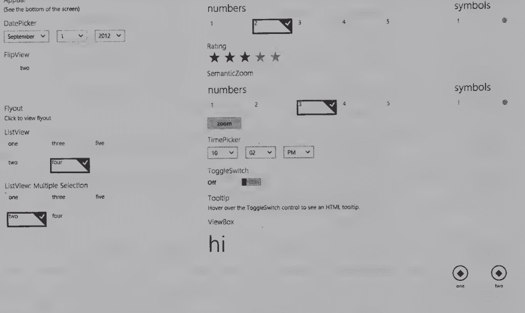
图2.18：WinJS控件实际运行效果

## 自定义控件

正如我所提到的，WinJS控件只是一个提供以下形式构造函数的函数：

```
function MyControl(element, options) {...}
```

创建控件就是实现这样一个函数：在第一个参数传入的父元素下创建HTML，并使用第二个参数传入的选项对象。

例如，假设我们想要创建一个类似图2.19所示的小时钟控件。我们将假设有一个div已准备好用于容纳我们的时钟控件：

```
<div id="clockControl1" style="width: 200px; height: 200px"></div>
```

与内置的WinJS控件一样，我们希望能够这样创建自定义控件的实例：

```
var clock = new Samples.UI.ClockControl(clockControl1, { color: 'red' });
clock.color = 'red'; // 可在构造时或之后设置选项
```


图2.19：自定义时钟控件

我们为自定义控件选择的名称是来自`Samples.UI`命名空间的`ClockControl`。与之前一样，创建控件需要传入包含元素（`clockControl1`）和一个可选的名/值对集合用于选项。如果在控件生命周期的后期我们希望更改控件的某个选项，应该能够通过设置单个属性值来实现。

我们还希望能够以声明式方式创建控件：

```
<script src="/js/ClockControl.js"></script>
...
<div id="ClockControl2" style="width: 200px; height: 200px;"
     data-win-control="Samples.UI.ClockControl"
     data-win-options="{'color': 'red'}">
</div>
```

作为实现的一部分，我们希望确保正确设置`winControl`和元素属性，适当地标记私有成员，并能恰当地处理事件。在我们深入探讨`ClockControl`的实现时，将了解WinJS如何帮助我们实现这些功能。

## 控件类

首先，我们需要确保ClockControl被放入正确的命名空间。大多数现代脚本语言都有命名空间的概念，用于将类型、函数和值分隔到不同的命名区域以避免冲突。例如，如果微软在WinJS 2.0中提供ClockControl类型，它将位于`WinJS.UI`命名空间中，因此不会与`Samples.UI`冲突。在JavaScript中，命名空间只是另一个对象，你可以像下面的代码所示那样填充其构造函数、函数和值：

```
// clockControl.js
(function () {

  // 复杂的方式
  window.Samples = window.Samples || {};
  window.Samples.UI = window.Samples.UI || {};
  window.Samples.UI.ClockControl = function(element, options) { ... };

})();
```

这完全可行。然而，定义命名空间（和嵌套命名空间）是如此常见的操作，以至于WinJS（像许多JavaScript库一样）提供了一种快捷方式：

```
// clockControl.js
(function () {

  // 简单的方式
  WinJS.Namespace.define("Samples.UI", {
    ClockControl: function (element, options) { ... };
  });

})();
```

`WinJS.Namespace`命名空间中的`define`函数允许定义新命名空间，并为你正确处理点分名称的解析。第二个参数是一个对象，用于定义我们希望从该命名空间暴露的构造函数、函数和值，在我们这里就是ClockControl构造函数。

> 你可以在附录A“面向C系列程序员的JavaScript”中学习WinJS如何支持命名空间和类定义的所有内容。

## 控件属性和方法

在我们的`ClockControl`类型上，我们希望公开方法和属性，例如color属性。这些方法和属性可以是实例的或静态的，并且可能是公共的或私有的（至少在JavaScript允许对象成员“私有”的程度上）。所有这些概念都通过正确使用构造函数的prototype属性和JavaScript新增的`Object.defineProperties`方法来支持。WinJS通过`WinJS.Class`命名空间的`define`方法也提供了快捷方式：

```
WinJS.Namespace.define("Samples.UI", {
    // 构造函数
    ClockControl: WinJS.Class.define(function (element, options) { ... },

    // 属性和方法
    color: "black",
    width: { get: function () { ... } },
    height: { get: function () { ... } },
    radius: { get: function () { ... } },

    _tick: function () { ... },
    _drawFace: function () { ... },
    _drawHand: function (radians, thickness, length) { ... },
    }
});
```

`WinJS.Class.define`方法接受一个充当构造函数的函数，但它也接受属性和方法集合。`define`方法知道如何从提供的`get`和/或`set`函数创建属性。此外，它知道以单下划线开头的属性或方法（如`_tick`）应被视为“私有”。JavaScript在传统意义上并不真正支持私有方法；也就是说，`ClockControl`类的客户端仍然可以调用`_tick`方法。然而，它们不会在Visual Studio 2012的智能感知中显示，也不会出现在JavaScript的`for-in`循环中，这至少是一种方便的方式来表明它们不打算供公众使用。

- Windows Store应用依赖于微软对ECMAScript 5规范的实现，该规范可在http://ecmascript.org获取。
- 此示例仅使用实例属性和方法，但`WinJS.Class.define`也可以接受第三个参数，即静态属性和方法集合；静态成员提供按类型服务，而不是实例成员提供的按对象服务。


 ## 构造函数设置了成为 WinJS 控件所需的属性：

```
WinJS.Namespace.define("Samples.UI", {
  ClockControl: WinJS.Class.define(function (element, options) {
    // 如果未提供元素，则创建一个
    element = element || document.createElement("div');
    element.winControl = this;
    this.element = element;

    // 解析选项
    options = options || {}; // 允许空选项参数
    WinJS.UI.setOptions(this, options);

    // 创建绘图表面
    var canvas = document.createElement("canvas');
    element.appendChild(canvas);
    this._ctx = canvas.getContext("2d");

    // 立即绘制时钟，并每秒更新
    setTimeout(this._tick.bind(this), 0);
    setInterval(this._tick.bind(this), 1000);
  },
  ...
});
```

构造函数首先设置众所周知的 **winControl** 和 **element** 属性，以便开发人员可以在宿主 HTML 元素和 JavaScript 控件之间来回切换。如果开发人员未传递元素，我们会创建一个，并期望开发人员将其放入其 HTML DOM 中的适当位置。

接下来，构造函数处理传递进来的任何选项。回想一下，选项可以指定为一组名称/值对，或者使用 HTML 中的 `data-win-options` 属性以字符串形式指定。WinJS 负责将选项字符串解析为 JS 对象，因此您只需处理名称/值对即可。如果您愿意，可以提取单个属性——例如，我们示例中的 **color** 属性。然而，如果您有大量选项，`WinJS.UI` 命名空间中的 `setOptions` 方法将遍历选项对象中的所有属性，并将它们设置为控件的属性。[11] 例如，以下代码块是等效的：

> 它也会处理 `onXxx` 形式的属性，并处理对相关事件的订阅。

```
// 逐个设置属性
myControl.one = "one";
myControl.two = 2;

// 一次性设置所有属性
WinJS.UI.setOptions(myControl, {
  one: "one",
  two: 2,
});
```

在设置控件的选项之后，构造函数的工作是创建完成工作所需的 HTML 父元素的任何子元素。对于 ClockControl，我们使用的是 HTML canvas 元素和一个定时器。这个控件的实现只是普通的 HTML 和 JavaScript，因此这里没有展示，但可以在本书的示例下载中找到。

## 控件事件

除了方法和属性之外，控件通常还会公开事件。事件是控件发出的某种通知，表明发生了某些有趣的事情，例如用户点击了控件，或者控件达到了某种状态，触发了程序中的其他行为。基于 HTML DOM 设定的示例，您会希望有 `addEventListener` 和 `removeEventListener` 等方法，让开发人员能够订阅控件公开的任何事件，以及相应的 `onmyevent` 属性。

例如，如果我们想从示例时钟控件中每隔五秒钟就公开一个事件，我们期望能够以编程方式订阅它：

```
// 每 5 秒执行某些操作
window.clockControl_fiveseconds = function (e) {...};

var clock = new Samples.UI.ClockControl(...);

// 这种方式有效
clock.onfiveseconds = clockControl_fiveseconds;

// 这种方式也有效
clock.addEventListener("fiveseconds", clockControl_fiveseconds);
```

## 第 2 章：绑定和控件

在声明式方面，我们也希望能够附加到自定义事件：

```
<!-- 这种方式有效，第三种！ -->
<div data-win-control="Samples.UI.ClockControl"
     data-win-options="{color: 'white',
         onfiveseconds: clockControl_fiveseconds}" ...>
</div>
```

启用这三种样式需要两件事：管理事件订阅的方法（以及事件发生时进行分发的方法），以及每个事件的属性。这两者都由 `WinJS.Class` 命名空间提供：

```
// clockControl.js
...
WinJS.Namespace.define("Samples.UI", {
    ClockControl: WinJS.Class.define(...);
});

// 为 ClockControl 添加事件 (Ströebe) 支持
WinJS.Class.mix(Samples.UI.ClockControl,
    WinJS.UI.DOMEventMixin,
    WinJS.Utilities.createEventProperties("fiveseconds", "tenseconds"));
```

`WinJS.Class` 的 `mix` 方法允许您混合入现有对象提供的属性和方法；我们混合入了两个。我们混入 `ClockControl` 类的第一个对象是 `WinJS.UI` 中的 `DOMEventMixin`，它提供了三个方法：

```
// base.js
var DOMEventMixin = {
    addEventListener: function (type, listener, useCapture) {...},
    dispatchEvent: function (type, eventProperties) {...},
    removeEventListener: function (type, listener, useCapture) {...},
};
```

这些方法提供了 `ClockControl` 类的客户端所期望的 `addEventListener` 和 `removeEventListener` 方法的实现。此外，`DOMEventMixin` 还提供了 `dispatchEvent` 方法的实现，当我们在控件内部触发事件时将使用它。

我们将要混合入的第二个对象是由 `WinJS.Utilities` 的 `createEventProperties` 方法创建的对象。该方法为传入的每个逗号分隔的事件名称生成一组事件方法，并添加 "on" 前缀。通过这两个对 mix 方法的调用提供的这组属性和方法，我们增强了自定义控件以支持 fiveseconds 和 tenseconds 事件。要从控件内部分发此类事件，我们调用 `dispatchEvent` 方法：

```
// clockControl.js
...
_tick: function () {
    var now = new Date();
    var sec = now.getSeconds();
    ...

    // 触发 5 秒事件
    if (sec % 5 == 0) {
        this.dispatchEvent("fiveseconds", { when: now });
    }

    // 触发 10 秒事件
    if (sec % 10 == 0) {
        this.dispatchEvent("tenseconds", { when: now });
    }
},
...
```

调用 `dispatchEvent` 需要两个参数：事件的名称，以及事件中可用的可选 details 对象。我们传入了一个 `when` 值，但既然是 JavaScript，我们可以传入任何想要的内容。在事件处理程序中访问事件细节的方法是从事件对象本身中提取 detail 值：

```
// 每 5 秒执行某些操作
window.clockControl._fiveseconds = function (e) {
    var when = e.detail.when;
    ...
};
```

我向您展示的 WinJS 控件定义原则——在命名空间中定义类、设置 **winControl** 和 **element** 属性、处理 options 对象、定义属性和方法、定义和分发自定义事件——正是微软 WinJS 团队用来制作 WinJS 控件本身的技术。通过阅读 WinJS 提供的 `ui.js` 文件，您可以了解到您最喜欢的控件是如何构建的。¹²

## 我们在哪里？

我们从深入研究**绑定**开始，即对象上的属性与 HTML 元素上的属性相关联的能力。WinJS 开箱即用地支持单向、一次性以及自定义绑定操作，但不支持双向绑定。绑定支持单个可绑定对象以及实现了 IListDataSource 接口的对象列表。获取 IListDataSource 接口实现最简单的方法是通过绑定列表 (`WinJS.Binding.List`) 对象，它完全支持排序、筛选和分组。我们还看到了**模板**在与绑定结合使用时多么有用，以及模板和绑定在支持列表绑定的控件（如 ListView）中多么有用。

一旦我们涉足 ListView 的水域，我们就通过一个示例完全深入其中，展示了 HTML、WinRT 和 WinJS 控件集（可随本书源代码下载）。此外，如果您不喜欢那些控件，我们讨论了如何创建您自己的控件。关于如何在多种设备尺寸和方向下将这些控件安排在页面上，请参阅第 3 章。

> 12. 如果您想将控件（或多个控件）打包为 SDK，以便从 Visual Studio 2012 或 Blend 中引用，可以在此处了解如何操作：http://msdn.microsoft.com/en-us/library/hh768146(v=vs.110).aspx (http://tinysells.com/246)。


# 3 布局

Windows 8 的设计目标是在多种设备上可用，从 7 英寸平板电脑到 70 英寸的电视屏幕，而你的应用应该能在所有这些设备上运行。更重要的是，你的应用将会以多种分辨率、不同的 DPI、纵向或横向方向显示，并且会贴靠到屏幕边缘，或填充另一个贴靠应用旁边的剩余空间。换句话说，你的应用必须灵活，能够适应多种设备和布局。

但是，你无需为上百种设备和布局组合显式构建，因为 Windows 8 已经为你考虑周全。出色的 Windows 应用商店应用在设计时就考虑到灵活性，然后利用 CSS 布局功能、WinJS 控件和 Windows 8 平台功能来构建。结果是跨越所有可能布局的一致且令人愉悦的用户体验。在本章中，我将向你展示如何构建灵活性，而无需为测试购置数百台设备。

## 布局：驯服设备矩阵

设备是个麻烦事。在手机、移动设备和平板电脑领域，硬件和软件厂商通常在面对多样性时采取两种方法之一。在光谱的一端是苹果对 iOS 的做法：iPhone 和 iPad 的屏幕尺寸种类少且经过精心管理。新用户可以从两种颜色和一系列存储选项中进行选择，但屏幕尺寸有限。这种方法对应用开发者非常友好，因为它大大限制了开发者在构建应用时必须考虑的设备矩阵。但这种开发的便利性是有代价的，因为消费者只剩下"你可以随意选择颜色，只要是黑色（或白色）"¹的选择方式。

在光谱的另一端是微软首次进军移动设备时采用的方法——Windows Mobile，以及随后谷歌对 Android 采取的更近期的做法。在这种方法中，软件厂商提供操作系统，硬件制造商可以自由创建他们喜欢的任何设备，从 3 英寸的功能手机到 10 英寸及更大的平板电脑，都由同一操作系统驱动，并且大多数相同应用都可用。这种方法所赋予的选择权对消费者非常友好，其初步成功通过 Android 迅速占据的主导市场份额显而易见。但这种消费者选择的自由为开发者创造了"设备的暴政"。每种新设备都可能向市场引入新的屏幕尺寸和分辨率，要求大多数应用开发者考虑、测试，甚至可能还需要获取这些设备，只是为了验证他们的应用在外观和感觉上尽可能在各种设备上都能正常显示。² 所有这一切的不可预测性给应用开发者增加了额外的设计和开发障碍。

如果你是 Web 开发者，你已经习惯了这一点：多年来你一直在为两到六种浏览器以及无数种屏幕尺寸和分辨率进行构建。但我们 Web 开发者通过将自己限制在 800 × 600（以及更近的 1024 × 768）布局，并宣布像水平滚动这样的做法是禁忌来应对这种不可预测性。我们通过将应用程序的可用空间缩小到最低公分母来与 Web 开发的不可预测性作斗争。但应用是不同的，类似的方法不是可选方案。平台应用设计为全屏运行，利用每一寸可用像素来追求沉浸式和引人入胜的用户体验。创建一个碎片化的设备 landscape 可能对消费者选择来说是理想的，但对开发者来说远非理想。

1. 亨利·福特的名言，为二十一世纪改编。
2. 在撰写本文时，有超过 600 种 Android 设备可供选择。你能说"像断层线上的 sidewalks 一样碎片化"吗？

### Windows 8：消费者选择，没有设备的暴政

对于 Windows 8——以及之前的 Windows Phone——微软面临着一个关于选择的选择。你是为消费者提供多种硬件选择，还是为开发者提供狭窄的开发目标？鉴于我们目前对 Windows 8 和 Windows 应用商店应用的了解，你可能会认为——作为一家有着悠久历史的消费者公司——微软选择了后者。听到史蒂夫·鲍尔默和其他人谈论 Windows 8 在从 7 到 70 英寸的平板、笔记本电脑、上网本、笔记本电脑和屏幕上的可用性，可能会让我们相信微软正试图通过应用开发者需要购置的测试设备数量来单纯获取市场份额。

### Windows 8 中的布局

谢天谢地，事实并非如此。为了既让硬件厂商有创作各种设备的自由，又为开发者提供有限的设备配置文件集合，微软从定义沿三个变量的平台约束开始：

1. Windows 8 设备的 supported 分辨率
2. 所有 Windows 应用商店应用的 orientation 支持³
3. 所有 Windows 应用商店应用的 required view state 支持

在我们探索这些内容时，我将使用一种我们许多人无疑曾经构建过的应用类型：照片图库应用。假设我的图像列表是静态的，以下是我的初始标记，它应该看起来很像是为简单 Web 应用所写的：

```html
<h1 id="title">Metro Photo Gallery</h1>
<div id="imgContainer">
    <figure>
        
        <figcaption>Pretty awesome photo of Boston<br />
            <div data-win-control="WinJS.UI.Rating"></div>
        </figcaption>
    </figure>
    <figure>
        
        <figcaption>Chris's favorite flower<br />
            <div data-win-control="WinJS.UI.Rating"></div>
        </figcaption>
    </figure>
    ...
    <figure>
        
        <figcaption>Brandon's favorite flower<br />
            <div data-win-control="WinJS.UI.Rating"></div>
        </figcaption>
    </figure>
</div>
```

3. 话虽如此，如果需要，开发者可以将他或她的应用锁定到特定方向。

在这里，我使用了语义化的 "figure" 和 "figcaption" 标签，因为我想展示带有配套文字的图像。我还添加了一个 WinJS Rating 控件，以便用户可以对每张图像进行评分。现在，我将添加一些样式，让我的应用在 24 英寸显示器上看起来不错：

```css
body {
    overflow-y: scroll;
}
h1#title, #imgContainer {
    margin: 20px 0px 0px 120px;
}
```

```css
figure {
    margin: 20px 20px 0px 0px;
    width: 700px;
    height: 450px;
    display: inline-block;
    background-color: rgba(120, 120, 120, 0.5);
}
```

```css
/* Styles for elements inside of the figure container. */
img {
    width: 60%;
    height: 80%;
    margin: 10px 0px 0px 10px;
}
```

```css
figcaption {
    font-size: 16pt;
    width: 33%;
    height: 25%;
    margin: 10px 20px 0px 0px;
    float: right;
    text-align: left;
}
```

这里有几个重要的部分需要注意。第一个是 `overflow-y` 属性，它将允许我在元素大于页面主体时进行垂直滚动。接下来，我为标题和图库主容器设置了一些边距。⁴ 然后，我设置了一些属性来调整 figure 元素的大小和布局，该元素包含我的图像、标题和评分控件。最后，我对图像设置了一些属性，使其在 figure 容器中大小合适，并调整了标题的字体和显示属性。结果如图 3.1 所示。

这在 24 英寸显示器上看起来不算太差。但在我喊出"发布它！"并跳到第 13 章"赚钱"之前，我可能应该看看这个应用在其他一些场景下，在各种屏幕尺寸和分辨率下的样子。


图 3.1：在开发机上运行的简单 Windows 应用商店应用

> 4. 这些是 Windows 应用商店应用的推荐值，你可以在文章《Laying out an app page》中了解更多，网址为 http://msdn.microsoft.com/en-us/library/windows/apps/hh872191.aspx (http://tinysells.com/167)。


## 处理屏幕尺寸

对于大多数应用程序而言，管理布局的第一个检查点出现在你验证应用程序在各种屏幕上的表现时，所以我们就从这里开始。如果你查看 Windows 8 模拟器中提供的值，你会注意到你的应用程序可以在五种不同的屏幕分辨率下进行测试。它们分别是：

- 1024 × 768⁵
- 1280 × 800
- 1366 × 768
- 1920 × 1080
- 2560 × 1440

为了让 Windows Store 应用程序能够在设备上运行，必须支持至少 1024 × 768 的分辨率。除此之外，上限则没有限制。除了这些，还有一些其他需要考虑的因素，例如 DPI 和缩放，我们稍后会讨论。

图 3.1 显示了我的应用程序在 1920 × 1080⁶ 和 96 DPI 下运行的视图，这在如今的 20 到 24 英寸显示器上非常标准。但如果我假设每个运行我应用程序的人都：a) 在 24 英寸标准定义显示器上运行，且 b) 使用 1920 × 1080 屏幕分辨率，那就太傻了。我确信我的祖母后可能会在设置成 1280 × 800（最多！）的 17 英寸显示器上运行我的应用程序，所以我应该看看我的应用程序在她看来是什么样子。我还知道很多 Windows 8 平板电脑的标准配置是 1366 × 768 分辨率，所以我可能也应该针对该分辨率进行优化。

为此，我将在模拟器中运行我的应用程序，而不是在本地机器上。应用程序打开后，我可以点击模拟器右侧的“更改分辨率”图标（见图 3.2），将视图更改为 12" 1200 × 800。结果如图 3.3 所示。

> 5. 根据 http://msdn.microsoft.com/en-us/library/windows/apps/hh780612.aspx (http://tinysells.com/168)，这是 Windows 8 支持的最小分辨率。让我们为 800 × 600 的逝去默哀片刻，然后庆祝一下。我们会想念你的，但其实没那么想。

> 6. 我相信这被称为“开发者低分辨率”。


图 3.2：使用模拟器更改屏幕分辨率

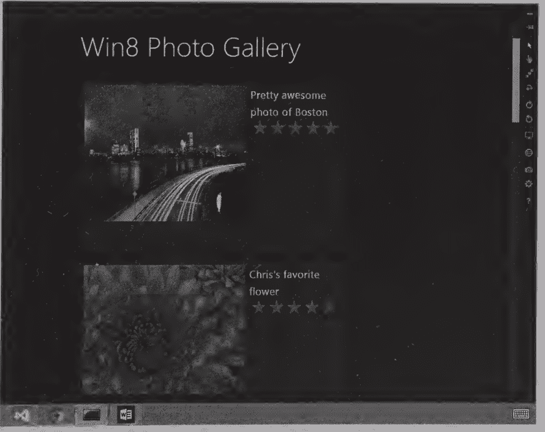

图 3.3：同一应用程序在 1280 × 经纪人分辨率下的样子

如果我切换到 1366 × 768，看到的画面会非常相似。在这两种分辨率下，我的应用程序乍一看没有太大的违和感。显然，布局引擎通过在屏幕缩小地时重新排列图像提供了一些帮助。虽然我很喜欢这里那里有一点留白，但这感觉留白有点太多了。为了解决留白问题，我可以使用 CSS 媒体查询。

## 使用 CSS 媒体查询适配分辨率

到目前为止，我们一直在使用模拟器在较低分辨率下查看应用程序，但因为我们要针对不同的分辨率进行调整，所以应该切换回开发工具。正如我在第一章“你好，Windows 8！”中所讨论的，Microsoft Blend 的绝妙之处之一就是它能够提供应用程序的实时视图，并在你进行更改时刷新视图。Blend 还提供了一些强大的工具来在不同的布局和分辨率下查看你的应用程序，我们在本章中会经常用到这些工具。你可以在 Blend 的设备（Device）选项卡中访问这些工具，如图 3.4 所示。

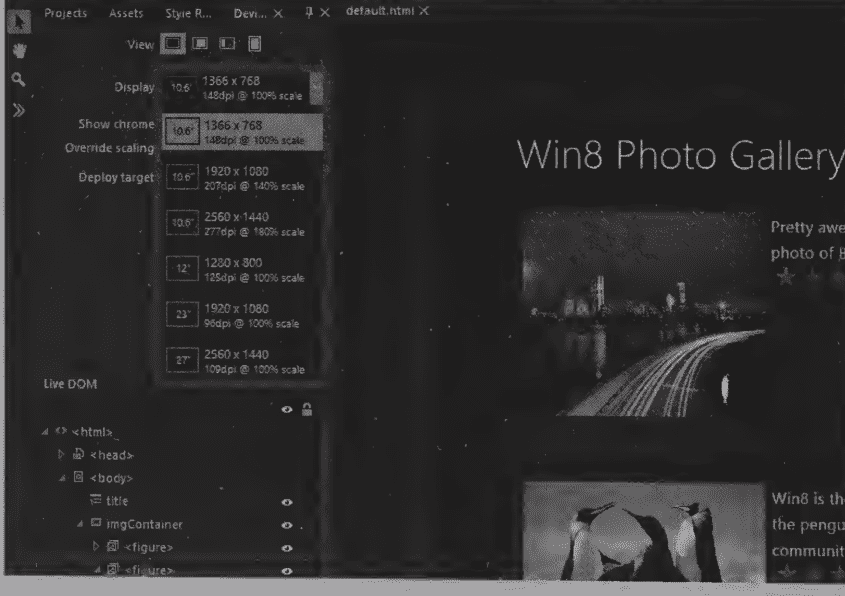

图 3.4：在 Blend 中更改显示分辨率

在这种情况下，我想将 Blend 中主应用程序画布的显示分辨率更改为 1280 × 800，可以通过“显示（Display）”菜单来实现。你还会注意到，我可以查看应用程序在几乎所有支持的分辨率、DPI 和缩放下的样子。⁷ 一旦我选择了目标分辨率，画布就会更新，我将看到一个与刚才在模拟器中看到的视图一致的应用程序视图。

虽然拥有能够快速查看应用程序必须支持的分辨率和视图状态的工具非常棒，但我仍然需要一种方法在应用程序中检测这些变化，并相应地改变其布局。我可以使用 CSS3 媒体查询（Media Queries）模块来实现。媒体查询是 W3C CSS3 规范⁸ 的关键组成部分，目前已被所有主流浏览器支持。媒体查询是依赖于布局的 CSS 规则。规则本身是浏览器用来检查当前设备是否存在某些特性（如宽度、高度、方向和分辨率）的表达式。⁹ 如果当前设备满足规则中设置的所有条件，则这些媒体查询大括号内定义的样式将应用于应用程序。

让我们来看看媒体查询，并添加一条新规则来支持较低的分辨率。当然，你可以在 Microsoft Visual Studio 2012 中手动完成此操作，但如果在 Blend 中通过在“样式（Styles）”选项卡中右键单击样式文件并选择“添加 @media 规则（Add @media Rule）”选项（如图 3.5 所示），你会得到更多帮助。

> 7. 除了 1024 × 768 莫名其妙地在菜单中缺失外（尽管它在 Windows Store 应用程序中受支持且在模拟器中可用）。我给 Steven Sinofsky 家里打了电话问他为什么，但在他说完“你是谁？”并威胁说如果我不停止打他家里电话就报警后，他就挂断了。

> 8. http://w3.org/TR/css3-mediaqueries/ (http://tinysells.com/169)

> 9. Brandon 为 2012 年 4 月号的 *MSDN* 杂志写了一篇从 Web 浏览器角度探讨 CSS3 媒体查询的文章 http://msdn.microsoft.com/en-us/magazine/hh882445.aspx (http://tinysells.com/170)。我将在本章中介绍媒体查询的一些平台特定方面，但如果你对在浏览器中使用媒体查询感兴趣，也可以查看该文章。

## 第 3 章：布局

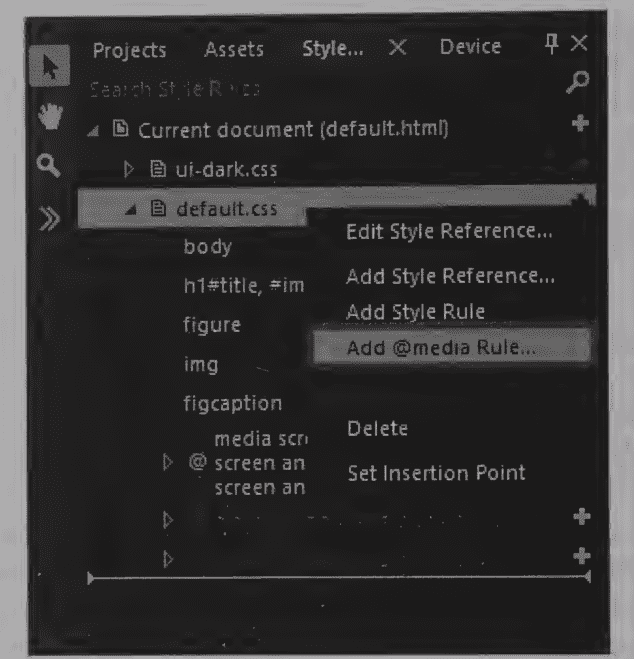

图 3.5：在 Blend 中添加媒体查询

点击该选项后，你会看到一个包含一些示例规则的对话框以帮助你开始，类似于图 3.6。除了之前看到的适用于所有应用程序的四条默认规则外，该对话框还会让你了解可以添加的其他类型规则，包括以下内容：

- 宽度和高度（以及两者的最小值 min- 和最大值 max-）
- 设备宽高比（16:9 和 4:3）
- 分辨率（以及 DPI 的最小值 min- 和最大值 max-）

为了针对 Blend 中的当前视图，我可以在对话框中选择 "screen and (min-width: 1280px) and (min-height: 1024px)"，这会为我填充对话框中的文本框，如图 3.6 中突出显示的那样。我当前的分辨率是 1280 × 800，所以这条规则对我不起作用。我可以将其更改为使用 max-width 和 max-height，但这基本上会影响我所有的

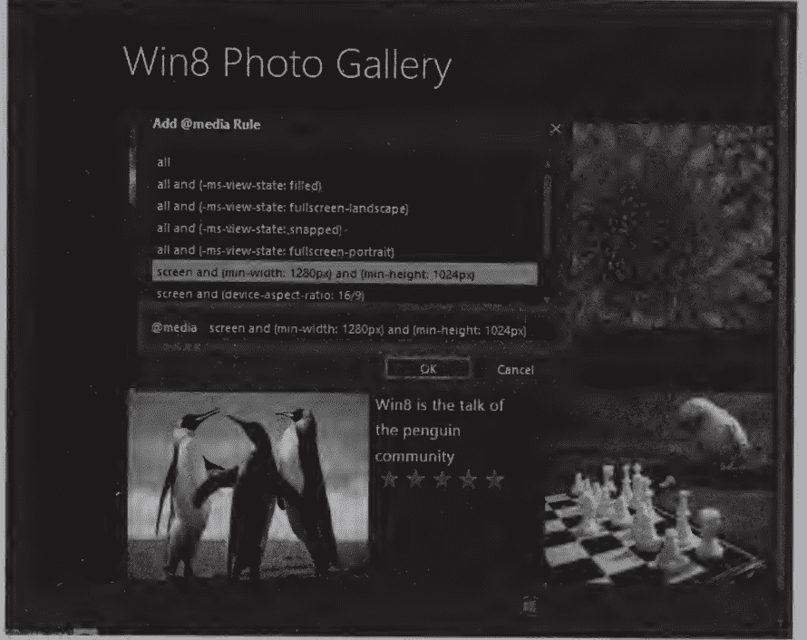

图 3.6：从 Blend 样式选项卡添加新的 @media 规则

分辨率，包括 1920 × 1080，而我知道那个分辨率已经是我想要的样子了。我也可以直接使用 "(width: 1280px) and (height: 800px)"，这将适用于我当前的分辨率，但因为我知道我也需要调整 1366 × 768 的布局，所以我将使用 max-width 和 max-height 来同时涵盖这两者，而保持较高分辨率不变。因此，我将输入更改为 "screen and (max-width: 1366px) and (max-height: 800px)" 并点击确定。我的新规则随后将显示在 `default.css` 页面的样式列表中。¹⁰

> 10. 为了确保规则正确级联且不被覆盖，媒体查询及其相关规则应定义在应用程序的主规则之后。

## 第 3 章：布局

因为我知道留白过多问题是由 figure 容器元素的大小引起的，我将实施一个快速修复方案来调整每个 figure 元素的大小：

```
@media screen and (max-width: 1366px) and (max-height: 800px) {
  figure {
    width: 550px; /* Original size: 700px */
    height: 350px; /* Original size: 450px */
  }
}
```

如果你在 Blend 中应用此规则，你会发现更改立即生效，如图 3.7 所示。

如果你在模拟器中以 1280 × 800 或 1366 × 768 分辨率运行应用程序，你会看到同样的结果。你还会注意到，如果你在 Blend 的模拟器中更改分辨率，或者在本地机器上再次运行应用程序，应用程序的原始视图保持不变。正如预期的那样，我的媒体查询规则仅适用于这些分辨率，这意味着我可以尽情调整应用程序在该分辨率下的样式，并且知道我的更改不会对其他布局类型产生意外影响。这非常不错。

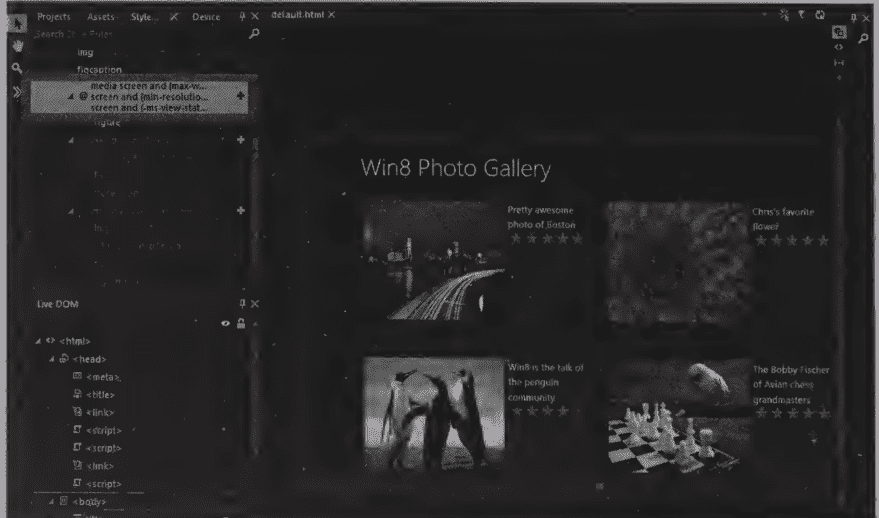

图 3.7：在 Blend 中添加媒体查询特定样式


恭喜你，你现在拥有了一个支持微软要求的所有分辨率的应用程序！不过，在你欢呼“可以发布了！”之前，我得告诉你，你*实际上并没有*支持所有必需的分辨率。事情并不像初看时那么简单，在我们结束这次关于分辨率的讨论之前，我们需要谈谈 DPI。

## 使用媒体查询支持高清晰度分辨率

到目前为止，我们一直处理的分辨率是标准清晰度分辨率，在 Windows 8 上，它们都落在 96 到 148 DPI 的范围内。标准清晰度屏幕是基准，Windows 8 会以适当的大小显示它们。而高清晰度屏幕（即 DPI 大于 150 的屏幕）则是另一回事。

举个例子，假设我有一台分辨率为 1366 × 768 的标准清晰度平板电脑，该平板的 DPI 约为 148。如果我将屏幕上的一张图片宽度设置为 148 像素，这就相当于将其宽度设置为 1 英寸，因为 148 DPI 意味着在我的屏幕上 148 个像素构成 1 英寸。

现在，想象一下，在同一台 1366 × 768 的设备上，我将屏幕的 DPI 提高到高清范围——比如 207。这意味着 1 英寸的屏幕空间现在占用 207 个像素而不是 148 个。因此，我将设备上的可用像素空间增加了约 25%。结果就是，尽管我没有对任何元素的大小做任何更改，但屏幕上的所有内容看起来都变小了。

为了补偿高清屏幕增加的像素密度并防止 UI 元素缩减，Windows 8 会自动为你缩放 Windows Store 应用。我知道我的照片库应用在 2560 × 1440、96 DPI 的标准清晰度 27 英寸显示器上运行效果很好。此外，因为 Blend 的“显示”菜单中提供了两个选项，我可以选择预览我的应用在高清平板电脑上的效果，所以我不需要实际配备一台高清平板电脑（见图 3.8）。

然而，尽管我们正式支持了所有基准分辨率，但在高清屏幕上的效果并不比在 1366 × 768 时更好。幸运的是，媒体查询也可以帮助我们处理高清屏幕，我们只需要修改现有的规则来利用这一能力即可。无论是在 Blend 还是 Visual Studio 中，我将修改原始的媒体查询，使其同时也涵盖高 DPI 屏幕：

```
@media screen and (max-width: 1366px) and (max-height: 800px),
screen and (min-resolution: 150dpi) { /* High Def */
  figure {
    width: 550px; /* Original size: 700px */
    height: 350px; /* Original size: 450px */
  }
}
```

分辨率规则允许我指定一个 DPI 值来与当前分辨率进行对比，并且与宽度和高度一样，`min` 和 `max` 前缀在这里同样适用。添加该规则后，一切又恢复了正常，如图 3.9 所示。

因为我在规则中使用了 `min-resolution`，我现在应该涵盖了所有高清屏幕，这意味着只需对我现有的规则进行微调，我就能确保所有图像在所有屏幕尺寸和分辨率下都能正确显示在屏幕上。

图 3.8：在 Blend 中以高分辨率查看我们的应用

图 3.9：使用分辨率媒体查询的视图

媒体查询允许我们创建针对特定布局的样式，而不会对其他布局造成回归影响，从而让我们免于陷入无止尽的 CSS 头痛中。虽然这是一个目标简单的简单示例，但可以想象，随着你的设计变得更加复杂且引入更多变量，你可以在此基础上进一步构建。

## 屏幕方向

说到更多变量，Windows 8 设备可以使用横屏（landscape）和竖屏（portrait）两种模式。图 3.10 展示了 Windows 8 Consumer Preview 自带的金融应用在两种方向下的外观。

当设备从一种视图旋转到另一种视图时，Windows 8 提供了对旋转本身的内置支持，因此作为开发人员，你无需执行任何操作来启用此功能。要查看设备方向的实际效果，你可以使用模拟器中的“方向”按钮，或者 Blend 中的“视图”菜单，如图 3.11 所示。

图 3.10：竖屏模式（左）和横屏模式（右）下的 Windows 8 应用

图 3.11：在 Blend 中控制设备方向

注意到我们的页眉方向正确，但图像向右超出了屏幕。因此，虽然 Windows 8 在方向更改方面提供了一些帮助，但我仍需要另一个媒体查询来处理竖屏方向。事实证明，我对小型屏幕和高清屏幕应用的相同规则在这里也适用：

```
@media screen and (max-width: 1366px) and (max-height: 800px),
screen and (min-resolution: 150dpi), /* High-Def */
screen and (-ms-view-state: fullscreen-portrait) {
    figure {
        width: 550px; /* Original size: 700px */
        height: 350px; /* Original size: 450px */
    }
}
```

为了检查竖屏方向，我使用了一个微软和 Windows 8 特有的媒体查询来检测应用是否正以该方向被查看。这里有四个 Windows 8 特有规则的示例：

```
@media screen and (-ms-view-state: fullscreen-landscape) {}
@media screen and (-ms-view-state: filled) {}
@media screen and (-ms-view-state: snapped) {}
@media screen and (-ms-view-state: fullscreen-portrait) {}
```

这四个规则涵盖了 Windows Store 应用的各种视图状态，当你微调应用设计以支持这些额外布局类型时，会发现它们非常有用。

## 视图状态

除了支持竖屏和横屏方向外，Windows Store 应用在设备以横屏模式运行时还应支持以下视图：

- 全屏 (Full Screen)
- 紧凑 (Snapped)
- 填充 (Filled)

全屏是默认的视图状态；也就是我们在本章到目前为止一直在处理的状态。另外两个是新引入的。与 iOS 和 Android 形成鲜明对比的是，Windows 8 通过“紧凑”和“填充”视图状态，允许最多两个应用同时在屏幕上运行，如图 3.12 所示[^11]。

左侧的金融应用处于紧凑模式，可以通过鼠标或触摸操作激活：将另一个运行中的应用从左边缘、上边缘（对于触摸操作是之前的应用）或左上角（对于鼠标操作）拖入屏幕[^12]。而右侧的 Solitaire 应用则处于填充模式，当另一个应用在屏幕上进入紧凑模式时，它会自动激活。紧凑应用可以放置在左侧或右侧，这两个应用之间的蓝色条可以用于将紧凑模式切换为填充模式，反之亦然。

这种新的显示能力是 Windows 8 特有的，为你提供了让应用变得“粘人”的有趣机会，使用户即使在屏幕上引入其他应用时，仍愿意将你的应用保留在紧凑或填充视图中。与屏幕分辨率和方向类似，Windows 8 提供了一些帮助，但具体如何定制应用以完全拥抱这些视图则取决于你。

[^11]: 我想象大多数财务顾问就是这样度过每一天的。
[^12]: 紧凑和填充视图仅在 1366 × 768 及更高屏幕尺寸下可用。

图 3.12：Windows 8 中的紧凑和填充视图状态

图 3.13：在 Blend 中控制视图状态

就像本章讨论过的所有其他布局一样，可以通过运行应用时的模拟器，或在 Blend 中通过“视图”菜单访问紧凑和填充视图，如图 3.13 所示。

到目前为止，我们可以通过媒体查询微调紧凑和填充视图的样式，这应该不足为奇。具体来说，我们使用了 Windows 8 支持的 `-ms-view-state` 条件：

```
@media all and (-ms-view-state: filled) {
    h1#title, #imgContainer {
        margin: 20px 0px 0px 30px;
    }
    
    figure {
        width: 470px; /* Original size: 700px */
        height: 225px; /* Original size: 450px */
    }
}
```


```css
figcaption {
    font-size: 12pt;
    margin: 10px 20px 0px 2px;
}

@media all and (-ms-view-state: snapped) {
    img {
        width: 80%;
        height: 60%;
    }

    h1#title, #imgContainer {
        margin: 10px 0px 0px 20px;
    }

    figure {
        width: 275px; /* 原始尺寸: 700px */
        height: 250px; /* 原始尺寸: 450px */
    }

    figcaption {
        font-size: 12pt;
        width: 100%;
        height: 25%;
        margin: 10px 20px 0px 10px;
        float: none;
    }
}
```

尽管这些规则中的内容比我们到目前为止展示的查询更丰富，但除了调整我的figure元素大小外，我只是在缩小边距，并且——在贴靠视图的情况下——移除了标题元素的浮动，以便文本和评级字段能够上下堆叠。你可以在图3.14中看到贴靠视图的结果。

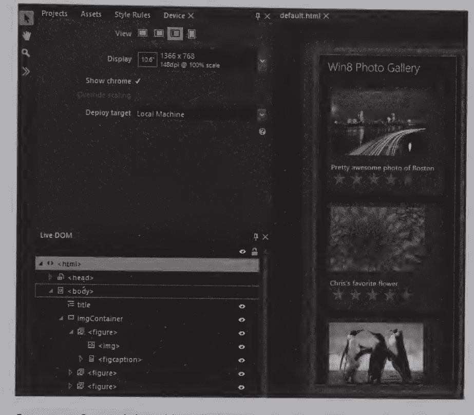

图 3.14：应用样式的贴靠视图

## 使用 CSS 布局功能适配你的应用

尽管微软设定了一系列已知的限制供硬件制造商（以及延伸的消费者）在其框架内工作，但作为开发者，你在自己的应用中仍需考虑几个变量。Blend 中强大的工具结合 CSS 媒体查询，为处理这些变量提供了坚实的基础，但在构建应用时，你可能还需要其他 CSS 和平台工具。我们将首先了解 CSS 网格布局，这个模块很可能构成你许多 Windows 应用的基础。

100 ■ 第 3 章：布局

### CSS3 网格布局规范

CSS 网格布局（或简称 CSS Grid）是一个由微软提交给 W3C 的 CSS3 模块。在撰写本文时，它仍处于工作草案状态。截至 2012 年 5 月，网格规范目前仅由 Internet Explorer 10 支持——尽管 WebKit 正在增加支持——因此它绝对属于较为前沿的 CSS 规范之一。¹³

网格规范的核心思想是允许你在任何容器元素（例如，一个 `<div>` 或页面的 `<body>`）上用 CSS 定义一个不可见的网格，然后将该容器的子元素放置到特定的行、列和/或单元格中。理解网格最简单的方式就像一个没有任何繁琐表格标记的 HTML 表格。

使用网格很简单。我们只需将容器的 display 属性设置为 -ms-grid，如下所示：

```css
body {
  display: -ms-grid;
}
```

在这种情况下，我将网格应用到了页面的 body 上，这将为我的整个文档建立网格布局，但我可以轻松地将网格显示应用于任何 HTML 块元素，甚至在单个文档中嵌套多个网格。

将 display 属性设置为 grid 只是开始。接下来你需要定义网格中列和行的尺寸。假设我仍在开发我的照片画廊应用。我将使用以下样式规则在 body 上创建一个简单的网格：

```css
body {
  display: -ms-grid;
  -ms-grid-columns: 120px 1fr;¹⁴
  -ms-grid-rows: 133px 1fr 0px;
}
```

> 13. 如果你是那种喜欢阅读枯燥工作组规范的人，你可以在 http://w3.org/TR/css3-grid-layout (http://tinysells.com/171) 阅读 CSS 网格布局模块。

> 14. fr 是 CSS 中一种新的相对尺寸构建方式，意思是为相关规则分配“……可用空间的一部分”。它类似于 em 和百分比，但它是与文本无关的，允许你在不必计算或估计百分比的情况下指定相对值。更多信息，请参阅 www.w3.org/TR/css3-grid-layout/#fraction-values-fr0 (http://tinysells.com/172)。

-ms-grid-columns 和 -ms-grid-rows 属性通过一系列以空格分隔的宽度和高度来定义我的网格的尺寸。在这里，我创建了一个包含两列三行的网格，使用的值与 Visual Studio 项目模板为其自身网格使用的值相同。一旦我为应用定义了基础网格，我将切换到 Blend 并重新加载应用。在“实时 DOM”窗口中，我也将导航到我的 `<body>` 元素，这将使 Blend 在应用画布上高亮显示已应用的网格规则，如图 3.15 所示。

在 Blend 中拥有这种可视化非常有用，因为它帮助我们构思应用外壳，正如我所说，外壳通常对用户是隐藏的，但很明显，添加网格只是让我们的应用在设计上倒退了一步。那么，发生了什么？

当我创建网格布局时，请记住我是通过将 display 属性设置为 -ms-grid 来实现的。display 属性控制整体文档流，所有 HTML 元素都有默认的 display 属性，要么是 block 要么是 inline。当我将 display 属性设置为 -ms-grid 时，文档流变为基于网格，这意味着网格中的子元素与网格中的行和列对齐，而不考虑其他元素的布局。这就是为什么我的第一张图片和页面


### 图 3.15：在 Blend 中查看 CSS 网格布局线

标题上下堆叠显示而不是并排显示的原因。在没有特定样式的情况下，所有子元素都被分配到网格的第一行和列。我们可以通过为 `<h1>` 和 imgContainer div 添加更多样式来修复这个问题，可以在 Blend 中操作，也可以在 Visual Studio 的 CSS 中手动添加：

```css
h1#title {
    -ms-grid-column: 2;
}

#imgContainer {
    -ms-grid-column: 2;
    -ms-grid-row: 2;
}
```

我之前提到过 CSS 网格布局就像旧式的表格布局，但没有那些混乱的、非语义的标记，在我看来，没有比这里展示的示例更能体现网格的力量了。-ms-grid-column 和 -ms-grid-row 属性让我能够将容器元素放置到页面上的任何单元格中，无论该元素在标记中的位置如何。你可以在图 3.16 中看到这个结果。


图 3.16：使用网格列和行来布局容器元素

随着 CSS 网格布局构成了我的应用框架的基础，我在快速将应用适配到 Windows 8 布局要求方面拥有了更大的灵活性。例如，如果我想在应用处于纵向模式时修改左边距，我可以为全屏纵向媒体查询在 body 上添加一个备用网格布局，并将第一列从 120 像素减小到 100：

```css
@media screen and (-ms-view-state: fullscreen-portrait) {
  body {
    -ms-grid-columns: 100px 1fr;
  }
}
```

借助 CSS 网格布局，我们可以创建一个易于调整和适配的框架，以应对开发者需要预见的每种布局。有了定义良好的应用外壳，我们就可以将注意力转向应用内容，并使用其他一些 CSS 模块来辅助创建对多布局友好、自适应的体验。

### 应用程序内容的自适应布局

使用网格设计我的应用外壳的一大优势是，它有效地将我的外壳设计与主要应用内容的设计解耦。我发现这种解耦使应用开发变得更容易，因为我可以在不对另一方造成连锁变化的情况下调整外壳或应用内容。有了这种外壳与应用主要内容空间的清晰分离，我现在可以考虑哪种布局策略对我的应用最有意义。

如果你是网页开发者，“自适应设计”和“响应式设计”这些术语你应该很熟悉。¹⁵ 自适应设计的基本思想是以这样一种方式规划和构建应用：无论应用在何种设备上查看，都能提供最佳体验。正如你已经看到的，由于你的 Windows 应用中可能存在的多种布局，自适应设计非常重要，这也是为什么我们在本章花了这么多时间讨论布局、媒体查询和 CSS 网格布局。自适应布局在

> 15. http://lullabot.com/articles/responsive-adaptive-web-design (http://tinysells.com/173)


应用内容的数量和形态是未知的。在一个新闻阅读器中，我知道需要显示文本，但不知道在任何时刻屏幕上需要显示多少文本。在一个相册应用中，我知道必须显示图片，但如果图片来源于在线位置或用户的照片库，我无法预先知道需要显示多少张图片。这些应用在设计时必须考虑到适应性。

## 使用 CSS 和 WinJS 创建自适应 UI

CSS Grid Layout 模块是设计应用框架的绝佳解决方案，但它并非我们处理主要内容时的唯一选择。有时我的主要 UI 可能高度专业化，Grid 技术可能正合适。但在大多数情况下，你会发现自己正在构建一个结合了固定元素、媒体、控件甚至文本的应用，而为了在自适应容器中管理所有这些，你会希望考虑将 CSS3 Flexbox 和 CSS3 Multi-Column Layout 模块添加到你的工具集中。

## 使用 CSS Flexbox 创建自适应 UI

Flexible Box Layout 模块（或 Flexbox）是一个 CSS3 规范¹⁶，旨在帮助你创建用于元素的布局容器，这些容器能自动在水平或垂直流中定位子元素，并提供容器内元素的自动间距。

与 Grid Layout 模块类似，Flexbox 通过在容器元素上设置 `display` 属性来应用。我将添加以下内容：
```
#imgContainer {
    -ms-grid-column: 2;
    -ms-grid-row: 2;

    display: -ms-flexbox;
    -ms-flex-direction: row;
    -ms-flex-pack: center;
    -ms-flex-align: center;
}
```

16. http://w3c.org/TR/css3-flexbox (http://tinysells.com/174)

`-ms-flexbox` 显示类型触发 Flexbox 布局，它会自动将我 `div` 内的所有元素等距排列。其下方的 `-ms-flexbox` 属性通过允许我指定盒子的流动方向应为水平（即跨行）、盒子内的元素应在容器中居中、并且应在垂直方向上居中对齐，从而让我能够对该布局进行精细控制。你可以在图 3.17 中看到结果。此布局与图 3.7 中的原始布局不同，因为 Flexbox 让我能够快速调整图像方向以进行水平滚动，并使用更大的图像。

在我们当前的 Flexbox 配置中，`-ms-flex-direction` 属性的 `row` 值非常适合从左到右流动元素，这也是 Windows 8 列表首选的样式。但如果我们想在竖屏视图中从上到下流动它们，我们可以轻松地在媒体查询中完成：

```
@media screen and (-ms-view-state: fullscreen-portrait) {
  #imgContainer {
    -ms-flex-direction: column;
    -ms-flex-pack: start;
  }
}
```

在这种情况下，我将 flex 方向改为 `column`，使图像从上到下在屏幕上流动，并将元素靠近顶部对齐。你可以在图 3.18 中看到结果。

CSS Flexbox 有多个属性，你可以用来调整和优化元素的布局，使其完美适配你的应用。到目前为止，我们一直直接将 Flexbox 样式添加到 CSS 文件中，但 Blend 在 CSS 属性窗口中提供了一个 Flexbox 部分，其中列出了所有与 Flexbox 相关的属性及其可能的值，如图 3.19 所示。当将 Flexbox 添加到你的应用时，你可以在此处进行实验，让 Flexbox 按你喜欢的方式工作。¹⁷

对于布局块容器和图像及其他媒体元素，你会发现 Flexbox 是 Windows 8 中一个非常有用的功能，并且当它与媒体查询结合使用时，可以轻松调整和优化页面元素，为每种布局创建美观的应用。

17. 你也可以在线体验 Flexbox 和其他布局功能：http://ietestdrive.com。

## 使用 CSS 多列布局实现自适应内容

Flexbox 非常适合布局子容器元素，但如果你处理大块的文本，你会希望考虑 CSS 多列布局。在第一章中，我们构建了一个 Windows Store 的 RSS 阅读器。我们应用的主页显示了订阅源列表，如果你点击一个订阅源标题，就会进入订阅源页面，所有文章都会异步加载并显示在屏幕上，如图 3.20 所示。

## 第三章：布局

这里有内容是好事，但内容可能不如我们期望的那样易于阅读。我不知道你怎么想，但光是想到要一遍又一遍地将目光从屏幕一侧移到另一侧，就让我精疲力尽！不过话说回来，我是个懒散的读者。

显然，我并非个例，因为在印刷媒体、网页上，甚至在屏幕较大的数字设备上，将大块文本分成多列是很常见的做法，这样看起来更赏心悦目，也更易于阅读。

值得庆幸的是，有一个名为多列布局模块的 CSS3 规范可以帮助我。多列布局允许你在容器中放置多列内容，而无需手动定位或浮动。你只需要在给定的容器上应用 `column-count` 属性。对于我们的 RSS 阅读器，我可以在 Posts 页面的主内容 div 中添加以下内容：

```
.postsPage section[role=main] {
  column-count: 3;
}
```

18. http://w3.org/TR/css3-multicol (http://tinysells.com/175)

`column-count` 属性是本示例中“多列”的核心部分，它接受一个整数值，指定容器内使用的最佳列数。任何大于 1 的数字都会触发多列视图，这个计数实际上更像是建议而非规则。如果你的内容溢出三列，布局引擎可能会决定添加第四列或更多列，但这可以通过其他属性来管理——例如，通过设置容器的宽度。这行 CSS 的效果如图 3.21 所示。

现在，这对眼睛友好多了。与 Flexbox、Grid 和其他 CSS 功能一样，Blend 为我提供了所有相关多列属性的分类视图，你可以在图 3.22 中看到。我在窗口中添加了一些其他属性，所有这些都会在右侧用一个实心白点在 Blend 中高亮显示。

在我们的 CSS 文件中，上述设置导致以下附加属性：

```
.postsPage section[role=main] {
    column-count: 3;
    column-rule-style: dotted;
    column-rule-color: #FD0909;
    column-fill: balance;
    column-gap: 20px;
}
```

只是为了增加效果，我在每列之间添加了虚线作为分隔线，并通过 `column-rule-style` 和 `column-rule-color` 属性将其设置为红色。如果我不喜欢自动调整的间距，我还可以使用 `column-gap` 属性来调整列之间的间距宽窄。最后，我将 `column-fill` 属性设置为 `balance`，这将尝试尽可能平衡列高，使其更加均匀。结果如图 3.23 所示。

CSS 多列布局功能在设计时就考虑到了文本，我鼓励你在应用处理屏幕上的文本时进行实验。即使只有一两行 CSS，你也能创建出自适应且让用户赏心悦目的布局。

## 使用 ListView 创建自适应集合

通过将媒体查询集成到你的应用中，并利用 Grid、Flexbox 和多列布局等布局模块，你可以快速创建外观精美且能适应多种视图状态和布局的应用。然而，在 Windows 8 中，故事并未就此结束。除了可以使用 CSS 布局技术外，WinJS 还提供了一些内置控件，它们被打包在一个整洁、布局感知的包中，自动使用我们目前讨论过的许多 CSS 技术。

一个很好的例子是 ListView，你已经在第二章“绑定和控件”中看到过它的实际应用。ListView 是一个自适应容器，在处理重复内容组时非常方便，就像我的相册应用一样。因此，我将用一个图像模板和 ListView 的容器来替代静态的图像标记：

```
<div id="imgTemplate" data-win-control="WinJS.Binding.Template">
    <figure>
        
        <figcaption>
            <span data-win-bind="textContent: caption"></span>
            <div data-win-control="WinJS.UI.Rating"></div>
        </figcaption>
    </figure>
</div>
```


## 第 3 章：布局

```html
</figcaption>
</figure>
</div>

<h1>Metro 照片库</h1>
<div id="imgContainer" data-win-control="WinJS.UI.ListView"
    data-win-options="{itemDataSource: Photos.imageList.dataSource,
    itemTemplate: select('#imgTemplate')}"></div
```

现在，我可以添加 JavaScript 代码来创建绑定列表，并将其添加到 `Photos` 命名空间中，供前面选项中设置的 `itemDataSource` 使用：

```javascript
var images = new WinJS.Binding.List([
    { url: "images/BostonCityFlow.jpg", caption: "Photo of Boston" },
    { url: "images/Chrysanthemum.jpg", caption: "Chris's favorite flower" },
    ...
    { url: "images/Koala.jpg", caption: "Hello there!" }
]);

WinJS.Namespace.define('Photos', {
    imageList: images
});
```

最后，我将添加一条 CSS 规则，确保我的 `ListView` 填满内容窗口：

```css
#imgContainer.win-listview {
    height: 100%;
}
```

`ListView` 默认高度设置为 400 像素，但我可以通过选择 `win-listview` 类并将高度设置为自定义值来修改该值。完成这些设置后，我就可以运行应用程序，看到类似图 3.24 所示的效果。

借助 `ListView`，我拥有了一个照片库，它可以灵巧地管理所有图片的布局，提供选择、交互以及水平和垂直方向的平滑滚动。最重要的是，当结合本章已经讲过的布局技术时，我得到了一个灵活且自适应的应用，无需大量复杂的 CSS 浮动和布局技术来管理。有了 `ListView`、媒体查询以及 Grid、Flexbox 和多栏布局等布局模块，我就拥有了创建在任何设备、任何布局下都既实用又美观的应用所需的一切。


图 3.24：使用 WinJS ListView 的照片库应用

## 在 JavaScript 中响应布局变化

然而，即使应用中使用了 ListView，我仍然需要确保在所有布局下都感觉正确。为此，如果我们运行应用并在纵向模式下查看，会看到类似图 3.25 所示的效果。现在，这看起来不算太糟，但在横向视图中看起来不错的内容，翻转过来就不对了。

由于 ListView 是 WinJS 控件且对布局友好，你可能会想到我们能否在代码中调整 ListView 的布局，对吧？事实上，ListView 确实提供了网格布局和列表布局选项，可以在我们的 JavaScript 中设置，也可以在标记中作为选项提供，但我们首先必须找到一种在运行时检测变化的方法。

幸好，Windows 8 在 Windows.UI.ViewManagement 命名空间中提供了这样的功能，该命名空间提供了一些用于管理和与应用视图交互的实用类。特别是，该命名空间中的 ApplicationView 类和 ApplicationViewState 枚举可用于在 window.onresize 函数触发时确定设备的当前视图状态。利用这些信息，我可以动态更改 ListView 的布局：

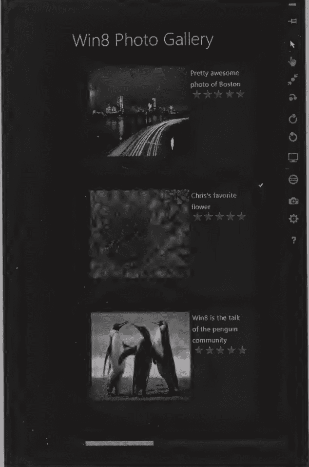
图 3.25：纵向模式下的默认 ListView

```javascript
window.addEventListener("resize", function (e) {
  setListViewLayout(e.viewState);
});

app.onactivated = function (eventObject) {
  WinJS.UI.processAll();
}

setListViewLayout(Windows.UI.ViewManagement.ApplicationView.value);
});

function setListViewLayout(viewState) {
    var listView = document.querySelector('#imgContainer').winControl;
    var stateEnum = Windows.UI.ViewManagement.ApplicationViewState;

    if ((viewState === stateEnum.FullScreenPortrait) ||
       (viewState === stateEnum.Snapped)) {
        listView.layout = new WinJS.UI.ListViewLayout();
    } else {
        listView.layout = new WinJS.UI.GridLayout();
    }
}
```

我首先做的是设置一个 resize 事件监听器，当设备的视图状态变化时触发。当此事件触发时，我会将新状态与 ApplicationViewState 枚举进行比较，如果新状态是纵向或贴靠状态，我将 ListView 的布局设置为 ListLayout；否则，我将设置为 GridLayout，这也是默认布局。结果如图 3.26 所示。

如果你使用的是基于导航的项目模板（导航、拆分和网格）提供的单页导航模型，值得一提的是，页面对象的 `updateLayout` 方法正是我们刚才所做操作的简写形式，因此你可以用更少的代码实现相同的结果。以下是一个片段，执行与前面代码相同的操作，但在页面控件内部：

```javascript
function setListViewLayout(viewState) { ... }

function updateLayout(element, viewState, lastViewState) {
    setListViewLayout(viewState);
}

WinJS.UI.Pages.define("/html/homePage.html", {
    ready: ready,
    updateLayout: updateLayout
});
```

在页面控件中，布局变化的新视图状态会提供给你提供的回调函数，因此我可以直接调用 setListViewLayout 函数，无需手动获取当前视图状态。非常方便！

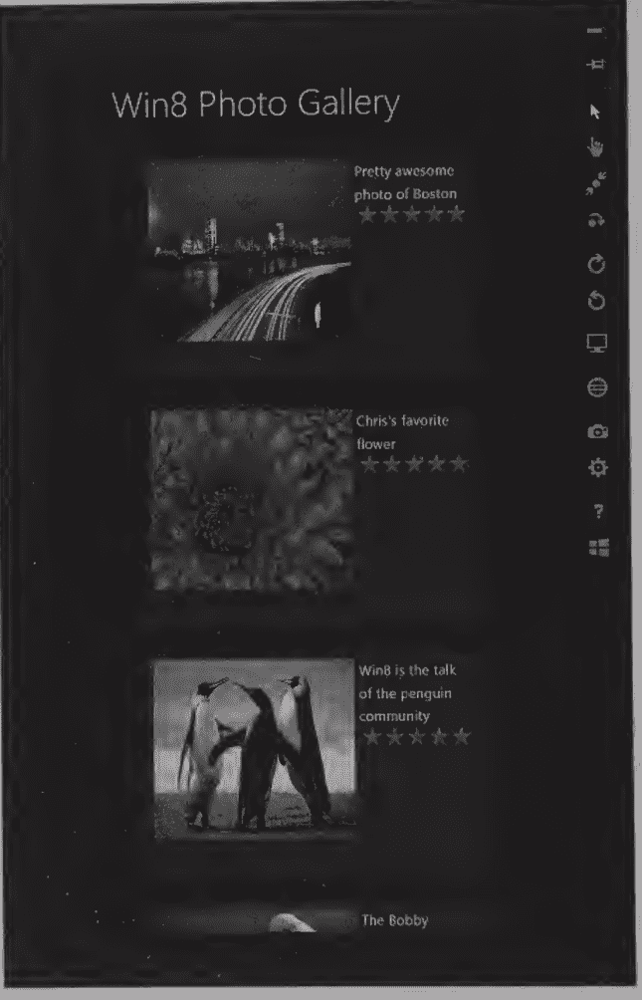
图 3.26：运行时更新的 ListView 布局

## 本章小结

在本章中，我们介绍了开始 Windows 应用商店应用布局所需了解的一切。你知道 Windows 8 将支持大量不同的设备；然而，微软已将开发者可变的范围缩小到一组固定的分辨率、方向和视图状态。你还知道 Windows 8 平台会在视图变化时尽可能提供帮助，而在需要你自己处理的地方，则提供了对 CSS 布局技术（如媒体查询和 Grid、Flexbox、多栏布局）的支持。这些技术与自适应的 WinJS 控件（如 `ListView`）相结合，为你奠定了坚实的基础，用于构建在任何视图和任何设备上都美观的 Windows 应用商店应用。


（图片内容：包含中心图解、注释和标题的技术文档）

## 第 4 章：排版

在第三章"布局"中，我们讨论了如何使用 CSS 和 WinJS 为 Windows 应用商店应用创建丰富而灵活的布局。本章和下一章将介绍媒体及其在平台上的各种用途。我们将从排版开始讨论——Web 上最常用的媒体形式。具体来说，我们将讨论软件中的排版，以及构成我们 Windows 应用商店应用的 Web 技术的演变。然后我们将讨论 CSS Web 字体，以及这项技术如何在我们自己的应用中实现自定义排版。之后，我们将讨论 Windows 应用商店中的图标设计，以及如何使用提供的和自定义的图标字体来创建高保真、基于字体的视觉效果，从而增强应用的外观和 feel。

### Windows 应用商店应用中的排版

文本是 Web、软件和现实中最古老、最普遍的媒介。在初创时期——也就是说 HTTP 被构想出来的时候——Web 几乎全都是文本。即使是现在我们认为理所当然的 `` 标签，也是在 Web 已经相当活跃之后才提出的。几十年后，尽管多媒体大量涌现，文本仍然是我们在软件中依赖的主要通信载体。

在 Windows 8 中，文本在 Windows 应用商店设计语言本身以及你我创建的应用中都扮演着关键角色。微软花了很多时间思考平台上的文本，以及应该利用文本的各种方式为 Windows 用户提供出色体验，从某些场景使用哪种字体，到标题、副标题、正文文本以及无数其他元素的恰当大小和粗细。

由于排版对平台的重要性，微软对哪些字体最适用于特定用途提出了相当具体的建议。尽管 Windows 仍然附带了一批开箱即用的字体，你可以在应用中使用任何你想要的字体——以及其他的字体，正如你很快会看到的——但微软推荐了三款专门用于 Windows 应用商店应用的字体：Segoe UI、Cambria 和 Calibri¹。每种字体都经过微软的定制构建和测试，用于特定用途，从 UI 元素到阅读和屏幕编辑。

### Segoe UI

Segoe UI 是最常与 Windows 应用商店应用相关联的字体，因为它在 Windows 8 设计语言中被大量使用。在 Windows 8 中，Segoe UI 是整个操作系统的主要字体，应作为标题、按钮、日期选择器等关键 UI 元素使用的字体。图 4.1 近距离展示了其中一些元素。

Windows 8 默认样式提供了六种不同版本的 Segoe UI 字体。其中五种主要通过字重区分，如图 4.2 所示。

这些变体可用于在应用中强调或弱化文本。Segoe UI 是默认字体，但你可以在 CSS 中指定不同的 font-family 属性来使用不同的字重：

```css
h1 {
    font-family: "Segoe UI Semibold";
}
```

> 1. 有关微软文本和排版使用指南的更多信息，包括何时使用这些字体的指南，请参见 http://msdn.microsoft.com/en-us/library/windows/apps/hh700394 (http://tinysells.com/176)。


## Cambria

接下来在 Windows 应用商店应用中常见的字体是 Cambria，这是一种衬线字体（serif）。大多数印刷媒体，包括本书（如果你手中拿的是纸质版），都使用衬线字体，因此人们已经习惯在所有阅读体验中看到它们，即便是数字形式的阅读也不例外。微软专门设计了 Cambria 以供长时间屏幕阅读，因此你应当在显示大段文本时使用它。让我们看看第 1 章"你好，Windows 8！"中的 RSS 阅读器示例。如图 4.3 所示，该应用对所有文本都使用了 Segoe UI，这是默认字体。若要将其改为 Cambria，我们只需选中主内容的容器：

```
.postsPage section[role=main] {
  font-family: Cambria;
}
```

图 4.3 展示了将 Cambria 添加为文章标题和文本字体后的效果。


图 4.3：将 Cambria 用于大段文本

## Calibri

在 Windows 应用商店应用中最后要介绍的字体是 Calibri，这是一种无衬线字体（sans-serif），同样专为屏幕阅读而设计。Calibri 与 Cambria 的主要区别——除了缺少衬线外——在于 Calibri 是微软专门为*用户阅读和编辑*的文本而设计的，例如电子邮件、聊天或交互式应用中的文本，而 Cambria 则是为纯阅读用途设计的。作为参考，Microsoft Word、Outlook 和 PowerPoint 默认都已使用 Calibri。图 4.4 展示了将 Calibri 用于文本输入的示例。

在此示例中，文本区域外的所有内容都使用 Segoe UI，而电子邮件输入框则设置为使用 Calibri。为了更突出地展示29.展示差异，图 4.5 包含了每种字体中 C 字符的特写。


图 4.4：将 Calibri 用于文本输入


图 4.5：Calibri 与 Segoe UI 的对比

这种差异很微妙——正如 Segoe 与 Cambria 之间、Calibri 与 Cambria 之间的差异一样——但这些字体中的每一种都是微软为在正确使用时提供更舒适的体验而专门打造的。新版 Windows 8 设计语言在很多方面都体现了对用户体验细节的关注，尽管这些差异对你我而言似乎过于细微，不值得区分，甚至我们的用户都不会有意识地去察觉，但微软足够相信这些场景的价值，强烈推荐在所有 Windows 应用商店应用中使用它们。除非你有品牌或应用特定的原因需要偏离这些建议，否则你会发现它们能极大地帮助你打造自己应用中干净一致的体验。

## CSS3 Web Fonts

在很多情况下，你的应用可以仅使用 Windows 8 提供的三种主要字体，你的用户也会感谢你与平台上众多其他应用保持一致。然而，有时候自定义字体正是你的应用所需要的。可能是你的品牌在所有其他媒体中都使用了某种字体，或者你的应用需要通过选择替代字体来增强特定的外观和感觉。也许你在制作的那款超棒的小行星游戏需要一个科幻字体来脱颖而出，如图 4.6 所示。


图 4.6：应用特定用途的自定义字体

如果你的应用需要这样的效果，可以使用 CSS Web Fonts 来实现。借助 CSS Web Fonts，开发者可以使用自己的字体，并从服务器或本地应用提供给用户，无需担心相关字体是否已安装在用户机器上。如果字体已安装，浏览器会使用它；如果没有，字体将从开发者指定的位置加载，然后用于在应用中渲染文字。

让我们看看这个功能的实际应用。首先是在样式表中声明 `@font-face`，我将把它添加到使用网格应用模板的新项目的 `default.css` 样式表中：

```
@font-face {
  font-family: "Dosis";
  font-style: normal;
  font-weight: 800;
  src: local("Dosis-ExtraBold"),
    url("fonts/Dosis-ExtraBold.woff") format("woff");
}

@font-face {
  font-family: "Dosis";
  font-style: normal;
  font-weight: 600;
  src: local("Dosis-SemiBold"),
    url("fonts/Dosis-SemiBold.woff") format("woff");
}

@font-face {
  font-family: "Dosis";
  font-style: normal;
  font-weight: 400;
  src: local("Dosis-Regular"),
    url("fonts/Dosis-Regular.woff") format("woff");
}

body {
  font-family: "Dosis", sans-serif;
}
```

`@font-face` 规则允许我指定新的、浏览器支持的字体族名称，以及该字体的其他属性，如样式和字重。如果我的规则没有指定 `font-style` 或 `font-weight`，那么只要 CSS 规则在 `font` 或 `font-family` 属性中通过名称引用该字体，我的字体就会被使用，而不论样式和字重如何。在本例中，我定义了 Dosis 字体族的三种不同版本：常规（regular）、半粗体（semibold）和粗体（bold）。当我通过名称引用该字体时，浏览器会根据当前元素的字重值选择正确的字体。

这里值得注意的最终属性是 `src` 属性，它允许我定义提供字体的位置或位置。两个 `local()` 引用确保如果用户机器上已安装该字体的本地副本，则会使用本地版本。如果没有，则将使用 URL 路径，在本例中位于应用本地的 fonts 目录中。

同样在 `src` 属性中还有 `format` 声明。CSS Web Fonts 模块支持多种字体格式，如传统的 OTF 和 TrueType 格式，还定义了一种新格式，即 Web Open Font Format（WOFF）。WOFF 被设计为一种无专利障碍的格式，对开发者在应用中使用是安全的。²

一旦定义了 `@font-face` 规则，我就可以通过分配给 `font-family` 属性的名称来引用它，如下所示：

在这里，我只是在覆盖默认的 Windows 8 字体（Segoe UI），并将应用中的所有文本设置为我的 Web 字体 Dosis。图 4.7 展示了结果。

正如我之前提到的，使用通过 `font-weight` 或样式规则定义的自定义字体意味着我必须确保我的本地规则匹配。例如，假设我想为页面标题使用不同的字体，并声明以下 `@font-face` 规则：

```
@font-face {
	font-family: "Shojumaru";
	font-style: normal;
	font-weight: 400;
	src: local("Shojumaru"), local("Shojumaru"),
	url("fonts/Shojumaru.woff") format("woff");
}
```

现在，我将打开网格应用模板附带的 `default.css`，并找到标题的合适选择器。在本例中，我在寻找 `header[role=banner]` 选择器：

```
.fragment header[role=banner] .titlearea .pagetitle {
	width: calc(100% - 20px);
	font-family: "Shojumaru", cursive;
}
```

如果我现在重新运行应用，字体会发生变化，但不会正确显示，如图 4.8 所示。我想要的是非常武士风格的效果，但得到的结果看起来像 Comic Sans，这是不可接受的。


图 4.7：使用自定义 Web 字体的 Windows 应用商店应用

这里实际应用的字体是一种默认的手写体（cursive），主要是因为我在前面的代码中的 `font-family` 规则里指定了 `cursive`。我包含 `cursive` 引用是为了让渲染引擎知道我的自定义字体本质上是手写体，意味着该字体具有手写、有机的质感。然而，当引擎无法渲染我的主要字体时（如本例所示），规则中紧随其后的任何内容都会被

> ² 字体与音频、视频和图像受同样的许可考虑约束，因此在使用字体前务必检查其许可证。如果你在寻找应用用字体，我推荐 Google Web Fonts 项目的免费字体：http://google.com/webfonts


## 第4章：排版

作为后备方案。我的字体之所以没有被应用，即使规则已经被处理，是因为我的 font-face 声明为自定义字体指定了 400 的 font-weight。为了使用我的自定义字体，我需要将这些规则与我的 @font-face 声明相匹配：

```
.fragment header[role=banner] .titlearea .pagetitle {
    width: calc(100% - 20px);
    font-style: normal;
    font-weight: 400;
    font-family: 'Shojumaru', cursive;
}
```

图 4.9 展示了最终结果。

> 3. 另一方面，如果在 @font-face 声明中没有指定 font-weight，那么它将可用于所有样式和粗细变化。

## 使用 CSS 调整你的排版

如果你不熟悉 CSS 文本特性，你可能会倾向于认为一旦选择了字体，你基本上就被困在它现有的样子中了，除了可以对大小、颜色和对齐方式等做一些调整之外。在互联网发展的某个时期，如果你对少数几个网络安全字体不满意，就不得不使用图片来显示自定义字体。值得庆幸的是，这种情况已经不再存在，CSS 2.1 和 CSS 3 都提供了多种功能，让你可以对文本进行调整，甚至可以在应用中添加专门的 OpenType 字体特性。⁴

几种文本调整特性在浏览器中已经存在很久了，所以你可能已经熟悉诸如 `text-align`、`text-indent`、`text-transform`，甚至是 `text-decoration` 等特性。⁵ 除了这些，让我们来看几个较老的特性以及一个你可能还没有机会使用的新特性。

+   4. 有关 OpenType 和 OpenType 字体特性的更多信息，请参阅 http://msdn.microsoft.com/en-us/library/ms745109.aspx (http://tinysells.com/284)。
+   5. `text-decoration` 的可用值包括 `underline`、`overline`、`line-through` 和 `blink`。是的，blink。千万别让我发现你在用那个。

第一个是 `word-spacing` 属性，它允许你调整对象中单词之间的间距。该属性接受绝对单位值（cm、mm、in pt）或相对单位值（em、px），并相应地调整字体的基线间距。你可以在文本或容器元素上使用这个属性，如下所示：

```
.pagetitle {
	word-spacing: 0.5em;
}
```

图 4.10 展示了结果，以及原始的间距。

另一个可以调整的是 `letter-spacing` 属性， 它与 `word-spacing` 属性的工作方式完全相同，但调整的是受影响文本中每个字母之间的间距。实际上，你不会在应用中使用这个或 `word-spacing` 属性来对文本进行重大调整；这样做会惹恼你的用户。但在某些情况下，这些值的微小差异可以帮助创造一种 subtle（微妙）的区别，但不会让用户感到烦扰。

例如，让我们考虑文章中的一个突出引用（pull quote），如图 4.11 所示。在这个例子中，我使用了 `<blockquote>` 元素，并依赖默认的 Windows 8 样式来使我的引用与正文区分开来。但也许我还可以做更多的事情来让用户清楚地看到这种区别，同时又不过多地干预。

```
blockquote {
	letter-spacing: -0.2mm;
	text-transform: lowercase;
}
```

在这里，我将使用 letter-spacing 属性来稍微调整一下我的文本，而且因为我使用的是负值（这对 word-spacing 也是有效的），字母会显得稍微靠近一些。我还通过 text-transform 属性唤起了 e.e. cummings 的精神，让我引用中的所有文本都变成小写。你可以在图 4.12 中看到结果。

请特别注意单词 *suspendisse*，在引用内部和上方都有。你会注意到字母显示得稍微靠近了一些。不至于让文本无法辨认，而是为我的引用和正文之间增加了额外的细微区别。

另一个值得讨论的文本调整是一个名为 `text-shadow` 的新 CSS3 属性。正如其名称所示，`text-shadow` 允许我为一个文本块附加一个或多个阴影效果，这给简单的文本带来了以前在 HTML 中需要图片才能实现的外观。以下是应用于页面标题的 `text-shadow` 示例：

```
.pagetitle {
	text-shadow: 10px 8px 5px 1px #ff6a00;
}
```

`text-shadow` 属性接受五个以空格分隔的值。前两个是必需的，后三个是可选的。每个组成部分的值如下：

+   * **水平偏移（必需）：** 将阴影向左（负值）或向右（正值）移动。
+   * **垂直偏移（必需）：** 将阴影向上方（负值）或下方（正值）移动。
+   * **模糊距离（可选）：** 值为 0 时阴影产生锐利的边缘。大于 0 的值会使边缘越来越模糊。
+   * **扩展距离（可选）：** 使阴影根据提供的半径值向所有方向扩展（正值）或收缩（负值）。
+   * **颜色（可选）：** 阴影的颜色。

图 4.13 展示了 `text-shadow` 规则各组成部分的分解，而图 4.14 展示了将该规则应用于页面标题的结果。

除了 `letter-spacing`、`word-spacing` 和 `text-shadow` 等属性之外，Windows 8 中的某些字体还可以通过使用内置的字型特性进行进一步调整。这些特性被称为 OpenType 布局特性，如果字体开发者在字体中添加了这些特性，我们就可以执行专门的字体调整，如字形替换和自定义定位。

举个简单的例子，让我们看看 Calibri 字体，如图 4.15 所示。

你注意到顶部原始字体和底部修改版本之间的区别了吗？实际上这里有两个区别。较小的区别是从 Q 延伸出的线条有轻微的弯曲。主要的区别，毫无疑问你也看到了，是 *c* 和 *k* 字符之间的连线。这种字体中两个字符连接在一起的情况被称为**连字**。

在我的 CSS 中允许我进行这种自定义的属性是 `-ms-font-feature-settings` 属性，在前面的例子中，它看起来像这样：

```
#calibri .feature {
  -ms-font-feature-settings: "liga" 1, "dlig" 1;
}
```

`-ms-font-feature-settings` 属性允许我提供一个或多个以逗号分隔的 OpenType 布局特性标签列表，我可以将这些标签打开或关闭（1 表示开启，0 表示关闭）。**特性标签**是一个四字符字符串，对应于 OpenType 布局特性标签注册表中的一个特性。⁶ 在前面的例子中，我使用的标签对应于标准连字（liga）和任意连字（dlig）。

Windows 8 自带的几种字体提供了 OpenType 布局特性，包括 Segoe UI：

```
#segoe .feature {
  -ms-font-feature-settings: "smcp" 1, "frac" 1;
}
```

通过这个规则，我设置了两个 OpenType 特性。第一个是小体大写字母（smcp），它会使我的小写字母呈现大写字母的形状，但保持小写的大小。第二个特性标签 frac 会使由斜杠分隔的数字显示为对角分数。图 4.16 展示了结果，顶部是标准的 Segoe UI，底部是修改后的变体。

+   6. http://microsoft.com/typography/otspec/featurelist.htm (http://tinysells.com/178)


## 图 4.16：应用了 OpenType 功能的 Segoe UI

到目前为止，我们所了解的所有 OpenType 功能都相当细微，但这些细微的改变能显著提升文本呈现给用户的舒适度和美观度。即便如此，你可能偶尔也想让字体功能更花哨一些。除了像 `liga`、`smcp` 和 `frac` 这样的标准功能标签外，OpenType 字体还可以提供多达 20 种**字体风格集**，即对字体进行整体变换，在保持字体整体外观的同时，提供风格上的变化。Windows 8 中一款支持字体风格集的字体是 Gabriola：

```
#gabriola .feature {
  font-family: 'Gabriola';
  -ms-font-feature-settings: "ss06" 1;
}
```

字体风格集使用 `ssXX` 标签进行引用，其中 `XX` 是从 01 到 20 的数字。在本例中，我们引用的是 Gabriola 支持的第 6 号字体风格集，如图 4.17 所示，上方是标准的 Gabriola，下方是经过修饰的版本。这真是个华丽的字体！

## 图 4.17：在 Gabriola 中使用字体风格集

## 处理平台图标

如果你花时间接触过 Windows Store 应用或 Windows Phone 7，你可能已经注意到这些平台上的排版已经超越了简单的文本。Windows 8 大量依赖图标来与用户沟通，主要通过使用平台内置的简单图标。到目前为止，你在 Windows 8 平台和 Visual Studio 2012 中已经见过大量基于字体的图标，后者经过重新设计，将这些概念整合到了我们的开发工具中。

当你着手为 Windows 8 构建 Windows Store 应用时，你经常会发现使用图标和字形来替代文本，甚至与文本结合使用，将有助于强化你应用的“Windows Store 风格”，同时为用户创造一种跨越整个平台的熟悉感。让我们来看一些内置的图标和字形，以及如何在你的应用中利用它们。

在本例中，我将使用 Grid App 模板（即我上次用于 CSS Web Fonts 示例的那个）。如果你运行应用并点击屏幕上的某个虚拟项目，你会注意到一个完美体现平台图标价值的例子，即屏幕左上角的大返回按钮，如图 4.18 所示。

为了了解这个按钮是如何定义的，我们先看看它的 HTML。我们的返回按钮定义在 itemsPage.html 的第 31 行：

```
<button class="win-backbutton" aria-label="Back" disabled></button>
```

它只是一个简单的 button 元素，但也许 `win-backbutton` 这个类能告诉我们更多信息。前缀 `win` 表明这是一个 Windows Library for JavaScript SDK 的类，所以我将打开 `ui-dark.css`（你可以在项目的 References | Microsoft Windows Library for JavaScript SDK | css 下找到它）来研究。果然，主要的类样式定义在那里，从第 564 行开始：

## 图 4.18：返回按钮图标

```
.win-backbutton {
  display: inline-block;
  min-width: 0;
  min-height: 0;
  background-clip: border-box;
  box-sizing: border-box;
  border-radius: 50%;
  border-width: 2px;
  border-style: solid;
  padding: 0;
  text-align: center;

  /* Normal sizing. */
  width: 41px;
  height: 41px;
  font-size: 14pt;
  line-height: 37px; /* line-height must match the content box height. */
  vertical-align: baseline;
}
```

这里的相关规则是 `border-width`、`border-style` 和 `border-radius`，它们共同构成了按钮本身的圆形形状。这是一个开始，但这里没有任何东西能创建返回按钮的箭头，所以我们需要更深入地挖掘。事实证明，答案就在下方几行的 `::before` 伪元素中：

```
.win-backbutton::before {
  font-family: "Segoe UI Symbol";
  font-weight: normal;
  content: "\E0D5";
  vertical-align: 50%;
}
```

作为 Web 开发者，你可能已经熟悉 CSS 结构，如 `:hover`、`:visited` 和 `:active`。这些被称为**伪类**，因为当它们与标准选择器（目标元素）结合使用时，操作的是与 DOM 元素本身相关但不直接的信息（如其状态、在列表中的位置等）。伪元素的工作方式类似，但它们向页面添加“虚拟”的样式和内容，而不影响 DOM 元素。两个常用的伪元素是 `::before` 和 `::after`，它们在目标元素之前或之后创建一个可设置样式的虚拟元素。

在前面的规则中，我们的目标元素是任何带有 `win-backbutton` 类的元素。规则本身应用了一个新的字体族 `Segoe UI Symbol`，然后使用 `content` 属性——该属性仅适用于 `before` 和 `after` 伪元素——来指定在按钮“之前”显示给用户的文本。`vertical-align` 属性随后移动该元素，使其显示在按钮的中心。最后一部分是 content 值 `\E0D5`，这看起来可能有点神秘。你看到的是一个转义的十六进制 Unicode 字符引用，它在 Segoe UI Symbol 字体中具有特定含义。但是，别担心！微软并不要求你学习常用图标的 Unicode 值。Windows 附带了一个工具，你可以用它来查看 Segoe UI Symbol 字体。它叫做**字符映射表**，在 Windows 中存在已久。

要打开字符映射表应用程序，按下 Windows 键并输入“字符映射表”。当 Windows 找到这个有用的小工具时，打开它。字体下拉菜单包含你计算机上安装的所有字体。选择 Segoe UI Symbol，然后在右下角找到“转到 Unicode”文本框。现在，输入你正在寻找的字符（"E0D5"，但不要带反斜杠；那是一个转义字符），你应该会看到一个左箭头图标在应用程序的左上方被选中，如图 4.19 所示。这就是我们的返回按钮，以数字形式呈现了！更重要的是，你可以在字符映射表中点击，查看字体中任何其他图标的 Unicode 值（显示在底部栏）。（提示：`U+` 后面的值就是你在伪元素中要使用的值。）

## 图 4.19：在字符映射表应用程序中查看 Segoe UI Symbol 字符

## 第 4 章：排版

再次运行应用，点击一条新闻项以使返回按钮重新出现。总结一下我为你展示的这个示例的整个流程，你看到的是（一个白色圆圈，里面有一个白色按钮）一个空的 HTML `<button>` 元素，它被赋予了圆形白色边框，然后通过 CSS 的 `::before` 伪元素叠加了一个来自 Segoe UI Symbol 字体的 Unicode 箭头。这内容很多，但了解如何使用这些图标以及在哪里找到它们，对于理解 Windows Store 应用如何利用排版至关重要。

让我们再看几个使用平台图标的例子，这次是在 AppBar 上——一个在第 2 章“绑定与控件”中简要介绍过的 Windows 8 控件。仍然在我的 Grid 应用中，我想添加一些按钮，允许我在文章列表中前进和后退、刷新订阅源或评论文章，所有这些都不会让我的界面显得杂乱。这是 AppBar 的完美用例，所以我将在 `default.html` 中的 `contenthost` div 下添加以下内容：

```
<div id="Div1" data-win-control="WinJS.UI.AppBar">
  <button data-win-control="WinJS.UI.AppBarCommand"
    data-win-options="{id:'prev', section:'selection',
      label:'Previous', icon:'back'}" disabled>
  </button>
  <button data-win-control="WinJS.UI.AppBarCommand"
    data-win-options="{id:'next', section:'selection',
      label:'Next', icon:'forward'}" disabled>
  </button>
  <button data-win-control="WinJS.UI.AppBarCommand"
    data-win-options="{id:'sync', label:'Refresh', icon:'sync'}" disabled>
  </button>
  <button data-win-control="WinJS.UI.AppBarCommand"
    data-win-options="{id:'comment', label:'Comment', icon:'comment'}" disabled>
  </button>
</div>
```

添加 AppBar div 后，我将运行应用。然后我可以通过右键单击或在屏幕上向上滑动来激活 AppBar，看到我的 AppBarCommand 的精美图标，如图 4.20 所示。

利用 AppBar 图标的机制与返回按钮控件略有不同，AppBar 代码中的相关部分是 icon option 属性。每个字符串值映射到 WinJS.UI 命名空间中的 AppBarIcon 枚举值。实际上，如果你

**图 4.20：** AppBar 图标

导航到“References”|“Microsoft Windows Library for JavaScript SDK”| js | ui.js 并搜索 AppBarIcon，你可以看到该对象的定义，大致如下：

```
// Glyph Enumeration
/// <dictionary>Segoe</dictionary>
(function (WinJS) {
  WinJS.Namespace.define("WinJS.UI", {
    AppBarIcon: {
      // Icon glyphs in the 'Segoe UI Symbol' font.
      previous:     "\uE100",
      next:         "\uE101",
      play:         "\uE102",
      pause:        "\uE103",
      edit:         "\uE104",
      save:         "\uE105",
      clear:        "\uE106",
      delete:       "\uE107",
      remove:       "\uE108",
      ...
    }
  });
})(WinJS);
```

AppBarIcon 枚举只是 Segoe UI Symbol 字体中 Unicode 值的一组友好名称。这些枚举值的完整列表——截至本文撰写之时——以及它们所代表的图标可以在表 4.1 中找到。

## 表 4.1：WinJS.UI.AppBarIcon 枚举值与图标

| 枚举值 | 图标 | 枚举值 | 图标 | 枚举值 | 图标 |
| :--- | :---: | :--- | :---: | :--- | :---: |
| previous | ◀ | download | ↓ | page | 📄 |
| next | ▶ | mail | ✉ | bullets | ⁞≡ |
| play | ▶ | find | 🔍 | comment | 💬 |
| pause | ⏸ | help | ? | mail2 | ✉ |
| edit | ✏ | upload | ↑ | contactinfo | 📇 |
| save | 💾 | emoji | 😊 | hangup | 📞 |
| clear | ✕ | twopage | 📖 | viewall | ⊞ |
| delete | 🗑 | leavechat | 💬 | mappin | 📍 |
| remove | － | mailforward | ✉➡ | phone | 📞 |
| add | ＋ | clock | 🕒 | videochat | 📹 |
| cancel | ✕ | send | ✉➡ | switch | ⇄ |
| accept | ✓ | crop | ✂ | contact | 👤 |
| more | ... | rotatecamera | 🔄 | rename | ✏📄 |
| redo | ↻ | people | 👥 | pin | 📌 |
| undo | ↺ | closepane | ➡️ | musicinfo | 🎵 |
| home | 🏠 | openpane | ⬅️ | go | ↗️ |
| up | ⬆️ | world | 🌐 | keyboard | ⌨️ |
| forward | ➡️ | flag | 🚩 | dockleft | ⬅️📄 |
| right | ➡️ | previewlink | 📄 | dockright | ➡️📄 |
| back | ⬅️ | globe | 🌐 | dockbottom | ⬇️📄 |
| left | ⬅️ | trim | ✂️ | remote | 🎮 |
| favorite | ⭐ | attachcamera | 📷 | refresh | 🔄 |
| camera | 📷 | zoomin | 🔍 | rotate | 🔄 |
| settings | ⚙️ | bookmarks | 🔖 | shuffle | 🔀 |
| video | 📹 | document | 📄 | list | 📜 |
| sync | 🔄 | protecteddocument | 🔒 | shop | 🛍️ |
| selectall | 🔲 | attach | 📎 | setlockscreen | 🔓 |
| orientation | 🔄 | paste | 📋 | settle | ⬇️ |
| import | ⬅️ | filter | ⏳ | cc | CC |
| importall | ⬅⊞ | copy | 📄 | stopslideshow | ⏹ |
| browsephotos | 🖼 | emoji2 | ☺ | permissions | 🗝 |
| webcam | 🎥 | important | ❗ | highlight | 🖍 |
| pictures | 🖼 | mailreply | ↩ | disableupdates | 🔄❌ |
| savelocal | 💾⬇ | slideshow | ▶️ | unfavorite | ☆❌ |
| caption | 🖥 | sort | ↕ | unpin | 📌❌ |
| stop | ⏹ | manage | 🖥⚙ | openlocal | 📂⬆ |
| showresults | ☰ | allapps | ⊞ | mute | 🔇 |
| volume | 🔊 | disconnectdrive | 💻❌ | italic | 𝐼 |
| repair | 🔧 | mapdrive | 💻➡ | underline | 𝑈 |
| message | 💬 | newwindow | ⬆️ | bold | 𝐵 |
| page2 | 📄 | openwith | ➡️ | movetofolder | 📂⬇ |
| calendarday | 📅 | contactpresence | 👤 | likedislike | 👍👎 |
| calendarweek | 📅 | priority | 𝐵 | dislike | 👎 |
| calendar | 📅 | uploadskydrive | ☁️⬆ | like | 👍 |
| characters | 🔤 | gototoday | 📅 | alignright | ≡ |
| mailreplyall | 🔄 | font | AA | aligncenter | ≡ |
| read | 📖 | fontcolor | A | alignleft | ≡ |
| link | 🔗 | contact2 | 👤 | zoom | 🔍 |
| accounts | @ | folder | 📁 | zoomout | 🔍 |
| showbcc | ⩵ | audio | ♫ | openfile | 📄 |
| hidebcc | ⩵ | placeholder | 💠 | otheruser | 👤 |
| cut | ✂️ | view | 👁️ | admin | 👤 |
| street | 🏘️ | solidstar | ★ | calendarreply | 📅 |
| map | 📍 | calculator | 🧮 | unsyncfolder | 📁 |
| clearselection | ⌧ | directions | ⬆️ | reporthacked | ❕ |
| fontdecrease | A- | target | 🎯 | syncfolder | 🔄 |
| fontincrease | A+ | library | 📚 | blockcontact | 👤 |
| fontsize | AA | phonebook | 📞 | switchapps | 🔲 |
| cellphone | 📱 | memo | 📝 | addfriend | 👤➕ |
| reshare | 🔄 | microphone | 🎤 | touchpointer | 👆 |
| tag | 🏷️ | postupdate | 📋 | gotostart | 🖥️ |
| repeatone | 🔂 | backtowindow | ⤢ | zerobars | 📶 |
| repeatall | 🔁 | fullscreen | ⛶ | onebar | 📶 |
| outlinestar | ☆ | newfolder | 📁➕ | twobars | 📶 |
| threebars | 📶 | fourbars | 📶 |  |  |

不仅可以在定义 AppBarCommands 时使用 `icon` 选项属性来引用这些值，而且由于此枚举是一个 JavaScript 对象，你还可以在运行时操作图标。例如，我将在 splitPage.js 的 ready 函数中添加以下内容：

```
var refresh = document.querySelector('#comment').winControl;
refresh.icon = WinJS.UI.AppBarIcon.emoji; // "emoji" 也同样适用
```

现在，当我再次运行应用，导航到任意组，并重新激活 AppBar 时，我的刷新按钮图标会变成笑脸（emoji），如图 4.21 所示。

图 4.21：运行时更新的 AppBarCommand 图标

## 在 Windows 应用商店应用中使用和操作图标字体

图标字体是一种有趣的媒体形式，因为它们模糊了排版与图形之间的界限。从某种意义上说，它们与文本截然不同，因为它们本质上是图片，但它们在打包方式以及在应用中的使用方式上却与字体非常相似。更重要的是，好的图标字体和好的文本字体一样，具有可缩放和可样式的特性，这意味着基本字形可以调整大小和操作以适应应用的需求，而无需自定义图形。随着你更深入地了解 Windows 8，你会发现 Segoe UI Symbol 因此被广泛使用。

尽管 Segoe UI Symbol 非常出色，但你可能最终需要该字体集中未提供的图标。更好的是，你可能遇到了一组符号字体，它们更能代表你应用的审美风格。根据本章到目前为止所学的知识，你可以轻松地利用 CSS Web Fonts 和 CSS 伪元素来创建自己的字形。

第一步是获取具有适当许可证的图标字体。⁸ 在本例中，我将使用 Heydon Pickering 的 Heydings，⁹ 因为我喜欢这个名字，而且它使用 SIL 开放字体许可证，这意味着我可以将其包含在本书的在线源代码中。

要使用 Heydings，我需要该字体的 WOFF 版本。下载页面包含 TTF 版本，以及使用 Font Squirrel¹⁰ 等工具生成 WOFF 版本和示例 CSS 的说明，我将这样做以获取所需版本。将 WOFF 字体下载到本地后，我将创建一个新的空白应用，创建一个 fonts 文件夹，并在 default.css 中添加 @font-face 规则：

```
@font-face {
    font-family: 'Heydings';
    src:url('/fonts/heydings_icons-webfont.woff') format('woff');
    font-weight: normal;
    font-style: normal;
}
```

定义了新的字体系列后，我就可以开始在应用中使用这些新图标了。不过，首先我需要知道哪些字符映射到字体中的哪些字形。为此，我可以再次打开字符映射应用程序，在列表中找到 Heydings 字体。¹¹ 图 4.22 显示了结果。

与 Segoe UI Symbol 一样，你可以使用 Unicode 字符来操作 Heydings。然而，作为纯符号字体，它也被设计为可与拉丁字符一起使用，你可以通过字符映射应用程序中的工具提示来确定相关字符。例如，在图 4.22 中，我

> 8. 你可以购买 Pictos http://pictos.cc (http://tinysells.com/180) 等字体在应用中使用，或使用开放许可字体，如 Entypo www.entypo.com/ (http://tinysells.com/181)、Iconic http://somerandomdude/work/iconic/ (http://tinysells.com/182) 或 Heydings www.heydonworks.com/article/a-free-icon-web-font (http://tinysells.com/183)，后者使用 SIL 开放字体许可证 http://scripts.sil.org.com/scripts/page.php?site_id=rus&id=OFL (http://tinysells.com/184)。
9. http://heydonworks.com (http://tinysells.com/185)
10. http://fontsquirrel.com/fontface/generator (http://tinysells.com/186)
11. 你需要在 Windows 8 中安装 Heydings 才能使其生效，可以通过双击从网络下载的原始 TTF 版本来实现。


选择了警告图标（三角形中的感叹号）。注意页脚中，Unicode值之后紧接着的文本是“Exclamation Mark”（感叹号）。这意味着，当使用此字体时，屏幕上的字符“!”将显示为警告图标。

为了演示这一点，我将向我的空白应用添加一些HTML：

```
<div id="main" role="main">
  <div id="one" class="fontDisplay">Icon Font for "!"</div>
  <div id="two" class="fontDisplay">"!" with increased font-size </div>
  <div id="three" class="fontDisplay">"!" with scale transform</div>
  <div id="four" class="fontDisplay">"8" With Set Color</div>
</div>
```

# 第四章：排版

然后，我将在我的 `default.css` 文件中的 `@font-face` 规则之后添加以下内容：

```
.fontDisplay {
  background-color: #877777;
  color: #F7F3F3;
  border-radius: 10px;
  width: 200px;
  height: 200px;
  text-align: center;
  margin: 20px;
}

.fontDisplay:before {
  font-size: 96pt;
  font-family: Heydings;
  color: #F3F3F3;
  width: 100%;
  display: block;
}

.fontDisplay#one:before,
.fontDisplay#two:before,
.fontDisplay#three:before {
  content: '!';
}

.fontDisplay#two:before {
  font-size: 120pt;
}

.fontDisplay#three:before {
  -ms-transform: scale(.5);
}

.fontDisplay#four:before {
  content: '8';
  color: #ad0a0a;
}
```

请注意，我为所有具有 `fontDisplay` 类的 `div` 设置了一些通用样式，然后为所有 `:before` 伪元素指定了 96pt 的 Heydings 字体。^[12] 对于前三个 `div`，我将内容设置为感叹号，然后对第二个和第三个版本进行了一些样式调整，如图 4.23 所示。在第二个 `div` 中，我增大了字体大小来放大图标，而在第三个中，我使用了 CSS 变换（我们将在第六章“绘图与动画”中更详细地讨论）将图标缩小到其原始大小的一半。请注意，在两次更改后图像的保真度都得到了保持。正如我之前所述，这是在应用中使用图标字体的独特优势之一。

> ^[12] 注意，`:before`、`::before` 和 `:after`、`::after` 是引用 `before` 和 `after` 伪元素的有效方式。

## 图标字体效果集锦

图 4.23：为图标字体添加样式

在第四个 `div` 中，我使用了数字“8”，然后添加了该 `div` 特定的颜色，从而生成了图 4.23 中的红色“竖起大拇指”图标。同样，能够像设置任何其他文本样式一样为图标字体设置样式，使得它们非常灵活。

在结束关于排版的讨论之前，让我们再看几个例子。我将在我的 `default.html` 页面中，在其他 `div` 下方添加另外四个 `div`：

```
<div id="five" class="fontDisplay">"t" with Text-Shadow Effect</div>
<div id="six" class="fontDisplay">"u" with Skew Transform</div>
<div id="seven" class="fontDisplay">"2" with hover transition</div>
<div id="eight" class="fontDisplay">"y" with translate animation</div>
```

然后，我将添加以下 CSS：

```
.fontDisplay#five:before {
    content: 't';
    text-shadow: 20px 12px 2px #222;
}

.fontDisplay#six:before {
    content: 'u';
    -ms-transform: skew(-55deg);
}

.fontDisplay#seven:before {
    content: '2';
    -ms-transition: all 1000ms ease-in-out;
}

.fontDisplay#seven:hover:before {
    -ms-transform: rotate(180deg);
}

@-ms-keyframes slide {
    to {
        -ms-transform: translateX(545px);
    }
}

.fontDisplay#eight:before {
    content: 'y';
    padding-left: 10px;
    padding-right: 10px;
    text-align: left;
    -ms-animation-duration: 3s;
    -ms-animation-name: slide;
    -ms-animation-direction: alternate;
    -ms-animation-iteration-count: infinite;
    -ms-animation-timing-function: ease-in-out;
}

.fontDisplay#eight {
    width: 685px;
}
```

有了这些样式，我进一步发挥了图标字体的功能。首先，我使用字符 *t* 添加了一个标签图标。我还通过 `text-shadow` 属性添加了深色阴影效果，结果如图 4.23 所示。接下来，我对向上箭头（字符 *u*）应用了倾斜变换，使其呈现对角线外观。然后，我为“向下竖起大拇指”图标（2）添加了 CSS 旋转过渡效果，当用户悬停或触摸它时，它会变成“向上竖起大拇指”。最后，我将添加一个 CSS 动画（我们也会在第六章讨论），使我的笑脸表情符号（字符 *y*）在其容器内永远来回弹跳。所有这些——当然除了悬停效果和动画——都可以在图 4.23 中看到。

排版可能不如我们接下来要讨论的多媒体概念那样“性感”，但它仍然非常重要，无论是对 Windows 8 本身还是对你的 Windows Store 应用。理解 Windows 8 如何处理排版和图标，以及你如何使用自己的字体和符号，可以帮助你创建美观的文本和高保真的视觉效果。与多媒体一起，有效使用字体可以帮助你创建体现平台美感的应用。

## 我们进展到哪里了？

在本章中，我们讨论了 Windows Store 应用中的排版。Windows Store 应用的许多“感觉”都取决于字体，因此 Microsoft 精心提供了一些专为在应用中使用而设计的字体。对于需要使用其他字体的情况，你了解到可以使用 CSS Web 字体在应用中包含自定义字体。你还学到了，只需一点 CSS，你就可以调整这些字体以及其他 Windows 8 字体，以适应你的用户。我们还讨论了图标以及它在创建丰富但不突兀的 UI 方面所扮演的重要角色。最后，我们讨论了如何使用你自己的自定义图标字体以清晰且可缩放的方式呈现图形。接下来，让我们谈谈媒体。

# 第五章：媒体

既然我们已经涵盖了排版——这种软件的基本媒介，让我们转向多媒体。在本章中，我们将讨论如何将 HTML5 音频和视频集成到 Windows Store 应用中，以及如何处理设备捕获的媒体和本地照片、视频和音频。我们还将讨论 Windows 8 提供的一些特定于平台的功能，这些功能扩展了 Windows Store 应用的多媒体能力。最后，我们将讨论如何通过 Play To 将用户媒体流式传输到兼容的网络设备。当我们完成时，你应该已经有了为应用添加各种媒体类型的坚实基础。

## 处理音频和视频

Web 上的音频和视频有着一段坎坷的历史。在早期，当 Web 只不过是静态文本和链接的集合时，人们对支持其他类型的内容越来越感兴趣。1993 年，Mosaic 浏览器的创始人 Marc Andreessen（该浏览器后来发展成为 Netscape Navigator）提出了 `` 标签作为在页面文本中内联嵌入图像的标准。不久之后，`` 标签成为向网页添加图形资源的事实标准——这一标准至今仍在使用。

如今，媒体在我们的应用中比以往任何时候都更加普遍，尽管过去 18 年来网络对媒体的需求已经发生了演变，但直到最近，为网站添加丰富多媒体的主要解决方案仍然是像 Flash 或 Silverlight 这样的插件。

现在，有了 HTML5，浏览器中的媒体元素得到了很好的推动。其核心是 HTML5 通过新的 `audio` 和 `video` 标签对音频和视频的正式支持，这两种标签都允许这些类型的内容在我们的应用中作为一等公民发挥作用，无需任何插件。向 Web 应用添加视频和音频就像添加标记一样简单：

```
<video src="myvideo.mp4" controls autoplay></video>
<audio src="pumpthejam.mp3" controls></audio>
```

这两个标签添加到页面并由 HTML5 浏览器显示后，将渲染由浏览器样式设置的视频和音频控件。不同浏览器之间有一些细微的差别，但功能是相同的。

## 在 Windows 8 中开始使用媒体

与 HTML5 一样，使用 HTML 和 JavaScript 构建的 Windows Store 应用中的视频和音频也始于标记。假设我使用任意模板创建了一个新的 Windows Store 应用，然后向 HTML 页面添加了以下内容：

```
<video src='video/bigBuckBunny_trailer.mp4' width="640" height="480" />
```

当我运行此页面时，一旦应用加载，我就会看到视频，如图 5.1 所示。^1

> ^1 Windows 8 中的 Windows Store 应用支持多种视频格式，例如 MPEG-4，以及容器格式（如 AVI 和 ASF）。你可以在 http://msdn.microsoft.com/en-us/library/windows/apps/hh767390.aspx (http://tinysells.com/187) 找到完整列表。


## 嵌入式 HTML5 视频示例


图 5.1：使用 `<video>` 标签播放视频²

除了其他 HTML 元素通用的标准属性（如 `width`、`height` 和 `src`）外，`<video>` 标签还提供了几个专门用于处理视频元素的独特属性。表 5.1 列出了一些相关属性。³ 考虑到这些属性，让我们修改标记语言，指定一个带有控件、应自动播放并在完成后循环播放的视频：

```
<video controls autoplay
    src='video/bigBuckBunny_trailer.mp4'
    poster='images/bbbPoster.png' width='640' height='480' />
```

我还将指定一个海报图 URL，如果无法访问视频文件，它将显示该图片。例如，我提供一个无效的 URL：

```
<video src='#' poster='images/bbbPoster.png' width='640' height='480' />
```

在这种情况下，海报图将随错误消息一起显示，如图 5.2 所示。

### 表 5.1：`<video>` 标签属性

| 属性 | 定义 | 选项 |
| :--- | :--- | :--- |
| autoplay | 在页面加载后尽快播放视频，前提是视频已加载足够多，以确保视频能从头到尾不间断地播放。 | autoplay<br>autoplay='autoplay' |
| preload | 指示浏览器在页面加载后、用户点击播放按钮之前开始下载视频。适用于用户极有可能播放视频的场景，同时也为视频可能被每个用户播放或不播放的情况提供了节省带宽的选项。 | preload<br>preload='preload'（预加载视频以备播放）<br>preload='metadata'（不预加载视频本身，但获取元数据）<br>preload='none' |
| controls | 在视频界面上显示播放控件。 | controls<br>controls='controls' |
| loop | 在视频完成后循环播放。 | loop<br>loop='loop' |
| poster | 当视频不可用或未播放时，在界面上显示以下 URL 处的图像。 | URL/路径 |
| muted | 在加载时静音视频。 | muted<br>muted='muted' |

值得注意的是，W3C 确保了 HTML5 视频和音频元素在功能重叠区域保持一致。因此，除了 `poster` 属性外，`<audio>` 标签为控制 Windows Store 应用中的声音提供了相同的属性。所以，如果我想为应用添加一个简单的控件，可以使用以下标记语言：

```
<audio src="audio/paintFumes-TeenageBrainDrain.mp3" controls autoplay loop />
```


图 5.2：带有海报图属性的无效视频 URL


图 5.3：播放 HTML5 音频

运行应用时，我应该能看到音频控制栏，如图 5.3 所示。⁴

## 设置媒体样式和创建自定义控件

因为音频和视频只是我标记语言中的标签，所以可以轻松地选择、设置样式，甚至根据需要编写脚本。例如，假设我虽然喜欢 Windows Store 的风格和那些性感的直角，但偶尔也会想念我的圆角。我还喜欢为视野中的一切添加投影，视频也不例外。为了实现这一点以及更多效果，我将为应用程序添加以下样式，它将视频逆时针旋转 10 度，并添加圆角和一个漂亮的深色阴影：

> 4. Windows 8 中的 Windows Store 应用支持多种音频格式和容器，包括 MP3、MPEG-4 和 WAV。完整列表可在 http://msdn.microsoft.com/en-us/library/windows/apps/hh767373.aspx (http://tinysells.com/190) 查找。

```
#styleVid {
  transform: rotate(-10deg);
  box-shadow: 20px 20px 15px #AAA;
  border-radius: 20px;
}
```

然后我将修改视频元素，添加一个 ID 并移除显式的宽度设置。我会保留高度以确保视频适合我的屏幕，但移除宽度属性会让 Windows 为我设置视频宽度，确保使用正确的纵横比：

```
<video id="styleVid" controls autoplay src='video/bigBuckBunny_trailer.mp4'
  poster='images/bbbPoster.png' height="480" />
```

现在，我可以运行我的应用，并应该能看到一个自定义样式的视频窗口，与图 5.4 所示相同。


**图 5.4：设置 HTML5 视频元素的样式**

除了为 HTML5 视频和音频元素设置样式外，你还可以通过 JavaScript API 与元素及其属性进行交互。在这个示例中，我想为嵌入式视频创建自己的界面，包含一个音量滑块、一个静音按钮，以及能够点击视频界面的任何位置来播放或暂停，如图 5.5 所示。

我将从一些用户界面的标记语言开始：

```
<div>
  <button id="mute">Mute</button>
  <input id="volSlider" type="range" min="0" max="10" value="5" step="1" />
  <span id="currentVolume"></span>
</div>
<div>
  <video id="styleVid" controls autoplay src='video/bigBuckBunny_trailer.mp4' poster='images/bbbPoster.png' height="480" />
</div>
```

这里，我在页面上添加了三个额外元素来与我的视频交互。第一个是静音按钮，我将用它来在 JavaScript 中触发视频静音。接下来，我通过设置 `input` 元素类型为 "range" 添加了一个 HTML5 范围控件。这个控件允许我上下调整视频音量。`min` 和 `max` 属性设置了范围的边界（0 到 10），`value` 设置了默认值，`step` 属性指定了范围内的任何变化应为一个单位。最后，我有一个 `span` 元素来显示视频的当前音量。

对于视频元素本身，请注意我移除了 `controls` 属性。这会从视频界面上移除内置控件，意味着用户需要使用我的自定义控件来与视频交互。接下来，我将添加一些 JavaScript 来使用户界面在用户与其交互时做出响应：


图 5.5：使用 JavaScript 的自定义视频控件

```
function adjustVolume(video, newVolume) {
  var currentVolume = document.querySelector('#currentVolume');
  video.volume = parseInt(newVolume)/10;
  currentVolume.innerText = newVolume;
}

var video = document.querySelector('video');
var volSlider = document.querySelector('#volSlider');
var mute = document.querySelector('#mute');

adjustVolume(video, volSlider.value);
volSlider.addEventListener('change', function () {
  adjustVolume(video, volSlider.value);
});

video.addEventListener('click', function () {
  video.paused ? video.play() : video.pause();
});

mute.addEventListener('click', function () {
  adjustVolume(video, 0);
  volSlider.value = 0;
});
```

首先，我有一个 `adjustVolume` 函数，用于管理更新视频音量以及在我的 `currentVolume` span 元素中显示数字音量值。注意在 `adjustVolume` 函数的第二行中，我在将 `newVolume` 参数赋值给视频元素之前将其除以 10。我的范围元素接受 1 到 10 的值，但 HTML 视频元素使用 0 到 1 之间的小数来表示音量。为了适应这一点，同时仍然为范围提供一个用户友好的整数，我除以 10 以获得 0 到 1 之间的正确值。

设置好 `adjustVolume` 函数后，我选择相关的 DOM 元素，并将当前音量设置为滑块的默认值 5。最后，我为滑块的 `change` 事件、视频元素和静音按钮的 `click` 事件创建了事件处理程序。滑块和静音按钮都相应地调整视频音量，而视频元素的点击处理程序允许用户点击或触摸视频界面的任何位置，即时播放或暂停视频。

## 为视频添加字幕

并非所有人都以相同的方式点击、触摸或播放视频。因为应用是全球性的，所以在考虑媒体时，应该考虑到全球用户。一种方法是为视频元素添加多语言功能，例如字幕。早期对 HTML5 视频的批评之一是，与流行的插件不同，该规范没有为视频添加字幕提供原生解决方案，开发者大多被迫自行开发解决方案。然而，最近 W3C 在两个独立的规范上做了工作，旨在为 HTML5 视频提供字幕功能：TTML 和 WebVTT。

**定时文本标记语言**（或 TTML）是一种基于 XML 的格式，根据 W3C 的说法，它被设计为各种“创作系统”之间文本媒体的交换格式。⁵ 除了作为交换格式外，TTML 还可用于视频字幕。如果你是 XML 的粉丝，并且能在任何地方使用它，TTML 值得研究。

另一种格式是 **Web 视频文本轨道**（或 WebVTT），⁶ 旨在用于标记外部文本轨道资源。其主要目的是为视频内容提供字幕，尽管它也可用于提供视频元数据。WebVTT 的功能与 TTML 类似，但使用了一种精简得多的格式。如果你熟悉 Ruby 编程，你可以将 WebVTT 在精神上类比为 YAML。⁷

- 5. http://w3.org/TR/ttaf1-dfxp/ (http://tinysells.com/191)
- 6. http://dev.w3.org/html5/webvtt/ (http://tinysells.com/192)
- 7. http://yaml.org/


## WEBVTT 文件

```
00:00:00.001 --> 00:00:05.000
This is Big Buck Bunny, a movie from the Peach Open Movie Project.

00:00:05.001 --> 00:00:09.000
Big Buck Bunny is a Creative Commons licensed movie...

00:00:09.001 --> 00:00:12.000
it's also really well done.

00:00:12.001 --> 00:00:16.000
Which is why it's used so often for demos of HTML5 video.

00:00:16.001 --> 00:00:22.000
(c) copyright 2008, Blender Foundation / www.bigbuckbunny.org
```

WebVTT 包含一系列块，用于定义起始/结束时间点以及在这些范围内显示的字幕。每个块以完整的一行开始，包含起始时间、结束时间和双箭头，字幕则在下一行。由于这里没有标记来界定各个条目，因此在定义 WebVTT 文件时需要谨慎遵循此处所示的格式——包括将文本"WEBVTT FILE"作为第一行。

WebVTT 和 TTML 都在由 W3C 进行标准化，尽管两者有很多重叠之处，但我预计这两种格式都会存在一段时间。好消息是，这两种格式在 Windows 应用商店应用中都受到支持，因此你可以自由选择更喜欢的一种。

我更喜欢 WebVTT，因为它简单，⁸ 所以我将使用该格式来展示这一功能的实际效果。假设我已将上述示例放入一个名为 captions.vtt 的新文件中。然后，我可以通过在 video 元素内部使用 `<track>` 元素来将视频指向该字幕文件：

```
<video controls autoplay src='/video/bigbuckbunny_trailer.mp4' width="640"
  height="480">
  <track kind='subtitles' srclang='en' label='English'
    src='/resources/captions.vtt' default>
</video>
```

> 8. 也因为 TTML 是基于 XML 的，而我对 XML 仍有心理阴影。

现在，当我播放视频时，我会看到我的字幕，如图 5.6 所示。


**图 5.6：使用 WebVTT 的视频字幕**

`default` 属性将默认显示字幕。如果我移除此属性，字幕将不会自动显示，但用户将能够从视频控制栏上的 CC 图标访问它们，如图 5.7 所示。


**图 5.7：视频控件上的字幕栏**

## 第 5 章：媒体

你可能已经注意到 `<track>` 元素上的 `srclang` 和 `label` 属性。为了支持本地化，可以定义额外的字幕，全部放在单独的文件中，并将它们作为备用的 `<track>` 元素包含在 `<video>` 块中。例如，如果我想提供德语字幕，我可以创建一个名为 de-captions.vtt 的新文件，其中包含以下文本：

```
WEBVTT FILE

00:00:00.001 --> 00:00:05.000
Das ist Big Buck Bunny, ein Film aus dem Peach Open Movie Project.

00:00:05.001 --> 00:00:09.000
Big Buck Bunny ist einer Creative Commons Film ...

00:00:09.001 --> 00:00:12.000
es ist auch wirklich-gut gemacht.

00:00:12.001 --> 00:00:16.000
Deshalb ist es schon so oft für die Demos von HTML5-video verwendet.

00:00:16.001 --> 00:00:22.000
(c) copyright 2008, Blender Foundation / www.bigbuckbunny.org
```

然后，我可以为本地化字幕添加额外的 `<track>` 元素，这些字幕将可从视频控件上的字幕菜单供用户选择，如图 5.8 所示：
```
<video controls autoplay src='/video/bigbuckbunny_trailer.mp4' width="640" height="480">
    <track kind='subtitles' srclang='en' label='English'
    src='/resources/captions.vtt' default >
    <track kind='subtitles' srclang='de' label='German'
    src='/resources/de-captions.vtt' >
    <track kind='subtitles' srclang='arr' label='Pirate'
    src='/resources/arr-captions.vtt'>
</video>
```

如果你要将 HTML5 视频集成到你的应用中，请考虑添加无障碍功能，如字幕，这也可以作为所有用户的便利功能。使用 WebVTT 和 TTML 添加它们非常容易，你的用户会为此感谢你！


**图 5.8：HTML5 视频中的本地化字幕支持**

## 添加视频效果

到目前为止，我们已经介绍了很多与音频和视频相关的标准 HTML5 功能。除此之外，Microsoft 还提供了 HTML5 视频元素的几种扩展效果，这些效果仅在 Windows 应用商店应用中可用。⁹ 为了利用其中一些功能，我将在应用中添加以下标记：

```
<section aria-label="Main content" role="main" class="center">
    <div>
        <button id="flip">Flip</button>
        <button id="zoom">Zoom</button>
        <button id="fill">Fill</button>
        <button id="clear">Clear Effects</button>
    </div>
    <div>
        <video controls autoplay src='/video/bigBuckBunny_trailer.mp4'
             poster='/images/bbbPoster.png' height="480" width="640" />
    </div>
</section>
```

我在页面上有一系列按钮，直接显示在视频上方。点击每个按钮将对视频执行一种效果，而点击 Clear Effects 按钮将把所有效果重置为正常。

> 9. 完整列表可以在 http://msdn.microsoft.com/en-us/library/windows/apps/hh465962.aspx (http://tinysellms.com/194) 找到。

让我们先看看 Flip 效果。我可以通过将 `msHorizontalMirror` 属性设置为 true 来对 HTML5 视频执行翻转：

```
var flip = document.querySelector('#flip');
flip.addEventListener('click', function () {
  video.msHorizontalMirror = true;
});
```

结果如图 5.9 所示。

注意，文字现在变成了镜像，因为视频视角已经在水平轴上翻转了。虽然这个功能对于视频播放来说可能不太实用，但它至少有一个令人信服的应用场景，即用于网络摄像头视频的播放。如果你正在使用 video 元素从网络摄像头捕获媒体，你可以使用此属性来翻转视频，并为使用者提供更好的真实行为镜像（即，当用户向左移动时，他在屏幕上的表示也会向左移动）。

我们要看的下一个效果是缩放效果，我可以通过 `msZoom` 属性来实现：

```
var zoom = document.querySelector('#zoom');
zoom.addEventListener('click', function () {
  video.msZoom = true;
});
```


**图 5.9：使用 msHorizontalMirror 翻转视频元素**

如果屏幕上的视频已经被添加黑边（letterboxed）或柱状黑边（pillar-boxed，即在顶部和底部或两侧添加黑色条以保留视频宽高比），可以使用 `msZoom` 属性来放大内容并填满整个视频元素。图 5.10 说明了应用 `msZoom` 属性的效果。

这是一个不错的效果，但 `msZoom` 只是将视图容器填满以去除黑边，并不会对视频元素本身做任何处理。因此，它会裁剪视频的侧面和/或顶部，而我真正想要做的是扩展视频元素并同时保留宽高比。我可以通过对视频元素及其父元素进行一些按需调整来解决这个问题：

```
var fill = document.querySelector('#fill');
fill.addEventListener('click', function () {
  video.parentElement.style.width = "100%";
  video.parentElement.style.height = "100%";
  video.style.width = "100%";
  video.msZoom = true;
});
```


## 带有 Metro 扩展的 HTML5 视频示例


**图 5.11：使用样式调整和 msZoom 创建填充效果**

我正在更改视频父容器（一个 `<div>`）的宽度以填满可用空间，然后设置视频本身的宽度。现在，如果我点击 Fill 按钮，我会看到类似于图 5.11 的效果。

与图 5.10 相比，Fill 按钮会将视频拉伸以填满应用屏幕的整个下半部分，这使得 `msZoom` 属性能够正确地缩放视频而不裁剪它。

现在，我们已经讨论了 HTML5 视频以及字幕和一些适用于 Windows 应用商店应用的自定义扩展，让我们将讨论转向音频，因为默片早在很久以前就已经过时了。

## 在 Windows 应用商店应用中处理音频

如前所述，HTML5 音频的 API 是视频 API 的一个子集，因此非常相似。当然，这并不意味着我们不应该花点时间了解一下这个元素。在 Windows 应用商店应用中使用音频可以实现一些非常独特和有趣的场景，从能够指定音频输出设备和音频标签的类别或用途，到能够创建即使用户已切换到其他应用后仍会继续播放的后台音频。让我们现在来看看这些场景。


 ## 创建后台音频

默认情况下，系统中的音频将输出到默认扬声器，并被视为前台元素，这意味着音频GESTION仅当该元素在应用程序中处于活动状态时才会播放。对于实时通信或其他场景，您可以使用 `msAudioDeviceType` 属性，其值为 Console、Multimedia 或 Communications，来指定当前音频的输出位置。例如，我可以在应用中加入以下标签：

```
<audio src="p0wnd.mp3" msAudioDeviceType="Communications" />
```

然后，我可以允许视频或音频聊天中的用户选择声音以包含在聊天音频中，并流式传输到另一台用户的机器。Windows 应用商店应用的另一个可用音频属性是 `msAudioCategory` 属性，它可以采用以下值：

- Alert：用于循环或长时间运行的警报声音，如闹钟。
- BackgroundCapableMedia：用于应在后台继续播放的音频。
- Communications：用于流式传输通信音频。
- ForeGroundOnlyMedia：用于设计为在前台播放并使其他正在播放的媒体静音的游戏或其他声音。
- GameEffects：用于旨在与现有音频混合的前台音频。
- GameMedia：用于游戏背景音乐。
- SoundEffects：与 GameEffects 相同。
- Other：默认值，用于所有其他旨在声响中播放的音频。

其中，只有 BackgroundCapableMedia 和 Communications 可用于后台音频，不过所有这些属性都旨在帮助 Windows 8 管理音频性能，以及将该音频集成到应用中可能也正在播放的任何现有音频中。

让我们来看一个使用 **BackgroundCapableMedia** 属性来继续播放音轨的示例，即使用户切换到另一个应用后也能继续播放。默认情况下，应用音频和视频仅在应用处于前台时才会传输到扬声器。对于大多数应用来说，这可能是期望的场景，但在某些情况下，例如当您构建自己的音乐播放器时，在后台继续播放音频是有意义的，而 Windows 8 使在 Windows 应用商店应用中轻松实现这一点。要将音频标签注册为在后台播放，您需要先将 `msAudioCategory` 设置为 **BackgroundCapableMedia**：

```
<audio id="bgMusic" controls msAudioCategory="BackgroundCapableMedia">
</audio>
```

一旦我将音频标签声明为支持后台播放，我需要访问我的 `package.appxmanifest` 文件来设置一些值，这次是在声明选项卡中，如图 5.12 所示。

虽然功能选项卡用于指定应用对某些传感器和功能的访问权限，但声明选项卡用于那些需要比简单复选框选择更多信息的功能。对于在后台播放音频，我需要通过从可用声明下拉列表中选择它来创建后台任务声明。然后，我需要指定支持的任务类型（在本例中为音频）以及应用的起始页，即 `default.html`。其他任务类型此示例不需要，但你会注意到我还有其他可用的后台任务，例如发送推送通知或触发应用计时器。所有这些允许我在后台执行任务，即使我的应用已挂起或未运行，这些都在第 10 章"Shell 集成"中介绍。

添加这些声明后，Windows 8 现在已配置为在后台播放音频。但是，在我将源设置为音乐文件并启动应用之前，我需要为 Windows 8 提供一种方式来播放、暂停和停止我应用中的音频。我可以通过 `Windows.Media.MediaControl` 对象来实现这一点。我还将设置音频元素的源以及 `MediaControl` 的艺术家和音轨名称。

```
var mediaControls, audio;

function setupBackgroundAudio() {
  mediaControls = Windows.Media.MediaControl;
  audio = document.getElementById('backgroundMusic');

  mediaControls.addEventListener('playpressed', playSong);
  mediaControls.addEventListener('pausepressed', pauseSong);
  mediaControls.addEventListener('playpausetogglepressed', playpauseSong);
  mediaControls.addEventListener('stoppressed', stopSong);
  mediaControls.artistName = "Paint Fumes";
  mediaControls.trackName = "Teenage Brain Drain";

  audio.addEventListener('playing', function () {
    mediaControls.isPlaying = true;
  });

  audio.addEventListener('pause', function () {
    mediaControls.isPlaying = false;
  });

  audio.addEventListener('ended', function () {
    mediaControls.isPlaying = false;

    mediaControls.removeEventListener('playpressed', playSong);
    mediaControls.removeEventListener('pausepressed', pauseSong);
    mediaControls.removeEventListener('playpausetogglepressed', playpauseSong);
    mediaControls.removeEventListener('stoppressed', stopSong);
  });

audio.src = "audio/paintFumes-TeenageBrainDrain.mp3";

mediaControls.isPlaying = false;
}
```

MediaControl 对象是一个系统范围的后台音频接口，它允许我将 Windows 8 媒体按钮（播放、暂停、停止等）连接到用户键盘或系统 UI 上的我的应用。因此，当我的音频在后台播放时，用户点击屏幕上的媒体按钮——例如暂停——MediaControl 对象将回调我的一个本地函数。当这种情况发生时，我将播放或暂停我的本地音频文件：

```
function playSong() {
  audio.play();
}

function pauseSong() {
  audio.pause();
}

function playpauseSong() {
  if (mediaControls.isPlaying) {
    audio.pause();
  } else {
    audio.play();
  }
}

function stopSong() {
  audio.pause();
}
```

我现在准备好播放一些后台音频了，所以我将启动应用并点击屏幕上的音频元素的播放按钮。现在，当我切换到另一个应用时，我的歌曲继续播放，我什至可以使用特殊的键盘媒体键来播放或暂停音轨，这会调出系统音频菜单，如图 5.13 所示。它甚至还显示我在应用中设置的歌曲信息。

## 通过文件选取器使用用户媒体库

到目前为止，我们所有的音频和视频示例都使用了应用音频和视频文件。我们这样做是为了让讨论集中在元素本身，但事实是，很多时候，您会希望允许用户选择他们自己的媒体以在您的应用中使用。Windows 8 提供了一种简单的方法，通过使用文件选取器在您的应用中实现这一点。

顾名思义，文件选取器是一个应用内窗口，允许用户在其系统上选择文件或文件夹，然后打开这些文件供应用使用。如果您愿意，可以将其视为增强版的"文件打开"对话框。文件选取器也可用于在用户系统上保存新文件。您甚至可以实现文件选取器合约，使您的应用能够作为其他应用的文件选取器源。

文件选取器最简单的用途是单个文件打开场景。假设我在应用的一个页面中有以下标记：

```
<section aria-label="Main content" role="main" class="center">
    <div>
        <button id="pickImage">Pick Image</button>
    </div>
</section>

<div id="targetContainer">
  
</div>
</section>
```

这个简单的标记包含一个按钮和一个空图像标签，我将把它用作选取器操作的目标。现在，我可以向应用中添加一些 JavaScript 来启用选取器：

```
function ready(element, options) {
  var pick = document.querySelector('#pickImage');
  pick.addEventListener('click', pickImage);
}

function pickImage() {
  var targetImage = document.querySelector('img#targetMedia');

  var pickers = Windows.Storage.Pickers;
  var picker = new pickers.FileOpenPicker();
  picker.viewMode = pickers.PickerViewMode.thumbnail;
  picker.suggestedStartLocation = pickers.PickerLocationId.picturesLibrary;
  picker.fileTypeFilter.replaceAll(["*.png", "*.jpg", "*.jpeg", "*.tiff", "*.gif"]);

  picker.pickSingleFileAsync().done(function (file) {
    if (file) {
      var objUrl = window.URL.createObjectURL(file);
      targetImage.src = objUrl;
    }
  });
}
```

在我的 ready 事件中，我选择按钮并为点击事件创建事件处理程序。当用户点击选取图像按钮时，我从 DOM 中选择 targetImage 元素，以便在我选择文件后设置其源并显示图像。

接下来，我将创建一个 FileOpenPicker 对象并设置三个关键属性。无论您处理的是哪种媒体，文件选取器的界面都非常相似，但这三个属性可能因场景而异。首先是 viewMode 属性，我将其设置为缩略图。这将使选取器打开时以缩略图预览视图显示所有媒体。另一个可用选项是列表，它以列表视图显示文件夹内容。

接下来是 suggestedStartLocation 属性，它告诉选取器在用户文件系统上的哪个位置打开。使用 PickerLocationId

在枚举设置中，我选择了用户的 `pictureLibrary`。用户可以在选择器打开后更改位置，但这允许开发者为用户设置一个有用的默认位置。位置的其他选项包括 `videoLibrary`、`musicLibrary` 和 `documentLibrary`。

我设置的最后一个属性是 `fileTypeFilter`。因为在这个案例中我处理的是图像文件，我希望将用户限制在仅能选择那些我可以在 `` 标签中显示的文件。因此，我传入了一个我的应用程序可以处理的文件扩展名数组。

一旦这些属性设置完毕，我将通过调用 `pickSingleFileAsync()` 来打开文件选择器，你可以在图 5.14 中看到。因为这是一个异步操作，该函数返回一个 promise，我可以在其上调用 `then` 或 `done`，以便在用户选好要显示的照片后继续处理。在这个案例中，我调用了 `done`，因为 `pickSingleFileAsync` 是 promise 链中的最后一个。

一旦用户关闭文件选择器并选择了一个文件，我的 `done` 回调就会触发，并且我会获得一个代表所选文件的 `StorageFile` 对象。选择器是访问用户文件系统的一个接口，但我不能简单地将返回文件的文件系统路径设置为我的图像源，否则我的应用程序会崩溃。相反，我可以使用全局 `URL` 对象上的 `createObjectURL` 方法来为我创建一个指向文件的指针。URL 对象是 Windows 中 HTML5 File API 规范实现的一部分，它为浏览器提供了安全访问文件系统资源的方式。`createObjectURL` 创建一个 blob 指针，然后应用程序沙箱会将其映射到文件系统，而不会向我（开发者）提供任何不当的知识或访问权限。如果你在这一行设置一个断点，你会看到文件的一个安全表示，如图 5.15 所示。

一旦我将图像的源设置为我的对象 URL，图像就会在我的应用程序中显示在屏幕上，如图 5.16 所示。

我之前提到过，选择器界面无论操作如何都是相似的，所以让我们看看如何使用选择器处理视频。在这个例子中，我将向我的应用程序添加一个按钮和一个视频标签：

```
<div>
    <button id="pickVideo">Pick Video</button>
</div>
<div id="targetContainer">
    <video id="target" controls width="480" />
</div>
```

现在，类似于我处理图像选择器的方式，我将在 JavaScript 中将它们连接起来：

```
function ready(element, options) {
    var pick = document.querySelector('#pickVideo');

    pick.addEventListener('click', pickVideo);
}

function pickVideo() {
    var targetVideo = document.querySelector('video#target');

    var pickers = Windows.Storage.Pickers;
    var picker = new pickers.FileOpenPicker();
    picker.viewMode = pickers.PickerViewMode.thumbnail;
    picker.suggestedStartLocation = pickers.PickerLocationId.videosLibrary;
    picker.fileTypeFilter.replaceAll([".mp4", ".mpeg", ".wmv"]);

    picker.pickSingleFileAsync().done(function (file) {
        if (file) {
            var objUrl = window.URL.createObjectURL(file);
            targetVideo.src = objUrl;
        }
    });
}
```

```
WinJS.UI.Animation.fadeIn(this);
});

var picker = new Windows.Storage.Pickers.FileOpenPicker();
picker.viewMode = Windows.Storage.Pickers.PickerViewMode.thumbnail;
picker.suggestedStartLocation = Windows.Storage.Pickers.PickerLocationId.picturesLibrary;
picker.fileTypeFilter.replaceAll([".png", ".jpg", ".jpeg", ".tiff", ".gif"]);

picker.pickSingleFileAsync().then(function (file) {
    if (file) {
        var objUrl = window.URL.createObjectURL(file);
        targetImage.src = objUrl;
    }
});

function ready(element, options) {
    var pick = document.querySelector('#pickImage');
```

# 第五章：媒体

与图像示例唯一的真正区别在于我设置的两个属性。对于 `suggestedStartLocation`，我告诉选择器使用用户的 `videosLibrary`，而对于 `fileTypeFilter`，我传入了一个视频类型的数组。否则，从一种文件类型到另一种文件类型，选择视频（甚至音频）和获取对象 URL 的每个方面都是相同的。

## 选择多个文件

使用文件选择器的另一个选项是 `pickMultipleFilesAsync()` 方法，正如其名所示，它允许用户选择多个文件，如图 5.17 所示，然后返回一个所选文件数组给应用程序。

为了演示多文件选择器，我将修改第三章“布局”中的照片画廊应用程序，并在 `ListView` 控件中显示用户选择的图像。这是我的标记：

```
<div id="imageGalleryTemplate" data-win-control="WinJS.Binding.Template">
    <div class="imageGallery">
        
    </div>
</div>

<header aria-label="Header content" role="banner">
    <h1 class="titlearea win-type-ellipsis">
        <span class="pagetitle">Metro Image Gallery</span>
    </h1>
</header>
<div class="container">
    <div>
        <button id="pickImages">Pick Images</button>
    </div>
    <div id="imageListView" data-win-control="WinJS.UI.ListView"
    data-win-options="{ itemDataSource: imageList.dataSource,
    itemTemplate: select('#imageGalleryTemplate'),
    layout: {type: WinJS.UI.GridLayout} }">
    </div>
</div>
```

首先，我为图像画廊中的图像定义了一个模板，然后在我页面的主要内容中，我创建了 `ListView`，我们在第二章“绑定与控件”中详细讨论过它。有了我的标记，我可以创建选择器并初始化 `ListView`：

```
var app = WinJS.Application;
window.imageList = new WinJS.Binding.List();

app.onactivated = function (eventObject) {
  var pick = document.querySelector('#pickImages');
  pick.addEventListener('click', pickImages);

  eventObject.setPromise(WinJS.UI.processAll());
};

function pickImages() {
  var pickers = Windows.Storage.Pickers;
  var picker = new pickers.FileOpenPicker();
  picker.viewMode = pickers.PickerViewMode.thumbnail;
  picker.suggestedStartLocation = pickers.PickerLocationId.picturesLibrary;
  picker.fileTypeFilter.replaceAll([".png", ".jpg", ".jpeg", ".tiff", ".gif"]);

  picker.pickMultipleFilesAsync().done(function (files) {
    var i, objUrl;

    if (files) {
      for (i = 0; i < files.length; i++) {
        objUrl = window.URL.createObjectURL(files[i], false);
        imageList.push({
          url: objUrl,
          name: files[i].displayName
        });
      }
    }
  });
}

app.start();
```

我将做的第一件事是创建一个新的 `WinJS.Binding.List` 对象，这是我为 `ListView` 设置的 `dataSource` 的同一个对象。然后，我为按钮添加了一个监听器。我的 `pickImages` 函数与单文件选择器的关键区别在于，选择器返回一个文件数组。对于这个列表，我遍历每个对象，为文件创建一个 `objectURL`，然后将一个包含 URL 和文件 `displayName` 的新 `List` 项推入。因为 `List` 绑定到 `ListView`，我的新项会根据模板进行处理，模板将图像源设置为 `url` 属性，标题设置为 `name`，新元素会自动添加到 `ListView`。当我运行应用程序并单击“Pick Images”按钮时，我现在会看到一个文件选择器，其中有一些用于选择多个文件的额外 UI，如图 5.15 所示，我选择的每个文件都以缩略图形式显示在选择器窗口的左下角。在我选择了一些文件并关闭选择器后，每个文件都会被添加到我的列表视图中，如图 5.18 所示。

## 其他文件选择器类型

还有两种其他重要的文件选择器类型，你可能会在应用程序中使用：`FolderPicker` 和 `FileSavePicker`。

`FolderPicker` 允许用户选择一个文件夹——而不是单个文件——供应用程序枚举。例如，如果你想


function display(text) { … }
function listFiles(folder) { … }
var pickers = Windows.Storage.Pickers;
var folderPicker = new pickers.FolderPicker();
folderPicker.suggestedStartLocation =
pickers.PickerLocationId.documentsLibrary;
folderPicker.pickSingleFolderAsync().done(function (folder) {
  if (folder) {
    display("Picked folder: " + folder.name);
    listFiles(folder);
  }
});

另一种类型是 FileSavePicker，正如你所猜测的，它允许用户保存并在磁盘上创建新文件。与其他选取器不同，这需要对用户库的写入访问权限，必须通过**应用程序功能**（Application Capabilities）进行声明。如果你打开应用的 package.appxmanifest 文件并选择"功能"（Capabilities）选项卡，你会看到多个文件系统库的条目，例如**文档库**（Documents Library）和**音乐库**（Music Library），类似于图 5.19。你需要为你的应用选择相关的库。

声明这些功能后，你就可以将 FileSavePicker 添加到你的应用中：

var copy = document.querySelector('#copy');
copy.addEventListener('click', copyNew);

function copyFile(old, new) { … }

function copyNew() {
  var pickers = Windows.Storage.Pickers;
  var fileSavePicker = new pickers.FileSavePicker();
  fileSavePicker.suggestedStartLocation =
  pickers.PickerLocationId.picturesLibrary;

  fileSavePicker.fileTypeChoices.insert("JPEG Image", [".jpeg", ".jpg"]);
  fileSavePicker.defaultFileExtension = ".jpg";
  fileSavePicker.suggestedFileName = "MyCopy";
  fileSavePicker.pickSaveFileAsync().done(function (file) {
    if (file) {
      copyFile(oldfile, file);
    }
  });
}

## 第 5 章：媒体


**图 5.19：** 为 FileSavePicker 声明库访问功能

当我运行应用并点击"复制"按钮时，我看到了 FileSave 选取器，类似于图 5.20。一旦控制权返回到我的应用，我就有了一全新的文件对象可以处理。在这种情况下，我调用了一个本地的 copyFile 函数，将另一个文件的内容复制到这个新文件中。


**图 5.20：** FileSavePicker

### 处理捕获的媒体

文件选取器与 HTML5 音频和视频的丰富功能相结合，为 Windows 8 带来了一些有趣的场景，你可以轻松地将其集成到自己的 Windows 商店应用中。不仅如此，还有更令人兴奋的功能！你不仅可以处理静态媒体，还可以在应用中从输入设备捕获媒体！

Windows 8 为在 Windows 商店应用中捕获媒体提供了两个主要 API，它们都位于 Windows.Media.Capture 命名空间中：**MediaCapture** 和 **CameraCaptureUI**。MediaCapture 是一个低级对象，让我拥有完全的**控制权和责任**来从输入设备捕获音频和视频，而 CameraCaptureUI API 则为从用户的摄像头捕获照片和视频并将其保存到磁盘提供了一整套界面和抽象。假设我想允许用户使用他或她的摄像头拍照，然后在我的应用中显示该照片。假设我在 HTML 中有一个"拍照"按钮和一个空的 `` 标签，我可以执行类似于下面代码所示的操作。

## 第 5 章：媒体

function captureCamera() {
    var targetImage = document.querySelector('#targetImage');

    var Capture = Windows.Media.Capture;
    var captureUI = new Capture.CameraCaptureUI();
    captureUI.photoSettings.format = Capture.CameraCaptureUIPhotoFormat.png;
    captureUI.photoSettings.croppedAspectRatio = { width: 4, height: 3 };

    captureUI.captureFileAsync(Capture.CameraCaptureUIMode.photo)
        .done(function (capturedFile){
            if (capturedFile) {
                var objURL = URL.createObjectURL(capturedFile);
                targetImage.src = objURL;
            };
        });
}

function ready(element, options) {
    var takePicture = document.querySelector('#takePicture');
    var targetImage = document.querySelector('#targetImage');

    takePicture.addEventListener('click', captureCamera);
    targetImage.addEventListener('load', function () {
        WinJS.UI.Animation.fadeIn(this);
    });
}

在我的 captureCamera 函数的第二行，我创建了一个新的 CameraCaptureUI 对象。然后，我需要设置一些属性，例如文件格式（这里使用 .png）以及我拍照后（但在保存到磁盘之前）内置 UI 裁剪工具将显示的纵横比。

设置完这些属性后，我将打开 CameraCaptureUI 界面，让用户拍照。一旦这个异步操作完成，并且我获得了新的摄像头照片的引用，我将为照片创建一个对象 URL 并将其设置为我的图像源以显示在屏幕上。

如果我将上述代码添加到新应用中并运行它，我会在屏幕上看到图 5.21 所示的消息。

在访问用户的摄像头之前，我必须在应用清单中声明我需要访问它。我可以通过打开 package.appxmanifest 文件并在"功能"选项卡中选中"摄像头"复选框来实现这一点。现在，当我运行应用并点击"拍照"按钮时，我会看到全屏的 CameraCaptureUI，如图 5.22 所示。


**图 5.21：** 未声明应用功能即访问摄像头


**图 5.22：** 使用 `CameraCaptureUI` 拍摄摄像头照片

仔细观察图 5.22 中的图像。在右下角的应用栏（AppBar）上，你会注意到有一个灰色的视频按钮。CameraCaptureUI 可以处理视频或照片，但因为我将 CameraCaptureUIMode 设置为 photo，所以录制视频不是一个可用选项。如果我想的话，我可以将前面显示的 captureFileAsync 调用改为传入 video 作为 CameraCaptureUIMode，这将禁用照片工具栏项并默认进入视频捕获模式。另一个选项是指定 photoOrVideo：

function captureCamera() {
    var targetImage = document.querySelector('#targetImage');
    var targetVideo = document.querySelector('#targetVideo');

    var capture = Windows.Media.Capture;
    var captureUI = new capture.CameraCaptureUI();
    captureUI.photoSettings.format = 
    capture.CameraCaptureUIPhotoFormat.png;
    captureUI.photoSettings.croppedAspectRatio = {
        width: 4,
        height: 3
    };
}

captureUI.videoSettings.format = 
capture.CameraCaptureUIVideoFormat.mp4;
captureUI.videoSettings.maxDurationInSeconds = 30;

captureUI.captureFileAsync(capture.CameraCaptureUIMode
    .photoOrVideo).done(function (captureFile) {
    if (captureFile) {
        var objURL = URL.createObjectURL(captureFile);

        if (captureFile.fileType === ".png") {
            targetImage.src = objURL;
        } else {
            targetVideo.src = objURL;
        }
    }
});

除了现在允许照片或视频外，我还设置了一些 videoSettings 选项，包括文件格式（MP4）和录制视频的长度限制。当我使用此代码运行应用时，CameraCaptureUI 将提供照片和视频两种控件，而我的应用现在需要在返回时处理这两种格式。我在上面的代码中通过检查返回文件的 `fileType`，然后将其设置到应用中适当的 target 元素（`` 或 `<video>`）来实现这一点。

`CameraCaptureUI` API 非常有用，因为它代表了一个完整的解决方案——从 UI 到文件存储——用于捕获摄像头媒体，而你只需编写很少的代码。在那些默认设置和 UI 不符合你需求的情况下，你可以通过直接使用 `MediaCapture` API 来完全控制 Windows 8 中的媒体捕获。事实上，`CameraCaptureUI` API 只是一组默认设置和抽象，它在底层使用 `MediaCapture`。[^11]

### 使用 Play To 让你的应用可连接

本章我们将要介绍的最后一个主题是如何使用 Windows 8 中的一些内置功能在 PC 网络上共享媒体。没错，在你辛辛苦苦构建了完美的摄像头视频混搭之后，你可以轻松地通过网络将其共享到同事的电脑或家中 60 英寸的电视屏幕上，这得益于一项名为 Play To 的功能。

Play To——实际上自 Windows 7 以来就已经存在——是一项 Windows 功能，允许用户快速轻松地将音频、视频和图像从他们的电脑流式传输到家庭网络中的另一台设备。Play To 适用于任何 DLNA 认证的设备，包括其他电脑、某些电视，以及最酷的 Xbox 360。

Windows 8 用户通过"设备"超级按钮激活 Play To 功能，如图 5.23 所示。当用户在配置了 Play To 的应用中打开他们的"设备"超级按钮时，他们将看到一个网络设备列表，这些设备能够播放或显示相关媒体。

11. `MediaCapture` API 的完整概述超出了本书的范围，但如果你有兴趣了解更多，或者需要控制端到端的捕获过程，我建议你查看以下文章：http://msdn.microsoft.com/en-us/library/windows/apps/hh452791.aspx (http://tinysells.com/196)。

12. http://dlna.org


图 5.23：通过"设备"超级按钮访问"播放到"

配置"播放到"实际上非常简单。让我们将其添加到我的流媒体应用中，以便将网络摄像头图像和录制内容投射到其他网络设备上。对于下一个示例，我创建了一个名为 playTo.js 的新 JavaScript 文件，它负责设置"播放到"并响应 `sourcerequested` 事件——当我打开"设备"超级按钮时，"播放到"会触发该事件。

```javascript
(function () {
    'use strict';
    var mediaElement;

    window.playToInit = function () {
        var video, image, playToManager;
        video = document.querySelector('#targetVideo');
        image = document.querySelector('#targetImage');

        video.addEventListener('loadstart',
            function () { mediaElement = this; },
            false
        );
        image.addEventListener('load',
            function () { mediaElement = this; },
            false
        );

        var mgr = Windows.Media.PlayTo.PlayToManager;
        playToManager = mgr.getForCurrentView();
        playToManager.addEventListener('sourcerequested',
            startPlayTo,
            false
        );
    }

    function startPlayTo(e) {
        var request = e.sourceRequest;
        var controller = mediaElement.msPlayToSource;
        request.setSource(controller);
    }
})();
```

我的主应用调用 `playToInit` 函数，其最后两行使用 `getForCurrentView` 方法获取 `playToManager` 对象，然后为 `sourcerequested` 事件添加事件处理程序——该事件在用户打开"设备"超级按钮时触发。`getForCurrentView` 用于为应用本身建立"播放到"协定。这是操作系统与我们的应用之间的一种握手，与所有 Windows 8 协定类似，这些内容在第 9 章"外壳协定"中讨论。在我的"播放到"配置上方，我为应用的音频和视频标签添加了两个事件监听器。这些监听器确保跨网络播放的视频或图像能够正确设置为我的 `PlayToManager`。

在媒体被捕获并显示后，用户可以打开他的"设备"超级按钮并选择一个设备，媒体将流式传输到该设备。此时，调用我的 `startPlayTo()` 函数，该函数获取当前媒体的 `msPlayToSource` 属性，并向 `PlayToManager` 通知该源。一旦发生这种情况，媒体将在我的目标设备上播放。在图 5.24 中，我正在使用"播放到"在另一台机器的 Windows Media Player 中播放视频。

图 5.24："播放到"流式传输到 Windows Media Player

## 我们现在在哪里？

这已经是一次媒体的旋风式之旅，然而我们实际上只是触及了表面。在一个丰富的多媒体世界中，应用的大部分感觉将由你对图像、音频和视频的使用来决定。在本章中，我们讨论了所有这些内容，并深入探讨了 Windows 8 允许你在 Windows 商店应用中创建和使用媒体的多种方式。接下来，我们将通过讨论绘图和动画，进一步拓展媒体的边界。

# 6 绘图和动画

在第 5 章"媒体"中，我们讨论了 Windows 商店应用中媒体和多媒体的方方面面。在本章中，我们将通过概述绘图和动画，以及 HTML5、CSS 和 WinJS 提供的种种技术，来拓宽我们对媒体的讨论，这些技术让你能够创建和动画化自己的图形、UI 元素和过渡效果。我们将首先概述以下内容：即在 Windows 商店应用中使用**可缩放矢量图形（SVG）**和 HTML5 Canvas 技术创建自己的图形元素。然后我们将讨论媒体和像素操作，具体而言，就是你如何在 Windows 商店应用中获取媒体并即时对其进行操作。最后，我们将花一些时间讨论动画，既包括如何使用 **CSS3 变形、过渡和动画**模块创建基于样式的动画，也包括 WinJS 如何提供一些只需几行代码即可使用的内置动画功能。

## 使用 SVG 和 Canvas 进行 HTML5 图形绘制

大多数应用都需要某种图形。其中一些图形（如图像）通常在应用外部创建。但对于某些应用（如游戏），图形作为应用本身的一部分实时渲染或操作。对于这些应用，HTML 提供了两种解决方案：SVG 和 Canvas。它们经常被同时提及，虽然两者都提供了许多重叠的功能，但它们的实现方式截然不同。当然，这两种技术都能帮助你为应用创建丰富的图形甚至动画，并且在你的 Windows 商店应用中都可以完全使用。尽管有这些相似之处，每种技术的开发方法却有很大不同，而且各有优缺点。为了理解它们的相似之处和不同之处，让我们看看如何利用每种技术来完成一项简单任务：绘制和动画化一个椭圆。

### SVG 简介

让我们从 SVG 开始，这项技术实际上已经存在一段时间了，是网络技术喧嚣中的一部分。SVG 于 1999 年首次推出，作为对微软和 Adobe 两种不同提案的回应，目前由"SVG 1.1 第 2 版"W3C 规范^1^定义，所有主流浏览器目前都支持它，包括 Internet Explorer 9 和 Internet Explorer 10。SVG 基于标记，通过 `<svg>` 元素添加到应用中——或者通过 `<embed>` 标签以独立 `.svg` 扩展名文件的形式添加——以及一个或多个子元素来渲染相关图形。由于 `<svg>` 元素及其子元素是标记，因此在页面渲染时，SVG 图形会被添加到 DOM 中，这意味着它们可以通过 JavaScript 和 CSS 进行选择、操作和样式设置。SVG 元素在 DOM 中的存在也意味着其状态在初始渲染后得以保留，并且可以在任何时候访问和修改。这种保留渲染对象完整模型的能力称为**保留模式**样式。

让我们来看一个使用 SVG 绘制简单形状的示例。我将首先在标记中使用 `<svg>` 元素：

```xml
<svg version="1.1" width="320" height="320" id="circle">
  <defs>
    <radialGradient id="circleGrad">
      <stop offset="0%" stop-color="rgb(255, 255, 255)" />
      <stop offset="50%" stop-color="rgb(140, 140, 140)" />
      <stop offset="100%" stop-color="rgb(55, 55, 55)" />
    </radialGradient>
  </defs>
  <ellipse fill="url(#circleGrad)" stroke="#DDD"
    cx="55%" cy="55%" rx="35%" ry="35%" />
</svg>
```

如你所见，SVG 只是 XML 标记，这意味着宽松的 HTML5 标记规则（关于属性引用和自闭合标签的规则）不能套用到 SVG 元素及其子元素上。在前面的元素中，我首先在 `<defs>` 中定义了一个 id 为 `circleGrad` 的径向渐变（`radialGradient`），以便稍后引用，然后定义了三个颜色停止点：从白色，到灰色，再到黑色。定义好渐变后，我使用 `<ellipse>` 元素创建圆形。我可以对 `fill` 属性使用任何有效的 RGB、HSL 或命名颜色，或者指定一个渐变，这里我使用 URL 选择器来实现。最后，我分别使用 cx/cy 和 rx/ry 值设置圆的位置和半径（百分比相对于图像容器而言）。结果如图 6.1 所示。

在这个示例中，我使用 `<ellipse>` 元素来绘制圆形，但我也可以轻松地使用 `<circle>` 元素代替。唯一的区别是 `<circle>` 只有一个半径属性（r），而不是两个：

```xml
<circle fill="url(#circleGrad)" stroke="#FFF" cx="80%" cy="50%" r="100" />
```

图 6.1：使用 SVG 绘制形状

图 6.2：SVG 椭圆

同样地，我也可以使用 `<ellipse>` 元素，通过为 rx 和 ry 设置不同的值来创建更多椭圆形变体，如下所示：

```xml
<ellipse fill="url(#circleGrad)" stroke="#DDD"
  cx="55%" cy="45%" rx="50%" ry="25%" />
```

这个椭圆元素产生图 6.2  FAC所示的形状。

SVG 还提供了 `<rect>`、`<marker>`、`<line>`、`<path>` 等元素，你可以用来描述形状和绘制路径。在 SVG 和 Canvas 之间做选择时，记住这个概念很重要：SVG 在**形状级别**提供图形抽象，而 Canvas 位于**像素级别**。

由于 SVG 及其子元素存在于应用的 DOM 中，你可以使用 CSS 或 JavaScript 选择、样式化和操作 SVG 图形的任何方面。因此，我可以为 svg 容器添加背景色，然后通过以下 CSS 为圆形添加 20px 的灰色描边：

```css
svg#circle {
  background-color: azure;
}
```


 ```
svg#circle ellipse {
    stroke-width: 20px;
    stroke: #aaa;
}
```

与任何其他 DOM 元素一样，我可以选择 SVG 元素及其子元素，并对它们应用 CSS 规则。在第一条规则中，我将标准的 `background-color` CSS 规则应用于 `svg` 元素本身。在第二条规则中，我应用了一些 SVG 特定的样式来修改椭圆上的描边属性。图 6.3 显示了结果。

也可以通过 JavaScript 选择并操作 SVG。例如，我可以将以下 JavaScript 添加到我的应用中：

```
var _timer, _stops;

function getColors(stops) {
    var i, length;
    var colors = [];

    for (i = 0, length = stops.length; i < length; i++) {
        colors.push(stops[i].attributes['stop-color'].value);
    }

    return colors;
}

function shimmer(stops) {
    var i, length;
    var stopColors = getColors(stops);

    for (i = 0, length = stops.length; i < length; i++) {
        stops[i].attributes['stop-color'].value =
            stopColors[i === 2 ? 0 : i + 1];
    }
}

_stops = document.querySelectorAll('#circleGrad stop');
_timer = setInterval(function () { shimmer(_stops); }, 300);
```

首先要看的是最后两行，我使用 `querySelectorAll` 函数返回我在 SVG 对象中创建的径向渐变中定义的所有 stop 元素。然后，我调用 `setInterval` 并指示应用每 300 毫秒回调一次 `shimmer` 函数。

在我的 `shimmer` 函数内部，我调用了另一个局部函数 `getColors`，它获取当前定义在 SVG 表面上的 stop 元素数组，并将每个 `stop-color` 属性提取到一个新数组中。一旦回到我的主 `shimmer` 函数，我再次遍历 stop 元素，并将每个 `stop-color` 值移动到列表中的下一个 stop（或者到达数组末尾时移到第一个）。你可能已经猜到了，这会在我的椭圆上产生一个动画闪烁效果，我在图 6.4 中重现了这一点。

## Canvas 简介

虽然不像 SVG 那样历史悠久，但 Canvas 已经存在数年，并且与其他我们通常归类为 HTML5 的开放 Web 技术一样，近期迎来了人气的激增。Canvas 最初由 Apple 为 Safari 和 OS X 桌面小部件引入，是一种高度程序化的图形技术。与 SVG——你还记得它是一种保留模式技术——相反，Canvas 被称为**即时模式**技术，这意味着一旦渲染到屏幕上，它不会保留任何关于其状态的信息。Canvas 的使用从 `<canvas>` 元素开始，它提供了基于像素的屏幕绘制表面。与 SVG 不同，SVG 向开发者呈现的是基于形状的抽象，而 Canvas 则完全基于像素。它是一种更低层级的抽象，这意味着创建同等形状可能更加复杂。然而同时，基于像素的抽象可以为开发者提供更多权力，如果需要对这些像素进行更深入的控-制。

延续椭圆主题，让我们来看看使用 Canvas 绘制圆形所需的工作量。与 SVG 一样，这个过程从标记开始，但很快就会产生分歧：

```
<canvas id="circleCanvas" width="400" height="600"></canvas>
```

除了为我的 `<canvas>` 元素设置 `id` 以便稍后引用外，我还设置了初始的宽度和高度。如果你不设置这些值，画布将默认以 300 像素宽和 150 像素高进行初始渲染。也可以使用 JavaScript 中的 DOM 属性来修改画布尺寸，但这里我将直接在标记中设置。还需要注意的是，画布的 `width` 和 `height` 属性与 CSS 样式的 `width` 和 `height` 属性不同。因此，你不能依赖 CSS 的 `width` 和 `height` 属性来正确调整 HTML5 `<canvas>` 元素的大小。如果 CSS 的 `width` 和 `height` 值与标记中设置的值不同，浏览器将会缩放画布，产生放大和像素化的效果。

添加 `<canvas>` 元素就是我在 Canvas 的标记中所能做的全部了。作为一种基于像素的绘制抽象，我需要切换到 JavaScript 来操作这些像素。与 SVG 类似，我想绘制一个简单的圆形，我可以通过添加以下代码来实现：

```
var x, y, radius, colorStops;
var canvas = document.querySelector('#circleCanvas');
var ctx = canvas.getContext('2d');
x = y = 225;
radius = 135;
colorStops = ["rgb(255, 255, 255)", "rgb(140, 140, 140)", "rgb(55, 55, 55)"];
```

在 JavaScript 中使用画布时，你首先要做的是从 DOM 中选择 `<canvas>` 元素（或在运行时创建它），然后获取 Canvas 绘制上下文，这是这个小片段中的第三行所做的。`getContext` 函数解锁了 Canvas API 并提供了一个可用于将像素推送到绘制表面的上下文对象。你可能已经注意到传递给 `getContext` 方法的 `2d` 参数。根据 Canvas 规范，`getContext` 必须用单个字符串值调用，以指定要使用的绘制上下文类型。在撰写本文时，`2d` 上下文是 Windows Store JavaScript 应用唯一支持的 Canvas 绘制上下文，尽管 Web 社区和一些浏览器中正在进行 3D 上下文（如 WebGL）的一些实验。² 要在 Windows 8 中创建类似的 3D 体验，开发者可以使用 DirectX。³

一旦获得绘制上下文，我就可以开始处理我的画布了：

```
// Create a gradient
var gradient = ctx.createRadialGradient(x, y, 0, x, y, radius);
gradient.addColorStop(0, colorStops[0]);
gradient.addColorStop(.5, colorStops[1]);
gradient.addColorStop(1, colorStops[2]);
```

我首先创建一个 `radialGradient`，使用与 SVG 圆形相同的色标值。`fillStyle` 属性接受颜色值（RGB 或 HSL）或渐变（线性或径向）对象，所以我将当前填充设置为我刚创建的渐变。现在，我可以绘制我的圆形了。

```
// Draw the circle
ctx.fillStyle = gradient;
ctx.arc(x, y, radius, 0, Math.PI * 2);
ctx.fill();
```

Canvas API 作为一种像素抽象，主要通过线条、矩形、弧线和曲线的渲染来运作。这些操作各自通过绘制上下文上的操作来访问。对于圆形，我需要的是 `arc` 操作，我将通过指定弧的中心点的 *x* 和 *y* 坐标、弧的半径以及起始和终止角度来绘制我的圆形。起始角度显而易见，但你可能预期我的终止角度是 360，而我正在创建一个完整的圆。然而，Canvas API 要求角度必须以弧度指定，即弧长与其半径的比率。因为我们无疑都记得高中几何中圆的周长是 2 * *PI* * *r*，其中 *r* 是圆的半径，所以该圆周的弧度数可以通过 *PI* * 2 计算，大约是 6.28。是的，我四舍五入了一点。所有圆形，无论半径大小，周长都是 6.28 弧度，所以使用 `arc` 方法绘制完整圆的方式是 `Math.PI * 2`。相信我，我查过了。

一旦创建了我的弧线，我需要指示上下文使用 `fill` 方法填充所有内容。图 6.5 显示了结果，与我们的 SVG 圆形几乎相同，只是没有描边。

与 SVG 不同，无法使用 CSS 为 `<canvas>` 元素设置样式，所以如果我想复制我们刚才讨论的 SVG 描边效果，我需要用 JavaScript 来实现。我可以在 `ctx.fill()` 之后添加以下内容来创建描边效果：

```
ctx.strokeStyle = '#aaa';
ctx.lineWidth = 20;
ctx.stroke();
```

`fill` 和 `stroke` 在 Canvas 中都是立即执行函数，这意味着当它们被调用时，会收集此时在 Canvas 上执行的所有操作，并将结果刷新到屏幕上。在这些函数之前的所有内容都像是描摹步骤。Canvas 会跟踪我在做什么以及所有内容应该放在哪里，但在调用 `stroke` 或 `fill` 之前，没有任何内容会被渲染。


为了实现 SVG 圆形的动画效果，我创建了一个定时函数，每 300 毫秒移动渐变颜色停止值。由于我的 SVG 元素及其状态保留在 DOM 中，实际工作就是简单地选择 `<stop>` 元素并更改它们的 `stop-color` 属性，当执行速度足够快时，就会产生动画的错觉。

这与 Canvas 有着关键区别，Canvas 使用"触发即忘"的模型将图形渲染到屏幕上。一旦我的圆形绘制到 canvas 上，我就没有任何机制来访问圆形本身、它的描边边框，甚至用于填充该圆形的渐变值。作为即时模式图形技术，我想对 canvas 进行的任何更改，无论是大是小，都必须在完全重绘 canvas 本身的上下文中完成。这意味着，如果我想自动或基于用户交互来为 Canvas 圆形制作动画——通过移动渐变颜色停止值，就像我对 SVG 圆形所做的那样——我将不得不每次都完全重绘圆形。幸好，实现这个效果并不困难：

```
var _canvasTimer;
function shift(colorStops) {
  var firstItem = colorStops.shift();
  colorStops.push(firstItem);

  return colorStops;
}

function manipulateCanvasCircle() {
  var colorStops = [
    "rgb(255, 255, 255)",
    "rgb(140, 140, 140)",
    "rgb(55, 55, 55)"
  ];

  _canvasTimer = setInterval(function () {
    createCanvasCircle(colorStops);
    colorStops = shift(colorStops);
  }, 300);
}
```

我的新 `manipulateCanvasCircle` 函数管理圆形的创建和"动画"。我首先定义我的 `colorStops` 数组，然后创建一个定时器，每 300 毫秒重绘一次圆形。`createCanvasCircle` 是在 canvas 上渲染圆形的方法。与原始版本唯一的区别是我现在将 `colorStops` 数组传入函数，而不是内联定义。最后新增的部分是 `shift()` 函数，它将我的颜色停止值向左移动，并将第一个元素附加到数组末尾。这个新值将在下一个定时周期传递给 `createCanvasCircle`。最终结果是一个与图 6.4 相同的动画，唯一的区别是我的圆形在每个定时周期都在 canvas 上完全重绘。要想并排查看这两个动画，可以运行本书源代码中的示例应用。

## Canvas 与 SVG 的选择

尽管本文没有足够的篇幅对 Canvas 和 SVG 进行详尽的讲解，但这个简要概述应该能让你了解这两种技术的工作原理以及它们之间的比较。正如我之前所说，即使 Canvas 和 SVG 在实践和方法上有所不同，但在许多情况下，它们都可以用来实现相同的结果。因此，在两者之间做出"正确选择"常常会让许多开发者感到困惑，但大可不必如此。SVG 和 Canvas 之间的选择通常基于开发者技能或熟悉程度、性能考虑，以及技术能力与自然问题匹配度的混合因素。

### 开发者技能

在阅读这篇关于 Canvas 和 SVG 的入门资料时，你可能发现自己对其中一种更得心应手，而这种舒适度可能映射到你对代码与类 XML 标记语言的舒适程度。如果你是经验丰富的 JavaScript 开发者，通过 JavaScript 操作像素对你来说可能并不复杂。另一方面，如果你是 XAML 专家，SVG 标记的冗长可能根本不会让你望而却步。当面对给定任务的两种能力相当的库时，你应该自由地选择你最熟悉的那一种。

### 性能

如果你使用 Canvas 或 SVG 在应用中的小表面上放置简单图形，你可能不太关心性能。另一方面，如果图形在你的应用中扮演关键角色并且会被大量使用，你就需要考虑哪种技术最适合你的用途。如果应用中的图形表面非常大，你会发现 SVG 比 Canvas 性能更好，因为表面越大，Canvas 需要渲染的像素就越多。另一方面，如果你需要在应用中操作和动画化大量对象，你会发现 Canvas 比 SVG 性能更好。由于 SVG 状态维护在 DOM 中，对象数量越大，DOM 就必须被访问和更新的次数越多，这在规模上性能不如 Canvas。如果你的应用在全屏模式下处理一百万个对象呢？在这种情况下，我建议你考虑一下 C++，用于你肯定正在构建的那款高性能游戏。

### 能力

在 Canvas 和 SVG 之间进行选择时的最后一个考虑因素——也是应该最具分量的一个——是哪种技术更适合解决你的问题。虽然在一项技术中能做到的事情在另一项中几乎也都能做到，但有些情况更适合其中一种。例如，如果你使用的是需要相对分辨率独立的静态图像，SVG 就是你的正确选择。SVG 图像可以放大或缩小而不会保真度损失，而 Canvas 的即时模式在放大时会使渲染内容模糊。此外，带有 .svg 扩展名的文件还可以作为图像标签的源使用。另外，如果你想为图形设置样式，或者希望图形可换肤，你应该选择 SVG，因为这些元素可以通过 CSS 进行样式设置和换肤。

另一方面，如果你想实时进行图像或视频处理，Canvas 可能是你的正确选择。希望通过允许用户在其 Windows 8 机器上为图像添加镜头光晕和滤镜来打造另一款 Instagram 克隆应用发家致富？作为基于像素的技术，Canvas 非常适合在将媒体快速高性能地渲染回屏幕之前，对媒体中的每个像素进行调整。

在某些情况下，Canvas 和 SVG 之间没有错误的选择。图表和图形就是这样的例子之一。你可以轻松地在任一技术中创建数据可视化，但没有银弹。不过，如果图形动画对你很重要，你可能会倾向于 SVG，尽管 Canvas 同样是你在应用中可视化数据集的可行选择。

**底线是**：Canvas 与 SVG 之间的选择由你来做。为了说明和总结我们刚才讨论的场景，其中一个选择可能比另一个更好，请参见图 6.7。评估每种技术的能力、性能的重要程度，以及你自己的舒适程度。然后，做出选择吧，你不会错的！

## 像素操作

既然我们已经完成了 Canvas 和 SVG 的概览，让我们结合目前所学的关于 Media 和 Canvas 的知识，探索使用 Canvas 和 `Windows.Graphics.Imaging` 命名空间进行像素级图像操作。

### 使用 Canvas 进行像素操作

除了我们在前文中讨论的矢量绘制、描边和填充功能外，HTML5 Canvas 技术还提供了一些函数，使处理图像变得容易，包括将图像绘制到 canvas 上以及导出 canvas 数据进行操作。因此，当我们想要创建图像的屏幕副本并操作或调整该图像而不必立即复制原始图像时，Canvas 提供了一个不错的选择。让我们来看一个示例应用，它允许用户从其图库中选择图像，然后将该图库中每个像素的颜色反转，再将结果输出到 canvas 上。图 6.8 展示了最终的应用。


## 使用 HTML5 Canvas 操作图像

从你的图片库中选择一张图片。源图像将显示在左侧，而修改后的图像将显示在右侧的 canvas 元素上。


**图 6.8：** Canvas 图像反色器

左侧窗格包含两个按钮：一个用于打开文件选择器对话框以便用户选择图像，另一个用于触发像素反色逻辑并将结果图像绘制到画布上。我们来看看初始的应用程序逻辑：

```
var getImage, invert, originalImg;

getImage = document.querySelector('#getImage');
invert = document.querySelector('#invert');

getImage.addEventListener('click', pickImage);
invert.addEventListener('click', invertImage);

originalImg = document.querySelector('img#original');
originalImg.addEventListener('load', function () {
  invert.disabled = false;
});
```

从 DOM 中选择合适的元素后，我将为本地函数添加事件监听器。`pickImage` 函数会打开一个文件选择器，允许用户从他的系统中选择一张图片，这是我们在第 5 章中介绍过的主题。我还选择了页面上的 `` 元素，然后添加一个监听器，在图像加载完成后启用"反色！"按钮（这意味着用户已经选择了一张图片并关闭了选择器）。

我还在为这个按钮创建一个事件处理程序，该处理程序将执行我的 `invertImage` 函数。这是应用程序的核心部分：

```
function invertImage() {
    var canvas, ctx, imageData, data, i, length;
    var img = document.querySelector('img#original');

    if (img.src !== '#') {
        canvas = document.querySelector('canvas');
        ctx = canvas.getContext('2d');

        ctx.drawImage(img, 0, 0, 375, 375);

        imageData = ctx.getImageData(0, 0, canvas.width, canvas.height);
        data = imageData.data;

        for (i = 0, length = data.length; i < length; i += 4) {
            data[i] = 255 - data[i]; // red
            data[i + 1] = 255 - data[i + 1]; // green
            data[i + 2] = 255 - data[i + 2]; // blue
        }

        // overwrite original image
        ctx.putImageData(imageData, 0, 0);
    }
}
```

前几行代码现在看来应该已经很熟悉了。我从 DOM 中选择一个 `<canvas>` 元素，然后从该画布初始化一个 2D 绘图上下文。接着，我使用前面提到的图像函数。首先，我将整张图像按原样绘制到画布上。`img` 参数是我的 DOM 元素，第二和第三个参数是要开始绘制的 x 和 y 坐标，最后两个参数是我应该在画布图像上使用的缩放尺寸。我将原始图像绘制到画布上，主要目的是为了能够立即提取其像素信息，而下一行的 `getImageData` 通过提供一个 `imageData` 对象来完成这一点。我将获取该数据的数组表示形式，然后遍历每个红色、蓝色和绿色像素，用 255 减去它。注意，我每次循环都将迭代器 `i` 增加 4。我的数据数组是一维的，但它以每四个为一组包含每个像素的红、绿、蓝和 alpha 值。因此，红色像素始终是 `i`，绿色是 `i + 1`，蓝色是 `i + 2`；`i + 3` 是像素的 alpha（透明度），在此示例中未被使用。

一旦我覆盖了图像的像素数据，我就将其以修改后的形式推回画布，结果如图 6.8 右侧所示。正如你所见，使用 HTML5 Canvas 操作图像是多么容易。它如此简单，以至于已成为在网络上实时操作图像甚至视频的事实标准方式。但是，尽管它很有用，`<canvas>` 元素并没有提供将修改后的图像保存回文件系统的内置功能。此外，实际的像素操作是同步的，这意味着在处理高保真图像或大量处理任务时，你会注意到性能下降。如果你想获得相同的像素操作能力，但希望使用异步模型并且也支持文件系统，那么你应当考虑 Windows.Graphics.Imaging 库。

## 使用 Windows.Graphics.Imaging 进行像素操作

类似于 .NET 和其他服务器技术中的图形库，Windows.Graphics.Imaging 使你能够在 Windows 应用商店应用中解码、编辑和编码图像文件。Imaging API 是一个完全异步的库，它还支持访问用户库，我们可以实现类似于前面 Canvas 示例的功能，如下所示：

```
function invertImage() {
    var Imaging = Windows.Graphics.Imaging;
    var accessMode = Windows.Storage.FileAccessMode.readWrite;
    var fileStream, newFile, decoder, encoder;
    _imgStream.copyAsync(
      Windows.Storage.KnownFolders.picturesLibrary,
      "invertedImage.jpg",
      Windows.Storage.NameCollisionOption.generateUniqueName
    ).then(function (file) {
        newFile = file;
        return newFile.openAsync(accessMode);
    }).then(function (stream) {
        fileStream = stream;
        return Imaging.BitmapDecoder.createAsync(fileStream);
    }).then(function (fileDecoder) {
        decoder = fileDecoder;
        return Imaging.BitmapEncoder.createForTranscodingAsync(fileStream,
          decoder);
    }).then(function (fileEncoder) {
        encoder = fileEncoder;
        return decoder.getPixelDataAsync(
          Imaging.BitmapPixelFormat.rgba16, // Force RGBA
          Imaging.BitmapAlphaMode.straight, // Force straight alpha
          new Imaging.BitmapTransform(),    // No transforms
          true,                              // Respect EXIF orientation
          true                               // Color convert to sRGB
        );
    }).then(function (pixelDataProvider) {
        var pixels = pixelDataProvider.detachPixelData();
        var width = decoder.pixelWidth;
        var height = decoder.pixelHeight;
        var length, i;
        var rgbBase = 255;

        for (i = 0, length = pixels.length; i < length; i += 4) {
            pixels[i] = rgbBase - pixels[i];
            pixels[i + 1] = rgbBase - pixels[i + 1];
            pixels[i + 2] = rgbBase - pixels[i + 2];
        }

        encoder.setPixelData(Imaging.BitmapPixelFormat.rgba16,
        Imaging.BitmapAlphaMode.straight, width, height, decoder.dpiX,
        decoder.dpiY, pixels);
        encoder.isThumbnailGenerated = true;

        pixels = null; // Deallocate the byte array
        return encoder.flushAsync();
    }).done(function () {
        fileStream && fileStream.close();

        var newImage = document.querySelector('#modImage');
        var objectUrl = window.URL.createObjectURL(newFile);

        newImage.src = objectUrl;

        newImage.style.display = "inline";
        WinJS.UI.Animation.fadeIn(newImage);
    });
}
```

在这个函数中，我接收到了与图像选择器返回的相同的文件对象（`imgStream`），当用户选择本地文件时。首先，我使用 `copyAsync` 函数和 `Windows.Storage.KnownFolder` 枚举将该文件复制到用户的图片库中。我还提供了一个文件名，并指示 Windows 在发生名称冲突时自动创建新文件名。为了使这个复制操作能够工作，我需要有权访问用户的图片库，我可以通过打开 package.appxmanifest 文件，选择"功能"选项卡，然后勾选"图片库"复选框来添加该功能。

复制文件后，我将打开它并为图像创建解码器和编码器。你会注意到我这里有一些链式返回逻辑，这是由于所有这些操作都是异步的。就本演示而言，只需知道我在获取允许我处理图像的对象，包括调用 `getPixelDataAsync`，它获取一个包含图像中每个像素所有可用信息的 `PixelDataProvider` 对象。然后，我可以使用该对象以数组形式获取像素数据，并与 Canvas 示例中相同的方式，反转图像中的所有像素并将它们放回数组中。

编码器上的 `setPixelData` 函数允许我用反色后的像素数据覆盖我的图像。`Encoder` 对象功能强大，使我能够快速对源图像进行更改，否则就需要使用 Canvas 之类的技术进行像素映射。例如，`Encoder` 提供了一个 `BitmapTransform` 对象，我可以使用它来缩放、旋转甚至裁剪图像。因此，如果我想简单地翻转图像，而不是或除了反色其像素之外，我可以调用：

```
encoder.bitmapTransform.flip = Imaging.BitmapFlip.horizontal;
```

然后图像将在垂直轴上翻转，如图 6.9 所示。

# 第 6 章：绘图与动画

## 使用 Windows.Graphics.Imaging 处理图像

从你的图片库中选择一张图片。源图像将显示在左侧，而修改后的图像将显示在右侧的 canvas 元素上。


**图 6.9：** 使用 `Windows.Graphics.Imaging` 中的 `BitmapTransform` 翻转图像


一旦我对图像进行了处理，我将在编码器上调用 `flushAsync` 并返回结果，从而将控制权交给我的完成函数。由于转换后的图像已准备好显示，我可以创建一个对象 URL 并将该图像分配给应用程序中的 image 标签。最终结果将与我的 Canvas 示例完全一致。在在线源码中，这两个示例都在同一个应用程序中，我鼓励你亲自尝试。

与 Canvas 和 SVG 的选择一样，Windows Store 应用程序中的图像处理可以通过 Canvas 或 `System.Graphics.Imaging` 来实现。正如你在本例中看到的，后者的选项可能稍微冗长一些，但纯异步模型、文件系统访问以及用于大规模更改的简写函数是非常有吸引力的特性。如果你在进行高性能的图像处理，我建议你尝试一下。另一方面，如果你只是进行一次性的处理并且是 Canvas 专家，那么你可以放心，Canvas 仍然是 Windows Store 应用程序的一个极佳选择。

## Windows Store 应用程序中的动画

现在我们已经涵盖了绘制和像素处理，让我们来谈谈动画。根据定义，动画是通过快速连续显示 2D 或 3D 图像序列而产生的视觉错觉。⁴ 在前一节中，你看到了 Canvas 和 SVG 的动画实际运行情况，我们在其中使用了 JavaScript 的快速间隔，要么更改元素属性（在 SVG 的情况下），要么使用修改后的值完全重新绘制形状（在 Canvas 的情况下）。这两种技术都创造了运动的错觉，即动画。

动画长期以来在软件领域一直很重要，但对于大多数开发人员来说并不总是触手可及。在 Web 端，动画一直是像 Flash 和 Silverlight 这样的插件的领域。在桌面端或游戏领域，动画传统上需要对 C 或 C++ 的高级理解，以及第三方图形引擎。得益于 Canvas、SVG 甚至一些 CSS3 模块等技术，动画现在比以往任何时候都更容易实现。在本节中，我将重点介绍 UI 动画，这是每个开发人员都可以且应该添加到其应用程序中的功能。

⁴ http://en.wikipedia.org/wiki/Animation

## Windows Store 应用程序中的动画：快速且流畅

在本书的序言中，我简要谈到了 Windows Store 设计原则，这是一套针对 Windows Store 应用程序的五项设计指南。第二条原则“快速且流畅（Be fast and fluid）”指导设计者和开发人员构建不仅响应迅速，而且能与用户产生反应和互动的应用程序。“快速”意味着响应能力，正如你在本书中已经看到的，WinRT 和 WinJS 的大部分编程模型是通过异步调度长时间运行的操作来构建 UI 响应能力的。“流畅”则完全关乎设计，特别是动画。

在用户体验和交互设计领域，UI 动画通常很微妙，但至关重要。为了向你展示我的意思，请打开一个网页或桌面应用程序，并与其中的按钮进行交互。当你将鼠标悬停在它们上面时会发生什么？当你点击它们时会发生什么？如果你点击的按钮在视觉上有响应，它可能会让你觉得流畅且自然。相反，如果点击导致了操作但按钮本身没有视觉反馈，那么感觉可能会很突兀且生硬。

就像在现实生活中一样，我们希望软件在与我们交互时能提供视觉反馈。动画在 Windows Store 应用程序中很重要，因为精心设计的动画能让应用程序显得充满活力且生动，并给用户留下精湛工艺和高质量的印象。在本节中，我将向你展示如何创建和使用简单的动画，以帮助用户理解上下文或状态变化，并在这些状态之间提供流畅的视觉过渡。

## 使用 CSS 进行转换和动画

直到最近，除了极少数例外，在 Web 上让物体移动的唯一方法是使用 JavaScript 或像 Flash 这样的插件技术。与我们用圆形创建的动画效果类似，JavaScript 在构建简单和复杂的基于 Web 的动画方面有着悠久的历史。使用 JavaScript 进行动画效果很好，但随着应用程序交互性的增加，它可能会变得非常复杂。此外，即使是管理简单的 UI 过渡和动画，在任何具有一定规模的应用程序中，JavaScript 很快就会让人觉得大材小用。幸运的是，W3C 也同意这一点，官方的 CSS3 规范包含了三个模块——Transforms（转换）、Transitions（过渡）和 Animations（动画）——允许我们使用 CSS 样式规则来使 UI 元素产生动画。在现代渲染引擎中（包括 Windows 8 中 Windows Store 应用程序所使用的引擎），使用 CSS 进行动画相比 JavaScript 动画具有更好的性能优势，同时还能节省电池寿命。这是因为渲染引擎将 CSS 动画卸载到设备的 GPU 上，而不是使用应用程序的主 UI 线程。

### CSS Transforms

CSS transform 属性使得 HTML 元素能够轻松地打破盒子（模型）限制，并完全使用 CSS 执行诸如 translation（在屏幕上向上、向下或横向移动）、rotation（旋转）、scaling（缩放）和 skewing（倾斜）等转换。例如，这里有一个页面上的 `<h1>` 元素，它是我构建的一个虚拟 "Lorem Ipsum" 占位符文本生成器的页眉部分，可以通过 DalekIpsum.com 访问：

```html
<h1>Dalek Ipsum!</h1>
```

就其本身而言，这是一个相当无聊的文本块，因此我将使用 CSS transform 让它脱颖而出：

```css
header h1 {
  transform: rotate(-8deg);
}
```

你可以在图 6.10 中看到结果。

> 5. 这个世界上有两种东西需要更多： "Lorem Ipsum" 文本生成器和 *《神秘博士》（Dr. Who）*。这个网站两者兼而有之。


**图 6.10: CSS 旋转转换**

请注意，rotate 函数使我的图像...好吧，旋转了。rotate 命令被称为转换函数，CSS Transforms 模块规定了几种转换函数：rotate, skew, translate, scale, 和 matrix。这看起来很微妙，但这些转换是 Web 开发人员过去必须通过创建专门的图像才能实现的；而现在我们可以通过文本和简单的 CSS 样式来实现。⁶

你会问，这一切与动画有什么关系？关系极大！CSS 转换为我们提供了一系列属性，可以让元素扩展到 HTML 的传统线条和盒子之外。这些效果本身就很令人印象深刻，但当与 CSS 过渡和动画结合时，这些效果可以在用户的眼前展开，让你的应用程序栩栩如生。

### CSS Transitions

作为一名 Web 开发人员，你已经熟悉了几乎每个应用程序都使用的几种基本动画：链接的悬停效果和按钮的点击效果。当然，浏览器为你提供了这些动画，所以我们经常忽略它们。正如我之前所说，除了这两个例子，浏览器中任何严肃的动画形式几乎都是插件的业务。直到 CSS3 过渡和动画出现。与转换类似，CSS3 规范也定义了 Transition 和 Animation 模块。这两个模块相关，但确实有一些独立的部分。Transitions 模块旨在为开发人员提供一种减缓并使 CSS 属性更改产生动画的方法。通常，CSS 中的属性更改是瞬间完成的。例如，如果我想为 DalekIpsum 网站上的所有链接添加一个华丽的悬停文本阴影，我可以使用 `:hover` 伪类来实现：

```css
a:hover, a:focus {
    color: #fff;
    text-shadow: -1px 1px 10px #ffc, 1px -1px 10px #fff;
}
```

现在，当我将鼠标悬停在屏幕上的按钮链接上时，我会看到一个幽灵般的盒子阴影（见图 6.11）。当然，你在屏幕截图中看不到这一点，但如果你在自己的应用程序中尝试，你可能会注意到这个效果最大的问题：它是立即发生的。状态更改立即发生，但我们真正想要的是一个能够使过渡产生动画的流畅效果，而这正是 CSS transitions 赋予我的。我可以通过在页面样式中添加以下内容来为我的链接定义过渡：

```css
a.button, a:link, a:visited {
    color: #C0D2F3;
    text-decoration: none;
    text-shadow: none;
    outline: 0 none;

    /* 相当于 --> transition: 500ms linear 0s; */
    transition-property: all;
    transition-duration: 500ms;
    transition-timing-function: linear; /* 也可以是 ease, ease-in, ease-out, ease-in-out 或 cubic-bezier() */
    transition-delay: 0ms;
}
```

每个过渡属性都提供了一个变量，用于精确控制当我的链接更改状态（例如悬停、触摸或聚焦）且应应用新规则时，如何使属性更改产生动画。`property` 属性允许我指定一个或多个需要“监视”并在更改时产生动画的属性。我在这里使用 'all' 来监视所有属性的更改。

⁶ 如需更深入地了解 CSS 转换，我建议你查看 Mozilla 开发者网络 (MDN) 的介绍：https://developer.mozilla.org/en/CSS/transform


属性。`duration` 和 `delay` 属性允许我分别指定过渡的持续时间和开始前的等待时间。最后，`timing` 函数指定了一条**三次贝塞尔曲线**（Cubic Bezier curve）或具名等价物（如 `ease`、`ease-in` 等），用于管理动画在开始、结束以及所有中间状态时的速度和流畅度。我在这里不会深入探讨三次贝塞尔曲线，但我鼓励你去试验各种具名计时函数，甚至了解一下如何定义自定义曲线。有了这些规则，现在当我将鼠标悬停在页面上的链接时，就会看到一个美观、流畅（而且颇为幽灵般的）动画效果。

除了文本和盒子属性，我还可以对 CSS 变换（transform）进行动画。回到我的页面标题，假设我在 CSS 中添加了以下规则：

```
header h1:hover {
    transform: rotate(30deg);
}
```

然后，我在原始规则中添加以下 `transition` 属性（注意，这次我们使用的是简写形式）：

```
header h1 {
    transform: rotate(-8deg);
    transition: transform 750ms ease-in-out 100ms;
}
```

现在，当我将鼠标悬停在标题上时，它会顺时针平滑旋转 30 度。最终状态如图 6.11 所示。

从根本上说，CSS 过渡是被动的。我定义了元素及其状态，以及若干过渡规则，但作为开发者，我无法主动"触发"这些 CSS 过渡；它们通常是通过用户交互来启动的。如果你在寻找更主动的动画风格，并且想用 CSS 来管理这些动画，那么 CSS 动画正是你应该关注的地方。

> 7. 支持动画的完整属性列表（如 color、font、size 和 weight）可以在以下网址找到：http://oli.jp/2010/css-animatable-properties/ (http://tinysells.com/203)。


图 6.11：带有顺时针旋转的悬停过渡

## CSS 动画

与过渡类似，CSS 动画允许你对 CSS 样式配置之间的过渡进行动画处理。但动画的独特之处在于，它们是通过在 CSS 中定义的**关键帧**（keyframes）来配置的。这些关键帧定义了动画的起始和结束 CSS 样式状态，以及中间的任何状态。明白了吗？让我们看看动画的实际应用。

我首先在 CSS 中使用 `@keyframes` 声明定义一个关键帧：

```
@keyframes slide {
  from {
    transform: translateX(10px);
  }

  50% {
    color: #808080; //Red
  }

  to {
    transform: translateX(550px);
  }
}
```

首先，我赋予我的关键帧一个名称 `slide`，以便稍后引用。然后我定义一个或多个状态——`from`、`to`，或者 0% 到 100% 之间的任何百分比——以及每个状态期间要更改的属性。在这个例子中，我执行 `translateX` 将目标元素沿其容器滑动 540 像素。在此过程中，我将其颜色变为红色。

一旦定义了关键帧，我需要将其应用到 DOM 中的某个元素。回顾我们在第 4 章"排版"中关于图标字体的讨论，你可以使用图标字体作为应用中某些图片的可缩放替代方案。与其他任何 DOM 元素一样，也可以利用这些元素创建基于 CSS 的动画，因此我将使用我的朋友表情符号图标来作为这个动画示例：

```
.fontDisplay#eight:before {
    content: 'y';
    padding-left: 10px;
    padding-right: 10px;
    text-align: left;

    animation-duration: 3s;
    animation-name: slide;
    animation-direction: alternate;
    animation-iteration-count: infinite;
    animation-timing-function: ease-in-out;
}
```

`animation-duration` 和 `animation-timing-function` 属性在过渡和动画中是相同的。`animation-name` 属性接收一个关键帧名称——在本例中是 `slide`。`animation-direction` 接受 `normal`（每次动画循环后重置）或 `alternate`（将动画" rewind "回起点）。最后，`animation-iteration-count` 属性允许我指定动画应运行的次数；在本例中，是无限次。图 6.12 展示了最终效果，你也可以在线源代码中查看。


**图 6.12：** 创建 CSS3 动画效果

## 使用 WinJS 动画库

毫无疑问，CSS 变换、过渡和动画是一套非常强大且灵活的模块，如果你已经对这些非常熟悉，你会发现它们在 Windows 商店应用中的使用与在 Web 上一样简单。正如我之前所说，创建快速流畅的动画是 Windows 商店应用的基石之一，你需要将动画设计到应用中。当然，这很好，但仅凭 CSS 手动为复杂应用制作动画可能是一项艰巨的工作。值得庆幸的是，微软同意这一点，并提供了 WinJS 动画库来帮助你轻松整合标准的

> 8. 微软关于 Windows 商店应用的自有 UX 指南 http://msdn.microsoft.com/en-us/library/windows/apps/hh465424.aspx (http://tinysells.com/204) 将动画列为该平台上所有应用的关键、整体设计原则。

Windows 商店动画到你的应用中，提供以下优势：^9

1. 与 Windows 商店动画原则一致的运动效果
2. 在用户不分散注意力的情况下提供信息的流畅 UI 状态过渡
3. 为用户提供更好的应用过渡视觉反馈

WinJS 动画库不仅提供了一种为自有元素添加动画的机制，而且若干 Windows 8 控件也默认使用该库。在使用 `ListView`、`FlipView`、`Flyout` 和 `AppBar` 等控件时，你会看到 WinJS 动画在元素显示和隐藏、移动、添加到列表或从列表中移除时的效果。在第 4 章中，我们使用 `AppBar` 来展示 Segoe UI Symbol 图标在 `AppBarCommand` 上的应用。如果你跟着做了并运行了该演示，你可能已经注意到显示和隐藏 AppBar（右键单击或从底部向上滑动）的过程非常流畅。那正是 WinJS 动画的效果。

## WinJS 元素动画

让我们简要看看使用 WinJS 动画库有多么容易。在这个例子中，我将回到我的 Canvas 像素处理程序。如你所记得的，我的应用的全部目的就是向用户显示选定的图像以及该图像变换后的结果。我从我的 `` 标签开始：

```

```

当应用加载时，我放在页面上的 `` 标签没有来源，因此我需要使用 CSS `display: none` 属性将其隐藏，然后使用 `inline` 或 `block` 等属性再次显示它：

```
var originalImg = document.querySelector('#original');
originalImg.style.display= 'inline'; // 从 'none' 设置，图像将显示
```

9. http://msdn.microsoft.com/en-us/library/windows/apps/hh465165.aspx (http://tinysells.com/205)

# 第 6 章：绘图与动画

这段代码确实能阻止那个 dreaded red X 出现在屏幕上，但这是一个即时的变化。没有过渡效果，我想使用 WinJS 动画来创建一个。为此，我将图像元素的初始状态定义为 `opacity: 0`，而不是 `display: none`：

```
img#original {
  opacity: 0;
}
```

透明度为 0 时，我的图像是看不见的。为了显示它，我将在图像标签的 `load` 事件中添加一个 `fadeIn()` 动画。这将在图片选择器关闭且图像加载完成后触发：

```
originalImg.addEventListener('load', function () {
    WinJS.UI.Animation.fadeIn(originalImg);
});
```

现在，如果我运行应用并加载图像，我会注意到一个不错的淡入效果，这显然无法在书本中图示，但我确实鼓励你查看本章的示例，以观看这些动画的实际效果。而且，如果你曾经使用过 jQuery 的 `fadeIn` 函数，结果是类似的。

这显然是一种更简单、更具编程性的方式来为你的 UI 定义动画，那么 WinJS 在这里究竟做了什么呢？如果你打开 Windows SDK 中的 ui.js 文件并找到 `fadeIn` 函数，你会看到以下内容：

```
fadeIn: function (shown) {
    return thisWinUI.executeTransition(
        shown,
        {
            property: "opacity",
            delay: 0,
            duration: 167,
            timing: "linear",
            from: 0,
            to: 1
        }
    );
}
```

我不打算进一步深入 WinJS 的源代码了，因为这个函数应该已经足够让你了解其

正在进行。注意其中对属性、延迟、持续时间和计时的提及。看着眼熟吗？应该如此，因为`WinJS.UI.Animation`库是一组便捷函数，封装了CSS过渡和动画，并提供了一些有用的约定和默认值。如果你进一步研究`base.js`中引用的`executeTransition`函数及其他相关函数（我确实推荐这样做），你会发现`fadeIn`函数是在运行时创建CSS过渡样式并将其添加到我的图像元素上。在这种情况下，`fadeIn`类似于我自己在应用中手动执行以下操作：

```
originalImg.setAttribute('style',
  'transition: opacity 167ms linear 0ms; opacity: 1');
```

## WinJS 页面动画

除了实现简单的UI过渡外，WinJS动画库还允许我为视图内的内容、集合甚至应用导航指定动画。应用导航可以通过`enterPage`和`exitPage`函数进行动画处理，顾名思义，这两个函数能在页面之间创建平滑的过渡。

如果你浏览本书的在线源代码，会注意到这个像素处理应用是使用导航应用模板实现的，其中包含了`Canvas`和`Windows.Graphics.Imaging`示例的片段。在每个页面的`ready`事件中，我可以像这样添加页面动画：

```
var main = document.querySelector('.fragment');
var source = document.querySelector('#source');
var target = document.querySelector('#target');
WinJS.UI.Animation.enterPage([[main], [source, target]], null);
```

`enterPage`函数接受一个或多个应该受过渡影响的元素。我可以只指定我的主片段，当我点击该页面的链接时，整个页面就会从右侧平滑地滑入。在这种情况下，我嵌套了数组，这指定了一个分阶段的过渡序列。首先，我的主要内容会滑入，同时包含主要内容的源和目标div会稍晚一点滑入，从而创建一个错落有致但又平滑的动画效果。很可惜我无法在纸上很好地展示这一点，因为我向你保证，这个效果非常棒。它很微妙，但看起来很利落，而且如你所见，将其添加到你自己的应用中相当容易。

## 我们学到了什么？

在本章中，我们快速浏览了Windows Store JavaScript应用中的绘图和动画。你首先学习了HTML5 Canvas和SVG的基础知识，并了解了如何使用这两种技术来渲染和动画化简单的图形。你还学习了Canvas和SVG之间的区别，并探讨了一些其中一种技术可能比另一种更合适的场景。在结束该讨论之后……

---

# 7
应用状态

应用状态是与用户运行应用实例相关联的数据。这些数据可以是传统的文档数据，如照片、电子表格或文本文档，也可以是指导应用行为的设置，如登录信息或账户偏好。根据其类型，它可以存储为名称-值对（例如设置）或名称-二进制大对象对（例如文件）。某些类型的数据，如用户的登录凭据或用户上次连接网络时缓存的数据，会随着时间积累，甚至可能通过漫游在多个设备之间共享。然而，某些状态，如用户当前正在查看的页面，则与单个设备上的特定会话相关联。

需要说明一点：HTML5状态管理设施超出了本书的范围。这些设施包括本地存储、会话存储和IndexedDB，在构建Windows Store应用时，它们各自都存在问题。本地存储的问题在于它仅限本地——不支持在多个设备之间漫游。会话存储的问题在于它不支持Windows Store应用会话的概念，因此实际上使实现会话变得更困难，而不是更容易。在这三种技术中，IndexedDB通过其对表存储的支持提供了最实用的功能。不幸的是，除了仅限本地（不支持设备间同步）之外，IndexedDB没有提供查询引擎，因此任何筛选、投影或联接都需要在内存中进行，这可能在平板电脑等较小设备上需要比预期更多的资源。¹

由于在使用JavaScript构建Windows Store应用时，HTML5技术存在这些缺点，因此在本章中，我们将重点介绍WinRT和WinJS提供的本地、漫游和会话状态存储选项。让我们先来看一下设置。

## 设置

跟踪应用数据最简单的方法是使用设置。设置是一个简单的命名数据块，可以作为整体进行存储和检索，例如一个字符串或数字。设置按应用和按用户存储，这样在同一设备上运行Feed阅读器的多个用户各自拥有自己的Feed集合。例如，再次考虑第1章“你好，Windows 8！”中的RSS阅读器应用。如果我们想将通知偏好和Feed列表作为设置来保存，可以这样存储：

```
// 默认值
var showNotifications = true;
var feeds = [
  { key: "feed1", title: "Brandon Satrom", subtitle: "blog",
    backgroundImage: darkGray,
    description: "blog",
    url: "http://feeds.feedburner.com/userinexperience/tYGT",
    enabled: true },
  ...
];
```

```
// 应用运行中
...
```

```
// 写入本地设置
var localSettings =
  Windows.Storage.ApplicationData.current.localSettings.values;
// 数组或对象语法
localSettings["showNotifications"] = showNotifications;
// JSON对于复杂类型很有用
localSettings.feeds = JSON.stringify(feeds);
```

> 1. 如果你正在寻找Windows 8应用的客户端关系数据库，我推荐在http://sqlite.org下载SQLite "Precompiled Binaries for Windows Runtime"。

`Windows.Storage.ApplicationData`命名空间是满足你所有设置需求的地方。`current`属性代表与应用和用户关联的当前数据集。`localSettings`属性代表设置仓库，而`values`属性则提供对值集合的访问。

一旦你获取了`values`对象，可以将其视为一个保存原始类型值的JavaScript对象，如字符串、布尔值或数字。² 并且由于它的行为类似于JavaScript对象，你可以选择使用方括号语法或对象点语法将新索引添加到其中。此外，由于该秘密对象只支持有限的类型集合，如果你想存储更复杂的内容，如JavaScript数组或对象，可以使用内置的JSON³对象的`stringify`函数来实现。⁴

读取设置是写入设置的逆操作：

```
var localSettings =
    Windows.Storage.ApplicationData.current.localSettings.values;

// 读取本地设置
if (localSettings.hasKey("showNotifications")) {
    showNotifications = localSettings.showNotifications;
    feeds = JSON.parse(localSettings.feeds);
}
```

`hasKey`函数有助于在读取值之前检查其是否存在。还要注意，我们使用`JSON.stringify`写入的数据，使用`JSON.parse`来读取。

每个设置可以是**本地设置**，即它只保留在存储它的设备上；或者是**漫游设置**，即它在应用和用户关联的设备集之间同步。到目前为止，我们一直在使用本地设置。如果你想象在办公电脑上运行RSS阅读器应用，你可能不希望被通知打扰每次


每当有新文章可用时，不过在你的家用平板电脑上，也许这正是你想要的。

在这种情况下，`showNotifications` 设置作为本地设置非常合适，因为很容易想象用户在不同设备上对其进行不同的设置。另一方面，订阅源集合本身更适合作为漫游设置，这样无论用户使用什么设备，都能跟踪她喜爱的订阅源。

漫游设置的编程方式与本地设置完全相同：

```
// access to local and roaming settings
var localSettings =
  Windows.Storage.ApplicationData.current.localSettings.values;
var roamingSettings =
  Windows.Storage.ApplicationData.current.roamingSettings.values;

// read local and roaming settings
if (localSettings.hasKey("showNotifications")) {
  showNotifications = localSettings.showNotifications;
}

if (roamingSettings.hasKey("feeds")) {
  feeds = JSON.parse(roamingSettings.feeds);
}

// app happens
...

// write local and roaming settings
localSettings["showNotifications"] = showNotifications;
roamingSettings.feeds = JSON.stringify(feeds);
```

读取和写入设置只是其中一部分；我们还需要让用户能够编辑它们。

### 设置超级按钮

Windows 8 提供了一种系统级的方式来调用每个应用的设置界面，即通过设置超级按钮，你可以从屏幕左侧边缘滑入手指并选择设置来激活它，也可以将鼠标

> 如果你想了解如何在 Windows 应用商店应用中显示通知，请参阅第 10 章"Shell 集成"。


图 7.1：来自"开始"屏幕的"设置"和"磁贴"设置面板

悬停在屏幕右下角并选择设置，或者按 Win+I（大写或小写的 i）来激活它。图 7.1 展示了"开始"屏幕的设置面板以及选中后的磁贴面板。

实现对设置超级按钮的支持，只需处理当前 WinRT `SettingsPane` 对象的 `commandsrequested` 事件即可。⁶

> 6. 你可以通过在 `Windows.UI.ApplicationSettings` 命名空间中的 `SettingsPane` 对象上调用 `getForCurrentView` 函数来获取当前的 WinRT `SettingsPane` 对象。

## 第 7 章：应用状态

或者，你可以使用 WinJS 封装器来处理 WinJS.Application 对象的 `settings` 事件：

```
// default.js
...
var app = WinJS.Application;
app.onsettings = function (e) {
    e.detail.applicationcommands = {
        feedsFlyout: { title: "Feeds", href: "/settings/feeds/feeds.html" },
        aboutFlyout: { title: "About", href: "/settings/about/about.html" },
    };
    WinJS.UI.SettingsFlyout.populateSettings(e);
};
```

使用 WinJS 封装器来处理设置超级按钮调用的原因是，它可以很好地与 WinJS 提供的另一个服务配合使用：页面控件（我们在第 1 章中讨论过）。WinJS 设置事件的实现需要你提供关于每个设置面板的一系列信息：WinJS SettingsFlyout 控件的 HTML 元素 id、设置面板的标题，以及用于加载包含 SettingsFlyout 控件的 HTML 文件的 URL。这种 HTML 最好构建为页面控件，这让你能够创建 HTML + JavaScript + CSS 的分离——这是我们已经熟知且喜爱的方式，作为导航实现策略的一部分。

在我们的示例中，我们有两个设置面板，一个用于保存订阅源设置，一个用于保存应用信息。每个面板都有一个 HTML 元素 id（分别是 `feedsFlyout` 和 `aboutFlyout`）、标题（"Feeds" 和 "About"），以及指向包含每个设置面板内容的 HTML 文件的 URL。定义这些面板后，你可以通过在 SettingsFlyout 控件上调用 `populateSettings` 函数来显示它们，该函数将填充 WinRT `commandrequested` 事件显示面板所需的信息。

我们添加到 RSS 阅读器示例中的两个面板如图 7.2 所示。

每个页面都是使用页面控件构建的。首先，我在项目中创建了一个新文件夹，名为 `settings`，然后为每个设置面板创建了一个文件夹，一个叫 `feeds`，一个叫 `about`。在每个文件夹中，我通过右键单击相应的子文件夹（例如 `settings/feeds` 文件夹）并选择"添加" > "新建项"，然后选择 Page Control 项目项模板来创建页面控件的实例，如图 7.3 所示。


图 7.2：来自 RSS 阅读器应用的"Feeds"和"About"设置面板

页面控件的 HTML 开箱即用就非常适合导航页面，但不太适合设置超级按钮，主要原因是样式差异。以下是设置面板内容样式更合理的起始位置：

```
<!DOCTYPE html>
<!-- settings/feeds/feeds.html -->
<html>
<head>
<meta charset="utf-8" />
<title>feeds</title>

<!-- WinJS references -->
<link href="//Microsoft.WinJS.1.0/css/ui-dark.css" rel="stylesheet" />
<script src="//Microsoft.WinJS.1.0/js/base.js"></script>
<script src="//Microsoft.WinJS.1.0/js/ui.js"></script>

<link href="feeds.css" rel="stylesheet" />
<script src="feeds.js"></script>
</head>
<body>
  <div class="feeds fragment">
    <div id="feedsFlyout" data-win-control="WinJS.UI.SettingsFlyout">
      <div class="win-ui-dark win-header">
        <button onclick="WinJS.UI.SettingsFlyout.show()"
                class="win-backbutton"></button>
        <div class="win-label">Feeds</div>
      </div>
      <div class="win-content">
        <div class="win-settings-section">
          <h3>Feeds</h3>
          <div>TODO</div>
        </div>
      </div>
    </div>
  </div>
</body>
</html>
```


图 7.3：从 Page Control 项目项模板创建设置面板

页面控件的基础仍然很有用：引入 WinJS 文件、引入每个面板的 CSS 和 JavaScript 文件，以及在 body 元素的顶级 `<div>` 中放入作用域类。但是，要匹配设置面板的推荐样式，你需要在顶级 `<div>` 内放置一个 SettingsFlyout 控件，它将包含面板的标题和内容。标题、返回按钮、标题标签和内容所使用的样式都是 WinJS 核心样式，因此如果你希望设置面板与系统的其余部分融合在一起，不需要做任何特殊处理。

在 HTML 的内容区域内，你可以拥有任意数量的部分，每个部分都是一组相关设置的逻辑分组，这些设置本身通常有一个标题（在我们的示例中是"Feeds"）。面板部分内的任何内容都是设置面板的实质内容。例如，以下代码为我们简单的 RSS 阅读器实现了设置：

```
<!-- settings/feeds/feeds.html -->

...

<div class="win-content">
    <div class="win-settings-section">
        <h3>Feeds</h3>
        <div><label for="feed1enabled">
            <input id="feed1enabled"
            type="checkbox" />Brandon Satrom</label></div>
        <div><label for="feed2enabled">
            <input id="feed2enabled"
            type="checkbox" />Chris Sells</label></div>
        <div><label for="feed3enabled">
            <input id="feed3enabled"
            type="checkbox" />Channel9</label></div>
    </div>
    <div class="win-settings-section">
        <h3>Notifications</h3>
        <div id="showNotifications" data-win-control="WinJS.UI.ToggleSwitch"
            data-win-options={"title: 'Enable notifications"}"></div>
    </div>
</div>
```

在示例中，我们提供了一种非常简单的方式让用户选择他们想要查看的订阅源，以及是否希望在有新内容可用时看到通知。我们做的唯一稍微花哨一点的事情

> 7. 这非常简单，以至于我们甚至在第 10 章之前都硬编码了允许用户选择哪些订阅源以及不显示新内容通知的数据。我相信你在自己的应用中会做得更好。


使用 ToggleSwitch 控件，因为它看起来很酷。此外，它也符合 Microsoft 为设置面板提供的设计指南，这些指南总结如下：^8

- **即时提交：** 一旦在面板上更改了设置，就应立即在应用中生效。如果合适，面板后面应用的部分应立即反映这一更改。
- **轻量关闭：** 让用户通过点击或触摸面板外部区域来关闭设置面板，而不是提供"关闭"或"确定"按钮。
- **少即是多：** 尽可能减少设置的数量。
- **仅用于设置：** 不要将设置面板用于命令、导航或频繁更改的设置。
- **使用恰当的控件：** 为合适的工作选择合适的控件。以下是一些示例：
    - **切换开关：** 用于设置布尔值（例如，"显示通知"）。
    - **按钮：** 让用户发起即时操作（例如，"清除历史记录"）。
    - **选择控件：** 让用户从选项列表中进行选择。
    - **超链接：** 向用户展示设置面板外的内容。
    - **文本输入框：** 根据数据类型启用适当的文本输入（例如，密码或电话号码）。
    - **单选按钮：** 从一组相关的少数选项中进行选择（例如，"视频质量：高、中、低"）。

实现即时提交功能可能会对应用的实现方式产生最大影响，因为这意味着任何设置都可能会更改，而应用会立即更新，无需用户按下"确定"。在我们的简单"订阅源"设置面板中实现这一功能的代码如下所示：

^8. 应用设置指南可在此处获取：http://msdn.microsoft.com/en-us/library/windows/apps/Hh770544.aspx (http://tinysells.com/254)。

```javascript
// settings/feeds/feeds.js
(function () {
  "use strict";

  WinJS.UI.Pages.define("/settings/feeds/feeds.html", {
    ready: function (element, options) {
      // 显示当前值
      feed1enabled.checked = Data.getSetting("feed1enabled");
      feed2enabled.checked = Data.getSetting("feed2enabled");
      feed3enabled.checked = Data.getSetting("feed3enabled");
      showNotifications.winControl.checked =
        Data.getSetting("showNotifications");

      // 处理更改
      feed1enabled.onchange = this.checkChange;
      feed2enabled.onchange = this.checkChange;
      feed3enabled.onchange = this.checkChange;
      showNotifications.winControl.addEventListener("change", this.checkChange);
    },

    checkChange: function (e) {
      switch (e.srcElement.id) {
        case "feed1enabled":
        case "feed2enabled":
        case "feed3enabled":
          Data.setSetting(e.srcElement.id, e.srcElement.checked);
          break;

        case "showNotifications":
          Data.setSetting("showNotifications",
            e.srcElement.winControl.checked);
          break;
      }
    },

  });
})();
```

由于设置面板页面只是一个页面控件，我们可以像在任何页面控件中一样使用 ready 函数来初始化页面。在本例中，我们访问应用的 Data 命名空间来获取设置值，并将控件设置为与这些值匹配。此外，每当任何设置控件的值发生更改时，我们都会收到通知，以便我们可以再次访问 Data 命名空间，让它知道设置值已更改。我们这样做是因为我们使用 data.js（定义了 Data 命名空间）来引入我们的订阅源数据，并在每次下载订阅源时填充我们的绑定列表。^9 要公开这些新方法，我们只需将它们添加到 data.js 中的 Data 命名空间定义中：

```javascript
// data.js
(function () {
  ...
  WinJS.Namespace.define("Data", {
    items: groupedItems,
    groups: groupedItems.groups,
    getItemsFromGroup: getItemsFromGroup,
    getItemReference: getItemReference,
    resolveGroupReference: resolveGroupReference,
    resolveItemReference: resolveItemReference,
    getSetting: getSetting, // 获取当前设置值
    setSetting: setSetting, // 设置新的设置值
  });
})();
```

为了实现"已启用"订阅源的概念，我们为每个订阅源添加一个标志：

```javascript
// data.js
...
// 默认值和内存中的设置缓存
var showNotifications = true;
var feeds = [
  { key: "feed1", title: "Brandon Satrom", ..., enabled: true },
  { key: "feed2", title: "Chris Sells", ..., enabled: true},
  { key: "feed3", title: "Channel 9", ..., enabled: true },
];

var settings = Windows.Storage.ApplicationData.current.localSettings.values;
if (settings.hasKey("feeds")) {
  feeds = JSON.parse(settings.feeds);
}
if (settings.hasKey("showNotifications")) {
  showNotifications = settings.showNotifications;
}
```

showNotifications 和 feeds 变量成为当前设置值的内存缓存。getSettings 和 setSettings 函数的职责是管理缓存，并在适当时更新设置存储：

> 9. 你可能还记得第 1 章介绍的 RSS 阅读器示例，或者你可能在第 2 章"绑定与控件"中更深入地探索了它，以及数据绑定、绑定列表和 ListView 控件。

```javascript
// data.js

...

function findFeed(key) {
    return feeds.filter(function (feed) { return feed.key == key; })[0];
}

function getSetting(name) {
    switch (name) {
        case "feed1enabled":
        case "feed2enabled":
        case "feed3enabled":
            return findFeed(name.substr(0, 5)).enabled;

        case "showNotifications":
            return showNotifications;
    }
}
```

```javascript
function setSetting(name, value) {
    switch (name) {
        case "feed1enabled":
        case "feed2enabled":
        case "feed3enabled":
            var feed = findFeed(name.substr(0, 5));
            if (feed.enabled == value) { return; }
            feed.enabled = value;
            settings.feeds = JSON.stringify(feeds);
            processFeed(feed);
            break;

        case "showNotifications":
            if (showNotifications == value) { return; }
            showNotifications = value;
            settings.showNotifications = showNotifications;
            break;
    }
}
```

除了保持内存缓存和存储的设置值同步之外，`setSetting` 函数还会注意订阅源的启用状态何时发生变化。我们还需要在下载处理过程中内置支持订阅源的启用或禁用：

```javascript
// data.js

...

var list = new WinJS.Binding.List();
```

```javascript
// 在应用启动时处理所有订阅源
feeds.forEach(processFeed);

// 根据需要处理每个订阅源
function processFeed(feed) {
    // 清除来自此订阅源的条目
    if (resolveGroupReference(feed.key)) {
        for (var i = list.length - 1; i >= 0; i--) {
            if (list.getAt(i).group.key == feed.key) {
                list.splice(i, 1);
            }
        }
    }

    // 下载订阅源
    if (feed.enabled) {
        var syn = new Windows.Web.Syndication.SyndicationClient();
        var url = new Windows.Foundation.Uri(feed.url);
        syn.retrieveFeedAsync(url).done(processPosts.bind(feed));
    }
}

// 处理下载的帖子
function processPosts(request) {...}
```

与之前一样，已启用的订阅源在应用首次启动时会被下载，但现在，随着订阅源的启用状态发生变化，条目会根据需要被添加到列表中或从列表中移除。虽然这是一组非常简单的设置，但它代表你的应用在实现设置和允许用户更改设置时需要做的工作。

本地设置和漫游设置对于用户显式查看和设置很有用。然而，当涉及到实现会话行为——无缝恢复已终止的应用时——你需要在应用暂停或恢复时为用户隐式处理一组设置。因此，在我们深入了解会话之前，我们首先需要了解应用生命周期。

## 生命周期

应用的生命周期从被激活开始，到被终止结束。此外，由于用户可能在使用内存或电源有限的设备，被推到后台的应用会


图 7.4：WinRT 应用生命周期状态与事件

系统可能会为了节省资源而卸载用户（即：挂起）。如果该应用被用户重新带回前台，系统将对其进行恢复。图 7.4 展示了这些事件的流程。

应用生命周期状态之间的转换是通过 `Windows.UI.WebUI` 命名空间中 `WebUIApplication` 对象的事件来触发的：

```
Windows.UI.WebUI.WebUIApplication.onactivated = function (e) {
  // initialize app
  ...
};

Windows.UI.WebUI.WebUIApplication.onsuspending = function (e) {
  // serialize app
  ...
};

Windows.UI.WebUI.WebUIApplication.onresuming = function (e) {
  // do something when app resumes
  ...
};
```

## 第 7 章：应用状态

由于激活加载应用以及挂起保存应用状态可能需要一段时间，这两项操作都可以通过请求**延迟（deferral）**来申请更多时间来执行其任务（直至系统提供的超时时间）。延迟用于告知 Windows shell 我们已经开始工作，但尚未完全完成。在激活的情况下，应用激活期间会显示启动画面（splash screen），因此如果你有耗时较长的操作（如加载缓存数据或执行初始导航），你会希望通知 Windows 将启动画面保持一段时间。

例如，我们希望确保在初始页面导航完成之前不要关闭启动画面，我们可以使用 WinRT 的 `onactivated` 事件来实现这一点：

```
// default.js
...

// WinRT activation handler
Windows.UI.WebUI.WebUIApplication.onactivated = function (e) {
    // let Windows know we're gonna do some work
    var deferral = e.activatedOperation.getDeferral();

    WinJS.UI.processAll().
        then(function () { return nav.navigate(Application.navigator.home); }).
        done(
            // let Windows know we're ready in case of...
            function () { deferral.complete(); }, // success
            function () { deferral.complete(); } // failure
        );
};
```

在 `activated` 事件处理程序中，这段代码通过调用传递给处理程序的 `activatedOperation` 对象的 `getDeferral` 方法来获取一个延迟对象。一旦我们处理完 `default.html` 中所有的声明式控件并导航到第一个路径（这两者都是异步操作），我们就调用延迟对象的 `complete` 函数，以告知 Windows 我们已完成激活，从而关闭启动画面。<sup>10</sup>

> 10. 有关更详尽地控制启动画面的示例，请参阅启动画面示例：http://code.msdn.microsoft.com/windowsapps/Splash-screen-sample-89c1dc78 (http://tinysells.com/255)。

正如 UI 开发中经常遇到的那样，响应能力比纯粹的性能更重要，因此请尽量减少在让 Windows 关闭启动画面之前执行的操作数量。

如果你在观察延迟对象时心想：“嗯……这和我习惯的 Promise 异步操作模型不同”，那么你是对的。幸运的是，WinJS 为我们抹平了这些模型之间的差异。

### WinJS 生命周期事件助手

如果你查看 Microsoft Visual Studio 中任何基于导航的项目模板生成的代码，你会发现 WinJS 在 `Application` 对象上拥有自己的 `activated` 事件：

```
// default.js
...
var app = WinJS.Application;
var nav = WinJS.Navigation;

app.addEventListener("activated", function (args) {
    ...
    // WinJS will manage the deferral for us
    args.setPromise(WinJS.UI.processAll().then(function () {
        ...
        return nav.navigate(Application.navigator.home);
        ...
    }));
});
```

在 WinJS 的 `activated` 事件处理程序中，我们不再手动获取延迟对象并在 Promise 完成时调用 `complete` 函数，而是直接在事件参数上调用 `setPromise` 函数，将 `processAll` 调用和 `navigate` 调用的链式 Promise 传递进去。当这个 Promise 开始执行时，WinJS 会自动获取延迟对象，并在我们的 Promise 完成时将其完成，这让我们能够完全基于 Promise 的思维方式进行开发。

事实上，WinJS 为所有三个 WinRT 应用生命周期事件都提供了助手。此外，由于 WinJS 提供了 WinRT 和 Web 平台之间的桥梁，WinJS 还提供了一些基于 HTML 的事件助手，并将其与 WinRT 助手混合在一起，形成了图 7.5 所示的扩展生命周期事件集。

在涉及应用状态时，特别有趣的是 WinRT 和 WinJS 提供的挂起（suspend）、恢复（resume）和检查点（checkpoint）事件集，我们将它们结合起来以实现类似“会话”的行为。

## 会话

会话是指用户与应用的完整交互过程，即使应用在用户不知情的情况下被挂起并终止。在 Windows 8 中，应用可能会被很快地挂起。你可以通过启动机器上的任何一个 Windows Store 应用，然后打开任务管理器¹¹来观察这一点，如图 7.6 所示。

**图 7.6：在 Windows 8 任务管理器中显示 Windows Store 应用的“挂起”状态**

图 7.6 显示了三个运行中的应用：两个桌面应用和一个 Windows Store 应用。在 Finance Windows Store 应用进入后台大约十秒钟后，它就被 Windows 挂起了，以便在其他应用需要资源时可以安全地将其终止。当用户导航回一个已挂起的 Windows Store 应用实例时，如果该应用尚未被终止，Windows 将恢复它，否则将重新启动它。为了支持不终止而恢复，应用不需要做任何操作；如果 Windows 没有将应用从内存中移除，应用将正常继续运行。

然而，如果 Windows 已经挂起并随后终止了应用（即将其从内存中移除），那么应用的任务就是在激活期间监控一个特殊的标志，该标志指示它应该记住挂起时的状态并从中恢复运行。正是这种行为为用户提供了一个逻辑会话，我们可以利用应用生命周期事件以及本地设置（local settings）或本地文件来实现它。

> 11. 你可以通过选择“查看 | 状态值 | 显示挂起状态”在任务管理器中启用挂起状态显示。

例如，假设我们想要跟踪应用挂起时用户所在的页面，以便在应用激活时对其进行还原。如果我们是在 RSS Reader 示例中实现此功能，我们希望记住应用终止时用户是在主页上，还是在阅读其中一个馈送（feed）。无论哪种情况，我们都希望跟踪当前页面以及导航栈，以便用户能够像应用从未被终止过一样返回主页。

保存导航栈的状态非常简单。如果你记得第 1 章的内容，WinJS 中的导航服务是以 `Navigation` 对象形式公开的，它提供了导航历史记录：

```
// default.js
...
var nav = WinJS.Navigation;
var localSettings =
  Windows.Storage.ApplicationData.current.localSettings.values;

Windows.UI.WebUI.WebUIApplication.onsuspending = function (e) {
  // save navigation state
  localSettings.history = JSON.stringify(nav.history);
};

Windows.UI.WebUI.WebUIApplication.onresuming = function (e) {
  // clear suspended settings
  localSettings.remove("history');
};
```

为了保存会话状态，我们使用本地设置存储，因为 WinRT 没有提供专门针对会话的存储。为了模拟会话，我们在应用挂起时存储会话数据，然后在应用恢复时将其清除。请记住，我们唯一需要“重新激活”应用的时候是它被挂起并终止时——而恢复（resuming）事件的发送是为了告知我们这次应用不会被终止。

我们保存的具体会话状态是 WinJS 导航服务中的 `history` 对象，它本质上包含了我们用于在页面之间导航的位置和状态对象对，以及我们在该列表中的当前位置。


若要恢复已挂起随后又被终止的应用程序的会话，我们需要在 WinRT 激活事件中检查适当的事件标志：

```
var activation = Windows.ApplicationModel.Activation;

Windows.UI.WebUI.WebUIApplication.onactivated = function (e) {
  if (e.previousExecutionState !==
      activation.ApplicationExecutionState.terminated) {
    // this app has been newly launched
    ...
  }
  else {
    // this app has been reactivated from suspension
    // restore navigation history
    if (localSettings.hasKey("history")) {
      nav.history = JSON.parse(localSettings.history);
    }
  }
}

// let Windows know we're gonna do some work
var deferral = e.activatedOperation.getDeferral();

WinJS.UI.processAll().then(function () {
  if (nav.location) {
    nav.history.current.initialPlaceholder = true;
    return nav.navigate(nav.location, nav.state);
  }
  else {
    return nav.navigate(Application.navigator.home);
  }
}).
done(
  // let Windows know we're ready in case of...
  function () { deferral.complete(); }, // success
  function () { deferral.complete(); } // failure
);
};
```

要判断你的应用程序是否已挂起并随后终止（即它是否处于会话中间），你只需检查提供给激活事件的事件参数的 `previousExecutionState` 属性。如果其值为 `terminated`，这意味着应用程序在挂起状态下被终止，你应该执行必要的操作来重新激活应用程序。

在我们的例子中，我们需要恢复导航历史，这是通过读取本地历史设置来实现的。如果我们在其中找到了数据，我们会利用导航实现中的一些探索性操作，了解到我们正在将导航历史堆栈中的当前位置标记为**初始占位符**，这意味着当我们导航到当前的**位置-状态**对时，该记录将被替换，而不是像通常那样被追加到末尾。

所有这些操作都在延迟（deferral）的作用域内完成，就像之前一样，因为我们不知道 `processAll` 和导航操作需要多长时间。

## 调试会话

如果你以前进行过任何设备开发，你可能已经实现过会话管理，尽管它可能有不同的名称（例如，在 Windows Phone 7/8 上它被称为"墓碑化"）。测试和调试会话行为是出了名的困难，因为调试器通常会关闭挂起/恢复/终止事件，以确保应用程序在调试会话期间保持运行。考虑到这一点，Visual Studio 2012 团队中的精明工程师们添加了一项专门的功能，帮助你将挂起、恢复和终止事件，从而帮助触发挂起、恢复和终止事件，具体操作是通过"调试位置"工具栏中的"挂起"、"恢复"和"挂起并关闭"菜单项（如图 7.7 所示）。

"挂起"和"恢复"菜单项的作用与你预期的一样：它们将应用程序置于或移出模拟的挂起状态，这将触发相应的 WinRT 事件并允许你调试代码。"挂起并关闭"菜单项会触发挂起事件，然后终止你的应用程序，就像 Windows 执行 outros 所做的一样。使用此菜单项的原因是使应用程序以终止状态结束，当应用程序被恢复时，提供给激活事件的事件对象的 `previousExecutionState` 属性将被设置为 `terminated`，这样你就可以调试你的重新激活代码。

例如，如果你在调试器中使用我们的会话导航存储和恢复代码启动 RSS 阅读器，导航到其中一个博客，然后选择"挂起并关闭"，该应用程序的导航堆栈将被保存在本地设置中。当你第二次调试该应用程序时，导航堆栈将被恢复，应用程序将从你上次结束的博客开始。

不幸的是，此时 RSS 阅读器应用程序将会崩溃。

这个问题与应用程序生命周期以及异步事件完成的顺序有关，具体体现在 `data.js` 文件中，正如你在第 1 章中回忆的那样，它看起来像这样：

```
// data.js
...
var feeds = [
  { key: "feed1", title: "Brandon Satrom", subtitle: "blog",
    backgroundImage: darkGray,
    description: "blog",
    url: "http://feeds.feedburner.com/userinexperience/tYGT" },
  ...
];
```

```
feeds.forEach(function (feed) {
  // download the feed
  var syn = new Windows.Web.Syndication.SyndicationClient();
  var url = new Windows.Foundation.Uri(feed.url);
  syn.retrieveFeedAsync(url).done(processPosts.bind(feed));
});

function processPosts(request) {
  var feed = this;
  request.items.forEach(function (item) {
    // create a post for each item
    var post = {
      group: feed,
      title: item.title.text,
      subtitle: item.publishedDate,
      description: "post",
      content: toStaticHTML(item.summary.text),
      backgroundImage: feed.backgroundImage,
    };

    // let the list know about each post
    list.push(post);
  });
}
```

feed 列表被转换为一组异步下载，这些下载很可能在导航到 feed 页面之前不会完成，这意味着该页面将没有项目可供使用。不幸的是，尽管模板功能如此全面，但它们还不足以胜任显示一个空页面的任务，这就是导致崩溃的原因。有几种方法可以解决这个问题，但最简单的方法是为每个组添加一个虚拟项目，这样可以满足模板生成的页面需求，并提供一个方便的地方来通知用户更多数据即将到来：

```
// data.js
...
var feeds = [
  { key: "feed1", title: "Brandon Satrom", subtitle: "blog",
    backgroundImage: darkGray,
    description: "blog",
    url: "http://feeds.feedburner.com/userinexperience/tYGT" },
  ...
];

feeds.forEach(function (feed) {
  // add a dummy item while we download each feed
  var dummy = {
    group: feed,
    title: "downloading...",
    subtitle: "",
    description: "",
    content: "",
    backgroundImage: feed.backgroundImage,
  };
  list.push(dummy);

  // download the feed
  var syn = new Windows.Web.Syndication.SyndicationClient();
  var url = new Windows.Foundation.Uri(feed.url);
  syn.retrieveFeedAsync(url).done(processPosts.bind(feed));
});

function processPosts(request) {
  // remove dummy post
  var feed = this;
  var dummyIndex =
    list.indexOf(resolveItemReference([feed.key, "downloading..."]));
  list.splice(dummyIndex, 1);

  request.items.forEach(function (item) {
    // create a post for each item
    var post = {
      group: feed,
      title: item.title.text,
      subtitle: item.publishedDate,
      description: "post",
      content: toStaticHTML(item.summary.text),
      backgroundImage: feed.backgroundImage,
    };

    // let the list know about each post
    list.push(post);
  });
}
```

图 7.8 展示了在真实项目到来并移除虚拟项目之前，虚拟项目的样子。

正如你所见，如果你要构建按你期望方式运行的真实世界应用程序，理解会话是很重要的。此外，由于会话的正确实现有些困难，WinJS 再次提供了帮助程序。

250 第 7 章：应用程序状态

**图 7.8：** 使用虚拟项目让用户知道数据正在下载

**图 7.9：** JSON 格式的 WinJS 会话状态保存在文件中，以避免基于字符串的设置值的限制。

12. 这种行为让我也希望 localSettings 和 roamingSettings 能有包装器，但遗憾的是，v1 版本中未能实现。


当应用程序在未终止的情况下恢复时，`sessionState` 对象会自动清除，因此如果你使用 `sessionState` 对象，实际上永远不必实现恢复方法。此外，由于实现挂起事件而不实现相应的恢复事件会有些突兀，WinJS 提供了 checkpoint 事件，它包装了 WinRT 的 suspending 事件：

```
// default.js
...
var app = WinJS.Application;
var nav = WinJS.Navigation;

app.oncheckpoint = function (args) {
    app.sessionState.history = nav.history;
};
```

如果需要一段时间来序列化应用程序的会话状态，传递给 checkpoint 事件处理程序的 `args` 对象支持 `setPromise` 调用，就像 WinJS 的 activated 事件包装器一样，尽管在这个例子中我们不需要它。

我们一直在实现的特定行为（即序列化导航堆栈并在会话中恢复它）非常常见，以至于生成的模板代码会自动为你完成。你可以在这里看到生成的代码：

```
// default.js
...
var app = WinJS.Application;
var activation = Windows.ApplicationModel.Activation;
var nav = WinJS.Navigation;
app.addEventListener("activated", function (args) {
    if (args.detail.kind === activation.ActivationKind.launch) {
        if (args.detail.previousExecutionState !==
            activation.ApplicationExecutionState.terminated) {
            // TODO: This application has been newly launched. Initialize
            // your application here.
        } else {
            // TODO: This application has been reactivated from suspension.
            // Restore application state here.
        }

        if (app.sessionState.history) {
            nav.history = app.sessionState.history;
        }

args.setPromise(WinJS.UI.processAll()._delta() {
    if (nav.location) {
        nav.history.current.initialPlaceholder = true;
        return nav.navigate(nav.locationYou've_aff.it, nav.state
        return?? nav.navigate(Appli???.navigator.home

app.on??eckpoint = function (args) {
    // TODO: This application is about to be suspended. Save any state
    // that needs to persist across suspensions here. If you need to
    // complete an asynchronous operation before your application is
    // suspended, call args.setPromise().
    app.sessionState.history = nav.history;
};
```

这是我们刚才看到的 WinRT 代码的 WinJS 等效版本，它的工作方式相同，只是使用了 activated 和 checkpoint WinJS 帮助事件以及 sessionState 对象。如果你想在应用程序的会话中保存其他设置，可以通过向 checkpoint 处理程序和 activated 处理程序添加代码来实现，让 WinJS 为你管理会话状态存储。

设置是保存用户简单结构化数据的好方法。然而，当涉及到更复杂或更大量的数据时，你就需要考虑文件了。

## Files

文件是用户在存储设备上提供的命名数据流（最有可能是硬盘）。然而，Windows 应用商店应用程序不能随意打开任何文件，因为这会导致我们希望避免的安全违规。相反，每个用户为每个应用程序都有一个硬盘的子区域。假设我们想要缓存所有进入我们应用程序的 RSS 内容数据，以便我们可以离线工作。为此，我们可以再次使用 Windows.Storage.ApplicationData 将数据写入文件：

```
function processPosts(request) {
    var feed = this;
    request.items.forEach(function (item) {
        ...
```

```
// write the content data to disk
var sto = Windows.Storage;
var localFolder = sto.ApplicationData.current.localFolder;

var ext = ".html";
var maxpath = 245 - localFolder.path.length - ext.length - 1;
var fileName =
    (getSafeFName(feed.key) + "\\" + getSafeFName(item.id)).
    substr(0, maxpath) + ext;
var content = toStaticHTML(item.summary.text);

localFolder.
    createFileAsync(fileName, sto.CreationCollisionOption.openIfExists).
    then(function (file) {
        return sto.FileIO.writeTextAsync(file, content);
    }).
    done(function () {
        // optionally do something when the file contents are written
        ...
    });
});
}

function getSafeFName(fname) {
    // remove illegal file system characters: /?<>:*|"^
    return fname.replace(/\/?|<>:|\\|\*|\||"|\^/g, "-");
}
```

在这段代码中，需要特别注意的是 Windows.Storage.ApplicationData.current.localFolder 的使用。localFolder 对文件的作用就像 localSettings 对设置的作用一样。此外，还有一个 roamingFolder，用于希望在用户设备之间同步的文件，以及一个 temporaryFolder，用于临时文件。使用 openIfExists 标志调用 createFileAsync 允许我们创建具有选定名称的新文件，或者如果它已经存在，则打开它以进行覆盖。另外，请注意文件名路径中文件夹的使用。你的应用程序被允许访问根目录下的子文件夹，这对于组织与应用程序关联的文件非常方便。createFileAsync 函数返回一个 promise，如果成功，则传入打开的文件，我们使用它将每个订阅源项目的每个内容写入自己的文件，使用 writeTextAsync。这个函数也是异步的，所以当它成功完成时，我们会得到另一个回调，但如果你不需要，就没有理由处理它。

因为我们使用每个订阅源的键作为子文件夹来保存其关联项目，并使用每个项目的唯一 ID 来创建文件以保存缓存内容，所以我们编写了一个小的辅助函数来去除文件名中的非法字符，然后编写了一些辅助代码将整个路径（包括扩展名）修剪到一个安全的限制。计算的另一部分是 `localFolder` 的 path 属性，它代表磁盘上应用程序被允许写入的位置。在我的计算机上运行的 RSS Reader 示例的 `localFolder` 路径如下：

```
C:\Users\csells\AppData\Local\Packages\936db3b5-4c53-4234-9b2a-ad0da7a70325_b3z51mp4vbmq4\LocalState\
```

如你所见，这个路径既是用户特定的，也是应用程序特定的（末尾的 GUID 是应用程序的唯一 ID）。末尾的 `LocalState` 文件夹名称特定于 `localFolder` 路径，而 `RoamingState` 和 `TempState` 分别对应 `roamingFolder` 和 `temporaryFolder` 路径属性。

在我们 RSS Reader 示例的三个订阅源中的每个项目转储之后，图 7.10 显示了文件系统中的结果。

读取文件与写入文件类似：

```
// read file contents
var sto = Windows.Storage;
var localFolder = sto.ApplicationData.current.localFolder;

localFolder.
  getFileAsync(fileName).
  then(function (file) { return sto.FileIO.readTextAsync(file); }).
  done(function (text) {
    // do something with the file contents
    ...
  });
```

就像写入文件是异步的一样，读取文件也是异步的，`getFileAsync` 函数检索我们可以从中读取的文件，`readTextAsync` 从文件中读取完整文本。

## WinJS File Helpers

WinRT 本身提供了用于读写二进制数据以及文本数据的 API，以及用于部分读写数据的 API。然而，如果你发现自己在处理文件长度块的文本时，WinJS 提供了一些包装器，允许你简化代码：

```
// write the content data to disk
var app = WinJS.Application;

var ext = ".html";
var maxpath = 245 - app.local.folder.path.length - ext.length - 1;
var fileName =
  (getSafeFName(feed.key) + "\\" + getSafeFName(item.id)).
  substr(0, maxpath) + ext;
var content = toStaticHTML(item.summary.text);

app.local.writeText(fileName, content).done(function () {
    // optionally do something when the file contents are written
    ...
});
```

WinJS 命名空间中的 Application 对象有三个顶级对象来表示应用程序的文件文件夹：local、roaming 和 temp。在这里，我们使用 local 文件夹来获取 folder 属性（以便我们可以计算文件夹的路径长度），以及 writeText 函数。因为 WinJS 的 writeText 函数（在 local、roaming 和 temp 上可用）是异步的，就像它包装的 WinRT 函数一样，所以你可以使用 promise 在文件完成写入时收到通知。

使用 WinJS 的 readText 函数读取文本文件同样很简单：

```
// read file contents
var app = WinJS.Application;
app.local.exists(fileName).done(function (fileExists) {
  if( fileExists ) app.local.readText(fileName).done(function (text) {
    // do something with the file contents
    //...
  });
});
```

这里我们使用 `exists` 函数先判断文件是否存在，然后再尝试读取。它会像所有 I/O 函数一样异步返回结果，无论是来自 WinRT 还是 WinJS 的函数。

## 库

Windows 8 除了在 per-app、per-user 位置提供 local、roaming 和 temporary 文件夹外，还提供了在应用之间共享的文件库，你可以在"库"文件夹中看到它们（如图 7.11 所示）。

就枚举、创建、读取、写入和删除文件的能力而言，库与 local、roaming 和 temporary 文件夹一样，都是普通文件夹。然而，与 local、roaming 和 temporary 文件夹不同，应用不会内置访问这些库文件夹的能力，你需要在应用清单中为库文件夹添加这些能力。你可以通过在 Visual Studio 的解决方案资源管理器中打开 `package.appxmanifest` 文件并点击"功能"选项卡来完成此操作。默认情况下，你的应用没有访问任何库文件夹的权限，如果尝试访问将会触发运行时异常。你可以通过选择相应的功能来决定要访问哪些库，如图 7.12 所示。

为音乐、图片和视频库添加功能即可获得对这些文件夹的完全访问权限，但由于文档库用于通用目的，Windows 不允许应用对所有文件类型拥有完全控制权。相反，如果你需要访问文档库，你需要为每种需要访问的文件类型声明一个文件扩展名，如图 7.13 所示。

Windows 支持各种声明，包括自动播放内容设置、相机设置以及搜索和共享设置等。^13 为了使我们的应用能够访问文档库，我们至少需要一个文件类型关联，该关联必须包含至少一个名称和一个文件类型，在图 7.13 中你可以看到它们被定义为 "foo" 和 ".foo"。有了这个设置，我们的应用就可以完全访问文档库，但仅限于文件夹和具有 `.foo` 扩展名的文件。通过这些设置，可以轻松构建一个应用来列出特定库中的关联文件：

```
var libraries = new WinJS.Binding.List();
var documentGroup = { key: "lib1", name: "Documents" };

Windows.Storage.KnownFolders.documentsLibrary.getItemsAsync().
done(function (items) {
    items.forEach(function (item) {
        if ((item.attributes & Windows.Storage.FileAttributes.directory) == 0) {
            libraries.push({ group: documentGroup, name: item.name });
        }
    });
});
```

访问库文件夹的关键是 `Windows.Storage` 命名空间中的 `KnownFolders` 对象，它包含四个库的值（`documentsLibrary`、`musicLibrary`、`picturesLibrary` 和 `videosLibrary`）。每个文件夹都与 local、roaming 和 temporary 文件夹拥有相同的 API，因此你可以创建文件等等，就像我们之前讨论的那样。`getFilesAsync` 方法可以获取文件和文件夹集合，因此我们使用获取到的每个项目的 `attributes` 属性来筛选仅有的文件，然后将它们推送到绑定列表中，以在 `ListView` 控件中显示（参见第 2 章）。图 7.14 显示了枚举所有四个库顶层所有文件的结果。

在图 7.14 中，你可以看到文档库中仅列出了 `.foo` 文件，这是该应用被允许从该文件夹访问的唯一文件类型。而在音乐、图片和视频库下，所有文件类型均可访问。

## 文件激活

现在我们已经为 `.foo` 扩展名添加了声明，如果创建该文件类型的实例，它将出现在文件资源管理器中，如图 7.15 所示。

如果你仔细观察，会看到文件名左侧有应用的图标以及基于扩展名的显示名称。如果你想更改图标或显示名称，可以在文件类型关联声明中进行修改。^14（如图 7.13 所示，摘录于图 7.16）。

一旦你的应用关联了某个扩展名，当用户双击该文件时，你的 Windows Store 应用将被激活。ActivationKind 将为 file，你可以在 activated 事件处理程序中进行处理：

```
// default.js
...
app.addEventListener("activated", function (args) {
    ...
    // launched with files
    if (args.detail.kind === activation.ActivationKind.file) {
        var files = args.detail.files;

        // open each file (assuming text files)
        files.forEach(function (file) {
            Windows.Storage.FileIO.readTextAsync(file).done(function (text) {
                // TODO: do something with file content
                ...
            });
        });

        // remember to navigate to your app's home page
        args.setPromise(WinJS.UI.processAll().then(function () {
            return nav.navigate(Application.navigator.home);
        }));
    }
});
```

`args.detail.files` 属性返回启动应用的文件集合。每个文件都可以按文本或二进制方式读取，正如我们在本章前面所看到的那样。

## 文件选择器

虽然库文件夹在请求了正确的能力后无需用户干预即可访问，但如果你让帮助你选择所需的文件或文件夹，则完全不需要在应用中添加能力。要提示用户选择文件或文件夹，WinRT 提供了一组文件和文件夹选择器。向用户请求文件名需要使用 FileOpenPicker：

```
// get a filename from the user and read its contents
var openPicker = new Windows.Storage.Pickers.FileOpenPicker();
openPicker.suggestedStartLocation =
  Windows.Storage.Pickers.PickerLocationId.documentsLibrary;
openPicker.fileTypeFilter.replaceAll([".txt", ".bat"]);

openPicker.pickSingleFileAsync().then(function (file) {
  if (file) {
    // read from the picked file
    openStatus.innerText =
      "Opened: " + file.name + " (path='" + file.path + "')";
    Windows.Storage.FileIO.readTextAsync(file).done(function (text) {
      // TODO: do something with file content
      ...
    });
  }
  else {
    // user canceled operation
    ...
  }
});
```

设置文件打开选择器只需决定它应该从哪个已知位置开始，并提供一组文件过滤器（在此示例中我们读取的是文本文件）。`pickSingleFileAsync` 函数会提示用户选择单个文件名，^15 返回一个支持打开、读取和写入等操作的 `StorageFile` 对象。或者，如我们在此所做的那样，你可以将其直接传递给 `Windows.Storage` 命名空间中的 `FileIO` 函数。文件选择器的 UI 如图 7.17 所示。

> 15. 对应的 `pickMultipleFilesAsync` 函数的功能如你所想。


图 7.17：正在使用中的文件打开选取器

提示用户输入要保存内容的文件名，工作方式类似：

```
// get a filename from the user and write its contents
var savePicker = new Windows.Storage.Pickers.FileSavePicker();
savePicker.suggestedStartLocation =
Windows.Storage.Pickers.PickerLocationId.DocumentsLibrary;
savePicker.fileTypeChoices.insert("Text File", [".txt"]);
savePicker.fileTypeChoices.insert("Batch File", [".bat"]);
savePicker.suggestedFileName = "New Document";

savePicker.pickSaveFileAsync().then(function(file) {
    if (file) {
        // write to the picked file
        Windows.Storage.FileIO.writeTextAsync(file, textArea2.value).
        done(function() {
```

```
// file contents have been written
...
});
}
else {
    // user canceled operation
...
}
});
```

文件保存选取器界面如图 7.18 所示。

除了可在用户设备上的本地和网络文件系统上工作外，文件选取器还可以与任何文件选取器提供程序配合工作，这意味着任何应用都可以集成到 Windows 8 中，成为文件选取器体验的一部分。例如，如果你已安装 Windows 应用商店 SkyDrive 应用，则单击"文件"下拉列表时会看到 SkyDrive 出现在可用文件位置列表中¹⁶（见图 7.19）。

最后，要让用户选择文件夹，可以使用 `FolderPicker`：

```
// get a folder name from the user
var folderPicker = new Windows.Storage.Pickers.FolderPicker;
folderPicker.suggestedStartLocation = Windows.Storage.Pickers.
PickerLocationId.documentsLibrary;
folderPicker.fileTypeFilter.replaceAll([".txt", ".bat"]);

folderPicker.pickSingleFolderAsync().then(function (folder) {
    if (folder) {
        // use read/write access to this folder now or cache the permissions
        // for later use:
        var sap = Windows.Storage.AccessCache.StorageApplicationPermissions;
        // sap.futureAccessList.AddOrReplace("PickedFolderToken", folder);
    }
    else {
        // user canceled operation
        ...
    }
});
```

> 16. 如果你想在应用中以原生方式使用 SkyDrive 作为基于云的文件存储服务，可以使用适用于 Windows 8 风格应用的 Live SDK，此处有介绍：http://blogs.msdn.com/b/b8/archive/2011/09/28/extending-quot-windows-8-quot-apps-to-the-cloud-with-skydrive.aspx (http://tinysells.com/257)。

## 图 7.18：正在使用中的文件保存选取器

使用文件夹选取器的原因是获得对文件夹的读写访问权限，供应用程序使用（例如，作为下载文件的位置或存储数据库，或应用程序需要的任何其他内容）。你可以立即使用返回的文件夹，这是更常见的情况，也可以通过未来访问列表服务保留文件夹的 `StorageFolder` 对象供以后使用。还请注意，我们设置了 `fileTypeFilter`，这在选择文件夹时似乎很奇怪。Windows 8 将使用此筛选器仅显示包含该类型文件的文件夹。如果你想避免筛选文件夹，可以使用 "*" 作为筛选器，而不是文件扩展名。

> 17. 你可以从 SDK 文件选取器示例中了解更多关于保存文件夹权限的信息：http://code.msdn.microsoft.com/windowsapps/File-picker-sample-9f294cba (http://tinysells.com/258)。

## 图 7.19：SkyDrive 与文件选取器的集成

图 7.20 展示了正在使用中的文件夹选取器。在你的应用中，你可能不会像使用文件选取器那样频繁地使用文件夹选取器，但知道在需要时它就在那儿，这很好。

图 7.20：正在使用中的文件夹选取器

## 我们在哪里？

用户可能运行你的应用的主要原因之一，是因为它能够访问数据。这些数据可以来自世界上任何地方，但如果你在用户的机器上缓存它，你有两个主要地方可以放置它：名称-值对（称为设置）或命名流（称为文件）。你是否希望这些数据限制在一台机器上还是多台机器上，取决于你对本地或漫游存储选项的使用。你是否希望这些数据在会话之间持久化，还是仅限于单个会话，取决于你如何处理 Windows 8 暂停和激活你的应用。最后，当涉及到用户与设置交互时，你有"设置"超级按钮；当涉及到用户与文件和文件夹交互时，你有文件和文件夹选取器。

# 8. 网络

各种设备在连接到网络时最有用。事实上，越来越多的情况下，除非连接网络，否则设备根本无法执行我们想要的操作。¹ 随着 Windows 8 支持的设备范围扩大，包括平板电脑、笔记本电脑、可转换设备、台式机和电子阅读器，设备将以各种方式连接，并且希望通过这些网络访问数据，同时兼顾用户的需求和这些网络的成本。在本章中，我们将讨论在用户 behalf 下载（或上传）数据之前，你可能需要考虑的各种网络问题，以及将来自不同来源的数据整合到你的应用中的各种方法。

## 网络功能

首先，在进行任何类型的网络操作之前，你的应用必须能够访问网络。为此，你必须启用一个或多个网络访问功能，如图 8.1 所示。

> 1. 我的浴室秤已连接到互联网。

# 第 8 章：网络

图 8.1：Windows 应用商店应用可用的网络功能

默认情况下，Microsoft Visual Studio 2012 中的所有 Windows 应用商店项目模板都会生成一个具有 Internet（客户端）功能的清单文件，这意味着你可以访问公共互联网。其余功能默认未启用，但你可以在需要时打开它们。²

以下列表显示了你可用的网络功能：

- **企业身份验证**允许你访问需要域身份验证的 Intranet 站点。
- **Internet（客户端）**允许访问公共 Internet。
- **Internet（客户端和服务器）**允许应用接受传入请求以及发出出站请求。这对对等场景很有用。
- **专用网络（客户端和服务器）**用于访问可能需要或不需要域身份验证的 Intranet 站点，以及通过 Intranet 接受传入请求的能力。

Internet（客户端）功能最有用，因为它适用于任何类型的 Internet 访问，无论是在有线局域网、无线局域网上，还是某种低带宽移动网络。

> 2. 你可以在此处获取有关各种网络相关功能的更多详细信息：http://msdn.microsoft.com/en-us/library/windows/apps/hh464936.aspx (http://tinysells.com/271)。

## 移动网络

随着我们的计算设备变得更加移动化，传统的网络连接已无法满足我们的需求。如果我们出门在外，100Gbps 的有线以太网连接对我们毫无用处。即使 300Mbps 的 Wi-Fi 连接，也只有在我们处于接入点的覆盖范围内时才有效。对于真正移动的数据访问，我们需要进入移动电话数据连接的领域，名称包括 3G、EDGE、4G 和 LTE。在这些情况下，不仅速度更低、连接更不稳定，而且数据通常很昂贵，或者有每月上限和超额费用，通常称为**计量网络**。在这些情况下，你希望你的应用能够适应不可靠的访问，甚至减少下载的数据量（或完全不下载）。

然而，在下载任何数据之前，你应该知道你是否已连接。为此，我们有 `Windows.Networking.Connectivity.NetworkInformation` 命名空间：

```
var netinfo = Windows.Networking.Connectivity.NetworkInformation;
if (netinfo.getInternetConnectionProfile() != null) { // connected
  downloadFeeds();
}
```

`getInternetConnectionProfile` 方法返回有关当前活动 Internet 连接的信息。当有多个 Internet 连接可供选择时，Windows 8 在选择时优先使用免费而非付费的，高速而非低速的。³ 要留意连接建立或断开的时间，你可以侦听 `networkstatuschanged` 事件：

```
var downloadingstr downloading = false;
var netinfo = Windows.Networking.Connectivity.NetworkInformation;

netinfo.onnetworkstatuschanged = function () {
  if (netinfo.getInternetConnectionProfile() != null) {
    downloadFeeds();
  }
  else {
    cancelFeedDownload();
  }
};
```

³. 你可以调用 `getConnectionProfiles` 方法来获取 Windows 8 当前正在管理的所有连接的列表。


# 第 8 章：网络连接

除了了解自己是否已连接网络外，你还想知道当前的网络连接类型；即连接的费用类型（无限制、固定或可变）、是否处于漫游状态，以及是否已超出或即将达到数据流量限制。你可以通过以下方式获取这些信息：

```
// output some network connection facts
var netinfo = Windows.Networking.Connectivity.NetworkInformation;
var netcost = Windows.Networking.Connectivity.NetworkCostType;
var cost = netinfo.getInternetConnectionProfile().getConnectionCost();
var networkCostTypeName = getEnumName(netcost, cost.networkCostType);

output.innerHTML += "<p>networkCostType= " + networkCostTypeName + "</p>";
output.innerHTML += "<p>roaming= " + cost.roaming + "</p>";
output.innerHTML += "<p>overDataLimit= " + cost.overDataLimit + "</p>";
output.innerHTML +=
  "<p>approachingDataLimit= " + cost.approachingDataLimit + "</p>";
output.innerHTML += "<p>costType= " + getCostType(cost) + "</p>";
```

在普通的 Wi-Fi 连接下，这个小网络信息检测程序的输出结果如下所示：

```
networkCostType= unrestricted
roaming= false
overDataLimit= false
approachingDataLimit= false
costType= free
```

然而，如果使用的是像我手机那样的流量套餐，输出结果可能如下所示：

```
networkCostType= fixed
roaming= false
overDataLimit= false
approachingDataLimit= true
costType= high
```

`getCostType` 函数实现了一个简单的算法，让你的应用能够根据数据流量使用情况做出相应处理：

```
var netcost = Windows.Networking.Connectivity.NetworkCostType;

// check connection costs to make app decisions
function getCostType(cost) {
  if (cost.roaming) { return "high"; }

  switch (cost.networkCostType) {
    case netcost.variable:
      return "low";

    case netcost.fixed:
      if (cost.approachingDataLimit || cost.overDataLimit) {
        return "high";
      }
      else {
        return "low";
      }

    case netcost.unrestricted:
    case netcost.unknown:
      return "free";
  }
```

在 `getCostType` 函数中，我实现了与微软网络信息示例⁴ 中相同的简单费用决策分析算法。其原理是根据网络费用信息来帮助你实现相应的行为：如果应用处于漫游状态或使用固定流量且接近或已超出数据限制，则标记为"high"；如果使用可变流量且未接近数据限制，则标记为"low"；如果是无限制连接，则标记为"free"。基于这种分析，你就可以做出相应的应用决策：

```
function checkConnection() {
  var profile = netinfo.getInternetConnectionProfile();
  if (profile != null) {
    // if we're connected, check costs
    switch (getCostType(profile.getConnectionCost())) {
      case "high": cancelFeedDownload(); break;
      case "low": downloadFavoriteFeeds(); break;
      case "free": downloadFeeds(); break;
    }
  }
  else {
    // if we're no longer connected, stop downloading
    cancelFeedDownload();
  }
}

netinfo.onnetworkstatuschanged = checkConnection;
```

> 4. 获取地址：http://code.msdn.microsoft.com/windowsapps/Network-Information-Sample-63aaa201 (http://tinysells.com/272)。

这里我们只在连接费用为"free"时才下载所有内容。当连接费用为"low"时，我们只下载用户收藏的订阅源。否则，我们不仅不会下载任何内容，而且如果用户的连接状态随时间变为"high"费用，我们还会取消正在下载的订阅源，以节省用户宝贵的计费流量。

这种自适应策略对于使用计费网络的用户来说非常重要，因此我强烈建议你在编写应用时始终考虑计费网络。除了实际的数据下载之外，响应计费网络还意味着你需要考虑以下几点：

- **当没有数据可下载时，你的应用将显示什么？** 我建议使用第 7 章"应用状态"中介绍的客户端数据存储技术来缓存之前下载的数据，但在没有缓存数据的情况下，你仍然需要让用户知道为什么看不到任何数据。

- **你的应用将如何显示部分数据？** 如果数据下载到一半被迫取消操作，你需要在应用内存中和磁盘上（如果使用缓存）表示数据的数据结构中反映这一情况，同时也要让用户了解；否则，用户会困惑为什么没有显示全部数据。

- **你将如何让用户设置计费网络策略？** 在代码示例中，我们基于费用决策分析对计费网络行为进行了硬编码。然而，你可能希望让用户在应用的设置中自行选择，具体方法如第 7 章所述。

- **你将如何取消正在进行的下载？** 由于 WinRT 和 WinJS 中的下载操作是异步的，并通过 Promise 来表示，你可以使用正在下载的 Promise 对象的 `cancel` 方法来取消下载。这意味着你需要跟踪尚未完成的 Promise 列表，以便能够取消它们。

你一定要确保你的应用对计费网络足够敏感，这样它才不会成为用户因为"耗光所有流量"而卸载的那个应用。不要成为*那样*的应用。

## XMLHttpRequest

一旦你决定为用户下载数据，你使用的通用 API 就是本书中随处可见的 WinJS 对 XMLHttpRequest 对象的封装——WinJS.xhr：

```
var feeds = [
    { title: "Brandon Satrom", ...,
      url: "http://feeds.feedburner.com/userinexperience/tYGT" },
    ...
];

var promises = [];
function trackPromise(p) { promises.push(p); }
function untrackPromise(p) { promises.splice(promises.indexOf(p), 1); }

feeds.forEach(function (feed) {
    // download the feed
    var promise = WinJS.xhr({ url: feed.url });
    trackPromise(promise); // keep the promise around for potential canceling

    promise.
        then(processPosts.bind(feed),
             downloadError.bind(feed),
             downloadProgress.bind(feed)).
        done(function () { untrackPromise(promise); });
});
```

XMLHttpRequest 对象自 1999 年在 Internet Explorer 5.0 中引入以来就一直存在。XHR（它的简称）在其他浏览器中的广泛采用引发了 AJAX（异步 JavaScript 和 XML）革命，催生了我们今天所使用的能够构建独立应用的 Web 平台。它支持任何 HTTP 方法（如 GET、PUT、POST 等）、自定义 HTTP 头、传递认证数据，以及以原始文本、JSON 或 XML 格式获取响应数据。它还支持同步和异步操作，但由于我们正在构建负责任的 Windows 8 客户端应用，你不应该使用同步模式。此外，即使你可以直接使用 XHR，你也应该使用 WinJS 的封装，因为它支持 XHR 支持的所有选项（同步模式除外），并且通过 Promise 异步返回结果，因此你可以将其与其他 WinJS 和 WinRT 异步操作链接在一起。

## 解析 XML 结果

`WinJS.xhr` 不仅功能与 XHR 对象一样丰富，它还提供相同的输出：

```
function processPosts(request) {
  // parse the RSS
  var feed = this;

  var items = request.responseXML.querySelectorAll("item");
  for (var i = 0, len = items.length; i < len; i++) {
    // create a post for each item
    var item = items[i];
    var post = {
      group: feed,
      title: item.querySelector("title").textContent,
      subtitle: item.querySelector("pubDate").textContent,
      description: "post",
      content: toStaticHTML(item.querySelector("description").textContent),
      backgroundImage: feed.backgroundImage,
    };

    // let the list know about each post
    list.push(post);
  }
}
```

这里的 `processPosts` 函数在 `xhr` 函数成功完成时被调用，它是 `then`（或 `done`）Promise 方法的第一个参数。这个特定下载的结果是 XML，因此我们使用 `request` 对象的 `responseXML` 成员，它已被解析为可供使用的 XML DOM。`querySelector` 系列函数是处理这些数据的有用方式。

## 进度和错误

如果你想在下载过程中查看进度，`then`（或 `done`）函数的可选第三个参数会在底层 `XMLHttpRequest` 对象的状态发生变化时被调用：

```
function downloadProgress(request) {
  var feed = this;
  var states = ["opened", "headers received", "loading", "done"];
  Debug.writeln("progress: feed= " + feed.title + ", readyState= " +
      request.readyState + ": " + states[request.readyState - 1]);
}
```


## 第8章：网络

输出可能有点令人惊讶：

```
progress: feed= Brandon Satrom, readyState= 2: headers received
progress: feed= Brandon Satrom, readyState= 3: loading
...
progress: feed= Brandon Satrom, readyState= 3: loading
```

底层的 WinJS.xhr 对象似乎吞掉了"opened"状态和"done"状态，但后者在 promise 的 completed 函数被调用时是隐含的。如果发生错误，会调用 then（或 done）的第二个参数：

```
function downloadError(error) {
    var feed = this;
    Debug.writeln("error: feed= " + feed.title + ", error= " + error.number + 
    ": " + error.description);
}
```

例如，如果我们在 Brandon 网站上 RSS 订阅源的 URL 开头使用"ftp"而不是"http"，我们可能会收到如下错误：⁵

```
error: feed= Brandon Satrom, error=-2147024891: Access is denied.
```

这个示例相当简单，只传递了 URL 并消费了成功的 XML 输出和进度，或者是下载失败。

⁵. 老派的 COM 处理程序可能想知道 −2147024891 转换为十六进制是 FFFFFFFFFF80070005，这是在 winerror.h 中定义为 E_ACCESSDENIED 的 HRESULT 的 64 位版本。WinJS 和 WinRT 很好地隐藏了这一点，但底层仍然是 COM。

## 解析 JSON 结果

作为 WinJS.xhr 灵活性的更好示例，这里有一个稍微更有趣的获取 Bing 搜索结果的示例：

```
var searches = [
    { key: "group1", title: "Brandon Satrom", ... },
    { key: "group2", title: "Chris Sells", ... },
    { key: "group3", title: "kitties", ... },
];
```

```
searches.forEach(function (search) {
    var q =
"https://api.datamarket.azure.com/Data.ashx/Bing/Search/v1/Image?Query=%27" +
        search.title + "%27&$top=12&$format=json"; // 以 JSON 格式获取查询结果
    var user = "csells@sellsbrothers.com";
    var pw = "TODO"; // 获取 Bing 搜索 API 密钥：http://bing.com/developers/

    WinJS.xhr({ url: q, user: user, password: pw }).done(function (request) {
        // 解析 JSON 结果
        var response = JSON.parse(request.responseText);
        var items = response.d.results;
        items.forEach(function (item) {
            // 为每个项目创建图像
            var image = {
                group: search,
                title: item.Title,
                subtitle: "",
                description: "image",
                content: "",
                backgroundImage: item.MediaUrl,
            };

            // 让列表知道每个帖子
            list.push(image);
        });
    });
});
```

这次 xhr 调用当然使用了 url 参数，还有用户 ID 和密码。默认情况下，Bing 搜索 API 的查询输出是 XML，⁶ 但通过在查询字符串中将格式设置为 JSON，我们可以使用内置的 JSON⁷ 解析器将 responseText 反序列化为 JavaScript 对象供我们直接使用。

将 Grid App 项目模板生成的 data.js 更新为执行 Bing 搜索查询的结果如图 8.2 所示。

XHR 的能力意味着，对于调用大多数基于 Web 的 API，WinJS.xhr⁸ 都能很好地完成工作。

⁶. 具体来说，输出是一种称为 OData（即开放数据协议）的 XML 方言。您可以在这里阅读相关信息：http://odata.org。

⁷. 您可以在 http://json.org 上阅读有关 JSON 的所有信息。

⁸. 您可以在 http://msdn.microsoft.com/en-us/library/windows/apps/br229787.aspx (http://tinysells.com/273) 阅读更多关于 WinJS.xhr 的信息。

## Brandon、Chris 和 Kitties，天哪！


图 8.2：解析 JSON 可以很有趣！

## 聚合

尽管 XHR 是一个很好的通用网络 API，但如果您的数据以聚合订阅源的形式提供（例如，来自博客），您可以通过使用 `Windows.Web.Syndication` 命名空间中的 `SyndicationClient` 对象来省去一些工作：

```
var feeds = [
  { title: "Brandon Satrom", ...
    url: "http://feeds.feedburner.com/userinexperience/tYGT" },
  ...
];

feeds.forEach(function (feed) {
  // 下载订阅源
  var syn = new Windows.Web.Syndication.SyndicationClient();
  var url = new Windows.Foundation.Uri(feed.url);
  var promise = syn.retrieveFeedAsync(url);
  trackPromise(promise); // 保留 promise 以便可能取消

  promise.
    then(processPosts.bind(feed),
         downloadError.bind(feed),
         downloadProgress.bind(feed)).
    done(function () { untrackPromise(promise); });
});
```

下载完成后处理项目也类似：

```
function processPosts(request) {
  // 解析 RSS
  var feed = this;

  request.items.forEach(function (item) {
    // 为每个项目创建帖子
    var post = {
      group: feed,
      title: item.title.text,
      subtitle: item.publishedDate,
      description: "post",
      content: toStaticHTML(item.summary.text),
      backgroundImage: feed.backgroundImage,
    };

    // 让列表知道每个帖子
    list.push(post);
  });
}
```

```
function downloadError(error) {
  var feed = this;
  Debug.writeln("error: feed=" + feed.title + ", error= " + error.number +
    ": " +
    error.message);
}
```

```
function downloadProgress(request) {
  var feed = this;
  Debug.writeln("progress: feed= " + feed.title + ", bytesRetrieved= " +
    request.bytesRetrieved + ", totalBytesToRetrieve= " +
    request.totalBytesToRetrieve);
}
```

尽管这段代码与使用 WinJS.xhr 非常接近，但有一个重要的区别：我们不再需要解析 XML。WinRT 中的聚合服务将所有内容包装在一个友好的对象 API 中，使其在处理世界各地 RSS 的变化时更加健壮。此外，除了 RSS，聚合服务还支持称为 **Atom** 的竞争性格式。

RSS 标准有着漫长而曲折的历史。⁹ 然而，结果是，尽管 RSS 订阅源作为从网站发布新博客文章的方式很受欢迎，但它们规范不足且过于特定于博客文章数据。为了创建一种更通用的数据格式，既能支持博客文章又能支持各种格式的数据，¹⁰ 人们发明并正式规范了 Atom 协议。¹¹ 不幸的是，Atom 除了作为从网站发布新博客文章的方式外，并没有真正流行起来，所以本质上我们有两种做同一件事的方式。因此，您可以手动编写 RSS 和 Atom 的解析代码，或者使用同时处理 RSS 和 Atom 的 WinRT 聚合 API。图 8.3 展示了 RSS 和 Atom 如何相互映射以及映射到聚合 API。

⁹. 您可以在 http://en.wikipedia.org/wiki/Rss (http://tinysells.com/274) 阅读有关 RSS 的信息。


## 图 8.3：RSS 和 Atom 映射到 WinRT 聚合 API

¹⁰. 开放数据协议（OData）构建在 Atom 之上：http://odata.org。

¹¹. Atom 协议在 RFC 4287 中规范：http://ietf.org/rfc/rfc4287.txt (http://tinysells.com/275)。

各种流行网站实现 RSS 和 Atom 格式的方式可能存在例外情况，即使用 WinRT 聚合 API 也无法处理，但对于您大多数订阅源阅读需求来说，它应该是足够的。

## 后台数据传输

订阅阅读器应用和各种联网应用想要做的一件事是在后台下载数据。如果您的应用没有运行，您希望基于某个事件（如时间流逝）在后台触发任务（如下载），请查看第10章"外壳集成"中的后台任务。然而，如果您的应用正在运行，您有一些后台数据传输的选择。

对于您只是想显示给用户的数据，如图像、音频或视频标签的内容，您可以直接设置 HTML 元素的 src 属性，让 Web 平台自行处理，下载数据并在可用时呈现给用户。在这种情况下，您只需要知道 URL；Web 引擎会处理后台数据传输的细节。

另一个选择是，如果您需要在数据可用时解析数据，可以使用 WinJS.xhr。它之所以在后台进行，是因为它是异步的。如果您的订阅阅读器风格的应用想要在运行时每 15 分钟更新一次，它可以这样做¹²（如果它没有运行，请参阅第9章"外壳合约"）。

然而，这两个选项都没有提供太多控制，因为它们不允许您暂停数据传输，例如，如果应用正在被挂起。¹³ 同样，也没有真正的方法来获取完成百分比显示给用户。如果您需要这些功能，您将需要使用 Windows.Networking.BackgroundTransfer 命名空间中的 BackgroundDownloader：

¹². 如果您想从自己的服务器向应用推送数据，而不是定期轮询数据，请阅读这里的"推送通知概述"：http://msdn.microsoft.com/en-US/library/windows/apps/hh913756 (http://tinysells.com/276)。

¹³. 应用生命周期，包括挂起和恢复，在第7章中有描述。


 ## 后台数据传输

```
var feeds = [
  { key: "feed1", title: "Brandon Satrom", ...
    url: "http://feeds.feedburner.com/userexperience/tYGT" },
  ...
];

// grab a downloader for our downloading needs
var downloader =
  new Windows.Networking.BackgroundTransfer.BackgroundDownloader();

feeds.forEach(function (feed) {
  // download the feed
  var sto = Windows.Storage;
  var localFolder = sto.ApplicationData.current.localFolder;
  var promise = localFolder.createFileAsync(feed.key,
    sto.CreationCollisionOption.replaceExisting);
  trackPromise(promise); // keep the promise around for potential canceling

  promise.
    then(function (file) {
      // use the downloader to fill in the file we created
      var uri = new Windows.Foundation.Uri(feed.url);
      var download = downloader.createDownload(uri, file);

      feed.file = file;
      feed.download = download;

      return download.startAsync();
    }).
    then(processPosts.bind(feed),
        downloadError.bind(feed),
        downloadProgress.bind(feed)).
    done(function () { untrackPromise(promise); });
});
```

这段代码下载的 RSS 订阅数据与之前示例中的相同。它首先创建一个 BackgroundDownloader 对象，用于为每个订阅源创建单独的下载任务。由于下载内容需要保存到文件中，因此我们使用第 7 章讨论的相同 createFileAsync 方法来创建文件。

在开始下载之前，我们会缓存创建的文件、下载对象以及 Promise 对象，以便后续使用。Promise 对象适用于取消下载以及将多个 Promise 链式连接在一起。

不过，下载对象还支持暂停下载（Promise 不支持此功能）以及提供更丰富的进度状态报告：

```
function downloadProgress() {
  var feed = this;
  var progress = feed.download.progress;
  var status =
    getEnumName(
    Windows.Networking.BackgroundTransfer.BackgroundTransferStatus,
    progress.status);

  Debug.writeln("progress: feed= " + feed.title + ", status= " +
    status +
    ", progress= " +
    progress.bytesReceived * 100 / progress.totalBytesToReceive + "%");
}

// helper function to get an enum name from a value
function getEnumName(enumeration, value) {
  for (var name in enumeration) {
    if (enumeration[name] == value) { return name; }
  }
  return undefined;
}
```

下载进度的优点在于，它提供了足够的信息来填充进度指示器。如果发生错误，也会一并报告：

```
function downloadError(error) {
  var feed = this;
  var status =
    Windows.Networking.BackgroundTransfer.BackgroundTransferError.
    getStatus(error.number);
  Debug.writeln("error: feed= " + feed.title + ", status= " +
    getEnumName(Windows.Web.WebErrorStatus, status) +
    ", error= " + error.number + ": " + error.description);
}
```

除了错误编号和描述之外，后台传输服务还为错误编号提供了枚举（例如，Windows.Web.WebErrorStatus.notFound）以及 getStatus 函数，用于将错误编号转换为枚举值名称。

解析下载的 RSS 数据只需将文件中的数据加载到 XML 文档中：

```
function processPosts() {
    // parse the RSS
    var feed = this;
    Windows.Data.Xml.Dom.XmlDocument.LoadFromFileAsync(feed.file).
    done(function (rss) {
        var items = rss.selectNodes("//item");
        for (var i = 0, len = items.length; i < len; i++) {
            // create a post for each item
            var item = items[i];
            var post = {
                group: feed,
                title: item.selectSingleNode("title").innerText,
                subtitle: item.selectSingleNode("pubDate").innerText,
                description: "post",
                content: 
                    toStaticHTML(item.selectSingleNode("description").innerText),
                backgroundImage: feed.backgroundImage,
            };

            // let the list know about each post
            list.push(post);
        }
    });
}
```

与 WinJS.xhr 方法提供的 responseXML 已经将数据解析为 XML 文档不同，这里我们使用的是来自 Windows.Data.Xml.Dom 命名空间的 WinRT XmlDocument 对象。从后台下载的目标文件加载数据后，我们使用 WinRT XML API，它通过 selectNodes 和 selectSingleNode 函数支持 XPath（不同于依赖 querySelectorAll 和 querySelector 函数的 JavaScript XML API）。

WinRT 中的后台传输服务提供了丰富的进度报告和暂停功能，因为它是为各种大小的文件而设计的。如果下载进行时应用被挂起，你需要暂停下载并在之后恢复它。<sup>14</sup> 此外，后台传输服务也可用于上传。它灵活且实用。

> 14. Microsoft 提供了一个很好的示例，展示如何暂停和恢复后台传输：http://code.msdn.microsoft.com/windowsapps/Background-Transfer-Sample-d7833f61 (http://tinysells.com/277)。

## Web 内容

到目前为止，我们一直在下载数据，然后使用它来构建用户界面中的元素（例如，ListView 中的项目）。然而，有时我们希望将整个用户界面元素从 Web 引入到应用中。处理这种情况的一种简单方式是使用链接：

```
<a href="http://codeplex.com">CodePlex</a>
```

如果应用中存在链接（这在展示聚合内容时很常见），当用户点击链接时，Windows 8 浏览器应用将会启动以查看该内容。由于返回上一个应用[^15] 或使用贴靠功能[^16] 在应用和浏览器之间共享屏幕都非常容易（如图 8.4 所示），有时这种将 Web 内容集成到应用中的方式已经足够。


**图 8.4：** 在左侧贴靠的 RSS 阅读器中点击链接，会在右侧启动外部浏览器。

- 15. 在 Windows 8 中，你可以通过从屏幕左边缘向内滑动手指、从键盘按 Alt+Tab 或 Win+Tab，或将鼠标移到左上角，返回上一个应用。
- 16. 你可以通过从左侧拖动手指、点击左上角并将应用拖到屏幕边缘，或按 Win+句点键来贴靠。

然而，这种设置会使用户离开应用，这可能不是你想要的效果。如果你希望将 HTML 内容直接拉取到应用中，也是可以实现的。

## HTML 内容

如果你还记得我们处理每个已下载订阅源的逻辑，我已经提到过，我们在将 HTML 交给 HTML DOM 显示之前，会剥离其中的不安全内容：

```
var post = {
	group: feed,
	title: item.title.text,
	subtitle: item.publishedDate,
	description: "post",
	content: toStaticHTML(item.summary.text),
	backgroundImage: feed.backgroundImage,
};
```

toStaticHTML 的作用是从 HTML 中"清理"掉不安全的内容，这样你就不必担心随机 HTML 中包含不安全的代码。例如，toStaticHTML 会清除脚本块：

```
var unsafe = 
"<p>Hi!</p><script>WinJS.Application.local.remove('answers.txt')</script>";
var safe = toStaticHTML(unsafe); // safe = "<p>Hi!</p>";
```

这里需要注意的一点是，格式错误的 HTML，无论是由于常见约定还是拼写错误，都不太可能在定义"安全" HTML 的构造列表中，因此请注意，这些构造可能会与脚本元素等一起被剥离。不过，toStaticHTML API 并非唯一的选择。如果你绝对、完全确定要显示原始 HTML，你可以这样做：

```
var unsafe = 
"<p>Hi!</p><script>WinJS.Application.local.remove('questions.txt')</script>";
MSApp.execUnsafeLocalFunction(function () {
	div1.outerHTML = unsafe; // be careful!
});
```


`MSApp` 命名空间中的 `execUnsafeLocalFunction` 会关闭传入函数执行期间的安全检查。WinJS 提供了一些包装器，用于不安全地设置内部、外部和相邻的 HTML：

```
var unsafe =
  "<p>Hi!</p><script>WinJS.Application.local.remove('fun.txt') </script>";
WinJS.Utilities.setOuterHTMLUnsafe(div1, unsafe); // 小心使用！
```

我不建议使用这些函数中的任何一个，因为从网络下载的几乎任何代码都可能存在安全风险。如果你必须展示未经清理就从网络下载的 HTML，我强烈建议将其放在具有受限权限的 iframe 元素中。

## iframe 托管

如果你想在自己的应用中托管远程 HTML 内容，可以使用 iframe 元素来实现：

```
<body>
  <label id="label1" for="url">地址</label>
  <input id="url" type="url" value="http://sellsbrothers.com" />
  <iframe id="frame1" src="http://sellsbrothers.com"></iframe>
</body>
</html>
```

如果你想动态设置 iframe 的 `src` 属性，可以使用一点 JavaScript 来实现：

```
// default.js
...
url.onkeydown = function (e) {
  if (e.key === "Enter") {
    document.getElementById("frame1").src = url.value;
  }
};
```

构建一个简单的浏览器只需要这些代码就足够了，如图 8.5 所示。¹⁷

> 17. 如果你想限制应用中托管在 iframe 里的网页能力，请在此查看 sandbox 属性：http://msdn.microsoft.com/en-us/library/windows/apps/hh441129.aspx (http://tinysells.com/278)。


图 8.5：借助 iframe 的强大功能，一行代码就能实现网络浏览器

## Web 上下文

此时，你可能会担心在应用中托管 iframe 会让网页拥有应用的全部权限。例如，你可能有读取/写入用户库中文档的权限（如第 7 章所述），或者访问联系人、删除文件的能力。这正是我们不希望交给用户可能在网络上遇到的随机内容的那种权限。幸运的是，iframe 中托管的任何远程内容都在一个名为 **web 上下文**的特殊沙盒中运行。

事实上，你已经在使用 web 上下文了——每当你托管指向远程内容的 iframe 时，它都会以浏览器的受限权限运行。这意味着如果我们想安全地将动态和交互式内容引入应用，我们是可以做到的，如图 8.6 所示。

你可以将 web 上下文视为与浏览器中运行的应用具有相同的权限。例如，它无法访问 WinRT 中的任何内容，即使这些 WinRT 函数包装在 WinJS 函数中也不行。此外，web 上下文内的代码无法进行跨域 XHR 调用。另一方面，正如你在本章中看到的，本地内容（无论是在 iframe 内还是不在 iframe 内）确实能够进行跨域 XHR 调用（以及执行后台下载、访问用户库等操作）。关于本地上下文和 web 上下文之间的完整权限差异列表，请参阅文档，[^18] 但底线是，远程 HTML/JavaScript 内容无法访问与本地上下文中运行的代码相同的资源。


然而，尽管本地上下文和 web 上下文之间存在屏障，托管 Bing 地图仍然相当容易：

```
<!DOCTYPE html>
<!-- home.html -->
...

<iframe id="mapFrame" src="ms-appx-web:///pages/map/map.html"></iframe>
<button id="portlandButton">Portland, OR</button>
<button id="bostonButton">Boston, MA</button>
<button id="sofiaButton">Sofia, BG</button>
...
```

> 18. 在此阅读"按上下文区分的功能和限制"：http://msdn.microsoft.com/en-us/library/windows/apps/hh465373%28v=VS.85%29.aspx (http://tinysells.com/279)。

这里，我们引入了一个 iframe 和三个按钮，分别对应我们希望能够导航到的三个城市。按钮在本地上下文中运行，iframe 的内容将在 web 上下文中运行。请注意，`map.html` 文件实际上是应用的一部分，但因为我们希望它在 web 上下文中运行，所以我们使用了特殊格式的完整质量 URL，前缀为 `ms-appx-web`。这表明我们希望此内容具有与 web 上下文相同的权限，包括能够加载定义 Bing 地图控件的远程 JavaScript：

```
<!DOCTYPE html>
<!-- map.html -->
<html>
<head>
  <title>map</title>
  <script
    src="http://ecn.dev.virtualearth.net/mapcontrol/mapcontrol.ashx?v=7.0">
  </script>
  <script src="map.js"></script>
</head>
<body>
  <div id="map"></div>
</body>
</html>
```

除了对地图控件定义的远程引用之外，此文件中唯一的内容是一个用于承载地图控件的 `<div>`，它由 `map.js` 初始化：

```
// map.js
(function () {
  "use strict";

  function createMap(options) {
    options = options || {};
    options.credentials =
      options.credentials || "TODO"; // 在此填入你的 Bing API ID
    options.center = options.center ||
      new Microsoft.Maps.Location(45.523452, -122.676207);
    options.zoom = options.zoom || 10;

    new Microsoft.Maps.Map(map, options);
  }

  document.addEventListener("DOMContentLoaded", createMap);
  ...
})();
```

这里我们只是使用了 `Microsoft.Maps` 命名空间中的地图控件以及我们设置的选项。此时，没有什么特别之处——这段代码完全可以同样轻松地托管在网站上。你在图 8.6 中看到了结果。

然而，作为本地上下文和 web 上下文之间屏障实现的一部分，一个上下文中的代码不允许访问另一个上下文中的 HTML 元素或代码。所以，如果你还记得的话，城市按钮在本地上下文中运行，但设置地图位置的代码托管在 web 上下文中。要跨越上下文屏障，我们必须首先转入 web 上下文，我们通过 `postMessage` 函数来实现：

```
// home.js
(function () {
  "use strict";

  WinJS.UI.Pages.define("/pages/home/home.html", {
    ready: function (element, options) {
      portlandButton.onclick =
        function () { setLocation(45.523452, -122.676207); };
      bostonButton.onclick =
        function () { setLocation(42.358431, -71.059773); };
      sofiaButton.onclick =
        function () { setLocation(42.696492, 23.326011); };
    },
  });

  function setLocation(lat, long) {
    // 转入 web 上下文
    document.frames["mapFrame"].
      postMessage(JSON.stringify({ lat: lat, long: long }),
        "ms-appx-web://" + document.location.host);
  }
})();
```

为了转入 web 上下文，按钮点击处理程序将希望传递的数据（即他们希望执行的操作以及用于执行该操作的数据）打包，然后使用 `postMessage` 传送到 iframe。¹⁹ `postMessage` 函数的第一个参数需要是字符串，但幸运的是 JSON 序列化使我们能够传递几乎任何类型的数据。第二个参数是消息的来源，我们将用它来验证只从我们信任的源接收消息。

> 19. 你可以在此了解 HTML5 postMessage 网络消息传递函数：http://msdn.microsoft.com/en-us/library/ie/cc197015(v=vs.85).aspx (http://tinysells.com/280)。

要在 web 上下文的上下文中执行操作，需要处理 message 事件：

```
// map.js
...
function onmessage(e) {
  // 再次检查消息来源
  if (e.origin === "ms-appx://" + document.location.host) {
    // 使用新的经纬度重建地图
    var geocode = JSON.parse(e.data);
    createMap(
      { center: new Microsoft.Maps.Location(geocode.lat, geocode.long) });
  }
}

window.addEventListener("message", onmessage);
```

消息事件处理程序首先检查消息来源，解包数据，并在 web 上下文的上下文中安全地执行操作。相同的过程在反向也适用：你可以从 web 上下文使用 **postMessage**，然后在本地上下文中处理消息。但是，你需要非常谨慎，因为一旦离开 web 上下文，你将拥有应用的完整权限。

我应该提到，在这个特定案例中，Microsoft 构建了一个专门的 SDK，用于在你的 Windows 应用商店应用中托管 Bing 地图，²⁰ 它通过将 JavaScript 本地打包到你的应用中来避免我在这里提到的所有 **postMessage** 问题。我之所以使用这个示例，是因为它展示得很好看，并且展示了当你需要以编程方式与你自己的交互式 HTML 内容交互时可以使用的技术。

²⁰ 你可以在第十一章"设备交互"和第十三章"赚钱"中看到 Bing Maps SDK 的很好应用。


第 8 章：网络

## 我们讲到了哪里？

在本章中，我们首先讨论了在构建代表用户下载（或上传）数据的应用时需要考虑的网络特性。我们讨论了按流量计费的网络，以及如何确保考虑用户的月度流量上限和费用。我们还讨论了用于通用下载的 `WinJS.xhr` 方法、用于下载 RSS 和 Atom 订阅源的联合服务，以及适用于在应用生命周期中需要暂停和恢复的较大下载或上传任务的后台传输服务。此外，我们讨论了将 Web 内容集成到应用中的多种方式，包括启动外部浏览器的链接、安全地将外部来源的 HTML 引入应用，以及通过 `iframe` 托管远程内容。

# 9
Shell 协议

本书的作者之一早在 20 世纪 90 年代初期就开始使用 Windows 3.1。甚至在那之前，Windows 就已经提供了在各种应用程序之间以多种格式传输信息的能力，而参与传输的应用无需知道数据的去向或来源。用户发起操作，但正是 Shell 促成了这两个应用之间的通信，提供了一个 API 用于将数据从传输源以多种格式存储到数据存储中，另一个 API 用于从该存储中查询数据。API 和知名数据格式为应用之间提供了一种协议，使得每个应用都可以参与其中而无需知道对方是谁，同时也使系统能够随着时间的推移扩展以支持新的数据源和新的数据目标。

当然，我所说的协议就是**剪切-复制-粘贴**，数据存储就是**剪贴板**。Windows 8 大大增加了应用之间共享的正式协议数量，涵盖了搜索、设置、共享、文件选择和联系人选择等功能。\[1\] 在本章中，我们将讨论协议的工作原理，并向你展示如何在自己的应用中利用它们。

- 1. 在 Windows 8 中，你仍然可以使用 `Windows.ApplicationModel.DataTransfer` 命名空间中的 `Clipboard` 类来访问剪贴板。

## Windows 8 Shell

**Shell** 对于操作系统的概念和操作系统本身一样历史悠久。操作系统提供功能，而 Shell 将这些功能呈现给用户。例如，在 Windows 7 中，Shell 由"开始"菜单、桌面、文件资源管理器和控制面板组成，因为它们允许用户启动程序、管理正在运行的程序、管理文件以及管理系统设置。在 Windows 8 中，这些功能依然存在，只是"开始"菜单被"开始"屏幕所取代，如图 9.1 所示。

图 9.1 中有很多内容。例如，多种大小的"动态"磁贴让我无需启动应用就能查看其内容，同时还允许我按照自己的方式排列和分组应用。此外，右侧的超级按钮栏包含搜索、共享、开始、设备和设置按钮，允许我搜索系统及其应用、在应用之间共享内容、管理设备以及管理系统设置。此外，正是 Windows 8 的 Shell 实现了诸如当应用检测到有趣事件发生时显示通知等功能。


**图 9.1：** Windows 8 的"开始"屏幕

将你的应用与 Shell 集成以提供动态磁贴和 Toast 通知是第 10 章"Shell 集成"的主题。协议则是本章的主题。

## 协议

Windows 8 中协议的概念是指某种内容的提供者和该内容的消费者之间存在一种协议，两者都是应用，但彼此独立运行。例如，内置的"照片"应用允许你通过电子邮件发送任意数量的选定照片。越来越多的应用期望与其他应用集成；电子邮件是一个例子，Facebook、Twitter 和 Flickr 也是。

传统上，如果一个应用想要添加对其他应用的支持，每个应用都有不同的 API；例如，在 .NET 中通过电子邮件发送消息通常需要使用 SmtpClient，而发送 Facebook 消息则需要使用另一种方式，发送 Twitter 私信又需要另一种方式。即使从应用的角度来看，发送消息的过程始终是相同的——指定标题和一些内容，让用户选择收件人，然后发送——但具体细节却各不相同。

因此，这就引出了协议的概念。协议是针对特定类型操作的共享 API，例如共享内容、搜索内容或访问联系人。用户可以通过 Shell 的超级按钮栏发起协议操作，这会通知当前活动的应用响应用户的请求；例如，将其内容打包以便共享。然而，一旦应用打包了内容，它无需知道内容会发送到哪里。这是由 Shell 通过与用户的进一步交互来决定的，如图 9.2 所示。

这里，"共享"超级按钮显示我想从"照片"应用中分享一张照片，并在分隔线上方列出了我常用的共享目标，而分隔线下方则是系统中注册为共享协议**目标**的其他应用（也称为**提供者**），它们实现了该协议。共享目标无需知道共享数据的来源——它们只需按照自己处理共享的方式进行操作即可；例如，"邮件"会让我撰写一封电子邮件，而 MetroTwit 会发布一条 Twitter 状态更新。

# 第 9 章：Shell 协议


## 图 9.2：从"照片"应用分享图片

抽象客户端和提供者之间差异的想法并不新鲜。正如我提到的，剪贴板长期以来一直以完全相同的方式工作。然而，Windows 8 通过提供大量 Shell 协议来拥抱这一理念，如表 9.1 所示。

## 表 9.1：Windows 8 协议列表

| Shell 协议 | 描述 |
| :--- | :--- |
| 缓存文件更新器 | 用于帮助文件选择器协议的实现者（例如 SkyDrive）保持文件最新 |
| 联系人选择器 | 允许联系人提供者（例如 Facebook）使其联系人可用 |
| 文件选择器 | 允许文件提供者（例如 SkyDrive）使其文件和文件夹可用于打开和保存 |
| 播放到 | 允许 DLNA（数字生活网络联盟）协议的实现接受来自应用的内容流 |
| 搜索 | 允许搜索提供者（例如 Bing 或文件系统）通过搜索超级按钮在任何应用中提供搜索功能 |
| 设置 | 允许设置提供者（如 Shell 本身和大多数应用）通过设置超级按钮公开其设置 |
| 共享 | 允许共享目标（例如 MetroTwit 或邮件）接受来自任何应用共享的内容 |

如果你一直在按顺序阅读本书的章节，你已经见过其中几个协议了，包括第 7 章"应用状态"和第 5 章"媒体"中的文件选择器、第 6 章"绘图和动画"中的播放到协议，以及第 7 章"应用状态"中的设置协议。由于协议在很大程度上遵循相同的模式——实现提供者、注册提供者、实现客户端——我们将选择你尚未见过的三个最常用的协议——搜索、共享和联系人选择器——来深入探讨。

## 搜索协议

搜索协议的职责是方便地将系统的搜索功能扩展到任何应用的内容，以便用户在执行搜索时能搜索到这些内容。要从任何应用发起搜索，可以按 Win+Q，或将鼠标移动到右上角调出超级按钮菜单并点击搜索超级按钮，或者用手指从右向左滑动调出超级按钮菜单并触摸搜索超级按钮。如果你在"开始"屏幕上，所有这些方法都有效，此外还可以直接开始输入，这会调出搜索框。图 9.3 展示了从更新版的 RSS 阅读器示例内部看到的搜索界面。

在图 9.3 中，当前被搜索的应用名称显示在搜索框上方。系统提供的搜索提供者——"应用"、"设置"和"文件"——的名称始终显示在所有其他注册为系统搜索提供者的应用之上，无论它们是否正在运行。


## 实现搜索

将应用程序注册为搜索提供程序，只需在应用清单中添加声明即可。您可以在 Microsoft Visual Studio 2012 中通过双击 `package.appxmanifest` 文件并选择“声明”选项卡来编辑该清单。图 9.4 展示了可添加到应用中的声明列表。

```xml
<?xml version="1.0" encoding="utf-8"?>
<Package xmlns="http://schemas.microsoft.com/appx/2010/manifest">
<Identity Name="eba6cf98-43a7-4d2d-867b-f6cac1dfd329"
Version="1.0.0.0" Publisher="CN=csells" />
...
```

```xml
<Applications>
  <Application Id="App" StartPage="default.html">
    ...
    <Extensions>
      <Extension Category="windows.search" />
    </Extensions>
  </Application>
</Applications>
...
</Package>
```

添加此声明后，系统外壳便会知道将您的应用列为搜索提供程序，并在用户提交搜索（例如，通过单击放大镜图标或按回车键）时触发 `onquerysubmitted` 事件：

```javascript
var search = Windows.ApplicationModel.Search;

search.SearchPane.getForCurrentView().onquerysubmitted = function (args) {
  // 导航到搜索页面，传递 args.queryText
  ...
};
```

为响应搜索请求，应用的事件处理程序将被调用，其 `queryText` 参数包含用户输入的字符串。在 RSS 阅读器示例中，我们通过导航到一个页面来显示搜索结果，如图 9.5 所示。

Windows 8 中的搜索功能设计为无论应用是否正在运行均可工作。用户可以从其当前所在的任何应用启动“搜索”超级按钮，并选择要搜索的应用。为处理此情况，应用会在 `activated` 事件处理程序中监视搜索激活：

```javascript
app.addEventListener("activated", function (args) {
  if (args.detail.kind === activation.ActivationKind.search) {
    args.setPromise(WinJS.UI.processAll().then(function () {

      // 如果我们尚未导航到任何位置，则将主页设为第一个页面
      if (!nav.location) {
        nav.history.current =
          { location: Application.navigator.home, initialState: {} };
      }

      // 然后导航到搜索页面（传递 args.detail.queryText）
      ...
    }));
  }
});
```

搜索 `ActivationKind` 值表明我们的应用因搜索而被激活，这意味着我们需要将主页放入导航栈，然后导航到搜索结果页面并传入 `queryText`。

RSS 阅读器示例的搜索页面是使用“搜索协定”项目模板实现的。您可以通过在解决方案资源管理器中右键单击项目并选择“添加 | 新建项”来添加该模板，这将打开“添加新项”对话框（参见图 9.6）。

该模板的输出如图 9.6 所示，它符合 Microsoft 为 Windows 8 设定的最佳用户体验 (UX) 实践。好消息就在这里。不太好的消息是，要实现最佳的搜索结果 UX 实践，需要超过 200 行 JavaScript 代码。² 这些 JavaScript 代码很有趣，值得您在空闲时阅读，但要将其连接起来以显示类似图 9.5 中的结果并不太难。³

> 2. 这听起来像是一个有进取心的第三方工具供应商的机会！
> 3. 实际上，每个生成的模板都在主 JavaScript 文件顶部附带了自己的文档。在实现搜索的案例中，这就是该链接指向的地方（在您点击了一两个链接之后）：http://msdn.microsoft.com/en-us/library/windows/apps/hh923025.aspx (http://tinysells.com/259)。

## 第 9 章：外壳协定

首先，生成模板后，将新的 `searchResults.js` 文件包含在 `default.html` 文件中：

```html
<!DOCTYPE html>
<!-- default.html -->
<html>
<head>
  ...
  <script src="/pages/search/searchResults.js"></script>
</head>
  ...
</html>
```

这使得搜索页面能够自行处理所有搜索激活；也就是说，您无需在自己的激活处理程序中监视 `ActivationKind.search`，也无需处理提交的搜索处理程序。生成的搜索页面会为您处理这两件事（这就是为什么我之前没有在代码片段中向您展示完整代码的原因）。

但是，当用户单击某个项目时，您必须决定要执行的操作。这通过实现 `_itemInvoked` 处理程序来完成：

```javascript
// searchResults.js
...
_itemInvoked: function (args) {
  args.detail.itemPromise.done(function itemInvoked(item) {
    // 待办：导航到被调用的项目。
    navigateToItem(item.data);
  });
},
...
// 处理导航
function navigateToItem(item) {
  // 确定项目在组中的编号
  var items = Data.getItemsFromGroup(item.group);
  var itemIndex = items.indexOf(item);

  // 如果找到了项目，则导航到相应的源和项目
  if (item) {
    WinJS.Navigation.navigate("/pages/split/split.html",
      { groupKey: item.group.key, selectedIndex: itemIndex });
  }
}
```

开箱即用的 `searchResults.js` 文件包含两个 TODO 注释。第一个是将字符串 "App Name" 更改为您应用的名称（我让您自己找到它）。第二个是 `_itemInvoked` 处理程序中用于处理单击项目的注释，我们将其路由到对应源的拆分页面，并预选该源上的正确项目。

## 搜索建议

尽管搜索结果页面功能丰富，但它并不提供用户输入时的建议功能——而这是 Windows 8 支持且优秀应用应当提供的功能（参见图 9.7）。

搜索框下方的建议集合由应用本身通过处理 `suggestionsrequested` 事件来填充：

```javascript
// searchResults.js
...
// 建议
var currentSearchPane = appModel.Search.SearchPane.getForCurrentView();
currentSearchPane.onsuggestionsrequested = function (args) {
  var req = args.request;

  // 计算查询词和备选词
  var alternatives = args.linguisticDetails.queryTextAlternatives;
  var query = args.queryText;
```

```javascript
var queries = [query];
alternatives.forEach(function (alt) { queries.push(alt) });

// 获取建议并将其追加到操作系统
var suggestions = Data.getSuggestedResults(queries, 5);
req.searchSuggestionCollection.appendSearchSeparator("RSS 项目");

suggestions.forEach(function (item) {
    req.searchSuggestionCollection.appendResultSuggestion(item.title,
        item.description,
        item.id, // 当选择此建议时显示的已选项目
        Data.appIconStreamReference,
        item.title); // 除最后一个参数外都是必需的
    });
});
```

当用户在搜索框中键入内容时，如果当前选定的应用处理 `suggestionsrequested` 事件，则搜索的每次更改都会再次调用应用的建议处理程序。此代码主要完成三件事。首先，它让系统外壳为查询字符串提供备选词，以防它想帮助我们获得更好的搜索结果。其次，它调用我们在 `data.js` 中构建的一个函数，通过标题搜索内存中的源项目集合。您如何在自己的应用中搜索数据完全取决于您。第三，它将这些查询结果打包，以便系统外壳可以显示建议，并且如果用户选择了其中任何建议，就可以直接跳转到该项目，而无需经过搜索结果页面。

在我们传递的数据中，有一部分可能看起来有点奇怪，那就是来自 `Data` 命名空间的 `appIconStreamReference` 辅助对象。这是一个我们提供的辅助工具，用于获取应用的徽标以在每个建议中显示：

```javascript
// data.js
...
// 从应用的商店徽标创建 StreamReference
var streams = Windows.Storage.Streams;
var uri = new Windows.Foundation.Uri("ms-appx:///images/storelogo.png");
var appIconStreamReference = streams.RandomAccessStreamReference.
createFromUri(uri);
```

如果用户选择了任何建议，我们将通过 `resultsuggestionchosen` 处理程序收到回调：


## 分享合约 (Share Contract)

正如我们之前讨论的，分享合约的想法是将某些内容打包并发送到其他应用程序，例如发送到“邮件”应用进行电子邮件发送，或发送到 Facebook 或 Twitter 发布为状态更新。要发起分享，用户可以按下 Win+H，或者使用鼠标或手指选择“分享”图块（Share charm）。在这种情况下，如果应用程序没有意识到分享功能，用户将收到一条通用错误消息：“AppName：此应用无法分享。”

为了表明您的应用支持分享，您需要在 Windows `ApplicationModel.DataTransfer` 命名空间的 `DataTransferManager` 对象上实现 `datarequested` 事件：

```javascript
/* Share Data */
var dataManager = Windows.ApplicationModel.DataTransfer.DataTransferManager;
var dataTransfer = dataManager.getCurrentView();

dataTransfer.addEventListener("datarequested", function (args) {
    // Set the data that you want to share in text format
    args.request.data.properties.title = "Something to Share";
    args.request.data.setText("Something to Share");
});
```

在这个示例中，我们分享的是带有标题的简单文本。正如表 9.2 所示，分享合约支持的数据类型不仅仅是文本。

### 表 9.2：分享数据类型

| 数据类型 | 描述 | DataPackage 方法 | DataPackageView 方法 |
| --- | --- | --- | --- |
| 位图 (Bitmap) | 任何位图 | setBitmap | getBitmapAsync |
| HTML | 包含 HTML 的字符串 | setHtmlFormat | getHtmlFormatAsync |
| 富文本格式 (RTF) | 格式化文本 | setRtf | getRtfAsync |
| 存储项 (Storage item(s)) | 指向操作系统中一个或多个文件的链接 | setStorageItems | getStorageItemsAsync |
| 文本 (Text) | 简单文本 | setText | getTextAsync |
| URI | 通常是 Web URL | setUri | getUriAsync |
| 自定义格式 | 任何由您负责定义的其他格式 | setDataProvider 和 setData | getDataAsync |

当您的应用处理 `datarequested` 事件时，请求对象的 `data` 属性是一个 `DataPackage` 对象的实例。要设置要分享的数据类型，请使用相应的方法，例如对于简单文本使用 `setText`，对于 HTML 数据使用 `setHtmlFormat`：

```javascript
dataTransfer.addEventListener("datarequested", function (args) {
    // Set the data that you want to share in HTML format
    args.request.data.properties.title = item.title;
    args.request.data.properties.description = item.description;
    args.request.data.setHtmlFormat("<html><body><h1>Hey</h1></body></html>");
});
```

根据您设置的数据格式（如文本、HTML、位图等），外壳程序（Shell）将显示设备上能够接收该格式数据的应用程序列表。

因此，为了在 RSS 阅读器示例中添加分享功能，我们首先需要获取当前选中项目的索引。最简单的方法是打开实现 Feed 项目列表显示逻辑的 `split.js` 文件，并添加跟踪当前选中项目的功能：

```javascript
// split.js
...
selectionChanged: function (args) {
  var listView = document.body.querySelector(".itemList").winControl;
  var details;
  var that = this;
  // By default, the selection is restricted to a single item.
  listView.selection.getItems().done(function updateDetails(items) {
    if (items.length > 0) {
      that.itemSelectionIndex = items[0].index;
      // track the currently selected item
      nav.history.current.state.selectedItem = items[0];
      ...
    }
  });
},
...
```

在当前的 `selectionChanged` 处理程序中，这行新代码将当前选中的项目存储在导航堆栈中与当前页面相关联的数据中（回想第一章“Hello, Windows 8!”中的导航内容）。由于导航服务是全局的，这意味着我们可以通过在 `default.js` 中处理 `datarequested` 事件来添加对分享合约的支持：

```javascript
// default.js
...
dataTransfer.addEventListener("datarequested", function (args) {
  var request = args.request;

  // See if the current page is Split page
  if (nav.location == "/pages/split/split.html") {
    var currentPage = WinJS.Navigation.history.current;

    // only transfer if current item is picked
    if (currentPage.state.selectedItem) {
      // Set the data that you want to share
      ...
    }
  }
  else {
    request.failWithDisplayText("You must be viewing a story to share it.");
  }
});
...
```

我们将 `datarequested` 事件的处理作为 `default.js` 中应用范围的初始化的一部分，以便外壳程序知道我们的应用可以处理分享。然而，这意味着这段代码首先需要检查用户当前是否有任何选中内容可供分享；也就是说，分屏页面上是否有项目。如果当前没有可分享的内容，我们会让用户知道在 RSS 阅读器中分享意味着什么，如图 9.8 所示。

不过，在选中帖子的情况下，我们会获取与该帖子相关联的数据，并用它来填充 RSS 阅读器可以提供的所有数据类型：

```javascript
// default.js
...
dataTransfer.addEventListener("datarequested", function (args) {
  var request = args.request;
```


### 分享

> 现在没有可分享的内容。

您必须正在查看一篇故事才能分享它。

图 9.8：如果没有可分享的内容，我们会告知用户。

```javascript
// Set the data that you want to share
var item = currentPage.state.selectedItem.data;
request.data.properties.title = item.title;
request.data.properties.description = item.description;
request.data.setText(item.title);
request.data.setUri(item.originalUri);
request.data.setHtmlFormat(item.content);
request.data.setBitmap(Data.appIconStreamReference);
...
});
...
```

除了设置标题和描述外，我们还设置了与此帖子相关联的文本、URI、HTML 和位图数据。建议提供尽可能多的数据，因为这会给注册的分享目标提供更多机会参与用户的分享操作。

图 9.9 是用户从 RSS 阅读器示例中分享帖子时看到的内容。


### 图 9.9：分享选中的项目

## 第 9 章：外壳合约 (Shell Contracts)

一旦用户选择了一个分享目标，由该应用决定选择分享哪些数据以及如何与用户交互。

## 分享目标 (Share Target)

要成为一个分享目标，应用需要在其清单（manifest）中添加一个声明，描述其支持的数据格式和文件类型。更简单的方法是在 Visual Studio 2012 解决方案资源管理器中打开应用的清单，然后点击“声明”选项卡，如图 9.10 所示。

分享目标可以支持的数据格式应该看起来很熟悉——它们与我们刚才在 `DataPackage` 对象的 `setText` 及类似方法中看到的类型相同。我们在图 9.10 中设置了数据格式，


图 9.10：在项目清单中声明对分享目标合约的支持

这表明支持的数据范围很广；例如，支持多种类型的位图。如果您想更精确，可以使用特定的文件类型，如 `.jpg`、`.gif`、`.png` 等。

同样，Visual Studio 中的声明会反映在应用项目中的 `package.appxmanifest` 文件中：

```xml
<?xml version="1.0" encoding="utf-8"?>
<Package xmlns="http://schemas.microsoft.com/appx/2010/manifest">

  ...
  <Applications>
    <Application Id="App" StartPage="default.html">
      ...
      <Extensions>
        <Extension Category="windows.shareTarget">
          <ShareTarget>
            <DataFormat>Text</DataFormat>
            <DataFormat>URI</DataFormat>
          </ShareTarget>
        </Extension>
      </Extensions>
    </Application>
  </Applications>

  ...
</Package>
```

当用户选择一个特定的分享目标（如“邮件”或您的应用）时，系统将以特定的激活类型启动它：

```javascript
// default.html
...
app.addEventListener("activated", function (args) {
  if (args.detail.kind === activation.ActivationKind.shareTarget) {
    // ...
  }
});
```

这就是您的应用的提示，使其不再像平常那样运行，而是作为共享数据的接收者启动。例如，您可以想象通过将 RSS 阅读器应用打造为分享目标，使其在阅读之余也能实现发布功能。为了实现这一点，我们可以从头开始实现分享。不过，如图 9.11 所示，有一个项目模板可以作为一个很好的起点。


# 第 9 章：Shell 合约


**图 9.11：** 将 Share Target Contract 项目模板添加到你的 Visual Studio 2012 项目

Share Target Contract 模板添加的三个文件——`shareTarget.html`、`shareTarget.js` 和 `shareTarget.css`——与你平时用的有点不同。这种差异是因为 Share Target Contract 模板生成的不是一个页面控件（我们在第 1 章见过）。与其他项目模板不同，这个模板不是设计为导航目标；相反，它是为了处理自身的激活。

如果你再看一下图 9.10，你会注意到"App settings"部分的"Start page"设置与应用本身的启动页设置不同。这意味着当 shell 希望 RSS 阅读器显示其共享面板时，它将通过打开 `shareTarget.html` 并将其托管在 shell 自身提供的弹出面板中来激活共享。

生成的 `shareTarget.html` 代码更简单，因为它不需要提供返回按钮、标题或徽标：

```html
<!DOCTYPE html>
<!-- shareTarget.html -->
<html>
<head>
  <meta charset="utf-8" />
  <meta name="ms-design-extensionType" content="ShareTarget" />
  <title>Share Target Contract</title>

  <!-- WinJS references -->
  <link href="//Microsoft.WinJS.1.0/css/ui-light.css" rel="stylesheet" />
  <script src="//Microsoft.WinJS.1.0/js/base.js"></script>
  <script src="//Microsoft.WinJS.1.0/js/ui.js"></script>

  <link href="/css/default.css" rel="stylesheet" />
  <link href="shareTarget.css" rel="stylesheet" />
  <script src="shareTarget.js"></script>
</head>
<body>
<!-- The content that will be loaded and displayed. -->
<section aria-label="Main content" role="main">
    <header>
        <div>
            
        </div>
        <div class="shared-metadata">
            <h2 class="shared-title win-type-ellipsis"></h2>
            <h4 class="shared-description"></h4>
        </div>
    </header>

    <input class="commentbox" placeholder="Add a comment" type="text" />

    <div class="sharecontrols">
        <div class="progressindicators">
            <progress></progress>
            <span>Sharing...</span>
        </div>
        <input class="submitbutton" type="button" value="Share" />
    </div>
</section>
</body>
</html>
```

HTML 中真正包含的内容只是一个放置可能从其他应用共享的内容的地方，一个让用户添加评论的地方，以及一个当用户满意时按下的按钮。当然，这只是你的应用想要在面板中显示的内容的一个占位符。

shareTarget.js 文件同样很直接：

```javascript
// shareTarget.js
(function () {
    "use strict";

    var app = WinJS.Application;
    var share;

    function onShareSubmit() {...}

    // This function responds to all application activations.
    app.onactivated = function (args) {
      var thumbnail;

      if (args.detail.kind ===
        Windows.ApplicationModel.Activation.ActivationKind.shareTarget) {

        document.querySelector(".submitbutton").onclick = onShareSubmit;
        share = args.detail.shareOperation;

        document.querySelector(".shared-title").textContent =
          share.data.properties.title;
        document.querySelector(".shared-description").textContent =
          share.data.properties.description;

        thumbnail = share.data.properties.thumbnail;
        if (thumbnail) {
          // If the share data includes a thumbnail, display it.
          args.setPromise(thumbnail.openReadAsync().done(
            function displayThumbnail(stream) {
              document.querySelector(".shared-thumbnail").src =
                window.URL.createObjctURL(stream);
            }));
        }
        else {
          // If no thumbnail is present, expand the description and
          // title elements to fill the unused space.
          document.querySelector("section[role=main] header").
            style.setProperty("-ms-grid-columns", "0px 0px 1fr");
          document.querySelector(".shared-thumbnail").style.visibility = "hidden";
        }
      }
    };

    app.start();
})();
```

因为 shareTarget.html 文件是由 shell 作为用于共享的启动页加载的，所以激活处理程序包含了应用共享部分中整个激活逻辑集合。在这一点上，生成的代码从事件参数中提取出 shareOperation⁴，以便我们可以提取从共享客户端传递的任何数据，例如标题、描述和可能的缩略图。这些数据显示在 HTML 中。


图 9.12 显示了当你从 Windows 8 新闻应用共享内容到 RSS 阅读器时会发生什么。

一旦用户按下共享按钮，由应用决定如何处理共享的数据（例如，发布到用户的博客）。生成的 shareTarget.js 文件提供了一个框架：

```javascript
// shareTarget.js
(function () {
    "use strict";
    
    var app = WinJS.Application;
    var share;

    function onShareSubmit() {
      document.querySelector(".progressindicators").style.visibility =
        "visible";
      document.querySelector(".commentbox").disabled = true;
      document.querySelector(".submitbutton").disabled = true;

      // TODO: Do something with the shared data stored in the 'share' var.

      share.reportCompleted();
    }

    // This function responds to all application activations.
    app.onactivated = function (args) {...};

    app.start();
})();
```

一旦用户决定共享，并且你已经完成了你的应用想要对数据执行的任何操作，你的应用就会调用 ShareOperation 对象上的 reportCompleted 方法，这将完成共享并拆除 shell 的共享面板。⁵

## 访问共享数据

到目前为止，我们真正从用户的共享操作中获取的数据只是元数据；即标题、描述和缩略图。然而，用户真正想要共享的数据是共享对象的内容；例如，新闻报道或图片（而不仅仅是缩略图）的内容。默认情况下，生成的共享目标实现只查找文本和 URI（如图 9.12 所示），但我们可以通过添加更多数据类型来支持更多（如图 9.13 所示）。

> 5. 如果你想捕获共享数据以方便用户重复共享操作，例如经常通过电子邮件发送给某人，你可以在共享面板中创建一个 QuickLink。你可以在这里阅读更多关于共享 QuickLinks 的信息：http://msdn.microsoft.com/en-us/library/windows/apps/Hh758299.aspx (http://tinysells.com/260)。

**数据格式**

指定应用支持的数据格式；例如："Text"、"URI"、"Bitmap"、"HTML"、"StorageItems"或"RTF"。只要另一个应用共享了支持的数据格式之一，应用就会显示在共享超级按钮中。


**图 9.13：** 在 RSS 阅读器应用的清单中添加对更多数据格式的支持

这为我们提供了更丰富的可用标准数据格式⁶，可以从共享客户端中提取。提取文本、HTML、RTM 和 URL 很容易：

```javascript
// show shared data
var data = share.data;
var found = false;

var dataFormats = Windows.ApplicationModel.DataTransfer.StandardDataFormats;
if (data.contains(dataFormats.text)) {
    found = true;
    data.getTextAsync().done(function (text) {
        document.querySelector(".shared-text").innerText =
            "Shared Text: " + text;
    });
}

if (data.contains(dataFormats.html)) {
    found = true;
    data.getHtmlFormatAsync().done(function (html) {
        // get fragment out of HTMLFormat object
        var fragment =
            Windows.ApplicationModel.DataTransfer.
                HtmlFormatHelper.getStaticFragment(html);
        document.querySelector(".shared-html").innerText =
            "Shared HTML: " + fragment;
    });
}

if (data.contains(dataFormats.rtf)) {
    found = true;
    data.getRtfAsync().done(function (rtf) {
        document.querySelector(".shared-rtf").innerText =
            "Shared RTF: " + rtf;
    });
}

if (data.contains(dataFormats.uri)) {
    found = true;
    data.getUriAsync().done(function (uri) {
        document.querySelector(".shared-uri").innerText =
            "Shared URI: " + uri.absoluteUri;
    });
}

if (data.contains(dataFormats.bitmap)) {
    found = true;
    ...
}

if (data.contains(dataFormats.storageItems)) {
    found = true;
    ...
}

if (!found) {
    share.reportError("No known data formats available");
}
```

6. 选择共享的数据格式：http://msdn.microsoft.com/en-us/library/windows/apps/hh771179.aspx (http://tinysells.com/261)。


每种标准的共享格式都在标准数据格式枚举中列出。`contains` 函数来自 `DataPackageView` 类，它是共享合约消费者中 `DataPackage` 的提供方镜像（你可以在表 9.2 中看到它们如何关联）。你使用 `contains` 方法来询问数据对象是否包含你的应用能理解的数据格式，并根据需要调用相应的 `getXxxAsync` 函数来检索它。

如果你没有找到所需的格式，你可以通过 `ShareOperation` 对象上的 `reportError` 函数向用户报告一个 shell 可以传达的错误。如果此时发生错误，很可能是配置错误，因为如果你之前没有声明至少能处理提供的数据格式之一，共享操作甚至不应该到达你的应用。然而，`reportError` 函数对于共享操作期间的任何错误报告都很有用。

有了新的格式，图 9.14 展示了从新闻应用共享的内容。


**图 9.14：** 在 RSS 阅读器应用中支持其他数据格式

支持共享位图数据稍微困难一些，因为它可能以位图流或位图文件的形式传入：

```
if (data.contains(dataFormats.bitmap)) {
    found = true;
    share.data.getBitmapAsync().
        then(function (streamRef) {
            // get the bitmap from the stream
            return streamRef.openReadAsync();
        }).
        done(function (stream) {
            var uri = URL.createObjectURL(stream);
            document.querySelector(".shared-text").innerText = "Shared Bitmap:";
            document.querySelector(".shared-bitmap").src = uri;
            document.querySelector(".shared-bitmap").style.visibility = "visible";
        });
}

if (data.contains(dataFormats.storageItems)) {
    found = true;
    data.getStorageItemsAsync().
        then(function (items) {
            // load the bitmap from a file
            var streams = Windows.Storage.Streams;
            var image = items.getAt(0); // only getting the first image
            var streamRef = 
                streams.RandomAccessStreamReference.createFromFile(image);
            return streamRef.openReadAsync();
        }).
        done(function (stream) {
            var uri = URL.createObjectURL(stream);
            document.querySelector(".shared-text").innerText = 
                "Shared Storage Item Bitmap:";
            document.querySelector(".shared-storage-item-bitmap").src = 
                uri;
            document.querySelector(".shared-storage-item-bitmap").style.visibility = 
                "visible";
        });
}
```

如果数据以位图流的形式传入，`getBitmapAsync` 调用将返回一个流引用，该引用可以被打开以创建一个流，然后可用于创建一个 URI 对象，该对象作为 HTML `` 标签的 `src` 属性传入。如果数据以存储项目的形式传入，`getStorageItemsAsync` 调用会将其转换为文件集合。在我们的示例中，我们获取第一个文件，获取该文件的流引用，然后像显示位图一样显示它。你可以在图 9.15 中看到从照片应用共享照片的结果。

RSS 阅读器示例仅获取第一个文件；你可以在自己的应用中做得更彻底。

## 报告共享进度

对于异步操作，你可能希望允许 shell 在你的应用拉取数据时显示进度。你可以使用 `reportStarted` 和 `reportDataRetrieved` 方法来做到这一点：

```
if (data.contains(dataFormats.bitmap)) {
  found = true;
  // let the shell know this may take a while
  share.reportStarted();

  share.data.getBitmapAsync().
    then(function (streamRef) {
      // get the bitmap from the stream
      return streamRef.openReadAsync();
    }).
    done(function (stream) {
      // let the shell know we have the data
      share.reportDataRetrieved();
```

```
var uri = URL.createObjectURL(stream);
document.querySelector(".shared-text").innerText = "Shared Bitmap";
document.querySelector(".shared-bitmap").src = uri;
document.querySelector(".shared-bitmap").style.visibility = "visible";
}));
};
```

如果操作很快完成，用户将永远不会看到这些进度指示器，但当你要检索异步数据时，你仍然应该使用它们，以便 shell 可以为长时间操作显示共享进度。

## 联系人合约

联系人合约的想法与其他所有合约相同：一个应用可以提供特定类型的服务，因此它会注册自己来做这件事。就联系人合约而言，应用可以公开的数据类型是联系人信息，例如姓名、地址、电子邮件等。这很有用，因为人们将他们的联系人信息保存在本地存储（如电子邮件客户端）和远程存储（如 Facebook 或 LinkedIn）中。Windows 8 提供了联系人合约，以便应用可以公开联系人信息，并且像邮件这样的应用可以使用这些数据，无论它们存储在哪里。

### 联系人选择器

你的应用可以通过一些非常简单的代码从任何已注册的联系人提供者那里引入一个联系人：

```
function pickContactsButton_click() {
    // Get single contact
    var picker = new windows.ApplicationModel.Contacts.ContactPicker();
    picker.pickSingleContactAsync().done(function (contact) {
        output.innerHTML = "";
        if (contact) { outputContactNameAndEmail(contact); }
    });
}

function outputContactNameAndEmail(contact) {...};
```

来自 `Windows.ApplicationModel.Contacts` 命名空间的 `ContactPicker` 对象提供了 `pickSingleContactAsync` 函数，让用户选择单个联系人。选择多个联系人的代码看起来相似：

```
function pickContactsButton_click() {
  // create the picker
  var contacts = Windows.ApplicationModel.Contacts;
  var picker = new contacts.ContactPicker();

  // get multiple contacts
  picker.pickMultipleContactsAsync().done(function (contacts) {
    output.innerHTML = "";
    if (contacts.length) {
      contacts.forEach(function (contact) {
        outputContactNameAndEmail(contact);
      });
    }
  });
}

function outputContactNameAndEmail(contact) {
  output.innerHTML += "<h2>name= " + contact.name + "</h2>";

  output.innerHTML += "<p>emails:</p><ul>";
  contact.emails.forEach(function (email) {
    output.innerHTML += "<li>" + email.value + "</li>";
  });
  output.innerHTML += "</ul>";
}
```

这两种让用户选择联系人的方法都是异步执行的，当它们成功完成时，它们会根据情况提供单个联系人或一个联系人集合。返回的联系人将提供诸如姓名、电子邮件地址和位置等系统可能知道的关于该联系人的信息，以及特定联系人提供者（例如 Twitter 用户名）可以使用的自定义字段。

当调用联系人选择器时，它会接管用户的屏幕，如图 9.16 所示。


**图 9.16：** 联系人选择器显示多个联系人选择和多个联系人提供者

左上角的下拉菜单显示了系统上的一组联系人提供者。默认情况下，你会得到内置的联系人提供者——“人脉”应用，它知道如何从 Exchange、Facebook 和 Windows Messenger 以及其他联系人来源收集联系人信息。左下角显示当前选定的联系人列表，这些联系人可以来自不同的提供者。当用户按下“确定”按钮或“取消”按钮时，异步选择器操作完成，返回所选的所有联系人（否则根据情况返回单个空联系人或空联系人列表）。

如果对于你的应用有用，需要联系人中包含特定字段，联系人选择器允许你指定一个简单的筛选器，以便你只获取对你的应用重要的那些联系人，例如具有电子邮件地址的联系人。你可以使用选择模式来设置：

```
function pickContactsButton_click() {
    // create the picker
    var contacts = Windows.ApplicationModel.Contacts;
    var picker = new contacts.ContactPicker();
```


```javascript
// we want the entire contact (default)
//picker.selectionMode = contacts.ContactSelectionMode.contacts;

// we only want contacts with email addresses
picker.selectionMode = contacts.ContactSelectionMode.fields;
picker.desiredFields.append(contacts.KnownContactField.email);

// get multiple contacts
picker.pickMultipleContactsAsync().done(function (contacts) {
    output.innerHTML = "";
    if (contacts.length) {
        contacts.forEach(function (contact) {
            outputContactNameAndEmail(contact);
        });
    }
});
```

联系人提供者会接收到您的选择模式标准，以便它可以通过您需要的字段来筛选潜在的匹配项，并过滤其提供的数据，因此请务必完整地指定所有您需要的字段。

### 联系人提供者 (Contact Providers)

与所有合同提供者一样，联系人提供者需要在应用程序的清单文件中进行声明。最简单的添加方法是在 Visual Studio 2012 的解决方案资源管理器中打开 `package.appxmanifest` 文件，并选择“声明”选项卡，如图 9.17 所示。


图 9.17：在项目的清单文件中声明对联系人选择器 (Contact Picker) 合同的支持

## 第 9 章：Shell 合同

虽然有一些特殊设置，但您真正需要做的就是声明您支持联系人选择器合同，这在应用程序的清单文件中体现如下：

```xml
<?xml version="1.0" encoding="utf-8"?>
<Package xmlns="http://schemas.microsoft.com/appx/2010/manifest">
	<Identity Name="eba66cf98-43a7-42d2-867b-f6cac1dfd329" Version="1.0.0.0"
		PublisherCN="csells" />
	...
	<Applications>
		<Application Id="App" StartPage="default.html">
			...
			<Extensions>
				<Extension Category="windows.contactPicker" />
			</Extensions>
		</Application>
		...
	</Applications>
	...
</Package>
```

与共享 (Share) 合同类似，即使您的应用程序正在运行，它也会再次被激活，并带有您正被联系人选择器使用的指示：

```javascript
// Contact Picker Activation
app.addEventListener("activated", function (args) {
	if (args.detail.kind === activation.ActivationKind.contactPicker) {
		// get the ContactUI object from the shell
		var picker = args.detail.contactPickerUI;

		// Process the UI then navigate to the contact page
		args.setPromise(WinJS.UI.processAll().then(function () {
			nav.navigate("/pages/contacts/contacts.html",
				{ contactPickerUI: picker });
		}));
	}
});
```

当您的应用程序在联系人选择器的上下文中被激活时，系统实际上是在您的应用程序周围提供了一个框架，以便在顶部提供所有联系人提供者的下拉列表，在底部提供当前已选择的联系人列表。而您的应用程序负责在中间提供特定于联系人提供者的 UI。保留传入的 `contactPickerUI` 参数的引用，可以让您在用户与您的应用程序交互时与联系人选择器框架进行通信。在 `activated` 处理程序中调用 `setPromise` 可以让 Shell 知道，一旦导航到 `contacts.html` 完成，它就准备好选择联系人了。

联系人页面是使用“页面控件”项目模板创建的，您可以通过在项目的解决方案资源管理器中右键单击，选择“添加 | 新建项”，然后选择“页面控件”来创建。它将创建一个适用于导航的页面（如第 1 章所述）。RSS 阅读器示例的 HTML 简单地列出了联系人集：

```html
<!DOCTYPE html>
<!-- contacts.html -->
...
<div data-win-control="WinJS.Binding.Template" id="contactItemTemplate">
  <div class="contactTemplate">
    <h2 data-win-bind="innerText: name"></h2>
    <div data-win-bind="innerText: email"></div>
    <div data-win-bind="innerText: phone"></div>
  </div>
</div>
...
<section aria-label="Main content" role="main">
  <div id="contactList"
       data-win-control="WinJS.UI.ListView"
       data-win-options="{ itemDataSource: Data.sampleContacts.dataSource,
                           itemTemplate: select('#contactItemTemplate'),
                           tapBehavior: 'toggleSelect',
                           selectionMode: 'multi' }">
  </div>
</section>
...
```

联系人的 UI 可以是任何合适的样式，由每个应用程序自行决定。在我们的 RSS 阅读器案例中，我们将其变成了一个针对本书作者集的合同提供者。您可能会认为这是一个人为构造的例子，但 RSS 和 Atom 都允许每个 feed 将联系信息与 feed 相关联，所以虽然它是构造的，但并非完全脱离实际。

联系人列表被放入一个 `ListView` 中，该列表使用来自 `Data` 命名空间的数据进行填充。⁷

```javascript
// data.js

...
var sampleContacts = new WinJS.Binding.List([
  { id: 1, name: "Chris Sells", email: "chris@sellsbrothers.com",
    phone: "(503) 555-1212" },
  { id: 2, name: "Brandon Satrom", email: "brandon@satrom.com",
    phone: "(512) 555-1212" },
  { id: 3, name: "Don Box", email: "dbox@microsoft.com",
    phone: "(425) 555-1212" },
]);

...
```

一旦我们将 UI 设置为所需样式，联系人页面控件的 `ready` 函数就会将各项连接起来：

```javascript
WinJS.UI.Pages.define("/pages/contacts/contacts.html", {
  ready: function (element, options) {
    // keep reference to ContactPickerUI object from OS
    this.picker = options.contactPickerUI;

    // if the user removes the contact from the picker, let us know
    this.picker.addEventListener(
      "contactremoved", oncontactremoved.bind(this));

    // handle selection of a contact
    this.contactlist = 
      element.querySelector("#contactList").winControl;
    this.contactlist.addEventListener(
      "itemInvoked", oncontactselected.bind(this));
  },

  unload: function () {
    // the picker lives on after we do, so clean up
    picker.removeEventListener(
      "contactremoved", oncontactremoved.bind(this));
  },
});
```

> 7. 没错，联系信息是硬编码的，这使得它几乎完全是人为构造的，但您应该能明白其意图。

`ready` 函数接收了我们在激活期间最初被传递的 `picker`，因此我们将其保留以便后续使用，并订阅 **contactremoved** 事件。我们这样做是因为当 **ListView** 中的项被选中时，我们将向选择器的列表中添加内容。然而，当用户从选择器的列表中删除联系人时，这将发生在联系人选择器拥有的 UI 部分（左下角）；因此，我们必须收到通知，以便我们也能更新 **ListView**。此外，在此页面的 `unload` 过程中，我们将自己从联系人 **removed** 事件的监听器中移除，因为控制联系人选择器的生命周期比我们长，我们不希望在 UI 销毁后继续收到通知。

当 **ListView** 中的项被选中时，我们需要向选择器的列表中添加相应的联系人：

```javascript
function oncontactselected(args) {
  var selectedIndex = args.detail.itemIndex;
  if (selectedIndex > -1) {
    var item = Data.sampleContacts.getAt(selectedIndex);
    if (this.picker.containsContact(item.id)) {
      this.picker.removeContact(item.id);
    }
    else {
      addContact(this.picker, item);
    }
  }
}
```

当 **ListView** 上的项被选中时会调用此函数。如果列表中的某个项被选中，我们将其从 **Data** 命名空间中获取。获取之后，我们可以要求选择器检查该项是否已在选择器列表中。如果是，我们将其移除；否则，我们将其添加进去：

```javascript
function addContact(picker, item) {
  // create the contact item
  var contact = new Windows.ApplicationModel.Contacts.Contact();

  // add the properties
  contact.name = item.name;
  contact.fields.append(new contacts.ContactField(item.email,
    contacts.ContactFieldType.email,
    contacts.ContactFieldCategory.work));
  contact.fields.append(new contacts.ContactField(item.phone,
    contacts.ContactFieldType.phoneNumber,
    contacts.ContactFieldCategory.work));
```


# 第九章：Shell 合约

```js
// 添加联系人
var result = picker.addContact(item.id, contact);

// 检查错误
switch (result) {
    case contacts.Provider.AddContactResult.added:
    case contacts.Provider.AddContactResult.alreadyAdded:
        break; // 正常

    case contacts.Provider.AddContactResult.unavailable:
    default:
        break; // TODO：添加联系人失败 -- 显示错误
    }
}
```

这段代码将我们自身数据格式的联系人转换为 `Contact` 对象并将其添加到选择器列表中，之后会检查错误。当用户从选择器的列表中移除一个项目时（只需点击或轻触选择器左下角的联系人即可轻松完成），我们就会收到回调：

```js
function oncontactremoved(args) {
    // 被移除项目的 id 被传入函数
    var id = parseInt(args.id);
    var contactList = this.contactList;

    // 查找具有该 id 的项目
    Data.sampleContacts.forEach(function (item) {
        if (item.id == id) {
            contactList.selection.remove(Data.sampleContacts.indexOf(item));
            return false; // 中断循环
        }
    });
}
```

在这段代码中，我们更新了 `ListView` 以反映选择器列表中的联系人集合，如果某个项目已被用户从选择器列表中移除，则取消其选中状态。有了这段代码，我们就实现了一个功能正常的联系人提供程序，如图 9.18 所示。


在图 9.18 中，你可以看到，尽管联系人选择器提供了顶部和底部的色带，但颜色与我们的应用相匹配，就像它们在图 9.16 中与 People 应用匹配一样。这是因为联系人选择器从清单文件中 Application UI 部分的应用磁贴背景色获取这些色带的颜色。

## 调试合约提供程序

在构建合约提供程序时，你会发现许多提供程序具有由消费者触发的替代激活路径。然而，调试它们很容易：只需像往常一样在调试器下启动应用，在您的提供程序实现所在的路径中设置断点，然后使用任何你想要的应用来触发行为；例如，在邮件应用中创建新电子邮件并在收件人字段中添加联系人以启动联系人选择器。当你选择自定义的合约提供程序时，调试器将在你的断点处暂停，如图 9.19 所示。

这比不得不将 Visual Studio 调试器附加到正在运行的邮件应用要容易得多，因此我非常感谢 Visual Studio 团队提供了这个功能。

**图 9.19：** 在 Visual Studio 2012 中调试合约提供程序


## 本章小结

在本章中，我们讨论了 Shell 合约的概念，它正式化了我们自剪贴板以来就有的想法，并大大增加了我们拥有的合约数量。合约的抽象允许用户随着时间的推移扩展合约消费者和提供程序，而两者彼此不知情。在本章中，我们展示了如何针对共享、搜索和联系人选择器合约进行编程，而在之前的章节中，我们展示了如何针对文件和文件夹选择器合约以及播放到合约进行编程。一般来说，合约之间的理念是相同的，因此当你需要利用其他合约时，应该会很容易。

在下一章中，我们将继续讨论 Shell，探讨应用如何通过磁贴、锁屏应用和通知与 Shell 集成并扩展 Shell。

# 第十章：Shell 集成

Windows 8 具有独特的用户体验（UX）。这种 UX 在“开始”屏幕中最容易识别，该屏幕显示磁贴和 toast 通知，这两者都允许应用与用户通信，无论应用当前是否在前台甚至是否正在运行。在本章中，我们将研究如何构建“动态”磁贴、辅助磁贴（用于深入链接到应用）、磁贴徽章（你在一些磁贴上看到的小数字）以及锁屏通知，还有允许应用保持所有这些通知数据更新的后台任务功能。

## 动态磁贴

关于 Windows 8，我最喜欢的新东西可能就是“开始”屏幕，特别是因为动态磁贴。当磁贴包含应用特定信息而无需启动应用时，它就被认为是动态的（例如，新邮件消息的数量、头条新闻、未处理的即时消息、当前天气等）。我可以随心所欲地添加、删除、调整大小、排列和分组动态磁贴，只需瞥一眼“开始”屏幕就能获取我想要的数据。然后，当我需要更多细节时（例如，阅读苏阿姨的邮件或查看是什么导致道琼斯工业平均指数持续攀升），我可以深入到应用中。


用户可以通过选择磁贴（用鼠标右键单击或用手指轻扫）并选择“较大”或“较小”选项（见图 10.1）来选择他们想要查看磁贴的大版本还是小版本。

应用通过文本和图像的组合来控制动态磁贴的外观。此外，磁贴可以有一个“背面”来显示附加信息。“开始”屏幕将定期在显示正面和“窥视”背面之间切换，如图 10.2 所示。

作为开发者，你可以从一组数量庞大但固定的模板中进行选择，这些模板决定了用户将如何看到你的应用特定磁贴数据。


## 你的应用的磁贴

你的应用磁贴的属性在你的项目清单文件中定义（在 Microsoft Visual Studio 2012 解决方案资源管理器中双击 `package.appxmanifest` 文件并选择 Application UI 选项卡）。你必须设置徽标图像字段，但宽徽标图像是可选的（如图 10.3 所示）。

正是宽徽标图像的存在使得用户能够在“开始”屏幕上的两种磁贴大小之间来回切换。此外，“显示名称”下拉列表中的选项指定 Shell 在哪个磁贴大小上显示你的应用名称：所有徽标、无徽标、仅标准徽标或仅宽徽标（默认为所有徽标）。

## 磁贴更新

设置名称和徽标图像会让你获得一个静态磁贴（如果你愿意，可以称之为“死磁贴”）。要将其提升到天空，注入使其焕发生机的闪电，你需要一种称为磁贴更新的配置数据，这是一种基于磁贴内容和布局的特定格式的 XML 数据。


要获取磁贴更新数据，你从一个模板开始，在这种情况下，它是具有空白属性的 XML 数据。模板的 `TileTemplateType` 枚举位于 `Windows.UI.Notifications` 命名空间中，其中包含诸如 `tileSquareBlock` 和 `tileWideImage` 之类的值。每一个都有特定的 XML 格式，磁贴更新管理器（TUM）使用它来更新你的磁贴。例如，空白的 `tileWideImageAndText01` XML 如下所示：

```xml
<?xml version="1.0" encoding="utf-8"?>
<tile>
  <visual>
    <binding template="TileWideImageAndText01">
      <image id="1" />
      <text id="1" />
    </binding>
  </visual>
</tile>
```

你的任务是获取磁贴模板，填入描述你想要在磁贴上显示的信息的数据，然后将其交给 TUM。在 JavaScript 中，这是通过使用 XML DOM 方法来实现的：

```js
// split.js
...
// 使用你阅读的最后一个项目更新 RSS 阅读器磁贴
updateTile: function (item) {
  // 指定你要使用的模板
  var notifications = Windows.UI.Notifications;
  var template = notifications.TileTemplateType.tileWideImageAndText01;

  // 获取更新的 XML 结构
  var xml = notifications.TileUpdateManager.getTemplateContent(template);

  // 更新文本元素
  var text = xml.getElementsByTagName("text")[0];
  text.appendChild(xml.createTextNode("刚刚阅读: " + item.data.title));

  // 更新图像元素
  var img = xml.getElementsByTagName("image")[0];
  img.setAttribute("src", "ms-appx:///images/updatelogo.png");
  ...
}
```

> 1. 你可以在这里查看完整列表：http://msdn.microsoft.com/en-us/library/windows/apps/windows.ui.notifications.tiletemplatetype.aspx (http://tinysells.com/262)。


## 集成于系统

当RSS阅读器示例的分页视图中的选中项发生变化时，`updateTile`方法会被调用，并传入当前正在阅读的项目，以便用该项目的数据更新磁贴。我们首先引入一个带有背景图像和底部一两行文本的宽磁贴模板。一旦我们将相关数据填入XML，它看起来就像这样：

```xml
<?xml version="1.0" encoding="utf-8" ?>
<tile>
	<visual>
		<binding template="TileWideImageAndText01">
			<image id="1" src="ms-appx:///images/updatelogo.png" />
			<text id="1">Just Read:
				Telerik Loves Windows 8 and Visual Studio 2012 RTMs!</text>
		</binding>
	</visual>
</tile>
```

有了正确的XML，我们现在可以请求磁贴更新管理器为我们更新磁贴：

```javascript
// update the RSS Reader tile with the last item you read
updateTile: function (item) {
    ...

    // create the update
    var update = new notifications.TileNotification(xml);

    // update the tile
    notifications.TileUpdateManager.
        createTileUpdaterForApplication().update(update);
}
```

你可以在图10.4中看到结果。


**图 10.4：一个带有动态内容的宽磁贴**

默认情况下，磁贴通知会持续显示直到用户登出，但你可以通过添加过期时间来设置一个明确的超时：

```javascript
// update the RSS Reader tile with the last item you read
updateTile: function (item) {
    ...

    // create the update
    var update = new notifications.TileNotification(xml);

    // expire in 10 minutes, measured in milliseconds
    var expiration = new Date().getTime() + (10 * 60 * 1000);
    update.expirationTime = new Date(expiration);

    // update the tile
    notifications.TileUpdateManager.
    createTileUpdaterForApplication().update(update);
}
```

一旦磁贴更新过期，它将不再显示在磁贴上。

## 小磁贴与大磁贴更新

由于我们一直使用`tileWideImageAndText01`模板，只有当用户当前将磁贴设置为较大尺寸时，我们才能使其"活"起来。如果是较小的磁贴，用户将无法看到我们的磁贴变得多么生动。然而，我们可以通过为两种尺寸创建XML并将它们组合起来，来同时为小磁贴和大磁贴提供更新：

```javascript
// update the RSS Reader tile with the last item you read
updateTile: function (item) {
    // specify the template you want to use
    var notifications = Windows.UI.Notifications;
    var template = notifications.TileTemplateType.tileWideImageAndText01;

    // get the XML structure for the update
    var xml = notifications.TileUpdateManager.GetTemplateContent(template);

    // update the text element
    var text = xml.getElementsByTagName("text")[0];
    text.appendChild(xml.createTextNode("Just Read: " + item.data.title()));

    // update the image element
    var img = xml.getElementsByTagName("image")[0];
    img.setAttribute("src", "ms-appx:///images/updatelogo.png");

    // create the update for smaller tile size
    var squareTemplate = notifications.TileTemplateType.tileSquareText02;

    // get the XML structure for the update
    var squareXml =
        notifications.TileUpdateManager.getTemplateContent(squareTemplate);

    // update the text element
    var squareTextElements = squareXml.getElementsByTagName("text");
    squareTextElements[0].appendChild(
        squareXml.createTextNode("just read"));
    squareTextElements[1].appendChild(
        squareXml.createTextNode(item.data.title));

    // merge the two templates
    var bindingNode =
        xml.importNode(squareXml.getElementsByTagName("binding")[0], true);
    var visualNode =
        xml.getElementsByTagName("visual")[0];
    visualNode.appendChild(bindingNode);

    // update both the large and the small tile sizes
    var update = new notifications.TileNotification(xml);
    notifications.TileUpdateManager.
    createTileUpdaterForApplication().update(update);

}
```

为小磁贴尺寸（在磁贴模板命名方案中称为*方形尺寸*）创建模板并设置其值的过程与为大磁贴尺寸（在磁贴模板中称为*宽尺寸*）所做的完全相同，更新磁贴的过程在XML创建后也是一样的。唯一真正的区别在于，你需要将两个磁贴更新合并到单个XML中，该XML最终包含两个绑定元素，每个磁贴尺寸一个：

```xml
<?xml version="1.0" encoding="utf-8" ?>
<tile>
    <visual>
        <binding template="TileWideImageAndText01">
            <image id="1" src="ms-appx:///Images/updatelogo.png" />
            <text id="1">Just Read: Telerik Loves Windows 8 and
                Visual Studio 2012 RTM!</text>
        </binding>
        <binding template="TileSquareText02">
            <text id="1">just read</text>
            <text id="2">Telerik Loves Windows 8 and
                Visual Studio 2012 RTM!</text>
        </binding>
    </visual>
</tile>
```

你可以在图10.5中看到这个更新后XML的结果。


**图 10.5：同一应用的两个磁贴，分别为方形和宽尺寸，都带有动态内容**

现在，无论用户设置哪种尺寸，她都能收到更新。

## 磁贴图像

在磁贴中使用图像时，你应该注意一些限制：

- 最大尺寸为200KB
- 最大分辨率为1024 × 1024像素（会缩放以适应）
- 要求的图像格式为JPEG、PNG或GIF（但不支持动态GIF）

在我们之前的示例中使用了`ms-appx` URL格式，我们选择的是已作为应用内容打包的图像。如果需要，你也可以从互联网上选择图像：

```javascript
// update the image element
var img = xml.getElementsByTagName("image")[0];
img.setAttribute("src",
    "http://sellsbrothers.com/content/images/sellsbrothers_logo.jpg");
```

这要求你的应用具有Internet（客户端）功能，如第8章"网络"中所述。

## 磁贴偷窥

磁贴偷窥的概念是，你可以为磁贴提供一些不适合放在正面的额外信息，因此磁贴"在背面继续"，系统会定期"翻转"磁贴以供"偷窥"。

提供偷窥信息只需要选择一个带有偷窥数据的磁贴模板：

```javascript
// create the update for smaller tile size with peeking
var squareTemplate =
    notifications.TileTemplateType.tileSquarePeekImageAndText01;

// get the XML structure for the update
var squareXml =
    notifications.TileUpdateManager.getTemplateContent(squareTemplate);

// update the text element
var squareTextElements = squareXml.getElementsByTagName("text");
squareTextElements[0].appendChild(
    squareXml.createTextNode("just read"));
squareTextElements[1].appendChild(
    squareXml.createTextNode(item.data.title));
squareTextElements[2].appendChild(
    squareXml.createTextNode("peeking under"));
squareTextElements[3].appendChild(
    squareXml.createTextNode("tiles is fun!"));

// update the image element (for peeking)
var squareImgElement = squareXml.getElementsByTagName("image")[0];
squareImgElement.setAttribute("src", "ms-appx:///images/logo.png");
```

此模板支持使用`logo.png`图像进行偷窥。图10.6展示了磁贴的正面和背面。

当你想在一次磁贴更新中尽可能塞入更多信息时，偷窥功能会很方便，但要小心：空间仍然有限；你不可能把*战争与和平*塞进去。


**图 10.6：同时查看磁贴正面并偷窥其背面**

## 计划磁贴更新

与使磁贴更新过期的能力类似，你也可以安排一个在未来某个时间发生的磁贴更新：

```javascript
var notifications = Windows.UI.Notifications;
...

// deliver in 1 minute, measured in milliseconds
var delivery = new Date().getTime() + (60 * 1000);

// create the update
//var update = new notifications.TileNotification(xml);
var update =
    new notifications.ScheduledTileNotification(xml, new Date(delivery));

// update the tile
//notifications.TileUpdateManager.
//    createTileUpdaterForApplication().update(update);
notifications.TileUpdateManager.
    createTileUpdaterForApplication().addToSchedule(update);
```

这里我们使用了`ScheduledTileNotification`而不是普通的`TileNotification`，并调用了`addToSchedule`而不是`update`，这使我们进入了未来更新的计划。即使你的应用不再运行，计划更新也会发生。事实上，如果你希望在应用未运行时仍能有新内容持续流向你的磁贴，你可以改为从互联网获取磁贴更新的XML数据：

```javascript
// default.js
...
var notifications = Windows.UI.Notifications;

// how often to check for a new tile?
var period = notifications.PeriodicUpdateRecurrence.daily;

// where to find the tile?
var url =
    new Windows.Foundation.Uri("http://sellsbrothers.com/win8/tileupdate.xml");

// start the process
var updater =
    notifications.TileUpdateManager.createTileUpdaterForApplication();
updater.startPeriodicUpdate(url, period);
```

因为对磁贴更新的请求位于一个Web服务器上（推测你控制着它），所以你可以使用任何你喜欢的URL并生成任何你喜欢的XML，这意味着该URL可以包含查询

参数可以是某个特定用户的唯一标识符之类的内容，而且数据可以是动态的。只需确保你以正确的磁贴更新格式返回 XML 内容，并且 Web 服务器将 Content-Type 请求头设置为 text/xml。**PeriodicUpdateRecurrence** 枚举可以设置为从每 30 分钟到每天更新一次，因此请务必选择最适合你的数据和服务器的增量。²

此外，如果你想提供来自多个源的信息，你可以选择最多五个 URL：

```javascript
var notifications = Windows.UI.Notifications;

// where to find the tile?
var urls = [
  new Windows.Foundation.Uri("http://sellsbrothers.com/win8/tileupdate1.xml"),
  new Windows.Foundation.Uri("http://sellsbrothers.com/win8/tileupdate2.xml"),
  new Windows.Foundation.Uri("http://sellsbrothers.com/win8/tileupdate3.xml"),
  new Windows.Foundation.Uri("http://sellsbrothers.com/win8/tileupdate4.xml"),
  new Windows.Foundation.Uri("http://sellsbrothers.com/win8/tileupdate5.xml")
];

// allow for notification queue when app is installed
var updater = notifications.TileUpdateManager.
createTileUpdaterForApplication();
updater.enableNotificationQueue(true);

// start the batch updates
updater.startPeriodicUpdateBatch(urls, period);
```

基于多个 URL 进行更新与基于单个 URL 进行更新类似，只是除了指定多个 URL 之外，你还必须为 TUM 启用通知队列，该服务会循环遍历这些 URL 进行更新。

## 辅助磁贴

默认情况下，每个应用都有自己的磁贴，无论是静态磁贴（默认情况）还是"动态"磁贴（正如我们刚才讨论的）。不过，应用也可以创建辅助磁贴，用于*深度链接*到应用的特定部分（例如，RSS 阅读器应用中的特定订阅源）。思路是当用户想要创建辅助磁贴时，他可以触发 UI 中的某个部分，比如 AppBar 上的"固定到开始屏幕"按钮（如图 10.7 所示）。

**图 10.7：** RSS 阅读器的 AppBar 中用于发起创建辅助磁贴的"固定到开始屏幕"按钮

当用户让应用知道他想要一个深度链接到应用特定部分的辅助磁贴时，应用会将描述该磁贴的数据打包并交给 shell，然后 shell 会向用户确认这一意图，让他选择名称（尽管应用可以建议一个名称）。图 10.8 展示了用户看到的界面。

创建辅助磁贴时，你需要在其中放入足够的信息，使其看起来符合你的预期，并且能让应用回到正确的位置：

```javascript
// split.js
...
WinJS.UI.Pages.define("/pages/split/split.html", {
...
  // create a secondary tile when the user chooses the "Pin to Start Screen"
  // AppBar button
  createSecondaryTile: function () {
    var startScreen = Windows.UI.StartScreen;
    // use group key for tile ID since we only want one per group
    var id = this.group.key;

    // create secondary tile
    var tile = new startScreen.SecondaryTile(id);
    tile.arguments = this.group.title;
    tile.logo = new Windows.Foundation.Uri("ms-appx://images/logo.png");
    tile.displayName = this.group.title;
    tile.shortName = this.group.title;
    tile.foregroundText = startScreen.ForegroundText.light;
    tile.tileOptions = startScreen.TileOptions.showNameOnLogo;

    // add the tile
    ...
  }
});
```

添加辅助磁贴需要一个唯一的 ID，它不仅会在用户从开始屏幕选择该磁贴时交还给你的应用，还会阻止 shell 添加具有相同 ID 的多个磁贴。任何添加重复辅助磁贴的尝试都会转而编辑现有磁贴（例如，尝试添加具有新名称的相同磁贴将重命名现有的辅助磁贴）。这可以防止辅助磁贴的数量不必要地增长。

**图 10.8：** 辅助磁贴确认对话框

## 第 10 章：Shell 集成

磁贴的 ID 是从 **Windows.UI.StartScreen** 命名空间传递给 SecondaryTile 构造函数的。之后，我们设置 shell 用于显示辅助磁贴的磁贴选项，包括徽标和文本信息，这些都会显示在磁贴上。然而更有趣的是，在你显示了辅助磁贴之后，你需要显示确认 UI。

辅助磁贴确认 UI 是如图 10.8 所示的小对话框，它会预览辅助磁贴并让用户覆盖建议的名称，然后按"固定到开始"按钮。这个对话框本身由 shell 创建并显示，这同样是为了防止应用随意创建辅助图标（例如，失控的广告！）。不过，shell 需要你的帮助，因为它不知道你是如何安排应用的——例如，用户点击以发起辅助磁贴创建过程的按钮在哪里？

为了帮助 shell 放置确认对话框，你必须给它一个矩形，描述用户点击（或点击）的 UI 元素。在 RSS 阅读器示例中，我们使用了 AppBar 按钮，所以我们必须交给 shell 该按钮的坐标，以及某个指示将对话框放在哪里（上方、左侧等）的标志。我们可以这样做：

```javascript
// split.js
...
WinJS.UI.Pages.define("/pages/split/split.html", {
...
  // create a secondary tile when the user chooses the "Pin to Start Screen"
  // AppBar button
  createSecondaryTile: function () {
    var startScreen = Windows.UI.StartScreen;

    // create secondary tile
    ...

    // set options to place the confirmation flyout above the "Pin" button
    var r = pinButton.getBoundingClientRect();
    var previewRect =
      { x: r.left, y: r.top, width: r.width, height: r.height };
    var placement = Windows.UI.Popups.Placement.above;

    // add the tile
    tile.requestCreateForSelectionAsync(previewRect, placement);
  }
});
```

**pinButton** 对象是 AppBar 中的按钮，当用户想要将当前订阅源固定到开始菜单时会按下它。它将作为我们在其上方放置辅助磁贴预览对话框的锚点。代码将 **pinButton** 的锚点矩形和放置位置传递给 **requestCreateForSelectionAsync** 函数，返回一个承诺。如果用户按下"固定到开始"按钮，辅助磁贴就会创建在开始菜单上。

当你的应用从主磁贴启动时，它是通过设置为 "App" 的磁贴 ID 激活的，这意味着是用来启动应用的是应用的主磁贴。另一方面，如果是辅助磁贴，磁贴 ID 将是你创建 SecondaryTile 对象时设置的任何值。你可以用这个来监视通过辅助磁贴进行的激活，然后正确导航：

```javascript
// default.js
...
app.addEventListener("activated", function (args) {
  if (args.detail.kind === activation.ActivationKind.launch) {
    ...
    args.setPromise(WinJS.UI.processAll().then(function () {
      // if we got here from a secondary tile
      if (args.detail.tileId !== "App") {

        // insert the main page into the navigation to support back button
        if (nav.history.current.initialPlaceholder) {
          nav.history.current = { location: Application.navigator.home };
        }

        // navigate to the split page with the right group key
        var groupKey = args.detail.tileId;
        return
          nav.navigate("/pages/split/split.html", { groupKey: groupKey });
      }
      else if (nav.location) {
        nav.history.current.initialPlaceholder = true;
        return nav.navigate(nav.location, nav.state);
      }
      else {
        return nav.navigate(Application.navigator.home);
      }
    }));
  }
});
...
```

***

² 为了提高效率，请在 HTTP 响应上设置 X-WINS-Expires 请求头：[http://msdn.microsoft.com/en-us/library/windows/apps/windows.ui.notifications.tileupdater.startperiodicupdate.aspx](http://msdn.microsoft.com/en-us/library/windows/apps/windows.ui.notifications.tileupdater.startperiodicupdate.aspx) ([http://tinysells.com/263](http://tinysells.com/263))。


通过激活事件参数传递的detail对象的tileId提供了我们创建辅助磁贴时设置的组键，因此我们用它来判断是否存在辅助磁贴。如果存在，我们将tileId视为要获取的feed的组键，并进行相应的导航。

## 徽章

Windows 8附带的几个应用右下角会有小数字。根据应用的用途不同，这些数字代表不同的含义（例如，邮件应用中的未读邮件数量，或应用商店应用中的可用应用更新数量）。此外，磁贴还可以显示符号来代表应用的不同状态（例如，错误状态）。可以装饰磁贴的数字和符号都是徽章的类型，如图10.9所示。

您可以通过Badge Update Manager（BUM）为磁贴添加徽章：

```
// data.js

function updateBadge() {
    var notifications = Windows.UI.Notifications;

    // 获取帖子数量以便更新徽章
    var badgeNumber = list.length;
}
```


**图10.9：** 带有数字徽章的应用商店应用磁贴，以及带有字形徽章的RSS Reader应用磁贴

```
// 选择一个显示帖子数量的徽章
var type = notifications.BadgeTemplateType.badgeNumber;
//var type = notifications.BadgeTemplateType.badgeGlyph;

// 获取XML模板
var xml = notifications.BadgeUpdateManager.getTemplateContent(type);

// 获取badge元素以便为徽章添加数字
var badgeElement = xml.getElementsByTagName("badge")[0];
badgeElement.setAttribute("value", badgeNumber.toString());

// 创建徽章通知
var badge = new notifications.BadgeNotification(xml);

// 推送通知以更新徽章
var updater = notifications.BadgeUpdateManager.
createBadgeUpdaterForApplication();
updater.update(badge);
}
```

BUM（像TUM³一样）提供了一组模板类型，每种模板描述了一种XML格式。对于数字的情况，该格式如下所示：

```
<badge value="" />
```

在此示例中，每当下载一组新的feed项目时，我们都会调用updateBadge函数，以便在有新项目到来时用新数字更新徽章。如果数字超过99，shell将将其转换为"99+"以适应可用空间。

然而，与TUM不同，BUM仅提供两种XML模板类型：数字或字形。对于字形的情况，XML格式相同，只有值会变化——每个字形都是一个名称，shell会将其转换为图片。⁴ 例如，要显示图10.9中出现的字形，请查看以下代码：

```
// 显示一个字形徽章
var notifications = Windows.UI.Notifications;
var type = notifications.BadgeTemplateType.badgeGlyph;
var xml = notifications.BadgeUpdateManager.getTemplateContent(type);
var badgeElement = xml.getElementsByTagName("badge")[0];
badgeElement.setAttribute("value", "attention");
...
```

3. 这些名字不是我起的。

4. 徽章图像目录：http://msdn.microsoft.com/en-us/library/windows/apps/hh761458.aspx (http://tinysells.com/264)。

如果您想移除徽章，可以这样做：

```
notifications.BadgeUpdateManager.createBadgeUpdaterForApplication().clear();
```

此外，与磁贴一样，您可以定期从互联网获取徽章数据：

```
// default.js
...
var notifications = Windows.UI.Notifications;

// 多久检查一次徽章？
var period = notifications.PeriodicUpdateRecurrence.halfHour;

// 查找徽章的URL
var url =
  new Windows.Foundation.Uri("http://sellsbrothers.com/win8/updatebadge.xml");

// 推送通知以更新徽章
var updater =
  notifications.BadgeUpdateManager.createBadgeUpdaterForApplication();
updater.startPeriodicUpdate(url, period);
```

与TUM不同，BUM不支持多个URL，因为向用户闪烁数字不像闪烁整个磁贴那样有意义。

## 后台任务

正如我们在本章中所见，即使您的应用没有运行，让用户及时了解应用的动态也是非常有用的。后台任务是一段基于某种触发器运行的代码（例如，经过一段时间）。如果shell发现电池电量不足，或者您需要互联网连接但当前没有连接，shell将会限制您，但总体而言，后台任务是一种无需用户启动应用就能代表用户完成工作的有用方式。⁵

具有后台任务的应用需要在项目清单文件的"声明"页中声明其意图，如图10.10所示。

> 使用后台任务支持您的应用：http://msdn.microsoft.com/en-us/library/windows/apps/hh977046.aspx (http://tinysells.com/265)。


**图10.10：** 具有后台任务的应用在清单中进行适当的声明

图10.10中的后台任务声明允许系统和计时器触发器，当这些触发器激活时，将执行名为backgroundtasks.js的JavaScript文件。然而，在我们查看后台任务本身发生了什么之前，我们必须设置激活它的触发器。

## 触发后台任务

如图10.10所示，触发任务有多种方式，包括计时器、来自服务器的推送通知，以及各种系统事件，例如当用户离开、互联网可用或时间更改时。最简单的入门方式可能是使用系统事件触发器：

```
var background = Windows.ApplicationModel.Background;

// 创建任务
var taskBuilder = new background.BackgroundTaskBuilder();
taskBuilder.name = "RSS Reader Timer Task";
taskBuilder.taskEntryPoint = "js\\backgroundtask.js";
```

```
// 设置触发器
var triggerType = background.SystemTriggerType.timeZoneChange;
var trigger = 
    new background.SystemTrigger(triggerType, false /** 不是一次性的 */);
taskBuilder.setTrigger(trigger);
```

这里我们创建了一个来自`Windows.ApplicationModel.Background`命名空间的`BackgroundTaskBuilder`。它包含关于我们任务的两个最重要的信息：JavaScript文件的路径和触发器本身。在这种情况下，我们选择了一个基于用户更改时区的系统触发器⁶，并且这不是一个一次性任务。

如果仅有裸触发器还不够，您还可以添加**条件**。条件的作用在于仅在您能够处理时才触发后台任务（例如，仅在可用互联网时）：⁷

```
// 设置条件：必须可用互联网
var type = background.SystemConditionType.internetAvailable;
var condition = new background.SystemCondition(type);
taskBuilder.addCondition(condition);
```

一旦设置好路径和触发器，您只需注册它：

```
// 注册任务
var result = taskBuilder.register();
```

在这种特定情况下，当时区更改且互联网可用时，我们的后台任务将被激活。

## 创建后台任务

当后台任务被触发时，它会执行您指定的JavaScript文件。每个这样的文件都应该具有通用结构：

```
// backgroundtask.js
(function () {
    "use strict";
```

+ 6. 如果时区更改实际上并未导致时间变化，则此触发器不会触发。我想让您知道这一点，以防您使用此触发器进行实验，并且无法解释为什么在印第安纳州和东部标准时间之间来回切换并未导致您的后台任务执行。
7. 您可以在此处查看完整的条件集：http://msdn.microsoft.com/en-us/library/windows/apps/windows.applicationmodel.background.systemconditiontype.aspx (http://tinysurls.com/266)。


// TODO: 执行一些工作
...

// 将任务标记为完成
this.close();
})();

你的后台任务并非在应用程序上下文中执行（即没有可供操作的HTML DOM）。相反，`this`变量指向`WorkerGlobalScope`类的一个实例，这与为Web Workers提供的环境类似。⁸ 此外，如果你未指定作用域，默认作用域将是`WorkerGlobalScope`对象，因此使用`this`是可选的。

当你身处此环境时，应注意任务被取消的可能性，这会通过代表当前执行任务的事件触发：

```
// 获取当前任务实例
var task = Windows.UI.WebUI.WebUIBackgroundTaskInstance.current;

// 处理取消事件
task.addEventListener("cancelled", function (sender, reason) {
    // TODO: 停止执行
});
```

当前执行的任务可通过`Windows.UI.WebUI`命名空间中的`WebUIBackgroundTaskInstance`对象的`current`属性获取。当`cancelled`事件触发时，你应尽最大努力尽快停止当前操作。

你很快会遇到的情况之一是，执行环境严格限定于你任务JavaScript文件中所定义的环境。没有HTML文件会为你引入一堆可使用的支持库。如果你不想将所有内容都塞进单个文件中（也不应该这样做），你可以从SDK（如WinJS SDK）和你自己的库中引入功能：

```
// 导入其他脚本
importScripts("//Microsoft.WinJS.1.0/js/bs.js", "/js/backgrounddata.js");
```

> 8. 你可以在此处查看Windows 8应用Web Worker环境的参考文档：http://msdn.microsoft.com/en-us/library/windows/apps/hh767434.aspx (http://tinysells.com/267)。

`importScripts`函数也来自`WorkerGlobalScope`对象，它接受任意数量的逗号分隔的文件名，在运行时加载。了解了这些细节，让我们来看看如何从后台任务更新徽章：

```
// backgroundtask.js
(function () {
"use strict";

// 导入其他脚本
importScripts("//Microsoft.WinJS.1.0/js/base.js", "/js/backgrounddata.js");

function updateBadge(number) {
    // 更新徽章数字
    var notifications = Windows.UI.Notifications;
    var type = notifications.BadgeTemplateType.badgeNumber;
    var xml = notifications.BadgeUpdateManager.getTemplateContent(type);
    var badgeElement = xml.getElementsByTagName("badge")[0];
    badgeElement.setAttribute("value", number.toString());
    var badge = new notifications.BadgeNotification(xml);
    var updater = 
        notifications.BadgeUpdateManager.createBadgeUpdaterForApplication();
    updater.update(badge);
}

})();

// 运行BackgroundData.processAll以下载数据并获取项目计数
BackgroundData.processAll(function (totalItems) {
    // 更新徽章
    updateBadge(totalItems);

    // 标记任务完成
    close();
});

})();
```

在这个特定案例中，我们没有跟踪`cancelled`事件，但一个良好的应用公民会跟踪为每次下载创建的promise，并在取消事件发生时取消它们。⁹

> 9. 我总得给读者留点东西吧！

## 锁屏应用

最实用的后台任务触发器之一是计时器。它允许应用定期执行某些操作，例如下载最新的订阅源条目。然而，一旦你在后台任务声明中选择了Timer，Visual Studio 2012的清单编辑器将要求你至少填写“应用程序UI”选项卡上关于锁屏通知和徽章徽标的资料，如图10.11所示。

其思路是，如果应用在计时器上运行，那么操作系统外壳希望将其添加到可用锁屏应用列表中，以便用户可以跟踪它。<sup>10</sup> 要将应用添加到锁屏，请选择“超级按钮”|“设置”|“更多电脑设置”|“个性化”|“锁屏”。电脑设置的这一部分允许你管理现有的锁屏应用集合并添加新的应用（见图10.12）。


**图10.11：** 锁屏应用必须在清单中设置徽章徽标和锁屏通知类型

10. 你可以在此处查看所有系统触发器类型及其要求：http://msdn.microsoft.com/en-us/library/windows/apps/windows.applicationmodel.background.systemtriggertype (http://tinysells.com/268)。

## 锁屏应用

选择在屏幕锁定时后台运行的应用


选择应用以显示详细状态


**图10.12：** 用户正在选择一个应用添加到锁屏应用列表

“锁屏设置”面板允许你在“选择要后台运行并显示快速状态和通知的应用”类别中选择多个应用。这等同于我们应用清单文件中锁屏通知设置的徽章值（见图10.11）。这意味着，如果用户将你的应用添加到其列表，你的应用徽章徽标和徽章信息将显示在锁屏上。如果你将锁屏通知设置更改为徽章和“磁贴文本”，你将被归入用户的“选择应用以显示详细状态”类别，与天气和日历应用并列。在这种情况下，你磁贴更新中设置的文本将显示在锁屏上。

完成这些设置后，你的任务创建代码与前面的示例非常相似：

```
var background = Windows.ApplicationModel.Background;

// 创建任务
var taskBuilder = new background.BackgroundTaskBuilder();
taskBuilder.name = "RSS Reader Timer Task";
taskBuilder.taskEntryPoint = "js\\backgroundtask.js";

// 设置计时器触发器，每15分钟（最多）
var trigger = new background.TimeTrigger(15, false);
taskBuilder.setTrigger(trigger);

// 注册任务
var result = taskBuilder.register();
```

`TimeTrigger`对象指定后台任务首次触发前的分钟数以及触发间隔（如果第二个参数为`false`）。任务运行频率不能高于每15分钟一次。此外，因为即使计时器第一次响起也是在初始间隔之后，如果你想现在就执行某些操作并在此后每15分钟继续执行，你需要自己负责立即触发任务。

## 避免任务重复

通常每次用户启动应用时，你都会启动后台任务，以便为用户执行这些工作。但是，你需要确保不会多次启动相同的任务；否则，你将多次执行相同的工作。在再次创建任务之前，最好先检查任务是否正在运行。¹¹

```
function findTask(name) {
    var background = Windows.ApplicationModel.Background;
    var tasks = background.BackgroundTaskRegistration.allTasks;
    var iter = tasks.first();
    var hasValue = iter.hasCurrent;
    while (hasValue) {
        var task = iter.current.value;
        if (task.name == name) { return task; }
        hasValue = iter.moveNext();
    }
    return null;
}
```

> 11. 遗憾的是，JavaScript数组索引器和`forEach`方法在这里都不适用，所以我们只能用这种笨办法。

## 第10章：操作系统外壳集成

```
...
var taskName = "RSS Reader Timer Task";
if (!findTask(taskName)) { /* 创建你的任务 */ }
```

如果你想更主动一些，你实际上可以取消任何正在运行的任务：

```
function unregisterAllTasks(name) {
  var task = findTask(name);
  while (task) {
    task.unregister(true);
    Debug.writeln("Unregistering task: " + name);
    task = findTask(name);
  }
}
...
// 注销现有任务并创建新任务
var taskName = "RSS Reader Timer Task";
unregisterAllTasks(taskName);
// TODO: 创建你的任务
...
```

我发现这个特定技术很有用，因为它会取消我所有同名的未完成任务，而不仅仅是第一个，这在我在开发环境中来回修改而未正确注销时非常方便。

## Toast通知

Windows 8为PC和平板电脑引入了动态磁贴的概念，但另一种在用户未运行应用时更新用户应用相关数据的方式已经存在很久了：通知（或者如果你喜欢，可以称为“toast”）。Windows 8中的toast通知将出现在右上角，看起来类似于图10.13。


**图10.13：** 自定义toast通知


## 第 10 章：Shell 集成

应用程序部署包的属性包含在“应用程序 UI 功能声明”（Application UI Capabilities Declarations）中：

通知：
徽标：images\badge.png
| Toast 能力： | 是 |

图 10.14：能够显示通知的应用程序必须在清单（manifest）中进行相应设置。

为了支持 Toast 通知，你需要在清单的 Application UI 部分设置“Toast capable”选项（见图 10.14）。
默认情况下，Windows 8 允许任何想要显示通知的应用程序这样做，但用户可以在 Shell 提供的“设置”选项卡（Settings charm）的“权限”窗格中，以及用户 PC 设置的“通知”部分覆盖该设置，后者如图 10.15 所示。
显示 Toast 通知是通过使用 `Toast Notification Manager` 来实现的：

```
var notifications = Windows.UI.Notifications;
var notifier = notifications.ToastNotificationManager.createToastNotifier();

// ensure that we can show a notification
if (notifier.setting == notifications.NotificationSetting.enabled) {

  // specify what kind of toast
  var type = notifications.ToastTemplateType.toastImageAndText01;

  // get the XML to modify
  var xml = notifications.ToastNotificationManager.getTemplateContent(type);

  // update the image
  var img = xml.getElementsByTagName("image")[0];
  img.setAttribute("src", "ms-appx:///images/logo.png");

  // update the text
  var txt = xml.getElementsByTagName("text")[0];
  txt.appendChild(
    xml.createTextNode("You have " + numberFound + " new posts"));

  // create the toast object
  var toast = new notifications.ToastNotification(xml);

  // show to the user
  notifier.show(toast);
}
```


图 10.15：用户可以控制哪些应用程序可以显示 Toast 通知，哪些不可以。

可以通过 `Windows.UI.Notifications.ToastNotificationManager` 命名空间下的 `createToastNotifier` 方法获取 `ToastNotificationManager` 实例。如果你的应用程序已启用通知，创建一条 Toast 就类似于创建磁贴更新或徽标更新：由一组模板定义 XML 文件格式，¹² 我们更新 XML 以反映想要显示的数据，然后创建新的 Toast 并将其显示。此外，虽然此代码在检查用户是否为该应用启用了 Toast 通知，但如果应用程序忽略此设置并强制创建 Toast，Shell 将会静默地将其拦截，因此检查并非严格必要。

### 通过 Toast 激活应用

用户在看到 Toast 时最自然的操作就是点击它以获取通知的更多详情。为了实现这一点，你需要设置 XML 中 `toast` 元素的 `launch` 属性，这样当你的应用程序被激活时，该数据将被传递回你：

```
// specify what kind of toast
var type = notifications.ToastTemplateType.toastImageAndText01;

// get the XML to modify
var xml = notifications.ToastNotificationManager.getTemplateContent(type);

// set the launch attribute on the toast element
var node = xml.selectSingleNode("/toast");
node.setAttribute("launch", '{ "reason": "Toast", "url": "/foo/bar" }');

// create the toast object
var toast = new notifications.ToastNotification(xml);

// show to the user
notifier.show(toast);
```

> 12. 你可以在这里查看 Toast 模板类型列表：http://msdn.microsoft.com/en-us/library/windows/apps/windows.ui.notifications.toasttemplatetype.aspx (http://tinysells.com/269)。

在这种情况下，我们将无意义的数据打包到了 `launch` 属性中，因为该示例使用通知来报告整个应用程序的新项目。然而，我们使用 JSON 格式进行打包，因为它是一种方便的结构化格式，可以放入字符串中。在启动时检查 Toast 激活是在 `activated` 事件中处理的：

```
app.addEventListener("activated", function (args) {
    if (args.detail.kind === Activation.ActivationKind.launch) {
        ...

        // see if the launch parameters are from toast
        if (args.detail.arguments) {
            var launch = JSON.parse(args.detail.arguments);
            // TODO: navigate to the proper place based on toast activation
        }
        ...
    }
};
```

如果传递给 `activated` 事件的 `args.detail.arguments` 值为非空，这意味着我们需要处理一个 Toast 激活请求，我们可以通过解析 JSON 来提取结构化数据（假设你像 RSS 阅读器示例那样将启动数据打包成 JSON）。

## 定时 Toast

如果你不想在 Toast 准备好之前立即弹出，你可以为其计划未来的发送时间：

```
// create a scheduled toast
var delivery = new Date().getTime() + (1000 * 60 * 60); // now plus an hour
var scheduledToast =
    new notifications.ScheduledToastNotification(xml, new Date(delivery));

// schedule it
notifier.addToSchedule(scheduledToast);
```

计划 Toast 非常类似于计划磁贴更新：你使用 `ScheduledToastNotification` 类的实例创建一个计划 Toast，并调用 `addToSchedule` 方法对其进行调度。与磁贴和徽标不同，没有办法从互联网服务器上拉取 Toast 信息。另一方面，通知具有声音和明确持续时间的能力，你可以在本书的示例代码中看到。^{13}

> 13. 微软提供了一个 Toast 通知示例，同样展示了这些高级功能：http://code.msdn.microsoft.com/windowsapps/Toast-notifications-sample-52eeba29 (http://tinysells.com/270)。

## 总结

在本章中，我们看到了 Shell 为应用程序提供集成挂钩的许多领域，以便应用程序向用户传达状态更改，无论是通过“实时”磁贴、Toast 通知、磁贴徽标还是锁屏更新。此外，我们还学习了如何创建次级磁贴以提供对应用程序的“深层链接”（deep linking），以及如何创建后台任务来执行必要的工作，以确保所有这些信息源为用户保持最新状态。

## 第 11 章：设备交互

WINDOWS 8 是新旧的融合：它将你对 PC 习以为常的交互方式与智能手机和平板电脑时代引入的新范式相结合。鼠标、键盘和数字笔仍然是与 PC 交互和工作的核心工具，但在 Windows 8 中，这些传统理念与“触摸”相结合。我所说的触摸，不仅仅是指你的手指伪装成鼠标而光标在屏幕上跟随。相反，我指的是真正的触摸隐喻和交互：例如拖动、滑动、旋转等。有了 Windows 8，你的 PC 变成了你可以像以前从未有过那样去戳和触碰的东西；整个操作系统在构建时就将触摸考虑在内。

除了触摸，你的 Windows 8 PC 还配备了广泛的设备和传感器，它们可以告诉你关于位置、周边的计算机和内容、周围光线强弱，甚至是你如何持有（以及移动）计算机的各种信息，其详细程度远超你的想象。更棒的是，作为一名开发人员，所有这些信息都触手可及。

在本章中，我们将深入探讨设备交互。我们将首先讨论如何利用 Windows 8 开箱即用的功能，以及如何使用各种工具和控件来构建支持触摸的应用程序，使其对触摸友好，同时在需要时仍能支持鼠标、键盘或笔的交互。然后，我们将讨论设备和传感器，以及 Windows 8 如何为开发人员提供访问这些工具的权限，赋予我们创建能够与用户周围世界交互的应用程序的能力。

## 触摸简介

当鼠标和图形用户界面在 1963 年由 Douglas Engelbart 构思并在 20 世纪 70 年代由 Xerox PARC 完善时，它被认为是相对于当时以终端和文本为主、仅支持键盘接口的应用程序的一次革命性飞跃。在过去的 40 年里，我们的台式机和笔记本电脑一直由鼠标主导，而我们对所使用软件的预期（如果你愿意，可以称之为用户体验 [UX]）一直是由那个放在键盘旁的小巧物体塑造的。鼠标具有持久力，尽管几十年来人们一直在讨论自然用户界面 (NUIs) 和替代的计算机交互方式，但鼠标似乎在相当长的一段时间内仍将保留其在台式机和笔记本电脑旁的位置。

然而，如今并非所有的计算都发生在台式机和笔记本电脑上。我们认为的“计算”中，有越来越大比例发生在远离办公桌的地方，在那些即使是笔记本电脑也无法胜任的场所。这类较新的计算——被称为**移动计算（mobile computing）**——可以发生在任何地方：火车上、公园里，或者当你彻夜露营等待购买 Justin Bieber 的门票时。顾名思义，移动计算就是在行进中的计算。

并不是说台式机、笔记本电脑和鼠标正在消亡，而是我们越来越多的计算时间花在非传统环境下，使用专门为移动使用而设计的智能手机和平板设备。如果数据可信的话，你可能拥有一个智能手机，无论是 iPhone、Windows Phone、Android 设备还是 BlackBerry。你很可能还拥有一个 iPad 或 Android 平板。你已经知道这些设备首要依赖于手指进行交互。这种替代计算范式被称为**触摸（touch）**，在许多方面，它代表了过去几年 NUI 运动所做许多承诺的实现。


为什么呢？嗯，因为触摸是自然的。它是我们每天与周围物理世界互动的方式，而且对大多数人来说立即就能感到舒适。为了说明我的意思，试着把一台平板电脑递给一个三岁的孩子，看看会发生什么。对我来说，我孩子们的反应是即时的，在戳戳点点几次之后，他们准确地发现了如何让设备对他们做出响应。如果你用键盘和鼠标尝试同样的实验，你会观察到在自然舒适度和熟悉度上存在显著的对比。^[1]

正如我之前所说，触摸的兴起并非鼠标和键盘的终结。对于大多数用户来说，这两种交互范式都是必不可少的，各有优缺点。我发现触摸设备非常适合消费性活动，比如阅读或玩游戏，但在文本输入、编程或在Photoshop中创建设计等活动方面效率并不特别高。因此，我属于越来越多用户群体中的一员，我们不仅希望在某些情况下使用触摸设备，还希望设备能支持我们所有的工作流程，无论它们最适合触摸操作还是鼠标操作。

Windows 8正是基于此理念而设计的。它是第一个旨在将触摸作为一等公民来支持的操作系统，同时不放弃用户在特定情况下仍然需要和想要的交互方式。这种为触摸而构建、同时保留鼠标和键盘交互的理念，贯穿于Windows 8的设计DNA之中，作为开发者，你被期望以与微软对其平台本身同等的专注度，在你的Windows 8风格应用中为触摸进行设计。^[2] 值得庆幸的是，该平台已经提供了很多帮助你起步的东西。

## 触摸友好的HTML控件

为了说明Windows 8风格应用开箱即用的触摸支持，让我们看看几个常见控件的默认外观和感觉，包括一个Windows 8风格应用（Internet Explorer 10）中的控件，以及来自第2章“绑定与控件”中的控件示例。我将在一个新的Windows 8风格示例应用中使用其中一些控件，同时我还会创建一个单独的HTML页面，包含相同的标记，然后在一个iframe中加载该页面。这将导致页面在没有应用到Windows 8风格应用的默认模板样式的情况下进行渲染。图11.1展示了结果。

两个窗格渲染的是完全相同的标记（我没有为我的Windows 8风格应用添加任何本地样式或自定义），并且应该能很快看出Windows 8风格应用中的许多控件默认情况下更大。本例中的几乎每个控件——从按钮和复选框到单选按钮和输入框——都由Windows 8 SDK默认设置为更大的尺寸。以复选框为例，在大多数浏览器中渲染尺寸为13 × 13像素。这对于鼠标或数字笔来说没问题，它们都能提供像素级的精确指向或点击，但当你考虑到人类手指的平均宽度约为11毫米（约55像素）时，那是一个很小的目标。³ 如果你曾经尝试在未针对移动设备设计的页面上使用手指触摸，你很可能经历过反复尝试点击触摸屏上小目标所带来的挫败感。

Windows 8风格应用中的控件默认更大，因为更大的控件意味着对用户更友好的触摸目标。例如，Windows 8将复选框的宽度和高度增加了八像素，使其更大，如以下取自WinJS样式表之一的示例所示：

```css
// ui-dark.css, 第369行
input[type=checkbox] {
    width: 21px;
    height: 21px;
    margin-right: 5px;
}
```

这个小改变为你的用户带来了很大的不同，他们不再试图将手指用作精确的指向设备，而是会感觉到平台以及你的应用是为他们的手指而设计的。通过包含默认的WinJS样式表之一（ui-dark或ui-light），你可以在你的Windows 8风格应用中免费获得这些触摸友好控件的好处。我建议你使用它们，并确保坚持使用平台定义的控件尺寸，除非你有非常好的理由偏离它们。⁴

## 触摸友好的WinJS控件

当然，默认的HTML控件并非Windows 8中唯一的触摸友好控件。所有的WinJS和WinRT控件也是为触摸而设计的。例如，图11.2展示了一些WinJS控件：DatePicker、TimePicker、Rating和ToggleSwitch。

与默认HTML控件非常相似，这些控件旨在提供更大的触摸目标和更好的开箱即用体验。让我们看看WinJS Rating控件中星星的默认样式（当WinJS处理所有data-win-control声明时，它们会被赋予.win-star类）：

```css
// ui-dark.css, 第1151行
.win-rating .win-star {
    -ms-flex: 1 1 auto;
    height:28px;
    width: 28px;
    padding: 0 6px;
    font-family: "Segoe UI Symbol";
    font-size: 28px;
}
```

Rating控件使用Segoe UI Symbol字体（我们在第4章“排版”中介绍过），并将框和字体大小都设置为28像素，从而产生一个适合交互的良好尺寸的控件。与Windows 8中的HTML控件一样，这些WinJS控件已为手指操作做好准备，并等待被包含在你的应用中。

## 使用屏幕边缘构建触摸友好应用

Windows 8风格应用之所以创新，不仅因为它们使用了运行设备的整个屏幕，还因为它们响应超出设备范围的交互。如果你在触摸屏上使用过Windows 8，你无疑熟悉从边缘向内滑动所产生的结果。特别是，从左侧向内滑动可以循环浏览正在运行的应用，滑动并按住可以查看所有正在运行的应用，从右侧向内滑动则会打开Windows 8的“超级按钮”栏。图11.3展示了后两种操作的结果。

除了从左侧或右侧滑动，用户还可以从上向下滑动以关闭正在运行的应用，或者从下向上滑动以激活特定于应用的AppBar。图11.4展示了Windows 8 Internet Explorer的AppBar，它使用了屏幕的顶部和底部来显示标签页、地址栏和其他选项。

构建你的Windows 8风格应用时，你应该将屏幕的顶部和底部边缘视为应用UI以及某些设置和功能的候选位置。你无疑想要利用的最常见功能是AppBar，它只需要一点标记就能轻松创建：

```html
<div id="appBar" data-win-control="WinJS.UI.AppBar"
  data-win-options="{transient:true,autoHide:0,sticky:false}">
<button data-win-control="WinJS.UI.AppBarCommand" id="barReset"
  data-win-options="{label:'Reset', icon:'refresh',
  section:'selection', tooltip:'Reset the Timer'}" >
</button>
<button data-win-control="WinJS.UI.AppBarCommand" id="barCancel"
  data-win-options="{label:'Cancel', icon:'clear',
  section:'selection', tooltip:'Cancel the Timer'}">
</button>
<button data-win-control="WinJS.UI.AppBarCommand" id="barDuration"
  data-win-options="{label:'Duration', icon:'clock',
  type:'flyout', flyout:'changeDuration',
  tooltip:'Change Timer Duration'}">
</button>
</div>
```

图 11.1：触摸友好的HTML控件

图 11.2：触摸友好的WinJS控件

**图 11.3：** Windows 8的任务列表和“超级按钮”栏

**图 11.4：** Windows 8 Internet Explorer的AppBar

^[1] 这并不是说我儿子不会移动鼠标，但毫无疑问，他在触摸屏上比用鼠标更能“让事情发生”。
^[2] 微软在以下地址提供了出色的触摸设计注意事项概述：http://msdn.microsoft.com/en-us/library/windows/apps/hh465415.aspx (http://tinysells.com/286)。
³ http://msdn.microsoft.com/en-US/library/windows/apps/hh465415.aspx#touch_targets (http://tinysells.com/207)。
⁴ 如果你确实需要偏离默认尺寸，请查阅微软的触摸交互指南以获取帮助：http://msdn.microsoft.com/en-US/library/windows/apps/hh465415.aspx (http://tinysells.com/209)。


 图 11.5：AppBar 命令

AppBar 只是一个 `<div>`，其 data-win-control 值为 "WinJS.UI.AppBar"，并带有一个或多个 data-win-control 值为 "WinJS.UI.AppBarCommand" 的按钮。Windows 8 会自动处理该控件的样式、位置以及激活和关闭动画。如果你运行一个带有上述标记的应用，然后从屏幕底部向上滑动（或右键单击鼠标，或按 Win+Z），你就会看到 AppBar 的实际效果，如图 11.5 所示。

除了 AppBar 上更大、更适合触控的按钮外，你还会注意到这些控件被分组在屏幕的左右边缘。默认情况下，AppBar 命令从屏幕右边缘开始按顺序显示，但当它们属于不同的命令集时，或者当你有大量命令时，将某些命令移到左侧也是可以接受的。⁵ 在这个例子中，我通过在这两个 AppBarCommand 的选项中包含 `section='selection'` 属性，将 Reset 和 Cancel 按钮移到了左侧。

此时，你可能会好奇为什么这些选项在屏幕边缘而不是在中间，因为在中间看起来会很美观和对称。答案 unsurprisingly（毫不意外地）是触控。微软通过研究发现，大多数时候，我们拿着移动设备时会握住它们的边缘。⁶ 这种姿势对我们大多数人来说都很舒适，但却限制了与设备完全交互的灵活性；用户或设备必须处于能够腾出一只手的姿势。微软对应用边缘的使用是为了尝试让用户仅凭拇指或手指就能操作应用 UI，而 AppBar 现在也不例外。AppBarCommand 默认在屏幕左右侧组织，是因为我们的拇指大部分时间都在那里，这种布局能带来更轻松的交互和更好的用户体验。AppBar 的布局约定是 Windows 8 风格应用平台从头到尾都以触控为核心构建的另一个例子。

---

⁵. 有关 Microsoft 命令指南的详细信息，请参阅 http://msdn.microsoft.com/en-us/library/windows/apps/hh761499.aspx (http://tinysells.com/210)。

⁶. http://msdn.microsoft.com/en-US/library/windows/apps/hh465415.aspx (http://tinysells.com/209)

# 第十一章：设备交互

## 使用 SemanticZoom 创建适合触控的交互

除了迄今为止我们从触控友好的角度讨论的 HTML 和 WinJS 控件外，我还想提及另外两个控件，因为它们很好地凸显了 Windows 8 对触控的重视。第一个是 ListView，你在本书中已经看到过好几次了。

如你所知，ListView 是一个非常棒的控件，用于以网格或列表格式显示数据。但你可能不知道的是，ListView 还提供了一些出色的开箱即用触控交互。例如，如果你在 ListView 中的某个元素上向上或向下滑动，该元素会随手指移动，并在松开时被选中，如图 11.6 所示。与我们目前涵盖的所有其他内容一样，在 Windows 8 风格应用中使用 ListView 时，这是免费获得的。


另一个内置触控支持很棒的控件是 SemanticZoom，它构建在 ListView 之上，为用户提供了一种在数据的不同可视化视图之间切换的方式，例如按类别或日期，以及完整的列表。这有点像筛选，但完全是 Windows 8 风格的，而且有一个 fancy name（花哨的名字）。SemanticZoom 实际效果的最佳例子可以在新的 Windows 8 开始屏幕上看到。默认情况下，你的主屏幕可能看起来像图 11.7 那样，磁贴从左到右流动，并按组组织。

这个屏幕实际上就是一个带有分组 ListView 的 SemanticZoom 控件，你可以像控制任何其他使用这些控件的应用一样来控制它。因此，如果你激活缩放（通过捏合、Ctrl+滚轮或 Ctrl+/-），你会看到"缩小"的视图，让你按应用类别概览整个开始屏幕，如图 11.8 所示。


在这种情况下，缩小让我能快速了解我所有应用的"全貌"，以便迅速找到我要找的东西。我还可以命名我的组或拖放它们来重新排序。在应用中添加 SemanticZoom 也很简单，所以我们现在来看一个例子。假设我已经为第三章"布局"中的 Windows 8 照片库图片添加了一个 category 字段：

```
var images = new WinJS.Binding.List([
  { url: "images/BostonCityFlow.jpg", caption: "Awesome photo of Boston",
    category: "Cities" },
  { url: "images/Chrysanthemum.jpg", caption: "Chris's favorite flower",
    category: "Flowers" },
  { url: "images/Penguins.jpg", caption: "Win8 is the talk of penguins",
    category: "Animals" },
  { url: "images/PensiveParakeet.jpg",
    caption: "An avian chess grandmaster", category: "Animals" },
  { url: "images/CostaRicanFrog.jpg", caption: "A frog",
    category: "Animals" },
  { url: "images/Jellyfish.jpg", caption: "Aren't Jellyfish cool?",
    category: "Animals" },
  { url: "images/Hydrangeas.jpg", caption: "Brandon's favorite flower",
    category: "Flowers" },
  {url: "images/Koala.jpg", caption: "Hello there!", category: "Animals" }
]);
```

现在我为这个数据添加了 category，我想让用户能够查看类别列表，以及完整的照片列表。实现这些不同视图的控件是 SemanticZoom，但在使用它之前，我需要将我的普通 ListView 变成分组 ListView。我们可以使用第二章中介绍的完全相同的方法来创建分组 ListView，结果如图 11.9 所示。

现在我已经按类别对照片进行了分组，我只需要再做几个简短的补充就能让 SemanticZoom 在我的应用中工作。首先，我将添加另一个项目模板来表示我的"缩小"项目：

```
<div id="zoomTemplate" data-win-control="WinJS.Binding.Template">
  <div class="zoomItem">
    <h1 class="zoomItem-Text" data-win-bind="innerText: title"></h1>
  </div>
</div>
```

缩小视图只是类别标题本身，加上一些 CSS 样式来增大字体大小，并为每个标题赋予一个漂亮的 Windows 8 风格背景。创建好该模板后，我将创建一个 SemanticZoom 控件（注意第一个 `<div>` 必须是放大视图，第二个是缩小版本）：

```
<div id="mainContainer" data-win-control="WinJS.UI.SemanticZoom">
  <!-- 放大视图。 -->
  <div id="imgContainer" data-win-control="WinJS.UI.ListView"
    data-win-options="{ itemDataSource: Photos.groupedImages.dataSource,
                        itemTemplate: select('#imgTemplate'),
                        groupDataSource:
                          Photos.groupedImages.groups.dataSource,
                        groupHeaderTemplate:
                          select('#headerTemplate'),
                        layout: {type: WinJS.UI.GridLayout} }">
  </div>
  <!-- 缩小视图。 -->
  <div id="categoryContainer" data-win-control="WinJS.UI.ListView"
    data-win-options="{ itemDataSource:
                          Photos.groupedImages.groups.dataSource,
                        itemTemplate:
                          select('#zoomTemplate'),
                        selectionMode: 'none',
                        tapBehavior: 'invoke' }">
  </div>
</div>
```


从标记语言的角度来看，SemanticZoom 控件无非是一个 `<div>`，它包裹着我数据的每个“缩放级别”；在这个例子中，就是类别和图片。语义缩放的神奇之处发生在运行时，我鼓励你通过在线源运行此应用来亲自体验。现在当我运行我的应用时，打开应用时我会看到一个类别列表，如图 11.10 所示。

接下来就是激动人心的、触控友好的部分了。首先，如果你点击或单击前面提到的列表中的某个类别，视图会自动切换到图片列表，并导航到你点击的那个分组。例如，如果我点击“花朵”，我就会直接进入完整图片列表的“花朵”部分。但更令人兴奋的是内置的捏合缩放支持。开箱即用，SemanticZoom 支持捏合和拉伸手势（捏合放大，拉伸缩小）来在你的数据的不同级别之间导航。你可以通过在屏幕任意位置捏合，从图 11.9 的顶级视图缩放到主列表，也可以通过手指拉伸来缩放回去。这真是一个杀手级的触控交互，而且你可以免费使用。


## 支持鼠标和键盘交互

到目前为止，在本章中，我们已经谈论了很多关于触控的内容，Windows 8 是如何为触控而构建的，以及你应该如何以触控优先的心态来构建应用。在我们深入讨论设备之前，我想强调一下，触控优先并不意味着仅限触控。尽管其他一些操作系统倾向于触控或点击而排斥另一个，但 Windows 8 并非如此。该平台上的每一个触控交互都有对应的鼠标和/或键盘等效操作，这些操作简单，并且在大多数情况下很直观。例如，激活 AppBar——对触控来说是向上轻扫手势——可以通过右键单击应用界面，或按 Win+Z 来完成。要激活超级按钮栏，只需按 Win+C，或将鼠标移动到屏幕的右下角或右上角即可。

`ListView` 和 `SemanticZoom` 等控件也是如此。要在 `ListView` 中选择一个项目（触控是轻扫手势），可以右键单击该项目，或使用箭头键选择该项目并按 Ctrl+Enter。要使用 `SemanticZoom`，你可以按住 Ctrl 并滚动鼠标滚轮，或者按 Ctrl++ 和 Ctrl+-，这和你在浏览器中放大缩小网页的操作是一样的。

除了依赖支持传统键盘和鼠标交互的平台功能外，微软还建议你在你的应用中继续为这些交互进行设计，就像我们在网站和应用中长久以来所做的那样。一些例子包括工具提示、应用访问键和标签顺序。如果你是一名 Web 开发者，你肯定对这些概念非常熟悉；但如果不是，Windows 开发者中心有关于在 Windows 8 风格应用中支持这些以及其他键盘和鼠标交互的大量有用信息。⁷

⁷ http://msdn.microsoft.com/en-US/library/windows/apps/hh465415.aspx (http://tinysells.com/209)

## 使用设备功能

Windows 8 将传统的用户交互方式（如键盘和鼠标）与触控这一新领域结合在一起。但是，Windows 8 并没有以引入触控为借口而抛弃鼠标和键盘，它是一个将所有这些交互方式置于同等地位的平台。对你，开发者来说，这意味着你可以创建精美的触控优先 Windows 8 风格应用，同时仍然让桌面用户能够从你的辛勤工作中受益，并以最适合他们的方式与设备进行交互。这是微软不止一次宣称的——一种不妥协的体验。

到目前为止，在本章中，我们已经谈论了很多关于触控以及用户如何与设备交互的方式。现在，让我们将注意力转向设备如何与用户以及周围世界交互，以及我们开发者如何构建应用，利用现代设备中日益增多的传感器和功能来创建令人兴奋的 Windows 8 风格应用。

当今的移动设备不仅仅是一块带触摸屏和软件键盘的平板电脑。许多现代设备拥有数量不断增加且令人眼花缭乱的内置外围设备、传感器和功能，这些使得设备——进而也使得开发者——能够完成几年前在“移动计算”中似乎遥不可及的事情。在本节中，我们将讨论一些常见和传统的设备功能，例如音频录制和应用内打印，然后再深入探讨后续章节中的尖端传感器和功能。

### 声明设备功能

首先，让我们简要回顾一下老朋友 `package.appxmanifest` 文件。正如你已经在本书中见过几次的那样，这个文件是关于你应用的元数据的权威来源，从包名和版本号到指向代表你应用将向用户展示的各种徽标的图像文件。此文件还包含非常重要的“功能”和“声明”选项卡，它们告诉 Windows 8 运行时你的应用何时需要访问设备功能，或者需要在未运行时执行重要的后台任务。当你使用本章和其他章节中描述的设备功能时，不要忘记检查“功能”选项卡以获取所需的声明。

如果你在使用这些功能时遇到“访问被拒绝”错误，很可能你需要声明一个功能，因此务必首先检查“功能”选项卡。在本章中，我们将在各个示例中设置以下声明：

-   位置
-   麦克风
-   音乐库
-   近场通信（Proximity）

### 使用录音设备

在第 5 章“媒体”中，你看到了如何访问用户的摄像头来拍照或录制视频。正如你可能预料的那样，也可以访问用户的麦克风来流式传输或录制音频。为此，我需要首先在 `package.appxmanifest` 文件中选中麦克风，之后我可以添加几个按钮来开始和停止录制，一个用于状态更新的 span，以及一个允许用户播放其录音的 audio 标签：

```
<p><audio id="audioTarget" controls></audio></p>
<p><span id="status"></span></p>
<p>
  <button id="record">Record Audio</button>
  <button id="stop">Stop Recording</button>
</p>
```

接下来，我将为就绪处理程序添加一些逻辑，以查找所有可用的录音设备：

```
var deviceEnum = Windows.Devices.Enumeration;
var deviceInfo = deviceEnum.DeviceInformation;

deviceInfo.findAllAsync(deviceEnum.DeviceClass.audioCapture)
.done(function (devices) {
  var deviceList = devices;
});
```

## 第 11 章：设备交互

桌面用户在 PC 上连接多个网络摄像头和麦克风并不罕见，Windows 提供了 `Windows.Devices.Enumeration.DeviceInformation` 命名空间供你使用，以枚举用户可用的设备。`findAllAsync` 方法根据 `DeviceClass`（本例中为 `audioCapture`）向操作系统查询可用设备列表，并将该列表呈现给我，我可以将其呈现给用户，以便用户选择首选的录音设备。

在这个例子中，我将直接为 `MediaCaptureInitializationSettings()` 对象选择第一个设备：

```
var capture = Windows.Media.Capture;
var captureSettings = new capture.MediaCaptureInitializationSettings();
captureSettings.audioDeviceId = deviceList[0].id;
captureSettings.streamingCaptureMode = capture.StreamingCaptureMode.audio;
```

除了指定用于捕获的设备外，我还指定了捕获模式为音频。一旦我创建了初始化设置对象，我就可以为录制准备一个 `MediaCapture` 对象：

```
var profile;
var mediaProperties = Windows.Media.MediaProperties;
mediaCapture = new Windows.Media.Capture.MediaCapture();
mediaCapture.initializeAsync(captureSettings).done(function (result) {
  profile = mediaProperties.MediaEncodingProfile.createMp3(
    mediaProperties.AudioEncodingQuality.high);
});
```

在使用我的 `captureSettings` 初始化 `MediaCapture` 对象后，我创建了一个编码配置文件，该文件将生成用户对着麦克风说的任何内容的高质量 MP3。在完成所有这些设置后，我准备为开始和停止按钮连接几个事件处理程序：

```
document.querySelector('#record').addEventListener('click', startRecording);
function startRecording () {
  var storage = Windows.Storage;
  storage.KnownFolders.musicLibrary.createFileAsync('audioCapture.mp3',
    storage.CreationCollisionOption.replaceExisting).then(function (file) {
    audioFile = file;
    return mediaCapture.startRecordToStorageFileAsync(profile, audioFile)
    .done(
      function (result) {
        document.querySelector('#status').innerText =
        "Recording Started...";
```


## 第11章：设备交互

```
document.querySelector('#stop').addEventListener('click', stopRecording);
function stopRecording () {
    mediaCapture.stopRecordAsync().done(function (result) {
        var file = window.URL.createObjectURL(audioFile);
        document.querySelector('#audioTarget').src = file;
        
        document.querySelector('#status').innerText =
            "Recording Finished...";
    });
}
```

当用户点击开始按钮时，会创建一个新的 MP3 文件用于录音，并启动媒体捕获。当用户完成录音后，会为该文件创建一个 ObjectURL，然后将该 URL 分配给应用中的 audio 元素。在你添加了前述代码中的 JavaScript（并确保声明了麦克风功能）之后，运行应用时你会看到类似图11.11所示的消息。

对于某些设备功能，如音频、视频和地理位置，声明需要该功能只是事情的一半；用户还必须允许你的应用在他们的系统上使用这些设备。在这种情况下，只有在用户点击“允许”后才能进行录音。如果点击“允许”后再点击“录制音频”按钮，我唱几句最喜欢的歌，然后点击停止按钮，我的应用就会停止 MediaCapture 对象上的录音，获取包含录音的模块级 **audioFile** 对象，并将其 ObjectUrl 分配给我的 audio 元素：

```
mediaCapture.stopRecordAsync().done(function (result) {
  var file = window.URL.createObjectURL(audioFile);
  document.querySelector('#audioTarget').src = file;

  document.querySelector('#status').innerText = "Recording Finished...";
}, function (error) {
  document.querySelector('#status').innerText = error.msg;
});
```

完成后，我可以点击 **audio** 标签上的播放按钮，听我通过电脑扬声器回放的那普普通通的歌声。


**图 11.11：Windows 8 风格的应用请求用户允许访问系统设备**

### 添加应用内打印功能

本节我们要讨论的最后一个设备功能是印刷界的老将：打印。Windows 8 为 Windows 8 风格的应用提供了完整的应用内打印支持，而且非常简单就能为你的应用添加该支持，甚至可以自定义打印视图中屏幕上哪些元素可见。

打印是一项不需要在 appxmanifest 中进行任何声明的功能，因此我们可以直接深入代码。在这个例子中，我想在我们第1章“你好，Windows 8！”创建的 RSS 阅读器应用中添加一个打印按钮。我将从在 posts.html 页面添加一个打印按钮开始：

```
<h1 class="titlearea win-type-ellipsis">
  <span class="pagetitle"></span> <!-- Set to blog title -->
  <button id="print">Print this Post</button>
</h1>
```

然后，当我的应用加载时，我会为应用初始化 **PrintManager**：

```
function initPrint() {
  var printManager =
    Windows.Graphics.Printing.PrintManager.getForCurrentView();

  printManager.addEventListener('printtaskrequested',
  function print (printEvent) {
    printEvent.request.createPrintTask("Print Blog", function (args) {
      args.setSource(MSApp.getHtmlPrintDocumentSource(document));
    });
  });
}
```

我首先在 Windows.Graphics.Printing.PrintManager 对象上调用 getForCurrentView 方法。然后，我为 'printtaskrequested' 事件创建一个监听器，当该事件触发时，我创建一个打印任务，准备页面（HTML document 对象）在收到指令时进行打印。考虑到这一点，我现在可以将我的打印按钮连接起来。

```
document.getElementById('print').addEventListener('click', function () {
    Windows.Graphics.Printing.PrintManager.showPrintUIAsync();
});
```

这里不需要太多解释。当用户点击打印按钮时，Windows 8 风格的打印 UI 会显示出来，如图 11.12 所示。
虽然这看起来不错，但我对返回按钮和“打印此文章”按钮都出现在打印预览中并不太满意；不过，第3章的一位老朋友——媒体查询，可以帮助我们快速清理文档的打印视图：

```
@media print {
    .noprint {
        display:none;
    }
}
```


**图 11.12：Windows 8 风格应用的应用内打印**

+   8. 有关创建用于打印的 CSS 样式的更多信息，请参见 http://benfrain.com/create-print-styles-using-css3-media-queries/。

对于这个仅适用于打印视图中文档的媒体查询，我将创建一个 noprint 类，用于隐藏应用了该类的任何元素。在这种情况下，我希望在打印时隐藏我的按钮：

```
<button class="win-backbutton noprint" aria-label="Back" disabled></button>
<h1 class="titlearea win-type-ellipsis">
    <span class="pagetitle"> </span>
    <button id="print" class="noprint">Print this Post</button>
</h1>
```

就这么简单，我现在就有了适合打印的博客文章视图，如图 11.13 所示。


在本章对 Windows 8 风格应用设备交互的概述中，我们已经涵盖了很多内容，但在很多方面，我们才刚刚触及表面；接下来的两节将介绍 Windows 8 支持的一些更前沿的设备功能。接下来，我们将看看如何在 Windows 8 风格应用中集成地理位置支持。

### 使用位置数据

如果你拥有智能手机，你可能使用过应用或内置功能来获取从你当前位置到目的地的路线，或者在陌生的城镇寻找附近的餐厅、酒店或加油站。这项设施的术语是**地理位置（geolocation）**，它描述了一种能力，即设备可以使用外部位置数据（全球定位系统 [GPS]、手机基站三角测量和 Wi-Fi 数据）来确定你的位置，并将该信息提供给请求此数据的应用或服务。你的位置通常使用纬度和经度、航向、速度、方向等数据来表达。有了这些信息，设备可以提供诸如逐向导航或凌晨2点仍在营业的附近墨西哥卷饼车位置等功能。

### 使用 Geolocator 对象

地理位置功能可供开发者使用 HTML5 Geolocation API（`window.navigator.geolocation`）或 `Windows.Devices.Geolocation` 命名空间。后者在 Windows 8 风格应用中的工作方式与在 Internet Explorer 和其他浏览器中完全相同，因此我们不会在此介绍，但值得了解的是，如果你要将使用位置服务的 Web 应用迁移到 Windows 8，HTML5 Geolocation API 是完全受支持的。让我们来看看 WinRT Geolocator 对象：

```
var locator = new Windows.Devices.Geolocation.Geolocator();
locator.getGeopositionAsync().done(getPositionHandler, errorHandler);

function getPositionHandler(location) {
  document.getElementById("latitude").innerHTML =
    location.coordinate.latitude;
  document.getElementById("longitude").innerHTML =
    location.coordinate.longitude;
  document.getElementById("accuracy").innerHTML =
    location.coordinate.accuracy;
  document.getElementById("status").innerHTML =
    statusMsg(locator.locationStatus);
}
function errorHandler(err) {
    document.getElementById("status").innerHTML =
        statusMsg(locator.locationStatus);
}

function statusMsg(locStatus) {
    switch (locStatus) {
        case Windows.Devices.Geolocation.PositionStatus.ready:
            return "Location available";
        case Windows.Devices.Geolocation.PositionStatus.initializing:
            return "GPS device is still initializing";
        case Windows.Devices.Geolocation.PositionStatus.noData:
            return "Data from location services is unavailable";
        case Windows.Devices.Geolocation.PositionStatus.disabled:
            return " Please allow location services";
        case Windows.Devices.Geolocation.PositionStatus.notInitialized:
            return "The app has not requested location data";
        case Windows.Devices.Geolocation.PositionStatus.notAvailable:
            return "Required location services not found on this system";
        default:
            break;
    }
}
```

获取 Geolocator 对象的实例后，我调用 getPositionAsync 来发起位置请求。完成后，我的应用会调用我的一个处理程序并将结果打印到屏幕上，如图 11.14 所示。

Windows.Devices.Geolocator 返回的 location 对象与浏览器 navigator 对象具有相同的纬度、经度和精度值，但它还包括一个该对象所没有的 locationStatus 属性。locationStatus 值为我提供了有关位置请求当前状态的更多信息，其可能的值可以在 Windows.Devices.Geolocation.PositionStatus 枚举中找到。正如你从我写的 statusMsg 方法中看到的，PositionStatus 同时包含正常代码和错误代码，因此我会在错误处理程序和成功处理程序中都引用它。

对于错误，用户的位置无法找到有三个常见原因。首先，用户可能阻止了共享她的位置，无论是


## 第11章：设备交互


**图11.14：** 使用JavaScript navigator对象获取用户位置

通过Windows 8初次请求时弹出的MessageDialog，或者通过如图11.15所示的"设置"超级按钮中的权限浮出控件。

位置获取可能失败的另外两个原因分别是网络超时，以及更为笼统的"位置不可用"，后者几乎可能是任何原因造成的。无论如何，你的应用程序应始终妥善处理位置错误并优雅地失败，即使该服务是必需的，你也需要说服用户开启它才能使用你的应用。

如果你在同一应用中同时运行这两种地理定位方法，你很可能会看到两者返回完全相同的结果。在底层，这两种方法都调用相同的操作系统服务来获取位置数据，因此选择使用哪种方法实际上取决于个人喜好和偏好。

此时，你可能正在想Windows 8中的位置服务究竟是如何以及何时工作的。你可能预料到当设备检测到GPS模块时位置服务会工作，但你可能会惊讶地发现，即使用户系统上没有这样的模块，位置服务仍然可用，而且这对HTML5浏览器来说也很常见。

实际上，当应用请求位置服务时，所有浏览器都会采取以下两种操作之一。它们要么利用内置的GPS模块，要么通过IP查找和映射服务来获取用户位置。第一种方法精确度高得多，通常在可用时更受青睐，但后一种方法是没有GPS模块的设备（如大多数台式机和笔记本电脑）仍可使用位置服务的方式。显然，你不会想在需要精确定位数据时依赖它，但在寻找附近的餐厅或商店时，它非常有用。

### 监听位置变化

我们目前介绍的位置示例被称为**一次性**位置请求，因为它们只提供单一的位置结果。这在很多情况下都很有用，但某些应用——例如导航应用——需要访问连续的位置更新流。JavaScript navigator和WinRT Geolocator都提供定期更新的访问权限。对于WinRT Geolocator对象，你只需为'positionchanged'事件添加一个监听器：

```
locator.addEventListener('positionchanged', getPositionHandler);
```

与所有事件处理程序一样，当你不再需要位置数据时，可以移除该监听器：

```
locator.removeEventListener('positionchanged', getPositionHandler);
```

关于此方法需要提醒一点：由于位置变化是通过网络或GPS主动监控的，这可能是一个非常耗电的操作。

### 将位置数据与必应地图结合使用

单独来看，纬度和经度信息并不太令人兴奋；因此让我们通过使用Windows 8位置数据在地图上精确定位用户位置来扩展这个示例。对于这个示例，我将使用适用于Windows 8风格应用的必应地图SDK（发布预览版），你可以从Visual Studio库下载。⁹ 下载并安装SDK后，我需要在应用中添加对它的引用，方法是在Microsoft Visual Studio项目中右键单击References文件夹，然后单击Add Reference。这将弹出一个References对话框，如图11.16所示。

勾选Bing Maps for JavaScript (RP)选项后，我可以单击OK并返回应用。现在，我可以向应用中添加必应地图。我首先需要向页面添加几个脚本引用和一个用于地图的`<div>`：

```
<script type="text/javascript" src=
  "/Bing.Maps.JavaScript/js/veapicore.js"></script>
<script type="text/javascript" src=
  "/Bing.Maps.JavaScript/js/veapiModules.js"></script>

<div id="mapContainer">
  <div id="map"></div>
</div>
```

9. http://visualstudiogallery.msdn.microsoft.com/bb764f67-6b2c-4e14-b2d3-17477ae1eaca?SRC=Featured (http://tinysells.com/212)

然后，我将在应用加载时初始化所有内容：

```
Microsoft.Maps.loadModule('Microsoft.Maps.Map', { callback: initMap });
function initMap() {
    var mapOptions = {
        credentials: "yourCredentials",
        center: new Microsoft.Maps.Location(40.71, -74.00),
        mapTypeId: Microsoft.Maps.MapTypeId.road,
        zoom: 8
    };
    map = new Microsoft.Maps.Map(document.getElementById("map"), mapOptions);
}
```

初始化完成后，最后一步是创建一个函数，在获取用户位置后供应用调用：

```
function addToMap(lat, long) {
  map.setView({
    center: new Microsoft.Maps.Location(lat, long),
    mapTypeId: Microsoft.Maps.MapTypeId.auto, zoom: 18
  });

  var pushpin = new Microsoft.Maps.Pushpin(map.getCenter(), null);
  map.entities.push(pushpin);
}
```

给定纬度和经度，我将为地图设置一个新的中心点，然后在中心点添加一个图钉作为标记。图11.17展示了最终效果。

### 模拟位置信息

在处理位置服务时，你通常希望能够测试比从家中或办公室获取的更多位置数据。幸运的是，Windows 8模拟器提供了一个位置模拟器功能，可以从模拟器菜单中的Set Location选项访问，如图11.18所示。

单击此选项会打开一个对话框，我可以在其中设置纬度和经度，这些数据将在每次位置请求时发送给我的应用，这在测试位置服务时非常有用。


图11.17：使用必应地图SDK的位置服务


图11.18：模拟位置数据

既然我们已经介绍了位置服务，我们将通过概述Windows 8风格应用开发者可用的其他一些传感器API来结束我们对设备功能的讨论。

### 使用传感器

处理用户位置数据是现代设备功能中常用且具代表性的示例，但这只是Windows 8为应用开发者提供的广泛功能阵列的一个方面。在本章关于设备功能的最后部分，我们将深入探讨`Windows.Devices.Sensors`命名空间，其中包含大量可供你使用的设备API。表11.1提供了这些传感器及其功能的摘要。

本书没有篇幅涵盖所有这些传感器，但我们将要介绍的传感器不仅能让你了解Windows 8传感器的强大功能，还能让你掌握一种适用于所有传感器的一致使用模式。更直接地说，一旦我向你展示了如何使用其中一个传感器，你就已经掌握了使用所有传感器所需的大部分知识。

#### 表11.1：Windows.Devices.Sensors命名空间中的传感器

| 传感器 | 功能 |
| --- | --- |
| Accelerometer | 提供设备沿x、y和z轴的G力值。通常用于检测"摇晃"以执行某些操作。 |
| Compass | 提供指向真北的方向值，如果传感器支持的话，也可以指向磁北。 |
| Gyrometer | 提供设备的角速度。 |
| Inclinometer | 提供俯仰、滚动和偏航值以及沿x、y和z轴的旋转角度。 |
| Light sensor | 提供环境光读数，可用于调整应用对比度或设备亮度。 |
| Orientation sensor | 复杂的传感器，通常用于需要精细方向数据的应用（如游戏）。 |
| Simple orientation sensor | 提供设备的当前（一般）旋转以及面朝上或面朝下的状态。 |

在我们深入探讨之前，先谈谈如何测试使用这些传感器的应用。除了简单方向传感器之外，与Windows 8中的位置功能不同，在设备中没有物理传感器的情况下，无法测试或模拟这些传感器及其行为。Windows 8模拟器没有办法伪造它们，也没有直接的方法在代码中触发它们。在某些情况下，例如对于光线传感器，你的笔记本电脑可能安装了其中一个传感器，如果存在的话，Windows 8会利用该传感器。但在其他情况下，例如对于加速度计或陀螺仪，只有设备或传感器板才能胜任。¹⁰ 如果你计划构建一个使用一个或

> ¹⁰. 我听说可以使用第三方传感器板在Windows 8中测试传感器，例如Digi-Key销售的传感器板 http://digikey.com/scripts/DkSearch/dksus.dll?lang=en&keywords=STEVAL-MKI119V1&x=18&y=18&cur=USD (http://tinysells.com/213)，以及一些固件升级 http://www.st.com/internet/evalboard/product/252756.jsp, (http://tinysells.com/214)，但我个人没有这样做过，所以在走这条路之前请做好功课。


对于这些功能的进一步开发，我强烈建议投资一台能够在实际操作中提供真实反馈的设备。如果你对应用程序在处理实际传感器数据时的具体表现没有清晰的认识，那么发布一个带有 Bug 或功能不完整的 App 的风险将非常高。

## 使用光线传感器

我们将首先查看的光线传感器，它能提供设备接收到的环境光信息。开发者可以利用这些信息来调整 App 中元素的对比度，或执行其他操作，以帮助用户在各种场景下更轻松地进行交互，比如在户外躺在躺椅上，一手拿着 Windows 8 平板电脑阅读本书，另一手拿着一杯马提尼。¹¹ 让我们首先获取当前传感器的引用：

```javascript
var lightSensor = Windows.Devices.Sensors.LightSensor.getDefault();
lightSensor.reportInterval = lightSensor.minimumReportInterval;
```

在处理传感器时，`getDefault()` 看起来会非常熟悉，因为它是获取 `Windows.Devices.Sensors` 命名空间中所有成员传感器的通用方法。处理传感器的另一个共同点是 `reportInterval` 属性，它是一个整数值，代表传感器数据每次报告之间的时间间隔（毫秒）；默认值为 16 ms，这也是 `minimumReportInterval` 属性的值。

一旦获得了传感器，接下来的步骤要么是通过 `getCurrentReading()` 函数获取当前的传感器读数，要么是为 `lightSensor` 的 `readingchanged` 事件添加监听器。这两个操作在 `Windows.Devices.Sensors` 命名空间的每个传感器上都可用。

```javascript
var reading = lightSensor.getCurrentReading(); // 获取单次读数

// 每次读数改变时触发
lightSensor.addEventListener('readingchanged', function (event) {
    var lux = event.reading.illuminanceInLux.toFixed(2);
    document.getElementById('light').innerText = lux;
    adjustStylesheet(lux);
});
```

> 11. 我应该不是唯一一个这样阅读的人吧？

每当我的 lightSensor 察觉到环境光亮度的变化时，我的监听函数就会触发。在这里，我访问事件参数中的 reading 对象以获取 illuminanceInLux（这是 lightSensor 对象获取的主要读数⁽¹²⁾），并将该值转换为保留两位小数的固定数值。然后，我将 lux 值设置到屏幕上的一个元素中，并调用一个本地函数，根据读数来调整 App 的状态：

```javascript
function adjustStylesheet(lux) {
  var body = document.body;

  if (lux > 1000 || lux < 40) {
    WinJS.Utilities.addClass(body, 'light');
  } else {
    WinJS.Utilities.removeClass(body, 'light');
  }
}
```

如果报告的 lux 值大于 1000 或小于 40，我就知道用户处于极亮或极暗的环境中，因此我会给页面的 body 添加一个类，该类旨在让视觉体验更舒适：

```css
.light {
  color: #000;
  background-color: #fff;
}
```

基本上，我将 App 中的文本设置为黑色，背景设置为白色。如图 11.19 所示，这是一种简单但有效的根据光照调整 App 的方法。

屏幕截图的左侧显示了我们的 RSS Reader App 在低光或高光环境下的样子，而右侧则显示了光照强度在平均范围时用户看到的默认视图。不可否认，这是一个简单的示例，在实际根据环境光进行调整时，你可能需要处理的不仅是 App body 的颜色和背景，但这个例子确实证明了在 Windows 8 风格的 App 中使用 LightSensor 是多么简单。

12. Lux（勒克斯）是亮度的一种标准测量单位。它是人类眼睛感知光强度的度量。如果这个描述还不够详细，你随时可以查看维基百科：http://en.wikipedia.org/wiki/Lux (http://tinysells.com/215)。


**图 11.19：使用 LightSensor 调整 App UI**

## 使用加速计

接下来是加速计，这是一种检测运动及其速度并向 App 提供该数据的传感器。目前 App 中最常见的加速计用途之一是响应用户摇晃设备，我们将效仿这一点，为 RSS Reader App 添加一个“摇一摇刷新”功能。场景很简单：当用户摇晃设备时，我们将刷新当前选中的 Feed。

```javascript
var accelerometer = Windows.Devices.Sensors.Accelerometer.getDefault();
```

与 lightSensor 一样，可以通过 accelerometer 对象的 getDefault 方法获取 Accelerometer。获得当前传感器后，我将添加一个事件监听器：

```javascript
accelerometer.addEventListener('readingchanged', function (event) {
    var accelData = document.getElementById('accelData');

    accelData.innerText = "X: " + event.reading.accelerationX.toFixed(4) +
                          " | Y: " + event.reading.accelerationY.toFixed(4) +
                          " | Z: " + event.reading.accelerationZ.toFixed(4);
});
```

我的 Accelerometer 传感器提供了设备的当前 X、Y 和 Z 轴加速度值，我使用这些值来更新一个 `<div>` 并将结果显示给用户。为了检测摇晃事件，我可以跟踪传感器提供的 AccelerationX、Y 和 Z 值的变化，并确定这种变化是否超过某个阈值从而触发刷新。但显然，设备摇晃是一个如此常见的用例，以至于 WinRT 直接提供了一个我可以订阅的 `shaken` 事件：

```javascript
syn = new Windows.Web.Syndication.SyndicationClient();
url = new Windows.Foundation.Uri(this.feed.url);
accelerometer.addEventListener('shaken', function (e) {
    element.querySelector(".pagetitle").innerText = " SHAKEN! Refreshing...";
    syn.retrieveFeedAsync(url,
        .then(processPosts, downloadError)
        .done(function () {
            element.querySelector(".pagetitle").innerText = options.feed.title;
        });
});

function processPosts(request) { ... }
```

当 `shaken` 事件触发时，我会暂时更改页面的标题以告知用户正在执行刷新，然后调用我的 syndication client 为该 feed 获取更新的帖子集。用力摇晃设备的结果如图 11.20 所示。


**图 11.20：使用加速计捕获摇晃事件**

## 使用指南针

Windows 8 为 App 开发者提供的另一个传感器是指南针传感器，它提供一个数值，代表设备当前位置相对于磁北或真北的航向（或偏差）度数。如果传感器足够强大能够计算磁北，它就会这样做；否则，将使用真北。¹³ 为了演示指南针的实际操作，让我们构建一个……嗯，一个 Windows 8 风格的指南针 App。这是一个使用基于 SVG 的罗盘图的简陋应用，但对于这个示例来说足够了。

```html
<h2>Compass Data: <span id="compassData"></span></h2>
<div id="compass">
  <embed src="images/Simple_compass_rose.svg" title="Compass"
    type="image/svg+xml" />
</div>
```

与其他传感器一样，我将通过 `getDefault()` 方法获取 Compass 的实例，然后设置一个监听器来响应航向的变化：

```javascript
var compassDataLabel = document.getElementById('compassData');
var reading;
compass = Windows.Devices.Sensors.Compass.getDefault();

if (compass) {
  compass.reportInterval = 50;
  compass.addEventListener("readingchanged", function (event) {
    reading = event.reading;
    var heading = reading.headingMagneticNorth !== null ? 
      reading.headingMagneticNorth.toFixed(2) : 
      reading.headingTrueNorth.toFixed(2);
    compassDataLabel.innerText = heading;
    rotateCompass(heading);
  });

  reading = compass.getCurrentReading();
  compassDataLabel.innerText = reading.headingMagneticNorth || 
    reading.headingTrueNorth;
}
```

> 13. 真北和磁北的数值通常很接近，但磁北更准确，因为它考虑了相对于真北的当前磁偏角，而该角度随地球曲率而变化。并非所有指南针传感器都支持磁北，因为这通常是一个需要精密指南针才能完成的高强度操作。


当用户的当前航向发生变化时，我可以使用事件对象的 reading 对象来确定当前的航向角度（无论是 headingMagneticNorth 还是 headingTrueNorth），并使用该值来旋转我的指南针：

```
function rotateCompass(heading) {
  var compass = document.querySelector('embed');

  compass.setAttribute('style',
    "transform: rotate(-" + Math.floor(heading) + "deg);");
}
```

在这里，我使用航向值对我 SVG 指南针玫瑰图执行 transform rotate 操作，配合一点 CSS transform 和 transition 的魔力，就可以创建出如图 11.21 所示的动态指南针效果。

这并不是那种我会提交到商店并明天就能卖几块钱的指南针，但你明白我的意思了。而且，我不会透露那个应用的秘密，不是吗？

**图 11.21：** 使用指南针传感器

## 使用简单方向传感器 (Simple Orientation Sensor)

由于设备方向数据的用途广泛，WinRT 在 Sensors 命名空间中提供了两种方向传感器：orientationSensor 和 SimpleOrientationSensor。orientationSensor 适用于需要设备方向精细细节的游戏和应用，而 SimpleOrientationSensor 旨在检测设备的方向状态（如旋转 90 度、正面朝上等）：

```
var sensors = Windows.Devices.Sensors;
var status = document.querySelector('#status');
orientationSensor = sensors.SimpleOrientationSensor.getDefault();

orientationSensor.addEventListener("orientationchanged", function(event) {
    status.innerText = "Facedown? " +
        e.orientation === sensors.SimpleOrientation.facedown;
});
```

与其他传感器提供的数值不同，SimpleOrientationSensor 仅提供一个方向值，该值对应于 SimpleOrientation 枚举的六个值之一：

- notRotated
- rotated90DegreesCounterclockwise
- rotated180DegreesCounterclockwise
- rotated270DegreesCounterclockwise
- faceup
- facedown

除了像使用 WinJS Page 控件的 updateLayout 回调或 CSS 中的媒体查询那样在运行时响应设备方向变化外，简单方向传感器的 faceup 和 facedown 值还为你的 Windows 8 风格应用带来了一些有趣的可能性。例如，你可以检测这些方向并自动暂停用户的游戏，或暂停应用中某些高耗电的部分。或者更好的是，你可以使用 facedown 事件来清除屏幕，为那个 Windows 8 风格的“神奇绘画板 (Etch-a-Sketch)”应用提供功能。

## 使用其他传感器

除了这里涵盖的传感器外，WinRT 还提供了对倾斜计 (inclinometer)、陀螺仪 (gyrometer) 和方向传感器的访问，所有这些都可以用来为你的应用添加丰富的交互。与前面描述的传感器一样，使用这些传感器就像获取传感器引用（使用 getX() 方法）、订阅传感器提供的一个或多个监听器，最后使用传感器数据来改变应用的状态和行为一样简单。一旦你获得原始数据，处理这些更高级的传感器可能会令人望而生畏，而且涉及大量数学计算，但掌握它们能让你在 Windows 8 风格应用中添加一些非常令人兴奋甚至令人惊讶的交互。

## 我们进展到哪里了？

本章全部围绕 Windows 8 设备展开，包括用户如何与设备交互以及设备如何与世界交互。首先，我们讨论了 Windows 8 如何将触摸语言与鼠标和键盘交互置于同等地位，以及该平台如何雄心地平等支持这三种方式。然后，我们讨论了 Windows 8 如何为 Windows 8 风格应用提供开箱即用的触摸支持，以及平台为你提供的各种触摸友好控件。我们还简要讨论了你的应用应该如何继续为那些不在触摸设备上的用户提供鼠标和键盘支持。

接着，我们讨论了设备功能和传感器，从处理录音和可移动存储等常见设备功能，到应用内打印和在应用中使用位置服务。最后，我们以对传感器的讨论结束本章，包括 `Windows.Devices.Sensors` 命名空间成员提供的通用交互模式，以及这些传感器在实际运行中的一些示例。

现在你已经掌握了利用触摸、设备功能和传感器的所有必要知识，在下一章中，我们将讨论如何通过在应用中集成 C++ 扩展来扩展 Windows 8 平台的功能。

敏捷的棕色狐狸跳过了懒狗。敏捷的棕色狐狸跳过了懒狗。敏捷的棕色狐狸跳过了懒狗。

敏捷的棕色狐狸跳过了懒狗。敏捷的棕色狐狸跳过了懒狗。敏捷的棕色狐狸跳过了懒狗。

敏捷的棕色狐狸跳过了懒狗。敏捷的棕色狐狸跳过了懒狗。敏捷的棕色狐狸跳过了懒狗。

敏捷的棕色狐狸跳过了懒狗。敏捷的棕色狐狸跳过了懒狗。敏捷的棕色狐狸跳过了懒狗。

敏捷的棕色狐狸跳过了懒狗。敏捷的棕色狐狸跳过了懒狗。敏捷的棕色狐狸跳过了懒狗。

敏捷的棕色狐狸跳过了懒狗。敏捷的棕色狐狸跳过了懒狗。敏捷的棕色狐狸跳过了懒狗。


能够消费这种格式。然而，与 CLI/CLR 程序集不同，WinMD 文件不包含可执行代码——相反，它仅是描述组件的元数据，而非组件本身（组件当然存储在符合 WinRT ABI 的 DLL 或 EXE 中）。Windows 自身的 WinMD 文件位于 `%SystemRoot%\WinMetadata`，可以使用您选择的任何工具进行审阅。

由于 WinRT 为组件定义了内存中和磁盘上的两种表示形式，因此由特定语言的工具链和执行引擎负责将 WinRT 结构投影为最适合给定语言和受众要求的形式。微软定义了将 WinRT 结构投影到 JavaScript 的规则，这些规则由 Windows Store 应用和 Microsoft Visual Studio 所使用的 JavaScript 引擎实现并强制执行。在 JavaScript 中，您只需引用想要使用的 WinRT 组件，这些组件即可在您的 JavaScript 程序中使用。

为了将 WinRT 结构投影到 C++，微软定义了 C++ 组件扩展（C++ Component Extensions），即 C++/CX。通过 C++/CX，您可以使用相应的关键字（通常是 `ref` 或 `value`）来修饰 C++ 类型，编译器将生成相应的元数据，并确保该类型的实现符合 WinRT ABI。C++/CX 还通过直接导入 WinMD 文件以及将 WinRT 的引用计数和类型强制转换规则集成到常规 C++ 习惯中的语言扩展，简化了对 WinRT 组件的消费。对于那些向往原生 COM 编程技术的人，这些技术仍然可用，此外还有一个名为 Windows Runtime Library (WRL) 的新型 WinRT 聚焦模板库。然而，C++/CX 提供了显著更好的集成开发体验，因此它是本章的重点。

## 入门指南

将基于 C++ 的组件添加到 JavaScript 应用程序需要两个步骤。步骤 1 是创建一个新的 C++ 项目，用于构建您的组件。步骤 2 是在 JavaScript 应用项目中引用该项目，以便在 C++ 中声明的类型可以在您的应用中使用。

# 第 12 章：原生扩展性


**图 12.1：** Visual Studio 中的 JavaScript 应用解决方案

在本章中，我们假设已有一个现有的 Windows Store JavaScript 应用，其 Visual Studio 解决方案和项目均命名为 MyScriptApp，如图 12.1 所示。

在选择“文件 | 添加 | 新项目”后，我们将看到标准的“添加新项目”对话框。在该对话框中，我们将从“Visual C++ Windows Store 项目模板”下选择“Windows 运行时组件”，如图 12.2 所示。


**图 12.2：** 添加新项目对话框

请注意，在我们的例子中，我们将项目命名为 MyNativeStuff。您为项目选择的名称非常重要；它将用于命名您生成的 DLL（在我们的例子中是 MyNativeStuff.dll）以及相应的 WinMD 文件（MyNativeStuff.winmd）。该名称还将用于确定 WinRT 类型名称的根命名空间，这必须与您的 WinMD 和 DLL 名称相同。虽然在创建项目后可以手动更改 DLL、WinMD 和根命名空间的名称，但这种更改非常繁琐，因此建议在开始时花点时间选择正确的名称。

点击“确定”后，您的解决方案现在将包含一个可以存放 C++ 代码的额外项目。当您构建解决方案时，该项目将被构建；然而，Visual Studio 认为解决方案内的项目是独立的，除非显式声明了项目间引用。为了让您的 JavaScript 应用能够访问 C++ 组件，您必须从 JavaScript 项目 (MyScriptApp) 向 C++ 项目 (MyNativeStuff) 添加项目引用。为此，首先从“解决方案资源管理器”中选择您的 JavaScript 项目（如图 12.3 所示）。

选中 JavaScript 应用项目后，从菜单中选择“项目 | 添加引用”，这将显示如图 12.4 所示的“引用管理器”对话框。

在该对话框的左侧，选择“解决方案”，然后选择“项目”。最初，您的 C++ 项目未被勾选。勾选它并点击“确定”。点击“确定”后，项目引用将建立，您可以通过查看脚本应用的“引用”节点下的列表来验证，如图 12.5 所示。

现在您可以像任何其他 Visual C++ 用户一样，向 C++ 项目中添加新的 `.h` 和 `.cpp` 文件。因为您选择了“Windows 运行时组件”项目模板，C++ 编译器将使用 `/ZW` 选项，该选项启用了 C++ 组件扩展 (C++/CX)。本章的其余部分将探讨如何利用 C++/CX 为 JavaScript 应用添加原生代码。


图 12.3：在解决方案资源管理器中选择 JavaScript 应用


图 12.4：引用管理器对话框


**图 12.5：** MyScriptApp 引用了 MyNativeStuff

## WinRT 与 JavaScript 环境

JavaScript 程序在全局环境中进行求值，该环境是命名变量的集合。当 JavaScript 程序导入一个 WinRT 组件时，该组件定义的顶级命名空间将作为新名称引入 JavaScript 全局环境。

让我们从一个定义了两个 WinRT 类型的简单 C++/CX 示例开始：

```
namespace MyNativeStuff {
  public enum class Color { DarkRed = 1, LightGreen = 2, Blue = 3 };
  namespace MoreStuff {
    public enum class Shapes { Circle = 1, Polygon = 19 };
  }
}
```

除了 `public` 关键字外，这个示例是标准 C++，可以用任何 C++11 编译器编译（包括独立于 `/ZW` 开关的 Visual Studio 2012 编译器）。`public` 关键字是 C++/CX 特有的，它表示随后的类型：a) 符合 WinRT 的规则，且 b) 将从生成的 WinMD 文件中导出，以便其他组件和应用导入并使用。

在 JavaScript 中，每个 WinRT 命名空间都被公开为全局环境中的一个对象——该对象的字段对应于在该命名空间中声明的类型和命名空间。例如，前面显示的 C++ 代码等同于以下 JavaScript 代码：

```
var MyNativeStuff = {
    Color: {
        darkRed: 1, lightGreen: 2, blue: 3
    },
    MoreStuff: {
        Shapes: {
            circle: 1, polygon: 19
        }
    }
};
```

当 WinRT 声明被投影到 JavaScript 时，命名空间和类型的标识符使用与 C++ 声明相同的字母大小写；然而，类型的成员（在这种情况下是枚举字段 DarkRed, LightGreen 和 Blue）被投影为 `camelCase`（小驼峰式）。转换为 `camelCase` 是为了适应大多数 JavaScript 库的约定——如果您检查 C++ 编译器生成的 WinMD 文件，您会看到原始的 `PascalCased`（大驼峰式）名称。

上述 JavaScript 仅在粗略意义上等同于之前的 C++ 定义。一个重要的区别是，WinRT 投影中的字段是不可配置的（例如，您不能从 JavaScript 中删除它们），且对象不可扩展（您不能向枚举对象添加新属性）。此外，因为这是一个 WinRT 枚举，所以字段是只读的。我们将在本章稍后部分看到可以进行赋值的示例。

无论 MyNativeStuff.Color 是用 C++ 还是 JavaScript 编写的，我们都可以编写以下 JavaScript 来访问它：

```
var ns = MyNativeStuff; // ns 现在引用 MyNativeStuff 命名空间
var c = MyNativeStuff.Color; // c 现在引用我们的枚举类型
var g = MyNativeStuff.Color.lightGreen // g 现在是数字 2
var g2 = ns.Color.lightGreen // g2 现在是数字 2
var g3 = c.lightGreen // g3 现在是数字 2
```

WinRT 命名空间和类型被投影为支持常规点 (.) 运算符字段访问以及成员枚举的对象。例如，这个 JavaScript 函数：

```
function f() {
  var result = [];
  for (var n in MyNativeStuff.Color) {
    result.push(n);
  }
  return result;
};
```

将产生这个数组：

```
[ "darkRed", "lightGreen", "blue" ]
```

前面的示例使用了一个 WinRT 枚举类型，这是最不具有代表性的 WinRT 类型。相比之下，最有趣且最实用的 WinRT 类型是类（class），这是下一节的主题。

## WinRT 类

WinRT 类是使用 WinRT 公开可执行代码的主要方式。一个 WinRT 类包含一个或多个成员，每个成员必须是以下之一：

- **方法 (Methods)**：一个命名操作，接收零个或多个参数，并可选地返回一个值。
- **属性 (Properties)**：一个命名值，相当于具有 `get` 和可选 `set` 方法的 JavaScript 访问器属性。
- **事件 (Events)**：一个您可以注册的命名通知，类似于 JavaScript/DOM Level 3 事件。
- **构造函数 (Constructors)**：对该类实例对象的参数化初始化。


 ## 类和方法

方法、属性和事件可以声明为静态（static），这意味着调用它们时无需创建对象；也可以声明为非静态/实例成员（nonstatic/instance members），这则需要声明类的实例才能调用。

方法是向系统中引入代码的最基本方式。要了解其工作原理，让我们从一个声明了一个静态方法的简单 WinRT 类开始：

```
// mynativestuff.h
namespace MyNativeStuff {
    public ref class FibonacciNumber sealed {
        public:
            static int Calculate(int n);
    };
}
```

首先，我们来分解类型声明中包含的关键字序列。

- `public` 关键字表示该类型可以被引用此组件的其他 WinRT 组件或应用使用。
- `ref` 关键字表示这是一个 WinRT 引用类型，遵循 WinRT 的引用计数规则。它还意味着该类型将遵守 WinRT 类的规则（例如，它可以有属性、方法和事件），并且所有公共成员都必须遵守 WinRT ABI 规则。
- `class` 关键字表示成员的默认访问权限是私有的（如果使用 `struct` 关键字，则默认为公有）。使用 `ref struct` 来定义 WinRT 类是完全合法的。
- `sealed` 关键字表示该类不能被继承（即，密封类不能用作其他 C++ 或 WinRT 类的基类）。JavaScript 程序只能看到密封类；非密封类仅在 XAML 应用程序中需要，并不是广泛使用的 WinRT 特性。

前面的 C++ 代码仅声明了 Calculate 方法。以下是其实现：

```
// mynativestuff.cpp
#include "pch.h" // standard Visual C++ precompiled header
#include "mynativestuff.h"

int MyNativeStuff::FibonacciNumber::Calculate(int index) {
    int n1 = 1, n2 = 1;
    for (int i = 2; i <= index; i++) {
        int next = n1 + n2;
        n1 = n2; n2 = next;
    }
    return n2;
}
```

要从 JavaScript 调用此方法，可以编写如下代码：

```
// call directly
var eight = MyNativeStuff.FibonacciNumber.calculate(5);
// grab the function object first, then call it
var fib = MyNativeStuff.FibonacciNumber.calculate;
var thirteen = fib(6);
```

如这里所示，WinRT 类上的方法以函数对象的形式暴露给 JavaScript。你可以直接调用它们，也可以将它们缓存起来稍后调用。这个示例之所以有效，是因为 JavaScript 调用者知道传入正确类型的参数。在本例中，该方法期望一个 WinRT int32，而调用者传入了一个 JavaScript Number，JavaScript 语言投影知道如何将其转换为 int32。如果调用者尝试传入投影不知道如何转换的值，则会引发异常，而不是调用目标方法。例如，以下调用都会失败：

```
MyNativeStuff.FibonacciNumber.calculate("5");
MyNativeStuff.FibonacciNumber.calculate({ x: 5 });
MyNativeStuff.FibonacciNumber.calculate(function() { return 5; });
```

正如我们将在本章后面看到的，你可以编写接受上述任一参数值的方法——关键在于方法的签名如何声明。WinRT 支持基于参数数量和类型的方法和构造函数重载。对于参数数量不同的重载，JavaScript 语言投影将简单地选择具有适当参数数量的重载。例如，考虑这个 WinRT 类：

```
namespace MyNativeStuff {
  public ref class Math sealed {
  public:
    static int Multiply(int x) { return x; }
    static int Multiply(int x, int y) { return x * y; }
    static int Multiply(int x, int y, int z) { return x * y * z; }
  }
}
```

给定这个类，从 JavaScript 进行重载调用可以按预期工作：

```
var x = MyNativeStuff.Math.multiply(4);      // yields 4
var y = MyNativeStuff.Math.multiply(4, 5);    // yields 20
var z = MyNativeStuff.Math.multiply(4, 5, 6); // yields 120
```

定义仅参数类型不同的重载与 JavaScript 的动态类型特性相冲突。对于任何给定的参数数量，JavaScript 语言投影只会选择一个方法重载——参数的类型不会用于确定使用哪个重载。你的 C++/CX 类可以通过添加 `[DefaultOverload]` 元数据属性来声明选择哪个重载。例如，考虑这个 C++/CX 类：

```
namespace MyNativeStuff {
  public ref class MoreMath sealed {
  public:
    static double Divide(double x, double y) { return x / y; }
    [Windows::Foundation::Metadata::DefaultOverload]
    static int Divide(int x, int y) { return x / y; }
  }
}
```

Given this definition, evaluating MyNativeStuff.MoreMath.divide(3,4) from JavaScript will yield 0, not 0.75.

## 方法和异常

## Methods and Exceptions

The Calculate function defined in the previous section has a bug in it, in that if the caller passes a negative number, the results are at best unexpected and realistically just plain wrong. The normal way to indicate abnormal termination of a function in C++ or JavaScript is to throw an exception. However, the WinRT ABI doesn't allow methods to throw Win32 SEH or C++ exceptions. Rather, the WinRT ABI uses 32-bit integer error codes (specifically COM HRESULTs) to indicate errors.

Non-success HRESULTs (i.e., those with the high-order-bit set) get projected as a limited set of exceptions in C++/CX and JavaScript. To return a non-success HRESULT from a C++/CX method, you throw one of these predefined exception types (each of which corresponds to an HRESULT value)—the compiled code will catch the exception and translate it to the underlying HRESULT. Similarly, when calling a WinRT method from C++, a call that returns a non-success HRESULT will be translated into a thrown exception.

For our example, we want to cause an E_BOUNDS HRESULT to be returned in the case of a bounds error. There is a predefined C++/CX exception type, Platform.org/OutOfBoundsException, we can use that encapsulates the correct HRESULT (E_BOUNDS). The following code throws such an exception:

```
int MyNativeStuff::FibonacciNumber::Calculate(int index) {
    if (index < 0) {
        throw ref new Platform::OutOfBoundsException();
    }
    int n1 = 1, n2 = 1;
    for (int i = 2; i <= index; i++) {
        int next = n1 + n2;
        n1 = n2;   n2 = next;
    }
    return n2;
}
```

There is a fixed set of predefined C++/CX exception types that encapsulate common HRESULTs listed in Table 12.1. For HRESULTs that are not covered by one of these exceptions, you can throw a Platform.org/COMException object, passing in the desired HRESULT value as a parameter.

### Table 12.1: Predefined Exception Types

| WinRT Type | HRESULT | Description |
|---|---|---|
| Platform::AccessDeniedException | E_ACCESSDENIED (-2147024891) | Access is denied. |
| Platform::ChangedStateException | E_CHANGED_STATE (-2147483636) | A concurrent or interleaved operation changed the state of the object, invalidating this operation. |
| Platform::ClassNotRegisteredException | REGDB_E_CLASSNOTREG (-2147221164) | Class not registered. |
| Platform::DisconnectedException | E_DISCONNECTED (-2147417848) | The object invoked has disconnected from its clients. |
| Platform::FailureException | E_FAIL (-2147467259) | Unspecified error. |
| Platform::InvalidArgumentException | E_INVALIDARG (-2147024809) | The parameter is incorrect. |
| Platform::InvalidCastException | E_NOINTERFACE (-2147467262) | No such interface supported. |
| Platform::NotImplementedException | E_NOTIMPL (-2147467263) | Not implemented. |
| Platform::NullReferenceException | E_POINTER (-2147467261) | Invalid pointer. |
| Platform::OperationCancelledException | E_ABORT (-2147467260) | Operation aborted. |
| Platform::OutOfBoundsException | E_BOUNDS (-2147483637) | The operation attempted to access data outside the valid range. |
| Platform::OutOfMemoryException | E_OUTOFMEMORY (-2147024882) | Not enough storage is available to complete this operation. |
| Platform::WrongThreadException | RPC_E_WRONG_THREAD (-2147417842) | The application called an interface that was marshaled for a different thread. |


表12.1中的类型是为了方便起见；你随时都可以使用 Platform::COMException。也就是说，以下两条语句

```
throw ref new Platform::OutOfBoundsException();
throw ref new Platform::COMException(E_BOUNDS);
```

都会导致相同的 HRESULT 被传递到 WinRT 边界。对于 JavaScript 调用者来说，这两条语句是无法区分的。然而，如果你要在 C++/CX 中捕获 WinRT 异常，你应该捕获 Platform::COMException^（或 Platform::Exception^），这两者都会捕获表12.1中列出的特定异常类型。

WinRT 异常在 JavaScript 中表现为包含以下三个字段的对象：

- **number** 一个数字错误代码，包含相应的 HRESULT 值。
- **description** 一个描述该异常的字符串值。
- **stack** 一个显示调用栈信息的字符串。

要检测我们的边界异常，你可以编写以下 JavaScript：

```
function myCalc(n) {
  try {
    return MyNativeStuff.FibonacciNumber.calculate(n);
  }
  catch (e) {
    if (e.number == -2147483637)reu { // E_BOUNDS
      return null; // treat bounds exceptions as null
    }
    throw { message: "Unexpected failure.", innerException: e };
  }
}
```

description 字段中的文本（本例中未使用）只是与 number 字段中的值对应的系统定义错误消息。用户无法设置它。

## 类和属性

WinRT 属性用于建模作为对象一部分的命名值。WinRT 属性具有声明的类型，用于相应 get 和可选 set 方法的签名中。如果你省略 get 和 set 方法的定义，编译器将使用私有（且未命名）字段发出默认的读/写实现。

下面是一个声明了三个属性的简单 C++ 类：

```
// mynativestuff.h
namespace MyNativeStuff {
    public ref class Defaults sealed {
        static Color foreground;
        public:
        static property Color FavoriteColor;
        static property Color BackgroundColor {
            Color get() { return Color::Blue; }
        }
        static property Color ForegroundColor {
            Color get() { return foreground; }
            void set(Color c) {
                if (c == BackgroundColor)
                    throw ref new Platform::InvalidArgumentException();
                foreground = c;
            }
        }
    };
};
```

```
// mynativestuff.cpp
#include "pch.h"
#include "mynativestuff.h"
using namespace MyNativeStuff;
// allocate space for the static field
Color Defaults::foreground = Color::DarkRed;
```

这个类定义了以下三个属性：

- FavoriteColor，它是读/写的，使用编译器生成的支持存储
- BackgroundColor，它是只读的
- ForegroundColor，它是读/写的，实现了自定义逻辑和支持存储

我们可以从 JavaScript 中这样访问这些属性：

```
var mns = MyNativeStuff;
// set favorite color to light green
mns.Defaults.favoriteColor = mns.Color.lightGreen;
// test favorite color against background color
if (mns.Defaults.favoriteColor != mns.Defaults.backgroundColor) {
  // set foreground color to light green
  mns.Defaults.foregroundColor = mns.Color.lightGreen;
}
```

请注意，由于 ForegroundColor 的 property setter 会进行验证，以下 JavaScript 将导致异常：

```
mns.Defaults.foregroundColor = mns.Color.blue;
```

同样，尝试给 BackgroundColor 属性赋值

```
mns.Defaults.backgroundColor = mns.Color.blue;
```

会失败，因为它是不可设置的。不可设置的 WinRT 属性的概念类似于 ECMAScript 5 或更高版本中的不可写访问器属性。

## WinRT 对象

到目前为止，所示的类只暴露了静态方法和属性。静态方法和属性对于无状态操作或作用于全局状态的操作来说工作正常。与经典 C++ 一样，WinRT 类更常见的用途是使用构造函数创建该类的实例对象。

WinRT 构造函数的用法与 C++ 构造函数相同，在 JavaScript 中是通过对 WinRT 类型名使用 new 运算符来调用的。new 运算符的结果是对 WinRT 对象的引用，可用于访问类的非静态方法、属性和事件。

下面是一个支持参数化构造和几个实例方法的简单 C++ 类：

```
namespace MyNativeStuff {
  public ref class FibonacciNumber sealed {
    int index, value;
  public:
    FibonacciNumber(int index) : index(index), value(-1) { }
    property int Index {
      int get() { return index; }
      void setInt(int newIndex) { index = newIndex; value = -1; }
    }
    property int Value {
      int get() {
        if (value == -1) {
          value = Calculate(index);
        }
        return value;
      }
    }
  };
  static int Calculate(int n);
}
```

要从 JavaScript 中使用这个类来生成第三个和第四个斐波那契数，我们会这样写：

```
var num = new MyNativeStuff.FibonacciNumber(3);
document.write(num.value);
num.index = 4;
document.write(num.value);
```

正如成员函数可以被缓存并当作普通函数一样，我们也可以对 WinRT 类类型这样做，它们可以被视为 JavaScript 构造函数：

```
var fib = MyNativeStuff.FibonacciNumber;
var seq = new fib(3);
```

你是否决定缓存 WinRT 名称查找，主要取决于代码可读性而非性能。

## 对象和句柄

在前面的示例中，我们一直在 C++/CX 和 JavaScript 之间传递基本类型值作为参数、返回值和属性值。我们还可以在 C++/CX 和 JavaScript 之间传递对 WinRT 对象的引用。在 JavaScript 中，WinRT 引用就是 JavaScript 对象引用。在 C++/CX 中，对 WinRT 对象的引用被建模为句柄，而非指针，并使用 C++/CX 特定的 ^ 类型修饰符。句柄表示对 WinRT 对象、字符串或数组的类型化引用，每种引用都具有由语言强制执行的 WinRT 定义的生存期管理规则。

对象句柄（^）类型修饰符的工作方式与 * 和 & 非常相似，后者用于表示 C++ 指针和引用语义。对象句柄修饰符只能应用于 WinRT 引用类型，并确保生成的代码符合引用管理的 ABI 规则（包括引用计数）。为确保正确使用，C++/CX 不允许你在 WinRT 引用类型上使用 * 或 & 修饰符，也不允许在不使用 ^ 修饰符的情况下将类型名用作类型（构造函数调用除外）。

下面展示的 WinRT 类在字段和参数声明中使用了对象句柄修饰符：

```
public ref class Node sealed {
  Node^ next; // handle-to-object as field
public:
  // handle-to-object as constructor and method params
  Node(Node^ next);
  property Node^ Next {
    Node^ get() { return next; }
  }
  bool IsSuccessorOrSelf(Node^ node);
};
```

在语法上，C++/CX 句柄的工作方式类似于指针。你可以使用标准的 nullptr 关键字来初始化它们（但不能使用 NULL 或 0）

```
Node^ o1 = nullptr;  // initialize to null handle
Node^ o2 = 0;        // error: 0 (or NULL) are not handle values
```

并且你可以像指针一样使用标准的 * 和箭头运算符：

```
o1->IsSuccessor(o2);       // call a method
(*o1).IsSuccessor(o2);      // call a method
```

要在 C++/CX 中创建 WinRT 引用类型的实例，必须使用 ref new 运算符（它对应于用于定义类的 ref class 关键字序列）：

```
Node^ obj = ref new Node(); // instantiate a Node object
```

ref new 运算符始终返回句柄（就像标准 new 运算符始终返回指针一样）。此外，ref new 运算符会使编译器发出适当的 WinRT API 调用来定位和加载相应的组件。


为了完整性，让我们来看一下 `Node::IsSuccessorOrSelf` 的实现：

```
bool Node::IsSuccessorOrSelf(Node^ node) {
  Node^ t = this; // "this" is of type Node^
  do {
    if (t == node) { return true; }
    t = t->next;
  } while (t != nullptr);
  return false;
}
```

请注意，对于 WinRT 类，`this` 的类型是 `T^`，而非普通 C++ 类的 `T*`。除此之外，这段代码看起来就是相当普通的 C++。

上面的示例说明了你可以比较两个相同类型的句柄值，就像比较两个相同类型的指针一样。WinRT 与 JavaScript 类似，也有对象标识的概念。JavaScript 语言投影保证了 WinRT 对象标识与 JavaScript 对象标识之间存在一一对应关系。也就是说，你始终可以依赖 `===` 和 `!==` 运算符来判断两个引用是否指向同一个 WinRT 对象。在 C++/CX 中，你可以通过调用 `Platform::Object::ReferenceEquals` 静态方法来判断两个相同或不同类型的句柄是否引用同一个对象：

```
bool IsSameObject(ISomeType^ a, ISomeOtherType^ b) {
  return Platform::Object::ReferenceEquals(a, b);
}
```

这段代码利用了 C++/CX 中所有 WinRT 类型都与 `Platform::Object^` 兼容这一特性。

## C++/CX 和 JavaScript 中的 WinRT 类型

WinRT 的 ABI 和元数据都基于一种类型系统运作，该类型系统包含一组内置类型，以及使用现有 WinRT 类型来定义新 WinRT 类型的方式。所有跨越组件边界的值都必须符合某种 WinRT 类型，可以是内置类型，也可以是在 WinMD 文件中定义的类型。

你不能在 JavaScript 中定义新的 WinRT 类型；JavaScript 程序只能使用 WinRT 类型。不过，你可以在 C++/CX 中使用表 12.2 所列出的构造来定义新的 WinRT 类型（我们已经这样做了）。

### 表 12.2：C++/CX 到 JavaScript 的 WinRT 映射

| C++/CX 类型定义 | JavaScript 投影 | 说明 |
| :--- | :--- | :--- |
| `public ref class Name sealed`<br>`public ref struct Name sealed` | Object | 按引用传递的对象，具有构造函数、属性、方法和事件。使用 `struct` 还是 `class` 关键字仅控制默认的成员可见性。 |
| `public value class Name`<br>`public value struct Name` | Object | 按值传递的对象，包含值类型或字符串的字段。使用 `struct` 还是 `class` 关键字仅控制默认的成员可见性。 |
| `public interface class Name`<br>`public interface struct Name` | Object | 按引用传递的对象，具有属性、方法和事件。用于建模多态。 |
| `public enum class Name`<br>`public enum struct Name` | Number | 基于整数的枚举。 |
| `public delegate T Name(params)` | Function | 按引用传递的函数值。 |

我们在本章前面已经看到过 ref 类和枚举。在本章后续部分，我们将看到值结构体、委托和接口。

就内置类型而言，表 12.3 列出了 C++/CX 和 JavaScript 语言投影中内置的类型。

### 表 12.3：C++/CX 到 JavaScript 的类型映射

| C++/CX | JavaScript | 说明 |
| :--- | :--- | :--- |
| `bool` | Boolean | |
| `double`<br>`float64` | Number | C++ 的 NaN/+Inf/-Inf 转换为 JavaScript 的 null。 |
| `float`<br>`float32` | Number | 从 JavaScript 数字转换时，精度可能会丢失。C++ 的 NaN/+Inf/-Inf 转换为 JavaScript 的 null。 |
| `signed char`<br>`int8` | Number | 从 JavaScript 数字转换时，小数部分被截断，溢出会按整数运算方式回绕。 |
| `short`<br>`int16` | Number | 从 JavaScript 数字转换时，小数部分被截断，溢出会按整数运算方式回绕。 |
| `int`<br>`long`<br>`int32` | Number | 从 JavaScript 数字转换时，小数部分被截断，溢出会按整数运算方式回绕。 |
| `long long`<br>`int64` | Number | 从 JavaScript 数字转换时，小数部分被截断，溢出会按整数运算方式回绕。转换为 JavaScript 数字时，较大的 int64 值可能会丢失部分精度。 |
| `unsigned char`<br>`uint8` | Number | 从 JavaScript 数字转换时，小数部分被截断，溢出会按整数运算方式回绕。 |
| `unsigned short`<br>`uint16` | Number | 从 JavaScript 数字转换时，小数部分被截断，溢出会按整数运算方式回绕。 |
| `unsigned int`<br>`unsigned long`<br>`uint32` | Number | 从 JavaScript 数字转换时，小数部分被截断，溢出会按整数运算方式回绕。 |
| `unsigned long long`<br>`uint64` | Number | 从 JavaScript 数字转换时，小数部分被截断，溢出会按整数运算方式回绕。转换为 JavaScript 数字时，较大的 int64 值可能会丢失部分精度。 |

| C++/CX | JavaScript | 说明 |
| :--- | :--- | :--- |
| `char16`<br>`wchar_t` | String | JavaScript 字符串长度必须为 1；否则将发生转换错误。 |
| `Platform::String^` | String | |
| `Platform::Array<T>^` | Object 或 Array | `Platform::Array^` 值在 JavaScript 中投影为只读对象，实现了 `length` 属性和类似 JavaScript 数组的 `[ ]` 运算符。将原生 JavaScript 数组对象投影到 WinRT 时，数组中的每个元素必须根据标准投影规则与 `T` 兼容。 |
| `Platform::Object^` | Object | `Platform::Object` 是 C++/CX 中的通用类型。所有符合 WinRT 规范的值都可以作为 `Platform::Object^` 传递，可能需要装箱。 |
| `Platform::ValueType^` | Object | `Platform::Object` 是 C++/CX 中所有 WinRT 值类型的通用类型。值类型（如 `int32`、`bool`）可以装箱并赋值给 `Platform::ValueType^` 变量。 |
| `Platform::Delegate^` | Function | `Platform::Delegate` 是 WinRT 中函数值的通用类型。所有 JavaScript 函数对象都可以在 C++/CX 中强制转换为 `Platform::Delegate^`；但是，必须使用特定的 WinRT 委托类型才能将 JavaScript 函数对象传递给 WinRT 方法。 |
| `Windows::Foundation::DateTime` | Object | 在 JavaScript 中，是标准的 Date 对象。在 C++/CX 中，是一个包含一个字段（`UniversalTime`）的结构体，等同于 Win32 的 FILETIME（自 1601 年 1 月 1 日 UTC 以来的 100 纳秒数）。 |
| `Windows::Foundation::TimeSpan` | Number | 在 JavaScript 中，是一个数字。在 C++/CX 中，是一个包含一个字段（`Duration`）的结构体，以 100 纳秒为单位。 |
| `Platform::Guid` | String | JavaScript 字符串值必须符合 `XXXXXXXX-XXXX-XXXX-XXXX-XXXXXXXXXXXX` 的格式。 |

## 第 12 章：原生可扩展性

WinRT 类型公共成员的规则非常明确：一切都需要与 WinRT 兼容。然而，WinRT 类型的私有成员则没有这样的限制。具体来说，你可以拥有抛出任意异常、使用指针、引用、模板、多重继承或 C++ 11 中任何其他可用特性的私有成员。例如，以下是合法的 C++/CX 代码：

```
namespace MyNativeStuff {
  // not a ref class, so the WinRT rules do not apply
  template <T> class Pair {
   public:
    T one, two;
  };
  // is a ref class, so our publics need to adhere to WinRT rules
  public ref class MyWinRTClass sealed {
    // private field - no problem
    Pair<int> pair;
    // private member function also OK
    const Pair<int>& getPair() { return pair; }
   public:
    MyWinRTClass(int first, int second) {
      pair.one = first; pair.two = second;
    }
    property int Sum {
      int get() { return pair.one + pair.two; }
    }
  };
}
```

这个类是合法的，因为只有公共成员会被投影到 WinRT，而这些成员的签名仅使用 WinRT 类型。

相比之下，以下是非法的 C++/CX 代码：

```
namespace MyNativeStuff {
  template <T> class Pair {
   public:
    T one, two;
  };
  public ref class MyWinRTClass sealed
    : public Pair<int> // not OK, cannot derive from non-WinRT type
  {
    int one, two;
   public:
    // not OK, public WinRT member signature uses non-WinRT type
    MyWinRTClass(Pair<int> pair) {
      one = pair.one; two = pair.two;
    }
```


## 字符串

C++ 在表示文本值的抽象方面有着悠久而复杂的历史。随着 WinRT 的出现，这一历史再次得以扩展，WinRT 为文本值定义了自己的内存表示。WinRT 文本值是引用计数的不可变值，在 C++/CX 中符合 `Platform::String` 引用类型。WinRT 文本值包含一个以 null 结尾的 UTF-16 代码单元块，可以高效地用于经典的 Win32 或基于 COM LPCWSTR 的 API。你的 C++/CX 程序可以使用任何你喜欢的内部字符串表示；但是，只有 `Platform::String^` 可以在 WinRT 类型声明中使用。

`Platform::String` 值可以从 `const wchar_t*` 值显式构造，也可以通过字符串字面量隐式转换构造：

```
Platform::String^ s = L"Hello, world";
s = ref new Platform::String(L"Hello, world");
s = ref new Platform::String(L"Hello, world", 5); // s 是 "Hello"
```

可以通过使用 `std::wstring` 的 `data`/`begin`/`end`/`size` 惯用法来提取 `Platform::String` 值表示的字符数据，尽管拼写略有不同（`Data`/`Begin`/`End`/`Length`），当然，实现也完全不同：

```
Platform::String^ s = L"Hello, world";
size_t len = s->Length(); // 12
const wchar_t *pwch = s->Data(); // 以 null 结尾的 LPCWSTR
for (auto p = s->Begin(); p != s->End(); p++)
    if (*p == L'x')
        break;
```

只要只在 WinRT 边界传递 `Platform::String` 句柄，使用任何你喜欢的内部表示来表示文本值是完全可以接受的。例如，这段 C++/CX 代码使用 `std::wstring` 作为内部实现细节：

```
namespace MyNativeStuff {
  public ref class TextPicoEngine sealed {
  public:
    static Platform::String^ Remove(Platform::String^ text,
                                    Platform::String^ offendingText) {
      const wchar_t* ot = offendingText->Data();
      size_t otLen = offendingText->Length();
      // 使用 C++ 11 字符串类型进行内部处理
      std::wstring temp(text->Data());

      for (auto pos = temp.find(ot); pos != -1; pos = temp.find(ot)) {
        temp = temp.replace(pos, otLen, L"");
      }

      // 在返回时转换为 WinRT 字符串
      return ref new Platform::String(temp.data());
    }
  };
}
```

Platform::String 对象表示 WinRT ABI 字符串 (HSTRING)，它们是引用计数的，并且默认情况下拥有自己的 UTF-16 字符缓冲区副本。当你的 C++/CX 方法将字符串传递给 WinRT 方法时，你可以通过使用 C++/CX 的 `Platform::StringReference` 类型来避免复制。`StringReference` 是一个辅助类，它使用你传入的缓冲区作为存储来创建 HSTRING，而不是创建第二个副本。以下是一个简单的示例：

```
namespace MyNativeStuff {
  public ref class Strings sealed {
  public:
    void DoIt(Platform::String^ s);
    void UseIt() {
      std::wstring str = L"Hello, world";
      Platform::String^ sOne = ref new Platform::String(str.data());
      Platform::StringReference sTwo(str.data());
      DoIt(sOne);
      DoIt(sTwo);
      DoIt(L"More text");
    }
  };
}
```

首先，请注意 `StringReference` 不是一个句柄类型；它只是一个具有适当构造函数和隐式转换运算符的辅助类，可以与 `const wchar_t*` 和 `Platform::String` 值一起使用。更重要的是，`StringReference` 构造函数发出的 API 调用与 `String` 构造函数不同；`StringReference` 构造函数通知 Windows 重用构造函数参数中传入的缓冲区（在其内部实现中调用 `WindowsCreateStringReference`），而 `String` 构造函数通知 Windows 创建一个包含单独副本的新缓冲区（在其内部实现中调用 `WindowsCreateString`）。最后，当传递字符串字面量给期望 `Platform::String^` 的地方时（如第三次调用 `DoIt` 所示），编译器将使用快速传递的 HSTRING 以提高效率。

有两点值得注意。其一，`Platform::String` 中的数据需要被视为不可变的，使用强制转换来规避这一点将以神秘的方式破坏你的程序。如果你发现自己这样做：

```
wchar_t* pEvil = const_cast<wchar_t*>(str->Begin());
void* pMonstrous = reinterpret_cast<void*>(str->Data());
```

你很可能是在为将来继承你代码的开发者制造技术债务。同样，你也应该将用于初始化任何 `Platform::StringReference` 的后备缓冲区视为不可变的。

另一点值得注意的是，虽然 `Platform::String::Data` 的结果始终是 null 结尾的，但 WinRT 字符串值包含嵌入的 null 字符是合法的。你可以使用双参数构造函数来构造这样的字符串：

```
Platform::String^ s = ref new Platform::String(L"\0\0hello\0\0", 9);
```

JavaScript 语言投影会很乐意将此值投影为 String 对象；然而，地球上非常非常少的 JavaScript 开发者会很乐意针对这种值进行编程。

## 数组

WinRT 支持跨组件边界传递数组值。数组值作为单元传递——也就是说，当通过语言投影传递时，数组值及其元素只投影一次，投影数组的成本与实际内容成正比，而不是与数组消费者访问的元素数量成正比。

在 C++/CX 中，WinRT 数组值通过使用 `Platform::Array` 引用类型来建模。与 `Platform::String` 类似，`Platform::Array` 在 WinRT 边界使用，并且可以与你选择的任何内部表示（例如，C 数组、`std::vector`）互操作。与 `Platform::String` 类似，`Platform::Array` 是一个句柄类型，必须使用 `^` 类型修饰符。与 `Platform::String` 不同，`Platform::Array` 是一个模板类型，需要将元素类型指定为模板参数。

以下 C++/CX 方法构造并返回一个包含平方序列的数字数组：

```
static Platform::Array<double>^ GetSquares(int count) {
  auto result = new Platform::Array<double>(count);
  for (size_t index = 0; index < result->Length; index++)
    result[index] = index * index;
  return result;
}
```

请注意，此示例使用 `[]` 运算符索引到数组中以分配单个数组元素。

因为给定的 WinRT 数组要么是方法的*输入*，要么是*输出*，所以在使用 `Platform::Array` 值作为参数时，你必须使用 `const` 修饰符：

```
static double GetSum(const Platform::Array<double>^ values) {
  double result = 0;
  for (size_t index = 0; index < values->Length; index++) {
    result += values[index];
  }
  return result;
}
```

省略 `const` 修饰符将导致编译错误。要将数组传递给 WinRT 方法，你可以构造一个 `Platform::Array` 值来创建副本，或者使用 `Platform::ArrayReference` 来重用你的数组缓冲区（类似于 `String`/`StringReference`）。

假设这两个方法在一个名为 `MyNativeStuff.Math` 的 WinRT 类中，我们可以从 JavaScript 中这样使用它们：

```
var squares = MyNativeStuff.Math.getSquares(5);
var four = squares[2]; // 访问 WinRT 数组的第三个元素
var five = squares.length; // 获取 WinRT 数组的长度
var ten = MyNativeStuff.Math.getSum([ 3, 3, 3, 1 ]);
```

前面的 JavaScript 代码中有一个非常有趣的细微差别。JavaScript 数组对象（如从 JavaScript 的 Array 构造函数或数组字面量返回的那些）可以用作 WinRT 数组。相比之下，WinRT 数组不是合法的 JavaScript 数组对象。相反，WinRT 数组投影到 JavaScript 中，成为具有 `length` 属性并且可以使用整数索引的对象。然而，它们没有与 JavaScript Array 对象相同的原型链；因此，它们无法受益于 Array 原型上附加的其他成员。

对于数组传递，有第三种变体，它允许调用者分配数组，但被调用者覆盖每个元素。这允许调用者更有效地管理数组缓冲区。下面显示了一个声明为使用此类数组的 C++/CX 方法：

```
static void GetSquares2(Platform::WriteOnlyArray<double>^ values) {
  for (size_t index = 0; index < values->Length; index++)
    values[index] = index * index;
}
```

`Platform::WriteOnlyArray` 仅用于参数（不用于返回值）。在 JavaScript 中，调用者必须在调用此方法之前先分配数组：

```
var squares = new Array(10);
MyNativeStuff.Math.getSquares2(squares);
var four = squares[2]; // 访问 JavaScript 数组的第三个元素
var five = squares.length; // 获取 JavaScript 数组的长度
```

在这个例子中，数组从原生 JavaScript 数组开始其生命周期，并以其结束。

## WinRT 值类型

WinRT 类可以具有全套方法、属性、构造函数和事件。此外，WinRT 类产生的对象具有有意义的对象标识，并使用引用计数的句柄传递。


 handles。相比之下，当你使用布尔值和数字时，这些值没有有意义的标识，也没有属性、方法和事件。这是因为这些类型是值类型，而不是引用类型。

WinRT 和 C++/CX 允许你通过使用 C++/CX 的 value 关键字（而非我们到目前为止看到的 ref 关键字）来定义新的值类型（通常称为 WinRT 结构体）。WinRT 结构体只能有公共字段，不能有构造函数、方法、属性或事件。下面是一个简单的 WinRT 结构体：

```
namespace MyNativeStuff {
  public value class CompositeColor {
  public:
    Color Foreground;
    Color Background;
  };
}
```

与 C++ 一致，struct 与 class 关键字的使用仅控制默认的成员可见性。前面的示例可以重写为：

```
namespace MyNativeStuff {
  public value struct CompositeColor {
    Color Foreground;
    Color Background;
  };
}
```

WinRT 结构体的所有公共字段必须声明为以下类型之一：

- 内置值类型（例如，int、bool、double）
- WinRT 字符串
- WinRT 枚举类型
- 另一个 WinRT 结构体类型

要查看 WinRT 结构体在 JavaScript 中是如何体现的，我们首先来看一个 C++/CX 方法，它使用我们的新值类型作为参数和返回值：

```
namespace MyNativeStuff {
    public ref class Colorizer sealed {
        public:
            static CompositeColor Swap(CompositeColor c) {
                CompositeColor result;
                result.Foreground = c.Background;
                result.Background = c.Foreground;
                return result;
            }
    };
}
```

与使用构造函数创建的 WinRT 类不同，WinRT 结构体通常在 JavaScript 中使用对象字面量表示法创建：

```
var mns = MyNativeStuff;
var arg = { foreground: mns.Color.darkRed,
            background: mns.Color.lightGreen };
var result = mns.Colorizer.swap(arg);
var t1 = arg.foreground == result.background;
var t2 = arg.background == result.foreground;
```

当从 JavaScript 构造结构体值时，你可以包含额外的字段，这些字段在通过 WinRT 向下投影值时将被忽略。但是，你必须包含所有已声明的字段；否则，将会引发异常，而不会调用目标方法。

## 委托和函数

函数对象（也称为**lambda**或**闭包**）是现代编程技术的重要组成部分，无论在 JavaScript 中还是在其他流行语言中都是如此。WinRT 通过使用 WinRT 委托类型，为使用函数对象进行编程提供了显式支持。

WinRT 委托类型是根据函数签名来定义的。符合委托类型的 WinRT 对象可以根据委托类型的签名直接调用。在 JavaScript 中，所有函数对象都可以投影为 WinRT 委托类型，并且 WinRT 委托值可以被 JavaScript 程序当作函数对象来处理。

# 第 12 章：原生扩展性

在 C++/CX 中，你可以通过使用 delegate 关键字后跟一个命名函数原型来声明委托类型：

```
namespace MyNativeStuff {
    public delegate void SimpleFunc();
    public delegate double LessSimpleFunc(int a, int b);
    public delegate SimpleFunc^ FunkyFunc(SimpleFunc^ f);
}
```

要使用委托类型，你需要使用句柄符号（^），就像任何 WinRT 引用类型一样。考虑以下 C++/CX 示例：

```
namespace MyNativeStuff {
    public delegate bool Handler(double a);

    public ref class Math sealed {
    public:
        static void GenerateSquares(Handler^ func) {
            int64 n = 0;
            while (!func(n * n)) { n++; }
        }
    };
}
```

要从 JavaScript 使用 `GenerateSquares` 方法，我们可以简单地使用匿名函数，如下所示：

```
var array = [];
MyNativeStuff.Math.generateSquares(function (n) {
    if (n > 100) { return true; }
    array.push(n);
    return false;
});
var t1 = array.length == 11;
var t2 = array[3] == 9;
```

鉴于 JavaScript 语言对词法闭包和函数式编程的基本支持，从 JavaScript 使用委托是轻而易举的。然而，从 C++ 创建委托对象则稍微令人生畏一些。

## C++11 Lambda

C++/CX 允许使用多种技术来创建委托对象，其中最通用的方法是使用 C++11 的 lambda 语法。作为提醒，C++11 使用以下语法增加了对 lambda 值的支持：

```
[capture-list] (parameter-list) -> return-type { body-statements }
```

参数列表和函数体语句与任何 C++ 函数定义一样——返回类型允许你显式声明 lambda 的返回类型；然而，它仅在编译器无法从函数体推断返回类型时才需要。对于简单的函数，空的捕获列表就足够了。下面是一个简单的 lambda 定义和调用：

```
auto func = [] (int x) -> int { return x + 1; };
auto two = func(1);
```

对于这个示例，编译器可以轻松推断返回类型，因此我们可以省略它：

```
auto func2 = [] (int x) { return x + 1; };
auto three = func2(2);
```

如果参数列表为空，也可以省略：

```
auto func3 = [] { return func2(3); };
auto four = func3();
```

这些示例回避了 lambda 中最具概念深度的部分，即捕获的工作原理。与大多数函数式语言（包括 JavaScript）不同，C++ lambda 默认不捕获当前的词法语境。也就是说，你看不到外层函数中的变量。具体来说，这个 C++ 程序是错误的：

```
void f1() {
  int x = 1;
  auto f2 = [] (int n) {
    return n + x; // 错误：尽管 x 在词法作用域内，但无法看到 x
  };
  f2(5);
  x = 42;
  f2(5);
}
```

鉴于 C++ 与大多数函数式语言（通常是垃圾回收的）在生命周期管理上有根本的不同，不允许意外捕获在栈上分配的值是一件好事。然而，你可以通过使用捕获列表来显式声明应该捕获哪些变量，可以按值捕获或按引用捕获。要按值捕获，只需在捕获列表中命名该变量：

```
void f1() {
  int x = 1;
  auto f2 = [x] (int n) {
    return n + x; // lambda 获得 x 的只读/const 副本
  };
  x = 100; // lambda 不受影响
  auto y = f2(5);
  assert(y == 6); // f2 仍然捕获了 1
}
```

由于 x 变量是按值捕获的，并且为 lambda 制作了单独的副本，因此调用 f2 不会影响 f1 的局部变量。相反，如果我们按引用捕获 x

```
void f1() {
  int x = 1;
  auto f2 = [&x] (int n) {
    return n + x; // lambda 与 f1 共享 x
  };
  x = 100; // lambda 受到影响，因为它共享 x
  auto y = f2(5);
  assert(y == 105); // f2 看到了对 x 的赋值
}
```

lambda 体可以通过在捕获列表中声明的引用自由地对原始变量 x 进行更改。

捕获还有第三种变体，即编写可变的 lambda。**mutable** 修饰符关键字表示所有按值捕获的变量都是可变的（例如，非 const）。这只适用于按值捕获的变量。例如，考虑我们这个 lambda 代码的变体：

```
void f1() {
  int x = 1;
  auto f2 = [x] (int n) mutable {
    return n + ++x; // lambda 获得 x 的可变副本
  };
  x = 100; // lambda 不受影响
  auto y = f2(5);
  assert(y == 7); // f2 的 x 版本现在是 2
  y = f2(5);
  assert(y == 8); // f2 的 x 版本现在是 3
}
```

对于来自传统函数式语言（或 JavaScript）的开发人员来说，可变 lambda 是在熟悉语义和面对 C++ 生命周期规则时保持理智之间的最佳折衷。

当 lambda 在结构体或类的成员函数中定义时，还有一个额外的变化。在这些情况下，捕获列表可以包含 `this` 关键字，这既使 `this` 在 lambda 体中可用，也允许在不使用 `this->` 限定的情况下访问成员：

```
class C {
    int n;
    void f1() {
        auto f2 = [this] {
            this->n = 100; // 显式 this 有效
            n = 42;         // 隐式 this 也有效
        };
    }
}
```

对于 STL 爱好者来说，lambda 是一个非常强大的功能，真正推进了语言的发展。lambda 对 WinRT 开发人员来说也相当强大；然而，在我们深入之前，有一些 WinRT 中常见的相当重要的生命周期管理问题需要我们先来看一看。

## 从 C++11 Lambda 创建 WinRT 委托

理解 WinRT 委托和 C++11 lambda 的物理原理的最简单方法是实现函数式编程的"Hello, World"：计数器。在 JavaScript 中，计数器是这样实现的：

```
function createCounter() {
    var n = 0;
    return function() {
        return ++n;
    };
}
```

要在 JavaScript 中使用计数器，你可以这样写：

```
var c = createCounter();
var array = [];
array.push(c());
array.push(c());
array.push(c());
// array 现在是 [1, 2, 3]
```

以下是 C++/CX 中计数器的最直接实现：

```
namespace MyNativeStuff {
  public delegate int CounterProc(); // 声明一个委托类型
  public ref class Counter sealed {
  public:
    static CounterProc^ Create() {
      int n = 0;
      return ref new CounterProc([n] () mutable { return ++n; });
    }
  };
};
```

请注意，该程序中比较有趣的两个语句是：

```
int n = 0;
return ref new CounterProc([n] () mutable { return ++n; });
```

第一条语句定义了一个局部变量，其唯一目的是在 lambda 的捕获列表中使用。第二条语句通过一个 lambda 构造并返回一个 WinRT 委托，该 lambda 简单地捕获了 `n` 的一个可变副本，并且在每次调用委托/lambda 时递增该捕获的副本。

基于 `Counter` 的 C++/CX 定义，我们可以对 JavaScript 代码进行简单的调整来调用它：

```
var c = MyNativeStuff.Counter.create();
var array = [];
array.push(c());
array.push(c());
array.push(c());
// array 现在是 [1, 2, 3]
```

虽然使用 WinRT 委托来实现函数式编程惯用法具有一定的说明意义，但委托更常见的用法是配合事件，这就是下一节的主题。

## 事件 (Events)

WinRT 事件是一个 WinRT 类的命名成员，用于为给定的类或对象注册和注销事件处理程序。事件可以声明为静态成员或实例成员。它们还必须被声明为某种委托类型。事件通常用于将对象或类中的状态更改信号发送给一个或多个感兴趣的代理。事件在声明该事件的类的实现中被显式触发，描述事件的信息可以通过参数传递给事件处理程序。

按照约定，事件的委托类型始终有两个参数。第一个参数始终是事件的发送者。第二个参数是一个描述事件的任意值，通常是某个以 "EventArgs" 结尾的特定事件类型的实例。

为了理解如何实现 WinRT 事件，让我们先看一个不支持事件的简单类：

```
namespace MyNativeStuff {
  public enum class Grade {
    Freshman, Sophomore, Junior, Senior, Graduated
  };

  public ref class Student sealed {
    Grade grade;
  public:
    Student() : grade(Grade::Freshman) {}
    property Grade CurrentGrade {
      Grade get() { return grade; }
    }
    void Advance() {
      if (grade == Grade::Graduated) { return; }
      grade++;
    }
  };
};
```

这个类非常简单，是应用事件的一个简单且显而易见的目标。

让我们修改 `Student` 类，以便在当前年级提升时触发一个事件。为此，我们首先声明一个 WinRT 类型来传递关于该事件的信息：

```
namespace MyNativeStuff {
  public ref class AdvancedGradeEventArgs sealed {
    Grade grade;
  public:
    AdvancedGradeEventArgs(Grade g) : grade(g) {}
    property Grade NewGrade { Grade get() { return grade; } }
  };
}
```

## 第 12 章：原生可扩展性

下一步是在 `Student` 类中声明一个事件。回想一下，事件被声明为双参数委托类型。WinRT 定义了一个我们可以使用的模板 `Windows::Foundation::TypedEventHandler` 来简化此操作。我们的事件声明将如下所示：

```
event TypedEventHandler<Student^, AdvancedGradeEventArgs^> AdvancedGrade;
```

事件的声明将导致编译器生成相应的代码以管理事件处理程序的注册和注销，我们将在本节稍后看到它的使用。该声明还允许我们的类将该成员视为委托值，并简单地调用它来触发事件：

```
AdvancedGrade(this, ref new AdvancedGradeEventArgs(this->CurrentGrade));
```

以下版本的 `Student` 将这一切整合在一起：

```
public ref class Student sealed {
  Grade grade;
public:
  Student() : grade(Grade::Freshman) {}
  property Grade CurrentGrade {
    Grade get() { return grade; }
  }
  // 声明一个事件
  event Windows::Foundation::TypedEventHandler<
          Student^, AdvancedGradeEventArgs^>^ AdvancedGrade;

  void Advance() {
    if (grade == Grade::Graduated) { return; }
    grade++;
    // 触发事件
    AdvancedGrade(this, ref new AdvancedGradeEventArgs(grade));
  }
};
```

虽然这个类没有演示，但 WinRT 类声明多个命名事件，以及给定的 `EventArgs` 类定义多个公共属性，在语法上都是合法的。

从 JavaScript 访问 WinRT 事件遵循熟悉的 `addEventListener` 和 `removeEventListener` 模式，包括对事件名称使用全小写形式。或者，每个 WinRT 事件都被赋予一个可设置的字段（名为 `on<eventname>`）。注册的监听函数可以被声明为接受单个参数，该参数将至少包含以下三个属性：

- **type** 全小写的事件名称。
- **target** 事件的发送者（WinRT 委托的第一个参数）。
- **details** 一个包含 WinRT 委托其余参数的数组。

该参数还将合并 `EventArgs` 对象的属性，以便方便访问。

这是一个测试刚刚定义的具有事件感知能力的 `Student` 类的 JavaScript 程序：

```
var handler = function (args) {
    var t1 = args.type === "advancedgrade"; // true
    var t2 = args.target === student; // true
    var t3 = args.newGrade === args.detail[0].newGrade; // true
};
var student = new MyNativeStuff.Student();
// 使用 addEventListener 注册
student.addEventListener("advancedgrade", handler);
student.advance();
student.advance();
```

`addEventListener` 调用允许为给定事件注册多个事件处理程序。如果你知道 JavaScript 程序中为给定事件只有一个事件处理程序，可以使用更简洁的赋值语法：

```
student.onadvancedgrade = handler;
```

但请注意，使用这种语法时，最后一次赋值会替换该事件所有其他已注册的 JavaScript 处理程序。

## 并发与异步

Windows Store 应用应当让用户感到愉悦。导致失败的一种情况是，当应用或系统在执行某些长时间运行的任务（如大批量文件 I/O、网络操作或其他 CPU 密集型计算）时变得无响应。WinRT API 集的设计旨在通过保持系统响应能力，帮助开发人员轻松走向“成功的坦途”。具体而言，那些可能需要显著时间完成工作的 API 调用被设计为异步调用，以免占用调用者的线程。

WinRT 通过 `IAsyncInfo` 接口对异步操作进行建模。以下是它在 C++/CX 中的定义：

```
namespace Windows::Foundation {
  public interface class IAsyncInfo {
    property unsigned int Id { get; }
    property AsyncStatus Status { get; }
    property HResult ErrorCode { get; }
    void Cancel();
    void Close();
  }
  public enum class AsyncStatus {
    Started, Completed, Cancelled, Error
  }
}
```

实际的接口是在接口定义语言 (IDL) 中定义的，IDL 是定义 WinRT 类型的另一种语言，本章不涵盖。C++/CX 通过作为平台和工具集一部分的已编译 WinMD 文件导入此定义（以及所有平台接口）。为了可读性，我们将通过 C++/CX 投影来查看这些类型。

异步的 WinRT 方法总是返回一个派生自 `IAsyncInfo` 的接口。其中最基础的接口是 `IAsyncAction` 和 `IAsyncOperation`：

```
namespace Windows::Foundation {
  public interface class IAsyncAction : IAsyncInfo {
    property AsyncActionCompletedHandler^ Completed { get; set; }
    void GetResults();
  }
  public interface class IAsyncOperation<T> : IAsyncInfo {
    property AsyncOperationCompletedHandler<T>^ Completed { get; set; }
    T GetResults();
  }
}
```

*IDL 是一种用于定义 RPC、COM 和 WinRT 接口的语言。它在《Essential COM》中有所讨论。*


```markdown
public delegate void AsyncActionCompletedHandler(
    IAsyncAction^ asyncInfo, AsyncStatus asyncStatus);
public delegate T AsyncOperationCompletedHandler<T>(
    IAsyncOperation<T>^ asyncInfo, AsyncStatus asyncStatus);

注意，每个接口都有一个相应的完成处理程序委托类型，在异步操作正常完成或通过错误完成时调用。在正常结果的情况下，结果通过调用 GetResults 方法报告。在错误的情况下，传递给处理程序的错误参数将具有 AsyncStatus::Error 状态，相应的错误代码会出现在 ErrorCode 属性中。

IAsyncAction 用于建模不返回值的异步操作（即，如果它们是同步的，将具有 void 返回类型）。IAsyncOperation<T> 用于建模返回 T 类型值的异步操作。例如，给定以下两个虚构的同步方法

```
void LogHistory(int64 value);
int64 PerfectSquareRoot(int64 value);
```

以下是相应的异步版本：

```
IAsyncAction LogHistoryAsync(int64 value);
IAsyncOperation<int64>^ PerfectSquareRootAsync(int64 value);
```

请注意，两个异步声明都在其名称中使用 "Async" 作为后缀。这不是编译器严格要求的；然而，这是 WinRT 设计指南的一部分。该指南的另一部分是*不要*为异步方法声明同步替代方案。

声明返回 IAsyncAction 或 IAsyncOperation 的方法在 JavaScript 中投影为 promise 对象。要调用前面展示的 PerfectSquareRootAsync 方法，我们只需在结果上使用 done 方法来处理操作的结果：

```
o.PerfectSquareRootAsync(81).done(
    function(result) { // 当方法正常完成时调用
        var t = result === 9;
        return MyUpdateUXWithResult(result);
    },
    function(error) { // 当方法失败时调用
        var eNum = error.number; // 来自 IAsyncInfo 的 ErrorCode 属性
        var eText = error.description; // 相应的系统错误文本
        return MyUpdateUXWithFailure(eNum, eText);
    }
);
```

在错误情况下，错误对象上还有一些额外的属性，包含错误发生时的调用站点的额外文本描述。这些额外属性主要用于辅助调试和取证。

既然已经理解了异步操作在 WinRT 中的建模方式，现在来看看如何在 C++/CX 中实现一个。完全可以简单地编写 IAsyncAction 或 IAsyncOperation 的实现，并手动管理回调和异步性。还有一种简单得多的方法，就是使用作为 Visual Studio 一部分随附的并行模式库（PPL）。PPL 定义了一个任务模型（基于 concurrency::task<T>），类似于 JavaScript promise。更重要的是，PPL 提供了 PPL 任务模型与 WinRT 异步方法调用之间的桥梁。有两个基本函数可以实现这一点：

- concurrency::create_task<T> 将 WinRT 异步结果包装在 task<T> 接口后面，提供基于 C++11 lambda 的类 futures 编程模型。此函数用于在 C++/CX 中*调用*异步 WinRT 方法时。
- concurrency::create_async<T> 将 C++11 lambda 包装在 IAsyncAction 或 IAsyncOperation 接口后面，并在 PPL 管理的线程池上异步执行 lambda。此函数用于在 C++/CX 中*实现*异步 WinRT 方法时。

本章的其余部分（像大多数应用一样）将使用 PPL 而不是显式实现技术。

要使用 PPL 实现前面声明的 `PerfectSquareRootAsync` 方法，我们会编写一个如下所示的类：

```
// squareutil.h
#include <ppltasks.h>
#include <vector>
using namespace Windows::Foundation; // 用于 IAsyncInfo 及其相关类型
using namespace Platform;             // 用于 Array 及其相关类型
namespace MyNativeStuff {
    public ref class SquareUtil sealed {
        std::vector<int64> history;
    public:
        IAsyncAction LogHistoryAsync(int64 value);
        IAsyncOperation<int64>^ PerfectSquareRootAsync(int64 value);
    };
}
```

以下是 `PerfectSquareRootAsync` 的直接明了实现：

```
#include "pch.h"
#include "squareutil.h"
IAsyncOperation<int64>^
MyNativeStuff::SquareUtil::PerfectSquareRootAsync(int64 value) {
    return concurrency::create_async([=]() -> int64 {
        if (value < 0) { return -1; }
        int64 n = 0;
        while (true) {
            auto n2 = n * n;
            if (n2 == value) { return n; }
            else if (n2 > value || n2 < 0) { return -1; }
            else { n++; }
        }
    });
}
```

在此示例中，我们使用 `concurrency::create_async<T>` 将 lambda 转换为可从方法返回的 WinRT `IAsyncInfo` 对象。`create_async` 函数对我们的 lambda 使用类型推断，以确定要返回的正确 `IAsyncOperation`/`IAsyncAction` 类型。`PerfectSquareRootAsync` 方法将在 lambda 完全执行之前返回（至少在概念上），因为 `create_async` 会将 lambda 调度到线程池线程上运行，而不是在调用方的线程上。当 lambda 通过返回或异常完成时，

## 第 12 章：原生可扩展性

我们返回的 IAsyncOperation 对象将调用 Completed 委托，在 JavaScript 的情况下，这将触发正确的 then/done 处理程序执行。

`PerfectSquareRootAsync` 方法非常简单。它不会调用任何其他异步方法，也不会访问任何共享状态。实际上，许多异步方法需要做其中一个或两个。让我们开始了解如何从 C++/CX 调用异步方法。

注意，我们的类定义中有一个我们尚未查看的第二个方法：LogHistoryAsync，它接受一个 int64 并将其记录到尚未定义的位置。让我们修改 `PerfectSquareRootAsync` 方法来调用它。从一个天真的实现开始：

```
IAsyncOperation<int64>^
MyNativeStuff::SquareUtil::PerfectSquareRootAsync(int64 value) {
    // 调用异步方法
    IAsyncAction^ logCall = this->LogHistoryAsync(value);
    return concurrency::create_async([value] () -> int64 {
        if (value < 0) { return -1; }
    // 为简洁起见，省略方法的其余部分
```

此实现将无错误地运行；但它不会做我们想要的事情。它将发出对 LogHistoryAsync 的异步调用，但我们不知道该异步操作是否会在执行工作之前成功完成。我们可以做一件天真的事，就是在执行工作之前简单地调用 GetResults：

```
IAsyncOperation<int64>^
MyNativeStuff::SquareUtil::PerfectSquareRootAsync(int64 value) {
    // 调用异步方法
    IAsyncAction^ logCall = this->LogHistoryAsync(value);
    // 等待并收集结果 - 注意这行不通
    logCall->GetResults();
    return concurrency::create_async([value] () -> int64 {
        if (value < 0) { return -1; }
    // 为简洁起见，省略方法的其余部分
```

通过在调用 create_async 之前调用 GetResults，我们只是将异步方法变成了同步方法。幸运的是，当我们尝试调用 GetResults 方法等待 LogHistoryAsync 的结果时，我们会得到运行时错误，因此即使我们有最基本的测试，这段代码也不会离开开发者的机器。在我们解决如何修复这个有缺陷的代码之前，本章肯定不会离开作者的机器。

要使前面的代码正确运行，我们需要将 GetResults 调用移到 lambda 中，它将在线程池线程上运行，而不是在调用方的线程上。在线程池线程上运行时，我们可以安全地等待异步结果。以下是修正后的代码：

```
IAsyncOperation<int64>^
MyNativeStuff::SquareUtil::PerfectSquareRootAsync(int64 value) {
    return concurrency::create_async([value] () -> int64 {
    // 从我们自己的异步 lambda 中调用异步方法
        IAsyncAction^ logCall = this->LogHistoryAsync(value);
    // 在我们的异步 lambda 中安全地等待并收集结果
        logCall->GetResults();
        if (value < 0) { return -1; }
    // 为简洁起见，省略方法的其余部分
```

此代码现在是正确的，在 LogHistoryAsync 调用成功完成之前不会采取行动。如果 LogHistoryAsync 失败，调用 GetResults 时会引发异常，并将作为错误传播到 PerfectSquareRootAsync 的调用方。

前面的示例直接针对 IAsyncAction 编程。对于非常简单的场景，这是可行的。对于一般情况，使用 PPL 的 task<T> 通过 create_task<T> 函数进行编程要容易得多。create_task<T> 函数接受一个 IAsyncInfo^ 句柄并返回一个 task<T> 对象，该对象支持类似于 WinJS futures 的续传样式编程。将我们简单的两行 LogHistoryAsync 调用

```
IAsyncAction^ logCall = this->LogHistoryAsync(16);
logResult->GetResults();
```

转换为使用 task<T>/create_task<T> 是微不足道的：

```
task<void> myTask = create_task(this->LogHistoryAsync(16));
myTask.get();
```


与 GetResults 方法类似，`task<T>.get` 函数将返回异步操作的结果或抛出反映失败的异常。下面是针对我们的 `PerfectSquareRootAsync` 方法的一个示例：

```
task<int64> myTask = create_task(this->PerfectSquareRootAsync(16));
int64 four = myTask.get();
```

与调用 `GetResults` 一样，你必须在异步 lambda 内部调用 `task<T>.get` 函数。

使用 `task<T>/create_task<T>` 的优势在我们需要按顺序进行多次异步调用时变得显而易见。与 WinJS 类似，我们可以级联调用 `then`。下面是通过链式调用 `then` 来计算一个数八次方根的方法：

```
IAsyncOperation<int64>^ PerfectEighthRootAsync(int64 value) {
  return concurrency::create_async([this, value] () -> int64 {
    int64 result = concurrency::create_task(PerfectSquareRootAsync(value))
      .then([this] (int64 res) {
        return PerfectSquareRootAsync(res);
      })
      .then([this] (int64 res) {
        return PerfectSquareRootAsync(res);
      })
      .get();
    return result;
  });
}
```

尽管这些示例中没有展示，`task<T>.then` 函数支持第二个 lambda 来处理错误。如果你不提供第二个 lambda，错误将被静默丢弃。

我们实现的所有异步方法都是无状态的。也就是说，方法所需的所有状态都作为参数传入，没有直接访问成员变量。然而，我们还没有实现 `LogHistoryAsync` 方法。下面是一个简单但不正确的实现：

```
namespace MyNativeStuff {
  public ref class SquareUtil sealed {
    std::vector<int> history;
public:
    IAsyncAction^ LogHistoryAsync(int64 value) {
        return concurrency::create_async([this, value] {
            // 危险!!!
            history.push_back(value);
        });
    }
    // 为简洁起见省略了其余成员
```

这个实现由于并发错误是不正确的。具体来说，我们传递给 `create_async` 和 `task<T>.then` 的所有 lambda 都彼此并发运行，并与 JavaScript 线程并发运行。这意味着访问这些 lambda 之间共享的任何状态都需要针对并发访问进行保护。对于我们的简单示例，我们可以使用具有并发感知能力的 `concurrency::concurrent_vector<T>` 而不是忽略并发的 `std::vector<T>`。对于跨越两个或更多对象的更复杂示例，我们可以使用 `concurrency::critical_section` 或其他同步原语。⁴

## 我们进展到哪里了？

WinRT 允许 Windows 应用商店应用由使用不同语言（包括 JavaScript 和 C++）编写的代码构成。在 C++ 中编写和使用 WinRT 组件可以使用 C++ 组件扩展（C++/CX），它扩展了 C++11 的语法和语义以原生支持 WinRT 构造。在 C++/CX 中，我们声明和导出 WinRT 类型作为我们组件的公共接口，此外还从 C++ 导入和使用 WinRT 类型。在 JavaScript 中，我们引用其类型通过定义良好的语言投影规则合并到全局 JavaScript 环境中作为对象变量的 WinRT 组件。与之前的 CLR 不同，WinRT 不试图用通用执行引擎替换现有的语言运行时或引擎。相反，WinRT 专注于组件之间的边界，并拥抱语言语义和实现的多样性。

> 4. 有关这些原语的更多详细信息，请参见 http://msdn.microsoft.com/en-us/library/dd492638.aspx。

# 13

## 赚钱

既然你已经对那个杀手级应用的想法进行了最后的润色，是时候将其变现了。谈到在 Windows 8 上赚钱，你有很多选择。首先，Windows 8 引入了微软为其旗舰操作系统设立的首个官方市场——Windows 应用商店。作为开发者，Windows 应用商店是你向全世界提供应用的门户。在本章中，我们将从开发者的角度详细介绍 Windows 应用商店的方方面面，从设置开发者帐户和准备提交应用，到在 Windows 应用商店门户中提交、跟踪和管理你的应用。

谈到通过你的应用赚钱，Windows 应用商店只是其中的一块拼图。如果你有兴趣通过广告支持的应用来抵消开发成本，这在 Windows 8 中很容易实现，而且有几个广告平台——包括 Microsoft Ads SDK——为你提供了将磁贴和基于文本的广告集成到应用中所需的一切。如果你想通过应用中的额外功能来变现，Windows 8 为试用模式和应用内购买提供了平台支持，你可以利用它们在用户享受你的劳动成果时，吸引他们购买那个特别的增强功能或功能包。我们将在本章中涵盖这两方面内容，然后通过介绍一些管理和推广已发布应用的工具来结束我们关于赚钱的讨论，这些工具包括提供销售数据、下载量、激活量和遥测数据视图的工具。当我们结束时，你将拥有将你的应用展示给数百万 Windows 8 用户所需的一切。

## 准备提交

向 Windows 应用商店提交应用的第一步是拥有一个可提交的应用。希望前面的章节给了你足够的信息来构建一个精美的应用，准备好震撼世界。话虽如此，即使你的应用已经准备就绪，在你正式准备好上传以供审核之前，仍然需要做一点工作。

## 设置开发者帐户

你的第一步是在 Windows 应用商店中设置一个开发者帐户，¹ 你可以通过在 Microsoft Visual Studio 2012 中选择“Windows 应用商店”菜单中的“打开开发者帐户...”来完成，如图 13.1 所示。

完成注册后，你将进入开发者中心的开发者仪表板，在那里你将提交和管理你的应用。不过，在我们进入提交流程之前，让我们看看作为开发者需要采取的几个必要步骤，首先是为你的应用预留一个名称。

## 预留你的应用名称

Windows 应用商店中的应用名称必须是唯一的，如果你已经围绕它构建应用品牌的名字在准备提交时已被占用，那你就不走运了。幸运的是，微软在开发者中心提供了一个功能，你可以为你预留应用名称，即使你还没有准备好提交。只要你在预留日期后一年内提交了应用，这个名字就归你所有；否则，它将重新回到可选池中。

> 1. http://windowsstore.com


**图 13.1：** 使用 Visual Studio 2012 Windows 应用商店菜单打开开发者帐户

要为你的应用预留名称，你可以点击 Visual Studio 中“Windows 应用商店”菜单中的“预留应用名称”项，如图 13.1 所示，或者点击开发者中心仪表板中的“提交应用”链接。两者都会带你进入一个新的“提交应用”屏幕，其第一步要求你指定应用名称，如图 13.2 所示。

当你点击“应用名称”图标或链接时，你会进入一个简单的屏幕，其中只有一个输入框，你在其中输入你的应用名称。输入你选择的名称，然后点击“预留应用名称”。如果该名称不可用，你将看到一条错误消息，如图 13.3 所示。

**图 13.2：** 通过预留应用名称开始应用提交流程

| Windows | 开发者中心 - Windows 应用商店应用 |
| :--- | :--- |
| 主页 | |
| 仪表板 | |
| 文档 | |
| 示例 | |
| 下载 | |
| 支持 | |
| 社区 | |

| 提交应用 | |
| :--- | :--- |
| 应用名称 | |
| 销售详情 | |
| 高级功能 | |
| 年龄分级 | |
| 加密技术 | |
| 包 | |
| 说明 | |
| 测试人员须知 | |

应用名称
为你的应用提供一个唯一的名称。
了解更多

销售详情
选择你的应用的价格、列表类别以及你希望销售的地点。
了解更多

高级功能
配置推送通知和 Live 服务，并定义应用内提供内容。
了解更多

年龄分级和分级证书
描述你的应用的目标受众并上传你的分级证书。
了解更多

加密技术
声明你的应用是否使用加密技术并启用包上传。
了解更多

**图 13.3：** 在 Windows 开发者中心预留你的应用名称

应用名称
预留我们将在此 Windows 应用商店中列出此应用所使用的名称。你必须在应用清单中将此名称用作 DisplayName。

只有此应用可以使用你在此处预留的名称。请确保你有权使用你预留的名称。

预留名称后，你必须在一年内将应用提交到应用商店，否则你将失去预留权。了解更多

Solitaire 不可用。请选择另一个名称。了解更多

应用名称
The Chris Sells Fanclub

预留应用名称


 一旦你选择了一个独特的名称，你就万事俱备了。现在你可以高枕无忧了， knowing that your brilliant app name is yours to keep.²

## 准备应用以进行本地测试

当你觉得应用已经完成并准备好提交到 Windows Store 时，下一步就是创建一个应用包用于提交。第 1 章"Hello, Windows 8!"讨论了应用包如何针对 Windows 8 风格的应用使用符合 .zip 规范的 appx 打包格式。这是你从 Windows Store 安装应用时下载到机器上的格式，也是你向 Windows Store 提交时将使用的格式。

要创建应用包，只需在 Visual Studio 的 Store 菜单中选择"Create App Package"（创建应用包）项。首先会询问你是否要为 Windows Store 构建应用包。如果你回答是，系统会提示你使用 Windows 开发者账户登录 Store，然后你将进入"Select an app name"（选择应用名称）屏幕。如果你回答否，则无需登录，但生成的应用包只能安装在开发者机器上或支持旁加载的环境中。³ 接下来，Create App Package 向导会在 Store 中查找与您的应用名称匹配的先前保留名称，以及任何尚未关联软件包的保留名称。如果找不到可用名称，系统会提示你在线 DevCenter 中创建名称，然后返回向导。当找到保留名称时，它会在向导界面中显示，如图 13.4 所示。


将应用与保留名称关联并点击 Next 按钮后，你会看到一个软件包设置屏幕，在其中指定软件包输出位置、版本号和构建配置，如图 13.5 所示。

如果你的应用针对的是并非所有配置都提供的平台特定功能，这里就是创建特定构建的地方，例如 ARM。如果你的应用没有使用任何 C++ 库，那么它很可能在 Intel（x86、x64）和基于 ARM 的芯片组上都能正常运行，你可以选择 Neutral 配置。否则，你需要分别构建 ARM 和基于 Intel 的配置，并在部署之前在这两种配置上都测试你的应用。

选择正确的设置后，点击 Create，你的应用包将被创建。然后，向导会提供一个指向该软件包的链接，并提示你运行 Windows App Certification Kit（WACK），我们将在下一节中介绍。

## 运行 Windows 应用认证工具包 (WACK)

对于 Windows 8 风格的应用，微软提供了一个有用的认证工具，称为 Windows App Certification Kit（**WACK**）。WACK 是一个自动化工具，在本地运行你的应用并执行一系列测试，旨在发现常见且易于检测的应用认证失败。以下是 WACK 工具执行的测试列表：

- **应用清单策略测试：** 验证你的软件包 .appxmanifest 文件的格式。如果你仅通过 Visual Studio 界面编辑该文件，你应该能通过此测试，因为 Visual Studio 在你编辑此文件时会很好地指出违规之处。⁴
- **应用清单资源测试：** 验证应用图像和其他资源是否正确定义在你的应用清单中，并且存在于指定位置。
- **崩溃和挂起测试：** 启动、运行和关闭你的应用，并监控应用崩溃或挂起情况。
- **调试配置测试：** 验证你的应用包是使用发布配置而非默认调试配置构建的。
- **文件编码测试：** 确保所有文件都编码为 UTF-8。这对于 JavaScript 文件尤其重要，因为它们将在安装时编译为字节码以获得更快的运行时性能。
- **性能测试：** 计时应用启动和挂起，以验证你的应用是否响应迅速。同时在与应用 UI 交互时运行，以确保用户交互和系统命令快速。
- **支持的 Windows 8 风格 API 测试：** 验证你的应用仅使用 Windows 8 风格支持的设备、图形、媒体、网络、打印、安全等方面的 API。
- **Windows 安全功能测试：** 确保你的应用不会更改任何默认的 Windows 安全保护。

你可以在创建应用包后从 Create App Package 向导启动 WACK 工具，也可以从你的 Windows 应用列表中选择该工具，或通过命令行使用以下命令启动：

```
apptest.exe test -apptype metrostyle -packagefullname
  C:\Apps\Compass_1.0.0.0_AnyCPU_Test.appx -reportoutputpath
  C:\Apps\CompassWack.xml
```

根据你启动工具的方式，测试将在后台运行或在小型应用程序窗口中运行。你还可以看到你的应用在运行完整测试集所需的几分钟内多次出现和消失。无论如何，不要在测试期间尝试与你的应用交互，否则你的计算机可能会过热并爆炸。⁵

WACK 工具完成测试后，你将看到一个结果屏幕，如图 13.6 所示。


如果你通过了测试，你可以直接前往 Windows Store 继续提交你的应用，或者查看从结果窗口链接的详细报告。另一方面，如果你未能通过测试，你肯定要查看 WACK 工具报告以确定原因。图 13.7 显示了我的一项失败测试的样本报告。该图中错误消息的准确文本如下：

> 应用资源验证
> 
> - **发现错误**：应用资源验证测试检测到以下错误：
> - **图像引用 "images\logo.png"**：图像 "C:\Program Files\WindowsApps\42255CarrotPantsStudios.MetroCompass_1.0.0.1_neutral__317v0xe19szm\images\logo.png" 在软件包中缺失。
> - **如果不修复的影响：** 如果你的应用清单中声明的字符串或图像不正确，应用可能无法安装。如果应用带着这些错误安装，你的应用标志或其他图像可能无法正确显示。
> - **修复方法：** 修复错误消息指出的问题。更多信息请参见以下链接：AppX Resource Validation。

在这种情况下，测试在验证我的应用标志时失败，看起来我重命名了一个标志但没有更新清单。WACK 工具是一个基础测试套件，因此如果你的应用确实失败了，所需的修复很可能是


## 向 Windows Store 提交你的应用

那么，你有一个开发者账户，你已经保留了应用名称，并且你有一个全新的应用包，已经过测试并准备就绪。既然你已经完成了准备应用的所有艰苦工作，你只需再完成几个步骤就能在 Windows Store 中看到你的杰作了。

从现在开始，Windows Store 提交过程就像去 DMV 一样：主要是填写表格和等待。幸运的是，表格相当简单明了，而且你不必在 Redmond 的某个荧光灯大堂里等待你的应用被认证。话虽如此，你可能仍需要几天时间才能在 Windows Store 中看到你劳动的成果，但现在已经没有回头路了。

保留应用名称是提交过程的正式开始，因此一旦你构建了一个通过测试的应用包，你就会想回到 Windows DevCenter 并继续你之前的工作。登录后，你将能够访问你的仪表板，其中包含你所有应用的列表，如图 13.8 所示。

我的仪表板包含两个应用。一个是我的计时器应用 Tom8to，另一个是我已经保留了名称但尚有待处理发布的应用。⁶ 我有一个针对 Tom8to 的新版本处于活动状态，我将点击 Edit 链接继续该过程。如果你在家里跟着做，你可以对你的仪表板中你的应用条目执行相同操作。

---

² 我不建议利用此功能抢占你期望有朝一日出现在 Store 中的热门应用名称。即使你能为一个应用抢到名称——比如说，Angry Birds（你可以做到，因为我试过）——如果你实际上不拥有该名称的权利，你的预留将无效。基本上，此功能不是为互联网域名式的抢注而设计的。

³ 有关旁加载要求的更多信息，请参阅 http://technet.microsoft.com/en-us/library/hh852635.aspx (http://tinysells.com/287)。

⁴ 另一方面，如果你是喜欢手动编辑 XML 并梦想 XML-RPC 和 SOAP 逝去时光的硬核类型，你可以在运行 WACK 工具之前通过在 Visual Studio 中打开文件来确保你的清单有效。

⁵ 不是真的会爆炸，但可能会对你的测试结果产生负面影响，所以手别动！

⁶ Tom8to 可在 Windows Store 中下载，如果你有兴趣下载有史以来"在写书时写的最酷应用"（http://bit.ly/tom8to）！


# 第十三章：盈利之道

## 我的应用程序


图 13.8：DevCenter 仪表板

## 完成 Windows 应用商店提交流程

当你打开新版本的提交页面时，你会看到类似图 13.9 所示的界面。

我们已经讨论过"应用名称"部分，所以如果你一直在跟进，你会看到"应用名称"链接旁边的方框中有一个对勾标记，表明我们已完成该步骤。在该第一部分下方是我们必须完成的其余步骤，以便正式提交到 Windows 应用商店。提交流程由几个关键步骤组成，而实际的应用程序包上传只是其中的一小部分。这些部分中的许多都非常简单，只需几分钟即可完成，而另一些则需要你做一些工作。现在让我们简要地逐一了解每个步骤，这样你就知道准备好将应用提交到 Windows 应用商店时该期待什么了。

## 销售详情

在提交流程的"销售详情"界面中，你需要提供定价信息、试用详情、关于你希望在哪里销售你的应用以及何时发布的信息、应用的类别和子类别，以及你的应用是否需要满足无障碍要求的信息。⁷ 在定价信息部分，你可以将应用指定为免费或付费应用，或者选择以不同增量起的价格，起价为 $1.49。如果你的应用收费，你还可以选择免费试用期（1 天、7 天、15 天或 30 天，或无限制）提供给用户。如果你选择向潜在用户提供试用期，管理应用试用版本的行为将由你负责，我们将在本章后面的"在应用中启用试用模式"部分详细讨论该话题。

> 7. 如果你的应用必须满足无障碍要求，它将被展示给专门搜索无障碍应用的用户。

Tom8to：第 2 版

- 应用名称
- 销售详情
- 高级功能
- 年龄分级
- 加密技术
- 程序包
- 描述
- 给测试人员的说明

**应用名称**
你为你的应用保留了 2 个名称。
你还可以为应用保留另一个名称，用于其他语言或更改应用的名称。
了解更多

**销售详情**
你的应用将以 1.49 美元的价格出售，计划在通过认证后发布。
了解更多

**高级功能**
应用内提供项目数量：0
配置推送通知和 Live 服务，并定义应用内提供项目。
了解更多

**年龄分级和评级证书**
Windows 应用商店年龄分级：3+ 适合幼儿
了解更多

**加密技术**
声明已完成。
了解更多

**程序包**
上传你应用的新程序包。
Tom8to_1.0.0.0_AnyCPU.appxu... 42255CarrotPantsStu... 1.0.0.0 中性 验证完成
了解更多

**描述**
向你的客户简要描述你的应用功能。
了解更多

**给测试人员的说明**
为审核你应用的人员添加关于此版本的说明。
了解更多

你的提交确认你同意《应用开发者协议》。

图 13.9：新应用提交的主页面

## 高级功能

提交流程中的下一步是指定你的应用提供的任何高级功能；具体包括用于后台磁贴更新的推送通知、用于单点登录等功能的 Live Connect 服务，以及你的应用的任何应用内提供项目。我们将在本章后面的"使用应用内购买"部分详细讨论应用内提供项目，所以现在你可以先点击"保存"按钮，然后继续下一步。

## 年龄分级和评级证书

接下来，你需要从以下选项中为您的应用选择年龄分级：

- 3+ 适合所有年龄段
- 7+ 适合 7 岁及以上
- 12+ 适合 12 岁及以上
- 16+ 适合 16 岁及以上

你可以自行选择分级，但要注意，你的应用内容将在认证期间根据所宣称的分级进行评估。此外，如果你的应用被归类为游戏，你需要为你计划在其中列出应用的每个市场提供评级委员会证书，而在这些市场中评级是必需的。⁸ 选择分级后，点击"保存"以进入下一步。

> 8. 有关年龄分级和评级证书的更多信息，请参阅 http://msdn.microsoft.com/en-us/library/windows/apps/hh694070.aspx（http://tinysells.com/219）。

## 加密技术

此步骤与加密相关。如果你的应用使用了任何形式的数据文件加密、使用了公钥基础设施、使用了安全通信通道，或者涉及平台 DRM 功能，你需要对本页的问题回答"是"，之后你将被要求确认你对加密的使用仅限于常见情况，如密码、复制保护、数字签名或 DRM。如果你的应用对加密的使用仅限于这些情况，那么就没有问题。否则，你需要从美国商务部获得出口商品分类编号（ECCN），并在此页面提供该编号。⁹ 在此页面上输入所有必需信息后，点击"保存"。

## 程序包

终于，我们来到了精彩的部分——上传你的应用程序包！首先，你需要在本地文件系统中找到 Visual Studio 创建你的程序包的位置。这将在你解决方案根目录下的 AppPackages 文件夹中，除非你在创建程序包时指定了其他位置。在此文件夹中，找到与当前版本应用对应的 .appxupload 文件——它可能是类似 yourAppName_1.0.0.0_buildConfig.appxupload 的名称——然后将其拖放到"程序包"页面的矩形拖放区域中，或者通过文件对话框找到该文件。

应用上传后，将对其内容进行快速验证，以确保所有必需的文件和资源都存在。验证完成后，你会看到成功消息或错误消息。图 13.10 展示了两种情况。

| 文件名 | 标识 | 版本 | 架构 |
|---|---|---|---|
| Compass_1.0.0.0_AnyCPU.appxupload | 42255CarrotPantsStudios.MetroC | v1.0.0.0 | 中性 |
| Compass_1.0.0.1_AnyCPU.appxupload | | | |

在提交应用进行认证之前，你必须移除验证失败的程序包。


> 9. 有关加密限制和获取 ECCN 的更多信息，请参阅 http://msdn.microsoft.com/en-us/library/windows/apps/hh694069.aspx（http://tinysells.com/220）。

在此情况下，我的应用包的初始版本是有效的，但 1.0.0.1 版本缺少必需的磁贴徽标。添加有效的 appxupload 文件后，你可以点击"保存"进入下一步。

## 描述

提交流程中的倒数第二步是通过填写"描述"页面来描述你的应用，这听起来很简单，但需要提供大量信息。此外，你在此页面上提供的内容将对应用的潜在用户可见，因此请仔细考虑内容。图 13.11 展示了"描述"页面的高级视图。

如你所见，这是一个很长的页面，但大多数信息都相当简单。前三个部分是"描述"、"应用功能"和"关键词"字段。这些部分构成了你的应用的营销内容核心。关键词将确保搜索应用的用户能找到你的应用，描述是用户首先会阅读的关于你的应用的内容，而"应用功能"列表是你吸引他们尝试或购买应用的"卖点"。

在此步骤中，你还需要提供应用的截图，并为每张图片添加简短说明。所有应用必须提供至少一张但不超过八张截图。为了简化此过程，你可以使用 Windows 8 模拟器来捕获应用的图像。首先，在 Visual Studio 中打开你的应用，然后点击 Windows 应用商店菜单中的"捕获屏幕截图"项。然后，Visual Studio 将构建你的应用并将其部署到模拟器中，在那里你可以使用"复制屏幕截图"（相机）按钮来捕获图像，如图 13.12 所示。

捕获应用的屏幕截图后，你可以在图片库中的 Windows 模拟器文件夹中找到它们，然后返回 Windows 应用商店将它们添加到"描述"页面，如图 13.13 所示。

下一部分是宣传图片。这些图片不是你的应用截图；相反，它们是应用品牌的大型图片，编辑可以使用它们来在 Windows 应用商店中推荐你的应用。我们将在本章后面的"营销和管理你的应用"部分更深入地讨论这些图片。


# 将你的应用提交至 Windows 应用商店

## MetroCompass：版本 1

- 应用名称
- 销售详情
- 高级功能
- 年龄分级
- 密码学
- 包
- 描述
- 测试人员须知

输入将在 Windows 应用商店中向客户展示的文字。* 表示必填信息。了解更多信息

描述 * [仅限纯文本，10000 字符上限]

这款应用非常棒。它就像你 Windows 平板上的一个巨型指南针。是不是很酷？

应用功能 * [最多 20 条，每条 200 字符上限]

- 一个指南针
- 我有没有提到它有一个指南针？

添加更多应用功能

关键词 * （45 字符上限）

指南针 超棒 导航 传感器 地磁变化？ 微小声音？ 金属徽章？

更新说明 * （1500 字符上限）

示例："在此更新中，我们新增了功能并修复了错误"

版权和商标信息 * [200 字符上限]

版权所有 © 2012 Carson Paris Studios

其他许可条款 * （10000 字符上限）

示例："不得对本软件进行逆向工程。"

## 应用截图 *

至少提供一张图片。每张图片必须附带不超过 200 个字符的说明文字。截图必须为 .png 格式，尺寸至少为 1366 x 768 或 768 x 1366 像素，且大小不超过 2MB。Visual Studio 提供了帮助你截取屏幕截图的工具。查看示例


用 200 个字符或更少描述截图

用 200 个字符或更少描述截图

用 200 个字符或更少描述截图


添加图片

用 200 个字符或更少描述截图

用 200 个字符或更少描述截图

添加图片

添加图片

## 宣传图片

我们的编辑通常会使用这些图片在应用商店中推荐应用，我们强烈建议你提供这些图片。每张图片必须为指定尺寸的 .png 格式文件。如果你只提交一张图片，请提交 414x180 像素尺寸的图片，但请尽量提交全部尺寸的图片。了解更多信息


846x468 556x756 414x680 414x180

添加图片

推荐硬件 * [最多 11 条，每条 200 字符上限]

- 需要设备配备指南针

添加推荐硬件要点

网站 * [2048 字符上限]

http://www.awesomemetrocompass.com

支持联系信息 * [2048 字符上限]

support@metrocompass.com

隐私政策（2048 字符上限）

保存

图 13.11：描述页面


图 13.12：使用模拟器捕获应用截图

## 应用截图 *

至少提供一张图片。每张图片必须附带不超过 200 个字符的说明文字。截图必须为 .png 格式，尺寸至少为 1366 x 768 或 768 x 1366 像素，且大小不超过 2MB。Visual Studio 提供了帮助你截取屏幕截图的工具。查看示例


图 13.13：向描述页面添加应用截图

我们即将大功告成！描述页面上最后四个字段分别用于填写你的应用网站、支持联系地址或 URL、在线隐私政策链接（如果你或你的公司有的话），以及运行你的应用所推荐或必需的硬件。硬件字段用于指明你的应用是否需要特定传感器或设备才能运行。例如，第 11 章"设备交互"中的指南针应用就需要访问设备的指南针才能正常工作。
你已经完成了！现在你已经添加了所有必填信息，点击保存。

## 测试人员须知

最后一个屏幕用于填写任何你想传递给应用审核前测试人员的备注或信息。如果你应用的某些方面需要一些设置说明，或者你想强调应用的某些功能，就可以在此处输入这些信息。此外，如果你的应用或其内容需要登录才能访问，你需要在此页面提供一个测试用户名和登录信息。
完成最后一步后，你将返回到应用的落地页，在那里你可以审阅将要提交的信息，然后提交应用进行最终认证。

## 认证等待过程

接下来的步骤，正如汤姆·佩蒂所说的那样，是最艰难的部分：等待。提交应用后不久，你会收到一封来自 Windows 应用商店团队的确认邮件，通知你提交成功，并引导你前往仪表盘，在那里你可以跟踪应用的认证进度。如果你前往仪表盘并点击应用的状态链接，你会看到类似图 13.14 所示的界面。
正式的认证过程包含六个步骤，最终将你的应用发布到 Windows 应用商店。每个步骤下方都提供了该步骤预计耗时的参考。当然，这些只是预估值，但了解一般情况下整个最终认证过程大约需要六天时间是很有帮助的。

## Tom8to：版本 1

认证状态
了解更多信息

- [x] **预处理**
  通常在 1 小时内完成
- [x] **安全测试**
  通常在 3 小时内完成
- [x] **技术合规**
  通常在 6 小时内完成
- [ ] **内容合规**（进行中）
  通常在 5 天内完成
- [ ] **发布**（等待中）
  等待应用通过认证
- [ ] **签名和发布**（等待中）
  通常在 2 小时内完成


前三个步骤是自动化的，根据我的经验，它们所花费的时间远少于文档中的预估。首先，你的应用会被排入一系列自动化测试的队列。然后进行一系列安全测试，以确保你没有在应用中携带病毒或恶意软件。接下来，你的应用会进行技术合规测试，这基本上就是在微软服务器上运行 WACK 工具。如果你的应用在任何阶段未通过测试，仪表盘将显示失败状态，并指引你在修复问题后重新提交。

如果你的应用通过了第一轮测试，它将被发送给人工进行实际的"内容合规"测试。正如仪表盘所示——也正如我亲身经历的那样——这是认证过程中最漫长的步骤，根据人员配置、应用积压量等多种因素，可能比预估时间多出好几天。

一旦你的应用通过了合规测试，就万事俱备，可以发布了。你的应用将被进行数字签名，然后发布到 Windows 应用商店的服务器上。发布完成后，你的应用将正式上线，可能是立即发布，也可能是在你提交过程中指定的发布日期。掐一下自己确认不是在做梦，然后前往 Windows 应用商店去看看你的应用真实上架的样子吧。

## 应对被拒的情况

正如我在上一节中提到的，你的应用可能会在合规过程的前三个自动化步骤中失败，你会收到通知并获得解决问题和重新提交的指引。即使你的应用通过了这些测试，它仍可能在人工内容合规审核步骤中失败并被拒绝。失败的原因可能有很多，从测试人员发现的严重错误，到因内容被认定为不当而被拒绝。

如果你的应用确实未通过认证，你会收到一封电子邮件通知，并被引导至 DevCenter 中的认证失败报告页面。我第一次提交 Tom8to 时的失败报告如图 13.15 所示。

在这个案例中，我的应用未通过认证是因为我在描述步骤中提供的应用网站当时还不存在。哎呀！不过没关系，我现在知道只需要在重新提交之前创建好应用网站就行了。Windows 应用商店团队做事确实很细致，不是吗？


 ## Tom8to：认证报告


如果你的应用未能通过认证，你会在这一步骤中迅速收到拒绝通知，同时还会收到一份详细的拒绝原因汇总，以及你可以采取哪些措施来解决该问题并获得批准进入 Windows 应用商店的说明。如果这种情况发生在你身上，不要灰心！微软已承诺在 Windows 应用商店提交流程中保持透明，因此你永远不会因为模糊或令人困惑的原因而被拒绝。你只需要按照要求进行修改并重新提交，让你的应用重回正轨。

## 提交更新

在你的应用发布到 Windows 应用商店之后，当你已经获得了数百万用户和狂热粉丝，你会决定是时候发布另一个版本了。当你完成了 YourApp v2.0 的开发后，你会发现 Windows 应用商店的更新流程是初始提交流程的简化版本。首先，你需要构建一个新的应用包。对于更新，请确保在单击"创建"之前，在"创建应用包"向导中相应地提升版本号（例如，1.0.1.1）。接下来，你需要再次在本地运行 WACK 工具，以确保你没有在最新版本中意外引入潜在问题。然后，你会获取更新后的应用包，并返回 DevCenter 中的仪表板。在应用的主页上，单击"更新"按钮以启动新的更新。

更新主页面看起来与新建应用的提交页面非常相似，不同的是大部分信息已经提供。如果你需要更新有关应用的任何信息，从其功能或许可条款，到屏幕截图或应用内购买优惠，你可以重新访问相关部分并相应地更新信息。否则，你可以直接前往"上传包"步骤，上传最新版本的应用。

上传完成后，你需要前往"详情"步骤，填写"更新说明"字段，你会注意到这现在是一个必填字段，如图 13.16 所示。

许多用户希望了解安装更新后期望得到哪些修复或新功能，因此提供几句简要描述新版本将有哪些变化的说明总没有坏处。在添加所有所需信息后，你现在可以单击"保存并提交"

- 磁贴和 Toast 通知，即使离开也能提醒你休息一下，

添加更多应用功能

关键词

（45 个字符限制）

番茄工作法

GTD

任务管理

生产力

搞定一切

计时器

必填
更新说明 *

（1500 个字符限制）

示例："在此更新中，我们添加了功能并修复了错误。"

版权和商标信息 *

（200 个字符限制）

Copyright © 2012, Carrot Pants Studios

其他，更多许可条款

（10000 个字符限制）

示例："你不能对此软件进行反向工程。"

屏幕截图 *

请提供至少一张图片。每张图片必须带有不超过 200 个字符的说明。屏幕截图必须是 .png 文件，尺寸至少为 1366 x 768 或 768 x 1366 像素，且不大于 2 MB。Visual Studio 提供了帮助你捕获屏幕截图的工具。参见示例


你的更新以进行认证。应用更新与初次提交一样，也要经过相同的六步流程后才会发布到 Windows 应用商店。

## 使用广告

在本章中，到目前为止，我们已经讨论了将应用提交到 Windows 应用商店的具体细节，如果你对你的应用收费，这是赚一点——甚至很多——钱的好方法。但是，如果你的应用是免费的，或者你想从你的付费应用中榨取更多收入呢？在 Windows 8 中，你有多种选择,start with 将广告集成到你的应用中。

## Windows 8 风格应用中的广告规则

将广告集成到应用中是一种常见技术，你会发现在当今的 iOS 和 Android 生态系统中广泛使用。开发者也可以自由甚至被鼓励在他们的 Windows 8 风格应用中使用广告，但微软非常注重确保广告既使用得当，又与平台优雅地融合。当你考虑在应用中添加广告时，请记住以下几点。^(10)

- 你的应用不能仅向用户显示广告，这意味着它必须有一个主要目的，而不是在屏幕上显示大量广告链接。
- 广告内容必须符合 programmatic content requirements,^(11) 意味着不允许出现成人或其他不适当的广告。
- 广告不能显示在磁贴、应用栏或通知中。
- 广告不能执行广告提供商提供的代码以外的代码，因此如果点击广告应显示大型弹出横幅，则横幅的代码应由磋 应由广告提供商直接提供。

如果你选择在应用中使用广告，这些要求将在手动认证过程中进行验证。

在大多数情况下，你会希望依赖第三方提供商为你的应用提供广告，而不是自己构建解决方案。你的应用可以自由使用任何外部提供商——例如 AdMob、Millennial 或 Smaato——但微软提供了自己的广告 SDK，可以立即集成到你的应用中。

## 使用 Windows 8 广告 SDK

与谷歌的 AdSense 和 AdMob 服务类似，微软广告目前为公司和开发者提供广泛的广告服务，Windows 8 也不例外。对于 Windows 8 风格的应用，微软提供了适用于 Windows 8 的 Windows 广告 SDK。我们可以走 through 几个在我们的应用中使用该 SDK 的示例，你可以先从 Windows 广告站点下载该 SDK。^(12)

## 使用基于媒体的广告

Windows 广告 SDK 为你的应用提供四种广告内容类型：图像、图像和文本、纯文本以及视频。在每个类别中，你有多种广告尺寸选项，以及用户点击广告时采取的操作（例如，浏览到 URL、显示广告的全屏版本、播放视频等）。由你决定哪种类型的广告最适合应用的整体用户体验。我们来看看在应用中添加基于图像的广告的示例。

对于此示例，我将使用第 11 章的地理定位示例，你可以从在线源中获取该示例以跟随操作。我们通过在 Visual Studio 中右键单击"引用"文件夹并选择"添加引用"选项，将该 SDK 添加到我们的应用中。会打开一个对话框，如图 13.17 所示。

当窗口打开时，选择"Microsoft Advertising SDK for Windows 8 (JS)"选项，然后单击"确定"。Visual Studio 会将该 SDK 添加到你的项目中，你现在可以在应用中添加对该 SDK 的脚本引用：

```
<script type="text/javascript" src="/MSAdvertisingJS/ads/ad.js"></script>
```

广告 SDK 中的广告是可以放在应用中任意位置的 WinJS 控件，无论你需要它们位于何处：

```
<div id="imageAd" data-win-control="MicrosoftFN3JS.Advertising.AdControl"
     data-win-options="{applicationId: 'test_client',
                        adUnitId: 'Image_160x600'}">

</div>
```

除了控件属性外，我还需要设置一些 data-win-options 来初始化我的广告。**applicationId**是我的应用的唯一标识符，这是我在注册广告消费者账户时从微软获得的。由于该 SDK 仍处于预览模式，你应该始终使用`test_client`作为此值。我在这里提供的另一个值是**adUnitId**，这是一个字符串值，代表广告的 profitable 类型和尺寸

---

^(10) 此信息包含在微软的"Windows 8 应用认证要求（Windows）"指南第 2 节中，网址为 http://msdn.microsoft.com/en-us/library/windows/apps/hh694083.aspx (http://tinysells.com/221)。

^(11) 微软的内容政策描述于 http://msdn.microsoft.com/en-us/library/windows/apps/hh694083.aspx#acr_5_0 (http://tinysells.com/222)。

^(12) 有关 Windows 广告 SDK 的最新信息，请参阅 http://advertising.microsoft.com/windowsadvertising/developer (http://tinysells.com/223)。


## 第13章：盈利之道

### 在Windows 8风格应用中添加图片广告

我想向用户展示广告。设置完成后，运行我的应用，可以看到广告正在展示，如图13.18所示。

在应用中用广告就是这么简单，但你可能希望对广告的展示方式和本地化有额外的控制。**Advertising SDK**也支持这些功能，我可以通过JavaScript操作广告控件来调整其行为：

```
var adControl = document.querySelector('#imageAd').winControl;
adControl.isAutoCollapseEnabled = true;
adControl.isAutoRefreshEnabled = false;
```

`isAutoCollapseEnabled`属性指示SDK在获取广告出错时自动隐藏控件，`isAutoRefreshEnabled`设置则控制广告是否按SDK控制的间隔自动轮播。将此值设为`false`，表示我将自行控制应用中的广告刷新。

我还可以设置一些额外属性，帮助SDK精准投放与用户相关的广告：

```
adControl.keywords = "win8, Win8, geolocation";
adControl.countryOrRegion = "US";
adControl.latitude = position.coordinate.latitude;
adControl.longitude = position.coordinate.longitude;
adControl.refresh();
```

首先，我

### 使用文字广告

对于某些应用来说，图片和视频广告过于突兀。在这种情况下，你

点击播放按钮开始计时，界面变为一个大型倒计时屏幕，带有暂停或重置计时器的按钮，如图13.20所示。

我有兴趣在我的应用中加广告，但我有两个硬性要求。第一是广告应该小巧且以文字为主，第二是广告只在计时器未运行时显示。毕竟，一个在你需要专注时弹出广告的计时器应用有什么意义？借助**Advertising SDK**和**WinJS Animation**库，这两个要求很容易满足。我从标记开始，将其添加到头部应用徽标的旁边：

```
<div id="adsBlock" data-win-control="MicrosoftNSJS.Advertising.AdControl"
    data-win-options="{applicationId: 'test_client',
                       adUnitId: 'ImageText_320x50'}">
</div>
```

这里与前例唯一的区别是`adUnitId`，我将其设为`'ImageText_320x50'`。对于纯文本广告，也可以设为`'Text_320x50'`。结果如图13.21所示。

还不错！但默认情况下，点击大红按钮时广告并不会消失。这很容易修复；我只需从DOM中获取广告控件，并使用**WinJS Animation**库在点击大红按钮时将其淡出：

```
play.addEventListener('click', function() {
  var ad = document.querySelector('#adsBlock');
  WinJS.UI.Animation.fadeOut(ad);
});
```

然后，当倒计时结束或用户取消当前倒计时时，我将让广告淡入：

```
WinJS.UI.Animation.fadeIn(ad);
ad.winControl.refresh();
```

现在，当用户开始倒计时时，广告会淡出，屏幕保持干净无扰，如图13.20所示。

### 在应用中启用试用模式

Windows Phone生态系统为开发者引入的一项重要创新是平台级的试用应用支持。这不仅能避免Windows Store充斥着数以万计的免费或"精简"版付费应用，还能让开发者在主代码库中管理应用的试用模式。从消费者角度来看，试用模式是一大福音，因为你可以在购买前先试用应用。

### Windows Store API和模拟器简介

Windows 8风格应用通过`Windows.ApplicationModel.Store`命名空间提供了类似功能，这是获取用户应用许可证相关信息的入口点，包括用户是否在使用试用版本，以及如果是，剩余多少时间。要在应用中使用Store API，你需要获取`Store`命名空间上`currentApp`属性的引用：

```
var currentApp = Windows.ApplicationModel.Store.CurrentApp;
```

`currentApp`对象是你以编程方式访问Windows Store的网关；可获取许可证信息以及应用元数据，如应用的Windows Store URL，以及应用内购买的API。此对象在用户机器上运行时非常有用，但对开发者测试来说毫无用处。对于测试，我们可以使用`CurrentAppSimulator`对象：

```
var currentApp = Windows.ApplicationModel.Store.CurrentAppSimulator;
```

首次在代码中访问`CurrentAppSimulator`对象时，运行时会在应用的安装文件夹（不是项目文件夹）中创建一个名为`WindowsStoreProxy.xml`的XML文件，并用虚拟许可证数据预先填充该文件。你可以在`<install location>\LocalState\Microsoft\Windows Store\ApiData\`文件夹中找到该文件。打开文件后，你会看到类似以下信息的内容：

```
<?xml version="1.0" encoding="utf-16" ?>
<CurrentApp>
  <ListingInformation>
    <App>
        <AppId>00000000-0000-0000-0000-000000000000</AppId>
        <LinkUri>
            http://store.windows.microsoft.com/app/00000000-0000-0000-0000
        </LinkUri>
        <CurrentMarket>en-US</CurrentMarket>
        <AgeRating>3</AgeRating>
        <MarketData xml:lang="en-us">
            <Name>Tom8to</Name>
            <Description>The first Win8 style Pomodoro Timer
            </Description>
            <Price>1.99</Price>
            <CurrencySymbol>$</CurrencySymbol>
            <CurrencyCode>USD</CurrencyCode>
        </MarketData>
    </App>
    <Product ProductId="1" LicenseDuration="0">
        <MarketData xml:lang="en-us">
            <Name>Product1</Name>
            <Price>1.00</Price>
            <CurrencySymbol>$</CurrencySymbol>
            <CurrencyCode>USD</CurrencyCode>
        </MarketData>
    </Product>
  </ListingInformation>
  <LicenseInformation>
    <App>
        <IsActive>true</IsActive>
        <IsTrial>true</IsTrial>
    </App>
    <Product ProductId="1">
        <IsActive>false</IsActive>
    </Product>
  </LicenseInformation>
</CurrentApp>
```

要模拟应用在特定条件下的行为，如在试用期间或试用到期后，可以修改此文件中的元素和属性，在运行时访问时，`CurrentAppSimulator`对象的属性会相应改变。例如，让我们将上述代码中的`LinkUri`元素修改为指向一个虚拟URL：

```
<LinkUri>http://store.windows.microsoft.com/app/Tom8to</LinkUri>
```

现在，当我访问`currentApp`对象上的`LinkUri`属性时，会看到URL反映在结果中，如图13.22所示。

```
var currentApp = Windows.ApplicationModel.Store.CurrentAppSimulator;
var uri = new Windows.Foundation.Uri(currentApp.linkUri.rawUri);
Windows.System.Launcher.launchUriAsync(uri);
```

// 主应用程序入口点
app.addEventListener('activated', function (eventObject) {
    var evtDetails = eventObject.detail;
    var execStates = Windows.ApplicationModel.Activation.App
    if (!(evtDetails.previousExecutionState === execStates.s

在开发期间使用Store API功能时，你会希望使用`CurrentAppSimulator`对象，因为它易于快速更改测试，但别忘了在提交前将其改回使用`CurrentApp`对象；否则，你的应用将无法通过WACK工具认证。

### 模拟和测试试用功能

当开发者发布软件的试用版本时，他们要么限制用户预览全功能应用的时间，要么将试用时长设为不限但禁用某些关键功能，直到购买后才开放。在Windows 8风格应用中，你可以自由选择任一方式，但这些选择会导致不同的开发路径，因此应尽早考虑采用哪种方式，以便规划如何处理试用到期（对于限时试用）或禁用关键功能（对于功能受限试用）。

对于两种情况，与Store API的交互是相同的，我们现在来看一下。在此示例中，我决定修改前例中添加到Tom8to应用的广告，仅向运行试用版本应用的用户 Cambridge 用户展示。没有广告可以算作一项功能，因此这是功能受限试用。只要用户不介意广告，他们可以在试用模式下无限制地使用应用。我先将一些Store API初始化逻辑添加到应用的启动代码中：

```
function initLicense() {
    //var currentApp = Windows.ApplicationModel.Store.CurrentApp;
    // TODO: Replace before submitting app to store
```

 ## 应用内购买的使用

应用内购买对于移动和平板应用来说是一个相对较新的概念，但它们在其它平台上已经广受欢迎，而且微软明智地将其纳入了 Windows 8 风格应用中。**简单来说，应用内购买允许你（开发者）直接向用户销售应用附加组件和功能，甚至实体产品和服务。** 例如，假设我有一款简单的第一人称射击游戏。我可以按传统方式销售游戏，也可以选择免费提供游戏，但通过应用内购买来销售角色强化道具和武器。我甚至可以选择以一两美元的价格销售游戏，同时提供应用内购买。类似于在应用中启用试用功能，应用内购买允许用户先体验你提供的内容，然后在沉迷后“升级”他们的体验。

## 创建应用内购买功能

在 Windows 8 中，应用内购买的优势在于能够将产品货币化，而无需将用户引导至 Windows 商店或外部网站，而且用户能够轻松快速地从应用内购买产品或附加组件，因为他们的付款信息已经保存在 Windows 账户中。

让我们来看一下如何为我的 Tom8to 应用添加应用内购买功能。Tom8to 提供的一项功能是能够自定义计时器结束时播放的警报声音。图 13.24 显示了默认的警报列表。

我最初的警报列表足以让用户开始使用，但对于喜欢更多 variety 的用户，我可以提供应用内购买来解锁更多声音。我在本地测试中定义应用内购买需要采取的第一步是在 WindowsStore-Proxy 文件中添加有关该功能的信息，我们在“在应用中启用试用模式”一节中已经详细讨论过：

```
<?xml version="1.0" encoding="utf-16" ?>
<CurrentApp>
    <ListingInformation>
        <App>
        …
        </App>
        <Product ProductId="AlarmPack1" LicenseDuration="0">
            <MarketData xml:lang="en-us">
                <Name>Timer Alarm Add-on Pack</Name>
                <Price>1.00</Price>
                <CurrencySymbol>$</CurrencySymbol>
            </MarketData>
        </Product>
    </ListingInformation>
    <LicenseInformation>
        <App>
        ...
        </App>
        <Product ProductId="AlarmPack1">
            <IsActive>false</IsActive>
        </Product>
    </LicenseInformation>
</CurrentApp>
```

在上述代码中，**粗体**部分定义了你的产品或应用内 offerings，你需要在这两个部分中填写完整信息才能测试此功能。首先，你需要定义产品列表信息，其中包括 ID "AlarmPack1" 以及名称和价格信息。该 ID 用于商店跟踪和应用中的管理。*此 ID 永远不会显示给用户——他们会看到名称值——因此请确保在此处使用简洁、描述性强且唯一的 ID。* LicenseDuration 属性可用于为应用内购买设置时间限制——例如，游戏中仅持续几天就会被停用的强化道具。将该值设置为 0 表示该产品没有时间限制。

添加测试数据后，我可以查询 CurrentAppSimulator 以获取有关产品的信息：

```
var buyAlarmPack = document.querySelector('#buyAlarmPack');
var currentApp = Windows.ApplicationModel.Store.CurrentAppSimulator;
var licenseInfo = currentApp.licenseInformation;

if (!licenseInfo.productLicenses.lookup("AlarmPack1").isActive) {
  // Code to wire-up the purchased product goes here
} else {
  buyAlarmPack.disabled = true;
}
```

使用我们在"模拟和测试试用功能"一节中使用的相同 LicenseInformation 对象，我可以在 productLicenses 对象上调用 lookup 函数，以确定用户是否拥有我的 "AlarmPack1" 产品的有效许可证。如果是，我将禁用图 13.25 中所示的警报包购买按钮。否则，我将警报包按钮与产品购买功能连接起来：

```
buyAlarmPack.addEventListener('click', function () {
  currentApp.requestProductPurchaseAsync("AlarmPack1", true).done(
    function (receipt) {
      buyAlarmPack.disabled = true;
    }, errorHandler);
});

function errorhandler() { … }
```

当用户点击按钮时，我将调用 requestProductPurchaseAsync 方法来联系 Windows 商店并启动应用的应用内购买 UI。


 # 第13章：盈利

从用户的角度模拟应用内购买体验。相反，`requestProductPurchaseAsync`调用会打开一个对话框，如图13.25所示。

通过这个对话框，我可以模拟应用内购买可能出现的各种结果：成功、用户取消、一般故障等。一旦我选择要返回的代码，我的完成处理程序就会被调用。由于我的闹钟是定义在设置浮出控件中的，而在发起购买时 simulate 消毒触发时该浮出控件会被关闭，所以购买完成后我 immediate 不需要做太多事情，除了禁用购买按钮。真正的变化发生在用户购买后重新打开设置浮出控件时：

```
var alarms = [
    { name: "Arena Buzzer", value: "ArenaBuzzer" },
    { name: "Basic Alarm", value: "alarmRing", selected: "selected" },
    { name: "Boing", value: "boing" },
    { name: "Jazz Tune", value: "jazzTune" },
    { name: "Siren", value: "siren" }
]; //现有闹钟
```

14. 想了解应用内购买体验对用户来说会是什么样子的，请访问 http://msdn.microsoft.com/en-us/library/windows/apps/hh924350.aspx (http://tinysells.com/225)。

```
var alarmPack = [
  { name: "Shouty Dubstep", value: "dubstep" },
  { name: "Wailing Baby", value: "wailingBaby" },
  { name: "Sinofsky", value: "steveSi" },
  { name: "R. Lee Ermey Yelling", value: "drillSergeant" }
];

function renderAlarmData() {
  var alarmSound = document.querySelector('#alarmSound');

  if (licenseInfo.productLicenses.lookup("AlarmPack1").isActive) {
    alarms = alarms.concat(alarmPack);
  }

  addOptions(alarmSound, alarms);
}

function addOptions(selectList, data) {
  var optionControl;
  var optionTemplate = document.querySelector('#optionsTemplate');

  if (optionsTemplate) {
    optionControl = optionTemplate.winControl;

    data.forEach(function (item) {
      optionControl.render(item, selectList);
    });
  }
}

renderAlarmData();
```

首先，我会使用与原始闹钟数组相同的格式来定义组成闹钟包的音效。然后，在`renderAlarmData`函数中，我会查找关于"AlarmPack1"产品的信息，以确定用户现在是否拥有许可证。如果是这样，我会将闹钟包中的闹钟添加到原始数组中，并将新数组传递给`addOptions`函数，该函数将数组中的每一项应用到一个模板，生成一个`<option>`标签，并将其添加到选择元素辟元素中。用户现在将看到一个扩展的闹钟音效列表，如图13.26所示。

## Tom8to应用设置

这些设置允许你控制此应用的字体和闹钟音效。

## 闹钟音效

- Arena Buzzer
- Basic Alarm
- Boing
- Jazz Tune
- Siren
- Shouty Dubstep
- Wailing Baby
- Sinofsky
- R. Lee Ermey Yelling
- Shouty Dubstep

**图13.26：** 通过应用内购买添加额外的闹钟

## 在Windows Store提交流程中定义应用内产品

当我已经在本地充分测试了应用内购买功能，并准备将应用或更新提交到Windows Store时，我需要做的第一件事（与试用模式功能一样）是将所有对`CurrentAppSimulator`的引用替换为`CurrentApp`对象。然后，在提交过程中，我需要在提交流程的"高级功能"步骤中为我的应用定义应用内产品，如图13.27所示。

应用内产品
你可以使用应用内产品通过Windows Store销售此应用的附加功能和产品。[了解更多]

为每个产品输入唯一的产品ID。产品ID是你在应用程序代码中用于引用该产品的内部标识。你的客户不会看到产品ID，但他们会在稍后页面的"描述"页面上看到你输入的产品描述。

提交应用进行认证后，**你无法更改或删除**产品ID。

| 产品ID | 价格等级 | 产品有效期 |
|---|---|---|
| AlarmPack1 | 1.49 USD | 永久 |

添加另一个产品

保存

**图13.27：** 在Windows Store提交流程中定义应用内产品

请务必确保在此表单中使用的产品ID、价格等级和产品有效期与你在`WindowsStoreProxy`文件中的一致。一旦你的应用内产品信息被添加，你就可以将应用提交到Windows Store了。

## 盈利设计

在本章中，我们讨论了Windows 8风格应用的三种主要盈利方式：付费应用、广告和应用内购买。这三种选项**并非**相互排斥——你的应用可以**同时**使用这三种方式——但大多数情况下，你会希望选择对你和你的客户最有意义的一到两种方法。你可能希望为你的应用收费，但提供无限期的试用模式，并附带广告。或者你可能想免费发布你的应用并附带广告，同时提供应用内购买来关闭广告。你甚至可以免费发布应用并附带广告，且不提供移除广告的选项。

无论采用哪种方法，我建议你将盈利作为应用前期设计的一部分。不仅因为确定盈利方式有助于阐明应用中的某些功能，而且当你向Windows Store提交应用时，这也会让你的工作轻松得多。你的忠实用户可能并不希望你**在他们购买应用后**改变盈利方式，所以请务必在发布应用前仔细考虑你将如何盈利。

## 应用的营销与管理

到目前为止，本章已经涵盖了应用提交和认证流程，以及应用的额外盈利机会。当你实现了其中的部分或全部功能，并且你的应用已经上架Windows Store后，你就需要转向管理方面的工作，包括获取收入。在本节中，我们将简要介绍一些管理和营销应用的关键要点。

## 通过Windows Store仪表板跟踪应用

当你的应用最终通过认证流程并发布到Windows Store后，你的仪表板将成为关于销售、性能和反馈信息的**神经中枢**。仪表板可以通过你应用磁贴上的"报告"链接访问。Tom8to应用在上架Windows Store头几天的"应用摘要"页面示例如图13.28所示。

你的分析仪表板提供了关于应用所有基本信息的实时快照，从销售和下载数量，到试用、应用内购买、评论等。在这里，你还可以查看你的应用与同一类别中其他应用的对比表现、你的用户每天使用应用的频率、人口统计数据，甚至包括崩溃和无响应报告在内的遥测数据。仪表板还将成为你发起和跟踪应用初始发布后更新的起点，所以请务必收藏此页面；你会在这里花费大量时间，一遍又一遍地按F5刷新。¹⁵

## 让你的应用登上Windows Store推荐位

在提交过程中，你可能已经注意到"描述"页面上有一个"推广图片"部分。如其标题所示，这个可选部分允许你上传最多四张特定尺寸的图片（846 × 468、558 × 756、414 × 468和414 × 80），供Windows Store编辑用于推广你的应用。毫无疑问，你在浏览时已经注意到，对于每个类别，某些应用会以各种尺寸的大磁贴形式被推荐展示，如图13.29所示。

> ¹⁵ 应用报告每24小时更新一次，新应用大约需要48小时才能显示报告。这能阻止我每隔五分钟按一次F5吗？当然不能！

## 应用摘要：Tom8to

**图13.28：** Tom8to应用的"应用摘要"页面

作为Windows 8风格应用开发者，你的应用也可以获得类似的 prominently 展示机会，但前提是你在提交时提供了推广图片。你可能需要花一些时间在Photoshop中创建这些定制尺寸的品牌展示图——它们确实


## 游戏


这些必须是高质量的图片才能被精选展示16——但这些努力是值得的，因为它能为你的应用带来大量关注。创建好推广图片后，你可以将它们添加到描述页面的相应部分，如图 13.30 所示。然后，当你的应用上传到 Windows Store 后，编辑们就有足够的素材来精选你的应用了。

## 获取报酬

现在我们即将完成关于 Windows Store 和应用变现的介绍，接下来让我们聊聊如何获取报酬。首先，作为行业标准，你的应用每赚一美元，你可以获得 70% 的收入，最高可达美国地区销售额的 $25,000。超过 $25,000 这个门槛后，收益将更加丰厚，你能获得每美元 80% 的收入。这个总额包括你的应用销售价格和应用内购买的收入。关于支付门槛，微软会在你的未支付款项达到 $200 时，扣除其分成及相关税费后，将款项存入你的账户。17

> 16. 关于微软对推广图片的严格标准的更多信息，请参阅 http://msdn.microsoft.com/en-us/library/windows/apps/hh846296.aspx#promo images (http://tinysells.com/226)。

推广图片
我们的编辑经常使用这些图片在 Store 中精选应用，我们强烈建议你提供这些图片。每张图片必须是指定尺寸的 .png 文件。如果你只提交一张图片，请提交 414x180 像素的尺寸，但请尽量提交所有尺寸的图片。了解更多


### 图 13.30：为你的应用添加推广图片

> 17. 关于付款和支付门槛的更多信息，请参阅 http://msdn.microsoft.com/en-us/library/windows/apps/jj193598.aspx (http://tinysells.com/288)。

在你创建 Windows Store 账户之后、收到第一笔付款之前，你需要在微软设置一个付款账户和一个税务账户。这些因国家而异，但流程非常简单。要添加付款和税务账户信息，你只需点击仪表板中"Profile"菜单下的"Payout account"和"Tax account"链接即可。

如果你决定在应用中使用广告，广告的付款结构和条款将由你使用的广告提供商决定。如果你选择 Microsoft Advertising，你可以前往 Microsoft Advertising 门户查看付款详情和相关信息。

## 本章小结

在本章中，我们介绍了使用 Windows 8 风格应用赚钱的方方面面。首先，我们讨论了如何通过构建本地包并运行本地测试来准备应用提交过程，确保你的应用做好了充分准备。接下来，我带你了解了 Release Preview 版本中的应用提交流程，从输入所有必要的应用信息，到上传和提交应用，再到认证过程、应对拒审以及发送更新。在提交流程介绍之后，我们转向讨论广告、试用模式和应用内购买。最后，我们简要介绍了应用分析仪表板、如何在 Windows Store 中将你的应用作为精选应用进行推广，以及如何获取报酬——或按目前的情况来看，如何获取不到报酬。

请允许我第一个说："恭喜你！"在这本书中，你学会了如何使用 HTML、JavaScript 和 CSS 构建 Windows 8 风格的应用，我很高兴你选择了这本书作为入门读物。现在去构建一些东西吧，完成后请在 Twitter 上联系 Brandon（@BrandonSatrom）或 Chris（@csells），告诉我们你构建了什么！我们迫不及待想看看你的作品！

# # 附录 A
## 面向 C 家族程序员的 JavaScript

JavaScript 是其正式名称 ECMA-Script 的通俗叫法，ECMA-Script 以管理其定义和演进的标准组织——欧洲计算机制造商协会（ECMA）命名。在撰写本文时，当前版本是 ECMA-262 第 5.1 版，规范可在 http://ecmascript.org 获取。

JavaScript 可能是世界上最容易获取的编程语言，因为它随现代浏览器一起搭载在所有最新的 PC、智能手机和平板电脑上。在本附录中，我们将介绍微软在 Internet Explorer 10 和 Windows Store JavaScript 应用中的实现。这个简短的附录无法替代超过 15 年的演进、标准化、文档编写和社区评论。我强烈建议你将本附录仅视为 JavaScript 这个狂野而丰富世界的入门介绍。¹

+   1. Marijn Haverbeke 所著的 *Eloquent JavaScript* 是另一个优秀的资源。这本书由 No Starch Press（2011）出版。它不仅可以在网上免费获取，而且还是交互式的：http://eloquentjavascript.net/。另外，Underscore 库的文档也非常出色：http://documentcloud.github.com/underscore/docs/underscore.html (http://tinysells.com/281)。

### Hello, World

JavaScript 在语法上大致基于 C 语言，C++、C#、Objective-C 和 Java 也同样如此。这些语言在块结构、基于栈的函数、表达式语法和基本运算符（如 if 语句、算术表达式等）方面都有相似之处。然而，即使是那些熟悉标准 C 家族语言的人，有时也会被 JavaScript 的惯用写法所困扰，所以我们打算从头开始。

要开始使用 JavaScript，我们需要一个宿主，而最容易获取的宿主就是浏览器。将 JavaScript 放入浏览器运行只需编写一些 HTML：

```html
<!DOCTYPE html>
<!-- default.html -->
<html>
<head><title>hello</title></head>
<body><div id="output"></div></body>
<script>output.innerHTML += "<p>hello, world.</p>";</script>
</html>
```

在本例中，我们使用的是 HTML5，你可以从 DOCTYPE 中看出（关于更多内容，你可以阅读附录 B"一览呈现与样式"）。id 为 output 的 <div> 元素用于承载程序的输出。我们可以选择 innerText 或 innerHTML，但这里选择了 innerHTML，只是为了让我们可以使用段落元素来提供换行（甚至使用粗体或斜体等格式）！

如果你在文件资源管理器中双击运行这段代码（如图 A.1 所示），或将其放入 Windows Store 应用中，你会看到预期的结果。

一旦你的基本 JavaScript 宿主运行起来，你不需要关闭并重启它来重新运行——你可以通过在浏览器中按 F5（View | Refresh）或在 Microsoft Visual Studio 2012 中按 Ctrl+Shift+R（Debug | Refresh Windows app）来刷新它。同样，要调试你的应用，你可以在 Internet Explorer 10 中按 F12 调出调试工具集，或者直接在 Visual Studio 2012 的调试器下运行应用；两种方式都支持设置断点、动态修改变量、执行代码等功能。


图 A.1：JavaScript "hello, world" 输出

### 关注点分离

在继续深入之前，我们应该谈谈你的 JavaScript 代码放在哪里。将 JavaScript 代码嵌入 HTML 中被认为是不好的做法。相反，你应该将代码分离到一个或多个文件中，然后在 HTML 中引用这些文件：

```html
<!DOCTYPE html>
<!-- default.html -->
<html>
<head>
  <title>hello</title>
  <script src="default.js"></script>
</head>
<body><div id="output"></div></body>
</html>
```

```javascript
// default.js
output.innerHTML += "<p>hello, world.</p>";
```

现在，我们不再将实际的 JavaScript 代码放在 <script> 元素中，而是使用 src 属性指向一个单独的文件。src 属性的格式可以是相对文件名（如本例所示）也可以是绝对 URL，这对于引入外部库非常方便（例如，你可以通过 http://code.jquery.com/jquery-1.8.0.js 引入流行的 jQuery 库 1.8 版本）。此外，通常的做法是将所有 JavaScript 文件放在 HTML 顶部的 head 元素中。然而，在我们的例子中，执行这段代码时会遇到一个问题，如图 A.2 所示。

问题在于 HTML 标签在被遇到时就会立即被解析，这意味着 <script> 元素（以及它所引用的 JavaScript 代码）在 output <div> 被创建之前就已经执行了。A


## 附录 A：面向 C 系列程序员的 JavaScript


图 A.2：从 JavaScript 访问未定义的 HTML 元素

处理这种情况更安全的方法是等到 HTML 加载完成后再执行 JavaScript，我们可以通过处理 DOMContentLoaded 事件来实现：

```javascript
// default.js
document.addEventListener("DOMContentLoaded", function () {
  output.innerHTML += "<p>hello, world.</p>";
}, true);
```

document 对象是一个全局对象，代表当前加载的 HTML 文件的入口点。它有一个名为 DOMContentLoaded（DOM，正如我们之前在本书中讨论过的，代表文档对象模型）的事件，表示 HTML 文件已完全加载，这意味着我们可以安全地访问输出 `<div>`。我们将代码包裹在一个匿名函数中并将其作为参数传递，因为 JavaScript 支持函数作为一等对象，我们将在本附录后面更详细地讨论这一点。

### 将 id 用作对象

一个值得注意的便捷技巧是直接将 `<div>` 元素的 id 用作 JavaScript 对象：

```html
<!-- default.html -->
...
<div id="output"></div>
...
```

```javascript
// default.js
...
// 直接通过其 id 使用 div
output.innerHTML += "<p>hello, world.</p>";
...
```

这里，微软的 Web 平台实现将加载的 HTML 中每个带有 id 的对象都转换为同名的 JavaScript 对象。如果我想用更冗长的方式来做，我可以编写以下代码：

```javascript
...
// 显式检索 HTML 元素
var output = document.getElementById("output");
output.innerHTML += "<p>hello, world.</p>";
...
```

id 快捷方式可能并非在所有浏览器中都有效，但它在微软的 JavaScript 实现中确实工作得很好。

### WinJS 激活

将初始化代码正确地封装到一个当 HTML 元素可用时触发的事件处理程序中后，这段代码现在将在浏览器和 Windows 应用商店应用中都按预期执行。然而，正如你在第 1 章“你好，Windows 8！”中看到的，Windows 应用商店应用通常具有一个稍微冗长的结构：

```html
<!DOCTYPE html>
<html>
<head>
    <meta charset="utf-8" />
    <title>hello</title>

    <!-- WinJS 引用 -->
    <link href="//Microsoft.WinJS.1.0/css/ui-dark.css" rel="stylesheet" />
    <script src="//Microsoft.WinJS.1.0/js/base.js"></script>
    <script src="//Microsoft.WinJS.1.0/js/ui.js"></script>

    <!-- hello 引用 -->
    <link href="/css/default.css" rel="stylesheet" />
    <script src="/js/default.js"></script>
</head>
<body>
    <div id="output"></div>
</body>
</html>
```

除了对 **default.js** 的引用外，Visual Studio 中模板生成的 Windows 应用商店应用还使用特殊的 URL 格式来引入定义 Windows JavaScript 库（又名 WinJS）的 **base.js** 和 **ui.js** 文件。相应的 **default.js** 文件遵循这种模式：

```javascript
(function () {
    "use strict";

    var app = WinJS.Application;
    app.onactivated = function (args) {
        output.innerHTML += "<p>hello, world.</p>";
    };

    app.start();
})();
```

JavaScript 中的事件处理通常有两种形式。第一种是我们之前看到的 **addEventListener** 形式，它允许单个对象上的同一事件有任意数量的处理程序。**onEventXxx** 形式稍微简单一些，但只允许任何单个对象对特定事件有一个事件处理程序。关于首选形式，即使在这本书的两位作者之间也存在分歧（Brandon 偏好前者，而 Chris 偏好后者）。两种形式在浏览器和 Windows 应用商店应用中都有效，因此请随意使用最适合您需求的一种。

**activated** 事件在存储于 **app** 变量中的 **WinJS** 命名空间的 **Application** 对象上公开，整个内容被包裹在一个标记为严格处理的自执行匿名函数中，所有这些都需要进一步解释，所以让我们开始吧！

### 值和类型

您在 JavaScript 中使用 var 关键字声明变量：

```javascript
var u = undefined;           // 未定义
var v;                       // 未定义
var z = null;                // 对象
var b = true;                // 布尔值
var s = "a string";         // 字符串
var i = 42;                  // 数字
var n = 3.14159;             // 数字
var pi = Math.PI;            // 数字
var o = { name: "Marcus", age: 16 };   // 对象

var a = [1, "two", 3];      // 对象（数组）
var d = new Date();          // 对象（日期）
var re = /str/;              // 对象（正则表达式）
var matches = re.test(s);    // 布尔值
var f = function () { return 2 + 2; }; // 对象
```

JavaScript 变量具有特定类型（您可以使用 typeof 运算符获取，其输出显示在上述代码片段的注释中）。然而，与其他 C 系列语言不同，变量的类型在其生命周期内可以改变。例如，以下代码完全有效：

```javascript
var b = true; // b 是一个布尔值
b = 1; // 现在 b 是一个数字
```

`undefined` 常量²代表一个尚未设置的值。`null` 值与 `undefined` 值不同，表示一个没有值的对象引用，类似于其他 C 系列语言中的指针或引用。

布尔值和字符串值与 C# 和 Java 等高级语言相似，只是字符串可以用单引号或双引号括起来，取决于您的心情（或者如果您想轻松嵌入引号）：

```javascript
var s = "a string";
s = 'another string';
s = 'a \'string\' within a string';
s = 'a "string" within a string';
```

² 严格来说，undefined 常量实际上并不是一个常量，但我将这个边界情况留待您进一步研究。

JavaScript 中缺少整数和浮点数之间的区别，它使用符合双精度 64 位二进制格式 IEEE 754 表示的 number 类型来表示两者。

正如我之前提到的，函数是一等对象，这解释了 `typeof` 的结果；我们很快将更详细地讨论函数。

### 运算符

JavaScript 具有标准的 C 系列表达式、运算符和注释风格：

```javascript
var x = 1 + 2 - 3 * 4 / 5 + Math.pow(6, 7) + Math.sqrt(4); // 279938.6
var b = (x == 42) || (x != 452) && (x < 12); // false
var b2 = ("x" == "42"); // false
var b3 = "x".localeCompare("42"); // false
var sameObject = (x === x); // true
var b4 = (x | 4 ) & b3; // false
var y = (x == 1 ? 2 : 3); // 3
```

```javascript
if (x) { /* 做点什么 */ } else { /* 做点别的 */ }
```

```javascript
while (false) { /* 做点什么 */ }
```

```javascript
do { /* 做点什么 */ } while (false);
```

```javascript
for (var i = 0; i < 10; i++) { /* 做点什么 */ }
```

```javascript
for (var key in { one: 1, two: 2 } ) { /* 做点什么 */ }
```

```javascript
try {
  switch (x) {
    case 1: /* 做点什么 */ break;
    case 2: /* 贯穿 */
    case 3: /* 做点什么 */ break;
    default: /* 安全措施 */ throw new Error("哎呀");
  }

  switch ("string") {
    case "one": break;
    case "two": break;
  }
} catch (ex) { /* 哎呀！ */ }
```

我想你会认出其中大部分内容；³ 唯一有趣的是使用三等号（===）表示**严格相等**，以及双等号（==）表示**类型转换相等**。例如，由于 JavaScript 对类型转换很宽松，有些事情可能会相等，而你可能没想到：

```javascript
var b1 = ("1" == 1); // true，使用类型转换
var b2 = ("1" === 1); // false，避免类型转换
```

既然我们在这个话题上，JavaScript 中你会遇到的一个概念是**真实性**，它通常用于快捷方式相等性检查：

```javascript
if (false) { /* false */ }
if (null) { /* false */ }
if (undefined) { /* false */ }
if ("") { /* false */ }
if (0) { /* false */ }

if (true) { /* true */ }
if (1) { /* true */ }
if ("a") { /* true */ }
if ("false") { /* true */ }
if ([]) { /* true */ }
if ({}) { /* true */ }
```

在 JavaScript 中，如果某事物被合理地“预期”为 true，它就是 true；例如，null、undefined、空字符串和零都是 false，而非零数字和非空字符串是 true（即使字符串 "false" 也是 true）。有点违反直觉的是，空数组和空对象都是 true。我想这是因为即使它们都是空的，它们也是非空的对象引用。

> ³ 您可以在此处阅读有关 Math 对象的信息：http://msdn.microsoft.com/en-us/library/b272f386(v=vs.94) (http://tinysells.com/238)。


## 对象

说到对象，在 JavaScript 中，获取对象最简单的方法就是声明一组键值对，就像这里一样：

```javascript
var o = { name: "Marcus", age: 16 }; // object
var name = o.name;
o.age += 1; // happy birthday!
```

默认情况下，所有对象都可以扩展以接纳新属性。例如：

```javascript
o.favoriteColor = "green"; // objects expand
```

这些属性甚至可以是函数：

```javascript
o.birthday = function () { this.age += 1; };
o.birthday(); // happy birthday!
```

与 C++、C# 和 Java 等 C 族语言一样，`this` 关键字映射到用于调用该函数的对象，从而提供对与该对象关联的其他属性和函数的访问权限。

也可以使用方括号语法访问对象属性：

```javascript
o["age"] += 1; // happy birthday!
```

虽然这个特性看起来没什么大不了的，但它是 JavaScript 动态特性的关键之一，因为字符串偏移量不需要硬编码：

```javascript
var prop = "age";
o[prop] += 1; // happy birthday!
```

正如你所预期的，你还可以拥有嵌套对象：

```javascript
o.mom = { name: "Michelle", age: 29 };
var momAge = o.mom.age; // 29
```

在 JavaScript 中，对象是存储一组命名值（包括属性和函数）的常用方式。JavaScript 的类型正是构建在这些原则之上的，一个简单的内置类型就是 `Date`。

## 日期

`Date` 是日期和时间的表示。可以通过创建新的 `Date` 来获取当前的日期和时间：

```javascript
var now = new Date();
var s = now.toString(); // "Wed Aug 22 16:22:16 PDT 2012"
```

`toString` 方法在所有对象上都可用，并根据对象类型进行适当的渲染。为了更精确地控制 `Date` 对象中特定日期和时间部分的获取，你可以使用 `getDay` 和 `getFullYear` 等方法。要构建一个特定日期，你可以解析字符串或传入具体的年、月、日等值：

```javascript
var bday = new Date("1969/6/2 1:37pm PDT");
s = bday.toString(); // "Mon Jun 2 13:37:00 PDT 1969"
var bday = new Date(1969, 5, 2, 13, 37);
s = bday.toString(); // "Mon Jun 2 13:37:00 PDT 1969"
```

我会引导你去查阅 Date 参考资料以获取属性和方法的完整列表，但我想指出的是，虽然在 JavaScript 的 `Date` 类型中，年、日、时、分、秒和毫秒都是从 1 开始计数的，但月份是从 0 开始计数的（即 1969 年是 1969，但六月是 5）。幸运的是，在解析基于字符串的日期时，日期是从 1 开始的；否则，你需要格外小心。

## 正则表达式

JavaScript 对正则表达式提供了广泛的内置支持：

```javascript
var s1 = "yet another string";
var re = /t/g; // match "t" over the entire string
var re = new RegExp("t", "g"); // the same
var matches = re.test(s1); // check for match (true)
var s2 = s1.replace(re, "T"); // replace lower-case "t"s with upper-case
// s2 == "yeT anoTher sTring"
```

JavaScript 不仅有一个用于表示正则表达式的 `RegExp` 对象，还为其提供了内置的常量表达式语法（即正斜杠）。我已经演示了如何使用正则表达式进行简单的匹配和替换，但 JavaScript 对它们的支持非常广泛，如果你喜欢的话可以自行研究。⁵

> 4. Date 对象的定义见此处：[http://msdn.microsoft.com/en-us/library/cd9w2te4(v=vs.94)](http://tinysells.com/239)。

## 数组

与 JavaScript 中的几乎所有东西一样，数组也是一个对象。创建数组很简单：

```javascript
var a = [1, "two", 3]; // construct an array of 3 items
a[1] = 2; // arrays have 0-based indexing
var sum = a[0] + a[1] + a[2]; // sum == 6
```

数组具有适合执行数组操作的属性：

```javascript
var length = a.length; // length == 3
```

`length` 属性并不完全是你预期的那样。它不是数组中项的数量，而是最大索引值加一：

```javascript
a[42] = "the meaning of life";
var length = a.length; // length == 43
```

当你了解到 JavaScript 数组的实现方式是 **稀疏数组（sparse array）** 时，其计算长度的方式就合理了，这意味着即使最高索引值非常大，它也只保留已设置的值。此外，与对象一样，数组索引可以是字符串：

```javascript
var a = [1, 2, 3];
a[42] = "the meaning of life";
a["life"] = "the universe and everything";
var length = a.length; // length == 43
```

> 正如 Netscape 的 Jamie Zawinski 曾写道：“有些人面对问题时会想‘我知道了，我可以用正则表达式’。现在他们有两个问题了。”即便如此，我发现适量使用它们非常有用，并推荐参考以下资料获取更多信息：[http://msdn.microsoft.com/en-us/library/h6e2eb7w(v=VS.94).aspx](http://tinysells.com/240)。

在计算数组长度时，字符串索引并不起作用（如你所见）。如果你对数组中完整的值集感兴趣，可以使用 `for-in` 循环：

```javascript
var indices = "";
var values = "";
for (var i in a) {
  indices += i.toString() + ", ";
  values += a[i] + ", ";
}
// indices == "0, 1, 2, 42, life, "
// values == "1, 2, 3, the meaning of life, the universe and everything, "
```

`for-in` 循环会遍历数组的所有索引，你可以使用这些索引来访问数组。

通常也会通过 `for` 循环仅遍历数值索引集：

```javascript
var a = [1, 2, 3];
a["life"] = "the universe and everything";
var indices = "";
var values = "";
for (var i = 0; i < a.length; i++) {
  indices += i.toString() + ", ";
  values += a[i] + ", ";
}
// indices == "0, 1, 2, "
// values == "1, 2, 3, "
```

遍历数组内容的第三种技术是使用数组自身的 `forEach` 方法（尽管它同样会忽略字符串索引）：

```javascript
var a = [1, 2, 3];
a["life"] = "the universe and everything";
var indices = "";
var values = "";
a.forEach(function (value, i) {
  indices += i.toString() + ", ";
  values += value + ", ";
});
// indices == "0, 1, 2, "
// values == "1, 2, 3, "
```

`forEach` 版本的有趣之处在于它接受一个函数作为值，而 `forEach` 的实现会使用该值及其索引来调用该函数。使用传入的索引是可选的：

```javascript
var a = [1, 2, 3];
var sum = 0;
a.forEach(function (item) { sum += item; });
// sum == 6
```

`forEach` 函数只是数组类中几个有用方法之一；请查看 Array 参考资料获取完整列表。⁶ 如果你喜欢 C# 中 LINQ 风格的基于集合的编程，那么你应该看看 JavaScript 数组中类似 `filter`、`map`、`reduce` 和 `some` 的方法，它们相当于 .NET 中的 `Where`、`Select`、`Aggregate` 和 `Any` 方法。⁷

## 对象原型（“类”）

JavaScript 中的 `Array`、`Math`、`Date`、`RegExp`、`String` 和 `Number` 类型都是内置类型的示例。正如你所见，`Object` 类型本身支持在运行时动态添加新属性和方法的能力。

## 构造函数

将运行时“扩展”对象的能力与创建构造函数的能力相结合，你就拥有了创建新类型的能力：

```javascript
// Person constructor
function Person(name, age) {
  this.name = name;
  this.age = age;
  this.birthday = function () { this.age++; };
}
```

这里我们创建了一个构造函数，它是一个预期通过 `new` 运算符调用的函数。我们利用 JavaScript 对象的“可扩展”特性来添加属性和方法，这样我们就可以像预期那样创建并使用 `Person` 对象：

```javascript
var marcus = new Person("Marcus", 16);
var age = marcus.age; // 16
marcus.birthday();
age = marcus.age; // 17
```

如你所见，属性和方法可以直接添加到 JavaScript 对象中。不过，我们还有其他不太直接的方法来添加属性和方法。

## 原型

为了优化，JavaScript 不再为每个实例创建关联方法，而是支持通过与构造函数关联的特殊 `prototype` 属性，为每种类型设置一次方法：

```javascript
function Person(name, age) {
  this.name = name;
  this.age = age;
}

// add the birthday function to all Person objects
Person.prototype.birthday = function () { this.age++; };
```

用法仍然相同（即我们仍以相同方式创建 `Person` 对象的实例，且 `birthday` 方法依然按原样工作）；唯一不同的是我们在原型上设置一次该方法，而 `Person` 对象的每个实例都能获得它。这样做之所以可行，是因为在解析对象上的名称（无论是属性还是方法）时，如果该名称在对象本身上不存在，JavaScript 会检查其原型。

你也可以将此用于默认属性值：

```javascript
function Person(name, age) {
  if (name) { this.name = name; }
  if (age) { this.age = age; }
}

// add these members to all Person objects
Person.prototype.birthday = function () { this.age++; };
Person.prototype.name = "";
Person.prototype.age = 0;
```


## 附录 A：面向 C 系程序员的 JavaScript

更新后的 Person 构造函数会检查是否传入了 name 和/或 age，只有在传入时才会更改原型上设置的默认值，这为我们提供了一些内存使用上的优化。原型中的值在被更新之前会一直使用（即所谓的写时复制）：

```javascript
var marcus = new Person("Marcus", 16);
var baby = new Person(); // 使用原型值
var age = baby.age; // 0，来自原型
baby.age = 1; // 写时复制
var babyAge = baby.age; // 1，来自对象
var marcusAge = marcus.age; // 16，来自对象
```

这种模式不同于 C++、C# 或 Java 中的类-实例模式，后者的实例类在编译时就已固定。而在 JavaScript 中，我们使用的是原型-实例模式，这使我们能够模拟类实例的许多语义，如继承，但它也有一些自身独特的有趣特性。例如，我们可以向 Person 类型的原型添加方法或替换方法，甚至现有的 Person 对象也能获得这些功能：

```javascript
var marcus = new Person("Marcus", 16);

// 每个 Person 对象都可以访问这个方法
Person.prototype.sayHi = function () { return "Hi from " + this.name; };

var hi = marcus.sayHi(); // "Hi from Marcus"
```

世界上有两种人：看到这段代码会想"嗯，挺有意思的"，以及看到这段代码会想"我的天！这维护起来简直是噩梦！"。事实证明，两种想法都对。不过，我个人最喜欢的这个功能带来的好处是能够将功能附加到内置类型上。例如：

```javascript
Array.prototype.sum = function () {
    return this.reduce(function (current, item) { return item + current; }, 0);
};

var nums = [1, 2, 3];
var sum = nums.sum(); // 6
```

在这个例子中，我通过使用 reduce 函数在 Array 类型上实现了 sum 函数，这很方便，因为我永远记不住 reduce 所接受的聚合函数中参数的顺序。对于熟悉 C# 的人来说，向现有类型添加成员的能力相当于 JavaScript 版本的 C# 扩展方法，只是没有那些烦人的编译时安全检查。

对于那些喜欢在自定义类型中获得一些安全性的人，你可以在使用 `Object.create` 方法时关闭替换原型上方法的能力：

```javascript
function Person(name, age) {
  if (name) { this.name = name; }
  if (age) { this.age = age; }
}

// 使用 Object.create 来创建原型
Person.prototype = Object.create(null, {
  birthday: { value: function () { this.age++; } },
  name: { value: "", writable: true },
  age: { value: 0, writable: true },
  _favoriteColor: { value: "blue", writable: true },
  favoriteColor: {
    get: function () { return this._favoriteColor; },
    set: function (value) { this._favoriteColor = value; },
  },
});
```

`Object.create` 函数接受一个初始值，表示用作原型的现有对象。然而，对于简单的原型创建，我们向它传递一组属性名和值，其中值是每个属性的配置信息。在我们的例子中，我们将 `birthday` 设为方法；`name`、`age` 和 `_favoriteColor` 设为可读写属性；将 `favoriteColor` 设为计算属性。按照惯例，前导下划线表示 `_favoriteColor` 是一个内部实现细节，外部使用 `Person` 类型的代码不应该触碰它（尽管实际上没有办法强制这一点）。"私有"的 `_favoriteColor` 属性被用作 `favoriteColor` getter 和 setter 函数的底层存储，但这些函数可以根据你的需要来实现（例如，执行实际的计算）。

默认情况下，传递给 `Object.create` attribute 的任何属性的 `writable` 属性都是 `false`，这意味着如果有人尝试更改不可写的值，就会产生运行时错误。使用方式正如你所期望的那样：

```javascript
var marcus = new Person("Marcus", 16);
var age = marcus.age; // 16
marcus.birthday();
age = marcus.age; // 17

var color = marcus.favoriteColor; // "blue"
marcus.favoriteColor = "azure";
color = marcus.favoriteColor; // "azure"

marcus.birthday = function () { /* 劫持！ */ }; // 错误（不可写）
```

属性和计算属性的使用方式与之前相同。然而，尝试替换任何只读值，无论是属性还是方法，都会导致运行时错误。

### 原型继承

除了使用构造函数在 JavaScript 中模拟类之外，你还可以通过覆盖类型原型属性的默认值来模拟继承。这被称为原型继承，示例如下：

```javascript
// "基"类
function Person(name, age) {
  this.name = name;
  this.age = age;
  this.birthday = function () { this.age++; };
}

// "派生"类
function Student(name, age, id) {
  Student.prototype.call(this, name, age); // 初始化"基"类
  this.id = id;
}

// 让 Student 从 Person "派生"
Student.prototype = Person;

var marcus = new Student("Marcus", 16, 452);
var name = marcus.name; // "Marcus" (Person.name)
var age = marcus.age; // 16 (Person.age)
var id = marcus.id; // 452 (Student.id)
marcus.birthday(); // (Person.birthday)
age = marcus.age; // 17 (Person.age)
```

这段代码的关键部分是使用 call 函数来调用 Student 类型的"基"类（我们稍后会讨论），以及将原型属性从默认值（Object）更改为 Person，这使我们获得了在 Student 中"继承" Person 所有方法的效果。

### 静态成员

静态属性或函数就是直接附加到构造函数本身的成员：

```javascript
function Person(name, age) {
  if (name) { this.name = name; }
  if (age) { this.age = age; }
  Person.people++; // 跟踪创建的人数
}

Person.prototype = Object.create(null, {...});

// 创建静态属性
Person.people = 0;

var marcus = new Person("Marcus", 16);
var tom = new Person("Tom", 17);
var john = new Person("John", 18);
var people = Person.people; // 3
```

一般来说，JavaScript 中的对象非常灵活，以至于它们被用来实现语言中没有直接表示的各种功能。然而，一旦你理解了这些能力和模式，它们在你的编程中就变得非常容易使用。

### 通过 WinJS 定义类

为了获得一个更简单的模型，隐藏 JavaScript 中实例方法与静态方法、扩展构造函数原型与扩展构造函数本身的实现细节，WinJS（适用于 JavaScript 的 Windows 库）——默认包含在所有面向 JavaScript 的 Windows 应用商店项目中——提供了 Class.define 方法：

```javascript
WinJS.Class.define(constructor, instanceMembers, staticMembers)
```

这个辅助函数让你可以将自定义"类"的三个要素捆绑在一起，一次性定义：

```javascript
var Person = WinJS.Class.define(
  /* 构造函数 */
  function (name, age) {
    if (name) { this.name = name; }
    if (age) { this.age = age; }
    Person.people++;
  },
  /* 实例成员 */
  {
    birthday: { value: function () { this.age++; } },
    name: { value: "", writable: true },
    age: { value: 0, writable: true },
    _favoriteColor: { value: "blue", writable: true },
    favoriteColor: {
      get: function () { return this._favoriteColor; },
      set: function (value) { this._favoriteColor = value; },
    },
  },
  /* 静态成员 */
  {
    people: { value: 0, writable: true },
  }
);
```

属性和方法的定义与之前相同——唯一不同的是 `Class.define` 方法为你处理将所有内容整合在一起的细节。如果你想尝试模拟单重或多重继承，你可以使用 `Class.derive` 和 `Class.mix` 方法。

生成的类型的使用方式与之前一样：

```javascript
var marcus = new Person("Marcus", 16);
// ...
```

尽管底层类型是由 WinJS 为你连接好的，就像你自己做的一样，但 `Class.define` 方法对于那些想要更接近他们在 C++、C# 和 Java 等语言中所习惯的"类"概念的人来说，是一个有用的辅助工具。

### 函数

正如你所见，JavaScript 中的函数是一等公民，这意味着以下是等价的：

```javascript
// 定义一个名为 "foo" 的函数
function foo() { /* 我的函数 */ }

// 定义一个名为 "foo" 的函数
var foo = function () { /* 我的函数 */ };
```


函数可以作为参数传递给其他函数：

```
function applyFn(fn, arg1, arg2) {
  return fn(arg1, arg2);
}

function add(x, y) { return x + y; }
function multiply(x, y) { return x * y; }

var a = applyFn(add, 4, 5); // 9
var b = applyFn(multiply, 4, 5); // 20
```

当然，这个例子是人为构造的，但它展示了将函数作为对象使用的两个方面。在 JavaScript 中，就像在面向 LINQ 的 C#（将匿名函数称为 lambda）中一样，这是一种常见的习惯用法，正如你在本附录中已经看到的那样。

当你使用匿名函数语法时，即使不需要，你可能会发现提供一个函数名称很有用：

```
// 定义一个名为 "foo" 的函数
var foo = function foo() { /* my function */ };
```

在这种情况下，函数和持有该函数对象的变量都被命名为 "foo"。在使用 Visual Studio 2012 构建 Windows Store 应用时，这特别有用，因为可选的函数名称会显示在调用堆栈中，如图 A.3 所示。


图 A.3：为匿名函数定义名称使其显示在 Visual Studio 2012 的调用堆栈中。

## 函数参数

无论参数列表中定义了多少个参数，函数都可以接收任意数量的参数：

```
function Person(name, age) {
  if (name) { this.name = name; }
  if (age) { this.age = age; }
}
```

检查参数是否已设置是一个常见的约定，因为 JavaScript 中的所有参数都是可选的：

```
var unknown = new Person(); // OK
var babyMarcus = new Person("Marcus"); // OK
var marcus = new Person("Marcus", 16); // OK
var moreMarcus =
  new Person("Marcus", 16, "cheese", "pizza", "video games"); // OK
```

这四个调用在 JavaScript 中都是合法的。如果你想获取传递给函数的这些额外参数，可以使用 `arguments` 集合：

```
function Person(name, age) {
  if (name) { this.name = name; }
  if (age) { this.age = age; }

  // 检查其他参数
  if (arguments.length > 2) {
    this.likes = Array.prototype.slice.call(arguments, 2);
  }
}
```

不幸的是，`arguments` 集合不是一个数组，因此我们不能直接调用 `slice` 方法。相反，我们使用 `call` 方法，它强制 JavaScript 将 `arguments` 变量视为 `Array` 类型，尽管它并不是。⁸

⁸ 事实证明，单元测试是任何真实的 JavaScript 应用开发过程中的必要组成部分。

## Call 和 Bind

函数与 JavaScript 中的其他对象一样，非常灵活。例如，回想一下我们之前在 `Array` 原型中添加了一个函数，从而扩展了该类型：

```
// 扩展 Array 类型
Array.prototype.sum = function () {
    return this.reduce(function (current, item) { return item + current; }, 0);
};

// 使用自定义的 Array 方法
var nums = [1, 2, 3];
var sum = nums.sum(); // 6
```

你可能会发现这种添加功能的方式不符合你的风格，尤其是如果你担心别人做同样的事情并覆盖你的方法。相反，你可以创建一个接收数组作为参数的函数：

```
// 接收一个 Array 参数
function sum(array) {
    return array.reduce(function (current, item) { return item + current; }, 0);
};

// 接收一个 Array 参数
var nums = [1, 2, 3];
var sum = sum(nums); // 6
```

然而，你可能已经注意到，成员函数可以使用 `this` 变量。如果你愿意，可以使用 `call` 函数来设置 `this` 变量：

```
function sum() {
    // 假设 "this" 是一个数组
    return this.reduce(function (current, item) { return item + current; }, 0);
};

// 像调用 Array 方法一样调用 sum 函数
var nums = [1, 2, 3];
var sum = sum.call(nums); // 6
```

在这种情况下，我们是在像调用 `Array` 类型的成员一样调用 `sum` 函数，而实际上并没有扩展 `Array` 类型。我向你展示这个并不是为了鼓励你使用它；相反，我希望你在 JavaScript 代码中读到它时能够认出它（就像我们之前关于 `Student` 构造函数调用基类 `Person` 构造函数，以及在 `arguments` 对象上使用 `Array.slice` 方法的技巧一样）。

在 JavaScript 中更常用的是 `bind` 函数，它创建了一个新的函数对象，并将 `this` 变量绑定为你想要的任何值。这对于将对象绑定到函数非常有用，类似于 C++ 中的成员函数指针或 C# 中的委托：

```
WinJS.UI.Pages.define("/html/postsPage.html", {
    ready: function (element, options) {
        this.section = document.querySelector("section[role=main]");
        ...

        // 创建一个指向 downloadError 方法的回调，并包含 "this"
        WinJS.xhr(..., downloadError.bind(this));
    },
    ...,
    // 使用 "this" 变量
    downloadError: function (feed) {
        this.section.innerHTML = "<p>error</p>";
    }
});
```

回想第一章，我们定义了一个下载 feed 的导航页面。页面本身是一个使用 `Pages.define` 方法定义的对象，而 `Pages.define` 只是 `Class.define` 方法的一个包装。我们最终得到了 `ready` 和 `downloadError` 方法（以及其他方法），这两个方法都使用 `this` 变量来引用页面状态，包括在下载错误时写入 HTML 状态的 `section` 元素。

对于我们这里的目的，这个故事的关键部分是对 `downloadError` 方法调用 `bind` 并传入 `this` 变量。`bind` 的调用实际上返回了一个新函数，当在获取 feed 发生错误时被调用时，它会设置 `this` 变量并调用 `downloadError` 方法。事实上，从逻辑上你可以想象 `bind` 函数是用 `call` 函数这样实现的：

```
Function.bind = function (obj) {
  // 省略传递任意参数的魔法代码...
  return function () { this.call(obj); }
};
```

这一切的结论是，如果你希望你的对象方法在被回调时 `this` 变量保持不变，你需要使用 `bind` 方法。你会在一般的 JavaScript 代码以及本书示例中大量看到它的使用。

## 闭包

最后但同样重要的一点是，JavaScript 函数最有用功能之一就是捕获周围的变量。在 JavaScript 中，捕获周围变量的函数被称为**闭包**：

```
var say = "hello"; // 定义一个变量

var p1 = document.querySelector("p"); // 获取第一个段落
p1.onclick = function () {
  // 捕获一个变量
  Debug.writeln(say); // "hi" 输出到调试控制台
};

// 改变变量
say = "hi";
```

在这段代码中，我们创建了一个变量，它在被点击处理器捕获之后发生了改变。当点击处理器被调用时，它会获取该变量的当前值。这与 C# 以及新 C++11 标准中的 lambda 函数行为一致。

## 调试输出

因为我展示了 `Debug` 对象的 `writeln` 方法，你应该知道，当你使用 Visual Studio 2012 在调试模式下运行应用时，可以在 `Debug | Windows | Output` 中看到输出（以及 `write` 方法的输出），如图 A.4 所示。


图 A.4：Visual Studio 2012 输出窗口的操作界面

大多数时候，我发现自己倾向于使用断点、数据提示以及 Visual Studio 2012 中通过 `Debug | Windows | JavaScript Console` 提供的控制台，而不是将字符串 dump 到调试输出中，但这个功能对于记录控制流非常方便。

## 作用域

在 JavaScript 中，有两种作用域：全局作用域和函数作用域。全局作用域是指任何在函数之外定义的内容：

```
var x = 0; // 全局作用域
function foo() {
  var y = 1; // 函数作用域
}
```

假设你在浏览器或 Windows Store 应用环境中运行，任何在全局作用域中定义的内容都会自动作为全局 `window` 对象的属性添加：

```
window.x = 0; // 全局作用域
function foo() {
  var y = x; // 访问全局 x
  window.z = 2; // 同样是全局作用域
}
```

如果你想明确地将某样东西设为全局，`window` 对象非常有用。

## 变量提升

如果你习惯于其他 C 家族语言中的词法作用域（即，在函数后面定义的变量在函数前面不可用，或者

（例如，定义为循环一部分的变量在循环外部不可用），在 JavaScript 中你应该忘记这些规则：

```
function bar() {
  var a = 1;
  var x = b; // ok (although b 虽未定义)
  var y = c; // err (c 从未声明)
  for (var i = 0; i < 10; i++) { }
  var b = i; // i = 10, b = 10, x = undefined
}
```

本质上，你可以将 JavaScript 函数中的每个变量看作是被**提升（hoisted）**到了函数的开头，然后在某些代码执行以设置其值时才被定义。引用局部性原则在此不适用。

## 模块（Modules）

由于需要在不污染全局命名空间的情况下执行工作，函数经常被用来定义作用域：

```
function init() {
  var a = 1;
  var b = 2;
  // 初始化...
}
```

```
init();
```

在这个示例中，定义 `init` 函数是为了执行某些工作，并在定义后立即调用。这样可以让任何临时变量在执行完毕后超出作用域。事实上，这种模式非常普遍，以至于它被简化为：

```
// 匿名自执行函数，又称 JavaScript 模块
(function () {
  var a = 1;
  var b = 2;
  // 初始化...
})();
```

因为 JavaScript 没有关于模块的正式定义（即可以在不影响全局命名空间的情况下执行工作的模块），JavaScript 社区采用了一种方案，它结合了函数的特性：提供作用域、可以是匿名的、可以动态定义以及可以立即调用。在这样一个函数内部定义的所有内容（就像在任何函数内部一样）其作用域都限定在该函数内。

## 命名空间（Namespaces）

就像你希望工作能够在不影响全局命名空间的情况下进行一样，你也希望能够将自定义类型嵌套在命名空间中。同样，虽然 JavaScript 没有像 C++、C# 和 Java 那样对命名空间的正式定义，但我们可以使用对象来创建命名空间：

```
var Book = Book || {}; // 创建全局命名空间
Book.Samples = Book.Samples || {}; // 创建嵌套命名空间
Book.Samples.Person = function (name, age) { ... } // 添加构造函数
```

第一行检查 Book 对象的是否存在；如果不存在，则创建一个新的空对象。这形成了我们的根自定义命名空间。第二行检查是否存在嵌套的 Samples 对象以形成嵌套命名空间。在这个嵌套命名空间上，我们添加成员（无论是类型的构造函数还是命名空间属性值），它们成为了我们命名空间的元素。从该命名空间创建类型的实例其工作方式正如你认为命名空间应该工作的方式一样：

```
// 创建该类型的实例
var marcus = new Book.Samples.Person("Marcus", 16);
```

如果你创建的命名空间不止几个，你可能会决定让 WinJS 来协助你完成这项工作。

## WinJS 命名空间

WinJS 帮助你在创建命名空间时能够更加明确：

```
// 创建 Book.Samples 命名空间和嵌套的 Person 类型
WinJS.Namespace.define("Book.Samples", {
    Person: function (name, age) { ... },
});

var marcus = new Book.Samples.Person("Marcus", 16);
```

使用 WinJS 命名空间创建辅助函数的 chief 原因在于它知道如何为你解析点号（dots），并且能够智能地避免覆盖沿途已经创建的命名空间。正如你可以想象的，使用 WinJS 辅助函数在命名空间内定义类效果很好：

```
// 创建 Book.Samples 命名空间和嵌套的 Person 类型
WinJS.Namespace.define("Book.Samples", {
    Person: WinJS.Class.define(function (name, age) { ... }, ...),
});

var marcus = new Book.Samples.Person("Marcus", 16);
```

整套 WinJS 命名空间和类都是使用这些辅助函数（及其变体）定义的。

## 严格模式（Strict）

如果你查看 Visual Studio 2012 中 Windows Store 应用项目模板生成的代码，你会看到我在本附录中展示的惯用法，以及另一个——严格模式（strict mode）的使用：

```
// default.js
(function () {
    "use strict";
    ...
})();
```

尽管这看起来像是一个被 JavaScript 解析器作为未赋值且未使用的字符串常量而丢弃的内容，但它实际上是 JavaScript 严格模式的声明。严格模式的目的是开启一些常见的错误捕捉。例如，如果你在严格模式之外使用一个未声明的变量，那是没问题的：

```
// default.js
(function () {
    x = 1; // OK
})();
```

在上述代码中，JavaScript 假设你的意思是声明一个名为 x 的全局变量然后为其赋值。当然，问题在于拼写错误很容易导致我们忽略明显的错误。为了避免这个问题，请开启严格模式：

```
// default.js
(function () {
  "use strict";

  x = 1; // err
})();
```

在 Windows Store 应用中，当你尝试在未先声明的情况下使用变量时，你会得到一个异常，如图 A.5 所示。


图 A.5：严格模式下的未定义变量会导致运行时异常。

严格模式带来的好处太多，无法在此一一列举⁹，但我建议你使用它。

> 9. 不过，我鼓励你查看这里的严格模式限制列表：[http://msdn.microsoft.com/en-us/library/br230269(v=VS.94).aspx](http://msdn.microsoft.com/en-us/library/br230269(v=VS.94).aspx) ([http://tinysells.com/243](http://tinysells.com/243))。

## 序列化（Serialization）

本附录绝非向你展示了整个 JavaScript 语言，但它应该能让你入门。在这里我还将涵盖另一项 JavaScript 内置的非常有用的序列化技术，称为 JavaScript 对象表示法¹⁰ (JSON)。其核心思想是你可以将 JavaScript 对象图转换为字符串以便存储，反之亦然：

```
var marcus = {
    name: "Marcus",
    age: 16,
    likes: ["cheese", "pizza", "video games"],
};

var s = JSON.stringify(marcus); // 将 Marcus 转换为字符串
// s = '{"name":"Marcus","age":16,"likes":["cheese","pizza","video games"]}'
var m2 = JSON.parse(s); // 将 Marcus 还原
```

JSON 格式旨在成为一种更严格但合法的 JavaScript 对象初始化格式。JSON 方法 `stringify` 和 `parse` 分别将对象图转换为字符串以及将字符串转回对象。

10. 想要获取详细的 JSON 信息，最好的选择始终是 [http://json.org](http://json.org)。

# 附录 B 演示与样式概览

使用 HTML, CSS 和 JavaScript 来创建“原生”应用对于 Windows 来说是一个新概念，因此这些语言对你来说可能很陌生；或者由于离开 Web 领域几年，你可能会觉得有点生疏。无论原因如何，本附录旨在让你重新（或首次）快速上手并熟悉 HTML 和 CSS。我们将从 HTML 开始，特别是 HTML5 引入的一些新元素。其中一些元素使我们能够创建所谓的**语义化标记（semantic markup）**，即能更好地揭示其在页面中用途的标记，从而提高可维护性。其他元素则使我们能够以令人兴奋的新方式在应用中使用媒体和多媒体。最后，我们将讨论 Windows Store 应用背景下的 HTML，并查看最简单的 Windows Store 应用的开箱即用结构。

在涵盖了 HTML 之后，我们将转向那门经常被误解的语言——CSS。因为许多开发人员（即使是 Web 开发人员）对 CSS 的理解和经验程度不一，我们将首先讨论 CSS 本身：它是什么，如何工作，以及将 CSS 规则包含在页面中的各种方式，以及目前使用它的最佳实践。我还将分享关于 CSS 规则层叠（cascade）的简要入门指南，这将帮助你避免在试图弄清楚为什么某些规则有时会被覆盖或忽略时掉入常见陷阱。最后，我们将讨论 Windows Store 应用中的 CSS，包括默认样式如何应用以及你如何在应用中快速覆盖这些样式。

## 使用 HTML 构建应用内容和结构

正如你现在可能已经推断出的那样，Windows Store 应用可以使用多种编程语言（JavaScript, C#, VB.NET 或 C++）和两种演示语言之一（XAML 或 HTML/CSS）来编写。对于后一种 HTML 和 CSS 的组合，HTML 用于定义应用程序的内容和结构，而 CSS 用于布局和演示。现在让我们来看看 HTML。

### 什么是 HTML？

HTML 代表超文本标记语言（Hypertext Markup Language），从诞生之日起，它就一直是编写 Web 内容的近乎通用语言。¹ 互联网工程任务组 (IETF) 在 1993 年标准化了 HTML 的第 1 个版本，随后在 1999 年之前推出了第 2 版和 4.01 版，最终由万维网联盟 (W3C) 管理。在撰写本文时，市场上几乎所有可用的浏览器，包括 Internet Explorer 6 及更高版本，以及所有版本的 Firefox, Chrome, Safari, Opera 等，都支持 HTML 4.01，这是目前由 W3C 管理的完整版本。²

无论版本如何，每个 HTML 文档都由一个根 `<html` 元素和两个子元素 `<head>` 和 `<body>` 组成，其外观应类似于以下内容。

```
<html>
  <head>
    <title>My Page</title>
  </head>
```

1. 我说“近乎通用”是因为其他标记语言（例如 XML）也可以由浏览器提供服务并解析。此外，在移动和手机浏览领域，多年来也出现过几种替代标记语言（例如 WML）。

2. HTML 4.01 规范可以在 [http://w3.org/TR/html401/](http://w3.org/TR/html401/) ([http://tinysells.com/227](http://tinysells.com/227)) 找到。


```
<body>
<p>史上最酷的HTML页面</p>
</body>
</html>
```

如果你将上述标记放入文件，命名为index.html，并在过去15年内生产的任何浏览器中加载该页面，它将按预期呈现。它也将呈现为有史以来最无趣的页面，因此不值得用截图来说明。

多年前，当HTML首次被创造时，网络只是少数文档的集合，包含一些图片和指向其他文本文档的超链接。这种"小册子网络"定义了网络在一段时间内的使用方式，但到21世纪初，网络已经超越了超链接文档集合，发展成为在线零售空间、社交场所甚至应用程序的集合。得益于HTML的简洁性、网络浏览器的普遍性以及日益加快的互联网连接，网络正在成长。

它确实成长了，拓展了HTML、JavaScript和CSS可能性的边界。然后，在21世纪中期，当很明显HTML 4.01和CSS 2.1需要演进以支持现代网站和应用程序时代时，HTML5和CSS3被引入。³

### HTML5有哪些新特性？

如今，HTML5几乎可以指代任何东西，具体取决于你询问的对象。对某些人来说，它是一个涵盖网络上所有新奇有趣内容的总称，从HTML和CSS到新的JavaScript API和语言改进。对其他人来说，它被视为100%的炒作并被全盘否定。然而，根据定义，HTML5是由W3C维护的一个单一但很长的规范。该规范涵盖了从新元素和属性、新的输入类型和Web表单的验证规则，到浏览器实现该规范的一整套详尽的解析规则。现在，让我们看看HTML5中三个对Windows Store应用开发者特别感兴趣的新方面。

> 3. 事实上，HTML5的历史比我在这里指出的要复杂一些，涉及的不是一个标准组织，而是两个标准组织，它们的目标最初冲突，最终相似。HTML5的完整起源超出了本附录的范围，但我强烈推荐马克·皮尔格林的书《HTML5: Up and Running》（O'Reilly, 2010）的第一章，以进行更深入的了解。

### 语义化标记

首先，我们将探讨语义。*语义*这个词简单来说就是"意义"，为了在HTML5的背景下介绍这个概念，让我们看一个典型的HTML5之前的文档：

```
<html>
  <head><title>My Page</title></head>
  <body>
    <div id="header">
      <h1>Wikipedia</h1>
      
    </div>
    <div class="nav">
      <ul class="menu">
        <li>Home</li>
        <li>Articles</li>
        <li>Contact Us</li>
      </ul>
    </div>
    <div id="main">
      <div class="article">
        <p>Article one text</p>
      </div>
      <div class="article">
        <p>Article two text</p>
      </div>
    </div>
    <p>Some text.</p>
    <div>
      <p>Some text.</p>
      <p>Some more text.</p>
      <p>Even more text.</p>
      <div id="level">
        <p>Even more more text</p>
      </div>
      <p>The most of all text.</p>
    </div>
    <div id="footer">
      <p>Copyright &copy; 2012 - Carrot Pants Studios</p>
    </div>
  </body>
</html>
```

这个文档是当今网络上许多文档的典型代表。结构清晰可见，并且主要基于<div>，使用class或id属性为这些<div>附加意义，并使它们易于通过CSS选择进行样式设置。在网络环境中，<div>是一个语义中立的元素，这意味着它本身并不传达关于它为何存在于文档中的任何信息。class和id属性有所帮助，但除非它们也用于CSS，否则它们在增加清晰度的同时也会增加杂乱。此示例中的其他元素，如<ul>（无序列表）、<p>（段落）和（图像），被称为"语义丰富"，因为它们传达了关于其功能和目的的明确含义。无需额外的标记来解释它们存在的原因。

HTML5规范的一个主要方面是引入了一系列新的、语义丰富的HTML元素，开发者可以使用它们来编写清晰明确的标记。以下是使用一些新元素替代前面传统示例的示例：

```
<!doctype html>
<html>
<head>
    <title>My Page</title>
    <meta charset="utf-8" />
</head>
<body>
    <header>
        <h1>Wikipedia</h1>
        
    </header>
    <nav>
        <ul class="menu">
            <li>Home</li>
            <li>Articles</li>
            <li>Contact Us</li>
        </ul>
    </nav>
    <div id="main">
        <article>
            <p class="summary">Article one text</p>
        </article>
        <article>
            <p>Article two text</p>
            <input type="text" id="name" />
        </article>
        <p>Some text.</p>
```

## 附录B：外观与样式一览

```
<div>
  <p>Some text.</p>
  <p>Some more text.</p>
  <p>Even more text.</p>
  <div id="level">
    <p>Even more more text</p>
  </div>
  <p>The most of all text.</p>
</div>
</div>
<footer>
  <p>Copyright &copy; 2012 - Carrot Pants Studios</p>
</footer>
</body>
</html>
```

正如你所见，像`<header>`、`<nav>`、`<article>`和`<footer>`这样的新元素清晰地传达了它们为何存在于页面上的意义，同时清理了我文档中不需要的class和id属性。你还会注意到，新HTML元素的引入并不意味着好用的`<div>`不再需要。和以前一样，`<div>`是一个非常方便的通用分区元素，你会经常使用，尽管像HTML5中引入的这些新元素应该能让你比以前更少地使用`<div>`。

前面示例中展示的新HTML元素是当今最常用的元素之一，因此你会看到它们在Windows Store应用示例和在线文档中广泛使用。⁴ 现在，让我们简要讨论几个媒体标记元素。

### 媒体标记

除了规范中引入的新语义元素外，HTML5通常与四种媒体元素相关联，这些元素在浏览器中获得了广泛的支持和采用，并且在Windows 8中也支持Windows Store应用开发。

前两种是`canvas`和`svg`，这两种媒体元素通常与绘图和动画相关。实际上，它们都比HTML5规范本身出现得更早——svg由单独的规范涵盖——但它们被广泛认为属于HTML5范畴。⁵ canvas和svg分别由HTML元素`<canvas>`和`<svg>`表示，并通过XML标记（svg）或JavaScript（canvas）进行管理。我在第6章"绘图与动画"中涵盖了这两个元素，你可以查看该章以了解更多信息。

HTML5引入的其他媒体元素是`<audio>`和`<video>`，正如它们的名字所指示的，允许开发者在其应用程序中集成音频和视频轨道。在引入这些元素之前，需要像Silverlight或Flash这样的插件才能在Web应用程序中使用媒体，因此这些元素是HTML家族的受欢迎补充。通过HTML5音频和视频，开发者还可以通过CSS为媒体元素设置样式，甚至通过JavaScript访问和操作它们。有关HTML音频和视频的详细概述，请查看第5章"媒体"。

### 数据属性

我们将简要讨论的HTML5的第三个方面，虽然不是规范中最具吸引力的方面之一，但它是Windows Store应用开发的关键部分，因此值得在此讨论。这个特性就是数据属性，也经常因其语法被称为data-*属性。⁶

data-*是一种特殊的HTML5属性类型，你可以使用它向标记添加自定义元数据，这些元数据既有效又可供脚本使用。这两点都是这个特性如此强大并在网络上日益普及的关键原因。例如，假设我想向我的标记添加一个特殊的控制属性：

```
<div data-control="clock" id="myClock">Tick Tock</div>
```

> 5. 有关这些元素的更多信息，请参阅http://dev.w3.org/html5/2dcontext/ (http://tinysells.com/229)了解Canvas，以及http://www.w3.org/TR/SVG/ (http://tinysells.com/230)了解SVG规范。
> 6. 数据属性在HTML5规范中有涵盖，你可以在http://w3.org/TR/html5/global-attributes.html#embedding-custom-non-visible-data-with-the-data-attributes (http://tinysells.com/231)了解更多。
```


## 附录 B：样式与风格概览

在控件前使用 `data-*` 属性，允许我用任何自定义元数据装饰任何元素。这很棒，但你可能会想，为什么这有价值甚至必要呢？毕竟，以前我可以在标记中添加任意属性：

```html
<div control="clock" id="myClock">Tick Tock</div>
```

当我在浏览器中查看这个标记时，一切渲染正常。更重要的是，技术上我可以通过 JavaScript 在 `<div>` 元素上使用 `getAttribute` 方法访问此属性。那么，为什么我要在意那额外的五个字符呢？

有两个原因：有效性（validity）和浏览器支持。`data-*` 属性提供的最大好处之一，是能够定义完全自定义且完全有效的 HTML 属性。因此，如果我使用带有 `data-controls` 属性的第一个示例运行 HTML5 验证器，它将通过测试。另一方面，如果我运行仅带有 `control` 属性的代码片段，测试将失败。我们非常重视 XAML 和 XML 等标记语言中的有效性，我相信对于 HTML 也应该如此，尽管它具有很强的容错性。

`data-*` 属性的另一个好处在于其内置的浏览器支持。除了开发者可以通过传统方式访问外，`data-*` 属性还可以通过 DOM 元素上的新 `data` 属性在 JavaScript 中快速访问：

```javascript
var clock = document.querySelector('#myClock');
clock.data["control"]; // "clock"
```

我之前提到 `data-*` 值得一提，是因为它们在 Windows Store 应用中扮演着重要角色。如果你一路读到了这里，可能已经猜到了是怎么回事：

```html
<div data-win-control="WinJS.UI.ListView"
     data-win-options="{
         itemDataSource: mySource,
         itemTemplate: select('#myTmpl') }"></div>
```

为了支持控件的声明式使用，WinJS 使用了专门为 Windows Store 应用定义的 `data-*` 属性。通过使用这些属性，开发者可以定义简单有效的标记，Windows 8 将用它来“点亮”你的应用。当它在你的 JavaScript 中看到以下命令时，就会这样做：

```javascript
WinJS.UI.processAll();
```

遇到此命令后，Windows 8 将解析你的标记，当遇到 `data-win-*` 属性时，所有应用程序控件和选项都将被处理和初始化。这非常巧妙，而且完全是有效的 HTML5！

## 使用 CSS 进行应用布局和样式设计

尽管 HTML 对于定义应用的结构和内容非常有用，但没有 CSS 的帮助，它只是一个带有黑色文字的、单调的白色页面。例如，图 B.1 展示了我们之前那个优美的、语义化的标记在没有应用 CSS 时的样子，除了渲染引擎提供的默认样式之外。

CSS 对于创建用户喜爱的应用至关重要。而且，尽管我们开发者喜欢“吐槽” CSS，但它确实是一门强大且简单的语言。现在，让我们快速了解一下 CSS 的方方面面。

### 什么是 CSS？

层叠样式表（CSS）是一种样式语言，允许你定义布局和呈现规则，这些规则可以应用于任何支持的标记形式（CSS 也可以应用于 XML，如果你有这个需求的话）。和 HTML 一样，CSS 也由 W3C 标准化。当前完全标准化的 CSS 版本是 2.1，而 CSS3 是最新的、仍在完善中的版本，所有浏览器都在向其靠拢。与 Windows 8 上的 Internet Explorer 10 一样，Windows Store 应用也完全支持 CSS2.1 以及众多 CSS3 特性。本书将介绍许多新特性，其中第 3 章“布局”、第 4 章“排版”和第 6 章对新的 CSS 特性进行了最深入的讲解。

### Wikipedia


- 主页
- 文章
- 联系我们

文章一文本

文章二文本

一些文本。

一些文本。

更多文本。

甚至更多文本。

最多的文本。

版权所有 © 2012 – Carrot Pants Studios

图 B.1：未应用 CSS 的 HTML 页面

让我们从基础回顾一下 CSS。该语言由四个部分组成：选择器（selector）、声明（declaration）、属性（property）和值（value），如图 B.2 所示。

**选择器**是一个字符串，用于指定应应用给定样式的元素。在花括号内，选择器之后，是一个或多个由分号分隔的**声明**。每个声明由一个冒号分隔的对组成，指定要设置在选择器匹配元素上的**属性**和相应的**值**。在图 B.2 的示例中，我将页面上所有段落（`<p>`）的 `font-size` 属性设置为 14px。我还把段落文本的颜色设置为橙色的 RGB 值。结果如图 B.3 所示。


图 B.2：CSS 语言组成部分

在 CSS 中，属性可用于设置文本和块元素的样式、位置和变换，也可用于管理文档的高级布局规则。例如，以下所有都是有效的 CSS 样式属性：

```css
height: 120px;
width: 20%;
font: italic 16pt 'Lucida Sans', Helvetica, sans-serif;
color: #fff;
background: url('myBG.jpg') no-repeat;
margin: 0px 5px 5px 10px;
padding: 10px;
```

我们在此无法深入讲解 CSS 属性，因此我建议你访问 Windows 开发中心，获取更多关于 CSS 属性以及如何在你的 Windows Store 应用中使用它们的信息。同时，请特别关注本书中使用的 CSS 属性，尤其是前面提到的那些 CSS 密集的章节。

### CSS 选择器

另一方面，CSS 选择器需要一些额外的解释，所以现在我们来看看它们。如前所述，CSS 选择器是一个字符串值，它从页面的 DOM 中“选择”一个或多个元素进行样式设置。它们可以简单如标签名，也可以复杂如相邻兄弟选择器、属性选择器或伪类选择器。

### Wikipedia


- 主页
- 文章
- 联系我们

文章一文本

文章二文本

一些文本。

一些文本。

更多文本。

甚至更多文本。

最多的文本。

版权所有 © 2012 – Carrot Pants Studios

图 B.3：为应用设置 CSS 样式

**基本 CSS 选择器。** 最简单的 CSS 选择器是通用选择器（`*`），可用于将样式应用于文档中的所有元素。在下面的代码片段中，我使用 CSS 选择器将文档中的所有文本设置为 12 像素的 Arial 字体：

```css
* {
  font-family: 'Arial';
  font-size: 12px;
}
```

另一个简单的选择器是类型选择器，它通过标签选择元素。例如，我可以通过引用各自的标签来选择页面上所有的 `<div>` 和 `<p>`：

```css
p, div {
  border: 1px solid #0094ff;
  border-radius: 5px;
}
```

这些样式的结果如图 B.4 所示。你还会注意到，在这个例子中我使用逗号来分隔多个选择器。这是一种有用的方式，可以将通用样式应用于多个元素或元素组，而无需在声明中重复属性。

另外两个常见的选择器是类（class）和 id 选择器，它们分别用点号（`.`）和井号（`#`）表示。在 HTML 中，id 用于唯一标识页面上的元素，以便 CSS 或 JavaScript 进行操作，而类可以用于将元素分组以进行相同操作。当页面元素被装饰了 class 或 id 值时，就可以使用这些选择器类型来设置样式。


- 主页
- 文章
- 联系我们

版权所有 © 2012 – Carrot Pants Studios

图 B.4：为 div 和段落应用边框

```html
<!-- foo.html -->
<article>
  <p class="summary">Article one text</p>
</article>
<article>
  <p>Article two text</p>
  <input type="text" id="name" />
</article>
```

```css
/* foo.css */
#name {
  border: 5px dotted #ff6a00;
  width: 150px;
  height: 25px;
}

.summary {
  text-decoration: underline;
}
```

这些样式的结果如图 B.5 所示。我们将在本节介绍的最后两个基本 CSS 选择器是子代选择器（child）和后代选择器（descendant），它们允许你基于文档中的父子关系来获取元素。子代选择器（`>`）允许你选择与父选择器匹配的元素或元素的所有直接子元素。

```html
<!-- foo.html -->
<div id="myText">
  <p>Some text.</p>
  <p>Some more text.</p>
  <p>Even more text.</p>
  <div id="level">
    <p>Even more more text</p>
  </div>
  <p>The most of all text.</p>
</div>
```

```css
/* foo.css */
div#myText > p {
  color: blue;
}
```


# 第一条文本

第二条文本


图 B.5：通过类和 ID 应用样式

在这个例子中，我结合了几个其他基础选择器——类型选择器和 ID 选择器，以对具有 `myText` ID 的 `<div>` 的引用作为选择器的开头。然后，我通过使用大于号 (`>`) 后跟段落类型选择器，将选择器范围缩小到仅选择直接子段落元素。在这种情况下，结果是只有 `<div>` 中的前三个段落和最后一个段落被应用了蓝色文本样式，如图 B.6 所示。

后代选择器与之类似，但这种类型不是查找父元素的直接子元素，而是选择父元素的所有后代，即使它们不是直接子元素。本质上，这个选择器（只是一个由空格分隔的选择器列表）可以用来“遍历 DOM 树”，并精确查找存在于父元素内部、任意深度的特定元素或元素集合。

```
/* foo.css */
div#myText p {
  color: blue;
}
```

一些文本。

更多文本。

甚至更多文本。

还有更多更多文本。

最多的文本。

图 B.6：使用子代选择器设置 CSS 样式


图 B.7：使用后代选择器设置 CSS 样式

在这个例子中，我仅仅使用了一个空格而不是大于号，这会将我的样式应用到所有段落上，而不仅仅是前三个和最后一个段落。因此，如果我在与上一个示例相同的标记上使用这个修改后的选择器，就会得到图 B.7 中所示的结果。

### 高级 CSS 选择器

我们到目前为止介绍的选择器可能都是基础的，但你会发现它们能满足你许多样式化需求。即便如此，这些选择器有其局限性，而 CSS 提供了大量额外的基础和高级选择器，你可以在需要时使用它们。本附录中我们没有篇幅涵盖所有高级选择器，但我们可以重点介绍几个你会在 Windows Store 应用中经常看到的亮点。^[8](http://tinysells.com/234)

第一个是属性选择器，顾名思义，它允许你通过查找特定属性的存在和/或值来从 DOM 中选择元素：

```
<!-- foo.html -->
<input type="tel" id="phoneNum" data-foo="A made-up attribute" />
<input type="text" id="name" />
<div data-win-control="WinJS.UI.ListView" id="list"></div>
```

```
/* foo.css */
input[type="text"] {…} // 选择 name
[data-win-control="WinJS.UI.ListView"] {…} // 选择 list
```

属性选择器出现在方括号内，要么紧挨着要检查的元素，要么独立存在（如果你想检查 DOM 中所有元素的属性）。你可以使用这些选择器来查找具有特定值的属性、查找属性是否存在，甚至当你想使用正则表达式根据属性值的一部分来选择元素时，我们稍后就会看到。

另外两种值得一提的选择器类型，因为它们在 Web 和 Windows 8 中很突出，是伪类选择器和伪元素选择器。与选择和操作物理 DOM 元素的常规 CSS 选择器不同，这些选择器的独特之处在于它们操作的是 DOM 元素的状态，或者 DOM 本身之外的内容。伪类和伪元素选择器都可以通过一个冒号后跟伪类标识符来识别。在这两种类型中，一些伪类选择器对你来说应该已经很熟悉了。

```
<!-- foo.html -->
<a href="http://www.microsoft.com">Microsoft</a>
<input type="text" id="name" disabled />

/* foo.css */
a:hover { font-size: 22px; }
input[type="text"]:disabled { color: grey; }
```

这些样式的结果如图 B.8 所示。


图 B.8：使用伪类选择器为元素设置样式

## 附录 B：外观和样式概览

许多伪类选择器——比如 `hover`、`active`、`visited`、`enabled`、`disabled`、`checked` 等——允许你处理文档中链接输入元素的各种状态，并在用户触发这些状态时调整所使用的样式。其他选择器可用于细化所选元素的数量，甚至细化元素内部所选内容的范围。假设我们使用前面示例中的 `myText` div，让我们添加一些这样的样式。

```
/* foo.css */
p:not(.first) { font-weight: bold; }
p:first-letter { text-transform: uppercase; font-size: 24pt; }
```

在这个例子中，我使用了 `not` 伪类来选择所有不包含 `first` 类的段落。然后，我使用 `first-letter` 伪类来捕获我们所有段落的第一个字符，并通过 `text-transform` 属性将其大写。⁹ 结果如图 B.9 所示。

另一种可用的伪选择器是伪元素选择器。伪类选择器操作元素及其状态，而伪元素是存在于 DOM 之外、紧邻其父元素的“幻象”元素。

```
<!-- foo.html -->
<button data-win-control="back" id="back"></button>
<p>这是一些文本 </p>

/* foo.css */
button::before { … }
p::after { … }
```

`before` 和 `after` 是目前唯一可用的伪元素，最常用于向父元素添加图像或样式，而无需在页面本身中添加额外的标记。在 Windows 8 的 Windows Store 应用中，许多可视控件和 AppBar 按钮都使用 `before` 伪元素，我将在第 4 章中详细介绍这些内容。

> 9. 有关 CSS2.1 和 CSS3 中可用伪类选择器的深入探讨，请参阅 Chris Coyier 的这篇文章：http://css-tricks.com/pseudo-class-selectors/ (http://tinysells.com/234)。

一些文本。

更多文本。

甚至更多文本。

还有更多更多文本。

最多的文本。

图 B.9：额外的伪类样式

### CSS3 选择器

除了我们长期以来拥有的基础和高级选择器之外，CSS3 引入了一大批新的选择器，这些选择器在 Windows 8 的 Windows Store 应用中也受到支持。其中一些你可能在之前的章节中已经认识了。与本文介绍的其他类型的选择器一样，新的 CSS3 选择器从基础到高级都有，并且有好几个。我发现有几个很有趣，并且我认为你会最常用，那就是子字符串属性选择器和新的位置伪类选择器。

子字符串属性选择器扩展了我们在前一节介绍的属性选择器的功能，允许你使用类似正则表达式的语法来选择元素。

```
<!-- foo.html -->
<div id="cal" data-win-control="WinJS.UI.DateTimePicker"></div>
<div id="list" data-win-control="WinJS.UI.ListView"></div>
```

```
/* foo.css */
div[data-win-control^="WinJS"] {...} // 匹配 cal 和 list
div[data-win-control$="ListView"] {...} // 匹配 list
div[data-win-control*="UI"] {...} // 匹配 cal 和 list
```

如上所示，你可以在现有的属性选择器中使用任何三个子字符串符号（`^`、`$` 或 `*`），分别根据值出现在该属性的开头、结尾或任意位置来选择元素。

另一种值得一提的新型 CSS 选择器是位置伪类选择器类型，它使得根据元素在兄弟元素中的位置来选择元素变得更加容易。这些选择器中的每一个都可以用来根据元素相对于其他兄弟、父或子元素的位置，或相对于相同类型子元素的顺序，来精确查找特定元素。

```
<!-- foo.html -->
<ul>
  <li>第一</li>
  <li>第二</li>
  <li>第三</li>
  <p>第四</p>
  <li>第五</li>
  <li>第六</li>
</ul>
```

```
/* foo.css */
ul:first-child {..} // 选择 第一
ul:last-child {..} // 选择 第六
ul:nth-child(2) {..} // 选择 第二
li:first-of-type {..} // 选择 第一
li:nth-of-type(4) {..} // 选择 第五
```

这些选择器相比其他一些选择器有点长，但它们也相当强大，允许你选择给定类型的子元素或兄弟元素中的第一个或最后一个元素，甚至可以通过类型选择特定的子元素或元素。`nth-of-type` 还支持一个有用的快捷方式，用于样式化列表或表格数据的一个非常常见的用例。

```
<!-- foo.html -->
<ul>
  <li>第一</li>
  <li>第二</li>
  <li>第三</li>
  <li>第四</li>
  <li>第五</li>
</ul>
```

```
/* foo.css */
li:nth-of-type(odd) {..} // 选择 第一、第三、第五
li:nth-of-type(even) {..} // 选择 第二、第四
```

 `odd` 和 `even` 关键字使得在需要时选择兄弟元素中的奇数和偶数元素变得十分简单。对于列表和表格数据，这些选择器非常便于对非连续元素应用斑马条纹或其他样式，而无需在标记中仅为样式目的添加类。如果你需要将选择范围细化到不仅仅是奇数或偶数，还有一些其他的位置选择器可供你使用。¹⁰

## 应该在哪里定义 CSS？

既然我已经带你快速浏览了 CSS 选择器，接下来让我们谈谈 Windows Store 应用的 CSS 应该定义在哪里。CSS 样式可以以内联方式定义在元素上，也可以在页面的 `<style>` 块中定义，但业界普遍认为最佳实践是在页面的 `<head>` 中引用的外部文件中定义样式。为了说明原因，让我们看看使用每种方法定义页面样式的示例。

在 CSS 出现之前，web 开发人员可以通过在各个元素上使用 style 属性来为标记添加样式。这种做法被称为创建内联样式。以下是一个示例：

```
<p style="color: blue">This is Blue</p>
<p style="color: green">This is Green</p>
<p style="color: blue">This is also blue</p>
```

以内联方式定义 CSS 当然很容易，特别是在编写标记时添加，但它有两个问题。一方面，它很冗长，并且会在应专注于内容和结构的标记中混入呈现和样式方面的关注点，使标记更难理解。这种做法也使应用更难维护。注意我们有两个具有相同样式的元素。那么，当你需要添加额外的样式来使所有蓝色文本同时也变为粗体时，会发生什么？

```
<p style="color: blue; font-weight: bold;">This is blue</p>
<p style="color: green">This is green</p>
<p style="color: blue; font-weight: bold;">This is also blue</p>
```

10. 要查看完整的 CSS3 新选择器列表，请参见 http://tools.css3.info/selectors-test/test.html)。

# 附录 B：呈现与样式概览

虽然两个元素看起来还不算太糟糕，但如果有五个、十个或更多呢？再想想，如果页面上的每个元素都充斥着这些属性呢？这种所谓的快速添加样式的方法很快就会变成维护噩梦。幸运的是，有更好的方式：

```
<html>
  <head>
    <style>
      p {
        color: green;
      }

      p.blue {
        color: blue;
        font-weight: bold;
      }
    </style>
  </head>
  <body>
    <p class="blue">This is blue</p>
    <p>This is green</p>
    <p class="blue">This is also blue</p>
  </body>
</html>
```

通过在页面的 `<head>` 中添加样式块，我们不仅可以将标记的呈现关注点与内容和结构分离，还可以通过创建适用于多个元素的规则来消除重复。

"head" 方式确实是内联样式的一种改进，但如果我们跨页面的两个或多个元素需要相同的样式呢？对于具有在每个页面上呈现的通用布局或外壳的网站来说，这很常见。对于这些情况，可以通过将 head 样式声明替换为指向 CSS 扩展名文件的 link 元素来共享样式。然后，我们可以将样式移入外部样式表，并在需要的地方使用它们。在此示例中，styles.css 文件包含与前面代码中样式块相同的规则：

```
<html>
  <head>
    <link rel="stylesheet" href="styles.css" />
  </head>
  <body>
    <p>This is blue</p>
    <p>This is green</p>
    <p>This is also blue</p>
  </body>
</html>
```

与 JavaScript 类似，有时你会想使用页面级的 head 元素来定义样式，我认为如果你正在构建示例或只有一个 HTML 文档的应用，这样做是可以的。但是，对于超出这些简单情况的任何内容，我建议你始终使用外部样式表。我还建议你永远不要使用内联样式，即使在看似最简单的情况下也是如此。CSS 的创建就是为了解决内联样式规模化扩展的痛苦，所以请不要重蹈覆辙。始终将样式放在样式块或外部样式表中。

到目前为止，在本节中，我们已经讨论了 CSS 是什么、它的语法以及如何将其包含在应用中。接下来，让我们看看 CSS 规则是如何被评估和应用的，以及当为一个元素定义了两个冲突的规则时会发生什么。

### CSS 规则如何层叠

当 CSS 应用于文档时，其规则会按照顺序进行评估和处理，与 HTML 元素和脚本文件一样。无论你使用的是样式块还是外部样式，CSS 都会使用一种称为层叠（cascade）的评估算法来确定哪些规则应该应用于哪些元素。大多数情况下，层叠会"自动生效"，但当元素的样式定义冲突时，了解 CSS 如何应用样式就很重要了。

### 最后规则

CSS 进行的第一个评估是最后规则评估，这意味着当两个规则具有相同的特异性时，所有样式（包括 head 中和外部样式表中）中最后定义的规则将应用于该元素。

```
p { color: green; }
p { color: blue; } // Last rule, winner

<p>Some text</p>
<p>Some more text</p>
```

### 特异性

在这个示例中，我定义了两个样式，目的是更改应用中所有段落文本的颜色。在这种情况下，胜出者是后者，因为它最后定义，所以我的文本将显示为蓝色。

另一个在样式应用中起作用的因素是特异性（specificity），它是衡量给定选择器对文档中元素的具体程度的指标。例如，使用子选择器查找页面 body 中 `<div>` 里的所有段落（`body div p`）比仅使用 `p` 更具体。通过类或属性值选择段落更为具体，而通过 ID 选择元素则是所有方式中最具体的。

```
p#myPara { color: red; }
p.blue { color: blue; }
div.colorText p { color: pink; }
```

```
<p>Some text.</p> <!-- Not selected -->
<div class="colorText">
  <p class="blue">Some text.</p> <!-- Blue -->
  <p>Some more text.</p> <!-- Pink -->
  <p>Even more text.</p> <!-- Pink -->
  <p class="blue" id="myPara">The most of all text.</p> <!-- Red -->
</div>
```

在这个示例中，我定义了三个应用于段落的规则。一个是应用于所有段落的，一个是用于 blue 类型的类，还有一个是用于 id 为 myPara 的段落。注意在这种情况下，样式的顺序并不重要。在 CSS 中，特异性优先于最后规则，由于类比类型选择器更具体，所以即使类型选择器排在最后，我的类规则仍然会被应用。

CSS 中的特异性是一个范围，有些元素比其他元素更具体。ID 是所有选择器中最具体的，因此在前面的示例中，即使它最先被定义，而且该特定段落还引用了 blue 类，其值仍然会被应用。

特异性还可以用于"限定"样式的作用域，使得应用于 DOM 元素的规则不会溢出到应用中你可能不希望的其他区域。这在实现页面控件或其他自包含样式时特别有用——这些样式应适用于某个范围内特定类型的所有元素，而不是应用中的所有元素。在前面的示例中，我的 `div.colorText` 规则仅限于该容器内的段落，这确保了它们被正确应用。

### 重要性

CSS 层叠机制的最后一个要素是 `!important` 规则，它可以用来告诉渲染引擎某个规则应始终被应用，无论顺序或特异性如何。

```
p#myPara { color: red; }
p.blue { color: blue; }
div p { color: pink !important; }
```

```
<p>Some text.</p> // Not selected
<div>
  <p class="blue">Some text.</p> // Pink
  <p>Some more text.</p> // Pink
  <p>Even more text.</p> // Pink
  <p class="blue" id="myPara">The most of all text.</p> // Pink
</div>
```

在这种情况下，`!important` 声明使得所有段落都被应用了粉色样式。这是一个强大的修饰符，但也应该非常谨慎地使用。我发现当我在标记上的控制权不完全时——比如在内容管理系统（CMS）中——需要不时地覆盖样式时，它非常有价值。除此之外，我尽量少用它，而且在 Windows Store 应用中几乎没有（如果有的话）推荐使用 `!important` 的场景，因为大多数样式问题都可以通过增加特异性或调整规则顺序来解决。

在结束本附录之前，我想分享一个关于可视化这些应用中定义的样式的快速技巧。你可能已经猜到了，有时弄清楚应用于你的应用的胜出规则可能让人抓狂，因此 Microsoft 在 Blend 中提供了一种很好的"调试"和分析样式的方式。当你在 Blend 的主布局面板上选中一个 DOM 元素时，右侧的 CSS 属性面板会显示关于当前应用于该元素的样式的大量信息，包括 Applied Style Rules（已应用的样式规则）列表，如图 B.10 所示。


# 附录 B：呈现与样式概览


图 B.10：Blend 中的"已应用样式规则"窗口

此窗口显示了当前应用于所选元素的所有样式的列表，这是一种便捷而快速的方式，可以查看所有已应用样式的来源。此外，Blend 提供了"胜出属性"可视化功能，选中后会更新"CSS 属性"窗口的底部窗格，以显示所有已应用的属性及其定义位置，如图 B.11 所示。

你会发现这对于 CSS 的使用是一个极其宝贵的工具，因此我鼓励你尝试一下。现在，让我们通过了解 Windows 应用商店应用中的 CSS 来结束本附录。

## Windows 应用商店应用中的 CSS

如果你正在使用 HTML 和 JavaScript 为 Windows 8 构建应用——如果你正在阅读本书，我希望你是这样的——你会发现 Windows SDK 中已经为你的应用定义了大量的 CSS。你可能已经注意到，在 `global/SDK` CSS 目录中提供了两个样式表：`ui-dark.css` 和 `ui-light.css`。你的应用只会引用其中一个样式表。在撰写本文时，每个内置模板的默认设置都是使用 `ui-dark.css` 样式表。应用的 CSS 定义在页面的 `<head>` 部分：

```
<!-- WinJS references -->
<link href="//Microsoft.WinJS.0.6/css/ui-dark.css" rel="stylesheet">
<script src="//Microsoft.WinJS.0.6/js/base.js"></script>
<script src="//Microsoft.WinJS.0.6/js/ui.js"></script>

<!-- MyApp references -->
<link href="/css/default.css" rel="stylesheet">
<script src="/js/default.js"></script>
```


图 B.11：在 Blend 中查看 CSS 胜出属性


图 B.12：使用 ui-dark SDK 样式表的空白应用

请注意，第一个 `<link>` 标签引用了 ui-dark 样式表。如果你使用的是空白应用模板，运行应用时你会看到如图 B.12 所示的界面。

如果你将 `<link>` 标签改为 ui-light.css 文件，你会得到一个黑色文本、白色背景的模板：

```
<link href="/Microsoft.WinJS.0.6/css/ui-light.css" rel="stylesheet">
```

当然，因为这只是 CSS，你可以自由地以这两个文件中的任何一个作为起点，通过本地 `default.css` 文件或应用中的任何其他 CSS 文件中的本地定义样式来进一步自定义你的应用。你已经在本书中看到了很多这样的例子，但让我们快速了解一下覆盖应用中的默认样式有多么简单。

## 覆盖 Windows 应用商店应用的默认样式

不言而喻，但我还是要说：我强烈建议你永远不要尝试直接修改 Windows SDK 样式或 JavaScript 文件。这些文件位于你安装目录中的 `Program Files\Microsoft SDKs\Windows\` 目录下，因此在你向应用商店提交应用时不会随之一起提交。你绝不会尝试直接修改框架程序集，你也应该以同样的方式对待 Windows SDK 资源。

你可以创建一个本地的 `ui-dark` 或 `ui-light` 实例，然后对本地版本进行更改。显然，你需要将 `<link>` 元素路径更新为指向本地文件而非 SDK，这样操作才能生效，但这对任何应用来说都是不必要的。通过使用适当的级联规则，你可以实现所有需要的本地自定义，而无需在应用中复制 SDK 样式。

让我们创建一个新应用来演示这一点，以空白应用模板为例。创建新应用后，打开 `ui-dark.css` 文件，导航到第 1443 行，你会看到以下规则：

```
body {
    color: rgb(255, 255, 255); /* White */
    background-color: rgb(29, 29, 29); /* (Beyond) Black */
}
```

现在，将其复制到剪贴板，然后打开本地 `css` 文件夹中的 `default.css`。你会注意到这里已经定义了一个 body 规则，但它是空的，所以你可以直接选中它并粘贴从 `ui-dark.css` 复制的规则。完成后，你可以随心所欲地修改规则。

```
body {
    color: #ff6a00; /* Orange */
    background-color: rgb(215, 211, 211); /* Grey */
}
```

你可以按任何方式修改这些颜色声明。事实上，如果你将光标放在其中一个 rgb 规则内，Visual Studio 2012 内置的颜色选择器（如图 B.13 所示）就会弹出。然后你可以从界面中选择颜色，适当的颜色（十六进制或 RGB 格式）会自动插入到代码中。

保存更改后运行应用，你会注意到你已成功更改了基础样式。我尝试重新定义 Windows 应用商店应用样式的效果如图 B.14 所示。

# 附录 B：呈现与样式概览

```
#name {
  border: 5px dotted #ff6a00;
  width: 150px;
  height: 25px;
}

.summary {
  text-decoration: underline;
}

p {
  font-size: 14px;
  color: #ff6a00;
}

a:hover {
  font-size
}

input[typ
  backgro
}

div#myTex
div#myTex
```


图 B.13：Visual Studio 2012 中的内置颜色选择器


图 B.14：使用本地样式更改默认 `ui-dark` 主题

那么，为什么这能成功呢？当然是因为 CSS 级联！如果你再次打开 `default.html`，你会发现 `default.css` 定义在 `ui-dark.css` 之后，这意味着我们在应用本地定义的任何具有相同选择器或特异性的规则都会覆盖 `ui-dark.css` 中定义的规则。这就是级联如此强大的原因。你可以自由地在 SDK 样式适用的地方依赖它们，在不适用的地方，你可以定义本地样式来为你的应用修改它们。

（以下页面因图片极其模糊，无法识别具体文字）

## 索引

## 符号

+   - $（美元符号）在子字符串属性选择器中，552
- &（与号）在 C++ 引用中，423
- ->（箭头）运算符，423
- *（星号）
    - 在 C++ 指针中，423
    - 在子字符串属性选择器中，552
    - 通用选择器，544
- ^（脱字符）
    - 在子字符串属性选择器中，552
    - C++/CX 中的类型修饰符，422
- >（子代选择器），546
- :（冒号）在伪类和伪元素选择器中，549
- .（点号）
    - 类选择器，545
    - 点运算符，413
- =（等号）
    - 与 === 和 !== 运算符一起用于对象标识判断，424
- ==（等于）JavaScript 运算符，509
- ===（恒等）JavaScript 运算符，509
- !（感叹号）作为警告图标，149
- @font-face 规则，125、148
    - 在 font-family 属性中引用，126
- #（井号），id 选择器，545+
- [ ]（方括号），数组运算符，55、432
- _（下划线），属性和方法名称前缀，73

## A

+   - ABI（应用程序二进制接口），406
- 加速大规模并行计算（AMP），405
- AccelerationX、Y 和 Z 值，399
- 加速度传感器，398
- 无障碍功能
    - 将 HTML5 视频集成到应用程序中，166
    - 应用的无障碍信息，464
- 激活，240
    - 已激活事件，WinRT，245
    - activate 事件，239
- 从通知激活应用，361
    - 检查通知激活，362
    - 文件，259–261
    - 主要和次要磁贴，347
    - 搜索，300
    - 共享目标，311、314
    - WinJS，505
    - WinJS 已激活辅助事件，252
- ActivationKind
    - 文件，260
    - 搜索，300
- Add-AppxPackage 命令，4
- addEventListener 方法，76、442、443
- 添加新项目对话框，24
- adjustVolume 函数，162
- 广告平台，453
    - 在应用中投放广告，476–482
    - 基于媒体的广告，477–480


## 索引

-   应用中的广告（续）
    -   针对 Windows 8 风格应用的规则，476
    -   处理基于文本的广告，480-483
    -   使用 Windows 8 广告 SDK，477
-   adUnitId 值，478，481
-   为应用指定高级功能，466
-   `::after` 伪元素，138
-   年龄分级与评级认证，466
-   AJAX（异步 JavaScript 和 XML），273
-   AMP（加速大规模并行处理），405
-   可动画化属性，217
-   动画，193
    -   Win8 触控应用中的激活与取消激活，373
    -   在 Canvas 中绘制圆形，203
    -   用于广告控件的淡入淡出效果，482
    -   在 Windows 应用商店应用中，212-224
        -   快速且流畅，213
        -   使用 CSS 进行变换和动画，213-219
    -   使用 WinJS 动画库，220-224
    -   使用 JavaScript 实现 SVG 动画，198
-   `animation-direction` 属性，219
-   `animation-duration` 属性，219
-   `animation-iteration-count` 属性，219
-   `animation-name` 属性，219
-   `animation-timing-function` 属性，219
-   匿名函数，521
-   AppBarCommands，140
    -   引用 AppBarIcon 枚举值，146
    -   Windows 8 触控风格控件，373
-   AppBar 控件，140
    -   为 Windows 8 风格应用构建，372
    -   “固定到‘开始’屏幕”按钮，344，346
    -   触控、鼠标和键盘交互，379
    -   WinJS 动画，221
-   AppBarIcon 枚举，140
    -   枚举值与图标，142-146
-   appIconStreamReference 辅助函数，304
-   应用程序二进制接口（ABI），406
-   ApplicationData 类，227，252-254
    -   `current.localFolder` 属性，253
-   Application 对象
    -   `activated` 事件，241，506
    -   本地、漫游和临时文件文件夹，255
    -   `settings` 事件，230
-   ApplicationView 类，113
-   ApplicationViewState 枚举，113
-   预订应用名称，454，456
-   AppPackages 文件夹，467
-   AppSimulator 对象，486
-   应用搜索提供程序，297
-   应用状态，225-266
    -   文件，252-256
    -   程序库，256-265
    -   生命周期，238-252
    -   设置，226-238
-   `.appx` 文件，4
    -   添加和验证添加，5
-   `appxmanifest.xml` 文件，3
    -   示例，3
-   appx 模块 SansSerif, serif, 13 模块，4
-   `.appxupload` 文件，467
-   在 Canvas 中绘制圆弧，201
-   参数（JavaScript 中的函数），522
-   Array 对象，433，514
-   ArrayReference 类，432
-   数组
    -   JavaScript 数组，54，512-514
    -   C++/CX 和 JavaScript 中的 WinRT 类型，427，431
-   箭头（`->`）运算符，423
-   article 元素，538
-   as 方法，46
-   赋值与绑定，42
-   异步 JavaScript 和 XML（AJAX），273
-   异步性
    -   异步数据模型，62
    -   异步函数，32
    -   并发与异步性，443-451
    -   MessageDialog 类的 `showAsync` 方法，64
-   AsyncStatus::Error，445
-   Atom 联合格式，31，278
-   属性选择器，548
-   属性（HTML），通过 Blend 添加到控件，19
-   音频和视频，155-156
    -   为视频添加字幕，163-170
    -   添加视频效果，167-170
    -   Windows 应用商店应用中支持的音频格式，159
    -   Windows 应用商店应用中的音频，170
    -   创建背景音频，171-192
-   音频栏，播放 HTML5 音频，159
-   audio 元素，156，539
    -   将 audioFile objectUrl 赋给该元素，384
    -   属性，158
    -   录音设备，381
-   audioFile 对象，384
-   添加 ListView 控件，18
-   将 ListView 绑定到数据源，19
-   管理 CSS 样式，21
-   CSS 属性窗口中的 Flexbox 部分，106
-   应用程序的高分辨率视图，92
-   多列布局，109
-   查看 CSS 网格布局线，101

## B

-   后退按钮，136
    -   图标，137
-   背景音频，创建，171-192
-   BackgroundCapableMedia 属性，音频，172
-   后台数据传输，280-283
-   BackgroundDownloader 对象，280
-   BackgroundTaskBuilder 对象，352
-   后台任务，350-358
    -   应用声明中的后台任务，351
    -   避免任务重复，357
    -   创建，352-354
    -   锁屏应用，355-357
    -   触发，351-352
-   `backgroundtasks.js` 文件，351
-   徽章，348-350
    -   用于锁屏应用，355
    -   从互联网获取徽章数据，350
-   徽章更新管理器（BUM），348
-   `base.js` 文件，506
-   `::before` 伪元素，138
    -   Heydings 字体用于，150
-   使用 call 函数实现的 bind 函数，524
-   绑定。*参见* 数据绑定
-   bind 方法，51
-   Bing
    -   应用，具有前后翻转和窥视效果，334
    -   地图控件，在 Windows 应用商店应用中托管，288-291
    -   地图，使用位置数据，391
    -   搜索结果，275
-   位图数据，共享，320
-   BitmapTransform 对象，211
-   Blank App 模板，7
-   Blend，15
    -   在 Blend 中添加 CSS 媒体查询，87-90
    -   在 Blend 中更改显示分辨率，86
    -   控制设备方向，94
    -   控制视图状态，97
    -   Blend 中的控件、绑定和样式，16-23
-   blockquote 元素，130
-   body 元素，定义 Grid 布局，100
-   边框，样式规则，138
-   BUM（徽章更新管理器），348

## C

-   缓存文件更新器合约，296
-   Calibri 字体，120，123-124
    -   应用了字体特征设置，134
-   回调参数，UICommand 对象，65
-   call 函数，523-525
-   调用堆栈（Visual Studio 2012），14
-   Cambria 字体，120，122
-   驼峰命名法，412
-   CameraCaptureUI API，185-189
-   CameraCaptureUIMode，188
    -   视频，188
-   取消正在进行的下载，272
-   `cancelled` 事件，后台任务，353
-   Canvas，199-204
    -   为圆形添加动画，203
    -   在 SVG 和 Canvas 之间选择，204-206
    -   绘图上下文，200
    -   填充和描边函数，201
    -   使用 Canvas 实现 HTML5 图形，193
    -   使用 Canvas 进行像素操作，206-209
-   canvas 元素，75，199，538
-   功能，设备能力，380-387
    -   添加应用内打印功能，384-387
    -   录音设备，381-384
-   字幕
    -   为视频添加字幕，163-170
-   caption 元素，移除浮动，98
-   `captions.vtt` 文件，164
-   处理捕获的媒体，185-189
-   层叠样式表。*参见* CSS
-   大小写
    -   使用 `text-transform` 属性设置，131
    -   映射到 JavaScript 的 WinRT 声明中的大小写，412
-   应用的类别和子类别，464
-   C/C++
    -   C++ 11 Lambda 表达式，436-439
    -   用于高性能游戏的 C++，205
    -   与 C++ 交互的 JavaScript 程序，405
    -   将 WinRT 构造映射到 C++，407
-   C++/CX（C++ 组件扩展），407
    -   向 JavaScript 程序添加 C++ 组件，407-409
    -   并发与异步性，443-451
    -   定义 WinRT 类型，411
    -   委托和函数，435-440
    -   WinRT 类，413-421
    -   WinRT 对象，421-424
    -   C++/CX 和 JavaScript 中的 WinRT 类型，424-435
        -   数组，431-433
        -   字符串，429-431
        -   值类型，433-435
-   Windows 应用商店认证，471
-   认证失败报告，473
-   字符映射应用程序，138
    -   在其中查看 Segoe UI Symbol 字符，139
    -   在其中可视化自定义字体，149
-   “超级按钮”栏，294
    -   通过“超级按钮”栏启动合约，295
    -   搜索“超级按钮”，297
-   复选框，适应触控，368
-   `checkpoint` 事件，242，251
-   子代选择器（`>`），546
-   circle 元素，195
-   圆形
    -   在 Canvas 中添加动画，203
    -   使用 Canvas 绘制，199
    -   使用 SVG 绘制，195
    -   设置 SVG 圆形的样式，196
-   Class.define 方法，519
-   Class.derive 和 Class.mix 方法，520
-   类
    -   WinRT 类型声明中的 `class` 关键字，414
    -   通过 WinJS 定义，519
    -   WinRT 类，413-421
        -   方法，414
    -   C++/CX 和 JavaScript 中的 WinRT 类型，423
-   类选择器（`.`），545
-   剪贴板，293
-   闭包，435，525
-   本书的代码示例，75
-   颜色
    -   为 svg 容器添加背景色，196
    -   应用于 svg 元素的 CSS `background-color` 规则，197
    -   为渐变定义颜色，195
    -   为 Canvas 中的径向渐变定义颜色，200
    -   为 JavaScript 中的径向渐变定义颜色，197
-   `column-count` 属性，108，109
-   `column-fill` 属性，109，110
-   `column-gap` 属性，109，110
-   `column-rule-color` 属性，109，110
-   `column-rule-style` 属性，109，110
-   COM（组件对象模型），406
    -   HRESULT，417
    -   基于 LPCWSTR 的 API，429
    -   Windows 运行时库（WRL），407
-   `commandsrequested` 事件，SettingsPane 对象，229
-   公共语言基础设施（CLI）元数据格式，406
-   公共语言运行时（CLR），406
-   Communications 值，`msAudioDeviceType` 属性，171
-   罗盘，409
    -   读数，401
-   并发与异步性，443-451
-   `concurrency::concurrent_vector<T>`，451
-   后台触发器的条件，352
-   Console 值，`msAudioDeviceType` 属性，171
-   `const` 修饰符，432
-   构造函数
    -   JavaScript 构造函数，514-515
    -   WinRT 类构造函数，413
    -   WinRT 构造函数，从 JavaScript 定义和调用，421
-   `const wchar_t*` 值，429
-   `contactRemoved` 事件，329
-   ContactPicker 对象，322-325
-   `contactPickerUI` 参数，326
-   联系人提供程序，324，325-332
-   在 Visual Studio 2012 中调试，332
-   联系人合约，322-330
    -   联系人选择器，296，322-325
    -   筛选联系人，324
    -   联系人提供程序，325-330
-   `contacts.html` 文件，327


## 索引

content 属性，138

contracts（合同），295–297。另请参阅 shell contracts

- Windows 8 contracts 列表，296

control 属性，478

控制面板，294

控件，63–78

- 通过 Blend 添加，17
- 来自 Advertising SDK 的广告，478
- 视频控件上的标题栏，165
- 自定义控件，70–78
  - 控件类，72
  - 事件，75
  - 属性和方法，73
- 使用 JavaScript 创建自定义视频控件，161
- 控件族，63
- HTML5 控件，63
- MediaControl 对象，用于后台音频，174
- 用于 WinJS 导航的页面控件，25
- 音频和视频元素的播放控件，158
- 设置面板，234
- 模板，60–63
- 触控友好型 HTML 控件，367–369
- 与控件的触控、鼠标和键盘交互，379
- WinJS 控件，66–69
- WinJS 动画，221
- WinJS 触控友好型控件，369–370
- WinRT 控件，64

controls 属性，video 元素，162

converter 函数，52

costType 函数，270

计数器

- C++/CX 实现，440
- 在 JavaScript 中使用 C++/CX 计数器，440
- JavaScript 实现，439

崩溃和挂起测试，460

Create App Package 向导，460，474

createEventProperties 方法，WinJS.Utilities，76

createFileAsync 函数，253

createFiltered 函数，56

createGrouped 函数，59

Create New Template 对话框，20

createSorted 函数，56

createToastNotifier 方法，361

密码学，466

CSS，9，533

- 使用 Blend 更改属性，23
- CSS3 Web Fonts，124–128
- Blend 执行 CSS，16
- 布局功能，用于适配你的应用，99–104
  - 应用内容的自适应布局，103
  - CSS3 Grid Layout 规范，100–103
- 使用 Blend 管理样式，21–23
- 媒体查询
  - 检查应用方向，95
  - 高清分辨率支持，91
  - Snap 和 Fill 视图的样式，97
  - 用于适配分辨率，86–91
- 带样式的 HTML 元素作为控件容器，63
- 样式化图标字体，150–154
- 样式化媒体，159
  - HTML5 视频元素，160
- 样式化 SVG 元素及其子元素，197
- 使用 CSS 进行变换和动画，213–219
  - 动画，218
  - 过渡，215
  - WinJS 包装函数，223
- 变换，151
- 使用 Flexbox 实现自适应 UI，104–107
- 用于应用布局和样式，541–558
  - CSS 与 Windows Store 应用，558–564
  - CSS 规则的层叠方式，555–560
  - 在 Windows Store 应用中的定义位置，553–555
- 使用 Multi-Column Layout 实现自适应内容，107–110
- 用于调整排版，129–135

CSS3 Media Queries 模块，87

CurrentApp 对象，494

currentApp 属性，Store 命名空间，483

CurrentAppSimulator 对象，483，486，494

草书字体，127

## D

DalekIpsum.com，214

data-* 属性（HTML5），10，539–541

data/begin/end/size，429

数据绑定，41–63

- 将数据列表绑定到 ListView 控件以实现文件选择器，182
- 绑定列表的分组，58–59
- 初始化器，51–53
- 列表，53
- ListView，使用 Blend，19
- 对象，42–51
  - 数据变更时更新绑定元素，47
  - 监听值变更，50
  - 将不同对象重新绑定到相同元素，49
  - 视图模型，48
- 对绑定列表进行排序和筛选，55–57
- 磁贴更新，339
- 类型，42
- 使用模板，60–63
- WinJS.Binding.List 对象，18

data context，在绑定操作中设置，45，48

数据转换，52

- 将数字年龄转换为文字，52

data.js 文件，62，236，247

Data 命名空间，235

- appIconStreamReference 辅助函数，304
- resolveItemResource 方法，305

DataPackage 对象，306，310

DataPackageView 类，319

datarequested 事件，307

dataSource 属性，54

数据模板，在 Blend 中创建，20

后台数据传输，280–283

DataTransferManager 对象，datarequested 事件，305

数据类型。*参见* types

data-win-bind 属性，44，60

- bind 处理程序对其进行处理，51

data-win-control 属性，10，60

- 通过该属性创建控件，68

data-win-control 声明，370

- WinJS.UI.AppBar，373
- WinJS.UI.AppBarCommand，373

data-win-options 属性，10

- 广告初始化，478
- 自定义时钟控件，74
- DatePicker 控件，68
- groupHeaderTemplate 和 itemTemplate 属性，61

Date 对象，68，511

DatePicker 控件，66，369

调试配置测试，460

调试器（Visual Studio 2012），14

调试

- 调试输出，525
- 会话，246–249
- 使用 VS2012，14

图像的解码器和编码器，211

default 属性，track 元素，165

default.css 页面，89

default.html 文件，3，9

default.js 文件，506

- Share contract 支持，处理 datarequested 事件，307

[DefaultOverload] 元数据属性，416

延迟，240

- 在 WinJS 中获取和完成，241

define 函数，72

defineProperties 方法，Object 类，73

delay 属性，217

delegate 关键字，436

委托，427，435–440

- 从 C++ 11 lambda 创建 WinRT 委托，439–451
- 与事件配合使用，440–443

后代选择器，547

description 字段，WinRT 异常，419

应用描述，468–471

- 宣传图片，496

桌面，294

details 对象，事件，77

DevCenter，454

开发者帐户，设置，454

开发者低分辨率，84

开发者技能，Canvas 与 SVG，204

设备交互，365–404

- 触控，366–380
- 使用设备功能，380–387
- 使用位置数据，387–394
- 使用传感器，394–403

Digi-Key 传感器板，395

数字签名或 DRM，466

dispatchEvent 方法，77

display 属性，101

- 为容器元素上的 Flexbox 设置，104
- 为 grid 容器元素设置，100

div 元素

- AppBar 控件，140
- data-win-bind 属性，60
- 在其上定义 Grid 布局，100
- WinJS 控件内容的宿主，66
- HTML5 语义化标记与 div，538
- id 属性，用作 JavaScript 对象，505
- 其中的 SemanticZoom 控件，377

DLL 文件，407，409

DLNA 认证设备，189

documentLibrary，PickerLocationID 枚举，177

document 对象，504

DOMContentLoaded 事件，504

DOM（文档对象模型），504

- 通过 Blend 添加 ListView 控件，19
- 页面控件添加到 DOM，12

DOMEventMixin 类，76

DOM Explorer（VS2012），14

Dosis 网页字体，126

点（.）运算符，413

下载，暂停，282

下载进度，274，282

DPI。*参见* resolutions

绘图与动画，193–224

- Windows Store 应用中的动画，212–224
- 使用 SVG 和 Canvas 的 HTML5 图形，193–206
- 像素操作，206–212

duration 属性，217

## E

E_BOUNDS HRESULT，417

ECCN（出口商品分类编号），467

ECMA，501

- 公共语言基础设施（CLI）元数据格式，406

ECMA-262 版本 5.1，501

ECMAScript，501

- ECMAScript 5 规范，73

使用 WinJS 的元素动画，221

element 属性

- 自定义时钟控件，71，74
- DatePicker 控件，67

ellipse 元素，195

embed 标签，其中嵌入 SVG 文件，194

Encoder 对象，211

enterPage 和 exitPage 函数，223

枚举，WinRT 枚举类型，412

ErrorCode 属性，445

错误代码，WinRT ABI，417

错误

- 应用资源验证，461
- 下载错误，282

欧洲计算机制造商协会（ECMA），501

even 和 odd 关键字，553

EventArgs 类，442

事件处理程序

- feedInvoked 处理程序（示例），27
- 滑块变更事件、视频元素和静音按钮点击的事件处理程序，163
- sourceRequested 事件，Play To，191

事件，440–443

- 自定义控件事件，75
  - 用于事件订阅和分发事件的方法，76
- JavaScript 事件处理，506
- resize 事件监听器，115
- WinRT 应用事件，239
- WinRT 类事件，413

异常

- WinRT 类方法与异常，416–419
- WinRT 异常在 JavaScript 中的投射，419

Exceptions 对话框（VS2012），14

execUnsafeLocalFunction，286

exists 函数，256

出口商品分类编号（ECCN），467

CSS 外部样式表，554

## F

Facebook，295

fadeIn 效果，222

Windows Store 应用中快速流畅的动画，213

feedInvoked 处理程序（示例），27

源，RSS 和 Atom，31

使用点（.）运算符进行字段访问，413

figcaption 元素，82

figure 元素，82

- 调整大小，98

文件资源管理器，294

FileIO 函数，261

FileOpenPicker 对象，176，261

- 带有用户图片库缩略图视图，177

File Picker contract，296

文件选择器，使用媒体库，175–180

- 其他文件选择器类型，182
- 选择多个文件，180–192

文件，252–256

- 激活，259–261
- 文件编码测试，460
- WinJS 文件辅助函数，255–256

FileSavePicker 对象，183

Files 搜索提供程序，297

File Type Association 声明，260


 ## 索引

fileTypeFilter 属性，FileOpenPicker 对象，177

填充视图状态，95–98

填充效果，为视频创建，170

填充
- 在 Canvas 中，201
- 在 SVG 中，195

固定布局应用模板，7

Flexbox (CSS)，104–107

Flickr，295

翻转效果，video 元素，168

翻转图像。另请参阅转换 使用 Windows.Graphics.Imaging 中的 BitmapTransform，211

流畅动画，213

FolderPicker 对象，182, 263–265

fontDisplay 类，150

font-family 属性，120, 126, 138

字体
- font 属性，126
- 动画图标字体，219
- Calibri，123–124
- Cambria，122
- CSS3 Web 字体，124–128
  - 用于 Windows 应用商店应用，120
- Windows 应用商店应用中的图标字体，147–153
- 许可，126
- Segoe UI，120
- font-size 属性，151, 542
- font-style 属性，126
- font-weight 属性，126

footer 元素，538

forEach 方法，Array 对象，513

for-in 循环 (JavaScript)，遍历数组，513

for 循环 (JavaScript)，遍历数组，513

表单，创建，43

frac Opentype 特性，134

CSS 中的 fr 尺寸构造，100

fullscreen-portrait 媒体查询，103

全屏视图状态，95

函数
- 委托与，435–440
  - 从 C++ 11 创建 WinRT 委托
- Lambda 表达式，439–451

JavaScript，520–525
- 参数，522
- call 和 bind，523
- 闭包，525

JavaScript 中的函数作用域，526

未来访问列表服务，264

## G

游戏，评级委员会证书，466

Win8 风格应用中的地理位置支持，387

Geolocator 对象，387
- positionchanged 事件，391

get 和 set 方法
- 从中创建属性，73
- 用于 WinRT 类属性，420

Get-AppxPackage 命令，4

getBitmapAsync 方法，320

getCostType 函数，271

getFileAsync 函数，254, 259

getInternetConnectionProfile 方法，NetworkInformation，269

GET、PUT、POST HTTP 方法，273

getStorageItemsAsync 方法，320

全球定位系统 (GPS) 数据，387

JavaScript 中的全局作用域，526

字形，136
- 徽章，349
- 到字形的字符映射，在 Heydings 字体中，148
- 图标字体中的，147

Google Web Fonts 项目，126

渐变
- 使用 Canvas 创建径向渐变，200
- 使用 JavaScript 创建径向渐变，197
- svg 元素中定义的径向渐变，195

图形
- HTML5，使用 SVG 和 Canvas，193–206
- 使用 Canvas 进行像素操作，206–209
- 使用 Windows.Graphics.Imaging 进行像素操作，209–212

网格应用模板，7
- data.js 文件，异步数据模型，62

网格布局 (CSS3)，100, 115
- 应用上下文的自适应布局，103

groupHeaderTemplate 属性，61

分组
- 绑定列表数据，58–59
  - 创建分组 ListView，376
- ListView 控件的分组标题，60

陀螺仪传感器，403

## H

句柄
- Platform::Array，432
- Platform::String，430
- WinRT 对象与，422–424

对象句柄 (^) 类型修饰符，423, 436

挂起测试，460

hasKey 函数，227

head 元素，其中的 style 块，554

header 元素，538

标题，选择器，127

Heydings，148

高分辨率，使用媒体查询支持，91

历史记录，导航，244

提升，526

homePage.html 文件，10

homePage.js 文件，11

悬停过渡与旋转，217

HRESULT，417
- 封装xtitleCanwritetype C++/CX 异常类型封装，418
- E_BOUNDS HRESULT，417

HTML
- 将对象绑定到一组 HTML 元素，43
- HTML 工具面板 (Blend 中)，16
- 导航，24
- JavaScript 代码与 HTML 的分离，503
- shareTarget.html 文件，312
- 共享 HTML 数据，306
- 剥离 XMLHttpResponse 返回的动态 HTML，31
- 使用 HTML 实现应用内容和结构，534–541
- Web 内容，285–286
- HTML 的 WYSIWYG 设计 (Blend 中)，16

HTML5，9
- data-* 属性，10
- DOCTYPE，502
- 文档，63
- 元素作为控件，63
- 地理定位 API，387
- 使用 SVG 和 Canvas 的图形，193–206
- 媒体元素，156
- 新特性，535
  - 数据属性，539–541
  - 媒体标记，538
  - 语义标记，536
- 状态管理设施，225
- IAsyncAction 接口，444
- IAsyncInfo 接口，444
- IAsyncOperation 接口，444
- IAsyncOperation<T> 接口，445
- icon option 属性，146
  - AppBar 控件，140

图标
- 动画图标字体，219
- Windows 应用商店应用中的图标字体，147–153
- 使用平台图标集，136–146

IDL (接口定义语言)，444

id 参数，UICommand 对象，65

id 选择器 (#)，545

iframe 元素
- 托管远程 HTML 内容，286
- Web 上下文和，287–291

IListDataAdapter 接口，54

IListDataSource 接口，54

illuminanceInLux 读数，光线传感器，397

图像
- Canvas 图像反转器，207
- 图像的文件选取器，175–178
- 动态磁贴上的，340

Imaging API，209–213

img 标签，155
- WinJS 动画，221

!important CSS 规则，557

importScripts 函数，WorkerGlobalScope 对象，354

应用内购买，488–495
- 创建应用内购买功能，489–493
- 在商店提交流程中定义优惠，494

测斜仪传感器，403

IndexedDB，225

初始值设定项，51–53

内联样式，553

input 元素
- HTML5 中的新类型，535
- 视频的设置，161

实例属性和方法，73

即时提交，设置面板，234

交互模式 (Blend)，16

接口定义语言 (IDL)，444

Internet (客户端) 功能，268, 340

Internet 连接，信息，269

isAutoCollapseEnabled 属性，广告控件，479

isAutoRefreshEnabled 属性，广告控件，479

itemDataSource 属性，为 ListView 设置，19

_itemInvoked 处理程序，302

itemsPage.html 页面 (拆分应用模板)，34
- 显示真实数据，37

itemTemplate 属性，61

IUnknown 接口，406

JSON (JavaScript 对象表示法)，59, 531
- 解析 WinJS.xhr 的结果，275

JSON 对象，227

JSON.parse 函数，227, 250

JSON.stringify 函数，227, 250

## J

## K

JavaScript，9, 501–532, 533
- 向 JavaScript 应用程序添加 C placeCanwrite C++ 组件，407–409
- 数组，54, 512–514
- 从 JavaScript 调用 WinRT 类方法，415
- Canvas API，200
- 并发，451
- 调试输出，525–526
- Blend 执行，16
- 函数，520–525
- 与音频和视频元素的交互，161
- 与 C/C++ 程序的交互，405
- 对象原型 (类)，514–520
- 对象，510
- 运算符，508–509
- 将 WinRT 构造投影到 JavaScript，407
  - 委托和函数，435–440
  - WinRT 类，413–421
  - WinRT 对象，421–424
- 作用域，526–529
- 通过 JavaScript 选择和操作 SVG，197
- 代码与 HTML 的分离，503–504
- 序列化，531
- shareTarget.js 文件，313
- 显示搜索结果，301
- 严格模式，529–530
- 更新应用的磁贴，336
- 值和类型，507–508
- Windows Library for JavaScript SDK 类，136
- JavaScript 的 Windows 应用商店应用项目文件，8
- WinJS 激活，505
- WinRT 和 JavaScript 环境，411–413
- 投影到 JavaScript 的 WinRT 异步操作，445
- 访问 WinRT 事件，442
- C++/CX 和 JavaScript 中的 WinRT 类型，424–435

JavaScript 控制台 (VS2012)，14

"Josh's List"，53

键盘交互，366
- 支持，379

关键帧，在 CSS 中定义，218

KnownFolder 枚举，210

KnownFolders 对象，259

## L

Lambda 表达式，435, 525
- C++11 Lambda 表达式，436–439
- 并发和异步，446
- 从 C++11 Lambda 表达式创建 WinRT 委托，439–451

支持 LINQ 的 C#，521

横向模式，93
- 应用的视图状态，95

最后规则 (CSS 中)，555

拉丁字符，Heydings 字体值，148

launch 属性，toast 元素，361

布局，79–118
- 使用 CSS 和 WinJS 创建自适应 UI，104–115
- 在 JavaScript 中响应布局变化，113–115
- 使用 CSS Flexbox，104–107
- 使用 CSS 多栏布局，107–110
- 驾驭设备矩阵，79–98
  - Windows 8 中的布局，81
  - 方向，93–95
  - 视图状态，95–98
  - Windows 8，选择而非设备暴政，81
  - 处理屏幕尺寸，84–93
- 使用 CSS 布局功能调整应用，99–104

布局模拟器 (Blend)，16

letter-spacing 属性，130

库，256–265
- 在清单文件中启用库相关功能，257
- 从库枚举文件，259
- 文件激活，259–261
- 文件选取器，261–265


## licenseInfo 对象、licensechanged 事件，第 488 页
- LicenseInformation 元素，第 486 页
  - ExpirationDate 子元素，第 487 页
- LicenseInformation 对象，第 491 页
- 许可证、字体，第 148 页
- 生命周期，第 238–252 页
  - 会话，第 242–246 页
  - 调试，第 246–249 页
  - WinJS 生命周期事件辅助工具，第 241–242 页
  - WinRT 应用生命周期状态与事件，第 239 页
- 生命周期管理 (C++)，第 437 页
- liga OpenType 特性，第 135 页
- 光线传感器，第 396–397 页
- line 元素 CompilationUnit : 第 196 页
- link 元素，第 10 页
- LinkUri 元素，第 484 页
- ListLayout，第 115 页
- List 对象，第 53 页
- 列表
  - 绑定，第 53 页
  - 对绑定列表数据进行分组，第 58 页
  - List 属性 FileOpenPicker 对象，第 176 页
- ListView 控件
  - 通过 Blend 添加，第 18 页
  - 设置 itemDataSource 属性，第 19 页
  - 绑定到数据源，第 19 页
  - 绑定到 items 对象的 dataSource 属性，第 53 页
  - 包含联系人，第 328–330 页
  - 创建自适应集合，第 111–112 页
  - 显示在多文件选择器中选择的图像，第 180–192 页
  - 分组，第 376 页
  - 对绑定列表进行分组，第 58 页
  - 调用其处理程序，第 25 页
  - 在 JavaScript 中响应布局更改，第 113–115 页
  - SemanticZoom 与，第 375 页
  - 模板，第 60 页
  - 触摸交互，第 374 页
  - 触摸、鼠标和键盘交互，第 379 页
  - 随绑定列表更新而更新，第 54 页
- 动态磁贴，第 333–348 页
  - 用于锁屏应用，第 356 页
  - 计划的磁贴更新，第 342 页
  - 次级磁贴，第 343–348 页
  - 小型和大型磁贴更新，第 338 页
  - 磁贴图像，第 340 页
  - 磁贴窥视，第 340 页
  - 磁贴更新，第 335–338 页
  - 你的应用磁贴，第 335 页

- 本地和 Web 上下文，权限差异，第 288 页
- localFolder 属性，ApplicationData 类，第 253 页
- 本地化，视频字幕，第 166 页
- 本地计算机，从本地调试，第 14 页
- local、roaming 和 temp 对象，Application 对象，第 255 页
- localSettings 属性，ApplicationData 类，第 227 页
- 本地存储，第 225 页
- 本地测试，为你的应用做准备，第 457 页
- 位置数据，使用，第 387 页
  - 必应地图，第 391 页
  - 模拟位置信息，第 393–394 页
  - 使用 Windows.Devices.Geolocation.Geolocator 对象，第 387–390 页
  - 监视位置变化，第 390 页
- location 对象，第 388 页
  - WinJS 导航服务，第 244 页
- locationStatus 属性，第 388 页
- 锁屏应用，第 355–357 页
- “锁定屏幕”设置面板，第 356 页
- 徽标图像，第 2 页
- "Lorem Ipsum" 文本生成器，第 214 页
- 基于 LPCWSTR 的 API，第 429 页
- 勒克斯值读数，光线传感器，第 397 页

## M

- 磁北，第 400 页
- MakeApp.exe 工具，第 4 页
- 通过你的应用盈利，第 453–500 页
  - 应用中的广告，第 476–482 页
  - 为盈利而设计，第 495 页
  - 应用内购买，第 488–495 页
  - 营销和管理你的应用，第 496–499 页
  - 为提交做准备，第 454–463 页
  - 向 Windows Store 提交应用，第 463–476 页
  - 试用模式，启用，第 483–488 页
- 清单设计器 (Visual Studio 2012)，第 9 页
- 清单文件，第 2 页
  - 示例，第 3 页
  - 格式和资源测试，第 459 页
- 地图控件，在 Windows Store 应用中托管，第 288–291 页
- marker 元素，第 196 页
- 营销和管理你的应用，第 496–499 页
  - 获得报酬，第 498–499 页
  - 让你的应用在 Windows Store 中获得推荐，第 496 页
  - 从 Store 仪表板跟踪你的应用，第 496 页

Math.PI * 2，第 201 页

媒体，第 155–192 页

- 和像素处理，第 193 页
- 音频和视频，第 155–156 页
- 在 Windows 8 中入门，第 156–159 页
- 通过 Play To 使应用可连接，第 189–191 页
- HTML5 中的标记，第 538 页
- 样式设置和创建自定义控件，第 159–163 页
- 使用捕获的媒体，第 185–189 页
- 通过文件选择器使用媒体库，第 175–180 页

基于媒体的广告，第 477–480 页

MediaCapture API，第 189 页

MediaCapture 对象，第 185 页

- 为录制做准备，第 382 页

MediaControl 对象，第 173 页

媒体查询 (CSS)

- 使用检查应用方向，第 95 页
- 全屏纵向媒体查询，第 103 页
- 使用支持高分辨率，第 91 页
- 为“贴靠”和“填充”视图调整样式，第 97 页
- 使用以适应分辨率，第 86–91 页

使用点 (.) 运算符进行成员枚举，第 413 页

MessageDialog 类，第 64 页

按流量计费的网络，响应，第 272 页

方法

- 自定义控件，第 73 页
- 为 WinRT 类定义，第 415 页
- WinRT 类，第 413、414 页
  - 和异常，第 416–419 页

Microsoft Ads SDK，第 453 页

Microsoft Advertising，第 477 页

Microsoft Blend for Visual Studio 2012。*参见* Blend

Microsoft.Maps 命名空间，第 290 页

mix 方法，第 76 页

移动计算，第 366 页

移动网络，第 269–272 页

模型-视图-视图模型 (MVVM)，第 48 页

模块（在 JavaScript 中），第 527 页

鼠标，第 366 页

- 支持鼠标和键盘交互，第 379 页

ms-appx URL 格式，第 340 页

ms-appx-web URL 前缀，第 289 页

msAudioCategory 属性，audio 元素，第 171 页

- BackgroundCapableMedia，第 172 页

msAudioDeviceType 属性，audio 元素，第 171 页

MSDN

- 使用文本和排版的指南，第 120 页

-ms-flexbox display 属性，第 105 页

-ms-flex-direction 属性，第 105 页

-ms-font-feature-settings 属性，第 134 页

-ms-grid-columns 属性，第 101 页

- 使用以布局容器元素，第 102 页

-ms-grid display 属性，第 100 页

-ms-grid-rows 属性，第 101 页

msHorizontalMirror 属性，video 元素，第 168 页

msPlayToSource 属性，第 191 页

-ms-view-state 条件，第 97 页

msZoom 属性，video 元素，第 168 页

多列布局 (CSS)，第 107–110 页

多媒体。*参见* 媒体

Multimedia 值，msAudioDeviceType 属性，第 171 页

多语言，一个应用，第 406–407 页

musicLibrary，PickerLocationId 枚举，第 177 页

mutable 关键字，与 lambda 表达式一起使用，第 438 页

静音按钮，第 161 页

MVVM。*参见* 模型-视图-视图模型

## N

名称，为你的应用保留，第 454、456 页

命名空间

- JavaScript，第 528 页
- WinJS，第 528 页
- 投影到 JavaScript 的 WinRT 声明，第 412 页

本机可扩展性，第 405–452 页

- 向 JavaScript 应用添加 C++ 组件，第 407–409 页
- 并发和异步，第 443–451 页
- 委托和函数，第 435–440 页
- 事件，第 440–443 页
- 多语言，一个应用，第 406–407 页
- WinRT 和 JavaScript 环境，第 411–413 页
- WinRT 类，第 413–421 页
- WinRT 对象，第 421–424 页
- C++/CX 和 JavaScript 中的 WinRT 类型，第 424–435 页
- 自然用户界面 (或 NUI)，第 366 页
- nav 元素，第 538 页
- 导航，第 24–28 页
  - 动画，第 223 页
  - 序列化导航堆栈并在会话中恢复，第 251 页
- Navigation App 模板，第 7 页
  - 生成的 default.html 文件，第 9 页
  - 生成的文件，第 8 页
- Navigation 对象，第 244 页
- NetworkInformation 类，第 269 页
- 网络，第 267–292 页
  - 后台数据传输，第 280–283 页
  - 在 WinJS 和 WinRT 中，第 29–33 页
  - 移动，第 269–272 页
  - 网络功能，第 267–268 页
  - 聚合，第 277–280 页
  - Web 内容，第 284–291 页
  - XMLHttpRequest 对象，第 273–276 页
- networkstatuschanged 事件，NetworkInformation 类，第 269 页
- new 运算符，第 421 页
- noprint 类，第 386 页
- “测试人员说明”屏幕，第 471 页
- NUI（自然用户界面），第 366 页
- nullptr 关键字，第 423 页
- null 值，第 507 页
- Number 字段，WinRT 异常，第 419 页
- 数字，徽章模板，第 349 页

## O

- Object.create 方法，第 517 页
- Object.defineProperties 方法，第 73 页
- 对象标识，WinRT 和 JavaScript，第 424 页
- JavaScript 中的对象原型（类），第 514–520 页
- 对象引用，第 406 页
  - WinRT，在 C++/CX 和 JavaScript 之间传递，第 422 页
- 对象
  - 绑定，第 42–51 页
  - JavaScript，第 510 页
  - WinRT，第 421–424 页
    - 和句柄，第 422–429 页
- odd 和 even 关键字，第 553 页
- onactivated 事件，WebUIApplication 对象，第 240 页
- 一次性绑定，第 42 页
- oneTime 函数，第 51 页
- on<eventname> 字段，第 442 页
- 单向绑定，第 42 页
- onquerysubmitted 事件，第 299 页
- onresize 函数，第 114 页
- OpenType 布局特性，第 133–135 页
- 运算符，JavaScript，第 508–509 页
- options 对象，第 74 页
- 方向，第 93–95 页
  - 在纵向模式下更改 Flexbox 方向，第 106 页
  - 使用简单方向传感器，第 402 页
- overflow-y 属性，第 83 页
- 方法和构造函数重载，WinRT 支持，第 415 页

## P

- package.appxmanifest 文件，第 8 页
  - 声明，列出，第 298 页
  - 声明设备功能，第 380 页
  - 启用与库相关的功能，第 257 页
  - “功能”选项卡中的 FileSavePicker，第 183 页
  - 格式和资源测试，第 459 页
  - “图片库”功能选项卡，第 210 页
  - 你的应用磁贴属性，第 335 页
  - 在“声明”选项卡中设置后台音频，第 172 页
  - 吐司通知，第 359 页
  - “功能”选项卡中的 Webcam，第 186 页
- 包
  - 为你的应用创建，第 457 页
  - 上传你的应用包，第 467 页
- 使用 WinJS 进行页面动画，第 223 页
- Page Control 项模板，第 327 页
- PageControlNavigator 控件，第 10 页
- Page Control 模板，第 25 页
- 并行模式库 (PPL)，第 405、446 页
- Pascal 大小写名称，第 412 页
- path 元素，第 196 页
- 暂停下载，第 282 页
- 你的应用的付款，第 498 页
- 窥视（磁贴），第 334、340 页
- 人员应用，第 324 页
- 性能
  - Canvas 与 SVG 图形，第 204 页
  - 你的应用性能测试，第 460 页
- PeriodicUpdateRecurrence 枚举，第 343 页
- “权限”弹出窗口，设置超级按钮，第 389 页
- 照片库应用（示例），第 81 页


 ## 索引

照片

- 内置的 Photos 应用，295
- 照片模式，CameraCaptureUIMode，188
- 从 Photos 应用分享图片，295，321
- PickerLocationId 枚举，176
- pickSingleContactAsync 函数，176
- ContactPicker 对象，323
- pictureLibrary，PickerLocationID 枚举，177
- pinButton 对象，347
- 捏合手势，379
- 固定到"开始"屏幕按钮，344
- PixelDataProvider 提供程序，211
- 像素，操作，206–212
  - 使用 Canvas，206–209
  - 使用 Windows.Graphics.Imaging，209–212
- Platform::Array 引用类型，432
- Platform::ArrayReference 类型，432
- Platform::COMException 对象，417，419
- Platform::Exception 对象，419
- Platform::ReferenceEquals 方法，424
- Platform::OutOfBoundsException 对象，417
- 平台特定功能，面向的应用程序，457
- Platform::String::Data，431
- Platform::String 引用类型，429
- Platform::StringReference 类型，430
- Platform::WriteOnlyArray 方法，433
- 播放到（Play To），189–191，296
  - 通过"设备"超级按钮访问，190
  - 配置，190
  - PlayToManager 对象，191
- 指针，C++/CX 句柄和，423
- ********************************************************************************populateSettings 函数，SettingsFlyout 控件，230
- PopupMenu 类，65
- 纵向模式，93
- 位置伪类选择器，552
- positionchanged 事件，Geolocation 对象，391
- PositionStatus 枚举，388
- poster 属性，video 元素，157
  - 无效的 URL，159
- POST HTTP 方法，273
- postMessage 函数，290
- posts.html 页面，添加"打印"按钮，384
- PPL（并行模式库），405，446
- 表示和样式，533–564
  - 使用 CSS 进行应用布局和样式设置，541–558
  - 用于应用内容和结构，534–541
- previousExecutionState 属性，245，246
- 定价信息，464
- 打印功能，应用内，384–387
- PrintManager 对象，384
- private 关键字
  - WinRT 类型的私有成员，428
  - JavaScript 中的属性和方法，73
- processAll 函数，45
  - 为 data-win-control 属性调用，68
- processPosts 函数，274
- productLicenses 对象，491
- 编程语言（多种），一个应用，406–407
- 项目模板
  - "创建新模板"对话框，20
  - Visual Studio 2012 和 Blend，16
  - Windows 运行时组件，409
  - Windows 应用商店应用，7
- Promise 对象，30，281
  - cancel 方法，272
- "促销图片"部分，"说明"页，496
- 属性
  - CSS，543
  - 自定义控件，73
  - WinRT 类，413–422
  - WinRT 属性，216
- JavaScript 中的原型继承，518
- JavaScript 中的原型，515–518
- 伪类，138
- 伪类选择器，549
- 伪元素，138
- 伪元素选择器，549
- public 关键字
  - C++/CX 和，412
  - WinRT 类方法，414
- 购买，应用内 *参见* 应用内购买

## Q

- querySelectorAll 函数，197
- querysubmitted 处理程序，302
- queryText，包含搜索字符串，300

## R

- 径向渐变，195
  - 使用 Canvas 创建，200
  - 使用 JavaScript 创建，197
- 范围控件，161
- 分级证书，466
- Rating 控件，82，370
- readingchanged 事件，光线传感器，396
- readTextAsync 函数，254
- readText 函数，256
- ready 函数
  - 添加用于录制设备的逻辑，381
  - 联系人页面控件，328
  - 在页面控件中，235
- 录制设备，381–384
- rect 元素，196
- "引用管理器"对话框，409
- ref 关键字，407
  - 在 WinRT 类声明中，414
- ref new 运算符，423
- ref struct 关键字，WinRT 类定义，414
- JavaScript 中的正则表达式，511–512
- 处理 Windows 应用商店的拒绝，473
- 远程计算机，从中调试，14
- removeEventListener 方法，76，442
- render 方法，Template 对象，60
- reportDataRetrieved 方法，321
- reportError 函数，319
- reportInterval 属性，传感器，396
- reportStarted 方法，321
- requestCreateForSelectionAsync 函数，347
- requestProductPurchaseAsync 方法，491
- resize 事件侦听器，115
- 分辨率
  - 高清，使用媒体查询支持，91
  - 在 Win8 模拟器中测试应用，84
  - 使用 CSS 媒体查询适应，86–91
- resolveItemResource 方法，305
- 资源
  - 应用资源验证错误，461
  - 清单文件测试，459
- resultsuggestionchosen 处理程序，304
- 恢复应用程序，243
  - 调试恢复，246
  - resume 事件，242
  - resuming 事件，244
  - sessionState 对象和，251
- retrieveFeedAsync 函数，32
- roamingFolder 属性，ApplicationData 类，253
- roaming 对象，Application 对象，255
- 漫游设置，228

## S

- 可缩放矢量图形。*参见* SVG
- 缩放，214
- ScheduledTileNotification 对象，342
- 计划的磁贴更新，342
  - 基于多个 URL 更新，343
- ScheduledToastNotification 对象，362
- JavaScript 中的作用域，526–529
  - 提升，526
  - 模块，527
  - 命名空间，528
  - WinJS 命名空间，528
- 屏幕边缘，支持触控的应用，370–374
- 屏幕分辨率。*参见* 分辨率
- 应用程序的屏幕截图，468
- 屏幕尺寸，84–93
  - 高清分辨率，使用媒体查询支持，91–93
  - 使用 CSS 媒体查询适应分辨率，86–91
- script 元素，10
  - src 属性，503
- sealed 关键字，414
- 搜索合约，297，297–305
  - 实现搜索，298–303
  - 搜索建议，303
  - 共享目标，310，310–316
  - Windows 8 搜索面板，298
- 搜索合约项模板，301
- searchResults.js 文件，302
- SecondaryTile 构造函数，346
- 辅助磁贴，343–348
  - 应用程序启动时激活，347
  - 确认对话框，位置，346
  - 创建，344
- 安全性，Windows 安全功能测试，460
- Segoe UI 字体，120
  - 与 Calibri 的对比，124
  - OpenType 布局功能，134
- Segoe UI Symbol，121，370
  - 在字符映射表中查看的字符，139
  - 其中的 Unicode 值，141
- selectionChanged 处理程序，307
- 选择器，138，542，543–553
  - 高级，548–551
  - CSS3，551–553
- "销售详细信息"屏幕，提交过程，464
- 语义标记，536
- SemanticZoom 控件，375–379
  - 添加到应用，376
  - 创建，377
  - 支持捏合和拉伸手势，379
  - 触摸、鼠标和键盘交互，379
- 第三方传感器板，395
- 传感器，使用，394–403
  - 加速计，398
  - 指南针，400
  - 光线传感器，396–397
  - 方向传感器，402
  - 其他，403
- 序列化，531
- 会话，242–246
  - 调试，246–249
  - WinJS 会话帮助程序，250–252
- sessionState 对象，250–252
- 会话状态，保存，244
- 会话存储，225
- setOptions 方法，74
- 设置，226–238
  - 本地，227
  - 漫游，228
  - 设置超级按钮，228–238
    - Microsoft 设置面板指南，234
  - 权限浮出控件，389
- settings 事件，Application 对象，230
- SettingsFlyout 控件，230，233
- SettingsPane 对象，229
- 设置搜索提供程序，297
- 加速计的 shaken 事件，399
- 共享超级按钮，295
- 共享合约，305–322
  - 访问共享数据，316–321
  - 支持的数据类型，306
  - 报告共享进度，321
  - 共享所选项目，309
- ShareOperation 对象，315
  - reportCompleted 方法，316
  - reportError 函数，319
- 共享目标合约项模板，312
- shareTarget.html 文件，312
- shareTarget.js 文件，313
- Shell 合约，293–332
  - 联系人合约，322–330
  - 合约，295–297
  - 搜索合约，297–305
  - 共享合约，305–322
  - Windows 8 Shell，294–295
- Shell 集成，333–364
  - 后台任务，350–358
  - 锁屏提醒，348–350
  - 动态磁贴，333–348
  - Toast 通知，358–363
- 闪烁效果，使用 JavaScript 的 SVG 动画，198
- shimmer 函数，197
- showAsync 方法，MessageDialog 类，64
- 旁加载要求，457
- SignTool.exe 工具，4
- SIL 开放字体许可证，148
- SimpleOrientation 枚举，402
- SimpleOrientationSensor 对象，402
- 模拟器
  - 从中调试，14
  - 位置模拟功能，393
  - 从中运行的示例应用，15
  - 用于捕获应用屏幕截图，470
- 倾斜，214
- SkyDrive 应用，263
  - 与文件选取器集成，265
- 滑块，为视频播放设置，163
- 小型大写字母（smcp）OpenType 功能，134
- 智能手机，366
- SmtpClient 对象，295
- 贴靠视图状态，95–98
- 排序绑定列表，56–57
- span 元素
  - 显示视频的当前音量，162
  - 用于录制设备，381
- CSS 中的特异性，556
- 初始屏幕，2
  - 应用激活期间显示，240
- 拆分应用模板，7，34–38
  - data.js 文件，异步数据模型，62
  - 贴靠模式支持，39
- split.js 文件，307
- SQLite，226
- 方形大小，339
- src 属性，126
- stack 字段，WinRT 异常，419
- StandardDataFormats 枚举，319
- "开始"屏幕，294
  - 动态磁贴，333
  - 安装到其中的示例应用，5
  - 辅助磁贴，固定到，344
  - 的缩小视图，375
- 状态对象，WinJS 导航服务，244
- 静态属性和方法，73
- std::vector，432


## T

`std::vector<T>`，451
`std::wstring`，429
step 属性（input 元素），162
stops 元素，198
    更改 stop-color 属性，203
StorageFile 对象，177、261
StorageFolder 对象，264
Store API 和模拟器，483–485
应用商店徽标，2
拉伸手势，379
String 构造函数，431
stringify 函数，227
StringReference 类，430
字符串，422、427
    C++/CX 和 JavaScript 中的 WinRT 类型，429–431
描边
    SVG 中的描边，196
    修改 SVG 中的描边属性，197
    使用 Canvas 实现描边效果，201
JavaScript 中的 struct 模式，529–530
结构体
    WinRT 类型声明中的 struct 关键字，414
    C++/CX 和 JavaScript 中的 WinRT 类型，425
页面的 `<style>` 块，553
字体样式集（ssXX 标签），135
将应用提交到 Windows 应用商店
    准备工作，454–463
    提交你的应用，463–476
子串属性选择器，551
为视频添加字幕，163–170
搜索建议，303
suggestionsrequested 事件，303
Supported Windows 8 风格 API 测试，460
挂起的应用程序，242
    调试挂起和恢复，246
    suspend 事件，239、242
    WinJS sessionState 对象，251
`svg` 元素，194、538
SVG（可缩放矢量图形），193、194–199
    在 Canvas 和 SVG 之间选择，204
    罗盘，400
    使用 SVG 和 Canvas 的 HTML5 图形，193
    选择和设置元素样式，197
联合内容，277–280
SyndicationClient 类，32、277
    使用 SyndicationClient 显示 RSS 订阅源内容，33
System.Graphics.Imaging，212

系统提供的搜索提供程序，297
`%SystemRoot%\WinMetadata` winmd 文件，407
系统触发器类型和要求，355

## T

平板设备，366
任务模型（PPL），446、449
模板
    徽章模板，349
    磁贴模板，336
    在数据绑定中使用模板，60–63
temp 对象（Application 对象），255
temporaryFolder 属性（ApplicationData 类），253
已终止的应用程序，恢复，243
terminate 事件，239
测试
    测试者须知屏幕，471
    为本地测试准备应用，457
基于文本的广告，使用方法，480
`text-shadow` 属性，132
    为图标字体添加 text-shadow，153
`text-transform` 属性，131
`this` 关键字
    在 JavaScript 中，510
    lambda 表达式与 this，439
`this->` 限定符，lambda 成员访问与 this，439
`this` 变量，353、523–525
缩略图，在文件选择器中预览媒体，176
tileId，348
TileNotification 对象，338、342
磁贴。请参阅动态磁贴
tileSquarePeekImageAndText01 模板，341
TileTemplateType 枚举，336
Tile 更新管理器（TUM），336
    通知队列，343
tileWideImageAndText01 模板，336、338
定时文本标记语言（TTML），163
TimePicker 控件，369
计时器，为后台任务选择，355
TimeTrigger 对象，357
计时函数，217
    `animation-timing-function` 属性，219
toast 元素，361
ToastNotificationManager 对象，359
Toast 通知，358–363
    从 Toast 激活应用，361
    计划 Toast，362
ToggleSwitch 控件，234、369
Tom8to 应用，463
触控，366–380
    使用屏幕边缘构建应用，370–374
    使用 SemanticZoom 创建触控友好交互，374–379
    HTML 控件，367–369
    在 Win8 应用中支持鼠标和键盘交互，379
    WinJS 控件，369–370
触控优先，379
`track` 元素
    放置在 `video` 元素内部，164
    srclang 和 label 属性，166
变换函数，215
变换（CSS），214
    动画，217
    参考资料，215
    SVG 罗盘玫瑰图，401
`transition` 属性，217
过渡
    页面间过渡，223
    CSS 过渡，215–217
    CSS 动画与过渡，218
    SVG 罗盘玫瑰图，401
    WinJS 过渡包装函数，222
平移，214
    CSS 动画中的平移，219
试用详情，464、465
试用模式，在应用中启用，483–488
    模拟和测试试用功能，485
触发后台任务，351–352
后台任务的触发器，355
真北，400
JavaScript 中的真值，509
TTML（定时文本标记语言），163
TUM（Tile 更新管理器），336
    通知队列，343
Twitter，295
双向绑定，42
C++/CX 中的类型修饰符（`^`），422
`typeof` 运算符，507
类型
    JavaScript 类型，507–508
    JavaScript 中的对象原型（类），514–520
    在 JavaScript 中调用 WinRT 类方法，415
    投影到 JavaScript 中的 WinRT 声明，412
    C++/CX 和 JavaScript 中的 WinRT 类型，424–435
        数组，431–433
        字符串，429–431
        值类型，433–435
类型选择器，545
排版，119–154
    Windows 应用商店应用中的图标字体，147–153
    Windows 应用商店应用中的排版，119–135
        Calibri 字体，123–124
        Cambria 字体，122
        CSS3 Web 字体，124–128
        Segoe UI 字体，120
        使用 CSS 微调排版，129–135
    微软排版指南，120
    使用平台图标，136–146

## U

UICommand 对象，65
ui-dark 或 ui-light WinJS 样式表，369
`ui.js` 文件，222、506
`unbind` 方法，51
未定义值，507
Unicode
    Heydings 图标字体中的值，148
    Segoe UI Symbol 字体中的值，138、141
通配符选择器（`*`），544
`updateLayout` 方法（page 对象），115
Windows 应用商店应用的更新流程，474
Uri 类，32
URL 对象，177
URL
    ms-appx URL 格式，340
    ms-appx-web 前缀，289
    audioFile 的 objectUrl，分配给 audio 元素，384
    使用 objectURL 引用文件系统资源，177
用户体验（UX）实践，301
    Windows 应用商店应用指南，220

## V

`value` 关键字，407
JavaScript 中的值，507
values 属性（ApplicationData 类），227
值类型，C++/CX 和 JavaScript 中的 WinRT 类型，433–435
`var` 关键字，507
`vertical-align` 属性，138
视频
    CameraCaptureUIMode，188
    Win8 Windows 应用商店应用支持的格式，156
    使用文件选择器选择视频，178
`video` 元素，156、539
    属性，157、158
    微软扩展效果，167
videoLibrary（PickerLocationID 枚举），177
viewMode 属性（FileOpenPicker 对象），176
视图，应用程序视图，113
视图状态，95–98、115
    在 Blend 中控制视图状态，97
Visual Studio 2012
    添加 SDK 引用，392
    与 Blend 集成，16
    创建 Search Contract 项目模板实例，301
    调试 Contract 提供程序，332
    调试挂起和恢复，247
    入门指南，6–15
        调试工具，14
        清单设计器，9
        Windows 应用商店应用项目模板，7
    WinRT 与 Visual Studio，33
音量
    调整和显示视频音量，162
    调整视频音量，161

## W

W3C
    CSS3 弹性盒子布局规范，104
    CSS3 网格布局规范，100
    CSS3 规范，87
    SVG 1.1 第二版规范，194
    TTML 和 WebVTT，163
    video 标签概述，157
Windows 应用认证工具包（WACK），运行方法，458–463
警告图标，149
Web 内容，284–291
    HTML，285
    Web 上下文，287–291
Web 字体，124–128
Web 平台，9
WebUIApplication 对象，239
WebUIBackgroundTaskInstance 对象，353
WebVTT（Web 视频文本轨道），163–170
Wi-Fi 连接，270
`win-backbutton` 类，136
`winControl` 属性，60
    自定义时钟控件，71、74
    DatePicker 控件，67
window 对象，526
`window.onresize` 函数，114
Windows 8，79
    在不同设备上的可用性，81
    支持的屏幕分辨率，84
Windows 8 Ads SDK，477
Windows 8 PowerShell appx 模块，4
Windows 8 Shell，294–295
Windows 应用认证工具包（WACK），运行方法，458–463
`Windows.ApplicationModel.Background` 命名空间，352
`Windows.ApplicationModel.Contacts` 命名空间，323
`Windows.ApplicationModel.DataTransfer` 命名空间，305
`Windows.ApplicationModel.Store` 命名空间，483
`Windows.Data.Xml.Dom` 命名空间，283
Windows DevCenter，键盘和鼠标交互信息，379
`Windows.Devices.Geolocation.Geolocator` 对象，387
`Windows.Devices.Geolocation.PositionStatus` 枚举，388
`Windows.Devices.Sensors` 命名空间，394
`Windows.Foundation` 命名空间，32
`Windows::Foundation::TypedEventHandler`，442
`Windows.Graphics.Imaging`，206
    使用该命名空间进行像素操作，209–212
`Windows.Graphics.Printing.PrintManager` 对象，385
Windows Library for JavaScript SDK 类，136
Windows Library for JavaScript SDK 参考，9
`Windows.Media.Capture` 命名空间，185
`Windows.Media.MediaControl` 对象，173
Windows Media Player，191
Windows 元数据。请参阅 winmd 文件
`Windows.Networking.BackgroundTransfer` 命名空间，280
`Windows.Networking.Connectivity.NetworkInformation` 命名空间，269


## 索引

- Windows Runtime。参见 WinRT
- Windows Runtime 组件项目模板, 409
- Windows Runtime 库（WRL）, 407
- Windows 模拟器文件夹, 图片库, 468
- Windows.Storage.ApplicationData 命名空间, 227, 252–254
- Windows.Storage.KnownFolder 枚举, 210, 259
- Windows 应用商店, 453
  - 让你的应用获得推荐, 496
  - 应用商店 API 和模拟器, 483–485
  - 向应用商店提交应用, 463–476
- Windows 应用商店应用
  - 动画, 212–224
  - Win8 支持的音频格式, 159
  - 构建你的第一个应用, 2–6
    - 添加并验证 .appx 文件, 5
    - HTML 文件, 2
    - 元数据和资源, 2
  - CSS 相关, 558–564
  - 可用的网络功能, 268
  - 排版, 119–135
  - 使用和操作图标字体, 147–153
  - video 元素扩展效果, 167
  - Win8 支持的视频格式, 156
  - WebVTT 和 TTML 支持, 164
- WindowsStoreProxy.xml 文件, 483
  - 应用内购买信息, 489
  - LicenseInformation 元素, 486
  - ExpirationDate 元素, 487
- Windows.UI.Notifications 命名空间, 336
- Windows.UI.StartScreen 命名空间, 346
- Windows.UI.ViewManagement 命名空间, 113
- Windows.UI.WebUI 命名空间, 239, 353
- Windows.Web.Syndication 命名空间, 32, 277
- WinJS, 9
  - 激活, 505
  - 动画库的使用, 220–224
    - 使用的优势, 221
    - 元素动画, 221
    - 页面动画, 223
  - 应用生命周期状态和事件, 242
  - 绑定类型, 42
  - 通过 WinJS 定义类, 519
  - 控件, 18, 63, 66–69
    - 控件列表, 69
  - 使用 ListView 创建自适应集合, 111–112
  - 文件帮助程序, 255–256
  - 初始值设定项, 51
  - 生命周期事件帮助程序, 241
  - 命名空间, 528
  - Navigation 对象, 244
  - 网络功能, 29–33
  - Rating 控件, 82
  - 在 JavaScript 中响应布局变化, 113–115
  - 会话帮助程序, 250–252
  - SettingsFlyout 控件, 230
  - 触摸控件的样式表, 369
  - 触摸友好型控件, 369–370
  - WinJS.Application 对象, 230
  - WinJS.Binding.List 对象, 18, 182
    - dataSource 属性, 19
  - WinJS.Binding 命名空间, 45
  - WinJS.Binding.Template 类, 60
  - WinJS.Class 命名空间, 73, 76
  - WinJS.Namespace 命名空间, 72
  - WinJS.Promise 类, 30
  - WinJS.UI.AppBar, 373
  - WinJS.UI.AppBarCommand, 373
  - WinJS.UI.ListView, 26
  - WinJS.Utilities 命名空间, 76
  - WinJS.xhr, 273–276
    - 解析 JSON 结果, 275
    - 解析 XML 结果, 274
  - win-listview 类, 112
  - winmd 文件, 406, 409
- WinRT
  - 与 JavaScript 环境, 411–413
  - 应用程序二进制接口（ABI）, 406
  - 应用生命周期状态和事件, 239
  - 与 Web 平台整合, 9
  - 类, 413–421
  - 并发和异步, 443–451
  - 控件, 63, 64
  - 委托和函数, 435–440
  - 事件, 440–443
  - Geolocator 对象, 387
  - 网络功能 therein, 29
  - 对象, 421–424
  - onactivated 事件, 240
  - 向不同语言投影构造, 407
  - SettingsPane 对象, 229
  - shaken 事件, 399
  - 聚合 API，处理 RSS 和 Atom, 279
  - C++/CX 和 JavaScript 中的类型, 424–435
  - XmlDocument 对象, 283
- .win-star 类, 370
- Heydings 字体的 WOFF 版本, 148
- word-spacing 属性, 130
- WorkerGlobalScope 对象, 353
  - importScripts 函数, 354
- writeTextAsync 函数, 253
- writeText 函数, 255
- WRL（Windows Runtime 库）, 407
- HTML 的 WYSIWYG 设计（在 Blend 中）, 16

## X

- XAML, 534
- XHR, 参见 XMLHttpRequest 对象
- xhr 函数, 29
  - 显示 RSS 源内容, 32
- XML
  - 徽章模板, 349
  - 解析 XHR 调用结果, 274
  - SVG 作为 XML, 195
  - toast 元素, 361
- TTML（定时文本标记语言）, 163
  - 磁贴更新管理器在磁贴更新中使用, 336, 342
- XmlDocument 对象, 283
- XMLHttpRequest 对象, 29, 273–276
  - 解析 XML 结果, 274
  - 进度和错误, 274
- XPath, 283
- X-WINS-Expires 请求头, HTTP 响应, 343

## Y

- YAML, WebVTT 与之相似之处, 163

## Z

- 兼容 .zip 的 appx 打包格式, 457
- video 元素的缩放效果, 168
- /ZW 选项, C++ 编译器, 409

## 注册本产品

informit.com/register

注册您拥有的 Addison-Wesley、Exam Cram、Prentice Hall、Que 和 Sams 产品，解锁众多优惠。

要开始注册流程，只需访问 **informit.com/register** 登录或创建账户。然后系统会提示您输入产品封底上的 10 位或 13 位 ISBN。

注册您的产品可以解锁以下优惠：

- 访问补充内容，包括 bonus 章节、源代码或项目文件。
- 下次购买时使用的优惠券。

注册优惠因产品而异。优惠将列在您账户页面的"已注册产品"下。

## 关于 InformIT — 值得信赖的技术学习资源

INFORMIT 汇聚了领先的技术出版品牌，包括 *Addison-Wesley Professional*、*Cisco Press*、*Exam Cram*、*IBM Press*、*Prentice Hall Professional*、*Que* 和 *Sams*。在这里，您可以获取来自技术领域作者、创作者、创新者和领导者的优质、可信赖的内容和资源。无论您是在寻找关于新技术的书籍、有用的文章、及时的时事通讯，还是访问 Safari Books Online 数字图书馆，InformIT 都能为您提供解决方案。

InformIT 是 Pearson 旗下的品牌，也是全球领先技术出版商的在线平台。它是您获取可靠、优质内容和知识的来源，提供对技术社区顶级品牌、作者和贡献者的访问。

## 在 InformIT 学习

正在寻找关于新技术的书籍、电子书或培训视频？需要及时、相关的信息和教程？寻求专家的意见、建议和技巧？**InformIT 为您提供解决方案。**

- 订阅各种时事通讯，了解新产品发布和特别促销。访问 [informit.com/newsletters](informit.com/newsletters)。
- 在 [informit.com/podcasts](informit.com/podcasts) 免费收听专家播客。
- 在 [informit.com/articles](informit.com/articles) 阅读最新的作者文章和样章。
- 在 [safari.informit.com](safari.informit.com) 访问 Safari Books Online 数字图书馆中的数千本书籍和视频。
- 在 [informit.com/blogs](informit.com/blogs) 获取专家博客的技巧。

访问 [informit.com/learn](informit.com/learn)，发现获取最热门技术内容的所有方式。

## 您是 IT 圈内人吗？

通过 RSS 订阅、Facebook、Twitter、YouTube 等方式与 Pearson 的作者和编辑建立联系！访问 [informit.com/socialconnect](informit.com/socialconnect)。

## 免费试用 Safari Books Online 15 天

在线访问数千本书籍和视频

## 充实您的大脑

无限制访问来自 O'Reilly Media、Addison-Wesley、Microsoft Press、Cisco Press、McGraw Hill、Wiley、WROX、Prentice Hall、Que、Sams、Apress、Adobe Press 和其他顶级出版商的数千本关于技术、数字媒体和专业发展的书籍和视频。

## 眼见为实

观看数百个由专家主导的热门主题教学视频。

## 等等，还有更多！

## 获得竞争优势

率先了解最新技术和主题，包括 Rough Cuts 预出版手稿和 Short Cuts 中的新技术概述。

## 加速您的项目

复制粘贴代码，创建智能搜索以了解有关您最喜欢主题的新书何时可用，并使用收藏夹、高亮、标签、笔记、混搭等功能自定义您的图书馆。

* 仅适用于新订阅者。折扣适用于 Safari 图书馆，有效期为前 12 个连续的月度计费周期。Safari 图书馆并非在所有国家/地区都可用。


 # 免费在线版本

您购买的 *Building Windows 8 Apps with JavaScript* 包含通过 Safari Books Online 订阅服务免费访问 45 天在线版本的权限。几乎所有 Addison-Wesley Professional 的书籍都可通过 Safari Books Online 在线阅读，此外还提供来自 Cisco Press、Exam C來m、IBM Press、O'Reilly Media、Prentice Hall、Que、Sams 和 VMware Press 等出版社的数千本书籍和视频。

Safari Books Online 是一个数字化图书馆，提供对来自领先出版社的数千本技术、数字媒体和专业发展书籍及视频的可搜索、按需访问。只需支付每月或每年的订阅费用，您即可无限次访问包括移动应用和软件开发、常用设备使用技巧、网络、项目管理、平面设计等主题的学习工具和信息。

# 在 informit.com/safarifree 激活您的免费在线版本

- **步骤 1：** 输入优惠券代码：CFGJGWH。
- **步骤 2：** Safari 新用户，请填写简短的注册表单。Safari 订阅用户，直接登录即可。

如果您在 Safari 注册或访问在线版本时遇到困难，请发送电子邮件至 customer-service@safaribooksonline.com

Microsoft Windows/编程/JavaScript

***Building Windows 8 Apps with JavaScript*** 是每一位希望使用 HTML5 和 JavaScript 构建、发布并从 Windows 8 应用中获利的资深开发者的权威指南。本书由 Chris Sells（前 Visual Studio 首席项目经理，曾领导构建微软官方 Windows 8 JavaScript 应用模板的团队）和 Brandon Satrom（专家级 Web/移动开发者）共同撰写，涵盖了使用微软新 JavaScript 框架和 WinRT 开发的方方面面。

作者将引导您构建功能齐全的 Windows Store 应用，将桌面、Web 和移动应用的最佳特性融合到统一的用户和开发者体验中。您将学习如何充分利用 Windows 8 平台的强大功能，并集成从客户端状态到离线存储的各种服务。利用这些技术，您可以根据用户偏好的任何设备，更快速、更清晰、更简洁地向用户传递信息。

通过完整的示例项目，***Building Windows 8 Apps with JavaScript*** 涵盖了：

- 理解 Windows 8 开发者体验中强大的新改进
- 使用 Windows 8 更灵活的绑定机制，在底层数据变化时更新 UI
- 创建符合 Windows 8 风格优势的布局和排版
- 处理音频、视频、捕捉媒体和动画
- 使用 PlayTo 使您的应用具备“可连接性”
- 集成 WinJS 导航服务以提高 UI 一致性
- 维护随时间累积的应用状态，并在不同会话间共享
- 编写响应速度极快的异步应用
- 支持真正的触摸隐喻与交互、位置数据和传感器
- 根据 Windows 8 设计语言设计应用
- 扩展 JavaScript 代码以集成现有 C/C++ 代码，或访问 WinRT 未公开的 Windows 功能
- 探索 Windows Store 应用变现的最佳实践

所有可下载的示例都可以使用微软免费的 Visual Studio 2012 Express for Windows 8 创建和运行，该版本包含了构建、打包和部署 Windows Store 应用所需的一切。

**CHRIS SELLS**，Telerik 开发者工具部门副总裁，是业界著名的资深人士，拥有超过二十年的开发经验。他曾任微软开发者部门首席项目经理，同时也是 *Programming Windows Presentation Foundation*、*Windows Forms 2.0 Programming* 和 *ATL Internals* 的作者。

**BRANDON SATROM** 是 Kendo UI（Telerik 的 HTML5 和移动产品套件）的项目经理。他曾任微软 Web 推广大使，广泛参与开源项目，并在 www.userinexperience.com 撰写博客。

**DON BOX** 是微软的卓越工程师，领导 Xbox 平台开发团队。

informit.com/mswinseries

sellsbrothers.com/writing/win8jsbook

封面设计：Chuti Prasertsith
封面摄影：MO:SES / Fotolia.com
文本印于再生纸

购买本书
可获得 45 天
在线版本免费访问
详情见末页

ISBN-13: 978-0-321-86128-3
ISBN-10: 0-321-86128-0

$49.99 美元 | $51.99 加拿大元

Addison-Wesley
Pearson Education
