#  Bulletproof Ajax (Voices That Matter)

Ajax 高级指南（ Voices That Matter）


致 Jessica

## 引言

本书包含了你开始学习稳健 Ajax 所需的一切。你将通过实际运行的示例，找到解决 Ajax 所带来挑战的方案。更重要的是，你将找到关于 Ajax 相关概念的解释和问题的答案。因此，不要把它仅仅看作一本编程书——尽管书中包含大量代码。相反，请将其视为一份指南，帮助你在使用 Ajax 的未知领域中规划路线。

Ajax 是一种难以精准定义的技术。我们用于构建网站的大多数工具可以分为两类：浏览器技术（如 HTML、层叠样式表和 JavaScript）以及服务器端技术（如 Apache、PHP 和 MySQL）。Ajax 处于浏览器和服务器之间。Ajax 需要 JavaScript（一种客户端语言），但它也涉及与服务器的通信。那么，这究竟是谁的工作？

随着人们对 Ajax 兴趣的爆发，服务器端程序员正大批地迁移到浏览器端。他们带来了多年的软件设计和面向对象编程经验，但他们未必准备好应对在浏览器中开发的独特挑战。与此同时，涉足 Ajax 领域的客户端开发人员则面临着需要掌握的海量新技术浪潮。

市面上有很多针对想要学习 Ajax 的服务器端程序员的书籍。但本书不是其中之一。如果你是一名习惯于创建复杂对象的 Java 程序员，请放下这本书，去书架上寻找下一本。

如果你是一名前端开发人员，那么这本书就是为你准备的。你可能精通 Web 标准，我相信你正在使用语义化标记和 CSS，甚至可能使用一些基础的 DOM 脚本。如果是这样，请继续阅读。

学习 Ajax 的前景可能看起来令人畏惧。别担心：它并不像宣传地那么复杂。正如你将看到的，JavaScript 代码本身并不复杂。困难的部分在于确保你的 Ajax 应用程序是稳健（bulletproof）的。

2005 年 8 月，New Riders 出版了一本名为 *Bulletproof Web Design*（稳健的 Web 设计）的优秀书籍，作者是 Dan Cederholm。Dan 的哲学核心是灵活性。通过使用能够适应用户需求的灵活设计元素，网站在典型的浏览环境之外也能继续工作。我相信同样的哲学可以应用于 Ajax。

太多的 Ajax 应用程序构建得像纸牌屋一样，完全依赖于浏览器中恰好匹配的技术栈。不支持所需技术的浏览器会被拒之门外，其用户也被拒之门外。为了避免这种情况，你需要使用稳健的 Ajax 来创建灵活的应用程序。

我创建了一个配套网站 (http://bulletproofajax.com/)，你可以在那里下载并尝试本书中使用的所有示例 (http://bulletproofajax.com/code/)。如果你想跟踪 JavaScript 和 Ajax 的最新进展，请访问我的 DOM 脚本博客 http://domscripting.com/blog/。


## 致谢

丹·塞德霍姆慷慨地允许我借用*防弹*这个词作为本书的书名。我欠他一份感谢和一瓶上好的黑皮诺。

整个写作过程得以顺利进行，全靠温迪·夏普的悉心指导。她不仅促成了我写这本书，她的敬业精神更是令人钦佩：她竟然在筹备举家搬迁的同时，还帮我把书稿收尾完成。

感谢杰奎琳·亚伦出色的文字编辑工作。她将我那些平淡无奇的文字润色得远比实际情况更加流畅优美。我非常享受我们关于风格、语法和标点符号的讨论。

感谢我的好友、同事兼技术编辑亚伦·古斯塔夫森。与亚伦合作一如既往地令人愉快。他不仅是个 JavaScript 巫师，还是个超级酷的家伙。

我深深感谢乔·克拉克、詹姆斯·爱德华兹、德里克·费瑟斯通、布鲁斯·劳森和格兹·莱蒙，他们欣然同意阅读并点评我关于 Ajax 和无障碍访问的章节。文中若仍有任何错误，完全由我负责。

我在 Clearleft 的同事安迪·巴德和理查德·拉特对我一边旷工一边写书这件事一直非常耐心。谢谢你们的理解，伙计们。

本书的大部分素材在 2006 年的各种研讨会和演讲中经过了实战检验。感谢所有前来听我唠叨这些内容的听众。德克萨斯州奥斯汀的西南偏南大会；阿姆斯特丹的 XTech 大会；伦敦的 @media 和 Barcamp 大会；以及悉尼的 Web Directions 大会，这些都是 ideas 和讨论的绝佳来源，让我受益匪浅。感谢休·福雷斯特、埃德·邓比尔、帕特里克·格里菲斯、伊恩·福雷斯特、约翰·奥尔索普、马克辛·谢林，以及所有为这些精彩活动付出大量心血的人们。

最重要的是，感谢我的妻子杰西卡·斯彭格勒，在我为写作焦虑不安时给予我的所有鼓励和支持。我爱你。

# 什么是 Ajax？

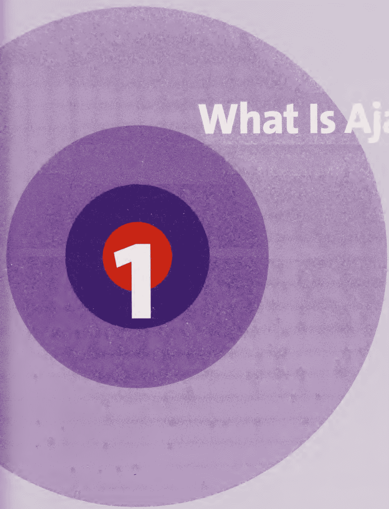

## 从古代特洛伊到现代 Web 设计

在荷马的*《伊利亚特》*中，Ajax 是泰拉蒙之子的名字。作为一名希腊战士，他以力量和勇气著称。他手持一把大斧和一面更大的盾牌，在与特洛伊人的战斗中冲锋陷阵。他还有一个非常酷的名字。

Ajax 这个名字实在太酷了，以至于在*《伊利亚特》*中被使用了不止一次。除了泰拉蒙之子 Ajax，还有一个小 Ajax 也参加了特洛伊战争。此后这个名字便被反复沿用。

Ajax 是一艘英国战舰的名字，它在二战中参加了拉普拉塔河口海战。它也是*《飞侠哥顿》*中一艘火箭船的名字。Ajax 这个名字还被用于至少四款汽车型号、两家唱片公司、一支荷兰足球队和一款街机游戏。当高露洁-棕榄公司需要一个酷炫的名字来命名一系列家用清洁剂时，他们选择了 Ajax。

Ajax 属于这样一类词汇——就像 Excelsior 和 Excalibur 一样——总能让人联想到力量的形象。也许，一个 *X* 的存在，再加上神话渊源，就足以赋予一个词以酷感。

在充斥着流行术语的 Web 设计世界里，*Ajax* 这个名字迟早会出现几乎是不可避免的。

### 杰西斯·詹姆斯·加勒特的传奇

杰西斯·詹姆斯·加勒特是一位信息架构师、作家，也是旧金山公司 Adaptive Path 的创始合伙人。2005 年 2 月，他在 Adaptive Path 网站上发表了一篇题为*《Ajax：一种全新的 Web 应用方式》*的文章（http://adaptivepath.com/publications/essays/archives/000385.php）。


在这篇文章中，加勒特创造了*Ajax* 这个术语，用来描述一种新型 Web 应用所使用的技术。Google Suggest 和 Google Maps 已经证明，基于浏览器的工具能够提供通常只有桌面应用才具备的交互性和响应速度。但在此之前，还没有一个统一的词来概括让这些应用如此出色的技术。

当这篇开创性的文章最初发表在 Adaptive Path 网站上时，*AJAX* 是用全大写字母书写的。它原本是一个首字母缩略词，代表"Asynchronous JavaScript and XML"（异步 JavaScript 和 XML）。虽然这些词的首字母恰好拼成了我们最喜爱的特洛伊勇士的酷名，但它们并不能有效地描述所涉及的技术。

诚然，大多数新一代 Web 应用都是异步的。也就是说，交互在后台进行，不会阻塞浏览器。但正如我们稍后将看到的，这并非强制性的。指定同步交互也非常容易。

*X* 代表 *XML* 尤为不妥。它暗示 XML 是 Ajax 应用的必要条件，而这根本不是事实。公平地说，*XML* 这几个字母也出现在 `XMLHttpRequest` 中——这是大多数 Ajax 实现的核心技术——但 `XMLHttpRequest` 听起来可不怎么酷。

杰西斯·詹姆斯·加勒特后来更新了他的文章，明确指出 *Ajax* 并非首字母缩略词。

虽然 *Ajax* 作为首字母缩略词并不合适，但它是一个将一组技术浓缩在一个词中的绝佳方式。但这并没有阻止一些硬核程序员的不满。"这没什么新鲜的，"他们叫嚷道，"我们多年来一直在做这件事，只不过叫它远程脚本（remote scripting）。Ajax 不过是个炒作术语罢了。"

虽然像 *remote scripting* 这样的极客术语永远不可能像特洛伊勇士的名字那样酷，但这些牢骚里确实有几分道理。Ajax 所使用的各项技术没有哪项是特别新的。尽管如此，这并不能成为彻底否定这个术语的理由。

*Ajax* 是一个简短、易记的名称，它描述了一种使用一簇技术的方法论。它让开发者和客户都能方便地讨论现代 Web 应用中易用性和设计的重要方面。

但它的含义究竟是什么？

## 定义 Ajax

杰西斯·詹姆斯·加勒特创造的新术语，凸显了 Web 开发者群体中的一次活动爆发。许多公司和个人一直在各自探索这种新方法论。现在，他们终于有了一个词来描述自己的工作。

就在原文发表仅三个月后，Adaptive Path 和 O'Reilly Media 在旧金山组织了一次 Ajax 峰会。开发者和设计师齐聚一堂，展示他们正在做的工作，描述 Ajax 如何改变了他们的工作方式。

会后，与会者德里克·波瓦泽克这样描述 Ajax："如果传统的 Web 是写信，那么 Ajax 就是即时通讯"（http://www.powazek.com/2005/05/000520.html）。

在传统网站上，浏览器向服务器请求整个页面。然后，用户点击链接或提交表单，此时浏览器向服务器发送一个新请求，服务器再返回另一个页面。

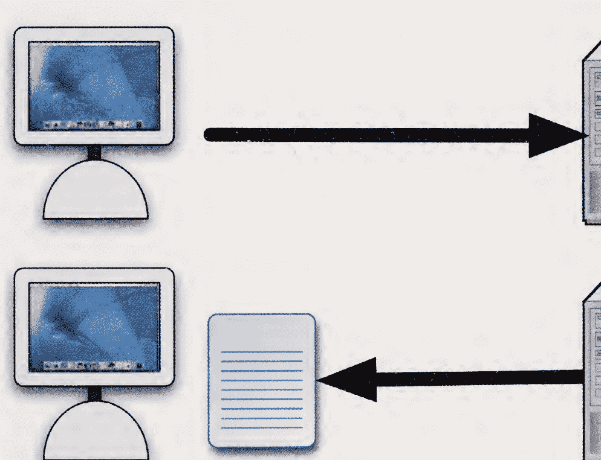

**图 1.2** 传统 Web 模型。客户端向服务器发送请求，服务器返回整个页面。如此循环往复。

Ajax 方法论摒弃了这种基于页面的模型。当用户与页面交互（点击链接、提交表单等）时，服务器返回的是一段离散的信息，而不是整个页面，当前已加载的页面只进行局部更新。

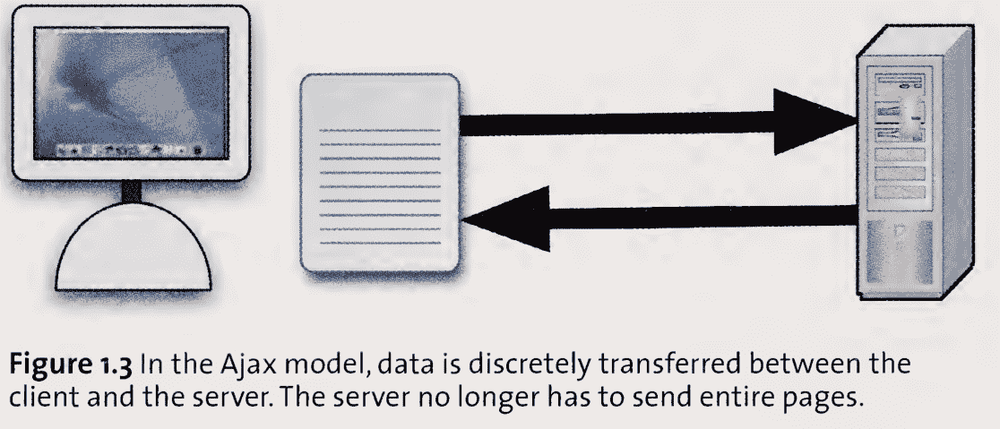

对于用户而言，这带来了更流畅的体验。传统网站给用户的感受是走走停停，而 Ajax 应用则能持续提供更快、更灵敏的反馈。

### 关键所在

这是我对 Ajax 的简化定义：一种无需刷新整个页面就能与 Web 服务器通信的方式。

这个定义可能引发两种截然不同的反应。你可能会耸耸肩说："这有什么大不了的？" 也可能会瞪大眼睛惊呼："太不可思议了！这是一个全新的 Web 范式！"

Ajax 的真相介于两者之间。它确实是一项令人兴奋的技术。仅刷新网页的一部分来获取服务器信息的能力，可以产生非常好的效果。另一方面，Ajax 只是一个工具，它本身并不能创造出良好的用户体验。内容仍然为王。


## OPTIONS

根据我简单的定义，许多技术都属于Ajax的范畴。

## Flash

Adobe Flash影片现在能够与Web服务器进行异步通信。这意味着你无需刷新页面就能更新Flash影片的内容。这听起来就像Ajax。

Adobe Flex框架赋予了开发者更强大的能力。Flash现在已成为一种可行的技术，可用于交付丰富、响应迅速的Web应用程序。（详细讲解如何构建Flash应用程序需要一整本书的篇幅，这部分内容将留给其他作者。）

## Java applets

Java applets是用Java编写的小程序，不要与JavaScript混淆。与Flash影片类似，这些程序可以嵌入到网页中。它们在加载后也能与服务器通信。

这些applets的速度和响应能力根据最终用户机器的配置差异巨大。Java applets从未真正流行起来。

## Frames

还记得frames吗？它们现在用得不多了，主要因为其糟糕的可用性体验。

如果你使用frameset构建一个网页，你可以只更新其中一个frame，而无需更新页面中的所有frame。从技术上讲，根据我的定义，这就是Ajax。

我并非认真建议使用frames就等同于构建Ajax应用程序，但两者之间确实存在许多相似之处。正如我们稍后将看到的，frames引起的许多可用性问题在Ajax应用中重新出现：例如，书签问题和浏览器返回按钮的意外行为。

## Hidden iframe

使用内联框架（iframe）比使用frameset前进了一步。iframe也可以用作与Web服务器通信的秘密通道。如果一个网页包含一个极小、几乎不可见的iframe，其源内容可以持续更新。使用JavaScript，父页面可以从更新的iframe中收集信息。

Google Maps使用一个隐藏的iframe与服务器通信。这是一个巧妙的解决方案，尽管确实感觉有点取巧。

# XMLHttpRequest

`XMLHttpRequest`对象是JavaScript的一个扩展，允许网页与服务器通信。它非常适合创建Ajax应用程序。Jesse James Garrett在创造*Ajax*这个词时，心中所想的正是`XMLHttpRequest`。

`XMLHttpRequest`最大的问题是它念起来太长了。尽管其中有个*X*，但它永远不可能作为一个流行语火起来。*Ajax*这个词更简短、更响亮，通常与使用`XMLHttpRequest`对象同义。这就是本书将要探讨的那种Ajax。

## Ajax工具包

`XMLHttpRequest`对象是驱动Ajax的引擎，但它并非孤立存在。正如Jesse James Garrett在他最初的文章中所说：“Ajax不是一种技术。它实际上是多种技术的集合，每一种都独立发展，然后以强大的新方式结合在一起。”

## 任何服务器端语言

很有可能，你希望你的应用程序能对访问者的输入做出智能响应。服务器需要能够决定向浏览器发送哪些具体信息。为此，你需要在服务器上使用某种编程语言。

服务器端语言的选择数不胜数：PHP、Java、Ruby、Python、Perl等等。对于Ajax来说，这些语言没有更适合或更不适合之分。在服务器端，Ajax是语言无关的。选择最适合你或你的编程团队的语言即可。

## 标题为“XML?”

你可能会误以为XML是Ajax应用的关键组件。`XMLHttpRequest`这个术语本身，以及其冗长性，都具有一定的误导性。

XML，即eXtensible Markup Language（可扩展标记语言），是一种描述数据的格式。Ajax应用需要某种结构化格式来将信息从服务器传递到客户端。但XML只是众多选择之一。正如我们稍后将看到的，还有其他组织数据的方式，对Ajax来说同样可行。

## 合法的标记

完全有可能构建一个不使用XML的Ajax应用。但另一种标记语言对于任何网站（无论是否使用Ajax）都至关重要。

超文本标记语言（HTML）是万维网的通用语言。它用于为Web上的内容赋予语义结构。在内容本身之后，标记是创建网页最重要和最有价值的工具。

在“严肃”的程序员中存在一种令人担忧的趋势，他们将标记视为一种底层技术，应该从开发者那里抽象出来。我完全不同意这种看法。如果结果是用粗心生成的标记提供的，那么服务器端编程再聪明或再快也无关紧要。

格式良好的标记是在客户端操作文档（这正是Ajax所做的）的前提条件。如果文档格式不良，处理过程将变得不必要地复杂且不可预测。

当元素的嵌套正确时，标记就是格式良好的。标签必须按照其打开顺序的相反顺序关闭。例如，以下标记格式不良：

```
<p>I told you to <strong>validate!</p></strong>
```

结束`</p>`标签出现在结束`</strong>`标签之前。但开始`<strong>`标签出现在开始`<p>`标签之后。结束标签应该按以下顺序出现：

```
<p>I told you to <strong>validate!</strong></p>
```

strong元素现在正确地嵌套在p元素内部了。

确保标记格式良好的最简单方法是确保它是合法的。检查标记合法性的最佳工具来自万维网联盟（W3C）（http://validator.w3.org/）。

如果一个标记文档正确遵守了W3C指定的准则，就被认为是合法的。你可以通过在文档顶部包含文档类型声明（doctype）来确切指定你使用的规范。

有许多不同的规范可以用来验证。这些规范分为两种不同的方言：HTML和可扩展超文本标记语言（XHTML）。

HTML允许你更宽松一些。有些元素不需要结束标签，并且标签可以大写或小写。

XHTML只是用XML重新表述的HTML。这意味着它更严格一些。所有标签必须小写，并且每个元素都必须关闭。对于像换行和图像这样的独立元素，这是通过在元素末尾加上一个斜杠来实现的：`<br />`, ``。

使用HTML还是XHTML来标记你的页面，完全由你决定。一些狂热者认为XHTML只能以XML MIME类型提供服务。然而，由于某些浏览器无法处理该MIME类型，他们也得出结论，应该完全避免使用XHTML。

就个人而言，我喜欢XHTML的严格性。所有元素都必须关闭这一事实确保了文档更容易处理。当然，在HTML中关闭每个元素也并无不妥。但使用XHTML doctype，验证器更有可能捕获我标记中的无意错误。

## 级联样式表

HTML和XHTML非常适合精确描述你的内容是什么。它们允许你说：“这是一个段落”或“这是一个标题”。但它们不应该（也不应该）描述内容如何呈现。实现这一点的技术是级联样式表（CSS）。

使用CSS选择器，你可以选择文档中你希望设置样式的元素。使用元素选择器，你可以为元素的所有出现实例设置样式。ID选择器让你能定位文档中具有唯一标识的元素。`class`选择器找到所有用特定`class`标记的元素。所有这些选择器可以相互组合，以实现精细的呈现控制。

一旦选定了元素，就可以使用声明来设置样式。这些声明让你指定字体大小、颜色和位置。

样式通常在外部样式表文件（或多个文件）中声明，然后从标记文档的`head`元素中链接引用。

大多数Ajax应用不仅更新浏览器中文档的内容，还会更新样式。为了更新文档的结构或呈现，你需要一种客户端编程语言，能够与浏览器、文档及其样式进行交互。这种语言就是JavaScript。

## DOM脚本

大多数网页设计师熟悉CSS、HTML和XHTML。这些W3C批准的技术被称为Web标准。但还有其他不太流行的标准。

正如CSS可用于指定文档的呈现方式一样，JavaScript和文档对象模型（DOM）的结合可用于指定文档中元素的行为。

DOM是一个描述文档结构的标准。过去，相互竞争的Web浏览器实现了它们自己的专有模型。控制文档行为的做法被称为动态HTML（DHTML）——这是一个令人困惑的术语，因为它听起来像是HTML的另一种变体。如今，*DOM脚本*一词被用来描述基于标准的行为控制。DOM脚本是Ajax不可或缺的一部分。


## 总结

在本章中，我探讨了 *Ajax* 一词的历史，并尝试定义它的含义。在某些方面，解释 Ajax “不是什么”反而更容易：

- Ajax 不是一项特定的技术。
- Ajax 不是一个缩写词。

相反，Ajax 是一种方法论。它是一种利用一组组件的协作方式，旨在在 Web 上创建更可用、响应更迅速的体验。其中一些组件基于服务器，但大多数是基于浏览器的技术：

- HTML 或 XHTML
- CSS
- DOM 脚本编写 (DOM Scripting)
- `XMLHttpRequest`

`XMLHttpRequest` 对象是将服务器与浏览器绑定在一起的纽带。在详细探讨这个神秘对象之前，重要的是要对构建 Ajax 的 Web 标准有良好的基础认知。

你可能已经对标记语言和 CSS 非常熟悉了。但你可能对 JavaScript 和文档对象模型（Document Object Model）不太熟悉。在下一章中，我将为你提供关于 Ajax 这两个关键部分的速成课程。

# JavaScript 和文档对象模型

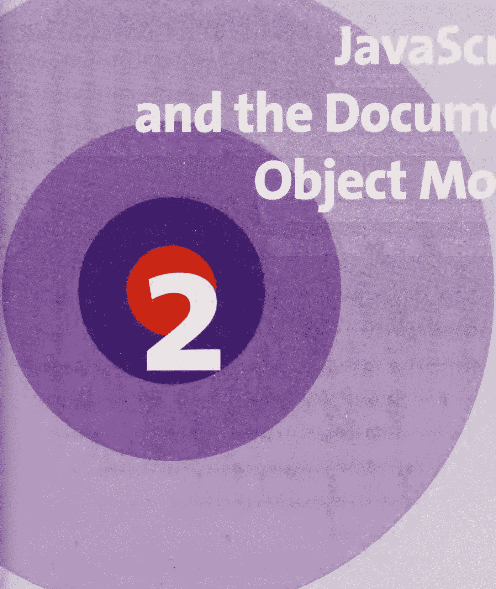


### 回到基础

Web 设计师工具箱中最重要的技术是 HTML。如果没有标记语言，你无法给内容赋予任何结构。一旦标记结构就绪，就可以使用其他技术（如 CSS 和 JavaScript）对其进行增强。

本章将作为 JavaScript 的速成课程，而 JavaScript 是 Ajax 必不可少的技术。如果你已经精通 JavaScript，可以跳过本章，尽管你可能仍会对这些关于语法和术语的回顾感兴趣。

## JavaScript

HTML 是一种标记语言，而 JavaScript 则是一种编程语言。它不指定结构，而是执行逻辑操作和计算。

市面上有很多编程语言。JavaScript 的不同之处在于它可以在 Web 浏览器内部运行。JavaScript 也存在于其他环境中，例如它可以用于编写 PDF 脚本。但正是 JavaScript 作为主导的客户端编程语言的地位，使其在创建 Ajax 应用程序时如此有用。在 Web 上，浏览器充当解释器，能够执行用 JavaScript 语言编写的指令。

与 CSS 类似，JavaScript 可以嵌入在 Web 页面中，通常位于 `head` 元素内。使用 JavaScript 最高效的方式（与 CSS 一样）是将其保存在外部文件中。然后，Web 页面可以使用文档 `head` 中的 `<script>` 标签来引用这些文件：

```
<script type="text/javascript" src="/path/to/file.js"></script>
```

JavaScript 通常是以过程化方式编写的。这意味着你按照希望发生的顺序指定你想要发生的事情。结果就是一个脚本，非常像戏剧或电影的剧本。

#### 语句 (STATEMENTS)

单条 JavaScript 指令被称为一个 *语句* (statement)。一组语句序列被称为一个 *脚本* (script)。语句应该始终以分号结尾：

```
statement one; statement two;
```

如果一个语句没有以分号结尾，但以换行符结尾，JavaScript 会自动插入分号。它将该语句处理为以分号结尾：

```
statement one
statement two
```

这可能会导致一些糟糕的编程习惯。最好的做法是始终用分号结束语句，即使该语句以换行符结尾：

```
statement one;
statement two;
```

### 注释 (Comments)

JavaScript 中的大多数语句是由机器读取的。为了让语句被成功执行，它必须按照编程语言的语法编写。

*注释* (comment) 是一种特殊的语句，它是面向人类而非机器的。注释是会被解释脚本的机器忽略的语句，但它为阅读脚本的人提供了有价值的信息。注释可以作为程序员的有用提醒，并更清晰地解释脚本试图实现的目标。

在 JavaScript 中有多种指定注释的方法。如果你想在单行中写注释，只需在该行开头加上两个斜杠：

```
// this is a comment
```

因为 JavaScript 解释器不会执行此语句，所以末尾不需要添加分号。

如果你想将多行组合在一起作为一个注释块，可以用一个斜杠后跟一个星号开始块，并用一个星号后跟一个斜杠结束块：

```
/* This comment block
spans more than one line */
```

使用注释记录代码会让你未来的生活更轻松。如果你需要回到很久以前写的脚本，脚本中的任何注释都能帮你回忆起它的用途。如果你在团队中工作且其他人需要理解你的代码，注释也非常有帮助。

与此同时，请记住每条注释都会稍微增加页面的权重和下载时间。不要过度使用注释。你需要根据判断来决定某些代码是自解释的，还是需要额外解释。

### 变量 (VARIABLES)

*变量* (Variables) 是任何脚本的构建块。变量是一个指向某个值的标签。即使值发生了变化，它的标签依然保持不变。这使得变量在存储、操作和检索数据时非常有用。

创建变量被称为 *声明* (declaration)。在 JavaScript 中，你使用 `var` 关键字来声明变量：

```
var variablename;
```

变量名可以由字母、数字（但不能以数字开头）、下划线和某些其他字符组成。变量名中不允许出现空格。为了解决这个问题，你可以使用下划线使变量名更具可读性：

```
var variable_name;
```

不过，你不能使用连字符（-）；它会被解释为减号。

变量命名中另一种提高可读性的方法是 *驼峰命名法* (camelCasing)。我在这里写这个词的方式就是一个自描述的例子。在原本小写的名称中使用孤立的大写字母有助于区分单词：

```
var variableName;
```

变量名是区分大小写的，因此以下所有示例都将代表不同的变量：

```
var variablename;
var VARIABLENAME;
var variableNAME;
var Variablename;
```

JavaScript 有一些保留字不能用作变量名。其中大多数是语言本身使用的关键字：`if`、`else`、`for`、`while`、`var` 等。

### 数据类型 (DATA TYPES)

当变量首次被声明时，其值为 `null`。它不包含任何数据。为变量提供一个值被称为 *赋值* (assignment)。你可以使用等号将值赋给变量。变量的值可以是字符串、数字、布尔值或数组。这些被称为 *数据类型* (data types)。

一些编程语言要求在声明变量时，必须同时声明它将持有的数据类型。在这些语言中，你之后不能改变主意。如果你指定一个变量将包含字符串，你就不能用它来包含数字。这被称为 *强类型* (strong typing)。

JavaScript 是一种弱类型语言。你不需要指定变量将包含什么样的值。你也可以在任何阶段更改变量的数据类型。

### 字符串 (Strings)

*字符串* (string) 是一组字符的集合。字符串中没有禁用字符。字符串可以包含字母、数字、空格和任何其他字符。

字符串必须包含在引号中。你可以使用单引号或双引号，但在每个字符串内部必须保持一致。如果你用单引号开始一个字符串，就必须用单引号结束：

```
var name;
name = 'Jeremy Keith';
```

你可以在一个语句中声明变量并为其赋值：

```
var name = 'Jeremy Keith';
```

多个声明和赋值也可以通过使用逗号分隔变量，合并到一个 `var` 语句中：

```
var first_name = 'Jeremy', last_name = 'Keith';
```

因为引号用于指示字符串的开始和结束，你可能会认为它们是字符串中的禁用字符。事实上，你可以在字符串中使用它们，但你需要明确说明它们应该被视为字符串本身的一部分。这被称为 *转义* (escaping)。在 JavaScript 中，反斜杠用于转义字符：

```
var remark = 'That\'s my name';
```

在这种情况下，可以通过使用双引号来避免这个问题：

```
var remark = "That's my name";
```

但如果你使用双引号包含字符串，字符串内的任何双引号都需要用反斜杠转义。以下这两个语句在功能上是完全相同的：

```
var remark = "He is 5'10\" tall";
var remark = 'He is 5\'10" tall';
```


使用单引号还是双引号完全取决于个人喜好。为了保持代码一致性，最好在整个脚本中坚持使用其中一种，不要来回切换。

## 数字

如果你想让一个变量包含数字，不需要用单引号、双引号或其他任何符号将值括起来。只需将数字赋值给变量即可：

```
var year = 2006;
```

数字不一定是正数。你可以使用负数：

```
var score = -50;
```

数字也不仅限于整数：

```
var average = 7.59;
```

## 布尔值

虽然字符串和数字有无限多种可能的值，但包含布尔值的变量只有两种可能的值：`true` 或 `false`：

```
var happy = true;
var rich = false;
```

布尔值不包含在引号内。如果我在 `true` 这个词周围使用引号，它就会变成一个字符串。

布尔值看起来可能很有限，但它们是编程语言中一切的基础。布尔逻辑是每台计算机的驱动力。电路中的电流要么是开，要么是关。它要么是真，要么是假。这就是为什么二进制是计算机的通用语言。一是真，零是假。

除了 `true` 和 `false` 的值，JavaScript 还有“真值”和“假值”的概念。

如果一个变量已声明但尚未显式赋值，其默认值 `null` 是一个“假值”。它没有明确的 `false` 值，但测试变量名会返回 `false`，因为 `null` 是“假值”。

一旦一个变量被赋予任何值，它就是“真值”。如果你需要测试一个变量是否存在且具有任何类型的值，这非常有用。如果变量名的求值结果为 `true`，则它存在且有值。如果变量名的求值结果为 `false`，则要么它从未被声明过，要么没有为其赋值。

但要小心。数字零是一个假值。所以，即使你明确说明一个变量的值为零，一个简单的布尔比较也会返回 `false`。

你可以使用 `1` 和 `0` 作为 `true` 和 `false` 的替代值：

```
var happy = 1;
var rich = 0;
```

## 数组

到目前为止你看到的所有数据类型都称为*标量*。如果一个变量是标量，它只能保存一个值。还有另一种数据类型叫做*数组*。与标量不同，一个数组可以在一个变量中保存多个值。数组中保存的值称为*成员*。

你可以使用 `new` 关键字声明一个数组：

```
var fruit = new Array();
```

或者，你可以使用方括号作为简写：

```
var fruit = [];
```

在数组中，你可以在一条语句中结合声明和赋值，就像在标量中一样。要将成员赋值给数组，请用逗号分隔每个成员：

```
var fruit = ["apple", "orange", "banana"];
```

数组的成员可以是字符串、数字、布尔值或其他变量。你可以在数组中混合使用数据类型：

```
var details = ["Jeremy Keith", 35, true];
```

因为数组本身也是一种变量，所以你可以在数组中存储数组：

```
var fruit = ["apple", "orange", "banana"];
var meat = ["beef", "chicken", "lamb"];
var food = [fruit, meat];
```

当你结合数组的声明和赋值时，每个成员会自动获得一个*索引*。索引是一个数字，表示成员在数组中的位置。如果你在声明数组后赋值，则需要为每个成员提供索引：

```
var fruit = [];
fruit[0] = "apple";
fruit[1] = "orange";
fruit[2] = "banana";
```

注意，索引从零开始。与人类不同，大多数编程语言从零开始计数。

要找出数组中有多少个成员，你可以查询数组的 `length` 属性。下面的 `alert` 语句会弹出一个对话框，显示 `fruit` 数组的 `length`：

```
alert ( fruit.length );
```

结果为 3。

等一下……我们不是应该从零开始计数吗？

这是数组令人困惑的地方之一。虽然索引从零开始赋值，但 `length` 是从一开始计算的。因此，数组的 `length` 总是比数组的最后一个索引大一。

`fruit` 数组有三个成员。它的 `length` 是 3。第一个成员是 `fruit[0]`，第二个成员是 `fruit[1]`，第三个成员是 `fruit[2]`。没有 `fruit[3]`，即使数组的 `length` 是 3。

还有另一种数组，叫做*关联数组*或*哈希*。在关联数组中，字符串被用作索引，而不是数字：

```
var details = [];
details["name"] = "Jeremy Keith";
details["age"] = 35
details["married"] = true;
```

然后可以使用索引字符串来检索成员的值：

```
alert ( details["age"] );
```

这将返回值 35。

## 运算符

将值存储在变量中很方便，但编程语言需要做的不止这些。为了让 JavaScript 实现你的目标，它需要执行你设定的任务。最简单的任务称为*操作*。

### 算术

将两个数字相加是一个操作。从一个数字中减去另一个数字也是一个操作。这些例子，以及乘法和除法，都是*数学操作*。

每个数学操作都有一个对应的*运算符*。运算符是表示应执行何种操作的符号。加法的运算符是加号。减法的运算符是减号。乘法的运算符是星号，除法的运算符是斜杠。

```
var addition = 5 + 3;
var subtraction = 15 - 7;
var multiplication = 4 * 2;
var division = 24 / 3;
```

最有用的是，你可以对变量执行操作：

```
var year = 2006;
var age = 35;
var birth = year - age;
```

有些操作可以用简写指定。要将一个数字减一，可以使用两个减号：

```
var price = 10;
price--;
```

`price` 的值现在是 9。这等同于写下面的语句：

```
price = price - 1;
```

要将一个值加一，可以使用两个加号：

```
var year = 2006;
year++;
```

加法运算符（加号）具有双重作用。除了将数字相加，它还可以将字符串连接在一起：

```
var adjective = "bullet" + "proof";
```

变量 `adjective` 现在包含字符串 "bulletproof" 作为其值。

像这样将字符串连接在一起称为*连接*。除了连接字符串，你还可以将字符串与数字连接。数字会自动转换为字符串，因此结果始终是字符串：

```
var letters = "thx";
var numbers = 1138;
var result = letters + numbers;
```

变量 `result` 包含值 "thx1138"。

### 比较

并非所有操作都是数学的。有时你会想要比较一个值与另一个值。*比较运算符*允许你这样做。

使用比较运算符，你可以找出一个值是否大于另一个值，或者一个值是否小于另一个值，或者两个值是否相等。这通过大于号 (`>`)、小于号 (`<`) 或两个等号 (`==`) 这些符号来实现。记住，单个等号用于赋值，而不是比较。

### if

比较的结果始终是一个布尔值，`true` 或 `false`。比较需要包含在一个条件控制结构中。最常见的控制结构是 `if` 语句。

```
if ( x < y ) {
  // do something
}
```

在 `if` 关键字之后，括号内写一个比较。如果比较的结果为 `true`，则花括号中的所有内容都将被执行。

```
if ( x == y ) {
  alert ( x+" has the same value as "+y );
}
```

你可以用 `else` 子句扩展 `if` 语句。如果 `if` 语句中的比较结果为 `false`，则 `else` 子句之后的内容将被执行：

```
if ( x > y ) {
  alert ( x+" is greater than "+y );
} else {
  alert ( x+" is not greater than "+y );
}
```

除了更直接的比较运算符，你还可以使用这些复合运算符：`>=` 表示大于或等于，`<=` 表示小于或等于。

如果你想找出两个值是否不相等，你可以使用感叹号否定相等运算符；`!=` 与 `==` 相反。

```
if ( x != y ) {
  alert( x+" is not equal to "+y );
}
```

## 相等与全等

相等和不等运算符检查真值和假值。如果两个值都是假值，相等比较将返回 `true`。

如果这听起来像天书，也许这个例子会更清楚：

```
var x = false;
var y = 0;
if ( x == y ) {
  alert ( x+" is equal to "+y );
}
```

变量 `x` 的值为 `false`。变量 `y` 的值为 `0`（零）。零是表示 `false` 的另一种方式，因此比较结果为 `true`。

要找出值是否不仅相等，而且全等，可以使用全等运算符，即三个等号 (`===`)。


## 等号

为了回顾，根据使用数量的不同，等号具有不同的含义：

-   - 使用 `=` 进行赋值。
- 使用 `==` 来判断两个值是否相等。
- 使用 `===` 来判断两个值是否相同。

“不相同于”的运算符是 `!==`。

```
var x = false;
var y = 0;
if ( x !== y ) {
  alert( x+" is not identical to "+y );
}
```

## 逻辑

使用感叹号来否定一个比较是逻辑操作的一个例子。感叹号是 *非* 运算符。还有另外两个逻辑运算符：*或* 和 *与*。

*或* 运算符允许你扩大控制结构的范围，例如 `if` 语句。当条件使用 *或* 运算符组合时，只要满足任何一个条件，就会返回 true。*或* 运算符由两个竖线符号表示：

```
if ( x < y || x > y ) {
  alert ( x+" is less than or greater than "+y );
}
```

*与* 运算符，由两个 `&` 符号（`&&`）表示，会缩小控制结构的范围。当条件使用 *与* 运算符连接时，所有条件必须同时满足，控制结构才会返回 true：

```
if ( x < y && x > y ) {
  alert ( "This is impossible!" );
}
```

无论括号内连接了多少个条件，`if` 语句只能返回 true 或 false。

## 循环

`if` 语句是条件控制结构的一个例子。其他控制结构用于重复执行同一段代码。这些被称为 *循环*。

## while

`while` 语句看起来很像 `if` 语句。不同之处在于，只要条件计算结果为 true，花括号内的语句或语句就会被执行：

```
while ( x < y ) {
  // do something
}
```

重要的是，花括号内必须有一些操作来改变条件，使其最终计算结果为 false。否则，循环将永远进行下去。下面的例子中，`alert` 语句将循环执行五次：

```
var i = 0;
while ( i < 5 ) {
  alert ( x );
  x++;
}
```

如果测试条件在第一次执行时就计算结果为 false，那么花括号内的语句或语句将永远不会被执行：

```
var i = 5;
while ( i < 5 ) {
  alert ( "You will never see this message." );
}
```

## do...while

`do...while` 控制结构与 `while` 循环非常相似。不同之处在于，花括号内的语句或语句至少会被执行一次：

```
var i = 5;
do {
  alert ( "You will see this message once." );
} while ( i < 5 );
```

循环执行一次，然后测试条件被评估。如果测试条件计算结果为 true，循环将再次执行：

```
var i = 0;
do {
  alert ( i );
  i++;
} while ( i < 5 );
```

## for

在我目前展示的循环中，我都是在循环开始前初始化一个变量。循环本身有一个使用该变量的测试条件。在循环内部，该变量的值被修改，以确保循环不会永远执行。

在 `for` 循环中，这三个语句——初始化语句、测试条件和修改语句——都包含在括号中，并用分号分隔：

```
for ( var i = 0 ; i < 5 ; i++ ) {
  alert ( i );
}
```

`for` 循环对于遍历数组中的所有元素特别有用：

```
var fruit = ["apple", "orange", "banana"];
for ( var i = 0 ; i < fruit.length ; i++ ) {
  alert ( fruit[i] );
}
```

在初始化语句中，我声明了一个名为 `i` 的变量，并将其赋值为 0（零）。测试条件将此值与数组的长度进行比较。只要 `i` 小于数组的长度，循环就会执行。最后，`i` 的值递增 1。循环执行了三次：即 fruit 数组的长度。

## 函数

*函数* 是一个自包含的语句块。函数非常擅长容纳可重用的代码。

你可以使用 `function` 关键字后跟你想要创建的函数名来声明一个函数：

```
function myFunction() {
// do something
}
```

之后，你可以这样执行该函数：

```
myFunction();
```

括号用于接收 *参数*。参数是你可以传递给函数的值。在函数内部，它们的作用就像变量一样。

创建函数时，你可以在以逗号分隔的列表中指定它接受多少个参数。下面是一个接受两个参数的函数的例子：

```
function multiply(x,y) {
  var result = x * y;
  return result;
}
```

`multiply` 函数接受参数 `x` 和 `y`，并将它们相乘。除了接受值之外，该函数还在最后使用 `return` 语句返回一个值。函数不一定需要返回值，但如果它返回了，你可以将函数的结果赋值给一个变量：

```
var days_old = multiply (35, 365);
```

函数实际上是一种变量。假设你有一个像这样声明的函数：

```
function shout() {
  alert( "Hey!" );
}
```

你可以使用 `var` 语句来达到相同的效果：

```
var shout = function() {
  alert( "Hey!" );
};
```

请注意，因为这是一个长的赋值语句，它以分号结尾。函数的执行方式仍然相同：

```
shout();
```

如果你想在不执行函数的情况下引用它，就像对待任何其他变量一样处理它，不要包含括号：

```
var annoy = shout;
```

现在变量 `annoy` 是对函数 `shout` 的引用。变量 `annoy` 有效地是 `shout` 的同义词，并且可以以相同的方式执行：

```
annoy();
```

如果你在将函数赋值给变量时包含括号，JavaScript 会假设你想将函数的结果赋值给该变量。在这里，它不是将对函数 `shout` 的引用赋值给变量 `annoy`，而是立即执行 `shout` 函数：

```
var annoy = shout();
```

所以，当你存储函数的引用时，不能包含括号。但如果你想存储一个带有参数的函数的引用怎么办？

假设我将 `shout` 函数重写为接受一个参数 `message`，这是一个将在 `alert` 语句中输出的字符串：

```
function shout(message) {
    alert( message );
}
```

现在我希望变量 `annoy` 存储对该函数的引用，并为 `message` 参数指定一个特定的值。这将不起作用：

```
var annoy = shout( "Hey!" );
```

`shout` 函数将立即执行，而不是存储起来供以后使用。

解决方案是将 `shout` 函数包装在一个空函数中：

```
var annoy = function() {
    shout( "Hey!" );
};
```

这被称为 *匿名函数*。正如你稍后将看到的，匿名函数对于将函数分配给事件处理程序非常有用。

## 作用域

如果你在函数外部声明一个变量，它是一个 *全局变量*。这意味着它可以在任何地方使用，甚至在函数内部。

*局部变量* 在函数内部声明。它不能在声明它的函数外部访问。

乍一看，全局变量似乎更有用，因为它们可以在任何地方使用。在实践中，全局变量引起的问题比它们解决的问题多。很容易在不相关的函数中意外地更改全局变量的值。局部变量更容易跟踪，因为它们被限制在函数内。理想情况下，函数应该是自包含的，因此尽可能使用局部变量是有意义的。

当我们讨论变量可以在哪里使用时，我们讨论的是变量 *作用域*。在函数内声明的变量具有局部作用域。在函数外声明的变量具有全局作用域。

如果你再次查看 `multiply` 函数，你会看到其中唯一的变量 `result` 是在函数内部显式声明的，所以它的作用域是局部的：

```
function multiply(x, y) {
  var result = x * y;
  return result;
}
```

假设我没有使用 `var` 语句：

```
function multiply(x, y) {
  result = x * y;
  return result;
}
```

当一个值被赋给变量 `result` 时，JavaScript 需要确定该变量的作用域。函数内没有该名称的显式变量声明，因此 JavaScript 假定其作用域是全局的，并创建一个名为 `result` 的全局变量。

这可能导致问题。假设我之前在函数外部声明了一个名为 `result` 的变量。我想用它来存储一个值以供以后检索：

```
var result = 50;
```


接下来，我使用 `multiply` 函数：

```
var days_old = multiply(35,365);
alert ( days_old );
```

这将输出 12775，这是正确的。但现在请看，如果我输出 `result` 的值会发生什么：

```
alert ( result );
```

这将输出 12775，而不是我存储在变量中的 50。`result` 的值在 `multiply` 函数中被覆盖了，因为 JavaScript 假设我指的是同一个变量。

如果我在 `multiply` 函数中使用局部变量，本可以避免这个问题：

```
function multiply(x,y) {
  var result = x * y;
  return result;
}
var result = 50;
var days_old = multiply(35,365);
alert ( days_old );
alert ( result );
```

现在 `result` 的值没有被覆盖，`alert` 语句正确地输出了 50 的值。我能够两次使用相同的变量名而没有冲突。在 `multiply` 函数内部的 `result` 变量是一个局部变量。函数外部的 `result` 变量是一个全局变量。它们共享相同的名称，但因为作用域不同，所以是不同的变量。

只要你在函数内部使用局部变量，就无需担心会无意中覆盖现有变量。如果你记得在第一次给变量赋值时总是使用 `var` 语句，那么一切应该没问题。

## 对象

虽然函数是语句和局部变量的自包含集合，但*对象*是函数和变量的自包含集合。当函数和变量以这种方式捆绑在一起时，它们被称为*方法*和*属性*。

方法是属于对象的函数。方法可以像函数一样接受参数。要执行一个方法，必须在其前面加上它所属对象的名称和一个点：

```
object.method();
```

属性使用相同的点表示法来访问：

```
object.property;
```

你已经见过这种表示法在实际中使用了。每次访问数组的 `length` 时，你都是在引用 `Array` 对象的 `length` 属性：

```
array.length;
```

所以数组是一个对象。事实上，对象在 JavaScript 中无处不在。

## 原生对象

每次你创建一个字符串变量时，实际上是在创建一个 `String` 对象的实例。你可以对任何字符串调用无数的方法。例如，`toUpperCase` 方法返回大写的字符串：

```
var message = "hey!";
alert ( message.toUpperCase() );
```

这将输出字符串 "HEY!"。

字符串和数组是*原生对象*的例子。它们是核心 JavaScript 语言的一部分。JavaScript 还提供了一个 `Math` 对象和一个 `Date` 对象。所有这些对象都带有预设的方法和属性，对于执行常见任务非常有用。例如，`Math` 对象提供了一个 `round` 方法，可用于四舍五入到最接近的整数：

```
var num = 3.14
alert ( Math.round(num) );
```

这将输出数字 3。

## 用户定义对象

你不仅限于 JavaScript 提供的对象。你可以创建自己的*用户定义对象*。

首先，创建一个新的对象*类*。类是创建对象的模板。类的创建就像函数一样。

```
var Car = function() {
};
```

使用 `this` 关键字，你可以为这个类创建属性和方法。关键字 `this` 是 "当前对象" 的缩写：

```
var Car = function() {
    this.wheels = 4;
    this.start = function() {
        alert( "Vroom!");
    };
};
```

变量 `wheels` 是一个属性。`start` 函数是一个方法。

要从 `Car` 类创建一个新对象，使用 `new` 关键字：

```
var mercedes = new Car();
```

你可以这样调用 `start` 方法：

```
mercedes.start();
```

第一条语句创建了一个名为 `mercedes` 的 `Car` 类的新实例。
第二条语句执行该对象的 `start` 方法。

同样，你可以使用点表示法来访问 `wheels` 属性：

```
alert ( mercedes.wheels );
```

如果所有这些对象的内容对你来说还不清楚，请不要担心。面向对象编程可能是一个棘手的课题。我稍后将更详细地介绍用户定义对象。

## 宿主对象

原生对象由编程语言提供，用户定义对象由程序员创建，而*宿主对象*则由 JavaScript 运行所在的环境提供。在 PDF 查看器中运行的 JavaScript 所提供的宿主对象将与在 Web 浏览器中运行的不同。

Web 浏览器为 JavaScript 提供的最基本的宿主对象是 `window` 对象。`window` 对象的属性提供了有关浏览器窗口的信息，例如其大小和位置。`window` 对象的方法允许程序员创建和操作浏览器窗口。这些属性和方法统称为浏览器对象模型。你可以感谢 BOM（浏览器对象模型）带来了那些污染万维网的讨厌的弹出窗口。

虽然 BOM 让你可以查询和操作浏览器窗口，但它无法访问该窗口内的文档。要操作 Web 浏览器中页面的内容，浏览器提供了另一个宿主对象：`document` 对象。

## 文档对象模型

早期的浏览器通过诸如 `forms` 和 `images` 之类的宿主对象，让 JavaScript 有限地访问当前加载文档的部分内容。版本 4 的浏览器允许访问更多的元素。遗憾的是，相互竞争的浏览器实现了完全不同的模型。

假设你有一个 ID 为 `example` 的 `div` 元素：

```
<div id="example">
</div>
```

Netscape Navigator 4 允许你使用此语法在 JavaScript 中访问该元素：

```
var mydiv = document.layers["example"];
```

而 Internet Explorer 4 则坚持使用这个：

```
var mydiv = document.all["example"];
```

两条语句实现相同的结果。为了让代码在浏览器间工作，开发人员不得不使用 `if` 语句来分叉他们的代码：

```
if (document.all) {
  // 为 IE 做一些事情
} else if (document.layers) {
  // 为 NN 做同样的事情
}
```

这种情况是无法容忍的。需要标准化，感谢 W3C，它以文档对象模型（DOM）的形式提供了标准化。

## GETTERS（获取器）

W3C DOM 超越了任何专有模型。它允许访问文档的任何部分，无论是元素、元素内的文本片段，还是元素的属性。它也不限于网页。任何支持 DOM 的语言都可以使用相同的方法来解析任何类型的标记文档。

DOM 提供了许多访问文档各个组件的方法。这些方法被称为 *getters（获取器）*。

### getElementById

要使用 DOM 访问 ID 为 `"example"` 的 `div`，你可以使用 `document` 对象的 `getElementById` 方法：

```
var mydiv = document.getElementById("example");
```

这类似于 CSS 中的 ID 选择器：

```
#mydiv {
}
```

语法不同，但目标是相同的：你正在访问文档中的一个特定元素，以便操作它。使用 CSS，你可以提供样式声明来指定元素应如何呈现。使用 DOM 和 JavaScript，你可以查询和更新元素的属性。这意味着即使在文档加载到浏览器窗口之后，也可以更新其内容。

### getElementsByTagName

CSS 和 DOM 脚本之间的相似性并不止于 `getElementById`。CSS 使用元素选择器来获取文档中所有具有特定标签名的元素。以下就是 CSS 如何获取文档中所有段落元素的方式：

```
p {
}
```

DOM 通过 `getElementsByTagName` 提供了一个等效的方法：

```
var paragraphs = document.getElementsByTagName("p");
```


变量 `paragraphs` 现在包含了文档中所有 `p` 元素的集合。你可以像处理数组一样对待这个集合。通过 `length` 属性，你可以查明文档中有多少个段落：

```
alert ( paragraphs.length );
```

你也可以使用 `for` 循环来遍历所有段落：

```
for ( var i=0; i < paragraphs.length; i++ ) {
    // 对 paragraph[i] 做些操作
}
```

CSS 允许你组合选择器。你可以选中 ID 为 `example` 的元素内的所有段落元素：

```
#example p {
}
```

你也可以通过 DOM 来实现这一点：

```
document.getElementById("example").getElementsByTagName("p")
```

### getAttribute

CSS 允许你为元素应用样式。这就是为什么所有选择器都引用元素。DOM 允许你更进一步：你可以检索一个属性的值。

假设你用 `title` 属性标记了一个段落：

```
<p id="intro" title="introductory message">
</p>
```

使用 `getAttribute` 方法，你可以检索这个属性的值：

```
var introduction = document.getElementById("intro");
var title_text = introduction.getAttribute("title");
```

变量 `title_text` 现在包含了字符串 "introductory message"。

## NODES

当你使用像 `getElementById`、`getElementsByTagName` 或 `getAttribute` 这样的方法时，你就是在访问文档中的 `节点`。术语 `节点` 通常用于描述网络中的连接点。你可以把网页看作是一个由相互连接的节点组成的网络。

有三种基本类型的节点构成了文档：*元素节点*、*文本节点*和*属性节点*。文本节点和属性节点包含了网页的内容。元素节点是用于构建该内容的基石。

文档中的每个节点都包含在另一个节点中。这意味着文档中相互连接的节点网络具有非常直接的结构：它是一个节点树。更具体地说，它类似于一个家谱。

看看这个简单的 XHTML 文档：

```
<!DOCTYPE html PUBLIC "-//W3C//DTD XHTML 1.0 Strict//EN"
"http://www.w3.org/TR/xhtml1/DTD/xhtml1-strict.dtd">
<html>
  <head>
    <title>Simple page</title>
  </head>
  <body>
    <h1>Welcome</h1>
    <p id="intro">This is a very simple document.</p>
  </body>
</html>
```

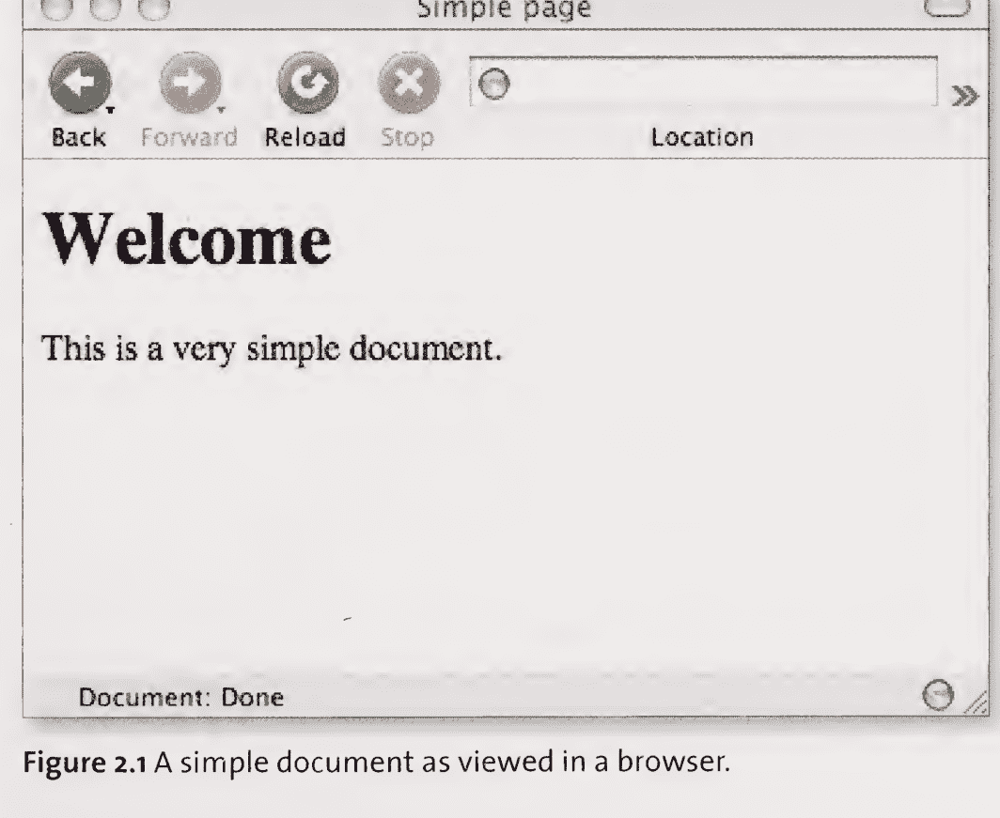

如果你在浏览器中查看这个文档，你会看到类似图 2.1 的内容。这个文档的节点树如图 2.2 所示。

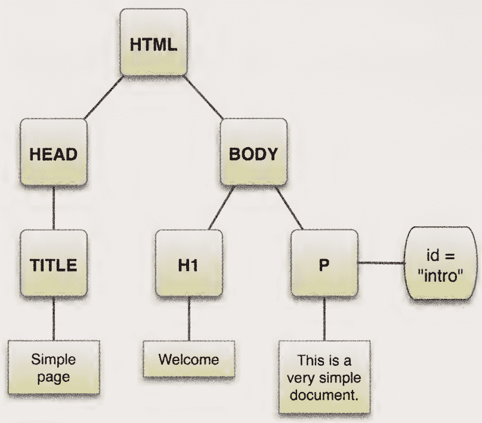

**图 2.2 一个简单文档的节点树。**

DOM 使用家谱术语来描述节点之间的关系。`html` 元素是 `head` 元素和 `body` 元素的父节点。这意味着 `head` 和 `body` 元素是兄弟节点。`head` 元素是 `title` 元素的父节点。这意味着 `title` 元素是 `head` 元素的子节点。

可以通过 DOM 属性来访问这些关系。

### parentNode

节点的 `parentNode` 属性将返回对一个元素节点的引用。只有元素节点才能成为父节点。

```
var introduction = document.getElementById("intro");
var container = introduction.parentNode;
```

变量 `container` 现在包含了对 `body` 元素的引用。如果你访问 `container.parentNode`，你将获得对 `html` 元素的引用。因此，使用 `parentNode` 属性，你可以沿着节点树一路向上遍历。

文档中的每个节点都有一个 `parentNode`。每段文本必须包含在一个元素中。每个属性必须属于一个元素。除了 `html` 元素之外，每个元素都必须包含在另一个元素节点中。甚至 `html` 元素也有一个 `parentNode`，即 `document` 对象本身。

### childNodes

元素节点的 `childNodes` 属性将返回一个节点集合。你可以像遍历数组元素一样遍历这些节点。`childNodes` 属性有一个 `length` 属性，它提供了元素包含的子节点数量。如果一个元素没有子节点，`childNodes` 属性将返回一个空集合，其 `length` 为零。

只有元素节点才能拥有子节点。

请注意，一些浏览器计算节点的方式与其他浏览器不同。一些浏览器将元素之间的换行符和空白视为新的文本节点，而其他浏览器则忽略它们。这可能导致不同浏览器的结果不一致。

你可以通过在不同的浏览器中测试这段代码来亲自验证这一点：

```
var introduction = document.getElementById("intro");
var container = introduction.parentNode;
var children = container.childNodes;
alert ( children.length );
```

大多数时候，你可能对获取父节点包含的元素感兴趣。在这种情况下，`childNodes` 属性显得多余，因为它也返回文本节点和属性。相反，请使用 `getElementsByTagName` 方法，并传入通配符，即星号：

```
var all_elements = document.getElementsByTagName("*");
```

变量 `all_elements` 现在包含了文档中所有元素的集合。大多数时候，你不会在整篇文档上使用通配符。相反，你会在特定元素上使用 `getElementsByTagName("*")`。

```
var introduction = document.getElementById("intro");
var container = introduction.parentNode;
var elements = container.getElementsByTagName("*");
alert ( elements.length );
```

### firstChild

元素节点的 `firstChild` 属性返回对元素 `childNodes` 集合中第一个节点的引用。它是 `childNodes[0]` 的简写方式。

### lastChild

类似地，`lastChild` 属性返回对元素 `childNodes` 属性中最后一个节点的引用。

### previousSibling

如果两个节点共享同一个父节点，它们就是兄弟节点。这意味着它们都位于父元素的 `childNodes` 集合中。节点的 `previousSibling` 属性返回对在其父节点的 `childNodes` 属性中位于它之前的节点的引用。

### nextSibling

与 `previousSibling` 类似，`nextSibling` 属性返回对与当前节点共享同一父节点的节点的引用。具体来说，它提供了对父节点 `childNodes` 属性中下一个节点的引用。

### nodeValue

如你所见，可以使用 DOM 方法和属性从任何起点在文档中四处导航。但所有这些方法和属性都只返回对节点的引用。如果你想检索节点的内容，需要使用 `nodeValue` 属性。

假设我想检索 ID 为 `intro` 的段落内的文本。我可能会想这样使用 `nodeValue` 属性：

```
var introduction = document.getElementById("intro");
alert ( introduction.nodeValue );
```

但这会产生 `null` 的结果。任何元素节点的 `nodeValue` 都是 `null`。我实际上想获取的是包含在元素中的文本节点的值：

```
var introduction = document.getElementById("intro");
var text = introduction.firstChild;
alert ( text.nodeValue );
```

类似地，如果我想获取 `h1` 元素内的文本值，我会这样做：

```
var headers = document.getElementsByTagName("h1");
var text = headers[0].firstChild;
alert ( text.nodeValue );
```

我首先获取所有标签名为 "h1" 的元素。在这种情况下，只有一个 `h1` 元素，所以我只关心集合中的第一个元素。这个元素的 `firstChild` 属性就是我试图获取的文本节点。通过访问该文本节点的 `nodeValue`，我就得到了想要的文本字符串。

我可以在一条语句中完成所有这些操作，但可读性较差：

```
alert ( document.getElementsByTagName("h1")[0].firstChild.nodeValue );
```

## SETTERS

能够导航文档的节点树很有用，但 DOM 的真正威力在于它能够操纵节点树。DOM 方法允许你向文档中添加和移除节点。这些方法就是 *setter*（设置器）。

有三种创建节点的方法。这些方法对应于构成节点树的三种节点类型：元素节点、文本节点和属性节点。

#### createElement

`createElement` 方法允许你凭空创建一个新的元素节点。它接受一个参数，即你要创建的元素的标签名。

这将创建一个新的段落元素：

```
var para = document.createElement("p");
```

这个新创建的段落元素并不会出现在文档中。它漂浮在 JavaScript 的虚空中，等待被插入到文档的某个地方。


### createTextNode

`createTextNode` 方法与 `createElement` 方法类似，正如你所预料的，它创建的是一个文本节点。它接受的唯一参数是一个字符串：

```
var text = document.createTextNode("I made this!");
```

同样，这不会自动出现在文档中。

### setAttribute

`setAttribute` 方法是 `getAttribute` 的对应方法。它可以让你为元素的属性指定一个值。该方法接受两个参数：属性名称和你要设置的属性值。

这将为 `para` 变量引用的段落元素节点设置 `title` 属性：

```
para.setAttribute("title","generated content");
```

### appendChild

`appendChild` 方法允许你将一个节点插入到另一个节点中。换句话说，你可以指定一个节点作为另一个节点的子节点。

这将在一个新创建的段落元素中插入一个新建的文本节点：

```
var para = document.createElement("p");
var text = document.createTextNode("I made this!");
para.appendChild(text);
```

`appendChild` 始终是元素节点的方法。记住，只有元素节点才能作为父节点。

同样的方法也可以用于将生成的节点插入到文档中。

回到我们的简单文档，假设我需要在 `</body>` 结束标签之前添加一个新的段落，从而更新节点树。这是原始标记：

```
<body>
  <h1>Welcome</h1>
  <p id="intro">This is a very simple document.</p>
</body>
```

以下是我想插入的生成内容：

```
var para = document.createElement("p");
var text = document.createTextNode("I made this!");
para.appendChild(text);
para.setAttribute("title","generated content");
```

这会创建一段标记，由变量 `para` 引用，看起来像这样：

```
<p title="generated content">I made this!</p>
```

我想让这个段落元素成为 `body` 元素的子节点。

进入文档最简单的方法是访问具有唯一 ID 的元素：

```
var introduction = document.getElementById("intro");
```

现在我可以创建一个对 `body` 元素的引用，因为它是我已访问元素的父节点：

```
var container = introduction.parentNode;
```

最后，我使用 `appendChild` 添加生成的内容：

```
container.appendChild(para);
```

这将 `para` 节点添加到 `body` 元素的 `childNodes` 集合中。当使用 `appendChild` 将节点插入到元素中时，被插入的节点会成为该元素的 `lastChild`。

### removeChild

`appendChild` 的相反操作是 `removeChild`。该方法允许你从元素中移除一个指定的子节点。

这将移除 ID 为 "intro" 的段落内的文本节点：

```
var introduction = document.getElementById("intro");
var text = introduction.firstChild;
introduction.removeChild(text);
```

# Summary

JavaScript 与文档对象模型（Document Object Model）的结合非常强大。在本章中，我介绍了 JavaScript 语言的基础知识，并展示了一些最有用的 DOM 属性和方法。

DOM 脚本编程可以达成一些非常令人印象深刻的效果。即使在文档加载完成后，也可以更新网页的结构和内容。但这并不是 Ajax。

Ajax 涉及与服务器的通信。Ajax 和 DOM 脚本编程密切相关：你可以使用 DOM 脚本编程来更新文档，显示通过 Ajax 从服务器发送的信息。但要通过服务器获取这些信息，你需要超出 DOM 的范围。

在下一章中，我将向你介绍一个神秘而强大的对象：`XMLHttpRequest`。

# XMLHttpRequest

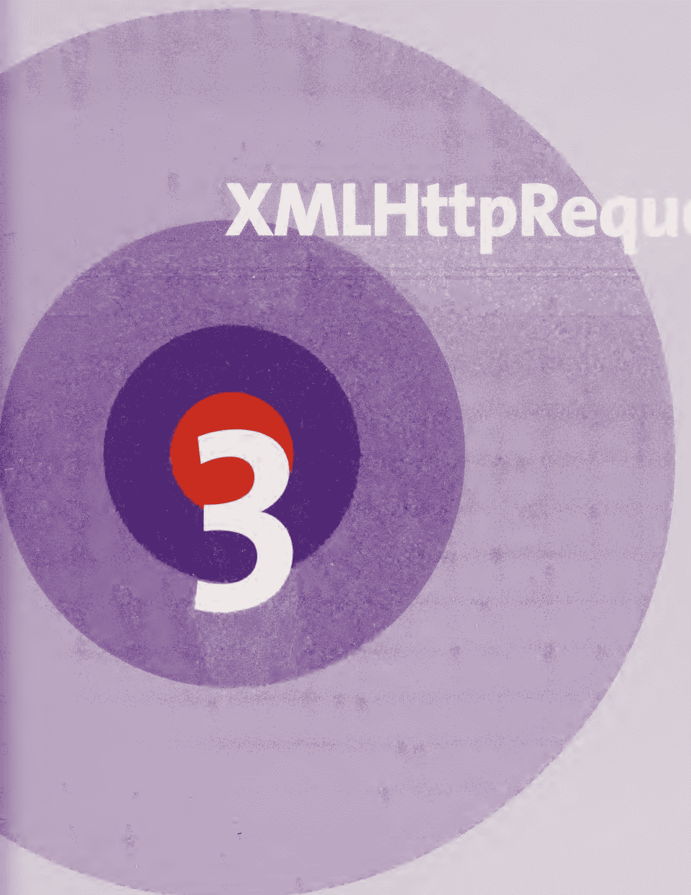

## The Object of the Game

[XMLHttpRequest](http://www.w3.org/TR/XMLHttpRequest/) 对象不是 DOM 的一部分。直到最近，它还不是任何 W3C 规范的一部分。Ajax 的成功促使万维网联盟（World Wide Web Consortium）采取了异常迅速的行动。你现在可以在 W3C 网站上找到 [XMLHttpRequest](http://www.w3.org/TR/XMLHttpRequest/) 对象规范的工作草案（www.w3.org/TR/XMLHttpRequest/）。

## Origins

能够实现客户端与服务器之间通信的对象概念源于微软。微软基于 Web 的邮件客户端 Web Access 2000 的开发人员需要一种在浏览器间异步传输信息的方法。Microsoft Internet Explorer 的开发团队解决了这个问题。适用于 Windows 的 Internet Explorer 5.0 是第一个支持 Ajax 的 Web 浏览器。

该对象的第一个实现名为 `XMLHttp`，微软仅将其作为 ActiveX 对象提供。ActiveX 是微软的一项专有技术，旨在将多媒体文件嵌入网页。从某些方面来看，它是 Java applet 的竞争对手。Java applet 和 ActiveX 控件都允许开发者在 Web 浏览器中的文档内嵌入强大的工具。这种能力可能被滥用；恶意 ActiveX 控件所带来的威胁使这项技术始终笼罩在安全担忧的阴影之下。

Mozilla 项目的开发者追随了微软的脚步，但他们原生实现了 `XMLHttpRequest` 对象。Mozilla 1.0 于 2002 年发布。相同的代码库构成了自第 6 版起的 Netscape Navigator 的基础，以及 Mozilla Firefox 浏览器的基础。Apple 的 Safari 自 1.2 版起就包含了对 `XMLHttpRequest` 的支持。Opera 浏览器自 8 版起就具备了 Ajax 能力。`XMLHttpRequest` 甚至在移动浏览器 Opera Mini 中也受到支持。

所有这些浏览器都原生实现了 `XMLHttpRequest`。这样，只有 Internet Explorer 5 到 6 版本需要 ActiveX 支持。微软已经决定放弃 ActiveX 方式，Internet Explorer 7 像任何其他现代浏览器一样实现了 `XMLHttpRequest` 对象。

值得记住的是，仅仅因为访问你网站的用户使用的是技术上支持 Ajax 的浏览器，并不意味着 Ajax 就一定可用。JavaScript 可能被关闭。对于 7 版之前的 Internet Explorer，即使 JavaScript 已开启，ActiveX 支持也可能因安全问题而被禁用。

### Create an Instance

在大多数浏览器中，创建 `XMLHttpRequest` 对象的新实例非常简单：

```
var xhr = new XMLHttpRequest();
```

但在 Internet Explorer 中并非如此简单。你需要创建 ActiveX 对象的新实例：

```
var xhr = new ActiveXObject("Microsoft.XMLHTTP");
```

其他浏览器会对此报错。与此同时，Internet Explorer 也会对创建原生对象实例的语法报错。解决方案是在尝试创建实例之前测试该对象是否存在：

```
if (window.XMLHttpRequest) {
    var xhr = new XMLHttpRequest();
}
```

这被称为对象检测。以下是检测 ActiveX 是否存在的对象检测：

```
if (window.ActiveXObject) {
    var xhr = new ActiveXObject("Microsoft.XMLHTTP");
}
```

为了避免每次想执行 Ajax 操作时都要写这些代码，你可以将对象检测封装在一个可复用的函数中：

```
function getHTTPObject() {
    var xhr = false;
    if (window.XMLHttpRequest) {
        xhr = new XMLHttpRequest();
    } else if (window.ActiveXObject) {
        xhr = new ActiveXObject("Microsoft.XMLHTTP");
    }
    return xhr;
}
```

这个名为 `getHTTPObject` 的函数首先声明一个名为 `xhr` 的变量，并为其赋一个布尔值 `false`。计划是在函数执行过程中改变这个值。

一个 `if...else` 语句负责对象检测。首先，测试原生 `XMLHttpRequest` 是否存在。如果该对象存在，将 `xhr` 的值改为该对象的新实例。如果不存在，则测试 `ActiveXObject` 是否存在。如果存在，将微软的 `XMLHTTP` ActiveX 对象的新实例赋给 `xhr`。

最后，在函数末尾返回 `xhr` 的值。此时，该变量可能有三种取值：

- 原生 `XMLHttpRequest` 对象的实例。
- ActiveX 对象的实例。
- 值 `false`。

你可以这样使用这个函数：

```
var request = getHTTPObject();
```

这将 `getHTTPObject` 函数的结果赋给变量 `request`。你现在可以把这个变量当作跨浏览器 `XMLHttpRequest` 对象的实例来处理。

`getHTTPObject` 函数仍有可能返回 `false` 值，这意味着执行该脚本的浏览器不具备 Ajax 能力。如果你明确地检查这一点，就可以确保不会要求旧浏览器执行超出其能力的代码：

```
var request = getHTTPObject();
if (request) {
  // do some Ajax
}
```

#### BULLETPROOF INSTANTIATION

`getHTTPObject` 函数大多数时候都能正常工作。但它包含了一个假设。仅仅因为浏览器支持 ActiveX 并不一定意味着用于 Ajax 的特定 ActiveX 对象也存在。

Internet Explorer 5 for Mac 就是这种情况。就目前而言，`getHTTPObject` 函数在该浏览器中会抛出错误。

一种解决方案可能是查看浏览器的用户代理字符串，检查其名称和版本号。这被称为浏览器嗅探。这是一个非常糟糕的主意。用户代理字符串可能被伪造，而且浏览器嗅探不可避免地会产生误报。对象检测总是优于浏览器嗅探。

在这个特定案例中，你可以使用对象检测仅测试 ActiveX 的存在，而不是特定类型的 ActiveX 对象。


JavaScript 有一种实用的控制结构，适用于这种情况，称为 `try...catch` 语句。使用这个语句，你可以尝试执行一些代码，如果执行失败，就可以捕获错误。该错误不会显示在浏览器中。

```
if (window.ActiveXObject) {
  try {
    xhr = new ActiveXObject("Microsoft.XMLHTTP");
  } catch(e) {
    xhr = false;
  }
}
```

`try` 代码块包含将 ActiveX 对象的实例赋值给变量 `xhr` 的尝试。如果该操作失败，`catch` 代码块会将值设置为 `false`。

`try...catch` 语句可以进一步精炼 `getHTTPObject` 函数。后续版本的 Internet Explorer 可以使用更新的 ActiveX 对象来处理 Ajax。通过使用一系列 `try...catch` 语句，你可以尝试使用最新版本，如果失败，则回退到旧的方式：

```
if (window.ActiveXObject) {
  try {
    xhr = new ActiveXObject("Msxml2.XMLHTTP");
  } catch(e) {
    try {
      xhr = new ActiveXObject("Microsoft.XMLHTTP");
    } catch(e) {
      xhr = false;
    }
  }
}
```

完整的函数如下所示：

```
function getHTTPObject() {
  var xhr = false;
  if (window.XMLHttpRequest) {
    xhr = new XMLHttpRequest();
  } else if (window.ActiveXObject) {
    try {
      xhr = new ActiveXObject("Msxml2.XMLHTTP");
    } catch(e) {
      try {
        xhr = new ActiveXObject("Microsoft.XMLHTTP");
      } catch(e) {
        xhr = false;
      }
    }
  }
  return xhr;
}
```

经过所有这些代码分支处理，你现在有了一种万无一失的方法来实例化 `XMLHttpRequest`。不用担心：大多数跨浏览器差异到此为止。一旦你使用 `getHTTPObject` 创建了对象，无论它是原生的还是 ActiveX 对象，其方法和属性都将相同。

## 发送请求

一旦你创建了 `XMLHttpRequest` 的实例，就需要为其与服务器通信做好准备。这一过程有三个关键组成部分：

-   1. `onreadystatechange` 事件处理器。
-   2. `open` 方法。
-   3. `send` 方法。

## ONREADYSTATECHANGE

事件处理器让你可以指定当事件触发时应发生的行为。大多数事件由用户触发。当用户将光标悬停在网页的某个元素上时，该元素的 `mouseover` 事件就会被触发。相应的事件处理器是 `onmouseover`。当用户提交表单时，其 `submit` 事件就会被触发。该事件处理器为 `onsubmit`。

事件处理器对 JavaScript 在 Web 上的成功至关重要。多年来，JavaScript 最常见的用途是图片轮播和表单验证。这些任务依赖于诸如 `onmouseover`、`onmouseout`、`onblur`、`onsubmit` 等事件处理器。

并非所有事件都由用户触发。`load` 事件在浏览器窗口中的文档完成加载时被触发。其事件处理器为 `window.onload`。

`onreadystatechange` 事件处理器相当特殊，不仅仅是因为其名称长得离谱。它是为服务器触发的事件而非用户触发的事件而设计的处理器。

在 Ajax 操作期间，服务器会向客户端发送有关通信当前状态的更新。这是通过更新 `XMLHttpRequest` 对象的属性来实现的。该属性称为 `readyState`，我们将在本章后面更详细地研究它。目前让我们感兴趣的是，每当 `readyState` 属性发生变化时，`readystatechange` 事件就会被触发。

每当 `onreadystatechange` 事件处理器捕获到此事件时，就意味着服务器上正在发生某些事情。更改 `readyState` 属性是服务器向客户端发送信号的方式。

如果你将一个函数附加到 `onreadystatechange` 事件处理器，那么每次服务器通过更新向客户端发送信号时，该函数就会执行。下面是一个示例：

```
var request = getHTTPObject();
if (request) {
    request.onreadystatechange = doSomething;
}
```

我将一个名为 `doSomething` 的函数的引用赋值给 `onreadystatechange` 事件处理器。每次触发 `readystatechange` 事件时，`doSomething` 函数都会执行。

我已经指定了当服务器向客户端发送更新时我希望发生什么。我仍然需要确切地指定我想要从服务器获取什么。

## OPEN

当 Web 浏览器向 Web 服务器请求页面时，它会发出一个请求。首先，这个请求指定了浏览器希望接收的文件在服务器上的位置。该请求还可能包含更多信息，例如通过表单输入的数据。浏览器还指定了请求发送到服务器的方式。这通常是 `GET` 请求，除非要发送大量数据，在这种情况下浏览器会使用 `POST` 请求。

`XMLHttpRequest` 对象的 `open` 方法让你在 Ajax 调用中复制这种交易。

这个方法有两个必需参数：

-   1. 请求的类型。
-   2. 服务器上文件的位置。

### 方法

`open` 方法的第一个参数是一个字符串，例如 "`GET`" 或 "`POST`"。如果你只想从服务器检索文件，但不需要发送任何数据，请使用 `GET` 请求。如果你想向服务器发送数据，请使用 `POST`。

`GET` 和 `POST` 是请求方法的示例，不要与对象的方法混淆。在这个意义上，*方法* 仅仅表示请求的类型。其他方法包括 `PUT`、`DELETE` 和 `HEAD`。

你可以通过在请求的 URL 末尾附加查询字符串的方式，在 `GET` 请求中发送一些数据。通过这种方式发送到服务器的数据量是有限制的。此外，`GET` 永远不应该用于发送会更新服务器上某些内容的请求，例如编辑或删除数据库中的记录。

### URL

`open` 方法的第二个参数是一个字符串，包含你要请求的服务器上文件的路径。这个字符串可以是相对路径，如 ".../myfile.html"，或者绝对路径，如 "/files/myfile.html"。

你也可以写出你要请求的文件的完整路径：

`http://www.example.com/files/myfile.html`

你请求的文件必须与发起请求的 JavaScript 文件位于同一域名下。如果 JavaScript 文件是从 foo.com 执行的，它就不能请求 bar.com 的文件。稍后，我将向你展示一些绕过此安全限制的方法，但目前，最好将 `XMLHttpRequest` 视为特定于域名的。

### 异步

除了两个必需参数（请求方法和 URL）之外，`open` 方法还接受一些可选参数。

你可以为 `open` 方法指定一个布尔值作为第三个参数。这表示请求是否应该以异步方式发生。

如果你指定值 `true`，那么脚本将发出异步请求。这意味着它不会等待服务器的响应，而是会继续执行脚本的其余部分。

如果你指定值 `false`，那么脚本的处理将在此停止。在 Ajax 请求完成之前，脚本不会继续执行。

暂停脚本的执行很少是一个好主意。如果服务器响应时间较长，浏览器实际上会停止工作。Ajax 的一大优势是能够在后台处理请求的同时，让用户继续与浏览器交互。为了利用这一点，请始终在 `open` 方法中传递值 `true` 作为第三个参数。

以下语句描述了一个对脚本所在目录中文件的异步 `GET` 请求：

```
request.open("GET", "file.ext", true);
```

### 用户名和密码

`open` 方法还有两个可选参数。你可以指定要发送到服务器的用户名和密码。

切勿将敏感信息直接写入 JavaScript 文件中。像这样使用 `open` 方法将是一个糟糕透顶的主意：

```
request.open("GET", "file.ext", true, "jeremy", "pa55w0rd");
```

任何人都可以查看 JavaScript 文件的源代码，就像任何人都可以查看网页或 CSS 文件的源代码一样。JavaScript、HTML 和 CSS 可以被混淆，但永远无法完全隐藏。

你可以使用 `open` 方法的用户名和密码参数来接受通过表单输入的值。至少那样，这些值不会硬编码到可在浏览器中查看的文件中。

实际上，你很可能永远不需要使用这些参数。


## 发送

`open` 方法指定了 Ajax 请求的详细信息，但它不会发起请求。请使用 `send` 方法来发送你已使用 `open` 方法准备好的请求。

`send` 方法接受一个参数。你可以向它传递一串数据，这些数据将被发送到服务器。

如果你使用的是 `GET` 请求方法，请不要发送任何数据。相反，向 `send` 方法传递一个 `null` 值：

```
request.send(null);
```

一个完整的 Ajax `GET` 请求如下所示：

```
var request = getHTTPObject();
if (request) {
  request.onreadystatechange = doSomething;
  request.open("GET", "file.ext", true);
  request.send(null);
}
```

如果你需要向服务器发送数据，请使用 `POST` 请求方法。将数据作为查询字符串发送，像这样：

```
name=Jeremy+Keith&message=Hello+world
```

查询字符串由通过 `&` 符号连接的名值对组成。每个名称和值都应进行 URL 编码。这意味着空格变成加号，非字母数字字符需要编码为十六进制值。例如，`@` 符号变为 `%40`。

要发送数据，你需要再使用 `XMLHttpRequest` 对象的一个方法。

## setRequestHeader

当 Web 浏览器向 Web 服务器请求页面时，它会随请求发送一系列头部信息。这些头部信息是描述请求的元数据。头部信息用于声明请求是 `GET` 还是 `POST`。

这种发送头部信息的能力可以通过一个名为 `setRequestHeader` 的方法在 Ajax 请求中实现。此方法接受两个参数，都是字符串。第一个字符串指定头部信息的名称，第二个字符串是该头部信息的值。

如果你正在使用 POST 请求向服务器发送数据，你需要将 "Content-type" 头部信息的值设置为 "application/x-www-form-urlencoded"：

```
request.setRequestHeader("Content-type", "application/x-www-form-urlencoded");
```

这会让服务器知道正在发送数据，并且数据已经过 URL 编码。

一个完整的 Ajax POST 请求如下所示：

```
var request = getHTTPObject();
if (request) {
  request.onreadystatechange = doSomething;
  request.open("POST", "file.ext", true);
  request.setRequestHeader("Content-Type", "application/x-www-form-urlencoded");
  request.send("name=Jeremy+Keith&message=Hello+world");
}
```

现在你知道如何使用 `XMLHttpRequest` 向服务器发送请求了。接下来你需要处理来自服务器的响应。

## 接收响应

请求通过 `XMLHttpRequest` 的方法发送到服务器。该对象还有许多属性。在 Ajax 事务过程中，这些属性会被服务器更新。

### READYSTATE

`readyState` 属性表示 Ajax 请求的当前状态。它的值是数字：

- 0 未初始化。`open` 方法尚未被调用。
- 1 加载中。`open` 方法已被调用，但 `send` 方法尚未被调用。
- 2 已加载。`send` 方法已被调用。请求已开始。
- 3 交互中。服务器正在发送响应的过程中。
- 4 完成。服务器已完成响应的发送。

每当 `readyState` 的值发生变化，`readystatechange` 事件就会被触发。如果一个函数已被赋给 `onreadystatechange` 事件处理器，那么每当 `readyState` 的值改变时，该函数都会被执行。

理论上，`readyState` 属性的值会按照从 0 到 4 的数字顺序变化。实际上，`readyState` 变化的顺序因浏览器而异。不过，当请求完成时，每个浏览器最终的 `readyState` 值都是 4。

与其试图利用 `readyState` 属性的变化做任何巧妙处理，最好只是等到它的值达到 4。那时你就知道服务器已完成响应的发送。

你可以使用一个简单的 `if` 语句将 `readyState` 属性的值与数字 4 进行比较：

```
function doSomething() {
  if (request.readyState == 4) {
    // 对响应进行处理
  }
}
```

`doSomething` 函数会被执行多次，因为它已被赋给 `onreadystatechange` 事件处理器：

```
request.onreadystatechange = doSomething;
```

每次 `readyState` 属性改变，`doSomething` 就会被执行，但函数中的 `if` 语句确保了在 `readyState` 的值为 4 之前不会发生任何事情。

### STATUS

就像 Web 浏览器发送的每个请求都附带头部信息一样，Web 服务器发送的每个响应也附带头部信息。这些头部信息包含关于服务器的信息，以及关于所提供的文档的信息。此信息包括文档的内容类型（HTML、XML 等）和字符编码（utf-8、iso-8859-1 等）。

Web 服务器发送的任何响应中最重要的头部信息是状态码。这个三位数的数字值，服务器在每次响应请求时都会发送，是超文本传输协议（HTTP）的一部分，该协议驱动着网络上的所有通信。我相信你熟悉 404 状态码，它表示“未找到”。其他一些代码是 403 表示“禁止”，500 表示“服务器内部错误”。

最常见的状态码是 200，表示“确定”。此代码表明服务器已成功发送了请求的资源。

在 XMLHttpRequest 对象中，服务器发送的状态码可以通过名为 `status` 的属性获取。通过将此属性与值 200 进行比较，你可以确定服务器是否发送了成功的响应：

```
function doSomething() {
  if (request.readyState == 4) {
    if (request.status == 200) {
      // 响应已成功发送
    }
  }
}
```

`doSomething` 函数内的第一个 `if` 语句将 `readyState` 属性与值 4 进行比较。当结果为真时，意味着响应已发送完成，第二个 `if` 语句就会被执行。它将 `status` 属性与值 200 进行比较。如果结果为真，那么一切正常。

通过添加一个 `else` 子句，你也可以处理并非一切按计划进行的情况：

```
function doSomething() {
  if (request.readyState == 4) {
    if (request.status == 200) {
      // 响应已成功发送
    } else {
      // 出错了！
    }
  }
}
```

200 并不是唯一表示成功响应的服务器代码。值 304 表示“未修改”。当浏览器执行所谓的条件 GET 请求时，服务器有时会返回此响应。Opera 浏览器使用条件 GET 请求。在这种情况下，服务器可能返回 304 响应，表示文档自上次请求以来未更改，因此浏览器可以安全地使用缓存版本。

为了适应这种行为，除了测试 `status` 属性是否为 200 外，还要测试其是否为 304：

```
function doSomething() {
  if (request.readyState == 4) {
    if (request.status == 200 || request.status == 304) {
      // 响应已成功发送
    } else {
      // 出错了！
    }
  }
}
```

### RESPONSETEXT

`XMLHttpRequest` 的 `responseText` 属性包含从服务器发送的数据。它是一个字符串。根据服务器发送的内容，这可能是一个 HTML 字符串、一个 XML 字符串，或者只是一个文本字符串。

当 `readyState` 属性达到 4 时，完整的 `responseText` 属性就可用了，这表示 Ajax 请求已完成：

```
function doSomething() {
  if (request.readyState == 4) {
    if (request.status == 200 || request.status == 304) {
      alert(request.responseText);
    }
  }
}
```

在此示例中，`responseText` 属性的内容将显示在 `alert` 消息中。

### RESPONSEXML

如果服务器返回的是 XML，那么这些数据将在名为 `responseXML` 的属性中可用。只有当服务器以正确的头部信息发送数据时，`responseXML` 属性才可用。MIME 类型必须是 `text/xml` 或 `application/xml`。

在下一章中，我将向你展示如何从 `responseXML` 属性中解析 XML。


## 综合实践

我将使用 Ajax 来显示一个文本文件的内容。这个名为 `message.txt` 的文本文件包含一行简单的文本：

> 如果你能读到这段文字，说明你已成功从服务器请求了一个文本文件。

现在我要编写一个脚本，用于获取该文件并将其内容显示在 `alert` 消息框中。JavaScript 代码写在一个名为 `ajaxtest.js` 的文件中，该文件与 `message.txt` 位于同一个目录下。

### JAVASCRIPT 部分

脚本以 `getHTTPObject` 函数开始：

```javascript
function getHTTPObject() {
  var xhr = false;
  if (window.XMLHttpRequest) {
    xhr = new XMLHttpRequest();
  } else if (window.ActiveXObject) {
    try {
      xhr = new ActiveXObject("Msxml2.XMLHTTP");
    } catch(e) {
      try {
        xhr = new ActiveXObject("Microsoft.XMLHTTP");
      } catch(e) {
        xhr = false;
      }
    }
  }
  return xhr;
}
```

接下来，编写一个名为 `grabFile` 的函数。该函数接受一个参数，即我要显示的文件的位置：

```javascript
function grabFile(file) {
}
```

`grabFile` 函数首先使用 `getHTTPObject` 函数创建 `XMLHttpRequest` 的新实例。如果创建成功，我将发起一个 Ajax 请求：

```javascript
function grabFile(file) {
  var request = getHTTPObject();
  if (request) {
  }
}
```

我想将一个名为 `displayResponse` 的函数绑定到 `onreadystatechange` 事件处理器上。我还想向 `displayResponse` 函数传递一个参数，即当前的 `XMLHttpRequest` 实例。为此，我需要将对 `displayResponse` 的调用封装在一个匿名函数中：

```javascript
function grabFile(file) {
  var request = getHTTPObject();
  if (request) {
    request.onreadystatechange = function() {
      displayResponse(request);
    };
  }
}
```

通过使用 `send` 方法，我指定了请求的详细信息。这是一个 `GET` 请求；请求文件的位置取自函数的 `file` 参数，且请求将是异步的：

```javascript
function grabFile(file) {
  var request = getHTTPObject();
  if (request) {
    request.onreadystatechange = function() {
      displayResponse(request);
    };
    request.open("GET", file, true);
  }
}
```

最后，我使用 `send` 方法启动请求。因为这是一个 GET 请求，所以不需要发送任何数据：

```javascript
function grabFile(file) {
  var request = getHTTPObject();
  if (request) {
    request.onreadystatechange = function() {
      displayResponse(request);
    };
    request.open("GET", file, true);
    request.send(null);
  }
}
```

为了处理响应，我需要编写由 `onreadystatechange` 事件处理器引用的 `displayResponse` 函数。该函数接受一个参数，即 `XMLHttpRequest` 的实例：

```javascript
function displayResponse(request) {
}
```

通过这种方式，当前的 `XMLHttpRequest` 对象可以在函数之间传递。

在 `readyState` 属性的值变为 4 之前，我不想在 `displayResponse` 函数中执行任何操作：

```javascript
function displayResponse(request) {
  if (request.readyState == 4) {
  }
}
```

我还将检查 `status` 属性，以确保响应已成功从服务器返回：

```javascript
function displayResponse(request) {
  if (request.readyState == 4) {
    if (request.status == 200 || request.status == 304) {
    }
  }
}
```

一旦通过这些测试，`responseText` 属性将显示在 `alert` 消息框中：

```javascript
function displayResponse(request) {
  if (request.readyState == 4) {
    if (request.status == 200 || request.status == 304) {
      alert(request.responseText);
    }
  }
}
```

脚本编写完成。我需要将此脚本附加到 Web 页面中，以便在浏览器中使用。

### 标记语言部分

这是一个简单的 XHTML 文档。文档的头部包含一个指向 `ajaxtest.js` 文件的 `script` 元素。文档的正文包含一个指向 `grabFile` 函数的链接：

```xhtml
<!DOCTYPE html PUBLIC "-//W3C//DTD XHTML 1.0 Strict//EN"
"http://www.w3.org/TR/xhtml1/DTD/xhtml1-strict.dtd">
<html xmlns="http://www.w3.org/1999/xhtml">
  <head>
    <title>Using XMLHttpRequest</title>
    <script type="text/javascript" src="ajaxtest.js"></script>
  </head>
<body>
  <p>
    <a href="message.txt" onclick="grabFile(this.href); return false;">
      Click here to see the contents of a text file
    </a>
  </p>
</body>
</html>
```

链接的 `href` 属性指向 `message.txt` 文件。`onclick` 事件处理器告知浏览器将此 `href` 值传递给 `grabFile` 函数。`return false` 语句取消了默认行为（即在浏览器窗口中跳转到该链接）。

请记住，这只是一个用于测试的示例。像这样使用内联事件处理器是执行 JavaScript 函数的一种粗糙方式。稍后，你会看到更优雅、更先进的添加行为的方法。目前，这足以阐明基本的 Ajax 功能。

将此文档保存为 `index.html`，并与 `ajaxtest.js` 及 `message.txt` 放在同一个目录下。为了使这个示例正常工作，你需要将该目录托管在服务器上。如果你在本地运行 Web 服务器，可以是自己的机器，或者你可以通过 FTP 将文件传输到互联网上的服务器。

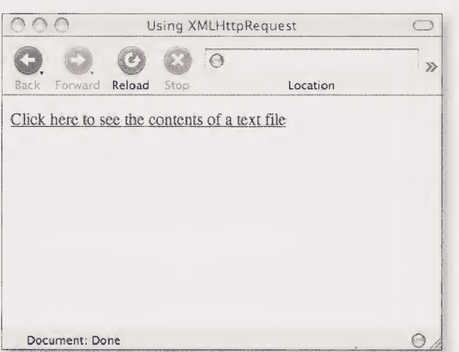
**图 3.1** 一个指向文本文件的链接。

使用 Web 浏览器访问 `index.html`。你将看到图 3.1 所示的链接。点击此链接将生成图 3.2 所示的警告对话框。

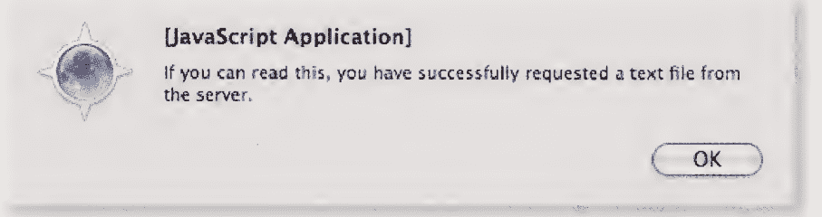
**图 3.2** 对话框中显示的文本文件内容。

警告消息的内容直接来自 `message.txt` 文件。乍一看，这似乎没什么令人惊叹的地方。警告对话框并没有什么革命性，但其蕴含的意义是巨大的。现在，人们可以在不刷新整个页面的情况下，获取服务器上任何文件的内容并在浏览器中显示。

## 总结

`XMLHttpRequest` 对象是 Ajax 的核心。它的方法和属性驱动了异步请求，使 Ajax 应用程序具有极强的响应感。

在本章中，你学习了如何在三个步骤中使用 `XMLHttpRequest` 对象：

- 1. 创建一个能在不同浏览器实现中工作的对象实例。
- 2. 使用 `onreadystatechange` 事件处理器、`open` 方法和 `send` 方法准备请求。
- 3. 通过 `readyState`、`status`、`responseText` 以及有时使用 `responseXML` 属性处理来自服务器的响应。

这个基础模型在本书后续的所有示例中都将保持不变。创建实用 Ajax 交互的真正技巧在于决定在何时何地发起请求，以及如何最好地处理服务器的响应。

在下一章中，我将更详细地探讨 `responseText` 和 `responseXML` 属性。它们是服务器将数据传递给客户端的载体机制。这些数据可以用多种方式进行格式化。

## 数据格式

### 你选择哪种？

Ajax 与语言无关，至少在服务器端如此。无论你使用哪种服务器端语言来实现业务逻辑都无所谓。然而，当你从服务器请求数据时，服务器发送的数据必须以浏览器能够理解的方式进行格式化。你选择的服务器端编程语言需要以三种方式之一返回数据：XML、JSON 或 HTML。在本章中，我将分析每种数据格式，以便你能够做出明智的决定，选择最适合你需求的一种。

### XML

在 AJAX 还是一个缩写词的时代，它代表 Asynchronous JavaScript and XML（异步 JavaScript 和 XML）。XML 在 `XMLHttpRequest` 对象的名称中也占据重要地位。如果你认为 XML 是 Ajax 的内在组成部分，那也是可以理解的。但事实并非如此。不过，它可以用作 Ajax 响应的输出格式。

XML 代表 eXtensible Markup Language（可扩展标记语言）。它是一种通用的标记语言，几乎可以用来描述任何事物。XML 与 SGML 和 HTML 等其他标记语言的不同之处在于，它的词汇量是没有预先规定的。相反，XML 文档的作者可以自由地使用任何她认为最合适的术语。它是一种元语言。XML 文档的结构必须遵循某些规则，但该结构中使用的词汇并不绑定于任何术语字典。

#### XML 示例

这是一个名为 `jeremy.xml` 的简单 XML 文档：

```xml
<?xml version="1.0" encoding="utf-8"?>
<person>
    <name>Jeremy Keith</name>
    <website>http://adactio.com/</website>
    <email>jeremy@clearleft.com</email>
</person>
```

文件中的第一行是 XML 声明。该行声明了所使用的 XML 版本和文档的字符编码。之后的所有内容都包含在标签中。每组标签表示一个元素。元素的名称包含在开始标签和结束标签中。元素的值也包含在开始标签和结束标签之间。

需要注意的是，XML 本身并不 *执行* 任何操作。该语言的创建是为了存储数据，而不是操作数据。在这个例子中，XML 文档存储了一个人的联系详情。为了对这些数据进行任何操作，我需要使用编程语言。我将使用 JavaScript 从 XML 文件中提取联系信息并将其放置在 Web 页面中。


 # XML 实战

我有一个网页，里面列出了我办公室的人员名单。这个 XHTML 文档通过一个 `script` 元素引用了一个名为 `fetchxml.js` 的 JavaScript 文件：

```
<!DOCTYPE html PUBLIC "-//W3C//DTD XHTML 1.0 Strict//EN"
"http://www.w3.org/TR/xhtml1/DTD/xhtml1-strict.dtd">
<html xmlns="http://www.w3.org/1999/xhtml" xml:lang="en"
lang="en">  <head>
  <meta http-equiv="content-type" content="text/html;
charset=utf-8" />
  <title>People at Clearleft</title>
  <style type="text/css">
  @import url("clearleft.css");
  </style>
  <script type="text/javascript" src="fetchxml.js"></script>
</head>
<body>
  <h1>People</h1>
  <ul>
    <li>
      <a href="files/andy.xml"
onclick="grabFile(this.href); return false;">Andy</a>
    OPTION_1
    </li>
    <li>
      <a href="files/richard.xml"
onclick="grabFile(this.href); return false;">Richard</a>
    OPTION_2
    </li>
    <li>
      <a href="files/jeremy.xml"
onclick="grabFile(this.href); return false;">Jeremy</a>
    OPTION_3
    </li>
  </ul>
  <div id="details"></div>
</body>
</html>
```

图 4.1 展示了经过一些基本样式处理后，这个页面在浏览器中的样子。

**图 4.1** 网页上的人员列表。

列表中的每个人都链接到一个包含该人联系详情的 XML 文件。我使用 `onclick` 事件处理器将该值传递给 `grabFile` JavaScript 函数：

```
<a href="files/jeremy.xml"
onclick="grabFile(this.href); return false;">Jeremy</a>
```

这不是一种非常优雅的事件捕获方式。它确实开始在标记中造成混乱。在下一章中，你将看到一种更加不唐突的添加 JavaScript 功能的方式。

我要编写一个脚本，获取一个 XML 文件，解析其内容，并生成标记以在网页中显示联系详情。这些详情将放在列表后面的 `div` 元素中：

```
<div id="details"></div>
```

#### 编写脚本

`fetchxml.js` 文件以你在上一章中看到的 `getHTTPObject` 函数开头：

```
function getHTTPObject() {
  var xhr = false;
  if (window.XMLHttpRequest) {
    xhr = new XMLHttpRequest();
  } else if (window.ActiveXObject) {
    try {
      xhr = new ActiveXObject("Msxml2.XMLHTTP");
    } catch(e) {
      try {
        xhr = new ActiveXObject("Microsoft.XMLHTTP");
      } catch(e) {
        xhr = false;
      }
    }
  }
  return xhr;
}
```

这就完成了跨浏览器 `XMLHttpRequest` 对象的实例化。

下一个函数是 `grabFile`。它与上一章中的 `grabFile` 函数几乎完全相同。唯一的区别是，`onreadystatechange` 事件处理器现在触发一个名为 `parseResponse` 的函数：

```
function grabFile(file) {
  var request = getHTTPObject();
  if (request) {
    request.onreadystatechange = function() {
      parseResponse(request);
    };
    request.open("GET", file, true);
    request.send(null);
  }
}
```

`parseResponse` 函数将获取服务器返回的 XML 并将其转换为 HTML。但首先，我需要确保响应已成功从服务器返回：

```
function parseResponse(request) {
    if (request.readyState == 4) {
        if (request.status == 200 || request.status == 304) {
```

XML 可通过 `HTTPRequest` 对象的 `responseXML` 属性访问。我要将此属性赋值给变量 `data`：

```
var data = request.responseXML;
```

可以使用与遍历 HTML 文档相同的 DOM 方法来遍历 XML。只要你了解从服务器返回的 XML 结构，就可以使用 `getElementsByTagName` 等方法以及 `nodeValue` 等属性来获取你想要的信息。

#### 从 XML 中提取数据

我知道 XML 文件中有一个 `name` 元素。我想获取 `<name>` 标签中包含的文本节点。使用 `getElementsByTagName`，我可以获取 XML 中所有 `name` 元素的集合：

```
data.getElementsByTagName("name")
```

我知道只有一个 `name` 元素，所以我只关心第一个匹配项：`data.getElementsByTagName("name")[0]`

这个元素包含我想要的文本节点。文本节点是元素的第一个子节点：`data.getElementsByTagName("name")[0].firstChild`

现在，我可以通过查询其 `nodeValue` 属性来获取此文本节点的值：`data.getElementsByTagName("name")[0].firstChild.nodeValue`

我将此值赋值给变量 `name`：

```
var name = data.getElementsByTagName("name")[0].firstChild.nodeValue;
```

我可以使用相同的 DOM 方法和属性来检索 `website` 和 `email` 元素中的值：

```
var website = data.getElementsByTagName("website")[0].firstChild.nodeValue;
var email = data.getElementsByTagName("email")[0].firstChild.nodeValue;
```

变量 `name`、`website` 和 `email` 包含从相应 XML 元素中检索到的文本字符串。我不想输出纯文本，而是想将这些值包裹在 HTML 元素中。

#### 生成内容

使用 `createElement`、`createTextNode` 和 `appendChild` 等 DOM 方法，我可以构建一段 HTML 来包含我提取的信息。例如，我想像这样输出 `name` 和 `email` 的值：

```
<h2><a href="mailto:jeremy@clearleft.com">Jeremy Keith</a></h2>
```

`h2` 和 `a` 元素是用 `createElement` 方法创建的：

```
var header = document.createElement("h2");
var mailto = document.createElement("a");
```

我使用 `setAttribute` 方法为 `a` 元素设置我想要的 `href` 值：

```
mailto.setAttribute("href","mailto:"+email);
```

最后，我使用 `createTextNode` 方法创建要放入链接中的文本：

```
var text = document.createTextNode(name);
```

现在我可以使用 `appendChild` 方法将这些节点连接起来：

```
mailto.appendChild(text);
header.appendChild(mailto);
```

我还想像这样输出 `website` 值：

```
<a href="http://adactio.com/">http://adactio.com/</a>
```

这可以通过同一组 DOM 方法实现：

```
var link = document.createElement("a");
link.setAttribute("href",website);
var linktext = document.createTextNode(website);
link.appendChild(linktext);
```

现在我已经在变量 `header` 和 `link` 中获得了想要的 HTML。我需要将这些元素放入文档中。

我要将新创建的标记插入到 ID 为 `details` 的 `div` 中：

```
var details = document.getElementById("details");
```

首先，我会确保这个容器元素是空的：

```
while (details.hasChildNodes()) {
    details.removeChild(details.lastChild);
}
```

`while` 循环会移除最后一个子节点，直到没有子节点为止。

现在 `details` 元素已为空，我可以插入我创建的标记了：

```
details.appendChild(header);

details.appendChild(link);
```

就是这样。完整的 `parseResponse` 函数看起来是这样的：

```
function parseResponse(request) {
    if (request.readyState == 4) {
        if (request.status == 200 || request.status == 304) {
            var data = request.responseXML;
            var name = data.getElementsByTagName("name")[0].firstChild.nodeValue;
            var website = data.getElementsByTagName("website")[0].firstChild.nodeValue;
            var email = data.getElementsByTagName("email")[0].firstChild.nodeValue;
            var header = document.createElement("h2");
            var mailto = document.createElement("a");
            mailto.setAttribute("href","mailto:"+email);
            var text = document.createTextNode(name);
            mailto.appendChild(text);
            header.appendChild(mailto);
            var link = document.createElement("a");
            link.setAttribute("href",website);
            var linktext = document.createTextNode(website);
            link.appendChild(linktext);
            var details = document.getElementById("details");
            while (details.hasChildNodes()) {
                details.removeChild(details.lastChild);
            }
            details.appendChild(header);
            details.appendChild(link);
        }
    }
}
```


details.appendChild(header);
details.appendChild(link);
}
}
}

保存 `fetchxml.js` 文件并刷新浏览器。如果你点击文档中的其中一个链接，现在将得到图 4.2 所示的结果。

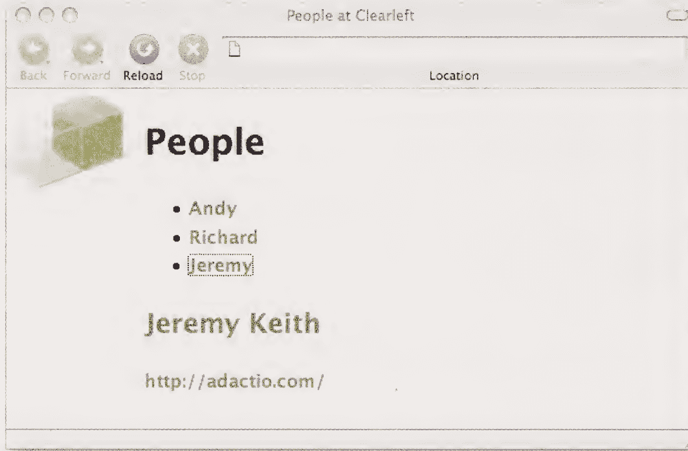

**图 4.2** 点击链接将显示该人员的详细信息。

#### XML 的优势

XML 是一种非常通用的数据格式。它不会强制将你的数据放入预定义字段中，你可以自由地发明一套适合你数据的词汇表。这种灵活性使得 XML 变得极其流行。它是 Web 应用程序中传输数据最常用的手段之一，这使得它在 Ajax 应用程序中非常方便。如果你要求服务器端程序员以 XML 格式返回数据，你的请求很容易得到满足。

使用 XML 的另一个好处是，你不需要学习一门新语言来解析数据。由于 DOM 的设计初衷就是为了解析任何类型的标记，因此你可以重复利用从 DOM 脚本编写中已经获得的知识。

DOM 让你能够非常精细地控制文档。你可以从 `responseXML` 中提取数据片段，然后更新当前文档的任何部分。在联系详情的示例中，使用请求详情的人员姓名来更新文档的 `h1` 元素将相对容易：

```
document.getElementsByTagName("h1")[0].firstChild.nodeValue = name;
```

DOM 的精确性结合 XML 的流行，构成了一个非常强大的组合。

#### XML 的劣势

如果你想从服务器发送 XML，必须确保它带有正确的响应头。如果内容类型（content type）不是 "text/xml" 或 "application/xml"，那么 `responseXML` 属性将为空。如果 XML 是由服务器端编程语言动态生成的，很容易忽略这个要求。

虽然 DOM 非常适合在 XML 到达浏览器后进行解析，但这个过程可能非常冗长。在联系详情的示例中可以明显看出，仅仅为了生成一小块标记就需要写好几行 JavaScript 代码。每个节点都必须创建并附加。对于处理较长 XML 文件的复杂应用程序，代码可能会迅速变得难以控制。

使用 DOM 的一个替代方案是 XSLT（可扩展样式表语言转换）。它允许你通过指向一个模板将 XML 转换为 HTML。不幸的是，并非所有浏览器都支持 XSLT。

### JSON

XML 旨在存储数据。为了解析这些数据，你需要一些其他技术，如 DOM 或 XSLT。或者，你可以使用一种以更易于编程语言解析的方式存储数据的数据格式。

JSON 代表 JavaScript Object Notation（JavaScript 对象表示法），发音类似于名字 Jason。顺便一提，在希腊神话中，杰森（Jason）的阿尔戈号船员之一是特拉蒙（Telamon），他是 Ajax 的父亲。

JSON 是道格拉斯·克罗克福德（Douglas Crockford）的杰作，他是当今世界上最杰出的 JavaScript 编程人员之一 (www.crockford.com)。

Crockford 提出将 JSON 作为 XML 的轻量级替代方案。任何可以存储在 XML 中的内容也可以存储在 JSON 中。两者都是基于文本的数据表示形式，但 XML 需要开始和结束标签，而 JSON 仅使用冒号、逗号和花括号。

JSON 不是一种需要由 JavaScript 解释的数据格式：JSON *就是* JavaScript。

#### JSON 示例

正如你已经看到的，在 JavaScript 中实现某件事总是不止一种方法。以这个函数声明为例：

```
function person() {
    var name = "Richard Rutter";
    var website = "http://clagnut.com/";
    var email = "richard@clearleft.com";
}
```

这个函数对于完成某个任务来说没什么用，但它是将数据存储在单个全局变量中的便捷方法。它也可以这样写：

```
var person = function() {
    var name = "Richard Rutter";
    var website = "http://clagnut.com/";
    var email = "richard@clearleft.com";
};
```

为了从函数外部访问所有这些局部变量，将 `person` 转换为一个对象：

```
var person = function() {
    this.name = "Richard Rutter";
    this.website = "http://clagnut.com/";
    this.email = "richard@clearleft.com";
};
```

现在 `name`、`website` 和 `email` 可以作为 `person` 的属性来访问：`person.name`、`person.website` 和 `person.email`。

同一个对象也可以写成这样：

```
{"person":{
  "name":"Richard Rutter",
  "website":"http://clagnut.com/",
  "email":"richard@clearleft.com"
  }
}
```

这被称为对象字面量。值使用冒号而不是等号进行赋值。每个赋值之间用逗号分隔。整个对象封装在花括号内。可以使用更多组花括号来嵌套更多层级的信息。

存储在对象字面量中的值可以是字符串、数字或布尔值。对象字面量还可以存储函数，这些函数是该对象的方法。但如果你编写一个对象字面量纯粹是为了存储数据，那么你就是在编写 JSON。

#### JSON 实战

回到联系详情页面，我将把链接改为指向 JSON 文件：

```
<!DOCTYPE html PUBLIC "-//W3C//DTD XHTML 1.0 Strict//EN"
"http://www.w3.org/TR/xhtml1/DTD/xhtml1-strict.dtd">
<html xmlns="http://www.w3.org/1999/xhtml" xml:lang="en"
lang="en"> <head>
  <meta http-equiv="content-type" content="text/html;
charset=utf-8" />
  <title>People at Clearleft</title>
  <style type="text/css">
  @import url("clearleft.css");
  </style>
  <script type="text/javascript" src="fetchjson.js"></script>
</head>
<body>
  <h1>People</h1>
  <ul>
    <li>
<a href="files/andy.js"
onclick="grabFile(this.href); return false;">Andy</a>
</li>
<li>
<a href="files/richard.js"
onclick="grabFile(this.href); return false;">Richard</a>
</li>
<li>
<a href="files/jeremy.js"
onclick="grabFile(this.href); return false;">Jeremy</a>
</li>
</ul>
<div id="details"></div>
</body>
</html>
```

`script` 元素现在指向一个名为 `fetchjson.js` 的文件。这与我之前编写的 `fetchxml.js` 文件非常相似。`getHTTPObject` 和 `grabFile` 函数完全一样。我唯一需要修改的是 `parseResponse` 函数。

#### 从 JSON 中提取数据

当我的数据存储在 XML 中时，我解析的是 `responseXML` 属性。JSON 仅仅是一个文本字符串，它在 `responseText` 属性中返回。

要访问存储在 `responseText` 属性中的 JSON 数据，我需要使用 JavaScript 的 `eval` 语句。`eval` 函数接受一个字符串作为参数，该字符串随后被作为 JavaScript 代码执行。因为 JSON 字符串由 JavaScript 代码组成，所以它可以被求值。

在这里，我正在对 `responseText` 属性的内容进行求值，并将结果赋值给变量 `data`：

```
var data = eval('('+request.responseText+')');
```

现在我可以将所有 JSON 值作为 `data` 的属性来访问：

```
var name = data.person.name;
var email = data.person.email;
var website = data.person.website;
```

这种点语法比我在 XML 文件上使用的 DOM 方法更短且更具可读性：

```
var name = data.getElementsByTagName("name")[0].firstChild.nodeValue;
```

一旦数据被提取，`parseResponse` 函数将像之前一样继续执行，生成标记并将其插入文档中：

```
function parseResponse(request) {
    if (request.readyState == 4) {
        if (request.status == 200 || request.status == 304) {
            var data = eval('('+request.responseText+')');
            var name = data.person.name;
            var email = data.person.email;
            var website = data.person.website;
            var header = document.createElement("h2");
            var mailto = document.createElement("a");
            mailto.setAttribute("href","mailto:"+email);
            var text = document.createTextNode(name);
            mailto.appendChild(text);
            header.appendChild(mailto);
            var link = document.createElement("a");
            link.setAttribute("href",website);
            var linktext = document.createTextNode(website);
            link.appendChild(linktext);
            var details = document.getElementById("details");
            while (details.hasChildNodes()) {
                details.removeChild(details.lastChild);
            }
            details.appendChild(header);
            details.appendChild(link);
        }
    }
}
```

最终结果是一样的，如图 4.3 所示。


图 4.3 JSON 被转换为 HTML。

正如你所看到的，当你使用 XMLHttpRequest 从服务器发送数据时，JSON 和 XML 之间没有太大区别。

如果我们不考虑 XMLHttpRequest，JSON 作为一种数据格式有一个巨大的优势：你可以从远程服务器请求 JSON 数据。

#### SCRIPT 标签技巧 (THE SCRIPT TAG HACK)

安全限制安全策略阻止我们使用 XMLHttpRequest 访问除执行 JavaScript 文件所在的域名以外的任何域名。这意味着我们不能像这样访问远程服务器：

```javascript
request.open("GET", "http://api.search.yahoo.com/", true);
```

我们无法使用 XMLHttpRequest 来访问如今许多网站提供的 Web API。这非常遗憾，因为大多数 API 以 XML 形式返回数据，而这些数据本可以通过 `responseXML` 获取。

`script` 元素没有这样的安全限制。可以通过这种方式访问另一个域名的 JavaScript 文件：

```html
<script type="text/javascript" src="http://www.google-analytics.com/urchin.js"></script>
```

如果你能从另一个域名请求一个 JavaScript 文件，那么你也可以请求一个 JSON 文件。记住，JSON 不过就是 JavaScript。

使用一些 DOM 脚本，你可以动态生成一个 `script` 元素。这个函数接受一个 URL 作为参数。它创建了一个新的 `script` 元素，将该 URL 作为其 `src` 属性，然后将该元素添加到文档的 `head` 中：

```javascript
function getScript(url) {
  var scripttag = document.createElement("script");
  scripttag.setAttribute("type","text/javascript");
  scripttag.setAttribute("src",url);
  document.getElementsByTagName("head")[0].appendChild(scripttag);
}
```

#### JSON 与 Web 服务

现在一些 API 提供 JSON 作为 XML 的替代方案。如果请求的话，所有 Yahoo 的 Web 服务都可以返回 JSON。如果你想尝试使用 Yahoo 搜索 API，请在 http://api.search.yahoo.com/webservices/register_application 注册一个应用程序 ID。

我自己的应用程序 ID 是 `adactio`。请在下面的函数中替换为你自己的 ID：

```javascript
function searchYahoo(query) {
  var url = "http://api.search.yahoo.com/NewsSearchService/V1/newsSearch?";
  url+= "appid=adactio";
  url+= "&query="+escape(query);
  url+= "&output=json";
  url+= "&callback=parseResponse";
  getScript(url);
}
```

`searchYahoo` 函数组合了一个带有搜索所需参数的 URL。搜索词本身作为参数 `query` 传递。另一个必需的参数是应用程序 ID `appid`。

URL 中还添加了两个可选参数。第一个 `output` 的值为 `json`，表示结果应以 JSON 而非 XML 形式返回。另一个参数 `callback` 表示 JSON 数据应被求值并传递给 `parseResponse` 函数。

通过将此 URL 传递给 `getScript` 函数，可以从 Yahoo 获取此类 JSON：

```json
{
  "ResultSet": {
    "totalResultsAvailable": 2,
    "totalResultsReturned": 2,
    "firstResultPosition": "1",
    "Result": [
      {
        "Title": "Man Bites Dog",
        "Summary": "Headline writers take the day off.",
        "Url": "http://www.example.com/false.html"
      },
      {
        "Title": "Stop The Press",
        "Summary": "Man injured by spinning newspaper.",
        "Url": "http://www.example.com/fake.html"
      }
    ]
  }
}
```

这些信息随后在 `parseResponse` 函数中被解析：

```javascript
function parseResponse(data) {
  for (var i=0; i<data.ResultSet.Result.length; i++) {
    var title = data.ResultSet.Result[i].Title;
    var summary = data.ResultSet.Result[i].Summary;
    var url = data.ResultSet.Result[i].Url;
  }
}
```

你可以像这样从 Web 页面触发 `searchYahoo` 函数：

```html
<!DOCTYPE html PUBLIC "-//W3C//DTD XHTML 1.0 Strict//EN" "http://www.w3.org/TR/xhtml1/DTD/xhtml1-strict.dtd">
<html xmlns="http://www.w3.org/1999/xhtml" xml:lang="en" lang="en">
<head>
  <title>Yahoo! News Search</title>
  <script type="text/javascript" src="jsonsearch.js"></script>
  <style type="text/css">
    @import url("style.css");
  </style>
</head>
<body>
  <h1>Yahoo! News Search</h1>
  <form onsubmit="searchYahoo(this.query.value); return false">
    <fieldset>
      <label>Search for</label>
      <input type="text" name="query" />
      <input type="submit" value="Search" />
    </fieldset>
  </form>
  <div id="results"></div>
</body>
</html>
```

将 `getScript` 和 `searchYahoo` 函数放入 `jsonsearch.js` 文件中。你还需要编写一个扩展版本的 `parseResponse`。

这将把搜索结果转换为 HTML，并将其放置在 ID 为 `results` 的元素内部：

```javascript
function parseResponse(data) {
  // empty the div
  var results = document.getElementById("results");
  while (results.hasChildNodes()) {
    results.removeChild(results.lastChild);
  }
  // loop through the search results
  for (var i=0; i<data.ResultSet.Result.length; i++) {
    var title = data.ResultSet.Result[i].Title;
    var summary = data.ResultSet.Result[i].Summary;
    var url = data.ResultSet.Result[i].Url;
    // create the headline link
    var header = document.createElement("h2");
    var link = document.createElement("a");
    link.setAttribute("href",url);
    var text = document.createTextNode(title);
    link.appendChild(text);
    header.appendChild(link);
    // create the summary paragraph
    var para = document.createElement("p");
    var paratext = document.createTextNode(summary);
    para.appendChild(paratext);
    // insert the markup
    results.appendChild(header);
    results.appendChild(para);
  }
}
```

试着输入搜索词来查看结果，如图 4.4 所示。

**图 4.4** 从 Yahoo News 搜索 *Google* 的结果。

#### JSON 的优点

作为一种传输数据的格式，JSON 与 XML 非常相似，但它更轻量一些。在 XML 中，每个值都需要一个开始标签和一个结束标签，而 JSON 只需要编写一次名称。

与 XML 不同，JSON 不需要服务器在发送时携带特定的 content-type 响应头。它可以作为纯文本发送。

JSON 最大的资产是其跨域传输的能力。这意味着要放弃 `XMLHttpRequest` 对象而采用 script 标签技巧，但目前，这是直接从另一个服务器检索数据的唯一方法。

#### JSON 的缺点

JSON 的语法非常精确。一个放错位置的逗号或丢失的大括号都会导致整个 JSON 对象失效。你还必须记得转义引号等特殊字符。

与 Douglas Crockford 不同，我不觉得 JSON 非常易读。也许是因为我习惯了 HTML 中的尖括号，但在我看来，XML 基于标签的语法看起来更简洁。

为了提取 JSON 对象的内容，必须对其进行求值。`eval` 函数功能强大，但也潜藏危险。如果你从一个并非完全可信的第三方检索 JSON 数据，它可能包含一些通过 `eval` 执行的恶意 JavaScript 代码。出于这个原因，Douglas Crockford 编写了一个 JSON 解析器，它只解析属性，忽略任何方法 (www.json.org/js.html)。

### HTML

如果你是以 XML 或 JSON 形式发送数据，在将其显示在 Web 浏览器中之前，你需要将其转换为 HTML。如果数据本身就是以 HTML 形式发送的，则可以避免这一额外步骤。

#### HTML 示例

对于联系详情页面，数据可以像这样返回：

```html
<h2><a href="mailto:andy@clearleft.com">Andy Budd</a></h2>
<a href="http://andybudd.com/">http://andybudd.com/</a>
```

从技术上讲，这不是一个 HTML 文件。它没有 doctype 声明，没有 `body` 元素，没有 `head` 元素，甚至没有 `html` 元素。将其称为 HTML 片段 (fragment) 或代码片段 (snippet) 会更准确。

这个片段可以直接插入到当前文档中。

#### HTML 实战

我更新了联系详情页面，使其指向一个名为 fetchhtml.js 的 JavaScript 文件：

```html
<script type="text/javascript" src="fetchhtml.js"></script>
```

我还在修改标记，使链接现在指向包含每个人联系详情的 HTML 片段：

```html
<ul>
    <li>
        <a href="files/andy.html" onclick="grabFile(this.href); return false;">Andy</a>
    </li>
    <li>
        <a href="files/richard.html" onclick="grabFile(this.href); return false;">Richard</a>
    </li>
    <li>
        <a href="files/jeremy.html" onclick="grabFile(this.href); return false;">Jeremy</a>
    </li>
</ul>
<div id="details"></div>
```

在 fetchhtml.js 文件中，`getHTTPObject` 保持不变，`grabFile` 函数也是如此。我唯一需要更新的是 `parseResponse` 函数。

##### 从 HTML 提取数据

HTML 由纯文本组成。如果服务器通过 XMLHttpRequest 发送 HTML，它将可用作 `responseText` 属性。

我不需要从 `responseText` 中提取任何数据。它已经按照我想要的方式预先格式化好了。我只需要将其倾倒进我想更新的页面部分即可。

在这种情况下，我想更新 ID 为 details 的 div：

```javascript
var details = document.getElementById("details");
```

插入 HTML 片段最简单的方法就是更新该元素的 `innerHTML` 属性。


#### innerHTML

`innerHTML` 属性不是 DOM 的一部分。它不属于任何标准，而是由微软创建的私有扩展。

通常情况下，我不建议在 JavaScript 代码中使用任何私有扩展（尽管 `XMLHttpRequest` 对象本身也是一个私有扩展）。然而，考虑到 `innerHTML` 是非标准的，它的支持情况却异常之好。事实上，它已经成为了一个事实上的标准：所有主流浏览器都支持它。`innerHTML` 在没有 W3C 背书的情况下能被如此广泛采用的原因是，它在某些情况下非常有用。

DOM 方法允许你非常精确地操作文档。你可以一次创建一个元素、属性或文本节点。这非常强大，但也非常耗时。

`innerHTML` 属性则采用“暴力”方式。如果你读取一个元素的 `innerHTML` 属性，你将获得一段 HTML 字符串。这是一个可读写属性，这意味着你也可以将一段 HTML 字符串赋值给一个元素内部：

```
element.innerHTML = "<p>Here's a string of markup.</p>";
```

之前在该元素内部的任何 HTML 都将被抹除，并被该字符串的内容所替换。

如果你使用 `createElement`、`createTextNode` 和 `appendChild` 等 DOM 方法，你无法创建格式错误的标记。但如果你将一段格式错误的 HTML 字符串赋值给元素的 `innerHTML` 属性，你将会弄乱文档的 DOM 树：

```
element.innerHTML = "<p>This is <em>badly formed</p></em>";
```

如果使用不慎，`innerHTML` 可能会非常危险。但它确实能节省大量时间。赋值 `innerHTML` 不仅比一个接一个地创建和附加节点花费时间更少，而且它是更新文档的一种更快方式。这种速度差异在不同浏览器之间有所不同，但在处理大块标记时会变得非常明显。

我将更新 `parseResponse` 函数，以更改 `details` 元素的 `innerHTML` 属性：

```
function parseResponse(request) {
  if (request.readyState == 4) {
    if (request.status == 200 || request.status == 304) {
      var details = document.getElementById("details");
      details.innerHTML = request.responseText;
    }
  }
}
```

就这样。通过一条语句，我就可以用服务器返回的标记来更新文档。

点击联系详情页面上的任何链接即可获得所需结果，如图 4.5 所示。


#### HTML 的优点

从服务器发送 HTML 片段可以节省浏览器的大量时间。你不需要编写行行 JavaScript 来解析响应并将其转换为 HTML。数据已经以 HTML 格式排版，只需要插入到文档中即可。通过使用 `innerHTML`，这可以在单行代码中完成。这可以显著减小脚本的文件大小。

作为一种数据格式，HTML 片段肯定与 XML 或 JSON 一样具有可读性 —— 考虑到 HTML 在 Web 上的普及及其对开发者的熟悉程度，可能更具可读性。

将 HTML 片段与 `innerHTML` 属性结合使用是一种快速且高效的组合。

#### HTML 的缺点

如果你只想更新文档的一个部分，在 Ajax 响应中发送 HTML 片段效果很好。但如果你想更新同一文档的多个部分，这种方法就效果不佳。在这种情况下，最好使用像 XML 或 JSON 这样可以非常精确地解析的数据格式。

使用 HTML 片段最大的问题或许是对 `innerHTML` 的依赖。作为一个坚定的标准主义者，我对使用非标准属性并不完全放心。

从技术上讲，`innerHTML` 属性应该仅在 HTML 文档中工作，而不在 XHTML 文档中工作。如果你想追求严谨，你应该提供内容类型标头为 `application/xhtml+xml` 的 XHTML 页面。但如果你这样做，你就无法在旧版本的 Firefox 中使用 `innerHTML`。在实践中，大多数人将 XHTML 作为 HTML 提供，因为 Internet Explorer 无法处理正确的内容类型标头。

## 本章小结

在本章中，你看到了在 Ajax 响应中格式化服务器返回信息的三种方式。每种格式都有其优缺点。

- XML 是一种流行的格式，可以使用 DOM 进行解析。
- 如果使用 `script` 标签黑客技巧，可以使用 JSON 从远程服务器检索数据。
- HTML 片段可以使用 `innerHTML` 直接丢入页面中。

根据我的经验，使用 HTML 片段通常是在不刷新整个页面的情况下更新部分页面的最快、最简单的方法。从现在起，我向你展示的大多数示例都将使用这种解决方案。

到目前为止，我所有的示例都运行良好，但它们并不优雅。我一直在标记中嵌入事件处理器来触发 JavaScript 函数。如果 JavaScript 被关闭，就没有回退功能。这不够稳健。

在下一章中，我将向你展示如何修复这个问题。我们将探讨渐进增强（progressive enhancement）和非侵入式 JavaScript（unobtrusive JavaScript）的概念，并看看这些想法如何应用于 Ajax。


# 成功的秘诀

JavaScript 是一门伟大的编程语言，但它并非无处不在。虽然所有现代浏览器都支持 JavaScript，但旧版浏览器不支持。即使在支持 JavaScript 的情况下，用户始终可以选择禁用它。他们这样做可能是为了遵守公司政策，或者仅仅是为了避免弹出窗口的干扰。

如果 JavaScript 不可用，那么 Ajax 也就不可用。这是许多 Ajax 应用程序的致命弱点。没有了 JavaScript，应用程序将停止工作。

为了抵消这一弱点，一些应用程序提供了单独的非 Ajax 版本。创建简化版本不可避免地需要花费大量时间和精力。这种解决方案类似于为了满足可访问性要求而提供网站的纯文本版本。这种“分开但平等”的方法会导致功能的碎片化和用户的隔离。

理想情况下，网站应该能够适应浏览器或用户的需求和能力，而不需要拆分为单独的、难以维护的版本。

## 渐进增强

渐进增强是一种 Web 设计策略，其中功能的优先级根据重要程度进行排列。例如，Web 文档的内容是最重要的组成部分。因此，内容应该尽可能地提供给尽可能多的设备。Web 页面的视觉设计很重要，但不如内容那么关键，因为它是层叠在内容之上的。某些浏览器可能无法获得理想视觉设计的页面，但所有浏览器都能获得内容。

通过像这样分层添加增强功能，你可以创建一个能够根据浏览器允许的最高限度使用尽可能多功能的单一网站。关键点在于，你是单独添加每一层增强功能的，因此各层之间没有依赖关系。

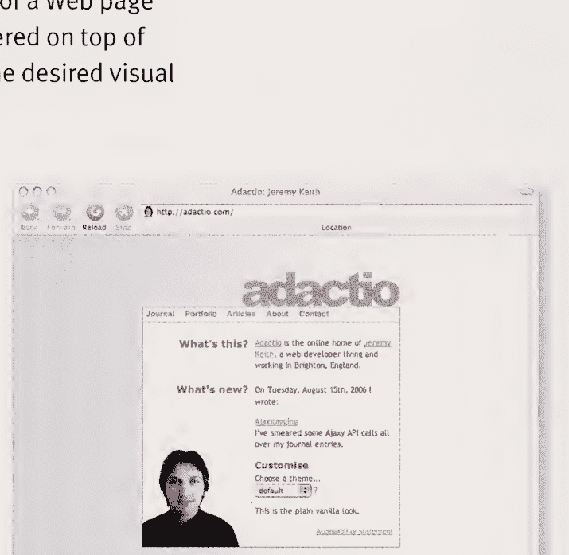

### 从 CSS 中学习

层叠样式表 (CSS) 非常适合渐进增强的原则。样式声明可以层叠在现有标记之上。支持 CSS 的浏览器会应用声明来显示内容。如果不支持 CSS，内容仍然可用。

图 5.1 展示了我的网站在支持 CSS 的浏览器中的样子。

图 5.2 展示了同一个网站在禁用样式时的样子。

查看内容的唯一要求是浏览器理解 HTML 或 XHTML。因为 CSS 是层叠在标记之上的，我不需要为旧版浏览器创建单独的简化版本。一个方案适用于所有情况。

CSS 的另一个巨大优势是样式声明可以存储在外部文件中。与其在 HTML 标签内部设置样式声明，不如将所有样式信息保存在一个集中位置。这能让你的标记保持简洁，使更新内容更加容易。更新外部样式表也比在杂乱的标记和 CSS 中搜寻某个难以捉摸的声明要容易得多。

**图 5.1** 我的网站 adactio.com 经过了 CSS 增强。

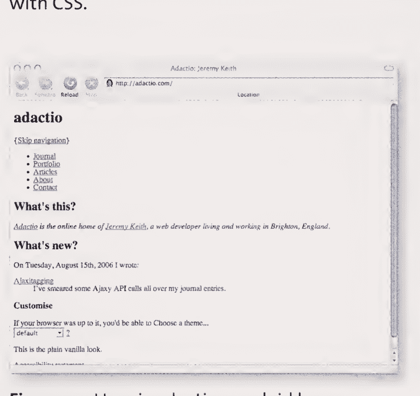

**图 5.2** 这是 adactio.com 剥离样式后的样子。


## 非侵入式 JavaScript

与 CSS 类似，将 JavaScript 代码保存在外部文件中，而不是混写在标记语言中，确实大有裨益。大多数脚本都编写并存储在外部 `.js` 文件中，网页通过 `<script>` 标签来引用这些文件。然而，仍有一些 JavaScript 代码与标记语言混在一起。

JavaScript 函数有时会通过 `javascript:` 伪协议从链接中触发，例如：

```
<a href="javascript:doSomething();">Click me!</a>
```

这并非像 `http://` 或 `ftp://` 这样的真实网络协议。它假定浏览器支持 JavaScript。如果 JavaScript 被禁用，最好的情况是什么也不会发生，最坏的情况是浏览器会报错。

更常见的做法是将 JavaScript 调用放在像 `onclick` 这样的事件处理属性中。这些事件处理程序常常与无意义的内部链接相关联：

```
<a href="#" onclick="doSomething(); return false;">Click me!</a>
```

这比使用 `javascript:` 伪协议稍好一些，但仍然是对 `href` 属性的滥用。如果 JavaScript 被禁用，用户会被导航到当前文档的顶部。

`href` 属性应包含对真实资源的引用。如果 JavaScript 不可用，这可以作为后备方案：

```
<a href="page.html" onclick="doSomething(); return false;">Click me!</a>
```

这种技术并不假定 JavaScript 始终可用。与 `javascript:` 伪协议相比，这是一个关键区别。但它仍然将 JavaScript 函数调用放在了内联事件处理程序中。这相当于在 CSS 中使用内联样式。理想情况下，标记语言和 JavaScript 应该保持分离。这个目标可以通过实践 *非侵入式 JavaScript* 来实现。

### 事件处理

你不需要使用内联事件处理程序来触发 JavaScript 函数。你可以使用一些 DOM 脚本技术将函数附加到事件上。

事件总是附加到一个元素上。使用 `getElementById` 和 `getElementsByTagName` 等 DOM 方法，可以相对容易地找到特定的元素或一组元素。每个元素都有一系列事件处理属性：`onclick`、`onmouseover`、`onmouseout` 等等。如果你将一个函数赋值给其中一个事件，当该事件被触发时，该函数就会被执行。

下面的代码将 `doSomething` 函数赋值给文档中每个链接的 `click` 事件：

```
var links = document.getElementsByTagName("a");
for (var i=0; i<links.length; i++) {
  links[i].onclick = function() {
    doSomething();
    return false;
  };
}
```

我使用了一个匿名函数来存储应由 `click` 事件触发的操作。我也可以传递一个函数的引用：

```
links[i].onclick = doSomething;
```

在这种情况下，我需要确保 `doSomething` 函数返回 `false` 值，以防止浏览器实际跟随链接跳转。

以下做法是无效的：

```
links[i].onclick = doSomething();
```

这并非将 `doSomething` 函数赋值给 `onclick` 事件处理程序，而是立即执行了该函数。当你将函数赋值给事件处理程序时，你需要传递一个函数引用（不带括号）或赋值一个匿名函数。

### 我们希望页面加载完成

使用外部事件处理程序（而非内联）存在一个问题。只要你使用 DOM 方法，就必须有一个完整的文档对象模型。如果文档尚未完全加载，DOM 就是不完整的。

当浏览器从服务器获取网页时，它会从上到下解析页面，并在此过程中构建节点树。当它处理 `head` 元素时，可能会遇到一个指向外部 JavaScript 文件的 `<script>` 标签。浏览器现在会获取这个 JavaScript 文件并开始从上到下执行它。如果一条 JavaScript 语句使用了 `getElementsByTagName` 或 `getElementById`，浏览器将找不到正在查找的元素，因为它尚未加载完整个文档。

以下代码不会返回任何结果：

```
var links = document.getElementsByTagName("a");
```

因为浏览器尚未遇到任何一个 `a` 元素。

如果你想使用 DOM 方法，必须等到文档加载完成。幸运的是，通过将函数赋值给 `window` 对象的 `load` 事件，可以轻松实现这一点：

```
window.onload = prepareLinks;
function prepareLinks() {
  var links = document.getElementsByTagName("a");
  for (var i=0; i<links.length; i++) {
    links[i].onclick = function() {
      doSomething();
      return false;
    };
  }
}
```

这会将 `prepareLinks` 函数赋值给 `window.onload` 事件处理程序。

使用 `window.onload` 的一个问题是，你只能为其赋一个值。你很可能希望在文档加载时排队执行多个函数。为此，你可以使用 `addLoadEvent` 函数：

```
function addLoadEvent(func) {
  var oldonload = window.onload;
  if (typeof window.onload != 'function') {
    window.onload = func;
  } else {
    window.onload = function() {
      if (oldonload) {
        oldonload();
      }
      func();
    }
  }
}
```

这个方便的小函数由 Simon Willison 编写 (http://simonwillison.net/)。它接受一个参数，该参数是你希望在文档加载完成后执行的函数的引用：

```
addLoadEvent(prepareLinks);
```

`prepareLinks` 函数被添加到文档加载后将要执行的函数列表中。

除了使用 `window.onload` 事件处理程序来触发函数外，另一种方法是将你的 `<script>` 标签放在 `</body>` 结束标签之前。然后你可以立即执行你的函数，因为此时 DOM 已经（基本）完整了。

## 渐进增强与 Ajax

当渐进增强的原则应用于 DOM 脚本时，其结果就是非侵入式 JavaScript。包含在外部 JavaScript 文件中的脚本增强功能被应用于文档，但绝不假定 JavaScript 一定存在。如果 JavaScript 不可用，文档的内容仍然可用，其所有链接和表单仍然可以工作。如果 JavaScript 可用，则通过 DOM 脚本添加额外的功能。最重要的是，所有这些添加的功能都不是核心必需的。

经过多年不负责任的脚本编写，这种 JavaScript 处理方式正获得一些认可，尤其是在那些了解标准、并体验过 CSS 渐进增强优势的前端开发者中。

唉，Ajax 的出现可能使事情倒退了。

太多的 Ajax 应用程序建立在 JavaScript 可用这一假设之上。这些应用程序不是将 JavaScript 作为一种增强功能的工具，而是使其成为一种必需品。核心功能通过 JavaScript 来执行，导致用户面临“全有或全无”的局面。唯一的办法是浪费时间和精力去构建一个独立的、没有 JavaScript 的纯 HTML 版本。

这个问题可以通过将渐进增强的原则应用于 Ajax 来避免。

## Hijax 方法

我想向你介绍一种我称之为 Hijax 的方法。它是一个两步计划，用于构建优雅降级的 Ajax 应用程序：

1.  首先构建一个普通的网页。用户可以使用链接和表单从服务器请求信息以及向服务器发送信息。服务器返回同一页面的更新版本。每次用户点击链接或提交表单时，整个页面都会刷新。

2.  使用 DOM 脚本来拦截（或劫持）那些从服务器请求信息和向服务器发送信息的链接和表单。通过 `XMLHttpRequest` 对象重定向这些请求。服务器只需返回页面中发生变化的部分，而不是整个页面。

第 1 步不需要 JavaScript、CSS 或任何其他客户端技术。所有处理都在服务器端进行。

在第 2 步中，JavaScript 用于增强用户体验。页面不会整体刷新，而只更新其中一部分。需要注意的是，所有处理仍然在服务器端进行。

`XMLHttpRequest` 对象就像一个小型升降机。它在浏览器和服务器之间来回传输数据，但业务逻辑始终稳固地留在服务器上。

将核心功能委托给客户端脚本语言并不是一个好主意。浏览器是一个不可预测的环境。你无法确定访问者会使用什么样的浏览器，或者这些浏览器中 JavaScript 是否已开启。你的服务器环境则可预测得多。你知道它的能力，知道它可以执行哪些语言。在可能的情况下，让服务器（而不是浏览器）来完成重要的工作。

## 架构

为了使 Hijax 技术良好运行，页面应该在服务器端以模块化的方式构建。这是当今大多数网页的构建方式。

一个典型的网页由一系列组件组成。其中一些组件，如品牌标识、导航和页面底部的细则，从一个页面到另一个页面是保持不变的。其他组件，如正文内容，则是特定于某个页面的。


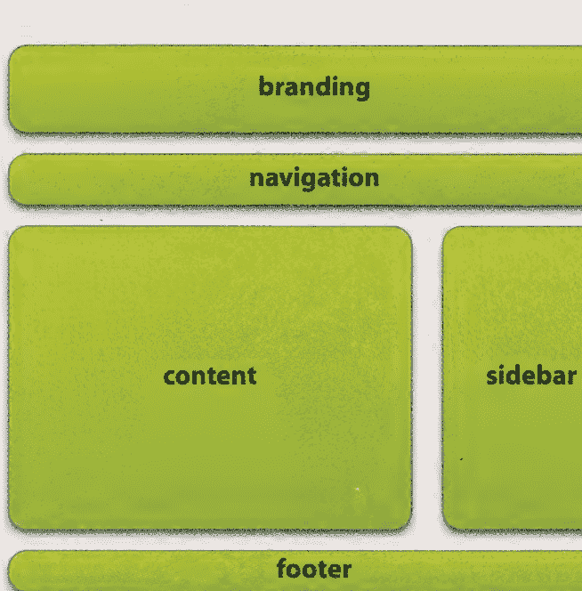

**图 5.3** 这是一个典型 Web 页面的架构。

在页面之间重复使用的组件通常保存在单独的文件中。例如，一个文件用于显示导航栏，另一个用于显示页脚。当请求页面时，服务器会拉取这些可复用文件，并将它们与特定页面的内容相结合。通常，这些内容是从数据库中提取的。

以下是一个典型页面的骨架标记：

```
<!-- doctype -->
<html>
<head>
  <title><!-- page title --></title>
  <!-- fetch stylesheets and scripts -->
</head>
<body>
  <div id="branding"><!-- display branding --></div>
  <div id="navigation"><!-- display navigation --></div>
  <div id="content">
    <!-- display content from a database -->
  </div>
  <div id="sidebar"><!-- display sidebar --></div>
  <div id="footer"><!-- display footer --></div>
</body>
</html>
```

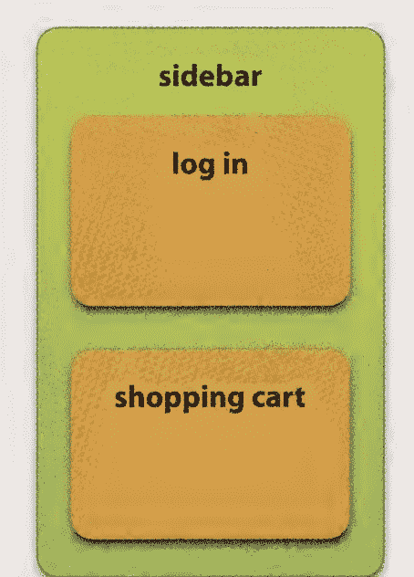

请注意，独立的组件通常包含在 `<div>` 标签中。`div` 元素在某种程度上名声不佳，因为经常被过度使用。但它确实具有一定的语义含义：它定义了 Web 页面中一个独立的部分（section）或分区（division）。这些分区可以进一步细分为更小的级别。例如，一个侧边栏可能包含登录表单或购物车等子组件。

这些子组件是根据用户的操作在服务器端生成的。它们是 Hijax 的理想候选对象。它们可能会被包含在各自的 `div` 元素中：

```
<div id="sidebar">
  <div id="login"><!-- display login form --></div>
  <div id="cart"><!-- display shopping cart --></div>
</div>
```

**图 5.4** 这些是你可能在侧边栏中发现的子组件。

## 规划悖论

在我建议的内容中似乎存在一个矛盾。一方面，我主张首先构建一个传统的网站，而不是在开始时就假设 Ajax 将驱动交互。另一方面，很明显，如果你想有效地使用 Ajax，网站的后端架构需要具有高度的模块化。这是需要从一开始就进行规划的。

可以通过遵循以下两条指导原则来解决这个悖论：

1. 从一开始就为 Ajax 做规划。
2. 在最后阶段实现 Ajax。

在项目开始时考虑 Ajax 交互，可以鼓励你将页面视为模块的集合，其中某些模块可以从 Ajax 中获益。但在构建这些页面时，与其立即深入研究 Ajax，不如先使用常规的基于页面的交互。这样一来，你就能确保网站具有向后兼容性。你不需要构建一个单独的非 Ajax 版本，因为它已经存在了。你只需要根据渐进增强（progressive enhancement）的原则应用 Ajax 功能即可。

## 模式识别

思考满足以下标准的场景：

1. 服务器向浏览器发送一个 Web 页面。
2. 用户可以填写表单或点击带有查询字符串（query string）的链接。
3. 服务器将同一个页面发回浏览器。页面的部分内容已根据用户的请求发生了变化。

使用 Hijax，你可以改变步骤 3。与其请求整个页面，不如使用 Ajax 仅请求更新的组件。

## Hijax 实战

我将重新审视第 4 章中的联系详情页。我需要从头开始。首先，我要构建这个页面，使其在没有 JavaScript 的情况下也能工作。

现在的链接通过查询字符串将一个名为 `person` 的参数传递给同一个页面：

```
<ul>
  <li>
    <a href="?person=andy">Andy</a>
  </li>
  <li>
    <a href="?person=richard">Richard</a>
  </li>
  <li>
    <a href="?person=jeremy">Jeremy</a>
  </li>
</ul>
```

我正将这个页面从静态 HTML 文件更改为动态 PHP 文件。你可以使用任何服务器端编程语言来处理传递的参数。我使用 PHP 是因为我比较熟悉。

在 "details" `div` 内部，我包含了一个名为 `people.php` 的 PHP 文件：

```
<div id="details">
<?php include "people.php"; ?>
</div>
```

该文件包含一段简单的 PHP 代码。它检查查询字符串中是否发送了 `person` 参数。如果发送了，则显示相应的标记：

```
<?php
if (isset($_GET["person"])) {
  switch ($_GET["person"]) {
    case "andy":
      include "files/andy.html";
      break;
    case "richard":
      include "files/richard.html";
      break;
    case "jeremy":
      include "files/jeremy.html";
      break;
  }
}
?>
```

这是一个小型、独立的脚本。在现实场景中，它可能会更复杂。这类脚本可能会从数据库中提取联系详情，或者通过解析 XML 文件来提取。最终结果是一样的：该文件显示包含某人联系详情的 HTML。

显示出来的标记如下所示：

```
<h2><a href="mailto:jeremy@clearleft.com">Jeremy Keith</a>
</h2>
<a href="http://adactio.com/">http://adactio.com/</a>
```

点击列表中的任何姓名都会刷新页面并显示该人的联系详情。在没有 JavaScript 的情况下，一切运行良好。

接下来，我将在现有功能之上叠加一层 Ajax。当点击某人的姓名时，我想在不刷新整个页面的情况下显示其详情。为此，我需要拦截浏览器的默认行为，并将其替换为我想要的行为。

## 捕获链接数据

首先，我需要劫持（hijack）人员姓名列表中的链接。如果列表有一个唯一的 ID，使用 DOM 很容易实现。我给列表指定一个 ID 为 `people`。以下是基本的页面结构：

```
<h1>People</h1>
<ul id="people">
  ...
</ul>
<div id="details">
  ...
</div>
```

现在，我可以结合使用 `getElementById` 和 `getElementsByTagName` 轻松访问列表中的所有链接。

在一个名为 `ajax.js` 的外部 JavaScript 文件中，我定义了一个名为 `prepareLinks` 的函数：

```
function prepareLinks() {
```

首先，我要使用对象检测来确保浏览器能够理解我将要使用的 DOM 方法：

```
if (!document.getElementById || !document.
getElementsByTagName) {
  return;
}
```

为了稳妥起见，在尝试对 "people" 列表执行任何操作之前，我要确保它确实存在：

```
if (!document.getElementById("people")) {
  return;
}
```

我首先获取 "people" 列表中的所有链接：

```
var list = document.getElementById("people");
var links = list.getElementsByTagName("a");
```

我遍历这些链接，并将一个匿名函数附加到它们的 `onclick` 事件处理器上：

```
for (var i=0; i<links.length; i++) {
  links[i].onclick = function() {
```

当链接被点击时，我想从其 `href` 属性中提取查询字符串。我可以使用 JavaScript 的 `split` 函数来实现，该函数将字符串拆分为数组。我将以问号字符为分隔符拆分 `href` 属性。结果数组中的第一个成员（索引为 0）是问号之前的所有内容。第二个成员（索引为 1）包含问号之后的所有内容：

```
var query = this.getAttribute("href").split("?")[1];
```

现在我可以构造我想要的 Ajax 请求 URL 了。我请求 `people.php` 文件，后面跟着一个问号，以及我刚刚提取的查询字符串：

```
var url = "people.php?"+query;
```

这就是我要传递给我们在第 4 章中编写的 `grabFile` 函数的值：

```
grabFile(url);
```

我要对 `grabFile` 函数做轻微修改。如果浏览器支持 Ajax，它将返回 `true`，否则返回 `false`。为了防止页面刷新，我将使用这个返回值。如果 `grabFile` 返回 `true`，我将通过以下方式取消 `click` 事件的默认浏览器行为：

```
return !grabFile(url);
```

这个语句返回的是 `grabFile` 返回值的相反值。如果 `grabFile` 返回 true，该语句则返回 false，从而取消默认的浏览器行为。但如果 `grabFile` 返回 false，该语句则返回 true，浏览器将跳转到该链接。

完整的函数如下所示：

```
function prepareLinks() {
    if (!document.getElementById || !document.getElementsByTagName) {
        return;
    }
    if (!document.getElementById("people")) {
        return;
    }
    var list = document.getElementById("people");
    var links = list.getElementsByTagName("a");
```


for (var i=0; i<links.length; i++) {
	links[i].onclick = function() {
		var query = this.getAttribute("href").split("?")[1];
		var url = "people.php?"+query;
		return !grabFile(url);
	};
}

`prepareLinks`函数需要在文档加载完成后立即执行：

window.onload = prepareLinks;

从这以后，JavaScript基本保持不变。`getHTTPObject`函数再次使用。`grabFile`函数稍作修改，以返回`true`或`false`：

function grabFile(file) {
	var request = getHTTPObject();
	if (request) {
		request.onreadystatechange = function() {
			parseResponse(request);
		};
		request.open("GET", file, true);
		request.send(null);
		return true;
	} else {
		return false;
	}
}

`parseResponse`函数与之前完全相同：

function parseResponse(request) {
	if (request.readyState == 4) {
		if (request.status == 200 || request.status == 304) {
			var details = document.getElementById("details");
			details.innerHTML = request.responseText;
		}
	}
}

我所要做的只是从我的.php文件的`head`中引用这个JavaScript文件：

<script type="text/javascript" src="ajax.js"></script>

Ajax的行为看起来与之前完全相同。点击人名即可显示其联系方式，而无需刷新整个页面。但在幕后，一切运作方式都大不相同。

首先，标记更加清晰了。不再有任何内联事件处理器。这使得维护内容和维护JavaScript都变得更容易。

最大的区别在于JavaScript的使用方式。它是在增强现有功能，而不是试图成为该功能的唯一提供者。如果JavaScript被禁用，一切仍然可以工作，尽管会有页面刷新。

## 表单

链接并非是将数据发送到服务器的唯一途径。表单提供了从浏览器发送大量信息的最佳方式。

许多网站都有一个联系表单，如图5.5所示。这是一种允许访客提供反馈的便捷方式。

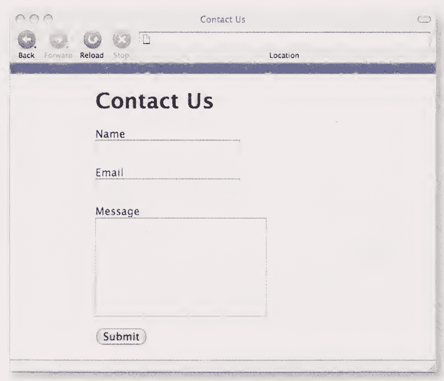

以下是联系页面的源代码：

<!DOCTYPE html PUBLIC "-//W3C//DTD XHTML 1.0 Strict//EN"
"http://www.w3.org/TR/xhtml1/DTD/xhtml1-strict.dtd">
<html xmlns="http://www.w3.org/1999/xhtml" xml:lang="enMutableContact us</code></code><code>charset=utf-8" />
  <title>Contact Us</title>
  <style type="text/css">
  @import url("style.css");
  </style>
</head>
<body>
  <h1>Contact Us</h1>
  <div id="container">
<?php include "formlogic.php"; ?>
  </div>
</body>
</html>

在本例中，PHP用于在名为"container"的`div`中创建表单。

`formlogic.php`文件执行多项任务：

- 如果表单已提交，检查所有必填字段是否都已填写。
- 如果所有必填字段都已填写，显示"感谢"信息。
- 如果有必填字段未填写，显示表单并高亮显示该必填字段。
- 如果表单根本未被提交，显示表单。

这是相当标准的表单处理逻辑。它可以用任何服务器端编程语言来编写。最终结果是，一旦处理完成，就会输出一些标记以供包含在网页中。

表单的标记如下所示：

<form method="post" id="contactform" action="">
  <p>
    <label for="name">Name</label>
    <input type="text" name="name" id="name" value="" />
  </p>
  <p>
    <label for="email">Email</label>
    <input type="text" name="email" id="email" value="" />
  </p>
  <p>
    <label for="message">Message</label>
    <textarea name="message" id="message" cols="30"
      rows="10"></textarea>
  </p>
  <p>
    <input type="submit" name="submit" value="Submit" />
  </p>
</form>

在本例中，所有三个字段都是必填的。如果表单被提交且其中一个字段未填写，该字段将通过其`label`元素中的额外文本进行高亮显示：

<label for="name">Name
  <strong class="error">is required</strong>
</label>

一旦所有必填字段都已填写，表单将不再显示。相反，会输出以下信息：

<p class="feedback">
Thank you for getting in touch
</p>

此时，通过表单提交的数据可以通过电子邮件发送给网站所有者。这些数据也可以存储在数据库中或记录到文件中。

## 捕获表单数据

就目前而言，联系表单无需任何JavaScript即可工作。服务器处理所有的处理工作。唯一的小小不便之处在于，每次提交表单时都会有一次与服务器的往返。如果有必填字段未填写，用户要等到整个页面带着更新后的表单从服务器返回后才会发现。消除这些页面刷新将提升用户体验。

我将使用一些Ajax将表单数据直接发送到`formlogic.php`文件。为此，我将编写一个名为`sendData`的函数。这个函数与之前已经看到的`grabFile`函数非常相似。该函数接受一个参数，即将要发送到服务器的数据字符串：

function sendData(data) {
  var request = getHTTPObject();
  if (request) {
    request.onreadystatechange = function() {
      parseResponse(request);
    };
    request.open( "POST", "formlogic.php", true );
    request.setRequestHeader("Content-Type",
      "application/x-www-form-urlencoded");
    request.send(data);
    return true;
  } else {
    return false;
  }
}

这一次，向服务器发送的请求使用的是`POST`方法，而非`GET`：

request.open( "POST", "formlogic.php", true );

由于正在发送数据，使用`setRequestHeader`正确设置content-type头部非常重要：

request.setRequestHeader("Content-Type",
  "application/x-www-form-urlencoded");

`sendData`函数返回一个布尔值。如果成功，该函数返回`true`。另一方面，如果无法发起Ajax请求，`sendData`返回`false`。

要使用此函数，我需要向它传递一些数据。我将在表单提交时从表单中提取这些数据。我可以使用`onsubmit`事件处理器来实现这一点。

我将编写一个名为`prepareForm`的函数，它将在文档加载时执行：

window.onload = prepareForm;

由于我不想对浏览器的能力或当前文档的内容做任何假设，我让此函数先进行一些对象检测：

function prepareForm() {
  if(!document.getElementById) {
    return;
  }
  if(!document.getElementById("contactform")) {
    return;
  }
}

现在我可以将一个匿名函数分配给表单的`onsubmit`事件处理器：

document.getElementById("contactform").onsubmit = function() {

要从表单中提取数据，我可以利用一个便捷的快捷方式。`elements`数组包含指定表单中的所有表单元素。遍历这一个数组比使用DOM查找所有的`input`元素、`textarea`元素和`select`元素要容易得多：

var data = "";
for (var i=0; i<this.elements.length; i++) {
  data+= this.elements[i].name;
  data+= "=";
  data+= escape(this.elements[i].value);
  data+= "&";
}

变量`data`初始为空字符串。当我遍历表单元素时，每个元素的名称（`name`、`email`、`message`等）被添加到此字符串中。然后，追加一个等号。之后，添加表单元素的值。我使用JavaScript的`escape`函数来确保值在发往服务器的旅程中被正确格式化。最后，添加一个&符号来分隔名称/值对。

在循环结束时，变量`data`保存着一串名称和值。这就是我想要传递给`sendData`函数的内容。

再一次，我将返回一个布尔值。这与`sendData`返回的值相反：

return !sendData(data);

如果`sendData`正确工作并返回`true`，则此语句返回`false`。默认的浏览器行为将被取消。表单将不会被提交。

以下是完成的函数：

function prepareForm() {
  if(!document.getElementById) {
    return;
  }
  if(!document.getElementById("contactform")) {
    return;
  }
  document.getElementById("contactform").onsubmit =
function() {
    var data = "";
    for (var i=0; i<this.elements.length; i++) {
      data+= this.elements[i].name;
      data+= "=";
      data+= escape(this.elements[i].value);
      data+= "&";
    }
    return !sendData(data);
  };
}

当表单被提交时，其数据被提取并传递给`sendData`函数。`sendData`函数随后将这些数据发送到`formlogic.php`文件。服务器发回响应，我需要在`parseResponse`函数中处理此响应：


```javascript
function parseResponse(request) {
    if (request.readyState == 4) {
        if (request.status == 200 || request.status == 304) {
            var container = document.getElementById("container");
            container.innerHTML = request.responseText;
            prepareForm();
        }
    }
}
```

从服务器返回的 `responseText` 属性通过更新 `innerHTML` 属性被插入到“container” `div` 中。随后 `prepareForm` 函数被再次执行。如果服务器返回的表单包含错误消息，我将需要再次拦截其 `submit` 事件。

这些函数 `prepareForm`、`sendData` 和 `parseResponse` 均放置在一个名为 `ajax.js` 的文件中，以及 `getHTTPObject` 函数。我只需要在网页的 `<script>` 标签中引用这个 JavaScript 文件即可：

```html
<script type="text/javascript" src="ajax.js"></script>
```

现在，表单处理将在无需任何全页刷新的情况下进行，如图 5.6 所示。

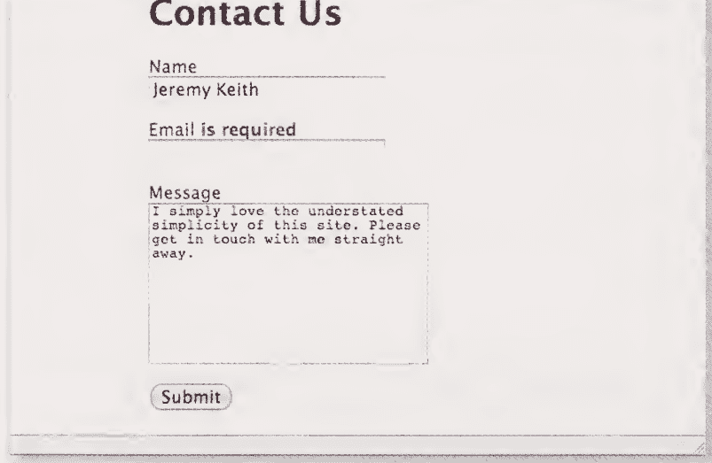
**图 5.6** 必填项在无需整页刷新的情况下被标记。

## 表单验证

使用 JavaScript 来避免表单处理时的页面刷新并非新鲜事。表单验证是 JavaScript 最早的应用场景之一。但它一直存在一个巨大的缺陷：不可靠性。

你不能仅依赖 JavaScript 来验证表单中提交的数据。用户的浏览器可能不支持 JavaScript，或者该功能被直接关闭了。无论在浏览器中使用 JavaScript 进行了怎样的表单验证，一旦信息到达服务器，必须使用另一种编程语言重复一遍。这意味着你要重复编写逻辑，而这绝不是一个好主意。

Hijax 方法避免了这种重复。JavaScript 仅被用作一种传输机制，负责将数据发送到服务器并显示随后的响应。

如果我想让联系表单的处理变得更智能，我只需要更新我的 `formlogic.php` 文件。我可以添加一个正则表达式来测试 `email` 值是否看起来像一个正确的电子邮件地址。或者我可能会决定 `name` 字段最终并非必填项。这些都属于处理逻辑的决策。将这些处理仅放在服务器上进行要好得多。每次做出新决定，我只需要更新一个文件。因为 JavaScript 文件并没有试图做任何过于复杂的事情，所以它不会受到业务逻辑变化的影响。

这也将 JavaScript 文件的大小保持在最低限度。一个非常复杂的表单可能需要大量错综复杂的验证。所有这些都可以在服务器端处理，因为在那里文件大小不是问题。即使表单的复杂度增加，JavaScript 依然保持简单。

对于最终用户来说，这一切都是技术细节。最终结果就是在浏览器中获得无需刷新页面的快响应。

## 具有欺骗性的富客户端

传统上，Web 浏览器在 Web 服务器面前扮演着从属角色。服务器可以处理信息，从数据库中提取动态数据，并将生成的页面发送给浏览器。浏览器仅仅是检索和显示这些页面的容器。在这种关系中，浏览器被称为“瘦客户端”（thin client）。而服务器才是核心操作发生的地方。

随着 JavaScript 的出现，浏览器的能力得到了增强。现在可以直接在浏览器中创建更丰富、更动态的交互。但正如我们所见，JavaScript 的存在不能被视为理所当然。如果以一种非侵入式（unobtrusive）的方式使用 JavaScript，就可以在不破坏基础客户端-服务器模型的情况下添加增强功能，以提升用户体验。从根本上说，浏览器仍然是一个瘦客户端。

一些 Ajax 应用改变了权力平衡。通过利用 JavaScript 和 DOM 的力量，这些应用使用浏览器来执行对于应用程序运行至关重要的复杂编程任务。我认为这是一个错误。

在 Ajax 出现之前，一个网站就像一家自助餐厅。每次你想要某些信息，浏览器必须获取一个新页面。在自助餐厅里，每当你想要食物时，你必须走到柜台前点餐。

给网站添加 Ajax 就像是为餐厅雇佣一名服务员。顾客不再需要走到柜台点餐，服务员会代替他们将订单传给柜台。这带来了更加愉悦的用餐体验。

仅仅因为你雇佣了一名服务员，并不意味着你可以解雇厨师。但这正是某些 Ajax 应用试图做的事情。他们不满足于让服务员点餐和端菜，还让服务员承担所有的烹饪工作。

烹饪应该在厨房进行。应用程序逻辑应该在服务器端。这样对每个人都更好。基于服务器的应用运行起来会更加一致。浏览器的环境实在是太不可预测了。

你的用户只关心一件事：他们在访问你的网站时希望获得愉悦的体验。这正是 Ajax 真正的力量所在。Ajax 允许你创建响应迅速的交互式界面。如果使用正确，Ajax 可以成为一名迷人且周到的服务员。

从用户的角度来看，浏览器现在似乎是一个“富客户端”（rich client）。富客户端就像桌面应用程序一样，能立即在原位（in situ）执行处理指令。一个使用 Hijax 方法增强的网站看起来也是如此。表单被处理，链接被获取，所有这些都无需浏览器刷新。操作似乎发生在浏览器内部。而事实上，所有沉重的计算工作仍然在它本应在的服务器端完成。

Hijax 具有欺骗性。它营造出浏览器是一个富客户端的幻象，而实际上这只是一个门面。不要因为这样欺骗用户而感到不安。借用詹姆斯·卡维尔（James Carville）的话来说，“关键在于用户体验，笨蛋。”这才是真正重要的事情。

## 本章小结

当渐进增强（progressive enhancement）遇到 Ajax 时，结果就是 Hijax。根据我的经验，这是一种应用 Ajax 的简单但强大的方式。它允许你更新页面的部分内容而不是整个页面，这正是 Ajax 交互的精髓。最重要的是，Hijax 的增强功能可以在不改变页面基本功能的情况下被剥离。你网站的业务逻辑依然坚如磐石。

你在本章中看到的示例简单且直接。通过增加一些交互性的趣味元素，它们可以得到极大的提升。在下一章中，我们将研究如何为用户提供更多的反馈。

我还想探讨一些重要问题。Ajax 可以是一个有用的工具，但有时它引入的问题与它解决的问题一样多。使用 Ajax 开发会带来一系列独特的挑战。我将向你展示如何应对它们。


# Ajax 挑战

# 6


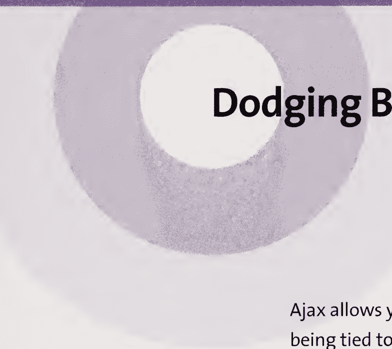

## 避坑指南

Ajax 允许你探索新的交互形式。你不再受限于基于页面的请求和响应模型，现在可以自由地为网站添加更离散、更聚焦的交互性。这很令人兴奋，但同时也潜在地具有危险性。

改变可能令人恐惧。虽然人们很想扫除之前的一切，用闪亮的新 Ajax 界面取而代之，但这将是一个错误。你的用户不会为此感谢你。指望人们能瞬间适应一个“勇敢新世界”般的 Web 环境是不现实的。

用户的预期是建立在约定（conventions）之上的。Ajax 打破了其中一些约定。这意味着 Ajax 干扰了用户的预期，这很少是一个明智之举。

如果我们不小心，Ajax 这种打破约定、颠覆预期的特质会把用户吓跑。如果他们对新 Ajax 界面的初步体验是不舒适的，他们可能永远不会回来。相反，如果对 Ajax 的过渡处理得谨慎且得体，新的增强功能将会显得自然、有用且令人愉悦。


尽管围绕 Ajax 的炒作铺天盖地，有时听起来它仿佛是一剂万能灵药。虽然 Ajax 确实能带来巨大益处，但也引入了许多设计挑战。如果不能巧妙应对这些挑战，你最终可能反而会被这"万能灵药"伤及自身。

## 向后兼容

Ajax 等技术可用于提升用户体验。但这并不意味着该技术应成为访问内容的必要条件。

用户无需 CSS 和 JavaScript 也能访问内容。如果未能周全地应用这些技术，它们可能成为可怕的障碍。但只要以渐进增强原则驱动你的工作流程，最终结果将始终具有向后兼容性。这对于由 Ajax 驱动的网页尤为重要。

正如你所见，Hijax 方法允许你将 Ajax 作为增强功能而非必要条件来实现。只要有足够的规划和考量，就不会遗漏任何用户。与任何方法论一样，这里存在一个无法回避的问题：它能大规模应用吗？

到目前为止你看到的所有示例都相对简单。驱动联系详情页面或反馈表单的用户交互，无非是点击链接或填写表单。这并不新鲜。万维网本就建立在链接和表单之上：`GET` 和 `POST`。改变的是处理这些请求的方式。得益于 Ajax，浏览器仿佛成为了一个富客户端，能在页面内显示响应而无需刷新整个页面。由于传统链接和表单会触发 Ajax 功能，因此不难确保始终提供备选方案。

我至今给出的示例都是通过 Ajax 增强的传统网站，使其变得更像应用程序。但术语 *Ajax* 也指代那些恰好运行在 Web 上的应用程序。

*Ajax* 是一个广义术语。它涵盖了从响应灵敏的表单到文字处理器和电子邮件客户端的一切。这是一个渐变谱系，一端是简单的网页，另一端是成熟的浏览器内聊天客户端。随着你在此谱系上移动，提供向后兼容性的挑战也随之增加。

## 文档与应用程序

在讨论网站与 Web 应用的区别时，你常会听说 Web 似乎正处于转型期。它似乎正从文档交付平台转向基于应用程序的系统。但这种区分是牵强的；它暗示了应用程序并非以文档为中心。

事实上，无论是应用程序还是网站，文档都处于核心位置。文字处理器没有文档就毫无用处。电子表格应用程序需要电子表格。即使是像 Adobe Photoshop 这样的复杂桌面应用程序，也是在处理文档；只不过这些文档恰好是图像。

网站与 Web 应用的区别在于文档的可塑性。传统网站仅展示文档。Web 应用则让你能够与文档交互并更改它。但请务必明白：无论万维网变得多么交互化，它始终基于文档。

话虽如此，随着在从网站到 Web 应用的渐变谱系上移动，要提供既能提供丰富交互体验，又能优雅降级为一系列简单 HTML 文档的方案，变得愈发困难。

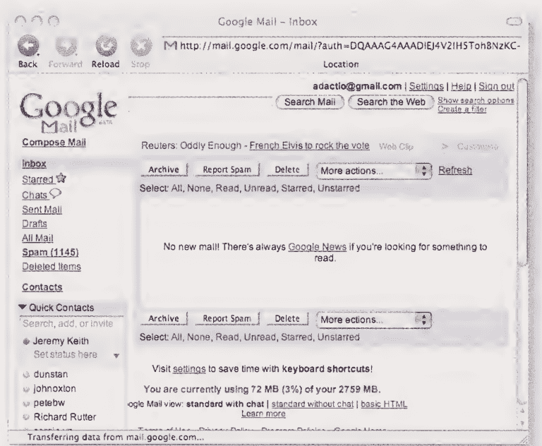

### 连续谱

像 Google 的 Gmail 这样的在线电子邮件客户端，就是通过使用 Ajax（https://mail.google.com/）来增强的。更新页面的局部区域提升了用户体验。但在线电子邮件客户端也可以通过整页刷新来构建，因此理论上构建一个也能优雅降级的 Ajax 电子邮件客户端是可能的。

图 6.1 Gmail 是 Google 的在线电子邮件客户端，通过 Ajax 增强。


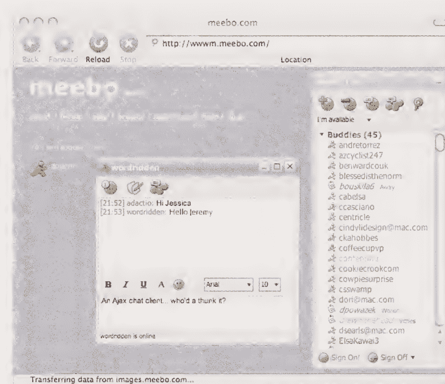

**图 6.2** Google 地图使用 Ajax 创造了一种全新的地图导航方式。

**图 6.3** Meebo 是一个通过 Web 浏览器交付的聊天客户端。

Google 地图是一种与地图交互的革命性方式，这得益于驱动它的 JavaScript（http://maps.google.com/）。能够拖动可见地图区域，结合 Ajax 按需加载图片的功能，创造了一个非常丰富的界面。很难想象这个功能在不使用不可接受的多次页面刷新的情况下如何能优雅降级。

Meebo 是一个完全在 Web 浏览器内构建的聊天客户端，使用了标记、CSS 和 JavaScript（http://meebo.com/）。得益于 Ajax，你可以像在桌面应用程序中一样，在虚拟窗口中聊天。这是一项非常了不起的成就。如果没有 Ajax，很可能无法提供这种交互。

Hijax 会将你带入从网页到 Web 应用的渐变谱系中相当远的位置。但在某个节点上，向后兼容的目标可能根本无法实现。

如果你发现自己到了这一步，或许会感到如释重负。你终于不必再担心如何提供优雅降级了。但请当心你所许的愿望。你要么需要构建一个独立的非 Ajax 版本网站，要么不得不将用户拒之门外。这两种选择都并不特别吸引人。

## 数字游戏

如果你通过跟踪浏览器统计数据认为自己了解受众，你或许能为决定制作一个专属应用程序找到理由。然而，统计数据可能具有误导性。决定不支持某个特定 Web 浏览器可能基于循环论证：统计数据显示来自某个浏览器的访问量极少，因此支持它没有意义——但访问量少的原因恰恰是网站不支持该浏览器。

重要的是要记住，你构建网站不是为了数字、百分比，甚至不是为了浏览器。网站是由人使用的。你的统计数据可能显示 97% 的访客使用的是支持 Ajax 的浏览器。剩余的 3% 总流量听起来是个小数目。但如果你的网站每天有 500 名访客，这个数字就意味着每天有 15 人被拒之门外。每个访问你网站的人都应该能访问其内容。

我并不是说网站的每个访客都应该获得完全相同的体验。这正是渐进增强的妙处：它让你能够根据访客的浏览器能力提供或多或少的功能，同时确保每个人都能访问内容。如果你决定将 Ajax 作为必要条件，你将错过使用 Web 标准（如 HTML/XHTML、CSS 和 JavaScript）的核心益处。如果你决定放弃渐进增强的好处，那么采用其他技术可能更合适。

如果你使用 Flex 框架并通过 Flash 交付 Web 应用，你可以在一个稳定、可预测的环境——Flash 播放器中，提供非常丰富的界面。当然，Flash 播放器插件将成为用户访问该应用的必要条件。但如果你已经决定在技术层面上排除某些访客，你只是将一组被排除的用户换成了另一组。

为手头的工作选用合适的工具。Ajax 相对于 Flex 最大的优势在于，Ajax 可以作为增强功能来应用，而 Flash 播放器提供的是"全有或全无"的内容交付方式。如果你决定不利用 Ajax 的最大优势，你当然应该探索其他选项，以便在你的网站上提供丰富的交互性。

## Web 服务

如第 3 章所述，`XMLHttpRequest` 对象的 `open` 方法只能向与自身相同的域发起请求。如果你想从第三方服务检索数据，这会是一个令人恼火的障碍。

许多应用程序允许通过公共应用程序编程接口（API）访问其数据。API 通常以 XML 格式返回数据，这似乎使它们非常适合 Ajax 请求。然而，同源限制阻碍了这种结合。

如果 Web 服务提供选项以 JSON 格式供应数据，则可以使用 script 标签技巧来检索该数据。这种解决方案的问题在于它需要 JavaScript 才能工作。没有非 JavaScript 的备选方案。

一个更健壮的解决方案是使用代理。代理只是一个转发请求的网关。你可以将自己的服务器作为第三方服务的代理，然后像平常一样发出 Ajax 请求。`XMLHttpRequest` 对象请求你自己服务器上的一个文件。这个文件随后向第三方服务器上的 Web 服务发送请求，该服务返回一些数据。这些数据可以传递回 `XMLHttpRequest` 对象。

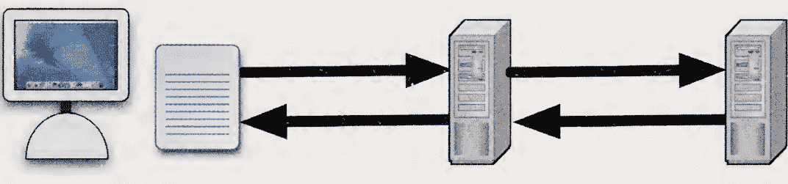

**图 6.4** 使用你的服务器作为代理，你可以在浏览器和第三方 Web 服务之间穿梭传递请求。

使用代理的缺点是请求和响应必须经过一个额外的网关。这额外的一跳意味着数据的流动速度不会像没有代理时那么快。

使用代理的巨大优势在于 JavaScript 并非必要条件。你可以构建一个网站，使用整页请求从 Web 服务检索数据，然后使用 Hijax 来添加 Ajax 交互性。如果不支持 Ajax，数据仍然可以通过传统的整页交互来访问。


如果你将服务器作为与 Web 服务通信的代理，那么在服务器端解析数据比在客户端使用 JavaScript 更为合理。在服务器上将 XML 转换为 HTML 要比在浏览器中快得多。

## 反馈

Web 浏览器基于传统的、以页面为单位的内容交付模型构建而成。默认情况下，当用户点击链接或提交表单时，浏览器会向服务器发送请求以获取新页面。此时，浏览器会立即提供反馈，让用户知道正在发生某些事情。


在大多数 Web 浏览器中，这种反馈以某种动画形式呈现。Apple 的 Safari 会在地址栏背景中显示一条扩展的彩色条纹。在 Microsoft 的 Internet Explorer 中，当用户请求新页面时，角落中normally static的徽标开始旋转。

使用 Ajax 时，浏览器获取整个新页面的默认行为被使用 JavaScript 和事件处理程序编写的自定义操作所取代。由于常规行为被取消，浏览器不再指示有操作正在进行。*我们需要自己提供这种反馈*。

在理想情况下，Ajax 响应会瞬间收到。但实际上，通过 Ajax 请求的资源与互联网上的任何其他流量一样，受到同样的瓶颈制约。响应速度取决于带宽、延迟以及影响网络数据流的所有其他因素。

对于访问启用 Ajax 的 Web 页面的用户来说，这可能会令人困惑。如果点击链接或提交表单没有立即产生响应，合理的假设就是某些东西坏了。

为了解决这个问题，Ajax 脚本应该包含某种机制来指示操作正在进行。你可以使用 DOM 脚本在页面中插入一段说明性文本。这可能就像在某个适当的元素中写入"Loading..."文本一样简单。

更有效的解决方案是使用动画。借鉴浏览器制造商的做法。创建一个无限循环的动画图像，然后在成功收到响应之前一直显示这个图像。


这种图像最简单的格式是动画 GIF 文件。具体的图像可以是你喜欢的任何内容，只要它具有平滑循环的动画即可。旋转的形状、旋转的箭头以及理发店风格的进度条都是表示活动的流行惯例。

这里有一个名为 `displayLoading` 的短函数。它接受一个参数，即文档中的一个元素。该元素首先通过移除其所有子节点来清空。然后，附加一个新创建的 `img` 元素。

```javascript
function displayLoading(element) {
  while (element.hasChildNodes()) {
    element.removeChild(element.lastChild);
  }
  var image = document.createElement("img");
  image.setAttribute("src","loading.gif");
  image.setAttribute("alt","Loading...");
  element.appendChild(image);
}
```

现在我可以更新联系详情示例以使用这个函数。我打算在执行 `grabFile` 函数中启动 Ajax 请求的同时执行它：

```javascript
function grabFile(file) {
  var request = getHTTPObject();
  if (request) {
    displayLoading(document.getElementById("details"));
    request.onreadystatechange = function() {
      parseResponse(request);
    };
    request.open("GET", file, true);
    request.send(null);
    return true;
  } else {
    return false;
  }
}
```

当点击一个名字时，GIF 动画会出现在 `"details" div` 中，这正是该人物详情将要显示的位置。

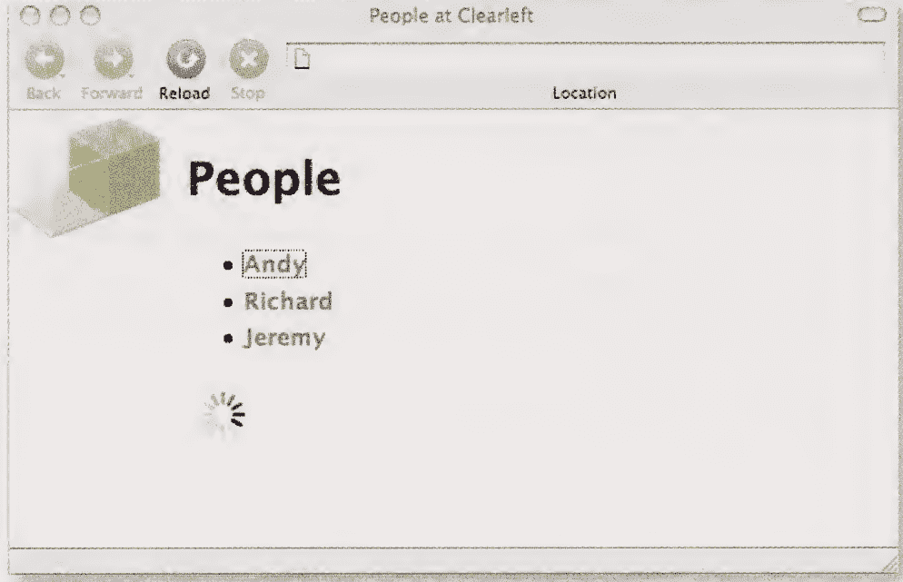
**图 6.7** 一个旋转的图标能让访问者放心，知道正在发生某些事情。

一旦 Ajax 调用成功完成，加载图像会在 `parseResponse` 函数中通过使用 `innerHTML` 而被清除：

```javascript
function parseResponse(request) {
  if (request.readyState == 4) {
    if (request.status == 200 || request.status == 304) {
      var details = document.getElementById("details");
      details.innerHTML = request.responseText;
    }
  }
}
```

对于联系表单，我想在表单提交时在其底部显示一个 GIF 动画。我要修改 `displayLoading` 函数，使其在附加图像之前不清空容器元素。这次我将使用一个进度条：

```javascript
function displayLoading(element) {
  var image = document.createElement("img");
  image.setAttribute("src", "progressbar.gif");
  image.setAttribute("alt", "Loading...");
  element.appendChild(image);
}
```

我只需要更新 `sendData` 函数：

```javascript
function sendData(data) {
  var request = getHTTPObject();
  if (request) {
    displayLoading(document.getElementById("contactform"));
    request.onreadystatechange = function() {
      parseResponse(request);
    };
    request.open( "POST", "formlogic.php", true );
    request.setRequestHeader("Content-Type",
      "application/x-www-form-urlencoded");
    request.send(data);
    return true;
  } else {
    return false;
  }
}
```

现在表单一提交，进度条就会出现。

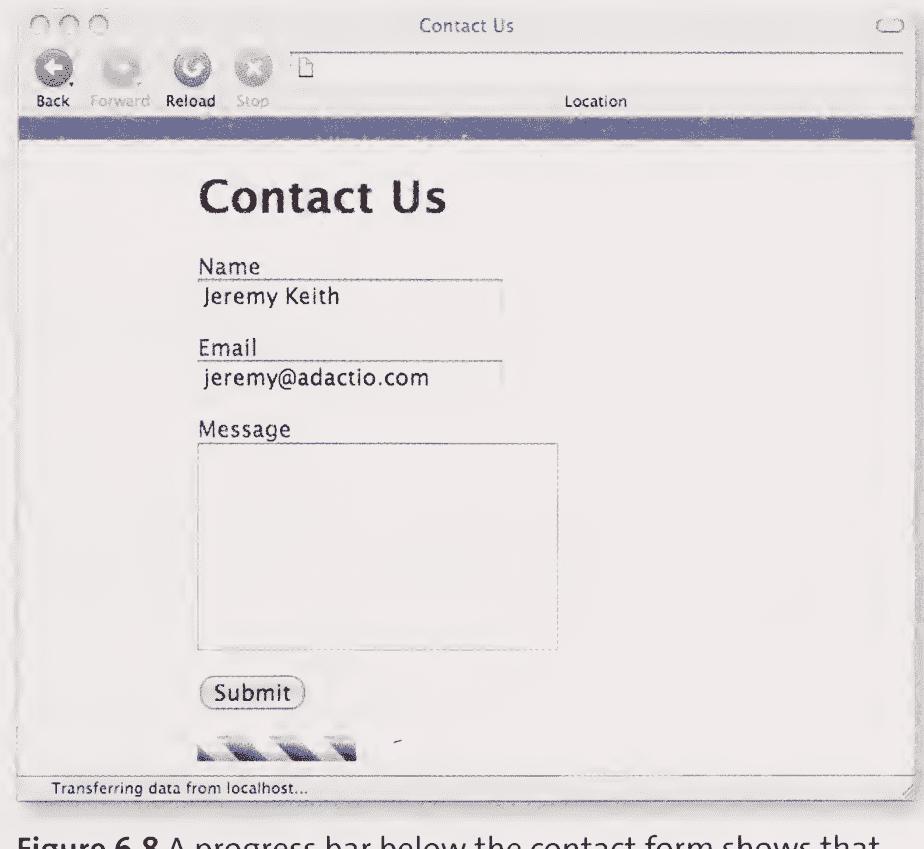
**图 6.8** 联系表单下方的进度条显示有操作正在进行。

#### 刚刚发生了什么？

正如显示正在发生某些事情很重要一样，显示刚刚发生了某些事情也是个好主意。

在 37signals 的 Ajax 应用套件中，该公司开创了**黄色渐淡技术**（www.37signals.com）。通过 JavaScript 和 CSS 的结合，Web 页面以黄色背景色显示已更新的元素，然后逐渐淡出为白色。这是显示当前页面哪一部分发生了变化的有效方式。

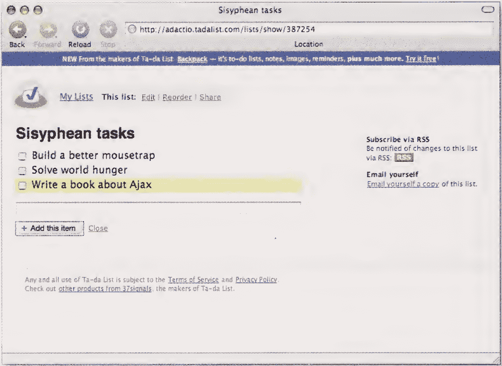
**图 6.9** 黄色渐淡技术实际应用。

黄色渐淡技术已被相当多的网站采用——以至于它现在成为了一种约定俗成的惯例。这是件好事。用户发现重复的惯例令人安心。视觉反馈技术使用得越多，其含义就越清晰。

这里有一个将元素背景色淡出为白色的函数：

```javascript
function fadeUp(element,red,green,blue) {
  if (element.fade) {
    clearTimeout(element.fade);
  }
  element.style.backgroundColor = "rgb("+red+","+green+","+blue+")";
  if (red == 255 && green == 255 && blue == 255) {
    return;
  }
  var newred = red + Math.ceil((255 - red)/10);
  var newgreen = green + Math.ceil((255 - green)/10);
  var newblue = blue + Math.ceil((255 - blue)/10);
  var repeat = function() {
    fadeUp(element,newred,newgreen,newblue)
  };
  element.fade = setTimeout(repeat,100);
}
```

`fadeUp` 函数接受四个参数。第一个参数是要更改背景色的元素。其他三个参数是 RGB 值：红色、绿色和蓝色。这些是元素背景色的起始 RGB 值：

```javascript
function fadeUp(element,red,green,blue)
```

元素 `style` 属性的 `backgroundColor` 会使用红色、绿色和蓝色的值进行更新。使用 CSS，你可以使用十六进制或 RGB 值来声明颜色值：

```javascript
element.style.backgroundColor = "rgb("+red+","+green+","+blue+")";
```

这是一个**递归函数**，意味着它会调用自身。在函数再次调用自身之前会有轻微的暂停。这个暂停是通过 `setTimeout` 实现的，它接受两个参数：要执行的函数和执行前等待的毫秒数：

```javascript
var repeat = function() {
  fadeUp(element,newred,newgreen,newblue)
};
element.fade = setTimeout(repeat,100);
```

在这种情况下，我将超时附加到元素的自定义属性 `fade` 上。每次调用函数时，使用 `clearTimeout` 清除超时。这确保了如果 `fadeUp` 函数在同一时间被应用到同一元素多次，不会产生冲突的指令：

```javascript
if (element.fade) {
  clearTimeout(element.fade);
}
```

在函数再次被调用之前，RGB 值会增加，使每个值更接近 255：

```javascript
var newred = red + Math.ceil((255 - red)/10);
var newgreen = green + Math.ceil((255 - green)/10);
var newblue = blue + Math.ceil((255 - blue)/10);
```

当每个值达到 255 时，元素的背景色就是白色：`rgb(255,255,255)`。函数不再需要重复：

```javascript
if (red == 255 && green == 255 && blue == 255) {
  return;
}
```

`fadeUp` 函数允许我添加黄色渐淡，或任何其他颜色的渐淡，只要我的文档背景色是白色的。

我可以通过更新 `parseResponse` 函数为联系详情页面添加黄色渐淡效果：

```javascript
function parseResponse(request) {
  if (request.readyState == 4) {
    if (request.status == 200 || request.status == 304) {
      var details = document.getElementById("details");
      details.innerHTML = request.responseText;
      fadeUp(details,255,255,153);
    }
  }
}
```

我从值为 `rgb(255,255,153)` 的黄色阴影开始。当 Ajax 响应返回时，这种颜色将渐淡为白色。


**图 6.10** 添加微妙的淡入效果可以指示页面的哪个部分已更新。

我使用黄色是因为用户可能从其他 Ajax 应用中对此感到熟悉。在其他情况下，淡入颜色可用于增加上下文信息。对于联系表单，你可以使用红色阴影来引起对任何错误的注意。

**图 6.11** 淡红色的淡入效果表示存在问题区域。

我编写的 *fadeIn* 函数非常基础，仅适用于白色背景的文档。要获得更健壮的脚本，请查看 Fade Anything Technique（www.axentric.com/aside/fat/）。

## 浏览器行为

缺少旋转图标并不是 Ajax 带给浏览器行为的唯一差异。Web 浏览器中内置的许多工具和快捷方式都是基于传统的全页刷新模型。

## 书签

几乎每个 Web 浏览器都包含存储书签的功能。万维网的架构建立在唯一标识资源的概念之上。这些资源通常是页面，其唯一标识符是 URL。如果你能存储页面 URL 的值，你就可以立即跳转到该页面，而无需从另一个页面跟踪链接。书签（或“收藏夹”）只是浏览器根据你的请求存储的 URL，以便你以后可以返回到相关页面。

当 Ajax 操作发生时，URL 不会更新。当前文档的内容可能已更改，但你无法将文档以其更改状态添加书签。

以联系详情页面为例。我只能在初始状态下为此页面添加书签。借助 Ajax 的力量，Richard Rutter 的联系详情可以显示在同一页面上，而无需全页刷新。如果我尝试在联系详情可见时为页面添加书签，我仍然只会为原始状态的页面添加书签。URL 没有变化。就浏览器而言，这是同一个页面。

这带来了相当大的挑战。我们正在摒弃全页刷新，但同时我们希望更新当前 URL。我们想要鱼与熊掌兼得。

这不是一个新问题。在第 1 章中，我开玩笑地指出框架集是 Ajax 的一种形式。事实证明，框架也遭受着同样的问题。无论你在框架集中导航多深，浏览器地址栏中的 URL 都保持不变。

为包含在框架集中的页面添加书签的唯一方法是右键单击并在新的浏览器窗口中打开该框架。Hijax 允许类似的变通方法。我可以右键单击 Richard Rutter 的名字，并在新窗口中打开该链接。

Hijax 提供可添加书签的链接这很好，但对大多数用户来说，右键单击以生成新窗口并不是一个直观的操作。将链接添加书签从简单直接的事情变成了费力的事情。

## 后退按钮

另一个挑战与书签问题密切相关，涉及浏览器的后退按钮。

书签是用户随意添加的链接。浏览器不会为你访问的每个页面添加书签；你必须主动将页面添加到书签列表中。你的 Web 浏览器会创建一个不同的列表来跟踪你最近访问过的所有页面。这些 URL 会自动存储在浏览器的历史记录中。

后退按钮和前进按钮使你可以在最近访问的页面中快速前后导航。特别是后退按钮，已成为普通用户不可或缺的工具。如果你跟踪链接到一个页面，但随后希望没有这样做，后退按钮允许你“倒转时钟”并返回上一页。它是 Web 浏览器中桌面应用程序“撤销”操作的等效物。

当页面的某一部分使用 Ajax 更改时，浏览器的历史记录不会更新。就浏览器而言，URL 没有更改；因此，用户没有前进。此时，后退按钮不再像以前那样是有用的工具。单击后退按钮将使用户退回到比他们希望的更远的位置。它肯定不会像撤销机制那样起作用。

再次强调，这不是一个全新的问题。多年来，Flash 电影与历史记录堆栈是分离的。无论你在 Flash 电影中导航多深，浏览器的后退按钮都会将你带回电影之前的页面，而不是逐步退回到电影本身。一些 Flash 开发人员试图通过从浏览体验中移除后退按钮来解决这个问题。包含 Flash 电影的页面在新浏览器窗口中打开，并且移除了所有浏览器界面元素。这是一种严厉的解决方案。后退按钮无论在实用性还是心理上都太有价值了，不能从你的用户那里夺走。

## 解决方案

许多聪明的 Ajax 开发人员试图解决书签和后退按钮的双重挑战。大多数解决方案涉及向当前 URL 添加内部锚点，以及一些使用隐藏 iframe 的技巧（参见 Brad Neuberg 的文章 "Ajax: How to Handle Bookmarks and Back Buttons"，网址为 http://onjava.com/lpt/a/6293）。

这些解决方案虽然巧妙，但不可避免地很复杂。它们需要如此，以处理不同浏览器表现出的不一致行为（参见 Mike Stenhouse 的文章 "Fixing the Back Button and Enabling Bookmarking for Ajax Apps"，网址为 www.contentwithstyle.co.uk/Articles/38/）。

最好从一开始就避免这种情况。

如果你正在更新页面的太多部分，以至于用户认为他们已经转到新页面，那么你可能做得太多了。如果 Ajax 用于更改文档的小的、离散的部分，那么书签或使用后退按钮不太可能出现任何问题。

当你决定是否用 Ajax 请求替换全页刷新时，问问自己：我想为此页面的更改状态添加书签吗？如果答案可能是“是”，那么你可能应该决定不使用 Ajax。

这并不总是容易回答的问题。有时答案因人而异。想想搜索表单：是否应该在不使用页面刷新的情况下显示结果？这看起来像是可用性增强，但有人可能想为搜索结果添加书签，或者至少是结果的第一页。在搜索结果的第一页之后，你可能会决定使用 Ajax 进行更深层结果的分页。如果搜索结果占据了页面的很大一部分，你需要更新文档的很大一部分。这可能不是一个好主意。你的用户可能会觉得他们实际上在页面之间移动，并理所当然地期望能够使用后退按钮进行导航。

围绕后退按钮的认知失调对 Ajax 来说并非完全是新问题。在所有的浏览环境中，后退按钮并不总是意味着“撤销”。如果我填写并提交表单，我的数据被发送到服务器，并且我被定向到一个新页面。单击后退按钮不会撤销发送该信息的行为。

明智地使用 Ajax 应确保后退按钮和书签问题从一开始就不会出现。如有疑问，请进行一些用户测试。实际上，即使你没有疑问，你也应该进行一些用户测试。然而，你可能会发现尝试对 Ajax 应用程序进行用户测试会引入其自身的问题。

## 线框图

大多数网站并非一开始就作为像素存在。在编写一行标记之前，通常已经有了一个计划。通过信息架构的规范，你可以制定和调整网站以及单个网页的结构。这种结构规划通常使用线框图来完成，线框图是概述网站或页面基础设施的文档。

由于线框图比成品网页更便宜且更容易制作，因此它们可以通过在网站建设过程早期突出潜在问题来节省大量成本。即使在纸上打印的线框图上进行一些基本的用户测试也能产生有益的反馈。

Web 的传统模型非常适用于纸质原型：一个线框图代表一个网页。一旦 Ajax 加入，这种平衡就被打破了。如何在单个文档中测试多个交互？

正如 Jeffrey Zeldman 简洁地指出的那样，“为 Ajax 绘制线框图是一件麻烦事”（www.alistapart.com/articles/web3point0/）。

我没有这个问题的任何简单解决方案。可能是线框图的实用性被 Ajax 的复杂性所抵消。确实很难想象 Ajax 交互如何在开发过程的早期进行测试。

似乎别无选择，只能尽早开发一个基本原型进行测试。这个原型不需要完全功能齐全，只要它能模拟 Ajax 的效果即可。效果可能很简单，就是根据用户操作隐藏和显示文档的部分内容。这可以通过一些直接的 DOM 脚本来实现，而无需完整的 Ajax 请求。然而，即使是最简单的功能原型也将比简单的线框图需要更多的时间和精力。


## 时间之箭

到目前为止，线框图足以描述网页的结构。到目前为止，Photoshop 设计稿足以描述网页的外观。但这两种方式都不太适合描述网页的交互行为。

线框图和 Photoshop 设计稿都是静态模型。它们不会改变状态。而 Ajax 增强的 Web 文档是动态的。文档的状态会随时间变化，通常基于用户的操作。在静态文档中，似乎没有一种简单的方式来表现随时间发生的变化。

## 总结

在本章中，我尝试指出 Ajax 开发中一些常见的陷阱。迄今为止，最大的挑战是为不支持 Ajax 的用户代理提供功能。即使解决了这个问题，仍有许多其他问题需要克服。大多数问题的解决方案都可以通过以下方式设身处地为用户着想来找到：

- 在 Ajax 请求发起时，立即提供明确的反馈。
- 清楚地标明当前文档的哪个部分已更新。
- 不要过度改变文档状态，以免影响浏览器后退按钮的预期行为。
- 如果用户需要将文档更改后的状态加入书签，就不要使用 Ajax。

遵循这些准则可以避免你的 Ajax 应用变得过于混乱。

还有一个我至今未提到的更大挑战。在下一章中，我们将探讨一个非常棘手的问题：Ajax 能否实现无障碍访问？

# Ajax 与无障碍访问

### 做正确的事

在一次广为引用的讲话中，蒂姆·伯纳斯-李爵士说过：

> "Web 的力量在于其普适性。无论是否有残疾，所有人都能访问，这是一个基本要素。"

第一句话指的是普遍访问的力量。运用渐进增强的原则，你可以轻松地利用这一力量。如果你在语义化、结构良好的标记基础上构建网站，然后使用 CSS 和 JavaScript 等技术添加额外的呈现层和行为层，你就可以放心，你的内容将能被任何用户代理访问。

正如你所看到的，同样的方法也适用于 Ajax。Hijax 技术让你可以为现代浏览器添加炫酷的交互功能，同时确保旧版浏览器仍然能够访问相同的内容和功能。

蒂姆爵士的第二句话则更难应对。在 Web 上，正如在现实世界中一样，存在一种道义上的要求：不能因残疾而歧视。

只要文字清晰可读、图片清晰可辨，网页上的信息就应该能被访问到。视力受损的用户需要一些帮助才能获取相同的信息。辅助技术可以提供这种帮助。视力较弱的用户通常使用屏幕放大软件来放大文字和图片。视力严重受损的用户，如失明者，更可能使用屏幕阅读软件。

## 了解屏幕阅读器

屏幕阅读器是一种将计算机上的视觉信息转换为非视觉输出（如语音或盲文）的软件。这个名称多少有些名不副实：许多屏幕阅读器用户的计算机上并没有连接屏幕。

苹果的 Mac OS X 操作系统内置了一款名为 VoiceOver 的屏幕阅读器。它仍处于早期阶段，尚未被广泛使用。大多数屏幕阅读器是为 Windows 操作系统设计的商业产品，包括 Dolphin Computer Access 公司的 SuperNova 和 Hal、GW Micro 公司的 Window-Eyes，以及 Freedom Scientific 公司的 JAWS。

这些屏幕阅读器介于操作系统和用户之间。该软件试图理解当前使用的任何程序所发出的输出。为了使用屏幕阅读器访问网页，盲人用户仍然必须使用 Web 浏览器，如 Firefox，或者更常见的 Internet Explorer。

## 屏幕阅读器与 Web 浏览器

大多数屏幕阅读器并不直接与网页的 DOM 结构交互。相反，该软件在页面加载时对文档进行快照，然后将内容放入一个虚拟缓冲区中。如果没有这个虚拟缓冲区，屏幕阅读器将只能与表单和链接——这些能够接收输入设备焦点的元素——进行交互。得益于虚拟缓冲区，屏幕阅读器用户可以浏览标题、图片和表格等其他元素。

大多数屏幕阅读器具有一些共同特性，例如能够在交互模式之间切换。以 JAWS 为例，它可以在虚拟 PC 光标模式（使用虚拟缓冲区）和 PC 光标模式（直接与网页中可聚焦的元素交互）之间切换。JAWS 还提供了表单模式，但由于表单元素可以获取焦点，其行为与 PC 光标模式相同。Window-Eyes 有一个使用虚拟缓冲区的浏览模式。当浏览模式被禁用时，屏幕阅读器可以直接与可聚焦的元素交互。因此，粗略地说，Window-Eyes 中的浏览模式对应于 JAWS 中的虚拟 PC 光标模式。

## 屏幕阅读器与 JavaScript

有一种常见的误解，认为屏幕阅读器无法执行 JavaScript。事实上，底层的 Web 浏览器决定了 JavaScript 的执行能力。不过，屏幕阅读器对 JavaScript 事件的响应确实不太稳定。

例如，如果 JAWS 处于虚拟 PC 光标模式，它会响应 `onclick` 事件处理程序并刷新其虚拟缓冲区。其他事件处理程序的表现就没那么好了。作为 Ajax 请求核心的 `onreadystatechange` 事件处理程序不会触发刷新。Window-Eyes 在浏览模式下的情况也类似。

## 屏幕阅读器与 Ajax

如果屏幕阅读器不会自动响应 Ajax 更新，我们如何才能设计 Ajax 增强的网站，使屏幕阅读器用户在内容发生变化时得到通知呢？这就是 Ajax 与辅助技术之间的根本问题。

向视力正常的用户展示页面的某个部分已更新是很容易的。黄色渐隐技术就是一种方式，它不仅能表明内容已被插入或更改，还能精确地指出更改发生的位置。为屏幕阅读器提供类似的反馈机制则是一个巨大的挑战。

屏幕阅读器对某些元素有所偏好。例如，屏幕阅读器可以直接访问表单字段和链接，因为它们可以获取焦点。表格也被视为特殊情况，因为它们的结构可能非常复杂，使盲人用户难以导航。如果 Ajax 请求的结果是创建或更新了这类元素，屏幕阅读器就更有可能注意到生成的内容。实际上，大多数 Ajax 请求是在 `div` 等普通元素中生成内容。

## 赋予焦点

利用屏幕阅读器固有偏好性的一种方法是更新页面的标签顺序。这是可聚焦元素（如链接和表单字段）被访问的顺序。每个可聚焦元素都有一个标签索引，通常是自动分配的，但也可以通过 `tabindex` 属性来设置。不过，随意修改文档的默认标签顺序并不是一个好主意。结构良好的网页已经拥有合理的标签顺序。

有一个略显取巧的技巧，可以让你在不打乱现有标签顺序的情况下使某个元素可聚焦。`tabindex` 属性本应包含一个从零到 32,767 的正值。尽管如此，许多浏览器允许你指定一个负的 `tabindex` 值。在这些浏览器中，将 `tabindex` 值设为 -1 可以使一个元素接受焦点，而不会干扰文档的标签顺序。

下面是一个由 `onreadystatechange` 事件处理程序触发的典型函数。`responseText` 属性通过 `innerHTML` 被放入一个名为 "details" 的 `div` 中：

```javascript
function parseResponse(request) {
  if (request.readyState == 4) {
    if (request.status == 200 || request.status == 304) {
      var details = document.getElementById("details");
      details.innerHTML = request.responseText;
    }
  }
}
```


一旦 `"details"` `div 被更新，给它一个 `tabindex` 值为负一。然后，可以使用 JavaScript 使该 `div` 获得焦点：

```
function parseResponse(request) {
  if (request.readyState == 4) {
    if (request.status == 200 || request.status == 304) {
      var details = document.getElementById("details");
      details.innerHTML = request.responseText;
      details.tabindex = -1;
      details.focus();
    }
  }
}
```

这种技术并非在所有浏览器中都有效。Safari 会忽略负的 `tabindex` 值。如果像 JAWS 或 Window-Eyes 这样的屏幕阅读器处于使用虚拟缓冲区的模式，元素将获得焦点，但其内容不会被自动读取。用户需要手动请求刷新虚拟缓冲区后，内容才能被读取。如果屏幕阅读器处于不使用虚拟缓冲区的模式，用户无需执行任何操作即可听到新内容。

关于不同设备对该技术的反应，欲了解更多信息，请阅读 Steve Faulkner 和 Gez Lemon 的测试结果 ([http://juicystudio.com/article/making-ajax-work-with-screen-readers.php](http://juicystudio.com/article/making-ajax-work-with-screen-readers.php))。

## 警报（ALERTING）

`tabindex` 技巧并非在所有情况下都有效。屏幕阅读器的品牌、版本和模式存在许多可能的排列组合，更不用说底层浏览器的所有可能变体了。

另一种方法是使用 `alert` 对话框来通知用户页面的部分内容已更改。这些对话框是操作系统的一部分，因此屏幕阅读器注意到它们的可能性更大。

使用 `alert` 对话框最大的缺点是它们具有侵入性且令人厌烦。它们几乎肯定应该是一个可选的（opt-in）额外功能。

例如，你可以用一个复选框和一段文字开始你的文档，询问用户是否希望收到 Ajax 更新通知：

```
<p class="opt-in-question">
<label>
Would you like to be informed of changes made to the page
by JavaScript?
<input type="checkbox" id="alert-opt-in" />
</label>
</p>
```

使用外部 CSS 文件，可以将此消息对视力正常的用户隐藏。不要犯使用 `display: none;` 的错误，因为这会让屏幕阅读器也隐藏该消息。相反，尝试将消息移出屏幕范围：

```
.opt-in-question {
  position: absolute;
  left: -999px;
  width: 990px;
}
```

现在可以更新 `parseResponse` 函数，以检测复选框是否被勾选。如果被勾选，则显示 `alert` 对话框：

```
function parseResponse(request) {
  if (request.readyState == 4) {
    if (request.status == 200 || request.status == 304) {
      var details = document.getElementById("details");
      details.innerHTML = request.responseText;
      var box = document.getElementById("alert-opt-in");
      if (box.checked) {
        alert ("The page has been updated.");
      }
    }
  }
}
```

只要复选框被勾选，每次页面更新时都会弹出 `alert` 对话框。

这种技术并没有太大帮助。虽然能通知屏幕阅读器用户文档已更新是很不错，但他们随后必须手动触发对整个文档的刷新阅读。这可能会让人极其沮丧。在许多方面，如果屏幕阅读器用户能够完全绕过 Ajax 功能，对他们来说会更好。

> **注意 (note)**

隐藏表单元素会引入新问题。隐藏的表单元素仍包含在文档的 Tab 索引中。对于使用键盘导航的用户来说，这会令人困惑。肢体障碍者可能无法使用鼠标，而依赖键盘导航。试图帮助一组残障用户（视觉障碍者）而将表单隐藏在屏幕外，会导致另一组用户出现问题。

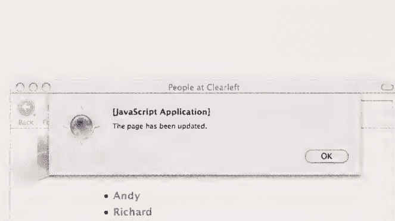

**图 7.1** 每当页面更新时，都会显示一个警报对话框。

## 现状 (State of the Art)

目前屏幕阅读器对 Ajax 的支持水平仍有很大的提升空间。显然，Web 浏览器的进化速度快于辅助技术。

JavaScript 专家 James Edwards（以其绰号 Brothercake 更为人知）测试了当前的一批屏幕阅读器，以研究它们如何处理生成的内容 ([http://www.sitepoint.com/article/ajax-screen-readers-work](http://www.sitepoint.com/article/ajax-screen-readers-work))。

结果并不乐观。Brothercake 总结了他的发现：

> “我不得不得出结论：除非能找到一种方法通知屏幕阅读器内容已更新，否则 Ajax 技术不能被认为是可访问的，并且在没有向用户预先提供真正的等效非脚本替代方案的情况下，不应在生产站点上使用。”

在 Brothercake 发布其测试用例结果的同时，另一位可访问性专家也发布了一些与 Ajax 相关的材料。$\text{Building Accessible Websites}$ 的作者 Joe Clark 对 37signals 的 Basecamp 应用程序进行了一系列测试。他在 2006 年的 Iceweb 会议上展示了结果 ([http://joeclark.org/access/research/ice/iceweb2006-test-results.html](http://joeclark.org/access/research/ice/iceweb2006-test-results.html))。

Joe 的结论不像 Brothercake 那样悲观：

> “那么我们可以说，这个 Ajax 应用程序在某些时候是可以被屏幕阅读器用户使用的。他们并没有被完全拒之门外，但对他们来说也并非完全简单。”

尽管如此，结果明确表明，应用程序中 Ajax 的存在对于屏幕阅读器用户来说是一个令人厌烦的障碍。

### 一个谦虚的建议 (A MODEST PROPOSAL)

Derek Featherstone 是 JavaScript、可访问性以及两者交集领域的专家 ([http://boxofchocolates.ca/](http://boxofchocolates.ca/))。

在 2005 年伦敦的 @media 会议上，Derek 对屏幕阅读器技术处理生成内容的方式表达了他的沮丧。正如他所指出的，我们可以处理支持 JavaScript 的用户代理，也可以处理不支持 JavaScript 的用户代理，但我们很难处理像屏幕阅读器这样仅支持 JavaScript 功能子集的用户代理。Derek 提出了一个大胆的建议：我们应该鼓励使用过时屏幕阅读器技术的人关闭 JavaScript。毕竟，如果我们使用渐进增强（progressive enhancement）来构建 Ajax 应用程序，那么一切都会优雅降级。

在实践中，简单地在浏览器中禁用 JavaScript 并不那么容易。即使对于视力正常的用户，在浏览器首选项中找到正确的复选框也可能很困难。例如，在 Internet Explorer 中，JavaScript 的控件位于“Internet 选项”的“安全”选项卡下，被称为“活动脚本（Active Scripting）”。

尽管如此，Derek 的观点是正确的。如果 Ajax 对屏幕阅读器用户来说造成的阻碍多于帮助，那么非 Ajax 交互是更好的选择。如果屏幕阅读器不要启动 Ajax 请求，以免稍后在关键点失败，那将是更好的。

## 绕过 AJAX (BYPASSING AJAX)

隐藏的复选框可以被重新用于绕过 Ajax 功能：

```
<p class="opt-in-question">
<label>
This page uses Ajax functionality which may cause problems
for screen readers. Would you like to disable this
functionality?
<input type="checkbox" id="disable-opt-in" />
</label>
</p>
```

与其等待 Ajax 请求完成，你可以在启动请求之前测试此复选框的状态：

```
function grabFile(file) {
    var box = document.getElementById("disable-opt-in");
    if (box.checked) {
        return false;
    }
    var request = getHTTPObject();
    if (request) {
        request.onreadystatechange = function() {
            parseResponse(request);
        };
        request.open("GET", file, true);
        request.send(null);
        return true;
    } else {
        return false;
    }
}
```

为了避免用户每次都必须勾选该框，你可以使用 JavaScript 或你选择的服务端语言将一个值存储在 cookie 中。即便如此，这仍然是一个相当笨拙的解决方案。

Google 的 Gmail 应用程序包含一段理论上仅向屏幕阅读器显示的文本。文本内容为：“如果您正在使用屏幕阅读器，您可能希望切换到基础 HTML 以获得更好的体验。”该文本包含一个指向应用程序非 Ajax 版本的链接。

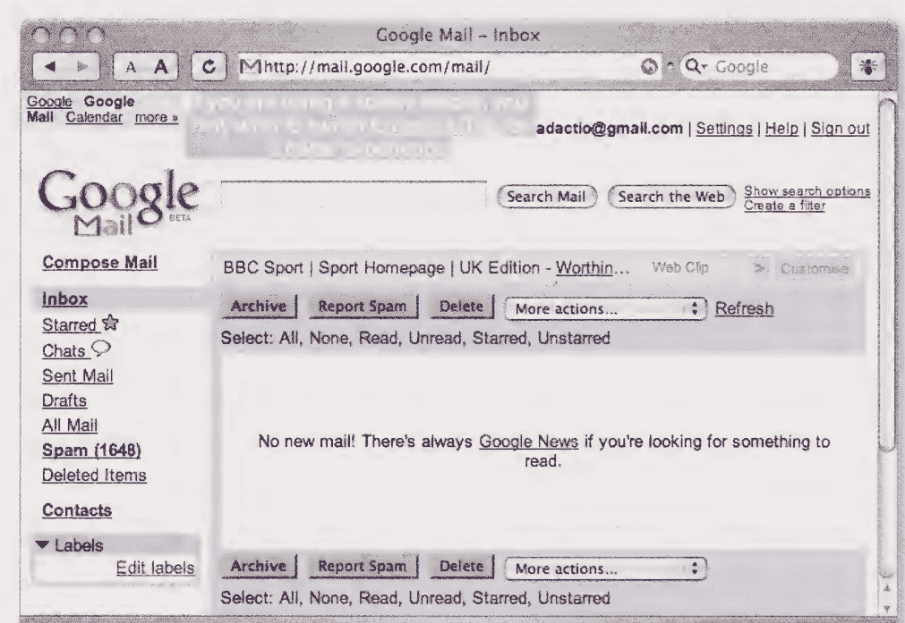

这是一个周到的补充，但它要求存在一个“独立但平等”的非 Ajax 站点。构建并行应用程序很少是理想的。理想情况下，一个单一的站点应该能够适应访问者的需求。


### 检测屏幕阅读器

使用隐藏文本和复选框需要屏幕阅读器用户进行大量操作。仅仅存在过时的屏幕阅读器就应足以触发绕过 Ajax 功能。

无法通过 JavaScript 直接检测屏幕阅读器的存在。可以获取大量关于访问当前文档的 Web 浏览器的信息，但，由于屏幕阅读器运行在浏览器之上，它们的存在是未被公开的。

虽然 Web 浏览器无法检测或传递屏幕阅读器的存在，但其他应用程序可以。例如，当前的 Flash 播放器可以检测屏幕阅读器的制造商及其是否启用。仅凭 Flash 插件的这一功能本身，似乎对我们帮助不大。

近年来，Flash 在功能和能力方面取得了巨大进步。Flash 播放器引入的众多创新之一是 Flash-JavaScript 桥。现在可以从 Flash 影片中触发 JavaScript 函数。结合 Flash 的屏幕阅读器检测功能，这为绕过 Ajax 开辟了一些可能性。

### FlashAid

FlashAid 是由 Aral Balkan (http://osflash.org/flashaid) 编写的概念验证应用程序。

一个 1 像素 x 1 像素的小型影片会检查屏幕阅读器的存在，并将结果传递给一个 JavaScript 函数。然后该函数可以根据结果进行相应操作。例如，可以根据 Flash 影片返回的结果，为全局变量赋予 `true` 或 `false` 的布尔值。然后，根据此变量的值，可以执行或绕过 Ajax 请求。

FlashAid 仍处于起步阶段，需要进行大量测试。弄清楚屏幕阅读器用户中有多少百分比在浏览器中安装了最新版本的 Flash 播放器将会很有用。

已经建立了一个邮件列表，用于进一步推动 FlashAid 的研究和开发 (http://osflash.org/mailman/listinfo/flashaid_osflash.org)。

# 未来

当前的屏幕阅读器似乎无法有效处理 Ajax 应用程序。或者，换一个角度来看，可以说当前的浏览器无法以对辅助技术有意义的方式有效地传达状态变化。

这种情况将会改变。

在 XHTML 2 中，计划嵌入 `role` 和 `state` 值，用于明确声明元素的行为方式。然后屏幕阅读器可以直接读取这些行为信息。

以下是来自 W3C 网站的一个作为交互式滑块小部件的元素示例：

```
<span id="slider" class="myslider myselector2"
role="wairole:slider"
waistate:valuemin="0"
waistate:valuemax="50"
waistate:valuenow="33">
</span>
```

W3C 已经发布了“可访问富互联网应用程序路线图”(http://www.w3.org/TR/aria-roadmap/)。

只要浏览器制造商和屏幕阅读器制造商遵循规范，这些补充无疑将使辅助技术用户的生活更美好。

目前，我们仍受限于过时的技术。Ajax 正在推动 Web 上的技术边界。浏览器已经达到了可接受的支持水平，但屏幕阅读器却落后了。

## 创新者的困境

当今的 Web 开发者面临一个艰难的抉择。Ajax 可用于提供显著的可用性增强。然而，无论在哪里实施 Ajax，都很可能会对可访问性产生负面影响。

当面临这个艰难的选择时，从道德上可接受的解决方案似乎是完全放弃 Ajax。然而，这意味着故意避免那些将使大多数用户受益的技术进步。

同时，屏幕阅读器用户的需求也不能简单地忽略。如果有一种直接的方法可以使 Ajax 应用程序可访问，那么问题就只是实施的问题了。但事实并非如此，没有简单的答案。

要求 Web 开发者承担如此多的责任，这有点不公平。屏幕阅读器制造商也有责任更新他们的产品，以跟上最新的发展步伐。

# 总结

表面上看，Ajax 和可访问性的情况似乎不容乐观。虽然有一些巧妙的技巧可能有助于屏幕阅读器访问生成的内容，但没有办法使 Ajax 体验像对视力正常的用户那样无缝。

不过，现在还处于早期阶段。很可能存在可访问性解决方案等待被发现。屏幕阅读器用户在真实 Ajax 应用程序上进行更多测试，可能会揭示增加可访问性的意外机会。

Web 开发社区非常幸运，拥有像 Brothercake、Derek Featherstone、Joe Clark 等聪明、有才华的人来解决这个问题。

# 融会贯通


## 构建更好的书店

到目前为止，你已经了解了这些关键领域：

-   Ajax 交互所需的代码
-   渐进增强原则
-   Ajax 带来的设计挑战

在本章中，我将把所有这些理论付诸实践。是时候构建一个 Ajax 应用程序了。

我使用 PHP 来创建此应用程序，但你可以使用任何服务器端语言。如果你不理解 PHP，也不用担心。理解我使用的语言不如理解基本概念重要。

你可以从 http://bulletproofajax.com/shop/files/ 下载本章的源代码。

### 规划

我正在构建一个名为 Bulletproof Books 的在线书店。你可以在 http://bulletprooffajax.com/shop/ 找到一个可运行的版本。

这家书店的目标受众是挑剔的 Web 开发者，因此只提供关于 Web 开发的最优质书籍。它不会是一个很大的商店；事实上，该网站仅由一个页面组成。

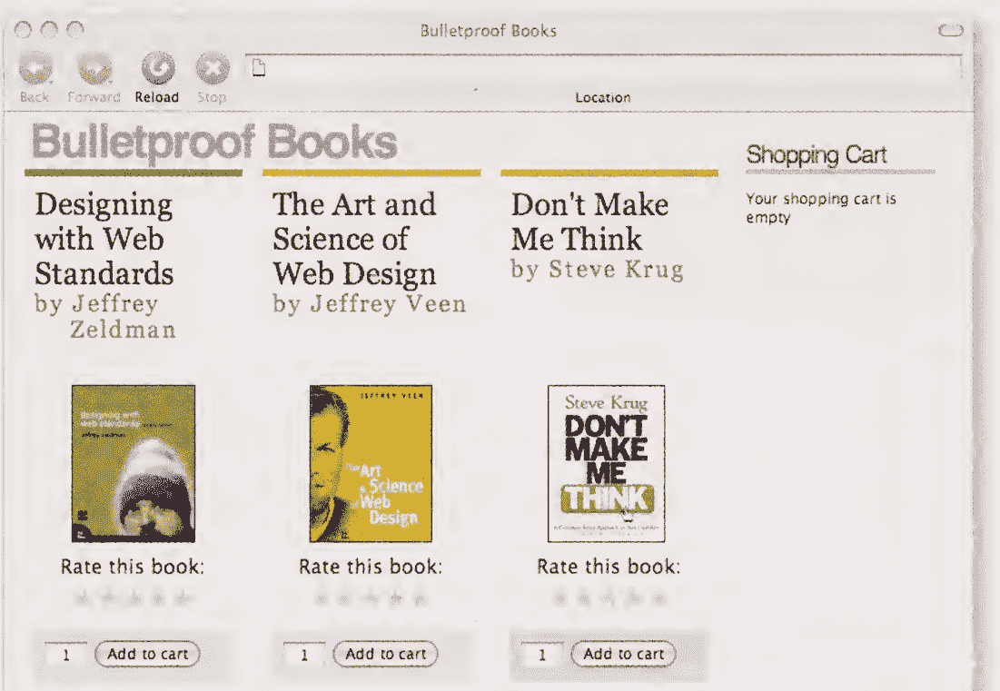

**图 8.1** Bulletproof Books 将提供少量但必不可少的书籍。

网站的主要目的是允许访客将书籍添加到购物车中。在这个乌托邦式的例子中，所有书籍都没有价格，但显然真实的电子商务网站不会这样。

功能不仅限于购物。访客还可以从一到五对书籍进行评分。

在我开始编写所有这些交互的代码之前，我需要思考页面的底层结构。

#### 结构

页面以一些直接的标识开始：商店的名称。然后，页面分为两部分。第一个分区包含所有可用的产品。这是主要内容。第二个分区包含购物车。

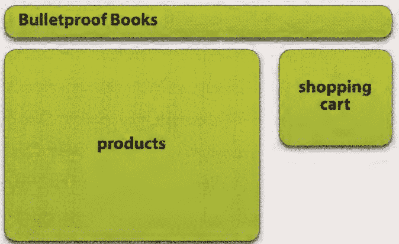

**图 8.2** 页面的大致结构。

XHTML 结构如下所示：

```
<!DOCTYPE html PUBLIC "-//W3C//DTD XHTML 1.0 Strict//EN"
"http://www.w3.org/TR/xhtml1/DTD/xhtml1-strict.dtd">
<html xmlns="http://www.w3.org/1999/xhtml" xml:lang="en" lang="en">
<head>
  <meta http-equiv="content-type" content="text/html; charset=utf-8" />
  <title>Bulletproof Books</title>
</head>
<body>
  <h1>Bulletproof Books</h1>
  <div id="mainContent">
  </div>
  <div id="subContent">
    <h2>Shopping Cart</h2>
    <div id="basket">
    </div>
  </div>
</body>
</html>
```

我使用 `div` 元素将标记划分为各个部分。这些分区反映在服务器上的文件结构中。一系列文件在服务器上组合以提供完整的文档。

这是框架页面 index.php 的结构：

```
<h1>Bulletproof Books</h1>
<div id="mainContent">
<?php include "products.php"; ?>
</div>
<div id="subContent">
<h2>Shopping Cart</h2>
<div id="basket">
<?php include "shoppingcart.php"; ?>
</div>
</div>
```

index.php 中的 `include` 语句引入了两个文件：products.php 和 shoppingcart.php。

products.php 文件为产品组装标记。在真实应用程序中，产品数据可能会存储在数据库中。对于这个例子，我只是将数据存储在一个 PHP 数组中：

```
<?php
$products = array(
 1 => array(
  "id" => "zeldman",
  "cover" => "zeldman.jpg",
  "title" => "Designing with Web Standards",
  "author" => "Jeffrey Zeldman"
 ),
 2 => array(
  "id" => "veen",
  "cover" => "veen.jpg",
  "title" => "The Art and Science of Web Design",
  "author" => "Jeffrey Veen"
 ),
 3 => array(
  "id" => "krug",
  "cover" => "krug.jpg",
```


在每个循环中，我创建了一个名为 `$id` 的变量，然后包含了一个名为 `rating.php` 的文件。该文件为每个项目创建一个列表，列表中包含五个可用于对产品进行评分的链接。

以下是由 `products.php` 和 `rating.php` 生成的标记示例：

```html
<div class="product" id="zeldman">
  <dl class="info">
    <dt>Designing with Web Standards</dt>
    <dd>by Jeffrey Zeldman</dd>
  </dl>
  
  <div class="rating">
    <p>Rate this book:</p>
    <ul>
      <li><a class="worst" title="hate it"
        href="?product=zeldman&amp;rating=worst">1</a></li>
      <li><a class="bad" title="don't like it"
        href="?product=zeldman&amp;rating=bad">2</a></li>
      <li><a class="fair" title="it's fine"
        href="?product=zeldman&amp;rating=fair">3</a></li>
      <li><a class="good" title="like it"
        href="?product=zeldman&amp;rating=good">4</a></li>
      <li><a class="best" title="love it"
        href="?product=zeldman&amp;rating=best">5</a></li>
    </ul>
  </div>
  <form class="shopping" method="post" action="index.php">
    <fieldset>
      <input type="text" class="amount" name="amount"
        value="1" />
      <input type="hidden" name="product"
        value="Designing with Web Standards" />
      <input type="submit" name="action"
        value="Add to cart" />
    </fieldset>
  </form>
</div>
```

该标记显示了关于产品的一些基本信息，随后是一张图片。然后它显示评分列表。最后，它显示一个将该产品添加到购物车中的表单。相同的结构被应用于所有产品。

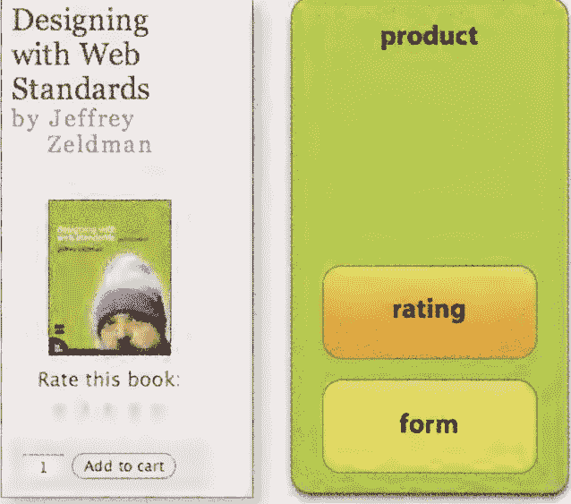

#### 功能 (FUNCTIONALITY)

`rating.php` 文件除了显示用于产品评分的数字列表外，还包含存储当前产品评分的功能：

```php
if (isset($_GET['product']) && $_GET['product'] == $id) {
    if (isset($_GET['rating'])) {
        $_SESSION[$id] = $_GET['rating'];
    }
}
```

同样，如果你不理解这段 PHP 代码也不必担心：底层的功能才是重点。

如果发送的查询字符串包含 *product* 的值且该值与当前产品匹配，并且查询字符串还包含 *rating* 的值，那么该评分值将被存储在一个会话变量（session variable）中。会话变量通常存储为 cookie，是一种快速简便的存储数值的方法。在实际应用中，该值可能会存储在数据库中。

在这种情况下，会话变量的名称是当前产品的 ID，而值是在查询字符串中发送的评分。

如果当前产品已存在会话变量，则标记将相应地更新：

```php
if (isset($_SESSION[$id])) {
    echo '
        <p>Your rating:</p>
        <ul class="'.$_SESSION[$id].'">';
} else {
    echo '
        <p>Rate this book:</p>
        <ul>';
}
```

如果发送的查询字符串为 `product=zeldman&rating=best`，那么 Zeldman 产品的评分标记将如下所示：

```html
<p>Your rating:</p>
<ul class="best">
```

产品评分功能现已就绪。接下来还需要添加购物车功能，这将由 `shoppingcart.php` 文件处理。

#### 购物 (Shopping)

`shoppingcart.php` 文件引入了一个名为 `Cart.inc` 的文件。这是一个类，使用 `getProducts`、`addProduct`、`removeProduct` 等方法处理所有购物交易：

```php
<?php
class Cart {
  function countTotal() {
  }
  function getProducts() {
  }
  function addProduct($product) {
  }
  function removeProduct($product) {
  }
  function processInput($data = array()) {
  }
}
?>
```

我不会详细讨论涉及的 PHP 代码。你只需要知道这些方法处理了购物车所需的所有功能。

在 `shoppingcart.php` 文件中，该类的一个新实例被创建为一个会话变量（同样，如果是实际应用，你可能会改用数据库）：

```php
if (!isset($_SESSION["cart"])) {
  $_SESSION["cart"] = new Cart();
}
```

如果有任何数据从表单提交，`Cart` 类负责将产品添加到会话变量中：

```php
if (count($_POST)>0) {
  $_SESSION["cart"] -> processInput($_POST);
}
```

现在，根据会话变量的内容，要么显示一条简短的消息，要么显示一个显示购物车内容的表格：

```php
if ($_SESSION["cart"] -> countTotal() < 1) {
    echo '
    <p>Your shopping cart is empty</p>
    ';
} else {
    echo '
    <table>
      <thead>
        <tr>
          <th>Item</th>
          <th><abbr title="quantity">Qty</abbr></th>
        </tr>
      </thead>
      <tbody>';
    foreach ($_SESSION["cart"] -> getProducts() as
      $product => $count) {
      echo '
        <tr>
          <td>'.stripslashes($product).'</td>
          <td>'.$count.'</td>
        </tr>';
    }
    echo '
      </tbody>
    </table>
    ';
}
```

通过这种方式，整个页面的标记被输出，并且通过查询字符串和表单接收的信息得到了处理。

#### 演示 (PRESENTATION)

现在应用程序的结构已经就绪，我可以使用 CSS 为文档添加样式信息。

在页面的 head 元素中，我添加了一个指向 CSS 文件的 `link` 元素：

```html
<link rel="stylesheet" media="screen" type="text/css"
href="styles/basic.css" />
```

这个文件 `basic.css` 导入了一系列其他 CSS 文件：

```css
@import url("layout.css");
@import url("ratings.css");
@import url("products.css");
@import url("basket.css");
```

这些文件中的每一个都负责页面不同部分的样式。

`layout.css` 文件安排页面上的 `div` 元素：

```css
#mainContent {
  width: 77%;
  position: relative;
  float: left;
}
#subContent {
  width: 20%;
  position: relative;
  float: left;
}
```

`products.css` 文件包含产品数据的颜色和字体信息。以下是 CSS 示例：

```css
.product {
  border-top: 6px solid #ccc;
  width: 27%;
  min-width: 10em;
  padding: .5em;
  margin: 0 .5em;
  float: left;
}
#zeldman {
  border-top-color: #693;
}
#meyer {
  border-top-color: #fc3;
}
#krug {
  border-top-color: #f93;
}
```

`basket.css` 文件包含一些用于购物车表格的基础样式。

#### 评分 (Ratings)

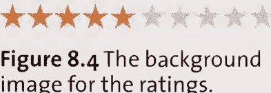

用于设置每个产品评分样式的文件是 `ratings.css`。这相当复杂。CSS 为每个评分显示星级，并在你悬停在每个链接上时填充相应数量的星星。有关此技术的深入解释，请参阅 http://komodomedia.com/blog/index.php/2005/08/24/creating-a-star-rater-using-css/。

评分列表内部的文本被替换为一张宽度为 200 像素的星星背景图。前 100 像素是填充的星星，接下来的 100 像素是未填充的星星。

```css
.rating ul {
  list-style: none;
  position: relative;
  width: 100px;
  height: 20px;
  background: transparent url("../images/stars.gif")
    -100px 0 no-repeat;
  padding: 0;
  left: 50%;
  margin-left: -50px;
  overflow: hidden;
}
```

如果列表中应用了类，背景图像将相应地定位：

```css
.rating ul.worst {
  background-position: -80px 0;
}
.rating ul.bad {
  background-position: -60px 0;
}
.rating ul.fair {
  background-position: -40px 0;
}
.rating ul.good {
  background-position: -20px 0;
}
.rating ul.best {
  background-position: 0 0;
}
```


列表中每个链接的文本都被隐藏了：

```
.rating li {
  margin: 0;
  padding: 0;
  float: left;
}
.rating li a {
  display: block;
  position: absolute;
  width: 20px;
  height: 20px;
  text-indent: -100px;
  overflow: hidden;
  z-index: 20;
}
```

列表中每个链接的位置各不相同。随着量表的增加，位置会沿轴向进一步移动：

```
.rating a.worst {
  left: 0;
}
.rating a.bad {
  left: 20px;
}
.rating a.fair {
  left: 40px;
}
.rating a.good {
  left: 60px;
}
.rating a.best {
  left: 80px;
}
```

当用户将光标悬停在这些链接中的任何一个上时，会添加一个深色星形重复背景图：

```
.rating li a:hover {
  background: transparent url("../images/star.gif")
    left top repeat-x;
}
```

链接的宽度根据其在量表中的位置而增加：

```
.rating a.worst:hover {
  width: 20px;
}
.rating a.bad:hover {
  width: 40px;
}
.rating a.fair:hover {
  width: 60px;
}
.rating a.good:hover {
  width: 80px;
}
.rating a.best:hover {
  width: 100px;
}
```

#### 应用 Ajax

在这个阶段，Bulletproof Books 已经具备了功能：你可以对书籍进行评分并将其添加到购物车中。如果没有指向结账页面的链接，它几乎没什么用，但毕竟这只是一个示例。

该应用程序是以模块化方式构建的：

- `products.php` 文件输出一段用于显示所有产品的 XHTML 块。
- `rating.php` 文件输出一段用于显示单个产品评分列表的 XHTML 片段。
- `shoppingcart.php` 文件输出一个添加到购物车的商品表格的 XHTML。

当你观察这些独立文件处理的功能时，一个熟悉的 Ajax 模式出现了：

- **评分 (Ratings)。** 每当你点击评分链接时，信息会通过查询字符串发送到服务器。服务器返回同一个页面，仅有一个微小的区别：所选的评分现在与相应的产品一起显示。`rating.php` 文件负责处理此操作。
- **购物 (Shopping)。** 每当你点击“添加到购物车”按钮时，信息会通过表单提交发送到服务器。服务器返回同一个页面，此时购物车已更新以反映新添加的商品。`shoppingcart.php` 文件负责处理此操作。

这两种情况都是进行 Hijax 处理的绝佳候选对象。

#### 可复用的 JavaScript

到目前为止，我为每个示例编写了特定的 JavaScript 代码。但所有示例都遵循非常相似的模式：

1. 页面的某一部分是某些链接或表单的**容器 (container)**。
2. 捕获该容器中的**数据 (data)**。
3. 通过 `XMLHttpRequest` 将此数据发送到服务器上的一个 `URL`。
4. 触发一个**加载 (loading)** 函数，让用户知道程序正在运行。
5. 当 Ajax 请求完成时，页面的部分内容被更新。我们称之为**画布 (canvas)**。
6. 触发一个**回调 (callback)** 函数，让用户知道操作已完成。

具体细节因情况而异，但流程保持不变。

每次我想添加 Ajax 功能时都要重新造轮子，这太可惜了。相反，我要将这个过程抽象化，创建一个可复用的 JavaScript 代码块。

我想将一系列变量和函数封装在一个自包含的块中。这听起来正是用户自定义对象的完美用途。

#### 编写对象

如果你还记得，JavaScript 有三种类型的对象：

1. 原生对象，如 `Math`、`Date` 和 `Array`，由语言本身提供。
2. 宿主对象，如 `window`，由运行 JavaScript 的环境提供。
3. 用户定义对象，由你（程序员）创建。

将一组变量和函数包装在对象内部是提高代码可移植性的绝佳方式。

我要创建一个处理 Ajax 请求的对象。这个对象的名称是 `Hijax`。创建对象就像创建函数一样：

```
function Hijax() {
}
```

现在我在一个地方声明所有变量：

```
function Hijax() {
  var container,url,canvas,data,loading,callback,request;
}
```

- `container` 是页面上的元素，包含 Ajax 请求的触发机制：要么是一个表单，要么是一组链接。
- `url` 是服务器上文件的路径。
- `canvas` 是页面中被更新的部分。
- `data` 要么是 `null`，要么是要发送到服务器的名称/值对字符串。
- `loading` 是在 Ajax 请求开始时触发的函数。
- `callback` 是在 Ajax 请求结束时触发的函数。
- `request` 是 `XMLHttpRequest` 的一个实例。

这些值中的大多数需要从对象外部设置。为了实现这一点，我创建了一系列方法。记住，方法简单来说就是绑定到对象的函数。我使用了 `this` 关键字，它是“当前对象”的简写：

```
function Hijax() {
  var container,url,canvas,data,loading,callback,request;
  this.setContainer = function(value) {
   container = value;
  };
  this.setUrl = function(value) {
   url = value;
  };
  this.setCanvas = function(value) {
   canvas = value;
  };
  this.setLoading = function(value) {
   loading = value;
  };
  this.setCallback = function(value) {
   callback = value;
  };
}
```

这些方法都可以从对象外部访问。假设我创建了 `container`、`url`、`canvas`、`loading` 和 `callback` 的一个新实例。其他值 `data` 和 `request` 在对象内部创建。

```
var myobject = new Hijax();
```

现在我可以使用点语法访问它的方法：

```
myobject.setUrl("rating.php");
```

我又创建了一个可以从对象外部访问的方法。它被称为 `captureData`：

```
this.captureData = function() {
```

当此方法被触发时，数据将从 `container` 元素中提取。

我首先测试 `container` 的 `nodeName` 属性，看看它是否是一个表单：

```
if (container.nodeName.toLowerCase() == "form") {
```

如果是，那么我想在表单提交时提取其值：

```
container.onsubmit = function() {
  var query = "";
  for (var i=0; i<this.elements.length; i++) {
    query+= this.elements[i].name;
    query+= "=";
    query+= escape(this.elements[i].value);
    query+= "&";
  }
```

我已将表单元素的名称和值连接到一个名为 *query* 的变量中。现在我将此值分配给 *data*：

```
data = query;
```

在这一行代码中，我利用了 JavaScript 最强大的能力之一：闭包 (closures)。

#### 闭包

通常 JavaScript 中有两种变量作用域：

1. **全局 (Global)**。如果变量在函数外部声明，则可以在任何地方访问。
2. **局部 (Local)**。如果变量在函数内部使用 `var` 关键字声明，则只能在该父函数内部访问。

当一个函数嵌套在另一个函数中时，会发生一件有趣的事情。嵌套函数也可以访问属于父函数的任何局部变量：

```
function test() {
  var foo = "bar";
  function getFoo() {
    alert (foo);
  }
}
```

这是一个闭包的示例。通常 `getFoo` 函数只能访问全局变量或其自身的局部变量。因为 `getFoo` 嵌套在 `test` 函数中，所以它也可以访问 `test` 的局部变量。

可以将闭包看作一种区域作用域：比局部作用域宽，但没有全局作用域那么宽。

得益于闭包，对象内的函数可以访问在同一对象内声明的变量。记住，对象内的函数是方法，对象内的变量是属性。`Hijax` 对象的 `captureData` 方法可以访问 `data` 属性，尽管该属性是在方法外部声明的：

```
function Hijax() {
  var container,url,canvas,data,loading,callback,request;
  ...
  this.captureData = function() {
    if (container.nodeName.toLowerCase() == "form") {
      container.onsubmit = function() {
        var query = "";
        for (var i=0; i<this.elements.length; i++) {
          query+= this.elements[i].name;
          query+= "=";
          query+= escape(this.elements[i].value);
          query+= "&";
        }
        data = query;
      };
    }
  };
  ...
}
```

这个特定闭包最显著的特点是，即使在 `onsubmit` 事件处理器内部，作用域依然得以维持。通常情况下，在事件处理函数内部是不可能引用除全局变量以外的任何内容的。得益于闭包的力量，当从对象内部调用事件处理函数时，在对象内声明的所有变量仍然可用。

一旦捕获了表单数据，就会调用另一个名为 `start` 的方法。该方法启动 Ajax 请求。如果 `start` 方法执行成功，它将返回 `true`。在这种情况下，我想取消浏览器对 `submit` 事件的默认行为：

```
return !start();
```

如果 `start` 方法返回 `true`，那么 `onsubmit` 事件处理器将返回相反的值，即 `false`。反之，如果 `start` 方法失败并返回 `false`，则 `onsubmit` 事件处理器将返回相反的值。


值为 true，这意味着触发默认的浏览器行为，表单将正常提交。

在进入 start 方法之前，我需要完成 captureData 方法的编写。

如果容器元素不是表单，那么数据将通过链接传输。通过遍历容器元素内的所有链接，我可以添加一个 onclick 事件处理函数，以捕获查询字符串中包含的任何数据：

```javascript
var links = container.getElementsByTagName("a");
for (var i=0; i<links.length; i++) {
  links[i].onclick = function() {
    var query = this.getAttribute("href").split("?")[1];
    url += "?" + query;
    return !start();
  };
}
```

在这种情况下，闭包是 url 属性，它正被链接的查询字符串更新。

完成后的 captureData 方法如下所示：

```javascript
this.captureData = function() {
  if (container.nodeName.toLowerCase() == "form") {
    container.onsubmit = function() {
      var query = "";
      for (var i=0; i<this.elements.length; i++) {
        query += this.elements[i].name;
        query += "=";
        query += escape(this.elements[i].value);
        query += "&";
      }
      data = query;
      return !start();
    };
  } else {
    var links = container.getElementsByTagName("a");
    for (var i=0; i<links.length; i++) {
      links[i].onclick = function() {
        var query = this.getAttribute("href").split("?")[1];
        url += "?" + query;
        return !start();
      };
    }
    links = null;
  }
};
```

我为 Internet Explorer 包含了一点清理工作。该浏览器的 5 和 6 版本在清理对 DOM 节点的引用方面表现不佳。一旦 `captureData` 方法执行完毕，`links` 变量就不再需要了，但与其他浏览器不同，Internet Explorer 不会对该变量进行垃圾回收。一旦 `onclick` 事件处理程序被分配，语句 `links = null` 将手动执行垃圾回收。

#### 发起 Ajax 请求

一旦从表单或链接中截获了数据，`start` 方法就会被执行。

我可以这样创建 start 方法：

```javascript
function start() {
}
```

但我选择这样写：

```javascript
var start = function() {
};
```

两者是等价的，但在编写对象的方法时，我更倾向于使用第二种风格。

`start` 方法是一个简单的函数，返回 `true` 或 `false`：

```javascript
var start = function() {
  request = getHTTPObject();
  if (!request || !url) {
    return false;
  } else {
    initiateRequest();
    return true;
  }
};
```

只要为 Ajax 请求指定了 URL，且 `getHTTPObject` 函数成功创建了 `XMLHttpRequest` 的实例，`start` 方法就会返回 `true`。

`getHTTPObject` 函数你应该已经非常熟悉了。现在它被嵌套在 `Hijax` 对象中，因此 `getHTTPObject` 成为了 `Hijax` 的一个方法：

```javascript
var getHTTPObject = function() {
  var xmlhttp = false;
  if (window.XMLHttpRequest) {
    xmlhttp = new XMLHttpRequest();
  } else if (window.ActiveXObject) {
    try {
      xmlhttp = new ActiveXObject("Msxml2.XMLHTTP");
    } catch (e) {
      try {
        xmlhttp = new ActiveXObject("Microsoft.XMLHTTP");
      } catch (e) {
        xmlhttp = false;
      }
    }
  }
  return xmlhttp;
};
```

在 `start` 方法中，`getHTTPObject` 的结果被赋值给 `request` 属性：

```javascript
request = getHTTPObject();
```

如果 `getHTTPObject` 返回一个 `XMLHttpRequest` 实例，`start` 方法在返回 `true` 之前会调用一个名为 `initiateRequest` 的方法：

```javascript
initiateRequest();
return true;
```

`initiateRequest` 方法是驱动 `Hijax` 对象的引擎。首先，该方法测试当前 `Hijax` 对象的 `loading` 属性是否被分配了一个函数。如果 `loading` 属性有值，现在就是执行它的时机：

```javascript
var initiateRequest = function() {
  if (loading) {
    loading();
  }
};
```

`initiateRequest` 方法包含了 XMLHttpRequest 的三个构建块：`onreadystatechange`、`open` 和 `send`。

一个指向 `completeRequest` 方法的引用被赋值给 `onreadystatechange` 事件处理程序：

```javascript
request.onreadystatechange = completeRequest;
```

如果数据是从表单中捕获的，则在 `open` 方法中指定 `POST` 请求，并在 `send` 方法中将 `data` 属性传递给服务器：

```javascript
request.open("POST", url, true);
request.setRequestHeader("Content-Type",
  "application/x-www-form-urlencoded");
request.send(data);
```

如果 `data` 没有值，则指定 `GET` 请求且不向服务器发送数据：

```javascript
request.open("GET", url, true);
request.send(null);
```

确定发起哪种请求是通过一个简单的 `if` 语句来完成的，该语句测试 `data` 的值。完成后的 `initiateRequest` 方法如下所示：

```javascript
var initiateRequest = function() {
  if (loading) {
    loading();
  }
  request.onreadystatechange = completeRequest;
  if (data) {
    request.open("POST", url, true);
    request.setRequestHeader("Content-Type",
      "application/x-www-form-urlencoded");
    request.send(data);
  } else {
    request.open("GET", url, true);
    request.send(null);
  }
};
```

一旦 Ajax 请求被发起，剩下的就是处理来自服务器的响应。

#### 完成 Ajax 请求

一个名为 `completeRequest` 的方法已被绑定到 `onreadystatechange` 事件处理程序。和往常一样，这里有一个测试，以检查 `readyState` 属性是否达到 4，以及服务器发送的 `status` 是否为 200 或 304：

```javascript
var completeRequest = function() {
  if (request.readyState == 4) {
    if (request.status == 200 || request.status == 304) {
```

如果当前 Hijax 对象的 `canvas` 属性已被指定，页面的该部分将使用 `responseText` 的内容进行更新：

```javascript
if (canvas) {
  canvas.innerHTML = request.responseText;
}
```

如果当前 Hijax 对象的 `callback` 属性被分配了一个函数，则执行该函数：

```javascript
if (callback) {
  callback();
}
```

这就是 `completeRequest` 方法的全部内容：

```javascript
var completeRequest = function() {
  if (request.readyState == 4) {
    if (request.status == 200 || request.status == 304) {
      if (canvas) {
        canvas.innerHTML = request.responseText;
      }
      if (callback) {
        callback();
      }
    }
  }
};
```

#### 准备页面

`Hijax` 对象提供了一种非常便捷且可复用的方式，为 Web 页面添加 Ajax 功能。本书到目前为止的所有示例都可以重新设计为使用 `Hijax`，因为它们都遵循相同的步骤。

在 Bulletproof Books 的案例中，为书籍打分和将书籍添加到购物车都遵循经典的 Ajax 模式：通过表单或链接进行的用户交互会更新同一个页面的某个独立部分。

每本书都有一个相关的评分链接列表，以及一个将该产品添加到购物车的表单。总共有三本书，这意味着总共有六个页面元素需要进行 Hijax 处理。与其逐个指定每个 Ajax 请求的细节，我创建了一个名为 `bookshop` 的函数来封装所有指令：

```javascript
function bookshop() {
}
```

在 `bookshop` 内部，我有一个名为 `prepareCart` 的方法，它将执行三次，每本书执行一次。该方法接收一个参数，即将被截获的表单元素：

```javascript
var prepareCart = function(element) {
};
```

我创建了一个 `Hijax` 对象的实例：

```javascript
var xhr = new Hijax();
```

通过使用 `setContainer` 方法，我将表单元素指定为 `container` 属性。这通过 `element` 参数传入：

```javascript
xhr.setContainer(element);
```

该 Ajax 请求的 URL 为 shoppingcart.php：

```javascript
xhr.setUrl("shoppingcart.php");
```

页面中将被更新的部分是购物车，其 ID 为 `basket`。该元素就是 `canvas`：

```javascript
xhr.setCanvas(document.getElementById("basket"));
```

在 `bookshop` 中，我创建了一个名为 `displayLoading` 的方法，用于显示进度条。在这种情况下，我希望进度条出现在购物车中：


最后，当 Ajax 请求完成时，我想给购物车添加一个黄色渐隐效果。这将使用一个名为 `fadeUp` 的方法来实现。像这样让购物车渐隐就是 `callback` 函数：

```
xhr.setCallback(function() {
	fadeUp(document.getElementById("basket"),255,255,255,204);
});
```

所有这些属性都已指定后，是时候应用 `captureData` 方法了：

```
xhr.captureData();
```

现在我有了一个 `prepareCart` 方法，可以用来拦截与每个产品相关联的表单中的数据。

为了拦截每本书的评分链接中的数据，我有一个类似的方法叫做 `prepareRating`：

```
var prepareRating = function(element) {
	var xhr = new Hijax();
	xhr.setContainer(element);
	xhr.setUrl("rating.php");
	xhr.setCanvas(element);
	xhr.setLoading(function() {
		displayLoading(element);
	});
	xhr.setCallback(function() {
		fadeUp(element,255,255,255,204);
		prepareRating(element);
	});
	xhr.captureData();
};
```

在这种情况下，URL 是 rating.php，`container` 元素和 `canvas` 元素是同一个。

在我开始向 `prepareCart` 和 `prepareRating` 传递值之前，我需要定义 `loading` 和 `callback` 函数，我分别指定为 `displayLoading` 和 `fadeUp`。

#### 发生了什么？

`displayLoading` 函数如下所示：

```
var displayLoading = function(element) {
  var image = document.createElement("img");
  image.setAttribute("alt","loading...");
  image.setAttribute("src","images/progressbar.gif");
  image.className = "loading";
  element.appendChild(image);
};
```

这会创建一个新的 `img` 元素，其 `src` 为 `progressbar.gif`。这个新创建的图像随后被插入到指定的页面元素中。

#### 刚刚发生了什么？

`fadeUp` 方法对你来说应该很熟悉，来自前面的示例：

```
var fadeUp = function(element,red,green,blue) {
  if (element.fade) {
    clearTimeout(element.fade);
  }
  element.style.backgroundColor = "rgb("+red+","+green+","+blue+")";
  if (red == 255 && green == 255 && blue == 255) {
    return;
  }
  var newred = red + Math.ceil((255 - red)/10);
  var newgreen = green + Math.ceil((255 - green)/10);
  var newblue = blue + Math.ceil((255 - blue)/10);
  var repeat = function() {
    fadeUp(element,newred,newgreen,newblue)
  };
  element.fade = setTimeout(repeat,100);
};
```

这将指定页面元素的背景颜色从设置的 RGB 值渐变到 RGB (255, 255, 255)，即白色。

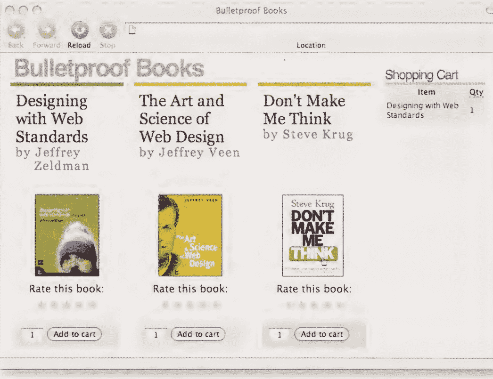

### 执行

书店（bookshop）的所有方法都就位后，我现在可以将正确的 Ajax 功能分配给正确的页面元素。

每本书都有一个相关联的表单，其类名为 shopping。我将它们每一个都传递给 prepareCart 方法：

```
var all_forms = document.getElementsByTagName("form");
for (var i=0; i<all_forms.length; i++) {
  if (all_forms[i].className.match("shopping")) {
    prepareCart(all_forms[i]);
  }
}
```

为了兼容旧版本的 Internet Explorer，我在使用完 all_forms 变量后将其清理掉：

```
all_forms = null;
```

对于评分功能，我将任何类名为 rating 的 div 传递给 prepareRating 方法：

```
var all_divs = document.getElementsByTagName("div");
for (var i=0; i<all_divs.length; i++) {
  if (all_divs[i].className.match("rating")) {
    prepareRating(all_divs[i]);
  }
}
all_divs = null;
```

bookshop 函数已经准备就绪。我现在需要做的就是执行它。不过，我不能立即执行；我必须等到文档加载完成：

```
window.onload = bookshop;
```

更好的是，我可以使用第 5 章中展示给你的 addLoadEvent 函数：

```
addLoadEvent(bookshop);
```

### 加固

防弹书店（Bulletproof Books）现在正常工作了。你可以在 http://bulletproofajax.com/shop/ 自行查看。

一切运行正常，但总有余地改进。我想指出几个你可能想要调整代码的地方。

#### 错误处理

`Hijax` 对象的 `completeRequest` 方法期望服务器发送 `status` 属性为 200 或 304。如果服务器发送了任何其他状态，则什么都不发生。构建某种错误处理来让用户知道请求失败是相当容易的：

```
var completeRequest = function() {
  if (request.readyState == 4) {
    if (request.status == 200 || request.status == 304) {
      if (canvas) {
        canvas.innerHTML = request.responseText;
      }
      if (callback) {
        callback();
      }
    } else {
      alert("Error: "+request.status);
    }
  }
};
```

一个 `alert` 语句并不是显示错误消息的最佳方式。你可以将错误消息附加到 `canvas` 元素上。

更健壮的解决方案是让错误处理能够根据具体情况进行更改。尝试在 `Hijax` 对象中声明一个名为 `errorhandler` 的新变量：

```
var container,url,canvas,data,loading,callback,request,
    errorhandler;
```

创建一个对应的用于从对象外部为这一属性分配函数的方法：

```
this.setErrorhandler = function(value) {
  errorhandler = value;
};
```

如果已为 `errorhandler` 分配了函数，则在 completeRequest 方法中执行它：

```
var completeRequest = function() {
  if (request.readyState == 4) {
    if (request.status == 200 || request.status == 304) {
      if (canvas) {
        canvas.innerHTML = requestexceptionText;
      }
      if (callback) {
        callback();
      }
    } else {
      if (errorhandler) {
        errorhandler();
      }
    }
  }
};
```

你现在可以向 `bookshop` 添加一个方法来处理任何意外的错误：

```
var displayError = function(element) {
  var para = document.createElement("p");
  para.className = "error";
  var message = document.createTextNode("Oops! Something went wrong.");
  para.appendChild(message);
  element.appendChild(para);
  fadeUp(para,204,51,102);
};
```

在 `prepareCart` 和 `prepareRating` 中分配这个方法：

```
xhr.setErrorhandler(function() {
    displayError(element.parentNode);
});
```

你可能想使用更有意义的错误消息。你可以更新 `displayError` 方法，使其接受第二个参数——一个文本字符串：

```
var displayError = function(element, errortext) {
    var para = document.createElement("p");
    para.className = "error";
    var message = document.createTextNode(errortext);
    para.appendChild(message);
    element.appendChild(para);
    fadeUp(para, 204, 51, 102);
};
```

现在你可以根据预期的 Ajax 交互来定制错误消息。

#### 超时

在理想的万维网中，网络连接将快速且无缝。在现实中，情况并非总是如此。有时连接会中断，可能是因为服务器问题，也可能是因为用户的网络连接。

Ajax 请求不会自动超时。一旦发起请求，它将保持打开状态，直到 `readyState` 属性达到 4。

`XMLHttpRequest` 对象有一个 `abort` 方法，可以取消 Ajax 请求。使用 `setTimeout` 语句，如果请求耗时过长，你可以调用此方法。

向 `Hijax` 对象添加一个名为 `timer` 的新变量：

```
var container, url, canvas, data, loading, callback, request,
    errorhandler, timer;
```

在 `initiateRequest` 方法中，为 `timer` 分配一个 `setTimeout` 语句：

```
var initiateRequest = function() {
    timer = setTimeout(function() {
        request.abort();
    }, 60000);
```

这将在 60 秒后中止 Ajax 请求。如果已提供 errorhandler 函数，你可能想在此处调用它：

```
timer = setTimeout(function() {
    request.abort();
    if (errorhandler) {
        errorhandler();
    }
}, 60000);
```

某些浏览器在调用 abort 时会表现出触发 readystatechange 事件的奇怪行为。为了消除这一点，在取消 Ajax 请求之前，将 onreadystatechange 分配为一个空函数：

```
timer = setTimeout(function() {
    request.onreadystatechange = function炅unction() {};
    request.abort();
    if (errorhandler) {
        errorhandler();
    }
}, 60000);
```

现在你有一种处理不成功请求的方法。如果请求按计划进行，你需要在 completeRequest 方法中取消计时器倒计时：

```
var completeRequest =美颜unction() {
    if (request.readyState == 4) {
        if (request.status == 200 || request.status == 304) {
            clearTimeout(timer);
```

#### 可访问性

就目前而言，Hijax 对象对视障用户（使用屏幕阅读器）没有任何让步，但正如我们在上一章看到的，没有一种一致的方法可以通知屏幕阅读器页面的一部分已经更新。

你可以在 completeRequest 方法中使用 tabindex 技巧将焦点设置到 canvas 区域：

var completeRequest = function() {
  if (request.readyState == 4) {
    if (request.status == 200 || request.status == 304) {
      clearTimeout(timer);
      if (canvas) {
        canvas.innerHTML = request.responseText;
        canvas.tabindex = -1;
        canvas.focus();
      }
    }
  }
}

请记住，这种方法并非在所有屏幕阅读器和 Web 浏览器的组合中都能正常工作。此外，它可能有些过度：你真的想在用户每次添加新产品时都引起她对购物车的注意吗？也许她更愿意从文档当前的位置继续浏览。

## 小结

Bulletproof Books 是一个很好的例子，展示了如何使用 Ajax 来增强现有应用程序——在这个案例中，是一个Online Shop。没有 Ajax 的情况下，该应用完全可以正常运行；但一旦加入 Ajax，购物体验就会变得更加流畅。

Hi jax 对象是一个灵活的通用 Ajax 模式集合。你可以将其用于购物车、评分等更多场景。不要将这个对象视为解决你 Ajax 需求的最终方案，而应将其作为起点。

在本章中，我只强调了改进 Hi jax 对象的几种方式。我相信代码还可以进一步精炼。世上没有完美的脚本。编写 Ajax 应该是一个持续评估和迭代的过程。

或许并不存在真正“防弹”的 Ajax，但它仍然是一个值得追求的目标。永远不要停止质疑，永远不要停止寻找改进代码的方法。我对你充满信心，你可以将我提供的代码作为起点，使其变得更加健壮、优雅和“防弹”。

## Ajax 的未来

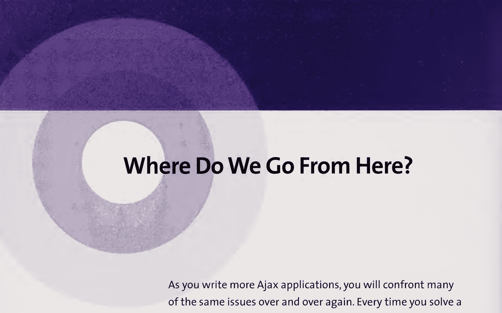

## 我们将何去何从？

当你编写越来越多的 Ajax 应用时，你会反复遇到许多相同的问题。每次你解决一个通用问题时，将那段 JavaScript 代码放在一边以便日后复用是很有帮助的。将你的代码抽象为可复用的模块是明智之举——这正是我对 Hi jax 对象所做的。最终，你将在手边拥有便捷可用的代码集合。

# 构建 JavaScript 库

以下是你在构建个人可复用代码库时可能遇到的一些问题。

### 事件处理

我一直在使用简单的事件处理器，如 `onclick` 和 `onsubmit`。这些在所有浏览器中都能工作，但它们有一个主要缺点：你只能为每个事件处理器分配一个事件。

W3C DOM 规范提供了一个名为 `addEventListener` 的方法。Internet Explorer 不支持这个方法。相反，微软提供了一个专有方法，名为 `attachEvent`。这些实现上的差异可以通过使用函数来抽象化，例如来自 John Resig（http://ejohn.org/projects/flexible-javascript-events/）或 Dean Edwards（http://dean.edwards.name/weblog/2005/10/add-event2/）的 `addEvent`。

### DOM 操作

如果你不使用 `innerHTML`，生成标记需要做很多工作。你需要使用大量的 DOM 方法，如 `createElement` 和 `appendChild`，结合 DOM 属性，如 `childNodes`、`nodeName` 等。与其反复编写非常相似的代码，不如创建可复用的函数来生成标记。Dan Webb 已经用他的 DOM Builder 脚本做到了这一点（http://www.vivabit.com/bollocks/2006/04/06/introducing-dom-builder）。

### 动画

DOM 在浏览器之间的实现相当一致。而 BOM，即浏览器对象模型，则是另一回事。浏览器对浏览器宽度等测量使用不同的属性名称。如果你试图做复杂的动画，这些差异可能会令人沮丧。同样，合乎逻辑的解决方案是用可复用的代码将浏览器差异抽象化。

## 库、框架和工具包，我的天！

随着时间的推移，所有 JavaScript 开发者都会积累自己的可复用代码库。一些开发者更进一步，将他们的库发布出来供其他开发者使用。这些函数和对象的集合有时被称为工具包，甚至框架。据我所知，*库*、*工具包* 和 *框架* 这些术语是可以互换使用的。

你可能会使用他人库的原因有两个：

1. 虽然你精通 DOM 脚本和 Ajax，但你需要在某个项目中节省一些时间。与其重新发明轮子，不如使用别人已经编写好的代码来解决类似的问题。你完全理解这些代码的作用，并可以根据自己的需求进行调整和优化。
2. 面对一个问题时，你转向一个声称能提供解决方案的库。使用他人代码的危险在于，你不知道代码是如何工作的，而当某些地方出错时（而且一定会出错），你将无法修复它。

第一种情况说明了库在节省时间和精力方面是多么有用。第二种情况则说明了出于同样的原因，库也可能是多么危险。使用 JavaScript 库就像挥舞一把刀：它可以是一个有用的工具，但在错误的人手中，它可能会造成严重的伤害。

有许多 JavaScript 库可供选择。让我们来看一些更受欢迎的选项。

### PROTOTYPE

37signals 的 Sam Stephenson 创建了 Prototype 库（http://prototype.conio.net/）。Prototype 的诞生与该公司 Ruby on Rails 服务端框架的创建同时发生。两者配合得很好：Rails 使用 Prototype（及其衍生产品 Scriptaculous）来添加 JavaScript 辅助函数。这些辅助函数是以侵入式的方式添加的，但得益于热情的 Rails 社区，现已有一个补丁可用（http://www.ujs4rails.com/）。

Prototype 代码优雅简洁，大小约为 48K。Prototype 旨在通过提供大量快捷方式来让开发者的生活更轻松。例如，你不必编写 `document.getElementById("element_id")`，Prototype 允许你输入 `$("element_id")`。

Prototype 网站没有提供太多文档，但一群热情的博客作者正在演示如何使用这个库（http://www.prototypedoc.com/）。

### SCRIPTACULOUS

Scriptaculous 库（http://script.aculo.us/）以 Prototype 为基础构建。Scriptaculous 包含一系列用 Prototype 创建的模块。有单独的文件可用于拖放、动画和 Ajax。

动画模块的构建方式非常模块化。一系列组合效果构建在一组核心效果之上。该网站还提供了用户提交效果的宝库。

用户通过 wiki 持续为 Scriptaculous 提供文档。

### MOCHIKIT

Bob Ippolito 创建了 MochiKit 库（http://mochikit.com/）。与 Scriptaculous 类似，它也是以模块化的方式构建的，因此如果你不需要使用所有可用功能，就不必下载全部内容。

MochiKit 的设计深受 Python 编程语言的影响。这证明了 JavaScript 的灵活性，它允许自己被这样改造。话虽如此，对我来说，学习 JavaScript 的特性比试图让它表现得像另一种语言更有意义。

MochiKit 提供了 `loadJSONDoc` 和 `doSimpleXMLHttpRequest` 等方法用于 Ajax 请求。它还提供了一个很棒的日志函数，使调试比使用一系列 alert 语句容易得多。所有 MochiKit 方法都在网站上有所记录。

### JQUERY

与 Prototype 类似，jQuery 是一个充满快捷方式的 JavaScript 库（http://jquery.com/）。它甚至复制了 Prototype 的 $ 函数。

jQuery 最有趣的方面在于它允许你在一条语句中链式调用方法。以下是 jQuery 网站首页的一个示例：

```
$("p.surprise").addClass("ohmy").show("slow");
```

这会找到所有 class 为 `surprise` 的段落元素，为每个元素添加 `ohmy` 类，然后缓慢地显示它们。这种语法对于为元素附加多个事件和效果非常方便。

jQuery 有两个版本：压缩版（约 20K），用于生产站点；以及未压缩版（约 52K），可读性更强。

### YUI

YUI 是 Yahoo User Interface 库的缩写（http://developer.yahoo.com/yui/）。顾名思义，这是由 Yahoo 的开发者创建的库。Yahoo 不仅说到了，也做到了：这与 Yahoo 全球所有产品中使用的 JavaScript 是相同的。

YUI 不是提供一个单一的庞大代码结构，而是分成独立的模块，称为工具。有用于事件、动画、拖放、DOM 操作和 Ajax 的工具。Ajax 工具被称为连接管理器。

与 Prototype 和 jQuery 不同，简洁性不是 YUI 的主要目标。相反，优先确保库的 JavaScript 与你的代码良好协作。所有内容都封装在一个名为 `YAHOO` 的对象中。以下是一个事件处理器的示例：

```
YAHOO.util.event.addEventListener("element_id", "click", myFunction);
```

除了核心工具之外，YUI 还为常见的 Web 应用组件提供了控件，如滑块、日历和菜单。


由于YUI正由一个大型组织积极开发，该库的文档非常详尽。最棒的是，Yahoo的开发者们还记录了工具背后的理论研究（http://developer.yahoo.com/ypatterns/）。这个被称为“设计模式库”的资源，为看似简单的交互（如拖放）背后的复杂性提供了宝贵的见解。

## 选择一个库

我仅仅列出了一些免费可用的JavaScript库。还有更多库，例如Dojo，最初由Alex Russell开发，现在由Dojo基金会维护（http://dojotoolkit.org/）。Mootools是另一个流行的库（http://mootools.net/）。

如果你想感受这些库中的任何一个，试着下载它们并尝试修改代码。当你评估一个库时，需要考虑以下几个因素。

### 文件大小

因为JavaScript是一种客户端语言，最终用户将需要下载你选择的任何库。没有人喜欢漫长的下载时间。你需要判断等待时间是否被库提供的好处所抵消。一些库的模块化结构允许你根据需求挑选最少的代码量。

### 文档

文档很重要。一个库可能充满了强大的功能，但如果没有一套说明，这些功能将闲置无用。

大多数库在他们的网站上提供某种形式的文档。文档的风格各不相同。有些库的技术文档读起来并不令人愉快。另一方面，有相当多的博客文章介绍库的实际使用，这些通常更具可读性。

### 浏览器支持

在Web设计项目开始时，通常会指定一个需要积极支持的浏览器基线。这个浏览器列表应尽可能全面。同样，每个JavaScript库都有其支持的浏览器列表。库的跨浏览器兼容性越好，就越好。你的浏览器基线不应为迁就一个挑剔的库而改变。如果一个库在你需要支持的所有浏览器中都无法工作，就不要使用那个库。

## Ajax 何去何从？

JavaScript库的丰富似乎对Web开发者来说是件好事，但它们的存在本身引发了一个令人困扰的问题。JavaScript——进而 Ajax——是否真的如此复杂，以至于我们需要第三方工具包来解决问题？

对于本书涵盖的Ajax水平，我认为使用库是过度设计。对于更复杂、动画丰富的应用程序，库当然可以节省大量时间和精力。

随着应用程序变得更加复杂，对跨浏览器快捷方式的需求也在增加。然而，随着Web应用程序复杂性的增加，其健壮性会下降。实现渐进增强变得越来越困难。为屏幕阅读器用户提供访问从棘手变得近乎西西弗斯般的艰难。

鉴于这种陡峭的难度曲线，保持Ajax增强轻量级和微妙是有意义的。然而，当今网络上的大多数Ajax应用程序相当复杂。

## 从桌面到 Web 浏览器

衡量一个Ajax应用程序是否成功的常见标准是它在多大程度上镜像了桌面体验。Web开发者正在尝试模拟使用原生应用程序的体验。其结果被称为富互联网应用程序。

我对这种追逐RIA的趋势并不信服。这个术语本身暗示着非RIA，如果它们不是“富”的，就一定是“贫”的互联网应用程序。假设丰富的用户界面等同于丰富的用户体验，这是一个谬误。根据我的经验，情况可能恰恰相反。我在网络上最满意、最投入的一些经历是在朴素的、文本密集的网站上。而我最沮丧的一些经历则涉及高度交互但无法使用的Web应用程序。

适合桌面的不一定适合Web浏览器。拖放就是一个典型的例子。这个惯例被用于许多Ajax应用程序，但很少像在原生桌面应用程序中那样经过深思熟虑。如果我想把文件从电脑桌面移到回收站，我可以拖放它，但我也可以使用键盘或通过文件系统导航。拖放只是完成任务的一种方式。当这个惯例被Ajax应用程序借用时，很少提供替代解决方案。

对于许多开发者来说，Ajax这个术语已经意味着Web上任何类型的类桌面交互。对我来说，Ajax从根本上讲是在Web浏览器内与Web服务器进行异步通信。桌面软件可以教给我们很多关于界面和交互设计的经验，但我们绝不能忽视Ajax本质上是一种Web技术。如果你决定借用桌面的惯例，请确保不要破坏Web交互的基本预期。

用户期望通过点击链接和按钮或填写表单来发起交互。通过渐进增强，可以确保这些交互优雅地降级为超链接文档和表单提交。

Ajax正在拓展Web浏览器能力的边界，这很令人兴奋。Web不断演进和向前发展很重要。与此同时，Web的根本性质保持完好也同样重要。万维网是通过超文本的优美简洁力量连接在一起的文档的奇妙集合。使用得当，Ajax可以增强导航和享受这个虚拟宝库的体验。使用不当，Ajax可能会切断定义Web的连接。

## 致谢

感谢你阅读本书。我展示了一些代码，但我相信你能改进你在这里看到的。更重要的是，我希望我已经向你展示了在Ajax方面保持质疑态度是多么重要。质疑你实现Ajax的方式。质疑Ajax将对你的用户产生的影响。质疑是否真的需要使用Ajax。

Ajax是一项很酷的技术，但这并不是使用它的好理由。Ajax可以提高可用性；这才是使用它的更好理由。我相信你会使用Ajax来增强你的网站，使其更强大，而不会牺牲对你内容的访问。

创建健壮的Ajax具有挑战性，但回报是值得的。祝你好运。

## 索引

### 符号

- && (与) 运算符, 25
- $id 变量, 158
- * (星号) 在JavaScript中, 16, 22, 39
- // (斜杠) 在JavaScript中, 16
- [ ] (方括号) 在数组中, 20
- _ (下划线) 在JavaScript中, 17
- { } (花括号)
    - 在对象字面量中, 79
    - 在 while 循环中, 26
- || (或运算符), 25
- + (加号) 运算符, 22–23
- < (小于) 符号运算符, 23
- <= 复合运算符, 24
- == (等号) 运算符
    - 作为比较运算符, 23
    - 作为恒等运算符 (===), 24
    - 在JavaScript中的用途, 25
- != (不恒等于运算符), 25
- > (大于) 符号运算符, 23
- >= 复合运算符, 24
- \ (反斜杠) 在JavaScript中, 18
- . (点表示法), 在方法和属性中, 32
- ! (感叹号)
    - 在 if 语句中, 24
    - 作为非运算符, 25
- " (引号) 在字符串中, 18–19
- ; (分号)
    - 在函数中, 29
    - 在 for 循环中, 27
    - 在语句中, 15
- , (逗号)
    - 数组与, 20
    - 逗号分隔的列表, 28
    - 用于分隔变量, 18
- ( ) (圆括号)
    - 参数与, 28
    - 在 if 语句中, 23–24

### A

- abort 方法, 184
- Ajax的可访问性. *参见 屏幕阅读器*
- Active Scripting, 147
- ActiveX 技术, 47
- Adaptive Path, 3
- addEvent 函数, 189
- addEventListener 方法, 189
- addLoadEvent 函数, 98–99, 181
- Ajax. *另见 应用程序构建（示例）, 2–12*
    - 可访问性. *参见 屏幕阅读器*
    - Ajax 工具包, 8–11
        - CSS 基础, 10–11
        - DOM 基础, 11
        - 标记语言有效性, 9–10
        - 服务器端语言, 8
        - XML?, 9
- 定义 Ajax, 5–8
- 设计挑战. *参见 Ajax 的设计挑战*

## 数字

- 37signals 套件, 130, 190


Ajax（续）

术语起源，2–4
传统 Web 模型与 Ajax 的对比，5–6

Ajax：一种 Web 应用程序的新方法（Ajax: A New Approach to Web Applications）网站，3

"Ajax: How to Handle Bookmarks and Back Buttons"，作者 Brad Neuberg，136

Ajax 工具包，8–11

CSS 基础，10–11
DOM 基础，11
标记语言有效性，9–10
服务器端语言，8
XML？，9

ajax.js 文件，114

ajax.js JavaScript 文件，105

alert 对话框，144–145

alert 语句，182

alteration 语句，27

and（&&）运算符，25

动画

浏览器反馈与，126–127
DOM 和 BOM 与，189

匿名函数，29

appendChild 方法，42–43，74，89，189

Apple Safari

动画与，126
XMLHttpRequest 支持与，47

应用程序构建（示例），155–186

无障碍性（屏幕阅读器），185–186
错误处理，182–184
用于应用程序构建的 JavaScript，167–176
闭包，170–173
完成请求，176
发起请求，173–176
编写对象，168–170
页面准备，177–181
displayLoading 函数，179
执行，181
fadeUp 方法，179–180
规划，155–166
评分和购物车功能，160–162
评分的样式，164–166
样式设计，162–166
XHTML 页面结构，156–159
超时处理，184–185

函数中的参数，28

算术运算符，22–23

Array 对象，168

数组，20–21

为变量赋值，17

关联数组（哈希），21

JavaScript 中的星号（*），16，22，39

异步请求（open 方法），54

attachEvent 方法，189

属性节点，37

## B

后退按钮，135–137

背景

更改颜色，180
颜色渐变，130–133

backgroundColor 属性，131

JavaScript 中的反斜杠（\\），18

Balkan, Aral，149

Basecamp 应用程序，146

basic.css 文件，163

basket.css 文件，163

Berners-Lee, Sir Tim，140

二进制语言，19

body 元素节点，38

<body> 标签，99

BOM（浏览器对象模型），34，189

书签功能，134–136

bookshop 函数，181

布尔值，19–20

数组中的方括号（[ ]），20

盲文，与屏幕阅读器，141

Browser Object Model（BOM），34，189

浏览器。参见 Web 浏览器

Building Accessible Websites，146

Bulletproof，实例化，49–51

Bulletproof 书籍示例。参见应用程序构建（示例）

Bulletproof Web Design（New Riders，2005），vii

按钮，后退，135，136

## C

回调函数，167，168，178

callback 参数，83

callback 属性，176

驼峰命名法（camelCasing），17

canvas 元素，167，168，176，177，178

captureData 方法，169，171，172–173，178

cart.inc 文件，161

Carville, James，117

Cascading Style Sheets（CSS）

基础，10–11
与渐进增强，95

命名变量时的区分大小写，17

Cederholm, Dan，vii

childNodes，39

Clark, Joe，146

类，定义，33

click 事件，97

JavaScript 中的闭包，170–173

代码。参见可重用代码；第 8 章源代码下载

颜色

更改背景色，180
背景色渐变，130–133

逗号（,）

数组与，20
逗号分隔列表，28
分隔变量，18

JavaScript 中的注释，16

比较运算符，23–24

completeRequest 方法，175，176，182，183，185

容器元素，167，168，178

createElement 方法，41，74，89，189

createTextNode 方法，42，74，89

CSS（Cascading Style Sheets）

基础，10–11
与渐进增强，95

花括号（{ }）

对象字面量中的，79
while 循环中的，26

## D

数据

Hijax 中的数据捕获
表单数据，111–115
链接数据，105–108
数据提取
从 HTML 中提取，88
从 JSON 中提取，80–82
从 XML 中提取，73–74

数据格式，69–92

HTML。参见超文本标记语言（HTML）

JSON，77–87

优点，86–87
示例，78–79
从 JSON 中提取数据，80–82
script 标签 hack，82–83
与 Web 服务，83–86
使用，79–82

XML。参见可扩展标记语言（XML）

JavaScript 数据类型，17–21

数组，20–21
布尔值，19–20
数字，19
字符串，18–19

Date 对象，168

声明，定义，17

DELETE 方法，53

Ajax 的设计挑战，120–138

向后兼容，121–124
浏览器行为，134–137

后退按钮，135–137
书签功能，134–136

浏览器反馈，126–134

动画，126–127
displayLoading 函数，127，128
fadeUp 函数，131–134
背景色渐变，130–133
parseResponse 函数，128
sendData 函数，129

Web 服务，125–126

线框图，137–138

Yahoo 设计模式库（Design Pattern Library），193

details 元素，89

DHTML（动态 HTML），11

displayLoading 函数，127，128，178，179

displayLoading 方法，177

div 元素，102，157，158

do..while 循环，26–27

文档对象模型（DOM），34–43

基础，11
DOM 脚本编程，83，126
获取器（getters），35–36
为 JavaScript 库操作 DOM，189
节点，36–41

基础，36–38
childNodes，39
firstChild 属性，40
lastChild 属性，40
nextSibling 属性，40
nodeValue 属性，40–41
parentNode 属性，38–39
previousSibling 属性，40

设置器（setters），41–43

文档类型声明（doctype），与标记有效性，10

库功能文档，193

Dojo 库，193

Dolphin Computer Access 屏幕阅读器，141

DOM。参见文档对象模型（DOM）

doSimpleXMLHttpRequest 方法，191

doSomething 函数，97

点号表示法（.），32

动态 HTML（DHTML），11

## E

Edwards, Dean，189

Edwards, James，146

元素节点，37

元素。参见具体元素

else 子句，24

等号（==）运算符

作为比较运算符，23
作为全等运算符（===），24
JavaScript 中的用途，25

相等和全运算符，24–25

错误处理，Bulletproof 书籍示例，182–184

errorhandler 变量，182，183

JavaScript escape 函数，113

转义，定义，18

JavaScript eval 语句，80

事件处理程序。参见具体事件处理程序，51–52

事件处理

JavaScript 库与，189
渐进增强与，96–99

示例。参见应用程序构建（示例）

显示文本文件内容（示例），60–65

JavaScript，60–63
标记，63–65

本书示例下载，vii

Hijax，103–115

捕获表单数据，111–115
捕获链接数据，105–108
表单，108–110

HTML，87

交互式滑块控件，150

JSON，78–79

XML，69

感叹号（!）

if 语句中的，24
作为非运算符，25

可扩展超文本标记语言（XHTML）

与 HTML 的对比，10
页面结构，156–159

可扩展标记语言（XML），69–77

优点，76–77
与 Ajax，9
缺点，77
示例，69
与超文本标记语言（HTML）的对比，10
使用，70–76

从 XML 中提取数据，73–74
生成内容，74–76
编写脚本，72–73

## F

Fade Anything Technique，134

fade 元素，132

fadeUp 函数，132

fadeUp 方法，178，179–180

假值（falsey values），19

Faulkner, Steve，144

Featherstone, Derek，146

fetchjson.js 文件，80

fetchxml.js 文件，70，88

文件。参见文本文件，显示内容（示例）

ajax.js 文件，114
ajax.js JavaScript 文件，105
Bulletproof 书籍
basic.css 文件，163
basket.css 文件，163
cart.inc 文件，161
products.css 文件，163
products.php 文件，166
rating.php 文件，158，166
ratings.css 文件，164
shoppingcart.php 文件，161，166
fetchjson.js 文件，80
fetchxml.js 文件，70
formLogic.php 文件，109，111

文件大小，193

firstChild 属性，40

"Fixing the Back Button and Enabling Bookmarking for Ajax Apps"，作者 Mike Stenhouse，136

Flash

基础，7
Flash 播放器，124，149
Flash-JavaScript 桥接，149
影片，135

FlashAir，与屏幕阅读器，149

Flex，124

可聚焦元素和 Tab 键顺序，143–144

for 循环，27

表单元素，隐藏，145

formLogic.php 文件，109，111

表单，Hijax，108–110

框架，7

Freedom Scientific 的 JAWS，141，144

函数。参见具体函数，168

JavaScript 函数，28–31
嵌套函数，169

垃圾回收，173

Garrett, Jesse James，3–4

GET 请求，52，53，55，121，175

getAttribute 方法，36

getElementById 方法，35，97，98，105

getElementsByTagName 方法，35–36，97，98，105

getFoo 函数，170

getHTTPObject 函数，48–49，60，107，114，174

getScript 函数，85

获取器（getters），DOM，35–36

GIF 动画，179–180

全局变量，30，169

Gmail，122，148

Google

Gmail，122，148
Google 地图，8，123

grabFile 函数，72，106，107，127

大于号（>）运算符，23

GW Micro 的 Window-Eyes，141，144

Dolphin Computer Access 的 Hal，141

head 元素，98，162

head 元素节点，38

HEAD 方法，53

隐藏 iframe，8

隐藏表单元素，145

Hijax，95–117

与书签功能，135
渐进增强，95，99–103

Web 页面架构，100–102
Hijax 方法，100
模式识别，103

不唐突的 JavaScript，96–99
Web 浏览器增强，115–117
使用，103–115

捕获表单数据，111–115
捕获链接数据，105–108
表单，108–110

Hijax 对象，168，169，171，176，177，182

宿主对象，33–34，168


## K

- 关键字 (keywords)
  - 在 JavaScript 中, 17
  - `new` 关键字, 33
  - `this` 关键字, 33, 168, 169
  - `var`var` 关键字, 17, 169

## L

- 语言 (languages)。*另请参阅* 可扩展标记语言 (XML)；超文本标记语言 (HTML)
  - 二进制语言, 19
  - 标记语言，其有效性, 9–10
  - Python 编程语言, 191
  - 服务器端语言, 8
- `lastChild` 属性, 40
- Lemon, Gez, 144
- 数组的长度, 21
- `length` 属性（子节点）, 39
- 小于 (<) 符号运算符, 23
- 库 (libraries)。*参阅* JavaScript 库
- 链接数据，在 Hijax 中捕获, 105–108
- 链接元素 (link element), 162
- 加载事件 (load events), 52, 98
- `loadJSONDoc` 方法, 191
- 加载函数 (loading function), 167, 168, 178
- `loading` 属性, 174
- 局部变量, 30, 169
- 逻辑运算符, 25
- 循环, JavaScript, 26–27

## M

- Mac, OS X VoiceOver, 141
- 标记，以及显示文本文件的内容, 63–65
- 标记语言，其有效性, 9–10
- `Math` 对象, 168
- 数学运算, 22
- Meebo, 123
- 数组中的成员, 20
- 方法，定义, 31–32
- 微软 (Microsoft)。*参阅* Internet Explorer
- MochiKit 库, 191
- Mozilla
  - Mozilla Firefox 浏览器, 47
  - 1.0 版本与 `XMLHttpRequest` 对象, 47
- 乘法函数, 28

## N

- 原生对象, 32, 168
- 嵌套函数, 169
- Netscape Navigator
  - 4 版本的元素访问, 34
  - 6 版本，作为代码基础, 47
- Neuberg, Brad, 136
- `new` 关键字, 33
- `nextSibling` 属性, 40
- 节点, DOM, 36–41
  - 基础知识, 36–38
  - `childNodes`, 39
  - `firstChild` 属性, 40
  - `lastChild` 属性, 40
  - `nextSibling` 属性, 40
  - `nodeValue` 属性, 40–41
  - `parentNode` 属性, 38–39
  - `previousSibling` 属性, 40
- `nodeValue` 属性, 40–41
- 非字母数字字符, 55
- 不等运算符 (!==), 25
- 非 (not) 运算符，感叹号 (!), 25
- `null`, 17, 19
- 数字, JavaScript, 19

## O

- 对象检测，定义, 48
- 对象字面量, 79
- 对象。*另请参阅具体对象*
  - JavaScript, 31–34
  - 原生对象, 168
  - 用户定义, 32–33
  - 编写, JavaScript, 168–170
- `onclick` 属性, 96
- `onclick` 事件处理器, 189
- `onclick` 属性, 97
- `onmouseout` 属性, 97
- `onmouseover` 事件处理器, 51
- `onmouseover` 属性, 97
- `onreadystatechange` 事件处理器
  - 创建实例与此相关, 51–52
  - `readyState` 值与此相关, 57
- `onsubmit` 事件处理器, 51, 112, 171, 189
- `open` 方法
  - 创建实例与此相关, 52–54
  - 发起请求与此相关, 175
- Opera 浏览器，及其 Ajax 能力, 47
- 运算符, JavaScript, 22–25
  - 算术, 22–23
  - 比较, 23–24
  - 等值与恒等, 24–25
  - 逻辑, 25
- 或 (or) 运算符 (||), 25
- 输出参数, 83

## P

- 页面。*参阅* 网页
- `pareLinks` 函数, 105
- 圆括号 ()
  - 参数与此相关, 28
  - 在 `if` 语句中, 23–24
- `parentNode` 属性, 38–39
- `parseResponse` 函数
  - 捕获链接数据, Hijax, 107
  - 来自浏览器的反馈与此相关, 128
  - 表单与此相关, 114
  - HTML 与此相关, 89
  - JSON 与此相关, 80, 81, 83–84
  - 屏幕阅读器与此相关, 145
  - XML 与此相关, 73–75
- 密码参数 (`open` 方法), 54
- 模式识别, Hijax, 103
- `person` 参数, 103
- 加号 (+) 运算符, 22
- `POST` 方法, 111
- `POST` 请求, 52, 53, 121, 175
- Powazek, Derek, 5
- `prepareCart` 方法, 177, 178, 181
- `prepareForm` 函数, 112, 114
- `prepareLinks` 函数, 98, 99, 106
- `prepareRating` 方法, 178, 181
- `previousSibling` 属性, 40
- `products.css` 文件, 163
- `products.php` 文件, 166
- `progressbar.gif`, 179
- 渐进增强 (progressive enhancement), Hijax, 95, 99–103
  - 网页架构, 100–102
  - Hijax 方法论, 100
  - 模式识别, 103
- 属性。*另请参阅具体属性*
  - 定义, 31–32
- prototype 库, 190–191
- Prototype 网站, 191
- 代理, 125–126
- `PUT` 方法, 53
- Python 编程语言, 191

## Q

- 查询字符串, 55
- 字符串中的引号 ("), 18–19

## R

- 产品评分 (Bulletproof books 示例)
  - 相关功能, 160–162, 167
  - 评分类 (rating class), 181
  - `rating.php` 文件, 158, 166
  - `ratings.css` 文件, 164
  - 样式设计, 164–166
- `readyState` 属性, 52, 56–57, 184
- `readystatechange` 事件, 185
- 刷新, 全页, 134
- `removeChild` 方法, 43
- 请求方法, 53
- `request` 属性, 168, 174
- 请求
  - Bulletproof books 示例
    - 完成, 176
    - 发起, 173–176
    - 发送, 51–56
- Resig, John, 89
- 响应, 对 `XMLHttpRequest` 的响应, 56–59
- `responseText` 属性, 57–59, 88, 114, 143
- `responseXML` 属性, 59
- 可复用代码
  - Bulletproof books 示例中, 167–176
    - 闭包, 170–173
    - 完成请求, 176
    - 发起请求, 173–176
    - 编写对象, 168–170
  - JavaScript 库与此相关, 189–193
- RGB 值, 131–132
- 富互联网应用程序 (RIA), 194–195
- “可访问富互联网应用程序路线图”, 150
- 屏幕阅读器的角色 (role), 150
- Ruby on Rails 服务器端框架, 190
- Russell, Alex, 193

## S

- Safari
  - 动画与此相关, 126
  - `XMLHttpRequest` 支持与此相关, 47
- 标量数据类型, 20
- 变量作用域, 30–31
- 屏幕阅读器
  - Ajax 与此相关, 142–145
  - 基础知识, 141
  - Bulletproof books 示例, 185–186
  - 绕过 Ajax, 147–148
  - 检测, 149
  - FlashAir 与此相关, 149
  - 未来技术, 150–151
  - 最新技术现状, 146–149
  - Web 浏览器与此相关, 141–142
- 脚本 (script)
  - 定义, 15
  - `script` 元素, 82–83
  - 脚本标签黑客技巧, JSON, 82–83
  - `<script>` 标签, 98, 99
  - 在 XML 中编写, 72–73
- Scriptaculous 库, 191
- `searchYahoo` 函数, 83, 84, 85
- `select` 元素, 112
- 分号 (;)
  - 在函数中, 29
  - 在 `for` 循环中, 27
  - 在语句中, 15
- `send` 方法, 55–56
- `sendData` 函数, 111, 113, 114, 129
- 服务器端语言, 8
- 用于存储值的会话变量, 160
- `setAttribute` 方法, 42, 74
- `setContainer` 方法, 177
- `setRequestHeader` 方法, 55–56
- 设置器 (setters), DOM, 41–43
- `setTimeout` 函数, 131
- `setTimeout` 语句, 184
- 购物车功能 (Bulletproof books 示例), 161–162, 167
- `shoppingcart.php` 文件, 161, 166
- JavaScript 中的斜杠 (//), 16
- 源代码, 第 8 章的下载, 154
- `split` 函数, JavaScript, 106
- `start` 方法, 171, 172, 173, 174
- 状态值, 用于屏幕阅读器, 150
- 语句, JavaScript, 15–16
- 状态码, 57–59
- Stenhouse, Mike, 136
- Stephenson, Sam, 190
- 字符串, 18–19
- 强类型, 17
- 样式设计 (Bulletproof books 示例), 162–166
- `submit` 事件, 171
- 减法运算符, 22
- SuperNova, 141
- `surprise` 类, 192

## T

- 标签顺序, 更新, 143–144
- `tabindex` 属性, 143
- `tabindex` 黑客技巧, 185
- `tabindex` 值, 144
- 测试条件, 在 `for` 循环中, 27
- 文本文件, 显示内容（示例）, 60–65
  - JavaScript, 60–63
  - 标记, 63–65
- `text` 函数, 170
- 文本节点, 37
- `textarea` 元素, 112
- `this` 关键字, 33, 168, 169

---

- `href` 属性, 96
- 超文本标记语言 (HTML), 87–91
  - 优点, 91
  - 基础知识, 9–10
  - 缺点, 91
  - 示例, 87
  - `html` 元素节点, 38
  - 操作, 88–90
    - 从中提取数据, 88
    - `innerHTML` 属性, 89–90
  - 与 XHTML 的对比, 10
  - 与 XML 的对比, 10
- 恒等与等值运算符, 24–25
- `if` 语句, 23, 175
- `iframes`
  - 用于书签和后退按钮, 136
  - 隐藏, 8
- `img` 元素, 179
- 包含语句 (include statements), 157
- 索引, 定义, 21
- 初始化语句, 27
- `initiateRequest` 方法, 174, 175
- `innerHTML` 属性, 89–90, 91, 143, 189
- `input` 元素, 112
- 实例, 创建, 48–51
- 实例化, Bulletproof, 49–51
- 交互式滑块组件示例, 150
- Internet Explorer
  - 动画与此相关, 126
  - `attachEvent` 方法与此相关, 189
  - 4 版本中的元素访问, 34
  - 相关清理工作, 173
  - Windows 5.0 版本, 47
- Java applets, 7
- JavaScript, 15–34
  - 基础知识, 15
  - 数据类型, 17–21
    - 数组, 20–21
- JavaScript, 数据类型 (续)
  - 布尔值, 19–20
  - 数字, 19
  - 字符串, 18–19
  - 显示文本文件内容与此相关, 60–63
  - 函数, 28–31
  - 循环, 26–27
  - 对象, 31–34
  - 运算符, 22–25
    - 算术, 22–23
    - 比较, 23–24
    - 等值与恒等, 24–25
    - 逻辑, 25
  - Bulletproof books 示例中的可复用代码, 167–176
    - 闭包, 170–173
    - 完成请求, 176
    - 发起请求, 173–176
    - 编写对象, 168–170
  - 语句, 15–16
  - 其中的变量, 16–17
- JavaScript 库, 189–195
  - 选择, 193–194
  - 库功能文档, 193
  - Dojo 库, 193
  - 文件大小, 193
  - jQuery 库, 192
  - MochiKit 库, 191
  - prototype 库, 190–191
  - Scriptaculous 库, 191
  - YUI 库, 192–193
- JavaScript 对象表示法 (JSON), 77–87
  - 优点, 86–87
  - 示例, 78–79
  - 从中提取数据, 80–82
  - 脚本标签黑客技巧, 82–83
  - Web 服务与此相关, 83–86
  - 操作, 79–82
- `javascript:` 伪协议, 96
- JAWS (Freedom Scientific), 141, 144
- jQuery 库, 192
- JSON。*参阅* JavaScript 对象表示法 (JSON)


## U

- JavaScript 中的下划线（`_`），第 17 页
- url 元素，第 168 页
- URL 参数（open 方法），第 53 页
- url 属性，第 172 页
- 用户名参数（open 方法），第 54 页
- 用户自定义对象，第 32–33 页，第 168 页

## V

- 值
  - 假值（falsey），第 19 页
  - 空值（null），第 17 页，第 19 页
  - 用于存储的会话变量，第 160 页
  - 供屏幕阅读器使用的状态值，第 150 页
  - tabindex 值，第 144 页
- var 关键字，第 17 页，第 169 页
- var 语句，在函数中，第 30 页
- 变量
  - $id 变量，第 158 页
  - JavaScript 基础，第 16–17 页
  - 全局变量，第 169 页
  - 局部变量，第 30 页，第 169 页
  - 作用域，第 30–31 页
  - 使用会话存储值，第 160 页
  - 真值（truthy），第 20 页
- VoiceOver，Mac 系统，第 141 页

## W

- W3C（万维网联盟）与标记有效性，第 10 页
- Web 浏览器
  - 后退按钮，第 135–137 页
  - 书签功能，第 134–136 页
  - 使用 Hijax 增强，第 115–117 页
  - 来自浏览器的反馈，第 126–134 页
    - 动画，第 126–127 页
    - displayLoading 函数，第 127 页，第 128 页
    - fadeUp 函数，第 131–134 页
    - 渐变背景色，第 130–133 页
    - parseResponse 函数，第 128 页
    - sendData 函数，第 129 页
  - Mozilla Firefox 浏览器，第 47 页
  - Opera 浏览器，第 47 页
  - 屏幕阅读器与浏览器，第 141–142 页
- 网页
  - 架构，Hijax，第 100–102 页
  - 准备工作（Bulletproof Books 示例），第 177–181 页
    - displayLoading 函数，第 179 页
    - 执行，第 181 页
    - fadeUp 方法，第 179–180 页
  - XHTML 页面结构，第 156–159 页
- Web 服务
  - Ajax 的设计挑战与 Web 服务，第 125–126 页
  - JSON 与 Web 服务，第 83–86 页
- 网站
  - 用于下载本书示例，第 vii 页
  - 获取更多信息
    - 37signals 应用套件，第 130 页
    - addEvent 函数，第 189 页
    - addLoadEvent 函数，第 99 页
    - Ajax：Web 应用的新方法，第 3 页
    - Basecamp 应用测试，第 146 页
    - 书签与后退按钮，第 136 页
    - Bulletproof Books 书店，第 155 页
    - Dojo 库，第 193 页
    - DOM Builder 脚本，第 189 页
    - DOM Scripting 博客，第 vii 页
    - 本书示例，第 vii 页
    - Fade Anything Technique，第 134 页
    - FlashAid，第 149 页
    - 标记有效性检查，第 10 页
    - MochiKit 库，第 191 页
    - Powazek, Derek，第 5 页
    - Prototype 库，第 190 页，第 191 页
    - 屏幕阅读器，第 144 页，第 146 页，第 150 页
    - Scriptaculous 库，第 191 页
    - 评级样式，第 164 页
    - 线框图，第 137 页
    - XMLHttpRequest，第 46 页
  - 超时，Bulletproof Books 示例，第 184–185 页
- title 元素节点，第 38 页
- 工具包，参见 Ajax 工具包
- 真值变量，第 20 页
- try...catch 语句，第 50 页

Webb, Dan，第 189 页

while 循环，第 26 页

通配符（*），第 39 页

Willison, Simon，第 99 页

window 对象，第 33–34 页，第 168 页

Window-Eyes (GW Micro)，第 141 页，第 144 页

window.onload 事件处理程序，第 52 页，第 98 页

线框图，第 137–138 页

"Wireframing Ajax is a bitch" by Jeffrey Zeldman，第 137 页

World Wide Web Consortium (W3C)，与标记有效性，第 10 页

World Wide Web，传统模式与 Ajax，第 5 页

Hijax 与...，第 100 页

起源，第 47 页

接收响应，第 56–59 页
- readyState 属性，第 56–57 页
- responseText 属性，第 57–59 页
- responseXML 属性，第 59 页
- 状态码，第 57–59 页

发送请求，第 51–56 页
- onreadystatechange 事件处理程序，第 51–52 页
- open 方法，第 52–54 页
- send 方法，第 55–56 页

Web 服务与...，第 125 页

## X

XHTML (EXtensible HyperText Markup Language)

- 与 HTML 对比，第 10 页
- 页面结构，第 156–159 页

XML。参见 EXtensible Markup Language (XML)

XMLHttpRequest

- 基础，第 8 页，第 12 页
- 可重用 JavaScript 与...，第 167 页
- 安全限制与...，第 82 页

XMLHttpRequest 实例，第 174 页

XMLHttpRequest 对象，第 47–65 页

- 创建实例，第 48–51 页
- 显示文本文件内容（示例），第 60–65 页
  - JavaScript，第 60–63 页
  - 标记，第 63–65 页

## Y

Yahoo

- 设计模式库，第 193 页
- searchYahoo 函数，第 83 页
- YAHOO 对象，第 192 页
- Yahoo 用户界面库 (YUI)，第 192–193 页
- Yahoo 的 Web 服务，第 83 页

黄色渐隐技术，第 130 页

YUI 库 (Yahoo 用户界面库)，第 192–193 页

## Z

Zeldman, Jeffrey，第 137 页

零，作为"假值"，第 20 页

# Bulletproof Ajax

Ajax，或称使你能够创建信息无需刷新整个页面即可更新的网页的技术，是网站设计的最新热潮。但对于非硬核程序员而言，使用 Ajax 增强页面可能是一项挑战。更具挑战性的是确保这些页面对所有用户都有效。

在 *Bulletproof Ajax* 中，Jeremy Keith 展示了熟悉 CSS 和 (X)HTML 的开发者如何在不依赖框架的情况下构建 Ajax 功能，他采用渐进增强的原则来确保页面对所有用户都有效。在这本循序渐进的指南中，他强调的是使用他称之为 **Hijax** 的方法构建 Ajax 页面的最佳实践，这种方法在不牺牲内容可访问性的前提下提供丰富的交互性。

在本书中，你将学习：

- 使用 Web 标准为你的 Ajax 应用程序奠定坚实基础
- 应用渐进增强以不显式地添加 Ajax
- 深入了解 XMLHttpRequest 对象的方方面面
- 识别何时使用 Ajax...以及何时避免使用
- 面对 Ajax 交互带来的独特设计挑战
- 确保你的应用程序在有或没有 JavaScript 的情况下都能正常工作

**Jeremy Keith** 与 Web 咨询公司 Clearleft 合作，使用 Web 标准三驾马车：CSS、(X)HTML 和文档对象模型，创建优雅、易用的网站。他是 Web 标准项目的成员，也是 DOM Scripting 任务组的联合负责人。他在全天研讨会中教授实践性的 Ajax 和 DOM Scripting，并且是 *DOM Scripting: Web Design with JavaScript and the Document Object Model* 一书的作者。

New Riders | VOICES THAT MATTER™
www.newriders.com

书籍级别：面向中级至高级 Web 设计师和开发人员

计算机书架类别：JavaScript/Web 设计与开发

涵盖：JavaScript
